# 消费电子产品 IP 核保护与硬件辅助安全（材料、电路与器件）

# 关于作者

Anirban Sengupta 博士是印度理工学院（IIT）Indore 计算机科学与工程系的副教授，他在那里主持“消费电子硬件设备安全与可靠性 CAD”研究实验室。他拥有加拿大多伦多 Ryerson 大学的电气与计算机工程博士学位和 M.A.Sc. 学位，并且是安大略省注册专业工程师（P.Eng.）。他获得的荣誉包括英国计算机学会会士（FBCS）、IEEE 计算机学会杰出访问学者、2017 年 IEEE CE 学会杰出讲师、2017 年 IEEE 计算机学会 TCVLSI 编辑奖、2019 年 ICCE Las Vegas IEEE 消费电子学会最佳论文奖以及 iNIS 2017 IEEE 计算机学会 TCVLSI 最佳论文奖。他是 IEEE 计算机学会—TCVLSI 的主席兼主编，以及 2019 年第 37 届 IEEE 消费电子国际会议（Las Vegas）的大会主席。他是 IET Computers and Digital Techniques 的副主编。他也是 IEEE 消费电子学会分会—IEEE Bombay 分会的创始主席。他撰写了 185 多篇经过同行评审的出版物和专利。他目前还担任多家 IEEE 期刊/杂志、IET 和 Elsevier 期刊的高级编辑、副编辑、编辑和客座编辑，包括 *IEEE Transactions on Aerospace and Electronic Systems (TAES)*、*IEEE Transactions on VLSI Systems*、*IEEE Transactions on Consumer Electronics*、*IEEE Access Journal*、*IET Journal on Computer & Digital Techniques*、*IEEE Consumer Electronics Magazines* 和 *IEEE Canadian Journal of Electrical and Computer Engineering*。他曾担任 2019 年第 37 届 IEEE 消费电子国际研讨会（ICCE）Las Vegas 的大会/会议主席，以及 2018 年第 36 届 IEEE 消费电子国际会议（ICCE）Las Vegas 的技术方案主席。

Saraju P. Mohanty 博士是北德克萨斯大学的教授。他的研究方向是“智能电子系统”，该研究已获得国家科学基金会、半导体研究公司、美国空军和印美技术论坛的资助。他于 2018 年获得 IEEE-CS-TCVLSI 杰出领导奖，以表彰其对 IEEE 和 VLSI 研究社区的杰出服务。他于 2017 年被消费电子学会（CESoc）认可为 IEEE 杰出讲师。他于 2017 年因在该学科的杰出贡献而获得 Glorious India 奖。他因对 IEEE 消费电子杂志的杰出贡献而获得 2017 年技术传播学会（STC）功绩奖。他因其由 McGraw-Hill 出版于 2015 年的《混合信号系统设计》一书，获得了美国出版商协会颁发的 2016 年 PROSE 物理科学与数学最佳教科书奖。他因持续卓越的学术和教学成就而获得 2016–17 年 UNT Toulouse 学者奖。他是 *IEEE Consumer Electronics Magazine (CEM)* 的主编。他于 2014–2018 年期间担任 IEEE 计算机学会 VLSI 技术委员会主席。他获得了六项最佳论文奖，并在各种国际会议上发表了多次主题演讲。他撰写了 300 篇研究论文、4 本书，并发明了 4 项美国专利。他的 Google Scholar h-index 为 30，i10-index 为 100。有关他的传记、研究、教育和外展活动的更多信息可以从他的网站获得：[`www.smohanty.org`](http://www.smohanty.org)。

# 致谢

我们要感谢家人和朋友在书籍项目执行过程中的支持和鼓励。我们还要感谢印度理工学院（IIT）Indore（印度）和北德克萨斯大学（UNT），Denton（美国）对这项工作的支持。我们还要感谢 IIT Indore 的博士候选人 Dipanjan Roy 和 Deepak Kachave 提供的意见。我们要感谢 UNT 的博士候选人 Venkat P. Yanambaka 提供的所有帮助。

特别感谢佛罗里达大学（美国）的 Swarup Bhunia 博士、爱尔兰戈尔韦大学的 Peter Corcoran 博士、加州（美国）Coughlin Associates 的 Tom Coughlin 博士以及三星电子研究（印度）的 Pradipta Patra 博士为本书撰写前言。

# Thomas M. Coughlin 前言

消费电子（CE）设备是我们日常生活中无处不在的一部分。这些设备越来越多地连接到互联网，并依赖于基于网络的服务。由于这些设备捕获和包含大量个人数据，并可用于监控和追踪消费者，因此这些设备的安全性（从硬件和数据两个角度）已变得至关重要。随着所谓的物联网（IoT）的增长，包括几种智能硬件设备作为骨干，为硬件威胁以及越来越多的消费者数据和隐私入侵目标创造了漏洞，我们需要在这些设备的最基本级别内置强大的硬件和数据保护以及知识产权（IP）核心所有权安全性。

与此同时，在保护消费者内容的同时，这些设备中的 IP 核心以及用于制造和分销消费品的供应链的真实性已成为一个主要关注点，并与硬件和内容安全密切相关。使用当今商品化的片上系统（SoC）网络连接设备和来自多个来源的 IP 核心来保护硬件安全的旧技术，不足以满足现代消费品以及这些设备上受版权保护内容的需求。

# 消费电子产品 IP 核保护与硬件辅助安全

**消费电子产品 IP 核保护与硬件辅助安全**解决了保护消费电子产品硬件（尤其是 DSP 核）及其数据的通用问题，包括物联网赋能产品带来的新需求。本书还探讨了消费电子产品设计供应链干预可能带来的潜在威胁，以及如何规避这些威胁。这些供应链安全解决方案可能包括硬件水印、硬件指纹、对称 IP 核保护、硬件计量、用于 IP 核保护的计算机取证工程以及各种形式的硬件混淆。

本书探讨并解决了可能针对消费电子产品发起的多种不同类型的安全攻击，包括功耗和时序“侧信道”攻击，以及后门和暴力破解攻击。本书讨论了击败/阻断特洛伊木马攻击以及逆向工程攻击的方法。

本书讨论了消费电子设备中使用的 DSP 核的主动和被动 IP 核安全的最新方法，以及 IC 购买者和集成 IP 的保护机制，其中包括“水印”和“指纹”以及结构混淆、功能混淆、硬件 AES、带水印的 AES 和物理不可克隆函数 (PUF)。本书还探讨了使用取证工程来解决可重用数字信号处理 (DSP) IP 核的所有权问题。除了这些直接的安全问题外，本书还讨论了消费电子硬件中能耗、安全性和性能之间的权衡。

作为消费电子安全领域的第一本此类书籍，本书应由参与消费电子设备设计以及使用这些设备的服务的设计师、程序员或工程师阅读。

Thomas M. Coughlin  

IEEE Fellow,  

Chair, IEEE Consumer Electronics Future Directions Committee

## Pradipta Patra 前言

我们的日常生活受限于消费电子产品 (CE)。目前，很难想象没有智能设备的智能生活。然而，智能 CE 设备只有在其安全性完好时才有价值。安全性是智能 CE 产品成功部署的关键。“安全”这一术语涵盖硬件安全、硬件辅助安全、数据安全、媒体安全等。每个安全协议的核心是底层硬件，它是每个应用的生命线。在当今的网络安全世界中，保护硬件（以及知识产权 (IP) 核）以及保护数据/信息至关重要。

本书作者首次呈现了一本全面的书籍，涵盖了从硬件安全角度以及数据/媒体角度对消费电子设备安全的全方位探讨。本书涵盖了广泛的现代安全主题，从 IP 核保护和硬件辅助安全的基础知识，到消费电子硬件中使用的 DSP 核的特洛伊安全、DSP/IP 核/IC 的硬件水印、使用水印和指纹的对称 DSP/IP 核保护、计算机取证工程、DSP 核的结构混淆（包括 JPEG CODEC 的案例研究）、DSP 核的功能混淆、硬件 AES、水印、物联网安全、PUF 和媒体保护。

据我所知，没有一本书能将多个硬件辅助安全主题的详细内容汇集于一体。本书涵盖了 DSP IP 核上可能发生的各种最先进的安全攻击细节，并为其推荐了有趣的解决方案，这些方案具有行业适用性。书中描述的攻击和解决方案可部署于消费电子设备（如数码相机、摄像机、智能手机、智能手表等）中使用的 DSP 核的硬件安全和 IP 核保护。本书对行业从业者、研究人员（无论是初学者还是高级人员）、研究生/学者以及任何学术人员来说都可能极具趣味。

本书还为每章提供了概念问题和练习。本书为挑战每个安全主题的理解并提高读者的理解水平提供了绝佳机会。本书还可以轻松地用于任何研究生水平的课程（硕士和博士）。此外，它还可以作为渴望学习设计安全 DSP 硬件核的设计师的手册。本书提供了安全 DSP 核（如数字滤波器、JPEG、DCT 和 FFT）的行业级实用设计流程的多个示例。每章都描述了在不同威胁模型背景下设计安全 DSP IP 核的端到端设计流程。

据我所知，这是有史以来第一本关于消费电子设备 IP 核保护和硬件辅助安全的书籍。对于参与消费电子设备设计的硬件设计师、FPGA 程序员或 CAD 工具设计师，以及研究人员和学术人员来说，这是一本必读之书。

Pradipta Patra, Ph.D.  

Power Innovation Lab, Frontier Research Team  

Samsung Research,  

Samsung Electronics, Seoul, South Korea

## Swarup Bhunia 前言

数字信号处理 (DSP) 和多媒体应用影响着现代社会的方方面面。这些应用处理离散物理信号（例如，图像、视频、语音和生理信号），分析其行为，并识别重要模式。多年来，它们在消费电子 (CE) 和其他工业领域产生了普遍而深远的影响。随着智能且传感器丰富的物联网 (IoT) 边缘设备前所未有的增长，这些设备通过传感器和执行器与物理世界交互，DSP 分析信号并从中提取有意义信息的作用变得愈发重要。我们观察到，在 IoT 设备以及复杂的系统体系（例如，自动驾驶汽车）中融入自主性和智能性的趋势日益增长。在此背景下，我们预计 DSP 及其与人工智能的集成将发挥越来越大的作用，以在无需或很少人工干预的情况下做出复杂可靠的决策。

DSP 和多媒体算法的实现采用了各种路径，从纯软件实现到特定领域处理器（即 DSP）、可重构平台（例如 FPGA）的实现，再到纯自定义硬件实现（例如 ASIC），以及这些方法的任何组合。在所有可能的实现平台中，传统上，设计师一直致力于优化功耗-性能-面积，以实现目标服务质量 (QoS)。与这些实现相关的安全问题及其解决方法，在高效实现各种 DSP 和多媒体算法方面并非首要考虑。然而，随着涉及硬件本身或正在处理的内容的各种安全问题浮出水面，DSP/多媒体应用的安全性已成为关键设计参数。这些问题包括 DSP/多媒体核的篡改和盗版，而保护方法包括指纹、水印和安全硬件设计。

据我所知，本书首次提供了一本涵盖 DSP/多媒体功能硬件/软件实现中的安全问题和保护方法的章节合集，涵盖范围相当全面，并涉及当前实践和最近的创新。本书对 DSP 和硬件安全概念的全面覆盖，以及相关背景材料和当前工业实践的描述，是本教材的关键独特特点。

本书的一些显著特点包括：

*   本书涵盖了当今消费电子设备的 DSP/多媒体核的硬件辅助安全方法，具有全面的覆盖范围。

*   它包括新兴的攻击向量，例如 DSP/多媒体核中的特洛伊攻击。

它涵盖了针对各种攻击的有前景的对策，例如，用于 DSP/多媒体内核的强健水印技术、将指纹技术与水印技术相结合的 DSP/多媒体内核对称保护，以及用于 DSP/多媒体内核的结构和功能混淆技术。

它介绍了用于 DSP/多媒体内核的取证分析技术，以检查并提供所有权证明，并附有 JPEG CODEC 的案例研究。

它包含专注于数字媒体保护以及安全硬件设计在 IoT 安全中作用的章节。

它提供了工业界用于安全 DSP 内核的实用设计流程示例，例如数字滤波器、JPEG、DCT 和 FFT。

它描述了设计安全 DSP IP 内核的端到端设计流程。

本书可作为面向学生、研究人员和从业者等广泛读者群的宝贵资源。对于硬件设计师、FPGA 程序员、CAD 工具设计师，以及参与安全消费电子设备设计的研究人员和学者来说，它可能是必读之书。它可以轻松地作为研究生院选修课程采用。此外，它还可以作为设计师的手册，帮助设计师在实现 DSP/多媒体功能时了解安全问题并实现安全硬件。我相信本书将大大帮助读者掌握该主题的知识，激励他们进行高级研究，并有效地进行安全分析和安全设计。

看到本书出版，我深感荣幸。祝愿本书在实现作者使命方面取得一切成功。

Swarup Bhunia 博士，

杰出教授和 Steven Yatauro 教席研究员，

佛罗里达大学，盖恩斯维尔，佛罗里达州，美国，

ACM 杰出演讲者

## Peter Corcoran 序言

我们生活在一个不断变化的时代，而消费电子（CE）行业比任何其他行业都更能体现这一点。大约 6 年前，我为《IEEE 消费电子杂志》撰写了一篇题为“变革与消费电子行业”的社论（`http://bit.ly/CEchange`）。本文的一个关键观点是，如果你想在这个行业工作，就必须拥抱变革并与之同行。技术不断适应市场和消费者的需求，这一点在今天比以往任何时候都更加真实。

今天，我们生活在一个产品周期缩短、非经常性工程（NRE）成本增加的世界，除非你的组织拥有全球技术平台或制造高价值消费电子设备平台，否则从工程工作中建立可持续收入面临巨大挑战。再加上日常运营问题，还要不断努力跟上不断变化的技术格局和新的技术挑战。

在这些挑战中，我们现在发现硬件设计是“新”的软件，其构建方式与 20 世纪 90 年代构建操作系统等复杂软件产品的方式相同——由具有专业技能的不同工程团队的工作和贡献构建，并集成到单一平台上——这些日益复杂的“片上系统”设计是当今先进消费电子产品的主力，从智能手机到电视，从自动驾驶汽车到沉浸式 AR/VR 头显。

随着系统复杂性的增长，较小的工程公司很难构建自己的集成电路，而我们的许多商业模式变成了无晶圆厂 IP 供应商。我们精心构建专用硬件设计，以授权给全球公司拥有的更大的 SoC 平台。我们面临着与 20 世纪 90 年代较小软件供应商相同的挑战——如何防止我们的工程设计从一个 IC 设计复制到另一个 IC 设计而被盗窃？毕竟，它们只是寄存器和晶体管的模式，尽管是高度复杂和精巧的模式，体现了数千小时的工程努力。

在此背景下，我很高兴介绍这本新书，它涉及日益重要的主题《消费电子 IP 内核保护与硬件辅助安全》。这本教材面向当今 CE 工程师日益重要的设计挑战。

本文从 IP 内核保护的基础知识入手，并逐步发展出许多替代和互补的方法，包括许多详细的案例研究。本文探讨了木马安全方法、强健水印以及将指纹技术与水印技术相结合的对称方法。介绍了取证分析技术，以检查并提供所有权证明，并介绍了基于设计和功能混淆方法的几种高级技术，并附有 JPEG CODEC 和 DSP 内核的案例研究。其他章节考虑了数字媒体保护以及安全硬件设计在 IoT 安全中的作用。

本文在 CE 工程师面临日益严峻挑战的非常及时的关头出版。它对日益重要的这一领域提供了详细而全面的覆盖，既将使希望更新该领域知识的在职工程师受益匪浅，也将使从事高级硬件研发项目的研究生受益匪浅。

Peter Corcoran 博士

IEEE 会士和《IEEE 消费电子杂志》荣誉总编辑，

爱尔兰国家发明家名人堂

## 前言

智慧城市和物联网（IoT）框架的近期快速普及，之所以成为现实，仅仅归功于消费电子（CE）、云计算和高速网络基础设施领域的广泛发展。CE 包括智能移动设备，这些设备负责将多种功能整合到一个设备中，提供电话、相机、摄像机、闹钟、个人音乐播放器、寻呼机、电视遥控器等功能。它还充当某些其他设备的网关。它提供用户界面来访问、管理和控制我们的事物。它是一种颠覆性技术。云计算已发展出一套用于存储、消息传递、安全、内容和连接的复杂基础设施。在连接技术方面，由于计算基础设施和计算能力的巨大增长，加上未来几年网络数据的指数级增长，我们现在拥有更加复杂和可靠的 Wi-Fi 连接。

然而，作为物联网或智慧城市一部分的每个模块，其安全性完全依赖于底层硬件系统的安全与保护。例如，消费电子（CE）中的智能移动设备、云计算中的硬件基础设施，以及可靠可信连接技术的系统框架，都需要内置硬件安全技术，以防止未经授权访问个人信息、检测/纠正恶意硬件、保障数据完整性等。根据发生概率和潜在损害程度，网络攻击者可分为多种类型，例如：(1) 业余攻击者，其发生概率高但潜在损害低；(2) 小罪犯，其发生概率不如业余攻击者高，但潜在损害可能更高；(3) 恐怖分子活动者/国家赞助的攻击者，其发生概率低但潜在损害可能极其严重。因此，在 CE 和 IoT 领域，硬件及其信息的安全、隐私和保护至关重要。公认的观点是，对于 IoT，底层硬件的安全性对于可靠运行至关重要。底层硬件可能受到多种威胁因素的影响。攻击者可能会创建秘密后门，泄露关键数据（如安全传输线路中使用的加密密钥）；制造商可能通过植入硬件木马来干预设计；或者植入具有已知可靠性漏洞的组件。当前一代设计整合了来自众多供应商的知识产权（IP）模块，并由全球不同公司进行大规模生产和验证。因此，硬件存在众多可被攻击的入口点。对于可信或安全的硬件设计，知识产权核心的防御至关重要。

未来电子设计行业将朝着从传统硬件向安全、可靠、低成本的 CE 硬件转变的范式转移方向发展。阅读本书将使读者能够拓展知识边界，深入探讨 CE 设备中一些新兴的硬件辅助安全和 IP 核心保护方面。本书首次提出了 CE 领域的“知识产权核心保护和硬件辅助安全”。我们将“硬件辅助安全”定义为硬件核心的安全/保护。CE 系统和硬件的知识产权核心旨在保护 CE 系统处理的信息。“安全”一词涵盖广泛主题，包括硬件安全、保护、隐私、可信度、知识产权保护和信息安全等多个方面。系统安全可能指处理数据或信息的系统（例如特定 CE 设备）的安全性。尽管已有教材专注于系统安全和硬件防御恶意木马，但没有一本教材涵盖了广谱硬件威胁/攻击及其硬件辅助防御机制的细节。本书明确聚焦于硬件（IP 核心）木马、IoT 安全、硬件水印、硬件结构混淆、硬件功能混淆、硬件加密、水印加密硬件、取证工程、JPEG 核心、内存攻击、IoT 和 CE 系统中的安全、隐私、IP 权利混淆、IP 核心指纹识别、PUF 以及其他多个方面。

广义上，本书的主题包括以下内容：

1. IoT 安全方面

2. 防御木马的硬件安全/保护

3. 防御逆向工程攻击的硬件安全/IP 核心保护

4. CE 硬件的对称 IP 核心保护

5. 通过功能和结构混淆进行主动和被动 IP 核心保护

6. 基于取证工程的 CE 硬件保护

7. IC/IP 买方的保护机制

8. IC/IP 卖方通过水印和指纹识别的保护机制

9. 媒体和信息安全的硬件辅助方法

10. CE 硬件的基于 PUF 的安全和保护方法

第 1 章介绍了“消费电子中 IP 核心保护和硬件辅助安全概述。”本章的显著特点包括提供安全视角、定义硬件辅助安全、介绍 IP 核心及其重要性的背景、DSP 内核安全和保护的必要性（包含高级综合框架的详细内容），并最终以硬件辅助媒体保护结束。

第 2 章介绍了“消费电子和物联网中的安全。”本章的显著特点包括 IoT 架构、挑战及其应用；IoT 和 CE 系统中安全、隐私、IP 权利的全景；内存安全、射频识别（RFID）安全；近场通信（NFC）安全；智能医疗和交通安全、固件安全，并最终以区块链技术结束。

第 3 章介绍了“安全意识型 DSP IP 核心和集成电路的木马安全。”本章的显著特点包括硬件木马类型、3PIP 模块中的硬件木马、木马安全方法、安全意识型 DSP 内核/IP 核心设计流程，并最终以案例研究分析结束。

第 4 章介绍了“基于强健水印的 IP 核心和集成电路保护。”本章的显著特点包括硬件（IP 核心）水印简介、选定的 IP 核心水印方法描述、带水印 IP 核心的设计流程、硬件水印的属性，并最终以案例研究分析结束。

第 5 章介绍了“基于指纹识别和水印的 DSP IP 核心/IC 对称保护。”本章的显著特点包括水印和指纹背景、其关联威胁模型、IP 核心保护基础、DSP 内核的对称 IP 核心保护、对称 IP 核心保护案例研究，并最终以不同 DSP 内核测试用例分析结束。

第 6 章介绍了“用于解决 DSP IP 核心所有权冲突的计算取证工程（CFE）。”本章的显著特点包括 IP 核心保护的 CFE 概述、IP 核心特征提取算法、定制 CFE 的重要特征，并最终以案例研究分析结束。

第 7 章介绍了“CE 设备中使用的 DSP 核心的结构混淆。”本章的显著特点包括结构混淆简介、其关联威胁模型、逻辑、代码和结构混淆技术的相对视角、编译器转换驱动的结构混淆、低成本结构混淆 IP 核心的设计流程、多阶段结构混淆案例研究，并最终以 DSP 内核案例研究结束。

第 8 章介绍了“CE 设备中使用的 DSP 核心的功能混淆。”本章的显著特点包括攻击场景和威胁模型、DSP IP 核心的选定功能混淆方法、功能混淆 DSP IP 核心的设计、功能混淆 DSP 核心设计的安全性、DSP 内核功能混淆优化引擎，并最终以 DSP 内核案例研究分析结束。

第 9 章介绍了“CE 设备中 JPEG CODEC IP 核心的混淆。”本章的显著特点包括 JPEG 压缩和解压缩过程概述、结构混淆 JPEG IP 核心的设计流程、其关联威胁模型、公式、优化框架、JPEG CODEC IP 核心的实现，并最终以设计分析结束。

## 第 10 章：高级加密标准 (AES) 及其用于所有权保护的硬件水印

第 10 章介绍了“高级加密标准 (AES) 及其用于所有权保护的硬件水印”。本章的主要特点包括 AES 算法的介绍、其描述和自定义硬件设计、AES 数字水印、在 AES 硬件中嵌入水印的过程，最后以设计分析结束。

## 第 11 章：媒体和信息保护与认证的硬件方法

第 11 章介绍了“媒体和信息保护与认证的硬件方法”。本章的主要特点包括数字版权管理 (DRM) 介绍、多媒体版权保护、硬件与媒体保护、版权保护的通用框架、数字水印的类型、数字水印的应用、水印的期望特性、基于硬件的水印方法、智能汽车中的动态水印、侧信道信息泄露攻击及对策、对水印和水印系统的攻击，最后以水印的局限性结束。

## 第 12 章：物理不可克隆函数 (PUFs)

第 12 章介绍了“物理不可克隆函数 (PUFs)”。本章的主要特点包括 PUF 的原理、PUF 的属性或特性、PUF 的分类、不同类型 PUF 的描述，例如基于环形振荡器、基于静态随机存取存储器、基于忆阻器、基于二极管、基于磁性的 PUF，PUF 的实际实现，PUF 的案例研究，最后以讨论其问题和挑战结束。

# 书籍概述

本书旨在为与消费电子 (CE) 中使用的硬件相关的任何安全/保护问题提供新颖的解决方案。作者认为，没有一本书能在一个伞下呈现众多硬件辅助安全主题的详细信息。该主题对不同专业领域的研究人员和研究生非常重要，因为它涵盖了 EDA-CAD、硬件设计安全、VLSI 设计（高层次综合、RTL、门级综合等）、IP 核保护、使用进化计算进行优化、片上系统设计，最后是针对 CE 应用的应用特定处理器/硬件加速器设计等重叠内容。上述所有主题都封装在所提议的主题中，预计研究人员、从业者、行业专家、CAD/设计工程师、系统架构师和学生都将对阅读本书感兴趣。

本书为每一章提供理论练习。这为测试对每个安全主题的理解并磨练读者的理解提供了丰富的前景。本书的编写考虑到可以轻松集成到任何硕士和博士水平的课程以及高年级本科课程中。本书提供材料来培训高年级工程专业学生的硬件辅助安全主题。此外，它还作为渴望学习设计安全硬件（尤其是 DSP 内核的 IP 核）的设计师的手册。每一章还包括从不同威胁/攻击模型的角度出发的安全 IP 核架构的端到端设计流程。

# 作者信息

Dr. Anirban Sengupta, Senior Member IEEE  
IEEE Distinguished Lecturer  
Associate Professor  
Computer Science and Engineering  
Indian Institute of Technology Indore  
Email: asengupt@iiti.ac.in

Dr. Saraju Mohanty, Senior Member IEEE  
IEEE Distinguished Lecturer  
Professor  
Computer Science and Engineering  
University of North Texas, USA  
Email: saraju.mohanty@unt.edu

# 缩略语列表

| 缩略语 | 展开 |
| --- | --- |
| 3PIP | 第三方 IP |
| **A** | |
| AMS-SoC | 模拟/混合信号片上系统 |
| AES | 高级加密标准 |
| ASIC | 应用特定集成电路 |
| ARF | 自回归格滤波器 |
| ASAP | 尽快 |
| ALAP | 尽可能晚 |
| ASCII | 美国信息交换标准代码 |
| AP | 反平行 |
| | |
| **B** | |
| BCD | 二进制编码十进制 |
| BFOA | 细菌觅食优化算法 |
| BER | 比特误码率 |
| BPG | 更好的便携式图形 |
| BCH | Bose、Chaudhuri 和 Hocquenghem |
| | |
| **C** | |
| CE | 消费电子 |
| CODEC | 压缩和解压缩 |
| CFE | 计算机取证工程 |
| CDFG | 控制数据流图 |
| CU | 加密单元 |
| CIG | 彩色区间图 |
| CS | 控制步骤 |
| CAD | 计算机辅助设计 |
| CNF | 合取范式 |
| CPTWG | 复制保护技术工作组 |
| CPA | 相关功耗分析 |
| CRP | 挑战-响应对 |
| CNT | 碳纳米管 |
| CNT-FET | 碳纳米管场效应晶体管 |
| CED | 并发错误检测 |
| CD | 紧凑光盘 |
| CMOS | 互补金属氧化物半导体 |
| | |
| **D** | |
| DSP | 数字信号处理 |
| DCT | 离散余弦变换 |
| DSE | 设计空间探索 |
| DIT | 时域抽取 |
| DFG | 数据流图 |
| DoS | 拒绝服务 |
| DMR | 双模块冗余 |
| DWT | 离散小波变换 |
| DRM | 数字版权管理 |
| DVD | 数字视频光盘 |
| DPCM | 差分脉冲编码调制 |
| DST | 离散正弦变换 |
| DPA | 差分功耗分析 |
| DES | 数据加密标准 |
| DPR | 动态部分重构 |
| DSP-IP | 数字信号处理-知识产权 |
| | |
| **E** | |
| EZW | 嵌入式零树小波 |
| EPR | 电子病历 |
| EEG | 脑电图 |
| EM | 电迁移 |
| ECU | 电子控制单元 |
| | |
| **F** | |
| FFT | 快速傅里叶变换 |
| FIR | 有限脉冲响应 |
| FPGA | 现场可编程逻辑门阵列 |
| FL | 帧逻辑 |
| FSM | 有限状态机 |
| FE | 取证工程 |
| FU | 功能单元 |
| FT | 傅里叶变换 |
| FoM | 优点图 |
| FFO | 前馈 MUX PUF 重叠结构 |
| FFC | 前馈 MUX PUF 级联结构 |
| FFS | 前馈 MUX PUF 分离结构 |
| | |
| **G** | |
| GPS | 全球定位系统 |
| GSM | 全球移动通信系统 |
| GDS | 图形数据系统 |
| GF | 加洛瓦域 |
| GOP | 图片组 |
| GNRFET | 石墨烯纳米带场效应晶体管 |
| | |
| **H** | |
| HLS | 高层次综合 |
| HWT | Haar 小波变换 |
| HDL | 硬件描述语言 |
| HIPAA | 健康保险可携性和责任法案 |
| HITECH | 经济和临床健康信息技术法 |
| HD | 汉明距离 |
| HVS | 人类视觉系统 |
| HEVC | 高效视频编码 |
| HCI | 热载流子注入 |
| HRS | 高电阻态 |
| HRNG | 硬件随机数生成 |
| HDA | 辅助数据算法 |
| | |
| **I** | |
| IoT | 物联网 |
| IP | 知识产权 |
| IPR | 知识产权 |
| IC | 集成电路 |
| ID | 独特标识符 |
| IDCT | 逆离散余弦变换 |
| IoE | 万物互联 |
| IDS | 入侵检测系统 |
| IoMT | 医疗物联网 |
| IoHT | 健康物联网 |
| ISCAS | 电路与系统国际研讨会 |
| IZZ | 逆之字形 |
| ILB | IP 功能锁定块 |
| | |
| **J** | |
| JPEG | 联合图像专家组 |
| JND | 刚可察觉失真 |
| | |
| **L** | |
| LoRaWAN | 远距离广域网 |
| LUT | 查找表 |
| LT | 逻辑变换 |
| LU | 循环展开 |
| LICM | 循环不变式代码外提 |
| LFSR | 线性反馈移位寄存器 |
| LSB | 最低有效位 |
| LRS | 低电阻态 |
| | |
| **M** | |
| MPEG | 动态图像专家组 |

# 缩写词表

| MSE | 均方误差 |
| MND | 最小可感失真 |
| ME | 运动估计 |
| MC | 运动补偿 |
| MTJ | 磁隧道结 |

# N

| NFC | 近场通信 |
| NIST | 美国国家标准与技术研究院 |
| NBTI | 负偏置温度不稳定性 |

# O

| OCR | 公民权利办公室 |
| ORF | 单向随机函数 |

# P

| PUF | 物理不可克隆函数 |
| PIN | 个人识别号码 |
| PSO | 粒子群优化 |
| PSO-DSE | 粒子群优化-设计空间探索 |
| PSNR | 峰值信噪比 |
| POK | 物理混淆密钥 |
| PBTI | 正偏置温度不稳定性 |
| PMOS | P 型金属氧化物半导体 |
| PCM | 相变材料 |
| PRNG | 伪随机数生成 |

# R

| RT | 寄存器传输 |
| RFID | 射频识别 |
| RF | 射频 |
| RTL | 寄存器传输级 |
| RE | 逆向工程 |
| ROE | 冗余操作消除 |
| RFL | 鲁棒功能锁定 |
| RF-Ob | 鲁棒功能混淆 |
| RLE | 行程长度编码 |
| RC | 舍入系数 |
| ROI | 感兴趣区域 |
| RF | 射频 |
| RO | 环形振荡器 |
| RPR | 运行时部分重构 |

# S

| SM | 传感器模块 |
| SSH | 安全外壳 |
| SSL | 安全套接层 |
| SSI | 信号强度强度 |
| SoC | 片上系统 |
| SCPA | 半导体芯片保护法案 |
| SAT | 可满足性 |
| SoO | 混淆强度 |
| SNR | 信噪比 |
| SDC | 安全数码相机 |
| SBPG | 安全更佳便携式图形 |
| SVM | 支持向量机 |
| SRAM | 静态随机存取存储器 |
| SHIC | 超高信息内容 |
| SAC | 严格雪崩准则 |
| SHIC | 超高信息内容 |
| SEM | 扫描电子显微镜 |

# T

| THT | 树高变换 |
| TDDB | 时间相关介电击穿 |
| TC | 热循环 |

# U

| UAV | 无人驾驶航空器 |
| UPC | 通用产品代码 |

# V

| VoIP | 互联网语音协议 |
| VHDL | 非常高速集成电路硬件描述语言 |
| VLIW | 很长指令字 |

# W

| WT | 小波变换 |

# Z

| ZZ | 锯齿形 |

# 符号列表

# 第 2 章

| M | = 内存 |
| V | = 内存内容 |
| A | = 内存地址 |
| `M[R, A]` | = 读取地址 A 处的内存，并返回与 `A` 关联的数据 |
| `M[W, A, V]` | = 将值 `V` 写入地址 `A` |
| `T` | = 时间实例 |
| `M[W, A, V, T]` | = 在时间 `T` 将值 `V` 写入地址 `A` |
| `M[R, A, T]` | = 读取地址 `A` 处的内存，并返回在时间 `T` 时与 `A` 关联的数据 |
| `V[A]` | = 在时间 `T[A]` 时地址位置 A 处的值 |
| `V[A]^(*)` | = 在时间 `T[B]` 时地址位置 A 处的值 |

# 第 3 章

| En | = BCD 加法器使能 |
| `P` | = 计数器数量 |
| `Q^(*)` | = 错误输出 |
| `Q` | = 正确输出 |
| `O` | = 主输出 |
| `A` 和 `B` | = 两个主输入 |
| `S` | = 加法器和 |
| `U` 或 `UF` | = 展开因子 |
| `I` | = 迭代总数 |
| `I[1]`, `I[2]`,,…, `I[n]` | = 嵌套循环总数 |
| `P` | = 粒子编码 |
| `R[n]` | = 资源数组 |
| `UF[1]` | = 最外层嵌套循环的展开因子值 |
| `UF[n]` | = 最内层嵌套循环的展开因子值 |
| `M[v]` | = 厂商分配模式 |
| `V[1]`, `V[2]` | = 两个不同的厂商 |
| `N(R[D])` | = 资源类型 `R[D]` 的资源数量 |
| `U[n]` | = `n` 层嵌套循环基础 CDFG 中第 `n` 个循环的展开因子 |
| `X[i]` | = 最优设计方案 |
| `A[T]^(DMR)` 和 `T[E]^(DMR)` | = DMR 设计的总面积和总执行延迟 |
| `A[cons]` 和 `T[cons]` | = 用户指定的面积和执行延迟约束 |
| 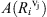 | = 对应于厂商类型 `v[j]` 的资源类型 `R[i]` 的面积 |
| 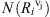 | = 设计中使用的对应于厂商类型 `v[j]` 的资源类型 `R[i]` 的实例数量 |
| `R[i]` | = 资源类型 |
| `C[body]^(DMR)` | = 执行特洛伊安全 DMR CDFG 循环体所需的控制步骤数量 |
| `C[first]^(DMR)` | = 执行特洛伊安全 DMR CDFG 第一次迭代所需的控制步骤数量 |
| Δ | = 单个控制步骤的延迟 |
| 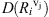和 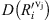 | = 对应于厂商类型 `v[j]` 的原始资源类型 `R[i]` 的延迟和对应于厂商类型 `v[j]` 的重复单元资源类型 `R[i]`′ 的延迟 |
| cs | = 分配 `R[i]` 的控制步骤编号 |
| `Cf` | = 具有设计方案 `X[i]` 的特洛伊安全 DSP IP 核的设计成本 |
| `A[max]^(DMR)` 和 `T[max]^(DMR)` | = 设计空间中的最大面积和执行时间 |
| `w[1]` 和 `w[2]` | = 用户指定的面积和延迟权重因子 |
| `x(i)` | = DCT 函数中的输入信号 |
| `X(m)` | = DCT 函数的输出信号 |
| `N` | = DCT 函数中的数据点数量 |
| `C[1]` 到 `C[7]` | = 按升序排列的 DCT 系数（`C[1]` 表示最大正 DCT 系数值，`C[7]` 表示最小正 DCT 系数值） |
| `k[1]` 到 `k[8]` | = DCT 系数 |
| `x[0]` 到 `x[7]` | = DCT 函数的输入信号主输入 |
| `X[0]` 到 `X[7]` | = DCT 函数的输出信号 |
| `x(n)` | = DFT 函数中 `N` 个值的序列 |
| “N” | = 表示为 2 的整数幂 |
| `X(k)` | = 复数值序列 |
| `W[N]` | = 复数值相位因子 |
| `G(k)` 和 `H(k)` | = 偶序列和奇序列的两个 `N`/2 点 DFT |
| `A(k)` 和 `B(k)` | = 对应于 `G(k)` 的偶序列和奇序列的两个 `N`/4 点 DFT |
| `C(k)` 和 `D(k)` | = 对应于 `H(k)` 的偶序列和奇序列的两个 `N`/4 点 DFT |
| `M` | = FIR 滤波器阶数 |
| `h[i]` | = FIR 系数 |
| `x(n)` | = 输入脉冲 |
| `y(n)` | = 输出脉冲 |
| `N(R[D])` | = 粒子第 `D` 维的资源数量 |
| “α” | = 在资源最大可能值和最小可能值范围内的随机值 |
| 和 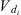 | = 第 `d` 维第 `i` 个粒子的新速度和当前速度 |
|  | = 第 `d` 维第 `i` 个粒子的资源值 |
| 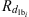 | = 第 `d` 维第 `i` 个粒子的局部最佳位置 |
| 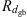 | = 第 `d` 维的全局最佳值 |
| `ω` | = 惯性权重 |
| `b[1]` 和 `b[2]` | = 社会因素和认知因素 |
| `r[1]` 和 `r[2]` | = 0 到 1 之间的随机数 |
| 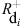 | = 第 `d` 维第 `i` 个粒子的更新资源值 |
| `V^+[d]` | = 新速度 |
| 速度的最大和最小限制 | = 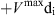和 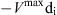 |
| au | = 面积单位（晶体管） |
| ns | = 纳秒 |
| `I[max]` | = PSO 终止准则 |

# Chapter 4

| `Mi` | = 第 `i` 个子标记或数学函数 |
| --- | --- |
| `C[i]` | = 子标记被发送到“临时空闲”IP 输出端口时的时钟周期编号 |
| `M` | = 数字 FIR 的滤波器阶数 |
| `h[i]` | = FIR 系数 |
| `x(n)` | = 输入冲激 |
| `y(n)` | = 输出冲激 |
| `H(e^(jω))` | = 传递函数 |
| `δ[1]` 和 `δ[2]` | = 指定数字滤波器允许通带和阻带的参数 |
| `N` | = 数字 IIR 巴特沃思滤波器的阶数 |
| `Ω[c]` | = 截止频率 |
| `H(s)` | = 传递函数 |
| `B[0]B[1]` | = IIR 巴特沃思滤波器的参数 |
| `H(z)` | = 表示滤波器在频域中的传递函数 |
| “α”, “β”, “γ”, “‘i”, “I”, “T”, 和 “!” | = 水印的签名数字 |
| `P[c]` | = 重合概率度量 |
| “w” | = 水印强度/大小 |
| `N(R[i])` | = 类型 `i` 的功能单元数量 |
| `D` | = 功能单元的类型 |
| `C` | = 在嵌入水印前彩色区间图中使用的颜色数量 |
| `T[t]` | = 篡改容忍能力 |
| “v” | = 编码中使用的变量数量 |
| `Cf` | = 用户提供的资源配置 `X[i]` 的水印设计成本 |
| `L[total]` 和 `A[total]` | = 总水印设计延迟和面积 |
| `L[max]` 和 `A[max]` | = 基于模块库中可用资源的最大设计延迟和面积 |
| `w[1]` 和 `w[2]` | = 延迟和面积的权重参数 |

# Chapter 5

| `X[i]` | = 最优设计方案 |
| --- | --- |
| `N(R[D])` | = 资源类型 `R[D]` 的数量 |
| `A[total]` 和 `L[total]` | = 对称保护设计的总面积和延迟 |
| `A[cons]` 和 `L[cons]` | = 用户提供的面积和延迟约束 |
| `A(R[i])` | = 资源 `R[i]` 的面积 |
| `A(buffer)` | = 缓冲区的面积 |
| `N(buffer)` | = 缓冲区的数量 |
| `A(mux)` | = 多路选择器的面积 |
| `N(mux)` | = 多路选择器的数量 |
| `L[total]` | = 对称保护可重用 IP 核的总设计延迟 |
| `total[cs]` 和 `delay[cs]` | = 设计的控制步骤总数和每个控制步骤的执行延迟 |
| `Cf` | = 具有资源配置 `X[i]` 的对称保护可重用 IP 核的设计成本 |
| `A[max]` 和 `L[max]` | = 设计空间中的最大面积和延迟 |
| `w[1]` 和 `w[2]` | = 用户提供的面积和延迟权重因子 |
| `c` | = 所需的颜色数量 |
| `W` | = 水印约束的大小 |
| `P[c]` | = 重合概率 |
| `F` | = 指纹约束的大小 |

## Chapter 6

| `A_n` | = CFE 中的算法/工具的有限集合 |
| --- | --- |
| `P` | = 问题 |
| `S` | = 解决方案 |
| `n` | = 1,…,`i` |
| `k` | = 簇的数量，使得每个簇包含在 CFE 中紧密匹配的解决方案 |
| `IP[Vn]` | = 竞争 IP 核心所有权的供应商 |
| `n` = 是声称拥有 IP 核心所有权的供应商数量 |
| `IP[ID]` | = 待判定所有权的 IP 核心/待测试的 IP 核心 |
| `CSS` 和 `CSS` | = 第 `i` 个和第 `j` 个 FU 的起始控制步骤 |
| `CSE` 和 `CSE` | = 第 `i` 个和第 `j` 个 FU 的结束控制步骤 |
| `CS` | = 控制步骤 |
| `MUL_En_1` | = 乘法器使能 |
| `CSS` 和 `CSE` | = 第 `i` 个 FU 的起始和结束控制步骤 |
| `CSE[1]` 和 `CSE[2]` | = 数据集 1 和 2 的结束控制步骤 |
| `µ` | = 匹配百分比 |

# Chapter 7

| `A[cons]` | = 用户提供的面积约束 |
| --- | --- |
| `L[cons]` | = 用户提供的延迟约束 |
| `X[i]` | = 最优设计方案 |
| `N(R[D])` | = 资源类型 `R[D]` 的数量 |
| `A[total]^(obf)` 和 `L[total]^(obf)` | = 结构混淆设计的总面积和延迟 |
| `A(R[i])` | = 资源 `R[i]` 的面积 |
| `A(buffer)` | = 缓冲区的面积 |
| `N(buffer)` | = 缓冲区的数量 |
| `A(mux)` | = 多路选择器的面积 |
| `N(mux)` | = 多路选择器的数量 |
| `D` | = 维度的总数 |
| `L[body]^(obf)` | = 混淆 CDFG 的循环体单次迭代执行延迟 |
| `I` | = 总循环迭代次数（循环计数） |
| `L[first]^(obf)` | = 执行混淆 CDFG 第一次迭代的延迟 |
| `UF` | = 展开因子 |
| `Cf` | = 具有资源配置 `X[i]` 的结构混淆 DSP IP 核心的设计成本 |
| `A[max]^(obf)` 和 `L[max]^(obf)` | = 设计空间中可能的最大面积和延迟 |
| `w[1]` 或 `Ø[1]` 和 `w[2]` 或 `Ø[2]` | = 用户指定的面积和延迟权重因子 |
| 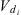 和 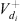 | = 第 `d` 维度中第 `i` 个粒子的当前和新速度 |
| 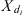 | = 第 `d` 维度中第 `i` 个粒子的资源值或展开因子 |
| 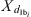 | = 第 `d` 维度中第 `i` 个粒子的局部最佳位置 |
|  | = 第 `d` 维度的全局最佳值 |
| `ω` | = 惯性权重 |
| `b[1]` 和 `b[2]` | = 社会因素和认知因素 |
| `r[1]` 和 `r[2]` | = 随机数 |
| 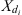 | = 第 `d` 维度中第 `i` 个粒子的新资源值或展开因子 |
| `g[best]` | = 种群中的当前全局最佳值 |
| `l[best]` | = 粒子的自身最佳位置 |
| `I[max]` | = 预定义的最大迭代次数 |
| `Δ` | = 用于检查是否未发现全局最佳值改进的迭代次数 |
| `P` | = PSO 中的种群大小 |
| `P^(obf)` | = 混淆功率 |
| `n[i]` | = 由于第 `i` 个阶段变换方法而修改的节点的唯一数量 |
| `n[T]` | = 原始 DSP 电路（在应用任何变换方法之前）的节点总数 |

# Chapter 8

| `μ` | = 在功能混淆期间 PSO 中使用的随机整数 |
| --- | --- |
| `T[ILB]` | = 可用于插入设计的 ILB 结构/模板的总数 |
| `K[s]` | = 通过 ILB 锁定网表的可能密钥空间数量 |
| “b” | = 每个 ILB 的密钥位数 |
| `m` | = 每个功能单元的输出位宽 |
| `f` | = 用于设计数据通路的功能单元数量 |
| `P[i]` | = 粒子种群中第 `i` 个编码粒子 |
| `n(R[d])` | = 类型 `R[d]` 的资源数量 |
| `d` | = 可用资源类型的总数 |
| “α” | = 资源类型 `R[d]` 最大和最小资源值范围内的随机整数 |
| `Cf` | = 粒子 `P[i]` 的归一化加权成本/适应度 |
| `Ø[1]` 和 `Ø[2]` | = 分别用于面积/功耗和延迟组件的用户提供权重因子 |
| `P^(FO)` 和 `D^(FO)` | = 功能混淆（FO）设计的总功耗和执行延迟 |
| `P[max]^(FO)` 和 `D[max]^(FO)` | = 可能的最大功耗（估计为模块库中可用最大硬件资源数量的功耗） |
| `D[max]^(FO)` | = FO 设计可能的最大延迟（估计为利用最少硬件资源的延迟） |
| 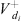 和  | = 第 `d` 维度中第 `i` 个粒子的新速度和当前速度 |
| 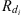 | = 第 `d` 维度中第 `i` 个粒子的资源值 |

# Chapter 1

## Introduction to IP core protection and hardware-assisted security of consumer electronics

This chapter presents an overview of the book and discussions on topics that could serve as an introductory part toward the overall content of the book. It is assumed that the readers will have some subject knowledge on topics such as very large scale integration (`VLSI`), embedded systems, hardware design flow, etc., before adopting the section of this book.

## 1.1 Consumer electronics and security perspectives

| `*ω*` | `= is the inertia weight` |
| --- | --- |
| `*b*[1] and *b*[2]` | `= are social and cognitive factors` |
| `*r*[1] and *r*[2]` | `= are random numbers between 0 and 1` |
| `*d*` | `= number of dimensions` |
| `SoO` | `= strength of obfuscation` |

| `*T* or *T*(*i*, *j*)` | `= 2D-DCT coefficient matrix` |
| --- | --- |
| `“N”` | `= the size of the DCT matrix` |
| `“i” and “j”` | `= the *i*th row, *j*th column component of the 2D-DCT matrix` |
| `*C*[1],…,*C*[7]` | `= DCT coefficients` |
| `*X*` | `= transformed matrix after DCT processing` |
| `*M*` | `= input image matrix` |
| `*D*` | `= matrix (*d*[11], *d*[12],…,*d*[88]) transforms the rows of the “M” block` |
| `*Q*` | `= quantization matrix` |
| `*X*′` | `= 2D quantized 8 × 8 block` |
| `*X*″` | `= decompressed 8 × 8 block` |
| `O` | `= IDCT block of *X*″ block` |
| `*E*` | `= matrix (*e*[11], *e*[12],…,*e*[88]) transforms the rows of the *X*″ block` |
| `*Cf*(*X*[*i*])` | `= hardware design cost for design solution *Xi*` |
| `*L*[total]^(JPEG) and *A*[total]^(JPEG)` | `= the total design latency and total hardware area of the obfuscated JPEG IP core` |
| `*L*[max]^(JPEG) and *A*[max]^(JPEG)` | `= the maximum possible design latency and hardware area` |
| `*w*[1] and *w*[2]` | `= weightage factor of two design parameters (latency-area)` |
| `*A*[1],…,*A*[8], ,…*Q*[1],…,*Q*[8]` | `= the primary inputs are represented through` |
| `*i*[1],*i*[2],,…,*i*[135]` | `= dependent inputs` |
| `*i*[136]` | `= represents the output` |
| `SoO` | `= strength of obfuscation` |
| `PSNR(A,B)` | `= Peak signal-to-noise ratio for two images A and B of size *M* × *N*` |
| `MAX[A]` | `= the maximum pixel value in image A` |
| `MSE(A, B)` | `= mean square error between images A and B` |

| `*K*` | `= bit-key length` |
| --- | --- |
| `*n*[r]` | `= number of internal rounds` |
| `*i*` | `= index indicating the current round` |
| `*A*` | `= input data size` |
| `*B*` | `= output encrypted data` |
| `*X*[0],…,*X*[15]` | `= input byte to S-box` |
| `*Y*[0],…,*Y*[15]` | `= output byte from S-box` |
| `*Z*[0],…,*Z*[15]` | `= output from Mix Column diffusion layer` |
| `*K*[0],…,*K*[15]` | `= keys` |
| `*k*[*i*]` | `= subkey` |
| `*O*[0],…,*O*[15]` | `= output from key addition layer` |
| `*P*(*x*)` | `= modular reduction function` |
| `RC` | `= round coefficient` |
| `*M*[0],…,*M*[3]` | `= inputs to XOR blocks in Key Scheduler at round 0` |
| `*M*[4],…,*M*[7]` | `= outputs from XOR blocks in Key Scheduler at round 1` |
| `“*α*” and “*β*”` | `= embedding signature digits during AES hardware watermarking` |
| `*S*[0], *S*[1]` | `= select lines of multiplexer in Mix Column structure` |
| `*S*[0]^′, *S*[1]^′` | `= select lines of de-multiplexer in Mix Column structure` |

| `*I*` | `= original input image` |
| --- | --- |
| `*W*` | `= watermark input` |
| `*I*′` | `= output watermarked image` |
| `*E*` | `= encoder function` |
| `*D*` | `= decoder function` |
| `*J*` | `= image which needs to be challenged` |
| `*W*′` | `= the watermark recovered by the decoder` |
| `*δ*` | `= threshold` |
| `*C*[*δ*] (*W*, *W*′)` | `= correlation between *W* and *W*′` |
| `*w*[*i*]` | `= watermark sequence` |
| `*F*k` | `= the DCT coefficient of the *k*th image block` |
| `*α*[k]` | `= scaling factor` |
| `*F*[k]^(*i*)(*u*, *v*)` | `= watermarked DCT coefficients` |
| `K` | `= key` |
| `*I*[w]` | `= watermarked image` |
| `*I*[N]` | `= the neighborhood image pixel gray value` |
| `*α*[*i*]` | `= global scaling factor` |
| `*C*[1], *C*[2], *C*[3], *C*[4]` | `= linear regression coefficients used to linearize cubic root` |
| `*i*[Wk]` | `= *k*th watermarked image block` |
| `*β*[k]` | `= embedding factor` |
| `*μ*[kI]` | `= normalized mean gray value of *k*th image block` |
| `*μ*[I]` | `= normalized standard deviation of the gray values of the *k*th image block` |
| `*σ*[kI]` | `= normalized mean gray value of the image` |
| `*C*[I]` | `= frequency components` |
| `*C*[Iw]` | `= frequency components of the watermark image` |
| `*C*[Iwk]` | `= frequency components of *k*th block of the watermark image` |
| `*ε*` | `= probability of error` |

| `*i*, *j*` | `= two different chips` |
| --- | --- |
| `*R*[*i*], *R*[*j*]` | `= response generated by chips *i* and *j*` |
| `HD` | `= hamming distance` |
| `*n*` | `= length of response` |
| `*K*` | `= key-bit length` |
| `*R*′[i]` | `= response generated by the chip *i* in a different environment` |
| `*x*` | `= number of different samples` |
| `S` | `= reliability` |
| `*t*[inv]` | `= delay of an inverter` |
| `*V*[DD]` | `= supply voltage` |
| `*C*[L]` | `= the load capacitance` |
| `*W*` | `= effective width of the channel` |
| `*L*` | `= effective length of the channel` |
| `*m*` | `= mobility of carriers` |
| `*t*[ox]` | `= oxide thickness` |
| `*e*[ox]` | `= oxide dielectric permittivity` |
| `*V*[T]` | `= threshold voltage` |
| `*f*[o]` | `= oscillation frequency of the ring oscillators` |
| `*N*[inv]` | `= number of inverters` |
| `*C*(*n*, *k*, *t*)` | `= binary linear code` |
| `*n*, *k*` | `= length of the dimension of code` |
| `*t*` | `= maximum number of errors that can be corrected` |
| `*p*[0] and *p*[1]` | `= probabilities of binary source of outputs` |
| `*p*[max]` | `= maximum probability` |
| `*M*(*t*)` | `= memristance of the memristor` |
| `*R*[0]` | `= maximum resistance offered` |
| `Δ*R*` | `= the difference between the maximum and minimum memristance offered` |
| `*μ*` | `= mobility` |
| `*D*` | `= device thickness` |
| `*T*[wr,min]` | `= minimum threshold of time` |
| `*V*[word]` | `= voltage of the word lines` |
| `*V*[bit]` | `= voltage of the bit lines` |
| `*N*[m]` | `= noise margin` |

# 消费电子与 IoT 安全

消费电子（CE）涵盖从数码相机、多光谱相机、IPTV、智能平板电脑、夜视相机到智能电表等高端设备，结合数据与通信技术，使新兴智慧城市和物联网（IoT）成为现实。在当今的 CE 和 IoT 世界中，硬件及其信息的安全、隐私和保护变得越来越至关重要。普遍认为，对于 IoT 而言，底层硬件的安全对于其正确运行至关重要。底层硬件受到多种威胁因素的影响。攻击者可能会创建秘密后门，泄露安全传输线路中使用的加密密钥等关键数据；制造商可能通过植入“硬件木马”或插入具有已知可靠漏洞的工件来篡改设计。当前一代设计从众多供应商处整合知识产权（IP）模块，这些模块由全球多家公司大规模生产和验证。因此，任何典型硬件都存在众多访问点，容易受到攻击。对于可信硬件设计，IP 核心的防御至关重要（Sengupta 和 Kundu, 2017; Sengupta *et al.*, 2018）。

典型的 CE 系统（图 1.1 所有类型攻击的整体系统，以及 (2) 所有类型的硬件（例如，数字、模拟和射频组件）。因此，CE 系统处理的硬件组件和信息（包括媒体）的知识产权（IPR）保护需要不同的解决方案。与本节相对应的章节将讨论这些攻击的细节，并探讨相应的可能缓解方案。此外，本书的不同章节中将讨论其中许多攻击和解决方案。硬件辅助安全被定义为硬件提供的“安全”，用于：(1) 正在处理的信息，(2) 硬件本身，以及 (3) 整体系统（Sengupta *et al.*, 2018; Mohanty 2018a, 2018b）。硬件辅助安全解决方案可能采取不同的形式，例如：(1) 用于安全的额外硬件组件，(2) 执行的硬件设计修改，以及 (3) 执行的系统设计修改（Mohanty, 2018a, 2018b）。总体而言，如果系统在设计阶段融入安全、隐私和 IP 保护解决方案，并从可信供应商和可信制造单位获取组件，则可以将其视为可信。

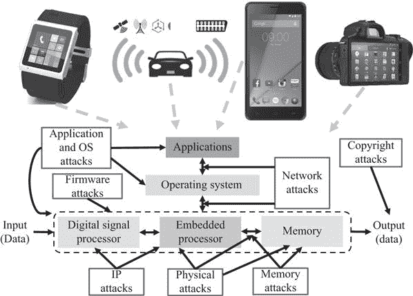

图 1.1 消费电子组件与安全漏洞

众所周知，CE 系统是各种类型硬件、软件和固件的异构组合，可以概念化为模拟/混合信号片上系统（AMS-SoC）（Mohanty, 2015, 2018b）。本节将简要介绍，详细讨论将在相应章节中进行。以下部分讨论硬件设计流程，更具体地说是架构级别。

## 1.2 硬件辅助安全与 IP 核心保护

目前，CE 设备的设计时代包含复杂的数据/控制密集型硬件，例如以 IP 核心形式存在的 DSP 核心，这些核心依赖于全球集成电路（IC）供应链。为了提高设计效率并加快设计速度，CE 设备中 DSP 应用使用 IP 核心（通常由第三方供应商提供）已成为 CE 行业的典型做法。然而，日益严重的安全威胁和上升的盗版担忧使全球供应链变得脆弱（Sengupta, 2015, 2016）。图 1.2 显示了典型片上系统设计周期中的硬件威胁，该周期包含第三方 IP（3PIP）核心。第一个位置是在从外部供应商导入 3PIP 核心的过程中，第二个位置是在晶圆厂执行设计网表复制的地方。因此，在这两个位置安全是强制性的。此外，图 1.3 显示了芯片设计周期中各种元素，这些元素本质上是可信或不可信的。其他形式的硬件威胁，例如 IP 核心所有权侵权、IP 核心买方所有权等，也是可能的，这将在本章后半部分和其他章节中讨论。

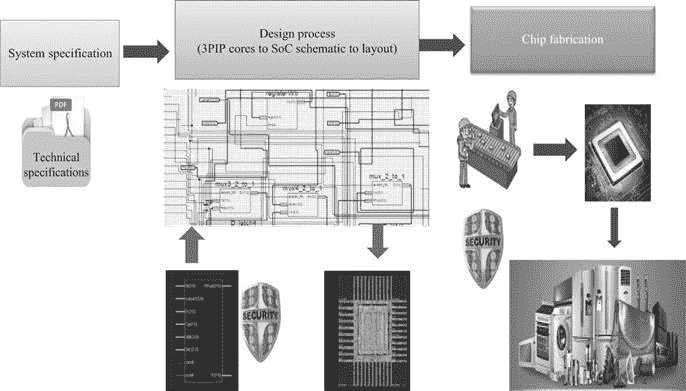

图 1.2 包含 3PIP 核心的 SoC 设计与制造，指示可能的硬件漏洞（Sengupta, 2017）

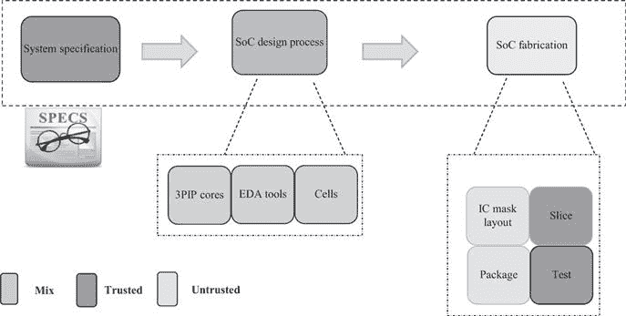

图 1.3 CE 设备中使用的芯片设计流程，指示可信和不可信元素（Sengupta, 2017a, 2017b）

# 在本书中，我们将“硬件辅助安全”定义为消费电子（CE）设备中用于 DSP 和多媒体应用的硬件/IP 核心的安全/保护，或由 CE 设备的硬件/系统对信息的安全/保护。

“安全”一词涵盖了一个广泛的主题，包括硬件安全、保护、隐私、可信度以及 IP 核心保护和信息安全等诸多方面。“安全”一词描述了处理数据或信息的系统（例如 CE 设备）的安全性。在基于 CE 的架构中，对其硬件和 IP 核心的防御至关重要。因此，使用安全 IP 的做法变得非常重要。在智慧城市时代，日益增长的 CE 硬件设计复杂性正在超越设计师的产能，从而导致更大规模的项目。此外，当前的 CE 设计群在很大程度上依赖于全球 IP 供应链。为了提高设计生产率并缩短设计时间，使用通常由第三方供应商提供的 IP 核心已成为行业中至关重要的 `de-facto` 做法。据估计，顶级假冒产品可能对半导体市场产生 3000 亿美元的影响。然而，日益增加的安全威胁和日益严重的盗版担忧确实影响着全球供应链。因此，信息安全（涵盖 CE 设备不断处理的数据、信息和多媒体的安全）变得至关重要（Sengupta *et al.*, 2018; Mohanty 2018a, 2018b）。

## 1.3 知识产权（IP）核心/硬件

### 1.3.1 CE 设备中 IP 核心的实用性

硅技术的快速发展导致 CE 设备设计复杂性大幅上升。在数十亿美元晶圆厂的实际运营中，越来越多的应用被整合到单个硅晶圆上。与此同时，市场需求推动了更大的设计启动、缩短了设计时间，并增加了上市时间压力。为了应对这些困难，IP 核心（尤其是用于复杂 DSP 和多媒体应用的 IP 核心）已成为一种务实的解决方案。一个 IP 核心一旦在特定工艺技术的设计中得到验证，就可以用于其他采用相同工艺技术的设计。反过来，这消除了在大多数系统级仿真测试中采用该核心的必要性，进而降低了整体系统设计和验证的复杂性。举个简单的例子，一旦用于图像压缩的 JPEG CODEC 核心或小波变换核心在特定硅工艺中得到验证，就可以轻松地集成到其他 CE 设备的 SoC 设计中（Sengupta, 2016）。

### 1.3.2 为什么需要硬件/IP 核心的安全和保护？

对复杂 CE 设备（包括复杂 DSP/多媒体核心）的需求，导致可重用 IP 核心被广泛使用。此类复杂 IP 核心的日益重复使用，不可避免地使其面临假冒的风险。由于一个 IP 核心可能代表数年的设计、研发和验证工作，一个关键问题是如何保护这一资产？以及如何识别/防止核心的假冒？

据我们所知，事实是，实际 IP 所有者的权利可能会被故意或无意地侵犯。这可能通过滥用许可协议来实现，即在仅获得单一许可的情况下，将 IP 核心部署到众多设备中。晶圆厂甚至其他 IP 核心制造商可能会有很大的诱惑，将高质量设计集成到其他系统组件中，而实际的许可规则可能会阻止这种行为。随着系统变得复杂，IP 核心制造商越来越倾向于将其他 IP 核心分许可以包含在其设计中，一旦设计过程完成，就很有诱惑力将其重复用于其他可能不包含实际许可的补充产品中。对 IP 核心的另一个迫在眉睫的威胁是盗版，即通过不正当手段或逆向工程，未经授权直接窃取/复制 IP 以供重复使用。作为 IP 盗窃的结果，攻击者甚至可能声称拥有 IP 的权利。因此，一种撤销不诚实的 IP 所有权主张的方法是非常可取的。对于 IP 核心或整芯片设计的制造商来说，证明其 IP 在产品中被非法使用既棘手又昂贵。在硅芯片的情况下，识别 IP 核心的一种现实方法是获取待测产品的样本，送往专业实验室进行分析。此外，硬件设计过程中任何形式的第三方入侵都可能导致 CE 硬件出现严重的安全隐患。因此，保护 CE/IoT 硬件可以被视为保护 IP 核心免受不诚实的所有权主张。另一种称为“硬件木马”的威胁，是指供应商处的对手故意将恶意逻辑注入设计（例如 IP 核心硬件）的行为，这将针对影响安全协议的检测/纠正策略。上述两种硬件漏洞都可能出现在任何设计抽象级别。预处理或后处理风格的方法是根据应用安全的级别定义的，这通常由 DSP 核心的复杂性驱动。例如，对于包含 15K–50K 级门数的复杂 DSP/多媒体核心，在架构（高级）综合阶段采用的安全方法更有益且更有成效（Sengupta and Kundu, 2017）。

### 1.3.3 传统的 IP 保护形式是否足够？

在过去几年中，已采用了各种方法，通过专利、版权、商标等来保护此类核心。然而，这些方法尚未充分建立起来，以保护 CE 设备中使用的 IP 核心的价值。主要原因是实施的设计成本；此外，证明侵权的举证责任也过于昂贵。此外，在 CE 行业中，关于可重用 IP 核心的保护，大多数 IP 核心供应商依赖于对其业务合作伙伴的共同信任以及运营期间的隐私。

## 1.4 IP 核心保护和 CE 设备—DSP 核心的硬件辅助安全

如前所述，在 CE 设备的核心部分，存在多个用于数据密集型或控制密集型功能的 DSP 内核。这些 DSP 内核是以 SoC 平台形式存在的 IP 内核，负责处理大量数据块。例如，数字摄像机几乎总是内置第二个微处理器，专门用于视频计算。这个过程被称为数字信号处理器（DSP），其作用是实时执行重复的数学任务。简单来说，当我们的智能手机主微处理器检查是否有来电时，第二个处理器会同时在后台运行电子邮件、管理 Wi-Fi 信号、检查镜头中是否有视频传入等，所有这些计算都由第二个专用处理器（即 DSP 内核）处理。主题示例如 图 1.4 所示。如图所示，多媒体/DSP 内核（JPEG 压缩/解压缩 IP 内核）在 CE 设备的成功运行中起着重要作用。同样，其他 DSP 内核，如离散余弦变换（DCT）内核、快速傅里叶变换（FFT）、数字滤波器等，在 CE 设备设计中也起着关键作用。例如，FIR 滤波器有助于改善 CE 设备中的音频质量和蜂窝基础设施。此类复杂 DSP/多媒体内核的保护依赖于高层综合（即架构综合）作为骨干设计框架。这是因为包含 15K–60K 门的此类复杂 DSP 内核从不从较低抽象级别启动设计过程。此外，通过高层综合框架可以无缝地选择/控制这些 DSP 内核的架构，因为该框架包含设计空间探索（DSE）模块（由智能进化算法驱动）。如果这些设计必须从寄存器传输（RT）/门级/较低级别开始，则不可能实现这一点。

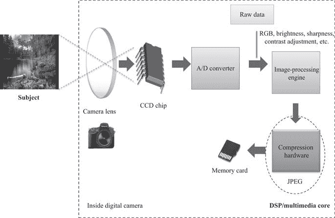

图 1.4 CE 设备中的 DSP/多媒体内核：数码相机

因此，此类复杂内核的保护/安全机制与高层综合设计过程交织在一起。对于此类硬件，保护主要在较高抽象级别（即高层综合期间）应用。相比之下，加法器、编码器、解码器等较不复杂硬件的安全/保护机制可以在 RT 级/门级等较低级别执行。图 1.5 显示了不同硬件辅助安全和 IP 内核保护机制在较高和较低抽象级别的分类。如前所述，对于无限脉冲响应（IIR）滤波器、FIR、JPEG 等 DSP/多媒体内核，保护/安全算法在较高抽象级别应用，这使得安全算法的约束也能通过 RT 级/门级综合传播到较低级别。

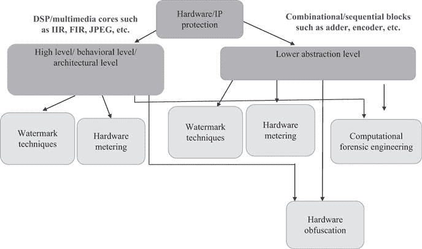

图 1.5 硬件保护机制

### 1.4.1 IP 内核/硬件可用的安全和保护方法

一些广泛用于 CE 设计中 DSP IP 内核的公认保护机制取决于威胁模型/漏洞，包括水印、指纹、硬件计量、计算机取证工程、木马安全、结构混淆、功能混淆、物理不可克隆函数（PUF）以及专利/版权（Alkabani *et al.*, 2007; Castillo *et al.*, 2007; Christof and Jan, 2009; Hong and Potkonjak, 1999; Koushanfar *et al.*, 2005; Marvel, 2005; Ni *et al.*, 2006; Sengupta and Roy, 2018a, 2018b）。图 1.6 显示了 CE 设备威胁模型及其硬件安全对策的概览。

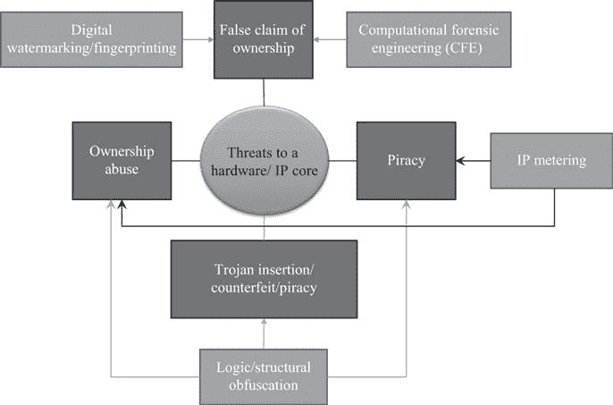

图 1.6 一些常见硬件威胁及其对策概览

#### (i) IP 内核/硬件水印

当预期的硬件威胁是虚假的所有权声明时，会采用这种硬件保护机制。这种威胁模型基本上是由于所有权滥用或虚假声明 IP 内核所有权或盗版造成的。尽管水印可以防范上述威胁，但它只能检测而不能防止威胁。换句话说，水印方法能够为 IP 内核提供被动形式的保护。有关此保护机制的更多细节将在第 4 章中介绍。

#### (ii) IP 内核的计算机取证工程（数字取证）

当问题中的硬件威胁是所有权滥用或虚假声明 IP 内核所有权或盗版时，会采用这种硬件保护机制。它与水印具有相同的威胁模型，并在所有权冲突时提供合法所有者的检测。计算机取证工程（CFE）的目标是识别生成 IP 的个人。它检查给定 IP 的某些属性，并测量特定个人生成该 IP 的概率。CFE 方法从一组综合工具中识别出用于制作特定 IP 设计的工具。需要注意的是，这种方法也能够为 IP 内核提供被动形式的保护。有关此保护机制的更多细节将在第 6 章中介绍。

#### (iii) 硬件计量

这是监控 IC 的方法。一些有效的方法是在芯片上物理识别序列号或在其内存中存储唯一标识符（Alkabani and Koushanfar, 2007; Roy *et al.*, 2008）。硬件计量的分类如 图 1.7 所示。硬件计量大致可分为两类：非功能性和功能性。在非功能性识别方法中，会创建一个与芯片功能分开的唯一 ID。但是，它可能有以下缺点：

1. 易受克隆和/或移除；
2. 一旦芯片被标记，晶圆厂可以将相同的标记复制到其他芯片上，或者简单地移除标记，导致芯片无法追踪；
3. 存在过度生产的可能性；
4. 晶圆厂可以生产带有相同标记的多个芯片；
5. 在数百万个芯片中，找到两个匹配标记的概率很小。

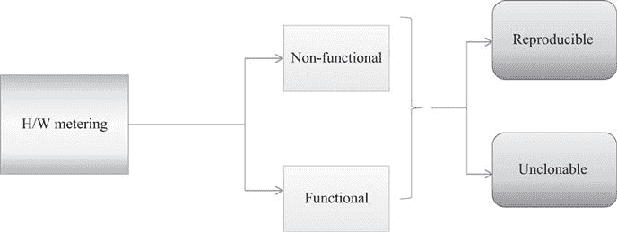

图 1.7 硬件计量方法分类

非功能标识符在硬件计量中分为两类：(1) 可复制和 (2) 不可克隆。可复制标识符是存储在芯片封装、芯片或芯片内存中的唯一 ID。它们可以是压印序列号或数字存储序列号的形式。其优点是不依赖随机性且易于追踪/识别。缺点是易于克隆/修改且易于过度生产。另一方面，不可克隆的非功能标识符可以使用外在或内在方法进行计量。例如，内在方法可能使用 IC 漏电、功率、时序、路径签名等，这些都因工艺变化而独特。该方法不需要任何额外逻辑，可以直接用于现有设计。相反，外在不可克隆的非功能标识符使用额外逻辑，例如 `PUF`，它是由振荡器环 (`RO`) 组成的结构，能够因工艺变化生成随机值。`PUF`s 受电源噪声、温度、延迟等影响；因此，值会不断变化。另一类计量方法是基于功能标识符的计量。该方法在综合过程中将标识符与芯片的内部功能细节关联起来。一些属性是：

*   每个芯片的功能都有一个唯一签名；
*   添加的额外状态生成相同输出；
*   从输入到输出功能不变；
*   每个芯片独有的内部事务。

迄今在硬件计量背景下讨论的上述方法都是被动计量方法。存在一种主动计量方法，它使用外部锁定技术锁定 IC。主动计量方法的一些属性是：

*   此技术试图允许 IP 拥有者控制；
*   使用密钥加密锁定芯片的正确功能；
*   在门级，`XOR` 门被放置在选定的非关键路径上；
*   要求每个芯片都用外部密钥激活。只有 IP 拥有者可以生成密钥 (Alkabani and Koushanfar, 2007; Roy *et al.*, 2008)。

#### (iv) IP 核心/硬件指纹识别

当预期的硬件威胁是 IP 卖方/供应商虚假声明所有权，或在 IP 买方不知情的情况下非法重新分发额外副本时，采用此硬件保护机制。威胁模型是不诚实的 IP 卖方在市场上非法重新分发/转售 IP 核心副本 (Hong and Potkonjak, 1999)。因此，IP 核心指纹识别保护 IP 买方免受所有权滥用。尽管指纹识别保护免受上述威胁，但它只能检测而不能防止威胁。换句话说，指纹识别方法能够为 IP 核心提供被动形式的保护。有关此保护机制的更多细节在第 5 章中介绍。

#### (v) IP 核心/硬件混淆和加密

当预期的硬件威胁是通过逆向工程进行 IP 网表盗窃/假冒/盗版时，采用此硬件保护机制。硬件混淆方法有两种类型：(1) 结构混淆和 (2) 功能混淆。在结构混淆中，目标是增强逆向工程的复杂性，使攻击者更难从其转换后的结构中发现 IP 核心的实际功能。相反，在功能混淆中，目标是通过“密钥”禁用 IP 核心，使得混淆设计的正常功能只能通过在输入端成功应用单个预定义密钥或一系列隐蔽密钥来启用；否则，IP 核心设计将以一种表现出错误功能的模式运行。这两种混淆方法都旨在防止 IP 侵权和木马插入。结构混淆被视为一种“被动”混淆形式，因为它不影响 IP 核心的功能，而只是进行语法更改，即，以软形式修改电路描述，使攻击者难以理解 IP 核心的内部工作原理。被动方法的一个主要缺点是它不改变设计的黑盒功能，因此无法防止 IP 在设计中作为黑盒被潜在使用。但是，由于它不向 IP 核心添加额外的锁定电路，设计开销的可能性低于主动方法，这使其在 CE 行业中同样是一个有吸引力的选择。有关此保护机制的更多细节在第 7 章和第 8 章中介绍。

#### (vi) IP 核心的木马安全/检测

在 IP 核心的背景下，硬件木马是 IP 核心内部逻辑的恶意更改，导致其功能改变，使得在罕见事件条件下，IP 核心产生错误输出。此硬件保护机制用于防范在 SoC 集成中使用的 3PIP 核心内部隐藏的硬件木马。由于 IC 设计链的全球化，第三方 IP 核心的参与在更严格的上市时间压力下对 CE 设备的大规模生产起着关键作用。DSP IP 核心的木马安全可以通过在系统级芯片集成期间与优化框架并行运行的双模块冗余技术来实现。这使得能够检测导致功能变化的硬件木马。有关此保护机制的更多细节在第 3 章中介绍。

#### (vii) 物理不可克隆函数

`PUF` 是一种“数字指纹”，作为硬件的唯一身份。由于其复杂性以及其输出与所应用输入之间的不可预测性，它充当硬件安全原语。`PUF`s 基于半导体制造过程中自然发生的物理变化，这些变化使得能够区分原本相同的硬件。由于随机工艺变化，即使布局相同的两个 IC 也不相同。`PUF`s 有多种类型，例如：(1) `Latch PUF`s，其中输出因锁存器的内在属性而改变；(2) `SRAM PUF`，其中 `SRAM` 单元的初始上电值是随机的；(3) `Ring of oscillator (RO) delay-based PUF`，其中路径延迟因制造变化而不可预测；以及 (4) `Arbiter PUF`，其中路径延迟因物理随机性而不可预测。在仲裁 `PUF` 中，每个挑战选择一对唯一的延迟门。随机工艺变化决定哪条路径更快 (Potkonjak and Goudar, 2014)。有关此保护机制的更多细节在第 12 章中介绍。

#### (viii) 基于硬件的加密

另一种用于保护 CE 设备中使用的机密数据的硬件保护机制是基于硬件的加密。基于硬件的加密过程可用于保护数据存储和传输，以及在 CE 设备的背景下保护 DSP IP 核心。高级加密标准 (`AES`) (Paar and Pelzl, 2009) 是最强大的加密过程，可用于机密数据的基于硬件的加密，以及 DSP IP 核心免受外部攻击的保护。有关此保护机制的更多细节在第 10 章中介绍。

#### (ix) 专利和版权

专利是特定主权政府授予的授权特权，在提交时保护制造者的 IP，因此只有在所有者批准的情况下才能出售和使用。更明确地说，所有者被赋予宪法特权，以防止他人商业滥用发明。所有者有权根据民法报告任何违规案件 (Sengupta, 2015)。

与印刷出版物以及电视广播等任何形式的公共传播相关的知识产权保护，以及用于存储的硬件系统，被称为“版权”。它保护创作者在创意作品方面的特权，防止试图抄袭的欺诈者（Sengupta, 2015）。

### 1.4.2 不同 IP 核保护及硬件辅助安全机制：优缺点

#### 1.4.2.1 硬件计量与硬件水印

在硬件水印中，会选择一个秘密签名并植入到原始设计中。在 IP 计量中，会将一个独特的标识符（ID）注入产品中，以验证任何未经授权的副本。在水印的情况下，签名检测过程中需要进行设计检查步骤。IP 计量也包含设计检查步骤，因为 ID 可以通过读取某些寄存器或简单的 I/O 访问来获取。此外，植入水印对于虚假所有权声明或 IP 盗版的情况肯定是安全的，因为只有所有者才能明确验证秘密水印的实施。同样，IP 计量对于识别 IP 盗版以及估算可能的盗版规模也很有效，这使得它在法庭诉讼中支持赔偿评估方面具有极其重要的意义。

在硬件水印的情况下，由于在原始 IP 核中植入隐藏签名，可能会导致设计开销。这也取决于所选签名的类型及其大小。但在 IP 计量的情况下，设计开销不存在或微不足道，因为 IP 核的微小区域会针对每个设计/制造的硬件进行重新配置。IP 计量仅包含对设计微小部分的配置修改。

在 DSP IP 核的背景下，水印技术大多在 RT 级综合之前植入，即作为预处理，或在综合过程中植入，即签名在高级综合过程执行期间植入。相比之下，IP 计量通常在布局后或制造过程中执行，通过内存编程或在设备机身上压印序列号。在水印过程中，应小心谨慎，以确保签名插入不会损坏设计的功能并影响其质量。在水印方面，鲁棒性与设计开销之间存在明显的权衡。换句话说，较大尺寸的水印肯定更加鲁棒，但可能会带来更多的设计开销。计量中不存在这些参数（Sengupta, 2015）。

#### 1.4.2.2 硬件混淆与硬件水印

硬件混淆与 IP 核的硬件水印完全不同。在硬件混淆中，IP 核的电路描述会被故意模糊，无论是通过加密还是通过在电路结构中引入不可读性，从而使逆向工程过程变得显著困难。相比之下，硬件水印以隐蔽的方式在 IP 核设计本身中引入所有权信息，以便在需要时，可以证明合法所有者的所有权。尽管这两种保护机制的威胁模型略有不同，但硬件水印可以与硬件混淆结合使用。在混淆设计中，水印可以作为防止未经授权复制行为的下一道防线发挥作用。如果未正确植入/执行，这两种保护方法都可能会导致设计开销。

#### 1.4.2.3 计算机取证工程与硬件水印

用于 IP 核保护的计算机取证工程采用一组数字取证证据来推断合法所有者。与用于 IP 核保护的硬件水印不同，它是一种无签名的方法。此外，由于 CFE 不使用签名来解决 IP 所有权冲突，因此对原始设计的质量降低的可能性为零。此外，CFE 不需要额外的注意，因为它不会干扰设计的功能。然而，执行 CFE 的一般过程比水印更复杂，因为它需要对统计数据收集、特征提取、聚类和验证的各个阶段有所了解。因此，与水印相比，CFE 在 DSP IP 核的情况下会带来更高的时间复杂度。

## 1.4.3 HLS（架构综合）作为实现 DSP IP 核安全算法的设计骨干

由于 DSP/多媒体 IP 核依赖高级综合（HLS）设计框架作为其骨干，因此安全/保护算法大多是内在综合的，即安全约束/技术是在高级综合过程中执行的。在阅读后续涉及 DSP 核安全方法论细节的章节之前，有必要在本章中回顾和研究高级综合设计过程。本小节将介绍 DSP/多媒体核的通用 HLS 设计/工具流程概览。图 1.8 所示的设计流程广泛适用于任何现代 HLS 方法论/HLS 工具，例如 Vivado HLS（Vivado 用户指南，2018；Xilinx, 2018）。HLS 流程可用于设计和保护任何复杂的 IP 核，例如 FIR 滤波器、IIR 巴特沃思滤波器、高/低通数字滤波器、DCT、逆 DCT、时域抽取、FFT、哈尔小波变换、JPEG 压缩、JPEG 解压缩、带通滤波器、MPEG 运动矢量、H.264 等。

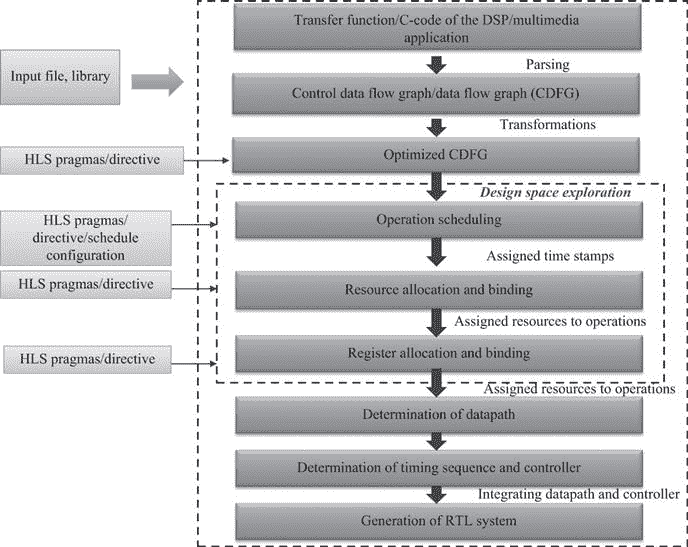

图 1.8 通用 HLS 设计/工具流程概览

典型的 HLS 设计流程接受以 C 代码形式呈现的 DSP 应用程序，并通过解析将其转换为一种称为控制数据流图（CDFG）的图形表示。除了该应用程序外，HLS 还接受用于设计评估的基于模块的技术库。技术库信息基于特定的技术节点，包含单个模块的硅面积、延迟、功耗等详细信息。一旦解析 C 代码后获得控制数据流图（CDFG），它将经历一系列变换以将其转换为优化形式。这些变换可以是编译器驱动或布尔函数驱动的。优化后的 CDFG 接受 HLS pragmas/directives，以将信息传递给 HLS 中的 DSE 系统。DSE 系统的第一步是操作调度，它还接受其自己的一组 HLS pragmas/directives 以及调度配置，为每个操作分配时间（周期）时间戳。此步骤中的指令示例包括链接、多周期、数据流水线、功能流水线、循环展开等。随后是资源分配和绑定阶段，它也接受其自己的一组指令，用于对功能资源执行空间约束。绑定使多个操作能够共享/重用功能硬件资源。随后，通过其自己的一组 HLS 指令执行寄存器分配，以获得在硬件中实现应用程序所需的最优寄存器集数量。这些阶段完成后，通过分析 I/O 连接性、多路复用器、解多路复用器等，基于获得的数据路径来执行数据路径的确定，并确定控制路径生成的时序。这得出了每个硬件资源的逐周期执行详细信息。数据路径和控制器都用硬件描述语言（HDL）描述，并最终集成以形成 DSP/多媒体应用程序的 RTL 系统示意图/HDL 描述。由于 DSP IP 核心的安全算法/功能在一个或多个 HLS 综合步骤中集成，因此理解 HLS 设计框架至关重要。有关 HLS 设计过程的更多详细信息可在 Sengupta 和 Mohanty (2016) 中找到。

## 1.5 硬件辅助媒体保护

CE 系统可能面临的所有权、版权或知识产权（IPR）概念如 Figure 1.9 所示。就所有权而言，硬件、软件、整个 CE 系统或媒体盗版的共同因素是实际或合法所有者的收入损失。但是，这些所有权问题/攻击各不相同，相应部署的解决方案可能有所不同。先前章节已讨论了由硬件盗版导致的硬件 IP 核心保护方面的问题。总体而言，系统盗版或克隆也是 CE 领域的一个问题，因此黑市上有许多假冒的 CE 系统，例如相机、USB 驱动器、智能汽车硬件组件、假电池等。这些可能很便宜，用户可能认为自己买到了好货，却不知道这些会带来许多错误的影响。例如，克隆/假冒硬件可能为使用此类硬件的 CE 系统提供后门入口。想象一下智能汽车的情况，黑客通过这个后门可以访问智能汽车并控制它。这可能导致致命后果，例如，攻击者/黑客可以制造事故。同样，假冒/克隆电池可能对 CE 系统构成安全隐患，因为劣质电池可能会爆炸并起火，互联网上有许多此类案例场景的示例。使用盗版软件也可能为黑客提供潜在的后门以控制系统。每个 CE 系统在其活动状态的每一秒都处理数据、信息、视频、音频和游戏 (Mohanty, 2017a, 2017b)。估计传感器、社交网络、网页、图像和视频应用以及移动设备每天产生超过 2.5 百万亿字节（即 10¹⁸ 字节）的数据 (Mohanty *et al.*, 2016)。随着世界各地智慧城市计划的兴起，这种情况将更加复杂，其中拥有数十亿台连接设备的 IoT 全天候处理数据。有句名言说得好：`it is not oil rather it is data that is the new gold`。在媒体盗版方面，视频和音频对娱乐行业、在线流媒体公司及各相关行业的收入损失产生影响。在与所有权相关的章节中，将介绍媒体保护的硬件辅助解决方案。基于软件和基于硬件的解决方案均有可能，但硬件在实时性能以及从源端到消费端的保护方面具有优势。

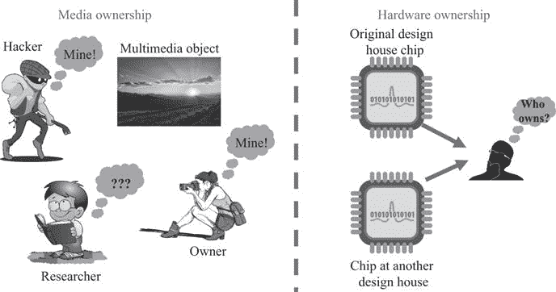

Figure 1.9 所有权、版权或知识产权（IP）权利概念

## 1.6 物理不可克隆函数

大多数安全、隐私和知识产权解决方案都基于某种形式的加密、混淆、哈希和水印，这是事实。这些机制依赖于某种形式的随机数或伪随机数。通用处理器是一种确定性机器，根据程序计数器计算下一条指令，无法生成真随机数，这也是事实。此外，随机/伪随机数密钥通常存储在内存或驱动器中以备将来使用。黑客攻击系统只是时间问题，黑客有可能访问系统及其包含的信息。原始 PUF 硬件会即时生成随机数，如 Figure 1.10 所示，并完全消除了在硬盘上存储密钥的需求，从而使其安全 (Yanambaka *et al.*, 2017, 2018; Joshi *et al.*, 2017)。PUF 依赖于 IC 物理层面的变化，这些变化源于纳米级半导体制造。因此，PUF 很好地利用了工艺变化，而不是设计师试图减少工艺变化对 IC 的影响。特定 PUF 生成的输出是唯一的，因此充当其签名。PUF 章节将讨论 PUF 原理、各种类型的 PUF 以及 PUF 应用等主题。

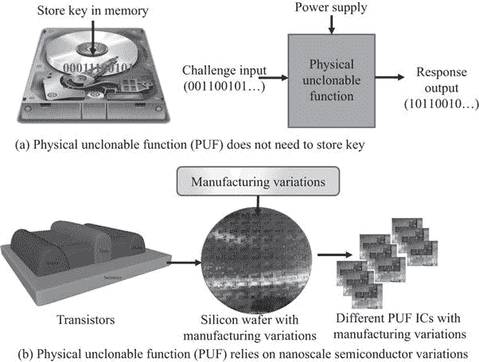

Figure 1.10 物理不可克隆函数（PUF）概念

## 1.7 图书组织

本节总结了图书的路线图，即预期内容组织的概述。

`Chapter 2` 介绍了在 CE 和 IoT 背景下安全、隐私和所有权保护的广泛概述以及一些具体内容。它介绍了 IoT 和 CE 的广泛视角，包括其驱动技术和挑战。它进一步讨论了 IoT/CE 系统中的安全和隐私，重点介绍了攻击及其对策、内存安全、射频识别（RFID）安全、智能医疗和智能交通安全。

# Chapter 3

**Chapter 3** 详细介绍了硬件木马安全感知 DSP IP 核心/IC。本章首先介绍相关概念，随后阐述木马安全方法论的特点——包括威胁模型、功能描述以及在更高抽象层级进行木马安全设计的优势。本章后续部分包括 `3PIP` 模块中硬件木马的示例、选定木马安全方法的讨论、木马安全感知 DSP IP 核心的目标/模型/问题公式，以及其设计过程的详细描述。随后，介绍实现与结果，接着是结论以及供学习者和实践者练习的问题与练习。

# Chapter 4

**Chapter 4** 详细介绍了如何使用强健水印技术保护 DSP IP 核心/IC。本章包括水印技术简介、选定水印方法的描述、带水印 IP 核心/硬件的设计过程——包括威胁模型、单相和多相水印的解释，随后讨论水印的理想特性和威胁场景。随后，提供实现与结果的详细信息——包括安全性分析和设计成本/开销分析。本章最后总结所学概念，并为学习者和实践者提供一些练习。

# Chapter 5

**Chapter 5** 详细介绍了使用指纹和水印技术对 DSP IP 核心/IC 进行对称保护。本章包括问题及对称保护概念的介绍、指纹和水印技术背景的描述，随后阐述威胁模型以及在更高设计抽象层级提供对称保护的优势。接下来的小节重点介绍 IP 核心保护的基础知识、植入对称 IP 核心保护的过程，最后以该方法的一个激励示例结束。随后，介绍实现与结果，接着是结论以及供学习者和实践者练习的问题。

## Chapter 6

**Chapter 6** 介绍了用于解决 IP 核心所有权问题的取证工程。本章包括概念介绍，随后描述用于 IP 核心保护的定制 CFE 方法。接下来的小节重点介绍 IP 核心特征提取算法，随后是实现与结果。最后，本章以推断结束，接着是供学习者和实践者练习的问题。

# Chapter 7

**Chapter 7** 介绍了用于 CE 设备的 DSP IP 核心的结构混淆。本章包括概念介绍，随后描述其威胁模型以及在更高抽象层级进行混淆的优势。接下来的小节重点介绍 IP 核心保护混淆的基础知识、结构混淆过程以及低成本混淆 IP 核心设计的生成。随后，介绍一个激励示例，接着是实现与结果的详细信息。本章最后以结论结束，接着是供学习者和实践者练习的问题。

# Chapter 8

**Chapter 8** 介绍了用于 CE 设备的 DSP 核心的功能混淆。本章包括以下内容——概念介绍、选定功能混淆方法的讨论，随后解释功能混淆 DSP 核心的设计过程及其安全视角——分析和攻击场景。本章后续部分介绍用于推导低成本/最优功能混淆 DSP 核心架构的优化引擎、实现与结果，最后以结论以及供学习者和实践者练习的问题和练习结束。

# Chapter 9

**Chapter 9** 介绍了一个现实世界复杂应用的细节——用于 CE 设备的 JPEG CODEC IP 核心混淆。本章包括概念介绍、JPEG 压缩/解压缩过程概述，随后介绍混淆 JPEG IP 核心设计的设计过程——包括威胁模型和详细设计步骤。接下来的小节重点介绍设计的实现、结果展示和结论。最后，本章以供学习者和实践者练习的问题结束。

# Chapter 10

**Chapter 10** 介绍了 AES 及其硬件水印用于所有权保护的细节。本章从概念介绍开始，随后描述 AES 算法——包括 AES 概述、定制硬件设计及其数字水印。接下来，介绍带水印 AES 硬件的结果，接着是结论以及供学习者和实践者练习的问题。

# Chapter 11

**Chapter 11** 介绍了媒体内容保护与身份验证的细节，重点介绍硬件与媒体保护、数字版权管理（DRM）、多媒体版权保护以及多媒体水印的一般框架、其应用、挑战、攻击和对策。

# Chapter 12

**Chapter 12** 介绍了 PUF 的细节，重点介绍其特性、分类，以及基于安全性、结构和制造的不同类型 PUF 的讨论。它还介绍了 PUF 的实现细节、挑战以及 PUF 的其他问题。

## 1.8 Conclusions

本章在 CE 系统背景下介绍了“硬件辅助安全与 IP 核心保护”。从整体系统角度简要总结了各种安全威胁。本章还概述了不同 IP 核心保护和硬件辅助安全技术及其优缺点。通过一个真实的 CE 设计，解释了 DSP 核心的重要性以及 DSP IP 核心可能面临的不同硬件威胁。本章还从读者角度总结了本书的路线图——包括每章预期内容。

## 1.9 Exercises

1. 什么是消费电子产品？请列举一些其现代应用？

2. IP 核心模块在 CE 设备设计中的作用是什么？

3. 解释 SoC 设计流程并指出硬件漏洞的位置？

4. 什么是 3PIP？

5. 定义“硬件辅助安全”？

6. SoC 设计过程的组成部分是什么？

7. SoC 制造过程中的步骤是什么？

8. IP 核心在 CE 设备设计中的优势是什么？

9. 为什么传统的安全和 IP 核心保护形式对于可重用 IP 核心不够？

10. 解释摄像头系统中的 DSP 组件？

11. 解释水印和指纹的威胁模型？

12. 如何防止（阻止）IP 核心设计中的木马插入？

13. 解释 IP 计量的缺点？

14. 解释 CFE 的威胁模型？它与指纹有何不同？

15. 有哪些不同类型的硬件计量技术？

16. 解释不同类型的 PUF？

17. 比较混淆和水印？

18. 在 HLS 操作调度期间应用了哪些 HLS 指令？

19. 解释通用 HLS 系统的设计流程？

20. 设计空间探索系统内部有哪些阶段？

21. 如何获得 DSP IP 核心的优化 CDFG？

22. 多周期和链式之间有什么区别？

23. 解释 HLS 中数据路径和控制路径之间的区别？

24. 解释 HLS 期间采用的不同类型的调度算法？

25. 分配和绑定之间有什么区别？

## References

Alkabani Y., Koushanfar F., and Potkonjak M., ‘Remote activation of ICs for piracy prevention and digital right management,’ in Computer-Aided Design, 2007. ICCAD 2007. IEEE/ACM International Conference on, San Jose, CA, USA, November 2007, pp. 674–677.

Alkabani Y. M. 和 Koushanfar F.,‘Active hardware metering for intellectual property protection and security,” In Proceedings of 16th USENIX Security Symposium on USENIX Security Symposium (SS’07), Niels Provos (Ed.). USENIX Association, Berkeley, CA, USA, 2007, Article 20, 16 pages.

Castillo E., Meyer-Baese U., García A., Parrilla L., and Lloris A., ‘IPP@ HDL: Efficient intellectual property protection scheme for IP cores,’ `Very Large Scale Integration (VLSI) Systems, IEEE Transactions on`, 2007, `vol. 15` (5), pp. 578–591.

Hong I. 和 Potkonjak M., ‘Behavioral synthesis techniques for intellectual property protection,’ in Proceedings of the 36th annual ACM/IEEE Design Automation Conference. ACM, 1999, pp. 849–854.

Joshi S., Mohanty S. P., 和 Kougianos E., ‘Everything you wanted to know about PUFs’, `IEEE Potentials Magazine`, 2017, `vol. 36` (6), pp. 38–46.

Koushanfar F., Hong I., 和 Potkonjak M., ‘Behavioral synthesis techniques for intellectual property protection,’ `ACM Transactions on Design Automation Electronic Systems`, 2005, `vol. 10` (3), pp. 523–545. \[Online\]. Available: http://doi.acm.org/10.1145/1080334.1080338.

Marvel L., ‘Information hiding: Steganography and watermarking,’ in Optical and Digital Techniques for Information Security, ser. Advanced Sciences and Technologies for Security Applications, B. Javidi, Ed. Springer, New York, 2005, vol. 1, pp. 113–133. \[Online\]. Available: http://dx.doi.org/10.1007/0-387-25096-4.

Mohanty S. P., ‘Security and energy tradeoffs in consumer electronics’, Keynote Abstract, 3rd Zooming Innovation in Consumer Electronics International Conference (ZINC), 2018, Novi Sad, Serbia, 31st May 2018a.

Mohanty S. P., ‘Smart cities – demystified’, Keynote Abstract, 2nd International Conference on Man and Machine Interfacing (MAMI), 2017a, Bhubaneswar, India.

Mohanty S. P., ‘Internet of things (IoT) – demystified’, Keynote Abstract, 16th International Conference on Information Technology (ICIT), 2017b, Bhubaneswar, India.

Mohanty S. P., Nanoelectronic Mixed-Signal System Design. McGraw-Hill Education, New York, 2015, no. 0071825711.

Mohanty S. P., ‘Energy and security tradeoffs in CE systems’, Panel, IEEE International Conference on Consumer Electronics, Las Vegas, 2018b.

Mohanty S. P., Choppali U., 和 Kougianos E., ‘Everything you wanted to know about smart cities’, `IEEE Consumer Electronics Magazine (CEM)`, 2016, `vol. 5` (3), pp. 60–70.

Ni Z., Shi Y.-Q., Ansari N., 和 Su W., ‘Reversible data hiding,’ `Circuits and Systems for Video Technology, IEEE Transactions on`, 2006, `vol. 16` (3), pp. 354–362.

Paar C., 和 Pelzl J., ‘Understanding cryptography – A textbook for students and practitioners’, Springer-Verlag, Berlin Heidelberg, eBook ISBN 978-3-642-04101-3, Number of Pages: XVIII, 372, November 2009.

Qu G., 和 Potkonjak M., ‘Intellectual property protection in VLSI designs’, Springer US, eBook ISBN 978-0-306-48717-0, Number of Pages: XIX, 183, February 2003.

Potkonjak M. 和 Goudar V., ‘Public physical unclonable functions’, `Proceedings of the IEEE`, 2014, `vol. 102` (8), pp. 1142–1156.

Roy J. A., Koushanfar F., 和 Markov I. L., ‘EPIC: Ending piracy of integrated circuits,’ 2008 Design, Automation and Test in Europe, Munich, 2008, pp. 1069–1074.

Sengupta A., ‘Protection of reusable IP core at architectural level’, `IEEE VLSI Circuits & Systems Letter`, 2015, `vol. 1` (2), pp. 14–17.

Sengupta A., ‘Protection of IP-core designs for CE products’, 2016, `IEEE Consumer Electronics Magazine`, `vol. 5` (1), pp. 83–88.

Sengupta A., ‘Hardware vulnerabilities and its effect on CE devices: Design-for-security against Trojan’, 2017a, `IEEE Consumer Electronics`, `vol. 6` (3), pp. 126–133.

Sengupta A., ‘Hardware security of CE devices: Threat models and defence against IP Trojans and IP piracy’, 2017b, `IEEE Consumer Electronics`, `vol. 6` (1), pp. 130–133.

Sengupta A. 和 Mohanty S. P., ‘High-level synthesis of digital circuits in the nanoscale, mobile electronics era’, IET Book: Nano-CMOS and Post-CMOS Electronics: Circuits and Design, (Eds: Saraju P Mohanty& Ashok Srivastava), Invited Book Chapter, e-ISBN: 9781785610004, pp. 219–261, June 2016.

Sengupta A. 和 Roy D., ‘Multi-phase watermark for IP core protection,’ 2018 IEEE International Conference on Consumer Electronics (ICCE), Las Vegas, NV, 2018a, pp. 1–3.

Sengupta A. 和 Roy D., ‘Reusable intellectual property core protection for both buyer and seller,’ 2018 IEEE International Conference on Consumer Electronics (ICCE), Las Vegas, NV, 2018b, pp. 1–3.

Sengupta A. 和 Kundu S., ‘Securing IoT hardware: Threat models and reliable, low-power design solutions’, `IEEE Transactions on Very Large Scale Integration (VLSI) Systems`, 2017, `vol. 25`(12), pp. 3265–3267.

Sengupta A., Mohanty S. P., 和 Rose G., ‘Hardware-assisted design for security and protection of consumer electronics’, IET Computers and Digital Techniques, Accepted, June 2018.

Xilinx Vivado Design Suite User Guide – [`www.xilinx.com/support/documentation/sw\_manuals/xilinx2018\_1/ug910-vivado-getting-started.pdf`](https://www.xilinx.com/support/documentation/sw_manuals/xilinx2018_1/ug910-vivado-getting-started.pdf), Last accessed on January 2018.

Xilinx – Vivado HLS – [`www.xilinx.com/products/design-tools/vivado/integration/esl-design.html`](https://www.xilinx.com/products/design-tools/vivado/integration/esl-design.html), Last accessed on February 2018.

Yanambaka V. P., Mohanty S. P., 和 Kougianos E., ‘Making use of semiconductor manufacturing process variations: FinFET-based physical unclonable functions for efficient security integration in the IoT’, `Springer Analog Integrated Circuits and Signal Processing Journal`, 2017, `vol. 93` (3), pp. 429–441.

Yanambaka V. P., Mohanty S. P., 和 Kougianos E., ‘Making use of manufacturing process variations: A dopingless transistor based-PUF for hardware-assisted security’, `IEEE Transactions on Semiconductor Manufacturing (TSM)`, 2018, `vol. 31` (2), pp. 285–294.

# 第 2 章

消费电子和物联网（IoT）中的安全

在典型的消费电子产品代际中，存在多种形式的攻击，例如，系统安全、信息安全、信息隐私、系统可信度、硬件 IP 保护、信息版权保护。每种攻击都有其自身的威胁并服务于不同的目的。本章的目的是在物联网（IoT）的背景下区分这些攻击。物联网是一个非常热门、趋势性的研究主题，其中不同的设备、传感器和计算机连接到网络，收集数据，并为不同的目的进行处理。连接到云的设备和传感器网络可以完成许多难以想象的任务，如果没有云的存在，几乎所有任务都将非常难以实现和完成。由于大多数连接发生在云中，因此总是存在安全和隐私威胁的可能性。因为所有类型的不同设备都连接到互联网，攻击者对系统构成巨大威胁。例如，如果任何负责家庭护理、医疗保健、运行整个城市等的电子系统受到攻击，那么这种威胁的后果将是一场重大灾难。

## 2.1 物联网（IoT）– 广泛概述

本章组织如下：第 2.1 节介绍物联网的概述；第 2.2 节介绍消费电子系统中安全、能源和成本的权衡；第 2.3 节介绍系统内存模块的不同安全威胁及解决方案；第 2.4 节介绍射频识别（RFID）模块的不同威胁及解决方案；第 2.5 节介绍系统近场通信（NFC）模块的安全缺陷及缓解方法；第 2.6 节讨论智能车辆、自动驾驶汽车和无人驾驶航空器（UAV）中的不同安全缺陷；第 2.7 节讨论攻击者如何攻击医疗设备，并为部分攻击提供解决方案；第 2.8 节讨论设备固件面临的威胁；第 2.9 节讨论区块链这一新兴技术及其优势和问题。结论和未来方向在第 2.10 节中介绍。

通信在世界范围内以非常快速的速度发展。已为短距离或长距离通信提出了多种解决方案。技术增长也帮助开发高性能计算设备，使得寻找新发明成为必要。其中一项重大创新是“物联网”，它已成为日常生活不可或缺的一部分。物联网有许多定义，因个人视角而异。在物联网环境中，所有设备或“事物”都连接到网络，并相互交换数据或发送到云端（Mohanty *et al.*, 2016 所示，包括“互联”、“智能”和“仪表化”。这三者是物联网环境的重要方面，如图中智慧城市环境所示。互联是为设备提供网络和互联网连接的通信平台，帮助在设备之间或向云服务传输数据，云服务中进行后处理。智能是整个环境的大脑，仪表化指环境中存在的各种设备和传感器。物联网环境中存在各种设备，例如微控制器、单板计算机和传感器。每个设备都应具有唯一 IP 地址，才能被视为物联网中的事物（Mohanty, 2018

图 2.1 智慧城市 3 ‘I’s

物联网可以定义为随时连接、随物连接和随地连接，如 图 2.2 所示（IEEE, 2015）。物联网并非局限于某一位置，而是无处不在，随处可感。部分物联网设备可部署在不受持续监控的地方。其作用是监测参数并通过空中传输数据（Yanambaka *et al.*, 2016a

图 2.2 物联网定义

### 2.1.1 物联网 – 架构

物联网解决方案的结构在其架构中描述。它包括物理、事物和虚拟、通信协议等各个方面。物联网架构如 图 2.3 所示。如图所示，物联网架构包含三个不同的方面，通过互联网相互连接。事物包括传感器、执行器和各种物联网设备等物理组件。传感器和执行器连接到物联网设备，这些设备有助于收集数据。物联网设备是智能设备，可以处理从传感器收集的数据。各种传感器和执行器通过有线或无线连接连接。物联网模型的不同抽象级别如 图 2.4 所示。

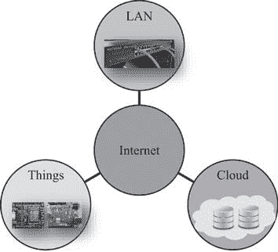

图 2.3 物联网架构

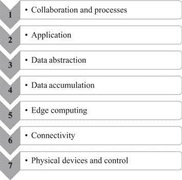

图 2.4 物联网架构级别

各种设备以不同方式与云和其他物联网设备通信，如 图 2.5 所示。部分传感器和设备直接与云通信并传输数据。此类设备性能较高，在将数据上传到云之前还可以进行部分数据处理。存在网关设备，它们作为设备与传感器之间的中间设备。这些设备在数据采集中起主要作用。预处理数据后，将其发送到云端。有各种云应用程序可为数据的最终用户提供交互界面。使用应用程序编程接口（API），客户端将拥有更多探索选项，并在需要时进一步处理数据。

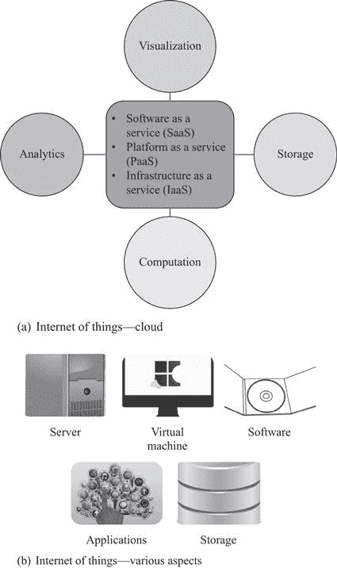

图 2.5 物联网的各个方面

物联网、雾计算和边缘计算是三种不同的概念，如 图 2.6 所示，它们提供控制和将数据传输到云存储的功能。云计算扩展到边缘，从而为软件、领域特定硬件和标准计算提供安全控制和管理。而边缘计算是对独立设备的管理和控制，可以单独进行，也可以通过雾域中的软件进行。

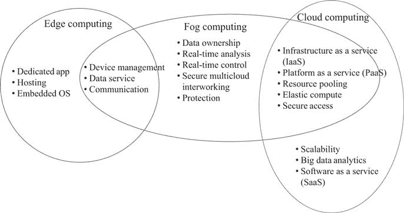

图 2.6 雾计算与边缘计算与云计算

### 2.1.2 物联网 – 驱动技术

在物联网环境中，每个事物都将具有唯一 IP 地址，如上所述。并非每个传感器都具有通信能力。在这种情况下，将传感器与具有通信能力的设备结合，将成为物联网环境中所需的事物。物联网有各种方面。它已扩展到智慧城市、智慧医疗、智慧交通、智慧家居等各个领域。如 图 2.7 所示，各种传感器连接到不同的单板计算机或微控制器，这些设备具有唯一 IP 地址的能力，并通过互联网传输数据以形成事物。在图中，传感器连接到智能手表，智能手表将从传感器收集数据并将其传输到云端或其他设备。

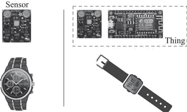

图 2.7 物联网驱动技术

各种传感器和设备是物联网的驱动技术。物联网中有各种传感器和设备，这些设备被称为智能设备。这些设备的主要关注点之一是安全性（Sivaraman *et al.*, 2018; Sivaraman *et al.*, 2018; Surendran *et al.*, 2018; Valea *et al.*, 2018）。物联网架构中驱动技术的另一个方面是通信。图 2.8 显示了物联网环境中使用的各种通信技术（RS Components, 2015）。大多数组件在单板计算机和开发板中使用低功耗蓝牙和 WiFi 组件进行通信，但物联网中也使用其他通信协议。低功耗蓝牙不适合传输大文件，但可用于较小的数据包。Zigbee 是另一种在工业场景中广泛流行的协议。它提供低功耗运行、强大的安全性和可扩展性。对于家庭环境，采用 Z-wave。6LowPAN 是一种基于互联网协议的通信技术，不同于蓝牙，它通过网络定义封装和头部压缩。WiFi 和蜂窝网络是可在任何地方使用的选项。与其他协议不同，NFC 没有广泛的范围，也无法发送大量数据（RS Components, 2015）。长距离广域网（`LoRaWAN`）因其低能耗和长距离而变得流行。

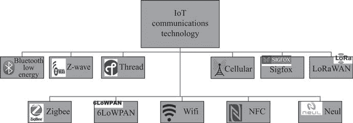

图 2.8 物联网通信

#### 2.1.3 IoT – 应用

互联网和事物是物联网架构的两个主要方面。基于它们，可以提出两种不同的架构。当互联网在物联网架构中被赋予主要关注，网络方面被优先考虑时，它被称为以互联网为中心的架构（Gubbi *et al.*, 2013）。以云作为整个架构的中心，可以充分发挥其全部潜力。随着云的引入，整个系统变得高度可扩展，并使分摊相关成本变得简单灵活。当智能设备或“事物”是架构的主要关注点时，它被称为以对象为中心的架构（Lopez *et al.*, 2012）。万物互联（`IoE`）如 图 2.9 所示，将通过人与流程的集成，将物联网推广到更广泛的范围。

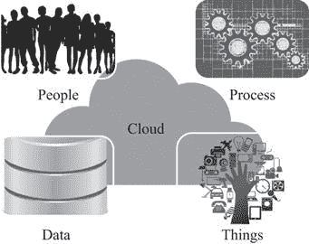

图 2.9 万物互联

智能设备或事物已经存在了很长时间（Carter *et al.*, 2008; Lee and Ke, 2018; Luo *et al.*, 2009; Obuchi *et al.*, 2018）。随着 RFID 成为领先技术，许多智能设备正在利用这一优势。技术发展和高性能设备在开发物联网应用方面具有巨大优势（Mohanty, 2017; Mohanty *et al.*, 2016）。许多领域利用物联网概念以更高的准确性执行操作，并获取以前完全不可能获得的更多数据。图 2.10 显示了物联网的不同应用。智能医疗是一个不断增长的领域，它利用智能设备开发医疗设备，以提高生活质量、诊断并为各种疾病和健康状况提供治疗（Catarinucci *et al.*, 2015; He *et al.*, 2018; Sundaravadivel *et al.*, 2016）。智慧城市的各种组件包括基础设施、建筑、能源、交通、技术、教育、治理和公民（Mohanty *et al.*, 2016）。经济、治理、社会和环境是智慧城市的不同主题。每个组件和主题都以非常高效的方式利用物联网概念，以改善智慧城市的生活质量。在智能家居环境中，可以通过物联网安全地控制各种设备（Al-Kuwari *et al.*, 2018; Lee *et al.*, 2017; Son *et al.*, 2016）。物联网还可以用于各种军事应用，其中 `LoRaWAN`（如前一节所示）可用于此类应用（Jalaian *et al.*, 2018）。物联网在军事应用中有时也被称为战场物联网或战事物联网（Bolisetti *et al.*, 2017; Farooq and Zhu, 2018; Kott *et al.*, 2016）。

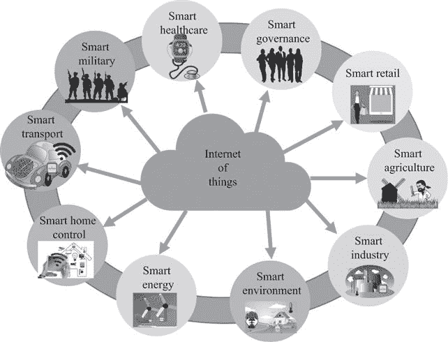

图 2.10 物联网应用

#### 2.1.4 IoT – 挑战

技术进步使开发物联网应用和设备变得更加简单，但该领域仍有许多挑战需要克服。连接性是一个主要问题。物联网设备或事物需要拥有自己唯一的 IP 地址，这意味着它们应连接到互联网或云存储。但是，远距离无线通信需要更高的能耗，而低功耗通信协议则会在传输速率或范围上做出权衡（RS Components, 2015）。自物联网开始以来，传感器有所改进，但更好的传感设备尚未开发出来。此外，传感器的准确性也需要以多种方式提高。图 2.11 显示了物联网环境中存在的各种挑战（Mohanty, 2017）。基于物联网的不同方面和关注点，提出了各种物联网架构（Gubbi *et al.*, 2013）。根据环境条件和环境中使用的设备选择架构是一项艰巨的任务和挑战。物联网架构中存在各种依赖关系。

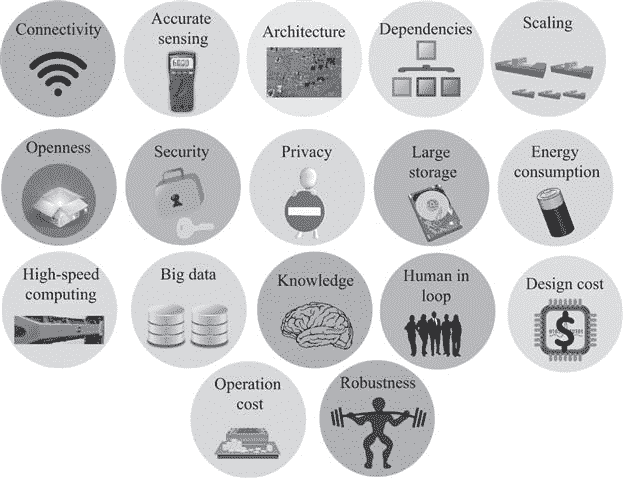

图 2.11 设计物联网面临的挑战

当各种设备通过网络相互连接时，它们容易受到各种威胁。安全问题是一个巨大的挑战，解决这些问题应被视为首要优先事项。物联网安全有各种可用的解决方案，但随着更好安全解决方案的实施，整个模块的功耗将会增加（Yanambaka *et al.*, 2017）。收集数据并将其发送到云端是挑战的一部分，而后续部分将处理收集到的数据。首先，数据被发送到云端，在那里可以使用高速服务器进行处理，并存储大量数据将增加设计成本和整体物联网设计的成本。数据处理需要高性能计算，在某些情况下，数据应实时处理，这将增加设计的运营成本和整体成本。

## 2.2 物联网和消费电子系统中的安全、隐私和知识产权 – 全景图

### 安全

安全一直是长期存在的主要问题之一，并且至今仍是研究的主要焦点。随着技术的进步，每天都在开发新设备，并在 2.1 节讨论的各个领域产生更好的解决方案。即使引入了许多安全原语，攻击者仍在寻找方法来攻击并对各种受保护设备发动成功攻击。这长期以来一直是一个主要问题。密码学一直是解决方案，其中发送给最终用户的主文本消息使用密钥加密，最终用户将使用相同的密钥或不同的私钥解密文本。这种做法已经实践了很长时间 (Yanambaka *et al.*, 2017)。发现的第一把锁和钥匙有 4000 年的历史，同样，在当今的数字时代，这里的锁和钥匙也是数字化的，但基本概念保持不变。应当注意，安全、隐私、保密性和知识产权 (IPR) 不一定相同 (Bhargava *et al.*, 2018; Mohanty, 2017, 2018)，如 图 2.12 所示。数据安全通常指数据的保密性、可用性和完整性。系统安全通常涉及系统（例如，智能汽车）的可信、安全、正常运行等。数据隐私定义为为不同目的约定使用的适当数据。系统隐私可以是未知系统的位置和功能，例如，智能汽车的位置应对对手未知。只有当信息未提供或未披露给未经授权的个人、实体或进程时，才能保证保密性。IPR 或所有权涉及保留特定硬件或介质所有者的所有权，这类似于书籍的版权或作者身份，即出版商或作者的版权。

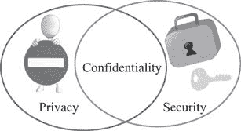

图 2.12 安全与隐私

#### 2.2.1 IoT 安全 – 攻击与对策

安全与隐私的辩论已经持续了很长时间 (Notario, 2016)。隐私和安全的定义仍在辩论中，最核心的争议点是保密性部分。安全和隐私都是任何系统的重要组成部分。在 IoT 环境中，这些至关重要，因为 IoT 设备持续连接到网络并在线。这为攻击者以各种方式攻击系统留下了大量空间。该领域正在进行大量研究 (Asplund and Nadjm-Tehrani, 2016; Schinianakis, 2017; Schneier, 2017; Sivaraman *et al.*, 2018; Unwala *et al.*, 2018)。世界各地正在发生各种安全攻击。网络犯罪企图的数量增加了，用于对抗它们的安全解决方案也随之增加 (Andrews, 2017; Heartfield *et al.*, 2016; Kundu *et al.*, 2018; Mazurczyk *et al.*, 2016)。

图 2.13 显示了 IoT 环境中可能发生的不同类型的攻击 (Nawir *et al.*, 2016)。存在许多威胁，其中未经授权和未识别的恶意设备可以进入网络并在外部和内部篡改系统。因此，识别 IoT 环境中的用户是一个重要的先决条件。正在广泛开展检测和防止 IoT 僵尸网络的研究 (Moon *et al.*, 2015; Prokofiev *et al.*, 2018)。设备应具有防篡改性。存在各种类型的攻击，例如侧信道攻击和内存利用，可以通过篡改设备本身成功执行 (Li *et al.*, 2011; Sengupta and Kundu, 2017)。因此，IoT 设备理应防篡改，以便攻击者无法执行此类攻击。在 IoT 设备上执行之前，应广泛审查其中使用的软件。这可能导致设备未经授权的使用、数据丢失或设备故障。网络和设备安全至关重要。但是，提高设备的安全性也可能增加整个模块的功耗。应避免这种情况，因为 IoT 设备通常由电池供电，无法使用持续电源。这使得为 IoT 设备开发安全原语变得困难。正在为这些设备开发低功耗硬件安全模块 (Yanambaka *et al.*, 2017)，以便减轻攻击。通信和设备网络身份验证也应给予最高优先级，以便未经授权的设备无法进入网络且通信信道不会被破坏 (Yanambaka *et al.*, 2016a)。身份管理也是此场景中的关键因素。设备的身份应得到保护，以防止克隆攻击。

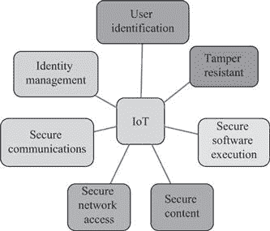

图 2.13 IoT 安全攻击分类

硬件木马是 IoT 环境中另一个应予以处理的问题。图 2.14 显示了当前活跃的各种硬件木马类型、它们将被引入的位置以及存在插入机会的阶段 (Mohanty, 2015)。硬件木马是攻击者在制造的不同阶段引入主设计中的一种不需要的恶意设计，旨在使整个模块无用或从模块中窃取数据。硬件木马可以引入处理器、内存、I/O 设备、电源和时钟网格。这些组件中的每一个都是设备的重要模块，在设备的整体功能中起着至关重要的作用。引入恶意设计可能对设备的高效运行造成致命影响。有两种不同类型的木马，一种是在设备本身开启时始终开启，另一种可以通过事件或信号触发。有许多方法可以检测和避免硬件木马 (Dupuis *et al.*, 2018; He *et al.*, 2017; Sengupta, 2016, 2017; Shen *et al.*, 2018; Xue and Ren, 2018)。硬件木马可以插入的许多阶段如 图 2.14 所示。改变功能、降低性能、泄露信息和拒绝服务是硬件木马的一些影响。在许多情况下，这些可能是致命的，因为设备在需要时无法发挥全部潜力。

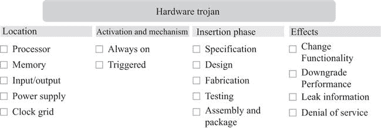

图 2.14 硬件木马

#### 2.2.2 可信消费电子系统

除了高功耗和低功耗之外，任何消费电子系统还应具有可信性和安全性的特性。图 2.15 展示了安全性、隐私性和保护的不同方面 (Krishnamurthy *et al.*, 2017; Mohanty, 2015)。系统中存在不同的层级，包括应用层、操作系统（OS）、固件、数字信号处理器（DSP）、嵌入式处理器、内存以及射频（RF）组件。在每个阶段，都可能对系统成功实施不同类型的攻击。应用程序和操作系统攻击可能发生在操作系统及其应用程序上。在操作系统与应用程序之间，或固件与操作系统之间，存在一个连接它们以执行操作的网络。该网络可能受到不同类型攻击的影响：应用程序攻击和网络攻击。其中一些在前面的章节中已讨论过。固件是系统不可或缺的一部分。它充当桥梁，使板卡或系统能够与其他组件或外设进行通信，并描述其功能。设备上可能发生不同类型的固件攻击。

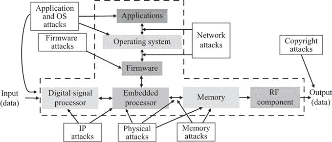

图 2.15 典型消费电子系统的选定攻击——安全性、隐私性、知识产权

设备的不同硬件组件，例如 DSP、嵌入式处理器、内存和 RF 组件，都可能成为各种攻击的目标，如 图 2.15 所示。IP 攻击、侧信道攻击、物理攻击和内存攻击是其中一些在硬件级别进行的攻击。输出产生后，输出中的数据可能会受到许多版权攻击。RF 组件也可能受到各种网络威胁的影响，这些威胁将在后续章节中讨论。

消费电子系统可信性的选定属性 (Krishnamurthy *et al.*, 2017; Mohanty, 2015):

1. 系统正在处理的数据的完整性应得到维护。

2. 一旦设备部署到现场，就会容易受到侧信道攻击和功耗分析攻击。因此，正在处理的数据应在处理过程中得到保护和隐藏。

3. 设备的功能应限制在预期功能范围内。设备不应执行额外操作。

4. 设备应在任何时候都可靠，尤其是在关键操作期间。

5. 设备的透明度必须仅限于所有者，不得向任何其他人透露。

6. 在制造设备时，应联系可信供应商提供不同部件，以避免引入不需要的木马。

7. 应联系可信的制造设施。

##### 2.2.3 硬件辅助安全与保护

随着安全威胁的增加，仅靠软件安全无法抵御这些威胁。硬件辅助安全在减轻攻击者造成的威胁方面发挥着关键作用。系统可能受到两种不同类型的攻击：软件攻击和硬件攻击 (Chang *et al.*, 2017; Krishnamurthy *et al.*, 2017)。软件攻击通常通过通信通道进行。由于物联网通过网络连接，这很容易受到攻击者的威胁。这些攻击通常远程发起，设备受到影响。由于攻击者无需在设备现场即可执行这些攻击，因此可以定期且远程地进行。拒绝服务攻击、路由攻击、恶意注入、欺骗、窃听和暴力破解是一些软件攻击。

硬件攻击通常针对设备本身，并且大多数攻击必须在设备所在位置执行。某些类型的硬件攻击也可以远程执行。在物联网环境中，设备部署在人类交互极少的区域，因此极易受到攻击。侧信道攻击、后门、窃听、故障注入和硬件木马是一些硬件攻击。

对于软件和硬件两种攻击，可用的解决方案也是两种不同类型：软件解决方案和硬件解决方案 (Krishnamurthy *et al.*, 2017)。软件安全解决方案易于使用、更新和升级。这提供了提高鲁棒性的灵活性。由于基于软件的应用程序依赖于操作系统，它们得到广泛支持，并可设计为跨平台应用程序。软件安全的经常性运营成本较高。它们可用于通用处理器，但主要缺点之一是无法保护系统免受逆向工程和其他硬件攻击的影响。在硬件安全解决方案中，与软件解决方案相比，它们速度非常快，功耗较低，优化灵活性高，并且在使用现场可编程门阵列或专用集成电路时成本较低。它们无法用于防止软件逆向工程，并且极易受到侧信道攻击的影响。

图 2.16 展示了安全感知设计的权衡，并描述了设计的不同方面。硬件辅助安全的示例在 图 2.17 中所示。设计系统时的主要关注点是低功耗和高性能、可靠性、低制造成本以及易于集成。在安全摄像头系统的设计中，水印芯片是主要关注点，因为大部分安全性由其提供。存在的权衡包括功耗、性能、芯片面积、系统集成以及内存。将更多内存集成到系统中将增加摄像头的电池寿命、芯片面积和设计成本。提高安全性也会增加电池消耗和其他参数，如 图 2.16 所示。因此，设计应在考虑所有参数以及安全性权衡的前提下进行，并包含额外的硬件组件，这些组件将执行类似于电压和频率缩放的技术，用于安全性、能源和性能优化 (图 2.17; Krishnamurthy *et al.*, 2017)。

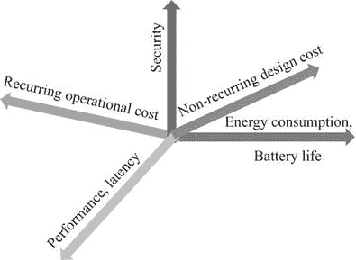

图 2.16 消费电子系统安全感知设计权衡

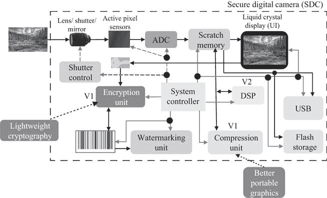

图 2.17 消费电子系统设计与操作权衡：摄像头系统示例

##### 2.2.4 安全性与隐私性的不同方面

安全和隐私是两个不同的方面，并且始终是永无休止的辩论话题。关于它们的辩论已经持续了很长时间，并且可能在短期内不会结束。它们的定义和区别尚未得出结论。安全的不同方面在 图 2.18 中显示 (Mohanty, 2017, 2018)。存储在内存中的数据应当安全且保密。它不应落入错误的人手中，攻击者不应能够检索存储在内存中的数据。存储的数据还应当是真实的，即，未经授权的人不应篡改数据并更改它。数据的完整性也应当保持完好。数据应当始终可用。存储不应受到攻击者的影响，且存储不得擦除任何数据。不可否认性是另一个问题，其中数据的所有者不能否认它。对人员的访问也应当受到控制，只有授权人员才能访问数据。

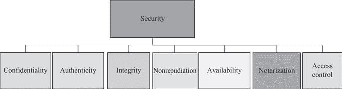

图 2.18 安全的不同方面

隐私的不同方面在 图 2.19 中显示 (Mohanty, 2017, 2018)。任何人的隐私都不应因正在收集和存储的数据而受到损害。在智能医疗设备的情况下，患者的数据将在一段时间内收集并发送给医生。唯一应有权访问数据的人是患者和医生。存储数据的云存储服务器不应被攻击者访问，且患者的隐私不得受到损害。在这种情况下，数据不应揭示或导致患者，且不可追踪。从存储中被盗的数据不应导致任何其他详细信息或数据。数据也可以被加密或混淆，以便无法从任何模式和数据中检索患者信息或任何其他数据。患者和医生的匿名性应始终在存储节点上保持。

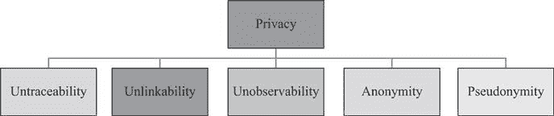

图 2.19 隐私的不同方面

##### 2.2.5 知识产权 (IP)、所有权或版权保护的不同方面

所有权、知识产权和版权保护是许多不同领域中存在的主要问题。不仅媒体，电子产品也极易受到假冒的影响 (Mohanty, 2015, 2018; Mohanty *et al.*, 2017; Sengupta and Roy, 2017; Sengupta *et al.*, 2018)。这已经存在了很长时间。版权管理一直存在，并制定了各种法律，以使实体的所有权保持完好。但攻击者正在寻找不同的方法来假冒设备和媒体，并以自己的所有权出售物品。图 2.20 显示了知识产权、所有权和版权保护的概念。消费者和研究人员在维护权利方面遇到困难。有些情况下，用户不了解版权法律，并且未将实体用于自己的商业目的。但在大多数版权侵权案例中，攻击者利用因地区而异的法律，并声称拥有设备或媒体的所有权。电子元件使用相同的设计，这使消费者怀疑硬件是否合法。这些也是媒体的一个问题，其中一张照片的所有权由所有者和攻击者争论 (Mohanty, 2015)。给图片加水印是保护媒体的一种方式，但这也容易受到许多攻击，攻击者可以删除水印并声称拥有媒体的所有权。

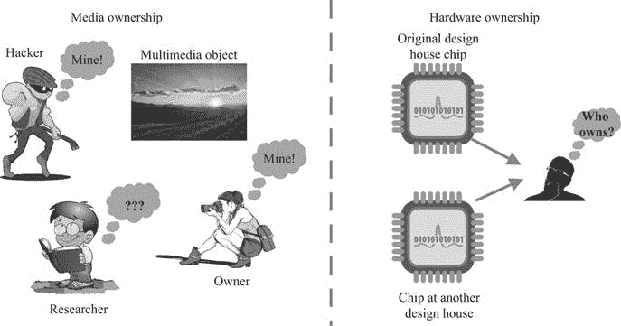

图 2.20 知识产权 (IP)、所有权或版权 – 媒体与 IP 硬件核心

### 2.3 内存安全

内存是每个系统的组成部分。不同类型的内存，主内存和次级内存可用，并且几乎存在于每个 IoT 设备中。非易失性、静态随机存取存储器 (`SRAM`) 等被用于提高性能并增加 IoT 设备的存储能力，使它们能够存储收集的数据并在稍后发送到云端。没有内存的 IoT 设备不存在。但不同类型的内存容易受到不同类型的攻击。它是 IoT 设备中一个高度脆弱的部分。本节描述了市场上可用的各种攻击和解决方案。

#### 2.3.1 内存安全攻击

嵌入式系统的内存模块可能受到各种攻击。图 2.21 显示了嵌入式系统内存中可能发生的各种攻击 (Nimgaonkar *et al.*, 2013)。攻击可以大致分为被动攻击和主动攻击。被动攻击可能包括窃听和冷启动攻击。当对手能够读取和解释内存中的机密信息时，就会发生窃听攻击。冷启动攻击也是一种侧信道攻击，拥有计算机物理访问权限的黑客在使用冷重启重新启动计算机后，从运行中的操作系统中检索加密密钥。该攻击依赖于随机存取存储器 (缓存、`SRAM` 或动态随机存取存储器 (`DRAM`)) 的数据残留特性，以检索在电源移除后几秒到几分钟内仍可读取的内存内容。这是因为计算机中使用的内存芯片即使在易失性的情况下，在断电后仍能保留其内容几秒到几分钟，使得内容可供恶意或取证获取。主动攻击包括欺骗、拼接、重放和拒绝服务。在主动攻击中，对手能够更改内存的内容，使其无法执行预期功能。在欺骗攻击中，对手用任意伪造块替换一块内存。在拼接攻击中，一个位置的内存块被来自不同位置的另一个块替换。在重放攻击中，对手在某一时间存储给定地址的一块内存的值，并在不同时间将该值写入完全相同的地址。重放攻击是最难的攻击，因为它难以追踪和防范。拒绝服务攻击内存是指一种场景，当恶意进程占用大部分内存带宽，使其他进程无法获得所需资源，从而有效地减慢它们的速度。

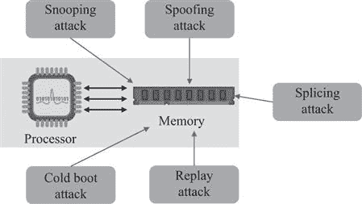

图 2.21 IoT 设备内存上的攻击

#### 2.3.2 内存安全解决方案

非易失性内存（又称硬盘或固态硬盘）由不同的硬件和软件方法保护，这些方法主要依赖加密，如 图 2.22 所示。在这种解决方案中，加密硬件集成在存储中，然后允许通过密码或个人识别号 (`PIN`) 访问。同样，加密软件可以在系统中运行，该系统使用存储驱动器进行数据安全目的。然后软件允许通过密码或 `PIN` 访问数据。

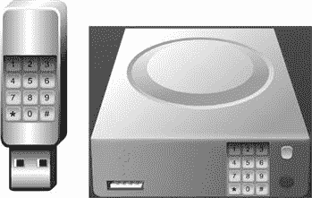

图 2.22 针对 IoT 设备内存攻击的非易失性解决方案

有多种可用的解决方案来感知攻击并防御攻击。在典型的嵌入式系统中，系统各处都部署了各种传感器。这些不同的传感器用于检测系统的各种参数。当系统受到攻击者攻击时，系统的各种参数会发生变化，例如电流波动、功耗增加和热变化。可以借助传感器持续监控这些参数，并检测其中的任何异常变化。仅当传感器感知到的值异常时，才会执行内存完整性验证。在传统的嵌入式系统中，完整性验证会针对内存的所有块执行，这会增加整个模块的功耗，以保持内存的数据完整性。

任何内存完整性验证方法的定义可以结构化如下。最初，内存 `M` 由处理器通信。内存 `M` 有两个属性，即内存内容 `V` 和地址 `A`。`M[R,A]` 表示地址 `A` 处的内存被读取，并将返回与 `A` 关联的数据。`M[W,A,V]` 表示值 `V` 被写入地址 `A`。要返回值 `V`，值 `V` 的写入应紧随地址 `A` 之后。内存的写入和读取具有时间概念。为了将时间关联到读取和写入中，应将其表示为：`M[W,A,V,T]` 和 `M[R,A,T]`。内存位置中存在的值与位置地址之间的关联称为拼接攻击。让我们考虑一个示例，地址 `A` 应返回值 `V[A]`，`A′` 应返回值 ，当内存遭受成功的拼接攻击时，`A` 将返回值 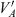。当与地址 `A` 关联的内存位置中存储的值更改为随机值 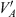 时，这称为欺骗攻击。当值与时间之间的关联被混乱时，这称为重放攻击。例如，让我们考虑 `V[A]` 为时间 `T[A]` 时地址位置 `A` 处的值，以及同一位置在时间 `T[B]` 时的值为 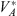 且 `T[A]` < `T[B]`。当对内存执行成功的重放攻击时，在时间 `T` > `T[B]` 时，将返回的值是 `V[A]`。

在嵌入式系统的受信任环境边界内实现各种传感器以监控处理器的各种参数已有很长时间了（McGowen *et al.*, 2006; Oh *et al.*, 2010 显示了此类系统的实现，当传感器检测到参数的异常值时，该系统可以执行内存完整性验证（Nimgaonkar *et al.*, 2013

图 2.23 针对 IoT 设备内存攻击的片上内存解决方案

如 图 2.22 所示，硬件中存在的各种传感器表示为传感器模块（SM）。SM 中存在的传感器持续监控内存总线的波动。内存完整性验证机制存在于特殊缓存，即“哈希缓存”中。哈希地址存在于哈希缓存中。内存块的哈希被写入片外内存。哈希和哈希地址用于验证内存的完整性。嵌入式系统中的处理器是受信任芯片。因此，缓存和 SM 存在于处理器边界内。架构中存在一个加密/解密块。

对内存执行的读写操作在 图 2.22 中描述。当数据被写入内存时，处理器计算哈希地址和哈希，并将其存储在哈希缓存中。存储后，内存块被加密并存储。在读取操作期间，读取的内存块被解密。在此解密操作期间，SM 持续监控内存总线是否有任何异常。如果内存总线上的电压波动超过先前设定的阈值，则系统被认为处于受攻击状态，在此场景下，哈希地址将重新计算。它与缓存中先前存储的哈希地址进行验证。如果命中，则使用存储的哈希检查和验证数据本身的哈希。如果这两者不匹配，则系统处于受攻击状态且数据损坏。处理器执行的所有操作均被中止。一旦内存总线上的电压波动降至阈值以下，进程停止，威胁被认为已停止或缓解。

### 2.4 射频识别（RFID）安全

射频识别（RFID）是一项古老的技术，已被用于各种应用。可以说，在某种程度上它是 IoT 的起点。跟踪、安全和定位是 RFID 的一些应用。在 IoT 中，RFID 以多种方式实现。尽管 RFID 的范围非常小，但它可以在 IoT 环境中用于各种目的。但是，像每种通信协议一样，RFID 也易受许多攻击和威胁。本节讨论 RFID 的各种安全漏洞和威胁以及其中一些的解决方案。

#### 2.4.1 RFID 安全攻击

RFID 存在不同的安全威胁（Jayakrishnan *et al.*, 2018; Li *et al.*, 2012; Thompson *et al.*, 2014 显示了 RFID 的各种攻击（Mohanty, 2015

图 2.24 针对 IoT 设备 RFID 模块的攻击

物理威胁是针对物理 RFID 设备、发射器或接收器执行的安全威胁（[Li *et al.*, 2012](#Chapter2.html#c02_bib48））。由于设备成本低，RFID 标签不是防篡改的，容易被利用。存在很大的逆向工程 RFID 标签并克隆它们的可能性。这使攻击者能够获取标签中存储的数据。每个 RFID 标签都有一个唯一的识别号，当攻击者手持设备时，复制标签并非难事。RFID 标签可以轻易被电磁波干扰，这可以暂时禁用它们，使其易受攻击。要干扰 RFID 标签，电磁辐射应与 RFID 系统的频率相同。

RFID 系统包含两个组件：标签和读取器。它们之间的通信通道可以被视为优势，而攻击者利用其中的漏洞。这些被称为通道威胁。窃听是 RFID 标签的一个漏洞，因为 RFID 标签与读取器之间的通信是无线的。通过窃听获取的信息可用于不同的攻击，例如伪造、复制标签、跟踪等。与 RFID 标签相比，读取器的发射功率较高，因此从标签读取数据相对更容易。为了避免数据被窃取，读取器和标签之间传输的数据应当加密。

RFID 标签的另一个主要漏洞是重放攻击。首先，通过对 RFID 通道进行窃听攻击来收集数据。这些收集到的数据会再次重放到读取器上，这是非法的，并实现了虚假欺骗。攻击者可以通过冒充原始标签来欺骗读取器并获得访问权限。一次性密码、时间戳程序等是解决此类攻击的一些方案。中间人攻击，通常称为中继攻击，是 RFID 的另一个安全漏洞，其中攻击者可以拦截读取器和标签之间的数据，但攻击者本身远离设备。通过使用设备，拦截的数据可以转发到另一台设备并用于各种目的。这被称为中继攻击。

#### 2.4.2 RFID 安全解决方案

据说，任何系统的安全性取决于其最薄弱的环节。因此，为了保护整个系统并提高鲁棒性，其最薄弱的环节也应当被加固。RFID 的两个不同通信通道分别是前端和后端（Vattem and Anjali, 2017; Sun and Zhong, 2012）。图 2.25 显示了可用于防止攻击者利用漏洞成功的各种 RFID 攻击解决方案。在检测到安全威胁时销毁 RFID 标签可以是一种容易实施的安全措施。读取器与 RFID 标签之间的通信可以暂时停止，并在重新开始通信之前应用必要的措施。RFID 标签本身不包含任何电源，因此读取器需要非常靠近标签，这要求攻击者也必须靠近设备。法拉第笼可以作为一种安全措施实施。法拉第笼作为安全措施已经存在很长时间了（Ahmadi *et al.*, 2017; Wu *et al.*, 2001）。图 2.26 显示了法拉第笼的结构和工作原理。当实施时，电磁波无法穿过它，因为它被法拉第笼周围产生的电场抵消了。可以实施加密标签和读取器之间通信等加密原语，这可以使攻击者收集的数据在没有适当解密的情况下无法使用。可以将阻断标签放置在附近，以阻止未经授权的读取器请求，并保护真实标签免受漏洞影响。

图 2.25 针对 IoT 设备 RFID 模块攻击的解决方案

图 2.26 使用法拉第笼和阻断标签针对 IoT 设备 RFID 模块攻击的解决方案

RFID 安全还有其他解决方案（Halevi *et al.*, 2013）。在无钥匙进入汽车的情况下，这种上下文可以被视为一种优势（Yang *et al.*, 2012）。驾驶员在启动汽车发动机前有各种步骤，例如，打开汽车车门、坐在驾驶座上等。在此场景中，驾驶员坐在驾驶座上的姿势可以被视为启动汽车发动机的条件。显然，这可以防止攻击者未经授权使用车辆。此场景也可以用于从远处或用户家中启动汽车（Yang *et al.*, 2012）。人类的行为和与世界的交互是一种非自主行为，不需要用户出于安全目的执行任何额外操作。

### 2.5 近场通信（NFC）安全

近场通信，通常也称为 NFC，是一种短距离通信系统。NFC 是一种非接触式技术，允许设备之间在没有互联网连接的情况下进行数据通信。Android Beam 等功能可以在 NFC 中使用，允许用户在设备之间传输数据。NFC 有各种应用，如 图 2.27 所示（Harbison, 2016

图 2.27 IoT 中 NFC 模块的各种应用

在 NFC 领域已经进行了大量研究。尽管被认为难以执行，但 NFC 模块上仍有各种攻击可以执行，NFC 中继攻击就是其中之一。图 2.28 显示了针对 NFC 模块执行的各种攻击。木马中继可以安装在配备 NFC 的移动设备上，并利用受害者设备中的属性发起付款（Harbison, 2016

图 2.28 针对 IoT 设备 NFC 模块的攻击

#### 2.5.1 NFC 安全攻击

## 2.5 NFC 安全攻击与解决方案

Figure 2.29 显示了 NFC 模块的中继攻击。如上文所述，这些攻击允许数据在较长距离上传输。攻击包含多个部分，即，诚实证明方、诚实验证方、不诚实证明方和不诚实验证方。在该场景中，受害者的卡片和攻击者的销售点终端分别是诚实证明方和验证方。不诚实的证明方和验证方是受害者和攻击者的 NFC 功能手机。

Figure 2.29 IoT 设备 NFC 模块的中继攻击

攻击者在中继攻击中利用了 NFC 的 ISO/IEC14443 协议。首先，攻击者会将读卡器的请求转发给受害者，并将受害者的响应实时发送回读卡器。在攻击场景中，攻击者应靠近受害者的卡片，并通过另一个通信通道将数据中继到第二个 NFC 读卡器。这个辅助 NFC 读卡器必须位于原始读卡器的附近。例如，在无现金支付的情况下，攻击者可以让同伙隐蔽地持有一个中继设备，使其处于他人支付卡片的范围内（即，将其靠近对方的钱包）。完成此操作后，攻击者可以使用其中继设备以受害者卡片购买商品。这种攻击的缺点是传输数据所需的时间。由于数据需要传输的距离增加，传输数据所需的时间也会增加。

在数据修改攻击中，双方交换的数据被攻击者捕获并修改。攻击者使用的设备会短暂阻止通过 NFC 通道交换的数据。干扰 NFC 通道数据交换的另一种方法是使用 RFID 干扰器。通过监控正在传输的信号强度，可以轻松检测数据修改。

Figure 2.30 显示了 NFC 应用程序的窃听攻击。在这种情况下，攻击者使用天线监控双方之间的流量。两个设备之间的短距离并不能降低此类攻击的可能性。在某些攻击案例中，正在交换的数据会被损坏，从而变得无用。使用安全通道进行传输，可以提高数据完整性。

Figure 2.30 IoT 设备 NFC 模块的窃听攻击

在欺骗攻击中，攻击者假装是另一个实体，并将设备轻触标签。如果标签被攻破并允许运行恶意代码，则有可能实现这一点。尽管发送方和接收方之间的距离非常小，但在某些情况下，NFC 中也有可能发生中间人攻击。攻击者可以使用天线拦截信息，并在将其发送到原始接收方之前对其进行操纵。

#### 2.5.2 NFC 安全解决方案

Figure 2.31(a) 显示了 Swing-Pay 的架构，Swing-Pay 是一种数字卡模块，它结合生物识别身份验证和 NFC 进行点对点支付（Ghosh *et al.*, 2017）。图中显示了 Swing-Pay 系统的各个组件。为了原型设计，模块使用了 Arduino Due 板（Ghosh *et al.*, 2017）。Swing-Pay 的原型使用现成的组件进行了展示（Ghosh *et al.*, 2017）。

Figure 2.31 物联网的各个方面

在设计中，使用了 E-Ink 显示屏来降低模块的功耗。这些显示屏是双稳态的，仅在需要改变状态时才消耗电力。在设计中实现了 Adafruit Fona 全球移动通信系统（GSM）调制解调器，用于通信，具有小尺寸和多种功能。为了交互，设计中实现了电容式触摸传感器。使用了锂离子电池作为电源。

在 Swing-Pay 框架中，首先激活付款人的指纹。一旦指纹通过身份验证，卡片将被激活。一旦付款人选择支付金额，收款人将在相应模块中选择接收资金。收款人使用指纹传感器进行身份验证，并将其卡片与付款人的卡片轻触。身份验证成功后，收款人的 ID 将使用 NFC P2P 模式传输到付款人模块。如果身份验证失败，交易将被阻止。身份验证成功后，将通过 GSM 模块发送一条消息。在此原型中，使用了 Android 应用程序，数据通过 HTTP 放入 Web 服务。

一旦云服务器接收到数据，它将继续处理交易。付款人和收款人的银行详细信息存储在云服务器中。详细信息通过 API 发送到相应的银行服务器。付款人的银行将资金转账到收款人账户。

Crypta 标签架构如 Figure 2.32 所示（Plos *et al.*, 2013）。标签的主要组件之一是模拟前端。它连接到天线，负责各种任务，包括提取电源、数据调制和解调以及提供稳定的复位和时钟信号。数字部分连接到模拟前端。标签数字部分处理接收到的解调数据。对接收到的数据执行请求的操作，并准备响应。标签的数字部分由一个 8 位微控制器、加密单元（CU）、帧逻辑（FL）和存储器单元组成。内部存储器存储微控制器程序，AMBA 总线用于 FL 和存储器单元之间的通信。CU 对数据执行各种加密操作。FL 为微控制器提供接口，并处理一些低级命令。

Figure 2.32 Crypta 标签

### 2.6 智能交通安全

本节讨论智能交通的安全威胁和解决方案。此处讨论的车辆类别包括智能汽车和无人机。正在进行研究，旨在设计智能车辆以减少人类在道路或空中驾驶车辆时的交互。这意味着系统将执行所有驾驶操作，对电路的依赖性呈指数级增长。它们还连接到互联网以进行持续更新，并与服务器通信。这使它们容易受到多种攻击的威胁（Storm, 2015; Wu and Horng, 2017; Xiao *et al.*, 2009）。如果智能汽车或无人机被攻击者攻击并控制，后果可能是灾难性的。

#### 2.6.1 智能汽车安全

存在多种可针对智能汽车或自动驾驶汽车实施的攻击（Petit and Shladover, 2015 展示了典型的自动驾驶汽车系统（Storm, 2015

图 2.33 自动驾驶汽车的各个方面

##### 2.6.1.1 智能汽车安全攻击

在智能交通方面存在多种威胁（Petit and Shladover, 2015 展示了智能汽车易受攻击的一些攻击。GPS 欺骗和干扰被认为是智能交通环境中的高威胁。简单干扰设备的成本非常低，但效果非常显著（Petit and Shladover, 2015）。

图 2.34 自动驾驶汽车上的安全攻击

图 2.35 自动驾驶汽车中的隐私问题

摄像头用于智能汽车中持续监控环境并执行必要操作。它负责许多过程，例如检测行人、附近车辆等。摄像头镜头极易受到许多问题的影响。与任何摄像头一样，镜头可以使用高强度光线扭曲，这可能使其失效。有多种现成组件可用，红外光源能够使摄像头失效。这可能导致车辆性能下降，甚至因汽车故障而引发事故。针对此问题有可用的解决方案。

在设计自动驾驶汽车时，还需要纳入特定的决策链。图 2.36 展示了智能汽车的设计链。当人类驾驶车辆时，决策可以由人类做出，但当自动驾驶汽车由执行器驱动且由算法控制时，则不同。此决策链涉及不同的传感器、感知、规划和执行。传感器将从周围环境收集数据并存储或发送以进行处理。数据处理后，使用算法规划车辆应执行的下一操作。根据做出的决策，将激活相应的执行器以执行动作。

图 2.36 智能汽车决策链

图 2.37 展示了不同自动驾驶汽车之间的数据交换过程以及攻击者可能攻击的区域（Petit *et al.*, 2014）。传感器将收集关于周围环境的数据，数据在车辆的 ECU 中处理。静态数据是车辆静止或停止时存储的数据。然后，这些数据通过通信模块发送到其他车辆和服务器。当数据发送到另一辆车辆时，相同过程重复，数据作为加密数据存储。不同层面均可能受到攻击者的不同攻击。

图 2.37 智能车辆之间的数据交换

##### 2.6.1.2 智能汽车安全解决方案

智能交通是一个快速发展的领域，许多研究人员正在从事相关工作。安全组件开发也是该领域的主要关注点之一（Kong *et al.*, 2016）。自动驾驶汽车的安全绝不能妥协，否则公众可能面临危险。针对智能车辆进行的大多数攻击都有可用的解决方案。摄像头可以使用高强度红外发射器使其失效。可以通过在摄像头前实现滤波器来阻挡红外光，从而防止这种情况。保障车辆与服务器之间的通信有助于抵御窃听攻击。这可以通过实施硬件辅助安全来实现，从而增强加密强度（Yanambaka *et al.*, 2016a，2016b，2017）。

还有多种可用框架可用于为智能自动驾驶汽车开发更安全的服务（Ferreira *et al.*, 2013）。设计智能汽车框架时有四个不同的层级（Satam *et al.*, 2017）。它们是应用层、服务层、通信层和设备层。在每个层级上都可能发生攻击。但通过层级的抽象，可以提高安全性，并使整个系统对攻击更加稳健。传感器和其他物理设备负责收集控制车辆所需的数据。下一层负责与其他车辆和服务器进行更新通信。可以使用各种通信方式，如 WiFi、Bluetooth 等，如前面各节所述。服务层负责执行智能汽车中通信层和应用层之间使用的所有中间件操作和功能。顶层是应用层，包含用户需要的不同应用程序。

各种加密模块可用于智能车辆，如 图 2.38 和 2.39 所示（Freescale, 2013）。图 2.38 显示了一个加密服务引擎，它实现了闪存模块的加密，并防止对其他模块或攻击者的访问。使用 ECU 和主 ECU 可以在组件之间实现安全通信。当汽车启动时，会生成一个随机数并立即发送到中央 ECU。然后，传感器将收集数据并发送到传感器 ECU，这些数据由 CSE 模块使用生成的随机数进行加密。然后，中央 ECU 接收由 CSE 保护的消息。接着，中央 ECU 将使用中央 ECU 中存在的 CSE 解密消息并接收消息。

图 2.38 加密服务引擎框图

图 2.39 安全通信

#### 2.6.2 无人机或无人机安全

有多种不同类型的无人机和 UAV。无人机和 UAV 被用于日常生活的各种应用，从军用级到家用级（UAV，[`www.theuav.com/`](https://www.theuav.com/））。这些应用旨在减少在危险情况（如敌对区域）中的人类交互，并提高日常应用的效率。但是，与前面章节讨论的其他智能车辆一样，无人机和 UAV 也容易受到多种不同攻击的影响。本节描述了无人机和 UAV 的不同安全威胁以及可以保护免受这些威胁的安全措施。

##### 2.6.2.1 UAV 安全攻击

带有选定组件和附件的 UAV 示意图如 图 2.40 所示。UAV 的各个部分连接到网络或卫星，这些部分可以用于破坏安全并控制 UAV。通信协议连接到卫星以与基站接收和发送数据，GPS 模块与 GPS 卫星通信。计算所需的不同逻辑组件如 图 2.40 所示。控制系统和安全模块如 图 2.40 所示。

图 2.40 UAV 安全 – 全景图

其中许多组件容易受到来自计算机的各种攻击。因此，攻击可以来自远程源，攻击者在攻击时不需要靠近设备。攻击者可以执行不同的操作，例如：

*   通过执行分布式拒绝服务（DDoS）攻击来更改控制速率。
*   从传感器收集的数据可以被修改，这可能会使飞行变得危险。
*   可以分析无人机的数据，以查找可在以后攻击中利用的设计缺陷。

可对 UAV 执行的攻击大致可分为两类：完整性攻击和拒绝服务攻击（Sedjelmaci *et al.*, 2017）。完整性攻击通过更改和发送虚假信息来破坏车辆的功能。图 2.41 显示了针对 UAV 的不同类型的攻击。GPS 欺骗是一种常见的攻击，可以针对 UAV 的接收器执行，该接收器可以向车辆发送虚假坐标，这可能会使飞行变得困难。通过执行此攻击，UAV 可能会认为自己处于与原始位置不同的位置。由于此攻击，车辆被攻破并执行了此类攻击（Shepard *et al.*, 2012）。但是，要执行此攻击，欺骗信号应与原始信号精确对齐，并逐渐增加欺骗信号的强度以控制目标。获得控制权后，伪造信号可以远离控制无人机的原始信号（Nighswander *et al.*, 2012; Shepard and Humphreys, 2011）。无人机检测此攻击非常困难，因为当此攻击正在执行时，无人机的导航系统不会发出任何警报。

图 2.41 针对 UAV 的安全攻击

UAV 还可能受到类似 UAV 的攻击，这可能导致真实车辆向接收器传输伪造数据。可以使用伪造 UAV 与真实车辆通信并发送虚假数据。然后，真实车辆将伪造的数据传输到基站，在某些情况下可能会造成灾难性后果。这被称为注入攻击。UAV 的位置和其他防撞系统由 UAV 上存在的 ADS-B 控制器处理（Sedjelmaci *et al.*, 2016）。攻击者可以利用这些系统执行 ADS-B 攻击，该攻击将向系统发送虚假位置数据。这被称为欺骗攻击。

另一种常见的可针对 UAV 执行的攻击是拒绝服务攻击。可以通过发送大量数据包来执行此攻击，这将中断 UAV 的通信，使其无法使用。干扰、灰洞和黑洞攻击是一些 DoS 攻击。干扰将干扰与基站的通信，这可能导致失去控制并阻止任何新命令。灰洞和黑洞攻击将初始化一个节点，诱使 UAV 发送数据并将数据转发到服务器，但在节点接收到数据后，会丢弃所有数据或窃取数据。

可以提高 UAV 的安全性，但随着安全性的提高，可能会出现许多问题，如 图 2.42 所示。添加安全模块后，整个 UAV 的重量会增加。对于航空器来说，重量在飞行至目的地中起着重要作用。增加重量后，空气动力学会发生变化。向系统添加更多组件后，电池消耗增加是一个主要问题。添加更多电池后，又会循环回到空气动力学问题。

图 2.42 安全性提高的影响

##### 2.6.2.2 UAV 安全解决方案

# 入侵检测系统

入侵检测系统是一种防止攻击者进入系统网络的方式（Sedjelmaci *et al.*, 2017; Kim *et al.*, 2012）。欺骗攻击有不同的特征：它会生成一个高强度信号，信号强度强度（SSI）远高于卫星。攻击者还会从同一方向和同一天线发送多个信号。所有这些信号都将具有相同的信号。因此，在检测此类攻击者时，无人机检测代理首先选择所有这些信号，并确定和计算其信号强度、SSI。然后，计算信号的均值和方差，如果它们在 ±3σ 范围内，则正确，如果不在范围内，则不正确，并且来自攻击者。

## 2.7 智能医疗安全

物联网（IoT）是各种收集数据、将其传输到云端并存储或处理数据的传感器的互连，正在成为包括医疗保健在内的各个行业的组成部分。使用医疗物联网（IoMT）或健康物联网（IoHT）的智能医疗理念在 图 2.43 中介绍。据估计，这个星球上的连接设备数量比人口还要多（Li *et al.*, 2011

图 2.43 医疗物联网（IoMT）或健康物联网（IoHT）

前几节讨论了各种可被利用并导致数据被盗的安全漏洞。这意味着没有系统是 100% 安全的。物联网网络是指连接设备和传感器的网络。如果一个设备受到攻击并被入侵，整个网络将面临危险。当涉及医疗设备时，这可能导致灾难性的结果，患者的生命可能面临危险。许多医疗设备会监控患者的某个参数，并按预设剂量输送药物。如果此类设备受到攻击，配置可能会更改，导致健康恶化。因此，患者的健康信息应保持机密。

关于健康信息隐私和安全的想法自动转向《健康信息隐私和安全法案》（HIPAA），以及《健康信息技术促进经济和临床健康法案》（HITECH）修正案。由美国卫生与公众服务部民权办公室（OCR）管理，HIPAA 规则对部分（但并非所有）健康信息的隐私、安全、个人权利和违规通知进行监管。此外，它们要求部分（但并非所有）处理该健康信息的人员采取物理、行政和技术保障措施，以各种形式保护该信息，并建立安全管理流程（包括风险分析和风险管理）以保护其电子形式。

### 2.7.1 智能医疗安全攻击

在智能医疗系统方面存在许多不同的风险（Alamri, 2018; Chaudhary *et al.*, 2018; Ghoneim *et al.*, 2018; Xiao *et al.*, 2018）。图 2.44 显示了可针对智能医疗系统执行的不同类型的攻击。数据窃听是指攻击者监听医疗设备与接收器之间的通信，并从通信中窃取数据的过程。这可以通过使用安全通信来避免。数据隐私、数据机密性和位置隐私是医疗保健中的主要问题。在医疗设备的情况下会收集大量数据（Sundaravadivel *et al.*, 2016）。所有这些数据都需要安全地传输给医生。数据不应落入攻击者之手。数据应保持机密，隐私应被赋予最高优先级。每个设备都会被赋予一个唯一的标识，这也容易受到伪造攻击和欺骗攻击，这些攻击在 RFID 标签的情况下已被讨论。RFID 标签也可能用于医疗保健设备，这些设备容易受到可能导致身份威胁的不同攻击。攻击者可以接管设备的访问和控制，这将在本节后面进一步讨论。

图 2.44 针对智能医疗系统的攻击

图 2.45 显示了胰岛素输送系统的设计，该系统被各种糖尿病患者用于监测和控制体内的胰岛素水平（Li *et al.*, 2011）。系统中有各种组件，包括血糖监测仪，它可以监测血液中的葡萄糖水平；以及泵，在必要时用于将葡萄糖泵入血液；还有一个遥控器。血糖监测仪将配备葡萄糖传感器，用于感知血液中的葡萄糖水平，并在必要时将数据传输到胰岛素泵和计算机。泵将自动按医生开具的剂量和预设程序输注胰岛素。有两种不同的给药方式：速效剂量（bolus dose），当葡萄糖水平迅速上升时快速输注；基础剂量（basal dose），在夜间和两餐之间缓慢输注。这些设置预先编程到泵中，并相应输注。编程设备的方式有多种：泵上的按钮、通过带有无线连接的计算机、遥控器，以及与血糖监测仪的无线连接。图 2.46 显示了可能针对胰岛素泵的两种不同攻击，这些攻击可能会影响患者的健康。被动攻击是指遥控器被接管并向胰岛素泵发送信号（Li *et al.*, 2011）。在此场景中使用通用无线外设，遥控器向泵发送恶意信号，这可能会更改系统程序并输注未开具的胰岛素剂量。主动攻击是指使用相同的无线外设直接向泵发送信号并更改系统程序。这两种攻击都对患者危险且有害。

图 2.45 胰岛素输送系统

图 2.46 针对智能医疗的被动攻击和主动攻击

### 2.7.2 智能医疗安全解决方案

# 智能医疗安全威胁与固件安全

智能医疗领域存在诸多安全威胁解决方案。由于智能医疗本身是一个不断发展的领域，许多研究人员致力于保障系统安全（Ghoneim *et al.*, 2018; He *et al.*, 2018; Li *et al.*, 2011; Rauf *et al.*, 2018; Wang *et al.*, 2018; Xiao *et al.*, 2018）。上述章节中讨论的许多硬件辅助安全解决方案可部署于智能医疗设备，因为此类场景中的大多数组件此前已有讨论。数据窃听、隐私、安全及位置隐私问题，可通过采用更安全的加密通信措施来处理。但增加的安全模块会提高功耗并需要更多电池，这在智能设备（尤其是医疗设备）中是一个主要问题（Sundaravadivel *et al.*, 2016; Yanambaka *et al.*, 2015, 2016a, 2017）。因此，此类应用应采用低功耗模块。

Figure 2.47 展示了胰岛素给药系统的安全方式（Li *et al.*, 2011）。遥控器与胰岛素泵共享一个可加密的通信通道，以实现更好的安全措施。遥控器中有一个序列计数器，并使用密钥加密计数器生成的数值。当数据发送到泵时，计数器加 1，胰岛素泵将使用相同的密钥解密与泵共享的数值。遥控器与泵之间可能存在部分丢失信号，导致数值出现差异，但若差异过大，则可认为系统正受到攻击。采用滚动码技术后，攻击者将无法获取 PIN 码以发动攻击。但加密和解密算法应更加复杂，以防止攻击者读取 PIN 码。

Figure 2.47 Encryption and decryption modules in an insulin delivery system

## 2.8 Firmware

技术进步使我们能够设计出更小、更强大且具备网络功能的应用设备（Mohanty, 2015; Yanambaka *et al.*, 2015）。这些设备催生了大量已成为我们生活不可或缺的一部分的应用。当设备具备网络功能后，攻击者便获得了进入全新攻击层级的机会。攻击者现在可以远程访问设备并发起攻击。当今所有嵌入式系统都配备固件。固件是嵌入硬件的软件，充当硬件与外部世界应用程序或操作系统（如有必要）之间的中间件。此固件不会像其他应用程序那样频繁更新。在更新固件时，可能会发生多种攻击，本节将对此进行讨论。

### 2.8.1 Firmware attacks

针对设备固件的攻击数量日益增多。设备的网络功能使其可从远程位置受到攻击。一旦固件遭到攻击，整个硬件可能被攻破。硬件可能被控制、被篡改，或导致数据丢失等，这些都是成功攻击的后果。攻击者还可能控制嵌入式系统，通过网络向许多其他设备或电子邮件发送垃圾信息（Kaspersky, 2014）。拒绝服务攻击是最常见的攻击之一（Shila *et al.*, 2016）。ThingBot 也可用于发起 DDoS 攻击，使服务器瘫痪（Kaspersky, 2014）。事实是，大多数此类攻击之所以可能，是因为固件及固件更新不安全、互联网 Web 接口安全性低、Web 应用程序不安全等（OWASP, 2018）。许多研究机构已针对固件及其更新中的安全缺陷开展工作（Choi *et al.*, 2016; Dacus and Yannakogeorgos, 2016; Danese *et al.*, 2017; Guin *et al.*, 2017）。

固件攻击大致分为两种类型：静态攻击和动态攻击（Figure 2.48）。静态攻击是指在更新或修补过程中，攻击嵌入式系统内存中存在的固件。可通过在更新和修补软件时实施受信任环境来避免此类攻击（Greene, 2016）。但当系统固件遭受动态攻击时，使用此类环境将失效。

Figure 2.48 Firmware and attacks

在动态攻击中，攻击者会将控制流从固件转移到其注入的代码并执行。系统固件存在两种不同的动态攻击类型：代码复用和代码注入。在代码注入攻击中，顾名思义，攻击者会将自己的代码注入系统内存，并将控制流转移以执行恶意代码。数据执行防护（Data Execution Prevention）、堆栈金丝雀（Stack Canaries）等是保护硬件免受此类攻击的方法。在代码复用攻击中，攻击者会尝试通过改变控制流来执行内存中已存在的代码。这可能会危及整个系统的功能。各种代码片段或小工具（gadgets）可以组合，从而开发出新的任意逻辑（Shila *et al.*, 2016）。这使攻击者能够避免向系统注入任何新代码。

### 2.8.2 Firmware solutions

如上所述，正在开发许多用于固件安全的防御措施（Choi *et al.*, 2016; Dacus and Yannakogeorgos, 2016; Danese *et al.*, 2017; Guin *et al.*, 2017）。常用的安全解决方案是地址空间布局随机化（Address Space Layout Randomization, ASLR），它会随机化数据和代码段的地址位置。这将使攻击者无法实施一些已讨论的攻击。Figure 2.49 展示了闪存编程协议的实现。在此过程中，微控制器与编程器之间使用开放通道（Soja, 2014）。此场景中使用 RSA 加密方案以确保安全。对于要加载到微控制器的软件镜像，使用 SHA-256 算法生成哈希值。哈希值在安全的离线环境中生成。将签名添加到哈希值中，用于标识软件的所有者。签名后的哈希值和软件镜像被传输到目标位置。

Figure 2.49 Firmware security solutions

目标端随后使用公钥，验证发送给它的代码是否真实或是否被篡改。哈希值必须与嵌入式模块生成的哈希值匹配。如果不匹配，则软件已被篡改，因此无法在系统中使用。此方法不使用任何耗电量大的机制来加密和解密整个软件，而这些机制会占用嵌入式系统更多的电源和性能。软件镜像的初始哈希值是在安全的离线环境中生成的，这可以证明远程位置的攻击机会非常有限。在生成哈希值之前，对原始软件的访问受到限制。所有系统都可以提供一个公钥，可用于对软件和 RSA 密钥进行身份验证。这也不会对嵌入式系统的处理能力提出太高要求。

## 2.9 区块链技术

交易存在已久。尤其是，金融交易和银行一直存在，使得账户之间的资金转移更加容易。随着互联网的出现，在线交易最近有所增加。互联网上正在发生大量的金融交易，用于网上购物、账户之间的资金转移以及海外汇款。中介或银行负责将资金安全地从发送方转移到接收方。这些交易准确、负责、合法且安全。但最近出现了一些问题：

*   当可信方变得不可靠时会发生什么？
*   当攻击者窃取所有数据时，由谁负责？
*   发送方到中介再到接收方之间存在延迟。
*   可以信任中介来保证真实性吗？

作为对所有这些问题的回答，区块链技术由中本聪与比特币一起引入（Barber *et al.*, 2012; Bitcoin, 2008）。它使用开放账本或共享分布式账本，其中包含每笔已发生交易的记录。在这种情况下没有中介的存在。本节讨论区块链、其应用以及区块链实现中的问题。

### 2.9.1 区块链 – 概述

区块链是共享账本的概念，所有参与者或用户都将拥有一份包含至今所有交易的账本副本。在这种情况下没有可信的中介，这消除了所有提出的问题。在比特币的情况下实现了公钥基础设施，用于用户身份验证和访问控制。每个所有者都会使用其私钥对交易进行签名和身份验证。一个“块”包含发生的多个交易及其哈希值，并带有时间戳。为了批准一笔交易，大多数用户或节点必须同意共识。矿工负责根据共识算法计算块的哈希值。计算出的哈希值将低于之前商定的阈值，以避免用户之间出现任何问题。该值设置为矿工能够在较短时间内计算出它，在此情况下为 10 min（Li *et al.*, 2017）。图 2.50 显示了区块链的过程。区块链技术的选定特征在 图 2.51 中显示。

图 2.50 区块链操作和数据流

图 2.51 区块链特征

### 2.9.2 区块链 – 应用

区块链有各种应用。主要是它提供的安全性使其适合在不同领域实现。图 2.52 显示了区块链的不同应用。它可以实现在资产管理中，其中在不同业务网络之间管理和转移资产的安全性是首要任务。软件镜像或计算机或笔记本电脑等实体可以是资产。它可以从序列化实施到在车间部署的步骤，主要关注以下问题：接收和验证资产、资产序列化制造、资产资本化、资产安装和保修激活。

图 2.52 区块链应用

在房地产方面，金融交易可能是一件非常麻烦的事情。有来自政府数据库、经纪人、产权公司等的许多实体。区块链将消除其中的大多数实体，每个人和房产都可以被数字化寻址，并且可能包含从财务、占用、法律、建筑性能和物理属性的任何内容。区块链主要在金融交易中很有用，其中资金转移可以在没有中介的帮助下进行。区块链在金融交易中的实施不仅便宜而且极快。在银行交易的情况下，需要 2–3 天，而在区块链的情况下，只需大约 5 min 即可完成一笔交易。

区块链还可以用于提高 IoT 的效率。在 IoT 设备的情况下，正在收集大量数据。这些数据可以安全存储，并且可以信任没有对其进行任何更改。区块链辅助的婚礼也可以变得容易，在网上寻找新娘和新郎，然后见面并安排婚礼（Ngo, 2014）。医疗保健是另一个区块链可以证明非常有用的领域。患者的数据应该安全存储且不受妥协。这种技术允许这种存储，并且还确保数据免受更改。

### 2.9.3 区块链作为安全框架

共识是一个分布式和去中心化的网络，用户是唯一可以确定状态的未来更新可以发生的实体。图 2.53 显示了向已存在的链添加新值的过程，图 2.54 显示了共识算法。在区块链中，实用拜占庭容错算法（PBFT）负责在不同用户或节点之间建立共识。每个用户将维护一个状态，当接收到新消息时，该状态将被输入消息数据，这些数据对于计算值和做出决策是必要的。一旦做出决策，它就会广播到网络中，当大多数决策匹配时，就会导致下一个共识。一个商业联盟，区块链技术被使用，以 PBFT 为基础正在由 Hyperledger 项目开发（[`www.hyperledger.org/`](https://www.hyperledger.org/)）。

图 2.53 区块链添加新值的过程

图 2.54 区块链共识算法

工作量证明（Proof-of-work）最初是由区块链开发者中本聪（Satoshi）提出的一种去中心化共识协议，用于保障比特币（Bitcoin）的一致性和安全性。作为比特币区块链上的交易，它们需要共识来验证区块。网络中存在不同的节点，其中几个节点相互竞争以计算新添加区块的哈希值。一旦某个节点计算出哈希值，它会等待其他节点完成并共同验证这些值。然后，生成的哈希值被添加到区块链中。如果多个节点找到了合适的解决方案，那么网络中可能会生成多个区块，这可能导致临时分支。在这种情况下，所有区块都是可接受的，且更接近矿工的节点会接受其接收到的解决方案并将其转发给其他对等节点。在任何时候，网络中的用户都接受最长的链。权益证明（Proof of stake）已被开发出来，以避免比特币中工作量证明（Proof Of Work）带来的高功耗问题。以太坊（Etherium）使用权益证明（Proof of Stake）作为共识机制。在权益证明（POS）中，加密货币被购买并用于网络中，从而减少了计算哈希值所需的高功耗。

### 2.9.4 区块链 – 问题

如前所述，区块链技术具有多种优势。但也存在一些缺点，其中主要问题是可扩展性。还需要整个区块链，即迄今为止发生的所有交易的完整列表，用于共识和验证。这需要巨大的存储容量。限制区块大小可以减少整个可扩展性问题。但这也会降低交易速度并增加交易费用。但使用大区块大小时，整个交易执行可能需要很长时间。比特币-NG（Bitcoin-NG）被提出，它具有减小的区块大小和增加的安全性。这可以通过将区块分为两个不同的部分来实现。

当区块链中创建分叉（Fork）时，所有节点需要等待很长时间来确认哪条链是最长且正确的分支。这会导致整个交易出现更高的延迟。区块链中还存在 51%攻击问题，即 50%的节点可以伪造区块并撤销交易。在这种情况下，计算能力掌握着所有权力，合法用户可能会面临问题。比特币矿工的功耗非常高。挖取一个比特币需要非常大的计算能力，这也会显著增加功耗。这可能导致投资高于回报的问题。

## 2.10 结论

本章讨论了物联网（IoT）设备和模块的不同安全缺陷。还为每个模块的安全问题提出了适当的解决方案。仍然有许多安全问题需要解决。还可能存在一些尚未发现的零日漏洞。发现安全缺陷的攻击者可以利用它们，无需将缺陷公之于众。可能存在许多安全缺陷和漏洞，它们存在但未被安全社区所知，且未在解决方案中得到解决。在这个领域，未来研究有着广阔的前景，可以提高安全性，并在物联网环境中实施强健的设计。

## 2.11 练习

1. 什么是物联网（IoT）？

2. 讨论物联网（IoT）的不同架构。

3. 讨论物联网（IoT）的三个应用。

4. 什么是可信消费电子系统？

5. 讨论物联网（IoT）的五个挑战？

6. 物联网（IoT）的驱动技术是什么？什么是事物（THING）？事物（THING）的属性是什么？

7. 什么是安全？什么是隐私？

8. 讨论物联网环境中攻击的分类法。

9. 可信消费电子系统的不同属性是什么？

10. 讨论消费电子系统安全 – 感知设计权衡。

11. 讨论安全的不同方面。

12. 讨论隐私的不同方面。

13. 什么是内存？嵌入式系统中存在多少种不同类型的内存？

14. 讨论内存系统上的两种安全攻击以及如何保护它们？

15. 什么是 RFID？它在不同物联网应用中如何使用？

16. 讨论不同的 RFID 信道威胁和系统威胁。

17. 列出解决 RFID 安全问题的不同方案，并讨论其中三个。

18. 什么是法拉第笼（Faraday cage）？它如何工作？

19. 什么是近场通信（NFC）？它的优势是什么？在物联网环境中实施它的劣势是什么？

20. 讨论近场通信（NFC）中的四个安全问题。

21. 讨论近场通信（NFC）模块上的中继攻击和窃听攻击。

22. 什么是加密标签（Crypta tag）？它如何帮助保护近场通信（NFC）模块？

23. 自动驾驶汽车的不同部件有哪些？哪些组件受到欺骗攻击的影响？

24. 列出并讨论智能汽车上的不同攻击？

25. 什么是决策链？讨论智能汽车的决策链？

26. 讨论智能汽车安全问题的不同解决方案。

27. 什么是无人机（UAV）？它的应用有哪些？

28. 讨论无人机（UAV）安全的整体情况。

29. 安全性提高对无人机（UAV）有哪些不同影响？它如何影响飞行？

30. 讨论欺骗攻击是如何执行的？如何检测和缓解它？

31. 讨论智能医疗安全的整体情况。

32. 什么是 HIPAA 及其功能是什么？

33. 详细讨论智能医疗中的三个安全问题。

34. 描述胰岛素输送系统以及它如何受到攻击。

35. 讨论胰岛素输送系统的安全性。如何检测和缓解攻击？

36. 什么是固件（Firmware）？操作系统和固件之间有什么区别？

37. 讨论系统固件上的静态攻击和动态攻击。

38. 讨论固件安全解决方案。

39. 什么是区块链？是什么导致了区块链技术的发明？

40. 讨论新区块如何添加到当前区块链中。

41. 区块链有哪些不同的应用？

42. 阻碍区块链技术广泛采用的问题是什么？

## 参考文献

Ahmadi M., Rajamani R., and Sezen, S., ‘Transparent flexible active Faraday cage enables in vivo capacitance measurement in assembled microsensor,’ *IEEE Sensors Letters,* 2017, **vol. 1** (5), pp. 1–4.

Al-Kuwari M., Ramadan A., Ismael Y., Al-Sughair L., Gastli A., and Benammar M., ‘Smart-home automation using IoT-based sensing and monitoring platform,’ In: 2018 IEEE 12th International Conference on Compatibility, Power Electronics and Power Engineering (CPE-POWERENG 2018), pp. 1–6 (2018).

Alamri A., ‘Monitoring system for patients using multimedia for smart healthcare,’ *IEEE Access,* 2018, **vol. 6** (23), pp. 271–23, 276.

Almajali S., Salameh H. B., Ayyash M., and Elgala H., ‘A framework for efficient and secured mobility of IoT devices in mobile edge computing,’ In: 2018 Third International Conference on Fog and Mobile Edge Computing (FMEC), pp. 58–62 (2018).

Alrabady A. I. and Mahmud S. M., ‘Analysis of attacks against the security of keyless-entry systems for vehicles and suggestions for improved designs,’ *IEEE Transactions on Vehicular Technology,* 2005, **vol. 54** (1), pp. 41–50.

Andrews C., ‘Cyber car crime: Thieves turn to high tech \[Transport car crime\],’ *Engineering Technology,* 2017, **vol. 12** (2), pp. 32–35.

Asplund M. and Nadjm-Tehrani S., ‘Attitudes and perceptions of IoT security in critical societal services,’. *IEEE Access,* 2016, **vol. 4**, pp. 2130–2138.

Barber S., Boyen X., Shi E., and Uzun E., ‘Bitter to better – how to make bitcoin a better currency,’ In: International Conference on Financial Cryptography and Data Security, Kralendijk, Bonaire, 2012, pp. 399–414.

Bhargava B., Farkas C., Lilien L., and Makedon F., ‘Trust, privacy, and security summary of a workshop breakout session’ at the National Science Foundation Information and Data Management (IDM) Workshop held in Seattle, Washington, September 14–16, 2003 (Version 2) (2018). [`http://www.cerias.purdue.edu/tools_and_resources/bibtex_archive/archive/2003-34.pdf`](http://www.cerias.purdue.edu/tools_and_resources/bibtex_archive/archive/2003-34.pdf)

Bitcoin, Bitcoin: A Peer-to-Peer Electronic Cash System. [`https://bitcoin.org/en/bitcoin-paper`](https://bitcoin.org/en/bitcoin-paper), Last accessed on 1 May 2018.

Bolisetti S. K., Patwary M., Soliman A. H., and Abdel-Maguid M., ‘RF sensing based target detector for smart sensing within internet of things in harsh sensing environments,’ `IEEE Access`, 2017, `vol. 5` (13), pp. 346–13, 363.

Carter B., Green S., Leeman R., and Chaulk N., ‘SmartBay: Better information – Better decisions,’. In: OCEANS 2008, pp. 1–7 (2008).

Catarinucci L., de Donno D., Mainetti L., *et al.*, ‘An IoT-aware architecture for smart healthcare systems,’ `IEEE Internet of Things Journal`, 2015, `vol. 2` (6), pp. 515–526.

Chang C. H., Zheng Y., and Zhang L., ‘A retrospective and a look forward: Fifteen years of physical unclonable function advancement,’ `IEEE Circuits and Systems Magazine`, 2017, `vol. 17` (3), pp. 32–62.

Chaudhary R., Jindal A., Aujla G. S., Kumar N., Das A. K., and Saxena N., ‘LSCSH: Lattice-based secure cryptosystem for smart healthcare in smart cities environment,’ `IEEE Communications Magazine`, 2018, `vol. 56` (4), pp. 24–32.

Choi B. C., Lee S. H., Na J. C., and Lee J. H., ‘Secure firmware validation and update for consumer devices in home networking,’ `IEEE Transactions on Consumer Electronics`, 2016, `vol. 62` (1), pp. 39–44.

Dacus C. and Yannakogeorgos P. A., ‘Designing cybersecurity into defense systems: An information economics approach,’ `IEEE Security Privacy`, 2016, `vol. 14` (3), pp. 44–51.

Danese A., Pravadelli G., and Bertacco V., ‘Work-in-progress: DOVE: Pinpointing firmware security vulnerabilities via symbolic control flow assertion mining,’ In: International Conference on Hardware/Software Codesign and System Synthesis (CODES+ISSS), pp. 1–2 (2017).

Dupuis S., Flottes M. L., Natale G. D., and Rouzeyre B., ‘Protection against hardware Trojans with logic testing: Proposed solutions and challenges ahead,’ `IEEE Design Test`, 2018, `vol. 35` (2), pp. 73–90.

Farooq M. J. and Zhu Q., ‘On the secure and reconfigurable multi-layer network design for critical information dissemination in the internet of battlefield things (IoBT),’ `IEEE Transactions on Wireless Communications`, 2018, `vol. 17` (4), pp. 2618–2632.

Ferreira H. G. C., Canedo E. D., and de Sousa, R. T., ‘IoT architecture to enable intercommunication through REST API and UPnP using IP, ZigBee and Arduino,’ In: IEEE 9th International Conference on Wireless and Mobile Computing, Networking and Communications (WiMob), 2013, pp. 53–60.

Freescale, [`http://www.nxp.com/assets/documents/data/en/supporting-information/DWF13_AMF_AUT_T0112_Detroit.pdf`](http://www.nxp.com/assets/documents/data/en/supporting-information/DWF13_AMF_AUT_T0112_Detroit.pdf), Last accessed on 1 May 2018.

Ghoneim A., Muhammad G., Amin S. U., and Gupta B., ‘Medical image forgery detection for smart healthcare,’ `IEEE Communications Magazine`, 2018, `vol. 56` (4), pp. 33–37.

Ghosh S., Majumder A., Goswami J., Kumar A., Mohanty S. P., and Bhattacharyya B. K., ‘Swing-pay: One card meets all user payment and identity needs: A digital card module using NFC and biometric authentication for peer-to-peer payment,’ `IEEE Consumer Electronics Magazine`, `vol. 6` (1), pp. 82–93 (2017).

Greene J., ‘Intel trusted execution technology,’ `Tech. Rep., Intel`, 2016 (White paper).

Gubbi J., Buyya R., Marusic S., and Palaniswami M., ‘Internet of things (IoT): A vision, architectural elements, and future directions,’ `Elsevier Future Generation Computer Systems`, 2013, `vol. 29` (7), pp. 1645–1660.

Guin U., Bhunia S., Forte D., and Tehranipoor M. M., ‘SMA: A system-level mutual authentication for protecting electronic hardware and firmware,’ `IEEE Transactions on Dependable and Secure Computing`, 2017, `vol. 14` (3), pp. 265–278.

Halevi T., Li H., Ma D., Saxena N., Voris J., and Xiang, T., ‘Context-aware defenses to RFID unauthorized reading and relay attacks,’ `IEEE Transactions on Emerging Topics in Computing`, 2013, `vol. 1` (2), pp. 307–318.

Harbison C., New Android NFC Attack Could Steal Money From Credit Cards Anytime Your Phone Is Near (2016). [`http://www.player.one/`](http://www.player.one/)

Hartmann K. and Steup C., ‘The vulnerability of UAVs to cyber attacks – An approach to the risk assessment,’ In: 5th International Conference on Cyber Conflict (CYCON), 2013, pp. 1–23.

He D., Ye R., Chan S., Guizani M., and Xu Y., ‘Privacy in the internet of things for smart healthcare,’ `IEEE Communications Magazine`, 2018, `vol. 56` (4), pp. 38–44.

He J., Zhao Y., Guo X., and Jin Y., ‘Hardware Trojan detection through chip-free electromagnetic side-channel statistical analysis,’ `IEEE Transactions on Very Large Scale Integration (VLSI) Systems`, 2017, `vol. 25` (10), pp. 2939–2948.

Heartfield R., Loukas G., and Gan D., ‘You are probably not the weakest link: Towards practical prediction of susceptibility to semantic social engineering attacks,’ `IEEE Access`, 2016, `vol. 4`, pp. 6910–6928.

IEEE, Internet Initiative: Towards a Definition of the Internet of Things (IoT). IEEE Internet of Things, 2015.

Jalaian B., Gregory T., Suri N., Russell S., Sadler L., and Lee M., ‘Evaluating LoRaWAN-based IoT devices for the tactical military environment,’ In: 2018 IEEE 4th World Forum on Internet of Things (WF-IoT), 2018, pp. 124–128.

Jayakrishnan M. P., Vena A., Sorli B., and Perret E., ‘Solid-state conductive-bridging reconfigurable RF-encoding particle for chipless RFID applications,’ `IEEE Microwave and Wireless Components Letters`, 2018, `vol. 28` (6), pp. 506–508.

Jin J., Gubbi J., Marusic S., and Palaniswami M., ‘An information framework for creating a smart city through internet of things,’ `IEEE Internet of Things Journal`, 2014, `vol. 1` (2), pp. 112–121.

Kaspersky, BEWARE THE THINGBOT! (2014). [`https://usa.kaspersky.com/blog/beware-the-thingbot/3060/`](https://usa.kaspersky.com/blog/beware-the-thingbot/3060/), Last accessed on 1 May 2018

Kim A., Wampler B., Goppert J., and Hwang I., ‘Cyber attack vulnerabilities analysis for unmanned aerial vehicles,’ In: Infotech at Aerospace Conference, California, 2012, pp. 1–30.

Kong H. K., Kim T. S., and Hong M. K., ‘A security risk assessment framework for smart car,’ In: 10th International Conference on Innovative Mobile and Internet Services in Ubiquitous Computing (IMIS), Fukuoka, 2016, pp. 102–108.

Kott A., Swami A., and West B. J., ‘The internet of battle things,’ `Computer`, 2016, `vol. 49` (12), pp. 70–75.

Krishnamurthy R. K., Humble T., Cheung S. C., Lyke J., Mohanty S. P., and Casto M., Energy and Cybersecurity Constraints on Consumer Electronics. [`http://www.icce.org/expert-panels/`](http://www.icce.org/expert-panels/) (January 13, 2018). Last visited on 20th Nov 2017.

Kundu S., Islam K. A., Jui T. T., Rail S., Hossain M. A., and Chowdhury I. H., ‘Cyber crime trend in Bangladesh, an analysis and ways out to combat the threat,’ In: 2018 20th International Conference on Advanced Communication Technology (ICACT), 2018, pp. 474–480.

Lee H. C. and Ke K. H., ‘Monitoring of large-area IoT sensors using a LoRa wireless mesh network system: Design and evaluation,’ `IEEE Transactions on Instrumentation and Measurement`, 2018, `vol. 67` (9), pp. 2177–2187.

Lee Y. T., Hsiao W. H., Lin Y. S., and Chou S. C. T., ‘基于社区层次结构的云智能家居隐私保护数据分析,’ *IEEE Transactions on Consumer Electronics,* 2017, **vol. 63** (2), pp. 200–207.

Li C., Raghunathan A., and Jha N. K., ‘劫持胰岛素泵：糖尿病治疗系统的安全攻击与防御,’ In: 2011 IEEE 13th International Conference on e-Health Networking, Applications and Services, 2011, pp. 150–156.

Li H., Chen Y., and He Z., ‘RFID 攻击与防御综述,’ In: 8th International Conference on Wireless Communications, Networking and Mobile Computing, 2012, pp. 1–4.

Li X., Jiang P., Chen T., Luo X., and Wen Q., ‘区块链系统安全性综述,’ *Future Generation Computer Systems,* 2017 (submitted).

Lopez T., Ranasinghe D., Harrison M., and McFarlane D., ‘赋予物联网以感知：智能目标系统的架构框架,’ *Pervasive Ubiquitous Computing,* 2012, **vol. 16** (3), pp. 291–308.

Luo B., Wang Y., and Liu Y., ‘基于视觉的室内头部姿态跟踪传感器融合,’ In: 2009 Fifth International Conference on Image and Graphics, 2009, pp. 677–682.

Mazurczyk W., Holt T., and Szczypiorski K., ‘客座编辑引言：网络犯罪专题介绍,’ *IEEE Transactions on Dependable and Secure Computing*, 2016, **vol. 13** (2), pp. 146–147.

McGowen R., Poirier C. A., Bostak C., *et al.*, ‘90-nm Itanium 系列处理器的功率与温度控制,’ *IEEE Journal of Solid-State Circuits,* 2006, **vol. 41** (1), pp. 229–237.

Mohanty S. P., Everything you Wanted to Know about Internet of Things (IoT). [`https://cesoc.ieee.org/images/files/pdf/Mohanty_IEEE-DL_IoT.PDF`](https://cesoc.ieee.org/images/files/pdf/Mohanty_IEEE-DL_IoT.PDF) (2017 年 11 月 16 日). 最后访问于 2017 年 11 月 20 日.

Mohanty S. P., Internet of Things (IoT) – Demystified. [`http://www.smohanty.org/Presentations/2017/Mohanty_ICIT-2017_Keynote_IoT.PDF`](http://www.smohanty.org/Presentations/2017/Mohanty_ICIT-2017_Keynote_IoT.PDF) (2017 年 11 月 16 日). 最后访问于 2018 年 2 月 14 日.

Mohanty S. P., Nanoelectronic Mixed-Signal System Design. 9780071825719. McGraw-Hill Education, New York, 2015.

Mohanty S. P., Choppali U., and Kougianos E., ‘关于智能城市的一切：物联网是支柱,’ *IEEE Consumer Electronics Magazine,* 2016, **vol. 5** (3), pp. 60–70.

Mohanty S. P., Sengupta A., Guturu P., and Kougianos E., ‘关于水印的一切,’ *IEEE Consumer Electronics Magazine,* 2017, **vol. 6** (3), pp. 83–91.

Moon J.-G., Jang J. J., and Jung I. Y., ‘基于 IoT 环境的机器人检测,’ In: 2015 IEEE 17th International Conference on High Performance Computing and Communications, 2015, pp. 1691–1692.

Nawir M., Amir A., Yaakob N., and Lynn O. B., ‘物联网 (IoT)：安全攻击分类,’ In: 2016 3rd International Conference on Electronic Design (ICED), 2016, pp. 321–326.

Ngo D., (2014). [`https://cointelegraph.com/news/david-and-joyces-wedding-demonstrates-how-easy-it-is-to-use-the-blockchain-technology-for-smart-contracts`](https://cointelegraph.com/news/david-and-joyces-wedding-demonstrates-how-easy-it-is-to-use-the-blockchain-technology-for-smart-contracts), 最后访问于 2018 年 5 月 1 日.

Nighswander T., Ledvina B., Diamond J., Brumley R., and Brumley D., ‘GPS 软件攻击,’ In: ACM Conference on Computer and Communications Security, 2012, pp. 450–461.

Nimgaonkar S., Gomathisankaran M., and Mohanty S. P., ‘MEM-DnP：一种用于嵌入式系统内存完整性检测与保护的新型节能方法,’ *Circuits, Systems and Signal Processing,* 2013, **vol. 32** (6), pp. 2581–2604.

Notario M. A., *隐私 vs 安全* (2016). [`https://blogs.deusto.es/master-informatica/privacidad-vs-seguridad/`](https://blogs.deusto.es/master-informatica/privacidad-vs-seguridad/), Last accessed on 1 May 2018.

Obuchi Y., Yamasaki T., Aizawa K., Toriumi S., and Hayashi M., ‘使用 IoT 传感器测量和评估公寓舒适度,’ In: 2018 IEEE International Conference on Consumer Electronics (ICCE), 2018, pp. 1–6.

Oh D., Kim N.S., Chen C. C. P., Davoodi A., and Hu, Y. H., ‘基于运行时温度的功率估计，用于优化热受限多核处理器的吞吐量,’ In: 2010 15th Asia and South Pacific Design Automation Conference (ASP-DAC), 2010, pp. 593–599.

OWASP, OWASP 物联网 (IoT) 项目. [`https://www.owasp.org/index.php/OWASP_Internet_of_Things_Project`](https://www.owasp.org/index.php/OWASP_Internet_of_Things_Project), Last accessed on 1 May 2018.

Pacheco J., Satam S., Hariri S., Grijalva C., and Berkenbrock H., ‘用于构建可信智能汽车服务的 IoT 安全开发框架,’ In: 2016 IEEE Conference on Intelligence and Security Informatics (ISI), 2016, pp. 237–242.

Petit J., Feiri M., and Kargl F., ‘重新审视智能车辆的攻击者模型,’ In: IEEE 6th International Symposium on Wireless Vehicular Communications (WiVeC), 2014, pp. 1–5.

Petit J. and Shladover S. E., ‘自动驾驶汽车的潜在网络攻击,’ *IEEE Transactions on Intelligent Transportation Systems,* 2015, **vol. 16** (2), pp. 546–556.

Plos T., Hutter M., Feldhofer M., Stiglic M., and Cavaliere F., ‘支持非对称加密的安全近场通信标签，具有灵活架构,’ IEEE Transactions on Very Large Scale *Integration (VLSI) Systems,* 2013, **vol. 21** (11), pp. 1965–1974.

Project, [`https://www.hyperledger.org/`](https://www.hyperledger.org/)

Prokofiev A. O., Smirnova Y. S., and Surov V. A., ‘物联网僵尸网络检测方法,’ In: 2018 IEEE Conference of Russian Young Researchers in Electrical and Electronic Engineering (EIConRus), 2018, pp. 105–108.

Rauf A., Shaikh R. A., and Shah A., ‘IoT 和雾计算范式的安全与隐私,’ In: 2018 15th Learning and Technology Conference (L T), 2018, pp. 96–101.

RS Components, 11 个你需要知道的物联网 (IoT) 协议 (2015). [`https://www.rs-online.com/designspark/eleven-internet-of-things-iot-protocols-you-need-to-know-about`](https://www.rs-online.com/designspark/eleven-internet-of-things-iot-protocols-you-need-to-know-about), Last accessed on 1 May 2018

Satam P., Pacheco J., Hariri S., and Horani M., ‘智能汽车自动信息娱乐安全开发框架 (ASDF),’ In: International Conference on Cloud and Autonomic Computing (ICCAC), 2017, pp. 153–159.

Schinianakis D., ‘5G 和 IoT 时代的替代安全选项,’ *IEEE Circuits and Systems Magazine,* 2017, **vol. 17** (4), pp. 6–28.

Schneier B., ‘IoT 安全：备选方案是什么？,’ *IEEE Security Privacy,* 2017, **vol. 15** (5), pp. 96–96.

Sedjelmaci H., Senouci S. M., and Ansari N., ‘一种分层检测与响应系统，以增强 UAV 网络对致命网络攻击的安全性,’ *IEEE Transactions on Systems, Man, and Cybernetics: Systems,* 2018, **vol. 48** (9), pp. 1594–1606.

Sedjelmaci H., Senouci S. M., and Messous M. A., ‘如何检测无人机网络中的网络攻击？,’ In: IEEE Global Communications Conference (GLOBECOM), 2016, pp. 1–6.

Sengupta A., ‘知识产权核心：CE 产品的保护设计,’ *IEEE Consumer Electronics Magazine,* 2016, **vol. 5** (1), pp. 83–88.

Sengupta A., ‘硬件漏洞及其对 CE 设备的影响：针对木马的安全设计 [硬件要点],’ *IEEE Consumer Electronics Magazine,* 2017, **vol. 6** (3), pp. 126–133.

Sengupta A. and Kundu S., ‘客座编辑：保护 IoT 硬件：威胁模型与可靠、低功耗设计方案,’ *IEEE Transactions on Very Large Scale Integration (VLSI) Systems,* 2017, **vol. 25** (12), pp. 3265–3267.

Sengupta A. 和 Roy D.，‘面向 CE 设备的反盗版意识 IP 芯片组设计：一种基于鲁棒水印的方法 \[硬件至关\]’，*IEEE 消费电子杂志*，2017 年，**第 6 卷** (2)，pp. 118–124。

Sengupta A.、Roy D. 和 Mohanty S. P.，‘可重用 IP 核在架构综合过程中的三阶段水印保护’，*IEEE 集成电路与系统计算机辅助设计汇刊*，2018 年，**第 37 卷** (4)，pp. 742–755。

Shen H.、Tan H.、Li H.、Zhang F. 和 Li X.，‘LMDet：一种用于硬件木马检测的“基于自然性”的统计方法’，*IEEE 大规模集成 (VLSI) 系统汇刊*，2018 年，**第 26 卷** (4)，pp. 720–732。

Shepard D. P.、Bhatti J. A.、Humphreys T. E. 和 Fansler A. A.，‘智能电网和民用无人机易受 GPS 欺骗攻击的评估’，载于：ION GNSS 会议，2012 年，pp. 1–15。

Shepard D. P. 和 Humphreys T. E.，‘接收器对欺骗攻击响应的表征’，载于：ION GNSS 会议，2011 年，pp. 1–11。

Shila D. M.、Geng P. 和 Lovett T.，‘我能检测到你：利用入侵检查器抵御恶意固件攻击’，载于：IEEE 国土安全技术研讨会 (HST)，2016 年，pp. 1–6。

Sivaraman V.、Gharakheili H. H.、Fernandes C.、Clark N. 和 Karliychuk T.，‘家庭中的智能 IoT 设备：安全与隐私影响’，*IEEE 技术与社会杂志*，2018 年，**第 37 卷** (2)，pp. 71–79。

Soja Soja R.、汽车安全：从标准到实现。[`https://www.nxp.com/docs/en/white-paper/AUTOSECURITYWP.pdf`](https://www.nxp.com/docs/en/white-paper/AUTOSECURITYWP.pdf)，最后访问日期：2018 年 5 月 1 日。

Soliman M.、Abiodun T.、Hamouda T.、Zhou J. 和 Lung C. H.，‘智能家居：将物联网与 Web 服务和云计算相结合’，载于：IEEE 第 5 届云计算技术与科学国际会议，2013 年，vol. 2，pp. 317–320。

Son S.-C.、Kim N.-W.、Lee B.-T.、Cho C. H. 和 Chong J. W.，‘基于 CoAP 的家庭自动化系统的时间同步技术’，*IEEE 消费电子汇刊*，2016 年，**第 62 卷** (1)，pp. 10–16。

Storm D.、Black Hat 欧洲：黑客攻击自动驾驶汽车传感器很容易 (2015)。[`https://www.computerworld.com`](https://www.computerworld.com)，最后访问日期：2018 年 5 月 1 日。

Sun D. Z. 和 Zhong J. D.，‘一种基于哈希的 RFID 安全协议，用于强隐私保护’，*IEEE 消费电子汇刊*，2012 年，**第 58 卷** (4)，pp. 1246–1252。

Sundaravadivel P.、Mohanty S. P.、Kougianos E. 和 Albalawi U.，‘一种用于通过物联网进行甲状腺监测的节能传感器’，载于：第 17 届微电子与微系统热、机械和多物理场仿真与实验国际会议 (EuroSimE) 论文集，2016 年，pp. 1–4。

Surendran S.、Nassef A. 和 Beheshti B. D.，‘IoT 设备密码算法综述’，载于：2018 年 IEEE 长岛系统、应用与技术会议 (LISAT)，2018 年，pp. 1–8。

Thompson D. R.、Di J. 和 Daugherty M. K.，‘RFID 信息系统安全教学’，*IEEE 教育汇刊*，2014 年，**第 57 卷** (1)，pp. 42–47。

UAV, T.：[`https://www.theuav.com/`](https://www.theuav.com/)，最后访问日期：2018 年 5 月 1 日。

Unwala I.、Taqvi Z. 和 Lu J.，‘IoT 安全：Z-Wave 和 Thread’，载于：2018 年 IEEE 绿色技术会议 (GreenTech)，2018 年，pp. 176–182。

Valea E.、Silva M. D.、Natale G. D.、Flottes M. L.、Dupuis S. 和 Rouzeyre B.，‘SI ECCS：面向 IoT 设备的安全上下文保存’，载于：2018 年第 13 届纳米时代集成系统设计技术国际会议 (DTIS)，2018 年，pp. 1–2。

Vattem S. 和 Anjali T.，‘库存管理系统的完整 RFID 安全解决方案’，载于：计算、通信与信息学国际会议 (ICACCI)，2017 年，pp. 179–183。

Wang J.、Zhu R. 和 Liu S.，‘一种面向 IoT 流数据的差分隐私无迹卡尔曼滤波器’，*IEEE Access*，2018 年，**第 6 卷**，pp. 6487–6495。

Wu H. T. 和 Horng G. J.，‘在车联网环境中建立具有网络安全机制的智能交通系统’，*IEEE Access*，2017 年，**第 5 卷**，pp. 19, 239–19, 247。

Wu J. H.、Scholvin J.、del Alamo J. A. 和 Jenkins K. A.，‘一种用于基板串扰抑制的法拉第笼隔离结构’，*IEEE 微波与无线元件通讯*，2001 年，**第 11 卷** (10)，pp. 410–412。

Xiao F.、Miao Q.、Xie X.、Sun L. 和 Wang R.，‘一种基于可穿戴物联网的室内防碰撞报警系统，用于智慧医疗’，*IEEE 通信杂志*，2018 年，**第 56 卷** (4)，pp. 53–59。

Xiao J. 和 Feng H.，‘一种低成本可扩展的嵌入式智能汽车安全系统框架’，载于：2009 年网络、传感与控制国际会议，2009 年，pp. 829–833。

Xue H. 和 Ren S.，‘一种基于自参考的硬件木马检测方法’，*IEEE 半导体制造汇刊*，2018 年，**第 31 卷** (1)，pp. 2–11。

Yanambaka V. P.、Mohanty S. P. 和 Kougianos E.，‘一种基于 FinFET 的新型物理不可克隆函数，用于物联网的高效安全’，载于：第 2 届 IEEE 纳米电子与信息系统国际研讨会 (iNIS) 论文集，2016a 年，pp. 172–177。

Yanambaka V. P.、Mohanty S. P. 和 Kougianos E.，‘一种基于环形振荡器物理不可克隆函数的多密钥生成方法’，载于：第 2 届 IEEE 纳米电子与信息系统国际研讨会 (iNIS) 论文集，2016b 年，pp. 200–205。

Yanambaka V. P.、Mohanty S. P. 和 Kougianos E.，‘利用半导体制造工艺变化：基于 FinFET 的物理不可克隆函数，用于物联网的高效安全集成’，*IEEE Potentials*，2017 年，**第 93 卷** (3)，pp. 429–441。

Yanambaka V. P.、Mohanty S. P.、Kougianos E. 和 Ghai D.，‘纳米级高-κ/金属栅 CMOS 和 FinFET 基础逻辑库’，Nano-CMOS 和 Post-CMOS 电子学：器件与建模，2015 年，vol. 1，第 6 章，pp. 169–211。工程与技术学会。

Yang T.、Kong L.、Xin W.、Hu J. 和 Chen Z.，‘抵御车载无钥匙进入与启动系统中继攻击’，载于：2012 年第 9 届模糊系统与知识发现国际会议，2012 年，pp. 2232–2236。

# 第 3 章  

### 具有木马安全意识的 DSP IP 核和集成电路

本章讨论了设计具有检测功能型硬件木马能力的数字信号处理 (DSP) 核的不同安全方法，以应对全球供应链中的威胁。在当前的设计与制造供应链中，设计公司、电路与系统核心供应商以及制造公司分布于全球各地。任何参与者在任何阶段都有可能在此设计与制造供应链中植入木马。此类木马可为黑客提供后门，并影响使用受感染硬件的系统运行。在最坏情况下，在飞机和医疗设备等关键应用中，功能可能会完全停止，造成灾难性后果。本章组织如下：第 3.2 节讨论硬件木马的不同特征和威胁模型；第 3.3 节解释木马如何植入第三方 IP 核以及为何难以检测；第 3.4 节讨论文献中现有的不同硬件木马安全方法，重点介绍 DSP 核；第 3.5 节介绍具有木马安全意识的 DSP IP 核的定义、目标和设计评估模型；第 3.6 节讨论具有木马安全性的 DSP IP 核的设计过程；第 3.7 节分析并比较 DSP IP 核的不同木马安全方法；本章在第 3.8 节结束。

## 3.1 引言

# 现代消费电子产品中异构片上系统（SoC）架构的应用

现代消费电子（CE）产品（如智能手机、游戏机、平板电脑和数码相机）中异构片上系统（SoC）架构的应用已成为半导体行业的常见做法。内部 SoC 设计师或系统集成商大多从第三方 IP 厂商导入知识产权（IP）核，以尽量减少设计时间并满足严格的产品交付期限。这些第三方 IP（3PIP）核可以是 DSP/媒体处理器，例如 JPEG 图像压缩-解压缩（CODEC）、有限冲激响应（FIR）滤波器、无限冲激响应（IIR）滤波器、快速傅里叶变换（FFT）算法、哈尔小波变换（HWT）算法和离散余弦变换（DCT）算法，也可以是微型 IP 核/模块，例如加法器、乘法器和比较器。然而，这些 3PIP 核存在严重的信任问题，因为不可信的 IP 厂商可能会将称为“硬件木马”的恶意逻辑元素插入其 IP 核中，从而导致 SoC 出现故障/失效（Tehranipoor and Koushanfar, 2010; Liu *et al.*, 2014; Sengupta, 2016, 2017; Chakraborty *et al.*, 2009; Sengupta and Kundu, 2017）（上述陈述在 SoC 生命周期中的主题式表现如 图 3.1 所示）。此外，受木马感染的 IP 核可能会通过在设计中创建后门泄露机密信息，或降低处理器的性能（Bhunia *et al.*, 2013）。SoC 设计生命周期中典型的可信和不可信阶段如 图 3.2 所示。

图 3.1 SoC 设计流程

图 3.2 CE 产品的 SoC 生命周期及其可能的漏洞（Chakraborty et al., 2009）

硬件木马的检测并不总是容易或直接，因为聪明的对手总是会插入仅在偶发条件下才会被激活的恶意逻辑（Wolff *et al.*, 2008）和/或仅在短时间内表现出其效果以逃避检测。此外，对完整 SoC 进行彻底的分析、测试和验证既复杂又耗时。木马激活条件称为触发条件，一旦触发，木马的效果称为有效载荷（Narasimhan *et al.*, 2010）。逻辑测试（Banga and Hsiao, 2009）和旁路信道分析（Narasimhan *et al.*, 2010; Koushanfar and Mirhoseini, 2011; Liu *et al.*, 2014）。在第一种方法中，执行功能或结构测试（Chakraborty *et al.*, 2009a; Wolff *et al.*, 2008; Banga and Hsiao, 2009）以产生罕见条件，从而使硬件木马逻辑的效果在输出中得到体现。这种检测方法对超小型木马有效（Narasimhan *et al.*, 2010）。在第二种方法中，通过测量物理“旁路信道”参数（如延迟（Jin and Makris, 2008; Rai and Lach, 2009）或功耗签名（Agrawal *et al.*, 2007; Banga and Hsiao, 2008; Rad *et al.*, 2010））来检测硬件木马。在这种方法中，无需激活木马逻辑并监控其对输出的影响，即可检测硬件木马。

硬件木马有多种类别，我们将在 3.2.1 节中讨论；然而，我们主要关注如何针对一种特定类型的木马提供安全性（检测），这种木马会改变基于 DSP 的 IP 核的功能或输出。更具体地说，我们讨论了通过双模块冗余（DMR）调度和厂商分配过程，为 DSP 核设计低成本硬件木马安全数据通路设计的过程（Rajendran *et al.*, 2013; Sengupta *et al.*, 2017b）。为了获得低成本的抗木马设计，对 DSP 核进行基于粒子群优化（PSO）的设计空间探索（DSE）（Sengupta and Sedaghat, 2011, 2013）。

## 3.2 硬件木马的类型

本节讨论了不同类型的硬件木马、在更高抽象级别处理 DSP 核的这种木马安全性的优势，以及硬件木马威胁模型的详细信息。

### 3.2.1 木马特征

我们在此讨论基于木马的硬件威胁的主要分类（如 图 3.3 所示）（Chakraborty *et al.*, 2009; Sinanoglu *et al.*, 2013; Sengupta, 2017）。数字硬件木马分为两种类型：基于触发的和基于有效载荷的。如前所述，木马的触发表示激活它，可以通过组合逻辑或时序逻辑机制来执行。同样，木马的有效载荷表示木马逻辑的效果，可以改变功能、降低性能，或在不改变功能的情况下泄露秘密信息。

图 3.3 数字硬件威胁的广义分类

**基于组合触发的硬件木马：** 这种类型的木马在非常罕见的条件或事件下被触发。在该条件出现之前，电路工作正常。例如，如 图 3.4 所示，原始输出（*Q*）对于 *A* 和 *B* 的所有输入组合都与受木马感染的输出（*Q*^(\*)) 相同，除了 *A* = *B* = 0 的情况。在这种情况下，插入的木马逻辑被触发，并在 *Q*^(\*) 中生成错误输出作为有效载荷。因此，在这个电路中，*A* = *B* = 0 是触发条件。

图 3.4 基于罕见事件的组合触发式硬件木马（Chakraborty et al., 2009）

**基于时序触发的硬件木马：** 这种类型的木马在计数器的特定计数值时被触发。一旦触发，电路就会产生错误输出（Chakraborty *et al.*, 2009）。例如，如 图 3.5 所示，有 *p* 个计数器，所有计数器都使用时钟信号同步执行。一旦计数器达到 2^(*p*)−1 的计数值，木马逻辑就会被触发，并在 *Q*^(\*) 中生成错误输出作为有效载荷，而不是 *Q*。由于这种类型的木马在特定时间段内被触发，它也被称为“定时炸弹硬件木马”。

图 3.5 同步计数器时序触发式硬件木马

# 功能可变载荷型硬件木马

这种木马通过导致输出故障来影响电路的有效载荷。例如，如图 3.6 所示，BCD 加法器有两个主要输入，`A` 和 `B`，每个为 4 位大小（`A[3]−A[0]` 和 `B[3]−B[0]`），一个使能信号 `En` 为 1 位，以及一个主要输出 `O` 为 4 位大小（`O[3]−O[0]`）。当 `En` 信号设置为 1 时，BCD 加法器将正确工作，但当 `En` 信号设置为 0 以禁用组件/模块时，木马将被触发并开始引入故障。系统集成商在测试阶段会保持组件处于启用状态（`En = 1`），因为他/她可能认为 `En` 信号用于启用和禁用组件（Sengupta, 2017）；然而，它是木马的隐蔽触发信号。因此，罕见条件测试可能逃避并通过功能仿真和测试（将在后文中更详细地解释）。

图 3.6 木马感染的 BCD 加法器导致功能变化

# 性能可降载荷型硬件木马

这种木马通过降低电路性能来影响电路的有效载荷。换句话说，这种类型的硬件木马可能会增加电路的执行延迟或功耗，而不会改变输出的正确性。因此，这种类型的木马可能在功能验证阶段不被察觉。例如，如图 3.7 所示，对于输入值 `A` = 1 和 `B` = 0 或 1，木马逻辑不会被触发；因此，在计算和（`S`）时，1 位加法器的传播延迟方面没有性能下降。但是，对于输入值 `A` = 0 和 `B` = 0 或 1，木马逻辑被触发，因此计算 `S` 的传播延迟将增加，从而降低电路的性能。但是，在这两种情况下，都会生成正确的输出，因此，通过功能/仿真验证识别这种类型的木马可能被逃避。这种类型的木马可能导致电路偶尔出现时序违规（Sengupta, 2017）。

图 3.7 导致性能下降的硬件木马

# 泄露机密信息和发起拒绝服务（DoS）载荷型硬件木马

这种泄露机密信息的木马的设计方式是，它可以绕过应用于机密信息的加密过程。木马可能对敏感信息构成重大威胁。例如，如图 3.8 所示，一旦木马被触发，明文可能跳过加密过程，从而泄露机密信息（Sinanoglu *et al.*, 2013）。

图 3.8 导致机密信息泄露的硬件木马（Sinanoglu et al., 2013）

发起 DoS 的木马的设计方式是，它迫使电路不提供任何输出。例如，如图 3.9 所示，当使能信号（`En`）设置为 0 时，将触发木马。有效载荷的影响是数据不允许通过多路复用器，因为对于两个多路复用器，第二个输入都未初始化。因此，BCD 加法器不会生成任何输出。

图 3.9 木马感染的 BCD 加法器导致无输出或拒绝服务（DoS）。（设计者可用的黑盒 BCD 加法器显示在右侧）

## 3.2.2 高抽象层次下木马安全的优势

如前所述，大多数 CE 设备在其 SoC 设计过程中集成来自 DSP 和多媒体领域的 IP 核心，例如 JPEG CODEC（Sengupta *et al.*, 2018b）、FIR、IIR、FFT、DCT 和 HWT（Sengupta *et al.*, 2018a）。这些 IP 核心包含复杂的算法，如果从寄存器传输级或更低抽象层开始设计，这些算法非常具有挑战性且耗时。此外，实现这些 IP 核心可能存在多种设计架构（硬件变体）。选择任意硬件设计架构可能会导致设计实现成本（面积、延迟、功耗等）方面的巨大开销。与 DSE 引擎集成的高层次综合（HLS）过程能够在可接受的运行时间内，为 DSP/多媒体 IP 核心探索和设计低成本（在功耗、性能、能耗和面积方面）的硬件架构。因此，对于在设计约束内设计复杂算法的硬件，同时满足上市时间压力，HLS 是关键。

在设计 DSP IP 核心时，HLS 工具的模块库中通常有多个 3PIP 核心可用。由于这些 IP 核心是从不可信的 3PIP 供应商处导入的，因此它们包含硬件木马的可能性很大（Rajendran *et al.*, 2013; Sengupta *et al.*, 2017b, 2017c）。在第 3.4 节中，我们讨论文献中可用的不同木马安全 DSP IP 核心设计过程。

## 3.2.3 威胁模型

如第 3.2.1 节所讨论，硬件木马有不同的变体。但是，在 DSP 的背景下，由于影响输出功能的硬件木马威胁是一个研究较为充分的主题，本章只强调那些会改变 IP 核心电路计算（功能）输出的木马类型。如前所述，此类木马可能存在于 HLS 工具库中的 IP 块/模块中。将木马逻辑插入 IP 块/模块有两种方式：(i) 通过 HLS 设计团队内部的对手；或 (ii) 当 HLS 工具供应商的设计团队从 3PIP 供应商处导入 IP 块/模块时。由于此类木马在非常罕见的条件下被触发，因此其检测并不总是可能的（即，逃避的可能性很高）。文献已研究了 DSP 核心上的木马威胁模型，该模型将 3PIP 供应商视为不可信。因此，内部设计集成团队和晶圆厂被视为可信，而 3PIP 供应商在 SoC 设计周期中被视为不可信实体。

## 3.3 3PIP 模块中的硬件木马

本节描述了木马感染的 3PIP 核心示例，这些核心会改变电路的功能，并说明此类木马为何可能在常规验证期间逃避检测。如前所述，在本章中，我们只讨论那种改变 IP 核心功能但不泄露任何秘密信息的木马。迄今为止，文献已研究了这些木马对 DSP IP 核心的影响（Sengupta and Bhadauria, 2015）。

### 3.3.1 硬件木马示例

如前所述，由于多种原因，HLS 框架已成为高效 DSP IP 核心设计流程中不可或缺的一部分。目前有多种成功的学术和商业 HLS 工具可用于设计 DSP IP 核心。通常，这些 HLS 框架的库中包含一些预定义的模块或模块。这些预定义的模块或模块也被称为微 IP。在设计完整的 DSP IP 核心时，DSP IP 设计人员直接使用这些微 IP 以提高可重用性并减少设计工作量。如果 HLS 工具供应商从另一个不可信的供应商处导入这些微 IP，那么在这种情况下，这些 IP 核心可能容易受到硬件木马的攻击。因此，无法保证 HLS 库中的 3PIP 核心将 100% 不含木马。

让我们假设 HLS 框架的模块库中有一个 BCD 加法器 IP 作为黑盒可用。它包含三个输入和一个输出：(i) 使能信号 (`En`)，用于开启/关闭加法器的执行，(ii) 第一主输入 `A`，位宽为 4 (`A[3]A[2]A[1] A[0]`)，(iii) 第二主输入 `B`，位宽为 4 (`B[3]B[2]B[1] B[0]`)，以及 (d) 一个输出 `O`，位宽为 4 (`O[3]O[2]O[1] O[0]`)。在一般场景中，在功能/仿真验证和测试期间，`En` 信号被置位 (`En = 1`) 以启动 BCD 加法器 IP 的执行。一旦验证过程完成，`En` 信号被复位 (`En = 0`) 以停止 BCD 加法器 IP 的执行。现在，让我们考虑一个如 图 3.10 所示设计的 BCD 加法器。在这种情况下，BCD 加法器 IP 在其验证过程中将表现正确，因为设计验证人员将在功能仿真期间将 `En` 信号设置为“开启”。他/她可能会错误地认为 `En` 信号确实启动和停止 IP 的执行。然而，攻击者可以设计一个 IP，使得当 `En` 信号被复位时木马会被触发。因此，每当系统设计人员/集成人员复位 `En` 信号时，它可能会恶意生成错误的输出，从而影响 DSP IP 核心设计的输出。此外，除了上述情况外，木马的触发还可以通过有限状态机 (`FSM`) 计数器、外部天线等方式实现。此外，开放市场上没有黄金 IP（即保证 100% 不含木马的 IP）可用；因此，在较低抽象级别检测这种类型的木马是困难的。还有其他几个原因，将在以下部分讨论。

图 3.10 攻击者在 BCD 加法器 IP 中插入的木马逻辑（输入 `A` 和 `B`）。注：当使能 (`En`) = 0（罕见事件）时，木马模块被激活并产生错误的计算输出

## 3.3.2 3PIP 模块在 RTL/较低级别中的木马可检测性

在 RTL 验证或较低设计抽象级别的验证/测试中，检测会破坏 3PIP 模块功能输出的硬件木马逻辑是困难的，原因如下：

1. 被木马逻辑感染的 3PIP 在正常条件下会产生功能正确的输出，即直到木马逻辑被触发。

2. 木马逻辑在非常罕见且特定的时间/条件下被触发（如前所述），因此在功能验证中识别此类条件或事件是困难的 (Tehranipoor and Koushanfar, 2010)。

3. 在功能验证中，在大多数情况下，只验证整个 SoC 的功能；系统（系统集成后）中使用的（导入的）每个 IP/模块都不会被检查。

4. 通常，木马逻辑以一种方式设置在 IP 中，使其在功能验证期间保持休眠，并在完整的 SoC 部署到实时情况时被触发。

5. 由于没有可用的可信黄金 IP（即保证 100% 不含木马的 IP）模型，因此在 DSP 核心的 HLS 设计中，3PIP 中硬件木马的检测逃逸是可能的。

6. 物理检查和逆向工程是一项非常昂贵且复杂的程序，不能保证检测到此类木马。

7. 用于检测制造故障（即桥接故障、延迟故障、卡在故障等）的测试过程也不能保证检测到此类木马。

8. 由于技术的发展，3PIP 的物理特征尺寸减小。分析参数信号以检测此类木马不被认为非常有效 (Tehranipoor and Koushanfar, 2010)。

## 3.4 选定的木马安全方法

在本节中，我们讨论 DSP IP 核心的木马安全方法以及其他硬件类型（如组合/时序电路）的几种选定的木马安全方法。我们首先查看 DSP 核心的多种木马检测方法，接下来，我们讨论组合/时序电路的选定木马检测方法。

### 3.4.1 DSP 核心的木马安全方法

以下讨论的 DSP 核心木马检测方法基于威胁模型，其中硬件木马能够在 DSP 核心输出中产生功能（计算）变化。换句话说，这些方法中考虑的木马有效载荷是导致 DSP 核心输出中功能（计算）变化的一种有效载荷。

#### 3.4.1.1 木马安全方法——Rajendran et al. (2013) 和 Liu et al. (2014)

Rajendran et al. (2013) 和 Liu et al. (2014) 已制定基于复制的并发错误检测 (`CED`) 技术，以通过 HLS 实现木马安全设计。此方法处理 3PIP 核心中可用且影响其输出或拒绝服务的硬件木马。在基于复制的 `CED` 技术中，对相同的设计进行复制，并且两个设计都输入相同的一组输入。可以通过比较它们的输出来识别由于木马逻辑激活而导致的错误/不相似的输出。然而，通常不受信任的第三方供应商会制作一个被木马感染的 IP 核心设计，然后将其多个副本导出给系统集成人员/SoC 设计人员。因此，设计的正常复制无法检测木马（因为两个设计都会产生相同的恶意输出）。在 Rajendran et al. (2013) 中，3PIP 核心的来源以多样化的方式，使得两个设计的相同操作使用来自不同来源的 3PIP 核心。此过程不仅检测由硬件木马引起的 3PIP 核心的恶意输出，还可以通过防止串通来防止木马的激活。此方法防止了两种类型的串通，即父子串通和父父串通。防止串通的绑定规则如下：

* 设计中父操作及其子操作必须绑定到不同 3PIP 供应商的 3PIP。

* 设计中子操作的至少一个父操作必须绑定到来自不同 3PIP 供应商的 3PIP。

此方法的通用概述如 图 3.11 所示。尽管此方法能够实现木马检测和串通预防，但可能会产生一些设计开销，因为在 HLS 的调度阶段未探索低成本设计架构。此外，在 3PIP 供应商分配期间可以通过多种方式实现差异性，这对整体设计成本有直接影响。在此方法中，未探索最优供应商分配以最小化整体设计安全成本。此外，此方法不处理基于循环的控制数据流图数字信号处理 (`CDFG DSP`) 应用程序。

图 3.11 Rajendran 等人 (2013) 木马安全方法的顶层图

##### 3.4.1.2 木马安全方法—Sengupta 等人 (2017a)

Sengupta 等人 (2017a) 提出了一种硬件木马安全感知方法，该方法能够检测 DSP 核心中的木马。它接受以数据流图 (DFG) 形式的非循环 DSP 应用程序、用户约束、细菌觅食优化算法 (BFOA) 控制参数（例如步长、趋化步数、消除-分散步数、复制步数、终止标准和种群大小）以及模块库。然后，它根据输入的 DSP 核心（以 DFG 形式提供）获得低成本的木马安全设计。

为了获得低成本的木马安全 DSP IP 核心，通过 BFOA 迭代探索由硬件架构配置和供应商分配模式组成的设计方案。该方法在细菌编码中使用变量 `M[v]` 探索最优的供应商分配过程。更具体地说，在此过程中，每个细菌都编码了特定资源类型的资源数量和供应商分配模式。每个细菌的编码可以表示为 `B = (R[n], M[v])`，其中 `R[n]` 表示硬件配置，`M[v]` 表示供应商分配模式。这里，供应商分配模式包括两种变体 (`M[v] = 0` 或 `1`)。在讨论供应商分配过程之前，让我们假设调度设计包括 DMR 逻辑，该逻辑由原始单元（表示为 `U^(OG)`）和重复单元（表示为 `U^(DP)`）组成。

`M[v] = 0` 时的供应商分配模式规则如下：

*   在特定单元（`U^(OG)` 或 `U^(DP)`）的每个控制步骤中，对相似类型的操作进行交替供应商分配。例如，如果在控制步骤 1 中有三个加法操作（opn.1、opn.2 和 opn.3），则 opn.1 和 opn.3 将分配给同一供应商的硬件，而 opn.2 将分配给另一供应商的硬件。

*   在另一个单元中，执行正交供应商分配以保持区别性。换句话说，两个单元中的相同操作必须分配给不同的供应商。例如，如果在 `U^(OG)` 中，opn.1 和 opn.3 分配给供应商类型 1 (V1) 的硬件，opn.2 分配给供应商类型 2 (V2) 的硬件，那么在 `U^(DP)` 中，opn.1 和 opn.3 必须分配给 V2 的硬件，opn.2 必须分配给 V1 的硬件。

`M[v] = 1` 时的供应商分配模式规则如下：

*   特定单元（`U^(OG)` 或 `U^(DP)`）的所有操作必须分配给同一供应商的硬件。例如，`U^(OG)` 的所有操作必须分配给 V1 的硬件。

*   两个单元中相似的操作必须分配给不同的供应商。例如，如果 `U^(OG)` 的所有操作都分配给 V1 的硬件，那么 `U^(DP)` 的所有操作必须分配给 V2 的硬件，反之亦然。

该方法的通用概述如 图 3.12 所示。虽然该方法能够处理非循环 DSP 应用程序 HLS 过程中的硬件木马，但它没有提供处理基于循环的 CDFG DSP 核心的任何过程。

图 3.12 Sengupta 等人 (2017a) 木马安全方法的顶层图

##### 3.4.1.3 木马安全方法—Sengupta 等人 (2017b)

Sengupta 等人 (2017b) 在其提出的硬件木马安全感知方法中克服了上述缺陷。该方法能够接受以 CDFG 形式的单循环 DSP 应用程序、用户约束、最大循环迭代次数 (`I`)、PSO 控制参数（例如惯性权重、认知因子和社会因子）以及模块库。它最终输出低成本的木马安全感知 DSP RTL 设计。

该方法通过在用户指定的设计约束内进行基于 PSO 的 DSE 过程来获得低成本设计方案（PSO-DSE 方法的详细信息见第 3.6.3.1 节）。PSO-DSE 每次迭代中的设计方案不仅包含硬件配置和供应商分配模式，还包含循环展开因子，这是基于循环的 CDFG 的关键设计参数。此外，在此方法中，不是在所有可能的展开因子值中搜索，而是通过预处理算法（如 图 3.13(a) 所示）获得一组选定的展开因子。预处理算法的输入是最大循环迭代次数，输出是筛选后的展开因子列表。算法的工作原理如下：顺序执行次数较多的展开因子以及那些在没有显著提高性能的情况下增加代码复杂度的展开因子，不包括在筛选列表中。这是因为顺序执行次数增加会导致延迟开销，而代码复杂度增加会导致更高的面积/功耗。此外，较大的展开因子并不总是性能的单调递增函数。例如，FIR 滤波器的预处理算法输出如 表 3.1 所示。FIR 滤波器的 C 代码和 CDFG 在第 3.6.1.3 节 (Sengupta and Bhadauria, 2015) 中描述。

图 3.13(a) 用于筛选展开因子的预处理算法

**表 3.1** FIR 滤波器的展开因子预处理

在此方法中，供应商分配过程中的区别性通过两种方式实现，这与 Sengupta 等人 (2017a) 的方法类似。每个粒子的编码可以表示为 `P = (R[n], M[v], U)`，其中 `U` 表示展开因子值；`R[n]` 和 `M[v]` 已经定义过。该方法的通用概述如 图 3.13(b) 所示。虽然该方法能够处理单循环 CDFG-DSP 核心的硬件木马，但 DSP 领域中存在多个嵌套循环基于 CDFG 的应用程序，无法通过此方法处理。此外，作者在此仅提出了两种供应商分配规则/模式，用于获得木马安全架构的降低设计成本。

图 3.13(b) Sengupta 等人 (2017a) 木马安全方法的顶层图

##### 3.4.1.4 木马安全方法—Sengupta 等人 (2017c)

Sengupta 等人 (2017c) 在其提出的硬件木马安全感知方法中克服了上述缺陷。该方法能够接受以 CDFG 形式的嵌套循环 DSP 应用程序、用户约束、所有嵌套循环的最大循环迭代次数 (`I[1]`、`I[2]`、… `I[n]`)、PSO 控制参数（例如惯性权重、认知因子和社会因子）以及模块库，最终输出低成本的木马安全 DSP RTL 设计。

由于这种方法处理基于嵌套循环的应用程序，因此会对所有循环的展开因子进行筛选，以剔除每个循环不适合的展开因子。预处理算法的输入是每个循环的最大循环迭代次数，输出是该循环筛选后的展开因子列表。与 Sengupta *et al.* (2017b) 相比，在这种方法中，筛选算法需要针对多个循环多次执行。因此，这种方法的实现复杂度高于 Sengupta *et al.* (2017b)。此外，与 Sengupta *et al.* (2017b) 类似，在这种方法中，通过在用户指定的设计约束内进行基于 PSO 的 DSE 过程，获得低成本的设计方案。但是，这种方法中每个粒子的编码与 Sengupta *et al.* (2017b) 有显著差异，可以表示为 *P* = (*R*[*n*], *M*[*v*], UF[1], UF[2], …UF[*n*])，其中 UF[1] 表示最外层嵌套循环的展开因子值，UF[*n*] 表示最内层嵌套循环的展开因子值。此外，为了实现区分性，这种方法使用四种供应商分配模式来获取 DSP 核心的低成本特洛伊安全设计架构。这里，四种不同的供应商分配模式是 *M*[*v*] = 00、01、10 和 11，其中 *M*[*v*] = 00 和 01 分别与 *M*[*v*] = 0 和 1 相同（如前所述）。剩余的供应商分配模式将在下文中定义。

`M[v] = 10` 的供应商分配模式规则如下：

*   在特定单元（`U^(OG)` 或 `U^(DP)` 中的任一单元）内，所有关键路径操作必须分配给一家供应商的硬件，所有非关键路径操作必须分配给另一家供应商的硬件。例如，如果 `U^(OG)` 的所有关键路径操作分配给 V1 的硬件，那么 `U^(OG)` 的所有非关键路径操作必须分配给 V2 的硬件。

*   两个单元的相似操作必须分配给不同的供应商。例如，如果 `U^(OG)` 的所有关键路径操作分配给 V1 的硬件，那么 `U^(DP)` 的所有关键路径操作必须分配给 V2 的硬件，反之亦然。

`M[v] = 11` 的供应商分配技术规则如下：

*   在特定单元（`U^(OG)` 或 `U^(DP)` 中的任一单元）内，对属于后续展开嵌套循环迭代的操作执行交替供应商分配。例如，如果 `U^(OG)` 的第一个展开循环的所有操作分配给 V1 的硬件，那么 `U^(OG)` 的第二个展开循环的操作必须分配给 V2 的硬件，随后 `U^(OG)` 的第三个展开循环的操作必须分配给 V1 的硬件，依此类推。

*   两个单元的相似操作必须分配给不同的供应商。例如，如果 `U^(OG)` 的第一个展开循环的所有操作分配给 V1 的硬件，那么 `U^(DP)` 的第一个展开循环的所有操作必须分配给 V2 的硬件，反之亦然。

这种方法的通用概览如 Figure 3.14 所示。但是，与 Cui *et al.* (2014) 不同，这种方法不在运行时执行特洛伊恢复。尽管如此，可以使用 TMR 逻辑通过 CED 执行特洛伊纠正。

Figure 3.14 Sengupta et al. (2017c) 的特洛伊安全方法的顶层图

#### 3.4.2 组合/时序电路的特洛伊安全方法

代码覆盖率分析是文献中可用的有前途的特洛伊检测方法之一。Hu (1997) 从 RTL 设计中识别出可疑信号列表。在此过程中，如果信号在覆盖率分析期间保持稳定（不改变其状态），则被识别为可疑信号。选择这些类型的信号作为可疑信号的原因是，特洛伊通常在被触发之前不会改变其状态。此后，通过添加测试向量来激活设计中未覆盖的部分。但是，这种方法存在验证时间长的问题。

仅对可疑信号（而不是设计的所有可用信号）进行等效分析，可以有效地检测特洛伊逻辑 (Bushnell and Agrawal, 2013)。但是，这种方法也会带来一些运行时开销。此外，并非所有可疑信号都一定是特洛伊逻辑。而且，可疑信号的数量会随插入特洛伊的复杂性而增加。因此，通过这种方法为所有 IP 核心实现 100% 的代码覆盖率是困难的。Salmani *et al.* (2009) 通过插入虚拟触发器来设计一种特洛伊检测机制，以增加特洛伊活动。虚拟触发器的插入方式是增加网络的转换概率。最后，它们能够在降低特洛伊激活时间的同时增加特洛伊活动。文献中还提供了多种用于 C 系列基准测试的低设计抽象层特洛伊安全方法论 (Agrawal *et al.*, 2007; Narasimhan *et al.*, 2010; Jin and Makris, 2008; Wang *et al.*, 2008)。Agrawal *et al.* (2007) 的特洛伊检测过程基于对制造芯片特征（如路径延迟和功耗）与预期值进行比较。在检测特洛伊时，Narasimhan *et al.* (2010) 依赖于这样一个事实：插入设计的硬件特洛伊会改变电路的设计参数。这种方法能够在存在大工艺变化引起的噪声的情况下检测特洛伊。Wang *et al.* (2008) 设计了一种多电源瞬态电流积分方法来检测硬件特洛伊。这种方法能够通过局部电流分析方法隔离特洛伊。但是，用于检测和隔离非常小的特洛伊电路（少于几个门）的工艺变化可能是负面的。

## 3.5 特洛伊安全感知 DSP IP 核心

在本节中，我们讨论“特洛伊安全感知 DSP IP 核心设计”的定义、设计时必须满足的目标、实现低成本特洛伊安全 DSP IP 核心的设计问题，以及评估不同设计方案所需的适应度模型 (Sengupta *et al.*, 2017b; Rajendran *et al.*, 2013)。

### 3.5.1 定义

我们在此讨论一种成熟的方法论，用于处理硬件木马（会破坏 DSP IP 核心的功能输出），通过生成木马安全调度设计来实现。木马安全调度可通过三个连续步骤获得：首先，对原始 CDFG 的所有操作进行复制以生成副本 CDFG，统称为双模块冗余（DMR）系统；其次，基于资源配置（DSE 生成）对 DMR 系统的操作进行调度，以获得调度后的 DMR；最后，在 DMR 调度的操作硬件分配过程中实现区分性，使得原始 CDFG 和副本 CDFG 中的相似操作必须来自不同供应商的硬件。因此，为了在硬件分配过程中实现区分性，IP 核心必须从至少两个不同的第三方供应商导入。由于两个第三方供应商均不可信，因此两个 3PIP 核心都可能被木马感染。然而，两个 3PIP 核心拥有`exactly`相同的木马负载几乎是不可能的，因为两个第三方供应商彼此互斥（未知）。因此，可以通过在运行时对原始 CDFG 和副本 CDFG 的输出进行等效性检查来实现木马检测。换句话说，可以通过在 HLS 的硬件分配步骤中为 DMR 设计中的相似操作分配不同的 3PIP 供应商集合来实现硬件木马检测。

基于 DMR 的循环 CDFG 木马检测会引入所有操作的复制，增加控制逻辑和内部缓冲，从而导致设计开销。此外，基于循环的 CDFG 可以针对不同的展开因子（UF）值实现，不同的 UF 值对设计延迟有不同的影响，如果选择不当，也可能导致设计开销。而且，供应商分配过程中的区分性可以通过多种方式实现。然而，每种不同的供应商分配过程可能导致木马安全设计的面积和执行延迟不同。原因是从两个不同供应商导入的相同硬件可能具有不同的面积和延迟。考虑到所有这些因素，为了优化设计开销并设计低成本的木马安全 DSP IP 核心，需要探索包含资源配置、展开因子和供应商分配模式的最优设计方案。

### 3.5.2 目标

木马安全感知设计的目标如下：

1. 生成低成本的木马安全 DMR 调度，以检测 DSP IP 核心的硬件木马。

2. 木马安全设计应满足用户指定的设计约束（如面积、延迟和功耗）。

3. 对于单循环和嵌套循环应用，还应探索最优展开因子以优化木马安全 DSP 核心设计。

4. 对 DMR 调度的原始单元和副本单元执行不同供应商分配。

5. 在多种可用可能性中探索最优的不同供应商分配过程。

6. 提供低成本的木马安全感知解决方案。

7. 最小化木马安全 DSP IP 核心的设计开销。

### 3.5.3 定式

为了在用户指定的约束内为 DSP 应用程序（以 C 代码或 CDFG 形式给出）生成低成本的木马安全 DMR 调度，并接受模块库和 PSO 控制参数作为输入，定式如下：

其中 `A[T]^(DMR)` 和 `T[E]^(DMR)` 分别表示 DMR 设计的总面积和总执行延迟；`A[cons]` 和 `T[cons]` 分别表示用户指定的面积和执行延迟约束。

根据 DSP 应用程序类型，设计方案 `X[i]` 可以以不同方式表示，例如如下所示：

其中 `N(R[D])` 表示资源类型 `R[D]` 的资源数量，`U` 表示单循环 CDFG 的展开因子，`U[n]` 表示 `n` 次嵌套循环 CDFG 中第 `n` 个循环的展开因子，`M[v]` 表示供应商分配模式。单循环和嵌套循环的展开因子直接影响设计延迟，因此最优设计方案（`X[i]`）取决于展开因子。`M[v]` 在设计木马安全 DMR 调度时对于提供供应商分配的区分性至关重要。由于使用不同供应商分配模式设计的木马安全 DMR 调度可能具有不同的设计成本，最优设计方案（`X[i]`）也取决于 `M[v]`。关于不同供应商分配模式的详细讨论在第 3.6.3.2 节。

### 3.5.4 模型

基于硬件资源配置、循环展开因子和供应商分配模式，计算木马安全设计的总面积和执行延迟。随后，使用计算出的设计面积和延迟评估设计的实现成本。（注：面积和延迟已被视为评估设计成本的正交设计参数）。在本节中，我们讨论总设计面积、延迟和设计成本的评估模型。

#### 3.5.4.1 设计面积评估模型

木马安全 DSP IP 核心消耗的总设计面积可由以下模型表示（Sengupta et al., 2017c）：

其中 `c3-Eqn-in-1.gif` 表示供应商类型 `v[j]` 对应的资源类型 `R[i]` 的面积，`c3-Eqn-in-2.gif` 表示设计中使用的供应商类型 `v[j]` 对应的资源类型 `R[i]` 的实例数量。假设模块库中有来自 `n` 个不同供应商的 3PIP 核心可用，但为了实现区分性，需要来自至少两个不同供应商的 3PIP 核心。这里资源类型 `R[i]` 包括功能资源（如加法器和乘法器）、内部存储元件（锁存器、寄存器）、互连单元（多路选择器和解多路选择器）以及比较器（用于错误检测）。Sengupta et al. (2017c) 评估了相对于 90 纳米 CMOS 技术节点的总设计面积。

#### 3.5.4.2 设计延迟评估模型

木马安全 DSP IP 核心的设计执行延迟可根据 DSP 应用程序类型以不同模型表示（Sengupta et al., 2017b, 2017c)：

**基于单循环的 CDFG：**

其中 `c3-Eqn-in-3.gif` 是执行木马安全 DMR CDFG 循环体所需的控制步骤数；`I` 是总循环迭代次数（循环计数）；`c3-Eqn-in-4.gif` 是执行木马安全 DMR CDFG 第一次迭代所需的控制步骤数。计算出执行木马安全 DMR CDFG 所需的总控制步骤数（`c3-Eqn-in-5.gif`）后，执行延迟可按以下方式计算：

其中 `Δ` 表示单个控制步骤的延迟。

**DFG 和基于嵌套循环的 CDFG：** 基于嵌套循环的 CDFG 的执行延迟是通过根据迭代计数（`I[1]`、`I[2]`、… `I[n]`）完全展开 CDFG 来计算的。因此，嵌套循环和基于 DFG 的应用程序的延迟模型相同。DFG 和基于嵌套循环的 CDFG 的执行延迟可按以下方式计算：

where  和  分别表示原始单元中供应商类型 `v[j]` 对应的资源类型 `R[i]` 的延迟以及重复单元中供应商类型 `v[j]` 对应的资源类型 `R[i]′` 的延迟，`cs` 表示分配 `R[i]` 的控制步骤编号。

#### 3.5.4.3 设计成本评估模型

特洛伊安全 DSP IP 核心的解决方案设计成本使用以下函数估算 (Sengupta *et al.*, 2017b)：

where `Cf` 表示设计解决方案 `X[i]` 的特洛伊安全 DSP IP 核心的设计成本， 和  分别是设计空间中的最大面积和执行时间，`w[1]` 和 `w[2]` 是用户指定的面积和延迟权重因子（为了提供同等偏好，两者均预设为 0.5）。其余变量在第 3.6.3 节中定义。由于特洛伊安全设计的目标是满足用户提供的设计约束并尽量减少设计成本，`Cf` 的较高负值表示更好的设计解决方案。

## 3.6 特洛伊安全 DSP IP 核心的设计过程

在本节中，我们讨论特洛伊安全 DSP IP 核心的完整端到端设计过程。每个 DSP IP 核心在处理过程中执行算法或数学函数。这些 DSP IP 核心可以实现为专用集成电路 (ASICs) 或 SoC，它接受适当的输入，并在执行算法/函数后产生相应的输出。在以下内容中，我们讨论如何从 DSP IP 核心的数学函数导出或生成 CDFG。接下来，我们解释如何从 CDFG 生成 DMR，最后我们通过示例说明从 DMR CDFG 生成特洛伊安全 DSP IP 核心的过程。

### 3.6.1 导出 DSP 核心的 CDFG

在本节中，我们讨论如何通过示例从相应的数学表达式（传递函数）获取 DSP 中使用的一些知名变换技术的 DFG/CDFG。我们通过三个流行的 DSP 核心应用程序来演示该过程：8 点正向 DCT 函数、8 点时域抽取（DIT）离散傅里叶变换（DFT）和 FIR 滤波器。

#### 3.6.1.1 导出 8 点 DCT 函数的 CDFG

正向 DCT 的通用方程可以表示如下 (Obukhov and Kharlamov, 2008)：

在上述表达式中，

where `x(i)` 是输入信号，`X(m)` 是输出信号，`N` 表示数据点数量。因此，对于 `N = 8`，第一个输出信号 `X(0)` 可以表示如下：

同样，对于相同的数据点，`X(1)` 和 `X(2)` 可以表示如下：

同样，`X(3)` 到 `X(7)` 可以使用 (3.6) 计算。

我们可以将此计算表示为矩阵乘法形式，如 图 3.15 所示。其中，8 × 1 输出信号矩阵可以通过将 8 点 DCT 系数矩阵与 8 × 1 输入信号矩阵相乘来推导。8 点 DCT 系数也可以如 图 3.16 所示表示，其中 `C[1]` 到 `C[7]` 表示按升序排列的 DCT 系数（`C[1]` 表示最大正 DCT 系数值，`C[7]` 表示最小正 DCT 系数值）。基于如 图 3.16 所示的矩阵乘法，输出信号 `X[0]` 到 `X[7]` 可以表示如下：

图 3.15 以矩阵乘法形式表示的 8 点 DCT 输出信号

图 3.16 以矩阵乘法形式表示的 8 点 DCT 输出信号的另一种表示

8 点 DCT 通用方程用于计算第一个样本如下：

8 点正向 DCT 的方程包含八个乘法操作和七个加法操作。8 点正向 DCT 的等效 DFG 如 图 3.17 所示，其中主输入分为两种类型：(i) `k[1]` 到 `k[8]` 表示 DCT 系数，(ii) `x[0]` 到 `x[7]` 表示输入信号的主输入，浅色节点表示乘法操作，深色节点表示加法操作，相应的操作/节点编号使用整数值（1 到 15）标注，最后输出显示在方框中。可以观察到，所有输出信号 `X[0]` 到 `X[7]` 都可以通过更改 `k[1]` 到 `k[8]` 的值来计算。

图 3.17 8 点 DCT 的数据流图

#### 3.6.1.2 导出 8 点 DFT 的 CDFG

`N` 点 DFT 的通用方程可以表示如下 (Salivahanan *et al.*, 2000)：

where `x(n)` 表示 `N` 个值的序列，其中 `N` 可以表示为 2 的整数幂，复数值序列 `X(k)` 表示序列 `x(n)` 的 DFT，`W[N]` 表示复数值相位因子。如方程 3.8 所示的 `N` 值序列可以分为两个 `N/2` 点序列，形式为 `x(n)` 的偶数和奇数值。从方程 3.8 得到的分割 `x(n)` 可以表示如下：

如果在方程 3.9 中将 `n` 为偶数时代入 `n = 2*r`，将 `n` 为奇数时代入 `n = 2*r + 1`，则得到，

Here，

因此，(3.10) 可以写成如下：

在上述表达式中，`G(k)` 和 `H(k)` 分别是偶数和奇数序列的两个 `N/2` 点 DFT，因此 `G(k)` 和 `H(k)` 的 `k` 值都介于 0 和 (`N`/2)−1 之间，如 3.11 所示。`N` = 8 的相应信号流图如 图 3.18 所示。可以从 图 3.18 观察到，`X(0)` 可以通过将 `H(0)` 乘以 `W⁰[8]` 然后将乘积加到 `G(0)` 来获得。同样，可以获得 `X(1)` 到 `X(3)` 的值；由于 `G(k)` 和 `H(k)` 在 `k` 上的周期性属性，`G(0)` = `G(4)` 且 `H(0)` = `H(4)`。因此，`X(4)` 可以通过将 `H(0)` 乘以 `W⁴[8]` 然后将乘积加到 `G(0)` 来获得。输出 `X(0)` 到 `X(7)` 的所有方程表示如下：

图 3.18 N = 8 的第一阶 DIT DFT 信号流图

`N` = 8 的 DFT 第一阶 DIT 的等效 DFG 如 图 3.19 所示。

图 3.19 N = 8 的第一阶 DIT DFT 等效数据流图

同样，每个 `N/2` 点 DFT，即 `G(x)` 和 `H(x)`，可以再次分割为两个 `N/4` 点 DFT。因此，方程 3.11 中的每个 `G(x)` 和 `H(x)` 可以表示如下：

在上述表达式中，`A(k)` 和 `B(k)` 分别是偶数和奇数序列的两个 `N/4` 点 DFT，因此 `A(k)` 和 `B(k)` 的 `k` 值都介于 0 和 (`N`/4)−1 之间。

同样，

对应的信号流图（`N` = 8）如 图 3.20 所示。可以从 图 3.20 观察到，`G`(0) 可通过将 `B`(0) 与 `W`⁰[8] 相乘，再将乘积加到 `A`(0) 上得到。同样，`H`(0) 可通过将 `D`(0) 与 `W`⁰[8] 相乘，再将乘积加到 `C`(0) 上得到。由于 `A`(`k`)、`B`(`k`)、`C`(`k`) 和 `D`(`k`) 关于 `k` 具有周期性，因此 `A`(0) = `A`(2)、`B`(0) = `B`(2)，以此类推。输出 `G`(0) 到 `G`(3) 及 `H`(0) 到 `H`(3) 的所有方程如下所示：

图 3.20 `N` = 8 的二级 DIT DFT 信号流图

`N` = 8 的二级 DIT DFT 的等效 DFG 如 图 3.21 所示。

图 3.21 `N` = 8 的二级 DIT DFT 等效数据流图

#### 3.6.1.3 推导 FIR 滤波器的 CDFG

为简化并便于读者理解，我们使用 FIR 滤波器来演示使用 Sengupta *et al.* (2017c) 进行完整抗木马 DSP IP 核设计流程。采用这种方法进行说明，是因为它提供了基于多供应商流程和 PSO-DSE 优化抗木马 DSP 架构的全面细节，以及其端到端设计过程。现在，我们继续在每个步骤中使用 FIR 滤波器示例进行说明。不过，读者可以选择任何 DSP 应用来遵循这些步骤。在前两个示例中，我们已演示如何从相应的传递函数获取其他 DSP 应用（DCT 和 DFT）的 DFG。现在，我们还演示如何从单循环 C 代码替代地获取 CDFG。我们使用 FIR 应用来演示抗木马设计流程。FIR 滤波器的通用方程可表示如下：

其中，`M` 是 FIR 的滤波器阶数，`h`[`i`] 是 FIR 系数，`x`(`n`) 是输入脉冲，`y`(`n`) 是输出脉冲。使用上述方程，展开因子的 FIR 滤波器可表示为，

FIR 应用的相应 C 代码如 图 3.22 所示。对于展开因子 2，FIR 的相应 CDFG 如 图 3.23 所示。浅色节点表示乘法器，深色节点表示加法器，极深色节点表示比较器。

图 3.22 展开因子为 2 的 FIR 基准 C 代码

图 3.23 展开因子为 2 的 FIR 基准 CDFG

### 3.6.2 生成 CDFG 的 DMR

在设计抗木马 DSP IP 核时，我们已讨论如何从 DSP 核的数学方程/传递函数或 C 代码获取其 CDFG。下一步是构建应用的 DMR。为获取 DMR CDFG，需对所有展开操作进行完全复制。展开因子由候选设计解 `X`[`i`]（如前面在第 3.5.3 节中解释）确定。例如，展开因子为 2 的 FIR 滤波器的 DMR 如 图 3.24 所示，其中 `U`^(OG) 表示原始单元的操作，`U`^(DP) 表示重复单元的操作。

图 3.24 展开因子为 2 的 FIR 基准 DMR CDFG

### 3.6.3 DMR CDFG 的抗木马调度

获取 DMR CDFG 后，下一步是基于资源配置同时调度原始单元和重复单元的所有操作。资源配置由候选设计解 `X`[`i`] 获得。一旦 DMR 的调度完成，下一步是分配从不同供应商导入的 3PIP 核。在此背景下，使用了 Sengupta *et al.* (2017c) 提出的四种不同的供应商分配规则（如前面在第 3.4.1.2 节中讨论）。由于从不同供应商导入的相同功能资源（3PIP 核）具有不同的面积、延迟和功耗，每种供应商分配模式都会影响最终的抗木马设计。因此，为获取低成本的抗木马 DSP 核，必须探索最优硬件资源配置、展开因子和供应商分配模式。在 Sengupta *et al.* (2017c) 中，这是通过 PSO-DSE 方法（将在下一段中解释）实现的。

#### 3.6.3.1 确定资源配置

##### 粒子初始化

为探索基于循环的 DSP 核（CDFG）的低成本抗木马设计，PSO 过程中的每个粒子通过硬件资源配置、展开因子和供应商分配模式进行编码。例如，粒子群中的第 `i` 个候选设计解（`X`[`i`]）可表示为：

其中，`N`(`R`[`D`]) 表示粒子第 `D` 维的资源数量，`U`[1..`n`] 和 `M`[`v`] 如前定义。为基于上述设计解模板在设计空间上均匀分布粒子，前三个粒子（`X`[1]、`X`[2] 和 `X`[3]）为：

其余粒子初始化如下：

在上述表达式中，`α` 表示在最大值和最小值范围内的随机值。

##### 粒子移动

每个粒子的适应度使用 (3.5) 计算。在迄今为止的所有位置中，适应度最高（成本值越低表示适应度越高）的粒子位置称为局部最优粒子。此外，在所有局部最优粒子中，适应度最高的粒子称为全局最优粒子。基于局部最优和全局最优，计算每个粒子的速度。粒子速度的每个维度（`d`）（`V`[`di`]）使用以下表达式更新：

其中，`V`⁺[`di`] 和 `V`[`di`] 分别是第 `i` 个粒子在第 `d` 维的新速度和当前速度；`R`[`di`] 是第 `i` 个粒子在第 `d` 维的资源值；`R`[dlbi] 是第 `i` 个粒子在第 `d` 维的局部最优位置；`R`[dgb] 是第 `d` 维的全局最优；`ω` 是惯性权重，`b`[1] 和 `b`[2] 是社会因子和认知因子；`r`[1] 和 `r`[2] 是 0 到 1 之间的随机数。基于 Eqn. 3.16 中计算的粒子更新速度，计算更新后的粒子位置。更新后的粒子位置可确定如下：

其中，`R`⁺[`di`] 是第 `i` 个粒子在第 `d` 维的更新后资源值。

##### 速度限幅

为控制粒子不希望的探索漂移，需要进行速度限幅。当粒子的新速度（`V`⁺[`di`]）超过其最大值（+`V`^(max)[`di`]）和最小值（−`V`^(max)[`di`]）限制时，需要进行速度限幅。速度限幅可按以下方式执行：

在上述表达式中，

##### 终止条件

PSO 迭代搜索 DSP 核的低成本硬件架构设计方案。在每次迭代中，它会探索设计成本相同或更好的解决方案。然而，该迭代搜索过程基于以下两个条件终止：(i) 迭代次数超过最大计数（`I[max]`）；(ii) 全局最优解在最大连续迭代次数内保持不变（`δ`）。在 Sengupta *et al.* (2017b) 中，实验设置中使用的 `I[max]` 和 `δ` 值分别为 100 和 10。

#### 3.6.3.2 厂商分配程序

如前所述，调度和硬件分配是基于资源配置和厂商分配模式对 DMR CDFG 进行的。例如，对于 FIR 滤波器的 DMR，调度所需的硬件资源是加法器、乘法器和比较器（如 图 3.24 所示）。现在，为了在硬件分配中实现区分性，相同的 3PIP 核（加法器、乘法器和比较器）从两个不同的厂商导入。假设两个不同的厂商为 V1 和 V2；从 V1 导入的乘法器和加法器的面积分别为 2468 au 和 2034 au，延迟分别为 10,000 ns 和 265 ns；而从 V2 导入的乘法器和加法器的面积分别为 2464 au 和 2032 au，延迟分别为 11,000 ns 和 270 ns（*注*：这些值基于 90 nm 技术节点；假设 1 au = 1 个晶体管；ns = 纳秒）。

现在考虑基于候选解 `X[i] = 2(+), 2(*), 1(<), U = 2, M[v] = 00` 设计的 FIR 的抗木马安全 DMR CDFG（如 图 3.25(a) 所示）。这表明 FIR 滤波器的 DMR CDFG 展开两次，基于两个加法器、两个乘法器和一个比较器进行调度，并使用模式 ‘00’ 进行厂商硬件分配。该设计的相应执行延迟和面积为：`T[E]^(DMR) = 45,080 ns` 和 `A[T]^(DMR) = 13,064 au`。如 图 3.25(a) 所示，基于模式 00 的厂商分配规则（所有模式均在第 3.4.1.2 节中解释），`U^(OG)` 的操作在控制步骤（CS）中以交替方式分配给厂商。例如，`U^(OG)` 的 opn.1 和 opn.3 在控制步骤 1 中分别分配给 V1 和 V2 的硬件。此外，`U^(DP)` 的 opn.1′ 和 opn.3′ 分别分配给 V2 和 V1 的硬件。

图 3.25(a) 基于厂商分配模式 `M[v] = 00` 的 FIR 调度与绑定，Xi = 2(+), 2(\*), 2(<), U = 2, I = 4；`T[E]^(DMR) = 45,080 ns` 和 `A[T]^(DMR) = 13,064 au`

如果基于候选解 `X[i] = 2(+), 2(*), 1(<), U = 2, M[v] = 01`（如 图 3.25(b) 所示）设计相同的 FIR 滤波器 DMR CDFG，则该设计的相应执行延迟和面积为 `T[E]^(DMR) = 43,080 ns` 和 `A[T]^(DMR) = 17,996 au`。如 图 3.25(b) 所示，基于模式 01 的厂商分配规则，`U^(OG)` 的所有操作都分配给 V1 的硬件，`U^(DP)` 的所有操作都分配给 V2 的硬件。

如果基于候选解 `X[i] = 2(+), 2(*), 1(<), U = 2, M[v] = 10`（如 图 3.25(c) 所示）设计相同的 FIR 滤波器 DMR CDFG，则该设计的相应执行延迟和面积为：`T[E]^(DMR) = ’45,080 ns` 和 `A[T]^(DMR) = ’13,064 au`。如 图 3.25(c) 所示，基于模式 10 的厂商分配规则，所有关键路径操作，即 `U^(OG)` 的 opn.1、opn.2 和 opn.4（标记在虚线圆中）都分配给 V1 的硬件，所有非关键路径操作，即 `U^(OG)` 的 opn.3、opn.5 和 opn.6 都分配给 V2 的硬件。不同厂商的硬件分配在 `U^(DP)` 中。

图 3.25(b) 基于厂商分配模式 `A[v] = 00` 的 FIR 调度与绑定，Xi = 2(+), 2(\*), 2(<), U = 2, I = 4；`T[E]^(DMR) = 45,080 ns` 和 `A[T]^(DMR) = 17,996 au`

图 3.25(c) 基于厂商分配模式 `A[v] = 00` 的 FIR 调度与绑定，Xi = 2(+), 2(\*), 2(<), U = 2, I = 4；`T[E]^(DMR) = 45,080 ns` 和 `A[T]^(DMR) = 13,064 au` 和 `U^(OG)` 的 opn.4 分配给 V2 的硬件

如果基于候选解 `X[i] = 2(+), 2(*), 1(<), U = 2, M[v] = 11`（如 图 3.25(d) 所示）设计相同的 FIR 滤波器 DMR CDFG，则该设计的相应执行延迟和面积为 `T[E]^(DMR) = 45,070 ns` 和 `A[T]^(DMR) = 15,096 au`。如 图 3.25(d) 所示，基于模式 11 的厂商分配规则，对属于后续展开循环迭代的操作进行交替厂商分配，例如，第一个展开循环的所有操作，即 `U^(OG)` 的 opn.1、opn.2、opn.5 和 opn.6 都分配给 V1 的硬件，第二个展开循环的所有操作，即 `U^(OG)` 的 opn.3 和 opn.4 都分配给 V2 的硬件。不同厂商的硬件分配在 `U^(DP)` 中。

图 3.25(d) 基于厂商分配模式 `A[v] = 10` 的 FIR 调度与绑定，Xi = 2(+), 2(\*), 2(<), U = 2, I = 4；`T[E]^(DMR) = 45,070 ns` 和 `A[T]^(DMR) = 15,096 au`。不同厂商的硬件分配在 `U^(DP)` 中

## 3.7 案例研究/测试用例分析

在本节中，我们从安全性和设计成本角度分析和比较文献中可用的四种不同的 DSP 核抗木马安全方法。本节分为四个小节：(i) DSP 核应用和系统设置，(ii) Sengupta *et al.* (2017b) 的安全性分析，(iii) Sengupta *et al.* (2017a)、Rajendran *et al.* (2013) 和 Sengupta *et al.* (2017c) 的设计成本分析，(iv) 它们之间的比较研究。

### 3.7.1 案例研究的 DSP 应用和系统设置

文献中报告的 HLS-ST (Rajendran *et al.*, 2013)、LC-HLS (Sengupta *et al.*, 2017a)、TL-HLS (Sengupta *et al.*, 2017b) 和 NL-TS (Sengupta *et al.*, 2017c) 方法的结果，是基于在 Java 8 中实现并在 Windows 平台上执行的，该平台配备 Intel Core i53210M CPU、4GB DDR3 主内存和 3.20 GHz 处理器频率。设计参数是相对于 90 nm CMOS 技术节点进行评估的。抗木马安全 DSP 核的设计成本基于 (3.5) 计算，其中 `w[1]` 和 `w[2]\= 0.5`。设计面积基于 (3.1) 计算，单循环 CDFG 的设计延迟基于 Eqn. 3.3 计算，嵌套循环 CDFG 和非循环 CDFG 基于 Eqn. 3.4 计算。在 PSO-DSE 方法中，每个设计方案运行 15 次以获得低成本设计方案。此外，最佳 PSO 控制参数设置如下：`ω` = 在 0.9 和 0.1 之间线性递减；`b1` 和 `b2` = 2；`r1` 和 `r2` = 1；终止准则 `I[max]` = 100 和 `δ` = 10 (Sengupta *et al.*, 2017b)（*注*：所有变量均在第 3.6.3 节中定义)。

### 3.7.2 安全性分析

Authors on TL-HLS (Sengupta *et al.*, 2017b) presented security analysis to show the robustness of their approach. The number of vulnerabilities detected by this approach is proportional to its robustness. In the design flow of an SoC, each 3PIP core used is considered as potentially untrustworthy. The number of 3PIP cores used in a design is directly proportional to the number of operations in the DMR design. In Sengupta *et al.* (2017b) such vulnerable 3PIP cores are detected using their devised concept. Figure 3.26 shows the numbers of vulnerable 3PIP cores that are detected through this approach for different non-loop CDFG, single-loop CDFG, and nested-loop CDFG benchmarks. As it can be observed from Figure 3.26, the maximum numbers of vulnerable 3PIP cores are detected for the DHMC nested-loop CDFG.

Figure 3.26 Total number of vulnerable 3PIPs detected through TL-HLS (Sengupta et al., 2017b)

## 3.7.3 Design cost analysis

### 3.7.3.1 Non-loop CDFG DSP core

The design cost of a non-loop Trojan secured DSP core for the LC-HLS (Sengupta *et al.*, 2017a) and HLS-ST (Rajendran *et al.*, 2013) approaches is reported in Table 3.2. In HLS-ST (Rajendran *et al.*, 2013), no low-cost design solution is achieved while designing the Trojan secured DSP core. Moreover, no optimal vendor allocation is performed during this approach. On the other hand, in LC-HLS (Sengupta *et al.*, 2017a), a low-cost design solution is explored through a BFOA-based DSE approach. Moreover, out of the two devised vendor allocation modes (*M*[*v*] = 0 or 1), the optimal vendor allocation mode is also explored. For this reason, Sengupta *et al.* (2017a) achieve lower design cost than Rajendran *et al.* (2013). The design cost of less than zero indicates it satisfies the user-provided design parameter constraints such as area, delay, and power.

**Table 3.2** Design cost analysis of LC-HLS (Sengupta et al., 2017a) and HLS-ST (Rajendran et al., 2013) for non-loop CDFG

### 3.7.3.2 Single- and nested-loop CDFG DSP cores

The design cost of single- and nested-loop Trojan secured DSP cores for NL-TS (Sengupta *et al.*, 2017c) and HLS-ST (Rajendran *et al.*, 2013) approaches is reported in Table 3.3, where FIR, FFT, and differential equation applications are single-loop CDFGs and auto-correlation filter and DHMC applications are nested-loop CDFGs. As is evident from the table, because of lack of optimization framework, the design cost for Trojan secured DSP core of HLS-ST approach is higher than that of Sengupta *et al.* (2017c). In the NL-TS approach, low-cost design solution, the optimal loop unrolling factor, and optimal vendor allocation mode (out of the four devised security rules) are explored through PSO-DSE. Owing to the PSO-driven multi-dimensional optimization framework, NL-TS (Sengupta *et al.*, 2017c) achieves lower design cost than HLS-ST (Rajendran *et al.*, 2013). In Table 3.3, UF[1] indicates the optimal unrolling factor for the outermost loop and UF[2] indicates the optimal unrolling factor for the innermost loop for auto-correlation filter and DHMC applications, while *U* indicates the explored optimal loop unrolling factor for FIR, FFT, and differential equation applications.

**Table 3.3** Design cost analysis of NL-TS (Sengupta et al., 2017c) and HLS-ST (Rajendran et al., 2013) for loop-based DSP cores (CDFGs)

## 3.7.4 Comparative perspectives

We now highlight some state-of-the-art approaches by providing a comparative perspective on them. To present a comparative perspective, design latency parameter has been used by the authors. The comparative analysis between LC-HLS and HLS-ST is presented for non-loop DSP cores (DFGs) and highlighted in Figure 3.27. It was observed that for almost all the reported DSP/multimedia applications, LC-HLS achieves lesser design latency than HLS-ST does, owing to optimal hardware configuration and vendor allocation mode. The comparative perspective between LC-HLS and HLS-ST in terms of design latency for single- and nested-loop DSP cores (CDFGs) is also highlighted in Figure 3.28. It was observed by authors that, for all the reported benchmarks, the NL-TS approach achieves lesser design latency than HLS-ST does, except for the auto-correlation filter and DHMC applications. The underlying reason was found out to be that for both the benchmarks, the hardware resource configuration used in HLS-ST is higher than that in NL-TS. However, this results in higher design area of HLS-ST than that of NL-TS. Thus overall, the final design cost of both these benchmarks is better in NL-TS than in HLS-ST as reported in Table 3.3.

Figure 3.27 Comparison between HLS-ST and LC-HLS in terms of design latency

Figure 3.28 Comparison between HLS-ST and NL-TS in terms of design latency

## 3.8 Conclusion

This chapter presents multiple Trojan security approaches, with emphasis on DSP IP cores. The mechanism mostly used to design a Trojan secured DSP IP core is the CED- or DMR-based approach. Authors have mentioned different types of vendor allocation techniques to achieve that. Rajendran *et al.* (2013) devised collusion prevention in addition to CED, while Sengupta *et al.* (2017a) devised a BFOA-driven low-cost Trojan secured design for non-loop DSP cores. Further, Sengupta *et al.* (2017c) devised a Trojan secured design for nested-loop DSP cores and multiple vendor allocation rules to obtain a PSO-driven low-cost DSP IP core. Finally, it can be observed that both Sengupta *et al.* (2017a) and Sengupta *et al.* (2017c) obtained better design solution in terms of design cost.

## 3.9 Exercises

1.  What is a hardware Trojan?

2.  What are the types of Trojan?

3.  What is the difference between payload and triggering?

4.  What is a time bomb Trojan?

5.  What is a rare event Trojan?

6.  What is DMR in the context of Trojan?

7.  How is Trojan security achieved for DSP cores?

8.  What is the vendor allocation procedure?

9.  How many types of vendor allocation procedures are available? How are they useful?

10.  How do you evaluate the latency and area of a DMR design? Write out the functions and explain them.

11.  How does loop unrolling play a role in area and latency evaluation of a Trojan secured design?

12.  What is the particle encoding of Trojan secured solutions?

13.  How does PSO ensure convergence?

14.  What is the Trojan detection block in the case of DSP cores composed of?

15.  What does PSO-DSE optimize? Name all factors and explain how the optimization is achieved.

16.  What is a 3PIP?

17.  Design Trojan infected modules in the HLS tool library for the BCD adder, decoder, and comparator.

18.  Why are the tests used for detecting manufacturing faults not suitable for Trojan detection?

19.  Derive the function for evaluating the delay of Trojan secured CDFGs for the following:

     *   when the unrolling factor divides the iteration count evenly;

# 循环展开与速度限制

- 当展开因子不能整除迭代次数时；
- 当没有展开时。

20. 速度限制的功能是什么？

21. 解释循环展开因子的预处理算法。

22. 如何找到潜在不可信第三方知识产权（3PIP）作为漏洞的数量？

23. 计算 Pv = 01 时特洛伊安全微分方程求解器 CDFG 的延迟。已知：2(+)，4(\*)，2(−)，2(<)，`U` = 3。

24. 计算 Pv = 10 时特洛伊安全微分方程求解器 CDFG 的延迟。已知：2(+)，4(\*)，2(−)，2(<)，`U` = 3。

25. 计算 Pv = 11 时特洛伊安全微分方程求解器 CDFG 的延迟。已知：2(+)，4(\*)，2(−)，2(<)，`U` = 3。

26. 解释在特洛伊安全 DSP 核心的 PSO-DSE 中的勘探-开发平衡？

27. 如何评估特洛伊安全设计的延迟开销？

## 参考文献

Agrawal D., Baktir S., Karakoyunlu D., Rohatgi P., and Sunar B. ‘基于 IC 指纹的特洛伊检测’, IEEE Symposium on Security and Privacy, 2007, pp. 296–310.

Banga M. and Hsiao M. S., ‘一种用于硬件特洛伊检测的新型持续向量技术,’ 在第 22 届 VLSI 设计国际会议论文集中, 2009, pp. 327–332.

Banga M. and Hsiao M. S., ‘一种基于区域的硬件特洛伊识别方法’, *IEEE 硬件导向安全与信任国际研讨会*, 2008, pp. 40–47.

Bhunia S., Abramovici M., Agrawal D., *et al*., ‘防范硬件特洛伊攻击：迈向综合解决方案,’ 在 *IEEE Design & Test* 中, 2013, `vol. 30` (3), pp. 6–17.

Bushnell M. and Agrawal V., ‘数字、存储器和混合信号 VLSI 电路电子测试基础’, 2013, New York, NY, USA: Springer.

Chakraborty R.S., Narasimhan S., and Bhunia S., ‘硬件特洛伊：威胁与新兴解决方案’, *IEEE 国际高层次设计验证测试研讨会论文集*, 2009, pp. 166–171.

Chakraborty R. S., Wolff F., Paul S., Papachristou C., and Bhunia S., ‘MERO：一种用于硬件特洛伊检测的统计方法’, *密码学硬件与嵌入式系统研讨会论文集*, 2009a, pp. 396–410.

Cui X., Ma K., Shi L., and Wu K., ‘用于运行时硬件特洛伊检测和恢复的高层次综合,’ 第 51 届 ACM/EDAC/IEEE 设计自动化会议 (DAC), San Francisco, CA, 2014, pp. 1–6.

Hu A.J., ‘基于 BDD 的形式硬件验证简介,’ 在 IEEE 太平洋沿岸通信计算与信号处理会议论文集中。10 Years PACRIM 1987–1997 Netw. Pac. Rim, 1997, vol. 2. Victoria, BC, Canada, pp. 677–682.

Jin Y. and Makris Y., ‘基于路径延迟指纹的硬件特洛伊检测’, *IEEE 硬件导向安全与信任国际研讨会*, 2008, pp. 51–57.

Koushanfar F. and Mirhoseini A., ‘一种用于多模态子模块化集成电路特洛伊检测的统一框架’, *IEEE Trans. Inf. Forensics Security*, 2011, `vol. 6` (1), pp. 162–174.

Liu C., Rajendran J., Yang C., and Karri R., ‘通过安全驱动的任务调度保护异构 MPSoC 免受不可信第三方知识产权侵害’, *IEEE Transactions on Emerging Topics in Computing*, 2014, `vol. 2` (4), pp. 461–472.

Narasimhan S., Du D., Chakraborty R.S., *et al*., ‘多参数侧信道分析：一种非侵入式硬件特洛伊检测方法,’ 在 *IEEE 硬件导向安全与信任国际研讨会* 中, 2010, pp. 13–18.

Obukhov A. and Kharlamov A., ‘用于 8×8 块的离散余弦变换及 CUDA’ Nvidia 白皮书文档, 2008.

Rad R., Plusquellic J., and Tehranipoor M., ‘在实际工艺和环境条件下检测硬件特洛伊的功率信号方法灵敏度分析’, *IEEE Transactions on Very Large Scale Integration (VLSI) Systems*, 2010, `vol. 18` (12), pp. 1735–1744.

Rai D. and Lach J., ‘参数变化下基于延迟的特洛伊检测技术的性能’, *IEEE 硬件导向安全与信任国际研讨会*, 2009, pp. 58–65.

Rajendran J., Zhang H., Sinanoglu O., and Karri R., ‘面向安全与信任的高层次综合,’ IEEE 第 19 届在线测试国际研讨会 (IOLTS), 2013, pp. 232–233.

Salivahanan S., Vallavaraj A., and Gnanapriya C., ‘数字信号处理’ Tata McGraw-Hill, New Delhi, ISBN 007463996X , 2000, vol. xiii, pp. 808.

Salmani H., Tehranipoor M., and Plusquellic J., ‘一种用于改进硬件特洛伊检测和减少特洛伊激活时间的新设计策略,’ 在 IEEE 硬件导向安全与信任国际研讨会 (HOST) 论文集中, 2009, pp. 66–73.

Sengupta A., ‘面向消费电子产品的知识产权核心：保护设计’, *IEEE 消费电子杂志*, 2016, `vol. 5` (1), pp. 83–88.

Sengupta A., ‘硬件漏洞及其对消费电子设备的影响：针对特洛伊的安全设计,’ 在 *IEEE 消费电子杂志* 中, 2017, `vol. 6` (3), pp. 126–133.

Sengupta A. and Bhadauria S., ‘不可信第三方数字 IP 核心：高层次综合期间基于功率-延迟权衡的硬件特洛伊安全数据路径探索’ 在第 25 届大湖 VLSI 研讨会 (GLSVLSI’15) 论文集中。ACM, New York, NY, USA, 2015, pp. 167–172.

Sengupta A. and Kundu S., ‘保护 IoT 硬件：威胁模型与可靠低功耗设计方案’ 在 *IEEE Transactions on VLSI Systems* 中, 2017, `vol. 25` (12), pp. 3265–3267.

Sengupta A. and Sedaghat R., ‘基于多结构遗传算法的高层次综合集成调度、分配与绑定设计空间探索,’ 国际电子设计质量研讨会, 2011, pp. 1–9.

Sengupta A. and Sedaghat R., ‘使用优化参数开发系统架构的系统和方法’, 美国专利商标局 (USPTO) 专利, 2013, 专利号 US 8,397, 204.

Sengupta A., Bhadauria S., and Mohanty S. P., ‘低成本安全感知 HLS 方法,’ 在 *IET Computers & Digital Techniques* 中, 2017a, `vol. 11` (2), pp. 68–79.

Sengupta A., Bhadauria S., and Mohanty S. P., ‘TL-HLS：一种用于低成本硬件特洛伊安全调度并在高层次综合期间实现最佳循环展开因子的方法,’ *IEEE Transactions on CAD of Integrated Circuits and Systems*, 2017b, `vol. 36` (4), pp. 655–668.

Sengupta A., Roy D., and Bhadauria S., ‘单层和嵌套循环控制数据流图行为级低成本优化特洛伊安全调度’, *Integration, the VLSI Journal*, 2017c, `vol. 58`, pp. 378–389.

Sengupta A., Roy D., Mohanty S. P., and Corcoran P., ‘一种面向灰度图像 CODEC 的硬件高效可重用 IP 核心框架,’ 在 *IEEE Access* 中, 2018a, `vol. 6`, pp. 871–882.

Sengupta A., Roy D., Mohanty S. P., and Corcoran P., ‘面向安全消费电子硬件的低成本混淆 JPEG CODEC IP 核心,’ 在 IEEE Transactions on Consumer Electronics 中, 2018b, `vol. 64` (3), pp. 365–374.

Sinanoglu O., Karimi N., Rajendran J., *et al*., ‘协调 IC 测试与安全的二元性’, *第 18 届 IEEE 欧洲测试研讨会 (ETS)*, 2013, pp. 176–181.

Tehranipoor M. and Koushanfar F., ‘硬件特洛伊分类学与检测综述’, *IEEE Design & Test of Computers*, 2010, `vol. 27` (1), pp. 10–25.

Wang X., Salmani H., Tehranipoor M., and Plusquellic J., ‘基于电流积分和局部电流分析的硬件特洛伊检测与隔离,’ 在 IEEE VLSI 系统缺陷容错国际研讨会 (DFTVS) 论文集中, 2008, pp. 87–95.

Wolff F., Papachristou C., Bhunia S., and Chakraborty R. S., ‘迈向无特洛伊可信 IC：问题分析与检测方案’, 欧洲设计、自动化与测试会议, 2008, pp. 1362–1365.

# 第 4 章

## 使用强健水印技术保护 IP 核心和集成电路

本章讨论了用于硬件核心（a.k.a. 知识产权（IP）核心）所有权保护的强健水印方法。水印通过将某些额外属性插入硬件核心，以便在需要时可用于验证硬件核心的所有权。已讨论强健水印方法，因为这些方法能抵御全球供应链中出于各种原因发生的各种攻击。本章剩余部分结构如下：第 4.2 节概述了选定的硬件/IP 核心水印方法；第 4.3 节讨论了带水印 IP 核心的设计流程；第 4.4 节基于案例研究/测试用例分析了硬件水印方法；最后，第 4.5 节得出结论。

### 4.1 引言

水印是植入到实体（如官方文件、货币、邮票、音频/视频文件等）中的秘密标记，用于保护所有者的所有权。通常，嵌入到实体中的水印应保留其实体的质量和功能。然而，对于应用水印的领域（如音频/视频、文档等），通常会注意到质量轻微下降。鉴于水印的优势，它也可以被视为保护硬件（例如，数字信号处理器（DSP）核心）所有权的极有用工具。然而，与其他领域水印的主要区别在于对硬件设计质量/功能修改的零容忍。这使得硬件水印既具有挑战性，又对保护 IP 供应商/所有者的合法权益极其有用。广泛认为，复杂消费电子（CE）系统设计在很大程度上依赖于作为片上系统（SoC）实现的 DSP IP 核心。因此，硬件水印在 CE 设备的 IP 核心保护中发挥着不可或缺的作用（Mohanty *et al.*, 2017; Voyatzis and Pitas, 1999; Cox *et al.*, 2006; Roy *et al.*, 2013; Sengupta, 2017; Sengupta and Sedaghat, 2011; Sengupta *et al*., 2013）。

在现代 CE 时代，DSP IP 核心在全球供应链中的使用已成为复杂 SoC 设计流程中不可或缺的一部分。IP 核心不仅能大幅提升设计生产率，还能大大缩短设计周期。系统集成商或 SoC 设计师从第三方 IP 供应商处导入这些 IP 核心已成为常见的行业惯例。此前，IP 供应商主要关注 IP 性能和 IP 功能，却忽视了 IP 安全。作为证据，可以观察到，在典型的 IP 设计流程中，性能和功能的测量仅包含在 IP 规范中。然而，IP 核心在 SoC 设计流程中的普遍使用加剧了多个 IP 核心供应商之间的竞争，这引发了 IP 核心伪造、所有权虚假声明等安全威胁，这些威胁可以通过硬件水印来解决。因此，威胁模型可以定义为：

*威胁模型*：基于水印的 IP 核心保护机制的目标威胁模型为：(i) 虚假所有权声明，(ii) 所有权冲突，以及 (iii) IP 核心中的 IP 盗版/伪造。

IP 核心的设计过程涉及大量的人工研究、投资和验证；因此，这项努力必须得到保护。由于 IP 核心可以轻易复制，IP 盗版和所有权滥用已成为日益严重的安全问题。因此，保护原始 IP 所有者的所有权至关重要。例如，在从第三方 IP 供应商处导入 IP 核心后，SoC 集成商可能声称自己是 IP 的原始所有者，或可能在未承认原始 IP 所有者的情况下重复使用 IP 核心。因此，对于原始 IP 所有者来说，消除虚假所有权声明或检测 IP 核心的非法滥用是至关重要且复杂的。保护 IP 核心免受上述潜在威胁的一种流行方法是在供应商自身的设计过程中将供应商签名嵌入 IP 核心中（Alkabani and Koushanfar, 2008; Koushanfar *et al.*, 2005; Sengupta, 2016; Guajardo *et al.*, 2008; Sengupta *et al.*, 2017; Sengupta and Roy, 2017）。

### 4.2 选定的水印方法

本节讨论了用于 IP 核心保护的几种选定水印机制。Ziener 和 Teich (2008) 为现场可编程逻辑门阵列（FPGA）架构设计了一种 IP 核心水印方法。IP 所有者签名作为水印嵌入到 IP 核心的网表和比特流文件中。水印算法将签名嵌入到 IP 核心的功能部分，使得在不破坏 IP 核心的情况下移除水印变得具有挑战性。签名从带水印的 FPGA 的电源引脚中识别出来。更具体地说，作者设计了一种签名检测算法，该算法通过电压痕迹以高可靠性解码水印。此外，还设计了两种鲁棒性增强算法，以便在存在显著噪声的情况下也能正确解码签名。Ziener 和 Teich (2008) 方法的概述如 图 4.1 所示。两种在综合过程中的 IP 核心水印方法：低成本水印和零成本水印是可能的（Le Gal and Bossuet, 2012）：

其中 `Mi` 表示第 `i` 个子标记或数学函数，`C[i]` 表示子标记被发送到“临时空闲”IP 输出端口的时钟周期数。不同的 DSP 应用被用作基准来嵌入这种水印方法，并将结果与方法（Koushanfar *et al.*, 2005）在面积和时序开销方面进行比较。Le Gal 和 Bossuet (2012) 方法的概述如 图 4.2 所示。

图 4.1 Ziener 和 Teich (2008) 水印过程的顶层图

图 4.2 Le Gal 和 Bossuet (2012) 水印过程的顶层图

Koushanfar *et al.* (2005) 提出了一种动态水印过程，用于保护 DSP IP 核心 (Coussy *et al.*, 2009)。一组设计和时序约束以供应商水印的形式嵌入到 IP 核心中。在此方法中，供应商的签名被转换为其等效的二进制形式，其中每个数字（0 或 1）表示一个水印约束。更具体地说，这些水印约束被嵌入到寄存器分配和绑定阶段。这是通过在 IP 设计的等效彩色区间图（CIG）中添加额外边缘来实现的。在 CIG 中，每个节点表示一个存储变量。存储变量的生命周期介于其创建（值写入其中）和最后一次使用（从中读取值）之间。两个节点之间的边缘表示这些存储变量的生命周期存在重叠。节点的颜色表示分配给相应存储变量的寄存器。因此，生命周期重叠的两个存储变量不能存储在同一个寄存器中。换句话说，两个之间有公共边缘的节点不能具有相同的节点颜色。因此，将额外边缘作为水印约束添加到 CIG 中将强制两个存储变量在两个不同的寄存器中执行。Koushanfar *et al.* (2005) 方法的概览如 Figure 4.3 所示。

Figure 4.3 Koushanfar et al. (2005) 水印过程的顶层图

与 Koushanfar *et al.* (2005) 中双变量（0 和 1）签名编码规则不同，Sengupta 和 Bhadauria (2016) 提出了一种单阶段多变量（四种组合）水印方法论，用于保护可重用 IP 核心。每个携带唯一编码规则（攻击者未知）的变量在 CIG 中的两个节点对之间添加一条额外边缘。因此，与 Koushanfar *et al.* (2005) 相比，Sengupta *et al.* (2016) 嵌入了更强大且防篡改的水印。由于在 Sengupta *et al.* (2016) 和 Koushanfar *et al.* (2005) 中都插入了水印约束，可能会出现面积开销。因此，为了最小化设计成本，Sengupta *et al.* (2016) 通过粒子群优化探索了一种低成本设计方案。可以通过检查带水印 IP 的数据路径硬件描述语言（HDL）文件来检测嵌入的签名。由于编码规则对攻击者隐藏，因此几乎不可能从其数据路径中识别水印约束。Sengupta *et al.* (2016) 方法的概览如 Figure 4.4 所示。

Figure 4.4 Sengupta et al. (2016) 水印过程的顶层图

Sengupta *et al.* (2018) 提出了一种三阶段水印过程，用于保护 DSP IP 核心 (Sengupta and Sedaghat, 2011)。在此方法中，供应商签名由 7 个变量组成。IP 所有者签名作为水印约束嵌入到高层综合（HLS）的三个不同（但相互连接）阶段中，即调度阶段、硬件分配阶段和寄存器分配阶段。由于在三个不同阶段插入了水印约束，供应商签名分布在 IP 核心设计中。因此，水印的完全移除或恶意篡改极其困难。此外，嵌入 7 变量编码使该方法极其强大。此外，调度阶段的水印与硬件分配和寄存器分配阶段的水印独立。同样，寄存器分配阶段的水印与调度和硬件分配阶段的水印独立。由于这些优势，三阶段水印方法既极其强大又防篡改。可以通过检查带水印 IP 的数据路径和控制器 HDL 文件来检测嵌入的签名。由于水印约束在 IP 设计中分布良好且编码规则对攻击者隐藏，因此对手从其数据路径和控制器中识别水印约束极其困难。Sengupta *et al.* (2018) 方法的概览如 Figure 4.5 所示。

Figure 4.5 Sengupta et al. (2018) 水印过程的顶层图

## 4.3 带水印 IP 核心/硬件的设计过程

如前所述，IP/硬件水印是将所有者的签名隐蔽地嵌入到 IP/硬件设计中的过程，以便在发生任何冲突时证明其所有权 (Sengupta *et al.*, 2017)。在本节中，我们详细讨论两种（即单阶段和三阶段）IP 核心水印过程的问题公式和设计过程。这两种方法都通过一个激励示例来演示。

### 4.3.1 问题公式

**输入：** (i) DSP 应用程序，(ii) 资源配置，(iii) 模块库，以及 (iv) 供应商签名。

**输出：** 带水印的 IP 核心设计。

Sengupta *et al.* (2016, 2018) 接受以数据流图（DFG）形式表示的 DSP 应用程序，以 NanGate 15-nm 技术 (NanGate Open Cell Library, 2018) 或 90-nm 库/其他库形式表示的模块库，以及用户指定的资源配置（*R*）。这里，*R* 表示为：*N(X*[1])*, N*(*X*[2])*, …, N*(*X*[*D*])，且 *N*(*X*[*D*]) 表示类型 *X*[*D*] 的资源数量。Sengupta *et al.* (2016) 提出了一个包含四个编码变量的供应商签名，用于生成水印约束。这些水印约束嵌入到 DSP IP 核心设计过程的单个 HLS 阶段中。另一方面，Sengupta *et al.* (2018) 提出了一个包含七个编码变量的供应商签名。这些水印约束嵌入到 DSP IP 核心设计过程的三个不同 HLS 设计阶段中。Figure 4.6 描绘了 IP 核心水印过程的输入和输出。

Figure 4.6 带水印 IP 核心的输入和输出

**目标平台：** Sengupta *et al.* (2016, 2018) 水印方法的目标平台是任何现代计算机辅助设计（CAD）工具。两种水印方法都在 HDL 中生成最终的带水印 DSP IP 核心设计；因此，任何用于生成 IP 核心的基于 HDL 的 CAD 工具都可以轻松采用这些水印算法。

### 4.3.2 单阶段带水印 IP 核心/硬件的设计过程

在本节中，我们描述带水印 DSP IP 核心/硬件（特别是针对 DSP/多媒体应用程序）的设计。

#### 4.3.2.1 从 DSP 函数生成 DFG 的过程

在本节中，作为示例，我们讨论如何从其对应的传递函数获取数字信号处理滤波器的 DFG。我们通过一个流行的 DSP 应用程序，即有限脉冲响应（FIR）滤波器来演示该过程。FIR 滤波器的通用方程可以表示如下：

其中，*M* 是数字 FIR 的滤波器阶数，*h*[*i*] 是 FIR 系数，*x*(*n*) 是输入脉冲，*y*(*n*) 是输出脉冲。

使用上述表达式，7 阶（8 抽头）FIR 滤波器可以表示为：

第 7 阶 FIR 滤波器的方程由八个乘法运算和七个加法运算组成。相应的框图如 图 4.7 所示。第 7 阶 FIR 滤波器的等效 DFG 如 图 4.8 所示，其中主输入显示在灰色方框中，浅色节点表示乘法运算，深色节点表示加法运算，相应的运算/节点编号使用整数值（1–15）表示，最后输出显示在方框中。

图 4.7 第 7 阶 FIR 滤波器的框图

图 4.8 第 7 阶 FIR 滤波器的数据流图

现在，我们讨论如何获得满足预定义约束的数字无限脉冲响应（IIR）巴特沃思滤波器的 DFG。假设给定问题如下（Salivahanan *et al.*, 2000）：

**问题：** 使用双线性变换设计满足以下约束的数字 IIR 巴特沃思滤波器。假设 `T` = 1 s。

**解：** 给定 `δ`[1] = 0.9，`δ`[2] = 0.2，`ω`[1] = `π`/2，`ω`[2] = 3π/4，其中 `δ`[1] 和 `δ`[2] 分别是指定 *允许通带* 和 *阻带* 的参数。

步骤 1：确定模拟滤波器的 *边界频率*：

因此，`Ω`[2]/`Ω`[1] = 2.414。

步骤 2：确定滤波器阶数：

*滤波器阶数* (`N`) 可以使用以下方程确定（Salivahanan *et al.*, 2000）：

使用上述表达式，我们可以得到以下结果：

因此，阶数 `N` = 3。

步骤 3：确定 –3 dB 截止频率：

*截止频率* (`Ω`[*c*]) 可以使用以下方程计算（Salivahanan *et al.*, 2000）：

使用上述表达式，我们可以得到：

步骤 4：确定传递函数 (`H`(`s`))：

由于 `N` 为奇数，IIR 巴特沃思滤波器的传递函数可以使用以下方程推导（Salivahanan *et al.*, 2000）：

因此，当前滤波器的 *传递函数* 为：

其中 `b`[1] = 2 sin (`π`/6) = 1，`c`[0] = 1 和 `c`[1] = 1，`B`[0]`B`[1] = 1，因此，`B`[0] = `B`[1] = 1。

因此，

步骤 5：使用双线性变换确定等效 *系统函数* (`H`(`z`))：

对于双线性变换，。

因此，

在上述表达式中，`H`(`z`) 表示滤波器在频域中的传递函数。我们可以将传递函数从频域转换到时域。因此，滤波器在时域中的最终传递函数如 Eqn. (4.9) 所示。滤波器的方程由七个乘法运算、三个加法运算和三个减法运算组成；`x`(`n`)、`x`(`n` – 1)、`x`(`n` – 2) 和 `x`(`n` – 3) 表示滤波器在时域中的当前和部分输入脉冲；`y`(`n`)、`y`(`n` – 1)、`y`(`n` – 2) 和 `y`(`n` – 3) 表示滤波器在时域中的当前和过去输出脉冲。等效框图及其相应的 DFG 分别显示在 图 4.9 和 4.10 中。

图 4.9 3 阶 IIR 数字巴特沃思滤波器的框图

图 4.10 IIR 巴特沃思滤波器的数据流图

#### 4.3.2.2 DSP IP 核心的水印嵌入过程

作为示例，我们使用了 Sengupta *et al.* (2016) 提出的单相水印方法来演示设计过程。DSP IP 核心中的水印可以作为 HLS 设计阶段之一的额外设计约束嵌入。Sengupta *et al.* (2016) 在 HLS 的寄存器分配阶段嵌入水印约束。为了嵌入额外约束，使用 CIG 生成寄存器分配表。在 CIG 中，节点表示已排序设计的存储变量，边表示两个存储变量之间生存期重叠的存在，节点的颜色表示分配给该对应节点的寄存器。因此，如果两个存储变量（节点）之间存在边，则不能在它们之间分配相同的寄存器。换句话说，如果两个节点之间存在边，则它们的颜色必须不同。

在 Sengupta *et al.* (2016) 和 Koushanfar *et al.* (2005) 中，水印约束作为 CIG 节点之间的补充边添加。在嵌入额外边后，节点的颜色会被调整，IP 核心的寄存器分配表是从最终修改后的 CIG 生成的。更具体地说，将每条边作为水印约束插入，迫使 CIG 中的两个存储变量通过不同的寄存器执行。因此，在 CIG 中嵌入额外边会影响设计的寄存器分配。然而，这些额外边应源自供应商的隐藏签名。这要求设计师设计一个强大的签名编码过程。Sengupta *et al.* (2016) 设计了一种多变量签名编码方案来嵌入强健的水印。与 Koushanfar *et al.* (2005) 的作者相比，他们使用了两个变量的签名编码方案，Sengupta *et al.* (2016) 中设计了一种更强健、更强大的签名编码方案。Sengupta *et al.* (2016) 的签名编码方案将在本节余下部分讨论。

#### 4.3.2.3 签名编码方案

Sengupta *et al.* (2016) 设计了一种四变量签名编码方案，其中每个变量表示一个编码的水印约束。更具体地说，每个解码的签名数字在 CIG 的两个节点之间插入一条额外边作为水印约束。IP 核心所有者可以使用四个变量的任何随机组合来选择所需的签名，即 ‘`i`’、‘`I`’、‘`T`’ 和 ‘`!’’。每个变量的编码规则如下：

*   ‘`i`’ = 在 CIG 的 (prime, prime) 节点对之间添加一条额外边。

*   ‘`I`’ = 在 CIG 的 (even, even) 节点对之间添加一条额外边。

*   ‘`T`’ = 在 CIG 的 (odd, even) 节点对之间添加一条额外边。

*   ‘`!`’ = 在 CIG 的 (0, any integer) 节点对之间添加一条额外边。

在 Sengupta *et al.* (2016) 中，由于 IP 卖家的签名基于多变量签名编码方案嵌入并分布在整个 DSP 设计中，对手检测和移除完整水印更加困难。因此，提供了显著的鲁棒性和更强的编码。

#### 4.3.2.4 DSP IP 核心的水印嵌入过程

在前一小节中，我们讨论了使用四个变量的签名编码规则。在这里，我们讨论如何将 IP 卖家的签名嵌入到原始（非水印）IP 设计中。如前所述，上述所有编码变量都在 HLS 的寄存器分配阶段嵌入水印约束；在寄存器分配阶段之前出现的 HLS 阶段被描述为水印的预处理步骤。因此，水印嵌入过程分为两部分，即预处理步骤和水印嵌入步骤。完整水印过程（Sengupta *et al.*, 2016）的详细步骤如下：

# A. 预处理步骤

1. 接受以资源配置形式输入的原始/非水印 DSP 应用程序（CDFG 形式）。

2. 根据资源配置（约束）对 DSP 应用程序的 CDFG 进行调度。

3. 为调度后的 CDFG 中的每个操作分配存储变量。

4. 构建 CIG 以识别寄存器分配所需的最小寄存器。

5. 从构建的 CIG 生成寄存器分配表。

6. 按存储变量的数量升序对其进行排序。

7. 接受由 `‘i’`、`‘I’`、`‘T’` 和 `‘!’` 变量组成的 `n` 位供应商签名。

# B. 水印嵌入步骤

1. 根据每个变量的编码规则提取每个签名数字的解码含义。

2. 通过遍历排序后的节点，根据供应商签名的解码值构建额外边列表。

3. 将这些额外边逐一插入 CIG（预处理步骤 4 中构建的 CIG）作为水印约束，并在需要时调整 CIG。

4. 将所有额外边嵌入 CIG 后，根据更新后的 CIG 修改寄存器分配表（预处理步骤 5 中构建的表）。

按照上述步骤，IP 所有者的水印将嵌入到 DSP IP 核心中。水印约束被嵌入到 HLS 的寄存器分配阶段。每个约束强制两个存储变量通过一个独特的寄存器执行。因此，操纵寄存器共享，这会对 IP 核心的最终数据路径及其相应的门级结构（网表）产生影响。因此，嵌入此水印保留了 DSP IP 核心的正确性和功能性。

### 4.3.2.5 单阶段水印过程的教学示例

在本小节中，我们通过一个代表性示例演示端到端的单阶段水印嵌入过程。来自 DSP Benchmark Suite (2018) 的 FIR-2 滤波器的 CDFG 如 图 4.12 所示。

Figure 4.11 作为输入（根据步骤 A.1）。接受的 CDFG 然后基于两个加法器和两个乘法器进行调度（根据步骤 A.2）。存储变量（`V0–V30`）被分配给调度后的 DFG 的每个操作（根据步骤 A.3）。构建了一个 CIG（根据步骤 A.4），包含 31 个节点，即 `V0–V30` 和八个寄存器，即寄存器紫色（`Reg_P`）、寄存器深蓝色（`Reg_DB`）、寄存器浅蓝色（`Reg_LB`）、寄存器绿色（`Reg_G`）、寄存器黄色（`Reg_Y`）、寄存器红色（`Reg_R`）、寄存器橙色（`Reg_O`）和寄存器黑色（`Reg_B`）。相应的 CIG 显示在 Figure 4.12。执行存储变量分配和寄存器分配后的调度 CDFG 显示在 Figure 4.13。调度 FIR-2 CDFG 所需的控制步骤数（`cs`）为 9。构建的 CIG（显示在 Figure 4.12）对应的寄存器分配表报告在 Table 4.1（根据步骤 A.5）。所有存储变量（`V0–V30`）按变量编号升序排序并生成列表（根据步骤 A.6）。例如，选择一个 14 位的供应商签名：‘`i I I T I TT I IT ! TTT`’，它是上述四个签名变量的组合（根据步骤 A.7）。现在执行嵌入单相水印的所有预处理步骤。下一步是根据上述编码规则解码 14 位签名（根据步骤 B.1）。供应商的签名及其对应的解码含义显示在 Table 4.2。根据 Table 4.2 中显示的解码签名，附加边的列表在节点（`V2` 和 `V3`）、（`V2` 和 `V4`）、（`V2` 和 `V6`）、（`V1` 和 `V2`）、（`V2` 和 `V8`）、（`V1` 和 `V4`）、（`V1` 和 `V6`）、（`V2` 和 `V10`）、（`V2` 和 `V12`）、（`V1` 和 `V8`）、（`V0` 和 `V1`）、（`V1` 和 `V10`）、（`V1` 和 `V12`）以及（`V1` 和 `V14`）之间（根据步骤 B.2）。虽然根据供应商的签名，CIG 中需要添加 14 条附加边，但是，默认情况下，八条边（即节点（`V2` 和 `V3`）、（`V2` 和 `V4`）、（`V2` 和 `V6`）、（`V1` 和 `V2`）、（`V2` 和 `V8`）、（`V1` 和 `V4`）、（`V1` 和 `V6`）以及（`V0` 和 `V1`）之间的边）已经存在于图中。因此，这八个约束默认得到满足。因此，目标是满足 IP 核心设计中其余六个约束（即节点（`V2` 和 `V10`）、（`V2` 和 `V12`）、（`V1` 和 `V8`）、（`V1` 和 `V10`）、（`V1` 和 `V12`）以及（`V1` 和 `V14`）之间的边）。可以观察到，节点（`V2` 和 `V12`）之间的边迫使存储变量 `V2` 和 `V12` 通过不同的寄存器执行，因此 `V2` 和 `V12` 的节点颜色必须不同，现在是绿色（`G`）（参见 Figure 4.12。修改后的 CIG（显示在 Figure 4.14）对应的寄存器分配表报告在 Table 4.3（根据步骤 B.3）。修改存储变量分配和寄存器分配后的调度 CDFG 显示在 Figure 4.15](#Chapter4.html#c04_tbl4a)、4.4(b) 和 4.4(c)，分别。嵌入水印前的 ‘`Reg_G`’、‘`Reg_DB`’ 和 ‘`Reg_LB`’ 的多路复用器和解多路复用器显示在 Figures 4.16(a)、4.17(a) 和 4.18(a)，分别。嵌入水印后的 ‘`Reg_G`’、‘`Reg_DB`’ 和 ‘`Reg_LB`’ 的相应多路复用器和解多路复用器显示在 Figures 4.16(b)、4.17(b) 和 4.18(b)，分别。嵌入水印后数据通路的变化标记为指向多路复用器输入的虚线。例如，由于存储变量 `V2` 和 `V3` 的交换（由于在节点 `V1` 和 `V12` 之间插入边），`Reg_G` 的输入 `IN3` 移动到 `Reg_LB`，同样 `Reg_LB` 的输入 `IN4` 移动到 `Reg_G`。这种变化的反映在设计的门结构中也可见。嵌入水印前 `Reg_G` 的 Mux 的部分门结构显示在 Figures 4.19(a) 和 (c)。嵌入水印后 `Reg_G` 的 Mux 的同一部分的相应门结构显示在 Figures 4.19(b) 和 (d)。

Figure 4.11 FIR-2 基准的控制数据流图

Figure 4.12 嵌入水印约束前的 FIR-2 有色区间图

Figure 4.13 使用两个加法器和两个乘法器调度的 FIR-2 CDFG

**Table 4.1** 嵌入水印约束前的 FIR-2 寄存器分配表

**Table 4.2** 供应商签名及其解码含义

| 所需签名 || 对应的附加边 |

| --- | --- |

| `i` || `2.3` |

| --- | --- |

| `I` || `2.4` |

| --- | --- |

| `I` || `2.6` |

| --- | --- |

| `T` || `1.2` |

| --- | --- |

| `I` || `2.8` |

| --- | --- |

| `T` || `1.4` |

| --- | --- |

| `T` || `1.6` |

| --- | --- |

| `I` || `2.10` |

| --- | --- |

| `I` || `2.12` |

| --- | --- |

| `T` || `1.8` |

| --- | --- |

| `!` || `0.1` |

| --- | --- |

| `T` || `1.10` |

| --- | --- |

| `T` || `1.12` |

| --- | --- |

| `T` || `1.14` |

Figure 4.14 嵌入水印约束后的 FIR-2 有色区间图

**Table 4.3** 嵌入水印约束后的 FIR-2 寄存器分配表

**Table 4.4(a)** 嵌入水印前后寄存器绿色（`Reg_G`）的多路复用方案

**Table 4.4(b)** 嵌入水印前后寄存器深蓝色（`Reg_DB`）的多路复用方案

**Table 4.4(c)** 嵌入水印前后寄存器浅蓝色（`Reg_LB`）的多路复用方案

Figure 4.15 嵌入水印后使用两个加法器和两个乘法器调度的 FIR-2 CDFG

Figure 4.16(a) 寄存器 G 中无水印数据通路段的插图（`A1_I(3)` 是 Adder1 第 4 次运行通过第 2 个 16:1 MUX 的第 2 个输入）

# Figure 4.16(b) 寄存器 G 中带水印的数据通路段示意图

`A1_I(3)` 是加法器 1 通过第 1 个 16:1 多路复用器在第 4 次运行中的第 1 个输入

# Figure 4.17(a) 寄存器 DB 中不带水印的数据通路段示意图

`A1_I(3)` 是加法器 1 通过第 1 个 16:1 多路复用器在第 4 次运行中的第 1 个输入

# Figure 4.17(b) 寄存器 DB 中不带水印的数据通路段示意图

`A1_I(3)` 是加法器 1 通过第 2 个 16:1 多路复用器在第 4 次运行中的第 2 个输入

# Figure 4.18(a) 寄存器 LB 中不带水印的数据通路段示意图

# Figure 4.18(b) 寄存器 LB 中不带水印的数据通路段示意图

# Figure 4.19(a) 嵌入水印前 Reg_G 多路复用器的部分门级表示

# Figure 4.19(b) 嵌入水印后 Reg_G 多路复用器的部分门级表示

# Figure 4.19(c) 嵌入水印前 Reg_G 多路复用器的部分门级表示

# Figure 4.19(d) 嵌入水印后 Reg_G 多路复用器的部分门级表示

门结构的变化可以在 Figure 4.19(a) 与 Figure 4.19(b) 以及 Figure 4.19(c) 与 Figure 4.19(d) 之间观察到。最终带水印的 FIR-2 数据通路如 Figure 4.20 所示。相应的不带水印（原始）FIR-2 基准如 Figure 4.21 所示。由于插入水印约束导致的数据通路连接变化在 Figure 4.20 中用 *虚线* 标记。同样，带水印数据通路中的寄存器分配变化在同一图中使用 *边界曲线* 突出显示。带水印和不带水印的 FIR-2 基准设计均使用 Altera Quartus (2018) 13.0 v 实现，目标 FPGA 为 cyclone II (Cyclone II FPGA, 2018)。实现的带水印和不带水印设计的示意图分别显示在 Figures 4.22 和 4.23 中。由于在设计中嵌入单相水印约束仅改变其数据通路结构而不改变控制器，因此带水印和不带水印设计应具有相同的控制器结构。对应于两个加法器和两个乘法器资源的 FIR-2 基准控制器结构如 Figure 4.24 所示。不带水印和带水印 FIR-2 的仿真结果如 Figures 4.25(a) 和 (b) 所示。可以观察到，对于同一组输入，不带水印和带水印设计都产生相同的输出。因此，单相水印保留了带水印设计的功能性和正确性。不带水印和带水印 FIR-2 设计之间的资源利用率比较如 Table 4.5 所示。可以观察到，由于插入 14 位水印，总逻辑单元方面的开销几乎可以忽略不计。

# Figure 4.20 单相带水印的 FIR-2 数据通路

寄存器分配变化使用环绕线标记

# Figure 4.21 不带水印的 FIR-2 数据通路

# Figure 4.22 单相带水印的 FIR-2 示意图表示

# Figure 4.23 不带水印的 FIR-2 示意图表示

# Figure 4.24 对应于两个加法器和两个乘法器的 FIR-2 基准控制器

# Figure 4.25(a) 不带水印的 FIR-2 仿真结果

# Figure 4.25(b) 单相带水印的 FIR-2 仿真结果

**Table 4.5** 不带水印和单相带水印的 FIR-2 之间的资源利用率比较

| 资源利用率摘要 || 不带水印的 FIR-2 || 带水印的 FIR-2 |

| --- | --- | --- |

| 器件系列 || Cyclone II || Cyclone II |

| --- | --- | --- |

| 器件 || EP2C70F896C6 || EP2C70F896C6 |

| 总逻辑单元 || 2,034/68,416 (3%) || 2,036/68,416 (3%) |

| 总组合功能 || 2,029/68,416 (3%) || 2,028/68,416 (3%) |

| 专用逻辑寄存器 || 69/68,416 (<1%) || 69/68,416 (<1%) |

| 总寄存器 || 69 || 69 |

| 总引脚 || 145/622 (23%) || 145/622 (23%) |

## 4.3.3 三相带水印 IP 核心/硬件的设计过程

在本节中，我们描述另一种带水印 DSP IP 核心/硬件的设计过程。我们描述了 Sengupta *et al.* (2018) 提出的一种更稳健的三相水印方法，用于设计 DSP IP 核心。这种方法不保护非 HDL IP 核心，例如存在于逻辑 CAD 工具内置库中的标准/预定义块或符号。三相水印方法保护 IP 核心的所有权（尤其是针对 DSP/多媒体应用）。在嵌入三相水印的过程中，假设同一种类型的微 IP 核心可从至少两个不同的第三方供应商处获得，以设计宏 IP 核心（这是行业中的常见做法）。

与单相水印方法（Sengupta *et al.*, 2016）不同，针对 DSP 核心的三相水印方法 (Sengupta *et al.*, 2018) 在 HLS 的多个阶段嵌入水印约束。更具体地说，三相水印方法在 HLS 的调度、硬件分配和寄存器分配阶段嵌入水印约束。除了在 HLS 的三个不同阶段植入水印约束之外，签名编码方案包含七个不同的变量，每个变量都携带唯一的编码规则。因此，三相水印方法增强了鲁棒性并最大限度地降低了签名被恶意篡改或移除的可能性。此外，对于攻击者来说，也难以识别合成阶段以及水印约束以何种方式植入到设计中。

在 Sengupta *et al.* (2018) 中，水印约束通过修改三个信息在调度、硬件分配和寄存器分配阶段嵌入：(a) ‘非关键操作 (*μ*[*m*] > 0)’ 时序表 (*μ*[*m*] = 操作的松弛时间)，(b) ‘功能单元分配’表，以及 (c) ‘寄存器分配’表（采用自 Sengupta *et al.*, 2016）。如前所述，这种水印方法有七个不同的变量，即 ‘α’、‘β’、‘γ’、‘i’、‘I’、‘T’ 和 ‘!’。变量 ‘γ’ 修改 ‘非关键操作 (*μ*[*m*] > 0)’ 的时序表，从而在调度阶段（第一阶段）嵌入水印约束。变量 ‘α’ 和 ‘β’ 修改 ‘功能单元分配’ 表，从而在硬件分配阶段（第二阶段）嵌入水印约束。最后，变量 ‘i’、‘I’、‘T’、‘!’ 修改 ‘寄存器分配’ 表，从而在寄存器分配阶段（第三阶段）嵌入水印约束。每个变量的签名编码过程如下描述 (Sengupta *et al.*, 2018)。

### 4.3.3.1 签名编码方案

# 七变量签名编码方案

七变量签名编码方案在 Sengupta *et al.* (2018) 中被设计出来，其中每个变量在综合过程的三个阶段（调度、硬件分配和寄存器分配）中的任何一个阶段嵌入解码的水印约束。更具体地说，每个解码的签名数字通过修改上述表格中的任何一个来插入水印约束。IP 所有者可以使用这七个变量的任何随机组合来选择所需的签名，即，‘`α`’、‘`β`’、‘`γ`’、‘`i`’、‘`I`’、‘`T`’ 和 ‘`!`’。每个变量的编码规则如下：

*   ‘`γ`’ = 将非关键路径中移动性最高的操作移动/移位到紧随其后的控制步骤 (`cs`)。

*   ‘`α`’ = *仅在奇数控制步骤中*：偶数操作必须分配给供应商类型 2 (`U2`) 的硬件，奇数操作必须分配给供应商类型 1 (`U1`) 的硬件。

*   ‘`β`’ = *仅在偶数控制步骤中*：偶数操作必须分配给供应商类型 1 (`U1`) 的硬件，奇数操作必须分配给供应商类型 2 (`U2`) 的硬件。

*   ‘`i`’ = 在 CIG 的 (`prime`, `prime`) 节点对之间添加一条额外边。

*   ‘`I`’ = 在 CIG 的 (`even`, `even`) 节点对之间添加一条额外边。

*   ‘`T`’ = 在 CIG 的 (`odd`, `even`) 节点对之间添加一条额外边。

*   ‘`!`’ = 在 CIG 的 (`0`, any integer) 节点对之间添加一条额外边。

在 Sengupta *et al.* (2018) 中，第 3 阶段水印变量，即 ‘`i`’、‘`I`’、‘`T`’ 和 ‘`!`’ 既独立于第 1 阶段水印变量 ‘`γ`’，也独立于第 2 阶段水印变量 ‘`α`’ 和 ‘`β`’。同样，第 1 阶段的水印变量也独立于第 2 阶段和第 3 阶段的水印变量。这些优势使得三阶段水印方法对对手来说异常强健且具有抗篡改性。然而，第 2 阶段的水印变量依赖于第 1 阶段的水印变量。因此，由于第 1 阶段水印的更改，第 2 阶段的水印约束可能会受到影响，这是该方法的一个局限性。尽管如此，如前所述，对手要检测第 1 阶段水印是在综合的哪个步骤中植入的以及如何植入的，是极其困难的。此外，如果第 1 阶段水印以某种方式被攻击者篡改，那么第 3 阶段水印约束（独立于第 1 阶段和第 2 阶段水印）仍然能够解决所有权冲突并识别真正的 IP 核心所有者。因此，三阶段水印提供了一种强抗篡改的水印 IP 核心设计。

### 4.3.3.2 水印嵌入过程

在前一小节中，我们讨论了三阶段水印七个变量的编码规则。在本小节中，我们将讨论如何在未加水印的 IP 设计中嵌入三阶段水印。三阶段水印嵌入过程分为四个部分，即预处理步骤、第 1 阶段水印嵌入步骤、第 2 阶段水印嵌入步骤和第 3 阶段水印嵌入步骤。该水印过程的详细步骤如下 (Sengupta *et al.*, 2018)：

# A. 预处理步骤

1. 接受一个未加水印的 DSP 应用程序作为 CDFG，并根据用户资源配置对其进行调度。

2. 执行功能单元分配和寄存器分配。

3. 从未加水印的 IP 核心设计中构建“非关键操作 (`μ`[`m`] > 0)”的时序表、“功能单元分配”表和“寄存器分配”表。

4. 根据操作编号的递增顺序，按控制步骤对操作进行排序。

5. 接受一个 `n` 位供应商签名，作为 ‘`α`’、‘`β`’、‘`γ`’、‘`i`’、‘`I`’、‘`T`’ 和 ‘`!`’ 变量的组合。

# B. 第 1 阶段水印嵌入步骤

1. 对于每个出现的 ‘`γ`’，将非关键路径的一个操作移动到其紧随其后的控制步骤，同时从控制步骤 1 开始检查（不重复出现），如果满足以下两个条件：

    * (`i`) 相应操作在紧随其后的控制步骤中没有任何子操作。

    * (`ii`) 移位不违反硬件资源约束。

        (*注：如果多个操作有资格在下一个控制步骤中移位，则将优先给予移动性最高的操作*)。

2. 在嵌入所有 ‘`γ`’ 变量后，调整“非关键操作 (`μ`[`m`] > 0)”的时序表。

# C. 第 2 阶段水印嵌入步骤

1. 接受嵌入了第 1 阶段水印的调度设计作为输入，以嵌入第 2 阶段水印。

2. 对于供应商签名中每个出现的 ‘`α`’ 和/或 ‘`β`’ 变量，需要根据 ‘`α`’ 和 ‘`β`’ 的编码规则执行功能单元的重新分配。

3. 在嵌入所有 ‘`α`’ 和 ‘`β`’ 变量后，修改“功能单元分配”表。

# D. 第 3 阶段水印嵌入步骤

1. 接受双阶段（第 1 阶段和第 2 阶段）水印嵌入的设计作为输入，以嵌入第 3 阶段水印。

2. 其余步骤与单阶段水印嵌入步骤 B.1–B.4 相似（参阅第 4.3.B 节）。

## 4.3.3.3 签名检测过程

签名检测过程是解决所有权冲突的关键且必不可少的步骤。检测三阶段水印所需的输入为：(a) 解码的供应商签名，(b) 应用程序，以及 (c) 控制器和数据路径 HDL 形式的加水印 IP 核心。三阶段水印可以在三个步骤中完成，每个步骤验证每个阶段水印约束的存在。在第 1 阶段水印的签名检测和验证过程中，从解码的签名中提取修改操作的控制步骤，然后将其与加水印 IP 的控制器 HDL 进行比较。为了检测和验证第 2 阶段水印，从解码的签名中提取加水印操作的分配硬件，然后借助原始应用程序及其相应的输入进行识别。然后，将从解码水印中获取的加水印硬件信息与加水印 IP 的数据路径 HDL 进行比较。同样，为了检测和验证第 3 阶段水印，应从加水印 IP 的数据路径 HDL 中获取每个多路复用器的共享输入。然后将其与从解码签名中提取的第 3 阶段水印约束进行比较。如果解码签名的所有约束都在加水印 IP 核心中可用，那么提供解码签名的供应商将被授予该 IP 核心的原始所有者。三阶段水印的完整签名检测过程如 Figure 4.26 所示。

Figure 4.26 三阶段水印签名检测过程

## 4.3.3.4 三阶段水印过程的教学示例

# 4.3.4 IP 核水印的期望属性

# 端到端三阶段 IP 核水印嵌入过程示例

在本小节中，我们通过一个代表性示例演示了端到端三阶段 IP 核水印嵌入过程。离散小波变换（DWT）基准的 DFG 如 Figure 4.27 所示，作为输入，然后使用用户给定的硬件配置进行调度，即三个加法器和三个乘法器（根据步骤 A.1）。之后，执行每个操作的功能单元分配和每个存储变量（V0–V21）的寄存器分配（根据步骤 A.2）。在三阶段水印方法中，采用两个不同的 IP 核供应商以实现更好的安全性。例如，在此案例中，三个加法器中，两个来自供应商类型 1（A1），一个来自供应商类型 2（A2）；同样，三个乘法器中，两个来自供应商类型 1（M1），一个来自供应商类型 2（M2）。执行功能单元重新分配和寄存器重新分配后的调度 DFG（水印嵌入前）如 Figure 4.28 所示。在嵌入水印约束之前，IP 核设计使用列表调度算法和随机功能单元分配。相同设计（水印前）的寄存器分配基于 CIG 进行，如 Figure 4.29 所示。CIG 由 22 个节点（即 V0–V21）和五个寄存器（即寄存器红（R）、寄存器绿（G）、寄存器蓝（B）、寄存器黄（Y）和寄存器紫（P））构成。非水印设计的“非关键操作时序表”、“功能单元分配表”和“寄存器分配表”分别生成如 Tables 4.6、4.7 和 4.8 所示（根据步骤 A.3）。所有操作按控制步骤升序排序（根据步骤 A.4）。例如，选择一个 12 位供应商签名：‘`ɣ ɣ ɑ β ɑ β β i I IT !`’，它是上述七个签名变量的组合（根据步骤 A.5）。现在，嵌入单阶段水印的所有预处理步骤均已完成。供应商签名及其对应的解码含义如 Table 4.9 所示。在三阶段水印的第 1 阶段中，所有 `γ` 数字都应嵌入。根据 `γ` 的编码规则，供应商签名的第一个 `γ` 数字将操作（opn.）二从控制步骤（cs）1 移动到 cs 2。对于下一个 `γ` 数字，满足 B.1 所有规则的下一个操作是 opn.9，因为操作 3、4 和 5 不满足 B.1(i) 中提到的规则，且 opn.7 不满足 B.1(ii) 中提到的规则。由于操作 8 和 9 之间，opn.9 具有更高的移动性值，因此它从 cs 3 移动到 cs 4。修改后的“非关键操作时序表”及其对应的调度 DFG 如 Table 4.10 和 Figure 4.30 所示（根据步骤 B.2）。在三阶段水印的第 2 阶段中，所有 `α` 和 `β` 数字应在第 1 阶段水印设计的基础上嵌入（根据步骤 C.1）。根据 `α` 的编码规则，签名的第三个数字将 opn.1 的硬件分配从 M2（来自供应商类型 2 的乘法器）修改为 M1（来自供应商类型 1 的乘法器）。同样，根据 `β` 的编码规则，签名的第六个数字将 opn.4 的硬件分配从 M2 修改为 M1。（*Note: no modification of hardware assignment is required for the fourth and fifth digit of the signature.*）同样，签名的第七个数字将 opn.5 的硬件分配从 M1 修改为 M2。修改后的“功能单元分配表”及其对应的调度 DFG 如 Table 4.11 和 Figure 4.31 所示（根据步骤 C.3）。在三阶段水印的第 3 阶段中，所有 `i`、`I`、`T` 和 `!` 数字应在第 1 阶段和第 2 阶段水印设计的基础上嵌入（根据步骤 D.1）。根据 Table 4.9 所示的解码签名，附加边列表包括节点（V2 和 V3）、（V2 和 V4）、（V2 和 V6）、（V1 和 V2）以及（V0 和 V1）之间的边。在这五条边中，除了节点（V2 和 V6）之间的边外，其余均已存在于构建的 CIG 中。可以观察到，节点（V2 和 V6）之间的边迫使存储变量 V2 和 V6 通过不同的寄存器执行，因此 V2 和 V6 的节点颜色必须不同，目前为蓝色（B）（参见 Figure 4.29 和 Table 4.8 中加粗标记）。因此，为了容纳此约束，存储变量 V6（Reg\_B）分配的寄存器需要与同一控制步骤中的另一个存储变量交换。将 V6 与 V5 交换不会违反任何约束；因此，存储变量 V6 现在分配给 Reg\_R（之前分配给 Reg\_B），存储变量 V5 现在分配给 Reg\_B（之前分配给 Reg\_R）。在 CIG 中嵌入附加边后，最终修改后的图如 Figure 4.32 所示。修改后的寄存器分配表及其对应的包含水印信息的修改后调度 DFG 如 Table 4.12 和 Figure 4.33 所示。

Figure 4.27 Data flow graph of a DWT

Figure 4.28 Scheduled DFG of DWT based on three adders and three multipliers before embedding watermark

Figure 4.29 Colored interval graph before implanting watermark

**Table 4.6** ‘Timing table for non-critical operations’ (before embedding 1st phase watermark)

**Table 4.7** ‘Functional unit allocation’ table (before embedding 2nd phase watermark)

**Table 4.8** ‘Register allocation’ table (before embedding 3rd phase watermark)

**Table 4.9** Vendor signature and its decoded meaning

**Table 4.10** ‘Timing table for non-critical operations’ (after embedding 1st phase watermark)

**Table 4.11** ‘Functional unit allocation’ table (after embedding 2nd phase watermark)

**Table 4.12** ‘Register allocation’ table (after embedding 3rd phase watermark)

Figure 4.30 Modified scheduled DFG after implanting 1st phase watermark

Figure 4.31 Altered scheduled DFG after implanting 1st- and 2nd-phase watermark

Figure 4.32 Colored interval graph before implanting watermark

Figure 4.33 Modified scheduled DFG after embedding 1st-, 2nd-, and 3rd-phase watermark

## 4.3.4 Desired properties of IP core watermark

Every ideal IP core watermark should satisfy following properties:

*     (i) **Low-design overhead**: Embedding additional design constraints in the form of watermark may incur design overhead. However, an ideal IP core watermarking process should incur minimal design overhead as possible. The design overhead of both single- and triple-phase watermark discussed in this chapter in terms of design area and design latency is significantly low.

(ii) **强韧性**：理想的 IP 核心水印应能抵御移除攻击。因此，水印约束应作为 IP 核心设计的核心部分植入。单相和三相水印均包含多变量编码规则，其中水印约束分散在整个设计中（尤其是在三相水印过程中）。因此，攻击者从整个 IP 核心设计中完全移除水印约束极其困难。因此，两种水印过程均实现了针对移除攻击的强韧性。

(iii) **强抗篡改能力**：理想的 IP 核心水印应具有强抗篡改能力，即部分移除不应影响 IP 核心的所有权证明。本章中介绍的单相和三相水印约束是使用多个编码变量分布的。此外，在三相水印过程中，水印约束嵌入在 HLS 的三个不同阶段。如前所述，三相水印的第 1 阶段和第 3 阶段与其他两个阶段独立。因此，两种水印过程均实现了强抗篡改能力。

(iv) **低签名嵌入和检测时间**：强健的签名可能会导致复杂的签名解码和高嵌入时间；因此，生成带水印 IP 核心的总运行时间可能会大幅增加。理想的 IP 核心水印应以较低的嵌入时间进行嵌入。此外，对于真正的供应商（拥有编码规则和签名的完整信息）而言，签名检测过程应快速。由于编码规则不明显且签名嵌入过程强健，本章中介绍的单相和三相水印阶段的嵌入时间较低。此外，对于真实实体而言，签名检测时间也简单且快速。

(v) **正确功能**：在嵌入水印约束的过程中，必须保留 IP 核心的正确功能。本章中介绍的单相和三相水印过程在嵌入水印约束时不会对 IP 核心功能进行任何更改。因此，IP 核心的功能完全不受影响。

#### 4.3.5 IP 核心/硬件所有权虚假声明的可能情况及其解决方法

本节介绍了 IP 核心所有权虚假声明的可能威胁场景及其使用本章介绍的水印过程的解决方法。假设‘Alice’是一名 IP 供应商，设计了带有其签名的带水印 IP 核心并将其卖给‘Bob’。在这种情况下，Bob 可以使用以下讨论的三种可能场景之一来声称其 IP 核心所有权（Koushanfar *et al.*, 2005）：

(i) **将任何任意设计信息作为签名**：购买带水印的 IP 核心后，Bob 可以对 IP 核心进行逆向工程并提取 IP 核心设计的完整信息。然后，他可能将任何随机设计信息作为其水印约束，从而声称其对该 IP 核心的所有权。Bob 的声明对于单个设计可能有效，但对于其他带水印的设计则无效。因此，Bob 的声明不足以证明其所有权。另一方面，Alice 的水印约束对于所有带水印的设计都更有意义且更一致。在这种情况下，拥有更有意义且更一致水印的实体将被授予 IP 核心的原始所有者。本章介绍的水印能够解决此威胁。

(ii) **插入非法签名**：Bob 可以在从 Alice 购买的带水印设计之上嵌入自己的签名，然后声称其 IP 所有权。在这种情况下，Alice 可以轻松证明其所有权，因为来自 Alice 的带水印设计仅包含 Alice 的水印；然而，来自 Bob 的带水印设计包含 Alice 和 Bob 的水印。本章介绍的水印也能够解决此威胁。

(iii) **原始水印的篡改/部分移除**：尽管建议水印约束应作为设计的组成部分，但有时仍有可能识别出某些设计信息作为设计的水印约束。在这种情况下，Bob 可能会对设计进行一些修改/更改以移除这些水印。在这种情况下，如果水印约束相互独立且分布在整个设计中，则移除完整水印极其困难。因此，可以证明 Alice 的所有权。此外，有时嵌入水印约束的篡改可能会强制从头开始执行所有预综合步骤，这是一个昂贵且耗时的过程。本章介绍的水印也能够解决此威胁。

### 4.4 案例研究分析

在本节中，我们讨论了三相水印过程（Sengupta *et al.*, 2018）进行比较。本节分为三个小节：(i) 系统设置，(ii) 三相水印的安全性分析，以及 (iii) 三相水印的设计成本分析。

基线（原始非水印）设计、双变量单相水印设计（Koushanfar *et al.*, 2005）、多变量单相水印设计（Sengupta *et al.*, 2016）和三相水印设计（Sengupta *et al.*, 2018），可表示如下：

其中，‘`w`’ 是水印强度/大小，`N(R[i])` 是类型 `i` 的功能单元数量，‘`D`’ 表示功能单元的类型，‘`c`’ 是嵌入水印前 CIG 中使用的颜色数量。表 4.13 报告了签名大小为 80 时三相水印（Sengupta *et al.*, 2016, 2018; Koushanfar *et al.*, 2005）与其他方法的巧合概率比较研究。可以从 表 4.13 观察到，与 Sengupta *et al.* (2016) 和 Koushanfar *et al.*（2005）相比，三相方法平均实现了 1.4 × 10²⁷ 倍更低的 `P[c]` 值，这表明水印的鲁棒性更高。较低的 `P[c]` 值是可取的，可以通过增加水印大小来实现。然而，过大的水印约束大小可能会导致寄存器开销，从而增加设计成本。根据 Sengupta *et al.* (2016)，签名大小的理想最大范围应为 80。

# Table 4.13 三相（Sengupta et al., 2016）、双变量（Koushanfar et al., 2005

如果从带水印设计中找到正确签名的过程非常复杂且耗时，则水印具有更高的篡改容忍度（`T[t]`）能力。如果可能的签名组合总数很大，则攻击者通过暴力搜索来识别确切水印的过程既耗时又耗费成本。对于 ‘`v`’ 变量编码和 ‘`w`’ 位数水印，可能的签名组合总数可通过以下表达式计算：

Table 4.14 报告了不同水印尺寸下三相水印（Sengupta *et al.*, 2016, 2018; Koushanfar *et al.*, 2005 观察到，与 Sengupta *et al.* (2016) 和 Koushanfar *et al.* (2005) 相比，三相方法在所有水印尺寸下均能实现更高的 `T[t]` 值，从而表明具有更高的篡改容忍能力。

# Table 4.14 三相（Sengupta et al., 2016）、双变量（Koushanfar et al., 2005

## 4.4.2 DSP IP 核三相水印设计成本分析

三相水印的设计成本基于带水印 IP 核设计的面积和延迟计算，其中带水印设计成本根据以下表达式进行评估：

其中，`C[f]` (`X[i]`) 是用户提供的资源配置 `X[i]` 的带水印设计成本，`L[total]` 和 `A[total]` 分别是总带水印设计延迟和面积。设计的总面积和延迟基于 Sengupta *et al.* (2016) 提出的模型计算。`L[max]` 和 `A[max]` 分别表示基于模块库中可用资源的最大设计延迟和面积，`w[1]` 和 `w[2]` 分别是延迟和面积的权重参数。Figure 4.34 展示了基准设计与三相水印（Sengupta *et al.*, 2016, 2018; Koushanfar *et al.*, 2005 和 Koushanfar *et al.* (2005) 相比，三相水印实现了更小的设计面积，并且与基准设计相比具有最小的面积开销。Figure 4.35 展示了基准设计与三相水印（Sengupta *et al.*, 2016, 2018; Koushanfar *et al.*, 2005 和 Koushanfar *et al.* (2005) 相比，三相水印实现了更小或相等的设计延迟，并且与基准设计相比具有最小的延迟开销。基准设计与三相水印（Sengupta *et al.*, 2016, 2018; Koushanfar *et al.*, 2005 中。三相水印与基准设计相比的设计成本开销，以及与 Sengupta *et al.* (2016) 和 Koushanfar *et al.* (2005) 相比的设计成本降低情况，也在 Table 4.15 中报告。可以观察到，与基准设计相比，三相水印平均产生 6.3% 的设计成本开销。然而，与 Koushanfar *et al.* (2005) 和 Sengupta *et al.* (2016) 相比，它分别平均实现了 7.8% 和 6.8% 的带水印设计成本开销降低。

Figure 4.34 基准设计、三相水印（Sengupta et al., 2016）、双变量（Koushanfar et al., 2005

Figure 4.35 基准设计、三相水印（Sengupta et al., 2016）、双变量（Koushanfar et al., 2005

## 4.5 结论

本章详细讨论了 CE 设备中使用的基于 DSP 应用的 IP 核硬件水印技术。回顾了不同抽象级别的几种选定的先进水印方法。详细介绍了用于 DSP 核的两种水印方法。这些方法在 RTL 综合之前（在高级综合期间）植入水印签名数字。在 RTL 综合之前嵌入水印使得水印约束能够传播到设计的较低级别。例如，本章通过示例解释和演示了 DSP 核的门级设计如何反映在其较高设计级别嵌入的水印约束。本章还清晰地解释了设计带水印 DSP 核的设计流程，并以 FIR 滤波器、IIR 低通巴特沃思滤波器等一些行业标准示例为例。还介绍和分析了安全度量的详细信息。我们还演示了为什么硬件水印是打击虚假所有权声明、IP 盗版、伪造及其他攻击的极其有用的工具。

## 4.6 练习

1. 什么是水印？

2. 什么是 H/W 水印？

3. 硬件水印的期望属性是什么？

   * (a) 在 HLS 的哪些步骤中可以嵌入水印？

   * (b) 解释每种方法的优缺点？

4. 水印的容错属性是什么？

5. `V` 防御什么威胁？

   * (a) 水印无法保护哪些 IP 威胁？

6. 什么是巧合概率？

7. 什么是签名检测过程？请解释。

8. 签名大小与设计开销之间的权衡是什么？

9. 单相和三相水印的效果在带水印设计（RT 级和门级）的哪些方面体现？

10. 提高带水印设计篡改容忍能力的方法有哪些？

11. 移动性对水印编码的 `γ` 数字有什么影响？

12. 为以下 16 位签名 ‘γ γ α β β α γ iII!TIiTI.’ 实现一个 IIR 滤波器的带水印 DSP 核。

13. 如何减少水印开销对设计延迟和面积的影响？

14. DSP 核 HLS 中三相水印的输入是什么？

15. 解释调度中的移动性概念？

16. 移动性在 DSP 核三相水印中的作用是什么？

17. 解释预水印嵌入步骤？

18. 在水印中，彩色区间图的作用是什么？

19. 什么是水印中的篡改容忍？如何评估？

20. 如何估计您水印设计的鲁棒性？

21. 解释虚假所有权声明情况下的不同威胁场景。

22. 水印强度增加如何影响巧合概率？

23. DSP 核还有哪些其他替代水印方法？

24. 水印中如何降低成本开销？

## References

Alkabani Y. 和 Koushanfar F., ‘集成电路 IP 核的主动控制和数字版权管理,’ 在《编译器、架构和嵌入式系统综合国际会议 (CASES) 论文集》中, 2008, pp. 227–234.

Altera Quartus, 可用: [`https://dl.altera.com/13.0sp1`](https://dl.altera.com/13.0sp1), 最后访问于 2018 年 2 月 1 日.

Coussy P., Gajski D. D., Meredith M., 和 Takach A., ‘高层次综合简介,’ 在 *IEEE Design & Test of Computers* 中, 2009, vol. 26, no. 4, pp. 8–17.

Cox J., Doërr G., 和 Furon T., ‘水印不是加密学,’ 在《数字水印国际研讨会论文集》中, 2006, pp. 1–15.

Cyclone II FPGA, 可用: [`https://www.altera.com/products/fpga/cyclone-series/cyclone-ii/overview.html`](https://www.altera.com/products/fpga/cyclone-series/cyclone-ii/overview.html), 最后访问于 2018 年, 最后访问于 2018 年 2 月 1 日.

DSP Benchmark Suite, 可用: [`http://www.ece.ucsb.edu/EXPRESS/benchmark/`](http://www.ece.ucsb.edu/EXPRESS/benchmark/), 最后访问于 2018 年 4 月 1 日.

Guajardo J., Kumar S. S., Schrijen G. J., 和 Tuyls P., ‘基于物理不可克隆功能的品牌和 IP 保护,’ 在《IEEE 电路与系统国际研讨会论文集》中, 2008, pp. 3186–3189.

Koushanfar F., Hong I., 和 Potkonjak M., ‘用于知识产权保护的行为综合技术’, *ACM 电子系统设计自动化事务*, 2005, vol. 10 (3), pp. 523–545.

Le Gal B. 和 Bossuet L., ‘基于输出标记插入的自动低成本 IP 水印技术,’ Design Automation Embedded Systems, 2012, vol. 16 (2), pp. 71–92.

Mohanty S. P., Nanoelectronic Mixed-Signal System Design. McGraw-Hill Education, New York, 2015, no. 0071825711.

Mohanty S. P., Sengupta A., Guturu P., 和 Kougianos E., ‘关于水印的一切：从纸质标记到硬件保护：从纸质标记到硬件保护,’ *IEEE 消费电子杂志*, 2017, vol. 6 (3), pp. 83–91.

NanGate,, 2018 NanGate, 15 nm 开放单元库. 可用: [`http://www.nangate.com/?pageid=2328`](http://www.nangate.com/?pageid=2328), 最后访问于 2018 年.

Roy S. D., Li X., Shoshan Y., Fish A., 和 Yadid-Pecht O., ‘用于视频认证的数字水印系统的硬件实现,’ *IEEE 视频技术电路与系统事务*, 2013, vol. 23 (2), pp. 289–301.

Salivahanan S., Vallavaraj A., 和 Gnanapriya C., ‘数字信号处理’ Tata McGraw-Hill, ISBN 007463996X, vol. xiii, 2000, pp. 808.

Sengupta A., ‘消费电子产品的知识产权核：保护设计,’ *IEEE 消费电子杂志*, 2016, vol. 5 (1), pp. 83–88.

Sengupta A., ‘消费电子设备的硬件安全,’ *IEEE 消费电子杂志*, 2017, vol. 6 (1), pp. 130–133.

Sengupta A. 和 BhadauriaS., ‘高层次综合期间可重用 IP 核的低成本最优水印探索,’ IEEE Access, 2016, vol. 4, pp. 2198–2215.

Sengupta A. 和 Roy D., ‘面向消费电子设备的反海盗 IP 芯片组设计：一种强健水印方法’, 在 *IEEE 消费电子杂志, 2017* 中, vol. 6 (2), pp. 118–124.

Sengupta A. 和 Sedaghat R., ‘基于多结构遗传算法的高层次综合设计空间探索中的集成调度、分配和绑定,’ *国际质量电子设计研讨会*, 加利福尼亚, 2011, pp. 1–9.

Sengupta A. 和 Sedaghat R., ‘使用优化参数开发系统架构的系统和方法’, 美国专利由美国专利商标局 (USPTO) 授予, 2013, 专利号 US 8,397,204.

Sengupta A., Bhadauria S., 和 Mohanty S. P., ‘TL-HLS：高层次综合期间具有最佳循环展开因子的低成本硬件木马安全调度方法论,’ *IEEE 集成电路和系统 CAD 事务*, 2017, vol. 36 (4), pp. 655–668.

Sengupta A., Roy D., 和 Mohanty S. P., ‘架构综合期间可重用 IP 核保护的三相水印,’ 在 IEEE *集成电路和系统 CAD 事务* 中, 2018, vol. 37 (4), pp. 742–755.

Voyatzis G. 和 Pitas I., ‘数字多媒体产品保护中水印的使用,’ *IEEE 论文集*, 1999, vol. 87(7), pp. 1197–1207.

Ziener D. 和 Teich J., ‘FPGA 的 IP 核功率签名水印,’ *信号处理系统期刊*, 1999, vol. 51 (1), pp. 123–136.

# 第 5 章

## 基于指纹和水印的 DSP IP 核和集成电路对称保护

本章讨论了使用水印和指纹对 DSP IP 核和集成电路进行对称保护的方法。对称 IP 核保护是一种机制，其中 IP 的卖方和买方都可以拥有签名，以实现所有权的双重证明，同时显著减少虚假所有权索赔。本章结构如下：第 5.2 节讨论了 IP 核保护的基础知识，重点介绍了 DSP 核的对称 IP 核保护技术；第 5.3 节讨论了低成本 DSP 核 IP 核保护；第 5.4 节通过一个激励性示例解释了该方法论。第 5.5 节讨论了该方法的结果。本章结论在第 5.6 节中给出。

### 5.1 引言

集成电路的设计随着消费电子行业实现和应用技术的变革，已发展到前所未有的复杂程度。使用由架构综合生成的数字信号处理（DSP）知识产权（IP）核心（Castillo *et al.*, 2007, 2013) 是一种自动化设计过程，它通过调度、硬件和寄存器分配以及绑定等多个子过程，将数字电路或 IP 的算法/行为描述转换为相应的寄存器传输级（RTL）数字硬件（Mohanty, 2015; Sengupta and Kundu, 2017; Sengupta *et al.*, 2017, 2018; Kougianos *et al.*, 2009; Maltoni *et al.*, 2009; Roy *et al.*, 2008; Alkabani and Koushanfar, 2008; Sengupta, 2016, 2017; Sengupta and Roy, 2017）。

因此，DSP IP 核心的对称保护既提供了用户权利，又消除了 IP 所有权滥用。主题摘要在 Figure 5.1 中突出显示。设计和验证 IP 核心需要在人力、时间和成本方面进行重大投资；然而，它可以被粗糙实体轻松克隆、修改或转售。因此，IP 设计的卖方和买方都希望消除虚假声明和非法转售 IP 核心的可能性。对称保护可以通过在 DSP IP 核心的任何设计抽象级别中植入双实体签名方案来实现。标准 IP 保护方法（Yuan *et al.*, 2006），如专利、版权、商标等，分布式、能力受限，并且从买方和卖方的角度来看，不足以保护 IP 核心。此外，图像、文本、视频和音频等不同多媒体应用中的多种签名嵌入方案也不适合保护 IP 核心，因为它们在签名插入过程中不保留设计的功能和精度。因此，从 IP 核心保护的角度来看，在嵌入任何签名时，有必要采取措施来保留设计的功能和正确性。

Figure 5.1 对称 IP 核心保护的主题概览

#### 5.1.1 水印和指纹背景

水印和指纹代表了 DSP 可重用 IP 核心两个不同实体的签名，以保护其相应的所有权。指纹传达 IP 买方的签名，而水印面向 IP 卖方。两种情况下的理想签名必须满足以下特征：

*   它必须作为 IP 设计的重要部分植入，以便无法通过传统扫描感知。

*   它必须具有不可模仿性，以便所有权证明可以轻松建立。

*   对于多签名植入机制，每个签名必须彼此独立。

*   它应具有抗篡改性，以便部分移除签名不应影响所有权证明。

*   它应能抵御逆向工程等攻击。

*   低嵌入运行时间。

*   植入签名后，名义延迟和硬件开销。

*   对于拥有编码规则全面认知的真实所有者，签名检测过程应无缝进行（Koushanfar *et al.*, 2005; Cox *et al.*, 2007）。

*   植入签名后，必须维护 IP 核心的逻辑正确性。

#### 5.1.2 威胁模型

IP 核心安全的最终目标是：

1.  ***买方立场：*** 检测欺骗性 IP 卖方在市场上非法重新分发/转售的副本（Gang and Potkonjak, 2007）。

2.  ***卖方立场：*** 防止所有权被利用（Yu and Zhu, 2011）。

#### 5.1.3 高层次抽象保护的优势

尽管 DSP IP 核心保护可以在任何设计抽象级别提供，但嵌入买方指纹和卖方水印架构级别（Mohanty *et al.*, 2002, 2014) 在架构综合/HLS 过程的多个子步骤中提出了一种基于多变量指纹和水印的对称 IP 核心保护机制。此外，该方法在同时纳入两个签名约束时，会产生最小的设计开销。

## 5.2 IP 核心保护基础

本章讨论了不同可重用 IP 核心保护机制的基础（如 Figure 5.2 所示），重点介绍了文献中可用的基于较高设计抽象级别的 IP 核心保护，以及它们与对称 IP 核心保护的区别。可重用 IP 核心保护机制可分为两部分：(a) 非对称方法和 (b) 对称方法。

Figure 5.2 IP 核心保护的分类及相关工作

### 5.2.1 非对称 IP 核心保护技术概述

根据文献，非对称 IP 核心保护技术主要从卖方角度提供保护。它可以通过三种不同的技术执行：(i) 硬件混淆，(ii) 计算机取证工程（CFE），以及 (iii) 水印。

# 1. 硬件混淆

混淆是将原始应用程序或设计转换为其功能等效形式的过程，以使逆向工程过程变得显著更加困难 (Chakraborty and Bhunia, 2009)。它可以通过模糊 IP 设计/代码（称为结构混淆）(Hada, 2000; Sengupta *et al.*, 2017) 或通过生成锁定网表 (Chakraborty and Bhunia, 2009) 来保护 IP 核心。只有具备正确设计知识和正确密钥组合的人才能使用它。换句话说，结构混淆隐藏了 IP 核心的功能，而功能混淆隐藏了 IP 核心的实现。

# 2. 计算机取证工程

计算机取证工程 (CFE) 是一种无签名驱动的过程，可分为三个步骤：特征收集、特征提取和 IP 验证 (Sengupta and Kachave, 2018)。它试图识别一组可用于唯一标识 IP 核心的特征 (Wong *et al.*, 2004)。在发生所有权冲突的情况下，这些特征可用于识别 IP 核心的真正所有者。

# 3. 水印

单个实体（仅限 IP 卖方）的 IP 保护可以通过在 IP 核心设计中嵌入卖方水印来实现。水印可以插入到较低的设计抽象级别 (Ziener and Teich, 2006, 2008; Nie *et al.*, 2013) 或较高的设计抽象级别 (Sengupta and Bhadauria, 2016; Koushanfar *et al.*, 2005; Hong and Potkonjak, 1999; Le Gal and Bossuet, 2012; Sengupta *et al.*, 2016)。较低设计级别的水印可以从现场可编程门阵列 (FPGA) 的电源引脚 (Ziener and Teich, 2006)、IP 核心设计的比特流 (Nie *et al.*, 2013) 或通过电压跟踪 (Ziener and Teich, 2008) 等方式检测出来。另一方面，较高设计级别的水印可以从 IP 设计的数据路径和/或控制路径中识别出来。

## 5.2.2 对称 IP 核心保护技术概述

对称 IP 核心保护的主要目标是在 IP 用户和 IP 卖方之间生成唯一的一对一映射 IP 核心。从卖方角度来看，它不仅能保护 IP 卖方的所有权，还能从 IP 买家列表中识别出叛徒。如果所有买家从卖方处获得相同的 IP，而其中一人非法重新分发，那么识别实际不诚实的买家将变得难以克服 (Gang and Potkonjak, 2007)。文献中只有两种方法提出了对称 IP 核心保护技术。在 Lach *et al.* (2001) 提出的方法中，当数字电路被放置并布线到 FPGA 上时，会在其物理布局中嵌入一个隐藏的加密标记。该标记唯一标识电路的来源和原始接收者，且难以移除。因此，该方法为双方（IP 买家和 IP 卖家）提供保护，但在较低的设计抽象级别（即布局级别）而非较高的设计抽象级别。另一方面，Roy 和 Sengupta (2017) 提出的方法在高层综合 (HLS) 期间提供对称保护。该方法在架构综合的寄存器分配和调度阶段，将隐藏的买方和卖方签名约束作为多变量指纹和水印嵌入。签名嵌入过程不耗时且复杂度较低；此外，由于额外约束产生的开销显著较低。此外，该方法的详细说明将在下一节中讨论。

## 5.3 DSP 核心的对称 IP 核心保护

Roy 和 Sengupta (2017) 提出的对称保护方法在 HLS 期间隐蔽地插入指纹和水印约束，以保护 IP 买方和 IP 卖方。基于买方提供的签名约束，IP 卖方插入买方指纹及其自身水印，从而保护卖方和买方免受 IP 盗版、IP 克隆、虚假所有权声明等常见 IP 威胁（在 5.1 节中讨论）。买方指纹和卖方水印作为来自各自实体的输入被解码，以获取相应的签名约束。首先，指纹约束在 HLS 的调度和寄存器分配阶段中嵌入（如 图 5.3 所示）。一旦获得植入指纹的设计后，最后将水印约束植入寄存器分配阶段。因此，DSP IP 核心设计既包含指纹约束，也包含水印约束，此外还有其正常设计约束（即模块库、资源配置等）。为每个资源生成多路复用过程，以识别资源互连性、多路复用器大小以及水印和指纹设计的输入/输出。使用每个资源生成的多路复用方案，开发 DSP IP 核心控制单元的完整数据路径和时序描述。因此，对称保护的 IP 核心 RTL 设计的最终输出被创建为数据路径和控制器，其中每个组件均使用硬件描述语言 (HDL) 设计。

图 5.3 DSP 核心的对称 IP 核心保护机制

此后，这些 HDL 文件被输入到计算机辅助设计 (CAD) 软件中进行 RTL 综合。它生成相应设计的最优门级描述。随后对其进行验证，并转换为相应的比特流，以便在可编程硬件上进行验证。验证后，它被输入到 CAD 工具中进行物理设计。最后，生成的 GDS 设计文件被发送到晶圆厂。

### 5.3.1 问题公式

为确定特定数据流图 (DFG) 在用户指定的面积-延迟约束下的最优对称保护设计方案。可表示为：

**最小化：** 最优设计方案 (`X[i]`) 的嵌入成本 (`A[total]`, `L[total]`)，其中 (`X[i]`) = `N(R[1])`, `N(R[2])`,…, `N(R[D])`；且 `N(R[D])` 是资源类型 `R[D]` 的数量。

**受约束：** `A[total]` ≤ `A[cons]` 和 `L[total]` ≤ `L[cons]`，以对称保护 IP 核心，其中 `A[total]` 和 `L[total]` 分别是对称保护设计的总面积和延迟，`A[cons]` 和 `L[cons]` 分别是用户提供的面积和延迟约束。

### 5.3.2 对称保护设计——面积评估模型

对称保护的可重用 IP 核心消耗的总设计面积 (`A[total]`) 由以下模型公式化 (Roy and Sengupta, 2017)：

总设计面积通过硬件资源单元（如加法器、减法器、乘法器等）、互连单元（如多路复用器和解复用器）以及存储单元（如寄存器）的总面积来评估。总设计面积基于 15-nm NanGate 技术的模块库进行评估 (NanGate, 2017)。

### 5.3.3 对称保护设计——延迟评估模型

# 对称保护可重用 IP 核的总设计延迟（*L*[total])

对称保护可重用 IP 核的总设计延迟（*L*[total]) 可由以下度量表示（Roy and Sengupta, 2017）：

其中，total[cs] 和 delay[cs] 分别表示设计的控制步骤（CS）总数和每个 CS 的执行延迟。总设计延迟基于 15-nm NanGate 技术模块库（NanGate, 2017）进行评估，时钟频率为 1 GHz。

## 5.3.4 对称保护设计—成本评估函数

设计成本由以下度量评估（Roy and Sengupta, 2017）：

其中，*C**f* 是具有资源配置 *X*[*i*] 的对称保护可重用 IP 核的设计成本，*A*[max] 和 *L*[max] 是设计空间中的最大面积和延迟，*w*1 和 *w*2 是用户提供的面积和延迟权重因子，为了提供同等偏好，两者均保持为 0.5。

## 5.3.5 DSP IP 核的买方指纹和卖方水印编码规则

双方的签名可以在 HLS 过程中作为编码的额外约束嵌入设计中。Roy 和 Sengupta（2017）将指纹和水印约束隐蔽地植入 DSP 核设计方法论的调度和寄存器分配阶段（以 HLS 为骨干）。更具体地说，买方指纹约束在调度步骤中通过在解决调度冲突时强制特定 CS 中的特定操作来执行。这是一种非常智能的嵌入买方指纹的过程，因为它将产生零硬件开销，并且可能产生名义上的延迟开销。此外，在寄存器分配期间，指纹和水印约束通过彩色区间图（CIG）的概念插入，其中图的每个节点表示设计的存储变量，连接边缘表示符合存储变量之间的执行时间重叠。

更明确地说，如果两个存储变量之间存在执行时间重叠，则这些相应节点之间会有一条边。因此，注入额外边缘作为编码的签名约束将强制 CIG 的存储变量使用独特的寄存器实现。Roy 和 Sengupta（2017）所设计的方法的相应插图如 Figure 5.4 所示。

图 5.4 基于指纹和水印的 DSP 核对称 IP 核保护机制的设计流程

指纹编码规则：Roy 和 Sengupta（2017）设计的指纹编码过程在 DSP 核设计的调度和寄存器分配阶段都嵌入了额外约束，以增强签名强度。Roy 和 Sengupta（2017）为每个变量设计的指纹编码规则定义如下：

*   A = 在调度阶段解决调度冲突时，强制奇数 CS 中的偶数操作。

*   B = 在调度阶段解决调度冲突时，强制偶数 CS 中的奇数操作。

*   C = 在 CIG 中添加节点对编号（奇数，奇数）之间的额外边缘。

操作最初需要根据其操作编号进行排序，以便应用针对‘A’和‘B’的编码指纹约束。同样，在应用针对‘C’的编码指纹约束之前，需要对存储变量进行排序（注意：这种编码指纹嵌入方法将在即将到来的章节中使用一个工作应用程序进行演示）。买方指纹的鲁棒性与签名强度成正比。Roy and Sengupta (2017) 能够接受和嵌入任何大尺寸的指纹。如所见，此指纹嵌入过程包括三个不同的变量，每个变量都带有独特的编码规则，在保持鲁棒性的同时，对设计的面积和延迟不会带来显著开销。

建议在选择买方指纹时，签名中‘A’和‘B’数字的数量应高于‘C’数字。原因是，‘A’和‘B’数字的编码以一种方式制定，使其不会产生硬件面积开销，并且延迟开销微乎其微。这是可以理解的，因为这两个数字是在解决操作调度冲突时注入的，即指纹编码规则充当冲突解决器。相反，签名中过多的‘C’数字可能会产生硬件开销。尽管如此，它是一个关键数字，因为它通过在 HLS 的另一个阶段植入指纹约束来增加额外的安全层。

水印编码规则：Roy 和 Sengupta（2017）使用的水印编码机制采用自（Sengupta and Bhadauria 2016）。在（Sengupta and Bhadauria 2016）中，水印的补充约束通过在 CIG 的节点之间注入额外边缘来植入寄存器分配中。插入额外边缘要求 CIG 的存储变量在独特的寄存器中实现。这种方法在寄存器分配步骤中注入任意数量的额外边缘方面具有灵活性。水印的鲁棒性随植入的额外边缘数量（即签名大小）而增加。尽管随着水印签名尺寸的增加而增强强度，但庞大的签名会带来重大的设计开销。因此，使用一种能够以边际设计成本负担提供广泛保护的强水印变得必要。如前所述，(Roy and Sengupta 2017) 使用来自（Sengupta and Bhadauria 2016）的多变量水印过程。Sengupta 和 Bhadauria（2016）中的水印生成机制包含四个不同的变量。卖方可以通过这些四个变量的任意组合生成唯一水印。每个变量描述一个独特的编码规则，在两个特定节点之间注入一条额外边缘。更明确地说，从 CIG 中选择节点对以插入额外边缘的方法在编码方案中有详细说明。编码方案的说明已如下描述：

*   i = 在 CIG 中添加节点对编号（质数，质数）之间的额外边缘。

*   I = 在 CIG 中添加节点对编号（偶数，偶数）之间的额外边缘。

*   T = 在 CIG 中添加节点对编号（奇数，偶数）之间的额外边缘。

*   ! = 在 CIG 中添加节点对编号（0，任何整数）之间的额外边缘。

尽管指纹的‘C’数字和水印的‘i’、‘I’、‘T’和‘！’数字通过 CIG 在寄存器分配阶段植入签名约束，但由于它们的编码规则各不相同，因此随之而来的约束将完全不同。

## 5.3.6 多变量签名嵌入过程

实现对称 IP 保护的步骤，即通过植入指纹和水印过程，将在本节其余部分中描述。

植入指纹的过程

**广泛步骤：**

1.  选择买方签名。

2.  解码签名以获取等效的指纹约束。

3.  在调度期间解决操作冲突以嵌入指纹约束。

4.  基于将存储变量分配给寄存器来构建 CIG。

5.  如有必要，在基于指纹约束向 CIG 插入额外边缘时执行寄存器重新分配。

**详细步骤：**

1.  从买方接收首选签名，作为‘A’、‘B’和‘C’数字的随机混合。

2.  构建 DFG 操作的排序列表，按操作编号递增顺序排列。

3.  解码与数字 `A` 和 `B` 对应的指纹约束，以帮助在调度阶段解决操作冲突。

4.  根据给定的资源配置启动 DFG 调度。

5.  在调度过程中出现操作冲突时，应用解码后的指纹约束（步骤 3）来解决冲突。`Note`: `When there are no fingerprinting constraints available, conflict is broken based on sorted ordering`。

6.  在部分指纹约束嵌入的调度中分配存储变量，并构建 CIG 以识别分配所需的最少寄存器数量。

7.  根据存储变量的数量将其按递增顺序排序。

8.  根据生成的 CIG 构建用于寄存器分配的时序表。

9.  通过遍历步骤 7 中排序后的存储变量，生成符合 `C` 位数的额外边对列表。

10.  根据解码后的指纹约束在 CIG 中注入额外边，并在必要时执行寄存器重新分配。

执行上述步骤后，将生成一个植入了买方指纹的 IP 设计。该植入了买方指纹的 IP 设计将作为下一步植入卖方水印的输入。

植入水印的过程

**广泛步骤：**

1.  选择卖方签名。

2.  解码签名以获取等效的水印约束。

3.  从指纹约束嵌入的调度中构建 CIG。

4.  在根据水印约束向 CIG 插入额外边的同时，在必要时执行寄存器重新分配。

**详细步骤：**

1.  接受植入了指纹约束的 IP 设计作为输入。

2.  根据存储变量的数量将其按递增顺序排序。

3.  接受卖方选择的签名，该签名由 `i`、`I`、`T` 和 `!` 的随机组合构成，其中每个字符都携带一个独特的值，表示要插入的额外边数量。

4.  通过扫描排序后的节点，创建与其编码值对应的额外边对列表。

5.  将额外边注入指纹植入设计的 CIG 中作为水印约束。

6.  根据生成的水印修改寄存器分配的时序表设计。

执行上述步骤后，还将生成一个植入了卖方水印的 IP 设计。因此，该 IP 设计包含双方实体的签名。

### 5.3.7 签名检测过程

此过程对于任何编码签名嵌入方案都是强制性的。如所示，在此阶段，从 IP 核心中检测植入的签名约束。这是解决所有权冲突的关键过程。Roy 和 Sengupta (2017) 提出的签名检测是一个两步过程：

*   `Design inspection`: 设计检测步骤从植入签名的 IP 核心设计中收集规格、结构特征等相关证据。其目标是重建控制器和数据通路。

*   `Signature verification`: 签名验证步骤对接收到的 IP 核心中的签名进行验证。在控制器和数据通路设计中验证签名约束的存在，以确定卖方和买方的权利。

### 5.3.8 签名的理想属性

嵌入到对称保护 IP 核心设计中的签名包含以下属性：

*   `Lower embedding cost`: 理想的签名应在硬件面积和延迟方面仅带来微小的设计开销。在 Roy 和 Sengupta (2017) 中，指纹和水印都带来了较低的设计开销。

*   `Resiliency against attacks`: 理想的签名必须足够强大和稳健，以至于攻击者无法轻易将其移除或篡改。在 Roy 和 Sengupta (2017) 中，指纹和水印都配备了强大的保护。在缺乏两种编码规则的全面信息的情况下，消除或干扰指纹和水印极具挑战性。此外，还难以识别签名是在哪个 HLS 步骤中嵌入的。而且，签名约束分布在整个 IP 设计中，这使其更能抵御攻击。

*   `Fault tolerance ability`: 理想的签名必须在整个设计中分布足够广泛，以便部分移除签名约束不会妨碍所有权证明。如 Roy 和 Sengupta (2017) 中所述，签名方案将约束分布在整个设计中；因此，即使在部分移除签名约束后，所有权仍然保持完好。

*   `Adaptability to modern CAD tool`: 理想的签名必须能够轻松适应任何现代 CAD 工具。在该方法 (Roy and Sengupta, 2017) 中，签名插入过程非常适合任何 CAD 软件。它可以轻松集成。

*   `Lower time`: 理想的签名创建过程不应过于复杂以生成签名。在 Roy 和 Sengupta (2017) 中，指纹和水印的签名创建时间都显著较低。此外，对于拥有编码规则全面认知的真实实体，签名检测方法是直接的。

## 5.4 对称 IP 核心保护的案例研究

本节分为两个小节：第一个小节演示指纹形成和嵌入过程，而下一部分演示 Roy 和 Sengupta (2017) 的水印形成和嵌入方案。如前所述，指纹约束 `A` 和 `B` 已在调度阶段通过将特定操作分配给特定 CS 并在调度冲突解决机制中植入。另一方面，变量 `C` 在寄存器分配阶段通过强制特定存储变量在不同寄存器中实现来注入额外边。相比之下，水印约束（作为 `i`、`I`、`T` 和 `!` 的混合体）在寄存器分配步骤中通过强制特定存储变量在不同寄存器中实现来植入。

### 5.4.1 指纹约束嵌入过程的演示

# MESA 基准测试的 DFG 演示

MESA 基准测试的 DFG 用于演示目的。此外，提供了两个加法器和三个乘法器作为资源配置。使用上述资源配置的 MESA 基准测试的调度 DFG 如 图 5.5 所示。该设计中未嵌入任何签名约束。相同调度的表格表示如 表 5.1 所示。

现在，假设提供了一个 7 位买方签名：`‘AAABACC’`。然后对买方提供的签名进行解码。签名及其相应的解码约束如 表 5.2 所示。解码约束是根据第 5.3.E 节中描述的指纹编码规则获得的。

现在，MESA 基准测试的 DFG 需要基于带有指纹约束的资源配置进行调度。在 `cs 1` 中，四个乘法操作，即 `opn 1`、`opn 2`、`opn 3` 和 `opn 4`，已准备好进行调度，但只有三个乘法器单元。这会产生调度操作冲突情况。可以通过在调度阶段插入解码的指纹约束来解决此冲突。例如，第一个数字 `‘A’` 强制偶数乘法操作，即 `opn 2`，进入奇数 `CS`，即 `cs 1`，同时解决调度冲突。同样，下一个数字 `‘A’` 强制乘法 `opn 4` 在奇数 `cs 1` 中，同时解决调度冲突。对于第三个数字 `‘A’`，没有可用的偶数操作进行调度；因此，通过从排序列表中选择第一个操作，将下一个乘法操作安排在 `cs 1` 中。因此，选择 `opn 1` 并安排在 `cs 1` 中。同样，对于第四个数字 `‘B’`，奇数操作，即 `opn 5`，被安排在偶数 `cs 2` 中，同时解决调度冲突。进一步，偶数操作，即 `opn 6`，被安排在奇数 `cs 3` 中，用于数字 `‘A’` 的指纹编码。调度中的此类指纹约束植入机制将一直运行，直到所有操作冲突解决完成。嵌入买方指纹后的最终调度如 表 5.3 所示。

可以从 表 5.1（未嵌入约束）和 表 5.3（带有指纹约束）中观察到，两个调度设计具有相同数量的 `CS` 和相同的资源配置。因此，买方指纹在设计中被植入，完全没有面积开销和延迟开销，且不改变功能。

图 5.5 使用两个加法器和三个乘法器且未嵌入任何约束的 MESA 基准测试调度 DFG

**表 5.1** 使用两个加法器和三个乘法器且未嵌入任何约束的 MESA 基准测试调度的表格表示

**表 5.2** 指纹和水印及其相应的解码约束

**表 5.3** 植入指纹约束后，使用两个加法器和三个乘法器的 MESA 基准测试调度的表格表示

# 存储变量和 CIG 生成

随后，存储变量（`S1–S17`）在嵌入指纹的调度中被分配，并生成其等效的 CIG（如 图 5.6 所示）。在 图 5.6 和 5.7 的 CIG 中，红色节点由 `R` 表示，黄色节点由 `Y` 表示，蓝色节点由 `B` 表示，绿色节点由 `G` 表示。类似约定适用于 表 5.4 和 5.5。相同 CIG 的寄存器分配时序表如 表 5.4 所示。

对应于两个 `‘C’` 数字，需要在生成的 CIG 中插入两条额外边作为指纹约束。虽然需要插入两条额外边，但幸运的是，CIG 中之前已存在 `S1` 和 `S3` 之间的一条边。因此，只需添加 `S1` 和 `S5` 之间的一条新边。这表明存储变量 `S1` 和 `S5` 必须通过不同的寄存器执行。根据 表 5.4，`S1` 和 `S5` 均通过相同的寄存器（`Green`）执行，这表明寄存器分配过程需要修改。修改后的寄存器分配时序表如 表 5.5 所示，其中 `S1` 通过寄存器 `green` 执行，`S5` 通过寄存器 `red` 执行。

图 5.6 未嵌入任何约束作为额外边的彩色区间图

图 5.7 嵌入指纹和水印约束作为额外边后的修改彩色区间图

**表 5.4** 植入 `‘C’` 数字前的寄存器分配时序表

**表 5.5** 植入 `‘C’` 数字后的寄存器分配时序表

## 5.4.2 水印约束嵌入过程演示

在设计中植入买方指纹约束后，嵌入指纹的设计现在被输入到水印插入模块。为了演示目的，选择了一个 7 位卖方签名：`‘i i i I I T !’`。签名及其等效的解码约束作为 CIG 中节点之间的额外边，如 表 5.2 所示。可以使用 图 5.6 所示的 CIG 观察到，只有两条额外边（(`S2`, `S7`) 和 (`S1`, `S4`)）作为约束需要在 CIG 中植入，因为其余五条边之前已存在。由于在 `S1` 和 `S4` 之间注入了一条额外边，两者被强制在不同的寄存器中执行。`S2` 和 `S7` 默认使用不同的寄存器实现，如 表 5.5 所示。最终修订的 CIG 如 图 5.7 所示，表 5.6 描绘了其相应的寄存器分配时序表。在 图 5.7 中，`S1` 和 `S5` 之间的虚线边表示指纹约束，`S2` 和 `S7` 之间的虚线边表示水印约束。很明显，植入水印后获得了完全没有面积和延迟开销。因此，对于 MESA 应用，植入指纹和水印可实现完全没有面积和延迟的设计。

**表 5.6** 植入指纹和水印约束后的寄存器分配时序表

# 5.5 DSP 核心案例研究分析

Roy 和 Sengupta (2017) 的对称 IP 核心保护机制生成了低开销的高度安全 DSP IP 核心设计。为了验证鲁棒性和低开销，Roy 和 Sengupta (2017) 使用了以下指标：

*   在设计中植入两个签名的成本，表示设计质量。
*   植入指纹和水印时，相对于资源和所需额外寄存器的面积开销。
*   生成签名所消耗的时间。
*   签名在重合概率方面的强度。
*   大尺寸指纹和水印对设计面积、设计延迟和植入成本的影响。
*   处理更大尺寸应用的可扩展性。

因此，分析/案例研究部分分为以下几部分：(i) 对称 IP 核心保护方法（Roy *et al.*, 2008）在设计延迟、设计面积、嵌入成本和签名强度方面的结果，以及 (ii) Roy *et al.* (2008) 与非对称 IP 核心保护方法（[Koushanfar *et al.*, 2005](#Chapter5.html#c05_bib18））之间的比较研究。（注：对于 DSP 核心，不存在对称 IP 核心保护方法。）

### 5.5.1 嵌入成本分析及 DSP 核对称保护的安全度量

指纹强度（`F`）和水印强度（`W`）均为 30 时，DSP 核的设计延迟、设计面积和植入成本分析如 表 5.7 所示。例如，对于 JPEG，得到的延迟、面积和嵌入成本分别为 14.24 ps、724.30 μm² 和 0.7349。（注：模块库包含从 NanGate (2017) 提取的对应 15 nm 技术节点的资源。）每种方案的成本基于公式 (3) 计算。

**表 5.7** 对称 IP 核保护设计结果 (Roy et al., 2008)，`F` = 30 且 `W` = 30

水印签名强度通过巧合概率（`P`[`c`]）度量来指示。它计算重新开发出带有水印签名的相同设计方案的可能性，从而指定作者身份的证据。源自 Koushanfar *et al.* (2005) 的 `P`[`c`] 可定义如下：

其中 `c` 为所需颜色数量，`W` 为水印约束的大小。可以从 表 5.8 观察到，随着签名大小的增加，`P`[`c`] 会降低。较低的 `P`[`c`] 值表示更强的所有权证明。因此，为了获得更稳健的所有权证明，应选择更大尺寸的签名。

**表 5.8** 使用巧合概率（`P`[`c`]）测量水印强度 (Roy et al., 2008)

增加指纹强度对设计延迟、硬件面积和植入成本的影响如 表 5.9 所示。选择了三种不同的指纹大小，即 10、20 和 30，以观察各种设计度量上的对比结果。可以从 表 5.9 观察到，对于大多数基准，随着指纹大小的增加，设计面积的增量为零。原因是，在三种不同的指纹编码变量中，只有 `C` 变量在寄存器分配阶段嵌入指纹约束，这可能会导致面积开销。因此，随着指纹大小的增加，导致设计面积开销的可能性非常小。另一方面，可以从 表 5.9 观察到，随着指纹大小的增加，设计延迟的增量很小。原因是在调度阶段解决操作冲突时添加指纹约束。然而，对于设计面积和设计延迟，增量都很小。因此，可以观察到某些基准在指纹大小增加时，成本的增量微乎其微。

**表 5.9** 指纹约束变化时延迟、面积和成本的变化 (Roy et al., 2008)

增加水印强度（植入指纹后）对设计延迟、硬件面积和植入成本的影响如 表 5.10 所示。如前所述，水印在嵌入指纹后嵌入；因此，所选的不同水印大小由 `W` 和 `F` 共同表示。在 表 5.10 中，卖方水印强度发生变化（保持买方指纹强度为最大强度，即 `F` = 30），以观察其对上述设计目标的对比影响。选择了三种不同的水印大小，即 `W` = 10 且 `F` = 30，`W` = 20 且 `F` = 30，以及 `W` = 30 且 `F` = 30。可以从 表 5.10 观察到，对于所有基准，随着水印大小的增加，设计延迟的增量为零。原因是水印约束在调度阶段未植入（因此不会导致延迟开销）。因此，随着水印大小的增加，延迟增量为零。另一方面，可以从 表 5.10 观察到，增加水印大小时设计面积的增量很小。原因是在寄存器分配阶段增加更多水印约束可能导致寄存器开销。因此，可以观察到某些基准在增加水印大小时，成本出现边际上升。

**表 5.10** 植入指纹后水印约束增加时延迟、面积和成本的变化 (Roy and Sengupta, 2017)

### 5.5.2 对称与非对称技术的比较研究

通过 Roy *et al.* (2008) 制作的 DSP IP 设计与基准 IP 核设计进行比较，其中基准设计表示未受保护的设计（即没有指纹和水印的设计），在设计延迟、设计面积和植入成本方面进行对比。如 表 5.11 所示，与原始基准相比，对称 IP 保护可以实现最小延迟开销（平均 1.87%）、最小面积开销（平均 0.24%）以及非常小的设计成本开销（小于 1%）。

**表 5.11** 基准设计与对称保护 IP 核设计在延迟、面积和成本方面的比较研究 (Roy and Sengupta, 2017)

如前所述，除了 Roy *et al.* (2008)，DSP 核没有对称 IP 核保护方法。因此，对称保护方法 (Roy *et al.*, 2008) 与 Koushanfar *et al.* (2005)（仅插入卖方水印）在设计延迟、设计面积和植入成本方面进行比较。可以从 表 5.12 观察到，与 Koushanfar *et al.* (2005) 相比，对称 IP 保护可以实现零面积开销（0%）、微小延迟开销（平均 1.87%）以及非常低的设计成本开销（小于 1%）。

**表 5.12** 非对称设计 (Koushanfar *et al.*, 2005) 与对称保护 IP 核设计在延迟、面积和成本方面的比较研究 (Roy et al., 2008)

Roy *et al.* (2008) 与 Koushanfar *et al.* (2005) 以及基准设计在所用寄存器数量和相应寄存器开销方面的对比，如 表 5.13 所示。可以从表中观察到，Roy *et al.* (2008) 的寄存器开销为零，而 Koushanfar *et al.* (2005) 中仅存在卖方水印。此外，与基准设计相比，对称保护方法（Roy *et al.*, 2008）的寄存器开销几乎可以忽略不计（小于 0.07%）。另外，表 5.13 还展示了 Roy *et al.* (2008) 与 Koushanfar *et al.* (2005) 在签名生成时间方面的对比。对于 Roy *et al.* (2008)，签名生成时间包含买方指纹和卖方水印的创建时间；反之，对于 Koushanfar *et al.* (2005)，签名生成时间仅包含卖方水印的创建时间。可以从表中观察到，Roy *et al.* (2008) 在嵌入多变量指纹和水印时，相对于 Koushanfar *et al.* (2005)（仅插入基于两个变量的签名）的运行时开销仅略有增加。这种模式适用于所有尺寸的应用；因此，证实了 Roy 和 Sengupta (2017) 的可扩展性。

**表 5.13** 非对称设计（Koushanfar et al., 2005）

不同尺寸测试 DSP 核心的设计成本开销如 图 5.8 所示。可以从 图 5.8 所示的图中观察到，基准尺寸（即并行操作数量）的增加会导致设计成本开销百分比下降。Roy 和 Sengupta (2017) 在 ARF 基准上的成本开销最大（该基准包含最少数量的并行操作），而在 JPEG 基准上最小（该基准包含最大数量的并行操作）。原因如下：Roy 和 Sengupta (2017) 在解决操作调度冲突时嵌入指纹约束，这种冲突在较大尺寸基准（拥有大量并行操作）且在给定/探索的资源约束下运行时经常发生。因此，Roy 和 Sengupta (2017) 对大尺寸基准实现了几乎可以忽略不计的开销，从而满足了可扩展性属性。

图 5.8 不同尺寸基准的成本开销百分比变化

## 5.6 结论

本章介绍了一种面向 DSP 核心的对称 IP 核心保护机制。与基准设计相比，该方法在设计延迟、设计面积和嵌入成本方面产生的开销非常低。此外，本章讨论的指纹和水印编码机制在安全性方面非常强大。除了产生微小开销并提供强健性外，该方法还具有容错能力、较低的签名嵌入时间以及对任何 CAD 工具的适应性。本章讨论的对称保护的健壮性可以通过在 HLS 的其他步骤（如资源绑定、硬件分配等）中嵌入签名约束来提高。这将允许在独特的 HLS 阶段之间进行相对的调查研究，以探索签名植入的最佳步骤。此外，还可以通过在签名编码过程中添加更多变量来提高健壮性。

## 5.7 练习

1. 为什么对称 IP 核心保护是必要的？

2. 为什么嵌入对称保护方案是必要的？

3. 哪个 HLS 步骤支持指纹的插入？

4. 写出水印和指纹之间的区别？

5. 在 DSP 核心的对称保护中，哪个实体的保护先进行？

6. 获得 CIG 的步骤是什么？

7. 存储变量插入在哪里以及如何插入？

8. 如何使用列表调度进行资源约束调度？

9. CIG 中的额外边代表什么？

10. FP 大小对额外边数量有什么影响？

11. 实现一个包含八位数字指纹和水印的 6 阶 FIR 滤波器。

12. 在对称保护 IP 核心时，如何在不牺牲安全性的前提下降低设计开销？

13. 解释买方实体和卖方实体的威胁模型？

14. 解释一些现有的 IP 保护方案？

15. 为什么对称 IP 核心保护在架构级别进行？

16. 解释指纹的一些理想属性？

17. 有色区间图在指纹识别中的作用是什么？它与在水印中的作用有何不同？

18. 解释 DSP 核心指纹识别的详细步骤？

19. 在对称 IP 核心保护的情况下，什么是容错能力？

20. 如何确定对称保护 IP 核心的设计成本开销？趋势是什么？哪些 DSP 核心具有更高的成本开销，为什么？

## 参考文献

Alkabani Y. and Koushanfar F., ‘Active control and digital rights management of integrated circuit IP cores’, in Proceedings of International Conference on Compilers, Architecture. and Synthesis of Embedded Systems (CASES), 2008, pp. 227–234.

Alkabani Y., Koushanfar F., and Potkonjak M., ‘Remote activation of ICs for piracy prevention and digital right management’, in Proceedings of IEEE/ACM International Conference on Computer-Aided Design, Nov. 2007, pp. 674–677.

Castillo E., Meyer-Baese U., Garca A., Parrilla L., and Lloris A., ‘IPP@HDL: Efficient intellectual property protection scheme for IP cores’, *IEEE Transactions on Very large Scale Integrated (VLSI) Systems*, 2007, **vol. 15** (5), pp. 578–591.

Chakraborty R. S. and Bhunia S., ‘HARPOON: An obfuscation based SoC design methodology for hardware protection’, *IEEE Transactions on Computer-Aided Design of Integrated Circuits Systems*, 2009, **vol. 28** (10) pp. 1493–1502.

Cox I. J., Miller M. L., Bloom J. A., Fridrich J., and Kalker T., ‘Digital Watermarking and Steganography’, Morgan Kaufmann, San Mateo, CA, USA, 2007.

DSP benchmark suite. \[Online\]. Available: [`www.ece.ucsb.edu/EXPRESS/benchmark/`](http://www.ece.ucsb.edu/EXPRESS/benchmark/), last accessed on June 2017.

Gang Q. and Potkonjak M., ‘*Intellectual Property Protection in VLSI Designs: Theory and Practice*’, Springer Science & Business Media, New York, USA, 2007.

Hada S., ‘Zero-knowledge and code obfuscation’, in Advances in Cryp-Tology, Springer, Berlin, Germany, 2000, pp. 443–457.

Hong I. and Potkonjak M., ‘Behavioral synthesis techniques for intellectual property protection’, in Proceedings of 36th Annual ACM/IEEE Design Automated Conference, Jun. 1999, pp. 849–854.

Kougianos E., Mohanty S. P., and Mahapatra R. N., ‘Hardware assisted watermarking for multimedia’, *Computers & Electrical Engineering*, 2009, **vol. 35** (2) pp. 339–358.

Koushanfar F., Hong I., and Potkonjak M., ‘Behavioral synthesis techniques for intellectual property protection’, *ACM Transactions on Design Automation of Electronic Systems*, 2005, **vol. 10** (3), pp. 523–545.

Lach J., Mangione-Smith W. H., and Potkonjak M., ‘Fingerprinting techniques for field-programmable gate array intellectual property protection’, *IEEE Transactions on Computer-Aided Design of Integrated Circuits Systems*, 2001, **vol. 20** (10), pp. 1253–1261.

Le Gal B. and Bossuet L., ‘Automatic low-cost IP watermarking technique based on output mark insertions’, *Design Automation of Electronic Systems*, 2012, **vol. 16** (2), pp. 71–92.

Maltoni D., Maio D., Jain A., and Prabhakar S., ‘*Handbook of Fingerprint Recognition*’, Springer, New York, NY, USA, 2009.

Mohanty S. P., ‘*Nanoelectronic Mixed-Signal System Design*’, McGraw- Hill Education, New York, USA, 2015.

Mohanty S. P., Ranganathan N., and Krishna V., ‘Datapath scheduling using dynamic frequency clocking’, in Proceedings of of the IEEE Computer Society Annual Symposium on VLSI, 2002, pp. 58–63.

Mohanty S. P., Gomathisankaran M., and Kougianos E., ‘Variability-aware architecture level optimization techniques for robust nanoscale chip design’, *Computers & Electrical Engineering*, 2014, **vol. 40** (1), pp. 168–193.

NanGate 15 nm open cell library. \[Online\]. Available: [`www.nangate.com/?pageid=2328`](http://www.nangate.com/?pageid=2328), last accessed on June 2017.

Nie T., Zhou L., and Li Y., ‘Hierarchical watermarking method for FPGA IP protection’, *IETE Technical Review*, 2013, **vol. 30** (5), pp. 367–374.

Roy D. and Sengupta A., ‘Low overhead symmetrical protection of reusable IP core using robust fingerprinting and watermarking during high level synthesis’, *Future Generation Computer Systems*, 2017, **vol. 71**, pp. 89–101.

Roy J.A., Koushanfar F., and Markov I.L., ‘EPIC: Ending piracy of integrated circuits’, in Proceedings of Design, Automation Test Europe (DATE), Mar. 2008, pp. 1069–1074.

Sengupta A., ‘Intellectual property cores: Protection designs for CE products,’ *IEEE Consumer Electronics Magazine*, 2016, **vol. 5** (1), pp. 83– 88.

Sengupta A., ‘Hardware security of CE devices,’ *IEEE Consumer Electronics Magazine*, 2017, **vol. 6** (1), pp. 130–133.

Sengupta A. and Bhadauria S., ‘Exploring low cost optimal watermark for reusable IP cores during high level synthesis’, *IEEE Access Journal*, 2016, **vol. 4** (99), pp. 2198–2215.

Sengupta A. and Kachave D., ‘Forensic engineering for resolving ownership problem of reusable IP core generated during high level synthesis’, *Future Generation Computer Systems*, 2018, **vol. 80**, pp. 29–46.

Sengupta A. and Kundu S., ‘Securing IoT hardware: Threat models and reliable, low-power design solutions’ *IEEE Transactions on VLSI Systems*, 2017, **vol. 25** (12), pp. 3265–3267.

Sengupta A. and Roy D., ‘Antipiracy-aware IP chipset design for CE devices: A robust watermarking approach’, *IEEE Consumer Electronics Magazine*, 2017, **vol. 6** (2), pp. 118–124.

Sengupta A. and Sedaghat R., ‘Integrated scheduling, allocation and binding in high level synthesis using multi structure genetic algorithm based design space exploration,’ International Symposium on Quality Electronic Design, California, USA, 2011, pp. 1–9.

Sengupta A. and Sedaghat R., ‘System and methodology for development of a system architecture using optimization parameters’, Google Patents, 2013, [`www.google.com/patents/US8397204`](https://www.google.com/patents/US8397204).

Sengupta A., Bhadauria S., and Mohanty S. P., ‘TL-HLS: Methodology for low cost hardware Trojan security aware scheduling with optimal loop unrolling factor during high level synthesis,’*IEEE Transactions on CAD of Integrated Circuits and Systems*, 2017, **vol. 36** (4), pp. 655–668.

Sengupta A., Roy D., Mohanty S. P., and Corcoran P., ‘DSP design protection in CE through algorithmic transformation based structural obfuscation’, *IEEE Transactions on Consumer Electronics* , 2017, **vol. 63** (4), pp. 467–476.

Sengupta A., Roy D., and Mohanty S. P., ‘Triple-phase watermarking for reusable IP core protection during architecture synthesis,’ *IEEE Transactions on CAD of Integrated Circuits and Systems*, 2018, **vol. 37** (4), pp. 742–755.

Sengupta A., Bhadauria S., and Mohanty S. P., ‘Embedding low cost optimal watermark during high level synthesis for reusable IP core protection’, in Proceedings of 48th IEEE International Symposium on Circuits & Systems (ISCAS), Montreal, May 2016, pp. 974–977.

Wong J.L., Kirovski D., and Potkonjak M., ‘Computational forensic techniques for intellectual property protection’, *IEEE Transactions on Computer-Aided Design of Integrated Circuits Systems*, 2004, **vol. 23** (6), pp. 987–994.

Yu T. and Zhu Y., ‘A new watermarking method for soft IP protection’, Proceedings of International Conference Consumer Electronics, Communications and Networks (CECNet), Apr. 2011, pp. 3839–3842.

Yuan L., Qu G., Ghouti L., and Bouridane A., ‘VLSI design IP protection: Solutions, new challenges, and opportunities’, in Proceedings of 1st NASA/ESA Conference Adapting Hardware Systems (AHS), 2006, pp. 469–476.

Ziener D. and Teich J., ‘FPGA core watermarking based on power signature analysis’, in Proceedings of IEEE International Conference Field Programmable Technology (FPT), Dec. 2006, pp. 205–212.

Ziener D. and Teich J., ‘Power signature watermarking of IP cores for FPGAs’, *Journal of Signal Processing Systems*, 2008, **vol. 51** (1), pp. 123–136.

## Chapter 6

### Computational forensic engineering for resolving ownership conflict of DSP IP core

Some of previous chapters focused on watermarking and fingerprinting for ownership protection. This chapter focuses on another technique called forensic engineering (FE) for ownership protection. FE extracts the features of IP cores and matches to statistically suggest the original ownership. It also discusses various steps involved in FE of a hard IP core and presents specific details with case study examples.

## 6.1 Introduction

The rapid proliferation of electronic/SoC industry along with the fierce competition should be considered to remain competent. To beat the competition, companies seek to reduce time-to-market and design cost. These goals can be easily met through utilization of reusable IP core(s) (Sengupta, 2016; Kachave and Sengupta, 2016). This is because reusable IP core(s) minimize design time by reducing the manpower required to reproduce an IP. Therefore, reusable IP core has become a mandatory component of generic SoC/IC design flow. Moreover, a design process at higher level of design abstraction such as HLS is always crucial for complex SoCs such as DSP/multimedia cores (Sengupta and Sedaghat, 2010, 2011). This is because a higher level of design abstraction reduces design complexity and identifies optimal (low-cost) design architecture based on several orthogonal design objectives. Therefore, reusable IP core(s), such as DSP/multimedia core generated through HLS, is an essential component for consumer electronics devices. However, an IP core is vulnerable to various threats such as IP piracy, Trojan insertion, IP overbuilding, and false claim of ownership (Sengupta, 2017; Yasin *et al.*, 2016; Sengupta and Kundu, 2017). An estimate based on the report presented in the International Chamber of Commerce (2011) shows that electronics industry lose roughly minimum 1.5 trillion USD annually due to piracy and counterfeiting (Zhang, 2016). Therefore, it becomes mandatory to devise methodologies that can safeguard an IP core from these aforementioned threats. There are several IP protection mechanisms to overcome these threats, as shown in Figure 6.1.

Figure 6.1 CFE vs. watermarking for IP core protection

另一种针对 IP 核心保护的技术是硬件混淆。混淆旨在防止 IP 盗版和木马插入（Yasin *et al.*, 2016）。其目的是通过结构混淆（Sengupta *et al.*, 2017; Li and Zhou, 2013）或功能混淆（Lao and Parhi, 2014），从而使攻击者难以在 IC 设计的测试阶段不被发现地秘密插入木马。此外，这也使得 IP 核心难以转售或使用，因为对手不知道其正确功能。混淆并不旨在防止所有权冲突（因为它不插入唯一 ID 或签名）。但是，功能混淆可用于防止 IP 核心的逆向工程。功能混淆实现了一种锁定技术，可用于防止 IP 核心的网表被逆向工程。但是，对手可以逆向工程 IP 核心，通过各种攻击识别正确的密钥，并滥用 IP 核心。

另一种名为“IP 计量”的技术旨在防止 IP 盗版和 IP 过度构建。这种方法旨在区分通过相同制造工艺制造的不同 IP（Koushanfar and Qu, 2001）。因此，当 IP 核心经过通用 IC 设计流程中不可信的设计阶段（Yasin *et al.*, 2016）时，那些被盗版或未被晶圆厂报告（过度构建）的 IP 核心可以被检测出来。由于每个 IC 包含一个唯一 ID，因此可以在需要时检测盗版或过度构建。

另一种主要旨在防止虚假所有权声明的机制是水印（Sengupta *et al.*, 2016, 2018; Sengupta and Bhadauria, 2016）。水印在设计阶段将签名嵌入 IP 中，并检测它以解决虚假所有权声明（参见第 3 章）。但是，它容易受到基于逆向工程的攻击，例如签名篡改。此外，签名插入可能会产生硬件开销（Sengupta *et al.*, 2018; Sengupta and Roy, 2017）。为了克服硬件水印的一些局限性，提出的另一种替代方法是基于计算机取证工程的 IP 核心保护，它可以以 0% 的设计开销和零签名篡改可能性来解决所有权冲突。

### 6.1.1 取证工程概述

FE 一直是解决刑事案件中冲突的一种有影响力的技术。尽管它已被广泛用于图像篡改和失效分析等领域，但在文献中几乎没有努力利用这种有影响力的技术来保护知识产权核心。关于计算机取证的良好描述可以在 Franke 和 Srihari (2008) 中找到。通用计算机取证工程问题可以表述如下：给定问题 *P* 的解决方案 S，拥有一个有限的算法/工具集 A\_n（*n* = 1, …, *I*），适用于问题 P 并可产生解决方案 *S*，CFE 旨在自动识别算法/工具 A\_i 是否已被应用以产生解决方案 *S*，且置信度非常高。利用 FE 进行 IP 保护的方法有 Kachave 和 Sengupta (2016)，Sengupta 和 Kachave (2018)， 以及 Wong *et al.* (2004)。但是，Wong *et al.* (2004) 提出的方法需要多个 IP 核心实例（通过算法的不同实现获得）来提供 IP 保护，这在现实世界场景中并不总是可行。此外，该方法中提出的技术（“特征集”）仅限于/仅适用于图着色和布尔可满足性。另外，Wong *et al.* (2004) 提出的方法不适用于 DSP IP 核心。

通用 CFE 方法包含四个步骤，即特征和统计数据收集、特征提取、实体聚类和验证（如 图 6.2 所示）。这些步骤的目的解释如下：

*   特征和统计数据收集：在此步骤中，目标是观察算法 A\_*i*（*i* = 1, …, *n*）对问题 *P* 得到的解决方案，并确定各种有助于区分一个 IP 核心解决方案与另一个解决方案的特征。这些独特特征通常通过一些统计技术进行处理。因此，此步骤被称为特征和统计数据收集。

*   特征提取：一旦确定了特征，就可以区分一个 IP 核心解决方案与另一个解决方案，下一个目标是通过一些特征提取规则从每个 IP 核心解决方案中提取所有这些特征。

*   实体聚类：在此步骤中，我们的目标是将“s”个解决方案划分为“k”个聚类，使每个聚类包含紧密匹配的解决方案。通过此步骤，目标是降低问题的复杂性。因此，不再单独考虑“s”个解决方案，而是根据相似性对其进行分组，然后考虑“k”个组而不是“s”个解决方案。此外，一个通用假设是，通过同一算法 A\_*i* 的不同实现产生的解决方案将具有紧密匹配的特征。因此，一个聚类应包含来自同一算法不同实现的解决方案。

*   验证：在此步骤中，通过算法 A\_*i* 获得的 IP 核心解决方案“S”的特征与待测 IP 核心的特征进行匹配（参见问题描述）。

图 6.2 通用 CFE

## 6.2 计算机取证技术

基于 CFE 的通用方法包含前面讨论的四个步骤。然而，定制的 CFE 方法（Sengupta 和 Kachave, 2018 所示），并针对解决 IP 核心所有权冲突进行了定制。不采用实体聚类步骤，因为在典型的 IP 核心所有权冲突场景中，声称拥有 IP 所有权的实体数量并不庞大。因此，在定制的 CFE 方法中，实体聚类步骤不是强制性的。图 6.4（Sengupta 和 Kachave, 2018 所示。在初始子步骤中，对每个竞争供应商的 HLS 工具以及通过相应 HLS 工具生成的示例 DSP IP 核心进行研究。基于此研究，确定了可以区分一个 IP 核心解决方案与其他解决方案的各种特征。确定的特征被归类为“特征集”。这些特征可以进一步分类为通用特征和独特特征。通用特征是 HLS 过程的组成部分（例如调度、分配和绑定）或在每个通过 HLS 工具生成的 DSP IP 核心中普遍存在的特征。为 CFE 识别的通用 IP 核心特征为 `scheduling algorithm`、`resource type` 和 `bus width support`。可能会有人提出一个天真的问题：如果某个特征存在于所有其他竞争 IP 核心中，那么通用特征如何区分一个 IP 核心与另一个 IP 核心？原因是，例如，在调度算法特征方面，有几种算法可以实现调度，这些算法对每个 HLS 工具可能并不相同。因此，尽管属性（调度）是 HLS 方法的组成部分，但特征（调度算法）对每个 HLS 工具可能不同。其他通用特征（如 `resource type` 和 `bus width support`）也存在类似的推理。该属性对所有 HLS 工具都是组成部分；然而，特征可能不同。

图 6.3 定制 CFE

图 6.4 定制 CFE 方法

独特特征是指不存在于每个通过 HLS 生成的 DSP IP 核心中的特征。然而，这些特征存在于至少一个竞争 HLS 工具的 IP 核心中。因此，独特特征将能够将至少一个 IP 核心与所有剩余 IP 区分开来。一旦特征集被识别，就会制定特征提取规则，以从以 HDL 形式提供的每个 IP 核心中提取这些特征。*注意：这些特征提取规则已自动化为计算机程序*。此外，在定制 CFE 方法的下一步中，执行每个竞争 HLS 工具对应的 IP 核心以及 IP`[ID]` 核心的自动化特征提取。最后，将 IP`[ID]` 的所有权授予其“特征集”与 IP`[ID]` 的“特征集”完全匹配的供应商。此最终步骤称为 IP 核心验证。通过以下案例研究，可以更有效地理解定制 CFE 方法。

## 6.3 IP 核心特征提取算法

在 Harish Ram *et al.* (2011)、Inoue *et al.* (2011)、Sengupta 和 Sedaghat (2015)、Koushanfar *et al.* (2005)、Rajendran *et al.* (2013)、Mishra 和 Sengupta (2014) 以及 Sengupta 和 Bhadauria (2015) 的工具供应商之间存在 DSP IP 核心所有权冲突的场景中，IP 核心提取规则可以通过演示来解释。此外，假设每个竞争供应商对应的 HLS 工具的可执行版本也可用。

IP 核心被生成，并确定了可以区分至少一个 IP 与另一个 IP 的属性。基于这些属性，制定了特征并创建了“特征集”。创建的“特征集”（Sengupta 和 Kachave, 2018

一旦确定了特征集，就会为特征集中的每个特征制定特征提取规则。第 6.3.1 节详细讨论了特征提取规则。

### 6.3.1 特征提取规则

`Scheduling algorithm`：调度是 DSP IP 核心设计的一个组成部分（Paulin 和 Knight, 1989; McFarland, 1988）。三种最常用的调度算法是尽早调度（ASAP）、尽迟调度（ALAP）和列表算法。还有其他一些有用的调度算法，但本案例研究仅限于这三种最常用的调度算法。用于识别创建 DSP IP 核心所采用的调度算法的流程图如 图 6.5 所示。特征提取方法最初检查 IP 核心控制器 HDL 中是否存在 ASAP 调度。如果识别 ASAP 调度的两个规则都满足，则用于创建 IP 的调度算法被检测为 ASAP。但是，如果任何一个规则不满足，则检查在创建 IP 核心中采用 ALAP 调度的可能性。如果 ALAP 调度的两个条件都满足，则 IP 核心中的调度算法被检测为 ALAP。否则，检测到的调度算法为 LIST。

图 6.5 调度算法的特征提取方法

`Resource type`：要识别资源类型特征的存在，需要检查 IP 核心的顶层实体数据路径 HDL 并识别组件的名称。此外，创建一组类似于功能单元（FU）的名称作为指示器，即用于生成 DSP IP 核心的“资源类型”。如 图 6.6 所示，组件的名称为“Mul\_4×4”，表示一个 4×4 乘法器。同样，检查所有其他组件的名称。

图 6.6 IP 核心的部分 HDL 代码

`Bus width support`：用于识别 IP 核心中总线宽度的特征提取过程，将相应 IP 核心的顶层实体数据路径 HDL 作为输入读取。随后，准备一组组件名称列表。接下来，提取每个组件的输入/输出大小作为该 IP 核心中的总线宽度。图 6.7 显示了代表性 IP 核心的部分 HDL 代码。名为“Reg\_r1”的寄存器组件的变量大小为 r1 的大小 = reg\_r1 的大小 = 16 位。同样，确定其他组件的大小，并将变量大小确定为该 IP 核心设计支持的总线宽度。

# 图 6.7 IP 核心的部分 HDL 代码

*串联*：如 Sengupta 和 Kachave (2018) 以及 Kachave 和 Sengupta (2017) 所述，用于检测串联特征存在的算法流程图如 图 6.8 所示。特征提取算法以 IP 核心的控制器 HDL 作为输入，并输出是否检测到串联特征。串联检测的判定如下：如果在 `i` 个 FU 的执行期间，执行了多个（“m”）个 `j` 个 FU 的实例，则 IP 核心设计中存在串联特征。该算法针对 `i` = 1–`n` 执行，其中“`n`”是特定 IP 核心中存在的 FU 总数。第二个“if”语句（在 图 6.8 中）确保算法针对除 `i` 个 FU 之外的所有 `j` 个 FU 运行。随后，第三个“if”语句仅允许那些与 `i` 个 FU 进行比较的 `j` 个 FU 的实例，这些实例在单个 `i` 个 FU 之间开始（表示为 `CSS`）和结束（表示为 `CSE`），其中 `CSS` 和 `CSS` 分别表示 `i` 个和 `j` 个 FU 的起始控制步骤。同样，`CSE` 和 `CSE` 分别表示 `i` 个和 `j` 个 FU 的结束控制步骤。最后，最后一个“if”语句检查在 `i` 类型 FU 的执行时间（`CSE – CSS`）期间，是否执行了多个 `j` 类型 FU 的实例。因此，如果最后一个 `if` 条件满足，则在 DSP IP 核心中检测到串联特征。图 6.9 显示了 IP 核心控制器的部分 HDL 代码。如控制器 HDL 所示，乘法器 FU 在控制步骤 1 中被启用，由语句 `MUL_En_1<= “1”` 表示。加法器 FU 在第一个 CS 中启用，在第二个 CS 中禁用。此外，第二个加法器 FU 实例在第三个 CS 中激活，在第四个 CS 中停用。最后，乘法器 FU 执行持续到在 CS = 40 时被禁用。因此，在单个乘法器 FU 执行期间，执行了多个加法器 FU 实例。这表明该 IP 核心设计中存在串联特征。

图 6.8 提取串联特征的算法

图 6.9 IP 核心的部分控制器 HDL 代码

1. *多周期*：要检测 IP 核心中的多周期特征，特征提取规则读取相应 IP 核心的控制器 HDL 代码。它检查是否检测到任何 FU 的执行时间消耗超过一个 CS。如果条件为真，则推断该 IP 核心设计中存在多周期特征。检测 IP 核心控制器 HDL 代码中多周期存在的条件为：`CSE > CSS`，其中 `CSS` 和 `CSE` 分别表示 `i` 个 FU 的起始和结束控制步骤。

2. *数据流水线*：另一种名为“数据流水线”的优化技术旨在降低 IP 核心整体调度延迟的延迟。这是通过并行执行连续数据集的一些操作来实现的，如 图 6.10 所示。所设计的特征提取算法以 IP 核心的控制器 HDL 作为输入。随后，如果满足 (6.1) 中所述的以下条件，则在 IP 核心控制器设计中检测到连续数据集操作之间的时间重叠。

图 6.10 代表 IP 核心两个数据集之间数据流水线的调度图

其中 `CSS[1]` 表示数据集 1 的起始控制步骤，`CSE[1]` 和 `CSE[2]` 分别表示数据集 1 和 2 的结束控制步骤。如 图 6.11(a) 和 6.11(b) 所示，起始控制步骤被识别为激活第一个 FU（例如本示例中的乘法器 FU）的控制步骤。此外，数据集 1 的结束控制步骤是数据集的输出寄存器（Reg Y）首次被启用的 CS。同样，数据集 2 的结束控制步骤是输出寄存器（Reg Y）第二次被启用的 CS。如 图 6.11(a) 和 6.11(b) 所示，寄存器 Y 在 CS 42 首次被激活，并在 CS 82 第二次被激活。因此，(6.1) 中所述的条件得到满足。因此，如本代表性示例所示，在 IP 核心中检测到数据流水线。

图 6.11(a) IP 核心的部分控制器 HDL 代码

图 6.11(b) IP 核心的部分控制器 HDL 代码

3. *设计目标*：用于设计 IP 核心的通用 HLS 工具通常至少有一个设计目标。设计目标通常基于功耗-延迟权衡或面积-延迟权衡等优化。基于支持的设计目标，可将一种用于 IP 核心创建的工具与另一种工具区分开来。用于提取设计目标特征的特征提取算法以 HLS 工具可执行版本的用户界面（图形或非图形）作为输入。随后，提取算法读取界面并确定工具用户界面中可供选择的设计目标。随后，将界面的设计目标与待测 IP 核心数据表中提到的设计目标详细信息进行匹配和验证。

4. *可靠性*：可靠性可以采取多种形式，例如针对瞬态故障的可靠性（可检测性/安全性）和针对永久故障的可靠性（可检测性/安全性）(Inoue *et al.*, 2011; Nomura *et al.*, 2011)。旨在设计可靠系统的典型方法利用模块化冗余 (Inoue *et al.*, 2011; Yu and McCluskey, 2001; D'Angelo *et al.*, 1999)。冗余可以是双模块冗余 (DMR)、三模块冗余或多模块冗余。然而，迄今为止，在文献中，例如 Inoue *et al.* (2011)，DSP IP 核心供应商仅使用 DMR 实现了针对瞬态故障的可靠性。因此，仅针对该特征讨论了特征提取规则。该规则旨在检测 DSP IP 核心设计中 DMR 逻辑的存在。

可靠性特征提取过程以 IP 核心的数据路径 HDL 作为输入，旨在检测 DMR 系统的存在。如 图 6.12 所示，在典型的 DMR 系统中，DMR 系统中每个模块的输出使用比较器组件进行比较，以确定是否检测到故障。该比较器组件接受来自第一个模块（原始）的输出寄存器的一个输入和来自第二个模块（副本）的另一个输入。如果检测到类似于 HDL 中以下端口映射语句的端口映射：`port map (output register signal 1, output register signal 2, comparator output signal)`，则相应的 IP 核心中存在可靠性特征。

图 6.12 DMR 系统的调度图

# 5. 循环支持特性

循环支持特性旨在检测可作为输入馈送到用于 IP 核心设计的 HLS 工具的应用程序类型。换句话说，此功能提取工具的输入格式是否可以支持以控制数据流图（CDFG）形式表示的基于循环的应用程序，或以 DFG 形式表示的非基于循环的应用程序 (Gupta, 2003; Kurra and Panda, 2007; Sengupta *et al.*, 2017)。识别循环支持特性的设计规则要求输入应用程序为 C 代码。此 C 代码被馈送到 HLS 工具的可执行版本。如果 HLS 工具在没有任何错误的情况下正确运行并生成可理解的 RTL 代码，则它支持相应的输入格式。

注意：此案例研究仅考虑不需要手动干预的 HLS 工具可执行版本。

# 6. 特洛伊安全特性

在硬件领域，特洛伊可以理解为旨在实现攻击者恶意意图的硬件设计的恶意修改 (Rajendran *et al.*, 2013; Bhunia *et al.*, 2013; Zhang and Tehranipoor, 2011)。攻击者可能意图泄露信息、生成错误输出、触发拒绝服务攻击等。可以根据其意图提供多种技术来防御特洛伊。然而，迄今为止，在 DSP IP 核心的文献中，已考虑了旨在通过生成错误输出来损害 IP 正确功能的特洛伊的防护。因此，在特征提取规则期间，仅考虑这种针对 DSP 核心的特殊特洛伊。通常，DSP 核心的特洛伊安全需要来自至少两个不同 IP 供应商的模块。此外，特洛伊检测（安全）通常使用来自至少两个不同供应商的模块，并在如 图 6.13 所示的 DMR 系统中使用它们。因此，特征提取算法接受 IP 核心的数据路径 HDL 以及 HLS 工具的模块库作为输入。DMR 的存在（如可靠性特征提取过程中讨论的）通过识别具有类似于以下端口映射语句的比较器组件的存在来检测：`port map (output register signal 1, output register signal 2, comparator output signal)`。此外，如果模块库包含对应于至少两个不同 IP 供应商的设计目标（如面积、功耗、延迟），则 IP 核心设计中存在特洛伊安全特性。

注意：可靠性和特洛伊安全属性的主要区别在于，可靠性不需要来自两个不同 IP 供应商的模块。另一方面，特洛伊安全需要来自两个不同供应商的模块。

图 6.13 基于 DMR 的特洛伊安全系统的调度图

### 6.3.2 IP 核心验证

一旦所有特征都被提取，每个 DSP IP 核心的特征集将分别生成，对应于竞争供应商以及所有权待确定的 IP（即 IP[ID]）。随后，竞争 IP 供应商的特征集将根据 (6.2) 与 IP[ID] 的特征集进行匹配。如果获得 100% 的匹配百分比（*µ*），则 IP[ID] 的所有权将授予该特定 IP 供应商。

在典型场景中，CFE 方法 (Sengupta and Kachave, 2018; Inoue *et al.*, 2011) 中使用的特征集足以解决 IP 核心所有权冲突。然而，我们希望讨论各种异常场景以及在该场景中解决所有权冲突的程序。

* I. **没有任何竞争 IP 供应商具有 100% 匹配**：在这种情况下，IP[ID] 的所有权将不会授予任何争夺 IP[ID] 所有权的供应商。

* II. **多个竞争 IP 供应商具有 100% 匹配**：在这种情况下（称为“IP 解析死锁”），应通过识别可能区分两个或多个竞争 IP 供应商的其他属性来扩展特征集。这是通过进一步调查每个 IP 核心来识别是否存在可以考虑的其他属性以打破此死锁。基于此进一步调查，将新特征添加到特征集中。换句话说，特征集被扩展以包含这些新特征。此外，需要针对这些新添加的特征制定特征提取规则。接下来，现在对处于死锁状态的 IP 核心执行这些新特征的特征提取。随后，使用更新后的特征集执行特征匹配。最后，如果没有异常场景，所有权将授予其特征集与 IP[ID] 的特征集 100% 匹配的 IP 供应商。

### 6.3.3 定制 CFE 的重要特征

* 定制 CFE 方法 (Sengupta and Kachave, 2018) 适用于每个竞争 IP 供应商都有用于声称 IP[ID] 所有权的唯一 HLS 工具的场景。但是，在两个或多个 IP 供应商基于通过第三方获得的相同 HLS 工具声称所有权的场景中，定制 CFE 的“特征集”不足以解决所有权冲突。

* 如第 6.2 节中已讨论，定制 CFE 方法仅需要 HLS 工具的可执行版本。此外，它不需要这些 HLS 工具的源代码。因此，IP 供应商无需担心源代码或机密信息泄露。此外，如果某个竞争 IP 供应商拒绝提供 HLS 工具的可执行版本，则该供应商将被排除在所有权授予过程之外。这是因为，通常，IP 的合法所有者不会犹豫提供其 HLS 工具的可执行版本，因为 IP 核心的所有权岌岌可危。

* 定制 CFE 适用于 DSP IP 核心的 IP 供应商。但是，FPGA 的 IP 供应商不在 Sengupta and Kachave (2018) 的范围内。

## 6.4 案例研究分析

本节报告了自动化定制 CFE 方法 (Sengupta and Kachave, 2018) 和 (Koushanfar *et al.*, 2005) 的案例研究分析。定制 CFE 方法 (Sengupta and Kachave, 2018) 在 Express Benchmark Suite ([`www.ece.ucsb.edu/EXPRESS/benchmark/`](http://www.ece.ucsb.edu/EXPRESS/benchmark/)) 的 express DSP 基准测试套件上进行了测试。这些基准测试主要包含 DSP 应用程序。定制 CFE 方法针对数据密集型 IP 核心（如 ARF、BPF 和 DCT）、控制密集型 IP 核心（如 FFT 和 FIR）以及多媒体数据密集型 IP 核心（如 JPEG IDCT）进行了执行。

### 6.4.1 定制 CFE 方法的结果

为了对 Sengupta and Kachave (2018) 的通用适用性进行密集测试，选择了来自学术界和工业界的拥有不同 HLS 工具的多样化 IP 供应商。此外，在分析期间还纳入了供应商的最新 HLS 工具（过去 10 年内发布），具有多功能设计目标（如面积-执行时间、功耗-执行时间）、不同的 DSE 方法论（如 PSO、GA 和 BFOA）以及属性（如特洛伊安全、容错和水印）。所考虑的 IP 供应商及其 HLS 工具列表如下：

1. IP 供应商 1：基于混合 PSO-GA 的 HLS 工具 (Harish Ram *et al.*, 2011)

2. IP 供应商 2：基于容错的 HLS 工具 (Inoue *et al.*, 2011)

3. IP 厂商 3：基于故障安全的 HLS 工具（Sengupta 和 Sedaghat, 2015）

4. IP 厂商 4：基于水印的 HLS 工具（Koushanfar *et al.*, 2005）

5. IP 厂商 5：基于木马安全的 HLS 工具（Rajendran *et al.*, 2013）

6. IP 厂商 6：基于 PSO 的 HLS 工具（Mishra 和 Sengupta, 2014）

7. IP 厂商 7：基于 BFOA 的 HLS 工具（Sengupta 和 Bhadauria, 2015）

表 6.1 至 6.6 展示了针对各种 DSP 和多媒体内核所获得的分析结果。如这些表所示，定制 CFE 方法（Sengupta 和 Kachave, 2018 所示，尽管 IP[V1]、IP[V5] 和 IP[V7] 共有八个功能，但这些工具相对于 IP[ID] 的所有权冲突是基于剩余两个功能解决的，所有权被授予 IP 内核厂商 5。FIR 基准测试获得的结果显示了一个特殊情况，如第 III.B 节所述，其中没有任何竞争厂商的“功能集”与 IP[ID] 的“功能集” 100% 匹配。在这种情况下，所有权不会授予任何竞争厂商。

**Table 6.1** IP[ID] 和 IP[V] 对于 ARF 基准的功能集（注：IP[Vn] = 由竞争 HLS 工具的 IP 厂商“n”生成的 IP 内核）

**Table 6.2** IP[ID] 和 IP[V] 对于 BPF 基准的功能集

**Table 6.3** IP[ID] 和 IP[V] 对于 DCT 基准的功能集

**Table 6.4** IP[ID] 和 IP[V] 对于 FFT 基准的功能集

**Table 6.5** IP[ID] 和 IP[V] 对于 FIR 基准的功能集：FIR（23 节点）

**Table 6.6** IP[ID] 和 IP[V] 对于 JPEG IDCT 基准的功能集

表 6.7 展示了基于设计开销（存储寄存器）的 CFE（Sengupta 和 Kachave, 2018）与硬件水印（Koushanfar *et al.*, 2005）在 DSP IP 内核保护方面的相对比较。如结果所示，与硬件水印相比，CFE（Sengupta 和 Kachave, 2018）产生 0% 的设计开销。这是因为硬件水印需要将厂商签名嵌入 IP 内核设计，这可能会产生存储开销。另一方面，CFE 在 IP 内核生成后执行。因此，定制 CFE 不会产生设计开销。此外，出于同样的原因，CFE 不会影响 IP 内核的设计性能；然而，硬件水印过程中的签名插入可能会影响 IP 内核的性能。

**Table 6.7** 定制 CFE 方法与水印（Koushanfar *et al.*, 2005）在 HLS 期间 IP 保护中的存储开销比较

## 6.5 结论

本章讨论了一种名为 CFE 的替代所有权保护方法，来自 Sengupta 和 Kachave (2018)，适用于解决 DSP IP 内核的所有权冲突。此外，本章描述了“功能集”的几个功能，这些功能用于以 0% 的硬件性能下降解决所有权冲突，并与流行的基于硬件水印的 DSP 内核所有权保护（Koushanfar *et al.*, 2005）相比，产生 0% 的存储开销。

未来方向可以针对开发新的“扩展功能集”，以在“死锁”情况下解决 DSP IP 内核的所有权冲突。此外，可以修改“调度算法”功能的功能提取规则，以包含其他调度算法，如力导向调度。

## 6.6 练习

1. CFE 和水印之间有什么区别？

2. CFE 和 IP 计量之间有什么区别？

3. CFE 的不同阶段是什么？

4. 功能提取是如何工作的？

5. 解释链式的功能提取算法。

6. 解释多周期的功能提取算法。

7. 解释流水线的功能提取算法。

8. 解释木马安全的功能提取算法。

9. 解释瞬态故障安全的功能提取算法。

10. 解释 IP 验证过程。

11. 解释调度的功能提取算法。

12. 功能提取应用在哪里？

13. 用于 IP 内核保护的 CFE 与普通 CFE 有何不同？

14. 通过 HLS 工具生成的 IP 内核的其他哪些功能可用于功能提取？

15. IP 保护的 CFE 中通用功能和独特功能有什么区别？

16. 解释 CFE 可以应用于的一些 HLS 工具/方法。

17. CFE 功能集中不同功能的平均提取时间的趋势是什么？

18. 解释 IP 内核保护期间 CFE 方法的一些基本假设。

19. 如果使用的功能集无法找到实际 IP 所有者，会发生什么？

20. 为什么 CFE 不会产生任何硬件开销？

## 参考文献

Bhunia S., Abramovici M., Agrawal D., et al., ‘Protection against hardware Trojan attacks: Towards a comprehensive solution’, *Proceedings of IEEE Design & Test*, 2013, **vol. 99**, pp. 1–1.

D’Angelo S., Metra C., and Sechi G., ‘Transient and permanent fault diagnosis for FPGA-based TMR systems,’ Defect and Fault Tolerance in VLSI Systems, 1999. DFT ‘99. International Symposium on, Albuquerque, NM, 1999, pp. 330–338.

Express Benchmark Suite Express Benchmark Suite, University of California San Diego, [`www.ece.ucsb.edu/EXPRESS/benchmark/`](http://www.ece.ucsb.edu/EXPRESS/benchmark/), Last accessed on 2018.

Franke K. and Srihari S. N., ‘Computational forensics: An overview’. In: Srihari S.N., Franke K. (eds) *Computational Forensics. IWCF 2008. Lecture Notes in Computer Science*, 2008, **vol. 5158**. Springer, Berlin, Heidelberg.

Gupta S., ‘Loop shifting and compaction for the high-level synthesis of designs with complex control flow’, Technical Report CECS-TR-03-14, 2003, UC Irvine.

Harish Ram D. S., Bhuvaneswari M. C., and Logesh S. M., ‘A novel evolutionary technique for multi-objective power, area and delay optimization in high level synthesis of datapaths,’ Proceedings of the IEEE Computer Society Annual Symposium on VLSI (ISVLSI ’11), 2011, pp. 290–295.

Inoue T., Henmi H., Yoshikawa Y., and Ichihara H., ‘High-level synthesis for multi-cycle transient fault tolerant datapaths.’ 2011 IEEE 17th International On-Line Testing Symposium, 2011, pp. 13–18.

International Chamber of Commerce, ‘Estimating the global economic and social impacts of counterfeiting and piracy,’ International Chamber of Commerce, Paris, France,Tech. Rep., 2011.

Kachave D. 和 Sengupta A., ‘Protecting ownership of reusable IP core generated during high level synthesis’, *Proceedings* of IEEE International Symposium on Nanoelectronic and Information Systems (iNIS), Dec. 2016, pp. 80–82.

Kachave D. 和 Sengupta A., ‘Forensic engineering for resolving ownership conflict of reusable IP cores generated during high level synthesis,’ *IEEE VLSI Circuits & Systems Letter*, 2017, **vol. 2** (2), pp. 15–18.

Koushanfar F. 和 Qu G., ‘Hardware metering.’ Proceedings of the 38th Annual Design Automation Conference, ACM 2001, pp. 490–493.

Koushanfar F, Hong I., 和 Potkonjak M., ‘‘Behavioral synthesis techniques for intellectual property protection,’’ *ACM Transactions on Design Automation of Electronic Systems*, 2005, **vol. 10** (3), pp. 523–545.

Kurra N. K. S. 和 Panda P. R., ‘The impact of loop unrolling on controller delay in high level synthesis’, Proceedings of IEEE Design, Automation and Test Europe (DATE), California, 2007, pp. 391–396.

Lao Y. 和 Parhi K. K., ‘Protecting DSP circuits through obfuscation,’ 2014 IEEE International Symposium on Circuits and Systems (ISCAS), Melbourne VIC, 2014, pp. 798–801.

Li L. 和 Zhou H., ‘Structural transformation for best-possible obfuscation of sequential circuits,’ 2013 IEEE International Symposium on Hardware-Oriented Security and Trust (HOST), Austin, TX, 2013, pp. 55–60.

McFarland M. C., ‘Tutorial on high-level synthesis’, *Proceedings of 25th ACM/IEEE Design Automation* Conference, California, 1988, pp. 330–336.

Mishra V. K. 和 Sengupta A., ‘MO-PSE: Adaptive multi-objective particle swarm optimization based design space exploration in architectural synthesis for application specific processor design’, *Elsevier Journal on Advances in Engineering Software*, 2014, **vol. 67**, pp. 111–124.

Nomura S., Sinclair M. D., Ho C.-H., Govindaraju V., de Kruijf M., 和 Sankaralingam K. ‘Sampling + DMR: practical and low-overhead permanent fault detection,’ Proceedings of the 38th annual international symposium on Computer architecture (ISCA’11). ACM, New York, NY, USA, 2011, pp. 201–212.

Paulin P. G. 和 Knight J. P., ‘Scheduling and binding algorithms for high-level synthesis’, Proceedings of 26th ACM/IEEE Design Automation Conference, California, 1989, pp. 1–6.

Rajendran J., Zhang H., Sinanoglu O., 和 Karri R., ‘High-level synthesis for security and trust,’ IEEE 19th International On-Line Testing Symposium (IOLTS), 2013, Chania, pp. 232–233.

Sengupta A., ‘Intellectual property cores: Protection designs for CE products,’ *IEEE Consumer Electronics Magazine*, 2016, **vol. 5** (1), pp. 83–88.

Sengupta A., ‘Hardware security of CE devices \[Hardware matters\],’ *IEEE Consumer Electronics Magazine*, 2017, **vol. 6** (1), pp. 130–133.

Sengupta, A. 和 Bhadauria S., ‘Bacterial foraging driven exploration of multi cycle fault tolerant datapath based on power-performance tradeoff in high level synthesis,’ *Expert Systems with Applications*, 2015, **vol. 42** (10), pp. 4719–4732.

Sengupta A. 和 Bhadauria S., ‘Exploring low cost optimal watermark for reusable IP cores during high level synthesis,’ *IEEE Access*, 2016, **vol. 4**, pp. 2198–2215.

Sengupta A. 和 Kachave D., ‘Forensic engineering for resolving ownership problem of reusable IP core generated during high level synthesis,’, Elsevier Journal on Future Generation Computer Systems, 2018. [`https://doi.org/10.1016/j.future.2017.08.001`](https://doi.org/10.1016/j.future.2017.08.001)

Sengupta A. 和 Kundu S., ‘Securing IoT hardware: Threat models and reliable, low-power design solutions,’ *IEEE Transactions on Very Large Scale Integration (VLSI) Systems*, 2017, **vol. 25** (12), pp. 3265–3267.

Sengupta A. 和 Roy D., ‘Antipiracy-aware IP chipset design for CE devices: A robust watermarking approach \[Hardware matters\],’ *IEEE Consumer Electronics Magazine*, 2017, **vol. 6** (2), pp. 118–124.

Sengupta A. 和 Sedaghat R., ‘System and methodology for development of a system architecture using optimization parameters,’ 21 December 2010, U.S. patent US12974925.

Sengupta A. 和 Sedaghat R., ‘Integrated scheduling, allocation and binding in High Level Synthesis using multi structure genetic algorithm based design space exploration,’ 2011 12th International Symposium on Quality Electronic Design, Santa Clara, CA, 2011, pp. 1–9.

Sengupta, A. 和 Sedaghat R., ‘Swarm intelligence driven design space exploration of optimal k-cycle transient fault secured datapath during high level synthesis based on user power–delay budget,’ *Elsevier Journal on Microelectronics Reliability*, 2015, **vol. 55** (6), pp. 990–1004.

Sengupta A., Roy D., 和 Mohanty S. P., ‘Triple-phase watermarking for reusable IP core protection during architecture synthesis,’ *IEEE Transactions on Computer-Aided Design of Integrated Circuits and Systems*, 2018, **vol. 37** (4), pp. 742–755.

Sengupta A., Bhadauria S., 和 Mohanty S. P., ‘Embedding low cost optimal watermark during high level synthesis for reusable IP core protection,’ 2016 IEEE International Symposium on Circuits and Systems (ISCAS), Montreal, QC, 2016, pp. 974–977.

Sengupta A., Bhadauria S., 和 Mohanty S. P., ‘TL-HLS: Methodology for low cost hardware Trojan security aware scheduling with optimal loop unrolling factor during high level synthesis,’ *IEEE Transactions on Computer-Aided Design of Integrated Circuits and Systems*, 2017, **vol. 36** (4), pp. 655–668.

Sengupta A., Roy D., Mohanty S. P., 和 Corcoran P., ‘DSP design protection in CE through algorithmic transformation based structural obfuscation,’ *IEEE Transactions on Consumer Electronics*, 2017, **vol. 63** (4), pp. 467–476.

Wong J. L., Kirovski D., 和 Potkonjak M., ‘Computational forensic techniques for intellectual property protection,’ *IEEE Transactions on Computer-Aided Design of Integrated Circuits and Systems*, 2004, **vol. 23** (6), pp. 987–994.

Yasin M., Rajendran J., Sinanoglu O., 和 Karri R.. ‘On improving the security of logic locking,’ *IEEE Transactions on Computer-Aided Design of Integrated Circuits and Systems,* 2016, **vol. 35** (9), pp. 1411–1424.

Yu S.-Y. 和 McCluskey E. J., ‘Permanent fault repair for FPGAs with limited redundant area,’ Proceedings 2001 IEEE International Symposium on Defect and Fault Tolerance in VLSI Systems, San Francisco, CA, 2001, pp. 125–133.

Zhang J., ‘A practical logic obfuscation technique for hardware security,’ *IEEE Transactions on Very Large Scale Integration (VLSI) Systems*, 2016, **vol. 24** (3), pp. 1193–1197.

Zhang X. 和 Tehranipoor M., ‘Case study: Detecting hardware Trojans in third-party digital IP cores’. Proceedings of IEEE International Symposium on Hardware-Oriented Security and Trust, California, 2011, pp. 67–70.

# 第 7 章

### CE 设备中 DSP 核心的结构混淆

前几章讨论了水印、指纹和取证工程，用于解决各种所有权相关问题。本章讨论结构混淆方法，以防止 IP 盗版和逆向工程（RE）。当该方法有效时，可为 CE 和半导体行业节省数十亿美元的收入损失。特别是，针对 DSP IP 核心提出了一种基于多高级变换的结构混淆过程，作为硬件加固技术。本章结构如下：第 7.2 节介绍混淆的基础知识，重点介绍结构混淆；第 7.3 节讨论不同的编译器变换驱动的结构混淆方法。第 7.4 节讨论低成本结构混淆设计探索技术。第 7.5 节通过一个激励性示例演示多阶段结构混淆技术。第 7.6 节介绍案例研究的结果。

## 7.1 简介

当今的消费电子（CE）设备，从现代智能手机、智能电视、家用电器、机顶盒、平板电脑、数码相机到最近的智能音箱，均采用片上系统（SoC）平台设计（Thavalengal and Corcoran, 2016; Mohanty, 2015; Kim *et al.*, 2015）。这些 SoC 包含各种系统模块，例如存储器（SRAM、Flash）、模数转换器、定制处理器或协处理器、DSP 内核、A/V 编解码器和无线调制解调器。在这些模块中，以 IP 核形式存在的 DSP 内核主要负责高速、低功耗、最小硅面积下的数据/功率密集型计算（Li *et al.*, 2015）。因此，DSP IP 核是每个基于 SoC 的 CE 设备的核心。例如，用于语音互联网协议（VoIP）和无线移动设备电信基础设施的 ConnX D2 DSP IP 核（ConnX, 2009）。在蜂窝电话系统中，它用于语音编码/解码过程。低端 DSP IP 核包含在数码相机、便携式电话、消费音频、耳机中，而中端 DSP 核包含在蜂窝电话、传真/语音接收器中。最后，高端 DSP IP 核包含在各种 CE 系统中，包括无线基站和有线调制解调器。此外，DSP IP 核的可重用性最大限度地提高了设计生产力，以应对电子系统日益增加的设计复杂性（Castillo *et al.*, 2007），从而保持基于 SoC 的 CE 设备全球供应链的平衡（Sengupta and Sedaghat, 2011, 2013）。

这些可重用的 DSP IP 核需要 IP 厂商/设计师在研究、人力、资金和时间方面进行大量投资。因此，必须保护它们免受克隆和/或侵权以及逆向工程（RE）等新兴 IP 威胁的影响（Roy and Sengupta, 2017; Sengupta and Bhadauria, 2016; Wong *et al.*, 2004; Koushanfar, 2012; Alkabani and Koushanfar, 2007; Sengupta and Kundu, 2017; Sengupta *et al.*, 2018）。根据文献资料，2013 年 G20 国家因盗版和假冒造成的总财政收入损失为 960 亿至 1300 亿美元，预计到 2022 年将增加至 1990 亿至 2700 亿美元。据预测，国际上销售的电子产品中有 10% 是伪造品（Guajardo *et al.*, 2008; Lao and Parhi, 2015）。攻击者可以在未经 IP 所有者合法许可的情况下“静默”地重用 DSP IP 核，以节省设计时间、成本和精力（Sengupta, 2016）。他/她可以通过 RE 从架构中轻松识别 DSP IP 核的功能。IP 核的 RE 是识别其设计、结构和功能的过程（Rajendran *et al.*, 2013）。使用 RE，可以识别器件技术（Intel Transistors, 2012）、提取门级网表（Torrance and James, 2009）并推断 IP 功能（ExtremeTech, 2012; Parhi, 2012; Lao and Parhi, 2015; Walz and Schrder, 2016; Sengupta, 2017）。受保护的 DSP IP 核在不同 CE 设备中的主题式攻击场景如 Figure 7.1 所示（Mohanty, 2003; Sengupta, 2016）。实现抗 RE 弹性的一种方法是通过转换 DSP IP 核的架构来模糊其功能。这种转换应将 DSP IP 核的标准结构转换为不明显的架构，同时保持正确的功能。因此，功能将不易从其结构中识别，从而增加对手的 RE 复杂性。此过程称为结构混淆。更广义地说，混淆是一种模糊或伪装设计（产品）实际功能的过程，以保护其知识产权内容。尽管硬件混淆源于软件混淆，但前者比后者更复杂，尽管两者的根本目标相同。软件混淆旨在使用诸如死代码消除、代码展开等技术隐藏算法的实现代码，而硬件混淆旨在模糊电路（硬件）的功能/结构。此过程可分类，因为它可以通过多种复杂技术实现，具体取决于硬件电路描述所在的形式（设计抽象层。参阅 Figure 7.2），例如 RTL 代码、网表、布局、制造芯片。有时，经过定制的软件混淆方法可以应用于硬件混淆。但是，根据硬件设计抽象层级，可能需要一种完全专用的方法来进行硬件混淆。总之，硬件混淆器（过程或算法）负责将设计表示“D”转换为其混淆形式“O(D)”，该形式与“D”具有相同的功能，但对于试图从“O(D)”恢复“D”的对手来说是不可理解的。关于混淆威胁模型的更多细节将在本章后续章节中解释。

Figure 7.1 面向 CE 设备的安全 DSP IP 核的主题式表示，可抵御对手攻击

Figure 7.2 集成电路设计的抽象层级

### 7.1.1 威胁模型

硬件结构混淆将 IP 核的原始硬件设计架构转换为不明显的结构架构。因此，增强了 RE 复杂性，因为攻击者从转换后的结构中发现 IP 核的实际功能更加困难。因此，它提供了针对由 `RE` 导致的威胁（如 `IP 盗版`、`IP 侵权（假冒）` 和 `木马插入`）的防御。

### 7.1.2 在更高设计抽象层级提供安全性的优势

设计以 IP 核形式实现的 DSP 应用程序的过程非常复杂。因此，DSP IP 核设计流程被划分为多个设计抽象层级，例如系统级、算法级、寄存器传输级、逻辑级和布局级（如 图 7.2 所示）。每个层级都有其专属的设计自动化或 CAD 方法，从而能够以更短的设计时间设计 DSP IP 核。架构综合（也称为 HLS）是一种此类自动 CAD 过程，负责生成等效的寄存器传输级硬件描述语言，例如 DSP 应用程序的 `VHDL`、`Verilog`。一些知名的商业和学术 DSP 核/多媒体 HLS 工具示例如 图 7.3 所示（Sengupta, 2016; Mohanty, 2003）。如 图 7.3 所示，每个 HLS 工具以工具名称表示，后跟所有者名称（**加粗显示**）和工具的推出年份。然而，这些工具均未通过混淆来纳入安全性。

图 7.3 基于许可证的 HLS 工具分类及示例

DSP IP 核对逆向工程（RE）的弹性可以在设计流程的任何抽象层级提供。然而，在架构综合过程中通过结构混淆来提供对 RE 攻击的弹性是有益的，因为在更高设计抽象层级进行的结构变更会混淆应用程序的数据通路和控制单元结构。因此，它也会混淆应用程序的门电路结构（网表）。此外，数字 IP 的架构综合已非常成熟，能够以更低的设计复杂度实现硬件面积最小化、功耗优化、性能增强和容错 IP 设计方案。因此，架构综合过程中的结构混淆能够生成一种高度混淆的设计，该设计在功能上等效但与原始结构显著不同。使用此类混淆设计的唯一方式是将其作为“黑盒”模块（Chakraborty and Bhunia, 2009）。

## 7.2 IP 核保护的混淆——广义视图

本节讨论了基于混淆的不同 IP 核保护机制的基础，重点介绍了文献中可用的基于高级变换的结构混淆机制。

基于混淆的 IP 保护可以通过三种不同方式实现：（1）通过变换 HDL 代码，称为“源代码混淆”；（2）通过使用基于密钥的逻辑锁定，称为“逻辑混淆”；（3）通过隐藏设计的功能，称为“结构混淆”。

### 7.2.1 代码混淆技术

为了阻止攻击者拦截 HDL 代码，要么将源代码变换为复合版本（Brzozowski and Yarmolik, 2007），要么对其进行加密（Barria *et al.*, 2016）。在 Brzozowski and Yarmolik (2007) 中，HDL 代码混淆是通过多种变换方法实现的，这些方法难以逆向工程。在 Barria *et al.* (2016) 中，源代码使用“死代码添加”方法在 Crypter 上进行加密。

### 7.2.2 逻辑混淆技术

逻辑混淆（也称为逻辑加密）通过在设计中植入补充组件来锁定设计的实现。这些组件由密钥门控制。应用错误密钥将产生与设计正确输出在功能上不同的输出。逻辑混淆分为两种类型：（1）时序型和（2）组合型（Rajendran *et al.*, 2013）。在时序逻辑混淆中，补充组件可能存在于密钥控制的混淆模式中。例如，在 Chakraborty and Bhunia (2009) 中，虚拟状态被添加到设计的有限状态机（FSM）的原始状态中以对其进行混淆。这些虚拟状态由外部密钥控制。应用错误密钥会导致混淆模式或无效状态，而应用正确密钥会导致正常模式。在 Desai *et al.* (2013) 中，设计基于内部生成的密钥序列（称为代码字）进行锁定。该技术在转移函数中使用此代码字来隐藏设计。应用错误密钥时，FSM 将偏离正确的转移路径。

在组合逻辑混淆中，补充组件可以是 XOR/XNOR 门（Roy *et al.*, 2008; Rajendran *et al.*, 2012; Rajendran *et al.*, 2015）、AND/OR 门（Dupuis *et al.*, 2014）、多路复用器（Wang *et al.*, 2016; Zhang, 2016）或这些元素的组合（Lee and Touba, 2015）。EPIC（Roy *et al.*, 2008) 以一种方式将 XOR/XNOR 密钥门插入设计，使得错误输出和正确输出之间的汉明距离（HD）最大化。在 Lee and Touba (2015) 中，XOR/XNOR 密钥门与多路复用器密钥门相结合，以实现正确输出和错误输出之间更高的 HD。Baumgarten *et al.* (2010) 提出了基于密钥控制的 LUT 逻辑混淆。在此方法中，完整的 IP 被划分为多个固定部分和可配置部分。可配置部分随后被实现为密钥控制的 LUT。由于可重构部分的逻辑类型可以在制造后更改，恶意晶圆厂无法滥用该 IP。针对这些逻辑混淆技术，存在多种攻击策略，例如密钥敏感化（Rajendran *et al.*, 2015）、布尔可满足性（SAT）和爬山搜索攻击（Subramanyan *et al.*, 2015）。这些逻辑混淆技术已被证明对组合/时序电路非常有效。然而，在 DSP 核的背景下，这些技术会因额外密钥门被植入设计而产生更多设计开销，且缺乏选择低成本设计架构的框架。此外，如果密钥以某种方式泄露，IP 设计者在 IP 重新设计为新密钥之前无法防止任何攻击。关于此技术的更多细节在第 8 章中介绍。

### 7.2.3 结构混淆技术

另一方面，结构混淆通过变换、逻辑组件的任意分配、插入虚拟导线或不规则布线，试图隐藏设计的正确功能 (Vijayakumar *et al.*, 2017)。换句话说，结构混淆将 IP 核的架构从其标准结构改变为不明显的结构，同时保持其功能。因此，即使对手物理篡改或对 IP 核进行逆向工程（RE）以获取其设计，他/她通过检查其结构来发现其功能也会更加困难。结构混淆不会向设计中插入任何额外的密钥门组件。因此，结构混淆不存在设计开销。在结构混淆技术中，设计在其功能对对手隐藏之前是安全的。但是，如果应用程序被攻击者追踪，结构混淆无法保护 IP 核。

高级变换，如流水线、交错、展开、折叠、树高变换（THT）、冗余操作消除和前瞻变换，可以在 DSP IP 核的架构综合过程中应用，以在面积、功耗和延迟等多个设计目标之间实现权衡。但是，这些变换也可以用作结构混淆技术 (Sengupta and Roy, 2017; Parhi, 2012)。这些高级变换在保持实际功能不变的同时，显著修改了 DSP IP 核的结构。这些改动导致同一 DSP IP 核具有多个模糊的架构。Lao 和 Parhi (2015) 的作者通过单一高级变换技术（即折叠）对 DSP 电路进行了结构混淆（注：尽管 Lao 和 Parhi (2015) 的作者进行了结构混淆和功能混淆，但本章仅关注结构混淆部分）。折叠变换生成各种有意义的模式，增加了攻击者区分不同模式中正确功能的复杂度。此外，不同的折叠因子会导致不同的等效电路，从而给攻击者带来歧义。根据 Lao 和 Parhi (2015)，可以观察到，由于折叠变换，功能不同的电路可能具有相同的结构，而功能相同的电路可能具有不同的结构。由于折叠因子对设计成本有至关重要的影响，选择合适的折叠因子可能会导致优化的 DSP 电路设计。但是，上述方法中未提出最优折叠因子评估。因此，可能会导致更高的设计开销。此外，基于单一高级变换的 (Lao and Parhi, 2015) DSP 应用结构混淆，与基于多阶段高级变换的结构混淆 (Sengupta *et al.*, 2017a) 相比，安全性较低。

Sengupta *et al.* (2017a) 在架构综合过程中，对 DSP 核心/内核执行了基于多个编译器驱动的高级变换的结构混淆。与 Lao 和 Parhi (2015) 不同，这种方法还能够对基于循环的 DSP 应用进行混淆。此外，由于多个高级变换，混淆后的 DSP IP 核对门级结构的影响与其原始结构有显著不同，从而增强了逆向工程复杂度。此外，该方法执行优化以选择满足延迟、面积和全包设计成本等设计目标的低成本架构。因此，Sengupta *et al.* (2017a) 提出了一种基于编译器驱动、低成本、多阶段变换的结构混淆方法，具有更强的鲁棒性。该方法的详细解释在 7.3 节中讨论。

## 7.3 基于编译器变换的结构混淆

如前所述，由于插入了额外的逻辑元素以及缺乏选择低成本设计架构的框架，在 DSP IP 核的背景下，逻辑混淆的开销显著大于结构混淆。此外，逻辑混淆技术容易受到多种攻击策略的攻击，例如密钥敏感化 (Rajendran *et al.*, 2015)、布尔 SAT 和基于爬山搜索的攻击 (Subramanyan *et al.*, 2015)。此外，Lao 和 Parhi (2015) 提出的结构混淆由于其基于单阶段变换的混淆技术，对逆向工程攻击的安全性较低。Sengupta *et al.* (2017a) 提出的多阶段结构混淆方法通过将 DSP 应用的设计通过多个连续的编译器驱动变换技术转换为不明显的结构，从而隐藏其功能。尽管编译器驱动的变换是设计优化的已知概念，但据作者所知，这些变换技术从未被用于执行结构混淆。这些变换增加了对手发现其功能的复杂度。五种高级变换方法，即冗余操作消除 (ROE)、逻辑变换 (LT)、THT、循环展开 (LU) 和循环不变代码外提 (LICM)，用于混淆基于循环和非循环的 DSP IP 核 (Sengupta *et al.*, 2017a)。但是，基于循环的变换（即 LU 和 LICM）不适用于非循环的 DSP 应用。结构混淆后的设计进一步使用基于 PSO 的设计探索 (DSE) 进行探索，以获得低成本的设计架构 (Sengupta *et al.*, 2017b)。最后，创建了一个低成本的结构模糊 DSP IP。低成本多阶段驱动结构混淆过程的图示如 Figure 7.4 所示。Sengupta *et al.* (2017a) 中使用的每个高级变换过程的详细解释在 7.3 节中解释。

Figure 7.4 低成本多阶段驱动结构混淆过程概览

### 7.3.1 制定和评估模型

#### 7.3.1.1 制定

为给定的 DSP 核（表示为 C 代码/DFG 或基于循环的 CDFG）确定一个低成本的结构混淆设计，需在用户指定的面积-延迟约束内。

***Minimize:*** 最小化结构混淆设计成本 (`A[total]^(obf)`, `L[total]^(obf)`)，以获得最优设计解 (`X[i]`)，其中 (`X[i]`) = `N(R[1])`, `N(R[2])`, … , `N(R[D])`，在行为级；且 `N(R[D])` 是资源类型 `R[D]` 的数量。

***Subject to:** `A[total]^(obf)` ≤ `A[cons]` 和 `L[total]^(obf)` ≤ `L[cons]` 以及通过结构混淆实现抗逆向工程 IP 核，其中 `A[total]^(obf)` 和 `L[total]^(obf)` 分别是结构混淆设计的总面积和延迟，`A[cons]` 和 `L[cons]` 分别是用户提供的面积和延迟约束。

#### 7.3.1.2 评估模型

*   a. 设计面积评估模型

    结构混淆的可重用 DSP IP 核消耗的总设计面积 (`A[total]^(obf)`) 由以下模型表示 (Sengupta *et al.*, 2017a)：

    

总设计面积是通过加总硬件资源单元（如加法器、减法器、乘法器）、互连单元（如多路选择器和解多路选择器）以及存储单元（如寄存器）的总面积来评估的。总设计面积是相对于 15 nm NanGate-based 技术的模块库进行评估的（Open Cell Library, 2017）。

# b. 设计延迟评估模型

结构混淆可复用 IP 核的总设计延迟（`L[total]^(obf)`）由以下模型表示（Sengupta *et al.*, 2017a）：

在上述表达式中，`L[body]^(obf)` 是混淆 CDFG 的循环体单次迭代执行延迟；`I` 是总循环迭代次数（循环计数）；`L[first]^(obf)` 是执行混淆 CDFG 第一次迭代的延迟。总设计延迟是相对于 15 nm NanGate-based 技术的模块库在 1 GHz 时钟频率下进行评估的（Open Cell Library, 2017）。

# c. 设计成本评估函数

解决方案设计成本使用以下函数进行估算（Sengupta *et al.*, 2017a）：

其中，`Cf` 是具有资源配置 `X[i]` 的结构混淆 DSP IP 核的设计成本，`A[max]^(obf)` 和 `L[max]^(obf)` 分别是设计空间中可能的最大面积和延迟，`w[1]` 和 `w[2]` 分别是用户指定的面积和延迟权重因子；为了提供同等偏好，两者均预设为 0.5。

## 7.3.2 多阶段高级变换技术

如前所述，多阶段结构混淆方法论（Sengupta *et al.*, 2017a）被接受为输入用于演示目的。（注：选择 图 7.5 中的应用程序，因为它允许在单个示例上演示所有五种多阶段变换。但是，也可以使用任何应用程序。）然后根据用户定义的资源配置对应用程序进行调度（示例：三个加法器和四个乘法器）。相应的非混淆调度 CDFG 及其对应的电路表示分别显示在 图 7.6 和 图 7.7 中。图 7.7 中呈现的电路采用了 6 个 4:1 开关、4 个 2:1 开关、10 个输入寄存器、1 个输出寄存器和 8 个延迟元件。这个非混淆 CDFG 被用作示例，在以下小节中解释每种变换技术。

图 7.5 原始非混淆 CDFG

图 7.6 带有三个加法器和四个乘法器的 DSP IP 设计的调度 CDFG

图 7.7 非混淆设计的 DSP 电路

# 1. 冗余操作消除过程

这种编译器驱动的变换技术从 DSP 应用程序的一组操作中删除冗余或重复操作，然后在必要时进行必要的调整。在 DFG/CDFG 的上下文中，每个操作由一个节点表示。因此，在 DSP 核的输入 DFG/CDFG 中，如果同一 DSP 应用程序中还存在具有相同父节点对和操作类型（即加法器、乘法器、比较器等）的另一个节点，则可以将一个节点识别为冗余节点。根据 Sengupta *et al.* (2017a)，如果找到这样一对节点，则将节点编号较高的节点从应用程序中删除。但是，为了保持应用程序的正确功能，图中需要进行必要的调整。最后，基于 ROE 的结构混淆 DSP 电路作为中间输出生成，并馈送到下一个混淆阶段。

例如，在 图 7.5 所示的非混淆设计中，冗余操作是节点 9、11、12、13、15，它们使用 ROE 方法被删除，如 图 7.8 所示。为了保持电路的功能，节点 14 和 16 的输入相应地进行了调整，如 图 7.8 所示。

图 7.8 基于 ROE 的混淆设计

# 2. 逻辑变换过程

这种编译器驱动的变换技术通过生成不同的逻辑等效函数来修改应用程序的功能。在 DFG/CDFG 的上下文中，逻辑变换改变输入图的节点，使得图的结构与原始图相比显著不同，同时满足应用程序的正确功能。最后，基于 LT 的结构混淆 DSP 电路作为输出产生。这种变换在 HLS 之后能够有力地反映门级的变化。

例如，图 7.9 表示输入图（图 7.8）的逻辑变换驱动的混淆形式；新添加/修改的节点通过节点编号 20 和 7 显示，修改后的依赖关系用虚线标记。HLS 后，设计在功能上等效但在结构上混淆。

图 7.9 基于逻辑变换的混淆设计

# 3. THT 过程

这种变换技术改变作为 DFG/CDFG 接受的输入应用程序的关键路径依赖，从而修改图的高度。更具体地说，THT 将关键路径计算分为多个子计算，然后并行执行每个子计算。因此，THT 生成结构不相似但功能等效的图。最后，基于 THT 的结构混淆 DSP 电路在 HLS 设计过程后作为输出产生。

例如，在 图 7.10 中，显示了输入图（如 图 7.9 所示）的基于 THT 的结构混淆形式。与输入设计相比，它将混淆图的高度从 10 降低到 8。混淆设计中节点 17 和 18 的计算比原始设计执行得更早。混淆图的依赖关系被调整以保持正确的功能。修改后的依赖关系用粗线标记。

图 7.10 基于 THT 的混淆设计

# 4. LU 过程

这种循环变换方法考虑展开因子来展开或循环展开基于循环的应用程序。LU 可以通过多次执行循环内存在的相同计算来进行。最后，基于 LU 的结构混淆 DSP 电路在 HLS 后作为输出生成。

例如，图 7.11 基于展开因子 2 展开了输入 CDFG。在 Sengupta *et al.* (2017a) 中，可以通过 PSO 驱动的 DSE 过程（Sengupta *et al.*, 2017b）探索低成本展开因子。LU 最小化执行时间，同时结构混淆 IP 设计。

图 7.11 基于 LU 的混淆设计（展开两次）

# 5. 循环不变式代码外提过程

该循环变换过程识别循环内部的循环无关操作，并将其移出循环。在 CDFG 的上下文中，与循环无关的节点将从循环体中移出。更具体地说，LICM 变换将那些在循环内迭代执行或在循环外单次执行对应用程序最终输出没有任何影响的节点移出。因此，LICM 产生结构不同但功能相同的设计。最后，经过 HLS 处理后，输出基于 LICM 的结构混淆 DSP 电路。

例如，图 7.12 描绘了输入 CDFG 的基于 LICM 的结构混淆版本。虚线框表示循环无关节点。根据 图 7.12，对于展开因子 2，循环无关操作执行一次，而循环相关操作执行两次。

图 7.12 基于 LICM 的混淆设计（展开两次）

## 7.4 针对 DSP IP 核的低成本结构混淆

Sengupta *et al.* (2017a) 通过基于 PSO 的探索 (Sengupta *et al.*, 2017b) 探索了一种低成本 DSP 设计方案。它接受 DSP 核心的结构混淆设计（作为 C 代码/基于循环的 CDFG）、模块库、用户提供的延迟-面积限制以及带有终止标准和 PSO 控制参数（如社会因子、认知因子、惯性权重）作为输入，并输出结构混淆、低成本的 DSP 电路。PSO-DSE 过程的描述将在以下小节中解释。

### 7.4.1 PSO 概述

PSO 是一种通过基于种群的搜索驱动的优化过程，它从可用解池（称为搜索空间）中迭代探索最优解。每个可能的资源配置被编码为一个粒子，每个粒子的适应度通过目标函数评估以找到最优解。每个粒子的速度引导该粒子走向最优解。每个粒子的速度使用当前全局最优“gbest”和其自身最佳位置“lbest”来计算。在发现更好的全局或局部最优后，粒子的速度和位置将被更新，从而向最优解移动。

在低成本 DSP 设计方案的上下文中，每个粒子代表一个资源配置和一个展开因子值作为设计解。前三个粒子使用最小（min）、最大（max）和中等资源配置及其展开因子值进行初始化。如果初始种群大小超过三个粒子，则其余粒子在 min 和 max 资源配置值范围内随机初始化。每个粒子的适应度使用方程 (7.3) 中所示的成本函数计算。PSO-DSE 也在第 3 章中详细解释。

### 7.4.2 粒子的移动

如第 7.4.1 节所述，粒子的移动通过其速度引导。换句话说，粒子的速度用于生成具有更好适应度值的新粒子位置。在 PSO-DSE 过程中，粒子速度的每个维度（*d*）根据以下表达式 (Sengupta *et al.*, 2017b) 进行更新：

其中  和  分别是第 *i* 个粒子在第 *d* 个维度上的当前速度和新速度； 表示第 *i* 个粒子在第 *d* 个维度上的资源值或展开因子； 是第 *i* 个粒子在第 *d* 个维度上的局部最佳位置； 是第 *d* 个维度上的全局最优；*ω* 是惯性权重，*b*[1] 和 *b*[2] 分别是社会因子和认知因子；*r*[1] 和 *r*[2] 是 0 到 1 之间的随机数。新粒子位置根据以下方程 (Sengupta *et al.*, 2017b) 生成：

其中  是第 *i* 个粒子在第 *d* 个维度上的新资源值或展开因子。PSO-DSE 过程中的粒子移动如 图 7.13 所示。

图 7.13 PSO-DSE 过程中的粒子移动（注：X[di] 表示第 i 个粒子的第 d 个维度，包括数据路径资源配置、展开因子或两者的混合）

### 7.4.3 PSO 的终止条件

该 DSE 过程迭代搜索 DSP 电路的低成本设计解。然而，该迭代搜索过程基于以下两个条件终止。第一个条件是：如果迭代次数达到预定义的最大迭代次数（*I*[max]），第二个条件是：如果在预定义（*δ*）个迭代次数内未发现全局最优的改进。根据 Sengupta *et al.* (2017b)，*I*[max] 和 *δ* 的值可以分别设置为 100 和 10。

## 7.5 多阶段结构混淆案例研究

为了方便演示多阶段结构混淆过程，我们将 图 7.5 中描绘的同一未混淆 CDFG 作为输入。在图中，浅色节点表示加法器，深色节点表示乘法器。每个节点旁边的整数值指定相应的节点编号。如 图 7.5 所示，三个数组（即 A、B 和 C）及两个常量值（即 *u* 和 *v*）作为设计的主输入。数组是循环相关变量，常量值是循环无关变量。在应用任何变换技术之前，图中节点总数为 19，图的高度为 9。假设此基于循环的 CDFG 的循环大小为 8。在对输入 DSP 图应用多个连续变换后，最终结构混淆设计如 图 7.14 所示。由于 ROE，原始设计中节点编号 9、11、12、13 和 15 被移除；由于 LT，节点编号 6、7、14、16 和 39 被改变；由于 THT，图的高度从 9 降低到 8；基于展开因子 2，CDFG 被展开两次；最后，由于 LICM，循环不变节点保留在循环外。因此，原始设计中存在的节点总数从 19 增加到最终混淆 DSP 设计（以 CDFG 形式）中的 21。

图 7.14 最终多阶段驱动的混淆设计

如前所述，这种结构混淆设计随后作为输入，连同模块库和 PSO 控制参数一起，通过 PSO 探索 DSP 电路的低成本设计方案。图 7.15 表示使用三个加法器和一个乘法器（通过 PSO-DSE 获得）的最终低成本结构模糊调度 IP 设计。相同的 DSP 电路表示如 图 7.16 所示。它使用八个 8:1 开关、18 个输入寄存器、2 个输出寄存器和 13 个延迟元件。由于结构混淆，该应用在寄存器传输/模块级和门级的 DSP 电路变化在 表 7.1 中报告。（注：同样，对于 FIR、IIR、HWT、JPEG CODEC、DCT 和 IDCT 等知名应用，可以获得功能等效的混淆 DSP IP 核心。第 9 章描述了混淆 JPEG CODEC 的案例研究。）

图 7.15 带有三个加法器和一个乘法器的低成本混淆 DSP IP 调度设计（注：资源配置通过 PSO-DSE 探索）

图 7.16 功能等效 DSP 电路（低成本）。（注：圈出的部分表示由于混淆而转换的 DSP 电路组件，功能不变）

**表 7.1** 多阶段混淆（Sengupta et al., 2017a

## 7.6 案例研究分析

Sengupta *et al.* (2017a) 提出的多阶段结构混淆机制部分分为三个小节：（1）案例研究/测试用例中多阶段结构混淆在设计延迟、设计面积、嵌入成本和安全性方面的结果，（2）单阶段结构混淆（Lao and Parhi, 2015）。

对于分析，采用 15nm NanGate 技术库（Open Cell Library, 2017](#Chapter7.html#c07_eqn3) 计算设计成本时，*Ø*[1] 和 *Ø*[2] 均分配为 0.5，以向硅面积和设计延迟提供等效优先级。但是，可能可以调整权重因子以对硅面积和设计延迟提供不同的偏好。此外，采用 Sengupta *et al.* (2017b) 的以下最佳设置用于 PSO 引擎：*b*[1] 和 *b*[2]（加速系数）= 2；*ω*（惯性权重）= 在 0.9 和 0.1 之间线性递减；*r*[1] 和 *r*[2]（随机数）= 1；种群大小 *p* = 3/5/7；*δ* = 10 或 *I*[max] = 100 作为终止条件。

### 7.6.1 多阶段结构混淆结果

不同粒子大小下低成本多阶段结构混淆方法在设计延迟、设计面积和嵌入成本方面的结果如 表 7.2 所示。从 表 7.2 可以看出，除了“自相关”基准外，随着粒子大小的增加，未发现设计解决方案质量（成本）有所降低。在“自相关”基准中，对于粒子大小 5，设计成本优于粒子大小 3，但对于种群大小 5 和 7 保持不变。此外，通过 PSO-DSE 过程生成的所有混淆 DSP 基准的低成本设计解决方案也满足用户提供的设计约束。设计成本是一个归一化度量，表示 DSP 电路设计的总面积和总延迟。设计成本也称为 DSP 设计的实现成本，是面积和延迟的归一化函数。

**表 7.2** 不同粒子大小下低成本多阶段混淆（Sengupta et al., 2017a

多阶段混淆的强度可以使用称为“混淆能力”的度量来计算（Sengupta and Roy, 2017）。*混淆能力*基于原始 DSP 电路设计及其转换版本之间的结构差异来计算。混淆能力（*P*^(obf)）表示 0 到 1 之间的归一化值，并使用以下表达式表示：

其中 *n*[*i*] 是由于第 *i* 阶段转换方法而修改的唯一节点数；*n*[T] 是原始（在应用任何转换方法之前）DSP 电路的节点总数。*P*^(obf) 的较高值表示混淆 DSP 设计具有更强的安全性。修改的节点基于以下四个案例定义（Sengupta *et al.*, 2017a）：

*   如果结构转换的 CDFG 中节点的父节点与原始节点不同

*   如果结构转换的 CDFG 中节点的子节点与原始节点不同

*   如果结构转换的 CDFG 中节点的操作类型与原始节点不同

*   如果原始 CDFG 中存在的节点在混淆设计中不存在

### 7.6.2 比较研究与讨论

表 7.3 报告了原始（非安全）设计及其结构混淆版本在混淆设计面积、延迟和成本方面的比较研究。例如，原始自回归滤波器（ARF）基准的设计延迟、面积和成本分别为 2,573.5 ps、241.80 μm² 和 −0.26，而对于结构混淆 ARF 基准，设计面积、设计延迟和设计成本分别为 241.80 μm²、1900.80 ps 和 −0.37。可以从 表 7.3 看出，混淆设计可能比原始设计实现更短的执行时间。这是因为由于多阶段转换，混淆设计可能减少图中可用操作的总数。因此，结构转换的图可能在调度后优化延迟。

**表 7.3** 多阶段混淆（Sengupta et al., 2017a

表 7.4 报告了基于多阶段的混淆技术（Sengupta *et al.*, 2017a 所示。

**Table 7.4** 多级混淆（Sengupta et al., 2017a

Figure 7.17 DSP 核心单级与多级混淆的设计成本对比

Table 7.5 报告了基于多级的混淆技术（Sengupta *et al.*, 2017a 值。例如，对于基于单级的混淆 ARF，*P*^(obf) 为 0.43，而对于基于多级的混淆 ARF，它为 0.55。总结来说，多级混淆方法（Sengupta *et al.*, 2017a 比较的图形表示在 Figure 7.18 中显示。

**Table 7.5** 多级混淆（Sengupta et al., 2017a 方面的对比

Figure 7.18 单级与多级混淆之间 P^(obf) 的比较

## 7.7 结论

本章介绍了结构混淆机制，用于保护 DSP IP 核心。这些机制通过多种编译器和基于循环的变换技术执行结构混淆。此外，某些混淆方法比其他方法提供更低的设计成本和更强的鲁棒性。本章讨论的多级混淆机制的鲁棒性可以通过在 DSP IP 核心上添加更多变换技术来提高。此外，结构混淆方法与功能混淆的结合也可以增强 DSP 应用的安全性。这将能够从对手那里隐藏应用程序及其实现。

## 7.8 练习

1. 什么是结构混淆？

2. 结构混淆的优点/缺点是什么？

3. 结构混淆的编译器驱动技术有哪些？

4. DSP 核心的结构混淆在 HLS 的哪个阶段执行？

5. 什么是基于折叠的结构混淆？

6. 结构混淆如何实现设计延迟的降低？

7. 结构混淆如何使 RE 攻击复杂化？

8. 结构混淆的影响在设计的哪里体现？

9. 什么是混淆能力，如何增强它？

10. DSP 核心的其他可能的结构混淆方式有哪些？

11. 实现一个结构混淆的 CODEC IP 核心。

12. 除了高级变换之外，如何优化混淆设计的延迟？

13. 解释结构混淆情况下的威胁模型。

14. 结构混淆与其功能对应物有何不同？

15. PSO-DSE 在混淆中的作用是什么？

16. 在结构混淆过程中，粒子是如何编码的？

17. 解释用于混淆的不同变换。

18. 解释每种变换的优点和缺点。

19. 哪种变换能够提供 DSP 核心的最大混淆？为什么？

20. 如何评估 DSP 核心由于混淆而产生的设计开销？

## 参考文献

Alkabani Y. M. and Koushanfar F., ‘Active hardware metering for intellectual property protection and security,’ Proceedings of USENIX Security Symposium, 2007, pp. 20:1–20:16.

Barria C., Cordero D., Cubillos C., and Osses R., ‘Obfuscation procedure based in dead code insertion into crypter,’ in International Conference on Computers Communications and Control (ICCCC), May 2016, pp. 23–29.

Baumgarten A., Tyagi A., and Zambreno J., ‘Preventing IC piracy using reconfigurable logic barriers,’ *IEEE Design Test of Computers*, 2010, **vol. 27** (1), pp. 66–75.

Benchmark1, 2017, ‘Express Benchmark Suite,’ \[Online\]. Available: [`www.ece.ucsb.edu/EXPRESS/benchmark/`](https://www.ece.ucsb.edu/EXPRESS/benchmark/), University of California Santa Barbara, last accessed on December 2017.

Benchmark2, 2017, ‘Vipul Kumar Mishra, Anirban Sengupta, “Swarm Inspired Exploration of Architecture and Unrolling Factors for Nested Loop Based Application in Architectural Synthesis”,’ IET Electronics Letters, 2015, vol. 51 (2), pp. 157–159.

Brzozowski M. and Yarmolik V. N., ‘Obfuscation as intellectual rights protection in VHDL language,’ Computer Information Systems and Industrial Management Applications (CISIM), June 2007, pp. 337–340.

Castillo E., Meyer-Baese U., Garcia A., Parrilla L., and Lloris A., ‘IPP@HDL: Efficient intellectual property protection scheme for IP cores,’ *IEEE Transactions on Very Large Scale Integration Sys.*, 2007, **vol. 15** (5), pp. 578–591.

Chakraborty R. S. and Bhunia S., ‘HARPOON: An Obfuscation-Based SoC Design Methodology for Hardware Protection,’ *IEEE Transactions on CAD of Integrated Circuits and Systems*, 2009, **vol. 28** (10), pp. 1493–1502.

Desai A.R., Hsiao M.S., Wang C., Nazhandali L., and Hall S., ‘Interlocking obfuscation for anti-tamper hardware,’ Proceedings of Cyber Security and Information Intelligence Research Workshop (CSIIRW), 2013, pp. 8:1–8:4.

Dupuis S., Ba P. S., Di Natale G., Flottes M. L., and Rouzeyre B., ‘A novel hardware logic encryption technique for thwarting illegal overproduction and Hardware Trojans,’ IEEE International Online Testing Symposium (IOLTS), 2014, pp. 49–54.

ExtremeTech, iphone 5 A6 SoC reverse engineered, reveals rare hand-made custom CPU, and tri-core GPU (2012).

Guajardo J., Kumar S. S., Schrijen G. J., and Tuyls P., ‘Brand and IP protection with physical unclonable functions,’ Proceedings of IEEE International Symposium on Circuits and Systems, May 2008, pp. 3186–3189.

Kim J., Jung E. S., Lee Y. T., and Ryu W., ‘Home appliance control framework based on smart TV set-top box,’ *IEEE Transactions on Consumer Electronics*, 2015, **vol. 61** (3), pp. 279–285.

Koushanfar F., *‘Hardware Metering: A Survey’*, New York, NY: Springer New York, 2012, pp. 103–122.

Lao Y. and Parhi K. K., ‘Obfuscating DSP circuits via high-level transformations,’ *IEEE Transactions on Very Large Scale Integration Systems*, 2015, **vol. 23** (5), pp. 819–830.

Lee Y. W. and Touba N. A., ‘Improving logic obfuscation via logic cone analysis,’ Latin-American Test Symposium (LATS), 2015, pp. 1–6.

Li M., Zhang P., Zhu C., *et al.*, ‘High efficiency VLSI implementation of an edge-directed video up-scaler using high level synthesis,’ Proceedings of IEEE International Conference on Consumer Electronics (ICCE), 2015, pp. 92–95.

Mohanty S. P., ‘Energy and transient power minimization during behavioral synthesis,’ Doctoral Dissertation, Department of Computer Science and Engineering, University of South Florida, USA, 2003.

Mohanty S. P., ‘*Nanoelectronic Mixed-Signal System Design*,’ McGraw-Hill Education, New York, 2015, no. 0071825711.

Mohanty S. P., Ranganathan N., Kougianos E., and Patra P., ‘*Low-Power High-Level Synthesis for Nanoscale CMOS Circuits*,’ Springer, New York, 2008, ISBN-10: 0387764739, ISBN-13: 978-0387764733.

NanGate 15 nm open cell library. \[Online\]. Available: [`www.nangate.com/?pageid=2328`](http://www.nangate.com/?pageid=2328), last accessed on June 2017.

## 参考文献

Parhi K. K., ‘Verifying equivalence of digital signal processing circuits,’ in Conference Record of the Forty Sixth Asilomar Conference on Signals, Systems and Computers (ASILOMAR), Nov. 2012, pp. 99–103.

Rajendran J., Pino Y., Sinanoglu O., and Karri R., ‘Security analysis of logic obfuscation,’ in DAC, 2012, Jun. 2012, pp. 83–89.

Rajendran J., Sam M., Sinanoglu O., and Karri R., ‘Security analysis of integrated circuit camouflaging,’ in Proceedings of ACM SIGSAC Conference on Computer & Communications Security, 2013, pp. 709–720.

Rajendran J., Zhang H., Zhang C., *et al*., ‘Fault analysis-based logic encryption,’ *IEEE Transactions on Computers*, 2015, **vol. 64** (2), pp. 410–424.

Roy D. and Sengupta A., ‘Low overhead symmetrical protection of reusable IP core using robust fingerprinting and watermarking during high level synthesis,’ *Future Generation Computer Systems*, 2017, **vol. 71**, pp. 89–101.

Roy J. A., Koushanfar F., and Markov I. L., ‘EPIC: Ending piracy of integrated circuits,’ in DATE, March 2008, pp. 1069–1074.

Sengupta A., ‘Intellectual property cores: Protection designs for CE products,’ *IEEE Consumer Electronics Magazine*, 2016, **vol. 5** (1), pp. 83– 88.

Sengupta A., ‘Hardware security of CE devices,’ *IEEE Consumer Electronics Magazine*, 2017, **vol. 6** (1), pp. 130–133.

Sengupta A. and Bhadauria S., ‘Exploring low cost optimal watermark for reusable IP cores during high level synthesis,*’ IEEE Access*, 2016, **vol. 4**, pp. 2198–2215.

Sengupta A. and Kundu S., ‘Securing IoT hardware: Threat models and reliable, low-power design solutions’ *IEEE Transactions on VLSI Systems*, 2017, **vol. 25** (12), pp. 3265–3267.

Sengupta A. and Mohanty S. P., ‘High-level synthesis of digital integrated circuits in the nanoscale mobile electronics era,’ in *Nano-CMOS and Post-CMOS Electronics: Circuits and Design*, Edited by S. P. Mohanty and A. Srivastava, The Institute of Engineering and Technology (IET), London, 2016, ISBN-10: 184919999X, ISBN-13: 978-1849199995.

Sengupta A. and Roy D., ‘Protecting an intellectual property core during architectural synthesis using high-level transformation based obfuscation,’ *IET Electronics Letters*, 2017, **vol. 53** (13), pp. 849–851.

Sengupta A. and Roy D., ‘Antipiracy-aware IP chipset design for CE devices: A robust watermarking approach’, *IEEE Consumer Electronics Magazine*, 2017, **vol. 6** (2), pp. 118–124.

Sengupta A. and Sedaghat R., ‘Integrated scheduling, allocation and binding in high level synthesis using multi structure genetic algorithm based design space exploration,’ International Symposium on Quality Electronic Design, 2011, pp. 1–9.

Sengupta A. and Sedaghat R., ‘System and methodology for development of a system architecture using optimization parameters’, Google Patents, 2013, [`https://www.google.com/patents/US8397204`](https://www.google.com/patents/US8397204).

Sengupta A., Roy D., and Mohanty S. P., ‘Triple-phase watermarking for reusable IP core protection during architecture synthesis,’ *IEEE Transactions on CAD of Integrated Circuits and Systems*, 2018, vol. 37 (4), pp. 742–755.

Sengupta A., Roy D., Mohanty S. P., and Corcoran P., ‘DSP design protection in CE through algorithmic transformation based structural obfuscation,’ *IEEE Transactions on Consumer Electronics*, 2017a, **vol. 63** (4), pp. 467–476.

Sengupta A., Bhadauria S., and Mohanty S. P., ‘TL-HLS: Methodology for low cost hardware Trojan security aware scheduling with optimal loop unrolling factor during high level synthesis,’ *IEEE Transactions on CAD of Integrated Circuits and Systems*, 2017b, **vol. 36** (4), pp. 655–668.

Subramanyan P., Ray S., and Malik S., ‘Evaluating the security of logic encryption algorithms,’ IEEE International Symposium on Hardware Oriented Security and Trust (HOST), 2015, pp. 137–143.

Intel’s 22-nm tri-gate transistors exposed (2012). \[Online\]. Available: [`http://www.chipworks.com/blog/technologyblog/2012/04/23/intels-22-nm-tri-gate-transistors-exposed`](http://www.chipworks.com/blog/technologyblog/2012/04/23/intels-22-nm-tri-gate-transistors-exposed)

Thavalengal S. and Corcoran P., ‘User authentication on smartphones: Focusing on iris biometrics,’ *IEEE Consumer Electronics Magazine*, 2016, **vol. 5** (2), pp. 87–93.

DSP Benchmark Suite. \[Online\]. Available: [`http://www.ece.ucsb.edu/EXPRESS/benchmark/`](http://www.ece.ucsb.edu/EXPRESS/benchmark/), last accessed on June 2017.

Tensilica’s ConnX D2 DSP Engine Wins EDN Top 100 Electronic Products Award for 2009. \[Online\]. Available: [`https://ip.cadence.com/news/310/330/Tensilica-s-ConnX-D2-DSP-Engine-Wins-EDN-Top-100-Electronic-Products-Award-for-2009`](https://ip.cadence.com/news/310/330/Tensilica-s-ConnX-D2-DSP-Engine-Wins-EDN-Top-100-Electronic-Products-Award-for-2009).

Torrance R. and James D., ‘The state-of-the-art in IC reverse engineering’, *Proceedings of Workshop on Cryptographic Hardware and Embedded Systems (CHES)* (Springer, Berlin, Heidelberg, 2009), pp. 363–381.

Vijayakumar A., Patil V. C., Holcomb D. E., Paar C., and Kundu S., ‘Physical design obfuscation of hardware: A comprehensive investigation of device and logic-level techniques,’ *IEEE Transactions on Information Forensics and Security*, 2017, **vol. 12** (1), pp. 64–77.

Walz S. and Schrder Y., ‘A privacy-preserving system architecture for applications raising the energy efficiency,’ Proceedings of IEEE International Conference on Consumer Electronics (ICCE), 2016, pp. 62–66.

Wang X., Jia X., Zhou Q., *et al*., ‘Secure and low-overhead circuit obfuscation technique with multiplexers,’ in GLSVLSI, May 2016, pp. 133–136.

Wong J. L., Kirovski D., and Potkonjak M., ‘Computational forensic techniques for intellectual property protection,’ *IEEE Transactions on CAD of Integrated Circuits and Systems*, 2004, **vol. 23** (6), pp. 987–994.

Yang H., Basutkar N., Xue P., Kim K., and Park Y. H., ‘Software defined DVT-T2 demodulator using scalable DSP processors,’ *IEEE Transactions on Consumer Electronics*, 2013, **vol. 59** (2), pp. 428–434.

Zhang J., ‘A practical logic obfuscation technique for hardware security,’ *IEEE Transactions on Very Large Scale Integration Systems*, 2016, **vol. 24** (3), pp. 1193–1197.

# 第 8 章 用于 CE 设备的 DSP 核心功能混淆

上一章详细介绍了许多结构混淆方法，但我们现在转向另一类称为“功能混淆”的混淆。使用哪种技术取决于设计工程师。本章介绍了几种通过功能混淆来防范 IP 盗版和 RE 攻击的方法。更具体地说，我们将讨论基于 IP 功能锁定块（ILB）的逻辑混淆，用于作为 CE 设备中 DSP 核心的硬件加固技术（Sengupta *et al.*, 2018，2013）。本章其余部分的组织如下：第 8.2 节讨论不同的攻击场景和威胁模型。第 8.3 节解释文献中可用的选定功能混淆技术。第 8.4 节讨论用于 CE 设备的 DSP IP 核心的功能混淆设计过程。第 8.5 节介绍 DSP IP 核心设计功能混淆方法的安全性分析。第 8.6 节讨论基于 PSO 的 FO 设计优化。第 8.7 节介绍案例研究/测试用例的分析。

## 8.1 引言

# 在当前的 IC 供应链模型中

在当前的 IC 供应链模型中，多方参与以处理日益增加的设计复杂性和成本。为了避免建立和维护拥有先进制造设施的晶圆厂的责任，无晶圆厂半导体公司将其设计的 IC（例如 DSP 核心）出口给拥有制造设施的另一家公司。此外，有时系统集成商在设计 SoC 时，会从 3PIP 供应商处导入 DSP IP 核心，以满足上市时间要求 (Castillo *et al.*, 2007)。因此，在这种 DSP 核心的全球化商业模式中，不同国家和公司有不同的 IP 监管政策和模式。因此，在这种情况下，芯片设计过程容易受到许多严重的 IP 安全威胁，例如盗版、过度生产、假冒、逆向工程（RE）以及硬件木马的插入 (Sengupta and Kundu, 2017; Sengupta *et al.*, 2018b; Wong *et al.*, 2004; Alkabani and Koushanfar, 2007)。这需要改进芯片设计过程以挫败这些威胁。

# IP 盗版

IP 盗版是非法使用或销售 IP 核心的过程。存在于 IP 核心设计流中的不可信晶圆厂可以窃取设计，非法克隆，然后将其转售给其他实体。这样，它可以绕过原始 IP 设计者投入的大量研发过程、人力、资金和时间。此外，他/她可以声称拥有该 IP 核心的所有权 (Koushanfar, 2012; Roy and Sengupta, 2017; Sengupta and Roy, 2017; Sengupta *et al.*, 2018b)。同样，不可信的晶圆厂可能将恶意逻辑以硬件木马的形式插入设计中，以导致 DSP IP 核心故障 (Sengupta *et al.*, 2017b)。插入硬件木马可以根据其类型为对手带来许多好处。它可以泄露用于国防系统的 DSP IP 核心的关键信息，损害知名公司的声誉，或降低 IP 核心的性能等。根据《假冒和盗版的经济影响》（2017 年），2013 年 G20 国家因盗版和假冒造成的总财政收入损失为 960 亿至 1300 亿美元，可能上升至 2022 年的 1990 亿至 2700 亿美元。据识别，全球销售的电子产品中有 10% 是假冒产品 (Guajardo *et al.*, 2008; Lao and Parhi, 2015)。

# DSP/IP 核心的逆向工程（RE）

DSP/IP 核心的逆向工程（RE）是获取其功能、设计和结构的完整理解的过程 (Vijayakumar *et al.*, 2017; Torrance and James, 2009; Sengupta *et al.*, 2017a)。因此，人们可以将 RE 过程用于诚实和欺诈的目的。人们还可以将 RE 作为工具，用于现有产品的教育、研发以及分析和评估目的。在许多国家，出于诚实目的的 RE 被视为合法过程，直到它违反任何设计版权和专利问题 (Biggerstaff, 1989)。但是，RE 也可用于不诚实的目的，例如过度生产、盗版或假冒 DSP/IP 核心设计，或插入硬件木马，这可能为对手带来巨额利润。因此，出于不诚实目的的 RE 会孕育或招致上述潜在威胁。基于 Rajendran *et al.* (2015)，IC 设计各个阶段中 RE 攻击的可能性如 图 8.1 所示。

图 8.1 IC 设计各个阶段中 RE 攻击的可能性

一种流行的硬件加固技术，用于应对 DSP IP 核心的 RE 攻击，即功能/逻辑混淆。功能混淆（也称为逻辑加密）将额外的逻辑组件（称为密钥组件）插入设计中，以隐藏其功能和实现。这些额外的逻辑组件接受密钥位作为输入，并根据这些密钥值生成输出。因此，应用正确的密钥组合将产生正确结果，而应用错误的密钥将导致设计表现出不正确的功能。因此，功能混淆挫败了出于欺诈目的的 RE 过程。

## 8.2 攻击场景和威胁模型

本节讨论功能混淆的可能攻击场景和威胁模型。

### 8.2.1 可能的攻击场景

要生成锁定网表，密钥组件或密钥门可以插入电路中的任何位置。但是，密钥组件的放置不当可能会招致多种攻击。在本小节中，我们讨论与密钥组件放置相关的攻击以及其他攻击。

1. 基于孤立密钥门的密钥敏感化攻击：如果锁定网表中某个密钥门与任何其他密钥门之间没有路径，则该密钥门被视为孤立密钥门 (Yasin *et al.*, 2016)。攻击者可以轻松敏感化孤立密钥门的密钥值。例如，在 图 8.2(a) 中，密钥门 K1 和 K2 之间没有路径。因此，K1 和 K2 是孤立密钥门。攻击者可以通过应用“100XXX”输入模式，将 K1 的值敏感化为输出 1（O1）上的 0。

图 8.2 (a) 孤立密钥门 K1 和 K2；(b) 密钥门 K1 和 K2 的串联；以及 (c) 可同时变异的密钥门 K1 和 K2

2. 基于密钥门串联的密钥敏感化攻击：如果锁定网表中的一组密钥门以首尾相连的方式连接，则被视为密钥门串联 (Yasin *et al.*, 2016)。少数密钥门串联结构对锁定网表存在漏洞，因为它通过增加可能的正确密钥组合，减少了攻击者识别正确密钥所需的努力。原因是某些密钥门串联结构可能可以用单个密钥门替换，从而削弱安全强度。例如，在 图 8.2(b) 中，K1 和 K2 首尾相连，从而形成密钥门串联。在这种情况下，“01”和“10”都是正确的密钥值。此外，K1 和 K2 可以用单个密钥门（XOR）替换，其正确密钥值为“1”。

3. 基于可变密钥门的密钥敏感化攻击：如果两个或多个密钥门汇聚但它们之间没有共同路径，则仍可能发生敏感化 (Yasin *et al.*, 2016)。因此，如果密钥门 K1 和 K2 汇聚到另一个门，使得通过禁用另一个密钥门可以获取特定密钥位，则这两个密钥门称为可同时变异的密钥门。在这种情况下，攻击者可以通过禁用 K2 轻松追踪 K1 的密钥值。例如，在 图 8.2(c) 中，K1 和 K2 在门 G 处汇聚。通过禁用 K2 的影响，可以将 K1 的值敏感化到 O1。在输入模式中应用 *I*[6] = 0 将禁用 K2。同样，通过禁用 K1 的影响，可以将 K2 的值敏感化到 O1。在输入模式中应用 *I*[1] = 1 将禁用 K1。

4. IP 盗版和木马攻击：如果攻击者以某种方式识别出锁定网表的正确密钥组合，他/她可以轻松发现该网表的正确功能。这可能会增加 IP 盗版/假冒和木马插入攻击的可能性。攻击者可以非法转售/重新分发 IP 核心以获利，或者可以在安全位置插入木马逻辑以导致 IP 核心故障。

5. SAT 攻击：该攻击基于以下模型：

### 8.2.2 威胁模型

功能混淆方法旨在通过生成 IC/IP 核（例如 DSP 核或组合/时序电路）的锁定网表来保护其安全，以增强逆向工程（RE）攻击的复杂性。在此威胁模型中，假设不可信晶圆厂中可能存在攻击者。

## 8.3 选定的功能混淆方法

本节讨论了几种基于功能混淆的 IC/IP 核保护机制，重点介绍 DSP 核的功能混淆。

如前所述，功能混淆通过向设计中插入关键组件来隐藏设计的实现和功能。集成了关键组件的原始电路称为锁定设计。这些关键组件可以使用有限状态机（FSM）(Chakraborty and Bhunia, 2009)、XOR/XNOR 门 (Roy *et al.*, 2008; Rajendran *et al.*, 2015)、AND/OR 门 (Dupuis *et al.*, 2014)、查找表（LUT）(Baumgarten *et al.*, 2010)、多路选择器（muxes）(Wang *et al.*, 2016; Zhang, 2016)、ILBs (Sengupta *et al.*, 2018) 或这些元素的组合 (Lee and Touba, 2015) 来设计。所有这些关键组件都以一种方式插入到设计中，即电路的正确功能仅取决于正确的键值。

Sengupta *et al.* (2018) 的作者提出使用 ILB 来生成混淆 DSP 核。在文献中可用的其他功能混淆技术中，该方法旨在为 DSP 核生成锁定设计。该方法在输出数据的每个位上插入基于 8 位键值的 ILB。它可以根据键值生成几种不同的 ILB 结构（面积/延迟相似）。ILB 使用 AND、NAND、NOT、XOR 和 XNOR 门的各种组合设计而成。每个 ILB 结构仅针对唯一的键值产生正确输出。此外，这些 ILB 能够通过与键位集成的轻量级自定义 AES 块，提供针对敏感化攻击的多对安全特性以及针对 SAT 攻击的防御。因此，该方法确保了针对 RE 攻击的强有力对策。此外，还执行了 PSO 驱动的 DSE 过程，以探索混淆 DSP 核的最优设计架构。因此，它能够为 DSP IP 核生成低成本、低功耗且安全的混淆网表。本方法的更详细解释将在下一节中讨论。文献中其他流行的功能混淆技术（除 Lao and Parhi (2015) 外，后者部分使用功能锁定）大多旨在为时序或组合电路生成锁定网表，而不是 DSP 核。Lao and Parhi (2015) 的作者同时执行结构混淆和功能混淆。结构混淆通过基于折叠的变换技术执行，而功能混淆通过使用正确的初始化键实现。错误的初始化键值无法启用重配置器，导致激活要么是有意义但非功能模式，要么是无意义模式。

Chakraborty and Bhunia (2009) 的作者在设计的 FSM 的原始状态中插入虚拟状态作为关键组件。使用错误键值时，FSM 将进入无效状态（混淆模式），而使用正确键值时，将到达有效状态（正常模式）。Desai *et al.* (2013) 基于代码字生成了锁定设计，该代码字类似于基于特定状态转移函数的内部生成键序列。对于错误键值，FSM 将偏离正确的转移路径，并在使用正确键值时恢复正常转移。这两种方法都为时序电路生成锁定设计。

在组合电路中，Roy *et al.* (2008) 首次提出了使用 XOR/XNOR 门生成锁定设计的框架。然而，在此方法中，关键组件被随机插入到设计的位置，这使其容易受到键敏感化和移除攻击。此外，随机插入关键组件可能并不总能保证在应用错误键值时，锁定设计产生错误输出。Yasin *et al.* (2016) 提出了关键组件位置的选择算法，以最大化错误输出和正确输出之间的汉明距离。此外，该方法通过禁止孤立键门、键门运行和可变收敛键门来提供对安全性，以防止键敏感化攻击。例如，在 图 8.3(a) 中，键门 K1 和 K2 都是对安全的。因此，在不控制 K2 的情况下，不可能在输出位上敏感化 K1，反之亦然。这要求对键位进行暴力破解。

图 8.3 (a) 由于 K1 和 K2 是对安全的，因此对 K1 和 K2 的敏感化攻击是不可能的，以及 (b) 基于 SAT 攻击的 ORF 电路对策

# 基于单向随机函数（ORF）电路的针对 SAT 攻击的对策

基于单向随机函数（ORF）电路的针对 SAT 攻击的对策如 图 8.3(b) (Yasin *et al.*, 2016) 所示。在此方法中，公共 AES 被用作 ORF 来防御 SAT 攻击，而不是使用 PUF，因为 PUF 存在以下缺点：(1) 由于其电路较小，无法添加大量子句；以及 (2) 易受建模攻击 (Pappu *et al.*, 2002)。针对 AES 的移除攻击通过将公共 AES 与锁定网表一起综合来处理，从而改变公共 AES 的完整结构。因此，攻击者难以从锁定设计中单独识别 AES 块。

Lee 和 Touba (2015) 提出了关键组件，作为 XOR/XNOR 门和多路复用器的组合，以增强错误输出和正确输出之间的 HD。Baumgarten *et al.* (2010) 使用 LUT 作为关键组件来实现锁定设计。在此功能混淆方法中，完整设计被细分为多个固定部分和可重配置部分，然后 LUT 仅用于实现可重配置部分。制造完成后，一旦设计从晶圆厂返回，这些受密钥控制的 LUT 将被更改为不同的逻辑。因此，可以防止不可信晶圆厂滥用设计。

功能混淆易受多种攻击，例如关键组件移除攻击、关键敏感化攻击 (Yasin *et al.*, 2016)、布尔 SAT 攻击和基于爬山搜索的攻击 (Subramanyan *et al.*, 2015)、基于近似去混淆算法的 SAT 攻击 (Kaveh *et al.*, 2017) 等。此外，向设计中插入额外的关键组件会导致功耗和面积开销，从而导致更高的设计成本。

## 8.4 功能混淆 DSP 核心的设计

如前所述，Sengupta *et al.* 的方法 (2018) 是唯一一种通过功能混淆完全保护 DSP IP 核心的方法。为了实现 FO 设计，该方法在 DSP 核心的网表设计中插入不同的 ILB 作为关键组件。此外，为了探索最佳设计架构，PSO 驱动的 DSE 与功能混淆方法相结合。在本节中，我们讨论 DSP 核心的公式化和低成本功能混淆方法 (Sengupta *et al.*, 2018)。

### 8.4.1 公式化

为 DSP 应用程序（以 C 代码或 CDFG 形式给出）生成低成本、低功耗 FO 网表，该网表接受模块库和 PSO 控制参数作为输入。

### 8.4.2 DSP 核心的低成本混淆方法

DSP 核心低成本功能混淆的设计过程包含两个主要阶段，即：(1) 设计功能锁定的 DSP 核心，以及 (2) 通过 PSO-DSE 过程探索低成本设计配置。这两个阶段都会迭代执行，直到探索到全局最优设计配置。图 8.4 显示了两个主要阶段、它们对应的步骤以及执行低成本功能混淆所需的主要输入。如 图 8.4 所示，主要输入包括以 C 代码/CDFG 形式的 DSP 应用程序、ILB 设计（基于每个 8 位密钥值）、模块库以及 PSO 控制参数（如加速系数、惯性权重、群体大小、终止标准）。在 HLS 的 PSO-DSE 过程中（详细的 PSO-DSE 框架在 8.6 节中解释），每次迭代都会探索一个设计配置和 ILB 结构，作为群体中的一个粒子。基于此设计配置，会生成输入 CDFG 应用程序的门级数据路径结构（经过标准 HLS 框架的后处理），然后使用 ILB 对其进行锁定（某些 ILB 的结构由 AES 块的加密输出决定，其余则不加密。更多细节请参见 VC）。这生成了输入 DSP 核心的 FO 设计。然后计算锁定设计的总功耗和延迟，以通过适应度函数评估设计成本。随后，更新粒子位置以探索一个更优的粒子，并重复整个过程，直到满足终止条件。因此，在满足终止条件后，最终粒子位置用于生成 DSP 核心的低成本混淆设计。因此，最终设计架构不仅优化了总功耗、延迟和实现成本，还最小化了完整锁定网表的总门数，其中包括功能单元、寄存器/锁存器、多路复用器/解复用器和 ILB 的总数。

图 8.4 DSP 核心功能混淆框架

缺乏用于生成 DSP IP 核心锁定网表的优化框架会导致巨大的设计开销。这是因为 DSP 核心通常尺寸较大，并且可以使用多种替代硬件设计方案进行设计。对设计方案的任何随机选择都会导致更高的设计开销。在此方法中 (Sengupta *et al.*, 2018)，粒子同时编码了硬件资源配置和 ILB 块插入过程，以获得最优的锁定设计。因此，通过 PSO-DSE 过程，在锁定网表的门数、功耗和执行延迟方面实现了最优的混淆设计方案。在接下来的三个小节中，我们将分别讨论 ILB 的概述、其安全特性以及插入技术。

1.  *概述：IP 核心锁定块：* 本小节简要介绍 IP 核心锁定块。ILB 是插入非混淆设计以生成 FO 设计的关键组件。每个 ILB 包含插入到输出数据每个位中的 8 位密钥值。ILB 使用 AND、NAND、NOT、XOR 和 XNOR 门的不同组合进行设计。但是，ILB 的结构取决于密钥值。具有相同面积的 ILB 可能有无数种不同的结构。如果提供正确的密钥值，这些 ILB 中的每一个都会生成正确的输出。在 Sengupta *et al.* (2018) 中，一部分密钥位被输入到 AES 块，并根据加密输出配置 ILB 结构。但是，其余的密钥位直接输入到 ILB 中。这是因为这有助于防止 DSP 核心的 SAT 攻击（目前尚不可能实现，但作为未来的主动对策）。ILB 使用 AND、NAND、NOT、XOR 和 XNOR 门的各种组合进行设计，并具有多种特性（将在下一小节中解释）来处理不同的攻击。

2.  *特性：IP 核心锁定块：* 本小节讨论 ILB 设计的主要安全特性。如前所述，ILB 被插入到 DSP IP 核心门结构的每个输出数据位中，以生成锁定网表。这些 ILB 结构主要设计用于避免关键敏感化攻击和移除攻击。关键敏感化攻击是通过应用不同的输入模式并检查其对应的输出来识别密钥值的过程 (Yasin *et al.*, 2016)。因此，在设计 ILB 时会考虑多种特性，以避免任何可能的关键敏感化和移除攻击场景。

# 多对安全性

如果攻击者无法在不控制或不知晓其余所有密钥位值的情况下，将任何一个密钥位敏感化到输出数据位，则锁定网表中的所有密钥位都被视为多对安全 (Yasin *et al.*, 2016)。在锁定网表中，密钥位对攻击者不可访问，因此，他/她无法向其输入数据。因此，在多对安全的密钥位中，识别一个密钥位的一个密钥值取决于其余所有密钥位的密钥值，因此攻击者无法破解锁定设计的任何密钥值。Sengupta *et al.* (2018) 的不同 ILB 结构示例如 图 8.5 所示。根据 图 8.5，所有 ILB 都有 8 个密钥位，且全部为多对安全。换句话说，要将 ILB 的任何一个密钥位敏感化到输出，攻击者必须知道或控制其他七个密钥位的正确值。因此，要识别其他七个密钥位的正确值，攻击者必须采用暴力攻击。例如，要将 图 8.5(a) 所示 ILB 的密钥位 `K1` 敏感化到输出位，攻击者必须控制其他七个密钥位的值，即“0110000”，这具有挑战性。因此，多对安全性特性增强了 ILB 的密钥敏感化攻击。

# 禁止密钥门隔离

为避免密钥敏感化攻击，锁定网表设计应禁止存在隔离的密钥门。Sengupta *et al.* (2018) 设计的不同 ILB 结构（如 图 8.5 所示）由八个相互依赖的交织密钥门组成。这确保了 ILB 中不存在隔离的密钥门。因此，从锁定网表中禁止隔离的密钥门增强了 ILB 的密钥敏感化攻击。

# 防止密钥门串联

在 Sengupta *et al.* (2018) 中，ILB 的密钥门相互交织，因此，将所有密钥门（八个输入密钥门）替换为单个门极其困难。

# 不可变收敛密钥门

如果两个密钥门汇聚到某个其他门，且没有任何密钥位可以被静音，则我们可以将这些密钥门称为不可变收敛密钥门 (Yasin *et al.*, 2016)。如 Sengupta *et al.* (2018) 中所示，所有 ILB 都由八个不可变密钥位组成，因此，要将一个密钥位敏感化到输出，其余七个密钥位需要被静音，这是一个复杂的过程。因此，在锁定网表中放置不可变密钥门增强了 ILB 的密钥敏感化攻击。

图 8.5 基于密钥值（来自 AES 块或直接）设计的不同 ILB 结构示例

# 插入：IP 核锁定块

在插入 ILB 的过程中，第一步是生成一个随机整数“μ”（通过 PSO-DSE 过程），使得：

其中 `T[ILB]` 表示可插入到设计中的 ILB 结构/模板的总数（例如，Sengupta *et al.* (2018) 使用了 `T[ILB]` = 4）。HLS 之后，在获得门级数据通路结构后，ILB 根据“μ”值插入到功能单元的每个输出数据位中，以生成锁定网表。在此过程中，相同的 ILB 被插入“μ”次到设计中，然后在“μ”次重复后，从 `T[ILB]` 中选择下一个 ILB。此过程将持续进行，直到功能单元的所有输出数据位都连接到 ILB。例如，使用 1 个加法器和 1 个乘法器设计的 FIR 基准 (Mohanty, 2015) 的门级结构，通过“μ” = 2 进行功能混淆。FO（通过 ILB）设计的完整门结构如 图 8.6 所示。由于插入 ILB 时使用了“μ” = 2，ILB1（如 图 8.5(a) 所示）被插入到加法器的前两个输出数据位，然后 ILB2（如 图 8.5(b) 所示）被插入到接下来的两个输出数据位，以此类推，直到加法器和乘法器的所有输出数据位都通过 ILB 锁定。ILB 在设计中的插入也可以随机进行以锁定设计，但根据 Sengupta *et al.* (2018)，这可能会带来巨大的功耗和成本开销，同时安全性受损。相比之下，在此方法中，通过功耗-延迟权衡探索不同的“μ”值，从而优化开销。此外，在此方法中，没有输出数据位保持未混淆（未锁定），从而确保了强安全性。

图 8.6 使用 (1A, 1M, μ = 2) 设计的 4 位 FIR 的混淆门结构，使用 64 位密钥（I53–I84, I25–I52, I17–I20）锁定

## 8.5 功能混淆 DSP 核心设计的安全性

在本节中，我们讨论 FO DSP 核心设计的不同安全性方面。在第一小节中，我们讨论通过 ILB 的锁定网表的总可能密钥空间。在第二小节中，我们从攻击者的角度讨论设计的 ILB 的安全性分析。在最后一小节中，我们讨论不同可能的攻击场景以及设计的 ILB 如何挫败它们。

### 8.5.1 密钥空间

通过 ILB 的锁定网表的可能密钥空间（`K[s]`）的数量可以使用以下方程表示：

其中“`K[s]`”提供“混淆强度”的度量，“`b`”是每个 ILB 的密钥位数，“`m`”是每个功能单元的输出位宽，“`f`”是用于设计数据通路的功能单元数量。例如，如 图 8.6 所示，一个 4 位 FIR 使用一个加法器和一个乘法器设计，并使用基于 8 位密钥的 ILB 锁定。因此，对于此示例，`b` = 8，`m` = 4，`f` = 2。因此，使用 (8.2)，该锁定网表的可能密钥空间确定为 2^((8\*4\*2)) = 1.8 \* 10¹⁹。

### 8.5.2 安全性分析

在锁定网表的安全性分析中，假设攻击者可以访问以下三项内容：

* (i) 一个 FO 网表
* (ii) 激活的功能电路（从市场上购买）
* (iii) 先进的 RE 设施

在此场景中，通过 RE，攻击者可以确定输入密钥位的总数，然后在密钥空间中搜索以识别密钥值的组合。例如，如 图 8.6 所示，攻击者可以确定设计包含 64 个输入密钥位。他/她可以执行暴力攻击以识别 64 个密钥值的正确组合，这需要测试总共 2⁶⁴ 个不同的组合。在暴力攻击期间，如果假设每秒可以向锁定网表应用 10 亿 (10⁹) 个密钥，则大约需要 585 年才能识别正确的密钥值。

### 8.5.3 防御攻击的对策

基于相同的假设，即攻击者可以访问上述三项内容，在本节中，我们将讨论针对密钥敏感化攻击 (Yasin *et al.*, 2016)、IP 盗版攻击 (Sengupta, 2016; Castillo *et al.*, 2007)、木马插入 (Sengupta, 2017; Sengupta *et al.*, 2017b)、SAT 攻击 (Subramanyan *et al.*, 2015; Xie and Srivastava, 2018) 及其对策的对策。

# (1) 密钥敏感化攻击

在此攻击中，攻击者通过应用多个输入模式来确定/敏感化正确的密钥值。如果密钥门是隔离的、未成对保护的、可变的，并且以背靠背方式连接，密钥敏感化攻击对攻击者来说将很容易。攻击者可以在从市场上购买的功能 IC 上应用特定的输入模式并观察其相应输出，然后在锁定网表中应用相同的输入并使用不同的密钥值来确定正确的密钥。因此，为了防止密钥敏感化攻击，密钥组件的放置非常重要。密钥门应以这种方式放置在锁定网表中，使得密钥门之间存在依赖关系。这确保了“禁止密钥隔离”和“多对一安全”特性（在 8.2 节中讨论）。

多个密钥门不应以这种方式连接，使其可以用单个密钥门替换，这会增加密钥空间中有效密钥的数量。这确保了“禁止密钥门串联”。此外，如果密钥门可以被静音，也可以进行敏感化攻击（在 8.2.1 节中讨论）。ILB 的设计方式（在八个密钥输入的门结构中相互交织）使得密钥门是多对一安全的，ILB 中没有可用的隔离密钥门，没有密钥门可以被静音，并增强了使用单个密钥确定和替换密钥门串联的攻击复杂性。因此，Sengupta *et al.* 的 (2018) 方法提供了对密钥敏感化攻击的弹性。

# (2) IP 盗版和木马攻击

基于 ILB 的功能混淆方法阻碍了攻击者的努力（因为密钥门结构在 8 位密钥输入中彼此高度交织），通过逆向工程检测正确密钥。只有有效的密钥值组合才能激活锁定网表。

# (3) SAT 攻击

SAT 求解器对于乘法器电路不可扩展 (Subramanyan *et al.*, 2015; Finke, 2015; Chakraborty *et al.*, 2017)。即使对于小型 3 位乘法器，等效 CNF 也有 20 个子句 (Finke, 2015)。通常，DSP 核心包含几个大位宽乘法器作为组成部分。因此，DSP IP 核心设计具有 SAT 攻击抗性。然而，Sengupta *et al.* (2018) 的作者提供了一种主动对策（假设未来可能会为 DSP 核心制定有效的 SAT 攻击），该方案受到 Yasin *et al.* (2016) 的启发，其中密钥位的子集通过自定义轻量级 *AES 块（非公开设计）* 与固定密钥加密。基于加密的密钥位，ILB 的子集被设计并插入到混淆网表中。这防止了攻击者在没有 AES 块密钥的情况下确定正确的密钥值（如 图 8.7 所示）。Sengupta *et al.* (2018) 设计了他们自己的 *自定义轻量级 AES 架构*，包含 429 个逻辑元素。该 AES 块在集成 DSP 核心的混淆网表后，使用 Altera Quartus (2018) 13.0 版本在 Cyclone II FPGA (2018) 中实现时，占用了最终设计逻辑元素的 <1%。自定义 AES 块集成的混淆 4 位 FIR 的顶层设计及其相应的门结构在 Altera Quartus 中实现，如 图 8.8 和 8.9 所示。AES 集成混淆网表文件的部分提取部分如 图 8.10 所示，这表明单个逻辑组件无法区分。FO FIR 设计的仿真结果如 图 8.11 所示。文献中可用的一些轻量级 AES 架构示例是 Hamalainen *et al.* (2006) 和 Morioka and Satoh (2002)。集成自定义 AES 块后的 FIR DSP 核心后综合结果如 表 8.1 所示。当密钥未知时，从 AES 输出确定其输入在计算上是不可行的。为了防止 SAT 攻击，执行以下步骤：

* (i) 设计师使用固定密钥合成 AES 块。
* (ii) 功能混淆的密钥子集通过 AES 块加密。
* (iii) AES 块的输出（加密密钥）根据通过 AES 加密的密钥数量连接到锁定网表中的少数 ILB。
* (iv) 基于 AES 块的固定密钥和 AES 的输入，设计师可以识别 AES 的输出，并通过重新组织 ILB 的内部门结构相应地配置 ILB。（注：ILB 内部门的重新组织不会增加任何额外门，而仅更改其配置和连接。）

图 8.7 针对混淆 DSP IP 核心设计的 SAT 和移除攻击对策

图 8.8 集成自定义 AES 块的混淆 4 位 FIR 的顶层实现设计（注：K0–K15 表示自定义 AES 块的 128 位密钥，A0–A15 表示 AES 块的主输入，O\_0-O\_3 表示 FIR 的最终输出；在此情况下，仅 1 个 ILB，即 8 位密钥 A0\[7..0\] 通过 AES 加密，因此 A1–A15 接地，同样，仅 8 位 AES 输出，即 OUT0\_0-OUT-7 作为输入连接到 FIR 块，即 I6\_0-I6\_7，FIR 块的其余密钥输入直接馈送，不通过 AES 块）

图 8.9 混淆 4 位 FIR 的实现门结构，其中密钥位子集通过自定义 AES 块加密

图 8.10 集成自定义 AES 块的 FIR 混淆网表文件的随机提取部分

图 8.11 FO FIR 设计的仿真结果

**表 8.1** 使用 Altera Quartus 的 Intel Cyclone-II: EP2C70F896C6 FPGA 的带轻量级 AES 的后综合混淆网表资源利用摘要

| **资源利用** || **带 AES 的混淆 FIR** |

| --- | --- |

| 逻辑元素 || 548/68,416 |

| --- | --- |

| 专用逻辑寄存器 || 32/68,416 |

因此，ILB 的总面积和设计成本几乎保持相似。例如，基于 AES 块输出的加密密钥位（前 8 位，即 11001101），可以设计一个重新配置的 ILB，如 图 8.12 所示。由于 Sengupta *et al.* (2018) 设计了一个自定义 AES 块，其结构对外部人员是未知的。因此，从后合成功能锁定门设计中区分和移除 AES 块是不可行的。但是，需要注意的是，馈入 AES 块的功能混淆密钥输入数量越多，可用于重新配置 ILB 的穷举选项数量就越多。例如，如果通过 AES 块馈入的功能混淆密钥输入数量为 8 位，则可能的穷举重新配置数量为 2⁸；而如果为 16 位，则可能的穷举重新配置数量为 2¹⁶ = 65,536（这是一个很大的数字）。此外，攻击时间呈指数级增长，这增加了攻击者确定正确密钥值的难度。但是，与其使用自定义轻量级 AES 块，不如使用替代的轻量级解决方案，例如 anti-SAT 块 (Xie and Srivastava, 2018) 来防止 SAT 攻击。但是，正如 Yasin *et al.* (2017) 所述，通过“信号概率偏斜 (SPS)”攻击，检测和移除 anti-SAT 块是可能的。

图 8.12 基于 AES 电路示例加密输出 (11001101….) 的重新配置 ILB 示例。仅显示作为设计网表中 ILB 实际密钥输入的前 8 个加密密钥

# (4) ILB 和 AES 移除攻击

从锁定网表中移除 ILB 和 AES 是困难的，因为：

*   (i) 插入设计中用于锁定的 ILB 连同 AES 块一起被重新合成。这种合成使得 AES 电路的每个组件连同基于 ILB 的锁定网表变得不可区分，攻击者无法将其移除。这是因为两个原因：(1) 首先，如前所述，插入网表的 ILB 结构子集由设计者根据与密钥对应的 AES 加密输出进行重新配置。因此，没有固定的 ILB 模板可用，ILB 的配置取决于 AES 输出，而 AES 输出又取决于密钥和 AES 的输入，从而产生多种可能的结构。此外，通过 AES 喂入 ILB 的密钥输入数量越多，可能性的数量也就越多。因此，在这种情况下，攻击者了解所有可能 ILB 的结构是不切实际的。(2) 其次，由于 Sengupta *et al.* (2018) 设计了他们自己的自定义轻量级 AES 架构，该架构未公开发布，后合成后 AES 结构的组件与 DSP 核心的锁定网表变得不可区分。

*   (ii) 用于生成 DSP 核心锁定网表的 ILB 排序取决于通过 PSO-DSE 过程探索的“μ”变量。因此，无法预先确定 ILB 配置。

## 8.6 用于 DSP 核心功能混淆的优化引擎

用于 DSP 核心的基于 ILB 的功能混淆方法 (Sengupta *et al.*, 2018) 使用 PSO-DSE 框架来实现 DSP IP 核心的低成本混淆网表。该方法中使用的 PSO-DSE 过程包含三个子过程，即粒子编码和初始化、评估粒子的适应度以及生成更优的粒子位置。

### 8.6.1 粒子编码

为了优化混淆设计成本，每个粒子通过可用资源类型数组和“μ”值进行编码。例如，粒子群中第 *i* 个编码粒子 (`P[i]`) 可以表示为 `P[i] = {n(R[1]), n(R[2]), …, n(R[d]), μ}`，其中 `n(R[d])` 表示类型 `R[d]` 的资源数量；“d”是可用资源类型的总数；“μ”在 (8.1) 中定义。基于上述编码模板，PSO-DSE 过程的前三个粒子 (`P[1]`、`P[2]` 和 `P[3]`) 分别使用最小值、最大值和中间资源值进行初始化，可以表示如下：

如果初始种群数量超过三个，其余粒子按以下方式初始化：

在上述表达式中，“α”表示在资源类型 `R[d]` 的最大值和最小值范围内的随机整数。

### 8.6.2 粒子适应度

执行粒子编码和粒子初始化后，下一个过程是计算每个粒子的适应度以确定最优粒子。为了计算每个粒子的适应度，根据该粒子位置生成一个 FO 门结构。然后确定该混淆设计的总面积/功耗和延迟，并据此使用以下公式计算该粒子的适应度：

其中 `Cf` 表示粒子 `P[i]` 的归一化加权成本/适应度，`Ø[1]` 和 `Ø[2]` 分别表示用户提供的面积/功耗和延迟组件的权重因子。FO 设计的总功耗和执行延迟分别通过 `P^(FO)` 和 `D^(FO)` 表示。`P[max]^(FO)` 和 `D[max]^(FO)` 分别表示 FO 设计的最大可能功耗（估计为模块库中可用最大硬件资源数量的功耗）和最大可能延迟（估计为利用最小硬件资源数量的延迟）。

### 8.6.3 更新粒子

计算群中每个粒子的适应度后，当前迭代中适应度最低（成本值最低）的粒子称为“局部最优”并被更新。此外，在所有局部最优粒子位置中更新全局最优。基于局部最优和全局最优，粒子速度 (`image`) 的每个维度 (`d`) 可以使用以下公式进行更新：

其中 `image` 和 `image` 分别是第 `i` 个粒子在第 `d` 个维度上的新速度和当前速度；`image` 是第 `i` 个粒子在第 `d` 个维度上的资源值；`image` 是第 `i` 个粒子在第 `d` 个维度上的局部最优位置；`image` 是第 `d` 个维度上的全局最优；`ω` 是惯性权重，`b[1]` 和 `b[2]` 分别是社会因子和认知因子；`r[1]` 和 `r[2]` 是 0 到 1 之间的随机数。新粒子位置根据以下表达式生成：

其中 `image` 是第 `i` 个粒子在第 `d` 个维度上的更新资源值。

PSO-DSE 的上述三个子过程全部迭代执行，以搜索低成本混淆解，直到满足以下终止条件之一：

*   (i) 全局最优在 10 个连续迭代中未更新。

*   (ii) 迭代次数达到用户定义的最大迭代次数限制。

达到终止条件后，当前的全局最优设计解是所有可能设计解中功能混淆设计的最终低成本解。

## 8.7 案例研究分析

# 8.7 DSP IP 核的功能混淆与开销分析

如前所述，除了 Sengupta *et al.* (2018) 的强健功能混淆（RF-Ob）外，其他方法均不对 DSP IP 核进行功能混淆。因此，Sengupta *et al.* (2018) 重新实现了 Yasin *et al.* (2016) 的功能混淆技术——强健功能锁定（RFL），并针对 DSP IP 核进行了测试，随后从安全性和设计开销两个方面进行了比较分析。然而，在 Yasin *et al.* (2016) 中，目标应用是 ISCAS-85 基准电路 (Hansen *et al.*, 1999) 中的时序电路和组合电路。另一方面，RF-Ob (Sengupta *et al.*, 2018) 针对的是 EXPRESS 基准套件 (DSP Benchmark Suite, 2017) 中的 DSP 核心。采用了基于 15nm NanGate 技术的开放单元库 (Open Cell Library, 2017) 来评估 FO DSP IP 核心的功耗和执行延迟。设计成本使用公式 (8.3) 计算。

本章讨论的 DSP 核心案例研究/测试用例的分析分为三个小节：(1) 安全性分析，(2) 设计开销分析，以及 (3) Sengupta *et al.* (2018) 与 Yasin *et al.* (2016) 之间的比较分析。

### 8.7.1 安全性分析

“混淆强度（SoO）”一词被用作安全性指标，用于确定攻击者逆向工程 FO DSP IP 设计的难度。SoO 基于公式 (8.2) 计算。确定正确密钥组合所需的时间基于每秒应用 10 亿个密钥组合的假设。Sengupta *et al.* (2018) 和 Yasin *et al.* (2016) 对 DSP 核心的 SoO 结果列于 Table 8.2 中。例如，在 FIR 基准测试中，根据 Sengupta *et al.* (2018) 的方法，总共有 2.13 × 10⁹⁶ 种不同的密钥值输入组合，可用于通过暴力破解攻击解密 FO 网表。同样，在 Yasin *et al.* (2016) 的方法中，总共有 2.23 × 10⁴³ 种不同的密钥值组合。因此，与 Yasin *et al.* (2016) 的方法相比，Sengupta *et al.* (2018) 的方法使 SoO 提高了 9.57 × 10⁵² 倍。Sengupta *et al.* (2018) 与 Yasin *et al.* (2016) 在 SoO 方面的比较如 Figure 8.13 所示。

**Table 8.2** RF-Ob (Sengupta et al., 2018) 与 RFL (Yasin et al., 2016) 对 DSP 核心的 SoO 和攻击时间比较

Figure 8.13 DSP 核心混淆强度比较

Table 8.2 还报告了从锁定的 DSP IP 核心网表中确定正确密钥组合所需的时间。例如，对于相同的基准测试（FIR 基准测试），在 Sengupta *et al.* (2018) 的方法中，通过暴力破解攻击识别正确密钥组合总共需要 6.75 × 10⁷⁹ 年。同样，在 Yasin *et al.* (2016) 的方法中，总共需要 7.07 × 10²⁶ 年来识别正确密钥组合。因此，与 Yasin *et al.* (2016) 的方法相比，Sengupta *et al.* (2018) 的方法使攻击时间提高了 9.57 × 10⁵² 倍。Sengupta *et al.* (2018) 与 Yasin *et al.* (2016) 在攻击时间方面的比较如 Figure 8.14 所示。

Figure 8.14 DSP 核心攻击时间比较

此外，AES 块与 ILB 的组合能够使 DSP IP 核心的 SAT 攻击时间呈指数级增长。如 Sengupta *et al.* (2018) 所述，如果输入到 AES 块的密钥输入数量呈线性增加，SAT 攻击时间将呈指数级增长。

### 8.7.2 开销分析

在本小节中，我们分析了 RF-Ob (Sengupta *et al.*, 2018) 和 RFL (Yasin *et al.*, 2016) 在泄漏功率和由于插入密钥组件而产生的成本方面的设计开销，并将其与等效的非混淆（基准）设计进行比较。非混淆设计，也称为基准设计，表示未插入任何密钥组件的不安全、未锁定的 DSP IP 核心设计。Table 8.3 报告了 Sengupta *et al.* (2018) 和 Yasin *et al.* (2016) 与基准设计的功耗比较及其相应的开销百分比。由于插入密钥组件，两种功能混淆技术都会产生功耗开销。然而，Sengupta *et al.* (2018) 的开销相对较低，因为通过 PSO-DSE 框架 (Sengupta *et al.*, 2017b) 探索了低成本的最优 DSP 核心设计方案。更具体地说，Yasin *et al.* (2016) 由于缺乏 DSP 架构优化框架而产生更高的功耗开销。在 Sengupta *et al.* (2018) 中，不仅通过 PSO-DSE 过程优化了功耗开销，还额外优化了插入 ILB 后的总门数、总执行延迟以及锁定网表的开销设计成本。在生成混淆 DSP IP 核心时缺乏架构优化框架会导致巨大的设计开销成本。原因在于大多数 DSP 核心体积庞大，可以使用多种替代设计架构进行设计。从备选方案池中选择低成本的设计架构方案需要集成优化框架。在 Sengupta *et al.* (2018) 中，通过 PSO-DSE（如前面在第 8.6 节中详细讨论）探索了优化锁定网表（包括 ILB 块）总门数的低成本设计方案。

**Table 8.3** RF-Ob (Sengupta et al., 2018) 和 RFL (Yasin et al., 2016) 相对于基准设计的 DSP 核心功耗比较

Sengupta *et al.* (2018) 和 Yasin *et al.* (2016) 对 DSP 核心基准测试的平均功耗开销分别为 31.30% 和 48.08%，相对于基准设计。Table 8.4 报告了 Sengupta *et al.* (2018) 和 Yasin *et al.* (2016) 与基准设计的设计成本比较及其相应的开销百分比。Sengupta *et al.* (2018) 和 Yasin *et al.* (2016) 对 DSP 基准测试的平均设计成本开销分别为 11.82% 和 23.28%，相对于基准设计。在两种情况下，实现较低开销的原因相同，如前所述。

**Table 8.4** RF-Ob (Sengupta et al., 2018) 和 RFL (Yasin et al., 2016) 相对于基准设计的 DSP 核心设计成本比较

### 8.7.3 比较分析

在本小节中，Sengupta *et al.* (2018) 与 Yasin *et al.* (2016) 在泄漏功耗消耗和混淆设计成本方面的比较分析如下所示。此外，还讨论了 PSO 的探索时间以及插入 ILB 前后的设计延迟。Sengupta *et al.* (2018) 和 Yasin *et al.* (2016) 的泄漏功耗消耗图形表示如 Figure 8.15 所示。可以看出，对于所有测试的 DSP 基准测试，Sengupta *et al.* (2018) 达到的功耗低于相关方法。与 Yasin *et al.* (2016) 相比，Sengupta *et al.* (2018) 实现了平均 11.07% 的静态功耗降低。Sengupta *et al.* (2018) 和 Yasin *et al.* (2016) 的混淆设计成本图形表示如 Figure 8.16 所示。可以观察到，对于所有 DSP 基准测试，Sengupta *et al.* (2018) 达到的设计成本低于相关方法。与 Yasin *et al.* (2016) 相比，Sengupta *et al.* (2018) 实现了平均 8.87% 的混淆设计成本降低。由于 Sengupta *et al.* (2018) 和 Yasin *et al.* (2016) 均包含 AES 块以处理（潜在的）SAT 攻击，因此 Sengupta *et al.* (2018) 因 PSO-DSE 而获得的总功耗和设计成本降低仍然保持不变。

Figure 8.15 功耗比较

Figure 8.16 设计成本比较

Figure 8.17 展示了 Sengupta *et al.* (2018) 中插入 ILB 导致的整体设计延迟开销。可以从 Figure 8.17 观察到，由于插入 ILB 而产生的延迟微乎其微。此外，混淆设计的总延迟（包括 ILB 的延迟）通过 PSO-DSE 框架进行了优化。Figure 8.18 展示了 PSO 方法为 DSP 核心生成低成本混淆网表的探索时间（以秒为单位）。还可以注意到，对于非常大的 DSP IP 核心（例如 JPEG IDCT 和 MESA，约 50K 个以上门极），探索时间并不太大。因此，Sengupta *et al.* (2018) 中使用的优化框架不存在可扩展性问题。

Figure 8.17 由于插入 ILB 导致的延迟

Figure 8.18 PSO DSE 的探索时间

## 8.8 结论

本章介绍了一种针对 DSP IP 核心的低成本功能混淆机制。该机制插入重新配置的 ILB 以锁定 DSP IP 核心的网表。此外，它集成了 AES 块作为主动对策来防止 SAT 攻击。此外，观察到 Sengupta *et al.* (2018) 在功耗降低、设计成本降低和 SoO 增强方面优于其他类似方法。功能混淆的研究仍然是一个开放领域，需要针对其他硬件电路（如组合/时序电路基准测试）进行更多研究，以防范 SAT 攻击。目前正在发起新的攻击，如近似 SAT 和信号概率偏移，旨在抵消与组合/时序电路基准测试结合使用的反 SAT 块的效果。在这个方向上，未来有大量的工作空间。

## 8.9 练习

1. 什么是功能混淆？

2. 在 DSP 核心的上下文中，结构混淆和功能混淆有什么区别？

3. 功能混淆的缺点是什么？

4. 功能混淆的威胁模型是什么？

5. 锁定在哪里/如何进行？

6. ILB 的属性是什么？

7. 为什么功能混淆对于组合/时序电路容易受到 SAT 攻击？

8. 为什么功能混淆对于 DSP 核心不容易受到 SAT 攻击？

9. 什么是 CNF？

10. 如何为基本门找到 CNF？

11. 如何确定 DIP？

12. AES 如何防止 ILB 的移除攻击？

13. 在与混淆设计插入过程中，AES 是如何定制的？

14. 如何防止 AES 移除攻击？

15. 设计一个混淆的 FFT（*n* = 8）。

16. 功能混淆的 AES 可能替代方案有哪些？

17. 什么是密钥敏感性攻击？

18. 设计一个带有 AND、NAND、NOT、XOR 和 XNOR 门的 ILB。

19. 成对安全性和多成对安全性有什么区别？

20. 随机变量“µ”在功能混淆中的作用是什么？

21. 什么是密钥门运行？它在混淆的上下文中如何成为缺点？

22. 设计一个使用少于 1% FPGA 资源的轻量级 AES。

23. 如何确定 FO DSP 设计的设计成本？

## 参考文献

Alkabani Y. M. and Koushanfar F., ‘Active hardware metering for intellectual property protection and security,’ Proceedings of USENIX Security Symposium, 2007, pp. 20:1–20:16.

Baumgarten A., Tyagi A., and Zambreno J., ‘Preventing IC piracy using reconfigurable logic barriers,’ *IEEE Design Test of Computers*, 2010, **vol. 27** (1), pp. 66–75.

Biggerstaff T. J., ‘Design recovery for maintenance and reuse,’ *Computer*, 1989, **vol. 22** (7), pp. 36–49.

Castillo E., Meyer-Baese U., Garcia A., Parrilla L., and Lloris A., ‘IPP@HDL: Efficient intellectual property protection scheme for IP cores,’ *IEEE Transactions on Very Large Scale Integration Systems*, 2007, **vol. 15** (5), pp. 578–591.

Chakraborty R. S. and Bhunia S., ‘HARPOON: An obfuscation-based SoC design methodology for hardware protection,’ *IEEE Transactions on CAD of Integrated Circuits and Systems*, 2009, **vol. 28** (10), pp. 1493–1502.

Chakraborty S., Gupta A., and Jain R. ‘Matching multiplications in bit-vector formulas,’ Springer International Publishing, Cham, 2017, pp.131–150.

Cyclone II FPGA, Available: [`www.altera.com/products/fpga/cyclone-series/cyclone-ii/overview.html`](https://www.altera.com/products/fpga/cyclone-series/cyclone-ii/overview.html), last accessed on 2018.

DSP Benchmark Suite, Available: [`www.ece.ucsb.edu/EXPRESS/benchmark/`](http://www.ece.ucsb.edu/EXPRESS/benchmark/), 2017. last accessed on June 2017.

Desai A.R., Hsiao M.S., Wang C., Nazhandali L., and Hall S., ‘Interlocking obfuscation for anti-tamper hardware,’ in Proceedings of Cyber Security and Information Intelligence Research Workshop (CSIIRW), 2013, pp. 8:1–8:4.

Dupuis S., Ba P. S., Di Natale G., Flottes M. L. and Rouzeyre B., ‘A novel hardware logic encryption technique for thwarting illegal overproduction and hardware Trojans,’ IEEE InternationalOn-Line Testing Symposium (IOLTS), 2014, pp. 49–54.

Finke M., ‘Equisatisfiable SAT encodings of arithmetical operations’, 2015, Available: [`www.martin-finke.de/documents/Masterarbeit\_bitblast\_Finke.pdf`](http://www.martin-finke.de/documents/Masterarbeit_bitblast_Finke.pdf).

Guajardo J., Kumar S. S., Schrijen G. J., and Tuyls P., ‘Brand and IP protection with physical unclonable functions,’ Proceedings of IEEE International Symposium on Circuits and Systems, 2008, pp. 3186–3189.

Hamalainen P., Alho T., Hannikainen M., and Hamalainen T.D., ‘Design and implementation of low-area and low-power AES encryption hardware core’, IEEE 9th EUROMICRO Conference on Digital System Design: Architectures, Methods and Tools, 2006, Washington, pp. 577–58.

Hansen M. C., Yalcin H. and Hayes J. P., ‘Unveiling the ISCAS-85 benchmarks: A case study in reverse engineering,’ *IEEE Design & Test of Computers*, 1999, **vol. 16** (3), pp. 72–80.

Koushanfar F., ‘Hardware Metering: A Survey’, New York, NY: Springer New York, 2012, pp. 103–122.

Lao Y. and Parhi K. K., ‘Obfuscating DSP circuits via high-level transformations,’ *IEEE Transactions on Very Large Scale Integration Systems*, 2015, **vol. 23** (5), pp. 819–830.

Lee Y. W. and Touba N. A., ‘Improving logic obfuscation via logic cone analysis,’ Latin-American Test Symposium (LATS), 2015, pp. 1–6.

Mohanty S. P., *Nanoelectronic Mixed-Signal System Design*. McGraw-Hill Education, New York, 2015, no. 0071825711.

Morioka S. and Satoh A., ‘An optimized S-Box circuit architecture for low power AES design’, 4th International Workshop on Cryptographic Hardware and Embedded Systems (CHES), 2002, pp. 172–186.

NanGate 15 nm open cell library, Available: [`www.nangate.com/?pageid=2328`](http://www.nangate.com/?pageid=2328), 2017, last accessed on June 2017.

Pappu R., Recht B., Taylor J., and Gershenfeld N., ‘Physical one-way functions’, *Science*, 2002, **vol. 297** (5589), pp. 2026–2030.

Quartus Altera, Available: [`dl.altera.com/13.0sp1`](https://dl.altera.com/13.0sp1), last accessed on 2018.

Rajendran J., Zhang H., Zhang C., *et al.*, ‘Fault analysis-based logic encryption,’ *IEEE Transactions on Computers*, 2015, **vol. 64** (2), pp. 410–424.

Roy D. and Sengupta A., ‘Low overhead symmetrical protection of reusable IP core using robust fingerprinting and watermarking during high level synthesis,’ *Future Generation Computer Systems*, 2017, **vol. 71**, pp. 89–101.

Roy J. A., Koushanfar F., and Markov I. L., ‘EPIC: Ending piracy of integrated circuits,’ in DATE, 2008, pp. 1069–1074.

Sengupta A., ‘Intellectual property cores: Protection designs for CE products,’ *IEEE Consumer Electronics Magazine*, 2016, **vol. 5** (1), pp. 83– 88.

Sengupta A., ‘Hardware security of CE devices: Threat models and defence against IP Trojans and IP piracy,’ *IEEE Consumer Electronics Magazine*, 2017, **vol. 6** (1), pp. 130–133.

Sengupta A. and Kundu S., ‘Securing IoT hardware: Threat models and reliable, low-power design solutions,’ *IEEE Transactions on VLSI Systems*, 2017, **vol. 25** (12), pp. 3265–3267.

Sengupta A. and Roy D., ‘Antipiracy-aware IP chipset design for CE devices: A robust watermarking approach’, *IEEE Consumer Electronics Magazine*, 2017, **vol. 6** (2), pp. 118–124.

Sengupta A. and Sedaghat R., ‘Integrated scheduling, allocation and binding in high level synthesis using multi structure genetic algorithm based design space exploration,’ *International Symposium on Quality Electronic Design*, 2011, pp. 1–9.

Sengupta A. and Sedaghat R., ‘System and methodology for development of a system architecture using optimization parameters’, US Patent by United Sates Patent and Trademark Office (USPTO), 2013, Patent no. US 8,397,204.

Sengupta A., Roy D., Mohanty S. P., and Corcoran P., ‘DSP design protection in CE through algorithmic transformation based structural obfuscation,’ *IEEE Transactions on Consumer Electronics*, 2017a, **vol. 63** (4), pp. 467–476.

Sengupta A., Bhadauria S., and Mohanty S. P., ‘TL-HLS: Methodology for low cost hardware Trojan security aware scheduling with optimal loop unrolling factor during high level synthesis,’ *IEEE Transactions on CAD of Integrated Circuits and Systems*, 2017b, **vol. 36** (4), pp. 655–668.

Sengupta A., Kachave D., and Roy D., ‘Low cost functional obfuscation of reusable IP cores used in CE hardware through robust locking,’ *IEEE Transactions on Computer-Aided Design of Integrated Circuits and Systems*, 2018, doi: 10.1109/TCAD.2018.2818720.

Sengupta A., Roy D., and Mohanty S. P., ‘Triple-phase watermarking for reusable IP core protection during architecture synthesis,’ *IEEE Transactions on CAD of Integrated Circuits and Systems*, 2018b, vol. 37 (4), pp. 742–755.

Shamsi K., Li M., Meade T., Zhao Z., Pan D. Z., and Jin Y., ‘Appsat: Approximately deobfuscating integrated circuits’ IEEE International Symposium on Hardware Oriented Security and Trust (HOST), 2017, pp. 95–100.

Subramanyan P., Ray S., and Malik S., ‘Evaluating the security of logic encryption algorithms,’ IEEE International Symposium on Hardware Oriented Security and Trust (HOST), 2015, pp. 137–143.

The Economic Impacts of Counterfeiting and Piracy, last modified: 02.03.2017. 2017. Available: [`www.inta.org/Communications/Documents/Forms/AllItems.aspx`](http://www.inta.org/Communications/Documents/Forms/AllItems.aspx).

Torrance R. and James D., ‘The state-of-the-art in IC reverse engineering’, *Proceedings of Workshop on Cryptographic Hardware and Embedded Systems (CHES)* (Springer, Berlin, Heidelberg), 2009, pp. 363–381.

Vijayakumar A., Patil V. C., Holcomb D. E., Paar C., and Kundu S., ‘Physical design obfuscation of hardware: A comprehensive investigation of device and logic-level techniques,’ *IEEE Transactions on Information Forensics and Security*, 2017, **vol. 12** (1), pp. 64–77.

Wang X., Jia X., Zhou Q., *et al*., ‘Secure and low-overhead circuit obfuscation technique with multiplexers,’ GLSVLSI, 2016, pp. 133–136.

Wong J. L., Kirovski D., and Potkonjak M., ‘Computational forensic techniques for intellectual property protection,’ *IEEE Transactions on CAD of Integrated Circuits and Systems*, 2004, **vol. 23** (6), pp. 987–994.

Xie Y. and Srivastava A., ‘Anti-SAT: Mitigating SAT attack on logic locking,’ *IEEE Transactions on Computer-Aided Design of Integrated Circuits and Systems*, 2018, doi: 10.1109/TCAD.2018.2801220.

Yasin M., Rajendran J. J., Sinanoglu O., and Karri R., ‘On improving the security of logic locking,’ *IEEE Transactions on Computer-Aided Design of Integrated Circuits and Systems*, 2016, **vol. 35** (9), pp. 1411–1424.

Yasin M., Mazumdar B., Sinanoglu O., and Rajendran J., ’Removal attacks on logic locking and camouflaging techniques,’ *IEEE Transactions on Emerging Topics in Computing*, 2017, doi: 10.1109/TETC.2017.2740364.

Zhang J., ‘A practical logic obfuscation technique for hardware security,’ *IEEE Transactions on Very Large Scale Integration Systems*, 2016, **vol. 24** (3), pp. 1193–1197.

## 第 9 章

### CE 设备中 JPEG CODEC IP 核的混淆

联合图像专家组（JPEG）是世界上最常用的图像压缩标准。没有一个不处理 JPEG 的 CE 系统是可以理解的。没有 JPEG，就没有智能手机摄影，也没有社交媒体。因此，作者强烈认为，这个重要的多媒体核心“JPEG”值得在保护它方面得到应有的重视，因为到目前为止，本书所有讨论的主要焦点都是“DSP 核心”的安全/保护。本章组织如下：第 9.2 节介绍基于 DCT 的 JPEG 压缩和解压缩过程。第 9.3 节解释生成结构混淆 JPEG CODEC IP 核心的设计过程；第 9.4 节详细阐述在 CAD 综合工具中实现混淆 JPEG codec IP 核心的过程。第 9.5 节通过所设计的 JPEG CODEC IP 核心，对 JPEG CODEC IP 核心及压缩图像进行实现和分析。

## 9.1 引言

大多数现代消费电子（CE）设备都包含专用镜头或摄像头，用于捕获和/或显示数字图像，例如智能手机、平板电脑、扫描仪、笔记本电脑、智能手表（Thavalengal and Corcoran, 2016; Kim *et al.*, 2015; Corcoran and Andrae, 2014; Tang *et al.*, 2016）。由于摄像头镜头、记录组件和显示组件的改进，当前的数字成像系统能够捕获和显示高分辨率图像（Corcoran *et al.*, 2001; Andorko *et al.*, 2011）。由于高分辨率图像包含过多详细信息，其体积较大。存储或传输这些大尺寸图像分别是存储空间和传输带宽的关键问题。在存储和/或传输过程中减小图像大小是解决这一危机的流行且商业上成功的技术之一。1992 年形成的 JPEG 标准提出了基于 DCT 的图像压缩。图像压缩分为两种类型：（1）有损压缩和（2）无损压缩。在有损图像压缩中，图像中不太重要的信息会被永久丢弃（Mohanty *et al.*, 2003; Mohanty, 1999）。智能手机、平板电脑、笔记本电脑、智能手表等中的摄像头（Corcoran *et al.*, 2001; Andorko *et al.*, 2011）使用有损图像压缩（Hnesh and Demirel, 2016）。在无损图像压缩中，不会发生信息丢失。医学成像（Bilgin and Marcellin, 1998; Scarmana and McDougall, 2015）。

基于 DCT 的 JPEG 图像压缩本质上是有损的（Obukhov and Kharlamov, 2008）。DCT 根据图像的视觉质量将其划分为多个子部分或块，然后将每个块从空间域转换到频域。它丢弃了小的高频分量；因此，基于 DCT 的 JPEG 图像压缩方法是有损的。

图像压缩和解压缩（CODEC）是几乎所有智能 CE 设备 SoC 中主要的数据密集型/功率密集型计算过程。因此，在这些 CE 产品中，基于 JPEG 的 CODEC 是通过专用 IP 核心实现的重要功能，用于执行图像压缩和解压缩的数据密集型/功率密集型计算过程（Roy and Sengupta, 2018）。以 IP 核心形式使用 JPEG CODEC 不仅在硬件面积和处理速度之间取得了平衡，还提高了设计生产力。由于上述优势，JPEG CODEC IP 核心可能面临多种威胁，例如 IP 盗版（Sengupta *et al.*, 2018a）、IP 侵权（Sengupta and Roy, 2017a; Roy and Sengupta, 2017; Wong *et al.*, 2004; Alkabani and Koushanfar, 2007）、恶意木马插入（Sengupta *et al.*, 2017a）、逆向工程（RE）（Sengupta and Roy, 2017b; Lao and Parhi, 2015; Vijayakumar *et al.*, 2017; Sengupta *et al.*, 2017b），因此需要对其进行保护（Sengupta, 2017）。设计受保护的 JPEG CODEC IP 核心的动机将在本节其余部分中解释。

**动机：** 标准 JPEG CODEC 设计过程无法（也并非旨在）通过转换架构来对抗对手隐藏功能。这不能阻止对手的逆向工程过程。成功的逆向工程攻击使对手（在晶圆厂中）能够识别设计的功能，从而复制设计的网表并制作多个副本，而无需 IP 供应商/所有者知晓。此外，如果对手能够从设计的功能结构中识别其功能，他/她可以对设计进行恶意修改（即插入木马）并导致故障。如果逆向工程过程对对手来说更加困难，则可以避免这两种威胁。这可以通过对 JPEG CODEC 设计进行结构混淆来实现，使其功能对对手来说不明显，即架构设计为对对手隐藏。这强烈阻碍了逆向工程过程，从而挫败了威胁。因此，如果 JPEG CODEC 的架构不明显，即其功能不容易通过检查其结构来发现，则被认为是安全的（Sengupta *et al.*, 2018b）。混淆的 JPEG CODEC IP 核心的主题攻击场景如图 9.1 所示。

图 9.1. 混淆的 JPEG CODEC IP 核心在不同基于摄像头的 CE 设备中使用的图示表示

JPEG CODEC 被选为本章的案例研究，因为它是一种非常重要的核心，广泛应用于多种 CE 应用中。考虑到近期 IP 假冒和硬件木马的激增，保护 JPEG CODEC IP 核心免受逆向工程威胁至关重要，因为未能做到这一点可能导致严重的功能故障（由于木马）和/或 CE 行业的重大损失（由于 IP 假冒）。对此问题的讨论并不多；因此，本章对此关键方面提供了详细讨论。

## 9.2 JPEG 压缩和解压缩概述

通常，JPEG 是一种基于 DCT 的有损图像压缩技术。DCT 是由 Ahmed *et al.*（1974）提出的一种类似傅里叶的变换技术。然而，与将信号表示为正弦和余弦展开的混合物的傅里叶变换不同，DCT 仅使用余弦展开来表示信号。基于图像的视觉质量，DCT 将其划分为多个部分或频谱子带。它将输入图像从空间域转换到频域。DCT 以其高“能量集中”特性而闻名，这意味着变换后的信号可以使用少量低频分量轻松分析。更简单地说，DCT 丢弃了小的高频分量，即灰度图像中强度的急剧变化。因此，基于 DCT 的图像压缩方法是有损的，其中图像中不太重要的信息被丢弃。丢弃不太重要信息的过程称为量化。图像压缩比与图像质量可以通过量化因子进行控制。输出比特流通过不同的编码机制从量化系数生成，然后存储到存储设备中。压缩图像的重建从解码比特流数据开始。去量化和逆 DCT（IDCT）连续应用于解码数据以生成解压缩图像。基于 DCT 的 JPEG 压缩和解压缩的完整端到端流程如图 9.2 所示（Mohanty *et al.*, 2003; Mohanty, 1999）。JPEG 图像压缩和解压缩过程的每个步骤将在本节其余部分中讨论。

图 9.2. 基于 DCT 的 JPEG 压缩和解压缩过程的端到端流程

### 9.2.1 基于 DCT 的 JPEG 图像压缩过程

#### 9.2.1.1 输入图像的处理

在 8 位灰度图像中，像素强度范围为 \[0–255]，其中 0 表示纯黑，255 表示纯白。因此，每个灰度图像使用 256 个灰度级表示。为了减小动态范围（DCT 处理所需），从图像的每个像素值中减去该范围的中点，即 128。因此，修改后的数据范围，即 \[−128, 127] 以零为中心。`N`×`N` 样本的通用 2D-DCT 系数矩阵（`T`）可表示如下（DCT matrix, 2018）：

其中，“`N`” 是 DCT 矩阵的大小，“`i`” 和 “`j`” 是 2D-DCT 矩阵的第 `i` 行、第 `j` 列分量。在标准 JPEG 过程中，“`N`” 等于 8，`i` 和 `j` 从 0 变化到 7。8 × 8 块的 2D-DCT 系数矩阵如 Figure 9.3 所示（也在 Chapter 3 中解释）。根据 Figure 9.3，第一行（`i` = 0）的所有元素均等于 1/√8，依据 (9.1)。由于 “`T`” 是正交矩阵，“`T`” 的逆（即 `T`^(−1)）等于 “`T`” 的转置（即 `T`^(trans)）。

Figure 9.3. 2D-DCT 系数矩阵

#### 9.2.1.2 对输入图像执行 DCT

要对输入图像执行 DCT，应将图像细分为多个不重叠的 8 × 8 块。每个块可以独立处理，因此变换可以实现块级并行性，这是 8 × 8 DCT 的关键特征。输入图像矩阵的通用 8 × 8 块 “`M`” 如 Figure 9.4 所示，其中 `m`[`ij`] 表示 “`M`” 块第 `i` 行、第 `j` 列分量的像素强度。可通过以下矩阵乘法对 “`M`” 块执行 DCT：

Figure 9.4. 输入图像的通用 8×8 块

在上述表达式中，`D` 计算如下：

“`D`” 矩阵（`d`[11], `d`[12], …, `d`[88]）变换 “`M`” 块的行。进一步，“`X`” 矩阵（`X`[11], `X`[12], …, `X`[88]）变换 “`D`” 矩阵的列。因此，同时变换 “`M`” 块的行和列。因此，“`X`” 是 “`M`” 块的 DCT 块。

#### 9.2.1.3 执行量化

变换后的块 “`X`” 现已准备好通过量化进行压缩。由于人眼不擅长区分图像中的高频亮度偏差，因此可以从图像的高频分量中减少大量信息。这是通过将变换后的块 “`X`” 的每个元素除以量化矩阵（`Q`）的对应元素，然后四舍五入到最近整数来实现的。结果，大多数高频分量被四舍五入为零，这表示丢弃不太重要的高频分量。此外，许多剩余分量变为小的正数或负数，这些数字用更少的位表示。量化矩阵的设计方式是为高可感知频率分量提供比低可感知频率分量更高的分辨率。标准量化矩阵（`Q`[`50`]）的设计过程涉及人类视觉系统的主观实验。在 1 到 100 的范围内，标准量化矩阵提供质量等级为 50。它因此在图像压缩比和图像质量之间取得平衡。标准量化矩阵如 Figure 9.5 所示。然而，图像质量和压缩比可以通过更改量化矩阵而变化。要获得质量等级大于 `Q`[`50`] 的量化矩阵，`Q`[`50`] 的每个元素应乘以 (100−quality level)/50 并四舍五入到最近整数。同样，要获得质量等级低于 `Q`[`50`] 的量化矩阵，`Q`[`50`] 的每个元素应乘以 50/quality level 并四舍五入到最近整数。

Figure 9.5. 标准量化矩阵（`Q`[`50`]）

#### 9.2.1.4 数据编码

二维量化的 8 × 8 块（`X′`）现已准备好通过编码进行压缩。该块通过“之字形”扫描转换为一维数组。随后，采用 `run-length encoding (RLE)` 将相似频率分组。然后将编码数据转换为二进制以生成比特流。最后，压缩图像的比特流数据存储到存储设备中。

### 9.2.2 基于 DCT 的 JPEG 图像解压缩过程

#### 9.2.2.1 数据解码

图像重建过程从数据解码开始。存储的数据首先从存储设备读取，并通过 RLE 解码。量化的二维 8 × 8 块（`X′`）通过从一维数组进行“逆之字形”扫描来重建。

#### 9.2.2.2 执行逆量化

重建的 `X′` 现已准备好通过逆量化进行解压缩。解压缩通过将重建块的每个元素乘以量化矩阵的对应元素来实现，以获取块（`X″`）。

#### 9.2.2.3 对解压缩图像执行 IDCT

类似于在 JPEG 压缩过程中对输入块应用 DCT，IDCT 应用于解压缩块（`X″`）。可通过以下矩阵乘法对 `X″` 块执行 IDCT：

在上述表达式中，`E` 计算如下：

“`E`” 矩阵（`e`[11], `e`[12], …, `e`[88]）变换 `X″` 块的行。进一步，“`O`” 矩阵（`o`[11], `o`[12], …, `o`[88]）变换 “`E`” 矩阵的列。因此，上述变换同时变换 `X″` 块的行和列。因此，“`O`” 是 `X″` 块的 IDCT 块。在对解压缩块应用 IDCT 后，每个元素四舍五入到最近整数。

#### 9.2.2.4 重建解压缩图像

要从逆变换的解压缩块重建解压缩图像，需将 128 加到解压缩块的每个元素，以使输出图像像素范围保持在 \[0, 255] 而不是 \[−128, 127]。

## 9.3 结构混淆 JPEG IP 核心的设计过程

### 9.3.1 威胁模型、问题公式和优化框架

#### 9.3.1.1 威胁模型

为了通过结构混淆保护 JPEG CODEC IP 核心免受逆向工程（RE）和木马插入的影响。为了最大限度地提高保护能力，通过生成功能等效但结构不明显的 JPEG CODEC IP 核心架构，阻碍应用程序的正确功能。（注：使用结构混淆来防范逆向工程的动机已在 Chapter 7 中详细说明。）

#### 9.3.1.2 问题公式

为了保护 JPEG CODEC IP 核心免受逆向工程（RE）威胁，设计一种结构混淆、低成本的硬件。硬件设计成本通过计算总硬件面积和总设计延迟来评估。采用 Sengupta `et al.` (2018b) 的硬件设计成本公式如下：

其中，`Cf`(`X`[`i`]) 是设计方案 `Xi` 的硬件设计成本；`L`[total]^(JPEG) 和 `A`[total]^(JPEG) 分别表示混淆 JPEG IP 核心的总设计延迟和总硬件面积；`L`[max]^(JPEG) 和 `A`[max]^(JPEG) 分别表示使用指定模块库时可能的最大设计延迟和硬件面积；两个设计参数（延迟-面积）的权重因子通过 `w`[1] 和 `w`[2] 控制。

#### 9.3.1.3 优化框架

为了获得低成本的 JPEG IP 核硬件，采用了基于粒子群优化（PSO）的设计空间探索（DSE）框架。这种基于粒子的启发式方法通过局部最小值和当前全局最优值迭代搜索新的全局最优解。PSO-DSE 过程及其公式模型的详细解释见第 3 章以及 Sengupta *et al.* (2017a)。PSO-DSE 过程的优点如下：

*   (i) 能够在绕过局部最小值的同时获得全局最优解
*   (ii) 能够在探索过程中引入随机性
*   (iii) 能够在整个迭代过程中保持开发与探索之间的适当平衡

## 9.3.2 构建非混淆的 JPEG 压缩 DFG

设计结构混淆的 JPEG CODEC IP 核的通用步骤如 图 9.6 所示。本节讨论如何从 JPEG 压缩的矩阵表达式构建标准（非混淆）数据流图（DFG）。方程 (9.2) 和 (9.3) 表示对输入图像块 M 应用二维离散余弦变换（2D-DCT）的功能。（注：生成 DCT 矩阵及其对应图的详细解释见第 3 章。）该功能被扩展并建模为数学表达式，以设计等效的 DFG。随后，该 DFG 被输入高级综合（HLS）引擎以获得 JPEG 压缩 IP 核。基于 (9.2)，变换块第一个像素（*X*[11]) 的相应数学表达式建模为：

而基于 (9.3)，*d*[11]、*d*[12]、…、*d*[18] 建模为：

同样地，

图 9.6. 设计低成本混淆 JPEG IP 核的步骤

同样地，变换块其余像素的数学表达式也可以建模，其中像素值（*m*[11]–*m*[88]）和 DCT 系数将根据变换块的像素坐标而变化。然而，该表达式的操作整体模式将保持相同。基于此模式，生成一个 DFG，其中不同的像素值和 DCT 系数作为输入。如在 (9.7), 中，我们已建模变换块第一个像素（*X*[11]) 的数学表达式，相应的 DFG 如 图 9.7 所示。在通过完整 DFG（称为宏 IP）计算 *X*[11] 的过程中，每个 *d*[*ij*]（通过 (9.8–9.10) 表示）通过一个称为微 IP 的子 DFG 计算。例如，微 IP8（由蓝色节点表示）执行 *d*[18]。微 IP8 的放大表示也显示在 图 9.7 中。总共 16 个节点（节点编号 113–128）属于微 IP，其中较深的节点表示乘法操作，较浅的节点表示加法操作。同样，微 IP1–7 执行 *d*[11]–*d*[17]。宏 IP 包含总共 136 个节点；其中，节点编号 135 的输出产生变换块的像素强度 *X*[11]。如前所述，量化应用于变换块的每个像素，其中变换块的每个元素除以量化矩阵的相应元素。在此 DFG 中，节点编号 135 的输出与量化矩阵（**Q**）相应数字的逆值相乘（即，不执行除法，而是执行与数字逆值的乘法）。此 *q* 值作为基于压缩图像质量级别的 DFG 的另一个输入。对于更高的质量级别，*q* 值会更小，反之亦然，同时计算相同的像素。随后，节点编号 136 的输出产生压缩像素强度（*X*[11]′）作为最终输出。JPEG DFG 的这种标准结构对大多数应用都通用；因此，攻击者从其结构识别功能很容易。这会招致逆向工程（RE）、插入木马逻辑、假冒等威胁，这些是设计/诋毁 JPEG IP 核的欺诈手段。可以通过隐藏设计的功能在一定程度上防御这一点。在接下来的小节中，我们首先讨论如何为 JPEG 压缩设计结构混淆的 DFG，随后讨论其混淆硬件设计。

图 9.7. JPEG 压缩非混淆 DFG，用于计算第一个压缩图像像素（X′ 11）

## 9.3.3 生成结构混淆的 JPEG 压缩 IP 核

结构混淆通过将 JPEG 硬件的标准架构转换为不明显的设计来阻碍逆向工程过程。因此，攻击者更难识别结构混淆设计的原始功能。基于 THT 的结构混淆应用于 JPEG DFG 的标准结构 (Sengupta *et al.*, 2017b)。这是一种编译器驱动的优化技术，通过将依赖的关键路径操作划分为临时子计算来并行化这些操作。然而，此技术尚未用于为 JPEG 生成结构混淆的 DFG。图 9.7 所示的 JPEG DFG 标准结构通过 THT 进行结构混淆。变换后的 JPEG DFG 结构如 图 9.8 所示。混淆微 IP8 的放大表示也显示在该图中。由于此变换，每个微 IP 以及宏 IP 都被修改。例如，在微 IP8 中，16 个节点中的 12 个节点受到影响。它们是节点编号 115、116、117、118、119、120、122、123、124、125、126 和 127。因此，在八个微 IP 中，96 个节点受到影响。此外，在宏 IP 中，六个节点受到影响，包括 130、131、132、133、134 和 135。如果节点的父节点或子节点发生变化，或者该节点的操作类型与原始节点相比发生变化，则该节点被视为受影响。这些变化产生不同的数据路径、互连逻辑、多路复用器/解多路复用器和控制器逻辑结构，一旦通过高级综合处理。

图 9.8. JPEG 压缩混淆 DFG，用于计算第一个压缩图像像素（X′11）

混淆低成本 JPEG 压缩 IP 核的设计过程如 图 9.9 所示。如该图所示，主要输入是 JPEG 压缩的非混淆（标准）DFG（在上一节中设计）。然后通过 THT（在本节开头解释）进行结构混淆。通过 PSO-DSE 探索混淆 JPEG DFG 的低成本硬件配置，PSO-DSE 用于在 HLS 框架中设计 JPEG 压缩 IP 核 (Sengupta and Sedaghat, 2011; Coussy *et al.*, 2009)。为了执行此过程，PSO-DSE 接受资源约束、模块库和控制参数等附加输入。有关 PSO-DSE 过程的详细解释，请参见第 3 章和 Sengupta *et al.* (2017a)。最后，开发了一个专用的 JPEG 压缩 IP 核，该 IP 核本质上是结构混淆且低成本的。该 IP 核接受去平滑像素强度、二维 DCT 系数和量化矩阵作为输入，并产生变换后的压缩像素强度作为输出。

图 9.9. 用于 JPEG 压缩的混淆低成本 IP 核

## 9.3.4 生成结构混淆的 JPEG 解压缩 IP 核

在本节中，我们讨论如何从 JPEG 解压缩的矩阵表达式构建混淆数据流图（DFG）。压缩块 `X′` 通过逆量化进行解压缩。在此过程中，`X′` 的每个元素与相同质量级别的量化矩阵中对应元素相乘，以获取解压缩块 `X″`。然后对解压缩块 `X″` 执行 2D-IDCT。方程（9.4)](#Chapter9.html#c09_eqn5）表示对解压缩块 `X″` 应用 2D-IDCT 的函数。与 JPEG 压缩过程类似，该函数被展开并建模为数学表达式，以设计等效 DFG。进一步，该 DFG 输入到 HLS 引擎中以获取 JPEG 解压缩 IP 核心。基于（9.4)

在上述表达式中，`e[11]`、`e[12]`，…，`e[18]` 可以表示为：

同样，

同样，逆变换块其余像素的数学表达式可以建模，其中 `X″[11]`–`X″[88]` 的像素值和 IDCT 系数将取决于逆变换块的像素坐标。由于表达式的操作总体模式与基于 DCT 的 JPEG 压缩过程相同，我们可以得出结论：JPEG DCT 和 IDCT 的 DFG 几乎相同，仅有少数差异。例如，在压缩情况下，我们假设压缩块的每个元素与量化矩阵的相应元素（`q`）相乘，以执行量化（通过节点编号 136）。然而，在 JPEG IDCT 的 DFG 中不需要通过节点编号 136 进行量化。相反，最后一个节点（节点 136）可以用于通过向解压缩块的像素强度添加 128 来执行去量化。因此，JPEG 压缩和解压缩的 DFG 中节点总数保持不变。因此，基于 THT 的结构混淆 DFG 也可以类似地生成用于 JPEG 解压缩。

混淆低成本 JPEG 解压缩 IP 核心的设计过程几乎与 JPEG 压缩 IP 核心相似。混淆 JPEG 解压缩 IP 核心如 图 9.10 所示。如图所示，解压缩 IP 核心接受处理后的（即，压缩块的每个元素与量化矩阵对应元素相乘后）压缩像素强度和 2D-DCT 系数作为输入，并生成逆变换的解压缩像素强度作为输出。

图 9.10. 用于 JPEG 解压缩的混淆低成本 IP 核心

## 9.4 JPEG CODEC IP 核心的实现

### 9.4.1 设计混淆 JPEG 压缩 IP 核心

使用所设计的低成本混淆 JPEG 压缩 IP 核心的 JPEG 压缩过程的完整设计流程如 图 9.11 所示。在此完整设计流程中，部分步骤通过硬件执行，其余步骤通过软件执行。更具体地说，2D-DCT 变换和量化步骤通过所设计的 JPEG 压缩 IP 核心执行，而输入图像像素强度的去量化和数据编码通过软件执行。每个 8 × 8 块的去量化像素强度存储在硬件队列中，并作为输入提供给所设计的 JPEG 压缩 IP 核心，同时还提供量化矩阵和 2D-DCT 系数矩阵。在本节中，我们强调 JPEG 压缩 IP 核心设计过程的硬件部分的实现。JPEG 压缩 IP 核心使用 HLS 框架（Sengupta and Sedaghat, 2011; Coussy *et al.*, 2009）设计，其中 JPEG 压缩的混淆 DFG（如 图 9.8 所示）首先基于资源配置进行调度。如前所述，生成低成本设计的资源配置通过 PSO-DSE 过程进行探索。在此，DFG 基于列表调度算法进行调度，包含三个加法器（`Adder_A1`、`Adder_A2` 和 `Adder_A3`）以及三个乘法器（`Multiplier_M1`、`Multiplier_M2` 和 `Multiplier_M3`）。这表明，基于依赖性，调度 DFG 的每个控制步骤（CS）最多可以包含三次加法和三次乘法操作，而 DFG 中可用的操作共有 136 个。在每个 CS 中，每个调度的操作都分配给其对应的硬件，分配给同一硬件的操作被绑定（共享）在一起。表 9.1 表示所有 136 个操作、它们的 CS 和对应的分配硬件。总共需要 30 个 CS 来调度所有操作。加法器和乘法器均采用 IEEE 754 半精度浮点格式设计。因此，所有操作符的位宽均为 16 位。所实现的 JPEG 压缩 IP 核心包含两个单元：数据通路单元和控制器单元。数据通路单元表示所需资源数量及其互连，而控制器单元通过改变其信号（例如，使能、选择器、选通）来同步这些资源。换句话说，控制器单元负责通过在不同时钟周期激活和停用数据通路的不同组件来控制数据通路中的数据流，从而同步每个组件以生成无错误的输出。低成本混淆 JPEG IP 的数据通路单元的通用框图表示如 图 9.12 所示。如图所示，数据通路包含三个加法器和乘法器、十个 32:1 类型的多路复用器、两个 16:1 类型的多路复用器、五个 1:32 类型的解多路复用器、一个 1:16 类型的解多路复用器、四十个 16 位寄存器和 18 个锁存器。主输入通过 `A1`，…`A8`，…`Q1`，…`Q8` 表示，而依赖输入通过 `i[1]`、`i[2]`，…，`i[135]` 表示，`i[136]` 表示输出。数据通路单元和完整 IP 核心的实现示意图分别如图 9.13 和 9.14 所示，完整控制器单元信号描述可在“附录”中找到。数据通路和控制器均使用 Quartus CAD 工具在 Intel Cyclone II (Cyclone II FPGA, 2018) FPGA 上实现。

图 9.11. 用于 JPEG 解压缩的混淆低成本 IP 核心

**表 9.1** 混淆 JPEG IP 核心的操作调度及其分配硬件

图 9.12. 所设计低成本混淆 JPEG CODEC IP 核心的数据通路单元框图表示

图 9.13. 混淆 JPEG CODEC IP 核心的数据通路单元示意图表示

图 9.14. 完整混淆 JPEG CODEC IP 核心的示意图表示

### 9.4.2 设计混淆 JPEG 解压缩 IP 核心

使用所设计的低成本混淆 JPEG 解压缩 IP 核心的完整 JPEG 解压缩设计流程如 图 9.15 所示。与 JPEG 压缩设计流程类似，少数步骤通过软件执行，其余步骤通过硬件执行。更具体地说，数据解码和反量化通过软件执行，2D-IDCT 变换和输出图像像素强度的平整化通过所设计的 JPEG 解压缩 IP 执行。最后，每个具有平整化解压缩像素强度的 8 × 8 块被存储在输出硬件队列中。

图 9.15. 用于 JPEG 解压缩的混淆低成本 IP 核心

与 JPEG 压缩类似，在 DFG 调度期间，使用相同的资源配置。数据路径单元中使用相同数量的组件，即三个加法器和 16 位乘法器、十个 32:1 类型的多路复用器、两个 16:1 类型的多路复用器、五个 1:32 类型的解多路复用器、一个 1:16 类型的解多路复用器、四十个 16 位寄存器和 18 个锁存器。与 JPEG 压缩 IP 核心类似，JPEG 解压缩 IP 核心的数据路径和控制器也使用 Quartus CAD 工具在 Intel Cyclone II (Cyclone II FPGA, 2018) FPGA 上实现。

## 9.4.3 通过设计的硬件/IP 核心实现端到端 JPEG CODEC

在本节中，我们讨论通过所设计的 JPEG IP 核心实现的端到端 JPEG CODEC 过程。此讨论分为三个部分。在第一部分中，我们通过一个示例讨论从输入图像到生成量化图像的图像压缩的每个步骤。在第二部分中，我们通过一个示例介绍使用 RLE 算法的数据编码和解码过程。在最后一部分中，我们通过另一个示例讨论从去量化图像到生成压缩后重建图像像素的图像解压缩的每个步骤。

从“标准 512 × 512 灰度测试图像数据集”(Standard dataset, 2018) 中选取的一张 512 × 512 灰度图像作为输入图像。输入图像如 图 9.16(a) 所示。为了对输入图像执行 DCT，从输入图像形成多个平整化的非重叠 8 × 8 图像像素块。在多个非重叠 8 × 8 块中，输入图像的一个随机选择的块如 图 9.16(b) 所示。该块（包含 64 个像素值）作为所设计的混淆 JPEG 压缩 IP 核心（如 图 9.16(c) 所示）的主要输入之一。混淆 JPEG 压缩 IP 核心的设计过程在 9.4.1 节中讨论。所设计的 IP 核心对输入块执行 DCT 和量化，并生成变换和量化后的图像作为输出。在此示例中，我们基于质量级别 90 执行压缩，即使用量化矩阵 `Q[90]`。此过程重复执行，直到输入图像的所有 8 × 8 块都被变换和量化。生成的变换和量化后的图像如 图 9.16(d) 所示。

图 9.16. 通过压缩 IP 核心进行 JPEG 压缩的示例

数据编码（一种无损数据压缩形式）在将像素数据存储到存储设备之前，对每个量化块执行。它涉及将量化块的数据按“之字形”排列，然后对其应用 RLE 算法。图 9.17(a) 显示与输入图像块（如 图 9.16(b) 所示）对应的量化块。对量化块执行之字形扫描（之字形扫描的格式如 图 9.17(b) 所示），输出如 图 9.17(c) 所示。按之字形排序的量化数据通过 RLE 算法进行编码。RLE 将 `每个非零交流系数` 值替换为一对 (RUNLENGTH, AMPLITUDE)，其中“RUNLENGTH”是该非零交流系数之前出现的 `零的数量`，“AMPLITUDE”是该特定非零系数的值。使用 RLE 编码的量化数据版本如 图 9.17(d) 所示，其中 (0, 0) 始终表示块的结束。RLE 编码数据的一维数组中的其余元素（从 64 个可用插槽中）不存储，因为它们全是零。（注意：矩阵的第一个值，即 16 是直流系数；它不通过 RLE 编码。）这些编码值中的每个都转换为其等效的二进制形式，以生成块的相应比特流，然后存储在存储设备中。要从比特流数据重新生成量化块，需要执行解码。为了实现数据解码，上述所有步骤都必须按相反顺序执行。因此，在从 RLE 编码数据获取（解码）一维数组时，64 个元素（8 × 8 块）中的空闲插槽会用零填充。执行反之字形扫描以获取量化块的 8 × 8 块的二维数组。

图 9.17. 通过 RLE 算法进行数据编码的示例

要从变换和量化形式重建图像，每个块都使用压缩时使用的相同量化矩阵进行去量化。如本示例中，我们使用量化矩阵 `Q[90,]` 执行压缩，因此去量化（反量化）仅基于量化矩阵 `Q[90]` 执行。生成的去量化图像如 图 9.18(a) 所示。包含 64 个像素值的 8 × 8 去量化块作为所设计的混淆 JPEG 解压缩 IP 核心（如 图 9.18(b) 所示）的主要输入之一。混淆 JPEG 解压缩 IP 核心的设计过程在 9.4.2 节中讨论。所设计的 IP 核心对去量化块执行 IDCT 和平整化，并生成 8 × 8 解压缩图像像素强度值作为输出。相同 8 × 8 块（如 图 9.16(b) 所示）的相应解压缩图像像素强度如 图 9.18(c) 所示。同样，此过程重复执行，直到所有 8 × 8 去量化块都被反向变换和平整化。最后，通过组合所有 8 × 8 反向变换和平整化的块生成压缩后的重建图像。相应输入图像（如 图 9.16(a) 所示）的重建图像如 图 9.18(d) 所示。

图 9.18. 通过所设计的 JPEG 解压缩 IP 核心进行 JPEG 解压缩的示例

## 9.5 案例研究分析

为了验证所设计的用于 JPEG 压缩和解压缩的 IP 核心，输入图像（位深为 4 位）取自两个不同的图像数据集。它们是“512 × 512 标准灰度测试图像数据集” (Standard dataset, 2018) 和“NASA 图像” (NASA images, 2018)。两个所设计的 IP 核心均在 Intel Quartus (Intel Quartus, 2018) v7.2 软件中针对 Cyclone II 系列 (Cyclone II FPGA, 2018)、器件编号 EP2C35F672C6、时钟频率为 50 MHz 进行设计、实现和仿真。不过，它可以在任何 FPGA 器件上进行仿真。表 9.2 报告了所设计的 JPEG 压缩 IP 核心针对上述目标器件的器件利用率摘要。所设计的结构混淆且低成本的 JPEG CODEC IP 核心与另一个结构混淆但未优化的 JPEG CODEC IP 核心进行比较，表明混淆 IP 核心的设计配置未通过任何优化框架/引擎进行探索。因此，缺乏任何低成本 DSE 框架会导致更高的设计成本开销。表 9.3 报告了上述两个 IP 核心在设计面积、延迟和成本方面的比较分析。基于 NanGate 库 (Open Cell Library, 2018) 的 15 nm 技术节点用于评估两个 IP 核心的设计面积和设计延迟，其中面积单位为 μm²，延迟以皮秒计算。基于混淆 JPEG IP 核心的加权归一化设计面积和设计延迟，设计成本使用 (9.6) 计算。

**表 9.2** 针对 Intel Cyclone II FPGA 的所设计 JPEG CODEC IP 核心器件利用率摘要

**表 9.3** 低成本混淆 IP 核心与未优化混淆 JPEG CODEC IP 核心在面积、延迟和成本方面的比较

因此，混淆 JPEG IP 核心的设计成本是无单位的。根据 表 9.3 所示的结果，所设计的 JPEG CODEC IP 核心设计的设计成本比未优化混淆 JPEG CODEC IP 核心设计低 5% 以上。实现较低设计成本的原因是涉及 PSO-DSE 引擎，该引擎探索了低成本设计配置。因此，它被称为“低成本”JPEG CODEC IP 核心。

所设计的结构混淆且低成本的 JPEG CODEC IP 核心还与另一个未进行结构混淆的 JPEG CODEC IP 核心进行比较，表明 JPEG CODEC 的 DFG 中未执行任何结构变换技术来隐藏其结构身份。因此，缺乏任何结构变换技术会导致不安全的设计，该设计易受 RE 攻击。表 9.4 报告了上述两个 IP 核心在设计面积、延迟、成本和 SoO 方面的比较分析。JPEG CODEC IP 核心的 SoO 通过一个指标进行测量，该指标部分采用自 Sengupta *et al.* (2018b)，表示如下：

其中 `a[JPEG]` 表示由于结构变换，JPEG CODEC 的 DFG 中节点数量发生改变；`a[JPEG]^(Total)` 表示在应用 THT 技术之前 JPEG CODEC 的 DFG 中可用的总节点数。混淆 JPEG CODEC IP 核心的鲁棒性通过 SoO 指标进行测量，较高的 SoO 值表示在 [0, 1] 范围内具有更强的鲁棒性。换句话说，SoO 指标表示混淆 IP 核心的结构与其原始结构有多大差异。设计与原始结构差异越大，攻击者通过 RE 识别应用程序就越困难。因此，在不知道应用程序实际功能的情况下，在 IP 设计中插入任何恶意逻辑或进行 IP 盗版都极其困难。根据 表 9.4 所示的结果，所设计的混淆 JPEG CODEC IP 核心设计的 SoO 比未混淆 JPEG CODEC IP 核心设计高出 76% 以上。结构混淆是通过 THT 实现的，THT 负责通过变换表示 JPEG CODEC 的数据流图的高度来混淆 JPEG CODEC 的原始设计，从而修改 JPEG CODEC 的 DFG 中的节点。DFG 中节点的修改表示，与原始设计相比，(1) 节点的源/父节点发生改变；(2) 节点的子节点发生改变；或 (3) 节点的操作类型发生改变。节点修改的效果也体现在设计的门级结构/网表中。根据 表 9.4 所示的结果，由于 JPEG CODEC 的 DFG 中节点的修改，超过 10,000 个门受到影响。这是由于功能资源、多路复用器、解多路复用器和寄存器的门级架构变换实现的。完整 JPEG CODEC IP 核心门级架构的这种巨大变换使其成为一种不明显的结构。因此，对于攻击者来说，识别这种不明显结构的正确功能极其复杂且繁琐。图 9.19(a)–(c) 分别显示了所设计、未混淆和未优化 JPEG CODEC IP 核心在面积、延迟和成本方面的比较。

**表 9.4** 低成本混淆 IP 核心与未混淆 JPEG CODEC IP 核心在面积、延迟、成本和 SoO 方面的比较

图 9.19. 所设计低成本混淆 IP 核心与未混淆和未优化 JPEG CODEC IP 核心在 (a) 面积；(b) 延迟；和 (c) 成本方面的比较

为了使用所设计的 JPEG CODEC IP 核心压缩标准输入图像，从“512 × 512 标准灰度测试图像数据集” (Standard dataset, 2018) 和“NASA 图像” (NASA images, 2018) 数据集中总共选择了六幅图像。压缩在两个不同的质量级别下进行，即质量级别 90 (`Q[90]`) 和 70 (`Q[70]`)。此外，还计算了通过所设计的 JPEG CODEC IP 核心设计获得的相应压缩图像的均方误差 (MSE) 和峰值信噪比 (PSNR)。由于 PSNR 常用于计算有损压缩重建图像的质量，我们使用 PSNR 来评估通过所设计的 JPEG CODEC IP 核心获得的压缩图像的图像退化情况。对于大小为 `M × N` 的两幅图像 A 和 B，PSNR 定义为 (Kougianos *et al.*, 2016; Obukhov and Kharlamov, 2008)：

其中 A 是原始图像，B 是重建图像，`MAX[A]` 是图像 A 中的最大像素值，`MSE(A, B)` 是图像 A 和 B 之间的均方误差。`MSE(A, B)` 可以定义为 (Kougianos *et al.*, 2016; Obukhov and Kharlamov, 2008)：

表 9.5 和 表 9.6 分别报告了质量级别 90 和 70 的压缩图像的存储大小、减少百分比、MSE 和 PSNR。可以观察到，与 `Q[90]` 相比，`Q[70]` 实现了更高的压缩效率，但会牺牲图像质量（由 PSNR 指示）。

**Table 9.5** `Q[90]` 压缩图像的压缩大小、减少百分比、MSE 和 PSNR（图像 1 至 6 来自标准数据集（2018）和 NASA 图像（2018）

**Table 9.6** `Q[70]` 压缩图像的压缩大小、减少百分比、MSE 和 PSNR（图像 1 至 6 来自标准数据集（2018）和 NASA 图像（2018））

## 9.6 结论

本章讨论了一种基于 JPEG CODEC IP 核心的结构混淆案例研究，该 IP 核心几乎在所有消费电子（CE）设备中均可用。本文详细解释了基于 2D-DCT 的 JPEG 图像压缩和解压缩的低成本混淆片上 IP 核心设计的设计机制和实现过程。这种结构混淆通过将标准架构转换为非显而易见的架构，从对手那里隐藏了应用程序及其实现。在此过程中，THT 被用于结构混淆设计，并通过 PSO-DSE 引擎探索低成本硬件配置。所设计的 IP 核心通过 Intel Quartus Cyclone II FPGA 进行综合和仿真。该设计的 IP 核心可用作任何基于摄像头的 CE 设备中的专用 IP 核心，以执行图像 CODEC。此外，结构混淆设计的鲁棒性通过 SoO 指标进行测量，结果表明与标准非混淆 JPEG CODEC 设计相比，实现了超过 76% 的 SoO。此外，由于结构混淆不会带来任何设计开销，因此它是防止木马插入、IP 盗版/假冒的一种极其有用的保护方法。本章讨论的所设计 JPEG CODEC IP 核心的 SoO 可以通过对 JPEG CODEC IP 核心的 DFG 执行多种变换技术作为未来工作来增强。此外，功能混淆技术与结构混淆的结合也可以增强 DSP 应用的鲁棒性。这将使能够从对手那里隐藏应用程序及其实现。

## 9.7 练习

1. 什么是图像像素强度级化？

2. DCT 在 JPEG 压缩中的功能是什么？

3. JPEG 中如何执行 DCT？

4. 量化何时执行，如何执行？

5. 什么是标准量化矩阵？

6. 有损 JPEG 压缩中数据丢失发生在哪里？

7. JPEG 中舍入函数的用途是什么？

8. 如何从标准量化矩阵构建量化矩阵 Q90、Q70 和 Q10？

9. 解释解压缩步骤。

10. 解释 IDCT 在 JPEG 解压缩中的作用。

11. 解释去级化的作用。

12. 混淆的 JPEG codec 如何生成？

13. 为什么要对 JPEG CODEC IP 进行混淆？

14. 混淆如何防止逆向工程（RE）攻击？

15. JPEG CODEC 的微 IP 内部逻辑是什么？

16. JPEG CODEC IP 核心混淆的通用步骤是什么？

17. PSO 在 JPEG 混淆中的好处是什么？

18. 什么是 MSE 和 PSNR？如何评估它们？

19. 解释 DCT 矩阵在压缩中的作用。

20. 推导 DCT 系数矩阵并计算其值。

21. 推导 JPEG CODEC 硬件设计的数学函数。

22. 解释 JPEG 的端到端设计流程。

## 参考文献

Ahmed N., Natarajan T., and Rao K. R., ‘离散余弦变换，’*IEEE Transactions on Computers*,1974, **vol. C-23** (1), pp. 90–93.

Alkabani Y. M. and Koushanfar F., ‘用于知识产权保护和安全的主动硬件计量，’ Proceedings of USENIX Security Symposium, Berkeley, CA, 2007, pp. 20:1–20:16.

Andorko I., Corcoran P., and Bigioi P., ‘具有 CE 应用的双图像处理管道相机，’ in Proceedings of IEEE International Conference Consumer Electronics (ICCE), 2011, Las Vegas, NV, USA, pp. 737–738.

Bilgin A. and Marcellin M.W., ‘可逆整数小波变换在医学图像体无损压缩中的应用，’ in Proceedings of IEEE International Symposium on Information Theory, 1998, Cambridge, MA, USA, pp. 411.

Corcoran P. M. and Andrae A., ‘关于瘦客户端和云：智能手机和平板电脑真的能降低电力消耗吗？’ *Proceedings of IEEE International Conference on Consumer Electronics*, 2014, pp. 81–84.

Corcoran P. M., Bigioi P., and Steinberg E., ‘通过标准 GSM 手机将数码相机图像无线传输到互联网，’ *IEEE Transactions on Consumer Electronics*, 2001, **vol. 47** (3), pp. 542–547.

Coussy P., Gajski D. D., Meredith M., and Takach A., ‘高层次综合简介，’*IEEE Design & Test of Computers*, 2009, **vol. 26** (4), pp. 8–17.

Cyclone II FPGA, Available: [`www.altera.com/products/fpga/cyclone-series/cyclone-ii/overview.html`](https://www.altera.com/products/fpga/cyclone-series/cyclone-ii/overview.html), last accessed on 2018.

‘标准 512 × 512 灰度测试图像数据集’，Available: [`decsai.ugr.es/cvg/CG/base.htm`](http://decsai.ugr.es/cvg/CG/base.htm), last accessed on 2018.

‘DCT 矩阵’，Available: [`www.engr.colostate.edu/ECE513/SP09/lectures/lectures11\_12.pdf`](http://www.engr.colostate.edu/ECE513/SP09/lectures/lectures11_12.pdf), last accessed on 2018.

Hnesh A. M. G. and Demirel H., ‘基于 DWT-DCT-SVD 的混合有损图像压缩技术，’ Proceedings of International Image Processing, Appl. Syst. (IPAS), Hammamet, Tunisia, 2016, Nov. 2016, pp. 1–5.

Intel Quartus, Available: [`dl.altera.com/13.0sp1`](https://dl.altera.com/13.0sp1), last accessed on 2018.

Kim J., Jung E. S., Lee Y. T., and Ryu W., ‘基于智能电视机顶盒的家电控制框架，’ *IEEE Transactions on Consumer Electronics*, 2015, **vol. 61** (3), pp. 279–285.

Kougianos E., Mohanty S. P., Coelho G., Albalawi U., and Sundaravadivel P., “物联网安全图像通信高性能系统设计（邀请论文）”，*IEEE Access Journal*, 2016, **vol. 4**, pp. 1222–1242.

Lao Y. and Parhi K. K., ‘通过高层次变换混淆 DSP 电路，’*IEEE Transactions on Very Large Scale Integration Systems*, 2015, **vol. 23** (5), pp. 819–830.

Li S., Yin H., Fang X., and Lu H., ‘用于外部存储器带宽减少的无损图像压缩算法和硬件架构，’ *IET Image Processing*, 2017, **vol. 11** (6), pp. 379–388.

Mohanty S. P., ‘数字图像水印，’ Masters Thesis, Department of Electrical Engineering, Indian Institute of Science, Bangalore, India, 1999.

Mohanty S. P., Ranganathan N., and Namballa R. K., ‘面向开发安全 JPEG 编码器的不可见数字水印算法的 VLSI 实现，’ Proceedings of the IEEE Workshop on Signal Processing System (SIPS), 2003, pp. 183–188.

‘NanGate 15 nm 开放单元库’。Available: [`www.nangate.com/?pageid=2328`](http://www.nangate.com/?pageid=2328), last accessed on 2018.

‘NASA 图像和视频库’，Available: [`images.nasa.gov/n#/`](https://images.nasa.gov/n#/), last accessed on 2018.

Obukhov A. and Kharlamov A., ‘带有 CUDA 的 8 × 8 块离散余弦变换，’ 2008, Nvidia whitepaper document.

Roy D. and Sengupta A., ‘在高层次综合过程中使用强健指纹和水印对可重用 IP 核心进行低开销对称保护，’ *Future Generation Computer Systems*, 2017, **vol. 71**, pp. 89–101.

Roy D. and Sengupta A., ‘用于防止逆向工程的混淆 JPEG 图像解压缩 IP 核心，’ *IEEE Consumer Electronics Magazine*, 2018, **vol. 7** (3), pp. 104–109.

Scarmana G. and McDougall K., ‘探索一些常见光栅扫描路径在高程图像无损压缩中的应用，’ Proceedings of IEEE International Geoscience and Remote Sensing Symposium (IGARSS), 2015, Milan, Italy, pp. 4514–4517.

Sengupta A., ‘CE 设备的硬件安全性，’ *IEEE 消费电子杂志*，2017，**vol. 6** (1)，pp. 130–133.

Sengupta A. 和 Roy D., ‘面向 CE 设备的防盗版 IP 芯片组设计：一种基于鲁棒水印的方法，’ *IEEE 消费电子杂志*，2017a，**vol. 6** (2)，pp. 118–124.

Sengupta A. 和 Roy D., ‘在架构综合过程中使用基于高层变换的混淆来保护知识产权核，’ *IET 电子快报*，2017b，**vol. 53** (13)，pp. 849–851.

Sengupta A. 和 Sedaghat R., ‘基于多结构遗传算法的高层综合设计空间探索中的集成调度、分配与绑定，’ 国际电子设计质量研讨会，2011，pp. 1–9.

Sengupta A., Bhadauria S., 和 Mohanty S. P., ‘TL-HLS：一种用于低成本硬件木马安全感知调度的方法，在高层综合过程中采用最优循环展开因子，’ *IEEE 集成电路与系统 CAD 事务*，2017a，**vol. 36** (4)，pp. 655–668.

Sengupta A., Roy D., Mohanty S. P., 和 Corcoran P., ‘通过基于算法变换的结构混淆实现 CE 中的 DSP 设计保护，’ *IEEE 消费电子事务*，2017b，**vol. 63** (4)，pp. 467–476.

Sengupta A., Roy D., 和 Mohanty S. P., ‘三相水印用于架构综合过程中的可重用 IP 核保护，’ *IEEE 集成电路与系统 CAD 事务*，2018a，**vol. 37** (4)，pp. 742–755.

Sengupta A., Roy D., Mohanty S. P., 和 Corcoran P., ‘用于安全 CE 硬件的低成本混淆 JPEG CODEC IP 核，’ *IEEE 消费电子事务*，2018b，**vol. 64** (3)，pp. 365–374.

Tang Q., Groba M., Juarez E., Sanz C., 和 Pescador F., ‘面向多媒体移动设备的实时功耗控制系统，’ *IEEE 消费电子事务*，2016，**vol. 62** (4)，pp. 362–370.

Thavalengal S. 和 Corcoran P., ‘智能手机上的用户身份验证：聚焦虹膜生物识别，’ *IEEE 消费电子杂志*，2016，**vol. 5** (2)，pp. 87–93.

Vijayakumar A., Patil V. C., Holcomb D. E., Paar C., 和 Kundu S., ‘硬件物理设计混淆：对器件和逻辑级技术的全面调查，’ *IEEE 信息取证与安全事务*，2017，**vol. 12** (1)，pp. 64–77.

Wong J. L., Kirovski D., 和 Potkonjak M., ‘知识产权保护的计算机取证技术，’ *IEEE 集成电路与系统 CAD 事务*，2004，**vol. 23** (6)，pp. 987–994.

## 第 10 章  

## 高级加密标准 (AES) 及其用于所有权保护的硬件水印

在消费电子时代，网络安全是关键挑战之一。任何部署的安全、隐私或保护方法都依赖于密码学。高级加密标准 (AES) 是一种广泛使用的密码学算法，因其优势而备受青睐。本章专门介绍 AES 的过程及其以 IP 核形式的硬件设计。多种硬件安全技术依赖 AES IP 核作为重要模块。此外，由于这是一个如此重要的核心，其防伪/防盗版的自我保护也至关重要。因此，本章还将讨论使用水印对 AES IP 核进行保护。

## 10.1 简介

密码学在日常生活中应用非常广泛，范围从无线局域网、使用信用卡或借记卡购买商品、安装软件更新、智能卡、银行应用、互联网语音协议 (VOIP) 等成熟应用，到电子健康系统、物联网安全、智慧城市安全和硬件安全等新兴领域 (Paar 和 Pelzl, 2009; Bhunia 和 Tehranipoor, 2018; Sengupta, 2013, 2015, 2017; Sengupta *et al.*, 2017; Sengupta 和 Bhadauria, 2016; Sengupta 和 Sedaghat, 2011; Mishra *et al.*, 2017; Sengupta 和 Sedaghat, 2013; Sengupta 和 Roy, 2017a, 2017b)。密码学包含天然对称的密码学算法。对称密码使用非常广泛，尤其是用于数据加密和消息完整性检查。此外，密码学协议涉及密码学算法的应用。密码学协议的一个例子是传输层安全 (TLS) 方案，广泛用于浏览器高级加密标准 (AES) 是当今非常流行的对称密码。AES 又称其原始名称 Rijndael，是美国国家标准与技术研究院 (NIST) 认可的电子数据加密规范。在 AES (Rijndael 家族) 的上下文中，NIST 指定了三个成员，每个成员的块大小均为 128 位，但密钥长度不同：128、192 和 256 位。它是多个行业/商业系统和美国政府应用中的强制性标准，例如 Wi-Fi 加密标准 IEEE 802.11i、TLS 和 VOIP (Paar 和 Pelzl, 2009)。

在本章中，我们关注以下方面：(a) AES 算法——每个步骤及其流程图的描述，(b) AES 块密码的相应硬件映射——如何将每个步骤映射到特定硬件子模块的概述，(c) 密钥调度——每个步骤的描述，(d) AES 中使用的密钥调度的相应硬件映射，(e) AES 硬件的水印编码——保护 AES 硬件免受所有权虚假声明和盗版等威胁，(f) 带水印的 AES 硬件设计——水印嵌入过程的描述，以及 (g) 不同水印签名类型对 AES 硬件及其在 FPGA 上实现的影响——以突出水印带来的开销。

## 10.2 AES 算法

### 10.2.1 AES 概述

AES 算法有三种不同的密钥大小变体，即 128 位、192 位或 256 位。输入数据大小为 128 位，输出加密数据也为 128 位。输入数据称为明文，输出加密数据称为密文。图 10.1 显示了 AES 的输入/输出参数。AES 的核心结构包含以下组件：(i) 字节替换层，(ii) 扩散层，(iii) 密钥加层，以及 (iv) 密钥调度 (Kosaraju *et al.*, 2006; Mohanty *et al.*, 2007)。AES 支持三种密钥长度。密码的内部轮数取决于密钥长度。例如，对于 128 位密钥长度，内部轮数 (*n*[*r*]) 为 10，而对于 192 位密钥长度，内部轮数为 12，最后对于 256 位密钥长度，*n*[*r*] 的值为 14。

图 10.1 AES 块密码

### 10.2.2 AES 算法——描述与自定义硬件设计

# AES 算法主要阶段

AES 算法的第一个主要阶段是“字节替换层（S-box）”，负责使用查找表对状态中的每个元素进行非线性变换。此步骤的主要意义是向数据元素添加“混淆（confusion）”。换句话说，单个状态位中实现的变换会迅速传播到数据路径中。第二个主要阶段称为“扩散（Diffusion）”，由两个子层组成，即“行移位（ShiftRows）”，它在字节级别上对数据进行置换；以及“列混合（MixColumn）”，这是一种基于矩阵的操作，负责混合四字节数据块。“扩散（Diffusion）”的意义是向数据元素引入扩散属性。第三个主要阶段是“密钥加（key addition）”层，负责将 128 位密钥（或其派生密钥）与执行“列混合（MixColumn）”操作后得到的每个元素的状态进行异或运算。最后，“密钥调度（key schedule）”从原始 AES 密钥计算轮密钥或子密钥（`k[0]`, `k[1]`, …, `k[nr]`）。Figure 10.2 以设计流的形式展示了 AES 算法的主要步骤，突出了负责执行特定操作的每个模块。作为示例，我们使用 128 位密钥长度进行演示（Paar and Pelzl, 2009）。

Figure 10.2 Round ‘i’ (1–10) of AES algorithm for 128 bit key and 128 bit I/O

### 10.2.2.1 Byte substitution (S-box) layer

S-box 是 AES 的非线性组件，负责位操作。它由 16 个 S-box 组成，所有 S-box 都相互相同。所有 256 个可能的输入元素都有唯一的输出元素映射。S-box 如 Figure 10.3 所示，并采用自 Paar and Pelzl (2009)。例如，如果 S-box 的输入字节是 `(B2)[hex]`，则基于 S-box 中的映射，输出字节是 `(37)[hex]`。换句话说，`S((B2)[hex]) → (37)[hex] → S(10110010) → 00110111`。这清楚地展示了如何使用 AES 的字节替换层实现位操作。如 Figure 10.2 所示，字节 `X[0]`, `X[1]`, `X[2]`, …, `X[15]` 使用 S-box 替换为 `Y[0]`, `Y[1]`, `Y[3]`, …, `Y[15]`。每四个字节的数据 `X[0]`, `X[1]`, `X[2]`, `X[3]` 转换为 `Y[0]`, `Y[1]`, `Y[2]`, `Y[3]`。同样，对于接下来的四个字节 `X[4]`, `X[5]`, `X[6]`, `X[7]` 转换为 `Y[4]`, `Y[5]`, `Y[6]`, `Y[7]`。进一步类似地，接下来的四个字节 `X[8]`, `X[9]`, `X[10]`, `X[11]` 转换为 `Y[8]`, `Y[9]`, `Y[10]`, `Y[11]`。最后，最后四个字节 `X[12]`, `X[13]`, `X[14]`, `X[15]` 转换为 `Y[12]`, `Y[13]`, `Y[14]`, `Y[15]`。

Figure 10.3 S-box (Paar and Pelzl, 2009)

### 10.2.2.2 Row-shifting diffusion layer

`ShiftRows` 变换的意义在于增强 AES 的扩散过程。此变换的工作方式如下：

1. 第一行保持不变。
2. 第二行循环右移三个字节。
3. 第三行循环右移两个字节。
4. 第四行循环右移一个字节。

字节替换层的输出作为输入馈送到 `ShiftRows` 扩散层，如下所示。假设字节替换层的输出是 `Y[0]`, `Y[1]`, `Y[2]`, `Y[3]`, …, `Y[15]`。它按如下矩阵形式排列，如 Table 10.1 所示。每行应用的变换通过箭头顶部的注释指示。每四个输入字节的输出在每一列中指示。例如，对应于输入四个字节 `Y[0]`, `Y[1]`, `Y[2]`, `Y[3]`，转换后的输出四个字节是 `Y[0]`, `Y[5]`, `Y[10]`, `Y[15]`，如 Table 10.2 所示。同样，对每一列中的其余四个字节也获得输出。

### 10.2.2.3 MixColumn diffusion layer

此步骤是 AES 的主要扩散过程，因为每个输入字节都会影响四个输出字节。它负责混合状态矩阵的每一列。`MixColumn` 扩散层的输入是 `ShiftRows` 扩散层的输出。为了执行 `MixColumn` 扩散，每个 4 字节列被视为向量，并乘以一个固定的 4 × 4 矩阵。该矩阵包含一些常量值。需要注意的是，矩阵加法和乘法在伽罗瓦域（GF）算术中执行（不是整数算术）。作为 `MixColumn` 扩散输入的 `ShiftRows` 扩散的前四个输出字节是 `Y[0]`, `Y[5]`, `Y[10]`, `Y[15]`，被视为向量并乘以一个固定的 4 × 4 矩阵，如下所示。同样，作为 `MixColumn` 扩散输入的 `ShiftRows` 扩散的接下来的四个字节是 `Y[4]`, `Y[9]`, `Y[14]`, `Y[3]`。此外，作为 `MixColumn` 扩散输入的 `ShiftRows` 扩散的接下来的四个字节是 `Y[8]`, `Y[13]`, `Y[2]`, `Y[7]`。最后，作为 `MixColumn` 扩散输入的 `ShiftRows` 扩散的最后四个字节是 `Y[12]`, `Y[1]`, `Y[6]`, `Y[11]`。相应的输出是 `Z[0]`, `Z[1]`, `Z[2]`, `Z[3]`；`Z[4]`, `Z[5]`, `Z[6]`, `Z[7]`；`Z[8]`, `Z[9]`, `Z[10]`, `Z[11]`；`Z[12]`, `Z[13]`, `Z[14]`, `Z[15]`。

执行矩阵乘法后，得到以下方程，并在其上执行 GF 算术。

同样，其余方程可以通过矩阵乘法推导，然后进行 GF 算术计算。注意：在 GF 算术中，加法是相应字节的简单按位异或。乘以 01 是乘以单位元，不包含任何特定操作。乘以 02 可以实现为乘以 `x`，即左移一位，并对 8 位数据进行 `P(x) = (x⁸ + x⁴ + x³ + x + 1)` 或对 4 位数据进行 `(x⁴ + x + 1)` 的模约减。注意：在 AES 中，乘法后不可能得到 4 位乘积，因此使用 `P(x) = (x⁸ + x⁴ + x³ + x + 1) → (100011011)`。同样，乘以 03，表示多项式 `(x + 1)`，可以通过左移一位并加上原始值，随后对 `P(x)` 执行模约减来实现。

例如，让我们考虑上面的 eqn. (10.1) 如下：`Z[0] = (0[2] · Y[0]) + (0[3] · Y[5]) + (0[1] · Y[10]) + (0[1] · Y[15])`。

此外，让我们考虑 `MixColumn` 扩散的输入状态为：`(Y[0], Y[5], Y[10], Y[15]) = (25, 25, 25, 25)`。

现在将 `(25)[hex]` 转换为二进制格式为：`00100101`。这也等同于多项式：`x⁵ + x² + 1`。现在将 `(25)[hex] = 00100101` 的二进制插入 eqn. (10.1) 中，我们得到：

*(Note: Multiplying by 01 is same value; multiplying by 02 is left shift by 1 bit; multiplying by 03 is left shift by 1 bit and addition of the original value followed by a modular reduction with P(x) if required. The addition is achieved by XOR the bytes.)*

上述值等同于 `x⁵ + x² + 1`。由于幂次小于 8，因此不需要模约减。同样，其余的值（`Z[1]`, `Z[2]`, …, `Z[15]`）可以计算。

### 10.2.2.4 Key addition layer

`key addition` 层的输入是 `MixColumn` 扩散层的输出（当前 16 字节状态矩阵）以及一个由 16 字节组成的 `subkey`。对这两个输入执行按位异或运算，以产生下一轮的输出 `O[0]–O[15]`（参见 图 10.2）。该输出将用作下一轮字节替换层的输入。下面的示例说明了表 10.3 和 10.4 中的过程。如下所示，密钥（`K[0]–K[3]`）与状态矩阵元素（`Z[0]–Z[3]`）按位异或，以获得输出（`O[0]–O[3]`），该输出将作为下一轮的输入。同样，对于状态矩阵的其余元素，计算输出（参见 图 10.2）。

#### 10.2.2.5 128 位 AES 的密钥调度

AES 中密钥调度的主要作用是接受原始 128 位密钥，并为 AES 的后续轮次派生子密钥。所需子密钥的数量通过将轮数加 1 得到。因此，对于 128 位密钥长度，轮数 `n[r]` = 10，共有 11 个子密钥，每个 128 位。192 位密钥的 AES 需要 13 个 128 位长度的子密钥，而 256 位密钥的 AES 有 15 个子密钥。AES 子密钥是递归计算的，即为了派生子密钥 `k[i]`，必须已知子密钥 `k[i−1]`。我们将稍后更详细地讨论密钥调度的过程。但现在，由于 AES 算法的所有主要阶段都已讨论完毕，因此让我们来看看 图 10.4 中 AES 的硬件映射过程。这是用于开发基于硬件的自定义 AES 块的通用硬件映射过程。我们将从优化的角度，随后从数字水印的角度，研究扩散层 2（`MixColumn`）的硬件块。`MixColumn` 硬件块可以如 图 10.5 所示进行设计。但是，为了实现延迟和资源优化，图 10.5 中的硬件结构可以重新设计/重新配置，如 图 10.6 所示。

图 10.4 128 位 AES 算法的硬件映射

图 10.5 优化前的 MixColumn（扩散层 2）硬件

图 10.6 优化后的 MixColumn（扩散层 2）硬件

AES 密钥调度是面向字的，其中 1 字 = 32 位。子密钥存储在由字组成的密钥扩展数组 `M` 中。图 10.7 显示了第 ‘`i`’ 轮的 `key scheduler` 过程。同样，第 1 轮的密钥是如何生成的，以及使用密钥调度获得后续轮次的密钥。密钥调度过程中的 `g-function` 负责密钥调度中的非线性。它接受一个四字节输入并产生一个四字节输出。`g-function` 内部的子步骤如下：左旋转（例如，`V[0]`、`V[1]`、`V[2]`、`V[3]` 变为 `V[1]`、`V[2]`、`V[3]`、`V[0]`）、使用 S-box 进行字节替换，以及添加轮系数（`RC`）。`RC` 是 GF(2⁸) 的一个元素，即一个 8 位值。它仅添加到函数 `g` 中的最左侧字节。`RC` 值随轮次变化，并根据 Paar and Pelzl (2009) 中公式 (10.5) 的以下规则添加：

图 10.7 第 ‘`i`’ 轮 128 位密钥大小的 AES 密钥调度

但是我们知道 GF(2⁸) = `x⁸ + x⁴ + x³ + x + 1` = 100011011。

因此，例如，当我们使用公式 (10.5) 计算 `RC[9]` = `x⁸` 时：

此外，`RC[10]` = `x⁹` = 2 × `x⁸`，这相当于将值 `RC[9]` 左移，即 `(000011011)[2]` → `(00110110)[2]`。

密钥调度过程的相应硬件映射如 图 10.8 所示，它指示了旋转、S-box 实现、`RC` 以及其他单元所需的硬件结构。

图 10.8 AES 密钥调度的硬件映射

## 10.3 AES 数字水印

我们了解了在 IP 核心或硬件中嵌入水印的动机。同样，为了防止虚假的所有权声明、盗版、伪造，需要在 AES 硬件设计中植入数字水印。在本章中，我们展示了如何在 AES 硬件结构的某个部分中植入水印。选定的 AES 结构部分是 ‘`MixColumn diffusion layer 2` 硬件块’（分别显示于图 10.4 和 10.5）。

选择这部分 AES 硬件进行水印嵌入是因为具有以下理想特性：

1. 嵌入水印的设计开销小。

2. 实现容易。

3. 签名检测无缝。

4. 不会影响硬件功能的可能性。

5. 有最大机会添加对应于水印的多个签名数字。

### 10.3.1 AES 水印编码

在本章中，我们提出了一种新的编码方案，用于将签名数字 ‘`α`’ 和 ‘`β`’ 嵌入到 AES 扩散层以设计结构。数字 ‘`α`’ 和 ‘`β`’ 的正式定义如下：

例如，图 10.9a 表示负责计算 `Z0` 的 `MixColumn` 结构部分（参见 图 10.5）。嵌入 ‘`α`’ 表示两个连续 XOR 块的双共享（如 图 10.9a 中所示），而嵌入 ‘`β`’ 表示三个连续 XOR 块的三重共享（也如 图 10.9a 中所示）。图 10.9b 显示了在原始 AES MixColumn 结构中嵌入一个 ‘`α`’ 数字后的结果结构。结果结构现在包含两个额外的 2:1 多路复用器和一个 1:2 解多路复用器（以及存储寄存器），并减少了一个 XOR 块。另一方面，如果在原始 AES MixColumn 结构中植入一个 ‘`β`’ 数字，则结果结构如 图 10.9c 所示。结果结构现在包含两个额外的 4:1 多路复用器和一个 1:4 解多路复用器（以及存储寄存器），并减少了两个 XOR 块。因此，由于选择不同的水印签名数字，显然可以实现不同的面积-延迟权衡。此外，设计开销也会根据所选签名数字的不同而有所变化。我们还展示了负责计算 `Z[1]`、`Z[2]` 和 `Z[3]` 的原始 `MixColumn` 结构部分（无水印），以及其对应的带水印设计，分别在图 10.10、10.11 和 10.12 中。

图 10.9 在 AES `Z[0]` MixColumn 结构中嵌入 ‘`α`’ 和 ‘`β`’ 数字的水印

图 10.10 在 AES `Z[1]` MixColumn 结构中嵌入 ‘`α`’ 和 ‘`β`’ 数字的水印

图 10.11 在 AES `Z[2]` MixColumn 结构中嵌入 ‘`α`’ 和 ‘`β`’ 数字的水印

图 10.12 在 AES `Z[3]` MixColumn 结构中嵌入 ‘`α`’ 和 ‘`β`’ 数字的水印

### 10.3.2 在 AES 中嵌入水印的过程

1. 将 `MixColumn` 硬件结构的输出变量按升序排序，即 `Z[0]`、`Z[1]`、`Z[2]`、…、`Z[15]`，并存储在列表 `L[k]` 中。

2. 使用 `α` 和 `β` 数字的随机组合创建所需的 16 位水印签名。

3. 对每个出现的 `α` 或 `β` 数字，对排序输出变量对应的 `MixColumn` 硬件结构应用设计更改（重新配置）。例如，签名中的第一个 `α` 或 `β` 数字将影响对应于第一个排序变量 `Z[0]`（因为它是排序列表 `L[k]` 中的第一个）的硬件结构，随后的下一个 `α` 或 `β` 数字将影响对应于下一个排序变量 `Z[1]` 的硬件结构，依此类推。

4. 在修改后的 `MixColumn` 硬件结构中，在每个多路复用器和解多路复用器之后插入寄存器。

### 10.3.3 签名检测

签名检测通过以下两个阶段进行：

1. 检查 AES `MixColumn` 结构的数据路径以收集相关硬件信息。

2. 执行签名验证以验证 AES IP 核心设计中供应商签名的存在。首先，通过了解编码规则对编码签名进行解码。随后，在 `MixColumn` 硬件结构中验证作为水印的额外约束的存在。

## 10.4 加密水印 AES 硬件的案例研究

AES 设计在 Altera Quartus v.13 中使用 VHDL 实现，并在 AMD A8-4500M 和 4 GB DDR3 上运行。所选的目标硬件平台是 Cyclone II—Device EP2C70F896C6。

为了分析，选择了两种不同的水印签名大小，即 8 位数和 16 位数，用于嵌入 AES 硬件设计。进行了三种类型的实验：(a) 不同 8 位数签名组合及其对 AES 硬件综合结果的影响，(b) 不同 16 位数签名组合及其对 AES 硬件综合结果的影响，以及 (c) 与非水印 AES 相比，由于 8 位数签名和 16 位数签名而产生的开销。观察和分析了以下参数：总逻辑单元、总组合功能、专用逻辑寄存器、总寄存器和总引脚。8 位数和 16 位数水印签名以及非水印 AES 硬件的实现结果分别报告在表 10.5 和 10.6 中。签名 `ααββααββ` 对应的水印 AES 硬件部分显示在 Figure 10.13。Figure 10.14 显示了非水印 AES128 设计与三种不同的 8 位数水印设计组合在逻辑单元方面的比较。图 10.14 和 10.15 显示了非水印 AES128 硬件与不同组合的 8 位数和 16 位数水印 AES 的比较。

**Table 10.5** 8 位数签名的 AES 实现结果（带水印和不带水印）

**Table 10.6** 16 位数签名的 AES 实现数据（带水印和不带水印）

Figure 10.13 Altera Quartus 商业 CAD 综合中与签名 `ααββααββ` 对应的加密水印 AES 硬件部分

Figure 10.14 非水印 AES128 设计与三种不同的 8 位数加密水印设计组合的比较

Figure 10.15 非水印 AES128 设计与三种不同的 16 位数加密水印设计组合的比较

## 10.5 结论

本章介绍了以下新颖且有趣的方面：(a) AES 算法——每个步骤及其流程图的描述，(b) AES 块密码的相应硬件映射——每个步骤如何映射到特定硬件子块的概述，(c) 密钥调度——每个步骤的描述，(d) AES 中使用的密钥调度的相应硬件映射，(e) AES 硬件的水印编码——保护 AES 硬件免受虚假所有权声明和盗版等威胁，(f) 水印 AES 硬件设计——水印嵌入过程的描述，以及 (g) 几种不同水印签名类型对 AES 硬件及其在 FPGA 上的实现的影响——以突出水印带来的开销。没有一章涉及 AES 算法的设计流程、其硬件设计视角以及针对不同签名位数的数字水印过程。最后，它提供了水印 AES 硬件与非水印 AES 硬件的清晰比较研究。本章内容有助于理解与第 08 章中介绍的数字信号处理核心功能混淆相结合的 AES 详细信息。

## 10.6 练习

1. AES 的阶段有哪些？

2. S-box 如何工作？

3. 扩散层 1 和 2 的区别是什么？

4. 密钥调度如何工作？

5. 不同密钥长度对应的轮数不同是多少？

6. AES 中模约减的功能是什么，它如何执行？

7. 列变换如何执行？

8. 如何使用硬件实现列变换？

9. 模约减如何使用硬件实现？

10. 水印如何嵌入 AES？

11. 水印插入 AES 过程的哪个阶段？

12. 签名位数对加密水印 AES 设计开销有何影响？

13. 基于行的扩散与基于列的扩散有何不同？

14. 解释基于行的扩散中的状态矩阵？

15. 使用 GF 运算推导 MixColumn 扩散的方程？

16. 解释密钥加层中的状态矩阵？

17. AES 的硬件映射如何执行？解释流程图？

18. 解释 MixColumn（扩散层 2）的硬件视角：优化前和优化后？

19. RC 如何计算？请举例说明？

20. 解释 AES 密钥调度的硬件映射？

## 参考文献

Bhunia S. 和 Tehranipoor M. M., ‘硬件安全：一种实践学习方法,’ Morgan Kaufmann 出版社, 美国, 2018.

Kosaraju N. M., Varanasi M., 和 Mohanty S. P., ‘高级加密标准 (AES) 算法的高性能 VLSI 架构,’ 第 19 届 VLSI 设计国际会议 (VLSID) 论文集, 2006, pp. 481–484.

Mishra P., Bhunia S., 和 Tehranipoor M., ‘硬件 IP 安全与信任,’ 2017, Springer, 纽约, 美国.

Mohanty S. P., Sheth R., Pinto A., 和 Chandy M., ‘CryptMark：一种新型安全不可见彩色图像水印技术,’ 第 11 届 IEEE 消费电子国际研讨会 (ISCE) 论文集, 2007, pp. 1–6.

Paar C. 和 Pelzl J., ‘理解密码学——面向学生和从业者的教材,’ Springer-Verlag, 柏林海德堡, eBook ISBN 978-3-642-04101-3, 页数: XVIII, **372**, 2009 年 11 月.

Sengupta A. (共同发明者: Reza Sedaghat), ‘使用优化参数开发系统架构的系统和方法,’ 美国专利商标局 (USPTO) 美国专利, 2013 年 3 月 12 日, 专利号 US 8,397,204.

Sengupta A., ‘CE 产品 IP 核心设计保护,’ *IEEE 消费电子杂志*, 2015, **vol. 5**(1), pp. 83–89.

Sengupta A., ‘CE 设备的硬件安全：威胁模型及针对 IP 特洛伊木马和 IP 盗版的防御,’ *IEEE 消费电子杂志*, 2017, **vol. 6** (1), pp. 130–133.

Sengupta A. 和 Bhadauria S., ‘高层次综合期间可重用 IP 核心的低成本最优水印探索,’ *IEEE Access 期刊, 邀请论文*, 2016, **vol. 4** (99), pp. 2198–2215.

Sengupta A. 和 Roy D., ‘面向 CE 设备的反盗版 IP 芯片组设计：一种强健的水印方法’, *IEEE 消费电子杂志*, 2017a, **vol. 6** (2), pp. 118–124.

Sengupta A. 和 Roy D., ‘Protecting an intellectual property core during architectural synthesis using high-level transformation based obfuscation,’ *IET Electronics Letters*, 2017b, **vol. 53** (13), pp. 849–851.

Sengupta A. 和 Sedaghat R., ‘Integrated scheduling, allocation and binding in high level synthesis using multi structure genetic algorithm based design space exploration system,’ Proceedings of 12th IEEE/ACM International Symposium on Quality Electronic Design (ISQED), Silicon Valley, California, USA, 2011, pp. 486–494.

Sengupta A., Bhadauria S., 和 Mohanty S. P., ‘TL-HLS: Methodology for low cost hardware Trojan security aware scheduling with optimal loop unrolling factor during high level synthesis,’ *IEEE Transactions on Computer Aided Design of Integrated Circuits & Systems (TCAD)*, 2017, **vol. 36** (4), pp. 655–668.

# Chapter 11

## 媒体与信息保护和认证的硬件方法

技术缩放使我们能够设计低功耗的高性能设备。物联网（IoT）的出现增加了数据收集的多样性，并且有许多不同的方式通过互联网收集和传输数据。所收集的数据也有不同形式，即文本、图像、视频和音频。当它们被共享用于合法用途时，攻击者可以破坏安全性，并将其用于非法目的或声称所有权以商业出售。最近，许多假冒产品出现在市场上，这已成为一种趋势。本节讨论数字水印、不同的数字水印方案，以及如何使用水印保护媒体对象。它们也并非完全抵御攻击，需要采取措施保护正在被加水印的内容。本章还介绍了水印实现的不同问题、针对水印的攻击以及应对这些攻击的对策。第 11.1 节对知识产权保护进行了广泛概述。第 11.2 节讨论任何水印系统的通用概述和组件。第 11.3 节总结了各种类型的水印。第 11.4 节讨论水印的各种应用。第 11.5 节介绍水印的期望特性。第 11.6 节讨论水印的技术挑战。第 11.7 节讨论当前文献中可用的基于硬件的水印系统。第 11.8 节讨论智能车辆中的水印。第 11.9 节讨论医疗信号认证。第 11.10 节强调侧信道信息泄露及其对策。第 11.11 节概述针对水印和水印系统的各种攻击形式。第 11.12 节介绍在实际中使用它们所涉及的困难。

### 11.1 知识产权保护——广泛概述

随着新技术的出现，新设备正在被引入世界，高性能应用正在被设计。随着每天都有更好的系统推出，也存在一个问题，即它们被用于各种恶意应用，如假冒，这是硬件和媒体领域的一个重大问题。如今，许多人正在制作内容并将其与世界共享 (Krishnamurthy, 2018; Mohanty, 2015)。但是，他们拥有的内容正在被许多商业用户非法使用，未向所有者支付版税，在某些情况下，内容也被滥用。这引发了许多与知识产权及其保护相关的问题。图 11.1 显示了假冒领域的广泛概述。图像可以由所有者制作并加水印，但攻击者可以攻击、篡改或从图像中移除水印，并声称所有权。这在版权和所有权方面造成了许多问题。

图 11.1 知识产权保护的广泛概述 (Mohanty, 2009; Mohanty et al., 2004, 2005b, 2018)

#### 11.1.1 数字版权管理

图 11.2 显示了不同媒体和威胁级别，这些媒体易受攻击。电影院将具有高隐私性，而广播内容将具有低安全性。这最近已成为一个重大问题，即所有者的内容在未向其支付版税的情况下被复制。

图 11.2 多媒体视频概述 (Mohanty, 2009; Mohanty et al., 2004, 2005b, 2018)

在这种情况下，所有者的版权将被侵犯，并错失其合法享有的版税。当像数字视频光盘（DVD）或蓝光光盘这样的内容媒体与视频内容一起生产时，它被认为是通过嵌入其中的水印来保护的。但是，也有许多攻击可以移除或篡改内容上的水印。图 11.3 显示了互联网上可用的不同类型的多媒体。许多音频服务按月费向用户提供音频。但是，随着当前存在的技术进步，篡改通过互联网广播的音频并不困难。数字版权管理（DRM）是许多不同研究领域正在关注的一个重大问题。对音频文件、视频文件、图像以及文本进行水印处理是一种解决方案。

图 11.3 多媒体音乐概述 (Mohanty, 2009; Mohanty et al., 2004, 2005b, 2018)

#### 11.1.2 多媒体版权保护——简史

与模拟世界相比，数字媒体有几个优势。更高的质量、易于处理和编辑是其中一些优势。数字媒体最常见的形式是紧凑光盘（CD）、DVD、电视广播和计算机。但是，数字媒体也有许多缺点。数字媒体假冒最近已成为一个非常严重的问题。它可以轻易复制，这引发了对更安全、更有效的 DRM 工具的需求 (Devillier, 2017; Kougianos *et al*., 2009; Lah and Lewis, 2016; Ma, 2017; Ma *et al*., 2016)。水印是保护数字媒体（如音频、照片和视频）的方法之一。有不同种类的水印，如可见或不可见，可以插入到不同的域中，如空间域或频域。有各种数字水印的软件实现，但硬件实现非常少 (Liu *et al*., 2017; Sarreshtedari *et al*., 2015; Zhao *et al*., 2015)。在设计水印的硬件实现时，需要考虑各种问题，例如低功耗、高性能、易于集成和可靠性。

Emil Hembrooke 于 1954 年发明了电子水印 (Cox and Miller, 2002)。从那以后，来自不同领域（如密码学、计算机科学、通信和信号处理）的各种专家进行了大量研究。数字水印被提出以提供与加密和扰码一起的强健保护。社区提出了许多以下问题 (Cox and Miller, 2002; Zhao *et al*., 1999; Yeung, 1998):

1. 什么是数字水印及其特性？

2. 实现数字水印的过程是什么？

3. 它的缺点是什么？

# 数字水印概述

数字水印是将信息嵌入数字媒体并生成带水印媒体的过程 (Liu *et al*., 2017; Sarreshtedari *et al*., 2015; Sequeira and Kundur, 2001; Zhao *et al*., 2015)，它源自隐写术技术。隐写术与密码学之间的区别在 Figure 11.4 中有所展示。在密码学的情况下，使用密钥加密消息并将其转换为密文，当解密时，原始消息将被暴露且不再受到保护。在隐写术的情况下，消息隐藏在明文中，数据与原始消息一起嵌入 (Mathivanan and Ganesh, 2017; Vijayan and Sreedivya, 2017)。隐写术与数字水印在使用方法的方式和意图上有所不同。水印可以被视为载体（封面）的一个属性。将被水印化到媒体中的信息可以是任何东西，包括但不限于追踪、许可、作者身份、版权等。

Figure 11.4 (a) 隐写术 versus (b) 密码学 (Kahn, 1996; Pfitzmann, 1996)

数字水印已经存在很长时间，许多应用正在开发中，利用水印技术用于安全性 (Cox and Miller, 2002; Kamaruddin *et al*., 2018; Kirovski and Malvar, 2001; Loan *et al*., 2018; Memon and Wong, 1998; Mintzer *et al*., 1997; Barnett, 1999)，例如指纹、所有权证据和身份验证。没有单一的水印技术可以普遍用于所有应用，这使得水印领域新技术的研究和开发更加困富挑战性。水印技术取决于各种因素，包括应用类型和部署方式 (Kamaruddin *et al*., 2018)。可以对媒体及其水印发起不同的攻击，而针对此类攻击的安全抵抗能力和性能决定了水印方案的成功与否 (Vellaisamy and Ramesh, 2014; Wang *et al*., 2017b; Xiang *et al*., 2014)。水印的两个主要冲突因素是嵌入水印的性能和满足所需特性。水印技术有各种可用的基准 (Kaur *et al*., 2012; Voloshynovskiy *et al*., 2001)。

水印由三个不同的部分组成 (Memon and Wong, 1998; Mohanty, 1999)：

*   编码器
*   水印
*   解码器

用于标记的算法将把水印嵌入媒体对象，而验证算法将验证对象是否已被水印化。可以使用空间域或频率域将水印嵌入媒体，水印可以是可见的或不可见的。可见水印将是一个半透明标记，原始媒体覆盖其上，仅在消费者仔细观察时才可见。不可见水印即使仔细观察也无法看到，需要从其嵌入的像素中提取。为了提高鲁棒性，可以将多个水印嵌入到单个媒体对象中 (Hua *et al*., 2001; Mohanty *et al*., 1999)，这些水印可用于内容身份验证或版权保护。

在水印方案用于消费市场之前，需要解决不同的技术、法律和社会问题。水印方案已经使用了很长时间。IBM 可见水印技术已被用于梵蒂冈图书馆项目 (Mintzer *et al*., 1996)。为了开发一个强健的水印方案或算法，需要满足各种属性。例如，需要开发特定于应用的水印算法，这将需要一个正式机构参与 (ASCAP, 2018; Cox and Miller, 2002; Mintzer *et al*., 1998; Broadcast Music Inc., 2018; Motion Picture Licensing Corporation, 2018)。版权保护技术工作组 (CPTWG) 是一个专注于分享版权保护知识和信息的团体 (CPTWG, 2018)。该领域已有大量研究，并提出了许多水印算法。水印的硬件集成也已被探索，以获得更好的鲁棒性和性能。Figure 11.5 显示了集成到相机中的硬件水印芯片 (Mohanty, 2009; Mohanty *et al*., 2004, 2005b, 2018)。相机中的水印将在空间域或 DCT 域中嵌入。水印可以针对图像或视频进行。JPEG 压缩中空间域和 DCT 域模块的编码器示例在 Figure 11.6 中展示。

Figure 11.5 带有 DRM 硬件组件的数码相机系统架构 (Mohanty, 2009; Mohanty et al., 2004, 2005b, 2018)

Figure 11.6 带有水印模块的 JPEG 编码器：(a) 空间域和 (b) DCT 域 (Mohanty et al., 2003)

## 11.1.3 硬件与媒体保护

在涉及版权保护时，会出现许多问题。存在一个主要的伪造问题，需要加以防范。许多不同的机构正在努力保护所有者的版权。但总是有攻击者通过攻击原始图像的水印保护或篡改图像来非法声称所有权。在版权保障和 DRM 方面，存在媒体保护和硬件保护。与媒体相比，硬件水印方案更好。这是因为它们可以针对低功耗的更好性能进行优化。水印模块的芯片面积也可以优化，从而降低整体生产成本。在某些情况下，媒体保护是指保护复制原始内容的媒体。例如，DVD 将在光盘上包含信息，使其无法在分发区域之外播放。在某个区域生产的区域锁定光盘不能在另一个区域的驱动器中播放。光盘的内容将不可见以供读取。硬件水印可用于所有者的版权保护和所有权身份验证。

## 11.2 版权保护的通用框架

# 水印的主要用途

水印的主要用途是使用不同的算法将其嵌入数字媒体中，并在稍后提取，以用于所有权验证等目的。数字媒体可以是图像、视频或音频。例如，媒体上的水印可以被视为图像上的“印章”，用于识别所有权、媒体质量，在某些情况下，还用于识别购买者身份（Wang *et al*., 2018）。图 11.7 展示了编码和解码技术的全景，其中包括编码器、比较器和解码器等多个部分（Memon and Wong, 1998; Mohanty, 1999）。在可见水印技术中，使用的水印将是一幅图像。但在不可见水印技术中，水印可以是图像、随机数或伪随机数。所有者可能拥有自己独特的水印，也可以在不同的媒体对象中嵌入不同的水印。在需要时，可以提取水印以进行身份验证。

图 11.7 水印的一般框架：(a) 编码器和 (b) 解码器（Craver et al., 1998; Memon and Wong, 1998; Mohanty, 1999）

### 11.2.1 编码器

图 11.7(a) 展示了将水印嵌入原始图像的过程。图中的块“E”代表编码器。原始图像（I）连同水印一起输入到编码器中。编码器的设计基于所有者希望用于保护原始图像的水印插入算法。根据所使用的算法，原始图像会被输入到编码器中给定的水印所标记。

例如，设原始图像输入表示为 `I`，水印输入表示为 。输出的水印图像表示为 。编码器函数表示为 `E`，编码器针对原始图像和水印图像的输入分别表示为 `I` 和 `W`。输出如下所示：

输入水印图像 `W` 取决于多种因素，例如 `I` 的大小、其特征以及身份信息。

### 11.2.2 解码器

当需要对水印图像进行身份验证时，应将其通过解码器传输。图 11.6 展示了解码过程的全景。解码过程将取决于多种因素，包括将水印插入原始图像的过程以及水印算法的性质。水印提取过程是指从图像中提取完整水印的过程。但在某些情况下，只能在媒体中检测到特定的水印信号，此过程称为水印检测。水印提取可以证明媒体上的所有权真实性，但只有检测才能验证所有权。解码器 `D` 的输入是一幅图像，该图像可能已加水印、未加水印，甚至已损坏，表示为 `J`，需要对其所有权进行质询。解码器将恢复水印 。在此过程中，还可以包含一幅额外的图像 `I`，这通常是 `J` 的原始且未加水印的版本。

### 11.2.3 比较器

水印提取后，需要将其与原始水印图像进行比较。解码器提取的水印图像被发送到比较器。比较器还将原始水印作为输入，如 图 11.7(b) 所示。比较器将提取的水印  与原始水印 `W` 进行比较。比较器的输出将是二进制的，如果  和 `W` 匹配则为“1”，如果不匹配则为“0”。

其中  是两个签名之间的相关性，而  是某个阈值。因此，水印方案可以视为一个三元组 。

# 11.3 数字水印的类型

如前所述，数字水印研究不断发展，新的创新每天都在涌现。图 11.8 展示了不同类型的水印技术及其分类。本节描述了基于媒体、水印等不同方面分类的各种数字水印技术。

图 11.8 水印技术的类型

### 11.3.1 空间域与频率域水印

数字水印可以嵌入频率域或空间域（Chen *et al*., 2015; Mohanty *et al*., 2018）。除了频率域和空间域水印之外，还有其他一些替代方案，如 DCT、FT 和小波变换（WT）。在所有水印技术中，空间技术实现起来要简单得多，且功耗较低。对于频率域水印技术，也有几个优势（Cox *et al*., 1996）。图像或音频文件中的非显著组件会被有损压缩消除。因此，如果水印需要在有损压缩后保留，则应嵌入在数据中重要且不会在有损压缩中受损的区域。此类处理在频率域中进行。高频组件会受到更多损失。因此，在对媒体进行水印处理时，更倾向于在低频区域嵌入水印。在空间域水印的情况下，裁剪是一个可能影响水印的主要问题。很难分析空间域和频率域中失真的影响。

### 11.3.2 基于多媒体对象

基于媒体类型，有四种不同的水印技术：

*   图像水印

*   视频水印

*   音频水印

*   文本水印

图像水印是过去几十年来研究最集中的领域。为所有类型的媒体开发一种通用的水印技术非常困难。安全扩频算法被认为更适合图像、音频和视频媒体（Cox *et al*., 1996）。但对半色调图像进行水印处理必须以不同的方式进行，这与之前的说法相矛盾（Memon and Wong, 1998）。

### 11.3.3 基于人类感知

基于人类感知，数字水印技术可分为两种类型（Chen *et al*., 2015; Mohanty *et al*., 2018）：

*   可见水印

*   不可见水印

在可见水印的情况下，一张图像会覆盖在原始图像上，可以看到但非常半透明。只有在仔细观察媒体时才能看到这种水印。不可见水印肉眼不可见。在这种情况下，像素值会被改变并嵌入水印，但原始图像本身不会被改变。但是，当运行适当的技术和算法时，可以检索和验证不可见水印。但是，应将此水印嵌入图像中，以便在修改图像本身时不会损坏或删除。还有不同的水印技术可用于实现（Chen *et al*., 2015; Hua *et al*., 2001; Mohanty *et al*., 1999, 2018）。双重水印将同时实现可见和不可见水印技术。不可见水印技术需要原始图像才能在需要时检测水印。但是，在可见水印技术的情况下，身份验证不需要原始图像。不可见水印也可以通过创建“伪造原件”来攻击，这被称为可逆。如果对于任何带水印的图像 ，都存在一个函数 ，使得

其中  是计算可行的函数， 属于允许水印的集合，并且图像 *I* 和  在感知上相似，则该水印方案  称为准可逆。

#### 11.3.4 从应用角度来看

基于应用视角，数字水印技术可以分为两种类型（Voyatzis and Pitas, 1999）：

*   源

*   目标

在源水印技术的情况下，将识别媒体所有者的水印嵌入到媒体的所有副本中。身份验证是源水印的主要目的，其中接收到的图像可能被质疑为真实或被篡改。将识别用户而不是所有者的水印技术称为目标水印技术。在这里，每个分发的副本都嵌入了标识特定用户的唯一水印。这种类型的水印可用于在买方一侧识别媒体，并有助于减少伪造。

#### 11.3.5 基于嵌入技术

基于嵌入技术，数字水印技术可以分为加法、乘法或量化（Voloshynovskiy *et al*., 2001）。在加法技术的情况下，水印和图像之间存在非常弱的依赖关系。但在乘法方案中，原始数据样本乘以一个独立因子。在量化水印方案中，水印和原始媒体将具有强依赖关系，但在统计上是独立的。

#### 11.3.6 基于硬件的水印系统

硬件水印技术有许多优点。该模块可以在 FPGA 上设计。在 FPGA 上设计模块将为性能和功耗权衡提供更多优化空间，并且效率很高（Gafsi *et al*., 2016; Mohanty *et al*., 2017）。还有适用于不可见和可见水印技术的基于单元的 ASIC 设计。FPGA 和基于单元的 IC 之间的选择是成本、功耗和性能之间的权衡（Mohanty *et al*., 2004, 2005a, 2005b）。

## 11.4 数字水印的应用

本节讨论了水印方案的各种应用，包括版权保护、广播监控、挪用检测、所有权声明、使用控制、指纹、信息隐藏、完整性验证等（Chan *et al*., 2015; Cheng *et al*., 2014; Mohanty *et al*., 2017; Zhang *et al*., 2015）。

#### 11.4.1 版权保护

有些情况下，媒体对象需要上传到互联网或公开可用。还有研究的情况。在这种情况下，媒体可能会被非法分发，所有者不会获得版税，媒体会被分发或商业使用。还有应用程序，所有者可能需要在内容发布前分发媒体的预览以供公开展示。在这些情况下，所有者可能希望拥有所有权标记，以防止媒体被非法使用或分发。可见水印可以用于此类情况，其中半透明图像分布在原始图像或媒体的大部分区域。

#### 11.4.2 所有权声明

所有者可能会将媒体在互联网或公共领域提供，并希望公开表示内容的所有权。然后，观察者将有兴趣支持拥有媒体或对象的机构。例如，图书馆的书籍上会印有印刷商的小字。在所有权声明的情况下，也可以使用不可见水印。所有者将生成一个水印或密钥，并可以将其嵌入原始媒体中。在这种情况下，可以使用不可见-强健水印，它是原始图像的函数，并且更合适。

#### 11.4.3 身份验证和完整性验证

为了身份验证和完整性验证目的，使用不可见-脆弱水印。当媒体或对象被合法使用时，例如医疗或新闻目的，必须验证原始图像是否已被更改或篡改。如果图像被捕获并保存以供以后使用，必须验证图像未被更改。例如，如果图像是用相机拍摄用于新闻目的，当它在文章中展示时，图像应该是原始的且不应被更改。同样，人类指纹图像已被存储用于各种目的，必须安全且真实。在图书馆中，可以实现不可见-脆弱水印来检测图像的任何更改。

#### 11.4.4 指纹

当图像分发到公共领域时，所有者可能希望通过在媒体中实现他/她自己的唯一水印来提高媒体的安全性，这被称为“指纹”。嵌入媒体后，可以检索指纹并追踪图像的来源。在这种情况下，不可见-强健水印，不可伪造、删除和失效，是最合适的。

#### 11.4.5 使用控制

在 DVD 或音频 CD 等物理媒体的情况下，需要使用专有硬件进行复制和查看。在这种情况下，使用不可见-强健水印来确定媒体是否可以播放或复制。水印也可以用来确定媒体被复制的次数。还有可能硬件会更改水印以提高强健性并防止对象的非法使用。

#### 11.4.6 广播监控

广播监控是另一种应用场景，水印技术可以保护正在分发的内容。所有者、广播商和用户是该场景中涉及的各方。在这种情况下，可以使用不可见-强健水印来识别所有者和受保护的权利，而接收端需要隐私监控站。监控站负责水印识别，而不是所有者。实时检测也需要在不存在原始媒体内容的情况下进行。一个小的可见水印，显示所有权或电视广播电台标志，也可以使用。

#### 11.4.7 内容标记

大多数新型数码相机都集成了 GPS 模块，用于给照片打上位置标记。时间和日期也可以自动打印到照片中。在数据管理和检索过程中，这些附加信息非常有帮助。通用产品代码（UPC）也可以通过相机中的水印方案插入，以识别媒体的来源。不可见或可见水印方案可用于此目的。为了该方案的成功运行，相机的 DSP 必须与水印模块集成。

#### 11.4.8 滥用检测

可以使用不可见-强健水印来识别被滥用的图像以及执行该行为的人的身份。共享内容媒体的购买者，在购买合法媒体副本后，滥用者可能会免费分享媒体，这可能会剥夺所有者的合法许可收入。在这种情况下，会检索卖家的水印并检查卖家对象的可用性。滥用者可能会编辑原始多媒体对象并在不支付版税的情况下分发它们。在这种情况下，所有者需要插入一个不可见-强健水印，显示该对象已售予谁。

#### 11.4.9 防伪

控制媒体伪造是水印技术的另一种应用。货币伪造是一个必须高优先级解决的重大问题。随着性能更好的扫描仪和打印机以及开源软件的普及，货币伪造正在成为日益严重的问题。插入数字水印可以在这样的场景中提供帮助。水印算法和方案可以集成到打印硬件中，以便货币免受伪造。

#### 11.4.10 无人机安全

无人机已经存在很长时间，并被用于包括军事在内的各种应用。在某些情况下，无人机用于监控，并将具有视频录制功能。无人机录制的视频可以用于各种目的，但无人机本身面临各种攻击，包括拒绝服务攻击、欺骗攻击等。如果攻击者获得无人机的访问权限，无人机正在录制的数据可能会被篡改，视频录像可能会变得无用。在这种情况下，对视频进行水印标记可以在一定程度上减轻威胁并保护视频录像的完整性。

#### 11.4.11 医疗信号认证

医疗领域是一个广泛的领域，隐私保护是最高优先级，因为它包含许多患者的记录。许多案例需要机密媒体，例如视频、照片或音频录音，以及文档需要存储，这些可能面临安全威胁。在这种情况下，不可见或可见水印可以嵌入到媒体中，并可以保护媒体或文档并减轻威胁。

## 11.5 水印的期望特性

本节从研究者的角度讨论了水印的不同特性（Ahmaderaghi *et al*., 2018; Bender *et al*., 1996; Bi *et al*., 2013; Busch *et al*., 1999; Kougianos *et al*., 2009; Li *et al*., 2016; Makbol *et al*., 2016; Mohanty *et al*., 2004; Swanson *et al*., 1998)。本节讨论了数字水印的一般特性，例如成本、功耗、抗篡改性、可感知性、正交性、强健性、明确性、通用性等。在数字水印的情况下，数据/信息容量、不可感知性和强健性这三个不同参数之间的权衡是不可避免的。单一水印方案无法同时满足这三个权衡参数。

#### 11.5.1 可感知性

观看者不应该能够看到不可见水印，嵌入的水印不应该降低图像的质量。在理想情况下，水印应该是不可感知的。但是，在不可感知信号的情况下，如果它经过有损信号，水印信号将被删除或丢失。通常通过比较两个信号（带水印和原始信号）来观察可察觉失真（JND）(Cox and Miller, 1997; Delaigle *et al*., 1998, 2002; Kankanhalli *et al*., 1998)。在可见水印的情况下，水印图像也不应该降低原始图像的质量。

#### 11.5.2 强健性

嵌入到原始图像中的水印图像应对不同的变换具有强健性，这些变换包括有损压缩、数字和模拟转换以及信号失真。在图像和视频水印的情况下，水印应对几何失真（如裁剪、缩放和平移）具有抵抗力。水印的强健性可以通过在信号的重要部分嵌入来提高。但是，为了使水印不可感知，它应该嵌入到图像在感知上不重要的区域。在设计算法时存在两个相互冲突的权衡。除非水印方案在法律上受到牵连，否则所有权确立不应是图像或视频中强健水印方案的唯一目标(Craver *et al*., 1998)。

#### 11.5.3 抗篡改性

信号失真不是带水印图像所经历的唯一变换类型，还包括旨在从原始图像中删除水印图像的攻击(Voloshynovskiy *et al*., 2001; Wang *et al*., 2018)。因此，不可见和可见水印方案对这类攻击具有抵抗力至关重要。检测对水印执行的任何攻击也应该是不可见水印方案的质量。使用私有水印、非对称编码器-解码器是保护图像的一些方法(Bender *et al*., 1996; Cox and Miller, 1997)。

#### 11.5.4 比特率

水印比特率是可以编码到原始图像中的水印图像的信息量，这是公共水印方案的一个重要方面(Cox and Miller, 1997)。主机信号修改及其数量可以根据应用程序及其类型而有所不同。有些应用程序需要嵌入更多信息，而在其他情况下，它需要大量的数据插入。水印算法可以嵌入大量数据或对不同类型的攻击具有高度强健性，但它们是权衡(Bender *et al*., 1996; Swanson *et al*., 1998)。

#### 11.5.5 可修改性、多重性、可级联性和正交性

在某些情况下，数字水印嵌入到媒体对象后，可能需要进行更改（Cox and Miller, 1997）。

#### 11.5.11 安全性

保护水印插入阶段是最高优先级。为了实现更强的鲁棒性和安全性，可以使用密钥，使得嵌入的水印依赖于密钥。在这种情况下，水印不依赖于算法，而是依赖于原始图像中使用的密钥（Busch *et al*., 1999; Swanson *et al*., 1998）。这在即使对手得知用于水印嵌入和检测的算法的情况下，水印的完整性也不会受到影响，这将非常有帮助。

#### 11.5.12 实时操作

有些应用程序使用水印进行实时应用。例如，有许多不同的电视广播网络进行电视直播或体育赛事直播。在这种情况下，正在共享的媒体的水印也应实时完成。此类情况还要求对音频、视频和图像进行实时水印处理并广播给公众。信号延迟也应尽可能降低（Busch *et al*., 1999; Khan *et al*., 2010; Marcinak and Mobasseri, 2005; Wang *et al*., 2008）。用于水印处理的硬件应采用流水线和并行架构设计，以获得更好的性能。用于水印处理的算法也应设计为使用并行处理。

#### 11.5.13 成本和复杂性

在图像上实现水印有很多限制，其中之一是复杂性和成本。在设计水印硬件时，整个模块的成本将以算法所需的芯片面积和内存来计算。在盲水印的情况下，不需要手头有原始图像，因此内存要求也相对较低。随着水印成本的降低，整体生产成本也将受到影响，从而导致低成本生产。

#### 11.5.14 能耗

随着新技术的开发，功耗门槛每天都在降低。这导致了低功耗设备和应用程序的发展。随着物联网及其应用的引入，不同设备需要低功耗。数字水印方案也需要低功耗（Mohanty and Ranganathan, 2004, 2005）。该技术可以是软件或硬件水印方案，但整个过程的功耗应尽可能保持低。不同设备具有独特的硬件规格，如电源和电池供电。因此，在水印方面，功耗优化是非常必要的。

#### 11.5.15 可集成性

数字水印自引入以来已经取得了长足进步。但消费或分发带有水印内容的媒体社区和设备也随之发展。这已成为一个庞大的系统，水印算法应具备集成到此类大型系统的能力。这在硬件水印技术中尤为高优先级，因为应提高嵌入到不同应用中的硬件模块的兼容性。在实现水印芯片时，应考虑目标设备，例如 DVD 驱动器、数码相机、打印机和扫描仪。

### 11.5.16 特定于水印的特性

如第 11.3 节所讨论，存在不同类型的水印技术。根据本节迄今的讨论，可以制定不同类型水印的特性。

#### 11.5.16.1 可见水印

可见水印技术广泛应用于许多应用中，此类水印需要满足特定特性（Mintzer *et al*., 1997; Mohanty *et al*., 2000a, 2000b）。当彩色和单色图像用于可见水印时，使用时应更加明显。当可见水印嵌入图像时，应选择图像的显著部分进行插入，以防止水印被裁剪删除。水印应具有透明性，且原始图像细节应可见。水印应难以移除，且移除过程应比从所有者处购买原始图像更加密集。

#### 11.5.16.2 不可见-强健水印

对于不可见水印，嵌入原始图像后不应可见（Mintzer *et al*., 1997）。当不可见水印嵌入媒体时，原始媒体的质量不应受到影响和降级。不可见水印不应受任何信号失真影响，并且应能抵御各种旨在非法移除水印的攻击。通过提取水印，所有者身份应明确无误。水印方案的解码器应具有可扩展性，并能集成到不同代的计算机和系统中。在将水印插入高质量艺术品时，像素修改应保持最小。水印插入的整个过程应具有自主性，只需少量人工干预。

#### 11.5.16.3 不可见-脆弱水印

与先前讨论的不可见水印类似，不可见-脆弱水印不应可见或可察觉，并且不应降低原始图像的质量。当图像像素值被修改时，水印不应从带水印图像中移除，并且应安全。这意味着，即使已知水印过程和/或水印本身，在图像更改后也无法恢复更改或重新生成水印。在高质量图像作为插入算法输入的情况下，修改的像素必须保持最小。在某些应用中，反转水印的篡改可能是必要的，这称为纠错。

#### 11.5.16.4 视频水印

对于视频水印，视频中水印的存在不应影响视频的观看质量或播放。视频压缩不应影响视频和水印，反之亦然。水印检测应可靠且错误和误检较少，理想情况下应保持为零。对视频水印的攻击可能是故意或无意的，例如帧丢失和可变速率编码。检测算法硬件应设计为低成本实现。

#### 11.5.16.5 广播应用的水印

水印应用还包括广播应用（Busch *et al*., 1999，水印应更安全。

#### 11.5.16.6 基于硬件的水印系统的期望特性

硬件水印芯片更安全，并且可以针对低功耗的更好性能进行优化（Mathai *et al*., 2003a; Mohanty *et al*., 2005a, 2005b）。在这种情况下，芯片占用的芯片面积应较低，以降低整个组件的成本。硬件水印芯片的功耗也应较低，以便模块可以集成到电池供电的应用中。芯片集成到其他设备中不应成为问题。芯片的操作延迟应较低，以便可用于实时应用。此类应用中首选盲水印方案。

## 11.6 水印的技术挑战

在水印实现方面存在许多技术问题。安全性、鲁棒性和不可感知性是数字水印的权衡，这正是使该领域研究变得有趣的地方。为了提高不可感知性，水印必须添加到媒体对象的高频分量中。但为了获得高鲁棒性，应使用低频分量进行水印。当添加诸如水印数据应能抵御针对其的各种攻击等特性时，这变得更加困难。本节讨论水印算法设计过程中面临的各种挑战（Delaigle *et al*., 2002; Frattolillo, 2015; Kougianos *et al*., 2009; Mohanty, 2015; Mohanty *et al*., 1999; Peng *et al*., 2010; Singh *et al*., 2015, 2017; Vo *et al*., 2017）。

### 11.6.1 视觉信号的特性

图像和视频是视觉信号。必须研究和理解此类信号的行为，以开发更鲁棒和安全的水印方案，并将其很好地隐藏在信号中。视觉信号被视为图像信息的强度与空间延迟、幅度图以及强度与空间和时间显示。当更深入研究这些波形时，将揭示有关信号特性的信息。以下文本讨论了一些特性。

#### 11.6.1.1 非平稳性

非平稳特性几乎在所有信号中都非常常见。图像和视频信号中存在大量平坦或缓慢变化强度的片段。除此之外，图像和视频信号中还会存在边缘和纹理区域。边缘是需要保护以维持图像或视频质量的重要区域，而纹理区域应用于存储附加信息。

#### 11.6.1.2 周期性

视频和图像信号中存在逐帧和逐行的周期性。这些信号本质上并非严格周期性。帧与行之间会存在少量冗余。在水印方案中，由于需要存储附加内容，这种冗余被视为一种优势。

##### 11.6.1.3 功率谱密度

从长期平均或全局角度来看，视觉信号大多具有低通频谱。在对这些信号进行短期频率分析（局部意义下），当选择图像或帧的某个区域时，它们往往具有全通或高通频谱。这对于在水印嵌入中添加附加信息非常有用。

##### 11.6.1.4 颜色信号的特性

与亮度分量 Y 相比，任何类型信号的 UV 或 IQ（色度）分量都具有较低能量和较低带宽。因此，在进行数据压缩时，通过子采样对它们使用较粗的量化。在开发彩色和视频信号水印算法时，可以考虑这一点。

### 11.6.2 人类视觉系统的特性

当人类视觉系统（HVS）也被考虑并充分利用时，任何水印方案都可以称为成功。在开发图像和视频水印方案时，还应考虑 HVS 的各种特性（Delaigle *et al*., 2002; Kankanhalli *et al*., 1998; Swanson *et al*., 1998）。

#### 11.6.2.1 亮度敏感度

当存在不同的背景强度时，低强度信号容易被人眼感知。当亮区强度增加时，周围强度会增加，暗区强度会降低。当背景为噪声平方的均值时，它倾向于更容易被人眼看到。这被称为韦伯定律。在低强度下，眼睛更敏感；在最高强度下，其敏感度降低。

#### 11.6.2.2 频率敏感度

在对 HVS 进行心理视觉研究时，发现它具有总体带通特性，峰值敏感度为每度 3 或 4 个周期，在更高和更低的空间频率下敏感度降低。空间频率中的水印强度应与相应频率的敏感度成反比。

#### 11.6.2.3 纹理敏感度

背景纹理将控制失真的可见性。当背景为强纹理时，可见性失真会减少。当图像块纹理度高时，能量在 DCT 系数中分布更均匀。当图像具有平坦特征部分时，能量更集中在低频分量中。

#### 11.6.2.4 JND 和最小可感失真

对视觉信号进行了研究，然后对其特性进行短时间或时空局部分析，或对输入信号进行了时空局部分析。在研究特性时，观察到它们可用于推导感知失真阈值。这是时间、空间或频率的函数。当水印算法引起的失真低于阈值时，信号质量会下降。临界失真剖面由阈值表示为 JND。同样，最小可感失真（MND）定义了其超阈值泛化，它不是透明的，但仍在感知上是最优的。

### 11.6.3 添加多少水印信号以及在哪里添加？

对对象进行水印处理是一个通信过程，其中水印信号应可靠地插入到宿主（媒体对象）中（Ramkumar, 2000; Ramkumar and Akansu, 2001; Servette *et al*., 1998; Sugihara, 2001）。已经证明，通信在理论上是可靠的，但前提是信息速率不超过阈值。在此场景中，阈值称为信道容量。可以使用信息理论来推导规则，这些规则将有助于决定所用水印的强度以及在原始媒体对象上的位置。

水印应不可感知，且 SNR 也受到高度限制。对于低 SNR，通过增加带宽补偿机制，通信将更可靠。因此，在执行水印处理过程时，应有大量变换域系数，并且容易用于在对象媒体中隐藏信息。扩频通信的应用可以被视为数字水印。可以通过应用误差控制码来考虑香农极限。如果需要，也可以在此处使用更强大的误差校正方法。这讨论了应向图像或媒体对象添加多少水印强度。对于在哪里嵌入的问题，水印应嵌入在局部噪声方差与阈值相比较小的位置。

### 11.6.4 扩频通信

从迄今的讨论来看，已更清楚地认识到，水印不应嵌入到图像中永久无关紧要的区域。嵌入到高频域中的水印可以直接或间接通过少量质量退化来移除。那么问题在于，如何将水印嵌入到图像最重要的部分，而不会对图像质量造成明显改变。可以进行小的更改并改变谱系数，但小的更改容易受到大量噪声的影响。

为避免此问题，将媒体对象的频率域视为通信信道，水印是通过其传输的信号。信号失真和攻击被视为影响信号的噪声。因此，水印处理可以被视为扩频通信的一种应用（Sequeira and Kundur, 2001）。在扩频通信的情况下，窄带信号在宽带宽上传输，使得信号能量不可感知。同样，水印分布在大图像上，使其不可感知。水印的位置已知于水印检测系统。

## 11.7 基于硬件的水印处理方法

# 硬件数字水印方案研究

数字水印研究在过去几十年中取得了进步，在此期间获得的成熟度推动了基于软件的数字水印方案的发展。但在硬件水印方案方面，其发展速度远不及软件水印方案。目前已有用于水印的硬件模块实现。但在基于硬件设计水印模块时，存在诸多限制，例如功耗、芯片面积、延迟等（Kougianos et al., 2009; Krishnamurthy, 2018; Mohanty, 2015, 2017; Mohanty et al., 2018; Pexaras et al., 2017; Roy et al., 2013; Sengupta et al., 2017）。硬件水印模块也具有许多优势，例如低功耗、优化、高可靠性、实时性能以及易于集成。水印方案的硬件实现可以设计为定制 VLSI 芯片，也可以在 FPGA 上设计，或围绕 DSP 板构建。它将成为静态或动态相机、数字电视、DVD 播放器或录像机以及 MP3 播放器或录像机的一部分。例如，一种名为“Signcryption”的加密机制已集成到 IoT 环境中的智能相机中，用于数据保护（Figure 11.9）(Ullah et al., 2017）。本节介绍了不同的硬件水印方案及其设计。本节中介绍的各种水印芯片设计的比较分析见 Table 11.1 (Kougianos et al., 2009)。

## Table 11.1 Watermarking chips proposed in the current literature

### 11.7.1 Image watermarking hardware systems

本节讨论用于图像水印的基于硬件的水印方案。此类硬件模块可集成到静态相机中，并有助于实时对图像进行水印处理。嵌入相机或其他生产系统的硬件模块将大大减少创建带水印最终产品的额外生产时间。

#### 11.7.1.1 Invisible-robust wavelet domain VLSI architecture

Hsiao et al. (2000a, 2000b) 提出了一种渐进式水印模块，它是图像编码器的框架。编码器和解码器的设计用于使用“嵌入式零小波”（EZW）树算法进行高速图像和视频压缩。EZW 编码器–解码器嵌入了一种渐进式数字水印算法，可提高整个设计的鲁棒性。嵌入器是压缩机编码器架构的一部分，检测器是解压缩器的一部分。

Figure 11.9 Signcryption

提出了一种渐进式不可见鲁棒算法，即使接收到的数据是部分而非完整的，也能检测水印。该算法将伪随机数嵌入小波系数中。然后，检测器将计算内存中已存在的原始水印序列与接收到的图像之间的相关性。水印生成的数字嵌入在每个显著小波系数的非零位相邻位置。实现该算法只需极少的硬件。

Figure 11.10(a) 介绍了该设计中使用的插入算法。该模块由 LFSR（线性反馈移位寄存器）组成，用于为水印方案生成伪随机数。比较器随后确保水印位嵌入原始图像的显著系数中。Figure 11.10(b) 介绍了水印方案的检测模块。检测模块由 LFSR、比较器、顶部索引寄存器和阈值表组成。检测器接收到的显著系数总数存储在顶部索引寄存器中。然后，阈值相关值存储在阈值表中，并在检测过程中进行比较。

Figure 11.10 Watermarking embedder–detector modules: (a) embedder and (b) detector (Hsiao et al., 2000a, 2000b)

#### 11.7.1.2 Invisible-robust DCT domain chip

图像水印芯片应能够在 DCT 域中插入不可见鲁棒水印，该方案由 Tsai and Lu (2001) 提出。该系统将伪随机序列嵌入先前选定的一组 DCT 域系数中。提取水印时，不需要原始图像。这可以成为硬件水印方案的一大优势。Tsai and Lu (2001) 提出的芯片采用了 TSMC  技术，占用芯片面积为 ，包含 46,374 个门。芯片的功耗为 ，工作频率为 ，供电电压为 3.3 V。由于原始图像不存储在芯片内存中以供提取或检测，因此非常节省内存。

高斯随机数生成器用于水印序列，表示为 *N*(0,1)。原始 DCT 系数的长度将是水印序列的长度。三个 DCT 系数与每个非重叠的  块一起嵌入水印。水印的强度来自纹理复杂度和平均亮度。图像块分类如下：

*   Bright and strong texture
*   Dark and weak texture (strongest watermark)
*   Rest (weakest watermark)

如果水印序列表示为 ，DCT 系数的  图像块表示为 ，缩放因子为 ，则带水印的 DCT 系数可以表示为：

缩放因子  对于类 1、类 2 和类 3 图像块分别为 2、6 和 9。水印提取可以依赖于原始水印与提取水印的相关性。

该芯片设计为与 JPEG 编码器集成，后者具有 DCT/IDCT、哈希、量化、锯齿（ZZ）扫描和 VLC 编码器模块。Figure 11.11 显示了水印功能的架构。DCT 系数存储在寄存器中，水印序列存储在 ROM 中，比较器执行比较。FSM 用于实现控制器，该控制器通过数据路径完成水印处理。

Figure 11.11 Architecture for watermarking embedding module (Tsai and Lu, 2001)

#### 11.7.1.3 Invisible-fragile spatial domain chip

A watermarking VLSI design for the implementation of watermark in the spatial design is presented by Garimella *et al*. (2003). Here, the differential error is encrypted and along the first sample, it is interleaved. The digital watermark extraction can be done by the accumulation of consecutive LSBs of the pixels and then decrypting. The watermark that is extracted will then be compared with the original watermark for authentication purposes. This is designed with a technology. Chip area occupied by the module is and power consumption at an operating voltage of . The critical path delay of the circuit is . This design has an advantage of low-power consumption but only works for grayscale images.

The watermark used here is a text-based one that is converted into an ASCII code. This code will undergo an encryption process using a differential pulse code modulation (DPCM) technique for increased security. The final size of the watermark will be 2,048 bits. The LSB of the original image is replaced with the encrypted ASCII code. In the process of extraction, the LSBs of the image are accumulated and decrypted. This gives the original watermark from the image.

Figure 11.12 presents the block diagram of the watermarking chip. Two CMOS clocked RAM modules, RAM 1 and RAM 2, are integrated, which are 40,000 and 2,018 bytes, respectively. The original and the watermarked images are handled in the RAMs. Watermark data is stored in the internal registers permanently. The extraction and insertion process is handled by the controller.

Figure 11.12 Functional block diagram of watermarking module (Garimella et al., 2003)

Color image watermarking for the same scheme is presented by Garimella *et al*. (2004). RGB-YUY and YUV-RGB converters are designed along with the watermark encryption, embedding, extracting, detection, and authentication modules. Similar to the previous design, the LSB of the pixels is integrated with the watermark and the pixel array of 8-bit grayscale image. The color image is initially transformed into the YUV color space and the encrypted watermark is inserted into it. After the embedding process, the YUV space is retransformed into the RGB color space. The luminance component Y is the watermarking channel where the RGB image transforms into the YUV color space. LSBs from the Y are used for the watermarking process in which the watermark is the encrypted stream of the ASCII code text file. Each bit is swapped with first LSB of Y and second LSB is the complemented bit of the first LSB. DPCM technique is used for the encryption process. During the detection process, the LSBs are accumulated and then decrypted to be compared with the original ASCII code text.

##### 11.7.1.4 Invisible-robust-fragile spatial domain chip

A hardware watermarking scheme that can embed both the invisible robust and invisible fragile watermarking is presented by Mohanty *et al*. (2003). A ternary watermark is inserted into the original media object in case of an invisible-robust watermarking. This can be done with an encoding function with an addition of scaled gray value of the neighboring pixels. The watermark is a binary sequence of numbers which are pseudo random and are XORed with the original image bit plane. The chip is implemented using technology and consumes 2.0547 mW when operated at 3.3 V and 545 MHz frequency.

An invisible-fragile algorithm proposed by Mohanty *et al*. (1999) and invisible-robust algorithm proposed by Tefas and Pitas (2001) are used in the chip presented above. This design can be implemented with a JPEG encoder. In the invisible-robust watermarking, *W*, the watermark is the ternary image of three pixel values that are generated with a key *K*. The original image pixels, *I*, are altered to obtain the watermarked image and are as follows:

Assuming and , the encoding functions and are defined as follows:

The neighborhood image pixel gray value is calculated as the average gray value of neighboring pixels of the original image as shown below:

In the invisible-fragile insertion process, a pseudo random binary-sequence {0,1} is inserted in the bit plane of the original image using the XOR function:

Finding of the candidate bit plane for watermark insertion is an iterative process, but the second bit plane is chosen as the candidate for watermark insertion (for LSB, ). The watermarked image is obtained by merging all the bit planes.

The data path architecture is presented in Figure 11.13. In this design, there are two RAM modules, watermark RAM and image RAM. They are used to temporarily store the image and watermark in them. Shift registers are used to generate the sequence of watermark. Address of the ram can be decoded using the address decoders. Main functional units are used for the adder/subtractor, adder, multipliers, and XOR. When a selection is needed, the multipliers are used. Data path that is designed as an FSM is used as a controller.

Figure 11.13 Architecture for invisible-robust/fragile watermarking chip (Mohanty et al., 2003)

##### 11.7.1.5 Invisible-robust wavelet domain module

In case of a blind watermarking scheme, the original image is not needed. An FPGA implementation of the blind watermarking scheme is presented by Seo and Kim (2003). In the two-dimensional discrete wavelet transform (2D-DWT), one or two image bit planes are replaced with the watermark. The hardware module is designed to be operated at 82 MHz, and 24% of logic array blocks and 3% of embedded system blocks are used of an Altera APEX20KC EP20K400CF672C7 device. JPEG 2000 CODEC was integrated with the watermarking scheme.

The watermark used in this scheme is created from the binary numbers. The candidate for the watermark embedding is the DC which makes it more robust to the attacks. The bit plane selected is done with more care such that the human eye cannot see the watermark because the DC subband has most important information regarding the image. During the embedding, the watermark is divided into 4-level 2D-DWT. Binary watermark is embedded in the second plane, the third plane from LSB plane. Selection of bit plane *p* is chosen from a set of *k* bit planes. Secret key is the initial value of the LFSR. Then, *k* parallel outputs of LFSR are chosen followed by computation of *p* as . The same procedure is performed in reverse to extract the watermark from the image.

Figure 11.14(a) presents the encoder for JPEG 2000 architecture. Decoder is also similar to the encoder architecture. There are six functional units in the architecture:

*   Image-side controller to control the image input

*   Wavelet kernel

*   Quantizer/entropy encoder

- 存储侧控制器/缓冲器用于控制压缩数据的输出
- 内存控制器用于控制与外部存储器的数据访问
- 全局控制器/调度器用于确定和控制整个处理过程

图 11.14 (a) JPEG2000 编码器和 (b) 水印嵌入模块 (Seo 和 Kim, 2003)

量化器/熵编码器模块包含水印方案。图 11.14(b) 显示了水印模块的架构。

#### 11.7.1.6 不可见-鲁棒空间域模块

不可见-鲁棒插入算法由 Mohanty *et al*. (2004) 提出。该算法在 Xilinx FPGA 板上实现，并使用 VIRTEX 技术和 XCV50-BG256-6 目标器件进行了综合。

图 11.15 显示了编码器芯片的功能图。该设计的编码器由水印生成器、插入模块、地址解码器、控制器和寄存器组成。使用外部存储器来加载图像。LFSR 用于水印生成，这是设计中最重要的部分。LFSR 应避免随机上电，否则可能会永久卡在某些禁止状态中。插入模块由加法器/减法器、加法器、减法器、乘法器和移位器组成。控制器是一个八状态有限状态机 (FSM)。

图 11.15 不可见-鲁棒空间域水印模块 (Mohanty et al., 2004)

#### 11.7.1.7 可见空间域芯片

Mohanty *et al*. (2004, 2005b) 提出了一种可以在图像中插入两个可见水印的水印 VLSI 架构。在这种情况下，根据要求，两个水印中的任何一个都可以嵌入图像中。该设计使用  技术实现，占用面积为 。该模块的功耗为 6.9286 mW，工作电压为 3.3 V，频率为 292.27 MHz。该设计实现了两种空间域可见水印算法。第一种是由 Braudaway *et al*. (1996) 提出的可见水印，第二种是由 Mohanty *et al*. (1999) 提出的空间域水印。

令 *i* 为原始图像，*w* 为水印图像， 为带水印图像。第一种算法的带水印图像如下获得：

其中  是全局缩放因子，，且  是用于线性化立方根的线性回归系数。在第二种算法中，带水印图像块是通过修改  原始图像块  来获得的，如下所示：

其中带水印图像块由  表示，缩放因子为 ，嵌入因子为 。 图像块的缩放因子和嵌入因子使用以下方程获得：

其中 、 和  分别是  图像块的归一化平均灰度值、 图像块的灰度值归一化标准差以及图像的归一化平均灰度值。

图 11.16 显示了水印方案的架构。设计中包含多种单元，例如边缘检测单元、 计算单元、比较器、寄存器文件、乘法器和加法器。缩放因子和嵌入因子由  计算单元计算。水印过程使用保存在寄存器中的常数。像素处理在加法器和乘法器中执行。 计算单元和边缘检测单元均使用加法器、加法器/减法器、乘法器、除法器、比较器、累加器和指数单元构建。控制器使用五级有限状态机 (FSM) 设计。

图 11.16 空间域可见水印架构 (Mohanty et al., 2004, 2005b)

#### 11.7.1.8 可见小波域芯片

Fan *et al*. (2005) 提出了一种基于离散小波变换 (WT) 的水印设计。这减少了操作和资源共享，可以提高设计的整体效率。水印和原始图像被转换为三级多分辨率结构。原始图像随后被分为两个相同模式长度的不同序列。使用双路并行处理来计算处理时间。解多路复用器随后将信号发送到不同的元素进行处理。水印图像通过修改图像的系数来嵌入。

#### 11.7.1.9 具有 DCT 域不可见-鲁棒和可见功能的低功耗芯片

Mohanty *et al*. (2005a) 提出了一种低功耗水印芯片。该芯片既支持不可见水印技术，也支持可见水印技术。该芯片的功耗显著降低，并且还集成了动态频率时钟和时钟门控。使用并行架构和三级流水线来显著提高水印的性能。设计和验证使用了 TSMC  技术。芯片的双频率为 280 和 70 MHz，工作电压为 2.5 和 1.5 V。芯片的平均功耗估计为 0.3 mW。

由 Mohanty (1999) 和 Mohanty *et al*. (2000a, 2000b) 提出的 DCT 域可见水印算法以及由 Cox *et al*. (1996) 提出的频谱不可见水印算法用于该芯片的实现。计算原始图像的 DCT 系数并将其视为一个单一块。之后，识别出 1,000 个最大系数作为原始媒体对象在感知上重要的部分。计算水印 ，其中每个  根据  选择，其中  表示均值为 0、方差为 1 的正态分布。然后，水印被嵌入原始对象的 DCT 域中，在  的频率分量中使用以下公式：

*m* 和 *n* 的值对应于 1,000 个最大 DCT 系数的像素位置，以及 。可见插入算法如下：将原始图像 *I*（待加水印的图像）和水印图像 *W* 分块。计算原始图像所有块的 DCT 系数 。每个块的缩放因子和嵌入因子计算如下：

The and are scaled to the range and , respectively. The edge blocks are determined, and the and for edge blocks are taken to be and , respectively. Then the calculation of the DCT coefficient, , is performed and the visible watermark is inserted in the original image block-by-block and watermarked image block is obtained as follows:

图 11.17(a)介绍了水印方案的架构，图 11.17(b)介绍了不同模块在不同供电电压下的运行方式。DCT 模块与随机数生成器和不可见插入一起用于插入。插入模块将随机数添加到从原始图像计算出的 DCT 系数中。插入模块的输入是 参数。用于可见水印的模块包括边缘检测、DCT、感知、缩放和嵌入因子以及可见水印插入。缩放和嵌入模块将计算 和 。可见水印插入模块将水印嵌入到宿主图像中。

图 11.17 低功耗 DCT 域不可见和域可见水印芯片：(a) 数据通路架构和 (b) 双电压和频率操作 (Mohanty et al., 2005a)

### 11.7.2 视频水印硬件系统

到目前为止，本节讨论了图像文件的基于硬件的水印方案的实现。但本节的这一部分介绍了用于视频系统水印方案实现的不同模块。

#### 11.7.2.1 不可见-鲁棒空间域模块

开发了实时嵌入器-检测器模块，用于在 VLIW DSP 处理器框架内进行广播实现，并由 Depovere *et al*. (1999)、Strycker *et al*. (1999, 2000) 和 Termont *et al*. (1999) 提出。在水印插入过程中，伪随机数被添加到接收到的视频流中，并基于帧的亮度值。水印检测将取决于相关值计算。空间域和傅里叶域用于水印插入和检测。插入过程包括将伪随机数添加到流中。初始序列是用户密钥，然后进行移位并计算和以生成 *n* 个基本伪随机模式。然后从这 *n* 个模式中选择一个模式，从而创建一个密钥。创建的这个数字的大小是 ，与视频帧的大小相同。插入深度将决定水印的不可感知性和鲁棒性。较大的值使水印更安全，但比较小的数字更可能可见。该算法旨在提高安全性的同时降低可见性。如果存在水印，检测模块将检索密钥。选择一组 *G* 帧，然后进行折叠。计算其和，使用大小为 的缓冲区，并与每个 *n* 个伪随机数进行相关性计算。这相当于 2D 循环卷积，可以在傅里叶域中高效执行。如果获得的相关性（称为决策变量）超过预定义阈值，则该视频被声明为带水印。图 11.18(a)显示了商业电视广播，其中使用了两个 Trimedia 处理器。图 11.18(b)显示了两台 PC 的设置，每台 PC 内部都有一个 Trimedia PCI 卡。

图 11.18 广播环境模拟：(a) 电视广播和 (b) 模拟 (Depovere et al., 1999; Strycker et al., 1999, 2000; Termont et al., 1999)

#### 11.7.2.2 不可见-鲁棒空间域芯片

Maes *et al*. (2000) 提出了一种千禧年水印方案系统，用于 DVD 视频系统的实现。Maes *et al*. (2000) 讨论了水印检测器的位置和 DVD 副本的生成。该算法中水印的插入阶段包括在空间域中将缩放的水印添加到原始媒体对象信号中。检测阶段包括在傅里叶域中计算相关性。该算法由 Strycker *et al*. (1999, 2000) 提出。该方案中用于 DVD 视频水印的内存使用量应尽可能小。

设计并实现了一个实时检测模块，使用三个不同的模块，例如 Trimedia 处理器板、高端硅图形工作站和一个 FPGA。FPGA 平台实现是 DVD 水印最相关的实现 (Maes *et al*., 2000)。实现了一个随机数生成器，它提高了整个模块和水印的鲁棒性。

Tsai and Wu (2003) 提出了原始视频编码水印的实现。使用标准视频编码器实现水印算法，如 MPEG-1/2/4、H.26x 和 Motion JPEG，用于实时 IP 保护。插入算法有三个步骤。最初读取水印，并使用混沌函数执行二进制转换。然后生成伪噪声，长度为 63 和 31，用于空间域和混沌变换域。然后执行插入，使用人类视觉特性，该特性将决定水印插入的权重因子  为边缘块的 16，否则为 4。

在水印检测的情况下，计算原始伪随机噪声的相关性。为了实现该算法，使用 Verilog 实现水印功能。这有利于使用 MPEG 编码器进行压缩并提高视频的鲁棒性。水印功能有三个部分，伪噪声生成器、数据通路、插入组件和水印信息生成器。

#### 11.7.2.3 不可见-鲁棒分形域模块

Petitjean *et al*. (2002) 提出了一种实时视频水印方案。这实际上借助分形近似嵌入水印。水印提取是通过执行与插入阶段相反的过程来完成的。C 编程语言用于编码器和解码器的实现。该算法的通用 PC 实现将产生比其他方法更好的结果。

为了提高水印的安全性，嵌入利用了分形编码的仿射变换不变性属性。水印嵌入有三个不同的阶段：

*   格式化和加密

*   覆盖生成

*   嵌入

During formatting and encryption, the message bits that are to be hidden will be oversampled and duplicated. This gives out the watermark of the size of object or host image video frame. Pseudo-random noise that is generated will be XORed to the watermark and is secured. The difference of original image and fractal approximation gives the cover signal. Watermark is then modulated to the cover which includes forcing some of the cover pixels to zero based on the watermark bit and sign. Modulated cover is added to the fractal approximation which gives the watermarked image. The process is reversed to extract the watermark from the frame.

#### 11.7.2.4 Invisible-robust wavelet domain chip

A hardware implementation of video watermarking algorithm is presented by Mathai *et al*. (2003a, 2003b). The algorithm is based on the implementation from Depovere *et al*. (1999), Strycker *et al*. (1999, 2000), and Termont *et al*. (1999). In the paper, both the embedder and the detector are presented with a floating point data path architecture. For the implementation of algorithm, technology is used. The power consumption of the embedder module is 60 mW and detector is 100 mW at an operational voltage of 1.8 V.

The embedder consists of payload modulator, high-pass filter, and a watermark superposition unit. A video frame that is distorted without the degradation of quality is selected by the high-pass filter. The payload modulator modulates the pseudo random noise pattern using input payload to generate a base watermark which is then multiplied with the high-pass filter output to create the desired watermark. Then the raw images of the video will be added to the watermark that is created. Detection process contains the filter that is similar to the high-pass filter which is used for removing unnecessary components. The fold loop consisting of fold buffer and the adder components will accumulate the frames that are filtered. After accumulation, the input is stalled and detection will continue with the FFT computation. Then the pixel-wise multiplication is performed. The scan hardware is a set of registers used to keep track of highest correlation peaks.

#### 11.7.2.5 Visible watermarking hardware

A visible watermarking hardware for video copyright protection in compressed domain is shown in Figure 11.19 (Cai, 2006; Mohanty and Kougianos, 2011; Mohanty *et al*., 2009). The watermark-embedding IBP embeds a watermark image into IBP video frame, where I is intra-frame and B and P are inter-frames. The watermark embedding I module embeds a watermark to intra-frame only. The “Frame Buffer” buffers the frames for every block procedure. Its size capacity is enough for one input group of picture (GOP), output motion vectors, and output stream. DCT module performs DCT. Motion estimate (ME) module performs motion estimation among the frames. The quantization module quantizes DCT coefficients. The ZZ module performs scanning procedure. The entropy module performs entropy coding procedure using a Huffman coding. The controller which is an FSM generates addressing and control signals with clock for each individual component module in the system to synchronize the system working functions. The IE module performs the inverse entropy coding or decoding. The inverse zigzag (IZZ) module performs IZZ scanning. The inverse quantization (IQuan) module performs inverse quantization. The motion compensation (MC) module performs motions compensation. A new frame is rebuilt which resembles the original one in terms of reference frame and motion vectors, prediction errors. If it is intra-frame, this block will be skipped. The input and output are buffered to frame buffer. The drifting compensation block has three processing branches as shown in the figure. In branch A, the watermark is embedded to all I, B, and P frames. In effect making two watermarks for inter-frames B and P, one is predicted from intra-frame, and one is embedded. In branch B, the watermark is inserted to intra-frame I only. However, inter-frames B and P have the same watermark by prediction. This watermark is the drift one and needs to be canceled in inter-frames B and P. In branch C, the frames are compressed without any watermark. So after decompressing, branch A has two watermarks, one is stable, another is drifting; branch B has one drifting watermark; branch C has no watermark. So, by subtracting branch B from branch C, the drifting watermark is extracted, and by subtracting branch A from the extracted drifting watermark, the drifting watermark effect in inter-frames is canceled. Overall a good visible watermark is inserted in the video frames. It may be noted that visible watermarking in compressed domain is bit tricky as compared to the watermarking in uncompressed domain. The host video frames are not independent as still images, but they are correlated frames with each other in temporal mode, that is, inter-frames (P or B) predicated from intra-frame. So, every object in base intra-frame is inherited by predicted inter-frames (P or B) such that the watermark in intra-frame appears in inter-frames (P or B) even though they are not embedded with the watermark. However, if it overlaps with any moving objects in the video scene, the watermark drifts around with the moving objects. The drift compensation is needed to cancel the side effect to obtain a stable watermark.

Figure 11.19 Copyright protection hardware DCT domain: (a) video watermarking architecture datapath and (b) video watermarking architecture Simulink design

### 11.7.3 Secure better portable graphics (SBPG)

An SDC is a device that consists of all the features of a normal digital camera with additional onboard security features like watermarking. This can help in reducing the more time and resources that are used for watermarking the images taken with a normal camera. A hardware-based design also gives a low-power design with a high performance. Design of an Secure better portable graphics (SBPG) is presented by Mohanty *et al*. (2018). When compared to a JPEG compression, BPG compression gives a better and low image size with a comparatively higher image quality. This makes BPG more suitable for implementations in the real-time bandwidth restricted applications. SDC with SBPG is usually implemented as a SoC. Encryption and watermarking are two different layers of protection that can be attained from this setup. Hence, it can help in safeguarding the DRM, ownership, and so on. This makes it suitable for the implementation in IoT applications and smart health care.

Figure 11.20(a) 展示了安全 BPG 摄像机实现的全貌及其架构。BPG 编码涉及两个不同的阶段，即预编码和编码。在初始阶段，会读取位深度、颜色空间等元数据。用于指示颜色的位数即为位深度：8、10、12 是常用的位深度。更高位率图像的带宽要求更高，且并非所有显示器都能显示更高位率的图像。因此，BPG 采用 8 位深度。在编码过程中，高效视频编码（HEVC）减少了空间和时间冗余。这是通过帧间和帧内预测实现的。之后，一个 块作为基本编码单元，将图像数据转换到频率域，该过程使用 DCT 或离散正弦变换（DST）。此场景中使用的标准尺寸为 、、 和 。转换后的图像随后通过熵编码进一步量化和压缩。这是为了消除预测机制未移除的冗余。图像还借助熵编码进一步压缩。Figure 11.20(b) 展示了作为 BPG 一部分的 HEVC CODEC 架构。

Figure 11.20 安全 BPG–DRM 硬件：(a) BPG 全貌和 (b) SBPG 架构

### 11.7.4 Trust cam

Figure 11.21 展示了 Trust Cam 的设计概要（Winkler and Rinner, 2010

Figure 11.21 Trust cam

Figure 11.22 展示了 Trust Cam 的处理流程。传感器的图像由图像获取模块获取并发送到隐私模块。传感器可以发送原始图像或 JPEG 压缩图像。然后对随机计算的 ROI 进行检测。选择 ROI 后，从传感器拍摄的输入图像中提取它们。然后使用 libjpeg 进行 JPEG 压缩。生成的图像随后作为输出发送，可用于监控 ROI。

Figure 11.22 安全图像传感器

Figure 11.23 展示了安全图像传感器和基于 PUF 的图像传感器的设计。它们用于保护传感器拍摄的图像。PUF 是一个用于加密目的生成随机数的模块。基于 PUF 的传感器对来自传感器的感知数据进行完整性和真实性认证。传感器控制器还将经历安全启动，以提高整个设计的鲁棒性。

Figure 11.23 基于 PUF 的可信传感器

## 11.8 智能汽车或无人机中的动态水印

物联网如今已成为研究的主要焦点。随着每天都有新技术涌现，设计新 THINGS 已成为可能，传感器集成到各种设备中已成为每个应用中的重要任务。自诞生以来，智能交通和无人机技术已取得显著发展（Mohanty, 2015）。自动驾驶汽车和无人机正被用于各种目的。自动驾驶汽车已不再遥远。随着这一切的到来，安全是困扰研究界的主要关切之一。无人机和智能汽车都将具备视频录制功能。对该视频添加水印有助于确定摄像机录制的视频是否被篡改。

车辆录制的视频在某些情况下会实时处理，在某些情况下则存储在内存中以供以后分析。这两种情况对于智能汽车和无人机都很重要。当视频被录制时，汽车和无人机可能会受到各种攻击，这些攻击允许攻击者篡改车辆的视频监控录像。因此，引入车辆中的水印应具有抗篡改性（Fallahpour *et al*., 2014）。许多视频编辑软件允许用户篡改视频并使流不可靠，这违背了录制的目的（Su *et al*., 2011）。在篡改的情况下，攻击者会尝试更改带水印的视频或对象，但不会触碰水印本身。这构成了巨大威胁，因为区分原始未篡改的视频将变得困难。脆弱水印将能够保护素材免受此类篡改攻击。在脆弱水印算法中，视频素材将对修改高度敏感，这将使得对视频进行任何类型的修改（如重新压缩）变得困难。Sang and Alam (2008) 还提出了一种半脆弱方案。

## 11.9 医疗信号认证

如前几节所述，技术的进步使我们能够探索高带宽通信，从而实现了全球数据传输（Singh *et al*., 2017; Coatrieux *et al*., 2006）。此类安全举措已有少量实现。例如，在远程医疗应用中使用水印以增强传输敏感医疗数据的安全性已被实现。当数据加密在医疗图像中时，远程医疗水印需要更加谨慎，因为信息本身及其质量不得受到影响。可靠性、保密性和可用性是电子病历（EPR）交换中安全性的主要关切。现代电信基础设施支持在无需医疗专家亲临现场的情况下提供优质医疗服务的可能性。在通过通信信道传输的生物医学信号被使用之前，必须建立其完整性。已进行了研究，其中在脑电图（EEG）监测应用中执行了用于信号完整性验证的数字水印技术。

A digital watermark which uses both the ECG and the patient demographic text as two-level watermarks was proposed by Annadurai *et al*. (2012). In the insertion process, `DWT` is applied to the object, and it is decomposed into three sub-bands. After that the texture matrix will be calculated for each of the sub-bands. The wavelet coefficients are then selected for the watermarks which are used as threshold values. Authenticating the watermarked object is the main goal of this watermarking scheme. A wavelet spread-spectrum watermarking mechanism for both text and image is presented by Singh *et al*. (2015). The watermark size is varied and the gain factor is obtained in this scenario for the experimental results. `BCH` codes are used for an increased robustness.

Researchers across the globe are using the hybrid watermarking schemes to improve the performance of the watermarking systems (Fatima and Tuptewar, 2016; Vo *et al*., 2017). `DCT` and `DWT` can be used to embed the watermark into an image and the watermark can be selected at random. After a third level of decomposition, a `DCT` can be applied on them. A watermark with a zero mean and one variance is inserted in this process. The extraction process does not require the original image to be present in the memory.

Machine learning can also be used for the watermarking techniques. There are many variants of watermarking techniques that use machine learning and offer more imperceptibility and security compared to the other but demand high computational power. A blind watermarking technique which uses the multiwavelet and support vector machine (`SVM`) is presented by Peng *et al*. (2010). Initially the multiwavelet is performed on the each of the blocks of image. After this stage is complete, the lowest frequency sub-band is selected and the watermark is embedded into that using modulation. The watermark information contains a reference to the owner and the signature of binary logo image. The reference information of the owner will be helpful in training the `SVM` when extracting the watermark.

## 11.10 Side-channel information leakage attacks and countermeasures

Watermarking and cryptography hardware modules have an advantage of the low-power consumption along with a high performance and throughput. They can also be designed at a low cost per module and are integrated into different applications with ease. Besides these advantages, there are also some disadvantages to the hardware modules. They are made out of CMOS technology and are susceptible to various kinds of attacks such as side-channel attacks. The side-channel attacks collect the information from the hardware modules like the hardware watermarking chip directly unlike the software attacks.

During World War II, an engineer observed that the oscilloscope signal had a spike in it when a key was pressed in the secure typewriter Model 131-B2 at Bell Labs in 1943 (Mohanty, 2015). Based on that the first publicly known side-channel attack was reported in 1965. Any attack that uses the physical implementation of cryptosystem and gains information is called a side-channel attack. There are two types of attacks that are possible on a crypto system: nondestructive and destructive. The target of the first type is analyzing the target module and gain information from it without destroying or tampering the device itself. Side-channel attacks are included in this category of attacks. Different side-channel attacks are presented in Figure 11.24 (Parameswaran, 2018). This section discusses in detail the `CPA` and `DPA` attacks on the modules. There are also fault attacks, acoustic noise attacks, elapsed time attacks, EM radiation attacks, and so on, which exploit the advantages of different components of a device, like the time taken to complete a process, injecting faults into the device algorithms, and so on.

Figure 11.24 Different side-channel attacks (Parameswaran, 2018)

### 11.10.1 An encryption hardware

Figure 11.25 shows the process of `AES` encryption. `AES` is widely used for encryption and decryption in communication between two devices or nodes. It is considered to be the most secure cipher as the variable data block is supported by this standard with a variable key size (Mohanty *et al*., 2018). The key size and the block size can be chosen as any multiple of 32 and between 128 and 256. `AES` has no practical attacks against it and is more secure. Brute-forcing an `AES` encryption is highly difficult and requires high computational power. Fundamental algebraic transformations are present in `AES` like shift row, mix column, round key, and substitution. They are present for each of the standard round but there is an exception of the least standard round.

Figure 11.25 Advanced encryption standard (`AES`)

### 11.10.2 Side-channel analysis attacks

Two major side-channel analysis attacks are considered in this section, `CPA` and `DPA` (Jayasinghe *et al*., 2015). `CPA` is the analysis of relationship between the cipher-text and the plain-text and it’s correlation as well as the instantaneous power consumption of the cryptographic device. When compared to `DPA`, `CPA` is a more effective attacking method. `DPA` uses the relation between the power and the data. Using that `DPA` will try to look at the difference of the category averages for all the keys. As it uses the averages, more power correlation data is needed for successfully launching this attack. So it consumes more time and is less efficient compared to the `CPA`. Figure 11.26 presents a big picture of `DPA` and `CPA` (Zhang and Shi, 2011).

Figure 11.26 `DPA` and `CPA` on `HMAC`: (a) oscilloscope and (b) detector (Zhang and Shi, 2011)

A `DPA` attack is a side-channel attack which statistically analyzes the consumed power by the respective module in a cryptosystem. The module can be a watermarking chip or a cryptographic processor which performs encryption and decryption. Figure 11.27 shows the overall process of `DPA` (Parameswaran, 2018). The biases varying power consumption is taken. Here, the microcontroller is monitored and the power analysis is performed when various operations are performed on the chip, which involve the secret keys. Signal processing and error correction properties are necessary for performing `DPA`, which are used for the extraction of secrets from the power consumption measurements. There is also noise that comes with the measurements so it must be filtered before the analysis is performed. A secret key can be obtained by the attacker by analyzing the power from the cryptographic operations on the chip using `DPA`.

Figure 11.27 Differential power analysis: (a) differential power analysis big picture and (b) differential power analysis attack overview (Parameswaran, 2018)

A `CPA` uses the relation between the data and the power as mentioned before. Figure 11.28 shows the overall picture of the `CPA` (Parameswaran, 2018). This uses a correlation between the guesses of the keys. Hence, low power is required compared to the `DPA`. `CPA` is used to find a key that is stored in memory of the victim device. Launching a `CPA` attack involves the following four steps.

*   The power consumption model of the victim device should be noted.

*   The victim should encrypt different files of plain text.

*   Record the trace of the power consumption on the victim device.

# 11.10.3 侧信道攻击对策

侧信道攻击在从微控制器或内存中窃取信息方面效率很高。攻击者可以在硬件上使用各种攻击，例如 CPA、DPA、时序分析等，以获取其中存储的信息。有许多技术可用于缓解功耗分析攻击的问题（Ambrose *et al*., 2015; Jayasinghe *et al*., 2015）。有许多方法可以避免硬件模块上的侧信道攻击。图 11.29 和 11.30 展示了保护硬件模块免受 CPA 和 DPA 攻击的不同方法。

图 11.29 差分功耗分析攻击对策

图 11.30 相关功耗分析攻击对策

功耗分析攻击的主要缺点之一是，在大多数情况下，硬件在攻击期间应处于通电状态。因此，如果模块的电源被关闭，攻击者将无法再执行攻击。向电源引入一些中断也可以在一定程度上缓解安全威胁。当模块未使用时，可以断开其电源，但这仅适用于模块不完全掌握在攻击者手中的情况。在执行过程中，可能会出现非确定性执行，这在处理密钥时不会输出设备的精确功耗统计数据。这些是可以实施的一些硬件解决方案。去同步化、软件平衡、随机掩码等是针对安全模块 DPA 攻击的软件对策。

# 11.11 攻击水印和水印系统

当水印嵌入媒体对象时，在媒体到达接收器之前，它很可能会遭受操纵攻击。一些操纵包括模拟到数字和数字到模拟转换、重采样、量化、抖动、低通和高通滤波等。在某些情况下，媒体可以被打印并重新扫描，旨在从媒体中删除水印。任何旨在删除或篡改水印并导致检测过程失败的对水印图像的处理都是对水印的攻击（Cox and Linnartz, 1998; Mintzer *et al*., 1998; Sequeira and Kundur, 2001; Swanson *et al*., 1998; Voloshynovskiy *et al*., 2001）。水印的特性及其对攻击的性能是相互冲突的 FoM。比较不同算法的指标对于为特定应用选择合适的水印方案至关重要。水印的基准是在统一框架下的不同攻击，允许所有者检查方案的适用性。

本节讨论了可能针对带水印图像的不同攻击。有不同类型的攻击针对带水印图像以删除水印。它们被分为四种不同的类型（Liu *et al*., 2017; Pereira *et al*., 2001; Vellaisamy and Ramesh, 2014; Voloshynovskiy *et al*., 2001; Wang *et al*., 2017a, 2017b; Xiang *et al*., 2014），如 图 11.31 所示：

*   几何攻击
*   删除和干扰攻击
*   密码攻击
*   协议攻击

图 11.31 水印攻击（Pereira et al., 2001; Voloshynovskiy et al., 2001）

### 11.11.1 删除和干扰攻击

针对水印的删除攻击旨在从对象中删除水印。水印是添加到原始图像中的噪声，攻击者利用这一点来删除水印。干扰攻击通过向带水印图像添加更多噪声来攻击水印。量化、有损压缩、串谋、重调制、去噪、平均和噪声风暴是此类攻击的示例。JPEG、MPEG 等是有损压缩格式，可能会降低嵌入媒体对象中的水印质量。当许多带水印媒体副本的合法所有者聚集在一起创建无水印图像时，这被称为串谋攻击。这可以通过对已经带水印的媒体中不同对象进行平均来实现。

### 11.11.2 几何攻击

几何攻击更多地针对带水印的图像和视频。此类攻击不会删除媒体中存在的水印，但会操纵带水印的媒体，使检测器无法提取或检索水印。仿射变换，如平移、旋转和缩放，用于成功发起此攻击。线条删除、包裹和裁剪也可以用于从媒体对象中删除水印。马赛克攻击是此类别的另一个示例（Koubaa *et al*., 2007）。在此类攻击中，媒体对象被分成不同的部分，然后使用 HTML 重新排列为一个整体，这使得检测器难以检测水印。

### 11.11.3 密码攻击

上面讨论的两种攻击都无法突破算法安全性。密码攻击是精确攻击水印算法安全性并将其破解的攻击。当水印使用密钥保护时，如前几节所讨论，可以执行暴力攻击并将其破解，这可以被视为密码攻击。Oracle 攻击是另一种密码攻击，它使用公共水印检测器来创建无水印媒体对象。

### 11.11.4 协议攻击

此类攻击利用水印算法中存在的漏洞（Craver *et al*., 1996, 1998; Wang, 2009; Zhang and Liu, 2017）。此类攻击也被称为反演、死锁或假冒-原件攻击。在已经带水印的媒体上引入一个或多个新水印，这使得难以检测原始水印和所有者。某些攻击会生成带有水印的假冒原始媒体对象，以便检测器将其检测为原始合法水印副本。从已经带水印的对象中检测水印并将其转移到另一个媒体对象，这被称为复制攻击，也非常流行。

# 11.12 水印和水印技术的局限性

# 水印方案的局限性

本节讨论水印方案的局限性。当水印被插入原始媒体对象时，如果未被篡改，应当能够轻松检测。即使在遭受攻击的情况下，水印也应具备抵抗力。本章讨论了多种不同类型的水印及其特性。随着硬件水印技术的引入，IoT 集成变得更加容易。前文讨论的不同硬件模块可以集成到 IoT 应用中。但 IoT 设备需要始终连接到互联网，且其中一些设备由电池供电。因此，水印模块的延迟和功耗是一项巨大挑战。

谈到可见水印方案时，版权信息明确标注，无需担忧 (Mintzer et al., 1996; Mohanty et al., 2000a)。水印应占据原始媒体对象的显著部分。此外，图像质量不应下降。移除水印的成本相当于制作一个新的媒体对象。这种安全性足以用于不同的应用。这也存在一些缺点，即水印的执行需要法律支持。

不可见水印与可见水印技术不同，它是不可感知的，因此更加复杂。水印的鲁棒性被认为是水印算法必须满足的最高特性。但在不可见水印的情况下，情况并非如此。因为，每种水印都可能使用各种技术进行攻击，不可见水印也不例外。任何媒体都可能通过攻击水印而遭受伪造生产。因此，可逆或准可逆的不可见水印方案无法解决合法所有权问题。如果没有标准化的水印方案，任何人都可以声称拥有所有权。

由于技术规模的进步和高性能设备的发展，信号操纵正被引入到各种艺术品中，并且不可区分的噪声被添加到媒体对象中。这使得难以区分操纵行为并证明对象的原始所有权。对象中的额外数据是否由水印或任何新噪声引起尚不清楚。在这种情况下，提取水印并验证对象所有权是一项挑战。使用高度复杂的 DSP，此问题进一步恶化。保护不当的带水印图像无法用于身份验证，因此不能在法庭上使用。为避免这种情况，水印可以在采集阶段直接使用硬件模块嵌入对象中。

为了获得水印图像的满意鲁棒性，在 `c` 个叛徒中有 `N` 个的情况下，插入水印的代码字长度由以下公式给出：，其中错误概率由  表示。讨论中嵌入图像的添加噪声量肯定会降低图像质量，从而降低对象的商业价值。数字水印无法防止非法活动，只能提供证据表明该活动已由某一方执行。但加密技术可以保护数据免受此类攻击。因此，数字水印应作为二级保护层使用。

## 11.13 结论

本章讨论了水印方案、水印的一些问题及其局限性，以及针对不同水印算法的攻击和解决方案。本章从基础到部署展示了水印的全貌。讨论了不同的硬件水印方案以及一些可集成到电池供电设备中的超低功耗芯片。随着新水印方案或新加密算法的引入，攻击者很快就会想出攻击它们并突破安全性的方法。许多假冒设备正在被生产，媒体内容在未满足适当合法性的情况下被共享。这已成为一个主要问题，必须在加密和水印两个领域设计高度复杂且低功耗的安全模块来加以解决。

## 11.14 练习

1. 什么是水印？给图片加水印的目的是什么？

2. 什么是知识产权保护？请进行广泛概述。

3. 什么是数字版权管理（DRM）？

4. 水印过程包含哪些不同部分？请讨论这三个部分及其功能的广泛图景。

5. 为什么硬件模块可以用于水印方案？它有哪些优势？

6. 请描述数字水印技术的一般框架。

7. 水印有哪些不同类别？请详细讨论其中两个类别。

8. 可见水印方案和不可见水印方案有什么区别？

9. 什么是源水印？什么是目标水印？请区分它们并简要描述。

10. 请详细描述水印的五个应用。

11. 水印的主要特征有哪些？请详细讨论其中任何五个。

12. 可见水印的特征有哪些？

13. 请讨论不可见-鲁棒水印和不可见-脆弱水印技术。

14. 请讨论水印过程中以及设计算法时面临的不同挑战。

15. 请讨论人类视觉系统的特性。

16. 应该向对象添加多少水印强度，以及在哪里添加？

17. 请简要讨论针对水印的不同攻击。

18. 图像水印和视频水印技术之间有哪些关键区别？

19. 请详细讨论不可见-鲁棒 DCT 域芯片。

20. 什么是不可见-鲁棒-脆弱水印？请讨论不可见-鲁棒-脆弱水印的空间域芯片。

21. 不可见-鲁棒小波域模块中有哪些不同的功能单元？

22. 请讨论可见空间域芯片。

23. 请讨论视频水印方案中的不可见-鲁棒空间域芯片。

24. 什么是安全便携式图形？它与常规 JPEG 压缩相比如何？

25. 请讨论水印在医疗领域的重要性。

26. 智能汽车和无人机有哪些不同的水印方案？

27. 机器学习如何用于远程医疗通信中的水印？

28. 什么是侧信道攻击？它们如何分类？

29. 模块上有哪些不同类型的侧信道攻击？

30. 什么是相关功率分析？请简要描述执行 CPA 攻击所涉及的步骤。

31. 什么是差分功率分析？请简要讨论。

32. 侧信道攻击的对策有哪些？

## 参考文献

Acharya U. R., Acharya D., Bhat P. S., and Niranjan U. C.,. ‘Compact storage of medical images with patient information,’ *IEEE Transactions on Information Technology in Biomedicine*, 2001, **vol. 5** (4), pp. 320–323.

Ahmaderaghi B., Kurugollu F., Rincon J. M. D., and Bouridane A., ‘Blind image watermark detection algorithm based on discrete Shearlet transform using statistical decision theory,’ *IEEE Transactions on Computational Imaging*, 2001, **vol. 4** (1), pp. 46–59.

Ambrose J. A., Ragel R. G., Jayasinghe D., Li T., and Parameswaran S., ‘Side channel attacks in embedded systems: A tale of hostilities and deterrence,’ Proceedings of the Sixteenth International Symposium on Quality Electronic Design, 2015, pp. 452–459.

American Society of Composers, Authors and Publishers (ASCAP): URL [`www.ascap.com/`](https://www.ascap.com/). Last Accessed: 06-20-2018.

Annadurai K., Pavithra K., 和 Subharani S., ‘基于小波分解技术的 DICOM 医学图像双重水印技术,’ *European Journal of Scientific Research*, 2012, **vol. 70** (1), pp. 46–55.

Barnett. R., ‘数字水印：应用、技术与挑战,’ *IEE Electronics and Communication Engineering Journal*, 1999, **vol. 11** (4), pp. 173–183.

Bender W., Gruhl D., and Morimoto N., ‘数据隐藏技术,’ *IBM Systems Journal*, 1996, **vol. 35** (3), pp. 313–336.

Bi W., Zhang W., He W., and Li C., ‘一种涉及先验特征位的 LDPC 修正解码算法,’ 6th IEEE/International Conference on Advanced Infocomm Technology (ICAIT), 1996, pp. 245–246.

Braudaway G. W., Magerlein K. A., and Mintzer F., ‘使用可见图像水印保护公开可用图像,’ Proceedings of the SPIE Conference on Optical Security and Counterfiet Deterrence Technique (vol. SPIE-2659), 1996, pp. 126–132.

Busch C., Funk W., and Wolthusen S., ‘数字水印：从概念到实时视频应用,’ *IEEE Computer Graphics and Applications*, 1999, **vol. 19**(1), pp. 25–35.

Cai W., ‘水印算法的 FPGA 原型设计,’ 2006, Master’s thesis, Department of Electrical Engineering Technology, University of North Texas, Denton, TX.

Chan H. T., Hwang W. J., and Cheng C. J., ‘基于 Hadamard 的可逆脆弱水印算法的数字全息图认证,’ *Journal of Display Technology*, 2015, **vol. 11** (2), pp. 193–203.

Chen S. T., Hsu C. Y., and Huang H. N., ‘基于低频幅度最优修正的小波域音频水印技术,’ *IET Signal Processing*, 2015, **vol. 9** (2), pp. 166–176.

Cheng C. J., Hwang W. J., Zeng H. Y., and Lin Y. C., ‘用于全息图认证的脆弱水印算法,’ *Journal of Display Technology*, 2014, **vol. 10** (4), pp. 263–271.

Coatrieux G., Lecornu L., Sankur B., and Roux C., ‘医疗保健领域图像水印应用综述,’ 2006 International Conference of the IEEE Engineering in Medicine and Biology Society, 2006, pp. 4691–4694.

Copy Protection Technical Working Group (CPTWG): URL [`http://www.cptwg.org/`](http://www.cptwg.org/). Last Accessed: 06-20-2018

Cox I. J. and Linnartz J. P. M. G., ‘干扰水印的一般方法,’ *IEEE Journal on Selected Areas in Communications*, 1998, **vol. 16** (4), pp. 587–593.

Cox I. J. and Miller M., ‘水印技术综述及感知建模的重要性,’ *Proceedings of SPIE Human Vision and Imaging*, 1997, **vol. 3016**, pp. 92–99.

Cox I. J. and Miller M. L., ‘电子水印：前 50 年,’ *EURASIP Journal of Applied Signal Processing*, 2002, **vol. 2002**(2), pp. 126–132.

Craver S., Memon N., Yeo B. L., and Yeung M., ‘不可见水印能否解决合法所有权问题？,’ Tech. rep., 1996, IBM Research Report, RC 20509.

Craver S., Memon N., Yeo B. L., and Yeung M. M., ‘利用不可见水印技术解决合法所有权问题：局限性、攻击与影响,’ *IEEE Journal on Selected Areas in Communications*, 1998, **vol. 16** (4), pp. 573–586.

Delaigle J. F., Devleeschouwer C., Macq B., and Langendijk I., ‘支持水印技术的人类视觉系统特征,’ Proceedings of the IEEE International Conference Multimedia and Expo, 2002, pp. 489–492.

Delaigle J. F., Vleeschouwer C. D., and Macq B., ‘基于人类视觉模型的水印算法,’ *Signal Processing*, 1998, **vol. 66** (3), pp. 319–335.

Depovere G., Kalker T., Haitsma J., *et al*., ‘VIVA 项目：用于广播监控的数字水印,’ Proceedings of the IEEE International Conference on Image Processing (vol. 2), 1999, pp. 202–205.

Devillier N., ‘老龄化、福祉与技术：从生活质量提升到数字版权管理——法国和欧洲的视角,’ *IEEE Communications Standards Magazine*, 2017, **vol. 1** (3), pp. 46–49.

Fallahpour M., Shirmohammadi S., Semsarzadeh M., and Zhao J., ‘利用水印技术检测压缩数字视频中的篡改,’ *IEEE Transactions on Instrumentation and Measurement*, 2014, **vol. 63** (5), pp. 1057–1072.

Fan Y. C., Van L. D., Huang C. M., and Tsao H. W., ‘基于小波的自适应可见水印硬件高效架构设计,’ Proceedings of 9th IEEE International Symposium on Consumer Electronics, 2005, pp. 399–403.

Fatima N. and Tuptewar D. J., ‘不同颜色空间上的混合水印技术比较,’ Conference on Advances in Signal Processing (CASP), 2016, pp. 13–17.

Frattolillo F., ‘水印协议：问题、挑战与可能的解决方案,’ *The Computer Journal*, 2015, **vol. 58** (4), pp. 944–960.

Fridrich J., Goljan M., and Baldoza A. C., ‘图像新型脆弱认证水印,’ Proceedings 2000 International Conference on Image Processing, 2000, vol. 1, pp. 446–449 vol. 1.

Gafsi M., Ajili S., Hajjaji M. A., and Mtibaa A., ‘用于健壮水印系统硬件实现的 XSG,’ 17th International Conference on Sciences and Techniques of Automatic Control and Computer Engineering (STA), 2016, pp. 117–122.

Garimella A., Satyanarayan M. V. V., Kumar R. S., Murugesh P. S., and Niranjan U. C., ‘用于 8 位灰度图像的带差分编码的在线数字水印技术的 VLSI 实现,’ Proceedings of the International Conference on VLSI Design, 2003, pp. 283–288.

Garimella A., Satyanarayana M. V. V., Murugesh P. S., and Niranjan U. C., ‘数字彩色图像水印的 ASIC 实现,’ Proceedings of 11th IEEE Digital Signal Processing Workshop, 2004, pp. 292–295.

Hsiao S. F., Tai Y. C., and Chang K. H., ‘具有数字水印功能的高效嵌入式零树小波编码器的 VLSI 设计,’ Proceedings of the IEEE International Conference on Consumer Electronics, 2000a, pp. 186–187.

Hsiao S. F., Tai Y. C., and Chang K. H., ‘具有数字水印功能的高效嵌入式零树小波编码器的 VLSI 设计,’ *IEEE Transactions on Consumer Electronics*, 2000b, **vol. 46** (3), pp. 628–636.

Hua X. S., Feng J. F., and Shi Q. Y., ‘抗裁剪的公开多重水印技术,’ Proceedings of the 6th International Conference on Pattern Recognition and Information Processing, 2001, pp. 263–268.

Cox I. J, Kilian J., Shamoon T., and Leighton T., ‘图像、音频和视频的安全扩频水印技术,’ Proceedings of IEEE International Conf on Image Processing, 1996, vol. 3, pp. 243–246.

Jayasinghe D., Ignjatovic A., Ambrose J. A., Ragel R., and Parameswaran S., ‘QuadSeal：针对基于功耗的侧信道攻击的四重算法对称化对策,’ Proceedings of the International Conference on Compilers, Architecture and Synthesis for Embedded Systems (CASES), 2015, pp. 21–30.

Kahn D., ‘隐写术的历史,’ *Proceedings of First International Workshop on Information Hiding*, 1996, **vol. 1174**, pp. 1–7.

Kamaruddin N. S., Kamsin A., Por L. Y., and Rahman H., ‘文本水印综述：理论、方法与应用,’ *IEEE Access*, 2018, **vol. 6**, pp. 8011–8028.

Kankanhalli M. S., Rajmohan, and Ramakrishnan, K. R., ‘基于内容的图像水印技术,’ Proceedings of the 6th ACM International Multimedia Conference, 1998, pp. 61–70.

Kaur R., Kalra G. S., and Kansal M., ‘基于图像水印的用户友好型 GUI 基准测试,’ International Conference on Computing Sciences, 2012, pp. 70–76.

Khan M. I., Jeoti V., and Malik A. S., ‘符合 JPEG 压缩标准的联合感知加密与盲水印方案设计,’ International Conference on Computer Applications and Industrial Electronics, 2010, pp. 688–691.

Kirovski, D., and Malvar, H., ‘扩频音频水印：要求、应用与局限性,’ IEEE Fourth Workshop on Multimedia Signal Processing, 2001, pp. 219–224.

Koubaa M., Amar C. B., and Nicolas H., ‘基于马赛克图像的自适应视频水印技术,’ IEEE International Conference on Signal Processing and Communications, 2007, pp. 1143–1146.

Kougianos E., Mohantya S. P., and Mahapatra R. N., ‘硬件辅助多媒体水印技术,’ *Computers & Electrical Engineering*, 2009, **vol. 35** (2), pp. 339–358.

Krishnamurthy R. K., Humble T., Cheung S. C., Lyke J., Mohanty S. P., and Casto M., ‘消费电子产品的能源与网络安全约束,’ [`www.icce.org/expert-panels/`](http://www.icce.org/expert-panels/) (January 13, 2018). Last visited on 20th Nov 2017

Lah U., and Lewis J. R., ‘专业知识如何影响数字版权管理共享应用程序的可用性,’ *IEEE Software*, 2016, **vol. 33** (3), pp. 76–82.

Li R., Xu S., and Yang H., ‘基于感知特征感知提取的扩频音频水印技术,’ *IET Signal Processing*, 2016, **vol. 10** (3), pp. 266–273.

Liu S., Pan Z., and Song H., ‘基于 DCT 和分形编码的数字图像水印方法,’ *IET Image Processing*, 2017, **vol. 11** (10), pp. 815–821.

Loan N. A., Hurrah N. N., Parah S. A., Lee J. W., Sheikh J. A., and Bhat G. M., ‘基于系数差分和混沌加密的安全可靠数字图像水印技术,’ *IEEE Access*, 2018, **vol. 6** (19), pp. 876–19,897.

Ma Z., ‘数字版权管理：模型、技术与应用,’ *China Communications*, 2017, **vol. 14** (6), pp. 156–167.

Ma Z., Huang J., Jiang M., and Niu X., ‘一种具有高级安全性、使用控制和可追溯性的新型图像数字版权管理方案,’ *Chinese Journal of Electronics*, 2016, **vol. 25** (3), pp. 481–494.

Maes M., Kalker T., Linnartz J. P. M. G., Talstra J., Depovere G. F. G., and Haitsma J., ‘用于 DVD 视频版权保护的数字水印技术,’ *IEEE Signal Processing Magazine*, 2000, **vol. 17** (5), pp. 47–57.

Makbol N. M., Khoo B. E., and Rassem T. H., ‘基于人类视觉系统特征的基于块的离散小波变换-奇异值分解图像水印方案,’ *IET Image Processing*, 2016, **vol. 10** (1), pp. 34–52.

Marcinak M. P. and Mobasseri B. G., ‘用于 UAV 视频中元数据嵌入的数字视频水印技术,’ MILCOM 2005 – 2005 IEEE Military Communications Conference, 2005, vol. 3–5, pp. 1637.

Mathai N. J., Kundur D., and Sheikholeslami A., ‘数字视频水印算法的硬件实现视角,’ *IEEE Transanctions on Signal Processing*, 2003a, **vol. 51** (4), pp. 925–938.

Mathai N. J., Sheikholeslami A., and Kundur D., ‘实时视频水印嵌入器和检测器的 VLSI 实现,’ Proceedings of the IEEE International Symposisum on Circuits and Systems (vol. 2), 2003b, pp. 772–775.

Mathivanan, P., and Ganesh, A.B., ‘基于 XOR 多位嵌入过程的彩色图像隐写术,’ International Conference on Energy, Communication, Data Analytics and Soft Computing (ICECDS), 2017, pp. 1980–1988.

Memon N., and Wong P. W., ‘保护数字媒体内容,’ *Communications of the ACM*, 1998, **vol. 41** (7), pp. 35–43.

Mintzer F., Braudaway G., and Yeung M., ‘有效和无效的数字水印,’ *IEEE International Conference on Image Processing (ICIP-97)*, 1997, **vol. 3**, pp. 9–12.

Mintzer F., Braudaway G. W., and Bell A. E., ‘水印标准的机遇,’ *Communications of the ACM*, 1998, **vol. 41** (7), pp. 57–64.

Mintzer F. C., Boyle L. E., Cazes A. N., *et al*., ‘迈向梵蒂冈图书馆材料的在线全球访问,’ *IBM Journal of Research and Development*, 1996, **vol. 40** (2), pp. 139–162.

Mohanty S. P., ‘关于物联网 (IoT) 您想了解的一切,’ [`cesoc.ieee.org/images/files/pdf/Mohanty\_IEEE-DL\_IoT.PDF`](https://cesoc.ieee.org/images/files/pdf/Mohanty_IEEE-DL_IoT.PDF) (16th November, 2017). Last visited on 20th Nov 2017

Mohanty, S. P., ‘图像数字水印技术,’ Master’s thesis, 1999, Department of Electrical Engineering, Indian Institute of Science, Bangalore, India.

Mohanty S. P., ‘用于集成实时数字版权管理的安全数字相机架构,’ *Journal of Systems Architecture – Embedded Systems Design*, 2009, **vol. 55** (10–12), pp. 468–480.

Mohanty S. P., ‘*Nanoelectronic Mixed-Signal System Design*,’ McGraw-Hill Education, New York, 2015, ISBN: 9780071825719.

Mohanty S. P., Kumara C. R., and Nayak S., ‘基于 FPGA 的不可见-强健图像水印编码器实现,’ *Lecture Notes in Computer Science*, 2004, **vol. 3356**, pp. 344–353.

Mohanty S. P. and Kougianos E., ‘用于视频广播的实时感知水印架构,’ *Journal of Systems and Software*, 2011, **vol. 84** (5), pp. 724–738.

Mohanty S. P., Kougianos E., Cai W., and Ratnani M., ‘用于实时版权保护的基于感知的视频水印 VLSI 架构,’ Proceedings of the 10th International Symposium on Quality of Electronic Design (ISQED), 2009, pp. 527–534.

Mohanty S. P., Kougianos E., and Guturu P., ‘SBPG：用于 IoT 中可信媒体通信的安全更好便携式图形,’ *IEEE Access*, 2018, **vol. 6**, pp. 5939–5953.

Mohanty S. P., Ramakrishnan K. R., and Kankanhalli M. S., ‘一种图像双重水印技术,’ Proceedings of the 7th ACM International Multimedia Conference (vol. 2), 1999, pp. 49–51.

Mohanty S. P., Ramakrishnan K. R., and Kankanhalli M. S., ‘一种图像 DCT 域可见水印技术,’ Proceedings of the IEEE International Conference on Multimedia and Expo, 2000a, pp. 1029–1032.

Mohanty S. P., Ramakrishnan K. R., and Kankanhalli M. S., ‘一种用于保护公开可用图像的自适应 DCT 域可见水印技术,’ Proceedings of the International Conference on Multimedia Processing and Systems, 2000b, pp. 195–198.

Mohanty S. P. and Ranganathan N., ‘行为综合期间能量和瞬态功率降低框架,’ *IEEE Transactions on Very Large Scale Integration Systems*, 2004, **vol. 12** (6), pp. 562–572.

Mohanty S. P. and Ranganathan N., ‘使用多电压和动态时钟的节能数据通路调度,’ *ACM Transactions on Design Automation of Electronic Systems*, 2005, **vol. 10** (2), pp. 330–353.

Mohanty S. P., Ranganathan N., and Balakrishnan K., ‘基于双电压和频率的低功耗图像水印编码器设计,’ Proceedings of 18th IEEE International Conference on VLSI Design, 2005a, pp. 153–158.

Mohanty S. P., Ranganathan N., and Namballa R. K., ‘面向开发安全 JPEG 编码器的不可见数字水印算法 VLSI 实现,’ Proceedings of the IEEE Workshop on Signal Processing Systems, 2003, pp. 183–188.

Mohanty S. P., Ranganathan N., and Namballa R. K., A VLSI ‘安全静态数码相机 (S2 DC) 设计中可见水印的 VLSI 架构,’ *IEEE Transactions on Very Large Scale Integration Systems*, 2005b, **vol. 13** (8), pp. 1002–1012.

Mohanty S. P., Rangnathan N., and Namballa R. K., ‘用于安全数码相机设计的可见水印 VLSI 实现,’ Proceedings of the 17th International Conference on VLSI Design, 2004, pp. 1063–1068.

Mohanty S. P., Sengupta A., Guturu P., and Kougianos E., ‘关于水印您想了解的一切,’ *IEEE Consumer Electronics Magazine*, 2017, **vol. 6** (3), pp. 83–91.

Parameswaran S., ‘QUADSEAL：针对 AES 侧信道攻击的硬件对策,’ IEEE International Symposium on Nanoelectronic and Information Systems, Bhopal, India (19th December, 2017). Last visited on 29th June 2018.

Peng H., Wang J., and Wang W., ‘基于支持向量机的多小波域图像水印方法，’ *Journal of Systems and Software*，2010，**vol. 83** (8)，pp. 1470–1477。URL [`www.sciencedirect.com/science/article/pii/S0164121210000701`](http://www.sciencedirect.com/science/article/pii/S0164121210000701)

Pereira S., Voloshynovskiy S., Madueo M., Marchand-Maillet S., and Pun T.，‘第二代基准测试与面向应用的评估，’ Proceedings of 3rd International Workshop on Information Hiding，2001。

Petitjean G., Dugelay J. L., Gabriele S., Rey C., and Nicolai J.，‘面向片上系统的实时视频水印技术，’ Proceedings of the IEEE International Conference on Multimedia and Expo (vol. 1)，2002，pp. 597–600。

Pexaras K., Tsiourakis C., Karybali I. G., and Kalligeros E.，‘面向低成本应用的图像水印优化与硬件实现，’ 24th IEEE International Conference on Electronics, Circuits and Systems (ICECS)，2017，pp. 347–350。

Pfitzmann B.，‘信息隐藏术语，’ Proceedings of First International Workshop on Information Hiding，1996，vol. 1174，pp. 347–350。

Ramkumar M.，‘多媒体中的数据隐藏——理论与应用，’ Ph.D. thesis，Department of Electrical and Computer Engineering，2000，New Jersey Institute of Technology，Newark，NJ，USA。

Ramkumar M.，and Akansu A. N.，‘压缩图像中数据隐藏的容量估算，’ *IEEE Transactions on Image Processing*，2001，**vol. 10** (8)，pp. 1252–1263。

Ross P. E.，‘戒律，’ *IEEE Spectrum*，2003，**vol. 40** (12)，pp. 30–35。

Roy S. D., Li X., Shoshan Y., Fish A., and Yadid-Pecht O.，‘面向视频认证的数字水印系统硬件实现，’ *IEEE Transactions on Circuits and Systems for Video Technology*，2013，**vol. 23** (2)，pp. 289–301。

Roy S. D. and Yadid-Pecht O.，‘CMOS 图像传感器的基于硬件的水印解决方案设计与实现，’ IEEE International NEWCAS Conference，2012，pp. 341–344。

Sang J. and Alam M. S.，‘基于二进制相位仅滤波器的脆弱/半脆弱数字图像水印的脆弱性与鲁棒性，’ *IEEE Transactions on Instrumentation and Measurement*，2008，**vol. 57** (3)，pp. 595–606。

Sarreshtedari S., Akhaee M. A., and Abbasfar A.，‘数字语音自恢复水印方法，’ *IEEE/ACM Transactions on Audio, Speech, and Language Processing*，2015，**vol. 23** (11)，pp. 1917–1925。

Sengupta A. and Roy D.，‘面向消费电子设备的反海盗 IP 芯片组设计：一种鲁棒水印方法 \[硬件要素\]，’ *IEEE Consumer Electronics Magazine*，2017，**vol. 6** (2)，pp. 118–124。

Seo Y. H. and Kim D. W.，‘运动 JPEG2000 图像编解码器的实时盲水印算法及其硬件实现，’ Proceedings of the 1st Workshop on Embedded Systems for Real-Time Multimedia，2003，pp. 88–93。

Sequeira A. and Kundur D.，‘水印中的通信与信息理论：一项综述，’ Proceedings of SPIE Multimedia Systems and Application IV，2001，vol. 4518，pp. 216–227。

Servette S. D., Podilchuk C., and Ramchandran K.，‘数字水印中的容量问题，’ IEEE International Conference on Image Processing，ICIP-98，1998，vol. 1，pp. 445–449。

Singh A., Kumar B., Dave M., and Mohan A.，‘基于选择性 DWT 系数的医学图像多重水印，’ *Journal of Medical Imaging and Health Informatics*，2015，**vol. 5** (3)，pp. 1–8。

Singh A. K., Kumar B., Singh G., and Mohan A. (eds.)，‘*医学图像水印*，’ Springer International Publishing，Delhi，ISBN: 978-3-319-57699-2，pp. XXIV，244。

Strycker L. D., Termont P., Vandewege J.，*et al*.，‘广播监测的三媒体 VLIW 处理器上的实时数字水印过程实现，’ Proceedings of the IEE International Conference on Image Processing and Its Applications (vol. 2)，1999，pp. 775–779。

Strycker L. D., Termont P., Vandewege J.，*et al*.，‘三媒体 VLIW 处理器上广播监测的实时数字水印过程实现，’ *IEE Proceedings on Vision, Image and Signal Processing*，2000，**vol. 147** (4)，pp. 371–376。

Su P. C., Wu C. S., Chen I. F., Wu C. Y., and Wu Y.C.，‘面向内容认证的 H.264/AVC 数字视频水印的实用设计，’ *Image Communication*，2011，**vol. 26** (8–9)，pp. 413–426。URL [`dx.doi.org/10.1016/j.image.2011.07.004`](http://dx.doi.org/10.1016/j.image.2011.07.004)

Sugihara R.，‘受可靠性约束的数字水印实际容量，’ Proceedings of the International Conference on Information Technology: Coding and Computing，2001，pp. 85–59。

Swanson M., Kobayashi M., and Tewfik A.，‘多媒体数据嵌入与水印技术，’ *Proceedings of the IEEE*，1998，**vol. 86** (6)，pp. 1064–1087。

Tefas A. and Pitas I.，‘基于渐进检测的鲁棒空间图像水印，’ Proceedings of the IEEE International Conference on Acoustics, Speech, and Signal Processing，vol. 3，2001，pp. 1973–1976。

Termont P., Strycker L. D., Vandewege J.，*et al*.，‘广播监测实时数字水印系统的性能测量，’ Proceedings of the IEEE International Conference on Multimedia Computing and Systems，1999，vol. 2，pp. 220–224。

The Broadcast Music Inc.，URL [`www.bmi.com/`](https://www.bmi.com/)。Last Accessed: 06-20-2018

The Motion Picture Licensing Corporation：URL [`www.mplc.org/`](https://www.mplc.org/)。Last Accessed: 06-20-2018

Tsai T. H. and Lu C. Y.，‘基于 DSC 系统的嵌入式水印技术系统级设计，’ Proceedings of the IEEE International Workshop on Intelligent Signal Processing and Communication Systems，2001。

Tsai T. H. and Wu C. Y.，‘MPEG 视频编码器中可配置数字水印系统的实现，’ Proceedings of the IEEE International Conference on Consumer Electronics，2003，pp. 216–217。

Ullah S., Rinner B., and Marcenaro L.，‘面向物联网应用的带载板签名加密的智能相机，’ Proceedings of the Global Internet of Things Summit (GIoTS)，Geneva，2017，pp. 1–6。

Vellaisamy S. and Ramesh V.，‘面向医学图像认证的抗反演攻击零水印方案，’ *IET Image Processing*，2014，**vol. 8** (12)，pp. 718–727。

Vijayan R. and Sreedivya R. S.，‘加密隐写网络通信，’ IEEE International Conference on Power, Control, Signals and Instrumentation Engineering (ICPCSI)，2017，pp. 694–697。

Vo P. H., Nguyen T. S., Huynh V. T. and Do T. N.，‘基于 DCT 和 SVD 的面向立体图像版权保护的鲁棒混合水印方案，’ 4th NAFOSTED Conference on Information and Computer Science，2017，pp. 331–335。

Voloshynovskiy S., Pereira S., Pun T., Eggers J. J., and Su J. K.，‘数字水印攻击：分类、基于估计的攻击与基准测试，’ *IEEE Communications Magazine*，2001，**vol. 39** (8)，pp. 118–126。

Voyatzis G. and Pitas I.，‘水印在数字多媒体产品保护中的应用，’ *Proceedings of the IEEE*，1999，**vol. 87** (7)，pp. 1197–1207。

Wang H., Peng D., Wang W., Sharif H., and Chen H. H.，‘面向无线传感器网络中实时图像传输的能量感知自适应水印，’ IEEE International Conference on Communications，2008，pp. 1479–1483。

Wang J-P., Sun S-F., Jiang M., Xie D-G., and Lei, B-J.，‘基于媒体哈希和 SVD 的反协议攻击数字水印，’ Fifth International Conference on Information Assurance and Security，2009，vol. 1，pp. 364–367。

Wang S., Cui C., and Niu X.，‘一种抗几何攻击的新型 DIBR 3D 图像水印算法，’ *Chinese Journal of Electronics*，2017a，**vol. 26** (6)，pp. 1184–1193。

Wang Y., Liu J., Yang Y., Ma D., and Liu R., ‘3D model watermarking algorithm robust to geometric attacks,’ *IET Image Processing*, 2017b, **vol. 11** (10), pp. 822–832.

Wang Y. G., Xie D., and Gupta B. B., ‘A study on the collusion security of LUT-based client-side watermark embedding,’ *IEEE Access*, 2018, **vol. 6** (15), pp. 816–15,822.

Winkler T. and Rinner B., ‘TrustCAM: Security and privacy-protection for an embedded smart camera based on trusted computing,’ 7th IEEE International Conference on Advanced Video and Signal Based Surveillance, 2010, pp. 593–600.

Xiang Y., Natgunanathan I., Guo S., Zhou W., and Nahavandi, S., ‘Patchwork-based audio watermarking method robust to de-synchronization attacks,’ *IEEE/ACM Transactions on Audio, Speech, and Language Processing*, 2014, **vol. 22** (9), pp. 1413–1423.

Yeung M. M., ‘Digital watermarking,’ *Communications of the ACM*, 1998, **vol. 41** (7), pp. 31–33 .

Zhang F., and Shi Z. J., ‘Differential and correlation power analysis attacks on HMAC-Whirlpool,’ Eighth International Conference on Information Technology: New Generations, 2011, pp. 359–365.

Zhang J., and Liu L., ‘Publicly verifiable watermarking for intellectual property protection in FPGA design,’ *IEEE Transactions on Very Large Scale Integration (VLSI) Systems*, 2017, **vol. 25** (4), pp. 1520–1527.

Zhang Y., Xu Z., and Huang B., ‘Channel capacity analysis of the generalized spread spectrum watermarking in audio signals,’ *IEEE Signal Processing Letters*, 2015, **vol. 22** (5), pp. 519–523.

Zhao J., Koch E., O’Ruanaidh J., and Yeung M., ‘Digital watermarking: What will it do for me? and what it won’t!,’ Proceedings of SIGGRAPH Conference, 1999, pp. 153–155.

Zhao J., Zhang N., Jia J., and Wang H., ‘Digital watermarking algorithm based on scale-invariant feature regions in non-subsampled contourlet transform domain,’ *Journal of Systems Engineering and Electronics*, 2015, **vol. 26** (6), pp. 1309–1314.

# 第 12 章

## 物理不可克隆函数 (PUFs)

以往的做法是将信息锁存起来以保护其安全。即使在今天，我们仍使用加密原语通过加密和解密来安全地存储信息。对于加密过程，任何操作都需要密钥。但这些密钥应存储在内存中，以便在需要时使用。当密钥存储在内存中时，攻击者可以使用各种方法将其窃取。因此，在当今充满安全威胁的时代，将其存储在非易失性内存中并非一个可行的选择。物理不可克隆函数 (PUFs) 是一种有前途的安全原语，用于生成密钥，而非将其存储在内存中。这些模块利用制造过程中自然出现的制造差异来生成用于加密目的的密钥。本章讨论了不同类型的 PUFs。第 12.1 节简要介绍了 PUFs。第 12.2 节讨论了 PUFs 的工作原理。第 12.3 节讨论了 PUF 设计的不同特性。第 12.4 节介绍了 PUFs 的不同分类。基于环形振荡器 (ROs) 的各种 PUF 设计在第 12.5 节中介绍，基于多路复用器和可重构性的设计在第 12.6 节中介绍。基于静态随机存取存储器 (SRAM) 的 PUFs 在第 12.7 节中介绍，基于忆阻器的 PUFs 在第 12.8 节中介绍，基于二极管的 PUFs 在第 12.9 节中介绍。还有非硅基 PUF 设计，例如碳 PUFs，在第 12.10 节中介绍。微处理器也可用于实现 PUF 设计，这些设计在第 12.11 节中介绍。基于磁性材料的 PUFs 在第 12.12 节中介绍，PUF 的 FPGA 实现以及 FPGA 的安全措施在第 12.13 节中介绍。一些案例研究应用在第 12.14 节中介绍。此外，PUF 模块设计过程中面临的问题和挑战在第 12.15 节中介绍。结论和未来方向在第 12.16 节中介绍。

### 12.1 简介

第一个晶体管于 1948 年发明。随着晶体管的引入，占据巨大空间的电子管消失了，并促成了 1958 年集成电路 (IC) 的发明 (Kilby, 1976)。摩尔定律随之而来，该定律指出 IC 上的晶体管数量每两年翻一番。这一定律直到最近一直成立，自首次引入以来，单芯片上的晶体管数量呈指数级增长。随着新的 10 nm 技术的引入，IC 的每平方毫米可以容纳 1 亿个晶体管 (Courtland, 2017)。随着技术以如此惊人的速度改进，它已渗透到人类生活的几乎每个领域。通信、商业、金融交易等日常活动都依赖于技术。人类的数字足迹已成为不可避免和无法回避的参数 (Gencoglu *et al*., 2015)。物联网 (IoT) 已成为我们生活中不可或缺的一部分。在物联网环境中，每个设备都连接到网络并拥有唯一的 IP 地址 (Mohanty *et al*., 2016)。智慧城市、智能电网、智慧医疗等都是物联网的各种形式。

随着如此多的设备相互连接，引发了安全问题。各种应用程序、传感器和其他设备收集的数据应安全存储。最近报告了许多攻击，安全必须被赋予最高重要性 (Charette, 2018a, 2018b)。为了保护生成的数据，使用了加密技术。加密技术已存在很长时间。加密是通过将消息或信息转换为不可读文本来隐藏它的过程，只有最终用户才能从文本中提取原始信息。发现早在公元前 1900 年，埃及人就使用了诸如隐写术 (steganography) (2001) 等技术。目前有各种可用于加密和解密的算法，可以安全地传输数据。美国标准局提出了 DES 算法，该算法使用了 20 年。随后出现了 AES 算法，现在非常流行，但有报告称 AES 已被成功破解 (Mangard *et al*., 2005)。据估计，由于 IC 仿冒，美国半导体业损失了 75 亿美元 (Rose *et al*., 2013)。除此之外，在许多设备、传感器或应用程序的情况下，设备本身不会一直受到监控。它将位于远程位置，向云或远程服务器传输和接收必要的数据。在这种情况下，当前的加密和解密做法是将必要的密钥存储在非易失性内存中并在需要时使用 (Herder *et al*., 2014)。该内存容易受到侧信道攻击，攻击者可以访问物理设备并从中检索数据。

# A PUF 是一种新的原语

A `PUF` 是一种新的原语，正在被引入到各种应用中。无需在非易失性内存中存储密钥，它可以为加密和解密提供密钥（如 Figure 12.1 所示）(Yanambaka *et al*., 2017)。密码学密钥将在必要时由 `PUF` 生成，基于在 IC 制造过程中引入的不完美之处。`PUF` 有多种优势。与存储密钥所需的内存模块相比，`PUF` 组件的制造要容易得多。这也意味着减少了像 `EEPROM` 这样的内存模块所需的成本和芯片面积。对设备本身的侧信道攻击将变得更加困难。使用某些类型的 `PUF`，可以避免昂贵的加密处理器。`PUF` 生成的密钥数量随所使用的架构和设计的复杂性呈指数增长。由 `PUF` 模块生成的相同密钥也可用于 IP 保护，其中 `PUF` 的输入输出对可用于验证设备的所有权。`PUF` 使用 IC 的制造可变性来生成输出密钥。因此，由 `PUF` 模块生成的输出密钥也应该是唯一的。`PUF` 的概念如 Figure 12.2 所示。对于相同的 `PUF` 模块，不同的输入会产生不同的输出，如 Figure 12.1 所示。对于不同芯片上 `PUF` 电路的不同实例化（逻辑相同），相同的输入会产生不同的输出，如 Figure 12.1 所示。

Figure 12.1 The concept of a PUF over traditional key stored in a nonvolatile memory

Figure 12.2 Concept of PUF

## 12.2 PUF: Principle

当 IC 被制造时，会遵循从开始到结束的一系列过程。从硅成为锭到最终的 IC，这一系列过程涉及各种制造步骤，例如掩模、离子注入、光刻、化学扩散、抛光、电解等 (Mohanty, 2015)。在此制造过程中，晶圆上制造的器件会受到各种因素的影响。Figure 12.3 显示了器件的制造可变性。器件的几何形状，如长度、栅氧厚度、掺杂浓度等也会受到影响。由于这些变化，没有两个制造出的器件看起来是一样的。

Figure 12.3 Working characteristics of the PUF

即使器件在同一晶圆上制造，它们的几何形状也会有变化，使它们与同一晶圆上的其他器件有所不同。`PUF` 将利用这些变化来生成密钥。引入 IC 的制造变化是不可预测且不可避免的。一种自然发生的现象会在器件的几何形状中引入不需要的变化。当同一晶圆上的两个不同晶体管在几何形状上有变化时，它们的输出也会不同。将两个不同器件的输出相互比较，以生成 `PUF` 的单个比特密钥。

简单 `PUF` 的设计如 Figure 12.4 所示。`PUF` 的输入称为“Challenge”，`PUF` 的输出称为“Response。” `PUF` 的输入输出对称为“Challenge Response Pair”（CRP）。Figure 12.4 显示了 arbiter `PUF` 的设计 (Lee *et al*., 2004)。如图所示，`PUF` 使用两组串联的多路复用器。每组的输出连接到 D 触发器的 D 输入和时钟信号。多路复用器的选择线是用户提供给 `PUF` 的挑战输入。基于挑战输入，输入信号经过的多路复用器会发生变化。一旦输入信号提供给模块，基于挑战输入，在到达 D 触发器之前会添加延迟。触发器的输出将取决于输入信号经过的器件添加的延迟量。在此场景中，由于制造变化，多路复用器中的每个晶体管会添加不同量的延迟。这种添加的延迟是不可预测的。因此，生成的 `PUF` 密钥也是模块独有且安全的。然而，预测 arbiter `PUF` 中的 CRP 也不困难。为了避免这种情况，设计了更复杂的 `PUF` 设计，将在后面的章节中介绍。

Figure 12.4 Arbiter-based simple PUF

## 12.3 Properties or characteristics of PUFs

`PUF` 用于为加密目的生成密钥。`PUF` 的输出应满足各种属性，以便用于各种应用。Figure 12.5 显示了 `PUF` 的不同特性，这些特性应满足才能使其理想 (Böhm, 2013; Chang *et al*., 2017; Maiti *et al*., 2013; Yanambaka *et al*., 2017) (Table 12.1)。

Figure 12.5 Properties of PUFs

### 12.3.1 Uniqueness

`PUF` 模块生成一个 `N` 比特密钥，该密钥应是唯一的。`PUF` 使用 IC 上的制造变化来生成输出密钥。因此，对于不同的挑战输入，相同的模块不应生成相同的 `PUF` 密钥。唯一性可以被认为是在不同芯片上计算的。让我们考虑一对芯片，`i` 和 `j`，其中 `i` 不等于 `j`。生成的响应为  和 。那么唯一性可以表示为 (Chatterjee *et al*., 2017; Maiti and Schaumont, 2011)：

**Table 12.1** Comparison of various publications

`HD` 是两个响应位的汉明距离，`n` 是响应的长度。两个相同长度的字符串中不同元素的数量称为 `HD`。最初，对两个字符串执行 `XOR`，并将结果相加以得到 `HD`。例如，考虑两个字符串 “11001100” 和 “11100111”。字符串的 `XOR` 将是 “00101011”，将所有位相加将得到 4，即 `HD` (Böhm, 2013)。`HD` 也以百分比表示，结果除以字符串长度并乘以 100。在前面的示例中，它是  是 50%。`PUF` 安全用于加密目的的理想 `HD` 是 50%。

### 12.3.2 Reliability (correctness)

在必要时，`PUF` 将为各种目的生成密钥。但是一旦实现，对于单个挑战输入，输出响应不应改变。各种因素，如老化、电压波动、噪声和其他因素不应影响 `PUF` 的输出。这是 `PUF` 的可靠性或正确性特征，它将能够为给定的挑战输入生成相同的密钥。`PUF` 的可靠性也可以使用 `HD` 来计算。如果在长时间内将相同的密钥提供给单个 `PUF`，理想的 `HD` 应为 0%。输出位不应出现错误。由于没有理想的设计，采用了各种技术来避免它们，特别是为了避免设计的老化效应。

让我们考虑一个芯片 `i`，从中提取了一个 "`n`" 位响应 ，以便在最佳环境条件下作为参考。现在，在不同的环境条件下（例如供电电压和电源），从同一芯片 `i` 提取相同的 `n` 位响应，并将其值设为 ，其中 `x` 个不同样本是在不同条件下从同一 `i` 中取出的。可靠性可以表示为 (Maiti and Schaumont, 2011)：

#### 12.3.3 随机性（均匀性）

为了使 PUF 的输出具有随机性，密钥应包含相同数量的 1 和 0。这确保了 PUF 的输出是随机的，并且可以安全地部署在应用程序中。除了 HD（汉明距离）之外，随机性参数用于验证 PUF 生成的密钥。在某些情况下，它还可用于确定输出中的错误率。

#### 12.3.4 相关性（位别名）

PUF 的相关特性分为两种不同的类型：(1) 位相关和 (2) 芯片相关。PUF 模块生成的任何位之间都不应存在相关性。如果给 PUF 提供不同的挑战，响应应该不同。并且，同一晶圆上的各种芯片不应影响 PUF 模块的工作并生成相同的密钥。在某些情况下，制造变化会在整个晶圆上均匀分布。在这种情况下，存在一种可能性：通过一个 PUF 芯片的 CRPs（挑战-响应对），可以预测另一个芯片。

#### 12.3.5 功耗

PUF 设计用于部署在 RFID 标签等设备中，这些设备的功耗非常低。在 IoT 环境中，设备可能由电池供电，并且需要低功耗运行。PUF 也正在部署在各种需要低功耗运行的智能设备中。因此，设计低功耗的 PUF 至关重要。

#### 12.3.6 速度

存在各种 IoT 环境，取决于部署位置以及设备需要执行的应用程序任务。基于各种任务，环境需要实时发送和接收数据。在这种情况下，需要安全性，但安全性不能成为处理速度的瓶颈或增加传输延迟。因此，生成密钥的速度也将在相应设计部署位置方面发挥重要作用。

## 12.4 PUF 的分类

PUF 可以根据制造方法和安全强度进行分类，如 图 12.6 (Chang *et al*., 2017; Joshi *et al*., 2017; Škorić *et al*., 2005) 所示。从广义上讲，PUF 分为两类。它们根据用于设计 PUF 的设备类型进行分类，另一类则根据模块本身提供的安全级别进行分类。此外，每个类别都有不同类型的 PUF。世界各地的各种研究人员提出了不同类型的 PUF：这些包括基于硅的、非基于硅的、电子的和非电子的。根据提供的安全级别，PUF 分为三种类型：强 PUF、受控 PUF 和弱 PUF。

图 12.6 不同类型的 PUF

#### 12.4.1 基于设备的 PUF

研究人员使用各种设备来制造 PUF。PUF 使用设备中存在的制造变化来生成输出。世界上并非所有设备都是理想的。因此，可以在设计核心中实现不同种类的设备来生成 PUF 密钥。

##### 12.4.1.1 基于硅的 PUF

几乎所有 IC 都由硅和其他材料制成。这一类 PUF 是在硅上制造的，并作为 IC 的一部分在同一芯片上制造。世界各地的研究人员根据实现和部署领域提出了各种 PUF 设计。此类 PUF 的示例包括 SRAM (Schrijen and Leest, 2012)、蝴蝶 (Kumar *et al*., 2008)、仲裁 (Lao and Parhi, 2011)、RO (Rahman *et al*., 2014) 和轻量级安全 (Majzoobi *et al*., 2008)。这些 PUF 将提取 IC 上的制造变化，这些变化可用于生成密码学目的的密钥。

##### 12.4.1.2 非基于硅的 PUF

不被归类为基于硅的 PUF 的 PUF 被称为非基于硅的 PUF。它们在硅系统中制造，但需要非通用 CMOS 制造技术的一部分的特殊制造技术。响应是从物理系统中的随机物理变化获得的挑战集生成的，而不是从 IC 生成的。此类 PUF 包括光学、声学、磁性、射频 (RF)、涂层等。

#### 12.4.2 基于安全性的 PUF

一旦 PUF 被制造出来，设计本身就无法修改。因此，各种 PUF 设计将生成不同数量的 CRPs。CRP 将决定特定 PUF 设计可以部署和使用的位置。根据类别，PUF 分为三种类型：强 PUF、受控 PUF 和弱 PUF。

##### 12.4.2.1 强 PUF

强 PUF 是能够生成更多数量 CRPs 的设计类型。CRP 也不能轻易从设备中提取。通过复杂的输入-输出关系和指数级数量的 CRPs 提供保护。此类 PUF 在几 MHz 的范围内运行，因此即使短时间的窃听也可以收集许多 CRPs。然而，所有已知的强 PUF 都容易受到一种或多种类型的攻击。此类 PUF 经常用于设备身份验证目的。属于此类的电路常见示例包括仲裁、前馈仲裁、XOR 仲裁、轻量级安全和光学 PUF。此类 PUF 也经常被称为超高信息内容 (SHIC) (Lugli *et al*., 2013; Ruhrmair *et al*., 2011)。

##### 12.4.2.2 弱 PUF

此类 PUF 无法生成更多数量的 CRPs。在最坏情况下，可以生成的最少 CRP 数量为“1”。因此，此设计容易受到攻击。这就是为什么此 PUF 的设计不能公开披露的原因。这些主要用于在密码学算法中派生密钥，并且对建模攻击的易感性最低。属于此类的电路常见示例包括 SRAM、涂层和蝴蝶 PUF。这些也被称为物理混淆密钥 (POKs)。

##### 12.4.2.3 受控 PUF

此类 PUF 具有强 PUF 作为底层核心，并由控制逻辑额外保护。由于挑战在传递给强 PUF 之前首先经过预处理，并且响应在从强 PUF 输出之前经过预处理，因此强 PUF 的 CRP 永远不会被直接访问。对挑战和响应的这种预处理显著提高了受控 PUF 的安全性。受控 PUF (Yu and Devadas, 2010) 仅通过一个算法访问，该算法与 PUF 制造在同一芯片上，使得 PUF 和算法不可分割。这意味着实际的 PUF 输出永远不会直接提供给外部世界，提供给外部世界的输出是算法处理后的输出。

## 12.5 环形振荡器基于的 PUF

环形振荡器 PUF 的设计如 图 12.7 (Suh and Devadas, 2007) 所示。有两组不同的 RO 连接到两个多路复用器“Mux1”和“Mux2”。两个多路复用器连接到两个计数器，计数器连接到一个比较器，比较器给出最终输出。多路复用器将选择不同的 RO 组合，并将振荡馈送到计数器。在选定的时间段内，振荡次数被提供给比较器的输入和时钟。比较器比较两个输入值，并输出“1”或“0”。多路复用器的输入是提供给 PUF 的挑战输入，比较器的输出是 PUF 的响应。

图 12.7 环形振荡器 PUF

由于 IC 的制造差异，所有 RO 的振荡频率不会相同。这导致计数器在相同时间内给出不同的振荡次数。当多路复用器选择不同的输入时，不同的 RO 将产生不同的振荡频率，从而在比较器的输出处生成不同的位。因此，RO PUF 生成的密钥将是唯一的。如果有 `N` 个不同的 RO，则只能进行 `N` × (`N` − 1)/2 种不同的比较。RO PUF 设计的主要组件是逆变器。由于逆变器的制造差异，每个逆变器添加的延迟不同。逆变器的延迟可以计算为 (Wang and Tehranipoor, 2010)：

其中  是供电电压， 是负载电容，`W` 和 `L` 分别是沟道的有效宽度和有效长度，`μ` 是载流子迁移率， 是饱和源漏电压， 是氧化层厚度， 是氧化层介电常数， 是阈值电压。带有 `N` 个逆变器的 RO 的振荡频率由以下公式给出：

环形振荡器 PUF 的实现有一些优势。它们更容易构建和评估，高度可靠，并且在设计中对布局和布线约束较为宽松。该设计也有一些缺点。它相对较慢；要增加位数，需要增加芯片面积，这会导致功耗增加。此外，老化也是影响环形振荡器 PUF 可靠性的主要问题之一。各种因素，如正偏压温度不稳定性 (PBTI)、负偏压温度不稳定性 (NBTI)、时间相关介电击穿 (TDDB)、热载流子注入 (HCI)、电迁移 (EM) 和热循环 (TC) 也会影响 PUF。由于老化效应，RO 的输出振荡变化会影响 PUF 模块本身的输出位。当在密码学应用中实现时，这可能成为一个主要问题。在 PMOS 晶体管中，当栅源端施加负电压时，Si–SiO[2] 界面处会产生一个界面陷阱。随着时间的推移，这会导致晶体管参数（如跨导、漏电流和阈值电压）的变化。这种效应称为 NBTI。HCI 发生是由于晶体管的开关活动 (Mohanty, 2015)。NBTI 和 HCI 将取决于各种因素，包括晶体管的工作负载和工艺。

TDDB 是由于器件快速缩放而发生的。晶体管栅端的高工作电压会导致器件结构退化，例如栅氧化层及其界面。随着时间的推移，介电层将失去绝缘性能，结果在栅氧化层和衬底之间形成导电路径。通过实施高-κ材料，这种效应已得到显著解决和降低。影响器件性能的其他参数是温度和供电电压。随着供电电压和温度的变化，RO 的输出振荡将发生变化。当芯片温度升高时，器件的阈值电压会降低。温度升高还会降低漏饱和电流和载流子迁移率。但是，芯片的工作温度和供电电压可以被调节和维持。如果温度升高，可以使用各种方法降低。但是，老化引起的影响无法逆转，并会对器件（进而对芯片本身）造成永久性损坏。这会影响芯片随时间的性能和可靠性。

为了避免这些问题，引入了抗老化设计。图 12.8 显示了抗老化 PUF 的设计 (Rahman *et al*., 2014)。如图所示，通过引入一个 NMOS 晶体管来连接 RO 中的两个逆变器，以减少 NBTI 效应。供电电压  连接到  晶体管，这些晶体管使用 ENABLE 信号激活。这些是为了避免逆变器 PMOS 晶体管输入处出现逻辑“0”。当 RO 不活跃时，逆变器 PMOS 的输入处可能出现“0”，这可能导致功耗。这种 PUF 设计将在关断状态下减少 NBTI 效应。还引入了各种其他抗老化 RO PUF 设计 (Chowdhury *et al*., 2017; Rahman *et al*., 2015, 2016)。

图 12.8 抗老化 RO PUF

有各种设计的 PUF 用于不同的应用 (Yanambaka *et al*., 2017, 2018)。PUF 的一个属性是密钥生成速度，如第 12.3 节所讨论。PUF 可以部署在各种应用中，包括网络交换机和路由器。在这些情况下，PUF 生成密钥的速度很重要。图 12.9 显示了混合振荡器仲裁 PUF 的设计，旨在部署在密钥生成速度至关重要的应用中。如图所示，设计中有两组 RO。与传统的 RO 不同，多路复用器、计数器和比较器被 D 触发器取代。D 触发器的 D 输入和时钟输入连接到两个 RO，每组一个，如图所示。由于 RO 中逆变器的制造差异，每个振荡器添加的延迟不同，振荡频率也不同。基于 RO 的振荡频率，触发器的输出位会发生变化。位  到  给出了 PUF 生成的密钥。

图 12.9 速度优化的混合振荡器仲裁 PUF

## 12.6 可重构或动态 PUF

上一节介绍了环形振荡器 PUF 及其在不同应用中可实现的多种设计。上一节中介绍的部分设计是可重构的，而另一些设计则生成一组固定的 CRPs，且设计本身不可重构。本节重点介绍 PUF 设计的可重构性。可重构性是 PUF 设计的一个重要方面。如果攻击者获得设备并执行机器学习、仿真、中间人攻击和逆向工程（RE）等攻击，则可能会重新生成 CRPs。引入可重构或动态 PUF 是为了提高 PUF 对这些攻击的安全性，并在必要时能够生成新的 CRP 集。在仲裁者 PUF 中引入了前馈结构，以避免使用线性建模的攻击。这在设计中引入了一些非线性，以牺牲设计复杂度为代价提高了设计的安全性和鲁棒性。这也可以通过其他技术实现，例如在将挑战输入馈入 PUF 之前对其进行预处理，对 PUF 的输出响应进行后处理，以及在模块输出添加一些可用于重构响应位的组件。预处理挑战位可以通过引入可实现线性反馈移位寄存器（`LFSR`）的额外电路，或通过引入哈希来完成。响应位的后处理可以指对位引入哈希。图 12.10 展示了在输入端带有 `LFSR` 的仲裁者 PUF 设计。馈入 PUF 的挑战输入不会直接馈入仲裁者 PUF。最初，它们会通过 `LSFR` 进行预处理，然后作为输入馈入 PUF，如 图 12.10 中所示的“真实挑战”（Lao 和 Parhi, 2011）(Chapter12.html#c12_bib34)。引入输入可重构电路后，可以提高整体设计的鲁棒性和可重构性。

图 12.10 输入端带有 `LFSR` 的仲裁者 PUF

为了避免对仲裁者 PUF 的各种攻击，实现了不同配置的设计（Lao 和 Parhi, 2014）：

1. 前馈 MUX PUF 重叠结构（`FFO`）：`FFO` 的设计如 图 12.11 所示。在此设计中，两个前馈连接之间存在重叠。

    

    图 12.11 基于前馈 MUX 的重叠结构仲裁者 PUF

2. 前馈 MUX PUF 级联结构（`FFC`）：`FFC` 的设计如 图 12.12 所示。在此设计中，从前馈路径获得输入的阶段将成为新前馈路径的起点。

    

    图 12.12 基于前馈 MUX 的级联结构仲裁者 PUF

3. 前馈 MUX PUF 分离结构（`FFS`）：`FFS` 的设计如 图 12.13 所示。在此设计中，多路复用器的前馈路径之间不会有重叠。

    

    图 12.13 基于前馈 MUX 的分离结构仲裁者 PUF

图 12.14 展示了轻量级 PUF 的设计。该设计由 Majzoobi *et al*. (2008) (Chapter12.html#c12_bib46) 提出，具有改进的鲁棒性和更高的安全性。在此 PUF 设计中，输入和输出处各有一个网络，“输入网络”接收挑战输入，“输出网络”输出响应。该模块本身将包含若干由输入和输出网络运行的并行 PUF 结构。为了将挑战输入连接到若干并行 PUF 结构，实现了一个互连网络。单个 PUF 将满足严格雪崩标准（`SAC`）。如果单个输入位的取反会以 50% 的概率导致每个输出位发生变化，则称任何加密原语满足 `SAC`。但是，当考虑设计的整体并行网络时，`SAC` 不会被满足。

图 12.14 轻量级 PUF

图 12.15 展示了一种混合振荡器仲裁者 PUF 的设计，该设计使用 `RO` 作为模块中的主要组件，并且也可以重构（Yanambaka *et al*., 2018）(Chapter12.html#c12_bib78)。如图所示，有两组不同的 `RO` 连接到两个多路复用器“Mux 1”和“Mux 2”。`RO` 将生成馈入多路复用器的振荡。馈入 PUF 模块的挑战输入充当多路复用器的选择线。根据给定的挑战输入，多路复用器选择不同的 `RO`。Mux 1 的输出作为 D 输入馈入 D 触发器，Mux 2 的输出作为时钟信号馈入 D 触发器。由于 `RO` 的差异，产生的振荡频率不会相同。因此，D 触发器的输出将根据输入挑战而变化。通过更改选择线输入可以实现不同的输入配置。通过增加设计中的 `RO` 数量可以提高设计提供的鲁棒性和安全性，但这也会增加复杂度和占用的芯片面积。

图 12.15 功耗优化的混合振荡器仲裁者 PUF

## 12.7 基于 SRAM 的 PUF

许多设备和开发板都有 `SRAM`，可用于设计 PUF。图 12.16 展示了 6T `SRAM` 单元的电路设计（Mohanty, 2015）(Chapter12.html#c12_bib53)。PUF 使用 `SRAM` 单元的启动值来生成输出位。与其他 PUF 设计相比，`SRAM` PUF 的可靠性和唯一性较低。如 图 12.16 所示，`SRAM` 单元可以使用交叉耦合反相器设计，并能够存储单个二进制数据位，“1”或“0”。当 `SRAM` 单元通电时，PUF 利用其初始条件来生成唯一输出。但是，`SRAM` 单元在启动时的行为存在问题。Schrijen 和 Leest (2012) (Chapter12.html#c12_bib65) 比较和分析了在不同温度和供电电压下运行的不同 `SRAM` 内存模块。该分析由 Schrijen 和 Leest (2012) (Chapter12.html#c12_bib65) 通过计算启动时以及 20 °C、-40 °C 和 80 °C 各种温度下的参考位来执行，这显示了 `SRAM` 的稳定性。`SRAM` 的供电电压也变化了 10%。这不影响 PUF 的性能，正如所声称的（Schrijen 和 Leest, 2012）(Chapter12.html#c12_bib65)，因为启动条件是在最初几个纳秒内达到的。

图 12.16 6T `SRAM` 单元

在 SRAM 存储器的情况下，一个重要的挑战是将足够的熵注入固定长度的密钥中。在 SRAM PUF 的情况下，生成的密钥会带有噪声，并且在辅助数据生成和纠错过程中会丢失熵（Koeberl *et al*., 2014; Maes *et al*., 2012）。在某些情况下，辅助数据过程中的熵损失会被视为均匀分布。当熵密度乘以纠错时，熵与输出长度相等。在这种情况下，即使原始 PUF 输出的熵较低，也可以用于生成密钥。PUF 输出的熵通常未知，因此在最坏情况下应使用更严格的方法进行熵估计。在综合征构造和码偏移中，当考虑二进制线性码 *C*(*n*, *k*, *t*) 时，其中代码维度的长度由 *n* 和 *k* 表示，可纠正的最大错误数由 *t* 表示。当考虑最坏情况时，丢失的熵可以计算为  bits，这可以被视为满意（Maes *et al*., 2012）。当原始比特熵小于 /bit 时，在最坏情况下输出中将不存在熵。因此，PUF 不适合在最坏情况下生成密钥。对于计算最小熵，通常使用 NIST 规范 800-90（Barker and Kelsey, 2015）。设 *p*[0] 和 *p*[1] 为二进制输出源的概率，其中 ，可用于计算最小熵的 *p*[0] 和 *p*[1] 的最大概率如下（Liu *et al*., 2018）：

其中 。

为了提高源比特的熵，使用 Von Neumann 提取器来压缩比特（Leest *et al*., 2010）。在 Von Neumann 提取器的情况下，过程如下：考虑一个模式样本，并将其分为连续的非重叠比特。当比特对彼此不同时，所考虑的第二个比特将被丢弃。如果两个比特相等，则两者都被丢弃。在处理完所有比特后，剩余的比特将按顺序排列。为简单起见，考虑对“1”的偏差。比特对 A 和 B 具有最大概率为  和 ，这些概率是由于比特“1”出现引起的，概率分别为  和 。提取器的输出长度与输入长度之比称为“提取率”。这可以表示为（Liu *et al*., 2018）：

## 12.8 基于忆阻器的 PUF

技术缩放导致了高性能、低功耗芯片和 SoC 的设计（Mohanty, 2015）。晶体管尺寸已达到 12 nm（AMD, 2018）。这些 RRAM 也称为“忆阻器”。它是一个两端器件，其电阻取决于通过它的电压量和电流方向。因此，利用忆阻器件的这一特性，可以实现多个电阻电平。通过从一种电阻状态切换到其他状态，也可以实现连续可变电阻。电阻变化还取决于器件已经处于的状态，即在上一次迭代中已经通过器件的电压/电流。这证明忆阻器具有“电阻器”和“存储器”的特性。因此得名“忆阻器”（Memory + Resistor）。忆阻器的忆阻抗由以下公式给出（Rose *et al*., 2013）：

其中提供的最大电阻（）表示为 ，最大和最小忆阻抗之间的差值表示为 ，施加的电压极性由  表示。 是迁移率，*D* 表示器件厚度。

在模拟模型的情况下，器件提供的忆阻抗将从最小值逐渐变化到最大值，并通过改变 *W* 和 *D* 来实现。图 12.17 显示了忆阻器的器件结构和工作原理。器件的掺杂区域和未掺杂区域将根据通过它的电流的方向和大小而变化。忆阻器包含两层二氧化钛，其中一层含有过量的氧，夹在两个金属电极之间。当沿正向方向施加电流时，氧离子将分布在整个器件中，如 图 12.17 所示，这会增加掺杂区域。然后器件提供的电阻将降低。同样，当沿反向方向施加电流时，氧原子将集中在一个地方，如 图 12.17 所示，这会减少掺杂区域。然后器件提供的电阻将显著增加。因此，在忆阻器的情况下，忆阻抗可以变化。

图 12.17 一个忆阻器器件

基于忆阻器的 PUF 利用器件电阻的变化，该变化取决于器件厚度“D”。由于制造过程中的差异，器件厚度会发生变化，从而影响存储单元中器件的读写时间。对于忆阻器，当其从高电阻态（HRS）()切换到低电阻态（LRS）(）且写入时间高于最小阈值时间  时，可以向其写入逻辑“1”；否则，将写入逻辑“0”。`T` 被称为 SET 时间，当它接近  时，单元中出现“1”的概率将等于出现“0”的概率。这种不确定性使忆阻器非常适合用于 PUF 的设计。此外，对于二元忆阻器，其中考虑了两种状态，“1”和“0”，从一种状态到另一种状态的转换将非常突然。在这种情况下，基于忆阻器的 PUF 的抗篡改性将非常高。对于初始化过程，应施加高电压使其处于 SET 状态，然后在较低电压下在 HRS 和 LRS 之间进行切换。低于此 SET 电压阈值时，器件将作为普通电阻器工作。此特性可用作抗篡改机制。Figure 12.18 显示了一个 1 位忆阻器存储器基础的 PUF（McDonald *et al*.，2011，2012）。这利用了器件的写入时间可变性来设计 PUF。

Figure 12.18 基于 1 位忆阻存储器的 PUF

如 Figure 12.18 所示，设计中有两个控制信号，其中 () 用于确定器件的读/写操作，NEG 用于确定写入操作的极性。当需要对器件执行 RESET 操作时， 和 NEG 应提供“1”。忆阻器将在  信号下进入 HRS。之后，可以施加 SET 信号，通过向  提供“1”并向 NEG 提供“0”来写入“1”或“0”。读取可以通过向  提供“0”来完成。对输出与挑战输入进行异或操作，其结果将是 PUF 的输出。

在使用忆阻器设计的横向切换 PUF 单元的情况（McDonald *et al*.，2011，2012）中，成形步骤对于操作至关重要。在成形步骤期间，器件的导电丝在介电片中施加高电压。这使得即使在晶圆厂的制造状态下，值也能被隐藏。因此，如果器件的介电中不存在导电丝，则可以假设该器件未被篡改且是安全的。在横向切换配置的情况下，当器件 SET 时，在 RESET 操作期间，只有一个器件可以进入 HRS，而其他器件将保持在 LRS。哪些器件保持在 LRS 以及哪些进入 HRS 是完全随机的。

Figure 12.19 显示了横向切换导电丝基础忆阻器 PUF 的设计。与之前的设计类似，有用于各种操作的控制信号，且  用于选择忆阻器器件 M1 或 M2 的成形步骤或操作模式。当向  施加信号“0”时，将向器件施加 RESET  或 SET ，在此期间，它们之间的节点处于浮空状态。当向  施加“1”时，两个器件均由  驱动，忆阻器被加载。当导电丝形成时，将执行 RESET 操作，其中一个忆阻器将进入 HRS。MUX 的选择信号将被赋予挑战位，并读取响应。与其他 PUF 相比，二元忆阻器 PUF 的抗噪声能力较高，因为它被强制进入 LRS 或 HRS。只要状态远离阈值，噪声容限就高。但忆阻器的操作接近阈值电压，这降低了噪声容限。

Figure 12.19 基于 1 位导电丝的忆阻式 PUF

Figure 12.20 显示了混合忆阻器 CMOS PUF (Chatterjee *et al*., 2016) 的设计。如图所示，忆阻器阵列连接到末端的仲裁器，响应从中收集。忆阻器产生的延迟将决定来自仲裁器的输出位，其中可以实现 D-触发器。两个忆阻器阵列同时接收相同的输入。在响应收集时，存在于仲裁器输入处的信号将决定 PUF 的输出位。

Figure 12.20 混合忆阻器 CMOS PUF

# 12.9 二极管基础 PUF

与其他电路设计相比，交叉阵列具有多种优势，使其更适合用于 PUF 设计。Figure 12.21 显示了忆阻器交叉阵列的设计。规则结构、低能耗、高集成密度和简单的设计实现是其中的一些优势。除此之外，这种设计也存在一些缺点，例如隐悄电流路径和串扰。隐悄电流取决于反向结电流。

Figure 12.21 忆阻器交叉阵列

交叉阵列中有两组导线，水平和垂直，如 Figure 12.21 所示。导线的交叉点由薄材料或分子化合物隔开。该化合物对导线之间的任何电压变化都具有电阻性。因此，可以使用交叉点实现不同的电阻状态，用于存储数据。水平导线为字线，垂直导线为位线，电压分别为 `*V*[word]` 和 `*V*[bit]`。用于读取的施加电压高于读取电压。

当图中的忆阻器被二极管替换时，它就变成了基于二极管的交叉阵列。在这种情况下，有三种方案：在浮空方案中，未访问的位线和字线保持浮空。在单电源偏置方案中，未访问的字线和位线保持在电压 。当它为“0”时，被视为接地方案。在双电源偏置方案中，未访问的字线偏置于电压 ，位线偏置于 。当它们相等时，将处于单电源方案；当它们极性相反时，称为反向偏置方案。交叉阵列单元是一个由两个电阻状态  和  组成的双稳态元件，用于存储“1”和“0”。该设计的噪声容限可计算为 (Ruhrmair *et al*., 2011)：

其中  和  是结电流。

在基于忆阻器的交叉阵列中，施加的正向电压会降低器件提供的电阻，而相反方向的输入电压会增加器件的电阻（Lugli *et al*., 2013 位（~10 GB）和 *k* = 100 bits/s 电路的时间为 。该阵列还应能够适应小面积，从而减少占用的芯片面积。

位线和字线用于对垂直线和水平线交叉处的位进行寻址。电流将流经交叉点。字线和位线将偏置于  和 ，在此期间，未访问的字线和位线将偏置于  和  电压。因此，仅访问的字线和位线上的结会进入正向偏置，而其他结则反向偏置（在基于二极管的交叉阵列中）。字线连接到一个感应电阻，根据字线上的电压，会显示两种状态：高电阻或低电阻。在此例中，位中的信息是随机的，并且重要的是要看到结构特征是不规则的。为了实现这一点，考虑了铝诱导层交换。这有助于随机化导电率的分布，从而导致不均匀的导电率。在 PUF 的情况下，这可以视为一种优势。当阵列尺寸增加时，反向偏置结电流会增加，进而增加模块的功耗。但寄生路径会避开访问的位线和字线。这会降低噪声容限，并使其适合于 PUF 设计。并且，为了使读出周期变慢并限制电容峰值电流，需要较大的发生器电阻值。作为替代方案，可以使用高-*κ* 材料。

交叉阵列也可以使用，并且可以按照 Lugli *et al*. (2013) 所展示的方式实现弱 PUF 和 SHIC PUF。在此例中，可以在不改变其他响应的情况下对 PUF 响应进行重写和擦除。这仅在交叉阵列的情况下可能，而在其他 PUF 设计中则不可能。增大的交叉阵列将是一个巨大问题，因为隐匿电流路径会成为问题，并且这也会降低噪声容限并恶化功耗。可以实现一个整流元件来减少访问和未访问单元之间的串扰和泄漏。交叉阵列的设计也可以包含与二极管串联的忆阻器，这可以降低噪声容限和功耗。在传统硅工艺和过渡金属氧化物忆阻器的情况下存在兼容性问题（Kim *et al*., 2010）。

当实现浮动偏置方案时，阵列尺寸减小，噪声容限也因隐匿电流增加而降低。功耗的情况也是如此。因此，存储器尺寸限制在几兆位以内。外部电阻效应对噪声容限影响很小，反向偏置方案适用于噪声容限和功耗。但与浮点方案相比，由于较高的关态电流，功耗较高。可以推断，如果功耗不是问题，存储器尺寸可以增加，但这也会降低噪声容限。缩放也有助于降低二极管电流和电阻。

在 ALILE 的情况下，来自低掺杂晶圆的二极管将具有高整流比和高随机性。但与 ZnO 结相比，噪声容限较低，因为在 ±2 V 时整流比约为 10⁸。

小尺寸的 ALILE 二极管适用于弱 PUF 的情况，与 ZnO 肖特基二极管相比，因为随机性高（Ruhrmair *et al*., 2010）。ALILE 二极管在较长时间内的稳定性也高，且耐侵入式读出。二极管性能的温度依赖性高，可以通过使用差分测量技术来改善。

## 12.10 基于碳的 PUF

在当前的研究趋势中，硅器件被广泛用于 PUF 设计的开发，并且更多地关注随机性、可靠性和鲁棒性。但器件的功耗没有被监控或关注。器件的缩放已经导致一个地步，即更需要低功耗器件和低电压工作器件，这对 PUF 设计构成了挑战。器件的缩放也使得难以控制沟道中的栅极和载流子。这使得有必要探索可用于缩放的后硅器件。碳衍生物选项，如碳纳米管（CNT）和石墨烯，是有前途的候选者。

### 12.10.1 基于 CNT 的 PUF

基于 CNT FET 的 PUF 可以实现各种优势，例如低功耗、高可靠性和低能耗（Konigsmark *et al*., 2014）。在 CNTFET 中，CNT 用作晶体管中的沟道。CNTFET 的配置取决于 CNT 的各种属性，例如直径、手性、生长密度、错位和掺杂浓度。手性用于生成秘密位。石墨烯片卷曲的方向决定了 CNT 的手性，进而决定器件的金属或半导体特性。图 12.22 显示了 CNPUF 的设计，其中包含串联的 CNTFET。晶体管的并联元件 CNPUF-PEs 共享一个公共栅电压。在此例中，可以有大量的半导体 CNT 和少量的金属 CNT。它们的使用比例为 10%–30%，其中半导体电流将占主导地位于金属电流。每个并联元件包含高和低输入栅电压的不同状态。由于工艺变化，这些状态会变化，从而影响输出。与基于硅的仲裁 PUF 设计相比，面积的改善可达 300%（Konigsmark *et al*., 2014）。Konigsmark *et al*. (2014) 展示了 49.67% 的芯片间 HD。当在不同条件下进行仿真时，通过给器件的温度和供电电压赋予随机值，CNPUF-PE 的性能比 RO PUF、基于电流的 PUF 和 SRAM PUF 更可靠和稳定。为了更高的安全性，应在安全性和功耗之间进行权衡。扩展的 CNPUF 增加了面积开销，但与具有更高安全性的 Si PUF 相比是可比的。

# 图 12.22 基于 CNT 的 PUF 设计

尽管 CNTFET 相比硅晶体管具有多种优势并允许更高的可扩展性，但制造 CNTFET 面临较大困难。石墨烯的平面几何结构使其在制造过程中比 CNT 更容易，且相比硅器件成本相对更低。石墨烯还与 CMOS 技术兼容，这在可扩展性和性能方面带来了额外优势。因此，通过将 CMOS 制造技术与石墨烯的独特性质相结合，可以实现高密度 SoC 和更高性能。

## 12.10.2 基于石墨烯的 PUF

图 12.23 展示了石墨烯纳米带晶体管的设计。石墨烯具有高电子迁移率，这使其在用作 FET 通道时具有额外优势 (Khan *et al*., 2014)。它是一个由碳原子组成的二维网络，排列方式类似于蜂窝晶格。石墨烯是石墨结构的单层，通过晶格结构相互连接。它在所有方向上都具有很高的强度。通过卷曲石墨烯纳米带可以形成 CNT 结构，而具有 12 个五边形缺陷的结构将形成富勒烯结构。使石墨烯比硅更适合未来技术的特性包括：二维单原子晶体、轻薄且具有高柔韧性和强度的材料。它透明、不燃且导电性高。

图 12.23 石墨烯晶体管

除了这些优势，这种石墨烯技术也存在一些挑战：它对环境变化非常敏感，且由于半导体石墨烯结构中不存在带隙，不易与离散电子信号协同工作。与硅晶体管不同，基于石墨烯的晶体管无法关闭，因为其带隙较低。但高带隙使其更适合用于 RF 应用，在数字逻辑环境中控制栅极电流。关态漏电流较高，导致 I[ON]/I[OFF] 比值较小。漏极电压电流饱和不易实现。

测量电路通常存在于基于 PUF 的安全模块中。这可以用于测量石墨烯器件的属性，如电阻、电容和电压，以推导可用于密码学应用的 PUF 输出 (Dimitrakopoulos *et al*., 2012)。在基于石墨烯的 PUF 设计中，应注意以下几点：

1. 基于石墨烯的 PUF 的特性应在广泛的时间、温度和其他环境变量范围内保持稳定。

2. 在极其受控条件下的制造过程中，由于化学加工、台阶边缘的存在以及石墨烯生长过程中的生长过程，器件特性会出现变化。这导致晶圆上器件之间的差异。为了引入额外的变化，可以采用不同的方法：

   * (a) 分子掺杂、氢掺入、宽度/长度缩放、接触处理和接触金属变化。

   * (b) 在制造过程中可以引入激光退火，其中光束宽度、能量、脉冲持续时间和波长可以变化。

   * (c) 接触处理和接触金属变化。

   * (d) 不同的环境条件，如不同的掺杂剂数量和类型、氧气水平等，也可以引入变化。

   * (d) 为了增加可变性，单个石墨烯器件可以封装更多层。这将改变器件的电气特性。

3. 为了提高稳定性，可以采用钝化层，这也不会影响基于扫描电子显微镜 (SEM) 攻击时器件的安全性。使用钝化石墨烯可以实现更高的良率。在未钝化的石墨烯器件中，电阻与温度成反比，这会导致温度升高时电阻降低。

4. 可用于实现 PUF 的器件阵列具有非常低的可变性范围，几乎接近所用核心器件的阈值。在这种情况下，可靠性会随时间降低，温度变化也会随之降低。这可能导致从 PUF 模块读取输出位时出现读取错误。在这种情况下，也可以实施各种解决方案。其中一些包括：

   * (a) 可以采用纠错方案，但需要牺牲安全性。

   * (b) 可以考虑阵列中器件的平均值，以设置数字指纹的阈值。

   * (c) 可以结合温度传感器使用温度补偿算法，以缓解温度方差问题。

5. 通过实施以下措施可以提高对攻击的鲁棒性：

   * (a) 大型阵列中器件的位置可以随机更改，这使得攻击者难以正确提供挑战输入以获得适当的响应。

   * (b) 可以在电路中采用测量电路，使攻击者难以使用探针访问器件。

   * (c) 还可以实施测量电路的剥离，这使得电路更加鲁棒。这使得攻击者难以将读取值转换为数字输出。尝试移除剥离会使器件失效。

## 12.11 基于微处理器的 PUF

到目前为止，本章讨论了为安全设计并需要制造的不同 PUF 电路。本节讨论了微处理器、电源轨等不同组件，用于设计 PUF 电路。图 12.24 展示了基于微处理器的 PUF 设计 (Kumar *et al*., 2017)。设计该模块使用了两个 32 位多路复用器和两个 PUF 计数器。如图所示，乘法器的输出连接到 MUX。MUX 将选择由乘法器的位驱动哪个 PUF 模块。PUF 计数器长度为 32 位，微处理器的通用寄存器将存储来自 PUF 计数器的第 9 位到第 24 位输出。如图所示，从两个不同的 PUF 计数器生成 32 位长输出 (Kumar *et al*., 2017)。

图 12.24 基于微处理器的 PUF

每个 MUX 有五个选择线用于选择乘法器的输出。PUF 模块的挑战输入的一部分将是进入 MUX 的选择线。使用汇编程序选择乘法器的不同路径，这成为 PUF 模块挑战输入的后半部分。来自计数器的响应存储在微处理器的寄存器中。为了高效生成 CRP，汇编程序开发是一项重要任务。互连将在制造阶段引入的制造变化中增加延迟。

在 Kumar *et al*. (2017) 提出的设计中，openmsp430 设计已被修改为两种不同的操作模式：正常模式和 PUF 模式。微处理器的 I/O 引脚被分配了 10 条选择线和“En”引脚。乘法器输出已被修改，用于生成多路复用器和 PUF 计数器的加法。当选择 PUF 模式时，模块中的附加电路将变为活动状态，而在正常操作期间，它们将与微处理器分离。

## 12.12 磁性 PUF

# 第 12.10 节和第 12.8 节

第 12.10 节和第 12.8 节介绍了两种不同类型的非硅材料基 PUF 设计。本节介绍另一种非硅基 PUF 设计，即磁性 PUF。有多种设备利用材料的磁性特性来执行操作（Gao *et al*., 2016）。

自旋转移扭矩磁性随机存取存储器（STT-MRAM）设备是其中之一。图 12.25 展示了 STT-MRAM 的设计（Huai, 2010）。当电流通过固定层时，会产生自旋极化电流。如果产生的电流指向自由层，则角动量可以传递到该层，从而改变磁体的取向。当两层彼此平行（P）时，电阻较低。当两层彼此反平行（AP）时，电阻较高。

图 12.25 自旋转移扭矩磁性随机存取存储器 PUF

一种基于磁隧道结（MTJ）的 PUF 由 Marukame *et al*. (2014) 提出，可用于提取自旋转移开关特性的指纹。由 Marukame *et al*. (2014) 实验测量了表征的 STS 特性，并提出了一种提取 PUF 签名的方法。还观察到，MTJ 对 AP 到 P 状态和 P 到 AP 状态转换需要不同的编程电压。诸如工艺损伤和结电阻等外在特性会导致 MTJ。由于这些变化，实现了从基于 PUF 的 4×4 阵列中提取位的操作序列。最初，施加复位电压将它们初始化为平行状态。然后施加预校准电压  以诱导开关，大多数 MTJ 的开关概率为 50%。开关会导致阵列中设备处于各种状态（AP 和 P）的随机分布。签名提取电路将处理信息电阻。提取信息后，整个阵列设置为 P 状态。为了提高可靠性，操作序列重复执行以提取位。

图 12.26 显示了一种相变材料（PCM），它与前一种类似，并利用磁性特性来设计 PUF。PCM 具有非晶态和晶态特性。两种状态提供的电阻差异很大。要将材料改变为非晶态，需要向加热器提供高幅度和快速下降时间的脉冲，先将其熔化，然后迅速淬火。这样在 PCM 中形成高电阻非晶材料区域。向电池提供长下降时间中等幅度脉冲，将其转换为晶态，这会在介于结晶温度和熔化温度之间的温度下退火活性区域，在电池中形成晶体材料，提供低电阻。图 12.27 显示了 PCM 阵列的结构。在读取操作期间，通过向电池发送小电流来读取其电阻。此脉冲不会干扰电池的状态（Wong *et al*., 2010）。PCM 电池提供的电阻也可以通过传递少量电流（具有中等幅度上升/下降时间的编程脉冲）来控制。

图 12.26 相变材料

图 12.27 相变材料存储器阵列 PUF

## 12.13 PUF 的实际实现

设计 PUF 模块可能只是问题的一半，但在环境中实现和部署它可能会带来额外的挑战。任何需要验证的设计都必须在实时场景中实现，并受到不同实时条件的影响。研究人员正在探索 PUF 的 FPGA 实现，以验证设计，并将其拟议的设计实现到不同的应用中。在 FPGA 上部署设计为 PUF 设计打开了许多机会，并为应用列表增添了更多内容（Chowdhury *et al*., 2017; Ikezaki *et al*., 2017; Johnson *et al*., 2015）。

FPGA 也在日新月异地发展，并添加更多功能以更好地集成到 IoT 世界中（Johnson *et al*., 2015）。其中一种功能是动态部分重构（DPR）或运行时部分重构（RPR）。借助 FPGA 的这些功能，FPGA 上的电路设计可以在运行时进行部分配置。这种能力称为“部分重构”。可以通过使用 DPR 降低 FPGA 的功耗，这使它们非常适合用于 IoT 应用。但是，这些启用 DPR 的 FPGA 会受到对手的各种攻击，这可能会使整个设备网络面临危险。Johnson *et al*. (2015) 提出了一种可用于保护启用 DPR 的 FPGA 的保护技术。该论文中采用了 XoR PUF 来保护协议。由于部署在应用中的 PUF 具有复杂性，攻击者建模攻击将会很困难，因为无法访问 PUF 响应。如果对手获得了该访问权限，使用建模攻击攻击 PUF 在某些情况下将变得容易且成功。

还有许多不同的抗老化 PUF 设计在 FPGA 上实现（Chowdhury *et al*., 2017）。Maiti and Schaumont (2014) 介绍了 FPGA 上的老化效应。还介绍了输出响应位的位置以及受老化影响的设备也是随机的。还有许多基于 FPGA 上 SRAM 的 PUF 设计，利用设计上的老化效应来获益。Rahman *et al*., 2016 提出了一种抗老化 RO PUF 用于可靠的密钥生成。由于 FPGA 缺乏更改电路架构的能力，实现此想法变得更加困难。

## 12.14 PUF：案例研究应用

上述各节讨论了不同的 PUF 设计。本节讨论 PUF 在各个领域的不同应用。有许多应用和领域可以使用和实现 PUF。一个正在成为问题的主要问题是假冒。图 12.28 展示了 IC 案例中假冒的大局。当制造商设计 IC 时，各种第三方可能会设计许多克隆产品在市场上销售（Chang *et al*., 2017; Mohanty, 2015）。但这在经济和安全方面都是一个主要问题。由假冒方创建的 IC 可能是恶意的，并且可能包含木马。可以在 IC 设计中实现 PUF，以便用于对原始设备进行身份验证（Yan *et al*., 2017）。

图 12.28 防止 IPR PUF

包含片上哈希函数的 PUF 模块会增加整个芯片的成本，但也能提升整个设计的鲁棒性。基于索引的综合征编码已被证明可与 RO PUF 实现，以获得更好的可靠性（Yu and Devadas, 2010）。输出位也会因环境和操作条件而出现翻转情况。因此，也可以使用 PUF 实现纠错机制，以便无错误地读取输出。但纠错机制会增加芯片面积，从而增加芯片的总成本。在添加额外电路时，还需要考虑权衡功耗。内置哈希函数及其影响的对比显示在 表 12.2。

**表 12.2** 不同类型哈希函数在芯片面积和时钟方面的对比（Majzoobi *et al*., 2008）

中间人攻击可以通过在分布式计算等各种应用中实现 PUF 模块来控制（Gassend *et al*., 2002）。此类攻击涉及的不同步骤如下：

*   “A” 应该使用 A 与 PUF 之间共享的 CRPs 与 PUF 模块进行交互。

*   “B” 是一个可以访问 PUF 模块的攻击者。因此，B 将能够通过提供由 B 选择的挑战输入来从模块中收集响应。B 想要使用“A”的身份并用虚假结果进行冒充。

*   A 从 CRP 列表中给出 PUF 挑战，并将来自 PUF 模块输出的响应与私有列表进行比较。

*   B 可以访问挑战和 PUF，因此可以针对该特定挑战从 PUF 获取响应。

*   B 将能够通过假装 A 拥有 PUF 访问权限来欺骗 A，并可以将 PUF 假装成 A 进行冒充。

PUF 的应用非常广泛，如 图 12.29 所示。它们也可以用于需要随机性的应用程序或设备中。PUF 模块是各种应用（例如 RFID 标签、随机数生成、密钥生成、设备身份验证等）的优雅解决方案（Gunlu and Iscan, 2014）。PUF 还被用于消费电子设备中，这些设备需要低成本的身份验证（[`www.eecs.mit.edu/news-events/media/mit-spinoff-verayo-developed-srini-devadas-gains-increased-use-commercial`](http://www.eecs.mit.edu/news-events/media/mit-spinoff-verayo-developed-srini-devadas-gains-increased-use-commercial)）。

图 12.29 PUF 的典型应用

在密码和安全应用中，随机数生成可用于生成加密和解密密钥、初始种子值，以及在某些需要的情况下，向填充方案和协议引入一些随机性。伪随机数生成（PRNG）不是真正的随机，在这种情况下，模式会在一定数量的迭代后重复。PRNG 生成的每个数字都必须经过非常复杂的算法。在 PRNG 的情况下，初始种子值应保持高度机密。由于 PRNG 存在所有这些不同的问题，硬件随机数生成（HRNG）已在各种情况下实现（O’Donnell *et al*., 2004）。在 HRNG 的情况下，生成真正的随机数不需要初始种子。基于延迟的 PUF 电路将把输入信号的上升沿和挑战位作为多路复用器的选择线。输入将通过一系列多路复用器传播，并根据每个多路复用器提供的延迟，D 触发器将生成输出位“1”或“0”。亚稳态 PUF 将给出无偏的输出响应。冯·诺依曼校正将从 *N* 位输入生成 32 位输出响应。同样，有各种 PUF 设计可以根据应用程序的要求实现。图 12.30 显示了使用 PUF 模块的密钥生成系统。

图 12.30 使用 PUF 的安全密钥生成系统

在芯片上使用 PUF 的身份验证方案时，可信方或制造商应将指数级数量的 CRPs 存储在安全数据库中，以便进行身份验证匹配（Suh and Devadas, 2007）。对于输入挑战，PUF 的输出是相同的，在这种情况下，被挑战的设备将是真实的。但在使用挑战输入时，应通过丢弃已使用的挑战来避免中间人攻击。

受控 PUF 模块也可用于认证执行。这是在远程服务器上执行或运行程序的过程，客户端可以依赖服务器生成的结果（Gassend *et al*., 2002）。图 12.31 显示了使用 PUF 通过网络对人员进行身份验证的过程。在这种情况下，PUF 设备将生成一个挑战输入并具有相应的响应。当需要身份验证时，响应将发送到服务器，服务器确认客户端的身份。这可以帮助避免身份欺诈并使客户端的结果无效。这还可以避免攻击者生成不同的恶意结果并将其发送给用户。这种情况在分布式计算中经常出现，其中一个处理器无法处理工作流。这种类型的 PUF 模块也可用于将特定软件的使用限制在相应数量的处理器上。

图 12.31 使用 PUF 对用户进行身份验证

图 12.32 显示了一款内置 PUF 模块的安全数码相机的设计（Haider *et al*., 2016）。相机传感器控制器的安全启动用于确保启动时平台的完整性。基于 PUF 的安全密钥生成和存储模块为感知数据证明提供密钥，以确保完整性和真实性。在安全相机的系统架构中，基于 PUF 的密钥生成和存储模块有两个级联组件，即 PUF 源和辅助数据算法（HDA）。HDA 的选择取决于 PUF 源的选择。HDA 用于获得：(1) 在一系列环境和操作条件下完全可重复的 PUF 响应，换句话说，来自同一 PUF 的任何两个响应之间的 HD 为零，以及 (2) 几乎均匀分布的 PUF 响应。

图 12.32 使用 PUF 的安全相机

如今，物联网应用变得越来越必要。许多情况下，设备必须部署在无法监控或没有人类交互的地方。此类情况更容易受到拥有设备访问权限且无安全防护的攻击者的攻击。PUF 可用于阻止此类情况下的攻击，从而保护整个设备网络（Mohanty *et al*., 2016）。

### 12.15 PUF: issues

迄今为止，对本章的理解是，PUF 为整个应用提供了更好的安全性和鲁棒性。但在设计和实现应用中的 PUF 时，存在许多必须解决的问题和挑战（Chang *et al*., 2017; Wan *et al*., 2015; Wen and Lao, 2018; Ye *et al*., 2017, 2018）。有多种通过实现 PUF 来提供更好安全性和鲁棒性的尝试，但一些常见的攻击包括：

*   攻击者有可能创建大量与特定应用中使用的 PUF 模块设计相似的芯片，以获取响应。在 PUF 设计简单的情况下，这种攻击可能非常成功。

*   也可以使用数学建模技术预测 PUF 的响应或对其进行计算（Ma *et al*., 2018; Mispan *et al*., 2018; Tanaka *et al*., 2018）。在 PUF 设计中引入非线性可以避免这类攻击。

*   存在不同类型的攻击，包括侵入式或半侵入式攻击，可用于确定器件的时间延迟和功耗。防篡改封装可以避免这些攻击。

*   攻击者还可以向模块引入错误，以对其进行篡改并使其失效。

这些攻击很常见，且有多种不同的解决方案被提出。还可以对 PUF 设计进行改进，使攻击者更难以攻击。

*   可以在 PUF 模块之前或之后实现哈希函数，防止攻击者获取 CRPs 的知识。这可以防止对模块的建模攻击。

*   可以在 PUF 模块中实现纠错机制，使其更加可靠，并避免因环境变化和运行干扰导致的比特翻转。

*   使用该模块的客户通常希望控制 PUF 响应。可以为模块的输入实现额外的密钥，这些密钥完全由用户或客户掌控。

*   应为 IC 和 PUF 模块使用防篡改封装。这将增加整个应用的成本，同时也会提高鲁棒性。

攻击 PUF 模块是一种必须由怀有恶意的对手执行的攻击。但在设计 PUF 模块时，还存在其他挑战（Ganta and Nazhandali, 2014; Sahoo *et al*., 2018; Wang and Tehranipoor, 2010; Yanambaka *et al*., 2017, 2018）。一些挑战包括串扰、信号中的噪声、电源中的噪声等。噪声源也可能来自随不同输入而变化的异常输入模式。用户可以利用此类噪声设计不同的输入挑战，从而提高模块对攻击者的鲁棒性。

当由于输入模式触发大量开关活动时，可能会发生电源噪声。因此动态功耗增加，并会导致电源线上的电压下降和地电压升高。供电电压的此类变化会导致栅极电压变化，并引起电路中的异常延迟。随后整个电路操作发生变化，影响输出响应并引入更多错误。在设计 PUF 模块时，还应考虑寄生参数。

老化是 PUF 设计中存在的另一个问题。随着老化效应，电路的完整性随时间退化并变得无用。随着时间的推移，电路健康状况下降，一组挑战的输出响应也可能因这些变化而受到影响（Chowdhury *et al*., 2017; Ganta and Nazhandali, 2014; Meguerdichian and Potkonja, 2011; Rahman *et al*., 2015, 2016）。Ganta and Nazhandali (2014) 展示了 PUF 模块的老化效应取决于设备开启频率。对一个 RO PUF 进行了研究，Ganta and Nazhandali (2014) 提出的一些观察结果如下：

*   在始终开启的 PUF 情况下，比特错误率（BER）最高。但如果设备每天仅开启一次，BER 为 2%。通过每天开启一次设备，可以实现 35% 的 BER 降低。

*   在仿真过程中，器件的制造变化被建模为阈值电压变化。Ganta and Nazhandali (2014) 观察到相同电路元件之间存在不匹配，当工艺变化较大时，PUF 更加稳定。

*   为了研究温度和模块老化的影响及其对设计稳定性的影响，PUF 在不同温度和老化程度下运行。由于差分特性，老化对 PUF 设计的影响在设备稳定性方面未被观察到显著。稳定性的相关性显示为老化效应和温度的 70%。

*   供电电压及其噪声也是设计中的挑战。Ganta and Nazhandali (2014) 在存在这些问题和老化的情况下测量了 PUF 的性能。在存在老化的情况下，供电噪声的影响小于 0.2%。但在亚阈值电压下运行且存在老化的 PUF，其 BER 较高。

*   PUF 的稳定性高度依赖于环形振荡器配置，随着级数增加，对环境变化的敏感性也随之增加。

## 12.16 结论

PUF 这一概念最初于 2001 年作为物理单向函数被提出。此后，使用不同架构、器件和材料设计了各种 PUF 概念。许多 PUF 具有高度鲁棒性，而其他一些则不够安全，可以通过实现简单的机器学习算法轻松破解。

正在进行研究，以设计更鲁棒、更安全的 PUF 设计以实现更好的安全性。但随着 IoT 架构的广泛实现，对低功耗 PUF 设计的开发有更大的必要性和空间。世界各地的许多研究人员正在实施和提出低功耗设计，但研究的主要焦点一直是提高鲁棒性和抗攻击能力。作为未来研究，低功耗 PUF 设计也可以实施，以实现更广泛的实现和集成。

还有尚未解决的针对 PUF 的威胁和攻击。随着每天引入新应用，有必要保护它们免受随之而来的攻击。抗旁路信道的 PUF 设计尚未更加成熟，更好的设计尚未进入消费级市场。PUF 正在许多企业领域应用（如服务器）中实施，但商业市场仍对 PUF 的实施持开放态度。这也可以被视为 PUF 的未来研究方向。

## 12.17 练习

1.  什么是加密和解密？

2.  实现 PUF 比使用传统密码学原语更好，原因是什么？

3.  什么是 PUF？

4.  解释 PUF 的原理。

5.  描述仲裁 PUF 的工作原理。

6.  用示例解释 PUF 的唯一性。如何计算汉明距离以评估唯一性？

# 7. 什么是可靠性？如何衡量？

# 8. 解释 PUF 的四个特性。

# 9. PUF 如何分类？

# 10. 详细描述基于安全性的 PUF 设计。

# 11. 解释 RO PUF 的工作原理。

# 12. 描述如何计算 RO PUF 中的延迟。

# 13. 为什么引入抗老化的 PUF 设计？老化对电路有什么影响？

# 14. 描述 NBTI 和 PBTI。

# 15. 如何实现 PUF 模块的可重构性？

# 16. 详细解释带有输入端 LFSR 的仲裁 PUF。

# 17. 描述 SRAM 的工作原理。

# 18. 解释 SRAM PUF 的工作原理。

# 19. 解释冯·诺依曼提取器的工作原理。冯·诺依曼提取器的提取率是多少？

# 20. 什么是忆阻器？解释忆阻器的工作原理。

# 21. 解释 1 位丝状忆阻器 PUF 的工作原理。

# 22. 交叉阵列 PUF 如何工作？二极管基础 PUF 设计中有哪三种不同的方案？

# 23. 解释 CNT 和 GNR 之间的区别。

# 24. 解释基于石墨烯的 PUF 设计的不同特性。

# 25. 如何提高 GNRFET PUF 的鲁棒性？

# 26. 为什么使用基于微处理器的 PUF？它们与其他设计相比有什么优势？

# 27. 什么是 STT-MRAM？解释其工作原理。

# 28. 解释基于 PCM 的 PUF 设计的工作原理。

# 29. 详细解释两种不同的 PUF 架构。

# 30. 解释 PUF 的五种应用。

# 31. PUF 设计过程中有哪些不同的问题和挑战？

## 参考文献

AMD, ‘AMD Ryzen,’ 2018. URL `https://www.amd.com/en/products/cpu/amd-ryzen-7-2700x`. Last Accessed: 7-1-2018

Bai C., Zou X., and Dai K., ‘一种新型晶闸管基础硅物理不可克隆函数,’ *IEEE Transactions on Very Large Scale Integration (VLSI) Systems*, 2016, `vol. 24` (1), pp. 290–300.

Barker E. B. and Kelsey J. M., ‘使用确定性随机位生成器进行随机数生成的建议,’ 美国国家标准与技术研究院, NIST, 2015.

Böhm C., ‘物理不可克隆函数：理论与实践,’ Springer New York, 2013, ISBN: 9781461450405.

Chang C. H., Zheng Y., and Zhang L., ‘回顾与展望：十五年来物理不可克隆函数的进展,’ *IEEE Circuits and Systems Magazine*, 2017, `vol. 17` (3), pp. 32–62.

Charette R., ‘2017 年是美国身份盗窃的创纪录年份,’ *IEEE Spectrum*, 2018a.

Charette R., ‘医疗 IT 系统：勒索软件的诱人目标,’ *IEEE Spectrum*, 2018b.

Chatterjee U., Chakraborty R. S., Mathew J., and Pradhan D. K., ‘基于忆阻器的仲裁 PUF：密码分析威胁及其缓解,’ 第 29 届 VLSI 设计国际会议和 2016 年第 15 届嵌入式系统国际会议 (`VLSID`), 2016, pp. 535–540.

Chatterjee U., Chakraborty R. S., and Mukhopadhyay D., ‘基于 PUF 的 IoT 安全通信协议,’ *ACM Trans. Embed. Comput. Syst.*, 2017, `vol. 16` (3), pp. `67`:1–67:25.

Chowdhury S., Xu X., Tehranipoor M., and Forte D., ‘具有提高可靠性的抗老化 RO PUF 在 FPGA 中的应用,’ 2017 年可重构计算与 FPGA 国际会议 (`ReConFig`), 2017, pp. 1–7.

Courtland R., ‘Intel 现在每平方毫米集成 1 亿个晶体管,’ *IEEE Spectrum*, 2017.

Dimitrakopoulos C. D., Pfeiffer D., and Smith J. T., ‘使用基于石墨烯的器件作为物理不可克隆函数进行身份验证,’ 2012.

Ganta D. and Nazhandali L., ‘环形振荡器物理不可克隆函数中 IC 老化的研究,’ 第 15 届质量电子设计国际研讨会 (`ISQED`), 2014, pp. 461–466.

Gao Y., Ranasinghe D. C., Al-Sarawi S. F., Kavehei O., and Abbott D., ‘基于纳米技术的新兴物理不可克隆函数,’ *IEEE Access*, 2016, `vol. 4`, pp. 61–80.

Gassend B., Clarke D., Dijk M. V., and Devada S., ‘受控物理随机函数,’ 第 18 届年度计算机安全应用会议, 2002, pp. 149–160.

Gencoglu O., Similä H., Honko H., and Isomursu M., ‘为健康数据挖掘收集公民的数字足迹,’ 第 37 届 IEEE 医学与生物学工程学会年度国际会议 (`EMBC`), 2015, pp. 7626–7629.

Giterman R., Weizman Y., and Teman A., ‘基于增益单元嵌入式 DRAM 的物理不可克隆函数,’ IEEE Transactions on Circuits and Systems I: Regular Papers, 2018, pp. 1–11.

Gunlu O. and Iscan O., ‘基于 DCT 的环形振荡器物理不可克隆函数,’ IEEE 国际声学、语音和信号处理会议 (`ICASSP`), 2014, pp. 8198–8201.

Haider I., Hoberl M., and Rinner B., ‘基于物理不可克隆函数的参与式感知和 IoT 应用的可信传感器,’ 第 2 届 ACM IoT 隐私、信任与安全国际研讨会论文集, 2016, pp. 14–21.

Hashemian M. S., Singh B., Wolff F., Weyer D., Clay S., and Papachristou C., ‘使用 DRAM 阵列中的物理不可克隆函数的强健身份验证方法,’ 设计、自动化与欧洲测试会议展览 (`DATE`), 2015, pp. 647–652.

Herder C., Yu M. D., Koushanfar F., and Devadas S., ‘物理不可克隆函数及其应用：教程,’ *Proceedings of the IEEE*, 2014, `vol. 102` (8), pp. 1126–1141.

Huai Y., ‘自旋转移扭矩 MRAM (`STT-MRAM`): 挑战与前景,’ *AAPPS Bulletin*, 2010, `vol. 18` (6), pp. 33–40.

Ikezaki Y., Nozaki Y., Nagata H., and Yoshikawa M., ‘面向低功耗轻量级 PUF 防篡改加速器的 FPGA 实现技术,’ 2017 年 IEEE 第 6 届消费电子全球会议 (`GCCE`), 2017, pp. 1–2.

Jeloka S., Yang K., Orshansky M., Sylvester D., and Blaauw D., ‘使用 28 nm SRAM 6T 位单元的序列依赖挑战-响应 PUF,’ VLSI 电路 symposium, 2017, pp. C270–C271.

Johnson A. P., Chakraborty R. S., and Mukhopadhyay D., ‘基于 PUF 的 FPGA 基础 IoT 应用安全架构,’ *IEEE Transactions on Multi-Scale Computing Systems*, 2015, `vol. 1` (2), pp. 110–122.

Joshi S., Mohanty S. P., and Kougianos E., ‘关于 PUF 的所有你想知道的内容,’ *IEEE Potentials*, 2017, `vol. 36` (6), pp. 38–46.

Khan M. A., Mohanty S. P., and Kougianos E., ‘用于 WLAN 应用的基于石墨烯 FET 的 LC-VCO 统计工艺变化分析,’ 第 15 届 IEEE 质量电子设计国际研讨会 (`ISQED`) 论文集, 2014, pp. 569–574.

Kilby J. S., ‘集成电路的发明,’ *IEEE Transactions on Electron Devices*, 1976, `vol. 23` (7), pp. 648–654.

Kim G. H., Kim K. M., Seok J. Y., et al., ‘用于交叉条阵列阻性存储器中排除偷电流的肖特基二极管理论模型,’ IOP Science 纳米技术会议论文集, 2010, pp. 1–7.

Koeberl P., Li J., Rajan A., and Wu W., ‘基于 PUF 的密钥生成方案中的熵损失：重复代码陷阱,’ IEEE 硬件导向安全与信任国际研讨会 (`HOST`), 2014, pp. 44–49.

Konigsmark S. T. C., Hwang L .K., Chen D., and Wong M. D. F., ‘CNPUF: 用于安全低功耗硬件设计的基于碳纳米管的物理不可克隆函数,’ 第 19 届亚洲和南太平洋设计自动化会议 (`ASP-DAC`), 2014, pp. 73–78.

Kumar S., Sahoo S., Mahapatra A., Swain A. K., and Mahapatra K. K., ‘基于微处理器的物理不可克隆函数,’ IEEE 纳米电子与信息系统国际研讨会 (`iNIS`), 2017, pp. 246–251.

Kumar S. S., Guajardo J., Maes R., Schrijen G. J., and Tuyls P., ‘扩展摘要：保护每个 FPGA 上 IP 的蝴蝶 PUF,’ *IEEE 硬件导向安全与信任研讨会, HOST*, 2008, `vol. 11`, pp. 67–70.

Lao Y. and Parhi K. K., ‘硅物理不可克隆函数的可重构架构,’ IEEE 电子/信息技术国际会议 (`EIT`), 2011, pp. 1–7.

Lao Y. 和 Parhi K. K., ‘基于 MUX 的物理不可克隆函数的统计分析,’ *IEEE Transactions on Computer-Aided Design of Integrated Circuits and Systems*, 2014, **vol. 33** (5), pp. 649–662.

Lee J., Lim D., Gassend B., Suh G. E., van Dijk M., 和 Devadas S., ‘在集成电路中构建密钥的技术，用于识别和身份验证应用,’ Digest of Technical Papers. 2004 Symposium on VLSI Circuits, 2004, pp. 176–179.

Leest V. V. D., Jan S. G., Helena H., 和 Pim T., ‘基于 D 触发器的硬件固有安全,’ *Proceedings of the Fifth ACM Workshop on Scalable Trusted Computing, STC ’10*, 2010, pp. 53–62. ACM, New York, NY, USA.

Liu H., Liu W., Lu Z., Tong Q., 和 Liu Z., ‘SRAM PUF 芯片间最小熵收敛的估计方法,’ *IEEE Transactions on Circuits and Systems I: Regular Papers*, 2018, **vol. 65** (2), pp. 593–605.

Lugli P., Mahmoud A., Csaba G., Algasinger M., Stutzmann M., 和 Ruhrmair U., ‘用于密码学应用的基于交叉阵列的物理不可克隆函数,’ *Proceedings of the International Journal of Circuit Theory and Applications*, 2013, pp. 619–633.

Ma Q., Gu C., Hanley N., Wang C., Liu W., 和 O’Neill M., ‘抗机器学习攻击的多 PUF FPGA 设计,’ 23rd Asia and South Pacific Design Automation Conference (ASP-DAC), 2018, pp. 97–104.

Maes R., Van Herrewege A., 和 Verbauwhede I., ‘PUFKY: 一个功能完备的基于 PUF 的密码密钥生成器,’ E. Prouff, P. Schaumont (eds.) Cryptographic Hardware and Embedded Systems – CHES, 2012, pp. 302–319. Springer Berlin Heidelberg.

Maiti A. 和 Schaumont P., ‘改进的环形振荡器 PUF: 一个 FPGA 友好的安全原语,’ *Journal of Cryptology*, **vol. 24** (2), 2011, pp. 375–397.

Maiti A. 和 Schaumont P., ‘老化对物理不可克隆函数的影响,’ IEEE Transactions on Very Large Scale *Integration (VLSI) Systems*, 2014, **vol. 22** (9), pp. 1854–1864.

Maiti A., Casarona J., McHale L., 和 Schaumont P., ‘RO-PUF 的大规模特征分析,’ IEEE International Symposium on Hardware-Oriented Security and Trust (HOST), 2010, pp. 94–99.

Maiti A., Gunreddy V., 和 Schaumont P., ‘评估和比较物理不可克隆函数性能的系统方法,’ 2013, pp. 245–267. Springer New York, New York, NY.

Majzoobi M., Koushanfar F., 和 Potkonjak M., ‘轻量级安全 PUFs,’ IEEE/ACM International Conference on Computer-Aided Design, 2008, pp. 670–673.

Mangard S., Pramstaller N., 和 Oswald E., ‘对掩码 AES 硬件实现的成功攻击,’ Proceedings of the Cryptographic Hardware and Embedded Systems CHES, 2005, pp. 157–171.

Marukame T., Tanamoto T., 和 Mitani Y., ‘从磁隧道结的自旋转移开关特性中提取物理不可克隆函数,’ *IEEE Transactions on Magnetics*, 2014, **vol. 50** (11), pp. 1–4.

McDonald N., Bishop S., Briggs B. D., Nostrand J. E. V., 和 Cady N. C., ‘等离子体氧化功率对 Al/CuxO/Cu 存储器器件开关特性的影响,’ International Semiconductor Device Research Symposium (ISDRS), 2011, pp. 1–2.

McDonald N., Bishop S., 和 Cady N. C., ‘Al/CuxO/Cu 存储器器件基于丝状的开关机制的实验验证,’ IEEE International Integrated Reliability Workshop Final Report (IRW), 2012, pp. 195–198.

Meguerdichian S. 和 Potkonja M., ‘基于器件老化的物理不可克隆函数,’ 48th ACM/EDAC/IEEE Design Automation Conference (DAC), 2011, pp. 288–289.

Mispan M. S., Su H., Zwolinski M., 和 Halak B., ‘抗建模攻击的成本高效 PUF 设计,’ Design, Automation Test in Europe Conference Exhibition (DATE), 2018, pp. 467–472.

Mohanty S. P., ‘*Nanoelectronic Mixed-Signal System Design*,’ McGraw-Hill Education, New York, 2015, ISBN: 9780071825719.

Mohanty S. P., Choppali U., 和 Kougianos E., ‘关于智慧城市你想了解的一切,’ *IEEE Consumer Electronics Magazine*, 2016, **vol. 5** (3), pp. 60–70.

O’Donnell C. W., Suh G. E., 和 Devadas S., ‘基于 PUF 的随机数生成,’ 2004, MIT CSAIL CSG Technical Memo.

Rahman M. T., Forte D., Fahmy J., 和 Tehranipoor M., ‘ARO-PUF: 一种抗老化环形振荡器 PUF 设计,’ Design, Automation and Test in Europe Conference and Exhibition (DATE), 2014, pp. 1–6.

Rahman M. T., Forte D., Rahman F., 和 Tehranipoor M., ‘一种针对环境变化和老化的稳健 RO-PUF 配对选择算法,’ 2015 33rd IEEE International Conference on Computer Design (ICCD), 2015, pp. 415–418.

Rahman M. T., Rahman F., Forte D., 和 Tehranipoor M., ‘一种用于可靠密钥生成的抗老化 RO-PUF,’ *IEEE Transactions on Emerging Topics in Computing*, 2016, **vol. 4** (3), pp. 335–348.

Rose G. S., McDonald N., Yong L. K. W., Wysocki B., 和 Xu K., ‘基于忆阻器的 PUF 架构基础,’ IEEE/ACM International Symposium on Nanoscale Architectures (NANOARCH), 2013, pp. 52–57.

Rosenblatt S., Fainstein D., Cestero A., 等, ‘使用 32 nm 高 K/金属栅 SOI 嵌入式 DRAM 的现场容差动态内部芯片 ID,’ *IEEE Journal of Solid-State Circuits*, 2013, **vol. 48** (4), pp. 940–947.

Ruhrmair U., Jaeger C., Hilgers C., Algasinger M., Csaba G., 和 Stutzmann M., ‘具有独特电流电压特性的二极管在安全应用中的应用,’ *Financial Cryptography and Data Security*, 2010, pp. 328–335.

Ruhrmair U., Jaeger C., Bator M., Stutzmann M., Lugli P., 和 Csaba G., ‘高容量交叉条存储器在密码学中的应用,’ *Proceedings of the IEEE Transactions on Nanotechnology*, 2011, pp. 489–498.

Sahoo S. R., Kumar S., 和 Mahapatra K., ‘一种改进安全指标的可配置 RO PUF 修改方案,’ *Proceedings of the 2nd IEEE International Symposium on Nanoelectronic and Information Systems*, 2016, pp. 320–324.

Sahoo S. R., Kumar S., 和 Mahapatra K., ‘一种使用降低供电电压的新型可配置环形振荡器 PUF，具有改进的可靠性,’ *Microprocessors and Microsystems*, 2018, **vol. 60**, pp. 40–52.

Schrijen G. J. 和 Leest V. V. D., ‘用作 PUF 原语的 SRAM 存储器的比较分析,’ *Design, Automation & Test in Europe Conference & Exhibition (DATE)*, 2012, pp. 1319–1324.

Škorić B., Tuyls P., 和 Ophey W., ‘从物理不可克隆函数中进行稳健密钥提取,’ In: J. Ioannidis, A. Keromytis, 和 M. Yung (eds.) *Applied Cryptography and Network Security*, 2005, pp. 407–422. Springer Berlin Heidelberg, Berlin, Heidelberg.

隐写术, ‘过去，现在，未来,’ SANS Institute InfoSec Reading Room, 2001. URL [`www.sans.org/reading-room/whitepapers/stenganography/steganography-past-present-future-552`](http://www.sans.org/reading-room/whitepapers/stenganography/steganography-past-present-future-552)

Su Y., Holleman J., 和 Otis B. P., ‘一种使用工艺变化的数字 1.6 pJ/bit 芯片识别电路,’ *IEEE Journal of Solid-State Circuits*, 2008, **vol. 43** (1), pp. 69–77.

Suh G. E. 和 Devadas S., ‘用于设备身份验证和密钥生成的物理不可克隆函数,’ *44th ACM/IEEE Design Automation Conference*, 2007, pp. 9–14.

Suh G. E., O’Donnell C. W., Sachdev I., 和 Devadas S., ‘使用物理随机函数的 AEGIS 单芯片安全处理器的设计与实现,’ *Proceedings of the 32nd International Symposium on Computer Architecture (ISCA)*, 2005, pp. 1–12.

Tanaka Y., Bian S., Hiromoto M., 和 Sato T., ‘硬币翻转 PUF: 一种抗机器学习攻击能力增强的新型 PUF,’ *IEEE Transactions on Circuits and Systems II: Express Briefs*, **vol. 65** (5), 2018, pp. 602–606.

Wan M., He Z., Han S., Dai K., 和 Zou X., ‘一种基于开关电容电路的抗入侵攻击 PUF,’ *IEEE Transactions on Circuits and Systems I: Regular Papers*, 2015, **vol. 62** (8), pp. 2024–2034.

Wang X. and Tehranipoor M., ‘具有工艺和环境变化的新型物理不可克隆函数，’ *Design, Automation & Test in Europe Conference & Exhibition (DATE)*, 2010, pp. 1065–1070.

Wen Y. and Lao Y., ‘基于主动学习的 PUF 建模攻击，’ *2018 IEEE International Symposium on Circuits and Systems (ISCAS)*, 2018, pp. 1–5.

Wong H. S. P., Raoux S., Kim S., et al., ‘相变存储器，’ *Proceedings of the IEEE*, 2010, **vol. 98** (12), pp. 2201–2227.

Yan W., Tehranipoor F., and Chandy J. A., ‘基于 PUF 的无需纠错码的模糊身份验证，’ *IEEE Transactions on Computer-Aided Design of Integrated Circuits and Systems*, 2017, **vol. 36** (9), pp. 1445–1457.

Yanambaka V. P., Mohanty S. P., and Kougianos E., ‘利用半导体制造工艺变化：用于 IoT 中高效安全集成的基于 FinFET 的物理不可克隆函数，’ *IEEE Potentials*, 2017, **vol. 93** (3), pp. 429–441.

Yanambaka V. P., Mohanty S. P., and Kougianos E., ‘利用制造工艺变化：一种用于硬件辅助安全的掺杂晶体管 PUF，’ *IEEE Transactions on Semiconductor Manufacturing*, 2018, PP(99), pp. 1–1.

Ye J., Gong Y., Hu Y., and Li X., ‘多态 PUF：利用 CPU + FPGA SoC 的可重构性来抵御建模攻击，’ *IEEE 23rd International Symposium on On-Line Testing and Robust System Design (IOLTS)*, 2017, pp. 205–206.

Ye J., Guo Q., Hu Y., Li H., and Li X., ‘利用随机数和弱 PUF 增强的强物理不可克隆函数的建模攻击，’ *IEEE 36th VLSI Test Symposium (VTS)*, 2018, pp. 1–6.

Yu L., Wang X., Rahman F., and Tehranipoor M., ‘iPUF：具有自掩蔽电路的互连 PUF，用于性能增强，’ *18th International Workshop on Microprocessor and SOC Test and Verification (MTV)*, 2017, pp. 45–50. DOI 10.1109/MTV.2017.14

Yu M. D. and Devadas S., ‘物理不可克隆函数的安全可靠纠错，’ *Proceedings of the IEEE Design & Test of Computers*, 2010, pp. 48–65.

# 附录 A

本附录描述了使用 *Sengupta–Roy HAAR Computation Reduction Functions* 推导 Haar 小波变换 (HWT) CODEC 数据流图的过程。

### HAAR 小波变换—有损 CODEC

公式 (A.1) 显示了一个通用的 512 × 512 输入图像，以矩阵 (*A*) 的形式表示。每个元素的下标和上标分别指示元素的行号和列号。例如，矩阵 “*A*” 中第三行第 512 列的像素强度由元素 *m*[3]⁵¹² 表示。

### Sengupta–Roy HAAR 第 1 级前向变换缩减函数

其中 *N* 是方形输入图像的维度；*n* 是范围从 1 到 *N*/2 的变量，每行递增；*i* 是范围从 1 到 *N*/2 的变量，每行递增；*p* 是范围从 1 到 *N* 的变量，每列递增；*j* 是范围从 *N*/2 到 1 的变量，随着 “*i*” 增加而递减。公式 (A.6) 用于计算第 1 到 *N*/2 行，公式 (A.7) 用于计算输入图像的第 (*N*/2+1) 到 *N* 行。相应的第 1 级前向变换图像以矩阵 “*X*” 的形式显示在公式 (A.4) 中，像素强度的计算基于上述公式。

### 变换的第二阶段

其中 *X* = *W* · *A*

### Sengupta–Roy HAAR 第 2 级前向变换缩减函数

其中 *N* 是第 1 级变换后方形图像的维度；*n* 是范围从 1 到 *N* 的变量，每行递增；*i* 是范围从 1 到 *N*/2 的变量，每行递增；*p* 是范围从 1 到 *N* 的奇数变量，每列递增；*q* 是范围从 2 到 *N* 的偶数变量，每列递增。公式 (A.12) 的第一部分和第二部分分别用于计算第 1 级变换图像的左上和右上四分之一。公式 (A.13) 的第一部分和第二部分分别用于计算第 1 级变换图像的左下和右下四分之一。相应的第 2 级前向变换图像以矩阵 “*B*” 的形式显示在公式 (A.10) 中，像素强度的计算基于上述公式。

### Sengupta–Roy HAAR 前向变换缩减函数

要生成压缩图像矩阵 “*B*”，公式 (A.14) 用于计算行和列索引均为 1 到 *N*/2 的像素强度；公式 (A.15) 用于计算行索引为 1 到 *N*/2 且列索引大于 *N*/2 到 *N* 的像素强度；公式 (A.16) 用于计算行索引大于 *N*/2 到 *N* 且列索引为 1 到 *N*/2 的像素强度；公式 (A.17) 用于计算行和列索引均大于 *N*/2 到 *N* 的像素强度。

### 基于 HWT 的图像压缩 DFG 以及基于四个加减器单元和四个乘法器的调度 DFG

其中 *B*′ 是应用基于上述函数的阈值后的压缩图像像素，“*T*” 是硬阈值。

### 图像重建

### Sengupta–Roy HAAR 第 1 级解压缩缩减函数

其中 *N* 是方形压缩图像矩阵的维度；*z* 是范围从 1 到 *N* 的变量，每列递增；*x* 是范围从 1 到 *N*/2 的变量，每隔一行递增。公式 (A.24) 用于计算压缩图像奇数行的像素值，公式 (A.25) 用于计算压缩图像偶数行的像素值。相应的第 1 级解压缩图像以矩阵 “*L*” 的形式显示在公式 (A.22) 中，每个像素的计算基于上述公式。

### Sengupta–Roy HAAR 第 2 级解压缩缩减函数

where `N` is the dimension of the square level 1 decompressed image matrix; `z` is the variable ranging from 1 to `N`/2, increases in every alternate column; `x` is the variable ranging from 1 to `N`, increases in every row. Equation (A.31) is used for calculating the pixel value of odd columns and Equation (A.32) is used for calculating the pixel value of even columns of the level 1 decompressed image. The corresponding level 2 decompressed image in the form of matrix "`C`" is shown in Equation (A.29) where calculation of each pixel is performed based on the aforementioned equations.

**Sengupta–Roy HAAR decompression reduction functions**

**DFG of HWT-based image decompression and scheduled DFG based on four adder–subtractor units, two adders, and two subtractors**

HAAR LOSSLESS CODEC

To generate the compressed image matrix "`B`," Equation (A.39) is used for calculating the intensity of pixels corresponding to both row and column index 1 to `N`/2; Equation (A.40) is used for calculating the intensity of pixels corresponding to row index 1 to `N`/2 and column index greater than `N`/2 to `N`; Equation (A.41) is used for calculating the intensity of pixels corresponding to row index greater than `N`/2 to `N` and column index 1 to `N`/2; Equation (A.42) is used for calculating the intensity of pixels corresponding to both row and column index greater than `N`/2 to `N`.

**Sengupta–Roy HAAR lossless image reconstruction reduction functions**

**Sengupta–Roy HAAR image CODEC validation functions**

Corresponding DFG below represents the validation function as shown in Equations (A.47)–(A.50), where `N` is the dimension of the square input image matrix; `n` is the variable ranging from 1 to `N`/2, increases in every alternate row; `i` is the variable ranging from 1 to `N`/2, increases in every alternate row; `p` is the odd variable ranging from 1 to `N`, increases in every alternate column; `q` is the even variable ranging from 2 to `N`, increases in every alternate column; `j` is the variable ranging from `N`/2 to 1, decreases as ‘`i`’ increases. Equation (A.43) is used for calculating the intensity of pixels corresponding to odd rows and odd columns. Equation (A.44) is used for calculating the intensity of pixels corresponding to odd rows and even columns. Equation (A.45) is used for calculating the intensity of pixels corresponding to even rows and odd columns. Equation (A.46) is used for calculating the intensity of pixels corresponding to even rows and even columns.

# Appendix B

### Part A: Controller design details for JPEG codec IP core

Control signals of Registers `Reg_1` to `Reg_40`:

| Registers || Enable at count # |

| --- | --- |

| `Reg_1` || 10 |

| --- | --- |

| `Reg_2` || 21 |

| `Reg_3` || 32 |

| `Reg_4` || 32 |

| `Reg_5` || 43 |

| `Reg_6` || 54 |

| `Reg_7` || 65 |

| `Reg_8` || 65 |

| `Reg_9` || 65 |

| `Reg_0` || 76 |

| `Reg_11` || 76 |

| `Reg_12` || 87 |

| `Reg_13` || 98 |

| `Reg_14` || 98 |

| `Reg_15` || 109 |

| `Reg_16` || 109 |

| `Reg_17` || 120 |

| `Reg_18` || 120 |

| `Reg_19` || 120 |

| `Reg_20` || 131 |

| `Reg_21` || 142 |

| `Reg_22` || 153 |

| `Reg_23` || 153 |

| `Reg_24` || 153 |

| `Reg_25` || 164 |

| `Reg_26` || 164 |

| `Reg_27` || 175 |

| `Reg_28` || 186 |

| `Reg_29` || 186 |

| `Reg_30` || 197 |

| `Reg_31` || 197 |

| `Reg_32` || 208 |

| `Reg_33` || 208 |

| `Reg_34` || 208 |

| `Reg_35` || 218 |

| `Reg_36` || 229 |

| `Reg_37` || 240 |

| `Reg_38` || 240 |

| `Reg_39` || 240 |

| `Reg_40` || 251 |

### Part B: Transfer functions and control data flow graph of DSP cores

#### 1. Four-point DCT

**Transfer functions of four-point DCT:**

**The generic equation of four-point DCT to compute the first sample:**

**DFG of four-point DCT based on generic representation to compute the first sample:**

#### 2. Four-point DIT-FFT

**Transfer functions of four-point DIT-FFT:**

**DFG of four-point DIT-FFT:**

#### 3. Four-point IDCT

**Transfer functions of four-point IDCT:**

**The generic equation of four-point IDCT to compute the first sample:**

**DFG of four-point IDCT based on generic representation to compute the first sample:**

#### 4. Eight-point DCT

**Functions of eight-point DCT**

**Generic representation of eight-point DCT to compute first sample:**

#### 5. Eight-point DIT-FFT

**Functions of eight-point DIT-FFT:**

**DFG of eight-point DIT-FFT:**

#### 6. Eight-point IDCT

**Functions of eight-point IDCT:**

**Generic representation of eight-point IDCT to compute the first sample:**

**DFG of generic representation of eight-point IDCT to compute the first sample:**

#### 7. Third-order FIR filter

**FIR transfer function:**

**DFG of FIR:**

#### 8. Third-order IIR filter

**IIR transfer function:**

**DFG of IIR:**

# Index

active attack 60

additive technique 347

Address Space Layout Randomization (ASLR) 63

advanced encryption standard (AES) 12, 261, 317, 383–4

# AES 算法 318

- 字节替换（S-box）层 319–20
- 密钥加层 323
- 128 位 AES 的密钥调度 323–6
- MixColumn 扩散层 320–2
- 行移位扩散层 320

# 案例研究 330

- 数字水印 326
- 在 AES 中嵌入水印的过程 329
- 签名检测 329
- 水印编码 327–8

# 模拟/混合信号片上系统（AMS-SoC）2

# AND/OR 门 232

# 应用特定集成电路（ASICs）99

# 仲裁 PUF 11, 415–16

# 架构综合 13–15, 230–1, 233

# 尽可能晚（ALAP）算法 204–5

# 尽可能早（ASAP）算法 204–5

# 功能混淆的攻击场景 256–9

# 音频水印 346

# 自回归滤波器（ARF）基准 248

# 细菌觅食优化算法（BFOA）控制参数 89

# 基础剂量 60

# Bitcoin-NG 69

# 区块链 64

- 应用 66–7
- 问题 68–9
- 概述 65
- 作为安全框架 67–8

# 蓝牙 28

# 单次剂量 60

# 布尔可满足性（SAT）232

# 购买者指纹 172, 176

# 字节替换层（S-box）318–20

# 基于碳的 PUF 426

# 基于 CNT 的 PUF 427

# 基于石墨烯的 PUF 428

# 基于碳纳米管（CNT）的 PUF 427

# 挑战-响应对（CRP）406, 411–12

# 通道威胁 44

# 代码注入攻击 63

# 代码混淆技术 231

# 代码重用攻击 63

# Code-Word 232, 260

# 串通攻击 389

# 彩色区间图（CIG）178, 180

# 基于组合触发的硬件木马 81

# 比较器 344

# 编译器转换驱动的结构混淆 233

- 评估模型 235–6
- 公式 235
- 多阶段高级转换技术 234, 236–42

# 压缩-解压缩（CODEC）79, 288

# 计算机取证工程（CFE）9, 13, 175, 201–4

- 案例研究分析 214–22
- 总线宽度支持 202, 205–6
- 定制 CFE 方法 203
- 与硬件水印的对比 13
- 资源类型 202, 205
- 调度算法 202, 204–5
- 与水印的对比 200

# 计算机辅助设计（CAD）软件 176

# 并发错误检测（CED）技术 88

# ConnX D2 DSP IP 核心 227

# 消费电子（CE）设备 79,123

- 以及安全视角 1–3

# 控制数据流图（CDFG）212

# 数字信号处理应用 89

# 受控 PUF 412

# 复制攻击 389

# 版权保护技术工作组（CPTWG）341

# 版权，定义 12

# 版权保护 38, 347–8

- 比较器 344
- 解码器 344
- 编码器 343–4
- 一般框架 343–4
- 多媒体版权保护 339–42

# CPA 攻击 384–5

# Crypta 标签架构 50

# 密码攻击 389

# 密码原语 45, 417

# 密码学 317, 340, 404

# 定制 CFE 203

- 重要特性 214

# 密文 318

# 数据编码 293, 306

# 数据流图（DFG）89, 177, 183

# 数据流水线 207–9

# 死锁攻击 389

# IP 分辨率中的死锁 214

# 解码器 344

# 基于载荷的拒绝服务（DoS）硬件木马 84

# 拒绝服务攻击 56, 62

# 反量化 289

# 设计面积评估模型 98, 235

# 设计成本评估函数 235–6

# 设计延迟评估模型 235

# 设计目标 209

# 设计空间探索（DSE）模块 6

# 基于硬件的水印系统所需特性 355

# 目标水印技术 347

# 基于设备的 PUF 411

- 非硅 PUF 411
- 基于硅的 PUF 411

# 差分脉冲编码调制（DPCM）技术 364

# 扩散 318

# 数字滤波器 6

# 数字指纹 11

# 数字版权管理 338–9

# 数字信号处理（DSP）核心 6

- 计算机取证工程（CFE）与硬件水印的对比 13
- DSP 基准套件 214
- DSP 内核 227
- 八点 DCT 486–7
- 八点 DIT-FFT 488
- 八点 IDCT 488–9
- 四点 DCT 484
- 四点 DIT-FFT 485
- 四点 IDCT 485–6
- 硬件计量与硬件水印的对比 12–13
- 硬件混淆与硬件水印的对比 13
- HLS（架构综合）作为设计骨干 13–15
- 知识产权（IP）核心 171, 230
- 低成本结构混淆 242
- 粒子运动 242–3
- PSO 242
- 对逆向工程的韧性 231
- PSO 的终止条件 243

# IP 核心/硬件可用的安全和保护方法 7

- IP 核心的计算机取证工程（CFE）9
- 基于硬件的加密 12
- 硬件计量 9–10
- IP 核心/硬件指纹识别 10
- IP 核心/硬件混淆和加密 10–11
- IP 核心/硬件水印 8–9
- 专利和版权 12
- 物理不可克隆函数 11
- IP 核心的木马安全/检测 11

# 三阶 FIR 滤波器 490

# 三阶 IIR 滤波器 490–1

# 传递函数和控制数据流图 484–91

# 数字水印 339–41

- 应用 347
- 反伪造 349
- 身份验证和完整性验证 348
- 广播监控 348–9
- 内容标记 349
- 版权保护 347–8
- 指纹识别 348
- 医疗信号身份验证 350
- 误用检测 349
- 所有权声明 348
- 无人机安全 349–50
- 使用控制 348

# 特定特性 354

- 基于硬件的水印系统所需特性 355
- 不可见易碎水印 355
- 不可见强健水印 354
- 视频水印 355
- 可见水印 354
- 广播应用的水印 355

# 所需特性 350

- 比特率 351
- 盲性 352–3
- 级联性 351
- 成本和复杂性 353
- 能量消耗 353–4
- 可集成性 354
- 可修改性 351
- 多重性 351
- 正交性 351
- 可感知性 350
- 像素改变和人工干预 352
- 实时操作 353
- 可靠性 352
- 强健性 350–1
- 可扩展性 351
- 安全性 353
- 防篡改性 351
- 明确性和通用性 352

# 基于硬件的方法 358–9

# 图像水印硬件系统 359–72

# 安全便携式图形（SBPG）378–9

# 信任摄像头 379–81

# 视频水印硬件系统 372–8

# 人类视觉系统的特性 357

- 亮度敏感性 357
- 频率敏感性 357
- JND 和最小可察觉失真 357
- 纹理敏感性 357

# 扩频通信 358

# 技术挑战 355

- 非平稳性 356
- 周期性 356
- 功率谱密度 356
- 颜色信号的特性 356–7
- 视觉信号的特性 356

# 类型 344

- 基于嵌入技术 347
- 基于人类感知 346
- 基于多媒体对象 345–6
- 从应用角度看 346–7
- 基于硬件的水印系统 347
- 空域与频域水印 345

# 水印信号 357–8

# 二极管基础 PUF 424–6

# 离散余弦变换（DCT）算法 6, 79

# 基于 DCT 的 JPEG 图像压缩过程 288, 290

- 数据编码 293
- 对输入图像执行 DCT 291–2
- 执行量化 292
- 输入图像的处理 290–1

# 基于 DCT 的 JPEG 图像解压缩过程 293

- 数据解码 293
- 对解压缩图像执行 IDCT 293
- 执行反量化 293
- 重建解压缩图像 293

# 2D-DCT 系数矩阵 290–1

# 离散小波变换（DWT）基准 154

# 分布式拒绝服务（DDoS）攻击 56, 62

# 基于 DMR 的木马安全系统 213

# DPA 攻击 385

# 双模块冗余（DMR）调度 81

# 双模块冗余（DMR）系统 96

# 动态攻击 63

# 智能汽车或无人机中的动态水印 381–2

# 窃听 44, 48

# E-Ink 显示屏 49

# 电子病历（EPR）交换 382

# 嵌入式零树小波（EZW）359

# 编码器 343–4

# 加密硬件 383–4

# 通过设计的硬件/IP 核心的端到端 JPEG CODEC 302–8

# EPIC 232

# Express 基准套件 214

# 假冒-原始攻击 389

# 用于安全的法拉第笼 45

# 快速傅里叶变换（FFT）6, 79

# 现场可编程门阵列（FPGA）124, 146, 175, 347, 375, 433

# 金融交易 64, 66

# 指纹编码规则 178–9

# 指纹约束嵌入过程，演示 183–6

# 有限脉冲响应（FIR）滤波器 79

# 有限状态机（FSM）87, 231–2, 260

# 固件 35, 62

- 攻击 62–3
- 解决方案 63–4

# 取证工程（FE）199–200

- 实体聚类 201–2
- 特征和统计数据收集 201
- 特征提取 201
- 验证 202

# 功能可变载荷式硬件木马 83

# 功能混淆有限冲激响应（FO FIR）设计 269, 271

# DSP 核心功能混淆 200, 255

## 案例研究分析 275

## 比较分析 279–82

## 开销分析 277–9

## 安全性分析 275–7

## 攻击场景 256–9

### 设计 262

### 公式 262

### 低成本混淆方法 262–6

### 优化引擎 273

### 粒子编码 273

### 粒子适应度 273–4

### 粒子更新 274

### 安全性 266

### 防御攻击的对策 267–73

### 密钥空间 266–7

### 安全性分析 267

## 选定的功能混淆方法 260–2

## 威胁模型 259–60

# 几何攻击 389

# 全局最佳粒子 110

# 全球移动通信系统（GSM）调制解调器 49

# GPS 欺骗 51–2, 56

# 石墨烯基 PUF 428

# Haar 小波变换（HWT）算法 79

# Haar 小波变换（HWT）编解码器数据 447

## 基于 HWT 的图像压缩的 DFG 451

## 基于 HWT 的图像解压缩的 DFG 454–5

## 图像重建 451–2

# 汉明距离（HD）232, 261, 409

# 硬件辅助媒体保护 15–16

# 硬件辅助安全 4

## 与 IP 核心保护 3–4

## 与保护 35–7

# 硬件加密 12

# 硬件描述语言（HDL）15, 127, 176

# 硬件加固技术 256

# 硬件计量 9–10

## 与硬件水印对比 12–13

# 硬件混淆 199–200

## 与硬件水印对比 13

# 硬件随机数生成（HRNG）435–6

# 硬件木马 1, 5, 33–4, 80

## 在 3PIP 模块中 86

## 硬件木马示例 86–7

## 3PIP 模块中 RTL/较低级别的木马可检测性 87–8

## 类型 81

### 组合触发式硬件木马 81

### 功能可变载荷式硬件木马 83

### 泄露机密信息并发起拒绝服务（DoS）载荷式硬件木马 84

### 性能降低载荷式硬件木马 83–4

### 序列触发式硬件木马 82–3

# 硬件与媒体保护 342–3

# 硬件水印

## 计算机取证工程（CFE）与之对比 13

## 硬件计量与之对比，12–13

## 硬件混淆与之对比 13

# 哈希缓存 41

# 健康信息隐私与安全法案（HIPAA）59

# 健康信息技术促进经济与临床健康法案（HITECH）Act 59

# 高效视频编码（HEVC）378–9

# 高层次综合（HLS）13–15, 85, 171, 176

## 基于许可证 230

## HLS 工具 202, 204, 209, 215

# 高层次变换 233–4

# 基于爬山搜索的攻击 232

# IBM 可见水印技术 341

# 身份管理 33

# ILBs 267–8, 272

## 与 AES 移除攻击 272–3

# 图像压缩与解压缩（CODEC）288

# 图像水印 346, 359–72

# 无限冲激响应（IIR）滤波器 79

# 仪器化 24

# 胰岛素输送系统 60–1

# 完整性攻击 56

# Intel Cyclone II 302

# 知识产权（IP），38–9

# 知识产权（IP）核心 79

## 特征提取算法

### 案例研究分析 214–22

### 特征提取规则 204–13

### 定制 CFE 的重要特征 214

## IP 核心锁定块 263–4

## 插入 265–6

## 多对安全性 264–5

## 不可变收敛键门 265

## 禁止键门隔离 265

## 防止键门运行 265

## 保护基础 174

### 非对称 IP 核心保护技术 174–5

### 对称 IP 核心保护技术 175

## 验证 213–14

# 知识产权（IP）核心/硬件 4

## 硬件/IP 核心安全与保护的必要性 5–6

## 传统的 IP 保护形式 6

## IP 核心在 CE 设备中的实用性 4–5

# 知识产权（IP）计量 200

# 知识产权（IP）盗版 256

## 与木马攻击 259, 268

# 知识产权（IP）保护 337–8

## 多媒体版权保护 339–42

## 数字版权管理 338–9

## 硬件与媒体保护 342–3

# 知识产权（IPR）2, 32

# 智能 24

# Intel Quartus Cyclone II FPGA 312

# 互连 24

# 干扰攻击 389

# 战场物联网 29

# 战场物联网 29

# 万物互联（IoE）29

# 医疗物联网（IoHT）58

# 医疗物联网（IoMT）58

# 物联网（IoT）23

## 应用 28–30

## 架构 25–7

## 挑战 30–1

## 定义 24

## 驱动技术 27–8

# 入侵检测系统（IDS）57

# 逆离散余弦变换（IDCT）289, 293

## 2D-IDCT 298, 302

# 逆量化（IQuan）模块 376

# 逆之字形（IZZ）模块 376

# 反演攻击 389

# 可逆水印 346

# 不可见-易碎空间域芯片 364–5

# 不可见-易碎水印 355

# 不可见-强健 DCT 域芯片 362–4

# 不可见-强健分形域模块 375–6

# 不可见-强健-易碎空间域芯片 365–6

# 不可见-强健空间域芯片 374–5

# 不可见-强健空间域模块 367, 372–4

# 不可见-强健水印 354

# 不可见-强健小波域芯片 376

# 不可见-强健小波域模块 366–7

# 不可见-强健小波域 VLSI 架构 359–62

# 不可见水印 346

# 基于隔离键门的键敏感化攻击 258

# 联合图像专家组（JPEG）编解码器 IP 核心 287

## 案例研究分析 308–12

## 控制器设计细节 459–83

## 基于 DCT 的 JPEG 图像压缩过程 290–3

## 基于 DCT 的 JPEG 图像解压缩过程 293

## 结构混淆 JPEG IP 核心的设计过程 293

### 构建非混淆的 JPEG 压缩 DFG 294–6

### 优化框架 294

### 问题公式 294

### 生成结构混淆 JPEG 压缩 IP 核心 296–8

### 生成结构混淆 JPEG 解压缩 IP 核心 298–9

### 威胁模型 293–4

### 实现 299

### 设计混淆 JPEG 压缩 IP 核心 299–302

### 设计混淆 JPEG 解压缩 IP 核心 302

### 通过设计的硬件/IP 核心实现端到端 JPEG 编解码器 302–8

# JPEG 压缩与解压缩 289–93

## SoO 310

# 带水印模块的 JPEG 编码器 342

# 可察觉失真（JND）350

# 键敏感化 232, 234, 258, 261–2, 264–5, 267–8

# 密钥空间 266–7

# 锁存物理不可克隆函数 11

# 线性反馈移位寄存器（LFSR）359, 416

# 列表算法算法 204–5

# 逻辑加密：*参见* 逻辑混淆技术

# 逻辑混淆技术 231–3

# 逻辑变换过程 239

# 远程广域网（LoRaWAN）28

# 查找表（LUT）232

# 循环不变式代码移动过程 240

# 循环支持特性 211–12

# 循环展开（LU）过程 240

# 低成本 JPEG 编解码器 IP 核心 308

# 带 DCT 域不可见-强健和可见功能的低功耗芯片 370, 372

# 宏 IP 295, 297

# 磁性 PUF 430–2

# 均方误差（MSE）311

# 媒体与信息保护和认证 337

## 版权保护，一般框架 343

### 比较器 344

### 解码器 344

### 编码器 343–4

## 水印的期望特性 350

### 比特率 351

### 盲性 352–3

### 级联性 351

### 成本和复杂性 353

## 基于硬件的水印系统的期望特性 355

### 能耗 353–4

### 可集成性 354

### 不可见-易碎水印 355

### 不可见-强健水印 354

### 可修改性 351

### 多重性 351

### 正交性 351

### 可感知性 350

### 像素更改和人工干预 352

### 实时操作 353

### 可靠性 352

### 强健性 350–1

### 可扩展性 351

### 安全性 353

### 防篡改性 351

### 明确性和通用性 352

### 视频水印 355

### 可见水印 354

## 广播应用的水印 355

# 数字水印

## 应用 347–50

## 类型 344–7

## 智能汽车或无人机中的动态水印 381–2

## 水印的基于硬件的方法 358–9

## 图像水印硬件系统 359–72

## 安全更好的便携式图形（SBPG）378–9

## 可信摄像头 379–81

## 视频水印硬件系统 372–8

# IP 保护 337–8

## 多媒体版权保护 339–42

## 数字版权管理 338–9

## 硬件与媒体保护 342–3

## 医疗信号认证 382–3

## 侧信道信息泄露攻击与对策 383

### 加密硬件 383–4

# 侧信道分析攻击 384–7

# 侧信道攻击对策 387–8

# 水印技术面临的技术挑战 355–6

# 人类视觉系统的特性 357

# 视觉信号的特性 356

# 扩频通信 358

# 水印信号 357–8

# 水印及水印技术的局限性 390–1

# 水印及水印系统受到的攻击 388

# 密码攻击 389

# 几何攻击 389

# 协议攻击 389

# 移除与干扰攻击 389

# 医疗信号认证 350, 382–3

# 内存安全攻击 39–40

# 内存安全解决方案 40–3

# 基于忆阻器的 PUF 420–4

# 忆阻器 420–6

# MESA 基准 183

# 微 IP 148, 295, 297

# 基于微处理器的 PUF 429–30

# 微小可感知失真 (MND) 357

# MixColumn 319–29

# 运动补偿 (MC) 模块 376

# 运动估计 (ME) 模块 376

# 多周期 207

# 乘法技术 347

# 多变量签名嵌入过程 180–1

# 基于可变密钥门的密钥敏感化攻击 259

# Muxes 84, 232

# 国家标准与技术研究院 (NIST) 317

# 近场通信 (NFC) 安全 46

## 攻击 47–8

## 解决方案 48–50

# 非混淆控制数据流图 238, 243

# 不可否认性 37

# 非硅基物理不可克隆函数 411

# 非对称 IP 核保护技术 174–5

## 计算机取证工程 (CFE) 175

## 硬件混淆 174

## 水印 175

# 非易失性内存 40

# 混淆 JPEG 压缩 IP 核设计 299–302

# 混淆 JPEG 解压缩 IP 核设计 299, 302

# 混淆 10–11, 199–200

## 用于 IP 核保护

### 代码混淆技术 231

### 逻辑混淆技术 231–2

### 结构混淆技术 232–3

# 对象中心架构 29

# 单向随机函数 (ORF) 261

# 所有权 15, 38

# 所有权，38

# 粒子群优化 (PSO) 242

# PSO-DSE 过程 273

# PSO 的终止条件 243

# 被动攻击 39, 60

# 专利与版权 12

# 峰值信噪比 (PSNR) 311

# 性能可降载荷基础硬件木马 83–4

# 物理混淆密钥 (POKs) 412

# 物理不可克隆函数 (PUFs) 16, 403

## 碳基 PUF 426

## 基于碳纳米管的 PUF 427

## 基于石墨烯的 PUF 428

## 案例研究应用 433–8

## 分类 410

## 基于器件的 PUF 411

## 基于安全性的 PUF 411

## 基于二极管的 PUF 424–6

## 问题 438–9

## 磁性 PUF 430–2

## 基于忆阻器的 PUF 420–4

## 基于微处理器的 PUF 429–30

## PUF 的实际实现 432–3

## 原理 406

## 特性/特征 407

### 相关性（位别名） 409–10

### 功耗 410

### 随机性（均匀性） 409

### 可靠性（正确性） 409

### 速度 410

### 唯一性 407–9

## 可重构/动态 PUF 415–19

## 环形振荡器 PUF 412

## 基于 SRAM 的 PUF 419–20

# 混淆的威力 247–8

# 实用拜占庭容错 (PBFT) 67

# 工作量证明 68

# 协议攻击 389

# 伪随机数生成 (PRNG) 435

# 量化 289, 292, 295, 347

# Quartus CAD 工具 302

# 准可逆水印 346, 390

# 射频识别 (RFID) 安全 43

## 攻击 43–4

## 解决方案 44–6

# 可重构/动态 PUF 415–19

# 基于冗余操作消除的混淆设计 (ROE) 238

# 中继攻击 44, 47

# 可靠性 209–11, 352

# 移除攻击 259, 261, 389

# 重放攻击 40, 44

# 逆向工程 (RE) 10, 36, 228, 256

# 振荡器环 (RO) 10–11

# 环形振荡器 PUF 412–13, 415

# 振荡器 (ROs) 403

# 强健功能锁定 (RFL) 275

# 强健功能混淆 (RF-Ob) 275

# 运行长度编码 (RLE) 293

# 基于密钥门运行的密钥敏感化攻击 258

# SAT 攻击 261, 268–72

# S-box 319–20

# 调度算法 202, 204–5

## 用于调度算法的特征提取方法 205

# 安全便携式图形 (SBPG) 378–9

# 安全数码相机 (SDC) 378

# 安全扩频算法 346

# 安全性定义 4

# 基于安全性的 PUF 411

## 受控 PUF 412

## 强 PUF 411

## 弱 PUF 412

# 销售商水印 172

# 1984 年半导体芯片保护法 (SCPA) 228

# Sengupta–Roy HAAR

## 解压缩缩减函数 454

## 正向变换缩减函数 450–1

## 第 1 级解压缩缩减函数 452–3

## 第 1 级正向变换缩减函数 448

## 第 2 级解压缩缩减函数 454

## 第 2 级正向变换缩减函数 450

## 无损图像重建缩减函数 455

## 变换的第二阶段 449

## 验证函数 456–7

# 传感器模块 (SM) 41

# 基于顺序触发的硬件木马 82–3

# 侧信道分析攻击 384–7

# 侧信道攻击对策 387–8

# 侧信道信息泄露攻击与对策 383

## 加密硬件 383–4

## 侧信道分析攻击 384–7

## 侧信道攻击对策 387–8

# 信号概率偏差 (SPS) 攻击 272

# 签名的理想属性 182

# 签名检测过程 153–4, 181–2

# 签 cryption 359, 362

# 基于硅的 PUF 411

# 6LowPAN 28

# 智能设备或物联网 27, 29

# 智能医疗 29

# 智能医疗安全 58

## 攻击 59–60

## 解决方案 60–2

# 智能交通安全 50

# 智能汽车安全 51

## 攻击 51–3

## 解决方案 53–5

# 无人机 (UAV)/无人机安全 55

## 攻击 55–7

## 解决方案 57–8

# 基于软件的安全解决方案 36

# 软件混淆 228

# 基于源代码的混淆 231

# 源水印 347

# 空间域与频率域水印 345

# 扩频通信 358

# SRAM PUF 11

# 静态攻击 62

# 静态随机存取存储器 (SRAM) 403, 419–20

# 隐写术 340

# 混淆强度 (SoO) 275

# 强物理不可克隆函数 411

# 生成结构混淆 JPEG 压缩 IP 核 296–8

# 生成结构混淆 JPEG 解压缩 IP 核 298–9

# 结构混淆 JPEG IP 核设计过程 293

## 构建非混淆 JPEG 压缩 DFG 294–6

## 生成 JPEG 压缩 IP 核 296–8

## 生成 JPEG 解压缩 IP 核 298–9

## 优化框架 294

## 问题公式化 294

## 威胁模型 293–4

# 结构混淆 174

# DSP 核的结构混淆 227–8, 231–3

## 案例研究分析 246

## 比较研究与讨论 248–50

# 多阶段结构混淆结果 246–8

# 在更高设计抽象层级提供安全性的优势 230–1

# 多阶段结构混淆案例研究 243–6

# 编译器变换驱动的结构混淆 233

# 评估模型 235–6

## 公式化 235

# 多阶段高级变换技术 236–42

# 低成本结构混淆 242

# 粒子运动 242–3

# PSO 242

# PSO 的终止条件 243

# 威胁模型 230

# 超高信息内容 (SHIC) 411

# 支持向量机 (SVM) 383

# Swing-Pay 系统 48

# 对称 IP 核保护技术 175–6

## 案例研究 182, 187

### DSP 核对称保护中嵌入成本与安全度量分析 188–90

### 对称与非对称技术比较研究 190–3

### 购买者指纹嵌入约束演示 183–6

### 水印约束嵌入过程演示 186–7

### 签名的理想属性 182

### 购买者指纹与销售商水印编码规则 178–80

### 多变量签名嵌入过程 180–1

### 问题公式化 177

### 签名检测过程 181–2

### 对称保护设计——面积评估模型 177

### 对称保护设计——成本评估函数 177

### 对称保护设计——延迟评估模型 177

# 片上系统 (SoC)

## 架构 79

## 设计过程 123

# 文本水印 346

# ThingBot 62

# 第三方 IP (3PIP) 核 3, 79

# 第三方 IP (3PIP) 厂商 85–6, 89, 255

# 威胁模型 88, 259–60

# 传输层安全 (TLS) 方案 317

# 树高变换 (THT) 过程 239–40

# DMR CDFG 的木马安全调度 108

## 确定资源配置 109

## 粒子初始化 109

## 粒子运动 110

## 终止准则 110

## 速度限制 110

## 厂商分配程序 111–13

# Trojan 安全感知 DSP IP 核心和集成电路 79

## benefit of, at higher abstraction level 84–5

## case studies/test cases, analysis of 113

## comparative perspectives 116–17

## DSP applications and system setup for the case studies 113–14

## non-loop CDFG DSP core 115

## security analysis 114

## single- and nested-loop CDFG DSP cores 115–16

### definition 96

### design area evaluation model 98

### design cost evaluation model 99

### design delay evaluation model 98

### DFG and nested-loop-based CDFG 98–9

### single-loop-based CDFG 98

### design process 99

### deriving the CDFG of an 8-point DCT function 99–102

### deriving the CDFG of an 8-point DFT 102–7

### deriving the CDFG of the FIR filter 107–8

### generating the DMR of the CDFG 108

### formulation 97

### goal 96–7

### hardware Trojan in a 3PIP module 86

#### example of a hardware Trojan 86–7

### Trojan detectability in a 3PIP module at RTL/lower levels 87–8

## hardware Trojans, types of 81

### combinational-triggering-based hardware Trojan 81

### denial of service (DoS) payload-based hardware Trojan 84

### functionality changeable payload-based hardware Trojan 83

### performance degradable payload-based hardware Trojan 83–4

### sequential-triggering-based hardware Trojan 82–3

### threat model 85–6

## Trojan security approaches 88

### for combinational/sequential circuits 94–5

### for DSP cores 88–94

## Trojan security/detection of an IP core 11

## Trojan security feature 212–13

## trust cam 379–81

## trustworthy consumer electronic systems 34–5

## unmanned aerial vehicle (UAV)/drone security 55

### attacks 55–7

### solutions 57–8

## vendor allocation processes 81

## Verilog of DSP applications 230

## VHDL 230

## video watermarking 346, 355, 372–8

## visible spatial domain chip 367–70

## visible watermarking 346, 351, 354, 376–8

## visible wavelet domain chip 370

## voice of internet protocol 317

## voice-over internet protocol 227

## watermark detection 344

## watermarked IP core/hardware, design process of 128

### case studies, analysis on 163

### design cost analysis of triple-phase watermark for DSP IP cores 164–6

### security analysis of triple-phase watermark for DSP IP cores 163–4

### desired properties of IP core watermark 161–2

### possible cases of dishonest claim of IP core/hardware ownership and its resolution 162–3

### problem formulation 128–9

### single-phase watermarked IP core/hardware, design process of 129

#### didactic example of single-phase watermarking process 135–48

#### process of generating DFG from a DSP function 129–33

#### signature encoding scheme 134

#### watermark embedding process for DSP IP core 134–5

#### watermarking process for DSP IP core 133–4

### triple-phase watermarked IP core/hardware, design process of 148

#### signature detection process 153–4

#### signature encoding scheme 151–2

#### triple-phase watermarking process, didactic example of 154–61

#### watermark embedding process 152–3

#### watermark encoding rules 179–80

## watermarking and fingerprinting 171

### background 173

### benefits of protection at higher abstraction 173

### threat model 173

### watermarking approaches 12, 38, 124–8

### watermarking constraints embedding process, demonstration of 186–7

## watermarks and watermarking systems

### attacks on 388

#### cryptographic attacks 389

#### geometric attacks 389

#### protocol attacks 389

#### removal and interference attacks 389

### for broadcasting applications 355

### limitations of 390–1

## weak PUF 412

## Weber’s law 357

## XOR/XNOR gates 232

## zigzag scanning 293, 306

