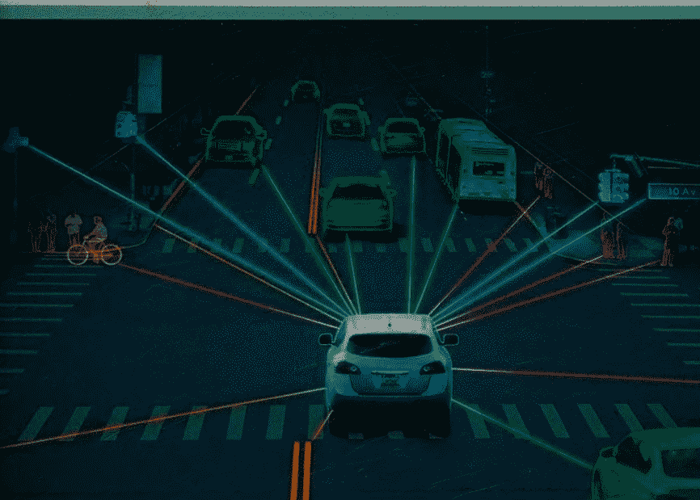
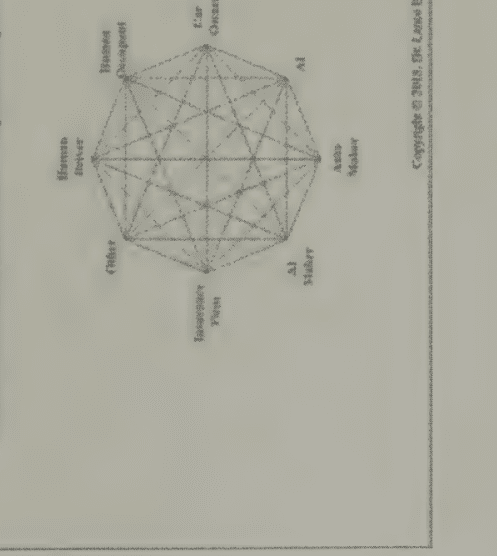
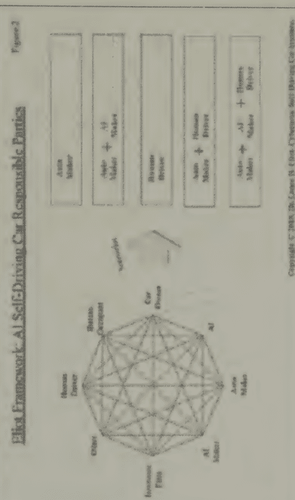
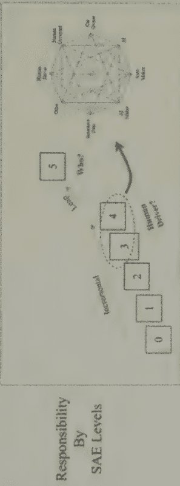
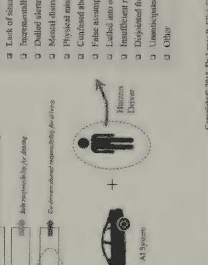
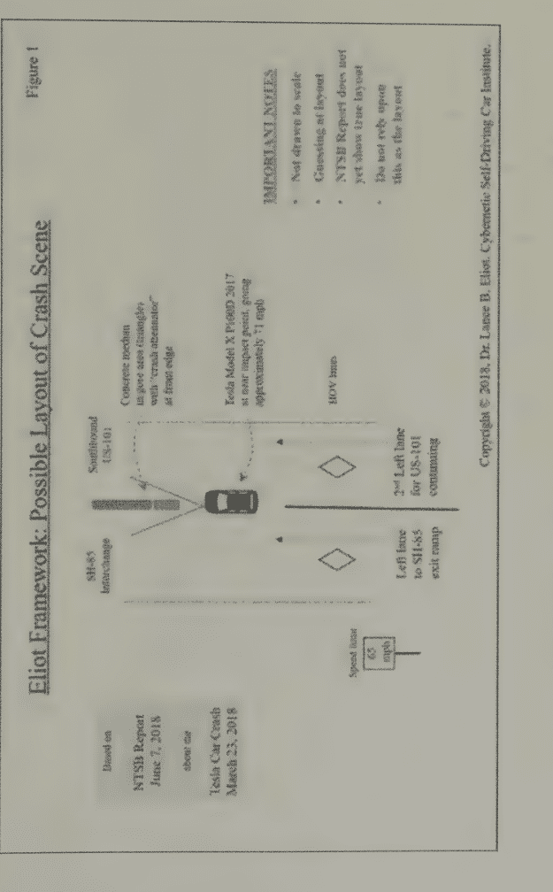
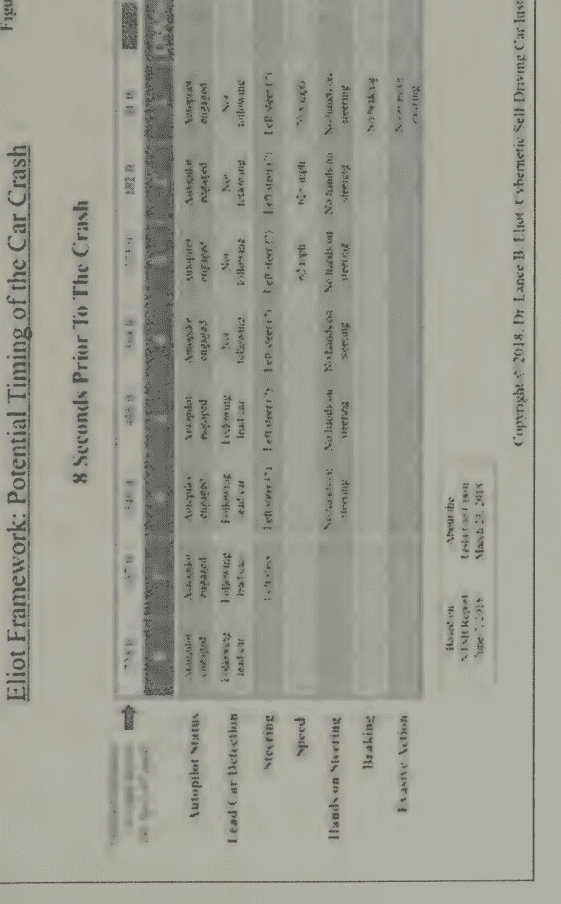
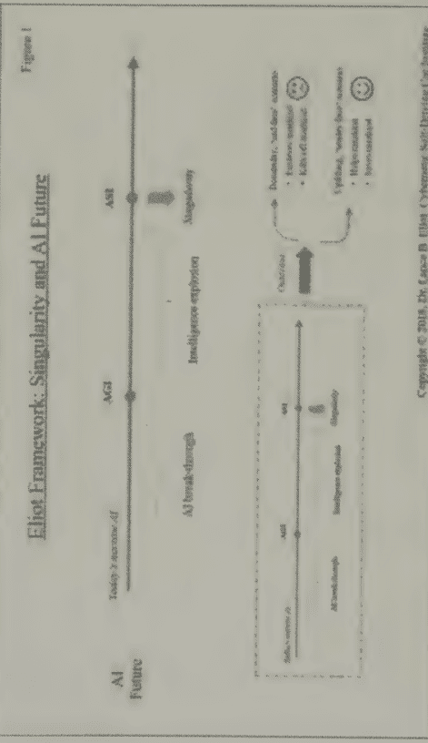
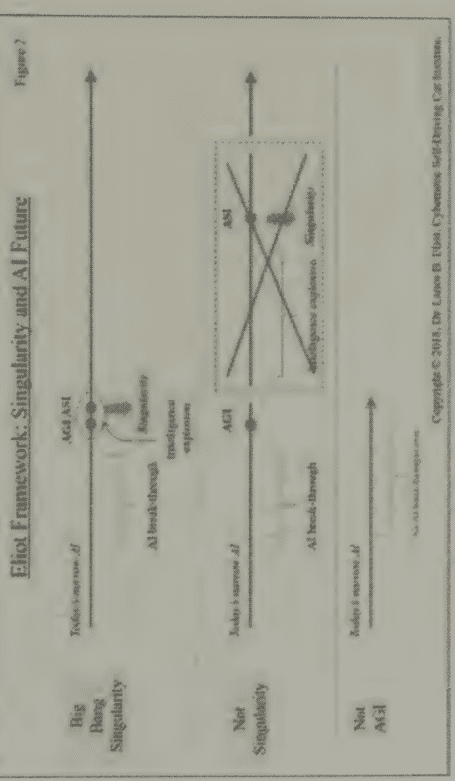

# 9780692157602




---


### 献词

献给我不可思议的儿子迈克尔，和我不可思议的女儿劳伦。
*Forest fortuna adiuvat*（源自拉丁语；好运眷顾勇敢者）。


### 致谢

我受益于许多朋友、同事、家人、投资者以及许多其他人的建议和指导。我想感谢在我职业生涯中帮助过我的每一个人。我用心和头脑写作，因为我亲身体验过在顺境和逆境中有支持者陪伴的意义。

向沃伦·贝尼斯致意，他是我的博士导师之一，最终也成为我的同事，我向他致以最深的感谢和敬意，特别是感谢他平静而富有洞察力的智慧和支持。

向马克·史蒂文斯致以敬意，感谢他为南加州大学史蒂文斯创新中心提供的慷慨资金和支持。

向劳埃德·格赖夫和南加州大学劳埃德·格赖夫创业研究中心致以敬意，感谢他们对创始人和创业者的持续鼓励。

向彼得·德鲁克、威廉·王、艾伦·莱维、彼得·金、乔恩·克拉夫特、辛迪·克劳福德、珍妮·明、史蒂夫·米利甘、克里斯·安德伍德、弗兰克·盖里、巴兹·奥尔德林、史蒂夫·福布斯、比尔·汤普森、戴夫·迪龙、艾伦·福斯特曼、拉里·埃里森、吉姆·西奈格、约翰·斯佩林、马克·史蒂文森、阿南德·纳拉坦比、托马斯·巴拉克（Jr.）以及我遇到的许多其他创新者和领导者致以敬意，我从与他们的交往中获益巨大。

感谢埃德·特雷纳、凯文·安德森、詹姆斯·希基、温德尔·琼斯、肯·哈里斯、杜韦恩·彼得森、迈克·布朗、吉姆·索恩顿、阿比·贝尼瓦尔、阿尔·比兰、约翰·野村、埃利奥特·温曼、约翰·德斯蒙德以及许多其他人在我职业生涯中给予的坚定支持。

最重要的是，一如既往地感谢劳伦和迈克尔，感谢他们持续的支持，以及在撰写本书的漫长数月里，见证我写作并聆听了这些材料。感谢他们的耐心以及愿意倾听。

### 引言

这是一本关于基于人工智能的自主无人驾驶汽车新兴性质的最新创新和最先进的人工智能（AI）进展的书籍。通过人工智能（AI）和机器学习（ML）的近期进展，我们正接近车辆可以自我控制、无需且不再依赖人类干预来执行驾驶任务的时刻（或者，那些*允许*人类干预，但仅在非常有限的程度上*需要*人类干预的时刻）。

与我描述的其他相关书籍一样，我将描述这些书并列出本书附录 A 中的章节，我特别关注那些涉及自动驾驶汽车的进展。短语“自主车辆”通常用于指代任何类型的车辆，无论是陆基、空中还是海上，无论是货运拖车卡车还是传统 passenger 汽车。虽然本书中描述的方面当然适用于所有类型的自主车辆，但我在这里更多地关注汽车。

事实上，我因在促进自动驾驶汽车进步中发挥作用而闻名，目前担任网络自动驾驶汽车研究所所长。除了编写软件、为自动驾驶汽车设计和开发系统与软件外，我还就这一主题进行了大量的演讲和写作。本书是我一些较高级别文章的一个集合。对于可能看过我在其他地方发布的文章的读者，我已将它们更新并整合到本书中，作为一个方便一致的包装。

您可能对我撰写的相关书籍感兴趣，这些书提供了关于自动驾驶汽车的其他关键创新和基础。这些书的标题是“*无人驾驶自动驾驶汽车入门*”、“*人工智能和自主车辆进展：网络自动驾驶汽车*”、“*自动驾驶汽车：‘所有人工智能项目之母’*”、“*自动驾驶无人驾驶汽车的创新和思想领导力*”、“*人工智能自主无人驾驶汽车的新进展*”和“*自主车辆无人驾驶自动驾驶汽车和人工智能*”和“*变革性人工智能无人驾驶自动驾驶汽车*”和“*颠覆性人工智能和无人驾驶自动驾驶汽车*”以及“*尖端人工智能无人驾驶自动驾驶汽车*”（它们都可以通过亚马逊购买）。请参阅本书附录 A，查看那三本书涵盖的章节列表。

对于本书的引言，我将借用我从那些相关书籍中的引言，因为它很好地勾勒出了自动驾驶汽车的格局以及我对这一主题的整体观点。本书的其余部分都是新材料，不出现在相关书籍中。

#### 自动驾驶汽车简介

这是一本关于自动驾驶汽车的书籍。在未来某一天，我们将拥有自动驾驶汽车，届时这本书可能显得陈旧，但目前，我们正处于自动驾驶汽车浪潮的前沿。日常新闻用某家汽车制造商或另一家汽车制造商的新公告片段轰炸我们，给人的印象是自动驾驶汽车将在未来几周内或也许几个月内到来。非技术性的随意读者会从这些新闻片段中假设，实际上我们必须正处于真正自动驾驶汽车的边缘。

这是一个真实的新闻快讯：距离拥有真正的自动驾驶汽车还有相当长的距离。在到达那里之前还有数年。

为什么是这样？因为真正的自动驾驶汽车类似于登月计划。就像把人类送上月球是一项不可思议的成就一样，实现真正的自动驾驶汽车也可以这样说。任何建议甚至鲁莽地声称真正的自动驾驶汽车即将到来的人，都应被持高度怀疑的态度。确实，您会发现当我评估关于自动驾驶汽车的许多确凿的假新闻时，我往往倾向于使用“胡说八道”或“废话”这些词。我们这些内部人士知道，通常报告给外部的是瞎扯。很少有内部人士愿意这样说。我没有这种犹豫。

事实上，我一直在撰写一篇关于自动驾驶汽车的流行博文，并强烈抨击那些挥手假装我们正处于真正自动驾驶汽车即将到来边缘的人。多年来，我以“人工智能内部人士”的身份闻名。除了撰写关于人工智能的文章外，我还开发人工智能软件。我做的是我所描述的。这也让我洞察到其他从事人工智能工作的人实际上在做什么，而不是他们声称在做什么。

许多忠实的读者要求我将我富有洞察力的短文收集起来，放入另一本书中，也就是您现在手中拿着的这本书。


对于多年来一直阅读我文章的朋友们来说，这个合集不仅将它们汇集到一个便捷的包里，我还更新了这些文章并添加了新材料。对于刚刚接触自动驾驶汽车和人工智能这一话题的新朋友，我希望你们觉得这些文章通俗易懂且富有信息量。我的写作风格通常带有一些个人特色，所以你们会看到，我有时带着一丝*调侃的幽默感*，也喜欢*质疑盲从*。

作为一名前教授和人工智能研究实验室的创始人，多年来我使用学术写作的正式语言进行写作。我在*同行评议期刊*上发表文章，并担任几份人工智能期刊的编辑。这里的文章并非那种性质，我为这些文章采用了不同且更非正式的风格。话虽如此，我也会偶尔提及更严谨的人工智能材料，并鼓励所有对此感兴趣的人深入挖掘那些更深层、更正式的资料。

我同时也是一名人工智能从业者。这意味着我以编写人工智能软件为生。目前，我领导*控制论自动驾驶汽车研究所*，我们正在为自动驾驶汽车开发人工智能软件。我很高兴报告说，我的儿子也是一名软件工程师，他领导着我们的*控制论自动驾驶汽车实验室*。我帮助创立的这项事业，他也是不可或缺的一部分，最终在我退休后，他将继续引领这项事业很久很久。我的女儿是一位市场营销专家，作为我们市场营销部门的负责人，她对我们努力也是不可或缺的。她也将继续传承现在正在形成的传统。

对于正在阅读本书且喜欢编写代码的朋友，你们不妨看看针对自动驾驶汽车的开源代码。这是学习如何为自动驾驶汽车开发人工智能的一个很好的起点。还有许多新的教育课程正在涌现。

想要学习和开发自动驾驶汽车的人数越来越多，同时，你们可以学习自动驾驶汽车的大学、实验室和其他渠道也日益增多。

本书将提供基础，这些方面我认为将使你们准备好接受那些更高级的训练机会。如果你已经上过那些课程，你可能会发现这些文章特别有趣，因为它们提供了一些我预计很少有其他讲师或教授提供的视角。这些是具有挑战性的文章，要求你跳出常规去*思考自动驾驶汽车*。

## 所有人工智能项目之母

2017年6月，苹果CEO蒂姆·库克终于承认苹果一直在开发一辆自动驾驶汽车。正如你在我的文章中看到的，苹果对其自动驾驶汽车的努力*笼罩在神秘之中*。我们只能通过*阅读线索*来猜测苹果在做什么。*iCar*的概念已经流传了一段时间，自动驾驶工程师和研究员签署着*紧密封口*的保密协议（NDA），参与苹果那些*像任何军事入侵计划一样神秘*的项目。

蒂姆·库克说了许多人工智能（AI）领域其他人也在说的话，即：创造一辆自动驾驶汽车一定是*所有人工智能项目之母*。换句话说，这实际上是一项*巨大的人工智能梦想*。如果一辆自动驾驶汽车能够制造出来并且人工智能如我们希望的那样工作，这意味着我们在人工智能方面取得了不可思议的进步，因此它也打开了人工智能可以解决的许多其他潜在突破领域。

这是夸大其词吗？我只是想让人工智能看起来像*奇迹制造者*，从而为我们这些为自动驾驶汽车编写人工智能软件的人提供*自我吹嘘*的声明吗？不，这不是夸大其词。开发一辆真正的自动驾驶汽车真的*非常非常非常难*。让我花点时间解释一下原因。顺便提一下，我意识到苹果CEO有时会以说*夸张的话*著称，他之前比如说2012年是“*所有年份之母*”，他说iOS 10的发布是“*所有发布之母*”——这些都暗示他喜欢使用方便的“*……之母*”表达。但我向你保证，就真正的自动驾驶汽车而言，他*正中靶心*。肯定如此。

当你思考*梦想*以及我们是如何*到达月球*的，有一些*可识别的特征*，而这些*相同的方面*也可以应用于创造一辆*真正的*自动驾驶汽车。你会注意到，我不断在*自动驾驶汽车*前面加上“*真正的*”一词。我这样做是因为根据我关于*自动驾驶汽车不同级别*的文章，有一些*自动驾驶汽车*只是*半自动驾驶*。*半自动驾驶*版本需要人类驾驶员*准备随时干预*。在我看来，那不是*真正的自动驾驶汽车*。*真正的自动驾驶汽车*是指*完全不需要*人类驾驶员干预的汽车。它是一辆可以*完全通过自动化*承担驾驶任务的汽车，*不需要*任何人类驾驶员。这是众所周知的*5级自动驾驶汽车*的精髓。我们目前处于*2级和3级*，尚未达到*5级*。

*到达月球*涉及诸如*宏大的拓展目标*、*渐进式进步*、*实验*、*创新*等方面。让我们回顾一下这对过去那个时代的*月球梦想*是如何应用的，以及它如何应用于今天的*自动驾驶汽车梦想*。

### 宏大的拓展目标

试图把一个人*送到月球*，并*安全地*把他们*带回来*，在当时是一个极其巨大的*拓展目标*。没有人知道这*是否可行*。技术*尚不可用*。成本*巨大*。决心需要*强烈*。等等。达到*5级*自动驾驶汽车也将是相同的。这是一个*宏大的拓展目标*。我们可以*轻松地*到达*3级*，我们能够*看到*就在前面的*4级*，但*5级*在*是否可行*方面仍然是个未知数。它最终*应该*是*可行的*，并以我们*相信*最终*会*到达*月球*的方式，但*何时*发生则是*另一回事*。

### 渐进式进步

*到达月球*并不是*一夜之间*在一个*扫荡*中完成的。这需要*多年来*的*渐进式进步*才能达到那里。*自动驾驶汽车*也是如此。*谷歌*一直以*努力达到5级*闻名，并且*几乎*愿意*放弃*处理*中间级别*，但大多数其他*自动驾驶汽车*制造商正在*走渐进路线*。让我们*先让一个好的2级*和一个*有点的3级**跑起来*。然后，让我们*改进3级*，让*有点的4级*跑起来。然后，让我们*改进4级*，最终*到达*一个*5级*。这似乎是我们*将*实现*真正的自动驾驶汽车*的主要方式。

### 实验

你*可能*知道，在*完善*到达*月球*的方法和技术时，涉及各种*实验*。根据*做渐进式进步*，我们*首先*试图看看我们*能否*让火箭*进入太空*并*安全返回*，然后*把一只猴子放在里面*，然后*把一个人放在里面*，然后我们*去了*月球*但*没有*着陆*，最后我们*到达了*实际上*在月球上着陆*的任务。*自动驾驶汽车*也是如此。我们正在做*自动驾驶汽车*的*模拟*。我们在*私人土地*上*在受控情况下*测试*自动驾驶汽车*。我们在*公共道路*上测试*自动驾驶汽车*，通常需要*满足监管要求*，包括例如在车内有一个*工程师*或*同等人员*在*需要时*接管控制。等等。*大小*的*实验*都被需要*弄清楚什么有效什么无效*。

### 创新

*人工智能*中*已经*有一些*进展*，*允许*我们*向自动驾驶汽车进步*。我们将需要*更多*的*进展*。*在所有技术方面*的*创新*都将*被需要*以*实现*一辆*真正的自动驾驶汽车*。*决非*我们已经*手头拥有*我们*到达那里*所需要的*一切*。*期待*新的*发明*和*新方法*，新*算法*等等。


## 挫折

大多数专家都在回避谈论自动驾驶汽车进程中可能出现的挫折。登月过程涉及许多挫折，其中一些你从未听说过，当时为了不让热情和对登月工程的资金支持降温，这些挫折被刻意掩盖了。我收录的许多文章中反复出现的一个主题是：在我们努力实现真正的自动驾驶汽车时，必将遇到挫折。请深呼吸并做好准备。我只希望这些挫折不会完全阻止进步。我相信这将导致进步以我们在自动驾驶汽车领域尚未见过的方式发生改变。我将如今的自动驾驶汽车类比为当初 Uber 兴起时大家所怀有的那种兴奋之情。如今，我们对 Uber 的看法已有所不同，而且随着时间推移，共享出行业务面临的监管日益增多，引发的担忧也越来越多。备受宠爱的小公主最终总会因为胡闹而失去光环。自动驾驶汽车也会经历同样的过程。

## 自动驾驶汽车的挑战

你或许会问，究竟是什么让拥有真正的自动驾驶汽车变得如此困难。多年来你一直见过定速巡航。最近你看到汽车可以完成并排停车。你看过 YouTube 上特斯拉驾驶员将手伸出车窗外、汽车在高速公路上飞驰的视频，因此看起来像是在驾驶一辆自动驾驶汽车。难道我们只需在车上多加几个传感器，就能拥有一辆真正的自动驾驶汽车吗？不。

请片刻思考驾驶任务的本质。我们并不允许任何年龄段的人随意开车。在全球范围内，大多数国家直到 18 岁才颁发驾驶执照，尽管许多国家允许 15 岁或 16 岁获得学习驾驶许可。有人认为更小的年龄因体型过小而无法触及汽车控件。虽然这可能属实，但我们完全可以调整控件以适应体型较小的年轻人。决定因素并非他们的身体尺寸，而是他们的认知发展水平。

要驾驶汽车，你必须能够推理汽车本身的能力，知道汽车能做什么和不能做什么。你需要知道如何操作汽车。你需要了解道路上其他汽车的驾驶方式。你需要知道驾驶中允许的行为，例如限速和在标记车道内行驶。你需要能够应对各种情况，并避免发生事故。你需要判断何时踩刹车，何时避开行人，以及如何避免撞上当初插队的那辆摩托车。

我们中的许多人修过驾驶课程。我们学习驾驶知识并接受驾驶培训。我们必须通过考试才能拥有驾驶资格。关键在于，尽管大多数成年人对驾驶任务习以为常，我们经常“无意识”地驾驶，但驾驶汽车确实需要大量的认知投入。一段时间后，它变成了第二天性。你不需要特别思考如何驾驶，你只是在做。但是，如果你观察一名新手司机，比如一个正在学车的青少年，你会突然意识到，这件事比我们要看起来的复杂得多。

此外，驾驶是一项非常严肃的任务。我记得我的女儿和儿子初学开车时的情况。他们都是非常认真负责的人。他们想确保无论做什么都能做得很好，并且不伤害任何人。每天，当你坐进汽车时，它大约是 4,000 磅（约两吨）厚重的金属和塑料，本质上是一个致命的武器。想想看。你驾驶着一个重达两吨的物体在街道上行驶，其引擎可以加速并撞击你想碰的任何东西。汽车能造成的破坏非常可怕。我的两个孩子都惊讶于被赋予了操控这种可能仅因片刻松开方向盘或视线离开路面就能造成巨大伤害的猛兽的权利。

事实上，仅在美国，每年就有约 30,000 人死于交通事故，平均每天约 100 人。考虑到美国约有 2.63 亿辆汽车，我反而更惊讶于伤亡人数没有高得多。在早晨通勤时，我注视着高速公路上周围数千辆汽车，心想如果它们都变成丧尸并以疯狂的方式驾驶，会有很多人死亡。不可思议的是，每天，大多数人仍能相对安全地驾驶。对我来说，这就是奇迹。让数以百万计的人在驾驶两吨重的移动物体时保持安全和理智，这是我们社会应当引以为傲的成就。

因此，希望你也认同驾驶任务需要大量的认知。开车不需要特别聪明，我们做了很多事情来确保即使是普通人也能驾驶汽车。开车不需要通过智商测试。如果你会读写并能通过考试，你就基本可以合法驾驶汽车。当然，有一些开车的人并不具备合法驾驶资格，此外还有农场等私人区域允许年轻驾驶员，但在美国的公共道路上，你通常只需要具备平均智力（或更低）即可合法驾驶。

这使得认知投入似乎并不多。如果认知投入真的很困难，难道只有爱因斯坦才能开车吗？我们通过使控件易用且相对标准化，以及道路相对标准化等，尽可能保持驾驶任务的简单性。这就像迪士尼乐园将“汽车总动员（Autopia）”带入现实世界，因为我们作为一个社会一致认为道路应遵循特定方式，并且我们都遵守各种驾驶规则。

人类适度的认知任务仍然会让 AI 感到困惑。你当然知道 AI 已经能够击败国际象棋玩家，并在其他类型的游戏中表现出色。这种狭窄的认知并非汽车驾驶的核心。汽车驾驶的范围要广得多。它需要关于世界的知识，而国际象棋 AI 系统不需要知道这些。驾驶的认知方面一方面看似简单，但另一方面又需要对汽车、人、道路、规则以及无数其他“常识”层面层层叠叠的知识。我们目前没有 AI 系统具备这种同等广度和深度的意识与知识。

如我在文章中所揭示，如今的自动驾驶汽车是使用技巧来完成特定任务的。其操作非常狭窄。此外，它目前假设人类驾驶员随时准备介入。这就像我们教孩子叠积木，但我们需要就在那里，以防孩子叠得太高导致积木倒塌。如今的 AI 很脆弱，很狭窄，且未能接近人类的认知能力。这就是为什么真正的自动驾驶汽车还存在于未来的某个地方。

驾驶任务的另一个方面是，它不仅仅是一项脑力运动。你需要使用感官来驾驶。你用眼睛（视觉传感器）查看前方道路。你的视觉能力就像流媒体视频，你的大脑在驾驶过程中需要持续分析它。道路在哪里？前面有行人吗？前面有其他汽车吗？你的感官正在向大脑灌输大量信息。自动驾驶汽车正试图通过相机、雷达、超声波和激光器来模仿人类的感觉和感觉器官，做到同样的事情。

因此，驾驶任务既是心理上的，也是身体上的。你使用感官，使用手臂和腿来操纵汽车控件，使用大脑来评估感官信息并指挥肢体操作汽车控件。这一切都是即时发生的。如果你曾经眼里进了东西，只能用一只眼睛开车，你会突然意识到自己多么依赖视觉。如果你的脚打着石膏，你会突然意识到控制刹车踏板和加速器有多难。如果你服用了药物，大脑可能变得迟钝，你会突然意识到驾驶汽车需要多大的精神负荷。

一个下国际象棋的 AI 系统只需要专注于下棋。物理方面不重要，因为通常是由人来移动棋子的


## 本书提供什么

这本书能提供什么？它从人工智能的角度介绍了许多关于自动驾驶汽车的关键要素。我将技术方面和非技术方面交织在一起，前一秒我还在关注驾驶任务的认知能力以及技术如何体现这一点并融入自动驾驶汽车中，下一秒我就开始讨论社会和经济方面。

它们是相互交织的，因为现实就是如此。你不能单独看待技术本身，而必须在正在被发明和创新的背景下考虑它，并以一种关注塑造我们当前行为和未来期望的当代习俗和文化的思维方式来对待它。

## 为何写这本书

我写这本书是为了向公众展示许多关于自动驾驶汽车的方面，而似乎没有人正在讨论这些方面。

对于参与制造自动驾驶汽车或打算利用自动驾驶汽车的企业领导者，我希望这本书能让你了解所涉及的风险，以及如何制定战略来应对这些风险的方法。

对于想要进入新兴的自动驾驶汽车市场的创业者、初创公司和其他企业，我希望这本书能激发你进入该领域的兴趣，并让你对哪些方向值得谨慎追求有一些认识。

对于研究自动驾驶汽车的学者，我希望这本书能激发你对自动驾驶汽车的风险和安全问题的兴趣，并促使你在这些方面开展研究。

对于计算机科学或相关专业的学生，我希望这本书能为你提供有趣的新想法和材料，你可以据此进行研究，或者从中获得一些职业方向的见解。

对于追求自动驾驶汽车的人工智能公司和高科技公司，这本书将有望拓宽你的视野，让你不仅仅局限于制造自动驾驶汽车所需的编码和开发。

对于所有读者，我希望你会发现书中的材料具有启发性。其中一些内容可能与你已知的事物有所重复。但我相当肯定，你也会发现各种顿悟时刻，从而发现你以前未曾想到的新技术或方法。我也打赌，会有材料迫使你重新思考你的一些当前做法。

我并不是说你会突然获得顿悟并改变你正在做的事情。但我确实认为，你会重新考虑，或者或许会重温你正在做的事情。

对于选择将此书用于教学目的的人，请查看我在附录中描述的关于此的建议。我发现这些材料在我教授的课程中很实用，同样，其他教师也告诉我，他们发现这些材料很有用，有时作为扩展阅读，有时作为课程的核心部分（取决于课程的性质）。

在撰写这本书时，我努力融合了实践者和学术两种写作风格。它不像典型的学术期刊写作那样密集，但同时也通过深入探讨各种实践的细微差别和权衡来提供深度。

“深入”（deep）一词如今很流行，意为深入某个主题或话题，而“解构”（unpack）一词也是如此，它意味着挖掘某个主题或话题的潜在方面。我力求提供的内容能够相对深入地探讨某个问题或话题，并确保其被充分解构。

最后，在任何关于人工智能的书籍中，很难使用我们的日常用语而不让其中某些词被误解。具体来说，很容易将人工智能拟人化。当我说一个人工智能系统“知道”某事时，我不想让你认为该人工智能系统具有感知能力，并且“知道”的方式与人类相同。目前它们并非如此。我有时会用引号括住此类词汇，以强调我使用的这些词汇不应被误解为将真正的人类智能归因于我们今天已知的人工智能系统。如果我对所有此类词汇都使用引号，这本书将非常难以阅读，因此我有选择地这样做。请你在阅读材料时牢记这一点，谢谢。

Lance B. Eliot

## 相关书籍

如果你觉得这些材料有趣，你可能也想看看我其他关于自动驾驶汽车的书籍，它们题为：

- 《无人驾驶自动驾驶汽车入门》，作者：Lance Eliot 博士
- 《自动驾驶无人驾驶汽车的创新与思想领导力》，作者：Lance Eliot 博士
- 《人工智能与自主车辆进展：控制论自动驾驶汽车》，作者：Lance Eliot 博士
- *《自动驾驶汽车：所有人工智能项目的母体》*，作者：Lance Eliot 博士
- 《人工智能自主无人驾驶自动驾驶汽车的新进展》，作者：Lance Eliot 博士
- 《自主车辆无人驾驶自动驾驶汽车与人工智能》，作者：Lance Eliot 博士和 Michael B. Eliot
- 《变革性人工智能无人驾驶自动驾驶汽车》，作者：Lance Eliot 博士
- 《颠覆性人工智能与无人驾驶自动驾驶汽车》，作者：Lance Eliot 博士
- 《前沿人工智能无人驾驶自动驾驶汽车》，作者：Lance Eliot 博士
- 《人工智能自动驾驶汽车的主要趋势》，作者：Lance Eliot 博士

以上所有书籍均可在亚马逊和其他主要全球图书零售商处购买。


# 第一章

## 自动驾驶汽车的 ELIOT 框架

本章是理解自动驾驶汽车的核心基础部分。我在其他几本书中也使用了相同的章节来向读者介绍该领域的基本要素。阅读完本章后，你将准备好阅读其余内容，因为自动驾驶 AI 无人驾驶汽车组件的基础本质已经为你奠定基础。

在关于自动驾驶汽车的演讲和课程中，我发现提供一个框架来理解和组织自动驾驶汽车的各个关键要素是非常有帮助的（参见本章末尾的图表）。该框架需要足够简单以传达整体要素，但也不能过于简单以至于掩盖了自动驾驶汽车真正的复杂性。因此，我将在此描述该框架，并尝试用一千字（或更多！）来阐述框架图表本身试图表达的内容。

为了方便引用，图表上的核心要素已进行编号。编号并不意味着对任何要素的优先排序。每个要素都至关重要。每个要素都有其目的，否则就不会包含在框架中。对于某些自动驾驶汽车，特定要素可能比其他自动驾驶汽车的某些要素更重要或更具区分度。

你甚至可以使用该框架来评估某辆特定的自动驾驶汽车，方法是衡量它在框架各个要素中的表现如何。我将逐一描述每个要素。完成描述后，我将讨论说明这些要素在自动驾驶汽车整体运作中如何相互作用和表现的方面。

在控制论自动驾驶汽车研究所，我们使用该框架来跟踪我们的工作进展，以及我们如何开发软件以填补实现 5 级自动驾驶汽车所需的缺口。

## D-01：传感器采集

让我们从自动驾驶汽车新闻中最受关注的要素开始，即自动驾驶汽车的感知设备。

在框架中，标记为 D-01 的方框表示“传感器采集”，指的是自动驾驶汽车中涉及收集来自众多用于自动驾驶汽车的传感器的数据的过程。通常涉及的设备类型已列出，例如使用单目相机、立体相机、LIDAR 设备、雷达系统、超声波设备、GPS、IMU 等。

这些设备负责获取关于自动驾驶汽车状态及其周围世界的数据。一些设备持续提供更新，而其他设备则等待自动驾驶汽车的指示，以便设备应收集数据。这些数据可能首先由设备本身以某种方式转换，或者直接作为原始数据输入到传感器采集中。在那时，可能由传感器采集过程对数据进行转换。这取决于所使用的设备性质以及设备的设计和开发方式。

## D-02：传感器融合

想象一下，你的眼睛接收视觉图像，你的鼻子接收气味，你的耳朵接收声音，本质上你每个不同的感觉设备都在接收某种形式的输入。输入符合该设备的性质。同样，对于自动驾驶汽车，相机提供视觉图像，雷达返回雷达反射等。

每个设备提供的数据都符合该设备的功能。

在某个阶段，借用人类的类比，你需要将眼睛看到的、鼻子闻到的、耳朵听到的合并在一起，并将所有部分拼凑成一个更大的关于世界是什么以及你周围发生什么的感知。传感器融合就是从每个设备中提取单一方面并将它们组合成一个更大的拼图的动作。

传感器融合是一项艰巨的任务。有些设备在传感器采集时可能不工作。或者，有些设备可能无法很好地报告它们检测到什么。再次使用人类类比，假设你处于一个黑暗的房间里，因此你的眼睛看不清。在那时，你可能需要更多地依靠你的耳朵和你听到的内容。对于自动驾驶汽车也是如此。如果相机因雪和雨夹雪而被遮挡，雷达可能可以提供关于外部条件构成的更大指示。

对于自动驾驶汽车，可能存在大量此类感觉设备。每个都在报告它能报告的。每个都可能遇到困难。每个都可能有其局限性，例如它能检测前方物体的距离。在传感器融合任务中，所有这些局限性都需要被考虑。

## D-03：虚拟世界模型

对于人类，我们在开车时，脑海中大概保留着周围世界的模型。在你的脑海中，你知道汽车以比如每小时 60 英里的速度行驶，并且你在高速公路上。你脑海中的模型是你的汽车被其他汽车包围，并且高速公路有车道。你的模型不仅基于你能看到、听到等，还基于你对世界性质的了解。你知道在任何时刻，前面的车可能猛踩刹车，后面的车可能撞上你的车，或者相邻车道的卡车可能驶入你的车道。

自动驾驶汽车的 AI 需要有一个虚拟世界模型，然后它会根据从传感器融合接收到的信息进行更新，而传感器融合又是从传感器采集和感觉设备接收输入的。

## D-04：系统行动计划

通过拥有虚拟世界模型，自动驾驶汽车的 AI 能够跟踪汽车的位置以及汽车周围发生的事情。此外，AI 需要确定下一步做什么。自动驾驶汽车应该踩刹车吗？自动驾驶汽车应该留在其车道内还是转向左侧车道？自动驾驶汽车应该加速还是减速？

需要由自动驾驶汽车的 AI 制定一个系统行动计划。行动计划规定了应采取哪些行动。这些行动需要涉及虚拟世界模型的状态。此外，这些行动需要是可实现的。

这种可实现性意味着 AI 不能仅仅断言自动驾驶汽车应该突然长出翅膀并飞走。相反，AI 必须受限于自动驾驶汽车实际能做的事情，例如在 X 英尺的距离内以 Y 英里每小时的速度停下来，而不是断言自动驾驶汽车在 0 英尺内停下来，好像它可以在运动中瞬间停止一样。

## D-05：控制激活

系统行动计划通过激活汽车的控制装置来实施，使其按照计划规定行事。这可能意味着命令油门控制增加汽车速度。或者，命令转向控制将方向盘向左或向右转 30 度。

产生一个问题，即控制装置是否如命令的那样响应。换句话说，假设 AI 已命令油门增加，但由于某种原因没有这样做。或者，也许它尝试这样做，但汽车速度没有增加。控制激活反馈到虚拟世界模型，同时虚拟世界模型正从传感器、传感器采集和传感器融合中获取更新。这允许 AI 确定控制装置被命令采取某种行动后发生了什么。

顺便说一下，请记住，虽然图表似乎有一个线性进展，但现实是这些都是……


自动驾驶汽车中正在并行且同时发生的情况。传感器正在捕获数据，与此同时，传感器融合正在进行，虚拟模型正在更新，系统行动计划正在制定和重新制定，控制指令正在被激活。

这与人类驾驶汽车的情形相同。他们正在目视道路，同时在大脑中融合视觉、听觉等感知信息，他们的心智正在更新对周围世界的模型，他们正在制定关于如何行动的计划，同时他们的脚正在踩踏板并操控方向盘。在日常驾驶过程中，你是一口气完成所有这些操作的。我提及这一点，是为了当你们查看图表时，会将方框理解为所有同时在过程中发生的事件，而不是认为只有一个事件发生，然后才是下一个。

它们在图中以简化的方式呈现，以帮助理解正在发生的事情。不过，你们也应该意识到，它们之间是并行且同时运作的。这是一个具有挑战性的方面，因为元素间的通信涉及延迟和其他必须考虑的因素。当一个元素更新状态并随后与其他元素共享其最新状态时，可能会出现延迟。

## D-06：汽车与 CAN

当代汽车使用各种汽车电子设备和控制器局域网（CAN）作为汽车驾驶层面的基础组件。存在电子控制单元（ECU），它们控制汽车的子系统，例如引擎、刹车、车门、车窗等。

元素 D-01、D-02、D-03、D-04、D-05 是构建在 D-06 之上的，并且必须意识到 D-06 能够做什么以及不能做什么的本质。

## D-07：车内指令

人类将会是自动驾驶汽车的乘客。在 L5 级自动驾驶汽车中，人类与自动驾驶汽车之间必须存在某种形式的通信。例如，我进入一辆自动驾驶汽车并告诉它，我想被送到迪士尼乐园，沿途我想在 In-N-Out 汉堡店停下来。自动驾驶汽车现在解析我说的话，并试图建立一种手段来实现我的愿望。

车内指令可以在驾驶行程的任何时候发生。虽然我的例子是关于当我刚进入自动驾驶汽车时发出的指令，但也可能是在自动驾驶汽车执行行程期间我改变了主意。也许在陷入交通拥堵后，我告诉自动驾驶汽车忘掉买汉堡，直接驶向主题公园。自动驾驶汽车需要在整个行程中保持对车内指令的警惕。

## D-08：V2X 通信

最终，我们将拥有相互通信的自动驾驶汽车，通过 V2V（车对车）通信实现。我们还将有与道路及其他交通基础设施方面进行通信的自动驾驶汽车，通过 V2I（车对基础设施）实现。

自动驾驶汽车与其他汽车及基础设施通信的多种方式被称为 V2X，其中字母 X 指的是我们认定的汽车应该或想要通信的任何其他对象。V2X 通信将与图表上其他所有内容同时进行，其他元素需要整合从这些 V2X 通信中获取的信息。

## D-09：深度学习

深度学习的应用渗透到自动驾驶汽车的各个方面。自动驾驶汽车的 AI 将利用深度学习来更好地执行系统行动计划、控制指令激活、传感器融合等任务。

目前，人工神经网络的使用是深度学习最普遍的形式。基于海量数据，神经网络试图从数据中“学习”，从而相应地引导自动驾驶汽车的努力方向。

## D-10：战术 AI

战术 AI 是处理自动驾驶汽车逐时刻驾驶过程的组成部分。自动驾驶汽车是否保持在高速公道的其所在车道内？汽车是否对控制指令做出了恰当反应？感测设备是否正常工作？

对于人类驾驶员，战术层面的对应物可以在观察新手驾驶员（如初次驾驶的少年）时看到。他们专注于驾驶任务的机械操作，在注视道路的同时也试图正确控制车辆。

## D-11：战略 AI

自动驾驶汽车战略 AI 的方面处理的是自动驾驶汽车试图实现的更大图景。如果我要求自动驾驶汽车带我去迪士尼乐园，就需要建立并维持一份整体的行程地图。

战略 AI 与战术 AI 之间存在互动。战略 AI 希望保持驾驶任务的使命，而战术 AI 专注于驾驶过程中的具体细节。如果战术 AI 似乎偏离了总体使命，战略 AI 希望查明原因并使事物回到正轨。如果战术 AI 意识到自动驾驶汽车存在某些异常，它需要相应地提醒战略 AI，并对正在进行的总体使命进行调整。

## D-12：自我意识 AI

正在开发的少数自动驾驶汽车中，有些包含了自我意识 AI 组成部分，我们认为这对于 L5 级自动驾驶汽车至关重要。

自我意识 AI 组成部分旨在监管自身，即 AI 确保 AI 按预期工作。假设有一名人类在开车，他开始驾驶得动荡不定。希望其自身的自我意识能使他意识到自己驾驶得很糟糕，例如在连续驾驶数小时后开始打瞌睡。如果车里有一位乘客，当驾驶员开始做出不当行为时，他们或许能够提醒驾驶员。这正是自我意识 AI 组成部分试图做的事情，它成为 AI 的监管者，并试图检测 AI 何时出现故障或困惑，然后寻找方法克服该问题。

## D-13：经济性

自动驾驶汽车的经济方面本身并非自动驾驶汽车的技术方面，但经济学确实影响了自动驾驶汽车的性质。例如，为自动驾驶汽车配备所有可能类型的感测设备的成本是令人望而却步的，因此需要对使用哪些设备进行决策。并且，对于所选定的感测设备，它们将具有全套功能还是更有限的功能集。

我们将拥有处于消费成本低端点的自动驾驶汽车，也有处于高端点的。你不能期望低端的自动驾驶汽车与高端的同样强大。我意识到许多自动驾驶汽车评论家表现得好像所有自动驾驶汽车都一样，但它们不会。就像其他任何东西一样，我们将拥有具有不同能力范围的自动驾驶汽车。有些会比其他的更好。有些会比其他的更安全。这是现实世界的方式，因此我们在考虑自动驾驶汽车的性质时需要考虑经济学方面。

## D-14：社会性

该组成部分涵盖了影响自动驾驶汽车技术的 AI 社会方面。例如，著名的电车难题涉及当面对生死攸关的问题时，自动驾驶汽车应做出何种选择。如果自动驾驶汽车即将撞到一个站在路面上的孩子，或者撞向路边的一棵树并可能杀死车内的人类，应该做出哪个选择？

我们需要牢记社会方面将构成自动驾驶汽车 AI 的基础。无论我们是否明确意识到，AI 中都会嵌入各种社会假设。


## D-15：创新

我将创新的概念纳入该框架，是因为我们可以预见，无论自动驾驶汽车由什么组成，它在未来的时间里都会持续进行创新。未来几年推出的自动驾驶汽车无疑将与十年后推出的版本有所不同，且创新性会较低，以此类推。

### 整体框架

对于那些想要了解自动驾驶汽车的人来说，你们可以潜在地选择某个特定要素，并在该方面进行专业化研究。一些工程师专注于传感设备。一些工程师专注于控制激活。等等。每个要素都有其专业领域。

研究人员同样也在各个不同方面进行专业化研究。例如，有研究人员正在使用深度学习来探索如何最好地将其用于传感器融合。还有其他研究人员正在使用深度学习来制定良好的系统行动计划。有些人正在研究如何为驾驶任务中的战略层面开发人工智能，而另一些人则专注于战术层面。

一名充分准备的全能型软件开发者，若参与自动驾驶汽车项目，应当熟悉所有要素，至少要知道每个要素的功能。这一点很重要，因为无论软件开发者负责哪一部分工作，他们都需要了解其他要素在做什么。

## AI自动驾驶汽车的主要趋势

## ELOTT框架：AI自动驾驶车辆与无人驾驶汽车

**设备：**
- 微型相机
- 立体相机
- 雷达
- GPS
- 超声波
- IMU（惯性测量单元）
- 发动机
- 诊断
- 移动端
- 涂层
- 等等

| | D-01 | D-05 | D-06 | D-07 | D-08 | D-09 | D-10 | D-11 | D-12 |
|---|---|---|---|---|---|---|---|---|---|
| | 行人信号<br>自主&CAV<br>车内指令<br>（XG通信D-08 | 战略AI | 轮胎工程 | 触觉AI | 虚拟世界模型 | 系统行动计划 | 传感器加速 | AI | AI |

**脚注：**
- D-13：社会
- D-14：基础设施
- D-15：创新


# 第2章

# 责任与自动驾驶汽车

你如何让人们以负责任的方式行事？这是当前正在被询问和深思的一个问题，特别是在旧金山和圣莫尼卡等城市正在进行的“滑板车战争”中。

如果你还没有了解关于“滑板车战争”的情况，请给我一点时间向你介绍。

提供电动滑板车租赁的公司像野花一样层出不穷，它们采用现代方式来做这件事。潜在客户不再需要去实体店租滑板车，而是通过一个移动应用程序寻找滑板车，该应用显示带有滑板车位置的GPS地图，类似于显示拼车汽车位置的Uber移动应用程序，然后直接走到最近的滑板车旁，用信用卡租赁它，它会解锁，你就可以出发了。滑板车上有一个电子锁，最后一个租赁它的人基本上可以将其留在任何他们想要的地方（当租赁者使用完滑板车后，它会自动锁定）。不需要将滑板车带回复点。也不需要去复点取车。

想象一下，你在圣莫尼卡的某个地方，想要穿过整个城市。你本来可以走路，但这太老土了，可能需要很长时间，而且沿途可能不会太有趣。你也可以使用拼车服务，但在天气晴朗、距离只有一两英里的时候为什么要这么做呢，而且对于这么短的距离，费用可能相对较高。如果 somehow 有一辆状态良好的电动滑板车在等着你，并且离你站立的地方很近，那就太棒了。瞧，直接使用现代的滑板车租赁即可。目前，Bird 可能是最著名的此类滑板车租赁公司，它似乎也是风险投资圈的红人。

这一切看起来似乎是双赢的。对客户好，对租赁公司也好。但我之前在这里提到过，有一场滑板车战争正在进行。滑板车租赁模式出了什么问题？答案是，人们在做一些他们不应该做的事。人类行为，就是如此。

首先，驾驶滑板车的人类“司机”应当遵守交通规则。你不得在人行道上骑行（除非有允许的例外情况，但这种情况很少见）。你不得闯红灯。你必须在停车标志处停车。你必须遵守通常的交通法规。猜猜怎么着，许多滑板车租赁者并没有遵守交通法规。令人震惊吗？并不真的。

其次，当地通常有头盔法，要求骑电动滑板车时佩戴头盔。如果你注册 Bird，他们实际上会免费提供给你一个头盔（他们会邮寄头盔给你）。猜猜怎么着，许多滑板车租赁者并没有戴头盔。令人震惊吗？并不真的。

第三，滑板车“司机”经常被发现抢占汽车、自行车和行人的道路。他们以在户外购物中心的人群中穿行以及在挤满人行道的人群中穿梭而闻名。这对所有人都是危险的。这样做是完全错误的。令人震惊吗？并不真的。

这些滑板车通常可以达到每小时15英里的速度，这在靠近人群或在人行道和其他包含行人的区域使用时已经足够快了。滑板车骑手的受伤人数有所增加，包括切割伤、擦伤和头部受伤。只需大约一美元解锁滑板车，然后每分钟约15美分，你就可以享受一生的快乐和冒险。你工作效率更高。你觉得自己像赛车手一样。

与此同时，滥用滑板车功能的人很可能会让其他人的生活变得困难和危险。

甚至有人担心滑板车在不使用时被放置在哪里。一些租赁者只是把滑板车随便放。有时他们把它放在商店前面，挡住了商店的入口和出口。有时他们把它停在车道上，阻碍车辆进入和驶出车道。这就像丢弃垃圾而不必担心将垃圾放入合适的容器。你到达目的地，从滑板车上下来，通过移动应用程序表示你已完成租赁，然后离开滑板车。为什么你应该关心它现在可能挡住了别人的路？令人震惊吗？并不真的。

像 Bird 这样的滑板车租赁公司倾向于通过指出他们采取各种措施防止人们误用滑板车来捍卫其商业模式。当你注册滑板车租赁服务时，它会告诉你不要做我刚才提到的那些人们正大量做出的事情。在屏幕上，它告诉你要遵守交通法规。它告诉你要以避免危险的方式使用滑板车。它告诉你，如果当地法律要求，你需要佩戴头盔（有些公司，如 Bird，可以提供一个，尽管你需要记得随身携带）。巴拉巴拉巴拉。

我为什么说巴拉巴拉巴拉？因为现在这些滑板车租赁服务的反对者认为，仅仅通知人们他们需要遵守法律、佩戴头盔等是不够的。这没有什么威慑力。这是这些公司试图提供最终具有危险性的产品或服务，同时假装他们已警告租赁者“司机”需要做和不需要做什么。反对者认为这还不够。这些滑板车租赁公司正在赚取丰厚的利润，试图表现得无辜，认为完全由租赁者“司机”为自己行为负责才是正确的。

你可能会问，这与 AI 自动驾驶汽车有什么关系？


在网络控制系统学AI自动驾驶汽车研究所，我们正针对AI自动驾驶汽车提出类似的问题，并试图寻找应对当前遇到的相似挑战的方法。

当然，问题的性质更为严峻，因为如果人类驾驶员未能遵守与自动驾驶汽车相关的必要操作规范，后果往往是生死攸关的。一辆操作不当的汽车，其危险性远高于踏板车，更是一个潜在的致命机器。

## 特斯拉营销与广告案例

最近，一个消费者权益监督组织向联邦贸易委员会提交了一封信，声称特斯拉基本上正在做与上述共享踏板车租赁类似的的事情。特斯拉被指责作出了具有欺骗性和误导性的声明与行为，这些都在使特斯拉驾驶员面临潜在危险。目前，已有一些涉及特斯拉相关驾驶死亡的案例，被指出支持了这一观点。

有人指出，宣传特斯拉自动辅助驾驶的网站上突出地写着“所有车辆均配备完全自动驾驶硬件”，并且有一段视频以屏幕上显示的强调信息开始（在视频中以全大写字母显示）：“驾驶座上的人仅为法律原因而存在。他什么也没做。汽车正在自动驾驶。”

你从这些方面会得出什么印象？

你相信这辆车能在没有人类干预的情况下自己行驶吗？对于你们这些了解AI自动驾驶汽车的AI开发者来说，你们肯定会说，你们当然知道自动辅助驾驶并不能在没有人类干预的情况下真正驾驶汽车。但是，普通消费者呢？他们会得到什么印象？

有观点认为，大多数人会认为特斯拉的自动辅助驾驶是真正的L5级自动驾驶汽车，而在该级别中，AI自动驾驶汽车由AI驾驶，无需任何人类协助。事实上，许多旨在实现L5级自动驾驶的汽车制造商和科技公司都在研发没有任何驾驶员控制装置的车辆，至少没有供人类使用的控制装置。其理念是AI是汽车驾驶员。没有人类驾驶。

目前，特斯拉的自动辅助驾驶被认为大致处于L2级或L3级。它绝对要求人类驾驶员在场，并且该人类驾驶员必须随时准备接管车辆控制权。因此，就这个意义而言，它并非真正的自动驾驶汽车（即不是L5级）。然而，有些人认为，特斯拉营销和宣传该车的方式往往会使消费者误以为它是真正的自动驾驶汽车。

对特斯拉做法的另一个常见抱怨是，他们“巧妙地”将其AI系统命名为“自动辅助驾驶”。你对“自动辅助驾驶”这个词通常有什么印象？

对大多数人来说，他们倾向于联想到飞机的自动驾驶，并认为这意味着飞机可以在无需人类飞行员介入的情况下飞行。我们都在电视节目和电影中看到过，人类飞行员打开自动驾驶，然后看报纸，甚至可能睡着。这就是人们对“自动辅助驾驶”一词的普遍认知。那么，特斯拉自动辅助驾驶的命名是否也在某种程度上欺骗人们，使其相信特斯拉的AI在当前能力阶段比实际表现更强大？

与此同时，2016年5月和2018年3月发生的致命特斯拉驾驶事故目前被评估为由于人类驾驶员未履行驾驶责任所致。美国国家运输安全委员会（NTSB）在2016年5月的案例中随后表示，人类驾驶员“使用自动辅助驾驶系统的模式表明其过度依赖自动化系统，并缺乏对系统局限性的理解”。

此外，每次发生涉及激活自动辅助驾驶的特斯拉事故时，特斯拉公司都会立即将矛头指向人类驾驶员。他们说，人类驾驶员没有集中注意力。他们说，使用自动辅助驾驶需要活跃的人类驾驶员，并强调特斯拉车主手册中对此有说明，屏幕上也有提示。然而，根据美国国家公路交通安全管理局（NHTSA）的说法，“仅仅把它写进车主手册并指望驾驶员阅读并照做是不够的。”

特斯拉声称，根据特斯拉进行的调查，人类驾驶员知道他们在驾驶任务中的关键作用。因此，当如2018年3月那样的事故发生时，他们指出：“在之前的行驶过程中，驾驶员收到了多次视觉警告和一次听觉脱离警告，且在碰撞发生前的六秒内，未检测到驾驶员的手放在方向盘上。” 换句话说，这暗示人类驾驶员本应知道——在某种意义上被提醒要保持警觉，然而人类驾驶员未能做到，因此据推测人类驾驶员应对该事故负责，而非汽车制造商。

有些人指责特斯拉既想保留蛋糕又想吃掉它，一方面想要宣传其自动辅助驾驶是“划时代”的伟大发明，另一方面在事故发生时又试图回避任何责任。有些人认为，这有点像电影《卡萨布兰卡》，其中法国警官路易·雷诺假装视而不见，告诉警察去抓“惯犯”，尽管他真正知道是谁干的。

特斯拉指出，他们故意安装了方向盘触摸传感器，以便持续提醒人类驾驶员保持对驾驶任务的专注。一些专家表示，他们本可以做更多，例如使用眼球运动检测和面部监控，以确保驾驶员确实在注视前方道路。最近在《华尔街日报》的一篇报道中披露，特斯拉曾考虑增加此类设备但决定不这样做，这可能会反过来咬伤他们。

联邦贸易委员会会选择对特斯拉实施欺骗性和误导性广告与营销行为的指控展开调查吗？

无人知晓。

如果他们确实启动调查，无疑会给特斯拉及其自动辅助驾驶投下一片阴影。特斯拉似乎已经面临许多其他问题，这可能成为压垮骆驼的最后一根稻草。或者，它可能被视为一件小事，是许多科技公司似乎常展现的那种夸大吹牛行为。此外，有些人认为任何审视自动驾驶汽车制造商的监管措施都会阻碍AI自动驾驶汽车的成长和发展速度，因此对于针对这些制造商采取行动存在阻力。

即使启动官方调查，特斯拉也可能试图通过和解来解决此事，而不是与监管机构硬碰硬，以免公众对这场风波的来龙去脉感到担忧或困惑。有些人建议，特斯拉可以轻而易举地更改自动辅助驾驶的名称并尝试重新品牌化，选择一个可能带有较少负面联想的名称。他们还可以增强对人类驾驶员关于车辆能力警告的方式。所有这些都是为了安抚监管机构，同时不至于对特斯拉的吸引力造成显著影响。

我已经警告过，对于所有的AI自动驾驶汽车制造商和科技公司来说，我们正逐渐且不可阻挡地走向产品责任诉讼的时代。

我也曾警告过汽车制造商和科技公司将如何营销AI自动驾驶汽车，以及这如何为公众渴望和接受AI自动驾驶汽车提供动力，但如果期望未能实现，这也可能产生反作用。

考虑这一问题的方法之一涉及一个等式，等号左边包含某些方面，等号右边包含其他方面。在左边，我们将叠加那些建议性的和公开声明的内容


这是一家汽车制造商或科技公司发布的关于自动驾驶汽车能做什么的说法。在等式右侧，我们将罗列自动驾驶汽车实际上能做到的内容。目前，有些人可能会认为特斯拉在左侧罗列了过多的内容，因此与等式右侧的内容相比，这个等式是不平衡的。

据推测，任何此类汽车制造商或科技公司都需要达到一个平衡的等式。为了做到这一点，他们要么需要从左侧减去一些内容，使其降低到等式右侧所示的实际能力水平；要么他们需要提升右侧的能力，以匹配左侧那种被夸大的期望。迄今为止，改变左侧比改变右侧要快得多。

## 责任与 AI 自动驾驶汽车

让我们重新审视一下“滑板车大战”。对于租用的电动滑板车的正确使用，谁该负责？你可能会说，是租用滑板车的人类“驾驶员”负责，他们是责任方。这似乎合情合理。既然是他们租的，他们就应当正确地使用。不过，也有人认为滑板车租赁公司是责任方。这也似乎合情合理。既然是他们提供滑板车供租赁，那么无论滑板车如何被使用，他们都应确保其使用方式是得当的。

这可以类比为 AI 自动驾驶汽车。

谁对 AI 自动驾驶汽车及其行为负责？

你可能会说人类驾驶员是责任方。或者，你可能会说汽车制造商是责任方。我们还可以考虑，可能是 AI 系统负责，或者也许是 AI 的创造者，又或许是为自动驾驶汽车投保的保险公司，或者是人类乘客（即使他们没有在驾驶车辆）。

请查看图 1。


### 埃利奥特框架：AI 自动驾驶汽车的责任方




是否只有其中一方承担全部且唯一的责任？

可能如此。你可能主张完全且唯一负责的是人类驾驶员，对 AI 自动驾驶汽车的行为承担责任。或者，也许你持立场认为完全且唯一负责的是汽车制造商。但很可能我们认为这是一种共同责任。这可能是汽车制造商和 AI 创造者共同承担责任。或者，可能是汽车制造商、AI 创造者和人类驾驶员三者共同承担责任。

请查看图 2。

在 AI 自动驾驶汽车的情况下，我们需要考虑自动驾驶汽车的等级。



在 5 级，即真正的自动驾驶汽车中，我们 presumably 可以说，这不是人类驾驶员的责任，因为 presumably 根本不会有人类驾驶员，甚至连为自动驾驶汽车配备人类驾驶员的设置都没有（所有人类都将是乘客，而非驾驶员）。

请查看图 3。

### 图 3
埃利奥特框架：责任与 AI 自动驾驶汽车



当我们处于 5 级以下的等级时，根据标准定义，人类驾驶员对自动驾驶汽车的行为负责。但显然存在一定的灵活性，因为 AI 可能会做出不当行为，这就引发了一个问题：即使是一个保持警惕并随时准备行动的人类驾驶员，是否仍然可以被追究责任。

我在探讨目前在公共道路上测试的自动驾驶汽车中正在使用的人类备份驾驶员时，对此进行了分析。假设你将一名人类驾驶员放入自动驾驶汽车，告诉他们对汽车的行为负最终责任，但随后当事故即将发生时，AI 将汽车控制权交还给人类，而人类只剩下一秒的时间。是否应当合理地期望人类真的能采取任何行动？在这种情形下，仍然称是人类驾驶员的过失，是否“公平且合理”？

## 共同责任

我在上大学时，搬进了一间合租房，与另外三个室友住在一起，之前我住在一个只有我一人的公寓里。起初我以为这会很有趣，我们会不停地玩乐，有点像我们自己的《动物屋》版本。但我很快发现，我留在冰箱里的食物会神秘消失（在我的公寓里从未发生过这种事！）。我们大家共用一个浴室，而浴室不可避免地变得脏乱不堪，没有人对它是如何变成那样负责（我想是通过某种无意识的渗透吧）。

情况变得非常糟糕，我们甚至打了一场卫生纸卷“大战”，本质上是没人愿意费心去给浴室换上新卷纸（那意味着要有远见去买好卷纸并准备好，而且实际上还要撕下旧卷纸并装上新卷纸）。当卷纸上的纸快用完时，我们开始用得越来越少，希望别人最终不得不面对基本上空的卷纸，从而被迫更换纸卷。最后我们只留下一层。然后，其中的半层（一个住户为了用途只用了半层）。接着，那一半的一半（四分之一层纸能做什么，真是令人惊讶又惊喜）。以此类推。现在回想起来觉得有趣，但当时我们是认真的。

这个故事的关键在于，在共同责任的情况下，你需要有一些相当明确的规则来规定责任如何分担。如果没有基本规则，可能会陷入混乱，因为共同责任会变得模糊不清。

请查看图 4。

### 图 4
### 埃利奥特框架：AI 自动驾驶汽车的责任方

| 方 | 责任 | 背景 |
| :--- | :--- | :--- |
| 人类驾驶员 | 对驾驶承担唯一责任 | 传统汽车 |
| AI 系统 | 对驾驶承担唯一责任 | 真正的 4 级汽车 |
| 人类驾驶员 + AI 系统 | 共同驾驶员对驾驶承担共同责任 | 低于 5 级 |

对于传统汽车，我认为我们基本上可以达成一致，即人类驾驶员是责任方。当然，也有例外情况，例如如果车轮因为汽车制造商制造的缺陷而从车上脱落等。

对于低于 5 级的自动驾驶汽车，我们将面临共同责任。此刻，我说的不一定是法律责任，只是想审视一下这种共同安排中更具实用性的技术层面。

难点就在这里。当你将 AI 系统和人类驾驶员置于共同责任的情形中，他们各自都需要“知道”对方应该做什么。这也需要以某种实用的方式实现。我这样说，是因为许多 AI 开发者、汽车制造商和科技公司并未以真正实用的方式对待此事。

让我们考虑一些责任可能变得模糊的关键方面，并重点关注其中的人类驾驶员层面：（见图 5。）

### 图 5
### 埃利奥特框架：AI 自动驾驶汽车的责任方



- 任务分担职责不明确
- 缺乏情境意识
- 日益增长的自满
- 警觉性钝化
- 手动操作时的分心
- 任务时身体位置不当
- 对 AI 的“心智理论”感到困惑
- 对安全性的错误假设
- 被诱导过度依赖
- 反应时间不足
- 脱离驾驶任务
- 未预见的即时介入
- 其他

人类驾驶员——修改后的责任信念。

#### 任务分担职责不明确

首先，人类驾驶员必须对任务分担职责完全且彻底清楚。谁在什么时候、为什么、以及如何做什么。这并不容易确保。正如我们在滑板车案例中看到的，人类往往会忽略警告和告诫，做他们认为想做的事。AI 自动驾驶汽车也是如此。

#### 缺乏情境意识

人类驾驶员往往会偏离在完全负责驾驶任务时通常具备的情境意识。很容易开始相信局势正在得到处理，因此不需要全神贯注。问题在于，当需要人类驾驶员介入时，往往涉及一秒之间的决策和行动，而这全部依赖于即时的情境意识。

#### 日益增长的自满

人类容易变得自满。如果 AI 似乎正在驾驶，并且这种情况发生得越多，你就越容易自满。你不会去思考那些瞬时状况，比如轮胎爆裂或一辆卡车错误地停在路中央。我们日常的大多数驾驶相对例行。AI 通常处理例行驾驶。因此，人类变得自满。

#### 警觉性钝化

人类的警觉性会钝化。在相信 AI 通常能够驾驶汽车的情况下，你确实不能指望有人持续保持警惕。当你独自驾驶汽车时，你知道你需要保持警觉。当“其他人”（或他物）在驾驶汽车时，你会放松警惕。


## 第 3 章
### 变道与自动驾驶汽车

嘿，伙计，选一条车道并坚持使用。真不敢相信刚才那个司机竟然插入了我的车道。我需要快速变到旁边的车道。前方有一辆车挡住了我的车道。这里的车道数量不足以容纳这么多车。这些车道标记得很差，车辆正在相互靠近。我到底应该在哪条车道上？应急车道根本看不见。司机们非法地进出高负载车道（HOV 车道）。

你可能已经想过或大声说过前面这些关于道路车道的评论。我们生活在一个充满车道的世界里。在开放式公路上，也许每个方向只有两三条车道。在某些高速公路上，有时每个方向有五车道。在山区道路上，通常每个方向只有一条车道，偶尔会窄到只剩一条车道，需要格外小心对向车辆。

车道的标记方式多种多样。有时路面会有凹凸的点状标记，当你越过它们时，轮胎和车身会震动，提醒你刚刚跨过了车道。有些车道是用平面油漆标记的，因此跨车道时没有“感觉”，完全依靠视觉。可能完全没有任何标记，车道的所在位置只能凭直觉。此外，在某些特殊情况下，车道可能由橙色锥形桶标记，形成临时车道，例如在车祸后，警方试图重新引导交通。

在拥有飞行汽车的那一天到来之前，我们需要意识到道路车道的重要性。仔细想想，人们大多数时候都愿意遵守车道规则，这其实挺神奇的。每天早上，在我漫长的高速公路通勤途中，我观察并惊叹于司机们通常都同意待在各自的车道内。他们并非必须如此。你可以骑跨两条车道，并没有任何即时因素会阻止你这样做。没有高速公路激光会电击你的车，也没有大锤子会敲打你的车让你让开。不，我们只是自愿遵守车道规则。

我们这样做部分是因为法律。作为司机，你不希望被开罚单，所以遵守车道规则。此外，你很清楚，如果你过度骑跨车道，其他司机会对你进行“正义执行”。其他车会按喇叭，有时甚至会对准你，以类似“胆小鬼游戏”的方式强迫你变道。我并不是说司机从不骑跨车道，同样，他们经常对变道做出非常糟糕的决定，但我只是想说的是，大多数时候，所有这些驾驶数吨重致命机器的人能在任何时候做任何想做的事而没有陷入完全混乱，这简直是个奇迹。我们大多数时候都很守规矩。

感谢所有司机在驾驶时保持理智的共识。

对于正在学车的青少年司机来说，他们常常发现变道是开车最令人恐惧的方面之一。我现在该走，还是该等等？我能完成变道，还是会切断其他车的路线？那辆车会让我进入那条车道吗？我该加速吗？我该减速吗？我记得我最初学开车的时候，我的驾驶教育班里有五名高中生，我们（令人担忧地）总是和驾驶教练一起在同一辆车里。每次教学行程中，每个学生大约只有十分钟的驾驶时间。

其中一个学生进行了一次变道，可能耗时

- **精神分心**  
  当你独自开车时，可能会有些精神分心的情况，比如你在想今晚去参加派对穿什么。但你仍然将驾驶任务放在首位。当由人工智能开车时，你往往会让精神分心占据更多的心理处理能力。这是一种自然的倾向。

- **任务姿势不当**  
  大多数时候，如果你独自开车，你的脚踩在油门或刹车上，手握着方向盘，这一切都是连续的。当你在与人工智能共享驾驶任务时，你很可能会把脚从踏板上移开，把手从方向盘上移开。即使你需要计时并定期把手放回方向盘，这也与持续握着方向盘不同。

- **对人工智能的心智理论感到困惑**  
  这是一个鲜有人考虑到的方面，即人类司机需要对人工智能的驾驶能力拥有“心智理论”。这类似于如果我让一个新手青少年司机坐在我车的主驾驶位上。我通常知道这个青少年司机能处理什么，不能处理什么。目前，很少有对人工智能能做什么和不能做什么有足够理解的心智理论。

- **关于安全性的错误假设**  
  人类司机往往认为，如果人工智能驾驶时还没有发生事故，那就意味着可能不会发生事故。人工智能驾驶得越久且似乎无事故，这种关于安全性的错误假设就越强烈。

- **陷入过度依赖**  
  人类司机开始过度依赖人工智能开车。你很可能见过那些把脑袋伸出车窗外对着摄像机讲述人工智能开车多棒的视频，那些人是傻瓜。只要那辆车陷入困境，那个把脑袋伸出窗外的司机很可能会受伤或死亡（或者，失去他的脑袋）。

- **反应时间不足**  
  这是共享责任中最阴险的方面之一。想象一个青少年司机即将撞上一堵砖墙，突然转向坐在副驾驶座上的你（成年人），告诉你接管方向盘。为时已晚，行动太迟。这就是当今人工智能自动驾驶汽车将不断发生的情况。

- **与驾驶任务脱节**  
  不可避免地，人类司机会感到与驾驶任务脱节。即使你使用各种面部监测和眼部监测，这是一种本能的方面，因为你不再独自负责，所以你对驾驶任务的投入感降低。这是人的本性。

- **无法预料的即时投入**  
  认为人类司机需要瞬间完全投入驾驶任务，而之前他们只是部分投入，并且这很可能发生在无法预料的时刻，这是另一个看似不切实际的概念。

- **其他**  
  你可能已经知道，谷歌的 Waymo 一直热衷于开发人工智能自动驾驶汽车，并倾向于实现 5 级自动驾驶。为什么？一个可能的原因是，它消除了驾驶任务的共享。这消除了上述所有人类弱点以及与让人类与自动化协调和谐工作相关的设计开发问题。

还有一个方面是，能够完全无人驾驶而无需人工干预的人工智能，在技术上更具挑战性，因为假设你需要让人工智能足够好，能够像人类一样驾驶。当你有一个共享责任的自动驾驶汽车时，你总是可以依靠人类来弥补人工智能无法做到的地方。有些人认为这是一个半成品技术方案。

对于处于中间地带的汽车制造商和科技公司来说，高于低技术的传统汽车但尚未达到真正的 5 级，这将是一个艰难的时刻。

那些天真地认为他们可以把技术推出大门并期望人类配合的人，嗯，滑板车战争或许是一个很好的教训。你可以制造看似美妙的技术，但那些该死的人类不会遵守你希望他们做的事情。这算是你的借口吗？我不这么认为。我断言，制造更好的捕鼠器不仅仅意味着技术本身，你必须考虑到人类的特性，否则最终它将是一个死亡陷阱。人工智能自动驾驶汽车是一项严肃的创新，我希望它不会因此被破坏，也许在急于将其推向街头时无意中产生了不良后果，这将扼杀我们所有人（包括社会）的金鹅。


耗时四分钟，且每次只移动一小段距离才能变道进入另一车道。这个过程令人煎熬地缓慢，甚至危险地缓慢。相比之下，我们曾有一位学员司机，只要教练一说要变道，他立刻执行，有时因为动作过快，我们几乎发生了车祸（就好像汽车一头扎进了另一条车道）。每当教练刚开始说“开始考虑变道”时，这位学员就将其理解为“该死，尽快冲到下一个车道去，别耽搁，否则我们都会没命”。每次这位学员坐到驾驶位上，我们所有人都会屏住呼吸。

当然，变道是一项危险的动作。想想看可能会出现哪些问题。你开始变道，也许没有意识到正前方并排停着一辆车，然后撞上了那辆车。或者，也许那辆车意识到你错误地进入了他们的车道，于是他们撞了你，或者他们为了避开你而转向，撞上了另一辆车，而这显然是“由你”开始变道引起的。让我们假设你技术足够好，不会在旁边有车时就开始变道，但一旦你开始移动，那辆车会“突然”出现在那个车道里。再次强调，被撞、撞车，或引发可能导致其他人员受伤甚至死亡的连锁事故的可能性都大大增加了。

变道这一动作涉及一些关键因素。其中一个因素就是速度。低速变道造成不良后果的可能性较小。如果你撞上了另一辆车，而两车速度都是每小时5英里，这不是好事，但以每小时70英里的速度撞车，后果无疑会更加严重。速度越快，反应时间往往越短，因此避免碰撞的机会就越小。速度越快，往往意味着车辆受损程度更大，乘员受伤的可能性也更高。较高的速度往往意味着事故会像多米诺骨牌一样引发一系列碰撞。

信不信由你，我认识一位司机，他真心认为更高的速度（更安全）更适合变道。他的逻辑是，实际执行变道所花费的时间缩短了。他说，在每小时70英里的速度下，变道只是一眨眼的事。这就好比闪电侠，发生得如此之快，基本上不会出任何差错。他认为在较慢的速度下情况更糟，因为你需要太长时间来完成变道。这段较长的时间增加了车辆碰撞的机会。我只能说，哇，这种思维方式真令人惊讶。我很庆幸我和他很少在同一时间出现在道路上。

这就引出了一个有用的方面：我们将速度和时间都视为因素。如果你想要完成一次相当完美的变道，你需要知道自己的速度。你需要知道完成变道需要多少时间。你需要估算另一车道出现空缺的时间有多长，以便你能驶入该空缺。你需要计算是否需要加速或减速才能驶入该空缺。空缺既是指你的车可以驶入且没有其他车辆占据的物理空间空缺，也是指在没有其他车辆出现的时间点上的时间空缺。

这是物理学的范畴！

你可能会倾向于认为，变道仅仅是我们人类进行的一系列类似算法的计算。我建议这种观点过于简化了变道之美、艺术与技艺。

你还需要具备一定的心理学知识。旁边车道里的那个司机会愿意让我进去吗？现在有一个短暂的空间和时间空缺，但在接下来的几秒钟内，它可能会消失。那辆车可能会突然加速，最终占据我认为我想去的位置。你的变道实际上是对未来的预测。你试图预测几秒后道路状况会如何。这涉及做出有依据的猜测。通常无法确切知道未来会发生什么。

是的，确实存在一些轻松变道的情况。如果我在开阔的高速公路上，周围几英里内没有其他车辆，我可以随心所欲地变道。在我刚学开车时，我和我最好的朋友之一有时会长途驾驶以精进驾驶技术，我们会反复进行一系列变道练习。我们在开阔的高速公路上，变一次道。本身没有变道的理由。然后再变一次道，接着再变，以此类推。这纯粹是为了练习。任何观看我们开车的人都会以为我们喝醉了或疯了，因为如此多的变道看起来毫无规律或理由。

为了便于讨论变道，让我们称发起变道的驾驶员为*发起者*（activator）。可能受发起者影响的其他车道中的车辆称为*响应者*（responder）。我将首先介绍核心要素，即假设我们有一个发起者和一个响应者。话虽如此，通过增加多个响应者，情况可以迅速变得更加复杂。或者，我们可能有多个发起者（几辆车都想在同一时间、同一地点变道）。最简单、最简化的情况是一个发起者和零个响应者（这类似于我上面提到的例子，我和我的朋友在没有其他车辆靠近时进行变道）。

首先考虑涉及的速度。

我将使用这种符号表示法：**发起者 : 响应者**。

为了保持简单，我们将假设速度要么高要么低。

于是我们有：

- 高 : 高
- 低 : 低
- 高 : 低
- 低 : 高

在第一种情况下，发起车辆和响应车辆都以高速行驶。为简单起见，我们假设它们以相同的速度行驶。通常，由于速度较高，完成变道所需的时间会被压缩。通常，风险系数会更高（尽管我那位朋友对此持有不同看法！），因为它们都以高速行驶。

在第二种情况下，发起车辆和响应车辆都以低速行驶。为简单起见，我们假设它们以相同的速度行驶。通常，完成变道所需的时间比高速情况要长。通常，风险系数较低。

在接下来的两种情况下，两辆车的速度存在差异。这通常会造成一种不如两车速度相同时那样明确的情况。当发起者以高速行驶并合并到速度较慢的响应者所在的车道时，发起者可能具有一定的优势，因为他们可以轻松地在响应者前方，从而潜在地避免被响应者从后方撞击。相比之下，当发起者以低速行驶并试图并入高速行驶的车辆前方时，风险可能相当高，因为响应车辆很可能需要做出反应。

这又引出了另一个因素，即加速和减速（刹车）的能力。我们都知道，在变道时，你并不一定保持现有的速度。你可以保持，但通常你会加速完成变道，或者减速。同样，响应者可能会加速或减速。

现在让我们回到变道行为的心理学层面。发起者并不特别了解响应者会对变道做出何种反应。响应者可能会突然加速，因此关于未来物理/时间空缺的预测就不再符合之前的预测。有时响应者不想让另一辆车进入他们的车道。有时响应者对变道毫无察觉，仅仅是由于完全无关的原因而决定加速。

其他司机如何知道你想进行变道？从法律上讲，你应该示意你打算变道。大多数时候，人们确实会打开转向灯。但这往往具有欺骗性。有些变道者会在已经闯入另一车道后才打开转向灯。这可能是因为他们忘记使用转向灯然后突然想起来，也可能是因为他们不想事先发出警告，而是事后假装打开转向灯以示示意


仿佛他们打好了正确的转向灯以进行变道。

从这个意义上说，变道涉及一种“假动作”。在此语境下，“假动作”是指你开始将车辆向变道方向移动，虽然你尚未完全做出变道决定，但你在“示意”自己即将变道（无论是否使用了转向灯都可能发生这种情况）。因此，我们有一种通过假动作展示即将变道的可能性，同时也存在使用实际转向灯的情况。

我们有以下组合：

- 无假动作：使用转向灯
- 无假动作：不使用转向灯
- 有假动作：使用转向灯
- 有假动作：不使用转向灯

发起者可能不做假动作，仅使用转向灯。然而，有时发起者会打开转向灯，但随后选择不进行变道。或者，他们打开转向灯后一直不关，没有意识到自己正在向其他交通参与者透露即将变道的信息。这可能会让其他驾驶员感到烦躁，因为他们都在等待见证这次变道，但变道并未发生。我相信你见过那些开着转向灯却漫不经心驾驶的司机——你会不禁自问，他们怎么能不知道自己的转向灯开着呢？难道他们不看路面、不关注自己的车吗？

还有一种情况是无假动作且无转向灯，但驾驶员依然进行了变道。没有任何预警。没有试图表现得礼貌。他们只是突然地、有时甚至是莫名其妙地进行了变道。这种出乎意料的举动特别危险，因为附近的驾驶员并未事先得知这一动向。

还有一种情况是同时使用假动作和转向灯，这通常很有用，因为两者相互强化，表明该车辆确实真心实意地要变道。当然，还有假动作但未使用转向灯指示的情况。在这种情况下，假动作被视为变道即将发生的更强信号，比转向灯更甚。不过，如果同时也有转向灯作为强化信号，表明该车辆并非只是在随意摇摆，而是真正打算变道，那就更好了。

## 所有这一切与 AI 自动驾驶汽车有什么关系？

在 Cybernetic AI 自动驾驶汽车研究所，我们正在开发自动驾驶汽车的 AI 软件，其中一个快速发展的领域涉及变道。

对于当今大多数自动驾驶汽车来说，如果你曾观看它们进行变道，你可能会对你看到的情景发笑。通常，它们变道的方式就像一个胆怯的新手 teenage 司机那样。目前的 AI 只有在变道似乎绝对且充分安全的情况下才会执行变道。

因此，与大多数人类驾驶员相比，AI 往往会更早开始准备变道。此外，AI 自动驾驶汽车在变道时往往倾向于扰乱交通流，这不是设计初衷，而是考虑到如果你想象一个 teenage 司机在繁忙的高速公路上变道的情况。其他驾驶员会很快评估这位司机，要么给他们让出很大空间，要么试图利用他们。这就像打扑克牌时，一个外行坐下参与游戏。其他懂得如何打扑克的人都会想尽一切办法对付那个外行。

我知道你们中的一些人会说，AI 自动驾驶汽车没有必要担心周围的人类驾驶员，因为最终路上的所有车辆都会变成 AI 自动驾驶汽车。醒醒吧！在那之前还需要非常、非常、非常长的时间。仅在美国就有大约 2 亿辆传统汽车。在很长一段时间内，我们将看到自动驾驶汽车与人类驾驶的汽车混合行驶。

回想一下，我提到过变道不仅仅是计算动作。它还涉及其他驾驶员的心理。对于人类驾驶员来说，目前他们可以很容易地猜测 AI 自动驾驶汽车的“心理”——只需假设 AI 基本上会做出最保守、最新手般的变道行为，仅此而已。然而，要判断其他人类驾驶员要复杂得多，尽管经验丰富的驾驶员已经评估出了如何应对。经验丰富的驾驶员不仅观察车辆和驾驶员表现出的行为，还经常观察驾驶员的样貌、车辆的外观、车辆是处于良好状态还是糟糕状态等。

当今自动驾驶汽车的 AI 并不考虑这些其他方面。相反，AI 简单地检测到另一个物体以某种速度移动，而并不真正关心该车辆的性质、该车辆的驾驶员的性质或任何其他此类方面。一切都是基于计算的。

一些关于此数学方法的有趣新途径包括引入所谓的缓冲区。想象一下，AI 自动驾驶汽车周围有一个锥形区域，即缓冲区。其他车辆同样在周围有缓冲区。这个虚拟缓冲区是一种“假装”，即假装车辆实际上比其真实尺寸更大。你可以将其视为放置在车辆周围的地理围栏。缓冲区可以很宽，例如，我们决定车辆周围有一个假装区域，宽度为 4 英尺，环绕车辆四周。或者，缓冲区可能很紧，例如尺寸仅为 1 英尺。

在尝试变道时，我们会在数学上认为物体（车辆）的大小等于其缓冲区的大小。一个关键原则是我们不希望缓冲区相互接触。如果缓冲区接触，那很可能意味着即将发生碰撞。这就引出了一个问题：我们愿意承担多大的风险？如果缓冲区是 4 英尺宽，我假设我有一定的允许滑动空间，我可以执行变道，并进入与其他车辆仅 3 英尺的距离内，而不会实际撞击到其他车辆，即使我侵入了它们的缓冲区。

从数学上讲，我们希望 AI 能够“证明”碰撞避免将被保持。

因此，我们取发起者的缓冲区和响应者的缓冲区，对它们的速度以及在变道发生时的近期可能行为做出假设，然后进行计算，看看是否可以在保证不碰撞的情况下执行变道。

在实验室或模拟器中执行这一点很容易。在现实世界中，这需要实时完成。这就引出了一个问题：计算是否能足够快，以便做出变道决定并执行变道？如果计算花费了比如多 3 秒钟，变道的机会就消失了。此外，由于情况已经改变，整套计算现在变得毫无价值，需要执行新的一整套计算。

尽可能预先计算这一点。你可以在 AI 系统上板载许多针对各种情况的预先计算，因此不必在当下进行计算，而是查阅表格以查看这些表格指示的内容。这类似于国际象棋。你可以拥有一个必须计算所有各种可能性和走法排列的国际象棋程序，或者你可以拥有预存的模板，一旦棋盘处于特定配置，你只需查找并知道下一步应该走什么。我们可以对 AI 自动驾驶汽车和变道做类似的事情。

但不完全是这样。因此，我们很可能有时仍需要进行原始计算。如果是这样，这些计算必须在实时下进行，以匹配情况的时间约束。麻省理工学院研究人员最近的一项方法涉及计算一个涉及缓冲区和方向、速度等的物流函数，然后与拉普拉斯-高斯分布（“钟形曲线”）结合，以实时估算执行变道并在避免碰撞的情况下完成的可能性。

解决此问题的努力需要应对严格的时间约束、实时计算，以及考虑可用信息的多少及其可靠性。


自动驾驶汽车的传感器正在提供关于汽车周围环境的数据。你不能假设这是完美信息。传感器可能会接收到大量噪声，例如由于天气条件导致相机图像模糊，或者雷达未能良好地反射其他车辆的信号等等。传感器融合可能正在处理关于周围环境的冲突和缺失信息。

变道乍一看似乎相当简单。作为人类，如果你是主动发起者，你只需回头 glanced 一下，观察场景，也许打开转向灯，将车转向另一车道，然后你就完成了。响应方同样只需注意到你的车正在发出你想要变道的某种指示，也许是通过你的转向灯和/或你的假动作（头假动作），然后让你进入该车道。

我希望你现在意识到，进行变道比看起来要难得多。一如既往，这是人类习得的一种特质，一段时间后似乎毫不费力。要让一个 AI 系统使用汽车在运动中做到这一点，并考虑到周围交通、道路和车道的所有可变性，这是一件困难的事情。目前，我们已让 AI 进行小步变道。通过继续推进和升级技术和软件，我们的目标是使变道像人类一样“毫不费力”。这意味着有时变道可能是礼貌性质的，而在其他情况下则更具侵略性。很快，你可能会发现自己说“嘿，伙计，你插队了”，然后意识到你该说的是“嘿，AI，你插队了”。

## 第 4 章：拖延症与自动驾驶汽车

拖延。拖延者。就像那个老笑话说的，当有人问你“拖延”这个词是什么意思时，你应该回答“我稍后会回复你这个问题。”

我确信我们每个人都曾在某个时刻感觉自己像个拖延者。拖延通常被视为人类行为的一个负面方面，有些人将拖延等同于懒惰、粗心以及其他不如及时和主动令人喜欢的特质。

不过，我们可能对拖延症做出了一些错误的概括。做一个拖延者总是坏的吗？据说多产且富有创造力的发明家和艺术家列奥纳多·达·芬奇以拖延他欠赞助人的作品而闻名，常常花很长时间才能完成他必须生产的东西。查尔斯·达尔文承认他经常推迟他应该做或想要做的事情。很少有人意识到他花了数年时间才写下他那本备受赞誉的《物种起源》，而且有时他利用这段时间去研究藤壶。如果这些伟人也有拖延症，那它真的是一件那么糟糕的事吗？

如果你发现自己掉进了拖延的陷阱，不想做一个拖延者，你总是可以祈求圣依西狄厄（Saint Expedite）的保佑。对于去过新奥尔良或对某些宗教感兴趣的人来说，你们很可能知道圣依西狄厄被认为是那些想要避免成为拖延者之人的守护神，你可以寻求他的帮助，以快速解决困扰你的问题。我想也有人说，你只需要狠狠踢自己一下那个地方（意指自我激励），但无论如何，很难阻止拖延的冲动，无论你试图如何防止它。

从心理学的角度来看，理论认为人们经常拖延是因为他们害怕做某件可能会失败的事情。因此，为了避免失败，他们会推迟它。 presumably，通过不尝试，你说服自己这样更好。你甚至可能利用琐碎的事情来帮助自己成为一个拖延者。我应该去看牙医吗，还是说我可能需要洗袜子并清洁厕所？人们可能会认为处理牙齿健康与那些其他任务相比应该是高优先级的。令人惊讶的是，我们如何让看似低优先级的物品帮助我们避免处理更重大问题或主题。

对于一些人来说，他们偶尔会是拖延者。也许大多数时候他们能及时完成事情。某种特定情况可能会使他们进入拖延模式。一个个人例子是，前几天我的汽车仪表盘亮起一个指示灯，显示我的近光灯左前大灯灯泡坏了。我本应立即把车开去换灯泡。相反，我羞耻地承认，有几个星期我在夜间开车时一直使用远光灯，而不是近光灯，以便两个大灯都能工作。我确实打算去换大灯，但似乎让其他事务占据了更高的优先级。

有时拖延可能会有潜在的危险后果。你可以说，我举的那个例子——我开着远光灯到处跑，而不是使用近光灯——使我的驾驶情况变得不太安全。我不会说少多少，但肯定会少一点。另一方面，在我刚换了左前大灯后几天，我的左后刹车灯突然熄灭了。这是一种墨菲定律般的诅咒，因为它如果早几天熄了，我就可以在大灯更换的同时一起换掉。但是，不，它不得不等到让我必须第二次去汽车修理店。理论上，我可能会带着左后刹车灯熄灭的车开很多天或几周，但这肯定会降低我驾驶的安全系数。

还有那些习惯性或连环拖延者。这些人似乎总是把所有事情都推迟到未来。他们认为，如果你可以把事情交给未来，就没有理由今天完成它。他们可能过度持有这种信念并享受它。其他人发现自己逐渐陷入这种方式，几乎在没有意识到自己在这样做的情况下发生。这可能是一种致命的螺旋。你因为拖延而自责。它再次发生。你再次自责。然后你确信你是一个“失败者”，注定要拖延。没有什么能让你走出那个螺旋，除了某种直接的干预。

有一个众所周知的理论部分地涵盖了这一点，称为时间动机理论（TMT）。你可能会对常用于表达 TMT 的核心公式感兴趣：

```
Motivation = (Expectancy x Value) / (1 + Impulsiveness x Delay)
```

你的“Motivation”是你想要实现特定结果的欲望程度。如果你的动机分数较低，你更有可能拖延。如果你的动机分数较高，例如如果你意识到你的刹车灯熄灭让你处于严重危险中，你更有可能对此采取行动。我们可以计算你在给定情况下的动机。

“Expectancy”是在手事项上取得成功的可能性。“Value”是你个人通过实现期望结果所获得的奖励。通过将期望乘以价值，公式表示如果其中变量较低，它会降低它们的组合值，而如果它们都很高，它们的组合值会更高。我认为我修复刹车灯的期望值很高（只需要把车送到修理店），而我增加驾车安全性的价值也很高。

"Impulsiveness" 是个人对延迟的敏感度。有些人非常冲动，需要立即做事。另一些人更倾向于花时间，或者至少考虑到他们愿意花时间并且不需要立即处理该事项。还有 "Delay"，它被认为是实现所需成就所需的时间。

无论如何，这是一个相当有趣的公式，因为它试图用数学表达一种我们似乎都知道正在发生但没有具体方式计算我们为什么这样做的东西。使用该公式，当面对你可能要拖延的情况时，你可以变得更加反思。你可以问自己，为什么你的动机这么低，是否是因为期望、价值、冲动性或延迟，或者是这些因素中某几个的组合。

人们经常为他们的拖延找借口。当我将这些方面称为借口时，我应该澄清它们可能是合理的。我们经常对“借口”这个词做出反应，认为它是编造的一面或试图推卸责任。有时借口是完全合理的。它不必是一个掩盖故事或推卸。

以下是一些传统的借口或应对反应：

-   对事项回避
-   对事项否认
-   对事项轻描淡写
-   对事项分心
-   对事项嘲弄
-   对事项归咎于人

关于拖延主题的这个简短介绍，在我转向使用此基础用于本文中的其他目的之前，带我们来到一个主要的最后一点。我声称，拖延有时可能发生，但它也可以是一种明显的策略。

就我的左前大灯而言，我非常清楚我正在“拖延”把车拿去换大灯。我不会试图说服你我当时忙得没时间


接受这一事实（这是一个潜在的“借口”或应对性的回避行为）。如果我真的认为近光灯故障很重要，我会及时把车送去维修。相反，我做出了一个明确的“拖延”决定，即推迟把车送去维修，并认为在此期间使用远光灯是可以接受的。

局外人观察我的行为，可能会将我的做法定性为拖延者的行为。好吧，如果你非要给我贴上这个标签，针对这种情况，我认了。在这件事上，“拖延”一词是否表明我是一个粗心大意、懒惰的坏人？我不这么认为。它仅仅表明，在我当时的判断中，延迟处理某事是合理的选择。

你可能会好奇，我现在是否被“拖延病毒”缠上了，导致我做的一切都染上了拖延症？不，并没有发生这种事。事实上，正如前文所述，我选择立即去处理刹车灯的问题，尽管这很麻烦，因为我之前刚去过修理店，不得不再去一次（从某种意义上说，除了进行维修本身外，这是在浪费时间；本可以一次完成，如果我知道刹车灯也要坏了的话）。

这一切与 AI 自动驾驶汽车有什么关系？

在控制论 AI 自动驾驶汽车研究所（Cybernetic AI Self-Driving Car Institute），我们将“拖延”的核心要素用于两个目的：一是作为 AI 驾驶车辆的直接策略，二是应对我们认为在 AI 自动驾驶汽车领域将不可避免出现的人性弱点。

让我们先探讨一下人性弱点这个话题。

正如我多次强调的，AI 自动驾驶汽车毕竟还是一辆车。我的意思是，有些人开始在心里认为，AI 自动驾驶汽车会神奇地 7x24 小时运行，且永远不会出现任何机械故障或抛锚。这种乌托邦式的世界观假设存在某种神奇的魔法粉末，我们将其撒在 AI 自动驾驶汽车上，使其免于磨损和零件损坏。让我们回归现实。车就是车。刹车灯会坏，就像普通汽车一样。机油需要更换。变速箱需要大修。

实际上，这种情况发生的频率会更高，影响也会更深远，因为我们预计 AI 自动驾驶汽车将全天候运行，而现实中目前的汽车在一天的大部分时间里都是停用的。

不仅自动驾驶汽车的常规部件会故障，你可以肯定，那些专用的附加部件也会出故障。用于运行 AI 系统的专用处理器最终会出现故障并需要更换。声呐设备最终也需要更换。雷达设备也需要更换。等等。

我希望你现在能认同，AI 自动驾驶汽车也是一辆车。随着时间推移，它会出现各种机械问题。这会发生在汽车的常规部件上。也会发生在汽车的专用部件上。我们现在听不到这些抱怨，是因为目前路上行驶的少量 AI 自动驾驶汽车过着受尽优待的生活。它们就像纯种赛马一样。汽车制造商或科技公司对它们的每一个需求都悉心照料。这些自动驾驶汽车不断得到精心呵护和翻新。在它们的某次行程中发生零件故障的概率微乎其微。

现在想象一下，乔·史密斯（Joe Smith）购买了一辆 AI 自动驾驶汽车，他亲自使用，供家人和朋友使用，同时也将其租用于共享出行。这辆自动驾驶汽车非常忙碌。

当 AI 自动驾驶汽车上的某个部件断裂或损坏时，我们需要考虑这些影响：

-   AI 自动驾驶汽车是否意识到有东西坏了或不对劲？
-   AI 自动驾驶汽车能否继续安全运行？
-   AI 自动驾驶汽车是否有什么办法能让自己得到维修？

我们不能假设 AI 甚至知道自动驾驶汽车上有东西坏了。我们正在开发我们的 AI 自动驾驶汽车软件，特意尝试检测异常情况。许多汽车制造商或科技公司认为这是一个“边缘”问题。边缘问题是指你认为不属于核心工作范畴的问题。大多数汽车制造商和科技公司只希望 AI 自动驾驶汽车能处理驾驶任务。目前，既然这些自动驾驶汽车备受呵护，就没有必要自动检测异常并立即直接处理它们。

这就是“拖延”发挥作用的地方。

假设人类车主意识到他们的 AI 自动驾驶汽车某方面出了问题。也许车内的乘客打电话给车主投诉。也许 AI 检测到异常并给车主发短信，指出自动驾驶汽车遇到了问题。人类车主会怎么做？

你可能会假设人类车主会确保 AI 自动驾驶汽车及时得到修理。这在乌托邦世界里会发生。但在现实世界中，我们打赌人类车主可能会拖延。假设 AI 自动驾驶汽车上有十个摄像头，设计允许仅用九个摄像头运行（虽然不如十个摄像头效果那么好），人类车主可能会决定让 AI 自动驾驶汽车继续运行，而不送去修理。

这安全吗？也许安全，也许不安全。下一个坐进那辆 AI 自动驾驶汽车的乘客甚至不会知道它只用九个摄像头运行？有可能。我们应该确保自动驾驶汽车的 AI 向任何乘客警告任何异常吗？自动驾驶汽车的车主可能不喜欢这个想法，并担心作为共享租赁车辆，如果 AI 开始喋喋不休地诉说自动驾驶汽车的问题，他们会赔钱。

目前没有任何法规强制 AI 披露发生了什么。车主同样没有直接的法律义务这样做，尽管你可以从安全和公众角度解读某些方面，使其可能构成犯罪。就目前而言，将 AI 用于自动驾驶汽车太新了，我们尚未弄清会出现哪些曲折变化，也不知道可能需要哪些法规和新的法律。

总的观点是，我们需要预见基于人性弱点产生的潜在“拖延”的危险，以及它如何可能对 AI 自动驾驶汽车及其在道路上的安全性产生不利影响。

我们目前的重点侧重于技术层面。AI 需要能够检测到异常情况。当这种情况发生时，AI 必须足够智能，知道如何尝试克服出问题的方面（如果可以的话），并意识到由此产生的任何新限制（也许自动驾驶汽车只能以每小时 5 英里的速度行驶且不能更快，或者也许它只能右转而不能左转等）。而且，它必须知道就此事联系谁。

有些人说这很容易“解决”，因为一旦 AI 自动驾驶汽车检测到异常，它只需把自己路由到最近的修理店即可。问题解决了。

嗯，不完全是这样。也许 AI 自动驾驶汽车不适合前往最近的修理店。也许它适合这样做，但也许它适合继续行程，稍后再去修理店。也许它无法自行检测到自身陷入困境。因此，AI 应允许人类乘客可能告知它有些不对劲（“我们看到引擎舱冒出烟了”），甚至可能通过 V2V（车对车通信）进行交流，并被另一辆 AI 自动驾驶汽车告知出了什么问题（自动驾驶汽车 X12345 向自动驾驶汽车 Y87654 传输警告，说引擎舱冒出烟了）。

与 AI 自动驾驶汽车相关的拖延的第二个方面涉及将拖延作为一种驾驶策略。

我知道你可能会对这种刻意使用拖延的想法感到惊讶或震惊。但请记住，我


前文曾指出，拖延可能偶然发生，也可能被作为一种有意识的策略加以使用。

假设我正在高速公路上开车。我的出口就在前方。我采取了正确的做法，在到达出口之前很早就并到了最右侧车道。我停在那个慢车道上，可能在出口前一英里左右。虽然车辆排得很紧，但没关系，因为我至少知道我已经安全地处于我需要的出口车道。人类真的会这样开车吗？有些人会，但大多数人不会。更可能的情况是，我会“拖延”把车切入慢车道的动作，一直拖到最后一刻，刚好来得及驶向那个出口。

从大多数司机的角度来看，这样开车效率更高（我知道你们这些交通研究人员会说，这是糟糕的驾驶行为，会恶化交通，而且不安全，但不管怎样，那是另一天的辩论话题了）。

我们正在“拖延”策略中融入自动驾驶汽车的AI系统。与其做一个循规蹈矩的好司机，我们的观点是，如果自动驾驶汽车最终要像人类一样驾驶得好，它们就应该采用人类的驾驶技巧。那些乌托邦主义者可能会跳脚，因为他们相信所有的AI自动驾驶汽车都将完美文明，遵守所有法律，并对道路上所有其他车辆都温柔友善。也许吧。我不这么认为。

不要误解我的意思。我们并不是要制造胆大妄为的AI自动驾驶汽车。最终可能会发生这种情况，但那不是我们的设计目标。我们的重点在于制造像理智人类一样驾驶的AI自动驾驶汽车。在许多驾驶情境中，“拖延”（好的那种）实际上作为驾驶技巧的一部分很有用。不应该时刻使用。不应该不加选择地使用。应该在正确的情况、正确的时间、以正确的方式使用。

有些人希望我们能开发出通过某种变体图灵测试的AI自动驾驶汽车。这意味着AI自动驾驶汽车能够以与人类相同的方式驾驶汽车。如果我们站在车外观看两辆车行驶，看不到车内，必须判断哪辆由人类驾驶，哪辆由AI驾驶——如果我们无法分辨哪个是哪个，那么AI就在某种程度上通过了某种图灵测试。

当今的AI自动驾驶汽车被编程得像青少年新手司机。这不会让我们达到令人向往的5级自动驾驶，即真正的AI自动驾驶汽车。采用有目的的“拖延”技巧是AI自动驾驶汽车像人类一样驾驶众多方式之一。比如说，我避免对机器学习算法进行更多开发，因为我的AI系统，而是选择写这篇文章——我想这就是我今天的“拖延”行为了。

## 第5章
### NTSB报告与特斯拉汽车碰撞

基于2018年6月7日发布的关于3月23日特斯拉汽车致命事故的初步NTSB报告，我在今天的专栏中提供了对这起事故的初步法医分析。

请记住，刚刚发布的NTSB报告（在本专栏撰写时大约三天前发布）在当前调查阶段细节非常简略，因此没有太多事实和证据可供深入分析。尽管如此，尝试拼凑迄今已发布的线索并看看能否获得有用的见解，仍然是有指导意义的。

我在线专栏的忠实读者会记得，我此前曾对发生在亚利桑那州的Uber自动驾驶汽车事故做过类似法医分析，后来，当NTSB发布初步报告时，事实证明我对可能发生的事情的预测非常精准。事实上，当时并没有其他关于该事故的新闻报道如此恰当地预测了可能发生的事情。

### 从“过去”中吸取教训

在网络AI自动驾驶汽车研究所（Cybernetic AI Self-Driving Car Institute），我们正在为自动驾驶汽车开发AI系统。因此，我们对涉及自动驾驶汽车的事件非常感兴趣，并希望为正在开发和维护此类AI系统的汽车制造商和其他科技公司提供见解。

正如哲学家乔治·桑塔亚那的名言：“那些不能记住过去的人，注定要重蹈覆辙。”随着AI自动驾驶汽车的快速发展，以及我们将公共道路作为宏大实验的一部分来验证自动驾驶汽车是否可行，我们所有人特别需要审视正在发生的每一件事，并尽快考虑哪些行动最能确保我们所有人的安全。我们社会对拥有AI自动驾驶汽车的集体渴望，必须与我们对公共道路合理安全的集体渴望相平衡。

对于你们中的一些人，你们可能会说，任何自动驾驶汽车风险都只是选择驾驶这种车的人所预设的计算过的风险。这种想法太狭隘，没有包含适当的更大范围。人类司机确实在承担风险，但车内陪同的乘客也在承担风险——假设司机车上有孩子，这些孩子能够计算所涉风险吗？自动驾驶汽车可能会撞伤或杀死其他附近车辆中的人类——他们有机会评估并承担该自动驾驶汽车的风险吗？行人可能会受伤或死亡——他们有权拒绝接受自动驾驶汽车的风险吗？

我之所以提到这一点，是因为在我在全国各地的某些演讲中，有时会有自动驾驶汽车的评论员站出来声称，驾驶自动驾驶汽车与否应该是每个人的个人选择，政府和他人不应干涉。如果自动驾驶汽车的司机能够以完全独立于我们其他所有人的方式驾驶汽车，我可能会同意这是一个知情的个人决定。

然而，我们必须记住，在我们的公共道路上驾驶是一种社会互动，因此看起来应该是一个社会决定。这就是为什么人类驾驶被视为一种“特权”而非一种“权利”。大多数州的车管局（DMV）明确规定了人类司机为了保留在公共道路上驾驶汽车的特权所必须做和不能做的事。在公共道路上驾驶并没有不可撤销的权利。这是一种可撤销的特权。

### 特斯拉事故的背景

以下是关于特斯拉事故的一些关键方面，基于使用NTSB初步报告，其中指出：

- 事故地点：加利福尼亚州山景市
- 事故日期：2018/4/23
- 事故编号：HWY18FH011
- 采纳日期：2018/6/7
- NTSB编号：HWY18FH011 初步

2018年3月23日星期五，在加利福尼亚一个相对晴朗干燥的早晨，大约上午9:30 PDT，一辆特斯拉Model X P100D 2017正在美国101号高速公路（US-101）山景市的多车道上向南行驶，并接近与州道85号（SH-85）的立交桥。这是加州典型的立交桥，涉及各种路径以便进入两条交叉主要高速公路的任何一条。司机可以选择从US-101驶入SH-85，在SH-85上的司机可以选择驶入US-101。这两条高速公路都非常常用，通常车流量很大，尤其是在周五早上。

注意，我已经提到了一些重要方面。事故是在雨天发生的吗？不是。是晴天，道路干燥。这很重要，因为我们可能否则需要考虑天气作为事故发生的因素之一。我认为假设天气不是因素相对合理，因为道路干燥且是晴天。事故发生时是夜间还是白天？是白天，接近上午，因此光线相对充足。


我之所以提到这一点，是因为如果当时是夜间，我们就需要考虑到黑暗的影响，以及它如何可能削弱了用于自动驾驶的摄像头的性能。

涉及的道路是较为偏僻还是更常通行的呢？答案是，这些道路是常通行的。事故并非发生在某个偏远的乡村地区。这些是现代化的高速公路。它们铺设良好且维护得当。它们是多车道的，而非单车道。这些高速公路上的交通流量相对较大。如果是在周日的同一时间，我敢打赌交通会少得多。周五早晨正是许多司机上班的时间，因此这条高速公路通常比较繁忙，尤其是那些试图使用立交桥前往目的地的车辆。

你可能好奇我为什么要如此详细地提及这些细微差别。我希望你能看到进行法证分析背后的“魔力”。关键在于考虑每一部分证据，并尝试利用它们来拼凑出完整的拼图。这包括考虑我们已知的事实，我们可以用来推测的杠杆点，以及我们确定不存在的情况——例如，我们知道当时没有下雪。这排除了雪可能是事故因素之一的可能性。由于山景城几乎从不下雪，你可能会觉得指出没有下雪有点可笑，但指出任何可能产生影响的因素同样重要。并非每个人都知道山景城不下雪，阅读此文的人可能会好奇是否下雪、下雨或其他天气状况起了作用。

事故发生时，该辆特斯拉处于高占用车辆（HOV）车道，即位于分隔南北车道的中央分隔带左侧第二条车道。通常，当车内有多名乘客时，允许在HOV车道行驶，但在这种情况下，车内只有一名驾驶员，不过由于特斯拉是电动车，它符合在HOV车道行驶的条件。人类驾驶员是一名38岁的男性，不幸的是，他因这起车祸死亡。NTSB（美国国家运输安全委员会）的初步报告中尚没有任何关于驾驶员的细节，但在本分析中，我们假设他熟悉驾驶特斯拉，且很可能之前走过这条路线，并熟悉特斯拉驾驶控制的特性。我们并不知道这些假设是否成立，因此请记住这暂时只是假设。

NTSB指出他们已经检查了“从车辆下载的性能数据”。我们目前尚不清楚这具体意味着什么。特斯拉是否有事件数据记录器（EDR）？EDR是一种所谓的“黑匣子”，类似于飞机上使用的黑匣子，有助于确定飞机坠毁的原因。或者，NTSB是否必须从特斯拉的其他处理器中获取各种内存转储？如果是这样，哪些处理器被获取了，哪些可能因被摧毁或损坏而不可用？NTSB是否获取了可能传输至特斯拉云端以支持OTA（空中下载）更新的数据？我们目前还不知道NTSB已收集或打算收集的数据的深度和广度。

## 事故本身

NTSB报告指出，特斯拉在撞击中央混凝土护栏尾端时，时速约为71英里。该护栏的前端额外设置了一个“防撞缓冲器”。你可能以前见过这些缓冲器，但并不知道它们有名字。这是一种特殊类型的护栏，旨在帮助“缓和”车辆撞击混凝土护栏尖端的冲击。多年前，交通研究表明，当车辆直接撞击混凝土护栏的边缘点时，就像用刀切面包一样危险。因此，人们设想在边缘放置某种物体来缓冲冲击力。在某些情况下，你会看到那些装满沙子或有时装水的亮黄色桶。本次事故中使用的缓冲器是专门为坐在边缘并承受车辆撞击而建造的，同时也试图通过黄黑相间的标记可见地提示车辆不要撞击它，以起到警示作用。

一个有趣的额外转折是，NTSB报告称该缓冲器之前已受损。如果NTSB能对此提供更多说明将很有帮助。缓冲器的损坏程度是否已使其无法按预期发挥功能？假设它损坏到无法缓和撞击冲击力的程度，或者也许只能缓和到例如50%的程度？了解这一点对于判断事故是否可能导致生存与否至关重要。此外，缓冲器的涂漆或标记部分是否仍然可见且完整呈现，还是说它已损坏到无法充分传达“不要撞击我”的警示信息？

这对人类驾驶员来说可能至关重要，以判断他们是否能识别出这是一个防撞缓冲器；在这种情况下，这可能甚至更为关键，因为问题在于特斯拉的摄像头和视觉处理系统是否能识别出它。

我提到这一点，是因为通常人类在视觉上看到缓冲器时，能够识别出它确实是缓冲器，而且人类拥有“常识”，知道它的作用是挽救生命，并且如果你正朝它驾驶过去，你很可能是因为犯了一个大错误，因为它的后面是像混凝土护栏那样危险的东西。特斯拉的摄像头是否捕捉到了缓冲器的图像？AI系统是否检查了这些图像并检测到图像中包含一个缓冲器？我们目前还不得而知，因为NTSB报告对此未置一词。

特斯拉的AI系统可能已经使用机器学习试图确定缓冲器长什么样。这可以通过使用人工神经网络来实现，这些网络在成千上万张缓冲器图像上进行训练。通常，人们会假设特斯拉的AI已经经过充分训练以识别缓冲器，但假设这个缓冲器以某种方式损坏，以至于不再与训练图像良好匹配呢？可以想象，AI系统可能没有因此将该缓冲器归类为缓冲器，而如果检测到了它，可能会将其分类为某种未知物体。

关于那个损坏的缓冲器，还有值得提及的一点。根据NTSB报告，该缓冲器于2018年3月12日在一辆2010款丰田普锐斯（Toyota Prius）发生的事故中受损。NTSB报告称该缓冲器是一个SCI智能缓冲器系统，有人可能会问，为什么至今尚未修复？特斯拉事故发生在2018年3月23日。这大约是在2018年3月12日首次受损后的11天，也就是将近两周。它是否已安排维修或更换？同样，我们不知道这是否有影响，但这将是NTSB hopefully 会报告的内容。

NTSB报告没有指出该辆特斯拉Model X使用了哪些类型的传感器。NTSB指出使用了哪些传感器，以及已知传感器在事故前是否正常工作，这将至关重要。我们目前还不得而知。

我猜测它可能配备了这些传感器（请不要据此追究我的责任，这只是基于通常包含内容的有根据的猜测）：

- 后视侧摄像头：100米（约328英尺）
- 广角前置摄像头：60米（约197英尺）
- 主前置摄像头：150米（约492英尺）
- 窄角前置摄像头：250米（约820英尺）
- 后视摄像头：50米（约164英尺）
- 超声波雷达：8米（约26英尺）
- 前视侧摄像头：80米（约262英尺）
- 雷达：160米（约524英尺）

我还指出了这些设备考虑到的最大检测范围。这一点很重要，因为事故分析涉及确定AI系统可能能在多少英尺或米外检测到物体。在亚利桑那州优步（Uber）事故中，我利用报告的车辆速度来试图确定在碰撞前多远，AI可能检测到道路上的物体（那是一名推着自行车的行人）。了解传感器类型及其检测范围对这种分析至关重要。


## 逆时针旋转

根据美国国家运输安全委员会（NTSB）关于山景城事件的报告，该报告指出特斯拉以每小时71英里的速度撞击了减速缓冲器，随后碰撞“使特斯拉发生逆时针旋转”，并最终“导致车辆前部分离”。我认为我们都同意，以每小时71英里的速度撞击减速缓冲器等物体会产生巨大的冲击力，显然事实也确实如此，因为撞击导致了特斯拉前部的分离。这是一次猛烈的撞击。我想没有人会对这一点提出异议。

有趣的是特斯拉发生逆时针旋转这一概念。我尚未看到有人对此方面发表评论。我将对此进行推测。如果特斯拉是完全正面撞击减速缓冲器，我们需要研究结果的物理学原理，但这通常可能不会导致特斯拉旋转。更有可能的是，特斯拉是在车辆的前缘某处撞击了缓冲器，例如车头前缘的左侧或右侧。这种撞击在碰撞后更容易产生旋转效果。既然特斯拉显然是逆时针旋转的，我们暂时假设它撞击了特斯拉车头的左侧边缘，这使得左侧卡在了减速缓冲器上，而特斯拉的右侧继续向前，导致车辆以左侧为支点旋转，从而呈逆时针方向转动。这完全是推测，我们需要看看 NTSB 对此有什么说法。

我稍后会将解释为什么我认为这种逆时针旋转是一个有用的线索。

### 事故 aftermath（后果）

在发生碰撞并旋转后，特斯拉卷入了一起后续碰撞，涉及另外两辆据称正在向南行驶的车辆，它们无意中被卷入事件。我暂且假设这些额外的碰撞与初始事故本身没有直接关系，只是事故 aftermath 的一部分。

我为这些后续碰撞的发生感到难过，这也提醒了我之前的观点：涉及自动驾驶汽车的事故并不一定仅限于影响驾驶员，还可能包括那些被级联碰撞波及的无辜路人。根据 NTSB 报告，其中一名其他驾驶员受轻伤，另一名未受伤。我认为这几乎是个奇迹。无论导致初始事故的原因是什么，随后的后果往往都可能是可怕的。

NTSB 报告还提到，特斯拉中的 400 伏锂离子电池高压电池在事故中被损坏后起火，并引发了事故后火灾（这类火灾可能非常猛烈；消防部门赶到并成功扑灭了火）。令人欣慰的是，NTSB 报告实际上暗示围观者下车来救援特斯拉内的驾驶员，尽管火灾危险重重，他们仍勇敢地将他从车辆中救出。NTSB 报告表明，特斯拉驾驶员被送往医院，但随后因伤势过重在那里去世。无论如何，我钦佩那些勇敢救援他的人。

### 事故现场布局

NTSB 初步报告没有展示事故现场的布局图。我使用谷歌地图试图弄清事故现场的样子。这无疑是推测。最终的 NTSB 报告应该会正式描述事故现场，通常基于调查团队在现场拍摄的照片和物证。

根据我能判断的情况，事故似乎发生在美国 101 号公路（US-101）继续前行车道与驶向 85 号州道（SH-85）的左侧出口匝道分叉处。两个车道之间似乎有一个三角形形状的“分流区域”（gore area）。我确定你以前见过这种情况。你有两条并排行驶的车道，在前方某处它们分开。在分叉处，一条车道直行，另一条车道转弯。在分叉处之间是一个分隔两条车道的三角形区域。在这种情况下，该分流区域有一道混凝土中央隔离带，且混凝土隔离带的前缘装有减速缓冲器。

据推测，在分叉前一段时间内，有两条 HOV（高容量车道）通向该分叉点。一条 HOV 车道供继续行驶在 US-101 上的车辆使用，另一条供希望左转驶出 US-101 前往 SH-85 的车辆使用。我不确定事故是否确切发生在此处。如我所说，我只是看了谷歌地图，并根据 NTSB 目前提供的有限细节进行了猜测。

见图 1。



### 事故时间

关于事故的关键方面包含在 NTSB 目前报告的时间细节中。

根据 NTSB，在事故发生前 18 分 55 秒，自动辅助驾驶（Autopilot）已启动。显然，此后它一直保持启动状态。这一点很重要，因为如果自动辅助驾驶未启动，我们可能根本不会讨论这些内容；通常这只会被视为一起传统事故，因为特斯拉将像普通日常车辆一样运行。此外，如果自动辅助驾驶是在事故发生前几秒才突然启动的，我们可能会认为自动辅助驾驶没有足够的时间启动，因此它并不是事故的主要参与者。在这种情况下，似乎自动辅助驾驶一直开启，在事故发生前已运行了相当长的时间，且在事故发生时仍处于开启状态。

请看图 2。



**事故前 8 秒**

| 事故前秒数 | t-8 | t-7 | t-6 | t-5 | t-4 | t-3 | t-2 | t-1 | t | t+1 | t+2 |
| :--- | :--- | :--- | :--- | :--- | :--- | :--- | :--- | :--- | :--- | :--- | :--- |
| **自动辅助驾驶状态** | 自动辅助驾驶已启动 | 修正（Nudge）已启动 | 修正已启动 | 修正已启动 | 修正已启动 | 修正已启动 | 修正已启动 | 修正已启动 | 修正已启动 | 修正已启动 | 自动辅助驾驶已启动 |
| **前车（若检测到）** | 跟随前车 | 跟随前车 | 前车 | 横向 | 横向 | 横向 | 跟随 | 横向 | 无 | 检测到车辆 | 无 |
| **转向** | 跟随 | 跟随 | 跟随 | 跟随 | 跟随 | 跟随 | 跟随 | 横向 | 跟随 | 左转 | 左转 |
| **速度** | 75kph | 75kph | 75kph | 75kph | 75kph | 75kph | 75kph | 75kph | 75kph | 75kph | 75kph |
| **手是否扶方向盘** | | | | | 手未扶方向盘 | 手未扶方向盘 | 手未扶方向盘 | 手未扶方向盘 | 手未扶方向盘 | 手未扶方向盘 | 手未扶方向盘 |
| **制动** | 未制动 | 未制动 | 未制动 | 未制动 | 未制动 | 未制动 | 未制动 | 未制动 | 未制动 | 未制动 | 未制动 |
| **规避行动** | 无规避行动 | 无规避行动 | 无规避行动 | 无规避行动 | 无规避行动 | 无规避行动 | 无规避行动 | 无规避行动 | 无规避行动 | 无规避行动 | 无规避行动 |

据报道，特斯拉在事故发生前 8 秒正在跟随前车（甚至可能更早就在跟随，但我们尚不清楚），而在事故发生前 4 秒时，它不再跟随前车。对于不熟悉自动驾驶汽车的人来说，它们通常采用一种“排笛手”（pied piper）式的驾驶方法。它们发现前方有车，然后试图匹配那辆车的节奏。如果前车加速，自动驾驶汽车也会加速，但仅限于某个最大值，例如限速或通过车内人类驾驶员设定的巡航控制速度。如果前车减速，自动驾驶汽车往往会随之减速。

正如我多次说过，这种“排笛手”方法极其简单。这是青少年新手驾驶员在初学驾驶时所做的，但他们很快会意识到这种方法有很多缺点。如果这种方法没有通过更复杂的驾驶技术进行增强，它的实用性是有限的。顺便提一下，请记住今天的特斯拉车型被认为处于 2 级或 3 级，但尚未达到真正的 5 级，而 5 级是指 AI 可以完全驾驶汽车而无需任何人类干预的自动驾驶汽车。在低于 5 级的水平上，无论“自动驾驶汽车”能做什么或被暗示能做什么，人类驾驶员仍被视为车辆的驾驶员。

一旦前车不再位于特斯拉前方，据报道特斯拉随后加速了，因为它在跟随前车时速度为每小时 62 英里，而在假设前方空间无障碍的情况下，它在事故发生时将速度提高到了每小时 71 英里。这在逻辑上是“说得通的”，因为如果系统认为没有前方车辆会阻碍行驶，它会旨在达到允许的最大速度。NTSB 表示，驾驶员将巡航控制设定为最高 75 英里/小时，因此特斯拉可能正试图加速到该指定速度。作为附带说明，NTSB 指出该地点的限速仅为每小时 65 英里。

NTSB 初步报告中特别引人深思的是，据称特斯拉在事故发生前 7 秒处于左转状态。这意味着这种左转状态一直持续到事故发生时。


是什么导致特斯拉向左转向？我们不确定是否由人类驾驶员造成，因为美国国家运输安全委员会（NTSB）称，在碰撞前 6 秒时，方向盘上并没有手，直到碰撞发生时也是如此。我们也不知道向左转向的程度有多大——是剧烈的左转弯，还是轻微的向左扭矩？我们真的需要看看 NTSB 最终报告对此有何说法。

根据 NTSB 的说法，特斯拉在碰撞前没有进行制动。这意味着人类驾驶员没有踩刹车，自动驾驶系统也没有踩刹车。根据 NTSB 的说法，没有进行避让转向。这意味着人类驾驶员没有试图转向以避开碰撞，自动驾驶系统也没有。

这就是目前的困境。

一辆车速约为每小时 70 英里的汽车冲入路肩区域，并毫无阻碍地撞上了位于混凝土中央隔离带尽头的防撞垫（attenuator），而且从车辆的行为来看，没有任何迹象表明即将发生这种情况。

人类驾驶员没有试图让车停下来。人类驾驶员没有试图通过猛打方向盘来避开防撞垫。根据我们的了解，这些选项本来应该是可用的，因为我们可以合理假设刹车是有效的，方向盘也是有效的。

自动驾驶系统没有试图让车停下来。自动驾驶系统没有试图通过猛打方向盘来避开防撞垫。根据我们的了解，这些选项本来应该是可用的，因为我们可以合理假设刹车是有效的，转向系统也是有效的，并且自动驾驶系统有能力指挥这些控制装置。

在我开始猜测这种情况是如何发生之前，让我们为局势添加一些其他要素。62 英里的速度大约相当于每秒 91 英尺。71 英里的速度大约相当于每秒 104 英尺。对于正确的驾驶习惯，通常的经验法则是保持大约每 10 英里/小时速度对应 1 个车长的距离。大多数人类驾驶员并没有做到这一点，从他们与前车的距离来看，他们往往非常不安全。无论如何，大多数自动驾驶汽车系统都试图保持推荐的正确距离。

特斯拉 Model X 的长度大约为 16 英尺。因此，当以大约 60 英里/小时的速度行驶时，它大概试图保持约 $(60 \text{ mph} / 10) \times 16 = 96$ 英尺，即 6 个车长的距离。在时间线上，这意味着特斯拉大约落后前车 1 秒。

前车去了哪里？它选择驶出 HOV 车道并可能进入了右侧车道吗？如果是这种情况，这意味着在 1 秒钟的时间内，从剩余 5 秒到剩余 4 秒，它变换了车道并进入了下一个车道。或者，它可能转向了左侧的出口匝道车道吗？我们不知道。

或者，特斯拉是否从剩余 7 秒到剩余 4 秒的这段时间内向左移动，用了 3 秒钟，移动得如此之多，以至于它不再位于它之前用于跟随前车的 HOV 车道正后方？因此，前车从未进行任何变道，实际上是特斯拉大致完成了变道，因此它不再检测到之前位于特斯拉原本可能正对的车道（HOV 车道）中的前车。

有可能特斯拉正在向左移动，最终还没有完全进入出口匝道车道，也不再完全位于原有的 HOV 车道中。它处于两者之间。假设它还没有完全进入左侧的出口匝道，然后撞击了特斯拉前部左侧的防撞垫。这与之前提到的特斯拉随后做了逆时针旋转这一方面相吻合（我告诉过你，我会将这一点重新纳入分析中）。

你是否曾坐在高速公路上，无法决定是下高速还是继续前行，开始横跨两种选择，最终意味着你会撞上位于两个选项之间的任何东西？我猜你以前也做过。然后在之后大汗淋漓，因为你决定路线时的决定如此勉强。

在这种情况下，一种情景是特斯拉正在跟随前车，这看起来完全正常和常见，然后在撞击防撞垫前几秒，由于未知的原因，特斯拉开始向左移动，好像它要驶出现有的 HOV 车道进入出口匝道车道，但没有足够的紧迫感这样做。

自动驾驶系统是否打算主动变道？

或者，它是否以某种方式迷失在路面标记中，不确定车道真正在哪里？

为什么人类驾驶员没有接管控制并做点什么？一种解释是，在剩余大约 3 秒的时候，这是特斯拉显然不再跟随前车的时刻，人类驾驶员可能没有足够的时间意识到正在发生什么。在那之前，人类驾驶员也许一直在看着前面的车，并假设只要前车在前面，让自动驾驶系统继续开车就是安全的。

人类驾驶员是否在注意道路？也许是的，也许不是——我们不知道。NTSB 称，在碰撞前的 60 秒内，人类驾驶员在 3 次中将手放在方向盘上，总共持续了 34 秒。这意味着在那最后一分钟内，人类驾驶员可能正在关注驾驶任务。

特斯拉有一个方向盘触摸指示器，但没有眼睛追踪功能，也没有面部追踪功能。这些是某些行业专家询问过的方面，在这种情况下本可以提供更多关于情境的信息。

为什么特斯拉没有检测到防撞垫？

换句话说，即使特斯拉以某种方式向左偏转，无论是由于人类驾驶员还是由于自动驾驶系统本身，据推测自动驾驶系统仍然应该能够检测到前方有一个防撞垫，并且特斯拉正朝它直行。

有无数种可能性可以解释这一点。

可能在这个阳光明媚的早晨，太阳处于一个导致眩光的位置，而特斯拉上的相机无法获得足够清晰的图像来检测防撞垫。

你可能会说，即使发生了这种情况，前向雷达也应该检测到防撞垫。

防撞垫是否离地面太低且位置特殊，导致雷达无法获得坚实的雷达回波？

或者，损坏的防撞垫是否使其被雷达发现的可能性更低？

另一种可能性是，相机报告前方什么都没看到，让我们假设雷达说前方有东西，但假设 AI 系统以一种需要两者达成一致才能采取行动的方式编码。也许它被编程为：如果雷达说要小心，但相机不同意，则汽车继续前进，等待两者一致。这有时是为了避免在雷达或视觉处理上出现的虚假“鬼影”而做的。据推测，如果情况不是“充分”表明需要采取行动，AI 不应采取过度行动。

在这种情况下，系统可能假设不采取行动比采取错误的行动更好，因此没有采取行动。事后看来，我们当然会说系统应该采取避让行动，即使它只有关于前方情况的部分指示，但这只是对已发生事件的猜测。

值得注意的是，在剩余 4 秒时，前车不再在前面。这意味着特斯拉系统据推测需要发现防撞垫的时间可能只有大约 4 秒了。在某种程度上，相机图像和雷达可能被前车阻挡。随着防撞垫“突然”出现，情况有另一种可能的解释。

进一步的场景是特斯拉系统用尽了时间。

假设它确实获得了防撞垫的坚实图像，并且获得了坚实的雷达信号。问题在于自动驾驶系统需要多少时间来消化这些信息并采取行动。

- 传感器数据收集
- 传感器融合分析
- 虚拟世界模型更新
- AI 行动计划更新
- 汽车控制命令

假设在距离碰撞还有 4 秒时，传感器数据收集占用了这段时间的一部分。然后，假设传感器融合结合传感器数据占用了这段时间的一部分，包括可能处理相机图像与雷达之间的意见分歧。然后，虚拟世界模型必须更新以反映周围环境。然后，必须更新 AI 行动计划，以确定下一步在驾驶汽车方面要采取什么步骤。最后，发出汽车控制命令并让汽车响应并遵守这些命令涉及一段时间。

一个方面是，自动驾驶系统用尽了可用时间，正在确定该怎么做。也许它需要大约 5 秒时间来确定该怎么做并执行避让机动，但距离碰撞只有 4 秒，当它弄清楚该采取什么行动时，已经太晚了。

## 等待 NTSB 最终报告

在 NTSB 在后续报告中提供更多关于事件的细节之前，我们所有人都对实际发生了什么情况一无所知。


在本次分析中，我选择不去陷入关于在这类事故中谁应为自动驾驶汽车的行为负责的持续争论。正如特斯拉明确指出的那样，他们的观点是，人类驾驶员最终对特斯拉汽车的操作负有责任：“**Autopilot（自动辅助驾驶）仅适用于完全专注的驾驶员**”，此外，它“**并不能防止所有事故——这样的标准是不可能的——但它确实大大降低了事故发生的概率**”。

我多次撰文并发言讨论过自动驾驶汽车及其人类驾驶员共同分担责任这一概念。这是作为一个社会我们需要仔细考虑的问题。

对于那些对这类自动驾驶汽车碰撞分析感兴趣的人来说，一旦美国国家运输安全委员会（NTSB）就此事发布更多报告，我将更新我的分析。最终结果有望让我们意识到自动驾驶汽车的潜在局限性，并允许我们作为社会对期待它们做什么做出更明智的决定。这也应有助于汽车制造商和科技公司在确定应在其人工智能系统中包含哪些安全特性，以及如何尽力使自动驾驶汽车尽可能安全方面提供帮助。

## 第 6 章：重新开始的 AI 与自动驾驶汽车

当我女儿还小的时候，我们会去附近的游乐场，她总是兴高采烈地荡秋千、滑滑梯。有一天，刚下过雨，所以我们去了游乐场，但一切都太湿了，无法玩耍。不过，她注意到一股细小的水流正穿过游乐场，被草地上残留的雨水驱动，沿着现在形成的小溪流向街道。

她决定在溪流旁的某个特定位置开始工作，开始用地上的树枝搭建一座小桥。这似乎是一种很有创意的方式，将原本因下雨而泡汤的游乐场之行变得有趣起来。我着迷地看着她试图将树枝连接起来，在几英寸宽的小雨径上方搭起拱形。以她那时的年纪，这似乎是一项相当高难度的心智挑战，因为她必须弄清楚如何交织树枝，如何尝试在 nước 上方搭建拱形，并且不能让结构掉进溪流里。

结果，这座结构头重脚轻，倒塌进了溪流里。大多数树枝都飘走了。我以为她可能会沮丧，或者至少会生气地站起来走开。相反，她沉思着她努力的结果。大约整整一分钟，她看着溪流，看着树枝，环顾四周的游乐场，陷入了深思。我不知道她可能在想什么。突然行动起来，她走过去收集了暴风雨中掉落的一些散落树枝，还拾取了其他大自然的遗物，比如落叶。然后她开始在那条溪流上重新搭建一座桥。这一版可能会持续一千年。

看到她拥有继续追求目标的坚韧精神，这让人兴奋不已。她没有放弃。她回顾了发生的情况，仔细分析了局势。她重新审视了可用的资源。她重新规划了下一步行动。她执行了她的计划。对于一个小孩来说，这些都是深思熟虑和正念的美好迹象。你可以想象，想到这将是她成年后成为之人的先兆，我是何等欣慰。事实上，她确实成为了那样的人！

### 锚点可能拖垮我们

我为什么要讲这个故事？有时候，我们需要重新开始。可能是你在工作正在编码的系统，它似乎已经走到了死胡同。或者，也许你的一个家庭项目变得扭曲变形。你可以尝试继续你开始的东西，但有时这比重新开始更糟。当你建立在已经启动的东西之上时，你往往需要大费周章才能让新东西合身。你会被已经完成的所束缚。如果已完成的部分并不很好，你可能会被困住并陷入之前的状态。

这就是遗留系统的诅咒。

无论是仅仅因为它存在，还是有时由于传统，或出于任何原因，过去都可能使我们的未来受到挤压。与此同时，另一个人出现了，看到了新的未来，因此他们跳过了旧方式。有些人会说优步（Uber）在出租车行业做到了这一点。出租车行业陷入了旧方式，你必须打电话叫出租车，出租车通常又脏又丑，司机难打交道等等。优步选择跳过传统出租车，使用一种新的出租车形式——普通人开着他们的日常汽车，你可以通过智能手机上的应用联系他们。当时许多人认为这一飞跃是疯狂的。他们并不是唯一看到不同未来的人，因此我想澄清，并非只有他们拥有这种愿景，但尽管如此，他们能够以实质性的方式实现它。

让我们重新审视这个关于重新开始的概念，并将其重新阐述到**人工智能（AI）**领域。

在人工智能领域的早期时代，围绕所谓的**专家系统**（有时也被称为基于知识的系统或基于规则的系统）存在大量的宣传和狂热。整个子行业应运而生，提供知识获取、知识编码等自动化工具。当时的希望是，这是通往构建真正能够展现智能和智能行为的人工智能系统的突破。

尽管在那个时代取得了许多成就，但人们最终越来越明显地认识到，它并不能让我们达到真正的 AI 意义。你们中的一些人可能记得我在那个时代的文章和演讲，其中我表达了这样的观点，并告诫我们不要对专家系统最终能给我们带来什么为时过早地抱期望。有些人现在说，我们从**AI 春季**进入了**AI 冬季**，在专家系统令人失望之后，人们感觉我们距离真正的 AI 仍有很长的路要走。

在专家系统的鼎盛时期，机器学习领域也有一些动作。**人工神经网络**的使用刚开始从研究实验室走出来。大多数神经网络是作为原型构建的。它们的规模相对较小。只有几层。神经元的数量可能最多只有几百个。数学属性仍在开发和探索中。用于构建神经网络的工具往往笨拙且难以使用。它基本上是人工智能领域的一个深奥部分。

低成本处理器、高性能处理、大型数据集的即时访问以及其他因素的大融合，促使人工神经网络重新受到关注。确实，它已成为人工智能领域的宠儿。涉及视觉处理的看似令人印象深刻的壮举。用于进行外语翻译。在围棋等游戏中获胜。等等。

一般来说，大多数知情者都会同意，这些人造神经网络并不是突破，因为尚未证明这种方法将引导我们走向真正智能的系统。它们是一种渐进式进步，并似乎提供了前进的动力。

这其中，表现常识的能力在哪里？

这其中，我们认为人类智能本质的“火花”在哪里？

### 仅仅是规模还是更多

人工神经网络方法的支持者说，我们只是尚未达到规模。我们有一些看似大规模的神经网络，涉及数以千计的人造神经元。但是，据估计人脑有 1000 亿个神经元和 100 万亿个连接。

目前没有任何人造人工神经网络接近这一量级。许多人提出的问题在于，如果我们实际上能够创建同样规模的人工神经网络，我们是否会突然拥有一个功能健全的大脑？

本质上，如果你有两个大小大致相同的东西，一个是生物实体，另一个是某种机器或自动化实体，机器版本是否会与生物版本一样能干？

我们并不知道，但我们要知道，我们在人工神经网络中模拟神经元的方式与实际大脑中的生物实现方式并不相同，因此我们已经在两者之间有了差异的方面。理所当然，人造的仅仅凭借事物的“机械性”就天生处于劣势，因此人们可能会立即怀疑仅凭神经元和连接的数量规模，这种模拟方法的有效性


不太可能达到同等的高度。

即使我们能让“外壳”变得相同，那么“内容”呢？

确实，有人认为人脑不仅仅是神经元和连接的容器。也许存在某种预布线（pre-wiring）和预配置（pre-setup），使得这种乐高积木般的集合变得特别，最终能够展示智能。如果是这样，我们需要以某种方式让我们的人造版本变得更像那样。或者，我们可以抱有一种希望，也许“杀猫”不止一种方法，也就是说，我们或许可以通过我们当今所知的途径（即生物脑）之外的其他方式来实现智能。

然而，我们是否已经被困在了我们既有的思维模式中？

对于当今的人造神经网络，我们通常需要向其提供数百万个数据实例，才能使它们学习到某种模式。想要能够识别照片中的猫，首先要将数百万张猫的照片输入神经网络进行训练。这样你可能会得到一个不错的“猫”图像检测器。但有可能，仅仅通过改变几个像素，你就可以向训练好的神经网络展示一张确实包含猫的图片，人类能够识别它，但神经网络可能无法识别。

就目前所知，神经网络是脆弱的。它们还需要大量的训练数据样本。它们的关注点非常狭窄。

一个小孩子需要看数百万张猫的图片才能弄清猫长什么样吗？我认为不是。如果一个孩子没有见过数百万只甚至数千只猫作为模式参照，他们是如何知道猫长什么样的呢？不知怎地，小孩子竟能做到如此壮举。没有人知道原因。

长期以来，人们一直假设人类婴儿刚出生时，大脑里几乎没有什么东西。它几乎完全缺乏我们所谓的知识。然后，当婴儿接触周围的世界时，大脑吸收信息并开始形成智能。以一种看似神奇的方式，婴儿的智能增加并成长为儿童，儿童的智能逐渐增加并成长为成人。

婴儿的大脑真的是白纸一张吗？它仅仅是神经元的集合，是空的，然后在智能发酵过程开始后逐渐形成？

有认知科学家会说，即使是最小的婴儿也拥有一定形式的神经布线，这赋予了他们诸如物体表征等先天的能力，他们具有用于计数的近似数感，他们拥有一些内置的几何导航能力，他们拥有某种使其能够使用语言的东西，等等。我们也许无法与年幼的婴儿直接沟通，因为他们的语言能力和运动能力并不轻易允许这样做，但不可否认的是，在那个头颅内部预先存在的布线，从一开始就为那个人类通向智能迈出了巨大的一步。

这就像我们确保每个人造神经网络都带有一种对于前进而言必不可少的基础结构和内容。一种引导程序（bootstrap）。这将是一种“先天”能力，允许该神经网络超越仅仅会玩围棋游戏或检测猫图像的狭窄焦点。

但是，我们目前还没有任何类似的东西。

这让我回到我女儿的故事，她看了看掉落的树枝，后退一步重新思考如何解决手头的问题。在机器学习领域，也许我们应该将努力放在弄清楚这个引导程序上。在弄清楚这一点之前，我们目前对神经网络所做的其他工作可能本质上都是徒劳。我们试图使用当今已知的神经网络结构，并在此基础上构建以迈向智能。

也许，我们以一种需要推倒重来的方式在构建。是否有一种方法可以开发先天核心，一旦我们掌握了那个，我们想要实现的其余部分将是循序渐进的，如同许多多米诺骨牌接连倒下般来到我们手中？

## AI 自动驾驶汽车的重新开局

这与 AI 自动驾驶汽车有什么关系？

在控制论 AI 自动驾驶汽车研究所（Cybernetic AI Self-Driving Car Institute），我们既在追求开发 AI 自动驾驶汽车的传统途径，同时也追求这种“离群”的观点：我们真正获得真正的 AI 自动驾驶汽车的唯一方式，可能是通过一种更激进的途径来实现。

假设所有试图创造 AI 以实现真正的 5 级自动驾驶汽车的汽车制造商和科技公司都无法完全达成目标。我们一直推动当今我们所知的机器学习现有方法，我们不断投入更快更快的处理器，但我们仍无法达到真正的 5 级。真正的 5 级是指自动驾驶汽车能够执行人类能做的任何驾驶任务，且不需要任何人工干预。

也许我们能达到一种相当不错的 5 级自动驾驶汽车，似乎覆盖了人类驾驶员能做的大多数事情，但并非人类驾驶员能做的所有事情。我们所有人都会到达一个无法再进一步的地步。最终我们得到的自动驾驶汽车可能只能处理 95% 的驾驶任务，仍然剩下 5% 的缺口。在意识到无法完成最后那 5% 时，我们都同意 AI 自动驾驶汽车需要被隔离在专用车道上，并像主题公园游乐设施一样对待，或采取其他保护措施。

作为一个整体框架，AI 自动驾驶汽车涉及这些主要方面：

- 传感器数据收集
- 传感器融合
- 虚拟世界模型
- AI 行动计划更新
- 汽车控制指令

就传感器数据收集而言，这似乎主要是一种物理感知任务。它可以类比于人类的感官能力。然而，当我们人类用眼睛看东西、用耳朵听声音时，涉及到了心理处理。因此，即使对于看似简单的外设设备方式，心理处理也发挥了作用。婴儿出生时，其大脑是否已经预布线，以便最好地利用外设设备，并将此整合到思维的心理处理其余部分中？

对于迄今为止大多数 AI 自动驾驶汽车，传感设备除了收集原始数据外，几乎没有做更多的事情，有时仅做一些最小限度的活动，如压缩或变换。当发生传感器融合时，从众多传感器收集的数据需要彼此比较，并用于创建关于自动驾驶汽车外部世界正在发生什么的某种统一指示。然后，这被输入到一个虚拟世界模型中，该模型跟踪自动驾驶汽车在哪里，它试图去哪里，以及其他方面。AI 行动计划随后被更新或制定，最终 AI 指示自动驾驶汽车采取某种形式的行动。

如果你拿一个青少年试图教他们开车，他们是否需要成千上万次驾驶旅程才能弄清楚如何开车？不。他们通常可以轻松地在心理上理解驾驶任务的性质，更重要的是协调身体以配合驾驶任务，而驾驶任务的心理方面则相对较少。

开发 AI 自动驾驶汽车的传统方法是拿一张白纸，试图把它变成能开车的东西。没有像人脑似乎一开始就具备的那种内在能力作为基础，我们可能是在以错误的方式处理这个问题。我们可能需要首先解决先天性问题，一旦做到了这一点，叠加上去以驱动汽车可能相对容易，并能让我们达到 100% 完成驾驶任务的目标。

以这种方式，也许我们需要重新开始，首先解决先天能力问题，然后再做自动驾驶汽车的方面。这


尽管这可能意味着我们暂时还看不到自动驾驶汽车的出现，而且由于它并不能立即解决当前想要拥有自动驾驶汽车这一问题的核心，我们所有人可能会因此感到气馁。

就目前而言，我们大家都好像被束缚在“用细枝搭建桥梁”的阶段。如果这座桥最终被证明不够坚固，无法真正发挥作用，我们或许就需要重新审视四周，先尝试解决固有能力的难题。顺便提一下，任何破解了固有能力代码的人，很可能获得诺贝尔奖，并打开通往我们憧憬中的某种未来的人工智能之门。

## 第 7 章
### 机器人冻结问题与自动驾驶汽车

前几天，有两位国际象棋大师正在进行一场棋局。这是一场计时赛。每位选手在棋盘上完成一步棋的时间不得超过五分钟。完成一步棋后，行棋的选手会按下桌上一只小型计时钟的顶部，以此示意他已完成行棋。你或许在各种国际象棋比赛中见过这种场景。

在比赛开始阶段，他们双手飞快地拍击计时钟。国际象棋开局阶段的走子通常极快，因为开局套路早已研究透彻并被反复练习。在对局末期也常出现这种情况，因为此时剩余的棋子很少，走法相对明显，因此选手能迅速完成行棋。

在对局的中盘阶段，走子的速度往往会慢下来。这是因为局面进入了复杂的混战区域。国际象棋选手会选择仔细研究每一步棋，并且必须应对由此产生的组合爆炸（combinatorial explosion）。我的意思是，如果选手将一枚棋子移动到棋盘上的某个特定格子，他们会试图预判对手的反制走法，然后预判自己针对该反制的回应，如此往复。在国际象棋中，这被称为“ ply（层级/步数）”的概念。你可以尝试预判一步（ply），这并不难；或者尝试预判多层（multiple ply），这在精神上是非常耗神的。

在我观看的这场特定棋局中，中盘阶段两位棋手都高度专注。有时，选手伸手仿佛要行棋，但随即又把手臂和手收回膝上或身侧。有时，选手会把手指放在棋子上，看起来手指像是粘在棋子上一样。选手注视着那枚棋子和周围的格子，在看似漫长的专注之后，最终移动棋子，然后轻轻拍击计时钟。显然，两位棋手实力相当，且都发挥出了最高水平。可以说，这是一场势均力敌的巅峰对决。

我被他们的比赛深深吸引，同时注视着棋盘和他们本人。他们有时会身体前倾，有时会后仰，有时用手捋头发，有时双手抱住头顶，仿佛头脑要爆炸了，诸如此类。然后，意想不到的事情发生了。其中一位选手似乎正在深度专注，显然他失去了对时间的感知（尽管计时器就在他手边几英寸处）。无论你是否相信，时间确实耗尽在了这位选手身上。当他意识到刚才发生的一切时，显得垂头丧气。他输了。他试图争辩说这种输法不公平，因为他并没有被将死或困毙而实际输掉棋局，也没有向对手认输。

规则就是规则，有人礼貌地告知他，他输掉了这场国际象棋比赛。他继续抗议。你认为他因为单纯耗尽时钟而输掉比赛是“不公平”的这一观点正确吗？一些观众感到失望，希望看到两位巨匠真正交锋，他们认为仅仅因为未在时限内行棋就结束比赛似乎不妥。另一些人则指出，他明知比赛是计时的，却选择让时间流逝。这是他自己的过错。活该。没有借口。事实上，如果计时器不会作为规则的一部分被严格遵守，那根本没必要设置计时器。直接告诉选手可以随意花费时间即可。比赛可能会变成数小时、甚至数天、数周，甚至数十年的拉锯战。

无论你对这场棋局和计时器有何看法，有一点似乎很清楚：那位国际象棋选手“冻结”了。他遭遇了人类的冻结问题。这是指你显然未能完成本应发生的事情，而是僵在原地。也许你见过棒球选手在面对投球时“冻结”而无法挥棒。或者，也许你在徒步旅行时看到过熊，当时你僵在原地，不知所措。人类在预期需要采取某些行动或保持运动时偶尔陷入“冻结”状态，这是比较常见的现象。

“冻结”可能会带来不利后果。我们刚刚看到，国际象棋选手因“冻结”而输掉比赛。棒球选手可能本可以将一个本可击出本垒打的好球变成三振出局。你看到的那只熊可能会向你冲过来，如果你动作敏捷些，或许能避开它的利爪。当然，在某些情况下，“冻结”可能是有益的，例如再次面对熊时，假如你僵住不动，熊可能会认为你不是威胁，甚至没注意到你。但总的来说，我认为可以说大多数时候，“冻结”并不是一个好的应对方式。

- 人们可能因恐惧而“冻结”。看到熊的景象可能足以让大脑短路，使人因恐惧而僵住。

- 人们可能因大脑一片空白而“冻结”。当你看到熊时，也许你之前没有处理“遇到熊”这一情境的经验，所以你的大脑没有现成的指令告诉身体该怎么做。

- 即使大脑似乎非常活跃，人们仍可能“冻结”。就国际象棋选手而言，他如此沉浸于比赛，以至于完全失去了对时间的感知。可以假设，他的大脑并非空白。可以假设，他并非因恐惧下一步棋该如何走而僵住。相反，他正在脑海中计算各种走法和反制走法，这占据了他全部的心思，以至于他忽略了另一件事，即计时器的重要性。他可能未能足够反思自己的行为，以至于没能在自己完全专注于棋步的过程中察觉到自己正在“冻结”。

- 人们有时会对时间产生混淆，从而表现为“冻结”。假设国际象棋选手以为自己还有 30 秒。当计时器响起时，时间比他预期的要短。他看起来像是僵住了，但实际上他的大脑正在计算棋步，让我们假设他也在计算时间，但误解或误判了自己被分配的时间量。

- 另一种可能性是你无法下定决心，因此故意让时钟走完。假设国际象棋选手正在考虑移动兵还是皇后。他在内心反复权衡，试图决定移动哪一个。他如此沉浸在这场内部的心理辩论中，以至于无法做出决定。他可能在那时放弃了，心想那就让时钟走到底吧；或者也许时间到了尽头，他决定自己无法做决定，于是让命运来决定。当然，在这种情况下，命运早已注定，因为规则规定，如果未及时行棋，则输掉比赛。

- 还有一种可能性是精神负荷过重，导致时间判断失误或时间理解错误。一些国际象棋选手很难集中注意力，因此坚持在比赛期间不允许任何人咳嗽、打喷嚏或制造任何噪音。假设一名国际象棋选手正在比赛，与此同时附近有人制造噪音，与此同时假设这名选手担心晚餐吃什么，与此同时对手正盯着他，而他试图回瞪对方。等等。他的大脑可能因所有这些情况而变得极度拥挤，从而忘记了计时器或对其做出误判。

对于计算机领域的人来说，我们甚至有时会说某人在精神上陷入了“无限循环”。在决定移动兵还是皇后时，也许那名国际象棋选手在脑海中反复循环。移动兵。不，移动皇后。不，移动兵。不，移动皇后。就这样一直持续下去。这类似于计算机程序陷入一个无法停止的循环，

尤指死循环。

这与人工智能自动驾驶汽车有何关系？

在控制论人工智能自动驾驶汽车研究所，我们不仅开发人工智能软件，还提醒其他科技公司和汽车制造商确保其自动驾驶汽车的人工智能系统不会出现冻结。

## 机器人冻结问题

我们所指的这种冻结通常被称为机器人冻结问题（FRP）。

想象一辆人工智能自动驾驶汽车正在街上行驶。前方有一个路标，看起来有点像停车标志。它被折弯且损坏了。你以前可能见过这种情形——好像某个恶棍抓住了停车标志并将其扭成椒盐卷饼的形状。现在，它可能根本不是真正的停车标志，而只是一个形状类似停车标志的艺术品。或者，它确实是一个合法有效的停车标志，尽管其结构现已严重变形，但它仍是一个必须遵守的停车指令。

在试图确定该停车标志是否真实有效这一模糊的方面，可能会遇到机器人冻结问题。情况如下：

假设自动驾驶汽车正在接近该标志，距离到达标志位置还有十秒。我们现在有一个时间限制——必须在不超过10秒内做出决定。如果决定发生在第15秒，那就太晚了，自动驾驶汽车很可能已经驶过该标志，因为它此前没有其他来自人工智能的指令，所以只是一直向前行驶。如果这确实是一个停车标志，那么自动驾驶汽车就违反了法律，并且可能危及其他车辆和行人的安全。

一些人工智能自动驾驶汽车的评论家声称，自动驾驶汽车永远不会违法，对此我认为这是无稽之谈。

即使能在十秒内做出决定，让我们假设让车辆停下来至少需要2秒钟。从这个意义上说，在十秒时才决定停车为时已晚。实际上可用的时间只有大约8秒，因为如果停车是正确做法的话，需要预留停车所需的时间。

现在我们面对的情况是，人工智能自动驾驶汽车正面对一个前方是否有停车标志的判定挑战，而人工智能只有大约8秒的时间来完成此事。如果人工智能决定不停车，而该标志确实是一个停车标志，那么可能会产生不良后果。当然，你可能会想，好吧，出于谨慎，即使它不是停车标志，也应该让自动驾驶汽车停下来，但如果你稍加思索，你会发现突然停车同样会带来不利的后果。你身后的车可能会撞上你。等等。

对于人工智能自动驾驶汽车而言，它们在处理周围环境并采取行动时，通常经历五个关键阶段。这五个阶段是：

-   传感器数据收集
-   传感器融合
-   虚拟世界模型更新
-   人工智能行动计划更新
-   车辆控制指令发布

试图弄清楚停车标志情况的自动驾驶汽车，首先必须应对检测停车标志的问题。这主要涉及视觉传感器，例如自动驾驶汽车上的摄像头。摄像头收集到的图像将由人工智能进行检查，通常使用机器学习模型来完成。

这可能是一个经过数万次街道标志图像训练的人工神经网络。该疑似街道标志的图像将被输入神经网络。神经网络可能指示它是或不是停车标志，也可能提供带有某种概率的指示。本质上，它可能是停车标志的概率为65%。然而，这一点需要与暗示其有35%概率不是停车标志这一方面进行权衡。

从理论上讲，在对该图像进行评估后，传感器数据收集应当完成，接下来应进入传感器融合阶段。但让我们假设由于某种原因，传感器数据收集阶段无法移交到传感器融合阶段。

也许，传感器数据收集和分析阶段开始处理停车标志的图像，而神经网络在处理图像构成时陷入了困境。与此同时，时钟在滴答作响。假设过了10秒，神经网络完成了工作，报告说这是一个停车标志，然后释放到下一阶段，即传感器融合阶段。你猜怎么着？太晚了。人工智能自动驾驶汽车现在已经驶过该标志。这不是什么好事。

这与人类冻结问题类似。国际象棋选手由于某种原因未能在分配的时间内走完棋。在这种情况下，传感器数据收集和分析也做了同样的事。它未能及时完成其任务。我们将此称为机器人冻结问题。这确实很糟糕。

我们可以复用人类冻结问题发生的原因，并将其重构为机器人冻结问题。本质上，导致人类冻结的相同条件通常也可以归因于人工智能的冻结。我不想过度强调这种类比，因为我想明确的是，当今的人工智能并不等同于人类思维。当今的人工智能远为粗糙。我只是说，我们可以利用人类冻结问题来了解机器人冻结问题的性质。

首先，可能是人工智能并未意识到时间约束，因此未能遵守及时完成某事的需求。在我们看来，人工智能必须始终关注时钟。它必须始终估算允许的时间量。它必须“自我意识”到自己使用了多少时间，包括估算可用时间量的时候。

其次，人工智能可能会因过于专注于手头事务而冻结。就停车标志而言，传感器数据收集和分析变得过于投入，耗尽了可用时间。整体人工智能系统需要告知每个组件可以使用多少时间，然后必须监控该组件。当一个组件超出其分配的时间时，整体人工智能必须有一些应急措施来应对，特别是如果来自该组件的结果现在是空的或半成品时。

就人类在思维空白时冻结的情况而言，与机器人冻结问题的类比是一种假设神经网络接收到一张从未见过的图像的情形。内部没有任何内容有助于决定标志是什么。在空白的状态下，应该有一种关于该阶段将做什么的应急机制。如果回退到其他更详尽的方式来尝试分析图像，这可能是另一个错误的举动，因为它可能会消耗更多时间。

对于可能导致人类因困惑而冻结的情形，想象如果传感器数据分析向传感器融合传达该图像模糊不清且无法确定。同时，假设传感器融合的设计方式是，如果传感器数据分析不完整，传感器融合就会返回到传感器数据收集阶段，并告诉它更努力或重试。这可能会导致困惑，且时间耗尽。

这个相同的例子也可以比作国际象棋棋盘上在兵和王后之间选择时的死循环。传感器融合循环回传感器数据分析。传感器数据分析推送回传感器融合，并提供其最初所做的相同分析。这两者陷入互相往返的循环中。第三阶段，虚拟世界模型更新阶段，只是不断等待另外两个阶段确定情况。

人工智能系统还可能变得不知所措。假设除了试图决定停车标志之外，同时一名行人突然冲到街上。此外，自动驾驶汽车后方的一辆车通过过度靠近对自动驾驶汽车构成威胁。而且，内部发动机传感器报告发动机正在过热。而且，人工智能使用的其中一个计算机处理器刚刚故障，人工智能需要切换到不同的处理器。很多事情可能同时在实时发生。这可能导致


这可能导致人工智能“冻结”，无法及时执行某些必要的操作。

人工智能系统可能会出现另一种形式的冻结，其与人类的情况略有不同。对于大多数人来说，如果人陷入呆滞状态，你通常能让对方回过神来。我想在某些情况下，人会进入昏迷状态，这时你可能会说他们遭受了更确定且更持久的冻结。总之，我相信你一定经历过电脑卡死，完全无响应的情况。

## 自动驾驶汽车的“蓝屏死机”尤为可怕

想象一下，一个人工智能自动驾驶系统陷入了类似于Windows蓝屏死机（BSOD）的冻结状态。对于自动驾驶汽车而言，这是一个特别可怕的设想。至少在其他类型的机器人冻结中，人工智能有可能迅速克服冻结，但在发生更灾难性冻结的情况下，问题在于人工智能系统多久才能重启或以其他方式克服冻结。

此外，即使人工智能能够进行某种自我重启，假设一辆人工智能自动驾驶汽车正以每小时70英里的速度在高速公路上疾驰。如果人工智能系统甚至只“失去意识”几秒钟，也可能带来毁灭性的后果。这就是为什么更谨慎的 automaker（汽车制造商）和技术公司正在其人工智能系统中构建大量的冗余和韧性。驾驶汽车是一项具有生死攸关后果的活动。人工智能系统需要能够实时工作，并应对可能出现的任何不良状况，包括系统内部因某种原因陷入困境或冻结的情况。

需要考慮的另一个方面是，如果机器人冻结问题确实发生，人工智能在脱离冻结模式后有什么机制可以继续推进？这就像你的电脑崩溃后，你重启后，Word 会显示你之前正在编辑的恢复文档。自动驾驶汽车的人工智能必须知道冻结前的最新状态，并迅速弄清楚此后发生了什么。这种追赶工作必须实时发生，同时仍然要妥善控制汽车。

一种方法包括让系统的核心部分始终处于开启状态，且几乎不可能失效。无论其余的人工智能部分表现多么糟糕，核心部分旨在保持运行。这可以使自动驾驶汽车减速并移至路边，或采取其他紧急措施，以尝试安全地让自动驾驶汽车脱离可能导致严重后果的驾驶状况。

目前，涉及人工智能核心的工作通常并未由汽车制造商或技术公司进行充分测试。目前，目标是让人工智能自动驾驶汽车能够像驾驶员一样操作车辆。让车辆保持在车道内。确保在停车标志处停车。等等。他们基本上假设，当人工智能核心被调用时，它将正常工作，将自动驾驶汽车转移到更安全的位置。它经常在多种情境下未被测试，并假设无论汽车在何处被调用，它都能按预期工作。直到我们在道路上拥有更多的人工智能自动驾驶汽车，并且有实际调用人工智能核心的情境时，我们可能还不知道这些人工智能核心在需要时究竟能发挥多大的作用。

良好的人工智能自动驾驶汽车系统的一些关键原则是，它们必须持续意识到时间。它们必须看着时钟，判断是否有正在运行的任务失控、错过了分配的时间，或者没有配合自动驾驶汽车整体运行和安全的需求。时钟必须获得最高优先级。然而，这也意味着监控时钟本身不能成为问题。有时会出现竞态条件（racing condition），其中实时系统中发生的一切只是接收时钟中断，从而导致操作延迟或混乱。

人工智能系统将不得不应对一些无解的情境。有著名的电车难题（trolley problem），即必须在自动驾驶汽车是否应撞向树木以避免撞到街上的孩子之间做出决定，但撞树可能会杀死车内乘客。如果自动驾驶汽车不转向撞树，可能会杀死站在街上的孩子。涉及做出此类道德决策的人工智能组件可能花费太多时间，从而默认情况下撞向孩子，或者可能在内部发生冲突，导致整个人工智能系统停止工作。这种情况绝不能被允许发生。大概吧。希望如此。

需要考慮的另一个方面是，对于低于5级（Level 5）的自动驾驶汽车中的人类驾驶员。5级自动驾驶汽车没有人类驾驶员，它承担驾驶任务；而对于低于5级的自动驾驶汽车，自动驾驶汽车基本上是与人类共同分担驾驶，尽管认为人类驾驶员最终对自动驾驶汽车负责。假设人工智能遇到了机器人冻结问题——人类驾驶员甚至知道发生了吗？人工智能是否有足够的核心能力来警示人类驾驶员？人类驾驶员是否有足够的时间接管自动驾驶汽车的控制？

想象一下，你正与一位好友露营。你们一起在树林中徒步旅行。突然，你的朋友呆住了。你不知道原因。你可以看到他冻结了。但你不知道原因，也不知道他会保持这种冻结状态多久。你开始四处张望，怀疑附近可能有熊，而你的朋友看到了。不过，你的朋友冻结的原因可能有很多其他情况。作为人工智能自动驾驶汽车中的人类驾驶员，你可能处于同样的情境。你不知道人工智能为何冻结，也不知道它会持续多久。这种情况最终会发生，我们目前还不知道最终结果会怎样。

一旦道路上有大量低于5级的自动驾驶汽车，我们很可能会遇到使人工智能陷入机器人冻结问题的情境。让我们提前做好准备。

## 第8章
金丝雀与自动驾驶汽车

煤矿工人偷偷看了一眼关着金丝雀的笼子。在这个矿井的新区域，可能会有泄漏的一氧化碳。一氧化碳无色无味，其他矿工因未察觉自己正在吸入它而丧生。通过携带金丝雀，希望它能首先发出有毒气体的信号，甚至（悲伤地）死去，但至少矿井中的工人能够及时撤离并存活下来，而金丝雀将拯救了人类的生命。

你可能知道金丝雀曾被用于矿井，这在描绘昔日采矿业的电视节目和电影中有所展示。大约从1911年开始，被视为氧气疗法之父的约翰·斯科特·哈尔德安（John Scott Haldane）提议使用金丝雀作为矿工有毒气体的早期检测器。矿工们通常喜欢听金丝雀的鸣叫，并因知道有金丝雀在那里帮助矿工保命而感到安慰。大约在20世纪80年代和90年代，金丝雀逐渐不再使用，取而代之的是将自动化的气体检测方法纳入采矿。

如果你想知道为什么使用金丝雀而不是老鼠之类，哈尔德安的研究强调了金丝雀在解剖学上的优势


使用金丝雀作为探测器。就飞行（此处指呼吸作用）而言，金丝雀拥有额外的气囊，能够在吸气和呼气时都吸入空气。这种大量的空气采样以及在有毒气体存在时金丝雀健康状况可能迅速恶化的特性，使这些鸟几乎成为执行这项任务的理想选择。它们重量轻，体积相对较小，很容易携带进入矿井。它们不需要太多照料，成本相对低廉，并且在矿井的半黑暗中也能被清晰地看到。你几乎一眼就能看出金丝雀是死是活。

如今，我们常常使用“笼中金丝雀”这一比喻，来暗示在任何我们可能处于潜在危险情况时，拥有预警机制至关重要。这并不意味着你字面上必须使用金丝雀，而是暗示应该部署某种机制充当探测器。探测器有望防止灾难发生，或者至少在某件不利之事即将发生时发出预警。

在计算机领域，你可能已经听说过所谓的金丝雀分析（canary analysis）。这是一种用于降低将某事物从测试环境转移到实时生产环境时相关风险的技术。我们都有过更新代码并将其推送到生产环境，结果发现哎呀，存在测试期间未捕获的 bug，或者新代码给生产环境引入了其他冲突或问题的经历。从理论上讲，测试本应事先捕获这些 bug，并确定新代码是否与生产环境兼容。但世界并不完美，因此，尽管可能进行了非常详尽的测试和准备，更新一旦投入使用，仍然可能出现问题的可能性依然存在。

金丝雀分析的标准做法是选择将部分生产用户（例如说 1% 的用户）隔离出来，让他们接收经过变更的生产系统，这构成了金丝雀部分，同时保留一个具有相同配置的基线，而现有的生产实例则保持原样。然后，你将新基线与金丝雀进行比较，收集并对比各种性能指标。如果金丝雀看起来一切正常，你就可以继续进行完整的生产环境部署。这有点像经典的 A/B 测试。

我意识到你可能会争论这是否真正类似于“煤矿中的金丝雀”这一概念。在这里，这只金丝雀本身并不会真正“死亡”。在这种情况下，金丝雀预计会在对比性能基准时揭示问题或其他方面。我知道你可能会抱怨金丝雀的比喻仅松散适用，但嘿，它是该事项的生动意象，借用金丝雀故事作为任何早期检测机制的底层概念也挺方便的。

计算机领域存在各种自动化的金丝雀分析系统。其中最著名且普及的也许是谷歌和 Netflix 推出的 Kayenta 项目。Kayenta 是一个开源的自动化金丝雀分析系统。其概念在于能够以被认为“高速度”的方式发布软件变更——这意味着当你希望相对连续地将内容推送到生产环境时。这是敏捷的系统开发方式。

在过去，我们会将大量变更捆绑在一起，尝试采用“大爆炸”（big-bang）方式一次性部署到生产环境。如今，更多的是即时进行，并尽快将新变更投入生产。然而，这也引入了大量不良代码进入生产环境的潜在风险，鉴于测试和发布的压力，以及不确定它将如何与生产系统中的众多其他元素实际相互作用。当我说“不良代码”时，并不一定意味着代码本身有 bug 或问题，而是代码可能引入了与生产系统其他现有方面的新冲突。因此，使用自动化的金丝雀分析来尝试检测和防止非预期的问题在生产环境中浮现，其价值就在于此。

这场关于金丝雀的讨论与 AI 自动驾驶汽车有什么关系？

在控制论 AI 自动驾驶汽车研究所（Cybernetic AI Self-Driving Car Institute），我们利用金丝雀的概念，但对其在技术和 AI 中的应用采用了略微不同的角度。

AI 自动驾驶汽车正变得越来越复杂的机械装置。车辆上运行着一系列处理器和大量的 AI 软件。对于 5 级（Level 5）自动驾驶汽车，这是指自动驾驶汽车应能够自行驾驶且不需要任何人类干预的级别，人类乘客完全依赖 AI 来驾驶汽车。对于低于 5 级的级别，尽管需要人类驾驶员，并且人类驾驶员据称对自动驾驶汽车的行为负责，但人类驾驶员仍然相当依赖 AI。如果 AI 出现故障，它可能在最糟糕的时刻将车辆控制权移交给人类，而人类驾驶员可能无法及时采取纠正措施。

每次你乘坐自动驾驶汽车时，都需要问自己一个问题——你信任那辆自动驾驶汽车的 AI 吗？

目前，大多数民意调查显示，人们已经对 AI 自动驾驶汽车的可靠性持怀疑态度。一旦自动驾驶汽车普及，人们将每天把自己的生命交给车上板载的 AI。你可能会假设 AI 通常能够驾驶自动驾驶汽车，但那些罕见的情况呢？比如在山路上，夜晚，路面因雨而湿滑，一只鹿突然出现在自动驾驶汽车面前？AI 能处理驾驶的一般方面，并不一定保证它能处理更冷僻的使用场景。

许多为自动驾驶汽车开发的现有 AI 系统倾向于专注于在问题出现时捕获它们。这很重要，但它也可能使自动驾驶汽车陷入危险或不幸的境地。你最好尝试提前发现是否有异常或可能出现异常的情况。

对于飞机来说，进行飞行前检查（preflight check）是标准做法。在飞行前检查期间，会对飞机外部进行检查，以确保其看起来适航。还会进行内部检查。控制装置会被检查。机翼会被检查。等等。如果飞机一直在运营，且仅仅是准备继续其已开始的旅程，这种检查有时会以某种粗略的方式进行。在其他情况下，飞行前检查非常深入。这可能是由于飞机最近未在使用，或者是由于飞机飞行时间较长，需要定期查找更细微的裂纹和磨损线索。航空公司将各种级别的检查分为从 A 级到 D 级。

我们的方法是进行我们认为的自动化“金丝雀”预检查，针对 AI 自动驾驶汽车。这是一个额外的系统层，试图分析和演练 AI 自动驾驶汽车，以确保其尽可能准备好使用。类似于航空公司的飞行前检查，金丝雀可以进行全长且深入的分析和较浅的部分分析。更完整的版本需要更长的时间。想要使用自动驾驶汽车的人类所有者可以选择进行何种程度的预检查。我们将这个增加的功能称为 PFCC（Pre-Flight Canary Check，飞行前金丝雀检查）。

这本质上是一种自我诊断，试图验证和核实 AI 系统和自动驾驶汽车看起来是否已准备好出行。我说“看起来”，因为预检查只能做到这么多。类似于飞机，无论进行何种预检查或飞行前检查，一旦开始行进，仍有可能会出现干扰旅程的事情。有些方面可能通过预检查发现，而另一些方面可能在旅程的后期出现，任何预检查都无法检测到。

让我们考虑 AI 自动驾驶汽车行动的主要阶段，以及预检查是如何进行的。这些核心阶段包括：

- 传感器数据收集与分析
- 传感器融合
- 虚拟世界模型更新
- AI 行动计划更新
- 汽车控制指令发布

首先，PFCC 尝试测试每个感官设备，检测它们是否处于正常工作状态。一些感官设备有内置的自我检查功能，PFCC 会调用这些功能，然后确定结果。其他感官设备可能没有任何现成的设施，因此 PFCC 需要具备专门的

用于锻炼这些感知组件的部件。除了逐个检查设备外，检查同时使用多个设备也很有用。一次只检查一个可能无法检测到当多个设备同时工作时是否产生冲突，或者可能会出现其他类型的问题。

接下来，PFCC 尝试检查传感器融合模块。这涉及将传感器数据的预置结果输入其中，就好像自动驾驶汽车已经在运行中一样。这是一种模拟数据集，用于查看传感器融合是否正常工作。将已知结果与传感器融合目前对数据的评估进行比较。可能会出现一些非确定性方面，因此将最新结果与预期结果进行比较时需要有一定的余地。这并不一定是一种简单的纯匹配比较。

对于虚拟世界模型，预检与传感器融合类似，其中有一个预置的虚拟世界模型被暂时建立，然后更新被泵送到模块中。这些模块负责更新虚拟世界模型。结果将与预置的预期结果集进行比较。

AI 行动计划模块更难以测试。对于任何一组输入，其预期输出集合的变化性更大。因此，PFCC 提供了一系列预设的路径和目标，以查看 AI 行动计划更新是否看起来合理。这是一种合理性形式的测试。

就汽车控制指令而言，进行金丝雀检查时更加直接。根据 AI 计划指令，汽车控制指令相对可预测。不过这也需要预填充模块的汽车状态，使得汽车控制指令在预期的允许限制范围内。

当 PFCC 完成时，会产生下一步该做什么的问题。如果一切正常（尽最大努力确定），应传达这一信息，以便人类所有者或乘客知道自动驾驶汽车和 AI 似乎已准备好继续前进。如果一切不正常，这不仅引起了通知的问题，还引起了 PFCC 是否应指示自动驾驶汽车的 AI 偏差如此之大，以至于不应允许自动驾驶汽车继续前进的问题。

对于一些次要方面，自动驾驶汽车的 AI 可能已经开发到可以处理存在轻微异常情况的状态。因此，PFCC 可以向 AI 提供现已知的问题信息，并让 AI 相应地继续执行。如果 AI 本身存在问题，PFCC 可能需要覆盖 AI 系统，防止其在不适合驾驶时尝试驾驶。

PFCC 并不是保持静态的。当自动驾驶汽车的 AI 更新时，通常是通过 OTA（空中下载更新），PFCC 不太可能仍然与 AI 系统的性质匹配，因此 PFCC 可能也需要更新。它还利用 OTA，以便可以按需更新，以与 AI 系统的更新相匹配。

每种基于品牌和型号的 AI 自动驾驶汽车都有自己的感知设备、传感器融合、虚拟世界模型结构、AI 行动计划结构和处理以及汽车控制指令。因此，并不存在通用的 PFCC。相反，PFCC 需要针对特定品牌和型号建立。

关于起飞前金丝雀检查的一个考量是它是否会产生假阴性。假设 PFCC 报告 LIDAR 不工作，但它实际上能正常工作。然后怎么办？想法是，谨慎一点可能更安全。人类所有者或乘客将收到通知，可能会将自动驾驶汽车带到修理厂，发现 PFCC 错误地报告了问题。但这可以报告，并通过 OTA 收集，以确定是否需要全局更改 PFCC 或其他更改。

更令人担忧的方面是假阳性。假设金丝雀无法检测到前方雷达的任何问题，但确实存在问题。这是很糟糕的。当然，正如前面所述，金丝雀无法保证它会发现所有异常。无论如何，在旅途中，AI 系统旨在记录旅途中发现的异常日志，这随后被 PFCC 使用，以试图确定旅途中是否有任何可能出现且本可以更早检测到的问题。

煤矿工人喜欢他们的金丝雀。对于 AI 自动驾驶汽车，目前拥有能够进行起飞前检查的“金丝雀”的概念被认为是一个“边缘”问题。边缘问题是一个不在核心问题中的问题。对于核心而言，大多数汽车制造商和科技公司专注于让 AI 自动驾驶汽车正确地在街道上驾驶、导航交通等。使用广泛且专门的努力进行起飞前检查是审慎的，最终将受到重视。目前，我们街道上的大多数 AI 自动驾驶汽车都受到汽车制造商或科技公司的宠爱，但我们最终会看到 AI 自动驾驶汽车被普通消费者日常使用。获得专业质量的起飞前检查肯定会让它们像欢快鸣叫的鸟一样快乐。

## 第九章

### 夜间驾驶与自动驾驶汽车

你是一个夜间驾驶员吗？有些人喜欢在夜间驾驶，享受假装自己驾驶蝙蝠车并试图打击犯罪的感觉。有些人不情愿地在夜间驾驶——他们在夜间驾驶是因为他们需要从工作场所回家或执行其他任务，但否则认为夜间驾驶有固有的危险。有些人完全避免在夜间驾驶，因为他们要么在夜间驾驶方面有困难，要么知道关于夜间驾驶的统计数据很可怕，要么因为他们相信吸血鬼在夜间出来。

说到统计数据，根据各种政府报告，据说夜间交通量少约 60%，但所有致命汽车事故中有 40% 发生在夜间，此外，汽车乘客的夜间死亡率比白天高约三倍，16 岁驾驶员的致命事故率在夜间是白天的两倍（这是一个让青少年避免夜间驾驶的好理由！）。

是什么使夜间驾驶如此糟糕？

一个方面是对可见性的影响。人类驾驶员几乎完全依赖视力来执行驾驶任务。如果没有足够的照明，视力可能会受损。我相信你肯定驾驶过没有路灯的乡间道路，并且很可能突然意识到当有路灯时，街道上增加了多少光线。即使有路灯，照明类型也各不相同，给定路段上的路灯数量也各不相同，还可能有阻挡照明的道路障碍物。你有阴影，你有没有直接路灯照射的区域，你有时还有来自广告牌的其他明亮灯光，它们可能增加光线，但会产生跳舞的灯光并改变照明颜色，等等。

我想，如果只是照明造成了差异，也许我们都可以将其作为夜间问题来适应。但是，正如你所知，还有驾驶行为发挥作用。夜间酒驾的可能性比白天大得多。这意味着驾驶员可能无法正确导航道路，要么发生事故，要么导致他人发生事故。夜间还有困倦的驾驶员。这些驾驶员可能因漫长的一天工作而筋疲力尽，或者可能需要在凌晨 3 点起床在清晨黑暗中驾驶去上班。困倦使他们减少对交通的关注，更可能摆动或采取不良行为，更倾向于发生事故或导致事故。

我会通过更多关于夜间驾驶的因素来提升话题。由于夜间交通量总体较少，驾驶员也往往开得更快，可能更频繁地抄近路。此外，我知道一些驾驶员认为在夜间被开交通罚单的可能性较小，显然他们认为在黑暗的保护下被抓获的可能性较小，所以他们告诉我，他们不太担心在夜间驾驶时完全合法。其中一些驾驶员的这种逻辑确实让你对在夜间驾驶感到害怕。

奇怪的是，行人在夜间似乎也变得更加危险。他们已经有风险，因为他们无法像白天那样被清晰地看到。你可能遇到过高风险行人，他们愿意在夜间乱穿马路并在迎面而来的车灯前突然冲过街道，而这些乱穿马路的人白天可能不会冒同样的风险。不确定他们是因为在黑暗中误判了汽车，还是以某种方式认为黑暗保护他们免受潜在伤害。骑自行车的人


## AI 自动驾驶汽车的夜间驾驶能力

夜间骑行者同样常常行为疯狂，要么自行车上没有任何灯光，要么即使装了灯，他们也突然认为一个微小的自行车灯能产生像汽车大灯那样明亮的光束。

这与 AI 自动驾驶汽车有什么关系？

在控制论 AI 自动驾驶汽车研究所，我们正在为自动驾驶汽车开发 AI，并特别关注夜间驾驶能力。

有些汽车制造商和技术公司在开发自动驾驶汽车时，认为夜间驾驶不过就是日间驾驶的翻版。换句话说，他们的 AI 系统在日间驾驶和夜间驾驶之间并不做任何特殊区分。在他们看来，如果 AI 能处理日间驾驶，那么它就能处理夜间驾驶。他们说，驾驶就是驾驶。

我们礼貌地不同意这种略显粗糙的过度简化观点。我们的观点是，夜间驾驶需要额外的能力。话虽如此，有些人将这些增加的夜间能力视为所谓的“边缘”问题，他们会承认是的，这涉及一些专业领域，但这只是边缘事项。边缘问题是指并非处于问题核心的部分。边缘情况被认为是在你解决主要问题后才会去处理的事项，否则它并不是需要解决的核心所在。我们摒弃了这种观念，而是断言，一个好的日间驾驶 AI 并不必然是一个好的夜间驾驶 AI。 此外，我们甚至会争辩说，在其他条件相同且 AI 未针对夜间驾驶进行适当调整（即“微调”）的情况下，一个好的日间驾驶 AI 很可能不是一个好的夜间驾驶 AI。

在本次讨论中，让我们首先明确，我们需要寻找真正的 AI 自动驾驶汽车，这些汽车被定义为 5 级（Level 5）。5 级自动驾驶汽车是可以完全由 AI 驾驶而无需任何人类干预的汽车。自动驾驶汽车由 AI 驾驶。AI 可以像人类一样驾驶汽车。对于低于 5 级的自动驾驶汽车，这些汽车依赖于车内有人类驾驶员。事实上，在这些低于 5 级的自动驾驶汽车中，人类驾驶员最终被视为汽车的真正驾驶者。从某种意义上说，你可以说在这些低于 5 级的自动驾驶汽车中，驾驶任务责任是共同分担的。

对于低于 5 级的自动驾驶汽车，关于夜间驾驶相关的问题，它就像一颗定时炸弹。

如果自动驾驶汽车的 AI 在驾驶汽车时遇到困难，且这种情况发生在夜间，那么如果 AI 突然将控制权交还给车内的人类驾驶员，人类驾驶员可能会措手不及。而且，由于黑暗，人类驾驶员的视野可能受限，因此在采取纠正措施甚至意识到是什么导致 AI 将“球”踢给人类驾驶员方面会受到阻碍。可能是夜间导致 AI 系统感到困惑，从而将控制权交还给了人类驾驶员，也可能原因与夜间本身毫无关系，但人类驾驶员现在必须应对这一问题，同时还要处理夜间的各个方面。

对于 5 级自动驾驶汽车，理论上假设 AI 将能够处理驾驶的夜间方面。让我们探讨 AI 可能受到夜间驾驶任务影响的方式，以及 AI 应如何增强或使其能够处理夜间要求。

首先，也许最明显的方面是可见度的损害。自动驾驶汽车上的摄像头可能无法捕捉到清晰的图像，视频的光线也不如白天充足。自动驾驶汽车的大灯变得尤为关键。如果大灯状态不佳或因灰尘或污垢而被遮挡，可能会对图像处理产生更严重的负面影响。自动驾驶汽车后部的摄像头没有任何直接照明（如大灯），因此它们捕捉到的图像显然会严重退化。

AI 自动驾驶汽车应进行检查，确保大灯似乎工作正常，以便尽可能捕捉合适的图像，这可以在行程开始时通过测试来验证。然后，AI 可以警告某人（例如人类乘客），并可能允许人类乘客清理大灯，甚至可能决定不开始行程。顺便提一下，多年前我去租车，在白天将租来的车开出停车场，然后当晚打开大灯时——震惊地发现大灯烧毁了。如果我在白天检查过，我可能会换另一辆车，或者只在白天使用该车，或者采取其他行动。下次租车时请记住这一点！

夜间图像的图像处理与日间图像的图像处理不同。光线充足的图像更容易处理。带有深色阴影和其他变暗部分的图像更难处理。这通常涉及进行各种图像处理清理工作。这也可能会改变物体检测相关的概率。一个物体在白天可能拥有 100% 的概率被识别为路边轮椅，但在夜间，它被识别为轮椅的概率可能只有 60%。

通常还会有更多的光线反射和失真。路灯和汽车大灯可能会反射到前方汽车上，可能是反射在汽车像镜子一样的镀铬保险杠上，从而使其他物体变得更亮或过亮。反射光实际上可能导致日光爆发效应（sunburst effect），使物体识别变得更加困难。再次强调，图像处理软件必须对此类影响做好准备。

对于机器学习和人工神经网络的使用，如果这些神经网络是使用白天拍摄的物体图像进行训练的，那么这些物体可能不再被神经网络检测到。重要的是，神经网络的训练应包括在较暗条件下看到的物体。有些人喜欢将日间图像和夜间图像训练结合在一起，作为一种“综合盛宴”，而另一些人则认为，如果一个实例训练于日间图像，另一个实例训练于夜间图像，神经网络的效果会更好。

视觉上变得更加棘手的一个方面是路标的检测和解读。在白天，通常相对容易发现路标，如停车标志或警告标志。在夜间，发现路标可能困难得多。黑暗可能使其隐蔽，或者大灯的亮度可能产生日光爆发效应。如前所述，如果使用机器学习方法训练路标检测，必须注意其是否能处理夜间版本。

许多自动驾驶汽车在 AI 驾驶汽车时使用各种相对简单的道路跟随技术。例如，检查道路标记并用于确定车道边界。一些道路使用平面油漆标记车道，而另一些道路使用反光 Botts’ 点。在尝试确定车道标记位置时，夜间驾驶可能很棘手。 此外，道路标记也容易具有误导性，让人误以为标记是正确的，而实际上它们可能是之前标记的残留，这些标记后来已被更改。负责处理此问题的 AI 系统部分需要为夜间驾驶做好准备。

到目前为止，我主要关注夜间驾驶的感官方面。请考虑，在驾驶任务中，AI 自动驾驶汽车涉及五个关键阶段：

- 传感器数据收集与解读
- 传感器融合
- 虚拟世界模型更新
- AI 行动计划准备
- 汽车控制命令发布

在传感器融合过程中，传感器结果以各种方式进行比较和组合。如果摄像头没有获得良好的图像，通常 AI 系统会被设计为降低这些传感器的权重。因此，如果摄像头表明路边似乎没有行人（也许图像太暗，无法轻易检测站在阴影中的人形），但雷达检测到那里可能有东西，传感器融合必须确定该怎么办。它应该依赖雷达并声称那里有行人吗？在白天，传感器融合通常会选择等待，直到摄像头也达成一致


结合雷达结果。不过，这取决于在需要就该事项做出决定之前有多少可用时间，因此情况可能比较棘手。

总体而言，在夜间，摄像头的可靠性可能会大大降低，因此传感器融合设计应当能够应对这一方面。这与人类驾驶员的情况几乎相同。如果人类驾驶员在夜间无法清晰地看到路况，他们正确执行驾驶任务的风险就会增加。对于人工智能自动驾驶汽车的纯粹主义者指出，人工智能自动驾驶汽车上多种传感设备的使用（大多数人体内没有内置雷达或激光雷达）意味着这种车辆将比人类更好地完成夜间驾驶。这是一个颇具争议的观点：是的，自动驾驶汽车拥有人类不具备的其他传感设备，但这掩盖了一个事实——（就目前而言）人类在驾驶的“智能”方面总体上仍然优于这个时代的 AI 系统。

AI 使用的虚拟世界模型也必须根据夜间情况进行更新，并评估其影响。这可能包括检测到物体的相关概率低于正常白天驾驶时的概率，正如之前提到的关于轮椅是否在路边的问题。此外，AI 的行动计划需要考虑此时稍显退化的虚拟世界模型，以及夜间情况下可以采取哪些类型的行动。

假设 AI 决定需要急刹车。在夜间，后方驾驶员可能没有白天那样及时准备好停车；白天他们可能更容易察觉到前方有车辆。同样，请记住，夜间道路上的人类驾驶员可能处于醉酒或困倦状态，或者他们观察道路和交通的情况不如白天清晰。AI 需要考虑其他驾驶员在夜间会如何行动和反应。这也可能意味着 AI 需要行驶得更慢，或采取其他不一定在白天需要或较少使用的防御性操作。

我确信，一些人工智能自动驾驶汽车的支持者会立即表示，道路上不应该有任何人类驾驶员，我们需要达到只有 AI 自动驾驶汽车在路上的阶段。这样，AI 在夜间就不需要担心人类驾驶员了。不再有午夜离开酒吧后醉驾撞车的司机，也不再有清晨醒来开车时过于困倦而撞到行人的司机。

相反，夜间驾驶将变得轻而易举。AI 自动驾驶汽车将通过 V2V（车对车通信）与其他自动驾驶汽车沟通，它们将在夜间驾驶条件下互相帮助。您前方的 AI 自动驾驶汽车可能已经发现人行横道上站着一位行人，而您的 AI 自动驾驶汽车由于黑暗和角度问题可能无法完全确定，因此它会将这一方面共享给您的自动驾驶 AI。交叉共享将帮助 AI 以集体和协作的方式增强夜间驾驶能力。

当然，这种情况可能会发生，但那是很久以后的事了。美国目前大约有 2 亿辆传统汽车。它们不会立刻神奇地变成 AI 自动驾驶汽车。在未来几十年里，我们将拥有由人类驾驶的汽车和 AI 自动驾驶汽车混合的情况。你不能仅仅为了我们拥有纯 AI 自动驾驶汽车的那一天而设计 AI 自动驾驶汽车，因为我们要把 AI 自动驾驶汽车开上今天的街道。今天的街道，以及可预见的未来，都会有人类驾驶的汽车。这是事实。

这提出了关于 AI 自动驾驶汽车的另一个方面，值得在夜间驾驶时给予重要考量。有预测表明，我们很可能会全天候使用 AI 自动驾驶汽车。这样做是合乎情理的。你拥有一辆可以去任何你想去的地方的汽车，而内置的司机不需要休息。如果你拥有一辆 AI 自动驾驶汽车，你很可能会将其变成一辆通过拼车服务赚钱的车辆。大多数 AI 自动驾驶汽车很可能以 7x24 小时的基础运行。

这与夜间驾驶有何关联？这意味着随着 AI 自动驾驶汽车变得越来越普及，夜间道路上会有越来越多的此类车辆。这意味着与醉酒人类驾驶员或困倦人类驾驶员发生牵连的可能性更高。似乎是一个合理的推测，一旦 AI 自动驾驶汽车变得普遍，第一批 AI 自动驾驶汽车事故很可能在夜间发生。

希望有助于抵消与人类酒驾驾驶员遭遇的因素在于，那些打算醉驾的人可能会转而使用拼车服务，由于 AI 自动驾驶汽车的普及，这类服务可能会非常丰富。不过，这也引出了我在会议上被问到的一个方面，即 AI 自动驾驶汽车将如何处理醉酒的乘客？

如果你有一辆来自 Uber 或 Lyft 的人类司机，人类司机有时会与醉酒的人类乘客交谈，甚至物理上协助他们进出车辆。就现状而言，AI 无法做到这一点。我提到过，大多数 AI 自动驾驶汽车将配备指向车内的摄像头和音频功能，以便 AI 自动驾驶汽车的人类车主至少可以看到并与车内的人类乘客交谈。

关于 AI 自动驾驶汽车的夜间驾驶还有更多曲折。想象一下，现在是夜间，而且下着大雨。当天气与夜间因素结合时，对于任何驾驶员，无论是人类还是 AI，都构成潜在的重大危险。

另一个曲折是道路施工。通常，我们基础设施中的大多数道路施工都在夜间进行，以减少对白天交通的不利影响。对于 AI 来说，应对道路施工可能很困难，尤其是在夜间。试图弄清楚街道被锥形桶封闭，前方不能右转，这在夜间并不容易做到。

正如人们所说，不要温柔地走进那美好的夜晚，而应愤怒，愤怒地对抗光的熄灭。我们需要为自动驾驶汽车拥有 AI 系统，该系统意识到白天驾驶和夜间驾驶之间存在差异。将白天视为与夜间相同，或假设夜间驾驶等同于白天，这是一个危险的陷阱，可能会导致未来 AI 自动驾驶汽车陷入沉重且压倒性的黑暗。

# 第10章

## 僵尸车税收与自动驾驶汽车

Quill 被低调但具有爆炸性影响的最高法院案件 *South Dakota versus Wayfair Inc.* 所推翻。你可能会问，这是怎么回事？美国最高法院裁定，在线零售商现在将被要求在没有实际实体存在的州收集销售税，前提是该州希望这些零售商收集此类税款（哎呀，是的，大多数甚至所有州都会——这对州来说是“免费”的收入！）。砖块和灰泥（实体）企业听到这一裁定后热烈欢呼，并开了香槟。在线零售商则大声咒骂，并担忧这一可能的决定。

事情的核心如下。

在 20 世纪 90 年代初，最高法院在 *Quill Corporation versus North Dakota* 案件中裁定，在线零售商不能被强制在没有实质联系的州缴纳销售税。基本上，如果在线零售商在一个州没有实体办公室或仓库，该州几乎不可能对其征收销售税。

对于在线零售商来说，这是一份天赐之礼。

首先，这意味着他们的商品可以在不包含客户下单所在州额外销售税成本的情况下出售。实体商店对此决定感到抓狂


因为这意味着它们比你在网上购买同样的东西要昂贵得多。你可能会反驳说，网络零售商需要收取运费，而实体店则不需要，但运费成本已经大幅下降，而且许多消费者在将店内价格与在线价格进行比较时，往往不会考虑在线购物的真实成本（他们经常忘记加上运费）。

其次，网络零售商们在赚得盆满钵满的同时声称，要为每个州收集销售税实在太复杂了。他们辩称，计算这个州和那个州的销售税会构成不当的负担。这会不公平地推高他们的成本。州X的一家实体店只需要根据州X的销售税来收取所售商品的税款。与此同时，网络零售商却必须弄清楚州A、州B、州C、州D等的销售税。这将是一场噩梦。

可以说，自20世纪90年代初以来，网络零售商一直搭便车。现在，这种便利期结束了。未来，他们需要为任何被某州顾客购买的商品收取该州的销售税。这会非常复杂吗？大多数人会认为，随着现代计算机的出现，计算销售税不再是一项手动或繁重的工作，无论你销售到多少个州都无关紧要。这只是程序中的几行额外代码而已。因此，之前关于增加复杂性的论点现在已被抛在脑后。

各州是否会决定向网络零售商征收销售税呢？当然会，因为这是“免费”的收入。想象一下一个州可以从中获得多少额外收入。这是一笔意外之财。此外，各州的实体店企业将一如既往地主张，出于公平和逻辑的考量，各州“必须”向网络零售商征收销售税。其中的逻辑在于，如果州允许网络零售商逃避支付销售税，实体店为何还要留在该州？这使实体店处于不利地位。与此同时，实体店很可能在雇佣当地人员、利用当地供应商等方面以许多其他方式帮助该州经济，从而使该州充满活力。

首席大法官安东尼·肯尼迪在5比4裁决的大多数意见书面文件中指出，各州每年在销售税收入上损失了约330亿美元。哎呀！各州现在已经开始研究如何分配即将涌入的大量销售税收入。每个州的许多特殊利益群体都想分一杯羹。

回想过去，我们或许可以承认一个重要的方面，即缺乏逐州销售税可能有助于网络零售商的兴起。如果当时征收了销售税，今天的网络零售商可能不会像现在这么多，或者那些大型零售商的规模可能不会如此庞大。作为一个社会，通过允许网络零售商摆脱销售税的负担，我们可能让在线零售的创新得以扎根。这就像一株我们小心保护免受其他动植物侵害的新植物，以便它生根发芽。如今，这株新植物据推测已经确立得足够稳固，可以在没有特殊豁免的情况下存在。这就是我们当时没有强制网络零售商对在线销售征收州销售税的希望或想法所在。

你认为由于最高法院的裁决，网络零售商现在会受到限制或遭受重大损害吗？诚然，很难看出这种情况会发生。在线购物的趋势已经重创了实体店世界。实体商店和购物中心已遭受重创。这似乎是一种不可阻挡的趋势。似乎不太可能仅仅因为网络零售商现在会向你收取销售税，你就会对自己说，该死的，我要去附近的购物中心在那里买那个东西。

## 这与AI自动驾驶汽车有何关系？

在控制论AI自动驾驶汽车研究所，我们正在为自动驾驶汽车开发AI系统，并识别自动驾驶汽车和AI发展的关键趋势。我们很可能很快会看到各州选择征收所谓的“僵尸车”使用税。

### 僵尸车？

是的，有些人喜欢将自动驾驶汽车称为僵尸车。我想这有点可爱。对于那些倾注心血制作真正的5级自动驾驶汽车（即无需任何人为干预即可驾驶，并应能像人类一样驾驶的汽车）的AI开发人员来说，想想有些人会将你的创造物称为僵尸，似乎有点令人沮丧。僵尸是没有脑子的。至少把自动驾驶汽车称为弗兰肯斯坦吧，虽然它被视为怪物，但它至少还有点脑子。

### 僵尸车使用税？

是的，很可能会对僵尸车征收使用税。嗯，另一种说法是将征收“自动驾驶汽车”使用税，如果你不介意的话，这就是我在本文中此后将使用的称呼。我只是不喜欢那些关于僵尸的联想。

让我们考虑一下一旦AI自动驾驶汽车变得普及会发生什么。大多数预测认为，自动驾驶汽车将全天候工作。你有一个内置的司机，他从不睡觉，随时可以开车。当你在工作时，让你的AI自动驾驶汽车停在停车场里没有意义。让它派上用场！特别是如果你可以通过这样做来赚钱。很可能大多数拥有自动驾驶汽车的人都会将其变成拼车收入来源。基本上24x7运行，你可以收回自动驾驶汽车的成本（希望如此），也许还能盈利。

你全天候的AI自动驾驶汽车会去哪里？如果你住在Y市，为了在需要时能随时找到它，你很可能希望保持你的自动驾驶汽车相对较近，因此你会为需要搭便车的Y市居民提供拼车服务。假设有数百辆，甚至数千辆这些AI自动驾驶汽车在你所在城市巡航。这就像Uber司机在四处徘徊，等待接车请求。

你很可能不会让自动驾驶汽车停车，而是让它保持移动。你甚至很可能正在使用某种大数据分析系统来预测你的自动驾驶汽车应该在哪里。如果快到凌晨2点，酒吧即将打烊，那么你的拼车AI自动驾驶汽车就应该在那片区域。

无论如何，想象这些自动驾驶汽车在Y市纵横交错。看来这将影响Y市的道路。如今，在深夜时段，这些道路几乎无人使用。在未来，可能会有道路被全天候使用。道路的全天候使用意味着它们会磨损得更快。磨损更严重的道路需要更多的维护和维修。更多的维护和维修意味着成本增加。这些不断增加的成本资金从哪里来？答案是：AI自动驾驶汽车。

可以预期，地方政府、各州和联邦政府会醒悟过来，并意识到AI自动驾驶汽车的流行给道路基础设施造成了巨大的压力。如果问题的根源在于AI自动驾驶汽车，那么也许让这一根源也成为解决方案。对AI自动驾驶汽车征收使用费。筹集的资金预计将用于支持这些“漫游巨兽”的基础设施。

当然，有些政府机构可能会选择将资金用于完全其他的目的。他们可能会决定，将资金用于无家可归者或其他本地社会方面的支出，比花在基础设施上更可取。基础设施角度通常是让社会接受使用费的方式，因为它暗示了一种等价交换。如果AI自动驾驶汽车导致基础设施成本增加，它们应该为此买单。这对大多数人来说似乎公平，尽管对AI自动驾驶汽车的车主而言未必如此。另一方面，一旦政府找到了一个金钱源泉，他们很可能会随心所欲地花钱。

这提出了一个重要的观点，与之前提到的网络零售商和州销售税相关联。请记住，缺乏销售税负担被视为网络零售商成长和繁荣的关键呼吸空间。征收使用费是否可能会抑制或干扰AI自动驾驶汽车的兴起？如果是，我们是否希望看似具有巨大社会回报的创新因处理使用费而受到“损害”？这是正在


这很可能会引发大量的公开辩论。

你可能会好奇，既然自动驾驶汽车的所有者显然正在使用道路，理应为此支付某种形式的费用，那么他们怎么可能还会对使用费提出抱怨呢？他们可能会辩称，AI 自动驾驶汽车为社会提供了其他方面的益处。例如，通过提供即时的交通方式，这些不断巡航的自动驾驶汽车提供了一种类“公共交通”服务，这意味着市政当局或许能够削减公交车和其他大众交通形式的开支。如果对 AI 自动驾驶汽车征收使用费，而忽略这些车辆已经为城市或当地地区做了这么多贡献，那是极不公平的。

关于使用费是否合适的辩论，很可能会反复拉锯。与此同时，让我们考虑一下使用费究竟应如何确定。使用费理应基于一个或多个使用因素。

以下是一些最可能的使用因素：

- 按乘客人数
- 按配送次数
- 按行驶里程
- 按行驶时间
- 按行程次数

一种方式是要求 AI 自动驾驶汽车自报任何行程中的车内乘客人数。可以按乘客人数收取使用费。AI 自动驾驶汽车的所有者需要决定是将成本转嫁给乘客，还是将使用费作为运营成本的一部分自行消化。然而，这种方法似乎有些侵入性，因为它需要统计人数。此外，如果一个人行驶了一百英里，而另外五个人只行驶了两英里，那么如果费用是按乘客人数的固定费用计算，短途行程反而拥有较高的使用费，这显然不合理。

将乘客人数作为因素还存在另一个缺点，即如果 AI 自动驾驶汽车用于运送比萨，且不需要人类乘客在场，那么该车辆将在城市中行驶而无需支付任何使用费。因此，另一个因素是收取按配送次数计算的费用。许多希望从亚马逊配送、GrubHub 外卖配送等类似服务中获取收入的城市会迫切推行这一措施。

我们可以组合这些因素。也许乘客模式有一档使用费水平，而配送模式则有另一档使用费水平。

另一种观点认为，与其关心 AI 自动驾驶汽车在做什么，不如根据行驶里程收取使用费。这也很有用，因为乘客模式或配送模式都假设自动驾驶汽车被用于特定目的。如果 AI 自动驾驶汽车在巡航，车内没有乘客也没有进行配送，也许是为了保持在最可能需要它的地点附近，那么按行驶里程计算的方法可以确保使用费依然适用。

你可以辩称，按行驶里程计算的指标也有其自身的优缺点，因此你或许最终会建议，基于时间的方案可能是更好的方法。时间将距离因素排除在方程式之外。如果 AI 自动驾驶汽车在路上以每小时一英里的速度行驶了五个小时，这可能比以每小时八十英里的速度行驶三十分钟更为重要。你也可以尝试主张以行程次数作为使用指标，但这很模糊，因为谁又能确切定义什么构成一次“行程”呢。

我们可以混合搭配这些指标。我们还可以添加各种条件。也许在上午时段，使用费基于时间指标；而在下午和晚上，则转换为基于行驶里程指标。起初你可能会抱怨，拥有各种各样的限制和指标会使计算变得繁重，但这有点类似于在线零售商早期阶段的论调。鉴于如今 vastly superior（强大得多的）计算能力，我认为很难再坚持认为计算工作负担沉重的观点。

请注意，我提到 AI 自动驾驶汽车将自报其使用情况。它是如何做到这一点的？它可以跟踪行驶里程、行驶时间、乘客人数等。这种跟踪可以通过 AI 自动驾驶汽车即将具备的 OTA（Over-The-Air，空中下载技术）更新能力，将其数据传输给市政当局。看起来，要求 AI 自动驾驶汽车每天或每周报告其数据，并由政府接收这些数据并收取使用费，是一件相对简单的事情。

你甚至可以考虑使用区块链，让 AI 自动驾驶汽车记录其使用情况，然后让政府接入区块链以征收使用费。

我确信会有作弊者。肯定会有 AI 自动驾驶汽车所有者试图寻找逃避使用费的方法。既然这些数字预计是由 AI 自动驾驶汽车自报的，那么就可能存在一种黑客手段，让车辆低报这些数字。政府很可能需要尝试对 AI 自动驾驶汽车进行审计，以确定在报告方面是否存在任何异常行为。

政府还可以利用其他手段来尝试核实自报的数字。随着 V2I（车辆到基础设施）通信的出现，道路基础设施将能够以今天尚不可行 的方式跟踪我们的车辆。可以设想，基础设施将确切知道你的自动驾驶汽车整天在何处，甚至无需询问你的 AI 自动驾驶汽车即可计算出使用费。

所有这些关于收集 AI 自动驾驶汽车数据的可能性都引发了潜在的隐私问题。我们将不得不看看这在关于使用费的辩论中会如何发展。

最后还需要考虑的一点是。我们曾看到实体店与在线零售商之间的张力。AI 自动驾驶汽车作为共享出行车辆的兴起，无疑会与基于人类驾驶的共享出行服务产生冲突。这包括出租车和班车，还包括那些试图通过担任共享出行司机来赚取一些收入的普通民众。他们的未来会怎样？也许 AI 自动驾驶汽车的使用费有助于拯救他们，因为这使得使用 AI 自动驾驶汽车的成本高于选择人类驾驶的方案。

或者，为了“公平”，我们对任何共享出行服务都征收使用费，无论是基于 AI 的还是基于人类驾驶的。正如你所见，所有这些都涉及许多与公共利益相关的考量。然而，Zombie-cars（僵尸车）的收入前景将如此诱人，以至于没有人会忽视它。你可以打赌，将会有许多反复尝试来制定针对这些僵尸车的使用费。僵尸末日（zombie apocalypse）需要为其自身买单。

## 第 11 章
## 红绿灯与自动驾驶汽车

仅在美国，这些装置就有大约 30 万个。你每天都能看到它们。你注意到了它们，却又常常视而不见。它们挽救生命，却通常无人知晓其贡献。有时你会诅咒它们，有时你会感谢它们。你能猜到我说的是什么吗？

答案：交通信号灯。

是的，作为人类驾驶员，你被交通信号灯所包围。大多数主要交叉口都设有它们。你盯着那盏绿灯，以便快速通过交叉口。当你看到黄灯时，你需要判断是在红灯亮起前踩刹车，还是踩油门试图在红灯亮起前冲过去。这是一场游戏。

实际上，这是一场致命的游戏。据估计，每年因闯红灯事故导致的死亡人数约为 700 人。这很令人悲伤且本可避免。同样可怕的是，据估计每年因闯红灯导致的受伤人数约为 126,000 人。这同样令人悲伤且本可避免。下次当你看到某个疯子闯红灯时，我希望你能意识到其中涉及的疯狂危险，并调整自己的驾驶行为，不再试图强行冲过交通信号灯。

稍作思考，你就会意识到交通信号灯其实是一种令人担忧的机制，因为它们并没有在物理上真正阻止任何人疯狂驾驶。这一切都是自愿的


系统。正是我们对交通信号灯的集体信念使其变得真实。交通信号灯并不会抛下巨大的网去拦截违停的车辆，也不会从路面伸出尖刺来阻止那些可能会与其他车辆相撞的车。相反，它只是几盏灯，而我们人类普遍同意遵守这些灯光的指示。

不过，想象一下如果没有交通信号灯，那将是何等混乱的局面。我们要么会不断发生惊险的近距离擦碰，要么十字路口需要设置停止标志或其他控制机制，这很可能会让交通停滞，延长我们的驾驶时间。你可以把交通指挥员放在路口，这是交通信号灯出现之前的通行做法。交通指挥员会站在十字路口指挥交通。曾几何时，纽约市拥有大约 6,000 名交通指挥员来引导交通。交通信号灯让许多交通指挥员失去了指挥交通的工作，尽管他们仍然因其他各种与交通相关的职责而被需要。

在交通信号灯最初问世时，它们通常是带有“行”（Go）和“停”（Stop）字样的指示牌。带“行”字的牌子会弹出来，过一会儿再被推下去。带“停”字的牌子会弹出来，过一会儿再被推下去。起初，人类操作员站在附近控制这些指示牌。最终，它们实现了准自动化。最初的交通信号灯只有两盏灯，一盏显示“行”，另一盏显示“停”，或者类似地，一盏红灯和一辆绿灯。最终人们意识到，当只有两种模式时，人类驾驶员无法很好地判断情况，因此第三盏灯应运而生——黄灯，它有助于减少路口碰撞的频率。黄灯成为了一种方便的警告，提示驾驶员红灯很快就要来了。

由于红灯可能是三种灯中最重要的一种（我不想在这里就此展开争论，但我认为大家通常都同意红灯相当重要！），它通常被放置在交通信号灯三盏灯的最上方。其次是黄灯，位于中间，按照逻辑顺序，接下来就是位于最下方的绿灯。并非所有国家都这样操作。但将交通信号灯设置为“红-黄-绿”或“绿-黄-红”的顺序是比较常见且合理的。而“黄-红-绿”或“黄-绿-红”的顺序似乎违背直觉，可能会令人困惑，即使我们所有人都对此达成了一致意见。

每种颜色的灯亮多久？我意识到，如果你曾在交通信号灯前坐了似乎极其漫长的时间，你可能会声称红灯有时亮了一小时或更久。嗯，现实情况是，许多交通信号灯都是预先设定时间间隔的，但通常持续时间仅为设定的若干秒（而不是小时）。绿灯亮 X 秒，黄灯亮 Y 秒，红灯亮 Z 秒。这是“编程”交通信号灯最简单的方式。X、Y 和 Z 的值应该是多少？

对于黄灯，许多人使用一个经验法则。这个经验法则是，黄灯应设置为每 10 英里/小时的规定速度持续 1 秒。因此，如果规定速度是 40 英里/小时，黄灯应持续 4 秒。它不必设置为这个时长，一些地点使用 3 秒到 6 秒左右的时间作为所有黄灯的持续时间（而不是根据每个路口附近的规定速度来逐一计算）。

设置绿灯和红灯的时间要棘手得多。如果你任意选取一个秒数，可能会导致交通受阻。进入交叉口的街道如果车流量大，理应设置更长的绿灯时间，以便让更多车辆通过路口。有时你会遇到“傻乎乎”的交通信号灯，它似乎对每个方向的红灯和绿灯给予相同的时间，这会让那些车流量大的入口道路变得拥堵，同时也让那些在车流量较少的道路上看到绿灯（却无人通过路口）的驾驶员感到恼火。

交通工程师有时会研究交通模式，然后建议以稍为聪明的计时方式设置交通信号灯。这有助于交叉口交通的流动。然而，这里的问题是，对于大多数“智能”交通信号灯而言，它们只能为 X 设置一个值，为 Y 设置一个值，为 Z 设置一个值。这意味着无论一天中的什么时候，它都将保持相同的时间间隔。这解释了为什么在午夜时分，当周围没有其他车辆时，你有时仍会坐在路口等待。它拥有固定的预设定时，不会变化。

在某些交叉口，人们在街道上安装了压力板，试图检测汽车交通。压力板由汽车的重量激活，然后该板告知信号灯有车在等待。作为压力板的替代，也可以是磁感应板，由你车内的金属激活。无论如何，关键在于交通信号灯与某种试图检测交通的系统进行了协调。对于感应板而言，主要目的是一辆车静止在等待。感应板通常并不是在追踪交通本身。

在交通信号灯的早期，信号灯会响铃，以指示灯光变色的时间或当变为红色时。如今，很少有交通信号灯会发出这样的声音。我们都待在汽车的茧中，似乎不太可能声音会特别有帮助，而且对于住在或工作在交通信号灯附近的人来说，声音很可能是一种干扰。

## 这与 AI 自动驾驶汽车有什么关系？

在赛博网 AI 自动驾驶汽车研究所，我们正在开发自动驾驶汽车的 AI 软件，并将交通信号灯的识别视为自动驾驶汽车的一项关键能力。

一些汽车制造商和科技公司认为高级交通信号灯问题是一个“边缘”问题，因为它本身并不是驾驶行为的核心。请允许我对这一点进行限定。当然，我们都同意，能够检测交通信号灯是驾驶任务的核心。但是，这可以用一种相当简单的方式完成，也可以用一种更高级的方式完成。对于一些人来说，一旦解决了简单版本，他们就会转向其他自动驾驶汽车功能，认为交通信号灯问题已经完全解决。

让我们更深入地探讨交通信号灯这一主题。

### 首先，你如何知道那里有一个交通信号灯？

我确信你在想我的问题似乎有点傻，答案显而易见。你透过挡风玻璃看出去，就看到了交通信号灯。傻瓜。嗯，作为人类，我们的眼睛拥有不可思议的能力，我们的视觉感知能力极强。我们可以观察一个场景，找到隐藏在那堆箱子后面的大猩猩。同样，我们可以观察前方的街道场景，并“知道”交通信号灯在哪里。

AI 自动驾驶汽车上的传感器需要投入更多的努力。摄像头捕捉自动驾驶汽车前方的图像。系统需要分析这些图像。图像中可能不仅包含交通信号灯，也许还有一架飞机飞过交通信号灯后方的天空，也许有几十只鸟停在交通信号灯上，也许正在下雨，而交通信号灯被大雨部分遮挡。等等。

在图片中找到交通信号灯并不是一件容易的事。是的，交通信号灯几乎总是具有相同类型的形状。它通常安装在某种立柱上。它有三盏灯。它悬挂在交叉口上方。这些都是有价值的线索。我并不是说找到交通信号灯本身就是什么高深莫测的科学，但它比你想象的要复杂。

因此，第一步涉及通过传感器捕捉图像并分析这些图像以找到交通信号灯。你需要找到交通信号灯，同时避免被类似交通信号灯的东西迷惑。附近可能有其他光源，例如发光的广告牌，或者建筑物外墙上的灯光。这些可能是红灯、黄灯、绿灯，因此你不能仅仅寻找特定颜色的灯光。

你还可能面临没有交通信号灯的交叉口的情况。如果图像分析表示找不到交通信号灯，这是否意味着那里肯定没有？也许有，也许没有。可能是图像分析能力未能找到交通信号灯。如果传感器分析向传感器融合系统报告没有交通信号灯，而事实证明那里确实有


## 自动驾驶AI的处理阶段

让我们来看看自动驾驶AI的处理阶段：

- 传感器数据采集与分析
- 传感器融合
- 虚拟世界模型更新
- AI行动方案准备
- 车辆指令控制发布

假设视觉传感器和分析未检测到交通信号灯，但该信号灯实际是存在的。传感器将其结果输入到传感器融合系统中。传感器融合系统会比较每个传感设备的指示，试图进行三角测量，以确保没有任何一个传感器在误导或未能履行其职责。

自动驾驶AI车上的雷达能检测到交通信号灯吗？这可能会比较棘手，因为雷达可能没有足够的轮廓来反射雷达信号以检测交通信号灯。激光雷达（LIDAR）能检测到它吗？这取决于是否拥有激光雷达（特斯拉就不使用激光雷达）。总之，问题在于交通信号灯可能存在，但自动驾驶AI车的任何传感器都未能检测到它。

想象一下，自动驾驶汽车认为它可以直接冲过十字路口。这样做可能是错误的，也许那里有一个红灯，而横向交通正在通过十字路口。事故！

现在我明白你可能会有异议，并说自动驾驶AI车希望检测到正在穿过十字路口的其他车辆，从而意识到发生了异常。此外，如果自动驾驶AI车旁边有其他交通，它们很可能会因为预设的红灯而减速并停车，因此自动驾驶AI车应该注意到附近的车辆正在停止，因此它也应该考虑停止。

这引出了我之前关于简单交通信号灯功能与更先进的交通信号灯检测功能之间的对比观点。如果AI和自动驾驶汽车仅仅被编程为通过视觉寻找交通信号灯，那么这在确定交通信号灯是否存在时可能会带来重大风险。一些自动驾驶汽车的AI系统仅进行视觉检测。添加传感器融合和其他传感器数据被认为“更先进”——同样，与交通状况进行比较则更加先进。换句话说，如果你仅仅将交通信号灯视为一个物体，你就只会关心是否检测到了那个特定的物体。

## 现实世界的复杂性

但我们作为人类知道，我们使用各种其他线索来理解事物。我将在交通信号灯问题上增加更多曲折。假设交通信号灯在那里但不起作用？也许断电了，也许故障了，等等。我知道你可能会认为交通信号灯存在但不起作用的可能性很低——但这确实是一种可能性。

你甚至可能无法看到交通信号灯，这种情况是非常现实的可能性，例如当你驾车接近十字路口时，跟在一大卡车后面。你的视野被卡车挡住了。自动驾驶汽车的AI必须足够先进，以应对这些各种场景。请记住，这关乎生死。自动驾驶AI车的一个错误举动可能会伤害自动驾驶AI车内的人类乘客，并可能通过撞击其他车辆或撞到行人等伤害其他人。

需要处理的另一个变体涉及看到交通信号灯的能见度。假设相机镜头上有污垢，只能获取部分图像。交通信号灯附近的光线也会影响交通信号灯状态的检测。你是否曾经开车到达一个十字路口，而太阳正对着你的眼睛？你几乎看不清交通信号灯。你知道那里有一个交通信号灯，但几乎不可能看清光是红、黄还是绿。

确实，你肯定已经注意到，大多数现代交通信号灯都利用灯罩来帮助保护灯光并使其突出显示。通常，交通信号灯灯光会朝向特定角度照射，以试图使其更显眼。这些元素可以帮助图像处理。然而，根据灯罩遮挡灯光的程度或灯光角度与车上相机位置的不匹配程度，它们也可能使图像处理变得更加困难。

## 智能交通信号灯与未来

一个希望是未来的交通信号灯将是“智能”的，而不是“笨”的。智能交通信号灯比传统的“笨”交通信号灯具有更先进的能力。例如，智能交通信号灯可能会发出电子信号来指示交通灯的状态。在这种情况下，自动驾驶AI车有可能接收电子信号，而不是仅依赖一束光线。这可以显著帮助交通信号灯的检测。

那些展望未来的人会甚至说，我们今天所熟知的交通信号灯最终将不复存在。如果我们后来选择淘汰所有人类驾驶的汽车，只保留AI自动驾驶汽车，那么使用灯光来指示交通信号灯状态的需求可能就不再需要了。它可能只是一个电子信号。此外，将不再需要目前容纳交通信号灯的大型杆子。相反，你可以将交通信号灯电子发射器放在十字路口附近的一个矮盒子中。

我喜欢指出，那些未来主义者，在只有AI自动驾驶汽车之前还需要很长时间。在可预见的未来，我们将拥有人类驾驶汽车和AI自动驾驶汽车的混合体（仅美国目前就有约2亿辆传统汽车）。因此，我们需要为那些“讨厌的”人类司机保留发光交通信号灯。目前有一些实验涉及向您的智能手机发送电子信号，因此，理论上，我们可能能够拥有人类驾驶员，他们依靠智能手机来告知他们十字路口的状态，而不是看交通灯。我不认为这能长久持续，我们很可能继续使用现有的交通信号灯。

我们可能在向智能交通信号灯迈进的过程中，看到交通信号灯根据更全面的交通分析来调整灯光时序的能力。一个城市可能在城市中各地设有交通检测传感器，有些在建筑物上，有些嵌入道路中，有些通过飞行无人机收集，等等。这些传感器将收集交通信息。交通信息将被分析并馈送到交通信号灯中，以便交通信号灯可以调整其时序。这可以大大减少交通拥堵。

您的AI自动驾驶汽车也可能连接到这些交通分析中。也许您的AI自动驾驶汽车意识到前方六个街区的交通因前方直行的十字路口交通信号灯而变慢。它可能能够预测，如果自动驾驶汽车在前方右转并进入另一条街道，自动驾驶汽车可以避开前方的瓶颈。AI可以选择采取替代路线，或者与人类乘客交谈，先询问他们是否同意替代路径。

## V2I 和 V2V 通信

AI自动驾驶汽车将出现V2I（车对基础设施）技术。这意味着AI自动驾驶汽车将能够与街道基础设施（包括交通信号灯）、桥梁（可以显示其拥挤程度）、收费站等进行电子通信。所有这些都有助于导航交通信号灯。还将出现V2V（车对车通信），涉及自动驾驶汽车与其他自动驾驶汽车之间的电子通信。这将很方便，类似于我之前提到的例子，即您周围正在十字路口停车的车辆——不仅AI自动驾驶汽车很可能会直接检测到这一点，其他自动驾驶汽车也可能与您的AI自动驾驶汽车分享它们检测到前方十字路口交通信号灯故障，因此它们都正在停车的信息。

## 风险和伦理问题

智能交通信号灯可能会产生一些意想不到的后果。假设黑客能够连接到交通信号灯并迫使其显示黑客想要显示的任何红/黄/绿灯。假设所有交通信号灯都是相互连接的，以允许整个城市范围内的定时活动，但黑客可以选择同时控制所有这些。还有隐私方面，也许交通信号灯正在观察交通并捕获经过十字路口的汽车的车牌或其他信息——这是好事还是坏事？它可能在寻找罪犯时提供帮助，但也可能被用于恶意的隐私侵犯。

这里还有一个可能令人有些毛骨悚然的点。您的AI自动驾驶汽车是否被允许闯红灯？你可能会争辩


AI 永远不应被允许执行非法行为。但假设，作为一辆 AI 自动驾驶车内的人类乘客，你正在大出血生命垂危，且附近没有其他车辆，为了赶去医院而闯红灯是否是可以接受的？这类情况中存在许多类似的情景。此外，如果你的 AI 自动驾驶车确实闯了红灯，它应该告诉警察吗？它应该给你开罚单吗？

有一个关于交通信号灯和红/绿灯的著名笑话。这里是一个简短版本。假设你上了 Uber 或 Lyft 的拼车服务，人类司机驶向你的目的地。在一个红灯路口，司机没有停车就闯了过去。你对此感到震惊。你问司机为什么不在红灯前停车？他说他的哥哥从不因红灯停车，而且对他来说这样很有效。正当你思考此事时，附近又出现一个红灯，他也闯了过去。当你惊魂未定、刚松了一口气时，司机接近一个绿灯却猛踩刹车。你问，天哪，他为什么在绿灯前停车？他转过头对你说，因为我觉得我哥哥可能正从另一条路穿过这个路口。

好笑吗？也许吧。但对于 AI 自动驾驶车，我们需要确保它们精通处理交通信号灯。目前，当道路上只有少量 AI 自动驾驶车，且它们仅在精心绘制地图和地理围栏区域内使用时，简化的方法可能就足够了。一旦 AI 自动驾驶车变得更加普遍，它们能否处理交通信号灯将成为生死攸关的大事。这意味着 AI 需要变得更加先进。我对此表示支持与鼓励。

## 第 12 章：逆向工程与自动驾驶汽车

在年度汽车展会上，一家非特斯拉的公司展示了特斯拉 Model 3 的底盘，陈列在展会上。请注意，我说的是仅仅是底盘，而不是整辆车。你可能会好奇为什么有人要展示特斯拉 Model 3 的底盘？他们弄丢了车剩下的部分吗？或者，他们是否以某种方式将底盘从车身的其余部分中“手术式”地移除？如果不展示整辆车而只展示底盘，似乎很奇怪。

答案：逆向工程。

在汽车行业中，众所周知的秘密是，汽车制造商渴望了解竞争对手车辆的每一个微小细节。要查明这些细节，通常涉及将整辆车拆解，逐件、逐螺栓地进行。一些汽车制造商有自己的内部团队，他们会购买竞争对手的汽车并将其拆解。其他汽车制造商则付费委托外部公司执行相同的工作。有一些公司专门从事汽车逆向工程。他们热衷于购买任何车型的最新款，并像拆解乐高积木一样细致地将其分解。

这些逆向工程公司带来的不仅仅是乐趣，他们还能通过这项工作赚取丰厚的利润。他们会将发现的关于竞争对手车辆的信息出售给其他汽车制造商。你会获得一份完整的文件列表，包含所有用于车辆的零部件，以及诸如每个组件大致成本等有用的附加方面。此外，他们可以估算组装这些部件的成本，并给其他汽车制造商提供洞察，了解他们的竞争对手在使用何种装配力度。

有时，汽车制造商甚至会付费获取关于自家汽车的相同洞察！我知道这听起来很奇怪，因为你可能会假设汽车制造商已经知道他们如何组装自家的汽车以及成本是多少，但看到第三方做出的估算会非常有帮助。第三方的估算可能偏高或偏低，或者不够精确。了解他们在向你的竞争对手传达什么信息也是有用的。此外，你还可以让他们为你进行对比，比较你的竞争对手和你自家汽车在零部件及相关成本方面的差异。

在汽车展会上展示该底盘的公司宣称，他们已经拆解了特斯拉 Model 3，并且可以告诉你关于这辆车你想了解的任何内容。他们可以告诉你每个部件的重量。他们可以告诉你每个部件的尺寸。他们可以告诉你成本。他们可以告诉你部件的性能能力。他们可以告诉你部件的产地，是美国还是海外。在许多情况下，他们甚至能告诉你部件的成分，例如金属与其他元素的百分比。

为了让你了解这种汽车目录化工作的规模，一个经验法则是，典型的日常汽车可能有 50,000 个或更多的零部件，可能需要大约 200,000 个不同的制造步骤。想象一下，如果你正在设计一辆新车，了解市场上的其他汽车会很有帮助。也许尝试使用 X 品牌 Y 车型上发现的化油器和 Z 品牌 Q 车型上的消音器。如果你是汽车制造商，你可能会发现你为自己的化油器支付了过高的费用，并意识到为了降低成本并最终降低你向消费者收取的汽车价格，你应该更换供应商。

这项逆向工程工作还有一个额外的转折。理论上，如果你在拆解汽车时足够小心，你还可以将零部件扫描到 CAD 系统中，从而实质性地逆向工程整辆车的设计。借助当今强大的 CAD 系统，你可以从任何角度查看汽车，深入并放大或缩小整个汽车设计。

一些真正高级的 CAD 系统允许你将设计导入模拟器程序。这可以让你潜在地让汽车仿佛存在一样运行，并查看其表现。以类似电子游戏的方式，你可以可能“驾驶”这辆车并观察其操控性。你可以模拟汽油里程会是怎样的，并检查汽车的其他方面。

这一切与 AI 自动驾驶车有什么关系？

在赛博 AI 自动驾驶汽车研究所，我们正在为自动驾驶汽车开发 AI 系统。你可能会发现，与对传统汽车的逆向工程一样，针对 AI 自动驾驶车的行业广泛追求也在进行中。

让我们首先考虑 AI 自动驾驶车的物理元素。

AI 自动驾驶车的处理方面主要有五个关键阶段：

-   传感器数据收集与解释
-   传感器融合
-   虚拟世界模型更新
-   AI 行动计划更新
-   车辆控制指令发布

AI 自动驾驶车最显着的物理方面是传感器。AI 自动驾驶车上有多种传感器，包括雷达传感器、声呐传感器、摄像头、激光雷达（LIDAR）、惯性测量单元（IMU）以及其他传感器。

每家汽车制造商和科技公司对了解其他公司在他们的 AI 自动驾驶车中使用的传感器都表现出极大的兴趣。目前情况有点自由竞争，因为并没有所谓的占主导地位的供应商。事实上，生产适合 AI 自动驾驶车传感器的各家公司正在激烈争夺，试图使其传感器获得市场认可。

当你意识到仅美国就有 2 亿辆传统汽车——因此假设这些汽车最终会过时，并被同等甚至更多数量的 AI 自动驾驶车取代——这就有意义了。你希望你的传感器成为数亿辆新汽车的首选。此外，你可以推测，任何夺取美国市场的公司很可能也会成为全球供应商。大市场，大商机。

不仅知道使用哪些传感器是有用的，了解它们在 AI 自动驾驶车中的位置同样有价值。自动驾驶车的设计仍在摸索中。你如何最好地将这些传感器嵌入车中？你希望传感器没有遮挡。你还希望它们对自然元素（如天气）的脆弱性更低。同时，它们的安装位置还必须看起来时尚美观。

早期的 LIDAR 体积较大，看起来像车上顶部的某种奇怪的针织帽。它很显眼。有些人觉得它看起来很酷，但大多数人觉得它有点滑稽。LIDAR 设备的尺寸正在变小，性能更好，成本也在降低。这使得可以以不那么视觉突兀的方式放置它们。不过，它仍然需要能够自由发射光束，因此不能埋在汽车的某些其他部件内部。

因此，了解你的竞争对手使用什么传感器以及他们如何将其放置或安装到自动驾驶车的车身上，是重要的内部信息。如果你的竞争对手做得比你更好，可能会让消费者或企业想要购买他们的 AI 自动驾驶车，而不是你的 AI 自动驾驶车。对于 AI 开发者来说，认为人们会根据外观而非 AI 能力来选择 AI 自动驾驶车可能显得肤浅，但我向你保证，在其他方面看似平等的情况下，普通买家会更关注外观，而不是自动驾驶车 AI 实际能实现的功能。

除了传感器，你还希望了解使用的是什么类型的微处理器。再次，在这个领域正在上演一场混战。想象一下，一辆 AI 自动驾驶车最终可能装有几十个甚至数百个微处理器，也许是在


## AI 自动驾驶汽车与逆向工程

数以百计。将这个数字乘以美国 2 亿辆汽车的数量，以最终用 AI 自动驾驶汽车取代这些汽车作为参考。这对芯片制造商来说将是一笔巨大的横财。

事实上，现在已有芯片制造商在生产并致力于进一步研发专为 AI 自动驾驶汽车定制的芯片。他们希望进入早期的 AI 自动驾驶汽车市场，并成为事实上的标准。这就好比早期 Betamax 与 VHS 的竞争。谁会胜出？如果你能在市场中站稳脚跟，就很难被撼动。这就是为什么你会看到这些最新的人工神经网络芯片。AI 自动驾驶汽车将大量需要它们。

这些微处理器应该放置在车身的什么位置？在一些早期的自动驾驶汽车中，它们几乎都装在了后备箱里。后备箱被牺牲掉，塞满了自动驾驶汽车和 AI 使用的计算机。如果你的竞争对手巧妙地找到了一种将微处理器放置在车底的方法，而你耗尽了后备箱空间，且他们的自动驾驶汽车拥有完全可用的后备箱，你认为消费者和企业会选择哪辆自动驾驶汽车？同样，进行一些逆向工程可以让你知道自己是领先于游戏还是落后于游戏。

你在逆向工程过程中还可能发现竞争对手犯了一些“错误”，或者至少让自己陷入了一些困境。假设你的竞争对手将微处理器放置在自动驾驶汽车的受热区域。这可能意味着，当他们的自动驾驶汽车在道路上运行几周或几个月后，那些芯片开始烧毁。竞争对手现在可能没有意识到这一点，只有在未来的这个月才能发现。你应该告诉他们吗？嗯，通常你并不希望给竞争对手提供让他们处境更好的建议。

不过，这确实提出了一个道德问题。如果你在逆向工程竞争对手的 AI 自动驾驶汽车时，发现了一些不妥之处，而这些可能危及人类，你应该通知竞争对手吗？你可能会说你没有这样的义务。这是你的竞争对手的事，让他们自己去发现并处理发生的问题。但是，如果你不警告他们，而结果伤害了人类乘客或他人，从某种意义上说，你是否负有责任？也许最好让竞争对手知道。或者，如果你愿意，通知市场，这将给你的竞争对手带来不利印象，这 presumably 对你有好处。

在逆向工程 AI 自动驾驶汽车方面，还有下一层级的细节。到目前为止，我们关注的是相对容易辨别的物理方面。你可以拆解一辆汽车，并轻松识别传感器、芯片等。你无法轻易逆向工程的是软件。

每家制造 AI 自动驾驶汽车的汽车制造商和技术公司都渴望了解竞争对手自动驾驶汽车中的软件是什么以及它做什么。当然，其中一部分可能是开源的，但大部分更可能是专有的。实际上，汽车制造商和技术公司保护他们的软件，仿佛那是属于诺克斯堡的黄金。谁能为他们辩解？军备竞赛已经开始。每个人都在试图弄清楚如何让 AI 尽可能真正像 AI。

AI 软件最终将成为决定真正 AI 自动驾驶汽车成败的关键。对于 5 级自动驾驶汽车，即 AI 完全驾驶汽车且不需要人类驾驶员的级别，我们都试图达到那种境界。这不会容易。数百万数百万美元已经花在软件开发人员和其他人员身上，以开发这些 AI 代码。公司希望保护它免受窥探者。

一旦 AI 代码被加载到自动驾驶汽车中，就可以尝试对其逆向工程。我知道你们中的一些人说这似乎不可能做到，因为代码 presumably 是编译过的或以其他方式被解释的，而且汽车制造商或技术公司当然没有将源代码加载到车载计算机中。你说得对，源代码不会在车载计算机上。但如果你认为正在运行的软件不能被逆向工程，那你就错了。

市场上有很多可用的逆向工程软件工具。如果你能接触到芯片的内存，你就有机会逆向工程代码。特别是其中一些是开源的情况下。我之所以这么说，是因为你已经知道开源代码的目标，因此运行代码的那些部分可以更容易地被识别出来。然后你就进入了寻找专有内容的正确位置。

人工神经网络和机器学习部分通常更容易搞清楚。如果你了解用于神经网络的关键模型，你就可以比较轻松地在内存和车载系统的驱动器中找到这些模式。然后你可以将其逆向工程回整体模型，包括神经元数量、权重以及其他所有内容。

如果你已经是开发此类系统的 AI 开发者，这将使这一切变得更加可行。你已经了解这些类型系统所需的编码性质。如果你找一个普通的 Python 或 C++ 程序员，他们极不可能能够弄明白这一点。这需要具有更详细和机器化经验与技能的软件工程师。这缩小了潜在逆向工程师的范围，但绝不会将其降为零。

话虽如此，强调汽车制造商和技术公司必须确保充分保护其 AI 自动驾驶汽车系统免受此类逆向工程努力的重要性是不言自明的。除了保护知识产权（IP），这也需要做到，以试图防止黑客从事恶意行为。拥有能够入侵并弄清 AI 系统工作原理的黑客是没有人希望发生的事情。到目前为止，AI 自动驾驶汽车领域在安全方面远不如他们应该那样谨慎。重点在于制造 AI 自动驾驶汽车。这是好的，但就拥有易受安全漏洞影响的 AI 自动驾驶汽车是非常糟糕的事情而言，还远远不够。

你可能会想知道这种对汽车的逆向工程是否合法。你真的可以拆解竞争对手的汽车吗？一般来说，是的，一旦你买了这辆车，没有什么法律阻止你将其物理拆解本身。如果你试图复制他们的汽车零件或汽车设计，那么你可能发现自己违反了他们的知识产权。如果你只是在研究它，那是很难禁止的。

在软件逆向工程方面，这确实往往触犯法律。你可能知道或记得 1998 年由美国国会通过的《数字千年版权法》（DMCA）。DMCA 基本上是娱乐业推动的一项举措，他们担心保护对其版权作品未经授权的复制和传播。公司设置了技术保护机制（TPM）以防止黑客或其他人进行逆向工程。规避 TPM 被视为一种形式的逆向工程。这通常被认为在整个美国是非法的，并且世界其他地区的大部分地区也认为这是非法的。

有狭窄的例外情况，适用于执法目的、国家安全目的以及选择性计算机安全研究目的，但除此之外，为了逆向工程软件而规避 TPM 是违法的。一直有尝试提出论点，认为绕过某些类型系统的 TPM 应当被允许，为了社会的利益。假设一辆 AI 自动驾驶汽车有一些隐藏的 bug、漏洞或其他故障——你是否以及社会是否会从允许“专家”深入软件并弄清楚其工作原理并识别出那些可能致人死亡的问题中受益？

如果你正在考虑拆解你自己的一辆 AI 自动驾驶汽车，我建议不要这样做。你很可能最终得到成千上万的零件，并且不知道它们的作用以及为什么在那里。另外，如果你认为你可以像 Humpty Dumpty 那样重新组装起来，我可以向你保证，重新组装一辆被拆解的汽车的可能性极有可能是徒劳的。这不仅仅是一个你需要将位置移回适当位置的魔方。无论如何，我们肯定已经看到了一些对 AI 自动驾驶汽车的逆向工程，随着自动驾驶汽车变得更加普遍，这将持续并势头增强。


你可以说这是一种达尔文式的进化，行业会发现什么有效、什么无效，并且或许能更快地找到有效的方法——尽管这种方式并不完全自愿，因为他们的汽车会被逆向工程分析。抱歉，我得回去把那辆我上周买的AI自动驾驶汽车上的螺栓拧下来。

## 第13章
### 奇点：AI 与自动驾驶汽车

当今的人工智能被视为狭窄、脆弱，且距离我们合理认同的真正智能还有很大差距。今天的AI令人兴奋，并有助于推动计算机的角色和能力发展，但不要误以为这种进步就意味着获得了感知能力。仅凭当前的计算能力击败顶级国际象棋大师或围棋高手，并不是真正的全面计算机智能的标志。尽管我们拥有更快的处理器、机器学习和大量数据，但我们仍未触及“代理性”（agency）的真正含义。从某种意义上说，我们仍然处于计算赋能的道路上——而宏大的问题是：是否有一天，通过某种惊人的突破，我们能跨越到真正的智能。这是关键的临界点。

你是否那个将产生顿悟、帮助我们跨越当代狭窄AI与AGI（通用人工智能）之间鸿沟的人？

我希望你是！我支持你成为那个人。AGI是大多数AI研究人员试图达到的理想境界。AGI将是一个能够展现出即使是幼儿都具备的那种智能的系统，它将常识推理、整体推理以及我们希望归因于智能行为的其他方面结合起来。我会说，我们这些多年来在AI领域辛勤工作的人，希望会有人站在我们的肩膀上，带领我们迈向AI进化的下一步。

有些人认为，你最好忘掉AI已经取得的成就，从零开始。也许我们迄今为止想到的方法真的是死胡同。你可能会竭力尝试迈向下一步，但永远不会成功，因为你陷在过去的做法中。因此，有些人说你应该抛开当今的AI，重新思考。我说，如果那样能让我们达到AGI，那就放手去做吧。这似乎有点过头了，我会认为，即使今天所做的是错误的方向，我们也可以从中吸取教训并转向另一个方向；但无论如何，如果它成为太大的拖累，我赞同彻底放弃它。

假设我们达到了AGI，接下来会发生什么？

有些人会说，我们将拥有真正的AI。我们理所当然会拥有机器人，它们实际上能完成人类所做的智能工作。关于机器人是否能在那时具备完成人类物理动作的能力，目前仍是一个开放辩论。换句话说，也许我们还无法完善机器人的物理机制，因此虽然我们能够赋予它们心智智能，但尚未在物理上构建出像人类一样的机器人。一些人认为，人类的身心之间存在联系，机器人除非拥有类似人类的“身体”，否则无法像人类一样智能。另一些人则否认这种联系，认为你可以拥有任何类型的机器人，无论是否拥有身体，或者拥有其他类型的“身体”，这都无关紧要——智能是截然不同的另一回事。

那么，让我们暂时假设我们确实达到了AGI，它可能在机器人中，也可能不在，因为我们不确定身体因素对达到AGI是否重要。AGI之后还有别的什么吗？还是说AGI是人工智能的最终终点？

### 人工超级智能：超越AGI的一步

嗯，有些人认为在AGI之上可能还有一个步骤，即ASI（人工超级智能）。ASI将是超越人类智能的阶段。AGI达到了我们认为的日常智能水平，而ASI则让我们超越爱因斯坦，超越我们已知的人类智能。我们甚至不确定ASI会由什么组成。这虽然合理，因为我们被自身的人类智能所限制。也许我们的人类智能缺乏想象力，无法构想超级智能的构成。

让我们假设ASI就像将所有人的智能合并在一起，并结合产生协同效应。所有都融入一体。无论是什么载体体现这种超级智能，它都将具备那种心智能力。这是否意味着ASI包括读心术和心灵感应？这似乎有点作弊，因为它超出了我们所知的智能范畴，但嘿，也许当你超越AGI时，确实能读心。谁知道呢？

请看图1。



有我们今天所知的AI，最终我们希望能达到AGI，尽管也许这需要采取我们今天甚至不知道的其他路径。AGI可能就是终结。AGI之上可能没有任何东西。也许我们都会很高兴拥有具备与我们相同心智能力的计算机。但也可能，在AGI之上还有更多，AGI可能演变为ASI。

AGI如何演变为ASI？

如果人类能让今天的AI变成AGI，也许我们可以推动AGI进一步演变为ASI。或者，也许我们不够聪明，无法做到这一点。也许AGI本身就会足够聪明，尽管它可能只和我们一样聪明。另一方面，也许当AGI在全球各地的计算机上持续运行时，它能发现我们人类无法解决的问题。

因此，有些人认为AGI将经历一场智能爆炸，并自我强化以成为ASI。这将是一种AGI自我改进的失控反应。想象一下这就像一个核反应堆达到“临界”状态，产生惊人的心智链式反应。有些人会说，这可能会发生，并完全脱离人类的控制。我们假设不会主动引发它（除了我们将AI发展到AGI阶段），一旦开始，我们也无法阻止它。没有可以拉出的控制棒来减缓或停止反应物质。

我知道有很多科幻电影描绘了这种情况。在某些情节中，人类无法阻止或停止这一过程。在其他情况下，他们及时拔掉了插头，或者用锤子和球棒敲击计算机以在链式反应期间干扰系统。又或者，一位聪明的人类恰好有一个装有计算机病毒的USB驱动器，他们设法将其插入家用电脑，病毒感染了各地的ASI，使其停止运行。顺便说一下，为了让你晚上能睡个安稳觉，请放心，我确实会在床头放这样一个USB驱动器，以防万一。

嗯，也许吧。

### ASI涌现至奇点

无论如何，ASI的这种涌现通常被称为奇点。

我们会达到奇点吗？很难说。看起来我们需要先达到AGI。对于那些野心勃勃的人来说，你们可能会说跳过AGI直接到达ASI，从而进入奇点。祝你们好运。

假设奇点发生了，然后呢？ASI之后还有什么吗？到目前为止，大多数预测认为，要么ASI选择奴役全人类和/或消灭人类，要么ASI拥抱人类，帮助拯救并扩展人类。大多数人似乎认为奇点会将我们人类视为微不足道的虫子或蟑螂，因此今天的投票很可能得出于末日或“悲伤脸”情景，被认为是最可能的结果。如果你们觉得没问题，我会站在“玻璃杯半满”的一边，我会投票认为奇点喜欢我们，并且拥有能看到事物美好一面的智能，因此这是“笑脸”或令人振奋的情景。

鉴于人类对人类的非人道行为，我意识到要相信奇点会认为我们有价值可能很难。但嘿，也许它会为奇点提供一些有趣且有挑战性的事情——它将寻求改造人类，而不会真正奴役我们。你必须承认，这是一个相当复杂的心智问题需要解决。一个超级智能难道不想甚至需要解决棘手的问题吗？

接下来请看看图2。




在实现通用人工智能（AGI）与达到超人工智能（ASI）之间，会不会有实质性的时间间隔？情报爆炸可能只需几周或几个月，甚至几年。它可能会悄悄降临。或者，它可能缓慢发生，我们知道它正在发生，也许我们并不介意，因为ASI在过程中看起来相当不错。当真正的奇点发生时，我们是否在自欺欺人，从而遭到重击？你是选择乐观结局，还是悲观结局？

有些人认为，实现AGI会立即引发智力爆炸，我们将在纳秒或皮秒内拥有ASI。砰的一声，我们获得了AGI，但随后又获得了ASI，一切都在眨眼间发生。如果你是悲观结局者，这是一件坏事，越过AGI这座桥并不是我们应该去的地方。如果你是乐观结局者，这是一件好事，我们不需要等待太久就能实现ASI。奇点发生了，我们甚至没看到它是如何发生的，它就这样发生了。

这就是大爆炸奇点。

你可能会争辩说，奇点永远不会发生。相反，我们将达到AGI，然后就结束了。那里没有更多了。AGI将像我们一样。也许它可以制造更多的我们，我们也可以制造更多的它。但是，我们无法让AGI变成ASI，AGI也无法让自己变成ASI。无论形式和能力是基于人类还是基于计算机，我们都已经到达了智能的顶峰。我知道这似乎有点令人失望，因为我们总是渴望到达群星并寻找新的征服。但是，嘿，如果你是悲观结局者，那么你会很宽慰地认为AGI就是终点。不用担心可能险恶的奇点。

我不确定我们能够提出奇点永远不可能发生的证明。在这个意义上，前方仍将有迫切且持续的征服。我设想AGI和人类的小组将携手合作，徒劳地寻找盛名的ASI。这可能永远持续下去。

这就是非奇点。也许我们可以将其称为等待戈多。

让我们现在考虑我们是否能达到AGI。我相信在我们内心深处我们可以，但承认目前似乎没有多少证据支持这一点。如前所述，今天的AI资格有限。如果你向其中投入更多处理器，它会激发智能吗？如果你拥有大量的计算机内存，这能做到吗？即使我们进入量子计算领域，那真的是火花，还是只是我们今天就用来执行狭窄AI的算法和计算？它可能使狭窄AI变得非常好，但它会让我们升级到AGI吗？

这就是非AGI。

我称之为虚假希望。我们可能有一种虚假希望，认为可以显著改变今天的AI使其成为AGI。对于相信大爆炸奇点的你们，如果你同时也相信在达到奇点后会有悲观结局，那么相信非AGI会让你感到宽慰。这种焦虑已经以其他方式表达，也许著名的关于科学怪人的书和电影涵盖了一些这方面的内容。

这些与AI自动驾驶汽车有什么关系？

在控制论AI自动驾驶汽车研究所，我们正在开发用于自动驾驶汽车的AI。我们主张，除非我们所有人都至少掌握了AI的常识推理，并且也许只有当我们也达到AGI时，才不会出现真正的AI自动驾驶汽车。

我知道这些是充满争议的话。请允许我解释一下。

自动驾驶汽车有不同的级别。在5级，它被视为真正的自动驾驶汽车，由AI驱动，不需要人类驾驶员。AI可以像人类一样驾驶汽车，并且不需要人类协助。低于5级的自动驾驶汽车需要人类驾驶员。这意味着人类和AI共同分享驾驶任务。然而，这存在固有问题，并可能产生潜在的致命后果。

有些人认为，通往5级自动驾驶汽车的道路是先实现4级，甚至可能是3级，然后直接跳到5级。其他人认为，你可以跳过较低级别，直接瞄准达到5级。无论我们如何到达那里，问题在于，以我们今天所了解的AI，我们能否达到真正的5级自动驾驶汽车。

你可能在新闻中听到，我们似乎已经拥有真正的5级自动驾驶汽车。我主张这是一个有争议的说法。如果你有一辆所谓的5级AI自动驾驶汽车，需要地理围栏，并且需要已经对其周围环境进行详细映射，如果当它遇到“异常”驾驶情况时必须退回为仅停止汽车并靠路边，嗯，我不知道你怎么想，但这不是我作为真正的5级自动驾驶汽车所追求的目标。

有人说你不需要常识推理就能驾驶汽车。我不太确定这是一个有效的声明。有人说驾驶任务是一个非常狭窄的任务，比如国际象棋或围棋。我不太确定这是一个有效的声明。在我看来，如果我们想要一辆可以像人类驾驶员一样驾驶的自动驾驶汽车，就需要AI能够表现出人类驾驶员所展现的同类智能行为。

我的推测是，我们需要比今天更多的AI，并且需要一种接近AGI的AI，才能实现拥有真正5级自动驾驶汽车的目标。没有这些进步，我会说我们将陷入一种“接近5级”的自动驾驶汽车，但我们都会合理地同意这不是真正的5级。这并不意味着“接近5级”的自动驾驶汽车没有用，它当然可以用。我们可以从中获得很多好处（抱歉玩了个双关语！），它只是不会像人类驾驶的汽车那样。

现在，如果你是悲观结局者，你可能会说，如果我们能达到“接近5级”的自动驾驶汽车，我们就应该满足，因为也许如果我们为了达到真正的5级自动驾驶汽车而推动AGI，结果AGI爆发出ASI，全人类都被毁灭了。这是一个相当令人不安的观点，可能会让一些AI开发者却步，但可能不多。我会说，大多数AI开发者都想要达到AGI，或者达到真正的5级自动驾驶汽车，或者两者兼得。

确实，你可以这样看：

- 我们实现真正的5级自动驾驶汽车的努力，可能正是推动我们达到AGI的动力。
- 或者，我们可能会以其他方式发现AGI，然后将其应用于AI自动驾驶汽车领域，从而实现真正的AI自动驾驶汽车。

如果我们以某种方式突破到奇点，AI自动驾驶汽车会怎样？

悲观情景是，奇点接管了我们所有的AI自动驾驶汽车，并一口气试图把我们所有人都消灭掉。从某种意义上说，通过建造和部署AI自动驾驶汽车，我们为自己的自我毁灭提供了一种机制，仅仅是为了那些决定我们必须离开的ASI让生活变得更轻松。哎呀。

我宁愿通过关注乐观情景来结束讨论。

如果奇点发生，它会意识到我们需要我们的AI自动驾驶汽车，并以我们不可能实现的方式对其进行改进。这些变成了6级自动驾驶汽车，或者可能是10级或100级。奇点或ASI选择造福全人类，而AI自动驾驶汽车只是它选择这样做的方式之一。这就是我期望的ASI。

这就是我对此事的最终投票。抓稳你们的帽子。

我们确实会共同实现AGI，并且这对于实现真正的5级自动驾驶汽车也是一个必不可少的方面。不会有**大爆炸奇点**，取而代之的是它将在相当长的时间内发生。在那次奇点的涌现过程中，我们将


与ASI达成和解，世界将因此变得更好。

如果那些笑脸表情让你觉得太多了，很抱歉，但我是个对事物持乐观态度（“杯子是半满的”）的人。或者，我之所以这么说，只是因为我在担心罗科蜥蜴（Roko's Basilisk）？

## 附录

## 附录 A
### 关于本教材的教学建议

本书的内容可以方便地用作其他课程内容的补充材料，也可以作为一门专门课程的核心教材。最有可能使用本教材的课程包括大学或本科阶段希望提供关于人工智能和自动驾驶汽车具有启发性和教育意义的文章来增强课程内容的任何课程。

具体来说，以下是关于课堂使用的一些方面：

- **计算机科学。** 学习人工智能、自动驾驶汽车等。
- **商业管理。** 探索技术及其在商业中的应用。
- **社会学。** 从社会学角度看待技术的采用和进步。

本科和研究生阶段的专门课程也可以利用这些材料。

对于每一章，请考虑你是否认为该章提供了与你课程主题相关的材料。有很多机会可以让学生思考该主题，并迫使他们决定是同意还是反对书中提出的观点和立场。我还鼓励你在章节材料之外让学生进行额外的研究（下面我提供了一些他们可以做的建议作业）。

### 关于这些主题的研究作业

你的学生可以在各种商业和技术出版物中找到这些主题的背景材料。我在下面列出了排名最高的人工智能相关期刊。对于商业出版物，我建议参考诸如《哈佛商业评论》、《福布斯》、《财富》、《华尔街日报》等常见的知名刊物。

以下是一些你可以布置给学生的作业或项目建议：

- a) *关于基础人工智能研究主题的作业：* 研究并准备一份关于深度AI、机器学习、ANN等特定方面的论文和演示文稿。论文应引用至少3个可靠的来源。与本书中陈述的内容进行比较和对比。
- b) *关于自动驾驶汽车主题的作业：* 研究并准备一份关于自动驾驶汽车的论文和演示文稿。引用至少3个可靠的来源并分析其特征描述。与本书中陈述的内容进行比较和对比。
- c) *关于商业主题的作业：* 研究并准备一份关于企业和先进技术的论文和演示文稿。哪些是热门领域，哪些不是？引用至少3个可靠的来源。与书中的描述进行比较和对比。
- d) *关于创办初创企业的作业：* 让学生准备一篇关于他们可能如何在这个领域创办企业的文章。他们必须提交一份切实可行的初创企业商业计划。还可以要求他们展示其商业计划，因此他们也应该有一个配套的演示文稿。

你当然可以根据你的具体需求和课堂结构对前述作业进行调整。你会注意到，我要求基于论文写作的作业引用3个可靠的来源。我通常引导学生寻找“可靠”的出版物，因为否则他们会引用一些怪异的来源，这些来源除了恰好写了一些东西并发布到互联网上之外没有任何资历。你可以按自己喜欢的方式定义“可靠”，例如，一些教员认为维基百科不可靠，而另一些则认为它可靠并允许学生引用它。

我通常要求至少3个引用的原因是，如果学生只做一两个引用，他们通常只会选择他们最快找到的东西。通过要求三个引用，通常能迫使他们四处寻找、探索，最终可能找到五个或更多，然后筛选出实际上要使用的3个。

我没有规定论文的长度，而是让你告诉学生你偏好什么长度。对于每个作业，你可以让其成为一篇简短的一到两页的文章，也可以是一篇学位论文长度的论文。根据最适合你课堂的情况，以及该作业在课程其他评分标准下的学分比重，来确定长度。

我在作业中提到他们要写一篇论文并准备一个演示文稿。我通常试图让学生展示他们的工作。这对于他们在商业世界中将要做的事情是一个很好的练习。大多数时候，他们将被要求准备分析报告并进行展示。如果你没有课堂时间或没有意愿让学生进行展示，那么你可以当然去掉他们制作演示文稿的这一部分。

如果你希望引导学生参考排名很高的人工智能期刊，这里是根据*各种引用次数来源*报道的顶级期刊列表（此列表每年都会变化）：

- Communications of the ACM
- Artificial Intelligence
- Cognitive Science
- IEEE Transactions on Pattern Analysis and Machine Intelligence
- Foundations and Trends in Machine Learning
- Journal of Memory and Language
- Cognitive Psychology
- Neural Networks
- IEEE Transactions on Neural Networks and Learning Systems
- IEEE Intelligent Systems
- Knowledge-based Systems

### 章节使用指南

对于每一章，我接下来提供一些使用章节材料的不同方法。你可以将这些任务作为个人家庭作业布置，或者在课堂的团队项目中使用这些任务。你可以轻松列出一系列作业，例如指示学生先做第1章的“a”项，然后下一章做“b”项，依此类推。

- a) 章节的主要观点是什么？并用你自己的话描述该主题的重要性。
- b) 找出章节中至少两个你同意的方面，并通过提供至少一项其他外部研究资料作为支持来支持你的同意；务必解释你不同意这些方面的依据，
- c) 找出章节中至少两个你不同意的方面，并通过提供至少一项其他外部研究资料作为支持来支持你的不同意；务必解释你不同意这些方面的依据，
- d) 通过进行外部研究，找出章节中未涵盖的一个方面，然后解释该方面如何与章节相关联以及它为主题带来了什么重要性。
- e) 就章节主题采访一位行业专家，收集他们的想法和观点，并通过引用你的来源以及他们如何与材料进行比较和对比来重新审视章节。
- f) 就章节主题采访一位相关学院或大学的学术教授或研究人员，收集他们的想法和观点，并通过引用你的来源以及他们如何与材料进行比较和对比来重新审视章节。
- g) 尝试通过查找该主题的最新信息来更新章节，确定该问题或主题是否现已解决或仍在处理中，解释你得出的结论。

以上是你可以让学生参与考虑给定章节材料的方式。你可以通过每周安排上述其中一项作业，在学期或季度期间覆盖各个章节来混合安排。

作为一个提醒，以下是本书的章节列表，你可以选择你认为对特定课程最有价值的章节：

### 章节标题

| 章节 | 标题 | 页码 |
| :--- | :--- | :--- |
| 1 | 人工智能自动驾驶汽车的Eliot框架 | 15 |
| 2 | 责任与自动驾驶汽车 | 29 |
| 3 | 变道与自动驾驶汽车 | 53 |
| 4 | 拖延症与自动驾驶汽车 | 67 |
| 5 | NTSB报告与特斯拉车祸 | 79 |
| 6 | 重启AI与自动驾驶汽车 | 101 |
| 7 | 机器人冻结问题与自动驾驶汽车 | 113 |
| 8 | 金丝雀测试与自动驾驶汽车 | 127 |
| 9 | 夜间驾驶与自动驾驶汽车 | 137 |
| 10 | 僵尸汽车税收与自动驾驶汽车 | 149 |
| 11 | 交通信号灯与自动驾驶汽车 | 161 |
| 12 | 逆向工程与自动驾驶汽车 | 173 |
| 13 | 奇点AI与自动驾驶汽车 | 185 |


## 该作者的配套书籍

### *《人工智能与自动驾驶汽车新进展：控制论自动驾驶汽车》*
**《人工智能（AI）与机器学习实用新进展》**

作者：兰斯·B·埃利奥特博士，MBA，PhD

#### 章节标题

- 1. 用于自动驾驶汽车的遗传算法
- 2. 用于自动驾驶汽车的区块链
- 3. 用于自动驾驶汽车的机器学习与数据
- 4. 真正自动驾驶汽车的核心边缘问题
- 5. 解决自动驾驶汽车的分道行驶问题
- 6. 自动驾驶汽车的无意识平行停车任务：更上一层楼
- 7. 自动驾驶汽车开源的注意事项
- 8. 自动驾驶汽车的灾难性网络黑客攻击
- 9. 自动驾驶汽车的高可见度
- 10. 自动驾驶汽车的事故现场通行
- 11. 自动驾驶汽车对紧急车辆的感知
- 12. 左转对自动驾驶汽车是否合适
- 13. 失明：当自动驾驶汽车传感器失效时
- 14. 自动驾驶汽车对道路碎物的认知
- 15. 避免自动驾驶汽车撞死行人
- 16. 当自动驾驶汽车发生事故时
- 17. 自动驾驶汽车的非法驾驶
- 18. 使AI理解路标
- 19. 以AI方式停车
- 20. 不够快：自动驾驶汽车中的人为因素
- 21. 政府对自动驾驶汽车报告的情况
- 22. 自动驾驶汽车的点头问题
- 23. CES揭示的自动驾驶汽车差异

*本书可通过亚马逊及其他图书零售商购买*

## 该作者的配套书籍

### 自动驾驶汽车：“所有AI项目之母”

作者：兰斯·B·埃利奥特博士，MBA，PhD

#### 章节标题

- 1. 大汇聚解释了自动驾驶汽车的兴起
- 2. 为什么我们需要称它们为自动驾驶汽车
- 3. 自动驾驶汽车级别的里氏震级标尺
- 4. 激光雷达是自动驾驶汽车的秘密配方
- 5. 自动驾驶汽车跟车行为的引路人方法
- 6. AI自动驾驶汽车炒作的炫技片段
- 7. 公众对自动驾驶汽车的过山车式感知
- 8. 无脑自动驾驶穿梭车不同于SD汽车
- 9. 针对缺陷SD汽车的首波集体诉讼
- 10. 关于自动驾驶汽车的AI假新闻
- 11. 对自动驾驶汽车充满争议的排名
- 12. 自动驾驶汽车的产品责任
- 13. 人类与自动驾驶汽车的碰撞
- 14. 老年人对自动驾驶汽车是福音还是灾难
- 15. 自动驾驶汽车的模拟：机器学习
- 16. 自动驾驶汽车的醉酒驾驶
- 17. 人类驾驶的十个失误：深度学习
- 18. 防御性驾驶的艺术是自动驾驶汽车的关键
- 19. 对AI自动驾驶汽车的独眼巨人方法是短视的
- 20. 方向盘吸引自动驾驶汽车的注意
- 21. 远程驾驶是自动驾驶汽车的拐杖
- 22. 自动驾驶汽车：零伤亡，零机会
- 23. 淘金热：自动驾驶汽车诉讼热潮即将来临
- 24. 针对自动驾驶卡车和汽车的长途旅行策略
- 25. 伦理上模棱两可的自动驾驶汽车

*本书可通过亚马逊及其他图书零售商购买*

## 该作者的配套书籍

### 无自动驾驶汽车的创新与思想领导力

作者：兰斯·B·埃利奥特博士，MBA，PhD

#### 章节标题

- 1. 自动驾驶汽车的传感器融合
- 2. 街道场景自由空间检测与自动驾驶汽车
- 3. 自动驾驶汽车的自我意识
- 4. 自动驾驶汽车的制图权衡
- 5. 自动驾驶汽车的高速公路通行
- 6. 自动驾驶汽车的预测场景建模
- 7. 自动驾驶汽车的自私行为
- 8. 自动驾驶汽车的蛙跳驾驶
- 9. 用于自动驾驶汽车的本体感觉IMU
- 10. 自动驾驶汽车的机器人劫持
- 11. 自动驾驶汽车月计划与AI项目之母
- 12. 自动驾驶汽车的营销
- 13. 飞机自动驾驶仪与自动驾驶汽车是否相同
- 14. 精明的自动驾驶汽车监管者：马克·伯曼
- 15. 用于自动驾驶汽车的事件数据记录器（EDR）
- 16. 自动驾驶汽车的后视
- 17. 车载语音指令NLP用于自动驾驶汽车
- 18. 当自动驾驶汽车被警察拦截时
- 19. 脑机接口神经假体与自动驾驶汽车

*本书可通过亚马逊及其他图书零售商购买*

## AI自动驾驶汽车的顶级趋势

### 该作者的配套书籍
**《AI无驾驶员自动驾驶汽车新进展》**

作者：兰斯·B·埃利奥特博士，MBA，PhD

#### 章节标题

- 1. 埃利奥特框架用于AI自动驾驶汽车
- 2. 自动驾驶汽车从自动驾驶汽车中学习
- 3. 模仿作为自动驾驶汽车的深度学习
- 4. 评估联邦对自动驾驶汽车的法规
- 5. 自动驾驶汽车的随大流效应
- 6. AI自动驾驶汽车的后门安全漏洞
- 7. AI自动驾驶汽车的偏差消除
- 8. AI自动驾驶汽车的算法透明度
- 9. 用于自动驾驶汽车的摩托车分离
- 10. 自动驾驶汽车的优雅降级处理
- 11. AI用于自动驾驶汽车的家庭车库停车
- 12. AI自动驾驶汽车的动机非理性
- 13. 好奇心作为自动驾驶汽车的认知
- 14. 自动驾驶汽车的汽车召回
- 15. AI自动驾驶汽车的国际化
- 16. 睡眠作为AI机制用于自动驾驶汽车
- 17. 汽车保险诈骗与自动驾驶汽车
- 18. U型转弯通行AI用于自动驾驶汽车
- 19. 自动驾驶汽车的软件维护缺失

*本书可通过亚马逊及其他图书零售商购买*

## 该作者的配套书籍

### *《无驾驶员自动驾驶汽车简介》*

作者：兰斯·B·埃利奥特博士，MBA，PhD

#### 章节标题

- 1. 自动驾驶汽车月计划：所有AI项目之母
- 2. 大汇聚导致自动驾驶汽车
- 3. 为什么它们应该被称为自动驾驶汽车
- 4. 自动驾驶汽车级别的里氏震级标尺
- 5. 用于自动驾驶汽车的激光雷达
- 6. 自动驾驶汽车的整体框架
- 7. 传感器融合是自动驾驶汽车的关键
- 8. 人类对自动驾驶汽车来说不够快
- 9. 解决自动驾驶汽车的边缘问题
- 10. 针对性能下降的自动驾驶汽车的优雅降级
- 11. 用于自动驾驶汽车的遗传算法
- 12. 用于自动驾驶汽车的区块链
- 13. 用于自动驾驶汽车的机器学习与数据
- 14. 自动驾驶汽车的网络黑客攻击
- 15. 自动驾驶汽车的传感器故障
- 16. 当自动驾驶汽车发生事故时
- 17. 自动驾驶汽车中的后门安全漏洞
- 18. 未来用于自动驾驶汽车的脑机接口
- 19. 自动驾驶汽车的国际化
- 19. 航空自动驾驶仪与自动驾驶汽车是否相同
- 20. 自动驾驶汽车的营销
- 21. 关于自动驾驶汽车的假新闻
- 22. 自动驾驶汽车的产品责任
- 23. 自动驾驶汽车的零伤亡零机会
- 24. 用于自动驾驶汽车的长途旅行策略
- 25. 自动驾驶汽车的伦理问题
- 26. 自动驾驶汽车的排名
- 27. 由自动驾驶汽车诱导的需求

*本书可通过亚马逊及其他图书零售商购买*

## AI自动驾驶汽车的顶级趋势

### 该作者的配套书籍
**《自动驾驶无驾驶员自动驾驶汽车与人工智能》**

作者：兰斯·B·埃利奥特博士，MBA，PhD

#### 章节标题

- 1. 用于AI自动驾驶汽车的埃利奥特框架
- 2. “火箭侠”驾驶员与AI自动驾驶汽车
- 3. 奥卡姆剃刀对AI自动驾驶汽车至关重要
- 4. 用于自动驾驶汽车的同步定位与地图构建（SLAM）
- 5. 用于AI自动驾驶汽车的群体智能
- 6. 用于自动驾驶汽车的生物拟态和机器人拟态
- 7. 用于AI自动驾驶汽车的深度压缩/修剪
- 8. 用于AI自动驾驶汽车的额外场景感知
- 9. 入侵曲线与AI自动驾驶汽车
- 10. 偏差正常化与AI自动驾驶汽车
- 11. AI自动驾驶汽车的群体思维困境
- 12. 由AI自动驾驶汽车驱动的需求诱导
- 13. 用于AI自动驾驶汽车的压缩感知
- 14. 用于AI自动驾驶汽车的神经层解释
- 15. 用于AI自动驾驶汽车的自适应性韧性
- 16. 囚徒困境与AI自动驾驶汽车
- 17. 图灵测试与AI自动驾驶汽车
- 18. 用于AI自动驾驶汽车的支持向量机
- 19. 迈克尔·埃利奥特著《专家系统与AI自动驾驶汽车》

*本书可通过亚马逊及其他图书零售商购买*


**该作者的其他著作**

**变革性人工智能**
**无人驾驶自动驾驶汽车**

作者：兰斯·B·艾略特博士，MBA, PhD

# 章节标题

1.  艾略特人工智能自动驾驶汽车框架
2.  自动驾驶汽车的运动 sickness 预防（Kinotosis）
3.  雨天自动驾驶
4.  自动驾驶汽车的边缘计算
5.  摩托车作为人工智能自动驾驶车辆
6.  CAPTCHA 网络黑客攻击与自动驾驶汽车
7.  自动驾驶汽车的概率推理
8.  自动驾驶汽车的测试场地
9.  弗兰肯斯坦与人工智能自动驾驶汽车
10. 自动驾驶汽车的无处不在
11. 自动驾驶汽车的后方观察
12. 自动驾驶汽车的空中（OTA）更新
13. 雪地自动驾驶
14. 自动驾驶汽车的人工辅助训练
15. 自动驾驶汽车的隐私
16. 自动驾驶汽车的换能器漏洞
17. 会话计算与自动驾驶汽车
18. 空中碎片与自动驾驶汽车
19. 公民人工智能与自动驾驶汽车

本书可通过亚马逊及其他图书零售商购买

**该作者的其他著作**

**颠覆性人工智能**
**与无人驾驶自动驾驶汽车**

作者：兰斯·B·艾略特博士，MBA, PhD

# 章节标题

1.  艾略特人工智能自动驾驶汽车框架
2.  机动性与自动驾驶汽车
3.  常识推理与自动驾驶汽车
4.  认知时序与自动驾驶汽车
5.  限速与自动驾驶车辆
6.  人类备份司机与自动驾驶汽车
7.  取证分析：Uber 与自动驾驶汽车
8.  功耗与自动驾驶汽车
9.  路怒症与自动驾驶汽车
10. 阴谋论与自动驾驶汽车
11. 恐惧地图与自动驾驶汽车
12. 事前验尸（Pre-Mortem）与自动驾驶汽车
13. 套件与自动驾驶汽车

本书可通过亚马逊及其他图书零售商购买

**该作者的其他著作**

**尖端技术**
**人工智能无人驾驶自动驾驶汽车**

作者：兰斯·B·艾略特博士，MBA, PhD

# 章节标题

1.  艾略特人工智能自动驾驶汽车框架
2.  版本管理与自动驾驶汽车
3.  拖曳与自动驾驶汽车
4.  驾驶风格与自动驾驶汽车
5.  骑行者与自动驾驶车辆
6.  倒车摄像头与自动驾驶汽车
7.  交通混合与自动驾驶汽车
8.  高温车内死亡事件与自动驾驶汽车
9.  机器学习性能与自动驾驶汽车
10. 感官错觉与自动驾驶汽车
11. 联邦机器学习与自动驾驶汽车
12. 不可重现性与自动驾驶汽车
13. 车内配送与自动驾驶汽车

本书可通过亚马逊及其他图书零售商购买

## 关于作者

兰斯·B·艾略特博士（Dr. Lance B. Eliot, MBA, PhD）是 Techbruum, Inc. 的首席执行官，同时也是赛博神经系统自动驾驶汽车研究所的执行主任。他拥有二十多年的行业经验，曾在一市值数十亿美元的公司担任高管，并是一家主要高管服务公司的合伙人。他也是一位连续创业者，创立、运营并出售了多家高科技相关企业。他曾是热门广播节目 *Technotrends* 的主持人，该节目也可通过美国航空公司的机上音频节目收听。他是十二本书的作者或合著者，并撰写了四百多篇文章，曾在 CNN 露面，并经常在行业会议上发言。

曾任南加州大学（USC）教授，他创立并领导了一个关于商业人工智能的创新型研究实验室。被称为“人工智能内部专家”，他关于人工智能进展和趋势的文章被广泛阅读和引用。他之前也曾受聘于加州大学洛杉矶分校（UCLA），并担任其他主要大学的客座教授。他当选信息管理协会（SIM）的国际理事，这是一个拥有全球 3,000 多名高科技高管的著名协会。

他参与了广泛的社区服务，包括担任国会科学与技术委员会副主席的高级科学顾问。他曾任橙县科学与工程大赛（OCSEF）董事会成员，并担任过大奖评委会主席，同时也担任过英特尔国际科学与工程大赛（ISEF）的评委。他曾任计算机协会（ACM）分会的副主席，这是一个著名的计算机科学家协会。艾略特博士曾担任南加州大学马克·史蒂文斯创新中心（USC Mark Stevens Center for Innovation）初创企业路演竞赛的“鲨鱼坦克”评委，并曾在硅谷和硅滩的多个孵化器和加速器担任导师。他曾在南加州大学的多个董事会和委员会任职，包括曾任南加州大学马歇尔校友会（MAA）董事会成员。

艾略特博士拥有南加州大学博士学位、MBA 学位和计算机科学学士学位，并获得了 CDP, CCP, CSP, CDE 和 CISA 认证。他在南加州出生并长大，曾在国际旅行和居住，喜欢水肺潜水、冲浪和帆船。

## 附录

# 人工智能自动驾驶汽车的主要趋势

*人工智能（AI）和机器学习的实用进展*

由
兰斯·B·艾略特博士，MBA, PhD 著

本书补充材料请访问：
**www.ai-selfdriving-cars.guru**

本书特别订购请联系：
**LBE Press Publishing**
邮箱：LBE.Press.Publishing@gmail.com

82780865R00144

美国制造
加利福尼亚州圣贝纳迪诺
2018 年 7 月 18 日


享誉世界的人工智能自动驾驶汽车专家兰斯·艾略特提供了关于人工智能机器学习和自动驾驶汽车的最新主要趋势。结合他对自动驾驶车辆（AV）和自驾驶机器人汽车的见解，他涵盖了高科技方面以及商业和社会影响。访问他的播客，请访问他的网站：WWW.AI-SELFDRIVING-CARS.GURU


