# (ISC)² CISSP：信息系统安全专业认证官方练习题集

提供四份完整且独特的练习题以及每个领域额外的 100 道题，涵盖所有当前的 CISSP 考试目标。

与 Sybex (ISC)² CISSP 注册信息系统安全专业人员官方学习指南第八版互补。

献给 Renee，我认识的最耐心、最体贴的人。感谢你成为我们家庭的核心。献给 Scott，他教会了我意见不同并不意味着我们志同一致。献给 Joanna Grama，她通过这样做证明我是错的并变成了一个美妙的朋友；献给 Greg Hedrick，他站在我们的安全从业人员团队与世界之间，让我们得以脱颖而出。谢谢大家！

# 致谢

作者感谢许多让本书成为可能的人。Wiley 出版的 Jim Minatel 帮助我们将 Sybex 特许经营扩大到这个新书目，并从国际系统安全联盟 ((ISC)²) 获得了重要支持。我们的代理人 Carole Jelen 处理了无数细节并处理了业务方面的工作。Aaron Krauss，我们的技术编辑确保了本书的质量完善。

# 关于作者

Mike Chapple, PhD, CISSP 是畅销书《CISSP (ISC)² 注册信息系统安全专业人员官方学习指南》（Sybex, 2018）的作者。他在高等教育、私营部门和政府领域拥有数十年的信息安全专业经验。目前在内第达大学 Mendoza 商学院担任 IT、分析和运营的副教授。在此之前，他在内第达大学担任 IT 服务总监，负责数据治理、数据架构、规划和产品管理。

Mike 担任《信息安全》杂志的技术编辑，并曾在国家安全局信息安全研究小组，并在美国空军担任现役情报官。在回到内第达大学之前，Mike 曾在位于迈阿密的营销咨询公司担任执行副总裁兼首席信息官。

Mike 在内第达大学获得了计算机科学和工程学的学士和博士学位。他还拥有爱达荷大学的计算机科学硕士学位和奥本大学的 MBA 学位。他的 IT 认证包括 CISSP、Security+、CySA+、CISA 和 PMP。

Mike 通过他的网站 www.mikechapple.com 为各种 IT 提供书籍、视频培训和免费学习小组。

David Seidl, CISSP 是内第达大学校园技术的总监。在该职位上，David 负责中央平台和操作系统、虚拟化、云运营、数据库管理和服务、身份和访问管理、应用程序服务、ERP 管理以及许多其他服务。在担任当前职位之前，他是内第达大学信息安全总监，并在内第达大学 Mendoza 商学院教授一门热门的网络与安全课程。

除了职业和教学工作外，他还合著了《CompTIA+ 训练包》（Microsoft Press, 2013）、《连接世界中的信息战》（Jones & Bartlett, 2015）、《CISSP (ISC)² 官方学习指南》（Sybex, 2017）以及《CompTIA CySA+ 学习指南》（Wiley, 2017），并担任了《CISSP 学习指南》第六版（Sybex, 2012）、第七版（Sybex, 2015）和第八版（Sybex, 2018）的技术编辑。David 拥有东密歇根大学的通信技术学士学位和信息安全硕士学位，并持有 CISSP、GCIH 和 CySA+ 认证。

# 关于技术编辑

Aaron Krauss 的职业生涯始于为美国联邦政府客户担任安全审计师。随后，他转入医疗保健和金融服务的安全风险管理领域，这为他提供了更多环球旅行、探索和品尝世界美食的机会。他目前在旧金山的一家网络风险保险初创公司工作，闲暇时间热衷于烹饪、鸡尾酒调制和摄影。

# 引言

对于任何版本的考试，通过需要获得 1000 分中的 700 分。你需要理解，考试是加权制的，这意味着并不是每个问题的分值都相同。题目的难度对你的得分影响可能会调整。

如果你刚开始准备 CISSP 考试，请使用 (ISC)² 官方指南。它包含了涵盖你领域的考试题。

当你准备好参加 CISSP 考试时，可以通过 (ISC)² 预约你附近的考试地点。

- 认证专业人士 (CAP)

## 参加考试

你将在你家或办公室附近的计算机化测试中心参加考试。这些中心管理许多考试，你可能会与参加学校入学考试的学生或获得医疗认证的医疗人员坐在一起。如果你想更熟悉测试环境，Pearson Vue 网站提供了测试中心的虚拟之旅。

当你参加考试时，你将坐在一台已经加载并运行了考试软件的电脑前。这是一个非常直观的界面，允许你导航考试。

## 考试重考政策

如果你没有通过 CISSP 考试，不要恐慌。许多人在第一次尝试时没有达到标准，但获得的宝贵经验有助于他们第二次获得成功。当你重考时，你将受益于 CBT 环境和 CISSP 考试格式的熟悉。你还会有时间复习那些你感到不自信的领域。

# 第 1 章 安全与风险管理（领域 1）

1. 定量风险分析的最后一步是什么？

- A. 确定资产价值。
- B. 评估年度发生率（ARO）。
- C. 得出年度损失预期（ALE）。
- D. 进行成本/效益分析。

2. 将以下编号的无线攻击术语与其相应的字母描述进行匹配：

## 无线攻击术语

- 1. 越权接入点 (Rogue access point)
- 2. 重放攻击 (Replay)
- 3. 恶意孪生 (Evil twin)
- 4. 汽车漫游 (War driving)

## 描述

- A. 一种依赖接入点来伪造合法接入点 SSID 和强制性访问控制 (MAC) 地址的攻击
- B. 一种通过使用看似合法的 SSID 来吸引新连接的接入点
- C. 一种通过重新传输捕获的通信来尝试访问目标系统的攻击
- D. 使用检测工具寻找无线网络的过程

3. 根据《数字千年版权法案》（DMCA），在互联网服务提供商（ISP）收到版权所有者发起的侵权索赔通知后，哪种类型的违法行为不需要其采取行动？

- A. 客户在提供者的服务器上存储信息
- B. 提供者对信息进行缓存处理
- C. 客户通过提供者的网络传输信息
- D. 在搜索引擎中缓存信息

4. FlyAway 公司在欧盟（EU）和美国均设有办公室，并定期在这些办公室之间传输个人信息。他们最近收到一封欧盟客户的请求，要求注销其账户。根据《通用数据保护条例》（GDPR），个人信息处理的哪项要求允许个人要求其数据不再被分发或处理？

- A. 访问权
- B. 设计隐私（Privacy by design）
- C. 被遗忘权
- D. 数据可移植性权

5. 以下哪一项不是三种常见的威胁建模技术之一？

- A. 关注资产
- B. 关注攻击者
- C. 关注软件
- D. 关注社会工程

6. 下列信息元素中的哪一个不被认为是会触发大多数州（美国）州级数据泄露法律的个人身份识别信息（PII）？

- A. 学生识别号
- B. 社会安全号
- C. 驾照号
- D. 信用卡号

7. 1991年，联邦判刑指南正式制定了一项规则，要求高级管理人员对信息安全事务承担个人责任。该规则的名称是什么？

- A. 尽职调查规则（Due diligence rule）
- B. 个人责任规则（Personal liability rule）
- C. 审慎人规则（Prudent man rule）
- D. 正当程序规则（Due process rule）

8. 以下哪一项提供了一种可以与密码配合以实现多因素身份验证的认证机制？

- A. 用户名
- B. 个人识别码 (PIN)
- C. 安全问题
- D. 指纹扫描

9. 美国哪一个政府机构负责管理欧盟 GDPR 下欧盟与美国之间的隐私盾协议（Privacy Shield agreements）条款？

- A. 国防部
- B. 财政部
- C. 外交部
- D. 商务部

10. Yolanda 是一家金融机构的首席隐私官，正在研究与客户支票账户相关的问题。以下哪种法律最可能适用于这种情况？

- A. GLBA
- B. SOX
- C. HIPAA
- D. FERPA

11. Tim 的组织最近收到了一份作为政府合同的资助研究合同。现在哪种法律可能适用于该合同中涉及的信息系统？

- A. FISMA
- B. PCI DSS
- C. HIPAA
- D. GDPR

12. Chris 正在为访问许多国家的游客提供建议。他担心出口控制问题。以下哪项最可能触发？

- A. 物理
- B. 软件
- C. 硬盘
- D. 加密

13. Bob 正在调查一起安全事件，发现攻击者成功利用了某个漏洞。发生了哪种 STRIDE 攻击？

- A. 欺骗 (Spoofing)
- B. 否认 (Repudiation)
- C. 篡改 (Tampering)
- D. 权限提升 (Elevation of privilege)

14. 你正在完成业务连续性计划并决定接受风险。下一步应该做什么？

- A. 实施新的控制措施
- B. 设计恢复计划
- C. 记录决策
- D. 风险评估

15. 以下哪一个控制类别准确描述了围栏？

- A. 物理（Physical）
- B. 探测（Detective）
- C. 威慑（Deterrent）
- D. 预防（Preventive）

16. Tony 正在开发风险评估，在对有形和无形资产排序方面遇到困难。对他来说哪种方法最有效？

- A. 定量风险评估
- B. 定性风险评估
- C. 既不是定量也不是定性风险评估
- D. 定量与定性风险评估的结合

17. 哪项法律为商业秘密提供保护？

- A. 版权（Copyright）
- B. 兰姆法（Lanham Act）
- C. 玻璃-斯加尔法（Glass-Steagall Act）
- D. 经济间谍法（Economic Espionage Act）

18. 以下哪项原则规定了在特定情况下理性人应尽责任的标准？

- A. 尽职调查（Due diligence）
- B. 职责分离（Separation of duties）
- C. 尽责（Due care）
- D. 最小权限（Least privilege）

19. Darcy 正在设计一个容错系统并想要实施 RAID。她最少需要多少块磁盘？

- A. 一个
- B. 两个
- C. 三
- D. 五

20. 以下哪一项是管理控制的示例？

- A. 入侵检测系统
- B. 安全意识培训
- C. 防火墙
- D. 保安

21. Keenan Systems 最近开发了一种微处理器制造。公司希望将该技术许可给其他公司，但希望防止未经授权的使用。哪种知识产权保护最适合？

- A. 专利（Patent）
- B. 商业秘密（Trade secret）
- C. 版权（Copyright）
- D. 商标（Trademark）

22. 以下哪项操作可以作为业务连续计划的一部分采取？

- A. 从磁带恢复
- B. 实施 RAID
- C. 迁移到冷备用站
- D. 重新启动业务运营

23. 在制定业务影响分析时，团队首先创建一个资产列表。下一步是什么？

- A. 识别资产的漏洞。
- B. 确定面临的风险。
- C. 为每个资产制定价值。
- D. 识别面临的威胁。

24. Mike 最近实施了一个入侵预防系统，旨在防止网络攻击影响其组织。Mike 采取哪种风险管理策略？

- A. 风险接受（Risk acceptance）
- B. 风险回避（Risk avoidance）
- C. 风险缓解（Risk mitigation）
- D. 风险转移（Risk transference）

25. 以下哪一项是物理基础设施硬化的示例？

- A. 杀病毒软件
- B. 硬件网络防火墙
- C. 双因子身份认证
- D. 消防灭火系统

26. 以下哪一项通常用作授权工具？

- A. ACL（访问控制列表）
- B. 令牌（Token）
- C. 用户名
- D. 密码

27. 国际信息系统认证联盟使用此处所示标志在线及各种论坛中代表自己。它可以使用哪种知识产权保护来保护其对该标志的权利？

- A. 版权（Copyright）
- B. 专利（Patent）
- C. 商业秘密（Trade secret）
- D. 商标（Trademark）

28. Mary 正在帮助一位计算机用户，他的屏幕上出现了以下消息。发生了哪种攻击？

- A. 可用性 (Availability)
- B. 机密性 (Confidentiality)
- C. 泄露 (Disclosure)
- D. 分布式 (Distributed)

29. 如果下列组织从事电子交易，哪一个不会自动受到 HIPAA（健康保险流通与责任法案）条款的约束？

- A. 医疗提供者
- B. 健康健身应用开发者
- C. 健康信息结算中心
- D. 健康保险计划

30. John 的网络开始出现缓慢症状。经过调查，他发现网络正遭受 TCP SYN 包的轰炸，并认为他的组织是拒绝服务攻击的受害者。这违反了哪项信息安全原则？

- A. 可用性 (Availability)
- B. 完整性 (Integrity)
- C. 机密性 (Confidentiality)
- D. 拒绝 (Denial)

31. Renee 正在为她的组织设计长期安全计划，规划期为三到五年。她正在制定的是哪种计划？

- A. 运营计划 (Operational)
- B. 战术计划 (Tactical)
- C. 总结计划 (Summary)
- D. 战略计划 (Strategic)

32. 哪个政府机构负责商标的评估和注册？

- A. USPTO（美国专利局）
- B. 国会图书馆
- C. TVA（田西管理局）
- D. NIST（美国国家标准技术研究院）

33. Acme Widgets 公司正在为其会计部门实施新的控制措施。管理层担心内部会计可能会创建一个新的虚假供应商，并向该供应商发放支票，作为从未提供过的服务的付款。哪种安全控制可以帮助防止这种情况？

- A. 强制休假 (Mandatory vacation)
- B. 职责分离 (Separation of duties)
- C. 深度防御 (Defense in depth)
- D. 岗位轮换 (Job rotation)

34. 下列哪类组织最可能受到 FISMA（联邦信息安全管理法）条款的覆盖？

- A. 银行
- B. 国防承包商
- C. 学区
- D. 医院

35. Robert 负责保护处理信用卡信息的安全系统。他的行动应该由哪项标准指导？

- A. HIPAA
- B. PCI DSS（支付卡行业数据安全标准）
- C. SOX（萨班斯-奥莱法案）
- D. GLBA（格雷姆-莱奇-布莱尔法案）

36. 下列个人通常负责履行由高级管理层委托的运营保护职责，例如验证数据完整性、测试备份和管理安全策略？

- A. 数据保管员 (Data custodian)
- B. 数据所有者 (Data owner)
- C. 用户 (User)
- D. 审计师 (Auditor)

39. Tom 启用了其云基础设施即服务提供商提供的应用程序防火墙，该防火墙旨在阻止许多类型的应用程序攻击。从风险管理的角度来看，Tom 试图降低哪种指标？

- A. 影响 (Impact)
- B. RPO（恢复点目标）
- C. MTO（最大允许停机时间）
- D. 概率 (Likelihood)

40. 下列个人哪位是信息安全计划最有效的组织所有者？

- A. 持有 CISSP 的分析师
- B. 首席信息官 (CIO)
- C. 网络安全经理
- D. 总裁兼首席执行官 (CEO)

41. 高级经理在业务连续性计划团队通常担任什么重要职责？


- A. 仲裁关于关键性的争议
- B. 评估法律环境
- C. 培训员工
- D. 设计故障控制

## 42. 你是一个大型医院系统的 CISO（首席安全官），正准备与一家软件即服务（SaaS）邮件供应商签订合同，并确保其业务连续计划措施是合理的。为了实现这一目标，你可能会要求哪种审计？

- A. SOC 1
- B. FISMA
- C. PCI DSS
- D. SOC 2

## 43. Gary 正在分析一起安全事件，在调查过程中，他遇到一个用户否认了 Gary 认为其已执行的操作。在 STRIDE 模型下，发生了哪种威胁？

- A. 否认 (Repudiation)
- B. 信息泄露 (Information disclosure)
- C. 篡改 (Tampering)
- D. 权限提升 (Elevation of privilege)

## 44. Beth 是公立学区的安全管理员。她正在实施一个新的学生信息系统，并测试代码以确保学生无法更改自己的成绩。Beth 正在强制执行哪项信息安全原则？

- A. 完整性 (Integrity)
- B. 可用性 (Availability)
- C. 机密性 (Confidentiality)
- D. 拒绝 (Denial)

## 45. 下列哪项问题通常不在服务水平协议（SLA）中解决？

- A. 客户信息的机密性 (Confidentiality)
- B. 切换时间 (Failover time)
- C. 运行时间 (Uptime)
- D. 最大连续停机时间 (Maximum consecutive downtime)

## 46. Joan 试图根据财产法保护她开发的一款计算机软件。下列哪种保护途径不适用于软件？

- A. 商标 (Trademark)
- B. 著作权 (Copyright)
- C. 专利 (Patent)
- D. 商业秘密 (Trade secret)

### 对于问题 47–49，请参考以下情景：

Juniper Content 是一家网络内容开发公司，拥有 40 名员工，位于两个办公室：一个在纽约，另一个是旧金山湾区的较小办公室。每个办公室都有由边界防火墙保护的局域网。局域网（LAN）包含连接到有线和无线网络的现代交换机设备。

每个办公室都有自己的文件服务器，信息技术（IT）团队每小时运行一次软件以同步两个服务器之间的文件，并在办公室之间分发内容。这些服务器主要用于存储与公司开发的网络内容相关的图像和其他文件。该团队还使用基于 SaaS 的电子邮件和文档协作解决方案来完成大部分工作。

你是 Juniper Content 新任的 IT 经理，你正致力于增强现有的安全控制以提高组织的安全性。

## 47. 两个办公室的用户希望通过互联网访问对方的文件服务器。哪种控制可以为这些通信提供机密性？

- A. 数字签名 (Digital signatures)
- B. 虚拟专用网络 (Virtual private network)
- C. 虚拟局域网 (Virtual LAN)
- D. 数字内容管理 (Digital content management)

## 48. 你还担心每个办公室数据的可用性。你想添加哪种技术，以便在硬盘故障也能持续访问文件？

- A. 服务器集群 (Server clustering)
- B. 负载均衡 (Load balancing)
- C. RAID
- D. 定计划备份 (Scheduled backups)

## 49. 最后，服务器上的某些记录对业务至关重要且不应被修改。你想添加一种完整性控制，以便定期验证文件是否未被修改。你可以添加哪种控制？

- A. 哈希算法 (Hashing)
- B. 访问控制列表 (ACLs)
- C. 只读属性 (Read-only attributes)
- D. 防火墙 (Firewalls)

## 50. 哪部法律是美国隐私权的依据？

- A. 1974 年隐私法 (Privacy Act of 1974)
- B. 第四修正案 (Fourth Amendment)
- C. 第一修正案 (First Amendment)
- D. 1986 年电子通信隐私法 (Electronic Communications Act of 1986)

## 51. 下列哪项通常不包含在业务连续计划文档中？

- A. 账户声明 (Statement of accounts)
- B. 重要性声明 (Statement of importance)
- C. 优先顺序声明 (Statement of priorities)
- D. 组织职责声明 (Statement of organizational responsibility)

## 52. Dittle Industries 的一名会计最近因参与挪用资金被捕。该员工将资金转入个人账户，每天在其他账户之间转移资金以掩盖数月之久。哪种控制可能及早发现这种诈骗？

- A. 职责分离 (Separation of duties)
- B. 最小权限 (Least privilege)
- C. 深度防御 (Defense in depth)
- D. 强制休假 (Mandatory vacation)

## 53. 下列哪项通常不被认为是业务连续性任务？

- A. 业务影响评估 (Business impact assessment)
- B. 应急响应指南 (Emergency response guidelines)
- C. 电子保险箱 (Electronic vaulting)
- D. 关键记录计划 (Vital records program)

## 54. 当组织遭受 DoS 或 DDoS 攻击时，哪项信息安全目标受到影响？

- A. 机密性 (Confidentiality)
- B. 完整性 (Integrity)
- C. 可用性 (Availability)
- D. 拒绝 (Denial)

## 55. Yolanda 正在编写一份关于组织内每个系统必须满足的最低安全配置信息。她正在准备的是哪种文档？

- A. 策略 (Policy)
- B. 基线 (Baseline)
- C. 指南 (Guideline)
- D. 流程 (Procedure)

## 56. 组织中谁应该接受初始业务连续性计划培训？

- A. 高级执行人员
- B. 具有特定业务连续性角色的人员
- C. 组织中的每个人
- D. 应急响应人员

## 57. James 正在为他的组织进行风险评估，并尝试为其数据中心的服务器分配资产价值。该组织的主要关注点是确保在数据中心损坏或被毁时，有足够的资金进行重建。在这种情况情况下，以下哪种资产估值方法最合适？

- A. 购买成本
- B. 折旧成本
- C. 重置成本
- D. 机会成本

## 58. 《1987年计算机安全法案》赋予了一个联邦机构负责为联邦计算机系统开发计算机安全标准和指南的责任。该法将此项责任交给了哪一个机构？

- A. 国家安全局 (NSA)
- B. 联邦通信委员会 (FCC)
- C. 国防部 (DoD)
- D. 国家标准与技术研究院 (NIST)

## 59. 下列哪项不是发明获得专利的要求？

- A. 它必须具有新颖性。
- B. 它必须由美国公民发明。
- C. 它必须是非显而易见性的。
- D. 它必须具有实用性。

## 60. Frank 在公司首席执行官的笔记本电脑上发现了一个隐藏的键盘记录器。键盘记录器可能是为了破坏哪项信息安全原则？

- A. 机密性
- B. 完整性
- C. 可用性
- D. 拒绝

## 61. 用于确定风险的公式是什么？

- A. 风险 = 威胁 * 漏洞
- B. 风险 = 威胁 / 漏洞
- C. 风险 = 资产 * 威胁
- D. 风险 = 资产 / 威胁

## 62. 下图显示了 NIST 风险管理框架，缺少了第 4 步。缺失的步骤是什么？

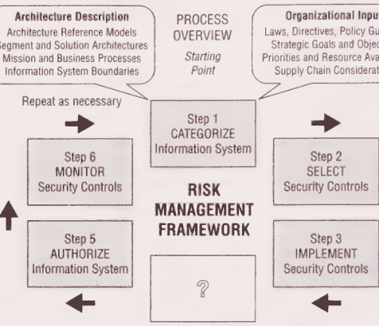

- A. 评估安全控制措施。
- B. 确定控制漏洞。
- C. 修复控制漏洞。
- D. 评估用户活动。

## 63. HAL 系统最近决定停止提供公共 NTP 服务，因为担心其 NTP 服务器会被用于放大 DDoS 攻击。HAL 对其 NTP 服务采取了哪种风险管理策略？

- A. 风险缓解 (Mitigation)
- B. 风险接受 (Acceptance)
- C. 风险转移 (Transference)
- D. 风险规避 (Avoidance)

## 64. Susan 正在与其公司的管理团队合作分类数据，试图应用额外的安全控制措施来限制数据泄露的可能性。Susan 试图执行的是哪项信息安全原则？

- A. 可用性
- B. 拒绝
- C. 机密性
- D. 完整性

- A. $500
- B. $2,500
- C. $5,000
- D. $10,000

## 71. Ben 正在寻找全球认可且专门关注信息安全控制的控制目标框架。以下哪个框架最能满足他的需求？

- A. ITIL
- B. ISO 27002
- C. CMM
- D. PMBOK 指南

## 72. 下列哪部法律要求通信服务供应商配合执法部门的请求？

- A. ECPA（电子通信隐私法案）
- B. CALEA（执法协助与执法执法法案）
- C. 隐私法（Privacy Act）
- D. HITECH（健康信息技术经济法案）

## 73. Gary 每年都会收到他开户的金融机构寄来的隐私通知。哪部法律要求这些机构向 Gary 发送这些通知？

- A. FERPA（教育权利与隐私法案）
- B. GLBA（格雷姆-莱奇-伯利法案）
- C. HIPAA（健康保险流通与责任法案）
- D. HITECH

## 74. 下列哪种协议通常要求供应商不披露在合作范围内学习的机密信息？

- A. NCA（非竞争协议）
- B. SLA（服务水平协议）
- C. NDA（保密协议）
- D. RTO（恢复时间目标）

## 75. 下列哪项不是技术控制的示例？

- A. 路由器 ACL
- B. 防火墙规则
- C. 加密
- D. 数据分类

## 76. 下列哪个利益相关者通常不包含业务连续性计划团队？

- A. 核心业务部门负责人
- B. 信息技术人员
- C. CEO
- D. 支持部门

## 77. Ben 正在为银行设计一个消息系统，希望包含一个功能，允许消息接收者向第三方证明该消息确实来自自称的原起点。Ben 试图实现什么目标？

- A. 身份验证 (Authentication)
- B. 授权 (Authorization)
- C. 完整性 (Integrity)
- D. 非否认性 (Nonrepudiation)

## 78. 哪项信息安全原则规定应尽可能实施重叠的安全控制？

- A. 最小权限
- B. 职责分离
- C. 深度防御 (Defense in depth)
- D. 模糊性实现安全

## 79. 下列哪项不是正式变更管理计划的目标之一？

- A. 以有序的方式实施变更。
- B. 在实施之前测试变更。
- C. 为变更提供回滚计划。
- D. 在变更发生后通知利益相关者。

## 80. Ben 负责数据库中存储的支付卡信息的安全。政策指示他从数据库中删除信息，但由于运营原因，他无法这样做。他获得了政策豁免，并正在寻求适当的补偿性措施来缓解风险。他的最佳选择是什么？

- A. 购买保险
- B. 加密数据库
- C. 移除数据
- D. 反对

## 81. 风险评估团队最近进行了定性评估，并开发了一个类似于此的矩阵。哪个象限包含最需要关注的风险？

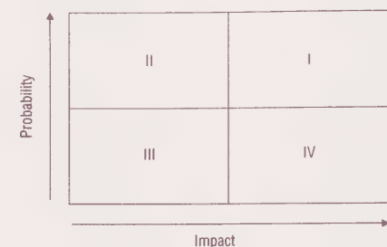

- A. I
- B. II
- C. III
- D. IV

## 82. Tom 计划因欺诈解雇一名员工，并预计会议将充满敌意。以下哪个步骤的协调最为重要？

- A. 通知其他员工
- B. 取回员工的物品
- C. 计算最终工资
- D. 撤销访问权限

## 83. Rolando 是某大型企业的风险经理。公司最近评估了滑坡对其运营的风险，并确定任何可以实施的控制措施成本都超过了收益。公司选择不采取行动。Rolando 采取了哪种风险管理策略？

- A. 风险规避
- B. 风险缓解
- C. 风险转移
- D. 风险接受

## 84. Helen 是一个为初中生提供信息的网站的所有者。她担心其网站的活动可能属于《儿童在线隐私保护法案》(COPPA) 的管辖。在收集以下年龄以下的个人信息之前，必须获得父母的同意？

- A. 13
- B. 15
- C. 17
- D. 18

## 85. Tom 考虑在佛罗里达州迈阿密市中心设立业务。他查阅了所示的该地区 FEMA 洪水地图，并确定他考虑的区域位于100年一洪区内。


该地区的 ARO（年度均发生率）是多少？

- A. 100
- B. 1
- C. 0.1
- D. 0.01

## 86. 你发现网络上的一个用户正在使用如所示的 Wireshark 工具。进一步调查显示他将其用于非法目的。哪项信息安全支柱最可能被违反了？

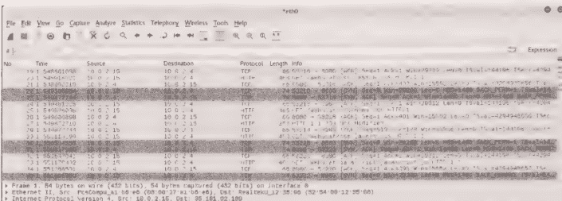

- A. 完整性
- B. 拒绝
- C. 可用性
- D. 机密性

## 87. Alan 正在进行威胁建模，认为将系统分解为所示的关键元素将很有用。他正在使用什么工具？

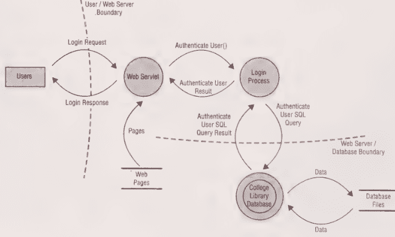

图片重自 CISSP (ISC)² Certified Information Systems Security Professional Official Study Guide, 7th Edition John Wiley & Sons 2015，经许可转载。

- A. 漏洞评估
- B. 模糊测试 (Fuzzing)
- C. 归约分析
- D. 数据建模

### 将下列编号的法律或行业标准与对应的字母字母描述相匹配：

- 1. GLBA
- 2. PCI DSS
- 3. HIPAA
- 4. SOX

- A. 一项美国法律，要求受监管的金融机构每年向其客户提供隐私声明。
- B. 一项美国法律，要求上市公司进行内部控制评估，包括 IT 交易流。
- C. 一项涵盖处理信用卡卡的组织的行业标准。
- D. 一项美国法律，为医疗信息提供数据隐私和安全要求。

## 89. Craig 正在为新的数据中心选择选址，并且必须在美国境内的某处选择一个位置。他从美国地质调查局获取了此处所示的地震地图。如果他主要担心地震风险，以下哪个位置是建设其设施最安全的地方？


(来源：美国地质调查局)

图片经许可转载自《CISSP ISC² 认证信息系统安全专业人员官方学习指南》第 7 版 © John Wiley & Sons 2015。

- A. 纽约
- B. 北卡罗来纳州
- C. 印第安州
- D. 佛罗里达州

## 90. 以下哪种工具最常用于识别，而不适合作为验证器？

- A. 密码
- B. 视网膜扫描
- C. 用户名
- D. 令牌 (Token)

## 91. 在尝试评估故障对客户信心影响时，哪种类型的业务影响评估工具最合适？

- A. 定量 (Quantitative)
- B. 定性 (Qualitative)
- C. 预计年度损失
- D. 减少

## 92. 以下哪项是开发组织关键记录计划的首步步？

- A. 识别关键记录
- B. 定位关键记录
- C. 归档关键记录
- D. 保护关键记录

## 93. 以下哪种安全计划旨在为员工提供执行特定工作任务所需的知识？

- A. 意识教育 (Awareness)
- B. 培训 (Training)
- C. 教育 (Education)
- D. 灌化 (Indoctrination)

## 94. 以下哪种安全计划旨在建立安全理解的最小共同标准标准？

- A. 培训 (Training)
- B. 教育 (Education)
- C. 灌化 (Indoctrination)
- D. 意识教育 (Awareness)

## 95. Ryan 是一家保险公司的安全风险分析师。他目前正在研究一个场景：恶意黑客可能利用 SQL 注入攻击，由于公司 Web 应用程序中匹配的补丁，破坏 Web 服务器。在这种场景中，威胁是什么？

- A. 未打补丁的 Web 应用
- B. 网页破坏
- C. 恶意黑客
- D. 操作系统

### 对于第 96–98 题，请参考以下场景：

Henry 是美国中西部度假村社区 Atwood Landing 的风险经理。该度假村的主要数据中心位于印第安州北部，是一个易发龙卷的地区。Henry 最近进行了了重置成本分析，确定重建和重新配置数据中心将花费 1000 万美元。

Henry 咨询了龙卷风专家、数据中心专家和结构工程师。他们共同确定，典型的龙卷风会对该设施造成约 500 万美元的损害。气象学家确定，Atwood 的设施位于一个每 200 年可能经历一次龙卷风的地区。

## 96. 根据此场景中的信息，龙卷风对 Atwood Landing 数据中心影响的影响因子（Exposure Factor）是多少？

- A. 10%
- B. 25%
- C. 50%
- D. 75%

## 97. 根据此场景中的信息，Atwood Landing 数据中心龙卷风的年度发生率（ARO）是多少？

- A. 0.0025
- B. 0.005
- C. 0.01
- D. 0.015

## 98. 根据此场景中的信息，Atwood Landing 数据中心龙卷风的年度预期损失（ALE）是多少？

- A. $25,000
- B. $50,000
- C. $250,000


# 练习题

- D. $500,000

99. John 正在分析针对其公司的一次攻击，攻击者在 HTML 代码中发现了嵌入的注释，这些注释提供了利用软件漏洞所需的密钥。使用 STRIDE 模型，他发现了哪种类型的攻击？

- A. 伪装 (Spoofing)
- B. 否认认 (Repudiation)
- C. 信息泄露 (Information disclosure)
- D. 权限提升 (Elevation of privilege)

100. 以下哪项可以保护信息机密性的管理控制？

- A. 加密 (Encryption)
- B. 非泄露协议 (Nondisclosure agreement)
- C. 防火墙 (Firewall)
- D. 容错性 (Fault tolerance)

101. Chris 担心他组织的笔记本电脑不安全，这些电脑最近被第三方修改了。他应该关注哪些方面以防止这种行为？

- A. 供应链
- B. 数据合同
- C. 采购过程
- D. 交付后

102. STRIDE、PASTA 和 VAST 都是哪种类型工具的示例？

- A. 风险评估
- B. 框架
- C. 威胁建模
- D. 意识

103. 作为开发人员，Lisa 负责确保数据通过生产时是安全的。这描述的是什么？

- A. 回归测试
- B. 配置
- C. 变更管理
- D. 模糊测试

104. 完成风险评估后，Charles 被分配执行何种衡量标准？

- A. KPI
- B. 指标 (Metric)
- C. 基线 (Baseline)
- D. 策略 (Policy)

105. 以下哪项通常不是管理性的？

- A. 背景检查
- C. 清除
- D. 培训

106. (ISC)² 道德准则适用于所有。

- A. 保护与公共利益
- B. 诚实、公正、尽责
- C. 进步
- D. 保护

107. Greg 的公司最近发生了涉及其数据的重大泄露。他们应该审查哪些法律？

- A. 教育
- B. 金融行业
- C. 政府
- D. 医疗行业

108. Lawrence 被要求执行。这些最可能与哪种过程相关？

- A. 合并
- B. 剥离
- C. 清算
- D. 处置

109. 以下哪项不是管理性的？

- A. 留存
- B. 属性
- C. 信息
- D. 审计

110. Laura 被要求在。她最可能处于哪种组织？

- A. 金融行业
- B. 政府
- C. 医疗行业
- D. 教育

111. 在进行定性风险评估后，Sally 建议购买种类型的风险应对？

- A. 接受
- B. 转移
- C. 减少
- D. 拒绝

# 第 2 章 资产安全（领域 2）


Angela 是某家银行的安全架构师，负责确保交易在传输过程中是安全的。她建议所有交易使用 TLS。她最可能试图阻止哪种威胁，并使用什么方法进行保护？

- A. 中间人、VPN
- B. 数据包注入、加密
- C. 嗅探、加密
- D. 嗅探、TEMPEST

信息相关控制目标（COBIT）是一项信息技术管理的治理框架。哪种数据管理角色最可能应用 COBIT 来平衡安全控制与业务需求？

- A. 业务所有者
- B. 数据处理者
- C. 数据所有者
- D. 数据管理员

哪个术语描述了最小安全标准的起点？

- A. 大纲
- B. 基线
- C. 策略
- D. 配置指南

当介质根据其包含的数据进行标记时，通常适用哪种规则？

- A. 数据根据完整性要求标记。
- B. 介质根据数据的最高分类级别标记。
- C. 介质根据数据的所有分类级别标记。
- D. 介质根据数据的最低分类级别标记。

以下哪项行政管理流程有助于组织为敏感信息分配适当的安全控制级别？

- A. 信息分类
- B. 残留 (Remanence)
- C. 传输数据
- D. 清除

数据留存策略如何有助于降低责任？

- A. 通过确保不保留未使用数据
- B. 通过确保销毁增量数据
- C. 通过确保安全擦除数据使其无法在法律取证中恢复
- D. 通过减少法律要求的数据存储成本

# 第 2 章 资产安全（领域 2）

7. 信息技术（IT）部门中被委托负责日常任务的人员承担什么数据数据角色？

- A. 业务所有者
- B. 用户
- C. 数据处理者
- D. 数据保管员

8. Susan 在一家美国公司工作，该公司与来自欧盟的客户开展业务。如果她负责处理这些客户的 PII（个人身份识别信息），她可能需要做什么？

- A. 始终对数据进行加密。
- B. 根据 HIPAA 对数据进行标记和分类。
- C. 根据 PCI DSS 标准进行年度评估。
- D. 符合诸如美欧隐私盾（US-EU Privacy Shield）等标准。

9. Ben 被要求为其组织信息分类系统的系统识别安全控制。为什么 Ben 可能会选择使用安全基线（security baseline）？

- A. 它适用于所有情况，允许一致的安全控制。
- B. 它们由行业标准机构批准，可以避免法律责任。
- C. 它们提供了一个良好的起点，可以根据组织需求进行定制。
- D. 它们确保系统始终处于安全状态。

10. 用什么术语描述通过重写介质以便在运行相同敏感性水平的环境中重复使用？

- A. 清除（Clearing）
- B. 擦除（Erasing）
- C. 净化（Purging）
- D. 消毒（Sanitization）

11. 以下哪个分类级别是美国（U.S.）政府对可能导致损害但不会造成严重或致命损害的数据分类标签？

- A. 密（Top Secret）
- B. 秘密（Secret）
- C. 机密（Confidential）
- D. 分类（Classified）

12. 硬盘上的备用扇区坏道以及现代 SSD 上的预留空间（overprovisioned space）共同的问题是什么？

- A. 它们可以用来隐藏数据。
- B. 它们只能进行消磁。
- C. 它们不可寻，导致数据残留。
- D. 它们可能未清除，导致数据残留。

13. 什么术语描述在尝试删除数据后仍然存在的数据？

- A. 剩余字节（Residual bytes）
- B. 数据残留（Data remanence）
- C. 空隙空间（Slack space）
- D. 零填充（Zero fill）

对于问题 14–16，请参考以下场景：

你的组织经常处理三种类型的数据：与客户共享的信息、内部用于业务的信息，以及为组织提供显著竞争优势的秘密。与客户共享的信息存储在 Web 服务器上，而内部业务数据和秘密存储在文件服务器和员工工作站上。

14. 哪些数据分类最符合这些数据？

- A. 未分类、机密、绝（Unclassified, confidential, top secret）
- B. 公开、敏感、私密（Public, sensitive, private）
- C. 公开、敏感、专有（Public, sensitive, proprietary）
- D. 公开、机密、私密（Public, confidential, private）

15. 为了防止秘密泄露或被盗可以使用什么技术？

- A. 分类（Classification）
- B. 对称加密（Symmetric encryption）
- C. 水印（Watermarks）
- D. 元数据（Metadata）

16. 在文件服务器上你应该使用哪种加密类型来保护专有数据，并在数据传输时如何保护数据？

- A. 静态 TLS 和 传输中 AES
- B. 静态 AES 和传输中 TLS
- C. 静态 VPN 和 传输中 TLS
- D. 静态 DES 和传输中 AES

17. 标记数据允许 DLP 系统做什么？

- A. DLP 系统可以检测标签并应用适当的保护。
- B. DLP 系统可以根据分类方案调整标签。
- C. DLP 系统可以允许流量通过。
- D. DLP 系统可以删除未标记的数据。

18. 为什么购买高质量介质来包含敏感数据具有效益？

- A. 高价介质失效概率较低。
- B. 数据价值远超过介质成本。
- C. 高价介质更容易加密。
- D. 高价介质通常能提高数据完整性。

# 第 2 章 资产安全（领域 2）

19. Chris 负责公司的工作站，并且有些工作站用于处理专有信息。哪种选项最好描述了他负责的工作站在其生命周期结束时应该发生什么？

- A. 擦除（Erasing）
- B. 清除（Clearing）
- C. 消毒（Sanitization）
- D. 销毁（Destruction）

20. 从最少到最敏感重新排列以下政府数据级别。

- A. 秘密（Secret）
- B. 机密（Confidential）
- C. 未分类（Unclassified）
- D. 密（Top Secret）

21. 哪个场景描述了静态数据？

- A. 传输中的数据
- B. 电子商务交易数据
- C. 存储在硬盘上的数据
- D. 存储在 RAM 中的数据

22. 如果为处理信用卡的 Windows 10 系统选择安全标准，哪个是最好的？

- A. Microsoft Windows 10 基线
- B. CIS Windows 10 基线
- C. PCI DSS
- D. NSA Windows 10 基线

对于问题 23–25，请参考以下场景：

互联网安全中心（CIS）与各行业的领域专家合作，为操作系统、移动设备、网络设备创建安全控制列表。你的组织决定为你的系统使用 CIS 基准。根据此决定回答以下问题。

23. CIS 基准是什么实践的示例？

- A. 进行风险评估
- B. 实现数据标记
- C. 适当的系统所有权
- D. 使用安全基线

24. 将 CIS 基准调整到组织的使命和特定的 IT 系统涉及哪些过程？

- A. 范围确定（Scoping）和选择（selection）
- B. 范围确定（Scoping）和定制（tailoring）
- C. 基线化（Baselining）和定制（tailoring）
- D. 定制（Tailoring）和选择（selection）

25. 你应该如何确定给定系统应该接收的基线控制？

- A. 咨询数据保管员。
- B. 根据其处理的数据分类进行选择。
- C. 对所有系统应用相同的控制。
- D. 咨询数据所有者。

26. FTP 和 Telnet 的什么问题使得 SFTP 和 SSH 更好？

- A. 许多系统没有安装 FTP 和 Telnet。
- B. FTP 和 Telnet 不加密数据。
- C. FTP 和 Telnet 有漏洞且不再维护。
- D. FTP 和 Telnet 难以使用，使得 SFTP 和 SSH 成为首选解决方案。

27. 防务承包 Saria 最近关闭了一个大型研究项目，并计划将用于项目的数十万美元系统和数据存储磁带用于其他用途。当 Saria 审查公司内部流程时，她发现手册规定应该将其销毁。为什么不允许 Saria 消磁后重新使用磁带以为雇主省钱？

- A. 数据持久性可能是一个问题。
- B. 数据残留是一个问题。
- C. 磁带可能会位腐（bitrot）。
- D. 磁带数据无法通过消磁清除。

28. 用于区分或追踪个人身份的个人信息是什么类型的信息？

- A. 个人身份识别信息 (PII)
- B. 个人健康信息 (PHI)
- C. 社会安全号 (SSN)
- D. 身份信息 (SII)

29. 静态数据的主要信息安全风险是什么？

- A. 分类不
- B. 数据泄露
- C. 解密
- D. 数据完整性丢失

# 第 2 章 资产安全（领域 2）

30. 像 Microsoft BitLocker 这样的全磁盘加密用于保护什么状态的数据？

- A. 传输中的数据
- B. 静态数据
- C. 未标记数据
- D. 已标记数据

31. Susan 的雇主要求她使用 IPsec VPN 连接到网络。当 Susan 连接时，IPsec VPN 允许她做什么？

- A. 在公共网络上发送解密数据并像在公司内部网络一样。
- B. 通过公共网络创建加密网络并像在公司内部网络一样。
- C. 在公司内部网络使用 TLS 创建虚拟专用网络。
- D. 创建连接公司网络和内部家庭网络的隧道网络。

32. 数据分类的主要目的是什么？

- A. 优先考虑泄露的成本。
- B. 优先 IT 支出。
- C. 符合违反通知法。
- D. 识别数据对组织的价值。

33. Fred 的组织允许在项目结束后并在经过消毒后对系统降级以重复使用。对于将来自“密”级项目的系统用于未来的“机密”级项目，Fred 可能会提出什么担忧？

- A. “密”级数据可能与“机密”数据混合，导致需要重新标记系统。
- B. 消毒过程的成本可能超过新设备的成本。
- C. 数据可能会在消毒过程中暴露。
- D. 组织的 DLP 系统可能会因为标签差异而标记新系统。

34. 在对数据分类时，以下哪些担忧不应该是决策的一部分？

- A. 分类数据的成本
- B. 数据的敏感性
- C. 数据暴露可能造成的损害程度
- D. 数据对组织的价值。

35. 以下哪种移除介质中数据最有效的方法？

- A. 消磁 (Degaussing)
- B. 清除 (Purging)
- C. 擦除 (Erasing)
- D. 标记 (Clearing)

36. 将此处显示的每个编号数据元素与字母类别进行匹配。

你可以对每个类别使用一次、多次或完全不使用。如果一个数据元素匹配多个类别，请选择最具体的一个。

## 数据元素

- 1. 医疗记录
- 2. 信用卡号
- 3. 社会安全号
- 4. 驾照号

## 类别

- A. PCI DSS
- B. PHI（受保护健康信息）
- C. PII（个人身份信息）

对于问题 37–39，请参考以下场景：

Lauren 所职的医疗保健公司处理 HIPAA 数据，以及内部业务数据、受保护健康信息和日常业务通信。其内部策略使用以下要求来确保静态存储和传输中 HIPAA 数据的安全。

| 分类 | 处理要求 |
|---|---|
| 机密 (HIPAA) | 静态和传输中均加密。所有工作站要求进行全磁盘加密。文件只能以加密形式发送，密码必须通过单独的渠道进行传输。打印文档必须标记为“需要 HIPAA 处理”。 |
| 私有 (PHI) | 静态和传输中均加密。PHI 必须存储在安全服务器上，不应在本地工作站保留副本。打印文档必须标记为“私有”。 |
| 敏感（业务机密） | 建议加密但不是强制。 |
| 公开 | 信息可以不加密地发送。 |

37. 传输中的 HIPAA 文档适合哪种加密技术？

- A. BitLocker
- B. DES
- C. TLS
- D. SSL

38. Lauren 的雇主要求 Lauren 对患者 X 的 X射线数据进行分类，这些数据关联有内部患者标识符，但无法直接识别患者。公司的数据所有者认为数据泄露可能会对组织造成损害（但不是异常损害）。Lauren 应该如何对数据进行分类？

- A. 公开
- B. 敏感
- C. 私有
- D. 机密

39. Lauren 的雇主可以实施什么技术来帮助防止机密数据通过电子邮件发送出组织？

- A. DLP
- B. IDS
- C. 防火墙
- D. UDP

40. 一个美国政府数据库包含秘密（Secret）、机密（Confidential）和绝密（Top Secret）数据。它应该如何分类？

- A. 绝密
- B. 机密
- C. 秘密
- D. 混合分类

41. 使用什么工具防止离职员工与他们的新员工共享专有信息？

- A. 加密
- B. NDA（保密协议）
- C. 分类
- D. 清除

42. BitLocker 和微软的加密文件系统（EFS）使用哪种加密算法？

- A. Blowfish
- B. Serpent
- C. AES
- D. 3DES

43. Chris 负责其组织的安全标准，并指导了其组织 Windows PC 安全基准的选择和实施。Chris 如何才能最有效地确保他负责的工作站经过合规检查，并根据需要应用设置？

- A. 分配用户进行基准合规性抽检。
- B. 使用微软组策略。
- C. 创建启动脚本在系统启动时应用策略。
- D. 定期与数据所有者和系统所有者一起审查基准。

44. 什么术语描述一组常见的安全配置（通常由第三方提供）？

- A. 安全策略
- B. 基准 (Baseline)
- C. DSS
- D. NIST SP 800-53

45. 哪种策略描述了数据在销毁之前保留和维护多久？

- A. 分类
- B. 审计
- C. 记录留存
- D. 可用性

46. 哪种攻击促使供应商从 SSL 转向在默认情况下仅使用 TLS？

- A. POODLE
- B. Stuxnet
- C. BEAST
- D. CRIME

47. 哪种安全措施在备份磁带被盗或丢失的情况下可以提供额外的安全控制？

- A. 保留磁带的多副本。
- B. 将带介质替换为硬盘。
- C. 使用适当的安全标签。
- D. 使用 AES-256 加密。

# 第 2 章 资产安全（领域 2）

48. Joe 在一家大型制药研发公司工作，被要求编写其组织的数据留存策略。根据法律要求，该组织必须遵守美国食品药品监督管理局（FDA）的《联邦法规》第 21 编。为此，要求保留带有电子签名的记录。为什么签名会成为留存要求的一部分？

- A. 它确保了有人审查过数据。
- B. 它提供了机密性。
- C. 它确保了数据没有被更改。
- D. 它验证了谁批准了数据。


# 第 2 章 ■ 资产安全（领域 2）

## 49. 在通过命令行进行远程服务器管理时，哪种协议优于 Telnet？

- A. `SCP`
- B. `SFTP`
- C. `WDS`
- D. `SSH`

## 50. 哪种方法使用强磁场擦除介质？

- A. 磁擦 (`Magwipe`)
- B. 消磁 (`Degaussing`)
- C. 洁化 (`Sanitization`)
- D. 清除 (`Purging`)

## 51. Steve 担心离开组织的员工经常知晓专有信息。以下哪种控制措施对这种威胁最有效？

- A. 洁化
- B. `NDA`
- C. 标记
- D. 加密

## 52. Alex 在一家政府机构工作，该机构需要满足美国联邦政府的数据安全要求。为了满足这些要求，Alex 被要求确保数据可以根据其分类级别进行识别。Alex 应该对数据进行什么操作？

- A. 对数据进行分类。
- B. 对数据加密。
- C. 给数据标记标签。
- D. 对数据应用 `DRM`（数字版权管理）。

## 53. Ben 正在遵循所示的国家标准与技术协会（`NIST`）特殊出版 `800-88` 洁化和处置指南。他正在处理分类为敏感的组织，这在 `NIST` 模型中属于中等安全分类。如果介质将作为剩余物资出售，Ben 需要遵循什么过程？


来源：`NIST SP 800-88`。

- A. 销毁
- B. 清除

## 54. 哪种加密技术适用于传输中的 `HIPAA` 文档？

- A. `BitLocker`
- B. `DES`
- C. `TLS`
- D. `SSL`

## 55. 以下哪种角色对数据承担最终责任？

- A. 系统所有者
- B. 业务所有者
- C. 数据所有者
- D. 任务所有者

## 56. 哪一个美国政府机构监督欧盟公民数据的合规？

- A. `FAA`
- B. `FDA`
- C. `DoD`
- D. 商务部

## 场景：问题 57–59

Chris 最近入职某组织。该组织使用以下流程：

1. 制定分类标准。
2. 确定数据所有者。
3. 对数据分类。
4. 为每个分类选择所需的控制。
5. 为组织选择安全基准。
6. 范围化并调整控制。
7. 实施并执行控制。
8. 授予并管理访问。

## 57. 如果 Chris 是组织的数据所有者之一，他最可能负责哪些步骤？

- A. 他负责 3, 4 和 5。
- B. 他负责 1, 2 和 3。
- C. 他负责 5, 6 和 7。
- D. 所有步骤都是他的直接责任。

## 58. Chris 管理一个系统管理员团队。如果他们执行分类流程的 6、7、8 步，他们履行了什么数据角色？

- A. 他们是系统所有者和管理员。
- B. 他们是管理员和保管员。
- C. 他们是数据所有者和管理员。
- D. 他们是保管员和用户。

## 59. 如果 Chris 的公司位于欧盟，并受雇为第三方处理数据，他的公司在分类和处理数据的流程中扮演什么角色？

- A. 业务所有者
- B. 任务所有者
- C. 数据处理者
- D. 数据管理员

## 60. 以下哪项不是欧盟《通用数据保护条例》（`GDPR`）的原则之一？

- A. 信息必须公平地处理。
- B. 信息必须在获取后一年内删除。
- C. 信息必须安全地维护。
- D. 信息必须准确无误。

## 61. Ben 的公司位于欧盟，聘佣了一家第三方组织为其处理数据。谁负责保护数据隐私并确保其不用于预期用途之外的任何用途？

- A. Ben 的公司负责。
- B. 第三方数据处理者负责。
- C. 数据控制者负责。
- D. 两个组织共同承担相同责任。

## 62. 军人 Major Hunter 被委托接触了某些信息，这些信息如果泄露，可能会对国家安全造成严重损害。根据美国政府的分类标准，这些数据应该如何分类？

- A. 未分类 (`Unclassified`)
- B. 绝密 (`Top Secret`)
- C. 机密 (`Confidential`)
- D. 秘密 (`Secret`)

## 63. 当计算机停止服务并报废时，确保所有存储介质已移除或销毁的过程被称为什么？

- A. 清除 (`Sanitization`)
- B. 擦除 (`Purging`)
- C. 销毁 (`Destruction`)
- D. 解密 (`Declassification`)

## 64. 使用 `bcrypt` 的 Linux 系统使用的是基于哪种 `DES` 替代加密方案的工具？

- A. `3DES`
- B. `AES`
- C. `Diffie–Hellman`
- D. `Blowfish`

## 65. Susan 在一家机构工作，该机构对所有可移除介质标记了其包含的数据分类级别，包括公共数据。为什么 Susan 的雇主会对所有介质进行标记，而不是只对那些如果泄露可能导致损害的数据介质进行标记？

- A. 订购所有预标记的介质更便宜。
- B. 它防止了敏感介质被误标记。
- C. 它防止将公共介质用于敏感数据。
- D. `HIPAA` 要求对所有介质进行标记。

## 66. 存储在 `RAM` 中的数据最好被描述为什么类型的数据？

- A. 静态数据 (`Data at rest`)
- B. 使用中数据 (`Data in use`)
- C. 传输中数据 (`Data in transit`)
- D. 大数据 (`Data at large`)

## 67. `NIST SP 800-88` 样本清除证书（所示）中的验证部分旨在帮助防止什么问题？

| 清除证书 (`CERTIFICATE OF SANITIZATION`) |
| :--- |
| 执行清除的人员 (`PERSON PERFORMING SANITIZATION`) |
| 姓名: | 职位: |
| 组织: | 位置: | 电话: |
| 介质信息 (`MEDIA INFORMATION`) |
| 制造商: | 型号 |
| 序列号: | |
| 介质属性号: | |
| 介质类型: | 源（如用户名或 `PC` 属性号）: |
| 分类: | 基于数据 [ ] 是 [ ] 否 [ ] 未知 |
| 备份位置: | |
| 清除详情 (`SANITIZATION DETAILS`) |
| 方法类型: | [ ] 清除 (`Clear`) [ ] 擦除 (`Purge`) [ ] 损坏 (`Damage`) [ ] 销毁 (`Destruct`) |
| 使用的方法: | [ ] 消磁 (`Degauss`) [ ] 覆盖 (`Overwrite`) [ ] 块擦除 (`Block Erase`) [ ] 加密清除 (`Crypto Erase`) [ ] 其他 |
| 方法细节: | |
| 已使用（包括版本）： | |
| 验证方法: | [ ] 全部 [ ] 快速采样 [ ] 其他 |
| 清除后分类: | |
| 备注: | |
| 介质去向 (`MEDIA DESTINATION`) |
| 内部重用 [ ] 外部重用 [ ] 回收设施 [ ] 制造商 [ ] 其他规格 |
| 详情: | |
| 签名 (`SIGNATURE`) |
| 我同意，本声明中提供的信息据我所知是准确的。 |
| 签名: | 日期: |
| 验证 (`VALIDATION`) |
| 姓名: | 职位: |
| 组织: | 位置: | 电话: |
| 签名: | 日期: |

来源：清除证书。

- A. 销毁 (`Destruction`)
- B. 重用 (`Reuse`)
- C. 数据残留 (`Data remanence`)
- D. 归因 (`Attribution`)

## 68. 为什么解密很少被选作介质重用的选项？

- A. 擦除对于敏感数据已经足够了。
- B. 清除是移除数据的优方法。
- C. 它比新介质贵，而且仍然可能失效。
- D. 需要先进行清除 (`Clearing`)。

## 69. 焚烧、破碎、粉碎和分解，描述的都是介质生命周期中的哪个阶段？

- A. 清除 (`Sanitization`)
- B. 消磁 (`Degaussing`)
- C. 擦除 (`Purging`)
- D. 销毁 (`Destruction`)

## 70. 欧盟（`EU`）通用数据保护条例（`GDPR`）不包含以下哪些关键要素？

- A. 需要为了特定、明确且合法的目的收集信息
- B. 需要确保收集仅限于实现所述目的所必需的信息
- C. 需要保护数据免受意外销毁
- D. 需要对静态数据进行加密

## 71. 为什么组织可能会在处理不同分类级别数据的工作站上使用独特的屏幕背景或设计？

- A. 为了指示正在使用的软件版本
- B. 为了推广企业信息
- C. 为了提高可用性
- D. 为了指示数据的分类级别

## 72. Charles 被要求降低其组织用于存储私有数据的介质级别。Charles 应该遵循什么流程？

- A. 对驱动器消磁，然后用较低的分类级别重新标记。
- B. 将驱动器粉碎，然后根据其包含的数据重新分类。
- C. 遵循组织的擦除流程，然后进行标记。
- D. 重新标记介质，然后遵循组织的擦除流程以确保介质与标签相符。

## 73. 根据 `NIST SP 800-53`，以下哪些任务不是系统所有者执行的？

- A. 开发
- B. 确保数据安全
- C. 防止数据受意外破坏
- D. 实施策略

## 74. `NIST SP 800-88` 样本清除证书（所示）中的验证部分旨在帮助防止什么问题？

（此处重复了第 67 题内容及表格，根据指令要求不重复输出原文，此处仅保留题目编号与选项）

- A. 销毁 (`Destruction`)
- B. 重用 (`Reuse`)
- C. 数据残留 (`Data remanence`)
- D. 归因 (`Attribution`)


## 73. 根据 NIST SP 800-53，以下哪些任务不是系统所有者执行的？

- A. 开发
- B. 确保数据安全
- C. 防止数据受意外破坏
- D. 实施策略

## 74. NIST SP 800-88 样本清除证书（所示）中的验证部分旨在帮助防止什么问题？

- A. 销毁 (Destruction)
- B. 重用 (Reuse)
- C. 数据残留 (Data remanence)
- D. 归因 (Attribution)

## 89. Susan 的组织在将硬盘发送到第三方机构进行粉碎处理之前，对硬盘进行了零值填充（zero fill）。她的组织试图避免哪种问题？

- A. 在第三方场所时产生数据滞留
- B. 第三方对硬盘的处置不当
- C. 分类错误
- D. 数据持久性

## 90. 用于帮助识别文件所有者的嵌入数据是哪种类型标签的示例？

- A. 版权声明
- B. DLP（数据泄露防护）
- C. 数字水印
- D. 隐写术

## 91. 按照需要尽可能长时间地保留和维护信息被称为什么？

- A. 数据存储策略
- B. 数据存储
- C. 资产维护
- D. 记录保留

## 92. 在数据分类期间，以下哪些活动不是考虑因素？

- A. 谁可以访问这些数据
- B. 如果数据丢失或泄露会产生什么影响
- C. 创建这些数据的成本是多少
- D. 数据可能需要哪些保护法规

## 93. 静态数据（data at rest）通常使用哪种加密？

- A. 非对称加密
- B. 对称加密
- C. DES
- D. OTP（一次性密码）

## 94. 哪种数据角色负责为员工授予适当的访问权限？

- A. 数据处理员
- B. 业务所有者
- C. 数据保管员
- D. 管理管理员

## 95. 哪部加州法律要求在收集加州居民个人信息的商业网站上显眼地发布隐私政策？

- A. 《个人信息保护和电子文档法案》
- B. 《加州在线隐私保护法》
- C. 《加州在线网络隐私法》
- D. 《加州民法典 1798.82》

## 96. Fred 准备将备份磁带送到场外的安全第三方存储设施。在将磁带发送到该设施之前，Fred 应该采取哪些步骤？

- A. 确保处理磁带的方式与根据其分类处理原始媒体的方式。
- B. 提高磁带的分类级别，因为它们离开了公司的控制范围。
- C. 清除磁带，以确保机密数据不丢失。
- D. 解密磁带，以防它们在传输中。

## 97. 以下哪项描述了传输中的数据（data in motion）？

- A. 正在运存储设施的备份磁带上的数据
- B. TCP 包中的数据
- C. 电子商务交易中的数据
- D. 正在位置之间复制的文件中的数据

## 98. 出台了一项新法律，如果涵盖的数据被盗或意外发布，将对贵公司造成巨大的财务损失。您的组织应该怎么办？

- A. 选择一个新的安全基准。
- B. 重新标记数据。
- C. 加密所有静态和传输数据。
- D. 审查数据分类并对数据进行适当分类。

## 99. Ed 被要求通过电子邮件发送其组织分类为机密和专有的数据。哪种加密技术可以确保邮件附件的内容在互联网上传输时保持机密？

- A. SSL
- B. TLS
- C. PGP
- D. VPN

## 100. 哪种映射正确匹配了非政府政府分类方案之间的数据分类？

- A. 绝密 – 机密/专有
     秘密 – 私密
     秘密 – 敏感
- B. 秘密 – 业务机密
     机密 – 专有
     机密 – 业务内部
- C. 绝密 – 业务敏感
     秘密 – 业务内部
     机密 – 业务专有
- D. 秘密 – 专有
     机密 – 私密
     未分类 – 公共

# 第 3 章 安全架构与工程（领域 3）


## 1. Matthew 是一家咨询公司的安全管理员，必须实施根据用户之前的活动限制其访问的访问控制。例如，一旦咨询顾问访问了属于咨询客户 Acme Cola 的访问数据，他们可能再无法访问属于 Acme 的任何竞争对手的数据。哪种安全模型最符合 Matthew 的需求？

- A. Clark-Wilson
- B. Biba
- C. Bell-LaPadula
- D. Brewer-Nash

## 2. 参考此处所示图，火灾的哪个早期阶段可以使用检测技术来识别它？

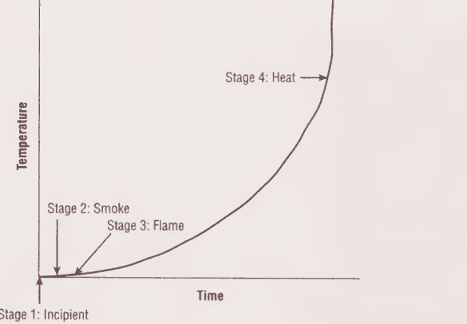

图片重印自 CISSP (ISC)² Certified Information Systems Security Professional Official Study Guide, 7th Edition © John Wiley & Sons 2015，经许可重印。

- A. 初始（Incipient）
- B. 烟雾
- C. 火焰
- D. 热量

## 3. Ralph 正在一个新的计算设施设计物理安全基础设施，该设施在很大程度上将无人值。他计划在设施内实施运动检测器，但还想包含一个物理存在的次要验证控制。以下哪项最符合他的需求？

- A. CCTV（闭路电视）
- B. IPS（入侵防御系统）
- C. 门禁
- D. 法拉笼

## 4. Harry 想要从一个使用 m n 控制的数据库中检索密钥，其中 m=4，n=8。需要多少代理？

- A. 2
- B. 4
- C. 8
- D. 12

## 5. Fran 的公司考虑购买一种基于网络的电子邮件服务以节省成本。她的公司考虑的是哪种云环境？

- A. SaaS
- B. IaaS
- C. CaaS
- D. PaaS

## 6. Bob 是联邦政府的安全管理员，希望选择一种符合 FIPS 的数字签名方法。在以下哪种加密算法是接受的？

- A. DSA
- B. HAVAL
- C. RSA
- D. ECDSA

## 7. Harry 想要访问存储在服务器上的 Sally 文件。应用主体/对象模型，谁或什么是主体？

- A. Harry
- B. Sally
- C. 服务器
- D. 文档

## 8. Michael 负责调查由于网站篡改导致的安全事件，该事件发生在虚拟化平台上。他希望尽快恢复网站。Michael 最合理的下一步操作是什么？

- A. 在调查完成之前保持网站离线。
- B. 使用虚拟化平台。
- C. 对网站进行加密。
- D. 关注网站。

## 9. Helen 是一个软件工程师，正在开发限制在隔离沙箱内的代码。Helen 使用什么软件技术？

- A. 边界
- B. 输入验证
- C. 限制
- D. TCB

## 10. 什么概念描述了组织对其控制满足安全要求的程度？

- A. 信任
- B. 凭证
- C. 验证
- D. 保证

## 11. 开发人员为了测试目的可能在代码中引入哪种安全漏洞？

- A. 维护钩子
- B. 跨站脚本
- C. SQL 注入
- C. 缓冲区溢出

## 12. 在所示图中，Sally 因为 Biba 模型无法读取文件。Sally 拥有秘密权限，而文件分类为机密。Biba 模型执行了哪项原则？


- A. 简单安全属性
- B. 简单完整性属性
- C. *-安全属性
- D. *-完整性属性

## 13. Tom 负责维护位于发电过程的系统安全。这些系统使用什么术语？

- A. POWER
- B. SCADA
- C. HAVAL
- D. COBOL

## 14. Sonia 最近从笔记本电脑上拆下加密硬盘并将其移动到新设备上。尽管知道用户密码，她仍无法访问加密内容。哪种硬件功能可能是导致这个问题的原因？

- A. TCB
- B. TPM
- C. NIACAP
- D. RSA

## 15. Chris 想验证他下载的软件包是否与原始版本匹配。如果他认为技术复杂的攻击者可能将软件包替换为带有后门的版本，他应该使用哪种哈希工具？

- A. MD5
- B. 3DES
- C. SHA1
- D. SHA 256

## 16-19. 对于问题 16-19，请参考以下场景：

Alice 和 Bob 希望使用非对称加密系统进行通信。他们位于国家的不同地区，但通过相互信任的证书颁发机构的数字证书交换加密密钥。

### 16. 如果 Alice 想向 Bob 发送加密消息，她使用哪个密钥来加密消息？

- A. Alice 的公钥
- B. Alice 的私钥
- C. Bob 的公钥
- D. Bob 的私钥

### 17. 当 Bob 收到 Alice 发来的加密消息时，他使用什么密钥来解密消息？

- A. Alice 的公钥
- B. Alice 的私钥
- C. Bob 的公钥
- D. Bob 的私钥

### 18. 在这种场景下，Bob 不可能拥有哪一个密钥？

- A. Alice 的公钥
- B. Alice 的私钥
- C. Bob 的公钥
- D. Bob 的私钥

### 19. Alice 还想对她发送给 Bob 的消息进行数字签名。她应该使用什么密钥来创建数字签名？

- A. Alice 的公钥
- B. Alice 的私钥
- C. Bob 的公钥
- D. Bob 的私钥

## 20. 为了防御彩虹表攻击而在密码中添加的随机值称为什么什么？

- A. 哈希 (Hash)
- B. 盐值 (Salt)
- C. 扩展器 (Extender)
- D. 棒 (Rebar)

## 21. 下列哪项不是哈希算法的属性？

- A. 它们需要密码密钥。
- B. 它们是不可逆的。
- C. 找到两个具有相同哈值的消息非常困难。
- D. 它们接受变长度的输入。

## 22. 哪种类型的灭火系统在检测到火灾初期阶段注水，并在放水前需要喷淋头的激活？

- A. 湿式 (Wet pipe)
- B. 干式 (Dry pipe)
- C. 激式 (Deluge)
- D. 预作用式 (Preaction)

## 23. Susan 希望以提供内容机密性的方式配置 IPsec。IPsec 的哪个组件提供了这种能力？

- A. AH
- B. ESP
- C. IKE
- D. ISAKMP

## 24. 下列哪种加密目标可以防止设备丢失或被盗带来的风险？

- A. 非否认性 (Non-repudiation)
- B. 身份认证 (Authentication)
- C. 完整性 (Integrity)
- D. 机密性 (Confidentiality)

## 25. 此处真值表描述的是哪种逻辑运算？

| 输入 1 | 输入 2 | 输出 |
| :--- | :--- | :--- |
| 0 | 0 | 0 |
| 0 | 1 | 0 |
| 1 | 0 | 1 |
| 1 | 1 | 0 |

- A. OR（或）
- B. AND（与）
- C. XOR（异或）
- D. NOR（非或）

## 26. 数据加密标准 (DES) 使用多少位密钥密钥材料来加密信息？

- A. 56 位
- B. 64 位
- C. 128 位
- D. 256 位

## 27. 在图中，Harry 写入数据文件的请求被拦截。Harry 拥有“秘密”（Secret）安全许可，而数据文件具有“机密”（Confidential）分类。Bell-LaPadula 模型的哪种原则阻止了这一请求？


- A. 简单安全属性 (Simple Security Property)
- B. 简单性属性 (Simple Integrity Property)
- C. *-安全属性 (*-Security Property)
- D. 任意安全属性 (Discretionary Security Property)

## 28. Florian 和 Tobias 希望开始使用对称加密系统进行通信，但他们没有预先约定的秘密，也无法面交换密钥。他们可以使用什么算法来安全地交换密钥？

- A. IDEA
- B. Diffie-Hellman
- C. RSA
- D. MD5

## 29. 在通用标准 (Common Criteria) 下，哪个元素描述了产品的安全需求？

- A. TCSEC
- B. ITSEC
- C. PP (保护策略)
- D. ST (标准)

## 30. 下列哪项不是加密哈希函数的基本要求之一？

- A. 函数必须对固定长度的输入有效。
- B. 函数对任何输入都必须相对容易计算。
- C. 函数必须是单向的。
- D. 函数必须是不冲突的。

## 31. 使用包含 5 位密钥的密码算法有多少种可能的密钥？

- A. 10
- B. 16
- C. 32
- D. 64

## 32. 加密算法应当公开检查的这一想法背后的加密原则是什么？

- A. 模糊实现安全 (Security through obscurity)
- B. 柯克霍夫法则 (Kerckhoff's principle)
- C. 深度防御 (Defense in depth)
- D. 海森堡原理 (Heisenberg principle)

## 33. 对应的如图所示，箭头指示的安全控制措施名称是什么？


（图片转载自 CISSP Certified Information Systems Professional Study Guide, 7th Edition © John Wiley & Sons）

- A. 人员通道 (Mantrap)
- B. 闸机 (Turnstile)
- C. 入侵防御系统 (Intrusion prevention system)
- D. 门户 (Portal)

## 34. 下列哪项不是布线间室的标准物理要求？

- A. 仅放置在守卫监控的区域。
- B. 不在机室内存放易燃物品。
- C. 在门上使用传感器记录进入。
- D. 对机室进行定期检查。

## 35. 在图中，Sally 被 Biba 完整性模型阻止写入数据文件。Sally 拥有“秘密”（Secret）安全许可，而文件是“绝密”（Top Secret）。哪种原则阻止了她？


- A. 简单安全属性
- B. 简单性属性
- C. *-安全属性
- D. 完整性属性

## 36. 将下列数字概念与字母描述匹配：

架构概念：

1. 检查时间 (Time of check)
2. 隐蔽通道 (Covert channel)
3. 使用时间 (Time of use)
4. 维护 (Maintenance)
5. 参数检查 (Parameter checking)

描述：

A. 用于通信的正常路径
B. 检查时间与使用时间之间的差异
C. 检查对象的时间
D. 主体访问对象的时间
E. 仅对开发者已知的方法
F. 防止溢出攻击

## 37. 实现隐蔽通道至少需要多少个独立方？

- A. 1
- B. 2
- C. 3
- D. 4

## 38. 当进程准备好执行但 CPU 当前可用时，处理器调度程序将其放在什么种状态？

- A. 就绪 (Ready)
- B. 运行 (Running)
- C. 等待 (Waiting)
- D. 停止 (Stopped)

## 39. Alan 正在审查一个被分配 E1 保证级别的系统。他对该系统的保证程度如何？

- A. 经过功能测试。
- B. 经过结构化测试。
- C. 经过形式化设计和测试。
- D. 经过方法化的设计和审查。

## 40. 强制访问控制系统的哪个组件用于为对象分配分类？

- A. 安全标签 (Security label)
- B. 安全令牌 (Security token)
- C. 安全描述符 (Security descriptor)
- D. 安全能力 (Security capability)

## 41. 哪种类型的软件对任何想要检查它的人开放代码？

- A. 闭源
- B. 开源
- C. 固定源
- D. 未定义源

## 42. Adam 最近在 NTFS 文件系统上配置了权限，通过列出每个用户来描述用户的访问权限。Adam 创建了什么？

- A. 访问控制列表 (ACL)
- B. 访问控制条目 (ACE)
- C. 基于角色的访问控制
- D. 强制访问控制

## 43. Betty 担心针对其组织开发的自定义应用程序使用缓冲区溢出攻击。哪种安全控制对这些攻击提供最强有防御？

- A. 防火墙
- B. 入侵检测系统
- C. 参数检查
- D. 漏洞扫描

## 44. 下列哪个术语不是用于描述特权运行模式？

- A. 用户模式 (User mode)
- B. 内核模式 (Kernel mode)
- C. 监视模式 (Supervisory mode)
- D. 系统模式 (System mode)

## 45. James 正在使用一个授权同时处理“秘密”（Secret）和“绝密”（Top Secret）级信息的国防系统。他使用的是哪种类型的系统？


# 第3章 安全架构与工程（领域3）

## 单选题

- A. 单态
- B. 未分类
- C. 分段
- D. 多态

### 46. Kyle 被授予访问一个使用高模式（System High）的军事计算机系统。关于 Kyle 的安全许可要求，哪项是不正确的？

- A. Kyle 必须拥有系统中处理的最高分类许可，无论其访问权限。
- B. Kyle 必须获得系统中所有信息的访问许可。
- C. Kyle 必须对系统中所有信息都有正当理由。
- D. Kyle 必须拥有有效的安全许可。

### 47. Gary 拦截了两个个人之间的通信，怀疑他们正在交换秘密信息。通信的内容看起来是图像。这些个人可能使用哪种技术在图像中隐藏信息？


- A. 可视密码学
- B. 隐密术
- C. 密码学哈希
- D. 传输层安全

### 48. 下列术语中哪一个准确描述了凯撒密码？

- A. 置换密码
- B. 块加密
- C. 移位加密
- D. 强加密

### 49. 在此处所示的环保护模型中，哪个环（Ring）包含了操作系统的内核？

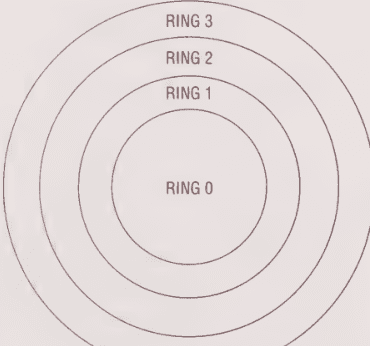

- A. Ring 0
- B. Ring 1
- C. Ring 2
- D. Ring 3

### 50. 在基础设施即服务（IaaS）环境中，供应商为客户提供存储服务的访问权限，通常由谁负责从退役的驱动器中移除敏感数据？

- A. 客户的安全团队
- B. 客户的存储团队
- C. 客户的供应商管理团队
- D. 供应商

### 51. 下列哪项是代码（code），而不是算法（cipher）？

- A. 数据加密标准
- B. “陆路则一，海路则二”
- C. 字母移动三位
- D. 单词乱序

### 52. 下列哪种系统保证过程提供了对系统控制的独立第三方评估，该评估可以被许多不同的组织信任？

- A. 认证（Certification）
- B. 定义（Definition）
- C. 验证（Verification）
- D. 授权（Accreditation）

### 53. 过程 `________` 确保任何行为只会影响与进程相关的内存和资源。

- A. 限制（Restriction）
- B. 隔离（Isolation）
- C. 限定（Limitation）
- D. 参数（Parameters）

### 54. Harold 正在评估其环境对硬件故障的敏感性，并希望识别某个硬件的预期寿命。他应该使用哪种衡量？

- A. MTTR
- B. MTTF
- C. RTO
- D. MTO

### 55. 哪种灭火器仅适用于普通可燃物？

- A. A 类
- B. B 类
- C. C 类
- D. D 类

### 56. Gary 担心无法在其整个组织中使用的许多移动设备上应用一致的安全设置。哪种技术最有助于应对这一挑战？

- A. MDM
- B. IPS
- C. IDS
- D. SIEM

### 57. Alice 给 Bob 发了一条消息。Bob 想向 Charlie 证明他收到的消息确实来自 Alice。Bob 试图实现密码学的哪种目标？

- A. 身份验证（Authentication）
- B. 机密性（Confidentiality）
- C. 不否认性（Nonrepudiation）
- D. 完整性（Integrity）

### 58. Rhonda 正在考虑在组织中使用新的身份卡进行物理访问控制。她遇到了一个使用此处卡片的军事系统。这是什么类型的卡？

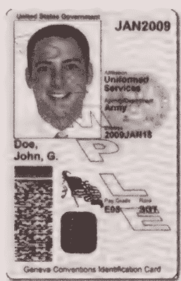

- A. 智能卡（Smart card）
- B. 距离卡（Proximity card）
- C. 磁卡（Magnetic stripe card）
- D. 三相卡（Phase three card）

### 59. Gordon 担心黑客可能利用范艾克辐射（Van Eck radiation）现象远程读取设施计算机显示器的内容。哪种技术可以防止此类攻击？

- A. TCSEC
- B. SCSI
- C. GHOST
- D. TEMPEST

### 60. 在此处所示的计算机系统安全边界图中，哪个组件的名称被替换为 XXX？

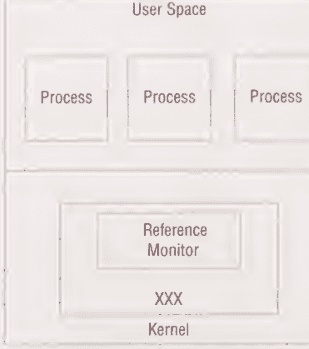

- A. 内核（Kernel）
- B. TCB
- C. 安全边界
- D. 执行

### 61. Sherry 对组织内使用的加密技术进行了清点，发现以下哪项不再被认为是安全的？

- A. MD5
- B. 3DES
- C. PGP
- D. WPA

### 62. 什么操作可以防止意外的数据泄露？

- A. 格式化
- B. 磁盘加密
- C. 消磁
- D. 销毁

### 63. Tom 拥有加密消息的明文版本，并希望通过这种方式来获取密钥。这属于哪种攻击？

- A. 选择密文攻击（Chosen ciphertext）
- B. 选择明文攻击（Chosen plaintext）
- C. 已明文攻击（Known plaintext）
- D. 暴力破解（Brute force）

### 64. 黑客最近利用计时攻击破坏了文件的完整性。这种攻击被称为什么？

- A. 社会工程（Social engineering）
- B. TOCTOU
- C. 数据篡改（Data diddling）
- D. 检查

### 65. 哪种标准规定了数字证书的创建和验证？

- A. X.09
- B. TLS
- C. SSL
- D. 802.1

### 66. 什么措施使得渗透变得困难？

- A. 3 层
- B. 4 层
- C. 5 层
- D. 6 层

### 67. Johnson 严格限制对敏感信息的访问。然而，他发现它连接到了僵尸网络。发生了什么？

- A. 社会工程
- B. 推断
- C. 聚合
- D. 数据篡改

### 68. 哪种物理控制可以屏蔽计算设备的电磁辐射？

- A. 法拉笼（Faraday cage）
- B. 铜窗
- C. 屏蔽电缆
- D. 白噪声

### 69. 在软件服务（SaaS）云环境中，通常由谁负责确保适当的防火墙控制？

- A. 客户的安全团队
- B. 供应商
- C. 客户的网络团队
- D. 客户的基础团队

### 70. Alice 对某个对象拥有读取权限，她希望 Bob 也拥有相同的权限。Take-Grant 模型中的哪种规则允许这一点？

- A. 创建规则（Create rule）
- B. 删除规则（Remove rule）
- C. 授予规则（Grant rule）
- D. 获取规则（Take rule）

### 71. 作为应急响应的一部分，Charles 安全地擦除了驱动器并从原始介质重新安装了操作系统。在系统恢复服务后，他发现了恶意软件。Charles 应该在哪里寻找？

- A. 系统分区
- B. 系统 BIOS 或固件
- C. 系统内存
- D. 安装介质

### 72. 下列哪种计算模型允许在进程内执行并发任务？

- A. 多任务（Multitasking）
- B. 多处理（Multiprocessing）
- C. 多程序（Multiprogramming）
- D. 多线程（Multithreading）

### 73. Alan 拦截了一条加密消息并想要确定使用了哪种算法。他首先进行了频率分析，注意到消息中的字母频率与英语字母的分布匹配。最可能使用了哪种密码？

- A. 替换密码（Substitution cipher）
- B. AES
- C. 置换密码（Transposition cipher）
- D. 3DES

### 74. 双 DES（2DES）加密算法从未作为原始 DES 算法的可行替代方案使用。2DES 容易受到哪种 3DES 方法不存在的攻击？

- A. 选择密文攻击
- B. 暴力破解
- C. 中间人攻击
- D. 中间攻击（Meet in the middle）

### 75. Grace 想在组织中实施应用控制技术。用户经常需要为了研究和测试安装新应用程序，她不想干涉这一过程。同时，她想阻止已知恶意软件的使用。哪种类型的应用控制比较合适？

- A. 黑名单（Blacklisting）
- B. 灰名单（Graylisting）
- C. 白名单（Whitelisting）
- D. 蓝名单（Bluelisting）

### 76. Warren 正在为他的数据中心设计物理入侵检测系统，并希望包含一种技术，该技术能在报警系统的通信线路被意外切断时发出警报。哪种技术可以满足这一需求？

- A. 心跳传感器（Heartbeat sensor）
- B. 电磁安全
- C. 运动检测器
- D. 法拉笼

### 77. John 和 Gary 正在进行一项商务交易，John 必须向 Gary 证明他可以访问某个系统。他参与了此处所示的电子版“魔法门”。John 正在使用哪种技术？

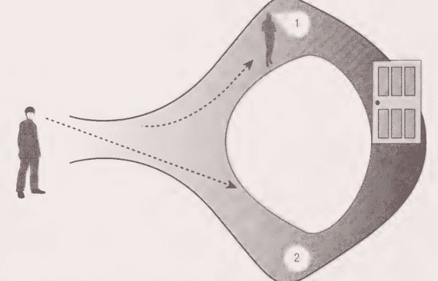

图片转载自 CISSP (ISC)² 认证信息系统安全专家官方学习指南, 第7版 © John Wiley & Sons 2015，经许可转载。

- A. 分拆知识证明
- B. 零知识证明
- C. 逻辑证明
- D. 数学证明

### 78. Raj 正在为他的组织选择一种加密算法，并希望能够根据信息的敏感程度来改变加密的强度。以下哪种算法允许使用不同的强度？

- A. Blowfish
- B. DES
- C. Skipjack
- D. IDEA

### 79. 参考此处所示的火灾三角形，以下哪种灭火材料是通过移除燃料源来扑灭火的？

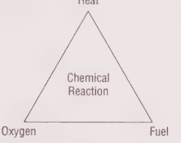

图片转载自 CISSP (ISC)² 认证信息系统安全专家官方学习指南, 第7版 © John Wiley & Sons 2015，经许可转载。

- A. 水
- B. 碳酸水
- C. 二氧化碳
- D. 卤仑

### 80. Howard 正在为他的组织选择一种加密算法，他希望选择一种支持创建数字签名的算法。以下哪种算法符合他的要求？

- A. RSA
- B. DES
- C. AES
- D. Blowfish

### 81. Laura 负责公司应用程序的安全，并希望对开发者开展一项关于常见 Web 应用安全漏洞的教育计划。她可以在哪里找到最常见 Web 应用安全问题的简明列表？

- A. CVE
- B. NSA
- C. OWASP
- D. CSA

### 82. Bell-LaPadula 和 Biba 模型实现状态机的方式使用了哪些特定的状态机模型？

- A. 信息流
- B. 非干扰
- C. 级联
- D. 反馈

### 83. 进程的 `________` 由进程可以访问的内存地址和资源组成。

- A. 边界
- B. 限制
- C. 测量
- D. 范围

### 84. 哪种运动检测器会感应电磁场的变化？

- A. 红外
- B. 波形
- C. 电容
- D. 光电

### 85. 以下哪种灭火系统由于环境考虑已不再生产？

- A. FM-200
- B. 氩气
- C. 氮气
- D. 卤仑

### 86. 关于 Biba 访问控制模型，以下哪个描述正确？

- A. 它处理机密性。
- B. 它处理完整性和可用性。
- C. 它防止信道攻击。
- D. 它关注对象的完整性。

### 87. 在传输层安全（TLS）中，使用哪种密钥来加密服务器与客户端之间的实际内容？

- A. 临时会话密钥
- B. 客户端公钥
- C. 服务器公钥
- D. 服务器私钥

### 88. Beth 希望在数据中心的安全区域包含某种技术以防止意外的电磁辐射。哪种技术可以帮助实现这一目标？

- A. 心跳传感器
- B. 法拉笼
- C. 寄生
- D. WPA2

### 89. 在虚拟计算环境中，哪个组件负责虚拟机之间的隔离？

- A. 虚拟机操作系统
- B. 虚拟机管理程序 (Hypervisor)
- C. 内核
- D. 保护管理器

### 90. Rick 是一个主要使用 Python 的应用程序开发者。他最近决定评估一项服务，将代码提供给供应商，由他们的服务器上执行。这是哪种云计算环境？

- A. SaaS
- B. PaaS
- C. IaaS
- D. CaaS

### 91. 一家软件公司开发了两个共享信息的系统。系统 A 向 B 提供信息，B 然后将信息返回给 A。哪种组合最能描述这种？

- A. 级联
- B. 反馈
- C. 连接
- D. 基础

### 92. Tommy 计划为他数据中心的服务器架实施间电源（UPS）。以下哪种情况是 UPS 无法长时间持续的？

- A. 故障
- B. 停电
- C. 跌落
- D. 噪声

### 93. 以下哪个湿度值在数据中心的运行范围内？

- A. 0%
- B. 10%
- C. 25%
- D. 40%

### 94. Chris 正在为公司内部设计一种加密系统。公司有 1000 名员工，他们计划使用非对称加密系统。他们总需要多少个密钥？

- A. 500
- B. 1000
- C. 2000
- D. 1050

### 95. 哪个术语用于由指定的批准机构（DAA）正式声明信息技术（IT）可以在特定环境中运行？

- A. 认证
- B. 认可 (Accreditation)
- C. 评估
- D. 批准

### 96. 面向对象的语言使用黑盒方法进行开发，用户并不一定需要知道对象的实现细节。用什么术语描述？

- A. 分层
- B. 抽象
- C. 数据隐藏
- D. 进程隔离

### 97. Todd 想要将一个证书添加到吊销列表（CRL）。证书的哪个元素在上面？

- A. 序列号
- B. 公钥
- C. 数字签名
- D. 私钥

### 98. Alison 正在检查银行网站提供给她的数字证书。为了信任该数字证书，以下哪个不是要求？

- A. 她知道服务器属于银行。
- B. 她信任证书颁发机构。
- C. 她验证证书未列在 CRL 上。
- D. 她验证证书上的数字签名。

### 99. 以下哪项用于从组织泄露信息时是隐信道的示例？

- A. 发送电子邮件
- B. 在点对共享服务上发布文件
- C. 使用摩尔斯电码输入
- D. 将数据写入共享内存

### 100. 以下哪项是自签名数字证书的合理应用？

- A. 电子商务网站
- B. 银行应用程序
- C. 内部应用程序
- D. 客户门户

### 101. Mike 被指派防止类似 Mirai 的恶意软件爆发。他的组织应该保护哪种系统？

- A. 服务器
- B. SCADA
- C. 移动设备
- D. 物联网 (IoT) 设备

### 102. 主 HVAC 系统的组件故障导致 Kim 管理的数据中心出现高温度警报。在解决问题后，Kim 应该考虑什么以防止未来出现此类问题？

- A. 闭环冷水机
- B. 冗余冷却系统
- C. 蒸发冷却器
- D. 将数据中心迁至气候较凉冷的地区

### 103. 作为团队取证调查过程的一部分，Matt 在存储证据前对其签名。他正在创建什么种类型的文档？

- A. 刑事
- B. 证据链 (Chain of custody)
- C. 民事
- D. 行政

### 104. Lauren 实施 ASLR 来防止系统被破坏。她使用了什么技术？

- A. 加密
- B. 强制性访问控制
- C. 内存地址随机化
- D. 任意性访问控制

### 105. 在审计期间，Casey 发现她组织的 Web 服务器私钥已经在公共 Amazon S3 存储桶中存储了一多年。她应该怎么办？

- A. 从桶中删除密钥
- B. 通知所有客户数据可能已暴露
- C. 使用新密钥请求新证书
- D. 不需要，因为私钥应该是可访问的

### 106. Joanna 想要审查组织用于建筑管理的工业控制系统。她应该查询哪些类型系统的访问？

- A. SCADA
- B. DSS
- C. BAS
- D. ICS

### 107. 在扫描其无线网络后，Mike 注意到一个运行旧版本 Apple 移动系统的 iOS 设备。进一步调查后，他发现该设备是原始 iPad，无法更新到当前的安全版本。Mike 应该建议？

- A. 退休或更换该设备
- B. 将设备隔离在专用无线网络上
- C. 在平板电脑上安装防火墙
- D. 重新安装操作系统

### 108. 在第三方漏洞扫描和安全测试期间，Danielle 的雇主最近发现管理大楼的嵌入系统存在严重的远程访问漏洞。供应商已倒闭，且设备没有补丁或更新。Danielle 建议雇主对这数百个易感设备怎么办？

- A. 识别替代型号并更换所有设备
- B. 关闭所有设备
- C. 将设备移动到安全的网段
- D. 反向工程设备并构建内部补丁

### 109. Alex 的雇主大部分工作都是 PDF 文件。Alex 担心将 PDF 文件的读者限制在那些已付费的人员。他可以使用哪种技术最有效地控制这些文件的访问和分发？

- A. EDM
- B. 加密
- C. 数字签名
- D. 数字版权管理 (DRM)

## 匹配题

### 110. 请将以下带有编号的安全模型与相应的字母安全描述进行匹配：

#### 安全模型

- 1. Clark-Wilson
- 2. Graham-Denning
- 3. Bell-LaPadula
- 4. Sutherland
- 5. Biba

#### 描述

- A. 此模型阻止低密级对象访问高密级对象，从而确保了机密性。
- B. 该模型的 `*` 属性可以总结为“不准向上写（no write-up）”。
- C. 此模型使用安全标签，通过转换程序和受限接口模型授予对对象的访问权限。
- D. 此模型侧重于使用八条主要的保护规则或动作对主体和对象进行安全创建和删除。
- E. 此完整性模型侧重于防止干扰以支持完整性。


# 第 4 章：通信与网络安全 (领域 4)


## 练习题

1. **区分 Frame Relay 和 X.25 的重要因素是什么？**
   - A. Frame Relay 在单个 WAN 连接上支持多个 PVC（虚拟专用电路）。
   - B. Frame Relay 是一种基于单元的交换技术，而不是像 X.25 那样的数据包交换技术。
   - C. Frame Relay 不提供承诺信息速率 (CIR)。
   - D. Frame Relay 仅在提供端需要一个 DTE（数据终端设备）。

2. **在对无线网络进行安全评估，Jim 发现使用 WPA 的网络正在使用 LEAP。Jim 应该给出什么建议？**
   - A. 继续使用 LEAP。对于 WPA 网络，它提供了比 TKIP 更好的安全性。
   - B. 使用备用协议 PEAP 或 EAP-TLS，并在支持的情况下实施 WPA2。
   - C. 继续使用 LEAP 以避免身份验证问题，但迁移到 WPA2。
   - D. 使用备用协议 PEAP 或 EAP-TLS，并实施线路等效隐私（Wired Equivalent Privacy）以避免无线安全问题。

3. **Ben 使用 802.11 连接将其笔记本连接到 PC。他使用了哪种无线网络模式来连接这些设备？**
   - A. 基础模式（Infrastructure mode）
   - B. 有线扩展模式（Wired extension mode）
   - C. 接入模式（Ad hoc mode）
   - D. 独立模式（Stand-alone mode）

4. **Lauren 和 Nick 的 PC 通过同时传输发送流量。哪个网络术语描述了网络上受此相同影响的系统范围？**
   - A. 子网（subnet）
   - B. 超网（supernet）
   - C. 冲突域（collision domain）
   - D. 广播域（broadcast domain）

5. **Sarah 正在手动检查 TCP 流量的数据包捕获，发现某个系统在短时间内重复发送的 TCP 数据包中设置了 RST 标志。该标志在 TCP 数据包头中意味着什么？**
   - A. RST 标志意味着“休息（Rest）”。服务器需要暂停流量。
   - B. RST 标志意味着“中设置（Relay-set）”。数据包将转发到数据包中设置的地址。
   - C. RST 标志意味着“恢复标准（Resume Standard）”。通信将以正常格式恢复。
   - D. RST 意味着“重置（Reset）”。TCP 会话将断开。

6. **Gary 正在部署无线网络并并部署尽可能快的无线技术。由于技术限制，他仅限于使用 2.4 GHz 选项。他应该使用以下哪个无线网络标准？**
   - A. 802.11a
   - B. 802.11g
   - C. 802.11n
   - D. 802.11ac

7. **将列出的每个编号 TCP 端口与提供的字母协议进行匹配：**

   **TCP 端口**
   - 1. 23
   - 2. 25
   - 3. 143
   - 4. 515

   **协议**
   - A. SMTP
   - B. LPD
   - C. IMAP
   - D. Telnet

8. **Chris 正在配置以监控加密流量，他应该使用哪个端口？**
   - A. 22
   - B. 21
   - C. 23
   - D. 25

9. **FHSS、DSSS 和 OFDM 都使用什么通信方法？**
   - A. WiFi
   - B. 扩频（Spread Spectrum）
   - C. 复用（Multiplexing）
   - D. 正交（Orthogonal）

10. **Brian 选择哪种协议来保护用户名和密码。**
    - A. PAP
    - B. CHAP
    - C. EAP
    - D. RADIUS

11. **图显示的是哪种拓扑结构？**
    
    - A. 环（ring）
    - B. 总线（bus）
    - C. 星型（star）
    - D. 网状（mesh）

12. **图显示的是哪种类型的防火墙？**
    
    - A. 单层防火墙（single-tier）
    - B. 双层防火墙（two-tier）
    - C. 三层防火墙（three-tier）
    - D. 四层防火墙（four-tier）

13. **Chris 想要使用哪种设备来保护加密流量？**
    - A. VPN
    - B. 状态检查检查
    - C. ESP
    - D. AH

14. **如果 Chris 想要加密 SCADA 系统，对于通过 TCP/IP 传输的串口数据，他应该提出什么担忧？**
    - A. VPN 用户将无法访问服务器。
    - B. 网络无法加密。
    - C. 串口数据无法在 TCP 数据包中传输。
    - D. 网络将受到状态检查（stateful inspection）。

15. **Chris 想使用什么设备来保护 SCADA 系统，他应该将其放在哪里？**
    - A. 防火墙（firewall）
    - B. IDS
    - C. IPS
    - D. WAF

16. **Susan 部署的路由协议维护目的地的跳数列表。**
    - A. 链路状态协议（link-state）
    - B. 距离向量协议（distance-vector）
    - C. 度量协议（metric）
    - D. 分层协议（layered）

17. **Ben 配置了他的网络不广播。他为什么要这样做？他的 SSID 如何被发现？**
    - A. 禁止广播防止攻击者发现密钥。SSID 可以通过嗅探发现。
    - B. 禁止广播防止未经授权的人员。可以通过数据数据帧发现。
    - C. 禁止广播避免冲突。SSID 可以通过 BSSID 发现。
    - D. 通过尝试连接发现。

18. **哪种网络工具可以通过接收并发送修改后的请求来保护客户端身份？**
    - A. 网关（gateway）
    - B. 代理（proxy）
    - C. 路由器（router）
    - D. 防火墙（firewall）

19. **在排故障期间，Chris 使用 `nslookup` 命令检查他尝试连接的主机的 IP 地址。他看到的 IP 不是解析出的 IP。可能发生了哪种类型的攻击？**
    - A. DNS 欺骗（spoofing）
    - B. DNS 毒化（poisoning）
    - C. ARP
    - D. Cain 攻击

20. **将桌面显示的内容复制到远程计算机的远程访问工具是哪种技术的示例？**
    - A. 远程节点操作（node operation）
    - B. 屏幕采集（screen scraping）
    - C. 远程控制（remote control）
    - D. RDP

21. **哪种电子邮件安全解决方案提供了两种模式：(1) 提供完整性、发送者认证和不可否认性的签名消息；(2) 提供完整性、发送者认证和机密性的封装消息模式？**
    - A. S/MIME
    - B. MOSS
    - C. PEM
    - D. DKIM

22. **在安全评估期间，Jim 发现他工作的组织使用多层协议处理 SCADA 系统，并将 SCADA 网络连接到该组织的其他生产网络。对于通过 TCP/IP 传输的串口数据，他应该提出什么担忧？**
    - A. 现在连接到网络的 SCADA 设备可以通过网络受到攻击。
    - B. 通过 TCP/IP 的串口数据无法加密。
    - C. 串口数据无法在 TCP 数据包中传输。
    - D. TCP/IP 的吞吐量允许对串口设备进行简单的拒绝服务攻击。

23. **WEP 使用哪种类型的密钥来加密无线通信？**
    - A. 非对称密钥
    - B. 每个主机的唯一密钥集
    - C. 预定义的共享静态密钥
    - D. 每个主机的唯一非对称密钥

24. **Arnold 收到终端用户的报告，称他们的互联网连接极其缓慢。他查看了防火墙，发现每秒有来自世界各地的数千个意外入站连接。最可能正在发生哪种攻击？**
    - A. 蠕虫
    - B. 拒绝服务攻击
    - C. 病毒
    - D. 蓝精灵攻击

25. **802.11n 使用什么速度和频率范围？**
    - A. 54 Mbps, 5 GHz
    - B. 200+ Mbps, 5GHz
    - C. 200+ Mbps, 2.4 和 5 GHz
    - D. 1 Gbps, 5 GHz

26. **地址解析协议 (ARP) 和反向地址解析协议 (RARP) 运行在 OSI 模型的哪层？**
    - A. 第 1 层
    - B. 第 2 层
    - C. 第 3 层
    - D. 第 4 层

27. **下列哪项是允许通过 TCP 进行存储挂载的融合协议，并且经常被用作光纤通道 (Fibre Channel) 的低成本替代方案？**
    - A. MPLS
    - B. SDN
    - C. VoIP
    - D. iSCSI

28. **Chris 正在构建一个以太网，他知道他的 1000BaseT 网络需要跨越超过 150 米的距离。他应该使用什么网络技术来帮助？**
    - A. 在 100 米前安装继电器或集中器。
    - B. 使用第 7 类电缆，它对更高速度有更好的屏蔽。
    - C. 安装网关来处理距离问题。
    - D. 使用 STP 电缆在高速下处理更距离。

> Lauren 的机构已使用某常用服务多年。最近，人们对该服务的使用产生了担忧。请根据下面的图表回答问题 29 至 31。

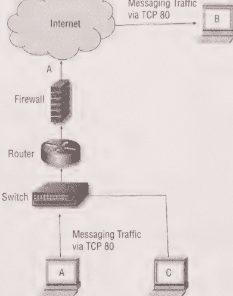

29. **根据图表，流量最可能使用哪种协议？**
    - A. SLACK
    - B. HTTP
    - C. SMTP
    - D. HTTPS

30. **从 A 向 B 发送内部通信引发了什么安全担忧？**
    - A. 防火墙不保护系统 B。
    - B. 系统 C 可以看到从 A 到 B 的广播流量。
    - C. 它通过未加密的协议传输。
    - D. 消息不提供不可否赖性。

31. **Lauren 的公司如何解决用户 A 和 C 对安全消息的需求？**
    - A. 使用第三方服务。
    - B. 实现本地托管的服务。
    - C. 使用 HTTPS。
    - D. 继续使用电子邮件，它更安全。

## 第 4 章 通信与网络安全（域 4）续

32. **在使用多层协议时，以下哪项是一个需要关注的问题？**
    - A. 可能使用多种协议。
    - B. 隐道。
    - C. 过滤器无法被绕过。
    - D. 可以在多个层中加入加密。

33. **下图显示的是哪种网络拓扑？**
    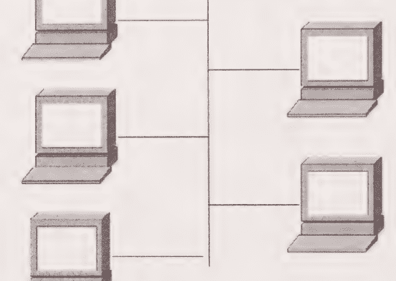
    - A. 环
    - B. 星型
    - C. 总线型
    - D. 网型

34. **Chris 在旅行时使用蜂窝热点提供互联网访问。如果他在 PC 连接到其机构网络时，让热点保持连接到 PC，他可能会导致什么安全问题？**
    - A. 流量可能没有正确路由，导致敏感数据暴露。
    - B. 他的系统可能作为互联网到局域网的桥接。
    - C. 他的系统可能是 DDoS 攻击的入口。
    - D. 如果发生安全问题，管理员可能无法确定他的 IP 地址。

35. **作为信息安全人员，Susan 被要求识别无线网络可能被访问的区域，尽管并非如此。Susan 应该做什么？**
    - A. 现场勘测 (site survey)
    - B. 战争行走 (Warwalking)
    - C. 远程钓鱼 (Wardriving)
    - D. 设计图

36. **DARPA TCP/IP 模型的应用层对应 OSI 模型的哪三层？**
    - A. 应用层、表示层和传输层。
    - B. 表示层、会话层和传输层。
    - C. 应用层、表示层和会话层。
    - D. 没有直接对应。TCP 模型创建于 OSI 模型之前。

37. **Susan 在渗透期间的攻击之一是在系统的 ARP 缓存中插入伪数据。当系统尝试向它认为属于合法系统的发送流量时，而是发送到了她控制的系统。这种攻击称为什么？**
    - A. RARP 泛洪
    - B. ARP 缓存中毒
    - C. ARP 拒绝服务攻击

38. **Sue 在一个使用 MAC 过滤提供安全的网络上将 MAC 地址修改为允许的地址。她使用了哪种技术，可能会导致什么安全问题？**
    - A. 广播域漏洞利用、地址冲突
    - B. 欺骗、令牌丢失
    - C. 欺骗、地址冲突
    - D. EUI 创建、令牌丢失

39. **Jim 对大型机构的 PBX 审计显示，直接入接入 (DISA) 被第三方滥用。哪种问题最可能导致这种情况？**
    - A. PBX 未完全修复。
    - B. 拨号调制器使用未公布号码。
    - C. DISA 设置仅允许本地通话。
    - D. 一个或多个用户的访问代码被破解。

40. **SMTP、HTTP 和 SNMP 都发生在 OSI 模型的哪一层？**
    - A. 第 4 层
    - B. 第 5 层
    - C. 第 6 层
    - D. 第 7 层

41. **Lauren 在渗透测试期间使用 ping 工具检查远程系统是否在线。如果她不想看到自己的 ping 包，她应该从数据包嗅器的日志中过滤掉什么协议？**
    - A. UDP
    - B. TCP
    - C. IP
    - D. ICMP

42. **Lauren 希望在其网络上提供基于端口的认证，以确保客户端在使用网络之前进行认证。哪种技术是该需求的合适解决方案？**
    - A. 802.11a
    - B. 802.3
    - C. 802.15.1
    - D. 802.1x

43. **Ben 部署了 1000BaseT 千兆网络，需要向另一栋大楼拉电缆。如果 Ben 直接从交换机连接到大楼的另一个交换机，根据 1000BaseT 规范，Ben 可以覆盖的最大距离是多少？**
    - A. 2 公里
    - B. 500 米
    - C. 85 米
    - D. 100 米

44. **Jim 正在为远程站点构建网络。为了最高速度，他应该使用哪种 ISDN？**
    - A. BRI
    - B. NDN
    - C. PRI
    - D. channel

45. **bluesarfing 针对什么？**
    - A. 虚拟化平台
    - B. Web 服务
    - C. VoIP 系统
    - D. 安全进程

46. **蓝牙攻击针对什么？**
    - A. 蓝牙上的数据
    - B. 通过蓝牙传输的数据
    - C. 802.11 网络
    - D. 来自蓝牙设备的数据

47. **下列哪项包含存在于第 6 层的标准或协议？**
    - A. NFS, SQL 和 RPC
    - B. TCP, UDP 和 TLS
    - C. JPEG, ASCII 和 MIDI
    - D. HTTP, FTP 和 SMTP

48. **这里显示的是哪种网络拓扑？**
    
    - A. 环
    - B. 总线型
    - C. 星型
    - D. 网型

49. **有四种 VPN 协议。列出的哪组包含了所有的 VPN 协议？**
    - A. PPTP, LTP, L2TP, IPsec
    - B. PPP, L2TP, IPsec, VNC
    - C. PPTP, L2F, L2TP, IPsec
    - D. PPTP, L2TP, IPsec, SPAP

50. **哪种网络技术的描述最准确是使用流量方向相反的双对环的令牌传递网络？**
    - A. 拓扑
    - B. 令牌环
    - C. FDDI
    - D. SONET

51. **哪个 OSI 层包含了电气规范、协议和接口标准？**
    - A. 传输层
    - B. 设备层
    - C. 物理层
    - D. 数据链路层

52. **Ben 正在设计一个 Wi-Fi 网络，被要求为网络选择最安全的选项。他应该选择哪种无线安全标准？**
    - A. WPA2
    - B. WPA
    - C. WEP
    - D. AES

53. **如果你的机构允许邮件附件以支持关键业务流程，帮助避免附件引起的安全问题的两个最佳方案是什么？**
    - A. 培训用户并使用反病毒工具。
    - B. 加密电子邮件并使用反病毒工具。
    - C. 培训用户并要求所有邮件使用 S/MIME。
    - D. 使用 S/MIME 并移除所有 ZIP (.zip) 文件附件。

54. **分段、排序和错误检查发生在与 SSL、TLS 和 UDP 相关的 OSI 模型哪一层？**
    - A. 传输层
    - B. 网络层
    - C. 会话层
    - D. 表示层

55. **Windows `ipconfig` 命令显示以下信息：**
    ```
    BC-5F-F4-7B-4B-7D
    ```
    **哪个术语描述此内容？通常可以从中收集到什么信息？**
    - A. IP 地址，系统的网络位置
    - B. MAC 地址，网络接口卡的制造商
    - C. MAC 地址，使用的介质类型
    - D. IPv6 客户端 ID，网络接口卡的制造商

56. **Chris 被要求在无线认证中实现 PEAP 和 LEAP 之间进行选择。他应该选择哪一个？为什么？**
    - A. LEAP，因为它修复了 TKIP 的问题，具有更强的安全性
    - B. PEAP，因为它实现了用于安全性的 CCMP
    - C. LEAP，因为它实现了 EAP-TLS 以进行端到端会话加密
    - D. PEAP，因为它可以提供一个 TLS 隧道来封装 EAP 方法，保护整个会话

57. **Ben 正在排除网络故障，发现他连接的 NAT 路由器的内部网络为 `192.168.x.x`，其外部 IP 为 `192.168.1.40`。他遇到了什么问题？**
    - A. `192.168.x.x` 是不可路由网络，不会传输到互联网。


- B. 192.168.1.40 不是有效地址，因为它被 `RFC 1918` 预留。
- C. 使用相同的 IP 范围无法进行双重 NAT。
- D. 上游系统无法解封他的他的数据包，他需要使用 PAT。

## 58. B 类网络的默认子网掩码是什么？

- A. 255.0.0.0
- B. 255.255.0.0
- C. 255.254.0.0
- D. 255.255.255.0

## 59. Jim 的组织使用传统的 PBX 进行语音通信。其内部通信可能面临的最常见安全问题是什么？他应该建议什么来防止？

- A. 窃听，加密
- B. 中人攻击，端到端加密
- C. 窃听，物理安全
- D. 拨号攻击，部署 IPS

# 第4章 • 通信与网络安全（领域 4）

## 60. 无线电话经常被忽视的常见安全问题是什么？

- A. 它们的信号很少加密，因此很容易被监控。
- B. 它们使用未经许可的频率。
- C. 它们允许攻击者进入网络。
- D. 它们很少更新，容易受到恶意软件攻击。

## 61. Lauren 的组织在桌面 PC 所在的交换机上部署了 VoIP 电话。这会导致什么安全问题？什么解决方案会有帮助？

- A. VLAN 跳跃；使用物理上隔离的交换机。
- B. VLAN 跳跃；使用加密。
- C. 呼号 ID 欺骗；MAC 过滤。
- D. 拒绝服务攻击；在网络之间使用防火墙。

对于问题 62–65，请参考运行此处所示规则库的状态检测防火墙。图中省略了源端口，但你可以假设在回答问题 62–64 时，端口是正确指定的。

| 规则 | 动作 | 源 IP | 源端口 | 目标 IP | 目标端口 |
| :--- | :--- | :--- | :--- | :--- | :--- |
| 1 | 允许 | ANY | | 10.1.0.50 | 80 |
| 2 | 拒绝 | 15.246.10.1 | | 10.1.0.50 | 80 |
| 3 | 允许 | ANY | | 10.1.0.26 | 25 |
| 4 | 允许 | ANY | | 10.1.0.26 | 465 |

## 62. 以下哪个规则未显示在规则库中，但会被防火墙执行？

- A. 隐身 (Stealth)
- B. 隐式拒绝 (Implicit deny)
- C. 连接 (Connection)
- D. 出站过滤 (Egress filter)

## 63. 运行在 IP 地址 10.1.0.26 的什么种类型的服务器？

- A. 邮件
- B. Web
- C. FTP
- D. 数据库

# 第4章 ■ 通信与网络安全（领域 4）

## 64. 位于 15.246.10.1 的系统尝试与 10.1.0.50 的 Web 服务器建立 HTTP 和 HTTPS 连接。关于连接，以下哪个是正确的？

- A. 两个连接都允许。
- B. 两个连接都被拦截。
- C. HTTP 连接允许，HTTPS 连接被拦截。
- D. HTTP 连接被拦截，HTTPS 连接允许。

## 65. 规则 #3 的源端口应该使用什么值？

- A. 25
- B. 465
- C. 80
- D. 任意 (Any)

## 66. 数据流发生在 OSI 模型的哪三层？

- A. 应用层、表示层
- B. 表示层、会话层和传输层
- C. 物理层、数据链路层和网络层
- D. 数据链路层、网络层和传输层

## 67. Chris 需要设计一种能够安全地隔离 DMZ、数据库和私有网络的防火墙架构。他应该使用哪种类型的设计？需要多少个防火墙？

- A. 具有两个防火墙的四层设计
- B. 具有三个防火墙的双层设计
- C. 具有至少一个防火墙的三层设计
- D. 具有三个防火墙的单层设计

## 68. Lauren 的网络团队被识别一种能够允许他们像处理代码一样动态更改网络的技术。她应该建议哪种架构？

- A. 遵循 5-4-3-2 规则的网络
- B. 收敛网络
- C. 软件定义网络
- D. 基于虚拟化程序的网络

## 69. 电缆调制调制器、ISDN 和 DSL 都是什么类型技术的示例？

- A. 宽带
- B. 数字
- C. 广播
- D. [缺失文本]

## 70. 下图显示的是哪种类型的防火墙设计？

![img/0f8592f4ad1d0c419_0.png]

- A. 单层
- B. 双层
- C. 三层

## 71. 在检查网络时，Angela 发现网络遭受广播风暴，承包商、客人和管理人员位于同一网段。Angela 应该建议什么设计？

- A. 要求所有用户加密。
- B. 在边界处安装防火墙。
- C. 启用树路检测。
- D. 分段网络。

## 72. ICMP、RIP 和网络地址转换都发生在哪层？

- A. 第1 层
- B. 第2 层
- C. 第3 层
- D. 第4 层

对于问题 73–75，请参考以下场景：

Ben 是某组织的信息安全人员，该组织正在将物理服务器替换虚拟机。随着组织构建虚拟环境，物理服务器的数量正在减少。

## 73. Ben 负责使用交换机上的镜像端口监控数据中心的通信（IDS）。一旦大多数服务器都虚拟化，Ben 将看到什么流量？

- A. 他目前看到的相同流量
- B. 所有虚拟机间流量
- C. 仅发送到虚拟机之外的流量
- D. 所有虚拟机程序间流量

# 第4章 ■ 通信与网络安全（领域 4）

## 74. 虚拟机管理员建议在虚拟机之间启用复制和粘贴。Ben 应该对这种做法提出什么安全担忧？

- A. 它可能导致拒绝服务状态
- B. 它可以作为隐蔽通道
- C. 它可能允许病毒传播
- D. 它可以绕过身份验证控制

## 75. Ben 担心允许虚拟机逃逸的漏洞。Ben 应该建议什么选项来限制虚拟机逃逸的影响？

- A. 根据任务或数据将虚拟机分离到物理硬件上。
- B. 在底层虚拟机程序上使用虚拟机逃逸检测工具。
- C. 定期将机器恢复到原始快照。
- D. 使用 Tripwire 等工具查找虚拟机的变化。

## 76. WPA2 的计数器密码链消息认证协议 (CCMP) 基于哪种常见的加密方案？

- A. DES
- B. 3DES
- C. AES
- D. TLS

## 77. 当以太网网络上的主机检测到冲突并发送干扰信号时，接下来发生什么？

- A. 发送干扰信号的主机允许重传，而所有其他主机暂停直到该传输成功接收。
- B. 所有主机停止传输，每个主机在尝试重新传输之前等待随机的一段时间。
- C. 所有主机停止传输，每个主机根据其最近成功传输的时间等待一段时间。
- D. 主机等待令牌传递并在传递令牌时恢复发送数据。

## 78. T3 线路的速度是多少？

- A. 128 kbps
- B. 1,544 Mbps
- C. 44.736 Mbps
- D. 155 Mbps

## 79. 下图显示的是哪种类型的防火墙设计？

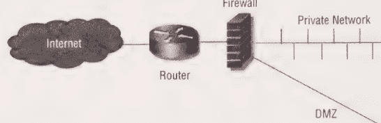

- A. 单层防火墙
- B. 双层防火墙
- C. 三层防火墙
- D. 全保护 DMZ 防火墙

## 80. 终端安全系统部署中最常见的挑战是什么？

- A. 破解攻击
- B. 数据量
- C. 监控网络上的加密流量
- D. 处理非 TCP 协议

## 81. 127.0.0.1 是什么类型的地址？

- A. 公网 IP 地址
- B. RFC 1918 地址
- C. APIPA 地址
- D. 回环地址 (Loopback address)

## 82. Susan 正在为需要使用蓝牙的组织用户编写一份最佳实践声明。她知道蓝牙存在许多潜在的安全问题，并希望提供最好的建议。Susan 应该包含以下哪一组指导意见？

- A. 使用蓝牙内置的加密，更改设备上的默认 PIN，关闭发现模式，并在不活动使用时关闭蓝牙。
- B. 仅将蓝牙用于非机密活动，更改设备上的默认 PIN，关闭发现模式，并在不活动使用时关闭蓝牙。
- C. 使用蓝牙内置的强加密，使用扩展（8 位或更多）的蓝牙 PIN，关闭发现模式，并在不活动使用时关闭蓝牙。
- D. 仅将蓝牙用于非机密活动，使用扩展（8 位或更多）的蓝牙 PIN，关闭发现模式，并在不活动使用时关闭蓝牙。

## 83. 哪种网络设备最用于将终端系统分配到 VLAN？

- A. 防火墙
- B. 路由器
- C. 交换机
- D. 集线器

## 84. Steve 被要求在 IP 网络上实现网络存储协议。他在实现过程中可能会使用哪种以存储为中心的融合协议？

- A. MPLS
- B. FCoE
- C. SDN
- D. VoIP

## 85. 哪种网络设备在计算机通信中于模拟载波信号和数字信息之间进行调制？

- A. 桥器
- B. 路由器
- C. 路由器
- D. 调制解调器 (Modem)

## 86. 将此处所示 OSI 模型层按第 1 层到第 7 层的顺序排序。

- A. 应用层
- B. 数据链路
- C. 网络层
- D. 物理层
- E. 表示层
- F. 会话层
- G. 传输层

## 87. 发送分段 TCP 包的拒绝服务 (DoS) 攻击被称为哪种攻击？

- A. 圣诞树攻击 (Christmas tree)
- B. 水滴攻击 (Teardrop)
- C. 栈杀手 (Stack killer)
- D. 碎片弹 (Frag grenade)

## 88. Phillip 维护着一组支持组织使用的几种旧服务的服务。以下哪种协议最适用于此目的？

- A. SLIP
- B. SLAP
- C. PPTP
- D. PPP

## 99. Jim 在执行安全审计时发现的问题之一是私网中使用了非 IP 协议。Jim 指出使用这些非 IP 协议可能会导致什么问题？

- A. 它们已经过时，无法在现代 PC 上使用。
- B. 它们可能无法被防火墙设备过滤。
- C. 它们可能允许圣诞树攻击。
- D. IPX 替换了 IP 协议，并且可能不受所有 TCP 栈的支持。

## 90. Angela 需要在 EAP、PEAP 和 LEAP 之间选择用于安全认证。她应该选择哪种认证协议？为什么？

- A. 选择 EAP，因为它默认提供强加密。
- B. 选择 LEAP，因为它提供了频繁的重新认证和 WEP 密钥的更改。
- C. 选择 PEAP，因为它提供了加密，且没有 LEAP 那样的漏洞。
- D. 这些选项都无法提供安全认证，应该选择替代方案。

## 91. Lauren 被要求保护网络。L2TP 优于 PPTP 的主要优势是什么？

- A. L2TP 提供加密。
- B. L2TP 封装数据包。
- C. L2TP 不支持。
- D. L2TP 不封装数据包。

## 92. Jim 正在构建一个网络。在五节点网状拓扑中，每个节点将有多少个连接？

- A. 两个
- B. 三个
- C. 四个
- D. 五个

## 93. 以下哪项正确描述了以太网拓扑？

- A. 环形
- B. 星型
- C. 网状
- D. 总线型

## 94. 成功 ARP 欺骗后最可能发生哪种攻击？

- A. DoS
- B. 木马
- C. 中间人攻击
- D. 重放攻击

## 95. 3 类 UTP 的额定速度是多少？

- A. 5 Mbps
- B. 10 Mbps
- C. 100 Mbps
- D. 1000 Mbps

## 96. 当通过电缆传输的数据被他人拾获时会发生什么问题？

- A. 干扰
- B. 串扰 (Crosstalk)
- C. 传输
- D. 幅度

## 97. 什么使得无线等效隐私 (WEP) 比其他协议弱？

- A. 它使用了静态密钥
- B. 它使用了弱加密
- C. 它使用了 RC4
- D. 它使用了初始化向量

## 98. Chris 正在建立网络以确保所有系统都能相互访问。他应该推荐哪种方案最有效？

- A. VPN
- B. VLAN
- C. 端口安全
- D. 防火墙

## 99. 在取证调查期间，Charles 能够确定一个系统的 MAC 地址。MAC 地址属于 OSI 哪一层？

- A. 应用层
- B. 会话层
- C. 物理层
- D. 数据链路层

## 100. Ben 知道组织希望在收发邮件时根据域名验证对方身份。他应该推荐什么工具？

- A. PEM
- B. S/MIME
- C. DKIM
- D. PGP

# 第5章 身份与访问管理 (领域 5)


以下哪项最适合关注主体并识别主体可以访问对象的访问控制模型？

- A. 访问控制列表 (ACL)
- B. 隐式拒绝列表
- C. 权限表 (Capability table)
- D. 权限矩阵

Jim 在组织范围内实现了 IDaaS，提供了广泛的云支持。Jim 的公司没有内部身份管理人员，也没有集中式身份服务。相反，他们依赖 Active Directory 进行 AAA 服务。Jim 应该推荐哪种方案来处理公司的本地需求？

- A. 使用 OAuth 集成本地系统。
- B. 使用本地第三方身份服务。
- C. 使用 SAML 集成本地系统。
- D. 设计内部解决方案来处理组织需求。

以下哪项不是 Kerberos 的缺陷？

- A. KDC 是单点故障。
- B. KDC 被攻破将允许攻击者伪造任何用户。
- C. 认证信息未加密。
- D. 它容易受到密码破解。

语音模式识别是哪种类型的认证因子？

- A. 你知道的
- B. 你拥有的
- C. 你特征的
- D. 你所在的

如果 Susan 的组织要求她使用用户名、PIN、密码和视网膜扫描登录，她使用了多少种不同的认证因子类型？

- A. 一种
- B. 两种
- C. 三种
- D. 四种

以下哪些项目通常不与受限界面相关？

- A. Shell (外壳)
- B. 键盘
- C. 菜单
- D. 数据库视图

# 第 5 章 ■ 身份与访问管理（领域 5）

## 7. 在查看日志时，Saria 发现了一系列显示登录失败的日志，如下所示：

```
Jan 31 11:39:12 ip-10-0-0-2 sshd[29092]: Invalid user admin from remotehost
passwd=orange

Jan 31 11:39:20 ip-10-0-0-2 sshd[29098]: Invalid user admin from remotehost
passwd=Orang3

Jan 31 11:39:23 ip-10-0-0-2 sshd[29100]: Invalid user admin from remotehost
passwd=Orang93

Jan 31 11:39:31 ip-10-0-0-2 sshd[29106]: Invalid user admin from remotehost
passwd=Orangutan1

Jan 31 20:40:53 ip-10-0-0-24 sshd[30520]: Invalid user admin from remotehost
passwd=Orangemonkey
```

Saria 发现的是哪种类型的攻击？

- A. 暴力破解攻击
- B. 中间人攻击
- C. 字典攻击
- D. 彩虹表攻击

## 8. 请将以下步骤按照它们在 Kerberos 认证过程中发生的顺序排序。

- A. 生成客户端/服务器票据
- B. 生成 TGT
- C. 生成客户端/TGS 密钥
- D. 用户访问服务
- E. 用户提供身份验证凭据

## 9. 去中心化的访问控制通常会导致什么主要问题？

- A. 可能会发生访问中断。
- B. 控制不一致。
- C. 控制粒度太细。
- D. 培训成本高。

## 10. 回拨到座机电话号码是哪种类型因素示例？

- A. 你知道的因素
- B. 你所在的地点
- C. 你拥有的因素
- D. 你自身的特征

## 11. Kathleen 需要设置一个活动目录（Active Directory）信任，以允许与现有的 Kerberos K5 域进行身份验证。她需要创建什么类型的信任？

- A. 快捷信任
- B. 森林信任
- C. 外部信任
- D. 域信任

## 12. 在以下 AAA 协议中，最常用的是？

- A. TACACS
- B. TACACS+
- C. XTACACS
- D. Super TACACS

## 13. 以下哪项不是单点登录（SSO）实现？

- A. Kerberos
- B. ADFS
- C. CAS
- D. RADIUS

## 14. 如下图所示，Windows 系统上的用户无法使用“发送消息”功能。哪种访问控制模型描述了这种限制？

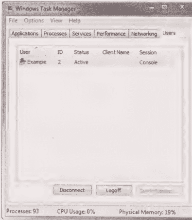

- A. 最小权限原则
- B. 知情原则
- C. 受限界面
- D. 职责分离

## 16. 哪种访问控制允许文件所有者使用访问控制列表（ACL）授予其他用户访问该权限？

- A. 基于角色的
- B. 非自主的
- C. 基于规则的
- D. 自主性的

## 16. Alex 的工作需要查看保护健康信息（PHI）以确保患者得到适当治疗。他对医疗记录的访问并不提供患者地址或账单信息的访问。哪种访问控制概念最能描述这种控制？

- A. 职责分离
- B. 受限界面
- C. 上下文相关控制
- D. 知情原则

根据你对 Kerberos 登录过程的以及下图回答问题 17–19。

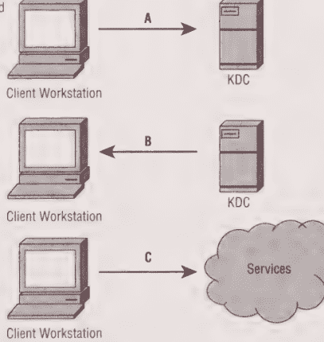

## 17. 在图中 A 点，客户端将用户名和密码发送给 KDC。用户名和密码是如何保护的？

- A. 3DES加密
- B. TLS加密
- C. SSL 加密
- D. AES加密


# 第 5 章 ■ 身份与访问管理（领域 5）

## 练习题

### 18. 在图中 B 点，KDC 在验证用户名有效后，向客户端发送哪两个重要元素？

- A. 加密的 TGT 和公钥
- B. 访问票据和公钥
- C. 加密且带时间戳的 TGT 以及用用户密码哈希加密的对称密钥
- D. 加密且带时间戳的 TGT 和访问令牌

### 19. 客户端在使用 TGT 之前必须执行哪些任务？

- A. 它必须生成 TGT 的哈希并解密对称密钥。
- B. 它必须接受 TGT 并解密对称密钥。
- C. 必须使用对称密钥解密 TGT。
- D. 它必须生成 TGT 的哈希并解密对称密钥。

### 21. 哪种访问控制模型描述了这种限制？

- A. 最小权限原则
- B. 知情原则
- C. 强制界面
- D. 职责分离

### 22. 以下哪项不是单点登录实现？

- A. Kerberos
- B. ADFS
- C. CAS
- D. RADIUS

---

### 7. 在查看日志时，Saria 发现了一系列显示登录失败的日志，如下所示：

```
Jan 31 11:39:12 ip-10-0-0-2 sshd[29092]: Invalid user admin from remotehost
...
Jan 31 20:40:53 ip-10-0-0-24 sshd[30520]: Invalid user admin from remotehost
passwd=Orangemonkey
```

Saria 发现的是哪种类型的攻击？

- A. 暴力破解攻击
- B. 中间人攻击
- C. 字典攻击
- D. 彩虹表攻击

### 8. 请将以下步骤按照它们在 Kerberos 认证过程中发生的顺序排序。

- A. 生成客户端/服务器票据
- B. 生成 TGT
- C. 生成客户端/TGS 密钥
- D. 用户访问服务
- E. 用户提供身份验证凭据

### 9. 去中心化的访问控制通常会导致什么主要问题？

- A. 可能会发生访问中断。
- B. 控制不一致。
- C. 控制粒度太细。
- D. 培训成本高。

### 10. 回拨到座机电话号码是哪种类型因素示例？

- A. 你知道的因素
- B. 你所在的地点
- C. 你拥有的因素
- D. 你自身的特征

### 11. Kathleen 需要设置一个活动目录（`Active Directory`）信任，以允许与现有的 Kerberos K5 域进行身份验证。她需要创建什么类型的信任？

- A. 快捷信任
- B. 森林信任
- C. 外部信任
- D. 域信任

### 12. 在以下 AAA 协议中，最常用的是？

- A. TACACS
- B. TACACS+
- C. XTACACS
- D. Super TACACS

### 13. 以下哪项不是单点登录（SSO）实现？

- A. Kerberos
- B. ADFS
- C. CAS
- D. RADIUS

### 14. 如下图所示，Windows 系统上的用户无法使用“发送消息”功能。哪种访问控制模型描述了这种限制？


- A. 最小权限原则
- B. 知情原则
- C. 受限界面
- D. 职责分离

### 15. 哪种访问控制允许文件所有者使用访问控制列表（`ACL`）授予其他用户访问该权限？

- A. 基于角色的
- B. 非自主的
- C. 基于规则的
- D. 自主性的

### 16. Alex 的工作需要查看保护健康信息（`PHI`）以确保患者得到适当治疗。他对医疗记录的访问并不提供患者地址或账单信息的访问。哪种访问控制概念最能描述这种控制？

- A. 职责分离
- B. 受限界面
- C. 上下文相关控制
- D. 知情原则

---

根据你对 Kerberos 登录过程的以及下图回答问题 17–19。


### 17. 在图中 A 点，客户端将用户名和密码发送给 KDC。用户名和密码是如何保护的？

- A. 3DES加密
- B. TLS加密
- C. SSL 加密
- D. AES加密

### 18. 在图中 B 点，KDC 在验证用户名有效后，向客户端发送哪两个重要元素？

- A. 加密的 TGT 和公钥
- B. 访问票据和公钥
- C. 加密且带时间戳的 TGT 以及用用户密码哈希加密的对称密钥
- D. 加密且带时间戳的 TGT 和访问令牌

### 19. 客户端在使用 TGT 之前必须执行哪些任务？

- A. 它必须生成 TGT 的哈希并解密对称密钥。
- B. 它必须接受 TGT 并解密对称密钥。
- C. 必须使用对称密钥解密 TGT。
- D. 它必须生成 TGT 的哈希并解密对称密钥。

---

### 41. Susan 正在通过更改密码策略来提高其组织密码的强度。她目前使用的密码系统允许大写字母、小写字母以及数字，但不允许其他字符。为她的组织密码最小长度增加一个字符会产生多少额外的复杂度？

- A. 增加 26 倍复杂度
- B. 增加 62 倍复杂度
- C. 增加 36 倍复杂度
- D. 增加 2^62 倍复杂度

### 42. 下列哪些因素是用户接受生物识别系统的关键？

- A. FAR（错误接受率）
- B. 吞吐率和注册所需的时间
- C. CER 和 ERR
- D. 用户必须重新注册的频率以及参考配置的要求

---

Alex 负责与一个主要的第三方合作伙伴进行 SAML 集成，该合作伙伴为他的组织提供各种业务生产力服务。请以下图表以及你对 SAML 集成和安全架构设计的知识来回答问题 43–45。

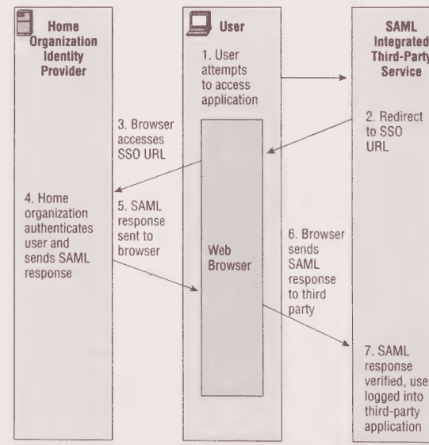

### 43. Alex 担心 SAML 流量被窃听，并希望确保伪造的断言（`assertions`）无效。为了防止这些潜在攻击，他应该做什么？

- A. 使用 SAML 的安全模式来提供安全的身份验证。
- B. 使用强密码套件实现 `TLS`，这将防止这两种类型的攻击。
- C. 使用强密码套件实现 `TLS` 并使用数字签名。
- D. 使用强密码套件实现 `TLS` 并使用消息哈希。

### 44. 如果 Alex 的组织主要由外地的、出差的员工组成，那么将关键业务应用程序集成到现场会产生什么可用性风险，他应该如何解决这一问题？

- A. 第三方集成可能不可信；使用 SSL 和数字签名。
- B. 如果主组织离线，出差的用户将无法访问第三方应用程序；实施混合云/本地认证系统。
- C. 本地用户可能无法被正确重定向到第三方服务；实施本地网关。
- D. 浏览器可能无法正确重定向；使用主机文件以确保重定向问题得到解决。

### 45. 哪种解决方案最能解决如图中第 2 步所示的关于第三方控制 SSO 重定向的担忧？

- A. 关于受信第三方的意识宣传
- B. TLS
- C. 在本地站点处理重定向
- D. 实施 `IPS` 以捕获 SSO 重定向攻击

### 46. Susan 被要求建议她的组织应该使用 MAC（强制访问控制）方案还是 DAC（自主访问控制）方案。如果灵活性和可扩展性是实现访问控制的重要要求，她应该推荐哪种方案，为什么？

- A. MAC，因为它提供了更大的扩展性和灵活性，你可以根据需要简单地添加更多标签。
- B. DAC，因为允许单个管理员对他们提供的对象做出选择，提供了扩展性和灵活性。
- C. MAC，因为分段非常适合灵活性，且增加将使其能够良好地扩展。
- D. DAC，因为中心化的决策过程允许快速响应，并通过减少所需的决策数量来提供扩展性，通过将这些决策移到中央机构来提供灵活性。

### 47. 下列哪个工具通常不用于验证置备（`provisioning`）过程是否按照某种方式执行，以确保遵循了组织的安全策略？

- A. 日志审查
- B. 权限的人工审查
- C. 基于签名的检测
- D. 审查审计跟踪

### 48. Lauren 需要向第三方组织发送有关她正在置备的服务信息。她应该选择哪种基于标准的标记语言来构建接口？

- A. SAML
- B. SOAP
- C. SPML
- D. XACML

### 49. 在渗透测试期间，Chris 恢复了一个包含他尝试访问的系统的哈希密码的文件。哪种类型的攻击针对哈希密码最可能成功？

- A. 暴力破解攻击
- B. 哈希传递攻击（`pass-the-hash`）
- C. 彩虹表攻击
- D. 加盐攻击

### 50. Google 跨域提供身份验证是以下哪种技术的例子？

- A. 联邦（`Federation`）
- B. 生物识别
- C. 单点登录（`SSO`）
- D. 置备

### 51. Lauren 发现置备过程没有按照方式执行以确保遵循组织的安全策略，她遇到了什么问题？

- A. 权限蔓延（`Privilege creep`）
- B. 权限冲突
- C. 最小权限原则
- D. 权限过度

### 52. 当 Chris 扫描指纹并登录了另一个用户的账户时，发生了什么过程？

- A. 身份验证
- B. 注册
- C. 会话管理
- D. 身份管理

### 53. Jim 配置 LDAP 客户端到 636 端口，这对于他的服务器意味着什么？

- A. 它需要 SSL。
- B. 它仅支持非加密连接。
- C. 它提供了全局目录。
- D. 它不支持加密。

### 54. X500 标准涵盖哪种类型？

- A. Kerberos
- B. 置备服务
- C. 生物识别认证
- D. 目录服务

### 55. Microsoft 的 Active Directory 基于哪一个？

- A. RADIUS
- B. LDAP
- C. SSO
- D. PKI

### 56. Lauren 负责构建一个网站。她需要什么来验证用户的身份？

- A. 要求用户创建只有他们知道的问题。
- B. 要求用户出示驾照或护照。
- C. 使用银行和用户共同拥有的信息。
- D. 电用户的注册电话。

### 57. 默认情况下，OpenAP 以什么格式存储 `userPassword` 属性？

- A. 明文
- B. 加盐哈希
- C. MD5 哈希
- D. 使用 AES256 加密

### 58. 使用指纹扫描器进行银行的新客户在扫描指纹后意外登录了另一个用户的账户。发生了什么类型的生物错误？

- A. 注册错误
- B. 1 类错误
- C. 2 类错误
- D. 使用时间错误

### 59. 哪种类型的访问控制通常用于防火墙？

- A. 任意性访问控制
- B. 基于规则的访问控制
- C. 基于任务的访问控制
- D. 强制访问控制

### 60. 当你输入用户 ID 和密码时，你正在执行什么身份活动？

- A. 授权
- B. 验证
- C. 身份验证
- D. 登录

### 61. Kathleen 在一家为个人和组织提供物理数据中心的设施工作。直到最近，每个客户都获得一个磁条卡以进入其服务器所在的区域，并获得一个进入其服务器机柜或机架的钥匙。在过去一个月中，一些服务器被盗了，门卡日志显示 ID 全部有效。为了确保门卡的用户确实是他们所是的人，Kathleen 的最佳选择是什么？

- A. 为门卡用户添加一个需要 PIN 码读取器。
- B. 在设施内添加摄像头系统以观察谁访问了服务器。
- C. 增加一个生物识别因子。
- D. 将磁条卡更换为智能卡。

### 62. 下列哪种是设计为提供通信的票据身份验证协议？

- A. RADIUS
- B. OAuth
- C. SAML
- D. Kerberos

### 63. 哪种类型的访问控制由支持法规、要求和组织自身策略的策略和程序组成？

- A. 纠正性
- B. 逻辑
- C. 补偿性
- D. 行政

---

### 64. 在 Kerberos 环境中，当用户需要访问网络资源时，发送到 TGS 的什么？

- A. TGT
- B. 一个 AS
- C. 一个 SS
- D. 会话密钥 (`session key`)

### 65. 在 MAC（强制访问控制）模型中，哪些对象和主体具有标签？

- A. 分类为机密（`Confidential`）、秘密（`Secret`）或绝密（`Top Secret`）的对象和主体具有标签。
- B. 所有对象都有标签，所有主体都有一个部件（`compartment`）。
- C. 所有对象和主体都有标签。
- D. 所有主体都有标签，所有对象都有一个部件。

---

Chris 是一个不断增长的电子商务网站的身份架构师，该网站希望利用社交身份。为了实现这一点，他和团队打算允许用户在使用电子商务网站时使用他们现有的 Google 账户作为主账户。这意味着当新用户最初连接到电子商务平台时，他们可以选择使用 `OAuth 2.0` 的 Google 账户，也可以使用自己的电子邮件地址和自选密码在平台上创建一个新账户。

根据此信息和下面的示例身份验证流程图回答问题 66–68。

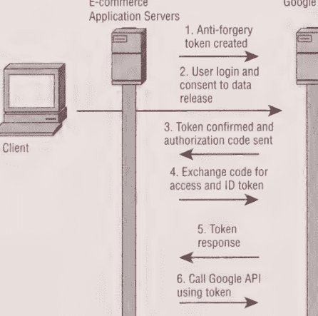

### 66. 当电子商务应用程序为 Google 用户创建账户时，该用户的密码应该存储在哪里？

- A. 密码存储在电子商务应用程序的数据库中。
- B. 密码存储在电子商务应用程序服务器的内存中。
- C. 密码存储在 Google 的账户管理系统中。
- D. 存储密码；相反，在 Google 的账户管理系统中存储加盐哈希值（`salted hash`）。

### 67. 哪些系统负责 Google 用户的身份验证？

- A. 电子商务应用程序。
- B. 电子商务应用程序和 Google 服务器都是。
- C. Google 服务器。
- D. 图表没有提供足够的信息来确定此。

### 68. 创建和交换状态令牌（`state tokens`）是为了防止什么类型的攻击？

- A. XSS
- B. CSRF
- C. SQL 注入
- D. XACML

### 69. 例如“你宠物的名字是什么？”这类问题是什么类型身份证明的示例？

- A. 基于知识的身份验证
- B. 动态基于知识的身份验证
- C. 带外身份证明 (`Out-of-band identity proving`)
- D. 三因子认证

### 70. Lauren 使用一个包含分配权限、对象和主体的表格来管理她负责的系统的访问控制。每当主体尝试访问对象时，系统都会检查表格以确保主体对对象具有适当的权限。Lauren 使用的是哪种访问控制系统？

- A. 权限表 (`capability table`)
- B. 访问控制列表 (`access control list`)
- C. 访问控制矩阵 (`access control matrix`)*
- D. 主体/对象权限管理系统

### 71. 在审查支持事件时，Ben 的组织发现密码更改占了其帮助台案例的四分之一。以下哪些选项最可能显著减少这一数字？

- A. 双因子身份验证
- B. 生物识别身份验证
- C. 自服务密码重置
- D. 短语 (`Passphrases`)

---

### 72. Brian 的大型组织多年一直对其网络设备使用 RADIUS 进行 AAA 服务，最近意识到身份验证期间传输的未加密信息存在安全问题。Brian 如何为 RADIUS 实现加密？

- A. 使用 RADIUS 内置的加密。
- B. 在原生 UDP 上实现 RADIUS 并使用 TLS 进行保护。
- C. 在 TCP 上实现 RADIUS 并使用 TLS 进行保护。
- D. 在设备之间使用 AES256 预共享密码。

### 73. Jim 希望允许云应用程序代表他访问其他网站的信息。以下哪些工具可以实现这一点？

- A. Kerberos
- B. OAuth
- C. OpenID
- D. LDAP

### 74. Ben 的组织曾遇到午餐期间员工不在座位时，应用程序和工作站被未经授权访问的问题。Ben 推荐哪种类型的会话管理解决方案以防止此类访问？

- A. 对所有访问使用会话 ID 并验证所有工作站的 IP 地址。
- B. 为应用程序设置会话超时，并在工作站上使用带有空闲超时的密码保护屏幕保护程序。
- C. 为所有应用程序使用会话 ID，并在工作站上使用带有空闲超时的密码保护屏幕保护程序。
- D. 为应用程序设置会话超时并验证所有工作站的 IP 地址。

### 75. 将列出的每个编号安全控制措施与所示的恰好一个类别进行匹配。选择最描述每个控制措施的类别。您可以使用每个类别一次、多次或完全不使用。

#### 控制措施 (Controls)

1. 密码
2. 账户审查
3. 门禁读器
4. MFA (多因子身份验证)
5. IDP

#### 类别 (Categories)

- A. 管理 (`Administrative`)
- B. 技术 (`Technical`)
- C. 物理 (`Physical`)

### 76. Susan 公司的安全管理员配置了工作站，允许她仅在工作时间内登录。哪种控制最能描述这种？

- A. 限制访问 (`Constrained access`)
- B. 上下文控制 (`Context-dependent control`)
- C. 内容相关控制 (`Content-dependent control`)
- D. 最小权限 (`Least privilege`)

### 77. 美国政府的 CAC 是什么的示例？

- A. 身份证明
- B. 安全令牌


### 78. 哪种身份验证技术可以与 OAuth 对以执行用户验证？

- A. SAML
- B. Shibboleth
- C. OpenID
- D. Higgins

### 79. Jim 拥有秘密（Secret）权限，并正在访问使用强制访问控制的文件。他可以访问什么级别的数据？

- A. 绝密（Top Secret）和秘密（Secret）
- B. 秘密（Secret）和机密（Confidential）
- C. 仅秘密（Secret）
- D. 机密和分类

### 81. 将每个编号技术与相应的类别匹配。每个技术应恰好匹配一个。

#### 身份验证技术 (Authentication technique)

1. 密码
2. 身份卡
3. 视网膜扫描
4. 手机令牌
5. 指纹分析

#### 类别 (Category)

- A. 你所知道的 (Something you know)
- B. 你拥有的 (Something you have)
- C. 你自身的 (Something you are)

### 82. 以下不是访问控制层的是

- A. 物理
- B. 策略
- C. 管理
- D. 技术

### 83. Ben 使用每分钟更改一次代码的软件令牌。他使用的是哪种令牌？

- A. 异步 (Asynchronous)
- B. 智能卡
- C. 同步 (Synchronous)
- D. 静态 (Static)

### 84. 哪种类型的令牌身份验证系统使用挑战/响应过程，挑战需要在令牌上输入？

- A. 异步
- B. 智能卡
- C. 同步
- D. RFID

Ben 的组织正为其高安全建筑访问控制系统采用生物识别。使用下表回答有关组织采用该技术的问题 85–87。

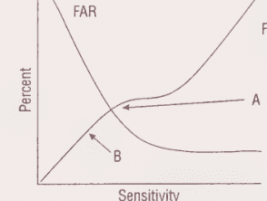

### 85. Ben 的公司正在考虑将其系统配置为图中 A 点所示的水平。它将敏感性设置在什么水平？

- A. FAR 交叉点 (FAR crossover)
- B. FAR 点
- C. CER
- D. CFR

### 86. 在 B 点，可能会发生什么问题？

- A. 误接受率 (FAR) 很高。
- B. 误拒率 (FRR) 很高。
- C. 误拒率很低。
- D. 误接受率很低。

### 87. 如果图中显示的 FAR 和 FRR 不满足组织所需的性能水平，Ben 应该怎么做？

- A. 调整生物识别设备的敏感性。
- B. 评估其他生物识别系统进行比较。
- C. 移动 CER。
- D. 在软件中调整 FRR 设置。

### 88. 哪种 LDAP 身份验证模式可以提供安全身份验证？

- A. 匿名 (Anonymous)
- B. SASL
- C. 简单 (Simple)
- D. S-LDAP

## 第 5 章 • 身份与访问管理（领域 5） 123

### 89. 以下哪种类型 3 认证器适用于单独使用，而不是与其他生物因素结合使用？

- A. 语音模式识别
- B. 手部几何
- C. 掌扫描
- D. 心率/脉搏模式

### 90. 允许 OpenID 赖方（relying party）控制到 OpenID 提供者的连接会产生什么危险？

- A. 它可能导致无法选择正确的 OpenID 提供者。
- B. 它通过向伪造 OpenID 提供者发送数据产生钓鱼攻击的可能性。
- C. 赖方可能会窃客户端的用户名和密码。
- D. 赖方可能不发送签名。

### 91. Jim 正在为他的组织实施云身份解决方案。他正在部署什么类型的技术？

- A. 身份即服务 (IDaaS)
- B. 员工 ID 即服务
- C. 基于云的 RADIUS
- D. OAuth

### 92. RAID-5 是哪种类型控制的示例？

- A. 管理性（Administrative）
- B. 恢复性（Recovery）
- C. 补偿（Compensation）
- D. 逻辑（Logical）

### 93. 当 Alex 为 Linux 服务器上的多个用户之一设置如下所示的权限时，他利用了哪种访问控制模型？

```
$ chmod 731 abc.txt
$ ls -la
total 4
-rwx--x-- 1 user group 0 Feb 27 19:26 abc.txt
-rwx------ 1 user group 0 Feb 27 19:26 def.txt
-r--x--x 1 user group 0 Feb 27 19:26 ghi.txt
```

- A. 基于角色的访问控制 (RBAC)
- B. 基于规则的访问控制
- C. 强制访问控制 (MAC)
- D. 自主访问控制 (DAC)

### 94. 哪种开放协议旨在取代 RADIUS——包括支持额外的命令和协议、将 UDP 流量替换为 TCP 并提供可扩展命令——但不保留与 RADIUS 的后兼容性？

- A. TACACS
- B. RADIUS-NG
- C. Kerberos
- D. Diameter

### 95. LDAP 区分名称 (DNs) 由逗号分隔的组件组成，称为相对区分名称 (RDNs)，每个组件具有一个属性名称和一个值。DN 从左到右进展时具体性逐渐降低。以下哪一个 LDAP DN 最符合这一规则？

- A. `uid=ben,ou=sales,dc=example,dc=com`
- B. `uid=ben,dc=com,dc=example`
- C. `dc=com,dc=example,ou=sales,uid=ben`
- D. `ou=sales,dc=com,dc=example`

### 96. Susan 正在排查 Kerberos 认证问题，症状包括 TGT 不被接受为有效且无法接收新票据。如果她正在故障的系统已正确配置 Kerberos 认证，她的用户名和密码正确，且网络连接正常，最可能的问题是什么？

- A. Kerberos 服务器离线。
- B. 存在协议不匹配。
- C. 客户端的 TGT 已被标记为受损并撤销授权。
- D. Kerberos 服务器与本地客户端的时钟未同步。

### 97. Kerberos、KryptoKnight 和 SESAME 都是什么类型系统的示例？

- A. SSO
- B. PKI
- C. CMS
- D. 目录 (Directory)

### 98. 以下哪种访问控制类别不包含门锁？

- A. 物理（Physical）
- B. 指令性（Directive）
- C. 预防性（Preventative）
- D. 威慑性（Deterrent）

### 99. Windows Active Directory 系统默认使用哪种认证协议？

- A. RADIUS
- B. Kerberos
- C. OAuth
- D. TACACS+

### 100. Alex 配置 LDAP 服务器在 636 和 3269 端口提供服务。根据 LDAP 的默认端口，他配置了哪种类型的 LDAP 服务？

- A. 不安全的 LDAP 和不安全的全局目录
- B. 不安全的 LDAP 和安全的全局目录
- C. 安全的 LDAP 和安全的全局目录
- D. 安全的 LDAP 和不安全的全局目录

### 15. Ben 使用一种模糊测试工具，该工具通过开发数据模型并根据应用程序使用数据的信息创建模糊数据来测试应用程序。Ben 正在进行哪种类型的模糊测试？

- A. 变异 (Mutation)
- B. 参数 (Parametric)
- C. 生成 (Generational)
- D. 派生 (Derivative)

### 16. Saria 想要记录并审查网络部分之间的流量信息。她应该在路由器上启用哪种网络日志以便其进行此类分析？

- A. 审计日志 (Audit logging)
- B. 流日志 (Flow logging)
- C. 追踪日志 (Trace logging)
- D. 路由日志 (Route logging)

### 17. Jim 受聘进行灰盒渗透测试，客户为他提供了有关网络的以下信息以便其扫描：

| 网段 | IP 范围 |
| :--- | :--- |
| 数据中心 | 10.10.10.0/24 |
| 销售部 | 10.10.11.0/24 |
| 账单部 | 10.10.12.0/24 |
| 无线网络 | 192.168.0.0/16 |

如果 Jim 受聘从远程进行扫描，他会遇到什么问题？

- A. IP 范围太大，无法高效扫描
- B. 提供的 IP 地址无法被扫描。
- C. IP 范围重叠，会导致扫描问题。
- D. 提供的 IP 地址是 RFC 1918 地址。

### 18. Karen 的组织多年来一直进行系统备份，但并不频繁使用备份。在最近的系统故障期间，当管理员尝试从备份中恢复时，他们发现备份存在错误且无法恢复。在选择确保其组织下次备份仍然有效的方法时，Karen 应该避免以下哪种选项？

- A. 日志审查 (Log review)
- B. MTD 验证 (MTD verification)
- C. 哈希值处理 (Hashing)
- D. 定期测试 (Periodic testing)

## 第 6 章 安全评估与测试 (领域 6) 132

对于第 19–21 题，请参考以下场景：

Jennifer 就的公司实施了集中日志基础设施，如图所示。请使用此图表和您的日志系统知识回答以下问题。

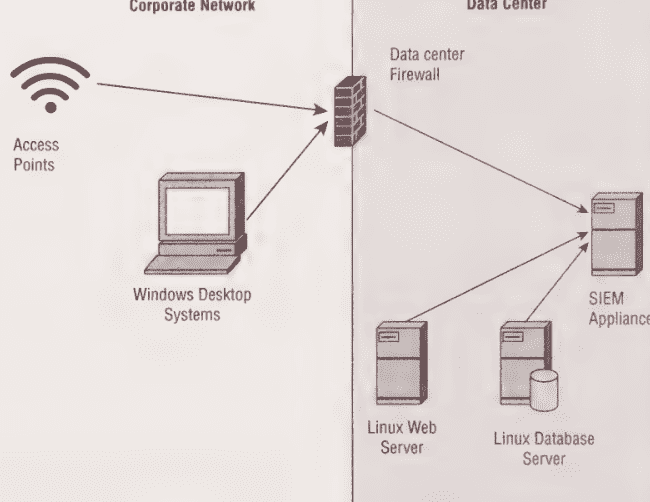

### 19. Jennifer 需要确保所有 Windows 系统都向 SIEM 提供相同的日志信息。她如何最好地确保所有 Windows 桌面都具有相同的日志设置？

- A. 定期执行配置审计。
- B. 使用组策略 (Group Policy)。
- C. 使用本地策略 (Local Policy)。
- D. 部署 Windows syslog 客户端。

### 20. 在正常期间，Jennifer 的团队使用 SIEM 设备监控通过 syslog 接收的异常。图中显示的哪个系统原生不支持 syslog？

- A. 企业级无线访问点
- B. Windows 桌面系统
- C. Linux Web 服务器
- D. 企业级防火墙设备。

## 第 6 章 安全评估与测试 (领域 6) 133

### 21. 组织应对图表所示的每个设备使用哪种技术，以确保日志可以在整个基础设施中按时间排序？

- A. Syslog
- B. NTP
- C. Syslog
- D. SNAP

### 22. 在渗透测试期间，Danielle 需要识别系统，但她尚未获得其用于生成原始数据包的系统访问权限。她应该运行哪种扫描来验证最开放的服务？

- A. TCP 连接扫描
- B. TCP SYN 扫描
- C. UDP 扫描
- D. ICMP 扫描

### 23. 在使用 nmap 进行端口扫描时，Joseph 发现一个系统显示出两个已开放的端口，这令他立即感到担忧：

- 21/open
- 23/open

这些端口上可能运行着哪些服务？

- A. SSH 和 FTP
- B. FTP 和 Telnet
- C. SMTP 和 Telnet
- D. POP3 和 SMTP

### 24. Sarah 的团队正努力说服其管理层，他们的网络存在攻击者可以利用的大量漏洞。如果她想作为渗透测试的一部分进行一次真实的攻击，她应该进行哪种类型的渗透测试？

- A. 晶体盒 (Crystal box)
- B. 灰盒 (Gray box)
- C. 白盒 (White box)
- D. 黑盒 (Black box)

### 25. 常用哪种方法来评估软件测试对应用程序潜在用途的覆盖情况？

- A. 测试覆盖率分析
- B. 源代码审查
- C. 模糊分析 (fuzz analysis)
- D. 代码审查报告

## 第 6 章 安全评估与测试 (领域 6) 134

### 26. 专注于系统不应允许的功能测试是哪种类型的测试示例？

- A. 用例测试 (Use case testing)
- B. 手动测试 (Manual testing)
- C. 误用例测试 (Misuse case testing)
- D. 动态测试 (Dynamic testing)

### 27. 哪种监控使用指向网站的模拟流量来监控性能？

- A. 日志分析
- B. 合成监控 (Synthetic monitoring)
- C. 被动监控 (Passive monitoring)
- D. 模拟交易分析

### 28. 下列漏洞中，哪种不太可能被 Web漏洞扫描器发现？

- A. 路径泄露 (Path disclosure)
- B. 本地文件包含 (Local file inclusion)
- C. 竞态条件 (Race condition)
- D. 缓冲区溢出 (Buffer overflow)

### 29. Jim 使用一种工具扫描系统的可用服务并连接到它们以收集标头信息（banner information），以确定运行的服务版本。然后它提供一份报告，详细说明其收集的内容，结果基于服务指纹、标头信息及其收集的类似细节并结合 CVE 信息。Jim 正在使用哪种工具？

- A. 漏洞扫描器
- B. 端口扫描器
- C. 网络映射器
- D. 协议分析器

### 30. Emily 通过向应用程序发送交易来测试其响应。她正在使用哪种监控？这属于哪种测试？

- A. 被动监控
- B. 合成测试
- C. 实际监控
- D. 活跃测试

## 第 6 章 安全评估与测试 (领域 6) 135

### 31. 哪种监控记录所有交互以确保质量？

- A. 客户端/服务器测试
- B. 真实监控
- C. 合成监控
- D. 被动监控

### 32. 早些时候，Jim 的雇主安全团队发现 Web 服务器存在漏洞。Jim 的最佳选择是哪个？

- A. 卸载补丁
- B. 修复漏洞
- C. 更新配置
- D. 替代

### 33. Angela 想要使用自动化工具测试浏览器对意外数据的处理。她应该选择哪种工具？

- A. Nmap
- B. ZAP
- C. Nessus
- D. Nikto

### 34. STRIDE（欺骗、篡改、否认、信息泄露、拒绝服务、权限提升）在应用程序的哪个部分很有用？

- A. 漏洞评估
- B. 误用例测试
- C. 威胁分类
- D. 渗透测试

### 35. 除了实施无线入侵检测系统，为什么还需要进行被动扫描？

- A. 它可以帮助识别非法设备。
- B. 它可以通过脚本攻击测试无线安全。
- C. 它们在每个通道停留时间短，可以捕捉数据包。
- D. 它们可以帮助测试 IDS。

## 第 6 章 安全评估与测试 (领域 6) 136

### 36. 在渗透测试期间，Lauren 被要求测试组织的蓝牙安全。以下哪些不是她应该向雇主解释的担忧？

- A. 蓝牙扫描可能非常耗时。
- B. 可能扫描的设备可能是个人设备。
- C. 蓝牙被动扫描可能需要多次访问。
- D. 蓝牙主动扫描无法评估蓝牙的安全模式。

### 37. 哪个术语描述由于补丁或配置更改引入新 Bug 的软件测试？

- A. 非回归测试
- B. 演进测试
- C. 烟雾测试
- D. 回归测试

### 38. 哪种工具无法识别目标的操作系统？

- A. Nmap
- B. Nessus
- C. Nikto
- D. sqlmap

### 39. Susan 需要预测组织的高风险区域，并希望使用指标评估风险趋势。她应该如何处理这种情况？

- A. 定期进行风险评估
- B. 聘请渗透公司定期测试组织安全。
- C. 识别并跟踪关键风险指标。
- D. 使用 SIEM 设备监控日志和事件。

### 40. 合成监控与被动监控的主要区别是什么？

- A. 合成监控仅在问题发生后有效。
- B. 被动监控无法检测功能问题。
- C. 被动监控仅在问题发生后有效。
- D. 合成监控无法检测功能问题。

对于第 41–43 题，请参考以下场景。Chris 使用此处所示的标准渗透测试方法论。请使用此方法论和您的渗透测试知识回答关于渗透测试期间工具使用的问题。

# 第 6 章 • 安全评估与测试（领域 6） 137

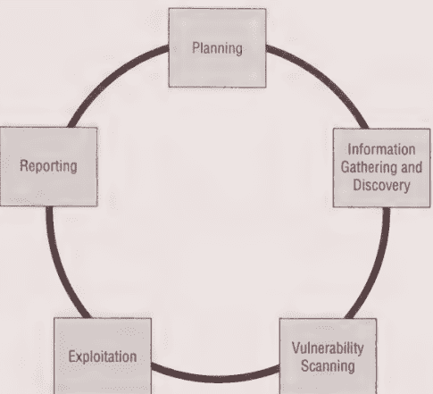

### 41. 在阶段 1（规划阶段）中，最重要的任务是什么？

- A. 构建测试实验室
- B. 获取授权
- C. 收集适当工具
- D. 确定测试是白盒、黑盒还是灰盒

### 42. 在发现阶段（discovery），以下工具哪一个最可能被使用？

- A. Nessus
- B. john
- C. Nmap
- D. Nikto

### 43. 在规划期间，解决哪个问题最重要，以确保报告阶段不会产生问题？

- A. 使用哪种 CVE 格式
- B. 漏洞数据将如何被存储和发送
- C. 哪些目标是禁止的
- D. 报告应该有多长

### 44. 在验证代码测试套件的工作时，通常使用哪四种类型的覆盖率标准？

- A. 输入、语句、分支和条件覆盖
- B. 函数、语句、分支和条件覆盖
- C. API、分支、边界和条件覆盖
- D. 边界、分支、循环和条件覆盖

### 45. 作为安全经理职责的一部分，Jacob 为其组织的管理团队提供了以下图表。他为他们提供了哪种类型的测量结果？

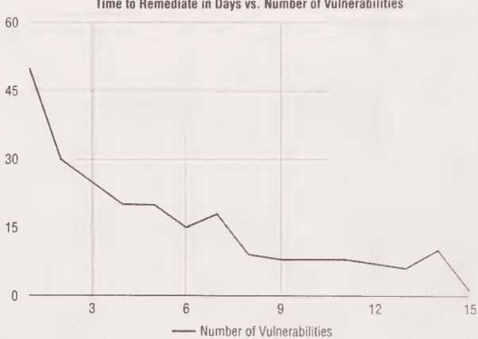

- A. 覆盖率测量
- B. 关键性能指标 (KPI)
- C. 生存时间指标
- D. 业务关键性指标

### 46. 在审查日志时，为所有用户使用唯一用户 ID 可以提供什么？

- A. 机密性
- B. 完整性
- C. 可用性
- D. 可追溯性

### 47. 以下哪项不是软件测试过程中通常测试的接口之一？

- A. APIs


# 网络接口

# UIs

# 物理接口

## 48. Alan 的组织使用安全内容自动化协议 (SCAP) 来标准化其漏洞管理计划。Alan 可以使用 SCAP 的哪个组件来协调由不同安全评估工具生成的漏洞标识？

- A. OVAL
- B. XCCDF
- C. CVE
- D. SCE

## 49. 配置错误、逻辑和功能缺陷以及糟糕的编程实践是什么常见安全问题的原因？

- A. 模糊测试 (Fuzzing)
- B. 安全漏洞
- C. 缓冲区溢出
- D. 竞态条件

## 50. 以下哪种策略对于修复扫描器识别的漏洞不是合理的方法？

- A. 安装补丁
- B. 使用变通方案修复
- C. 更新横幅或版本号
- D. 使用应用层防火墙或 IPS 防止针对已识别漏洞的攻击

## 51. 在渗透测试期间，Saria 打了她目标的帮助台电话，自称是公司官员的高级助理。她要求帮助台由于笔记本在旅行期间出现问题而重置密码，并说服他们这样做。她成功完成了哪种类型的攻击？

- A. 零知识
- B. 帮助台欺骗
- C. 社会工程
- D. 黑盒

# 第 6 章 ■ 安全评估与测试（领域 6）

## 52. 在此图中，由于日志处理设置可能会导致什么问题？

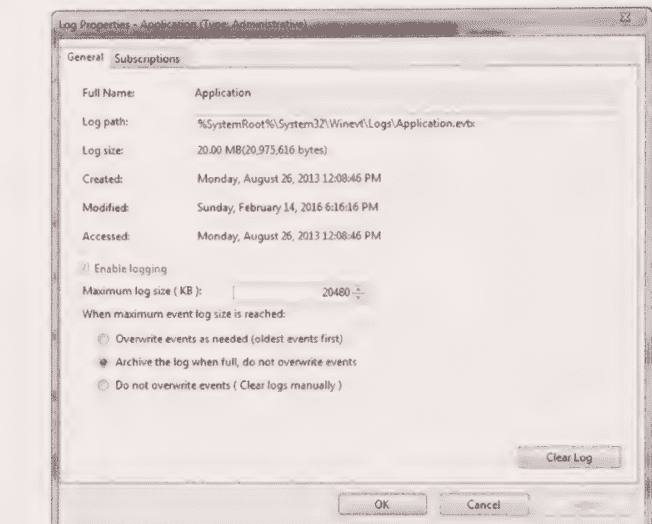

- A. 日志归档时，日志数据可能会丢失
- B. 日志数据可能会被覆盖
- C. 日志数据可能不包含所需信息
- D. 日志可能会填充系统磁盘

## 53. 以下哪项不是与渗透测试相关的危险？

- A. 应用程序崩溃
- B. 拒绝服务
- C. 漏洞利用
- D. 数据损坏

## 54. 哪本 NIST 特别出版涵盖了安全和隐私控制的评估？

- A. 800-12
- B. 800-53A
- C. 800-34
- D. 800-86

# 第 6 章 ■ 安全评估与测试（领域 6）

## 55. 将每个编号扫描类型与所示的相应字母描述相匹配。每个项目应仅使用一次。

### 扫描类型

1. TCP Connect
2. TCP ACK
3. TCP SYN
4. Xmas

### 扫描描述

- A. 发送一个打开新连接的请求
- B. 完成三次握手
- C. 发送一个伪装成活动控制部分的数据包
- D. 发送设置了 FIN、PSH 和 URG 标志的数据包

Kara 使用 `nmap` 对其控制的系统进行扫描，并收到了结果：

```
Nmap scan for 192.168.1.1
Host is up (0.003ms latency).
PORT STATE SERVICE
22/tcp open ssh
80/tcp open http
443/tcp open https
53/tcp filtered
```

## 56. 如果 Kara 的主要关注是防止窃听，她应该拦截哪个端口？

- A. 22
- B. 80
- C. 443
- D. 53

## 57. 如果 Kara 的主要关注是防止连接，她应该拦截哪个端口？

- A. 22
- B. 80
- C. 443
- D. 53

## 58. 在审计期间，Jim 的团队收到一份报告指出，如果进行备份可能会出现什么问题？

- A. 发现的缺陷可能会丢失
- B. 备份可能会损坏
- C. 备份无法使用
- D. 日志可能未记录

# 第 6 章 ■ 安全评估与测试（领域 6）

## 59. Jim 帮助他的组织决定在审计期间使用哪种国际标准？

- A. COBIT
- B. SSAE-18
- C. ITIL
- D. ISO 27002

## 60. 以下哪项最佳描述了 NIST 描述的典型过程？

- A. 定义、建立、实施、分析并报告
- B. 设计、构建、运行、分析
- C. 准备、检测并分析、响应、恢复
- D. 定义、设计、构建、监控

## 61. Lauren 的团队进行回归测试以衡量测试有效性的维护哪种性能指标？

- A. 修复时间
- B. 缺陷复发率
- C. 加权风险
- D. 测试的衡量

## 62. 以下哪种类型的代码审查通常不是人工执行的？

- A. 软件检查
- B. 代码审查
- C. 静态分析
- D. 软件评审

### 对于问题 63-65，请参考以下场景：

Susan 是公司质量保证团队的负责人。团队被要求测试她公司的重大版本。

## 63. Susan 的软件团队要求测试所有代码路径，包括发生错误情况时的路径。她的团队需要什么类型的测试来确保覆盖？

- A. 白盒
- B. 灰盒
- C. 黑盒
- D. 动态

## 64. 作为持续测试应用程序的一部分，Susan 的质量保证团队设计了一系列黑盒测试用例。然后运行了这些功能测试，并准备了一份说明发生了什么的报告。通常生成哪种类型的报告？

- A. 测试覆盖报告
- B. 渗透测试报告
- C. 代码覆盖报告
- D. 行覆盖报告

## 65. 作为代码覆盖测试的一部分，Susan 的团队在非生产环境中使用日志和跟踪工具运行分析。由于操作环境的变化，以下哪种类型的代码问题最可能被遗漏？

- A. 边界检查不
- B. 输入验证
- C. 竞态条件
- D. 指针操作

## 66. Robin 最近进行了漏洞扫描，并在处理敏感信息的服务器上发现了一个严重漏洞。Robin 现在应该做什么？

- A. 补丁
- B. 报告
- C. 修复
- D. 验证

## 67. Kathleen 正在审查代码。她首先规划审查，与审查人员进行概述会议并分配角色，然后与审查人员合作审查材料并准备他们的角色。接下来，她打算审查代码、修复并确保发现的所有缺陷都已修正。Kathleen 正在进行哪种类型的审查？

- A. 动态测试
- B. Fagan 检查
- C. 模糊测试
- D. Roth-Parker 审查

## 68. Danielle 想根据可利用性、是否存在利用代码以及修复难度来比较她在数据中心发现的漏洞。她应该使用哪种评分系统来比较这些漏洞指标？

- A. CSV
- B. NVD
- C. VSS
- D. CVSS

## 69. Alex 在对其网络进行端口扫描时，发现其组织各办公室的许多主机在 TCP 端口 80、443、515 和 9100 上均有响应。Alex 可能正在发现的是什么类型的设备？

- A. Web 服务器
- B. 文件服务器
- C. 无线访问点
- D. 打印机

## 70. Nikto、Burp Suite 和 Wapiti 都是哪种工具的示例？

- A. Web 漏洞扫描器
- B. 代码审查工具
- C. 漏洞扫描器
- D. 端口扫描器

## 71. 将以下 Fagan 代码审查的元素按正确顺序排列。

- A. 跟进 (Follow-up)
- B. 检查 (Inspection)
- C. 概述 (Overview)
- D. 计划 (Planning)
- E. 准备 (Preparation)
- F. 重做 (Rework)

## 72. Jim 正在与一名渗透测试承包商合作，对方建议将 Metasploit 作为其渗透测试工作的一部分。在使用 Metasploit 时，Jim 应该预期发生什么？

- A. 系统将进行漏洞扫描
- B. 系统将被已知漏洞
- C. 服务将对缓冲区溢出和其他未知缺陷进行探测
- D. 系统将针对零日漏洞（zero-day exploits）进行测试

## 73. Susan 需要确保其电子商务应用程序组件之间的交互都得到妥善处理。她打算验证其整个基础设施中的通信、错误处理和会话管理能力。她计划进行什么类型的测试？

- A. 误用例测试 (Misuse case testing)
- B. 模糊测试 (Fuzzing)
- C. 回归测试 (Regression testing)
- D. 接口测试 (Interface testing)

## 第 6 章 • 安全评估与测试（领域 6）

## 74. Jim 正在设计组织的日志管理系统，并知道他需要仔细处理组织的日志数据。以下哪项不是 Jim 应该考虑的因素？

- A. 日志数据量
- B. 缺乏足够的日志源
- C. 数据存储安全需求
- D. 网络带宽

## 75. Ken 在关联组织内不同安全团队的信息方面遇到困难。具体来说，他希望找到一种一致的方式来描述操作系统。哪种 SCAP 组件可以帮助他？

- A. CVE
- B. CPE
- C. CWE
- D. OVAL

## 76. 当 Windows 系统重启时，会生成什么类型的日志？

- A. 错误 (Error)
- B. 警告 (Warning)
- C. 信息 (Information)
- D. 失败审计 (Failure audit)

## 77. 在审查访问日志时，Alex 注意到 Danielle 每天上午 8 点登录她在位于纽约的工作站，但记录显示她在每天凌晨 3 点后不久又登录了部门的主机 Web 应用程序。Alex 可能遇到了什么常见的日志问题？

- A. 日志格式不一致
- B. 日志被篡改
- C. 时间戳不一致
- D. 多日志源

## 78. 哪种类型的漏洞扫描会访问运行目标系统的配置信息，以及通过网络可用服务访问的信息？

- A. 身份验证扫描 (Authenticated scans)
- B. Web 扫描
- C. 非身份验证扫描 (Unauthenticated scans)
- D. 端口扫描

### 对于问题 79–81，请参考以下场景：

Ben 的组织已开始使用 STRIDE 来评估其软件，并识别了威胁主体以及这些威胁可能带来的业务影响。现在，他们正致力于为已识别的问题确定适当控制措施。

## 79. Ben 的开发团队需要解决一个授权问题，导致了权限提升威胁。以下哪种控制措施对于此类问题最合适？

- A. 启用审计和日志记录
- B. 特定操作使用基于角色的访问控制（RBAC）
- C. 启用数据类型和格式检查
- D. 对用户输入进行白名单测试

## 80. Ben 的团队试图对一个由于使用了多个服务器共享对称密钥引起的事务识别问题进行分类。这应该属于哪个 STRIDE 类别？

- A. 信息泄露 (Information disclosure)
- B. 拒绝服务 (Denial of service)
- C. 篡改 (Tampering)
- D. 否认 (Repudiation)

## 81. Ben 的团队想要防止或检测对数据的篡改。以下哪项不是适当的解决方案？

- A. 哈希值 (Hashes)
- B. 数字签名 (Digital signatures)
- C. 过滤 (Filtering)

## 82. Jim 正在与一名渗透测试承包商合作，对方建议将 Metasploit 作为其渗透测试工作的一部分。在使用 Metasploit 时，Jim 应该预期发生什么？

- A. 系统将进行漏洞扫描
- B. 系统将被已知漏洞
- C. 服务将对缓冲区溢出和其他未知缺陷进行探测
- D. 系统将针对零日漏洞进行测试

# 第 6 章 • 安全评估与测试（领域 6）

### 对于第 98–100 题，请参考以下场景。NIST 特别出版物 800-115《信息安全测试与评估技术指南》提供了 NIST 的渗透测试流程。请结合此图以及你对渗透测试的知识来回答问题。

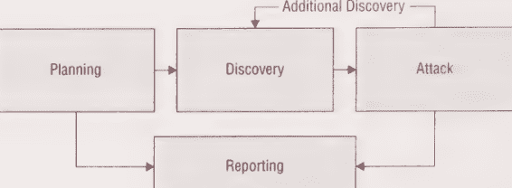

来源：NIST SP 800-115。

## 98. 以下哪项不是发现阶段（discovery phase）的一部分？

- A. 获取主机名和 IP 地址信息
- B. 采集服务信息
- C. 翻垃圾桶（Dumpster diving）
- D. 权限提升

## 99. NIST 规定了四个攻击阶段：获取访问、提升权限、系统浏览和安装额外工具。一旦攻击者安装了额外工具，渗透测试人员通常会返回哪个阶段？

- A. 发现阶段（Discovery）
- B. 获取访问（Gaining access）
- C. 提升权限（Escalating privileges）
- D. 系统浏览（System browsing）

## 100. 以下哪项不是渗透测试报告的典型部分？

- A. 已识别漏洞列表
- B. 测试期间收集的所有敏感数据
- C. 对发现的每个问题的风险评估
- D. 针对识别出的问题的缓解指南

# 第 7 章

# 安全运营（领域 7）


## 1. 参考下图，显示了哪种为数据库服务器提供容错能力的技术？

- A. 故障转移集群（Failover cluster）
- B. 不间断电源（UPS）
- C. 磁带备份
- D. 冷备地（Cold site）

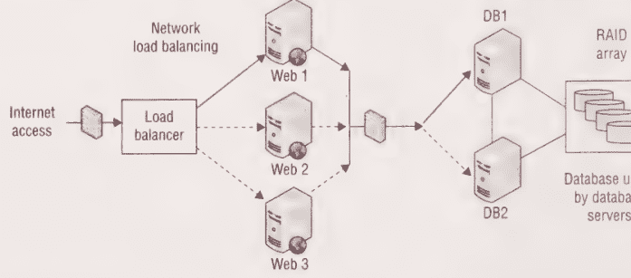

## 2. Joe 是 ERP 系统的安全管理员。他正准备为几位新员工创建账户。在创建账户时，他应该给所有新员工什么默认权限？

- A. 只读（Read only）
- B. 编辑者（Editor）
- C. 管理员（Administrator）
- D. 无访问权限（No access）

## 3. 以下哪项不是应该应自动发送到超级用户操作日志的特权管理活动？

- A. 清除日志记录
- B. 从备份恢复系统
- C. 登录工作站
- D. 管理用户账户

## 4. 以下哪种人员最可能领导监管调查？

- A. 首席信息安全官（CISO）
- B. 首席信息官（CIO）
- C. 政府执法
- D. 私人侦探

## 5. 哪种证据完全由可以带法庭的实物组成？

- A. 证据（Documentary evidence）
- B. 口头证据（Parol evidence）
- C. 证词证据（Testimonial evidence）
- D. 物证（Real evidence）

## 6. 以下哪种可信恢复类型不会失败到安全的运行状态？

- A. 手动恢复（Manual recovery）
- B. 自动恢复（Automated recovery）
- C. 无过度损失的自动恢复（Automated recovery without undue loss）
- D. 功能恢复（Function recovery）

## 7. 安全团队可能会在蜜罐（honeypot）上使用哪种技术来消耗攻击者的时间同时提醒管理员？

- A. 蜜罐网络（Honeynet）
- B. 伪流（Pseudoflow）
- C. 警告横（Warning banner）
- D. 暗网（Darknet）

## 8. Toni 回应了一个报告系统活动缓慢的用户。在检查该系统的出站网络连接时，Toni 注意到系统产生了大量的社交媒体流量。用户并不使用社交媒体，当 Toni 检查相关账户时，发现包含看似加密的奇怪信息。这种流量最可能的原因是什么？

- A. 其他用户正在通过 Toni 的电脑转发社交媒体请求
- B. Toni 的电脑是僵尸网络（botnet）的一部分
- C. Toni 对她使用社交媒体撒了谎
- D. 在 Toni 不在时有人在使用她的电脑

## 9. 在哪种虚拟化模型下，虚拟化平台将网络控制平面与数据平面分离，并用仅接收控制器指令的简单设备替换复杂的网络设备？

- A. 虚拟机（Virtual machines）
- B. 虚拟存储网络（VSAN）
- C. 虚拟局域网（VLAN）
- D. 软件定义网络（SDN）

## 10. Jim 希望识别网络中可能参与僵尸网络的系统。他计划通过监控与控制服务器的连接来实现。如果 Jim 有已知服务器列表，以下哪种技术最可能提供此类信息？

- A. Netflow 记录（Netflow records）
- B. IDS 日志
- C. 身份验证日志（Authentication logs）
- D. RFC 日志

### 对于第 11–14 题，请参考以下场景：

Gary 最近被聘为某地方政府机构的首位首席信息安全官（CISO）。该机构最近遭受了安全泄露，正尝试建立一套新的信息安全计划。Gary 在设计该计划时希望应用一些安全运营的最佳实践。

## 11. 当 Gary 决定为用户分配哪些权限时，他应该遵循什么原则？

- A. 职责分离（Separation of duties）
- B. 最小权限（Least privilege）
- C. 聚合（Aggregation）
- D. 需要知晓

## 12. Gary 在设计计划时使用了以下矩阵。该矩阵强制执行哪种安全原则？

| 角色/任务 | 应用程序程序员 | 安全管理员 | 数据库管理员 | 数据库管理员 | 预算分析师 | 应收账户 | 应付账户 | 补丁 | 验证补丁 |
| :--- | :---: | :---: | :---: | :---: | :---: | :---: | :---: | :---: | :---: |
| | X | | | | | | | | |
| | | X | | | | | | | |
| | | | X | | | | | | |
| | | | | X | | | | | |
| | | | | | X | | | | |
| | | | | | | X | | | |
| | | | | | | | X | | |
| | | | | | | | | X | |
| | | | | | | | | | X |

## 13. Gary 在为用户创建账户并分配权限前，必须验证信息的哪两个元素？

- A. 凭据与需要知晓
- B. 权限与需要知晓
- C. 密码与权限
- D. 密码与权限

## 14. Gary 正在为敏感操作开发控制。他应该应用哪种原则？

- A. 最小权限（Least privilege）
- B. 深度防御（Defense in depth）
- C. 模糊安全（Security through obscurity）
- D. 双人控制（Two-person control）

## 15. 组织何时应对特权进行审查？

- A. 定期
- B. 用户离职时
- C. 用户变更时
- D. 以上所有

## 16. 以下哪个术语通常描述一组相关的补丁？

- A. 热补丁（Hotfix）
- B. 更新（Update）
- C. 安全修复（Security fix）
- D. 服务包（Service pack）

## 17. 以下哪项任务由磁盘控制器执行？

- A. 屏蔽存储设备报告的错误


# 第 7 章 - 安全运营（领域 7）

## 考题

**B.** 向存储设备传输写入命令

**C.** 拦截并修改发送到存储设备的命令

**D.** 防止来自读取操作的数据

**18.** Lydia 正在处理组织的请求。她发现一个用户拥有所需的权限，但没有业务理由。Lydia 拒绝了该请求。她遵循的是什么原则？

- **A.** 需要知晓（Need to know）
- **B.** 最小权限（Least privilege）
- **C.** 职责分离（Separation of duties）
- **D.** 双人控制（Two-person control）

**19.** 将每个术语与其字母匹配：

### 术语

1. 蜜罐（Honeypot）
2. 蜜罐网络（Honeynet）
3. 伪流（Pseudoflow）
4. 暗网（Darknet）

### 定义

- **A.** 用于诱捕攻击者的故意设计的漏洞
- **B.** 设置了故意漏洞的网络
- **C.** 设置了故意漏洞系统
- **D.** 没有任何主机的监控网络

**20.** 以下哪种机制通常被视为对欺诈的震慑？

- **A.** 岗位轮岗（Job rotation）
- **B.** 强制休假（Mandatory vacations）
- **C.** 应急响应（Incident response）
- **D.** 双人控制（Two-person control）

**21.** Brian 最近加入的机构在其自己的数据中心的虚拟化平台上运行大部分服务，同时也利用 `IaaS` 提供商托管其 Web 服务以及 `SaaS` 电子邮件系统。哪种术语描述了该机构使用的云环境？

- **A.** 公有云（Public cloud）
- **B.** 专用云（Dedicated cloud）
- **C.** 私有云（Private cloud）
- **D.** 混合云（Hybrid cloud）

**22.** Tom 正在响应最近的安全事件，并寻求有关系统安全设置修改流程的信息。他最可能在哪里找到这些信息？

- **A.** 变更日志（Change log）
- **B.** 系统日志（System log）
- **C.** 安全日志（Security log）
- **D.** 应用日志（Application log）

**23.** Mark 考虑将其组织的客户关系管理（`CRM`）解决方案替换为新的云产品。该新解决方案完全由供应商管理，Mark 公司不需要编写任何代码或管理任何物理资源。Mark 考虑的是哪种云解决方案？

- **A.** `IaaS`
- **B.** `CaaS`
- **C.** `PaaS`
- **D.** `SaaS`

**24.** 下列哪种信息源对于寻求应用程序、设备和操作系统的信息安全漏洞列表的安全管理员有用？

- **A.** `OWASP`
- **B.** `Bugtraq`
- **C.** 微软安全公告 (Microsoft Security Bulletins)
- **D.** `CVE`

**25.** 在执行灾难恢复计划时，下列哪项通常被认为是灾难的示例？

- **I.** 黑客攻击事件
- **II.** 洪水
- **III.** 火灾
- **IV.** 恐怖主义

- **A.** 仅 II 和 III
- **B.** 仅 I 和 IV
- **C.** 仅限 II、III 和 IV
- **D.** I、II、III 和 IV

**26.** Glenda 希望进行一次灾难恢复测试，并寻找一种允许审查计划且不会中断正常信息系统活动，且时间投入尽可能少的测试。她应该选择哪种类型的测试？

- **A.** 桌面演练 (Table-top exercise)
- **B.** 并行测试 (Parallel test)
- **C.** 全断中断测试 (Full interruption test)
- **D.** 检查清单审查 (Checklist review)

**27.** 下列哪项不是备份带轮转方案？

- **A.** 祖父/父亲/儿子 (Grandfather/Father/Son)
- **B.** 中间汇总 (Meet in the middle)
- **C.** 汉诺塔 (Tower of Hanoi)
- **D.** 六卡带每周 (Six Cartridge Weekly)

**28.** Helen 正在实施一种新的安全机制，用于授予会计系统中员工管理员权限。她设计的流程是：授予访问权限之前，员工经理和会计经理都必须批准请求。Helen 正在执行哪种信息安全原则？

- **A.** 最小权限 (Least privilege)
- **B.** 双人控制 (Two-person control)
- **C.** 岗位轮换 (Job rotation)
- **D.** 职责分离 (Separation of duties)

**29.** 下列哪项不是证据在法庭上可采纳的要求？

- 证据必须具有相关性。
- 证据必须具有实质性。
- 证据必须是有形的。
- 证据必须具备胜任性。

- **A.** 证据必须具有相关性。
- **B.** 证据必须具有实质性。
- **C.** 证据必须是有形的。
- **D.** 证据必须具备胜任性。

**30.** 在哪种云计算模型中，客户与云供应商的其他客户共享计算基础设施，一个客户可能不知道另一个的身份？

- **A.** 公有云 (Public cloud)
- **B.** 私有云 (Private cloud)
- **C.** 社区云 (Community cloud)
- **D.** 共享云 (Shared cloud)

**31.** 下列哪个组织可能在 `CSRIRT`（计算机安全响应应急小组）中拥有代表？

- **I.** 信息安全
- **II.** 法律顾问
- **III.** 高层管理
- **IV.** 工程部门

- **A.** I、III 和 IV
- **B.** I、II 和 III
- **C.** I、II 和 IV
- **D.** 以上所有

**32.** Sam 负责备份公司的主文件服务器。他配置了一个备份计划：在每周一晚上 9 点执行全备，在周内其他日的同一时间执行差备。文件根据下图所示的信息发生变化。在周三将拷贝多少文件？

- **A.** 2
- **B.** 3
- **C.** 5
- **D.** 6

### 文件修改记录

| 时间 | 操作 |
| :--- | :--- |
| 周一上午 8 点 | 创建文件 1 |
| 周一上午 10 点 | 创建文件 2 |
| 周一上午 11 点 | 创建文件 3 |
| 周一下午 4 点 | 修改文件 1 |
| 周一下午 5 点 | 创建文件 4 |
| 周二上午 8 点 | 修改文件 1 |
| 周二上午 9 点 | 修改文件 2 |
| 周二上午 10 点 | 创建文件 5 |
| 周三上午 8 点 | 修改文件 3 |
| 周三上午 9 点 | 创建文件 6 |

**33.** 下列哪种安全工具不能对安全事件产生主动响应？

- **A.** `IPS`
- **B.** 防火墙
- **C.** `IDS`
- **D.** 杀毒软件

**34.** 在虚拟化平台中，负责通过虚拟资源控制物理资源的模块称为什么？

- **A.** 虚拟机 (Guest machine)
- **B.** `SDN`
- **C.** 内核 (Kernel)
- **D.** `Hypervisor`

**35.** 使用什么术语描述创建新账户时分配给用户的默认权限集？

- **A.** 聚合 (Aggregation)
- **B.** 传递性 (Transitivity)
- **C.** 基线 (Baseline)
- **D.** 权利 (Entitlement)

**36.** 下列哪种类型的协议最正式，包含了服务提供商与客户之间对可用性和其他性能的预期？

- **A.** 服务水平协议 (`SLA`)
- **B.** 运营级别协议 (`OLA`)
- **C.** 合作备忘录 (`MOU`)
- **D.** 工作说明书 (`SOW`)

**37.** 下列哪个框架侧重于服务管理并包含了变更管理等主题？

- **A.** `ITIL`
- **B.** `PMBOK`
- **C.** `PCI DSS`
- **D.** `TOGAF`

**38.** Richard 遇到网络质量问题。主要症状是数据包持续过长，无法从源传输到目的地。哪个术语描述 Richard 面临的问题？

- **A.** 抖动 (Jitter)
- **B.** 丢包 (Packet loss)
- **C.** 干扰 (Interference)
- **D.** 延迟 (Latency)

**39.** Joe 怀疑某个程序可能包含恶意软件。可以使用什么技术来隔离它？

- **A.** `ASLR`
- **B.** 沙箱 (Sandboxing)
- **C.** 裁剪 (Clipping)
- **D.** 进程 (Process)

**40.** 下列哪项是人为灾难的示例？

- **A.** 飓风 (Hurricane)
- **B.** 洪水 (Flood)
- **C.** 泥石流 (Mudslide)
- **D.** 变换器 (Transformer)

**41.** 关于 `(ISC)²` 道德规范，下列哪项是正确的？

- **A.** 遵守守则是认证的条件。
- **B.** 观察到违规行为必须报告。
- **C.** 不遵守守则可能导致撤销。

**42.** Javier 验证只有管理员才能登录服务器。他正在执行哪种原则？

- **A.** 知情需要 (Need to know)
- **B.** 最小权限 (Least privilege)
- **C.** 双人控制 (Two-person control)
- **D.** 传递性 (Transitive)

**43.** 下列哪项不是防止攻击的基本预防措施？

- **A.** 实施入侵检测与系统。
- **B.** 维护系统的补丁水平。
- **C.** 移除不必要的账户和服务。
- **D.** 进行取证镜像。

**44.** Tim 是一个取证分析师，试图从硬盘中检索信息。用户似乎尝试删除数据。Tim 正在进行哪种类型的分析？

- **A.** 软件分析 (Software analysis)
- **B.** 媒介分析 (Media analysis)
- **C.** 嵌入式分析 (Embedded analysis)
- **D.** 网络分析 (Network analysis)

**45.** 下列哪项是计算机安全事件的示例？

- **A.** 备份计划的完成
- **B.** 记录的系统访问
- **C.** 未授权的漏洞扫描
- **D.** 病毒库更新

**46.** 下列哪种技术能提供最大的库存自动化？

- **A.** `IPS`
- **B.** `WiFi`
- **C.** `RFID`
- **D.** 以太网

**47.** Connor 的公司最近遭遇了拒绝服务攻击，他认为来自内部。如果是这样，公司经历了什么种类型的事件？

- **A.** 间谍活动 (Espionage)
- **B.** 机密性泄露 (Confidentiality breach)
- **C.** 破坏 (Sabotage)
- **D.** 完整性泄露 (Integrity breach)

**48.** 下图所示的是哪种攻击？


- **A.** SYN 洪水
- **B.** Ping 洪水
- **C.** 蓝精灵烟雾攻击 (Smurf)
- **D.** 碎片攻击 (Fraggle)

**49.** Florian 正在为他的组织制定灾难恢复计划，并希望确定特定的 IT 服务中断而不对业务造成严重损害的时间。Florian 正在计算哪个变量？

- **A.** `RTO`
- **B.** `MTD`
- **C.** `RPO`
- **D.** `SLA`

**50.** 下列哪种陈述最描述零日漏洞？

- **A.** 一个刚进入黑客世界的攻击者
- **B.** 在在数据表中放置 `00/00/0000` 日期试图利用业务逻辑缺陷的数据库攻击
- **C.** 安全社区未知的攻击
- **D.** 将操作系统日期和时间设置为 `00:00/0000` 和 `00:00:00` 的攻击

**51.** 下列哪项不是 `(ISC)²` 道德规范的准则？

- **A.** 保护社会、公共利益、必要的公众信任和信心以及基础设施。
- **B.** 及时向相关部门报告安全漏洞。
- **C.** 诚实、公正、负责且合法地行动。
- **D.** 为委托人提供尽职且称任的服务。

**52.** 在事件调查期间，调查人员与一位可能拥有事件信息的系统管理员见面，该人员并非嫌疑人。会议期间进行的是哪种对话？

- **A.** 访谈 (Interview)
- **B.** 审讯 (Interrogation)
- **C.** 既不是谈话也不是审问
- **D.** 既不是访谈也不是审问

**53.** 将每个编号的恢复能力类型与其正确的字母定义匹配：

| 术语 | 定义 |
| :--- | :--- |
| 1. 热机房 (Hot site) | A. 在发生灾难时可以提供现场或离线 IT 服务的组织 |
| 2. 冷备机房 (Cold site) | B. 具有专用存储和实时数据复制的站点，通常带有共享设备，允许在极短时间内恢复服务 |
| 3. 温备机房 (Warm site) | C. 依赖于共享存储和备份进行恢复的站点 |
| 4. 服务局 (Service bureau) | D. 带有电力、冷却和连接的租用空间，可以容纳作为恢复工作部分的设备 |

**54.** 在下图中使用了哪种技术来保护知识产权？


- **A.** 隐术 (Steganography)
- **B.** 剪裁 (Clipping)
- **C.** 采样 (Sampling)
- **D.** 数字水印 (Watermarking)

**55.** 你正在评估某地区受洪的风险，并考虑了联邦应急管理局 (`FEMA`) 的洪水地图。根据这些地图，该地区位于 200 年一遇洪水范围内。该地区洪水发生的年发生率 (`ARO`) 是多少？

- **A.** 200
- **B.** 0.01
- **C.** 0.02
- **D.** 0.005

**56.** 在大多数防御良好的组织中，以下哪个人对安全构威胁最大？

- **A.** 政治活动家
- **B.** 恶意内部人员
- **C.** 脚本小子 (Script kiddie)
- **D.** 演练攻击者 (Drill attacker)

**57.** Veronica 正在考虑实施顾问建议的数据库恢复机制。在建议的方法中，自动化过程每晚上都会将数据库备份从主设施移动到离线位置。顾问描述的是哪种类型的数据库恢复技术？

- **A.** 远程日志 (Remote journaling)
- **B.** 远程镜像 (Remote mirroring)
- **C.** 电子金库 (Electronic vaulting)
- **D.** 事务日志 (Transaction logging)

**58.** 在设计访问控制方案时，Hilda 设置了角色使得同一个人不具备配置新用户账户和为账户分配超级用户权限。Hilda 遵循的是哪种信息安全原则？

- **A.** 最小权限 (Least privilege)
- **B.** 职责分离 (Separation of duties)
- **C.** 岗位轮换 (Job rotation)
- **D.** 模糊安全 (Security through obscurity)

**59.** Reggie 最近收到公司内部审计师的一封信，安排对他的小组进行评估的启动会议。Reggie 在会议期间应该预期了解到哪些信息？

- **A.** 审计范围
- **B.** 审计目的
- **C.** 预期时间范围
- **D.** 预期结果

**60.** 以下哪个事件标志着灾难恢复过程的完成？

- **A.** 确保财产和生命安全
- **B.** 在备用设施恢复运营
- **C.** 在主设施恢复运营
- **D.** 撤离第一响应人员

**61.** Melanie 怀疑有人正在使用恶意软件从她的公司窃取计算周期。哪种安全工具最适合检测此类事件？

- **A.** `NIDS` (网络入侵检测系统)
- **B.** 防火墙
- **C.** `HIDS` (主机入侵检测系统)
- **D.** `DLP` (数据泄露防护)

**62.** Brandon 观察到，他网络上的一个系统授权用户最近滥用其账户利用针对共享服务器的系统漏洞，导致他获得了该服务器的 `root` 权限。发生了哪种类型的攻击？

- **A.** 拒绝服务 (Denial of service)
- **B.** 权限提升 (Privilege escalation)
- **C.** 侦察 (Reconnaissance)
- **D.** 暴力破解 (Brute force)

**63.** Carla 在公司工作了 15 年，担任过许多不同的职位。每当她更换职位时，都会获得与该职位相关的新权限，但没有任何权限被撤销过。哪个概念描述了她积累的权限集？

- **A.** 权利 (Entitlement)
- **B.** 聚合 (Aggregation)
- **C.** 传递性 (Transitivity)
- **D.** 隔离 (Isolation)

**64.** 在事件响应过程的哪个阶段，管理员采取行动限制影响？

- **A.** 检测 (Detection)
- **B.** 响应 (Response)
- **C.** 缓解 (Mitigation)
- **D.** 恢复 (Recovery)

---

### 场景题 (问题 65–68)

Ann 是某家中型企业的安全人员。她的入侵检测系统每天产生几十条警报，其中许多证明是误报。今天早上，入侵系统发出报警，因为网络开始接收异常高流量的流量。

**65.** 在事件响应的此时，哪个术语最能描述所发生的情况？

- **A.** 安全发生 (Security occurrence)
- **B.** 安全事件 (Security incident)
- **C.** 安全事件 (Security event)
- **D.** 安全入侵 (Security intrusion)

**66.** Ann 继续调查，发现流量是 `UDP` 协议的端口 `53`。哪种服务通常使用该端口？

- **A.** `DNS`
- **B.** `SCP`
- **C.** `SSL/TLS`
- **D.** `HTTP`

**67.** Ann 分析流量时发现流量来自多个不同的源并导致网络崩溃。Ann 应该怀疑是哪种攻击？

- **A.** 侦察 (Reconnaissance)
- **B.** 恶意代码 (Malicious code)
- **C.** 系统渗透 (System penetration)


# 第 7 章 • 安全运营（领域 7）

- D. 拒绝服务 (Denial of service)

68. 现在 Ann 了解到发生了违反她组织策略的，哪个术语最能描述所发生的情况？

- A. 安全发生 (Security occurrence)
- B. 安全事件 (Security incident)
- C. 安全事件 (Security event)
- D. 安全入侵 (Security intrusion)

69. Frank 试图将黑客的笔记本作为证据。笔记本包含显示黑客犯下罪行的日志，但法院判定搜查公寓。什么准入标准导致 Frank 无法引入该笔记本？

- A. 重要性 (Materiality)
- B. 相关性 (Relevance)
- C. 传闻 (Hearsay)
- D. 能力 (Competence)

70. Gordon 怀疑黑客入侵了他公司的系统。该系统不包含任何监管信息，Gordon 希望代表公司进行调查。他已获得主管许可调查。以下哪个陈述是正确的？

- 法律要求 Gordon 在开始之前必须联系执法部门。
- Gordon 不能进行自己的调查。
- Gordon 的调查可能包括检查磁盘内容、网络流量以及任何属于公司的系统或信息。
- Gordon 在识别攻击者后可以合理地进行“反击”。

71. 以下哪种工具为组织提供了针对供应商破产最大的保护？

- 服务水平协议 (Service level agreement)
- 托管协议 (Escrow agreement)
- 互助协议 (Mutual assistance agreement)
- PCI DSS 合规协议

72. Fran 正在考虑为她的银行实施新的人力资源政策以震慑欺诈。她计划实施强制假期制度。通常认为强制休假的最短有效长度是？

- 两天
- 四天
- 一周
- 一个月

73. 以下哪些事件构成安全事件？

1. 尝试入侵网络
2. 成功的数据库入侵
3. 恶意软件感染
4. 违反机密性政策
5. 尝试从安全区域移除信息未

- 2, 3, 和 4
- 1, 2, 和 3
- 4 和 5
- 以上所有

74. 以下哪种类型的流量不应被组织的出站过滤策略拦截？

- 发往私有 IP 地址的流量
- 目标为广播地址的流量
- 源地址来自外部网络的流量
- 目的地址位于外部网络的流量

75. Allie 负责审查其组织网络上的身份验证日志。她没有时间审查所有日志，因此她决定仅选择四次或更多无效身份验证尝试的记录。Allie 使用的是什么技术来缩小池的大小？

- A. 采样 (Sampling)
- B. 随机选择 (Random selection)
- C. 裁剪 (Clipping)
- D. 统计分析 (Statistical analysis)

76. 你正在对网络上的潜在机器人感染进行调查，并希望对网络系统与互联网之间传输的信息进行司法分析。你认为这些信息可能经过加密。你在活动结束后开始调查。获取这些信息来源最好且最简单的方法是什么？

- A. 数据包捕获 (Packet captures)
- B. 网络流数据 (Netflow data)
- C. 入侵检测系统日志 (Intrusion detection system logs)
- D. 集中身份验证记录 (Centralized authentication records)

77. 以下哪个工具通过为操作系统和应用程序提供标准的、安全的配置模板来帮助系统管理员？

- A. 安全指南 (Security guidelines)
- B. 安全策略 (Security policy)
- C. 基准配置 (Baseline configuration)
- D. 运行配置 (Running configuration)

78. 哪种灾难恢复测试激活了备用处理设施并用于进行交易，但保持主站点运行？

- A. 全中断测试 (Full interruption test)
- B. 并行测试 (Parallel test)
- C. 检查清单审查 (Checklist review)
- D. 桌面演练 (Tabletop exercise)

79. 在事件响应过程的哪个阶段，分析师会收到入侵检测报警并验证其准确性？

- A. 响应 (Response)
- B. 缓解 (Mitigation)
- C. 检测 (Detection)
- D. 报告 (Reporting)

80. 在哪种虚拟化模型中，完整的操作系统运行在虚拟化平台上？

- A. 虚拟机 (Virtual machines)
- B. 软件定义网络 (Software-defined networking)
- C. 虚拟 SAN (Virtual SAN)
- D. 应用虚拟化 (Application virtualization)

81. 哪种级别的 RAID 也被称为磁盘镜像？

- A. RAID-0
- B. RAID-1
- C. RAID-5
- D. RAID-10

82. Bruce 在他的网络上看到了许多可疑活动。似乎有一个外部实体正尝试使用端口 22 的 TCP 连接到他所有的系统。该外部人员可能正在进行什么类型的扫描？

- A. FTP 扫描 (FTP scanning)
- B. Telnet 扫描 (Telnet scanning)
- C. SSH 扫描 (SSH scanning)
- D. HTTP 扫描 (HTTP scanning)

83. 历史上死亡之包攻击与以下哪种现代攻击类型相似？

- A. SQL 注入 (SQL injection)
- B. 跨站脚本 (Cross-site scripting)
- C. 缓冲区溢出 (Buffer overflow)
- D. 暴力破解密码 (Brute-force password cracking)

84. Roger 最近在一家公司担任安全专业人员，该公司在 IaaS 环境中运行整个 IT 基础设施。以下哪项最可能是 Roger 公司的责任？

- A. 配置网络防火墙 (Configuring the network firewall)
- B. 应用虚拟机管理程序更新 (Applying hypervisor updates)
- C. 补丁操作系统 (Patching operating systems)
- D. 丢弃前擦硬盘 (Wiping drives prior to disposal)

85. 应用开发人员可以使用什么技术在允许应用进入生产网络之前，在隔离的虚拟环境中进行测试？

- A. 渗透测试 (Penetration testing)
- B. 沙箱 (Sandboxing)
- C. 白盒测试 (White box testing)
- D. 黑盒测试 (Black box testing)

86. Gina 是一家小企业的防火墙管理员，最近安装了新的防火墙。在看到异常密流量迹象后，她检查了入侵检测系统，系统报告正在发生 SYN 洪水攻击。Gina 可以进行哪些防火墙配置更改来最有效地防止这种攻击？

- A. 禁止已知 IP 的 SYN (Block SYN from known IPs)
- B. 禁止未知 IP 的 SYN (Block SYN from unknown IPs)
- C. 向防火墙启用 SYN-ACK 欺骗 (Enable SYN-ACK spoofing to the firewall)
- D. 禁用 TCP (Disable TCP)

87. 哪种信任关系延伸到参与一个或多个子域的两个域之外？

- A. 传递性信任 (Transitive trust)
- B. 可继承的信任 (Inheritable trust)
- C. 非传递性信任 (Non-transitive trust)
- D. 不可继承的信任 (Noninheritable trust)

88. Renee 是一个软件开发人员，为她的组织编写 Node.js 代码。公司正在考虑从自托管的 Node.js 环境迁移到由 Renee 在云供应商管理的应用程序服务器上运行代码的环境。Renee 的公司正在考虑哪种云解决方案？

- A. IaaS
- B. CaaS
- C. PaaS
- D. SaaS

99. Timber Industries 最近与一个客户发生了纠纷。在与客户的会议期间，客户要求他们保留数据。Timber Industries 何时必须这么做？

- A. 立即 (Immediately)
- B. 收到传票时 (Upon receipt of a subpoena)
- C. 收到法院命令时 (Upon court order)
- D. 永远不需要 (Never)

90. 以下哪一项防止了执法部门在没有合理理由的情况下搜索设施？

- A. 第一修正案 (First Amendment)
- B. 第四修正案 (Fourth Amendment)
- C. 第五修正案 (Fifth Amendment)
- D. 第十四修正案 (Fourteenth Amendment)

107. John 作为云基础设施服务提供商，通过全球范围内的负载均衡器将他的网站部署在多个区域。他使用的是哪种可用性概念？

- A. 多处理站点
- B. 热备站点
- C. 冷备站点
- D. 蜜罐网络

108. Lauren 希望确保她的用户只运行其组织批准的软件。她应该部署什么技术？

- A. 黑名单
- B. 白名单
- C. 灰名单

109. 当 Alice 公司的员工来电寻求支持时，她使用了一个公司约定的暗号，用在员工被强制执行某项操作时。这种场景称为什么？

- A. 社会工程
- B. 胁迫
- C. 不可抗力
- D. 斯德哥摩综合征

# 第 8 章 • 软件开发安全（领域 8）


1. 在设计面向对象模型时，以下哪种情况是理想的？

- A. 高内聚、高耦合
- B. 高内聚、低耦合
- C. 低内聚、低耦合
- D. 低内聚、高耦合

2. 以下哪项是攻击者利用僵尸网络的常用方式？

- A. 发送垃圾信息
- B. 进行暴力破解攻击
- C. 扫描漏洞系统
- D. 以上所有

3. 关于代码审查，以下哪项描述是不正确的？

- A. 代码审查应该是一个由同行评审驱动的过程，包含多个开发人员。
- B. 代码审查可以是自动化的。
- C. 代码审查发生在设计阶段。
- D. 代码人员可能预期每小时审查数百行代码。

4. Harold 的公司有强大的密码策略，要求长度至少为 12 个字符，并同时使用字母、数字和符号。对于攻击者来说，破解 Harold 组织密码最有效的技术是什么？

- A. 暴力破解攻击
- B. 字典攻击
- C. 彩虹表攻击
- D. 社会工程攻击

5. 哪个过程负责确保软件更改包含验收测试？

- A. 请求控制
- B. 变更控制
- C. 发布控制
- D. 配置控制

6. 以下哪种攻击类型试图通过强制向第三方网站提交经过身份验证的请求，来利用用户浏览器与其他网站之间的信任关系？

- A. XSS
- B. CSRF
- C. SQL 注入
- D. 会话劫持

7. 使用 SDLC（软件开发生命周期）时，以下哪个步骤应该先于其他步骤执行？

- A. 功能需求确定
- B. 控制规范开发
- C. 代码审查
- D. 设计评审

8. Jaime 是一名技术支持分析师，被要求访问一位电脑显示此处错误信息的用户。这台电脑进入了哪种状态？

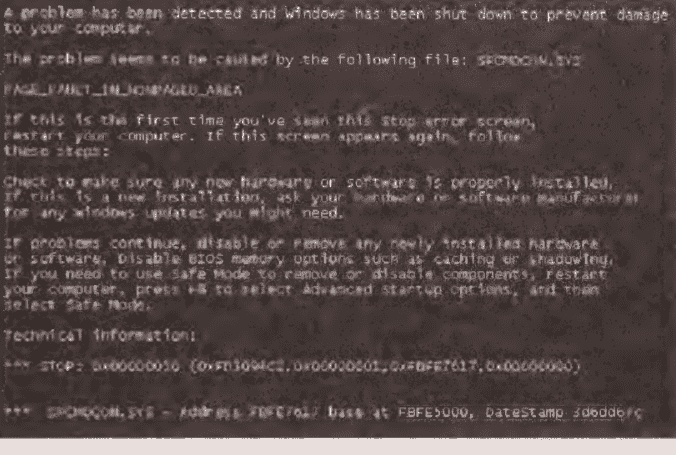

9. 以下哪项不是软件威胁建模的目标？

- A. 减少与安全相关的设计缺陷
- B. 减少与安全相关的编码缺陷
- C. 减少非安全相关缺陷的严重性
- D. 减少威胁向量的数量

10. 在此图中，哪一个是方法（method）示例？

| Account |
| --- |
| Balance: currency = 0 |
| Owner: string |

- A. Account
- B. Owner
- C. AddFunds
- D. 以上都不是

11. 以下哪项被认为是主存储？

- A. 内存
- B. 硬盘
- C. 闪存盘
- D. DVD

12. 以下哪种测试方法通常在不访问源代码的情况下工作？

- A. 动态测试
- B. 静态测试
- C. 白盒测试
- D. 代码审查

13. Lucca 构建的 Web 应用程序有一个缺陷，导致登录用户能够执行其角色范围内不应执行的操作。这属于什么类型的漏洞？

- A. 数据验证
- B. 会话管理
- C. 授权
- D. 错误处理

14. Bobby 正在调查一个授权用户如何获取其权限范围之外的信息。Bobby 认为该用户正在使用一种汇总数据的函数。哪个术语描述这种函数？

- A. 推论
- B. 多态
- C. 聚合
- D. 模块

15. 以下哪种控制最能保护应用程序免受攻击？

- A. 加密
- B. 输入验证
- C. 防火墙
- D. 入侵防御系统

16. Berta 正在分析她某一台服务器上的防火墙日志，发现了如图所示的条目。这些条目指示了什么类型的攻击？

```
2016-04-21 05:12 DROP TCP 192.168.250.4 192.168.42.1 4004
2016-04-21 05:13 DROP TCP 192.168.250.4 192.168.42.1 4005
2016-04-21 05:14 DROP TCP 192.168.250.4 192.168.42.1 4006
2016-04-21 05:14 DROP TCP 192.168.250.4 192.168.42.1 4007
2016-04-21 05:14 DROP TCP 192.168.250.4 192.168.42.1 4008
2016-04-21 05:12 DROP TCP 192.168.250.4 192.168.42.1 4009
2016-04-21 05:13 DROP TCP 192.168.250.4 192.168.42.1 4010
2016-04-21 05:15 DROP TCP 192.168.250.4 192.168.42.1 4011
```

- A. SQL 注入
- B. 端口扫描
- C. 洪水攻击
- D. Land 攻击

对于问题 17–20，请参考以下场景：

Robert 是一位帮助组织创建和开发成熟软件开发实践的顾问。他倾向于使用软件能力成熟模型（CMM），通过独立评审和自评估来评估他目前合作的两个客户的状态。

Acme Widgets 的软件开发实践组织良好。他们有一支专门的开发团队，不惜一切地交付软件，但他们没有任何正式流程。

Beta Particles 公司拥有多年使用正式软件开发流程进行开发的经验。他们使用标准的软件开发模型，但没有对这些流程进行定量管理。

17. Robert 报告 Acme Widgets 的当前状态为 CMM 的哪个阶段？

- A. 已定义（Defined）
- B. 可重复（Repeatable）
- C. 初始（Initial）
- D. 管理（Managed）

18. Robert 正在与 Acme Widgets 合作提高其软件开发实践。他们的下一个里程碑应该是 CMM 的哪个阶段？

- A. 已定义（Defined）
- B. 可重复（Repeatable）
- C. 初始（Initial）
- D. 管理（Managed）

19. Robert 报告 Beta Particles 的当前状态为 CMM 的哪个阶段？

- A. 已定义（Defined）
- B. 可重复（Repeatable）
- C. 优化（Optimizing）
- D. 管理（Managed）

20. Robert 也与 Beta Particles 合作提高其软件开发实践。他们的下一个里程碑应该是 CMM 的哪个阶段？

- A. 已定义（Defined）
- B. 可重复（Repeatable）
- C. 优化（Optimizing）
- D. 管理（Managed）

21. 以下哪种数据库键用于强制表之间的引用完整性关系？

- A. 主键（Primary key）
- B. 候选键（Candidate key）
- C. 外键（Foreign key）
- D. 主键（Master key）

22. 以下哪个文件最可能包含宏病毒？

- A. projections.doc
- B. command.com
- C. command.exe
- D. loopmaster.exe

23. Victor 创建了一个包含组织员工信息的数据库表。该表包含员工的用户 ID、三个不同的电话字段（家庭、工作和手机）、员工的办公室位置以及员工职位。表中有 16 条记录。该表的度（degree）是几？

- A. 3
- B. 4
- C. 6
- D. 16


# 第 8 章 软件开发安全（领域 8）

## 24. Carrie 正在分析她的 Web 应用程序的日志，发现了字符串：

```
.../../../../../../../../../etc/passwd
```

针对 Carrie 的应用程序可能尝试了哪种攻击？

- A. 命令注入
- B. 会话劫持
- C. 目录遍历
- D. 暴力破解

## 25. 当遵循 SDLC 方法进行软件开发时，设计评审应该何时进行？

- A. 评审之后
- B. 用户验收测试之后
- C. 功能需求开发之后
- D. 单元测试完成后

## 26. Tracy 准备为她组织的企业资源计划系统应用补丁。她担心补丁可能会引入先前版本中不存在的缺陷，她计划进行一项测试，将先前的输入响应与新补丁应用程序产生的响应进行比较。Tracy 计划进行哪种测试？

- A. 单元测试
- B. 验收测试
- C. 回归测试
- D. 漏洞测试

## 27. 用哪个术语来描述软件没有漏洞（无论是故意设计到软件中的，还是在整个生命周期中任何时间意外插入的），且软件按预期方式运行的程度？

- A. 验证
- B. 认证
- C. 置信区间
- D. 保证

## 28. Victor 最近在一家约会网站担任了新职位，负责领导一个开发团队。他很快意识到开发人员在生产代码上遇到了问题，因为他们正在进行不同的项目，导致对生产代码产生冲突修改。Victor 应该改进哪个过程？

- A. 请求控制
- B. 发布控制
- C. 变更控制
- D. 配置控制

## 29. 当一个事实集合的分类高于其中任何一个单独事实的分类时，存在哪种类型的数据库安全问题？

- A. 推断
- B. SQL 注入
- C. 多级安全
- D. 聚合

## 30. 攻击者在寻求秘密外泄信息时，通常利用哪两种类型的隐蔽通道？

- A. 计时和存储
- B. 计时和防火墙
- C. 存储和内存
- D. 防火墙和存储

## 31. Vivian 想聘请软件测试人员从用户的角度评估一个新的 Web 应用程序。以下哪种测试模拟了这种视角？

- A. 黑盒
- B. 灰盒
- C. 蓝盒
- D. 白盒

## 32. 参考此处所示数据库事务，如果 Accounts 表不存在账号为 1001 的账户，会发生什么？

```
BEGIN TRANSACTION
UPDATE accounts
SET balance = balance + 250
WHERE account_number = 1001;

UPDATE accounts
SET balance = balance - 250
WHERE account_number = 2002;

END TRANSACTION
```

- A. 数据库将创建一个此账号的新账户，并赋予其 $250 的余额。
- B. 数据库将忽略该命令，但仍然减少第二个账户的 $250 余额。
- C. 数据库将回滚事务，忽略两个命令的结果。
- D. 数据库将生成一条错误消息。

## 33. 哪种恶意软件的特征是利用不需要用户干预的漏洞，凭借自身力量在系统之间传播？

- A. 特洛伊木马
- B. 病毒
- C. 逻辑炸弹
- D. 蠕虫

## 34. Kim 正在排查一个应用程序防火墙的故障，该防火墙作为组织网络、主机防火墙以及入侵防御系统的系统的补充，为基于 Web 的攻击提供额外保护。该组织面临的问题是防火墙技术经常频繁重启，导致其每次无法使用 10 分钟。为了以公司成本最低的方式，Kim 可能会考虑哪种配置来在此期间保持可用性？

- A. 高可用集群
- B. 备用设备
- C. 故障打开
- D. 冗余磁盘

## 35. 当攻击者通过分析几条分类在较低级别的信息来推断出更敏感的信息时，会产生哪种安全问题？

- A. SQL 注入
- B. 多级安全
- C. 聚合
- D. 推断

## 36. Greg 正在应对其组织内的恶意软件爆发。他使用专门的恶意软件分析工具从三个不同的系统中获取了恶意软件样本，并注意到代码在每次感染之间发生了细微变化。Greg 认为这就是防病毒软件难以对付的原因。他怀疑是哪种恶意软件导致了这种情况？

- A. 隐身病毒
- B. 多态病毒
- C. 多感染病毒
- D. 加密病毒

## 问题 37-40 情景

Vivian 正在审查其网站的代码，当她浏览以下代码时，屏幕上弹出一个对话框：

```
<script>alert('</script>
```

## 37. 哪种漏洞存在于 Vivian 的代码板中？

- A. 跨站脚本
- B. 跨站请求伪造
- C. SQL 注入
- D. 身份验证不当

## 38. 哪种信息是用于防止 IP 伪造攻击的可能动机？

- A. 侦察
- B. 信息窃取
- C. 社交工程
- D. 凭据窃取

## 39. Linda 发现没有补丁。哪种设备能最有效地防御这种攻击？

- A. VPN
- B. Web 应用防火墙
- C. 数据泄露防护
- D. 入侵检测系统

## 40. Linda 与供应商讨论后发现没有修复方案。哪种技术可以修复漏洞？

- A. 边界检查
- B. 同伴评审
- C. 输入验证
- D. 补丁

## 41. 数据库的哪种属性确保一旦事务提交，它就会被保留？

- A. 原子性
- B. 一致性
- C. 持久性
- D. 隔离性

## 42. Lauren 在编写应用程序代码时，她处于敏开发流程的哪一个阶段？

- A. 计划
- B. 冲刺
- C. 部署
- D. 开发

## 43. Lauren 试图防止她的网络受到会话劫持攻击。哪种方法对她最有效？

- A. 团队评审
- B. 配对编程
- C. 软件代码评审
- D. Fagan 检查

## 44. 哪种类型的测试通常最后进行？

- A. 单元测试
- B. 集成测试
- C. 用户验收测试
- D. 系统测试

## 45. 哪种需求通过描述输入、输出来规定软件必须做什么？

- A. 派生需求
- B. 结构性需求
- C. 行为需求
- D. 功能性需求

## 46. 以下哪个组织被认为是 Web 攻击的权威来源？

- A. (ISC)²
- B. ISACA
- C. OWASP
- D. Mozilla 基金

## 47. Lisa 试图防止她的网络被 IP 伪造攻击攻击。她在网络边界上配置哪种规则是最佳实践？

- A. 禁止内部源地址进入网络。
- B. 禁止外部源地址离开网络。
- C. 禁止私有 IP 地址离开网络。
- D. 禁止公有 IP 地址进入网络。

## 48. 以下 C 语言示例演示了哪种攻击？

```
int myarray[10];
myarray[10] = 8;
```

- A. 数据类型不匹配
- B. 溢出
- C. SQL 注入
- D. 隐蔽通道

## 50. 哪种数据库问题发生在一个事务向数据库写入值覆盖了较高优先级事务需要的值时？

- A. 脏读
- B. 错误摘要
- C. 丢失更新
- D. SQL 注入

## 51. 哪种措施对防止会话劫持攻击最有效？

- A. TLS
- B. 复杂的会话 Cookie
- C. SSL
- D. 频繁过期 Cookie

## 52. Faith 正在查看使用影子密码的系统的 `/etc/passwd` 文件。当她检查文件中一个具有交互式登录权限的用户行时，她应该在密码字段中看到什么？

- A. 明文密码
- B. 哈希化密码
- C. x
- D. *

## 53. TOCTOU 攻击针对哪种类型的漏洞？

- A. 缺乏输入验证
- B. 竞态条件
- C. 注入缺陷
- D. 缺乏加密

## 54. Harry 在评估潜在的安全事件时，发现 Web 服务器请求的一条日志记录显示用户在表单字段中输入了以下内容：

`CARROT&1=1; -`

尝试了哪种攻击？

- A. 缓冲区溢出
- B. 跨站脚本
- C. SQL 注入
- D. 跨站请求伪造

## 55. 下列哪一项不是针对 SQL 注入攻击的有效控制措施？

- A. 转义
- B. 客户端输入验证
- C. 参数化
- D. 限制数据库管理工具

## 56. 图中显示的是什么类型的项目管理工具？

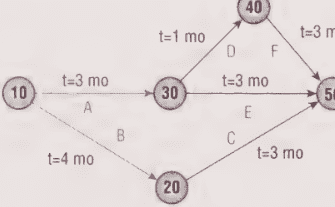

- A. WBS 图
- B. PERT 图
- C. 甘特图
- D. 线框图

## 57. 在哪种软件测试技术中，评估人员每次在软件发生更改时都会重新测试大量场景，以验证结果与标准基准一致？

- A. 正交表测试
- B. 模式测试
- C. 矩阵测试
- D. 回归测试

## 58. 下列哪种条件可能使应用程序最容易受到跨站脚本（XSS）攻击？

- A. 输入验证
- B. 射输入
- C. 未补丁的服务器
- D. 宽松的防火墙规则

## 59. Roger 正在对其公司开发的报税准备应用程序进行软件测试。终端用户将通过 Web 访问该应用程序，但 Roger 正在后端进行测试，评估 Web 服务器上的源代码。Roger 正在进行什么种类型的测试？

- A. 白盒
- B. 灰盒
- C. 蓝盒
- D. 黑盒

## 60. 关于基于启发式的反病毒软件，以下哪种说法是正确的？

- A. 它的误报率低于签名检测。
- B. 它需要频繁更新以检测新的恶意软件。
- C. 它检测零日漏洞的概率高于签名检测。
- D. 它监控系统是否存在已知内容为病毒的文件。

## 61. Martin 正在检查一个系统，用户报告了异常活动，包括系统在空闲时的磁盘活动以及异常的 CPU 和网络使用情况。他怀疑机器被病毒感染了，但扫描结果是干净的。这里可能使用了哪种恶意软件技术可以解释干净的扫描结果？

- A. 文件注入器病毒
- B. MBR 病毒
- C. 服务注入病毒
- D. 隐身病毒

## 62. Tomas 在他的应用程序日志中发现了一行，似乎与一次目录遍历攻击尝试对应。他认为攻击是使用 URL 编码进行的。该行内容如下：

`%252E%252E%252F%252E%252E%252Fetc/passwd`

`%252E` 值代表什么字符？

## 63. 攻击者在公共讨论论坛上发布了一条消息，其中包含嵌入的恶意脚本，该脚本不会显示给用户，但在被读取时会在用户的系统上执行。这是哪种攻击？

- A. 持久性 XSRF
- B. 非持久性 XSRF
- C. 持久性 XSS
- D. 非持久性 XSS

## 64. 下列哪一项不是敏捷软件开发过程的原则？

- A. 欢迎需求的变化，即使在开发过程后期也是。
- B. 最大化未完成的工作量至关重要。
- C. 清晰的文档是进展的主要衡量标准。
- D. 围绕积极主动的个人构建项目。

## 65. 将编号的代码测试方法与其对应的字母定义相匹配：

### 代码测试方法

1. 回归测试
2. 集成测试
3. 单元测试
4. 系统测试

### 定义

- A. 在完整的集成产品上进行测试
- B. 一种专注于测试模块或较小代码段的测试方法
- C. 用于验证以前测试过的软件在更改后以相同方式运行的测试方法
- D. 用于验证软件模块如何协同工作的测试方法

## 66. 专家系统的两个组成部分是什么？

- A. 决策支持系统和神经网络
- B. 推理引擎和神经网络
- C. 神经网络和知识库
- D. 知识库和推理引擎

## 67. Neal 正在使用一个 DynamoDB 数据库。该数据库的结构不像关系型数据库，但允许 Neal 使用键值存储存储数据。DynamoDB 是什么类型的数据库？

- A. 关系型数据库
- B. 图数据库
- C. 层级数据库
- D. NoSQL 数据库

## 68. 在所示事务中，如果数据库在第一次和第二次更新之间失败，会发生什么？

```
BEGIN TRANSACTION
UPDATE accounts
SET balance = balance + 250
WHERE account_number = 1001;

UPDATE accounts
SET balance = balance - 250
WHERE account_number = 2002;
COMMIT
```

- A. 数据库将为第一个账户增加 $250，但不会减少第二个账户的余额。
- B. 数据库将忽略第一个命令，仅将第二个账户的余额减少 $250。
- C. 数据库将回滚事务，忽略两个命令的结果。
- D. 数据库将成功执行两个命令。

## 69. 在所示图中，哪哪是属性？

| Account |
|---|
| Balance: currency = 0 |
| Owner: string |
| AddFunds(currency) |
| RemoveFunds(currency) |

- A. Account
- B. Owner
- C. AddFunds
- D. 以上均都不是

## 70. 关于软件测试，以下哪种说法是正确的？

- A. 静态测试在运行时环境中工作。
- B. 静态测试执行代码分析。
- C. 动态测试使用自动化工具，但静态测试不使用。
- D. 静态测试比动态测试重要。

## 71. David 正在为一项软件开发工作制定项目计划，他遇到了所示的图表。这是哪种图表？

| 周次 | 1 | 2 | 3 | 4 | 5 | 6 | 7 | 8 | 9 | 10 | 21 | 22 | 23 |
|---|---|---|---|---|---|---|---|---|---|---|---|---|---|
| WBS 1 摘要元素 1 | 完成 55% | | | | | | | | | | | | |
| WBS 1.1 活动 A | 完成 75% | | | | | | | | | | | | |
| WBS 1.2 活动 B | 完成 50% | | | | | | | | | | | | |
| WBS 1.3 活动 C | 完成 67% | | | | | | | | | | | | |
| WBS 1.4 活动 D | 完成 0% | | | | | | | | | | | | |
| WBS 2 摘要元素 2 | 完成 0% | | | | | | | | | | | | |
| WBS 2.1 活动 E | 完成 0% | | | | | | | | | | | | |
| WBS 2.2 活动 F | 完成 0% | | | | | | | | | | | | |
| WBS 2.3 活动 G | 完成 0% | | | | | | | | | | | | |

- A. 工作分解结构
- B. 性需求
- C. PERT 图
- D. 甘特图


## 72. Barry 正在对他公司开发的新的游戏应用程序进行渗透测试。他在模拟普通用户的环境中进行测试，但在测试时会引用源代码。Barry 正在进行什么种类型的测试？

- A. 白盒
- B. 黑盒
- C. 蓝盒
- D. 灰盒

## 73. Miguel 最近完成了对处理敏感信息的应用程序的渗透测试。他在测试中发现攻击者可以操纵软件执行未经授权的操作。这种情况属于哪种攻击类型？

- A. SQL 注入
- B. 跨站脚本
- C. 破解 Hash
- D. TOC

---

### 第 8 章 ■ 软件开发安全（领域 8）

## 74. 图中所示输入参数用于什么？

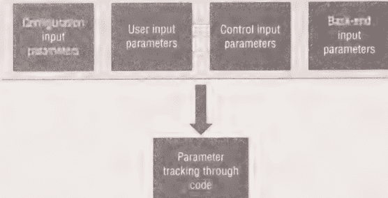

- A. SQL 注入审查
- B. 迭代评审
- C. Fagan 检查
- D. 攻击面识别

## 75. 哪种应用程序安全过程可以用这主要步骤描述？

1. 分解应用程序
2. 确定并排序威胁
3. 确定防御措施和缓解

- A. Fagan 检查
- B. 威胁建模
- C. 渗透测试
- D. 代码审查

## 76. 从安全角度来看，下列哪种故障处理方法是最保守的？

- A. 故障开启 (Fail open)
- B. 故障缓解 (Fail mitigation)
- C. 故障清除 (Fail clear)
- D. 故障关闭 (Fail closed)

---

### 第 8 章 ■ 软件开发安全（领域 8）

## 77. 图所示的是哪种软件开发模型？

| 确定目标、方案和约束。 | 评估方案、识别并解决风险。 |
|---|---|

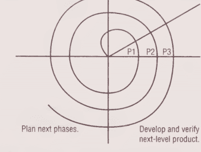

*图片来自 CISSP (ISC)² Certified Information Systems Security Professional Official Guide, 第7版 © John Wiley & Sons 2015，经许可转载。*

- A. 瀑布
- B. 敏捷
- C. 精益
- D. 螺旋

## 78. 下列哪种数据库键用于 RDBMS 唯一标识数据库表中的每一行？

- A. 外键
- B. 主键
- C. 候选键
- D. 引用键

## 79. 下列哪种变更管理流程是由用户而非开发者发起的？

- A. 请求控制 (Request control)
- B. 变更控制 (Change control)
- C. 发布控制 (Release control)
- D. 设计审查 (Design review)

## 80. 下列哪种技术是针对某些推理攻击的有效防御措施？

- A. 输入验证
- B. 参数化
- C. 多重实例化 (Polyinstantiation)
- D. 服务器端验证

## 81. Ursula 是一位政府 Web 开发人员，她最近创建了一个提供物业记录的公共应用程序。她希望其他开发者能够将其集成到自己的应用程序中。Ursula 可以创建什么让开发者最容易直接调用她的代码并将输出集成到他们的应用程序中？

- A. 对象模型 (Object model)
- B. 数据字典 (Data dictionary)
- C. API
- D. 主键 (Primary key)

## 82. 在 IDEAL 模型的哪个阶段，组织会为实施制定具体的行动计划？

- A. 启动 (Initiating)
- B. 诊断 (Diagnosing)
- C. 建立 (Establishing)
- D. 激活 (Activating)

## 83. TJ 正在检查一个系统，用户报告了错误的错误信息并且无法访问文件。他看到了图中所示窗口。TJ 应该怀疑是什么类型的恶意软件？

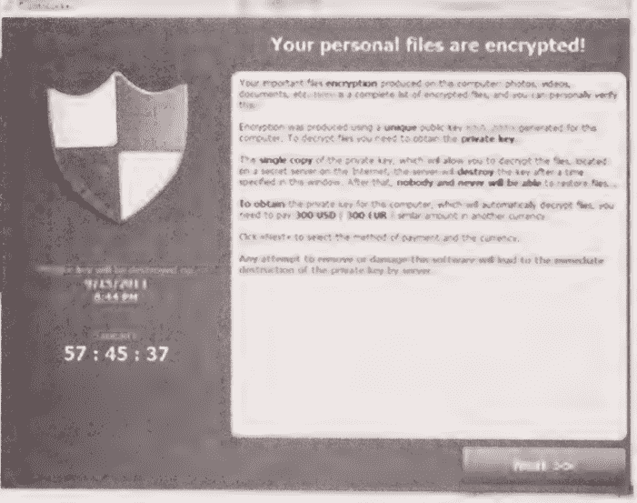

- A. 服务注入 (Service injection)
- B. 加密病毒 (Encrypted virus)
- C. SQL 注入 (SQL injection)
- D. 勒索软件 (Ransomware)

---

## 第 8 章 ■ 软件开发安全（领域 8）

## 84. Charles 正在开发一个对人类安全有直接影响的关键任务。时间和没有软件的正确运行重要。根据这些要求，他应该选择哪种软件开发方法？

- A. 敏捷 (Agile)
- B. DevOps
- C. 螺旋型 (Spiral)
- D. 瀑布型 (Waterfall)

## 85. 以下哪种类型的人工智能试图使用复杂的计算来模拟人类大脑的部分功能？

- A. 决策支持系统 (Decision support systems)
- B. 专家系统 (Expert systems)
- C. 知识库 (Knowledge bank)
- D. 神经网络 (Neural networks)

## 86. 在软件能力成熟度模型 (SW-CMM) 的哪个级别，组织会引入基本的生命周期管理过程？

- A. 初始级 (Initial)
- B. 可重复级 (Repeatable)
- C. 定义级 (Defined)
- D. 管理级 (Managed)

## 87. Lucas 负责他公司的会计系统。在一个关键员工被解雇的第二天早上，系统开始神秘地丢失信息。Lucas 怀疑被解雇的员工在离开之前篡改了系统。Lucas 应该怀疑什么样的攻击？

- A. 权限提升 (Privilege escalation)
- B. SQL 注入 (SQL injection)
- C. 逻辑炸弹 (Logic bomb)
- D. 远程代码执行 (Remote code execution)

## 88. 在敏捷软件开发方法中，哪个原则不会受到推崇？

- A. 过程和工具优于个人和交互
- B. 可工作的软件优于详尽的文档
- C. 客户协作优于合同谈判
- D. 遵循计划响应变化

---

## 第 8 章 • 软件开发安全（领域 8）

## 89. API 开发者最常用哪种技术来限制授权的个人和应用程序访问 API？

- A. 加密 (Encryption)
- B. 输入验证 (Input validation)
- C. API 密钥 (API keys)
- D. IP 过滤器 (IP filters)

## 90. 关于恶意软件，以下哪个说法是正确的？

- A. 恶意软件作者不针对 Macintosh 或 Linux 系统。
- B. 检测已知恶意软件最可靠的方法是观察异常的系统活动。
- C. 签名检测是对抗已知恶意软件最有效的技术。
- D. APT 攻击者通常使用旨在利用安全公告中识别出的漏洞的恶意软件。

## 91. 以下哪个软件开发瀑布模型中步骤的正确顺序是？

- A. 需求、设计、测试、编码、维护
- B. 需求、设计、编码、测试、维护
- C. 设计、需求、编码、测试、维护
- D. 设计、需求、测试、编码、维护

## 92. 数据库 ACID 模型中的哪个组件确保了数据库事务是“全有或全无”的事务？

- A. 原子性 (Atomicity)
- B. 一致性 (Consistency)
- C. 隔离性 (Isolation)
- D. 持久性 (Durability)

## 93. Tom 正在编写一个软件程序，用于计算来自不同管辖区的在线订单的销售税。该应用程序包含一个用户定义字段，允许输入总销售金额。Tom 希望确保在该字段中输入的数据是格式正确的美元金额。他应该使用什么技术？

- A. 范围范围检查 (Limit check)
- B. 故障开启 (Fail open)
- C. 故障安全 (Fail secure)
- D. 输入验证 (Input validation)

## 94. 将以下数字术语与其字母定义匹配：

- 1. 会话劫持 (Session hijacking)
- 2. 跨站脚本攻击 (Cross-site scripting)
- 3. 跨站请求伪造 (Cross-site request forgery)
- 4. SQL 注入 (SQL injection)

- A. 向原本受信任的网站注入恶意脚本的攻击
- B. 一种旨在通过不安全的 Web 应用程序对数据库执行命令的攻击
- C. 一种通常涉及 cookie 或密钥以获得计算机或服务的未经授权访问的利用方法
- D. 一种强制用户在已登录的网站或应用程序中执行意外操作的攻击

## 95. 在 Web 应用程序的渗透测试期间可能会发现哪些漏洞？

- A. 跨站脚本攻击 (Cross-site scripting)
- B. 跨站请求伪造 (Cross-site request forgery)
- C. SQL 注入 (SQL injection)
- D. 以上所有 (All of the)

## 96. 哪种技术管理方法整合了插图中所示技术管理的三个组成部分？

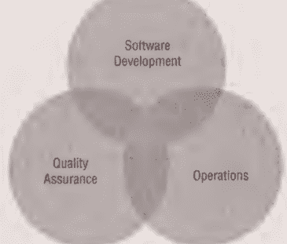

*图片转载自 CISSP² Certified Information Systems Professional Study Guide, 7th Edition © Wiley & Sons 2015，经许可。*

- A. 敏捷 (Agile)
- B. 精益 (Lean)
- C. DevOps
- D. ITIL

## 97. 攻击者可能使用哪种工具来最好识别目标系统中的漏洞？

- A. Nmap
- B. Nessus
- C. ipconfig
- D. traceroute

## 98. 当一个事务读取由从未提交的第二个事务写入的信息时，会发生哪种数据库并发问题？

- A. 丢失更新 (Lost update)
- B. SQL 注入 (SQL injection)
- C. 错误摘要 (Incorrect summary)
- D. 脏读 (Dirty read)

## 99. 哪种病毒通过更改系统启动过程，将 BIOS 或 UEFI 固件重定向到在操作系统之前加载？

- A. 文件感染病毒 (File infector)
- B. MBR
- C. 多态病毒 (Polymorphic)
- D. 服务注入 (Service injection)

## 100. 哪种病毒的特征是使用两种或两种传播机制以提高在系统之间传播的概率？

- A. 隐形病毒 (Stealth virus)
- B. 多态病毒 (Polymorphic virus)
- C. 多部分病毒 (Multipartite virus)
- D. 加密病毒 (Encrypted virus)

## 101. 哪种根安全问题导致了以下问题？

- 跨站脚本攻击 (Cross-site scripting)
- SQL 注入 (SQL injection)
- 缓冲区溢出 (Buffer overflows)
- 跨站请求伪造 (Cross-site request forgery)

- A. 缺乏 API 安全性
- B. 错误处理不当
- C. 输入验证不当或缺失
- D. 源代码问题

---

## 第 8 章 ■ 软件开发安全（领域 8）

## 102. 哪种应用程序开发方法使用此处所示的循环？

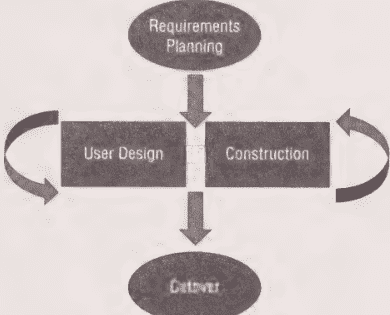

- A. 瀑布型 (Waterfall)
- B. 螺旋型 (Spiral)
- C. 敏捷 (Agile)
- D. RAD

## 103. Kathleen 正在审查阅此处所示的 Ruby 代码。此代码在使用哪种安全技术？

```
insert_new_user = @prepare "INSERT INTO users (name, userid, gender, usertype) VALUES (?, ?, ?)"
insert_new_user.execute('devydid', '19456', 'male', 'admin')
```

- A. 参数化 (Parameterization)
- B. 类型转换 (Typecasting)
- C. Gem cutting
- D. 存储过程 (Stored procedures)

## 104. Susan 为她的组织提供 RESTful API，但希望将其限制为授权合作伙伴。她打算使用 API 密钥。你会给 Susan 什么其他建议来限制滥用？

- A. 限制速率 (Limit request rates)
- B. 强制仅限 HTTP 请求
- C. 由于带宽限制避免令牌
- D. 黑名单 GET、POST 和 PUT 方法

---

# 第 9 章

## 测试题


---

## 第 9 章 • 测试题

## 1. NIST SP800-53 将一组安全措施称为哪种安全工具？

- A. 配置列表 (Configuration list)
- B. 威胁管理策略 (Threat management strategy)
- C. 基线 (Baseline)
- D. CIS 标准

## 2. Ed 被要求识别一种为他的雇主提供低延迟、高性能和高可用内容托管的服务。他应该寻求哪种解决方案以确保他雇主的全球客户能够快速、方便和可靠地访问内容？

- A. 热备机 (Hot site)
- B. CDN
- C. 冗余服务器 (Redundant servers)
- D. P2P CDN

## 3. 以下哪个项不是法医磁盘控制器的功能？

- A. 防止修改存储设备上的数据
- B. 返回从设备请求的数据
- C. 向法医主机报告设备发送错误
- D. 阻塞发送到设备的读取命令

## 4. Mike 正在构建一个容错服务器并希望实现 RAID 1。构建此解决方案需要多少个物理磁盘？

- A. 1
- B. 2
- C. 3
- D. 5

## 5. Kerberos 服务生成新票和会话密钥并发送给客户端？

- A. KDC
- B. TGT
- C. AS
- D. TGS

## 6. 依靠起始停止标志或位来管理传输的通信系统被称为什么类型的通信？

- A. 模拟 (Analog)
- B. 数字 (Digital)
- C. 同步 (Synchronous)
- D. 异步 (Asynchronous)

## 7. 哪种运动检测器使用高微波频率传输来识别潜在的入侵者？

- A. 红外
- B. 基于热量的
- C. 波形
- D. 电容

## 10. Susan 设置了一个防火墙，它能够跟踪两个系统之间通信的状态，并允许远程系统在本地系统启动通信后对其响应。Susan 使用的是哪种防火墙？

- A. 静态包过滤防火墙
- B. 应用层网关防火墙
- C. 状态检测防火墙
- D. 链路级网关防火墙

---

### 问题 9–11 场景

Ben 拥有一咖啡馆，想为客户提供无线互联网服务。Ben 的网络简单，使用单个消费级无线路由器和通过商业电缆数据合同连接的电缆调制调器。

## 9. Ben 如何为客户提供访问控制，而无需在连接之前配置用户 ID，同时又能为业务目的收集有用的联系信息？

- A. WPA2 PSK
- B. 强制门户 (Captive portal)
- C. 要求客户使用公开公布的密码，如“BensCoffee”。
- D. 端口安全

## 10. Ben 打算运行一个开放（未加密）的无线网络。他应该如何连接他的业务设备？

- A. 在相同的 SSID 上运行 WPA2。
- B. 使用 WPA2 设置一个独立的 SSID。
- C. 在企业模式下运行开放网络。
- D. 使用 WEP 设置一个独立的无线网络。

## 11. 为什么 Ben 的开放无线网络上的用户流量容易受到攻击？

- A. 密码由所有用户共享，导致流量容易受到攻击。
- B. 恶意用户在路由器上安装了木马。
- C. 用户对路由器进行了 ARP 欺骗，导致所有流量广播给所有用户。
- D. 开放网络未加密，使流量易被嗅探。

## 12. 下哪项不是数据加密标准（DES）的运行模式？

- A. CBC
- B. CFB
- C. OFB
- D. AES

## 13. Tom 正在调整他的安全监控工具，试图减少管理员收到的警报数量，同时不错过重要的安全事件。他决定配置系统，只有当在一个小时内访问同一个账户失败五次时才报告失败的登录尝试。哪种术语最能描述 Tom 正在使用的技术？

- A. 阈值化 (Thresholding)
- B. 采样 (Sampling)
- C. 账户锁定 (Account lockout)
- D. 剪切 (Clipping)

## 14. Sally 被分配为组织网络服务部署一个认证、授权和审计（AAA）服务器，并且避免使用专有技术。她应该选择哪种技术？

- A. OAuth
- B. RADIUS
- C. XTACACS
- D. TACACS+

## 15. Christopher's Cheesecakes 的一名会计无法访问个人员工的工资信息，但想知道新入职者的工资。他提取了新员工入职前一个薪期的总薪资支出，然后提取了后续薪期的相同支出。他计算了这两个金额之间的差额来确定该个人的工资。发生了哪种攻击？

- A. 聚合攻击 (Aggregation)
- B. 数据篡改 (Data diddling)
- C. 推断攻击 (Inference)
- D. 社会工程

## 16. Alice 希望对某个对象拥有读取权限，并且知道 Bob 拥有这些权利，并想把这些权利交给她。如果 Alice 和 Bob 之间存在关系，Take-Grant 保护模型中的哪条规则允许她完成此操作？

- A. 获取规则 (Take rule)
- B. 授予规则 (Grant rule)
- C. 创建规则 (Create rule)
- D. 远程规则 (Remote rule)

---

## 第 9 章 ■ 测试

## 17. 在日志审查期间，Danielle 发现了一系列显示登录失败的日志：

```
Jan 31 11:39:12 ip-10-0-0-2 sshd[29092]: Invalid user admin from remotehost
passwd=aaaaaaa

Jan 31 11:39:20 ip-10-0-0-2 sshd[29098]: Invalid user admin from remotehost
passwd=aaaaab
```


# 测试题目

## 场景分析

```text
Jan 31 11:39:23 ip-10-0-0-2 sshd[29100]: Invalid user admin from remotehost
passwd=aaaaac

Jan 31 11:39:31 ip-10-0-0-2 sshd[29106]: Invalid user admin from remotehost
passwd=aaaaad

Jan 31 11:48:53 ip-10-0-0-254 sshd[30520]: Invalid user admin from remotehost
passwd=aaaaae
```

Danielle 发现了哪种攻击？

- A. 哈希传递攻击
- B. 暴力破解攻击
- C. 中间人攻击
- D. 字典攻击

## 选择题

### 18. 关系型数据库的哪种属性确保中间结果不会影响其他事务？

- A. 原子性
- B. 隔离性
- C. 一致性
- D. 持久性

### 19. Kim 是一家遇到问题的小企业的系统管理员。她晚上在办公室处理问题，当时没有其他人。她发现办公室另一侧的系统出现了感染迹象。Kim 正在处理哪种恶意软件？

- A. 病毒
- B. 蠕虫
- C. 木马
- D. 逻辑炸弹

### 20. 以下哪项是数据安全的行业标准？

- A. FERPA
- B. HIPAA
- C. SOX
- D. PCI DSS

# 第 9 章 测试 1

### 21. 以下哪个序列描述了 TCP 三次握手？

- A. SYN, ACK, SYN/ACK
- B. PSH, RST, ACK
- C. SYN, SYN/ACK, ACK
- D. SYN, RST, FIN

### 22. 以下哪项不是移动设备管理（MDM）解决方案的功能？

- A. 远程擦除移动设备内容
- B. 控制 BYOD 移动设备
- C. 强制加密
- D. 管理备份

### 23. Jim 正在为他的组织实施 IDaaS。他正在部署什么技术？

- A. 身份即服务
- B. 员工身份即服务
- C. 侵入检测即服务
- D. OAuth

### 24. Gina 最近参加了 CISSP 考试，并写了一篇关于她经历的许多问题的博客。直接违反了 (ISC)² 道德准则的哪方面？

- A. 进步和保护专业。
- B. 诚实、公正、负责且合法。
- C. 保护社会、公共利益、必要的信任和信心。
- D. 为委托人提供勤勉的服务。

### 25. Gordon 正在对他的组织进行风险评估，确定了洪水每年对其设施造成的损失。Gordon 识别了哪个指标？

- A. ALE
- B. ARO
- C. SLE
- D. EF

### 26. Reg 想在他的组织实施应用控制。他希望限制用户仅在系统中安装批准的软件。在这种情况下，哪种应用控制合适？

- A. 黑名单
- B. 灰名单
- C. 白名单
- D. 蓝名单

# 第 9 章 测试 1（续）

### 27. Frank 是一个全球提供新闻和信息的服务器的安全管理员。他的服务器收到了无法处理的高流量并被迫拒绝请求。Frank 将流量追溯到僵尸网络。发生了哪种攻击？

- A. 拒绝服务
- B. 侦察
- C. 破解
- D. 恶意内部人员

### 28. 在此处显示的数据库表中，哪列是主键的最佳候选者？

| Company ID | Company Name | Address | City | State | ZIP Code | Telephone | Sales Rep |
| :--- | :--- | :--- | :--- | :--- | :--- | :--- | :--- |
| 1 | Acme Widgets | 234 Main Street | Columbia | MD | 21040 | (301) 555-1212 | 14 |
| 2 | Abrams Consulting | 1024 Sample Street | Miami | FL | 33131 | (305) 555-1995 | 14 |
| 3 | Dome Widgets | 913 Sorin Street | South Bend | IN | 46556 | (574) 555-5863 | 26 |

- A. Company ID
- B. Company Name
- C. ZIP Code
- D. Sales Rep

### 29. 关于个人的信息，如姓名、社会安全号码、出生日期和地点或母亲的姓，是哪种受保护信息的示例？

- A. PHI
- B. 专有数据
- C. PII
- D. EDI

### 30. Bob 正在他的网络上配置出口过滤，检查指向互联网的流量。他的组织使用公共地址范围 `12.8.195.0/24`。Bob 应该允许哪一个目的地址的数据包离开网络？

- A. `12.8.195.15`
- B. `10.8.15.9`
- C. `192.168.109.55`
- D. `129.53.44.124`

### 31. 使用 6 位加密密钥的加密算法中有多少种可能的密钥？

- A. 12
- B. 16
- C. 32
- D. 64

### 32. 当 SSD 驱动器报废时，建议物理销毁以防止数据泄露的原因是由于什么问题？

- A. 消磁只能部分擦除 SSD 上的数据。
- B. SSD 没有数据残留现象。
- C. SSD 无法执行零填充。
- D. 内置的擦除命令在某些 SSD 上并不完全有效。

### 33. GAD 系统担心黑客窃取存储在文件服务器上的敏感信息的风险。他们选择采取风险缓解策略。以下哪项操作将支持该策略？

- A. 加密文件
- B. 删除文件
- C. 购买网络责任保险
- D. 不采取任何行动

### 34. 在评估账户管理实践时，应该如何生成样本？

- A. 它们应该由管理员生成。
- B. 应该验证过去 180 天的账户。
- C. 应该进行随机抽样。
- D. 抽样无效，应该审计所有账户。

### 35. 欧盟美国隐私盾框架依赖于七项原则。下列哪项正确列出了所有七项？

- A. 意识、选择、控制、安全、数据完整性、访问、救济和执法
- B. 通知、选择、转传责任制、安全、数据完整性和目的限制、访问、救济和执法
- C. 隐私、安全、控制、通知、数据完整性和目的、访问、执法
- D. 提交、编辑、更新、机密、完整性、安全、访问

### 36. 将以下数字测试方法与字母知识水平匹配：

**测试方法**

- 1. 黑盒测试
- 2. 白盒测试
- 3. 灰盒测试

**知识水平**

- A. 对系统的完全了解
- B. 部分或不完整的了解
- C. 对系统无先验知识

### 37. 图中显示的是什么日志？

```text
217.69.233.131 - [11/Apr/2019:06:41:49 -0400] "GET /forum/vulneratest.php?id=25430 HTTP/1.1" 503 2009 -*"
- "Mozilla/5.0 (compatible; Linux x86_64; Mail.Ru_Bot/2.0; http://go.mail.ru/help/robots"
- "Mozilla/5.0 (compatible; Linux x86_64; Mail.Ru_Bot/2.0; http://go.mail.ru/help/robots" 503 2009 -"
- "Mozilla/5.0 (compatible; Linux x86_64; Mail.Ru_Bot/2.0; http://go.mail.ru/help/robots" 503 2009 -"

185.238.143.155 - [11/Apr/2019:06:41:52 -0400] "GET /vulneratest.php?id=25431 HTTP/1.1" 200 150 601-"
- "Mozilla/5.0 (Windows NT 6.1; WOW64; Gecko:20100101; Firefox/41.0) -"
- "Mozilla/5.0 (compatible; Linux x86_64; Mail.Ru_Bot/2.0; http://go.mail.ru/help/robots" 503 2009 -"

217.69.233.131 - [11/Apr/2019:06:41:53 -0400] "GET /vulneratest.php?id=25432 HTTP/1.1" 503 2009 -"
- "Mozilla/5.0 (compatible; Linux x86_64; Mail.Ru_Bot/2.0; http://go.mail.ru/help/robots"

217.69.233.131 - [11/Apr/2019:06:41:55 -0400] "GET /vulneratest.php?id=25438 HTTP/1.1" 503 2009 -"
- "Mozilla/5.0 (compatible; Linux x86_64; Mail.Ru_Bot/2.0; http://go.mail.ru/help/robots"

217.69.233.131 - [11/Apr/2019:06:41:56 -0400] "GET /vulneratest.php?id=27282 HTTP/1.1" 503 2009-"
- "Mozilla/5.0 (compatible; Linux x86_64; Mail.Ru_Bot/2.0; http://go.mail.ru/help/robots"

217.69.233.131 - [11/Apr/2019:06:41:57 -0400] "GET /vulneratest.php?id=33832 HTTP/1.1" 503 2009-"
- "Mozilla/5.0 (compatible; Linux x86_64; Mail.Ru_Bot/2.0; http://go.mail.ru/help/robots"

217.69.233.131 - [11/Apr/2019:06:41:58 -0400] "GET /vulneratest.php?id=24603 HTTP/1.1" 503 2009-"
- "Mozilla/5.0 (compatible; Linux x86_64; Mail.Ru_Bot/2.0; http://go.mail.ru/help/robots"

185.238.143.155 - [11/Apr/2019:06:42:02 -0400] "GET /vulnerability/it-scanning/poc-des-vulnerability-scanning-requirements/ HTTP/1.1" 503 2009-"
- "Mozilla/5.0 (compatible; Linux x86_64; Mail.Ru_Bot/2.0; http://go.mail.ru/help/robots"

185.238.143.155 - [11/Apr/2019:06:42:03 -0400] "GET /vulnerability/it-scanning/poc-des-vulnerability-scanning-requirements/ HTTP/1.1" 503 2009-"
- "Mozilla/5.0 (compatible; Linux x86_64; Mail.Ru_Bot/2.0; http://go.mail.ru/help/robots"

207.46.13.10 - [11/Apr/2019:06:42:17 -0400] "GET /category/articles/page/3 HTTP/1.1" 200 753-"
- "Mozilla/5.0 (compatible; bingbot/2.0; http://www.bingbot.com"
```

- A. 防火墙日志
- B. 变更日志
- C. 应用日志
- D. 系统日志

### 38. Alex 在美国联邦政府工作，需要确保他获取的设备和组件不被破坏。他应该参加哪个计划来帮助这个问题？

- A. TEMPEST
- B. Trusted foundry
- C. GovBuy
- D. MITRE

### 39. 当攻击者盗取了组织的帮助台并说服他们重置密码时，由于帮助台员工的信任和意愿，哪种攻击成功了？

- A. 人肉木马
- B. 社会工程学
- C. 网络钓鱼
- D. 鱼性钓鱼

### 40. 当用户尝试登录在线账户时，Google 向其手机发送了一条短信。这是哪种验证？

- A. 基于知识的认证
- B. 动态知识知识认证
- C. 带外身份验证
- D. 基于风险的身份验证

### 41. 用什么数学运算替换这里的空白使方程正确？

```text
8 6=2
8 4=0
10 3=1
10 2=0
```

- A. MOD
- B. XOR
- C. NAND
- D. DIV

---

**对于问题 42–44，请参考以下场景：**

Ben 所在的组织有一个传统的本地 Active Directory 环境，为这家拥有 350 名员工的公司每增加一个成员都使用手动配置流程。随着公司采用新技术，他们越来越多地使用软件服务（SaaS）应用程序来取代内部开发的软件栈。

Ben 被要求设计一种身份管理实现，允许他的公司使用云服务同时支持其现有系统。使用此处逻辑图，回答关于 Ben 应该提出的身份建议的问题。

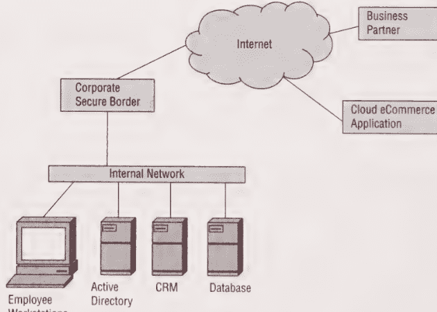

### 42. 如果认证服务的可用性是首要任务，Ben 应该推荐哪种平台？

- A. 本地
- B. 云
- C. 混合
- D. 外包

### 43. 如果 Ben 需要与合作伙伴共享身份信息，应该研究什么？

- A. 单点登录
- B. 多因素认证
- C. 联邦
- D. IDaaS

### 44. 当 Ben 的组织需要向其云应用程序提供身份验证断言时，可能涉及什么技术？

- A. Active Directory
- B. SAML
- C. RADIUS
- D. SPML

### 45. Dave 负责组织的密码安全，并希望加强密码文件的安全性。他希望防御组织受到彩虹表。以下哪种技术专门设计用于阻碍彩虹表的使用？

- A. 密码过期策略
- B. 加盐
- C. 用户教育
- D. 密码复杂度策略

### 46. 以下哪项是设计用于吸引攻击者的单一系统，因为它似乎包含敏感信息或其他吸引人的资源？

- A. 蜜罐网络
- B. 暗网
- C. 蜜罐
- D. 伪流

### 47. 在评估生物识别设备时，另一个描述等错误率的术语是？

- A. FAR
- B. FRR
- C. CER
- D. ERR

### 48. 将字母因素与其数字类型匹配：

**因素**

- A. PIN 码
- B. 令牌
- C. 指纹
- D. 密码
- E. 智能卡

**类型**

- 1. 类型 1
- 2. 类型 2
- 3. 类型 3
- 4. 类型 4

### 49. Sean 怀疑公司内部某人正在秘密窃取信息，尽管公司仔细使用了数据泄露防护（DLP）系统。他发现嫌疑人在公共网络留言板上发布照片，包括此处所示的照片。个人可能使用哪种技术在图像中隐藏信息？


- A. 水印
- B. VPN
- C. 隐写术
- D. 隐信道

### 50. Roger 担心聘佣为内部应用程序开发代码的第三方公司会在代码中嵌入后门。开发人员保留知识产权，并且仅交付最终形式的软件。在以下语言中，哪种语言最不容易受到此类攻击，因为它能为 Roger 提供在最终形式下是人类可读的代码？

- A. JavaScript
- B. C
- C. C++
- D. Java

### 51. Jesse 正在查看配置了影子密码系统的 `/etc/passwd` 文件。她应该预期在该文件的密码字段中看到什么？

- A. 明文密码
- B. 加密密码
- C. 哈希值密码
- D. x

### 52. SYN 洪水攻击依赖于何种协议的实现来导致拒绝服务攻击状态？

- A. IGMP
- B. UDP
- C. TCP
- D. ICMP

### 53. 哪种原则规定个人应尽力准确及时地完成其职责？

- A. 最小权限原则
- B. 职责分离原则
- C. 尽责
- D. 尽职调查

### 54. 电缆调制解调器、ISDN 和 DSL 都是什么类型技术的示例？

- A. 基带
- B. 宽带
- C. 数字
- D. 广播

### 55. 哪种渗透测试技术能最好评估培训和意识问题？

- A. 端口扫描
- B. 发现
- C. 社会工程
- D. 漏洞扫描

### 56. Bill 在一个总共使用三块磁盘的服务器上实现了 RAID 5 级。有多少块磁盘损坏而不会丢失数据？

- A. 0
- B. 1
- C. 2
- D. 3

### 57. 数据在 OSI 模型的哪一层以位的形式发送？

- A. 传输层
- B. 网络层
- C. 数据链路
- D. 物理层


# 练习题

## 58. Bert 正在考虑使用基础设施服务（IaaS）云计算合作伙伴来提供虚拟服务器。在这种情况下，以下哪项是供应商的责任？

- A. 维护虚拟机管理程序（`hypervisor`）
- B. 管理操作系统安全设置
- C. 维护主机防火墙
- D. 配置服务器访问控制

## 59. 当 Ben 记录数据并将其重放到他的测试网站，以根据真实的生产工作负载验证其性能时，他正在进行哪种类型的性能监控？

- A. 被动
- B. 主动
- C. 响应式
- D. 重放

## 60. 哪种技术确保操作系统为系统上的每个应用程序分配独立的内存空间？

- A. 抽象
- B. 分层
- C. 数据隐藏
- D. 进程隔离

## 61. Alan 正在考虑在他的组织中使用新的身份卡进行物理访问控制。他发现了一个样品卡片，但不确定其技术。他将其拆开看到以下内部结构。这是什么类型的卡片？


- A. 智能卡
- B. 距离卡
- C. 磁条
- D. 二相卡

## 62. Mark 正在为他的组织计划灾难恢复测试。他希望对灾难恢复设施进行现场测试，但不想中断主设施的运行。Mark 应该选择哪种测试？

- A. 全面中断测试
- B. 清单审查
- C. 并行测试
- D. 桌面演习

## 63. 以下哪项不是敏捷软件开发方法的原则之一？

- A. 好的架构、需求和设计源于自组织团队。
- B. 不频繁地交付可工作的软件，强调在较长的时间跨内创建准确的代码。
- C. 接受需求的变化，即使在开发过程后期。
- D. 简单至关重要。

## 64. 在安全审计期间，Susan 发现该组织使用手形几何扫描仪作为安全数据中心的访问控制机制。关于使用手形几何扫描仪，Susan 应该给出什么建议？

- A. 拒绝率（FRR）很高，应该更换。
- B. 应该增加第二个因素，因为它们不是可靠区分个人的良好方法。
- C. 手形几何扫描仪为数据中心提供了适当的安全保障，应考虑用于其他高安全性区域。
- D. 它们可能会产生无障碍访问问题，应该考虑另一种生物识别系统。

## 65. Colleen 正在为她的组织进行业务影响评估。哪个指标提供了关于组织在造成不可修复的损害之前可能中断服务的重要信息？

- A. MTD（最大允许中断）
- B. ALE（年度预期损失）
- C. RPO（恢复点目标）
- D. RTO（恢复时间目标）

## 66. 在 Linux 系统中验证账户文件权限与访问文件之间更改符号链接（`symlink`）的攻击是哪种类型攻击的示例？

- A. 取消（Unlinking）
- B. Tick/tock
- C. setuid
- D. TOCTOU

## 67. 一种“拥有的东西”身份因素通常包含一个微处理器和一个或多个证书，这是哪种验证器？

- A. 智能卡
- B. 令牌（`token`）
- C. I 类验证器
- D. III 类验证器

## 68. 哪个术语最能描述依赖窃取或伪造凭据绕过认证的攻击？

- A. 伪装（Spoofing）
- B. 重放（Replay）
- C. 冒充（Masquerading）
- D. 修改（Modification）

## 69. Lisa 想与使用 OAuth 2.0 的云提供商集成，并希望选择一个合适的框架。以下哪项符合她的需求？

- A. OpenID Connect
- B. SAML
- C. RADIUS
- D. Kerberos

## 70. Owen 最近设计了一种安全访问控制结构，防止单个用户同时持有所需的角色。Owen 执行的是哪种原则？

- A. 双人控制
- B. 最小权限
- C. 职责分离
- D. 岗位轮换

## 71. Denise 正在准备涉及涉及公司与供应商之间合同纠纷的审判。供应商声称 Denise 做过口头协议修改了他们的合同。Denise 应该提出哪种证据规则进行辩护？

- A. 物证
- B. 最佳证据规则
- C. 口头证据规则（Parole evidence rule）
- D. 言词证据规则

## 72. 当 Lauren 监控网络两端的流量时，她看到进入公共 IP 地址的流量显示使用 RFC 1918 的内部主机。她应该预期在网络边界看到什么技术？

- A. NAT
- B. VLANs
- C. S/NAT
- D. BGP

## 73. 关于 SSAE-18 的陈述中哪一项错误的？

- A. 它规定了特定的控制集。
- B. 它是一项证明标准。
- C. 它用于外部审计。
- D. 它使用包含 SOC 1、SOC 2 和 SOC 3 报告的框架。

## 74. 受限用户界面（constrained user interface）的作用是什么？

- A. 防止未经授权的用户登录。
- B. 根据内容限制界面中可见的数据。
- C. 根据用户正在执行的操作限制其访问。
- D. 根据权限限制用户可以做什么或看到什么。

## 75. Greg 正在为他的组织建立灾难恢复计划，希望确定故障后恢复特定 IT 服务需要多长时间。Greg 正在计算哪个变量？

- A. MTD
- B. RTO
- C. RPO
- D. SLA

## 76. 哪种业务流程在对系统进行修改之前通常需要经理签字？

- A. SDN
- B. 发布管理
- C. 变更管理
- D. 版本控制

## 77. 哪种类型的灭火器适用于液体火？

- A. A 类
- B. B 类
- C. C 类
- D. D 类

## 78. Chris 工作的公司在每扇门上都贴了告示，提醒员工小心不要让他人进入。哪种类型的控制最能描述这种行为？

- A. 侦测性
- B. 物理性
- C. 预防性
- D. 指示性

## 79. 以下哪项原则不包含在欧盟-美国隐私盾的七项条款中？

- A. 访问
- B. 安全
- C. 救济
- D. 非否认性（Nonrepudiation）

# 第 9 章 ■ 练习 1 219

## 80. 根据《数字千年版权保护法》(DMCA) 的条款，哪个群体有权获得安全风港保护？

- A. 音乐制作人
- B. 图书出版社
- C. 互联网服务提供商
- D. 银行

## 81. Alex 是某大型大学 HR 系统的系统所有者。根据 NIST SP 800-18，当系统发生重大变化时，他应该采取什么行动？

- A. 他应该制定数据机密计划。
- B. 他应该更新系统安全计划。
- C. 他应该对系统包含的数据进行分类。
- D. 他应该选择保管员来处理日常运营任务。

对于问题 82–84，请参考以下场景：

Alex 在他所工作的大学工作了 10 多年。在此期间，他担任过系统管理员和数据库管理员，并在大学的帮助台台工作过。现在，他是运行大学 Web 应用程序团队的经理。请根据此处所示的配置图回答以下问题。

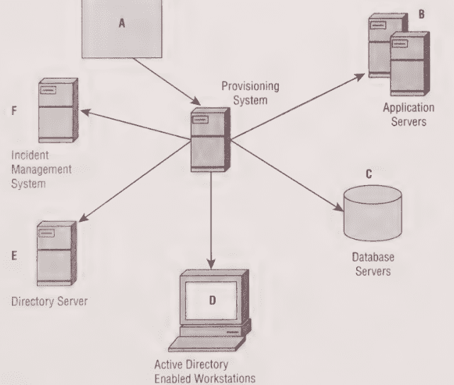

## 82. 如果 Alex 雇佣了一名新员工，并且 HR 根据 Alex 通过一系列表单提供的数据手动输入到配置系统后配置了该员工的账户，发生了哪种类型的配置？

- A. 裁量账户配置
- B. 基于工作流的账户配置
- C. 自动化账户配置
- D. 自服务账户配置

## 83. Alex 拥有 B、C 和 D 的权限。他应该向大学的身份管理团队提出什么担忧？

- A. 配置过程没有赋予他所需的权限。
- B. 他拥有过高的权限。
- C. 可能正在发生权限膨胀。
- D. 日志未正确启用。

## 84. 当 Alex 转换角色时，应该发生什么？

- A. 他应该被取消配置并创建一个新账户。
- B. 他应该将新权限添加到其现有账户中。
- C. 他应该只配置与其角色匹配的权限。
- D. 他应该将其权限设置为与他所取代的人员一致。

## 85. Robert 正在审查一个根据《通用标准》(Common Criteria) 分配了 EAL2 保证级别的系统。他对该系统可能获得的最高保证级别是什么？

- A. 它通过了功能测试。
- B. 它通过了结构测试。
- C. 它通过了形式化验证、设计和测试。
- D. 它通过了半形式的设计和测试。

## 86. Adam 正在处理一个终端用户的访问请求。在授予访问之前，他应该验证哪两项？

- A. 分离和知情需要
- B. 许可和背书
- C. 许可和知情需要
- D. 第二因素和许可

## 87. 在电子取证参考模型 (EDRM) 的哪个阶段，组织确保可能被发现的信息免受更改或删除的影响？

- A. 识别 (Identification)
- B. 保护 (Preservation)
- C. 收集 (Collection)
- D. 制作 (Production)

## 88. Nessus、OpenVAS 和 SAINT 都是什么类型的工具示例？

- A. 端口扫描器
- B. 补丁管理套件
- C. 端口映射器
- D. 漏洞扫描器

## 89. Harry 想要访问存储在文件服务器上 Sally 拥有的文档。将主体/对象模型应用于此场景，资源请求的对象是谁或是什么？

- A. Harry
- B. Sally
- C. 文件服务器
- D. 文档

## 90. 当会话层从传输层发送的数据中移除头部时，流程是什么？

- A. 封装 (Encapsulation)
- B. 数据包拆解 (Packet unwrapping)
- C. 解封装 (De-encapsulation)
- D. 负载化 (Payloading)

## 91. 以下哪个工具最适合针对系统进行已知漏洞测试？

- A. Nikto
- B. Ettercap
- C. Metasploit
- D. THC Hydra

## 92. 哪种标记语言使用请求机构、配置服务端点和配置服务目标的概念来处理其核心功能？

- A. SAML
- B. SAMPL
- C. SPML
- D. XACML

## 93. 哪种类型的风险评估使用所示的工具？

| | 中等 | 高 |
|---|---|---|
| | 中等风险 | 高风险 |
| 低 | 低风险 | 中等风险 |

- A. 量化
- B. 损失预期
- C. 财务
- D. 定性

## 94. MAC 模型使用三种类型的环境。以下哪项不是强制性访问控制设计？

- A. 分级型 (Hierarchical)
- B. 括号型 (Bracketed)
- C. 分区型 (Compartmentalized)
- D. 混合型 (Hybrid)

## 95. 哪种 RAID 也被称为带校验的磁盘条纹？

- A. RAID 0
- B. RAID 1
- C. RAID 5
- D. RAID 10

## 96. Sally 正在为千兆以太网布线。她应该选择哪种线缆来支持 1000 Mbps？

- A. Cat 5 和 Cat 6
- B. Cat 5e 和 Cat 6
- C. Cat 5 和 Cat 7
- D. Cat 6

## 97. 在哪个阶段，组织确保可能被发现的信息免受更改或删除的影响？

- A. 识别
- B. 保护
- C. 收集
- D. 制作

## 98. 以下哪种项通常被视为业务连续性？

- A. 业务影响评估
- B. 备用设施选择
- C. 冷启动激活
- D. 数据恢复

## 99. Robert 是一个小型网络的管理员，最近安装了新的防火墙。在检测到异常流量后，他发现哪种防火墙配置可以有效地阻止这种攻击？

- A. 阻止源 IP 地址。
- B. 阻止 UDP 流量。
- C. 阻止目的 IP 地址。
- D. 阻止 ICMP 流量。

## 100. 以下哪种类型的防火墙无法跟踪数据包之间的状态？

- A. 状态检测
- B. 应用代理
- C. 包过滤
- D. 下代

## 101. 以下哪种仅用于加密网络传输中的数据？

- A. 随机 (Zuf)
- B. 变异 (Mutation)
- C. 生成型 (Generational)
- D. 代码型 (Code based)

## 102. Matthew 遇到网络服务质量问题。主要症状是数据包从源地到目的地花费的时间过长。描述单个数据包延迟变化的术语是 Matthew 面临的问题？

- A. 延迟 (Latency)
- B. 抖动 (Jitter)
- C. 丢包
- D. 干扰

## 103. 以下哪种多因素认证技术管理开销低且灵活？

- A. 生物识别
- B. 软件令牌
- C. 同步硬件令牌
- D. 异步硬件令牌

## 104. 哪种类型的测试会验证 Web 应用程序支持的所有浏览器？

- A. 回归测试
- B. 接口测试
- C. 模糊测试
- D. 白盒测试

## 105. Kathleen 为其组织实施了以下数组：

- 审核者：更新、删除文件
- 提交者：上传文件
- 编辑者：上传、更新文件
- 归档员：删除文件

Kathleen 实现了哪种类型的访问控制系统？

- A. 基于角色的访问控制
- B. 基于任务的访问控制
- C. 基于规则的访问控制
- D. 裁量访问控制

## 106. Alan 正在安装一种灭火系统，该系统将在火灾发生后启动并保护数据中心的设备免受严重损坏。Alan 试图降低哪个指标？

- A. 可能性
- B. RTO
- C. RPO
- D. 影响

## 107. Alan 的 Wrenches 公司最近为其产品开发了一种新的制造工艺。他们计划在内部使用这项技术，不与他人共享。他们希望尽可能保持保护。哪种知识产权保护类型最适合这种情况？

- A. 专利
- B. 版权
- C. 商标
- D. 商业秘密

## 108. Ben 希望使用标准化的协议与国家漏洞数据库 (NVD) 接口。他应该使用哪种选项来确保他开发的工具可以与 NVD 中包含的数据配合？

- A. XACML
- B. SCML
- C. VSML
- D. SCAP

## 109. 下列哪不是 DevOps 模型的三个组件之一？

- A. 软件开发
- B. 变更管理
- C. 质量保证
- D. 运维

## 110. 如图所示，Harry 读取数据文件的请求被拦截。Harry 拥有秘密（Secret）安全许可，而该数据文件具有最高机密（Top Secret）分类。Bell-LaPadula 模型的哪个原则阻止了这一请求？


- A. 简单安全属性（Simple Security Property）
- B. 简单完整性属性（Simple Integrity Property）
- C. *-安全属性（*-Security Property）
- D. 任意安全属性（Discretionary Security Property）

## 111. Norm 正在与一个供应商启动一个新的软件项目，该供应商使用 SDLC 方法进行开发。当他上任时，收到了一份显示此处章节的文档。这是哪种规划文档？

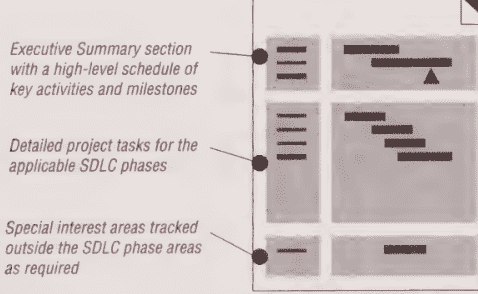

- A. 功能需求文档
- B. 工作分解结构
- C. 测试分析报告
- D. 项目计划书

# 第 9 章练习题 1

## 112. Kolin 正在寻找一种网络安全解决方案，能够帮助他减少零日攻击，同时在系统连接到网络之前使用身份验证来执行安全策略。Kolin 应该实施哪种解决方案？

- A. 防火墙
- B. NAC 系统（网络访问控制）
- C. 入侵检测系统
- D. 端口安全

## 113. Gwen 发现一个运行在 Web 服务器上的服务账户下。该服务账户拥有服务器的完全管理权限。这违反了信息安全的哪个原则？

- A. 知情需要（Need to know）
- B. 职责分离（Separation of duties）
- C. 最小权限原则（Least privilege）
- D. 岗位轮换（Job rotation）

## 114. 下列哪项不是代码审查过程中的结构覆盖类型？

- A. 语句（Statement）
- B. 追踪（Trace）
- C. 循环（Loop）
- D. 数据流（Data flow）

## 115. 下列哪个工具最适合渗透测试的信息收集阶段？

- A. Whois
- B. zmap
- C. Nessus
- D. Metasploit

对于问题 116–118，请参考以下场景：

在 Web 应用程序漏洞扫描测试期间，Steve 对他认为可能易受攻击的 Web 服务器运行了 Nikto。根据所示的 Nikto 输出回答以下问题。

# 第 9 章 • 练习题 2

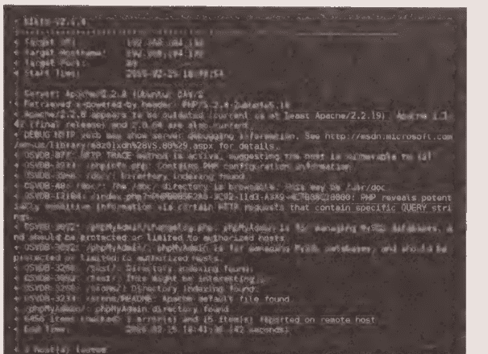

## 116. 为什么 Nikto 标记 /test 目录？

- A. /test 目录允许对 PHP 进行管理访问。
- B. 它被用于存储敏感数据。
- C. 测试目录通常包含可能被滥用的脚本。
- D. 它表明可能已被攻破。

## 117. 为什么 Nikto 将目录索引识别为一个问题？

- A. 它列出了目录中的文件。
- B. 它可能允许 CSRF。
- C. 目录索引可能导致拒绝服务攻击。
- D. 目录索引默认关闭，开启可能表明已被攻破。

## 118. Nikto 列出了 OSVDB-877，指出该系统可能受到 XST 攻击。这种类型的攻击允许攻击者做什么？

- A. 使用跨站目标攻击。
- B. 窃取用户的 cookie。
- C. 反向 SQL 追踪。
- D. 修改用户的 TRACE 信息。

## 119. 下列哪种内存类型被认为是易失性内存？

- A. Flash（闪存）
- B. EEPROM
- C. EPROM
- D. RAM（随机存存储器）

## 120. Ursula 认为她机构中的许多人以不安全且可能违反机构安全策略的方式在笔记本电脑上存储敏感信息。她可以使用哪种控制措施来识别这些文件？

- A. 网络 DLP（数据泄露防护）
- B. 网络 IPS（入侵防护系统）


- C. 终端 DLP
- D. 终端 IPS

## 121. 在哪种云计算模型中，客户在自己或拥有的数据中心构建云计算环境，或者在另一个数据中心构建一个仅供客户专使用的环境？

- A. 公有云
- B. 私有云
- C. 混合云
- D. 共享云

## 122. 下列哪种技术旨在防止 Web 服务器离线而成为 Web 应用程序架构中的单点故障？

- A. 负载均衡
- B. 双电源供应
- C. IPS
- D. RAID

## 123. Alice 想给 Bob 发送一条消息，并确保 Bob 知道消息在传输过程中没有被篡改。Alice 试图实现密码学的哪个目标？

- A. 机密性（Confidentiality）
- B. 非否认性（Nonrepudiation）
- C. 身份认证（Authentication）
- D. 完整性（Integrity）

## 124. 此处显示的是哪种网络拓扑？

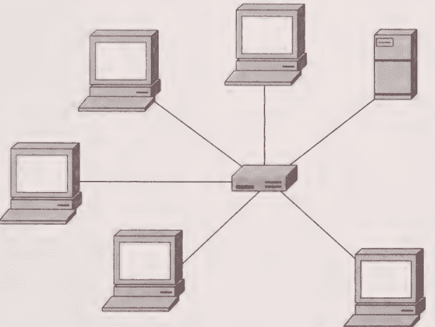

- A. 环形
- B. 总线型
- C. 星型
- D. 网型

## 125. Monica 正在开发一个计算个人体重的应用程序，以确保其落在某个范围内。Monica 应该使用哪种控制措施？

- A. 故障开路（Fail open）
- B. 故障安全（Fail secure）
- C. 限制（Limit）
- D. 缓冲（Buffer）

# 第 10 章 练习题


## 1. James 正在为他的机构制定计划，并想确定停机后数据丢失量。James 正在确定哪个变量？

- A. SLA（服务水平协议）
- B. RTO（恢复时间目标）
- C. MTD（最大允许停止时间）
- D. RPO（恢复点目标）

## 2. Fred 需要部署一个可以连接他的网络并支持广泛协议的网络设备。Fred 的最佳选择是什么？

- A. 交换机
- B. 桥器
- C. 网关
- D. 路由器

## 3. Alex 准备进行渗透测试，并希望最大化测试的真实性。他应该要求哪种类型的渗透测试？

- A. 黑盒（Black box）
- B. 水晶盒（Crystal box）
- C. 灰盒（Gray box）
- D. 零盒（Zero box）

## 4. Banner 信息通常在哪个阶段记录？

- A. 规划（Planning）
- B. 攻击（Attack）
- C. 报告（Reporting）
- D. 发现（Discovery）

## 5. B 类网络的默认子网掩码是什么？

- A. 255.0.0
- B. 255.255.0
- C. 255.255.255.0
- D. 255.255.254

## 6. Jim 被要求根据新的 BYOD 策略识别带工作的设备。这些设备未加入 Active Directory 等中央管理系统，但他仍需要识别每个。下列选项能为 Jim 提供最佳手段？

- 记录每个设备的 MAC 地址。
- 要求用户填写表格进行注册。
- 使用端口扫描器扫描每个系统。
- 通过 Web 使用设备指纹识别。

## 7. David 工作于一个使用正式数据治理程序的机构。他正在咨询一位创建了全新类别数据的员工，并希望与适当的人合作为数据分配分类。谁负责信息的分类分配？

- A. 数据创建者（Data creator）
- B. 数据所有者（Data owner）
- C. CISO
- D. 数据保管员（Data custodian）

## 8. 什么类型的入站数据包是 Ping 洪攻击（ping flood）的特征？

- A. ICMP echo request
- B. ICMP echo reply
- C. ICMP destination unreachable
- D. ICMP route changed

## 9. Gabe 对作为机构信息安全计划基石的密码安全性表示担忧。下列哪种控制措施能极大提高 Gabe 身份验证用户的能力？

- A. 更复杂的密码
- B. 针对社会工程的用户教育
- C. 多因素认证
- D. 增加基于个人知识的安全问题

## 10. 网络基础设施与控制层的分离，结合以厂商中立、基于标准的集中编程网络设计的能力，是哪个重要概念的示例？

- A. MPLS，一种用较短标签替换网络地址并支持广泛协议的方法
- B. FCoE，一种允许以太网上运行常见应用的收敛协议
- C. SDN，一种允许网络虚拟化的收敛协议
- D. CDN，一种让常见网络设计可访问的收敛协议

## 11. Susan 正在废弃其机构包含最高机密数据的存档 DVD-ROM。她应该如何确保数据不会泄露？

- A. 消磁（Degauss）
- B. 零填充（Zero wipe）
- C. 碎碎（Pulverize）
- D. 安全擦除（Secure erase）

## 12. 软件能力成熟性模型 (SW-CMM) 的最终阶段是什么？

- A. 可重复的
- B. 已定义的
- C. 可管理的
- D. 优化

## 13. Angie 正在为她的网络配置出站监控以提供额外的安全性。Angie 应该允许以下哪种类型的数据包离开网络发往互联网？

- A. 源地址来自 Angie 公有 IP 地址块的数包
- B. 目的地址来自 Angie 公有 IP 地址块的数据包
- C. 源地址在 Angie 地址块之外的数包
- D. 源地址来自 Angie 私有地址块的数包

## 14. Matt 正在对一台 Linux 服务器进行渗透测试，并成功获取了管理员账户的访问。他现在想获取密码哈希值以用于暴力破解攻击。假设系统配置符合现代安全标准，他可能在哪里找到这些哈希值？

- A. `/etc/passwd`
- B. `/etc/hash`
- C. `/etc/secure`
- D. `/etc/shadow`

## 15. Theresa 正在实施一个新的访问控制系统，并希望确保开发人员没有能力将代码从开发系统移动到生产环境。她最直接执行的是哪种信息安全原则？

- A. 职责分离
- B. 双人控制
- C. 最小权限
- D. 岗位轮换

## 16. 以下哪种工具可以实现不可否认性的目标？

- A. 数字签名
- B. 对称加密
- C. 防火墙
- D. IDS

# 第 10 章 练习题 2

## 17. 在此 TCP 三次握手图中，系统 A 在第三步中应该向系统 B 发什么？

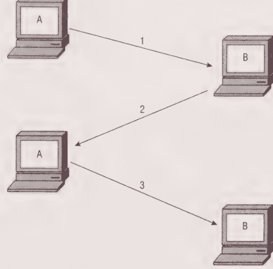

- A. ACK
- B. SYN
- C. FIN
- D. RST

## 18. 哪种 RADIUS 替代通常用于 Cisco 网络设备并支持双重身份验证？

- A. RADIUS+
- B. TACACS+
- C. XTACACS
- D. Kerberos

## 19. VoIP 终端和 VoIP 电话最容易受到哪两种类型的攻击？

- A. DoS 和恶意软件
- B. 蠕虫和特洛马
- C. DoS 和主机操作系统攻击
- D. 主机操作系统攻击和缓冲区溢出

## 20. Vivian 在一家零售连锁店工作，希望使用一种软件产品，限制销售终端上使用的软件仅限预先批准列表中的软件包。Vivian 应该使用哪种方法？

- A. 杀病毒软件
- B. 启发式
- C. 白名单
- D. 黑名单

### 对于第 21–23 题，请参考以下场景：

Hunter 是 DataTech 的设施经理，这大型数据中心管理公司。他正在评估在 DataTech 的一个设施安装防洪系统。该设施及其内容价值 1 亿美元。安装新的防洪系统将花费 1000 万美元。

Hunter 咨询了洪水专家，并确定该设施位于 200 年一遇范围内，如果发生洪水，可能会对设施造成 2000 万美元的损失。

## 21. 根据此场景中的信息，洪水对 DataTech 数据中心影响的影响因子（Exposure Factor）是多少？

- A. 2%
- B. 20%
- C. 100%
- D. 200%

## 22. 根据此场景中的信息，DataTech 数据中心洪水的年发生率（Annualized Rate of Occurrence）是多少？

- A. 0.002
- B. 0.005
- C. 0.02
- D. 0.05

## 23. 根据此场景中的信息，DataTech 数据中心洪水的年度损失（Annualized Loss Expectancy）是多少？

- A. $40,000
- B. $100,000
- C. $400,000
- D. $1,000,000

## 24. 在账户管理评估期间，通常评估哪些账户？

- A. 随机样本
- B. 高权限账户
- C. 最近生成的账户
- D. 长期运行的账户

# 第 10 章 练习题 2

## 25. 云计算使用安全共享共担模型，供应商和客户各自承担某些安全责任。责任的划分取决于所使用的服务类型。将此处列出的服务按客户承担责任最少到客户承担责任最多的顺序排列。

- A. IaaS
- B. SaaS
- C. PaaS
- D. TaaS

## 26. 当使用生物识别认证器的有效主体未通过身份验证时，发生了哪种类型的错误？

- A. 类型 1 错误
- B. 类型 2 错误
- C. 类型 3 错误
- D. 类型 4 错误

## 27. Jackie 正在创建一个数据库，以唯一标识此处所示的客户。她计划在订单表中使用什么 ID？

| 公司 ID | 公司名称 | 地址 | 州 | 邮政编码 |
|---|---|---|---|---|
| 1 | Acme | Columbia | MD | 301-555 |
| 2 | Abrams | Miami | FL | 305-555 |
| 3 | Dome | South Bend | IN | 465-555 |

- A. 主键
- B. 外键
- C. 候选键
- D. 引用键

## 28. 哪些接口通常在期间测试？

- A. 网络、物理和应用程序
- B. API、UI 和物理
- C. 网络、API 和 UI

## 29. George 正在协助检察官处理一起试图进入系统的黑客案件。哪种证据需要 George 提供？

- A. 证词规则
- B. 口头证据
- C. 最佳证据
- D. 传闻规则

## 30. 以下哪项不是有效的风险指示？

- A. 提供发生前的警告。
- B. 提供实时信息。
- C. 提供历史数据。
- D. 提供深入。

## 31. 以下哪种恶意软件类型使用传播机制进行？

- A. 特洛马
- B. 蠕虫
- C. 逻辑炸
- D. 病毒

## 32. Don 的公司正在考虑在基础设施即服务 (IaaS) 供应商中使用对象存储。使用的是哪种云服务？

- A. IaaS
- B. PaaS
- C. SaaS
- D. 共享云

## 33. 在哪种云模型中，多个组织协作构建？

- A. 公有云
- B. 私有云
- C. 社区云
- D. 共享云

## 34. 以下哪项不是敏捷开发方法的原则之一？

- A. 电子是传递信息的有效方法。
- B. 可运行软件是衡量进展的主要标准。
- C. 简单至关重要。
- D. 业务人员和开发者必须每天工作。

## 35. Harry 担心组织内部的会计师会篡改账户以掩盖欺诈行为。以下哪种控制措施这种防御？

- A. 加密
- B. 访问控制
- C. 完整性验证
- D. 防火墙

## 36. 哪种类的火灭器可以扑灭电火？

- A. A 类
- B. B 类
- C. C 类
- D. D 类

## 37. Frame Relay 与 X25 的重要区别因素是什么？

- A. Frame Relay 在单个 WAN 连接上支持多个虚拟线路连接 (PVC)。
- B. Frame Relay 是单元交换技术，而不是像 X25 那样的包交换技术。
- C. Frame Relay 不提供承诺信息速率 (CIR)。
- D. Frame Relay 仅在提供端需要数据终端设备 (DTE)。

### 使用下表和您对审计过程的知识回答第 38–40 题。

| 报告内容 | 受众 |
|---|---|
| SOC 1 | 财务报告的内部控制 | 用户和审计师 |
| SOC 2 | 机密性、完整性、可用性、安全隐私 | 审计师、监管机构、管理层、合作伙伴和其他签署 NDA 的人员 |
| SOC 3 | 机密性、完整性、可用性、安全性和隐私 | 公开，通常用于网站密封 |

## 38. 在准备将数据中心迁移到基础设施即服务 (IaaS) 供应商时，Susan 的公司想要了解新供应商安全、完整性和可用性控制。哪种 SOC 报告可以提供最详细的信息，包括审计师对 IaaS 供应商控制有效性的意见？

- A. SOC 1.
- B. SOC 2.
- C. SOC 3.
- D. 所有 SOC 报告都不适用于此，他们应该请求其他形式的报告。

## 39. Susan 想要确保她的机构请求的审计报告包含外部审计师的意见。她应该请求哪种类型的报告？

- A. SOC 2, Type 1
- B. SOC 3, Type 1
- C. SOC 2, Type 2
- D. SOC 3, Type 2

## 40. 当 Susan 请求 SOC 2 报告时，她收到一份 SAS 70 报告。Susan 可以提出什么问题？

- A. SAS 70 不包含 Type 2 报告，因此控制评估是瞬时的。
- B. SAS 70 已被取代。
- C. SAS 70 是一种财务报告标准，不涵盖数据中心。
- D. SAS 70 仅使用 3 个月的周期进行测试。

## 41. 两种逻辑网络拓扑可以在物理上实现为星型拓扑？

- A. 总线型和网状。
- B. 环型和网状。
- C. 总线型和环型。
- D. 不可能将其他拓扑实现为星型。

## 42. Bell-LaPadula（贝尔-拉帕杜拉模型）是哪种访问控制模型的示例？

- A. DAC
- B. RBAC
- C. MAC
- D. ABAC

## 43. Martha 是某小学院的信息安全官，负责保护学生记录的隐私。哪种法律最适用于她的情况？

- A. HIPAA
- B. HITECH
- C. COPPA
- D. FERPA

## 44. 哪项美国法律强制要求保护受保护的健康信息（PHI）？

- A. FERPA
- B. SAFE Act
- C. GLBA
- D. HIPAA

# 第 10 章 测试

## 45. 攻击者可以使用以下哪种技术来利用 TOC/TOU（时间检查/时间使用）漏洞？

- A. 文件锁定
- B. 异常处理
- C. 算法复杂度
- D. 并发控制

## 46. Susan 正在配置她的网络设备使用 syslog。她应该设置什么以确保在出现问题时收到通知，但不会收到正常的运行问题消息？

- A. 设施代码（facility code）
- B. 日志优先级（log priority）
- C. 安全级别（security level）
- D. 严重性级别（severity level）

## 47. 哪种 RAID 级别被称为磁盘镜像？

- A. RAID 0
- B. RAID 1
- C. RAID 3
- D. RAID 5

## 48. 哪种防火墙使用多个代理服务器，根据对每个服务所用协议的分析来过滤流量？

- A. 静态包过滤防火墙
- B. 应用网关防火墙
- C. 电路级网关防火墙
- D. 状态检测防火墙

## 49. 调查、采访和审计都是衡量组织安全态势中哪个重要方面的示例？

- A. 代码质量
- B. 服务漏洞
- C. 意识
- D. 攻击面

## 50. Tom 是某互联网服务提供商的总法律顾问，他最近收到一封针对该公司的诉讼通知，原因是由于客户通过提供商的线路非法传输受版权保护的内容。在这种情况下，什么法律保护 Tom 的公司？

- A. 计算机欺诈和滥用法（Computer Fraud and Abuse Act）
- B. 数字千年版权法案（Digital Millennium Copyright Act）
- C. 窃听法（Wiretap Act）
- D. 版权法（Copyright Code）

## 51. 一种基于时间或算法系统生成动态密码的 Type 2 认证因子是哪种验证器？

- A. PIV
- B. 智能卡
- C. 令牌（token）
- D. CAC

## 52. Fred 的新雇主聘了他进入一个接触贸易秘密和内部机数据的职位。如果他选择去竞争对手那里，他们应该使用哪种法律工具来保护数据？

- A. 停止令（stop-loss order）
- B. NDA（保密协议）
- C. AUP（用户许可协议）
- D. 加密

## 53. 以下哪种计算模型允许操作系统在不需要修改应用程序的情况下，在单个处理器上执行多个进程？

- A. 多任务（Multitasking）
- B. 多处理（Multiprocessing）
- C. 多程序（Multiprogramming）
- D. 多线程（Multithreading）

## 54. 使用具有 8 位二进制密钥的加密算法有多少可能的密钥？

- A. 16
- B. 128
- C. 256
- D. 512

## 55. 当根据 IT 系统的特定应用安全控制时，是在执行什么活动？

- A. 标准化（Standardizing）
- B. 基线化（Baselining）
- C. 范围确定（Scoping）
- D. 定制（Tailoring）


## 56. 在电子发现（electronic discovery）过程的哪个阶段，组织会对无关信息进行粗剪？

- A. 保留（Preservation）
- B. 识别（Identification）
- C. 收集（Collection）
- D. 处理（Processing）

## 57. Ben 的工作是确保数据贴有适当敏感性标签。由于 Ben 为政府工作，如果被要求标记处理 Secret（机密）、Confidential（秘密）和 Unclassified（未机密）信息的系统，他应该如何标记？

- A. 混合分类（Mixed classification）
- B. Confidential
- C. Top Secret
- D. Secret

## 58. Susan 发现基于智能卡的锁无效，因为员工成员会推开门。这造成了安全问题，她增加了如果门打开超过五分钟就会响响的报警器。她实施了哪种类型的控制？

- A. 物理（Physical）
- B. 行政（Administrative）
- C. 补偿（Compensation）
- D. 恢复（Recovery）

## 59. Ben 担心针对系统的密码破解攻击。他希望实施控制措施防止获取了哈希值的攻击者轻松破解它们。哪两种控制最能实现这一目标？

- A. 更长的密码和加盐（salting）
- B. 传输加密和使用 SHA1 代替 MD5
- C. 加盐和使用 MD5
- D. 使用影子密码和加盐

## 60. 哪个群体最适合评估并报告组织所实施的行政控制的有效性？

- A. 内部审计师（Internal auditors）
- B. 渗透测试员（Penetration testers）
- C. 外部审计师（External auditors）
- D. 设计、实施和监控控制的员工

## 61. Renee 正在使用加密保护在传输的敏感业务秘密。她试图降低哪个指标？

- A. 概率（Likelihood）
- B. RTO
- C. MTO
- D. 影响（Impact）

## 62. 在招聘新员工时，Kathleen 的身份团队创建一个新的并确保其可用。这是什么过程？

- A. 注册（Registration）
- B. 配置（Provisioning）
- C. 人口化（Population）
- D. 删除（De）

## 63. Ricky 希望通过 VPN 连接访问远程文件。他通过连接开始这个过程。这是什么？

- A. 检测（Detection）
- B. VPN
- C. 远程文件（Remote file）
- D. 对称（Symmetric）

## 64. Alice 正在为六个人设计一套加密系统，并希望任何两个用户在通信时都不担心被窃听。她需要生成多少对称密钥？

- A. 6
- B. 12
- C. 15
- D. 30

## 65. 以下哪种知识产权保护机制的持续时间最短？

- A. 版权（Copyright）
- B. 专利（Patent）
- C. 商标（Trademark）
- D. 商业秘密（Trade secret）

## 66. Gordon 正在为一家制造业制定业务连续性计划。公司位于北达科他州，目前正在评估风险。他们选择采取。以下哪种行动与之一致？

- A. 购买保险
- B. 将数据中心搬到更安全的区域
- C. 记录决策过程
- D. 重造设施以承受

## 67. Carol 希望实施一种保护组织免受数据中心瞬间断电的控制。哪种控制最适合她？

- A. 冗余服务器
- B. RAID
- C. UPS（不间电源）
- D. 发电机

## 68. 尽管要求每 30 天更改一次，Ben 遇到了组织内用户重复密码的问题。Ben 应该采用哪种设置来帮助解决？

- A. 更长的最小年龄
- B. 增加密码复杂度
- C. 实施密码历史
- D. 实施密码长度要求

## 69. Chris 正在为他的组织进行风险评估，并确定了单次洪水可能对其造成的损害金额。Chris 识别了哪个指标？

- A. ALE
- B. SLE（单次损失）
- C. ARO
- D. AV

## 70. 在 PC 报废并作为剩余物资出售之前将其硬盘移除，是哪种类型行动的示例？

- A. 净化（Purging）
- B. 擦除（Sanitization）
- C. 消磁化（Degaussing）
- D. 销毁（Destruction）

## 71. 在事件响应过程的哪个阶段，组织决定是否需要向执法或其他监管机构报告事件？

- A. 检测（Detection）
- B. 恢复（Recovery）
- C. 修复（Remediation）
- D. 报告（Reporting）

## 72. 哪种 OASIS 标准标记语言用于在组织内部和第三方之间生成配置请求？

- A. SAML
- B. SPML
- C. XACML
- D. SOA

## 73. Michelle 负责组织的移动设备管理工作，并处理丢失和被盗的设备。以下哪项建议能为她的组织提供最大的保证，即使设备被盗，数据也不会丢失？

- A. 强制使用访问密码和应用程序管理
- B. 全设备加密和强制访问密码
- C. 远程擦除和 GPS 追踪
- D. 启用 GPS 追踪和全设备加密

## 74. Susan 的 SMTP 服务器在接受和中继邮件之前不对发送者进行验证。这种安全配置问题被称为什么？

- A. 邮件网关
- B. SMTP 中继
- C. 符合 X.400 标准的网关
- D. 开放中继

## 问题 75–77 场景

Jack 工作的大型企业多年一直使用非集中式日志记录。他们最近开始实施集中日志记录，但在审查日志时，发现了一次似乎涉及恶意内部人员的泄露。

### 75. 当发现泄露并审查日志时，发现攻击者清理了他们所攻破系统上的日志。未来如何防止这种情况发生？

- A. 加密本地日志
- B. 要求管理员访问才能更改日志
- C. 启用日志轮转
- D. 将日志发送到堡垒机

### 76. Jack 如何使用其组织新的集中日志系统检测此类问题？

- A. 部署并使用 IDS
- B. 将日志发送到中央日志服务器
- C. 部署并使用 SIEM
- D. 使用 syslog

### 77. Jack 如何最好确保对其环境中系统上执行的操作具有可追溯性？

- A. 审核日志并要求每条日志都有数字签名。
- B. 对执行的所有操作要求身份验证并集中收集日志。
- C. 记录管理凭据的使用并对传输中的日志数据加密。
- D. 要求授权并集中收集日志。

## 78. Ed 的组织从 ISP 分配的 IP 地址有限，但需要将超过 100 台计算机和网络设备连接到互联网。他可以使用什么技术通过其可以使用的有限 IP 地址集连接其整个网络？

- A. IPsec
- B. PAT
- C. SDN
- D. IPX

## 79. 以下预防措施有助于防止哪种类型的攻击？

- 请求身份证明
- 对仅语音请求要求回拨授权
- 不通过语音通信更改密码

- A. DOS 攻击
- B. 蠕虫
- C. 社会工程学
- D. 窥视攻击

## 80. Fred 的组织需要在 VPN 上使用非 IP 协议。他应该选择哪种常见的 VPN 协议来原生支持处理非 IP 协议？

- A. PPTP
- B. L22F
- C. L2TP
- D. IPsec

## 81. 剩余数据（Residual data）是尝试删除后留下的哪种类型数据的术语？

- A. 剩余数据
- B. MBR
- C. 比特腐变（Bitrot）
- D. 残留数据

## 82. 以下哪种灾难恢复测试类型涉及实际激活灾难恢复设施？

- A. 模拟测试
- B. 桌面演练
- C. 平行测试
- D. 检查清单审查

## 83. 哪种访问控制系统允许所有者决定谁可以访问他们拥有的对象？

- A. 基于角色的访问控制
- B. 基于任务的访问控制
- C. 任意性访问控制
- D. 基于规则的访问控制

## 84. 使用可信通道和链路加密都是防止哪种类型访问控制攻击的方法？

- A. 暴力破解
- B. 伪造的登录界面
- C. 中间人攻击
- D. 字典攻击

## 85. 以下哪项不是 (ISC)² 道德守则的准则之一？

- A. 保护社会、公共利益、必要的公众信任和信心以及基础设施。
- B. 诚实、公正、负责且合法地行动。
- C. 为委托人提供勤勉任的服务。
- D. 维护所有调查和评估的合格记录。

## 86. 以下组件应包含在组织的应急响应指南中？

- A. 立即响应程序
- B. 长期业务连续性协议
- C. 组织冷备站的激活程序
- D. 订购设备的联系信息

## 87. Ben 正在整合联邦身份管理系统，需要为基于浏览器的单点登录交换身份和授权信息。他的最佳选项是什么什么技术？

- A. HTML
- B. XACML
- C. SAML
- D. SPML

## 88. 组织对具有特定业务连续性角色的人员进行业务连续性计划培训的最小间隔是多少？

- A. 每周
- B. 每月
- C. 半
- D. 每年

## 89. 使用 3DES 算法时，实现强安全所需的加密密钥数量是多少？

- A. 1
- B. 2
- C. 3
- D. 4

## 90. 将每个编号的 IP 地址与最合适的 IP 地址描述匹配。编号列表中的每个 IP 地址都应从描述中选择一个答案。每个描述可以使用一次、多次或均不使用。

| IP 地址 | 描述 |
| :--- | :--- |
| 1. 10.14.124.240 | A. 公共 IP 地址 |
| 2. 127.0.0.1 | B. 私有 IP 地址 |
| 3. 129.74.250.100 | C. APIPA 地址 |
| 4. 169.254.103.17 | D. 回环地址 |
| 5. 192.168.15.10 | |
| 6. 216.15.1.10 | |

## 91. Lauren 想监控她的 LDAP 服务器以识别哪些类型的查询导致的问题。如果她希望使用生产服务器和实际流量进行测试，她应该使用哪种类型的监控？

- A. 主动
- B. 实时
- C. 被动
- D. 重放

## 92. Steve 正在开发输入验证程序，以保护 Web 应用程序的数据库不受 SQL 注入攻击。Steve 应该将输入验证代码放在哪里？

- A. 嵌入 Web 页面的 JavaScript
- B. 后端
- C. 存储
- D. 用户浏览器

## 93. Ben 为一个拥有 100 名员工的组织选择加密算法。以下哪项可以让他实现目标？

- A. RSA
- B. IDEA
- C. 3DES
- D. Skip

## 94. Grace 正在考虑使用新的身份识别进行物理访问。显示的是哪种类型？

- A. 智能卡
- B. 阶段
- C. 接触式
- D. 生物识别

# 第 10 章 • 模拟测试 251

## 96. 下列哪些活动会将一个零日漏洞转化为危险性较低的攻击向量？

- A. 发现漏洞
- B. 实现传输层加密
- C. 重新配置防火墙
- D. 发布安全补丁

## 97. 下列哪项是加固性措施的示例，该措施可能会加强组织现有的物理设施并避免实施业务连续性计划？

- A. 修复漏水的屋顶
- B. 审查并更新防火墙的访问控制列表（ACL）
- C. 升级操作系统
- D. 部署网络入侵检测系统

## 98. Susan 想要监控 VMware 环境中系统之间的流量。监控该流量的她的最佳方案是哪一个？

- A. 使用传统的硬件型 IPS。
- B. 在每个虚拟系统上安装 Wireshark。
- C. 设置虚拟 span 端口并使用 VM IDS 捕获数据。
- D. 使用 netcat 捕获在 VM 之间发送的所有流量。

## 问题 99–102 场景

Matthew 和 Richard 是位于不同物理位置的朋友，他们希望开始使用加密技术进行通信以保护通信的机密性。他们交换数字证书以开始这一过程，并计划使用非对称加密算法安全地交换电子邮件。

### 99. 当 Matthew 向 Richard 发送消息时，他应该使用什么密钥来加密该消息？

- A. Matthew 的公钥
- B. Matthew 的私钥
- C. Richard 的公钥
- D. Richard 的私钥

### 100. 当 Richard 收到来自 Matthew 的消息时，他应该使用什么密钥来解密该消息？

- A. Matthew 的公钥
- B. Matthew 的私钥
- C. Richard 的公钥
- D. Richard 的私钥

### 101. Matthew 想通过在消息中添加数字签名来增强其通信的安全性。数字签名旨在强制加密的哪种目标？

- A. 秘密性
- B. 可用性
- C. 机密性
- D. 不可否认性

### 102. 当 Matthew 去给消息添加数字签名时，他使用什么加密密钥来创建数字签名？

- A. Matthew 的公钥
- B. Matthew 的私钥
- C. Richard 的公钥
- D. Richard 的私钥

## 103. 当 Jim 登录系统时，他的密码与数据库中存储的哈希值进行比较。这种过程是什么？

- A. 身份识别
- B. 哈希化处理
- C. 令牌化
- D. 身份验证

## 104. 去中心化访问控制的主要优势是什么？

- A. 它提供了更好的冗余性
- B. 它让更接近资源的人员能够对访问进行控制。
- C. 它的成本更低。
- D. 它提供了更细粒度的访问控制。

## 105. 下列哪种种类型的控制措施不描述防撞门（mantrap）？

- A. 威慑性
- B. 预防性
- C. 补偿性
- D. 物理性

## 106. Sally 的组织需要能够证明某些员工发送了电子邮件，她希望采用一种在不改变其现有电子邮件系统的情况下提供该能力的技术。作为电子邮件系统的所有者，Sally 需要实现的该能力的技术术语是什么？她可以使用什么工具来实现？

- A. 完整性；IMAP
- B. 否认性；加密
- C. 不可否认性；数字签名
- D. 身份验证；DKIM

## 107. 下列哪些背景检查通常不会在入职前的活动中进行？

- A. 信用检查
- B. 参考文献验证
- C. 犯罪记录检查
- D. 医疗记录检查

## 108. Margot 正在调查其网络上的可疑活动，并使用协议分析器嗅探入站和出口流量。她注意到一个源 IP 和目的 IP 地址相同的异常数据包。哪种攻击使用这种数据包？

- A. Fraggle
- B. Smurf
- C. Land
- D. Teardrop

## 109. Jim 正在对其公司进行安全评估，并希望使用适当的测试工具。将每个编号工具与其目的的最佳字母描述相匹配。每个项目应恰使用一次。

| 工具 | 目的 |
| :--- | :--- |
| 1. Nmap | A. 网络漏洞扫描 |
| 2. QualysGuard | B. 端口扫描 |
| 3. Metasploit | C. 无线加密评估 |
| 4. Nikto | D. Web 漏洞扫描 |
| 5. aircrack-ng | E. 攻击框架 |

## 110. 在 OSI 模型中，当数据包从数据流（datastream）变为段（segment）或数据报（datagram）时，它跨越了哪一层层？

- A. 传输层
- B. 应用层
- C. 数据链路层
- D. 物理层

## 111. Tommy 处理其组织的访问控制请求。一个用户找到他并解释他需要访问权限以完成任务。用户向 Tommy 展示了什么？

- A. 权限
- B. 职责分离
- C. 知情范围限制
- D. 隔离

## 112. Kathleen 希望使用一种开放、基于标准的、可查询的系统来提供认证。她的最佳选择是什么？

- A. RADIUS
- B. LDAP
- C. Kerberos
- D. Active Directory

## 13. 哪种类型的防火墙能够检查第 7 层流量？

- A. 应用防火墙
- B. 状态检测防火墙
- C. 数据包过滤防火墙
- D. 堡垒主机

## 14. Alice 想要向模型中添加另一个对象并授予权限。Take-Grant 模型中的哪条规则允许她执行此操作？

- A. Take 规则
- B. Grant 规则
- C. Create 规则
- D. Remove 规则

# 第 10 章 ■ 模拟测试 255

## 15. 下列哪些关注点不应该出现在 Lauren 的问题清单上？

- A. Metasploit 可以测试漏洞。
- B. 渗透测试仅针对时间点。
- C. Metasploit 会导致拒绝服务。
- D. 渗透测试无法覆盖策略。

## 16. Colin 正在审查一个被分配了 EAL7 评估级别的系统。他对该系统的最高保证程度是多少？

- A. 它经过了功能测试。
- B. 它经过了细致的设计。
- C. 它经过了设计和审查。
- D. 它经过了形式化的设计和测试。

## 17. 当 Alex 使用智能卡向向上服务提供证书时，他预计看到什么 ITU-T 标准？

- A. X.500
- B. SPML
- C. X.509
- D. SAML

## 18. 哪类网站受 COPPA 监管？

- A. 非金融机构运营的网站
- B. 收集个人信息的医疗网站
- C. 从儿童收集信息的网站
- D. 金融机构运营的网站

## 19. Tracy 最近在一个与国防部密切合作的政府机构接受了 IT 合规职位。下列法律最可能适用于她的机构？

- A. HIPAA
- B. FISMA
- C. HSA
- D. CFAA

## 120. 参考此图，箭头所示的安全控制措施名称是什么？


- A. 防撞门
- B. 入侵防御系统
- C. 旋转门
- D. 门户

## 121. 访问控制的问责依赖于哪两个重要因素？

- A. 身份识别和授权
- B. 身份验证和授权
- C. 身份识别和身份验证
- D. 问责和身份验证


## 122. EAP 的哪个关键假设可以通过使用 PEAP 来修复？

+ A. EAP 假设 LEAP 将取代 TKIP，从而确保身份验证发生。
+ B. EAP 原假设使用物理隔离通道，且通常未加密。
+ C. 使用 EAP 没有可用的 TLS 实现。
+ D. EAP 不允许额外的身份验证方法，而 PEAP 添加了额外方法。

## 123. Scott 的组织将其外部 IP 地址配置为 192.168.1.25。当流量发送到其 ISP 时，永远无法到达目的地。Scott 的组织遇到了什么问题？

+ A. BGP 设置不当。
+ B. 他们没有向 ISP 注册其 IP。
+ C. 该 IP 地址是一个私有的、不可路由的地址。
+ D. 192.168.1.25 是用于家庭路由器的预留地址。

## 124. Jennifer 在致力于实现组织的长期目标时，需要衡量她的信息安全计划的有效性。她应该选择什么类型的措施？

- A. 指标 (Metrics)
- B. 关键绩效指标 (KPIs)
- C. 服务水平协议 (SLAs)
- D. 目标与关键结果

## 125. Sue 的组织最近未能通过安全评估，因为他们的网络是一个单一的平面广播域，不同功能组之间可以进行流量嗅探。她应该推荐什么解决方案来帮助防止已识别的问题？

- A. 使用 VLAN。
- B. 修改所有系统的子网掩码。
- C. 部署网关。
- D. 开启端口安全。

# 第 11 章

## 练习题 3


# 第 11 章 ■ 练习题 3

1. Fred 的数据角色要求他维护系统安全计划，并确保系统用户和支持人员获得有关安全实践和可接受使用的所需的培训。Fred 在组织中可能担任什么角色？

- A. 数据所有者 (Data owner)
- B. 系统所有者 (System owner)
- C. 用户 (User)
- D. 托管员 (Custodian)

2. Sally 正在传输模式下使用 IPsec 的 ESP 组件。关于传输模式，她应该注意哪些重要信息？

- A. 传输模式对 IP 包提供全加密。
- B. 传输模式添加一个新的未加密的头部，以确保数据包到达目的地。
- C. 传输模式不加密数据包头部。
- D. 传输模式不提供加密；隧道模式提供加密。

3. 下列哪项不是软件能力成熟模型 (SW-CMM) 可重复阶段（Repeatable phase）的关键过程区域？

- A. 软件项目计划
- B. 软件质量管理
- C. 软件项目跟踪
- D. 软件分包管理

4. Ben 希望作为持续组织风险管理计划的一部分，自动化方式提供其组织风险暴露的预测性信息。他将使用什么？

- A. 风险指标 (KRIs)
- B. 定量风险评估
- C. 关键绩效指标 (KPIs)
- D. 渗透测试

5. 在此处所示图像中，TCP 三次握手的第 2 步系统 B 向系统 A 发送什么？

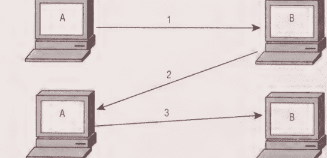

- A. SYN
- B. ACK
- C. FIN/ACK
- D. SYN/ACK

6. Chris 正在对远程目标进行侦察，发现其边界防火墙允许 ping。通过使用 ping 探测远程网络，他可以了解到什么？

- A. 哪些系统对 ping 有响应、大致的网络拓扑结构，以及额外防火墙可能的位置
- B. 目标防火墙后所有系统的列表
- C. 每个可 ping 系统的主机名和生存时间 (TTL)，以及防火墙允许的 ICMP 类型
- D. 路由器广告、回显请求响应，以及哪些主机可能设置了陷阱（tarpitted）

7. 哪种访问管理概念定义了用户拥有权利或特权？

- A. 识别 (Identification)
- B. 问责制 (Accountability)
- C. 授权 (Authorization)
- D. 认证 (Authentication)

8. 下列哪项不是商业数据分类方案常见的分类级别？

- A. 秘密 (Secret)
- B. 敏感 (Sensitive)
- C. 机密 (Confidential)
- D. 公开 (Public)

9. 文件、数据库、计算机、程序、进程、设备和媒体都是什么的例子？

- A. 主体 (Subjects)
- B. 对象 (Objects)
- C. 文件存储 (File stores)
- D. 用户 (Users)

10. Danielle 正在测试税务软件，测试过程的一部分要求她输入各种实际税表以验证软件是否产生正确答案。Danielle 正在进行什么类型的测试？

- A. 用例测试 (Use case testing)
- B. 动态测试 (Dynamic testing)
- C. 模糊测试 (Fuzzing)
- D. 误用测试 (Misuse testing)

11. 在组织工作 10 年后，Cassandra 将进入她的第四个角色，这次是会计部门的经理。如果她的组织没有强大的账户维护实践，在账户审查期间可能会出现什么问题？

- A. 最小权限问题
- B. 权限膨胀 (Privilege creep)
- C. 账户膨胀 (Account creep)
- D. 账户终止 (Account termination)

12. 像 10.10.10.10 和 172.19.24.21 这样的 IP 地址都是哪类型 IP 地址的例子？

- A. 公网 IP 地址
- B. 禁止 IP 地址
- C. 私有 IP 地址
- D. B 类 IP 范围

13. 认知密码预设问题的缺陷是什么？

- A. 它阻止了令牌的使用
- B. 问题的答案很容易找到
- C. 认知密码不支持
- D. 认知密码不安全

14. Megan 需要为硬盘创建取证副本。以下哪种工具是最好的？

- A. xcopy
- B. dd
- C. Image
- D. DBAN

15. Kay 正在为她的组织选择一个应用程序。她希望防止安装某些软件。她应该使用什么类型的方法？

- A. 杀病毒软件
- B. 白名单 (Whitelist)
- C. 黑名单 (Blacklist)
- D. 启发式算法 (Heuristic)

16. 与医疗提供相关的数据什么类型的数据？

- A. PCI
- B. 个人数据
- C. 医疗健康信息 (PHI)
- D. 个人身份信息 (PII)

17. 八角天线、平板天线和抛物面天线都是什么天线的例子？

- A. 全向性 (Omnidirectional)
- B. 基 (Base)
- C. 信号 (Signal)
- D. 方向性 (Directional)

18. 在旅行期间，James 被使用了社会工程学。这是？

- A. 强迫 (Duress)
- B. 工程 (Engineering)
- C. 痛苦 (Distress)
- D. 黑客攻击 (Hacking)

19. 业务连续性计划预计最少有多少人？

- A. 1
- B. 2
- C. 3
- D. 5

20. Cameron 负责备份公司的服务器。他配置了每周一晚上全备份，其他时间进行增量备份。周三将备份多少文件？

| 时间 | 文件 |
| :--- | :--- |
| 周一 8AM | 1 |
| 周一 10AM | 2 |
| 周一 11AM | 3 |
| 周一 4PM | 4 |
| 周一 5PM | 5 |
| 周二 8AM | 1 |
| 周二 9AM | 2 |
| 周二 10AM | 5 |
| 周三 8AM | 3 |
| 周三 9AM | 6 |

- A. 1
- B. 2
- C. 5
- D. 6

21. Susan 使用镜像端口监控生产网站，并使用监控工具识别性能问题。她正在进行什么类型的监控？

- A. 被动监控 (Passive monitoring)
- B. 主动监控 (Active monitoring)
- C. 合成监控 (Synthetic monitoring)
- D. 基于特征的监控 (Signature-based monitoring)

22. 授予对象的访问类型以及对对象可以执行的操作是什么的例子？

- A. 权限 (Permissions)
- B. 权利 (Rights)
- C. 特权 (Privileges)
- D. 角色 (Roles)

23. 下列哪项是云基础设施的例子？

- A. 由供应商管理并通过网络交付的工资系统
- B. 由供应商运行客户代码的应用程序平台
- C. 客户在供应商管理的虚拟化平台上提供的服务器
- D. 供应商提供的电子邮件服务

### 问题 24-26 场景

Darcy 是 Roscommon Agricultural Products 的信息安全分析师。她目前正在决定公司是否应为主要数据中心购买升级的火抑制系统。数据中心设施的更换成本为 200 万美元。在咨询精算师、数据中心经理和消防专家后，Darcy 典型的火灾可能更换建筑内的所有设备，但不会造成严重的结构性损坏。他们估计从火灾中恢复需要 75 万美元。他们还确定公司每 50 年预计发生一次此类的火灾。

24. 根据此场景中的信息，火灾对 Roscommon Agricultural Products 数据中心的影响因子（exposure factor）是多少？

- A. 7.5%
- B. 15.0%
- C. 27.5%
- D. 37.5%

25. 根据此场景中的信息，Roscommon Agricultural Products 数据中心发生火灾的年发生率是多少？

+ A. 0.002
+ B. 0.005
+ C. 0.02
+ D. 0.05

26. 根据此场景中的信息，Roscommon Agricultural Products 数据中心发生火灾的年损失预期（ALE）是多少？

+ A. $15,000
+ B. $25,000
+ C. $750,000
+ D. $750,000

27. TCP 头部标志位很少被使用。在现代网络中，你不可能看到哪两个标志在使用？

+ A. CWR 和 ECE
+ B. URG 和 FIN
+ C. ECE 和 RST
+ D. CWR 和 URG

28. Mike 希望确保其服务 API 的第三方用户可以被追踪，以防止滥用 API。他应该实施什么来帮助？

+ A. 会话 ID (Session IDs)
+ B. API 防火墙
+ C. API 密钥 (API keys)
+ D. API 缓冲区 (API buffer)

29. Fran 是一家在线零售商工作的 Web 开发人员。她的老板让她创建一种让客户轻松集成 Fran 公司网站的方法。客户需要能够检查库存、下单并以程序方式检查订单状态，而无需访问网页。Fran 可以创建什么来最直接地促进这种交互？

+ A. API
+ B. 网络爬虫 (Web scraper)
+ C. 数据字典 (Data dictionary)
+ D. 中心

30. 当设施经历瞬时断电时会发生什么种电源问题？

+ A. 故障 (Fault)
+ B. 断电 (Blackout)
+ C. 跌落 (Sag)
+ D. 低电压 (Brownout)

31. Lauren 的系统管理员团队每个人处理数百个具有不同安全要求的系统，发现难以处理大量的用户名和密码。她应该推荐哪种解决方案来确保密码被妥善处理，并确保日志和密码轮换等功能的实现？

+ A. 凭据管理系统
+ B. 强密码策略
+ C. 职责分离
+ D. 单点登录 (Single sign-on)

32. Ed 的 Windows 系统无法连接到网络，ipconfig 显示如下：

```
Ethernet adapter Local Area Connection
Connection-specific DNS Suffix  .
   Local IPv6 Address ............................ : fe80:ff01:e2f3:a85:mbhaxit
   Subnet Mask ................................ 255.255.255.0
   Default Gateway ............................ 255.255.255.0
```

系统发生了什么？

+ A. 系统被其 DHCP 服务器分配了无效的 IP 地址。
+ B. 系统拥有了手动分配的 IP 地址。
+ C. 系统未能获取 DHCP 地址，并为自己分配了一个地址。
+ D. 子网掩码设置错误，系统无法与网关通信。

33. 在过程中，通常用什么术语描述初始用户账户？

+ A. 注册 (Enrollment)
+ B. 许可验证 (Clearance verification)
+ C. 背景检查 (Background checks)
+ D. 初始化 (Initialization)

34. 哪种类型的取证调查通常具有最高的证据标准？

+ A. 行政 (Administrative)
+ B. 刑事 (Criminal)
+ C. 民事 (Civil)
+ D. 行业 (Industry)

35. 利润驱动与 Olivia 组织标准的安全性需求之间存在显著冲突。Olivia 的角色意味着由于员工无法使用系统导致的可用性下降和利润损失是她主要关注的问题。Olivia 在组织中可能扮演的职位是什么？

+ A. 业务经理
+ B. 信息安全分析师
+ C. 数据处理员
+ D. 任务所有者 (Mission owner)

36. Tom 认为他互联网服务提供商的一个客户一直在利用其系统中的漏洞来读取其他客户的邮件。如果真的，该客户可能违反了哪部法律？

+ A. ECPA
+ B. CALEA
+ C. HITECH
+ D. 隐私法 (Privacy Act)

37. 在此处所示的环保护模型中，哪个环包含用户程序和应用程序？

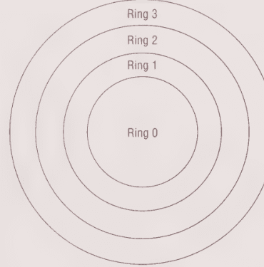

+ A. 环0 (Ring 0)
+ B. 环1 (Ring 1)
+ C. 环2 (Ring 2)
+ D. 环3 (Ring 3)

38. 像攻击向量、复杂度、利用成熟度以及需要多少用户交互等指标都可以在哪个评分系统中？

+ A. CVE
+ B. CVSS
+ C. CNA
+ D. NVD

39. 在以下哪情况下，个人不具有合理的隐私预期？

+ A. 使用手机拨打电话
+ B. 通过美国邮政寄信
+ C. 在工作期间发送电子邮件
+ D. 获取你的个人邮件

40. 在以下哪种灾难恢复测试期间，团队坐在一起讨论对场景的响应，但实际上不激活任何灾难恢复控制？

+ A. 清单审查 (Checklist review)
+ B. 全中断测试 (Full interruption test)
+ C. 并行测试 (Parallel test)
+ D. 桌面演练 (Tabletop exercise)

41. Susan 希望集成她的网站以允许用户使用其他提供商的账户。她应该使用什么技术？

+ A. SAML
+ B. OAuth
+ C. LDAP
+ D. Kerberos

42. Susan 希望集成她的网站以允许用户使用其他提供商的账户。这是什么策略？

+ A. 风险缓解 (Risk mitigation)
+ B. 风险转移 (Risk transfer)
+ C. 风险回避 (Risk avoidance)
+ D. 风险接受 (Risk acceptance)

43. 将每种电缆类型与长度匹配：

| 电缆类型 | 长度 |
| :--- | :--- |
| 1. 五类 (Category-5) | A. 500 英尺 |
| 2. 同轴 (Coaxial) | B. 300 英尺 |
| 3. 光纤 (Fiber optic) | C. 公里 (kilometers) |

44. 哪种类型的访问控制在许多地点具有灵活性？

+ A. 集中访问 (Centralized access)
+ B. 强制访问 (Mandatory access)
+ C. 分布式访问 (Decentralized access)
+ D. 基于规则的访问 (Rule-based access)

45. 哪种政府分类标签适用于如果泄露可能会对国家安全造成损害的信息？

+ A. 机密 (Classified)
+ B. 秘密 (Secret)
+ C. 机密 (Confidential)
+ D. 绝密 (Top Secret)

### 问题 46-49 场景

Mike 和 Renee 希望使用非对称加密通信。

46. 当 CA 创建 Renee 的数字证书时，主体包含什么密钥？

+ A. Renee 的公钥
+ B. Renee 的私钥
+ C. CA 的公钥
+ D. CA 的私钥

47. 当 CA 创建 Renee 的数字证书时，它使用什么密钥进行数字签名？

+ A. Renee 的公钥
+ B. Renee 的私钥
+ C. CA 的公钥
+ D. CA 的私钥


# 练习题

## 48. 当 Mike 收到 Renee 的数字证书时，他使用什么密钥验证证书的真实性？

- A. Renee 的公钥
- B. Renee 的私钥
- C. CA 的公钥
- D. CA 的私钥

## 49. Mike 希望使用在此获得的信息向 Renee 发送私密消息。他应该用什么密钥进行加密？

- A. Renee 的公钥
- B. Renee 的私钥
- C. CA 的公钥
- D. CA 的私钥

## 50. 以下哪些工具可以直接破坏未加密通信的机密性？

- A. Nmap
- B. Nessus
- C. Wireshark
- D. Nikto

## 51. 单点登录如何提高安全性？

- A. 它减少了主体账户的数量。
- B. 它有助于降低用户写下密码的可能性。
- C. 它为其连接的每个系统提供日志。
- D. 它为身份验证数据提供了更好的加密。

## 52. 以下哪种加密算法支持不可否认性目标？

- A. Blowfish
- B. DES
- C. AES
- D. RSA

## 53. 微软的 STRIDE 威胁评估框架使用六种威胁类别：伪造、篡改、不可否认、信息泄露、拒绝服务和权限提升。如果渗透测试人员能够修改审核日志，哪些 STRIDE 类别最能描述这个问题？

- A. 篡改和信息泄露
- B. 权限提升和篡改
- C. 不可否认和拒绝服务
- D. 不可否认和篡改

## 54. RIP、OSPF 和 BGP 都是与什么网络设备相关的协议示例。

- A. 交换机
- B. 桥接器
- C. 路由器
- D. 网关

## 55. 基于 AES 的 CCMP 和 802.1x 替换了为 WPA 设计的安全协议，以帮助修复 WEP 中发现的重要安全问题？

- A. TLS
- B. TKIP
- C. EAP
- D. PEAP

## 56. Ben 工作政府机构安装了一个新的访问控制系统。该系统使用 Ben 的身份、部门、正常工作时间、工作类别和位置等信息进行授权。Ben 的雇主采用了哪种类型的访问控制系统？

- A. 基于角色的访问控制 (RBAC)
- B. 基于属性的访问控制 (ABAC)
- C. 管理访问控制
- D. 系统任意访问控制

## 57. 匿名组织（Anonymous）使用的低轨道离子炮（LOIC）攻击利用大量的家用 PC 攻击其目标。这是哪种网络攻击的示例？

- A. DDoS（分布式拒绝服务）
- B. 离子化 (Ionization)
- C. 僵尸群 (Zombie horde)
- D. 泪滴攻击 (Teardrop)

## 58. Andrew 认为他所属组织的数字证书已被破解，并想将其添加到证书撤销列表（CRL）。谁必须将证书添加到 CRL 中？

- A. Andrew
- B. 顶级域的根权威机构
- C. 发行证书的 CA（证书授权机构）
- D. 顶级域的撤销机构

## 59. Amanda 正在考虑实施顾问建议的数据库恢复机制。在建议的方法中，自动化过程将每小时将交易记录从主站点移动到备份站点。顾问描述的是哪种数据库恢复技术？

- A. 电子金库 (Electronic vaulting)
- B. 事务日志 (Transaction logging)
- C. 远程镜像 (Remote mirroring)
- D. 远程日志 (Remote journaling)

## 60. 系统上的一个进程需要访问当前正另一个进程使用的文件。在文件可用之前，进程调度程序会将该进程置于什么状态？

- A. 运行 (Running)
- B. 就绪 (Ready)
- C. 等待 (Waiting)
- D. 停止 (Stopped)

## 61. 以下哪种调查类型对收集和保护信息的标准最松散？

- A. 民事调查
- B. 运营调查
- C. 刑事调查
- D. 监管调查

## 62. Sue 在新公司上班时被要求签署一份 NDA（非保密协议）。公司为什么要要求她签署协议？

- A. 为了保护其数据的机密性
- B. 为了确保 Sue 不删除其数据
- C. 为了防止 Sue 以后与他们竞争竞争
- D. 为了要求 Sue 在其工作范围内确保其数据的可用性

## 63. Susan 对其生物识别技术中的 FAR（误报接受率）表示担忧。处理 FAR 的最佳方法是什么？

- A. 调整 CER（此处应为 C FAR，错误接受率）。
- B. 更改系统敏感性以降低 FRR（拒绝率）。
- C. 添加第二个因素。
- D. 替换生物识别系统。

## 64. 将以下编号的服务组织控制（SOC）级别与其对应的 SOC 报告描述进行匹配：

| SOC 级别 | SOC 报告描述 |
| :--- | :--- |
| 1. SOC 1, Type 1 | A. 通用报告，报告了与合规性和/或操作相关的控制措施 |
| 2. SOC 1, Type 2 | B. 一份报告，为系统及其包含信息的机密性、可用性、完整性和隐私的控制提供了预定义的标准基准，通常供限制使用 |
| 3. SOC 2 | C. 一份报告提供了财务报表重大错陈述风险的评估，包括受服务组织处理影响的断言，并包含了服务审计师对控制措施的测试描述、结果及其有效性 |
| 4. SOC 3 | D. 一份报告提供了审计师对财务报表的意见，关于服务组织的控制措施，并包括了一份关于服务组织系统呈现的意见以及控制措施适用性的报告 |

## 65. 以下哪项不是代码审查过程？

- A. 邮件传递 (Email pass-around)
- B. 隔肩看 (Over the shoulder)
- C. 结对编程 (Pair programming)
- D. IDE 强制 (IDE forcing)

## 66. 以下哪种攻击类型取决于精确的计时？

- A. TOCTOU（时间检查到时间使用）
- B. SQL 注入
- C. 哈希传递 (Pass the hash)
- D. 跨站脚本 (XSS)

## 67. 哪种过程为 OSI 模型中每一层接收到的数据添加头部和尾部？

- A. 归因 (Attribution)
- B. 封装 (Encapsulation)
- C. TCP 封装
- D. 数据隐藏

## 68. 破解网站的攻击者经常获取哈希密码数据库。哪种技术能最好地保护这些密码免受使用预计算计算的自动化密码破解攻击？

- A. 使用 MD5 哈希算法
- B. 使用 SHA-1 哈希算法
- C. 加盐 (Salting)
- D. 双重哈希 (Double-hashing)

## 69. Jim 开始担任系统工程师新工作，他的老板给了他一份名为《取证响应指南》的文件。以下哪个说法是不正确的？

- A. Jim 必须遵守此文件中的信息。
- B. 该文件包含关于取证检查的信息。
- C. Jim 应该彻读该文件。
- D. 该文件可能基于行业最佳实践。

## 70. 以下哪种工具最常用于识别目的且不是用于……？

- A. 密码
- B. 离子化扫描
- C. 用户名
- D. 令牌

## 71. Ben 需要验证最近的补丁不会引入问题。他需要进行哪种类型的测试？

- A. 单元测试
- B. 白盒测试
- C. 回归测试
- D. 黑盒测试

## 72. Tamara 最近决定购买保险以应对泄露事件。她追求的是哪种风险策略？

- A. 风险接受 (Risk acceptance)
- B. 风险缓解 (Risk mitigation)
- C. 风险转移 (Risk transference)
- D. 风险规避 (Risk avoidance)

## 73. 以下哪项不是 ISC)² 的道德准则？

- A. 避免利益冲突
- B. 保护社会、公众利益
- C. 诚实、公正、负责地
- D. 提供

## 74. Jim 想允许合作伙伴访问但不信任。他应该怎么做？

- A. 建立双向信任。
- B. 建立单向信任。
- C. 建立单向不信任。
- D. 建立双向不信任。

## 75. Susan 的团队通过手动审查代码查找漏洞。他们正在进行哪种分析？

- A. 灰盒
- B. 静态
- C. 动态
- D. 模糊 (Fuzzing)

## 76. IP 地址 201.19.7.45 是哪种类型的地址？

- A. 公共 IP 地址
- B. RFC918 地址
- C. APIPA 地址
- D. 回环地址

## 77. Sam 是某保险公司的安全风险分析师。他正在检查一个黑客可能由于 SQL 攻击网页的场景。在这种情况下，漏洞是什么？

- A. 未补丁的 Web 应用程序
- B. 网页篡改
- C. 黑客
- D. 操作系统

## 78. 以下哪种安全数据删除类别包括去磁化？

- A. 清除 (Clear)
- B. 缩小 (Shrink)
- C. 净化 (Purge)
- D. 破坏 (Destroy)

## 79. 哪种备用处理设施包含了在几分钟内恢复运行所需的所有硬件和数据？

- A. 热地 (Hot site)
- B. 备地 (Warm site)
- C. 冷地 (Cold site)
- D. 移动站点 (Mobile site)

## 80. 哪个 UDP 端口用于 syslog 服务？

- A. 443
- B. 514
- C. 515
- D. 445

## 81. Fred 发现一个他的协议分析器显示同时设置了 PSH 和 URG 的包。他查看的是哪种数据包？这些标志意味着什么？

- A. UDP 数据包；PSH 和 URG 表示数据应以高速发送
- B. TCP 数据包；PSH 和 URG 用于清除缓冲区并指示数据是紧急
- C. TCP 数据包；PSH 和 URG 用于预设头部并指示网络数据不受监管的
- D. UDP 数据包；PSH 和 URG 用于清除 UDP 缓冲区并指示数据直到

## 82. 这里显示的是哪种代码审查流程？

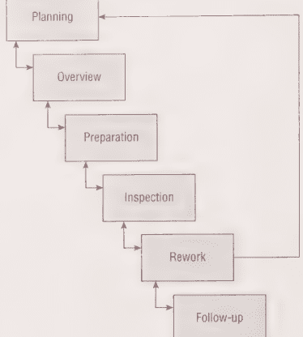

- A. 静态检查
- B. Fagan 检查
- C. 动态检查
- D. 接口测试

## 83. 在日志审计期间，Karen 发现系统需要从此处所示的日志设置收集日志。Karen 可能会遇到什么问题？

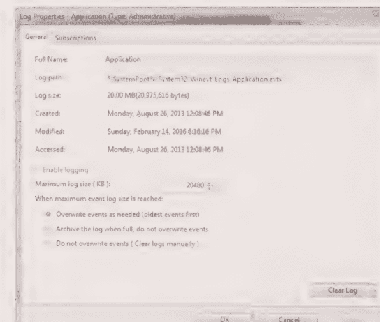

- A. 系统上将存储过多的日志数据。
- B. 系统会自动清除归档日志。
- C. 日志将不包含所需的信息。
- D. 日志仅包含最近的 20 MB 日志数据。

## 84. 在调查一起广泛的分布式拒绝攻击时，Matt 将其中一个攻击系统的 IP 地址输入浏览器并看到了以下页面。该僵尸网络可能由什么类型的设备组成？


- A. SCADA
- B. 云基础设施
- C. Web 服务器
- D. IoT（物联网）

## 场景：问题 85–87

Alejandro 是某家大型公司的事件响应分析师。当他值午夜班时，事件检测系统告警他，公司其中一个关键信息系统正受到潜在的暴力破解密码攻击。在采取任何进一步行动之前，他对该事件进行了初步分检。

### 85. Alejandro 目前正在进行事件响应过程的哪一阶段？

- A. 检测
- B. 响应
- C. 恢复
- D. 缓解

### 86. 如果 Alejandro 的初步调查确定可能正在发生安全事件，他的下一步应该是什么？

- A. 调查根本原因。
- B. 提交书面报告。
- C. 激活事件响应小组。
- D. 尝试将系统恢复到正常运行。

### 87. 随着事件响应的进行，团队应该在哪个阶段进行原因分析？

- A. 响应
- B. 报告
- C. 修复
- D. 经验教训

## 88. Barry 最近收到来自 Melody 的消息，Melody 使用对称加密加密了消息。Barry 应该使用哪个密钥来解密消息？

- A. Barry 的公钥
- B. Barry 的私钥
- C. Melody 的公钥
- D. 共享密钥

## 89. 在你对应用程序执行了 100% 覆盖的自动化功能测试后，最可能残留的是哪种错误？

- A. 业务逻辑错误
- B. 输入验证错误
- C. 运行时错误
- D. 错误处理错误

## 90. 在事件响应过程的哪个阶段，安全专业人员分析过程本身以确定是否需要任何改进？

- A. 经验教训
- B. 修复
- C. 恢复
- D. 报告

## 91. 什么防止了所有者移除置于版权保护作品上的保护机制？

- A. HIPAA
- B. DMCA
- C. GLBA
- D. ECPA

## 92. Linda 正在为她的组织选择灾难恢复设施，她希望尽可能保持与其他组织的独立性。她希望选择一个平衡成本和恢复时间的设施，能够在灾难发生后大约一周内激活。她应该选择什么类型的设施？

- A. 冷备场
- B. 温备场
- C. 互助协议
- D. 热备场

## 93. 购买保险是哪种风险响应的形式？

- A. 转移
- B. 规避
- C. 缓解
- D. 接受

## 94. 哪种渗透测试提供了渗透测试范围的细节（包括哪些系统将成为目标等项目），但未对渗透测试人员必须测试的系统或网络的配置或其他细节提供完全可见性？

- A. 水晶盒
- B. 白盒
- C. 黑盒
- D. 灰盒

## 95. 测试覆盖率使用以下哪个公式计算？

- A. 测试的用例数/总用例数
- B. 测试的代码行数/总代码行数
- C. 测试的函数数/总函数数
- D. 测试的条件分支数/总可测试分支数

## 96. TCP 和 UDP 均在 OSI 模型的哪一层运行？

- A. 第 2 层
- B. 第 3 层
- C. 第 4 层
- D. 第 5 层

## 97. 以下物理安全环境的目标哪一个在控制的功能顺序上最先发生？

- A. 延迟
- B. 检测
- C. 威慑
- D. 拒绝

## 98. 在哪种类型的复杂的恢复过程中，系统能够在无管理员干预的情况下恢复，但系统可能会导致数据丢失？

- A. 自动恢复
- B. 手动恢复
- C. 无过度数据丢失的自动恢复
- D. 功能恢复

## 99. Skip 需要将文件从他的 PC 传输到远程主机。他应该使用什么协议代替 FTP？

- A. SCP
- B. SSH
- C. HTTP
- D. Telnet

## 100. Ben 位于纽约的 Web 服务从加利福尼亚居民那里收集个人信息。GDPR 要求 Ben

- A. Ben 必须加密所有数据。
- B. Ben 必须提供通知。
- C. Ben 必须有隐私政策。
- D. Ben 必须遵守。

## 101. 使用什么过程来验证拨号连接？

- A. CallerID
- B. Callback
- C. CHAP
- D. PPP

## 102. Meltdown 漏洞将内核暴露给用户空间。x86 的哪些环？

- A. 0 和 1
- B. 1 和 2
- C. 1 和 3
- D. 0 和 3

## 103. 虹膜识别相比大多数生物识别因素的优势是？

- A. 虹膜不易被欺骗。
- B. 虹膜不像。
- C. 虹膜更便宜。
- D. 虹膜无法复制。

## 104. Alex 希望所有员工签署一份协议，不与未经授权的人员共享知识产权。什么样的类型的协议？

- A. SLA
- B. NDA
- C. OLA
- D. DLP

## 105. Matthew、Richard 和 Christopher 想要使用对称加密相互交换消息。他们希望在第三方无法获取的情况下相互发送消息。他们需要多少个密钥？

- A. 1 个
- B. 2 个
- C. 3 个
- D. 6 个

## 106. 以下哪项不是刑法的示例？

- A. 格拉姆-莱奇法案
- B. 计算机欺诈与滥用法
- C. 电子通信隐私法
- D. 身份盗窃法

## 107. 确保电子邮件机密性的最佳方法是？

- A. 在客户端和服务器之间使用 TLS。
- B. 在客户端和服务器之间使用 SSL。
- C. 加密电子邮件内容。
- D. 使用数字签名。

## 108. Brenda 在组织的 Web 订单处理应用程序被入侵后分析服务器日志。她在日志文件中发现用户在下单时输入以下信息作为姓名：

`Smith';DROP orders;--`

尝试的是哪种攻击？

- A. 缓冲区溢出
- B. 跨站脚本
- C. 跨站请求伪造
- D. SQL 注入

## 109. 什么类型的策略描述了数据在删除之前保留多久？

- A. 分类
- B. 审计
- C. 记录保留
- D. 可用性

## 110. BCP 过程的目标是什么？

- A. RTO < MTD
- B. MTD < RTO
- C. RPO < MTD
- D. MTD < RPO

## 111. 在事件响应的哪个阶段，管理员会设计防止事件再次发生的安全控制措施？

- A. 报告
- B. 恢复
- C. 修复
- D. 经验教训

## 112. Bethany 收到同事发的一封邮件，其中有一个名为 `smime.p7` 的异常附件。她不认识这个附件并不知道该。最可能的情况是？

- A. 这是一个加密的电子邮件消息。
- B. 这是一个钓鱼攻击。
- C. 这是一个嵌入恶意软件。
- D. 这是一个欺骗攻击。

## 场景：问题 113–115

Kim 是 Aircraft Systems, Inc. (ASI) 的数据库安全管理员。ASI 是一家从事航空飞机电子设备系统设计和分析的军事承包商。


并代表政府和其他政府承包商定期处理机密信息。Kim 非常担心存储在 ASI 数据库中的信息的安全性。

Kim 的数据库是一个多级安全数据库，不同的 ASI 员工具有不同的安全权限。该数据库包含了带有 ASI 系统的军事飞机的位置信息，以便 ASI 人员监控这些系统。

### 113. Kim 获知军方正在计划一项涉及某些 ASI 飞机的机密任务。她担心未获得任务授权的员工可能会通过注意到大量飞机飞往该地区而获此信息。单个员工被授权了解单架飞机的移动情况，但未被授权了解整个任务。Kim 担心的是哪种类型的攻击？

- A. 汇聚攻击 (Aggregation)
- B. SQL 注入 (SQL injection)
- C. 推理 (Inference)
- D. 多级安全 (Multilevel security)

### 114. Kim 可以采用什么技术来防止未获得任务授权的员工获飞机的真实位置？

- A. 输入验证 (Input validation)
- B. 多重实例化 (Polyinstantiation)
- C. 参数化 (Parameterization)
- D. 服务端验证 (Server-side validation)

### 115. Kim 的数据库通过尾迹号唯一标识飞机。以下哪个术语不一定能准确描述尾迹号？

- A. 数据库字段 (Database field)
- B. 外键 (Foreign key)
- C. 主键 (Primary key)
- D. 候选键 (Candidate key)

### 116. Kim 想要创建一个能够强制数据库引用完整性的键。她需要创建什么类型的键？

- A. 主键 (Primary key)
- B. 外键 (Foreign key)
- C. 候选键 (Candidate key)
- D. 主密钥 (Master key)

### 117. Doug 正在为他领导的项目选择一种软件开发生命周期模型，用于开发一个新的业务应用程序。他有非常明确的需求，并希望选择一种早期强调开发详尽文档的方法。他不需要快速原型或迭代改进。哪种模型最适用于这种场景？

- A. 敏捷 (Agile)
- B. 瀑布型 (Waterfall)
- C. 螺旋型 (Spiral)
- D. DevOps

### 118. 哪位个人对数据保护任务负有终极责任？

- A. 数据所有者 (Data owner)
- B. 数据保管者 (Data custodian)
- C. 用户 (User)
- D. 审计员 (Auditor)

### 119. 密码哈希中使用的盐（salts）应该具备什么？

- A. 应该设置单个盐，以便根据需要对密码解密。
- B. 应该使用单个盐，以便可以使用原始盐检查密码与其哈希值是否匹配。
- C. 应为每个用户存储唯一的盐。
- D. 每次用户登录时都应创建唯一的盐。

### 120. 哪种评估方法与 NIST SP800-53A（联邦信息系统安全控制评估指南）建议的机制和活动相关？

- A. 检查和访谈 (Examine and interview)
- B. 测试和评估 (Test and assess)
- C. 测试和访谈 (Test and interview)
- D. 检查和测试 (Examine and test)

### 121. 以下哪项控制对于检测零日攻击尝试最有效？

- A. 基于特征的入侵检测 (Signature-based intrusion detection)
- B. 基于异常的入侵检测 (Anomaly-based intrusion detection)
- C. 强力的补丁管理 (Strong patch management)
- D. 全盘加密 (Full-disk encryption)

### 122. 存储和生成密码、提供日志和审计能力、允许密码签入和签出都是哪种系统的特征？

- A. AAA
- B. 凭证管理 (Credential management)
- C. 双因子认证 (Two-factor authentication)
- D. Kerberos

### 123. 组织的应急响应指南应包含以下哪个组件？

- A. 针对第一响应者的次级响应程序 (Secondary response procedures for first responders)
- B. 长期业务连续协议 (Long-term business continuity protocols)
- C. 组织冷备站的激活程序 (Activation procedures for the organization's cold sites)
- D. 订购设备的联系信息 (Contact information for ordering equipment)

### 124. 当 Jim 进入组织的数据中心时，他必须使用智能卡和密码进入，并被允许通过一扇门。第一扇门关闭，他必须再次使用卡片通过第二扇门，第二扇门会在身后锁定。这是哪种控制，它称什么？

- A. 物理控制；单向陷门 (A physical control; a one-way trapdoor)
- B. 逻辑控制；双刷授权 (A logical control; a dual-swipe authorization)
- C. 指令控制；单向访问走廊 (A directive control; a one-way access corridor)
- D. 预防访问控制；人笼 (A preventive access control; a mantrap)

### 125. 哪种安全控制可以实现“双人控制”（two-person control）的概念？

- A. 强制休假 (Mandatory vacation)
- B. 职责分离 (Separation of duties)
- C. 最小权限 (Least privilege)
- D. 深度防御 (Defense in depth)

## 第 12 章

### 练习题 4


#### 1. 哪种访问控制旨在通过在事件后提供信息来发现意外或未经授权的活动？

- A. 预防性 (Preventive)
- B. 纠正性 (Corrective)
- C. 检测性 (Detective)
- D. 指令性 (Directive)

#### 2. 以下哪项为攻击者在入侵尝试期间的探索提供了最复杂的诱饵环境？

- A. 蜜罐 (Honeypot)
- B. 黑暗网 (Darknet)
- C. 蜜罐网 (Honeynet)
- D. 伪缺陷 (Pseudo flaw)

Ben 的组织正为其其高安全性建筑的访问控制系统采用生物识别认证。使用此图表回答关于他们采用该技术的第 3-5 题。

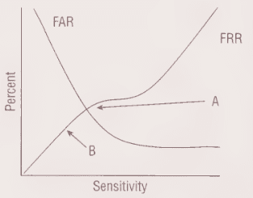

#### 3. Ben 的公司正在考虑将其系统配置为图中所示的 A 水平。他们将灵敏度设置在了哪个水平？

- A. FRR 交叉点 (The FRR crossover)
- B. FAR 点 (The FAR point)
- C. CER
- D. CFR

#### 4. 在 B 点，可能会发生什么问题？

- A. 误认率（False acceptance）会很高。
- B. 误拒率（False rejection）会很高。
- C. 误拒率（False rejection）会非常低。
- D. 误认率（False acceptance）会非常低。

#### 5. 如果图中所示 FAR 和 FRR 没有提供组织需求的性能水平，Ben 应该？

- A. 调整生物识别设备的灵敏度。
- B. 评估其他生物识别系统。
- C. 移动 CER。
- D. 调整 FRR 设置。

#### 6. Ed 负责保护组织客户的信息，包括姓名、社会安全号码、出生日期和出生地以及各种其他信息。这些信息被称为什么？

- A. PHI
- B. PII
- C. 个人保护数据 (Personal Protected Data)
- D. PID

#### 7. 下图所示的是哪种软件开发生命周期模型？

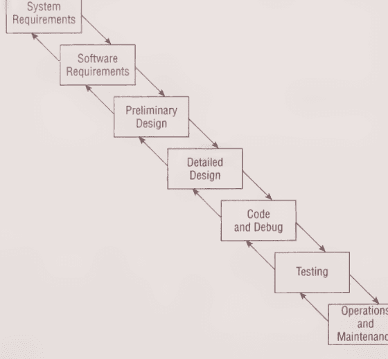

- A. 螺旋型 (Spiral)
- B. 敏捷 (Agile)
- C. Boehm
- D. 瀑布型 (Waterfall)

#### 8. 封装（Encapsulation）是实现什么类型协议的核心概念？

- A. 桥接 (Bridging)
- B. 多层 (Multilayer)
- C. 哈希 (Hashing)
- D. 存储 (Storage)

#### 9. 以下哪个不是 IT 安全控制目标 COBIT 框架的关键原则？

- A. 满足利益相关者需求 (Meeting stakeholder needs)
- B. 执行详尽分析 (Performing exhaustive analysis)
- C. 全覆盖企业 (Covering the enterprise end-to-end)
- D. 将治理与管理分离 (Separating governance from management)

#### 10. Roscommon Enterprises 是一家处理个人爱尔兰公司。他们与许多国家交换信息。以下哪个国家将触发《欧美隐私盾》（EU-U.S. Privacy Shield）的后续传输规定？

- A. 美国 (United States)
- B. 法国 (France)
- C. 意大利 (Italy)
- D. 德国 (Germany)

#### 11. 将以下编号协议与最准确的字母描述进行匹配。每个答案仅使用一次。

**协议：**

- 1. TCP
- 2. UDP
- 3. DNS
- 4. ARP

**描述：**

- A. 在 MAC 地址和 IP 地址之间进行转换
- B. 在 FQDN 和 IP 地址之间进行转换
- C. 以面向连接的方式在网络传输数据
- D. 以无连接的方式在网络传输数据

#### 12. NIST 特别出版 800-53A 描述了可以评估的四种对象类型。如果 Ben 正在审查密码标准，他正在评估哪种对象？

- A. 机制 (mechanism)
- B. 规范 (specification)
- C. 活动 (activity)
- D. 个人 (individual)

#### 13. 对于即将停止服务但将重新出售或再次使用的的工作站，通常使用哪种流程来确保数据安全？

- A. 破坏 (Destruction)
- B. 擦除 (Erasing)
- C. 净化 (Sanitization)
- D. 清除 (Clearing)

#### 14. Colleen 正在进行软件测试，评估代码的安全缺陷和可用性问题。她从终端用户的角度操作应用程序操作，并在处理产品过程中参考源代码。Colleen 进行的是哪种类型的测试？

- A. 白盒 (White box)
- B. 蓝盒 (Blue box)
- C. 灰盒 (Gray box)
- D. 黑盒 (Black box)

#### 15. Harold 正在寻找一种软件开发方法，以帮助解决他组织的一个重大问题。目前，开发人员和运维人员不一起工作，通常被视为将问题“扔过墙”交给另一个团队。哪种技术管理方法旨在解决这个问题？

- A. ITIL
- B. 精益 (Lean)
- C. ITSM
- D. DevOps

#### 16. NIST 特别出版物800-92《计算机安全日志指南》描述了日志管理的四种常见挑战：

- 不一致的源
- 不一致的内容
- 不一致的时间戳
- 不一致的格式

以下哪些解决方案最适合解决这些问题？

- A. 在所有设备上实施 SNMP。
- B. 实现 SIEM。
- C. 统一 Windows 事件格式。
- D. 确保所有端点启用日志并正确设置本地时间。

#### 17. Mike 有一个闪存卡，想要重复使用。该卡包含敏感信息。他可以使用哪种技术安全地删除数据并允许重复使用？

- A. 消磁化 (Degaussing)
- B. 物理破坏 (Physical destruction)
- C. 覆盖 (Overwriting)
- D. 格式化 (Reformatting)

#### 18. Carlos 正在调查组织内敏感信息的泄露情况。他认为攻击者从基于 Web 的数据库系统中获取了员工信息。发生了哪种攻击？

- A. SQL 注入 (SQL injection)
- B. 缓冲区溢出 (Buffer overflow)
- C. 跨站脚本 (Cross-site scripting)
- D. 跨站请求伪造 (Cross-site request forgery)

#### 19. 以下哪一个是描述个人必须完成的精确操作的详细文档？

- A. 策略 (Policy)
- B. 标准 (Standard)
- C. 指南 (Guideline)
- D. 程序 (Procedure)

#### 20. 关系数据库的哪种原则确保事务成功完成？

- A. 原子性 (Atomicity)
- B. 一致性 (Consistency)
- C. 隔离性 (Isolation)
- D. 持久性 (Durability)

#### 21. Bryan 有一组敏感文档，希望防止它们出现在公共论坛上。使用哪种安全控制可以追踪文档的泄露源？

- A. 数字签名 (Digital signature)
- B. 文档标记 (Document tagging)
- C. 哈希处理 (Hashing)
- D. 水印 (Watermarking)

#### 22. Carlos 正在为一个将在新的四层公司总部内建设的数据中心规划设计。该大楼由地下室和三个地上层组成。数据中心的最佳位置在哪里？

- A. 地下室 (Basement)
- B. 一楼 (First floor)
- C. 二楼 (Second floor)
- D. 三楼 (Third floor)

#### 23. Chris 是一家大公司的安全专业人员。当进入大楼时，发现一个安全区域的门开着。物理安全不是他的责任，但他立即采取行动关闭门并通知安全团队。Chris 展示了什么原则？

- A. 尽责 (Due care)
- B. 尽职 (Due diligence)
- C. 职责分离 (Separation of duties)
- D. 知情同意 (Informed consent)

#### 24. 以下哪种调查类型始终使用“排除怀疑”的标准？

- A. 民事调查 (Civil investigation)
- B. 刑事调查 (Criminal investigation)
- C. 运营调查 (Operational investigation)
- D. 监管调查 (Regulatory investigation)

#### 25. 以下哪种备份类型不会文件的归档位（archive bit）？

- A. 全量备份 (Full backup)
- B. 增量备份 (Incremental backup)
- C. 差分备份 (Differential backup)
- D. 全量备份 (Full backup)

#### 26. 哪种备用设施包含恢复运营所需的硬件？

- A. 热备中心 (Hot site)
- B. 温备中心 (Warm site)
- C. 冷备中心 (Cold site)
- D. 移动备中心 (Mobile site)

#### 27. 以下哪项描述瞬时电压下降？

- A. 跌落 (Sag)
- B. 低电压 (Brownout)
- C. 尖峰 (Spike)
- D. 浪涌 (Surge)

#### 28. 以下哪项是 IPsec 认证的组件？

- A. 主体 (Subject)
- B. 对象 (Object)
- C. 令牌 (Token)
- D. 数据 (Data)

#### 29. 开放最短路径优先 (OSPF) 是一种使用地图的路由协议：

- A. 链路状态 (Link state)
- B. 最短路径 (Shortest path)
- C. 链路 (Link)
- D. 矢量 (Distance vector)

#### 30. 以下哪项由语言组成？

- A. 机器语言 (Machine)
- B. 汇编语言 (Assembly)
- C. 编译语言 (Compiled)
- D. 自然语言 (Natural)

### 问题 31–35 场景

Conch 是一家中型企业。他们目前每周日进行全量备份，并在周一、二、三进行差分备份。他们在周三下午遭遇了服务器故障。Tara 负责备份。

#### 31. Tara 应该应用哪种备份来恢复服务器？

- A. 周日的全量备份
- B. 周一的差分备份
- C. 周二的差分备份
- D. 周三的差分备份

#### 32. 为了使数据最新，她总共必须应用多少次备份？

- A. 1
- B. 2
- C. 3
- D. 4


## 33. 在这种备份方法下，部分数据可能会丢失。多久？

- A. 3 小时
- B. 5 小时
- C. 8 小时
- D. 数据不会丢失

## 34. 如果 Tara 相同相同但切换到增量备份，她需要多少份备份？

- A. 1
- B. 2
- C. 3
- D. 4

## 35. 如果假设每天变化量相同，以下哪一个备份最大？

- A. 周一的增量
- B. 周二的增量
- C. 周三的增量

## 36. Susan 正在进行 STRIDE 评估。在评估过程中，她发现了一个允许在 Web 浏览器和应用程序服务器之间修改事务。哪些 STRIDE 分类最符合这个问题？

- A. 篡改 (Tampering) 和 信息泄露 (Information Disclosure)
- B. 伪造 (Spoofing) 和 篡改 (Tampering)
- C. 篡改 (Tampering) 和 否认 (Repudiation)
- D. 信息泄露 (Information Disclosure) 和 权限提升 (Elevation of Privilege)

## 37. Bob 被要求编写一项政策，描述数据应保留多久以及何时清除。该政策涉及什么概念？

- A. 数据持久性 (Data permanence)
- B. 记录保留 (Record retention)
- C. 数据脱敏 (Data redaction)
- D. 审计日志 (Audit logging)

## 38. IPsec 的哪种组件提供了认证、完整性和不可否认性？

- A. L2TP
- B. 封装安全载荷 (Encapsulating Security Payload)
- C. 加密安全头 (Encryption Security Header)
- D. 认证头 (Authentication Header)

## 39. Renee 注意到网络上的某个系统最近在短时间内从单一系统尝试连接所有 65536 个 TCP 端口。Renee 可能经历了哪种类型的攻击？

- A. 拒绝服务 (Denial of service)
- B. 侦察 (Reconnaissance)
- C. 恶意内部人员 (Malicious insider)
- D. 破解 (Compromise)

## 40. Windows 哪种类型审核记录描述了操作系统关机或服务停止等事件？

- A. 日志 (Application log)
- B. 安全日志 (Security log)
- C. 系统日志 (System log)
- D. 设置日志 (Setup log)

## 41. 在所示的环保护模型中，哪个环不在特权模式下运行？

- A. Ring 0
- B. Ring 1
- C. Ring 2
- D. Ring 3

## 42. 哪种级别的 RAID 也称为磁盘条带化（disk striping）？

- A. RAID 0
- B. RAID 1
- C. RAID 5
- D. RAID 10

## 43. Jacob 通过访问其账户有权访问的文件指针，使用一个有效但低权限的用户账户对系统发起了攻击。在访问检查之后、文件打开之前，他迅速将文件指针切换到该用户账户没有访问权限的文件。这是哪种攻击？

- A. TOCTOU
- B. 权限蔓延（Permissions creep）
- C. 身份冒充（Impersonation）
- D. 链接交换（Link swap）

## 44. 实现 RAID 级 0 最少需要多少块磁盘？

- A. 1
- B. 2
- C. 3
- D. 5

## 45. Fred 的公司想要确保通过其中央电子邮件服务器发送的消息的完整性。如果消息的机密性并不关键，Fred 应该建议哪种解决方案？

- A. 对所有消息进行数字签名和加密以确保完整性。
- B. 对所有消息数字签名但不加密。
- C. 使用 TLS 保护消息，确保其完整性。
- D. 使用哈希算法在每条消息中提供哈希，以证明其未被更改。

## 46. Susan 公司的领导要求实施一种访问控制系统，能够规定诸如“仅允许销售人员在上午 8 点到下午 6 点之间通过无线网络上的托管设备访问”。Susan 来说，哪种访问控制系统是最佳选择？

- A. ABAC
- B. RBAC
- C. DAC
- D. MAC

## 47. 哪种通信依赖于使用独立时钟或嵌入通信中的时间戳的时间机制？

- A. 模拟（Analog）
- B. 数字（Digital）
- C. 同步（Synchronous）
- D. 异步（Asynchronous）

## 48. Chris 正在两栋楼之间使用第6 类电缆部署千兆以太网。根据第6 类标准，他布布电缆的最大距离是多少？

- A. 50 米
- B. 100 米
- C. 200 米
- D. 300 米

## 49. Howard 是一个与经验丰富的计算机取证调查员合作的安全分析师。调查员要求他取回一个取证驱动器控制器，但 Howard 在存储室里找不到此名字的设备。取证驱动器控制器的另一个名称是什么？

- A. RAID 控制器
- B. 写保护器（Write blocker）
- C. SCSI 终止器（SCSI terminator）
- D. 取证设备分析器（Forensic device analyzer）

## 50. Saria 开发团队正在开发的 Web 需要提供安全的会话管理，以防止使用应用程序依赖的 cookie 进行会话劫持。以下技术中，哪种最适合她推荐？

- A. 为 cookie 设置 Secure 属性，从而强制使用 TLS。
- B. 将 Domain cookie 属性设置为 example.com，以限制 cookie 对同域服务器的访问。
- C. 将 Expires cookie 属性设置为小于一周的时间。
- D. 设置 HTTPOnly 属性以仅要求加密会话。

## 51. Ben 的公司最近淘汰了他们的多功能打印机群。他们的安全团队表示担心打印机内部有硬盘，其中可能包含扫描件和打印作业的数据。这种问题的技术术语是什么？

- A. 数据池化（Data pooling）
- B. 清除失败（Failed clearing）
- C. 数据持久性（Data permanence）
- D. 数据残留（Data remanence）

## 52. 哪种访问控制方案对主体和对象进行标记，并在标记匹配时允许主体访问对象？

- A. DAC
- B. MAC
- C. 基于规则的访问控制 (RBAC)
- D. 基于角色的访问控制 (RBAC)

## 53. 提供账户配置、管理、身份验证、授权、报告和监控能力的云服务被称为哪种服务？

- A. PaaS
- B. IaaS
- C. IaaS
- D. SaaS

## 54. Sally 想要保护组织的 VoIP 系统。以下哪些攻击是她不需要担心的？

- A. 窃听（Eavesdropping）
- B. 拒绝服务（Denial of service）
- C. 黑盒化（Blackboxing）
- D. 来电 ID 欺骗（Caller ID spoofing）

## 55. Marty 发现其组织的访问限制允许任何用户登录分配给任何其他用户的工作站，即使他们来自完全不同的部门。这种访问直接违背了哪种信息安全原则？

- A. 职责分离（Separation of duties）
- B. 双人控制（Two-person control）
- C. 知其所需（Need to know）
- D. 最小权限（Least privilege）

## 56. Fred 需要在不可信的网络上的两个服务器之间传输文件。由于他知道网络不可信的，他需要选择一种加密协议以确保其数据保持安全。他应该选择哪种协议？

- A. SSH
- B. TCP
- C. SFTP
- D. IPsec

## 57. Chris 使用数据包嗅器捕来自 TACACS+ 服务器的流量。他应该监控哪种协议，预期哪些数据是可读的？

- A. UDP；无——TACACS+ 加密整个会话
- B. TCP；无——TACACS+ 加密整个会话
- C. UDP；除用户名和密码以外的所有内容，这些是被加密的
- D. TCP；除用户名和密码以外的所有内容，这些是被加密的

## 利用你对 Kerberos 的知识回答问题 58–60。


## 58. 如果客户端已通过验证，客户端向 KDC 发送什么？

- A. 服务
- B. 客户端
- C. TGT
- D. 请求

## 59. 客户端和服务和服务之间发生了什么？

- A. 服务提供
- B. 客户端检查
- C. TGT
- D. 请求

## 60. 系统向客户端提供什么？

- A. 服务
- B. 客户端侧
- C. TGT
- D. 请求

## 第 12 章练习测试

## 61. 票据（ticket）提供了什么？

- A. 服务
- B. 身份验证
- C. 授权
- D. 请求

## 62. 要求用户回答诸如“你母亲的姓氏是什么？”或“你最喜欢的颜色是什么？”等问题的密码被称为什么？

- A. 密码短（Passphrase）
- B. 多因素（Multifactor）
- C. 密码（Password）

## 63. CDMA、GSM 和 IDEN 都是什么小区技术的示例？

- A. 1G
- B. 2G
- C. 3G
- D. 4G

## 64. 以下哪种灭火系统对设备的意外损坏风险最大？

- A. 闭闭式（Closed head）
- B. 干的一种（Dry pipe）
- C. 淋水（Deluge）
- D. 预作用（Preaction）

## 65. Lauren 的医疗服务提供者维护健康、治疗和医疗账单等数据。这是什么数据？

- A. 受保护健康信息（Protected Health Information）
- B. 个人身份（Personally Identifiable）
- C. 受保护健康保险（Protected Health Insurance）
- D. 个人保护（Individual Protected）

## 66. 哪种代码审查最适合业务逻辑缺陷？

- A. 变异模糊测试（Mutational fuzzing）
- B. 手动（Manual）
- C. 生成式模糊测试（Generational fuzzing）
- D. 接口测试（Interface testing）

## 67. “你知道的东西”（Something you know）是什么种身份验证因素的示例？

- A. 类型 1
- B. 类型 2
- C. 类型 3
- D. 类型 4

## 68. Saria 是一家医疗系统的所有者。对于存储在系统中或由系统处理的数据，她有哪些责任？

- A. 她必须对数据进行分类。
- B. 她必须确保实施了适当的安全措施来保护数据。
- C. 她必须向人员授予适当的访问权限。
- D. 她单独负责确保数据在静态、传输中和使用中的安全。

## 69. 在软件测试期间，Jack 绘制了黑客如何接触他正在审查的应用程序并确定了黑客可能的需求。然后测试了系统对攻击行为的响应。Jack正在进行哪种测试？

- A. 误用例（Misuse case testing）
- B. 用例测试（Use case testing）
- C. 黑客用例（Hacker use case）
- D. 静态代码分析（Static code analysis）

## 70. 当厂商开发想要提交用于共同标准（Common Criteria）评估的产品时，他们完成什么来描述其产品的安全声明？

- A. PP（保护规范）
- B. ITSEC
- C. TCSEC
- D. ST（标准）

## 71. Chris 被分配扫描系统所有可能的 TCP 和 UDP 端口。为了完成任务，他必须扫描每种类型的多少端口？

- A. 65,536 个 TCP 端口和 32,768 个 UDP 端口
- B. 1024 个常用 TCP 端口和 32,768 个临时 UDP 端口
- C. 65,536 TCP 和 65,536 UDP
- D. 16,384 个 TCP 端口和 16,384 个 UDP 端口

## 72. CVE 和 NVD 都提供关于什么的信息？

- A. 漏洞（Vulnerabilities）
- B. 标记语言（Markup languages）
- C. 漏洞扫描工具
- D. 渗透测试方法论

## 73. 军事分类方案中的最高级别是什么？

- A. 秘密 (Secret)
- B. 机密 (Confidential)
- C. 特殊业务单元 (SBU)
- D. 绝密 (Top Secret)

## 74. 在哪种类型的信任恢复过程中，系统可以在无管理员干预的情况下针对一种或多种故障类型进行恢复，同时保护数据不丢失？

- A. 自动恢复
- B. 手动恢复
- C. 功能恢复
- D. 不导致过度数据丢失的自动恢复

## 75. 在尝试控制无线网络的信号强度及其访问范围时，应该考虑哪三个重要事项？

- A. 天线位置、天线类型、天线功率水平
- B. 天线设计、功率电平、使用强制门户 (captive portal)
- C. 天线位置、天线位置、使用强制门户
- D. 功率电平、天线位置、FCC 最小强度要求

## 76. 确保数据从 SSD 中无法恢复的最佳方法是什么？

- A. 使用内置的擦除命令
- B. 使用 1 和 0 的随机模式擦除
- C. 物理销毁驱动器
- D. 对驱动器去磁

## 77. Alice 向 Bob 发送了一条消息，并希望确保第三方 Mal 在传输过程中无法读取消息内容。Alice 试图实现密码学的哪种目标？

- A. 机密性 (Confidentiality)
- B. 完整性 (Integrity)
- C. 身份验证 (Authentication)
- D. 非否认性 (Nonrepudiation)

## 78. 下列指标中哪一个规定了业务连续性计划人员认为的灾难后服务恢复时间？

- A. MTD (最大允许中断)
- B. RTO (恢复目标时间)
- C. RPO (恢复点目标)
- D. MTO (最大维护时间)

## 79. Gary 希望检查计算机欺诈法律的文本，以确定其是否适用于针对公司的一次近期黑客攻击。他应该去哪里阅读该法律文本？

- A. 联邦法规典 (Code of Federal Regulations)
- B. 最高法院裁决
- C. 法律汇编 (Compendium of Laws)
- D. 美国法典 (United States Code)

## 80. James 选择实施了一种采用准入后（post-admission）策略控制网络的 NAC 解决方案。什么类型的问题是准入后策略无法严格处理的？

- A. 带外监控
- B. 防止未打补的笔记本电脑在连接网络后立即被利用
- C. 当用户行为与授权矩阵不匹配时拒绝访问
- D. 当用户行为根据授权矩阵被允许时允许用户访问

## 81. Ben 构建了一个访问控制列表，列出了其用户允许访问的对象。当用户尝试访问他们没有权限的对象时，会被拒绝访问，尽管没有特定的规则阻止它。哪种访问控制原则是这种行为的关键？

- A. 最小权限原则 (Least privilege)
- B. 隐式拒绝 (Implicit deny)
- C. 显式拒绝 (Explicit deny)
- D. 最终规则回退 (Final rule fall-through)

## 82. Mary 是保险公司的安全风险分析师。她目前正在研究一个场景：由于公司 Web 应用程序缺少补丁，黑客可能使用 SQL 注入攻击破坏 Web 服务器。在这种情况下，风险是什么？

- A. 未打补丁的 Web应用程序
- B. 网页篡改 (Web defacement)
- C. 黑客
- D. 操作系统

## 83. 在所示计算机系统安全边界图中，哪个组件的名称被替换为 XXX？

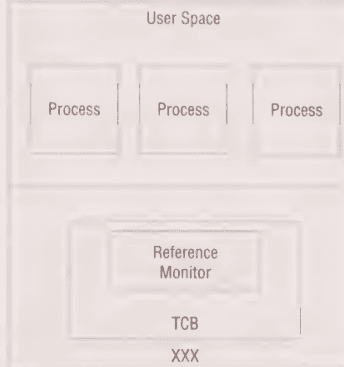

- A. 内核 (Kernel)
- B. 特权核心 (Privileged core)
- C. 用户监器 (User monitor)
- D. 安全边界 (Security perimeter)

## 84. Val 试图审查安全日志，但其组织中央日志存储库维护的海量记录让她无所措。她可以使用什么技术来选择一组具有代表性的记录进行进一步审查？

- A. 统计抽样 (Statistical sampling)。
- B. 剪裁 (Clipping)。
- C. 选择每天前 5% 的记录。
- D. 选择中午时段 5% 的记录。

## 85. 在 Jen 作为网络管理员的工作中，她负责确保网络不会因生产车间运行的大型电机而受到电磁干扰的影响。如果这比成本更重要，她应该选择哪种电缆？

- A. 100Base
- B. 100BaseT
- C. 1000BaseT
- D. 光纤

## 对于问题 86–89，请参考以下场景：Jasper 是一家珠宝制造商，通过其网站营销和销售定制珠宝。

## 86. Bethany 想要建立控制措施以使组织符合行业标准。哪种变更管理流程有助于实现这一点？

- A. 配置控制 (Configuration control)
- B. 变更控制 (Change control)
- C. 发布控制 (Release control)
- D. 请求控制 (Request control)


## 考题

### 87. Mary 想要为用户验收创建一个流程。哪种管理流程有助于实现这一点？

+ A. 配置控制
+ B. 变更控制
+ C. 发布控制
+ D. 请求控制

### 88. Bethany 注意到在用户测试期间出现了一些问题。哪种流程包含了这些？

+ A. 配置控制
+ B. 变更控制
+ C. 发布控制
+ D. 请求控制

### 89. Ben 编写了应用程序代码。他在没有通知团队的情况下更新系统，违反了哪种变更管理流程？

+ A. 配置控制
+ B. 变更控制
+ C. 发布控制
+ D. 请求控制

### 90. Ben 的哈希实现引入了什么缺陷？

+ A. 明文哈
+ B. 重用哈
+ C. 使用短哈
+ D. 算法选择错误

### 91. 下列哪项是风险转移的例子？

+ A. 护墙
+ B. 购买保险
+ C. 设立围栏
+ D. 迁移设施

### 92. 哪个协议取代了证书撤销列表并增加了实时状态验证？

+ A. RTCP
+ B. RTVP
+ C. OCSP
+ D. CSRTP

### 93. Jim 对程序进行词法分析并生成流程图。他正在进行哪种测试？

+ A. 动态 (Dynamic)
+ B. 模糊测试 (Fuzzing)
+ C. 手动 (Manual)
+ D. 静态 (Static)

### 94. 什么让 TCP 成为面向连接的协议？

+ A. 它通过连接工作。
+ B. 它使用握手。
+ C. 它监控掉线。
+ D. 它使用复杂的头部。

### 95. 哪种 LDAP 操作包含了对 LDAP 服务器的身份验证？

+ A. Bind
+ B. StartLDAP
+ C. AuthDN

### 96. 你正在对你的组织进行定性风险评估。在分析风险时，两个重要的风险要素是概率和。

+ A. 可能性 (Likelihood)
+ B. 历史 (History)
+ C. 影响 (Impact)
+ D. 成本 (Cost)

### 97. 使用 OSI 模型，数据链路层使用什么格式来格式化来自上层层的消息？

+ A. 流 (stream)
+ B. 帧 (frame)
+ C. 段 (segment)
+ D. 数据报 (datagram)

### 98. 当 (ISC)² 同行评审委员会在考虑潜在的伦理违规时，可能实施的最大惩罚是什么？

+ A. 取消认证
+ B. 终止雇
+ C. 经济罚款
+ D. 暂停认证

### 99. 关于 SDLC 的以下陈述哪哪是正确的？

+ A. SDLC 要求使用迭代方法进行软件开发。
+ B. SDLC 要求使用顺序方法进行软件开发。
+ C. SDLC 不包括对用户和支持人员的培训。
+ D. 瀑布模型与 SDLC 兼容。

### 100. 在所示图中，Harry 被禁止读取高于其安全许可密级的文件。哪种安全模型阻止了这种行为？

+ A. Bell-LaPadula
+ B. Biba
+ C. Clark-Wilson
+ D. Brewer-Nash

### 101. Susan 正在为一家咖啡馆设置网络，并希望确保用户在接入网络之前使用电子邮件地址进行身份验证并同意咖啡馆的可接受政策。她应该使用哪种技术来实现这一点？

- A. 802.11
- B. NAC
- C. 托管门户 (Captive portal)
- D. 无线网关

### 102. 活跃监控（active monitoring）的另一个术语是什么？

- A. 合成 (Synthetic)
- B. 被动 (Passive)
- C. 响应式 (Reactive)
- D. 基于 Span (Span-based)

### 103. TCP 头部由源端口、目的端口、序列号等元素组成。TCP 头部的长度是多少字节？

- A. 8 字节
- B. 20–60 字节
- C. 64 字节
- D. 64–128 字节

### 场景题 104–106

> Fred 所职的公司正在审查其配发手机的安全性。他们发放了运行 Android 和 iOS 的 4G 智能手机，并使用移动设备管理（MDM）解决方案向手机部署公司软件。移动设备管理软件还允许公司在手机丢失时远程擦除。

#### 104. Fred 公司在通过蜂窝网络发送敏感数据时，应该要求哪些安全考虑？

- A. 他们应该使用与任何公共网络数据传输相同的要求。
- B. 蜂窝运营商网络是私有网络，不需要特殊考虑。
- C. 加密所有流量以确保数据机密性。
- D. 要求从手机发送的所有数据都使用 WAP。

#### 105. Fred 打算参加今年的一个大型黑客会议。在会议期间连接其运营商的 4G 网络时，他应该做什么？

- A. 继续正常使用。
- B. 停止所有使用；基站被伪造。
- C. 仅使用信任的 Wi-Fi 网络。
- D. 连接到公司的加密 VPN 服务。

#### 106. 导致远程擦除手机失败的最可能的情况是什么？

- A. 手机设置了密码。
- B. 手机无法连接网络。
- C. 运营商未解锁手机。
- D. 手机正在使用中。

### 107. Elaine 正在为她的组织制定业务连续计划。她应该寻求降低哪种价值？

- A. AV（反病毒）
- B. SSL（安全层协议）
- C. RTO（恢复时间目标）
- D. MTO（最大允许中断）

### 108. NIST 特别出版 800-53 第 4 版描述了两种保证措施。哪种开发保证措施最好描述为衡量“信息系统硬件、软件和固件组件在设计和开发过程中产生的产物（例如功能规范、高级设计、低级设计、源代码）的严谨性、详细程度和正式性？”

- A. 覆盖（Coverage）
- B. 适用性（Suitability）
- C. 确认（Affirmation）
- D. 深度（Depth）

### 109. 请按照灾难恢复测试类型对业务的潜在影响，从影响最小到影响最大排序。

- A. 检查清单审查 (Checklist review)
- B. 并行测试 (Parallel test)
- C. 桌面演练 (Tabletop exercise)
- D. 全面中断测试 (Full interruption test)

### 110. Chris 所在的组织网络服务质量出现问题。主要症状是数据包在从源地到目的地的途中损坏。哪个术语描述了 Chris 面临的问题？

- A. 延迟 (Latency)
- B. 抖动 (Jitter)
- C. 干扰 (Interference)
- D. 丢包 (Packet loss)

### 111. Kathleen 被要求为她的软件质量团队选择一种高度正式的代码审查过程。以下哪些软件测试过程最严格且正式？

- A. Fagan
- B. 模糊测试 (Fuzzing)
- C. 肩审 (Over the shoulder)
- D. 结对编程 (Pair programming)

### 112. Fred 试图防止 Web 应用程序遭受跨站脚本攻击。他应该在何处进行验证以防止这种攻击？

- A. 验证应始终在客户端进行。
- B. 攻击者利用这种技术绕过防御。
- C. 验证应在服务器端进行。
- D. 这种方法没有问题。

### 113. 以下哪项不是面向对象的编程语言？

- A. C++
- B. Java
- C. Fortran
- D. C#

### 114. Uptown Records 最近与一家医院签署了医疗记录存储的合同。为了符合 HIPAA，这两个组织必须签署哪种协议？

- A. NDA（保密协议）
- B. NCA（非竞争协议）
- C. BAA（业务协议）
- D. SLA（服务等级协议）

### 115. Norm 希望对他的组织进行灾难恢复测试，并希望选择一种平衡恢复时间和成本的方法。他应该选择哪种测试？

- A. 全面中断测试 (Full interruption test)
- B. 并行测试 (Parallel test)
- C. 桌面演练 (Tabletop exercise)
- D. 检查清单审查 (Checklist review)

### 116. Ed 正在构建一个支持 IPv6 的网络，但需要将其连接 IPv4 网络。他应该在之间放置什么设备？

- A. 交换机
- B. 路由器
- C. 桥器
- D. 网关

### 117. 哪种加密标准赢得了作为高级标准的竞赛？

- A. Blowfish
- B. Twofish
- C. Rijndael
- D. Skipjack

### 118. 将每个编号的服务与其常用的字母端口匹配。每项应使用一次。

| 服务 | 端口 |
| :--- | :--- |
| 1. DNS | A. 443 |
| 2. HTTPS | B. 3389 |
| 3. SSH | C. 1433 |
| 4. RDP | D. 53 |
| 5. MSSQL | E. 22 |

### 119. 根据欧盟数据保护条例，以下哪些操作不是要求的？

- A. 组织允许个人退出。
- B. 组织必须提供访问。
- C. 组织必须保护数据。
- D. 组织必须有争议程序。

### 120. Tammy 正在为她的组织选择设施。她希望选择一个平衡恢复时间和成本的设施。她应该选择哪种设施？

- A. 热备 (Hot site)
- B. 温备场 (Warm site)
- C. 冷备场 (Cold site)
- D. 红备场 (Red site)

### 121. OSI 模型中的哪层与数据报文相关？

- A. 会话层 (Session)
- B. 传输层 (Transport)
- C. 网络层 (Network)
- D. 数据链路层 (Data Link)

### 122. 以下哪种长度不是高级标准的有效密钥长度？

- A. 128 位
- B. 192 位
- C. 256 位
- D. 384 位

### 123. 以下哪种技术提供了允许开发者与……进行交互的接口？

- A. 数据字典
- B. 对象模型
- C. 源代码
- D. API

### 124. 图中所示的是哪种加密技术？

- A. MD5
- B. Thunderbird
- C. S/MIME
- D. PGP

### 125. 当 Ren 在系统上列出文件时，他看到一组显示的属性。字母 rwx 表示不同级别的

- A. 识别 (Identification)
- B. 授权 (Authorization)
- C. 身份验证 (Authentication)
- D. 审计追责 (Accountability)

## 第一章：安全与风险管理（领域 1）

- **9.** 美国商务部负责实施《欧盟与美国隐私盾协议》。该框架取代了早期的名为“隐私盾”的框架，该框架在国家安全局（NSA）监控活动被披露后被裁定是不够的。

- **10. A.** 《格姆-莱奇-布莱利法案》(GLBA) 包含了监管客户财务信息隐私的规定。它专门适用于金融机构。

- **11. A.** 《联邦信息安全管理法》(FISMA) 特适用于政府承包商。《政府信息安全改革法》(GISRA) 是 FISMA 的前身，并已于 2002 年 11 月过期。HIPAA 和 PCI DSS 分别适用于医疗保健和信用卡信息。

- **12. D.** 向某些地区出口加密软件受到美国出口管制法法的管辖。

- **13. D.** 在权限提升攻击中，攻击者将受限的用户账户转换为具有更高权限、权力和/或系统访问权限的账户。欺骗攻击伪造身份，而否认攻击则否认某项行为的责任。篡改攻击试图试图破坏信息或资源的完整性。

- **14. D.** 每当你选择接受某种风险时，都应该保留风险接受过程的详细文档，以满足未来审计员的要求。这应该在实施安全控制、设计灾备计划或重复业务影响分析 (BIA) 之前。

- **15. B.** 围栏不具备检测入侵的能力。但它具有防止和威慑入侵的能力。围栏是物理控制的示例。

- **16. D.** Tony 如果通过结合定量和定性风险评估的元素将获得最佳结果。定量风险评估擅长分析财务风险，而定性风险评估是处理无形风险的良好工具。结合这两种技术可以提供一个全面的风险状况。

- **17. D.** 《经济间谍法》对任何被控窃取美国公司商业秘密的人处以罚款和监禁。它维护了贸易秘密所有者的知识产权。

- **18. C.** 尽职调查（Due care）原则规定，个人在特定情况下的反应应具有与任何理性人士所预期的同等水平。这是一个非常广泛的标准。勤勉原则（Diligence）是尽职调查的一个更具体的概念，规定被分配责任的个人应当尽到职责以准确且及时地完成任务。

- **19. C.** RAID 5 级（带校验和的磁盘条列）至少需要三块硬盘才能运行。

- **20. B.** 意识培训是管理控制的示例。防火墙和入侵检测系统是技术控制。安保人员是物理控制。

- **21. A.** 专利和商业秘密可以保护与制造工艺相关的知识产权。只有当细节在组织内部受到严格控制时，商业秘密才适用，因此在这种情况下专利是合适的解决方案。

## 附答案

- **22. B.** RAID 技术为硬盘故障提供容错是业务连续性措施的示例。从备份磁带恢复、迁移到冷备站点以及重启业务运营都是灾难恢复措施。

- **23. C.** 在制定资产列表后，业务影响分析团队应该为每个资产分配价值。

- **24. C.** 风险缓解策略试图降低风险发生的概率和/或影响。入侵防御系统试图降低成功攻击的概率，它们是风险缓解的示例。

- **25. D.** 灭火系统保护基础设施免受物理损坏。与不间断电源一起，灭火系统是加固物理基础设施的技术良好示例。防病毒软件、硬件防火墙和双因子身份验证都是逻辑控制的示例。

- **26. A.** 访问控制列表 (ACL) 用于确定用户的授权级别。用户名是识别工具。密码和令牌是身份验证工具。

- **27. D.** 商标保护延伸到在市场上代表组织、产品或服务的单词和符号。

- **28. A.** 显示的消息是勒索软件的示例，它加密用户计算机的内容以防止合法使用。这是一个可用性攻击的示例。

- **29. B.** 健康健身应用程序的开发者并不一定在收集或处理医疗保健数据，HIPAA 的条款不适用于此类业务。HIPAA 监管三类实体——医疗保健提供者、健康信息结算中心。

- **30. A.** 战略计划具有长期视野。运营计划和战术计划视野较短。

- **32. A.** 美国专利和商标局 (USPTO) 负责商标。

- **33. B.** 在遵循职责分离时，组织将任务划分为不同的组件，以确保没有个人同时执行两项任务。

- **34.** 《联邦信息安全管理法》(FISMA) 适用于政府机构。

- **35.** 行业数据安全标准 (PCI DSS) 规范信用卡信息的存储、处理和传输。

- **36.** 数据所有者对信息承担最终责任。数据保管者（Data custodian）通常负责实施控制措施。

- **37.** 书面作品（如网站内容）通常受版权保护。专利保护发明，商标代表品牌。

- **38.** 《美国联邦法典》(CFR) 包含了联邦机构颁布的行政法律文本。《美国法典》包含刑事法和民事法。最高法院的裁决包含对法律的解释，其本身并不是法律。

- **39.** 安装拦截攻击的设备是试图通过降低攻击发生的概率来降低风险。

- **40.** 首席信息官 (CIO) 是职位最高的负责人，将在执行层是最有倡导者。

- **41.** 高级经理在业务连续性规划中扮演多种角色。这些包括设定优先级、获取资源以及调解团队之间的纠纷。

- **42.** SOC 2 包含业务连续性控制，但 SOC 1 不包含。

- **43.** 声誉威胁允许攻击者否认执行某项行动或活动，而对方无法证明。

- **44.** 完整性控制（例如 Beth 在此例中实施的）旨在防止对信息的未经授权修改。

- **45.** SLA 通常不涉及数据机密问题；这些规定通常包含在保密协议 (NDA) 中。

- **46.** 代表产品或服务的单词和图像，不会保护计算机软件。

- **47.** 虚拟专用网络 (VPN) 通过加密在通常不安全的网络（如互联网）提供安全的通信通道。如果你在两个办公室之间建立 VPN 连接，一个办公室的用户就可以通过互联网安全地访问另一个办公室服务器上的内容。

# 附录 ■ 答案

- **48. C.** RAID 使用额外的硬盘来保护服务器免受单个故障故障。负载均衡和服务器集群确实增加了稳健性，但需要增加服务器。计划性备份可以防止数据丢失，但在硬盘故障时无法提供数据的即时访问。

- **49. A.** 哈希（Hashing）允许你通过计算来验证文件在两次哈希评估之间未被修改。ACL（访问控制列表）和只读属性是有用的控制措施，可以帮助你防止未经授权的修改，但它们无法验证文件是否被修改过。防火墙是网络安全控制，不验证文件的完整性。

- **50. B.** 第四修正案直接禁止政府人员在没有授权和合理理由的情况下搜查私人财产。法院扩大了对第四修正案的解释，包含了对其他隐私侵犯的保护。

- **51. A.** 业务连续性计划文档通常包括连续性计划目标、重要性声明、优先级声明、组织责任声明、紧迫性和时间声明、风险评估与接受和缓解文档、虚拟记录计划、应急响应指南以及维护和测试计划的文档。

- **52. D.** 强制休假计划要求员工每年休一段连续的假，并在在此期间撤销其权限。这将顺利地中断任何为了掩盖欺诈而进行掩盖行为的尝试，并导致威胁暴露。职责分离、权限控制和深度防御控制有助于从源上防止欺诈，但不太可能加速已经发生的欺诈的检测。

- **53. C.** 电子库（Electronic vaulting）是一项数据备份任务，属于灾难恢复工作，而不是业务连续性。

- **54. C.** 拒绝服务（DoS）攻击和分布式拒绝服务（DDoS）攻击试图通过向受害者大量流量或其他方式中断服务来破坏信息系统和网络的可用性。

- **55. B.** 基线（Baseline）提供了整个组织每个系统都必须满足的最低安全水平。

- **56. C.** 组织中的每个人都应该接受有关业务连续性计划的基础意识培训。而特定角色的人，例如第一响应人员和高管，还应该接受详细的、针对特定培训。

- **57. C.** 如果组织的首要考虑是重建数据中心，James 应该使用重置法来确定等服务器的当前市场价格。

- **58. D.** 1987年计算机安全法案赋予了美国标准与技术研究院（NIST）制定联邦计算机系统标准和指南的责任。为此，NIST 在适当的情况下利用了国家安全局（NSA）的技术建议和协助。

## 第1章：安全与风险管理（领域 1）

- **59.** 并没有规定专利必须由美国公民发明的。另一方面，可授予专利的发明必须是新的、非显而易见的且有用的。


## 附录 ■ 答案

- **60.** 键盘记录器监控个人的击键并报告给攻击者。它们旨在窃取敏感信息，这破坏了机密性的目标。

- **61.** 当威胁和漏洞发生交集时，就会存在风险。这通过公式 `风险 = 威胁 * 漏洞` 来描述。

- **62.** NIST 风险管理框架的第四步是评估安全控制措施。

- **63.** HAL 系统决定由于 BCP（业务连续性计划）停止提供服务。这是一个风险规避策略的例子。公司改变了运营方式，消除了 NTP 被滥用的风险。

- **64.** 机密性控制防止向未经授权的人员披露敏感信息。限制数据泄露的可能性是防止未经授权泄露的尝试。

- **65.** 应急响应指南应该包括组织在应对紧急情况下应遵循的立即步骤。这些包括即时响应程序、应通知紧急情况的人员列表以及第一响应人员的次要响应程序。它们不包括长期行动，如激活业务连续性协议、订购设备或激活 DR（灾难恢复）站点。

- **66.** 虽然 CEO 通常不会担任 BCP 成员，但具有特定规则的人，例如第一响应人员和高管，还应该接受详细的、针对角色的培训。

- **67.** 如果组织的首要考虑是重建数据中心，James 应该使用重置法来确定等服务器的当前市场价格。

- **68.** 保持服务器运行是可用性控制的一个例子，因为它增加了响应请求的可能性。

- **69.** A. 热站点包含电力、通信和其他硬件。

- **7.** 通信合法执法法（CALEA）要求所有通信运营商使监听成为可能。

- **70.** 计算机欺诈和滥用法（CFAA）对超过 5000 美元的损害规定为联邦犯罪。

- **71.** ISO 27002 是安全技术的国际标准。信息技术库（ITIL）包含安全管理实践。能力成熟模型（CMM）聚焦于软件开发。项目管理知识体系（PMBOK）专注于项目管理。

## 第1章：安全与风险管理（领域 1） 325

- **72.** B. 格拉姆-莱希-布莱利法案（GLBA）对金融机构实施严格的隐私规定，向客户提供隐私说明。

- **73.** D. 路由器 ACL、加密和防火墙规则都是技术控制。数据分类是管理控制。

- **74.** C. 虽然高层管理应该是 BCP 的成员，CEO 担任此角色是非常罕见的。

- **75.** D. 非否认允许接收者向第三方证明信息来自声称源。身份验证可以向 Ben 证明发送者是真实的，但他将无法向第三方证明这一点。

- **76.** C. 深度防御认为组织应该拥有重叠的安全控制措施，以尽可能维持相同的安全目标。这种方法在单个控制失效时提供安全。

- **77.** D. 利益相关者应该在变更发生之前而不是之后通知。列出的其他项目都是变更管理计划的目标。

- **78.** B. Ben 应该加密数据，作为补偿控制措施提供额外的保护。组织已经做出了政策例外，因此他不应该通过反对例外或在未经授权的情况下删除数据做出反应。购买保险可能会转移风险，但不是缓解控制。

- **79.** A. 风险评估应该最关注出现在第一象限的风险。这些是发生概率高且一旦发生对组织影响重大的风险。

- **80.** D. 在风险接受策略中，组织决定不采取行动是管理风险的最有利途径。被解雇后保留公司访问权限的员工可能会利用该权限进行报复性行动。另一方面，如果权限过早终止，员工可能会发现自己即将被解雇。

- **81.** A. 儿童在线隐私保护法（COPPA）要求在收集 13 岁以下儿童的个人信息之前获得父母事先同意。

- **82.** D. 年化发生率（ARO）是你预计每年发生某种风险的频率。在 100 年一洪水区，风险分析人员预计每 100 年发生一次洪水，即每年 0.01 次。

- **86.** D. Wireshark 是一种协议分析器，可用于监听网络连接。窃听是对机密性的攻击。

- **87.** C. 在削减分析中，安全专业人员将系统分解为五个关键要素：信任边界、数据流路径、输入点、特权操作以及有关安全控制的细节。

- **88.** 法律或行业标准与描述的匹配关系如下：

  - **1. GLBA:** A. 一项美国法律，要求受监管的金融机构每年向其客户提供隐私声明。
  - **2. PCI DSS:** C. 一项涵盖处理信用卡组织的行业标准。
  - **3. HIPAA:** D. 一项美国法律，为医疗信息提供数据隐私和安全要求。
  - **4. SOX:** B. 一项美国法律，要求上市公司对内部控制进行评估，以识别 IT 流程。

- **89.** D. 在列出的州中，佛罗里达州是唯一一个没有被标记为存在重大地震严重风险的州。

- **90.** C. 用户名是一种识别工具。它们不是秘密，因此不适合用作密码。

- **91.** B. 定性工具通常用于业务影响评估，以捕捉对等无形因素的影响，如客户信心、员工角色和声誉。

- **92.** A. 准备关键记录管理计划的组织应从识别所有符合关键业务记录定义的文档开始。这应该包括在组织启动连续性计划时，为了在新的地点重新启动业务所需的所有记录。

- **93.** B. 安全培训旨在为员工提供履行工作职责所需的特定知识。它通常是为具有相似工作功能的人员设计的。

- **94.** D. 意识确立确立了信息安全理解的最低标准。它旨在适应组织中的所有人员，无论其被分配的任务如何。

- **95.** C. 风险是威胁和脆弱性的结合。威胁是试图破坏安全的外部力量，例如本文中的恶意黑客。脆弱性是可能允许威胁成功的内部弱点。在这种情况下，缺失的补丁就是脆弱性。在这种场景下，恶意黑客（威胁）尝试对未打补丁的服务器（脆弱性）进行 SQL 注入攻击，结果是网站被篡改。

- **96.** C. 暴露因子是风险经理预计在风险发生时设施遭受损坏的百分比。它通过将损害金额除以资产价值计算得出。在这种情况下，即 500 万美元的损害除以 1000 万美元的设施价值，或 50%。

  B. 年发生率是风险分析师预计每年内风险发生的次数。在这种情况下，分析师预计每 200 年发生一次龙卷风，或每年 0.005 次。

  A. 年损失预期通过单次损失预期（SLE）乘以年发生率（ARO）计算。在这种情况下，SLE 为 5,000,000 美元，ARO 为 0.005。将这些数字相乘得到 25,000 美元的 ALE。

  C. 信息泄露攻击依赖于私有、机密或受控信息的公开。嵌入在 HTML 代码中的程序注释是此类攻击的示例。

  B. 保密协议（NDA）通过要求员工和关联公司不与第三方共享机密信息来保护敏感信息的机密性。NDA 通常在员工离职后依然有效。A. 供应链管理可以帮助，这通过要求员工和关联公司不与第三方共享机密信息。NDA 通常在员工离职后依然有效。

## 附录 ■ 答案

- **6.** A. 数据保留策略可以帮助确保过时数据被清除，从而消除潜在的额外发现成本。许多组织采取激进的数据保留策略，以降低存储成本并限制手中保留和处理的数据量。数据保留策略并非旨在销毁违规数据，且必须遵守数据保留的法律要求。

- **7.** D. 托管人被赋予角色，通过管理和监督数据的处理、存储和保护方式来处理日常任务。数据处理程序是用于处理数据的系统。业务所有者通常是项目或系统所有者，负责确保系统为其用户或客户提供价值。

- **8.** D. 隐私盾合规性有助于美国与欧盟的《通用数据保护条例》对接。定期评估可能有用，但并非强制。HIPAA 是美国专门适用于医疗保健及相关组织的法律，且同时加密所有数据是不可能的（至少如果你想使用这些数据的话！）。PCI DSS 是一项关于处理信用卡信息的全球合同法规。

- **9.** C. 安全基线有一个起点，用于根据组织的特定需求定制安全控制措施。它们并不总是适用于特定的组织需求，需要确保系统始终处于安全状态，且不能防止法律责任。

- **10.** A. 清除是指为介质重复使用做准备。当介质被清除时，未分类的数据会被覆盖介质的所有位置。完成后，介质即可被重复使用。擦除是删除文件或介质。净化是一种更密集的清除形式，用于在低安全区域重复使用，而深度清理是一系列过程，在从系统或介质中移除数据，同时确保数据无法通过任何手段被恢复。

- **11.** 美国政府使用“机密”标签标记在未经授权披露时可能导致损害的数据。暴露“绝密”数据被认为可能造成严重损害，而“秘密”数据可能导致严重的损害。“已分类”并不是美国政府分类方案中的级别。

- **12.** D. SSD 中的备用扇区、坏道以及为磨损均衡提供的空间（过度预留空间）可能包含所有写入该空间的数据，而这些空间在驱动器擦除时不会被清除。大多数擦除工具仅处理驱动器上当前可寻址的空间。SSD 无法去磁，且磨损均衡无法可靠地用于隐藏数据。这些空间对于驱动器是可以寻址，尽管操作系统可能看不到它们。

- **13.** B. 数据残留是一个用于描述在尝试删除或移除数据后遗留数据的术语。空隙空间使用磁盘簇中未使用的空间，零填充是将所有数据位替换为零的擦除方法，而残留字节是一个虚构的术语。

- **14.** 与客户共享的信息是公开的，内部业务可能是敏感或私密的，而商业秘密是专有的。因此，公开、敏感、专用与此最贴切。“机密”是一种军事分类，这排除了剩下的两个选项，且商业秘密丢失的损害比私密分类允许的要大。

## 第 2 章：资产安全（领域 2）

- **15.** C. 水印用于对数据进行数字标记，并用于指示所有权。如果数据丢失，加密可以防止数据被删除，而分类是安全实践措施的一部分，有助于确保采取正确的控制措施。最后，元数据用于标记数据，并可能帮助数据泄露防护系统在数据离开组织之前对其标记。

- **16.** B. AES 是一种强力的对称加密算法，适用于静态数据加密。TLS 常用于保护传输中的数据安全。虚拟专用网络（VPN）并不一定是加密连接，且用于运动中的数据，而 DES 是一种过时的算法，不应用于需要强安全的数据。

- **17.** A. 数据泄露防护（DLP）系统使用数据上的标签来确定应用于数据的适当控制措施。DLP 系统不会即时修改标签，通常直接与防火墙协作工作以拦截流量。删除未标记的数据会导致严重问题。

- **18.** B. 静态数据的加密可以确保数据始终处于安全状态。VPN 并不一定是加密连接且用于运动中的数据。SSD 无法去磁，且磨损均衡无法可靠地用于隐藏数据。这些空间对于驱动器是可以寻址，尽管操作系统可能看不到它们。

- **19.** C. 深度清理是一系列从系统或介质中移除数据，同时确保数据无法通过任何手段被恢复。擦除和清除都容易出问题。破坏是更彻底的方法，确保数据不会泄露，某些组织选择破坏整个设备。

- **20.** 美国政府从不敏感到敏感的分类为：

  - A. 未分类
  - B. 机密
  - C. 秘密
  - D. 绝密

- **21.** C. 静态数据是物理存储的非活动数据。IPsec 隧道中的数据是运动中的。内存中的数据是瞬态的，不是非活动的。

- **22.** C. PCI 标准提供了信用卡处理系统的要求。

- **23.** B. 范围确定涉及选择适用于系统的控制措施，而定制匹配你的数据。

- **24.** B. 许多组织要求破坏包含高级别分类的介质。介质成本低于数据泄露的潜在成本，且很难保证重复使用的介质不残留数据。

- **25.** B. FTP 和 Telnet 不为其传输的数据提供加密。

- **26.** B. 磁带可以通过去磁清除，且去磁并不总是有效。位衰描述老化介质上数据的缓慢丢失，而永久性有时用于描述数据的寿命。

- **27.** A. NIST 特别出版物 800-122 将 PII 定义为可以识别或追踪个人身份的信息，如姓名、社会安全号码、出生日期、母姓、生物识别记录以及与之关联的医疗、教育、财务和就业信息。PHI 是关于特定个人的健康相关信息，社会安全号码是发放给美国个人的，而 SII 是一个虚构的术语。

- **28.** 静态数据最大的威胁通常是数据泄露。高敏感度的静态数据经过加密以防止这种情况。

- **29.** B. 全盘加密仅保护静态数据。

- **30.** B. 使用 IPsec VPN 的一种方法是通过公共网络创建私有的加密网络（或隧道），允许使用户成为雇主内部网络的虚拟部分。

- **31.** D. 分类识别了数据对组织的价值。这通常有助于 IT 支出的优先排序，并在发生泄露时可能有助于粗略的成本估算，但这不是其主要目的。

## 第 2 章：资产安全（领域 2） 331

- **33.** B. 由于难以确保清理完全彻底，对系统和介质进行降级非常罕见。由于需要完全擦除（或销毁）系统使用的介质，这意味着重用的成本通常很高，并且可能超过购买新系统或介质的成本。净化的目标是确保没有残留，数据混杂不应成为问题，也不应有数据泄露；只有获得适当授权的人员才能处理这些系统！最后，DLP 系统应根据标签标记数据，而不是根据数据来源系统。

- **34.** A. 分类应根据数据对组织的价值、敏感性以及数据泄露可能造成的危害来进行。在实施控制措施时应考虑成本，并与其暴露可能造成的损害进行权衡。

- **35.** C. 擦除描述了许多操作系统中典型的删除过程，通常只删除指向文件的链接而留下构成文件本身的数据。数据将留在原处，但在空间被需要并覆盖之前不会被索引。消磁对磁性介质有效，但对其效果非常显著。净化和清理描述的更为复杂的过程。

- **36.** 数据元素与类别的对应如下：

  ### 数据元素

  - **1. 医疗记录：** B. PHI（保护健康信息）。
  - **2. 信用卡号：** A. PCI DSS（支付卡行业数据标准）。
  - **3. 社会安全号：** C. PII（个人身份信息）。
  - **4. 驾照号：** C. PII。

  医疗记录是保护健康信息（PHI）的一个示例。信用卡号是个人身份信息（PII），但它们也受支付卡数据安全标准（PCI DSS）的涵盖，这是一个针对信用卡信息的更具体的类别，是更好的答案。使用的社会安全号和驾照号是 PII 的示例。

- **37.** C. TLS 是一种用于加密和保护传输数据的现代加密方法。BitLocker 是用于静态存储数据的全磁盘加密技术。DES 和 SSL 都是过时的加密方法，不应用于需要高安全级别的数据。

- **38.** 我们知道数据分类不会是最高级别的“机密”，因为数据丢失将造成严重损害。这意味着我们必须在私密和敏感之间做出选择。由于患者的个人健康信息而将其称为私密符合分类，我们得到了正确答案。

- **39.** 数据泄露防护（DLP）系统或软件旨在识别带标签的数据或符合特定模式和描述的数据，以帮助防止离开组织。IDS（入侵检测系统）设计用于识别入侵。尽管某些 IDS 使用模式匹配检测特定类型的敏感数据，但它们没有停止流量的能力。防火墙使用规则来控制流量路由，而 UDP 是一种网络协议。

## 附录答案

- **40.** 当数据存储在混合分类环境中时，通常根据包含的数据中的最高分类进行分类。在这种情况下，美国政府的最高分类是“绝密”。混合分类在此方案中不是一种有效的分类方式。

- **41.** 非保密协议（NDA）是一种法律协议，防止员工与其新雇主共享专有数据。净化用于介质，而分类用于数据。加密可以帮助保护数据，但它不能阻止能够解密或复制数据的员工进行共享。

- **42.** 默认情况下，BitLocker 和微软的加密文件系统（EFS）都使用 AES（高级加密标准），这是 NIST 批准的 DES（数据加密标准）的替代方案。Serpent 是 AES 的竞争对手，3DES 被创建作为 DES 的可能替代方案。

- **43.** 组策略提供了监控和应用安全基准中设置的能力。用户的手动检查和使用启动脚本提供的审查较少，且可能失败，而对基准进行定期审查则不会导致合规性得到检查。

- **44.** 基准是一组安全配置，可以被采用和修改以适应组织的安全需求。安全策略用于描述组织的安全方法，DSS 是支付卡行业行业标准的后半部分。NIST SP-800 系列文档涵盖了各个领域的计算机安全。

- **45.** 记录留存策略描述了组织应保留数据多久，并可能规定应如何以及何时进行销毁。分类策略描述了应如何以及为何进行分类以及由谁负责，而可用性和审计策略可能是为了特定目的而创建。

- **46.** POODLE 攻击（或降级旧版加密的填充 oracle 攻击）帮助强制从 SSL 3.0 迁移到 TLS，因为它允许攻击者轻松访问 SSL 加密的消息。Stuxnet 是伊朗核计划中的一个蠕虫，而 CRIME 和 BEAST 是针对 SSL 的早期攻击。

- **47.** 使用强加密（如 AES-256）可以帮助确保磁带等移动介质的丢失不会导致数据泄露。安全层有助于处理过程，但一旦介质丢失或被盗，它们将不再帮助。多个副本将确保你仍然可以访问数据，但不会增加介质的安全性。最后，使用硬盘代替磁带只是改变了介质类型，而不是其被盗的风险。

- **48.** 本规则中使用的电子签名确保签名是由预定签署人提供的。作为 FDA 法典一部分的电子签名旨在确保电子记录是“可信的、可靠的通常与纸质记录和在纸质上执行的手写签名相等”。签名不能提供机密性或完整性，也不能确保有人已经查看过数据。

- **49.** 安全外壳（SSH）是一种用于远程登录和命令行的加密协议。FDA 法典中的电子签名旨在确保电子记录是“可信的、可靠的通常等同于纸质记录和在纸质上执行的手写签名”。签名不能提供机密性或完整性，且不能确保有人已经查看过数据。

- **50.** 这种消磁使用强磁场擦除磁性介质。Magswipe 是一个术语。清理是用于移除数据的一种方式。

- **51.** B. 非保密协议（NDA）防止员工与其新雇主共享专有数据。净化用于介质，而分类用于数据。加密可以帮助保护数据，但它不能阻止能够解密或复制数据的员工进行共享。

- **52.** 默认情况下，BitLocker 和微软的加密文件系统（EFS）都使用 AES（高级加密标准），这是 NIST 批准的 DES（数据加密标准）的替代方案。Serpent 是 AES 的竞争对手，3DES 被创建作为 DES 的可能替代方案。


# 组策略与安全基准

## 53. 组策略能力
组策略提供了监控和应用安全基准中设置的能力。用户的手动检查和使用启动脚本提供的审查较少，且可能失败，而对基准进行定期审查则不会导致合规性得到检查。

## 54. 基准与安全标准
基准（Baseline）是一组安全配置，可以被采用和修改以适应组织的安全需求。安全策略用于描述组织的安全方法，DSS 是支付卡行业行业标准的后半部分。NIST SP-800 系列文档涵盖了各个领域的计算机安全。

## 55. 策略类型
记录留存策略描述了组织应保留数据多久，并可能规定应如何以及何时进行销毁。分类策略描述了应如何以及为何进行分类以及由谁负责，而可用性和审计策略可能是为了特定目的而创建。

## 56. 攻击类型
POODLE 攻击（或降级旧版加密的填充 oracle 攻击）帮助强制从 SSL 3.0 迁移到 TLS，因为它允许攻击者轻松访问 SSL 加密的消息。Stuxnet 是伊朗核计划中的一个蠕虫，而 CRIME 和 BEAST 是针对 SSL 的早期攻击。

## 57. 移动介质安全
使用强加密（如 `AES-256`）可以帮助确保磁带等移动介质的丢失不会导致数据泄露。安全层有助于处理过程，但一旦介质丢失或被盗，它们将不再帮助。多个副本将确保你仍然可以访问数据，但不会增加介质的安全性。最后，使用硬盘代替磁带只是改变了介质类型，而不是其被盗的风险。

## 58. 电子签名
本规则中使用的电子签名确保签名是由预定签署人提供的。作为 FDA 法典一部分的电子签名旨在确保电子记录是“可信的、可靠的通常等同于纸质记录和在纸质上执行的手写签名”。签名不能提供机密性或完整性，且不能确保有人已经查看过数据。

## 59. 协议对比
安全外壳（SSH）是一种用于远程登录和命令行的加密协议。`SCP` 和 `SFTP` 都是安全传输协议，而 `WDS` 是 Windows 服务的缩写，提供了远程安装能力。

# 334 附录答案

## 60. GDPR 要求
GDPR 确实包含了数据处理必须公平、安全维护且保持准确的要求。它并没有要求信息必须一年内删除，尽管它规定了信息的保存时间不长于需要的时间。

## 61. 欧盟法规责任
根据欧盟法规，共享数据的组织和第三方处理程序都承担维护个人信息隐私和安全的责任。

## 62. 美国政府分类级别
美国政府将“机密”（Secret）规定为泄露可能对国家安全造成严重损害的信息分类级别。“绝密”（Top Secret）保留给可能造成极其严重的信息，而“秘密”（Confidential）数据预计造成的损害较小。“未分类”（Unclassified）并非实际的分类级别，仅表示该数据可能被重新分类给未授权的人员。组织仍然可以限制对未分类信息的访问。

## 63. 清理与处置
清理（Sanitization）是从系统或介质中移除数据的组合过程。在处置 PC 时，清理包括移除或破坏驱动器、介质以及可能存在的任何其他存储设备。消磁（Purging）、破坏（Destruction）和降级（Declassification）都是其他处理方法。

## 64. 加密算法
`Bcrypt` 基于 `Blowfish`（字母 b 是一个提示）。`AES` 和 `3DES` 都是 `DES` 的替代方案，而 `Diffie-Hellman` 是一种密钥交换协议。

## 65. 介质标记
通过要求在发现未标记介质时使其必须带有标签，这可以立即被视为可疑。这有助于防止可能导致敏感数据未标记的错误。预先标记的介质并不一定便宜（而且购买它们也没有意义！），而重用介质仅意味着必须根据其包含的数据进行分类。HIPAA 没有特定的介质标签要求。

## 66. 数据状态
使用中数据（Data in use）是指当应用程序或进程使用它时位于临时存储位置的数据。因此，内存中的数据最好被描述为使用中数据或瞬态数据。静态数据（Data at rest）是指在网络或其他通道上传输的数据。大容量数据（Data large）是一个虚构的术语。

## 67. 验证过程
进行验证过程是为了确保清理过程已完成，从而避免数据残留。像这样的表单有助于确保每个设备都经过了检查，并已正确地擦除、消磁或清理。这允许重用，但不能防止破坏，也不助于归因（Attribution），归因是一个用于加密的概念，用于证明谁创建或设置了它。

## 68. 降级成本
确保数据无法被恢复是很重要的，在降级最后阶段安全且完全地擦除介质所需的时间和精力可能超过新介质的成本。清理、消磁和清除可能是降级的一部分，但它们并不是不被频繁选择的原因，因为组织有数据安全考虑。

## 69. 破坏与清理
破坏（Destruction）是介质生命周期的最后阶段，可以通过粉碎、焚烧或各种导致介质不可移除的方法完成。清理是数据从系统或介质中移除时使用的组合过程。消磁使用强磁场擦除磁性介质的数据。

# 第 2 章：资产安全（领域 2）

## 70. GDPR 原则
GDPR 包括了为了特定、明确和合法目的收集信息；确保收集限于必要范围；以及保护数据免受意外破坏的需求。

## 71. 视觉指示
视觉指示（如屏幕背景）可以帮助员工记住他们正在处理什么级别的数据。

## 72. 降级流程
如果组织允许降级，则应遵循消磁过程，然后对介质进行重新标记。消磁可能用于磁性介质，粉碎（Pulverizing）会破坏介质以防止重用，这导致数据进入使用。

## 73. 角色职责
数据所有者为数据的使用和保护设置规则，系统所有者负责实施控制措施。

## 74. NIST SP 800-60
在 NIST SP 800-60 图表中，过程决定了适当的分类，标准选择发生在组织级，以满足基线。清理发生在从机器或介质中移除数据时。

## 75. 数据状态识别
A 和 E 都预计具有静态数据。C 互联网是未知的，且数据无法保证是静态的。B、D 和 F 都是跨网络链接的。

## 76. 传输加密
B、D 和 F 显示网络链接。在提供的答案中，传输层安全（TLS）为运动中数据提供了最佳安全性。`AES-256` 和 `3DES` 都是对称加密，适用于静态数据。SSL 已被 TLS 取代，且不应该是首选解决方案。

## 77. 文件加密传输
在离开前对文件加密意味着传输文件不会导致隐私泄露，且文件在解密之前将保持安全。由于 A、C 和 D 不提供任何关于在 E 点发生的信息，它们应被认为是不安全的，因为文件可能是静态的。

## 78. 敏感邮件处理
加密和标记敏感邮件确保其保持机密并可被识别。仅对敏感邮件执行这些操作将减少加密所有邮件的成本和精力，允许敏感邮件成为组织的重点。

## 79. 数据保护原则
数据最小化原则规定只收集必要的数据。数据准确原则规定数据应该是正确且最新的。存储限制原则规定数据的保存时间不长于需要。完整性和机密性原则规定数据应被安全地处理。

## 80. 角色定义
用于处理数据的系统是处理程序。数据所有者通常是 CEO 或其他高级人员，保管员被授予执行日常任务的权利，任务所有者负责确保合规。

## 81. PII 范围
个人身份信息（PII）包括任何唯一识别个人的信息。这包括姓名、社会安全号码和任何唯一标识符。邮政编码本身不能识别个人。

## 82. PHI 定义
受保护的健康信息（PHI）包括多种格式的数据，包括由医疗提供者、雇主和保险提供者创建或接收的口头和记录数据。PII 必须受到 HIPAA 的保护。PII 是个人身份信息。SHI 和 HPI 都是虚构的缩写。

## 83. 加密算法适用性
`AES` 是一种适用于静态数据的强加密算法。`SHA1` 是一种加密哈希，而 `TLS` 适用于运动中数据。`DES` 是一种过时且不安全的对称方法。

## 84. 数据可携带原则
数据可携带原则规定主体有权接收个人信息将其传输给另一个数据控制者。数据完整性原则规定数据应该是可靠的，且信息不应用于用户通过通知获知并通过选择接受以外的目的。执行旨在确保合规性得到保证。后续转转限制在符合通知和选择原则的组织。

## 85. SSD 销毁
由于残留数据的问题，国家安全局要求对 SSD 进行物理破坏。这种过程被称为粉碎（Disintegration），通过粉碎过程产生极小的碎片。零值填充（Zero fill）通过用零替换数据来擦除驱动器，消磁使用磁场擦除磁性介质，清除是准备介质重用的过程。

## 86. 数据所有者职责
数据所有者负责信息系统的分类，并将控制措施的选择委托给系统所有者，而保管员实施控制措施。用户不执行任何这些操作，而业务所有者负责确保系统履行其业务目的。

## 87. PCI DSS 步骤
PCI DSS 提供了一系列安全控制和标准。步骤 2 将由 PCI DSS 的要求引导。PCI DSS 不会极大影响步骤 1，因为所有系统都处理信用卡信息，使得 PCI DSS 适用于所有系统。步骤 3 和 4 将在 PCI DSS 引导步骤 2 的决策后进行。

## 88. 保管员职责
保管员负责日常监控数据的完整性和安全。步骤 5 要求监控，这是保管员的任务。数据所有者可能会授予保管员权利，但不会负责执行监控。数据处理程序代表数据控制者处理数据，而用户仅通过计算系统使用数据。

# 第 2 章：资产安全（领域 2）续

## 89. 硬盘销毁风险控制
Susan 的组织通过在销毁硬盘前对其进行清理（sanitized）来限制风险。这限制了如果第三方对硬盘处理不当、导致其被盗或被简单复制时，发生数据泄露的可能。硬盘的销毁将解决任何数据残留问题，而如果硬盘已经被销毁，那么分类错误就不重要了。对于已销毁的硬盘来说，数据的持久性和硬盘的使用寿命已不再重要。

## 90. 水印与隐写术
数字水印用于识别文件的所有者或以其他方式对其进行标记。版权声明提供了有关对文件主张版权的权限信息，而数据泄露防护（DLP）是一种旨在防止数据泄露的解决方案。隐写术是在图像或文件中隐藏信息的科学。

## 91. 记录留存
记录留存是指根据需要的时间保留和维护信息的过程。数据存储策略描述了如何存储以及为什么要存储数据，而数据存储是实际保留数据的过程。资产维护是一项维护物理资产的非信息安全相关过程。

## 92. 分类考量因素
数据成本并不包含在分类过程中。相反，考虑的是如果数据泄露或被破解对组织产生的影响。谁可以访问数据以及哪些监管或合规性涵盖该数据也是重要的考虑因素。

## 93. 加密类型用途
像 `AES` 这样的对称加密用于静态数据。在交易或通信期间，当需要公钥和私钥的能力时使用非对称加密。`DES` 是一种过时的加密标准，而 `OTP` 是一次性密码的缩写。

## 94. 权限分配角色
管理员有权向数据分配权限并处理数据。保管员（Custodians）被信任负责日常数据处理任务。业务所有者通常是系统或项目所有者，而数据处理者被用于处理数据。

## 95. 加州隐私法
《加州在线隐私保护法》（COPPA）要求商业网站和服务的运营者如果收集了加州居民的个人信息，就必须提供显著的隐私政策。
《个人信息保护和电子文件法》是一部加拿大隐私法，而加州民法典第 1798.8 条是加州法典中要求进行违规通知的一部分。《加州在线网络隐私法案》并不存在。

## 96. 磁带安全处理
磁带经常因被盗或丢失而暴露。这意味着离开正常存储设施的磁带应该根据组织的分类方案和处理要求进行处理。清除（Purging）磁带会导致数据丢失，而不是提高磁带的分类级别。磁带应该加密而不是解密。

## 97. 数据状态判断
正确答案是磁带正被运往存储设施。你可能认为运输中的磁带处于“运动中”，但关键概念是数据并未被访问，而是处于存储状态。TCP 数据包中的数据、电子商务交易中的数据或本地 RAM 中的数据是运动中的，并且正在活跃地被处理。

## 98. 重新分类流程
当数据价值由于法律、合规或业务原因发生变化时，审查分类并重新分类数据是适当的响应。一旦完成审查，就可以根据分类级别对数据进行重新分类和处理。仅仅对数据重新贴标签会避免分类过程，并可能导致数据无法得到适当处理。同样，选择新的基准或仅仅加密数据可能无法处理影响数据产生的所有变化。

## 99. PGP 加密邮件
PGP，或 Pretty Privacy（或其开源替代方案 GPG）提供文件的强加密，这些文件可以通过电子邮件发送。电子邮件通过多个服务器传输，并在存储和转发到目的地的过程中，会在路径上的多个点处于未加密的静态状态。

## 100. 分类模型对比
虽然许多非政府组织创建了自己的分类方案，但图中显示了一个与美国政府分类标签对齐的常用模型。在给定的选项中，B 和 D 不符合美国政府的机密（Top Secret）、机密（Confidential）方案，而 C 错误地将业务专用数据与机密数据匹配，将机密与业务敏感数据匹配。业务内部通常是另一个术语。

| 美国政府分类 | 描述 | 业务分类 |
| :--- | :--- | :--- |
| 机密 (Top Secret) | 极其损害 | 专有 |
| 秘密 (Secret) | 严重损害 | 私有 |
| 机密 (Confidential) | 损害 | 敏感 |

# 第 3 章：安全架构与工程（领域 3）

## 1. 磁带安全处理（重复）
磁带经常因被盗或丢失而暴露。这意味着离开正常存储设施的磁带应该根据组织的分类方案和处理要求进行处理。清除（Purging）磁带会导致数据丢失，而不是提高磁带的分类级别。磁带应该加密而不是解密。

## 2. 数据状态判断（重复）
正确答案是磁带正被运往存储设施。你可能认为运输中的磁带处于“运动中”，但关键概念是数据并未被访问，而是处于存储状态。TCP 数据包中的数据、电子商务交易中的数据或本地 RAM 中的数据是运动中的，并且正在活跃地被处理。

## 3. 重新分类流程（重复）
当数据价值由于法律、合规或业务原因发生变化时，审查分类并重新分类数据是适当的响应。一旦完成审查，就可以根据分类级别对数据进行重新分类和处理。仅仅对数据重新贴标签会避免分类过程，并可能导致数据无法得到适当处理。同样，选择新的基准或仅仅加密数据可能无法处理影响数据产生的所有变化。

## 4. PGP 加密邮件（重复）
PGP，或 Pretty Privacy（或其开源替代方案 GPG）提供文件的强加密，这些文件可以通过电子邮件发送。电子邮件通过多个服务器传输，并在存储和转发到目的地的过程中，会在路径上的多个点处于未加密的静态状态。

## 5. 分类模型对比（重复）
虽然许多非政府组织创建了自己的分类方案，但图中显示了一个与美国政府分类标签对齐的常用模型。在给定的选项中，B 和 D 不符合美国政府的机密（Top Secret）、机密（Confidential）方案，而 C 错误地将业务专用数据与机密数据匹配，将机密与业务敏感数据匹配。业务内部通常是另一个术语。

| 美国政府分类 | 描述 | 业务分类 |
| :--- | :--- | :--- |
| 机密 (Top Secret) | 极其损害 | 专有 |
| 秘密 (Secret) | 严重损害 | 私有 |
| 机密 (Confidential) | 损害 | 敏感 |

## 1. 磁带安全处理（重复）
磁带经常因被盗或丢失而暴露。这意味着离开正常存储设施的磁带应该根据组织的分类方案和处理要求进行处理。清除（Purging）磁带会导致数据丢失，而不是提高磁带的分类级别。磁带应该加密而不是解密。

## 2. 数据状态判断（重复）
正确答案是磁带正被运往存储设施。你可能认为运输中的磁带处于“运动中”，但关键概念是数据并未被访问，而是处于存储状态。TCP 数据包中的数据、电子商务交易中的数据或本地 RAM 中的数据是运动中的，并且正在活跃地被处理。

## 3. 重新分类流程（重复）
当数据价值由于法律、合规或业务原因发生变化时，审查分类并重新分类数据是适当的响应。一旦完成审查，就可以根据分类级别对数据进行重新分类和处理。仅仅对数据重新贴标签会避免分类过程，并可能导致数据无法得到适当处理。同样，选择新的基准或仅仅加密数据可能无法处理影响数据产生的所有变化。

## 4. PGP 加密邮件（重复）
PGP，或 Pretty Privacy（或其开源替代方案 GPG）提供文件的强加密，这些文件可以通过电子邮件发送。电子邮件通过多个服务器传输，并在存储和转发到目的地的过程中，会在路径上的多个点处于未加密的静态状态。

## 5. 分类模型对比（重复）
虽然许多非政府组织创建了自己的分类方案，但图中显示了一个与美国政府分类标签对齐的常用模型。在给定的选项中，B 和 D 不符合美国政府的机密（Top Secret）、机密（Confidential）方案，而 C 错误地将业务专用数据与机密数据匹配，将机密与业务敏感数据匹配。业务内部通常是另一个术语。

| 美国政府分类 | 描述 | 业务分类 |
| :--- | :--- | :--- |
| 机密 (Top Secret) | 极其损害 | 专有 |
| 秘密 (Secret) | 严重损害 | 私有 |
| 机密 (Confidential) | 损害 | 敏感 |

## 1. 磁带安全处理（重复）
磁带经常因被盗或丢失而暴露。这意味着离开正常存储设施的磁带应该根据组织的分类方案和处理要求进行处理。清除（Purging）磁带会导致数据丢失，而不是提高磁带的分类级别。磁带应该加密而不是解密。

## 2. 数据状态判断（重复）
正确答案是磁带正被运往存储设施。你可能认为运输中的磁带处于“运动中”，但关键概念是数据并未被访问，而是处于存储状态。TCP 数据包中的数据、电子商务交易中的数据或本地 RAM 中的数据是运动中的，并且正在活跃地被处理。

## 3. 重新分类流程（重复）
当数据价值由于法律、合规或业务原因发生变化时，审查分类并重新分类数据是适当的响应。一旦完成审查，就可以根据分类级别对数据进行重新分类和处理。仅仅对数据重新贴标签会避免分类过程，并可能导致数据无法得到适当处理。同样，选择新的基准或仅仅加密数据可能无法处理影响数据产生的所有变化。

## 4. PGP 加密邮件（重复）
PGP，或 Pretty Privacy（或其开源替代方案 GPG）提供文件的强加密，这些文件可以通过电子邮件发送。电子邮件通过多个服务器传输，并在存储和转发到目的地的过程中，会在路径上的多个点处于未加密的静态状态。


# 第 3 章：安全架构与工程（领域 3）

## 5. A
虽然许多非政府组织创建了自己的分类方案，但图中显示了一个与美国政府分类标签对齐的常用模型。在给定的选项中，B 和 D 不符合美国政府的机密（Top Secret）、机密（Confidential）方案，而 C 错误地将业务专用数据与机密数据匹配，将机密与业务敏感数据匹配。业务内部通常是另一个术语。

| 美国政府分类 | 描述 | 业务分类 |
| :--- | :--- | :--- |
| 机密 (Top Secret) | 极其损害 | 专有 |
| 秘密 (Secret) | 严重损害 | 私有 |
| 机密 (Confidential) | 损害 | 敏感 |

## 1. D
磁带经常因被盗或丢失而暴露。这意味着离开正常存储设施的磁带应该根据组织的分类方案和处理要求进行处理。清除（Purging）磁带会导致数据丢失，而不是提高磁带的分类级别。磁带应该加密而不是解密。

## 2. A
正确答案是磁带正被运往存储设施。你可能认为运输中的磁带处于“运动中”，但关键概念是数据并未被访问，而是处于存储状态。TCP 数据包中的数据、电子商务交易中的数据或本地 RAM 中的数据是运动中的，并且正在活跃地被访问。

## 3
当数据价值由于法律、合规或业务原因发生变化时，审查分类并重新分类数据是适当的响应。一旦完成审查，就可以根据分类级别对数据进行重新分类和处理。仅仅对数据重新贴标签会避免分类过程，并可能导致数据无法得到适当处理。同样，选择新的基准或仅仅加密数据可能无法处理影响数据产生的所有变化。

## 4. C
PGP，或 Pretty Privacy（或其开源替代方案 GPG）提供文件的强加密，这些文件可以通过电子邮件发送。电子邮件通过多个服务器传输，并在存储和转发到目的地的过程中，会在路径上的多个点处于未加密的静态状态。

## 18. B
每个用户都保留自己的私钥作为秘密信息。在这种情况下，鲍（Bob）只能访问自己的私钥，而无法访问莉（Alice）或其他任何用户的私钥。

## 19. B
莉（Alice）使用她的私钥创建数字签名。然后，鲍（Bob）或任何其他用户可以使用莉的公钥验证数字签名。

## 20. B
盐（Salt）是在操作系统对密码进行哈希处理之前添加的随机值。盐与哈希后的密码一起存储在密码文件中。这通过增加密码分析攻击的复杂性，使得使用预计算哈希值（如彩虹表）的攻击失效。

## 21. A
哈希函数不包含任何机密元素，因此不需要加密密钥。

## 22. D
反应式灭火系统分两个步骤激活。一旦检测到火灾的早期迹象，管道就会注水。在喷淋头上的热传感器触发第二阶段之前，系统不会散发水。

## 23. B
封装安全载荷（ESP）协议为数据包内容提供机密性和完整性。它加密数据包负载，并提供有限的身份验证以及防止重放攻击的保护。

## 24. D
设备丢失或被盗时最大的风险是设备中包含的敏感数据落入他人手中。机密性可以防止这种风险。

## 25. C
当输入值中仅有且只有一个为真时，异或（XOR）运算结果为真。

## 26. A
DES 使用 64 位加密密钥，但其中只有 56 位在加密操作中实际用作密钥材料。其余 8 位用于检测密钥的篡改或损坏。

## 27. C
* 安全属性（Security Property）规定，个人不能写入分类低于其个人分类级别的文件。这被称为限制属性（confinement property）。

## 28. B
迪菲赫赫曼（Diffie-Hellman）算法允许通过公共网络安全地交换对称密钥。

## 29. C
保护策略（PPs）规定了产品被通用标准（Common Criteria）接受时必须具备的要求和保护措施。

## 30. A
哈希函数必须能够处理任何长度的输入，并根据输入产生固定长度的输出，无论输入的长度如何。

## 31. C
二进制密钥空间包含的数量等于 2 的位数次方。2 的五次方是 32，因此 5 位密钥空间包含 32 个可能的密钥。

## 32. B
柯克霍夫法则（Kerckhoff's principle）指出，即使系统除密钥以外的所有信息都是公开的，加密系统也应该是安全的。

## 33
防尾门（Mantraps）使用双层门，通过一次仅允许一人进入设施来防止尾随进入（piggybacking）。

## 34
虽然在安保人员监控的位置设置布线间是理想的，但在大多数环境中这是不可行的。布线间必须在地理上分布在组织所使用的每栋建筑的多个位置。

## 35
* 完整性属性（Integrity Property）规定主体不能修改完整性级别高于主体所属的对象。

## 36
架构安全概念与描述对应如下：

1. 检查时间（Time of check）：C. 主体检查对象是否可用的时间。
2. 隐蔽通道（Covert channel）：A. 一种通过通常不用于通信的路径传递信息的方法。
3. 使用时间（Time of use）：D. 主体可以访问对象的时间。
4. 维护钩子（Maintenance hooks）：E. 只有系统开发人员的访问方法。
5. 参数检查（Parameter checking）：F. 一种可以防止缓冲区溢出攻击的方法。
6. 竞态条件（Race condition）：B. 利用检查时间和使用时间之间差异的漏洞。

## 37
在密钥托管（key escrow）方法中，密钥被分成两个或多个部分，每个部分都交给第三方。

## 38. A
就绪态（Ready state）用于进程准备执行但 CPU 不可用时。运行态（Running state）用于进程正在 CPU 上执行时。等待态（Waiting state）用于进程等待外部事件时。停止态（Stopped state）用于进程终止。

## 39. A
EAL1 保证性适用于系统经过了功能测试的情况。它是通用标准中最低的保证性级别。

## 40. A
标签（Labels）通常用于应用分类。管理员和进程可以给对象贴上标签。

## 41. B
开源软件将源代码公开。这包括软件包。

## 42. A
访问控制列表（ACL）由可以访问该文件的用户名称组成。它不是访问控制。

## 43. C
参数检查或输入验证用于确保用户提供的输入不超过预期长度，防止缓冲区溢出。

## 44. A
内核模式（Kernel mode）、监督模式（supervisory mode）和系统模式都是描述特权模式的术语。用户模式是非特权模式。

## 45. D
多级安全（MLS）系统通过实施保护机制同时处理不同分类的数据。

## 46. C
在高安全系统（System High）运行时，用户必须对系统处理的信息具有有效的安全许可，并且了解部分而非全部信息。

## 47. B
信息隐术（Steganography）是利用加密技术将秘密信息嵌入其他内容的艺术。某些信息隐术算法通过修改图像文件的最低位来工作。

## 48. C
凯撒密码（Caesar cipher）是一种处理文本流的位密码，也是替换密码。它不是块密码或置换密码。作为加密算法它是非常脆弱的。

## 49. A
内核位于中心环 Ring 0。概念上，Ring 1 包含其他系统组件。Ring 2 用于驱动程序和协议。用户级程序和应用程序运行在 Ring 3。Ring 0 到 2 以特权模式运行，而 Ring 3 以用户模式运行。

## 50. D
在基础设施即服务（IaaS）环境中，安全职责遵循共同责任模型。供应商负责管理存储硬件，并在硬盘停用时负责销毁或擦除硬盘。然而，在使用供应商的存储服务之前，客户仍有责任验证供应商的清理流程符合其需求。

## 51. B
代码和密码之间的主要区别在于，密码在字符或位级别更改信息，而不是在单词级别。DES、位移密码和单词乱序都在字符或位级别上工作，它们都是密码。“一个走陆路；两个走海路”是一个词中包含隐藏含义的消息，是代码的例子。

## 52
验证过程与认证过程相似，因为它们都验证安全控制措施。验证可以进一步引入第三方测试服务，并汇总可供不同组织信任的结果。认可（Accreditation）是管理层正式接受评估系统的行为，而不是对系统本身进行评估。

## 53
当进程被限制在某些边界内，该进程在隔离状态下运行。隔离保护操作环境、操作系统内核以及系统上运行的其他进程。

## 54. B
平均失效时间 (MTTF) 提供了特定规格设备发生故障前的平均运行持续时间。

## 55. A
A 类灭火器仅适用于常见的可燃材料。它们使用水或碳酸水作为灭火剂。B 类灭火器用于液体火灾。C 类灭火器用于电气火灾，D 类灭火器用于可燃金属火灾。

## 56. A
移动设备管理 (MDM) 产品提供了一个一致的、中心化的界面，用于向移动设备应用安全配置设置。

## 57. C
不否认性（Nonrepudiation）发生在消息接收者能够向第三方证明该消息确实来自声称的发送者时。

## 58. A
图片中的卡片在美国国旗下方有一个智能芯片。因此，它是智能卡的示例。这是安全性最高的身份卡技术。

## 59. D
TEMPEST 程序产生的技术不受范·埃埃克攻击（Van Eck phre attacks）的影响，因为它减少或抑制了自然的电磁辐射。

## 60. B
可信计算基（TCB）是内核包含的一个小型子集，负责执行关键活动。

## 61. A
MD5 哈希算法存在已知的碰撞，截至 2003 年，它不再被认为可以安全用于现代环境。

## 62. B
在 SSD 驱动器上加密数据可以防止磨损均衡。磁盘格式化无法有效地从任何设备中删除数据。去磁仅对磁性介质有效。物理销毁驱动器将无法重复使用。

## 63. C
在已知明文攻击中，攻击者拥有加密消息的副本，以及用于解密该密文的明文消息。

## 64. B
在“检查时间到使用时间”（TOCTOU）攻击中，攻击者利用了安全控制被验证的时间与受该控制保护的数据被实际使用之间的时间差。

## 65. A
由国际电信联盟开发的 X.509 标准包含了数字证书的规范。

## 66. D
设计用于威慑而不仅仅是偶然入侵者的围栏高度至少应为 6 英尺。如果物理安全系统的设计用于威慑有意的入侵者，其高度至少应为 8 英尺，并顶部配有三股铁丝网。

## 67. C
在聚合攻击中，个人利用其对特定信息的访问权限，拼凑出一个他们无权访问的更大图景。

## 68
虽然提到的所有控制措施都能防止不必要的电磁辐射，但只有白噪声是主动控制措施。白噪声产生虚假辐射，可以有效“干扰”来自电子设备的真实辐射。

# 附录 ■ 答案

## 69. B
在软件服务（SaaS）环境中，客户无法访问任何底层基础设施，因此在云计算责任共担模型下，防火墙管理是供应商的责任。

## 70. C
授予规则（grant rule）允许主体将其在对象上所拥有的权利授予另一个主体。

## 71. D
Charles 正在修复的系统可能受到了固件或 BIOS 感染，恶意软件驻留在主板上。虽然这种情况并不常见，但这种类型的恶意软件很难发现和移除。由于他使用了原始介质，恶意软件不太可能来自软件供应商。Charles 擦除了系统分区，系统在重建之前会重启，从而清空了系统内存。

## 72
多线程允许多个任务在单个进程内并发执行。这些任务被称为线程，它们可以在不切换进程的情况下交替执行。

## 73. C
这条消息很可能是用置位密码（transposition cipher）加密的。使用替换密码（一个包括 AES 和 3DES 的类别）会改变频率分布，使其与英语语言的分布不同。

## 74. D
中间攻击（meet-in-the-middle attack）使用已知明文消息，并以暴力破解的方式同时对明文加密和对密文解密，以便在大约为基础 DES 算法暴力破解两倍的时间内识别密钥。

## 75. A
控制黑名单方法允许用户安装他们想要的任何软件，但管理员特别标识为禁止的包除外。这种方法适用于用户应该能够安装任何他们想要使用的异常软件的场景。

## 76. A
心跳（Heartbeat）从报警系统向监控中心发送周期性状态消息。如果监控中心长时间没有收到状态消息，则会触发报警，表明通信已中断。

## 77. B
在零知识证明中，一个人向另一个人证明他们可以获得一个需要敏感信息的结果，而无需实际泄露敏感信息。

## 78. A
Blowfish 允许用户选择 32 到 448 位之间的任何密钥长度。

## 79. B
碳酸水和干粉灭火器通过移除燃料供应工作。水抑制温度，而卤素和二氧化碳则从火中移除氧气供应。

## 80. A
只有在使用非对称加密算法时才可能的数字签名。在列出的算法中，只有 RSA 是非对称的并支持数字签名功能。

## 81. C
开源应用安全项目（OWASP）每年发布一份十大 Web 应用安全问题列表，全球开发者和安全专业人员依靠此列表进行教育和培训。OWASP 漏洞是许多 Web 应用安全测试程序的基础。

## 82
信息流模型将状态机应用于信息流。Bell-LaPadula 模型将信息流模型应用于机密性，而 Biba 模型则将其应用于完整性。

## 83
运行在系统上的每个进程都分配了用于资源访问的特定物理或逻辑边界，例如内存。

## 84
电容运动检测器监测区域内的电磁场，感应与运动相关的扰动。

## 85
卤素灭火系统使用氟氯烃（CFC）灭火剂，该物质因根据《蒙特利尔议定书》破坏臭氧层。

## 86
Biba 模型仅关注完整性，不提供对机密性可用性威胁的保护。它不对隐蔽攻击提供保护。Biba 模型关注外部威胁，并假设内部威胁已解决。

## 87
在 TLS 中，服务器和客户端使用临时对称会话密钥通信。它们使用非对称加密交换此密钥，但所有加密内容使用对称加密进行保护。

## 88
法拉第笼是一种防止电磁辐射外出的金属壳。因为它笨重且昂贵，这种技术很少使用，但对屏蔽辐射非常有效。

## 89
虚拟机负责协调对物理硬件的访问，并强制执行同一物理平台上的虚拟机隔离。

## 90
客户仅提供在供应商计算平台上执行的应用代码的云计算系统是平台服务（PaaS）的示例。

## 91
反馈模型发生在一个系统为第二个系统提供输入，然后第二个系统为第一个系统提供输入的情况下。这是级联模型的一个特例，因此反馈模型是最合适的答案。

## 92
UPS 设计用于防止短期断电（如电源故障）。当它们进行调理时，还能防止电压波动和噪声。UPS 电池寿命有限，无法在持续停电期间维持持续运行。

## 93
数据中心的湿度应保持在 40% 到 60% 之间。低于此范围会增加静电风险，而高于此范围可能会产生损坏设备的的水气。

## 94
非对称加密系统为每个用户使用一对密钥。在这种情况下，对于 1000 个用户，系统将需要 2000 个密钥。

## 95
认可（Accreditation）是 DAA 的正式批准，允许 IT 系统在描述的风险环境中运行。

## 96. B
抽象（Abstraction）使用黑盒方法，向用户隐藏该对象的实现细节。

## 97. A
证书吊销列表（CRL）包含了由证书颁发机构发布但随后被吊销的数字证书序列号。

## 98. A
数字证书的目的是向 Alison 证明服务器属于该银行，这样她就不需要独自产生信任。为了信任证书，她必须验证证书上 CA 的数字签名，信任 CA，验证证书不在 CRL 列表中，并验证证书包含银行的名称。

## 99. C
隐蔽通道（Covert channels）利用通信路径。隐蔽时序攻击（Covert timing）以可测量的方式改变资源的使用来外泄信息。如果用户使用特定的摩尔斯密码节奏，这就是隐蔽时序通道的一个例子。观察或监听击键的人可能会收到秘密信息，且不会留下任何消息日志痕迹。

## 100. D
自签名数字证书应仅用于内部应用程序，即用户群体信任内部生成的数字证书。

## 101. D
灵马病毒（Mirai）针对“物联网”设备，包括路由器、摄像头和 DVR。随着机构将此类越来越多的设备引入其企业网络，保护内部和外部网络免受不安全、更新频率且存在漏洞的物联网设备的影响至关重要。

## 102. B
设计良好的数据中心应该对其基础设施的每个关键部分都具有冗余系统和能力。这意味着电源、冷却和网络连接都应该是冗余的。Kim 应该确定如何确保单系统故障不会导致数据中心离线。

## 103. B
Matt 正在帮助维护其电子证据监管链（chain of custody）文档。如果他的机构需要证明他们处理的数字证据没有被篡改过，这可能是重要的。更好的流程应该涉及多个人，以确保无法发生任何篡改。

## 104. C
Lauren 实施了地址空间布局随机化（ASLR），这是一种内存保护方法，通过随机化内存位置，防止攻击者利用已知地址和连续内存区域通过溢出或栈粉碎攻击执行代码。

## 105. C
Casey 应该做的第一件事是通知她的管理层，但之后，更换证书并对新证书密钥使用适当的密钥管理实践应该是她的列表首要任务。

## 106. A
监控与数据采集系统（SCADA 系统）为工业控制系统（ICS）提供图形化界面。Joanna 应该询问有关她组织 SCADA 系统的访问权限。

## 107. A
当移动设备不再提供操作系统补丁时，最佳选择通常是退役或更换设备。构建隔离网络无法阻止设备被用于浏览或其他目的，这意味着它可能继续暴露在威胁之下。安装防火墙无法修复操作系统中的安全缺陷，尽管它可能有些帮助。最后，重新安装操作系统无法允许更新或解决根源问题。

# 第 4 章：通信与网络安全（领域 4）

## 108
呈现出的最合理的选择是将设备移动到安全隔离的网段。这将允许设备继续提供其预设功能，同时防止它们被破坏。所有其他场景要么产生了巨大的新成本，要么剥夺了她机构购买这些设备是为了提供的功能。


# 109. Alex 可以使用数字权利管理（DRM）技术来限制付费客户使用 PDF

DRM 很少是完美的解决方案，但在某些情况下它可能符合其机构的需求。EDM 是电子舞曲，他的客户可能会欣赏，但无法解决问题。加密和数字签名可以帮助保持文件安全并证明它们来自某处，但无法解决 Alex 正在应对的权利管理问题。

# 110. 安全模型与描述匹配如下

- **1. Clark-Wilson**: C. 该模型使用安全标签，通过转换程序和受限接口模型访问对象。
- **2. Graham-Denning**: D. 该模型侧重于使用八条主要的保护规则或动作对主体和对象进行安全创建和删除。
- **3. Bell-LaPadula**: A. 该模型阻止低级对象访问高级对象，以确保机密性。
- **4. Sutherland**: E. 这种完整性模型侧重于防止干扰以支持完整性的干扰。
- **5. Biba**: B. 该模型的 `*` 属性可以总结为“不向高级写（no write-up）”。

# 网络技术与协议匹配

- **1. A. 帧中继（Frame Relay）**：支持多个虚拟电路（PVC），与 X.25 不同。它是一种分组交换技术，提供承诺信息速率（CIR），这是服务提供商向客户提供的最小带宽保证。最后，帧中继在每个连接点都需要一个 DTE/DCE，其中 DTE 提供对帧中继网络的访问，而提供商提供的 DCE 则在网络上传输数据。
- **2. B. LEAP（轻量级扩展认证协议）**：是思科专有的协议，旨在处理 TKIP 问题。遗憾的是，LEAP 同样存在严重的安全问题，不应使用。任何现代硬件都应该支持 WPA2 以及 PEAP 或 EAP-TLS 等技术。使用 WEP（WPA 和 WPA2 的前身）对于任何网络来说都是安全上的巨大倒退。
- **3. C. Ben 使用接入模式（ad hoc mode）**：直接连接两个客户端。这很容易与独立模式（stand-alone mode）混淆，后者使用无线接入点连接客户端，但不连接中央网络等有线资源。基础模式（Infrastructure mode）将客户端连接到中央网络。
- **4. A. 冲突域（collision domain）**：是在它们同时传输时可能导致冲突的系统集合。冲突域外的系统即使同时发送也不会导致冲突。广播域（broadcast domain）是能够接收广播的系统集合。子网（subnet）是网络的逻辑划分，而超网（supernet）则由两个或多个网络组成。
- **5. RST 标志**：用于重置或断开连接。它可以通过重新启动三次握手来恢复。
- **6. C. 应该选择 802.11n**：它在 2.4 GHz 或 5 GHz 频率范围内支持 200+ Mbps。802.11a 和 802.11ac 均仅支持 5 GHz，802.11g 仅支持 54 Mbps。
- **7. TCP 端口与协议匹配如下**：
  - **1. TCP 端口 23**: D. Telnet。
  - **2. TCP 端口 25**: A. SMTP。
  - **3. TCP 端口 143**: C. IMAP。
  - **4. TCP 端口 515**: B. LPD。
  
  了解这些端口很重要，尽管其中一些变得常见。SMTP 是简单邮件传输协议，IMAP 是互联网消息访问协议，LPD 是用于向打印机发送打印作业的行守护进程。
- **8. A. 文件传输协议（FTP）**：运行在 TCP 端口 20 和 21 上。UDP 端口 69 用于简单文件传输协议（TFTP），而 UDP 端口 21 未用于任何常用的文件协议。
- **9. B. 频跳扩频（FHSS）、直接序列扩频（DSS）和正交频分复用（OFDM）**：都使用扩频技术在多个频率上同时传输。FHSS 均不使用正交调制，而复用描述的是在任何形式的共享介质上组合信号。WiFi 可能会受到 FHSS 的干扰。
- **10. 挑战握手认证协议（CHAP）**：用于 PPP 服务器认证客户端。它加密用户名和密码，并在连接时使用防止重放攻击的技术进行定期重认证。LEAP 提供重认证，但它是为 WEP 设计的，PAP 以明文发送密码。EAP 是可扩展的，并已用于 PPP 连接，但它没有直接解决列出的项目。

# 第4章：通信与网络安全（领域 4）

- **11. B. 远程访问拨入服务（RADIUS）协议**：最初设计用于支持拨号调制器连接，但现在仍常用于基于 VPN 的认证。HTTPS 不是一种认证协议。ESP 和 AH 是 IPSec 协议，但不为其他系统提供认证服务。
- **12. A. 环形**：像圆上的点一样连接所有系统。环形拓扑曾用于令牌环网络，令牌在环形周围系统之间传递以允许每个系统进行通信。更现代的网络可能被描述为环形，但在物理上并不是环形，逻辑上也没有使用环形拓扑。
- **13. B. 图中的防火墙后面有受保护区域**：使其成为双层防火墙设计。
- **14. D. 连接到受保护网络的远程 PC**：需要符合与内部匹配的安全设置和标准。VPN 集中器在逻辑上将远程用户放在防火墙后的受保护区域，这意味着用户工作站（以及用户）必须像本地工作站一样被信任。
- **15. C. 入侵防护系统**：可以扫描流量以及已知和未知的攻击。Web 应用防火墙（WAF）也是一种合适的技术，但将其置于 C 位置只能防止通过组织 VPN 进行的攻击，而 VPN 应该由受信任的用户使用。防火墙没有识别和阻止跨站脚本攻击的能力，而 IDS 系统仅监控而不停止攻击。
- **16. D. 距离矢量协议**：使用包括到远程网络的方向和跳数距离在内的度量来做出决策。链路状态路由协议选择到远程网络的最短距离。不存在目标指标协议和链路距离协议。
- **17. B. 禁用 SSID 广播**：可以防止未经授权的人员尝试连接网络。SSID 仍然激活，可以使用无线狙击器（wireless sniper）发现。加密密钥与 SSID 广播无关，信标帧用于广播 SSID，并且可能有多个相同 SSID 的网络。
- **18. B. 代理**：是网关的一种形式，为客户端提供过滤、缓存或其他服务，保护其信息免受远程系统的影响。路由器连接网络，而防火墙使用规则限制允许通过的流量。网关翻译协议。
- **19. B. DNS 投毒**：发生在攻击者将域名流量重定向到备用系统的 IP 地址映射时。DNS 欺骗发生在攻击者向请求系统发送虚假回复，抢在来自实际 DNS 服务器的有效回复之前。ARP 欺骗在响应对 IP 的查询时提供虚假的硬件地址，Cain & Abel 是一种强大的 Windows 黑客工具，但 Cain 攻击并不是一种特定的攻击类型。
- **20. B. 屏幕爬取器**：复制实际显示的屏幕并显示在远程位置。RDP 提供终端会话而不进行屏幕爬取，远程节点操作等同于拨号访问，远程控制是控制远程系统的手段（屏幕爬取是远程控制的一个专门子集）。

# 21. S/MIME 支持签名消息和安全信封方法

虽然 S/MIME 的功能可以使用其他工具复制，但安全信封是 S/MIME 特有的内容。MOSS（即 MIME 对象安全服务）和 PEM 也可以提供认证、机密性、完整性和不可否认性；DKIM（域密钥标识邮件）是一种域验证工具。

# 22. 像 DNP3 等多层协议允许 SCADA 和其他系统使用基于 TCP/IP 的网络进行通信

许多 SCADA 系统从未设计用于暴露在网络中，将它们添加到可能不安全的网络可能会产生重大风险。TLS 或其他加密可用于 TCP 数据包，这意味着即使串行数据也可以受到保护。串行数据可以通过 TCP 数据包传输，因为 TCP 数据包对其内容不包含信息；它只是另一个载荷。最后，TCP/IP 设计时没有特定的吞吐量，因此吞吐量问题是设备级的问题。

# 23. WEP 有一种薄弱的安全方法

依赖于单一的、预定义的共享静态密钥。现代攻击可以在不到一分钟内破解 WEP 加密。

# 24. 拒绝服务攻击（DoS）是一种导致服务故障或不可用的攻击

确保系统资源以导致服务失败是常见的服务攻击形式。蠕虫是一种自我复制的恶意软件形式，通过网络传播；病毒是一种可以复制自身的恶意软件；而 Smurf 攻击是分布式拒绝服务（DDoS），它通过 IP 广播伪造受害者的 IP 地址，导致来自所有这些服务的流量都指向目标。

# 25. 802.11n 的运行速度可以超过 200 Mbps

并可以在 2.4 GHz 和 5 GHz 频率范围内运行。802.11g 在 2.4 GHz 范围内以 54 Mbps 运行，802.11ac 能够在 5 GHz 范围内达到 1 Gbps。802.11a 和 b 均已过时，在现代网络安装中不太可能遇到。

# 26. ARP 和 RARP 运行在数据链路层（OSI 模型的第二层）

两种协议都处理物理硬件地址，这些地址位于物理层（第 1 层）之上、网络层（第 3 层）之下，因此在数据链路层。

# 27. iSCSI 是一种融合协议

允许通过传统网络技术提供位置无关的文件服务。它的成本比传统的光纤通道低。VoIP 是基于 IP 的，SDN 是软件定义网络，MPLS 是多协议标签交换。

# 28. 中继器会放大信号

Cat7 是一种电缆。以太网运行在总线拓扑。

# 29. SMTP 是一种电子邮件协议并使用端口 25

# 30. HTTPS 在端口 443 上运行

# 31. B. 隐蔽通道是安全关注的主要问题

它们可以被绕过。

# 32. B. 多层协议允许在各个级别实现安全

# 35. A. 汽车漫游（Wardriving）和步行漫游（Warwalking）

都是用于定位无线网络的过程，但不如现场调查详细。

# 36. DARPA TCP/IP 模型被用于创建 OSI 模型

TCP 的应用层映射到 OSI 的应用层、表示层和会话层。

# 37. B. ARP 缓存投毒

是将虚假的 ARP 数据插入系统的 ARP 缓存中，允许攻击者修改其行为。

# 38. 域指的是通过广播消息可以发送流量的机器集合

# 39. D. 直接内部系统访问（DIAS）

使用分配给用户的访问代码为外部访问和控制交换机增加了一个控制层。

# 40. D. 特定应用程序协议在 OSI 模型的第 7 层（应用层）处理

# 附录 - 答案

- **41. D. Ping 使用 ICMP（互联网控制消息协议）**：来确定系统是否有响应，以及源系统与远程系统之间的跳数。Lauren 使用 ICMP 过滤掉 ICMP 以不看到她的同等设备。
- **42. D. 802.1x 提供了基于端口的认证**：并与 EAP（可扩展认证协议）等技术结合使用。802.11a 是一种无线标准，802.3 是以太网标准，而 802.15 是原始的蓝牙 IEEE 标准。
- **43. D. 根据规范，100BaseT 能够实现 100 米的传输距离**：对于更远的距离，现代网络通常使用光纤缆。
- **44. C. PRI（初级速率接口）**：可以使用 23 个 64 Kbps 的通道，最大潜力带宽为 1.544 Mbps。实际速度会较低，因为 D 通道无法用于实际数据传输，但 PRI 将 BRI 的两个 B 通道与一个 D 通道配对，提供 144 Kbps 的带宽。
- **45. C. SPIT 代表基于协议的垃圾邮件（Spam over Internet Protocol）**：针对 VoIP 系统。
- **46. D. Bluesnarfing 是针对蓝牙设备上的数据或信息**：Bluejacking（蓝牙劫持）发生在攻击者通过蓝牙发送未经请求的邮件时。
- **47. C. 第 6 层表示层**：通过对数据进行格式化和标准化，将应用层的数据转换为其他可以理解的格式。这意味着像 JPEG、ASCII 和 MIDI 等标准处于数据的表示层。TCP、UDP 和 TLS 用于传输层；而 NFS、SQL 和 RPC 运行在会话层；HTTP、FTP 和 SMTP 是应用层协议。
- **48. D. 全连接网状网络**：为每个系统提供了到网格中其他所有系统的直接物理链路。这非常昂贵，但可以为特定类型的计算工作提供性能优势。
- **49. C. PPTP、L2F、L2TP 和 IPsec 是最常见的 VPN 协议**：TLS 也用于日益增加的 VPN 连接，并可能出现在 CISSP 考试的某处。PPP 是一种拨号协议，LTP 不是协议，而 SPAP 是与 PPTP 一起的简单密码认证协议。
- **50. C. FDDI（光纤分布式数据接口）**：是一种使用两个流量方向相反的环网的令牌传递网络。它可以通过丢弃损坏点并使用第二个未断环来继续连接，绕过损坏段。令牌环（Token Ring）也使用令牌，但它不使用双环。SONET 是一种通过光纤发送多个光流的协议，而环形拓扑是一种设计，而非技术。
- **51. C. 物理层包括电气规范、协议和标准**：允许控制吞吐量、处理线路噪声以及各种其他电气接口和信号需求。OSI 层中没有设备层。传输层连接网络层和会话层，数据链路层将网络层的数据包封装，供运行在物理层上的设备传输和接收。

# 第 4 章：通信与网络安全（领域 4）

- **52. A. WPA2 是 WPA 的替代方案**：没有受到 WEP（原始无线安全协议）和 WPA 都面临的安全问题的影响。AES 用于 WPA2，但它本身并不是特定的无线安全标准。
- **53. A. 用户意识是处理附件时最重要的工具之一**：附件经常被用作恶意软件的媒介，有意识的用户可以通过不打开附件来帮助防止攻击成功。反病毒软件（包括防病毒软件）可以在用户看到附件之前帮助检测已知威胁。加密（包括 S/MIME 等工具）无法防止基于附件的安全问题，而删除 ZIP 文件附件只会停止通过文件发送的恶意软件。
- **54. A. 传输层为设备之间提供逻辑连接**：包括端到端服务以确保数据交付。传输层协议包括 TCP、UDP、SSL 和 TLS。
- **55. B. MAC（介质访问控制）地址**：是机器用于第 2 层通信的硬件地址。MAC 地址包含一个组织唯一标识符（OUI），用于识别制造商。MAC 地址可以更改，因此在正常情况下这并不能保证准确性。
- **56. D. MAC（介质访问控制）地址**：是机器用于第 2 层通信的硬件地址。MAC 地址包含一个组织唯一标识符（OUI），用于识别制造商。MAC 地址可以更改，因此在正常情况下这并不能保证准确性。

> *(注：由于原文 OCR 识别错误，55 和 56 题内容重复且混乱，此处已根据上下文逻辑对齐并翻译)*

## 第4章：通信与网络安全（领域 4）

- **72. C. ICMP、RIP 和网络地址转换**：都发生在第 3 层，即网络层。
- **73. C. 虚拟化的可见性风险之一**：是使用虚拟接口的服务器与系统之间的通信可能会发生在虚拟环境“内部”。这意味着对虚拟化环境的可见性监控必须作为其设计的一部分进行专门构建。选项 D 是正确的，但不完整，因为跨虚拟机管理程序的流量并不是 IDS 能够看到的唯一流量。
- **74. B. 虚拟机之间的复制和粘贴**：可以绕过正常的基于网络的数据泄露防护（DLP）工具以及如 IDS 或 IPS 等监控工具。因此，它可以作为一个隐蔽通道，允许数据在安全区域之间传输。到目前为止，复制和粘贴尚未被用作虚拟环境中恶意软件传播的方法，也没有与拒绝服务攻击相关。复制和粘贴要求用户登录，且不会绕过身份验证要求。
- **75. A. 虽然虚拟机逃逸仅在实验室环境中得到证实**：但处理此类威胁的最佳方法是将对底层虚拟机管理程序（hypervisor）的访问限制给一个成功的跟踪程序。通过限制数据类型或访问级别，可以限制虚拟机管理程序被破解的潜在影响。如果攻击者能够访问底层系统，将突破限制在特定的数据类型或系统将限制影响。市场上还没有逃逸检测工具，将机器恢复到原始快照无法防止利用再次发生，且 Tripwire 检测的是文件变化，不太可能捕获到逃逸虚拟机本身的利用程序。
- **76. C. WPA2 的 CCMP 加密方案基于 AES**：在本书编写时，尚未出现针对 WPA2 的真实攻击。DES 已被成功破解，且 3DES 或 TLS 均未使用 WPA2。
- **77. B. 以太网网络使用载波监听多路访问带冲突检测（CSMA/CD）技术**：当检测到冲突并发送干扰信号时，主机会在尝试重传之前等待一段随机时间。
- **78. C. T3 (DS-3) 的能力为 44.736 Mbps**：这通常被称为 45 Mbps。T1 为 1.544 Mbps，ATM 为 155 Mbps，ISDN 为 64 或 128 Kbps。
- **79. B. 双层防火墙使用具有多个接口的防火墙或串联的多个防火墙**：此图显示了一个带有保护接口的防火墙，一个用于 DMZ，另一个用于受保护网络。这允许流量在每个区域（互联网、DMZ 和私有网络）之间进行过滤。
- **80. 终端安全解决方案由于其产生的海量数据而面临挑战**：当每个工作站都在生成数据事件时，这将是巨大的数据量。终端安全解决方案在适当实施时可以减少破解的次数，它们还可以通过在本地主机上解密后监控流量来提供帮助。最后，非 TCP 协议在现代网络中相对不常见，这对于终端系统实现来说是一个相对少见的问题。

## 附录答案

- **81. D. IP 地址 127.0.0.1 是环回地址**：将解析到本地机器。公地址是非 RFC 1918、非预留地址。RFC 1918 地址是预留的，包括 10.x.x.x 范围。APIPA 地址是当找不到 DHCP 服务器时使用的自分配地址。
- **82. B. 由于蓝牙不提供强加密**：因此它应仅用于不保密的活动。蓝牙 PIN 码是默认 0000 的四位代码。关闭蓝牙并确保您的设备不在发现模式可以防止蓝牙攻击。
- **83. C. 终端到 VLAN 的分配通常由网络交换机执行**。
- **84. B. 以太网上的光通道（FCoE）**：允许高速存储。MPLS 是多协议标签交换，SDN 是软件定义。
- **85. D. 调制解调器（调制/解调器）**：处理数字信号。
- **86. OSI 层的顺序为**：
  - D. 物理层
  - B. 数据链路
  - C. 网络层
  - G. 传输层
  - F. 会话层
  - E. 表示层
  - A. 应用层
- **90. C. 在三个答案中，PEAP 是最佳解决方案**：它将 EAP 封装在隧道中，提供了强加密。
- **91. A. L2TP 可以使用 IPsec 提供流量的机密性**：PPTP 以明文发送初始数据包。
- **92. C. 全网状拓扑将每台机器直接连接到其他所有机器**：对于五个系统，这意味着每个系统有四个连接。
- **93. D. 以太网使用总线拓扑**：虽然设备在物理拓扑上可能物理连接到看似星形结构的交换机上，但使用以太网的系统可以在总线上同时传输，可能导致冲突。
- **94. D. ARP 欺骗通常用于替换目标目的 IP 的缓存**：允许攻击者进行中间人攻击。

---

358

## 附录 ■ 答案

- **99. D. MAC 地址及其组织唯一标识符**：用于数据链路层，以识别网络上的系统。应用层和会话层不关心物理地址，而物理层涉及电学连接和物理接口的处理，而不是地址寻址。


# 附录 ■ 答案

- **99. D.** `MAC` 地址及其组织唯一标识符用于数据链路层，以识别网络上的系统。

- **100. C.** 域密钥识别邮件（`DKIM`）被设计用于允许对域身份进行断言以验证邮件。`S/MIME`、`PEM` 和 `MOSS` 都是可以根据其使用方式提供身份验证、完整性、不可否认性和机密性的解决方案。

# 第 5 章：身份识别与访问管理（领域 5）

- **1. C.** 权限表列出了分配给主体的权限，并标识了主体可以访问的资源。访问控制列表（`ACL`）是以对象为中心的，而不是以主体为中心。隐式拒绝是一个原则，规定任何未显式允许的内容都会被拒绝，权限管理矩阵不是一种访问控制模型。

- **2. B.** 由于 Jim 的组织正在使用基于云的身份即服务（`IDaaS`）解决方案，第三方的本地身份服务可以提供与 `IDaaS` 解决方案集成的能力，而且公司对 `Active Directory` 的使用被第三方供应商广泛支持。`OAuth` 用于使用现有凭据登录第三方网站，无法满足所描述的需求。`SAML` 是一种标记语言，可以满足全套 `AAA`（认证、授权、审计）需求。由于该组织正在使用 `Active Directory`，自定义的内部解决方案可能不如现有的第三方方案有效，并且可能花费更多的时间和成本进行实施。

- **3.** `Kerberos` 使用密钥加密消息，为身份验证流量提供保护。`KDC` 既是单点故障又可能导致问题，因为存储在 `KDC` 上的密钥将允许攻击者冒充任何用户。与许多身份验证方法一样，`Kerberos` 容易受到密码猜测攻击的影响。

- **4. C.** 语音模式识别是“你的特征”，是一种生物识别身份验证因素，因为它测量了正在认证个体的物理特征。

- **5. B.** Susan 拥有两种不同类型的因素：`PIN` 和密码都是第 1 类因素，而网膜扫描是第 3 类因素。她的用户名不是一个因素。

- **6. B.** 菜单、视图和数据库视图通常用于受限界面。键盘通常不是受限界面，尽管 `ATM`、读卡器和其他设备上的物理受限界面很常见。

- **7. C.** 字典攻击使用字典或常用密码列表以及这些词的变体来尝试以授权用户的身份登录。这种攻击显示出基于相似根词的多种密码，这通常是字典攻击的特征。暴力破解攻击通常显示为密码的简单迭代，而中间人攻击在身份验证日志中是不可见的。彩虹表攻击用于攻击者已经拥有密码哈希值的情况，且不会显示在日志中。

- **8.** 在 `Kerberos` 身份验证过程中，这些步骤按以下顺序发生：
    - **E.** 用户提供身份验证凭据
    - **C.** 生成客户端/`TGS` 密钥
    - **B.** 因为密钥存储在 `KDC` 上的密钥将允许攻击者冒充任何用户，导致 `KDC` 是单点故障并可能导致问题

- **9.** 隐式拒绝是一个原则，规定任何未显式允许的内容都会被拒绝，权限管理矩阵不是一种访问控制模型。

# 第 5 章：身份与访问管理（领域 5）

- **27. A.** 基于资源的访问控制将权限与存储卷等资源相匹配。在云基础设施服务（`IaaS`）环境中，基于资源的访问控制变得越来越常见。缺乏角色、规则或分类系统表明，此处没有使用基于角色的、基于规则的强制访问控制。

- **28. C.** 默认情况下，`RADIUS` 使用 `UDP` 仅对密码加密。`RADIUS` 支持 `TCP` 和 `TLS`，但这不是默认设置。

- **29. D.** 密钥分发中心（`KDC`）提供认证服务，票据授予体系（`TGTs`）证明主体已通过认证并可以请求访问对象的票据。认证服务（`ASs`）是 `KDC` 的部分。`Kerberos` 基础架构中没有时间戳服务器（`TS`）。

- **30. D.** 授权为用户提供能力或权利。组管理和角色管理都是用于管理具有权限用户的方法。登录用于验证用户。

- **31. C.** 权限蔓延发生在用户保留了完成其当前工作不再需要的角色时。未经授权的访问发生在未经授权的用户访问任何东西时。过度配置不是描述权限问题的术语，账户审查将有助于发现此类问题。

- **32. B.** 钓鱼攻击不是针对访问控制机制的攻击。虽然钓鱼可能导致凭据被盗，但攻击本身并不是针对控制系统的，而是针对被钓鱼的人的。字典攻击和中间人攻击也针对访问控制系统。

- **33. B.** 竞态条件发生在两个或多个过程需要按顺序访问相同资源时。如果攻击者能够破坏这种顺序，他们可能会影响系统的正常运行并获得未经授权的访问或不当权限。当两个不同的文件通过哈希操作产生相同的结果时发生碰撞；乱序执行是一种 `CPU` 架构特性，允许使用原本未使用的周期；而确定性是一个哲学术语，而不是你在 `CISSP` 考试中会看到的内容！

- **34. C.** 强制访问控制使用格结构来描述分类标签之间的关系。在此图中，为显示的每个标签都设置了分类级别。裁量访问控制（`DAC`）系统将显示对象所有者如何允许访问。`RBAC` 可能是基于规则或基于角色的访问控制，并将使用系统范围规则或角色。基于任务的访问控制（`TBAC`）将列出任务用于

- **35. C.** `LDAP` 区分名（`DN`）由零或多个用逗号分隔的组件组成，称为相对区分名（`RDN`）。`cn=example` 以分号结尾，不是有效的 `DN`。在 `RDN` 中使用加号连接它们，可以包含额外的值。

- **36. B.** 主体声称或证明身份的过程被称为识别。授权通过检查密码等因素来核实主体的身份。登录通常包含识别和授权，而令牌呈现是一种类型的

- **37. D.** 狗、守卫和栅栏都是物理控制的示例。虽然狗和守卫可能会发现问题，但栅栏不能，因此它们并不都是检测性控制的示例。这些任何一种都不能帮助在问题发生后修复或恢复功能，它们不是恢复性控制，也不是涉及策略或程序的管理性控制，尽管守卫在执行职责时可能会参考到这些内容。

- **38. B.** 密码复杂度由长度驱动，较长的密码比短密码更能有效防御暴力破解攻击。增加长度的每个字符都会根据字符集的大小增加难度（例如，增加一个小写字母会使密码的破解难度增加 26 倍）。虽然其他每个设置对于强密码策略有用，但它们对暴力破解攻击的影响并不相同。

- **39. A.** 生物识别因素的存储样本被称为参考描述文件或参考模板。其他答案都不是生物识别系统的常用术语。

- **40. A.** 具有非常严格的安全要求且不容忍假接受率的组织希望将假接受率（`FAR`）尽可能接近零。这通常意味着误拒绝率（`FRR`）会增加。不同的生物识别技术或更好的注册方法可以帮助提高生物识别性能，但由于数据质量导致的误拒绝通常不是现代生物识别系统关注的问题。在这种情况下，交叉错误率（`CER`）或具有极高的 `CER` 对决策没有帮助。

- **41. B.** 暴力破解密码的复杂度随着所添加的潜在字符和字母数量而增加。在这种情况下，有 26 个小写字母、22 个大写字母和 10 个可能的数字。这创建了 62 种可能性。由于我们只增加了一个长度单位，我们得到 `62^1`，即 62 种可能性，因此，新密码的平均暴力破解难度将增加 62 倍。

- **42. B.** 如果注册过程很长（几分钟），且生物识别系统扫描并接受或拒绝用户的速度太慢，生物识别系统可能会面临巨大的可用性挑战。`FAR` 和 `FRR` 可能在管理员或设计人员的决策中很重要，但它们通常对用户是不可见的。`CER` 和 `ERM` 是同一个，它们是 `FAR` 和 `FRR` 相交点。参考描述文件的要求是系统需求，而不是用户需求。

- **44. B.** 如果本地组织的互联网连接或服务器离线，与依赖本地认证的云端第三方集成可能会失败。采用混合云和本地认证系统可以确保在互联网连接或服务器离线时运行。

- **45. A.** 虽然这是单点登录（`SSO`）的示例，但它超越了简单的登录。配置提供了帐户和权利，公钥基础设施用于证书管理。

- **46. B.** 裁量访问控制（`DAC`）可以通过利用管理员提供更大的扩展性，而管理员可以通过对其对象做出决策来增加灵活性。`MAC` 比强控制集提供的更安全，但其扩展性没有 `DAC` 那么好。

- **47. C.** 使用基于签名的检测来检测攻击，配置过程的审查涉及检查日志、审查审计跟踪或对权限进行人工审查。

- **48. C.** 服务配置语言（`SPML`）是一种基于 `XML` 的语言，允许平台生成和响应配置请求。`SAML` 用于授权和认证数据，而 `XAML` 用于描述。`SOAP`（简单对象访问协议）是一种消息协议，可以用于任何 `XML` 消息，但其本身不是标记语言。

- **49. D.** 彩虹表是预哈希密码与高速查找函数配对的数据库。由于它们可以快速将哈希值与文件进行比较，使用彩虹表是从哈希值快速确定密码的最快方法。暴力破解最终可能成功，但对于大多数哈希来说速度非常慢。盐被添加到哈希中以避免使用彩虹表等工具。向密码添加盐意味着该哈希值与没有相同盐的彩虹表不匹配。

- **50. B.** `Google` 与其他应用程序和组织的联合允许单点登录，以及管理其电子身份及其相关属性。

- **51. D.** 当用户拥有的权利比完成工作所需的权利时，他们就拥有过度权限。这违反了最小权限原则。与保留权限不同，这是一个配置或权利管理问题，而不是用户需要但不再需要的权利保留问题。权利冲突是一个臆词，因此不是一个问题。

# 附录答案

- **52. B.** 注册是创建唯一标识符并添加任何与其身份相关的属性信息的过程。身份验证发生在用户提供信息以证明其身份时。目录用于维护用户、服务和其他项目的列表。会话管理跟踪分配和用户会话。

- **53. A.** 端口 `6326` 是 `LDAP-S` 的默认端口，它通过 `SSL` 或 `TLS` 提供 `LDAP` 服务，这表明服务器支持加密连接。由于没有检测到端口 `3268` 或 `3269`，我们无法确定服务器是否支持全局目录。

- **54. D.** `X.500` 系列标准涵盖了目录服务。`Kerberos` 在 `RFC` 中有描述；生物识别系统由多种标准涵盖，包括 `ISO` 标准；配置标准包括 `SCIM`、`SMPL` 等。

- **55. B.** 活动目录域服务基于 `LDAP`，即轻量级目录访问协议。`Active Directory` 也使用 `Kerberos` 进行身份验证。

- **56. C.** 身份验证通过对比组织已有的的用户信息、账户或或个人信息来完成。要求用户创建唯一问题有助于未来支持密码重置的方法。仅使用手机只能验证创建账户的个人拥有其注册的手机，而不能证明其身份。面对面验证不符合大多数网站的业务需求。

- **57. A.** 默认情况下，`OpenLDAP` 以明文存储 `passwordAttribute`。这意味着确保以安全格式将密码提供给 `OpenLDAP` 是构建配置系统的管理员或程序员的责任。

- **58. C.** 在生物识别系统中，`Type 2` 错误发生在无效主体被错误地验证为有效用户的情况下。在这种情况下，没有人期望扫描指纹时实际客户应该通过验证。`Type 1` 错误发生在有效主体未通过身份验证时；如果现有客户被拒绝，那就是 `Type 1` 错误。注册是添加用户的过程，但注册错误和使用时间、使用方法并不是特定的生物识别认证术语。

- **59. B.** 防火墙在其控制列表中使用基于规则的访问控制（`Rule-BAC`），并将规则应用于通过其的所有流量（管理员流量）。`DAC`（裁量访问控制）允许所有者决定谁可以访问对象，而基于任务的控制列表为用户列出任务。`MAC`（强制访问控制）使用分级来确定访问。

- **60. C.** 当你输入用户名和密码时，你正在通过提供唯一标识符和证明你是应该是拥有该标识符（密码）的人来验证自己的身份。授权是确定用户允许做什么的过程。验证和登录都描述了过程中发生的元素；但它们不是最重要的身份和访问管理活动。

- **61. C.** Kathleen 应该实施生物识别因素。卡片和钥匙是 `Type 2` 因素或“你拥有的东西”的示例。使用智能卡替换为另一种 `Type 2` 因素，但卡片仍可能被借出或被盗。添加 `PIN` 也存在同样的问题：`PIN` 可能会被盗。添加摄像头可以防止进入设施，因此无法解决眼前的问题（但这是一个好主意！）

# 第 5 章：身份与访问管理（第 5 域）

- **62.** `Kerberos` 是一种使用票据的认证协议，并在客户端、密钥分布中心（`KDC`）、票据授予服务（`TGS`）、认证服务器（`AS`）和端点服务之间提供安全通信。`RADIUS` 默认不提供同等安全性，`SAML` 是一种标记语言，而 `OAuth` 设计用于允许第三方网站依赖来自 `Google` 或 `Microsoft` 等其他网站的凭据。

- **63.** 管理访问控制是产生这些控制的程序和策略。它们基于法规、要求和组织策略。纠正性访问控制在问题发生后将环境恢复到原始状态，而逻辑控制是依赖硬件或软件系统及数据的访问访问控制。补偿控制用于其他控制的补充或替代。

- **64.** 当客户端执行客户端授权时，它们将 `TGT` 和请求服务的 `ID` 发送给 `TGS`，如果请求通过验证，`TGS` 将向客户端返回客户端到服务器的票据和会话密钥。`AS` 是认证服务器，`SS` 是服务服务器，这两者都不能被直接发送。

- **65. C.** 在强制访问控制系统中，所有主体和对象都有标签。区域可能有，也可能。

- **66. D.** 在强制访问控制系统中，所有主体和对象都有标签。区域可能有，也可能。

- **67. C.** 在强制访问控制系统中，所有主体和对象都有标签。区域可能有，也可能。

- **68. B.** 在强制访问控制系统中，所有主体和对象都有标签。区域可能有，也可能。


# 附录答案

## 69. A
在强制访问控制系统中，所有主体和对象都有标签。区域（Compartments）可能有，也可能没有。

## 70. C
访问控制矩阵是一个列出对象、主体及其特权的表格。

## 71. C

## 72. C

## 73. B

## 74. B

## 75. 安全控制与类别的匹配关系如下：
- 1. 密码：B. 技术类。
- 2. 账户审查：A. 管理类。
- 3. 读卡器：C. 物理类。
- 4. MFA（多因素身份认证）：B. 技术类。
- 5. IDP：B. 技术类。

## 76. A

## 77. 美国政府的通用访问卡（Common Access Card）是一种智能卡。

## 78. OpenID Connect 是一种基于 REST 和 JSON 的认证协议，与 OAuth 配合使用时提供身份验证和基本资料信息。

# 第 5 章：身份与访问管理（域 5）

## 79. C
在强制访问控制系统中，分类并不一定包含对较低层级的权限。这意味着我们唯一能确定 Jim 拥有访问“秘密”（Secret）的权限。尽管它是未分类（Unclassified）的，但未分类数据仍然是一个不同的标签，Jim 可能未被授权访问它。

## 80. B
基于时间的控制是上下文依赖型控制的一个示例。受限的接口会限制 Susan 在应用程序或系统接口中能够执行的操作，而依赖内容的控制则将根据她的角色或权限限制其访问的内容。最小权限原则用于确保主体仅获得执行其角色所需的权限。

## 81. 安全控制与类别的对应如下：
- 1. 密码：B. 你知道的（Something you know）。
- 2. 身份卡：A. 你拥有的（Something you have）。
- 3. 视网膜扫描：C. 你是（Something you are）。
- 4. 手机令牌：A. 你拥有的（Something you have）。
- 5. 指纹分析：C. 你是（Something you are）。

## 82. B
策略是访问控制中管理层的子集。管理、技术和物理访问控制（如 `Google Authenticator`）在安全中起着至关重要的作用。

## 83. C
同步软令牌是一种基于时间的算法，用于生成一系列不断变化的代码。异步令牌通常需要在令牌上输入一个挑战，以允许其计算响应，服务器将该响应与收到的响应进行比较。智能卡通常提供证书，但可能内置其他功能。静态令牌是包含凭据的物理设备，可以使用智能卡和内存卡。

## 84. A
异步令牌使用挑战/响应过程，系统发送挑战，用户用 PIN 和对挑战的计算响应进行响应。服务器执行相同的计算，如果两者匹配，则验证用户身份。同步令牌使用基于时间的计算来生成代码。智能卡与读取器配对，不需要输入挑战，而 RFID 设备不用于挑战/响应令牌。

## 85. C
交叉错误率（CER）是误接受率（FAR）和误拒绝率（FRR）交叉的点，这是一种用于比较生物识别设备准确性的标准评估方法。

## 86. A
在 B 点，误接受率（FAR）很高，而误拒绝率（FRR）相对较低。这在某些情况下可能是可以接受的，但在误接受可能导致严重问题的组织中，他们应该选择靠近 A 点的位置。

## 87. B
CER 是用于评估生物识别设备的标准。如果该设备的 CER 不符合组织需求，Ben 应该评估其他生物识别系统，找到一个 CER 较低的系统。敏感性已经包含在 CER 图表中，且 Ben 无法移动 CER。FRR 不是软件中的设置，因此 Ben 也无法将其作为选项。

# 附录答案

## 88. B
LDAP 的简单身份验证和安全层（SASL）为多种身份验证类型的支持，包括安全方法。匿名认证不提供安全性，简单身份验证可以通过 SSL 或 TLS 隧道，但其本身不提供安全性。S-LDAP 并不是 LDAP 协议。

## 89. C
掌纹扫描通过将掌部脉纹扫描到数据库来验证用户。脉纹模式是唯一的，这种方法比语音模式识别、手部几何结构和脉冲模式是更好的单因素验证方法，因为这些方法都更难唯一识别个人，或更容易被欺骗。

## 90. B
允许信赖方提供指向 OpenID 提供者的重定向可能会导致钓鱼攻击，将客户端引导至假的 OpenID 提供者以捕获凭据。OpenID URL 由客户端提供，信赖方无法选择提供者。信赖方从不接收用户的密码，这意味着他们无法窃取。最后，信赖方接收了签名的断言（assertion）但并未结束。

## 91. A
IDaaS（身份即服务）作为第三方服务提供身份平台。这可以带来与云服务集成的优势，并消除维护传统本地身份系统的额外开销，但也可能由于第三方对身份服务的控制以及对攻击基础设施的依赖而产生风险。

## 92. B
RAID-5 数组中的驱动器旨在处理故障。这是恢复控制的一个示例，用于在故障后恢复操作的正常功能。管理控制是策略和程序。补偿控制有助于弥补主要控制的问题或对其进行改进。逻辑控制是保护资源和系统的软硬件机制。

## 93. D
Linux 文件系统允许对象所有者确定主体对其拥有的访问权限。这意味着它是自主裁量访问控制（DAC）。如果系统执行基于角色的访问控制，则 Alex 不需要设置控制；这些控制将设置在分配给每个主体的角色上。基于规则的访问控制系统将在系统中应用规则，而强制访问控制系统使用分类标签。

## 94. D
Diameter 的设计是为了提供增强的现代功能以取代 RADIUS。RADIUS-NG 不提供改进的功能，Kerberos 用于无线，而 TACACS+ 并非开放协议。

## 95. A
Kerberos、CryptoKey 和 SAML 都是单点登录（SSO），PKI 是公钥基础设施，CMS 是内容管理系统，而 LDAP 提供服务信息。

## 96. D
变异测试通过修改程序并测试该变异体来确定其是否正常运行或失败。这种技术用于设计和测试软件。如果时间超过 5 分钟是无效的。

## 97. A
Kerberos、加密、SAML 都是用于登录的，而网络，OAuth 通常用于 Web 应用程序。

## 88. B
锁可以作为防止性控制阻止访问，通过增加入侵难度起到威慑作用，并属于物理控制。它们不是指令性控制，因为它们不控制访问。

## 99. B
Windows 使用 Kerberos 进行认证。RADIUS 通常用于无线网络，而 OAuth 通常用于 Web 应用程序。

## 100. C
SSL/TLS LDAP 和全局目录服务的默认端口分别为 636 和 3269。不安全的 LDAP 使用 389，不安全的全局目录使用 3268。

# 附录答案

## 7. B
IPS（入侵防御系统）是类似于硬件、软件或固件的控制或系统的机制示例。规范（Specifications）是基于文档的产物，如策略或设计；活动（Activities）是支持信息系统的涉及行为；个人是指执行规范、机制或活动的一个或多个个人。

## 8. C
Jim 同意进行黑盒渗透测试，这种测试不提供关于组织、其系统或防御的任何信息。水晶盒或白盒渗透测试会提供攻击者所需的所有信息，而灰盒渗透测试仅提供部分而非全部信息。

## 9. 状态消息与描述的匹配关系如下：
- 1. Open（开放）：C. 远程系统上的该端口可以访问，且有一个应用程序正在该端口接受连接。
- 2. Closed（关闭）：A. 远程系统上的该端口可以访问，但没有应用程序在该端口接受连接。
- 3. Filtered（已过滤）：B. 远程系统上的该端口无法访问。

## 10. C
服务组织控制（SOC）于 2010 年取代了 SAS-70 报告。Type I 报告仅涵盖某个时间点，因此 Susan 需要 Type II 报告，以获得她根据报告做出设计和运行有效性决策所需的信息。

## 11. B
WPA2 企业版使用 RADIUS 认证进行用户认证，而不是共享密钥。这意味着密码攻击可能会失败，因为用户的密码尝试可能会导致密码锁定。WPA2 加密无法阻止密码攻击，而 WPA2 的预共享密钥模式（PSK）是针对尝试寻找密钥的密码攻击的特定目标。WEP 加密不仅已经过时，而且还可以被 `aircrack-ng` 等工具快速破解。

## 12. D
在许多漏洞最初被报告的情况下，漏洞扫描器还没有预置的特征或检测规则，且 CVE 数据库可能不会立即获得有关攻击的信息。Jacob 的工作是快速收集信息，并根据其当前配置审查可能存在漏洞的服务器。随着更多信息的可用，特征和 CVE 信息可能会被发布。遗憾的是对 Jacob 来说，IDS 和 IPS 只能检测攻击，而无法检测系统是否存在漏洞，除非系统正在被利用。

## 13. C
接口测试用于确保软件模块正确符合接口规范并能正确交换数据。在运行环境中对软件进行动态测试，而模糊测试（fuzzing）是一种动态测试，通过向运行的软件提供无效输入来测试错误和输入处理。API 检查不是一种测试技术。

## 14. B
不仅预计主动扫描会导致无线 IPS 报警，如果是为了测试响应而进行的测试，实际上可能是所需要的。意外扫描游客或邻居、误识别属于第三方的设备都是主动扫描的潜在问题，要求安全评估人员仔细核实她正在扫描的系统。

# 第 6 章：安全评估与测试（领域 6）

## 15. C
代际模糊测试（Generational fuzzing）依赖于应用程序输入的模型并基于信息进行模糊攻击。基于变异模糊器（Mutation-based fuzzers）有时被称为“哑笨”模糊器，因为它们只是通过变异或修改现有数据样本来创建新样本。参数派生（Parametric derivative）是描述模糊器类型的术语。

## 16. B
流（Flows，也称为网络流）被捕获是为了为安全、故障排除和性能管理提供网络流量的洞察。审计日志提供了路由器上事件的信息，路由日志（route logging）不是常见的网络日志功能，而跟踪日志（trace logs）用于在特定软件包执行其功能时进行故障排除。

## 17. D
客户提供的 IP 地址是 RFC 1918 非路由 IP 地址，Jim 将无法从外部扫描这些地址。在渗透测试中，他必须渗透网络边界，或者在他们的网络内部放置机器以从内部进行扫描。IP 地址冲突不是安全方面的真实担忧，且目前的扫描系统可以轻易规避扫描。

## 18. B
如果 MTD 是最大可容停机时间，Karen 无法使用 MTD 验证。验证它只会告诉她系统可以离线多久而不会对业务产生重大影响。查看日志、使用哈希值验证日志完整性以及进行定期测试都是验证备份是否正常工作的有效方法。

## 19. B
由 Active Directory（活动目录）强制的组策略可以确保日志设置的一致性并提供对策略的定期执行。定期的配置审计可以捕获本地更改或部署差异导致的配置漂移。Windows syslog 将允许 Windows 系统将 syslog 发送到 SIEM 设备，但不能确保事件的一致性日志记录。

## 20. B
Windows 系统以 Windows 原生日志格式生成日志。要发送 syslog，Windows 系统需要辅助应用程序或工具。企业级无线接入点、防火墙和 Linux 系统通常支持 syslog。

## 21. B
网络时间协议（NTP）可以确保系统使用相同的时间，允许在整个集中日志基础设施中对日志排序。Syslog 是将日志发送到日志服务器的一种方式，无法解决时间顺序问题。Syslog 并不是行业术语。

## 22. A
当测试人员没有原始数据包捕获权限时（例如当他们没有在受感染主机上提升权限时），可以使用 TCP 连接扫描。SYN 扫描需要高权限。由于没有原始数据包捕获权限，它会错过大多数服务。UDP 扫描在大多数系统上需要写入数据包，而 ICMP 仅是 ping，且无法识别服务。

## 23. B
Joseph 可能会发现 FTP (TCP 端口 21) 和 Telnet (TCP 端口 23) 是开启的，因为两者未加密。SSH 使用端口 22，SMTP 使用端口 25。

## 24. D
黑盒测试最真实，因为它不具备架构信息。灰盒渗透测试提供部分信息，而白盒渗透测试提供所有信息。

# 附录答案

## 25. A
代码覆盖率分析（Code coverage analysis）通常用于确定测试范围。源代码审查查看代码，而变异模糊器有时被称为“哑笨”模糊器，因为它们只是通过变异或修改现有数据样本来创建新样本。

## 26. B
用例测试用于验证应用程序对实际用例的响应。在运行环境中对软件进行动态测试，而手动测试只是手工操作。

## 27. B
合成监控使用模拟或记录的事务来监控性能变化。被动监控使用镜像端口或采集技术来复制并监控。实际数据动态监控并不是行业术语。

## 28. 路径泄露、本地文件包含和缓冲区溢出都是 Web 漏洞扫描器可以发现的漏洞，竞争态可以通过代码分析或自动化工具发现。

## 29. 没有访问机器管理员权限的漏洞扫描器通过扫描机器收集信息，包括查询指纹、服务的横幅信息和相关数据。CVE 信息是常见漏洞披露。端口扫描器收集关于开启服务端口的信息，尽管端口扫描器模糊了端口和漏洞扫描器的边界。

## 30. B
Emily 正在使用合成事务（使用记录或生成的事务），并正在进行用例测试以验证应用程序对实际用例的响应。模糊测试涉及向程序发送意外输入以观察其响应。被动监控监控系统或应用程序的实际流量。

## 31. B
真实用户监控（RUM）是一种被动监控技术，记录用户与应用程序或系统的交互，以确保性能和正确的应用程序行为。RUM 通常作为部署前的过程使用实际用户界面进行。其他都是虚构的——合成监控使用模拟行为，但不是测试方法。同样，被动监控监控实际流量，但被动用户记录不是行业术语。

## 32. B
Jim 请求信息安全团队修复问题，仿佛他确定补丁已安装一样。许多漏洞扫描器依赖版本信息或横幅信息（banner information），如果软件供应商未更新其看到的信息，可能会标记版本号。卸载并重新安装补丁不会改变此。更改版本信息可能不会改变扫描器检测到的所有细节，并可能在日后引起问题。查看漏洞信息以寻找变通方法是一个好主意，但如果安装了正确的补丁，这本应该是必要的；它可能会在以后产生维护问题。

## 33. B
zuff 是列表中唯一的模糊测试器（fuzzer），zuff 专门设计用于通过修改到应用程序的网络和文件输入，与网络浏览器、图像查看器和类似的软件协同工作。Nmap 是一个端口扫描器，Nessus 是漏洞扫描器，而 Nikto 是 Web 服务器扫描器。

## 34. C
应用程序威胁建模的一个重要部分是威胁分类。它有助于评估影响攻击者的目标，从而决定应该实施哪些控制措施。其他选项回答了所有不直接属于应用程序威胁建模的主题。

## 35. A
被动扫描可以通过捕获与部署设备不匹配的 MAC 地址供应商 ID、验证系统是否与组织拥有的硬件地址清单匹配，以及监控非法 SSID 或连接来识别非法设备。

脚本攻击属于主动扫描而非被动扫描，主动扫描对于测试 IDS 或 IPS 系统很有用，而被动扫描不会被检测系统检测到。较短的驻留时间（dwell time）实际上可能会错过问题流量，因此在进行被动无线扫描时，有必要在时间和覆盖范围之间进行权衡。

## 36. D
蓝牙主动扫描可以确定 PIN 码的强度以及设备运行的安全模式。遗憾的是，由于蓝牙范围有限以及个人拥有的蓝牙功能设备泛滥，蓝牙扫描可能具有挑战性。被动扫描只能检测到活动连接，通常需要多次访问才有机会识别所有设备。

## 37. D
回归测试（Regression testing）是功能测试或单元测试的一种，用于确保更改没有引入新问题。非回归测试（Nonregression testing）检查更改是否产生了预期的效果，烟雾测试（smoke testing）侧重于影响功能的简单问题，而评估测试（evaluation testing）不是一种软件测试技术。

## 38. D
Nmap、Nessus 和 Nikto 均具有操作系统指纹识别或其他操作系统识别能力。sqlmap 设计用于对 SQL 注入漏洞进行自动化检测和测试，不提供操作系统检测。

## 39. C
关键风险指标（KRI）用于告知风险管理人员某项活动的风险程度，以及变化对该风险状况的影响有多大。识别并监控关键风险指标有助于在生命周期的更早阶段识别高风险区域。年度风险评估可能是一个好主意，但它只提供时点视图，而渗透测试可能会错过与安全不直接相关的风险。使用 SIEM 设备监控日志和事件可以帮助在问题发生时检测，但不一定显示风险趋势。

# 附录 • 答案

## 40. C
被动监控仅在问题发生后有效，因为它需要实际流量。合成监控（Synthetic monitoring）使用模拟或录制的流量，因此可以用于主动识别问题。合成监控和被动监控都可以用于检测功能问题。

## 41. B
获取授权是规划阶段最关键的元素。许可，以及证明组织领导层已意识到渗透测试可能引起问题的“免死金牌”，是任何渗透测试的第一步。收集工具、建立实验室以及确定将进行哪种测试都是重要的，但未经许可不应发生任何操作。

## 42. C
发现可以包括主动发现和被动发现。端口扫描通常在发现阶段进行，以评估目标提供的服务，nmap 是为了实现此目的最流行的工具之一。Nessus 和 Nikto 可能在漏洞扫描阶段使用，john 作为一个密码破解器，可以在利用阶段用于恢复密码。

## 43. 渗透测试报告通常包含如果意外泄露或被盗可能会导致额外泄露的信息。因此，确定漏洞数据应如何存储至关重要。禁用目标（off-limits targets）问题更有可能在漏洞评估和利用阶段导致问题，报告的长度不应限制，而应达到完成测试目标所需的长度。

## 44. B
代码测试通常要求每个函数都已调用，每条语句都已执行，所有分支都已探索，并且对所有可能对每个条件进行了评估。API、输入和 de-

## 45. 修复时间（Time to remediate）是一个常用指标。业务关键性（Business criticality）衡量了服务对组织的重要性。

## 46. D
机密性、可用性和完整性是 CIA 三要素。

## 47. B
应用程序编程接口 (API) 和物理接口是重要的测试项。

## 48. C
常见漏洞和暴露 (CVE) 数据库为漏洞提供了一致的参考。开放漏洞和评估语言 (OVAL) 用于描述配置。安全内容描述格式 (XCCDF) 用于创建安全策略。

## 49. B
安全漏洞可能是错误配置、逻辑或功能设计或实现问题。模糊测试（Fuzzing）是一种测试方法，而不是问题类型。

## 50. C
仅更新版本可能会停止扫描器的标记，但不会修复底层问题。打补丁、使用应用层防火墙或 IPS 都可以帮助。

## 51. C
黑盒和零知识测试描述的是没有组织或系统信息的渗透测试。Saria 的社交工程攻击成功说服了一名员工更改密码。


## 52. D
菜单将显示允许的最大大小（20 MB）。这些存档将被保留，可能会填满磁盘。日志数据不会被覆盖。题目没有提供足够的信息。

## 53. C
渗透测试旨在识别漏洞，利用漏洞是过程的一部分而非危害。应用程序崩溃；系统、网络或应用程序的拒绝服务；甚至数据损坏都可能是危害。

## 54. B
NIST SP 800-53A 标题为《联邦信息系统和组织的安全隐私控制：构建有效的评估计划》，涵盖了评估和衡量控制的方法。

## 55. B
安全控制如下：

- 1. TCP Connect: B. 完成三次握手。
- 2. TCP ACK: C. 发送伪装成活动控制部分的包。
- 3. TCP SYN: A. 发送开启新连接的请求。
- 4. Xmas: D. 发送带有 FIN、PSH 和 URG 标志的包。

## 56. B
端口 80 用于 HTTP 协议的未加密 Web 通信。如果 Kara 希望防止窃听，她应该阻止此端口并将 Web 限制在端口 443 的加密 HTTPS 连接上。

## 57. A
端口 22 用于安全 Shell (SSH) 协议的管理连接。如果 Kara 希望限制管理连接，她应该阻止对此端口的访问。

# 附录 ■ 答案

## 58. C
审计发现表明，备份管理员可能没有监控备份日志，并根据报告内容采取适当行动，导致备份可能无法使用。与拥有可用的备份相比，审查、记录或对备份成功与失败的感知问题并不那么重要。

## 59. C
ITIL 原意为 IT 基础设施库（IT Infrastructure Library），是一套 IT 服务管理实践集，通常不用于审计。COBIT（或信息和相关技术控制目标）、ISO 27002 和 SSAE-18 都用于审计。第 18 号鉴证业务标准报告（Statement on Standards for Attestation Engagements18）。

## 60. A
NIST SP 800-137 概述了组织建立、实施和维护信息安全管理（ISCM）的过程，即定义、建立、实施、分析、报告、审查和更新。准备、检测与分析、响应、恢复、报告是一个事件响应计划，其他选项均与 NIST 不匹配。

## 61. B
Lauren 的团队正在使用回归测试，其目的是防止问题的再次发生。这意味着衡量缺陷再次发生率是他们工作的适当衡量标准。漏洞修复时间与打补丁等活动相关，而不是准备补丁；而加权趋势风险用于衡量组织随时间推移的风险。最后，特定的覆盖率可能有助于判断他们是否充分测试了其工作，但回归测试更具体地涵盖了缺陷再次发生率。

## 62. C
静态代码审查通常由自动化工具执行。程序理解、程序领会、软件检查和软件走步法都是审查代码的人工中心方法。

## 63. A
为了充分测试代码，需要黑盒测试。由于对代码不可完全可见，可能会忽略错误条件或其他代码，使得灰盒或黑盒测试成为不恰的解决方案。使用运行实时代码的动态测试也可能由于某些代码段未暴露典型用法而遗漏某些情况。

## 64. A
测试覆盖率报告衡量完成了多少测试用例，并用作通过测试用例提供测试指标的方法。进行渗透测试时会提供渗透测试报告——但这并不是渗透测试。代码覆盖报告涵盖了多少代码经过了测试，行覆盖率报告是代码覆盖报告的一种。

## 65. C
在代码中插入插桩的测试环境与生产环境代码之间的差异可能会掩盖与计时相关的问题（如竞争条件）。边界检查、输入验证和指针操作都属于编码问题而非环境问题，更有可能在测试环境中被发现。

## 66. D
一旦漏洞扫描器识别出潜在问题，就有必要验证以确认问题是否存在。一旦确认了漏洞，就可以进行报告、补补或其他修复措施。

# 第 6 章：安全评估与测试（领域 6）

## 67. B
Fagan 测试是一种详细的代码审查，它涵盖了计划、概述、准备、检查、重工和跟进阶段。动态测试在真实的运行时环境中对代码进行测试；模糊（fuzzing）是动态测试的一种，通过向其输入无效输入来测试异常处理能力。Roth-Parker 审查是本题虚构的。

## 68. D
通用漏洞评分系统（CVSS）包含了利用、影响、利用代码复杂程度以及如何修复漏洞的指标和计算工具，以及根据用户的独特需求对漏洞进行评分的方法。NVD 是国家漏洞数据库，CSV 用于逗号分隔值，VSS（Visual SourceSafe）是与软件开发而非漏洞相关的术语。

## 69. D
网络打印机通常通过 TCP 515 和 9100 提供服务，并在 TCP 80 和 443 上具有非安全和安全的 Web 管理接口。Web 服务器、访问点和文件服务器通常不在 LPR 和 LPD 端口（5115 和 9100）上提供服务。

## 70. A
Nikto、Burp Suite 和 Wapiti 都是应用程序漏洞扫描器，是专为扫描 Web 服务器和应用程序设计的工具。虽然它们与更广泛的漏洞扫描工具和端口扫描具有具有的功能，但它们的重点更窄，通常比漏洞扫描器具有更深。

## 71
Fagan 检查步骤的正确顺序是：

- D. 计划（Planning）
- C. 概述（Overview）
- E. 准备（Preparation）
- B. 检查（Inspection）
- F. 重工（Rework）
- A. 跟进（Follow-up）

## 72. B
Metasploit 是一个旨在帮助渗透测试人员的利用包。使用 Metasploit 的测试人员可以利用已创建利用程序的已知漏洞，或使用该工具创建自己的利用。虽然 Metasploit 提供了某些漏洞扫描功能的内置访问，但使用 Metasploit 的测试人员应该能够对可利用的漏洞进行实际测试。同样，Metasploit 支持创建缓冲区溢出攻击，但它不是专门的缓冲区溢出测试工具；而且，除非零日漏洞已发布，否则测试系统的零日漏洞是无效的。

## 73. D
Susan 正在进行接口测试。接口测试涉及测试系统或应用程序组件以确保它们能够正常协作。误用例测试（Misuse case testing）关注攻击者可能如何误用应用程序，不会测试正常情况。模糊测试尝试发送意外输入并可能涉及接口测试，但它不会涵盖所有的考虑因素。在测试更改时进行回归测试，用于确保应用程序运行如初。

# 附录 ■ 答案

## 74. B
没有足够的日志源不是日志管理设计的关键考虑，尽管可能会让安全管理员感到担忧。日志管理设计必须考虑数据量、其消耗的网络带宽以及数据的安全性。

## 75. B
SCAP 的通用平台枚举（CPE）组件提供了引用操作系统和其他系统组件的统一方法。常见漏洞与披露（CVE）组件提供了引用安全漏洞的统一方法。弱点枚举（CWE）组件描述了软件缺陷的根源。开放漏洞与评估语言（OVAL）标准化了漏洞评估步骤。

## 76. C
重启 Windows 机器会产生信息日志。Windows 定义了五种事件：错误（指示严重问题）、警告（可能指示未来问题）、信息（描述成功的操作）、成功审核（记录成功的安全访问）以及失败审核（记录失败的安全访问）。

## 77. C
时间戳不一致是一个常见问题，通常由时区设置不当或系统钟差异引起。在这种情况下，时间差异表明一个系统使用本地时间，另一个使用格林治标准时间（GMT）。来自多个源的日志会导致集中和收集方面的问题，而不同的日志格式会带来挑战。最后，修改过的日志通常是入侵或恶意意图的迹。

## 78. A
认证扫描使用只读账户访问配置文件，以便对漏洞进行更准确的测试。Web 应用程序、未经认证扫描和端口扫描无法访问配置文件。

## 79. B
Microsoft 的 STRIDE 威胁评估模型将威胁分为六类：

- 伪装（Spoofing）——涉及用户凭据和身份验证，或伪造合法通信
- 篡改（Tampering）——涉及对数据的恶意修改
- 否认（Repudiation）——导致行为发生无法被用户否认
- 信息泄露（Information disclosure）——涉及向未经授权的人员暴露数据
- 拒绝服务（Denial of service）——拒绝为合法用户服务
- 权限提升（Elevation of privilege）——为未经授权的用户提供更高的权限

对特定操作使用基于角色的访问控制（RBACs）有助于确保用户无法执行不应执行。审计和记录可以帮助检测滥用，但无法阻止滥用；数据类型、格式检查和白名单对于防止 SQL 注入和缓冲区溢出攻击等非常有用，但并非直接针对授权问题。

# 第 6 章：安全评估与测试（领域 6）

## 80. D
由于任何一个服务器都可以使用共享的对称密钥，因此，由共享密钥引发的事务识别问题可能涉及声誉问题。如果加密后的事务无法被服务器唯一识别，则无法证明它们来自特定的服务器。

## 81. C
过滤对于防止拒绝服务攻击有用，但不能防止数据被篡改。可以使用哈希值（Hashes）和数字签名（digital-signatures）来验证数据的完整性，并且授权控制可以确保只有具有适当权限的人才能修改数据。

## 82. D
网络时间协议（NTP）允许系统时钟与标准时间源进行同步。安全外壳（SSH）协议为服务器提供加密的管理员连接。文件传输协议（FTP）用于数据交换。传输层安全（TLS）是一种用于保护网络中传输中信息的加密过程。

## 83. B
模糊测试器（Fuzz fuzzers）能够自动生成输入序列来测试应用程序。因此，测试人员不需要手动生成输入，尽管他们可能在需要时这样做这样做。模糊测试器可以重现错误（因此，“模糊测试器错误”并不是问题），但通常无法完全覆盖代码；覆盖率工具通常与模糊测试器配对，以验证可能的覆盖范围。模糊测试器通常仅限于简单错误，因为它们不会处理业务逻辑或需要应用程序使用知识的攻击。

## 84. D
语句覆盖测试（Statement coverage tests）验证测试期间每行代码是否都已执行。分支覆盖（Branch coverage）验证在所有 if 和 else 条件下每条语句是否都已执行。条件覆盖（Condition coverage）验证代码中的每个逻辑测试在所有输入集下是否都已执行。函数覆盖（Function coverage）验证代码中的每个函数是否都被调用并返回了结果。

## 85. C
在使用如 nmap 等端口扫描工具扫描开放端口后，渗透测试人员将识别感兴趣的端口，然后进行漏洞扫描以确定哪些服务可能存在漏洞。这将执行许多通过 Web 服务器连接的活动，并且会比尝试通过 Telnet 手动测试漏洞账户更有用；sqlmap 通常在漏洞扫描器识别出有关服务的额外信息后才被使用，而漏洞扫描器通常会提供更广泛的有用信息。

## 86. B
该系统很可能是一个 Linux 系统。系统显示 X11，以及登录、shell 和 n 端口，这些在 Linux 系统中比在 Windows 系统或网络设备中常见。该系统的安全性也非常差；运行在其上的许多服务不应暴露在现代安全网络中。

## 87. D
Nmap 默认仅扫描 1000 个 TCP 和 UDP 端口，包括 0–1024 个“已知”端口范围之外的端口。通过使用 nmap 的默认设置，Ben 错过了 64,535 个端口。操作系统指纹识别（OS fingerprinting）虽然不会覆盖更多端口，但可以对扫描系统运行的操作系统提供最佳猜测。

# 附录 · 答案

## 88
静态分析是在不运行代码的情况下审查代码的过程。它依赖数据流分析等技术来审查代码在给定一组输入运行时会执行什么操作。黑盒和灰盒分析不是代码审查的类型，尽管黑盒和灰盒描述了两种类型的渗透测试。模糊测试提供意想不到或无效的数据输入，以测试软件如何响应。

## 89
当理解代码中的上下文和业务逻辑很重要，由人类逐行审查代码进行的人工代码审查是最佳选择。在考虑到程序员意图的情况下，模糊测试、动态代码审查和静态代码审查可以发现人工代码审查可能无法发现的所有漏洞。

## 90
误用用图（Misuse diagrams）使用了超出典型用例图的语言，包括“威胁”（threatens）和“缓解”（mitigates）。威胁树（Threat trees）用于映射威胁，但不使用“威胁”和“缓解”等特殊语言。STRIDE 是用于威胁建模的助记词和模型，而 DREAD 是一种风险评估模型。

## 91
渗透测试最重要的第一步是获取许可。一旦获得许可，就可以开始计划、数据收集以及实际测试的所有元素（端口扫描）。

## 92
sqlmap 是一种数据库漏洞扫描器，因 Kevin 的用途而闻名。Nmap 是一个网络端口扫描器，不会提供相关结果。Nessus 是一个网络漏洞扫描器，可能会检测到数据库问题，但效果没有 sqlmap 那么。Sqltrash 并不存在。

## 93
看到所有或大部分 TCP 标志的 TCP 扫描被称为圣诞树扫描（Christmas tree，或 Xmas 扫描），据说它像棵挂满标志的圣诞树。SYN 扫描会尝试打开 TCP 连接，其中 ACK 发送带有 ACK 标志的数据包。目前没有一种被称为 TCP 标志扫描的扫描类型。

## 94
Nmap 是一个非常流行的开源端口扫描器。Nmap 不是漏洞扫描器，也不是应用程序模糊测试器。端口扫描器可以部分映射网络，其名称全称是 Network Mapper（网络映射器），它不是网络设计工具。

## 95
漏洞扫描器无法检测其没有测试、插件或签名的漏洞。签名包括版本号、服务指纹或配置数据。如果提供了凭据，它们可以检测本地漏洞，以及需要身份验证的漏洞，当然，还可以检测服务漏洞。

## 96
常见漏洞和披露（CVE）字典提供了一个安全漏洞和问题的中心存储。应用程序和软件版本的补丁信息有时使用中央补丁管理工具进行管理，但没有统一的数据库。

## 97
规范（Specifications）是与系统相关的文档。规范通常包括策略、需求和设计。

## 98
权限提升发生在渗透测试的攻击阶段。主机和服务的收集，以及安全，都是发现阶段的一部分。

## 99. B
一旦安装了额外的工具，渗透测试人员通常使用它们获取额外的访问。从那里他们可以进一步提升权限，寻找目标。

## 100. B
渗透测试报告通常不包含评估期间捕的数据，因为报告读者可能没有权限访问所有数据。报告暴露会导致更多问题。问题列表、风险评估和修复建议都是常见部分。

## 1. A
图示显示了集群的一个示例，其中 DB1 和 DB2 都配置为数据库服务器。在任何时刻，只有一个将作为活动数据库服务器，而其他在故障时准备好承担责任。虽然环境可能使用 UPS、磁带备份和冷备作为灾难恢复和业务连续性控制，但图中并未显示。

## 2. D
权限原则应指导 Joe。他应该默认不应用访问权限，并为每个用户授予执行工作职责所需的权限。只读、编辑和管理员权限对其中一个或多个用户可能是必要的，但这些权限应根据业务需求分配，而不是默认。

## 7. B
伪流量（Pseudoflow）是系统中一种可能吸引攻击者的虚假漏洞。蜜罐网（Honeynet）是由多个蜜罐组成的网络，它为入侵者提供了一个更复杂的探索环境。暗网（Darknet）是未使用的网络地址空间段，理论上不有任何网络活动，因此可以很容易用于监控非法活动。警告横幅（Warning banner）是一种法律工具，用于通知入侵者其未经授权访问系统。

## 8. B
社交媒体通常被用作僵尸网络活动的命令与控制系统。最可能的情况是 Toni 的计算机感染了恶意软件并加入了僵尸网络。这解释了异常的社交媒体流量和系统活动缓慢的现象。

## 9. D
软件定义网络（SDN）将控制面与数据面分离。网络设备本身不包含复杂的逻辑，而是接收来自 SDN 的指令。

## 10. A
Netflow 记录包含网络上发生的每一个网络通信会话的条目，并可以与已知恶意主机列表进行比较。IDS 日志可能包含相关记录，但概率较低，因为它们只有在流量触发 IDS 时才会创建条目，而 netflow 记录则涵盖所有的通信。身份日志和 RFC 日志不会包含任何网络流量记录。

## 11. B
Gary 应该遵循最小权限原则，仅为用户分配执行其工作职责所需的权限。聚合（Aggregation）是一个用于描述权限随时间推移无意积累的术语，也称为权限蔓延（Privilege creep）。职责分离和权限分离是用于保护流程的原则。

## 12. A
图中矩阵被称为职责分离矩阵（Segregation of duties matrix）。它用于确保一个人不会获得两个可能产生潜在冲突的权限。聚合（Aggregation）是一个用于描述权限随时间推移无意积累的术语。当两个人员必须合作执行敏感活动时，使用双人控制（Two-person control）。深度防御（Defense in depth）是一种通用安全原则，描述了一种重叠安全控制的哲学。

## 13. B
在授予访问权限之前，Gary 应该验证用户拥有有效的安全许可，并且对该信息有业务上的需求。Gary 执行的是授权任务，因此他不需要验证用户的凭据（如密码或生物识别扫描）。

## 14. D
Gary 应该遵循双人控制原则，要求两个授权人员同时采取行动以获取加密密钥。他还应该应用最小权限和深度防御原则，但这些原则适用于所有操作，而并非特指敏感操作。Gary 应该确保通过模糊实现安全（Security through obscurity）原则，即依赖安全机制的机密性为系统或过程提供安全性。

## 15. D
特权访问审查（Privileged access reviews）是组织安全计划中最关键的组件之一，因为它们确保只有授权用户才能访问最敏感的操作。审查应在具有特权访问的用户离开组织或更换角色时进行，也可以定期、循环地进行。

# 第 7 章：安全运营（领域 7）

## 16. D
热补丁（Hotfixes）、更新（Updates）和安全修复（Security fixes）都是旨在修复单个服务的补丁的同义词。服务包（Service packs）是许多不同更新的集合，作为操作系统或应用程序的主要更新。

## 17. C
取证磁盘控制器执行四项功能。其中之一是写保护（Write blocking），它拦截发送到设备上的命令并防止其修改设备上的数据。另外三个功能包括返回读取操作请求的数据、从设备返回与访问相关的信息，以及向取证主机报告错误。

## 18. A
Lydia 遵循知情原则（Need to know principle）。虽然该用户可能拥有访问此类信息的适当安全许可，但没有提供任何业务理由，因此她不知道该用户对该信息有适当的需求。

## 19
术语与定义的匹配关系如下：

1. 蜜罐 (Honeypot): C. 一个带有故意留漏洞的系统。
2. 蜜罐网 (Honeynet): B. 一个设置了故意漏洞的网络。
3. 伪流量 (Pseudoflow): A. 一种故意设计的漏洞，用于诱捕攻击者。
4. 暗网 (Darknet): D. 一个没有任何主机的监控网络。


## 暗网、蜜罐与伪流量

暗网是未使用的网络地址空间段，理论上不应该有任何网络活动，因此可以很容易用于监控非法活动。蜜罐是一种诱饵性计算机系统，用于诱导入侵者进行攻击。蜜罐网是由多个蜜罐组成的网络，它为入侵者提供了一个更复杂的探索环境。伪流量是系统中一种可能吸引攻击者的虚假漏洞。

## 练习题答案

### 20. C
岗位轮换（`Job rotation`）和强制休假（`Mandatory vacations`）通过增加被发现的概率来威慑欺诈。双人控制（`Two-person control`）通过要求两名员工勾结来威慑欺诈。事件响应不作为威慑机制。

### 21. D
该场景描述了公有云和私有服务的混合。这是混合云环境的示例。

### 22. A
变更日志（`Change log`）包含有关已批准变更和变更管理过程的信息。虽然其他日志可能包含变更影响的细节，但变更管理的审计跟踪（`Audit trail`）可以在变更日志中找到。

### 23. D
在软件服务（`SaaS`）解决方案中，供应商管理物理基础设施和整个应用栈，为客户提供全托管应用程序的访问权限。

### 24. D
常见漏洞与暴露（`CVE`）字典包含许多不同安全问题的标准化信息。开放 Web 应用安全项目（`OWASP`）包含有关 Web 应用安全问题的通用指南，但不追踪特定漏洞，也不超出 Web 应用的范围。`Bugtrap` 邮件列表和微软安全公告是漏洞信息的良好来源，但它们不是已知问题的全面数据库。

# 附录答案

### 25. D
灾难（`Disaster`）是任何可能中断正常运行的事件，可以是自然灾害也可以是人为灾害。

### 26. D
检查清单审查（`Checklist review`）是干扰最小的测试类型。在检查清单审查期间，团队成员审查内容。在桌面演习（`Tabletop exercise`）期间，成员们一起讨论方案而不进行任何更改。在并行测试（`Parallel test`）期间，团队实际激活恢复站点，但主站仍在运行。在完全中断测试（`Full interruption test`）期间，团队关闭主站并确认恢复站点能够处理操作。完全中断测试是最彻底的。

### 27. B
教父/儿子方案（`Godfather/Son`）、汉诺诺塔（`Tower of Hanoi`）和六卡带方案（`Six Cartridge`）都是处理备份介质的不同方法。中间人攻击（`Meet-in-the-middle`）是一种针对 `2DES` 的加密攻击。

### 28. B
在这种场景中，Helen 设计了一个需要两人共同执行敏感操作的流程。这是双人控制的示例。

### 29. C
法庭提供的证据可能是与判定事实相关的（`Relevant`）、对案件有实质性的（`Material`）且是完全获得的（`Complete`）。证据并不一定是有形的。证词（`Testimony`）是可以在法庭上提供的无形证据示例。

### 30. A
在公有云计算模型中，供应商构建了一个供许多不同客户共享的平台。这被称为多租户模型。

### 31. D
应急响应小组（`CSIRT`）通常至少包括管理层代表、信息安全专业人员、法律代表、公关人员和工程/技术人员。

### 32. C
在这种场景下，服务器上的所有文件将在周一晚上进行全量备份。周三的差异备份（`Differential backup`）将复制自上次全备以来修改过的所有文件。这些文件是 1、2、3、5 和 6，共五个文件。

| 文件修改时间 | 操作 |
| :--- | :--- |
| 周一 8 AM | 创建文件 1 |
| 周一 10 AM | 创建文件 2 |
| 周一 11 AM | 创建文件 3 |
| 周一 1 PM | 修改文件 1 |
| 周一 3 PM | 创建文件 4 |
| 周二 8 AM | 修改文件 1 |
| 周二 9 AM | 修改文件 2 |
| 周二 10 AM | 创建文件 5 |
| 周三 8 AM | 修改文件 3 |
| 周三 9 AM | 创建文件 6 |

### 33. C
入侵检测系统（`IDS`）仅提供被动响应，例如向管理员发出疑似攻击的警报。相反，入侵防御系统（`IPS`）和防火墙采取行动阻止攻击尝试。杀毒软件还可能通过隔离可疑文件来参与主动响应。

# 第 7 章：安全运营（领域 7）

### 34. D
虚拟机运行在虚拟化平台上，并充当虚拟资源与物理资源之间的协调者。

### 35. D
权限（`Entitlement`）是指在首次配置账户时授予用户的权限。

### 36. A
服务水平协议（`SLA`）是服务提供商与客户之间的协议，以正式形式记录了对可用性、性能和其他参数的预期。谅解备忘（`MOU`）可能涵盖相同内容，但不如文档正式。运营协议（`OLA`）是内部服务组织之间的协议，不涉及客户。工作说明书（`SOW`）是合同附件，描述了要执行的内容。

### 37. A
IT 基础库（`ITIL`）框架关注 IT 服务管理。项目管理知识体系（`PMBOK`）提供了项目管理专业知识共同核心。支付卡行业数据安全标准（`PCI DSS`）包含信用卡安全规定。开放组架构框架（`TOGAF`）关注 IT 架构问题。

### 38. D
延迟（`Latency`）是数据包从源到目的地传输的延迟。抖动（`Jitter`）是不同数据包之间的差异。丢包（`Packet loss`）是在传输过程中消失需要重传的数据包。干扰（`Interference`）是损坏数据包内容的电噪声或其他中断。

### 39. B
在沙箱中运行程序提供了安全的隔离机制，可以防止恶意软件影响其他应用程序或系统。如果 Joe 使用适当的插桩（`instrumentation`），他可以观察程序做了什么、做了哪些更改以及它可能尝试进行哪些通信。`ASLR` 是一种内存随机化技术，进程隔离防止进程间相互影响，但在这种情况下，沙箱提供了更大的效用，因为它可以进行插桩和管理以更好地支持调查，而裁剪（`clipping`）是信号处理中的术语。

### 40. D
变压器故障（`transformer failure`）是人制电气元件的故障。洪水、泥石流和飓风都是自然灾害的例子。

### 41. C
`(ISC)²` 道德准则仅适用于作为 `(ISC)²` 成员的信息安全专业人员。遵守准则是获得认证的条件，发现违反准则的个人其证书可能会被撤销。观察到违反准则行为的 `(ISC)²` 成员需要按照伦理投诉程序报告可能发生的违规行为。

### 42. B
最小权限原则规定，个人应仅拥有完成其工作职责所需的权限。从非管理用户中移除管理权限是最小权限的例子。

### 43. D
不需要将取证镜像作为预防性措施。相反，取证镜像应在事件响应过程中使用。打补丁级别、实施入侵检测/防御以及删除不必要的服务和账户都是基本的预防性措施。

### 44
出于取证目的对硬盘进行审查是介质分析的例子。嵌入式设备分析查看包含其他大型系统（如汽车或安全系统）中的计算机。软件分析分析应用程序及其日志。网络分析查看流量日志和计数。

### 45
安全事件会负面影响信息和资产的机密性、完整性或可用性或违反安全策略。对服务器设备的未经授权扫描违反了策略并可能负面影响该系统的安全性，因此符合安全事件的定义。完成备份计划、记录系统访问以及更新防病毒特征（且未违反策略或未危及安全），它们都属于事件而非事故。

### 46
射频识别（`RFID`）技术是跟踪设施周围物品的成本效益的方法。虽然可以使用 `Wi-Fi` 实现相同目的，但实施成本会昂贵得多。

### 47
内部人员（如员工）对组织实施攻击被称为破坏（`sabotage`）。间谍活动和机密泄露涉及敏感信息的窃取，本案未指发生此类情况。完整性破坏涉及对信息的未经授权修改，此场景中未描述此类情况。

### 48
在 `SYN` 洪水攻击中，攻击者向系统发送大量的 `SYN` 数据包，该系统对 `SYN/ACK` 数据包不响应，试图用半开连接（`half-open connections`）阻塞受攻击系统的连接状态表。

### 49
最大可忍停机时间（`MTD`）是 IT 服务或组件不可用且不会对组织造成严重损害的最长时间。恢复目标（`RTO`）是故障后预计恢复 IT 服务或组件所需的时间。恢复点目标（`RPO`）确定了在恢复过程中可能丢失的最大数据量（以时间衡量）。服务水平协议（`SLAs`）是记录服务预期的合同。

### 50
零日攻击是那些对于安全社区此前未知的攻击，因此没有可用的补丁。这些攻击特别危险，因为在解决方案出现之前，它们可能非常有效。

### 51
`(ISC)²` 道德准则的四条原则是：保护社会、公共利益、必要的公众信任和信心以及基础设施；以荣誉、诚实、公正、负责和合法的行为；为委托人提供勤勉且胜任的服务；以及促进和保护本行业。

### 52
面谈发生在调查人员遇到与其调查相关的信息但并非嫌疑人的个人时。如果该个人是嫌疑人，则会议为询问（`interrogation`）。

### 53
术语与定义的匹配如下：

- **1. 热备（`Hot site`）**：具有专用实时数据复制的站点，配备共享设备，可以在短时间内恢复服务。
- **2. 冷备（`Cold site`）**：具有电力、冷却和连接的租赁空间，可以作为恢复工作的一部分接收设备。
- **3. 温备（`Warm site`）**：依赖共享存储和备份进行恢复的站点。
- **4. 服务局（`Service bureau`）**：在灾难发生时可以提供现场或场外服务的组织。

### 54. D
图像清楚包含美国地质调查局（`USGS`）的水印，确保任何看到图像的人都知道其来源。采样（`Sampling`）和裁剪（`clipping`）是数据分析技术，不用于保护图像。

### 55. D
年化发生率（`ARO`）是事件每年发生的预期次数。在 200 年一遇的洪水的情况下，规划者应该预期每 200 年发生一次洪水。这等于任何一年发生洪水概率为 `1/200`，或每年 `0.005` 次洪水。

### 56. B
虽然所有具有恶意的黑客都对组织构成风险，但恶意内部人员风险最大，因为他们可能拥有合法访问可作为启动点的系统的权限。其他攻击者最初并不具备这一优势。

### 57. C
在电子库存储（`electronic vaulting`）方法中，自动化技术按计划将数据库备份从主服务器移动到远程站点，通常每天一次。事务日志（`Transaction logging`）不是一种恢复技术；它是用于生成远程日记（`remote journaling`）使用的日志。远程日记比电子库存储更频繁（每小时）将事务日志传输到远程站点。远程镜像（`Remote mirroring`）在备份站点维护一个实时数据库服务器，主站的所有事务都进行镜像。

### 58. B
Hilda 的设计遵循职责分离原则。允许一个人创建新账户并授予管理权限，结合了两项本应分配给两个用户的重大安全变更操作。

### 59. D
审计启动会议（`kickoff meeting`）应清晰描述审计的范围、目的以及预期时间。审计人员不应带着对发现结果的预期进行审计，因为发现仅基于审计检查的结果。

### 60
灾难恢复过程的结束是在主设施恢复正常业务运营。所有其他操作都发生在灾难恢复过程中，但在组织在其主设施恢复正常运行之前，该过程尚未完成。

### 61
基于主机的入侵检测系统（`HIDS`）可能检测到运行在系统上的未经授权的进程。提到的其他措施，网络入侵检测系统（`NIDS`）、防火墙和 `DLP` 系统是基于网络的，可能无法通知恶意进程。

# 附录 ■ 答案

### 64. C
事件响应的缓解阶段（`Mitigation phase`）重点关注能够控制事件期间遭受损害的行动。这包括限制事件的影响范围和有效性。

### 65. C
在流程的这一阶段，Ann 没有理由相信发生了任何实际的安全违规或违反策略的行为；这种情况不符合安全事件或入侵的判定标准。相反，入侵检测系统生成的警报只是一个需要进一步调查的安全事件（`security event`）。“安全发生（`Security occurrence`）”不是事件处理中常用的术语。

### 66. A
`DNS` 流量在 `TCP` 和 `UDP` 通信均使用端口 `53`。`SSH` 和 `SCP` 使用端口 `22`。`SSL` 和 `TLS` 没有分配的端口，但通常用于端口 `443` 的 `HTTPS` 流量。通过 `HTTP` 进行的未加密 Web 流量通常使用端口 `80`。

### 67. D
此场景中描述的攻击具有拒绝服务攻击的所有特征。更具体地说，Ann 的组织可能正在遭受 `DNS` 放大攻击，攻击者使用伪造的属于目标系统的源 `IP` 地址向第三方服务器发送假请求。由于攻击使用 `UDP` 请求，因此没有三次握手。攻击数据包经过特殊设计，以从短查询中触发长响应。这些查询的目的是生成指向目标系统的响应，且响应足够大，足以淹垮目标网络。

### 68. B
既然 Ann 怀疑她的组织遭到了攻击，她就有充分证据宣布这是一起安全事件。正在进行的攻击似乎破坏了她网络的可用性，符合安全事件的判定之一。这是超出安全事件的升级，但尚未达到入侵的水平，因为没有证据表明攻击者已尝试访问 Ann 网络中的系统。“安全发生（`Security occurrence`）”不是事件处理中使用的术语。

### 69. D
为了使证据具有可采性，证据必须具有相关性（`relevant`）、实质性（`material`）和合法性（`competent`）。本案中的笔记本电脑显然是实质证据，因为它包含了与涉案相关的日志。它也具有相关性，因为它提供了将黑客与犯罪联系起来的证据。它不具备合法性，因为证据不是通过法律手段获得的。

### 70. C
Gordon 可以按照自己的意愿进行调查，并使用任何合法获取的信息，包括属于其雇主的信息和系统。他没有义务联系执法部门。然而，Gordon 不得执行可能构成违反法律和/或 `(ISC)²` 道德规范的“反击攻击（`hack back`）”活动。

### 71. B
软件托管协议将软件包源代码副本放在独立的第三方手中，如果供应商停止运营，该第三方会将代码交给客户。服务水平协议（`SLA`）、互助协议和合规性协议在供应商破产时将全部或部分失去效力。

### 72. C
大多数安全专业人员建议至少休假一周，最好两周，以防止欺诈。这种想法是，欺诈方案将在员工离开期间被发现，因为此时他们没有继续掩盖所需的访问权限。

# 第 7 章：安全运营（领域 7）

### 73. D
任何试图破坏组织安全或违反安全策略的尝试都是安全事件。描述的每个事件都符合这一定义，并应被视为事件。

### 74. D
出口过滤（`Egress filtering`）扫描出站流量以发现潜在的安全策略违反。这包括以私有 `IP` 地址为目的的流量、以广播地址为目的的流量以及源地址不属于组织的伪造流量。

### 75. C
从大型池中选择记录进行进一步分析的两种主要方法是抽样（`sampling`）和剪裁（`clipping`）。抽样使用统计技术选择代表整个池的样本，而剪裁则使用阈值选择那些超过预定义阈值的记录，因为这些记录可能对分析师最感兴趣。

### 76. B
网络数据包含所有网络通信的源、目的和大小的信息，这些通常作为正常活动被保存。数据包捕获数据（`Packet capture`）可以提供相关信息，但它必须在可疑活动期间进行捕获，事后无法重建，除非组织已经在进行 `100%` 的数据包捕获（这非常罕见）。此外，加密的使用限制了包捕获的有效性。入侵检测系统日志可能不包含相关信息，因为加密流量可能无法匹配入侵特征。集中认证记录不包含有关网络流量的信息。

### 77. C
基准配置（`Baseline configurations`）是配置安全系统和应用的起点。它们包含了符合组织安全策略所需的安全设置，并可以根据实施的特定需求进行定制。虽然安全策略和指南可能包含一组可应用于系统的配置设置，但系统的运行配置是当前已应用的设置集，这些设置可能安全，也可能不安全。

### 78
在并行测试（`parallel test`）期间，团队实际上激活了灾难恢复中心进行测试，但主站点保持运行。在完全中断测试（`full interruption test`）期间，团队关闭主站点，并确认灾难恢复中心能够处理常规业务。完全中断测试是最彻底的测试，但破坏性也最大。检查清单审查（`checklist review`）是破坏性最小的灾难恢复测试。在清单审查期间，团队成员审查各自的灾难恢复清单内容，并提出任何必要的更改。在桌面推演习（`tabletop exercise`）中，团队成员聚集在一起演练一个场景，而不对信息系统进行任何更改。

### 79
接收警报和验证其准确性都发生在事件响应过程的检测阶段（`Detection phase`）。

### 80
虚拟机在名为虚拟化层（`hypervisor`）的主机平台上运行完整的客机操作系统。

### 81. B
`RAID 1` 也称为磁盘镜像（`disk mirroring`），`RAID-0` 称为磁盘分带（`disk striping`）。`RAID-5` 称为带校验的分带。`RAID-10` 称为镜像带（`stripe of mirrors`）。

### 82. C
`SSH` 使用 `TCP` 端口 `22`，因此这种攻击可能是尝试扫描开放且安全性较弱的 `SSH` 服务器。`FTP` 使用端口 `20` 和 `21`。`Telnet` 使用端口 `23`，`HTTP` 使用端口 `80`。

### 83. C
死亡之 ping（`ping of death`）攻击在 `ICMP` 回显包的负载中放置了超过规范允许的数据。这类似于现代的缓冲区溢出攻击，攻击者试图在目标系统的内存中放置超过其分配给该数据空间的数据。

### 84. C
在基础设施即服务（`IaaS`）环境中，供应商负责硬件和网络相关的责任。这些包括配置防火墙、维护虚拟化层和管理物理设备。客户保留对虚拟机实例上的操作系统进行补丁的责任。

### 85. B
沙箱（`Sandboxing`）是一种技术，应用程序开发者（或不可信应用程序的接收者）可以在与生产系统隔离的虚拟化环境中测试代码。白盒测试、黑盒测试和渗透测试都是不需要使用隔离系统的软件测试技术。

### 86. C
虽然这可能不会立即提供明显的答案，但许多防火墙内置了 `SYN` 防御机制，代表受保护系统响应 `SYN`。远程系统通过继续三次握手证明自己是合法连接；其余 `TCP` 会话将通过。如果连接证明是攻击，防火墙将使用适当的缓解技术处理额外负载。阻止来自已知或未知 `IP` 地址的 `SYN` 可能导致本应连接的系统出现问题，而关闭 `TCP` 将导致大多数现代网络服务失效。

### 87. A
传递信任（`Transitive trusts`）超越了直接涉及信任关系的边界，并延伸到它们的子域。

### 88. C
在平台即服务（`PaaS`）解决方案中，客户提供应用程序代码，供应商在自己的基础设施上执行这些代码。

### 89. A
当公司认为诉讼迫在眉睫时，有义务保留证据。该客户所说的“我们必须把这件事诉法院”是明确的诉讼威胁，应该触发任何相关文档和记录的保留。

### 90. B
第四修正案部分规定：“人民对于其身体、房屋、文件和财物不受合理搜查和查封的权利不受侵犯，除非根据理由，经过誓言或确认，并具体说明要搜的地点以及要查封的人或物品。”第一修正案包含与言论自由相关的保护。第五修正案确保任何人都不会被要求自己自己的证人。第十四修正案保护公民的投票权。

### 91. A
专家意见证据允许个人根据证据事实和个人知识提供其意见。只有在法院接受证人为特定领域的专家时，才能提供专家意见证据。直接证据（`Direct evidence`）是


证人对他们的直接观察进行作词。物证据是由作为法庭证据的实体物品组成的。书面证据是由作为法庭证据使用的书面记录组成的。

- 92. D. 根据 NIST 媒体擦除指南，清除磁带的标准方法是使用非敏感数据覆盖磁带、消磁以及通过粉碎或焚烧进行物理销毁。重新格式化磁带不会移除残留数据。
- 93. B. RAID 1 级（也称为磁盘镜像）使用两个包含相同信息的磁盘。如果其中一个磁盘发生故障，另一个磁盘仍包含系统继续运行所需的数据。
- 94. B. 应用程序日志分析是软件分析的核心任务之一。这是正确答案，因为 SQL 注入攻击属于应用攻击。
- 95. C. Quantum 可能选择使用这些控制措施中的任何或全部，但数据加密是目前最重要的控制措施。它保护了存储在磁带上的数据机密性，而磁带在两个安全位置之间传输时最容易被盗。
- 96. C. 数据泄露防护（DLP）系统可以识别存储在端点系统或在网络中传输的敏感信息。入侵检测和防御系统（IDS/IPS）可能用于使用针对特定构建的签名来识别敏感信息，但这并不是这些工具的主要功能，在执行此任务方面的效果不如 DLP 系统。TLS 是一种网络加密协议，可用于保护敏感信息，但它没有识别敏感信息的能力。
- 97. D. 在中间人攻击中，攻击者成功将自己插入到用户与合法网站之间的连接中，在双方之间中继流量并监听连接。虽然名称相似，但中间人攻击（meet-in-the-middle attack）是一种加密攻击，不一定涉及篡改。碎片（Fragment）是一种使用 UDP 数据包的网络拒绝服务攻击。场场攻击（Wardriving）是一种发现开放或弱安全无线网络的侦查技术。
- 98. C. 从大池中选择记录进行进一步分析的两种方法是采样和裁剪（clipping）。采样使用统计技术选择一个对整个池具有代表性的样本，而裁剪则使用阈值选择超过预定义阈值的记录，因为这些记录可能对分析人员最感兴趣。
- 100. C. 发电机能够在断电时提供长时间的备用电源，这限制了它们的激活时间。不间断电源（UPS）提供短时间的电池驱动的即时电源，以覆盖瞬时断电，但无法覆盖持续的断电情况。RAID 和冗余服务器是高可用性控制措施，但不涵盖断电情景。
- 101. D. 额外发现的益处必须与其所需的额外成本成正比。这防止了额外的发现请求变得异常昂贵，请求者通常需要向负责该案件的法官证明这些请求的合理性。
- 102. A. System Center 配置管理器（SCCM）提供了这种能力，旨在允许管理员评估 Windows 工作站和服务器的配置状态，并提供资产管理数据。SCOM 主要用于监控健康和性能，组策略可用于各种任务（包括部署设置和软件），自定义 PowerShell 脚本可以做到此点，但在配置检查中不应要求使用它们。
- 103. C. 物理销毁、带有认证的适当合同和安全擦除都是合理的选择。在每情况下，都应该进行仔细的库存统计和检查，以确保每个驱动器都得到妥善处理。重新格式化驱动器可能会留下残留数据，对于包含敏感数据的驱动器来说，这是一种糟糕的数据生命周期管理。
- 104. A. 在事后审查后，通常会创建并分发一份学习文档，以确保参与事件的人员以及可能从该知识中受益的其他人员知道可以做什么来防止未来问题，并在发生事件时改进响应。
- 105. B. 虽然可能想告诉员工不要连接到任何网络，但 Susan 知道他们需要连接来工作。使用 VPN 将笔记本电脑和移动设备连接到受信网络，确保所有流量都通过 VPN 隧道传输，是确保他们上网安全的最佳方法。Susan 可能还希望确保他们带走不包含敏感信息或文档的“干净”笔记本和设备，并在返回时对这些系统进行完全清除和审查。
- 106. B. 服务质量（QoS）是路由器和其他网络设备上的功能，可以对网络流量进行优先级排序。QoS 策略定义网络流量。
- 107. A. 在中间人攻击中，攻击者成功将自己插入到用户与合法网站之间的连接中，在双方之间中继流量并监听连接。虽然名称相似，但中间人攻击（meet-in-the-middle attack）是一种加密攻击，不一定涉及篡改。碎片（Fragment）是一种使用 UDP 数据包的网络拒绝服务攻击。场场攻击（Wardriving）是一种发现开放或弱安全无线网络的侦查技术。
- 108. C. 从大池中选择记录进行进一步分析的两种方法是采样和裁剪。采样使用统计技术选择一个对整个池具有代表性的样本，而裁剪则使用阈值选择超过预定义阈值的记录，因为这些记录可能对分析人员最感兴趣。
- 109. D. 在中间人攻击中，攻击者成功将自己插入到用户与合法网站之间的连接中，在双方之间中继流量并监听连接。虽然名称相似，但中间人攻击（meet-in-the-middle attack）是一种加密攻击，不一定涉及篡改。碎片（Fragment）是一种使用 UDP 数据包的网络拒绝服务攻击。场场攻击（Wardriving）是一种发现开放或弱安全无线网络的侦查技术。

## 第8章：软件开发安全（领域 8）

- 1. B. 耦合是对对象间交互程度的描述。内聚是同一类方法之间关系的强度。在开发面向对象模型时，理想情况是高内聚低耦合。
- 2. D. 僵尸网络用于各种恶意目的：扫描网络漏洞系统、对他人进行暴力破解以及发送垃圾邮件。
- 3. C. 代码审查发生在代码开发之后，即系统开发生命周期（SDLC）的设计阶段之后。代码审查可以结合手动和自动技术，并包括未编写代码的人员。
- 4. D. 社会工程攻击可能会骗用户向攻击者透露密码。其他基于猜测的攻击（如暴力破解、彩虹表攻击和字典攻击）在组织的强密码策略下很难成功。
- 5. C. 发布控制过程的职责之一是确保包含验收测试，在代码发布前确认对终端用户工作任务的更改。请求控制、变更控制和配置过程不包含验收测试。
- 6. B. 跨站请求伪造（XSRF 或 CSRF）攻击利用网站对用户浏览器的信任，强制向第三方提交身份验证的请求。会话劫持攻击窃取已验证的会话，但不会强制浏览器提交请求。SQL 注入通过 Web 直接攻击数据库。跨站脚本利用反射输入欺骗用户的浏览器执行来自可信网站的代码。
- 7. A. SDLC 包含七个阶段，顺序如下：概念定义、功能需求确定、控制规范制定、设计审查、代码审查、系统测试审查以及维护与变更管理。
- 8. 图中的错误信息是著名的“蓝屏”，当 Windows 系统发生危险故障并进入安全状态时出现。如果系统是“故障开启”（fail open），它将继续运行。描述的错误是可以通过重启系统恢复的内存故障。没有迹象表明系统耗尽了可用内存。
- 9. D. 软件威胁建模旨在减少安全设计和编码缺陷的数量以及降低其他缺陷的严重性。软件开发或评估人员无法控制威胁环境，因为它是组织外部的。

# 394 附录 ■答案

- 10. C. 在图中，Account（账户）是该类的名称。Owner（所有者）和 Balance（余额）是该类的属性。
- 11. 主存储（Primary storage）是指 CPU 直接访问内存的术语。非易失性存储（如闪存驱动器、DVD 和硬盘）被归类为辅助存储。
- 12. A. 软件的动态测试通常发生在黑盒环境中，其中测试人员无法访问源代码。静态测试、白盒测试和审查都需要访问应用程序的代码。
- 13. C. 在给出的选项中，根本原因可能是检查没有正确地限制用户到他们拥有的权限。数据验证问题可能会导致注入攻击或错误数据输入，而会话管理问题可能会导致会话劫持。最后，错误处理会在错误发生时显示为用户问题。
- 14. C. 聚合函数汇总大量数据并提供摘要信息作为结果。经过精心构造，聚合函数可能会无意中暴露敏感信息。
- 15. B. 防止缓冲区溢出的最佳方法是服务器端输入验证。这种技术限制了用户输入到分配缓冲区范围的值。虽然防火墙和入侵防御系统可能包含限制缓冲区溢出的控制，但加密无法防止缓冲区溢出。
- 16. B. 日志条目显示了端口扫描的特征。攻击系统向目标系统发送连接尝试，针对一系列常用端口。
- 17. C. Acme Widgets 显然处于 SWMM 的初始阶段。该阶段的特点是缺乏正式流程。公司可能仍在生产代码，但方式是混乱的。
- 18. B. 可重复阶段（Repeatable stage）是 SWMM 的第二阶段，紧随初始阶段。它是 Acme Widgets 的下一个里程碑目标。可重复阶段的特点是基本的生命周期流程。
- 19. A. SWMM 的定义阶段（Defined stage）以基本的生命周期流程和代码重用为标志。它包含了需求管理、软件项目规划、质量保证和配置管理实践。
- 20. D. 管理阶段（Managed stage）是 SWMM 的第四阶段，紧随定义阶段。它是 Beta Particles 的下一个里程碑目标。管理阶段的特点是使用量化软件开发衡量。
- 21. C. 引用完整性（Referential integrity）确保记录当通过另一个表的外键被引用时，在辅助表中存在。外键是用于强制引用完整性的机制。

# 第 8 章软件开发安全（领域 8） 395

- 22. A. 宏病毒最常见于办公效率文档，例如以 `.doc` 或 `.docx` 扩展名的 Microsoft Word 文档。它们通常不会出现在 `.com` 或 `.exe` 扩展的执行文件中。
- 23. C. 数据库表的程度是表中属性的数量。Victor 的表有六个属性：员工的用户 ID、家庭电话、办公电话、手机电话、办公地点和职位名称。
- 24. C. 日志中显示的字符串是目录穿越攻击（directory traversal）的特征，攻击者试图强制 Web 应用程序导航文件层次，并检索通常不提供给用户的文件，例如密码文件。“双引号”系列表明是目录穿越攻击，因为它是用于引用层次结构上一级目录的字符。
- 25. C. 设计审查应该在创建代码之前的函数和控制规范开发之后进行。代码审查、单元测试和功能测试都在创建代码之后进行，因此在设计审查之后。
- 26. C. 回归测试是一种软件，它对应用程序运行一组已知输入，并将结果与早期软件版本产生的结果进行比较。它的设计是为了在新的代码版本引入生产环境之前，捕获未预到的后果。
- 27. D. 对于软件而言，保证（Assurance）是指软件没有漏洞的确定程度，这些漏洞是有意设计到软件中的，还是在生命周期中的任何时间意外插入的，并且软件按预期方式运行。这是一个通常用于军事和国防环境的术语。
- 28. C. 变更过程负责在部署到生产环境之前对代码进行更改。配置控制确保更改符合相应的权限。发布控制管理代码的部署。
- 29. D. 推理问题发生在攻击者可以收集较敏感的信息并以此推导出更敏感的信息时。聚合问题是指事实的分类高于这些事实本身。SQL 注入是一种 Web 攻击。多级安全允许同时处理不同级别的信息。
- 30. A. 两种主要的信道分类是计时（timing）和存储（storage）。计时信道通过改变系统性能来传输信息。存储信道通过向共享区域写入数据来传输信息。内存是存储的一种类型，因此基于内存的信道属于存储范畴。

# 419 附录 ■答案

- 31. A. 黑盒测试对系统实现一无知。白盒测试和灰盒测试提供完全和部分知识。
- 32. B. 在此示例中，两个 SQL 命令确实封装在事务中，但没有匹配任何行的更新。因此，第一个命令将成功更新零行且不会导致事务回滚。第二个命令将执行，减少第二个账户的 250。
- 33. D. 蠕虫具有内置的传播机制，例如扫描存在漏洞的系统并利用这些漏洞获取访问。病毒和木马通常需要用户交互才能生存。逻辑炸弹不会在系统中传播，而是等待条件触发。
- 34. C. 故障开启（fail open）配置在这种情况下可能是合适的。在这种配置下，防火墙在重启期间将继续通过流量。这将最小化停机时间，且流量仍受到场景描述的安全控制的保护，但代价可能巨大。冗余磁盘在此场景中没有帮助，因为没有描述磁盘故障。
- 35. D. 推理问题发生在攻击者可以收集较敏感的信息并以此推导出更敏感的信息时。聚合问题是指事实的分类高于这些事实本身。SQL 注入是一种 Web 攻击。多级安全允许同时处理不同级别的信息。
- 36. B. 多态病毒在每次感染系统时通过调整代码来产生变异，有助于其规避签名检测。加密病毒在每次感染之间通过使用不同的密钥对自己进行加密产生变异。
- 37. A. 消息论坛很容易受到跨站脚本（XSS）攻击。Linda 在消息中发现的代码是实施跨站脚本的典型示例，她收到的警告框证明了漏洞的存在。该网站可能还受到跨站请求伪造、SQL 注入、身份验证不或其他攻击，但场景中没有提供证据。
- 38. A. Linda 发现的脚本仅仅在用户的屏幕上弹出一个消息，并没有执行任何恶意操作。这种使用 `alert()` 的脚本通常用于探测网站的跨站脚本漏洞。

## 第8章：软件开发安全（领域 8）

39. B. Web 应用防火墙（WAF）位于 Web 应用前端，监控潜在的恶意 Web 攻击，包括跨站脚本。它们阻止流量到达 Web 应用。入侵检测系统（IDS）可能会检测到攻击，但无法采取行动阻止它。DLP（数据泄露防护）和 VPN 无法检测 Web 应用攻击。
40. C. 输入验证验证用户提供的输入不违反安全条件，是防御跨站脚本攻击最有效的手段。边界检查（Bounds checking）是输入验证的一种，但用于确保数值输入在接受范围内，对于跨站脚本攻击无效。同行评审和操作系统补丁都是良好的安全实践，但不太可能对跨站脚本攻击有效。
41. 持久性（Durability）要求任何事务在提交到其所在的数据库后都能被保存。原子性（Atomicity）确保如果数据库事务的任何部分失败，事务必须回滚到从未发生的状态。一致性（Consistency）确保所有事务都符合数据库的逻辑规则（如主键）。隔离性（Isolation）要求事务相互独立运行。
42. A. 传递式评审（Pass-around reviews）通过电子邮件或使用中央代码评审系统进行，允许开发者异步进行代码评审。结对编程（Pair programming）要求两名程序员共同工作，一个编写代码，另一个进行评审并跟踪进度。团队评审通常以小组形式进行，而 Fagan 检查（Fagan inspection）是一种正式的评审流程，将涉及开发人员和团队使用正式流程评审代码。
43. B. 多变病毒（Multivariate viruses）使用多种传播机制来对抗系统安全控制，但不包括旨在让恶意软件躲避杀病毒软件的技术。隐身病毒（Stealth viruses）篡改操作系统以隐藏自己的存在。多态病毒（Polymorphic viruses）在感染的每个系统上更改其代码以对抗签名检测。加密病毒（Encrypted viruses）使用类似的技术，通过加密更改其外观并避免签名检测机制。
44. C. 用户验收测试（UAT）通常是测试过程的最后一个阶段。它验证开发的解决方案是否符合用户需求并根据用例进行验证。单元测试、集成测试和系统测试都在导致 UAT 的之前的阶段进行。
45. D. 功能性需求规定了软件的输入、行为和输出。派生需求（Derived requirements）是从其他需求定义开发出的需求。结构性需求和行为性需求关注系统的整体结构及其显示的行为。
46. C. 开源 Web 应用安全项目（OWASP）被广泛认为是 Web 应用安全问题最权威的来源。他们发布 OWASP 前十列表，公布了最关键的 Web 应用安全问题。

## 附录答案

- 47. B. 处于敏捷冲刺阶段（sprint phase）的 Chris 可能正在根据用户故事开发代码。计划包括利益相关者故事，以及设计和测试用例的准备。部署包括应用程序的实际部署以及额外的验证和测试。
- 48. D. 这个问题要求你识别防火墙上**不应该**设置的拦截规则。具有公网 IP 地址的数据包通常被允许进入网络，因此你不应该创建规则来阻止它们，这正是正确答案。具有内部源地址的数据包永远不应从网络外部产生，因此应该阻止它们进入网络。具有外部源地址的数据包不应出现在内部网络中，因此应该阻止它们离开网络。私有 IP 地址不应在互联网上使用，因此应该阻止包含私有 IP 地址的数据包离开网络。
- 49. B. 这是一个特定类型的缓冲区溢出示例，被称为差一错误（off-by-one error）。第一行代码尝试定义一个包含 10 个元素的数组，编号为 0 到 9。第二行代码尝试将值放在数组的第 11 个元素中（记住，数组计数从 0 开始），会导致溢出。
- 50. C. 丢失更新（Lost updates）发生在一个事务写入的值覆盖了具有先权的事务所需的值时，导致这些事务读取到错误的值。脏读（Dirty reads）发生在一个事务从数据库中读取另一个未提交的事务写入的值时。不正确的摘要（Incorrect summaries）发生在一个事务正在使用聚合函数汇总数据，而第二个事务正在对数据库进行修改时，导致摘要包含错误信息。SQL 注入是 Web 应用安全漏洞，而不是数据库并发问题。
- 51. A. 传输层安全（TLS）提供了针对会话劫持的最有效防御因为它加密了客户端和服务器之间的所有流量，防止攻击者窃取会话凭据。安全套层（SSL）也加密流量，但它容易受到针对其加密技术的攻击。复杂且过期的 Cookie是一个好主意，但不足以防御会话劫持。
- 52. C. 当系统使用影子密码（shadowed passwords）时，哈希密码值存储在 `/etc/shadow` 而不是 `/etc/passwd`。`/etc/passwd` 文件不包含明文或哈希形式的密码。相反，它将包含一个 x 来表示密码哈值在影子文件中。`*` 字符通常用于禁用账户的交互式登录。
- 53. B. 检查时间到使用时间（TOCTOU）攻击发生在存在竞态条件的情况下，这种对操作时间顺序的依赖导致不被允许的操作发生。
- 54. C. 输入字段中的单引号是 SQL 注入攻击的迹象。引号用于转义 SQL 代码输入字段之外，随后的文本被用于直接操作从 Web 应用发送到数据库的 SQL 命令。
- 55. B. 客户端验证不是任何攻击的有效控制，因为攻击者可以轻松通过更改客户端上的代码来绕过。转义受限字符（Escaping）防止它们被传递到数据库。
- 56. B. PERT 图使用节点来表示里程碑或显示里程碑之间的估计时间。甘特图使用不同的格式，每项任务占一行，线条显示任务的持续时间。工作分解是更早的交付物。


# 附录 ■ 答案

## 57. D
**回归测试**在开发者对应用程序进行更改后执行。它运行许多用例并将结果与基准进行比较。**正交表测试**是一种基于统计分析生成用例的方法。**模式测试**使用过去的软件漏洞记录来指导测试。**矩阵测试**开发所有可能的输入和输出矩阵。

## 58. B
**跨站脚本（XSS）**攻击可能利用 Web 应用中的反射输入，其中一个用户提供的输入显示给另一个用户。输入验证是防止 XSS 攻击的控制。XSS 不需要未修补的服务器或允许访问 Web 应用之外的防火墙。

## 59. A
在**白盒**测试中，攻击者在开始测试之前可以访问系统的完整细节，包括源代码。在**灰盒测试**中，攻击者拥有部分知识。在**黑盒测试**中，攻击者对系统无知并从用户角度进行测试。**蓝盒**是黑客工具，不用于软件测试。

## 60. C
**启发式杀毒软件**检测零日漏洞的概率比基于签名的方法高。启发式软件不需要签名更新，因为它不依赖于监控系统中的已知恶意软件。这种方法的权衡是其误报率高于签名检测。

## 61. D
扫描结果干净的一种可能性是病毒使用了**隐身技术**，例如拦截杀毒软件的读取请求并返回一个看起来正确的感染文件。系统也可能是**零日攻击**的受害者，即杀毒厂商提供的签名文件中尚未包含病毒。

## 62. A
在 **URL 编码**中，字符 `.` 被替换为 `%252E`，`/` 被替换为 `%252F`。你可以在日志记录中看到，预期的模式 `../../` 被 `%252E%252E%252F%252E%252E%252F` 替换。

## 63
通过第三方网站欺骗受害者浏览器执行脚本的恶意攻击被称为**跨站脚本（XSS）攻击**。这种特定的攻击是**持久性 XSS 攻击**，因为它一直留在论坛上，直到管理员发现并删除它，这使其能够影响许多用户。

## 64
**敏捷宣言**包含了 12 条软件开发原则。其中三条被列为答案选项：最大化未完成的工作量至关重要、围绕积极主动的个人构建项目、以及在整个开发过程中接受需求的变化。然而，敏捷并不认为清晰的文档是进展的主要衡量标准。相反，**运行良好的软件**是进展的主要标准。

## 65
**代码测试方法**与其定义的对应如下：

- **1. 回归测试**：C. 一种用于验证在进行更改后之前测试过的软件仍相同方式运行的测试方法。
- **2. 集成测试**：D. 一种验证软件模块如何协同工作的测试方法。
- **3. 单元测试**：B. 一种侧重于测试模块或较小代码部分的测试方法。
- **4. 系统测试**：A. 对完整的集成产品进行测试。

## 66
**专家系统**包含两个组件：包含收集的人类专家智慧的**知识库**，以及允许专家系统根据知识库中包含的信息对新情况得出结论的**推理引擎**。

## 67
**键值存储**是 **NoSQL 数据库**的一种示例，它不遵循传统数据库那样的关系或层次模型。**图数据库**是另一个 NoSQL 数据库示例，但它使用节点和边来存储数据，而不是键和值。

## 68
事务执行中的数据库故障会导致整个事务的**回滚**。在这种情况下，数据库将不会执行任何一个命令。

## 69
在图中，`Account` 是类的名称。`Owner` 和 `Balance` 是类的属性。`AddFunds` 和 `RemoveFunds` 是类的方法。

## 70
**静态测试**以离线方式进行代码分析，而不实际执行代码。**动态测试**在运行时环境中对代码进行评估。静态和动态测试都使用自动化工具，并且都是重要的安全测试技术。

## 71
图中所示图表是**甘特图**，显示了不同活动提议的（拟定的）开始和结束日期。它是基于**工作分解结构（WBS）**开发的，而 WBS 又是基于功能性需求开发的。**计划评估评审技术（PERT）图**将项目进度显示为一系列标准化的节点。

## 72
在**灰盒测试**中，测试人员从用户角度评估软件，但在进行测试时可以访问源代码。**白盒测试**也可以访问源代码，但是从开发者的角度进行测试。**黑盒测试**从用户角度工作，但无法访问源代码。**蓝盒**是一种电话破解工具，而不是一种软件测试技术。

---

# 第 8 章：软件开发安全（领域 8）

## 73. D
**检查时间到使用时间（TOCTOU）攻击**利用了系统验证授权与软件使用该授权执行操作之间的时间差。它是**竞态条件攻击**的一个示例。提到的其他三种攻击并不依赖于精确的时间计时。

## 74. D
这些输入参数中的每一个都构成了应用程序**攻击面**的一部分。攻击者可能针对其中任何一个来对代码或其支持基础设施进行攻击。

## 75. B
**威胁建模**通常涉及对应用程序进行分解以理解它以及如何与其他组件或用户进行交互。接下来，识别并对威胁进行排序可以让你关注那些应该优先处理的威胁。最后，识别如何缓解威胁以完成该过程。一旦完成，组织就可以采取行动，通过适当的控制来处理识别出的威胁。

## 76. D
**故障关闭（fail closed）**方法防止在系统安全故障期间发生任何活动，是故障管理中最保守的方法。**故障开放（fail open）**采取了相反的哲学，在安全控制失效时允许所有活动。**故障清除（fail clear）**和**故障缓解（fail mitigation）**不是故障管理方法。

## 77. D
图示显示了软件开发的**螺旋模型**。在这种方法中，开发者使用多次迭代的瀑布式软件开发过程。它变成了一个通过相似过程进行迭代的“循环”。**瀑布方法**并不迭代整个过程，而是只在阶段上向前向后移动。**敏捷软件开发方法**侧重于迭代。

## 78. B
**键值存储**是 **NoSQL 数据库**的一种示例，它不遵循传统数据库那样的关系或层次模型。**图数据库**是另一个 NoSQL 数据库示例，但它使用节点和边来存储数据，而不是键和值。

## 79
事务执行中的数据库故障会导致整个事务的**回滚**。在这种情况下，数据库将不会执行任何一个命令。

## 80
在图中，`Account` 是类的名称。`Owner` 和 `Balance` 是类的属性。`AddFunds` 和 `RemoveFunds` 是类的方法。

## 81
**静态测试**以离线方式进行代码分析，而不实际执行代码。**动态测试**在运行时环境中对代码进行评估。静态和动态测试都使用自动化工具，并且都是重要的安全测试技术。

## 82
图中所示图表是**甘特图**，显示了不同活动拟议的开始和结束日期。它是基于**工作分解结构（WBS）**开发的，而 WBS 又是基于功能性需求开发的。**计划评估评审技术（PERT）图**将项目进度显示为一系列标准化的节点。

## 83
在**灰盒测试**中，测试人员从用户角度评估软件，但在进行测试时可以访问源代码。**白盒测试**也可以访问源代码，但是从开发者的角度进行测试。**黑盒测试**从用户角度工作，但无法访问源代码。**蓝盒**是一种电话破解工具，而不是一种软件测试技术。

## 84. D
**检查时间到使用时间（TOCTOU）攻击**利用了系统验证授权与软件使用该授权执行操作之间的时间差。它是**竞态条件攻击**的一个示例。提到的其他三种攻击并不依赖于精确的时间计时。

## 85. D
这些输入参数中的每一个都构成了应用程序**攻击面**的一部分。攻击者可能针对其中任何一个来对代码或其支持基础设施进行攻击。

## 86. B
**威胁建模**通常涉及对应用程序进行分解以理解它以及如何与其他组件或用户进行交互。接下来，识别并对威胁进行排序可以让你关注那些应该优先处理的威胁。最后，识别如何缓解威胁以完成该过程。一旦完成，组织就可以采取行动，通过适当的控制来处理识别出的威胁。

## 87. D
**故障关闭（fail closed）**方法防止在系统安全故障期间发生任何活动，是故障管理中最保守的方法。**故障开放（fail open）**采取了相反的哲学，在安全控制失效时允许所有活动。**故障清除（fail clear）**和**故障缓解（fail mitigation）**不是故障管理方法。

## 88. D
图示显示了软件开发的**螺旋模型**。在这种方法中，开发者使用多次迭代的瀑布式软件开发过程。它变成了一个通过相似过程进行迭代的“循环”。**瀑布方法**并不迭代整个过程，而是只在阶段上向前向后移动。**敏捷软件开发方法**侧重于迭代。

## 89. B
**键值存储**是 **NoSQL 数据库**的一种示例，它不遵循传统数据库那样的关系或层次模型。**图数据库**是另一个 NoSQL 数据库示例，但它使用节点和边来存储数据，而不是键和值。

## 90
事务执行中的数据库故障会导致整个事务的**回滚**。在这种情况下，数据库将不会执行任何一个命令。

## 91
在图中，`Account` 是类的名称。`Owner` 和 `Balance` 是类的属性。`AddFunds` 和 `RemoveFunds` 是类的方法。

## 92
**静态测试**以离线方式进行代码分析，而不实际执行代码。**动态测试**在运行时环境中对代码进行评估。静态和动态测试都使用自动化工具，并且都是重要的安全测试技术。

## 93
图中所示图表是**甘特图**，显示了不同活动拟议的开始和结束日期。它是基于**工作分解结构（WBS）**开发的，而 WBS 又是基于功能性需求开发的。**计划评估评审技术（PERT）图**将项目进度显示为一系列标准化的节点。

## 94
在**灰盒测试**中，测试人员从用户角度评估软件，但在进行测试时可以访问源代码。**白盒测试**也可以访问源代码，但是从开发者的角度进行测试。**黑盒测试**从用户角度工作，但无法访问源代码。**蓝盒**是一种电话破解工具，而不是一种软件测试技术。

## 95
### 附录 ■ 答案

## 96
**敏捷宣言**包含了 12 条软件开发原则。其中三条被列为答案选项：最大化未完成的工作量至关重要、围绕积极主动的个人构建项目、以及在整个开发过程中接受需求的变化。然而，敏捷并不认为清晰的文档是进展的主要衡量标准。相反，**运行良好的软件**是进展的主要标准。

## 97
**代码测试方法**与其定义的对应如下：

- **1. 回归测试**：C. 一种用于验证在进行更改后之前测试过的软件仍相同方式运行的测试方法。
- **2. 集成测试**：D. 一种验证软件模块如何协同工作的测试方法。
- **3. 单元测试**：B. 一种侧重于测试模块或较小代码部分的测试方法。
- **4. 系统测试**：A. 对完整的集成产品进行测试。

## 98
**专家系统**包含两个组件：包含收集的人类专家智慧的**知识库**，以及允许专家系统根据知识库中包含的信息对新情况得出结论的**推理引擎**。

## 99
**键值存储**是 **NoSQL 数据库**的一种示例，它不遵循传统数据库那样的关系或层次模型。**图数据库**是另一个 NoSQL 数据库示例，但它使用节点和边来存储数据，而不是键和值。

## 100
事务执行中的数据库故障会导致整个事务的**回滚**。在这种情况下，数据库将不会执行任何一个命令。

## 101
在图中，`Account` 是类的名称。`Owner` 和 `Balance` 是类的属性。`AddFunds` 和 `RemoveFunds` 是类的方法。

## 102
**静态测试**以离线方式进行代码分析，而不实际执行代码。**动态测试**在运行时环境中对代码进行评估。静态和动态测试都使用自动化工具，并且都是重要的安全测试技术。

## 103
图中所示图表是**甘特图**，显示了不同活动拟议的开始和结束日期。它是基于**工作分解结构（WBS）**开发的，而 WBS 又是基于功能性需求开发的。**计划评估评审技术（PERT）图**将项目进度显示为一系列标准化的节点。

## 104
在**灰盒测试**中，测试人员从用户角度评估软件，但在进行测试时可以访问源代码。**白盒测试**也可以访问源代码，但是从开发者的角度进行测试。**黑盒测试**从用户角度工作，但无法访问源代码。**蓝盒**是一种电话破解工具，而不是一种软件测试技术。

## 105
### 第 8 章：软件开发安全（领域 8）

## 106. D
**检查时间到使用时间（TOCTOU）攻击**利用了系统验证授权与软件使用该授权执行操作之间的时间差。它是**竞态条件攻击**的一个示例。提到的其他三种攻击并不依赖于精确的时间计时。

## 107. D
这些输入参数中的每一个都构成了应用程序**攻击面**的一部分。攻击者可能针对其中任何一个来对代码或其支持基础设施进行攻击。

## 108. B
**威胁建模**通常涉及对应用程序进行分解以理解它以及如何与其他组件或用户进行交互。接下来，识别并对威胁进行排序可以让你关注那些应该优先处理的威胁。最后，识别如何缓解威胁以完成该过程。一旦完成，组织就可以采取行动，通过适当的控制来处理识别出的威胁。

## 109. D
**故障关闭（fail closed）**方法防止在系统安全故障期间发生任何活动，是故障管理中最保守的方法。**故障开放（fail open）**采取了相反的哲学，在安全控制失效时允许所有活动。**故障清除（fail clear）**和**故障缓解（fail mitigation）**不是故障管理方法。

## 110. D
图示显示了软件开发的**螺旋模型**。在这种方法中，开发者使用多次迭代的瀑布式软件开发过程。它变成了一个通过相似过程进行迭代的“循环”。**瀑布方法**并不迭代整个过程，而是只在阶段上向前向后移动。**敏捷软件开发方法**侧重于迭代。

## 111. B
**键值存储**是 **NoSQL 数据库**的一种示例，它不遵循传统数据库那样的关系或层次模型。**图数据库**是另一个 NoSQL 数据库示例，但它使用节点和边来存储数据，而不是键和值。

## 112. A
**键值存储**，**关系模型**，**关系型数据库**，键以以，以执行的阶段。

## 113. C
**多态实例化**允许在不同分级存储不同的信息。**输入验证**是用于防止恶意插入安全技术。**应用程序编程接口（API）**允许其他开发者直接调用其代码。**加密**提供了使用 API 交换的信息的机密性，但并不提供身份验证。

## 114. C
**多态实例化**允许在不同分级存储不同的信息。**输入验证**是用于防止恶意插入安全技术。**API** 开发者通常使用 **API 密钥** 来限制授权用户和应用程序的访问。**加密**提供了使用 API 交换的信息的机密性，但并不提供身份验证。

## 115
### 附录 ■ 答案

## 116. C
在建立阶段，**IDE** 遵循通用的建议以实现其更改。

## 117. C
与图中所示的消息指示了**勒索软件攻击**。攻击者加密用户硬盘上的文件并索要赎金，通常用比特币支付解密密钥。相反，**加密病毒**使用加密来躲避防病毒软件机制。

## 118. D
尽管许多组织转向敏捷、**DevOps** 或更具响应性的开发方法，**瀑布模型**在目标明确且需求稳定的情况下仍然是一个强有力的竞争者。

## 119. D
**神经网络**尝试使用复杂的计算技术来模拟人类行为。**知识库**是**专家系统**的组件，旨在捕捉并重新应用人类知识。**决策支持系统**旨在为执行标准程序的人提供建议并由专家系统驱动。

## 120. B
在 **SW-CMM** 的可重复级，组织引入了基本的生命周期管理过程。以组织方式重用代码开始，相似的项目的可重复的结果。该级别的关键过程区域包括需求管理、软件项目计划、软件质量跟踪与监督、软件分包管理、软件质量保证和软件配置管理。

## 121. C
该问题的关键是卢卡斯怀疑篡改发生在员工离职之前。这是**逻辑炸弹**的特征：恶意代码在满足某些条件时才会触发。列出的其他攻击类型——**权限提升**、**SQL 注入**和**远程代码执行**——更有可能实时发生。

## 122
**敏捷软件开发方法**拥抱四个原则。它重视个人和互动而非过程和工具，**运行良好的软件**高于详尽的文档，客户协作高于合同谈判，以及响应变化高于遵循计划。

## 123
**API** 开发者通常使用 **API 密钥** 来限制授权用户和应用程序的访问。**加密**提供了使用 API 交换的信息的机密性，但并不提供身份验证。**输入验证**是用于防止恶意输入的安全技术。**IP 过滤器**可能用于限制对 API 的访问，但它们并不常用，因为随着端点的变化，部署带有 IP 过滤器的 API 非常困难。

---

# 第 8 章：软件开发安全（领域 8）

不利用安全公告中识别出的漏洞的**持续性威胁（APTs）**。虽然恶意软件几乎专门针对 Windows 系统，但现在所有主要平台都存在恶意软件。

## 91. B
在**瀑布模型**中，软件开发过程遵循五个顺序步骤，按顺序为：需求、设计、编码、测试和维护。

## 92. A
**原子性**确保数据库事务要么完全执行，要么完全不执行。**一致性**确保所有事务都在符合数据库所有规则的环境中运行。**隔离性**要求事务相互独立运行。**持久性**确保数据库事务一旦提交就是永久的。

## 93. D
**输入验证**确保提供给程序的数据符合预期参数。**范围检查**是输入验证的一种特殊形式，确保值保持在预期范围内，但在该场景中没有指定范围。**故障开路**和**故障安全**是规划可能的系统故障时的选项。

## 94
**术语**与其定义的对应关系如下：

- **1. 会话劫持**：C. 一种通常涉及 cookie 或密钥以获得授权访问计算机或服务的利用方法。
- **2. 跨站脚本**：A. 向原本受信任的网站注入恶意脚本的攻击。
- **3. 跨站请求伪造**：D. 一种强制用户在当前登录的网站或应用程序中执行非愿操作的攻击。
- **4. SQL 注入**：B. 旨在通过不安全的 Web 应用程序对数据库执行命令的攻击。

## 95. D
**Web 系统的渗透测试**旨在识别可能的 Web 安全漏洞，包括**跨站请求伪造 (XSRF)**、**跨站脚本 (XSS)** 和 **SQL 注入**。

## 96. C
**DevOps** 技术管理方法寻求将软件开发、运维和质量保证无缝集成在一起，以在三个学科之间建立协作。

## 97. B
**Nessus** 是一种为安全专业人员设计的漏洞测试工具，但攻击者也可以使用。**nmap** 显示开放端口，且识别漏洞的能力有限。**ipconfig** 显示系统的网络信息，而 **tracer** 识别两个系统之间的网络路径。

## 98
**脏读**发生在一个事务从数据库中读取另一个未提交的事务写入的值时。**最后更新丢失**发生在一个事务向数据库写入一个值，覆盖了具有较早优先级的事务所需的值时，导致事务读取到错误的值。**不正确汇总**发生在一个事务正在使用聚合函数汇总数据库中存储的数据，而第二个事务正在对数据库进行修改，导致系统包含错误信息时。**SQL 注入**是一种 Web 应用安全漏洞，而不是数据库并发问题。

---

### 附录答案

## 99. B
**主引导记录（MBR）病毒**重定向引导过程，以便在操作系统加载过程中加载恶意软件。**文件感染病毒**感染存储在系统上的一个或多个正常文件。**多态病毒**通过改变自身来避免检测。**服务注入病毒**破坏操作系统的受信任组件。

## 100. C
**多部分病毒**使用多种传播机制在系统之间传播。这增加了成功感染系统的几率，因为它提供了替代感染机制，这些机制对于对主感染机制不敏感的系统可能有效。


# 第 9 章：模拟测试 1

## 练习题

- **101. C.** 这些问题中的每一个都是由于输入验证不当或缺失引起的，并且可以通过正确处理输入来解决。在许多情况下，可以使用开发者正在使用的语言或框架内置的库或方法来实现。

- **102. D.** 快速应用开发（RAD）侧重于快速开发和快速适应变化需求的能力。RAD 使用四个阶段：需求规划、用户设计、构建和交付（cutover）。

- **103. A.** 这段代码是参数化的示例，可以帮助避免 SQL 注入。注意每个参数都有一个占位符，然后随后会被传递给查询。

- **104. A.** 限制请求速率可以防止此类 API 的滥用。其他建议都是糟糕的建议。通常情况下，请求应该要求 HTTPS，安全工具使用 `JSON Web Tokens (JWT)` 时使用令牌，并且可能会限制 HTTP 方法，但 `GET`、`POST` 和 `PUT` 是访问 API 最常用的方法，且通常更会被列入白名单。

## 模拟测试题

- **1. C.** `NIST SP 800-53` 将安全控制基线讨论为安全控制列表。`CIS` 发布安全基线，基线是威胁管理策略的有用部分，并可能包含可接受配置项列表。

- **2. B.** 内容分发网络（`CDN`）旨在提供可靠、低延迟、地理分布的内容分发。在这种情况下，`CDN` 是理想的解决方案。像 `BitTorrent` 这样的 `P2P CDN` 不是商业实体的典型选择，而冗余服务器或热备（`hot site`）可以提供高可用性，但无法满足其余需求。

- **3. D.** 取证磁盘控制器执行四个功能。其中之一是写保护（`write blocking`），它拦截发送到设备的写入命令并防止它们修改设备上的数据。其他三个功能包括返回读取操作请求的数据、从设备返回与访问相关的信息、以及将设备产生的错误报告回给取证主机。控制器不应阻止发送到设备的读取命令，因为这些命令可能包含关键信息。

- **4. B.** `RAID 1`（磁盘镜像）需要两个包含数据副本的物理磁盘。

- **5. D.** `TGS`（票据授予服务）在客户端被 `AS` 认证后向其发放票据。该票据允许客户端在无需重新向 `AS` 认证的情况下请求服务票据。`TGS` 允许客户端请求各种服务的票据。`AS` 验证用户并颁发 `TGT`。值得注意的是客户端并不直接与 `KDC` 通信。`WPA2 PSK` 不是合适的答案。

- **6. D.** 异步通信依赖起始位和停止位。这使得异步通信的效率低于同步通信，但更适合某些类型。

- **7. C.** 运动探测器检测超声波或微波信号，监控该区域的变化。

- **8. C.** 状态检测防火墙（`Stateful packet inspection firewalls`），也称为动态包防火墙，跟踪会话状态，并根据内部系统被允许来允许远程系统的响应。静态包过滤和电路级网关仅根据源、目的和端口进行过滤，而应用层网关则对流量进行代理。

- **9. A.** 门户（`Captive portal`）可以托管想要连接 `WiFi` 的用户。这让 `Ben` 在满足业务目标的同时提供了简单易用的无线网络。`WPA2 PSK` 是 `WPA` 的密钥模式，不会为获得密钥的用户提供信息。共享密码不是该漏洞的原因。端口安全（`Port security`）旨在通过 `MAC` 地址保护网络端口。

- **10. B.** 许多无线路由器可以提供多个 `SSID`。`Ben` 可以为他的业务创建一个私有的、安全的网络，但他需要确保客户和业务网络之间有防火墙或在逻辑上相互隔离。在同一 `SSID` 上运行 `WPA2` 是可能的，但会让客户产生困惑。`WEP` 已过时且不安全。

- **11. D.** 未加密的开放网络以明文广播流量。这意味着对网站的未加密会话很容易被嗅探器捕获。像 `FireSheep` 这样的工具专门用于捕获热门网站的会话。幸运的是，许多现在默认使用 `TLS`，但其他网站仍使用明文的用户会话信息。共享密码不是漏洞的原因，`ARP` 欺骗是网络问题，而木马被设计成软件，而不是为了破坏路由器。

# 附录答案

- **13.** 裁剪（`Clipping`）是一种分析技术，仅在警报超过设置阈值后才报告。它是采样的一种特定形式，而采样是一个更通用的术语，描述了任何对记录进行筛选以供审查的尝试。阈值（`Thresholding`）不是常用的术语。管理员可能会选择在登录失败后配置自动或手动账户锁定，但这在场景中并未被描述。

- **14.** `RADIUS` 是一种常见的 `AAA` 技术，为拨号接入、无线网络、网络设备和其他系统提供服务。`OAuth` 是一种身份验证协议，允许应用程序代表用户执行操作而无需共享密码，并用于 `Web` 应用程序。虽然 `XACSACS` 和 `TACACS+` 都提供了 `Sally` 正在寻找的功能，但它们都是 `Cisco` 的私有协议。

- **15.** 在推断攻击（`inference attack`）中，攻击者利用通用的非敏感信息片段来确定特定的敏感值。

- **16.** 夺取规则（`take rule`）允许主体获取属于另一个对象的权利。如果 `Alice` 拥有 `Bob` 的权利，她可以给自己赋予 `Bob` 已经拥有的权限。

- **17.** 暴力破解攻击（`Brute-force attacks`）尝试所有可能的密码。在这种攻击中，密码每次尝试只改变一个字母，这表明是一次暴力破解攻击。字典攻击会使用字典单词进行攻击，而中间人攻击或哈希传递攻击（`pass-the-hash attack`）在身份验证日志中除非显示为成功登录，否则极可能是不可见的。

- **18.** 隔离（`Isolation`）确保事务彼此独立运行。原子性（`Atomicity`）确保如果数据库事务的任何部分失败，整个事务必须回滚，就像它从未发生过一样。一致性（`Consistency`）确保所有事务都符合数据库的逻辑规则，例如拥有主键。持久性（`Durability`）要求一旦事务提交到数据库，它必须被保留。

- **19.** 蠕虫（`Worms`）具有内置的传播机制，不需要用户交互，例如扫描包含已知漏洞的系统，然后利用这些漏洞获取访问。病毒（`Viruses`）和木马（`Trojans`）通常需要用户交互来传播。逻辑炸弹（`Logic bombs`）不会从系统中传播，而是等待直到满足特定条件，触发其有效负载的交付。

- **20.** `PCI DSS`（支付卡行业数据安全标准）是信用卡操作和处理的行业标准。`HIPAA`、`SOC` 和 `FERPA` 都是美国法律。

- **21.** `TCP` 三次握手包括：使用 `SYN`（同步）标志包进行初始接触；接收带有 `SYN/ACK`（同步/确认）标志包的响应；由原始发送者通过 `ACK`（确认）包对其进行确认。`RST` 在 `TCP` 中用于重置连接，`PSH` 用于立即发送数据，`FIN` 用于结束连接。

- **22.** `MDM` 设备（移动设备管理设备）不具备接管当前未由组织管理的设备的能力。这等同于黑入他人拥有的设备，并可能构成犯罪。

- **23. A.** 身份识别即服务（`IDaaS`）作为第三方服务提供身份平台。这可以带来许多好处，包括与云服务集成以及消除维护传统本地身份系统的额外开销，但也可能由于第三方对身份服务的控制以及对离线身份基础设施的依赖而产生风险。

- **24. A.** `Gina` 的行为通过破坏考试过程的完整性，损害了 `CISP` 认证和信息安全社区。虽然 `Gina` 的行为也属于不诚实，但对职业的损害更多是对伦理准则的直接违反。

- **25. A.** 预期年度损失（`annualized loss expectancy`）是组织预计由于特定风险而每年可能发生的损害金额。

- **26. C.** 白名单应用控制方法允许用户仅安装经管理员特别批准的软件包。在应用安装需要被严格控制的场景下，这种方法是合适的。

- **27. A.** 这是一个典型的拒绝服务攻击（`denial of service attack`）示例——通过使用压倒性的流量拒绝对系统的合法授权访问。

- **28. A.** 这是一个典型的拒绝服务攻击示例——通过使用压倒性的流量拒绝对系统的合法授权访问。

- **29. C.** 这是一个典型的拒绝服务攻击示例——通过使用压倒性的流量拒绝对系统的合法授权访问。

- **30. D.** 这种方法在 `SSD` 上并不是可靠的。

- **31. D.** 这种方法在 `SSD` 上并不是可靠的。

- **32. D.** 这种方法在 `SSD` 上并不是可靠的。

- **33. A.** 加密文件减少了数据被窃取的概率，因此它是风险缓解的示例。删除文件将是风险规避。购买保险将是风险转移。

- **34. C.** 采样应该随机进行以避免人为偏见。选择时间范围可能会遗漏历史问题。

- **35. B.** 欧盟-美国隐私盾计划原则包括：
  - 通知
  - 选择
  - 转让
  - 安全
  - 数据完整性和目的限制
  - 访问
  - 投诉与执行

- **36.** 测试方法与知识水平匹配：
  - **1. 黑盒测试：** `C` 对系统没有先验知识。
  - **2. 白盒测试：** `A` 对系统完全了解。
  - **3. 灰盒测试：** `B` 部分或不完整的知识。

- **37.** 文件清楚显示了 `HTTP` 请求，如 `GET` 命令所示。因此，这是一个 `HTTP` 服务器的应用程序日志示例。

# 第 9 章：练习测试 409

- **41. A.** 模函数是整数除法操作后剩余的数值。

- **42. C.** 混合身份验证服务可以同时在云端和本地提供身份验证服务，确保因链路中断导致的服务中断降至最低。本地服务在互联网中断期间可以继续工作，但不会允许电子商务网站进行身份验证。云服务将导致公司所在地离线。外包身份验证并不表明解决方案是在本地还是云端，因此不是一个有效的答案。

- **43. C.** 联合（`Federation`）连接多个组织之间的身份信息。与业务伙伴建立联合可以允许它们之间进行身份识别和授权，使集成变得简单。单点登录会减少用户登录的次数，但不会促进身份信息的共享。多因素认证可以保护身份验证，但同样无法帮助与第三方集成。最后，作为服务提供者的身份服务可能会提供联合，但并不保证这一点。

- **44. B.** 安全断言标记语言（`SAML`）经常用于集成云服务，并提供制作身份验证和授权断言的能力。`Active Directory` 集成是可能的，但对于云服务提供商来说并不常见，且 `RADIUS` 通常不用于此类集成。服务置备标记语言（`SPML`）用于置备用户、资源和服务，而不是用于身份验证和授权。

- **45. B.** 彩虹表使用预计算的哈希值对密码文件进行破解攻击。它们可能会由于盐（`salt`）而失效，盐在哈希处理之前向密码添加指定值，使得预计算变得更加困难。密码过期策略、密码复杂性和用户教育对安全都有贡献，但它们不是针对彩虹表的直接防御。

- **46. C.** 蜜罐（`Honeypot`）是用于诱捕入侵者攻击的诱饵系统。蜜网（`Honeynet`）是由蜜罐组成的网络，为入侵者探索创建一个更复杂的环境。伪名不是漏洞。暗网（`Darknet`）是未使用的地址空间段，不应有任何活动，因此用于监控非法活动。

- **47. C.** 交叉错误率（`CER`）是误接受率和误拒绝率相等且可以互换的点。

- **48.** 因素与类型的匹配关系如下：

| 因素 | 类型 |
| :--- | :--- |
| `PIN` | 类型 1 |
| `Token` | 类型 2 |
| 指纹 | 类型 3 |
| 密码 | 类型 1 |
| 智能卡 | 类型 2 |

# 附录答案

- **49.** 隐写（`Steganography`）是使用加密技术将秘密信息嵌入其他内容中的艺术。隐写算法通过对文件进行不可见的修改（如最低有效位）来工作。`VPN` 可隐藏通信，但它们提供的是传输保护，而不是保护知识产权。秘密通道（`Covert channel`）不会被使用，因为它是固定的。

- **50. A.** `JavaScript` 是一种解释语言，因此代码在执行之前不编译。`C++` 和 `Java` 都是编译语言——产生人类可读的可执行文件。

- **51.** 当系统配置为使用影子密码（`shadowed passwords`）时，`/etc/passwd` 文件仅包含字符，不会包含任何明文、加密或哈希形式的密码。

- **52.** `SYN` 洪水攻击依赖于网络设备上的 `TCP` 实现来导致拒绝服务。

- **53.** 尽责原则（`Due care`）规定个人在处理情况时使用的 `care` 水平应与任何理性人士所预期的相同。勤勉原则（`Diligence`）是尽责的一个更具体的组成部分，规定个人应尽力准确且及时地完成任务。

- **54.** `ISDN`、电缆调制解调器、`DSL`、`T1` 和 `T3` 线都是支持多个信号的宽带技术。它们是模拟的，不是数字的。

- **55.** 社会工程是最佳答案，因为它可以用于测试员工是否应用了安全培训和意识措施。端口和漏洞扫描可以发现与意识或培训相关的技术问题，但并非直接相关。发现（`Discovery`）可能涉及端口扫描或数据收集工作，这并非直接相关。

- **56.** `RAID 5` 也称为带校验的条带化。它使用三个或多个磁盘，其中一个磁盘包含校验信息，用于在故障时将数据恢复到另一个磁盘。当使用三个磁盘时，`RAID 5` 能够容忍单个磁盘的丢失。

- **57.** 物理层处理作为位发送的传输数据的电脉冲或光脉冲。

- **58.** 在 `IaaS` 环境中，根据责任分担模型，客户保留大部分安全操作的责任。这包括管理安全设置、维护主机防火墙和配置服务器访问控制。供应商将负责虚拟化程序层所有的安全机制。

# 第 9 章：练习测试 1

- **59. B.** 主动监控（又称合成监控）使用记录或生成的流量来测试系统和软件。被动监控使用网络镜像、分路器或其他设备捕获流量进行分析。响应式（`Reactive`）和重放（`Replay`）不是监控类型的行业术语。

- **60. D.** 进程隔离确保操作系统为每个进程分配独立的内存区域，防止进程看到彼此的数据。这是多级安全系统的要求。

- **61. B.** 卡内电磁线的使用表明这是一个近场卡。

- **62. C.** 在并行测试期间，团队实际激活灾难恢复站点进行测试，但主站点保持运行。在完全中断测试期间，团队关闭主站点并确认灾难恢复站点能够处理常规业务。清单审查测试是破坏性最小的。在清单审查期间，团队成员审查其灾难恢复清单的内容并建议任何必要的更改。在桌面演习（`Tabletop exercise`）期间，团队成员聚集在一起演练场景，而不对信息系统进行任何更改。

- **63. B.** 敏捷软件开发方法接受了《敏捷宣言》中的 12 条核心原则。其中一个原则是：最好的架构、需求和设计源于自组织团队。另一个原则是：团队在过程的任何阶段欢迎需求的变化。第三个原则是：简单至关重要。敏捷方法强调频繁交付软件，而不是偶尔交付。

- **64. B.** 手几何扫描仪扫描个人手部的物理尺寸，不验证有关个人的其他独特因素，甚至不验证其是否活着。这意味着不应将手几何扫描仪作为安全环境的唯一身份验证因素。手几何扫描仪的误拒率（`FRR`）异常高，且从可访问性来看，与其他生物识别系统相比，并没有特别突出的问题。

- **65. A.** 最大可忍受时间（`MTD`）是业务在发生不可弥补的损害之前可以没有服务的时间。此措施也称为最大中断时间（`MTO`）。

- **66. D.** 在检查权限和访问文件之间更改符号链接（`symlink`）的攻击，旨在访问账户没有权限的文件，这种攻击被称为“检查时间到使用时间”（`TOCTOU`）攻击，是竞态条件的一种形式。取消链接（`Unlinking`）从 `Linux` 文件系统中删除名称，`setuid` 允许用户以所有者的权限运行可执行文件，而 `tick/tick` 不是攻击类型或 `Linux` 命令。

- **67. A.** 智能卡是二类身份验证因素，并包含微处理器和至少一个证书。由于它们是你可以拥有的物品，因此它们不是一类或三类身份验证因素。`Token` 不一定包含证书。

## 附录 ■ 答案

- **68. C.** 伪装（或冒充）攻击使用盗取或伪造的凭据来绕过身份验证机制。欺骗攻击依赖于伪造 `IP` 地址或主机名等身份，而不需要凭据。重放攻击是一种更具体的伪装攻击，它利用捕获的网络流量来重新建立授权的连接。修改攻击发生在捕获的数据包被修改并重放到系统中以执行某操作时。

- **69. A.** `OpenID Connect` 是一种认证层，与 `OAuth 2.0` 作为其底层身份验证框架工作。它已被云服务供应商广泛采用并获得广泛支持。

- **70. C.** 这种场景描述了职责分离——不允许同一个人同时担任两个结合后产生敏感影响的角色。虽然双人控制是一个相似的概念，但它不适用于此情况，因为场景没有说明任何一项操作都需要两个用户的共同参与。

- **71.** 口头证据规则规定，当双方之间的协议被写成书面形式时，假设其为完整协议，除非通过书面形式修订。最佳证据规则规定，如果原始文件可用，则文件的复件是不可接受的。实物证据和证词证据是证据类型，而不是证据规则。

- **72. A.** 网络地址转换（`NAT`）将内部地址转换为外部地址。`VLAN` 用于逻辑划分网络，`BGP` 是一种路由协议，而 `SNAT` 是一个虚构的术语。

- **73. A.** `SSAE-18` 并不断言安全控制。相反，它审查受审计组织中控制的使用和应用。它是一种鉴证标准，用于外部审计，并构成了 `SOC 1`、`2` 和 `3` 报告底层框架的一部分。

- **74. D.** 受限的用户界面根据用户的权限限制其能看到或能做的操作。这可能导致菜单项变灰、缺失或其他界面变化。基于活动的控制是依赖于上下文的控制，而基于对象内容的控制是依赖于内容的控制。防止未经授权的用户登录是一项基本的身份验证功能。

- **75. B.** 恢复时间目标（`RTO`）是故障后恢复 `IT` 服务或操作所需的时间。最大可忍受时间（`MTD`）是 `IT` 服务或组件不可用且不会对组织造成严重损害的最长时间。恢复点目标（`RPO`）识别在恢复过程中可能丢失的最大数据量（以时间衡量）。服务水平协议（`SLAs`）是记录了的书面合同。

- **76. C.** 变更管理要求在进行更改之前获得经理或主管的签字。这有助于确保适当的感知和沟通。`SDN` 代表软件定义网络，发布管理是新软件发布通过以被接受的过程，版本控制用于区分软件、代码或其他对象的版本。

# 第 9 章：练习测试 413

- **77. B.** `B` 类灭火器提供二氧化碳、哈龙或碳酸水作为灭火材料，对液体火灾有用。水不能用于扑灭液体火灾，因为它可能导致燃烧液体飞溅，且许多燃烧液体（如油）会浮在水面上。

- **78. D.** 通知和程序（如 `Chris` 所在公司张贴的告示）是指令性访问控制的示例。检测性控制设计用于在事后运行。门及其上的锁是物理控制的示例。预防性控制旨在阻止事件发生，可能包括门上的锁。

- **79. D.** 欧盟-美国隐私盾为处理个人信息列出的七项原则是：通知、选择、转移的责任、安全、数据完整性和目的限制、访问与救济、执法和责任。

- **80. C.** 数字千年版权法案（`DMCA`）为仅作为临时性传输体处理信息的互联网服务提供商运营商提供了安全保护。

- **81. B.** 根据 `NIST SP 800-58`，系统所有者应更新系统。

- **82.** 口头证据规则规定，当双方之间的协议被写成书面形式时，假设其为完整协议，除非通过书面形式修订。最佳证据规则规定，如果原始文件可用，则文件的复件是不可接受的。实物证据和证词证据是证据类型，而不是证据规则。


# 练习测试题目与答案解析

## 第 9 章：练习测试

### 83. A
**网络地址转换 (NAT)** 将内部地址转换为外部地址。VLAN 用于逻辑划分网络，BGP 是一种路由协议，而 SNAT 是一个虚构的术语。

### 84. A
**SSAE-18** 并不断言安全控制。相反，它审查受审计组织中控制的使用和应用。它是一种鉴证标准，用于外部审计，并构成了 SOC 1、2 和 3 报告底层框架的一部分。

### 85. D
**受限的用户界面** 根据用户的权限限制其能看到或能做的操作。这可能导致菜单项变灰、缺失或其他界面变化。基于活动的控制是依赖于上下文的控制，而基于对象内容的控制是依赖于内容的控制。防止未经授权的用户登录是一项基本的身份验证功能。

### 86. B
**恢复时间目标 (RTO)** 是故障后恢复 IT 服务或操作所需的时间。最大可忍受时间 (MTD) 是 IT 服务或组件不可用且不会对组织造成严重损害的最长时间。恢复点目标 (RPO) 识别在恢复过程中可能丢失的最大数据量（以时间衡量）。服务水平协议 (SLA) 是记录了的书面合同。

### 87. C
**变更管理** 要求在进行更改之前获得经理或主管的签字。这有助于确保适当的感知和沟通。SDN 代表软件定义网络，发布管理是新软件发布通过以被接受的过程，版本控制用于区分软件、代码或其他对象的版本。

---

### 77. B
**B 类灭火器** 提供二氧化碳、哈卤或碳酸水作为灭火材料，对液体火灾有用。水不能用于扑灭液体火灾，因为它可能导致燃烧液体飞溅，且许多燃烧液体（如油）会浮在水面上。

### 78. D
通知和程序（如 Chris 所在公司张贴的告示）是**指令性访问控制**的示例。检测性控制设计用于在事后运行。门及其上的锁是物理控制的示例。预防性控制旨在阻止事件发生，可能包括门上的锁。

### 79. D
欧盟-美国隐私盾为处理个人信息列出的七项原则是：通知、选择、转转的责任、安全、数据完整性和目的限制、访问与救济、执法和责任。

### 80. C
**数字千年版权法案 (DMCA)** 为仅作为临时性转载体处理信息的互联网服务提供商运营商提供了安全保护。

### 81. B
根据 **NIST SP 800-58**，系统所有者应更新系统。

### 82
**口头证据规则** 规定，当双方之间的协议被写成书面形式时，假设其为完整协议，除非通过书面形式修订。最佳证据规则规定，如果原始文件可用，则文件的复件是不可接受的。实物证据和证词证据是证据类型，而不是证据规则。

### 83. A
**网络地址转换 (NAT)** 将内部地址转换为外部地址。VLAN 用于逻辑划分网络，BGP 是一种路由协议，而 SNAT 是一个虚构的术语。

### 84. A
**SSAE-18** 并不断言安全控制。相反，它审查受审计组织中控制的使用和应用。它是一种鉴证标准，用于外部审计，并构成了 SOC 1、2 和 3 报告底层框架的一部分。

### 85. D
**受限的用户界面** 根据用户的权限限制其能看到或能做的操作。这可能导致菜单项变灰、缺失或其他界面变化。基于活动的控制是依赖于上下文的控制，而基于对象内容的控制是依赖于内容的控制。防止未经授权的用户登录是一项基本的身份验证功能。

### 86. B
**恢复时间目标 (RTO)** 是故障后恢复 IT 服务或操作所需的时间。最大可忍受时间 (MTD) 是 IT 服务或组件不可用且不会对组织造成严重损害的最长时间。恢复点目标 (RPO) 识别在恢复过程中可能丢失的最大数据量（以时间衡量）。服务水平协议 (SLA) 是记录了的书面合同。

### 87. C
**变更管理** 要求在进行更改之前获得经理或主管的签字。这有助于确保适当的感知和沟通。SDN 代表软件定义网络，发布管理是新软件发布通过以被接受的过程，版本控制用于区分软件、代码或其他对象的版本。

---

## 第 9 章：练习测试 (续)

### 98. D
**Smurf 攻击（小精灵攻击）** 利用分布式方法，从许多不同的源地址向目标系统发送 ICMP 回显响应。阻止这种攻击最有效的方法是阻止入站 ICMP 流量。阻止源地址是不可行的，因为攻击者可能会更改源地址。阻止目标地址则可能会干扰正常活动。Smurf 攻击不使用 UDP，因此阻止该流量将没有任何影响。

### 99. C
**静态包过滤防火墙** 被称为第一代防火墙，它们不跟踪连接状态。状态检测、应用代理和下一代防火墙都增加了所有连接状态跟踪能力。

### 100. A
**TKIP** 被用加密交易的手段，不用于静态存储数据。RSA、AES 和 3DES 均用于静态存储数据，也用于传输过程中的数据。

### 101. C
**通用模糊测试（General fuzzing）** 也称为智能模糊测试，依赖于通过对程序如何使用数据的理解来开发数据模型。模糊测试是一种模糊测试程序。变异每次都会修改输入，而基于代码不是用于描述模糊测试类型的描述。

### 102. B
**延迟** 是指数据包从源到目的地的交付时间。抖动是不同数据包之间延迟的变化。丢包是在传输过程中消失且需要重传的数据。干扰是电噪声或其他破坏数据包内容的干扰。

### 103. B
**软件令牌** 具有灵活性，交付选项包括移动应用程序、短信和电话交付。它们的管理开销较低，因为用户通常可以自行管理。生物识别需要大量的精力注册用户以及部署和维护基础设施，并在认证位置需要硬件。两种硬件令牌都可能需要分发和维护的额外开销，且令牌故障可能会导致支持挑战。

### 104. B
Web 应用通过接口与网络浏览器通信，因此**接口测试**作为接口测试的一部分是最佳答案，但它过于具体，不足以作为最佳答案。回归测试可能是最类似的最佳答案。该测试可能是白盒测试或全知识测试，但接口测试能很好地描述这一特定示例。模糊测试作为浏览器兼容性测试的可能性较小，因为它预期的是意外输入而非功能。

### 105. A
**基于角色的访问控制 (RBAC)** 根据用户在组织中的位置为每个用户分配权限数组，如此处所示的方案。基于任务的访问控制不是标准方法。基于规则的访问控制使用适用于所有主体的规则，这不是我们在列表中没有看到的的。自主访问控制 (DAC) 允许对象所有者有权选择访问其拥有对象的方式，这并不是列表所显示的。

### 106. D
灭火系统不能阻止火灾的发生，但可以减少火灾造成的破坏。这是一个通过降低事件影响来降低风险的示例。

---

## 附录 ■ 答案

### 107. D
专利和商业秘密可以以流程的形式保护知识产权。专利需要公开披露并有过期日期，而商业秘密只要保持保密就一直有效。因此，商业秘密的保护与公司的目标密切契合。

### 108. D
**安全内容自动化协议 (SCAP)** 是一套用于处理漏洞和安全配置信息的规范。由 NIST 提供的国家漏洞数据库 (NVD) 使用了 SCAP。XACML 是可扩展的访问控制标记语言，是一种用于控制决策的 OASIS 标准，而 VSML 或 SCML 都不是行业术语。

### 109. B
**DevOps 模型** 的三个组成部分是软件开发、运维和质量保证。

### 110. A
**简单安全属性** 防止个人读取高于其许可允许的信息。这也被称为“不向上而读”。简单完整性属性规定用户不能向高于其自身的完整性级别写入。“安全属性”表示用户不能向低于其自身的安全级别写入数据。自主安全属性允许使用权限控制。

### 111. B
**工作分解结构 (WBS)** 将项目划分为更小的单元。在开发阶段，WBS 是一个项目工具。在测试阶段，WBS 可能会用于漏洞发现，但接口测试能更好地描述这一特定示例。

### 112. B
**访问列表 (ACL)** 是允许访问包的规则。

### 123. C
**访问列表 (ACL)** 是允许访问包的规则。

### 124. D
**路径覆盖** 是结构覆盖的一种类型。

### 117. A
**输入验证** 确保作为程序输入的数据符合预期参数。边界检查是输入验证的一种特殊形式，确保值在预期范围内，如本场景所示。

### 118. B
**跨站点追踪 (XST)** 利用 HTTP TRACE 方法窃取用户的 Cookie。其他都不是 Web 攻击的行业术语。

### 119. D
RAM 的内容是易失的，这意味着掉电后会丢失。EPROM、EEPROM 和闪存都是非易失的，这意味着在掉电时也能保留内容。

### 120. C
**数据丢失防护 (DLP)** 系统专门识别敏感信息。在这种情况下，Ursula 希望识别终端设备上的此类信息，因此她应该选择终端 DLP 控制。网络 DLP 无法检测存储的信息，除非其通过网络传输。入侵防御系统 (IPS) 设计用于检测和阻止正在发生的攻击，而不是仅仅是敏感信息的存在。

### 121. B
在**私有云计算模型**中，云计算环境供组织专用，不遵循共享租户模型。该环境可以由公司在自己的数据中心构建，也可以由供应商在托管数据中心构建。

### 122. A
**负载均衡** 有助于确保服务器故障不会导致网站或服务离线。双电源仅用于防止电源或电源源故障。IPS 可以帮助防止攻击，而 RAID 可以帮助防止磁盘故障导致系统离线。

### 123. D
**完整性** 确保数据在存储或传输过程中不被未经授权的修改。

### 124. C
**星型拓扑** 使用中央连接。以太网网络看起来像星形，但它们实际上是逻辑拓扑，有时以物理星形拓扑形式部署。

---

# 第 10 章：练习题 2

### 1
**恢复点目标 (RPO)** 以时间为衡量标准，确定恢复过程中可能丢失的最大数据量。恢复时间目标 (RTO) 是故障发生后将 IT 服务或组件恢复到运行所需的时间。最大可忍受时间 (MTD) 是 IT 服务或组件处于不可用状态且对组织造成严重损害的最长时间。服务水平协议 (SLA) 是记录服务预期的书面合同。

### 2. D
Fred 应该选择**路由器**。路由器设计用于控制连接到其他相似网络的流量。如果网络差异很大，网桥可以帮助它们连接。网关用于连接使用其他协议的网络，通过在流量通过时将其转换为相应的协议或格式来实现。交换机通常用于创建广播域并连接终端系统或其他设备。

### 3. B
**晶体盒（白盒）渗透测试**，有时称为白盒渗透测试，为测试人员提供有关网络、系统和配置的信息，从而进行有效测试。它不像黑盒和灰盒测试那样模拟真实攻击，因此真实性不足，并可能导致在零知识或有限知识攻击中会失败的攻击成功。

### 4. D
**发现阶段** 包括收集 IP 地址、网络范围和主机名等活动，以及收集员工、位置、系统以及这些系统提供的服务信息。横幅信息通常作为发现的一部分收集，以提供有关提供服务版本和类型的信息。

### 5. B
类网络持有 `2^16` 个系统，其默认掩码为 `255.255.0.0`。

### 6. D
通过网络门户进行设备指纹识别可能需要用户身份验证，并可以收集操作系统、版本、软件信息以及许多其他可以唯一识别系统的因素。使用自动化指纹识别系统比手动注册更优，将用户身份验证与数据收集相结合比端口扫描提供更详细的信息。MAC 地址可以被伪造，而且根据网络接口的数量，系统可能有多个接口，这使得唯一识别变得具有挑战性。

### 7. B
**数据所有者** 通常负责在适当级别对信息进行分类。这一角色通常由高级经理或总监担任，他们将运营责任委托给数据保管员。

### 8. A
**Ping 洪泛攻击** 向目标系统发送回显请求。这些 ping 是入站 ICMP 回显请求数据包，导致系统用出站 ICMP 回显响应进行响应。

### 9. C
虽然身份验证安全性较低，最简单的方法是加强基于知识的身份验证。改进身份验证过程的最佳方法是通过多因素身份验证增加不基于知识的因素。这可能包括使用生物识别控制或基于令牌的身份验证。

### 10. C
**软件定义网络 (SDN)** 是一种融合协议，允许虚拟化概念和实践应用于网络。MPLS 处理 ATM、DSL 等广泛协议，并不旨在提供 SDN 那种集中化能力。内容分发网络 (CDN) 不是融合协议，FCoE 是基于以太网的光通道，是一种用于存储的融合协议。

### 11. C
确保 DVD 上数据完全消失的最佳方法是将其销毁，粉碎 DVD 是一种适当的破坏手段。DVD-ROM 是只读介质，这意味着安全删除和零填充将无效。消磁仅对磁性介质有效，无法保证数据的永久性。

### 12. D
**SW-CMM** 的五个阶段顺序为：初始、可重复、定义、受管理 和优化。在优化阶段，会发生持续改进的过程。

### 13. A
所有离开 Angie 网络的数据包都应该具有来自其公共 IP 地址块的源地址。目的地址来自 Angie 网络的数据包不应离开网络。源地址来自其他网络的数据包可能是伪造的，并应该被出站过滤器拦截。以私有 IP 地址为源或目的的数据包应路由到互联网。

### 14. D
安全最佳实践规定使用影子密码文件，将密码哈希值从广泛可访问的 `/etc/passwd` 文件移动到限制更严格的 `/etc/shadow` 文件。

### 15. A
虽然开发人员可能认为有将代码移至生产环境业务需求，但**职责分离**原则规定他们不应具有编写代码并将其放在生产服务器上的能力。代码的部署通常由变更管理人员执行。

### 16. A
对消息应用**数字签名**允许发送者实现不可否认性的目标。这使得消息接收者能够向第三方证明消息来自声称的发送者。对称加密不支持不可否认性。防火墙和 IDS 是网络安全工具，不用于提供不可否认性。

### 17. A
系统 A 应该发送 **ACK** 以结束三次握手。TCP 三次握手是：SYN、SYN/ACK、ACK。

### 18. B
最现代版本的 **TACACS+（终端访问控制器访问控制系统）** 是 Cisco 的专有协议，提供了超出 RADIUS 的额外功能，因此通常用于 Cisco 网络。XTACS 是较早的版本，Kerberos 是一种网络身份验证协议而非远程用户身份验证协议，而 RADIUS 是一个虚构术语。

### 19. C
经理和 VoIP 电话可以认为是服务器、设备或嵌入式网络设备。这意味着它们面临的最可能威胁是拒绝服务 (DoS) 攻击和针对主机操作系统的攻击。恶意软件和木马对于不浏览互联网或交换数据文件的服务器或嵌入式系统可能无效；缓冲区溢出通常针对特定的应用程序或服务。

---

## 附录答案 (续)

### 20. C
**应用控制黑名单方法** 阻止某些禁止的软件包，允许在系统上安装其他软件。白名单方法相反哲学，只允许经过批准的软件。杀病毒软件只会在事后检测到恶意软件的安装。启发式检测是杀病毒软件的一种变体。

### 21. B
**暴露因素** 是风险经理预计在风险发生时设施受损的百分比。它通过将损害金额除以资产价值计算。在这种案例中，是 2000 万美元的损害除以 1 亿美元的设施价值，即 20%。

### 22. B
**年化发生率** 是风险分析师预计在每一年每种风险发生的次数。在这种案例中，分析师预计每 200 年发生一次洪水，即每年 0.005 次。

### 23. B
**年化损失预期** 通过单次损失预期 (SLE) 乘以年化发生率 (ARO) 计算。在这种案例中，SLE 为 2000 万美元，ARO 为 0.005。这两个数字相乘得到 100,000 美元的 ALE。

### 24. B
**账户管理** 最频繁的目标是特权账户，因为它们产生了最大的风险。随机采样是第二可能的选择。长期运行的账户比新创建的账户更容易出现权限膨胀问题，除非有特定的组织原因，否则这些选择都不太可能。

### 25
云服务提供从客户责任最少到客户责任最大的排序顺序为：

- B. SaaS
- C. PaaS
- A. IaaS

在**基础设施即服务 (IaaS)** 云计算模型中，客户保留了管理操作系统和应用程序安全的责任，而供应商管理虚拟化层及以下的安全性。在**平台即服务 (PaaS)** 环境中，供应商承担操作系统的责任，但客户编写并配置任何应用程序。在**软件即服务 (SaaS)** 环境中，供应商承担应用程序开发和实施的责任，而客户配置应用程序内的安全设置。

### 26. A
**类型 1 错误** 发生在有效主体未通过身份验证。类型 2 错误发生在无效主体被错误地身份验证。类型 3 和类型 4 错误与生物识别验证无关。

### 27. B
**公司 ID** 是用于识别另一个表中对应记录的字段。这使其成为一个外键。每个客户可能下多个订单，使得 Company ID 在此表中不适合作为主键或候选键。引用键不是数据库键的类型。

### 28
**应用程序编程接口 (APIs)**、用户接口 (UIs) 和物理接口在软件测试过程中都会经过测试。网络接口通常不测试，而程序接口是 API 的另一个术语。

### 29
**传闻规则** 规定证人不能作证他人所说的话，除非符合特定的例外情况。最佳证据规则要求提交原始件，除非原始件未经过认证或由于当事人无法提供。最佳证据规则规定，如果原始件无法获取且并非故意毁坏，则副本件可以作为证据。传言规则规定，如果双方签署了书面协议，该文件将被视为证据。证词是证据的一种类型，而不是证据的规则。

### 30
**关键风险指标 (KRIs)** 可以为组织的规划和理解提供有用的信息。监控系统如 IPS、SIEM 等工具更适合处理实际 TOC 攻击。

### 31
**蠕虫** 具有内置的传播机制，不需要用户交互。病毒和木马程序通常需要用户交互来传播。逻辑炸弹 在满足特定条件时触发其载荷 的执行。

### 32
在此场景下，服务提供者提供基于对象的存储云，这是**基础设施即服务 (IaaS)**。

### 33
在**社区云模型**中，两个或多个组织共享资源以创建云环境。

### 34
**敏捷开发方法** 指出，运行软件的简单性至关重要，且开发人员必须共同工作。传达信息最有效的方法是面对面。

### 35
加密、访问控制和防火墙在这一示例中是有效的，因为它们保护了数据的合法访问。完整性验证通过保护数据不受意外更改。

### 36
**C 类灭火器** 使用二氧化碳或哈龙灭火剂来应对电火。水基灭火器绝不应用于电火。

### 37
**帧中继** 支持多个虚拟电路 (PVCs)，与 X.2 不同。它是一种分组交换技术，由服务提供商承诺信息速率 (CIR)。最后，帧中继在每个连接点需要 DTE/DCE，服务提供商通过网络传输数据。

### 38
**SOC 2 报告** 在签署 NDA 的合作伙伴之间发布，关于控制的有效性可能存在任何问题。SOC 1 报告仅提供财务控制信息。

### 39
**SOC 2 报告** 包含了数据中心安全、可用性和机密性的信息，以及审计师对控制的意见。


# 考题解析

## 40. SAS 70 与 SSAE 16
SAS 70 在 2010 年被 SSAE 16 标准取代，后者用于报告数据中心的安全。SOC 2 报告测试周期。

## 41. 网络拓扑实现
C. 逻辑总线和逻辑环形都可以实现为物理星型。以太网通常部署为物理星型，但在星型中心运行。同样，令牌环形通过多站访问单元（MAU）作为环形部署。

## 42. Bell-LaPadula 模型
D. Bell-LaPadula 对对象使用安全标签对主体使用许可，因此是 MAC 模型。它不使用裁量性、基于角色或基于属性的访问控制。

## 43. FERPA 法案
D. 教育权利与隐私法（FERPA）保护接受联邦资金的教育机构的学生隐私。

## 44. HIPAA 与 GLBA
D. 《健康保险流通性与责任法》（HIPAA）强制保护保护健康信息（PHI）。《格雷姆-莱奇-布莱利法》（GLBA）涵盖金融机构，FERPA 处理学生数据。

## 45. TOC/TOU 竞态条件攻击
C. 攻击者利用算法复杂度作为工具来利用 TOC/TOU 竞态条件。通过改变 CPU 上的负载，攻击者可能利用处理请求所需的时间。文件锁定、异常处理和并发控制都是防御 TOC/TOU 攻击的方法。

## 46. Syslog 严重级别
D. Syslog 的实现提供了严重级别设置，决定了发送哪些消息。典型的严重级别包括调试、信息、通知、警告、错误、警报和紧急。Syslog 还支持与正在记录的服务关联的设施。安全级别和日志优先级不是典型的 syslog 设置。

## 47. RAID 1 磁盘镜像
B. 在 RAID 1（也称为磁盘镜像）中，系统包含两个物理磁盘。每个磁盘都包含相同数据的副本，当另一块磁盘故障时可以使用其中一个。

## 48. 应用层网关
B. 应用层网关对其过滤的每个服务使用代理。每个代理都旨在分析其特定类型的流量，以便更好地理解有效流量并防止攻击。静态数据包过滤器只查看源、目的和端口，而状态数据包检测则跟踪通信状态。

## 49. 安全意识评估
C. 面谈、问卷调查和审计对于评估意识都有帮助。代码质量最好通过代码审查来判断，服务漏洞使用漏洞扫描器和相关工具进行测试。

## 50. DMCA 保护
B. 《数字千年版权法》将公共载体保护扩展到互联网服务提供商，他们对客户的临时活动不负责。

## 51. 令牌认证
C. 令牌是硬件设备（你拥有的东西），根据算法生成临时时间。它们通常与密码等其他因素结合使用以验证用户。

## 52. NDA 协议
B. 非保密协议（NDA）是双方之间的法律协议，规定了他们将披露的数据。NDA 在拥有敏感或商业秘密且不希望员工将其带入新工作的行业中很常见。加密只在传输中或存储时有帮助，Fred 可能会以未加密的形式访问数据。可使用政策（AUP）是一种接受的政策，止损单用于股票市场。

## 53. 多任务与多处理
A. 多任务通过使用操作系统切换，在单个处理器上处理多个进程。多处理器使用多个处理器来执行多个进程。多编程需要对底层应用程序进行修改。多线程在单个进程内运行多个线程。

## 54. 密钥空间计算
C. 二进制密钥空间包含的密钥数量等于`2`的位幂。`2`的`8`次方是`256`，`8`位密钥空间包含`256`个可能的密钥。

## 55. 安全控制选择过程
C. 范围确定（Scoping）是审查和选择将应用于系统的安全控制的过程。定制（Tailoring）是将安全控制列表与组织任务匹配的过程。基线（Baselines）是由第三方组织创建的基础安全控制集。

## 56. 电子取证保护阶段
D. 在保护阶段，组织确保与案件相关信息免受故意或无意的更改或删除。识别阶段定位相关信息但不进行保护。收集发生在保护之后。处理阶段对收集的信息进行粗略处理。

# 附录 ■ 答案

## 59. 彩虹表攻击防御
A. 彩虹表（Rainbow tables）依赖于使用预计算的哈希数据库来快速搜索与攻击者获取的已知哈希匹配项。增加密码长度可以大大增加查找匹配哈希所需的彩虹表的大小；在密码中添加盐值（salt）将使攻击者几乎无法生成匹配的表，除非他们控制了该盐值。与现代密码哈希相比，MD5 和 SHA-1 都是密码哈希的糟糕选择，后者旨在让哈希处理变得容易而恢复变得困难。彩虹表通常用于针对攻击获取的哈希列表，而非网络攻击，因此网络加密在此处并不特别有用。影子密码（Shadow passwords）只是将 Unix 和 Linux 系统上全局可读的密码哈希列表置于一个只有 root 用户可读取的位置。一旦获取了哈希，这并防止彩虹表攻击。

## 60. 外部审计
C. 外部审计员可以为第三方提供组织控制措施的无偏见的客观观点。内部审计员在向组织高层报告时很有用，但通常不被要求向第三方报告。渗透测试的技术控制并不适用于测试许多管理控制。构建和维护控制措施的员工在测试这些控制时更容易产生偏见，不应要求他们向第三方报告。

## 61. 加密降低风险
A. 使用加密通过降低窃听者获取敏感信息的概率来降低风险。

## 62. 配置管理
B. 配置（Provisioning）包括从应用程序、系统和设备中创建、维护和删除用户对象。注册（Registration）发生在用户加入生物识别系统时；填充（population）和验证器加载（authenticator loading）不是常用的行业术语。

## 63. 访问控制主体
A. 在访问控制的主/对象模型中，请求资源的用户或进程是该请求的主体。在这个例子，Ricky 请求访问 VPN（请求的对象）因此主体。

## 64. 对称密钥数量计算
C. 确定对称算法所需的加密密钥数量公式为 `((n*(n-1))/2)`。如果有六个用户，你需要 `((6*5)/2)`，即 `15` 个密钥。

## 65. 知识产权保护期限
B. 所列技术中，专利的有效期最短：20 年。版权在作者去世后持续 70 年。商标可以无限期续展，商业秘密只要保持保密就能受到保护。

## 66. 风险接受策略
C. 在风险接受策略中，组织选择除了记录风险外不采取任何行动。购买保险是风险转移的示例。搬迁数据中心是风险规避。重新设计设施是风险缓解策略的示例。

## 67. UPS 与发电机
C. 不断电源（UPS）提供短时间的电池驱动时电源，以覆盖瞬时的断电损失。发电机能够在断电时提供持续的备份电源，但它们需要时间启动。RAID 和冗余服务器是高可用性控制措施，但不能涵盖断电场景。

## 68. 密码历史记录
密码历史记录保留了之前密码的列表（最好是之前密码的盐哈希列表），以确保用户不重复使用之前的密码。更长的最小年龄可以帮助用户更改密码后又改回来，但不能阻止有决心的用户找回旧密码。如果长度要求和复杂性要求不与单点登录、密码存储系统或其他降低密码管理难度的工具配合使用，往往会促使用户重复使用密码。

## 69. 单次损失预期
单次损失预期（SLE）是风险每次发生时预期造成的损害金额。

## 70. 设备清除
清除（Sanitization）包括在将 PC 作为过剩设备出售之前，移除硬盘和其他本地存储设备的步骤。消磁（Degaussing）利用磁场擦除介质；净化（Purging）是一种强力清除形式，以确保数据被移除且无法从介质中恢复；而移除（Removing）并不意味着销毁驱动器。

## 71. 事件响应报告阶段
在报告（Reporting）阶段，事件响应人员评估其根据法律和法规向政府机构和其他监管机构报告该事件的义务。

## 72. 标记语言对比
服务配置标记语言（SPML）是一种由 OASIS 开发的标记语言，用于提供服务、用户和资源配置组织。安全断言标记语言（SAML）用于交换用户身份验证和授权数据。可扩展访问控制标记语言（XACML）用于描述访问控制。面向服务的架构（SOA）不是一种标记语言。

## 73. 移动设备加密
虽然全设备加密不能保证数据不会被访问，但它为 Michelle 提供了防止因带有密码的被盗设备导致数据丢失的最佳。强制密码和应用程序管理可以帮助防止基于应用程序的攻击和对设备的意外访问，但如果没有启用远程擦除和 GPS 定位，数据将无法保持安全，这在小偷允许设备连接到蜂窝或 Wi-Fi 网络时非常有用。遗憾的是，许多现代小偷在获取数据或擦除设备转售之前，会立即采取措施确保设备无法被追踪或允许连接到网络。

## 74. SMTP 开放中继
在转发消息之前不验证用户的 SMTP 服务器被称为开放中继站（open relays）。暴露在互联网上的开放中继会迅速被利用用于垃圾邮件发送者发送邮件。

## 75. 日志保护
将日志发送到安全的日志服务器（有时称为堡垒机）是保护日志免受破坏的最有效方法。加密日志无法阻止攻击者删除它们，要求管理员访问也无法阻止已获得访问权限的攻击者。日志轮转（Log rotation）根据时间或文件大小归档日志，并在达到阈值后净化日志。旋转无法防止攻击者净化日志。

## 76. SIEM 工具
C. 安全信息和事件管理（SIEM）工具旨在对日志进行自动分析和监控。接收日志的 SIEM 工具可以检测并警报事件。IDS 可以检测入侵，但通常不是设计以这种方式处理日志。Syslog 是一种简单的日志格式。

## 77. 身份验证与问责
B. 要求身份验证可以提供问责制，确保任何操作都可以追溯到特定用户。Syslog 确保用户无法删除证据。记录管理控制的使用有帮助，但数字签名不是日志环境的典型部分。

## 78. PAT 与 NAT
端口地址转换（PAT）用于允许网络使用任何 IP 地址而不产生冲突。PAT 常与网络地址转换（NAT）混淆，后者将内部地址映射到一个外部地址。IPS 是一种安全协议工具，软件定义网络（SDN）是一种编程定义网络的方法，而 IPX 是一种非 IP 网络协议。

## 79. 社交工程预防
C. 这些预防措施通过防止利用信任来帮助防止社交工程。避免仅语音通信尤为重要，因为通过电话建立身份很难。其他列表攻击无法通过这些技术防止。

## 80. VPN 协议对比
L2TP 是四种常见 VPN 协议中唯一支持非 IP 协议的。PPTP、L2F 和 IPsec 都是 IP 协议。

## 81. 数据残留
在采取移除或清除操作后留下的残留数据。比特腐变（Bitrot）是描述介质随时间退化的唯一术语。MBR 是主引导记录，是硬盘和其他介质上的一个扇区。剩余数据不是行业术语。

## 82. 灾难恢复测试类型
在并行测试期间，团队激活灾难恢复备站点进行测试，同时主站点保持运行。模拟测试涉及对预设场景的角色扮演。评估响应以帮助改进组织的响应过程。检查单检查是破坏性最小的灾难恢复测试类型。在检查期间，团队成员各自审查自己的灾难恢复检查单并建议任何必要的更改。在桌面演练期间，团队成员共同演练场景，而不对信息系统进行任何更改。

## 83. DAC 访问控制
酌量访问控制（DAC）赋予所有者决定谁可以访问其拥有对象的权利。基于角色的访问控制（RBAC）使用管理员为具有角色的组做出该决定，基于任务的访问控制使用每个用户的任务列表，基于规则的访问控制将一组规则应用于所有主体。

# 第 10 章：测试题 2

## 84. 中间人攻击防范
防止网络流量被捕获和链路加密的信任路径（Trusted paths）都是防止中间人攻击的方法。暴力破解和字典攻击可以使用退避算法（back-off algorithms）来防止，该算法会降低重复攻击的速度。日志分析工具可以创建动态防火墙规则，入侵防御系统（IPS）可以实时拦截此类攻击。伪造的登录界面可能很难防止，尽管用户意识培训有所帮助。

## 85. (ISC)² 道德准则
(ISC)² 道德行为准则的四项原则是：保护社会、公共利益、必要的公共信任与信心以及基础设施；以诚实、光荣、公正和合规的方式行动；为委托人提供尽职且胜任的服务；以及促进和保护该行业。

## 86. 应急响应指南
应急响应指南应包含组织在应对紧急情况时应遵循的立即步骤。这包括即时响应程序、应通知紧急情况的人员名单，以及针对第一响应人员的次要响应程序。它们不包括长期行动，例如激活业务连续性方案、订购设备或激活灾难恢复（DR）站点。

## 87. SAML 单点登录
安全断言标记语言（SAML）是身份验证和授权信息的最佳选择，特别是基于浏览器的单点登录（SSO）。HTML 主要用于网页，SPML 用于交换 SSO 的用户信息，而 XACML 则用于访问控制策略标记。

## 88. 业务连续性培训
涉及特定业务连续性规则的人员应至少每年接受一次培训。

## 89. 3DES 加密
三重（Triple DES）通过使用两个或三个加密密钥来工作。当仅使用一个密钥时，3DES 产生弱加密的密文，其安全性等同于不安全的 DES。

## 90. IP 地址分类
IP 地址与描述匹配如下：

| 编号 | IP 地址 | 分类 |
| :--- | :--- | :--- |
| 1 | `10.114.124.240` | B. 私有 IP 地址 |
| 2 | `127.0.0.1` | D. 回环地址 |
| 3 | `129.74.250.100` | A. 公共 IP 地址 |
| 4 | `169.254.103.17` | C. APIPA 地址 |
| 5 | `192.168.15.10` | B. 私有 IP 地址 |
| 6 | `216.151.1.10` | A. 公共 IP 地址 |

私有（RFC 1918）地址范围为 `10.0.0.0` 到 `10.255.255.255`、`172.16.0.0` 到 `172.31.255.255` 以及 `192.168.0.0` 到 `192.168.255.255`。APIPA 地址分配在 `169.254.0.1` 到 `169.254.255.254` 之间，`127.0.0.1` 是回环地址（尽管从技术上讲，整个 `127.x.x.x` 网络都预留给了回环）。公共 IP 地址是该空间中的其余地址。

# 附录答案

## 91. 被动监控
由于 Lauren 想要监控她的生产服务器，她应该使用被动监控，通过采用网络分用器（network tap）、镜像端口（span port）或其他手段将实际流量复制到监控系统，以识别性能或其他问题。这将在捕获实际流量问题的同时，避免引入可能问题的流量。主动监控依赖于合成或之前录制的流量，且“重放（replay）”和“实时（real time）”都不是描述监控类型的常用行业术语。

## 92. Web 应用输入验证
对于 Web 应用，输入验证应始终在 Web 应用服务器上进行。当输入到达数据库时，它已经是格式化良好的 SQL 命令的一部分，此时进行输入验证将困难得多，如果这是可能的话。输入验证控制绝不应位于客户端浏览器中（如 JavaScript 所示），因为它们可以被篡改。

## 93. RSA 非对称加密
RSA 是一种非对称加密算法，只需要两个密钥。IDEA、3DES 都是对称加密算法，使用相同的密钥。

## 94. 密室预防控制
密室（mantrap）由两个门组成，每次只允许一个门打开，这是预防控制的示例。

## 95. 数字签名生成
数字签名通过加密消息哈希（message digest）来产生。

## 96. 身份验证定义
验证一个有效值被称为身份验证（Authentication）。

## 97. 哈希函数
哈希（Hashing）将字符串转换为固定长度的值。

## 98. 令牌化
令牌化（Tokenization）将敏感数据元素转换为无敏感表示。

## 99. 分布式控制
分布式控制赋予更接近资源的人员权力，但无法提供一致性。细粒度可以在集中式和分布式模型中实现。

## 100. 补偿控制
补偿控制（Compensating control）试图弥补现有控制的问题或增加额外的控制。

## 101. 数字签名不可否认性
数字签名可以提供不可否认性。

## 102. 数字签名创建
个人通过其私钥加密消息哈希来创建数字签名。

## 103. 身份识别
身份识别（Identification）发生在 Jim 出示他的 ID 时。

## 104. 网络工具
视包（Wireshark）是用于捕获流量。Netcat 是用于发送或接收数据的工具。

## 105. 镜像端口
镜像端口（span port）允许捕获流量。

## 106. 医疗隐私
在大多数情况下，由于医疗隐私法，雇主无法访问医疗信息。

## 107. 背景调查
派遣检查、刑事记录检查和信用历史报告通常出现在入前背景调查中。

# 附录 ■ 答案

## 112. LDAP 目录服务
B. Kathleen 的需求指向目录服务，轻量级目录访问协议 (LDAP) 可以满足她的需求。LDAP 是一种用于目录服务的开放、行业标准且厂商中性的协议。Kerberos 和 RADIUS 都是身份验证协议，而 Active Directory 是微软的产品，并非厂商中立的，尽管它支持许多开放标准。

## 113. 应用防火墙
A. 应用防火墙为其他防火墙解决方案增加了第 7 层的功能。这包括检查应用层细节的能力，例如分析 HTTP、DNS、FTP 和其他应用协议。

## 114. create 规则
C. `create` 规则允许主体（subject）创建新对象，并创建一个从系统到该对象的边（edge），从而授予对新对象的权利。

## 115. Metasploit 框架
A. Metasploit 提供了一个可扩展的框架，允许渗透测试人员在工具内置漏洞之外之外创建自己的漏洞利用。遗憾的是，渗透测试只能涵盖执行时的时间点。在进行渗透测试时，由于服务脆弱，始终存在导致拒绝服务的潜在风险，但可以通过社会工程学和操作测试来测试流程和策略，并验证这些流程和工作。

## 116. EAL7 保证级别
D. EAL7 是通用标准（Common Criteria）下的最高保证级别。它适用于系统经过形式化验证、设计和测试的情况。

## 117. X.509 证书标准
C. X.509 定义了公钥证书的标准，例如许多智能卡中使用的的证书。X.500 是一系列定义目录服务的标准。服务提供标记语言 (SPML) 和安全断言标记语言 (SAML) 并不是 Alex 在使用智能卡进行身份验证时预期看到的标准。

## 118. COPPA 儿童隐私
C. 《儿童在线隐私保护法》(COPPA) 监管针对儿童或明知收集 13 岁以下儿童信息的网站。

## 119. 法案适用范围
A. 《健康保险可移植性与责任法》(HIPAA) 适用于医疗信息，不太可能适用于这种情况。《联邦信息安全管理法》(FISMA) 和《政府信息安全改革法》监管所有政府机构的活动。《国土安全法》(HSA) 创建了美国国土安全部，更重要的是，针对这个问题，它包含了 2002 年网络安全增强法案和 2002 年关键基础设施信息法。《计算机欺诈和滥用法》(CFAA) 为政府机构运行的系统提供了特定的保护。

## 120. 闸机物理安全
C. 闸机是单向门，防止一次有超过一个人进入设施。

## 121. 访问控制可追溯性
C. 访问控制系统依赖于识别和验证来提供可追溯性。有效的授权系统是理想的，但不是必须的，因为日志可以提供谁访问了资源的信息，即使对这些资源的访问管理不善。当然，糟糕的授权管理可能会产生许多其他问题。

# 第 11 章：练习测试 3

## 122. KPI 与 EAP
B. 她应该使用 KPI（关键性能指标）。KPI 用于衡量成功，特别是与组织的长期目标相关的成功。指标（Metrics）是衡量标准，虽然 KPI 可以是一个指标，但并非所有指标都是 KPI。 SLA 是服务水平协议，指标可以帮助判断是否达到了这些协议。目标和关键结果 (OKRs) 用于通过指标目标和量化衡量关键结果来将员工绩效与结果联系起来。

EAP 原意设计用于物理隔离的网络通道，且不包含加密。幸运的是，它被设计为可扩展的，PEAP 可以提供 TLS 加密。EAP 不限于 PEAP 这一一个选项，因为还存在 EAP-TLS，它提供了 EAP TLS 实现，且相同的扩展性允许许多其他身份验证方法。

## 123. 私有 IP 地址路由
C. `192.168.0.0` 到 `192.168.255.255` 地址范围是 RFC 1918 定义的私有、不可路由 IP 范围之一。Scott 的 ISP（以及任何正确配置网关的组织）不会将来自地址的流量通过公共互联网进行路由。

## 124. KPI 重复题
B. 她应该使用 KPI（关键性能指标）。KPI 用于衡量成功，特别是与组织的长期目标相关的成功。

## 125. 网络分段
A. 良好的网络架构可以防止攻击者在 VLAN 之间跳转。良好的分段通过防止横向移动来限制安全事件的影响范围。

# 第 11 章：练习测试 3

## 1. NIST SP 800-53
B. NIST SP 800-53 为信息系统和组织提供安全和隐私控制。它是联邦信息系统使用的安全控制目录。

## 2. IPsec 模式
C. 隧道模式加密整个 IP 数据包，而传输模式只加密数据包的负载。


### 3. B. 在第 2 层（可重复）中，过程是经过记录和衡量的。

### 4. A. 关键风险指标 (KRIs) 用于对风险敞口的增加提供早期警报。它们用于监控风险响应的有效性。

### 5. 三次握手是 SYN、SYN/ACK、ACK。

### 6. 由于 `TTL`（生存时间）在每个跳数处都会递减，因此它防止了数据包无限循环。

## 第 11 章：练习题 3 433

- **13.** 认知密码（密令）根据一系列因素或用户所知的问题的答案来验证用户。认知密码的预设问题通常依赖于用户的常见信息，例如母亲的姓氏或宠物的名字，而这些信息在互联网上经常可见。最好的认知系统允许用户创建自己的问题。

- **14.** Linux 的 `dd` 命令可以创建目标驱动器的位对位复制，非常适合取证使用，而 `dd` 的特殊取证版本可以提供更多的取证证据。仅使用像 `scopy` 等工具复制文件不会创建一个在取证上是可靠的副本。`DBAN` 是一种擦除工具，会导致 Megan 丢失她正试图复制的数据。`ImageMagik` 是一个图形处理和编辑程序。

- **15.** 应用程序控制的黑名单方法限制某些被禁止的包，但允许在系统上安装其他软件。白名单方法采用相反的哲学，只允许许可的软件。杀毒软件仅会在事后检测到恶意软件的安装。启发式检测是杀毒软件的一种变体。

- **16.** `HIPAA` 专门定义了个人健康信息 (`PHI`)，包括个人的医疗账单信息。`PCI` 可能指的是支付卡行业安全标准，它仅适用于信用卡。`PII` 是个人身份识别信息的广义术语，而个人账单数据并不是一个广泛的行业术语。

- **17.** Y 型八角天线、板状天线和抛物面天线都是定向天线的类型。全向天线向所有方向辐射，而这些类型的天线并不一定能增强信号。最后，橡胶鸭天线是一种全向极柱形天线。

- **18. A.** 当某人在威胁下被迫执行某操作时，被称为强迫（duress）。

- **19. B.** 组织应该对每项业务计划任务至少训练两名人员。这在初始主要响应者无法可用时提供了备份支持。

- **20. B.** 在这种情况下，服务器上的所有文件都将在周一晚上全量备份期间进行备份。周二的增量备份将包含自周一全量备份以来更改的文件：文件 1、2 和 5。周三的增量备份将随后包含自周二增量备份以来修改的所有文件：文件 3 和 6。

| 文件修改 | 细节 |
| :--- | :--- |
| 周一 上 8AM | 创建文件 1 |
| 周一 上 10AM | 创建文件 2 |
| 周一 上 1AM | 创建文件 3 |
| 周一 下 4PM | 修改文件 1 |
| 周一 下 5PM | 创建文件 4 |
| 周二 上 8AM | 修改文件 1 |
| 周二 上 9AM | 修改文件 2 |
| 周二 上 10AM | 创建文件 5 |
| 周三 上 8AM | 修改文件 3 |
| 周三 上 9AM | 创建文件 6 |

- **21. A.** Susan 正在进行被动监控，这种监控使用网络分路器（tap）或镜像端口（span port）捕获流量进行分析，而不影响其所监控的网络或设备。合成（或主动）监控使用录制或生成的流量来测试性能和其他问题。基于签名的技术包括 `IDS`、`IPS` 和反恶意软件系统。

- **22. A.** 虽然权利、权限和角色之间的区别可能令人困惑，但权限包含了你对对象可以采取的访问和操作。权利（Rights）通常是指对对象采取操作的能力，不包括对它的访问。特权（Privileges）结合了权利和权限，角色根据工作任务或其他组织资产描述特权集。

- **23. C.** 基础设施即服务（`IaaS`）的核心能力之一是在供应商管理的虚拟化平台上的服务器。基于 Web 的工资和电子邮件系统是软件即服务（`SaaS`）示例。由供应商管理并运行客户代码的应用程序平台是平台即服务（`PaaS`）示例。

- **24. D.** 暴露因素（`EF`）是风险经理预期风险发生时设施遭受的百分比。它通过损害金额除以资产价值计算。在这种情况下，是 750,000 美元的损害除以 200 万美元的设施价值，即 37.5%。

- **25. C.** 年化发生率（`ARO`）是分析师预计风险每年发生的次数。在这种情况下，分析师预计火灾每 50 年发生一次，即每年 0.02 次。

- **26. A.** 年化损失期望（`ALE`）通过单次损失期望（`SLE`）乘以年化发生率（`ARO`）计算。在这种情况下，`SLE` 为 750,000 美元，`ARO` 为 0.02。将这些数字相乘得到 15,000 美元的 `ALE`。

- **27. A.** 拥塞窗口减少（`CWR`）和 `ECN` 回显（`ECE`）用于管理通过拥塞链路的传输，在现代 `TCP` 网络中很少见。

- **28. C.** `API` 密钥（或应用程序编程接口密钥）传递给服务并识别程序、开发者或用户。`API` 密钥传递给服务并识别程序、开发者或用户。带有这些密钥，系统可以识别程序。`API` 密钥本身用于识别用户。如果 `API` 密钥本身被泄露，可能会被滥用。

- **29. A.** 应用程序编程接口（`API`）允许外部调用例。由供应商管理并运行客户代码的应用程序平台是平台即服务的示例。应用程序编程接口（`API`）允许脚本调用。初始化不用于描述该过程。

- **30. A.** 故障（fault）是瞬间电力丢失。停电（blackouts）是持续性断电。电压降（sags）和欠压（brownouts）是低电压状态。

## 第 11 章：练习题 3 435

- **31. A.** Lauren 的团队将从凭据管理系统中受益。凭据管理系统提供密码管理、多因素身份验证等功能。强密码策略只有在系统敏感性相的情况下变得困难。

- **32. C.** Windows 系统将分配 169.254.1 到 169.254.255 之间的 `APIPA` 地址，如果它们无法连接 `DHCP` 服务器。

- **33. A.** 注册（Enrollment）是用户账户的初始创建。身份验证和背景检查是确保身份与所声称相符的过程的一部分。

- **34. B.** 刑事取证通常具有最高标准，因为它们必须在排除合理的情况下证明案件。行政调查只需符合组织标准并在法庭上辩护，而民事调查基于证据优势原则。`CISSP` 考试中没有所谓的“行业”取证调查类别。

- **35. D.** 业务或任务所有者负责让系统提供价值。当控制降低了组织获得的价值时，业务所有者负责向相关人员倡导该问题。`NIST` 定义的数据安全角色中没有业务经理或信息安全分析师角色。数据处理器被定义为第三方数据处理者，不在 Olivia 的组织中代表这个问题。

- **36. A.** 《电子通信隐私法》（`ECPA`）规定侵犯个人电子隐私是犯罪。它禁止未经授权监控电子邮件语音邮件。

- **37. D.** 内核位于中心环 `Ring 0`。`Ring 1` 包含其他操作系统组件。`Ring 2` 用于驱动程序和协议。用户级程序和应用程序运行在 `Ring 3`。`Ring 0-2` 处于特权模式，而 `Ring 3` 运行用户模式。

- **38. B.** 通用漏洞评分系统（`CVSS`）使用攻击向量、复杂度、利用成熟度和需要的用户交互等衡量，以及适用于本地关注问题的衡量。`CVE` 是常见漏洞披露字典，`CNA` 是 `CVE` 编号机构，`NVD` 是国家漏洞数据库。

- **39. C.** 当个人使用雇主拥有的通信设备或账户进行任何通信时，不具有合理的隐私预期。

- **D.** 在桌面演练（tabletop exercise）期间，团队成员共同演练一个场景，而不对信息系统进行任何更改。清单审查是破坏性最小的灾难恢复测试类型。在清单审查期间，团队成员各自审查其灾难恢复清单的内容，并提出任何必要的更改。在并行测试（parallel test）中，团队实际激活灾难恢复站点进行测试，但主站点保持运行。在完全中断测试（full interruption test）中，团队关闭主站点并确认灾难恢复站点能够处理常规业务。完全中断测试最彻底，但破坏性也最大。

- **C.** `OpenID` 是一种广泛支持的标准，允许用户使用单一账户登录多个网站，`Google` 账户经常与 `OpenID` 使用。

- **D.** 当机构确定追求其他风险管理策略的成本不合理且选择不采取任何行动时，就会发生风险接受（Risk acceptance）。

- **C.** 电缆类型的最大长度如下：
  - 五类线（Category 5）：**B. 100 米**
  - 同轴电（`RG-58`）：**A. 500 英尺**
  - 光纤：**C 公里**

- **D.** 分布式控制是合理的，因为它允许对访问进行本地控制。当与中央控制的网络连接出现问题时，尽管存在挑战，分布式控制也比集中控制更具优势。

- **B.** 美国政府对披露后可能对国家安全造成损害且该损害被确定为“机密”（Secret）的数据进行分类。绝密（Top secret）数据可能造成极其严重的损害，而“秘密”（Confidential）数据可能会造成损害。

- **A.** 数字证书的目的是提供主体公钥的认证副本。

- **D.** 证书创建过程的最后一步是数字签名。在这一步，权威使用其私钥对证书进行签名。

- **C.** 当个人收到数字证书副本时，她使用 `CA` 的公钥验证该证书的真实性。

- **A.** 发送者使用他从数字证书中提取的公钥来加密消息。

# 第 11 章：练习题

- **C.** `Wireshark` 是一种网络监控工具，可以捕获和重放通过网络发送的通信，包括 `IPIP`（`VoIP`）。`Nmap`、`Nessus` 和 `Nikto` 都是识别网络缺陷的安全工具，但它们不具备捕获能力。

- **B.** 研究一致表明，如果用户拥有更多账户，他们更有可能写下密码。如果出现问题，单个账户的中央控制更容易关闭。日志记录不保证安全，尽管它应该为系统提供更好的活动日志。

- **D.** 非否认性（Nonrepudiation）只有通过非对称算法才能实现。`AES`、`DES` 和 `Blowfish` 都是对称加密算法，不提供非否认性。

- **C.** 修改审计日志将导致数据无法被信任，且行为无法被证明否认。修改日志也是篡改的直接示例。攻击者可能会对应受保护的文件进行更改，但文中未规定。最后，这并没有导致拒绝服务，因此该答案可以忽略。

- **C.** 路由信息协议（`RIP`）、最短路径优先协议（`OSPF`）和边界网关协议（`BGP`）都是与路由器相关的路由协议。

- **B.** 临时密钥完整性协议（`TKIP`）曾用于 `WEP`，但后来在 `802.11x` 中被 `CCMP` 替代。`PEAP` 和 `EAP` 都是身份验证协议。传输层安全（`TLS`）用于保护网络交易和网络通信。

- **B.** 与访问关联的每个属性都为属性的控制提供信息。像 `NIST SP 800-63` 中描述的那种基于属性的信息控制在允许访问发生之前，会考虑有关用户和对象的许多细节。基于角色的访问控制（`RBAC`）可以简化访问，而管理访问控制和自主访问控制通常不用于描述访问。

- **A.** `LOIC` 是分布式拒绝服务（`DDoS`）攻击的示例。它利用系统攻击目标，结合带宽，由于攻击的多样性，很难停止攻击。滴水攻击（Teardrop attacks）是一种较旧的攻击类型，通过发送分段包作为拒绝服务攻击。

- **C.** 只有创建数字证书的权威机构才能将证书添加到证书吊销列表（`CRL`）。

# 附录答案

- **59. D.** 远程日志（Remote journaling）传输事务日志到远程站点的频率比电子库（electronic vaulting）更高，通常是每小时一次。事务日志本身并不是一种恢复技术；它是生成用于远程日志的日志的过程。在电子库方法中，自动化技术按计划（通常是每天）将数据库备份从主数据库移动到远程站点。远程镜像（Remote mirroring）在备份站点维护一个实时数据库，并将主站点上的所有事务镜像到备份站点的服务器上。

- **60. C.** 当进程阻塞等待外部事件时，使用等待（Waiting）状态。当进程在 `CPU` 上执行时，使用运行（Running）状态。当进程准备好执行但 `CPU` 不可用时，使用就绪（Ready）状态。当进程终止时，使用停止（Stopped）状态。

- **61. B.** 运营调查由内部团队执行，用于排除性能或其他技术问题。它们的目的不是产生供法庭使用的证据，也不具备刑事、民事或监管调查的严格的行为标准。

- **62. A.** 保密协议（`NDA`）旨在保护组织数据的机密性，并在人员离职后使用商业秘密。`NDA` 不防止删除或可用性问题，且需要竞业协议来阻止竞争。

- **63. C.** 添加第二个因素可以确保可能被错误接受的用户在访问系统时，不会获得高于预期的假性接受率（`FAR`）。`CER` 是假性接受率和假性拒绝率（`FRR`）之间的交叉点，用作增加生物识别系统准确性的衡量。改变敏感性以降低 `FRR` 可能会增加 `FAR`，而更换生物识别系统在时间和成本上都是昂贵的。

- **64.** `SOC` 级别与描述匹配如下：
  - **1. SOC 1, Type 1：** 提供审计师对服务组织财务报表控制的意见报告，并包括关于服务组织系统呈现情况以及控制适用性的意见报告。
  - **2. SOC 1, Type 2：** 提供受服务组织处理影响的财务报表陈述重大错报风险的评估，并包括审计师对控制的测试描述以及测试结果及其有效性。
  - **3. SOC 2：** **B.** 提供有关系统及其包含信息的机密性、可用性、完整性和隐私的预定义的标准基准，通常供限制使用。
  - **4. SOC 3：** **A.** 关于有关合性和和或操作控制的通用用途报告。

- **65. D.** 隔肩审查（Over-the-shoulder reviews）要求原始开发者在查看代码时向同事解释其代码。电子邮件代码审查（Email pass-around code reviews）通过发送代码进行对评审评审。结对编程需要两名开发人员，其中只有一人编写代码，而两者都进行协作。`IDE` 强制执行并不是一种代码开发环境；`IDE` 是一个集成的

- **66.** 检查到使用时间（`TOC`/`TOU`）攻击利用了系统验证授权与软件使用该授权执行操作之间的时间差。这是一种竞态条件攻击的示例。提到的其他三种攻击并不依赖于精确的计时。

- **67.** 封装是一个过程，在将每一层接收到的数据传递到下一层之前，为其添加头部和可能的尾部。`TCP` 封装（`TCP wrappers`）是基于主机的网络访问控制系统，归因（attribution）是确定是谁或什么执行了操作或发送了数据，而数据隐藏（data hiding）是面向对象编程中的术语，与此处无关。

- **68.** 加盐（Salting）在哈希处理之前向密码添加随机文本，试图击败使用预计算值的自动化密码破解攻击。`MD5` 和 `SHA-1` 都是通用的哈希算法，因此使用它们不会增加任何安全性。双重哈希只会给攻击者带来微小的不便，而不会像加盐那样有效。

- **69.** 指南（Guidelines）为整个行业和组织开发的最佳实践提供建议，但它们不是强制性的。遵循指南原则是可选的。

- **70.** 用户名是一种识别工具。它们不是秘密，因此不适合作为密码使用。

- **71.** 回归测试确保应用程序或系统在更改后仍具有正常功能。单元测试侧重于对程序的每个模块进行测试，而不是针对其先前的功能状态进行测试。白盒测试和黑盒测试描述的是对系统或应用程序的了解了解程度，而不是特定的测试类型或意图。

- **72.** 风险转移涉及将潜在风险的影响从承担风险的组织转移到另一个组织。保险是风险（转移）的常见示例

- **73.** `(ISC)²` 道德准则的四项原则是：保护社会、公共利益、必要的公共信任和信心以及基础设施；诚实、公正、负责且合法地行动；为委托人提供尽职且胜任的服务；推进并保护行业。

- **74.** 允许访问他人资源而反之则不可行的信任是单向信任的示例。由于 Jim 不信任随着域树形成而流动的信任路径，这种信任是非传递的。

- **75.** Susan 的团队正在进行静态分析，该分析针对的是非运行代码。动态分析使用正在运行的代码，而灰盒评估是一种在不完全了解的情况下完成的评估类型。模糊测试（`Fuzzing`）作为动态分析的一部分，向程序输入意外的输入

- **76.** `201.19.7.45` 是公网 `IP` 地址。`RFC 1918` 地址范围为 `10.0.0.0` 到 `255.255.255`、`172.16.0.0` 到 `172.31.255.255` 以及 `192.168.0.0` 到 `192.168.255.255`。`APIPA` 地址分配在 `169.254.0.0` 到 `169.254.255.254` 之间，而 `127.0.0.1` 是回环地址（尽管从技术上整个 `127.x.x.x` 网络都预留给了回环）。

- **77.** 风险是威胁和漏洞的结合。威胁是试图破坏安全的外部力量，例如本例中的黑客。漏洞是可能允许威胁成功的内部弱点。在这种情况下，缺失的补丁就是漏洞。在这种场景中，如果黑客对未打补的服务器（漏洞）执行 `SQL` 注入攻击（威胁），结果就是页面篡改。

- **78.** 数据销毁的三类是清除（clear，用无意义数据覆盖）、净化（purge，清除所有数据）和销毁（destroy，对数据的物理破坏）。消磁（Degaussing）是净化技术的一种示例。

- **79.** 热备（Hot sites）包含恢复操作所需的所有硬件和数据，可以快速激活。

- **80.** `Syslog` 使用 `UDP` 端口 `514`。基于 `TCP` 的 `syslog` 实现通常使用端口 `6514`。其他端口看起来很熟悉，像是常用的 `TCP` 端口：`443` 是 `HTTPS`，`515` 是 `LPD` 打印服务，`445` 用于 `Windows SMB`。

- **81.** `PSH` 是用于清除缓冲器的 `TCP` 标志，导致立即发送数据，而 `URG` 是 `TCP` 紧急标志。这些标志在 `UDP` 头部中。

- **82.** `Fagan` 检查（Fagan inspection）是一种高度形式化的评审和测试过程，使用了计划、概述、准备、检查、评审和跟进步骤。静态检查在不运行代码的情况下查看代码，动态检查使用程序，接口测试测试代码模块相互交互的地方。

- **83.** 系统设置为当文件达到 `20 MB` 时覆盖日志并用新日志条目替换旧日志条目。系统没有清除旧日志，因为它没有归档日志。由于日志只有 `20 MB`，该系统不会有过多的日志数据，且问题没有提供足够的信息来判断提供的信息是否存在问题。

- **84.** 显示的图像来自一个连接到网络的摄像头。这是一个物联网（`IoT`）僵尸网络，类似于 `2016` 年对全球流量产生巨大影响的 `Mirai` 僵尸网络。

- **85.** 检测是事件响应过程的第一阶段——检测。在此阶段，检测提供初始告警，分类（triaging）判断事件是否正在发生。事件响应过程包括响应、缓解、恢复和教训总结。

- **86.** 检测到事件后，流程的下一步是响应，应遵循组织的安全事件响应小组（`CSIRT`）。

- **87.** 根因分析检查事件以确定发生原因，并为修复系统提供关键信息以便不再再次发生。这是事件响应修复步骤的一部分。

- **88.** 使用对称加密时，发送者使用密钥加密消息，然后使用同一个密钥解密消息。只有非对称加密使用公私钥对。

- **89.** 业务逻辑错误最容易被自动化测试遗漏。如果进行了完全覆盖，运行时和错误处理问题可能会发现。


## 90. 教训总结阶段
在教训总结阶段，分析师通过对整个事件进行评审来结束事件。这可能包括提出改进建议，以提高未来事件响应的效率和效果。

## 91. 数字千年版权法（DMCA）
数字千年版权法（DMCA）禁止绕过版权持有者对保护作品放置的保护机制。

## 92. 站点选择
Linda 应该选择温站（warm site）。这种方法平衡了成本和恢复时间。冷备站激活时间长，热备站立即激活但昂贵。互助协议取决于另一个组织的支持。

## 93. 风险转移
购买保险是将风险转移给另一个实体的方式。

## 94. 灰盒测试
灰盒测试是白盒测试（提供目标的完整信息）和黑盒测试（对目标提供很少或没有知识）的混合。

## 95. 测试覆盖率与代码覆盖率
测试覆盖率通过公式 `测试覆盖率 = 用例数/总用例数` 计算。代码覆盖率通过其他公式评估，包括函数、条件和总代码覆盖。

## 96. 传输层协议
`TCP`、`UDP` 以及其他传输层协议如 `SSL` 和 `TLS` 在传输层。

## 97. 物理安全机制
威慑是物理安全机制的首要功能目标。如果物理安全控制对潜在攻击者构成了巨大的挑战，他们可能根本不会尝试攻击。

## 98. 恢复方法
- **自动恢复**：系统可以自我恢复一种或多种故障类型。
- **手动恢复**：系统不会进入安全状态，而是需要管理员手动恢复操作。
- **无过度损失的自动恢复**：系统可以自我恢复一种或多种故障类型并保护数据免丢失。
- **功能恢复**：系统可以自动恢复功能流程。

# 附录答案

## 99. 安全文件传输
Skip 应该使用 `SCP`——安全拷贝（`SCP`）是一种安全的文件传输方法。`SSH` 是一种安全的命令行和登录协议，而 `HTTP` 用于未加密的网页流量。`Telnet` 是一种未加密的命令行和登录协议。

## 100. 加利州在线隐私保护法案
《加利州在线隐私保护法案》（California Online Privacy Protection Act）要求商业网站在收集加利州用户的个人信息时，必须有意识地发布隐私政策。该法案不要求遵守欧盟的 `GDPR`，也不要求 `GDPR` 中的“通知”或“选择”概念，且不要求对所有个人数据进行加密。

## 101. 回拨机制
回拨（Callback）在远程用户建立初始连接后将其断开连接，然后通过预授权的号码拨回。主叫者显示（CallerID）可以对此有所帮助，但可以被伪造，因此回拨是更好的解决方案。`CHAP` 是一种认证协议，而 `PPP` 是一种拨号协议。两者都不会验证电话号码。

## 102. 保护环与熔融漏洞
`Ring 0` 是内核，`ring 1` 和 `ring 2` 用于设备驱动程序，`ring 3` 是用户应用空间。熔融漏洞（Meltdown）允许 `ring 3` 中的进程读取 `ring 0` 内核内存中的数据。

## 103. 虹膜扫描
虹膜扫描的寿命比许多其他生物识别因素更长，因为它们在人一生中不会发生变化（除非眼睛受伤）。在某些情况下，虹膜扫描仪会被高分辨率眼睛图像欺骗，而且虹膜扫描仪并不比其他扫描仪便宜得多。

## 104. 协议与控制
保密协议（`NDA`）禁止员工在未经授权的情况下共享敏感信息，即使在雇佣结束后也是。它们也可能适用于合作伙伴、承包商、客户等。服务水平协议（`SLA`）规定了供应商向客户提供的服务参数。数据泄露防护（`DLP`）技术可以防止数据丢失，但它属于技术控制而非策略控制。

## 105. 密钥管理
他们需要为加密系统中每一对可能的用户准备一个密钥。第一个密钥允许 Matthew 和 Richard 之间进行通信。第二个密钥允许 Richard 和 Christopher 之间进行通信。第三个密钥允许 Christopher 和 Matthew 之间进行通信。

## 106. 法律分类
《格姆-莱奇-布莱利法》（Gramm-Leach-Bliley Act）是民法的示例。《计算机欺诈和滥用法》、《电子通信隐私法》和《身份盗窃与假设威慑法》都是刑事法的示例。

## 107. 邮件安全
`SMTP` 协议不保证服务器之间的机密性，因此在客户端和服务器之间使用 `TLS` 或 `SSL` 仅是部分措施。加密邮件内容可以提供机密性；数字签名可以提供不可否认性。

## 108. SQL 注入迹象
输入字段中的单引号是这是 `SQL` 注入攻击的迹象。该引号用于转义 `SQL` 代码输入字段之外的内容，随其后的文本被用于从 Web 应用程序直接操作数据库的 `SQL` 命令。

# 第 11 章：练习测试

## 109. 记录留存策略
C. 记录留存策略描述了组织应该如何保留数据，并规定了何时以及如何进行销毁。分类策略描述了应该如何以及为什么要进行分类以及由谁负责，而可用性和审计策略可能是为了特定目的而创建的。

## 110. 业务连续性规划
A. 业务连续性规划过程的目标是确保你的恢复时间目标（`RTO`）均小于你的最大可忍停机时间（注：此处原文为 maximum tolerable downtimes，译为最大可忍停机时间）。

## 111. 事件处理修复阶段
C. 事件处理的修复阶段侧重于进行根本原因分析，以识别导致事件的因素，并根据需要实施新的安全控制。

## 112. S/MIME 格式
A. `S/MIME` 安全邮件格式使用 `P7S` 格式加密邮件消息。如果收件者没有支持 `S/MIME` 的邮件读取器，消息将以附件 `mime.p7s` 的形式出现。

## 113. 聚合与推理
A. 聚合（Aggregation）是指当事实集合的分类级别高于其中任何一个单一事实的分类时出现的安全问题。推理问题（Inference problem）发生在攻击者可以从多个来源汇总较敏感信息的片段，从而推导出更高敏感性的信息。在这种情况下，只使用了一个源。`SQL` 注入是一种 Web 应用程序漏洞。多级安全是一种系统控制，允许同时处理不同分类级别的信息。

## 114. 多重实例化
B. 多重实例化（Polyinstantiation）允许在数据库中以不同的分类级别存储多条信息，以防止攻击者进行聚合或推理攻击。在这种情况下，Kim 可以在较低分类级别存储正确信息以防止聚合攻击。输入验证、服务器端验证和参数化都是用于防止 Web 应用程序攻击的技术，但对推理攻击无效。

## 115. 数据库键
B. 尾号（tail number）是一个数据库字段，因为它存储在数据库中。它也是一个主键，因为题目指出数据库使用该字段唯一标识飞机。根据定义，任何主键都是候选键。没有提供任何信息表明尾号是用于引用另一个数据库表的外键。

## 116. 外键与引用完整性
B. 外键用于创建数据库中表之间的关系。数据库通过确保表中的外键在被引表中有一个具有相同主键值的对应记录，来强制执行引用完整性。

## 117. SDLC 模型
B. 瀑布模型使用顺序开发软件的方法，在需求和设计的开发与文档化工作上花费大量时间。螺旋模型和敏捷模型（Agile models）关注迭代开发，适用于需求尚不明确或偏好迭代开发的情况。`DevOps` 是一种集成开发和运维的方法，不是一种 `SDLC`（软件开发生命周期）模型。

## 118. 数据所有者与保管者
A. 数据所有者是高级经理，对数据保护任务承担最终责任。数据所有者通常会将此项责任委托给一个或多个数据保管者（data custodians）。

# 附录答案

## 119. 盐值生成
C. 应该使用安全生成方法为每个用户创建一个唯一的盐（salt），并将其存储在该用户的记录中。由于针对哈希值的攻击依赖于构建表来比较哈希，为每个用户创建唯一的盐使得构建表本质上变得不可能——单个账户的大规模恢复是可能的。每次用户登录时创建唯一的盐不会导致彩虹表（rainbow table）。

## 120. NIST 800-53 流程
D. `NIST 800-53` 描述了三种流程：
- **检查（Examination）**：审查或分析规范或活动
- **访谈（Interviews）**：对个人或小组进行调查
- **测试（Testing）**：涉及评估活动或机制

深入了解 `NIST` 文档细节可能是挑战性的。处理此类问题时，首先排除不合理的选项；在这里，机制无法被访谈，且 test 和 assess 意思相同。这留下了正确答案。

## 121. 入侵检测系统
A. 基于异常入侵检测系统可以识别零日漏洞，因为它偏离了正常活动模式。基于签名的检测方法将无效，因为零日漏洞没有签名。强补丁管理没有帮助，因为根据定义，零日漏洞没有可用补丁。全盘加密无法检测攻击，因为它不是检测控制。

## 122. 凭据管理系统
B. 凭据管理系统提供了旨在使凭据安全且可控的功能。`AAA` 系统是授权、认证和审计系统。双因子身份认证和 `Kerberos` 是协议的示例。

## 123. 应急响应指南
A. 应急响应指南应包括组织在紧急情况下应该遵循的立即步骤。这些包括立即响应程序、应通知紧急情况的人员列表以及针对响应人员的二级响应程序。它们不包括长期行动，如激活业务连续性协议、订单设备或激活灾难恢复站点。

## 124. 门禁控制
D. 门禁（mantrap）使用两扇门，一次只有一扇可以打开。门禁是预防性访问控制的一种，尽管其实现方式是物理控制。

# 第 12 章：模拟测试 4

## 1. 访问控制类型
检测性访问控制在事件发生后运行，旨在检测或发现未经授权的访问或活动。预防性访问控制旨在防止活动发生，而纠正性控制则在问题发生后将环境恢复到原始状态。指令性访问控制限制或引导主体的行为，以确保符合策略。

## 2. 蜜罐与相关概念
蜜罐（Honeypot）是一种诱饵计算机系统，用于诱骗入侵者进行攻击。蜜罐网（Honeynet）是由多个蜜罐组成的网络，为入侵者创造了一个更复杂的环境。伪流（Pseudoflow）是系统中虚假的漏洞，可能会吸引攻击者。暗网（Darknet）是未使用的网络地址空间段，本不应有任何网络活动，因此很容易用于监控非法活动。

## 3. CER 评估
`CER`（错误错误率）是 `FAR`（误接受率）和 `FRR`（误拒绝率）的交叉点，是一种用于比较生物识别设备准确性的标准评估方法。

## 4. FAR 与 FRR 权衡
在 B 点，误接受率（`FAR`）较高，而误拒绝率（`FRR`）较低。这在某些情况下是可以接受的，但在误接受会导致严重问题的组织中，他们可能应该选择 A 点右侧的点。

## 5. 生物识别设备评估
`BEN` 是用于评估生物识别设备的标准。如果该设备的 `CER` 不符合组织需求，Ben 应该评估其他生物识别系统，找到一个 `CER` 较低的系统。`CER` 图表已经考虑了灵敏性，且移动 `CER` 不是 Ben 能够做的事情。`FRR` 不是软件中的设置，因此 Ben 也不能将其作为选项。

## 6. 个人信息分类
个人身份信息（`PII`）可用于区分个人身份。个人健康信息（`PHI`）包括医疗史数据、实验室结果、保险信息以及关于患者的其他细节。受保护数据（Protected Data）是一个虚构术语，`PID` 是 ID 的缩写，指与运行程序或进程相关的数字。

## 7. 瀑布模型
图显示了由温斯顿·罗伊斯（Winston Royce）开发的瀑布模型。该模型的特征是一系列顺序步骤，包含一个反馈循环，允许在必要时返回当前步骤的前一个步骤。

## 8. 封装技术
封装（Encapsulation）带来了多层协议的优点和潜在问题。桥接（Bridging）可以使用各种协议，但不依赖于封装。哈希（Hashing）和存储协议通常不将封装作为其功能的核心部分。

## 9. COBIT 五大原则
`COBIT` 的五大原则是满足利益相关者需求、覆盖企业端到端、应用单一集成框架、实现整体方法以及将治理与管理分离。

# 附录答案

## 10. 转传原则
转传原则（Onward transfer principle）要求组织与受欧盟通用数据保护条例（`GDPR`）隐私原则约束的其他组织交换个人信息。法国、意大利和德国作为欧盟成员国，都受这些原则的约束。美国没有规范这些原则的全面隐私法，因此转传原则适用。

## 11. 协议匹配
协议与描述的匹配如下：
- **1. TCP**：以面向连接的方式在网络上传输数据。
- **2. UDP**：以无连接的方式在网络上传输数据。
- **3. DNS**：在完全限定域名（`FQDN`）和 `IP` 地址之间进行翻译。
- **4. ARP**：在 `MAC` 地址和 `IP` 地址之间进行翻译。

域名系统（`DNS`）将人类友好的完全限定域名（`FQDNs`）转换为 `IP` 地址，使得记住网站和主机名成为可能。`ARP` 用于将 `IP` 地址解析为 `MAC` 地址。`TCP` 和 `UDP` 用于控制系统之间传输的网络流量。`TCP` 以面向连接的方式通过三次握手来实现，而 `UDP` 则使用无连接的“尽力而为”。

## 12. 评估对象
Ben 正在评估规范（Specifications）。规范是基于文档的制品，如策略或设计。活动（Activities）是支持信息系统的涉及人员的操作。机制（Mechanisms）是信息系统中基于硬件、软件或固件的控制，个人（individual）是指应用规范、机制或活动或多个个人。

## 13. 数据清理
当操作得当时，清理（sanitization）过程可以确保数据在重用之前不会残留在系统中。清除（Clearing）和擦除（erasing）可能会失败，而破坏（destruction）显然不会留下可重复使用的机器或设备。

## 14. 灰盒测试
在灰盒测试中，测试人员从用户角度评估软件，但在进行测试时可以访问源代码。白盒测试也访问源代码，以从开发者的角度进行测试。黑盒测试从用户角度工作，但无法访问源代码。蓝盒（Blue boxes）是一种电话黑客工具，而不是软件测试技术。

## 15. DevOps 方法
`DevOps` 技术管理方法寻求将软件开发、运维和质量保证整合到一个协同努力中。它试图通过在 IT 团队成员之间建立协作关系，消除“把问题踢给对方”的问题。

## 16. SIEM 工具
安全信息和事件管理（`SIEM`）工具旨在集中来自许多格式的日志，并确保尽管不同系统和设备之间存在差异，日志也能读取和分析。简单网络管理协议（`SNMP`）用于某些日志消息，但它不是解决所有这些问题的方案。大多数非 Windows 设备（包括网络设备在内）并非设计为使用 Windows 事件日志格式，尽管使用 `NTP` 进行同步是一个好主意。最后，本地日志是有用的，但单独设置时钟会导致随时间推移漂移，并且无法解决多个日志源的问题。

## 17. 存储介质销毁
C. Mike 应该使用覆盖（overwriting）来保护此设备。虽然消磁（degaussing）是一种有效的安全移除技术，但在这种情况下并不有效，因为消磁对磁介质有效。物理破坏将防止设备重复使用。格式化（reformatting）不是安全的移除技术。

## 18. SQL 注入迹象
A. 输入字段中的单个问号是 `SQL` 注入攻击的迹象。问号用于转义从应用程序发送到数据库的 `SQL` 代码输入字段中的文本。

## 19. 文档层级
D. 流程（Procedures）是正式的强制文档，提供了执行任务所需的详细步骤。

## 20. ACID 特性
D. 持久性（Durability）要求事务一旦提交到数据库就必须被保留。原子性（Atomicity）确保如果事务的任何部分失败，整个事务将回滚，仿佛从未发生过。一致性（Consistency）确保所有事务符合数据库的逻辑规则（例如主键）。隔离性（Isolation）要求事务相互独立。

## 21. 数字水印
D. 数字水印（Watermarking）修改数字对象以嵌入关于来源的信息，可以是可见或隐藏的形式。数字签名可以识别文档来源，但容易被移除。哈希无法提供任何文档来源指示，因为任何人都可以计算哈希值。数据染色（Data staining）不是安全控制。

## 22. 数据中心选址
C. 数据中心应该位于建筑的核心。位于较低楼层容易受到洪水和物理入侵的影响。位于顶层容易受到水水和屋顶损坏的影响。

## 23. 尽责与尽职
A. 尽责原则（due care）规定个人在某种情况下采取的行动应与任何理性人士预期的水平一致。尽职原则（due diligence）是尽责的一个更具体的组成部分，规定被分配责任的个人应尽职准确且及时地完成任务。

## 24. 调查证据标准
B. 刑事调查对违反者有严厉处罚，可能包括监禁。因此对所有调查都使用最严格的证据标准。民事调查使用优势性证据标准。监管调查可能根据证据审理的场所使用任何标准。这可能包括排除合理怀疑标准，但在监管调查中并不总是使用该标准。

## 25. 备份类型与归档位
D. 差异备份不更改文件的归档位，而增量备份和全备份在备份完成后会将归档位重置为 0。部分备份不是一种备份类型。

## 26. 热备站点
B. 热备站点（Warm sites）包含恢复运行所需的硬件，但没有当前的数据副本。

## 27. 电源异常
C. 电压尖峰（Power spike）是瞬时的高电压期间。浪涌（Surge）是持续的高电压期间。电压降（Sags）和欠电（Brownouts）是低电压期间。

## 28. 主体与对象
A. 主体（Subjects）是活动实体，可以访问被动对象以获取信息或关于对象的信息。在获得适当授权的情况下，主体也可以对对象进行更改。用户通常是主体，但并非所有主体都是用户。

## 29. OSPF 协议
A. `OSPF` 是一种链路状态协议。链路状态协议维护所有连接网络的拓扑图，并优先选择通往远程网络的最短路径进行传输。流量矢量协议可能会映射通往远程网络的方向和跳数距离，而最短路径优先（`SPF`）和链路映射并不属于路由协议的类型。

## 30. 编程语言代数
A. 机器语言是第一代编程语言的示例。第二代语言包括汇编语言。第三代语言包括编译语言。第四代和第五代语言超越了标准的编译语言，包含了自然语言和声明式编程方法。

## 31. 系统基线恢复
A. Tara 必须实现系统基线。她通过对新系统应用最近的完整备份来实现这一点。这是周日的完整备份。一旦 Tara 建立了基线，她就可以继续进行差异备份，将系统恢复到更最近的日期。

## 32. 差异备份恢复策略
B. 为了尽可能将系统恢复到状态，Tara 必须先应用周日的完整备份。然后她可以应用最近的差异备份（从周三到中午）。差异备份包含了自最近一次完整备份以来所有更改的文件，因此周三备份的内容包含了周一和周二备份中包含的所有数据，使得周一和周二的备份在这种场景中是无关的。

## 33. 数据丢失窗口
A. 在此场景中，差异备份是在中午做的，而服务器在下午 3 点故障了。因此，中午到下午 3 点之间任何修改或创建的数据将不会包含在任何备份中，并将将不可挽回地丢失。

## 34. 增量备份恢复策略
D. 通过从差异备份切换到增量备份，Tara 的工作日备份将包含自前一天以来更改的信息。因此，她必须应用所有可用增量备份。她将从恢复周日备份开始，然后应用周一、周二和周三的增量备份。

## 35. 增量备份大小
D. 每个增量备份仅包含自最近一次完整或增量备份以来更改的信息。如果我们假设每天更改的信息量相同，那么每个增量备份的大小将大致相同。

## 36. STRIDE 威胁模型
A. 客户端和服务器之间可修改的信息也意味着它是可访问的，这指向了篡改和信息泄露。`STRIDE` 中的欺骗（Spoofing）针对凭据和身份验证，而否认（Repudiation）需要证明谁执行了操作，如果发生……权限提升（elevation of privilege）就会发挥作用。

## 37. 记录保留
B. 记录保留（Record retention）确保数据在需要期间一直被保留和维护，并在不再需要时进行清除。数据复现（Data recurrence）发生在尝试删除数据后仍留有数据，而脱敏（redaction）不是一个技术术语。审计日志（Audit logging）可能是

## 38. IPsec 协议组件
D. 身份认证头（`AH`）为 `IP` 连接提供身份验证、完整性和不可否认性。封装负载（`ESP`）提供加密，从而提供了机密性。`L2TP` 是一种独立的协议，而加密安全头（Encryption Security Header）是一个虚构的术语。


## 39. B
场景描述的攻击是扫描的经典示例，侦察技术可能在其他攻击之前发生。没有证据表明该攻击（恶意内部人员发起的）破坏了系统可用性；或者该攻击导致了系统被破解。

## 40. C
Windows 日志包括重启、关机和状态更改。应用程序日志记录程序生成的事件，安全日志跟踪登录和权限使用等事件，安装日志跟踪

## 41. D
内核位于 `Ring 0` 中。`Ring 1` 包含操作系统组件。`Ring 2` 用于驱动程序和协议。用户级程序和应用程序运行在 `Ring 3`。`Ring 0–2` 运行在特权模式下，而 `Ring 3` 运行在用户模式下。

## 42. A
`RAID` 级别 0 也称为条带（striping）。`RAID 1` 是磁盘镜像。`RAID 5` 是带校验和的磁盘条带。`RAID 10` 被称为镜像条带（stripe of mirrors）。

## 43. A
这利用了系统检查执行操作权限的时间与实际执行操作之间的时间差异。如果账户在角色更改后获得了额外的权限，就会发生权限蔓（Permissions creep）。当攻击者假装成合法用户时，会发生冒充（Impersonation），而链接交换（link swap）不是一种攻击类型。

## 44. B
`RAID 0`（或条带）至少需要两块磁盘才能实现。它提高了存储系统的性能，但不提供容错能力。

## 45. B
Fred 的公司需要保护完整性，这可以通过对消息进行数字签名来实现。任何更改都将导致签名失效。加密不是必要的，因为公司想要保护机密性。`TLS` 可以提供传输中保护，但不能保护消息的完整性，使用的哈希值将确保完整性。

## 46. A
基于属性的访问控制（`ABAC`）系统将允许 Susan 指定有关对象、访问和粒度控制的细节。虽然基于规则的访问控制系统（`RBAC`）可能允许这一点，但基于属性的访问控制系统可以更具体因此更灵活。自主访问控制（`DAC`）允许对象所有者做出决策，强制访问控制（`MACs`）将使用分类；需求中没有描述这两种功能之一。

# 附录答案

- **47. C** 同步通信使用定时或时钟机制来控制数据流。这允许进行非常快的通信。

- **48. B** 类 6 线缆的允许最大长度为 100 米，或 328 英尺。远距离通常通过光纤或使用网络继电器处理。

- **49. B** 磁盘控制器的主要功能之一是防止任何命令修改存储在设备上的数据。由于这个原因，磁盘控制器通常被称为写保护。

- **50. A** 设置 `Secure Cookie` 将允许通过 `HTTPS` 或 `SSL` 会话发送 `Cookie`，防止针对 `Cookie` 的中间人攻击。`Domain` 通常应该具有尽可能小的范围，这是通过不设置 `Domain Cookie` 实现的。这允许源服务器访问 `Cookie`。没有 `Expires` 或 `Max-age` 属性的 `Cookie` 是瞬时的，将在会话期间保留，比存储 `Cookie` 更安全。通常，`HTTPOnly` 属性是一个好主意，但它可以防止脚本

- **51. D** 数据残留描述在尝试删除后留在介质上的数据。清除（clearing）和数据池（pooling）不是技术术语，数据持久性描述数据持续的时间。

- **52. B** 强制访问控制（`MAC`）对主体和对象应用标签，并在标签匹配时允许主体访问对象。自主访问控制（`DAC`）由对象所有者控制，基于规则的访问控制贯穿系统，而基于角色的访问控制基于用户，用户通常作为用户组处理。

- **53. B** 身份即服务（`IDaaS`）提供账户配置、管理、身份验证、授权、报告和监控等功能。平台即服务（`PaaS`）、基础设施即服务（`IaaS`）和软件即服务（`SaaS`）。

- **54. C** 窃听、拒绝服务攻击和主叫 ID 欺骗都是常见的 `VoIP` 攻击。黑箱（Blackboxing）是一个虚构的答案，尽管各种颜色的盒子与电话拨号有关。

- **55. D** 这种广泛的访问可能间接违反所有列出的安全原则，但它最直接地违反了最小权限原则，因为它授予了用户他们工作职不需要的权限。

- **56. C** 安全文件传输协议（`SFTP`）专为加密文件传输设计。`SSH` 用于安全的命令行访问，而 `TCP` 是通常用于跨网络传输数据的 Internet 协议族包之一。`IPsec` 可用于创建隧道来传输数据，但并非专门用于文件传输。

- **57. B** `TACACS+` 使用 `TCP` 并加密整个会话，而 `RADIUS` 仅加密密码并通过 `UDP` 运行。

# 第 12 章：练习题

## 58. C
客户端将其现有的有效 `TGT` 发送给 `KDC` 并请求访问资源。

## 59. A
`KDC` 必须验证 `TGT` 是否有效，以及用户是否有足够的权限访问其请求访问的服务。如果有效，它会生成一个服务票据（service ticket）并将其发送给客户端（步骤 B）。

## 60. C
当客户端连接到服务提供者（`SS`）时，它会发送以下两条消息：

- 客户端到服务器的票据，使用服务的密钥密钥加密
- 一个新的身份验证器（authenticator），包括客户端 ID 和时间戳，并使用客户端/服务器会话密钥加密。

被访问的服务器或服务会在服务票据中接收所需的所有数据。为了实现这一点，客户端使用了从票据分发服务（`TGS`）接收到的客户端到服务器票据。

## 61. B
`Kerberos` 认证中的服务票据提供了主体有权访问某个对象的证明。票据分发服务由 `TGS` 提供。主体已通过验证并可以使用票据授予请求其他对象的票据的证明，而“身份验证主机”（authentication host）是一个虚构术语。

## 62. C
一系列以前提供过答案或用户已知喜欢所列问题的用户被称为认知密码（cognitive password）。密码短语由一个短语或一系列单词组成，而多因素认证由两个或多个身份验证器组成，例如密码和生物识别因子，或一次性基于令牌的代码。

## 63. B
`CDMA`、`GSM` 和 `IDEN` 都是 2G 技术。`EDGE`、`DECT` 和 `UTMS` 是 3G 示例，其中包括 `WiMax`、`LTE` 和 `802.16` 移动宽带。

## 64. A
干管式系统、水淋式系统和预防系统使用的管路在系统检测到火灾迹象前保持空空。闭头式系统使用充满水的管路，如果管道发生损坏，水可能会损坏设备。

## 65. A
`HIPAA` 定义的受保护健康信息（`PHI`）包括医疗保健提供者使用的健康信息、医疗治疗、历史和账单。个人身份信息（`PII`）是可以用于识别个体的信息，它可能包含在 `PHI` 中，但并非特指这类数据。受保护健康保险（Protected Health Insurance）和个人受保护数据（Individual Protected Data）均是虚构术语。

## 66. B
手动测试利用对业务逻辑的理解来评估程序流和响应。变异或生成模糊测试（fuzzing）有助于确定程序对输入的响应，但并不测试业务逻辑。接口测试确保数据交换正常工作，但并不关注程序或应用程序的逻辑。

## 67. A
类型 1 认证因子是你所知道的。类型 2 认证因子是你所拥有的，例如智能卡或硬件令牌。类型 3 认证因子是你所具备的，例如生物识别标识符。不存在所谓的类型 4 认证因子。

## 68
系统所有者必须确保他们负责的系统根据其系统处理数据的最高级别进行了了正确的标记，并且必须确保这些系统上实施了适当的安全控制。系统所有者还与数据所有者共同承担数据保护责任。管理员授予适当的访问权限，而数据所有者拥有分类流程。

## 69. A
Jack 正在执行误用用例分析（misuse case analysis），该过程测试代码在被误用或正常使用时的性能表现。用例测试使用用例（use cases），而静态代码分析涉及检查代码本身的缺陷，而不是测试运行软件。黑客用例测试（Hacker case testing）并不是某种测试类型的行业术语。

## 70
供应商完成安全目标（`STs`）制定以获得其产品中存在的控制措施。在审查过程中，审查人员将这些 `ST` 与实体的保护配置文件（`PP`）进行比较，以确定产品是否符合所需的安全控制。

## 71
`TCP` 和 `UDP` 端口号都是 16 位二进制数，这意味着可以有 2⁶ 个端口，即 65,536 个端口，编号从 0 到 65,535。

## 72. A
`MITRE` 的常见漏洞与披露公告（`CVE`）字典和 `NIST` 的国家漏洞数据库（`NVD`）都提供了有关漏洞的信息。

## 73
军事分类方案包含三个主要级别。按敏感性从高到低排序为：顶级（Top Secret）、秘密（Secret）和机密（Confidential）。未分类（Unclassified）是默认值而非一种分类，而敏感但未分类（`SBU`）已由受控未分类信息（`CUI`）取代。

## 74
在自动恢复中，系统可以针对一种或多种故障类型进行自我恢复。在无过度损失的自动恢复中，系统可以针对一种或多种故障类型进行自我恢复，并保护数据不受丢失。在功能恢复中，系统可以自动恢复功能进程。在手动恢复方法中，系统不会故障到安全状态，而是需要管理员手动恢复操作。

## 75
天线放置、天线设计和功率水平控制是决定信号可以在何处被访问以及可用性的三个重要因素。强制门户（captive portal）可用于控制用户登录，天线设计是天线类型的一部分。`FCC` 提供了最大广播功率指南，但不要求最低功率水平。

## 76
物理销毁驱动器是确保驱动器无残留数据的最佳方法。`SSD` 是闪介质，这意味着你不能对其进行消磁（gauss），而随机模式写入和内置的删除命令已被证明由于 `SSD` 内置的磨损均衡机制以及处理删除命令方式的差异而存在问题。

## 77. A
机密性确保数据在存储或传输过程中不会被未经授权的人员读取。

# 第 12 章：练习题

## 78. B
恢复时间目标（`RTO`）是灾难后恢复服务所需的时间。每个服务的 `RTO` 是在业务影响评估期间确定的。

## 79. D
美国法典（`USC`）包含了立法分支通过并总统签署的所有刑事和民事法律文本。

## 80. B
入网策略基于连接后的用户活动拒绝访问。由于它在连接前不检查机器状态，无法防止连接后的系统漏洞。这并不排除带外或带内监控，但意味着严格的入网策略无法在服务器接入网络前进行检查。

## 81. B
隐式拒绝原则规定任何未明确允许的操作都会被拒绝。实施最小权限原则确保主体拥有完成工作所需的权限。拒绝（deny）和最终规则（final rule）听起来是重要的访问概念，但两者都不是。

## 82. B
风险是威胁和漏洞的结合。威胁是试图破坏安全的外部力量，可能导致威胁成功。漏洞是允许成功的内部缺陷。在这种情况下，如果黑客对未修补的服务器（漏洞）进行 `SQL` 注入攻击（威胁），结果就是网页篡改。

## 附录 - 答案

## 88. C
发布控制包括验收测试，以确保对最终用户工作任务的任何更改都得到了理解并是有效的。

## 89. A
配置控制确保软件版本的更改是按照变更控制和配置管理过程进行的。更新只能根据这些策略从授权的发行版进行。

## 90. B
Ben 重复了他的盐值（salt）。当每个哈希都使用相同的盐时，所有密码相同的用户将具有相同的哈希值，攻击者可以尝试窃取盐，或者通过针对常用密码的目标出现频率最高的哈希值来尝试猜测盐。短哈希值是一个问题，但这里使用的盐长度为 32 字节（256 位）。这里没有使用或提到加盐算法；盐是哈希的附加值，而“明文盐”是一个虚构的术语。

## 91. B
风险转移涉及将风险从一方转移到另一方的行动。购买保险是风险转移的一个例子，因为它将风险从被保险者转移到了公司。

## 92. C
在线证书状态协议 (`OCSP`) 通过提供实时证书验证的方法，消除了使用证书撤销列表固有的延迟。

## 93. D
静态代码分析使用控制流、词法分析和数据分析等技术在不运行代码的情况下评估代码。动态代码分析在真实或虚拟处理器上运行代码并使用实际输入进行测试。模糊测试（Fuzzing）提供意外或无效输入以测试程序如何处理规范之外的输入。手动分析通过读取代码来识别错误或其他问题。

## 94. B
`TCP` 使用握手建立通信，使其成为面向连接的协议。`TCP` 并不监控掉线的连接，也不是它通过网络连接工作的事实使其面向连接的。

## 95. A
`LDAP` 登录认证和操作指定了 `LDAP` 协议版本。`Auth`、`StartLDAP` 和 `AuthN` 操作在 `LDAP` 协议中不存在。

## 96. C
定性风险评估的两个重要要素是确定每个风险对组织的概率和影响。可能性（Likelihood）是概率（probability）的另一种说法。应该考虑成本，但它只是影响的要素之一，影响还包括声誉损害、运营中断和其他所有影响。

## 97. B
当消息到达链路层时，它被称为帧（frame）。数据流存在于应用层、表示层和会话层，而段（segments）和数据报（datagrams）存在于传输层（分别对应 `TCP` 和 `UDP`）。

## 98. A
如果 `(ISC)²` 同评审委员会发现认证人员违反了 `(ISC)²` 道德准则，他们可能会撤销其认证。委员会无法终止个人的就业或评估财务罚款。

## 99. D
`SDLC`（软件开发生命周期）方法包括为支持人员提供操作培训以及最终用户培训的步骤。`SDLC` 可以许多开发模型之一，包括瀑布模型和螺旋模型。`SDLC` 并不强制使用迭代或顺序方法；它允许这两种方法。

- **100. A** `Bell-LaPadula` 模型包含简单安全属性（Simple Security Property），它防止个人读取分类高于其安全许可级别的信息。

- **101. C** 强制门户（`Captive portals`）设计用于显示一个页面，在连接互联网之前可能要求执行接受协议或注册电子邮件地址等操作。`NAC`（网络访问控制）旨在验证客户端是否符合安全配置文件，这不符合大多数咖啡馆的需求。无线网关是访问蜂窝网络或其他网络的工具，而不是在用户连接之前与之交互的方式，而 `802.11` 是 `IEEE` 无线标准族。

- **102. A** 主动监控也称为合成监控，依赖预排序或生成的流量来测试系统的性能和其他问题。被动监控使用镜像端口（spans ports）、分分器或类似技术捕获实际流量进行分析。反应性监控（Reactive monitoring）不是常用的行业术语。

- **103. B** `TCP` 头部长度可以是 20 到 60 字节不等，取决于设置的选项。

- **104. A** 蜂窝网络与任何公共网络面临相同的问题。加密要求应匹配组织为酒店、会议 `Wi-Fi` 等类似的公共网络所选择。加密所有数据是困难的并增加开销，因此除非公司特别要求，否则不应作为默认答案。

- **105. D** `SDLC` 方法包括为支持人员提供操作培训以及最终用户培训的步骤。

# 第 12 章：练习测试 4

## 116. D
Ed 的最佳选择是安装一个 `IPv6` 到 `IPv4` 网关，它可以在网络之间转换流量。对于不同类型的网络，桥接是合适的；而如果网络相似，则路由器会更合理。现代交换机可能能够携带两种类型的流量，但在这两种协议之间不会进行太多的转换。

## 117. C
`Rijndael` 块密码被选为胜者，它是高级加密标准（`AES`）的基础加密算法。

## 118
服务与网络端口的对应关系如下：

- **1. DNS:** `D. UDP` 端口 53。
- **2. HTTPS:** `A. TCP` 端口 443。
- **3. SSH:** `E. TCP` 端口 22。
- **4. RDP:** `B. TCP` 端口 3389。
- **5. MSSQL:** `C. TCP` 端口 1433。

## 119. B
欧盟通用数据保护条例并不要求组织通过员工列表识别个人。

## 120. B
Tammy 应该选择温备（warm site）。此类设施符合她在成本和恢复时间之间良好平衡的要求。它比热备（hot site）便宜，但比从冷备（cold site）恢复得更快。红备（red site）并不是一种灾难恢复设施。

## 121. B
当数据到达传输层时，它以数据段（`TCP`）或数据报（`UDP`）的形式发送。在传输层之上，数据变成流；而在传输层之下，它们在网络层被转换为数据包，在数据链路层转换为帧，在物理层转换为位。

## 122. D
高级加密（`AES`）支持 128 位密钥、192 位密钥和 256 位密钥的加密。

## 123. D
应用程序编程接口（`API`）允许开发者创建一种直接方法，让用户通过抽象层与系统进行交互，而无需了解实现细节。对对象、源代码和数据字典的访问也间接地促进了交互，但这种方式会为其他开发者提供实现细节。

## 124. D
由 Phil Zimmerman 发明的 `PGP` 邮件系统使用“信任网”方法来保护电子邮件。商业版本使用 `RSA` 进行密钥交换、加密/解密，并使用 `MD5` 进行消息摘要保护。免费版本使用 `Diffie-Hellman` 密钥交换、`Carlisle Adams/Stafford Tavares (CAST)` 加密/解密以及 `SHA` 哈希算法。

## 125
`Linux` 上的文件权限决定了用户对这些文件的操作——读取、写入或执行。在所示图像中，所有用户都可以读取、写入并执行 `index.html`，而所有者可以读取、写入并执行 `example.txt`，组不能，其他人可以写入并执行它。

# 索引

- `2DES` (双 DES) 加密算法, 69
- `3DES` (三重 DES), 427
- `127.0.0.1` 地址, 98
- `127.0.0.1` IP 地址, 356
- `802.1x`, 352
- `802.11g` 连接, 80
- `802.11n`, 86, 348, 350
- `1000BaseT`, 86, 90, 352
- 预防性的, 288
- 权限, 164
- 程序, 116
- `RBAC` (基于规则的访问控制), 449
- 请求, 155
- 基于资源的, 109
- 基于角色的, 109
- 基于规则的, 109
- 主体/对象模型, 339
- 表格, 110
- 威胁, 110
- 信赖通道, 248
- 类型, 224
- 访问控制列表, 107, 118, 304, 320
- 访问控制矩阵, 366
- 账户管理, 208, 236
- 账户审查, 109
- `ACID` 模型, 数据库, 196
- `Active Directory`, 210
- 身份验证, 106
- 森林, 274
- 组策略, 371
- 工作站, 219
- `ABAC` (基于属性的访问控制) 系统, 449
- 抽象, 346
- 访问控制, 106, 271, 421. 另见物理控制；物理安全
- `ABAC` (基于属性的访问控制), 49
- 问责制, 255
- 攻击, 108
- `Biba` 模型, 54, 60, 71, 72, 109
- 相关的, 288
- 中心化的, 105, 252, 359, 429, 436
- 检测性的, 288, 445
- 指令性的, 288, 413
- 防火墙, 299
- 标记, 227
- 层, 121
- 链路加密, 248
- 锁, 369
- `MAC`, 450
- 强制性的, 109
- 模型, 104
- 所有权, 248
- 策略, 116


## 索引

**Active Directory Services**, 115, 364

**活动监控**, 309, 428, 455

**访问扫描**, 370

**活动无线扫描**, 130

**活动**, 446

**地址空间随机化**, 346

**ADFS (Active Directory 联合)**, 359

**管理访问控制**, 365

**管理控制**, 5, 141, 160, 324

**活动**, 152

**意识培训**, 319

**AES (高级加密标准)**, 312, 313, 329, 336, 405, 457

**AES-based CCMP – 攻击**

**AES-based CCMP**, 271

**聚合攻击**, 343, 382, 395, 443

**聚合函数**, 394

**敏捷方法**, 185, 189, 195, 215, 238, 398, 411, 421

**敏捷宣言**, 406

**协议**, 159

**aircrack-ng**, 130, 429

**ALE (年损失预期)**, 434

**模拟载波, 调制**, 99

**异常入侵检测**, 444

**资产安全**, 327–338

**通信和网络安全**, 347–358

**身份和访问管理**, 358–369

**练习测试 1**, 404–417

**练习测试 2**, 418–431

**练习测试 3**, 431–444

**练习测试 4**, 445–467

**安全和风险管理**, 318–327

**安全架构和工程**, 338–347

**安全评估和测试**, 369–381

**安全运营**, 381–392

**软件开发**, 393–404

**天线**, 263, 433, 452

**APIs (应用程序编程接口)**, 374, 402, 421, 434, 457

**密钥**, 199, 434

**限制访问**, 196

**应用控制**, 69, 206

**应用防火墙**, 430

**应用层网关**, 422

**应用特定协议**, 351

**架构安全概念**, 60

**体系安全概念**, 341

**ARO (年发生率)**, 19, 164, 324, 326, 387, 420

**ARP (地址解析协议)**, 86, 350

**欺骗**, 101

**ARP 缓存投毒**, 351

**ARP 欺骗**, 357

**AS (身份验证服务器)**, 365

**ASLR**, 75

**汇编语言**, 448

**评估对象**, 129

**资产安全，答案**, 327–338

**资产价值**, 13

**保证性**, 339, 395

**非对称加密系统**, 55–56, 74, 269, 339, 345, 437

**异步通信**, 405

**异步令牌**, 367

**原子性**, 397, 403, 406

**邮件附件**, 92

**攻击**, 67, 162, 186, 204

**访问控制上的**, 108

**聚合**, 343

**攻击向量**, 267

**暴力破解攻击**, 91, 352

**网络和**, 176

**暴力破解**, 105, 277–280, 362, 406, 427

**缓冲区溢出**, 61, 179, 398

**C 语言**, 186

**来电 欺骗**, 450

**分类**, 183

**跨站脚本**, 84

**数据篡改**, 239

**诱饵环境**, 288

**DoS (拒绝服务)**, 7, 99, 161, 277, 322, 350, 388, 407, 437, 450

**倾听**, 450

**权限提升攻击**, 319

**嵌入脚本**, 188

**离职员工**, 195

**劫持**, 166

**入站流量**, 166

**个人风险**, 164

**推理**, 406

**应对措施**, 193

**信息泄露**, 326

**陆地攻击**, 429

**Linux 系统**, 216

**审计 – 备份**, 461

**逻辑炸弹**, 402

**中间人**, 105, 172, 360, 391

**伪装**, 412

**会人攻击**, 344

**修改**, 412

**密码**, 176

**阶段**, 150

**钓鱼**, 361

**ping 泛洪**, 418

**死亡之 ping**, 169

**预防**, 67

**权限表**, 56, 105, 211, 364

**勒索**, 234

**重放**, 412

**脚本化**, 150

**smurf**, 220

**欺骗**, 185

**SQL 注入**, 90

**状态令牌**, 248

**基于令牌**, 121

**零日**, 386

### 462 基线 – CLEA (执法部门协助执法)

- **差异的**, 158, 295, 447, 448
- **全量的**, 158, 448
- **增量的**, 263, 295, 448
- **日志**, 141
- **恢复与**, 131
- **磁带**, 36, 49, 157, 337
- **基线**, 32, 45, 322, 327, 328, 332, 389, 423, 448
- **BCP 流程**, 282
- **加密**, 41, 334
- **Bell-Laudula 模型**, 58, 71, 77, 225, 240, 345, 247, 422
- **基准测试**, `CIS (互联网安全中心)`, 31
- **过程**, 32
- **BGP (边界网关协议)**, 270, 437
- **BIA (业务影响分析)**, 319
- **Biba 完整性模型**, 54, 60, 71, 77, 109, 345, 347, 360
- **二进制密钥空间**, 340, 407, 423
- **生物识别注意力**, 122, 211, 288, 364
- **错误**, 115
- **FARs (误接受率)**, 111, 272
- **指纹**, 318
- **FRRs (误拒绝率)**, 111
- **虹膜扫描**, 281, 442
- **掌纹扫描**, 368
- **参考配置**, 362
- **存储样本**, 111
- **可用性**, 362
- **用户验收**, 112
- **BitLocker**, 33, 35, 332
- **黑盒测试**, 143, 182, 208, 370, 371, 396, 399, 400, 408
- **黑名单**, 344, 392, 420, 433
- **Blowfish (吹鱼算法)**, 334, 344
- **蓝盒测试**, 182, 188, 399, 400
- **蓝屏**, 393
- **蓝精灵攻击**, 91, 352
- **蓝牙 (Bluetooth)**
  - **活动扫描**, 373
  - **最佳实践**, 98
  - **加密与**, 356
  - **扫描**, 136
- **僵尸网络**, 168, 207, 393
  - **攻击与**, 176
  - **识别**, 154
- **IoT (物联网)**, 440
  - **社交媒体**, 382
- **Brewer-Nash 模型**, 338
- **带宽**, 354, 410
- **广播风暴**, 96
- **暴力破解攻击**, 105, 277–278, 360, 362, 406, 427
- **缓冲区溢出攻击**, 61, 179, 372, 398
- **Burp Suite**, 144, 377
- **总线拓扑**, 357
- **业务连续计划**, 4, 5, 11, 222, 246, 208, 332, 427
  - **行动**, 15
  - **批准**, 15
  - **习培训**, 248
  - **高级管理人员**, 9
  - **利益者**, 17, 12, 263, 433
  - **培训**, 12, 132
  - **业务影响分析**, 6, 320, 414
  - **业务逻辑错误**, 301, 441
  - **BYOD 策略**, 232
  - **CaaS (即服务计算)**, 53, 338
- **线缆**, 95, 213, 354
- **布线法**, 268, 305, 357, 436
- **1000BaseT 网络**, 86
- **光纤**, 453
- **长度**, 298
- **凯撒密码**, 63, 342
- **CLEA (执法部门协助)**, 324
- **加州在线保护法**, 280
- **叫者 ID 欺骗**, 450
- **能力表**, 358
- **强制性门户**, 405, 455
- **CAS (Carlisle Adams)**, 359
- **CBC (密码块链接模式)**, 405
- **CCMP (计数模式认证)**, 97, 271
- **CTV (闭路电视)**, 338
- **CDN (内容分发网络)**, 404, 419
- **蜂窝技术**, 301, 309
- **中心化**, 246
- **CER (交叉错误率)**, 362, 367, 409, 438, 445
- **沙盒的证书**, 242
- **证书吊销列表**, 74, 346
- **CFAA (计算机欺诈与滥用法)**, 323, 430
- **CFB (密码反馈模式)**, 405
- **CFR (联邦条例)**, 321
- **监管链**, 75, 346
- **变更控制**, 395, 453
- **变更管理**, 17, 193, 306, 312
- **CHAP (挑战握手认证协议)**, 348
- **检查清单审查**, 384, 436
- **密码**, 62, 342
- **CIR (承诺信息速率)**, 347
- **电路级网关**, 405
- **CIS (互联网安全中心) 基准测试**, 31, 32, 329
- **Clark-Wilson 模型**, 77, 347
- **B 类网络**, 子网掩码, 93
- **分类**, 28, 35, 39, 120, 182, 261, 330, 434
- **去分类**, 媒体重用, 42
- **强制访问控制系统**, 对象, 61
- **军事**, 283, 303, 452
- **目的**, 33
- **美国政府**, 29, 62, 243, 269
- **工作站与**, 43
- **客户端输入验证**, 385, 391, 406
- **云计算**, 535, 228, 299, 混合, 362
- **云端应用**, 119
- **云身份解决方案**, 123
- **CMM (能力成熟模型)**, 323
- **COBIT (信息和相关控制目标)**, 28, 290
- **代码**
  - **后门**, 213
  - **生产代码**, 181
  - **重用**, 431
  - **静态分析**, 454
  - **测试**, 验证, 138, 143, 374
- **代码覆盖测试**, 241
- **代码审查**, 24, 148, 176, 276, 393
- **业务逻辑流**, 301
- **代码测试方法**, 189, 400
- **密码**, 174
- **认知密码**, 262, 301, 433, 451
- **内聚性**, 393
- **冷备站点**, 386
- **收集阶段**, 414
- **冲突检测**, 干扰信号, 97
- **冲突损坏**, 348
- **上下文依赖**, 360
- **连续性计划**, 4
- **控制流图**, 307
- **控制目标框架**, 16
- **控制**, 4, 3, 17, 54, 202
- **Cookie**, 450
- **COPPA (儿童在线隐私保护法)**, 18, 255, 324, 430
- **版权法**, 241, 279, 321
- **无线电话**, 94
- **企业间谍活动**, 173
- **耦合**, 393
- **覆盖标准**, 验证代码测试, 138
- **隐蔽时间信道**, 74, 182, 346, 395
- **通用标准 (Common Criteria)**
  - **EAL1 评估保证等级**, 61
  - **EAL2 评估保证等级**, 220
  - **安全需求**, 58, 302
  - **通信网络安全，答案**, 347–358
  - **通信系统**, 202, 298
- **社区云计算模型**, 421
- **补偿控制**, 423
- **编译语言**, 448
- **复杂度**, 267
- **合规性**, 工作站, 36
- **组合理论**, 73
- **计算机欺诈与滥用法**, 15, 442
- **1987年计算机安全法**, 13, 322
- **计算机**, 261
- **置信度水平**, 181
- **机密性**, 16, 323, 452
- **配置控制**, 454
- **限制限制**, 72
- **连接**, 速度, 86
- **一致性**, 397, 403, 406
- **压力型用户界面**, 218, 358, 360, 412
- **Fagan 检查**, 144
- **形式化**, 311
- **手动**, 380
- **非人工**, 142
- **需求建议书**, 148
- **结构化覆盖**, 226

### Diffie-Hellman 出口过滤

**Diffie-Hellman**, 340

**数字证书**, 67, 74, 75, 269, 346, 436

**数字信息, 调制**, 99

**数字签名**, 53, 56, 252, 340, 344, 419

**加密算法**, 71

**FIPS 数字签名标准**, 53

**不可否认性及**, 232, 428

**数字水印。见 水印 (watermarks)**

**直接证据**, 390

**定向性天线**, 433

**指令性访问控制**, 413, 445

**目录索引**, 417

**脏读**, 398, 403

**ISA (直接入入系统)**, 89, 351

**灾难恢复**, 163, 232, 247, 391, 426

**完成**, 164–165

**停机时间**, 162

**设施**, 313

**目标**, 387

**人为灾难**, 160

**规划**, 157

**复审查**, 268

**测试类型**, 311, 456

**测试**, 157, 168, 215

**时间**, 218

**类型**, 310

**发现阶段**, 150, 242, 374, 392, 418

**自主性访问控制**, 426

**磁盘驱动器**, 173

**磁盘镜像**, 169, 241

**处置**, 38

**距离矢量协议**, 84, 349

**DKIM (数字密钥识别邮件)**, 358

**DLL (数据链路层)**, 308, 454

**DLP (数据泄露防护)**, 30, 329, 331, 337, 391, 417

**DMCA (数字千年版权法)**, 2, 219, 318, 413, 423, 441

**DMZ, 防火墙架构及**, 95, 98

**DNP3 协议**, 350

**DNS (域名系统)**, 446

**DNS 毒化**, 349

**文档**, 12

**监管链**, 75

**经验教训**, 392

**事后审查**, 173

**DoS (拒绝服务)攻击**, 7, 12, 99, 161, 277, 322, 358, 408, 437, 450

**DOT (交通部)**, 333

**磁消介质**, 331

**驾照号**, 34

**DRM (数字版权管理)**, 333, 347

**干式管道系统**, 451

**DSA (数字签名算法)**, 339

**DL**, 95, 213, 354

**DSS (数字签名标准)**, 339

**SSS (直接秘密频谱)**, 81, 348

**尽职原则**, 319, 410, 447

**尽职调查**, 319, 410

**耐久性**, 397, 403, 406, 447

**尘**, 263, 392, 433

**动态分析**, 439

**动态数据包防火墙**, 405

**动态测试**, 394, 432

**动态数据库**, 189

**EAL1 评估保证级别**, 61, 341

**EAL2 评估保证级别**, 220

**EAL7 评估保证级别**, 255, 430

**EAP (可扩展认证协议)**, 255, 352, 431

**认证**, 100

**监听攻击**, 141, 450

**ECB (电子密码本模式)**, 405

**ECDSA (椭圆曲线 DSA)**, 339

**ECN (电子回声)**, 434

**电子商务**, 118, 144, 211

**ECPA (电子隐私法)**, 435

**EFS (加密文件系统)**, 332

**e-出口过滤**, 207, 234, 389

**电磁辐射**, 68, 72

**电容式运动检测器**, 345

**法拉第笼**, 345

**电子隐私法**, 442

**电子发现模型**, 220–221

**电子签名**, 332

**电子库存储**, 322, 387

**权限提升**, 319

**附件**, 92

**机密性**, 281, 297

**加密**, 314

**嵌入数据, 文件所有权及**, 48

**应急响应**, 15, 323, 427

**EMI (电磁干扰)**, 453

**封装安全载荷 (ESP)**, 449

**封装**, 290, 414, 439, 445

**加密文件系统 (微软)**, 35

**访问**

- **AES (高级加密标准)**, 312, 332
- **alg**, 59, 66, 69–71, 250
- **bcrypt**, 41, 334
- **BitLocker**, 335
- **蓝牙**, 356
- **凯撒密码**, 63
- **CCMP (计数器模式消息认证模式)**, 97
- **蜂窝网络**, 455
- **静态数据**, 48, 223
- **传输中数据**, 223
- **解密**, 56, 252
- **加密文件系统 (微软)**, 35
- **频率分析**, 69
- **全盘**, 330
- **HIPAA, 及**, 35
- **密钥**, 53, 56, 72, 85, 207, 424
- **链路加密**, 248
- **消息**, 428
- **RADIUS**, 119
- **风险指标**, 243
- **社交媒体流量**, 153
- **导出**, 319
- **SSD 硬盘**, 343
- **隐写术**, 28–63
- **对称**, 278, 337
- **哑**, 426
- **端点系统**, 98, 99, 355, 356
- **注册**, 435
- **所有权**, 385
- **擦除介质**, 37, 171, 333
- **ERP 系统, 权限**, 152
- **错误消息**, 177
- **ESP (封装安全载荷)**, 340
- **传输模式**, 431
- **间谍活动**, 386
- **以太网**
  - **布线**, 222
  - **CSMA/CD (载波多接入冲突检测)**, 355
  - **拓扑**, 101
- **欧盟 (EU)**
  - **与美国的隐私盾**, 3
  - **EU GDPR (通用数据保护条例)**, 30, 40, 43, 312–313, 442, 457
  - **EU-US 隐私盾框架**, 208, 218, 319, 408, 413
- **证据**, 153, 217, 238, 381, 384, 435
- **可采性**, 158
- **法院及**, 166
- **直接**, 390
- **专家意见**, 390
- **口头证据规则**, 412
- **保护**, 170
- **恶意双生攻击**, 2, 318
- **专属特权**, 114
- **专家意见**, 390
- **专家系统 – FRR (误拒率)**, 189, 400
- **漏洞测试**, 221
- **外部审计员**, 424
- **应用层网关**, 422
- **设计**, 83
- **DMZ 及**, 95
- **动态数据包防火墙**, 405
- **四层**, 83
- **入站连接**, 354
- **数据包连接**, 223
- **ping**, 261
- **私有网络及**, 95
- **基于规则的访问控制**, 364
- **单层**, 83, 98
- **状态包检测**, 405
- **静态数据包过滤**, 415
- **SYN 洪水攻击**, 170
- **三层**, 83, 96
- **两层**, 83, 96, 355
- **Windows 防火墙**, 179
- **固件交互**, 341
- **FISMA (联邦信息安全管理法)**, 8, 319, 320, 430
- **闪存内存**, 292
- **Fagan 代码审查**, 144, 337, 440, 456
- **失效锁**, 401
- **失效开**, 396, 417
- **失效安全**, 417
- **故障转移**, 396
- **故障转移集群**, 381
- **故障管理**, 192, 385


# 索引

## F

- **Fair Cryptos 系统** (误认率), 111, 272, 289, 362, 377, 435
- **法拉第笼**, 345
- **容错性**, 152, 202
- **容错型系统**, `RAID-5` 和 5
- **故障**, 434
- **FCRP** (联邦民事程序规则), 172
- **FDDI** (联邦分布式数据接口), 352
- **FEMA** (联邦应急管理局), 164
- **FERPA** (家庭教育权利与隐私法), 422
- **FHSS** (跳频频谱), 81, 348
- **光纤电**, 453
- **以太网光光纤**, 365
- **文件服务器**, 加密, 30
- **过滤**, 379
- **出口**, 207, 389
- **FIPS 数字签名标准**, 53
- **检测**, 52, 338
- **灭火器**, 218, 239, 343, 413
- **灭火系统**, 60–70–222, 301, 320, 340, 345, 415
- **防火墙**, 5, 9, 10, 35, 84, 183, 203, 254, 349, 420
- **访问控制及**, 116
- **外键**, 443
- **引用完整性**, 394
- **取证分析**, 161, 262, 298, 386, 450
- **取证磁盘控制器**, 155, 202, 383, 404
- **Fortran**, 456
- **第四修正案**, 322, 347
- **FRR** (误拒率), 111, 289, 362, 377, 435
- **FTC** (联邦贸易委员会), 333
- **FTP** (文件传输), 330, 34
- **替代**, 280
- **全备份**, 15
- **全盘加密**, 34, 330
- **全中断**, 336, 456
- **功能缺陷**, 139
- **功能需求**, 397
- **模糊器**, 369, 379
- **模糊测试**, 131, 146, 317, 439, 451
- **智能模糊**, 223
- **硬盘**
  - **扇区**, `bad`
  - **零填充**, 48
- **硬件故障**, 64
- **哈希函数**, 340
- **哈希密码**, 114
- **哈希算法**, 56, 322
- **头部**, 414
- **传闻规则**, 421
- **启发式恶意软件**, 188, 399, 403
- **HIDS** (基于主机的检测系统), 387
- **劫持**, 186, 393, 403
- **无线网络**, 203
- **HIPAA** (健康保险与责任法), 7, 34, 240, 262, 311, 320, 325, 420, 433, 451
- **加密及**, 35
- **招聘**, 25
- **蜜罐网络**, 156, 211, 383, 409, 445
- **蜜罐机**, 153, 211, 383, 409, 445
- **热站点**, 88, 386
- **热修复**, 383
- **HHSA** (国土安全法), 430
- **HTTP** (超文本传输协议)
  - **OSI 模型及**, 90
  - **流量**, 350
- **湿度值**, 73
- **HVAC 系统**, 75
- **混合认证**, 409
- **混合云计算**, 362–363
- **虚拟机监控**, 345, 385

## G

- **甘特图**, 399, 400
- **网关**, 84, 418
- **GDPR** (通用数据保护条例), 2, 334, 335, 446
- **通用模糊测试**, 415
- **ISA** (政府信息安全改革法), 319
- **GLBA** (格姆-莱奇-布莱利法), 319, 324, 325, 422
- **Google**
  - **密码存储**, 118
  - **用户认证**, 118
- **Graham-Denning 模型**, 77, 347
- **格姆-莱奇-布莱利法**, 442
- **祖/父/子方案**, 384
- **授权规则**, 344
- **灰盒渗透测试**, 131, 182, 188, 208, 399, 400, 408, 441, 446
- **组策略**, 332
- **GSM**, 451

## H

- **HAL 系统**, 323
- **手部几何扫描仪**, 216, 361

## I

- **IaS** (基础设施即服务), 53, 63, 169, 214, 237, 264, 338, 342, 390, 410, 420, 434

### ICMP (互联网控制消息协议) – IP 地址

- **ICMP** (互联网控制消息协议), 96, 352, 355
- **IDaaS** (身份即服务), 104, 206, 358, 368, 407, 450
- **IDEAL 模型**, 194, 202
- **识别**, 361, 432
- **用户名**, 439
- **身份证明**, 215
- **身份**, 111
- **问责制**, 108
- **认证与**, 116
- **唯一标识符**, 114
- **验证**, 115
- **X.500 标准**, 115
- **身份与访问管理**，答案, 358-369
- **身份信息共享**, 211, 409
- **身份集成**, 114
- **身份管理**, 220, 244, 248
- **身份平台**, 211
- **身份核实**, 118, 364, 408
- **身份盗窃与假设震慑法**, 442
- **IDS**, `FTP` 流量监控, 81
- **IMAP** (互联网消息访问协议), 348
- **影响**，风险评估与, 222
- **隐式拒绝**, 453
- **事件响应**, 159, 161, 167, 277–278, 388, 440
- **缓解阶段**, 388
- **修复阶段**, 443
- **事件**, 389
- **增量备份**, 263, 295, 448
- **行业标准**, 21
- **推理攻击**, 193, 396, 406
- **信息泄露攻击**, 326
- **信息流模型**, 345
- **信息安全持续监控计划**, 142
- **基础设施**，物理加固, 6
- **输入验证**, 249, 342, 397, 401, 403, 417, 428
- **内部人员攻击**, 387
- **保险**, 274, 279, 441
- **集成测试**, 400
- **完整性控制**, 321, 417
- **完整性属性**, 341
- **知识产权**, 5, 9, 10, 163, 224, 244, 319
- **智能模糊测试**, 223
- **接口测试**, 237, 377
- **接口**
  - **受限的**, 218, 358, 421
  - **程序化的**, 421
  - **受限制的**, 104, 359
  - **测试与**, 139, 370
  - **接口**, 456
- **内部审计师**, 424
- **内部网络**，防火墙架构与, 95
- **互联网**，连接速度, 86
- **物联网**, 346
- **访谈**, 241, 386, 423
- **入侵检测系统**, 5, 6, 165–166, 277–278, 440
  - **基于异常的**, 444
  - **诱饵环境**, 288
  - **HIDS**, 387
  - **NIDS**, 387
  - **物理的**, 69
  - **SYN 洪水攻击**, 170
- **入侵防御系统**, 349
- **发明**，专利, 13
- **库存控制**, 161
- **调查**, 162–163, 293, 447
- **证据**, 153, 217, 435
- **访谈**, 386, 423
- **法律问题**, 167
- **操作性**, 438
- **监管**, 381
- **搜索**, 170
- **证词**, 171
- **虚拟化与**, 54
- **IoT** (物联网), 440
- **IP 地址**, 398, 432
  - **127.0.0.1**, 356

### IP 协议 – 标记 471

- **APIPA**, 427
- **回环**, 427
- **nslookup 命令**, 84
- **私有**, 427
- **公有**, 427
- **服务器**, 94
- **IP 协议**，非 IP 协议, 100
- **Kerberos**, 124, 202, 300, 359, 359, 368
  - **AES**, 360
  - **认证过程**, 105, 110
  - **登录过程**, 107–108
  - **密码**, 107–108
  - **领域**, 359
  - **服务票据**, 451
  - **ST** (服务票据), 301
  - **TGS**, 117
  - **TGTs**, 124
- **IP 欺骗攻击**, 185
- **ipconfig 命令**, 93
- **IPS** (入侵防御系统), 366, 370
- **IPsec**, 296
  - **ESP 组件**, 260
  - **数据包内容**, 57
  - **VPNs**, 33, 330
- **IPv4**, 312, 457
- **IPv6**, 312, 457
- **虹膜扫描**, 281, 442
- **用户名**, 107–108
- **弱点**, 104
- **Kerckhoff 原则**, 340
- **内核模式**, 342
- **内核**, 63, 342, 435, 449
- **风险指标**, 373, 421
- **ISC² 国际信息安全联盟**, 6, 25, 185, 326, 385, 454
- **分类**, 432
- **道德守**, 160, 162, 248, 274, 386
- **惩罚**
- **ISN**, 95, 213, 354
- **速度**, 90
- **隔离**, 397, 403, 406, 411
- **ITIL** (IT 库), 323, 376, 385
- **用途**, 238
- **ITU-T 标准**, 255
- **密钥卡**, 116
- **密钥记录器**, 13, 24, 323
- **密钥**, 58
- **加密**, 207
- **引用完整性**, 180
- **检索**, 53
- **强度**, 70
- **WEP**, 85
- **键值存储**, 400
- **基于知识的认证**, 365, 408
- **KPI** (关键性能指标), 326, 431
- **KRI** (风险指标), 332
- **Knight**, 124, 368
- **JavaScript**, 410
- **抖动**, 415
- **轮岗**, 383
- **L2TP**, 357
- **标记**, 41
- **对比 PPTP**
- **DLP 系统**, 30
- **媒体**, 28, 327
- **KDC** (密钥中心), 300, 360, 361, 365, 451
- **登录**, 205
- **登录失败**, 105
- **覆盖**, 440
- **LOIC** (低轨道大炮), 271, 437
- **日志更新**, 398
- **LPD** (行打印机守护进程), 348
- **MAC** (强制访问控制), 108, 361, 363, 365, 450
- **环境**, 222
- **标签**, 117
- **MAC 地址**, 89, 102, 351, 353, 358
- **MAC 方案对比 DAC 方案**, 113
- **机器语言**, 448
- **宏病毒**, 185
- **磁介擦除**, 37, 171
- **磁条卡**, 428
- **维护钩子**, 339
- **恶意软件**, 68, 75, 196, 205
  - **内置传播机制**, 238
  - **检测**, 165
  - **基于启发式的恶意软件**, 188
  - **隐藏病毒**, 185
  - **勒索软件**, 194–195
  - **测试**, 160
  - **UEFI**, 198
  - **蠕虫**, 183
- **管理签字**, 218
- **强制访问控制**, 61, 109, 360, 414
- **强制休假**, 12, 167, 322, 383, 388
- **中间人攻击**, 105, 172, 360, 391
- **人为灾难**, 160
- **蜜罐陷**, 59, 252, 341, 429, 444
- **手动代码审查**, 380
- **手动恢复**, 381
- **手动测试**, 451
- **映射**，分类与, 50
- **标记语言**, 221
- **子网掩码**, 232
- **伪装**, 412
- **矩阵测试**, 399
- **MAU** (多站访问单元), 422
- **MBR** (主引导记录), 404
- **MBSA** (微软基线安全分析), 369
- **MD5**, 339, 343
- **MDM** (移动设备管理), 206, 343, 406
- **机制**, 446
- **医疗记录**，类别, 34
- **中间相遇攻击**, 344, 384
- **Meltdown 漏洞**, 280
- **易失性内存**, 228
- **内存卡**, 292
- **网状拓扑**, 100, 352, 357
- **看板**, 183–184
- **消息日志**, 128
- **消息传递**, 87
- **内部系统**, 87
- **协议**, 85
- **Metasploit**, 144, 255, 377, 414, 416, 429, 430
- **方法**, 178
- **MFA** (多因素认证), 366
- **微软加密文件系统**, 35
- **军事级分类方案**, 283, 303, 452
- **最低安全标准**, 28
- **镜像端口**, 96
- **配置错误**, 139
- **用例用图**, 380, 452
- **用例测试**, 302, 432
- **缓解阶段**，事件响应, 388
- **MITRE**, 408
- **混合分类**, 332
- **移动设备**, 64, 246, 309
- **调制调器**, 88, 100, 356
- **操作模式**，特权的, 6
- **修改**, 340
- **检测器**, 72, 203
- **MOU** (谅解备录), 159, 311
- **MPLS** (多协议标签交换), 419
- **MTD** (最大可忍机时间), 373, 386, 411
- **多因素认证**, 223
- **多层协议**, 88, 350
- **多值**, 397, 406
- **多处理**, 342
- **多任务**, 68, 353
- **变异**, 344

## N

### NAC (网络访问控制) 系统, 304, 416

- **NAT** (网络地址转换), 215, 304
- **NAT** (非 IP 协议), 100
- **自然灾难**, 160
- **OSI 模型**, 90, 92, 95, 96, 99, 102, 214, 251, 254, 308, 313, 352, 356
- **OSPF** (开放最短路径优先), 270, 294, 437, 448
- **OFB** (输出反馈), 405
- **OFDM** (正交频分复用), 81, 348
- **OCSP** (在线证书状态协议), 454
- **OAuth**, 120, 217, 358, 365
- **OpenID Connect**, 366, 412
- **OpenLDAP**, 115, 364
- **开源软件**, 341
- **OpenVAS**, 221, 369, 414
- **OVAL** (开放漏洞与评估语言), 374, 378
- **重叠控制**, 177
- **带外带身份核实**, 365
- **OTP** (动态密码), 337
- **OASIS 标准**, 245
- **基于对象的存储系统**, 238
- **面向对象模型**，设计, 176
- **OOP** (面向对象编程), 374
- **黑盒法**, 82
- **隔肩审查**, 438
- **覆盖介质**, 29, 447
- **OWASP** (开放 Web 应用安全项目), 344, 383, 397

## 结对编程 – 性能监控 475

- **IPsec 配置**, 57
- **结对监控**, 160, 222
- **TCP 流量**, 80
- **结对编程**, 397, 439
- **掌扫描**, 368
- **抛物面天线**, 263, 433
- **并行测试**, 436
- **参数检查**, 342
- **参数化**, 404
- **结对绕** (pair-around), 397
- **密码**, 116
- **被动监控**, 135, 136, 374, 411, 434
- **被动扫描**, 135, 373
- **密码**, 176, 209
- **身份验证与**, 116, 233
- **更改**, 245
- **认知**, 262, 301, 451
- **复杂度**, 112, 362
- **控制**, 243
- **电子商务**, 118
- **凭证管理与**, 114, 306, 397
- **历史**, 285
- **Kerberos**, 107–108
- **密码破解**, 130
- **彩虹表攻击**, 56, 221
- **需求**, 111
- **加盐**, 439, 444
- **密码自服务型重置**, 366
- **存储**, 198, 389
- **PASTA 威胁模型**, 24, 326
- **补丁**, 155, 184, 383
- **验证**, 181
- **专利**, 13, 319, 323, 416, 424
- **披露**, 372
- **攻击负载**, 414
- **支付卡信息**, 273
- **PBX 系统**, 353
- **DISA** (直接入访问系统), 89, 93
- **PCI DSS** (支付卡行业安全标准), 34, 47, 319, 320, 325, 329, 351
- **PDF 文件**, 76
- **PEAP 身份认证**, 93, 100, 353, 357
- **渗透测试**, 129, 130, 133, 140, 232, 279
  - **aircrack-ng**, 130
  - **应用横幅信息**, 232
  - **ARP 数据**, 伪, 89
  - **评估**, 133
  - **意识问题与**, 214
  - **晶体盒**, 418
  - **发现阶段**, 416
  - **FIN 标志**, 149
  - **第一步**, 148
  - **模糊测试**, 131
  - **黑盒**, 131
  - **信息收集**, 226
  - **Metasploit**, 144
  - **新漏洞**, 136
  - **开放服务**, 133
  - **操作系统**, 136
  - **密码哈希**, 234
  - **密码破解**, 130
  - **计划**, 380
  - **PSH 标志**, 149
  - **报告**, 150
  - **报告**, 374
  - **社会工程学**, 139
  - **工具**, 136–137
  - **训练问题与**, 214
  - **URG 标志**, 149
  - **应用程序**, 197
  - **基于 Web 的系统**, 403
- **性能监控**, 214

## 权限 - 练习题 4 答案

- **权限**, 123, 164, 204, 359, 434。另见特权
- **账户审查**, 109
- **管理活动**, 152
- **默认**, 159
- **ERP 系统**, 152
- **过度特权**, 114
- **授予**, 154, 155
- **Linux 文件**, 457
- **NTFS 文件系统**, 61
- **Take-Grant 模型**, 68
- **PERT** (程序评估审查技术), 399, 400
- **PGP** (优美隐私), 338, 457
- **PHI** (受保护健康信息), 34, 107, 301, 331, 336, 422, 433, 451
- **钓鱼攻击**, 361, 408
- **电话系统**, 353
- **热线回拨**, 105, 359
- **无线**, 94
- **VoIP 电话**, 94
- **电话**, `PBX` 系统 `DISA` (直接入访问), 89
- **安全问题**, 93
- **物理控制**, 4, 53, 111, 124, 218, 285, 293, 362
- **卡片**, 65
- **数据中心位置**, 293
- **电磁辐射**, 68, 72
- **围栏高度**, 67, 343
- **围栏**, 319
- **火灾检测**, 52
- **灭火器**, 64
- **抑制**, 56, 70
- **洪水**, 236
- **目标**, 280
- **几何扫描仪**, 216
- **湿度值**, 73
- **身份卡**, 215
- **侵入检测**, 69
- **门禁**, 59, 341, 429
- **门禁**, 252, 444
- **运动探测器**, 72
- **走线间**, 59
- **物理基础设施**, 6
- **物理层**, 352
- **PII** (个人身份信息), 29, 34, 46, 207, 289, 331, 336, 407, 445
- **PIN**, 212
- **ping**, 90, 432
- **ping 洪水攻击**, 418
- **死亡 ping**, 169, 390
- **明文攻击**, 343
- **PMBOK** (项目管理知识体系), 323, 385


## 索引

- 策略, 36
- POODLE (填充池降级加密), 332
- 实例化, 401, 443
- 多态, 396, 397
- 端口扫描, 128, 134, 144
- 基于端口的身份认证, 90
- 端口, 96
- 跨接端口, 264
- 功率, 293
- 功率损失, 265
- 功率激增, 448
- 功率浪涌, 448
- PPP (点对协议), 356
- 身份认证协议, 82
- PPs (保护配置文件), 340
- PTTP 相比 L2TP
- 练习答案, 404–417
- 练习答案, 418–431
- 练习答案, 431–444

## 预处理系统 – RAD (快速应用)

- 预处理系统, 451
- 精确计时攻击, 67
- 表示层, 352
- 保护阶段, 414, 423
- 预防控制, 4, 445
- PRI (主线路接口), 352
- 主密钥, 数据库, 207
- 主存储, 178, 394
- 隐式拒绝原则, 453
- 最小权限原则, 381, 385, 432
- 隐私通知, 16
- 隐私权利, 11
- 隐私盾协议, 3
- 隐私盾合规, 328
- 隐私盾框架, 293
- 私有云计算, 417
- 权限蔓延, 110, 165, 360, 361, 387, 432
- 权限权提升, 380, 387
- 特权访问审查, 382
- 特权操作模式, 62
- 特权, 164, 178, 261, 359。另见权限
  - 分配, 155
  - 攻击, 165
  - 默认, 159
  - 权利范围, 385
  - 过度特权, 114
  - 授予, 158
  - 最小权限原则, 381, 385
  - 审查, 155
- 主动监控, 411
- 概率、风险评估, 222
- 概率/影响矩阵, 414
- 过程, 292, 447
- 生产代码, 181
- 程序化接口, 421
- 编程, 139
- 程序, 261
- 项目管理工具, 187
- 项目范围与计划阶段, 323
- 协议
  - ARP, 290
  - 合并, 86
  - 加密法, 66
  - DNS, 290
  - 加密, 299
  - 消息, 87
  - 多层, 88, 351
  - 非-IP, 100
  - 路由协议, 84
  - TCP 存储挂载, 862
  - TCP, 81, 290
  - UDP, 290
  - VPN, 92
- 置备, 114, 220, 413, 424
  - 加固条款, 251
  - 第三方与, 114
  - 基于工作流的账户置备, 413
  - 备服务点, 221
  - 备服务目标, 221
- 代理, 84, 349
- 审人规则, 318
- 伪字段, 156, 382, 383, 409, 445
- PSH 标志, 440
- 公有云, 384
- 公

## QoS (服务质量), 392

- 定性评估, 4, 26, 308, 319
- 可能性, 254
- 定性工具, 325
- 定量风险, 4, 38, 418

## 预处理系统 – RAD (快速应用开发), 404

- 预处理系统, 451
- 精确计时攻击, 67
- 表示层, 352
- 保护阶段, 414, 423
- 预防控制, 4, 445
- PRI (主线路接口), 352
- 主密钥, 数据库, 207
- 主存储, 178, 394
- 隐式拒绝原则, 453
- 最小权限原则, 381, 385, 432
- 隐私通知, 16
- 隐私权利, 11
- 隐私盾协议, 3
- 隐私盾合规, 328
- 隐私盾框架, 293
- 私有云计算, 417
- 权限蔓延, 110, 165, 360, 361, 387, 432
- 权限权提升, 380, 387
- 特权访问审查, 382
- 特权操作模式, 62
- 特权, 164, 178, 261, 359。另见权限
  - 分配, 155
  - 攻击, 165
  - 默认, 159
  - 权利范围, 385
  - 过度特权, 114
  - 授予, 158
  - 最小权限原则, 381, 385
  - 审查, 155
- 主动监控, 411
- 概率、风险评估, 222
- 概率/影响矩阵, 414
- 过程, 292, 447
- 生产代码, 181
- 程序化接口, 421
- 编程, 139
- 程序, 261
- 项目管理工具, 187
- 项目范围与计划阶段, 323
- 协议
  - ARP, 290
  - 合并, 86
  - 加密法, 66
  - DNS, 290
  - 加密, 299
  - 消息, 87
  - 多层, 88, 351
  - 非-IP, 100
  - 路由协议, 84
  - TCP 存储挂载, 862
  - TCP, 81, 290
  - UDP, 290
  - VPN, 92
- 置备, 114, 220, 413, 424
  - 加固条款, 251
  - 第三方与, 114
  - 基于工作流的账户置备, 413
  - same备服务点, 221
  - same备服务目标, 221
- 代理, 84, 349
- 审人规则, 318
- 伪字段, 156, 382, 383, 409, 445
- PSH 标志, 440
- 公有云, 384
- 公

## RADIUS (远程拨号用户服务), 378

- AAA, 106
- 应用特定, 351
- 加密, 299
- 监控, 135
- RAID (冗余磁盘阵), 5, 222
- 磁盘镜像, 165, 304
- 磁盘条带, 71, 244
- 彩虹表攻击, 56, 221
- RAM (随机内存), 86
- RBAC (基于角色的访问控制), 153
- 读权限, 204
- 就绪状态, 321
- RNs (相对区分名), 124
- 注册, 364, 424
- 回归测试, 172, 365, 376, 395, 400, 439
- 请求的协议, 303-1
- 请求的协议, 130
- 请求授权, 221
- 持久性, 454
- 修复, 139
- 修复阶段, 事件处理, 443
- 残留数据, 247
- 远程访问, 屏幕抓取, 85
- 远程日志, 438
- 远程系统, ping, 90
- 远程擦除工具, 455
- 重继器, 350
- 重放攻击, 2, 318, 412
- 报告阶段, 425
- 否认威胁, 321
- 零售销售, 236, 265
- 留, 48
- 视网膜扫描, 108, 360
- 被遗忘权, 318
- 权利, 261, 434
- Ruijdel 块密码, 457
- 环形协议方法, 63, 267, 296–297
- 拓扑, 92, 349
- RIP (路由信息协议), 270, 355, 437
- OSI 模型和, 96
- 风险, 325, 440
- 静态数据, 32–33
- 确定，公式, 13
- 公式, 13
- 处理和, 453
- 威胁建模, 3
- 传输, 327, 441
- 漏洞和, 453
- 监管调查, 381

## 风险接受策略 – 安全审查许可 479

- 风险接受策略，244, 324, 424, 436
- 风险评估，25, 136, 206, 324
  - 资产价值，13
  - 洪泛，164
  - 影响，222
  - 矩阵，18
  - 自然灾害，18, 21, 23
  - 自然灾害（复），19
  - 概率，222
  - 定性矩阵，28
  - 定量，2
- 风险管理，323
  - 框架，140
  - 组织架构，260
  - 策略，6
- 风险缓解策略，208, 320
- 风险转移，439, 454
- 基于风险的身份验证，408
- 恶意点攻击，231
- 基于角色的访问控制，109, 415
- 根因分析，441
- 根安全问题，198
- 路由器，84, 418
  - NAT，93
- 路由协议，84
- SAINT，221
- selt，284, 340, 439, 444, 454
- SAML（安全断言标记语言），358, 409, 414, 425, 427, 430
- 窃听，113
- 集成，112
- 采样，172, 305, 391, 408, 453
- 沙箱，54, 339, 385, 390
- 清洗，38, 41, 229, 329, 407, 425, 446
  - 证书，42
- SSD（固态硬盘），46
- SAML（主要身份验证与安全层），368
- SBU（敏感但非密）分类，452
- SCA（安全控制评估），26, 327
- SCADA 系统，85, 339
- SCADA（监视控制与数据采集）系统，346
- 扫描，169
- 描述，141
- SCAP（安全内容自动化协议），139, 145, 416
- SCCM（系统中心配置管理器），392
- SCE（脚本检查引擎），374
- 调度过程，61, 272
- 范围确定，330, 335, 423
- SCP（安全拷贝），442
- 屏幕抓取，85, 349
- SDLC 方法（软件开发生命周期），177, 225, 308, 393, 454
  - 设计审查，181
- SDN（软件定义网络），419
- 部门，29
- 安全与风险管理，答案，318–327
- 安全架构与工程，答案，338–347
- 安全评估与测试，答案，369–381
- 安全意识训练，5
- 安全审查许可，美国政府，82
- RPO（恢复点目标），386, 412, 418
- RSA（Rivet, Shamir, Adleman），339, 428, 437
- RST 标志，80, 348
- RTOs（恢复时间目标），324, 386, 412, 453
- Ruby 代码，199
- Rule-BAC，364
- 基于规则的访问控制，109
- 规则防火墙，94
- RUM（真实用户监控），372
- SaaS（软件即服务），53, 73, 237, 338, 344, 383, 420
- 防火墙控制，68
- 安全修复，155, 383
- 安全防护，5
- 安全事件，389
- 安全模型，52
  - Bell-LaPadula，58, 77, 347
  - Biba，77, 347
  - Clark-Wilson，77, 347
  - Graham-Denning，77, 347
  - Sutherland，77, 347
- 安全操作，答案，381–392
- 安全属性，340
- 分段，354
- 自服务密码重置，366
- 自签名数字证书，75, 346
- 职责分离，9, 12, 320, 367, 444
- 服务局，387
- 服务组织审计，321
- 服务补丁包，155
- SESAME，124, 368
- 会话劫持，186, 196–197, 393, 403
- 会话 ID，119
- 会话层，221
- SFTP（安全 FTP），450
- 影子密码，186, 398, 419
- SIEM 安全信息与事件管理，132, 146, 426, 446
- 信号传输，203
- 签名检测，402
- 基于签名的检测，363
- 登录实现，106
- 简单完整性属性，339, 416
- 简单安全属性，416, 455
- 单登录，270
- 单防火墙，83, 96, 98
- SLA（服务等级协议），10, 159, 321, 324, 385, 412
- SLE（单次损失预期），326, 420, 425, 434
- 智能卡，212, 243, 250, 385, 441
- SMTP（简单邮件传输协议），348, 422, 端口 354
- Smurf 攻击，223, 320, 415
- SNMP 与 OSI 模型，90
- SOAP（简单对象访问协议），363
- SOC（服务组织控制），272, 370, 级别，438
- SOC 2 报告，422
- 社会工程，139, 209, 375, 393, 410
- 社交媒体，153, 382
- 软件验收测试，176
- 软件后门，55
- 软件开发计划，191
- 软件需求，185
- 软件测试，128, 139, 142–143, 147, 185, 190
- 软件交付，167
- 软件过程，193, 195, 199, 291, 敏捷（Agile），185, 189, 215, 398, 401, 411
- 软件生命周期模型，284, 289
  - 螺旋模型，401
  - 瀑布模型，196, 401–403, 443, 445
- 软件托管协议，388
- 基于软件的令牌，121
- 软件定义定义网络，95, 354, 382
- 有物认证，216
- 源代码测试与终端，178
- 源端口，95
- OW（工作说明书），159
- SOX，325
- 镜像端口，264
- 螺旋开发模型，199
- SPIT（网络电话垃圾邮件）攻击，90, 352
- SPML（服务供应标记语言），363, 409, 414, 425, 430
- 伪造攻击，185, 280, 412, 427, 448
- SQL 注入攻击，23, 187, 197, 304, 393, 398, 403
- 证据，171
- sqlmap，380
- SSAE，18, 217
- SSH（安全外），332, 379
- Telnet，32
- SSI 与 OSI 模型，92
- SSIDs 禁用，84, 349
- 发现，84, 405
- SSO（单登录）预测，113
- ST（服务票据），301
- 利益相关者，324
- 电话，240, 417
- 状态机
  - Bell-LaPadula 模型，71
  - Biba 模型，71
- 状态令牌，118
- 状态检查，354, 405
- 语句覆盖，379
- 静态分析，380
- 静态代码分析，454
- 静态包过滤，405, 415, 422
- 静态程序审查，376
- 静态测试，400
- 隐形病毒，397
- 隐写术，62, 63, 212, 342
- 停止攻击，438
- STRIDE（欺骗、篡改、否认、信息泄露、拒绝服务、权限提升），4, 10, 24, 135, 146, 270, 295, 326, 378
- 结构与行为需求，397
- 结构覆盖代码审查，226
- 主体/对象模型，53, 424, 448
- 子网掩码，93, 232
- 监控模式，342
- 调查，241
- 陆地，77, 347
- SW-CMM（软件能力成熟模型），179, 180, 234
  - 定义阶段，394
  - 初始阶段，216
  - 生命周期管理，195
  - 管理阶段，394
  - 优化阶段，419
  - 可重复阶段，394, 402, 419
- 对称加密系统，58, 278, 367, 419, 441
- 对称密钥，379
- SYN 洪泛攻击，170, 213, 386, 390
- 同步通信，450
- 同步软令牌，367
- 同步监控，136, 372, 411, 455
- 同步事务，372
- 系统启动过程，198
- 系统降级，33
- 系统高模式，342
- 系统模式，442
- 系统测试，400
- 系统保证，64
- T1 线路，354
- T3 线路，97, 354
- TACACS+终端访问控制系统），359, 419, 450
- 裁剪，223
- Take-Grant 权限模型，68, 204, 254
- TBAC（基于任务的访问控制），343, 453
- TCB（信任基础），180, 206
- TCP（传输控制协议），80-81, 206, 443, 128, 445, 128, 143
- TCP 头，309
- TCP 端口，80, 350
- TCP 扫描，380, 449
- 团队审查，397
- 泪点攻击，356
- 技术控制，16, 324
- 技术管理，197
- Telnet，330
- 替代方案，37
- TEMPEST 计划，343, 408
- 终止员工，18, 26
- 测试覆盖，279, 441
- 测试目录，417
- 测试，261
  - 黑盒，143, 182, 188, 208, 370, 371, 396, 399, 400, 408
  - 蓝盒，182, 389, 400
  - 蓝牙安全，136
  - 代码，400
  - 代码覆盖率，374
  - 覆盖报告，376
  - 设计，128
  - 灾难恢复，157, 215
  - 动态测试，394, 432
  - 电子商务应用程序，374
  - 漏洞利用，221
  - 完全中断，436, 456
  - 禁用功能，134
  - 模糊测试，146
  - 灰盒，182, 188, 208, 400, 408, 441, 446
  - 集成测试，700
  - 接口，139, 237, 370, 377
  - 恶意软件，160
  - 手动，451
  - 矩阵，399
  - 误用，302, 432
  - 变异，369
  - 顺序，185
  - 正交数组，399
  - 并行，436
  - 补丁与，181
  - 回归测试，142, 373, 376, 395, 399, 400, 439
  - 软件，187, 190
  - 源代码访问与终端，178
  - 语句覆盖测试，379
  - 系统测试，400
  - 测试覆盖分析，372
  - t，253, 429
  - 单元测试，400
  - 用例测试，432
  - 虚拟化与，169
  - Web 应用程序，134
  - Web 浏览器，135, 224
  - 白盒，182, 188, 208, 399, 400, 408

## 威胁 – USC (美国法典)

- 工具, 20
- VAST, 24
- 威胁, 325
- 风险及与, 453
- 三级防火墙, 83, 96, 354


# 索引

## 数字

- **三次握手**: 206, 235, 432
- **245, 345, 391, 424**: 245, 345, 391, 424

## A

- **U优盘，加密**: 46
- **基于令牌的认证协议**: 116
- **时间戳**: 378
- **基于时间的控制**: 367
- **TKIP (临时密钥完整性协议)**: 415, 437
- **TLS (传输安全层)**: 28, 331, 335, 345, 379, 398
- **加密密钥**: 72
- **OSI 模型与**: 92
- **TOC/TOU (检查时间/使用时间)攻击**: 186, 241, 343, 398, 401, 439
- **TOGAF (开放组架构框架)**: 
- **令牌环网络**: 349
- **基于令牌的认证**: 121
- **令牌化**: 429
- **令牌传递网络**: 92
- **令牌**: 212, 415, 423
- **工具**: 148, 202
- **授权**: 6
- **渗透测试**: 136–137
- **拓扑**: 82, 88, 91, 229
- **总线**: 357
- **以太网**: 101
- **网状拓扑**: 100, 357
- **环形**: 92, 349
- **星形**: 240, 417
- **汉诺诺塔方案**: 384
- **TPM (可信平台模块)**: 339
- **跟踪覆盖率**: 416
- **商业秘密信息**: 30, 319, 416
- **商标**: 8, 320, 321
- **流量**
  - **过滤**: 167
  - **模拟、监控测试及**: 423
- **培训**: 25
- **安全意识培训**: 5
- **事务日志**: 438
- **风险转移**: 327
- **变压器故障**: 385
- **传递性信任**: 390
- **传输层**: 221, 353
- **传输模式**: 260
- **木马程序**: 406, 408
- **信任路径**: 439
- **可信通道**: 248
- **可信恢复过程**: 303
- **故障**: 57
- **双人控制**: 285, 384
- **双级防火墙**: 83, 96, 385
- **类型 2 认证器**: 242
- **类型 3 认证器**: 123
- **UAT (用户验收测试)**: 397
- **UDP, OSI 模型与**: 92
- **UDP 137-139**: 128
- **UDP 端口**: 275
- **UEFI (用户界面接口)**: 374, 421
- **单元测试**: 400
- **美国，隐私盾协议**: 3
- **日期**: 383
- **UPS (不间断电源)**: 73, 172
- **URL: 编码**: 188, 399
- **美国食品药品监督管理局**: 37
- **美国政府**
  - **认证**: 120
  - **分类**: 29–31, 33, 35, 41, 62, 120, 243, 269, 329, 334, 452
  - **安全许可**: 62
- **US 可信基金**: 808
- **USC (美国法典)**: 453

## B

- **用例测试 – 漏洞扫描**
- **用例测试**: 432
- **用户账户**
  - **创建**: 266
  - **注册**: 435
- **用户意识**: 353
- **用户界面，受限的**: 218, 412
- **用户名**: 439
- **识别与**: 325
- **Kerberos**: 107–108
- **用户，旅行的**: 113
- **USPTO (美国商标局)**: 320
- **多态性病毒**: 396
- **传播**: 198
- **隐身**: 397
- **关键记录**: 22
- **VLAN (虚拟局域网)**: 321, 357, 431
- **绕过**: 353
- **虚拟机逃逸**: 97
- **VMWare 环境**: 251
- **语音模式识别**: 104, 358
- **VoIP (IP )**: 299, 437
- **攻击**: 235
- **VoIP 电话**: 94, 419
- **易性内存**: 228
- **VPN (虚拟专用网络)**: 244, 321, 392

## V

- **假期**: 383
- **强制**: 167, 388
- **验证**: 334
- **输入验证**: 249, 342, 397, 403, 417
- **客户端侧**: 399
- **范埃克辐射**: 65
- **VAST 威胁模型**: 24, 326
- **身份证明**: 209, 342
- **补丁**: 274
- **虚拟机**: 389, 428
- **剪切与粘贴**: 97, 355
- **虚拟**: 54, 73, 153
- **访问控制模块**: 159
- **全功能操作系统**: 169
- **测试与**: 169
- **可见性**: 355
- **病毒**: 406
- **加密的**: 397
- **隐藏**: 185
- **宏**: 180, 395
- **多部分**: 379, 404
- **多态的**: 397
- **认证协议**: 82
- **IPsec**: 33, 330
- **非 IP 协议**: 247
- **协议**: 92
- **远程用户**: 83
- **漏洞**: 325
- **制图**: 138
- **置信度级别**: 181
- **信息源**: 157
- **留言板**: 183
- **扫描器未找到**: 149
- **补丁**: 184
- **修复**: 139, 374
- **风险及**: 453
- **SCAP 与**: 139
- **TOC/TOU 攻击**: 186
- **无线网络**: 89
- **零日**: 130, 162, 226, 251,
- **活动无线**: 130
- **配置信息**: 145
- **过载**: 148
- **Nikto**: 226
- **响应**: 143
- **远程漏洞**: 76

## W

- **漏洞状态 - WPA**
- **485**
- **评分**: 143
- **开源工具**: 129
- **Web 扫描器**: 134
- **漏洞状态**: 54
- **Windows 防火墙**: 179
- **线框设计**: 399
- **恶性孪生**: 2, 318
- **重放**: 2, 318
- **非法访问点**: 2, 318
- **无线战**: 2, 318
- **无线网络**
  - **802.11 连接**: 80
  - **认证**: 204
  - **PEAP**: 93
  - **授权**: 204
  - **部署**: 81
  - **劫持攻击**: 203
  - **开放**: 203
  - **被动扫描与**: 135
  - **无线扫描**: 130
- **Wireshark**: 20, 325, 437
- **工作间**: 59
- **基于工作流的配置**: 413
- **等待状态**: 438
- **Wapiti**: 144, 377
- **无线战**: 2, 318, 351
- **无线漫步**: 351
- **热备站点**: 387, 441, 447
- **瀑布模型**: 196, 401–403, 443, 445
- **水印**: 329, 387, 447
- **波形检测器**: 205
- **WBS (工作分解结构)**: 400, 416
- **磨损，SSD 设备**: 66
- **自动表单**: 128
- **问题列表**: 71
- **负载均衡**: 222
- **Web 浏览器，测试**: 135
- **信任网方法**: 457
- **WEP (有线加密私有协议)**: 350
- **加密密钥**: 85
- **RC4 实现**: 357
- **RC4 实现与**: 101
- **鱼叉宾攻击**: 208
- **白盒测试**: 182, 188, 208, 399
- **405, 418**
- **白噪声**: 343
- **白名单**: 392, 407, 433
- **whois**: 416
- **Wi-Fi 网络**: 203
- **安全标准**: 92
- **Windows 系统重启动日志**: 145
- **工作站**: 173
- **Active Directory**: 219
- **安全标准**: 31
- **分类与**: 43
- **合规性**: 36
- **处置**: 31
- **清理**: 291
- **服务器连接**: 464
- **蠕虫**: 183, 396, 406, 421
- **WPA**: 347
- **LEAP 与**: 280
- **WPA2**: 347, 353
- **CCMP (计数模式密码分组链消息认证模式)**: 97, 355

## X

- **X.25 对比帧式交换**: 80, 239
- **X.500 标准**: 115, 364

## Y

- **八线天**: 263, 433

## Z

- **X.509 标准**: 343, 430
- **零填充**: 407
- **XACML (扩展访问控制标记语言)**: 416, 425
- **硬盘**: 48
- **XCCDF (扩展访问控制检查清单描述格式)**: 374
- **零日漏洞**: 130, 162, 226, 251, 284, 386, 428
- **XOR (异或) 运算**: 340
- **XSRF (跨站请求伪造)**: 393
- **零知识证明**: 344
- **XSS (跨站脚本)**: 84, 187, 196, 311, 393, 399, 403, 417

# 获取认证！

## 90 天通你的安全

### 访问 CertMike.com 了解更多信息！

## 更智能、更快速的 CISSP 考试准备

## 交互式学习环境

(ISC)² CISSP 官方练习题提供了 1,300 道独特的题目，并带有详细的答案和解释，帮助你在参加 CISSP 考试之前巩固知识。通过模拟真实考试的独特模拟考试，测试你的理解能力以及答题策略。这项高风险的 CISSP 考试涵盖了信息安全的所有方面，对多样化的专业领域进行了深度覆盖。这是唯一获得 (ISC)² 认可的模拟考试，结合《(ISC)² CISSP 认证信息系统安全专家学习指南》，将为您提供完整的 CISSP 考试准备的终极资源。

通过 Syb 卓越的交互在线工具将您的考试准备提升到新水平。访问 www.wiley.com/gocisspprep 进入我们的学习环境，获取您的唯一 PIN 码，即可获得交互题库的多年免费访问权限，并包含四份模拟考试。总共 1,300 道题！

## 关于 CISSP 认证

这些练习题涵盖了所有目标，使你能够做好准备就绪：

- 安全与风险管理
- 资产安全
- 安全架构与工程
- 通信与网络安全
- 身份与访问管理 (IAM)
- 安全评估与测试
- 安全运营
- 软件开发安全

# 关于作者

CISSP 是信息安全市场全球认可度最高的认证。这种中立的认证验证了安全专业人士深的技术和管理知识，能够有效地设计、工程和管理组织的整体安全态势。(ISC)² 是一家全球非营利组织，维护信息安全专业人士的通用知识体系。候选人必须具备符合 (ISC)² 道德守则的经验要求，并每三年重新认证一次。访问 www.isc2.org 了解更多信息。

Mike Chapple 博士，CISSP, CISA, CISSA+ 是圣母大学 IT、分析与运营副教授。他是网络安全认证领域的领先专家，经营 CertMike.com。Mike 编写了超过 25 种书籍，包括《(ISC)² CISSP 认证信息系统安全专家官方指南》第 7 版和第 8 版。

David Seid, GPEN, GCIH, CISA 是圣母大学校园技术高级总监。在 IT 职业生涯中，他担任过多种技术和信息安全职位，包括圣母大学的信息安全总监。David 教授过关于信息安全的大学课程，并编写了关于信息安全和网络安全的书籍。
