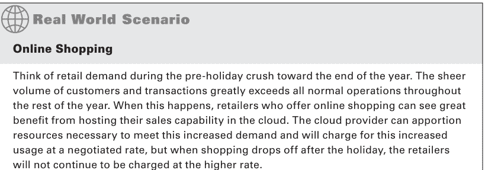
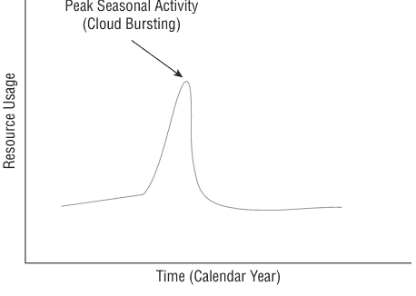
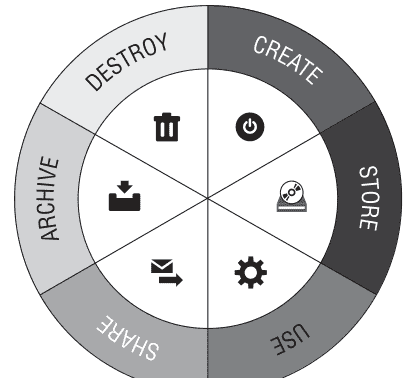
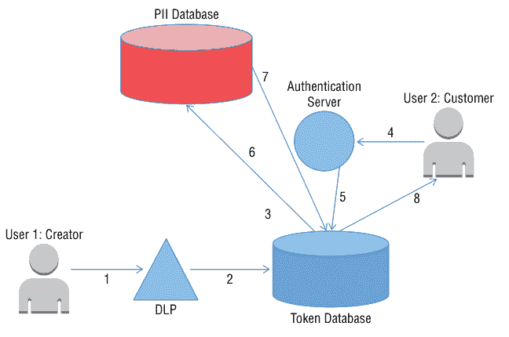
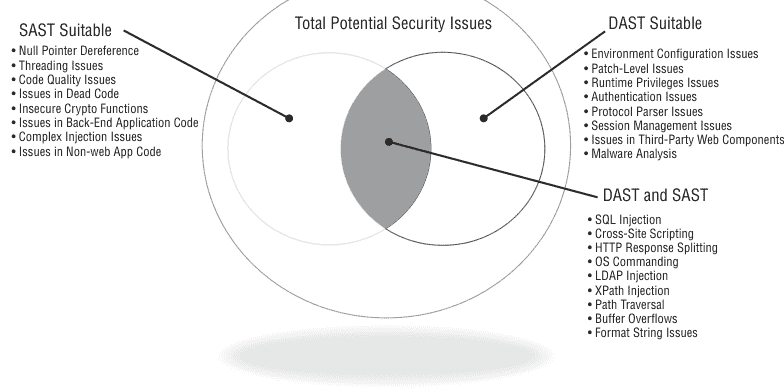
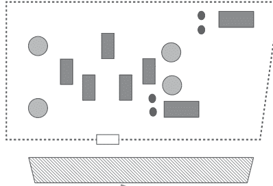
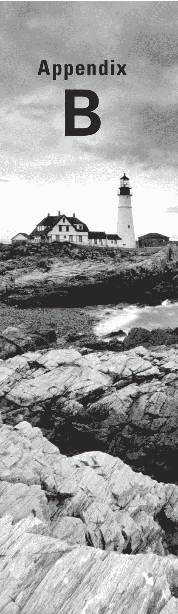

# (ISC)² CCSP 认证云安全专业人员官方学习指南，第2版

## 致谢

作者感谢 (ISC)² 使本作品成为可能，感谢 Sybex 的出版和编辑团队，包括 Jim Martin、Kelly Talbot 和 Christine O'Connor。本书献给所有寻求 CCSP 认证的候选人；希望有所帮助。

## 关于作者

Ben Malisow 拥有 CISSP、CISM、CCSP 和 Security+ 认证，是 (ISC)² CISSP、CCSP 和 SSCP 备考课程讲师。他在信息技术和信息安全领域工作了近 25 年。他为 DARPA 编写内部政策，担任 FBI 最机密情报共享网络的信息系统经理，并帮助开发了国土安全部的 IT 架构。Ben 曾在许多学校和大学授课，包括卡内基梅隆大学和拉斯维加斯内华达学院。他在领域发表广泛，曾为 Security+ 等出版物撰稿并有多本书。您可以在 malisow.com 找到他的博客。

## 目录

### 第 1 章 架构概念

- 云特性
- 业务需求
- 现状
- 量化收益与机会成本
- 预期影响
- 云的演变、术语和模型
- 新技术、新选择
- 云计算服务模型
- 云部署模型
- 云计算的角色与责任
- 云计算的基础概念
- 敏感数据
- 虚拟化
- 加密
- 审计与合规
- 云服务合同
- 相关技术
- 总结
- 考试要点
- 实验
- 复习题

### 第 2 章 设计需求

- 业务需求分析
- 资产清单
- 资产价值
- 关键性确定
- 风险偏好
- 不同云类型的考量
- IaaS 考量
- PaaS 考量
- SaaS 考量
- 通用考量
- 保护敏感数据的设计原则
- 设备加固
- 加密
- 分层防御
- 总结
- 考试要点
- 实验
- 复习题

### 第 3 章 数据分类

- 数据清单与发现
- 数据所有权
- 数据生命周期
- 数据发现方法
- 管辖权要求
- 信息权限管理 (IRM)
- 知识产权保护
- IRM 工具轨迹
- 数据控制
- 数据留存
- 数据审计
- 数据销毁/处置
- 总结
- 考试要点
- 复习题

### 第 4 章 云数据安全

- 云数据生命周期
- 创建
- 存储
- 使用
- 共享
- 归档
- 销毁
- 云存储架构
- 卷存储：文件级存储和块存储
- 对象级存储
- 数据库
- 内容分发网络 (CDN)
- 云数据安全基础策略
- 加密
- 掩码、混淆、匿名化和令牌化
- 安全信息和事件管理
- 出站监控 (DLP)
- 总结
- 考试要点
- 书面实验
- 复习题

### 第 5 章 云端安全

- 共享云平台的风险与责任
- 按部署模型划分云计算风险
    - 私有云
    - 社区云
    - 公有云
    - 混合云
- 按服务模型划分云计算风险
    - 基础设施即服务 (IaaS)
    - 平台即服务 (PaaS)
    - 软件即服务 (SaaS)
- 虚拟化
    - 威胁
    - 应对方法论
    - 灾难恢复 (DR) 与业务连续性 (BC)
    - 云特定的业务影响分析 (BIA) 关注点
    - 客户/提供者共享的 BC/DR 责任
- 总结
- 考试要点
- 书面实验
- 复习题

### 第 6 章 云端责任

- 托管服务的基础
    - 业务需求
    - 业务需求：云提供者的视角
    - 按类型划分的共享责任
        - IaaS
        - PaaS
        - SaaS
- 操作系统、中间件或应用程序的共享管理
    - 操作系统基准配置与管理
    - 共享责任：数据访问
    - 客户直接管理访问
    - 提供者代表客户管理访问
    - 第三方 (CASB) 代表客户管理访问
- 缺乏物理访问
- 审计
- 共享策略
- 共享监控与测试
- 总结
- 考试要点
- 书面实验
- 复习题

### 第 7 章 云应用安全

- 培训与意识
- 常见的云应用部署陷阱
- 云安全软件开发生命周期 (SDLC)
- SDLC 的配置管理
- ISO/IEC 27034-1 安全应用标准
- 开发
- 身份与访问管理 (IAM)
- 身份存储库与目录服务
- 单点登录 (SSO)
- 联邦身份管理
- 联邦标准
- 多因素认证
- 辅助安全组件
- 云应用架构
- 应用程序接口 (API)
- 多租户隔离
- 密码学
- 沙箱化
- 应用程序虚拟化
- 云应用保障与验证
- 威胁建模
- 服务质量
- 软件安全测试
- 许可的 API
- 软件供应链 (API) 管理
- 开源软件安全
- 应用程序编排
- 安全网络环境
- 总结
- 考试要点
- 书面实验
- 复习题

### 第 8 章 运营元素

- 物理/逻辑运营
    - 设施与冗余
    - 虚拟化运营
    - 存储运营
    - 物理与逻辑隔离
    - 应用程序测试方法
    - 安全运营中心 (SOC)
    - 持续监控
    - 事件管理
- 总结
- 考试要点
- 书面实验
- 复习题

### 第 9 章 运营管理

- 监控、容量与维护
    - 监控
    - 维护
- 变更与配置管理 (CM)
    - 基准
    - 偏差与异常
    - 角色与流程
- 发布管理
- IT 服务管理与持续改进
- 业务连续性与灾难恢复 (BC/DR)
    - 重点关注
    - 连续运营
    - BC/DR 计划
    - BC/DR 资源包
    - 迁移
    - 电力
    - 测试
- 总结
- 考试要点
- 书面实验
- 复习题

### 第 10 章 法律与合规 第一部分

- 环境中的法律要求与独特风险
    - 法律概念
    - 美国法律
    - 国际法律
- 全球法律、框架与信息安全管理系统 (ISSMs)
- 法律、框架与标准之间的区别
- 云数据环境
- 电子取证 (eDiscovery)
- 取证要求
- 取证挑战
- 取证流程
- 审计范围
- 审计对象
- 审计报告
- 审计独立性
- 总结
- 考试要点
- 书面实验
- 复习题

### 第 11 章 法律与合规 第二部分

- 法律位置的影响
- 管辖权
- 风险管理
- 云的选择
- 风险框架
- 风险指标
- 风险评估
- 服务等级协议 (SLAs)
- 外包
- 持续教育
- 供应商管理
- 云信任
- STAR
- 总结
- 考试要点
- 书面实验
- 复习题

## 简介

这些领域涵盖了与云安全的所有相关领域。认证中的所有材料均不特定于特定供应商或产品。每个领域还包含了 CCSP 认证专业人士应掌握的主题和子主题列表。

有关领域/知识主题、经验要求、考试程序以及考试领域权重的详细列表，可以在 CCSP 认证考试大纲中找到：`https://www.isc2.org/_media/ISC2/Certifications/Exam-Outlines/CCSP-Exam-Outline.ashx`。

## 报考资格要求

(ISC)² 定义了你成为 CCSP 必须满足的资格和要求：

- 至少具有五年的累积全职信息技术经验，其中三年必须在信息安全领域，且其中有一年必须在 CCSP 考试的六个领域之一中。
- 获得云安全联盟（Cloud Security Alliance）的 CCS 证书可以替代 CCSP 考试六个领域之一一年的经验。
- 获得 CISSP 证书可以替代整个 CCSP 的经验要求。

不符合这些要求的候选人仍可以参加考试并成为 (ISC)² 的助理（Associate）。助理有六年的时间（从通过考试开始）来完成剩余的经验要求。

(ISC)² 的成员还必须遵守 (ISC)² 的正式职业道德准则，可以在 (ISC)² 网站 `www.isc2.org/ethics` 上找到该准则。

## CCSP 考试概述

CCSP 考试通常由 125 道单选题组成，涵盖 CCSP 知识体系（CBK）的六个领域，你必须获得 70% 或以上的分才能通过。

你有三小时来完成考试。其中 25 道题是不计分的，仅用于研究目的。请务必尽力回答每一个问题，因为你不知道哪些问题是计分的哪些是不计分的，而且未回答的题目将得 0 分。作答不会扣分；永远不要留空任何题目，即使你的答案是猜测。

## CCSP 考试题型

CCSP 考试中的大多数题目为单选题格式，有四个选项和一个正确答案。有些题目非常直观，要求你识别一个定义。其他问题将要求你识别合适的概念或最佳实践。以下是一个例子：

> 1. 将敏感操作信息放在远离生产环境的数据库中，以提供更高的保护和隔离，这被称为：
>
> A. 随机化
> B. 弹性
> C. 混淆
> D. 令牌化 (Tokenization)

你必须选择正确或最佳答案。有时答案对你来说是显而易见的，而有时则很难在两个良好的答案之间进行区分并选出最好的。注意通用的、特定的、普遍的、超集和子集的选项。在其他情况下，可能没有一个答案是正确的。在这种情况下，你需要选择最不错误的答案。还有一些基于理论情景的题目，你必须根据特定情况回答问题。

上述问题的正确答案是选项 D，令牌化（tokenization）。在令牌化安排中，敏感信息被放在远离生产环境的数据库中，而令牌（代表敏感信息）存储在生产环境内的数据库中。为了选出正确答案，读者必须理解令牌的工作原理以及如何使用该方法将敏感数据从生产环境中隔离出来；题目中没有提到令牌或令牌化，因此它需要复杂的思考。一个简单的答案是“数据隔离”，但那不是一道简单的题。

除了标准的单选题格式外，(ISC)² 还增加了一种使用拖放方法的新题型。例如，你可能会在屏幕一侧看到一个项目列表，你需要将它们拖放到屏幕另一侧相应的对应项目上。交互式问题可能包括将术语与定义匹配，以及点击图表或图形的特定区域。交互式问题的权重比单选题类型更高，因此在回答这些问题时你应该额外注意。

## 学习与备考建议

我建议为 CCSP 考试计划至少 30 天的密集学习。我整理了一份应该会有帮助的建议：

- 花一或两天仔细阅读每个章节，并完成末尾的复习材料。
- 计划至少 30 天的密集学习。
- 使用模拟考试来熟悉格式。
- 确保在考试当天休息充足。

## 引言

### 本学习指南的要素

本学习指南包含几个核心要素，将帮助你准备 CCSP 考试以及应对之后的现实世界：

- **真实世界场景：** 本书中列出了多个真实世界场景，帮助你通过观察解决方案在现实世界的何时、在什么情况下有效（或无效）以及为什么有效，来进一步吸收这些信息。
- **总结：** 总结是对章节中重要要点的快速概述。
- **考试要点：** 考试要点强调了可能以某种形式出现在考试中的主题。虽然作者并不完全确定某次考试会包含哪些内容，但此部分加强了对于理解 CBK 和 CCSP 考试测试规范至关重要的概念。
- **书面实验：** 每一章都包含书面实验，将章节中提到的各种主题和概念结合在一起。虽然这些内容是为学院/大学课堂教学设计的，但它们可能有助于你在课堂之外对材料的理解和澄清。书面实验的答案位于附录 A。
- **章节复习题：** 每一章都包含练习题，旨在衡量你对章节中讨论的基础概念的掌握情况。完成每个章节后，请回答这些问题：如果你的某些答案错误，说明你需要花更多时间学习相关主题。练习题的答案位于附录 B。

### 额外学习工具包含的内容

除了文中提供的所有信息外，本书还附带了一系列实用的额外在线学习工具。所有在线学习工具均可通过在 `www.wiley.com/sybtestprep` 注册你的书籍来获取。你需要从书籍列表中选择此书，完成所需的注册信息，并回答安全验证以证明拥有书籍。之后，你将通过电子邮件收到一个码。一旦获得代码，请按照邮件中的说明操作或返回 `www.wiley.com/go/systestprep` 使用该代码设置账户并访问。

### Sybex 备考软件

由 Sybex 专家制作的备考软件可以帮助你准备 CCSP 考试。在该系统中，你将找到书中所有的复习和评估题，以及学习工具包含的额外奖励考试题。你可以进行评估测试、按章节自测、参加模拟考试，或参加一个包含所有问题的随机生成的考试。

### PDF 版术语表

Sybex 提供了一个 PDF 格式的强大术语表。这份全面的术语表包含了你在参加 CCSP 认证考试时应理解的关键术语，采用可搜索格式。

### 额外模拟考试

Sybex 包含两份模拟考试；这些题目旨在调查你对 CCSP CBK 核心元素的理解。两份测试长度均为 125 题，与实际认证考试长度相同。考试可以在 `www.wiley.com/go/sybextprep` 获取。

### 评估测试

1. 哪种解决方案允许企业或个人通过存储服务提供商在互联网上存储数据和计算机文件，而不是将数据存在硬盘或磁带备份等物理磁盘上？
    - A. 在线备份
    - B. 云备份解决方案
    - C. 可移动硬盘
    - D. 掩码

2. 使用基础设施即服务 (IaaS) 解决方案时，以下哪项不是客户的核心收益？
    - A. 无需维护许可库的需求
    - B. 按需计费的服务
    - C. 能源和冷却效率
    - D. 所有权转移成本

3. ... 侧重于安全和加密，以防止未经授权的复制并将分发限制仅给付费者。
    - A. 信息权限管理 (IRM)
    - B. 掩码
    - C. 位分割
    - D. 消磁

4. 以下哪项代表了正确的四种云部署模型？
    - A. 公有、私有、联合和社区
    - B. 公有、私有、混合和社区
    - C. 公有、互联网、混合和社区
    - D. 外部、私有、混合和社区

5. 什么是特殊的数学代码，允许加密硬件/软件对消息进行加密并解密？
    - A. PKI
    - B. 密钥
    - C. 公钥-私钥
    - D. 掩码

6. 以下哪项列出了 STRIDE 威胁模型的六个正确部分？
    - A. 伪造、篡改、否认赖、信息泄露、拒绝服务和权限提升
    - B. 伪造、篡改、反驳、信息泄露、拒绝服务和社交工程弹性
    - C. 伪造、篡改、否认赖、信息泄露、分布式拒绝服务和权限提升
    - D. 伪造、篡改、不可否赖、信息泄露、拒绝服务和权限提升

7. 描述特定作者实际创建并向特定接收者发送特定项目，且消息被成功收到的保证术语是什么？
    - A. PKI
    - B. DLP
    - C. 不可否赖
    - D. 位分割

8. 故意破坏用于加密数据的加密密钥的正确术语是什么？
    - A. 糟糕的密钥管理
    - B. PKI
    - C. 混淆
    - D. 加密破碎 (Crypto-shredding)

9. 在联邦环境中，谁是依赖方 (relying party)，他们做什么？
    - A. 依赖方是服务提供商，他们消耗身份提供者生成的令牌。
    - B. 依赖方是服务提供商，他们消耗身份提供者生成的令牌。
    - C. 依赖方是服务提供商，他们消耗身份提供者生成的令牌。
    - D. 依赖方是服务提供商，他们消耗身份提供者生成的令牌。

10. 用唯一符号替换敏感数据的过程是什么？
    - A. 随机化
    - B. 弹性
    - C. 混淆
    - D. 标记化 (Tokenization)

11. 以下哪种存储类型与平台即服务 (PaaS) 相关联？
    - A. 数据库
    - B. 应用
    - C. SaaS
    - D. 原始

12. 用于抽象其运行所在操作系统的软件术语是什么？
    - A. 分区
    - B. 虚拟化
    - C. 分布式
    - D. SaaS

13. 以下哪项代表了为了保护股东免受欺诈行为而颁布美国法律？
    - A. PCI
    - B. 《格姆-莱奇-布莱法案》(GLBA)
    - C. 《萨班斯-奥克斯法案》(SOX)
    - D. HIPAA

14. 以下哪项是安全存储和管理密钥的设备？
    - A. 私钥
    - B. 硬件安全模块 (HSM)
    - C. 公钥
    - D. 可信操作系统 (TOS)

15. 什么是为公众开放使用并由提供者拥有和管理的云类型？
    - A. 私有云
    - B. 公有云


# 评估测试

## 15. 以下哪项描述了公有云？

- A. 社区云
- B. 由第三方提供商向公众提供的云服务
- C. 混合云
- D. 个人云

## 16. 使用数据库透明加密时，加密引擎位于何处？

- A. 数据库内部
- B. 使用数据库的应用程序
- C. 在挂载的卷上
- D. 在密钥管理系统中

## 17. 哪种基于非数值类别或等级评估风险的方法、原则或规则？

- A. 定量评估
- B. 定性评估
- C. 混合评估
- D. SOC 2

## 18. 以下哪项描述了云联盟控制矩阵 (CSA CCM)？

- A. 云服务提供者的一套监管要求
- B. 云服务提供者的软件开发生命周期要求
- C. 一个与主流行业认可的安全标准、法规和控制框架提供映射/交叉关系的安全控制框架
- D. 一种分成不同安全领域的云安全控制清单

## 19. 当双方发生冲突时，以下哪项是决定争议审理辖权的主要手段？

- A. 侵权法
- B. 合同
- C. 普通法
- D. 刑法

## 20. 在选择新的计算机设施时，以下哪是最重要的安全考虑？

- A. 当地执法部门的响应时间
- B. 邻近竞争对手设施
- C. 飞行路线
- D. 公用基础设施

## 21. 在云环境中处置电子记录时，以下哪种方法总是安全的？

- A. 物理破坏
- B. 覆盖
- C. 加密
- D. 消磁

## 22. 以下哪项不代表对网络的攻击？

- A. SYN 洪水
- B. 拒绝服务
- C. Nmap 扫描
- D. 暴力破解

## 23. 下列哪项 BIA 利用了业务影响分析（BIA）中开发的信息？

- A. 计算投资回报率 (ROI)
- B. 风险分析
- C. 计算总拥有成本 (TCO)
- D. 确保资产收购

## 24. 下列哪个术语最能描述一种托管服务模型，即软件应用程序由供应商或云服务提供托管，并通过网络资源向客户提供？

- A. 基础设施即服务 (IaaS)
- B. 公有云
- C. 软件即服务 (SaaS)
- D. 私有云

## 25. 下列哪项是美国制定的一项联邦法律，用于控制金融机构处理个人隐私信息？

- A. PCI
- B. ISO/IEC
- C. 《格姆-莱奇-布莱法案》(GLBA)
- D. 消费者保护法

## 26. 安全套接层 (SSL) 在保护无线应用协议 (WAP) 中的典型功能是保护存在于 ___ 的传输：

- A. 在 WAP 网关和 WAP 终端设备之间
- B. 在 Web 服务器和 WAP 网关之间
- C. 从 Web 服务器到无线终端设备
- D. 在无线设备和基站之间

## 27. 针对服务组织的审计标准是什么？

- A. SOC 1
- B. SSAE 18
- C. GAAP
- D. SOC 2

## 28. 从云服务器托管或云计算提供商处购买托管服务，并将其转售给自己客户的公司是什么？

- A. 云编程员
- B. 云经纪 (Cloud broker)
- C. 云代理
- D. VAR (增值分销商)

## 29. 下列哪项与网格计算具有相似性，因为它依赖于共享计算，而不是使用本地服务器或个人设备来处理应用程序？

- A. 服务器托管
- B. 遗留计算
- C. 云计算
- D. 内网

## 30. 一组旨在分析应用程序源代码和二进制文件，以寻找指示安全漏洞的编码和设计条件的技术是什么？

- A. 动态应用安全测试 (DAST)
- B. 静态应用安全测试 (SAST)
- C. 安全编码
- D. OWASP

# 评估测试答案

## 1
云备份解决方案允许企业使用存储服务在互联网上存储数据和计算机文件，而不是将数据存储在本地硬盘或磁带备份上。这样做的好处是，如果主要业务地点发生某种损坏，由于基础设施或设备损坏而无法访问或恢复数据，则可以访问数据。在线备份和可移动硬盘是其他选择，但默认情况下无法让客户实现无处不在访问。掩码（Masking）是一种用于部分掩盖敏感数据的技术。

## 2
在 `IaaS` 模型中，客户必须维护云环境中使用的操作系统 (`OS`) 和应用程序许可证。在 `PaaS` 模型中，操作系统的加密由提供商管理，但客户负责应用程序许可证；在 `SaaS` 模型中，客户不需要管理许可证库。

## 3
信息权限管理 (`IRM`)，通常称为数字权利管理（`DRM`），旨在侧重于安全和加密，作为防止内容未经授权复制和分发仅给获得授权的人员（通常是购买者）。为了生产环境，对特定字段或数据进行掩码。分割（`Splitting`）是一种跨越多个地理边界隐藏信息的方法，消磁（`Degaussing`）是从磁介质上永久删除数据的方法。

## 4
此题唯一的正确答案是：公有、私有、混合和联合，`Internet` 和 并不是云模型。

## 5
加密密钥仅仅是：用于加密和解密信息的密钥。它是支持硬件或软件加密的数学代码，用于解密或加密信息，并对通信参与双方保机密。`PKI` 是创建和分发数字证书的安排。公/私密钥是对称加密中使用的密钥对的描述（此答案针对该问题；选项 B 较优）。掩码是在特定用户视图中隐藏特定字段或数据，以限制数据在环境中的泄露。

## 6
`STRIDE` 缩写中的字母分别代表身份伪造（`spoofing`）、数据篡改（`tampering`）、声誉（`reputation`）、信息泄露（`information disclosure`）、拒绝服务（`denial of service`）和权限提升（或 `escalation of privilege`）。其他选项仅仅是混淆的或错误的版本。

## 7
非否认性（`Nonrepudiation`）意味着交易的一方不能否认他们参与了该交易。

## 8
加密粉碎（`crypto-shredding`）行为是指破坏用于加密数据的密钥，使得数据极难恢复。

## 9
身份提供者（`identity provider`）维护身份并为已知用户生成令牌。依赖方 (`RP`) 是服务提供商，它消耗令牌。所有其他答案都是错误的。

## 10
用唯一标识符号替换敏感数据称为令牌化（`tokenization`），这是一种通过用唯一标识符号/地址表示敏感数据来隐藏或掩盖敏感数据的方法。虽然随机化（`randomization`）和混淆（`obfuscation`）也是隐藏信息的手段，但它们的实现方式不同。

## 11
`PaaS` 使用数据库和大数据存储类型。

## 12
应用程序虚拟化将软件从其运行的底层操作系统抽象出来。`SaaS` 是一种云服务模型。分区（`partition`）是内存区域，通常位于磁盘上。`Distributed` 是一个修饰语，通常意味着为了共同目标使用多台机器。

## 13
《萨班斯-奥克斯利法案》（`SOX`）是为了应对 20 世纪末期 / 21 世纪初的丑闻而制定的。`SOX` 不仅监督会计实践，还要求其对欺诈/欺骗活动负责。`HIPAA` 是美国关于医疗信息的法律。`PCI` 是信用卡/借记卡的行业标准。`GLBA` 是美国针对银保险行业的法律。

## 14
硬件安全模块 (`HSM`) 是一种安全存储和管理加密密钥的设备。这些可以用于服务器、工作站等。一种常见类型是信任平台模块 (`TPM`)，可以在企业工作站和笔记本电脑上找到。并没有所谓的 `Trusted OS Module`，且公钥/私钥用于非对称加密。

## 15
这是公有云计算的定义。

## 16
在透明加密中，数据库的加密密钥存储在数据库自身的引导记录中。

## 17
定性评估（`qualitative assessment`）是基于非数学类别或级别评估风险的一组方法或规则。基于数学类别或层级的评估称为定量评估（`quantitative assessment`）。没有所谓的混合评估，`SOC 2` 是一份关于控制有效性的审计报告。

## 18
`CCM` 交叉引用可能涉及行业标准、法律和指南。

## 19
双方之间的合同可以建立解决争议的管辖权；这在管辖权上具有优先级（如果合同中未规定，将使用其他方法）。侵权法（`Tort law`）指民事责任诉讼。普通法涉及婚姻，刑法涉及州或联邦刑法。

## 20
在给出的选项中，D 是最重要的。任何数据中心靠近弹性单元（如电力、水和连接）至关重要。

## 21
加密可以在云环境中使用，由于访问和物理隔离因素，物理破坏、覆盖和消磁可能无法实现。

## 22
其他所有选项都代表特定的网络攻击。`Nmap` 是一个相对无害的用于网络映射的扫描工具。虽然它可以作为开发攻击过程的一部分收集有关网络的信息，但它本身并不是攻击工具。

## 23
其他方面，`BIA`（业务影响分析）收集了对风险管理分析和进一步选择安全控制至关重要的估值信息。

## 24
这是软件服务（`SaaS`）模型的定义。公有云和私有云部署模型，以及基础设施服务（`IaaS`）不提供任何类型的应用程序。

## 25
《格姆-利亚-贝利法》（`Gramm-Leach-Bailey Act`）针对美国金融和保险机构，要求它们保护持有者的隐私信息。`PCI` 指的是信用卡处理要求，`ISO/IEC` 是一个标准组织，而《消费者保护法》虽然为保护消费者隐私信息提供了监管，但其范围有限。

## 26
`SSL` 的目的是加密两个端点之间的通信通道。在这个例子中，指的是最终用户和服务器。

## 27
`SOC 1` 和 `SOC 2` 都是基于 `SSAE 18` 标准的报告格式。`SOC 1` 报告财务报告控制措施，而 `SOC 2`（类型 1 和类型 2）报告与安全或隐私相关的控制措施。

## 28
云计算经纪人购买托管服务然后将其转售。

## 29
云计算建立在网格计算的基础上，资源可以池化和共享，而不是由本地设备执行所有的计算和存储功能。

## 30
静态应用安全测试（`SAST`）用于审查源码和二进制文件，以便在代码加载到内存并运行之前检测问题。

# 建议阅读

为了充分准备考试，你除了阅读这本书之外，一定要查看其他资源。至少建议参考以下内容：

- 云安全联盟（Cloud Security Alliance），安全指南 v4.0：
  ```
  https://cloudsecurityalliance.org/research/guidance
  ```

- OWASP 前十名（Top Ten）：
  ```
  https://www.owasp.org/index.php/Category:OWASP_Top_Ten_Project
  ```

> 2017 版本的 OWASP 十大威胁是该本书出版时的最新版本，但不同版本之间的差异并不大，理解任何版本中的概念对于学习都是有。


## NIST SP 800-53
```
https://nvd.nist.gov/800-53
```


> NIST SP 800-53 第 4 版是该本书出版时的最新版本，但预计很快会有新版本。

## NIST SP 800-37
```
https://csrc.nist.gov/publications/detail/sp/800-37/rev-2/final
```

## 可用性学院（Uptime Institute），分级标准：拓扑结构
```
https://uptime-institute.com/resources/asset/tier-standard-topology
```

## 云安全联盟，云控制矩阵（Cloud Controls Matrix）
```
https://cloudsecurityalliance.org/artifacts/cloud-controls-matrix-v1-0/
```

## 云安全联盟共识评估倡议问卷（CAIIQ）
```
https://cloudsecurityalliance.org/artifacts/consensus-assessments-initiative-questionnaire-v3-0-1/
```

## 云安全联盟 STAR 等级和方案要求
```
https://cloudsecurityalliance.org/artifacts/star-level-and-scheme-requirements
```

## CCSP 官方 (ISC)² 模拟题
```
https://www.wiley.com/en-us/CCSP+Official+%28ISC%292+Practice+Tests-p-978111449225
```

# 架构概念

本章的目的是让读者熟悉以下概念：

## 领域 1：云概念、架构与设计

### 1.1 理解云计算概念
- 1.1.1 云计算定义
- 1.1.2 云计算角色
- 1.1.3 云计算的关键特性
- 1.1.4 构块技术

### 1.2 描述云参考架构
- 1.2.1 云计算活动
- 1.2.2 服务能力
- 1.2.3 服务分类
- 1.2.4 部署模型
- 1.2.5 云考量因素
- 1.2.6 相关技术

### 1.4 理解设计原则
- 1.4.1 云计算
- 1.4.2 成本分析
- 1.4.3 安全需求
- 1.4.4 安全

## 领域 4：云应用
- 4.5 身份与访问管理 (IAM)
- 4.7 云访问安全器 (CASB)

## 领域 5：云运营
- 5.1 运营控制
- 5.4 服务管理


## 第1章 ■ 架构概念



## 在线购物

想象年底假日前高峰期间的零售需求。客户和交易的巨大量远超一年中其他时间的所有正常运营水平。当这种情况发生时，提供在线购物的零售商可以从云端托管其销售能力中获得巨大收益。云提供商可以分配满足这些增长需求所需的资源，并按照协商好的率对这些增加的使用收费，但当假期结束后购物量下降时，零售商就不会继续支付高额费用。

## 业务需求

IT 部门不是利润中心；它提供支持功能。对安全部门这样描述更为准确。安全活动实际上会阻碍业务效率（通常情况下，设备或流程越安全，效率就越低）。应该是组织的业务需求驱动安全决策，而不是反过来。

一个成功的组织会尽可能多地收集有关运营业务需求的信息；这些信息可以用于许多用途，包括安全领域的若干功能（我将在贯穿书中提到这一点，但几个例子包括业务连续性/灾难恢复工作、风险管理计划和数据分类）。同样，敏锐的安全专业人员需要尽可能了解组织的各个方面。组织的运营方面可以帮助安全人员执行任务，无论他们被分配到什么种级别或角色。考虑以下示例：

- 网络安全管理员必须根据组织的业务情况预计会有什么类型的流量。
- 入侵检测分析师必须理解组织在做什么、业务活动发生在何时以及在何地（地理位置上），以理解潜在外部攻击的性质和强度，并据此调整基准。
- 安全架构师必须理解组织部门的各种需求，以便在不损害其安全配置的前提下增强其运营。

**功能性需求**：完成业务任务所必需设备、过程或员工的性能方面。例如：外地销售人员必须能够远程连接到组织的网络。

**非功能性需求**：设备、过程或员工对于完成业务任务并非必需但被期望或期待的方面。例如：销售人员的远程连接必须是安全的。

许多组织目前正在考虑将其网络运营迁移到基于云的模式。这不是一个轻率的决定，业务需求必须支持这种转型。云计算还有不同的云服务和交付模型，组织必须决定哪种模型将优化成功。

## 现有状态

对业务流程、资产和需求进行真实的评估和理解至关重要。未能充分捕获需求的全部范围可能会导致迁移到云端后在新环境中缺少某个资产。

在此项工作开始时，意图不是确定什么最能满足业务需求，而是确定这些需求是什么。对资产、过程和需求进行全面盘点是必要的，收集数据有多种方法。通常会联合使用几种方法以减少遗漏的可能。

以下是收集业务需求的一些可能方法：

- 访谈部门经理
- 访谈用户
- 访谈高级管理人员
- 调查客户
- 收集网络流量
- 资产清单
- 收集财务记录
- 收集保险记录
- 收集营销数据
- 收集监管指令

在收集足够的数据后，必须进行详细分析。这是进行业务影响分析 (`BIA`) 的点。

`BIA` 是对组织内每个资产和过程优先级的评估。适当的分析应该考虑每个资产的任何损害或损失对组织整体意味着什么（影响）。在 `BIA` 期间，应特别注意关键点和单点故障。你还需要确定合规成本——即为组织强制要求的法律和合同要求。你组织的监管限制将基于许多变量，你组织运营的管辖区、所属行业、客户的类型和位置等。

## 第1章 ■ 架构概念

资产可以是有形的，也可以是无形的。它们可以包括硬件、软件、知识产权、人员、过程等。有形资产的例子是路由器和服务器，而无形资产通常是你无法触及的东西，例如软件代码、想法的表达和业务方法论。

## 量化收益和机会成本

一旦你对组织在业务领域和流程方面的运作有了清晰的认识，就可以更好地理解组织可能从云迁移中获得的收益，以及与迁移相关的成本。

显然，推动组织向云迁移最清晰的驱动因素是成本节省，这是一个重大且合理的考虑。接下来的几节描述了该考虑的某些方面。

## 资本支出的减少

如果你的组织购买了一个设备供其内部环境使用，那么该设备的容量要么被充分利用（或者更有可能没有被利用）。如果该设备以最大容量使用，那么很可能其所需的功能在某些可能会出现效率低的问题。即使是对该设备的需求的小幅波动也会导致其容量过载。如果设备没有被充分利用，那么组织就为了一个获得价值较低的东西付了钱。未使用的或过剩的容量浪费了。实际上，组织对设备的使用到了危险地接近过载的程度——你不能只购买设备的一部分。

此外，购买设备可以实现税收优惠，这是多年运营积累的，即该设备/资产的折旧。对于付费服务（如云），即运营支出，整个支付金额（按月或按季度）可以作为费用进行纳税。

在云中，组织仅为其使用的部分付费（无论处理负载的设备数量或设备的分部分），且不再多付。这就是之前描述的计费服务方面。因此，组织不会为这些资产支付过费。然而，云提供商有空闲容量可以分配给客户，因此你的组织始终处于可以在没有资本的情况下应对增长需求的地位，且不会被这种描述的快速弹性带来的巨大需求所压垮。


在需求增加期间使用托管云服务的一种方法。我们将其称为“云爆发”（cloud bursting）。组织可能拥有数据中心资产，但它无法处理需求高峰期（危机情况、繁忙的假日购物季等）增加的需求，因此它根据需要从外部云提供商处租赁额外的容量。见图 1.1。

## 图 1.1 快速扩展性允许客户决定资源使用量



因此，通过部署到云环境，组织立即实现了成本（不为未使用的资源付费），并避免了昂贵的风险（需求增加导致服务中断的可能性）。

## 人员成本的减少

对于大多数组织（提供 IT 组织外），管理数据不是核心竞争力，更不用说是盈利业务。数据管理也是一种专业技能，具有 IT 经验和培训的人员相对昂贵。满足内部环境需求的人员对组织来说是一项重大且比例巨大的投资。通过迁移到云，组织可以很大程度上摆脱大部分此类人员。

## 运营成本的减少

维护和管理内部环境需要大量的精力和费用。当组织迁移到云端时，成本变成了服务价格，由云提供商计算。因此，成本包含在合同的固定费用中，不会随着运营的增强（计划内的更新、应急响应活动等）而增加。

## 某些监管成本的转移

某些云提供商可能会为其客户提供全面的针对性的监管合规包。例如，云提供商可能有一套控制措施，可以应用于给定客户的云环境中，以确保满足支付行业数据标准 (`PCI`) 的要求。任何想要该包的客户都可以在中指定。

与其尝试单独列出各项控制措施，不如采用服务合同。通过这种方式，云客户可以减少在尝试构建一个遵循相关法规的控制框架时可能需要付出的精力和费用。

我们将在后面的章节中详细介绍服务水平协议（`SLA`）或服务合同。

然而，这里有一点至关重要（我将在书中反复强调）：根据现行法律，没有任何云客户可以转移与无意或恶意泄露`个人身份信息`（`PII`）相关的风险或责任。理解这一点非常非常重要：如果你的机构持有任何种的 `PII`，那么对该数据的任何泄露或发布负有最终责任，即使你正在使用云服务，且泄露/发布是由于云提供商的疏忽或攻击造成的。在法律和财务上，在法院眼中，你的机构对任何未发布的 `PII` 始终负责。

`PII` 是监管合规的主要组成部分，无论该法规是以法文还是合同义务的形式存在。保护 `PII` 将成为云端安全关注的很大一部分。

## 数据归档/备份服务的成本降低

离备份是长期数据归档和灾难恢复的标准做法。对于这一目的，使用云服务是合理且具有效益的，即使组织没有在云端进行常规业务。然而，将业务迁移到云端可以结合归档/备份的使用产生规模效应；这可以降低组织的整体成本。它还可以增强机构的业务连续性/灾难恢复（`BC/DR`）策略。

## 预期影响

所有这些收益都可以以美元价值列出：每项潜在的节约措施都可以量化。高级管理层——在领域专家的建议下——需要在潜在的财务收益与云端运营风险之间取得平衡。正是这种由安全考虑驱动的业务需求的成本效益计算，将使高级管理层决定组织运营环境的云迁移是否合理。

## 云演变、术语和模型

> 投资回报率（`ROI`）是一个与成本效益措施相关的术语。`ROI` 是描述盈利率的术语。它通常通过净利润除以净资产来计算。
>
> 云迁移也涉及许多风险。我将在全书中详细介绍这些问题。

## 云演变、术语和模型

云及其相关技术的到来提供了许多优势。为了引入云和这些优势，必须理解新的术语以及它们与传统模型术语的关系。这项新技术及其术语是理解云计算服务模型和云部署模型的不可或的一部分。

## 新技术、新选择

十五年前，甚至十年前，建议组织将数据和业务交给一个地理上遥远、且由组织内大多数经理从未见过的人的第三方，这似乎是不可逾越的，特别是从安全的角度来看。这种风险会被认为是令人生畏的，将这种控制权让交给一个供应商也是令人生畏的。今天，技术能力和合同信任的结合使得云计算在财务可行性方面不仅具有吸引力，而且几乎是板定之论。

以下几个特征是云计算的典型代表：

- **弹性**：组织不需要不断购买云设备、服务器、数据存储系统和其他资源并维护其基础设施，而是与云供应商签订合同。提供商使用虚拟化技术灵活地为组织分配每个资源所需的用量，从而在保持可迁移性的同时降低成本。这还允许用户从不同的平台和位置访问其数据，增加了可迁移性、访问性和可用性。
- **简单性**：适当的云实现允许用户无缝地使用服务，而无需频繁与云提供商交互。
- **可扩展性**：通常情况下，在非云环境中增加或减少服务比在云环境中更容易、更快速且更具成本效益。

## 云客户与云用户之间的区别

**云客户**是指任何购买云服务的人（可以是个人或公司），而**云用户**是指使用云服务的人。它可以是云客户所属公司的员工，也可以是私人个体。

例如，A 公司从云提供商 X 处购买 `SaaS` 服务。A 公司是云客户。A 公司的所有员工都是云用户，因为他们正在使用其雇主（云客户）为他们而购买的云服务。

## 云计算服务模型

云服务通常以三种通用模型提供：基础设施即服务（`IaaS`）、平台即服务（`PaaS`）和软件即服务（`SaaS`）。这些模型如图 1.2 所示。

| 云服务模型 | 示例 |
| :--- | :--- |
| `SaaS` | 应用程序、电子邮件 |
| `PaaS` | 操作系统、Windows、Linux、Unix |
| `IaaS` | 硬件、连接、实用 |

一些供应商提供各种标签，例如网络即服务（`NaaS`）、合规即服务（`CaaS`）、数据即服务（`DaaS`）和科学即服务（`SaaS`）。然而，你需要了解的三大主要模型是 `IaaS`、`PaaS` 和 `SaaS`。

## 基础设施即服务 (IaaS)

`IaaS` 是云产品中最基础的，它允许客户在硬件上安装任何软件，包括操作系统。提供商拥有机架、机器和公用设施的数据中心，并管理所有这些内容。然而，所有的逻辑资源（如软件）都由客户负责。

在传统术语中，我们可能会考虑到为了 `BC/DR` 目的而所谓的“热备机房”：物理空间存在，连接性存在，并且可以供客户填充任何数据。对于希望对数据进行更强控制或向云端寻求有限目的（如归档）的组织来说，`IaaS` 可能是最佳选择。在客户支付费用方面，它通常是最便宜的云选项。然而，客户将保留如 IT 人员之类的能力，这可能使得难以确定真实成本。

## 平台即服务 (PaaS)

`PaaS` 包含了 `IaaS` 的所有内容，并增加了操作系统。云供应商通常提供一系列操作系统，以便客户可以使用任何或所有可用选择。供应商将负责根据需要对操作系统进行补丁、管理和更新，客户可以安装他们认为有用的软件。

这种模型对于涉及软件开发的客户特别有用，且不会损坏生产能力，并能确定在各种操作系统平台上运行软件的可行性。

`PaaS` 还包括云数据库引擎和服务，以及“大数据”风格的服务，如数据仓库和数据挖掘。提供商提供了对后端引擎/功能的访问，客户可以创建/安装各种应用程序/API 来访问后端。

## 软件即服务 (SaaS)

`SaaS` 包含了 `IaaS` 和 `PaaS` 的所有内容，并增加了软件程序。云供应商也将负责这些软件的管理、补丁和更新。云端基本上涉及在由提供商托管的全生产环境中上传和处理数据。这对于终端用户来说是完全透明的，他们只能看到自己购买/访问的应用程序。

# 云部署模型

除了从涉及的服务级别来查看云服务产品之外，另一个视角涉及所有权。您需要了解这几类模型的各个方面。

## 公共云

公共云是我们在讨论云服务提供商时通常想到的云。这些资源（硬件、软件、设施和人员）由供应商所有并运营，并出售、租赁或租给任何人（即公众——因此得此名）。公共云是多租户环境；多个客户将共享由供应商所有和运营的底层资源。这意味着公共云中的客户可能正在使用虚拟机，而该虚拟机实际上与该客户直接竞争对手运行的另一台虚拟机位于同一硬件上，且客户无法得知其他实体正在使用相同的资源。

公共云的示例包括 `Rackspace`、微软的 `Azure` 和亚马逊云服务 (`AWS`)。

## 私有云

私有云专供单个客户使用；没有其他客户共享底层资源（硬件，可能还有软件）。因此，私有云不是多租户环境。

私有云可以以多种形式存在。私有云可能由唯一的客户实体拥有并维护。换句话说，一个组织可能拥有并运营一个数据中心，作为该组织用户的云环境。或者，私有云可能是一组资源（机架、刀片、软件软件包），由单个客户拥有，并位于且维护在云提供商的数据中心内；云提供商可能为客户资源提供物理安全、某些基础管理服务和其他实用事业（电力、互联网连接）。这有时被称为托管（`co-lo`）环境。

另一种私有云选项允许客户与云提供商签订合同，使提供商在原本应为公共云的环境内部为该客户提供资源的独占使用。基本上，提供商从整个数据中心切分出一个物理和逻辑区域，使客户不会与任何其他客户共享该区域的任何资源。显然，客户必须为此类服务支付溢价（比多租户环境中的公共云客户支付的费用更多）。

## 社区云

社区云的特征是由具有共同关系的群体拥有或为之运营的基础设施和处理能力；不同的部分可能由个人或不同的组织拥有或控制，但它们以某种方式结合在一起执行共同的任务和功能。

## 云计算的角色与职责

游戏社区可以被认为是社区云。例如，`PlayStation` 网络涉及许多不同的实体共同参与在线游戏：`Sony` 负责网络的身份和访问管理 (`IAM`) 任务，某特定的游戏公司可能拥有一组服务器，运行特定规则的权限管理 (`IRM`) 函数和处理，而个人则在自己的 `PlayStation` 上本地进行一些自己的处理和存储。在此类社区云中，底层技术（硬件、软件等）的所有权分布在社区的各个成员中。

社区云也可能由第三方代表社区的各种成员提供。例如，云提供商可能会提供 `FedRAMP` 云服务，任何数量的联邦机构都可能订阅此类云服务（例如，美国农业部、卫生和人类服务部、内政部等），并且它们将全部使用专门为他们使用的基础设施。任何不是美国联邦机构的客户将不被允许使用此服务，因为非此类实体不属于该特定社区的一部分。云提供商提供底层基础设施，但它是仅为特定社区的使用而配置并提供的。

## 混合云

当然，混合云包含其他模型的元素。例如，一个组织可能希望保留一些私有云资源（例如，他们的遗留生产环境），但同时也租赁一些公共云空间（可能是用于软件开发/测试的 `PaaS` 功能，远离生产环境，从而降低运营系统崩溃的风险）。

## 云计算的角色与职责

各种实体参与了云服务安排：

- **云服务提供商 (`CSP`)**，或 **云提供商 (`Provider`)**：提供云服务的供应商。`CSP` 拥有数据中心，雇佣员工，拥有并管理资源（硬件和软件），监控服务提供和安全性，并为客户及其客户的数据和处理需求提供管理协助。示例包括亚马逊云服务、`Rackspace` 和微软的 `Azure`。
- **云客户**：购买、租赁或租用云服务的组织。
- **云经纪商 (`Cloud Broker`)**：从云提供商处购买托管服务，然后将其转售给其自己的客户的公司。
- **云访问安全代理 (`CASB`)**：向 `CSP` 和云客户提供独立身份和访问管理 (`IAM`) 服务的第三方实体，通常作为中介。这可以各种服务的形式存在，包括单点登录、证书管理和加密密钥托管。
- **监管机构 (`Regulators`)**：确保组织符合其负责的监管框架的实体。这些可以是政府机构、认证机构或合同的一方。法规包括《健康信息可携带性与责任法案》（`HIPAA`）、《格雷姆-莱奇-布莱法案》（`GLBA`）、支付卡行业数据安全标准（`PCI DSS`）、国际标准组织 (`ISO`）、《萨班斯-奥克斯利法案》（`SOX`）等。监管机构包括联邦贸易委员会 (`FTC`)、证券交易委员会 (`SEC`) 以及受委托审查符合合同或声称标准（如 `PCI DSS` 和 `ISO`）情况的审计师，等许多机构。

# 云计算定义

业务云定义是理解后续章节以及应用认证云安全专业人员 (`CCSP`) 安全基础知识的核心，我在这里包含了其中一些定义。

**业务需求 (`Business Requirement`)**：用于决策的运营驱动因素，也是风险管理的输入。

**云应用 (`Cloud App` / `Cloud Application`)**：用于描述通过互联网访问的应用程序的术语；可能包括安装在用户设备上的代理或程序。

**云架构师 (`Cloud Architect`)**：云基础设施和部署的领域专家。

**云备份 (`Cloud Backup`)**：将数据备份到远程云服务器。作为云存储的一种，云备份数据以可访问的形式存储在构成云的分布式中。

**云计算 (`Cloud Computing`)**：使用具有快速弹性、按需服务、广泛网络访问和池化资源能力的计算、存储和网络资源。

**云迁移 (`Cloud Migration`)**：将公司的部分或全部数据、应用程序和服务从本地迁移到云端的过程，这些信息可以按需通过互联网提供。

**云可移植性 (`Cloud Portability`)**：在不涉及遗留或云环境的情况下，在云提供商之间移动应用程序和相关数据的能力。

**效益分析 (`Cost-Benefit Analysis`)**：这是比较业务决策的积极影响（如利润、效率、市场份额等）与潜在的负面影响（费用、生产损害、风险等），并权衡两者是否相等，或者潜在的积极影响是否大于潜在的负面影响。这是一个业务决策，而非安全决策，最好由经理或业务分析师做出。

# 云计算定义

然而，为了做出明智的决策，相关方必须获得足够的洞察和知识。在安全事务方面，`CCSP` 应对对特定风险的管理以及各种方案的优缺点进行评估，以实现这些目标。

**`FIPS 140-2`**：一份 `NIST` 文档，描述了对供美国政府使用的加密系统进行认证的流程。

**托管服务提供商（`Managed Service Provider`）**：一种 IT 服务，由客户规定技术和操作程序，并由外部第三方根据合同执行管理和运营支持。托管服务提供商可能会在组织的业务所在地或云端，为该组织维护和管理数据中心/网络。

**多租户（`Multitenant`）**：多个客户使用同一个公共有云（在虚拟化云环境中，通常还使用同一台主机）。

**`NIST 800-53`**：一份指导性文档，主要目标是确保安全需求和控制适用于所有美国联邦政府管理系统中的所有信息。

**信赖云倡议（`TCI`）参考模型**：`TCI` 参考模型是云服务提供者的指南，允许他们创建一个整体架构（包括数据中心的物理设施、网络逻辑布局以及利用这两者所需的流程），让云客户能够舒适、放心地购买和使用。更多信息，请访问 `https://cloudsecurityalliance.org/wp-content/uploads/2011/08/TCI-Reference-Architecture-v1.pdf`。

**供应商锁定（`Vendor Lock-in`）**：当由于技术或非技术限制，客户可能无法离开、迁移或转移到替代提供商时，就会发生供应商锁定。

**供应商封锁（`Vendor Lock-out`）**：当云服务提供商破产或其他退出市场，导致客户无法恢复或访问自己的数据时，就会发生供应商封锁。

成功的 `CCSP` 候选将熟悉这些术语中的每一个。我将在书中详细介绍有关这些术语的细节。

| 回归基础 | 记住整个行业使用的所有安全基本知识同样重要。例如，熟悉的 CIA 三元组将在 CBK（知识体系）和本书中被提及。 - 机密性（`Confidentiality`）：保护信息免受未经授权的访问/传播 - 完整性（`Integrity`）：确保信息不受未经授权的修改 - 可用性（`Availability`）：确保授权用户在允许时可以访问信息 |

# 云计算的基础概念

云计算的某些方面贯穿于该主题的所有讨论中。我在这里介绍它们，你应该熟悉它们。这些概念将包含在书中的各种讨论中。

# 敏感数据

每个组织都有其自身的风险偏好和对机密性的追求。无论每个云客户如何对其数据的这些方面做出自己的决定，云提供商都必须为客户提供某种方法根据敏感性对数据进行分类，并提供足够的控制以确保这些类别得到相应的保护。

## 虚拟化

虚拟化是使云计算成为财务上可行的业务模式的技术之一。云提供商可以为大量的客户和用户购买并部署足够的主设备，而不会浪费容量或让资源闲置。

在虚拟环境中，云用户可以访问一台合成计算机。对于用户来说，虚拟机（`VM`）和传统计算机之间没有明显区别。然而，从提供者的角度来看，提供给用户的虚拟机只是一个软件，而不是由用户独占操作的实际专用硬件。在云空间中的单台主机上可能运行着几个甚至几十个虚拟机。当用户注销或关机时，云网络会对用户的虚拟机拍摄快照，并作为一个单一文件存储在云的某处，直到下一个用户请求访问，届时虚拟机可以完全按照他们离开时的状态进行恢复。

通过这种方式，云提供商可以向任何数量的客户和用户提供服务，而不需要为每个用户购买新的硬件设备。这种规模经济允许云提供商提供用户从传统网络中相同的相同 IT 服务，但成本更低且服务水平更高。

有许多虚拟化产品供应商，包括 `VMware` 和微软。还有各种实施策略和两种基本的虚拟化类型（Type 1 和 Type 2）。这些将在第 5 章的“虚拟化”节中描述。

## 加密

作为一名 IT 专业人员，你应该已经熟悉加密的基本概念和工具。然而，在云服务方面，加密发挥着增强的作用，并带来了额外的挑战。

# 云计算的基础概念

由于你的云数据将位于由组织之外的人员控制和运行的环境中，加密提供了保证，即没有授权的人无法以有效的方式访问你的数据。你可以在数据到达云端之前对其加密，并在需要时解密。

另一个与云操作相关的担忧是它需要远程访问。对于任何远程访问，始终存在数据拦截、窃听和中间人攻击的风险（无论风险大小）。加密通过在某种程度上减轻这种担忧来协助缓解问题；如果传输中的数据是加密的，即使被拦截，也更难访问。

# 审计与合规

云服务为监管合规和审计提供了特定的能力和机会。

从合规性的角度来看，服务提供商可能为处于特定监管方案下的组织提供整体解决方案。例如，云提供商可能有一套已知的控制集和程序概述，用于创建符合 `PCI`、`HIPAA` 或 `GLBA` 要求的虚拟机。如果尝试保持合规所花费的困难和精力可以转移给提供商，这对于潜在客户将极具吸引力。

相反，审计变得困难。云提供商非常不愿意允许访问其设施或共享网络拓图和控制列表；维护这些机密性增强了提供者的整体安全性。然而，这些是审计的要素要素。此外，正如你将在后续章节中看到的，很难确定组织数据在云环境中的准确位置（物理和逻辑上），或者哪些设备包含客户的数据，这使得审计更加困难。审计需要云提供者的配合，而提供者早已拒绝了该目的所需的访问权限。相反，云提供商通常提供其自身审计成功的声明（服务组织控制 (`SOC`) 类型 3 报告），考虑云迁移的组织应当与监管机构协商，以确定迁移是否可以实现和/或是否需要额外手段来保护监管数据。

# 云服务提供商合同


# 云提供商与云客户之间的业务安排

云提供商与云客户之间的业务安排通常以合同的形式出现，其中包含服务水平协议（`SLA`）。合同将列出所有条款：每个方负责什么、服务将以什么形式呈现、如何解决问题等。`SLA` 将为这些服务及其特定时间范围内的提供设定特定的、量化的目标。

例如，合同必须规定“提供商将持续、不中断地访问客户的数据存储资源”。随后 `SLA` 将明确定义“持续、不间断访问”的指标含义：

- 每个日历月内与数据存储的连接中断不会超过三（3）秒。

合同还将规定当云提供商未能满足特定期间的服务水平协议（`SLA`）时的惩罚措施（通常是财务费用）：“如果提供商在任何日历月内未能达到任何服务水平，将免除客户该月份的月费。”

这些显然是粗略的例子，但它们展示了合同、`SLA`、云提供商与云客户之间的关系。本书将根据此处解释的关系，不断引用合同和 `SLA`。

# 第一章 ■ 架构概念

## 相关及新兴技术

值得提一下的是一些新兴和相关的技术。这些技术在 `(ISC)²` 考试大纲中被明确列出，因此是 `CCSP` 候选人关注的重点。

- **机器学习与人工智能 (`AI`)**：机器学习和人工智能均指机器和生物能够学习、处理、关联和解释信息的能力，并将其应用于各种能力中，而无需用户或程序员的直接输入。各种信息技术 (`IT`) 和云产品及服务都声称具有机器学习或 `AI` 能力。这些包括防火墙、入侵检测/防御系统 (`IDSs/IPSs`)、防病毒解决方案等。

- **区块链**：区块链是使用加密技术和算法传递价值的一种方法。它通常被称为“加密货币”。它本质上是一个交易账本，所有参与者都可以查看每笔交易，使得交易的完整性极难以否定。区块链可以被视为云技术，因为每条记录（“区块”）都分布在所有参与者之间，无论位置、设备类型、司法管辖区如何，都以分布式或基于云的方式存在。

- **物联网 (`IoT`)**：它有时就像现在每个可能的产品都包含了互联网连接：家用电器、摄像头、玩具、车辆等。这些统称为物联网 (`IoT`)。这些设备的分布式特性（以及它们与网络的连接）赋予了它们某些云的特征。`IoT` 最主要的安全方面是，没有适当安全的设备可能会被劫持并用于攻击。

- **容器**：这指的是设备中内存空间的逻辑分割，创建出两个或多个无法直接交互的抽象区域。这在自备设备 (`BYOD`) 环境中很常见，员工使用个人设备工作。容器区分了两个分区——一个用于工作功能/数据，另一个用于个人功能/数据。这为雇主/数据所有者提供了额外保障，确保数据不会意外或偶然丢失或被盗。

- **量子计算**：这是一种新兴技术，允许 `IT` 系统在二进制数学之外运行。量子计算不是使用电子的存在进行计算（电子处于两种状态之一：存在或不存在），而是可能使用亚原子特性（电子自旋、味色等）来以指数级更大的规模提供计算。这极大地加速了机器执行计算/操作的能力。此类系统已开始出现在理论阶段之外，尽管在写作时尚无商用。

- **同态加密**：加密是一种理论现象，允许在不需要解密的情况下处理加密材料。如果实现，允许客户将加密数据上传到云端并利用这些数据，而无需与云提供商共享密钥，或无需将解密作为过程的一部分。这将使得具有高价值敏感数据的客户对云环境的使用更具吸引力。

## 考试要点 19

- 理解业务需求。始终记住，所有管理决策都是由业务驱动的，包括安全和风险决策。在做出这些决策之前应考虑安全和风险，但它们可能不会优先于组织的业务和运营需求。
- 理解云术语和定义。确保你对本章介绍的定义有清晰的理解。`CCSP` 考试的很大重点是术语和定义。
- 能够描述云服务模型。理解三种云服务模型——`IaaS`、`PaaS` 和 `SaaS` 之间的差异以及与每个模型相关的不同特征至关重要。
- 理解云部署模型。理解四种云部署模型——公有云、私有云、社区云和混合云的特征及其差异对你来说同样重要。
- 熟悉云计算角色及相关职责。确保你了解并理解每个不同角色及其职责。我们将在随后的章节中更详细地探讨角色。

## 书面实验

你可以在附录 A 中找到书面实验的答案。

1. 进入 `CSA` 网站并下载《云计算关键关注领域安全指南》，网址为 `https://cloudsecurityalliance.org/artifacts/security-guidance-v4/`。完成后，花些时间探索该网站。自行审阅文档。
2. 写下三个你想到的可能作为考虑云迁移的合法业务驱动因素。
3. 列出三种云计算服务模型各自的优缺点。

## 复习题

你可以在附录 B 中找到复习题的答案。

1. 下哪个不是常见的云服务模型？
   - A. 软件服务 (`SaaS`)
   - B. 编程服务 (`PaaS`)
   - C. 基础设施服务 (`IaaS`)
   - D. 平台服务 (`PaaS`)

2. 以下技术使云服务可行，除了
   - A. 虚拟化
   - B. 宽带可用
   - C. 加密连接
   - D. 智能枢纽

3. 云供应商根据特定的指标遵守合同
   - A. 服务水平协议 (`SLAs`)
   - B. 法规
   - C. 法律
   - D. 纪律

4. 驱动安全决策。
   - A. 客户服务响应
   - B. 调查
   - C. 业务需求
   - D. 公意

5. 如果云客户无法访问提供商，这将影响 `CIA` 三元的哪部分？
   - A. 完整性
   - B. 身份验证
   - C. 机密性
   - D. 可用性

6. 云访问安全代理 (`CASBs`) 可能提供以下服务，除了
   - A. 单点登录
   - B. 业务连续性/灾难恢复/业务连续 (`BC/DR/COOP`)
   - C. 身份访问管理 (`IAM`)
   - D. 密钥托管

7. 加密用于云计算的各个方面，包括以下
   - A. 存储
   - B. 远程访问
   - C. 安全会话
   - D. 磁卡

8. 组织可能考虑云迁移的原因除了
   - A. 减少人员成本
   - B. 消除风险
   - C. 减少运营费用
   - D. 提高效率

9. 云计算的通用定义包括以下特征，除了
   - A. 按需自服务
   - B. 取消对备份的需求
   - C. 资源池
   - D. 测量服务

10. 一位玩家是 `PlayStation Network` 社区云的一部分。谁拥有玩家手中的 `PlayStation` 主机？
    - A. Sony
    - B. 整个社区
    - C. 玩家正在玩的游戏的公司
    - D. 玩家

11. 云提供商可能破产导致云客户无法恢复数据的风险被称为 __________
    - A. 供应商关闭
    - B. 供应商锁出
    - C. 供应商锁定
    - D. 供应商路由

12. 以下都是云计算的特征，除了
    - A. 广域网络
    - B. 反向充电配置
    - C. 快速扩展
    - D. 按需自服务

13. 当云客户向云提供商上传个人身份信息 (`PII`) 时，谁对这些 `PII` 的安全负有最终责任？
    - A. 云提供商
    - B. 监管机构
    - C. 云客户
    - D. `PII` 的主体（个人个人）

14. 我们使用以下哪项内容来确定组织的关键路径、流程和资产？
    - A. 业务需求
    - B. 业务影响分析 (`BIA`)
    - C. 风险管理框架 (`RMF`)
    - D. 机密性、完整性、可用性 (`CIA`) 三要素

15. 如果一个组织拥有仅供该组织成员使用的云数据中心的所有硬件和基础设施，这属于哪种云模型？
    - A. 私有 (`Private`)
    - B. 公有 (`Public`)
    - C. 混合 (`Hybrid`)
    - D. 动机 (`Motive`)

16. 特点是由云提供商所有，并向任何想要订阅的人提供服务的云部署模型被称为________________。
    - A. 私有 (`Private`)
    - B. 公有 (`Public`)
    - C. 混合 (`Hybrid`)
    - D. 延迟 (`Latent`)

17. 特点是在关联小组之间共同拥有资产的云部署模型被称为________________
    - A. 私有 (`Private`)
    - B. 公有 (`Public`)
    - C. 混合 (`Hybrid`)
    - D. 社区 (`Community`)

18. 如果云客户为了进行软件开发和测试而确保了一个安全、隔离的环境，哪种云服务模型可能是最好的？
    - A. `IaaS`
    - B. `PaaS`
    - C. `SaaS`
    - D. 混合 (`Hybrid`)

19. 如果云客户想要一个几乎不需要维护或管理的完全功能运行环境，哪种云服务模型可能是最好的？
    - A. `IaaS`
    - B. `PaaS`
    - C. `SaaS`
    - D. 混合 (`Hybrid`)

20. 如果云客户想要一个基础环境，以便出于业务连续性/灾难恢复 (`BC/DR`) 的目的复制其自身的企业，哪种云服务模型可能是最好的？
    - A. `IaaS`
    - B. `PaaS`
    - C. `SaaS`
    - D. 混合 (`Hybrid`)

# 设计要求

本章的目的是让读者熟悉以下概念：

- 领域 1：云概念、架构与设计
  - 1.4. 理解安全云计算的设计原则
  - 1.4.5. 不同云类别的安全考量
- 领域 3：云平台与基础设施安全
  - 3.3. 分析与云基础设施相关的风险
    - 3.3.1. 风险评估与分析
  - 3.5. 计划灾难恢复 (`DR`) 和业务连续性 (`BC`)
    - 3.5.1. 与云环境相关的风险
    - 3.5.2. 业务需求


我在第一章“架构概念”中提到资产清单和 `BIA`。值得重复的是：安全决策是由业务需求驱动的。这既不是云环境特有的。在本章中，我们将讨论做出这些安全决策的许多输入，以及我们为确定需求而采取的业务活动。

# 业务需求分析

安全不是静态的；我们需要信息以便以适当且高效的方式进行安全活动。为了决定如何处理组织内部的风险，我们需要了解某些事情。其中包括：

- 所有资产的清单
- 每项资产的估值
- 关键路径、流程和资产的确定
- 对风险偏好的清晰理解

## 资产清单

为了保护我们的资产，我们首先必须知道它们是什么。组织拥有或控制的一切都可以被视为资产，资产有多种形式。有形资产可以是实物物品，例如 `IT` 硬件、建筑和车辆。无形资产可以是非实性的，例如知识产权、声誉和合作伙伴。人员也可以被视为资产，例如技能和培训。

## 资产估值

在确定资产的机密性、完整性和可用性时，我们需要知道资产的价值、位置和类型。为了确定资产的可用性，如果云客户想要一个基础环境，以便出于业务连续性/灾难恢复 (`BC/DR`) 的目的复制其自身的企业，我们需要知道该环境对资产的价值。


业务影响分析 (`BIA`) 是通过确定资产丢失后对业务的影响来执行的。通常，`BIA` 人员负责保护其数据。


## 关键性的确定

一旦清单和估值完成，`BIA` 将继续由高级管理层确定关键性。关键性是指组织在没有无法运行或存在的方面。这些可能包括有形资产、无形资产、特定的业务流程甚至是人员。

### 真实世界场景：关键性

以下是关键性的示例：

- **有形资产**：组织是一家租车公司；汽车对其运营至关重要——如果没有车可租，就无法经营。
- **无形资产**：组织是一家音乐制作公司；音乐是公司的知识产权——如果音乐所有权遭到损害（例如，音乐文件的加密被移除导致音乐被复制），公司将失去价值且无法生存。
- **流程**：组织是一家以速度闻名的快餐店；点餐、准备食物和支付的流程对其运营至关重要——如果由于某些原因无法完成流程（例如，收银机故障导致无法收款），餐厅将无法运作。
- **数据路径**：组织是一家国际运输公司；订单与运商对其运营至关重要。如果公司无法完成物流协调——将货物分配给能力足够的运商——将无法提供服务且无法生存。
- **人员**：组织是一家医疗机构；医生对公司的存在至关重要——如果医生无法手术，公司就没有了。

高级管理层具有做出关键性决定的正确视角。然而，安全专业人员应该对组织的整体使命和功能尽良好的，以便更好地服务并就保护组织关键元素提供建议。

数据所有者还负责对这些数据进行分类。我们将在第三章中讨论数据分类。

## 业务需求分析（续）

- 对人员进行交叉培训，使其能够胜多种角色
- 持续且彻底地备份数据，并确保能够快速方便地恢复
- `IT` 资产的负载共享/均衡

在云环境中，客户应该预期服务提供商在其设施和架构内部没有单点故障（`SPOF`）；迁移到云的优势在于，云提供商能够提供稳健且具有韧性的服务，这种服务不会因单点故障而失效。因此，客户可以专注于减少其自身运营侧的任何单点故障：即评估和使用云端数据。需要注意的是，并非所有单点故障都是关键资产的一部分，组织并非所有关键资产都包含单点故障。

## 定性与定量风险评估

评估风险的两种不同方法是定性风险评估和定量风险评估。这两种方法通常都使用一组方法、原则或规则来评估风险。定性风险评估使用本质上是相对的非数值类别，如高、中、低。定量评估则使用特定的数值，如 1、2 和 3。

## 风险偏好

再次，这并不是一个新概念，云服务也没有显著改变这一点。之所以在这里提到，是因为该概念对安全整体实践非常重要，并且被包含在 `CCSP` 共同知识体系（`CBK`）中。

风险偏好是组织认为可以接受的风险水平和类型。这根据无数内外部因素因组织而异，并可能随时间变化。

### 风险基础简要回顾

- 风险是影响实现的可能性。
- 风险可以降低，但永远无法消除。
- 组织接受允许运营成功持续的风险水平。
- 接受高于常常或高于竞争对手的风险是合法且可辩护的，但涉及健康和人体安全的风险除外；这些风险必须按照组织所属的行业标准或监管计划进行处理。

### 现实世界场景：健康与人体安全风险

组织不能接受超出行业标准和已知最佳实践的健康与人体安全风险：这样做是不符合伦理的，还会使组织面临巨大的法律责任（这会产生自身的风险，也必须予以考虑）。这一规则有少数例外；也许军事就是一个例子，在军事中生命和肢体的损失是行动的预期结果，也是可以接受的风险。

然而，个人可以代表自己接受风险。例如，在过去的 100 年里，商业捕鱼一直是美国死亡率最高的职业之一（按死亡工时计算），并不缺少愿意从事这一行业的人。对于个人劳动者来说，风险水平是已知的也是可接受的。然而，从组织的角度来看，致命事故发生的较高可能性并不消除确保遵循最佳实践（例如救生衣、系绳等）的必要性，也不会消除所有责任。

组织处理风险有四种主要方式：

- **规避**：这并不是一种处理风险的方法；它意味着避免某个业务机会，因为风险太高，无法通过适当的控制机制补偿——这种风险超过了组织的偏好。
- **接受**：规避的反面；风险处于组织的风险偏好范围内，因此组织继续运营，而不对该风险投入任何额外努力。
- **转移**：组织付钱让他人承担风险，其成本低于风险发生可能导致的潜在影响；这通常采取保险的形式。这种风险通常与发生概率低但一旦发生影响巨大的事情有关。
- **缓解**：组织采取措施降低风险发生的概率或影响（通常是两者兼顾）；这可以采取控制/对策的形式，通常是安全从业人员参与的领域。

风险涉及每项活动。我们可以管理风险、减轻风险、甚至将其最小化，但运营中始终存在风险因素。当我们选择通过应用对策来缓解风险时，剩余的风险被称为*剩余风险*（`residual risk`）。安全计划的任务是减少剩余风险，直到其落入组织偏好的可接受风险水平内。

组织的风险偏好由高层管理制定，是组织内所有风险管理活动的指南。安全从业人员必须彻底理解组织的风险偏好，以便正确、高效地履行其职责。


一旦确定了业务需求并完成了业务影响分析（BIA），获取了这些信息就应该被复用在组织许多与安全相关的事务中。例如，BIA 的结果可以用于风险评估、整个环境中特定安全控制措施的选择，以及业务连续性/灾难恢复（BC/DR）计划；了解组织的关键方面和所有资产的价值对于完成这些任务至关重要。

## 不同云类别的安全考量

在传统（非云）环境中，我们对组织的 IT 边界有明确的定义：边界内的一切都属于组织，包括数据、硬件和风险；边界外的一切都属于他人。我们可以指向一个特定的位置，离开设施或校园的某根线缆，并知道那里就是我们控制结束、他人控制开始的地方。我们在内部环境与外部因素之间的接口处加固防御，建立非军事区（DMZ）。

这在云计算中并非如此。在云的模式下，我们的数据存储在他人拥有的 IT 环境内部，运行在不属于我们且很大程度上不受我们控制的硬件基础设施之上。我们用户运行的程序和机器对其访问和知识有限。因此，很难确切知道边界在哪里。

> 这种考量在云计算中并不容易实现。在云的模式下，我们的数据存储在他人拥有的 IT 环境内部，运行在不属于我们且很大程度上不受我们控制的硬件基础设施之上。我们用户运行的程序和机器对其访问和知识有限。因此，很难确切知道边界在哪里。

> 这种考量并非如此。

我们在内部环境与外部因素之间的接口处加固防御，建立非军事区（DMZ）。

> 这种考量在云计算中并不如此。根据大多数管辖区的隐私法律和法规，云客户仍承担法律责任。

### IaaS 考量

基础设施即服务（IaaS）是云客户拥有最多责任的云模型。提供商负责数据中心的建筑、土地、连接和电力、硬件。然而，客户负责操作系统及以上的一切；所有软件由客户安装和管理，客户将提供并管理数据。

在安全方面，客户仍然失去了在传统环境中拥有的权限。例如，客户无法选择云中使用的 IT 资产，因此获取过程（涉及许多新供应商）的安全必须委托给云提供商。这影响了安全策略和监管合规。迁移到云的组织将面临这些新限制，并必须找到某种方法向监管机构提供所需的交付物。这必须在迁移初进行谈判，并尽早与监管机构进行沟通。例如，如果监管机构坚持对处理数据的环境进行定期审计，这些审计将如何进行？

对于平台即服务（PaaS），云客户失去了更多对环境的控制，因为云提供商现在负责安装、维护和管理操作系统以及底层硬件。这将涉及客户安全策略的修改，以及确保监管合规的额外努力。

然而，云客户仍然可以监控和审查软件事件，因为运行在操作系统上的程序属于客户。软件的更新和维护责任也是客户的。但是，操作系统的更新和管理现在归提供商所有，这导致客户在运营和安全方面失去了控制，但也可能代表成本的节省和效率的提高。

### SaaS 考量

对于软件即服务（SaaS），当然，环境的大部分控制权都让给了提供商。云客户将不再拥有硬件或软件或后者的管理；客户仅向系统提供数据并在系统内处理数据。

从所有相关方面来说，云客户作为一个组织，已经承担了与普通用户在遗留环境中应承担的角色和责任：极少的管理权限、极少的特权账户，以及非常少的权限和责任。

客户对所有与数据保护相关的所有法律和合同义务仍负责任，但在这种情况下，他们对数据如何被保护几乎没有控制权。云提供商现在全权负责所有的系统维护、所有的安全防护措施，以及影响数据的绝大部分策略（以及策略的实施）。

## 通用考量

在所有模型中，客户都放弃了一种基本的控制形式：对存储数据的设备的物理访问权限。这是一种巨大且增加的风险，并会导致保证的丧失；任何能够物理访问数据所在位置的人，无论是否有许可，最终都可以获取数据。

我们是否可以实施某些措施来减少因这种风险导致泄露的概率？当然可以——而且我们必须这样做，以证明尽职调查。此类措施包括确保云提供商对所有访问数据中心的人员进行严格的背景审查和持续监控，在数据中心位置采取极端的物理安全措施，对在云中处理和存储的数据进行加密，向提供商分配合同责任（但请记住法律责任仍由客户承担），等等。然而，重要的是记住，即使使用了控制措施或其他风险降低方法，失去物理访问权限的剩余风险始终存在。下一节将进一步讨论这些内容。

值得注意的是，行业内并没有无处存在的定义的指令或统一的解决方案；每个提供商都是不同的，每份合同也都是不同的，因此每组权利和责任将根据客户和提供商的谈判情况而异。

# 敏感数据保护的设计原则

以下章节回顾了某些安全架构方法。请记住，这并不是详尽列表，单凭这些技术不足以保护组织和数据，但它们可以作为 IT 基础设施控制的指南。

## 设备加固

在传统的 IT 环境中，DMZ（内部网络面向外部并与外部世界连接的虚拟区域）中的设备在实践中是经过安全保护的；我们知道并理解这些箱子更容易受到入侵尝试，并据此对它们进行加固。

对于云环境，无论从云提供商的一方还是作为云用户，遵循相同的实践都是最好的。可能将云环境中的所有资源都视为位于 DMZ 中并据此进行加固是最好的。在将所有与云相关的设备视为位于 DMZ 时，我们正在养成良好的习惯和看待云的建设性方式。

云提供商应确保数据中心内的所有设备都经过安全处理，满足以下条件：

- 所有访客账户均已删除。
- 所有未使用的端口均已关闭。
- 不留有默认密码。
- 执行了强密码策略。
- 任何管理员账户都经过了深度加固并记录。
- 禁用了所有不必要的服务。
- 物理访问受到严格限制和控制。
- 根据供应商指南和行业实践对系统进行补丁、维护和更新。

这些概念对于安全从业人员来说并不陌生，但它们在云模式中仍然具有重要价值。

云客户有一份相似但又不同的任务列表。客户必须记住与他们如何访问云相关的任务，这些任务通常采取“自带自用设备”（BYOD）环境的形式，并且始终涉及远程访问。BYOD 在当前云计算普及之前就已经存在了，其中许多已知的安全实践可以在我们目前的模型中产生良好的效果。例如，云客户应确保其 BYOD 基础设施中所有访问云的资产都：

- 使用某种形式的反恶意病毒/安全软件进行保护；
- 在发生丢失/被盗时具有远程/远程锁定能力，由用户通过签署的授权策略授予组织擦除权限；
- 利用某种形式的本地加密；
- 在多因素配置中通过强访问控制（密码，或可能是生物识别）进行安全保护；
- 拥有并正确使用 VPN 解决方案进行云访问；
- 安装了某种数据丢失、泄露防护和保护（DLP）解决方案。

组织可能还想为个人拥有的用户设备考虑容器化软件选项，以将其个人数据与组织信息隔离开。

# 敏感数据保护的设计原则

不仅是物理设备需要加固——我们必须像考虑其物理对应物一样考虑虚拟设备。由于云计算高度地依赖虚拟化来实现负载均衡和扩展性，重要的是记住，虚拟实例在处理时（无法被其他实例/服务器检测）以及存储时（作为文件，因为它们包含了许多攻击者想要获取的内容且它们具有便携性）都需要强力保护。在配置方面，它们也必须以我们安全物理机相同的方式进行加固。

## 加密

我已经提到过加密了，你可以预计在书中看到更多引用；通过加密的各种用途击败现代安全实践是不可能的。这在云中是如此，在传统的 IT 环境中也是。

我们将在第 4 章介绍云数据安全以及相关的加密机制。出于本文讨论（基本云设计需求）的目的，加密应如下所示使用：

- 在数据中心内用于：
  - 静态数据，包括长期存储/归档/备份，保护短期存储的文件（如虚拟化实例的快照），防止授权人员的未经授权访问；
  - 安全清理（加密擦除）
- 在云提供商和用户之间的通信中用于：
  - 创建安全会话
  - 确保数据的完整性和机密性

最终，我们希望能够在加密状态并在云中处理数据，而不会暴露给授权用户以外的人。这种能力目前尚不可用，但研究显示了前景。这种技术被称为`同态加密`，了解这一术语并理解其可能性。

## 分层防御

这不是另一个新概念，但它是一个延续到云的概念。它也被称为深度防御，是指使用各种方法重重保护环境。这些应该包括管理、逻辑、技术和物理控制的结合。从云提供者的角度来看，分层防御应包括：

- 涉及背景审查和持续监控的强人员控制
- 技术控制，如加密、事件日志访问控制
- 与整个校园、各种设施、数据中心内产生和存储数据的区域、机架以及进出校园的介质相关的物理控制
- 治理机制和执行，例如强策略

从云客户的角度来看，类似的努力应包括：

- 对安全主题有良好覆盖的用户培训计划
- 合同执行的要求
- BYOD 资产的加密和隔离机制
- 强远程访问控制，可能包括多因素身份验证

在考虑安全架构和设计时，参考现有指南通常会有帮助；当已有许多出版物和工具时，没有理由重新发现和发明安全的每个方面。你可能会发现：

- 云安全联盟云控制矩阵 (`https://cloudsecurityalliance.org/group/cloud-controls-matrix/`)
- 国家标准技术研究院 (NIST) 的风险管理框架 (SP 800-37) (`http://nvpubs.nist.gov/nistppubs/SpecialPublications/NIST.SP.800-37r1.pdf`)
- ISACA 的 COBIT

# 总结

在本章中，我们深入讨论了组织如何确定其业务需求和关键路径，以及信息在安全方面的用途。我们还涵盖了各种云服务的逻辑边界，以及从客户和提供者角度来看相关的权利和责任。此外，我们还涉及了保护敏感数据的基本云架构和设计概念。在接下来的章节中，我们将更详细地讨论这一主题。

# 考试要点

了解如何确定业务需求。理解业务影响分析（BIA）的功能和目的，以及它如何帮助组织确定组织资产的清单、价值和关键性。

熟悉各种云服务模型的边界。了解在每种模型中，哪方负责特定的控制措施。意识到对于所有模型，在有关云服务提供商和云客户的责任与权利的合同定义方面，都有很大的协商空间。

理解云架构和设计如何支持敏感数据安全。熟悉设备加固、加密和深度防御如何增强云端数据的保护。了解在何处可以找到安全云设计的框架、模型和指南。

## 书面实验

你可以在附录 A 中找到书面实验的答案。

- 1. 在 `https://www.fema.gov/media-library/assets/documents/89526` 下载 FEMA 的业务影响分析工作表。
- 2. 在你的组织内选择一个部门/功能用于本次练习；可以是你想要的任何内容，无论是否与 IT 供应或云计算计算联。
- 3. 选择一个假设的风险/威胁用于练习；这可能是一个自然灾害，也可能是恶意行为者的攻击，或你喜欢的任何其他。
- 4. 使用业务功能和风险/威胁填写表单，尽可能准确、地使用信息。

# 复习题

你可以在附录 B 中找到复习题的答案。

- 1. 收集业务需求可以帮助组织确定组织资产的以下方面，除外：
  - A. 完整清单
  - B. 用处
  - C. 价值
  - D. 关键性

- 2. BIA 可提供以下所有元素的信息，除外：
  - A. 风险分析
  - B. 安全获取
  - C. 业务连续/灾难恢复（BC/DR）计划
  - D. 安全控制的选择

- 3. 哪种云服务模型要求客户维护操作系统（OS）？
  - A. CaaS
  - B. SaaS
  - C. PaaS
  - D. IaaS

- 4. 哪种云服务模型要求客户仅维护和更新应用程序？
  - A. CaaS
  - B. SaaS
  - C. PaaS
  - D. IaaS

- 5. 哪种云服务模型客户仅负责数据？
  - A. CaaS
  - B. SaaS
  - C. PaaS
  - D. IaaS

- 6. 云客户和提供商就云服务的各项和数据协商各自的责任和权利。最终的协议在何处编码？
  - A. RMF
  - B. 合同（Contract）
  - C. 备忘录（MOU）
  - D. BIA

- 7. 在尝试提供分层防御时，安全从业人员应该说服高层管理包含什么类型的安全控制？
  - A. 技术性的
  - B. 物理性的
  - C. 行政性的
  - D. 以上所有

- 8. 以下哪项被认为是行政控制？
  - A. 访问控制流程
  - B. 击键日志记录
  - C. 门锁
  - D. 生物识别认证

- 9. 以下哪项被认为是技术控制？
  - A. 防火墙软件
  - B. 防火保险箱
  - C. 火火器
  - D. 解雇人员

- 10. 以下哪项是物理控制的最佳示例？
  - A. 地毯
  - B. 天花板
  - C. 门
  - D. 栅栏

- 11. 在云环境中，加密应用于以下所有，除外：
  - A. 数据的长期存储
  - B. 虚拟化镜像的短期存储
  - C. 安全会话/VPN
  - D. 配置文件格式化

- 12. 设备加固过程应包含以下所有，除外：
  - A. 改进默认账户
  - B. 关闭未使用的端口
  - C. 删除不必要的服务
  - D. 严格控制管理员访问

- 13. 设备加固过程应该包含以下哪些？
  - A. 加密操作系统（OS）
  - B. 更新并补丁系统
  - C. 使用摄像头
  - D. 进行彻底的人员背景检查

- 14. 旨在可能在不解密的情况下处理加密数据的实验性技术是什么？
  - A. 同态（Homomorphic）
  - B. 多重实例化（Polyinstantiation）
  - C. 量子态（Quantum-state）
  - D. 烹饪（Gastronomic）

- 15. 组织的风险偏好由以下哪项决定？
  - A. 隔离评估
  - B. 高层管理人员
  - C. 法定授权
  - D. 合同协议

- 16. 在采取控制和对策措施后剩余的风险是什么？
  - A. 空（Null）
  - B. 高
  - C. 剩余（Residual）
  - D. 相关的（Pertinent）

- 17. 以下都是处理风险的方法，除外。______________________
  - A. 接受（Acceptance）
  - B. 反转（Reversal）
  - C. 缓解（Mitigation）
  - D. 转移（Transfer）

- 18. 为了保护 BYOD 环境下用户设备上的数据，组织应考虑要求以下所有除外______

- 19. 云数据中心中的设备应防止攻击。以下所有设备加固手段除外______
  - A. 使用强密码策略
  - B. 移除默认密码
  - C. 严格限制物理访问
  - D. 移除账户

- 20. 以下哪项是对风险的最好描述？
  - A. 可预防的
  - B. 永久的
  - C. 发生发生的可能性
  - D. 瞬时的

# 考试要点

了解如何确定业务需求。理解业务影响分析（BIA）的功能和目的，以及它如何帮助组织确定组织资产的清单、价值和关键性。

熟悉各种云服务模型的边界。了解在每种模型中，哪方负责特定的控制措施。意识到对于所有模型，在有关云服务提供商和云客户的责任与权利的合同定义方面，都有很大的协商空间。

理解云架构和设计如何支持敏感数据安全。熟悉设备加固、加密和深度防御如何增强云端数据的保护。了解在何处可以找到安全云设计的框架、模型和指南。

## 书面实验

你可以在附录 A 中找到书面实验的答案。

- 1. 在 `https://www.fema.gov/media-library/assets/documents/89526` 下载 FEMA 的业务影响分析工作表。
- 2. 在你的组织内选择一个部门/功能用于本次练习；可以是你想要的任何内容，无论是否与 IT 供应或云计算计算。
- 3. 选择一个假设的风险/威胁用于练习；这可能是一个自然灾害，也可能是恶意行为者的攻击，或你喜欢的任何其他。
- 4. 使用业务功能和风险/威胁填写表单，尽可能准确、地使用信息。

# 复习题

你可以在附录 B 中找到复习题的答案。

- 1. 收集业务需求可以帮助组织确定组织资产的以下方面，除外：
  - A. 完整清单
  - B. 用处
  - C. 价值
  - D. 关键性

- 2. BIA 可提供以下所有元素的信息，除外：
  - A. 风险分析
  - B. 安全获取
  - C. 业务连续/灾难恢复（BC/DR）计划
  - D. 安全控制的选择

- 3. 哪种云服务模型要求客户维护操作系统（OS）？
  - A. CaaS
  - B. SaaS
  - C. PaaS
  - D. IaaS

- 4. 哪种云服务模型要求客户仅维护和更新应用程序？
  - A. CaaS
  - B. SaaS
  - C. PaaS
  - D. IaaS

- 5. 哪种云服务模型客户仅负责数据？
  - A. CaaS
  - B. SaaS
  - C. PaaS
  - D. IaaS

- 6. 云客户和提供商就云服务的各项和数据协商各自的责任和权利。最终的协议在何处编码？
  - A. RMF
  - B. 合同（Contract）
  - C. 备忘录（MOU）
  - D. BIA

- 7. 在尝试提供分层防御时，安全从业人员应该说服高层管理包含什么类型的安全控制？
  - A. 技术性的
  - B. 物理性的
  - C. 行政性的
  - D. 以上所有

- 8. 以下哪项被认为是行政控制？
  - A. 访问控制流程
  - B. 击键日志记录
  - C. 门锁
  - D. 生物识别认证

- 9. 以下哪项被认为是技术控制？
  - A. 防火墙软件
  - B. 防火保险箱
  - C. 火火器
  - D. 解雇人员

- 10. 以下哪项是物理控制的最佳示例？
  - A. 地毯
  - B. 天花板
  - C. 门
  - D. 栅栏

- 11. 在云环境中，加密应用于以下所有，除外：
  - A. 数据的长期存储
  - B. 虚拟化镜像的短期存储
  - C. 安全会话/VPN
  - D. 配置文件格式化

- 12. 设备加固过程应包含以下所有，除外：
  - A. 改进默认账户
  - B. 关闭未使用的端口
  - C. 删除不必要的服务
  - D. 严格控制管理员访问

- 13. 设备加固过程应该包含以下哪些？
  - A. 加密操作系统（OS）
  - B. 更新并补丁系统
  - C. 使用摄像头
  - D. 进行彻底的人员背景检查

- 14. 旨在可能在不解密的情况下处理加密数据的实验性技术是什么？
  - A. 同态（Homomorphic）
  - B. 多重实例化（Polyinstantiation）
  - C. 量子态（Quantum-state）
  - D. 烹饪（Gastronomic）

- 15. 组织的风险偏好由以下哪项决定？
  - A. 隔离评估
  - B. 高层管理人员
  - C. 法定授权
  - D. 合同协议

- 16. 在采取控制和对策措施后剩余的风险是什么？
  - A. 空（Null）
  - B. 高
  - C. 剩余（Residual）
  - D. 相关的（Pertinent）

- 17. 以下都是处理风险的方法，除外。______________________
  - A. 接受（Acceptance）
  - B. 反转（Reversal）
  - C. 缓解（Mitigation）
  - D. 转移（Transfer）

- 18. 为了保护 BYOD 环境下用户设备上的数据，组织应考虑要求以下所有除外______

- 19. 云数据中心中的设备应防止攻击。以下所有设备加固手段除外______
  - A. 使用强密码策略
  - B. 移除默认密码
  - C. 严格限制物理访问
  - D. 移除账户

- 20. 以下哪项是对风险的最好描述？
  - A. 可预防的
  - B. 永久的
  - C. 发生发生的可能性
  - D. 瞬时的


- 14. 旨在可能在不解密的情况下处理加密数据的实验性技术是什么？

  - A. `Homomorphic`（同态）

  - B. `Polyinstantiation`（多重实例化）

  - C. `Quantum-state`（量子态）

  - D. `Gastronomic`（烹饪）

- 15. 组织的风险偏好由以下哪项决定？

  - A. 隔离评估

  - B. 高层管理人员

  - C. 法定授权

  - D. 合同协议

- 16. 在采取控制和对策措施后剩余的风险是什么？

  - A. `Null`（空）

  - B. 高

  - C. `Residual`（剩余）

  - D. `Pertinent`（相关的）

- 17. 以下都是处理风险的方法，除外。______________________

  - A. `Acceptance`（接受）

  - B. `Reversal`（反转）

  - C. `Mitigation`（缓解）

  - D. `Transfer`（转移）

- 18. 为了保护 `BYOD` 环境下用户设备上的数据，组织应考虑要求以下所有除外______

- 19. 云数据中心中的设备应防止攻击。以下所有设备加固手段除外______

  - A. 使用强密码策略

  - B. 移除默认密码

  - C. 严格限制物理访问

  - D. 移除账户

- 20. 以下哪项是对风险的最好描述？

  - A. 可预防的

  - B. 永久的

  - C. 发生发生的可能性

  - D. 瞬时的

# 考试要点

了解如何确定业务需求。理解业务影响分析（`BIA`）的功能和目的，以及它如何帮助组织确定组织资产的清单、价值和关键性。

熟悉各种云服务模型的边界。了解在每种模型中，哪方负责特定的控制措施。意识到对于所有模型，在有关云服务提供商和云客户的责任与权利的合同定义方面，都有很大的协商空间。

理解云架构和设计如何支持敏感数据安全。熟悉设备加固、加密和深度防御如何增强云端数据的保护。了解在何处可以找到安全云设计的框架、模型和指南。

## 书面实验

你可以在附录 A 中找到书面实验的答案。

- 1. 在 `https://www.fema.gov/media-library/assets/documents/89526` 下载 `FEMA` 的业务影响分析工作表。

- 2. 在你的组织内选择一个部门/功能用于本次练习；可以是你想要的任何内容，无论是否与 `IT` 供应或云计算计算。

- 3. 选择一个假设的风险/威胁用于练习；这可能是一个自然灾害，也可能是恶意行为者的攻击，或你喜欢的任何其他。

- 4. 使用业务功能和风险/威胁填写表单，尽可能准确、地使用信息。

# 复习题

你可以在附录 B 中找到复习题的答案。

- 1. 收集业务需求可以帮助组织确定组织资产的以下方面，除外：

  - A. 完整清单

  - B. 用处

  - C. 价值

  - D. 关键性

- 2. `BIA` 可提供以下所有元素的信息，除外：

  - A. 风险分析

  - B. 安全获取

  - C. 业务连续/灾难恢复（`BC/DR`）计划

  - D. 安全控制的选择

- 3. 哪种云服务模型要求客户维护操作系统（`OS`）？

  - A. `CaaS`

  - B. `SaaS`

  - C. `PaaS`

  - D. `IaaS`

- 4. 哪种云服务模型要求客户仅维护和更新应用程序？

  - A. `CaaS`

  - B. `SaaS`

  - C. `PaaS`

  - D. `IaaS`

- 5. 哪种云服务模型客户仅负责数据？

  - A. `CaaS`

  - B. `SaaS`

  - C. `PaaS`

  - D. `IaaS`

- 6. 云客户和提供商就云服务的各项和数据协商各自的责任和权利。最终的协议在何处编码？

  - A. `RMF`

  - B. `Contract`（合同）

  - C. `MOU`（备忘录）

  - D. `BIA`

- 7. 在尝试提供分层防御时，安全从业人员应该说服高层管理包含什么类型的安全控制？

  - A. 技术性的

  - B. 物理性的

  - C. 行政性的

  - D. 以上所有

- 8. 以下哪项被认为是行政控制？

  - A. 访问控制流程

  - B. 击键日志记录

  - C. 门锁

  - D. 生物识别认证

- 9. 以下哪项被认为是技术控制？

  - A. 防火墙软件

  - B. 防火保险箱

  - C. 火火器

  - D. 解雇人员

- 10. 以下哪项是物理控制的最佳示例？

  - A. 地毯

  - B. 天花板

  - C. 门

  - D. 栅栏

- 11. 在云环境中，加密应用于以下所有，除外：

  - A. 数据的长期存储

  - B. 虚拟化镜像的短期存储

  - C. 安全会话/`VPN`

  - D. 配置文件格式化

- 12. 设备加固过程应包含以下所有，除外：

  - A. 改进默认账户

  - B. 关闭未使用的端口

  - C. 删除不必要的服务

  - D. 严格控制管理员访问

- 13. 设备加固过程应该包含以下哪些？

  - A. 加密操作系统（`OS`）

  - B. 更新并补补系统

  - C. 使用摄像头

  - D. 进行彻底的人员背景检查

- 14. 旨在可能在不解密的情况下处理加密数据的实验性技术是什么？

  - A. `Homomorphic`（同态）

  - B. `Polyinstantiation`（多重实例化）

  - C. `Quantum-state`（量子态）

  - D. `Gastronomic`（烹饪）

- 15. 组织的风险偏好由以下哪项决定？

  - A. 隔离评估

  - B. 高层管理人员

  - C. 法定授权

  - D. 合同协议

- 16. 在采取控制和对策措施后剩余的风险是什么？

  - A. `Null`（空）

  - B. 高

  - C. `Residual`（剩余）

  - D. `Pertinent`（相关的）

- 17. 以下都是处理风险的方法，除外。______________________

  - A. `Acceptance`（接受）

  - B. `Reversal`（反转）

  - C. `Mitigation`（缓解）

  - D. `Transfer`（转移）

- 18. 为了保护 `BYOD` 环境下用户设备上的数据，组织应考虑要求以下所有除外______

- 19. 云数据中心中的设备应防止攻击。以下所有设备加固手段除外______

  - A. 使用强密码策略

  - B. 移除默认密码

  - C. 严格限制物理访问

  - D. 移除账户

- 20. 以下哪项是对风险的最好描述？

  - A. 可预防的

  - B. 永久的

  - C. 发生发生的可能性

  - D. 瞬时的

数据是资产。与所有资产一样，了解你拥有什么数据、它们在哪里（逻辑和物理上），以及其相对价值和保护需求，对于正确分配安全资源至关重要。在本章中，我们将讨论如何对数据进行分类和分级、数据位置的重要性、知识产权概念以及数据保留和删除各个方面。

## 数据清单与发现

在上节中，我们讨论了创建资产清单的重要性；该工作需要识别组织所有的数据。

## 数据所有权

当我们谈论数据时，必须根据谁持有和法律所有权来分配责任。在云计算模式中，我们倾向于分配角色来承担这些责任。

在大多数情况下：

- 数据所有者是收集或创建数据的组织。在组织内部，我们通常指定特定的数据所有者作为数据的负责人；这通常是创建或收集特定数据集的部门或部门经理。从云的角度来看，云客户通常是数据所有者。许多国际条约和框架将数据所有者称为数据控制器。

- 数据托管者是负责数据日常维护和管理的个人或实体。托管者还负责根据数据所有者的指示应用适当的安全控制和流程。在组织内部，托管者可以是数据库管理员。

- 处理是对数据所做的任何操作：复制、打印、销毁、利用。数据处理者是代表数据所有者对数据进行操纵、存储或移动的任何组织或个人。从国际法的角度来看，云提供商是数据处理者。

以下关于数据所有权和托管权的权利与责任需要记忆的关键点。

- 数据处理者并不一定与数据所有者拥有所有直接关系；处理者可以是第三方，甚至是供应链中更远端的实体。

- 数据所有者对其拥有的所有数据继续承担法律责任。即使数据被距离数据所有者若干级之外的数据处理者多次泄露，事实也是如此。

- 所有权、托管权、权利、责任和法律责任取决于相关数据，且仅适用于该特定情况下的特定数据。例如，云提供商通常是云客户数据的数据处理者，但对于提供商收集和创建的信息（如提供商自己的客户列表、资产清单和账单信息），供应商就是数据所有者。

# 数据生命周期

数据生命周期如图 3.1 所示。

图 3.1 数据生命周期

```

```

了解数据生命周期的各个阶段对于 `CCSP` 考试以及你对数据安全概念的理解都非常重要。在本章的这一节中，我们主要关注第一个阶段：创建（`Create`）。

在“创建”阶段将确定数据所有者。许多数据安全和管理责任都需要数据所有者在生命周期的这一阶段采取行动。

## 顺应流程

为了在整个生命周期中合理地应用控制措施，并考虑到哪些方面由云客户和提供商监督，绘制数据通过各种生产过程的移动图表是很有用的。这可以通过传统的、面向业务的流程图和线条图来完成，以视觉化的方式描述流程中的步骤，也可以使用更具系统导向的数据流图（`DFD`）。`DFD` 在系统/软件工程中非常有用，可以在选择技术之前建立功能性需求；这避免了平台或组件的选择驱动了业务流程（而不是反过来）这种情况。

在基于云的环境中，绘图允许云客户确定何时需要添加特定的控制措施，以及哪些措施已由提供商支持（如合同/服务条款所述），并有助于控制措施的实施。

## 数据分类

数据所有者最能了解组织将如何使用这些数据。这允许数据所有者对数据进行适当的分类。组织可以有任何数量的信息类别或类型；这些类别可以在整个组织范围内被明确定义并复用，或者由数据所有者在“创建”阶段随机分配。

以下是一些组织对数据进行分类的方式：

**监管合规**（`Regulatory Compliance`）不同的业务活动受不同法规的约束。组织可能希望根据适用于特定数据集的法规创建类别。这可能包括《格雷姆-里奇-布莱法案》（`GLBA`）、支付卡行业（`PCI`）、萨班斯-奥克斯利法（`SOX`）、健康保险流通性与责任法（`HIPAA`）、通用数据保护条例（`GDPR`）和/或其他形式的国际及本地合规。

**业务功能**（`Business Function`）组织可能希望为不同的数据用途设置特定类别。例如，可能根据数据在计费、营销或运营中的用途进行标记。

**职能部门**（`Functional Unit`）每个部门或办公室可能有自己的类别，并将其控制的所有数据保留在自己的类别中。

**按项目划分**（`By Project`）某些组织可能会根据与其关联的项目来定义数据集，以此作为创建离散、隔离开项目的一种手段。

组织对数据进行分类的方式实际上没有限制。无论组织使用何种主题，都应该在整个组织范围内统一采用并执行。随时的分类等同于完全没有分类。

## 数据分级

与分类（`Categorization`）类似，数据分级（`Classification`）是数据所有者的责任，发生在“创建”阶段，并根据给定数据集的特定特征分配给整体组织策略。分级像分类一样可以采取组织定义的任何形式并应统一应用。

分级类型可能包括以下内容：

**敏感性**（`Sensitivity`）——这是美国军使用的分类模型。根据数据的敏感性（基于未经授权披露可能造成的负面影响）对数据分配级别。在此类模型中，必须对所有数据分配级别，即使是负面影响，未被认为敏感的材料也必须分配“未分类”标签。我们稍后将讨论标记。

**管辖权**（`Jurisdiction`）数据源或数据存储点的地理位置可能对数据的处理和操作方式产生重大影响。例如，从欧盟（`EU`）公民收集的个人身份信息（`PII`）数据受欧盟隐私法律的约束，这些法律比美国的隐私法律严格且全面得多。

> 个人身份信息（`PII`）是多种敏感数据类型之一。本书的许多章节将进一步讨论 `PII`。

**关键性**（`Criticality`）被认为对组织生存至关的数据，其分类方式必须与琐碎的基础运营数据区分开来。正如我们在之前的章节中所知，业务影响分析（`BIA`）帮助我们确定哪些材料应归此类类。

> 对于数据的“分类”与“分级”，没有去标识的、法律规定的定义，但在特定法规涵盖的领域除外（例如，美国军使用联邦法律定义的分级结构）。这些术语通常可以互换。为了本书的讨论，我将尝试遵循对这些术语的理解：数据根据其用途进行分类，根据某些特征进行分级。再次强调，这并不是行业标准，且 `IISC` 并没有在这些术语之间建立明晰的界限。

## 数据映射

组织之间（有时甚至是部门之间）的数据必须经过归一化和翻译，以符合双方都能理解的方式呈现。这通常被称为数据映射（`Data Mapping`）。在分级工作的的背景下，映射是必要的，以便在一个组织中被视为敏感（并需要保护）的数据被接收系统/组织识别出这一点，从而持续这些保护。如果没有适当的映射工作，特定分级的数据可能会面临不必要的风险或威胁。

# 数据清单与发现

## 数据标记

当数据所有者创建、分类和分级数据时，数据也需要标记。标记应该指示数据所有者是谁，通常以办公室而非个人名称或身份表示（因为当然，人员会随职位变化或离开组织）。标记应采取任何必要的格式以保持持久性、易理解性和一致性；例如，纸质数据的标记可以是打印的页眉页脚，而电子文件的标记可能是嵌入在文件名和命名中的。标记应该是显而易见的，并在不一定暴露其描述数据的情况下传达概念。根据组织的需求和运营性质，标记可能包括以下类型的信息：

- 创建日期
- 计划销毁/处置日期
- 机密级别
- 处理说明
- 分发/传输指令
- 访问限制
- 来源
- 管辖权
- 适用法规

### 真实世界场景

#### 标记的双向作用

标记通过快速识别某些信息的性质以及应如何处理和保护它们来协助安全工作。例如，在美国军和联邦政府，分级纸质数据通过多种方式标记，包括使用封页。封页仅传达数据的一个特征：材料的敏感性（在军事术语中，这被称为“分类”，与本书中的含义略有不同）。敏感性通过至少两种方式标明：使用大号粗体的级别标题（例如：秘密、绝密），以及纸张和标记的颜色（蓝色代表机密，红色代表秘密，以此类推）。这提醒用户（携带或阅读文档的人员）如何以简单的方式在材料未使用或无人看守时确保安全。它还告诉其他人如何反应偶然遇到这种无人看管材料；经理在工作日结束离开办公室时可能会对工作区进行最后一次巡视，而桌上留的一张红色封页会立即吸引注意力。

当然，这对于恶意行为者也有同样的效果；封页让心怀不轨的人能够立即知道特定材料的潜在价值：带有红色封页的页面比蓝色封页的页面更有价值。

## 数据发现方法

为了确定并准确盘点其受控的数据，组织可以采用各种工具和技术。数据发现（`Data discovery`）是一个可以指代几类任务的术语：它可能意味着组织正尝试对其拥有的数据创建初始清单，或者组织正在参与电子取证（`e-discovery`，这是法律术语，指调查或诉讼过程中的电子证据；我们将在第 11 章“法律与合规第 2 部分”中对此进行更深入的讨论），它还可能意味着使用长期工具来发现组织清单中已有数据中的趋势和关系。

### 基于标签的发现

显然，数据所有者在生命周期的“创建”阶段创建的标签将极大有助于任何数据发现工作。有了准确且充分的标签，组织可以轻松确定其控制了哪些数据以及每种数据的量。这也是标记习惯和流程如此重要的另一个原因。

当发现工作是为了响应具有特定目的的指令（如法院命令或监管要求）而进行时，标签会变得尤为有用：如果需要所有与 X 相关的数据，且所有数据都是可用的，那么很容易收集并披露所有适当的数据，且仅披露适当的数据。

### 基于元数据的发现

此外，元数据对于发现目的也很有用。元数据通俗地称为“关于数据的数据”，是关于特定数据元素或集的特征和属性的列表。元数据通常在数据创建的同时自动创建，通常由用于创建父数据的硬件或软件生成。例如，大多数数码相机每次拍摄照片时都会产生大量的元数据，如拍摄日期、时间、地点、相机型号等；所有元数据都嵌入在图片文件中，每当图像本身被复制或移动时，它们也会被复制和传输。

因此，数据发现可以使用类似于标签的方式使用元数据；可以扫描元数据的特定字段以查找特定术语，并根据特定收集收集匹配元素。

### 基于内容的发现

即使没有标签或元数据，也可以使用发现工具通过深入数据集的内容来定位和识别特定类型的数据。这种技术可以像简单的术语搜索，也可以使用复杂的模式匹配技术。

```

```

内容分析也可以用于更具体的安全控制，以及用于发现；我们将在第 4 章“云数据安全”中讨论出站监控解决方案。

## 数据分析

目前的技术方案为发现和为数据分配类型提供了额外选择。在许多情况下，现代工具从环境中已存在的数据集中创建新的数据馈。这些包括以下：

**数据挖掘（`Datamining`）**：列表中其他选项所源的这一系列活动的统称。这种数据分析是经常使用云所提供的可能性的产物，也称为“大数据”。当组织收集了各种数据流并在这些领域运行查询时，组织可以检测并分析以前未知的趋势和模式，这些模式可能极其有用。

**实时分析（`Real-Time Analytics`）**：在某些情况下，工具可以在使用数据同时提供数据挖掘功能。这些工具使用自动化并需要高效性才能正常运行。

**敏捷业务智能（`Agile Business Intelligence`）**：最先进的数据挖掘涉及递归、迭代的工具和过程，这些可以检测趋势并识别历史和近期数据中更隐晦的模式。

## 结构化与非结构化数据

被分类为有意义的离散类型的数据（如数据库中的数据）被称为结构化数据。未分类的数据（如邮件的各种内容）被认为是非结构化数据。由于结构化数据安排妥当，对结构化数据执行发现操作要容易得多。

```

```

## 管辖权要求

全球存在各种法律约束，且云计算也带来了一些挑战。例如，由于资源的动态分配，云提供商可能不知道数据的物理位置何处。在任何时刻，云提供商可能不知道数据位于哪个城市、州或国家。

因此，对于云服务提供商（`CSP`）和组织来说，都应该熟悉可能影响数据的几种法律约束。本书在第 10 章和第 11 章详细讨论了许多此类；我们在这里列出其中一些并附带简要说明，以引入这些概念。


# 全球隐私与知识产权保护概况

## 美国
美国对知识产权提供了强有力的保护。美国没有单一的涵盖性联邦隐私法；相反，美国倾向于通过特定行业的立法（针对银行/保险的 `GLBA`，针对医疗保健的 `HIPAA` 等）或合同义务（`PCI`）来解决隐私问题。许多强有力的数据泄露法由州和地方执行。

## 欧洲
欧洲提供了良好的知识产权保护。它拥有海量的、详尽的、全面的隐私保护，包括《欧盟通用数据保护条例》（`GDPR`）。

## 亚洲
亚洲的知识产权保护水平参差不齐。数据隐私水平因而异。日本通过《个人信息保护法》遵循欧盟模式，新加坡也是如此。其他国家遵循的指导较少。例如，中国的法律要求与隐私相反：中国所有的 IT 流量和通信必须供政府访问。

## 南美/中美
南美和中美存在各种知识产权机制。大多数国家缺乏隐私保护框架，阿根廷是一个显著例外，其《个人数据保护法》与欧盟立法直接相关。

## 澳大利亚/新西兰
澳大利亚和新西兰提供了强有力的知识产权保护和非常强大的隐私保护，其《澳大利亚隐私法》与欧盟法规直接对应。

> **考试重点**：欧盟隐私法将是任何想在欧洲或与欧洲开展业务组织的重要驱动力。对于考试目的，你应该熟悉《欧盟通用数据保护条例》（`GDPR`），以及美国为了遵守这些法律而采用的机制（被称为“隐私盾”）。这些内容将在第 10 章和第 11 章中进一步讨论。

# 信息权利管理 (IRM)

根据谁拥有权利来管理 IRM 是信息权利管理（`IRM`）的一部分。在我们的行业中，经常看到 `DRM` 术语，有时指的是“数字权利管理”或“数据权利管理”。其他用于表达此类含义的术语还包括 `ERM`（企业权利管理）以及 `E-DRM` 等衍生词。目前没有确定性的国际或行业标准来定义这些术语，或者定义它们如何在特定的流程或工具中应用。

简单来说，无论前置修饰词是什么，“权利管理”这一概念都意味着使用特定的控制机制来保护类型的资产，通常是在文件级别。例如，一个机构可能拥有一项整体访问控制计划，要求用户登录到其执行工作功能所需的系统。除了基本的访问外，这些用户还会处理敏感文档，例如，敏感文档可能具有额外的“权利管理”保护，以防止用户删除、修改或复制这些文件。

出于学习目的，请记住 `ISC` 倾向于使用 `IRM` 一术来讨论这一概念。本书将为此类目的使用 `IRM`。

# 知识产权保护

知识产权是那类无形的贵重财产；从字面上讲，它是头脑的资产。在许多国家，对知识产权有许多法律保护，您应该熟悉它们。

## 版权

对思想表达的法律保护被称为**版权**（`copyright`）。在美国，版权授予任何创作了思想表达的人。通常，这涉及文学作品、电影、音乐、软件和艺术作品。

> 奇怪的是，版权不包括作品的标题。例如，你不能复制并销售《星球大战》（`Star Wars`）电影，但从理论上讲，你可以制作并销售一部你称为《星球大战》的新电影，只要它涵盖的内容与另一部同名电影不相同即可。然而，我不建议这样做。

版权不涵盖思想、特定的词汇、标语、配方或分子式。这些内容通常可以通过其他知识产权保护获得保障；我们将在本节的稍后部分讨论这些。

版权保护的是思想的实体表达，而不是思想的形式。例如，版权保护书籍的内容，而不是书籍本身的纸质版本；非法复制书籍内容将构成版权侵权，而偷取物理实体书籍则是盗窃。版权属于作者或作者出售或授予权利的任何人员，而不属于持有书籍实体复印本的人。

版权的有效期取决于其创建时的条款，取决于是由个人创建的作品，还是在合同规定下创建的作品（“职务佣作品”）。通常，版权的有效期为作者去世后 70 年，或在职务佣作品首次出版后 120 年。

版权赋予创作者对作品的独占使用权，但也有例外。创作者是唯一法律允许执行以下操作的实体：

- 公开表演作品。
- 从作品中获利。
- 制作作品的副本。
- 根据原作制作衍生作品。
- 进口或出口作品。
- 广播作品。
- 出售或以转让这些权利。

此讨论超出了 `CCSP` 的范围，但版权的排他性存在例外：

- **公平使用**（`Fair Use`）：版权排他性有一系列例外，被称为“公平使用”。公平使用包括以下场景：
    - **学术公平使用**：教师可以出于教育目的，对受版权保护的作品进行有限的复制或演示。
    - **评论**：作品的部分可以用于批判性评论，以讨论或评估其价值。
    - **新闻报道**：由于知情的人民对于自由社会至关重要，我们为了报道目的放弃了一些知识产权保护。
    - **学术研究**：类似于学术公平使用，但发生在研究人员而非教师和学生之间。
    - **讽刺**：可以使用原作作品的大部分内容创建对作品的嘲讽性模仿。
    - **图书馆保护**：图书馆和档案馆可以为了保护目的制作副本。
    - **个人使用**：为了保护目的制作副本。
    - **版本**是受版权保护排的性。

版权受保护事实通常通过添加版权符号来传达。不同的国家以不同的方式看待版权。

### 现实世界场景：DMCA
`DMCA` | 数字千年版权法案（`DMCA`）是一项著名的立法，其目的是为数字格式提供额外的保护。它通常被视为民事案件，并要求对侵权者提起诉讼。

## 专利

`USPTO` 也负责专利。工艺、材料、装饰和植物生命。通过获得专利，专利所有者获得了专利财产的生产、销售和进口的排他性权利。

专利通常从专利申请之日起有效期 20 年。由于获得专利的过程可能需要几个月甚至数年，因此会有一些延期规定。与其他知识产权保护措施一样，专利侵权可以成为在联邦法院起诉寻求救济的理由。

在全球范围内，潜在的专利持有者可以向世界知识产权组织（`WIPO`）申请《专利合作条约》（`PCT`），该条约有 152 个签署成员国。如果专利获得 `WIPO` 批准，则该专利保护的财产将在每个成员国获得认可。

## 商业秘密

商业秘密是知识产权的一种，涉及许多与专利材料相似的方面：工艺、配方、化学方法等。它们还可以包括一些无法申请专利的内容，例如信息的聚合（这可能包括客户列表或供应商列表）。

商业秘密与美国的版权有相似之处，即保护在创建时即刻存在，不需要任何额外的注册要求。

与其他知识产权保护措施不同，被视为商业秘密的材料必须是秘密：它们不能向公众披露，并且必须努力维持秘密性以获得保护。

商业秘密受法律保护以防止被非法获取；任何试图通过盗窃或挪用获取商业秘密的人都可以在民事法院因此类罪行被起诉（类似于其他形式的知识产权），他们也可以在联邦法院因该罪行受到起诉。

然而，商业秘密保护并不赋予其他知识产权保护措施所授予的排他性。商业秘密所有者之外的任何通过合法手段发现或发明相同或相似方法、工艺和信息的人，都有权并自由地利用这些知识为自己盈利。事实上，任何通过合法手段发现他人商业秘密的人也可以对其申请专利（前提是该材料或内容尚无专利）。

与商标一样，只要所有者仍在商业活动中使用它，商业秘密就可以永久持续下去。

# IRM 工具特性

`IRM` 可以由制造商、供应商或内容创建者实施。通常情况下，受 `IRM` 解决方案保护的材料需要与材料相关的某种形式的标记或元数据，以便 `IRM` 工具能够正常运行。

`IRM` 的实施在技术复杂程度和手段上可能有所不同。以下是 `IRM` 已应用或可能应用的一些方式：

### 基础性引用检查
内容本身可以自动检查使用是否当或所有权。在许多复古电脑游戏中，游戏运行会暂停，直到玩家输入某些只有通过购买获得授权许可的游戏副本才能获得的信息，例如随游戏附带的说明书中的某个单词或短语。

### 在线引用检查
微软软件套装（包括 `Windows` 操作系统和 `Office` 程序）以相同的方式被锁定，要求用户在安装时输入产品密钥；程序在连接互联网时会将产品密钥与在线数据库进行比对。

### 本地代理检查
用户安装一个参考工具，该工具根据用户的许可证检查受保护的内容。同样，游戏引擎也是这样工作的，玩家在从这些分销商处购买任何游戏时，必须下载 `Steam` 或 `GOG` 的代理；代理会检查用户系统与在线许可证数据库，以确保游戏未被盗版。

### 授权介质的存在
某些 `IRM` 工具要求在使用内容时必须存在授权介质（如光盘）。`IRM` 引擎位于介质上，通常与某些加密引擎一起安装，该引擎识别唯一磁盘和授权内容，并允许通过这种关系进行使用。

### 基于支持的许可
某些 `IRM` 实施是基于对持续支持的需求；这对于生产环境软件尤为如此。授权软件可能被允许访问更新和补丁，而供应商可以防止未授权版本获得此类支持。

`IRM` 的实施通常包括在包含受保护材料的文件和对象上增加另一层访问控制（超出企业为了运营目的而采用的控制）。`IRM` 还可以用于实施本地化的信息安全策略；例如，用户组可以对其创建的所有内容进行特殊标记，并带有适当的限制标记。

在云端实施 `IRM` 面临着一些挑战，包括以下内容：

- **复制冲突**：由于 `IRM` 往往涉及防止未经授权的复制，而云端需要创建、关闭和复制虚拟化主机（包括存储在虚拟主机上的用户特定内容），`IRM` 可能会干扰自动资源分配过程。
- **司法管辖权冲突**：云端跨越边界和国界，通常以数据所有者无法控制或不受控制的方式进行，当知识产权受地区限制时，可能会产生问题。
- **代理/企业冲突**：需要本地安装软件代理以实现强制执行的 `IRM` 解决方案，在云环境、虚拟化引擎或自带设备（`BYOD`）企业中使用的各种平台上可能无法正常工作。
- **身份和访问管理 (`IAM`) 与 `IRM` 的映射**：由于存在额外的访问控制层（通常涉及特定内容的访问控制列表或 `ACL`），`IRM` 进程可能会与企业/云 `IAM` 冲突或无法正常工作。当云 `IAM` 功能外包给第三方（例如云访问安全代理，`CASB`）时，冲突变得更加可能。
- **API 冲突**：由于 `IRM` 工具通常整合到内容中，对材料的使用在不同应用程序（如内容阅读器或媒体播放器）中可能无法提供相同水平的性能。

总而言之，无论内容类型如何，`IRM` 都应该提供以下功能：

- **持久性保护**：应该随其保护的内容移动，无论内容位于何处，无论是副本还是原始文件，无论如何被利用。这种保护不应易于绕过。
- **动态策略控制**：`IRM` 工具应允许内容创建者数据所有者修改受保护数据的 `ACL` 和权限。
- **自动过期**：由于某些法律保护的性质（在本章描述），大量内容不会永久保护。`IRM` 的保护应随着法律保护的的终止。相反，许可证也会过期；受保护内容的权限也应随之过期。
- **持续审计**：`IRM` 应该允许对内容的使用和访问历史进行全面监控。
- **复制限制**：`IRM` 的大部分目的是为了限制受保护内容的非法或未经授权的复制。因此，`IRM` 解决方案应对各种复制形式执行这些限制，包括截屏、打印、电子复制、电子邮件附件等。
- **远程撤销**：特定知识产权的所有者有权随时撤销这些权利；这种能力可能是作为诉讼或侵权的结果使用的。

# 数据留存

对于涉及我们专业领域的事务，组织的数据留存计划应从并基于一项强有且连贯的政策。数据留存政策应包含以下内容：

- **保留期**：保留期是指组织保留数据的时间。这通常指的是归档用于长期存储的数据——即未在生产环境中使用的数据。保留期通常以年为单位表示，并经常由法规或法律设定（见下一项）。数据留存期也可能通过合同协议规定或修改。
- **适用法规**：如前所述，保留期可以由法律或合同规定；留存政策应参考所有适用的监管指南。在存在冲突法规的情况下，情况尤为如此；政策应当突出任何差异，并提及高级管理层对于如何以政策作为适当机制来处理和解决此类冲突的决策。例如，法律可能对特定类型的数据实施不同的保留期，而组织可能在具有不同强制期限的州运营；此时政策应明确解释这些冲突的期限，以及作为解决方案确定的期限管理方案。
- **留存形式**：政策应包含对数据如何实际归档的描述——即存储在何种介质上以及任何针对数据的特定处理规范。例如，某些类型的数据根据法规要求在存储时进行加密。在这种情况下，政策应包含对加密引擎、密钥存储和检索程序的描述，以及对适用法规的引用。
- **数据分类**：高度敏感或受监管的数据可能根据指令、合同或最佳实践规定特定的保留期。组织可以使用数据分级级别来决定特定数据集或数据类型需要保留多久。反之，如果保留期是强制性的，则在组织制定分级政策时应考虑它，将其作为描述/创建分级层级的手段（例如，保留期越长，分级越高）。
- **归档与检索程序**：将数据存储在本地是有用的；存储的数据可用于纠正生产错误，作为业务连续性和灾难恢复（`BC/DR`）备份，并可用于商业智能目的分析。但只有当存储数据能够以高效且具有效益的方式检索并重新存储时，它才有用。政策应要求对数据进入存储和恢复的过程创建详细描述。详细流程可以作为政策的附件，或通过引用实际流程文档来提及；这些流程可能比政策需要更频繁的更新和编辑，可以保持独立。
- **监控、维护与执行**：与组织中的其他政策一样，该政策应详细列出审查和修订的频率、由谁负责、未遵守政策的后果，以及组织内哪一个实体负责执行。

> **最佳实践**：备份是非常棒的；许多组织都进行定期、彻底的备份。然而，很多时候，这些组织并没有练习从备份中恢复，因此他们对恢复工作和恢复努力受阻或失败的情况没有做好准备。测试组织的恢复能力是有用的，且在某些情况下是法律要求的，以确保这种情况不会发生在你们身上。


在云端中管理数据留存可能是很复杂的；例如，很难确保云提供商没有在保留期之外保留组织的数据（云的吸引力之一在于云提供商非常擅长保留数据且不丢失数据；而有意识地删除数据则是另一回事）。在考虑云迁移期间以及与潜在云提供商进行谈判期间，组织应确保提供商能够支持组织的留存政策。

数据留存政策涵盖了数据生命周期中“归档”阶段所发生的活动。


# 法律保留 (Legal Hold)

在某些司法管辖区，“法律保留”的概念会严重影响组织的数据留存和销毁政策，因为其优先于这些政策。当组织被通知 (a) 执法/监管实体开始调查，或 (b) 私人实体对该组织提起诉讼时，组织必须停止所有相关的数据销毁活动，直到调查/诉讼完全解决。（所有“相关”数据销毁活动是指与问题特定案件相关的活动。组织可以继续销毁与特定案件无关的数据/材料。）

这通常优先于任何其他组织政策、适用法律、合同协议或动机。例如，在美国，这一概念是由《联邦证据规则》规定的，该规则规定法律保留的优先级高于要求在保留期结束时销毁数据的联邦法律（如 `HIPAA`）。

因此，法律保留可以被视为一种临时性的最高保留期。

# 数据审计

与其他资产一样，组织需要定期审查、盘点和检查其拥有的数据的使用情况和状况。数据审计是实现这些目的的强大工具。

与其他数据管理的元素一样，组织应该拥有一对其数据进行审计的政策。政策应包含对以下项目的详细描述：

- 审计周期
- 审计范围
- 审计责任（内部和/外部）
- 审计流程和程序
- 适用法规
- 监控、维护与执行

与所有类型的审计一样，组织应特别注意确保审计人员不对拥有或受数据影响的管理结构中的任何人汇报；为了确保审计的有效性，必须避免利益冲突。

在大多数组织和企业中，审计基于日志。日志可以以多种形式存在：事件日志、安全日志、流量日志等。日志可以由应用程序、操作系统和设备生成，用于通用或特定目的（例如，作为运行产生日志的设备，如服务器；或以日志作为主要目的的设备，如 `IDS` 入侵检测系统和 `SIEM` 安全信息和事件管理系统）。

审核员需要对操作有所了解。如果审核员无法区分授权活动与未授权的活动，他们就无法为流程增加任何安全价值。


将日志审查仅作为特定个人的兼职职能，可能对组织非常有益。如果一个人只负责日志分析而没有其他职责，重复和无聊可能会导致该人员在审查时漏掉某些本可以被发现的内容。然而，负责审核日志员必须频繁地执行该任务，以便识别基准活动，从而识别偏离活动；分析会话之间间隔过长可能会导致分析人员丢失机构知识，且技能出现萎缩。

像数据备份之类的日志，虽然许多组织都执行日志记录，但日志很容易设置、获取和存储。那么，挑战在于决定多多久进行审查或审计、由谁执行、操作流程如何等。拥有日志是一回事，审查你所拥有的日志是另一回事。


安全从业人员的自然倾向可能是记录一切；我们领域的人以极不愿放弃数据而闻名，想要了解万事的一切。这样做的问题在于会产生额外的风险和成本。聚合大量数据会产生额外的漏洞并需要额外的保护，而记录一切所需的存储将涉及存储系统和空间的全面复制。

云端数据审计可能面临几乎不可逾越的挑战。云提供商可能出于安全、责任或竞争原因，不想（甚至由于合同协议或娱乐性协议而无法）向客户披露数据。因此，组织在选择云迁移时必须再次考虑特定的审计要求，并将任何规范包含在与云提供商的合同中。


数据审计策略针对发生在数据生命周期所有阶段的活动。

# 数据销毁/处置

在传统环境中，组织对所有基础设施（包括数据、硬件和软件）拥有所有权和控制权，数据处置选项是直接且简单的。在云端，数据处置要困难得多且风险更高。

首先，回顾传统环境中的数据处置选项：

- **媒介和硬件的物理破坏**：任何包含数据的硬件或便携介质都可以通过燃烧、熔化、冲击（击打、钻孔、磨碎等）或工业粉碎进行破坏。这是首清理方法，因为数据在物理上是无法恢复的。
- **消磁**：涉及对存储数据的硬件和介质施加强磁场以擦除数据，有效地使其变白。这对于固态硬盘无效。
- **覆盖**：在擦除数据的存储区域（特定磁盘）中写入多次随机字符，最后进行一次全零或全一的覆盖写。对于大型存储库来说，这可能非常耗时。这对于固态硬盘来说也不是一种有效的技术，因为它们对覆盖有抗性。
- **加密销毁（加密擦除）**：这涉及使用强加密引擎对数据进行加密，然后获取在该过程中生成的密钥，使用不同的加密引擎对其加密，并销毁第二轮加密生成的密钥。


> **重要提示**：硬件和介质永远无法通过简单地删除数据来清理。删除作为一种操作，并没有擦除数据；它只是为了处理目的删除了指向数据的逻辑指针。


# 云端数据安全

## 云数据处置挑战

在云端，许多传统数据处置选项均不可用或不可行。由于硬件归云提供商所有而非数据所有者，物理销毁通常不予考虑。此外，因难以知晓数据在任一时刻（或历史上）的实际物理位置，要确定所有需销毁的组件和介质几乎不可能。同样，覆盖也非云端清理数据的实用手段。在多租户环境（如公有云）中，客户无法物理销毁或覆盖存储/介质，因这可能影响其他客户数据。

这使得**加密销毁**成为云端数据处置的唯一实用选择。与其他数据管理功能一样，组织需制定数据处置策略。该策略应包含对以下内容的详细描述：

- 数据处置流程
- 适用法规
- 关于何时应销毁数据的明确指示

当然，我们仍担心**数据残留**——即尝试清理和处置后留下的任何数据。若正确执行加密销毁，应无残留；然而，某些因未包含在原始加密中的材料（例如，加密过程中离线并添加到云环境的虚拟实例）可能被视为残留。与所有加密实践一样，正确的实施对成功至关重要。

数据处置策略针对数据生命周期“销毁”阶段发生的活动。

## 总结

本章讨论了数据生命周期内的数据管理功能，包括数据留存、审计和处置。描述了与数据所有权相关的各种角色、权利和责任。我们还回顾了知识产权概念和法律性，以及 `IRM` 解决方案的目标和功能。本章讨论了数据资产清单以及发现为组织带来的价值。我们涉及了数据、实时分析和敏捷商业智能的一些问题，这些将在第 1 章中详细介绍。

## 考试要点

- **了解不同的数据分析形式**。熟悉数据挖掘、实时分析和敏捷商业智能的描述。
- **理解与数据所有权相关的各种角色、权利和责任**。了解数据主体、控制者、处理者和保管员是谁。理解各自相关的权利和责任。
- **理解数据分类分类的目的和方法**。了解所有者为何以及如何对控制的数据集分配类别和分类。
- **熟悉数据发现方法**。了解数据何时何地被标记以及由谁标记。还意识到基于内容的发现以及元数据在发现工作中的应用。
- **了解生命周期**。按顺序了解数据生命周期的所有阶段。了解哪些阶段包含数据标记、内容创建、`IRM` 活动、数据处置、数据留存和审计。
- **熟悉各种知识产权保护**。了解版权、商标、专利和商业秘密的保护。
- **了解数据留存、审计和处置策略中应包含哪些内容**。理解留存和处置期限、留存格式、法规如何规定这些内容，以及每个策略都需要包含维护、监控和执行的细节。

## 书面实验

书面实验的答案见附录 A。

1. 阅读 `NIST SP 800-88` (修订版) 附录 D 中关于加密擦除的指南：`http://nvlpubs.nist.gov/nistpubs/SpecialPublications/NIST.SP.800-88r1.pdf`
2. 为实验目的选择一个示例设备。使用 `800-88 D.1` 中所示的格式，针对你选择的设备回答加密销毁的适用性问题。

## 复习题

你可以在附录 B 中找到答案。

1. 以下所有项均为数据发现方法，例外：
   - A. 基于内容的
   - B. 基于用户的
   - C. 基于标签的
   - D. 基于元数据的

2. 数据标签可能包含以下所有，例外：
   - A. 数据创建日期
   - B. 数据所有者
   - C. 数据价值
   - D. 计划销毁日期

3. 数据标签可能包含以下所有，例外：
   - A. 来源
   - B. 交付供应商
   - C. 处理限制
   - D. 司法管辖区

4. 数据标签可能包含以下所有内容：
   - A. 机密级别
   - B. 分发限制
   - C. 访问限制
   - D. 多因素身份认证

5. 以下所有均为数据分析模式，例外：
   - A. 实时分析
   - B. 数据挖掘
   - C. 敏捷业务智能
   - D. 难性迭代

6. 在云端中，数据所有者通常是：
   - A. 在另一个司法管辖区
   - B. 云客户
   - C. 云提供商
   - D. 云访问安全代理 (`CASB`)

7. 在云端，数据处理者通常是：
   - A. 分配访问权限的方
   - B. 云客户
   - C. 云提供商
   - D. 云访问安全代理 (`CASB`)

8. 以下哪一项不是可以接受的硬件清理手段？
   - A. 焚毁
   - B. 删除
   - C. 工业粉碎
   - D. 钻孔

9. 组织内的所有策略都应该包含一个章节，包含以下所有，例外：
   - A. 策略维护
   - B. 策略监控
   - C. 策略执行
   - D. 策略转移

10. 云端数据处置最务实的选项是哪一个？
    - A. 熔化
    - B. 加密破碎 (`Crypto-shredding`)
    - C. 冷聚变
    - D. 覆盖

11. 对创意想法的有形表现的知识产权保护是什么？
    - A. 著作权
    - B. 专利
    - C. 商标
    - D. 商业秘密

12. 对实用的制造创新的知识产权保护是什么？
    - A. 著作权
    - B. 专利
    - C. 商标
    - D. 商业秘密

13. 对一组非常有价值的销售线索的知识产权保护是什么？
    - A. 版权
    - B. 专利
    - C. 商标
    - D. 商业秘密

14. 对马芬机密配方的知识产权保护是什么？
    - A. 著作权
    - B. 专利
    - C. 商标
    - D. 商业秘密

15. 对新视频游戏 Logo 的知识产权保护是什么？
    - A. 著作权
    - B. 专利
    - C. 商标
    - D. 商业秘密

16. 《数字千年版权法》(`DMCA`) 中哪一个方面经常被滥用，并将举证责任置于被控方？
    - A. 费用豁免
    - B. 禁止解密程序
    - C. 下架通知 (`Takedown notice`)
    - D. 傀儡塑料性

17. 哪个美国联邦机构接受新专利申请？
    - A. `USDA` (美国农业部)
    - B. `USPTO` (美国专利商标局)
    - C. `OSHA` (美国职业安全与健康管理局)
    - D. `SEC` (证券交易委员会)

18. `IRM` 工具使用多种方法来执行知识产权。这些包括以下所有，例外：
    - A. 基于支持的许可
    - B. 本地代理执行
    - C. 拨码开关有效性
    - D. 介质呈现检查

19. 以下哪种国家没有限制公民和实体共享个人数据方式个人隐私法？
    - A. 日本
    - B. 比利时
    - C. 阿根廷
    - D. 美国

20. `IRM` 解决方案通常应包含以下所有功能，例外：
    - A. 持久性
    - B. 自动自毁
    - C. 自动过期
    - D. 动态策略控制

## 第 4 章 云数据安全

本章的目标是让读者熟悉以下概念：

- **领域 1：云概念、架构与设计**
  - 1.3 理解云计算的安全概念
    - 1.3.1 密码学与密钥管理
  - 1.4 理解云计算的设计原则
    - 1.4.1 云安全生命周期
- **领域 2：云数据安全**
  - 2.1 描述云数据概念
    - 2.1.1 云生命周期阶段
  - 2.2 设计并实现云存储架构
    - 2.2.1 存储类型
    - 2.2.2 存储类型的威胁
  - 2.3 设计并应用数据安全技术与策略
    - 2.3.1 加密与密钥管理
    - 2.3.2 哈希
    - 2.3.3 掩码
    - 2.3.4 令牌化 (`Tokenization`)
    - 2.3.5 数据泄露防护 (`DLP`)
    - 2.3.6 数据混淆
    - 2.3.7 数据去标识化
  - 2.8 设计并实现可审计性、可追溯性和问责制
    - 2.8.1 来源定义
    - 2.8.2 事件的日志、存储与分析
- **领域 3：云平台与基础设施**
  - 3.1 理解云基础设施
    - 3.1.5 存储
- **领域 5：云安全**
  - 5.4 实现控制
    - 5.4.5 管理
    - 5.4.6 管理运营
  - 5.7 运行
    - 5.7.3 分析

## 存储 (Store)

从生命周期图角度看，**存储** 阶段发生在**创建** 阶段之后、**使用** 和**共享** 阶段之前。这表明，存储通常指短期存储（与**归档** 阶段相比，后者显然是长期存储）。

就我们的目的而言，我们认为存储阶段的活动与创建阶段高度并发——即存储在数据创建时发生。此处应发生的动作已过描述：为降低云服务提供商内部威胁风险而进行的**静态加密**，以及为降低移动到云数据中心过程中威胁风险而进行的**传输中加密**。

## 使用 (Use)

执行**使用** 阶段活动时，需利用相同类型机制。云环境中的操作将需要远程访问，因此这些连接都必须通过加密隧道进行安全保护。

使用阶段的数据安全还需考虑其他运营方面。用户连接到云端的平台也必须经过安全保护；在 `BYOD`（自带设备）环境中，这需要一种全面的方法，因为我们无法仅凭云计算本身就确定他们将如何以安全方式使用这些技术（例如分配给他们的 `VPN`、`IRM` 和/或 `DLP` 代理）。数据所有者还应谨慎限制修改和保护其数据的权限；用户应被限制在执行其分配任务绝对需要的功能范围内。而且，在云和遗留环境许多情况下，当数据以任何方式被处理时，日志和审计跟踪非常关键。

在提供商端，一些人对虚拟化的实现表示强烈担忧；提供商必须确保虚拟化主机上的数据无法被同一设备上的其他主机读取或检测。此外，正如多次提到的（并将在书中反复强调），提供商将实施人员和管理控制，以确保数据中心人员无法访问任何原始客户数据。

## 共享 (Share)

尽管全球协作是云提供的强大功能，但也伴随风险。如果用户可以在地球上任何地方，威胁也是如此。

在之前阶段实施的许多相同安全控制在此也很有用：加密文件和通信、`IRM` 解决方案等。我们还必须根据司法管辖权制定共享限制；根据监管指令，我们可能需要限制或防止数据发送到某些地点。这些限制可以出口控制或进口控制的形式存在，安全专业人员必须熟悉所有区域以及组织数据可能共享的地方。

云系统可考虑在共享阶段实施某种形式的出口监控；这将在本章后面的“出口监控（`DLP`）”部分进行讨论。

## 真实世界场景

### 出口和进口限制

以下是你应该熟悉的出口限制：

- **《国际武器贸易条例》** (`ITAR`，美国)：美国务部对国防相关出口的禁令；可能包括加密系统。
- **《出口管理条例》** (`EAR`，美国)：美国商务部对双用物品（既可用于商业也可用于军事用途的技术）的禁令。

以下是你应该熟悉的进口限制：

- **加密技术**（各种）：许多国家对进口经过加密的材料有规定。在具有加密限制的国家或与该国家开展业务时，安全专业人员有责任了解并理解这些当地指令。
- **《瓦森纳体系协定》** (`The Wassenaar Arrangement`)：41 个国家同意在向非成员国进行常规军事货物装运后相互通报。这并非条约，因此不具有法律约束力，但可能要求你的组织通知政府以保持合规。

云系统可考虑在共享阶段实施某种形式的出口监控；这将在本章后面的部分进行讨论。

## 归档 (Archive)

这是长期存储阶段，我们在为数据规划安全控制措施时，必须考虑这个时间范围。

加密将像大多数数据相关的控制措施一样，是一个至关重要的考量。**密钥管理**极其重要，因为密钥管理不当会导致数据的额外暴露或完全丢失。如果密钥存储得妥当（特别是如果它们与数据存储在一起），则丢失的风险将会增加；如果密钥存储在数据之外但未妥善管理且丢失，则将没有有效手段来恢复数据。

> 加密中需要注意的一个方面是**椭圆曲线密码** (`ECC`)。这种公钥加密方法使用的密钥比传统加密小得多，但可提供相同级别的安全性。`ECC` 使用代数椭圆曲线产生的密钥小得多，但可与传统加密中使用的更大密钥提供相同的安全水平。

## 云数据生命周期

长期存储中数据的物理安全同样重要。在选择存储位置时，我们需要权衡这些物理安全方面的风险和收益：

- **位置**：数据存储在何处？该位置的哪些环境因素会带来风险（自然灾害、气候等）？司法管辖方面是否可能需要考虑（当地和国家法律）？归档地点有多远？在应急操作期间（例如自然灾害期间）访问数据是否可行？它是否足够远以免受影响生产环境的事件，但足够近让人员在这些事件期间到达数据？
- **格式**：数据是否存储在某些物理介质上（如磁带备份或磁存储）？介质是否具有高度可移动性并需要额外的安全控制来防止盗窃？这会受到环境因素的影响吗？我们预计保留这些数据多久？当我们需要时，它会是生产硬件可以访问的格式吗？


想想过去用于存储数据的所有旧介质格式、它们的成本以及寻找硬件来存储、排序和检索数据将是多么复杂。

- **人员**：云中可以实现卷容量存储吗？
- **流程**：数据如何恢复？
- **监控**：如何强制？

## 销毁 (Destroy)

我们讨论了遗留环境中的销毁方案。正如我们所定，**加密擦除** (`cryptoshredding`) 是唯一可行且彻底的方法。

## 云存储架构

在云中存储数据有多种方式，每种方式都有相应的优点和成本。这些方法适用于组织需求也适用于个人存储。

### 卷存储：基于文件的存储和块存储

使用**卷存储** 时，客户在云中分配一个存储空间；该存储空间表现为附加到虚拟机的驱动器。驱动器的性能与物理设备一样良好；实际位置和内存地址对用户是透明的。

卷存储架构可以采取不同的形式；云专业人员对于哪种类型更优有大量讨论：

- **文件存储**（也称为文件级存储或基于文件的存储）：数据的存储和显示与传统环境中的文件结构相同，即文件和文件夹，具有所有的层次结构和命名功能。文件存储架构在大数据工具和处理中变得流行。
- **块存储**：文件存储具有文件夹和文件的层次结构，而块存储是客户或用户可以在其中放入任何内容的空白卷。块存储提供了更高的性能，但需要更多的管理以及安装操作系统或其他应用程序来存储、排序和检索数据。块存储可能更适合包含多种类型和用途的卷。

卷存储架构可以包括分拆和纠错码，这基本上是云中实现数据保护解决方案的一种，类似于 `RAID` 保护数据的方式。卷存储在云服务模型（`IaaS`）的选择中广泛提供。

### 基于对象的存储

**基于对象的存储** 正如其名：数据作为对象存储，而非文件或块。对象不仅包含实际的生产内容，还包含描述内容的元数据以及用于在整个空间中定位特定对象的唯一标识符。

对象存储架构允许大量的描述，包括标记、标签、分类和归类。这还增强了索引能力、数据策略执行（如第 3 章描述的 `IRM` 和本章后面在“出口监控（`DLP`）”部分讨论的 `DLP`）以及某些数据管理集中化。

再次，任何云服务模型都可包含对象存储架构，但对象存储通常与 `IaaS` 关联。

## 数据库

与传统数据库一样，云端数据库为存储的数据提供某种结构。数据将根据数据本身的特征和元素进行排列，包括一种用于标记数据的特定属性，通称为“主键”。在云端中，数据库通常是数据中心中的备用存储，用户通过浏览器利用在线应用程序或 `API` 进行访问。

数据库可以在任何云服务模型中实现，但最常配置在 `PaaS` 和 `SaaS` 中。

## 内容分发网络 (CDN)

**内容分发网络** (`CDN`) 是一种数据缓存形式，通常位于用户高频使用/需求所在地理位置附近，用于存储用户请求的数据副本。组织想要使用 `CDN` 的最佳例子是在线多媒体流服务：流媒体提供商无需将数据跨越整个大陆的虚拟距离从数据中心传输给用户，而是可以将请求最多的媒体副本放置在可能产生请求的大都市附近，从而提高带宽和交付质量。

## 云端数据安全基础策略

正如某些技术使得整个云计算变得可行一样，某些技术和实践使得云端数据安全成为可能，从而使计算变得实用且合理。

### 加密

这并不令人意外，云计算对加密有极其巨大的依赖；你可能已经注意到本书至此，加密被提到多少次、以何种方式。

加密将用于保护静态数据、传输中数据和使用中数据。加密将用于远程用户端以创建安全通信连接，用于云客户的企业内部以保护其自身数据，并用于云提供商的数据中心，以确保虚拟云客户不会意外访问他人的数据。

现实地说，如果没有加密，将无法以任何安全的方式使用云服务。

书中已包含一些关于加密实现的细节，并且在我们讨论云计算的各个方面时将继续提供这些细节。在接下来的章节中，我们将仅关注云端加密的两个特定主题：密钥管理和一种可能为云端带来全新安全与信任级别的实验性加密实现。

### 密钥管理

正如我们之前提到的，加密密钥的存储位置会显著影响数据的整体风险。关于云计算的密钥管理，有一些需要记住和考虑的事项：

#### 保护级别

加密密钥是允许加密和解密所需的数学数字字符串代码，必须在与其所保护的数据相同或更高级别的控制范围内受到保护。这种保护级别的敏感性取决于组织的数据安全策略。我们需要记住，只有在密钥不泄露（非对称加密中的公钥除外）的情况下，密码系统的强度才有效。

> 有时数据库使用透明加密，其中加密密钥存储在数据库本身中。

> **硬件安全模块** (`HSM`) 是一种可以安全存储和管理加密密钥的设备，用于服务器、数据传输和日志文件。如果实施得当，它比在软件中存储密钥要安全得多。

#### 密钥恢复

对于特定用户以外的任何人，访问该用户的密钥应该是困难的；然而，在某些情况下，组织需要在没有用户配合的情况下获取用户的密钥。这可能是因为用户被从组织中解雇，或者丢失了密钥。您需要拥有获取密钥以访问该数据的技术和流程。这涉及一个包含多个人的程序，每个人都只能访问密钥的局部。

#### 密钥分发

为密码系统颁发密钥可能是困难的且充满风险的。如果密钥管理过程需要安全连接来启动密钥程序，你如何在没有密钥的情况下建立安全会话？通常，带外传递密钥是更优的，但却是一种繁琐且昂贵的解决方案。此外，密钥绝不能以明文传输。

#### 密钥撤销

在用户不应再访问敏感材料的情况下，或在密钥被无意/非法泄露的情况下，组织需要一个挂起密钥或该用户使用能力的流程。

#### 密钥托管

在许多情况下，由信任的第三方在安全环境中持有副本是非常理想的；这有助于本节列出的许多其他密钥管理工作。

#### 外包密钥管理

密钥不应存储在它们所保护的数据中。

### 令牌化

在该方法中，调用数据的用户或程序将通过令牌服务器进行验证，该服务器从令牌数据库中提取相应的令牌，然后从生产数据的真实数据库中调用与该令牌对应的实际数据，最后将其呈现给用户或程序。**令牌化** (`Tokenization`) 为该过程增加了显著的开销，但它提供了额外的安全保障，并减轻了组织对加密的需求或依赖（例如，`PCI DSS` 允许对敏感持卡人数据使用令牌化代替加密）。为了使令牌化正常运行，令牌服务器必须具备强有力的身份验证协议。为了更清楚地了解其工作原理，请查看以下步骤：

1. 用户创建了一个数据。


## 数据处理流程

- 2. 数据通过 DLP/发现工具，用于辅助判断该数据是否对组织的规则的敏感（在本例中，该数据被视为敏感数据，数据被推送到令牌化数据库）。
- 3. 数据被令牌化；原始数据被发送到 PII 服务器，而代表数据的令牌存储在令牌化数据库中。令牌作为逻辑地址代表原始数据。
- 4. 另一个用户请求数据。该用户必须通过身份验证，以便系统能够确定是否应授予其访问数据的权限。
- 5. 如果用户通过身份验证，请求将被推送到令牌化数据库。
- 6. 令牌化数据库查找请求数据的令牌，然后将该令牌提交给 PII 数据库。令牌化数据库中不存储原始数据。
- 7. PII 数据库根据令牌返回原始数据。
- 8. 原始数据交付给请求用户。

## 图 4.2 基本令牌化架构



## 安全信息和事件管理 (SIEM)

我们使用监控工具来了解 IT 环境中系统和安全控制的运行情况，检测异常活动并执行策略。监控工作很大一部分是以日志的形式存在的：记录发生的活动，有时来自仅进行监控的专用设备，有时来自业务系统本身（带有其集成的日志功能）。

为了更好地收集、管理、分析和显示日志数据，一套专门为该目的创建的工具已经流行起来。由于没有公认的标准，这些工具有多种术语：安全信息管理、安全事件管理、安全信息和事件管理以及这些的变体（包括缩写 SEM、SIM 和 SIEM，其理解各异）。我们将这整类工具统称为 SIEM。

实施 SIEM 的目标包括：

- **日志数据的集中化收集**：由于日志可以源自许多地方（工作站、操作系统、服务器、网络设备等），因此拥有一个汇总所有数据以进行额外处理的地方是非常有用的。即使没有其他作用，这也简化了负责监控环境的管理员和分析师的工作。这产生了额外的风险；将所有日志数据存储在一个位置会使该位置成为攻击者的极人目标，因此任何 SIEM 实施都需要额外的安全控制层。
- **增强的分析能力**：日志记录是一项单调、重复的任务，需要特殊的技能和经验，且不适合全职处理（一个整天盯着同一组数据并不断喂数据的分析师会陷入该活动中；而一个不了解环境的分析师通常不会熟悉基准，也无法识别异常行为）。抵消日志分析某些问题的方法之一是将该过程自动化。SIEM 工具应该具备这种能力，此外还具有基于大型数据集的高级趋势检测等功能。需要记住的一点是，大多数自动化工具无法识别特定的攻击组合——即持续性威胁的“低速慢”攻击，这种攻击可能持续数月甚至更久，没有剧烈的指标，并可能被误认为是背景攻击噪声，而未被自动化分析检测。
- **仪表板管理**：通常不理解 IT 功能，对 IT 安全的理解更少。SIEM 通常提供通用的图形化输出，更加直观，便于经理快速掌握环境内的状况。
- **自动响应**：某些 SIEM 具有自动告警和响应能力，可以根据您的策略和环境进行编程。


与 SIEM 类似，DLP 解决方案经常用于防止数据离开组织。我们使用监控工具来了解 IT 环境中系统和安全控制的运行情况，检测异常活动并执行策略。监控工作很大一部分是以日志的形式存在的：记录发生的活动，有时来自仅进行监控的专用设备，有时来自业务系统本身（带有其集成的日志功能）。

## 出口监控 (DLP)

另一套专门用于出口监控的工具。我们使用监控工具来了解 IT 环境中系统和安全控制的运行情况，检测异常活动并执行策略。监控工作很大一部分是以日志的形式存在的：记录发生的活动，有时来自仅进行监控的专用设备，有时来自业务系统本身（带有其集成的日志功能）。

熟悉数据混淆实践。了解数据掩码、隐藏、匿名化和令牌化（tokenization）的不同技术。

熟悉 SIEM 技术。理解实施 SIEM 的目的以及使用这些解决方案时面临的挑战。

理解出口监控的重要性。熟悉 DLP（数据泄露防护）解决方案的目标、实现方式，以及云客户在尝试于云数据中心实施 DLP 时可能面临的挑战。

## 书面实验

- 1. 在 `www.isaca.org/Knowledge-Center/Research/ResearchDeliverables/Pages/Data-Leak-Prevention.aspx` 下载并阅读 ISACA 关于 DLP 的白皮书。
- 2. 请在不超过一页的幅范围内，总结该文档图 1 中列出的运营风险。

# 复习题

由于页面限制，你可以在附录 B 中找到这些复习题的答案。

- 1. 下列所有术语都用于描述混淆原始原始数据的实践，以便出于运营目的仅显示部分内容，但哪个是______
  - A. 令牌化 (Tokenization)
  - B. 数据发现 (Data discovery)
  - C. 混淆 (Obfuscation)
  - D. 掩码 (Masking)

- 2. SIEM 解决方案实施的目标包括以下所有项，但哪个不是
  - A. 日志流中心化
  - B. 趋势分析
  - C. 仪表板显示 (Dashboarding)
  - D. 性能增强

- 3. DLP 解决方案实施的目标包括以下所有项，但哪个不是
  - A. 策略执行
  - B. 弹性
  - C. 数据发现
  - D. 减轻损失

- 4. DLP 解决方案可以通过以下哪项帮助防止损失发生？
  - A. 随机化
  - B. 无意泄露
  - C. 自然灾害
  - D. 设备故障

- 5. DLP 解决方案可以因为以下哪项帮助防止损失？
  - A. 恶意泄露
  - B. 性能问题
  - C. 错误的策略
  - D. 停电

- 6. 哪种实验性技术可能在无需先解密的情况下处理加密数据的可能性？
  - A. AES
  - B. 链路加密
  - C. 同态加密 (Homomorphic encryption)
  - D. 一次口牌

- 7. 成功实现 DLP 解决方案的功能运行需要以下哪项？
  - A. 准确的数据分类
  - B. 物理访问限制
  - C. USB 连接
  - D. 物理存在

- 8. 令牌化需要两个不同的______
  - A. 身份验证因素
  - B. 数据库
  - C. 加密密钥
  - D. 人员

- 9. 数据掩码可用于提供以下所有功能，但哪个不是
  - A. 安全远程访问
  - B. 强制执行最小权限原则
  - C. 在沙箱环境中进行数据测试
  - D. 特权用户的身份验证

- 10. DLP 可以与哪些其他安全工具结合以增强数据控制？
  - A. IRM (信息权限管理)
  - B. SIEM
  - C. Kerberos
  - D. 虚拟机管理器 (Hypervisors)

- 11. 美国国务院对技术出口的管制措施被称为什么？
  - A. ITAR
  - B. EAR
  - C. EAL
  - D. IRM

- 12. 美国商务部对技术出口的管制措施被称为什么？
  - A. ITAR
  - B. EAR
  - C. EAL
  - D. IRM

- 13. 存储在云中的加密数据的加密密钥应该是
  - A. 至少 128 位长
  - B. 不存储在云提供商处
  - C. 分成组
  - D. 使用依赖关系生成

- 14. 密钥管理的最佳实践包括以下所有项，但哪个不是
  - A. 拥有恢复流程
  - B. 维护密钥安全
  - C. 带外传输密钥 (Pass keys out of band)
  - D. 确保多因素身份验证

- 15. 加密密钥应被安全地 ___________________
  - A. 级别至少与其能解密的数据相同
  - B. 存储在保险库中
  - C. 由武装守卫保护
  - D. 通过双人授权

- 16. 在制定数据归档计划和策略时，我们应该考虑以下所有项，但不是：___________________________
  - A. 归档位置
  - B. 备份过程
  - C. 数据格式
  - D. 即时性

- 17. 数据生命周期阶段的正确顺序是？
  - A. 创建、存储、使用、归档、共享、销毁
  - B. 创建、存储、使用、共享、归档、销毁
  - C. 创建、使用、存储、共享、归档、销毁
  - D. 创建、归档、存储、共享、使用、销毁

- 18. 云环境的第三方 IAM（身份访问管理）提供者是？
  - A. DLPs
  - B. CASBs
  - C. SIEMs
  - D. AESs

- 19. 哪种云存储架构根据数据元素的特征排列来管理数据？
  - A. 对象存储
  - B. 文件存储
  - C. 数据库
  - D. CDN

- 20. 哪种云存储架构通过在需求量附近的复制内容缓存来管理数据？
  - A. 对象存储
  - B. 文件存储
  - C. 数据库
  - D. CDN

因此，客户将寻求对数据最大的控制权，并获取其能获得的所有权限以及对数据中心运营的洞察力。客户将希望实施策略、获取日志数据，并对数据中心的性能和安全性进行审计。

提供商将试图尽可能限制客户的访问。提供商希望拒绝控制权、拒绝提供洞察，并避免披露任何可能被用于恶意目的的信息，这包括用于保护数据中心的安全控制列表、操作程序以及实时监控设备数据。在某些情况下，提供商可能不想披露数据的物理位置，因为他们认为保密性可以带来安全性。

这在谈判中产生了一种对立的动态。双方必须清楚地意识到自己正在寻求什么以及获取这些目标的最佳手段。在许多情况下，提供商在这方面具有优势，因为提供商对数据中心的功能和设计，以及由此产生的运行已知和预期结果的了解比大多数客户都要得多。对于对托管服务泛而言、特别是对云计算）而言是新手的组织来说，可能并不知道在谈判中具体应该要求什么。因此，建议那些没有明确技术能力且不熟悉云运营的组织在最初考虑云迁移并与提供商进行谈判时，寻求外部咨询。

## 云客户、提供商及类似术语


# 云计算风险：部署模型与服务模型

## 云角色术语

在本章中，我们专门讨论了**云客户**（聘请云提供商负责其数据的公司、个人或其他实体）和**云提供商**（受雇提供服务、平台和/或应用程序以管理云客户数据的公司）。在现实世界中，你可能还会看到客户、数据所有者、数据控制器、数据提供者、数据保管人和数据处理者等术语。这些术语都是尝试描述谁拥有数据以及谁处理数据，通常对应于云客户和云提供商，这是我们在讨论中将一致使用的术语。

## 按部署模型划分的云计算风险

为了云迁移和必要的合同谈判做好准备（并熟悉 CCSP CBK 内容），回顾每种云部署模型特有的风险是有用的。这些包括私有云、社区云、公有云和混合云模型。

### 私有云

私有云是一个只有一个客户的分布式计算环境（与以公有云为典型的常见多租户环境不同）。私有云可以由组织实施（运行自己的数据中心，并向员工、供应商和客户提供云服务），也可以由第三方提供商托管。

在某些情况下，提供商将拥有包含私有云的硬件，这些硬件托管在提供商的数据中心。客户将获得对该特定硬件的排他性访问权限，其他客户将无法将其云托管在相同的设备上。在某些情况下，客户拥有硬件，而这些硬件物理上托管在提供商的数据中心内部（通常称为托管房或联机中心）。

对于存在于高度受监管行业中或处理大量/高程度敏感信息的客户组织来说，私有云可能是更合适的选择；私有云允许客户规定并指定更详细的安全控制级别和整体治理。当然，这（就支付给提供商而言）将比公有云模型更贵，并且会阻碍云的弹性/扩展性（私有云没有理论上无限的容量，而是根据专门为客户环境分配的组件具有自然最大值）。

所有私有云运营商都面临着以下风险：

- **人员威胁**：这包括无意和恶意威胁。如果使用托管提供商/数据中心，提供商的管理员仍然处于客户的控制之外。
- **自然灾害**：所有的部署模型和服务模型仍然容易受到自然灾害的影响。
- **外部攻击**：这些攻击可以采取许多形式，例如未经授权的访问、窃听、拒绝服务 (DoS)/分布式拒绝服务 (DDoS) 等。
- **合规性问题**：虽然与公有云相比，客户对私有云模型中的配置和控制拥有更多权限，但监管机构仍然会执行指令。
- **恶意软件**：这可以被认为是外部或内部威胁，取决于感染的来源。

这些风险中没有是私有云特有的，但拥有更高程度的控制和特殊性可能会让客户在应对这些风险时获得更高水平的保障。

### 社区云

在社区云配置中，资源在联盟小组之间共享和分散。基础设施可以由社区共同、单独、集中或跨社区拥有/或运营，也可以以任何选项的组合或混合方式进行。

#### 社区云的风险与收益

这种部署模型的每个优点都伴随着相应的风险：

- **通过共享所有权的韧性**：由于网络所有和运营分散在用户之间，环境更有可能在丢失重要节点而不影响其他节点的情况下生存。然而，这引入了额外的风险，因为每个节点都是自己的入口点，任何一个节点中的漏洞都可能导致对其他节点的入侵。这无疑意味着配置管理和基准的统一性几乎是不可能的（而且非常难以执行）。
- **策略与管理决策**：随着分布式云而来的是策略和管理方面的决策。
- **共享成本**：基础设施的开销和成本在社区成员之间共享，访问和控制也是如此。
- **无需集中管理**：虽然这消除了许多集中管理的负担，但也消除了性能和安全监控的集中且同质标准的可靠性。

#### 现实场景：作为社区云的在线游戏

在线游戏是社区云模型的极佳示例。每个个人游戏玩家都拥有自己的设备（游戏机或计算机）。个人游戏玩家负责设备的购买、维护设备以及建立/维护与互联网的连接。每个个人游戏玩家还可以根据自己的意愿随时断开设备（甚至如果他们选择，还可以破坏设备，因为他们完全拥有该设备）。

然后，设置中涉及一个集中的身份和访问管理 (IAM) 节点。某个实体（如微软或索尼）作为每个个人身份/权限的验证者；该实体对 IAM 功能拥有完全控制权/所有权，并必须付费创建/维护该节点。个人玩家登录集中的 IAM 节点以获得对共享游戏环境的访问。

最后，还有另一个不同的实体是游戏托管方；他们运行处理验证玩家之间在线交互的服务器。这些后端游戏机器完全由游戏托管方（通常是游戏制造商或分销商）拥有和维护。

每个实体对其自身的组件和社区的参与负责；每个人都自愿参与并可以随时离开。所有权、处理和存储在参与者之间共享，取决于他们在互动中的角色。

### 公有云

这是 CCSP CBK 中关注最多的部署模型，并且最可能为最大的人群提供最大的利益。在公有云中，公司向任何实体（无论是个人、公司、政府机构或其他组织）提供云服务。

许多风险也存在于公有云中：人员威胁、外部攻击和自然灾害。某些风险可以通过社区云消除，例如共享成本和对集中管理的需求。然而，正是这些益处导致了公有云的额外风险。组织将失去控制、监督和执行能力。

一些公有云特有的额外风险也必须考虑。我们将在后面的章节中详细讨论。

#### 供应商锁定

在将生产环境和数据的控制权交给第三方时，组织创建了对提供商的依赖。离开提供商数据中心的费用和麻烦对客户来说可能是致命的，特别是如果客户在合同结束之前选择这样做的话。在某种意义上，这可能使客户成为提供商的人质，并允许提供商根据自己的需要降低服务水平并增加价格。需要强调的是，这并不常见，并不意味着云供应商正在恶意引导客户进入不利安排。

供应商锁定（也称为提供商锁定）也可以由其他情况引起。例如，如果提供商使用专有数据格式或方法存储信息，客户可能无法轻松将其数据迁移到另一个提供商。如果客户选择另一个供应商，客户也可以被视为一种锁定。或者，供应商锁定也可以由某种监管限制引起，寻找另一个能够满足特定监管要求的提供商可能是困难的。

> **避免供应商锁定的最佳实践**
>
> - **避免使用专有格式。** 除非原始数据可以在其他提供商处使用的格式中进行恢复，否则不要与提供商签署合同。这可能涉及在移动数据之前进行某种形式的转换，而且如果客户选择迁移，那么这种转换应该是简单且廉价的。
> - **确保迁移没有物理限制。** 确保离开旧提供商的带宽足以用于迁移贵组织的整个数据集，并且新提供商能够处理该规模的导入数据。
> - **检查合规限制。** 应该有超过一个云提供商能够满足贵组织的特定合规需求。如果你的需求极其奇特且具有限制性（例如，如果你的组织是一所接受信用卡付款的医学院，要求你同时符合 FERPA、PCI 和 HIPAA），那么这类提供商的数量可能非常有限。

#### 现实世界案例：模糊是可怕的

在某公有云供应商的案例中，规定了一组最大上传/下载参数，如果在任何特定月份超过了这些限制，将产生额外费用。这是很常见的，云提供商通常会根据相应的资源水平设定费率，以满足客户的常规需求，同时允许云突发。

在合同的其他部分，详细说明了任何合同期结束时离开的条款，其中包括客户可以将数据从提供商处迁出的持续时间（该时间为 30 天）。

合同中并未说明，如果客户选择离开，在从提供商空间迁出数据的长月份期间，相同的月度限制（以及超过限制的费用）是否仍然有效。

显而易见，在过渡期内这些限制不会被执行。否则，客户还会合理地离开该提供商吗？假设客户充分使用了服务，并在为期一年的合同期内每月上传 `x` 字节的数据，那么在合同结束时，提供商的数据中心将存储有 `12x` 字节（12 倍的设定的月度限制）。如果限制仍然有效，客户在最后一个月迁移 `12x` 字节将面临巨额的费用罚金。客户可以假设这一合理的结论是合同的意图吗？

当然不能。我们永远不能假设任何事情，特别是在起草合同时。因此，这个问题必须在双方签署之前通过书面形式解决，并作为合同的补充或附加达成一致。

#### 供应商倒闭

与放弃组织数据和生产环境控制相关的另一个问题被称为**供应商倒闭**（也称为提供商锁定/倒闭）。当云提供商关闭、被其他公司收购或由于任何原因停止运营时，就会导致此问题。在这种情况下，担心的是客户是否仍然可以轻松访问并恢复其数据。

我们无法规划供应商倒闭可能发生的所有原因。然而，我们可以意识到这种可能性并据此决策。在选择云提供商时，我们可能想要考虑以下因素：

- **寿命**：提供商经营了多久？它看起来像是市场领导者吗？评估这一点可能与其他一样困难，因为 IT 是一个极其变动的领域，新供应商不断进入，而老牌企业往往在没有任何警告的情况下离开。特别是大规模的云技术和服务是最近的发展，可能更容易受到重大且意外的波动。
- **能力**：该提供商能否为贵组织提供所需的内容？它能够满足你所有的服务要求吗？它是否有足够的员工、资源和基础设施来处理贵组织以及其他客户的需求？衡量给定提供商可能的实力和适用性的一个标准是，云服务是其核心产品，还是其公司的附加功能。
- **管辖权适用性**：提供商位于哪个国家、哪个州？这个问题必须从提供商注册地和运营地两个方面来问。数据中心在哪里？它的长期存储和备份能力在哪里？贵组织的数据会跨越边界和国界吗？贵组织可以使用该提供商并符合所有适用法规吗？
- **供应依赖**：提供商是否依赖任何其他上下游实体来执行其关键功能？是否存在基本的供应商、厂商和公用设施，如果没有它们提供商将无法运行？在提供商提供大量披露的情况下，这一点将非常难以调查。
- **法律环境**：哪些待决的法规可能会影响贵组织使用该提供商的能力？这一方面对云客户产生的影响可能最大，也是最难预测的。例如，几乎没有人预见到英国将在 2016 年离开欧盟，而英国公投对在两个司法管辖区运营的公司带来了重大的政治和监管变更。

#### 不是“是否”，而是“何时”

有些人可能认为，在考虑供应商锁定时，提供商的事件记录应该被作为判别标准，如果某个供应商过去被证明容易受到泄露、攻击或故障，这应该是其未来生存能力的显着预兆。这可能不是衡量供应商适用性的最有效方法。相反，知道一个供应商经历过事件可能表明，这是一个你应该强烈考虑让他们处理你业务的供应商。简单来说：每个人都会在某点被攻破，每个系统都会故障，每个组织都会遇到安全问题。我们不应该期望一个零故障的环境。我们应该寻找一个容错能力的环境。提供商是如何应对事件的？它做了什么？它没有做什么？市场（及其客户）对此是如何反应的？与一个处理过事件的提供商相比，我们能从声称从未有过问题的提供商那里学到更多。

#### 多租户环境

进入公有云意味着进入多租户环境。将没有任何提供商会将贵组织作为唯一的客户（事实上，你应该警惕任何想处于这种地位的提供商。这不具备扩展性，也没有利润）。因此，公有云配置中存在其他模型中不存在的特定风险，包括：

- **利益冲突**：管理贵组织数据和系统的人员不应与你的任何竞争对手（如果他们也是提供商的客户）产生联系。提供商应小心不要制造这种情况，甚至不要产生可能存在的感知。
- **权限提升**：授权用户可能会尝试获取未经授权的权限。这可能包括来自你其他组织的用户。获得非法管理访问的用户可能会控制处理其他客户数据的设备。
- **信息泄露**：由于多个客户在同一基础设施上处理和存储数据，存在一个客户的数据被另一个客户接收的可能性。此外，即使在原始数据上没有发生这种情况，一个客户也可能探测到关于另一个客户活动的某些特征信息，例如客户何时处理数据、过程持续多长时间等。
- **法律权限**：数据中心内的数据和设备可能会被传唤作为刑事调查的证据，或作为诉讼取证目的的发现。这对于任何云客户来说都是令人担忧的，因为特定资产可能不仅包含调查/诉讼特定目标数据，还包括属于其他客户的数据（换句话说，因为你的数据与作为执法部门或原告目标的数据位于同一台设备上，你的数据可能会被没收）。

#### Brewer-Nash 模型

尽管 Brewer 和 Nash 模型并非官方大纲内容，在考试中不需要掌握它，但理解它是有用的。该模型也以其提出的论文标题而闻名，即“[中国墙安全策略](https://www-cs.purdue.edu/homes/ninhui/readings/AccessControl/brewer_nash_89.pdf)”，其核心概念是将**职责分离**和**最小权限原则**与数据流对齐，以防止利益冲突。

Brewer 和 Nash 模型也许与云计算最相关，这是由云管理员的特殊性质决定的——在云数据中心内部，为云提供者工作的管理员可能对该设施提供服务的每一个云集群具有物理上（可能是逻辑上）的访问权限。这可能包括在同一行业内存在直接竞争的客户。这为云管理员制造了利益冲突，并为腐败提供了潜在途径。

恰当使用 Brewer 和 Nash 模型可以通过降低这些问题发生的概率并创建一个支持和增强该模型的策略来解决这些问题。

### 混合云

混合云简单来说是两个或多个其他模型的组合。当然，混合云配置包含了它们所结合的所有各种模型中的风险。考虑使用混合云部署的组织应该意识到之前各个章节中讨论的适用于其特定混合云选择的所有风险。

## 按服务模型划分云计算风险

云迁移和合同谈判中的另一个考虑因素是每种云服务模型固有的风险。最常见的服务模型包括基础设施即服务 (IaaS)、平台即服务 (PaaS) 和软件即服务 (SaaS)。除了每种服务模型特定的问题外，服务模型还继承了它们所使用的任何部署模型的风险。这种涵盖绝不是详尽的或具指导性的，仅应作为向读者提供信息并激发对可能的安全考虑的手段。

### 基础设施即服务 (IaaS)

在基础设施即服务 (IaaS) 模型中，客户将对其资源拥有最大的控制权，这可能会缓解一些关于信任提供者或缺乏对环境洞察的担忧。然而，IaaS 模型中仍然存在风险，尽管这些风险通常不是该配置所特有的：

- **人员威胁**：再次，恶意或疏忽的内部人员（为提供者工作）可能会对客户产生重大的负面影响，这很大程度上是因为他们对客户数据所在数据中心内部的资源具有物理访问权限。
- **外部威胁**：这些包括恶意软件、黑客攻击、DoS/DDoS 攻击、中间人攻击等。
- **缺乏特定技能组合**：由于环境的大部分将由客户管理，且所有访问将通过远程连接，因此客户的管理员和人员在 IaaS 中提供运营和安全功能将面临着沉重的负担。如果一个组织没有足够的在云环境中执行这些任务所需的必要培训和经验的人员，就正在向其运营引入风险。

### 平台即服务 (PaaS)

平台即服务 (PaaS) 模型除了 IaaS 模型中包含的风险外，还有其他风险。这些包括：

- **互操作性问题**：由于操作系统由提供者管理和更新，客户的软件在环境发生任何调整后，可能无法正常运行。
- **持久性后门**：PaaS 通常用于软件开发和开发运维 (DevOps) 工作，因为客户可以在云环境内的基础设施（硬件和操作系统）上安装任何软件（生产环境或测试环境）。这种模型非常适合作为实地企业所有系统的测试，还可以通过远程访问能力和将测试扩展到多个操作系统的机会，测试与各种平台的接口。尽管 DevOps 有这些优势，但记住该行业带来的一个重大风险也很重要：开发者在最终产品交付后留下的后门。这些后门用于高效编辑和测试用例，这样开发者就不必从头到尾运行程序。然而，如果后门被恶意方发现并利用，它们也会成为攻击向量。今天的开发工具就是明天的零日漏洞。
- **虚拟化**：由于 PaaS 提供了虚拟化操作系统，在该模型中必须考虑与虚拟化相关的威胁和风险。请参阅本章稍后的“虚拟化”章节以获取更多信息。
- **资源共享**：客户运行的程序和实例将在其他客户使用的相同设备上运行，有时甚至是同时。存在信息泄露侧信道攻击的可能性，必须予以考虑。

### 软件即服务 (SaaS)

软件即服务 (SaaS) 环境包含了 PaaS 和 IaaS 模型中所有的固有风险，以及以下这些额外风险：

- **专有格式**：提供者可能会以该提供者拥有且独有的格式收集、存储和显示数据。这可能导致供应商锁定并降低可移植性。
- **虚拟化**：在 SaaS 环境中，虚拟化风险被放大了，因为将发生更多的资源共享和同步多租户。有关更多信息，请参考下一节“虚拟化”。
- **Web 应用安全**：大多数 SaaS 产品将依赖通过浏览器访问的应用程序编程接口 (API)。Web 应用内部的潜在漏洞构成了各种风险。

## 虚拟化

我们在书中一直都在讨论虚拟化的重要性。现在我们将讨论与云中使用虚拟化相关的风险。许多这些可能性需要由云提供者实施控制，因此云客户必须依靠合同条款。

- **针对虚拟化程序的攻击**：攻击者的目标不是某个虚拟实例，而是虚拟化程序。有两种类型的虚拟化程序：1 型和 2 型。1 型是裸机，直接运行在硬件上。2 型是基于软件的，运行在主机操作系统之上。渗透虚拟化程序的攻击者可以访问运行在其上的所有虚拟机。
- **客户逃逸**：这发生在攻击者突破虚拟机以访问主机操作系统或其他虚拟机的情况下。这是一个关键风险，因为它允许攻击者绕过实例之间的隔离。这通常被称为客户逃逸或虚拟机 (VM) 逃逸，即用户不受限于自己的实例。
- **信息泄露**：这发生在从一个虚拟机的数据泄露到另一个虚拟机时，通常通过侧信道攻击。当多个实例共享相同的物理硬件时，这种风险会增加。它可以为攻击者提供对其他处进行的操作的洞察。
- **数据提取**：法律活动可能导致主机被执法部门或原告律师没收或检查，而该主机可能包括你组织的虚拟化实例，即使你的组织并不是目标。

云数据中心可以被认为类似于传统企业中的 DMZ。因为云中的一切都可以被远程访问，所以它可以被认为在不同程度上暴露在互联网上。与其私有网络的离散边界，云配置可能更加松散，或者被认为没有任何特定的边界。

## 威胁

云计算的许多威胁与传统 IT 运营中面临的威胁相同，它们可能会以新的方式表现或带来更大的风险。在本节中，我们将检查私有云、社区云、公有云和混合云模型的威胁。

- **恶意软件**：从互联网下载或上传到内部网络的恶意软件会导致各种问题，包括数据丢失、设备控制权丢失、运营中断等。在 SaaS 环境中这种情况较少，因为客户没有安装软件的能力。
- **内部威胁**：这些可能是由于员工或其他获得访问权限的人员（如承包商和维护人员）的恶意或无意活动导致的。
- **外部攻击者**：实体可能出于各种原因想要攻击网络，包括财务利益、黑客主义、政治目标、感到的不公等。这些攻击可以以许多形式存在，并产生各种影响，包括 DoS/DDoS、数据泄露、法律后果、同步泛洪、暴力破解等。
- **中间人攻击**：这是对任何攻击者将自己插入到发送者和接收者之间的攻击的口语化表达。这可以通过窃听获取数据的形式存在，也可以是更高级的攻击，即攻击者伪装成参与者之一以获得进一步的控制/访问权限，或通过修改数据流量向通信中引入虚假或破坏性信息。与所有网络访问仅限于内部用户的传统配置相比，私有云的远程访问能力增加了面临此类威胁的风险。


# 设备盗窃

同样，远程访问的便利性和增强的能力也带来了额外的威胁。特别是在 BYOD（自带设备）环境中，用户设备的丢失或面临的威胁可能导致对组织云网络的未经授权访问和利用。

# 违反违规

法规影响着几乎所有的 IT 操作，而私有云增加了组织无法维持合规性的风险。信息传播机会和效率的提高也增加了违反适用法规的几率。

# 自然灾害

所有操作都容易受到自然灾害的干扰，没有任何地理区域可以免受这种威胁的风险。它们仅仅在于位置不同（位置和气候决定了灾害的类型和频率，例如飓风、洪水、山火、龙卷风、地震、火山等）。

# 失去策略控制

由于云中的所有权是分布式的，因此集中的策略发布和执行通常不是一个选项。

# 失去物理控制

缺乏物理控制等同于物理安全的相对下降。如果所有权分布在许多参与者之间，在社区云中可能会遇到这种威胁。

# 失去审计访问

与失去物理控制相关联，在分布式环境中进行审计可能是不实际或是不可能的。

# 违规管理员

这是内部威胁的增强形式。公有云引入了这种可能性：拥有基本访问权限的内部人员可能会采取恶意或不负责任的行为。由于公有云提供商将管理您的系统和数据，坏人或粗率的员工可能会以网络/系统架构师、工程师或管理员的形式出现，可能造成比传统环境中的用户所能造成的多得多的损害。

# 虚拟化

## 权限提升

这是另一类内部威胁。这种类型的威胁是授权用户尝试出于恶意或运营原因增加其访问级别/权限时发生的情况（并非所有提升权限的尝试在本质上都是恶意的。某些用户违反策略是为了增加自己执行任务的能力或避免繁琐的控制）。这种威胁发生的概率会增加，因为云用户面临的不仅是一套治理，而是至少两套治理——他们所属组织的治理和提供商的治理。这可能导致修改或授予额外访问/权限的请求出现延迟，从而导致用户绕过策略。

## 合同违约

设计不当的合同可能导致供应商锁定、不利条款、缺乏必要的服务和其他风险，它应该被视为一种威胁。

尽管自然灾害可能会影响公有云架构，但公有云实际上可以提供对自然灾害的某些保护和隔绝。事实上，迁移到公有云配置的优势之一是云提供商提供的快速复制、定期备份以及数据的分布式远程处理和存储所提供的安全性（假设提供商恰当地分配了资源，且客户正在利用资源属性）。

# 应对方法论

以下讨论了为了解决前述节讨论的每种云模型威胁而可以采取的一些应对措施。这些涵盖是详尽的或指导性的，应仅作为告知读者并激发其对可能的安全活动考虑的手段。

## 恶意软件

基于主机的和基于网络的持续监控可以用于检测异常活动和性能下降。定期更新和补丁应实施，以防止进入环境的恶意软件。这种软件可以以虚拟机形式存在，可能造成更广泛的损害。

## 内部威胁

在招聘新员工之前，组织应进行严格的背景检查、技能培训和岗位轮换。与现有员工相关的风险，组织应实施适当的策略，包括职责分离和最小特权。主动监控和电子监控可以利用。数据应进行掩蔽。

## 外部攻击者

应对措施包括固化的物理设备、虚拟机，以及强大的安全基线和变更管理协议，以及强访问控制，可能外包给第三方云访问安全代理（CASB）。组织了解自己如何被对手感知是非常重要的；威胁情报服务提供了这种功能。


# 第 5 章 云安全

## 保护与安全

2011 年，Sony 起诉了 George Hotz，因为 Hotz 发布了一个允许 PlayStation 3 用户绕过内部控制并获得设备完全控制的漏洞。Sony 的行为是可以理解的。公司旨在保护其品牌，防止 PlayStation 用户破解 IRM 解决方案并侵犯软件版权。Hotz 的立场同样是合理的。Hotz 声称设备所有者应该被允许以他们认为合适的方式使用它，而不应由于这种可能被恶意攻击者滥用而限制那些无意的人。

尽管 Sony 拥有维护其财产的法律权利，但这一行动被某些视为滥用。作为一个拥有巨大资源的跨国巨头，一个名为 Anonymous 的黑客组织认为 Hotz 是志同道合的并对其行为表示反感。自称代表 Anonymous 的黑客对 PlayStation 网络（PSN）发起了为期三天的攻击，导致了 7700 万用户账户信息的泄露（据称当时规模最大的）以及游戏服务的长时间关闭。根据新闻报道中归于 Sony 的说法，攻击的最终成本超过了 1.7 亿美元，包括收入、法律费用和客户赔偿。

很难想象失去 PlayStation 根控制对 Sony 造成的损害超过了与黑客攻击相关的损失。这并不意味着对 PSN 的非法攻击是合理的。然而，Sony 对其立场和行动的认知让 Sony 面临了比其试图防止的威胁更大的威胁。在处理安全问题时，即使您的组织在法律和道德上是正确的，客观的、全局的视角也有助于减轻无意的风险升级。

Sony 与 George Hotz 达成了庭外和解，完整条款不透明。

中间人攻击 (MitM) 缓解此类攻击的方法是对传输中的数据进行加密，包括身份验证活动。你还可以使用安全会话技术和强制执行。

社会工程培训：培训、培训、培训。使用激励计划（可能包括即时奖和表彰）来识别能够抵抗社会工程尝试的人员，并提醒安全官。

设备被盗/丢失导致的数据泄露：应对措施包括对存储材料进行加密以降低盗窃的效力、严格的物理访问控制、限制或禁用 USB 功能（甚至包括物理破坏 USB 端口）、详细且全面的库存控制和监控，以及对便携设备具备远程擦除或远程锁定能力。

违反违规：聘请具备适当技能、知识丰富且经过培训的人员。在规划和管理系统时，咨询总法律顾问。实施 IMR（识别、监控和响应）解决方案。根据需要使用加密、混淆和管理。

自然灾害：云提供商应确保数据中心的所有系统和服务都具有多重冗余，包括 ISP 和公用事业。云客户可以安排另一家云提供商进行备份，或者离线备份。关于此主题的进一步讨论，请参阅本章中的“灾难恢复 (DR) 和业务连续性 (BC)”章节。

策略控制失效：应采用强有力的合同条款，确保提供商遵循的安全计划在有效性和详尽性上，至少与客户在自己拥有和控制的企业中投入的计划一样水平。客户或受信任的第三方应进行详细且广泛的审计。

失去物理控制：你可以使用列表中内部威胁、设备被盗/丢失以及策略控制丢失条目列出的所有保护措施。

缺乏审计访问权限：如果提供商拒绝允许客户直接设施，客户必须依赖信任的第三方。如果提供商限制对完整第三方报告的访问，客户必须坚持通过合同保护，尽可能将安全失败的财务责任转移给提供商，包括额外的惩罚性赔偿。

异常管理员：应对措施包括列表中内部威胁条目列出的所有控制，并对所有特权账户和人员实施额外的物理、逻辑和管理控制，包括对所有管理活动进行彻底且安全的日志记录、锁定房间、对设备物理访问进行实时监控、实施视频监控以及对特权人员进行财务监控（在法律允许的情况下）。

权限提升：应实施广泛的访问控制和身份验证工具及技术。应对措施还包括由经过培训、熟练的人员对所有日志数据进行频繁分析和审查，并结合 SIEM/SIM/SEM 等自动化工具。

合同失败：为了防止供应商锁定，客户可能考虑全离线备份，由客户或受信任的第三方供应商安全地进行保存，以便在发生严重的合同分歧时使用另一家云提供商进行重建。

法律没收：法律行动（出于起诉或诉讼目的）可能导致组织数据的意外或非预期损失或泄露。组织可以考虑对其云端数据进行加密，或采用数据分散（将数据分布在多个逻辑/物理位置）。修订后的 BIA（业务影响分析）应考虑到这种可能性，我们需要考虑对云端数据使用加密。

虚拟机监控 (VMI) 是一种无代理的方法，通过检查物理地址、网络设置和安装的操作系统等内容，确保虚拟机的安全基准不会随时间改变。这些措施确保了基准没有被无意或恶意的篡改。

## 灾难恢复 (DR) 和 业务连续性 (BC)

关于这个主题已经有很多著作了。我们无法在这一章节中完全解决它。相反，我们将关注最适用于云计算的 BC/DR 领域，特别是针对 CCPS CBK 和考试。在接下来的章节中，我们将介绍针对云平台的特定 BIA 关注点，以及云提供商与客户之间建立的 BC/DR 规划和责任。

## 云特定 BIA 关注点

在迁移到云服务架构时，你的组织将希望审查现有的业务影响分析 (BIA)，并针对云特定的关注点以及云提供的新风险和机会考虑新的 BIA，或至少进行部分评估。潜在影响是你已经包含在原始 BIA 中的内容，但这些影响在云中可能更加重大并以新的形式出现。例如，互联网服务提供商 (ISP) 的丢失可能在先前的（非云）配置中影响你的组织，但在迁移后失去连接可能会产生更具破坏性的影响。与传统的 IT 环境不同，在云中运营的组织无法在没有连接提供商的情况下进行缩小规模的本地计算。

## 灾难恢复 (DR) 和 业务连续性 (BC)

潜在的突发 BIA 关注点包括但不限于以下内容：

### 新依赖

迁移后，你的数据和操作将以全新的方式依赖外部实体。你不仅需要依靠云提供商满足你组织的需求，还需要依赖与提供商相关的所有上下游依赖，包括提供商的供应商、供应源、公用事业、人员等。BIA 应考虑到提供商无法满足服务要求的可能性，以及提供商的任何必要实体的类似故障。

### 合规失败

云中数据分发的高效率和便利性使得用户和管理员能够以新的方式促进和传播数据，从而增加了违反法规的潜在风险。云提供商构成了监管合规的另一个故障点，因为即使你的组织内部完全合规，提供商也可能无法或不遵守你的策略。合规失败可能包括对 PII/PHI 数据的保护不足以符合 GDPR、GLBA、HIPAA、FERPA 或 SOX 等法定要求，也可能以合同不充分的形式出现，例如违反版权许可。BIA 需要包含对可能影响的讨论。

### 数据泄露/信息泄露

云计算放大了两种现有风险的发生概率和影响：对于 PII 泄露的法律责任可以转移给提供商；云客户必须重新评估未经授权泄露的潜在影响和后果，特别是数据泄露通知法律强制要求的成本。修订后的 BIA 应解决的其他潜在不利结果包括但不限于：不利内部通信和报告的公开披露；竞争优势丧失；对客户、供应商和合作伙伴信誉的负面影响；合同义务。

### 供应商锁定/退出

BIA 应为任何迁移到云的业务考虑这些风险。报告这部分的大部分数据应该是容易获取的，无需为 BIA 重新创建，因为它在组织最初考虑迁移时应该作为成本效益分析的一部分执行过。

## 客户/提供商共享 BC/DR 责任

客户与提供商之间的谈判将是广泛的，涵盖需求、策略执行、审计能力等。此类讨论中明确包含的要素之一应该是 BC/DR 的规定，即何时以及如何执行、过程的每个部分由谁负责等。在接下来的章节中，我描述在谈判中应考虑的云 BC/DR 方面。

# 第 5 章 云端安全

## 备份数据/系统的逻辑位置

在业务连续性与灾难恢复（BC/DR）中，使用云备份有三种通用方法。为了本节的讨论，我们将复制的数据和系统统称为“备份”。使用云备份进行 BC/DR 的基本方法包括如下：

### 私有架构，云服务作为备份

如果组织维护自己的 IT 数据中心作为主生产备环境，则 BC/DR 计划可以包含使用云提供商作为备份。与提供商的谈判必须包括上传带宽成本（通常有上限作为限制因素）；备份频率；组织是否需要全量、增量或差异备份计划；云数据中心数据和系统的安全性；以及成本。在这种方法论中，客户应确定什么种情况下构成紧急情况，以及何时停止正常（内部）运行，以及何时将备份将作为运营网络。这可能涉及一项正式声明（包含在云服务中）以通知提供商，并且几乎肯定在危机期间需要额外费用。故障转移可能表现为使用云服务作为远程网络（在 IaaS、PaaS 或 SaaS 安排中），也可能需要将备份数据从云下载到另一个生产地以进行应急业务。客户与提供商之间的谈判应确定何时以及如何进行下载、下载需要多长时间，以及根据危机结束后的条款何时将数据恢复到正常运行位置。

### 云运营，云提供商作为备份

云运营的吸引优势之一是云数据中心提供的弹性和冗余，特别是来自市场领导者的服务。云提供商将备份解决方案作为其服务的一特性——该备份位于提供商拥有的另一个数据中心，以防发生灾难级事件。在这种模式下，提供商将承担确定备份位置和配置的所有责任，并承担评估和宣布事件的大部分责任。客户在故障转移过程中的参与可能有限，但那是特例。在这种情况下，BC/DR 优先级（包括故障转移）对客户来说应该是透明的。此外，如果此功能是作为正常云运营的一部分提供的，通常不需要额外费用或只需少量额外费用。

### 云运营，第三方云提供商

在这种情况下，常规运行由一个云提供商托管，但应急运行需要故障转移到另一个云提供商。客户可能选择这种方案以分散风险、增强冗余并预防性地避免供应商锁定。这可能是谈判中最复杂的 BC/DR 安排，因为将涉及三方之间的准备和协调，且必须明确、彻底地界定角色和职责。在这种安排下，主云提供商和云客户都将参与应急评估和宣布，故障转移可能需要共同努力。这可能会阻碍进程，特别是在合作和清晰沟通最困难的危机期间。云客户还需要与主云提供商和备份云提供商共同谈判此列表中第一种模型（私有架构，云服务作为备份）中的所有条款。通常，这也是一种相对昂贵的方法——备份提供商的费用不会与主提供商提供的其他功能捆绑在一起，而且故障转移和应急业务都将产生额外费用（然而，如果由于灾难事件未满足 SLA 条件，某些增加的成本可能会通过主提供商的支付来抵消）。此外，数据格式/系统的操作性将是一个重大关注的问题；客户在从一个云提供商迁移数据到另一个提供商时，可能需要执行额外操作，以确保数据在目的地被正确使用。

## 声明

灾难事件的声明是 BC/DR 过程中的关键步骤。云客户和提供商必须在应急发生前决定具体由谁来授权，以及在做出声明后的明确沟通流程。

在组织内部，该权限应基本分配给特定的部门或人员，并应在负责人无法用时指定一名副手或备份人员。负责人和备份人员都应接受详细的应急操作培训，培训应包括对组织 BC/DR 计划的深入理解。被赋予此权限的人员应获得高层的授权，使其完全宣布紧急状态并启动故障转移程序的能力。

组织应该建立一套警报系统来评估即将面临的灾难情况。对于某些类型的应急情况，这并不总是可能的，但某些情况可以通过简短的通知被预见。组织应该准备在实际灾难事件发生之前进行故障转移，以维持业务的连续性。客户和提供商必须就什么构成触发故障转移的正式通知达成一致，但他们可以在确定并公布声明之前使用初步的准备沟通计划。

如果云提供商必须进行某些故障转移活动，合同应规定收到通知后完成的时间（例如，在声明后 10 分钟内）。如果故障转移是自动且完全由客户控制的，则应在合同中详细说明。

应急事件发生后恢复正常活动同样需要正式通知。过早恢复运行可能会导致灾难扩大或导致数据或资产的丢失。与应急声明一样，恢复正常运行的任务应分配给客户组织内的特定实体，且做出该决策的人应充分意识到其内在风险和影响。执行该过程也应在合同中列出。


正如所有与安全实践相关、特别是在灾难情况下，健康和人类安全是任何计划或流程的首要考虑因素。

## 测试

拥有备份是一项值得赞的研究，符合法律要求，并满足了某些法律义务。然而，仅仅创建备份是不够的。如果在实际灾难事件发生之前从未尝试使用备份，就无法保证它们能够正常工作。

必须进行故障转移测试（以及恢复正常运行），以证明计划和程序的有效性。它还能提高相关人员的技能并提供额外的培训机会。当然，测试构成了对正常服务的中断，不应轻视。执行测试存在风险和成本。大多数行业指南规定至少进行一次。这一频率可能会根据组织及其业务性质而增加。BC/DR 测试必须与云提供商协调。这应该在计划测试之前做好准备。应注意确定并分配参与者的具体职责，并在故障转移或恢复正常运行期间产生的所有责任都应在合同中详细说明。

# 总结

在本章中，我们讨论了云客户和提供商在风险管理以及 BC/DR 活动方面的共同责任和独特责任。我们探索了与各种云计算平台（私有、社区、公共、混合、IaaS、PaaS 和 SaaS）相关的特定风险，并详细说明了应对这些风险的措施。最后，我们讨论了构成云攻击面的潜在威胁和漏洞。

# 考试要点

了解客户和提供商之间如何划分责任。理解章节开头图 5.1 所示的内容，以及双方的责任级别在很大程度上取决于所服务的量。

了解与每种云平台相关的风险。可能不需要背诵列表，但你应对有充分的理解，能够确定哪些风险适用于特定平台。

深入理解云计算中使用的防御措施。再次，死记硬背可能不是熟悉这些重要材料的最佳方法，但你作为从业人员兼学生，应该对每个潜在风险和威胁有一定程度的理解，以便将其与特定的安全控制相匹配。

理解云中的业务连续性与灾恢复（BC/DR）。注意其与传统环境下的 BC/DR 计划和活动的相似之处，特别关注云客户与提供商之间必要安排的复杂性增加，以及合同在此方面的重大重要性。

## 书面实验

你可以在附录 A 中找到书面实验的答案。

1. 在线定位两个云供应商。查看他们发布的政策（最好是其服务合同的模板版本）关于实时或定期全量备份的规定，特别是在 BC/DR 的背景下。

2. 在不足一页的范围内，对这两项服务进行比较和对比，具体讨论它们如何处理备份带宽、定价结构，以及对于数据迁移到其他云提供商的适用性。

# 复习题

你可以在附录 B 中找到复习题的答案。

1. 我们使用什么术语来描述数据从一个云提供商移动到另一个云提供商或从云端下载的便利性和效率？

   A. 移动性 (Mobility)

   B. 弹性 (Elasticity)

   C. 模糊 (Obfuscation)

   D. 可移植性 (Portability)

2. 云 BC/DR 活动通用的各种模型包括以下所有，除外：

   A. 私有架构，云备份

   B. 云供应商，从同一提供商备份

   C. 云供应商，从另一个云提供商处备份

   D. 云供应商，从私有提供商处备份

3. 保护云操作免受外部攻击者的防御措施包括以下所有，除外：

   A. 对异常活动进行持续监控

   B. 详细且广泛的背景检查

   C. 加固的设备和系统，包括服务器、主机、虚拟机监控和虚拟机

   D. 定期且详细的配置/变更管理活动

4. 以下所有都是增强云数据可移植性以尽可能减少供应商锁定风险风险的技术，除外：

   A. 避免专有数据格式

   B. 在整个云操作中使用 IRM 和 DLP 解决方案

   C. 确保移动不受限制

   D. 确保有利的合同条款以支持可移植性

5. 以下哪种技术被用于减轻云环境风险，导致用于远程访问的设备丢失或被盗？

   A. 远程终止开关 (Remote kill switch)

   B. 双重控制 (Dual control)


## 选择题

- **C. 混淆 (Muddling)**
- **D. 安全港 (Safe harbor)**

- **6. 以下在云迁移后审查业务影响分析（BIA）时必须考虑的依赖项都是，除外——**
  - A. 云供应商的供应商
  - B. 云供应商的厂商
  - C. 云供应商的公用事业
  - D. 云供应商的转销商

- **7. 在云迁移后审查 BIA 时，组织应该考虑与数据泄露影响相关的新因素。新因素之一是：**
  - A. 法律责任无法转移给云提供商
  - B. 许多州有数据通知法
  - C. 泄露可能导致专有数据丢失
  - D. 泄露可能导致知识产权丢失

- **8. 在哪种云计算安排中，云客户对其数据和系统的控制权最大，而云提供商的责任最少？**
  - A. IaaS
  - B. PaaS
  - C. SaaS
  - D. 社区云

- **9. 云迁移后，应更新 BIA 以包含对与云操作相关的新风险和影响的审查；此审查应包括对供应商锁定/流出可能的分析。这种风险的分析可能不需要作为一项新工作进行，因为其中包含的材料已经从以下哪个选项中获得？**
  - A. NIST
  - B. 云提供商
  - C. 组织在决定云迁移时进行的成本效益分析
  - D. 开源提供商

- **10. 谈判不力的云服务合同可能导致以下所有不利影响，除外——**
  - A. 供应商锁定 (Vendor lock-in)
  - B. 恶意软件 (Malware)
  - C. 不利的条款
  - D. 缺乏必要的服务

- **11. 以下所有都是多租户环境中的云计算风险，除外**
  - A. 因法律封收导致的丢失/泄露风险
  - B. 信息交叉泄露 (Information bleed)
  - C. DoS/DDoS
  - D. 权限提升 (Escalation of privilege)

- **12. 保护云操作免受内部攻击者的防御措施包括以下所有，除外**
  - A. 持续监控异常活动
  - B. 详细且广泛的背景检查
  - C. 加固的设备和系统，包括服务器、主机、虚拟机监控和虚拟机
  - D. 定期且详细的配置/变更管理活动

- **13. 保护云操作免受内部攻击者的防御措施包括以下所有，除外**
  - A. 深度背景检查
  - B. 加固的设备
  - C. 技能和知识测试
  - D. 全面的培训

- **14. 保护云操作免受内部攻击者的防御措施包括以下所有，除外**
  - A. 活跃监控
  - B. 活跃监控
  - C. DLP 解决方案
  - D. 强制

- **15. 保护云操作免受内部攻击者的防御措施包括以下所有，除外**
  - A. 职责分离
  - B. 最小权限
  - C. 利益冲突
  - D. 强制性

- **16. 云提供的 BC/DR 优势包括以下所有，除外**
  - A. 一次性密码
  - B. 分布式处理和
  - C. 快速复制
  - D. 定期

- **17. 以下所有都可以用于减轻权限提升造成的危害，除外**
  - A. 广泛的访问控制技术
  - B. 定期审查
  - C. 安全配置的使用
  - D. 自动化工具的使用

- **18. 攻击者更倾向于攻击哪种虚拟机监控？**
  - A. Type 1
  - B. Type 2
  - C. Type 3
  - D. Type 4

- **19. 描述因云供应商停止运营而导致访问数据的术语是**
  - A. 关闭
  - B. 供应商流出 (Vendor lock-out)
  - C. 供应商锁定 (Vendor lock-in)
  - D. 掩码

- **20. 由于 PaaS 实现经常用于软件开发，应该保持警惕的漏洞之一**
  - A. 恶意软件
  - B. 便携设备丢失/被盗
  - C. 后门
  - D. DDoS

---

# 第6 章 云中的责任

本章旨在让读者熟悉以下概念：

- **领域 1：云概念、架构和设计**
  - 1.3. 理解与云计算相关的安全概念
  - 1.3.4. 网络安全
- **领域 2：云数据安全**
  - 2.8. 设计并实现数据的可审计性、追溯性和问责性
  - 2.8.1 事件源定义和身份归属要求
- **领域 3：云平台和基础设施安全**
  - 3.1. 理解云基础设施组件
  - 3.1.2. 网络与通信
  - 3.1.3. 计算
  - 3.1.6. 管理平面
  - 3.4. 设计和规划安全控制
  - 3.4.2. 系统和通信保护
- **领域 4：云应用安全**
  - 4.5. 使用验证的安全软件
  - 4.5.3. 第三方软件管理
  - 4.5.4. 验证过的开源软件
- **领域 5：云安全运营**
  - 5.1. 构建和实施云环境物理和逻辑基础设施
  - 5.1.1 硬件特定的安全配置要求
  - 5.1.2. 虚拟化管理工具的安装与配置
  - 5.1.3. 虚拟硬件特定安全配置要求
  - 5.1.4. 客户操作系统 (OS) 虚拟化工具set的安装
  - 5.2. 云环境物理与逻辑基础设施的操作
  - 5.2.3. 通过应用基准进行操作系统 (OS) 加固
  - 5.2.4. 集群主机可用性
  - 5.2.5. 客户操作系统 (OS) 可用性
  - 5.3. 云环境物理与逻辑基础设施的管理
  - 5.3.1. 远程访问的访问控制
  - 5.3.2. 操作系统 (OS) 基准合性监控与修复
  - 5.3.6. 主机与客户操作系统 (OS) 备份与恢复功能的配置
  - 5.3.7. 网络安全控制
  - 5.3.8. 管理平面

# 第6 域：法律、风险与合规

- 6.3. 理解审计流程、方法论以及针对云环境所需的适配
- 6.3.1. 内部与外部审计控制
- 6.3.3. 识别虚拟化与云的保证挑战
- 6.3.7. 审计规划
- 6.4. 理解云对企业风险管理的影响
- 6.4.1. 评估提供者的风险管理计划


合同制的云计算与其他运营模式不同，也与其他托管 IT 服务安排不同。在云计算案例中，数据所有者表面上拥有被存储和处理的信息，但无法控制这些信息的存储或处理方式，无法控制具体由谁处理这些信息（从管理角度），甚至可能无法物理访问存储信息的场所和设备。客户对根据法律标准和法规保护信息承担所有责任和法律责任，但这通常会导致一个非常复杂的局面，涉及许多独特的考虑因素。

很难想象出一个同等的场景。也许脑海中浮现的可能是经纪人金融投资，你把钱交给别人，由他们根据认为最佳的方式进行管理，并采取他们认为保护最佳的任何安全措施来保护它。你对资金或实施了哪些特定的安全控制没有控制权。你可能会在投资项目之间比货，试图寻找一个提供良好利率的，但可能不太可能找到很多，更不用说能够规定经纪人运营的条款了。取决于所用的是哪种投资工具，你可能无法保证资金免受经纪人的不当行为和疏忽，而且许多类型的投资不受保险保护。

那么如果云客户仍然对监管违规和导致个人身份信息（`PII`）丢失的违约承担责任（即使根源是云提供商的错误行为），这又如何呢？金融投资的类比虽然有些牵强，但它仍然适用：如果有人把钱交给你代为管理，而你把钱给了第三方，结果第三方丢失了钱，你仍然对这笔损失负责。在这方面，云客户从其客户那里接收资产（以 `PII` 的形式）并将其交给第三方（云提供商），同时仍然对与这些资产相关的负面结果负责。

由于这种安排的新颖性以及云计算是如此新的事实，许多保护和支持金融业的方面在云环境中尚未存在，细节仍在理理中。也许最重要的是，塑造金融部门的判例法——即在过去几百年中经过审判并裁决的金融相关案件——在 IT 和信息安全领域根本还没有发生，而且在未来的一段时间内都不会发生。

因此，云客户与云提供商之间、以及终端客户与监管机构之间的关系，完全还没有固化和成法，在发生异常情况时，无法以一种任何人都能易于理解的方式给出结论性的结果。事实上，可以说，在事情发生之前，我们并不知道会发生什么。

在本章中，我们将探索云环境中每个方的方的角色和责任。我们将研究不同的服务模型以及它们如何影响安全责任。我们还将讨论云环境的物理和逻辑基础设施。

## 托管服务的基础

云客户的首要意图是满足业务需求。这可能涉及提高效率、满足监管需求以及确保能力的持久性。即使云客户是非营利实体且对利润最大化感兴趣，它也应该尽可能降低成本。

其他业务需求将根据行业和特定组织而异。为了确定什么是业务需求，高层管理人员可以利用各种过程中创建的产物，包括业务影响分析、风险分析、资产清单等。为了将这些需求转化为云合同要素和 `SLA`，经理会从内部和外部寻求意见。

## 业务需求：云提供者的视角

提供者拥有什么样的业务目标和运营需求，它们是如何实现的？用非常简单的方法，这个问题可以通过两个回答解决：负责以及确保所有客户（以合同和 `SLA` 的形式）得到满足。更复杂的解释应该包括对提供者数据中心和设备的物理建立、物理设施涉及的安全方面，以及数据中心的逻辑设计和安全方面。

## 云提供者的责任：物理设施

云提供者需要数据中心来为客户提供服务。数据中心的物理设施将包括数据中心设施所在的园区、该设施内部的物理组件以及支持和连接它们的支撑。

云提供者必须做出的决策之一是建造还是购买设施来安置数据中心。对于所有决策，每个选项都有优点和风险。

**图 6.1 按服务模型划分责任**

| | 基础设施即服务 (IaaS) | 平台即服务 (PaaS) | 软件即服务 (SaaS) |
|---|---|---|---|
| 治理、风险与合规 (GRC) | | | |
| 数据安全 | | | |
| 应用安全 | | | |
| 平台安全 | | | |
| 基础设施安全 | | | |
| 物理安全 | | | |

要理解到随着业务增长，未来可能会在同一物业上建造其他数据中心（或其他附加设施）以增加容量。

当然，另一种方案是购买或租赁现有设施，并对其根据云服务提供商的需求进行改造。虽然这种方式可能成本较低（尤其是在短期内），但在所有权方面它可能存在局限性。例如，如果物业是租赁的，所有者可能不会批准租户（即客户）想要进行的所有更改。即使物业由提供商拥有，其他因素也可能限制提供商所希望的更改范围和类型。这在大大环境中尤为如此，因为区划限制和市政建筑规范可能非常严格且具体。

避免在城市环境中设立物理工厂时经常伴随限制的一种方法是将数据中心选址在偏远的农村地区。这些地区的开发控制通常较少，土地本身也便宜得多。提供商必须考虑的因素是，偏远地区运营可能产生的额外成本，例如为连接和电力服务创建强大且冗余的公设施。

无论提供商选择哪种方法，都必须考虑位置本身的其他方面，例如与客户的距离、吸引技能技术人才入驻该地的能力，以及该地发生自然灾害和民事动动的倾向。

无论提供商做出的决定是租赁还是购买，都要向设施中填充构成数据中心的物理设备。虽然云数据中心内部设备的特定供应商和制造商可能因提供商而异，但大多数设备都具有一些共同的通用特征。这些包括：

**安全硬件组件** 由于云环境中虚拟化的无处不在，硬件设备需要进行配置，以确保虚拟机程序、虚拟机和虚拟操作系统（`OSs`）的安全实施。这应该根据供应商和制造商的指南，在每个硬件组件上配置特定的 `BIOS` 设置，在每个设备上初始化虚拟化管理工具；如果使用了加密处理，则要确保硬件具有利用可信平台模块（`TPM`）标准的正确指令集。`BIOS` 是刷入计算机处理器的固件，而 `TPM` 标准规定了如何专门将处理器用于加密功能。

云数据中心组件的通常义视角通常将内部物理设施分为三组：计算、存储和网络。计算节点是客户创建虚拟机以处理业务数据的物理设备。存储节点是安全存储数据的地方，无论是为了短期还是长期目的。网络是所有用于连接其他节点的设备——如路由器、交换机等硬件设备以及连接它们的电缆。

## 业务需求

**管理硬件配置** 类似于操作系统基准（我们将在本章稍后讨论），应为每个特定设备构建一个安全配置模板，并且每向环境中添加该特定类型的新设备时，应进行复制。基准硬件配置应以安全的方式保存，并通过正式的变更管理流程（包括任何必要的补丁和更新）保持更新。这适用于每个节点，无论用途如何，包括计算节点和存储节点、网络设备以及任何用于连接和监控每个节点的设备。

**设置硬件记录事件** 虽然捕获哪些系统事件的粒度和特异性因设备或客户而异，但提供商应确保保存与每台机器活动相关的足够数据，以备未来之用（包括事件调查和取证）。事件数据应足以确切确定发生了什么，以及参与每个事件的用户身份（这被称为归因）。

**根据客户需求确定计算组件** 某些客户可能不适合多租户环境，并倾向于仅在专门分配给他们（客户）的设备上处理和存储数据。虽然使用独立主机不是云数据中心的常态，但大多数云提供商会通过增加服务费提供此类选项；提供商必须与同一数据中心内的其他客户分开部署和管理这些设备及数据，这增加了供应成本。与分配给特定客户的独立主机不同，集群主机将提供可扩展的管理优势，允许客户实现显著的成本节省。独立主机和集群主机都必须经过配置和支持以保持高可用性。这包括确保组件本身及其提供的服务的冗余。

**配置远程管理访问** 提供商或客户（或两者）很可能具有访问硬件的权限以便执行管理功能。这种访问通常来自远程连接，并需要适当的安全控制，以确保仅允许授权用户执行操作。远程访问控制的安全增强可能包括对远程访问实施加密。

## 安全逻辑框架

除了保护硬件外，提供商必须确保逻辑元素受到保护。这包括：

**虚拟操作系统安装** 提供商必须确保以安全的方式部署虚拟操作系统。这对于创建和维护安全策略尤为重要——脆弱的虚拟机程序可能会允许恶意攻击者访问并攻击生产数据。

**各种虚拟化元素的安全配置** 除了实体硬件外，任何虚拟化元素都必须经过配置以缓解数据泄露等风险。这不仅限于网络或存储资产。

## 安全网络

当然，除了保护硬件和逻辑配置外，提供商还必须确保网络架构和组件是安全的。这通常涉及与传统（非云）环境中使用的许多相同策略和方法，以及一些云特定的变体。以下是对这些领域的简单概述。

### 防火墙

防火墙是根据某些标准限制通信的工具。它们可以是硬件或软件，也可以两者的结合。确定哪些流量被允许、哪些不允许的标准以规则的形式存在（例如允许哪些服务或协议、从谁以及在何时允许流量等），或行为感知算法（教防火墙对于环境和用户什么行为是“正常”的，防火墙会记录偏离基准的偏差），或状态检测（防火墙理解协议中预期的对话模式并识别偏离），甚至是内容检查。

### IDS/IPS

入侵检测系统（`IDS`）和入侵防御系统（`IPS`）与防火墙非常相似，因为它们监控网络流量。这些系统也可以使用定义的规则、基于行为的算法、内容或状态检测来检测异常活动。`IDS` 和 `IPS` 之间的明确区别在于，`IDS` 只报告可疑活动并提醒响应人员（如安全部门），而 `IPS` 在识别出可疑活动时可以设置为采取防御措施（如关闭端口和服务），同时还发送警报。在现代环境中，大多数此类系统兼顾这两种用途。

### 蜜罐

蜜罐是一种用于通过分散攻击者注意力来检测、识别、隔离和分析攻击的工具。这通常是一个带有无用数据的虚拟机器，如果它是生产环境的真实部分，则会进行部分安全保护和配置。当攻击者渗透并尝试进行恶意活动（如安装 `rootkit` 或其他恶意软件）时，通过提升其权限（或禁用某些功能），安全团队可以监控并记录攻击者的行为。这些信息可以用于实际生产环境中的防御目的，或作为诉讼和起诉行动的证据。

### 漏洞评估

漏洞评估是对网络进行扫描，用以检测已知的漏洞。当然，这些扫描可以是自动化的，以便对于任何相当规模的网络都具有良好的可扩展性。漏洞评估中一个遗憾的缺陷是，它们只能检测已知的漏洞。任何未在扫描范围内的现有漏洞都将阻止攻击者在系统中发现此前未知的漏洞并对其进行攻击。这些形式的攻击通常被称为零日攻击。

### 通信保护

各个节点与数据中心以及世界其他地区之间的连接必须确保安全。针对远程访问和传输中的数据建立访问控制和保护，可以通过多种方式实现：

**加密**：数据可以在整个网络中进行加密，减少未经授权访问的人员（可能是外部攻击者，或恶意内部人员）以明文形式访问其数据的可能性。如果网络流量使用了足够的工作因子（衡量攻击者破解它所需的时间和/或资源的指标）进行加密，那么即使被截获，也不会泄露敏感数据。远程连接也可以进行加密，为用户访问提供同种保护。当然，加密是有成本的。由于加密的存在，即使数据被截获，攻击者也无法读取其内容，除非他们拥有密钥（注：此处原文不完整，按逻辑完整翻译）。

**私虚拟网络（`VPN`）**：在不受信任的网络上建立加密隧道，以确保数据在传输过程中的安全。

## 第 6 章 云端中的责任

同样也要保护程序。在这种情况下，云客户将只剩下安全中非常特定的方面：访问和管理。

由于客户是名义上的数据所有者，客户将始终对谁有权查看和操作数据拥有最终控制权（对于对数据所在的主机具有物理访问权限的人除外，该权限始终归提供商所有）。在任何情况下，这都不属于云提供商的职责范围。即使配置访问权限和账户的任务已外包给提供商，客户对数据本身的安全在法律和伦理上仍然负责。

## 操作系统、中间件或应用程序的共享管理

在 `PaaS` 和 `SaaS` 模式下，云提供商和客户都必须在不同程度上共同承担对软件的某些控制元素。例如，在 `PaaS` 中，客户将对他们在安装（有时是他们设计的）并在托管系统上运行的软件进行更新和修改。云提供商在此过程中可能发挥某些作用，因为硬件可能需要进行调整以允许任何新功能，而这是提供商的唯一责任。此外，提供商可能需要确保在采用更新后，安全控制仍能正常运行并提供预期的覆盖范围。

## 操作系统基线配置与管理

创建安全云环境最有用的实践之一可能是从传统数据中心迁移过来的——创建操作系统的安全基线配置。

操作系统本身就是一个巨大的攻击面，如果处理不当，会为恶意攻击者提供大量的潜在途径。在安全环境中，主机上的操作系统应该经过加固——即以安全的方式进行配置。操作系统加固可以包括以下内容（以及更多）：

- 移除不必要的的服务和服务库
- 关闭未使用的端口
- 限制管理员访问
- 确保删除了默认账户
- 确保已启用事件/事故日志记录

在每个操作系统上单独且手动地执行达到此配置所需的活动将非常繁琐，因此更好的做法是创建一个模板（即安全操作系统基线），并在每次部署新机器时（在虚拟环境中，每当创建用户镜像时）复制该基线。这可以通过自动化工具完成。我们还可以使用这些工具（或类似的工具）持续检查环境，以确保所有当前的镜像和机器符合基线配置的操作系统。任何与基线不同且监控工具检测到的操作系统配置都应进行相应的处理（这可能包括补丁或对整个操作系统配置的恢复/回滚）。


# 偏离基线

偏离基线可能有正当目的。某些特殊用途和用户可能根据其业务任务需要对基线进行调整。在这些情况下，偏离应通过变更/配置管理流程获得正式批准，并限制在必要的功能实例、操作系统实例和机器上。应相应调整配置监控工具并更新资产清单，以确保这些特殊情况不会不断触发，并使管理员不会意外接受基线。

在虚拟化和不同客户盛行的云环境中，确保能够捕获（并恢复）任何客户和虚拟客机的操作系统同样重要，以确保满足客户的需求。有方法可以复制和备份客户操作系统，例如对虚拟镜像拍摄快照；使用在虚拟机上安装代理的软件工具或无代理的配置管理解决方案。当客户需要复制特定的操作系统时，可以将保存的配置从备份复制到同一台虚拟机或其他虚拟机上。云提供商和云客户必须协商并决定操作系统配置备份的频率以及适用于哪些系统。

> 虚拟机在不使用时被保存为文件；补丁无法应用于这些文件，因此任何从存储中取出并投入生产的虚拟机都需要检查配置版本，以确定在存储期间环境是否已应用了补丁。

> 所有备份（不仅仅是操作系统配置）都需要进行测试。组织必须从备份中恢复，以确保备份方法正常工作，它捕获了设计要复制的内容，并保持了完整性。如果没有执行恢复，备份可以被认为不存在。

除了维护操作系统外，基线和配置管理对于其他应用程序同样重要。提供商和客户必须确定谁负责建立配置模板的安全构建，以及执行版本控制活动。

应用程序的版本控制包括遵循供应商的建议、应用必要的补丁和升级、确保与环境其余部分的互操作性，并记录所有的更改和开发。文档对于支持提供跨环境的一致性、为业务连续性和灾难恢复（BC/DR）充分跟踪当前软件状态，以及任何必要的取证和发现活动尤为重要。

## 多众效应

## 共享责任：数据访问

当然，在所有模型中，云客户（及其用户）都需要访问和修改数据的能力。这需要在某种程度上共享管理能力，无论其多么微小。为此，数据可以在数据库中处理，数据库管理员可以是云提供商或云客户的员工，或者两个组织中都有数据库管理员，他们可能有共享或重叠的职责。

数据所有者（云客户）将始终保留数据保护的根本责任，并因此是授予该数据集访问和权限的最终裁决者。这可以通过多种方法实现：直接管理用户身份和授权流程；将任务外包给云提供商，并遵循严格指令并通过指定的验证程序进行；或者可能将职责外包给第三方，例如云访问安全网关（CASB），由其代表执行这些管理任务。

让我们回顾一下每种方法的流程示例。

### 客户直接管理访问

如果云提供商保留这些职责的控制权，那么客户可以在没有云提供商输入或协作的情况下配置、管理和删除账户。这可以通过客户组织内部的管理员完成，远程访问云主机设备上的操作系统，并手动操作访问控制系统（更新 `ACL`）来实现。当新用户需要账户时，整个操作都在云客户组织内部启动、执行并完成。

在 `IaaS` 中，情况始终是如此，因为云提供商对操作系统没有监督或控制。然而，在 `PaaS` 和 `SaaS` 中，情况会稍微复杂一些，因为云提供商有义务（并投入了）完全控制操作系统和软件。将管理权限让给客户将需要大量的信任以及额外的控制措施，并且几乎会被限于这一特定目的。

此流程的要素必须在客户与提供商之间的合同和服务水平协议（`SLA`）中详尽列出。

### 提供商代表客户管理访问

在这种情况下，任何新用户都必须向提供商提交请求，直接通过客户组织内部的某些联系点提交。提供商需要通过预定义的流程联系客户以验证请求是否合法准确，并创建账户并分配相应的权限。

### 第三方 (CASB) 代表客户管理访问

`CASB` 将承担上述示例中分配给其他方的部分职责和访问权限。用户将向 `CASB` 或本地管理员提出请求，由 `CASB` 验证账户，然后分配相应的访问和权限。

## 缺乏物理访问

云提供商通常不会有理由允许客户物理访问包含客户数据的设施和设备。事实上，提供商有充分理由阻止这种行为。会有许多客户，其信任程度不一，了解数据中心物理位置、安全控制和布局的人数越多，对数据和操作构成的风险就越大。

从客户的角度来看，这既是有利的也是挑战性的。有利之处在于它增加了客户对提供商的信任（客户的访问受限，但所有客户的访问都是有限的，包括可能相互存在竞争关系的其他客户）。挑战在于，客户被迫依赖提供商对安全的声明，而客户本身没有任何可靠手段来自己验证和确认这些声明。

# 审计

在传统环境中，审计发挥着重要作用，即确定控制措施是否选择恰当、控制措施是否运行正常以及组织是否符合标准或指令。以下是对审计方法和概念的简要概述：

- **内部审计**：由组织员工执行审计（环境的审查）。审计结果（通常为审计报告）可供管理层用于调整控制措施的选择/实施，或作为尽职的证据（通常是客户/监管机构的要求）。

- **外部审计**：由组织外部的审计师执行，通常是执业/注册会计师（会计师事务所）。外部审计提供了内部审计之外的益处。外部审计师被认为（通常是正确的）与目标组织是独立的，不受内部压力和政治影响，并具有更可信赖或更有说服力的视角。由于结果可能仅供管理层作为决策过程的一部分，也可能在组织外共享用于营销/监管目的。在 IT/信息安全领域，外部审计通常以漏洞扫描和渗透测试的形式出现。

- **审计准备**：通常，审计任务的参数（时长、物理/逻辑位置等）在审计开始前会进行谈判。审计过程中对哪些办公室、产物、系统等进行检查会受到限制。这被称为审计范围。“确定范围”有时用作动词，意为“确定将包含哪些组织方面”。这是整个审计过程的关键部分，因为制定范围可以决定审计的影响、价格和实用性。

- **审计流程/方法**：审计师并不是无所不包的；对目标的每个方面进行详细检查是不切实际且昂贵的，而且产生的影响将超过其结果的价值。审计师将审查环境的整体总体（在范围声明中描述），选择合适的样本量，然后验证样本中性能/控制/效用的配置/控制。如果样本对总体具有良好的代表性，则审计结果被认为对整个总体具有意义。存在多种类型的审计（因此也有多种类型的审计师），根据所需的目标/总体使用各种工具/技术（财务、IT 和/或安全审计等）：

- **审计结果**：审计师收集发现结果，报告预期结果与实际环境之间的差距，并将这些发现提交给客户/目标。审计师可能会指出缺陷，或将缺陷进行分类（例如，需要立即关注的“重大”发现，或可以在正常运行节奏下解决的“常规”发现）。通常，审计师不应针对缺陷提供解决方案，因为这将使审计师处于顾问/建议者的角色，从而产生利益冲突（审计师必须保持中立，特别是对于目标组织的最终成功）。

在传统的客户/提供商关系中，客户倾向于对提供商进行审计（或在客户的要求和监督下，由客户选择的审计师进行审计），地点在提供商处并使用来自提供商的数据/材料。

遗憾的是，云提供商拒绝物理访问设施同样适用于客户的审计师，在大多数情况下，审计师可能无法获得执行合理审计所需的真实性水平的数据流和文档产物。

## 第 6 章 云端中的职责

相反，提供商很可能会发布一份审计保证声明：这是由审计人员出具的发现结果，在正式术语中，表明已进行了审计，且审计人员认为结果适用于提供者的运营——如果你愿意的话，这可以被视为一种“批准印章”。

目前，这通常以 `SOC 3` 审计报告的形式出现。让我们深入 `SOC` 报告及其预期目的，因为这些材料对于考试和实际应用都具有重要意义。

`SOC` 报告是美国公共会计师协会（`AICPA`）创建的 `SSAE` 报告格式的一部分。这些报告被统一认为是用于确保许多行业合规性的机制，尽管它们最初是专门为监管目的而设计的，而《萨班斯-奥克斯法案》（俗称 `SOX`）正是为了监管上市公司而设立的法律。

报告分为三类：`SOC 1`、`SOC 2` 和 `SOC 3`。每种报告都有特定的目的，并且存在像 `SOC 1` 这样的子类报告。

`SOC 1` 报告专门用于审计公司的财务报告工具，因此与我们的领域关系并不大。值得注意的是，它们是真实存在的（`CBK` 中提到了 `SOC 1`，了解 `SOC 1` 报告与 `SOC 2`、`SOC 3` 报告的区别很重要），`SOC 1` 有两个子类：`Type 1` 和 `Type 2`。

`SOC 2` 报告是我们领域特定的。它们被专门用于报告对任何组织的安全性、可用性、处理完整性、机密性和隐私的审计。因此，意图证明其信誉的云提供商可以通过 `SOC 2` 报告进行证明。

`SOC 2` 同样分为两个子类：`Type 1` 和 `Type 2`。`SOC 2 Type 1` 对于确定组织的安全性和信任并不非常有用。`SOC 2 Type 1` 审查的是控制的设计，而不是它们是如何实施和维护的或其功能。然而，`SOC 2 Type 2` 报告恰恰涵盖这些。这就是为什么 `SOC 2` 是对于获取组织安全态势真实评估非常有用的报告类型。

然而，云供应商不愿意在提供者组织之外分享 `SOC 2 Type 2` 报告。`SOC 2` 报告非常详尽，提供了云提供商试图限制传播的恰恰描述和配置。它基本上是一本攻击该云提供商的手册。

近年来，许多云提供商已愿意与某些客户分享 `SOC 2 Type 2` 报告，但他们只会与提供者经过专门审查并有理由信任的客户分享此类信息，并且只有在客户愿意签署保密协议或采取额外的安全措施以保护报告时才会进行分享。在某些情况下，客户只能在特定条件下或特定位置查看报告材料。

然而，云客户欢迎查看 `SOC 3` 报告（因为其他人也是如此；`SOC 3` 报告的设计初衷就是为了与公众共享）。`SOC 3` 是本节前面提到的“批准印章”。它不包含任何关于审计目标物理访问控制安全性的实际数据，而只是断言已进行审计且目标组织已通过。仅此而已。

这使得 `SOC 3` 报告在验证组织信誉方面的用途性不存疑。与其直接听信一家信誉良好的公司的话（而没有提供证据来支持其言论），我们被要求听信该公司雇佣的信誉良好的审计人员的话（而没有提供证据来支持审计人员的断言）。

缺乏对提供者设施的物理访问权限以及 `SOC` 报告问题是在云环境中执行审计的唯一挑战。还有其他需要考虑的挑战：

-   **采样**：与具有离散数量机器/用户的传统 IT 环境不同，云环境由于云计算的本质而难以扩展——可扩展性/灵活性/弹性导致了一个个体系统数量可能会变化的环境。

-   **虚拟化**：虚拟化使用可能对审计产生困难，或者由于虚拟化技术，提供者无法访问必要的权限，在云环境中执行这可能变得困难。

-   **多租户**：在传统环境下，审计通常包含其拥有的属性；在云环境中，由于多租户问题，客户可能无法查看其他客户活动的权限/权限。

可能会将 `SIEM` 日志数据交付给客户，以便客户可以使用其进行自身的分析和内部报告。

此外，提供商可能会与客户协作，配置并部署 `DLP` 解决方案，该解决方案可以对任何出站活动发布告警或报告——当然，仅限于客户自身的特定数据。由于云环境中共享资源（在客户之间共享）的特性，以及虚拟化的广泛使用（需要专门为该目的设计的 `DLP` 解决方案），这可能会变得更加繁琐和具有挑战性。

出于测试之目的，提供商可能会允许客户访问缩减的、受限的云环境部分，该部分模拟了整体基础设施，供客户以隔离的方式对其数据进行小规模测试并在沙箱中使用。这可以提高客户保护其数据的能力，并管理网络以确保不会对客户的关键功能产生非预期的影响。

再次，这些能力将不可受到限制，并且必须在业务安排开始之前由双方在合同和 `SLA`（服务水平协议）中达成正式一致。

# 总结

在本章中，我们探讨了双方如何能够独立且协作，以确保他们和彼此的网络及其数据的安全不会受到不当影响。我们讨论了在不同的云模型中，哪些责任可能是每个伙伴特有的，以及哪些方面可能是共享的。

# 考试要点

- 了解云提供商在为数据中心提供安全的物理、逻辑和网络要素方面的职责。
- 理解提供商将如何使用安全的流程、方法和控制措施，为客户提供一个开展业务的信任环境。
- 了解各种网络安全组件和工具。
- 熟悉将特定的安全控制措施和控制组映射到相应的监管指南的过程。
- 理解在每种云服务模型中，哪一方可能承担哪些特定的安全责任。
- 了解 `IaaS`、`PaaS` 和 `SaaS` 配置中提供商和客户分别承担的任务。
- 理解云客户和云提供商可能可能共享哪些责任。
- 了解操作系统（`OS`）和应用程序的基线及管理责任可能是共享的，身份和访问管理在某种程度上也是共享的。
- 了解最可能用于云数据中心的不同类型的审计报告。
- 理解 `SOC 1`、`2` 和 `3` 报告以及 `SOC 2` 的类型 1 和类型 2 之间的差异。
- 哪种报告适用于详细分析，哪种是云客户最容易获取的。

## 书面实验

你可以在附录 A 中找到书面实验的答案。

1.  访问 `CSA` 的 `STAR` 计划网页（`https://cloudsecurityalliance.org/star/`）。
2.  下载共识评估倡议问卷：`https://cloudsecurityalliance.org/download/consensus-assessments-initiative-questionnaire-v3-0-1/`。
3.  查看问卷。理解云数据服务提供商将被要求验证和证明的操作安全方面。根据你到目前为止从书中中学到的内容考虑这些方面。
4.  访问注册表本身：`https://cloudsecurityalliance.org/star/registry`。
5.  选择任何已注册的提供商，并下载其（完成的）问卷。
6.  用一页或更短的内容，描述注册提供商回答中三个你认为感兴趣、困扰或对于考虑该提供商的云客户应该应该关注的安全方面。

# 复习题

你可以在附录 B 中找到复习题的答案。

1.  客户负责操作系统管理的云服务模型是什么？

    A. `IaaS`
    B. `PaaS`
    C. `SaaS`
    D. `QaaS`

2.  为了解决云配置中的共享监控和测试责任，提供商可能会向云客户提供以下各项，除外

    A. 审计日志和性能数据的访问
    B. `SIM`、`SIEM` 和 `SEM` 日志
    C. `DLP` 解决方案结果
    D. 安全控制管理

3.  除了提供商与客户共享任何审计结果外，客户还有什么其他机制来确保对提供商性能和职责的信任？

    A. 法规
    B. 合同
    C. 安全控制矩阵
    D. `HIPAA`

4.  云客户最可能从云提供商处收到哪种 `SSAE` 审计报告？

    A. `SOC 1 Type 1`
    B. `SOC 2 Type 2`
    C. `SOC 1 Type 2`
    D. `SOC 3`

5.  哪种 `SSAE` 审计报告对云客户最有益，尽管提供商会共享它？

    A. `SOC 1 Type 1`
    B. `SOC 2 Type 2`
    C. `SOC 1 Type 2`
    D. `SOC 3`

## 第 6 章：云中的责任

6.  云客户最可能从云提供商处收到哪种 `SSAE` 审计报告？

    A. 文档
    B. 物理位置
    C. 扫描
    D. 服务

7.  操作系统加固是指以下所有内容，除外

    A. 限制访问
    B. 恶意软件
    C. 关闭端口
    D. 库

8.  云客户对提供商的信任可以通过以下各项得到增强，除外

    A. 审计
    B. 共享管理
    C. 实时控制
    D. `SLAs`

9.  用户对云的访问可以通过以下所有方式管理，除外

    A. 客户直接管理
    B. 提供商代表客户管理
    C. 客户代表提供商管理
    D. 第三方代表客户

10. 哪种 `SSAE` 审计审查数据的机密性、完整性和可用性？

    A. `SOC 1`
    B. `SOC 2`
    C. `SOC 3`
    D. `SOC 4`

11. 哪种 `SSAE` 报告由注册审计师提供证明？

    A. `SOC 1`
    B. `SOC 2`
    C. `SOC 3`
    D. `SOC 4`

12. 提供商可能向客户提供以下哪项以增强客户的信任？

    A. 站点访问
    B. 财务报告
    C. 审计和性能数据
    D. 管理访问

13. 在所有云模型中，客户将获得修改以下内容的权限？

    A. 数据
    B. 安全控制
    C. 用户权限
    D. 操作系统

14. 在所有云模型中，安全控制由以下哪些驱动？

    A. 虚拟化引擎
    B. 管理程序
    C. `SLAs`
    D. 业务需求

15. 在所有云模型中，________将对任何数据丢失或泄露承担最终法律责任。

    A. 供应商
    B. 客户
    C. 国家
    D. 管理员

16. 为什么云提供商可能不允许访问其数据中心？

    A. 他们希望通过保持物理布局和控制信息的机密来增强安全性。
    B. 他们希望确保排他性，因此只有精英层的高付费客户才被允许物理访问。
    C. 他们希望减少这些区域的流量，以提高运营人员的效率。
    D. 大多数数据中心对人类生存不利，因此减少物理访问也可以减少安全担忧。

17. 哪种软件最可能被最多的人审查，具有最多元视角？

    A. 数据库管理软件
    B. 开源软件
    C. 安全软件
    D. 专利软件

18. 火墙可以使用所有技术控制流量，除外

    A. 规则集
    B. 行为分析
    C. 内容过滤
    D. 随机化

19. 蜜罐应该包含 ________ 数据。

    A. 原始
    B. 生产
    C. 无用的
    D. 敏感的

20. 漏洞扫描无法检测以下哪项？

    A. 恶意软件
    B. 定义的漏洞
    C. 零日漏洞
    D. 编程缺陷

# 第 7 章 云应用安全

本章的目的是让读者熟悉以下概念：

- 领域 1：云概念、架构与设计
  - 1.3. 理解与云计算相关的安全概念
  - 1.3.2. 访问控制
  - 1.3.6. 常见威胁

- 领域 3：云平台与基础设施安全
  - 3.4. 设计和规划安全控制措施
  - 3.4.4. 云基础设施的识别、认证与授权

- 领域 4：云应用安全
  - 4.1. 倡应用安全的培训与意识
  - 4.1.1. 云开发基础
  - 4.1.2. 常见陷阱
  - 4.1.3. 常见云漏洞
  - 4.2. 描述安全软件开发生命周期 (`SDLC`)
  - 4.2.1. 业务需求
  - 4.2.2. 阶段与方法论
  - 4.3. 应用软件开发生命周期 (`SDLC`)
  - 4.3.1. 开发过程中避免常见漏洞
  - 4.3.2. 云特定风险
  - 4.3.3. 质量保证
  - 4.3.4. 威胁建模
  - 4.3.5. 软件配置管理与版本控制
  - 4.4. 应用云软件保证与验证
  - 4.4.1. 功能测试
  - 4.4.2. 安全测试方法论
  - 4.5. 使用经过验证的安全软件
  - 4.5.1. 经批准的应用程序接口 (`API`)


# 4.5.2 供应链管理

# 4.6 理解云应用架构的细节

## 4.6.1 辅助安全组件

## 4.6.2 密码学

## 4.6.3 沙箱化

## 4.6.4 应用虚拟化与编排

# 4.7 设计适当的身份与访问管理 (IAM) 解决方案

## 4.7.1 联邦身份

## 4.7.2 身份提供者

## 4.7.3 单点登录

## 4.7.4 多因素认证

# 领域 5：云安全运营

## 5.2 云环境物理和逻辑基础设施的运营

### 5.2.2 安全网络配置

## 5.3 管理云环境的物理和逻辑基础设施

### 5.3.7 网络安全控制

## 5.4 实现实施控制与标准

### 5.4.8 部署管理


在本章中，我们将通过学习云端的应用设计与架构以及应用测试与验证继续探索云计算，以确保我们的云应用是安全的。在云的背景下，应用程序是软件即服务 (`SaaS`) 模型的核心。这些 Web 应用是作为云服务的一部分被使用的软件。我们将讨论并审查它们的设计、架构、验证、流程和生命周期，以及用于构建和部署成功云应用的工具。

我们还研究了培训和意识的重要性，以及在转向为云环境构建应用时涉及的问题。最后，将深入探讨软件开发生命周期、身份与访问管理、云应用架构以及软件保证验证。

## 培训与意识

培训与意识直接关系应用开发人员，程序员需要对云环境中的风险有充分的理解，以便正确设计安全软件。

由于应用程序会处理数据，我们必须确定数据的敏感性，或者确定我们可能会以不必要的暴露数据的方式使用数据。例如，数据或其处理和操作的结果是否包含个人身份信息 (`PII`)，如姓名、地址、社会安全号码或健康信息？如果是，那么需要存储和管理数据的应用程序可能并不适合云解决方案。将应用程序迁移到云端可能并不会降低风险，这就是为什么在迁移之前评估你的状况和应用是如此重要。

考虑与使用云数据相关的责任也很重要。当我们开始讨论云应用时，必须充分解决数据问题，因为让数据所有者非常清楚地理解这项任务中每位参与者的责任至关重要。见图 7.1。

## 图 7.1 客户/提供者责任，平台即服务与软件即服务

如图 7.1 所示，每个服务和交付模型都有不同的责任。然而，根据现有法律，数据所有者在数据安全方面始终承担法律责任。即使提供者也是如此，这一点依然成立。

以下是开发者和管理员在迁移到云端时面临的一些问题和挑战：

- **多租户 (`Multitenancy`)**：这是指与其他云客户同时共享资源的概念。

- **第三方管理员 (`Third-Party Admins`)**：云数据中心的管理员对包含客户数据的设备具有物理访问权限，但他们不受客户的控制。

- **部署模型**（公共、私有、社区、混合）：在许多云部署中，客户将不再对包含其数据的物理硬件拥有控制权；而在传统环境中，软件开发人员不需要考虑或应对程序运行在非使用该软件的组织拥有/或控制的硬件上的可能性。

- **服务模型**（`IaaS`、`PaaS` 和 `SaaS`）：开发者可能对、也可能对他们必须处理的特定基础设施、平台甚至应用栈拥有控制权。

`CCSP`（云安全专业人员认证）的另一个复杂性和关注点领域是理解云端以及云应用程序中加密技术的适当使用和设计。加密是保护数字数据最有效的控制机制之一，在许多情况下，它是云客户保护数据的唯一可行方案，因为客户对云资源和基础设施没有管理或物理控制权。

并非所有应用程序都能在云端高效或安全地运行。必须根据这些因素和特征，对它们进行逐一检查。

## 常见的云应用部署陷阱

开发者在部署云应用时面临的常见陷阱包括：相同的功能在本地与离线是否可用、糟糕的文档和培训、租户隔离，以及使用安全经过验证的 `API`，这些都是开发者在云环境中部署应用程序面临的重大挑战。我们将在后续章节中检查这些问题。

## 本地应用并不总是可以迁移（反之亦然）

本地应用程序（或通常说的“`on-prem`”应用）设计用于运行在传统的企业环境中，在该环境中数据在本地访问、处理和存储。将它们迁移到云端并不总是可行或可能的。

传统的企业应用开发人员通常不需要担心由于在局域网 (`LAN`) 上运行引起的速度或带宽问题。缺乏路由参与和高速交换机，使得即使代码有时写得不好，运行得也非常快速且响应迅速。一个例子是应用程序为了组装单个数据而多次调用，而不是一次调用并收集所有数据。这些设计问题可能会导致云应用程序减慢到无法正常运行的程度。这些调用会创建大量会话并占用处理器和内存资源，最终整个系统可能会变得极其缓慢。

传统的本地应用通常不被要求共享 `CPU`、`RAM` 和带宽等资源，这使得设计糟糕的代码在较快的本地网络上运行良好，但在迁移到云端时却无法满足预期。

## 糟糕的文档

缺乏适当的文档并不是云计算引入的新风险，而是我们领域的一个严酷现实。开发者不断被催促将应用程序推向生产环境，而文档是一个缓慢、有条理的过程，不会增加功能或性能。此外，软件设计的技能通常与技术文档的技能并不重叠，因此这两项工作很大程度上由不同的人完成，这为过程增加了另一层认知和延迟。

此外，在传统环境中使用自定义、专有软件的组织中，可能完全没有迁移应用程序到云端的文档，因为以前从未尝试过。在迁移过程中，开发者没有任何任何指导来帮助他们应对这种情况。

## 并非所有应用都云就绪

某些应用程序（特别是数据库应用）在云中的运行效果可能更好。典型的存储比旧的企业级旋转磁盘更快，而且由于计算和存储组件都存储在同一个逻辑单元中，数据在计算存储时的传输距离通常短得多。

然而，它们并非都已准备好进入云端。加密代码必须重新评估并更改，以便在云端高效运行。可能需要过去未使用过的加密，并且还存在许多其他问题。尽管某些应用最终会在云端成功运行，但它们并非立即准备就绪，可能需要代码或配置的更改才能使其有效工作。

## 租户隔离

在传统企业中，所有基础设施和资源都由组织拥有和控制，因此不存在其他租户通过应用程序、操作系统、镜像和用户之间的“数据泄露”来访问组织数据的风险。云环境的情况则恰恰相反：所有可能性都存在，每种风险都必须通过大量使用防御措施来解决，以确保访问控制、进程隔离并拒绝访客/主机逃逸尝试……而所有这些防御措施将依赖于远程管理（并且可能需要与供应商进行大量的谈判和合作）。

## 使用安全、经过验证的 API

使云操作变得如此吸引人的特征之一是能够以新奇颖的方式使用当前数据集的灵活性；这种能力通过部署各种 `API` 来提供和增强，其中许多 `API` 可以由云客户选择，更多则可以由用户选择（在用户的平台或设备上，在 `BYOD` 环境下）。虽然选项的多样性非常诱人，但它带来了随之的风险：用于向云客户提供正式审核、筛选和策略及流程的 `API` 需要……

有必要仅部署那些可以以某种方式验证的 `API`——一种确定源和软件本身可信度的方法。这一过程应作为变更管理工作包含在组织的采购和开发计划中。

## 云安全软件开发生命周期 (SDLC)

云安全软件开发生命周期 (`SDLC`) 与传统的 `SDLC` 具有相同的基础结构。尽管某些名称可能存在争议，但它们通常包含以下内容：

1. 定义
2. 设计
3. 开发
4. 测试
5. 安全运行
6. 处置

图 7.2 云安全软件开发生命周期 (img/914e4f10ad3f2426a517172a86c2417195.png)

### 生命周期周期 (SDLC)

在定义阶段，我们专注于识别业务需求。无论应用程序目的是什么，此时避免选择特定的工具至关重要。

在设计阶段，我们开始开发用户故事（用户想要实现什么以及如何实现）、界面像什么样，以及是否需要使用 `API`。

开发阶段是编写代码的阶段。代码考虑了先定义的定义和设计参数。在此阶段会对代码片段进行某些测试以确定代码运行正常，但主要的测试将在之后进行。

在应用程序开发的测试阶段，执行渗透测试和漏洞扫描等活动。我们将使用静态 (`SAST`) 和动态 (`DAST`) 安全测试的技术和工具。通常，至少一种类型的测试应确保软件按预期运行、完整且准确，并具有抗干扰的能力。

一旦完成所有阶段，应用程序将进入我们所谓的安全运行阶段。这是在彻底测试成功完成且应用程序及其环境被认为是安全的。

处置阶段不在 `CCSP CBK` 中，但值得提及。一旦软件达到其使用终点或被新的或不同的应用程序取代，大多数软件公司都会在面向客户的信息中发布软件生命周期。它包括应用程序的寿命，以及将提供多久和种类的安全补丁。不再供应商支持的软件会对企业带来风险，因为供应商将不再为新发现的漏洞提供安全补丁。

问题被发现后将得到解决，并且问题的解决方案被保留在后续版本中，以防止问题再次发生。（在这些方面中，特别是版本控制和文档记录，在使用敏捷软件开发时可能会非常复杂；请参见本章后面关于敏捷的讨论。）

作为一项新资产，软件应尽早进入组织的资产清单和配置管理 (`CM`) 流程中（事实上，`CM` 委员会必须批准项目的启动）。许多软件开发生命周期 (`SDLC`) 过程和实践应该与组织的 `CM` 流程完全同步（例如，在进入生产环境之前的测试，以及长期的维护和运营支持）。

## ISO/IEC 27034-1 安全应用开发标准

国际标准化组织 (`ISO`) 创建了一种组织可以使用的方法，用于跟踪其软件中所使用的安全控制。`ISO/IEC 27034-1` 提供了应用安全的概述，引入了涉及应用安全的确定性概念、原则和流程。在此过程中，它描述了组织可以在内部使用的作为控制措施清单的两个文档。

组织规范框架 (`ONF`) 是组织编目并利用的所有应用安全控制组件和最佳实践的框架。应用规范框架 (`ANF`) 是针对每个特定应用程序的 `ONF` 子集。`ANF` 分享了实现应用程序所需的安全级别和预期信任度所需的 `ONF` 相关部分。

`ANF` 与 `ONF` 之间的关系是一对一的关系；每个应用程序都有一个映射回 `ONF` 的 `ANF`。然而，`ONF` 与 `ANF` 之间的关系是一对多。一个 `ONF` 拥有多个 `ANF`，但一个 `ANF` 只有一个 `ONF`。请确保你理解了这一概念。

| ONF/ANF 示例 |
| :--- |
| X 公司有三个软件应用程序：程序 A、B 和 C。每个程序都有以下控制措施：<br><br> **程序 A**<br>- 密码<br>- 加密<br>- 进程隔离<br>- 输入验证 <br><br> **程序 B**<br>- 密码<br>- 完整性检查<br>- 禁用截图 <br><br> **程序 C**<br>- 密码<br>- 完整性检查 |

每个程序的列表都是该软件的 `ANF`。X 公司三个 `ANF`，每个对应一个应用程序。

公司还有一个 `ONF`；公司内所有程序使用的所有控制措施列表。它看起来像这样：

- 密码
- 加密
- 完整性检查
- 完整性检查进程隔离
- 禁用截图
- 输入验证

## 身份与访问管理 (IAM)

`IAM` 涉及用于创建、管理和销毁所有身份的人、流程程序。`IAM` 系统通常由多个组件组成。首先，它们允许创建标识机制。随后 `IAM` 允许组织在授予系统/资产访问之前验证或认证用户的身份。一旦通过验证，用户将获得授权访问资源。用户通常通过中央仓库进行管理。

`IAM` 功能通常分为身份管理和访问管理：

**身份管理** 身份管理是指通过将用户权限与特定身份关联，赋予个人访问系统资源的过程。配置 (`Provisioning`) 是身份管理的第一阶段，每个主体都将发放一个唯一的身份断言（作为标识的内容，例如用户 ID）。在此过程中，用户通常还会获得一个用于验证身份断言的密码。发放密码和身份断言的实体将保留每个者的记录，以便用于识别用户（当用户使用该用户 ID/密码组合登录资源时）。这些密码的生成、存储和安全控制统称为密码管理。

**访问管理** 访问管理是过程中在授予资源权限后控制资源访问的部分。访问管理在用户尝试访问资源时，识别用户是谁以及他们被允许访问什么。这是通过多种措施结合实现的：

- **认证 (`Authentication`)** 通过询问你是谁并确定你是否为合法用户建立（通常通过结合使用身份断言和认证因子；例如，用户 ID 和密码）。

- **授权 (`Authorization`)** 在认证发生后评估你拥有什么权限（在许多情况下，这意味着对比访问控制列表 [`ACL`] 身份断言）。

- **策略管理 (`Policy Management`)** 作为认证和授权的执行部门，根据业务需求和高层管理决策建立。

- **联邦 (`Federation`)** 组织关联，促进适当交换有关用户和资源访问的信息，允许它们跨多个组织共享资源。

- **身份库 (`Identity Repositories`)** 用于管理用户账户及其相关属性的目录服务。

这些组件存储在所谓的身份库目录中。使用的架构要详细得多，并包含许多用户，且必须受到高度保护。该组件的泄露对组织来说将是毁灭性的。

除了身份库及其目录外，`IAM` 的其他方面还包括联邦身份、联邦标准、联邦身份提供程序、各种类型的单点登录 (`SSO`)、多因素身份验证和辅助安全组件。这些概念将在后续章节中探讨。

## 身份库与目录服务

身份库是身份信息或属性的存储地。目录服务是管理这些身份和属性的方式。它们允许管理员自定义用户角色、身份等。当我们处理联邦化时，这一切变得更加重要，因为必须有一种一致的方法来访问这些身份及其相关属性，以便在不同的系统之间工作。

以下是一些最常用的目录服务：

- `X.500` 和 `LDAP`
- `Microsoft Active Directory`
- `Novell eDirectory`
- 元数据复制与同步

## 单点登录 (SSO)

当组织拥有多种需要认证的资源时，用户的使用和利用可能会变得非常麻烦，特别是当他们必须跟踪具有不同要求（长度、复杂度等）的密码和用户 ID 时。单点登录 (`SSO`) 解决此问题并简化用户操作体验的方法。

虽然实现 `SSO` 有多种方法，但该术语通常指的是用户登录一次（通常到认证服务器），然后当用户想要访问组织的资源时（例如，环境中的不同服务器上），每个资源都需要认证服务器确定用户是否已登录并经过了适当验证；认证服务器随后批准，资源服务器授予用户访问权限。这一切对用户来说应该是透明的，简化了网络上资源的使用。理论上，用户每天只需登录一次（当他们坐在桌前工作时），无需重新输入任何额外的登录凭据。

当然，这种便利并非没有成本和风险：`SSO` 解决方案难以实施和维护；攻击者获得用户的单一凭据将能够访问多个系统；而且丢失 `SSO` 服务器的影响将远大于单个系统。

## 联邦身份管理

联邦身份管理（或广义的联邦）与普通身份管理相似，不同在于它是跨不同组织管理身份。你可以将其认为是多个组织的单点登录 (`SSO`)。

让我们来看一个例子。一组研究大学想要共享数据。它们可以创建一个联邦机制，科学家在自己的大学、通过自己的系统登录后，就可以访问联邦中其他大学的所有资源，而无需提供新的身份和认证凭据：信任网络模型和第三方标识的使用。

在信任网络中，联邦的每个成员（即每个想要共享资源和用户的组织）必须审查并批准每个其他成员以纳入联邦。这是一种确保联邦中每个人都达到特定信任级别的方法，但一旦联邦成员达到相当数量，这种方法可能会成本高昂且繁琐——它的扩展性较差。

通过使用第三方身份，组织将责任外包给某个外部实体（当然，每个成员都是如此），该实体将代表所有成员承担这一责任。这是云环境中一种流行的模型，其中标识角色通常与其他功能（例如，加密密钥管理）相结合，并外包给云访问安全代理 (`CASB`)。

## 第 7 章 ■ 云应用安全

在讨论联邦身份时，我们使用身份提供者 (`identity provider`) 和依赖方 (`relying parties`) 这两个术语。身份提供者是配置和验证身份断言的实体（验证用户、配置用户 ID 和密码、管理这两者、注销它们等），而依赖方是联邦中的任何成员，它们根据经过身份验证的身份来共享资源。

在信任网 (`web-of-trust`) 模型中，身份提供者是联邦的每个成员（分别为他们的每个用户配置身份断言），同时他们也是依赖方（根据这些经过身份验证的身份相互共享资源）。

在联邦身份的可信第三方模型中，身份提供者是可信的第三方，而依赖方是联邦内的每个成员组织。

## 联邦身份标准

有很多联邦身份标准，但最广泛使用的是安全断言标记语言 (`SAML`)。`SAML` 的最新版本是 `SAML 2.0`。它基于 `XML`，包含一个用于跨组织通信身份验证、授权或权限信息以及属性信息的框架。换句话说，它是一种手段，让组织外部的用户无需在两个位置都创建身份，就可以被验证并授权为内部或另一个组织内的合法用户。

该领域的其他一些标准如下：

- **`WS-Federation`**：使用术语“领域 (`realms`)”来解释其功能，允许组织跨组织信任彼此的身份信息。

- **`OAuth`**：通常用于移动应用程序的授权，`OAuth` 框架为受限于 `HTTP` 服务的第三方应用程序提供支持。

- **`OpenID Connect`**：这是一种基于 `OAuth 2` 规范的可操作身份验证协议。它允许开发者跨网站和应用程序对用户进行验证，而无需管理用户名和密码。

## 多因素身份验证

由于对授权安全的需求增加以及技术成本的降低，多因素身份验证近年来变得更加流行和广泛。许多银行从 2000 年初开始一直使用这种技术来促进安全电汇。

多因素身份验证至少由以下三个方面组成：你所知的、你所特征的或你拥有的。你所知的可以是密码、短语等。你所拥有的可以是类似生成数字的令牌、能够接收短信的智能手机，甚至是个人唯一的、可以接收数字或密钥的验证电话号码。你所特征的是你作为生物体的生物识别特征。这可能像你的 `DNA` 指纹一样独特且特定，也可能像照片一样通用。

### 身份和访问管理 (IAM)

具有“知”和“有”方面的身份验证解决方案在远程访问安全中特别有用，因为在那种情况下展示生物因素会很尴尬，而且它们有助于防止未经授权的用户在没有同时具备这两个身份验证机制的情况下访问账户或数据。盗取或猜测账户密码很容易，但要同时获得密码和由只有用户可以访问的设备生成的密钥要困难得多。

## 辅助安全组件

`CCPP` 候选人应该熟悉几个额外的安全组件。有防火墙。防火墙被设计为进入或离开网络边界的流量的访问点。早期版本仅限于简单的端口或 `IP` 地址拦截，没有查看遍历接口数据包的能力。状态检测 (`Stateful inspection`) 随之出现，它允许防火墙在连接从网络发起之前阻止入站流量进入。


# 云应用安全

今天的应用程序防火墙远优于其前身。然而，攻击者和攻击手段不断演变，这导致了 Web 应用防火墙（WAF）的产生。

这些防火墙部署在任何网络防火墙之外，旨在保护特定的 Web 应用程序。PCI DSS 要求它们作为保护可能处理在线交易的 Web 应用程序信用卡数据外出的手段。这些防火墙足够具体，它们知道应用程序应该如何运行，并可以检测异常活动并将其停止。此外，WAF 还可以提供针对网络 DoS 或 DDoS 攻击的保护。WAF 运行在 OSI 模型的第 7 层。

另一种保护形式是数据库监控（DAM）。同样，对于 Web 应用程序，理想情况是有一个软件或专用应用程序监控数据库的任何种类的异常请求或活动，然后能够发送警报并采取行动停止恶意活动。这些 DAM 可以是基于代理或基于网络的，这意味着代理程序位于数据库的机器或实例上，或者由网络组件监控进出数据库的流量。

API 网关也是分层防御的重要部分。它们可以用于对 API 活动实施控制，如下：

- 充当 API 代理，使其不直接暴露 API
- 实现连接以对 API 进行带宽访问控制
- 限制连接以为所有应用程序留出带宽，这在发生内部 DoS 攻击时可以提供帮助
- API 日志
- 从 API 访问日志中收集指标
- 额外的 API 安全过滤

XML 网关的工作方式类似，只不过它们针对的是敏感数据和暴露给 API 的服务。它们可以是软件或硬件的，并可以实现某些类型的数据泄露防护（DLP）。

## 云应用程序架构

我们重要的是检查使云应用程序安全和软件开发运行良好的机制，以及与每个相关的弱点和漏洞。

## 应用程序接口

CCSP 候选人必须理解两种常见的 API 类型。第一种是 REST。REST 代表表象状态转换（Representational State Transfer）。这是一种为了扩展而设计的软件方法。REST 的其他特征包括：

- “轻量级”
- 使用简单的 URL/URI
- 不依赖于任何编程语言
- 可扩展
- 输出多种格式（CSV, JSON）
- 高效

在以下情况下，REST 的工作效果良好：

- 带宽受限时
- 使用无状态操作时
- 当需要缓存时

SOAP 是你必须熟悉的另一种 API 方法。简单对象访问协议（Simple Object Access Protocol）是一种提供在 Web 服务中交换结构化信息或数据的协议规范。它还可以在 SMTP、FTP 和 HTTP 等协议上运行。

SOAP 的某些特性包括：

- 基于标准
- 依赖 XML
- 对错误容忍度低
- 速度较慢
- 内置错误处理

以下是一些 SOAP 效果更好的例子：

- 异步处理
- 格式契约
- 有状态操作

## 多租户隔离

多租户指的是多个云客户可能共享相同主机设备和底层资源的概念。至关重要的是配置方式要确保不同租户之间的逻辑隔离；否则可能会发生数据泄露和损坏。

## 密码学

虽然我们在这里不讨论加密的细节，但 CCSP 候选人必须熟悉不同类型的加密、其使用位置以及每种加密的用例。数据在静态存储或传输过程中通常会被加密，这两种加密方式都可以有效用于整体云安全。

### 静态数据加密

静态数据（无论是短期的还是长期的）都应该免受未经授权访问和类似问题的侵害。对静态数据进行加密是防止未经授权访问数据的极佳方法。多租户环境中存储的数据面临着传统环境中不存在的风险；政府/执法/监管实体可能会在调查某个租户时没收特定的硬件组件，从而获得其他多个租户的数据。如果每个租户都应用自己的密码学，那么未受调查的租户在这种情况下仍能免受未经授权披露的保护。

### 传输中数据的加密

传输中数据的加密对于缓解中间攻击（通常被称为中间人攻击）是必要的。

你还应该了解许多种加密技术：

**传输层安全 (TLS)**
TLS 是一种旨在确保应用程序之间通信时隐私保护的协议。这可能发生在两个服务器之间，或者两个 Web 服务器之间。

**安全套接层 (SSL)**
SSL 由 Netscape 在 20 世纪 90 年代发明并实施，最初旨在加密两个端点（例如两个服务器或一个服务器与用户）之间的数据传输。SSL 在 2013 年被弃用，并被 TLS 取代。由于 SSL 无处不在，且升级或迁移可能耗费大量成本和时间，目前在许多企业中仍在使用 TLS。

**全实例加密 (Whole-Instance Encryption)**
也称为全盘加密，其核心思想是在一个实例中对所有静态系统数据进行加密。它不是使用指定的文件夹存储加密材料，而是加密整个存储介质。随着更强大、更快速处理器的出现，全盘加密可以在设备丢失或被盗时保护设备上的数据。

**卷加密 (Volume Encryption)**
类似于加密整个设备，卷加密指的是仅加密硬盘上的某个分区，而不是整个磁盘。当不需要加密整个磁盘，而只有受保护区域具有任何价值的数据时，这非常有用。

客户或用户可以通过加密特定文件或文件夹来增加另一层保护。如果磁盘或卷以某种方式被破解，客户持有解密所需的密钥。

请记住，安全任何加密方案的首要要求是安全存储和管理用于加解密的密钥。

## 沙箱 (Sandboxing)

在计算语境下，沙箱可以指几种含义。

物理沙箱是由隔离的设备和线缆组成的测试环境，与生产环境完全独立。（事实上，物理沙箱/测试台之间通常会有空间，即实际的空隙，因此我们将这两个环境——生产和测试——称为“物理隔离”）。物理沙箱的处在于，引入的错误/漏洞不会污染/影响生产环境。

逻辑沙箱是一个隔离的内存空间，其中不可信/未测试的代码可以在与底层硬件隔离的环境中运行，这样程序的有害影响就不会影响机器或其他程序。

任一类型的沙箱都可能在软件开发生命周期（SDLC）中用于开发阶段的代码测试，或用于安全目的，例如对恶意软件进行取证分析，或在部署到生产环境之前对补丁/更新进行实验。

## 应用虚拟化 (Application Virtualization)

应用程序虚拟化是一个有些被误解的术语。应用程序虚拟化的思想与在信任的虚拟环境中运行应用程序有关。它类似于沙箱，但不是虚拟化进程，而是允许你在受保护的空间内运行完整的应用程序。此外，由于你是以虚拟方式操作的，你可以运行原本在主机系统中无法运行的应用程序。一个极好的例子是 Linux wine，Wine 本身就是一个应用程序虚拟化平台，为 Linux 提供了运行 Windows 应用程序的能力。这还提供了一个可以测试新应用（例如 Windows）的空间，而不会允许应用程序接触正常的外部 Windows 机器。Microsoft App-V 和 XenApp 也允许用户执行应用程序虚拟化。

## 云应用保障与验证 (Cloud Application Assurance and Validation)

为了有效测试应用程序，我们需要熟悉许多安全测试方法和工具。在接下来的章节中，我们将探索各种常用方法。

## 威胁建模 (Threat Modeling)

有几种威胁建模工具，例如 Trike、AS/NZS 4360 和 CVSS。然而，出于 CCSP 考试，我们仅涵盖 STRIDE 模型。

STRIDE 威胁模型由微软在很久以前创建，已在整个行业广泛采用。人们可以使用该模型尝试发现他们正在创建软件中的缺陷和漏洞。

STRIDE 缩写代表：

- **S (Spoofing 伪装)**：使用该应用程序的实体身份是否可以以某种方式掩盖？用户是否有能力伪装成另一个用户？
- **T (Tampering 篡改)**：影响是否允许用户对实际数据进行未经授权的修改，从而影响信息或通信的完整性？
- **R (Repudiation 否认)**：用户是否能够否认其参与了交易，或者应用程序是否跟踪并记录了用户的操作？
- **I (Information Disclosure 信息泄露)**：应用程序在运行时是否会泄露信息（正在处理的数据或有关应用程序功能的信息）？
- **D (Denial of Service 拒绝服务)**：是否存在通过未经授权的手段应用程序的方法？这可能包括崩溃、过载或重启应用程序。
- **E (Elevation of Privilege 权限提升)**：用户是否可以更改其权限级别以执行未经授权的操作（例如获取应用程序的管理员控制）？

这些类别中的每个“用户”是被授予访问应用程序权限的合法员工，或具有未经授权访问的人。各种威胁可能是用户无意输入的结果，也可能是故意误用应用程序的努力。

STRIDE 作为 SDLC 的一部分对于识别整个过程中的漏洞特别有用。STRIDE 模型使我们能够做到这一点。当我们评估云应用安全时，这六个概念有助于识别和分类威胁或漏洞，并帮助形成用于描述它们的通用语言。这样，我们就可以通过更好的编码技术或其他控制机制来系统地解决这些问题。

### STRIDE 资源

微软在其官方网站上免费提供了 STRIDE 模型及其实施建议，网址为：`https://msdn.microsoft.com/en-us/library/ee823878(v=cs).aspx`

此外，还提供了一个 STRIDE 示例，用于评估对 Web 电子商务服务器的潜在攻击：`https://msdn.microsoft.com/en-us/library/ee823878(v=cs).aspx`

微软还提供了一个自动化工具，帮助应用 STRIDE 模型，网址为：`https://microsoft.com/azure/security/threat-modeling`

威胁建模有助于应对开发者在处理云应用时可能遇到的一些常见漏洞，包括：

- **Injection (注入)**：当恶意用户尝试向字段插入某种字符串以操纵应用程序或显示未经授权的数据时。包括 SQL、LDAP 和 OS 注入。如果注入成功，将导致未经授权的数据操作。
- **Broken Authentication (身份验证破解)**：当恶意用户能够破坏会话并窃取令牌、密码或密钥时。
- **Cross-Site Scripting (XSS 跨站脚本)**：XSS 是常见的应用程序漏洞之一，发生在应用程序在未经过验证或转义的情况下将不可信数据发送到浏览器。这允许恶意用户执行代码或拦截会话。
- **Insecure Direct Object Access (不安全的对象访问)**：涉及对内部对象（如文件）的引用，但缺乏访问控制或其他确保攻击者无法操纵数据的控制。
- **Security Misconfigurations (安全配置错误)**：安全配置错误通常是由于授权实体无意造成的以及人为错误的结果。
- **Sensitive Data Exposure (敏感数据泄露)**：PII 等信息的披露。如果没有适当的控制（如加密、数据掩码、令牌化等），敏感数据可能会被应用程序或系统泄露。
- **Missing Function-Level Access Control (功能级访问控制)**：应用程序在授予用户界面（UI）权限之前应始终验证功能。如果没有实现此功能，恶意用户可能能够伪造请求。
- **Cross-Site Request Forgery (CSRF 跨站请求伪造)**：CSRF 操纵登录用户的浏览器发送带有 Cookie 和其他身份验证信息的伪造请求，从而强制受害者浏览器生成漏洞应用程序认为是用户合法的请求。
- **Using Components with Known Vulnerabilities (使用具有已知漏洞的组件)**：当开发者使用已知组件的应用程序/编程库，但没有进行安全组件或不理解该组件最终在生产环境中使用的上下文时。
- **Invalidated Redirects and Forwards (无效重定向和转发)**：开发者经常在没有验证的情况下使用重定向，这可能会暴露于不可信数据或其他应用程序。如果没有这种验证，恶意用户可以更改重定向将用户指向恶意网站（如钓鱼网站）。

此列表很大程度上来自开放 Web 安全项目 (OWASP) 的十大关键应用程序 Web 安全风险。OWASP 几乎每年更新一次列表；截至本书出版时，最新的列表是 2017 年的，可以在此处找到：`www.owasp.org/index.php/Category:OWASP_Top_Ten_Project`。

## 服务质量 (Quality of Service)

安全与生产力之间始终存在权衡；每项为组织提供安全利益的控制都会阻碍生产力，通常是通过降低服务质量 (QoS) 实现的。

加密是一个极佳的例子。在大多数数据库中启用加密会导致性能下降，因为加密和解密过程需要消耗处理能力；它还可能限制查询数据库的能力，因为加密数据无法使用任何明文进行索引或查询。另一个例子是在服务器上运行基于主机的入侵检测系统（HIDS）。通常这需要查看所有进入和离开设备的连接以及数据，这会对性能产生重大影响。

## 软件安全测试

软件的安全性测试需要专门的技能组合。在本节中，我们将回顾用于验证和确认我们已采取恰当控制措施的一些方法论、测试概念和工具。

我们从渗透测试和漏洞扫描开始。这两者都非常有用，在应用测试领域都有其用武之地，但它们的目的非常不同，使用方式也不同。

漏洞扫描涉及使用（通常是自动化工具）在环境中搜索已知缺陷。漏洞扫描并不一定能识别配置错误（尽管可能会遇到并发现某些错误），它更多是一组与被扫描应用程序或网络进行比对的漏洞定义。这类扫描器经常被黑客使用，作为持续侦察漏洞的一部分，以便在日后的攻击中使用。然而，当我们执行漏洞扫描来测试系统时，并不会发生漏洞利用，只要扫描执行得当，就不会发生任何损坏。可能会发生一些错误，但最坏的情况下系统仅需要重启。

当然，漏洞扫描的缺点是它只能检测出其拥有定义的漏洞——即已知漏洞。任何目前未知且未在扫描工具中的漏洞，如果攻击者发现了如何利用它们，日后都可能变成零日漏洞。

渗透测试的设计目的是发现漏洞并对它们进行利用，达到可能获得对系统或数据未经授权访问的程度。这些测试通常从侦察和/或漏洞扫描开始，以识别系统弱点，然后进入渗透阶段。渗透测试必须与漏洞扫描区分开来，因为它包含了主动组件（对环境的渗透），而扫描几乎完全是被动的。

> 极其重要的一点是，在没有完全授权的情况下，任何情况下都不应尝试对应用程序或系统进行任何类型的漏洞扫描或渗透测试。你可能会违反多项法律并陷入深重麻烦。此外，如果你的 ISP 在最终用户许可协议（EULA）中不允许此类活动，你甚至可能危及你的 ISP 账户。请先获得许可。

## 云应用保障与验证

除了测试环境是否为应用程序功能提供了足够的安全外，我们还需要测试应用程序本身，以确定其具有内在的弱点和缺陷。有两种通用方法：

**白盒测试（静态应用测试 [SAST]）**
SAST 涉及审查源代码。这需要团队具备两类技能和知识：如何阅读编写的代码，以及对安全的深度理解。同时具备这两种能力的人员非常稀少（且昂贵）。我们还必须小心，不要让编写代码的同一开发人员执行测试；测试团队需要由完全“新鲜”且没有内在利益冲突的人组成。

**黑盒测试（动态应用测试 [DAST]）**
DAST 意味着在程序的功能状态下对其进行测试。在黑盒测试中，不审查源代码；相反，测试团队使用应用程序本身运行时的输入和结果。

由于白盒测试和黑盒测试可以发现不同的安全问题，通常最好是在测试方案中同时采用两者。请见图 7.3 关于 SAST 和 DAST 的某些测试问题。

### 图 7.3 测试问题



尽管 SAST 和 DAST 是完全不同的测试方法论，但它们经常结合使用，以从多个角度观察或测试应用程序。


## 许可的 API

API 是云应用开发的重要部分，因为它们允许其他应用程序使用应用程序提供的 Web 服务，扩展其功能。此外，它们还提供了与第三方工具的自动化和集成，所有目标都是扩展应用程序的功能。然而，这并非没有风险。API Web 服务既有消费者也有提供者，每种都提出了特殊的考虑因素。

在消费 API 时，消费者依赖 API 供应商包含了适当的安全控制措施，并进行了测试和验证，以确保应用程序的完整性和安全性。然而，几乎没有机会提前确定这一点。例如，你依赖供应商的承诺，即数据交换已经过测试和验证。

使用 API 最显著的问题之一是，并不是所有人创建它们时都进行同等水平的审查。API 有时被对待得很少或没有进行安全测试。在没有任何任何类型验证的情况下使用 API 可能会导致数据泄露、身份验证能力差、授权失败以及应用程序故障。此外，操纵未安全的 API 可能会在最坏的情况下导致数据泄露。更有甚，当应用程序更新或更改时，API 可能会暴露之前未暴露的项目。

克服这些问题的一种方法是确保建立组织流程，允许对 API 进行持续的测试和审查。

## 软件供应链 (API) 管理

另一个日益突出的问题是软件供应链管理。开发者正在寻找利用第三方应用程序 API 的方法。问题在于第三方开发者在构建应用程序时构建了上游 API 并添加了自身的 API。

## 加固开源软件

信息安全（InfoSec）社区内部存在一个哲学上的分歧，即专有软件（源代码隐藏）是否比开源版本（源代码发布）更优且更安全。

## 云应用保障与验证

两者都提供某些价值。然而，通常认为开源程序更具活性，提供的功能范围更大（例如 Mozilla Firefox 之于 Internet Explorer）。

也许支持专有方案的主要点之一是，责任可以追溯到供应商身上（尽管很难找到发生这种情况的例子）。另一个优点可能是供应商在更新和安全应用程序方面的积极努力。

相反，选择开源程序的益处通常包括价格降低（事实上是免费的），以及根据需要进行审查、漏洞测试并修改以增强功能的的机会。

## 敏捷

许多软件供应商正在实施某些方法来加速软件开发，以便更及时地交付给客户。在某些情况下，开源库有时是实现这一目标最快捷且成本效益最高的方法。客户更快、更便宜地获得他们要求的功能。问题在于，敏捷关注的是及时交付，而不是应用程序的寿命或安全性。这些元素有时会被忽视，但它们并不是敏捷开发流程的核心部分。这很容易导致在发现漏洞时无法在不重新设计或重建应用程序的情况下解决问题。

## 应用程序编排

当两个或多个应用程序交互以成功完成业务流程/事务时，我们可以采取两种通用方法：

- 直接链接应用程序元素，使一个（或一个步骤）的输出成为另一个的输入。
- 抽象应用程序的功能，使它们的输入输出可以与其编程方式分开处理，使用另一组代码/软件。

方案方案可能会导致额外的问题，例如创建不必要的依赖并增加版本控制和测试的难度。因此，第二种方案（被称为应用程序编排）通常更优。


编排通常需要将来自各个应用程序的数据转换为新的格式（或格式），以便信息可以在编排中工作。它可能还涉及为数据/应用程序创建一个新的叠加/接口，以便这种交互是可以被管理的。最后，可能需要新的或中间协议，以便在应用程序之间进行协商。

# 安全网络环境

云应用也需要运行在安全环境中。CCSP 应该理解基础网络实践，以理解/感知云数据中心内部使用的方法。这些包括以下项目：

- **VLAN**：虚拟局域网；一种用于隔离网络特定部分或分段的逻辑手段，尽管机器在物理上可能是连接的。`VLAN` 中的成员设备只能与同一 `VLAN` 中的其他成员通信，除非流量通过通往外部的门户/网关。

- **DHCP**：在为设备分配 `IP` 地址时，我们为给定设备使用永久的、特定的地址；这被称为静态地址。静态地址的替代方案是为特定设备在特定时间内分配 `IP`，这被称为动态地址。后者使用的方法是动态主机配置协议（`DHCP`）。环境中的 `DHCP` 从允许范围（组织拥有的 `IP` 地址范围）中选择一个 `IP` 地址，将其分配给特定设备，并保留哪些设备拥有哪些地址的记录；当该地址的使用结束时，该地址将返回允许地址池，`DHCP` 服务器可以将其重新分配给其他（或同一）机器。

- **DNS**：域名服务是计算机将 `IP` 地址翻译为域名的方法，`DNS` 通过使用分层、分布式表格发挥作用；当域名与特定 `IP` 地址的关系发生变化时，更改会被注册在 `DNS` 层次结构的顶部，然后向下过滤到所有 `DNS` 服务器。当用户想要与另一机器通信时，用户（或用户机器上的功能）查询带有 `DNS` 表的设备（通常位于用户的 `IP` 处）以获取正确的地址。`DNSSEC` 通过提供源权威性、数据完整性和经过认证的拒绝服务来增加安全性，降低对伪造攻击的敏感性。

- **VPN**：即使连接通过了不可信的网络（如互联网），远程用户也可以获得访问 `IT` 环境的权限。这是通过使用虚拟专用网络（`VPN`）来实现的。`VPN` 是远程用户和 `IT` 环境之间的一个加密隧道。隧道是一种封装的通信；一个嵌入在另一个协议内部的协议。随后对该连接将进行加密，以增加防止中间人/攻击者观察通信的保护。

# 总结

本章讨论了对应用培训和部署问题的认识、应用程序软件开发生命周期、如何通过测试验证软件、如何选择可信软件、如何设计和使用身份访问管理系统、适当的云应用架构，以及云软件保证和验证。

# 考试要点

理解 `ANF` 和 `ONF` 之间的区别。`ONF` 是组织内所有应用程序中使用的所有安全控制目录。它由 `ANF` 组成，`ANF` 是组织中每个应用程序使用的控制子列表。

能够阐述 `STRIDE` 威胁模型的组件。`STRIDE` 威胁模型包含六类威胁类别：

- 伪装 (`Spoofing`)
- 篡改 (`Tampering`)
- 否认 (`Repudiation`)
- 信息泄露 (`Information disclosure`)
- 拒绝服务 (`Denial of service`)
- 权限提升 (`Elevation of privilege`)

能够描述 `SDLC` 的阶段。确保理解常用 `SDLC` 模型中的阶段。`SDLC` 包含以下阶段：

- 定义 (`Defining`)
- 设计 (`Designing`)
- 开发 (`Developing`)
- 测试 (`Testing`)
- 安全运行 (`Secure Operations`)
- 处置 (`Disposal`)

理解身份访问管理以及它如何融入云环境。随着基于角色的访问的出现，`IAM` 在管理用户方面起着至关重要作用。理解这一点以及联邦身份的重要性。

理解云应用架构的细节。并非所有应用程序都设计为运行在云端。在设计或尝试迁移应用程序时，确保理解架构上的差异。

## 书面实验

你可以在附录 A 中找到实验的答案。

1. 识别你使用的一种云应用，并识别使用的任何所有 `API`。确保包括可能使用的无法识别或验证的第三方 `API`。

2. 描述云软件开发生命周期与其他模型之间的相似之处和差异。

3. 识别并描述至少两个组件。

4. 描述云环境中的身份解决方案的功能。

# 复习题

你可以在附录 B 中找到复习题的答案。

1. 以下哪项最能代表 `REST` 风格 `API`？

   A. 基于标准
   B. 可扩展的
   C. 高度依赖 `XML`
   D. 仅支持 `XML`

2. 以下哪项不包含在 `SDLC` 中？

   A. 定义 (`Define`)
   B. 拒绝 (`Reject`)
   C. 设计 (`Design`)
   D. 测试 (`Test`)

3. 以下哪项不是 `STRIDE` 模型的组件？

   A. 伪装 (`Spoofing`)
   B. 否认 (`Repudiation`)
   C. 信息泄露 (`Information disclosure`)

4. 以下哪项最能描述 `SAST`？

   A. 白盒测试
   B. 黑盒测试
   C. 灰盒测试
   D. 红队测试

5. 以下哪项确认断言属于呈现实体？

   A. 身份识别 (`Identification`)
   B. 身份验证 (`Authentication`)
   C. 授权 (`Authorization`)
   D. 炎症 (`Inflammation`)

6. 以下哪项最能描述沙箱（`sandbox`）？

   A. 一个受保护的隔离空间
   B. 一个可以安全执行恶意代码以观察其作用的空间
   C. 一个与生产环境隔离的测试空间
   D. 一个在生产环境中进行未测试代码的空间

13. 下列哪项最能描述 `ISO/IEC 27034-1` 的目的和范围？

   - A. 描述了用于云计算的国际隐私标准
   - B. 提供了应用安全的概述，引入了应用安全相关的确定概念、原则和流程
   - C. 作为 `NIST 800-53 r4` 的较新替代方案
   - D. 提供了旨在保护云应用程序的网络和基础设施安全的概述

14. 下列哪个术语的意思是“从攻击者的角度审视软件，以便定位/检测潜在漏洞”？

   - A. 渲染 (`Rendering`)
   - B. 奔跑 (`Galloping`)
   - C. 敏捷 (`Agile`)
   - D. 威胁建模 (`Threat modeling`)

15. 数据库活动监控 (`DAM`) 可以是

   - A. 基于主机的或基于网络的
   - B. 响应式的或命令式的
   - C. 用于替代加密
   - D. 用于数据脱敏

16. `WAF` 运行在 `OSI` 层

   - A. 第 1 层
   - B. 第 3 层
   - C. 第 5 层
   - D. 第 7 层

17. 多因素身份验证由至少两个项目组成。下列项最能代表这一概念？

   - A. 一个复杂的密码和一个秘密代码
   - B. 复杂密码和一个硬件安全模块 (`HSM`)
   - C. 一个硬件令牌和一个磁条卡
   - D. 你知道的物品和你拥有的物品

18. `SOAP` 是一种用于 `Web` 服务中交换结构化信息或数据的协议。关于 `SOAP` 的哪项描述是错误的？

   - A. 基于标准
   - B. 依赖 `XML`
   - C. 速度极快
   - D. 在多种协议上运行

19. `DAST` 需要 \_\_\_\_\_\_\_\_\_\_\_\_\_\_\_\_\_\_\_\_\_\_\_\_\_\_\_\_\_\_

   A. 资金
   B. 划分区域
   C. 运行环境
   D. 持续通货膨胀

20. 物理沙箱提供以下哪项？

   A. 生产环境
   B. 一个物理隔离的测试环境，用于在非生产环境中隔离不可信代码进行测试
   C. 仿真
   D. 虚拟化

# 第 8 章

# 运营要素

本章的目的是让读者熟悉以下概念：

- **领域 1：云概念、架构与设计**
    - 1.2. 描述云参考架构
    - 1.2.6. 相关技术的影响
    - 1.3. 理解与计算相关的安全概念
    - 1.3.5. 虚拟化安全
    - 1.5. 评估云服务提供商
    - 1.5.1. 针对标准的验证

- **领域 2：云数据安全**
    - 2.1. 描述云数据概念
    - 2.1.2. 数据分散
    - 2.2. 设计并实现云数据存储架构
    - 2.2.1. 存储类型
    - 2.2.2. 存储类型的威胁

- **领域 3：云平台与基础设施安全**
    - 3.1. 理解云基础设施组件
    - 3.1.1. 物理环境
    - 3.1.5. 存储
    - 3.2. 设计安全的数据中心
    - 3.2.1. 逻辑设计
    - 3.2.2. 物理设计
    - 3.2.3. 环境设计


# ✓ 领域 4：云应用安全

- 4.4. 应用云软件保证与验证
- 4.4.1. 功能测试
- 4.4.2. 安全测试方法论

# ✓ 领域 5：云安全运营

- 5.2. 运营云环境的物理和逻辑基础设施
- 5.2.1. 为本地和远程访问配置访问控制
- 5.2.5. 集群主机的可用性
- 5.4. 实施运营控制和标准
- 5.4.11. 可用性管理
- 5.7. 管理安全运营
- 5.7.1. 安全运营中心 (`SOC`)
- 5.7.2. 安全控制
- 5.7.4. 事件管理

# ✓ 领域 6：法律、风险与合规

- 6.4. 理解云的影响
- 6.4.7. 风险评估


## 物理/逻辑操作 185

## 电力供应商冗余

为单个物理工厂寻找多个电力公用事业供应商可能是项挑战。根据法律规定，大多数市政当局通常由一个电力供应商服务。电力公司通常被授予某种形式的局部垄断，其前提是竞争性供应商会阻碍社区以成本效益方式获取电力的能力。这是因为创建和维护多套发电和输电基础设施的成本非常高昂。

从理论上说，每个电力供应商都必须为其所有客户拥有自己的建筑。这可能导致服务区域内电缆和电线过剩，并由于将基础设施限制为一套而减少产生规模效应的机会。无论这一理论是否正确（这值得怀疑的，电话服务的提供曾基于同样的理由受到限制，但它并没有因为电话服务垄断的解体而遭受痛苦，反而繁荣了，同时消费者大幅增加，且没有出现过剩的电话基础设施影响社区），但大多数大都会区都有多个电力供应商。

此外，通常被认为最有利于数据中心的地理位置，由于其他原因，甚至不太可能拥有多个电力供应商。因为数据中心建设成本高、占用面积大，且对外部服务的需求较少（除了电力和通信），所以偏远的农村地区通常被认为是建设的理想场所，且成本低廉，分区限制通常减少或不存在，并且受到某些类型威胁（民事动荡、邻近建筑火灾、基础犯罪/破坏等）影响的可能性较小。然而，农村地区也仅由一个电力供应商服务，因为在人口密度低的地区，多个供应商提供服务是不利的。这反过来使得云服务提供商很难找到多个电力公用事业供应商来为其数据中心服务。

## 电线路冗余

有一种攻击形式是几乎每个在 `IT` 领域工作过一段时间的人都经历过的：你的整个 `IT` 企业被一台挖掘机导致 `DDoS`（拒绝服务攻击）。由于某些原因，挖掘机（以及推土机和施工队）似乎能够魔术般定位并切断通往建筑的电力和通信线路，即使这些线路埋在地下或升得足够高，即使这些位置在施工活动之前已被公用事业检查员清晰地标记。这就像一条自然法则：如果你作为安全专业人员，在校园的停车场看到施工设备，请做好失去电力和通信的准备。


此外，我知道超过一个组织因为松鼠啃咬电力通信线路而遭受了 `DDoS` 攻击。在其中一个案例中，这种情况在同一个组织中发生了多次。这不是开玩笑，但确实有点幽默。这也是在设计数据中心时必须考虑的自然环境威胁的一个例子。

因此，云服务提供商有必要确保连接到校园内每栋建筑的所有电力通信线路不仅是冗余的，而且这些连接在每栋建筑的相对两侧都是冗余。我们希望避免挖掘机同时挖断两条线路，而且在设施的两侧同时安排施工的可能性比只在单侧施工要小一些。

## 电力调节与分配冗余

数据中心电力提供的另一个方面是必要的辅助基础设施，包括电力调节设备和分配机制。

来自大多数市电的原始电力不适用于商业 `IT` 系统。必须对电力进行调整，以优化其对系统性能的适用性。我们称之为调节，它可以自然调节线路上的电压。它还包括浪涌保护器，可以衰减由于自然力量（如风暴）或电网其他地方不受控活动而可能发生的电压尖峰影响。

在设计设施时，为其他电力调节器以及电气系统的其他方面规划冗余是一个良好的做法。同样，数据中心电力系统中其他应进行类似冗余的方面包括任何分配节点（例如变压器或变电站），以及实际上将电力输送到每个设施的导管。

> 在讨论电力和韧性设计时，还需要考虑备份电源系统，例如电池和发电机。我们将在第 9 章“运营管理”中的“业务连续性与灾难恢复 (`BC/DR`)”部分中涵盖这方面。

## 通信冗余

寻找多个电力供应商相关的许多挑战将影响冗余通信供应商的计划。在地理位置孤立的地区，即使是找到一个宽带 `ISP` 也可能是困难的。

## 人员冗余

在考虑冗余和韧性设计时，确保所有员工都参与其首要职责之外的任务以维持他们的技能至关重要。我们可以采取的一些提供人员冗余的技术包括：

- 交叉培训：在可能的情况下，让人员接受的不仅是其首要职责的培训，还接受他人的职责的培训。这并不需要使你的单向门（例如带有向内推拉杆的门，且无法从外部打开）变得失效，而且入口可能会被严重限制和严格控制。

## 物理/逻辑操作 187

## 安全冗余

在为物理工厂和场地布局设计安全性时，必须记住我们领域最基本的概念之一：深度防御。深度防御（或称“分层防御”）意味着由多个不同的控制措施保护同一资产，通常具有多种技术水平和各种类的控制措施（物理、行政和逻辑/技术）。

为了云数据中心能够满足物理安全方面的足够尽职要求（并降低潜在威胁和风险的概率），必须包含所有基础保护措施，且冗余应以“分层”而非“重复”的形式出现。分层物理防御并不意味着在周边界设置两或三层同心围栏；它意味着包含监控围栏的安保巡逻人员、监控能力，以及对围栏篡改尝试的电子监控。这提供了保护冗余（从“周边界安全”这一单一控制的角度而言；当然，其他物理安全措施也是必要的），同时也提供了抵抗人类攻击者的技术，攻击者需要多种工具和技术来突破防御，而不仅仅是单一（列出的示例如：剪线钳）。我们的目标是让突破变得复杂。

除了此设计中应包含的其他物理安全方面外，还包括以下内容：

- 车辆进入/访问：包括弯道车道和/或包含减速带以及护柱，以防止车辆获得足够的速度撞击建筑。
- 通过受控入口进行访客/访问者访问：涉及正式接待（可能是签日志、视频监控和负责该职责的特定工作人员）。
- 危险或关键资源的合理放置（如电力供应、存储和分配组件，特别是发电机和燃料）：以确保它们不直接位于人员附近或车辆行驶路径上。
- 内部物理访问控制：如门禁、钥匙、密码锁、旋转门等。
- 对高度敏感资产的特定物理保护：如保险箱和库存跟踪机制（可能是 `RFID`）。
- 火灾检测和灭火系统。
- 在主电源中断时，为所有这些功能提供足够的电力。

## 真实世界场景

#### 为设计打分

让我们在“安全冗余”章节列出的实践的背景下，回顾该设施的概念设计。查看此云数据中心园区的图表，并判断它是否具有足够的弹性、冗余和安全性。考虑你认为的优点和缺点。



| 电力变电站 |
| :--- |
| 发电机/燃料储存 |
| 冷却塔/储水设施 |
| 数据处理设施 |
| 围栏 |
| 停车场 |
| 道路 |
| 入口/访客控制 |

# 图例

你对这个设施怎么看？它具有“安全冗余”章节中描述的适当方面吗？

以下是你可能注意到的一些正面属性：

- 道路入口呈弯曲，防止了通往设施的直线路径。
- 有一个供员工和访客使用的中央入口，控制进入。
- 所有必要的设施（包括电力、水和数据处理）似乎都有充分的复制。

这里是一些可疑的方面：

- 一组发电机和燃料储存（下方那组）似乎离其他某些建筑太近，构成了火灾和健康危害。
- 我们无法从图中明确看出，但似乎只有一层周边界——即围栏。如果可能的话，可以使用额外的、多样的安全层级进行增强，例如监控摄像头和安保巡逻。
- 最好将电力设施位于校园的左侧和右侧，以便在右侧发生意外情况时提供更多的隔离。

# 整体冗余：Uptime 学院分级（Tiers）

目前，`(ISC)²` 参考 `Uptime` 学院（`Uptime Institute`，简称 `UI`）获取有关连续运行中数据中心冗余的标准。`Uptime` 学院（`https://uptimeinstitute.com`）是一个关于 `IT` 服务相关事务的咨询组织，`UI` 发布了数据中心设计标准，并对符合该标准的数据中心进行认证。

`UI` 标准分为四个分级，按数据中心的耐久性从低到高排列。标准本身可以从 `UI` 网站免费下载。我们将在接后的章节中讨论相关方面。（分级描述中的所有强调内容都是作者为了演示它们之间的区别而添加的，不属于原始文档。）

# 第 1 级 (Tier 1)

1 级数据中心非常简单，几乎或没有冗余，被标记为“基础站点基础设施”（`Basic Site Infrastructure`）。1 级列出了数据中心的最低要求，必须包含以下内容：

- `IT` 系统的专用空间
- 用于线路调节和备份目的的不间断电源（`UPS`）系统
- 足够服务于所有关键设备的冷却系统
- 用于应对长时间停电的电力发电机，配备至少 12 小时的燃料，以维持发电机在足够负载下为 `IT` 系统供电

12 小时也是所有分级的标准燃料要求。

1 级数据中心均具有以下特征：

- 计划维护将要求系统（包括关键系统）离线。
- 计划内和计划外的维护以及响应活动都可能导致系统（包括关键系统）离线。
- 异常人员活动（无论是无意的还是恶意的）都会导致停机。


## 物理/逻辑操作

- 年维护对于安全运行数据中心是必要的，并且需要完全关机（包括关键系统）。如果没有这种维护，数据中心可能会遭受意外的停机和中断。

如果数据中心对各种风险都如此敏感，为什么它还被认为是适用于运行的？谁会想成为该服务的客户？嗯，虽然运行此类设施的成本会更低……（注：原文此处存在大量重复错误，已根据后续逻辑进行清理）。

- 任何单一系统、组件或分布元素的丢失都**不会**影响关键业务。
- 设施将具备针对基础设施控制系统的自动响应能力，以确保关键业务不会受到基础设施故障的影响。
- 任何单一的丢失、事件或人员活动都不会导致关键业务的停机。
- 可以在不影响关键业务的情况下进行计划性维护。然而，当其中一组资产处于维护状态时，由于影响备用资产的事件，数据中心可能面临更高的故障风险。在这一临时维护状态下，设施并不会丢失其 4 级认证。
- 显然，4 级数据中心应该能够自由地为任何考虑迁移的组织服务，无论其信息资产的敏感性或对可用性的需求如何。同样，它也将是最昂贵的选择，因此可能仅限于那些付得起这些组织。


## 真实世界场景

### 信任冗余

一个特定的云客户对其网络冗余韧性建立了极度信任的范式：Netflix。

2011 年，Netflix 通过其技术博客（`http://techblog.netflix.com`）公布了“猴子军”（Simian Army）：这是一套公司使用的测试和监控应用程序，用于不断评估其在突发情况下持续提供服务的能力。这些工具的使用展示了 Netflix 为了实际上通过制造危险来精炼和改进其服务的意愿和远见。

“猴子军”不仅仅是一套自动告警和响应软件，尽管它确实包括了“医生猴子”（Doctor Monkey），后者执行两项功能，即搜索所有 Netflix 资源以寻找任何性能退化。猴子军还包括几个让计算机安全专业人员感到困惑的程序，因为使用这些程序需要极大的勇气：“混沌猴子”（Chaos Monkey）和“混沌大猩猩”（Chaos Gorilla）。具体来说，这两个程序不是响应式的：它们是攻击性的。它们会故意且随机地关闭 Netflix 资源网络中的元素。猴子军主要运行在亚马逊 公有云上。`Chaos Monkey` 会禁用特定的生产实例，而 `Chaos Gorilla` 会关闭整个亚马逊 可用区。其意图是确保构建在整个网络中的所有负载均衡能力都能抵御故障，并以对客户透明的方式继续提供服务。

这已经是非常胆大了。一些安全专业人士可能会认为这是愚蠢的，许多组织的管理层会认为这是疯狂的。基本上，这家公司是在进行拒绝服务攻击（DoSing）。

但它也是明智、有胆识且最终十分必要的：这很可能是确保绝对确定所有冗余系统的规划和设计，以及管理它们的自动响应控制措施能够实时完全运行的唯一方法。

我不建议每个组织都采用这种方法，但那些希望确保其云资源具有足够容错能力的组织可以考虑一下。而且 Netflix 确实向世界提供了这种能力：它不仅在公共网站上宣布了“猴子军”的存在，而且在 2014 年，公司将“混沌猴子”开源并供免费下载：`https://github.com/Netflix/security_monkey`。

创造一种如此不常规的方法论来攻击自己的资源是种级别的勇敢。向世界宣布你正在使用这种方法论是另一种勇敢。如果它消失了呢？失败难道不会因为显而易见的自大被揭穿的羞耻而加剧吗？

但将这种方法论技能推向世界并让世界来玩耍，是一种冠军级别的勇气，因为知道有一部分用户会尝试……用它进行“猴子式破解”，以便最终攻击你。这是一场英雄式的豪赌，百万只“混沌猴子”不断冲击系统带来的收益将由开源社区进行调整和完善，而善意（以及改进的软件）将带着利息回馈给 Netflix。

这是一种非常值得赞赞、钦佩且具有前瞻性的态度。我推荐阅读 Netflix 技术博客以获取更多类似的内容。该博客以平易近人的方式编写，融合了技术和管理信息。对于本书的读者来说，Netflix 博客关于公司迁移到公有云的决策及其面临的陷阱的讨论具有巨大的价值。

## 虚拟化

从云提供者的角度来看，虚拟化是绝对必要的。虚拟化带来了特定的风险，其中许多在前面的章节已经描述。在接下来的章节中，我们将讨论云提供者在虚拟化时应该考虑的问题。

### 人员隔离

由于同一主机上的客户可能会，云提供者必须确保任何利益冲突都不会影响服务水平。

理论上，最好的做法是对管理员隐藏客户的性质和细节。`Brewer-Nash` 模型（如 1989 年关于该主题的 IEEE 论文所示）根据策略区分访问和权限。（你可以在 `www.cs.pur.edu/homes/ninghui/readings/AccessControl/brewer_nash_89.pdf` 阅读该论文。）追求此点的云提供者可能会实施此类。

由于虚拟机程序是攻击者的主要目标（控制虚拟机程序可能允许访问每个实例中的数据），虚拟机程序应该获得类似于 DMZ 中堡垒机的所有安全关注。虚拟机程序应该根据供应商标准进行更新和补丁，通过自动传感器以及持续的日志记录分析进行监控。如果云提供者必须在不同类型的虚拟机程序之间进行选择，裸金属（Type 1）优于运行在操作系统上的虚拟机程序（Type 2），因为后者的攻击面更小。

### 实例隔离

每个虚拟机（即每个实例或客户）都应该通过严格的逻辑控制与其他进行逻辑隔离。（由于虚拟化和自动负载均衡的本质，它们无法物理隔离。）不仅要防止原始数据从一个实例泄露到另一个实例，还要防止元数据。任何实例都不应该能够感知同一主机上是否存在另一个实例、该实例正在做什么或花费多长时间。

用于维护这种隔离的任何控制措施都应该在沙箱测试和虚拟环境中持续进行测试和监控。此外，虚拟机逃逸的可能性（用户提升权限到可以离开虚拟机并访问主机本身的能力）应该尽可能减少。

### 主机隔离

作为虚拟机逃逸，云提供者从本质上应该担心虚拟机实例上的用户提升权限到可以离开虚拟机、访问主机，并到达主机所连接的网络，甚至——触及网络上的其他主机设备或资产。

所有主机之间在物理和逻辑上都必须尽可能地相互隔离。它们显然仍连接到网络，因此在某种程度上所有主机都会“触碰”到彼此，所以应该尽可能地减少这些连接，并最大限度地确保其安全性。此外，网络监控应该是详尽且细致的，以便任何主机活动都能被立即识别并做出响应。

## 存储操作

除了用于运行客户业务虚拟化实例的主机外，云数据中心还包括用于数据和实例镜像的短期和长期存储的设备。

### 集群存储与耦合

通常，存储设备会以组的形式进行集群，以提供更高的性能、灵活性和可靠性。集群存储架构可以分为两种：紧密耦合或松散耦合。

在紧密耦合架构中，所有存储设备都直接连接到一个共享的物理背板上，从而将所有设备直接连接（即“紧密”之处）。集群的每个组件都感知并订阅相同的策略和规则。紧密耦合集群通常受限于更严格的设计参数，因为这通常是因为设备必须来自同一供应商才能正常工作。尽管这可能是一个限制因素，但紧密耦合架构也会增强性能，因为它能扩展集群的整体性能，随着规模的增大而提供越来越强大的动力。

另一方面，松散耦合集群允许更大的灵活性。集群的每个节点都与其他节点独立，可以根据需要为了任何目的或用途添加新节点。它们仅进行本地连接，不共享相同的物理框架，仅通过通信媒介进行远程连接（即“松散”之处）。然而，性能并不一定能扩展，因为节点之间并不是相互构建的。但这可能不是存储架构的一个重要因素，因为存储命令和性能要求相当简单。

### 卷与对象

另一种查看存储选项的方式是数据存储的方式。通常可以使用两种模式：卷存储和对象存储。

在卷存储中，磁盘空间被分配给客户，并分配给客户使用的每个访客机。访客机的虚拟操作系统就可以根据需要利用和操作该卷。这有时被称为块存储或原始磁盘存储。云中的卷/块存储类似于传统网络中的挂载驱动器。在卷/块存储中，用户/管理员可以安装和运行程序，或者简单地为存储对象建立文件系统。威胁包括：

- 由于卷仅仅是一个驱动空间，所有传统的数据存储威胁仍然存在，例如恶意软件、数据的意外删除和物理磁盘故障。
- 此外，由于数据存储在云端，当数据从云端上传和调回且卷被远程用户操作时，存在中间人威胁（中间人攻击）。

在对象存储中，所有数据都存储在文件系统中，客户被授予访问其分配的层级结构部分的权限。这有时被称为文件存储。在对象存储中，用户/管理员仅限于上传、存储和操作文件（对象），而不能安装和运行程序。对对象存储的威胁包括：

- 由于对象存储没有运行时环境，恶意软件的风险大大降低，但可能仍然存在寄生病毒，可能会感染特定的文件。
- 物理磁盘故障导致的丢失仍然存在。
- 勒索软件攻击的风险可能严重威胁对象存储。

### 其他存储

还有你应该熟悉的其他形式的云数据存储：

- **临时性存储**：主要用于处理的临时资源。有时被称为实例卷，临时性存储由直接连接到主机的设备提供，虚拟化实例——有点类似于云虚拟机的内存。临时性存储的威胁：如果虚拟机关闭或其所在的物理驱动故障，临时性存储中的数据将丢失。
- **长期存储**：持久数据存储容量，以低成本和大量提供，通常用于存档/备份。通常，这种存储不适用于生产环境，不利于安装和运行程序，但至少一些提供商提供了查询和分析存储在长期存储中的数据的能力。长期存储的威胁：内部威胁（无论是具有恶意意图的用户，还是云数据存储中心的管理员）；中间人/中间人攻击；勒索软件；锁定，因为数据离开供应商要困难得多。
- **内容分发网络 (CDN)**：通常用于对时间敏感的通信和低延迟的大量数据，例如多媒体内容（游戏、视频等）。内容提供者不是在单一的中心物理位置托管整个内容库并在全球范围内分发内容，而是使用 CDN 在物理位置靠近用户/消费者的数据中心复制部分数据，以减少潜在的延迟/中断并降低服务质量。例如，一家位于布鲁塞尔、拥有全球观众的视频内容制作商可能会选择租用 CDN 服务商的服务，在位于亚特兰大、伦敦、莫斯科、北京和班加罗的数据中心中复制热门视频的副本；当这些位置的用户请求这些视频时，数据将从其本地数据中心提供，而不是从布鲁塞尔传输。CDN 的威胁：DNS 可能会受到中间人、内部人员（主要是 CDN 提供商管理员）以及潜在恶意软件的影响。

### 弹性能力

在云存储服务器中创建数据保护有两种通用方法：`RAID`（廉价磁盘冗余阵）和数据分流（data dispersion）。这两种创建数据保护的方法非常相似，并提供了一种弹性——即，提供了一种合理的保证，尽管物理/或逻辑环境可能部分受到不利事件（停机、攻击等）的影响，但整体大部分数据不会永久丢失。

在大多数 `RAID` 配置中，所有数据以一种称为条化（striping）的方法存储在各个磁盘上，这使得当驱动器故障时，能够以有效的方式恢复数据，丢失的数据可以通过其他磁盘找到。在某些 `RAID` 方案中（有很多，如 `RAID 0-10`，性能、冗余和完整性不同），为原始数据添加校验位以便在驱动器故障后恢复。

数据分流是一种类似的技术，将数据切分成“块”（有时被称为“碎片”），并使用校验位进行加密（在云分散中称为纠删编码），然后写入云集群中的各种磁盘。校验位允许通过从剩余数据加上校验位/纠删编码来重建丢失的部分数据（存储在一个“驱动器”或设备或存储区域）。数据分流可以看作是在云环境中创建 `RAID` 阵列。这种技术也被称为位划分。

> 注意：秘密共享哈希（SSMS）是一种位划分方法，它使用三个阶段：加密、使用信息分散算法以及使用秘密共享算法划分加密密钥。碎片被签名并分发到不同的云存储服务，使得在没有授权数据和密钥的情况下很难解密。

数据分流提供了多种优势。取决于加密配置，数据的部分丢失（存储集群中的一个组件故障）不会导致数据集完全不可用；丢失的部分可以从集群中的剩余组件恢复。另一个优势是增强了物理和逻辑盗窃的安全性：如果一个包含分散数据的设备从云中心被盗走，或通过未经授权的访问，该设备上的块/碎片对盗贼来说没有意义或用处，因为没有上下文的情况下它是不可读的。

与其他数据块/分片一起被加密。这还可以保护云客户的数据，防止监管机构或执法部门为了调查另一个客户而没收/访问设备——当监管机构为了寻找客户 B 的数据访问设备时，如果客户 A 的信息，就不会泄露。

### 物理与逻辑隔离

在本章中，我们已经讨论了对人员、虚拟化实例以及集群中的存储设备进行物理和逻辑隔离的性。同样的原则应适用于整个云数据中心，包括其他隔离技术和手段。这些包括对设备的受限物理访问、安全接口设备以及对设备的受限逻辑访问。

#### 设备受限物理访问

对数据中心机架的访问应仅限于绝对需要为了履行工作职责而接触设备的管理员和经理。进入和出入应受到控制、监控和记录。机架应当锁定，每个相应机架的钥匙应仅在用期间借出。同样，`KVM` 必须由管理员借用以执行特定任务，并在完成后归还。

#### 安全 KVM

用于访问生产设备（包括处理和存储设备）的人机接口设备如键盘、视频显示器和鼠标（`KVM`）应为了安全目的进行加固。安全 `KVM` 与其标准对应的区别在于，它们的设计旨在威慑和检测篡改。正如预期的，它们的价格通常稍贵一些。

安全 `KVM` 具有以下特征：

- 安全数据端口：这些减少了通过 `KVM` 连接的计算机之间数据泄露的概率。
- 防篡标签：这些标签为单元外壳是否被破坏提供了清晰指示。它们还可能带有警示灯的支持，当外壳被打开时提醒您。
- 固定固件：这些固件无法被刷写或重新编程。
- 焊接电路板：使用焊接代替胶水，以便电路板本身、芯片组或其他组件无法被移除和更换。
- 减少缓冲区数据：在设备即时需求之间不存储数据。
- 物理隔离按按钮：在连接到单元的多个设备之间切换时，在建立新连接之前会物理断开当前连接。

## 静态应用安全测试 (SAST)

静态应用安全测试 (`SAST`) 是对应用程序包含的实际源代码进行直接审查。它通常被称为白盒测试。其优点包括在应用程序被用于生产环境之前，对潜在缺陷进行直接且早期的评估。遗憾的是，有效的 `SAST` 需要对特定代码有大量的专业知识，以及对潜在负面结果的专家理解。这种技能通常出现在已经参与编程的人员中，而这类人员执行软件测试这项有限的任务是有可能的。`SAST` 经常由合同人员在有限的基础上执行。这为开发过程引入了额外的潜在不利：他们可以被分配的任务的迭代次数是有限且完全。然而，应用程序所有者希望确保应用程序不是由编写它们的开发者进行测试的。开发者有很大可能漏掉他们自己犯的错误（或者他们本不会犯这些错误），或者他们会意所当然地对自己的作品产生内含的偏见。这将导致利益冲突并违反职责分离原则。还有一些自动化工具可以执行代码审查；然而，与基于定义的恶意软件解决方案一样，自动化代码审查工具只能检测已知和已识别的缺陷及漏洞，并不是详尽的。

## 动态应用安全测试 (DAST)

另一方面，动态应用安全测试 (`DAST`) 不涉及源代码。相反，它审查应用程序在运行时执行的输出。它通常被称为黑盒测试。`DAST` 通常涉及测试环境中的一组用户，运行应用程序并尝试观察其在多种输入和条件下是否运行正常或失败。这也可以被解释为功能测试的一种，因为测试输入可以包含已知数据以确定是否产生了良好结果。`DAST` 不如 `SAST` 那样细致，某些专家 `SAST` 可能会发现的问题在 `DAST` 中可能会遗漏。

当然，在特定应用程序上执行这两种测试是可能的也是理想的。

在第 7 章中解释的 `STRIDE` 威胁模型对于指导应用测试工作非常有用。开发者和质量保证/测试团队应该使用 `STRIDE` 方法来制定测试参数和方法。

## 安全运营中心

大多数数据中心将有一个集中的设施，用于持续监控网络性能和安全控制。这通常被称为安全运营中心（或网络运营中心或类似术语）。通常，物理访问将限于安全人员和管理员，他们负责监控部署在整个 IT 环境的安全设备和代理的实时和历史数据。如 `DLP`、反病毒、`SIEM/SESIM`、防火墙和 `IDS/IPS` 等工具将向安全运营中心提供日志和报告以进行实时分析。

对于现代环境，安全运营中心不必物理上位于数据中心内部或同一校区内。对于拥有许多分支和办公室的企业，安全运营可能位于异地，进行远距离监控。在许多情况下，安全运营和持续监控功能可能由合同约的第三方供应商执行，或者利用提供安全作为核心竞争力的工具、知识和人员。

在云托管服务安排中，提供商可能会有一个安全运营中心来监控各种云数据和底层基础设施，取决于服务，还包括部署的平台和应用程序。然而，云客户也可能拥有监控其用户/云账户及交互的安全运营中心。提供商和客户之间在检测、报告、调查和响应措施方面可能存在共同责任和活动。所有都需要合同中约定。

## 持续监控

IT 环境中的安全控制不是持久的。某项控制购买并实施后不能被视为完成。相反，必须对其持续监控，以确保它们是有效的、按预期运行并解决了它们应该缓解的风险或漏洞。`NIST`（风险管理框架）、`ISO`（27000系列）和 `CIS`（原 `SANS` 前20安全控制）使持续监控成为保护 IT 环境的核心原则。

## 事件管理

当安全运营中心检测或收到异常或非法活动的报告时，可能会启动事件响应。事件响应可能包括以下目的：

- 损失最小化
- 继续提供服务（可用性）
- 阻止损害增加

预期的结果将显著影响响应中采取的行动，并且对于每个行业或组织都是不同的。例如，一个每小时进行数千交易的大型在线零售商可能关注可用性——继续交易。如果零售商发现恶意软件正在从其处扣款，导致每小时损失数百美元，零售商可能不想为了解决此类问题而关闭运营。零售商可能会允许损失持续，因为关闭环境的影响比恶意软件的影响大得多。另一个可能的结果可能是法律——无论是诉讼还是起诉。

组织应该有一个事件响应策略。提供商和客户对事件管理都有自己的方法、目标和手段。双方应协调并共享这些责任并在合同中明确这种安排。

此外，托管服务安排中的事件响应带来了额外的挑战和风险。例如，哪一方可以单方面宣布事件？双方是否必须同意事件的发生？如果提供商宣布了事件，提供商在事件期间是否可以免满足某些 `SLA` 性能目标（例如可用性）的要求？

## 摘要

客户在规划云迁移和选择提供商时，必须考虑所有与事件管理相关的（以及其他）问题。

### 了解您的云

客户如何验证服务提供商是否能满足其需求，特别是当客户处于高度监管的行业或处理敏感/受监管信息时？

针对广泛的行业和法律框架，存在大量的监管方案。其中许多法律合同结构都提供了认证（要么通过标准机构，要么通过使用被其认为值得赖的批准审计员）。需要遵守特定指令的客户可以从已获得必要认证的提供商中进行选择。


例如，一家通过信用卡付款的组织必须遵守《支付卡行业数据安全标准》（PCI DSS）。如果该组织正在考虑云迁移，它需要一个同样获得了 PCI DSS 认证的提供商。如果提供商声称“符合 PCI DSS”，则这一事实应包含在客户与提供商之间的合同中，且提供商应提供某些合同上的具有约束力的保证，确保客户不会因为托管环境中的任何缺陷或短板而被判定为不合规。

即使是不要求遵守 PCI DSS 的客户，也可能认为拥有 PCI DSS 认证的提供商比没有认证的提供商更可靠、更可行。客户可能会根据提供商持有的认证来做出选择。

客户在选择云提供商时可能认为有价值或值得关注的其他认证包括：

- ISO 27000 系列（特别是 27017，它涉及云环境中的 IT 安全控制）
- FedRAMP
- CSA STAR

# 摘要

在本章中，我们讨论了云数据中心设计中冗余的使用，并让读者了解了 Uptime Institute 用于描述和认证该质量的四个分级。我们还描述了基本的应用安全方法，包括威胁建模和软件测试。

# 考试要点

理解冗余如何在云数据中心设计中实现。务必记住所有基础设施、系统和组件都需要冗余，包括公用事业（电力、水和连接）、处理能力、数据存储、人员以及应急和应急计划服务（包括出口路径、电力、照明和燃料）。

了解 Uptime Institute 发布的数据中心冗余四个分级。虽然记忆每个分级的各个细节可能会困难，但理解从分级 1 到分级 4 设计复杂性的提升以及各级之间的基本差异是可能的。

理解 SAST（静态应用安全测试）和 DAST（动态应用安全测试）之间的区别。知道哪个是白盒测试，哪个是黑盒测试，哪些涉及源码审查，哪些在运行时执行。

## 书面实验

你可以在附录 A 中找到书面实验的答案。

1. 想象一个云环境中组织可能使用的应用程序。用一段话描述该应用程序的作用和用途，包括用户群、处理的数据类型以及接口。
2. 使用 STRIDE 模型分析第一个实验应用程序中潜在的安全故障点。根据微软的说法，在两小时的分析中可以识别出多达 40 个故障点；在 30 分钟内找出 3 个。
3. 用一段话描述每个潜在威胁；再用一段话描述可能应用以减轻每个威胁的可能控制措施。控制措施可以重复（也就是说，你可以对多个威胁使用相同的控制措施），但每个相同措施的解释段落应适用于每个特定的威胁，因此不能简单地复制。

# 复习题

你可以在附录 B 中找到复习题的答案。

1. 根据 Uptime Institute 的标准，数据中心冗余的最低级是什么？
   A. 1
   B. V
   C. C
   D. 4

2. 根据 Uptime Institute 的标准，所有分级中备份数据中心发电机应准备的燃料量是多少？
   A. 1,000 加仑
   B. 足够维持 12 小时
   D. 足够确保所有系统正常关闭并安全存储的量

3. 谁不应该参与应用安全测试？
   A. 质量保证团队成员
   B. 测试承包商
   C. 用户社区代表
   D. 应用程序开发者

4. 以下哪项是 STRIDE 模型的一部分？
   A. 否认 (Repudiation)
   B. 冗余 (Redundancy)
   C. 韧性 (Resiliency)
   D. Rijndael

5. 以下哪项不是 STRIDE 模型的一部分？
   A. 伪装 (Spoofing)
   B. 篡改 (Tampering)
   C. 韧性 (Resiliency)
   D. 信息泄露 (Information disclosure)

6. 以下哪项不是 SAST 的特征？
   A. 源码审查
   B. 团队建设工作
   C. 白盒测试
   D. 高技能且通常昂贵的外部顾问

7. 以下哪项不是 DAST 的特征？
   A. 运行时测试
   B. 用户团队执行可执行测试测试
   C. 黑盒测试
   D. 二进制检查

8. 以下哪项不是安全 KVM 组件的特征？
   A. 击键记录
   B. 密封式外壳
   C. 焊接芯片组
   D. 按钮选择器

9. 我们预计在任何分级的数据中心可以发现哪种类型的冗余？
   A. 所有运营组件
   B. 所有基础设施
   C. 应急出口
   D. 全电力能力

10. 应急计划的主要关注点是什么？
    A. 要求
    B. 人身安全
    C. 基础设施
    D. 电力

11. 以下哪种云存储技术使用了条带化（striping）？
    A. 云分流 (Cloud-bursting)
    B. RAID

12. 以下哪种云存储技术可以减轻损失？
    A. 连续性 (Continuity)
    B. 计量 (Metered)
    C. 正确 (Proper)

13. 以下哪种技术源于 DoS？
    A. 风险 (Risks)
    B. 构建 (Construction)
    C. 变更 (Changing)

14. 如果数据中心使用 Uptime Institute 分级，它需要什么？
    A. 2
    B. 4
    C. 8

15. 以下哪项是电力和通信的一大挑战？
    A. 费用 (Expense)
    B. 人身安全 (Human safety)
    C. 业务 (Business)
    D. 位置 (Location)

16. 以下哪项是物理设计的一个方面？
    A. 周边 (Perimeter)
    B. 车辆 (Vehicular)
    C. 防火
    D. 提升 (Elevation)

17. 哪种安全模型也被称为？
    A. MAC
    B. 中国墙 (Chinese Wall)
    C. 预防性 (Preventive)
    D. RBAC

18. 以下哪项是攻击者更喜欢的，因为它提供了更大的攻击面？
    A. 类型 II
    B. 裸机 (Bare metal)
    C. 融合 (Converged)
    D. 虚拟机管理器 (Hypervisor)

19. 以下哪种云存储技术使用了加密块？
    A. 云分流 (Cloud-bursting)
    B. RAID
    C. 数据分散 (Data dispersion)

20. 以下哪项数据中心工作对人身安全的威胁最大？
    A. 应急出口 (Emergency egress)
    B. 通信
    C. 发电机
    D. 备用组件

# 第9 章 运营管理

本章旨在让读者熟悉以下概念：

## 领域 1：云概念、架构与设计

- 1.1 理解云概念
- 1.1.2 云角色
- 1.4 理解安全云计算的设计原则
- 1.4.2 云灾难恢复 (DR) 和业务连续性 (BC)

## 领域 3：云平台和基础设施安全

- 3.4 设计和计划安全控制
- 3.4.1 物理和环境保护
- 3.5 计划灾难恢复 (DR) 和业务连续性 (BC)
- 3.5.1 与云环境相关的风险
- 3.5.2 业务需求
- 3.5.3 业务连续性/灾难恢复策略
- 3.5.4 计划的创建、实施和测试

## 领域 5：云安全运营

- 5.3 管理云环境的物理和逻辑基础设施
- 5.3.3 补丁管理
- 5.3.4 性能和容量监控
- 5.3.5 硬件监控
- 5.4 执行控制和标准
- 5.4.1 变更管理
- 5.4.2 连续性管理
- 5.4.3 信息安全管理
- 5.4.4 持续服务改进管理
- 5.4.7 发布管理
- 5.4.9 配置管理
- 5.4.11 可用管理
- 5.4.12 容量管理
- 5.7 管理安全运营
- 5.7.3 日志采集与分析


本章涵盖了云数据中心运营监控、容量、维护、变更与配置管理以及业务连续性/灾难恢复（BC/DR）的核心方面。

在其他章节中，我经常将云客户称为“您的组织”，或进行其他关联（在许多情况下使用“您”或“我们”来表示云客户的视角）。在本章中，重点几乎完全是云提供商，特别是提供商的数据中心。我可能会在与提供商相关的动作中使用与在其他地方描述客户时相同的代词（您、您的；或“我们”），希望上下文能防止任何误解。

在本章中，我们将讨论云数据中心运营者应该使用的各种实践，以优化其基础设施和系统的性能并增强耐用性。这将包括从供应商视角涵盖系统监控、配置与变更管理计划以及 BC/DR。

## 监控、容量与维护

对于数据中心运营人员而言，了解其硬件、软件和网络是如何使用的，以及所有相关资源面临的需求是非常关键的。这些信息有助于数据中心运营人员了解如何更好地划分和分配所有项目，以满足客户需求（并保持对 SLA 的遵守）。

### 监控

需要对软件、硬件和网络组件进行实时评估，以了解哪些系统可能接近容量极限，以便组织在问题出现时能够迅速做出响应。这可以通过运营人员掌握的多种工具来实现：

**OS 日志**：大多数操作系统都内置了监控性能和事件的工具集。除了书中其他地方提到的安全用途外，云供应商可以设置 OS 日志，当使用率接近可能影响 SLA 参数的容量利用率或性能下降水平时提醒管理员。这些可能包括 CPU 使用率、内存使用率、磁盘空间（虚拟或实体）以及磁盘 I/O 计时（磁盘读写速度慢的指标）。

**硬件监控**：与操作系统一样，许多供应商在通用设备构建中包含了性能监控工具。这些工具可用于测量性能指标，如 CPU 温度、风扇速度、电压（消耗和吞吐量）、CPU 负载和时钟频率以及驱动器温度。商业产品也可以收集并提供这些数据，并在这些功能不是设备内置功能时提供警报。

**网络监控**：除了操作系统和设备，各种元素也需要被监控。这不仅包括硬件和软件，还包括分布领域，如布线和软件定义网络（SDN）控制平面。提供商应确保当前容量满足客户需求及客户增长的需求，以确保云特性的灵活性和可扩展性得到维持。提供商还应确保网络没有过载或遭受不可接受的延迟。

> 与所有日志数据一样，性能监控信息可以输入 SEIM、SEM 或 SIM 系统进行集中分析和审阅。

除了硬件和软件外，监控数据中心内部的环境状况也非常重要。特别是温度和湿度是优化运营和性能的关键数据点。捕捉数据中心内温度的真实描述至关重要，或许通过对分布在气流中的多个温度计测量值取平均值来实现。为了性能监控，我们的目标指标将是美国制热、制冷和空调工程师学会（ASHRAE）第 9.9 技术委员会创建的标准，该标准于 2016 年发布。ASHRAE 为数据中心的许多方面提供了极其详尽的建议，包括设备、电源和电池备份，所有这些都遵循 ASHRAE 的规定：`https://rc6089.ashraets.org/documents/ASHRAE_TC0909_Power.pdf`（注：原文可能有一个拼写错误，为 "free from ASHRAE"）。

- 温度：18°C 到 27°C
- 湿度：40% 到 60%

### 温度和湿度的影响

温度和湿度扮演着什么角色？除了硬件和软件外，监控数据中心内部的环境状况也非常重要。特别是温度和湿度是优化运营和性能的关键数据点。

### 维护

行业实践包括确保我们遵守所有针对特定产品的供应商指南。除了配置管理外，让我们来看以下：

- 温度：18°C 到 27°C
- 湿度：40% 到 60%

### 通用概念

等待频率和详细程度。管理员的活动比用户的活动强大得多，因此充满了风险。维护模式是一项管理功能，因此建议您以更高的频率和更详细的级别记录管理员的操作。

### 持续服务改进

行业实践包括确保我们遵守所有针对特定产品的供应商指南。事实上，未能遵守供应商规范可能是运营者未能尽到职责的迹象，而对供应商说明的记录在从可以证明尽责。

除了部署前的配置（本章后文的变更与配置管理 [CM]），供应商将发布持续的维护说明。这可以以软件包和硬件固件安装程序的形式出现。前者也可以以补丁的形式存在，我们将在稍后的章节中专门讨论。

### 更新

更新过程应在运营者的治理中形式化（与所有流程一样，且它们都应源于策略）。它至少应包含以下要素：

1. 记录如何以及为何启动更新。如果是由供应商提示，请记录沟通细节，包括日期、更新代码或编号、说明和理由；这些部分可以包含在引用中，例如指向供应商更新说明页面的 URL。
2. 通过变更管理（CM）流程进行更新。对设施的所有修改都应通过 CM 方法论进行并进行此类记录。CM 流程的细节包含在本章的后文中，但必须强调在应用更新之前，CM 中已经包含了沙盒测试。
3. 验证修改。确保更新的预期结果已生效，并且更新后的系统和设备与生产环境的其他部分交互恰当。
4. 恢复正常运行。恢复常规业务。

### 升级

在此语境下，我们通过此目的来区分更新（updates）与升级（upgrades）：更新应用于现有的系统和组件，而升级则是用新元素替换旧元素。升级过程在很大程度上应该对应于更新过程，包括治理中的正式化、配置管理（CM）方法论、测试等。在升级风险方面，应特别注意资产清单中变更的记录，不仅要添加新元素，还要对旧元素的移除和安全处置进行注释。当然，这意味着安全处置是升级过程中的一个更新并不包含的要素。

### 补丁管理

补丁是一种最与软件相关的类型。我们根据需求对其进行分类：软件供应商既为了立即响应需求（如新发现的漏洞）发布补丁，也定期发布用于常规目的（修复、添加或增强功能）。

补丁管理过程必须以更新和升级相同的方式进行正式化，并纳入政策等。然而，补丁会带来额外的风险和挑战，因此这部分讨论专门留出来处理这些问题。以下是关于管理云数据中心补丁时需要考虑的建议和注意事项。

#### 时机

当供应商发布补丁时，所有受影响者都面临二元风险：如果他们未能应用补丁，可能意味着未能对使用未修补产品的用户尽到注意；如果匆忙应用补丁，可能会对生产环境产生不利影响，损害客户的运营能力。后一种情况在补丁为了响应新发现的漏洞发布时尤为常见，因为供应商急于识别漏洞、发现并创建解决方案、发布修复程序并发布补丁。在急于处理问题（尤其是当漏洞被广泛报道并引起公众关注时），补丁可能会导致其他漏洞，或通过降低互操作性或接口能力而影响其他系统。

因此，要确切知道何时应用补丁取决于在补丁发布后多久应用。这取决于运营商在权衡两种选择的优劣后做出决定。

在某些环境中（以及对于某些供应商），可能希望安排一个补丁缺陷处理日/时间（例如每周或每月），使其成为一种定期的、预期的事件。通过这种方式，各个参与者可以协调该活动，变更控制流程可以适应所需的修改，并且特定类型的补丁可以按照定义的方式优先考虑并应用。

当然，有时客户对补丁发生的时间几乎没有控制权，特别是对于某些平台或供应商更新。如果客户知道这可能是特定供应商或软件的问题，他们可以尝试提前计划如何处理此类情况。

数据中心运营商可能会倾向于让该领域的其他人先应用补丁，以便根据竞争对手的经验确定其效果和结果。其风险在于，在此期间，补丁旨在修复的漏洞可能会导致损失或损害。这在索赔损害的诉讼中可能提供强支持，因为遭受损害的人可以理直气壮地声称提供者未采取领域内其他人所做的尽职调查步骤，并由于疏忽导致了损害。这甚至可能支持额外的惩罚性赔偿请求。再次，虽然这种策略可能是合理的，但它携带了这种额外的风险。


#### 实现：自动化或手动

补丁可以通过机械工具或人员应用。这两种方法都有明显的优缺点和风险。运营商必须决定通常情况下（通过策略）使用哪种方法，并在发布补丁时根据具体情况决定每次使用哪种。每种方法的风险和收益包括：

**自动化**：机械化方法比手动方法可以更快地交付到更多目标。补丁可能包含一个报告功能，注释哪些目标接收了补丁，并与资产清单进行交叉引用，并具有警报功能以通知管理员漏掉了哪些目标。然而，如果没有能力的人类观察者，工具可能运行得不彻底或不完整，补丁可能会遗漏，或者报告可能不可信或对完整性的描述不准确。

**手动**：经过培训的人员可以提供细致的判断，但过程明显慢得多，且更容易人为错误。运营商必须决定通常情况下（通过策略）使用哪种方法，并在发布补丁时根据具体情况决定使用哪种。

#### 日期

随着补丁推送到环境中，实际日期成为一个重要事项。例如，配置管理涉及记录系统和软件的批准设置，这有助于在组织内部建立基线。

#### 配置管理 (CM)

这个问题也不限于自动化工具。如果使用手动方法，过程将不可避免地延长，以便管理员能够确保到达所有目标。在云环境中，由于虚拟化的使用，所有这些可能性都会放大。这意味着过程将持续到虚拟机创建，虚拟机只有在重启后才会接收补丁。

### 变更与配置管理 (CM)

数据中心运营商像任何拥有 IT 网络的人一样，需要对他们控制的资产、这些资产的状态以及每个资产的明确信息开发并维护一个现实的概念。这超出了（但包括）资产清单——硬件、软件和媒体还包括所有这些元素的配置记录，包括版本控制、偏差、异常以及每项记录的理由，以及确定如何、何时以及需要哪些修改的正式流程。

实现这一目标使用了两个基础且相互关联的过程：变更管理和配置管理。配置管理涉及记录系统和软件的批准设置，这有助于在组织内部建立基线。变更管理是用于审查、批准和记录对环境任何修改的过程。

事实上，在许多组织中，这两类功能都由单一流程和团队完成。为了方便讨论运营功能，我将它们合并并归入一个标签下：CM（配置管理）。我这样做是为了简化信息，尽管云服务提供商可能具备足够的手段、职能和人员专业化水平来同时提供这两项活动。这两者的目的在意图和程序上都非常相似，以至于可以被视为一个概念。

## 基线 (Baselines)


无论采用何种形式，CM 都从基线化开始，基线是记录预期状态的一种方法。对于管理而言，它是基于全面、详细的资产清单对网络和系统进行的描述。对于配置管理而言，它是所有系统的标准构建，从操作系统的设置到每个应用程序的安装均包含在内。

基线是一份网络和系统的通用地图，同样基于所需的功能。安全控制措施应被纳入基线中，并对每项控制的用途、依赖关系和支持理由进行详细描述（即解释我们希望通过每项控制实现什么）。包含这些控制措施绝对必要，这样当我们考虑通过 CM 向环境分配资源时，就能对风险管理有充分的了解。如果我们对任何系统和环境功能中的控制集进行更改，我们需要知道是否会导致风险的增加，因此，我们需要添加补偿性控制措施来管理新的风险水平。

在创建基线时，获取所有利益相关者的意见（包括 IT 部门、安全部门、管理层甚至用户）是有帮助的。基线应当是组织风险偏好的极佳反映，并在安全与运营功能之间提供最佳平衡。

理想情况下，基线应该适用于组织中数量最大的系统群体。如果它被用作模板（特别是在配置管理中），那么如果它适用于尽可能多的受控系统，我们将从中获得最大的价值。然而，拥有若干基于每个部门办公室或项目需求的基线可能是很有用的或符合实务的，但确保每种不同的基线都支持必要的指令和要求是关键的。如果一个整个部门因为其基线丢失了某类安全覆盖而未能通过合规性审计，那将是不幸的。

## 偏差与异常

持续测试基线至关重要，以确保所有资产都已记录，并检测出任何与基线不同的之处。任何偏差，无论是故意的还是无意的、授权的还是未授权的，都必须记录并审查，因为偏差会给组织带来额外的风险/漏洞。这些偏差可能是由于补丁管理流程缺陷、特定办公室或用户设置的违规设备、外部攻击者的入侵，或者是版本控制和管理流程不善导致的。

## 变更与配置管理 (CM)

负责担任 CM 角色的人员有责任确定原因以及任何必要的后续活动。（CM 角色将在下一节中讨论）

基线作为比较和验证组织内所有系统的标准，但将其作为绝对标准并不是恰当的。对于特定的用户、办公室和项目，将产生大量的异常请求，这些请求需要通用基线未涵盖的功能。

确保基线具有灵活性，并且异常请求流程能够及时对组织及其用户的需求做出响应。一个繁琐、缓慢的异常流程会导致用户和管理人员感到沮丧，反过来可能导致在未获得 CM 权限许可的情况下实施未经授权的工作负载。


一个对抗性的、缺乏响应的异常流程将破坏组织的安全工作。每个人都会找到完成工作的方法，无论他们的通融方案是否获得批准或是执行这些功能的最安全手段。出于绝望的无知人员更有可能采取违规的安全措施，而不是那些负责保护环境的受过培训、技能丰富的专业人士。与其完全配合以妥协基线的合理性，不如强制不允许任何异常或让用户和办公室流程变得繁杂复杂要好得多。记住：安全从业人员的工作是支持运营，而不是阻碍从事生产工作的人。

跟踪异常和偏差除了确保监管合规性和安全控制覆盖外，还有另一个重要目的：如果产生了足够的异常请求，且都要求相同或类似的偏离基线的功能，请更改基线。如果基线由于重复的请求而需要频繁修改，那么它就没有发挥作用。此外，处理异常请求比修改基线以纳入新的安全控制措施以允许预期功能需要更多的时间精力。

## 角色与流程

CM 流程（与所有流程一样）将在组织的治理中正式化。此策略应包含创建相关流程和程序的规定，以提供以下内容：

- CM 委员会（CMB，有时称为变更控制委员会 CCB）的组成
- 详细的流程
- 文档要求
- 申请异常的说明
- CM 任务的分配，如验证扫描、分析和偏差通知
- 检测到偏差后处理偏差的程序
- 强制措施和责任

CMB 应由组织内所有利益相关者的代表组成。建议的代表包括来自 IT、安全、法律、管理、财务和采购以及人力资源部门/办公室的人员，以及普通用户。组织认为有用的其他参与者也可以纳入 CMB。

CMB 将负责审查变更和异常请求。委员会将决定变更是否会增强功能和生产力、变更是否合理、变更将带来哪些潜在影响，以及可能需要哪些额外措施（资金、培训或人员配置）。

CMB 的会议频率应足够频繁，以避免变更和异常请求被过度延迟导致用户沮丧。然而，其频率也不应频繁到让投入 CMB 的时间变成了工作；CMB 成员还有其他职责，参与 CMB 会影响他们的生产力。在某些情况下，取决于组织的情况，CMB 仅在变更和异常请求达到阈值时召开会议。这可能会带来一些风险，因为 CMB 可能会忘记流程，而且如果 CMB 会议不是定期发生的事项，协调多个不同办公室参加 CMB 会议可能会很尴尬。根据书中讨论的许多内容，这是风险与收益的权衡，组织应据此决定。

该流程有两种形式：一种是发生性的，另一种是重复性的。前者是初始基线；后者是常态模式。环境中的每种类型的系统都应创建一个基线。初始流程如下（根据每个组织的实际情况进行修改）：

1. **全资产清单**：为了知道我们正在管理什么，了解你拥有什么至关重要。这项工作不需要独立于所有其他系统，实际上可以从其他地方获取信息，例如业务影响分析 (BIA)。需要确定影响每个基线的系统。
2. **基线的代码化**：这应该是一项正式行动，包括 CMB 的所有成员（对于初始工作可能还需要更多；每个部门和项目都可能希望贡献并参与影响他们未来工作的基线）。基线应根据成本效益和风险分析进行谈判。再次，利用现有来源来指导这种谈判是合理的，包括组织的风险管理框架、企业和安全架构等。
3. **安全基线**：根据 CMB 代码化的基线进行构建并存储以便日后使用。
4. **新资产部署**：当获取新资产（为新员工购买的新主机）时，需要根据 CM 策略和程序以及 CMB 指南在资产上安装相关的基线配置。

# 变更配置管理 (CM)

在组织的正常运行模式下，CMB 流程略有不同：符合预期。

1. **CMB 会议**：CMB 召开会议以审查和分析变更及异常请求。CMB 可以授权或拒绝请求，并可以在授权前要求投入额外工作。例如，CMB 可以指派安全部门对请求获得授权后可能产生的潜在影响进行额外的详细安全分析；或者 CMB 可能会要求请求者与其最初的预期相比，为培训、管理和安全控制预留额外的资金。
2. **CMB 测试**：如果 CMB 授权了某项请求，则新的修改在部署之前必须进行测试。通常，此类测试应该在隔离的沙箱中进行，该沙箱应模拟生产网络的所有系统、组件、基础设施、流量和处理，且绝不触碰生产网络。测试应确定修改是否对安全、互操作性和功能产生任何不当影响。
3. **部署**：根据适当指南进行修改，并在完成后向 CMB 报告。
4. **文档**：对环境的所有修改都应记录在案并反映在资产清单中（如有必要，也反映在基线中）。


资产的安全处置也是对 IT 环境的修改，因此需要反映在资产清单中并向 CMB 报告。

## 发布管理

作为变更管理的辅助流程，发布管理 (RM) 是一种软件工程流程，旨在安排所有必要的元素，以成功、重复且可验证的方式发布新软件版本。RM 的范围包括计划、调度和部署新软件，并涵盖代码通过的所有环境，包括开发、QA/测试环境和预发布环境——一直到维护状态下的生产环境。从需求到代码、相关活动（通常称为用户故事）到编码、测试和流水线的流程是广为人知的。

随着敏捷软件开发实践的流行，发布管理也随之发展。敏捷开发旨在通过短期的开发周期快速交付功能性软件。瀑布模型或敏捷软件开发方法侧重于收集所有需求并一次性交付，而敏捷开发则关注可以在短时间内完成的小单元工作量，然后通过迭代来交付额外功能。

随着组织采用敏捷开发，DevOps 也随之增长。更频繁的软件发布需要开发软件的工程师、负责维护软件的运维人员以及驱动软件需求之间有更紧密的协调。DevOps 旨在创建跨职能团队，通过鼓励更紧密的协作和更多的反馈，确保更平稳、更可预测的软件交付。

虽然敏捷软件开发速度的提高让用户感到满意（不再需要等待新系统上线），但也给安全实践人员带来了困扰。当新软件每天甚至有时每小时更新时，根本没有时间进行测试等许多传统活动。为了补偿这一点，安全实践人员必须利用自动化来缩短执行安全所需的时间。

持续集成/持续交付 (CI/CD) 大量使用自动化，以大幅缩短软件交付流水线。最终目标是让新开发的软件在工程师完成工作后（编写后的几分钟内）尽快运行。为了实现目标，广泛使用自动化测试以确保新编写的代码不会向生产环境引入漏洞。安全测试需要重新评估，以识别如何将安全检查集成到 CI/CD 流水线。

CI/CD 中的安全自动化必须包含管理控制和技术控制。管理控制的示例包括检查新软件是否具有可验证的需求和批准（即开发者交付的代码满足定义的用户需求，而非不需要的功能），以及是否遵循了所有流程（例如，必须进行同行评审）。自动化技术控制可以包括此类检查，例如通过静态代码分析或成功完成针对预发布环境中新代码存活版本的漏洞扫描运行。

# IT 服务管理与持续服务改进

ITIL（以前意为信息技术基础设施库）包含了一套企业可以在设计、维护和改进其 IT 服务时使用的实践。这被称为 IT 服务管理 (ITSM)，这些实践可以实现在任何 IT 职能中，例如为员工提供电子邮件功能、设计面向客户的应用程序，甚至包括从本地迁移到云基础设施的过程。

ISO/IEC 20000-1《信息技术—服务管理》也定义了组织可以用于管理 IT 服务的一系列操作控制和标准。该 ISO 标准定义了服务管理体系 (SMS)，旨在支持 ITSM 实践，并建议了所需的流程、程序和组织能力。请注意，这与 ISO 27001 中的方法非常相似，后者描述了信息安全管理体系 (ISMS) 以及实现安全所需的支持。ISO 20000-1 可以通过多种方法管理 ITSM，包括 ITIL 和 ISACA 的 COBIT 框架。

## 业务连续性与灾难恢复 (BC/DR)

ITSM 的目标是识别用户需求、设计满足需求的 IT 服务、成功部署它并进入持续改进循环。持续服务改进管理旨在确保 IT 服务提供持续的业务价值，并根据需要更新服务以响应变化的业务需求。

显然，向云计算的转变是业务需求变为 IT 服务的重大例子。

尽管 ITIL 设计于大多数基础设施仅在本地维护和使用的时代，但在选择或评估云服务时，其通用原则仍然非常有用。由于 ITIL 和 ISO 20000-1 都高度强调确保 IT 服务始终提供更好的业务价值，但以下是在云环境中进行持续服务改进时需要考虑的一些关键领域/问题：

- 哪种云服务模型最符合组织的需求？供应商开发了一个 SaaS 平台，可以减少组织为维持系统运行而必须付出的资源。
- 你们的用户是移动的吗？移动办公人员使得安全网络设计更具挑战性。与其从办公室到云环境建立 VPN，你可能需要为全球用户提供云访问权限。
- 所选的服务是否满足组织的合规性需求？进入新市场可能会带来新的隐私或安全要求，这将驱动组织正在使用的云服务发生变化。
- 目标是否已达成？SLA 指标应与系统需求挂钩，如果云供应商无法满足这些指标，可能需要更换供应商。
- 新云服务是否提供了成本、时间或资源的节省？例如，许多云 PaaS 数据库产品包含自动数据复制和高可用性，消除了对单独备份/恢复程序和设备的需求。与其自己进行 BC/DR 演练，你的组织可以依赖供应商的 SOC 2 Type II 审计报告来获得韧性的保证。

# 第 9 章 ■ 运营管理

行业内部对于业务连续性（business continuity）、灾难恢复（disaster recovery）、事件（event）或简单的灾难（disaster）等术语的准确定义并没有共识。为了讨论并让大家了解 (ISC)² 对此问题的观点，我将使用以下解释：

*   业务连续性工作关注的是在服务中断期间维持关键业务，而灾难恢复工作则侧重于在灾难导致中断后恢复业务。两者是相关的，并且在许多组织中被合并为一项工作。
*   事件是指对运行环境遭受的任何非计划的负面影响。事件与灾难的区别在于影响持续的时间。当我们认为一个事件持续三天或更短时，灾难的持续时间更长。事件可能会演变成灾难。造成这两者的原因可能是人为的（人类引起）、自然力量、内部或外部的、恶意或意外的。

由于它们可能非常相似，我将在大部分内容中讨论 BC/DR 工作，仅在需要时才进行区分。

## 核心关注点

在 BC/DR 计划和工作中，所有安全事务的首要任务都应该是财富和人员安全。在极少数情况下，否则没有理由将任何资产的优先级提高到高于人员的程度。这些情况仅限于处理国家安全的组织，而且即使在这些情况下，也仅限于在人员伤害和生命损失可能为了防止更大的损失而是必要的状况（例如保护可能导致毁灭性后果的资产，如核能、生物或化学产品）。

考虑到这一点，任何 BC/DR 工作都应优先考虑通知和疏散，以及保护和出口。

通知应采取冗余的形式，以确保最广泛和最彻底的覆盖。可能的通知渠道的建议包括电话树、网站发布和短信群发。通知对象应包括组织人员、公众以及监管和响应机构，取决于谁可能受到该情况的影响。

疏散、保护和出口方法将取决于校园和设施的特定物理布局。处理这些需求时，通常包括以下方面：

**离开** 人员离开设施时不应有任何阻碍或延迟。应急路径上的所有门都应该处于“故障安全”（即即使从外面仍然保持安全以防止进入，从内部也可以被打开以允许疏散）。应该考虑提供充足的照明。

**安全地疏散人员** 疏散路线沿线的喷淋系统应设计为淹没该区域，而不受其他考虑因素（如财产损失）。非水灭火系统（如气体类）不能冒人类生命的风险，必须具有额外的控制措施（例如，最后离开开关，该开关防止在最后一个人离开影响区域并触发该开关之前不释放气体）。向所有人员传达应急计划，并培训他们执行计划。

**保护性设计** 其他建筑、工程和当地建筑规范方面的考虑必须满足当地需求，例如建造能够抵御和抵抗环境危害的设施（如美国中部的龙卷风、沿海地区的洪水等）。

# 业务运营连续性

在考虑了对健康和人员安全的关注后，我们的主要业务关注点应该是关键业务的连续性。

首先，我们需要确定组织的关键业务是什么。在云数据中心中（通常由客户合同和服务水平协议 SLA 决定），对这些元素进行简化对于支持关键需求是必要的。其他现有的资源在这一工作的部分非常有用，特别是业务影响分析（BIA），它能告诉我们哪些资产如果丢失或中断将产生最大的影响。例如，在云数据中心，我们的主要关注点应该是连接性、公用事业和处理能力。这些就是我们的关键业务。其他辅助业务职能如营销、销售、财务、人力资源等，可能会被遗漏或对组织不会产生持久性影响，可以被视为非关键业务。

在制定这些关键资产清单时，重要的是考虑所有支持关键功能的元素，不仅限于硬件和有形资产，还包括特定的人员、软件库、文档、基础数据等，如果没有这些元素，我们无法继续执行关键业务。

## BC/DR 计划

与所有计划一样，BC/DR 计划应该在组织治理中形式化，并源于组织治理。政策应规定角色、计划的术语、强制和执行。

计划应包括对所有 BC/DR 工作各方面的概括性、详尽、详细描述，还应包括用于实施计划和所有响应的有限、简单、直观的程序。由于这两类内容的差异巨大，它们通常可以作为附件包含在计划中。计划应包括：

- 关键项目列表：所需的硬件、软件和媒体，包括版本数据。

## 业务连续性与灾难恢复 (BC/DR)

# 第 9 章 ■ 运营管理

宣布事件或灾难的情况：响应是需要成本的。将正常功能与事件或灾难区分开来很重要，因为响应将占用资源。应仔细平衡过度反应和反应不足的风险与收益：频率太高，生产力将受到不必要的影响；频率太低，响应将受到延迟阻碍。

谁有权做出声明：需要指定一个权威（个人、角色或部门），用于正式宣布事件或灾难。我们希望避免由于允许任何人启动响应而可能导致过度反应的可能性，并确保启动是由一个知情、合规、受过培训并负责做出此类判断的人发起的。

授权方还必须正式宣布停止 BC/DR 活动并恢复正常运行。这只有在高度确定所有安全和健康危害都已消除，且运行状况和风险已恢复正常时，才可以进行。过早恢复可能会加剧现有的事件或灾难，或引发新的灾难。

关键联系点：这应该包括负责 BC/DR 活动和任务的部门的联系方式，以及任何可能涉及外部实体（监管机构、执法部门、公司当局、媒体、供应商、客户等）。这些信息越具体越好，以减少在实际响应期间寻找相应联系人的困难。

详细操作、任务和活动清单：清单对于 BC/DR 流程很有帮助。它们描述了必要的特定行动，可以按照执行顺序对齐，并且在活动完成后，可以构成对所采取行动、执行者和时间的记录（如果每个清单在行动发生时都注明了执行操作员的时间和首字母缩写）。清单还承担了响应期间使用的 BC/DR 计划的几个基本功能；它们允许某人即使没有经过该计划的特定培训或经验，也能执行适当的操作。当然，让分配到 BC/DR 角色的人员接受特定计划的培训和练习始终是理想的，特别是在灾难或事件期间，分配的人员可能无法到位。

所有这些元素都可以通过引用包含。也就是说，每一部分都可以作为 BC/DR 政策正文的附件或附录。政策的基本元素（政策的解释和理由、执行机构、相关法规等）可以构成政策正文，因为它不容易受到持续变更和更新的影响。

## 业务连续性与灾难恢复 (BC/DR)

更新 BC/DR 策略是一个持续的过程。如你所见，列出的许多元素将处于不断变化中（联系人信息、分配特定任务的人员、关键资产当前状态列表），计划的相关部分（特定的附录和附件）需要来自相关数据办公室的更新。关键资产的当前状态可能由配置管理委员会（CMB）作为配置过程的一部分进行更新。CMB 最适合了解系统和组件的所有当前版本。通常，在对计划进行定期测试（本章后面的“测试”部分）期间可以检测到所需的 CM 更新。

# BC/DR 工具箱

应该有一个容器，用于存放执行 BC/DR 响应行动所需的所有文档和工具。该容器应该是安全、耐用且紧凑的。容器可以是实体的，也可以是虚拟的。内容可能包含适当文档的纸质版本或电子副本。

根据计划的要求，工具箱应至少在另一个位置有一份备份。如果计划要求在异地重建关键业务，则在该位置应该有一个镜像工具箱。否则，在现场的不同位置放置至少两个相同的工具箱，有助于减少其中一个无法访问且被毁之带来的后果。工具箱应包含以下内容：

- 计划的副本，包含所有附录和补遗
- 应急和备份通信设备。这些可以采取任何适合组织目的、地点和性质的形式：手机、手持无线电台、带有卫星调制调制解调器的笔记本电脑等。
- 所有适当的网络和基础设施图及架构的副本
- 如果必要，包含所有为关键系统创建干净构建的适当软件副本，并包含当前版本的更新程序和补丁


- 应急联系人信息（计划中未包含）。这可能包括一份完整的通知列表。
- 文档工具和设备。同样，这些可以采取许多形式：笔和纸、笔记本电脑和便携式打印机、录音机等。
- 少量应急必需品（手电筒、水、口粮等）
- 足够让工具箱内所有供电设备运行至少 24 小时的备用电池

显然，保持工具箱的充足和更新需要投入与维护计划本身相当的精力（包括计划本身，因为计划也在不断更新）。

## 迁移

根据事件和灾难的性质以及计划的细节，组织可能会选择将参与关键业务的人员疏散并迁移到指定的备用运营地点。在云能力出现用于在安全的异地备份和恢复数据之前，曾使用热地、温地和冷地来实现此目的，并分配一个由关键人员组成的骨干小组在整个应急操作和恢复期间前往恢复地。

随着云备份资源无处不在的可用性出现，迁移地点可以是任何不受该事件或灾难影响的地方，因为那里有足够的设施来安置相关人员，并有足够的带宽满足需求。例如，影响范围之外的一家酒店如果提供宽带能力，就可以实现这一目的，并且由于它履行了为关键人员提供安全住宿的功能而额外有用。

如果组织考虑出于 BC/DR 目的进行迁移，计划可能包含这些内容：

- 任务分配和活动应包括人力资源和财务部门的代表，因为所有参与迁移的人员都需要旅行安排和付款。
- 在响应期间，应为迁移关键业务的人员的家属和家人提供足够的支持。当灾难影响某个地区时，每个参与者都会理所当然首先关心自己的亲人。如果这种担忧得缓解，他们的士气和对任务的注意力将会降低。最好承担与此选项相关的额外成本，以获得响应人员的全部注意力。
- 迁移的距离就像所有与安全实践相关的事情一样是一种平衡。你希望迁移地点足够远，不至于受到标准业务任何中断的影响，但又不能太远，以至于旅行的危险、风险、延迟和费用使其实用性变得不可行。
- 如果事件或灾难仅影响组织的园区（在发生高度局部事件和灾难的情况下，如建筑火灾），可以使用联合运营协议和谅解备忘录在当地其他业务设施中建立具有成本效益的迁移地点。

| BC/DR 术语 | 定义 |
| :--- | :--- |
| MAD (最大允许停机时间) | 导致组织崩溃所需的时间，以时间衡量。例如，如果一家公司因为必须停止运营一周而失败，那么它的 MAD 就是一周。这有时也被称为最大可忍受停机时间 (MTD)。与此相关的是平均修复时间 (MTTR)，即修复已宕机损坏系统或设备所需的平均时间。 |
| RTO (恢复时间目标) | 服务中断后恢复运营能力的 BC/DR 目标，以时间衡量。这不一定包含完全运营（恢复）；在应急事件期间，该能力可以限于关键功能。RTO 必须小于 MAD。例如，一家公司的 MAD 可能为一周，该公司的 BC/DR 计划包含并支持六天的 RTO。 |
| RPO (恢复点目标) | 限制意外事件导致的数据丢失的 BC/DR 目标。这很令人困惑，它通常以时间衡量。例如，如果一个组织每天进行备份并受到某种灾难的影响，该组织的 BC/DR 计划可能包含一个在另一个地点使用最后备份恢复关键业务的目标，这将是 24 小时的 RPO。该组织的恢复点目标将超过一天的数据。 |
| ALE (年度损失预期) | 年度损失预期 (ALE) 描述了组织每年由于任何类型事件预期损失损失。ALE 通过发生率 (ARO) 乘以单次损失预期 (SLE) 计算。发生率 (ARO) 是在任何给定 12 个月内预期特定事件或安全事件发生的频率。单次损失预期 (SLE) 是任何单一安全事件的预期损害或损失金额。 |

## 电源

正常电源中断通常由事件或灾难引起（或本身就是对事件或灾难的响应），因此 BC/DR 计划和活动必须考虑到应急供应。

近期应急电源供应通常采取电池备用的形式，即不间断电源 (`UPS` 系统)。这些可以是小型单元，仅为特定设备或机架供电，也可以是大型的为整个系统供电。这些系统的切换应该是近乎瞬时的，并具有适当的线路调节功能，以便在从市电切换到 `UPS` 时不会对设备产生任何影响。`UPS` 中的线路调节器功能通常作为正常运行的一个附加组件，用于抑制浪涌和跌落。

如果你在考试中看到关于 `UPS` 电源预期时间的问题，答案将是“`UPS` 应该持续足够让受影响的系统能够关闭”。电池备用应仅依靠提供立即和短期电源供应。任何长时间的电源中断应由其他系统（如发电机）提供。

# 第 9 章 运营管理

发电机可以提供短期应急电源。对于云数据中心而言，所有关键系统和基础设施都需要充足的发电机功率，包括暖通空调系统（`HVAC`）、应急照明以及灭火系统。对于较高等级的中心，则需要冗余电源，即对确保关键业务不中断所需的最小功率进行倍备。

在电力中断时提供即时供电的发电机配有自动转换开关。转换开关能够感知公电供应故障，断开与公电的连接，启动发电机并为设施提供发电机电源。自动转换开关不能替代 `UPS`（不间断电源），两者应结合使用，而不是相互替代。理想情况下，发电机和转换开关的额定功率能够在 `UPS` 的预期寿命范围内提供备份电源。通常情况下，带有转换开关的发电机预计在失去公电后一分钟内提供供电。

发电机需要燃料；这通常是汽油、柴油、天然气或丙烷。燃料的适当存储、供应和维护也应在业务连续性/灾难恢复（`BC/DR`）计划中描述。由于燃料具有燃性，在存储和供应设计中必须考虑健康和人员安全问题。对于所有数据中心，`Uptime Institute` 建议所有发电机至少配备 12 小时的燃料，以支持所有关键功能的运行。额外燃料的供应应安排并在这 12 小时内完成。针对供应商的供应合同条款应包含在 `BC/DR` 计划和程序检查清单中。出于 `BC/DR` 目的，计划应预计在其他替代方案可用之前，发电机至少能运行 72 小时。

汽油和柴油即使在可以延长燃料使用寿命的情况下也会变质。如果你的发电机使用这些类型的燃料，计划还必须包括在变质期内进行定期补充和更新的测试及合同。某些燃料（如丙烷）不会变质；在考虑备份电源替代方案时，你可以考虑这一点。


所有燃料存储都应在安全的容器和位置进行。燃料和发电机应远离车辆路径，理想情况下位于正常交通区域之外（但要为补给留出安全的车辆访问通道）。

## 测试

就像拥有备份却不尝试恢复，或者拥有日志但不进行日志审查一样，如果不定期进行测试，`BC/DR` 计划几乎是毫无用处的。因为 `BC/DR` 不可避免会对生产造成中断，可以根据不同的目的利用不同形式的测试，在实现特定目标的同时调整对运营的影响。你应当熟悉以下测试方法：

**桌面推演测试（`Tabletop Testing`）** 核心参与者（那些将参加实际 `BC/DR` 活动并被正式赋予此类职责的人员）在预定的时间（共同在同一个房间内或通过某些通信手段远程）一起工作，描述他们在给定的 `BC/DR` 场景下将如何执行任务。这相当于信息安全（`InfoSec`）领域的角色扮演游戏，对测试替代方案的生产影响最小。

**模拟演练（`Dry Run`）** 整个组织在预定的时间参与某项场景，描述他们在测试期间的响应，并执行一些细微的行动（例如，可能运行通知电话以确保所有联系方式信息正确），但并不执行实际任务。这对生产力的影响比桌面推演大。

**全测试（`Full Test`）** 整个组织参与一个未计划、未通知的演练场景，执行他们的 `BC/DR` 活动。由于这可能包括系统故障和设施疏散，这种测试对于发现计划中的缺陷最为有用，但对生产力的影响最大（其程度可能导致完全、真实的服务中断）。


在所有形式的测试中，组织使用协调员（`moderators`）会有帮助。这些人员将作为响应活动的引导和监控者，提供场景以增强真实性并引入一些混乱元素（以模拟由于意外和灾难的潜在影响导致偏离程序的非计划情况），并记录表现和任何计划缺陷。协调员不应被赋予实际情况下的 `BC/DR` 响应任务。任何有正式职责的人员都应该是测试的参与者；聘请外部顾问担任协调员可能很有用，这样所有组织人员都能参与练习。

# 总结

在本章中，我们回顾了云数据中心运营管理的几个基本要素。我们讨论了监控系统和组件性能的重要性、执行例行维护（包括补丁）以及与这些项相关的某些风险和收益。还包含了与环境条件（如温度、湿度和备份电源供应）相关的问题。我还详细说明了 `BC/DR` 计划和测试的具体方法和手段。

## 考试重点

**理解系统和组件监控。** 确保你熟悉监控数据中心所有基础设施、硬件、软件和媒体监控方面的重要性和目的，包括：

- 温度
- 湿度
- 事件日志

对维护策略和程序有深入理解。这些策略和程序包括维护模式与正常运行的区别、执行更新和升级的过程，以及手动与自动补丁管理的风险和收益。

了解变更管理的目的和通用方法。了解变更管理（`CM`）的目的和通用方法。理解变更管理委员会（`CMB`）的组成及其运作方式。

理解 `BC/DR` 策略、计划和测试的所有方面。重点关注与云数据中心相关的 `BC/DR` 策略、计划和测试。了解备份电源策略的考虑因素以及测试 `BC/DR` 计划效力的方法。

## 书面实验

你可以在附录 A 中找到书面的答案。

- 1. 搜索适用于商用的发电机。找到三个。
- 2. 使用 `ASHRAE` 标准，确定每台发电机对于云数据中心的适用性。数据中心的特定负载和容量可以由自行选择。务必说明任何假设和输入值。
- 3. 在短文（少于一页）中，比较并对比你在第一个实验中找到的三台发电机。在你的论证中（至少）包括负载能力、价格和燃料消耗。

# 复习题

你可以在附录 B 中找到答案。

- 1. 哪种形式的 `BC/DR` 测试对运营的影响*最大*？
  - A. 桌面推演
  - B. 模拟演练
  - C. 全测试
  - D. 结构化测试

- 2. 哪种形式的 `BC/DR` 测试对运营的影响*最小*？
  - A. 桌面推演
  - B. 模拟演练
  - C. 全测试
  - D. 结构化测试

- 3. 液丙烷的哪种特性增加了其作为备份发电机燃料的吸引力？
  - A. 燃烧率
  - B. 价格
  - C. 不变质
  - D. 味道

- 4. `CMB` 应该多久开一次会？
  - A. 根据规定
  - B. 频率足以满足组织需求并减少对延迟的沮败感
  - C. 每周
  - D. 每年

- 5. 遵循 `ASHRAE` 湿度标准可以减少 ________ 的可能性
  - A. 违入
  - B. 静电释放
  - C. 盗窃
  - D. 倒变

- 6. `UPS` 的电力应该维持多久？
  - A. 12 小时
  - B. 10 分钟
  - C. 一天
  - D. 足够完成优雅关机的时间

- 7. 发电机转换开关应该在多长的时间范围内将备用电源上线？
  - A. 10 秒
  - B. 在达到恢复点目标（`RPO`）之前
  - C. 在超过 `UPS` 持续时间之前
  - D. 3 天

- 8. 自动化补丁的哪种特征使其具有吸引力？
  - A. 成本
  - B. 速度
  - C. 减少噪音
  - D. 快速识别问题的能力

- 9. 哪种工具可以减少 `BC/DR`（业务连续/灾难恢复）响应期间的混乱和误解？
  - A. 手电
  - B. 控制矩阵
  - C. 清单
  - D. 电话树

- 10. 在决定是否应用特定更新时，最好遵循__________以证明**尽职调查**（`due care`）。
  - A. 法法规
  - B. 供应商指南
  - C. 内部策略
  - D. 竞争对手的行为

- 11. `CMB`（危机管理委员会）应包括以下所有部门的代表，但不：
  - A. 监管机构
  - B. IT 部门
  - C. 安全办公室
  - D. 管理层

- 12. 出性能考虑，`OS` 监控应包含所有内容，但不包括
  - A. 磁盘空间
  - B. 磁盘 I/O 使用
  - C. CPU 使用
  - D. 打印后台处理

- 13. 维护模式需要所有这些操作，但不______
  - A. 移除所有活跃的生产实例
  - B. 启动增强的安全控制
  - C. 防止新登录
  - D. 确保日志持续

- 14. 基线可能发生的原因之一是什么？
  - A. 大量的变更请求
  - B. 电源波动
  - C. 减少冗余
  - D. 自然灾害

- 15. 除了电池备份，`UPS` 还能提供哪种功能？
  - A. 通信冗余
  - B. 线路调理
  - C. 违入警报
  - D. 机密性

- 16. 偏离基线的偏差应该经过调查并______
  - A. 记录
  - B. 强制
  - C. 揭露
  - D. 鼓励

- 17. 基线应该涵盖以下哪些？
  - A. 组织内尽可能多的系统
  - B. 数据泄露警报和报告
  - C. 版本控制流程
  - D. 所有监管合规要求

- 18. 使用以下哪种工具可以以成本效益的方法处理局部事件或灾难？
  - A. `UPS`
  - B. 发电机
  - C. 联合运营协议
  - D. 严格遵守适用法规

- 19. 云数据中心的发电机燃料储存至少应持续多久？
  - A. 10 分钟
  - B. 三天
  - C. 无限期
  - D. 12 小时

- 20. `BC/DR` 工具箱应包含所有内容，但不______
  - A. 手电
  - B. 文档设备
  - C. 备用发电机的燃料
  - D. 注释资产清单

# 第 10 章

## 法律与合规第一部分

本章目的是让读者熟悉以下概念：

- 领域 2：云数据安全
    - 2.5. 实现数据分类
    - 2.5.3. 敏感数据
    - 2.8. 设计并实施数据事件的可审计性、可追溯性和可责性
        - 2.8.3. 监管链与不可否认性
- 领域 5：云安全运营
    - 5.5. 支持数字取证
    - 5.5.1. 数字取证数据收集方法论
    - 5.5.2. 证据管理
    - 5.5.3. 收集、获取和保护数字证据
- 领域 6：法律、风险与合规
    - 6.1. 表述云环境中的法律要求和独特风险
        - 6.1.1. 冲突国际立法
        - 6.1.2. 针对计算的法律风险评估
        - 6.1.4. 电子发现 (`eDiscovery`)
        - 6.1.5. 取证要求
    - 6.2. 理解隐私问题
        - 6.2.1. 合同数据与私有数据的区别
        - 6.2.2. 与私有数据相关的国家立法
        - 6.2.3. 数据隐私的司法权差异
        - 6.2.4. 标准隐私要求
    - 6.3. 理解云环境的审计过程、方法论和所需的适配
        - 6.3.2. 审计要求的影响
        - 6.3.4. 审计报告类型
        - 6.3.5. 审计范围声明的限制
        - 6.3.6. 差距分析
        - 6.3.8. 内部信息安全管理系统 (`ISMS`)
        - 6.3.9. 内部信息安全控制系统
        - 6.3.12. 高度监管行业的特殊合规要求
    - 6.4. 理解云对企业风险管理的影响
        - 6.4.2. 数据所有者/控制器与数据托管人/处理者的区别
        - 6.4.3. 监管透明度要求
    - 6.5. 理解外包和云合同设计
        - 6.5.1. 业务需求
        - 6.5.3. 合同管理

领域 6 法律、风险与合规可能与书中讨论的一些技术一样令人困惑且难以理解。国际法庭和法庭对涉及全球网络的法律法规进行裁决。此外，也不缺少需要合规的法律、法规和标准。所有因素的结合为讨论提供了一个丰富的领域。

必须记住，云计算的本质使得根据需求和位置进行资源共享成为可能。因此，世界各地的数据中心同时存储并运行多个来源的应用程序。这由于局部和国际复杂性带来了安全和隐私方面的挑战。

## 云环境中的法律要求和独特风险

领域 6 法律、风险与合规可能与书中讨论的一些技术一样令人困惑且难以理解。国际法庭和法庭对涉及全球网络的法律法规进行裁决。此外，也不缺少需要合规的法律、法规和标准。所有因素的结合为讨论提供了一个丰富的领域。

必须记住，云计算的本质使得根据需求和位置进行资源共享成为可能。因此，世界各地的数据中心同时存储并运行多个来源的应用程序。这由于局部和国际复杂性带来了安全和隐私方面的挑战。

## 法律概念

领域 6 法律、风险与合规可能与书中讨论的一些技术一样令人困惑且难以理解。国际法庭和法庭对涉及全球网络的法律法规进行裁决。此外，也不缺少需要合规的法律、法规和标准。所有因素的结合为讨论提供了一个丰富的领域。

必须记住，云计算的本质使得根据需求和位置进行资源共享成为可能。因此，世界各地的数据中心同时存储并运行多个来源的应用程序。这由于局部和国际复杂性带来了安全和隐私方面的挑战。

## 州法

## 云环境中的法律要求与独特风险

## 联邦法律

与州法律不同，联邦法影响整个国家。通常，管辖权和随后的起诉问题是在执法部门和法院在起诉特定案件之前协商的。


截至 2005 年，美国司法部明确，任何“故意”违反 `HIPAA` 规章的人都可能面临罚款，还可能最高一年的监禁。虽然这并不是一项测试要求，但你可能对以下信息感兴趣：2013 年 3 月的《综合性细则》（`Omnibus Rule`）规定，第三级刑事违规可能导致 10 年的监禁刑。具体规定：“如果实施犯罪行为的目的是为了出售、转移或使用可识别的健康信息以获取商业利益、个人收益或造成恶意伤害，处以不超过 250,000 元的罚金，监禁不超过十年，或两者兼之。” www.law.cornell.edu/uscode/text/42/1320d-6。

## 民法

民法是处理婚姻和离婚等个人和社区法律的法律体系。它是一组规范私人公民及其纠纷的规则。与刑法不同，民事案件的双方是严格的私营实体，包括个人、团体和组织。

民事案件的典型案例是关于（在美国境内）财产边界、合同、矿产权和离婚的纠纷。民事案件的惩罚措施可以包括限制金钱损害或要求履行行为（通常是为了响应违约案件，我们稍后会讨论），但不是监禁或死刑。

## 合同

合同是双方之间为了从事某些特定活动的协议，通常是为了互利。云客户与云提供商之间的合同就是一个完美的例子：其中，云提供商同意向云客户支付资金，作为交换，云客户提供某些服务。合同通常包括有效期限、参与方列表、争议解决手段以及合同的管辖权（一个物理地点或政府，例如“威斯康星州”或“美国威斯康星州密尔沃基市”）。

纠纷源于未能按照合同规定的活动进行履行，这被称为违约。在发生违约的情况下，合同的一方可以起诉另一方，以获得法院命令的金钱或其他对价形式的救济（例如财产，或者法院强制违约方履行双方最初同意的活动）。

合同法适用于 `CCSP` 候选人应当熟悉的合同相关条目，例如以下条目：

- 服务水平协议 (`SLA`)
- 支付卡行业数据安全标准 (`PCI DSS`) 合同


# CCSP 应该准备好在云环境中或与客户处理此类合同。此外，理解违反此类合同所产生的后果和影响也是关重要的。

> 习惯法是法院做出的现有裁决和决定的集合，受到文化习俗和立法的影响。这些裁决构成了先例，每一方都将在法庭上引用先例，作为引导法院倾向于自己案件一方的手段。在某些管辖区，不允许使用先例；每个案件的事实和情况取决于其自身。

## 行政法

另一类法律是行政法——并非由立法机构通过行政决策和职能产生的法律。许多联邦机构可以制定、监控和执行我们自己的行政法。这些机构拥有自己的立法部门、执法执法人员、法院和专属于他们的法官。例如，联邦税法由美国国税局（IRS）管理，由 IRS 创建这些法律，通过 IRS 探员进行调查和执行，并对 IRS 雇佣律师审理、IRS 雇佣法官判决的案件结果。

## 美国法律

现在我将描述并讨论对云计算影响最大且 CCSP 应当熟悉的美国法律。虽然有一些新兴的州在其管辖范围内的比联邦法更严格且更具限制性，但我们关注关注适用于云计算的美国联邦法。表 10.1 提供了最重要的美国法律和法规的概述。

**表 10.1** 重要的美国法律和法规

| 名称 | 目的 | 管理机构 | 执行机构 |
| --- | --- | --- | --- |
| 《电子通信隐私法》(ECPA) | 增强限制政府对电话进行窃听的法律，并将其更新以包含数据形式的电子通信。 | 电子通信隐私法 (ECPA) | 增强限制政府对电话进行窃听的法律，将其更新以包含数据形式的电子通信。 | * | * |

## 云环境中的法律要求与独特风险

| 名称 | 目的 | 管理机构 | 执行机构 |
|---|---|---|---|
| 《格雷姆-莱奇-布莱尔法案》(GLBA) | 允许银行合并所有保险公司。法律中规定客户账户信息必须保持安全和隐私，并允许客户拒绝银行或保险公司可能参与的任何信息共享安排。 | FDIC, FIEC | FDIC 和 DFI |
| 《萨班斯-奥克斯利法案》(SOX) | 增加上市公司财务活动的透明度。包括保护数据安全的规定，并明确指出了机密性、完整性和可用性的特征。 | SEC | SEC |
| 《健康保险流动性与责任法》(HIPAA) | 保护医疗记录 (PHI)。 | DHHS | OCR |
| 《家庭教育权利与隐私法》(FERPA) | 防止学术机构共享数据。 | 教育部 | 教育部 |
| 《数字千年版权法》(DMCA) | 更新版权条款以保护材料。 | ** | |
| 《澄清跨国数据合法使用法案》(CLOUD Act) | 允许执法部门强制获取数据。 | 美国法院 | 美国联邦机构 |

# 云环境中的法律要求与独特风险

随着网络、数字存储和互联网的爆炸式增长，出现了《安全规则》（Security Rule）和《泄露通知规则》（Breach Notification Rule），随后是 2009 年的《经济与临床健康技术法案》（HITECH），该法案为医疗机构和医院将纸质记录系统转换为数字格式提供了财务激励。数据泄露开始变得日益频繁；这是在云计算仍处于婴儿阶段时，为了解决医疗信息电子数字存储爆炸引发的相关问题的尝试。

《安全规则》试图解决患者数据爆炸以及医疗记录处理和存储方面所遇到的问题。因此，现在有了与 HIPAA 相关的《隐私规则》（Privacy Rule）和《安全规则》（Security Rule）。更多信息请参阅 www.hhs.gov/hipa/for-professionals。

# 格拉姆-里奇-布莱法案 (GLBA)

《格拉姆-里奇-布莱法案》（GLBA），又名《1999 年金融服务现代化法案》，其制定是为了让客户担心此类合并可能会损害个人隐私，因此 GLBA 还包含许多规定，规定了金融机构在保护客户账户信息时必须使用的保护类型和控制措施。例如，它要求所有金融机构指定一名书面信息安全官，并为其提供足够的资源以实施计划。

有关 GLBA 的更多信息，请访问 www.fdic.gov/regulations/compliance/manual/8/VIII-1.pdf。

# 萨班斯-奥克斯莱法案 (SOX)

在上世纪末期，大量公司由于欺诈性会计行为、糟糕的审计实践、财务控制不力以及董事会监管不力而经历了完全且意之外的财务崩溃。其中一些公司现在已成为遥远的记忆（例如，Enron、WorldCom 和 Adelphia）。因此，2002 年颁布了《萨班斯-奥克斯莱法案》（SOX），旨在防止未来发生此类恶劣行为和欺诈活动。它适用于美国所有的上市公司。

证券交易委员会（SEC）是负责制定 SOX 标准和指南、进行审计并在必要时实施罚款的机构。

如果你想了解更多关于《萨班斯-奥克斯莱法案》的信息，请访问 www.sec.gov/about/laws/soa2002.pdf。

## 国际法律

国际法决定了如何解决争端以及管理国家之间的关系。这些包括：

- 成员国明确承认的规则公约（如关于武装冲突法的《日内瓦公约》）

- 在一个国家实践并被接受为法律的习惯

- 文明国家承认的法律一般原则（例如被指控时获得审判的权利）

- 特定案件中随时间演变的司法裁决或先例

- 贸易法规，包括进口协议、关税结构等

- 条约，可以用于解决争端（如战争）或建立联盟

## 全球的法律、框架和标准

主权国家也有自己的法律，适用于其自身的管辖范围。然而，一个国家的法律影响并不会止于其边界。如果另一个国家的公民或在该国境外运营的公民违反了该国法律，他们仍可能受到该国家的起诉和处罚。例如，利用互联网攻击另一个国家目标的黑客可能会受到该国安全法律的约束。黑客可能会在本国被引送到违反法律的国家。由于这些法律的编写和应用在全球范围内没有统一，强烈建议执业人员在出现法律事务时咨询法律顾问。

了解不同国家法律和原则的不同分布非常重要，因为云提供商和客户可能在许多不同的管辖区运营。云并不限于任何特定国家的边界。

虽然美国的许多法律定义和原则适用于世界其他地区，但存在一些显著差异。欧盟（EU）多年来采取了比美国强得多的立场。事实上，欧盟将电子格式数据的个人隐私保护视为一项人权，而美国还没有正式的个人隐私法。相反，美国某些法律（在上一节中讨论过）处理从事金融服务、医疗保健、教育等活动人员的个人隐私。

# 表 10.2 各国与其欧盟数据指令和隐私条例相关的法律（续）

| 国家 | 符合《欧盟隐私条例》的联邦个人身份信息（PII）法 | 备注 |
|---|---|---|
| 澳大利亚和新西兰 | 是 | 这些国家的法律符合欧盟政策。 |
| 阿根廷 | 是 | 当地法律专门根据欧盟指南制定。 |
| EFTA（欧洲自由贸易联盟组织） | 是 | 一个包含四个成员的机构，包括瑞士、挪威、冰兰和列支敦士登。特别是瑞士法律提供了严格的隐私保护，特别是针对银行信息。 |
| 以色列 | 是 | |
| 日本 | 是 | |
| 加拿大 | 是 | 《个人信息信息保护和电子文件法》(PIPEDA) 符合《欧盟隐私条例》。 |

> 注意：本章将不会详细讨论以色列和日本，但为了考试目的，请记住它们也有被欧盟接受的个人法律，以符合《隐私条例》的规定。

以下章节节选了过去 30 年来应对隐私和数据安全担忧而发展的一些国家法律。这应该让 CCSP 候选人对全球如何看待隐私有更广泛的视角，特别是在全球环境中工作时的一些法律、监管和运营方面的挑战。

## 欧盟通用数据保护条例 (GDPR)

欧盟通用数据保护条例 (GDPR) 可能是世界上最重要、最强大的个人隐私法。这项概述性规定描述了对所有欧盟公民个人和私人信息的适当处理方式。任何（无论是政府机构、私营公司还是个人）收集任何欧盟公民的 PII 的实体都必须受 GDPR 约束。

## 云环境中的法律要求和独特风险

GDPR 通过法典化以下七项原则来解决个人隐私问题：

- 通知（Notice）：必须告知个人其关于自己的信息正在被收集或创建。

- 选择（Choice）：每个个人都可以选择是否披露其个人信息。在没有个人明确同意的情况下，任何实体不得收集或采集有关个人的个人信息。

- 目的（Purpose）：必须告知个人信息将被具体用途。这包括数据是否会与任何其他实体共享。

- 访问（Access）：允许个人获取任何实体所持有的任何个人信息的副本。

- 完整性（Integrity）：如果个人的任何信息不准确，必须允许其进行纠正。

- 安全（Security）：任何持有个人个人信息的实体都负责保护该信息，并对该数据的任何未经授权的披露最终责任。

- 执行（Enforcement）：所有拥有任何欧盟公民个人数据的实体都理解，它们将受到欧盟当局执法行动的约束。

此列表符合经济合作与发展组织（OECD）创建的一系列原则；OECD 是一个由许多国家代表组成的标准组织，它发布政策建议。它的标准不具有法律约束力，也不会影响条约或其他法律的效果。


> 这是一个重要的区别：尽管 OECD 的原则不具有法律约束力，但很大程度上符合 OECD 原则的欧盟 GDPR 是具有法律约束力的。

除了这些原则之外，GDPR 还产生了一项欧盟特有的原则：“被遗忘的权利”。根据这一原则，任何个人都可以通知任何拥有其 PII 的实体，并指示该实体删除并销毁在 `вв实体控制范围内` 的所有关于该个体的 PII。这是一项非常敏感且强大的个人权利，Google 在最初提出该权利时曾表示异议，声称公司发现无法合规。欧盟高等法院决定支持被遗忘权并反对 Google，Google 必须选择接受合规才能在欧盟运营。

GDPR 的另一项规定是，如果某个实体存在于一个没有明确支持 GDPR 所有条款的国家法律的管辖范围内，则禁止该实体收集任何欧盟公民的 PII。这意味着，例如，任何美国公司都不允许与欧盟公民开展业务。美国没有直接对应 GDPR 的联邦法律。

欧洲人对美国确保个人隐私的能力持保留态度。GDPR 是这种态度的直接反映。而且，公平地说，欧洲人的观点似乎是完全合理的，因为美国政府在相当长的时间内证明了自己愿意在没有搜令或其他法律依据的情况下收集所有个人（包括美国公民）的信息。因此，GDPR 可以被视为一项明确限制美国公司的法律。

为了允许一些总部位于美国的公司在欧盟合法地运营，我们创建了隐私规则，旨在概述公司必须做什么以符合欧盟法律。这些规则概述了对属于欧盟公民的私人信息的存储和传输的妥当处理。美国公司符合 GDPR 的计划在美国被称为“隐私盾牌”（Privacy Shield）。

隐私盾牌的规定如下：

- 任何想要收集欧盟公民数据的美国公司必须自愿同意遵守 GDPR。

- 这些必须在美国的一个联邦执法实体注册，该实体管理该计划。对于大多数公司，隐私盾牌计划由商务部（DoC）管理。对于航空公司和运输公司，该计划由交通部（DoT）管理。

- 公司必须允许计划管理员进行审计和执法。对于商务部，执法部门是联邦贸易委员会（FTC），而交通部执行其计划。执法可以包括对违规行为处以罚款。

有关隐私盾牌的更多信息，请访问 www.privysield.gov/welcome。如果美国公司想拥有欧盟公民的 PII 且不想订阅隐私盾牌，还有最后一种方法可以使用。他们可以创建名为“约束性企业标准条款”的内部政策，明确说明完全遵守 GDPR。通过这种方式，选择使用这种方法的公司基于完全同意受适用欧盟法律的约束。然而，如果公司选择使用这种方法，它必须首先联系想要运营的每个欧盟国家，并让负责监督和执行 GDPR 的政府部门接受并批准公司的政策。

GDPR 定义了实体在收集和创建 PII 时的角色。CCSP 候选人熟悉这些角色以及它们如何适用于云客户与提供商之间的关系是非常重要的。

**数据主体**（Data Subject）：PII 所指的个人。一个具体的人。

**数据控制者**（Data Controller）：任何收集或创建 PII 的实体。在云端，数据控制者是云客户。

**数据处理器**（Data Processor）：代表数据控制者或受数据控制者指示的任何实体，对 PII 进行任何操纵、存储或传输。在云端，数据处理器是服务提供商。

## 云环境中的法律要求和独特风险

在 GDPR 下，数据控制者对 PII 的任何未经授权披露负最终责任。这包括数据处理者的恶意或过失行为。这是一个极其重要的点。从法律上说，数据控制者对所有违规负责，无论过错。

为了理解，假设一家云提供商 Ostrich 有两个客户 Acme, Inc. 和 Bravo, LLC，他们是竞争关系。Ostrich 的一名管理员知道并聪明地将某些 Acme 的数据卖给了 Bravo。根据隐私法律的责任，Acme 仍然会对违规负责，尽管它没有做错任何事。Acme 最终可以通过民事诉讼从 Ostrich（可能还有 Bravo）那里追回，但解决违规的法律责任，包括最初的法律费用将是 Acme 的。注意，这只是隐私法律下的理由；Ostrich 和 Bravo 可能因窃取数据而被起诉。

> 在 GDPR 下，PII 不限于电子数据。它也涵盖任何以纸质形式存储的数据。

## 1988年澳大利亚隐私法

《澳大利亚隐私法》监管个人信息的处理。它包含了关于收集、使用、存储、披露或纠正个人信息的细节。它由基本隐私原则组成，涵盖此类问题：

- 处理个人信息的透明度

- 招揽信息的规则

- 收集数据的准确性和完整性

从实施日期可以看出，澳大利亚几十年来在个人隐私权利方面一直积极。它也成为许多全球云提供商的目标，使得这变得更加重要。

由于《澳大利亚隐私法》符合 GDPR 的所有要求，澳大利亚实体被允许收集和创建欧盟公民的 PII。

欧盟承认 PIPEDA（《个人信息保护及电子文件法》）已圆满满足了 GDPR 的原则。因此，加拿大的实体（如澳大利亚的实体）可以处理欧盟公民的个人身份信息（PII）。

## 阿根廷个人数据保护法

2000 年，阿根廷通过了《数据保护法》，其明确意图是确保遵循并遵守欧盟数据指令（GDPR 的前身）。正因如此，欧盟将阿根廷的实体视为欧盟内部的实体，并允许它们为欧盟公民收集和创建 PII。阿根廷存在许多数据中心，为欧盟客户提供管理服务。

## EFTA 与瑞士

瑞士在技术上并不是欧盟的成员。相反，它是一个由四个国家组成的较小机构——欧洲自由贸易联盟组织（EFTA）的成员。瑞士法律长期以来以保护客户隐私而闻名，特别是为了支持瑞士的国际银行业。欧盟承认 EFTA 的监管足够严格，能够根据 GDPR 保护公民数据，因此在允许处理隐私信息方面，瑞士在表面上被视为欧盟的一部分。

## 亚太经济合作组织（APEC）框架

亚太经济合作组织（APEC）是一个区域性组织，旨在促进其成员国的经济增长和合作。APEC 协议不具有法律约束力，仅由选择参与的实体通过自愿遵守来执行。

当其他司法管辖区（如欧盟）的法律旨在为个人公民提供政府保护时，APEC 的意图是通过共同遵守 PII 保护原则来增强自由市场的功能。APEC 成员理解，如果消费者在参与这些市场时其 PII 未得保护，他们将不会产生信任。因此，APEC 原则为消费者提供了保障，旨在增加对交易实践的信任，从而确保所有相关参与者的共同利益。

APEC 框架隐私原则建立在以下核心思想之上：

- 个人知道其数据何时被使用、传输或存储。

- 对使用的限制是基于个人所已知的信息。

- 收集或创建 PII 的实体有维护数据准确性和完整性的责任。

## 信息安全管理系统（ISMSs）

ISO 创建了信息安全管理系统（ISMS）的概念；它是组织内部整个安全计划的整体性概述。ISMS 在 ISO 27001 中有详细阐述。

## 云环境中的法律要求和独特风险

ISMS 旨在为策略、程序和标准的开发与实施提供一个标准化的国际模型，这些标准考虑了利益相关者的识别和参与，并采用自上而下的方法来解决和管理组织内的风险。它建立在一个假设之上：信息应该通过整个行业接受和认可的实践得到充分的保护；它与平台/产品无关，并且可以为任何组织进行定制。

ISO 27001 可能是全球范围内最受认可的安全标准，并将被许多监管机构/司法管辖区接受为符合降低责任的尽责要求。然而，应用该标准并获得已应用该标准的认证并不廉价；ISO 合规是一项非常昂贵的前景，这可能使其对中小型组织缺乏吸引力。

更多信息，请参阅 www.iso.org/iso/27001。

> 安全策略、设备和工具的管理与监督，以及审计和安全功能等业务流程，构成了。ISO CCSP 课程大纲描述了一个“信息安全控制系统”，这是一种针对组织内部安全控制的整体性计划。在 ISO 的视角下，ISMS 是全员配备的。

> ISO 文档不是免费的！根据具体文档、大小、年龄等，其价格从几十美元到几百美元不等。而且字面上有成百上千份。这是 ISO 产生收入以继续开发其标准的方法之一。标准主要由世界各地的主题专家开发，除了 ISO 员工外，他们都是志愿者。有关更多信息，请访问 www.iso.org/iso/home.htm。

## ISO/IEC 27017:2015

国际标准化组织（ISO）和国际电电技术委员会（IEC）创建了 ISO/IEC 27017:2015，关于云服务提供和使用信息安全控制的一系列指南，也就是说，它提供了保护云客户信息和隐私的原则。尽管 ISO 标准得到了国际认可，但它们并非法律，但在某些司法管辖区，某些行业被要求遵守 ISO 标准。

> ISO/IEC 27018:2019 与 CCSP 相关。它专门关注云服务处理 PII 的实践规范和安全技术。

254 第10 章 ■ 法律与合规 第1 部分

## 法律、法规与标准的区别

那么，所有这些法律、法规、标准之间的区别是什么？法律是由政府实体（如立法机构）创建的法律规则。法规是由机构创建的规则。未能正确遵守法律法规可能会导致罚款等惩罚措施。标准规定了合理的性能水平；标准由组织为了自己的目的创建（内部），也可以来自行业团体（外部）。在某些情况下，对于某些行业和司法管辖区，遵守标准是法律规定的。法律、法规和标准也可以以类似或重叠的方式影响安全行业。例如，支付卡行业（PCI）合规是完全自愿的，但它是参与信用卡处理的人（即接受信用卡支付的商户）的要求。这些参与者同意接受 PCI 监督，包括对适用控制的采用和实施进行审计。有关 PCI 委员会和 PCI 数据安全标准的更多信息，请访问 www.pcisystandards.org。

无论处理的是法律、法规还是标准，每个人都期望合理的透明度——也就是说，让所有类型的监管机构和利益相关方都清楚，至少这种程度是预期且可能的。


# 云环境中潜在的个人和数据隐私问题

云计算的去中心化性质使得地理差异使得个人隐私和数据隐私成为关键问题。在接下来的章节中，我们将讨论在这样一个去中心化、分散和全球化的环境中保护和管理个人隐私和数据面临的一些挑战。

## 电子取证 (eDiscovery)

电子取证（eDiscovery）是指为了检察或诉讼目的而识别并获取电子证据的过程。确定一组数据中的哪些部分与特定法律案件相关可能是困难的。无论信息存储在数据库、记录、电子邮件还是文件中，由于云技术的去中心化特性，在云中识别和定位适用数据可能具有挑战性。此外，由于云存储通常以多租户环境的形式存在，识别特定客户可能位于同一存储卷、同一驱动器或同一机器也存在复杂性。电子取证实践领域的专业人才非常稀缺，大多数组织并没有雇佣此类人员。在面对电子取证时，组织可能会通过聘请在该领域拥有专家并获得许可的顾问来解决。任何执行此类活动的人都应该熟悉相关的行业标准和指南，例如 `ISO 27050`（www.iso.org/standard/63881.html）和 `CSA` 指南（https://cloudalliance.org/artifacts/csa-security-guidance-domain-legal-issues-contracts-and-electronic-discovery/）。

对于云服务商而言，了解各种法律、服务水平协议（`SLA`）以及可能出现或其他协议下的用户数据至关重要。如果过程中跨越了国际边界，这一点尤为重要。

随着对电子取证的需求增加，技术供应商生产了满足这一需求的产品。一些云提供商提供 `SaaS` 电子取证解决方案；即可以对相关数据（通常是提供商自己的客户）进行搜索和收集的云应用程序。还有基于主机的工具可用于定位特定机器（硬件和虚拟化机器）上的适用信息。

## 证据链 (Chain of Custody) 与不可否认性 (Nonrepudiation)

所有证据从识别为证据并为此目的进行采集开始，直到交付给法院或执法机构，都需要进行跟踪和监控。清晰的记录必须记录谁访问了证据、证据存储在何处、对证据实施了哪些访问控制，以及对证据进行了哪些修改或分析。我们将这种记录以及创建记录的原则称为“证据链”。

能够证明证据链（即只有特定、受信的人员访问了材料，且时间线上没有断层或控制缺失）对于在法庭上使用证据进行辩护非常重要。证据链中的任何差异都会对证据的处置和内容产生怀疑。尽管这不会导致证据不可采信，但它让对方律师有机会削弱你叙述的说服力。对某件或一组证据的任何怀疑都会使该证据变得非常脆弱。

在制定维护证据链的策略以及执行需要保护和监控证据的活动时，最好获得法律顾问的意见和指导，甚至可能使用在该实践领域接受过培训并具有经验的专业顾问。

证据链为证据中详细说明交易提供了不可否认性。不可否认性意味着交易的任何一方后来都不能声称他们没有参与。

## 取证需求 (Forensic Requirements)

在云环境中进行取证活动具有挑战性。去中心化、场外数据的性质及其移动，以及跨地缘政治边界的处理，在尝试收集和分析取证数据时都导致了一个复杂且令人困惑的环境。

云取证的国际性质产生了对全球适用国际标准的需求。此类标准有助于建立跨国程序，以尽力减少对科学发现的挑战。

`ISO` 开发了一系列全球取证标准：

- `ISO/IEC 27037:2012`: 收集、识别和保护电子证据的指南
- `ISO/IEC 27041:2015`: 事件调查指南
- `ISO/IEC 27042:2015`: 数字证据分析指南
- `ISO/IEC 27043:2015`: 事件调查原则和流程
- `ISO/IEC 27050-1:2016`: 电子取证概述与原则

## 冲突的国际立法

互联网和云技术促进了国际贸易，允许个人和企业在全球范围内进行商品和服务的交易。这可能导致法律困难，因为不同管辖区对相似活动可能存在冲突的法律。例如，在线赌博在美国是违法的，但在世界其他许多地方是完全合法的；向美国玩家提供服务可能会在美国面临起诉（即“在线赌博”案）。云提供商可能还必须遵守与其服务总部所在地法律不同的当地法律，或者被迫偏离其自身的内部政策；例如，为了让 `Google` 在中国提供服务，`Google` 要求向中国政府披露用户行为——显而易见，这种报告行为在 `Google` 的母国（美国）是允许的，但在中国是非法的（从事“异见”活动或参与 `LGBT` 导向活动的中国公民可能面临刑事指控）。

`CCSP`（注册云安全专业人员）必须意识到影响其业务所在管辖区组织活动和用户的各种法律，包括云数据中心、提供商和终端用户的位置。与云提供商的合同必须仔细审查，以考虑提供商和客户所在管辖区的法律影响。

## 云环境中潜在的个人隐私与数据隐私问题

最后，作为信息安全领域的从业人员，我们都应该意识到可能导致我们的国际业务中产生冲突的法律发展，例如可能在一个管辖区规定在另一个管辖区违法的行为法律（《`CLOUD法`》要求美国公司向联邦执法部门披露数据，即使这些数据位于境外且披露可能违反当地法律）。

## 现实场景

### 在线赌博

有时，在一个管辖区违法的行为在另一个地区并不违法。在这种情况下，引渡可能变得困难。如果一个人的行为在其本国非法，而另一个国家想要将其逮捕并审判，本国可能会拒绝此类请求。

总部位于英国的在线赌博公司 `CEO David Carruthers` 就是这种情况。2006年，`Carruthers` 在达拉斯中转飞机时（在从英国飞往哥斯达黎加的航班之间）被美国联邦探员逮捕。美国政府指控 `Carruthers` 犯有“勒索敲罪（racketeering）”，这源于美国公民对其公司服务的使用。

在线赌博虽然在美国是非法的，但在英国、哥斯达黎加以及世界其他地区并不违法。由于各国法律的这种差异，美国很难从英国或哥斯达黎加引渡 `Carruthers`，因此联邦探员一直等到他进入美国管辖区才采取行动。

`Carruthers` 服了 30 个月禁。

## 云取证挑战

云计算的分布式模型在取证领域面临着许多挑战。在处理涉及取证调查的情况时，数据位置、收集机制和国际法律都是因素。

你是否知道你的数据在哪里？是否部分数据是在本地还是场外？如果是场外，数据位于何处？数据是否分布在多个数据中心？如果是，是否跨越了国际边界？国际法律是否阻碍了你收集取证信息？例如，某个国家/管辖区的法律是否阻止你获取某些类型的数据（例如详细的用户活动记录）？

你与云供应商之间是否有良好的合作关系？你们的 `SLA` 或合同是否规定了数据收集的权利和责任……

客户与提供者之间的维护关系是什么？作为云客户，你是否有权从云数据中心检索取证数据？如果你不小心从多租户环境中收集了其他客户的数据会发生什么？你的取证工具是否适用于虚拟化环境？提供者需要什么程度的配合？

## 直接标识符与间接标识符

隐私信息有多种形式。在某些司法管辖区，根据某些法律，人的姓名、出生日期和家庭地址被视为个人身份信息（`PII`）；在其他国家/管辖区，人的手机号码和 `IP` 地址也是 `PII`；这完全取决于这些管辖区的法律。这些 `PII` 元素有时被称为直接标识符。间接标识符是指能够识别特定个人的数据元素。

还有间接标识符，它们也应该受到保护。间接标识符是个人的特征和属性，这些特征汇总后可能会暴露每个人的身份。每个标识符本身通常是不敏感的，但如果收集得足够，它们就会提供敏感信息。例如，如果我们列出一个不敏感的标识符列表，例如一个来自威斯康星州、目前居住在奥尔良斯、拥有一只狗并在信息安全领域工作的男性，我们可能会通过不敏感的信息元素（位置、工作场所、宠物、行业等）揭示此书作者的身份。

删除标识符的行为被称为匿名化；某些司法管辖区、法律和标准要求对数据进行匿名化，包括直接标识符和间接标识符。

## 取证数据收集方法论

在传统环境中，取证数据收集是在相对封闭的环境（组织的企业内部）中进行的，并有一个单一的所有者（组织本身）。在传统环境中，数据收集过程具有挑战性；必须确保尽可能少地修改数据，并以一种一致、精确且可重复的方式进行捕获。某些技术（如取证镜像）被用于减少在创建副本时捕获的数据不受影响的可能性。

在云中，在传统环境中使用的实践和工具并不总是可行或可用。资源有多个所有者；取决于云服务和部署模型，云提供者或客户可能对环境的某些系统/方面拥有占有/所有权或管理权。此外，第三方数据（共享底层基础设施的其他云客户）的额外担忧可能会受到取证收集的影响，使过程变得复杂。

在许多情况下，云数据的取证收集将需要云提供者的参与/介入；客户无法（从法律或技术上）以满足法院要求的方式或详细程度捕获必要的材料（取证收集和分析的证据最终将提交给法院）。

之前提到的 `ISO` 标准（特别是 `27037` 和 `27042`）是收集、保护和分析取证数据的极佳指南。然而，大多数定制化人员（以及大多数 `CCSP`）并不具备现成的用于防御性证据收集和分析的技能和工具。强烈建议在云中进行取证调查的云客户聘请经过认证并许可执行此类活动的取证专业人士的服务。

## 审计流程、方法论与云端适配

审计是对环境进行审查，以确定该环境是否符合标准、法律、配置或其他指令。云计算中的审计过程虽然与其他任何环境非常相似，但确实存在一些挑战，我们将在下文中详细探讨。

### 虚拟化

云计算需要虚拟化；虚拟化增加了审计的复杂性。审计人员不再查看物理设备，而是软件实例或设备的抽象。即使是网络层，基于软件的虚拟交换机和路由器负责在云环境中移动流量。这使得审计人员很难识别审计范围内的所有机器；审计并非简单的定位和列举房间内的设备，在最好的情况下，审计人员将访问一个允许查看环境的管理控制台。这对于不习惯云计算的人来说，可能非常困惑和困难。

此外，还需要理解虚拟化云环境中的控制机制。虚拟化需要不熟悉云技术的审计人员会感到困惑的知识基础。一个例子是审计对 `Hypervisor`（管理程序）的访问。审计人员可以查看管理员的账户，但可能无法与他们交流，因为他们可能在另一个国家。

### 范围

审计范围列出了审计将包含哪些元素、参与者和系统。范围确定必须在审计开始之前进行，以便所有参与人员（审计员、被审计组织、用户等）都理解审计的广度和深度、可能需要多长时间，以及将利用/影响哪些资源。

在云计算环境中定义审计范围也可能面临挑战。你是在云提供者的基础设施、平台还是涉及的应用程序进行审计？取决于你使用的服务模型，审计范围可以采取许多不同的形式。例如，如果你只是将提供者作为软件即服务（`SaaS`）供应商，你的审计范围是否应该涉及底层基础设施？许多供应商提供这些服务的第三方审计以满足这一需求，以便客户的审计人员可以关注更高抽象的层级（也就是说，提供者的审计人员将审查数据中心中的硬件，而客户的审计人员将审查应用程序和使用情况）。

此外，审计范围可能受限于地理或政治边界。审计人员可能只审计特定国家范围内的基础设施即服务（`IaaS`）。取决于委托协议，这些边界之外的任何内容可能都不在范围内。

### 差距分析

审计完成后，审计结果应该显示组织目前在哪些方面是合规，在哪些方面不合规。差距分析是对组织不合规区域差异的审查。差距分析目的是确定如何达到理想状态（完全合规）。

通常，最佳实践是审计人员不参与提供有关填补差距的具体建议——审计人员不为实现合规推荐特定的技术/系统/产品，这可能会导致利益冲突（审计人员参与业务职能会削弱其独立性）。此外，组织内部受影响的部门也不应参与审计；相反，来自目标外部的人员应该审查报告，因为他们能够提供客观的意见和建议。

### 审计范围限制声明

如果审计人员发现组织未披露用于进行成功且公平审计的信息/素材/访问权限，审计人员可能会发布“范围限制”声明或对审计报告/结果进行限定说明。这向任何接收者表明，由于目标对审计元素的限制，审计人员未能从专业角度做出判断。

例如，审计人员可能对 `Ostrich` 进行 `PCI` 合规性审查。`Ostrich` 的管理创建一个审计范围，导致审计人员无法审查购买时出信用卡卡的销售系统。由于 `PCI DSS` 要求从收集时起就保护持卡数据，因此审计人员访问销售系统是必要的，以确定 `Ostrich` 是否以安全的方式进行数据收集以及是否符合标准。当审计人员完成审计报告时，审计人员可能会发布“限定意见”，表示根据审计人员估计，报告不足以公正、完整地做出可靠判断。

### 审计流程、方法论与云端适配

许多流行的审计标准和审计机构，例如美国注册会计师协会（`AICPA`）的《鉴证业务标准声明》（`SSAE`）和《国际保证业务标准》（`ISAE`），要求审计人员在审计范围上不能受到可能对审计质量产生实质影响的限制。

## 政策

政策提供了高层管理战略目标和目标的观点与表达，并在形成组织安全态方面起着至关重要的作用。

组织安全策略的形式旨在减少暴露并最大限度地降低财务和数据损失的风险，以及声誉损失等其他损害。其他典型策略还包括安全策略、数据分类与使用策略、可接受使用策略，以及与软件、恶意软件和供应商管理或外包策略、灾难恢复与业务连续性、应急响应与取证策略相关的其他策略。所有这些都是都是管理和维护组织风险概况的战略目标和目标的体现。

在云计算中，可能会更加强调有关访问控制、数据存储恢复等策略，因为云客户在这些方面将具有某种控制权；而在 `IT` 环境中适用的许多其他策略（如硬件管理等），客户对云的这些方面并没有控制权。相反，这些将属于云提供者的职责范围。然而，组织可能希望投入更多时间和资源迁移到云端的某些策略包括远程访问、密码管理、加密，以及职责和责任如何划分和管理（特别是针对管理员）。

## 不同类型的审计报告

内部审计由组织的员工执行。银行通常会设有内部审计部门，并进行定期的内部审查，以评估运营风险并确定员工是否遵守政策。他们还可能进行持续 `GLBA` 审计，以确保他们符合所有联邦联邦保险公司（`FDIC`）关于其信息安全计划的规定。

以下是内部审计弱于外部审计的几个原因：

- 它们在安排需要运营活动时往往会被推迟。
- 执行审计的人员可能缺乏经验。
- 可能因为担心遭到报（内部政治因素）而不愿披露安全问题。

外部审计的执行频率几乎与内部审计相当。外部审计通常更独立，因为审计人员与组织之间有更大的分离。它们通常也更加彻底，因为它们通常涵盖整个审计范围，而不是对组织的单个部门进行内部审计。

## 审计师独立性

审计师独立的概念早于 `SOX`（斯班斯-奥克斯利法案），但 `SOX` 的严厉规定强化了这一要求。这对美国及国际范围内的审计师和组织产生了非常影响的影响。

审计师必须保持客观，不受说服或既得利益的影响；审计师必须做到客观无偏见，并对目标环境/组织进行真实准确的报告。审计师不应对审计结果或组织的成功产生财务利益，而且如果与客户实体的关系可能影响审计师或其报告，则审计师不应与客户实体产生个人互动。

## AICPA 报告与标准

美国注册会计师协会（`AICPA`）代表美国的会计和审计专业领域。它是一个大型组织，负责大多数财务和信息安全审计实践。它制定了标准、创建指南和框架，并为服务组织的审计和报告实践设定了基准。`AICPA` 制定并发布了《公认会计原则》（`GAAP`）和《公认审计标准》（`GAAS`），审计师和会计师均遵循这些准则进行工作。

当前的 `AICPA` 审计标准 `SSAE 18` 概述了三类审计报告：`SOC 1`、`SOC 2` 和 `SOC 3`。

这些标准、指南和报告是评估组织控制框架安全性和稳健性的基础，并有助于确定与该组织开展业务的风险水平。它们报告了适当分离和分的有效性。

作为云安全计划负责人（`CSPF`），如果你的组织考虑云迁移且必须选择潜在供应商，你将始终依赖第三方审计报告作为进行尽职调查的手段（证明你付出了努力选择一个可靠的供应商）。作为客户，你不太可能允许对提供者的控制措施进行自己的审计访问/审查。这就是为什么熟悉 `SOC` 报告并理解其含义及使用方法对你来说非常重要。

这些报告中的第一个是 `SOC 1`。它是一项审计约定，完全由对组织财务报告控制检查组成。对于试图确定云提供商适用性的云客户来说，`SOC 1` 是没用的。它没有告诉我们关于数据保护、配置弹性或客户需要知道的任何其他要素。`SOC 1` 的设计目标是为了满足投资者和监管者的需求，这两类人对目标的财务状况感兴趣。重申并强化一点：`SOC 1` 并不服务于信息安全或 `IT` 安全。

`SOC 2` 报告审查与安全、可用性、处理完整性、机密性或隐私相关的控制措施。这是大多数云客户（用于确定云提供商的适用性）和 `IT` 安全从业人员最常用的报告。`SOC 2` 报告分为 `Type I` 和 `Type II` 两种。`SOC 2 Type I` 报告仅审查在特定时刻按设计进行的控制措施。也就是说，审计检查了目标选择的控制措施，但没有检查这些控制措施是如何实施的或其效果如何。对于云客户来说，`SOC 2 Type I` 有趣，但并太大用。

相反，`SOC 2 Type II` 对目标的控制措施进行了真正彻底的审查，包括它们在一段时间内是如何实施的及其效力。`SOC 2 Type II` 是云客户的黄金矿。它为客户提供了关于提供者安全态势和整体计划的真实视图。

遗憾的是，虽然云客户希望看到提供者的 `SOC 2 Type II` 报告，但提供者共享的信息是有限的，这也是理应当。`SOC 2 Type II` 非常详尽，包含了大量关于提供者环境中实施的实际控制的信息，以至于对于敌对攻击者来说将是一个完美的攻击地图。云提供者不希望传播 `SOC 2 Type II` 是可以理解的。

行业趋势为供应商和客户创造了一个平衡点。许多云提供商向客户提供 `SOC 2 Type II` 报告，条件是客户签署保密协议，且客户通过了提供者的信誉审查。这确保了客户认为提供者的安全态势是充分的，也确保了提供者其安全方法和技术不会被任何想要利用该信息的人获取。

另一方面，`SOC 3` 报告纯粹供公众消费，仅作为公开披露的批准印，而不共享任何关于审计活动、控制有效性、发现等等具体信息。它从字面上只是审计师的一份证明，证明审计已经进行且目标成功通过了审计。它不包含细节和实质。更多的云提供者愿意披露 `SOC 3` 报告，因为这就是 `SOC 3` 的设计初衷。对于准确反映信誉或选择供应商的尽职调查目的，它并不是一个有用或可靠的工具。

# 总结

正如你所看到的，国际法律、标准和法规的性质使得云计算变得复杂且有时难以理解。国际标准化组织（`ISO`）、国际电工委员会（`IEC`）和经济合作发展组织（`OECD`）发布的标准已成为美国以外绝大多数国际社区信息安全和隐私的事实标准。在美国国内，审计师主要仍遵循 `GLBA`、`PCI-DSS`、`SSAE18` 和 `HIPAA` 等标准和法规。机构和政府部门继续产生这些标准和


由于法规的差异，很难获得统一的标准。然而，`CCSP`（云体系安全专业人员）有责任理解这些差异带来的所有挑战，以便在与客户及供应商进行架构、政策和管理工作时提供合理的建议。

# 考试要点

对相关的 `ISO` 和 `ISO/IEC` 标准有基础性的理解，例如 `ISO 27001`。`ISO` 标准并非法律，而是源自全球专家，他们开发了可供操作遵循的标准。许多国家和联盟（如欧盟 `EU`）是基于 `ISO` 安全和隐私标准、法规和法律来制定其政策的。

熟悉并对美国的安全和隐私标准、法规和法律有基础性的掌握。这包括合同和法律合规法规、标准和框架，如 `PCI DSS`、`HIPAA`、`SOX` 和 `GLBA`。你应该了解它们之间的区别。例如，`PCI DSS` 是一个标准而非法律。另一方面，`HIPAA` 与 `GLBA` 一样，是联邦法律，审计发现不合规行为可能会导致罚款、监禁和强制中断业务活动。

对与电子取证（`eDiscovery`）周围及相关的问题有清晰的理解。这包括法证、监管链（`chain of custody`）以及云环境中法证采集所面临的挑战。由于地理和地缘政治分散等因素，在云环境中尝试电子取证可能非常具有挑战性。

理解审计流程。理解基础审计概念，如内部审计和外部审计，以及在执行审计时独立性的差异及其重要性。可靠性较低的内部审计协助内部运营，而外部审计由于更独立，能够更彻底地挖掘可能对组织造成风险的更敏感的问题。

熟悉个人身份信息（`PII`）的基本定义。熟悉 `PII` 的基本定义、合同监管数据、特定国家的法规以及不同类型 `PII` 之间的区别。还要理解敏感 `PII` 和非敏感 `PII` 之间的区别（使用直接和间接标识符）。此外，要意识到即使是 `PII` 也可能是非敏感的，当与其他非敏感信息结合时，它可能会变成敏感信息。

## 书面实验

你可以在附录 A 中找到书面实验的答案。

1. 描述法规、法律和标准之间的主要区别。
2. `HIPAA` 规则是什么？为什么它们是不同的？
3. 描述 `SOC 1`、`SOC 2` 和 `SOC 3` 报告之间的主要区别。

# 复习题

你可以在附录 B 中找到复习题的答案。

1. 在电子取证过程中必须收集什么？
   A. 电子邮件
   B. 与请求相关的任何内容
   C. 在特定时间段创建的所有文档
   D. 任何可以提供法证益处的内容

2. 法律控制指的是以下哪项？
   A. 设计用于遵守云环境相关法律法规的控制
   B. `PCI DSS`
   C. `ISO 27001`
   D. `NIST 800-53r4`

3. 下列哪项与云法证无关？
   A. 分析
   B. 电子取证
   C. 监管链
   D. 合理性性（`Plausibility`）

4. 下列哪项不是合同 `PII` 的组成部分？
   A. 处理范围
   B. 使用分包商
   C. 数据位置
   D. 数据价值

5. 下列哪是受监管 `PII` 的主要组成部分？
   A. 应实施的项目
   B. 强制性违露报告
   C. 分包商的审计权
   D. `PCI DSS`

6. 下列哪项与隐私无关？
   A. 医疗记录
   B. 个人爱好
   C. 出生日期
   D. 参与交易

7. 下列哪项是外部审计的最佳优势？
   A. 独立性
   B. 监督
   C. 更便宜
   D. 更好的结果

8. 下列哪个法律是因为审计实践中缺乏独立性而产生的？
   A. `HIPAA`
   B. `GLBA`
   C. `SOX`
   D. `ISO 27064`

9. 下列哪个报告不再被使用？
   A. `SAS 70`
   B. `SSAE 18`
   C. `SOC 1`
   D. `SOC 3`

10. 下列哪个报告与财务控制审计最对齐？
    A. `SOC 1`
    B. `SOC 2`
    C. `SOC 3`
    D. `SSAE 18`

11. 下列哪项是 `SOC 3` 报告的主要目的？
    A. 绝对保证
    B. 符合 `PCI/DSS`
    C. `HIPAA` 合规
    D. 批准印章

12. 一般公认会计原则（`GAAP`）由哪个组织创建和维护？
    A. `ISO`
    B. `ISO/IEC`
    C. `PCI Council`
    D. `AICPA`

13. 哪部法规处理了美国金融行业的安全和隐私问题？
    A. `GLBA`
    B. `FERPA`
    C. `SOX`
    D. `HIPAA`

14. 下列哪项不是高度监管环境的示例？
    A. 医疗
    B. 金融服务
    C. 批发或分销
    D. 公共公司

15. 下列哪个 `SOC` 报告子类型代表某个时间点？
    A. `SOC 2`
    B. `Type I`
    C. `Type II`
    D. `SOC 3`

16. 下列哪个 `SOC` 报告子类型跨一段时间？
    A. `SOC 2`
    B. `SOC 3`
    C. `SOC 1`
    D. `Type II`

17. 遗忘权是指以下哪项？
    A. 不再支付的权利
    B. 除历史
    C. 删除主体所有数据的权利
    D. 掩码

## 第 11 章 法律与合规（续）

本章的目标是让读者熟悉以下内容：

- **1：概念、架构与设计**
    - 1.2. 理解云架构
    - 1.2.5. 考量
    - 1.4. 评估云
    - 1.4.3. 效益分析
    - 1.5. 理解云服务
    - 1.5.2. 验证

- **3：平台与基础设施**
    - 3.3. 分析云基础设施
    - 3.3.1. 管理

- **5：运营**
    - 5.4. 执行
    - 5.4.10. 服务管理
    - 5.6. 管理沟通
    - 5.6.1. 供应商
    - 5.6.2. 客户
    - 5.6.3. 合作伙伴
    - 5.6.4. 监管机构

- **6：法律、风险与合规**
    - 6.3. 理解审计流程、方法论及适配
    - 6.3.10. 政策
    - 6.3.11. 相关利益相关者的参与
    - 6.3.13. 分布式技术的影响
    - 6.4. 评估云的影响
    - 6.4.1. 者的风险管理计划
    - 6.4.3. 透明度要求
    - 6.4.4. 风险处理
    - 6.4.5. 不同的风险框架
    - 6.4.6. 风险指标
    - 6.4.7. 风险评估
    - 6.5. 理解外包与合同设计
    - 6.5.1. 业务需求
    - 6.5.2. 供应商管理
    - 6.5.3. 合同管理
    - 6.5.4. 供应链管理

## 第 11 章 • 法律与合规部分 2

在允许云客户维持符合法律和监管要求方面，跨国因素是最棘手的。正如我们在上一章中讨论过的，每个管辖区都有自己的治理体系，这些体系在不同管辖区之间可能差异巨大，且管辖区之间可能存在重叠。城市属于县或市，市属于一个州，州属于一个国家，所有这些都可能存在冲突的指导意见，而且指导意见处于不断变化中，尤其是在我们行业。立法者和标准机构不断试图赶上新技术及其使用方式所带来的要求和问题。法律的反复变测不仅影响云提供商在客户必须如何行为和应对法律行动方面，还影响云提供商在应对相同刺激时必须如何表现。

这两个实体——云客户和云提供商——所使用的治理模式必须考虑到所有这些因素，以便在承认云法律风险和责任的情况下进行合理运营。

切不要混淆“治理（`Governance`）”和“公司治理（`Corporate Governance`）”的概念。治理指的是地区和国家的法律和监管指令。公司治理则是组织内股东和其他利益相关者与公司高级管理层之间的关系。


## 政策

政策是治理和风险管理计划的基础元素之一。它们根据标准和准则指导组织。政策确保组织在自身的风险概况内运行。政策实际上定义了、或表达了组织的风险容忍度。

在组织开始制定政策之前，首先从识别利益相关者开始。这确保了正确的人参与了风险容忍度表达的制定。这些可能包括以下人员：

- 业务部门负责人
- 董事会
- 投资者
- 监管机构

这些群体的观点、认知和选择将影响组织接受风险的意愿和能力，但大多数利益相关者不会直接参与组织政策的制定。例如，监管机构不会（或不应该）帮助起草政策，但他们负责执行法规，这些法规规定了组织承担哪些风险以及如何承担这些风险。监管机构表面上代表立法者行动，并转而代表公众工作（因为是他们选择了那些立法者），他们正在表达公众对组织风险的观点。

## 多样地理位置和法律管辖区的影响

由于多样化的地理位置和法律管辖区的影响，组织在承认法律风险和责任的情况下合理运营至关重要。

政策确保组织在自身的风险概况内运行。政策实际上定义了，或表达了，组织的风险容忍度。

在组织开始制定政策之前，首先从识别利益相关者开始。这确保了正确的人参与了风险容忍度表达的制定。这些可能包括：

- 业务部门负责人
- 董事会
- 投资者
- 监管机构

这些群体的观点、认知和选择将影响组织接受风险的意愿和能力，但大多数利益相关者不会直接参与组织政策的制定。例如，监管机构不会（或不应该）帮助起草政策，但他们负责执行法规，这些法规规定了组织承担哪些风险以及如何承担这些风险。监管机构表面上代表立法者行动，并转而代表公众工作（因为是他们选择了那些立法者），他们正在表达公众对组织风险的观点。


# 多样地理位置与法律管辖区的影响

由于多样化的地理位置和法律管辖区的影响，组织在承认法律风险和责任的情况下合理运营至关重要。

政策确保组织在自身的风险概况内运行。政策实际上定义了，或表达了，组织的风险容忍度。

在组织开始制定政策之前，首先从识别利益相关者开始。这确保了正确的人参与了风险容忍度表达的制定。这些可能包括：

- 业务部门负责人
- 董事会
- 投资者
- 监管机构

这些群体的观点、认知和选择将影响组织接受风险的意愿和能力，但大多数利益相关者不会直接参与组织政策的制定。例如，监管机构不会（或不应该）帮助起草政策，但他们负责执行法规，这些法规规定了组织承担哪些风险以及如何承担这些风险。监管机构表面上代表立法者行动，并转而代表公众工作（因为是他们选择了那些立法者），他们正在表达公众对组织风险的观点。

## 使通信复杂化的因素

- 异质的行政人员团队
- 时差差异
- 对云计算模型和概念不了解
- 对业务驱动因素的理解不深
- 对组织风险偏好的理解不深

在与利益相关者讨论这些问题时，请记住，他们很可能并不掌握 `CCSP`（注册云安全专业人员）所持有的云计算概念。因此，采取稳健的步骤并确保问题得到解答，让每个人都达成共识，这符合每个人的利益。此外，`CCSP` 的工作还包括向利益相关者普及云计算风险，以便他们能够更好地基于事实做出决策，而不是依赖道听传播和八卦。

## 组织可能需要的策略元素

- 信息安全策略 (`ISP`)
- 可接受使用策略
- 数据分类策略
- 网络与互联网安全
- 密码
- 反恶意软件策略
- 软件安全
- 灾难恢复与数据备份
- 远程与第三方访问
- 职责分离
- 应急响应计划
- 人员安全
- 身份与访问管理 (`IAM`) 策略
- 法律合规
- 加密

会有云提供商无法满足组织内部策略要求的情况。当这种情况发生时，必须将这些缺陷考虑在内并作为内部治理过程的一部分进行管理（这可能是寻找另一个服务符合组织要求的替代云提供商的时机）。这将确保任何合同要素或服务水平协议（`SLA`）都不会违反组织政策，也不会让组织处于超出容忍水平的过度风险之中。

# 云对企业风险管理的影响

如今的云计算已将计算、存储和网络服务商品化。企业风险管理已随这一变化发生了转变。客户和提供商都关注风险管理以及云计算带来的挑战至关重要。云客户（作为数据所有者）最终负责确保控制的有效性，但存储数据、安全和风险管理需要客户与提供商之间的合作。在探索风险管理的详细讨论之前，你需要熟悉一些与风险相关的术语。

## 关键风险术语

**关键风险指标 (`KRIs`)**：关键风险指标是组织用于告知管理层运营是否受到负面影响的指标。`KRIs` 通常涉及分析师和管理层所选因素的算法和评分系统，以便为组织风险的增加建立预警系统。

> `KRIs` 是前瞻性的；相比之下，关键性能指标 (`KPIs`) 帮助组织理解已经发生并影响业务的风险或事件。

**风险偏好/容忍度**：风险容忍度和偏好是对组织如何看待风险的相似描述。高层管理决定组织愿意承担的风险量，通常基于与风险相关的感知收益量。监管机构和其他外部因素（如合同）也可能影响组织的风险偏好。

**风险概况**：组织的风险概况是对组织可能面临风险的综合分析。风险概况应包括对组织从事的各种业务调查、公众对组织的认知、可能影响组织的待定立法、组织运营所在国家的稳定性等。

# 管理风险涉及的选择

组织在面临风险时有四种选择：

- 风险规避
- 风险接受
- 风险转移
- 风险缓解

## 风险规避

风险规避不是处理风险的方法，而是对特定风险所提出的成本效益分析的响应。如果组织面临潜在成本大于预期收益的风险，组织可能会选择完全不参与产生该风险的活动。这是消除特定风险的唯一可靠方法：不要开展高风险活动。

例如，如果该活动是跨洋运输包裹，而风险包括溺水、海水浸泡包裹等潜在成本，组织可能会选择不开展任何产生该风险的活动。在这种情况下，组织可以被认为采用了风险规避。

## 风险接受

风险规避的对立面是风险接受。在审查业务的潜在收益和风险时，如果组织认为风险微乎其微且收益巨大，组织可能会选择继续该活动而不采取额外的措施。如果组织认为跨该业务的风险可以忽略不计且收益足够，组织可能会选择继续该活动。这就是风险接受。

使用前几个章节的示例，如果开展该业务的风险被评估在组织的风险偏好范围内，组织可能会选择风险接受。

## 风险转移

风险转移是在不接受所有风险的情况下处理风险的方法。通过风险转移，组织寻找其他人来承担风险，其成本为风险发生时组织可能承担成本的小部分。基本上，当你考虑风险转移时，请考虑保险。使用之前的示例，减少跨海包裹的风险可能意味着将包裹放入防水容器、为包裹安装追踪设备、配备配备防碰撞传感器等。当组织确定通过适当的控制已充分降低了风险时，可能会决定该业务具有足够的成功率。

## 风险缓解

管理风险的最后一个选项是风险缓解，这是安全从业人员日常工作涵盖的选项。风险缓解是通过控制和应对措施将风险降低到可接受水平的做法。也就是说，组织实施控制是为了应对已知风险。

关于风险缓解有两个重要的点：永远不要相信任何人说某事具有“零风险”，或某项控制提供了“100%的安全”。即使在业务功能上实施了所有可能的控制，仍然存在某些水平的风险；我们称之为剩余风险。如果在实施控制后剩余风险仍在组织的风险偏好范围内，组织可能会选择执行该功能（即接受风险）。如果剩余风险超过了组织的风险偏好，说明控制不足，或者该业务风险太大而无法执行。

- 控制的成本必须低于业务流程的潜在收益，否则该流程是不盈利或不值得的。你不应该在 5 美元的自行车上装一把 10 美元的锁。

组织在选择缓解风险时应考虑使用不同类型的控制。在安全领域，我们将控制分为三大类：物理、技术和管理。

**物理控制**：限制对资产的物理访问或以某种方式减少物理事件影响的控制。物理控制的示例包括门锁、数据中心的消防设备、围栏和安保人员。

**技术控制**（也称为逻辑控制）：增强 `CIA` 三要素中某些侧面的控制，通常在系统内部以电子方式运行。

# 风险管理框架与标准

## ISO 31000 风险管理原则

- 明确应对不确定性。
- 成为一个系统化、结构化且及时的风险管理计划。
- 确保风险管理计划基于可用最佳信息。
- 针对组织的业务需求和实际风险进行定制。
- 考虑人为和文化因素。
- 确保风险管理计划透明且独特性。
- 创建一个动态、迭代且对变化敏感的风险管理计划。
- 促进组织的持续改进和增强。
- 欲了解更多信息请访问 `www.iso.org/iso/home/standards/iso31000.htm`。

## NIST SP 800-37（风险管理框架实施指南）

`NIST SP 800-37` 是实施风险管理框架（`RMF`）的指南。该框架是一种以整体、全面且持续的方式处理所有组织风险的方法论。该 `RMF` 取代了旧的、具有特定时期的周期性检查“认证与认可制”（这在美国军方、情报部门和联邦社区中广泛存在）。该 `RMF` 高度依赖自动化控制、风险分析与评估，以及基于评估的控制实施，并结合持续的监控和改进。

`NIST SP 800-37` 是组织可以实施 `RMF` 的指南。尽管 `NIST` 标准是为联邦政府开发的，但它们已被许多非政府组织和商业实践接受。例如，美国公司可以使用 `NIST` 模型和出版物不仅开发其信息安全计划，还开发其风险管理计划和实践。`NIST` 出版物和标准具有双重优势：既公认为专家且免费（所有 `NIST` 文档均为公共领域）。将 `NIST` 材料从预期的联邦领域采用并适配到私营部门或非营利事业中并不费精力。

请记住，这些文件不像 `ISO/IEC` 标准那样被国际市场认可。因此，如果您在美国境外开展业务，可能需要详细调查其他标准。某些海外公司除非美国公司通过认证并符合 `ISO` 标准，否则甚至不与美国公司做生意。

欲获取 `SP 800-37` 以及任何其他 `NIST` 文档的免费副本，请访问 `https://csrc.nist.org/publications/detail/sp/800-37/rev-2/final`。

## 欧盟网络信息安全局 (`ENISA`)

你可以将欧盟网络和信息安全局（`ENISA`）视为 `NIST` 的欧洲对应机构。它是在欧洲开发的一种标准和模型。虽然它在全欧洲被接受，可以被认为是国际性的，但其全球认可程度尚不如 `ISO` 标准。

`ENISA` 负责编写《云计算：信息安全的优势、风险与建议》。该指南识别了组织应该考虑的 35 种类型的风险，并进一步根据发生概率和影响识别了前八大安全风险：

- 治理丧失
- 供应商锁定
- 隔离故障
- 合规性风险
- 管理接口故障
- 数据保护
- 恶意内部人员
- 不安全或不完整的数据删除

欲了解有关 `ENISA` 的更多信息，请访问 `www.enisa.europa.eu`。

# 风险管理指标

为了理解控制机制和策略是否有效，识别反映计划有效性的风险管理指标至关重要。为了做到这一点，你可以使用所谓的风险评分卡。这些卡片帮助你推导出所参与活动风险的相对价值。例如，它们可能看起来所示：

- 5. 关键 (`Critical`)
- 4. 高级 (`High`)
- 3. 中等 (`Moderate`)
- 2. 低级 (`Low`)
- 1. 极低 (`Minimal`)

这些级别中的每一个都需要被定义，以便对风险进行充分描述。例如：

- 关键 => $100,000 的损失
- 高级 => $50,000 但 < $100,000

# 合同与服务水平协议 (`SLAs`)

建立、定义和强制执行云服务提供商与云客户之间关系最重要的文档是合同和服务水平协议（`SLA`）。合同详细描述了双方各自的责任；涵盖了哪些服务；以及为了这些服务的安全、安全性、完整性和可用性采取了哪些规定。`SLA` 是定义的数值化指标列表，用于判断提供商在每个性能期内是否充分满足合同条款。

这两份文件之间可能最重要的关系是，合同规定了如果在特定性能期内未满足 `SLA` 的任何指标，将对云服务提供商施加罚金。例如，如果性能期为一个月，且 `SLA` 包含一项规定“每个日历每月停机时间不超过五（5）秒”的指标，而云服务提供商在 12 月有六秒停机时间，那么合同允许云客户扣留本应支付的费用，且不会影响计划于 1 月份的持续服务。这是对提供商未能满足客户需求而施加的惩罚，是作为合同中内置的并定期执行的保障措施。

## 合同中可能表达的基本组成部分和活动

- 可用性
- 性能
- 数据安全与隐私
- 日志与报告
- 数据位置
- 数据格式与结构
- 可迁移性
- 识别与问题解决
- 变更管理
- 争议调解
- 退出策略选项
- 组件活动
- 运行时间保证（九 9 原则）
- 罚金（九 9 原则）
- 罚金（触发罚金的情况）
- 服务暂停
- 提供商责任
- 数据保护
- 灾难恢复
- 安全建议

## `SLA` 可能包含的细节示例

- 客户将始终对账户和数据拥有完全控制权，唯一的例外是超过 24 小时的服务中断（前提是中断是提供商的责任）。
- 从提供商资源按定义价格移动的数据每小时不超过 40 兆字节；超过此速率的数据移动将产生合同中标准速率规定的额外费用。
- 客户向提供商提出的服务咨询将在发送后三小时内通过直接电子邮件或电话进行回复。

虽然合同和 `SLA` 可能都包含数值，但 `SLA` 将明确包含用于确定循环性能目标达实现的数值指标。在制定和谈判合同及 `SLA` 时，确保 `SLA` 涵盖与业务需求相关的各种情况和风险非常重要。假设提供商承诺的可用性是任何季度停机时间不超过 24 小时。但如果客户是一家在线零售商，在感恩节后一天完成了全年 30% 的业务，而那时恰好是 24 小时的停机期呢？这可能会毁灭客户的业务，但却仍然符合 `SLA` 的条款。

查看作为 `SLA` 部分交付的物品质量也是重要的。例如，连接通畅可用是一回事，但如果另一端的服务器运行缓慢，用户体验可能会滞后。如果带宽缓慢或存在抖动，同样，用户体验会遭受损害。在你的 `SLA` 中，你还必须充分地解决这些服务质量（`QoS`）问题。这里是更多例子：

- 可用性
- 停机时长
- 容量指标
- 性能指标
- 存储设备指标
- 服务器容量
- 实例启动时间指标
- 响应时间指标
- 完成时间指标
- 平均切换时间
- 存储能力
- 服务器扩展性

# 云安全联盟（`CSA`）威胁报告

云安全联盟（`CSA`）发布了一份年度威胁报告。2013年的报告被称为“臭名昭著的九大师”，而2016年被命名为“狡诈的十二大师”。该报告旨在让人们了解流行云威胁的本质，这类似于 `OWASP`（开放 Web 应用安全项目）十大，后者是列出的整个互联网范围内应用程序中发现或暴露的前十大威胁。

# 业务需求

在签署任何类型的云计算服务合同之前，组织应该评估许多方面的情况。首先，聘用云提供商应该有一个令人信服的理由。决策应该有助于业务实现其长期目标。绝不能因为决策看起来很有吸引力或基于竞争对手的做法而做出决定。在决定使用云提供商以及确定选择哪一家时，你必须有合理的业务理由。

作为将云计算作为业务可行解决方案的尽职调查的一部分，还应该检查更多项目。并非所有业务部门都需要参与决策。也许某些变化对他们的影响很小或没有影响，在这种情况下，他们就不需要参与。这被称为范围界定（`scoping`），指的是仅包含对任何云活动至关重要的部门。

评估云计算解决方案的另一个方面是监管合规性。至关重要的是，你必须调查监管机构对云计算解决方案的期望，以及参与云解决方案将为组织带来的额外或不同的风险。

最后，你必须密切关注任何类型的灾难恢复或停机相关的成本以及你能够承受的范围。目标时间（`RTO`）、恢复点目标（`RPO`）和最大允许停机时间（`MAD`）等衡量标准在做出云计算解决方案的决策至关重要。根据你的风险状况，你必须能够承受一定程度的停机，因为这些某些一定会发生。知道如何处理它们以及你的云提供商如何处理它们是必须的。

# 外包云合同的设计与管理

在外包合同的设计和管理中涉及适当的治理非常重要。深入理解合同和合同管理非常重要，在大型组织中这通常由特定部门管理。`CCSP` 的责任是确保合同经理理解他们正在管理的细节，以避免组织产生风险。

# 识别适当供应链和供应商管理流程

适当治理的一个例子是合同续约的频率。这可以且应该至少每年一次（如果出现问题，则更频繁）。合同还应该规定如何解决冲突。

合同的另外两个关键方面与数据可迁移性和供应商锁定有关。

**供应商锁定**：是指由于不利的合同条款或技术限制而被困在某个特定的提供商处。

**数据可迁移性**：是客户为了避免锁定而寻求的特性。数据从一个云提供商移动到另一个提供商（或离开云提供商返回遗留企业环境）。数据的可迁移性越高，供应商锁定的概率越小。

如果你选择停止使用你的云供应商，你的数据会发生什么？它是可传输的吗？你可以将其移动到另一个提供商处？数据将是一种通用格式以便可以使用吗？如果发生冲突，你是否有合理的时间来移动数据？一旦你离开提供商，你的数据会发生什么？你是否已经安排了使用如加密粉碎（`crypto-shredding`）等技术进行充分的删除？这些问题都是在管理外包合同时需要考虑的重要事项。

在云计算领域讨论供应链和供应商管理时，我们讨论的是涉及风险的运营方面。例如，可用性可能会受到整个云供应链的影响：

- 云客户与云提供商之间的云运营商（`ISP`）
- 平台提供商（提供云服务所用系统的供应商）
- 应用提供商（提供云服务所用软件的供应商）

如果其中任何一个由于某些原因不可用或访问资源出现问题，客户也将面临停机。这些风险与供应链管理有关，必须进行相应的处理。

为了充分理解你的风险暴露，你首先必须理解你的 `SLA`（服务水平协议）以及供应商满足 `SLA` 指标的能力。

# 通用标准体系框架（`ISO/IEC 15408-1:2009`）

通用标准体系框架（`ISO/IEC 15408-1:2009`）是另一项国际标准。它为评估 `IT` 产品中的安全功能建立了通用格式。其主要目标是为客户提供保证，确保安全产品经过了独立第三方的测试，并符合客户指定的要求。

需要记住的一点是，通用标准认证仅验证供应商关于安全功能的声称是真实的，而不是这些安全功能是否适当、是否符合行业惯例，或者是否能够满足特定用户/客户的需求或监管合规。同样重要的是，任何产品的配置都必须与通过认证的测试内容匹配。

有关通用标准和 `ISO/IEC 15408-1:2009` 的更多信息，请访问：`iso.org/catalogue_detail.html?csnumber=5834`。

# `CSA` 安全、信任与保证注册 (`STAR`)

`CSA STAR` 程序于 2011 年启动，是为了响应市场对用于评估云提供商的单一一致框架的需求。`CSA STAR` 程序旨在为云提供商提供独立的程序保证。它基于三个层级的评估，涵盖四种产品，并提供了一套全面的以云为中心的控制目标。

`CSA STAR` 是公共计算产品提供的安全控制注册表，供用户作为供应商管理尽职调查的一部分，评估云提供商、安全提供商以及咨询和评估服务。

`CSA STAR` 由以下几个部分组成：

- **云控制矩阵 (`CCM`)**：一份适用于云环境的安全控制和原则列表，并与 `COBIT`、`ISO` 标准和 `NIST` 公告等其他控制框架交叉引用。你可以从 `CSA` 下载 `CCM` 副本。
- **共识评估计划问卷 (`CAIQ`)**：由云提供商执行的自我评估，详细说明了他们在提供服务时使用的实践领域和控制组。你可以向 `CSA` 索取 `CAIQ` 副本。你可以在 `CSA` 的线 `STAR` 注册表中查看各种云提供商已完成的 `CAIQ` 和认证。

`CSA STAR` 程序还包括基于开放认证框架的三个级别：

- **一级：自评估**：要求发布并公开针对 `CSA` 共识评估计划问卷和/或云矩阵（`CCM`）的尽职调查评估。


# 识别适当的供应链和供应商管理流程

## 二级：CSA STAR 认证 (Attestation)

认证要求发布并公开由独立第三方根据 `CSA CCM` 和 `ISO 27001:2013` 或 `AICPA SOC 2` 进行的评估结果。

## 三级：CSA STAR 持续监控 (Continuous Monitoring)

要求发布并公开由认证的第三方执行的持续监控。

> `CCM` 已经经过了多次迭代，最新且默认的版本是 `CCM V3.0.1`，其更新于 2018 年 11 月生效。

与第 10 章中的 `SOC` 报告类似，这些级别代表了对框架合规程度的不同程度。涉及独立的第三方评估可能会非常昂贵，而大型供应商通常可以承受这些费用，因为他们通常对安全基础设施投入了大量资金。

> 我强烈建议查看 `CSA CCM`。这不仅对于学习目的很重要，在许多实际 IT 环境中也可能有用。

# 供应链风险

在评估供应链风险时，客户应该考虑灾难恢复和业务连续性：如果你的业务所依赖的一个或多个供应商出现问题，将会发生？

以下是常见的供应链风险：

- 供应商的财务不稳定性
- 单点故障
- 数据泄露
- 恶意软件入侵
- 数据丢失

自然灾害更为常见。如果你的云服务提供商的数据中心被飓风或地震等自然灾害摧毁了怎么办？

`ISO 28000:2007` 定义了一系列安全管理要求，包括必须应用于供应链中所有方的要求。然而，确保供应链中每个供应商都符合要求，并在整个供应链上下游执行这些要求，是签约机构的责任。换句话说，如果你付钱让某人执行以任何方式可能影响你客户的服务，你就有义务确保你支付费用的实体受到你对客户承诺的同等治理，并确保你的分包商遵循该治理。

`ISO 28000:2007` 还针对与供应链风险相关的某些要素提供了认证：

- 安全管理策略
- 组织目标
- 风险管理实践
- 文档化实践和记录
- 供应商关系
- 角色、职责和权限
- 组织程序和流程

随着该标准在云提供商中日益普及，它在未来可能会更广泛地采用。与 `STAR` 类似，`ISO` 认证为消费者提供了某种程度的保证，确保在数据和隐私方面具有适当的控制措施。

# 与相关伙伴的通信

出于各种原因/目的，云提供商和云客户都必须为供应链上的业务伙伴建立持久且具有韧性的通信线路。特别值得关注的是以下几点：

- **供应商和合作伙伴：** 与供应商的通信是必要的，以确保运营有足够的数量和种类的资源/资产。这在紧急/突发情况下尤为真实，因为资源的即时性/可用性至关重要（例如发电机所需的燃料、受损系统的替换组件等）。
- **客户：** `客户`既可以指产品/服务的个人终端用户，也可以指在供应链中需要产品/服务的企业。与客户的通信对于管理预期（例如，在服务中断之前提醒客户）、维护品牌意识和确保物流得到满足至关重要。这在灾难情况下尤为真实，因为那时交付可能会延迟或中断。在涉及隐私数据的情况下，以及在受数据泄露通知法影响的司法管辖区内，这也可能是法律的要求。
- **监管机构：** 在受监管行业中，第三方决定了你的业务能力，因此与监管机构保持通信至关重要。应该意识到组织可能变得不符合潜在标准或法规的任何情况（例如在灾难期间或危机之后）。应随时了解进展、管理层考虑的潜在解决方案、过渡期间使用的维持措施或补偿性控制措施，以及恢复合规的预计持续时间。

对于与供应链中所有方的通信，强烈建议具备二级甚至三级的通信能力，特别是在灾难发生时。（不要依赖电话在灾难发生时仍能正常工作。）

# 总结

在本章中，我们讨论了许多涉及风险和风险管理的问题。我们检查了风险框架、合同、服务水平协议和认证，这些都有助于确保云客户已经实施了健全的安全实践，并且他们可以依赖自己的提供商。

# 考试要点

确保你已经良好掌握所讨论的模型、框架和标准。

# 笔实验

你可以在附录 A 中找到答案。

# 复习题

你可以在附录 B 中找到复习题的答案。

# 第 11 章 • 法律与合规部分 2

13. 在考虑与云服务提供商签订合同时，`CCSP` 应该审查以下哪一个组件？

- A. 数据中心的物理层
- B. 对提供商人员的背景检查
- C. 分包商的使用
- D. 冗余上行链路

14. `KPI` 和 `KRI` 之间的区别是以下哪一项？

- A. `KPI` 不再存在，已被 `KRI` 取代。
- B. `KRI` 不再存在，已被 `KPI` 取代。
- C. `KRI` 是前瞻性的，而 `KPI` 是事后回顾的。
- D. `KPI` 和 `KRI` 之间没有区别。

15. 以下哪一项*不是*管理风险的方法？

- A. 封装 (Enveloping)
- B. 缓解 (Mitigating)
- C. 接受 (Accepting)
- D. 转移 (Transferring)

16. 以下哪一项*不是*应包含在 `SLA` 中的风险管理框架？

- A. Hex GBL
- B. `COBIT`
- C. `NIST SP 800-37`
- D. `ISO-31000-2019`

17. 以下哪一项*不适合*包含在 `SLA` 中？

- A. 在指定期间允许的用户账户数量
- B. 提供商和客户中哪些人员负责并有权宣布紧急情况并将服务切换到应急运行状态
- C. 云提供商与客户之间传输和接收的数据量
- D. 特定期间的可用性要求

18. 什么是云安全联盟云控制矩阵 (`CCM`)？

- A. 一份云安全控制清单，分为不同的安全域
- B. 一份云服务安全控制清单，按安全域的层级结构进行排列
- C. 针对云服务提供商的一套监管要求
- D. 针对云服务提供商的一套软件开发生命周期要求

19. 以下哪一项*不是*控制类型之一？

- A. 过渡型 (Transitional)
- B. 管理型 (Administrative)
- C. 技术型 (Technical)
- D. 物理型 (Physical)

20. 以下哪一项*不是*关键内部利益相关者的示例？

- A. IT 分析师
- B. IT 总监
- C. 财务总官 (CFO)
- D. 人力资源总监

## 附录 A

## 书面实验答案


# 第 1 章：架构概念

1. 云安全联盟网站提供了许多有用的信息。请务必阅读指导指南 v4 文档并查看所有有用资源。

2. 答案不一。以下是一些可能的回答：

- 业务可能担心云提供商的疏忽或恶意行为导致未经授权的泄露。
- 业务可能被云计算提供的巨大成本节省所吸引。
- 业务可能从笨重的遗留环境转变为更灵活、现代的环境。

3. 三种云计算服务包括 `IaaS`、`PaaS` 和 `SaaS`，它们的一些共同优缺点包括（但不限于）：

- `IaaS`:

  优点：减少资本投资；增加业务连续/灾难恢复 (`BC/DR`) 的冗余性；可扩展性

  缺点：安全性上依赖云提供商；负责维护应用和保留数据

- `PaaS`:

  优点：可以利用多个操作系统平台，特别适合测试平台和软件开发目的；`PaaS` 的优点

  缺点：依赖云提供商更新操作系统；负责维护应用

- `SaaS`:

  优点：云提供商负责所有基础设施、操作系统和应用程序；拥有 `PaaS` 的所有优点

  缺点：失去所有管理控制；可能对安全没有任何洞察

# 第 2 章：设计需求

1. 业务影响分析表非常简单且易于使用。

2. 对于这个实验，我选择了营销部门，但任何部门或功能都可以进行分析。

3. 对于这个实验，我选择了由于所有和可能的原因导致的系统性丢失。

4. 我的工作表仍在进行中，看起来如图 A.1 所示。

# 第 3 章：数据分类

## 图 A.1 业务影响分析工作表

X 公司 - 服装类

| 部门 / 功能 / 流程 | 财务影响 |
| --- | --- |
| 运营与财务影响 | 营销 |
| 时间 / 持续 | |
| 秋季系列发布 | 高达 2000 万美元 |
| 展会后 72 小时内 | 损失客户高达 1000 万美元 |
| | 损失经销商 |
| | 损失市场份额高达 1000 万美元 |


时间：识别中断产生更大影响的时间点（例如季节、业务周期）。

持续时间：识别中断的持续时间和发生的时间点。

* <1 小时
* <4 小时
* <24 小时
* 24 小时，72 小时
* <1 周
* <1 个月
* 1 月

考虑因素（根据您的业务定制）

财务影响

以财务术语表示的运营影响。

* 销售和收入损失
* 服务延迟导致的费用
* 费用增加（例如：加班人工）
* 声誉损害
* 合同罚金或丢失合同协议
* 系统
* 延迟执行业务计划或战略倡议

ready.gov/business

# 第 3 章：数据分类

1. `NIST` 指南很有用且易于理解。附录 D.1 提供了一个方便的格式。

2. 结果应该像 `800-88` 中列出的示例那样：

加密加密擦除功能：

1. 品牌/型号/版本/媒体类型：`Acme` 硬盘版本 `abc1234`，媒体类型为 `Legacy`。
2. 密钥生成：使用 `SP 800-90`。
3. 媒体加密：使用 `AES-256` 密文链 (`CBC`) 模式。该设备通过 `FIPS 140` 验证。
4. 密钥级别与封装：媒体加密密钥在加密擦除期间直接清理。
5. 涉及区域：设备加密预启动区外的所有 `LBA` 空间。
6. 密钥生命周期管理：当 `MEK` 在封装、解封装和重新封装状态之间移动时，之前的实例使用三次覆盖进行清理。
7. 密钥擦除技术：使用反转模式三次覆盖。
8. 托管或注入：设备不支持在擦除操作级别的托管或注入。
9. 错误状态处理：如果存储设备在存储密钥的位置遇到缺陷，设备尝试重写该位置并在加密擦除操作其他成功的情况下向用户报告成功。
10. 接口清晰度：设备具有 `ATA` 接口并支持设备集 `CRYPTO SCRAMBLE EXT` 命令，以及具有 `TCG Opal` 接口，可以通过加密擦除清理设备。这两个命令都适用于本声明的功能。

# 第 4 章：云数据安全

1. 这篇关于防止数据泄露的白皮书是 `ISACA` 提供的有用资源之一。有时间时请确保查看其他资源。

2. 一个优秀的回答应该是：

根据 `ISACA` 的 `DLP` 白皮书，实施 `DLP` 可能涉及以下运营风险：

- 设置不当设置：这很明显。数据所有者必须定义与组织数据相关的规则和类别，否则 `DLP` 解决方案无法按预期方式工作。事实上，配置不当的 `DLP` 工具可能会通过增加额外开销或报告大量误报来损害 IT 环境。
- 设置不当的网络 `DLP` 模块：如果 `DLP` 解决方案对组织 IT 环境的范围划分不当，可能会错过大部分网络流量，应该阻止离开组织控制的数据可能会通过工具即使它看到它。
- 过度报告和误报：第一项；数据所有者必须正确设置可疑数据的规则和特征，工具必须充分理解规则，以便仅拦截失败的数据，而不是拦截合法流量。
- 与传统环境的冲突：任何新工具（包括 `DLP`）的互操作性始终是一个考虑的问题。

# 第 6 章：云端责任

影响 `DLP` 正常运行的基础设施流程变化。

随着环境的变化，`DLP` 解决方案的规则和识别能力需要随之更新；不存在“一刀切”的通用 `DLP` 机制。

放置不当的 `DLP` 模块。参见第二点；如果 `DLP` 工具被放置在错误的网络位置来监控该流量，它可能会漏掉可疑情况。

`DLP` 模块未被检测到的故障。与任何其他工具一样，如果 `DLP` 机制没有得到适当的监控和维护，且故障未被发现，组织最终将产生虚假的安全感。

配置不当的目录服务。只有当环境中存在足够的追溯性来支持这些工作时，`DLP` 工具才能创建出准确的审计链。

# 第 5 章：云端安全

- 1. 如果可能，在执行此操作时务必使用云提供商的实际合同。营销材料与合同之间可能存在差异，而且一旦你与云提供商之间之后出现问题，合同具有法律约束力。
- 2. 答案将是：记录获取材料的 `URL` 以便以后参考。同时，请记住，备份、定价和可迁移性需求因组织而异。没有一刀切的解决方案。

# 第 6 章：云端责任

- 1. 云安全联盟的 `STAR` 计划被广泛使用。你应该能够完全理解 `STAR`。
- 2. 这是已注册云提供商填写的调查问卷。它包含了关于他们如何处理安全各个方面的信息。
- 3. 这是一份重要的文档。它让你了解很多关于云提供商如何提供服务的信息。花些时间仔细考虑文档中的信息，特别是结合你组织的需求时。
- 4. 注册表列出了已向 `CSA` 注册的各种云提供商。
- 5. 如果注册表列出了已向 `CSA` 注册的各种云提供商，那么它们都已向 `CSA` 注册。

## 附录 B

## 习题答案



## 第 1 章：体系概念

- 1. B. 作为服务提供的编程并不是常见的服务形式；而其他服务在整个行业中无处不在。
- 2. D. 虚拟化允许可扩展的资源分配；宽带连接允许用户从任何地方进行远程访问；加密连接允许安全访问。智能枢纽在云服务中并不被广泛使用。
- 3. A. 服务水平协议 (`SLAs`) 规定了定义云服务提供商将向客户交付内容的客观衡量标准。
- 4. C. 安全不是利润中心，因此受业务驱动因素制约；安全的目的是支持业务。
- 5. D. 无法访问是一个可用性问题。
- 6. B. 云访问安全网关 (`CASB`) 通常不提供 `BC/DR/COOP` 服务；那是云服务提供商提供的。
- 7. D. 磁条卡上的数据通常没有加密。
- 8. B. 一般而言，风险可以减少但永远无法消除；特别是云服务并不能消除云客户的风险，因为客户在迁移后仍保留着大量的风险。
- 9. B. 无论你的主数据和备份存储在何处，备份始终如往地重要。
- 10. D. 游戏玩家拥有他们家中的控制台。玩家可以根据意愿开启或关闭、卖掉它或用锤砸碎它。社区云的各个成员可以根据需要共享社区云的所有资源。在这种情况下，游戏制作者、玩家和其他玩家都是社区的成员，并且都根据意愿共享不同的底层组件。
- 11. B. 这是厂商锁定 (`vendor lock-out`) 的定义。
- 12. B. 这是一个用作干扰项的、毫无意义通的术语。
- 13. C. 根据许多管辖区的现有法律，数据所有者对导致个人身份信息 (`PII`) 未授权泄露的破解负责；这包括由合同方和外包服务引起的破解。数据所有者是云客户。
- 14. B. 业务影响分析旨在确定组织资产的价值并了解关键路径和流程。
- 15. A. 因为所有权和使用仅限于一个组织，所以这是私有云。

## 第 2 章：设计需求

- 16. B. 这是公云模型的定义。
- 17. D. 这是社区云模型的定义。
- 18. `PaaS` 允许云客户在包含任何所需操作系统 (`OS`) 的架构上安装任何类型的软件，包括待测试的软件。
- 19. `SaaS` 是全面的云服务，对云客户的投入和管理要求极少。
- 20. A. `IaaS` 基本上提供热/温备灾难恢复 (`DR`) 站点，具有硬件、连接和公用事业，允许客户构建任何种类的软件配置（包括选择操作系统）。


## 第3章：数据分类

1. B. 其他所有都是有效的数据发现方法；基于用户的是一个没有意义的红鱼（干扰项）。

2. C. 其他所有都可能包含在数据标签中，但我们通常不包含数据值，因为它经常变化，而且它可能不是我们希望向非知情人员披露的信息。

3. B. 其他所有都可能包含在数据标签中，但我们不包含交付供应商，这在语境下是没有意义的。

4. D. 其他所有都可能包含在数据标签中，但多因素认证是一种用于控制程序，而不是标签。

5. D. 其他所有都是数据分析方法，但难性迭代（refractory iterations）是一个作为干扰项的无意义术语。

6. B. 在云配置中，数据所有者通常被认为是云客户；所涉及的数据所有者是云中的信息，正在云中被处理。云提供商仅向客户租赁和服务和硬件。云安全网关（CASB）仅代表云客户处理访问控制，而不直接接触生产数据。

7. C. 在法律术语中，当定义数据处理者时，指的是任何代表数据所有者或控制器存储、处理、移动或操作数据的人。在云计算领域，这就是指云。

8. 硬件无法通过删除数据来清理。删除作为一种操作，并不会擦除数据；它只是为了处理目的而删除了指向数据的逻辑指针。烧毁、删除和钻孔均可用于充分破坏硬件，使数据变得无法恢复。

9. 除了传输外，所有元素都应在每项策略中予以解决。传输不是策略的元素。

10. 我们对持有数据的硬件设备没有物理所有权、控制权甚至访问权限，因此物理销毁、熔化不是选项。覆盖是一种可能，但由于难以定位所有包含过我们数据的扇区和存储区域，以及由于云端持续备份增加了我们在覆盖时漏掉某些内容的可能性，这变得变得复杂。加密粉碎（Crypto-shredding）是唯一合理的替代方案。冷融合是一个干扰项。

11. A. 版权是受保护的创作作品的有形表现形式。列出的其他选项是后续问题的答案。

12. B. 专利保护过程（以及发明、新植物品种和装饰图案）。列出的其他选项是其他问题的答案。

13. D. 组织独特的销售和营销材料是商业秘密。列出的其他选项是其他问题的答案。

14. D. 组织的机密配方是商业秘密。列出的其他选项是其他问题的答案。

15. C. 描述品牌的标志、符号、短语和配色方案是商标。列出的其他选项是其他问题的答案。

16. C. DMCA 的删除通知条款允许版权持要求从网络上移除内容，并将举证责任放在发布材料的人身上；此功能已被恶意、网络喷子和过度热的生产者所滥用。DMCA 中没有费用。解密程序使得 DCCS 和其他程序非法。傀儡塑料（Puppet plasticity）是一个用于干扰的无意义术语。

17. B. 美国专利和商标局接受、审查并批准新专利申请。美国农业部（USDA）制定并执行农业法规。职业安全与健康管理局（OSHA）监督工作场所安全法规。证券交易委员会（SEC）监管上市公司。

18. C. IRM 解决方案使用所有这些方法，除了拨码开关（dip switch），它是无意义的。

19. D. 美国没有单一的、总的隐私法律；相反，美国通常按行业保护个人信息（HIPAA、GLBA、FERPA 等）。比利时与所有欧盟成员国一样，遵循 GDPR。阿根廷的《个人数据保护法》通过了欧盟法规，日本的《个人信息保护法》也是如此。

20. B. IRM 工具应包含列出的所有功能，但自毁除，这可能会伤害他人。

## 第4章：云数据安全

1. B. 数据发现是一个用于描述根据特定特征或类别识别信息的过程术语。其余都是混淆数据的方法。

2. B. SIEM 的目的不是提供任何性能增强；事实上，由于额外的开销，SIEM 解决方案可能会降低性能。其余所有都是 SIEM 实现的目标。

3. B. DLP 与弹性完全无关，弹性是环境根据需求扩大或收缩的能力。其余所有都是 DLP 实现的目标。

4. B. DLP 解决方案可以防止意外泄露。随机化是一种混淆数据的技术，而不是数据风险。DLP 工具不会防止来自自然灾害的风险，也不会防止由于设备故障导致的影响。

5. DLP 工具可以识别违反组织策略的出站流量。DLP 不会防止由于性能问题或断电导致的损失。DLP 解决方案必须根据组织策略进行配置，因此糟糕的策略会削弱 DLP 工具的有效性，而不是相反。

6. AES 是一种加密标准。链路加密是保护通信流量的方法。使用一次性密钥密码是一种加密方法。

7. DLP 工具需要感知信息以及哪些内容需要分类（通常在数据创建时由数据所有者完成）。DLP 可以在没有物理访问或存在的情况下实施，USB 连接与 DLP 无关。

8. 为了实施令牌化，需要两个数据库：包含原始数据的数据库和映射到原始数据的令牌数据库。双因素认证是件好事，但并非必须。加密密钥对于令牌化来说不是必要的。双人全程制与令牌化无关。

9. 数据掩码在任何方面都不支持认证。其他所有都是数据掩码的极佳案例。

10. DLP 可以与 IRM 工具结合以保护知识产权；两者都设计用于处理特殊类别的数据。SIEM 用于监控事件、日志数据移动。Kerberos 是一种认证机制。虚拟机程序用于虚拟化。

11. ITAR 是州务部计划。EAR 是商务部计划。评估保证级是 ISO 共同标准的一部分。信息权利管理工具用于保护知识产权的电子处理。

12. EAR 是商务部计划。ITAR 是州部计划。评估保证级是 ISO 共同标准的一部分。信息权利管理工具用于保护知识产权的电子处理。

13. 加密密钥不应存储在与其受保护的数据中，无论密钥长度如何。我们不分组加密密钥（这样做将违反密钥发挥作用所需的机密性）。密钥应基于随机（或伪随机）生成，且不具有任何依赖。

14. D. 我们应该采取这些措施来要求多因素认证。多因素认证可能是密钥访问控制的一个元素，但它不是密钥管理的特定元素。

15. A. 加密密钥的物理安全性值得关注，但守卫或保险库并非总是必要的。双人全程制是保护密钥的良好实践。此问题的最佳答案是选项 A，因为它是始终成立，而其他选项取决于具体情况。

16. D. 创建数据归档策略时，应该考虑所有这些事项，但选项 D 之外是一个没有意义的术语。

17. B. 其他选项是各个阶段的名称，但顺序不对。

18. B. 云访问安全代理器（CASB）提供 IAM 功能。数据丢失、泄露防护和保护是一系列工具，用于减少敏感信息被未经授权披露的可能。SIEM 是用于汇总和管理日志数据的工具。AES 是一种加密标准。

19. C. 数据库以关系模型的形式在字段中存储数据。对象存储将数据作为对象存储在卷中，并带有标签和元数据。文件存储是一种以分层文件结构管理数据的云存储架构。CDN 将数据存储在针对高需求量内容复制位置的缓存中。

20. D. CDN 将数据存储在高需求量内容复制位置的缓存中。对象存储将数据作为对象存储在卷中，并带有标签和元数据。文件存储是一种以分层文件结构管理数据的云存储架构。数据库以关系模型的形式在字段中存储数据。

## 第5章：云中安全

1. D. 弹性是云计算的一项优势，可以根据客户需求分配资源。混淆是一种隐藏原始数据集的技术，要么是为了让不知情的人无法看到，要么用于测试。移动性（Mobility）不是云知识体系（CBK）相关的术语。

2. D. 这不是正常配置，而且可能无法提供真正的收益。

3. B. 背景检查是缓解内部参与者潜在威胁的控制；外部威胁不太可能接受背景检查。

4. B. SRM 和 DLP 分别用于增强身份验证/访问控制和出口监控，它们实际上会降低可移植性而非增强它。

5. A. 双重控制对于远程访问设备没有用，因为我们必须为每个设备分配两个人，这将降低效率和生产力。捣碎（Muddling）是一种涉及压碎配料的鸡尾酒调制。避风港（Safe harbor）是一种政策条款，允许使用替代方法而非主要指令来合规。

6. D. 云提供商的转销商是一种营销和销售机制，而不是可能影响当今云安全的运营依赖。

7. A. 国家通知法律和专有数据/知识产权的损失在云出现之前就已经存在；唯独缺乏转移责任的能力。

8. AaS 涉及云客户安装和维护操作系统、程序和数据；PaaS 由客户安装程序和数据；在 SaaS 中，客户仅上传数据。在社区云中，数据和设备的所有者是分散分布的。

9. NIST 提供了许多信息性指南和标准，但并非针对任何特定组织。云提供商不会准备好关于锁定/被锁定潜力的分析。开源提供商也可以可以提供许多实用的材料，但同样并非针对特定组织。

10. 恶意软件的风险和威胁不受云合约条款的影响。

11. DoS/DDoS 威胁和风险并非多户架构所独特。

12. 加固的边界设备在缓解外部攻击风险方面更有用。

13. ISP 冗余是控制外部性风险、内部威胁的手段。

14. 可扩展性是云计算的一个特性，允许用户根据需要决定增加或减少，而不是对抗内部威胁的手段。

15. 利益冲突是一种威胁，而不是控制措施。

16. 一次性密码是一种加密方法；这与业务连续/灾难恢复（BC/DR）无关。其他答案都是使用云进行 BC/DR 的收益。

17. 加密清理是减少数据残留风险的手段，也是一种最小化权限升级的方法。

18. 攻击者更倾向于第 2 类虚拟机，因为操作系统提供了更大的攻击面和潜在漏洞。没有第 3 类或第 4 类虚拟机。

19. 供应商锁定是由于各种原因导致可移植性缺失的结果。掩码（Masking）是一种向不需要知情的用户隐藏原始数据集的手段。在此语境下，“关闭”（Closing）是一个没有意义的术语。

20. 软件开发人员安装后门是为了避免在调整正在编写的程序时执行整个工作流；他们经常无意或有意地在生产软件中遗留后门。

## 第6章：云中责任

1. 在 IaaS 中，云仅拥有硬件并提供公用事业。客户负责操作系统、程序和数据。在 PaaS 和 SaaS 中，提供商也拥有操作系统。没有 QaaS。那是一个红鱼干扰。

2. 虽然提供商可能会共享列出的其他任何选项，但提供商不会与客户共享安全控制措施的管理。

3. 提供商与客户之间的合同通过让提供商对疏忽或服务不当承担财务责任，增强了客户的信任（尽管客户对所有无意披露仍负有法律责任）。然而，法律法规在很大程度上让客户承担责任。安全控制矩阵是确保符合法规的工具，HIPAA 是一项法规。

4. SOC 3 细节最少，因此提供商不担心公开它。SOC 1 类型 1 和 2 是关于财务报告的，不相关。SOC 2 类型 2 详细得多。

5. SOC 3 细节最少，因此提供商不担心公开它。SOC 1 类型 1 和类型 2 是关于财务报告的，不相关。SOC 2 类型 2 详细得多，并将由提供商严密保留。

6. 审计员应对目标的成功保持中立；咨询会产生利益冲突。

7. 移除恶意软件代理。加固操作系统意味着使其更安全。限制管理员访问、关闭未使用的端口以及移除不必要的和服务和库都具有使其安全的潜力。但移除恶意软件代理实际上会使系统变得不安全。如果说有什么改进的话，在加固过程中应该添加恶意软件代理，而不是移除它们。

8. 实时环境控制将不会提供有意义的信息，也不会增强信任。其他的都可以。

9. 客户不管理提供商。其余都是可能的选项。

10. SOC 2 处理 CIA 三元组（机密性、完整性、可用性）。SOC 1 用于财务报告。SOC 3 仅是审计报告报告。没有 SOC 4。

11. SOC 2 处理 CIA 三元组。SOC 1 用于财务报告。SOC 3 仅是审计报告。没有 SOC 4。

12. 提供商可能会与客户共享审计和性能日志数据。提供商不会共享 A 和 D，因为它们暴露了太多关于其安全计划的信息。B 已经是公开信息，不能增强信任。

13. 客户拥有数据，因此 D 将始终具有访问权限。无论何种模式，客户都不会对提供商的安全控制拥有管理访问权限。客户可能对用户权限拥有管理控制。在 IaaS 模型中，客户对操作系统拥有管理驱动力。

14. 安全取决于行为和运营需求。虚拟化引擎并不决定安全控制，且虚拟机可能会不同（取决于其类型和实现）。SLA 不驱动安全控制；它们驱动性能目标。

15. 即使提供商存在疏忽或恶意行为，客户目前仍保留数据丢失的法律责任。

16. 开源软件对公众开放，经常受到许多不同审查者的检查。数据库管理系统（DBMS）的审查并不多其他软件。生产环境中的所有软件都应该是安全的。这并不是回答此问题的有效区分标准，选项 C 不是最优的。

## 第7章：云应用安全

仅限于软件开发人员的雇员/合同人员，这缩小了视角并必然减少了潜在审查者的数量。

18. 防火墙确实使用规则、行为分析和内容过滤来确定哪些流量是允许的。防火墙不应使用随机标准，因为任何此类限制对保护工作的损害可能性与其增强保护工作的可能性相当。

19. C. 蜜罐目的是吸引攻击者但不泄露任何有价值的信息。它不应使用原始、生产或或敏感数据。

20. C. 漏洞评估只能根据定义检测漏洞。某些恶意软件是已已的编程缺陷。另一方面，零日漏洞在被攻击者发现并利用之前必然是未知的，因此无法被漏洞评估检测到。

## 第7章：云应用安全

1. B. 其他答案允许所有的 SOAP 列表。

2. B. 其他答案都是软件开发过程中使用的所有可能阶段。

3. D. 其他答案包括所有代码审查，通常被称为白盒测试。

4. A. SAST 涉及源代码审查，通常被称为白盒测试。

5. B. 这是身份认证的定义。

6. C. 选项 A 和 B 也是正确的，但 C 更通用且包含了它们两者。D 是错误的，因为沙箱化没有发生在生产环境中。

7. B. 选项 A 和 B 也是正确的，但包含在 B 中，使得 B 成为最佳选择。D 是错误的，因为我们不允许未经授权的用户获得访问。

8. A. 在第三方的联合模型中，每个成员组织都将审查和批准任务外包给他们都信任的第三方。这使得它发行的第三方标识符管理联合中所有组织中所有用户的身份，并且各种客户端允许检索方（即根据第三方的批准共享资源的资源提供者）。

9. B. 选项 A 是错误的，因为它指的是特定应用的元素，意味着它是关于 ANF 的，而不是 ONF。C 是对的，但不像 B 那么完整，因此 B 是更好的选择。D 建议框架只包含“部分”组件，这就是为什么描述“所有”组件更好。

10. C. REST 和 SOAP 是构建 API 的两种常用方式。虽然 SOAP 基于 XML，但 SOAP 更准确。其他两个答案不用于制作 API。

11. B. 记住，ONF 与 ANF 是一对多的关系比例；每个组织都有一个 ONF 和许多 ANF（组织中的每个应用程序对应一个）。因此，ANF 是 ONF 的子集。

12. B. 选项 C 也是正确的，但没有 B 那么全面。A 和 D 根本不是。

13. B. 选项 B 是标准的描述；其他不是。

14. D. 这是威胁建模的定义。

15. A. 我们不使用 DAM 来代替加密或掩码；DAM 增强了这些选项。

16. D. WAF 运行在第 7 层。

17. D. 选项 D 最准确。

18. C. Cloud- 不是一个术语。

19. C. 这是准确的答案。

20. B. 这是环境的定义。

## 第8章：运维要素

1. A. Tier 4 是可用性协会（Uptime Institute）中的最高级。

2. C. 其他答案是干扰项。

3. D. 其他答案是不可能的。

4. A. 否认是 STRIDE 的要素。

5. C. 韧性是 STRIDE 的一个要素。

6. B. 其他答案是 DAST 的特征。


# 第8章：运维要素

- 7. D. 其他答案是 SAST 的特征。
- 8. A. 其他答案是组件的特征。
- 9. A. 其他答案存在于分级（tiers）中。
- 10. C. 云突发（Cloud-bursting）是云托管的一个功能。
- 11. D. 数据分散是 RAID 的一种技术。
- 12. C. 计费使用是对客户的一项益处。
- 13. D. 其他答案与此无关。
- 14. A. Tier 4 是生命关键服务的唯一适用分级。
- 19. C. 数据分散使用校验位、数据块和加密。校验位和磁盘分带是 RAID 实现的特征。云突发（Cloud-bursting）是可扩展云托管的一项功能。SAN 是一种数据存储技术，但重点不在于恢复能力。
- 20. C. 发电机需要燃料，而燃料是易燃的。其他所有答案对人类安全都不构成明显的威胁。

## 第 9 章：运营管理

- 1. C. 全方位的测试将涉及组织中的每项资产，包括所有人员。其他测试的影响较小，D 除外，D 是一个红鲱鱼（干扰项）。
- 2. A. 桌面演练（Tabletop testing）仅涉及核心人员，不涉及任何生产资产。其他测试的影响更大，D 除外，D 是一个红鲱鱼。
- 3. C. 液丙烷不会变质，这避免了持续刷新和补货的必要，并可能使其更具成本效益。燃烧率与其适用性无关，它与发电机所有者选择的特定电机中心直接相关。燃料的各种相对价格是波动的。口味是此题中的一个干扰项，没有任何意义。
- 4. B. 感到沮丧的员工和经理可以通过对环境实施自己的、未经批准的修改来增加组织的风险。具体的间隔随组织而异。
- 5. A. 湿度不佳的数据中心可能会有较高的静电放电率。湿度与泄露或盗窃无关，而反转（inversion）是一个作为干扰项使用的无意义术语。
- 6. D. UPS 的设计寿命仅足以保存当前处理的生产数据。具体时间将取决于许多变量，并且不同数据中心之间会有差异。
- 7. C. 发电机电源应在电池备用失效之前上线。具体时间长度在不同数据中心之间会变化。
- 8. B. 自动补丁比手动补丁更快、更高效。手动补丁由管理员监督，他们识别问题比自动化工具更快。然而，并不一定比手动补丁慢。降噪完全不是补丁管理中的考虑因素。
- 9. 检查清单是 BC/DR（业务连续/灾难恢复）活动的可靠指南，且应该足够易用，以便那些不是 BC/DR 专家或未接受过 BC/DR 响应培训的人也能完成必要的任务。手电筒电话树在 BC/DR 行期间确实有用，但不是为了减少困惑和误解。控制矩阵在 BC/DR 行期间没有用处。

## 第 10 章：法律与合规部分 1

- 10. B. 不遵循供应商指南的数据中心可能被视为未能尽到尽责（due care）。法规、内部政策以及竞争对手的行为都可能影响执行更新和补丁的决策，但这些并不一定直接关系到关怀。这是一个困难且微妙的问题，所有答案都是的，但 B 选项是最好的。
- 11. A. 监管机构不参与组织的 CMB（变更管理委员会）；其余所有机构都参与。
- 12. D. 打印机池化技术（Print spooling）不是系统性能指标；其他所有都是。
- 13. B. 虽然其他答案都是从正常运行切换到维护模式的步骤，但我们并不一定会启动增强的安全控制。
- 14. A. 如果 CMB 接收到的大量请求多到通过修改基准会导致请求数量下降的程度，那么更改基准就是一个充分的理由。其他任何理由都不应涉及基准。
- 15. B. UPS 可以提供线路调理，调整功率以优化设备供电并平滑任何功率波动；它不提供所列出的任何其他功能。
- 16. A. 所有偏离基准的偏差都应该记录在案，包括调查细节和结果。我们不执行或鼓励偏差。推测我们可能已经意识到了偏差，因此“揭示”（revealed）不是一个合理的答案。
- 17. A. 基准包含的系统越多，基准的成本效益和可扩展性就越高。基准不处理泄露或版本控制；这些分别是安全办公室和 CMB 的职能范围。监管合规可能会（而且通常会）超出基准范围，并涉及不受基准限制的系统、流程和人员。
- 18. C. 联合运营协议可以提供附近的搬迁场所，以便使仅限于组织自身设施和校园的中断可以在不同的设施和校园得到解决。UPS 系统和发电机不仅限于服务局部原因的需求。
- 19. D. 可用性学院（Uptime Institute）规定了所有云层级的可用性。
- 20. C. BC/DR 工具箱旨在设计紧凑，并应包含所有其他物品。

## 第 10 章：法律与合规部分 1（续）

- 1. B. 电子取证（eDiscovery）必须收集并产生与过程相关的任何数据。
- 2. A. 法律控制是指那些旨在遵守法律法规的设计，无论是本地还是国际的。
- 3. 这里的“合理性”（Plausibility）是一个干扰项，与法医鉴定没有特定相关性。
- 4. 数据本身的价值与是否被视为云的一部分无关，尽管其价值可能会变化。
- 5. 强制性报告是最好的例子。其他通常被认为是合同性质的组成部分。
- 6. 个人爱好在世界上任何地方都不是一个要素。
- 7. 根据给出的选项，外部审计的一个主要优势是独立性。外部审计通常会产生更可信的结果。
- 8. 通过 SOX 法案主要是为了解决审计监督、透明度和发现结果的问题。
- 9. SAS70 是一种主要用于财务报告的报告，在服务上下文中经常被遗留。
- 10. SOC 2 关注的是组织内部控制。
- 11. SOC 3 报告是针对云服务的评估。
- 12. AICPA 关注的是医疗安全。
- 13. GLBA 关注的是隐私保护。SOX 是一个干扰项。
- 14. 尽管其价值可能变化，但分销商是受监管的。
- 15. SOC I 报告审查的是特定时间，而不是有效性。
- 16. SOC II 报告审查的是时间段，而不是特定时间。
- 17. 遗忘权（right to be forgotten）是根据请求删除数据的权利。
- 18. A、B、C 选项都是为了产生 SOX。
- 19. 组织层面的方面是信息安全计划。
- 20. HIPAA 不涉及财务控制。

## 第 11 章：法律与合规部分 2

- 1. 1 级是最低级别，即自评估；2 级是第三方认证，3 级是可扩展的。混合云（Hybridization）不在 CSA 计划中。
- 2. KRI 代表关键风险指标。KRI 帮助组织识别并识别的变化。
- 3. ISO 31000:2018 关注设计实施。HIPAA 指的是保健法规，NIST 800-92 是关于日志管理，ISO 27017 是关于云特定的安全控制。
- 4. ENISA 根据可能性和影响识别了八大安全风险。
- 5. SOC 2 报告不是 CSA 计划的一部分。它是由 AICPA 开发的不同的审计标准。
- 6. ISO/IEC 28000:2007 专门关注供应链的安全。
- 7. 关键风险指标是有用的，但它们不是框架。ISO 31000:2018是一项国际标准，关注风险管理流程和实践。NIST SP 800-37 是实施风险管理框架（RMF）的指南，是一种全面、持续处理所有组织风险的方法。欧盟网络和信息安全局（ENISA）识别了云的八大安全风险。
- 8. 不存在零风险这种说法。所有其他答案都是干扰项。
- 9. ENISA 云计算的主要安全风险不包括可用性，尽管这是一个可能发生的风险。
- 10. 避免停止业务流程，缓解意味着使用控制来降低风险，接受承担风险，而转移通常确保保险。
- 11. 云传输体（Cloud carrier）是在云提供商和云客户之间提供云服务的连接和传输的中间商。
- 12. 转移通常确保保险。避免承担风险，缓解意味着使用控制来降低风险。
- 14. C. 关键风险指标 (KRIs) 尝试预测未来风险，而关键绩效指标 (KPIs) 则检查已经发生的事件。其他答案只是干扰项。
- 15. A. Enveloping（包络）是一个毫无意义的术语，与风险管理无关。其余都是风险管理有效方法。
- 16. A. Hex GBL 是特里·普拉切特（Terry Pratchett）虚构的碟世界（Discworld）宇宙中的一个计算机部件。其余都是风险管理框架。
- 17. B. 角色和职责应该包含在合同中，而不是 SLA（服务水平协议）；确定某内容是否属于 SLA 的一个良好方法是看它是否与数值相关联——在这种情况下，该元素涉及职位名称（角色），而不是数值，因此可以立即识别出它不适用于 SLA。选项 A、C、D 是由描述反复发生的事件/情况的精确数字明确定义的，这些恰恰属于 SLA 的元素。
- 18. A. CSA CCM 是云服务安全控制措施的清单，它们被排列成独立的安全领域，而不是层级结构。
- 19. A. Transitional（过渡性的）不是我们与控制类型相关的术语；其余都是。
- 20. A. IT 分析师的职位通常不够高，无法向其他利益相关者提供高质量信息。然而，IT 总监将处于这样的位置，其他人也是如此。

# 索引

读者注：在本索引中，`**粗体**`页码表示对主题的主体讨论。`*斜体*`页码表示插图。

# A

- 学术合理使用，54
- 接受，风险，30, 277
- BC/DR（业务连续/灾难恢复）计划中的行动、任务和活动，226
- 风险管理中的行政控制，229
- 行政法，244
- SRM 中的代理人/企业利益冲突，58
- 敏捷商业智能，51
- 敏捷开发，173
- AI（人工智能），18
- 物理隔离式按钮，199
- ALE（年损失超额），229
- 美国注册公共会计师协会 (AICPA)，140, 261–263
- 美国采暖、制冷与空调工程师学会 (ASHRAE)，212
- SIEM 中的分析能力，84
- ANFs（规范性框架），158–159
- 年损失超额 (ALE)，229
- 数据匿名化，81–258
- APEC（亚太经济合作组织），252
- 数据留存的适用法规，60
- 规范性框架 (ANFs)，158–159
- 应用程序接口 (APIs)，155–156
- 应用安全，172
- 批准的，72
- 冲突，59
- 概述，164–165
- 应用安全，151
- 敏捷开发，173
- APIs，172
- 应用架构，164–167
- 密码学，165–166
- 部署陷阱，154–156
- 考试要点，175
- IAM（身份与访问管理），159–164
- ISO/IEC 27034-1 标准，158–159
- 开源软件，172–173
- 编排，173–174
- 服务质量，169–170
- 复习题，177–180
- 沙箱化，166
- SDLC（软件开发生命周期），156–158
- 安全网络环境，174
- 软件供应链管理，172
- 总结，175
- 测试，170–171, 200–201
- 威胁建模，167–169
- 培训与意识，151, 151, 152
- 虚拟化，167
- 书面日志，176
- 架构师，144
- 架构概念
- 业务需求，4–9
- 云特性，2–4
- 云计算
- 定义，14–15
- 基础概念，16–18
- 角色和职责，13–14
- 服务模型，10–11, 10
- 云部署模型，12–13
- 考试要点，19–20

# 数据生命周期中的存档阶段 – 块存储

- 新技术和选项，9–19
- 相关及新兴技术，18–19
- 复习题，21–24
- 总结，19
- 书面实验，20
- 数据生命周期中的存档阶段，76–77
- 数据留存中的存档与检索，60
- 阿根廷，《数据保护法》，252
- 人工智能 (AI)，18
- ASHRAE（美国采暖、制冷与空调工程师学会），212
- 亚太经济合作 (APEC)，252

# 授权

- 灾难声明，226
- IAM，160, 162
- 自动补丁管理，216
- SIEM 中的自动响应，84
- IRM（风险管理），59

# 可用性

- 业务连续性。见业务连续与灾难恢复 (BC/DR)
- CIA 三要素，15
- 冗余。见冗余
- 运行时间，183–184
- 规避，30, 277
- 应用安全意识，151–156, 152
- BC/DR 计划，225
- 变更与配置管理，220
- 确定，5–6
- 清单，26–27
- 有形与无形，28

# 审计

- AICPA 报告与标准，262–263
- 审计独立性，262
- 概念，138–142
- 数据，61–63
- 间隙分析，260
- 概述，17
- 政策，261
- 报告类型，261
- 范围，259–260
- 范围限制，260–261

# 澳大利亚

- 知识产权保护，252
- 隐私保护，248, 251
- 《澳大利亚隐私法》，251

# 身份验证

- 云提供者责任，131
- IAM。见身份访问管理 (IAM)
- 多因素，162–163
- 令牌化，83

# B

- PaaS 中的后门，105
- 备份，77
- 云，14
- 成本降低，35
- 加密，35
- 本地位置，114–115
- 个人，55
- 准备，61
- 测试，136

# 基线

- 偏差与异常，218–219
- 概述，218
- 基础基础设施层级，190–191
- BC/DR。见业务连续与灾难恢复 (BC/DR)
- 量化，6–8

# BIA（业务影响分析）

- 云特定问题，112–113
- 描述，5
- 规则，250
- 拆分，198
- 黑盒测试，171, 201
- 块存储，78, 196

# 区块链 – CI/CD（持续集成/交付）

- 区块链，18
- 违规
- BIA 问题，113
- 缓冲区，199
- Brewer-Nash 模型，104, 195
- 自带设备 (BYOD) 环境，18
- 广域网，2
- 破身份验证损坏，168
- 数据访问，137
- 法律与合规，284
- 概述，4–5
- 量化收益，6–7
- 成本，8
- 复习题，145–148
- 共同责任，16
- 数据访问，136
- 操作系统
- 配置与管理，134
- 物理访问，137
- 按服务类型，133
- 总结，144
- 按数据方法，4
- BYOD（自带设备）环境，18
- 密钥管理，81
- 业务连续与灾难恢复 (BC/DR)，222–224
- BC/DR 计划，225
- 运营，227
- 主要关注，224
- 迁移，228
- 共同责任，229
- 术语，230
- 测试，231

# C

- 加拿大隐私保护，248
- 资本支出，减少，6
- Carruthers, David，257
- CASBs（云访问安全器）
- 数据责任，137
- 描述，14
- 密钥管理，8
- 数据分类，47
- 数据中的功能，47
- 业务影响分析 (BIAs)
- 云特定问题，112–113
- 描述，5
- 资产，27
- 关键性，29
- 风险偏好，31
- 云提供者责任，127–129
- 控制措施映射，129–133
- 安全框架，130
- 安全网络，130–131
- 现有状态，144
- 考试要点，143–144
- CCM（云控制矩阵），286
- 中美，知识产权，252
- 证据链，255–256
- 变更与管理，217–218
- 基线，218
- 发布管理，219–221
- 角色和职责，219–221
- 更新，214–215
- CMB（变更管理委员会），219–221
- 中国模型，104, 195
- 块，198
- 集群存储与耦合，196
- 托管环境，12
- CIA 三要素，15
- 通用标准保护框架 (Common Criteria Assurance Framework)，285–286
- 通信管理，288
- 政策，274
- 保护，131
- 冗余，186
- 社区云
- 应用安全，154
- 概述，12–13
- 风险，98–99
- 供应商锁定中的能力因素，102
- 见法律与合规
- 作为 SaaS (CaaS) 的合规，10
- 计算组件组成，129
- 当前可维护基础基础设施层级，192
- 电力调控，186
- CIA 三要素中的机密性，15
- 配置管理，217–218
- 基线，218
- 硬件，129
- 操作系统，134–136
- 发布管理，221–222
- 角色和职责，219–221

## 冲突 – 数据分类

- SDLC, 157–158
- 更新, 214–215
- 冲突
- 国际立法, 256–257
- 管辖权, 58
- 多租环境, 103
- 共识评估问卷 (CAIQ), 286
- 容器, 18
- 基于内容的发现, 51
- 内容分发网络 (CDNs), 79, 197–198
- 内容乱码系统 (CSS), 56
- 持续服务审计, 222–223
- IRM 中的持续审计, 59
- 持续集成/持续交付 (CI/CD), 222
- 持续监控
- 开放认证框架, 287
- 概述, 201–202
- 合同
- 密钥粉碎, 64
- 加密货币, 18
- 密码擦除, 64
- 密码学。参见加密 (encryption)
- 应用安全, 165–166
- 限制, 76
- CSA STAR 计划, 141, 286–287
- CSP (云服务提供商)
- 合同, 17–18
- 描述, 13
- CSRF (跨站请求伪造), 169
- CSS (内容乱码系统), 56
- 客户
- 云, 13
- 审计通信, 288
- 数据访问责任, 175

## D

- 民法, 241
- CSPs, 17–18
- 外包, 284–285
- 服务级别协议, 281–284
- 虚拟化中的合同违约, 109, 112
- 控制平面, 132
- 著作权, 53–55,
- 成本效益分析, 14–15
- 成本
- 社区云, 99
- 减少, 7–8
- 虚拟化中的隐蔽通道攻击, 107
- 数据生命周期中的创建阶段, 74
- 刑法, 240
- BC/DR 计划中的关键资产, 225
- 关键性
- 数据分类, 48


- 确定, 27–29
- 批判
- 跨站请求伪造 (CSRF), 169
- 跨站脚本 (XSS), 168–169
- 交叉培训, 186–187
- DAM (数据库活动监控), 163
- SIEM 中的仪表板, 84
- DAST (动态应用测试), 157, 171, 201
- 数据
- 存档成本，减少, 8
- 审计, 61–63
- 销毁与处置, 63–65
- 离散, 198–199
- 数据分析, 51
- 静态数据，加密, 165
- 数据泄露，BIA 关注, 113
- 数据分类
- 数据分类类, 47
- 数据控制, 59–65
- 数据发现方法, 50–51
- 数据标记, 49
- 数据生命周期, 46–47, 46
- 数据映射, 48–49
- 数据所有权, 45–46
- 基础要素, 65–66
- 信息权限管理, 53–39, 55
- 管辖权要求, 51–52
- 复习习题, 67–70

## 数据控制 – DMCA (千年千年版权法)

- 摘要, 65
- 类型, 48
- 书面实验, 66
- 数据控制, 59
- 访问责任, 136–137
- 数据审计, 61–63
- 数据销毁与处置, 63–65
- 留存, 60–61
- 数据控制者, 45
- 数据托管者, 45
- 数据流图 (DFDs), 16
- 传输数据，加密, 107
- 数据生命周期阶段, 73–74, 73
- 存档, 76–77
- 创建, 74
- 销毁, 77
- 概述, 46–47, 46
- 共享, 75–76
- 存储, 75
- 使用, 75
- 数据丢失、泄露防护 (DLP), 85–86
- 数据可移植性, 273
- 合同中的数据可移植性, 285
- 数据端口, 199
- 数据处理器, 45–46
- 数据保护法, 252
- 虚拟化中的数据科学服务 (DSaaS), 10
- 虚拟化中的数据没收, 107
- 数据库监控 (DAM), 163
- 用于存储的数据数据库, 79
- 数据挖掘, 51
- 补丁管理中的日期, 216–217
- 灾难事件声明
- BC/dr 路径, 226
- 概述, 115
- DeCSS 计划, 56
- 深度防御, 35–36
- SDLC 中的定义阶段, 156–157, 156
- 去磁, 64
- 去标识化, 82
- STRIDE 拒绝服务模型, 168
- 商务部 (DoC), 250
- 健康与人类服务部 (DHHS), 244
- 依赖关系
- BIA 关注, 113
- 供应链, 102
- 部署
- 应用, 154–156
- 配置与管理, 221
- 云模型, 12–13
- 业务需求分析, 26–31
- 统计数据, 37
- 安全考量, 31–33
- 敏感数据, 33–36
- 设计问题, 38–41
- SDLC 中的设计阶段, 156–157, 156
- 数据生命周期中的销毁阶段, 77
- 数据销毁, 63–65
- SDLC 中的开发阶段, 156–157, 156
- 偏离基线, 218–219
- 虚拟化中的设备, 108, 111
- 数据流 (DFDs), 47
- 动态主机配置协议 (DHCP), 174
- 健康服务部 (DHHS), 244
- 千年版权法 (DMCA)
- 概述, 55–56
- 目的, 243
- 直接标识符, 258
- IAM 中的目录服务, 160
- 灾难恢复 (DR)，参见连续性与灾难恢复 (BC/DR)
- 数据处置, 63–65
- SDLC 阶段, 156–157, 156
- 密钥分, 80
- DLP (数据丢失、泄露防护和保护), 85–86
- 千年版权法 (DMCA)
- 概述, 55–56
- 目的, 243

## DNS (域名服务) – 外部审计

- 商务部 (DoC), 250
- 应用安全, 155
- 配置与管理, 221
- 更新, 214
- DR (灾难恢复)。参见连续性与灾难恢复 (BC/DR)
- BC/DR 中的干运行, 231
- DSaaS (数据即服务), 10
- 动态应用测试 (DAST), 157, 171, 201
- SRM 中的动态策略控制, 59
- 概述, 16–17, 79–80
- 数据留存中的执行, 61
- 临时存储, 197
- 纠缠码, 198
- 权限升级
- 密钥托管, 81

## E

- 出口管理条例 (EAR), 76
- ECC (椭圆曲线密码学), 76
- 电子通信隐私法 (ECPA), 242
- 电子检索 (eDiscovery), 50, 255
- 欧洲贸易协会 (EFTA)
- 概述, 252
- 隐私保护, 248
- 冗余, 187
- 弹性, 3, 9
- 电子通信隐私法 (ECPA), 242
- 电子受保护健康信息 (ePHI), 244
- 新兴技术, 18–19
- 加密
- 应用安全, 165–166
- 云供应商责任, 131
- 同态加密, 19
- 隐私保护, 246–248
- 欧洲知识产权保护, 52
- 欧洲贸易协会 (EFTA)
- 概述, 252
- 隐私保护, 248
- 欧盟 (EU)
- 通用数据保护条例 (GDPR), 248–251
- 隐私保护, 246–248
- 欧盟网络和信息安全局 (ENISA), 280–281
- 事件日志责任, 129
- 证据，监管链, 255–256
- 基线异常, 218–219
- 现有状态确定, 5–6
- 出口管理条例 (EAR), 76
- 外部攻击
- aaS, 105
- 私有云, 98
- 虚拟化, 108, 110
- 外部审计, 138

## F

- 设施冗余。参见冗余
- 使用, 54
- 家庭教育权利与隐私法 (FERPA), 244
- 容错站点基础设施层, 192–193
- 联邦法律, 241
- 联邦贸易委员会 (FTC), 14, 250
- 联邦身份管理, 161–162
- FERPA (家庭教育权利与隐私法), 243
- 文件存储, 178
- 最终综合规则, 241
- FIPS 140-2 标准, 15
- 防火墙
- IAM, 163
- 概述, 130
- 五99可用性, 183
- 固定固件, 199
- 取证学
- 挑战, 257–258
- 数据收集方法, 258–259
- 要求, 256
- 叉车迁移
- 存档, 77
- 数据留存, 60
- SaaS, 106
- 供应商锁定, 101
- FTC (联邦贸易委员会), 14, 250
- BC/DR 中的全量测试, 231
- 功能级访问控制, 169
- 功能性需求, 4
- 数据分类类中的功能单元, 247

## G

- GAAP (通用接受会计原则), 262
- GAAS (通用接受审计标准), 262
- 在线赌博, 257
- 在线游戏, 99
- 审计中的差距分析, 260
- 通用数据保护条例 (GDPR), 248–251
- 通用接受会计原则 (GAAP), 262
- 通用接受审计标准 (GAAS), 262
- 发电机，电力, 230
- 格拉姆-莱希法案 (GLBA), 14, 243, 245
- 虚拟化中的虚拟机逃逸, 106–107
- 风险管理框架 (RMF) 实现指南, 280

## H

- 加固
- 设备, 33–35
- 虚拟机, 195
- 硬件
- 组件责任, 128
- 配置责任, 129
- 监控, 212
- 物理销毁, 64
- 哈希值, 82
- 健康与人类安全风险, 30
- 健康保险流动性与责任法 (HIPAA), 14, 243–245
- 暖通、空调与通风 (HVAC) 系统, 184
- HITECH (健康信息技术经济与临床健康法案), 245
- 整体冗余, 190–193
- 同态加密, 19
- 炒点, 130–131
- 主机逃逸, 107
- 主机隔离, 195–196

# Hotz — 国际标准组织 (ISO) 329

Hotz, George, 110
湿度, 212–213
HAC（供暖、通风和空调）系统, 184
混合云
- 应用安全, 154
- 描述, 13
- 风险, 104
- 监员
- 加固, 195
- 虚拟化, 106
信息权限管理 (IRM), 53
- 社区云, 13
- 著作权, 55–55
- DMCA, 55–56
- 专利, 56–57
- 工具特性, 57–59
- 商业秘密, 57
- 商标, 56
信息安全管理体系 (ISMS), 252–255
基础设施即服务 (IaaS)
- 应用安全, 154
- 概述, 10–11, 10
- 责任, 96, 96, 133
- 风险, 104–105
基础设施即服务 (IaaS)
- 云环境标识符, 258
身份与访问管理 (IAM), 159–160
- 访问管理, 160
- 社区云, 13
- 联邦身份管理, 161–162
- 身份存储库和目录服务, 160
- IRM, 58
- 多因素身份认证, 162–163
- 在线游戏, 99
- SSO, 161
- 补充性安全组件, 163–164
- 联邦身份管理中的身份提供者, 162
- IAM 中的身份存储库, 160
IDs (入侵检测系统), 130
- 无意披露的 DIA 关注点, 113
- 事件日志责任, 129
- 事件管理, 202–203
- 独立性，审计员, 262
- 间接标识符, 258
信息泄露
- 多租户环境, 103
- 虚拟化, 107
STRIDE 威胁模型中的信息披露, 167
- 安全考量, 32
- 间接直接访问, 169
- 实例隔离, 195
保险, 227–278
有形资产
- 关键性, 28
- 示例, 6
- CIA 三要素中的完整性, 15
知识产权保护, 53
- 著作权, 55–55, 53
- DMCA, 55–56
- 专利, 56–57
- 商业秘密, 57
- 商标, 56
- 成本降低的预期影响, 8
- 内部审计, 138
- 虚拟化中的内部威胁, 108–110
国际法
- 冲突性, 256–257
- 概述, 246–252
国际标准组织 (ISO), 14, 158–159
- 取证标准, 256, 259
- ISO 27001 标准, 252–253
- ISO 31000:2018 标准, 285–286
- ISO/IEC 15408-1:2009 标准, 285
- ISO/IEC 20000-1 标准, 222–223
- ISO/IEC 27017:2015 标准, 253
- ISO/IEC 27034-1 标准, 158–159

# 国际保证务标准标准 – 立法环境

国际保证务标准 (ISAE), 261
国际武器贸易条例 (ITAR), 76
物联网 (IoT), 18
- PaaS 中的互操作性, 130
- 入侵检测系统 (IDSs), 130
- 入侵预防系统 (IPSs), 130
- 失效的重定向和转发, 169
- 资产清单, 26–27
IoT (Internet of Things), 18
IPSs (入侵预防系统), 130
IRM. 参见信息权限管理 (IRM)
ISAE (国际保证务标准), 261
ISSMs (信息安全管理体系), 252–253
ISO, 参见国际标准组织 (ISO)
以色列，其隐私保护, 248
IT 服务管理 (ITSM), 222–223
ITAR (国际武器贸易条例), 76
ITSM (IT 服务管理), 222–223
- 键盘、视频显示器和鼠标 (KVMs), 199
应用安全中的已知漏洞, 169

# L

- 基于标签的发现, 50
标签
- 数据, 49
- 篡改, 199
法律
- 合规性。参见法律与合规
- 描述, 254
- 敏感数据的分层防御, 35–36
- 最小权限原则的越权, 81
法律行动
- 多租户环境, 103
- 虚拟化, 112
法律与合规
- 审计, 259–263
- 业务需求, 284
- 云环境, 254–259
- 通信, 288
- 外包的设计与管理, 284–285
- 考试, 264–289
- 国际法, 246–252
- ISSMs, 252–253
- 司法辖权问题
法律、法规和标准, 254
- 概述, 17
- 复习题, 265–293
- 总结, 263–264
- 供应链管理, 285–288
- 美国法律, 242–245
- 笔实验, 264, 289
数据保留中的法律保留, 61
法律责任, 96
供应商锁定的立法环境, 102
司法辖权问题, 271–272
- 日本的隐私保护, 248
- 国际法, 246, 257
- 政策, 272–277
- 风险影响, 276–284
- 供应商锁定, 102

# J

关键风险指标 (KRIs), 276

# K

- 密钥管理, 80–81

# 加密保护级别 – 网络 331

加密保护级别, 80
IRM 中的许可, 58
数据生命周期。参见数据生命周期
冗余, 187
IRM 中的本地检查, 58
- 存档, 77
- 备份, 114–115
- 逻辑隔离, 200
- 备份位置, 114–115
- 维护模式, 214
- 操作系统, 211
- 复习题, 62–63
SIEM, 84
映射
- 控制, 132–133
- 数据, 48–49
数据掩码, 81–82
最大允许停止时间 (MAD), 228–229
（测量的）服务, 3, 6
媒体销毁, 64
- 基于元数据的发现, 50
缓解, 30, 278–279
数据保留, 61
硬件, 212
网络, 212
共享, 142–143
多因素身份认证, 162–163
多租户环境
- 应用安全, 154, 165
- 定义, 15
- 物理访问, 141
- 公有云, 12
- 风险, 103

# M

机器学习, 18
恶意软件
虚拟化中的中间人攻击, 108, 111
托管服务
概述, 126, 126
提供商, 15
管理平面, 131–132
手动补丁管理, 216

# N

NaaS (网络即服务), 10
自然灾害
- 数据存储位置, 77
- 物理工厂, 128
- 私有云, 98
- 公有云, 100
- 供应链风险, 287
- 虚拟化, 108–109, 111
- Netflix 冗余, 193–194
网络即服务 (NaaS), 10
网络
- 应用安全, 174
- 云提供者责任, 130–131
- 监控, 212

# 新西兰 – 组织规范框架 (ONF)

新西兰
- 知识产权保护, 52
- 隐私保护, 248
新闻报告, 54
NIST 800-53 文, 15
NIST 800-145 云计算定义, 3
NIST SP 800-37文档, 280
私有云中的不合规, 98
非功能性需求, 55
非出版, 255–256
数据中的空值, 82
运营成本降低, 7
运营元素, 177–180
应用测试方法, 200–201
考试要点, 204
逻辑隔离, 200
物理隔离, 199
物理/逻辑操作, 183–184
通信冗余, 186
设施, 184
整体性冗余, 190
人员冗余, 186–187
电力冗余, 184–186
安全冗余, 177–190, 189
信任冗余, 193–194
复习题, 205–208
安全运营中心, 201–203
存储操作, 196–199
总结, 203
虚拟化操作, 194–196
笔实验, 204
运营管理, 211
OAuth 标准, 162
数据混淆, 81–82
对象存储
云, 78–79
对比卷式, 196–197
OECD (经济合作与发展组织), 249
民权权利办公室 (OCR), 244
按需自服务, 3
本地应用程序陷阱, 154–155
ONF (组织规范框架), 158–159
关于在线赌博的冲突性立法
在, 257
在社区中的在线游戏, 99
在 IRM 中的本地检查, 58
业务连续性与灾难恢复。参见业务连续性与灾难恢复 (BC/DR)
变更与配置管理,
217–222
考试要点, 231–232
222–223
维护, 213–217
监控, 211–212
复习题, 233–235
总结, 231
笔实验, 232
开放认证框架,
286–287
开源软件, 172–173
OpenID Connect, 162
操作系统
基线配置与管理,
133–136
监控, 211
外包 – 隐私保护 333
外包
合同设计与管理，284–285
密钥管理，81
数据覆盖写，64
数据所有权，45–64
物理控制
风险管理，278
虚拟化，108, 111
介质和硬件的物理销，64
物理隔离，199
物理设施责任，127–129
PII（个人身份识别信息）
无意泄露，8
隐私保护，246

# P

+ PaS. 参见平台即服务 (PaaS)
+ 合作伙伴，通信，288
密码管理，160–163
补丁管理，215–217
专利合作条约，57
专利，56–57
支付卡行业数据安全标准 (PCI DSS)，14, 203
支付卡行业 (PCI) 合规，254
渗透测试，170–171
BC/DR（业务连续与灾难恢复）中的人员安全，224–225
云社区中的性能，99
SRM（安全风险管理）中的持续保护，59
个人备份，55
《个人信息保护和电子文档法》(PIPEDA), 248, 251–252


# 个人身份识别信息 (PII)

无意泄露，8

隐私保护，246

## 人员

成本降低，7

关键性，28

IaaS 威胁，105

隔离，194–195

私有云威胁，98

冗余性，186–187

## 物理访问

审计，138–142

共享监控与测试，142–143

共享策略，142

+ PIPEDA 《个人信息保护和电子文档法》，248, 251–252

PKI（公钥基础建设），74

## 平台即服务 (PaaS)

应用安全，154

概述，10–11, 10

责任，96, 96

风险，105

安全考量，32

BC/DR 计划中的联系人，226

## 策略

审计，261

DLP（数据泄露防护）执行，85

管辖权，272–275

IAM（身份和访问管理），160

虚拟化控制问题，108, 111

## 可迁移性

合同条款，100

定义，14

## 电力

BC/DR，229–230

调控，186

冗余，184–186

SRM（安全风险管理）中许可介质的存在，58

## 隐私保护

APAC（亚太地区），252

《澳大利亚隐私法》，251

国家差异，246–248

《数据保护法》，252

EFTA（欧洲自由贸易联盟），252

# 334 隐私规则 – 报告

《通用数据保护条例》(GDPR)，248–251

PIPEDA，251–252

隐私规则，244

隐私盾牌 (Privacy Shield)，250

## 私有云

应用安全，154

概述，12

风险，98

流程关键性，28

数据处理者，45–46

风险分析，276

私有格式

SaaS，106

供应商锁定，101

保护 vs. 安全，110

IAM 中的配置，159

## 公云

应用安全，154

概述，12

风险，100

多租户环境，103

供应商锁定，100–101

供应商剔出，102

公钥基础建设 (PKI)，74

物理隔离按钮，199

实时分析，51

## 恢复

数据。参见 业务连续性与灾难恢复 (BC/DR)

加密密钥，80

恢复点目标 (RPO)，229

恢复时间目标 (RTO)，229

## 冗余

通信，186

整体性，190–193

人员，186–187

电力，184–186

安全，187–189

信任，193–194

独立磁盘冗余阵列 (RAID)，198

冗余站点基础设施容量组件级，191–192

IRM（信息风险管理）中的参考检查，257

## 法规

数据恢复，60

描述，254

## 监管机构

云，14

通信，288

## 监管合规

数据分类，47

出站监控，85

监管成本，转移，7–8

## 违规

其 BIA（业务影响分析）考量，113

私有云，98

虚拟化，108, 111

相关技术，18–19

发布管理，221–222

BC/DR 中的迁移，228

联邦身份管理中对方的依赖，162

远程访问，其中的数据遮蔽，81

远程权限撤销，59

IRM 中的复制限制，58–59

报告，审计，261–263

# Q

质量保证 (QA)，157

服务质量 (QoS)，169–170

量子计算，193

# R

RAID（独立磁盘冗余阵列），198

随机化，82

快速伸缩，3, 6

原始磁盘存储，196

# 表述状态转移 (REST) – 安全 335

表述状态转移 (REST)，164

STRIDE 威胁模型中的否认性，167

剩余风险，30, 278

## 韧性

+ - 社区云，99

存储操作，198–199

PaaS 中的资源共享，105

REST (表述状态转移)，164

结果，139

数据保留，60–61

加密撤销 (ROI)，9

权限管理，80

参见 信息管理 (IRM)

## 风险与风险管理

用于其应用，29–31

选择，276

社区云，98–99

合同与服务水平协议，281–281

部署模型，97–104

框架，混合云，104

指标，281

私有云，98

公云，100

多租户环境，103

供应商锁定，100–101

供应商剔出，102

风险接受，277

风险规避，277

风险缓解，278–279

风险转移，277–278

服务模型，104–106

供应链，287–288

虚拟化中的恶意管理员，108, 111

ROI (投资回报)，9

## 角色

变更与配置管理，219–221

RPO (恢复点目标)，229

RTO (恢复时间目标)，229

# S

SaaS. 参见 软件即服务 (SaaS)

安全要求，273

SAML（安全标记语言），162

财务访问，141

《萨班斯-奥克斯法》(SOX)，12

审计，140

概述，245

目的，243

SAST（静态应用安全测试），157, 171, 171, 200–201

云计算的可扩展性，9

学术研究，54

评分审计，138, 259–261

SDLC（软件开发生命周期），156–158, 156

SEC（证券交易委员会），14, 245

秘密共享 (SMS)，198

SDLC 中的安全操作，156–157, 156

SSL（安全套层），166

SEC（证券交易委员会），14, 245

安全，31

BC/DR 中，112–116

# 安全事件管理 – 开发生命周期

安全事件管理 (SIEM)，84

持续监控，201–202

事件管理，202–203

安全、信任、风险 (STAR) 计划，141, 286–287

云提供商的选择，132–133

敏感数据，33

加固设备，33–35

分层防御，35–36

数据分类中的，48

服务水平协议 (SLAs)，17–18, 242, 281–284

云计算中的服务模型，10–11

服务提供者，评估，203

数据生命周期中的共享阶段，75–76

共享云风险与责任，95–97, 96

共享监控与测试，142–143

共享策略，142

虚拟化中的侧道攻击，207

猴军，193–194

云计算的简单性，9

单点故障 (SPOFs)，28–29

单登录 (SSO)，161

IaaS 技能测试，105

SOC 审计，140, 262–263

## 软件即服务 (SaaS)

应用安全，154

概述，10–11, 10

责任，96, 96

风险，106

安全考量，32–33

共享责任，133–134

SDLC（软件开发生命周期），156–158, 156

# 供应链管理 – 商标 337

软件供应链管理，172

焊接电路板，199

南美知识产权保护，52

《萨班斯-奥克斯法》(SOX)，14

审计，140

概述，245

目的，243

SPOFs (单点故障)，28–29

STRIDE 威胁模型中的欺骗，167

SSAE（鉴证标准声明），261

SSL（安全套层），166

SSMS（成员间秘密共享），198

SSO（单登录），161

标准合同条款，250

标准，描述，254

STAR (安全、信任、风险) 计划，141, 286–287

州法，240

IAM 中的尊重检查，163

SSAE（鉴证标准声明），261

静态应用安全测试 (SAST)，157, 171, 171, 200–201

## 存储操作

架构安全，78–79

集群存储与耦合，196

形式，197–199

韧性，198–199

卷 vs. 对象，196–197

数据生命周期中的存储阶段，75

STRIDE 威胁模型，167–169

RAID 中的条带，198

结构化数据，51

## 供应链

依赖关系，102

风险，287–288

软件，172

SRM（安全风险管理）中的基于许可，158

瑞士隐私保护，252

# T

BC/DR 中的桌面演练，230–231

防篡标签，199

STRIDE 威胁模型中的篡改，167

有形资产

关键的，28

示例，6

TCI（信任云计划）参考模型，15

风险管理中的技术控制，278–279

温度，212–213

租户隔离，155, 165

测试环境中的数据遮蔽，81

## 测试

应用安全，170–171, 171, 200–201

备份，116

BC/DR，230–231

变更与配置管理，221

SDLC 中的测试阶段，156–157, 156

虚拟化中的盗窃，108, 111

第三方

应用安全，154

云备份提供者，114–115

数据访问责任，137

## 威胁

建模，167–169

顶部，153

Uptime Institute 标准层级，190–193

补丁管理中的定时，215–237

TLS（传输层安全），166

数据令牌化，81–83, 83

TPM（可信平台模块）

标准，128

商业秘密，57

商标，56

# 应用程序漏洞扫描培训

- 培训

- 应用安全，151–156, 152

- 交叉培训，186–187

- 风险转移，30, 277–278

- 透明度规则，27

- 定义，15

- 公有云，100–101

- 供应商锁定

- 业务影响分析 (BIA) 关注，113

- 定义，15

- 供应商

- 传输层安全 (TLS)，166

- 危险的，12，云计算顶榜

- 2016 年的威胁，153

- 可信云倡议 (TCI) 参考模型，15

- 可信平台模块 (TPM) 标准，128

- 信任冗余，193–194

- 类型和 2 种虚拟机监控程序，106

- 与……的通信，288

- 管理流程，285–288

- 虚拟局域网 (VLANs)，129–130

- 虚拟机内存检查 (VMI)，112

- 虚拟机 (VM) 逸逸，106–107

- 虚拟机 (VMs)，16

- 虚拟操作系统实例，129–130

- 虚拟专用网络 (VPNs)

- 应用安全，174

- 描述，131

- 虚拟化

# U

- UI（统一）层级，190–193

- 美国统一军事法典 (UCMJ)，240

- 不间断电源 (UPS) 系统，229

- 美国

- 知识产权保护，52

- 法律，242–245

- 隐私保护，247–250

- 美国专利商标局，56

- 非结构化数据，51

- 更新，214–215

- 升级，215

- UPS（不间断电源）系统，229

- 运行时间，183–184

- UI（统一）层级，190–193

- 数据生命周期中的使用阶段，75, 142–143

- USPTO（美国专利商标局），56

- 用冗余，185, 187

- 应用安全，167

- 审计，259

- 应对措施，109–112

- 运营，194–196

- PaaS，105

- 物理访问，141

- 风险，106–107

- SaaS，106

- 威胁，107–109

- VLANs（虚拟局域网），174

- VM（虚拟机逸逸），106–107

- VMI（虚拟机内存检查），112

- VMs（虚拟机），16

- 卷加密，166

- 卷存储

- 对比对象，196–197

- 概览，78

- VPNs（虚拟专用网络）

- 应用安全，174

- 描述，131

- 漏洞评估，131

- 应用程序漏洞扫描，170

# V

- 资产价值，27

- 供应商锁定

- 业务影响分析 (BIA) 关注，113

- 合同，285

- WAF（Web 应用防火墙）– XSS（跨站脚本）339

# W

- WAF（Web 应用防火墙），163

- 瓦森纳协定，76

- 水冗余，187

- Web 应用防火墙 (WAF)，163

- Web 应用安全，106

- 白盒测试，171, 200

- 实例实例加密，166

- WINE ，167

- 世界知识产权组织 (WIPO)，57

- WS-Federation 标准，162

# X

- XSS（跨站脚本），168–169

# 综合在线学习环境

注册即可获得一年的在线学习环境和题库免费权限，帮助您备考 `(ISC)² CCSP` 认证考试——购买此本书时已在内！

在线题库包含以下内容：

- 评估测试：帮助您针对特定目标专注于学习
- 章节测试：巩固您所学的知识
- 模拟考试：测试您对材料的掌握情况
- 数字抽闪卡：强化您的学习，并在考试前提供最后的测试冲刺准备
- 可搜索术语表：定义您考试所需的关键术语

## 注册并访问在线题库

要注册您的书籍并访问在线题库，请按照以下步骤操作：

1. 访问 `bit.ly/sybestTest`。
2. 从列表中选择您的书籍。
3. 完成所需的注册信息，包括回答安全验证以证明书籍所有权。您将通过电子邮件收到一个 PIN 码。
4. 按照邮件中的说明或访问 `www.wiley.com/go/sybestprep`。
5. 输入您收到的 PIN 码并点击“激活 PIN”按钮。
6. 在创建账户或登录页面，输入您的用户名和密码，并点击登录。系统将显示“感谢激活您的 PIN！”提示的消息。如果您还没有账户，请创建一个新账户。
7. 点击“进入我的账户”按钮将您的新书添加到“我的产品”页面。

您需要更多练习吗？请查看 CCSP 官方 `(ISC)²` 模拟考试，第 2 版（ISBN: 978-1-119-60349-8，2020 年 2 月上市）。涵盖各个领域的领域近 1000 道额外问题以及两次额外的模拟考试，是建立信心和做好考试准备的绝佳方式。


# WILEY 用户许可协议

访问 `www.wiley.com/go/eula` 访问 Wiley 电子书用户许可协议 (EULA)。
