# (ISC)² CISSP 认证信息系统安全专业人员官方学习指南

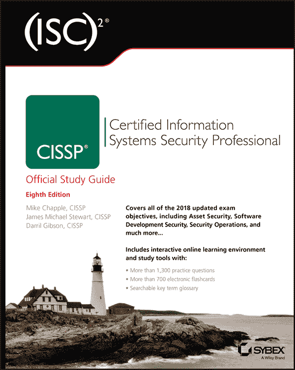

Technical Editors: Jeff Parker, Bob Sipes, and David Seidl

Copy Editor: Kim Wimpsett

Editorial Manager: Pete Gaughan

Production Manager: Kathleen Wisor

Executive Editor: Jim Minatel

Proofreader: Amy Schneider

Indexer: Johnna VanHoose Dinse

Project Coordinator, Cover: Brent Savage

Cover Designer: Wiley

Cover Image: @Jeremy Woodhouse/Getty Images, Inc.

Published simultaneously in Canada

ISBN: 978-1-119-47593-4

ISBN: 978-1-119-47595-8 (ebk.)

ISBN: 978-1-119-47587-3 (ebk.)

Manufactured in the United States of America

No part of this publication may be reproduced, stored in a retrieval system or transmitted in any form or by any means, electronic, mechanical, photocopying, recording, scanning or otherwise, except as permitted under Sections 107 or 108 of the 1976 United States Copyright Act, without either the prior written permission of the Publisher, or authorization through payment of the appropriate per-copy fee to the Copyright Clearance Center, 222 Rosewood Drive, Danvers, MA 01923, (978) 750-8400, fax (978) 646-8600. Requests to the Publisher for permission should be addressed to the Permissions Department, John Wiley & Sons, Inc., 111 River Street, Hoboken, NJ 07030, (201) 748-6011, fax (201) 748-6008, or online at [`www.wiley.com/go/permissions`](http://www.wiley.com/go/permissions).

Limit of Liability/Disclaimer of Warranty: The publisher and the author make no representations or warranties with respect to the accuracy or completeness of the contents of this work and specifically disclaim all warranties, including without limitation warranties of fitness for a particular purpose. No warranty may be created or extended by sales or promotional materials. The advice and strategies contained herein may not be suitable for every situation. This work is sold with the understanding that the publisher is not engaged in rendering legal, accounting, or other professional services. If professional assistance is required, the services of a competent professional person should be sought. Neither the publisher nor the author shall be liable for damages arising herefrom. The fact that an organization or Web site is referred to in this work as a citation and/or a potential source of further information does not mean that the author or the publisher endorses the information the organization or Web site may provide or recommendations it may make. Further, readers should be aware that Internet Web sites listed in this work may have changed or disappeared between when this work was written and when it is read.

For general information on our other products and services or to obtain technical support, please contact our Customer Care Department within the U.S. at (877) 762-2974, outside the U.S. at (317) 572-3993 or fax (317) 572-4002.

Wiley publishes in a variety of print and electronic formats and by print-on-demand. Some material included with standard print versions of this book may not be included in e-books or in print-on-demand. If this book refers to media such as a CD or DVD that is not included in the version you purchased, you may download this material at [`booksupport.wiley.com`](http://booksupport.wiley.com). For more information about Wiley products, visit [`www.wiley.com`](http://www.wiley.com).

**Library of Congress Control Number:** 2018933561

TRADEMARKS: Wiley, the Wiley logo, and the Sybex logo are trademarks or registered trademarks of John Wiley & Sons, Inc. and/or its affiliates, in the United States and other countries, and may not be used without written permission. CISSP is a registered trademark of (ISC)², Inc. All other trademarks are the property of their respective owners. John Wiley & Sons, Inc. is not associated with any product or vendor mentioned in this book.

*To Dewitt Latimer, my mentor, friend, and colleague. I miss you dearly.*

—Mike Chapple

*To Cathy, your perspective on the world and life often surprises me, challenges me, and makes me love you even more.*

—James Michael Stewart

*To Nimfa, thanks for sharing your life with me for the past 26 years and letting me share mine with you.*

—Darril Gibson

Dear Future (ISC)² Member,

Congratulations on starting your journey to CISSP® certification. Earning your CISSP is an exciting and rewarding milestone in your cybersecurity career. Not only does it demonstrate your ability to develop and manage nearly all aspects of an organization’s cybersecurity operations, but you also signal to employers your commitment to life-long learning and taking an active role in fulfilling the (ISC)² vision of inspiring a safe and secure cyber world.

The material in this study guide is based upon the (ISC)² CISSP Common Body of Knowledge. It will help you prepare for the exam that will assess your competency in the following eight domains:

* Security and Risk Management
* Asset Security
* Security Architecture and Engineering
* Communication and Network Security
* Identity and Access Management (IAM)
* Security Assessment and Testing
* Security Operations
* Software Development Security

While this study guide will help you prepare, passing the CISSP exam depends on your mastery of the domains combined with your ability to apply those concepts using your real-world experience.

I wish you the best of luck as you continue on your path to become a CISSP and certified member of (ISC)².

Sincerely,


David Shearer, CISSP

CEO

(ISC)²

**Mike Chapple**, CISSP, PhD, Security+, CISA, CySA+，是 Notre Dame 大学信息学、分析和运营副教授。过去，他曾是 Brand Institute 的首席信息官，以及国家安全局和美国空军的信息安全研究员。他的主要专业领域包括网络入侵检测和访问控制。Mike 经常为 TechTarget 的 SearchSecurity 站点做贡献，并撰写了 25 本以上的书籍，包括本研习指南的配套书籍：*CISSP Official (ISC)² Practice Tests*、*CompTIA CSA+ Study Guide* 和 *Cyberwarfare: Information Operations in a Connected World.* 他通过其网站 [`www.certmike.com`](http://www.certmike.com) 为 CISSP、SSCP、Security+ 和 CSA+ 认证提供学习小组。

**James Michael Stewart**, CISSP, CEH, ECSA, CHFI, Security+, Network+，过去二十多年来一直从事写作和培训，当前专注于安全领域。自 2002 年起，他一直在教授 CISSP 培训课程，同时也讲授其他关于 Internet 安全和伦理黑客/渗透测试的课程。他是 75 本以上的书籍以及众多安全认证、Microsoft 主题和网络管理课程的作者和贡献者，其中包括 *Security+ (SY0-501) Review Guide*。更多关于 Michael 的信息可在他的网站 [`www.impactonline.com`](http://www.impactonline.com) 查看。

**Darril Gibson**, CISSP, Security+, CASP，是 YCDA（You Can Do Anything）的 CEO，他撰写或合著了 40 本以上的书籍。Darril 经常撰写、咨询和教学，涵盖多种技术和安全主题，并持有多项认证。他经常在 [`blogs.getcertifiedgetahead.com/`](http://blogs.getcertifiedgetahead.com/) 博客上发布关于认证考试的文章，帮助读者及时了解考试变化。他喜欢听到读者通过他的书籍通过考试的消息，您可以通过博客站点与他联系。

**Jeff T. Parker**, CISSP，是信息安全多个关注点的技术编辑和审阅者。Jeff 经常为书籍做贡献，在需要的地方提供经验和实践知识。Jeff 的经验来自在波士顿为 Hewlett-Packard 工作 10 年以及在捷克共和国布拉格为 Deutsche-Post 工作 4 年。目前居住加拿大，Jeff 教授他的中学生如何构建（以及破坏）家庭实验室。他最近合著了 *Wireshark for Security Professionals*，目前正在编写 *CySA+ Practice Exams*。继续学习！

**Bob Sipes**, CISSP，是 DXC Technology 的企业安全架构师兼账户安全官，为 DXC 客户提供战术和战略领导。他持有多项认证，活跃于 ISSA 和 Infragard 等安全组织，并擅长在包括网络安全、通信和领导力在内的主题上进行公开演讲。业余时间，Bob 是一位热衷的古董书籍收藏家，拥有大量 19 世纪和 20 世纪初男童文学的图书馆。您可以在 Twitter 上关注 Bob，账号为 @bobsipes。

**David Seidl**, CISSP，是 Notre Dame 大学校园技术服务高级主管，同时在 Mendoza 商学院教授网络安全和网络课程。David 撰写了多本关于网络安全认证和网络战的书籍，并担任第六、第七和第八版 *CISSP Study Guide* 的技术编辑。他拥有 Eastern Michigan University 的信息安全硕士学位和通信技术学士学位，并持有 CISSP、GPEN、GCIH 和 CySA+ 认证。

# 169. 145

## 170. 146

## 171. 147

## 172. 148

## 173. 149

## 174. 150

## 175. 151

## 176. 152

## 177. 153

## 178. 154

## 179. 155

## 180. 156

## 181. 157

## 182. 159

## 183. 160

## 184. 161

## 185. 162

## 186. 163

## 187. 164

## 188. 165

## 189. 166

## 190. 167

## 191. 168

## 192. 169

## 193. 170

## 194. 171

## 195. 172

## 196. 173

## 197. 174

## 198. 175

## 199. 176

## 200. 177

## 201. 178

## 202. 179

## 203. 180

## 204. 181

## 205. 182

## 206. 183

## 207. 184

## 208. 185

## 209. 186

## 210. 187

## 211. 188

## 212. 189

## 213. 190

## 214. 191

## 215. 192

## 216. 193

## 217. 195

## 218. 196

## 219. 197


## 220. 198

## 221. 199

## 222. 200

## 223. 201

## 224. 202

## 225. 203

## 226. 204

## 227. 205

## 228. 206

## 229. 207

## 230. 208

## 231. 209

## 232. 210

## 233. 211

## 234. 212

## 235. 213

## 236. 214

## 237. 215

## 238. 216

## 239. 217

## 240. 218

## 241. 219

## 242. 220

## 243. 221

## 244. 222

## 245. 223

## 246. 224

## 247. 225

## 248. 226

## 249. 227

## 250. 228

## 251. 229

## 252. 230

## 253. 231

## 254. 232

## 255. 233

## 256. 234

## 258. 237

## 259. 238

## 260. 239

## 261. 240

## 262. 241

## 263. 242

## 264. 243

## 265. 244

## 266. 245

## 267. 246

# 目录

## 268. 247

## 269. 248

## 270. 249

## 271. 250

## 272. 251

## 273. 252

## 274. 253

## 275. 254

## 276. 255

## 277. 256

## 278. 257

## 279. 258

## 280. 259

## 281. 260

## 282. 261

## 283. 262

## 284. 263

## 285. 264

## 286. 265

## 287. 266

## 288. 267

## 289. 268

## 290. 269

## 291. 270

## 292. 271

## 293. 272

## 294. 273

## 295. 274

## 296. 275

## 297. 276

## 298. 277

## 299. 278

## 300. 279

## 301. 280

## 302. 281

## 303. 282

## 304. 283

## 305. 284

## 306. 285

## 307. 286

## 308. 287

## 309. 288

## 310. 289

## 311. 290

## 312. 291

## 313. 292

## 314. 293

## 315. 294

## 316. 295

## 317. 296

## 318. 297

## 319. 298

## 320. 299

## 321. 300

## 322. 301

## 323. 302

## 324. 303

## 325. 304

## 326. 306

## 327. 307

## 328. 308

## 329. 309

## 330. 310

## 331. 311

## 332. 312

## 333. 313

## 334. 314

## 335. 315

## 336. 316

## 337. 317

## 338. 319

## 339. 320

## 340. 321

## 341. 322

## 342. 323

## 343. 324

## 344. 325

## 345. 326

## 346. 327

## 347. 328

## 348. 329

## 349. 330

## 350. 331

## 351. 332

## 352. 333

## 353. 334

## 354. 335

## 355. 336

## 356. 337

## 357. 338

## 358. 339

## 359. 340

## 360. 341

## 361. 342

## 362. 343

## 363. 344

## 364. 345

## 365. 346

## 366. 347

## 367. 348

## 368. 349

## 369. 350

## 370. 351

## 371. 352

## 372. 353

## 373. 354

## 374. 355

## 375. 356

## 376. 357

## 377. 358

## 378. 359

## 379. 360

## 380. 361

## 381. 362

## 382. 363

## 383. 364

## 384. 365

## 385. 366

## 386. 367

## 387. 368

## 388. 369

## 389. 370

## 390. 371

## 391. 372

## 392. 373

## 393. 374

## 394. 375

## 395. 376

## 396. 377

## 397. 378

## 398. 379

## 399. 380

## 400. 381

## 401. 382

## 402. 383

## 403. 384

## 404. 385

## 405. 386

## 406. 387

## 407. 388

## 408. 389

## 409. 390

## 410. 391

## 411. 392

## 412. 393

## 413. 394

## 414. 395

## 415. 396

## 416. 397

## 417. 398

## 418. 399

## 419. 400

## 420. 401

## 421. 402

## 422. 403

## 423. 404

## 424. 405

## 425. 406

## 426. 407

## 427. 408

## 428. 409

## 429. 410

## 430. 411

## 431. 412

## 432. 413

## 433. 414

## 434. 415

## 435. 416

## 436. 417

## 437. 418

## 438. 419

## 439. 420

## 440. 421

## 441. 422

## 442. 423

## 443. 424

## 444. 425

## 445. 426

## 446. 427

## 447. 428

## 448. 429

## 449. 430

## 450. 431

## 451. 432

## 452. 433

## 453. 434

## 454. 435

## 455. 436

## 456. 437

## 457. 438

## 458. 439

## 459. 440

## 460. 441

## 461. 442

## 462. 443

## 463. 444

## 464. 445

## 465. 446

## 466. 447

## 467. 448

## 468. 449

## 469. 450

## 470. 451

## 471. 452

## 472. 453

## 473. 454

## 474. 455

## 475. 456

## 476. 457

## 477. 458

## 478. 459

## 479. 460

## 480. 461

## 481. 462

## 482. 463

## 483. 464

## 484. 465

## 485. 466

## 486. 467

## 487. 468

## 488. 469

## 489. 470

## 490. 471

## 491. 472

## 492. 473

## 493. 474

## 494. 475

## 495. 476

## 496. 477

## 497. 478

## 498. 479

## 499. 480

## 500. 481

## 501. 482

## 502. 483

## 503. 484

## 504. 485

## 505. 486

## 506. 487

## 507. 488

## 508. 489

## 509. 490

## 510. 491

## 511. 492

## 512. 493

## 513. 494

## 514. 495

## 515. 496

## 516. 497

## 517. 498

## 518. 499

## 519. 500

## 520. 501

## 521. 502

## 522. 503

## 523. 504

## 524. 505

## 525. 507

## 526. 508

## 527. 509

## 528. 510

## 529. 511

## 530. 512

## 531. 513

## 532. 514

## 533. 515

## 534. 516

## 535. 517

## 536. 518

## 537. 519

## 538. 520

## 539. 521

## 540. 522

## 541. 523

## 542. 524

## 543. 525

## 544. 526

## 545. 527

## 546. 528

## 547. 529

## 548. 530

## 549. 531

## 550. 532

## 551. 533

## 552. 534

## 553. 535

## 554. 536

## 555. 537

## 556. 538

## 557. 539

## 558. 540

## 559. 541

## 560. 542

## 561. 543

## 562. 544

## 563. 545

## 564. 546

## 565. 547

## 566. 548

## 567. 549

## 568. 550

## 569. 551

## 570. 552

## 571. 553

## 572. 554

## 573. 555

## 574. 556

## 575. 557

## 576. 558

## 577. 559

## 578. 560

## 579. 561

## 580. 562

## 581. 563

## 582. 564

## 583. 565

## 584. 566

## 585. 567

## 586. 568

## 587. 569

## 588. 570

## 589. 571

## 590. 572

## 591. 573

## 592. 574

## 593. 575

## 594. 576

## 595. 577

## 596. 579

## 597. 580

## 598. 581

## 599. 582

## 600. 583

## 601. 584

## 602. 585

## 603. 586

## 604. 587

## 605. 588

## 606. 589

## 607. 590

## 608. 591

## 609. 592

## 610. 593

## 611. 594

## 612. 595

## 613. 596

## 614. 597

## 615. 598

## 616. 599

## 617. 600

## 618. 601

## 619. 602

## 620. 603

## 621. 604

## 622. 605

## 623. 606

## 624. 607

## 625. 608

## 626. 609

## 627. 610

## 628. 611

## 629. 612

## 630. 613

## 631. 614

## 632. 615

## 633. 616

## 634. 617

## 635. 618

## 636. 619

## 637. 620

## 638. 621

## 639. 623

## 640. 624

## 641. 625

## 642. 626

## 643. 627

## 644. 628

## 645. 629

## 646. 630

## 647. 631

## 648. 632

## 649. 633

## 650. 634

## 651. 635

## 652. 636

## 653. 637

## 654. 638

## 655. 639

## 656. 640

## 657. 641

## 658. 642

## 659. 643

## 660. 644

## 661. 645

## 662. 646

## 663. 647

## 664. 648

## 665. 649

## 666. 650

## 667. 651

## 668. 652

## 669. 653

## 670. 654

## 671. 655

## 672. 656

## 673. 657

## 674. 658

## 675. 659

## 676. 660

## 677. 661

## 678. 662

## 679. 663

## 680. 664

## 681. 665

## 682. 666

## 683. 667

## 684. 668

## 685. 669

## 686. 670

## 687. 671

## 688. 672

## 689. 673

## 690. 674

## 691. 675

## 692. 676

## 693. 677

## 694. 678

## 695. 679

## 696. 680

## 697. 681

## 698. 682

## 699. 683

## 700. 684

## 701. 685

## 702. 687

## 703. 688

## 704. 689

## 705. 690

## 706. 691

## 707. 692

## 708. 693

## 709. 694

## 710. 695

## 711. 696

## 712. 697

## 713. 698

## 714. 699

## 715. 700

## 716. 701

## 717. 702

## 718. 703

## 719. 704

## 720. 705

## 721. 706

## 722. 707

## 723. 708

## 724. 709

## 725. 710

## 726. 711

## 727. 712

## 728. 713

## 729. 714

## 730. 715

## 731. 716

## 732. 717

## 733. 718

## 734. 719

## 735. 720

## 736. 721

## 737. 722

## 738. 723

## 739. 724

## 740. 725

## 741. 726

## 742. 727

## 743. 728

## 744. 729

## 745. 730

## 746. 731

## 747. 732

## 748. 733

## 749. 734

## 750. 735

## 751. 737

## 752. 738

## 753. 739

## 754. 740

## 755. 741

## 756. 742

## 757. 743

## 758. 744

## 759. 745

## 760. 746

## 761. 747

## 762. 748

## 763. 749

## 764. 750

## 765. 751

## 766. 752

## 767. 753

## 768. 754

## 769. 755

## 770. 756

## 771. 757

## 772. 758

## 773. 759

## 774. 760

## 775. 761

## 776. 762

## 777. 763

## 778. 764

## 779. 765

## 780. 766

## 781. 767

## 782. 768

## 783. 769

## 784. 770

## 785. 771

## 786. 772

## 787. 773

## 788. 774

## 789. 775

## 790. 776

## 791. 777

## 792. 778

## 793. 779

## 794. 780

## 795. 781

## 796. 782

## 797. 783

## 798. 784

## 799. 785

## 800. 786

## 801. 787

## 802. 788

## 803. 789

## 804. 790

## 805. 791

## 806. 792

## 807. 793

## 808. 794

## 809. 795

## 810. 796

## 811. 797

## 812. 798

## 813. 799

## 814. 801

## 815. 802

## 816. 803

## 817. 804

## 818. 805

## 819. 806

## 820. 807

## 821. 808

## 822. 809

## 823. 810

## 824. 811

## 825. 812

## 826. 813

## 827. 814

## 828. 815

## 829. 816

## 830. 817

## 831. 818

## 832. 819

## 833. 820

## 834. 821

## 835. 822

## 836. 823

## 837. 824

## 838. 825

## 839. 826

## 840. 827

## 841. 828

## 842. 829

## 843. 830

## 844. 831

## 845. 832

## 846. 833

## 847. 834

## 848. 835

## 849. 836

## 850. 837

## 851. 838

## 852. 839

## 853. 840

## 854. 841

## 855. 842

## 856. 843

## 857. 845

## 858. 846

## 859. 847

## 860. 848

## 861. 849

## 862. 850

## 863. 851

## 864. 852


865. 853

866. 854

867. 855

868. 856

869. 857

870. 858

871. 859

872. 860

873. 861

874. 862

875. 863

876. 864

877. 865

878. 866

879. 867

880. 868

881. 869

882. 871

883. 872

884. 873

885. 874

886. 875

887. 876

888. 877

889. 878

890. 879

891. 880

892. 881

893. 882

894. 883

895. 884

896. 885

897. 886

898. 887

899. 888

900. 889

901. 890

902. 891

903. 892

904. 893

905. 894

906. 895

907. 896

908. 897

909. 898

910. 899

911. 900

912. 901

913. 902

914. 903

915. 904

916. 905

917. 906

918. 907

919. 908

920. 909

921. 910

922. 911

923. 912

924. 913

925. 914

926. 915

927. 916

928. 917

929. 918

930. 919

931. 920

932. 921

933. 922

934. 923

935. 924

936. 925

937. 926

938. 927

939. 928

940. 929

941. 930

942. 931

943. 932

944. 933

945. 934

946. 935

947. 936

948. 937

949. 938

950. 939

951. 940

952. 941

953. 942

954. 943

955. 944

956. 945

957. 946

958. 947

959. 948

960. 949

961. 950

962. 951

963. 952

964. 953

965. 954

966. 955

967. 956

968. 957

969. 958

970. 959

971. 960

972. 961

973. 962

974. 963

975. 964

976. 965

977. 966

978. 967

979. 968

980. 969

981. 970

982. 971

983. 972

984. 973

985. 974

986. 975

987. 976

988. 977

989. 978

990. 979

991. 980

992. 981

993. 982

994. 983

995. 984

996. 985

997. 986

998. 987

999. 988

1000. 989

1001. 990

1002. 991

1003. 992

1004. 993

1005. 994

1006. 995

1007. 996

1008. 997

1009. 998

1010. 999

1011. 1000

# Introduction

The *(ISC)2 CISSP: Certified Information Systems Security Professional Official Study Guide, Eighth Edition,* offers you a solid foundation for the Certified Information Systems Security Professional (CISSP) exam. By purchasing this book, you’ve shown a willingness to learn and a desire to develop the skills you need to achieve this certification. This introduction provides you with a basic overview of this book and the CISSP exam.

This book is designed for readers and students who want to study for the CISSP certification exam. If your goal is to become a certified security professional, then the CISSP certification and this study guide are for you. The purpose of this book is to adequately prepare you to take the CISSP exam.

Before you dive into this book, you need to have accomplished a few tasks on your own. You need to have a general understanding of IT and of security. You should have the necessary five years of full-time paid work experience (or four years if you have a college degree) in two or more of the eight domains covered by the CISSP exam. If you are qualified to take the CISSP exam according to (ISC)², then you are sufficiently prepared to use this book to study for it. For more information on (ISC)², see the next section.

(ISC)² also allows for a one-year reduction of the five-year experience requirement if you have earned one of the approved certifications from the (ISC)² prerequisite pathway. These include certifications such as CAP, CISM, CISA, CCNA Security, Security+, MCSA, MCSE, and many of the GIAC certifications. For a complete list of qualifying certifications, visit [`www.isc2.org/Certifications/CISSP/Prerequisite-Pathway`](https://www.isc2.org/Certifications/CISSP/Prerequisite-Pathway). Note: You can use only one of the experience reduction measures, either a college degree or a certification, not both.

### (ISC)²

The CISSP exam is governed by the International Information Systems Security Certification Consortium (ISC)². (ISC)² is a global not-for-profit organization. It has four primary mission goals:

*   Maintain the Common Body of Knowledge (CBK) for the field of information systems security.

*   Provide certification for information systems security professionals and practitioners.

*   Conduct certification training and administer the certification exams.

*   Oversee the ongoing accreditation of qualified certification candidates through continued education.

The (ISC)² is operated by a board of directors elected from the ranks of its certified practitioners.

(ISC)² supports and provides a wide variety of certifications, including CISSP, SSCP, CAP, CSSLP, CCFP, HCISPP, and CCSP. These certifications are designed to verify the knowledge and skills of IT security professionals across all industries. You can obtain more information about (ISC)² and its other certifications from its website at [www.isc2.org](http://www.isc2.org).

The Certified Information Systems Security Professional (CISSP) credential is for security professionals responsible for designing and maintaining security infrastructure within an organization.

### Topical Domains

The CISSP certification covers material from the eight topical domains. These eight domains are as follows:

*   Security and Risk Management

*   Asset Security

*   Security Architecture and Engineering

*   Communication and Network Security

*   Identity and Access Management (IAM)

*   Security Assessment and Testing

*   Security Operations

*   Software Development Security

These eight domains provide a vendor-independent overview of a common security framework. This framework is the basis for a discussion on security practices that can be supported in all types of organizations worldwide.

The most recent revision of the topical domains will be reflected in exams starting April 15, 2018. For a complete view of the breadth of topics covered on the CISSP exam from the eight domain groupings, visit the (ISC)² website at [www.isc2.org](http://www.isc2.org) to request a copy of the Candidate Information Bulletin. This document includes a complete exam outline as well as other relevant facts about the certification.

### Prequalifications

(ISC)² has defined the qualification requirements you must meet to become a CISSP. First, you must be a practicing security professional with at least five years’ full-time paid work experience or with four years’ experience and a recent IT or IS degree. Professional experience is defined as security work performed for salary or commission within two or more of the eight CBK domains.

Second, you must agree to adhere to a formal code of ethics. The CISSP Code of Ethics is a set of guidelines the (ISC)² wants all CISSP candidates to follow to maintain professionalism in the field of information systems security. You can find it in the Information section on the (ISC)² website at [www.isc2.org](http://www.isc2.org).

(ISC)² also offers an entry program known as an Associate of (ISC)². This program allows someone without any or enough experience to qualify as a CISSP to take the CISSP exam anyway and then obtain experience afterward. Associates are granted six years to obtain five years’ of security experience. Only after providing proof of such experience, usually by means of endorsement and a resume, can the individual be awarded CISSP certification.

## Overview of the CISSP Exam

The CISSP exam focuses on security from a 30,000-foot view; it deals more with theory and concept than implementation and procedure. It is very broad but not very deep. To successfully complete this exam, you’ll need to be familiar with every domain but not necessarily be a master of each domain.

As of December 18, 2017, the CISSP exam is in an adaptive format. (ISC)² calls the new version CISSP-CAT (Computerized Adaptive Testing). For complete details of this new version of exam presentation, please see [`www.isc2.org/certifications/CISSP/CISSP-CAT`](https://www.isc2.org/certifications/CISSP/CISSP-CAT).

CISSP-CAT 考试最少包含 100 题，最多 150 题。并非你所看到的所有题目都计入你的得分或通过状态。这些不计分的题目由 (ISC)² 称为 `pretest questions`，而计分的题目称为 `operational items`。考试题目不会在考试中标注为已计分或未计分。考生将在考试中收到 25 个未计分题目，无论你在问题 100 达到通过排名，还是看到全部 150 道题目。

CISSP-CAT 最多给你 3 小时完成考试。如果你在达到通过排名之前用尽时间，你将自动失败。

CISSP-CAT 不允许你返回上一题更改答案。你离开问题后，你的答案选择即为最终。

CISSP-CAT 没有公开或设定的通过分数。相反，你必须展示在 `passing standard`（即未公开的通过标准）内的最后 75 个操作题（即问题）中的答题能力。


如果电脑判断你实现通过标准的机会小于 5%，且你已看到 75 个操作题，你的考试将自动结束并失败。你并不保证会看到超过电脑系统确定 95% 置信度所需的题目数量来判断你是否能实现通过标准或未能达到通过标准。

如果你在第一次尝试中未通过 CISSP 考试，你可以在以下条件下重新参加考试：

*   你最多可以在 12 个月内参加 3 次 CISSP 考试。

*   在第一次尝试后，你必须等待 30 天才能参加第二次尝试。

*   在第二次尝试后，你必须再等待 90 天才能参加第三次尝试。

*   在第三次尝试后，你必须再等待 180 天才能再次尝试，或直到距离第一次尝试满 12 个月为止。

你需要为每次额外的考试尝试支付全价。

你无法参加之前的纸质或 CBT（计算机考试）版本（250 题）的考试。CISSP 现在仅以 CBT CISSP-CAT 格式提供。

更新后的 CISSP 考试将提供英文、法文、德文、巴西葡萄牙文、西班牙文、日语、简体中文和韩文版本。

自 2017 年 12 月 18 日起，仅英文版 CISSP 考试将通过 `(ISC)2` 授权的 Pearson VUE 考试中心在授权市场独家以 CAT 方式提供。以其他语言进行的 CISSP 考试以及所有其他 `(ISC)2` 认证考试仍将以固定形式、线性考试的方式提供。

## CISSP 考试题型

CISSP 考试中的大多数问题都是四选一的单选题，只有一个正确答案。有些问题直接，例如要求你选择一个定义。有些问题稍复杂，要求你选择相应的概念或最佳实践。有些问题则呈现一个场景或情境，要求你选择最佳响应。以下是一个示例：

1.  安全解决方案最重要的目标和首要任务是什么？

    1. 防止披露

    2. 保持完整性

    3. 保持人身安全

    4. 维持可用性

你必须选择唯一正确或最佳答案并标记它。在某些情况下，正确答案对你来说非常明显。在其他情况下，多个答案看似正确。在这些情况下，你必须选择最符合问题要求的最佳答案。注意一般、具体、普遍、上位集和下位集的答案选择。在某些情况下，所有答案看似都不正确。在这种情况下，你需要选择最不正确的答案。

除了标准的单选题格式外，`(ISC)²` 还增加了几种先进的创新题型，称为 `advanced innovative questions`。这些题型包括拖放题和热点题。这些题型要求你将主题或概念按操作顺序、优先级或正确位置进行排列。特别是，拖放题要求考生将标签或图标移动到图像上的项目上标记。热点题要求考生用十字准星标记图像上的位置。这些题型概念易于操作和理解，但请注意准确放置或标记的准确性。

## 考试建议

CISSP 考试由两个关键要素组成。首先，你需要掌握八个领域的知识。其次，你必须具备良好的考试技巧。你最多有 3 小时时间达到通过标准，最多可能看到 150 道题目。因此，平均每道题只有不到一分钟的时间。因此，快速作答而不急不躁、也不浪费时间非常重要。

从 `(ISC)²` 对 CISSP-CAT 格式的描述中并不清楚在每种情况下猜测是否是好策略，但似乎比跳过问题更好的策略。我们建议你在猜测前尽可能排除错误的选项，如果你无法排除任何选项，建议跳过问题而不是随机猜测。从缩小的选项集中做出有根据的猜测，以增加答题正确的机会。

请注意，`(ISC)²` 不披露是否对包含多部分的问题给予部分得分（如果你只答对部分元素）。因此，请注意带有复选框而非单选按钮的问题，并确保选择必要的项目数量以正确应对问题。

你将获得一块白板和一支记号笔，用于记录思路和做笔记。但白板上的内容不会用于改变你的分数。在离开考试场所前，必须将白板交回给考试管理员。

为了最大化你的考试活动，以下是一些通用指南：

*   先读每个问题，然后读答案选项，最后再读一遍问题。

*   在选择正确答案前，先消除错误的选项。

*   注意双重否定。

*   确保你理解问题在问什么。

管理时间。你可以在考试期间休息，但这可能会消耗部分考试时间。你可能会考虑带饮料和零食，但你的食物和饮料将在考试区域外存放，而休息时间将计入考试时间限制。请务必携带任何药物或其他必需品，但请将所有电子设备留在家中或车内。你应该避免佩戴手腕上的任何物品，包括手表、健身追踪器和珠宝。你不允许携带任何降噪耳机或耳塞，但可以使用泡沫耳塞。我们也建议穿着舒适的衣物，并随身携带一件轻便外套（有些考试地点可能较冷）。

如果英语不是你的第一语言，你可以报名参加几种其他语言版本的考试。或者，如果你选择使用英文版考试，允许使用翻译词典。（请务必提前联系考试地点组织和安排此事。）你必须能够证明你需要该词典；这通常通过你的出生证明或护照来证明。

## 学习与考试准备建议

我们建议计划大约一个月的夜间集中学习，以准备 CISSP 考试。以下是一些最大化学习时间的建议；你可以根据自己的学习习惯进行修改：

*   花费一个或两个晚上阅读本书的每个章节，并完成其复习材料。

*   回答本书和考试引擎中提供的所有复习题，完成每个章节的书面实验，并利用复习题帮助你找出需要进一步学习或投入更多时间掌握关键概念和策略的主题。

*   查阅 `(ISC)²` 的考试大纲：`www.isc2.org`。

*   使用随附的闪卡强化概念理解。

## Completing the Certification Process

一旦你收到通过 CISSP 认证的通知，在获得 CISSP 认证之前还有一个最终步骤。该步骤称为 `endorsement`（背书）。基本上，你需要找一位 CISSP 持有者或其他 `(ISC)²` 认证持有者，该人员工作状态良好，熟悉你的工作经历，代为提交背书表格。背书表格通过通知你通过考试的邮件中获取，背书人必须审阅你的简历，确认你在八个 CISSP 领域拥有足够的经验，然后以数字、传真或邮寄方式提交签名表格至 `(ISC)²`。你必须在收到通过确认邮件后的 90 天内提交背书文件至 `(ISC)²`。一旦 `(ISC)²` 收到你的背书表格，认证流程即完成，你将通过美国邮政收到欢迎包。

## Post-CISSP Concentrations

`(ISC)²` 仅向 CISSP 证书持有者提供三个专注领域。该机构将 CISSP 考试中引入的概念聚焦于特定领域，即架构、管理和工程。以下是这三个专注领域：

**Information Systems Security Architecture Professional (ISSAP)** 面向信息安全架构专家。主要涵盖访问控制系统和方法论；密码学；物理安全集成；要求分析和安全标准、指南和准则；与业务连续性规划和灾难恢复规划相关的技术方面；以及电信和网络安全。此凭证适用于设计安全系统或基础设施，或负责审计和分析此类结构的人员。

**Information Systems Security Management Professional (ISSMP)** 面向关注信息安全政策、实践、原则和程序管理的人员。主要涵盖企业安全管理实践；企业级系统开发安全；法律、调查、取证和伦理；运营安全合规监督；以及业务连续性规划、灾难恢复规划和业务连续性规划的理解。此凭证适用于负责安全基础设施的专业人员，尤其是在强制合规要求出现时。

**Information Systems Security Engineering Professional (ISSEP)** 面向关注安全硬件和软件信息系统、组件或应用程序设计与工程的人员。主要涵盖认证与认可、系统安全工程、技术管理，以及美国政府信息保障规则和法规。大多数 ISSEP 在政府部门或管理政府安全许可的政府承包商处工作。

如需了解这些专注考试和认证的更多详情，请访问 `(ISC)²` 官网 `www.isc2.org`。

## Notes on This Book’s Organization

本书设计覆盖八个 CISSP Common Body of Knowledge 领域，提供足够深度的内容，帮助你清晰理解材料。本书主体包含 21 章。域/章节对应如下：

*   章节 1、2、3、4：安全与风险管理

*   章节 5：资产安全

*   章节 6、7、8、9、10：安全架构与工程

*   章节 11、12：通信与网络安全

*   章节 13、14：身份与访问管理（IAM）

*   章节 15：安全评估与测试

*   章节 16、17、18、19：安全运营

*   章节 20、21：软件开发安全

每章包含帮助你集中学习并检验知识的元素，详见下文各节。

## The Elements of This Study Guide

在阅读本学习指南时，你会反复看到许多相同的元素。以下是部分元素的说明：

**Exam Essentials** Exam Essentials 突出可能在考试中出现的主题。虽然我们无法确定具体考试内容，但此部分强化了理解 Common Body of Knowledge（CBK）区域及 CISSP 考试规格的关键概念。

**Chapter Review Questions** 每章包含旨在测试你对章节关键思想理解的练习题。完成每章后，请回答问题；若有错误，说明需进一步复习对应主题。答案位于每章末尾。

**Written Labs** 每章包含综合章节概念的书面实验。这些实验提出问题，帮助你将章节中单独学习的内容整合，提出或描述潜在的安全策略或解决方案。

**Real-World Scenarios** 在每章学习过程中，你会看到典型且合理的工作场景描述，其中的安全策略和方法对解决问题或防范潜在困难起关键作用。这让读者看到具体安全政策、指南或实践如何在实际工作中应用。

**Summaries** 摘要是对章节内容的简要回顾。

## What’s Included with the Additional Study Tools

本书附带多种额外学习工具，助你顺利通过 CISSP 认证。我们精心准备了以下必备工具，供你在备考时加载至工作站：

### The Sybex Test Preparation Software

由 Sybex 专家研发的考试准备软件，包含书中所有复习与评估题目，以及额外的模拟考试。你可以进行评估测试、按章节自测、参加模拟考试，或随机生成包含所有题目的考试。

### Electronic Flashcards

Sybex 的电子闪卡包含数百道题目，旨在进一步挑战 CISSP 考试。在复习题、模拟考试和闪卡之间，你拥有足够的练习量！

### Glossary of Terms in PDF

Sybex 提供可搜索的 PDF 格式术语表，涵盖 CISSP 考试所需的所有关键术语。

### Bonus Practice Exams

-   [Sybex 包含额外的模拟考试，每场考试包含用于评估您对 CISSP CBK 关键要素理解的题目。本书提供六套额外考试，每套包含 150 道题，以匹配实际考试可能的最长长度。这些考试可在数字版中访问（http://www.wiley.com/go/sybextestprep）](http://sybextestbanks.wiley.com)。

## 如何使用本书的学习工具

本书提供多项旨在指导您准备 CISSP 认证考试的功能。它通过在每章开头列出本章涵盖的 CISSP 公共知识体（CBK）领域，并确保每个主题在章节内得到完整讨论来帮助您。每章末尾的复习题和模拟考试旨在检验您对已阅读材料的记忆，以确保您能识别出需要额外学习的薄弱环节。以下是使用本书和学习工具（见 `www.wiley.com/go/cissptestprep`）的建议：

*   在阅读材料前先进行评估测试。这将让您了解需要额外学习的领域以及只需简短复习的区域。

*   阅读完每章后回答复习题；如果答错任何题目，请回到章节复习该主题，或在需要更多信息时使用其他补充资源。

*   将闪卡下载到移动设备，并在一天中的碎片时间进行复习。

*   利用所有测试机会自我检测。除了评估测试和复习题外，书中还附带额外的模拟考试。请在不参考章节的情况下完成这些考试，评估自己的掌握情况，然后回到相应章节复习未掌握的知识点，直至完全理解并能够应用这些概念。

最后，若可能的话，请找一位学习伙伴。与他人共同学习和考取该考试会让过程更有趣，并有人协助您理解困难的知识点。您也可以通过帮助学习伙伴解决薄弱环节来强化自己的知识。

# 评估测试

1. 下列哪种访问控制类型旨在发现不良、未经授权或非法行为或活动？

    1. 预防性

    2. 劝阻性

    3. 侦测性

    4. 纠正性

2. 请定义并阐述密码选择的方面，区分良好密码与劣质密码的特征。

    1. 难以猜测或不可预测

    2. 满足最小长度要求

    3. 满足特定复杂度要求

    4. 以上全部

3. 哪项最有可能检测拒绝服务（DoS）攻击？

    1. 主机基于 IDS

    2. 网络基于 IDS

    3. 漏洞扫描器

    4. 渗透测试

4. 下列哪项被视为拒绝服务攻击？

    1. 假装自己是技术经理并在电话中向接待员请求更改密码

    2. 浏览网页时，向 Web 服务器发送格式不正确的 URL，导致系统 CPU 使用率达到 100%

    3. 通过特定子网复制经过的网络流量包

    4. 向未请求的收件人发送消息包以显得烦人

5. 路由器在 OSI 模型的哪一层工作？

    1. 网络层

    2. 第 1 层

    3. 传输层

    4. 第 5 层

6. 哪种防火墙会根据现有会话的流量内容自动调整其过滤规则？

    1. 静态包过滤

    2. 应用层网关

    3. 电路层网关

    4. 动态包过滤

7. VPN 可以通过以下哪种方式建立？

    1. 无线局域网连接

    2. 远程访问拨号连接

    3. 广域网链路

    4. 以上全部

8. 哪类恶意软件利用社交工程诱使受害者安装？

    1. 病毒

    2. 蠕虫

    3. 特洛伊木马

    4. 逻辑炸弹

9. CIA 三元组包含哪些要素？

    1. 连续性、可互操作、排列

    2. 身份验证、授权、问责

    3. 能力、可用性、完整性

    4. 可用性、保密性、完整性

10. 下列哪项不是问责制支持的必要组成部分？

    1. 审计

    2. 隐私

    3. 身份验证

    4. 授权

11. 下列哪项不是防范串通的防御措施？

    1. 职责分离

    2. 受限职责范围

    3. 组用户账户

    4. 职务轮换

12. 数据 custodian 在 `\_\_\_\_\_\_\_\_\_\_\_\_\_\_\_\_\_\_\_\_\_\_` 将资源分配给安全标签后，负责确保该资源的安全。

    1. 高级管理层

    2. 数据所有者

    3. 审计员

    4. 安全人员

13. 在软件（SW‑CMM）成熟度模型的哪个阶段会使用定量措施来深入了解软件开发过程？

    1. 可重复

    2. 定义

    3. 管理

    4. 优化

14. 以下哪一层是环保护环（ring protection scheme）的层，通常在实际中不实现？

    1. 第 0 层

    2. 第 1 层

    3. 第 3 层

    4. 第 4 层

15. TCP/IP 三次握手序列的最后一个阶段是哪一步？

    1. SYN 报文

    2. ACK 报文

    3. NAK 报文

    4. SYN/ACK 报文

16. 哪种漏洞最适合通过充分的参数检查来防御？

    1. 检查时间与使用时间（Time of check to time of use）

    2. 缓冲区溢出

    3. SYN 洪水

    4. 分布式拒绝服务

17. 下面的逻辑运算结果是什么？

    X: 0 1 1 0 1 0

    Y: 0 0 1 1 0 1

    `\_\_\_\_\_\_\_\_\_\_\_\_\_\_\_\_\_`

    X ∨ Y: ?

    1. 0 1 1 1 1 1

    2. 0 1 1 0 1 0

    3. 0 0 1 0 0 0

    4. 0 0 1 1 0 1

18. 哪种密码类型会将明文信息的字符重新排列形成密文？

    1. 替换密码

    2. 块密码

    3. 置换密码

    4. 一次性口令本（One‑time pad）

19. MD5 算法生成的消息摘要长度是多少？

    1. 64 位

    2. 128 位

    3. 256 位

    4. 384 位

20. 当 Renee 收到 Mike 发来的数字签名消息时，她使用哪把钥匙来验证该消息确实来源于 Mike？

    1. Renee 的公钥

    2. Renee 的私钥

    3. Mike 的公钥

    4. Mike 的私钥

21. 下列哪项不是安全模型相关的组合理论？

    1. 级联（Cascading）

    2. 反馈（Feedback）

    3. 迭代（Iterative）

    4. Hookup

22. TCB 中用于实现参考监视器功能的组件集合被称为 `\_\_\_\_\_\_\_\_\_\_\_\_\_\_\_\_\_\_\_\_\_\_` 。

    1. 安全边界

    2. 安全内核

    3. 访问矩阵

    4. 受限接口

23. 下列哪条陈述是正确的？

    1. 系统越简单，越容易出现漏洞。

    2. 系统越复杂，所提供的保证越少。

    3. 系统越简单，所提供的信任越少。

    4. 系统越复杂，其攻击面越少。

24. 在保护环（protection rings）架构中，第 0 环（Ring 0）还可以被称为以下哪项，但不包括哪一项？

    1. 特权模式


## 2. 监视模式

## 3. 系统模式

## 4. 用户模式

25. 审计跟踪、日志、闭路电视、入侵检测系统、防病毒软件、密码破解工具、性能监控以及循环冗余检查（CRC）是以下内容的例子？

`#` 指令控制

`#` 预防控制

`#` 侦测控制

`#` 纠正控制

26. 系统架构、系统完整性、隐蔽通道分析、受信设施管理和受信恢复是以下安全标准的组成部分？

`#` 质量保证

`#` 运营保证

`#` 生命周期保证

`#` 数量保证

27. 下列哪项是一种旨在测试并可能绕过系统安全控制的程序？

`#` 记录使用数据

`#` 需求拨号

`#` 渗透测试

`#` 部署受保护的桌面工作站

28. 审计是维持和执行以下因素的必要因素？

`#` 问责

`#` 保密

`#` 可用性

`#` 冗余

29. 计算 ALE（预期损失金额）所使用的公式是什么？

`#` ALE = AV \* EF \* ARO

`#` ALE = ARO \* EF

`#` ALE = AV \* ARO

`#` ALE = EF \* ARO

30. 业务影响评估（BIA）过程的第一步是什么？

`#` 优先级识别

`#` 可能性评估

`#` 风险识别

`#` 资源优先级

31. 下列哪项代表可能对组织构成威胁或风险的自然事件？

`#` 地震

`#` 洪水

`#` 龙卷风

`#` 以上全部

32. 哪种恢复设施可以在主设施故障后，使组织尽快（若非立即）恢复运营？

`#` 热站

`#` 温站

`#` 冷站

`#` 以上全部

33. 用于保护词语、标语和徽标的知识产权形式是什么？

`#` 专利

`#` 版权

`#` 商标

`#` 商业秘密

34. 哪种证据形式指书面文件，用于在法庭上证明事实？

`#` 最佳证据

`#` 发薪单证据

`#` 文档证据

`#` 证词证据

35. 为什么军事和情报攻击属于最严重的计算机犯罪之一？

`#` 获取的信息可能对敌对国家的国家利益产生深远的战略性负面影响。

`#` 军事信息存储在安全机器上，成功攻击可能会很尴尬。

`#` 机密信息的长期政治用途可能影响国家的领导层。

`#` 军事和情报机构确保保护其信息的法律是最严厉的。

36. 哪种被检测到的事件为调查提供了最多的时间？

`#` 妥协

`#` 服务拒绝

`#` 恶意代码

`#` 扫描

37. 如果你想限制进入或离开设施，你会选择哪个？

`#` 闸门

`#` 闸机

`#` 围栏

`#` 禁入区

38. 二次验证系统的目的是什么？

`#` 验证用户的身份

`#` 验证用户的活动

`#` 验证系统的完整性

`#` 验证系统的正确性

39. 当大量未经请求的消息被发送到受害者以阻止其合法活动时，这也被称为什么？

`#` 窃听

`#` 服务拒绝

`#` 暴力攻击

`#` 缓冲区溢出攻击

40. 哪种入侵检测系统（IDS）可以被视为专家系统？

`#` 主机基于

`#` 网络基于

`#` 基于知识

`#` 基于行为

# 评估测试答案

1. C. 侦测访问控制用于发现（并记录）不想要或未经授权的活动。

2. D. 强密码选择难以猜测、不可预测且长度有最小限制，确保密码条目无法通过计算被破解。它们可以是随机生成的，包含所有字母、数字和标点字符；绝不能书写或共享；不应存储在公开可访问或一般可读的位置；也不应以明文方式传输。

3. B. 网络基于的 IDS 通常能够检测攻击的发起或正在进行的尝试（包括拒绝服务攻击，DoS）。但它们无法提供攻击是否成功的信息，或受影响的具体系统、用户账户、文件或应用程序。主机基于的 IDS 对 DoS 攻击的检测和追踪有一定困难。漏洞扫描器不检测 DoS 攻击；它们用于测试可能的漏洞。渗透测试可能导致 DoS 或测试 DoS 漏洞，但它不是检测工具。

4. B. 并非所有的 DoS 都是恶意攻击的结果。代码中的错误导致 OS、服务和应用程序出现 DoS 条件。例如，进程未能释放 CPU 控制权，或服务消耗了与其处理请求成比例的系统资源。社交工程和窃听通常不被视为 DoS 攻击。

5. A. 网络硬件设备（包括路由器）在第三层（网络层）运行。

6. D. 动态数据包过滤防火墙允许根据流量内容实时修改过滤规则。

7. D. VPN 链接可以通过任何其他网络通信连接建立，例如普通以太网线、无线 LAN、远程拨号、广域网链路或客户端的互联网连接用于访问办公室 LAN。

8. C. 木马是一种利用社交工程诱骗受害者安装的恶意软件，其技巧是让受害者误以为他们下载或获得的仅是宿主文件，实际上它包含隐藏的恶意负载。

9. D. CIA 三元组（三要素）分别是保密性、可用性和完整性。

10. B. 隐私并非提供问责的必要条件。

11. C. 组用户账户允许多个人在同一个用户账户下登录。这会导致串通，因为它阻止了个人问责。

12. B. 数据所有者必须首先为资源分配安全标签，才能让数据 custodian 正确地保护该资源。

13. C. 软件工程成熟度模型（SW-CMM）的“管理”阶段使用定量开发指标。软件工程研究所（SEI）将该级别的关键过程领域定义为定量过程管理和软件质量管理。

14. B. 第 1 层和第 2 层包含设备驱动程序但通常不实际实现。第 0 层始终包含安全内核。第 3 层包含用户应用程序。第 4 层不存在。

15. B. 发起主机首先发送 SYN 包到目标主机。目标主机随后回复 SYN/ACK 包。发起主机发送 ACK 包，连接随即建立。

16. B. 参数检查用于防止缓冲区溢出攻击的可能性。

17. A. tilde 或 ~ 符号表示“或”函数，当一个或多个输入位为真时返回真。

18. C. 置换密码使用加密算法重新排列明文中的字符，生成密文。

19. B. MD5 算法为任何输入生成 128 位的消息摘要。

20. C. 任何接收方都可以使用 Mike 的公钥验证数字签名的真实性。

21. C. 迭代不是与安全模型相关的组合理论。组合理论包括级联、反馈和挂钩三种。

22. B. TCB 中工作组件的集合被称为安全内核。

23. B. 系统越复杂，提供的保障越少。复杂度意味着存在更多的漏洞区域，也意味着需要更多地防范威胁。更多的漏洞和更多的威胁意味着系统随后提供的安全性变得更不值得信赖。

24. D. 特权级 0 直接访问最多资源；因此用户模式不合适作为标签，因为用户模式需要限制资源访问。

25. C. 侦测控制的例子包括审计日志、日志、闭路电视、入侵检测系统、防病毒软件、渗透测试、密码破解工具、性能监控和循环校验码。

26. B. 保障是对计算机、网络、解决方案等安全需求满足程度的置信度。操作保障关注系统的基本特性和架构，这些特性和架构有助于支持安全。

27. C. 渗透测试是尝试绕过安全控制以检测整体系统安全的过程。

28. A. 审计是维持和强制问责的必要因素。

29. A. 年度预期损失（ALE）等于资产价值（AV）乘以暴露因子（EF）再乘以年化发生率（ARO）。这是公式 ALE = SLE × ARO 的更长形式。图中显示的其他公式均不准确反映此计算。

30. A. 业务影响评估过程的第一步是确定优先级。

31. D. 可能威胁组织的自然事件包括地震、洪水、飓风、龙卷风、野火以及其他自然行为。因此选项 A、B、C 均正确，因为它们是自然事件而非人为事件。

32. A. 热站提供始终处于工作状态的备份设施，能够立即接管业务运营。温站包含预配置的硬件和软件，但不包含关键业务信息。冷站仅提供电力和环境支持系统，没有配置的硬件、软件或服务。灾难恢复服务可在公司的名义下实施或促进这些站点的任何一种。

33. C. 商标用于保护代表公司及其产品或服务的词语、标语和标志。

34. C. 在法庭上用于证明案件事实的书面文件称为书面证据。

35. A. 军事和情报攻击的目的是获取机密信息。该信息在敌方手中可能造成几乎无限的负面影响。此类攻击通常由高度专业的攻击者发起，往往很难确定成功获取了哪些文档。因此，当发生此类泄露时，有时无法判断损害的全貌。

36. D. 扫描事件通常属于侦察攻击。真正的系统损害发生在随后的攻击中，因此如果能及早发现扫描攻击，你可能还有时间进行反应。

37. B. 闸机是一种门禁形式，一次只允许一个人进入，并且通常只能单向移动。它用于控制入口或出口，但不同时允许两者。

38. D. 次要验证机制用于验证检测系统和传感器的正确性。通常通过组合多种传感器或系统（如闭路电视、热感应和运动传感器等）来提供更完整的已检测事件视图。

39. B. 大规模发送未经请求邮件的喷麦攻击可作为一种拒绝服务攻击使用。它不使用窃听方法，因此不是窃听。暴力破解尝试猜测密码，缓冲区溢出攻击向系统发送大量数据以使其失效。

40. D. 基于行为的 IDS 可称为专家系统或伪人工智能系统，因为它能够学习并对事件做出假设。换言之，IDS 可以像人类专家一样，将当前事件与已知事件进行评估。基于知识的 IDS 使用已知攻击方法的数据库来检测攻击。主机基于和网络基于系统均可是基于知识、基于行为或两者的组合。

# Chapter 1

Security Governance Through Principles and Policies

**THE CISSP EXAM TOPICS COVERED IN THIS CHAPTER INCLUDE:**

*   **Domain 1: Security and Risk Management**

    *   1.1 Understand and apply concepts of confidentiality, integrity and availability

    *   1.2 Evaluate and apply security governance principles

        *   1.2.1 Alignment of security function to business strategy, goals, mission, and objectives

        *   1.2.2 Organizational processes

        *   1.2.3 Organizational roles and responsibilities

        *   1.2.4 Security control frameworks

        *   1.2.5 Due care/due diligence

    *   1.6 Develop, document, and implement security policy, standards, procedures, and guidelines

    *   1.10 Understand and apply threat modeling concepts and methodologies

        *   1.10.1 Threat modeling methodologies

        *   1.10.2 Threat modeling concepts

    *   1.11 Apply risk-based management concepts to the supply chain

        *   1.11.1 Risks associated with hardware, software, and services

        *   1.11.2 Third-party assessment and monitoring

        *   1.11.3 Minimum security requirements

        *   1.11.4 Service-level requirements

 The Security and Risk Management domain of the Common Body of Knowledge (CBK) for the CISSP certification exam deals with many of the foundational elements of security solutions. These include elements essential to the design, implementation, and administration of security mechanisms. Additional elements of this domain are discussed in various chapters: Chapter 2, “Personal Security and Risk Management Concepts”; Chapter 3, “Business Continuity Planning”; Chapter 4, “Laws, Regulations, and Compliance”; and Chapter 19, “Investigations and Ethics.” Please be sure to review all of these chapters to have a complete perspective on the topics of this domain.

## Understand and Apply Concepts of Confidentiality, Integrity, and Availability

Security management concepts and principles are inherent elements in a security policy and solution deployment. They define the basic parameters needed for a secure environment. They also define the goals and objectives that both policy designers and system implementers must achieve to create a secure solution. It is important for real-world security professionals, as well as CISSP exam students, to understand these items thoroughly. This chapter includes a range of topics related to the governance of security for global enterprises as well as smaller businesses.

Security must start somewhere. Often that somewhere is the list of most important security principles. In such a list, confidentiality, integrity, and availability (CIA) are usually present because these are typically viewed as the primary goals and objectives of a security infrastructure. They are so commonly seen as security essentials that they are referenced by the term `CIA Triad` (see Figure 1.1).

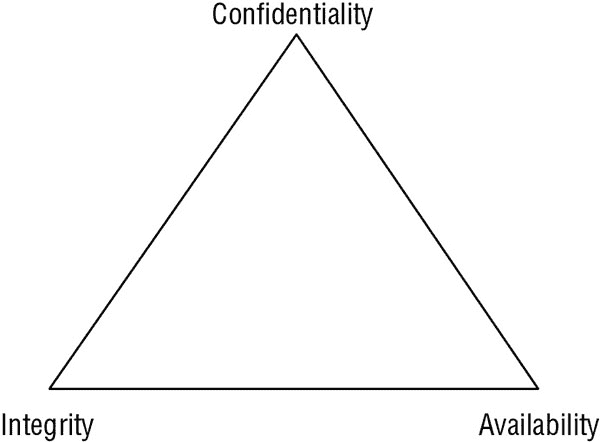

**FIGURE 1.1** The CIA Triad

安全控制通常是根据它们如何应对这三项核心信息安全原则来评估的。总体而言，完整的安全解决方案应能够充分应对这些原则中的每一项。漏洞和风险也会根据它们对一个或多个 CIA 三元组原则的威胁进行评估。因此，了解这些原则并将其作为判断所有与安全相关事项的指南是个好主意。

这三项原则被认为是安全领域中最重要的。但每项具体原则对特定组织的重要性取决于该组织的安全目标和要求，以及该组织的安全可能受到的威胁程度。

### 保密性

CIA 三元组的第一项原则是保密性。`保密性`是指为确保数据、物体或资源的秘密性而采取的措施的概念。保密性保护的目标是防止或最小化未经授权访问数据。保密性将安全措施集中在确保消息的接收者或阅读者以外的任何人都无法接收或阅读该消息。保密性保护提供了让授权用户访问和交互资源的手段，同时积极阻止未经授权的用户这样做。包括加密、访问控制和隐写术等一系列安全控制可以为保密性提供保护，其中不限于这些。

如果一个安全机制提供保密性，则意味着数据、物体或资源受到未经授权主体的限制，从而获得高度的保证。如果存在针对保密性的威胁，未经授权的披露可能会发生。在安全关系中，对象是被动元素，如文件、计算机、网络连接和应用程序；主体是主动元素，如用户、程序和计算机。主体会作用于或针对对象。主体与对象之间的关系管理称为访问控制。

一般而言，为在网络上维护保密性，数据必须在存储、处理和传输期间免受未经授权的访问、使用或披露。为在数据、资源和对象的不同状态下维护保密性，需要为每种状态制定独特且具体的安全控制。

许多攻击侧重于保密性的违反。这些攻击包括截获网络流量、窃取密码文件以及社会工程、端口扫描、肩窥、窃听、特权提升等。

保密性的违反不仅限于有意的定向攻击。许多敏感或机密信息的未经授权披露是由于人为错误、疏忽或无能造成的。导致保密性泄露的事件包括未正确加密传输、在将数据传输到远程系统前未完全验证该系统、留下原本受保护的访问端口、访问可能打开后门的恶意代码、传真误发、打印文档遗留在打印机上，甚至在数据显示在显示器上时离开访问终端。保密性违反可能由终端用户或系统管理员的行为引起，也可能因安全策略的疏漏或安全控制配置错误而发生。

确保保密性的众多对策包括加密、网络流量填充、严格的访问控制、严谨的身份验证程序、数据分类以及广泛的人员培训。


保密性与完整性相互依赖。如果没有对象的完整性（即在未经授权的情况下对对象进行修改的能力受限），保密性无法得到维护。保密性的其他概念、条件和方面包括：

### 敏感性 Sensitivity

`Sensitivity` 指信息的属性，若被披露可能造成伤害或损害。保护敏感信息的保密性有助于防止此类伤害或损害。

### 酌情性 Discretion

`Discretion` 是操作员根据情况影响或控制披露的行为，以最小化伤害或损害。

### 重要性

信息被证明为任务关键的程度称为`重要性`。重要性越高，保护该信息的保密性就越必要。高重要性对于组织的运行或功能至关重要。

### 隐蔽性 Concealment

`Concealment` 是隐藏或防止披露的行为，通常被视为一种掩护、混淆或分散注意力的手段。与隐蔽性相关的概念是“安全通过隐蔽”（security through obscurity），即通过隐藏、沉默或秘密来获取保护。虽然安全通过隐蔽通常不被视为有效的安全措施，但在某些情况下仍可能有价值。

### 秘密性 Secrecy

`Secrecy` 是保持某事物秘密或防止信息披露的行为。

### 隐私 Privacy

`Privacy` 指保护个人可识别信息或若被揭露可能导致他人感到伤害、尴尬或羞辱的信息的保密性。

### 隔离 Seclusion

`Seclusion` 指将某物存储在偏僻位置，该位置也可以实施严格的访问控制。隔离有助于强制执行保密性保护。

### 隔离 Isolation

`Isolation` 是将某物与其他事物分离的行为，以防止信息混合或披露。

每个组织需要评估其希望强制执行的保密性的细微差别。实现某种保密性的工具和技术可能不支持或允许其他形式的保密性。

## 完整性

CIA 三元组的第二项原则是完整性。`完整性`是指保护数据的可靠性和正确性的概念。完整性保护防止未经授权的数据修改。它确保数据保持正确、未被篡改且保持保存。正确实现的完整性保护提供了让授权用户进行变更的手段，同时防范恶意的未经授权活动（如病毒和入侵）以及授权用户的错误（如疏忽或失误）。

为维护完整性，对象必须保持其真实性，并仅由受信任的主体有意地进行修改。如果一个安全机制提供完整性，则意味着数据、物体和资源保持其原始受保护状态，未被篡改。无论是在存储、传输还是处理过程中，篡改都不应发生。因此，维护完整性意味着对象本身不被修改，且管理和操作该对象的操作系统和编程实体未被妥协。

完整性可从三个角度进行考察：

* 防止未经授权的主体进行修改
* 防止受信任的主体进行未经授权的修改，例如错误
* 维护对象的内部和外部一致性，使其数据真实反映现实世界，且与任何子、同级或父对象的关系是有效、一致且可验证的

为在系统上维护完整性，必须建立控制措施以限制对数据、物体和资源的访问。此外，应启用活动日志以确保只有授权用户能够访问其相应的资源。在存储、传输和处理过程中维护和验证对象的完整性需要众多种类的控制措施和监督。

Numerous attacks focus on the violation of integrity. These include viruses, logic bombs, unauthorized access, errors in coding and applications, malicious modification, intentional replacement, and system back doors.

As with confidentiality, integrity violations are not limited to intentional attacks. Human error, oversight, or ineptitude accounts for many instances of unauthorized alteration of sensitive information. Events that lead to integrity breaches include modifying or deleting files; entering invalid data; altering configurations, including errors in commands, codes, and scripts; introducing a virus; and executing malicious code such as a Trojan horse. Integrity violations can occur because of the actions of any user, including administrators. They can also occur because of an oversight in a security policy or a misconfigured security control.

Numerous countermeasures can ensure integrity against possible threats. These include strict access control, rigorous authentication procedures, intrusion detection systems, object/data encryption, hash total verifications (see Chapter 6, “Cryptography and Symmetric Key Algorithms”), interface restrictions, input/function checks, and extensive personnel training.

Integrity is dependent on confidentiality. Other concepts, conditions, and aspects of integrity include the following:

* `Accuracy`: Being correct and precise
* `Truthfulness`: Being a true reflection of reality
* `Authenticity`: Being authentic or genuine
* `Validity`: Being factually or logically sound
* `Nonrepudiation`: Not being able to deny having performed an action or activity or being able to verify the origin of a communication or event
* `Accountability`: Being responsible or obligated for actions and results
* `Responsibility`: Being in charge or having control over something or someone
* `Completeness`: Having all needed and necessary components or parts
* `Comprehensiveness`: Being complete in scope; the full inclusion of all needed elements

## Availability

The third principle of the CIA Triad is `availability`, which means authorized subjects are granted timely and uninterrupted access to objects. Often, availability protection controls support sufficient bandwidth and timeliness of processing as deemed necessary by the organization or situation. If a security mechanism offers availability, it offers a high level of assurance that the data, objects, and resources are accessible to authorized subjects. Availability includes efficient uninterrupted access to objects and prevention of denial-of-service (DoS) attacks. Availability also implies that the supporting infrastructure—including network services, communications, and access control mechanisms—is functional and allows authorized users to gain authorized access.

For availability to be maintained on a system, controls must be in place to ensure authorized access and an acceptable level of performance, to quickly handle interruptions, to provide for redundancy, to maintain reliable backups, and to prevent data loss or destruction.

There are numerous threats to availability. These include device failure, software errors, and environmental issues (heat, static, flooding, power loss, and so on). There are also some forms of attacks that focus on the violation of availability, including DoS attacks, object destruction, and communication interruptions.

As with confidentiality and integrity, violations of availability are not limited to intentional attacks. Many instances of unauthorized alteration of sensitive information are caused by human error, oversight, or ineptitude. Some events that lead to availability breaches include accidentally deleting files, overutilizing a hardware or software component, under-allocating resources, and mislabeling or incorrectly classifying objects. Availability violations can occur because of the actions of any user, including administrators. They can also occur because of an oversight in a security policy or a misconfigured security control.

Numerous countermeasures can ensure availability against possible threats. These include designing intermediary delivery systems properly, using access controls effectively, monitoring performance and network traffic, using firewalls and routers to prevent DoS attacks, implementing redundancy for critical systems, and maintaining and testing backup systems. Most security policies, as well as business continuity planning (BCP), focus on the use of fault tolerance features at the various levels of access/storage/security (that is, disk, server, or site) with the goal of eliminating single points of failure to maintain availability of critical systems.

Availability depends on both integrity and confidentiality. Without integrity and confidentiality, availability cannot be maintained. Other concepts, conditions, and aspects of availability include the following:

* `Usability`: The state of being easy to use or learn or being able to be understood and controlled by a subject
* `Accessibility`: The assurance that the widest range of subjects can interact with a resource regardless of their capabilities or limitations
* `Timeliness`: Being prompt, on time, within a reasonable time frame, or providing low-latency response

## Other Security Concepts

In addition to the CIA Triad, you need to consider a plethora of other security-related concepts and principles when designing a security policy and deploying a security solution.

You may have heard of the concept of `AAA services`. The three A’s in this abbreviation refer to authentication, authorization, and accounting (or sometimes auditing). However, what is not as clear is that although there are three letters in the acronym, it actually refers to five elements: identification, authentication, authorization, auditing, and accounting. These five elements represent the following processes of security:

* `Identification`: Claiming to be an identity when attempting to access a secured area or system
* `Authentication`: Proving that you are that identity
* `Authorization`: Defining the permissions (i.e., allow/grant and/or deny) of a resource and object access for a specific identity
* `Auditing`: Recording a log of the events and activities related to the system and subjects
* `Accounting` (aka `accountability`): Reviewing log files to check for compliance and violations in order to hold subjects accountable for their actions


## AAA 服务的五个元素

Although AAA is typically referenced in relation to authentication systems, it is actually a foundational concept for security. Missing any of these five elements can result in an incomplete security mechanism. The following sections discuss identification, authentication, authorization, auditing, and accountability (see Figure 1.2).

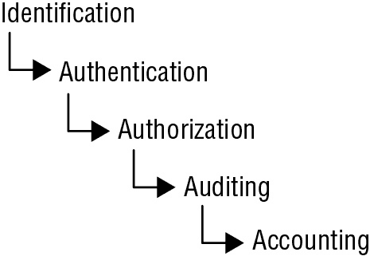

**FIGURE 1.2** The five elements of AAA services 

### Identification

Identification is the process by which a subject professes an identity and accountability is initiated. A *subject* must provide an identity to a system to start the process of authentication, authorization, and accountability (AAA). Providing an identity can involve typing in a username; swiping a smart card; waving a proximity device; speaking a phrase; or positioning your face, hand, or finger for a camera or scanning device. Providing a process ID number also represents the identification process. Without an identity, a system has no way to correlate an authentication factor with the subject.

一旦一个主题被识别（即主题的身份被确认和验证），该身份对该主题的进一步行为负责。IT 系统跟踪身份的活动，而不是主题本身。计算机无法区分一个个人和另一个个人，但它能区分你的用户账户与其他所有用户账户。主题的身份通常被标记为公开信息，或者被认为是公开的。然而，仅仅声称一个身份并不意味着拥有访问权限或权威。在允许访问受控资源之前，身份必须经过验证（认证）或确保不可否认性（确认身份），即验证授权。这个过程就是认证。

### 认证

验证或测试声称身份有效性的过程称为认证。认证要求主题提供与其声称的身份相对应的额外信息。最常见的认证方式是使用密码（这包括个人识别码（PIN）和口语短语的变体）。认证通过将一个或多个因素与有效身份数据库（即用户账户）进行比较来验证主题的身份。用于验证身份的 `认证因子` 通常被视为私密信息。主题和系统保持认证因子秘密的能力直接反映了系统的安全级别。如果非法获取并使用目标用户的认证因子的过程相对容易，那么认证系统就是不安全的；如果该过程相对困难，那么认证系统是合理安全的。

识别和认证通常作为一个两步过程一起使用。提供身份是第一步，提供认证因子是第二步。缺少任一步骤，主题无法访问系统——单独任何一步都无法在安全方面发挥作用。在某些系统中，可能看起来你只提供了一个元素就能获得访问权限，例如输入 ID 代码或 PIN 时。但在这些情况下，识别是通过其他方式处理的，例如物理位置，或者访问权限是通过你实物访问系统的能力来假设的。识别和认证都发生了，但你可能不像手动输入姓名和密码时那样明显意识到它们。

主题可以提供多种认证方式，例如：你所知的（如密码、PIN）、你拥有的（如钥匙、令牌、智能卡）、你本身的（如生物特征，如指纹、虹膜或声音识别）等。每种认证技术或因子都有其独特的优点和缺点。因此，必须在其部署环境的背景下评估每种机制的可行性。（我们在第 13 章“管理身份和认证”中详细讨论了认证。）

### 授权

在主题经过认证后，必须进行授权。授权过程确保在给定已认证身份的权利和 `特权` 的前提下，请求的活动或对象的访问是可行的。在大多数情况下，系统会评估 `访问控制矩阵`，该矩阵比较主题、对象和预定活动。如果特定操作被允许，主题即被授权；如果特定操作不被允许，主题则未被授权。

请记住，仅凭主题已被识别和认证并不意味着他们有权执行任何功能或访问受控环境中的所有资源。主题可能已登录网络（即已识别和认证），但可能因未获授权而被阻止访问文件或打印到打印机（即未获授权执行该活动）。大多数网络用户仅被授权在特定资源集合上执行有限数量的活动。识别和认证是访问控制的所有或无的方面。授权在环境中每个对象之间有广泛的变体，介于所有或无之间。用户可能能够读取文件但不能删除它，能够打印文档但不能修改打印队列，或能够登录系统但不能访问任何资源。授权通常使用访问控制模型来定义，如 `自主访问控制（DAC）`、`强制访问控制（MAC）` 或 `基于角色的访问控制（RBAC 或 role-BAC）`；参见第 14 章“控制和监控访问”。

### 审计

审计，或 `监控`，是通过程序手段跟踪和记录主题的行为，以便在主题在系统上认证期间对其行为负责。它也是通过在系统上检测未经授权或异常活动的过程。审计记录主题及其对象的活动，以及记录维护操作环境和安全机制的核心系统功能的活动。通过将系统事件记录到日志来创建审计日志，这些日志可用于评估系统的健康和性能。系统崩溃可能表明程序故障、驱动程序损坏或入侵尝试。导致崩溃的事件日志通常可以用来发现系统失败的原因。日志文件提供事件、入侵或系统故障的再创建历史审计轨迹。审计用于检测主题的恶意行为、试图入侵的行为以及系统故障，以便重建事件、为起诉提供证据，并生成问题报告和分析。审计通常是操作系统和大多数应用程序和服务的原生功能。因此，配置系统以记录特定类型事件的信息相对容易。

### 问责

只有当问责制得到维护时，组织的安全策略才能被正确执行。换句话说，只有在主题对其行为承担责任时，才能维持安全。有效的问责依赖于能够证明主题的身份并跟踪其活动的能力。问责通过安全服务和机制（如审计、授权、认证和识别）将人与在线身份的活动关联起来建立。因此，人类的问责最终取决于认证过程的强度。如果没有强有力的认证过程，就无法确定与特定用户账户相关的个人在不良操作发生时实际控制该账户的实体。

为了实现可行的问责，你可能需要能够在法庭上支持你的安全决策及其实施。如果你无法在法律上支持你的安全努力，那么你就不太可能能够对与用户账户关联的行为进行问责。仅凭密码作为认证方式，存在巨大的疑虑空间。密码是最不安全的认证方式，有数十种不同的方法可用于 compromising 它们。然而，使用多因素认证（如密码、智能卡和指纹扫描的组合），几乎不可能有其他人 compromising 认证过程以冒充负责用户账户的个人。

## 保护机制

保护机制或保护控制是理解和应用保密性、完整性和可用性概念的一个方面。保护机制是安全控制的共同特征。并非所有 `security controls` 都必须具备它们，但许多控制通过使用这些机制为保密性、完整性和可用性提供保护。这些机制的常见例子包括使用多层或多级访问、采用抽象、隐藏数据以及使用加密。

### 层级结构

`Layering`，也称为 `defense in depth`，简单来说就是串联使用多个控制措施。没有任何一个控制措施能够防范所有可能的威胁。使用多层解决方案可以让不同的控制措施共同防御各种威胁。当安全解决方案按层级设计时，单个控制措施的失败不会导致系统或数据暴露。

在串行而非并行的方式中使用层级结构很重要。串行方式意味着依次执行安全限制，即一个接一个地进行。只有在串行配置中，每次攻击才会被每个安全控制措施扫描、评估或缓解。在串行配置中，单个安全控制措施的失败并不会使整个解决方案失效。如果安全控制措施是并行实现的，威胁可能通过一个未针对其特定恶意活动的检查点直接通过。

串行配置非常狭窄但非常深入，而并行配置则非常宽泛但非常浅薄。并行系统在分布式计算应用中有用，但在安全领域中并不常见。

想象建筑物的物理入口。并行配置常用于购物中心，其周围有许多分布在各处的入口。串行配置更可能用于银行或机场，单一入口实际上包含多个闸门或检查点，必须按顺序通过这些检查点才能进入建筑物的活动区域。

层级结构还包括网络由许多独立实体组成的概念，每个实体都有其独特的安全控制和漏洞。在有效的安全解决方案中，所有网络系统之间存在协同作用，形成统一的安全前线。使用独立的安全系统会创建分层安全方案。

### 抽象

`Abstraction` 用于提高效率。相似的元素被归类为组、类或角色，并为这些集合分配安全控制、限制或权限。因此，抽象概念用于对对象进行分类或为主体分配角色。抽象概念还包括定义对象和主体类型，或定义对象本身（即用于定义一类实体模板的数据结构）。抽象用于定义对象可以包含的数据类型、可以对该对象执行或由该对象执行的函数类型，以及该对象拥有的能力。抽象通过让你为按类型或功能分组的对象集合分配安全控制，从而简化安全管理。

### 数据隐藏

`Data hiding` 正是字面意思：通过将数据放置在逻辑存储隔离区，使其不被主体发现或访问。数据隐藏的形式包括防止未经授权访客访问数据库，以及阻止在较低分类级别的主体访问更高分类级别的数据。防止应用程序直接访问硬件也是一种数据隐藏形式。数据隐藏常常是安全控制和编程中的关键元素。

`security through obscurity`（通过隐蔽实现安全）这一术语在此可能显得相关。但该概念不同。数据隐藏是有意将数据放置在不可见或不可访问的位置，以防止未授权主体查看；而通过隐蔽实现安全则是不向主体说明某对象的存在，希望主体不会发现该对象。通过隐蔽实现安全并不提供任何实际保护，它只是希望保密，让重要信息不被发现并被利用。例如，程序员知道软件代码中存在缺陷，但仍然发布产品，希望无人发现并利用该问题。

### 加密

`Encryption` 是隐藏通信意义或意图的艺术与科学，防止 unintended recipients（ unintended recipients）看到。加密形式多样，可应用于所有类型的电子通信，包括文本、音频、视频文件以及应用程序本身。加密是安全控制的重要组成部分，尤其是在系统间数据传输方面。加密有不同强度等级，每个等级均针对特定用途或目的设计或选用。弱或差的加密可能仅仅是混淆手段，甚至可能等同于通过隐蔽实现安全。加密在 Chapter 6 “Cryptography and Symmetric Key Algorithms” 和 Chapter 7 “PKI and Cryptographic Applications” 中详细讨论。

## 评估并应用安全治理原则

`Security governance` 是支持、定义和指导组织安全努力的实践集合。安全治理原则通常与企业治理和 IT 治理紧密相关并交织在一起。这三类治理的目标往往相同或相互关联。例如，组织治理的常见目标是确保组织能够持续存在并随时间增长或扩展。因此，治理的共同目标是保持业务流程的运行，同时追求增长和韧性。

一些治理要求是由于立法和合规需求而强加给组织的，其他则由行业指南或许可要求规定。所有形式的治理，包括安全治理，都需要不时进行评估和验证。审计和验证的要求可能源自政府法规或行业最佳实践。治理合规问题因行业和国家而异。随着组织在全球市场的扩展和适应，治理问题变得更加复杂，尤其是当不同国家的法律差异或冲突时。整个组织应获得方向、指导和工具，以提供足够的监督和管理，重点消除停机时间，并将潜在损失或损害降至最低。

正如你所见，安全治理的定义往往晦涩且高度抽象。最终，安全治理是安全解决方案和管理方法的实施，两者紧密相连。安全治理直接监督并参与安全的所有层面。安全不应且不应仅被视为 IT 问题。相反，安全影响组织的每个方面。它已不再是 IT 人员可以单独处理的事务。安全是业务运营问题，是组织过程，而非 IT 程序员在幕后操作的事务。使用“安全治理”一词的目的在于强调安全需要在整个组织范围内进行管理和治理，而不仅仅局限于 IT 部门。

安全治理通常由治理委员会或至少由董事会管理。这是一群具有影响力的知识专家，其主要任务是监督和指导组织的安全和运营行动。安全工作复杂。组织通常规模庞大，从单一视角难以全面理解。拥有一支协同工作的专家团队，致力于实现可靠的安全治理，是一项稳健的策略。

安全框架和治理指南众多，包括 NIST 800-53 或 800-100。虽然 NIST 指南侧重于政府和军事用途，但其他类型组织也可以采用并加以适配。许多组织采用安全框架，旨在标准化和组织那些可能变得复杂且令人困惑的活动——即实施合理的安全治理。

### 将安全职能与业务战略、目标、使命和目的对齐

安全管理规划确保正确创建、实施和执行 `security policy`（安全策略）。安全管理规划将安全职能与组织的战略、目标、使命和目的对齐。这包括基于业务案例、预算限制或资源短缺来设计和实施安全。`business case`（业务案例）通常是一份文档化的论证或明确立场，用于定义需要做出决策或采取行动的必要性。制定业务案例意味着展示出针对业务的特定需求，以改变现有流程或选择处理业务任务的方式。业务案例通常用于为新项目的启动提供依据，尤其是与安全相关的项目。同时，还需考虑为业务需求驱动的安全项目可分配的预算。安全可能成本高昂，但通常比缺乏安全的代价更低。因此，安全成为可靠且长期运营的关键要素。在大多数组织中，资金和资源（如人员、技术、空间）均有限。基于此类资源限制，必须从每项行动中获得最大收益。

最有效的安全管理规划方法之一是采用 `top-down approach`（自上而下方法）。高层管理负责发起并定义组织的政策。安全策略为组织各层级提供方向。中层管理负责将安全策略细化为标准、基准、指南和流程。操作管理者或安全专业人员则需实施安全管理文档中规定的配置。最终，终端用户必须遵守组织的所有安全策略。

安全管理是高层管理的职责，而非 IT staff 的职责，被视为业务运营问题而非 IT 管理问题。组织内负责安全的团队或部门应保持自主。`information security (InfoSec) team`（信息安全团队）应由指定的首席信息安全官（CISO）领导，且该官员需直接向高层管理汇报。将 CISO 及其团队的自主权置于组织典型层级结构之外，可提升整个组织的安全管理水平，并有助于避免跨部门及内部政治问题。`chief security officer (CSO)`（首席安全官）一词有时用作 CISO 的替代，但在许多组织中，CSO 角色是 CISO 下属的次位职位，专注于物理安全。另一个可能的称呼是 `information security officer (ISO)`（信息安全官），这也可作为 CISO 的次位职位使用。

安全管理规划的要素包括定义安全角色；规定安全的管理方式、负责人以及如何测试其有效性；制定安全策略；进行风险分析；以及要求员工接受安全教育。这些工作通过制定管理计划得以指导。

若缺少一个关键因素，最佳的安全计划也无法奏效：`senior management`（高层管理）的批准与承诺。若高层未批准并承诺安全策略，该策略将无法成功实施。政策制定团队的职责是让高层充分理解即使在实施了策略中规定的安全措施后，仍存在的风险、责任和暴露。制定并实施安全策略体现了高层管理的审慎与尽职。若公司未能履行审慎与尽职义务，管理者可能因疏忽被追责，并需承担资产及财务损失。

安全管理规划团队应制定三类计划，如图 Figure 1.3 所示。

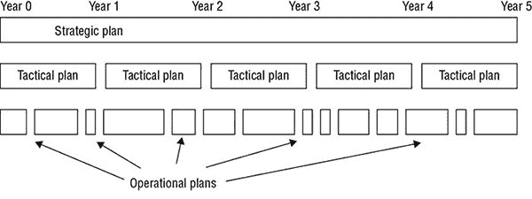

**FIGURE 1.3** 战略、战术和操作计划时间线比较

#### 战略计划

A `strategic plan`（战略计划）是一个长期、相对稳定的计划。它定义组织的安全使命，并帮助理解安全职能，使其与组织的目标、使命和目的对齐。若每年进行维护和更新，战略计划可适用约五年。战略计划还作为规划 horizon（规划范围）。在战略计划中讨论长期目标和未来愿景。战略计划应包含风险评估。

#### 战术计划

The `tactical plan`（战术计划）是中期计划，用于提供对实现战略目标的更详细说明，或可根据突发情况自行制定。战术计划通常适用约一年，并通常规定并调度实现组织目标所需的任务。战术计划的示例包括项目计划、采购计划、招聘计划、预算计划、维护计划、支持计划和系统开发计划。

#### 操作计划

An `operational plan`（操作计划）是基于战略和战术计划的短期、高度详细的计划。其有效期短暂，需频繁更新（如每月或每季度）以保持与战术计划的同步。操作计划阐述如何实现组织的各项目标，包括资源分配、预算需求、人员任务、时间安排以及逐步实施程序。操作计划还包含实施过程如何符合组织安全策略的说明。操作计划的示例有培训计划、系统部署计划和产品设计计划。

安全是一个持续的过程。因此，安全管理规划虽有一个明确的启动点，但其任务和工作永远不会完全完成。有效的安全计划聚焦于具体且可实现的目标，预判变化和潜在问题，并为整个组织的决策提供依据。安全文档应具体、明确且表述清晰。要使安全计划有效，必须在其开发、维护和实际使用中持续进行。

### 组织流程

安全治理需要涵盖组织的各个方面。这包括收购、出售和治理委员会等组织流程。收购和合并会使组织面临更高的风险水平。这些风险包括不当信息披露、数据丢失、停机或未能实现足够的投资回报（ROI）。除了并购的典型业务和财务方面外，健康的安全监督和更严格的审查通常是在这一转型期间降低损失可能性的必要措施。

同样，处置或任何形式的资产或员工减少也是风险增加、因此需要更聚焦的安全治理的另一时期。资产必须进行清理以防止数据泄露。存储介质应被移除并销毁，因为清理技术并不能保证防止数据残留恢复。离职员工需要进行面谈（exit interview），该过程通常包括审查任何保密协议以及其他继续有效的合同或协议，这些合同在雇佣结束后仍然有效。

另外两个对强安全治理至关重要的组织流程是变更控制/变更管理和数据分类。

#### 变更控制/管理


安全管理的另一个重要方面是变更的控制或管理。变更在安全环境中可能会引入漏洞、重叠、缺失的对象和疏忽，从而导致新的脆弱性。在变更的面前维护安全的唯一方法是系统地管理变更。这通常涉及对安全控制和机制相关活动的广泛规划、测试、记录、审计和监控。变更记录随后用于识别变更的代理，这些代理可以是对象、主体、程序、通信路径，甚至是网络本身。

`变更管理`的目标是确保任何变更不会导致安全降低或受损。它还负责使得可以将变更回滚到先前安全的状态。变更管理可以在任何系统上实施，无论其安全级别如何。最终，变更管理通过保护已实施的安全免受意外、间接或受影响的安全降低来提升环境的安全性。虽然变更管理的重要目标是防止不 wanted 的安全降低，但其主要目的是对所有变更进行详细记录和审计，从而使其能够被管理层审查和审计。

变更管理应用于系统的每个方面，包括硬件配置、操作系统（OS）和应用程序软件。变更管理应在设计、开发、测试、评估、实施、分发、演变、成长、持续运行和修改阶段纳入其中。它要求对每个组件和配置进行详细清单。同时，它还要求为系统的每个组件（从硬件到软件，从配置设置到安全功能）收集并维护完整的文档。

变更控制/变更管理流程的目标或要求包括：

*   以受监控且有序的方式实施变更。变更始终受控。

*   包含正式的测试过程，以验证变更产生预期结果。

*   所有变更都可以回滚（也称为回退或回滚计划/程序）。

*   在变更发生前，向用户通知变更，以防止生产力损失。

*   系统地分析变更的影响，以确定其是否对安全或业务流程产生负面影响。

*   将变更对能力、功能和性能的负面影响最小化。

*   变更由 `Change Advisory Board (CAB)` 进行审查和批准。

一个变更管理过程的例子是平行运行（parallel run），这是一种新系统部署测试方式，新系统和旧系统并行运行。对每个主要或重要用户过程在两个系统上同时执行，以确保新系统支持所有旧系统所提供的业务功能。

### 数据分类

`数据分类`，或称分类，是根据数据的保密性、敏感性或机密性需求保护数据的主要手段。在设计和实施安全系统时，对所有数据采用相同的方式是低效的，因为某些数据项需要更高的安全级别。在低安全级别下保护所有数据意味着敏感数据容易被访问。在高安全级别下保护所有数据则成本过高，并限制了对非机密、非关键数据的访问。数据分类用于确定为保护数据所需投入的努力、金钱和资源，以及控制对其的访问。

数据分类或分类是将项目、对象、主体等组织成具有相似性的组、类别或集合的过程。这些相似性可能包括价值、成本、敏感度、风险、脆弱性、权力、特权、可能的损失或损害程度，或知情需求。

数据分类方案的主要目标是 `formalize`（形式化）并分层化根据重要性和敏感度标签对数据的保护过程。数据分类用于为存储、处理和传输数据提供安全机制。它还说明了数据如何从系统中被移除并销毁。

使用数据分类方案的好处包括：

*   它展示了组织保护有价值资源和资产的承诺。

*   它帮助识别对组织最关键或最有价值的资产。

*   它为选择保护机制提供了依据。

*   它通常是监管合规或法律限制的要求。

*   它有助于定义访问级别、授权用途类型，以及对不再有价值的资源进行去分类或销毁的参数。

*   它有助于管理数据生命周期，其中包括数据的存储长度（保留）、使用和销毁。

数据分类的标准因执行分类的组织而异。但从常见或标准化的分类系统中可以获取许多通用信息：

*   数据的有用性

*   数据的及时性

*   数据的价值或成本

*   数据的成熟度或年龄

*   数据的生命周期（或到期时间）

*   数据与人员的关联

*   数据披露的损害评估（即数据泄露会对组织产生的影响）

*   数据修改的损害评估（即数据修改会对组织产生的影响）

*   数据的国家安全影响

*   对数据的授权访问（即谁有权访问数据）

*   对数据的限制（即谁被限制访问数据）

*   数据的维护和监控（即谁应维护和监控数据）

*   数据的存储

根据组织适用的适当标准，数据会被评估并分配适当的数据分类标签。在某些情况下，标签会直接添加到数据对象上；在其他情况下，标签在数据被放入存储介质或受到安全保护机制保护时自动生成。

要实施分类方案，必须完成七个主要步骤或阶段：

1. 确定负责人，并定义其职责。

2. 明确信息分类和标记的评估标准。

3. 对每个资源进行分类和标记。（由资源所有者执行此步骤，但应由监督人员进行审查。）

4. 记录发现的任何违反分类政策的例外情况，并将其整合到评估标准中。

5. 选择将在每个分类级别应用的安全控制措施，以提供必要的保护程度。

6. 明确对资源进行去分类的程序，以及将资源所有权转移给外部实体的程序。

7. 创建企业范围的意识提升计划，教育所有员工关于分类系统的知识。

`去分类`（Declassification）在设计分类系统和文档使用程序时常常被忽视。当资产不再需要其当前分配的分类或敏感级别的保护时，就需要进行去分类。换句话说，如果该资产是新的，它将被分配一个低于当前标签的敏感性标签。当资产未按需要进行去分类时，安全资源会被浪费，且高敏感级别的价值和保护会被削弱。

两种常见的分类方案是政府/军事分类（Figure 1.4）和商业/私营部门分类。政府/军事分类共有五个级别（从高到低）：

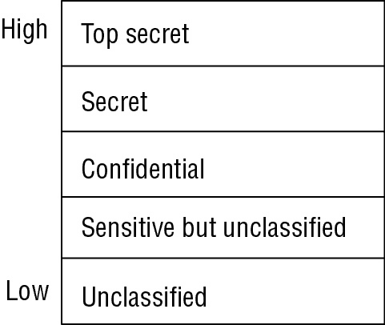

**FIGURE 1.4** Levels of government/military classification 

`Top Secret` `Top secret` 是最高级别的分类。未经授权的顶级机密数据泄露将产生极大影响，对国家安全造成严重损害。顶级机密数据按需知情原则进行隔离，即用户即使拥有顶级机密清晰度，也可能在没有知情需求前无法访问任何数据。

`Secret` `Secret` 用于具有限制性的数据。未经授权披露被标记为机密的数据将产生重大影响，对国家安全造成严重损害。

`Confidential` `Confidential` 用于敏感、专有或价值极高的数据。未经授权披露被标记为机密的数据将产生明显影响，对国家安全造成严重损害。此分类用于所有介于机密和敏感但未分类之间的数据。

`Sensitive But Unclassified` `Sensitive but unclassified (SBU)` 用于内部使用或办公室专用（FOUO）的数据。通常 SBU 用于保护可能侵犯个人隐私权的信息。这不是技术分类标签，而是用于指示用途或管理的标记或标签。

`Unclassified` `Unclassified` 用于既不敏感也不分类的数据。披露此类数据不会影响保密性，也不会造成任何明显损害。这不是技术分类标签，而是用于指示用途或管理的标记或标签。

标记为机密、机密和绝密的项目统称为“已分类”。通常，向未经授权的个人透露实际分类数据是违反该数据的规定。因此，术语 `classified` 一般用于指代高于未分类级别的任何数据。所有已分类数据均豁免于《信息公开法》以及许多其他法律和法规。美国（U.S.）军事分类体系主要关注数据的敏感性，侧重于保护机密性（即防止泄露）。您可以大致定义每个分类级别或标签的含义，即在机密性泄露事件发生时所造成的损害程度。顶级机密数据的泄露将对国家安全造成严重损害，而未分类数据则不会造成任何严重损害。

商业/私营部门分类系统差异较大，因为它们通常不受标准或法规约束。CISSP 考试关注四种常见或可能的商业分类级别（从高到低，如 Figure 1.5 所示）：

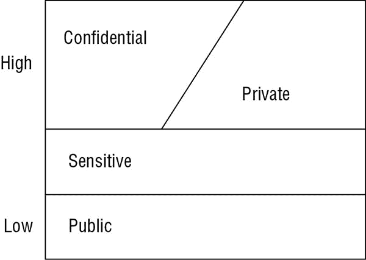

**FIGURE 1.5** Commercial business/private sector classification levels 

`Confidential` `Confidential` 是最高级别的分类。此级别用于极其敏感且仅限内部使用的数据。若机密数据泄露，可能对公司造成重大负面影响。有时会将 `proprietary` 替代 `confidential`，有时将专有数据视为机密信息的一种特殊形式。若专有数据泄露，可能极大削弱组织的竞争优势。

`Private` `Private` 用于私人或个人性质的数据，仅限内部使用。若私人数据泄露，可能对公司或个人造成重大负面影响。

`Sensitive` `Sensitive` 用于比公开数据更受限的数据。若敏感数据泄露，可能对公司造成负面影响。

`Public` `Public` 是最低级别的分类。用于所有不属于上述高级别的数据。其泄露不会对组织造成严重负面影响。

关于数据分类或分类的另一个考量因素是所有权。 `Ownership` 是将责任正式分配给个人或团体的行为。所有权可以在操作系统中明确，使文件或其他对象能够被指定所有者。通常，拥有者对其拥有的对象拥有完整的能力和权限。在大多数操作系统中，拥有权限通常授予最强大的账户，如 Windows 的管理员或 Unix/Linux 的 root。在大多数情况下，创建新对象的主体默认是该对象的所有者。在某些环境中，安全策略要求在新对象创建时，必须正式将所有权从终端用户转移至管理员或管理用户。此时，管理员账户可以直接取得新对象的所有权。

在正式 IT 结构之外的所有权通常不那么明显。公司文档可以为设施、业务任务、流程、资产等定义所有者，但这类文档未必在现实中“执行”所有权。文件对象的所有权由操作系统和文件系统强制执行，而物理对象、无形资产或组织概念（如研究部门或开发项目）的所有权仅在纸面上定义，容易受到质疑。为了在现实世界中强制执行所有权，还需实施额外的安全治理措施。

### 组织角色与责任

一个 `安全角色` 是个人在组织内实施和管理整体安全方案时所扮演的部分。安全角色不一定会出现在工作描述中，因为它们并不总是明确或固定的。熟悉安全角色有助于在组织内建立通信和支持结构。该结构将使得能够部署并执行安全策略。以下六个角色按其在安全环境中出现的逻辑顺序列出：

#### 高级经理

组织的所有者（`高级经理`）角色被分配给最终负责组织安全的个人，该个人应当最关注对其资产的保护。高级经理必须签署所有政策问题。事实上，所有活动必须在高级经理批准并签署后才能进行。如果没有高级经理的授权和支持，就没有有效的安全政策。高级经理对组织内实施的安全措施的接受与否表示认可。高级经理是对安全解决方案的整体成功或失败负最终责任，并负责在组织中建立安全时行使适当的谨慎和审慎。

尽管高级经理最终负责安全，但他们很少直接实施安全解决方案。通常，这项责任会委派给组织内的安全专业人员。

#### 安全专业人员

`安全专业人员`、`信息安全 (InfoSec) 官员` 或 `计算机事件响应团队 (CIRT)` 角色分配给受过训练且经验丰富的网络、系统和安全工程师，该工程师负责遵循高级管理层的指令。安全专业人员拥有安全的功能性责任，包括编写安全政策并实施它。该角色可被视为 IS/IT 功能角色。安全专业人员的角色通常由负责根据批准的安全政策设计和实施安全解决方案的团队来担任。安全专业人员不是决策者，他们是执行者。所有决策必须留给高级经理。

#### 数据所有者

`数据所有者` 角色分配给负责对信息进行分类以便在安全解决方案中进行放置和保护的个人。数据所有者通常是高级管理人员，对数据保护负最终责任。然而，数据所有者通常会将实际数据管理任务的责任委派给数据 `custodian`。

#### 数据 custodian

`数据 custodian` 角色分配给负责实施安全政策及高级管理层规定的保护措施的用户。数据 `custodian` 执行所有必要的活动，以提供对数据的 CIA 三要素（保密性、完整性和可用性）的充分保护，并履行上级管理层委派的要求和责任。这些活动可以包括执行和测试备份、验证数据完整性、部署安全解决方案以及根据分类管理数据存储。

#### 用户

`用户`（`终端用户` 或 `操作员`）角色分配给任何拥有访问受保护系统的个人。用户的访问权限与其工作任务相关，受限于仅拥有完成职位所需任务的最小权限。用户负责理解并遵守组织的安全政策，遵循规定的操作程序，并在定义的安全参数范围内工作。

#### 审计员

`审计员` 负责审查和验证安全政策是否得到正确实施，以及所衍生的安全解决方案是否足够。审计员角色可以分配给安全专业人员或受过训练的用户。审计员会产生合规性和有效性报告，这些报告由高级经理审阅。审计中发现的问题会转化为由高级经理分配给安全专业人员或数据 `custodian` 的新指令。然而，审计员被列为最后一个角色，因为审计需要基于用户或操作员在环境中的活动（即需要被审计或监控的对象）来进行。

所有这些角色在安全环境中发挥重要作用。它们有助于识别责任和职责，同时也有助于识别层级管理和委派方案。

## 安全控制框架

为组织构建安全姿态往往需要付出比仅仅写下几条宏大理念更多的努力。通常，制定稳健的安全政策需要进行大量的规划工作。许多《Dilbert》粉丝可能会认识到“为未来的会议计划会议”这种看似荒谬的概念。但事实证明，安全规划必须先规划规划，然后再规划标准与合规，最后才是实际的计划制定与设计。跳过任何这些“规划规划”的步骤，都可能在组织的安全解决方案尚未启动前就使其偏离正轨。

在安全规划的第一步中，考虑组织所期望的安全解决方案的整体 `安全控制框架` 或结构至关重要。你可以从多种安全概念基础设施中选择，但其中一种使用最广泛的安全控制框架是信息及相关技术治理目标 (`COBIT`)。`COBIT` 是由信息系统审计与控制协会 (`ISACA`) 编写的一套文档化最佳 IT 安全实践，它规定了安全控制的目标和要求，并鼓励将 IT 安全理念映射到业务目标上。`COBIT 5` 基于五大治理与管理企业 IT 的关键原则：

*   `原则 1`：满足利益相关者需求

*   `原则 2`：覆盖企业端到端

*   `原则 3`：采用单一、整合的框架

*   `原则 4`：实现整体性方法

*   `原则 5`：将治理与管理分离

`COBIT` 不仅用于规划组织的 IT 安全，也作为审计师的指南。`COBIT` 是广为人知且受人尊重的安全控制框架。

幸运的是，`COBIT` 在考试中仅被适度引用，因此不需要进一步细节。但如果你对该概念感兴趣，请访问 ISACA 网站 (`[www.isaca.org](http://www.isaca.org)`)，或如果你想获得一般性概述，可阅读维基百科上的 `COBIT` 条目。

还有许多其他 IT 安全标准和指南。以下是其中几个：

*   开源安全测试方法论手册 (`OSSTMM`) (`[www.isecom.org/research/](http://www.isecom.org/research/))`：一份同行评审的安全基础设施测试与分析指南

*   ISO/IEC 27002（取代了 ISO 17799）(`[`www.iso.org/standard/ 54533.html`](https://www.iso.org/standard/54533.html))`：一个国际标准，可作为实施组织安全及相关管理实践的基础

*   信息技术基础设施库 (`ITIL`) (`www.itlibrary.org` (`http://www.itlibrary.org`))：最初由英国政府创建，`ITIL` 是一组核心 IT 安全和运营流程的推荐最佳实践，常被用作定制 IT 安全解决方案的起点

### 谨慎与审慎

为什么计划安全计划安全那么重要？原因之一是对 `due care` 和 `due diligence` 的要求。`Due care` 是使用合理的安全措施来保护组织利益的责任。`Due diligence` 是实践维护 `Due care` 努力的活动。例如，`Due care` 是制定包含安全政策、标准、基线、指南和程序的正式化安全结构。`Due diligence` 是将该安全结构持续应用于组织的 IT 基础设施。运营安全是由组织中所有负责方持续维护 `Due care` 和 `Due diligence` 的持续过程。

在当今的商业环境中，谨慎是必须的。展示 `Due care` 和 `Due diligence` 是证明在发生损失时没有疏忽的唯一方法。高级管理层必须展示 `Due care` 和 `Due diligence`，以在发生损失时降低其责任和赔偿。

## 制定、记录和实施安全政策、标准、程序和指南

对于大多数组织来说，维护安全是持续业务的重要组成部分。如果它们的安全受到严重威胁，许多组织将无法继续。为了降低安全失败的可能性，实施安全的过程已经 `somewhat formalized`（部分正式化）为文档的层级结构。每一层级都专注于特定类型或类别的信息和问题。制定和实施文档化的安全政策、标准、程序和指南，会产生稳固可靠的安全基础设施。这种正式化极大地减少了设计和实施 IT 基础设施安全解决方案的混乱和复杂性。

### 安全政策

正式化的顶层称为安全政策。一个 `security policy` 是一份文档，定义组织所需的安全范围，讨论需要保护的资产以及安全解决方案应达到的程度。安全政策是对组织安全需求的概述或概括。它定义了主要的安全目标，并概述了组织的安全框架。它还识别了数据处理的主要功能领域，并明确和定义所有相关术语。它应明确说明安全的重要性以及有价值的资产。它是实施安全的战略计划。它应广泛概述应采用的安全目标和实践，以保护组织的重要利益。文档讨论了安全对日常业务运营的重要性以及高级管理人员对安全实施的支持的重要性。安全政策用于分配责任、定义角色、指定审计要求、概述执行流程、指示合规要求以及定义可接受的风险水平。该文档常被用作高级管理层已行使 `Due care`、保护自身免受入侵、攻击和灾难的证明。安全政策是强制性的。

许多组织使用多种类型的安全政策来定义或概述其整体安全策略。一个 `organizational security policy` 关注与组织的各个方面相关的问题。一个 `issue-specific security policy` 关注特定的网络服务、部门、功能或其他与组织整体不同的特定方面。一个 `system-specific security policy` 关注单个系统或系统类型，规定经批准的硬件和软件，概述系统加固的方法，甚至规定防火墙或其他特定安全控制。


除了这些专注的安全政策类型外，还有三个总体类别的安全政策：监管、咨询和信息性。一个`regulatory policy` 是在适用行业或法律标准时必须实施的。该政策讨论必须遵循的法规，并概述用于确保合规的程序。一个`advisory policy` 讨论可接受的行为和活动，并定义违规的后果。它解释了高级管理层对组织内安全和合规的愿望。大多数政策都是咨询性的。一个`informative policy` 设计用于提供关于特定主题的信息或知识，例如公司目标、使命陈述，或组织与合作伙伴和客户的互动方式。信息性政策提供相关支持、研究或背景信息，针对整体政策的具体元素。

从安全政策中衍生出许多其他文档或子元素，构成完整的安全解决方案。政策是广泛的概述，而标准、基线、指南和程序包含更具体、详细的实际安全解决方案信息。标准是安全政策的下一层。

### 安全标准、基线和指南

在主安全政策设定后，其余的安全文档可以在其指导下编写。`Standards` 定义了硬件、软件、技术和安全控制的通用强制性要求。它们提供了一种行动方式，使技术和程序在组织内部得到统一实施。标准是战术性文档，定义实现安全政策目标和整体方向的步骤或方法。

在下一层是基线。一个`baseline` 定义了组织中所有系统必须达到的最低安全水平。未能符合基线的系统应被移出生产环境，直到它们能够达到基线要求。基线建立了一个共同的安全状态，在此基础上可以构建更严格的安全措施。基线通常是系统特定的，并经常引用行业或政府标准，如 Trusted Computer System Evaluation Criteria（TCSEC）或 Information Technology Security Evaluation and Criteria（ITSEC）或 NIST（国家标准技术研究所）标准。

指南是正式化安全政策结构的下一个元素。一个`guideline` 提供关于如何实施标准和基线的建议，并作为安全专业人员和用户的操作指南。指南具有灵活性，可以针对每个独特系统或条件进行定制，并可用于创建新的程序。它们指定应部署哪些安全机制，而不是指定具体的产品或控制，并详细说明配置设置。它们概述了方法论，包括建议的行动，但并非强制性。

### 安全程序

程序是正式化安全政策结构的最终元素。一个`procedure` 或 `standard operating procedure (SOP)` 是一份详细的、逐步操作文档，描述实施特定安全机制、控制或解决方案的具体操作步骤。程序可能讨论整个系统部署操作，也可能专注于单个产品或方面，例如部署防火墙或更新病毒定义。在大多数情况下，程序是系统和软件特定的。它们必须随着系统的硬件和软件发展而更新。程序的目的是确保业务流程的完整性。如果一切操作都严格按照详细的程序进行，那么所有活动都应符合政策、标准和指南。程序有助于确保安全在所有系统中得到标准化。

太常见了，政策、标准、基线、指南和程序通常是在咨询者或审计师的催促下，事后才作为事后考虑来制定的。如果这些文档没有被使用和更新，受保护环境的管理将无法将它们作为指南。而且，如果没有这些文档提供的规划、设计、结构和监督，任何环境都无法保持安全或展现出适当的谨慎责任。

同样，常见的做法是将所有这些要素整合到一份文档中。这应该避免。每种结构都必须作为独立实体存在，因为每种都执行不同的专门功能。在正式化安全政策文档结构的顶端，文档数量较少，因为它们包含对概览和目标的一般性广泛讨论。在正式化结构的下方（换句话说，指南和程序），文档数量更多，因为它们包含针对有限数量系统、网络、部门和领域的具体细节。

保持这些文档作为独立实体有以下几个好处：

*   并非所有用户都需要了解所有安全分类级别的安全标准、基线、指南和程序。

*   当发生变更时，只需更新和分发受影响的材料，而不是更新一整套政策并向整个组织分发，这样更加高效。

编写完整的安全政策及其所有 `supporting` 文档可能是一项艰巨的任务。许多组织在定义安全的基础参数时就已经感到吃力，更别说详细描述日常活动的每一个方面了。然而，理论上，详细且完整的安全政策能够以有条理、高效、`[content]`和具体的方式支持实际安全。一旦安全政策文档 `reasonably` 完整，它就可以用于指导决策、培训新用户、应对问题以及预测未来扩展的趋势。安全政策不应是事后考虑，而应是建立组织的关键部分。

关于构成完整安全政策的文档，还有几个额外的视角值得理解。`Figure 1.6` 展示了这些组件（政策、标准、指南、程序）之间的依赖关系：安全政策定义了组织化安全文档的整体结构，然后标准基于这些政策以及受法规和合同约束而制定，指南则是从标准中派生的，而程序则基于这三者。使用倒金字塔来表示每种文档的体积或大小。通常，程序的数量远多于其他任何元素。相比而言，程序的数量少于程序，标准更少，而通常甚至更少的是顶层或组织范围的安全政策。

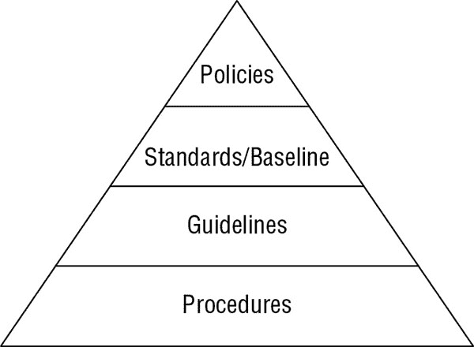

**FIGURE 1.6** The comparative relationships of security policy components 

## 理解并应用威胁建模概念和方法论

威胁建模是安全流程，在其中潜在威胁被识别、分类和分析。`Threat modeling` 可以在设计和开发的初期作为主动措施进行，也可以在产品上线后作为被动措施进行。无论哪种情况，该过程都会识别潜在的危害、发生概率、关注的优先级以及消除或降低威胁的手段。本节将展示多种威胁建模概念的示例，并介绍几种威胁建模方法论。

威胁建模并非单一的一次性活动。相反，组织通常会在系统设计阶段早期开始威胁建模，并在其生命周期内持续进行。例如，Microsoft 采用 `Security Development Lifecycle (SDL)` 流程，在产品开发的每个阶段考虑并实施安全。这支持了“Secure by Design, Secure by Default, Secure in Deployment and Communication”（也称为 `SD3+C`）的口号。该流程的两大目标是：

*   减少安全相关的设计和编码缺陷的数量

*   减少剩余缺陷的严重程度

换言之，它旨在减少漏洞的数量，并降低任何剩余漏洞的影响。整体结果是降低风险。

`主动` 的威胁建模发生在系统开发的早期阶段，具体是在初步设计和规格确定期间。这种威胁建模也被称为防御性方法。该方法基于预测潜在威胁，并在编码和实现过程中设计特定的防御措施，而不是依赖于部署后的更新和补丁。在大多数情况下，集成的安全解决方案比事后临时加入的方案更具成本效益且更成功。不幸的是，并非所有威胁都能在设计阶段预测出来，因此被动的威胁建模仍然是必要的，用于应对未预见的问题。

`被动` 的威胁建模发生在产品创建并部署之后。部署可能是在测试或实验室环境，也可能是面向公众的市场。这种威胁建模也被称为对抗性方法。该技术的核心概念是伦理黑客、渗透测试、源代码审查和模糊测试。虽然这些过程常常有助于发现需要修复的缺陷和威胁，但它们往往会导致额外的编码工作，以添加新的防护措施。回到设计阶段可能会在长期内产生更好的产品，但从头重新开始成本极高，并导致产品发布出现重大延迟。因此，快捷方式是开发更新或补丁，在部署后将其添加到产品中。这会导致安全改进效果不佳（过于主动的威胁建模），并可能削弱功能性和易用性。

### 识别威胁

由于威胁的可能性几乎无限，使用结构化的方法来准确识别相关威胁至关重要。例如，一些组织会采用以下三种方法之一：

**聚焦于资产** 该方法利用资产估值结果，尝试识别针对有价值资产的威胁。例如，可以评估特定资产是否容易受到攻击；如果该资产托管数据，则可以评估访问控制，以识别绕过身份验证或授权机制的潜在威胁。

**聚焦于攻击者** 部分组织能够识别潜在的攻击者，并根据攻击者的目标识别其代表的威胁。例如，政府通常能够识别潜在攻击者，并认识到攻击者想要实现的目标，从而据此识别并保护相关资产。此方法的挑战在于，新的攻击者可能会出现，而之前并未被视为威胁。

**聚焦于软件** 如果组织开发软件，它可以考虑针对软件的潜在威胁。虽然多年前组织通常不自行开发软件，但如今已非常普遍。具体而言，大多数组织拥有在线存在，许多会创建自己的网页。华丽的网页能吸引更多流量，但也需要更高级的编程，并带来额外的威胁。

如果威胁被识别为攻击者（相对于自然威胁），威胁建模尝试识别攻击者可能试图实现的目标。一些攻击者可能希望禁用系统，而其他攻击者可能希望窃取数据。一旦识别出此类威胁，它们就会根据目标或动机进行分类。此外，通常会将威胁与漏洞配对，以识别可以利用漏洞的威胁，并代表对组织构成重大风险的威胁。威胁建模的最终目标是对组织有价值资产的潜在威胁进行优先级排序。

在尝试清点和分类威胁时，使用指南或参考资料通常很有帮助。微软开发了一套称为 STRIDE 威胁模型的威胁分类方案。STRIDE 通常用于评估针对应用程序或操作系统的威胁，但也可用于其他情境。`STRIDE` 是以下内容的缩写：

*   `Spoofing`：一种通过使用伪造身份获取目标系统访问权限的攻击。`Spoofing` 可针对 IP 地址、`MAC` 地址、用户名、系统名称、无线网络服务集标识符 (`SSID`)、电子邮件地址以及许多其他类型的逻辑标识进行。当攻击者冒充合法或授权实体时，通常能够绕过针对未经授权访问的过滤和阻断措施。一旦伪造攻击成功让攻击者获得目标系统的访问权限，后续的滥用、数据窃取或特权提升攻击可以随之发起。

*   `Tampering`：导致数据在传输中或存储时出现未经授权的修改或操纵的任何行为。`Tampering` 用于伪造通信或篡改静态信息。此类攻击违反完整性以及可用性。

*   `Repudiation`：用户或攻击者否认自己执行某项操作或活动的能力。攻击者经常进行否认攻击以保持可信否认，从而避免对其行为承担责任。否认攻击也可能导致无辜的第三方被指责安全违规。

*   `Information disclosure`：向外部或未经授权实体泄露、分发私有、机密或受控信息。这可能包括客户身份信息、财务信息或专有业务操作细节。信息泄露可能利用系统设计或实现缺陷，例如未清除调试代码、保留样本应用和账户、未对客户可见内容（如 HTML 文档中的注释）进行脱敏、使用隐藏表单字段或允许向用户显示过于详细的错误信息。

*   `Denial of service (DoS)`：一种试图阻止授权使用资源的攻击。可以通过漏洞利用、连接过载或流量洪水实现。`DoS` 攻击不一定导致资源完全中断；它可能降低吞吐量或引入延迟，以阻碍资源的高效使用。虽然大多数 `DoS` 攻击是暂时的，持续时间取决于攻击者的持续施压，但也存在永久性 `DoS` 攻击。永久 `DoS` 攻击可能涉及数据集的破坏、将软件替换为恶意版本，或强制执行固件闪录操作（该操作可能被中断或安装有缺陷的固件）。这些 `DoS` 攻击会使系统永久损坏，无法通过简单重启或等待攻击者停止即可恢复；需要完整的系统修复和备份恢复才能使系统回到正常工作状态。

*   `Elevation of privilege`：一种将有限权限的用户账户转变为特权更高、权力更大、访问更广的账户的攻击。这可能通过窃取或利用高级账户（如管理员或 root）的凭据实现，也可能通过系统或应用程序漏洞暂时或永久赋予有限账户额外权限。

虽然 `STRIDE` 通常用于关注应用程序威胁，它同样适用于网络威胁和主机威胁。其他攻击可能更具体于网络或主机 concerns，例如网络的窃听和劫持、主机的恶意软件和任意代码执行，但 `STRIDE` 的六大概念广泛适用。

`Process for Attack Simulation and Threat Analysis (PASTA)` 是一种七阶段（`Figure 1.7`）的威胁建模方法论。`PASTA` 是一种以风险为中心的方法，旨在根据需要保护的资产价值选择或开发对应的防护措施。以下是 `PASTA` 的七个步骤：

*   `Stage I`: 定义风险分析的目标 (`DO`)

*   `Stage II`: 定义技术范围 (`DTS`)

*   `Stage III`: 应用分解与分析 (`ADA`)

*   `Stage IV`: 威胁分析 (`TA`)

*   `Stage V`: 弱点与漏洞分析 (`WVA`)

*   `Stage VI`: 攻击建模与模拟 (`AMS`)

*   `Stage VII`: 风险分析与管理 (`RAM`)

`PASTA` 的每个阶段都有具体的目标列表和可交付成果，以完成该阶段。有关 `PASTA` 的更多信息，请参阅由 Tony UcedaVelez 和 Marco M. Morana 著的第一版著作 `Risk Centric Threat Modeling: Process for Attack Simulation and Threat Analysis`。（您可以在线查看该书的附录，其中对 `PASTA` 进行了探讨：`www.isaca.org/chapters5/Ireland/Documents/2013%20Presentations/PASTA%20Methodology%20Appendix%20-%20November%202013.pdf.`）

``

**FIGURE 1.7** 一个用于揭示威胁关注点的示例图示

`Visual, Agile, and Simple Threat (VAST)` 是一种基于敏捷项目管理和编程原则的威胁建模概念。`VAST` 的目标是将威胁与风险管理集成到可扩展的敏捷编程环境中。

这些只是社区团体、商业实体、政府机构和国际协会提供的众多威胁建模概念和方法论中的几个。

通常，`STRIDE` 及其他威胁建模方法的目的在于考虑妥协关注点的范围，并聚焦于攻击的目标或最终结果。尝试识别每一种具体的攻击方法和技术是一项不可能的任务——新的攻击不断被开发。虽然攻击的目标或目的可以粗略分类和分组，但它们随时间保持相对恒定。

潜在的威胁对您的业务范围广泛且多样化。公司面临来自自然、技术和人员的威胁。大多数企业在应对威胁时主要关注自然灾害和 IT 攻击，但也必须考虑个人带来的威胁潜力。始终要考虑组织活动、决策和互动的最佳和最差可能结果。识别威胁是设计防御措施的第一步，以帮助减少或消除停机时间、妥协和损失。

### 确定并绘制潜在攻击图

在获得对开发项目或部署基础设施面临威胁的理解后，威胁建模的下一步是确定可能实现的攻击概念。通常通过绘制交易中涉及的元素图，并标注数据流和特权边界（`Figure 1.8`）。此图是一张数据流图的示例，展示了系统的主要组件、安全区域之间的边界以及信息和数据的潜在流动或移动。通过为每个环境或系统创建此类图表，可以更直观地检查可能发生妥协的每个点。

此类数据流图有助于通过视觉呈现更好地理解资源关系和数据在系统中的移动。绘制此类图表的过程也被称为绘制架构图。绘制图表有助于详细说明业务任务、开发过程或工作活动中每个元素的功能和目的。应包括用户、处理器、应用程序、数据存储以及执行特定任务或操作所需的所有其他必要元素。这是一个高层次概览，而非对代码逻辑的详细评估。但对于更复杂的系统，可能需要在不同的关注点和不同的细节程度下创建多个图表。

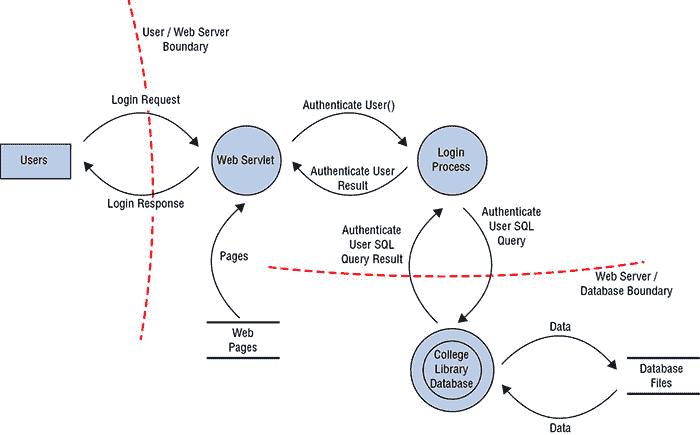

**FIGURE 1.8** An example of diagramming to reveal threat concerns 

绘制图表后，识别图中涉及的所有技术。这包括操作系统、应用程序（网络服务和客户端）以及协议。需具体说明所使用的版本号以及更新/补丁级别。

随后，针对图中每个元素识别可能的攻击。需考虑所有形式的攻击，包括逻辑/技术、物理和社会工程攻击。例如，必须包括伪造、篡改和社会工程。此过程将快速引导您进入威胁缓解分析的下一阶段。

### 执行缓解分析

威胁建模的下一步是执行缓解分析。缓解分析（也称为分解）的目的是更深入地理解产品的逻辑以及其与外部元素的交互。无论是应用程序、系统还是整个环境，都需要将其分解为更小的容器或隔离区。这些容器可能是子程序、模块或对象（针对软件、计算机或操作系统），也可能是协议（针对系统或网络），或是部门、任务和网络（针对整个业务基础设施）。每个被识别的子元素应被评估，以了解其输入、处理、安全性、数据管理、存储以及输出。

在分解过程中，需要识别五个关键概念：

**信任边界**：任何信任或安全级别发生变化的位置

**数据流路径**：数据在各位置之间的移动

**输入点**：接收外部输入的位置

**特权操作**：需要高于普通用户账户或进程特权的任何活动，通常用于系统更改或安全修改

**安全态势和方法的详细信息**：安全政策的声明、安全基础以及安全假设

将系统分解为其组成部分，使得更容易识别每个元素的关键组件，并注意潜在漏洞和攻击点。越深入理解程序、系统或环境的运作方式，越容易发现针对它的威胁。

### 优先级排序与响应

在通过威胁建模程序识别威胁后，需进行后续活动以完善流程。接下来是完整记录威胁。在记录中，应定义威胁的手段、目标和后果。可包括实施利用所需的技术以及列出潜在的对策和防护措施。

记录完成后，对威胁进行排名或评级。可以使用多种技术，如“`Probability × Damage Potential`”（概率 × 影响潜力）排名、高/中/低评级，或 `DREAD` 系统。

`Probability × Damage Potential` 方法产生 1 到 100 的风险严重程度数值，100 表示最严重的风险。两个初始值均可在 1 到 10 之间赋值，1 为最低，10 为最高。这些排名可能有些主观，但由于同一人或团队为自身组织分配数值，结果在相对意义上仍具备准确性。

高/中/低评级过程更为简化。每个威胁被赋予高、中或低优先级标签。标记为高优先级的威胁需立即处理；中优先级的威胁应在后续处理，但无需立即行动；低优先级的威胁可能被视为可选，如果其所需努力或成本相对于整体项目过高，则可不予处理。

`DREAD` 评级系统旨在提供一个灵活的评级方案，基于对每个威胁的五个主要问题的回答：

- `Damage potential`（影响潜力）：若威胁实现，损害程度有多严重？

- `Reproducibility`（可再现性）：攻击者复现 `exploit` 的难度如何？


- `Exploitability`（可 exploit 性）：执行攻击有多困难？

- `Affected users`（受影响用户数）：预计受攻击影响的用户比例是多少？

- `Discoverability`（可发现性）：攻击者发现弱点的难度如何？

通过对这些（以及可能的自定义）问题进行提问，并为答案赋予 H/M/L 或 3/2/1 的数值，可建立详细的威胁优先级。

一旦威胁优先级确定，需制定相应的响应措施。应考虑技术和流程以缓解威胁，并根据成本和有效性对其进行权重评估。响应选项应包括对软件架构的调整、操作和流程的变更，以及实施防御和检测组件。

## 将风险管理概念应用于供应链

# 将基于风险的管理概念应用于供应链是确保所有规模组织中更稳健和成功的安全策略的一种手段。

A `supply chain` 是指概念，即大多数计算机、设备、网络和系统并非由单一实体构建。事实上，我们所知的大多数计算机和设备制造商，如 `Dell`、`Cisco`、`Extreme Networks`、`Juniper`、`Asus`、`Acer` 和 `Apple`，通常负责最终组装而非制造所有单独组件。经常 `CPU`、`内存`、`驱动控制器`、`硬盘`、`SSD` 和 `显卡` 由其他第三方供应商创建。即使这些公用商品供应商也不太可能自己开采金属或加工塑料用的石油，或钻制他们的芯片硅。因此，任何完成的系统都有其长而复杂的历史，即其 `supply chain`，这使得它得以存在。

一个安全的 `supply chain` 是指链条中的所有供应商或环节都是可靠、值得信赖、声誉良好的组织，它们向业务合作伙伴（虽然不一定向公众）披露其做法和安全要求。链条中的每个环节都负责并对其在链条中的下一个环节负责。从原材料到精炼产品、电子零部件、计算机组件到成品的每一次交接，都应当得到适当的组织、记录、管理和审计。安全 `supply chain` 的目标是确保最终产品质量足够，满足性能和运营目标，并提供所述的安全机制，且在整个过程中没有任何元素被伪造或遭受未经授权或恶意的操纵、破坏。

为了获得关于供应链风险的额外视角，可查看位于 [`www.nist.gov/sites/default/files/documents/itl/csd/NIST_USRP-Boeing-Exostar-Case-Study.pdf`](https://www.nist.gov/sites/default/files/documents/itl/csd/NIST_USRP-Boeing-Exostar-Case-Study.pdf) 的 NIST 案例研究。

当进行收购和合并时，若未考虑安全因素，则这些产品固有的风险将贯穿其整个部署生命周期。降低已获取元素的固有威胁将降低安全管理成本，并可能减少安全事件。

评估硬件、软件和服务的相关风险至关重要。具有强大集成安全性的产品和解决方案通常比缺乏安全基础的产品更昂贵；然而，这笔额外的初始支出往往比针对设计不佳产品在其整个生命周期内解决安全需求的支出更具性价比。因此，在评估并购/收购的成本时，应考虑产品部署生命周期的总拥有成本，而不仅仅是初始购买和实施费用。

收购不仅限于硬件和软件。外包、与供应商签约以及聘请顾问也是收购的组成部分。与外部实体合作时，将安全评估纳入流程与确保产品在设计阶段即具备安全性同等重要。

在许多情况下，持续的安全监控、管理和评估可能是必须的。这可能是行业最佳实践，也可能是法规要求。此类评估和监控可能由组织内部完成，也可能需要使用外部审计师。在聘请第三方评估和监控服务时，请记住外部实体必须在其业务运营中展现出安全意识。如果外部组织无法安全管理其自身内部运营，它如何能够为您提供可靠的安全管理功能？

在评估第三方安全集成时，请考虑以下流程：

**现场评估** 访问组织场地，面谈人员并观察其操作习惯。

**文档交换与审查** 研究数据集和文档的交换方式，以及他们进行评估和审查的正式流程。

**流程/政策审查** 索取他们的安全政策、流程/程序，以及事件和响应的文档以供审阅。

**第三方审计** 由美国注册会计师协会（AICPA）定义的独立第三方审计师可以提供针对实体安全基础设施的无偏审查，基于服务组织控制（SOC）报告。陈述性保证参与协议（SSAE）是一项规定，规定了服务组织如何通过各种 SOC 报告报告其合规性。SSAE 16 版本于 2011 年 6 月 15 日生效，于 2017 年 5 月 1 日被 SSAE 18 取代。SOC1 和 SOC2 审计框架值得考虑用于安全评估。SOC1 审计侧重于描述安全机制以评估其适用性。SOC2 审计侧重于实现的安全控制，涉及可用性、安全性、完整性、隐私性和保密性。关于 SOC 审计的更多信息，请参见 [`www.aicpa.org/interestareas/frc/assuranceadvisoryservices/socguidesandpublications.html`](https://www.aicpa.org/interestareas/frc/assuranceadvisoryservices/socguidesandpublications.html)。

对于所有收购，应建立最低安全要求。这些要求应从现有的安全政策中建模。新硬件、软件或服务的安全要求应始终满足或超过现有基础设施的安全水平。在与外部服务合作时，请务必审阅任何 `服务级别协议 (SLA)`，确保安全是合同服务的强制组成部分。这可能包括为满足您的特定需求而定制服务级别要求。

下面是一些与收购中安全集成相关的优秀资源：

* 提升网络安全与韧性 —  — 美国国防部与一般服务管理局最终报告，发表于 2013 年 11 月（[www.gsa.gov/portal/getMediaData?mediaId=185371](http://www.gsa.gov/portal/getMediaData?mediaId=185371)）

* NIST 特刊 800-64 修订版 2：系统开发生命周期中的安全考量（[`csrc.nist.gov/publications/nistpubs/800-64-Rev2/SP800-64-Revision2.pdf`](http://csrc.nist.gov/publications/nistpubs/800-64-Rev2/SP800-64-Revision2.pdf)）

# 摘要

安全治理、管理概念和原则是安全策略及解决方案部署中固有的组成部分。它们定义了构建安全环境所需的基本参数。它们还定义了政策设计者和系统实施者必须达成的目标和任务，以创建安全的解决方案。

安全的主要目标和任务包含在 CIA 三元组中：保密性、完整性和可用性。这三项原则被视为安全领域中最重要的。它们对组织的重要性取决于组织的安全目标和需求以及其环境中的安全威胁程度。

CIA 三元组的第一项原则是保密性，即对象不向未经授权的主体披露。提供保密性的安全机制能够高度确保数据、对象或资源不会被未经授权的主体暴露。如果存在针对保密性的威胁，则有可能发生未经授权的披露。

第二项 CIA 三元组原则是完整性，即只有经授权的主体才能故意修改对象，使其保持其准确性。提供完整性的安全机制能够高度确保数据、对象和资源未经授权的变更，包括在存储、传输或处理过程中发生的变更。维护完整性意味着对象本身不被修改，且管理和操作该对象的操作系统及编程实体未被妥协。

第三项 CIA 三元组原则是可用性，即授权主体获得对对象的及时、 uninterrupted（不间断）访问。提供可用性的安全机制能够高度确保数据、对象和资源对授权主体可用。可用性包括对对象的高效、 uninterrupted（不间断）访问以及防范拒绝服务攻击。它还意味着支持基础设施功能正常，授权用户能够获得授权访问。

在设计安全策略和部署安全解决方案时，还需考虑和处理以下安全相关概念和原则：隐私、身份识别、认证、授权、问责、不可否认性和审计。

安全解决方案概念和原则的其他方面包括保护机制的要素：分层、抽象、数据隐藏和加密。这些是安全控制的共同特征，虽然并非所有安全控制都必须具备它们，但许多控制会使用这些机制来保护保密性、完整性和可用性。

安全角色决定组织资产安全的责任人。被指派高级管理角色的责任人最终对任何资产损失负责，他们定义安全策略。安全专业人员负责实施安全策略，用户负责遵守安全策略。被指派为数据所有者角色的人负责分类信息，而数据保管人负责维护安全环境并备份数据。审计员负责确保安全环境正确保护资产。

正式化的安全策略结构包括策略、标准、基线、指南和程序。这些单独文档是安全在任何环境中设计和实施的关键要素。

变更的控制或管理是安全管理实践的重要方面。当安全环境发生变更时，缺陷、重叠、遗漏的对象和疏忽可能导致新漏洞。通过系统化管理变更，可以保持安全。这通常涉及对安全控制和安全机制相关活动的广泛记录、审计和监控。生成的数据随后用于识别变更的代理，无论是对象、主体、程序、通信路径，甚至是网络本身。

数据分类是根据数据的秘密性、敏感性或保密性对数据进行保护的主要手段。由于某些数据项需要更高的安全水平，因此在设计和实施安全系统时，对所有数据采用相同的处理方式是低效的。如果所有数据都按低安全级别保护，敏感数据容易被访问；如果所有数据都按高安全级别保护，则成本过高且限制了对非机密、非关键数据的访问。数据分类用于确定保护数据所需的努力、金钱和资源，以及控制对其的访问。

安全管理规划的一个重要方面是安全策略的正确实施。要有效，安全管理的方法必须是自上而下的。制定和定义安全策略的责任在于上级或高级管理层。安全策略为组织层级的下级提供方向。中层管理负责将安全策略细化为标准、基线、指南和程序。操作管理者或安全专业人员负责实施安全管理文档中规定的配置。最终，终端用户的责任是遵守组织的所有安全策略。

安全管理规划包括定义安全角色、制定安全策略、进行风险分析以及要求员工接受安全教育。这些责任受管理计划的发展指导。安全管理团队应制定战略、战术和操作计划。

威胁建模是安全流程，用于识别、分类和分析潜在威胁。威胁建模可以在设计和开发阶段作为主动措施进行，也可以在产品部署后作为被动措施进行。无论哪种情况，该过程都会识别潜在的危害、发生概率、关注优先级以及消除或减轻威胁的手段。

将网络安全风险管理与供应链、采购策略和业务实践相结合，是确保各类规模组织拥有更稳健和成功安全策略的手段。当购买时未考虑安全因素时，这些产品固有的风险会贯穿其整个部署生命周期。

1. 讨论并描述保密性、完整性和可用性三要素（CIA Triad）。

2. 要使用户账户的操作行为对其负责，需要满足哪些条件？

3. 变更控制管理的好处是什么？

4. 实施分类方案的七个主要步骤或阶段是什么？

5. (ISC)² 为 CISSP 认证定义的六个主要安全角色有哪些？

6. 完整的组织安全策略由哪四个组成部分构成，它们的基本目的是什么？

7. 以下哪项包含安全的主要目标和目的？

   1. 网络的边界防护

   2. CIA 三要素

   3. 独立系统

   4. 互联网

8. 漏洞和风险是基于它们对以下哪方面的威胁进行评估的？

   1. 一个或多个 CIA 三要素原则

   2. 数据的有用性

   3. 谨慎义务

   4. 责任程度

9. CIA 三要素中，哪一项原则的含义是授权主体可以及时且不受阻碍地访问对象？

   1. 身份识别

   2. 可用性

   3. 加密

   4. 层级化

10. 以下哪项不被视为机密性的违反？

    1. 窃取密码

    2. 窃听

    3. 硬件破坏

    4. 社会工程

11. 以下哪项是错误的？

    1. 机密性违反包括人为错误。

    2. 机密性违反包括管理层监督。

    3. 机密性违反仅限于直接的有意攻击。

    4. 当传输未正确加密时，机密性违反也可能发生。

12. STRIDE 经常用于评估针对应用程序或操作系统的威胁，以下哪项不是 STRIDE 的组成部分？

    1. 伪装（Spoofing）

    2. 特权提升（Elevation of privilege）

    3. 不可否认性（Repudiation）

    4. 披露（Disclosure）

13. 如果一个安全机制提供可用性，那么它保证授权主体可以 \_\_\_\_\_\_\_\_\_\_\_\_\_\_\_\_\_\_\_\_\_ 访问、控制、审计或否认数据、对象和资源。

    1. 控制

    2. 审计

    3. 访问

    4. 否认

14. \_\_\_\_\_\_\_\_\_\_\_\_\_\_\_ 指的是保护个人可识别信息或可能导致他人感到伤害、尴尬或羞辱的信息的机密性。

    1. 隐蔽

    2. 隐藏

    3. 隐私

    4. 关键性

15. 以下哪项不需要所有受影响的个人具备意识？

    1. 保密性

    2. 完整性

    3. 可用性

    4. 审计

1. 限制个人电子邮件

2. 记录电话交谈

3. 收集关于浏览习惯的信息

4. 用于保留电子邮件消息的备份机制

10. 哪个数据分类管理的元素可以覆盖所有其他访问控制形式？

1. 分类

2. 物理访问

3. 保管责任

4. 所有权

11. 哪个确保活动或事件的主体不能否认该事件已发生？

1. CIA 三元组

2. 抽象

3. 不可否认性

4. 哈希总计

12. 下列哪个是与分层安全最相关的最重要和最独特的概念？

1. 多重

2. 系列

3. 并行

4. 过滤

13. 下列哪个不被视为数据隐藏的例子？

1. 防止获准的读者删除对象

2. 防止未经授权访问数据库

3. 限制低分类级别的主体访问高分类级别的数据

4. 防止应用程序直接访问硬件

14. 变更管理的主要目标是什么？

1. 保持文档更新

2. 让用户了解变更

3. 允许回滚失败的变更

4. 防止安全妥协

15. 数据分类方案的主要目标是什么？

1. 控制授权主体对对象的访问

2. 正式化和层级化根据重要性和敏感性标签保护数据的过程

3. 建立审计问责的交易日志

4. 通过高效控制访问权限来授予或限制功能

16. 以下哪项通常不是分类数据时考虑的特征？

1. 价值

2. 对象大小

3. 有用寿命

4. 国家安全影响

17. 两种常见的数据分类方案是什么？

1. 军事和私营部门

2. 个人和政府

3. 私营部门和无限制部门

4. 机密和非机密

18. 哪个是已分类数据的最低军事分类？

1. 敏感

2. 秘密

3. 专有

4. 私人

19. 哪种商业/私营部门数据分类用于控制组织内部关于个人的信息？

1. 机密

2. 私人

3. 敏感

4. 专有

20. 数据分类用于集中安全控制的所有以下方面，除了哪个？

1. 存储

2. 处理

3. 层次结构

4. 传输

# 第 2 章

人员安全和风险管理概念

**本章涵盖的 CISSP 考试主题：**

*   **`Domain 1: 安全与风险管理`**

    *   1.8 质量和执行人员安全政策和程序

        *   1.8.1 候选人筛选和招聘

        *   1.8.2 聘用协议和政策

        *   1.8.3 入职和离职流程

        *   1.8.4 供应商、顾问和承包商协议与控制

        *   1.8.5 合规政策要求

        *   1.8.6 隐私政策要求

    *   1.9 理解并应用风险管理概念

        *   1.9.1 识别威胁和漏洞

        *   1.9.2 风险评估/分析

        *   1.9.3 风险响应

        *   1.9.4 对策选择与实施

        *   1.9.5 适用的控制类型（如预防、检测、纠正）

        *   1.9.6 安全控制评估（SCA）

        *   1.9.7 监控与测量

        *   1.9.8 资产估值

        *   1.9.9 报告

        *   1.9.10 持续改进

        *   1.9.11 风险框架

    *   1.12 建立并维护安全意识、教育和培训计划

        *   1.12.1 展示意识和培训的方法和技术

        *   1.12.2 定期内容审查

        *   1.12.3 计划有效性评估

*   **`Domain 6: 安全评估与测试`**

    *   6.3.5 培训与意识

`Common Body of Knowledge (CBK)` for the CISSP certification exam 的安全与风险管理域涵盖了安全解决方案设计、实施和管理的许多基础元素。

该域的其他元素在各章节中讨论：第 1 章“通过原则和政策进行安全治理”；第 3 章“业务连续性规划”；第 4 章“法律、法规和合规”。请务必阅读这些章节，以完整掌握该域的主题。

由于硬件和软件控制的复杂性，员工安全管理常被整体安全规划所忽视。本章探讨了安全的“人”的方面，从建立安全的招聘实践和职位描述，到构建员工基础设施。此外，我们还考察员工培训、管理和离职实践在创建安全环境中的重要性。最后，我们审视如何评估和管理安全风险。

## 人员安全政策和程序

人是任何安全解决方案的最弱元素。无论部署了什么样的物理或逻辑控制，人都可以发现规避、规避或破坏这些控制，甚至使其失效。因此，在设计和部署安全解决方案时，必须考虑用户的“人性”。要理解并应用安全治理，必须解决安全链中最弱的环节——即人。

与人相关的问题、问题和妥协在安全解决方案的开发全过程中不断出现，因为人参与其中的全过程。因此，必须评估用户、设计者、程序员、开发人员、经理和实施者对流程的影响。

招聘新员工通常包括以下几个步骤：编写 `职位描述` 或 `职位要求`，为职位设定分类，筛选求职者，并雇佣和培训最合适的人选。没有职位描述，就没有共识来确定应招聘的个人类型。因此，编写职位描述是定义人员安全需求、寻找新员工的第一步。一些组织认可“角色描述”与“职位描述”之间的区别。角色通常对应特权或级别，而职位描述对应具体的责任和任务。


人员加入组织是因为需要其特定的技能和经验。任何组织内的职位描述都应涵盖相关的安全问题。必须考虑该职位是否需要处理敏感材料或访问机密信息。因此，职位描述定义了员工在执行工作任务时需要被分配到的角色。职位描述还应说明该职位在受保护网络上需要的访问类型和范围。在解决这些问题后，为职位描述分配安全分类是相当标准的步骤。

- [重要的工作描述要素包括职责分离、工作职责和工作轮岗，这些要素需与组织流程保持一致。]

# 职责分离

职责分离是一种安全概念，即将关键、重要和敏感的工作任务分配给多个个人管理员或高级操作员（`Figure 2.1`）。这可以防止任何一个人拥有破坏或颠覆关键安全机制的能力。将职责分离视为将管理员的权限原则应用于最小化特权。职责分离也是防止串通的保护措施。串通是指两个或多个人为了欺诈、盗窃或间谍等目的而进行的负面活动。通过限制个人的权限，职责分离要求员工必须与他人合作才能实施更大规模的违规行为。发现他人协助违规并执行该违规行为的行为更有可能留下证据并被发现，从而直接降低串通的发生（通过威慑，即被发现的可能性），这直接减少了串通的发生（通过威慑，即被发现的可能性）。因此，串通难以实施，并且在实施之前对实施者来说风险更高。

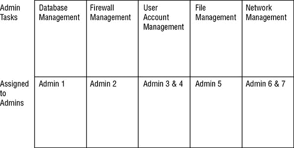

**FIGURE 2.1** 一个关于五个管理任务和七个管理员相关的职责分离的示例

# 工作职责

工作职责是员工定期需要执行的具体工作任务。根据他们的职责，员工需要访问各种对象、资源和服务。在受保护的网络中，用户必须为与其工作任务相关的元素授予访问权限。为了保持最高安全性，访问权限应根据最小特权原则分配。`principle of least privilege`（最小特权原则）指出，在受保护的环境中，用户应仅获得完成所需工作任务或工作职责所需的最小访问量。真正的最小特权原则应用需要对所有资源和功能进行低粒度的控制。

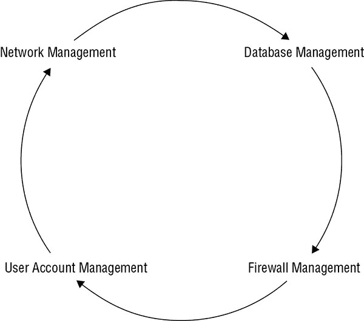

**FIGURE 2.2** 一个关于管理职位中职位轮换的示例

其次，调动人员可以降低欺诈、数据篡改、盗窃、破坏和信息滥用的风险。一个人在特定职位上工作的时间越长，越可能被分配额外的工作任务，从而扩大其特权和访问权限。随着个人对其工作任务越来越熟悉，他们可能会滥用特权以谋取个人利益或出于恶意。如果一名员工实施了滥用或滥用行为，另一名了解该职位和工作职责的员工更容易发现。因此，职位轮换也提供了一种同事审计的形式，并保护免受串通的侵害。

职位轮换要求安全特权和访问权限进行审查，以维持最小特权原则。长期在职的员工、跨职能培训和长期在职的员工的一个关注点是他们继续积累不再需要的特权和访问权限。特权、权限、权利、访问权限等的分配应定期审查，以检查特权膨胀或与工作职责的不匹配。特权膨胀是指工人随着时间的推移累积特权，而其工作职责发生变化。结果是，工人拥有的特权超过了`principle of least privilege`（最小特权原则）根据其当前工作职责所规定的数量。

当多个人合作实施犯罪时，这被称为串通。通过应用职责分离、受限制的工作职责和职位轮换的原则，降低同事愿意合作进行非法或滥用方案的可能性，因为被发现的风险更高。通过严格监控特权（如管理员、备份操作员、用户管理员等）的滥用，可以减少串通和其他特权滥用行为。

工作描述不仅用于招聘过程；它们应在组织的整个生命周期内保持更新。只有通过详细的工作描述，才能比较一个人应负责的事项与实际负责的事项。管理任务是确保工作描述尽可能少重叠，并且一名员工的职责不偏离或侵犯另一名员工的职责。同样，管理者应审计特权分配，确保员工仅获得完成工作任务所必需的访问权限。

## 候选人筛选和招聘

特定职位的就业候选人筛选基于工作描述中定义的敏感度和分类。特定职位的敏感度和分类取决于该职位中因意外或故意安全违规而可能造成的损害程度。因此，筛选过程的彻底程度应反映待填补职位的安全级别。

就业候选人筛选、背景调查、推荐信检查、教育验证和安全审查是证明候选人足够、有资质且值得信赖的关键要素。`[Background checks]`（背景调查）包括获取候选人的工作和教育历史；检查推荐人；验证教育背景；面谈同事、邻居和朋友；检查警察和政府记录以查找逮捕或非法活动；通过指纹、驾照和出生证验证身份；以及进行个人面试。此过程也可能包括多次测谎仪测试、药物测试和性格测试/评估。

在线进行背景调查并查看申请人的社交媒体账户已成为许多组织的标准做法。如果潜在员工在照片共享网站、社交媒体简介或公共即时通讯服务上发布了不适当的材料，那么他们不如那些没有发布此类内容的候选人有吸引力。我们在公众面前的行为在被记录为文本、照片或视频并上传到网络后变得永久存在。通过查看一个人的在线身份，可以快速了解其态度、智力、忠诚度、常识、勤奋、诚实、尊重、一致性以及遵守社会规范和/或企业文化的情况。

## 职业协议和政策

# 入职与离职流程

## 入职

当新员工被雇佣时，他们应签署一份《雇佣协议》。该文档概述了组织的规则和限制、安全政策、可接受使用和活动政策、职位描述、违规行为及其后果，以及员工需填补的职位时长。这些项目可能是单独的文档。在这种情况下，雇佣协议用于确认求职者已阅读并理解其即将担任职位的相关文档。

除了雇佣协议外，可能还有其他与安全相关的文档需要处理。常见的文档包括 `nondisclosure agreement (NDA)`（保密协议）。NDA 用于保护组织内部的机密信息不被前员工泄露。当某人签署 NDA 时，他们同意不向组织外任何人透露被定义为机密的信息。违反 NDA 通常会受到严厉的惩罚。

在人员整个任职期间，管理者应定期审核每位员工的职位描述、工作任务、特权和责任。工作任务和特权随时间推移而漂移是很常见的，这可能导致某些任务被忽视，而其他任务被多次执行。特权漂移或特权膨胀也可能导致安全漏洞。定期审查每个职位描述的边界与实际发生的情况，有助于将安全漏洞降至最低。

此审查过程的关键部分是强制休假。在许多受保护的环境中，强制休假为期一至两周，用于审计和验证员工的工作任务和特权。休假将员工从工作环境中移开，并由另一名员工替代，这使得发现原员工的滥用、欺诈或疏忽更加容易。

### Onboarding and Termination Processes

`Onboarding` 是将新员工添加到组织的身份和访问管理（IAM）系统的过程。当员工的角色或职位发生变化，或该人员获得额外的特权或访问权限时，也会使用此过程。

`Offboarding` 是此过程的逆过程。它是员工离开组织后从 IAM 系统中删除其身份。这可能包括禁用和/或删除用户账户、撤销证书、取消访问代码，以及终止其他专门授予的特权。这也可能包括通知安保人员和其他实体访问管理人员，在未来禁止该人员进入大楼。

Onboarding 和 offboarding 的程序应明确记录，以确保操作的一致性并符合法规或合同义务。

Onboarding 也可以指组织社会化。这是新员工被训练以便正确准备履行职责的过程。它可以包括培训、工作技能获取以及行为适应，以便高效地将员工融入现有的组织流程和程序。设计良好的 onboarding 可以提高工作满意度、提升生产力、加快与现有员工的融合、提升组织忠诚度、减轻压力、降低辞职率。另一个在职责分离和职责范围方面的好处是，它适用了先前讨论的最小权限原则。

当员工需要被解雇或 offboarded 时，必须解决众多问题。强大的安全部门与人力资源（HR）之间的关系对于在解雇过程中保持控制并最小化风险至关重要。员工解雇流程或政策对于维护安全环境至关重要，尤其是当必须将不满的员工从组织中移除时。被解雇员工的反应可能从平静、理解的接受范围，到暴力、破坏性的愤怒。设计并实施一个合理的解雇处理程序，以减少事件。

`Termination`（解雇）应以私密且尊重的方式下进行。但这并不意味着不应采取预防措施。解雇应至少有目击者，最好是高级管理者或安保人员。解雇后，员工应被 `escorted`（引导）离开场地，且在未获得任何 `escort`（ escort）的情况下不得返回其工作区。在员工被释放前，应收回所有组织特定的身份、访问、或安全徽章、卡片、钥匙和访问令牌（Figure 2.3）。通常，最佳的解雇时间是工作班次结束时，即周中。提前到中旬解雇可让前雇员有时间申请失业救济金或寻找新工作，提前到周末。此外，在班次结束时解雇可让员工与其他同事自然离开，减少压力。

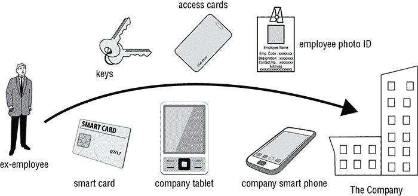

**FIGURE 2.3** Ex-employees must return all company property 

When possible, an `exit interview`（退出面谈）应被进行。但这通常取决于员工离开时的心理状态及其他多种因素。如果退出面谈在解雇时立即进行不可行，应尽快进行。退出面谈的主要目的是回顾前雇员基于《雇佣协议》、保密协议及其他与安全相关的文档所施加的责任和限制。

下面的列表包含其他应尽快处理的事项：

* 确保员工将组织的任何设备或物资从其车辆或家中归还。

* 删除或禁用员工的网络用户账户。

* 通知人力资源部门发放最终工资单、支付未使用的带薪休假、并终止福利覆盖。

* 安排安全部门的成员在员工收集个人财 belongings 时随行。

* 通知所有安保人员和任何监控入口的人员，确保前雇员未经 `escort`（ escort）重新进入大楼。

在大多数情况下，您应在通知员工被解雇时或其被解雇前立即禁用或移除其系统访问权限。这尤其适用于该员工能够访问机密数据，或拥有数据篡改或损坏的专业知识时特别重要。未能限制已离职员工的活动会使组织面临包括物理财产和逻辑数据的盗窃与破坏等多种漏洞。

### 供应商、顾问和承包商协议与控制

供应商、顾问和承包商的控制用于定义对组织外部实体（如供应商、顾问、承包商）的绩效、期望、补偿和后果。这些控制通常在 `service-level agreement (SLA)` 文档或政策中定义。

使用 SLAs 是越来越流行的一种方式，确保向内部或外部客户提供服务的组织维持双方（服务提供方和供应商）共同确定的适当服务水平。将 SLAs 纳入任何数据线路、应用程序、信息处理系统、数据库或其他对贵组织持续可行性至关重要的关键组件是明智之举。SLAs 在使用任何第三方服务提供商时都至关重要，这包括云服务。SLAs 通常涵盖以下问题：

* 系统可用性（占整体运行时间的百分比）

* 最长连续停机时间（以秒/分钟等计）

* 高峰负载

* 平均负载

* 诊断责任

* 备援时间（如果已实现冗余）

SLAs 还常常包含在协议未得到遵守时生效的财务和其他合同补救措施。例如，如果关键线路停机超过 15 分钟，服务提供方可能同意在一周内免除该线路的所有费用。

SLAs 与供应商、顾问和承包商的控制措施是风险降低和风险规避的重要组成部分。通过明确外部方的期望及其未达标的后果，所有相关人员都清楚自身职责以及在未能满足这些期望时的后果。虽然使用外部提供商在多种业务功能或服务上可能极具成本效益，但这也会通过扩大潜在攻击面和脆弱性范围而增加风险。SLAs 应当在保护和提升安全性的同时，确保以合理价格提供优质及时的服务。一些 SLAs 是固定的，无法调整；另一些则您可对其内容拥有重大影响。您应确保 SLA 支持贵组织的安全政策和基础设施，而非与之冲突，以免引入弱点、漏洞或例外。

第三方治理专注于验证是否符合既定的安全目标、要求、法规和合同义务。现场评估可让参与者直接了解特定地点所采用的安全机制。执行现场评估或审计的人员需要遵循审计规程（如信息技术相关目标控制框架 `COBIT`）以及专门的检查清单。

在审计和评估过程中，被评估方和治理方应当充分、坦诚地交换和审阅文档。组织必须知晓其必须满足的全部要求。组织应将安全策略和自我评估报告提交给治理方。这种开放的文档交换确保所有相关方对关注的问题达成一致，降低未知要求或不切实际期望的风险。文档交换不仅仅是传输纸质或电子文件，它还延伸至文档审查环节。

`文档审查` 是阅读交换的材料并将其与标准和期望进行核对的过程。通常在现场检查之前进行。如果交换的文档完整且符合预期（或至少符合要求），则现场审查可以专注于文档中所述的合规性。相反，若文档内容不完整、不准确或否则不足，现场审查将在文档更新纠正后才得以进行。此举至关重要，因为文档不符合要求往往意味着现场实际也不符合要求。

在许多情况下，尤其是涉及政府或军方机构或承包商时，未能提供足够的文档以满足第三方治理的要求，可能导致 `授权运行（ATO）` 失效或被撤销。完整且充分的文档通常能够维持现有的 ATO，或提供临时授权运行（TATO）。一旦 ATO 丧失或被撤销，完整的文档审查和现场审查（证明全面合规）通常是重新获得 ATO 的必要条件。

文档审查的一部分是对业务流程和组织政策的逻辑与实践性调查。此审查确保所描述并实际执行的业务任务、系统和方法论是可行、高效、具成本效益的，并且（至少在安全治理方面）能够支撑通过降低漏洞、避免、减少或缓解风险来实现安全的目标。风险管理、风险评估以及风险应对都是在进行流程/政策审查时涉及的方法和技术。

### 理解并应用风险管理概念

安全的目标是防止数据丢失或泄露，同时保持授权访问。能够对数据或其他资源造成损害、毁灭或泄露的可能性称为风险。理解风险管理概念不仅对 CISSP 考试重要，也是建立充分安全态势、制定正确安全治理以及提供法律上的注意义务（`due care and due diligence`）所必需。

因此，风险管理是维持安全环境的关键要素。`风险管理` 是一项详细的过程，包括识别可能损害或泄露数据的因素，在考虑数据价值和对策成本的前提下对这些因素进行评估，并实施性价比高的解决方案以减轻或降低风险。整体的风险管理流程用于制定和实施信息安全策略，其目标是降低风险并支持组织的使命。

风险管理的首要目标是将风险降至可接受水平。该水平的具体含义取决于组织、资产价值、预算规模以及诸多其他因素。一个组织可能认为某种风险是可接受的，而另一个组织则可能认为同样的风险水平过高。完全消除风险的环境是不可实现的，但通过相对少量的努力，仍可实现显著的风险降低。

针对 IT 基础设施的风险并非全部来自计算机层面。事实上，许多风险来源于非计算机因素。在对组织进行风险评估时，必须考虑所有可能的风险。若未能全面评估并妥善应对各种风险，企业将面临脆弱性。请记住，IT 安全（通常称为逻辑或技术安全）只能防御逻辑或技术性攻击；要抵御物理攻击，必须建立相应的物理防护措施。

实现风险管理目标的过程称为 `风险分析`。它包括对环境进行风险排查、评估每种威胁事件的发生概率及其若发生所导致的损害成本、评估各种应对措施的成本，并为防护措施制作成本效益报告以呈交给上级管理层。除了这些以风险为导向的活动外，风险管理还要求对组织内所有资产进行评估、估值和价值赋予。没有准确的资产估值，就无法对风险进行优先排序和与可能损失进行比较。

### 风险术语

风险管理使用大量专业术语，必须明确理解，尤其是为了通过 CISSP 考试。下面给出主要术语的定义和讨论：

**Asset** `Asset`（资产）是指任何应在环境中得到保护的事物。它可以是业务流程或任务中使用的任何内容，包括计算机文件、网络服务、系统资源、进程、程序、产品、IT 基础设施、数据库、硬件设备、家具、配方/公式、知识产权、人员、软件、设施等。如果组织对某项受其控制的项目赋予价值并认为该项目足以保护，则该项目即为风险管理和分析中的资产。资产的丢失或泄露可能导致整体安全妥协、生产力下降、利润减少、额外支出、组织停运以及诸多无形后果。

**Asset Valuation** `Asset valuation`（资产估值）是根据实际成本和非货币性费用为资产赋予的美元价值。这些费用包括开发、维护、管理、广告、支持、维修、替换资产的成本，也包括更抽象的价值，如公众信任、行业支持、生产力提升、知识产权、所有权收益等。资产估值将在本章后半部分详细讨论。

# Threats

任何可能导致组织或特定资产出现不良或不想要的结果的潜在事件称为`threat`。`Threats` 是任何可能导致资产损坏、破坏、更改、丢失或披露，或阻碍资产访问或阻止资产维护的行动或不作为。`Threats` 可以是大的也可以是小的，导致大的或小的后果。它们可以是有意的也可以是无意的。它们可以来自人们、组织、硬件、网络、结构或自然。`Threat agents` 故意利用漏洞。`Threat agents` 通常是人，但也可能是程序、硬件或系统。`Threat events` 是偶然和有意利用漏洞的事件。它们也可以是自然的或人为的。`Threat events` 包括火灾、地震、洪水、系统故障、人为错误（因缺乏培训或无知）以及停电。

# Vulnerability

资产中的弱点或保护措施或对策的缺失或弱点是`vulnerability`。

换句话说，`vulnerability` 是 IT 基础设施或组织的任何其他方面的缺陷、漏洞、疏忽、错误、限制、脆弱性或易受性。如果`vulnerability` 被利用，资产可能会遭受损失或损害。

# Exposure

`Exposure` 是因`threat` 而使资产面临风险的状态；`vulnerability` 被`threat` agent 或事件利用或可能被利用的可能性。`Exposure` 不意味着已实现的`threat`（导致损失的事件）正在发生（已实现的`threat` 的暴露称为 experienced exposure）。它仅意味着，如果存在`vulnerability` 和能够利用它的`threat`，则可能发生`threat` 事件，即潜在的暴露。另一种思考暴露的方式是回答“最糟糕会发生什么？”你不是在陈述损害已经发生或将要发生，只是在说明潜在的损害及其可能的严重程度。暴露因子（EF）的定量风险分析值来源于这一概念。

# Risk

`Risk` 是`threat` 利用`vulnerability` 造成资产损害的可能性或可能性。它是对概率、可能性或机会的评估。`threat` 事件发生的可能性越大，风险就越高。每一个暴露实例都是`risk`。当以公式形式表达时，风险可以定义为：

```
risk = threat * vulnerability
```


因此，直接减少`threat` agent 或`vulnerability` 将直接降低风险。

当`risk` 实现时，`threat` agent、`threat` actor 或`threat` event 利用了`vulnerability` 并对一个或多个资产造成损害或披露。安全的整个目的是通过消除`vulnerabilities` 和阻止`threat` agent 和`threat` event 来防止`risk` 实现。作为风险管理工具，安全是实施保护措施的过程。

# Safeguards

`Safeguard`、`security control` 或 `countermeasure` 是任何能够消除或减少`vulnerability` 或防范一种或多种特定`threat` 的事物。`Safeguard` 可以包括安装软件补丁、更改配置、雇佣安保人员、改变基础设施、修改流程、改进安全政策、更有效地培训人员、加固周界围栏、安装灯光等。它是任何能够通过消除或减少组织内部的`threat` 或`vulnerability` 来降低风险的行动或产品。`Safeguards` 是唯一能够减轻或消除风险的手段。需要记住的是，`safeguard`、安全控制或对策不一定需要购买新产品；重新配置现有元素，甚至从基础设施中移除元素也是有效的保护措施。

# Attack

`Attack` 是`threat` agent 利用`vulnerability` 的过程。换句话说，`attack` 是任何有意尝试利用组织安全基础设施中的`vulnerability` 以造成资产损坏、丢失或披露的企图。`Attack` 也可以被视为任何违反或未遵守组织安全政策的行为。

# Breach

`Breach` 是安全机制被`threat` agent 绕过或阻止的情况。当`breach` 与`attack`、渗透或入侵结合时，可能导致渗透。渗透是`threat` agent 通过绕过安全控制获得组织基础设施访问权限，并直接威胁资产的状态。

元素 `asset`、`threat`、`vulnerability`、`exposure`、`risk` 和 `safeguard` 之间的关系如图 2.4 所示。`Threats` 利用`vulnerabilities`，这导致`exposure`。`Exposure` 是`risk`，而`risk` 通过保护措施得到缓解。`Safeguards` 保护因`threats` 而面临风险的资产。

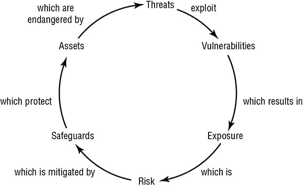

**FIGURE 2.4** The elements of risk

# Identify Threats and Vulnerabilities

风险管理的关键部分是识别和审查`threats`。这涉及为组织的已识别资产创建一份完整的`threat` 列表。列表应包括`threat` agent 以及`threat` event。请记住，`threats` 可以来自任何地方。针对 IT 的`threats` 不限于 IT 来源。编制`threat` 列表时，请务必考虑以下因素：

* `Viruses`
* `Cascade` errors（一系列递进错误）和`dependency` faults（因依赖不存在的事件或项目而导致的错误）
* 受信任用户的犯罪活动（间谍、知识产权盗窃、挪用公款等）
* 移动（振动、剧烈晃动等）
* 有意的攻击
* 重组
* 受信任用户的患病或流行病
* 恶意黑客
* 不满的员工
* 用户错误
* 自然灾害（地震、洪水、火灾、火山、飓风、龙卷风、海啸等）
* 物理损伤（压碎、投射物、电缆 severing 等）
* 数据、资源或服务的滥用
* 数据分类或安全政策的变更或妥协
* 政府、政治或军事的侵入或限制
* 处理错误、缓冲区溢出
* 人员特权滥用
* 温度极端
* 能量异常（静电、电磁脉冲、射频 [RFs]、电力缺失、电力浪涌等）
* 数据丢失
* 信息战
* 破产或业务活动的中断/停止
* 编码/编程错误
* 入侵者（物理和逻辑）
* 环境因素（气体、液体、生物的存在等）
* 设备故障
* 物理盗窃
* 社会工程

在大多数情况下，风险评估和分析应由团队而非单个个人进行。此外，团队成员应来自组织的不同部门。通常，团队成员不需要是安全专业人员，甚至不需要是网络或系统管理员。基于组织的人员多样性，团队能够更全面地识别和应对所有可能的`threats` 和风险。

# Risk Assessment/Analysis

风险管理/分析主要是上层管理层的职责。他们负责发起和支持风险分析和评估，并定义其范围和目的。实际的风险分析过程通常由安全专业人员或评估团队负责执行。然而，所有风险评估、结果、决定和结果都必须被上层管理层理解和批准，作为提供谨慎审慎关 care 的一部分。

- [所有 IT 系统都存在风险。消除 100% 的所有风险的方法并不存在。相反，高层管理者必须决定哪些风险是可接受的，哪些是不可接受的。判断哪些风险是可接受的需要进行详细且复杂的资产和风险评估。]

- [一旦你制定出威胁列表，就必须逐一评估每个威胁及其相关的风险。有两种风险评估方法学：定量和定性。 *定量风险分析* 为资产的损失分配真实的金额。 *定性风险分析* 为资产的损失分配主观且无形的价值。这两种方法对于完整的风险分析都是必要的。大多数环境采用两种风险评估方法学的混合，以便获得对安全问题的平衡视角。]

## 定量风险分析

- 定量方法得出具体的概率百分比。这意味着最终结果是一份包含风险程度、潜在损失、对策成本以及防护措施价值的金额报告。对于懂得电子表格和预算报告的人来说，这份报告通常很容易理解。可以把定量分析看作是为风险分配一个数量——换句话说，为每个资产和威胁分配一个金额。然而，纯粹的定量分析是不够的；并非所有元素和方面都可以量化，因为有些是定性的、主观的或无形的。

- 定量风险分析的过程从资产估值和威胁识别开始。随后，你需要估算每种风险的潜在影响和频率。这些信息随后用于计算各种成本函数，用于评估防护措施。

- 定量风险分析的六个主要步骤或阶段如下（见图 2.5）：

    1. 盘点资产，并赋予其价值（资产价值，`AV`）。（资产价值在本章后续的“资产估值”部分会有更详细说明。）
    2. 研究每个资产，列出每个单独资产可能面临的所有潜在威胁。对于每个列出的威胁，计算暴露因子（`EF`）和单次损失期望（`SLE`）。
    3. 进行威胁分析，计算每种威胁在单一年内实现的可能性——即年化发生率（`ARO`）。
    4. 通过计算年化损失期望（`ALE`），得出每种威胁的整体损失潜力。
    5. 研究针对每种威胁的防护措施，然后计算应用防护措施后对 `ARO` 和 `ALE` 的变化。
    6. 对每个资产中每种威胁的每个防护措施进行成本效益分析，选择最合适的应对措施。

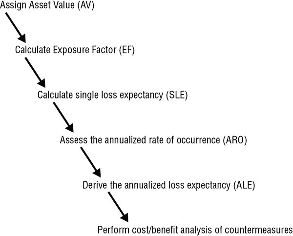

**FIGURE 2.5** The six major elements of quantitative risk analysis

- 定量风险分析相关的成本函数包括暴露因子、单次损失期望、年化发生率和年化损失期望：

    - **暴露因子**：The `exposure factor (EF)` 表示如果特定资产受到已实现风险的侵害，组织可能承担的损失百分比。`EF` 也称为损失潜力。在大多数情况下，已实现的风险不会导致资产的全部损失。`EF` 仅指示因单次已实现风险而预期的资产总价值损失。`EF` 通常对易于更换的资产（如硬件）较小，对难以替代或专有的资产（如产品设计或客户数据库）则可能非常大。`EF` 以百分比形式表示。

    - **单次损失期望**：计算 `SLE` 需要用到 `EF`。`单次损失期望 (SLE)` 是针对特定资产的单次已实现风险的成本。它指示如果特定威胁发生，组织将承担的具体损失金额。

    - `SLE` 的计算公式如下：

        - `SLE = 资产价值 (AV) × 暴露因子 (EF)`
        - 或者更简单地：
        - `SLE = AV × EF`

    - `SLE` 以美元价值表示。例如，如果资产价值为 200,000 美元，且针对特定威胁的 `EF` 为 45%，则该威胁对该资产的 `SLE` 为 90,000 美元。

    - **年化发生率**：The `annualized rate of occurrence (ARO)` 是特定威胁或风险在单一年内预期出现（即实现）的频率。`ARO` 可范围从 0.0（表示该威胁永远不会实现）到非常大的数值（表示该威胁频繁发生）。计算 `ARO` 可能很复杂，它可以从历史记录、统计分析或推测中得到。`ARO` 计算也称为概率确定。例如，塔尔萨的地震 `ARO` 可能为 .00001，而旧金山的地震 `ARO` 可能为 .03（对于 6.7+ 级别），或者你可以将塔尔萨地震的 `ARO` .00001 与塔尔萨办公室的电子邮件病毒的 `ARO` 10,000,000 进行比较。

    - **年化损失期望**：The `annualized loss expectancy (ALE)` 是针对特定已实现威胁对特定资产的可能年成本。

    - `ALE` 的计算公式如下：

        - `ALE = 单次损失期望 (SLE) × 年化发生率 (ARO)`
        - 或者更简单地：
        - `ALE = SLE × ARO`

    - 例如，如果资产的 `SLE` 为 90,000 美元，且针对特定威胁（如总电力损失）的 `ARO` 为 .5，则 `ALE` 为 45,000 美元。另一方面，如果针对特定威胁（如用户账户被入侵）的 `ARO` 为 15，则 `ALE` 为 1,350,000 美元。

- 为每个资产和每个威胁/风险计算 `EF`、`SLE`、`ARO` 和 `ALE` 的任务很不容易。幸运的是，定量风险评估软件工具可以简化并自动化此过程。这些工具生成包含估值的资产清单，然后利用预定义的 `ARO` 以及一些定制选项（如行业、地理、IT 组件等），生成风险分析报告。下面的计算通常会涉及：

    - **使用防护措施计算年化损失期望**：除了确定防护措施的年度成本外，你还必须计算如果实施防护措施，资产的 `ALE`。这需要针对防护措施重新确定 `EF` 和 `ARO`。在大多数情况下，即使应用了防护措施，`EF` 通常保持不变（因为 `EF` 是风险实现时资产遭受的损失量）。换句话说，如果防护措施失效，资产受到的损害通常与没有防护措施时相同。例如，即使穿了防弹衣但防弹衣未能阻止子弹穿透心脏，你仍然会经历同样的损害。因此，如果防护措施失效，资产损失通常与没有防护措施时相同。不过，某些防护措施在失效时仍能减少实际损害。例如，虽然火灾可能仍然发生并导致设施损坏及灭火喷淋水的影响，但总损害可能小于整个建筑被烧毁。

即使 `EF` 保持不变，保护措施会改变 `ARO`。事实上，保护措施的整个目的就是降低 `ARO`。换句话说，保护措施应减少攻击成功导致资产损害的次数。最理想的保护措施将 `ARO` 降至零。虽然有一些完美的保护措施，但大多数并非如此。因此，许多保护措施的实际 `ARO`（你希望它尽可能小）小于未保护的 `ARO`，但通常并非零。在新的 `ARO`（以及可能的新 `EF`）下，应用保护措施后会重新计算 `ALE`。

在计算出前保护措施 `ALE` 和后保护措施 `ALE` 之后，还需要一种价值来进行成本/收益分析。这种额外的价值是保护措施的年度成本。

**计算保护措施成本**：对于每个具体风险，你必须从成本/收益角度评估一个或多个保护措施（或对策）。为了进行此评估，你首先需要为每个威胁编制保护措施列表。然后，为每个保护措施分配部署值。实际上，你需要衡量保护措施的部署值（即成本）与受保护资产的价值之间的关系。受保护资产的价值决定了保护机制的最高可支出额。安全措施应具成本效益，因此不应在保护资产时花费超过其对组织价值的金额。如果对策的成本高于资产价值（即风险的成本），则应接受该风险。

计算对策价值时涉及众多因素：

* 购买、开发和许可费用
* 实施和定制费用
* 年度运行、维护、管理等费用
* 年度维修和升级费用
* 生产力提升或损失
* 环境变化
* 测试和评估费用

一旦你知道保护措施的潜在成本，就可以评估如果将其应用于基础设施时的收益。如前所述，保护措施的年度成本不应超过资产损失的预期年度成本。

**计算保护措施的成本/收益**：这一过程的最后计算之一是*成本/收益计算*（或称成本/收益分析），用于判断保护措施是否在不花费过多的情况下真正提升安全性。为判断保护措施是否在财务上是平衡的，使用以下公式：

> 保护措施前的 `ALE` – 实施保护措施后的 `ALE` – 保护措施年度成本（`ACS`） = 该保护措施对公司的价值

如果结果为负，则该保护措施不是财务上明智的选择。如果结果为正，则该数值即为组织部署该保护措施每年可节省的金额，因为发生频率并不保证一定会发生。

保护措施的年度收益或损失不应是唯一的考量因素。你还应考虑法律责任和谨慎注意的问题。在某些情况下，宁可在部署保护措施时亏损也不要冒法律责任的风险（如资产披露或损失）。

总体回顾，要对保护措施进行成本/收益分析，必须计算以下三个要素：

* 对资产-威胁配对的前对策 `ALE`
* 对资产-威胁配对的后对策 `ALE`
* `ACS`（保护措施的年度成本）

有了这三个要素，你最终可以得到针对特定资产-威胁配对的成本/收益公式的值：

* `(前对策 ALE – 后对策 ALE) – ACS`

或者更简洁地：

* `(ALE1 – ALE2) – ACS`

成本/收益公式得出的数值最大的对策，在特定资产-威胁配对中最具经济意义。

Table 2.1 说明了定量风险分析相关的各种公式。

**TABLE 2.1** **定量风险分析公式**

| 概念 | 公式 |
| --- | --- |
| 暴露因子（`EF`） | `%` |
| 单次损失期望（`SLE`） | `SLE = AV × EF` |
| 年化发生率（`ARO`） | `# / 年` |
| 年化损失期望（`ALE`） | `ALE = SLE × ARO` 或 `ALE = AV × EF × ARO` |
| 保护措施年度成本（`ACS`） | `$ / 年` |
| 保护措施的价值或收益 | `(ALE1 – ALE2) – ACS` |

需要意识到，在定量风险评估过程中使用的所有计算，其最终值用于优先级排序和选择。这些值本身并不真实反映安全事件的实际损失或成本，这显而易见，因为该过程需要大量的猜测、统计分析和概率预测。

在为每个受影响的资产和风险计算出每个保护措施的成本/收益后，你需要将这些值进行排序。在大多数情况下，成本/收益数值最高的保护措施是针对该特定风险和资产的最佳选择。但正如现实世界所提示的，这只是决策过程的一部分。虽然它非常重要，往往是主要指导因素，但它并非唯一的数据依据。其他因素包括实际成本、安全预算、与现有系统的兼容性、IT 人员的技能/知识水平、产品的可用性、政治因素、合作关系、市场趋势、时尚、营销、合同以及偏袒等。作为高级管理者或 IT 人员，你的责任是获取或利用所有可用的数据和信息，为组织做出最佳安全决策。

大多数组织的预算有限且资源有限。因此，性价比是安全管理的关键部分。要有效管理安全职能，你必须评估预算、收益和绩效指标以及每个安全控制所需的资源。只有在进行彻底评估后，你才能确定哪些控制既有助于安全，也有助于你的底线。

## 定性风险分析

定性风险分析更多基于情景而非计算。它通过在量表上排名威胁，来评估其风险、成本和影响。由于无法进行纯粹的定量风险评估，平衡定量分析结果与定性分析结果是必不可少的。将定量和定性分析相结合的方法称为混合评估或混合分析。执行定性风险分析的过程涉及判断、直觉和经验。你可以使用许多技术进行定性风险分析：

* 脑力 storm（头脑风暴）
* Delphi 技术
* 故事板
* 焦点小组
* 调查
* 问卷
* 检查表
* 一对一会议
* 面谈

选择哪种方法取决于组织的文化以及涉及的风险和资产类型。通常，多种方法会同时使用，并在最终风险分析报告中比较和对比结果，以向高层管理层汇报。

### 情景

- [所有这些机制的基本过程都涉及场景的创建。一个`scenario`是一份关于单一重大威胁的书面描述。描述重点在于威胁将如何被激发，以及其发生可能对组织、IT 基础设施和特定资产产生的影响。通常，场景限制在一页文本以保持可管理。对于每个场景，会描述一个或多个防护措施，这些措施可以完全或部分防范该场景中讨论的重大威胁。分析参与者随后为场景分配一个威胁等级、损失潜力以及每个防护措施的优势。这些分配可以粗略简单——例如高、中、低，或者一个基本的 1 到 10 的数字量表——也可以是详细的论文式回答。所有参与者的回复随后汇总成一份报告，并呈交给上层管理层。请参阅 `Table 3-6` 和 `Table 3-7` 在 `National Institute of Technology (NIST) Special Publication (SP) 800-30` 中查看参考评级和等级示例：

[`csrc.nist.gov/publications/nistpubs/800-30/sp800-30.pdf`](http://csrc.nist.gov/publications/nistpubs/800-30/sp800-30.pdf)

随着参与评估的人数和多样性增加，定性风险分析的有用性和有效性也随之提升。只要可能，就应包括组织层级的每一层人员，从高层管理到终端用户。同时，还应包括每个主要部门、分部、办公室或分支的交叉部分。

### Delphi Technique


Delphi 技术可能是前面列表中唯一不易立即识别和理解的机制。`Delphi technique` 仅仅是一种匿名反馈和响应过程，用于使小组能够达成匿名共识。其主要目的是引出所有参与者的诚实且不受影响的回应。参与者通常会被聚集到一个会议室中。对于每一次反馈请求，每位参与者都会在纸上匿名写下自己的回应。随后将结果汇总并呈现给小组以供评估。该过程会持续进行，直至达成共识。

定量和定性风险分析机制均能提供有用的结果。然而，每种技术都有其独特的评估方法，用于评估同一组资产和风险。审慎的注意要求同时使用这两种方法。`Table 2.2` 描述了这两种系统的优缺点。

## TABLE 2.2 定量与定性风险分析的比较

| 特征 | 定性 | 定量 |
| --- | --- | --- |
| 使用复杂函数 | 否 | 是 |
| 使用成本/效益分析 | 否 | 是 |
| 结果为具体数值 | 否 | 是 |
| 需要猜测 | 是 | 否 |
| 支持自动化 | 否 | 是 |
| 涉及大量信息 | 否 | 是 |
| 是客观的 | 否 | 是 |
| 使用意见 | 是 | 否 |
| 需要大量时间和精力 | 否 | 是 |
| 提供有用且有意义的结果 | 是 | 是 |

### 风险应对

风险分析的结果包括：

* 对所有资产的完整且详细的估值
* 完整的威胁和风险列表，包括发生频率以及如果实现的损失程度
* 针对特定威胁的防护措施和对策列表，标明其有效性和 `ALE`
* 对每个防护措施的成本/效益分析

这些信息对管理层做出关于防护措施实施和安全策略变更的明智、智能决策至关重要。

风险分析完成后，管理层必须应对每个具体风险。可能的风险应对方式有：

* 减少或缓解
* 分配或转移
* 接受
* 防范
* 避免
* 拒绝或忽视

您需了解以下关于可能的风险应对的信息：

**风险缓解** `降低风险`，或 `风险缓解`，是实施防护措施和对策以消除漏洞或阻断威胁的过程。选择最具性价比或最有益的对策是风险管理的一部分，但它并不是风险评估的组成部分。事实上，对策的选择是风险评估或风险分析之后的活动。风险缓解的另一种可能变体是风险避免。通过消除风险原因来避免风险。简单的例子是从服务器中移除文件传输协议（`FTP`）以避免 `FTP` 攻击，更大的例子是迁移到内陆地区以避免飓风带来的风险。

**风险分配** `分配风险` 或 `转移风险` 是将风险所代表的损失成本分配给另一实体或组织的过程。购买保险和外包是常见的分配或转移风险的形式。

**风险接受** 接受风险，或风险容忍，是成本/效益分析表明对策成本超过风险实现可能导致的损失成本时的结果。同时，管理层也同意接受风险实现时的后果和损失。在大多数情况下，接受风险需要一份明确的书面声明，说明为何未实施防护措施、谁负责该决定以及若风险实现时谁将承担损失，通常以签字确认的形式出现。组织决定接受风险的依据是其风险容忍度，这也称为风险容忍或风险胃口，即组织吸收已实现风险损失的能力。

**风险阻遏** `风险阻遏` 是实施阻碍潜在违规者的安全与政策的过程。一些例子包括实施审计、安防摄像头、安保人员、指示标志、警告横幅、运动传感器、强认证以及让组织愿意与当局合作并起诉参与网络犯罪的人。

**风险避免** `风险避免` 是选择替代选项或活动，使其风险低于默认、常规、便捷或廉价的选项。例如，选择飞往目的地而不是开车前往是一种风险避免。另一个例子是将业务设在亚利桑那州而非佛罗里达州，以避免飓风。

**风险拒绝** 最后但不可接受的风险应对方式是 `拒绝风险` 或 `忽视风险`。否认风险的存在并希望它永不实现既不是有效的，也不是审慎的注意义务的回应方式。

在实施对策后，剩余的风险称为 `残余风险`。`残余风险` 包括管理层选择不实施防护措施的特定资产的威胁。换句话说，残余风险是管理层选择接受而非缓解的风险。在大多数情况下，残余风险的存在表明成本/效益分析显示现有防护措施不具成本效益。

`总风险` 是组织在未实施任何防护措施时将面临的风险总量。总风险的公式如下：

```
threats * vulnerabilities * asset value = total risk
```

（注意这里的 `*` 并不表示乘法，而是一个组合函数；这不是真正的数学公式。）总风险与残余风险的差值称为 `控制缺口`。控制缺口是实施防护措施后减少的风险量。残余风险的公式如下：

```
total risk – controls gap = residual risk
```

与一般的风险管理一样，风险处理并非一次性的过程。相反，安全必须持续维护并不断确认。事实上，重复进行风险评估和分析是评估安全计划随时间变化的完整性和有效性的机制。此外，它有助于定位缺陷和变化发生的区域。由于安全随时间变化，定期重新评估是保持合理安全的关键。

### 对策选择与实施

在风险管理领域选择或制定（即 `security control`）对策或控制措施时，依赖于成本效益分析的结果。但评估安全控制的价值或相关性时，还应考虑以下几个因素：

* 对策的成本应低于资产的价值。
* 对策的成本应低于对策带来的收益。
* 所采用对策的结果应使攻击者的成本高于其从攻击中获得的收益。
* 对策应解决真实且已识别的问题。（不要仅仅因为对策可用、宣传或听起来酷而安装对策。）
* 对策的收益不应依赖于其保密性。这意味着“通过隐蔽实现安全”并非可行的对策，且任何可行的对策都应能经受公开披露和审查。
* 对策的收益应可测试并可验证。
* 对策应在所有用户、系统、协议等方面提供一致且统一的保护。
* 对策应有少量或无依赖关系，以降低连锁故障的风险。
* 对策在初始部署和配置后应需要尽量少的人工干预。
* 对策应具备防篡改能力。
* 对策的覆盖权限应仅限于特权操作员。
* 对策应提供故障安全（`fail-safe`）或防范安全（`fail-secure`）选项。

请记住，安全应设计以支持和启用业务任务和功能。因此，对策和防护措施需要在业务任务的上下文中进行评估。

安全控制、对策和防护措施可以在行政、逻辑/技术或物理三种方式实施。这三类安全机制应以防御深度（`defense-in-depth`）的方式实施，以获得最大收益（`Figure 2.6`）。

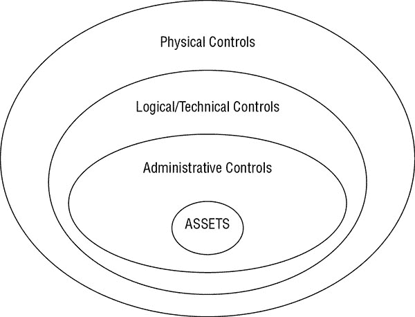

**FIGURE 2.6** The categories of security controls in a defense-in-depth implementation

#### 技术

`技术或逻辑控制` 指的是用于管理访问并保护资源和系统的硬件或软件机制。顾名思义，它依赖于技术。逻辑或技术控制的示例包括身份验证方法（如用户名、密码、智能卡、生物特征），加密、受限接口、访问控制列表、协议、防火墙、路由器、入侵检测系统（`IDSs`）以及限制级别。

#### 行政

`行政控制` 是组织安全政策及其他法规或要求所定义的政策和程序。它们有时也被称为管理控制。这些控制侧重于人员和业务实践。行政控制的示例包括政策、程序、招聘实践、背景调查、数据分类与标记、安全意识与培训、休假记录、报告与审查、工作监督、人员控制以及测试。

#### 物理

`物理控制` 是可以触摸的实体。它们包括用于防止、监控或检测对系统或设施内部区域的直接接触的物理机制。物理控制的示例包括警卫、围栏、运动探测器、锁门、密封窗户、照明、电缆防护、笔记本锁、徽章、刷卡卡、看门狗、视频摄像头、伪装室、警报等。

### 可适用的控制类型

术语 `security control` 指的是一类广泛的控制措施，能够执行诸如确保仅授权用户登录、阻止未授权用户访问资源等任务。`控制` 能够缓解各种信息安全风险。

尽可能地，我们希望预防任何类型的安全问题或事件。显然，这并非总是可行，不想要的事件仍会发生。当它们发生时，我们希望尽快发现这些事件。一旦发现，我们希望尽快纠正。

在阅读控制描述时，请注意有些控制被列为多种访问控制类型的示例。例如，围在建筑周围的围栏（或界定设施的设施）既可以是防范控制（物理阻止某人进入建筑园区），也可以是威慑控制（劝阻某人尝试进入）。

#### 威慑

`Deterrent` `control` 是用来劝阻违反安全政策的行为。威慑控制与防范控制相似，但威慑控制往往依赖于个人决定不采取不想要的行动；而防范控制则直接阻止该行动。典型例子包括政策、安全意识培训、锁具、围栏、安全徽章、警卫、伪装室、监控摄像头。

#### 防范

`Preventive` `control` 是用来阻止或遏制不想要或未经授权的活动发生的控制。防范控制的示例包括围栏、锁具、生物特征、伪装室、照明、警报系统、职责分离、轮岗、数据分类、渗透测试、访问控制方法、加密、审计、监控摄像头或闭路电视（`CCTV`）、智能卡、回拨程序、安全政策、安全意识培训、防病毒软件、防火墙以及入侵防御系统（`IPSs`）。

#### 侦测

`Detective` `control` 是用来发现或检测不想要或未经授权的活动的控制。侦测控制在事后起作用，只能在活动已经发生后才能发现。侦测控制的示例包括安全警卫、运动探测器、监控摄像头或闭路电视记录并回放事件、轮岗、强制休假、审计日志、蜜罐或蜜网、入侵检测系统（`IDSs`）、违规报告、对用户的监督与审查，以及事件调查。

#### 补偿

`Compensation` `control` 是用来为现有控制提供选项、辅助执行和支持安全政策的控制。它们可以是除另一控制之外或替代另一控制的任何控制。例如，组织政策可能规定所有 `personally identifiable information`（`PII`）必须加密。审计发现，虽然防范控制已对数据库中的所有 `PII` 进行加密，但通过网络传输的 `PII` 仍以明文形式发送。此时可添加补偿控制，对传输中的数据进行保护。

#### 纠正

- [`纠正控制`]修改环境，在不想要或未经授权的活动发生后，将系统返回正常。它尝试纠正因安全事件导致的问题。纠正控制可以很简单，例如终止恶意活动或重启系统。它们还包括防病毒解决方案，可以删除或隔离病毒；备份和恢复计划，确保丢失的数据可以恢复；以及主动 `ID`，可以在攻击进行中修改环境以阻止攻击。该控制部署用于修复或恢复资源、功能和能力，在违反安全政策后。

#### Recovery

`Recovery controls` 是对纠正控制的扩展，但具有更高级或更复杂的能力。`Recovery controls` 的示例包括备份和恢复、容错驱动器系统、系统映像、服务器集群、防病毒软件以及数据库或虚拟机的镜像。与业务连续性和灾难恢复相关，`Recovery controls` 可以包括热站、温站、冷站、替代处理设施、服务机构、互惠协议、云服务提供商、滚动移动操作中心以及多站点解决方案。

#### Directive

A `directive control` 是部署用于指示、限制或控制主体的行为，以强制或鼓励遵守安全政策。`Directive control` 的示例包括安全政策要求或标准、张贴通知、紧急出口标志、监控、监督和程序。

### Security Control Assessment

A `security control assessment (SCA)` 是对安全基础设施的单个机制相对于基准或可靠性期望进行的正式评估。`SCA` 可以在全面的安全评估（如渗透测试或漏洞评估）之外或独立进行。

`SCA` 的目标是确保安全机制的有效性，评估组织风险管理流程的质量和完整性，并生成部署安全基础设施的相对优势和劣势报告。

通常，`SCA` 是联邦机构根据 NIST 特刊 800-53A《联邦信息系统安全控制评估指南》（`csrc.nist.gov/publications/detail/sp/800-53a/rev-4/final`）实施的过程。然而，尽管它被定义为政府流程，但评估安全控制的可靠性和有效性的概念应被所有致力于维持成功安全事业的组织采用。

### Monitoring and Measurement

安全控制应提供可以监控和测量的好处。如果安全控制的好处无法量化、评估或比较，那么它实际上并不提供任何安全。安全控制可能提供本机或内部监控，或需要外部监控。在做出初始对策选择时，应考虑这一点。

测量对策效果不总是绝对值。许多对策提供的是改进程度，而不是具体的硬性数字，如防止的 `breaches` 数量或阻止的攻击尝试数量。通常，要获得对策成功或失败的测量，需要在安装保护措施之前和之后监控和记录事件。只有当起始点（即正常点或初始风险水平）已知时，才能准确测量好处。监控和测量对策的成本/收益部分纳入其中。仅仅因为安全控制提供了一定程度的安全增强，并不意味着获得的收益具有成本效益。应明确识别出显著的安全改进，以合理证明新部署对策的费用。

### Asset Valuation and Reporting

风险分析的重要一步是评估组织资产的价值。如果资产没有价值，则无需为其提供保护。风险分析的主要目标是确保仅部署具有成本效益的防护措施。花费 100,000 美元保护一项价值仅 1,000 美元的资产是没有意义的。资产的价值直接影响并指导为其提供保护而部署的防护措施和安全措施的水平。一般原则是，防护措施的年度成本不应超过资产预期年度损失成本。

在评估资产成本时，有许多方面需要考虑。资产估值的目标是为资产分配一个具体的美元价值，涵盖有形成本和无形成本。确定确切价值通常很困难，甚至是不可能的，但必须建立一个具体的价值。（注意，下一节关于定性与定量风险分析的讨论可能会澄清此问题。）错误地为资产分配价值可能导致未能正确保护资产，或实施在财务上不可行的防护措施。以下列表包括一些有形和无形因素，有助于资产估值：

* `Purchase cost`
* `Development cost`
* `Administrative or management cost`
* `Maintenance or upkeep cost`
* `Cost in acquiring asset`
* `Cost to protect or sustain asset`
* `Value to owners and users`
* `Value to competitors`
* `Intellectual property or equity value`
* `Market valuation (sustainable price)`
* `Replacement cost`
* `Productivity enhancement or degradation`
* `Operational costs of asset presence and loss`
* `Liability of asset loss`
* `Usefulness`

为组织分配或确定资产价值可以满足众多要求。它是进行资产保护成本/收益分析的基础。它是选择或评估防护措施和对策的手段。它为保险目的提供数值，并确立组织的整体净值或总价值。它帮助高级管理层了解组织内部具体面临什么风险。了解资产的价值也有助于防止因过失而忽视注意义务，并促使遵守法律要求、行业法规以及内部安全政策。

`风险报告` 是风险分析结论时的关键任务。风险报告涉及生成风险报告并向相关/感兴趣的方进行呈现。对于许多组织，风险报告仅是内部事务；而其他组织可能受到法规要求，必须对其风险发现进行第三方或公开报告。

风险报告应准确、及时、全面覆盖整个组织、清晰明确，以支持决策，并定期更新。

### Continuous Improvement

风险分析的结果是为高级管理层提供必要的细节，以决定哪些风险应缓解、哪些应转移、哪些应遏制、哪些应避免，哪些应接受。结果是资产损失的预期成本与部署防范威胁和漏洞的防护措施之间的成本/收益比较。风险分析识别风险，量化威胁的影响，并辅助安全预算的制定。它有助于将安全政策的需求和目标与组织的业务目标和意图相结合。风险分析/风险评估是“时点”指标。威胁和漏洞不断变化，风险评估需要定期重新进行，以支持持续改进。

安全始终在变化。因此，任何实施的安全解决方案都需要随着时间的推移而进行更新和变更。如果所选的对策没有提供持续改进的路径，则应替换为能够提供可扩展安全改进的方案。

### 风险框架

A `risk framework` 是指导如何评估、解决和监控风险的指南或配方。CISSP 考试中主要参考的 `risk framework` 是 NIST 在特刊第 800-37（`nvlpubs.nist.gov/nistpubs/SpecialPublications/NIST.SP.800-37r1.pdf`）中定义的框架。我们鼓励您阅读该出版物的全部内容，以下是与 CISSP 相关的几段摘录：

> 该出版物为将 `风险管理框架 (RMF)` 应用于联邦信息系统提供指南。六步骤的 `RMF` 包括风险分类、安全控制选择、安全控制实施、安全控制评估、信息系统授权以及安全控制监控。`RMF` 通过实施强大的持续监控过程，促进近实时风险管理和持续的信息系统授权，为高层领导提供有效、基于风险的、成本效益决策所需信息，以支持其核心任务和业务功能的信息系统，并将信息安全融入企业架构及系统开发生命周期（`SDLC`）。在企业内部应用 `RMF` 将系统层面的风险管理流程与组织层面的风险管理流程通过风险执行（职能）相连，建立安全控制在组织信息系统中部署及继承（即共享控制）方面的责任与问责线。`RMF` 的主要特征包括：
>
> * 通过实施强大的持续监控过程，促进近实时风险管理和持续的信息系统授权；
> * 鼓励使用自动化手段，为高层领导提供必要信息，以便就支持其核心任务和业务功能的组织信息系统做出成本效益、基于风险的决策；
> * 将信息安全融入企业架构及系统开发生命周期（`SDLC`）；
> * 强调安全控制的选择、实施、评估和监控，以及信息系统的授权；
> * 通过风险执行（职能）将系统层面的风险管理流程与组织层面的风险管理流程相连；以及
> * 确立部署在组织信息系统中的安全控制及其继承的控制（即共享控制）的责任与问责。


RMF 的步骤包括（见 Figure 2.7）：

> `Categorize` 根据影响分析，对信息系统及其处理、存储和传输的信息进行分类。

> `Select` 根据系统的安全分类，为信息系统选择初始的基线安全控制；根据组织对风险的评估及当地条件，对基线进行调整和补充。

> `Implement` 实施安全控制，并说明这些控制在信息系统及其运行环境中的使用方式。

> `Assess` 使用适当的评估程序，判断控制是否正确实施、是否按预期运行，以及它们是否能够满足系统的安全要求。

> `Authorize` 根据对信息系统运行对组织业务、资产、个人、其他组织及国家造成的风险评估，决定该风险可接受后，对系统运行进行授权。

> `Monitor` 持续监控信息系统中的安全控制，包括评估控制有效性、记录系统或其运行环境的变更、对相关变更进行安全影响分析，并向指定的组织官员报告系统的安全状态。

> ***[From NIST SP 800-37]***

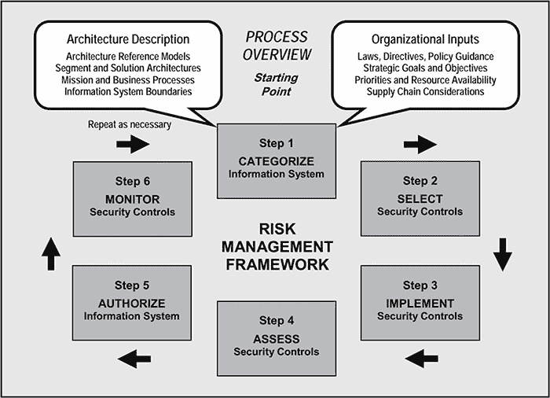

**FIGURE 2.7** The six steps of the risk management framework

关于 RMF 的更详细内容请参阅 NIST 出版物，以获得完整的风险框架视角。

NIST RMF 是 CISSP 考试的主要焦点，但您可能希望了解其他用于实际应用的风险管理框架。请考虑操作关键的威胁、资产和脆弱性评估（OCTAVE）、风险分析与信息风险（FAIR）以及威胁代理风险评估（TARA）。进一步研究，您会发现以下文章有用：[www.csoonline.com/article/2125140/metrics-budgets/it-risk-assessment-frameworks–real-world-experience.html](http://www.csoonline.com/article/2125140/metrics-budgets/it-risk-assessment-frameworks–real-world-experience.html)。认识到存在多种公认的框架，选择符合组织需求和风格的框架至关重要。

## 建立并维护安全意识、教育与培训计划

安全解决方案的成功实施需要用户行为发生改变。这些改变主要体现在遵循安全政策规定的标准、指南和程序，对日常工作活动的调整。`行为改变` 要求用户在一定程度上进行学习。要开发和管理安全教育、培训与宣传，所有知识传递的相关项目必须明确，并设计出具有展示、接触、协同和实施的项目。

安全培训的前提是 `意识`。创建意识的目标是将安全置于前景，使其成为用户认知的实体。意识在全组织范围内建立共同的安全认知基线，聚焦于所有员工必须理解和掌握的关键或基本安全话题与问题。意识不仅通过课堂式培训产生，还可以通过工作环境实现。诸如海报、公告、新闻稿、屏幕保护贴、T 恤、经理的演讲、公告、演示文稿、鼠标垫、办公用品、备忘录以及传统的讲师-led 培训课程等工具，都可以用于提升意识。

意识建立了安全认知的最低共识或基础。所有人员都应充分了解自身的安全责任与义务，并接受培训，知道应做什么、不应做什么。

用户需要注意的问题包括避免浪费、欺诈和未经授权的行为。组织中的所有成员，从高层管理到临时实习生，都需要同等程度的认知。组织中的认知计划应与其安全政策、事件处理计划、业务连续性和灾难恢复程序相结合。为使认知计划有效，它必须是新鲜、创意且经常更新的。认知计划还应与企业文化如何影响并影响个人和整个组织的安全有关的理解相结合。如果员工看不到安全政策和标准的执行，尤其是在认知层面，那么他们可能不会感到有义务遵守它们。

`Training` 是教导员工执行工作任务并遵守安全政策。培训通常由组织主办，并针对具有相似工作职能的员工群体。所有新员工都需要一定程度的培训，以便他们能够遵守安全政策规定的所有标准、指南和程序。新用户需要知道如何使用 IT 基础设施、数据存储位置以及如何和为何资源进行分类。许多组织选择在授予网络访问权限之前对新员工进行培训，而其他组织则在新用户完成其特定职位培训后才提供有限的访问权限。培训是一项持续的活动，必须贯穿组织的整个生命周期，对每位员工都适用。它被视为一种行政安全控制。

用于呈现认知和培训的方法和技术应随时间进行修订和改进以最大化收益。这需要收集并评估培训指标。这可能包括学习后测试，以及监控工作一致性的改进、停机时间减少、安全事件或错误的减少。这可以被视为程序效果评估。

认知和培训通常在组织内部提供。这意味着这些教学工具是由组织内部创建并部署的。然而，知识分发的下一层通常是从外部第三方来源获得的。

`Education` 是一个更详细的事项，在该过程中学生/用户学习的内容远超他们实际执行工作任务所需的知识。`Education` 通常与用户追求认证或寻求职业晋升相关联。它通常是寻求安全专业人员的必要条件。安全专业人员需要对整个组织的安全及其本地环境有广泛的知识，而不仅仅是其特定工作任务。

对组织内所需的适当认知、培训和教育水平的评估应定期进行，并通过周期性内容审查来修订。随着组织随时间发展，培训努力需要更新和调整。此外，还应实施新的显性和隐性认知手段，以保持内容的新鲜和相关性。如果没有定期的内容相关性审查，材料将变得陈旧，工人可能会自行制定自己的指南和程序。安全治理团队的责任是建立安全规则，并为进一步实施这些规则提供培训和教育。

## 管理安全职能

要管理安全职能，组织必须实施适当且充分的安全治理。执行风险评估以驱动安全政策是管理安全职能的最清晰、最直接的例子。

安全必须具有成本效益。组织预算有限，因此必须合理分配资金。此外，组织预算还包括专门用于安全的资金百分比，就像其他业务任务和流程需要资本一样，还包括支付员工、保险、退休金等。安全应足以抵御组织面临的典型或标准威胁，但如果安全成本高于受保护资产的价值，则不合适。正如本章 earlier 提到的“理解并应用风险管理概念”，如果一种对策的成本高于其保护的资产本身的价值，通常不是有效的解决方案。

安全必须是可衡量的。可衡量的安全意味着安全机制的各个方面运行正常，提供明确的好处，并且有一个或多个指标可以记录和分析。类似于性能指标，安全指标是衡量安全功能的运行、功能、操作、行动等方面的度量。当实施了对策或保护措施时，安全指标应显示不良事件的减少或对尝试的检测增加。否则，安全机制未提供预期的好处。测量和评估安全指标的实践是评估安全计划的完整性和有效性的过程。这也应包括将其与常见的安全指南进行比较，并跟踪其控制措施的成功情况。跟踪和评估安全指标是有效安全治理的一部分。但值得注意的是，选择错误的安全指标可能导致重大问题，例如选择监控或测量安全人员几乎无法控制的事项，或基于外部驱动因素的指标。

安全机制本身以及安全治理流程都会消耗资源。显然，安全机制应尽可能消耗少量资源，并尽可能低限对系统生产力或吞吐量的影响。然而，每一种硬件和软件对策以及用户必须遵循的每项政策和程序都会消耗资源。在选择、部署和调整对策之前及之后评估和了解资源消耗是安全治理和管理安全职能的重要部分。

管理安全职能包括信息安全策略的制定和实施。本文的大部分内容，包括 CISSP 考试大纲，都涉及信息安全策略的各个方面的制定与实施。

## 总结

在规划安全解决方案时，重要的是要考虑到人类往往是组织安全的最弱元素。无论部署了何种物理或逻辑控制，人类都能发现规避、规避或劫持它们，甚至使它们失效。因此，在设计和部署安全解决方案时，必须将用户纳入考虑。安全的招聘实践、角色、政策、标准、指南、程序、风险管理、认知培训和管理计划等所有方面都有助于保护资产。这些安全结构的使用为应对人类对安全解决方案构成的威胁提供了一定程度的保护。

安全的招聘实践需要详细的职位描述。职位描述用于指导候选人选择和正确评估其是否适合该职位。通过职位描述维护安全包括使用职责分离、职责划分和职位轮换。

终止政策是保护组织及其现有员工所必需的。终止程序应包括见证、归还公司财产、禁用网络访问、退出面谈以及从场所中引导离开。

-   [第三方治理](https://example.org)是一种监督系统，有时由法律、法规、行业标准或许可要求强制实施。治理方式可能不同，但通常涉及外部调查员或审计师。审计师可能由管理机构指定，也可能是目标组织聘请的顾问。

1.  识别、评估并降低或减轻风险的过程称为风险管理。风险管理的主要目标是将风险降至可接受水平。确定该水平取决于组织、其资产的价值以及预算规模。虽然无法设计并部署完全无风险的环境，但通过不费力即可显著降低风险。风险分析是实现风险管理的过程，包括分析环境中的风险、评估每个风险的发生可能性和可能导致的损害成本、评估每个风险的应对措施成本，并为向上级管理层提交的保障措施成本效益报告创建报告。

为使安全解决方案成功实施，用户行为必须发生变化。这些变化主要包括调整日常工作活动以符合安全政策规定的标准、指南和程序。行为改变涉及用户在一定程度上进行学习。通常认可的三个学习层次为：意识、培训和教育。

### 考试要点

**理解雇佣新员工的安全影响。** 为确保安全规划，必须建立以下标准：职位描述、职位分类、工作任务、职责、防止串通、候选人筛选、背景调查、安全许可、雇佣协议和保密协议。通过部署这些机制，确保新员工了解所需的安全标准，从而保护组织资产。

**能够解释职责分离。** 职责分离是安全概念，即将关键、重要、敏感的工作任务在多个个人之间进行划分。通过将职责分离，确保没有人能够损害系统安全。

**理解最小权限原则。** 最小权限原则指出，在受保护环境中，用户应仅获得完成所需工作任务或职责所需的最小访问权限。通过仅授予完成工作所需的项目，限制了敏感信息的暴露风险。

**了解职务轮换和强制休假的必要性。** 职务轮换具有两个功能：一是提供知识冗余，二是调动人员降低欺诈、数据篡改、盗窃、破坏、信息滥用等风险。强制休假一至两周用于审计和验证员工的工作任务和权限，这往往能轻易发现滥用、欺诈或疏忽。

**理解供应商、顾问和承包商的控制措施。** 供应商、顾问和承包商控制措施用于定义对外部实体、人员或组织的绩效、期望、补偿及后果水平。这些控制措施通常在服务级别协议（SLA）等文档或政策中定义。

**能够解释正确的终止政策。** 终止政策定义了终止员工的程序，应包括始终有见证、禁用员工网络访问、进行离职面谈。政策还应包括将终止员工带出场所、要求归还安全令牌、徽章及公司财产。

**了解隐私在 IT 安全领域的位置。** 了解隐私的多种含义/定义，认识到保护隐私的重要性及其在工作环境中的相关问题。

**能够讨论第三方治理的安全性。** 第三方治理是可能由法律、法规、行业标准或许可要求强制实施的监督系统。

**能够定义整体风险管理。** 识别可能损害或泄露数据的因素，结合数据价值和应对措施成本对这些因素进行评估，并实施成本效益的缓解或减少风险的措施，这即为风险管理。通过执行风险管理，为整体风险降低奠定基础。

**理解风险分析及其关键要素。** 风险分析是向上级管理层提供细节的过程，以便决定哪些风险应缓解、哪些应转移、哪些应接受。为全面评估风险并采取适当防护措施，必须分析以下要素：资产、资产价值、威胁、漏洞、暴露、风险、已实现风险、防护措施、应对措施、攻击和 `breach`（泄露）。

**能够评估威胁。** 威胁来源于众多领域，包括 IT、人类和自然环境。威胁评估应作为团队合作完成，以提供最广泛的视角。通过从所有角度全面评估风险，降低系统的脆弱性。

**理解定量风险分析。** 定量风险分析侧重于硬性数值和百分比。由于风险的不可度量性，完整的定量分析并非可能。过程包括资产估值和威胁识别，然后确定威胁的潜在频率及其导致的损害，最终得出保障措施的成本效益分析。

**能够解释暴露因子（EF）的概念。** 暴露因子是定量风险分析中的一个元素，表示若特定资产遭受已实现风险侵害，组织将经历的损失百分比。通过计算暴露因子，可实施健全的风险管理政策。

**了解单次损失期望（SLE）及其计算方法。** SLE 是定量风险分析中的元素，代表针对特定资产发生单次已实现风险的成本。公式为：`SLE = 资产价值（AV）× 暴露因子（EF）`。

**了解年化发生率（ARO）。** ARO 是定量风险分析中的元素，表示特定威胁或风险在一年内预期出现的频率，即该威胁或风险将被实现的次数。理解 ARO 可进一步计算风险并采取适当预防措施。

**了解年化损失期望（ALE）及其计算方法。** ALE 是定量风险分析中的元素，表示针对特定已实现威胁对特定资产的可能年成本。公式为：`ALE = 单次损失期望（SLE）× 年化发生率（ARO）`。

**了解保障措施评估公式。** 除了确定保障措施的年成本外，还需计算实施保障措施后资产的 ALE。公式为：`ALE 实施前 – ALE 实施后 – 保障措施年成本 = 保障措施对公司的价值`，即（`ALE₁ – ALE₂`）– `ACS`。

**理解定性风险分析。** 定性风险分析更多基于情景而非计算。不为可能损失分配具体金额，而是将威胁在评估风险、成本和影响时进行排序。此类分析帮助责任人员制定适当的风险管理政策。

**理解 Delphi 技术。** Delphi 技术是一种匿名的反馈和响应过程，用于达成共识。这种共识为负责方提供了适当评估风险并实施解决方案的机会。

**了解风险处理的选项。** 降低风险，或风险缓解，是实施防护措施和对策的过程。指派风险或转移风险是将风险所代表的损失成本转移给另一实体或组织。购买保险是一种指派或转移风险的形式。接受风险意味着管理层已评估可能防护措施的成本/收益分析，并确定该对策的成本远大于风险实现时可能产生的损失成本。这也意味着管理层已同意接受风险实现时的后果和损失。

**能够解释总风险、剩余风险和控制缺口。** 总风险是组织在未实施任何防护措施时将面临的风险总量。计算总风险的公式为：`威胁 × 脆弱性 × 资产价值 = 总风险`。剩余风险是管理层选择接受而非缓解的风险。总风险与剩余风险的差值即为控制缺口，表示通过实施防护措施所削减的风险量。计算剩余风险的公式为：`总风险 – 控制缺口 = 剩余风险`。

**理解控制类型。** 术语 `control` 指代一系列广泛的控制措施，用于确保仅授权用户可登录并阻止未授权用户访问资源。控制类型包括预防性、检测性、纠正性、遏制性、恢复性、指导性和补偿性。控制还可以按实现方式分为行政性、逻辑性或物理性。

**了解如何实施安全意识培训和教育。** 在实际培训之前，必须先为用户创建安全意识的认知。一旦完成，即可开展培训，或教导员工完成工作任务并遵守安全政策。所有新员工都需要一定程度的培训，以确保他们能够遵守安全政策中规定的所有标准、指南和程序。教育是一个更为详尽的过程，学生/用户会学习到超出其实际工作任务需求的大量内容。教育通常与用户追求认证或争取职业晋升相关。

**了解如何管理安全职能。** 要管理安全职能，组织必须实施适当且充分的安全治理。进行风险评估以驱动安全政策是管理安全职能最直接、最明显的体现。这也关联到预算、指标、资源、信息安全策略以及评估安全计划的完整性和有效性。

**了解风险管理框架的六个步骤。** 风险管理框架的六个步骤是：分类、选择、实施、评估、授权和监控。

1. 列出六种用于保障人员的行政控制措施。

2. 量化风险评估中使用的基本公式有哪些？

3. 在定性风险评估中，用于达成匿名共识的过程或技术是什么？

4. 讨论进行平衡风险评估的必要性。哪些技术可以用于此，为什么需要这样做？

## Review Questions

1. 下列哪项是任何安全解决方案中最弱的环节？

    1. 软件产品  

    2. 互联网连接  

    3. 安全政策  

    4. 人  

2. 在招聘新员工时，第一步是什么？

    1. 创建职位描述。  

    2. 设定职位分类。  

    3. 筛选候选人。  

    4. 请求简历。  

3. 下列哪项是退出面谈的主要目的？

    1. 归还离职员工的个人物品  

    2. 复核保密协议  

    3. 评估离职员工的绩效  

    4. 取消离职员工的网络访问账户  

4. 当员工被解雇时，应采取哪项措施？

    1. 在正式解雇前几小时告知员工。  

    2. 向员工通知解雇时同时禁用其网络访问权限。  

    3. 发送广播邮件告知所有人特定员工将被解雇。  

    4. 等到你和该员工是建筑内唯二的人员后再宣布解雇。  

5. 如果组织与外部实体合作提供关键业务功能或服务（如账户或技术支持），用于确保这些实体提供足够安全的过程叫什么？

    1. 资产识别  

    2. 第三方治理  

    3. 退出面谈  

    4. 定性分析  

6. ________________________ 的一部分是对业务流程和组织政策的逻辑与实际调查。该过程/政策审查确保已陈述并实施的业务任务、系统和方法论是实用、高效且具成本效益，且在安全治理方面，它们最重要（至少）是通过降低脆弱性、避免、降低或缓解风险来支持安全。

    1. 混合评估  

    2. 规避风险过程  

    3. 对策选择  

    4. 文档审查  

7. 下列哪项陈述是 *不* 为真？

    1. IT 安全只能保护对逻辑或技术性攻击。  

    2. 实现风险管理目标的过程称为风险分析。  

    3. 针对 IT 基础设施的风险全部是计算机基础的。  

    4. 资产是业务流程或任务中使用的任何事物。  

8. 下列哪项 *不是* 风险分析过程的组成部分？

    1. 分析环境以识别风险  

    2. 为向上级管理层展示防护措施的成本/收益报告  

    3. 选择并实施适当的防护措施  

    4. 评估每种威胁事件的发生可能性及其造成的损害成本  

9. 下列哪项通常 *不会* 被视为风险分析中的资产？

    1. 开发流程  

    2. IT 基础设施  

    3. 专有系统资源  

    4. 用户的个人文件  

10. 下列哪项代表对脆弱性的 accidental 或 intentional 利用？

    1. 威胁事件  

    2. 风险  

    3. 威胁代理  

    4. 违规  

11. 当防护措施或对策缺失或不足时，剩下的是什么？

    1. 脆弱性  

    2. 暴露  

    3. 风险  

    4. 渗透  


12. 下列哪项不是对风险的有效定义？

1. 对概率、可能性或机会的评估

2. 任何消除脆弱性或防护对一项或多项特定威胁的事物

3. 风险 = 威胁 × 脆弱性

4. 每一次暴露

13. 在评估防护措施时，通常应遵循的规则是什么？

1. 资产损失的预期年成本不应超过防护措施的年成本。

2. 防护措施的年成本应等于资产价值。

3. 防护措施的年成本不应超过资产预期年损失成本。

4. 防护措施的年成本不应超过安全预算的 10%。

14. 单次损失期望 (SLE) 如何计算？

1. 威胁 + 脆弱性

## 第 3 章

# 业务连续性规划

**本章涵盖的 CISSP 考试主题包括：**

 Domain 1: 安全与风险管理

* 1.7 识别、分析并优先排序业务连续性（BC）需求

    * 1.7.1 制定并记录范围和计划

    * 1.7.2 业务影响分析（BIA）

 Domain 7: 安全运营

* 7.14 参与业务连续性（BC）规划和演练

 尽管我们竭尽全力，各种灾难最终会影响到每个组织。无论是飓风或地震等自然灾害，还是建筑火灾或管道 burst 等人为灾难，每个组织都会遭遇威胁其运营或甚至生存的事件。

有弹性的组织会在灾难对其持续运营造成影响后，制定并实施计划和程序，以减轻灾害影响并加速恢复正常运营。认识到业务连续性（BC）和灾难恢复（DR）的重要性，国际信息系统安全认证联盟（ISC）² 将这两项过程纳入 CISSP 项目的通用体体系（CBK）。掌握这些基础概念将帮助您准备考试，也会帮助您为组织应对意外做好准备。

本章将探讨业务连续性规划（BCP）背后的概念。第 18 章“灾难恢复规划”将进一步讨论并深入探讨组织在灾难发生后尽快恢复运营所需的技术控制措施。

## 业务连续性规划

业务连续性规划（BCP）包括评估组织流程的风险，并制定政策、计划和程序，以在风险发生时最大程度降低对组织的影响。BCP 用于在紧急情况下保持业务的连续运行。BCP 规划者的目标是实施一套政策、程序和流程的组合，使可能导致业务中断的事件对业务的影响尽可能小。

BCP 侧重于在基础设施或资源受限的情况下维持业务运营。只要组织能够继续执行其关键任务，BCP 就可用于管理和恢复环境。

BCP 的总体目标是提供快速、冷静且高效的应急响应，并提升公司在遭受破坏性事件后迅速恢复的能力。BCP 过程包含四个主要步骤。

* 项目范围与规划

* 业务影响评估

* 连续性规划

* 批准与实施

本章接下来的四个小节将分别详细阐述这四个阶段。本章最后部分将介绍在编制组织业务连续性计划文档时需要考虑的关键要素。

## 项目范围与规划

与任何正式化的业务流程一样，制定强有力的业务连续性计划需要采用经过验证的方法论。这需要以下内容：

* 从危机规划视角对业务组织进行结构化分析

* 在高级管理层批准的前提下，组建 BCP 团队

* 评估参与业务连续性活动的可用资源

* 分析管辖组织在应对 catastrophic 事件时的法律和法规环境

具体的实施流程会因组织的规模和性质以及业务类型而异，不存在“一刀切”的业务连续性项目规划指南。您应与组织内的项目规划专业人员协商，确定最符合组织文化的最佳方法。

### 业务组织分析

业务连续性规划的主要责任人之一是对业务组织进行分析，以识别所有参与 BCP 过程的部门和个人。需要考虑的领域包括：

* 负责向客户提供核心服务的运营部门

* 关键支持服务，如信息技术（IT）部门、设施与维护人员，以及负责维护支撑运营部门系统的其他团体

* 负责物理安全的企业安全团队，他们往往是事件的第一响应者，同时也负责保护主处理设施及备用处理设施的物理安全

* 高级执行官及其他对组织持续生存至关重要的关键个人

此识别过程至关重要有两个原因。首先，它为下一步确定 BCP 团队成员提供了基础。其次，它为后续的 BCP 过程奠定了基础。

- [通常，业务组织分析由牵头 BCP 努力的个人进行。这是可以接受的，因为他们通常会利用分析结果来帮助选择剩余的 BCP 团队成员。然而，对这份分析的彻底审查应当是全 BCP 团队在召集后第一个被分配的任务。这一步至关重要，因为负责原始分析的个人可能会忽视 BCP 团队成员所熟知的、代表组织其他部分的关键业务职能。如果团队继续在未修订组织分析的情况下前进，整个 BCP 流程可能会受到负面影响，导致制定出的计划未能全面满足整个组织在紧急情况下的应急响应需求。

# BCP 团队选定

在许多组织中，IT 部门和/或安全部门被单独赋予 BCP 的全部责任，而未为其他运营和支持部门提供输入机会。事实上，这些部门可能在灾难发生或即将来临时才得知计划的存在。这点是一个关键缺陷！孤立开展业务连续性计划（BCP）会以两种方式导致灾难。首先，计划本身可能未能考虑到仅由负责日常业务运营的个人所掌握的知识。其次，它会在实施前让运营部门处于“黑暗”中，缺乏对计划细节的了解。这降低了运营部门对计划条款的认同并有效执行的可能性，也剥夺了组织从结构化的计划培训和测试中获益的机会。

为防止上述情况对 BCP 流程产生不利影响，负责该 effort 的人员在选择 BCP 团队时应特别谨慎。团队应至少包括以下人员：

* 代表负责业务核心服务的各部门

* 根据组织分析确定的职能领域的业务单元团队成员

* 具备 BCP 覆盖领域技术专业知识的 IT 专家

* 具备 BCP 流程知识的网络安全团队成员

* 负责实体设施的物理安全与设施管理团队

* 熟悉公司法律、法规和合同责任的律师

* 能够处理人员配置问题及对个人员工影响的人力资源团队成员

* 需要在中断事件时与利益相关者和公众沟通的公共关系团队成员

* 能够设定愿景、确定优先级并分配资源的高层管理代表

上述列出的每位人员在 BCP 流程中都会带来独特的视角，同时也会有各自的偏见。例如，各运营部门的代表通常会认为其部门是组织持续可行性的最关键。虽然这些偏见在初看中可能显得分裂，但 BCP effort 的领导者应当拥抱它们并将其转化为生产性的力量。若能有效利用，这些偏见将有助于在最终计划中实现健康的平衡，因为每位代表都会为其部门的需求进行倡导。相反，若缺乏适当领导，这些偏见可能演变为破坏性的部落斗争，阻碍 BCP effort 并对整个组织造成损害。

# 资源需求

在团队验证业务组织分析后，应转向对 BCP effort 所需资源的评估。这涉及 BCP 的三个独立阶段的资源需求。

* BCP 团队将需要一些资源来完成四个 BCP 元素（项目范围与规划、业务影响评估、连续性规划以及批准与实施）。极有可能是，这一阶段的主要消耗资源是 BCP 团队成员及其所调用的支持人员投入的努力。

* 测试、培训和维护阶段的 BCP 将需要一定的硬件和软件投入，但同样，这一阶段的主要投入仍是参与人员的努力。

* 当灾难发生且 BCP 团队判断有必要全面实施业务连续性计划时，实施将需要大量资源。这包括大量的人力投入（BCP 可能会成为组织大部分甚至全部人员的重点），以及硬件资源的使用。因此，团队应当谨慎而果断地使用其 BCP 实施权力。

一个有效的业务连续性计划需要投入大量资源，范围从购买和部署冗余计算设施，到团队成员用铅笔和纸张草拟计划的第一稿。然而，正如前文所述，人员是 BCP 流程中消耗最显著的资源之一。许多安全专业人员忽视了劳动力的 accounting，但高层管理人员绝不会忽视。业务领导者清楚时间消耗性的副业对组织运营生产产的影响，也明白人员的真实成本（包括工资、福利和失去的机会）。这些关注点在你请求高层领导时间时变得尤为重要。

你应当预期资源管理的领导者会将你的 BCP 提案置于严格审查，你需要准备好以连贯、逻辑清晰的论据捍卫计划的必要性，并阐明 BCP 的商业案例。

# 法律与监管要求

许多行业可能受到联邦、州和地方法律或法规的约束，这些法规要求它们实施不同程度的 BCP。本章已经举了一个例子——公开上市公司的董事和高管负有 fiduciary 责任，在执行业务连续性职责时必须尽到谨慎义务。在其他情形下，要求（以及失败的后果）可能更为严苛。警察、消防和急救等应急服务必须在灾难发生时继续运作，因为他们的服务在紧急情况下尤为关键，直接关系到公共安全。若他们未能制定稳健的 BCP，可能导致生命和财产损失，并削弱公众对政府的信任。

在许多国家，金融机构（如银行、经纪公司以及处理其数据的机构）受到严格的政府和国际银行证券法规约束。这些法规之所以严格，是因为它们旨在确保作为经济关键基础设施的机构持续运营。当制药厂商在灾害后必须在不佳条件下生产产品时，他们需向政府监管部门认证产品的纯度。还有无数其他行业因各类法律和法规的要求，被迫在紧急情况下继续运营。

即使你不受这些因素的限制，你可能因客户的合同义务而需要实施符合 BCP 标准的做法。如果你的合同中包含以 `service-level agreements`（SLAs）表述的对客户的承诺，当灾难干扰你为客户提供服务的能力时，你可能会违反这些合同。许多客户可能会同情你，希望继续使用你的产品/服务，但他们的业务需求可能迫使他们终止合作关系，转而寻找新的供应商。

另一方面，制定一个强大且有文档记录的业务连续性计划（BCP）可以帮助你的组织赢得新客户以及从现有客户那里获得更多业务。如果你能向客户展示在灾难发生时继续为他们提供服务的稳健流程，他们会对你的公司抱有更大的信任，并更有可能将你作为首选供应商。这不算是个坏局面！

上述所有这些考虑都指向一个结论——在 BCP 过程中必须将贵组织的法律顾问纳入进来。他们熟悉适用于贵组织的法律、法规和合同义务，能够帮助团队制定满足这些要求的计划，同时确保组织的持续可行性，造福员工、股东、供应商和客户。

## Business Impact Assessment

当 BCP 团队完成准备创建业务连续性计划的四个阶段后，就该深入核心工作了——即 `business impact assessment`（BIA）。BIA 识别对组织持续可行性至关重要的资源，以及对这些资源构成的威胁。它还评估每种威胁发生的可能性以及这些发生后对业务的影响。BIA 的结果为你提供了量化指标，帮助你在组织面临的本地、区域和全球风险中，优先分配业务连续性资源。

需要注意的一点是，业务规划者在面对决策时会使用两种不同的分析方法。

* **量化决策** 量化决策利用数字和公式得出决定。此类数据通常以业务的货币价值来表达选项。

* **质量决策** 质量决策会考虑非数值因素，如声誉、投资者/客户信任度、 workforce 稳定性等其他关注点。此类数据通常会导致高、中、低等优先级分类。

本章所述的 BIA 过程从量化和质量两个角度同时着手。然而，BCP 团队往往倾向于“以数字为准”，进行量化评估，而忽视了更具挑战性的质量评估。确保 BCP 团队对影响 BCP 流程的质量因素进行质量分析至关重要。例如，如果贵业务高度依赖少数重要客户，管理层可能愿意在短期内接受重大财务损失，以长期保留这些客户。BCP 团队必须召开会议（最好在高层管理参与的情况下）讨论质量问题，从而制定满足所有利益相关者的全面方案。

### 确定优先级

BCP 团队面临的第一项 BIA 任务是确定业务优先级。根据贵公司的业务类型，在灾难来临时，某些活动是最为关键的日常运营。优先级识别（或重要性排序）工作包括编制全面的业务流程清单并按重要性排序。虽然这项任务看似艰巨，但实际上并不像想象中那么困难。

一个有效的方法是让团队成员分别负责为其所在部门负责的业务职能编制优先级列表，从而将工作量分配给团队成员。当整个 BCP 团队汇总时，成员可以利用各自的优先级列表，合成组织层面的统一优先级列表。需要注意的一点是，如果团队并未真正代表整个组织，可能会漏掉关键优先事项。务必从组织的所有部分获取输入，哪怕某些区域不在团队范围内。

此过程从质量角度识别业务优先级。请回顾，我们正在尝试同时开展质量和量化 BIA。为了启动量化评估，BCP 团队应坐下并列出组织资产清单，并为每个资产在金钱意义上赋予 `asset value`（AV）。这些数值将在后续 BIA 步骤中用于以财务为基础的 BIA。

第二个量化指标是 `maximum tolerable downtime`（MTD），也称为 `maximum tolerable outage`（MTO）。MTD 是指业务功能在不可操作的最长时间，超过该时间将对业务造成不可挽回的损害。MTD 在 BCP 和灾难恢复计划（DRP）的制定中提供有价值的信息。

由此引出另一个指标——`recovery time objective`（RTO），适用于每个业务功能。RTO 是指在发生中断后，你认为可以合理恢复该功能的时间长度。一旦确定恢复目标，即可设计并规划实现恢复任务的相应程序。

BCP 过程的目标是确保 RTO 小于 MTD，从而使功能在超过最大可接受停机时间之前不应长期不可用。

### 风险识别

BIA 的下一阶段是识别对贵组织构成的风险。部分组织特有的风险可能立即浮现，而其他更隐蔽的风险则需要 BCP 团队付出创意才能发现。

风险分为两类：自然风险和人为风险。下面列出了一些构成自然威胁的事件：

* `Violent storms/hurricanes/tornadoes/blizzards`（强烈风暴/飓风/龙卷风/暴风雪）

* `Lightning strikes`（雷击）

* `Earthquakes`（地震）

* `Mudslides/avalanches`（泥石流/雪崩）

* `Volcanic eruptions`（火山喷发）

人为威胁包括以下事件：

* `Terrorist acts/wars/civil unrest`（恐怖袭击/战争/内乱）

* `Theft/vandalism`（盗窃/破坏行为）

* `Fires/explosions`（火灾/爆炸）

* `Prolonged power outages`（长时间停电）

* `Building collapses`（建筑物倒塌）

* `Transportation failures`（交通运输失败）

* `Internet disruptions`（互联网中断）

* `Service provider outages`（服务提供商停机）

请注意，这些名单并非穷尽所有可能的风险，仅列出常见的部分威胁。它们可作为起点，但要全面列出贵组织面临的所有风险，需要 BCP 团队的全体成员提供输入。

风险识别阶段本质上是纯质量化的。此时，BCP 团队无需关注每种风险发生的可能性或其对业务持续运营造成的损害程度。此分析结果将推动后续 BIA 任务的质量化和量化工作。

### 可能性评估

- [BCP 团队](https://wiki.example.org/bcp_team) 编制了一份全面的可能对组织构成威胁的事件清单。你可能已经意识到，有些事件发生的可能性远高于其他事件。例如，对于位于南加州的企业来说，地震的可能性远高于热带风暴。而位于佛罗里达的企业则可能恰恰相反，各项风险发生的可能性各不相同。

为了考虑这些差异，接下来的业务影响评估（BIA）阶段确定了每个风险发生的可能性。为了保持计算一致性，此评估通常以“年化发生率”（ARO）的形式表达，反映了预计每年业务将经历一次特定灾害的次数。

BCP 团队应当针对前一节中识别的每个风险确定 ARO。这些数值应基于公司历史、团队成员的专业经验以及顾问的建议，如气象学家、地震学家、防火专业人员等（如有需要）。

在许多情况下，你可能已经可以在免费资源中找到部分风险的可能性评估。例如，美国地质调查局（USGS）开发了如 Figure 3.1 所示的地震危害图。该图展示了美国各地区地震的 ARO。同样，联邦应急管理局（FEMA）协调开发美国各地的详细洪水地图。这些资源均可在线访问，为进行业务影响评估的组织提供了大量信息。

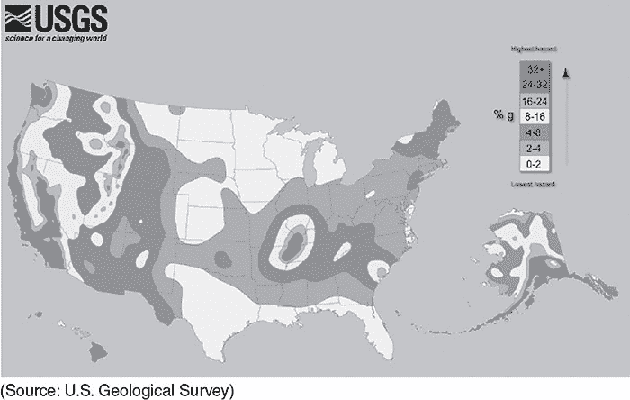

**FIGURE 3.1** Earthquake hazard map of the United States

### 影响评估

如前所述，从其名称可知，影响评估是业务影响评估中最关键的部分之一。在这一阶段，你分析在风险识别和可能性评估期间收集的数据，并尝试确定每个已识别风险若发生对业务的影响。

从定量角度来看，我们将重点介绍三个具体指标：暴露系数（exposure factor）、单次损失预期（single loss expectancy）和年化损失预期（annualized loss expectancy）。每个指标均针对在前期阶段评估的每个具体风险/资产组合计算得出。

`暴露系数`（EF）是风险对资产造成的损害金额，以资产价值的百分比表示。例如，如果 BCP 团队咨询火灾专家并确定建筑火灾会导致建筑 70% 被毁，则该建筑对火灾的暴露系数为 70%。

`单次损失预期`（SLE）是风险发生时预期的 monetary loss。你可以使用以下公式计算 SLE：

```
<displayedItem xmlns:cms="http://cms.wiley.com" xmlns:dctm="http://www.documentum.com" xmlns="http://www.wiley.com/namespaces/wiley" xmlns:wiley="http://www.wiley.com/namespaces/wiley/wiley" numbered="no" id="c03-disp-0001" type="mathematics"><math display="block"/></displayedItem>
```


继续沿用前面的例子，如果该建筑价值 500,000 美元，则单次损失预期为 70% 的 500,000 美元，即 350,000 美元。这意味着一次建筑火灾预计会导致 350,000 美元的损失。

年化损失预期（`ALE`）是风险对资产造成损害在一年内预期的 monetary loss。你已经拥有所有必要的数据来进行此计算。`SLE` 是灾害发生时预期的损失金额，而 `ARO`（来自可能性分析）是预计每年发生灾害的次数。`ALE` 通过将这两个数值相乘得到：

```xml
<displayedItem xmlns:cms="http://cms.wiley.com" xmlns:dctm="http://www.documentum.com" xmlns="http://www.wiley.com/namespaces/wiley" xmlns:wiley="http://www.wiley.com/namespaces/wiley/wiley" numbered="no" id="c03-disp-0002" type="mathematics"><math display="block"/></displayedItem>
```


再次以我们的建筑为例，如果火灾专家预测该建筑每 30 年发生一次火灾，则 `ARO` 约为 1/30，即 0.03。`ALE` 则为 `SLE` 的 3%，即 10,500 美元。这意味着企业每年因建筑火灾预计损失 10,500 美元。

显然，火灾每年不会发生——这个数字是 30 年间火灾发生频率的平均值，对预算编制并不特别有用，但在优先分配 BCP 资源以应对特定风险时极具价值。这些概念也在第 2 节“人员安全与风险管理概念”中有所覆盖。

从定性角度来看，你必须考虑中断可能对业务造成的非金融影响。例如：

*   客户群体中良好声誉的丧失
*   因长期停业导致的员工流失
*   对社区的社会/伦理责任
*   负面宣传

将这些项目量化为金额以纳入定量影响评估虽然困难，但它们同样重要。毕竟，如果你彻底摧毁客户群，你就无法在准备恢复运营时回到原来的业务！

### 资源优先级排序

BIA 的最后一步是为前文识别并评估的各种风险分配业务连续性资源进行优先级排序。

从定量角度来看，此过程相对直接。你只需列出 BIA 过程中分析的所有风险，并按 `ALE`（年化损失预期）从高到低排序。这将为你提供一个风险优先级排序的列表，指示你应首先处理的风险。从列表顶部选择你能够同时处理的项目数量，并从上往下逐一着手。最终，你会在以下两种情况下停止：要么耗尽风险列表（不太可能），要么用尽所有可用资源（更为可能）。

回顾前一节，我们也强调了处理定性重要事项的必要性。在之前的 BIA 章节中，我们将定量分析和定性分析主要视为具有部分重叠的独立功能。现在，是时候合并这两个已排序的列表，形成一个综合的优先级列表，这更多是一门艺术而非科学。你需要与 BCP 团队以及高级管理层的代表召开会议，将两个列表合并为一个单一的优先级列表。

定性考量可能会提升或降低已经在 `ALE` 排序的定量列表中的风险优先级。例如，如果你经营一家防火公司，你的首要任务可能是防止位于主要营业地点的火灾，尽管地震可能导致更严重的物理损害。防火公司因火灾而声誉受损可能导致业务崩溃，这种潜在的声誉损失使得将火灾预防提升至首位的理由充分。

## 连续性规划

-   [BCP 流程的前两个阶段（项目范围和规划以及业务影响评估）侧重于确定 BCP 流程的运作方式，并确定必须保护免受中断的业务资产。BCP 开发的下一阶段——连续性规划——侧重于制定和实施连续性策略，以最小化已识别风险对受保护资产可能造成的影响。

在本节中，您将了解连续性规划所涉及的子任务。

*   策略制定
*   设施和流程
*   计划批准
*   计划实施
*   培训与教育

### 策略制定

策略制定阶段位于业务影响评估与连续性规划阶段之间。BCP 团队必须将量化和质化资源优先级评估中提出的已确定关注事项的优先级列表转化为业务连续性计划将处理的风险。完全应对所有可能的情形需要在面对每一种可能风险时保持零停机状态的设施和流程的实施，这在显而易见的原因下是不可能实现的。

BCP 团队应回顾在 IBA 早期阶段创建的 `MTD`（最长可接受停机时间）估计值，判断哪些风险是可接受的，哪些必须通过 BCP 连续性设施和流程进行缓解。一些决定显而易见——在埃及运营设施遭遇暴风雪的风险微乎其微，可被视为可接受风险；而在新德里的季风风险严重，必须通过 BCP 设施进行缓解。

一旦 BCP 团队确定需要缓解的风险及其各自的资源投入水平，即可进入连续性规划的设施和流程阶段。

### 设施和流程

设施和流程阶段是整个业务连续性计划的核心。在此任务中，BCP 团队设计针对策略制定阶段确定为不可接受的风险的具体程序和机制。BCP 设施和流程必须保护三类资产：人员、建筑/设施和基础设施。接下来的三节将介绍保护这些类别的若干技术。

#### 人员

首先，必须确保组织内的人员在灾难发生前、中、后均安全。达到此目标后，需制定安排，使员工在给定的灾难情况下，能够尽可能正常地开展 BCP 和日常运营任务。

人员应获得完成各自任务所需的全部资源。同时，若情况要求人员在工作场所停留较长时间，必须安排住宿和食物。任何需要上述设施的连续性计划，都应在灾难发生时为 BCP 团队提供详细指示。组织应在可及的地点储备足够长时间的食物，以供运营和支持团队使用，并规定库存定期轮换，防止变质。

#### 建筑和设施

许多企业需要专用设施以开展关键业务，这些设施可能包括标准办公场所、制造工厂、作业中心、仓库、分销/物流中心、维修/维护车间等。在执行 BIA（业务影响分析）时，您会识别对组织持续性至关重要的设施。连续性计划应针对每个关键设施的两个方面进行规划。

**硬化设施** BCP 应说明在策略制定阶段定义的风险下，保护现有设施的机制和程序。这可能包括简单的修补漏水屋顶，也可能包括安装加固的飓风卷帘、防火墙等复杂措施。

**备用场所** 如果无法对设施进行硬化以抵御风险，BCP 应识别备用场所，使业务活动能够在最短时间内（或不超过关键业务功能的最大可接受停机时间）立即恢复。第 18 章介绍了一些在该阶段可能有用的设施类型。

#### 基础设施

每个企业都依赖某种基础设施来支撑其关键业务流程。对于许多企业而言，关键基础设施是用于处理订单、管理供应链、处理客户交互及其他业务功能的通信和计算系统的 IT backbone。该 backbone 由若干服务器、工作站以及不同站点之间的关键通信链路组成。BCP 必须说明如何保护这些系统免受策略制定阶段识别的风险侵害。与建筑和设施类似，保护基础设施的主要有两种方法。

**物理硬化系统** 通过引入如计算机安全防火抑制系统、不间断电源（UPS）等防护措施，可保护系统免受风险侵害。

**备用系统** 通过引入冗余（包括冗余组件或完全冗余的系统/通信链路，后者依赖不同设施），也可通过备用系统保护业务功能。

这些原则同样适用于支撑关键业务流程的任何基础设施组件——运输系统、电力电网、银行金融系统、供水系统等。

### 计划批准与实施

当 BCP 团队完成计划设计阶段后，需要获得高层管理层的批准。如果在计划开发的各个阶段均有高层管理参与，批准过程将相对简单。反之，若这是首次向管理层提交 BCP 文档，则需准备详细阐述计划目的及具体设施和流程的说明。

#### 计划批准

可能的话，应争取得到企业最高执行官（首席执行官、董事长、总裁或类似职务）的批准。此举彰显计划对整个组织的重要性，并展示业务领袖对业务连续性的承诺。此类高层领导的签名也能显著提升计划在其他高层管理者眼中的权威性和可信度，防止其被视作仅是必要但微不足道的 IT 项目。

#### 计划实施

获得高层管理批准后，即可着手实施计划。BCP 团队应组织制定实施进度表，充分利用已投入的资源，在考虑修改范围和组织文化的前提下，尽快实现计划中设定的流程与设施目标。

在所有资源全部投入使用后，BCP 团队应监督开展适当的 BCP 维护程序，确保计划随业务需求的不断变化保持敏捷响应。

#### 培训与教育

培训与教育是 BCP 实施的关键要素。所有将直接或间接参与计划的人员均应接受相应的培训，了解整体计划及其各自的责任。

-   [组织中的每个人](https://example.org)都应该接受至少一次计划概述培训，以让他们有信心业务领导已考虑可能影响业务持续运营的风险，并制定应对措施以减轻业务中断对组织的影响。
-   直接负责业务连续性计划（BCP）的人员应接受针对其特定 BCP 任务的培训并进行评估，以确保在灾难发生时能够高效完成这些任务。此外，每个 BCP 任务至少应有一名备用人员接受培训，以确保在人员受伤或在紧急情况下无法到达工作地点时能够实现冗余。

### BCP 文档

文档是业务连续性规划过程中的关键步骤。将 BCP 方法论书面化可带来多项重要好处。

*   它确保 BCP 人员在紧急情况下（即使高级 BCP 团队成员不在现场）也能参考书面的连续性文档。
*   它提供了 BCP 过程的历史记录，帮助后续人员理解各项程序的背后逻辑，并据此实施必要的计划修改。
*   它迫使团队成员将思路写在纸上，这一过程常能暴露计划中的漏洞；书面文档还可分发给非 BCP 团队成员进行“常识检查”。

在下面的章节中，我们将探讨书面业务连续性计划的重要组成部分。

#### 连续性规划目标

首先，计划应阐述 BCP 团队及高层管理层确定的连续性规划目标。这些目标应在首次 BCP 团队会议上确定，并且在 BCP 生命周期内基本保持不变。

最常见的 BCP 目标很简单：确保在紧急情况下业务能够持续运营。根据组织需求，还可在此部分加入其他目标。例如，您可能希望客户呼叫中心的停机时间不超过 15 分钟连续，或在启动后 1 小时内备份服务器能够处理 75% 的处理负载。

#### 重要性声明

重要性声明反映了 BCP 对组织持续可行性的关键性。该声明通常以一封致组织员工的信函形式出现，阐述为何组织投入大量资源开发 BCP，并请求全体人员在 BCP 实施阶段提供配合。

高层领导的认可至关重要。若能在首席执行官（CEO）或同等层级的高管签名下出具此信，计划在组织内部推行变更时将拥有巨大影响力。若仅由低级管理者签署，则在跨部门协作时可能遭遇阻力。

#### 优先级声明

优先级声明直接来源于业务影响评估（BIA）的“确定优先级”阶段。它仅列出在 BCP 过程中确定的、按优先顺序排列的关键业务功能，并注明这些功能的重要性，除此之外不添加其他内容。否则，优先级列表可能被用于不当目的，导致各组织之间的政治博弈，损害业务连续性计划。

#### 组织责任声明

组织责任声明由高层领导作出，可与重要性声明合并在同一封信中。它强调“业务连续性是人人有责”的理念，重申组织致力于业务连续性规划，并告知员工、供应商及附属机构，他们有责任尽一切所能协助 BCP 过程。

#### 紧迫性与时序声明

紧迫性与时序声明表达了实施 BCP 的紧迫性，并列出 BCP 团队与高层管理层共同确定的实施时间表。该声明的措辞取决于组织领导对 BCP 过程的实际紧迫程度。若该声明与优先级声明、组织责任声明合并在同一文件中，则时间表应作为单独文档提供；否则，时间表与此声明可合并为同一份文档。

#### 风险评估

风险评估部分本质上是业务影响评估期间决策过程的回顾。它应讨论在 BIA 中考虑的所有风险，以及对这些风险进行的定量和定性分析。定量分析需包含实际的 `AV`、`EF`、`ARO`、`SLE` 与 `ALE` 数值；定性分析则需说明风险分析的思路。需注意，风险评估应定期更新，因为它反映的是时点性的评估结果。

#### 风险接受/缓解

风险接受/缓解部分包含 BCP 过程策略制定的结果。它应针对风险分析中识别的每个风险，阐述以下两种思路之一：

*   对于被认为可接受的风险，需说明其可接受的原因，并指出可能导致重新评估的潜在未来事件。
*   对于被认为不可接受的风险，需说明为降低对组织持续可行性的影响而实施的风险管理措施和流程。

#### 关键记录计划

BCP 文档还应包含关键记录计划，说明关键业务记录的存储位置以及制作和保存备份副本的具体流程。

实施关键记录计划的最大挑战往往是首先确定这些关键记录！随着组织从纸质转向数字工作流，原本严谨的文件结构建立与维护机制往往随之丧失。关键记录可能分布在多种 IT 系统和云服务中，有的存放在可供团队访问的中央服务器，有的则位于个人员工专属的数字存储库。

如果那混乱的现状听起来像您当前的现实，您可能需要通过确定对业务真正至关重要的记录来启动重要记录计划。与功能领导者坐下来，提问：“如果我们需要在完全新的地点重建组织，且没有任何电脑或文件的访问权限，您需要哪些记录？”以这种方式提问迫使团队在脑海中想象重新创建业务流程的实际过程，随着他们在心中逐步推演，将产生组织关键记录的清单。随着人们回忆起其他重要的信息来源，该清单可能会随时间而演变，因此您应考虑使用多次会议来最终确定它。

一旦您确定了组织视为关键的记录，下一步是一项艰巨的任务：找到它们！您应能够识别每条关键记录在重要记录清单中的存储位置。完成这一任务后，您可以利用这份重要记录清单来指导业务连续性规划的其余工作。

### 紧急响应指南

紧急响应指南概述了组织和个人在紧急情况发生时的即时响应责任。本文档为最先发现紧急情况的员工提供他们应采取的步骤，以激活业务连续性计划（BCP）中不自动启动的条款。这些指南应包括以下内容：

- 立即响应程序（安全与安全程序、灭火程序、通知相应的应急响应机构等）
- 受通知的关键人员名单（高管、BCP 团队成员等）
- 在 BCP 团队集结前，第一响应者应执行的次要响应程序

您的指南应确保组织中所有可能成为首批应急响应者的成员都能轻松获取。任何中断发生时，时间即是金钱。激活业务连续性程序的延迟可能导致业务运营出现不必要的停机。

### 维护

BCP 文档和计划本身必须是“活”文档。每个组织都在不断变化，这种动态特性确保业务连续性需求也会随之演变。BCP 团队在计划制定完成后不应解散，而应定期召开会议讨论计划并回顾测试结果，以确保其持续满足组织需求。

显然，计划中的小幅修改无需重新从头开始制定 BCP；只需在 BCP 团队的非正式会议上一致同意即可进行。但请注意，组织使命或资源出现重大变化时，可能需要回到 BCP 草图阶段，重新开始制定。

每次对 BCP 进行修改时，必须做好版本控制。所有旧版 BCP 应被实体销毁，仅保留最新版本，以消除对 BCP 实施的正确性产生混淆。

同时，将 BCP 组成部分纳入职位描述也是良好做法，以确保 BCP 保持更新并正确执行。在员工职位描述中加入 BCP 职责，也使其成为绩效评估的一部分。

### 测试与演练

BCP 文档还应列出正式的演练计划，以确保计划保持最新，且所有人员在灾难发生时能够正确履行职责。测试流程与灾难恢复计划的测试流程相似，因此我们将在第十八章专门讨论具体的测试类型。

## 摘要

依赖技术资源生存的任何组织都应制定全面的业务连续性计划，以在不可预见的紧急事件发生时确保组织的持续可行性。支撑稳健业务连续性规划的关键概念包括项目范围与规划、业务影响评估、连续性规划以及批准与实施。

组织必须制定并实施计划和程序，以减轻灾难对持续运营的影响，并加速恢复正常业务。为确定业务面临的风险及需被缓解的部分，您必须与跨职能团队从定量和定性两个角度共同开展业务影响评估。在制定业务连续性策略时，您需明确应对未来灾难的具体步骤。

最后，您必须编制文档，确保计划能有效传达给当前和 future BCP 团队成员。此类文档应包括连续性规划指南。业务连续性计划还需包含重要性声明、优先级、组织责任、紧迫性与时限性说明，以及风险评估、接受与缓解、重要记录计划、应急响应指南、以及维护与测试的计划。

第十八章将进一步推进规划——制定并实施灾难恢复计划，其中包含在灾难面前保持业务运行所需的技术控制措施。

# 第 4 章

## 法律、法规与合规

**本章涵盖的 CISSP 考试主题包括：**

*    Domain 1: 安全与风险管理
    *   1.3 确定合规要求
        *   1.3.1 合同、法律、行业标准和监管要求
        *   1.3.2 隐私要求
    *   1.4 理解信息安全在全球背景下的法律和法规问题
        *   1.4.1 网络犯罪和数据泄露
        *   1.4.2 许可和知识产权要求
        *   1.4.3 进出口控制
        *   1.4.4 跨境数据流
        *   1.4.5 隐私

 合规领域是信息技术（IT）和网络安全专业人士的法律与法规丛林。国家、州和地方政府均通过相互交织的法律，对网络安全的不同组成部分进行监管，形成一种拼图式的局面。这给安全专业人士带来了在多个司法管辖区协调法律的极大困惑。对跨国公司而言，情况更为复杂，它们必须在国际法之间进行权衡。

执法机构在近年来积极应对网络犯罪问题。各国政府的立法机构至少已尝试解决网络犯罪问题。许多执法机构拥有全职、经专业训练的电脑犯罪调查员，且接受过高级安全培训。那些没有此类经验的人通常不知去向。

本章将介绍处理计算机安全问题的各类法律。我们将探讨围绕电脑犯罪、隐私、知识产权以及其他相关议题的法律问题。同时，我们也会涵盖基础调查技术，包括呼吁警方协助的利弊。

## 法律类别

三大法律类别在我们的法律体系中发挥重要作用。每类法律均覆盖多种情形，且不同类别的违法行为处罚差异显著。下文将说明刑法、民法和行政法如何相互作用，构成复杂的司法体系。

### 刑法

刑法构成保障和平与社会安全的法律基石。许多高调案件涉及刑法，这些是警察及其他执法机构关注的法律范畴。刑法禁止谋杀、袭击、抢劫、纵火等行为。违反刑法的处罚包括强制社区服务、罚款（轻微或重大）以及剥夺公民权利的监禁刑。

部分刑法旨在保护社会免受电脑犯罪侵害。在本章后续部分，你将了解诸如《计算机欺诈与滥用法》、《电子通信隐私法》和《身份盗用与遏制法》（等）等法律，对严重电脑犯罪案件提供刑事处罚。技术熟练的检察官联合关注执法机构，利用法院系统对曾被视为无害恶作剧的“黑客地下组织”成员处以长期监禁，从而对该领域形成有力打击。


在美国，各级立法机构通过选举代表制定刑法。联邦层面，众议院和参议院须在大多数情况下以多数票通过刑法案，方可成为法律。通过后，这些法律成为联邦法，适用于联邦政府拥有管辖权的所有案件（主要涉及州际贸易、跨州边界或直接针对联邦政府的案件）。若联邦管辖权不适用，州级当局则依据州立法机构通过的类似法律处理案件。

所有联邦和州法律必须遵循美国宪法——即美国政府体制的最高权威。所有法律均受地区法院的司法审查，并可通过上诉一直到美国最高法院。若法院认定某法律违宪，可将其废除并宣告无效。

请记住，刑法属严肃事项。若你因目击、被告或受害人等身份卷入涉及刑事机关的案件，务必寻求熟悉刑事司法体系且专精于电脑犯罪的律师。在如此复杂的体系中，“独自应对”并非明智之举。

## 民法

民法构成我国法律体系的主体部分，旨在构建有序社会，处理非刑事但需公正仲裁的个人与组织间纠纷。民法适用的典型事项包括合同争议、房地产交易、雇佣事务以及遗产/继承程序。此外，民法还为政府行政部门提供运作框架，规定政府预算及赋予行政部门制定行政法的权限（见下文）。

民法的制定过程与刑法相同，必须经立法程序通过后才能施行，并受同等宪法约束和司法审查。联邦层面，刑法与民法均体现在《美国法典》（USC）中。

民法与刑法的主要区别在于执行方式。通常，执法机构仅在维持秩序必要时介入民事事务。在刑事案件中，政府通过警察调查员和检察官对被告提起诉讼。而在民事案件中，受害方需自行聘请律师并提起民事诉讼指控责任方。除非政府本身是当事人，否则政府不参与争议或支持任何一方。政府在民事事务中的唯一角色是提供审判法官、陪审团及法院设施，并依法管理司法系统的行政事务。

与刑法一样，若你认为需要提起民事诉讼，或他人向你提起民事诉讼，建议尽早获得法律帮助。尽管民法不以监禁为威胁，但败诉方可能面临重大经济处罚。无需进一步查找，夜 ly news 早已报道众多数百万美元对烟草公司、大型企业及富裕个人的民事案件。

## 行政法

行政部门负责监管众多机构，确保政府运作高效。这些机构必须遵循并执行立法机构通过的刑法与民法。然而，正如所料，刑法与民法无法涵盖所有可能情形的规则与程序。因此，行政部门拥有制定行政法的余地，形式包括政策、程序和规章，规范机构日常运作。行政法涵盖从机构内部获取办公电话的程序等日常细节，到国会通过的法律所依据的移民政策等重大议题。

行政法在《联邦法规》（CFR）中公布。

尽管行政法无需经立法机构立法即获得法律效力，但必须遵守所有现行的民事与刑事法律。政府机构不得制定直接违背立法机构已通过法律的规章。此外，行政法及相关机构行为亦必须符合《美国宪法》，并受司法审查。

为理解合规要求和程序，必须充分了解法律的复杂性。从行政法到民法再到刑法（在某些国家，甚至包括宗教法），在监管环境中导航是一项艰巨的任务。CISSP 考试关注的是一般性的法律、法规、调查以及它们对组织安全工作的影响。然而，你的责任是寻求专业帮助（即律师）来指导并支持你在维护法律上可支持的安全方面的努力。

## 法律

在这些章节中，我们将探讨与信息技术相关的若干法律。出于必要性，此讨论以美国为中心，也是 CISSP 考试所覆盖的材料也是如此。我们将简要查看几项高知名度的非美国法律，例如欧洲联盟的《通用数据保护条例》（GDPR）。但如果你在涉及外国司法管辖区的环境中运营，应保留当地法律顾问以指导你通过该系统。

### 计算机犯罪

立法者最初针对的计算机安全问题涉及计算机犯罪。早期的计算机犯罪起诉尝试是基于传统刑法进行的，许多案件因法官认为将传统法用于这种现代犯罪方式过于牵强而被驳回。立法者随即通过特定法案定义计算机犯罪并规定了各类犯罪的具体处罚。在下面的章节中，我们将介绍其中一些法案。

#### 计算机欺诈与滥用法案

《计算机欺诈与滥用法案》（CFAA）是美国首部专门针对网络犯罪的重大立法。国会此前已在 1984 年的《综合犯罪控制法》（CCCA）中将计算机犯罪纳入法律，但 CFAA 被精心起草，专门覆盖跨州的计算机犯罪，以避免侵犯州权并触碰宪法红线。原始 CCCA 的主要规定使以下行为构成犯罪：

*   `未经授权或超出授权范围，在联邦系统中访问机密信息或财务信息`

*   `未经授权访问专用于联邦政府的计算机`

*   `使用联邦计算机实施欺诈（除非欺诈的唯一目标是获取使用该计算机本身的权限）`

*   `导致联邦计算机系统损坏金额超过 1,000 美元`

*   `在计算机上修改医疗记录，且该修改会损害或可能损害个人的检查、诊断、治疗或医疗护理`

*   `如果涉及州际贸易或联邦计算机系统，则非法转售计算机密码`

当国会通过 CFAA 时，它将损害阈值从 1,000 美元提升至 5,000 美元，并大幅扩大了法规的适用范围。原本仅针对处理敏感信息的联邦计算机，该法案被改为覆盖所有“联邦利益”计算机。这一扩展使法案的适用范围包括以下内容：

*   `专用于美国政府的计算机`

*   `专用于金融机构的计算机`

*   `当犯罪行为阻碍政府或机构使用该系统时，政府或金融机构使用的计算机`

*   `用于实施犯罪的计算机组合，且这些计算机不必位于同一州`

#### CFAA 修正案

1994 年，国会认识到自 1986 年 CFAA 最后修订以来，计算机安全面貌已发生剧烈变化，并对该法案作出了大规模修改。这些修改统称为《计算机滥用修正案》（1994 年），其中包括以下条款：

*   `禁止任何可能对计算机系统造成损害的恶意代码的创建`

*   `将 CFAA 扩展至覆盖使用州际贸易的计算机，而非仅限于“联邦利益”计算机系统`

*   `允许无论被告是否意图造成损害，均可对罪犯进行监禁处罚`

*   `为计算机犯罪受害者提供法律依据，以追求民事诉讼，获得禁令救济及损害赔偿`

自 1994 年 CFAA 初次修正以来，国会先后在 1996、2001、2002 和 2008 年通过其他网络犯罪立法进行了补充修正。我们将在本章节中逐一讨论这些修正。

虽然 CFAA 可用于起诉多种计算机犯罪，但它也受到安全与隐私界的广泛批评，被视为范围过于宽泛的法律。在某些解释下，CFAA 会 `criminalize`（即 `criminalize` 为中文语境保留英文原词）网站的使用条款违反。该法案曾用于起诉麻省理工学院学生 Aaron Schwartz，他下载了大量在 MIT 网络中可得的学术研究论文。Schwartz 在 2013 年自杀，这一事件促使起草一项 CFAA 修正案，内容是排除对网站使用条款的违反从 CFAA 管辖之外。该法案被称为 `Aaron’s Law`，但从未在国会众议院进行投票。

#### 联邦刑事指导原则

1991 年发布的联邦刑事指导原则为联邦法官解释计算机犯罪法律提供了惩罚指导。这三项主要条款对信息安全社区产生了持久影响。

*   `指导原则正式化了 prudent man rule（谨慎人规则），要求高级管理人员对确保在相同情境下普通、谨慎个人会采取的适当注意义务负起个人责任。该规则最初用于财政责任，如今也适用于信息安全领域。`

*   `指导原则允许组织和高管通过证明其在信息安全职责的执行中履行了谨慎义务，从而降低因违规行为受到的惩罚。`

*   `指导原则列出了三种过失的举证责任。首先，被指控过失的人必须有法律上承认的义务；其次，该人必须未能遵守公认的标准；最后，必须存在过失行为与随后损害之间的因果关系。`

#### 1996 年国家信息基础设施保护法案

1996 年，国会通过了《国家信息基础设施保护法案》，对《计算机欺诈与滥用法案》进行了进一步修订，以扩大其保护范围。该法案的主要新增覆盖领域包括：

*   `将 CFAA 的适用范围从州际贸易的计算机系统扩展至国际贸易的计算机系统`

*   `将类似保护措施延伸至国家关键基础设施的其他部分，如铁路、燃气管道、电力电网和电信线路`

*   `将故意或 reckless（故意或轻率）导致关键国家基础设施损害的行为定为重罪`

#### 联邦信息安全管理法

2002 年通过的《联邦信息安全管理法》（FISMA）要求联邦机构实施覆盖其业务运营的信息安全计划。FISMA 还要求政府机构在安全管理计划中纳入承包商的活动。该法案废除了并取代了两部早前的法律：《计算机安全法》（1987 年）和《政府信息安全改革法》（2000 年）。

负责制定 FISMA 实施指南的国家标准技术局（NIST）列出了有效信息安全计划的以下要素：

-   [`定期评估风险`](https://example.org/risk-assessment)，包括因未经授权访问、使用、披露、干扰、修改或破坏信息及支持组织运营和资产的信息系统而可能造成的伤害程度

-   基于风险评估的政策和程序，以成本效益的方式将信息安全风险降至可接受水平，并确保信息安全在每个组织信息系统的生命周期中得到全面考虑

-   为网络、设施、信息系统或信息系统组合提供适当信息安全保障的子计划

-   向组织运营和资产的信息系统支持人员（包括承包商和其他用户）提供信息安全意识培训，让他们了解其活动相关的信息安全风险以及遵守组织政策和程序的责任

-   定期测试并评估信息安全政策、程序、实践和安全控制的有效性，频率根据风险而定，但至少每年一次

-   规划、实施、评估和记录纠正措施的过程，以解决组织信息安全政策、程序和实践中的任何不足

-   程序用于检测、报告和响应安全事件

-   计划和程序，确保支持组织运营和资产的信息系统的业务连续性

FISMA 对联邦机构和政府承包商造成了沉重负担，他们必须制定并维护大量关于自身 FISMA 合规活动的文档。

### 2014 年联邦网络安全法律

2014 年，奥巴马总统签署了一系列法案，将联邦政府应对网络安全问题的方式现代化。

其中第一部法律名为联邦信息系统 `Modernization` 法案（缩写为 FISMA），2014 年的 FISMA 通过将联邦网络安全责任集中到国土安全部，修改了 2002 年 FISMA 的规则。有两个例外：与国防相关的网络安全问题仍由国防部长负责，而情报相关问题则由国家情报总监负责。

第二部法律是 `网络安全增强法案`，该法案赋予 NIST 负责协调全国性的自愿性网络安全标准工作。NIST 编制了 800 系列专刊，涉及联邦政府计算机安全。这些专刊对所有安全从业者都有用，并可免费在线查阅 [`csrc.nist.gov/publications/PubsSPs.html`](http://csrc.nist.gov/publications/PubsSPs.html)。

常用的 NIST 标准包括：

-   NIST SP 800-53: `联邦信息系统和组织的安全与隐私控制`。该标准是联邦计算系统的强制性要求，同时也常被用作行业网络安全基准。

-   NIST SP 800-171: `保护非联邦信息系统和组织中的受控非公开信息`。遵守该标准的安全控制（与 NIST 800-53 非常相似）通常作为政府机构的合同要求。政府承包商必须经常符合 NIST SP 800-171。

-   `NIST 网络安全框架`（CSF）是一套自愿的、基于风险的信息和系统安全框架标准。

第三部法律是 `国家网络安全保护法`，该法案要求国土安全部建立国家网络安全与通信整合中心。该中心的职责是作为联邦机构与民间组织之间共享网络安全风险、事件、分析和警报的接口。

### 知识产权

美国在全球经济中的角色正从商品制造商转向服务提供商，这一趋势同样体现在许多大型工业化国家中。随着服务提供的转变，知识产权在众多企业中日益重要。事实上，可以说许多大型跨国公司最有价值的资产仅是其品牌名称——像 Dell、Procter & Gamble、Merck 这样的公司名称一经提及，即可为其产品带来即时可信度。出版公司、电影制片方和艺术家依赖其创作成果谋生。许多产品依赖于秘密配方或生产工艺——例如可口可乐的传奇秘方或肯德基的秘制香草香料混合比例。

这些无形资产统称为 `知识产权`，为其所有者的权利提供了一整套法律保护。否则，如果音乐店只购买每位艺术家的一张 CD 并为所有客户烧制副本，艺术家的劳动成果将被剥夺，这显然不公平。下面的章节将探讨四大类知识产权——版权、商标、专利和商业秘密的相关法律，并说明这些概念如何具体关联信息安全专业人员。虽然各国在保护（或未保护）这些权利的方式各异，但基本概念在全球范围内是一致的。

#### 版权与数字千年版权法案

`Copyright` 法律保障“原创作品的创作者”免受其作品未经授权的复制。八大类作品符合版权保护：

-   文学作品

-   音乐作品

-   戏剧作品

-   静态和舞蹈作品

-   绘画、图形和雕塑作品

-   电影和其他视听作品

-   音像录音

-   建筑作品

计算机软件可视为属于文学作品的范畴，但需要注意的是，版权法仅保护软件中固有的表达形式——即源代码本身。它不保护软件背后的想法或过程。也有人质疑版权是否可以覆盖软件图形用户界面的“外观和感觉”。法院判决对此持分歧，若您涉及此类问题，建议咨询合格的知识产权律师，以确定当前的立法和案例法状态。

获取版权的正式程序是向美国版权局提交受保护作品的复制件并缴纳相应的登记费用。更多信息请访问该局官网 [`www.copyright.gov`](http://www.copyright.gov)。但需要注意的是，官方登记并非行使版权强制性前提。法律规定，作品创作的瞬间即自动拥有版权。如果您能在法庭上证明您是该作品的创作者（例如通过发表），即可受版权法保护。官方登记仅提供政府在特定日期收到您的作品的证明。

版权所有权通常默认归创作者所有。例外情况是“为雇员所作的作品”。当作品是在雇员正常工作日的工作期间为雇主创作时，该作品被视为“为雇员所作”。例如，当公司公关部的员工撰写新闻稿时，该新闻稿被视为为雇员所作的作品。作品也可以在书面合同中明确声明为“为雇员所作”的情况下被视为“为雇员所作”。

当前版权法规定了较长的保护期限。由一位或多位作者创作的作品在最后一位幸存作者去世后 70 年内受保护。为雇员所作的作品和匿名作品的保护期限为自首次发表之日起 95 年，或自创作之日起 120 年，取较短者。

1998 年，国会认识到数字环境的快速变化正在将现有版权法的适用范围推向极限。为应对这一挑战，它通过了备受争论的《数字千年版权法案》（DMCA）。DMCA 还致力于使美国版权法符合世界知识产权组织（WIPO）两项条约的条款。

DMCA 的第一项主要规定是禁止试图绕过版权持有者在受保护作品上放置的版权保护机制。该条款旨在保护数字媒体（如紧凑光盘（CD）和数字多媒体光盘（DVD））上放置的防复制机制。DMCA 对再次违规者的处罚最高可达 100 万美元和 10 年监禁。非营利机构（如图书馆和学校）免除此条款的适用。

DMCA 还限制了当其电路被用于违反版权法的犯罪时，互联网服务提供商（ISP）的责任。DMCA 承认互联网服务提供商的法律地位类似于电话公司的“普通承运人”地位，不对其用户的“临时活动”承担责任。为获得此豁免，服务提供商的活动必须满足以下要求（直接引用自 1998 年《数字千年版权法案》美国版权局摘要）：

*   `传输必须由非提供商的个人发起。`

*   `传输、路由、连接提供或复制必须通过自动化技术过程完成，且服务提供商不得对材料进行选择。`

*   `服务提供商不得确定材料的接收方。`

*   `中间复制件通常不应被除预期接收方以外的任何人访问，且不应保留超过合理必要的时间。`

*   `材料在传输过程中不得对其内容进行修改。`

DMCA 还豁免了与系统缓存、搜索引擎以及个人用户在网络上存储信息相关的服务提供商的活动。但在这些情况下，服务提供商必须在收到侵权通知后及时采取行动以删除受版权保护的材料。

国会还在 DMCA 中加入了允许计算机软件备份以及任何需要软件复制的维护、测试或常规使用活动的条款。这些条款仅适用于软件在特定计算机上授权使用，且使用符合授权协议，且在不再需要时立即删除此类复制件。

最后，DMCA 阐明了将版权法原则应用于通过互联网流媒体传输音频和/或视频内容的规定。DMCA 规定，这些用途应被视为“符合条件的非订阅传输”。

#### 商标

版权法用于保护创作作品；同样，对 `商标` 的保护也存在，商标包括用于识别公司及其产品或服务的词汇、标语和标志。例如，企业可能在其销售手册上获得版权，以防止竞争对手复制其销售材料。同一企业可能还希望为其公司名称以及其提供的特定产品和服务获得商标保护。

商标保护的主要目标是避免市场混淆，同时保护个人和组织的知识产权。与版权保护一样，商标无需正式注册即可在法律下获得保护。如果您在公共活动中使用商标，您自动受相关商标法保护，并可使用 ™ 符号表明您打算将词汇或标语作为商标保护。如果您希望获得商标的官方认可，可以向美国专利商标局（USPTO）进行注册。该过程通常需要律师进行全面的先前搜索，以确认现有商标是否会阻碍您的注册。整个注册过程从头到尾可能超过一年。一旦您从 USPTO 收到注册证书，即可使用 ® 符号表示您的商标为注册商标。

注册商标的一个主要优势是，您可以在实际使用但并非当前使用的情况下注册商标。这种申请称为 `意图使用` 申请，自 `filing` 日期起即提供商标保护，前提是您在规定的时间内实际在商业中使用该商标。如果您选择不向 PTO 注册商标，则您的保护权仅在您首次使用该商标时开始。

在美国，商标注册的接受依赖于以下两个主要要求：

*   `商标不得与另一商标混淆相似——您应在律师的先前搜索中确定这一点。在公开反对期内，其他公司可能会质疑您的商标注册。`

*   `商标不应是您将提供的商品和服务的描述性内容。例如，“Mike’s Software Company”不适合作为商标候选，因为它描述了公司生产的产品。如果 USPTO 认为商标具有描述性，可能会拒绝申请。`

在美国，商标最初授予为期 10 年，可在无限期的 `successive 10-year` 期间续期。

#### 专利

`专利` 保护发明者的知识产权。它们在发明人独占权期间为期 20 年，期间内发明人拥有使用该发明（无论是直接使用还是通过许可协议）的专利权。专利权期满后，发明进入公有领域，任何人都可以使用。

专利有三个主要要求：

*   `发明必须是新颖的。只有原创的想法才具有专利性。`

*   `发明必须有用。它必须实际运作并完成某种任务。`

*   `发明必须不显而易见。例如，您不能为使用饮杯收集雨水而申请专利，这是一个显而易见的解决方案。但是，您可能能够为一种专门设计的杯子申请专利，该杯子能优化收集的雨水量并最大限度地减少蒸发。`


在技术领域，专利长期被用于保护硬件设备和制造流程。发明者在相关领域拥有大量先例。最近的专利也涵盖了软件程序和类似机制，但这些专利因技术界认为它们过于宽泛而变得有些争议。这些宽泛专利的发布促使那些仅以持有专利并通过法律行动获取收入的企业——即“专利掠夺者”（`patent trolls`）——的业务模式形成。

### Trade Secrets

许多公司拥有对其业务至关重要的知识产权，若被竞争对手或公众披露，将导致严重损失——即`trade secrets`。我们之前提到过两个典型的此类信息例子：可口可乐的秘密配方和肯德基的“秘密草本香料混合物”。其他例子层出不穷；制造公司可能希望将某些仅少数关键员工完全理解的制造流程保密，统计分析公司则可能希望保护其内部使用的高级模型。

前文讨论的两种知识产权工具——版权和专利——可以用于保护此类信息，但存在两个主要缺点：

*   申请版权或专利需要公开披露您的作品或发明的细节。这自动消除了您财产的“秘密”属性，可能损害您的企业，因为失去了产品神秘感，并可能让不法竞争对手在违反国际知识产权法的前提下复制您的财产。

*   版权和专利都只提供有限期的保护。一旦法律保护期限届满，其他公司即可自由使用您的作品（而您在申请过程中已向公众公开所有细节）！

实际上，针对商业秘密有官方流程。鉴于其性质，您无需向任何人注册；您只需自行保管。为保持商业秘密的有效性，您必须在组织内实施适当的控制措施，确保只有有“知情必要性”的授权人员才能访问这些秘密。同时，您必须确保所有拥有此类访问权限的人都签署保密协议（`NDA`），该协议禁止他们向他人泄露信息，并规定违约的惩罚措施。请咨询律师，确保协议期限符合法律允许的最长时间。此外，您还必须采取措施证明您重视并保护知识产权。若未能做到，可能导致商业秘密保护失效。

商业秘密是保护计算机软件的最佳方式之一。正如前文所述，专利法并未为计算机软件产品提供足够的保护。版权法仅保护源代码的实际文本，并不禁止他人以不同形式重写您的代码并实现相同目标。如果您将源代码视为商业秘密，便能使其始终远离竞争对手。这是像微软等大型软件开发公司用来保护核心知识产权的技术手段。

### Licensing

安全专业人员也应熟悉软件许可协议的法律问题。当前普遍使用的四种许可协议类型如下：

*   合同许可协议使用书面合同在软件供应商与客户之间明确各方的责任。这类协议常见于高价或高度专业化的软件包。

*   缩标许可协议（`Shrink-wrap license agreements`）写在软件包装外部。它们通常包含条款，说明您仅需撕开包装上的缩标封条即视为同意合同条款。

*   点击许可协议（`Click-through license agreements`）日益普及，已超越缩标协议。在此类协议中，合同条款要么写在软件包装上，要么包含在软件文档中。安装过程中，您需点击按钮确认已阅读并同意条款。这为流程增添了主动确认，确保个人在安装前已知晓协议的存在。

*   云服务许可协议将点击许可协议推向极致。大多数云服务无需任何书面协议，仅在屏幕上闪现法律条款供审阅。有时仅提供链接至法律条款并附带复选框，供用户确认已阅读并同意。许多用户因激动获取新服务而草率点击，可能在不知情的情况下为其整个组织绑定繁琐的条款。

### Import/Export

联邦政府认识到驱动互联网和电子商务的同样是计算机和加密技术，在军事力量手中同样强大。因此，冷战期间政府制定了复杂的法规，管控敏感硬件和软件的对外出口。这些法规涵盖新技术、知识产权及个人身份信息的跨境数据流管理。

在最近以前，除少数盟友国家外，美国对高性能计算机的出口受到严格限制；加密软件的出口管制更为严苛，几乎不可能将任何加密技术出口至美国境外。近期联邦政策的变化放宽了这些限制，为更开放的商业活动提供了空间。

对网络安全专业人员特别感兴趣的两套联邦进出口法规如下：

*   国际武器贸易法规（`ITAR`）管控被明确列为军事和国防用品的出口，包括相关技术信息。受 `ITAR` 管控的物品列在《美国武器清单》（`USML`），收录于 `22 CFR 121`。

*   出口管理法规（`EAR`）涵盖更广泛的商用但可能具有军事用途的物品。`EAR` 覆盖的项目列在商务控制名单（`CCL`），由美国商务部维护。值得注意的是，`EAR` 包含一整类信息安全产品。

#### Computer Export Controls

目前，美国企业可无需政府事先批准即可向几乎任何国家出口高性能计算系统。但存在例外：商务部工业安全局（`BIS`）将若干被列为“关注国家”的国家列出，原因是它们可能威胁核扩散、被认定为恐怖主义支持国，或其他原因。这些国家包括古巴、伊朗、朝鲜、苏丹和叙利亚。

#### Encryption Export Controls

-   [商务部工业与安全局](https://example.org)制定了美国境外加密产品出口的法规。根据此前的法规，几乎不可能将即使是相对低级别的加密技术出口美国之外。这对美国软件制造商造成了巨大的竞争劣势，因为外国公司面临着与之类似的法规。经过软件行业长时间的游说，总统指示商务部修订法规，以促进美国安全软件行业的发展。

1.  运用费曼技巧，你只需花上`20 min`就能深入理解知识点，而且记忆深刻，`难以遗忘`。

```
if (condVar > someVal) {console.log("xxx")}
```

### 隐私

隐私权多年来一直是美国备受争论的焦点。主要的争议来源是宪法权利法案（`Bill of Rights`）中并未明确规定隐私权。然而，这一权利已由众多法院确认，并由美国公民自由联盟（`ACLU`）等组织积极推动。

欧洲人也长期关注隐私问题。事实上，像瑞士这样的国家因其在保护金融机密方面的卓越能力而闻名全球。本章后面，我们将探讨欧洲联盟数据隐私法律如何影响企业和互联网用户。

#### 美国隐私法

尽管宪法并未保障隐私权，但众多联邦法律（其中许多近年才通过）旨在保护政府所持有的关于公民的私人信息，以及金融、教育和医疗机构等私营领域的关键部分。在下面的章节中，我们将详细探讨这些联邦法律。

**第四修正案** 隐私权的基础在于美国宪法第四修正案。其条文如下：

> 人民有权在其人身、住宅、文件和财物免受不合理的搜查和扣押，且不得被侵犯；且无令状的搜查和扣押不得发生，除非有合理怀疑，并由宣誓或确认支持，并明确描述要搜查的地点以及要扣押的人或事物。

对该修正案的直接解释禁止政府人员在没有搜查令和合理怀疑的情况下搜查私人财产。法院将第四修正案的解释扩展，包括对窃听和其他隐私侵犯的保护。

**1974 年隐私法** 隐私法可能是最重要的限制联邦政府处理公民私人信息方式的法律。它严格限制联邦机构在未获得相关个人事先书面同意的情况下，向其他人或机构披露私人信息。但法律提供了若干例外情况，包括人口普查、执法、国家档案馆、健康与安全以及法院命令。

**1974 年隐私法** 隐私法要求机构仅保留开展业务所必需的记录，并在不再需要用于合法政府功能时销毁这些记录。它为个人提供了正式程序，以获取政府持有的关于他们的记录，并请求对错误记录进行修改。

**1986 年电子通信隐私法** 电子通信隐私法（`ECPA`）使侵犯个人电子隐私成为犯罪。该法将联邦窃听法扩展，该法最初仅针对通过物理线路传输的通信，现在适用于任何非法拦截电子通信或故意未经授权访问电子存储数据的行为。它禁止拦截或披露电子通信，并规定了披露合法的情形。该法保护电子邮件和语音邮件的监听，并防止通信服务提供商未经授权披露其内容。

`ECPA` 最著名的条款之一是禁止监听移动电话通话。事实上，此类监听可处以最高 500 美元罚款和最长五年监禁。

**1994 年通信援助法案（`CALEA`）** 1994 年通信援助法案（`CALEA`）修订了 1986 年的电子通信隐私法。`CALEA` 要求所有通信运营商在拥有适当法院令的情况下，使窃听成为可能，无论使用何种技术。

**1996 年经济间谍法** 1996 年经济间谍法将“财产”的定义扩展，以包括专有的经济信息，从而使窃取此类信息可被视为工业或企业间谍行为。这一修改使得盗窃的法律定义不再受限于物理约束。

**1996 年健康保险可携性与责任法案（`HIPAA`）** 1996 年，国会通过了健康保险可携性与责任法案（`HIPAA`），对健康保险和健康维护组织（`HMOs`）的相关法律进行了众多修改。`HIPAA` 的条款包括隐私和安全规定，要求医院、医生、保险公司以及处理或存储个人医疗信息的其他机构实施严格的安全措施。

`HIPAA` 还明确规定了个人在医疗记录方面的权利，并要求保持此类记录的机构以书面形式披露这些权利。

**2009 年健康信息技术经济与临床健康法案（`HITECH`）** 2009 年，国会通过了修订 `HIPAA` 的健康信息技术经济与临床健康法案（`HITECH`）。该法更新了 `HIPAA` 的许多隐私和安全要求，并于 2013 年通过 `HIPAA` 全面规则（`Omnibus Rule`）实施。

新法规的一个主要变化是对业务伙伴（`business associates`）的对待方式。业务伙伴是指代表受 `HIPAA` 覆盖实体处理受保护健康信息（`PHI`）的机构。任何受 `HIPAA` 覆盖实体与业务伙伴之间的关系必须由书面合同——业务伙伴协议（`BAA`）——来规范。根据新规，业务伙伴直接受 `HIPAA` 及其执行行动的约束，与受覆盖实体（`covered entity`）一样。

`HITECH` 还引入了新的数据泄露通知要求。根据 `HITECH` 披露规则，`HIPAA` 覆盖实体若发生数据泄露，必须通知受影响的个人，并且在泄露影响超过 500 人的情况下，还需通知健康与公众服务部长和媒体。

**1998 年儿童在线隐私保护法（`COPPA`）** 2000 年 4 月，儿童在线隐私保护法（`COPPA`）的条款成为美国法律。`COPPA` 对面向儿童的网站或明知收集儿童信息的网站提出了一系列要求。

*   网站必须发布一份清晰的隐私声明，明确说明收集的信息类型及其用途，包括是否向第三方披露信息。隐私声明还必须包含网站运营方的联系方式。

*   父母必须有机会查看收集自其子女的任何信息，并永久将其从网站记录中删除。

-   父母必须在收集关于 13 岁以下儿童的信息之前，提供可验证的同意。法律中的例外情况允许网站仅在获得此类父母同意的目的下收集最小信息。

`Gramm-Leach-Bliley Act of 1999` 直到 `Gramm-Leach-Bliley Act (GLBA)` 于 1999 年成为法律之前，政府部门对金融机构之间存在严格的屏障。`Banks`、`insurance companies` 和 `credit providers` 在提供服务和共享信息方面受到严重限制。`GLBA` 在一定程度上放宽了各组织提供服务的监管规定。当 `Congress` 通过此法律时，它意识到这种更大的自由度可能产生深远的隐私影响。出于这种顾虑，法律规定了即使同一公司的子公司之间也限制信息交换的类型，并要求金融机构在 2001 年 7 月 1 日之前向所有客户提供书面隐私政策。

`USA PATRIOT Act of 2001` 美国国会于 2001 年 9 月 11 日纽约市和华盛顿特区发生恐怖袭击后，直接通过了 `Uniting and Strengthening America by Providing Appropriate Tools Required to Intercept and Obstruct Terrorism (USA PATRIOT) Act of 2001`。该 `PATRIOT Act` 大幅扩大了执法机构和情报机构在多个领域（包括监控电子通信）的权力。

`PATRIOT Act` 的一项主要变化涉及政府机构获取窃听授权的方式。此前，警察只能在证明该电路由受监控对象使用后，获得针对单个电路的授权。`PATRIOT Act` 的条款允许当局对特定个人获得 `blanket authorization`（即针对该人的全面授权），然后在单一授权下监控该人所有的通信。

另一项主要变化是政府处理互联网服务提供商（`ISPs`）的方式。根据 `PATRIOT Act` 的条款，`ISPs` 可自愿向政府提供大量信息。`PATRIOT Act` 还允许政府通过传票（而非窃听）获取用户活动的详细信息。

最后，`USA PATRIOT Act` 修订了 `Computer Fraud and Abuse Act (CFAA)`，以提供更严厉的刑事处罚措施。该法案规定最高可判处 20 年监禁，并进一步扩大了 `CFAA` 的适用范围。

`PATRIOT Act` 的立法历史较为复杂。该法案的许多关键条款于 2015 年因国会未能通过续期法案而失效。然而，国会随后于 2015 年 6 月通过了 `USA Freedom Act`，该法案恢复了 `PATRIOT Act` 的关键条款，并使其在 2019 年 12 月到期前保持有效，除非国会再次进行续期。

`Family Educational Rights and Privacy Act` `Family Educational Rights and Privacy Act (FERPA)` 是另一项专门针对隐私的法律，适用于接受任何形式联邦政府资金的教育机构（绝大多数学校）。它赋予 18 岁以上学生及未成年学生父母的特定隐私权利。具体的 `FERPA` 保护措施包括以下几点：

*   父母/学生有权查阅机构维护的关于学生的任何教育记录。

*   父母/学生有权请求更正他们认为错误的记录，并有权在记录中加入声明以质疑未被更正的内容。

*   学校未经书面同意不得披露学生记录中的个人信息，除非在特定情况下。

`Identity Theft and Assumption Deterrence Act` 1998 年，总统签署了 `Identity Theft and Assumption Deterrence Act` 成为法律。过去，身份盗用的唯一合法受害者是被欺诈的债权人。该法案将身份盗用定为针对被盗用身份的个人的犯罪，并对违法者处以最高 15 年监禁和/或最高 25 万美元罚款的严厉刑事处罚。

#### European Union Privacy Law

2015 年 10 月 24 日，欧洲联盟（`EU`）议会通过了一项全面的指令，规定了必须为保护信息系统中处理的个人数据而实施的隐私措施。该指令于三年后，即 1998 年 10 月生效。指令要求所有个人数据的处理必须满足以下任一条件：

*   同意

*   合同

*   法律义务

*   数据主体的重大利益

*   数据持有者与数据主体之间的利益平衡

指令还规定了关于数据持有和/或处理的个人的关键权利：

*   访问数据的权利

*   知晓数据来源的权利

*   更正不准确数据的权利

*   在某些情况下拒绝处理数据的权利

*   当这些权利被侵犯时，享有法律行动的权利

即使是位于欧洲以外的组织也必须考虑这些规则的适用性，因为数据跨境流动有相关要求。在个人信息离开欧盟的情况下，发送数据的一方必须确保其仍受到保护。在美国从事欧洲业务的公司可以获得欧盟与美国之间的隐私框架（`Privacy Shield`）保护，该框架允许商业部和联邦贸易委员会（`FTC`）认证符合规定的企业，并为其提供免受起诉的“安全港”保障。

要获得 `Privacy Shield` 保护，在美国从事欧洲业务的美国公司必须满足以下七项关于个人信息处理的要求：

**告知个人数据处理情况** 公司必须在其隐私政策中包含对 `Privacy Shield` 原则的承诺，使其受美国法律管辖。同时，公司必须告知个人在 `Privacy Shield` 框架下的权利。

**提供免费且可及的争议解决** 参与 `Privacy Shield` 的公司必须在任何投诉中于 45 天内提供回应，并同意包括具有约束力的仲裁在内的申诉流程。

**配合商业部** 受该协议覆盖的公司必须及时响应美国商业部关于其参与 `Privacy Shield` 的任何信息请求。

**维护数据完整性和目的限制** 参与 `Privacy Shield` 的公司必须仅收集和保留与其明确目的相关的个人信息。

**确保对第三方转移数据的问责** `Privacy Shield` 参与者在向第三方转移信息前必须遵守严格要求。这些要求旨在确保转移是为了有限且特定的目的，且接收方能够妥善保护信息的隐私。

**与执法行动相关的透明度** 如果 `Privacy Shield` 参与者因未能遵守程序要求而收到执法行动或法院命令，他们必须公开向 `FTC` 提交的任何合规或评估报告。

**确保承诺在数据持有期间持续有效** 离开 `Privacy Shield` 协议的组织必须在其仍保留协议项下收集的信息期间，每年继续认证其合规性。

#### European Union General Data Protection Regulation

欧洲联盟于 2016 年通过了一项新的、全面的法律，涵盖个人信息的保护。通用数据保护条例（`GDPR`）计划于 2018 年 5 月 25 日生效，并将在该日期取代旧的数据保护指令。该法律的主要目的是提供一项统一、协调的法律，覆盖整个欧洲联盟的数据。

`GDPR` 与数据保护指令的主要区别在于监管范围的扩大。新法规适用于所有从欧盟居民收集数据或代表他人处理这些信息的组织。重要的是，该法规甚至适用于非欧盟境内的组织，只要它们收集欧盟居民的信息。根据法院对该法规的解释，它可能因范围广泛而成为一项国际法。欧盟对全球执行该法规的能力仍是一个未知数。

`GDPR` 的主要条款包括以下几点：

*   要求公司在 24 小时内向监管机构通报严重数据泄露

*   在每个欧盟成员国建立集中数据保护机构

*   规定个人有权访问其个人数据

*   数据可携带条款，便于在个人请求下转移个人信息

*   “被遗忘权”，允许个人要求公司删除不再需要的信息

### 合规

过去十年来，信息安全监管环境日益复杂。组织可能会受到众多法律（本章前面已列出的许多法律）和监管机构或合同义务的规范。应对组织面临的众多重叠、有时甚至相互矛盾的合规要求，需要仔细规划。许多组织雇佣全职 IT 合规人员，负责跟踪监管环境、监控控制以确保持续合规、协助合规审计，并满足组织的合规报告义务。

组织可能会受到合规审计，审计方可能是内部和外部审计师，也可能是监管机构或其代表。例如，组织的财务审计师可能会进行 IT 控制审计，以确保组织财务系统的信息安全控制足以确保符合《萨班斯-奥克斯利法案》（`SOX`）。一些法规（如 `PCI DSS`）可能要求组织聘请经批准的独立审计师来验证控制并直接向监管机构提供报告。


除了正式审计外，组织还需向内部和外部利益相关者报告合规情况。例如，组织的董事会（或更常见的审计委员会）可能要求定期报告合规义务和状态。同样，PCI DSS 要求那些不需要进行正式第三方审计的组织完成并提交自我评估报告，以阐述其合规状态。

### 合同和采购

随着云服务和其他外部供应商用于存储、处理和传输敏感信息的使用增加，组织在合同和采购流程中实施安全审查和控制的重点也随之转移。安全专业人员应在供应商选择和评估阶段，以及持续的供应商治理审查中，对供应商实施的安全控制进行审查。

在供应商治理审查中，以下问题值得关注：

*   供应商存储、处理或传输哪些敏感信息？
*   已实施哪些控制来保护组织的信息？
*   我们的信息如何与其他客户的信息隔离？
*   如果依赖加密作为安全控制，使用了哪些加密算法和密钥长度？密钥管理如何？
*   供应商执行哪些类型的安全审计，客户对这些审计的访问权限如何？
*   供应商是否依赖其他第三方来存储、处理或传输数据？合同中关于安全的条款如何扩展到这些第三方？
*   数据存储、处理和传输将在何处进行？如果在客户和/或供应商所在国家之外，这会有什么影响？
*   供应商的应急响应流程是什么，以及在潜在安全泄露时客户何时会被通知？
*   为确保客户数据的持续完整性和可用性，已采取哪些措施？

这只是一些潜在关注点的简要列表。请根据贵组织的具体关注点、供应商提供的服务类型以及将与其共享的信息，调整安全审查的范围。

### 总结

计算机安全必然需要法律界高度参与。在本章中，您了解了规范计算机犯罪、知识产权、数据隐私和软件许可的相关法律。

影响信息安全专业人员的三大法律类别如下：刑法规定了对公共信任重大侵犯行为的规则和制裁。民法为商业活动提供了框架。政府机构使用行政法来制定解释现有法律的日常性法规。

信息安全活动受到的法律涵盖这三类，种类繁多。例如，《电子通信隐私法》和《数字千年版权法》属于刑法，违规行为可能导致罚款或监禁。《商标法》和《专利法》属于民法，规范商业交易。许多政府机构通过行政法（如 HIPAA 安全规则）发布针对特定行业和数据类型的规定。

信息安全专业人员应了解其行业和业务活动所特有的合规要求。跟踪这些要求是一项复杂的任务，应委派给一名或多名合规专家，负责监测法律变化、业务环境变化以及两者交汇处的动态。

此外，仅关注自身的安全和合规是不够的。随着云计算的普及，许多组织现在将敏感和个人数据与作为服务提供商的供应商共享。安全专业人员必须采取措施，确保供应商对数据的处理方式与组织本身一样谨慎，并满足所有适用的合规要求。

### 考试要点

**理解刑法、民法和行政法的区别。** 刑法保护社会免受违背基本原则的行为侵害。刑法违规行为由联邦和州政府起诉。民法为人与组织之间的商业交易提供框架。民法违规行为由受影响的两方在法院提起并争论。行政法由政府机构用于有效履行日常业务。

1. 哪部刑事法律是第一部实施对创建会损害计算机系统的病毒、蠕虫等恶意代码的创作者的处罚的法律？
   1. Computer Security Act
   2. National Infrastructure Protection Act
   3. Computer Fraud and Abuse Act
   4. Electronic Communications Privacy Act

2. 哪部法律规范联邦机构的信息安全运营？
   1. FISMA
   2. FERPA
   3. CFAA
   4. ECPA

3. 哪种法律不需要经国会立法即可在联邦层面实施，而是由行政部门以法规、政策和程序的形式制定？
   1. Criminal law
   2. Common law
   3. Civil law
   4. Administrative law

4. 哪个联邦政府机构负责确保不处理敏感或机密信息的政府计算机系统的安全？
   1. National Security Agency
   2. Federal Bureau of Investigation
   3. National Institute of Standards and Technology
   4. Secret Service

5. 经修订后，Computer Fraud and Abuse Act 保护的最广泛类别的计算机系统是什么？
   1. Government-owned systems
   2. Federal interest systems
   3. Systems used in interstate commerce
   4. Systems located in the United States

6. 哪部法律通过限制政府机构搜索私人住宅和设施的权力，保护公民的隐私权？
   1. Privacy Act
   2. Fourth Amendment
   3. Second Amendment
   4. Gramm-Leach-Bliley Act

7. Matthew 最近开发了一种创新算法，想在发布技术期刊代码前获得某种知识产权保护。最适合他的保护方式是哪种？
   1. Copyright
   2. Trademark
   3. Patent
   4. Trade secret

8. Mary 是 Acme Widgets 公司的联合创始人，她和合伙人 Joe 开发了一种特殊油，能大幅提升制造工艺。为保持配方秘密，他们计划在其他工人离开后大量自行生产该油，以尽可能长时间地保护该配方。最适合的知识产权保护方式是哪种？
   1. Copyright
   2. Trademark
   3. Patent
   4. Trade secret

9. Richard 为新产品起了一个名字，并已向律师提交了相应的申请，但尚未收到政府的回复，他希望立即使用该名字。为了表明该名称的受保护状态，他应使用哪个符号？
   1. ©
   2. ®
   3. ™
   4. †

10. 哪部法律防止政府机构在个人在受保护情况下向政府提供的个人信息被披露？
    1. Privacy Act
    2. Electronic Communications Privacy Act
    3. Health Insurance Portability and Accountability Act
    4. Gramm-Leach-Bliley Act

11. 哪个框架允许美国公司认证符合欧盟隐私法？
    1. COBiT
    2. Privacy Shield
    3. Privacy Lock
    4. EuroLock

12. Children’s Online Privacy Protection Act (COPPA) 旨在保护儿童的在线隐私。公司在未获得父母同意的情况下，最少必须让儿童达到多少岁才能收集其个人识别信息？
    1. 13
    2. 14
    3. 15
    4. 16

13. 下列哪一项不是 ISP 为获得数字千年版权法中“临时活动”条款保护而必须满足的要求？
    1. The service provider and the originator of the message must be located in different states.
    2. 传输、路由、连接提供或复制必须由自动化技术过程完成，服务提供商不得自行选择材料。
    3. 中间复制品通常不得被除预期接收人以外的任何人访问，且不得在合理必要的时间内保留。
    4. 传输必须由除提供者以外的个人发起。

14. 下列哪一条法律不是为了保护消费者和互联网用户的隐私权而设计的？
    1. 健康保险可携带性和责任法案（HIPAA）
    2. 身份盗用预防与威慑法案
    3. USA PATRIOT Act
    4. 格拉姆-里德-布利利法案（GLBA）

15. 下列哪种许可协议不要求用户在执行前确认已阅读协议？
    1. 标准许可协议
    2. 封装协议（Shrink-wrap agreement）
    3. 点击协议（Click-wrap agreement）
    4. 口头协议

16. 格拉姆-里德-布利利法案（GLBA）的规定最直接影响哪个行业？
    1. 医疗保健
    2. 银行
    3. 执法部门
    4. 国防承包商

17. 美国专利的标准保护期限是多少？
    1. 自申请日期起 14 年
    2. 自专利授予日期起 14 年
    3. 自申请日期起 20 年
    4. 自专利授予日期起 20 年

18. 2016 年通过、2018 年生效的欧盟数据隐私综合法律是哪一个？
    1. DPD
    2. GLBA
    3. GDPR
    4. SOX

19. 与信用卡信息处理相关的合规义务是哪一个？
    1. SOX
    2. HIPAA
    3. PCI DSS
    4. FERPA

20. 哪个法案更新了健康保险可携带性和责任法案（HIPAA）的隐私与安全要求？
    1. HITECH
    2. CALEA
    3. CFAA
    4. CCCA

# 第 5 章  

保护资产的安全

**本章涵盖的 CISSP 考试主题包括：**

*   ** Domain 2: 资产安全** 

    *   2.1 识别并分类信息和资产 

        *   2.1.1 数据分类 

        *   2.1.2 资产分类 

    *   2.2 确定并维护信息和资产所有权 

    *   2.3 保护隐私 

        *   2.3.1 数据所有者 

        *   2.3.2 数据处理者 

        *   2.3.3 数据剩余性 

        *   2.3.4 收集限制 

    *   2.4 确保适当的资产保留 

    *   2.5 确定数据安全控制 

        *   2.5.1 了解数据状态 

        *   2.5.2 确定范围和定制 

        *   2.5.3 选择标准 

        *   2.5.4 数据保护方法 

    *   2.6 建立信息和资产处理要求

 资产安全域专注于在整个信息生命周期内收集、处理和保护信息。该域的首要步骤是根据信息对组织的价值对其进行分类。

随后的所有操作都取决于分类结果。例如，高度分类的数据需要严格的安全控制，而未分类数据则使用较少的安全控制。

## 识别并分类资产

资产安全的第一步是识别并分类信息和资产。组织通常在安全策略中包含分类定义。随后，人员根据安全策略要求对资产进行标记。在此语境下，资产包括敏感数据、处理该数据的硬件以及存储该数据的介质。

### 定义敏感数据

#### 个人可识别信息（PII）

*个人可识别信息（PII）*是指任何可以识别个人的信息。美国国家标准技术研究院（NIST）特刊 800-122 提供了更正式的定义：

> 任何由机构维护的关于个人的信息，包括

> (1) 任何可以用于区分或追踪个人身份的信息，如姓名、社会安全号码、出生日期和地点、母亲婚前姓名或生物特征记录；以及

> (2) 任何与个人关联或可关联的其他信息，如医疗、教育、财务和就业信息。

关键在于组织有责任保护 PII。这包括员工和客户的 PII。许多法律要求组织在数据泄露导致 PII 受损时通知相关个人。

#### 受保护健康信息（PHI）

*受保护健康信息（PHI）*是指任何可以与特定个人相关联的健康相关信息。在美国，健康保险可携带性和责任法案（HIPAA）要求保护 PHI。HIPAA 对 PHI 的正式定义如下：

> 健康信息指任何口头或以任何形式或介质记录的信息，包括

> (A) 由健康护理提供者、健康计划、公共卫生机构、雇主、人寿保险公司、学校或大学、健康信息交换机构创建或接收的信息；以及

> (B) 与任何个人的过去、现在或未来的身体或精神健康状况、提供健康护理的情况或为此类护理支付的情况相关。

有些人认为只有医疗提供者（如医生和医院）需要保护 PHI。但 HIPAA 的定义范围更广泛。任何提供或补充医疗保险政策的雇主都会收集和处理 PHI。在美国，提供或补充医疗保险政策的组织占比很高，因此 HIPAA 适用于美国大多数组织。

#### 专有数据

专有数据指任何有助于组织保持竞争优势的数据。它可能包括组织自行开发的软件代码、产品技术规划、内部流程、知识产权或商业秘密。如果竞争对手获取专有数据，将严重损害组织的主要使命。

尽管版权、专利和商业秘密法为专有数据提供了一定的保护，但这并不总是足够。许多罪犯不关注版权、专利和相关法律。同样，外国实体也窃取了大量专有数据。

例如，信息安全公司 Mandiant 在 2013 年发布了一份报告，其中披露了一个名为 APT1 的中国高级持续性威胁（APT）组织。Mandiant 将该组织归因于大量数据盗窃事件。他们观察到 APT1 入侵了 141 家跨 20 个主要行业的公司。在一个案例中，他们发现 APT1 在十个月内窃取了 6.5 TB 的压缩知识产权数据。

2016 年 12 月，美国国土安全部（DHS）和联邦调查局（FBI）共同发布了一份分析报告，详细记录了俄罗斯恶意软件活动。该报告聚焦于 APT 28 和 APT 29（即 Fancy Bear 和 Cozy Bear）的活动。这些组织主要针对美国政府实体及其他参与政治的组织。赛博安全公司 CrowdStrike、SecureWorks、ThreatConnect 以及 FireEye 的 Mandiant 都表示 APT 28 可能受俄罗斯政府资助，并且其运营可能已持续至 2000 年代中期。

-   值得注意的是，不同组织经常为同一个 APT 使用不同的名称。例如，美国政府实体在报告中将一个 APT 称为`APT 28`或`Fancy Bear`。其他组织，如网络安全机构，则称其为`Sofacy Group`、`Sednit`、`Pawn Storm`、`STRONTIUM`、`Tsar Team`和`Threat Group-4127`。 

### 定义数据分类

组织通常在其安全政策或单独的数据政策中包含数据分类。`data classification`识别数据对组织的价值，对于保护数据的机密性和完整性至关重要。政策识别组织内部使用的分类标签，并说明数据所有者如何确定正确的分类，以及根据分类标准如何保护数据。

例如，政府数据分类包括`top secret`、`secret`、`confidential`和`unclassified`。`unclassified`之上的任何数据都是敏感数据，但它们的价值不同。美国政府对这些分类有明确定义。阅读时请注意，每个定义的措辞几乎相同，仅有少数关键词不同。`Top secret`使用“异常严重损害”，`secret`使用“严重损害”，`confidential`使用“损害”。

**Top Secret** `top secret`标签适用于信息，未经授权的披露可能被预期导致对国家安全造成异常严重损害，而原分类机构能够识别或描述该损害。

**Secret** `secret`标签适用于信息，未经授权的披露可能被预期导致对国家安全造成严重损害，而原分类机构能够识别或描述该损害。

**Confidential** `confidential`标签适用于信息，未经授权的披露可能被预期导致对国家安全造成损害，而原分类机构能够识别或描述该损害。

**Unclassified** `Unclassified`指任何不符合`top secret`、`secret`或`confidential`描述的数据。在美国，`unclassified`数据对任何人都可用，但通常需要通过《信息公开法》(FOIA)规定的程序请求该信息。

`unclassified`还有其他子分类，如官方使用仅 (`FOUO`) 和敏感但未分类 (`SBU`)。带有这些标识的文档受严格控制，限制其分发。例如，美国国税局 (`IRS`) 将 `SBU` 用于个人纳税记录，严格限制访问。

分类权限是指应用原始分类到敏感数据的实体，并严格规定谁可以执行此操作。例如，美国总统、副总统和部门负责人可以在美利坚合众国对数据进行分类。此外，处于这些职位的个人还可以授权其他人对数据进行分类。

非政府组织很少基于国家安全潜在损害对其数据进行分类。然而，管理层关注的是对组织本身的潜在损害。例如，如果攻击者获取组织的数据，可能造成的不利影响是什么？换言之，组织不仅考虑数据的敏感性，还考虑数据的重要性。他们可以使用与美国政府相同的措辞“异常严重损害”、“严重损害”和“损害”来描述`top secret`、`secret`和`confidential`数据。

一些非政府组织使用`Class 3`、`Class 2`、`Class 1`和`Class 0`等标签。其他组织则使用更具意义的标签，如`confidential`（或`proprietary`）、`private`、`sensitive`和`public`。Figure 5.1 展示了这些不同分类与政府分类之间的关系，左侧为政府分类，右侧为非政府（或民用）分类。正如政府可以根据数据泄露的潜在影响来定义数据，组织也可以使用类似的描述。

政府和民用分类都识别数据对组织的相对价值，`top secret`在政府中代表最高分类，`confidential`在组织中代表最高分类 Figure 5.1。但请记住，组织可以使用它们想要的任何标签。当使用 Figure 5.1 中的标签时，敏感信息指任何非`unclassified`（使用政府标签）或非`public`（使用民用分类）的信息。下面的章节解释了一些常见的非政府分类。请注意，尽管这些分类被广泛使用，但没有标准要求所有私营组织必须使用它们。

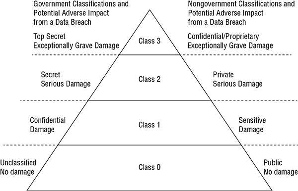

**FIGURE 5.1** Data classifications 


**Confidential or Proprietary** `confidential`或`proprietary`标签通常指代组织中最高级别的机密数据。在这种情况下，数据泄露可能导致对组织使命造成异常严重损害。例如，攻击者多次攻击索尼，窃取了超过 100TB 的数据，包括未发布电影的完整版本。这些数据迅速出现在文件共享网站上，安全专家估计人们下载了这些电影多达一百万次。由于盗版电影的可用性，许多人在索尼最终发布时选择跳过观看，这直接影响了其收入。这些电影是专有的，组织可能认为这属于异常严重损害。事后，他们可能会将电影标记为`confidential`或`proprietary`，并使用最严格的访问控制来保护它们。

**Private** `private`标签指数据应在组织内部保持私密，但不符合`confidential`或`proprietary`的定义。在这种情况下，数据泄露可能导致对组织使命造成严重损害。许多组织将 personally identifiable information (PII) 和 protected health information (PHI) 标记为`private`，也常见将内部员工数据和部分财务数据标记为`private`。例如，公司的薪酬部门可以访问薪酬数据，但这些数据不对普通员工开放。

**Sensitive** `Sensitive`数据类似于`confidential`数据。在这种情况下，数据泄露会对组织的使命造成损害。例如，组织的信息技术 (IT) 人员可能拥有关于内部网络的大量数据，包括布局、设备、操作系统、软件、Internet Protocol (`IP`) 地址等。如果攻击者轻松获取这些数据，将极大便利他们发动攻击。管理层可能决定不希望这些信息公开，因此可能将其标记为`sensitive`。

**Public** `Public`数据类似于`unclassified`数据，包括在网站、宣传册或其他公共来源上发布的信息。虽然组织不对公共数据的机密性进行保护，但会采取措施保护其完整性。例如，任何人都可以查看网站上发布的公共数据。但组织不希望攻击者修改这些数据，因此会采取保护措施。

Civilian organizations aren’t required to use any specific classification labels. However, it is important to classify data in some manner and ensure personnel understand the classifications. No matter what labels an organization uses, it still has an obligation to protect sensitive information.

After classifying the data, an organization takes additional steps to manage it based on its classification. Unauthorized access to sensitive information can result in significant losses to an organization. However, basic security practices, such as properly marking, handling, storing, and destroying data and hardware assets based on classifications, helps to prevent losses.

## Defining Asset Classifications

Asset classifications should match the data classifications. In other words, if a computer is processing top secret data, the computer should also be classified as a top secret asset. Similarly, if media such as internal or external drives holds top secret data, the media should also be classified as top secret.

It is common to use clear marking on the hardware assets so that personnel are reminded of data that can be processed or stored on the asset. For example, if a computer is used to process top secret data, the computer and the monitor will have clear and prominent labels reminding users of the classification of data that can be processed on the computer.

## Determining Data Security Controls

After defining data and asset classifications, it’s important to define the security requirements and identify security controls to implement those security requirements. Imagine that an organization has decided on data labels of Confidential/Proprietary, Private, Sensitive, and Public as described previously. Management then decides on a data security policy dictating the use of specific security controls to protect data in these categories. The policy will likely address data stored in files, in databases, on servers including email servers, on user systems, sent via email, and stored in the cloud.

For this example, we’re limiting the type of data to only email. The organization has defined how it wants to protect email in each of the data categories. They decided that any email in the Public category doesn’t need to be encrypted. However, email in all other categories (Confidential/Proprietary, Private, Sensitive, and Public) must be encrypted when being sent (data in transit) and while stored on an email server (data at rest).

Encryption converts cleartext data into scrambled ciphertext and makes it more difficult to read. Using strong encryption methods such as Advanced Encryption Standard with 256-bit cryptography keys (AES 256) makes it almost impossible for unauthorized personnel to read the text.

Table 5.1 shows other security requirements for email that management defined in their data security policy. Notice that data in the highest level of classification category (Confidential/Proprietary) has the most security requirements defined in the security policy.

**TABLE 5.1** **Securing email data**

| Classification || Security requirements for email |

| --- | --- |

| Confidential/Proprietary(highest level of protection for any data) || Email and attachments must be encrypted with AES 256.Email and attachments remain encrypted except when viewed.Email can only be sent to recipients within the organization.Email can only be opened and viewed by recipients (forwarded emails cannot be opened).Attachments can be opened and viewed, but not saved.Email content cannot be copied and pasted into other documents.Email cannot be printed. |

| --- | --- |

| Private(examples include PII and PHI) || Email and attachments must be encrypted with AES 256.Email and attachments remain encrypted except when viewed.Can only be sent to recipients within the organization. |

| Sensitive(lowest level of protection for classified data) || Email and attachments must be encrypted with AES 256. |

| Public || Email and attachments can be sent in cleartext. |

Security administrators use the requirements defined in the security policy to identify security controls. For Table 5.1, the primary security control is strong encryption using AES 256. Administrators would identify methodologies making it easy for employees to meet the requirements.

Although it’s possible to meet all of the requirements in Table 5.1, they require implementing other solutions. For example, software company Boldon James sells several products that organizations can use to automate these tasks. Users apply relevant labels (such as confidential, private, sensitive, and public) to emails before sending them. These emails pass through a data loss prevention (DLP) server that detects the labels, and applies the required protection.

Table 5.1 shows possible requirements that an organization might want to apply to email. However, an organization wouldn’t stop there. Any type of data that an organization wants to protect needs similar security definitions. For example, organizations would define requirements for data stored on assets such as servers, data backups stored onsite and offsite, and proprietary data.

Additionally, identity and access management (IAM) security controls help ensure that only authorized personnel can access resources. Chapter 13, “Managing Identity and Authentication,” and Chapter 14, “Controlling and Monitoring Access,” cover IAM security controls in more depth.

## Understanding Data States

It’s important to protect data in all `data states`, including while it is at rest, in motion, and in use.

**Data at Rest** Data at rest is any data stored on media such as system hard drives, external USB drives, storage area networks (SANs), and backup tapes.

**Data in Transit** Data in transit (sometimes called data in motion) is any data transmitted over a network. This includes data transmitted over an internal network using wired or wireless methods and data transmitted over public networks such as the internet.

**Data in Use** Data in use refers to data in memory or temporary storage buffers, while an application is using it. Because an application can’t process encrypted data, it must decrypt it in memory.

The best way to protect the confidentiality of data is to use strong encryption protocols, discussed later in this chapter. Additionally, strong authentication and authorization controls help prevent unauthorized access.

As an example, consider a web application that retrieves credit card data for quick access and reuse with the user’s permission for an e-commerce transaction. The credit card data is stored on a separate database server and is protected while at rest, while in motion, and while in use.

Database administrators take steps to encrypt sensitive data stored on the database server (data at rest). For example, they would encrypt columns holding sensitive data such as credit card data. Additionally, they would implement strong authentication and authorization controls to prevent unauthorized entities from accessing the database.


当 Web 应用程序向 Web 服务器发送数据请求时，数据库服务器会验证 Web 应用程序是否有权检索数据，如果有，数据库服务器会发送数据。然而，这涉及多个步骤。例如，数据库管理系统首先检索并解密数据，并以 Web 应用程序可以读取的方式对其进行格式化。然后，数据库服务器在传输前使用传输加密算法对数据进行加密。这确保了传输中的数据是安全的。

- [Web 应用服务器](https://example.org)接收加密格式的数据，对其进行解密后将数据发送至 Web 应用。Web 应用在使用数据以授权交易时，会将数据存储在临时内存缓冲区中。当 Web 应用不再需要该数据时，会采取措施清除内存缓冲区，确保所有残留的敏感数据均被彻底从内存中移除。

### 处理信息和资产

管理敏感数据的关键目标是防止数据泄露。数据泄露是任何未经授权的实体能够查看或访问敏感数据的事件。如果关注新闻，你大概经常会看到数据泄露的报道。如 2017 年的 Equifax 事故等大规模泄露事件经常登上主流新闻。Equifax 报告称，攻击者窃取了包括社会安全号码、姓名、地址以及出生日期在内的约 1.43 亿美国人个人数据。

然而，即使你可能从未听说小规模数据泄露，它们也在持续发生，2017 年平均每周就有超过 25 起报告的数据泄露。下面的章节列出组织内部人员为降低数据泄露风险而遵循的基本步骤。

#### 标记敏感数据和资产

标记（也称为标签）敏感信息，可让用户轻松辨识数据的分类级别。标记最重要的作用是指示数据的分类。例如，标记为“绝密”的信息让任何看到标签的人都能明确知道该信息属于绝密级别。当用户了解数据的价值后，更有可能根据分类采取相应的控制和保护措施。标记既包括实体标记也包括电子标记。

实体标签指示存储在介质或系统上处理的数据的安全分类。例如，若备份磁带包含机密数据，贴在磁带上的实体标签即表明该磁带存储机密数据。

同样，若计算机处理敏感信息，该计算机会标记其处理的最高分类信息。处理机密、绝密及绝密以上数据的计算机应标记为处理“绝密”数据。实体标签在系统或介质的全生命周期内保持存在。

标记还包括使用数字标记或标签。常见做法是将分类作为文档的页眉/页脚或作为水印嵌入，这些方式在打印件上也会显示。即使用户在打印时加入页眉页脚，大多数组织仍要求将印有敏感文档的纸张放入标有分类的文件夹或封面页中。页眉不限于文件，备份磁带通常也包含页眉信息，分类可写入该页眉中。

页眉、页脚和水印的另一优势是数据防泄漏（DLP）系统能够识别包含敏感信息的文档，并应用相应的安全控制。部分 DLP 系统在检测到文档包含敏感信息时，会在文档中添加元数据标签，这些标签提供对文档内容的洞察，帮助 DLP 系统正确处理文档。

同样，部分组织规定电脑桌面背景必须使用特定样式。例如，处理专有数据的系统可能拥有黑色桌面背景，上面用白色文字写有 `Proprietary`，并配有宽阔的橙色边框。背景还可能包含“本机处理专有数据”等声明，以及提醒用户保护数据的责任提示。

在许多安全环境中，人员也会为非机密介质和设备使用标签，以防止遗漏标记的错误。例如，若一卷存储敏感数据的备份磁带未标记，用户可能误以为其仅包含非机密数据。若组织同时标记非机密数据，则未标记的介质会更加显眼，用户在查看未标记磁带时会产生怀疑。

组织通常会制定介质降级的程序。例如，若备份磁带包含机密信息，管理员可能希望将其降级为非机密。组织会确定可信的程序，彻底清除磁带上所有可用数据。清除后，管理员可对磁带进行降级并更换标签。

然而，许多组织完全禁止介质降级。例如，数据政策可能禁止对包含绝密数据的备份磁带进行降级。相反，政策可能要求在磁带生命周期结束时销毁该磁带。同样，系统降级也很少见。换言之，若系统曾处理过绝密数据，很少会将其降级并重新标记为非机密系统。无论如何，必须制定经批准的程序，确保降级操作正确完成。

#### 处理敏感信息和资产

处理指的是在其全生命周期内安全传输介质的过程。根据数据的价值和分类，人员会采用不同的处理方式，显而易见，分类最高的信息需要更严格的保护。虽然这看似常识，但人们仍会犯错。许多时候，人们对敏感信息的处理变得麻木，保护措施松懈。

例如，2011 年英国国防部因回应信息自由请求，意外在网络上公开了核潜艇的机密信息及其他敏感信息。他们使用图像编辑软件对机密数据进行黑条处理，但任何试图复制该数据的人都能复制所有文字，包括已黑条的内容。

另一种常见情况是备份磁带的控制权丧失。备份磁带应获得与被备份数据同等级别的保护。即使用户在备份磁带上存储机密信息，该磁带也应被视为机密信息进行保护。然而，仍有许多情况未遵循此原则。例如，TD Bank 在 2012 年丢失两卷备份磁带，导致超过 26 万条客户记录数据泄露。与多数数据泄露一样，细节的披露耗时较长。TD Bank 在磁带丢失六个月后才向客户报告此事故。两年后，即 2014 年 10 月，TD Bank 最终同意支付 85 万美元并改进其做法。

更近期，AWS Simple Storage Service（S3）中存储的数据权限配置不当，导致数十 TB 的数据被公开。AWS S3 是云端存储服务，美国政府的 Outpost 计划公开收集社交媒体及其他网页数据。网络爬虫和监控社交媒体并不新鲜，但这些数据存放在名为 CENTCOM 的公开档案中，且未启用加密或权限限制。

- [Policies and procedures](https://example.org)需要制定以确保人们了解如何处理敏感数据。这始于确保系统和介质已适当标记。此外，正如雷根总统在讨论与苏联关系时所说的：“信任，但要验证。”第 17 章“预防和应对事件”讨论了日志记录、监控和审计的重要性。这些控制措施在重大损失发生前验证了敏感信息的适当处理。如果发生损失，调查人员使用审计日志帮助发现问题所在。因人员未正确处理数据而导致的任何事件应迅速调查，并采取行动防止再次发生。

#### 存储敏感数据

敏感数据应存储方式确保免受任何类型损失的保护。最明显的保护措施是加密。`AES 256` 提供强加密，且有众多应用程序可用于使用 `AES 256` 加密数据。此外，许多操作系统具备在文件级和磁盘级别加密数据的内置功能。

如果敏感数据存储在便携式磁盘驱动器或备份磁带等物理介质上，人员应遵循基本的物理安全措施，防止因盗窃导致的损失。这包括将这些设备存放在上锁的保险箱或金库中，或放置在包含多种额外物理安全控制的安全房间内。例如，服务器室包含防止未经授权访问的物理安全措施，因此在服务器室内上锁的柜子中存储便携介质可提供强有力的保护。

此外，应使用环境控制措施保护介质。这包括温度和湿度控制，如暖通空调（HVAC）系统。

这里有一个常被终端用户忽视的点：任何敏感数据的价值远高于存储该数据的介质的价值。换言之，购买高质量介质在数据长期存储（如备份磁带）时更具成本效益。同样，购买带内置加密功能的高质量 USB 闪存盘也是值得的投资。部分这些 USB 闪存盘采用指纹生物认证机制，提供了增强保护。

#### 消除敏感数据

当组织不再需要敏感数据时，人员应对其进行销毁。正确销毁可确保数据不落入错误之手导致未经授权披露。高度机密数据的销毁步骤与较低级别数据不同。组织的安全政策或数据政策应规定根据数据分类可接受的销毁方法。例如，组织可能要求对存储高度机密数据的介质进行彻底销毁，但允许人员使用软件工具覆盖低级别数据文件。

`NIST SP 800-88r1`，“介质清除指南”，提供了不同清除方法的详细信息。清除、清除和销毁等方法确保数据无法通过任何手段恢复。当处置计算机时，清除工作包括确保所有非易失性存储器已被移除或销毁；系统的任何光盘（CD/DVD）未存储在任何驱动器中；内部驱动器（硬盘和固态硬盘（SSD））已被清除、移除或销毁。清除可指介质的销毁，或使用可信方法在不销毁介质的情况下清除机密数据。

#### 消除数据残留

`数据残留` 是指数据在介质被 supposedly 擦除后仍然保留的现象。通常指硬盘上的残留磁通。使用系统工具删除数据通常会在介质上保留大量数据，且广泛可用的工具可轻松恢复已删除数据。即使使用高级工具覆盖介质，原始数据的痕迹仍可能以不易察觉的磁场形式残留。这类现象类似于长时间显示相同数据的电视或计算机显示器上可能残留的幽灵影像。取证专家和攻击者拥有工具，可在数据被 supposedly 覆盖后仍检索该数据。

消除数据残留的一种方法是使用消磁器。消磁器产生强磁场，可重新对传统硬盘、磁带和软盘驱动器等磁性介质的磁场进行实时对齐。使用电力的消磁器可可靠地重写磁场，从而消除数据残留。但它们仅对磁性介质有效。

相比之下，SSD 使用集成电路而非磁性介质。因此，对 SSD 进行消磁操作无法消除数据。即便采用其他方法清除 SSD 数据，残留数据往往仍然存在。在一篇题为《可靠擦除闪存固态硬盘数据的方法》（可查看 [www.usenix.org/legacy/event/fast11/tech/full_papers/Wei.pdf](http://www.usenix.org/legacy/event/fast11/tech/full_papers/Wei.pdf)）的研究论文中，作者发现传统的单个文件清除方法对 SSD 无效。

部分 SSD 包含内置擦除命令以清除整个磁盘，但遗憾的是，这些命令在不同厂商的部分 SSD 上效果不佳。鉴于这些风险，销毁 SSD 的最佳方法是物理销毁。美国国家安全局（NSA）要求使用经批准的 `disintegrator` 销毁 SSD，该设备可将 SSD 粉碎至 2 毫米（mm）或更小尺寸。许多组织销售多种经 NSA 批准的信息销毁和清除解决方案，这些方案被政府机构和私营企业广泛使用。

另一种保护 SSD 的方法是确保所有存储数据均已加密。若清除方法未能彻底清除所有数据残留，剩余数据将无法阅读。

以下列表包含一些与数据销毁相关的常见术语：

**Erasing** `Erasing` 介质仅是针对文件、文件集合或整个介质执行删除操作。在大多数情况下，删除或移除过程仅移除数据的目录或链接。实际数据仍保留在驱动器上。当新文件写入介质时，系统最终会覆盖已删除数据，但根据驱动器大小、剩余空闲空间及其他因素，数据可能在数月内才被覆盖。任何人都可使用广泛可得的恢复工具检索该数据。

**Clearing** `Clearing`，即 `overwriting`，是为重用介质并确保数据无法通过传统恢复工具恢复的过程。当介质被清除时，非机密数据会被写入介质的所有可寻址位置。一种方法是在整个介质上写入单一字符或特定位元模式。更彻底的方法是在整个介质上写入字符及其补码，随后写入随机位元，并分三次操作完成，如 `Figure 5.2` 所示。尽管这听起来像原始数据已永久丢失，但通过高级实验室或取证技术仍可能检索部分原始数据。此外，某些数据存储类型对清除技术不敏感。例如，硬盘的备用扇区、标记为“bad”的扇区以及许多现代 SSD 的区域可能未被清除，仍可能保留数据。

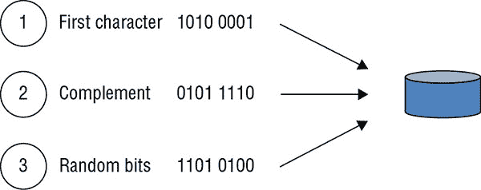

**FIGURE 5.2** Clearing a hard drive

**Purging** `Purging` is a more intense form of clearing that prepares media for reuse in less secure environments. It provides a level of assurance that the original data is not recoverable using any known methods. A purging process will repeat the clearing process multiple times and may combine it with another method such as degaussing to completely remove the data. Even though purging is intended to remove all data remnants, it isn’t always trusted. For example, the U.S. government doesn’t consider any purging method acceptable to purge top secret data. Media labeled top secret will always remain top secret until it is destroyed.

**Degaussing** A degausser creates a strong magnetic field that erases data on some media in a process called `degaussing`. Technicians commonly use degaussing methods to remove data from magnetic tapes with the goal of returning the tape to its original state. It is possible to degauss hard disks, but we don’t recommend it. Degaussing a hard disk will normally destroy the electronics used to access the data. However, you won’t have any assurance that all of the data on the disk has actually been destroyed. Someone could open the drive in a clean room and install the platters on a different drive to read the data. Degaussing does not affect optical CDs, DVDs, or SSDs.

**Destruction** Destruction is the final stage in the lifecycle of media and is the most secure method of sanitizing media. When destroying media it’s important to ensure that the media cannot be reused or repaired and that data cannot be extracted from the destroyed media. Methods of destruction include incineration, crushing, shredding, disintegration, and dissolving using caustic or acidic chemicals. Some organizations remove the platters in highly classified disk drives and destroy them separately.

`Declassification` involves any process that purges media or a system in preparation for reuse in an unclassified environment. Sanitization methods can be used to prepare media for declassification, but often the efforts required to securely declassify media are significantly greater than the cost of new media for a less secure environment. Additionally, even though purged data is not recoverable using any known methods, there is a remote possibility that an unknown method is available. Instead of taking the risk, many organizations choose not to declassify any media and instead destroy it when it is no longer needed.

#### Ensuring Appropriate Asset Retention

Retention requirements apply to data or records, media holding sensitive data, systems that process sensitive data, and personnel who have access to sensitive data. Record retention and media retention is the most important element of asset retention.


Record retention involves retaining and maintaining important information as long as it is needed and destroying it when it is no longer needed. An organization’s security policy or data policy typically identifies retention timeframes. Some laws and regulations dictate the length of time that an organization should retain data, such as three years, seven years, or even indefinitely. Organizations have the responsibility of identifying laws and regulations that apply and complying with them. However, even in the absence of external requirements, an organization should still identify how long to retain data.

As an example, many organizations require the retention of all audit logs for a specific amount of time. The time period can be dictated by laws, regulations, requirements related to partnerships with other organizations, or internal management decisions. These audit logs allow the organization to reconstruct the details of past security incidents. When an organization doesn’t have a retention policy, administrators may delete valuable data earlier than management expects them to or attempt to keep data indefinitely. The longer data is retained, the more it costs in terms of media, locations to store it, and personnel to protect it.

Most hardware is on a refresh cycle, where it is replaced every three to five years. Hardware retention primarily refers to retaining it until it has been properly sanitized.

Personnel retention in this context refers to the knowledge that personnel gain while employed by an organization. It’s common for organizations to include nondisclosure agreements (NDAs) when hiring new personnel. These NDAs prevent employees from leaving the job and sharing proprietary data with others.

## Data Protection Methods

One of the primary methods of protecting the confidentiality of data is encryption. Chapter 6, “Cryptography and Symmetric Key Algorithms,” and Chapter 7, “PKI and Cryptographic Applications,” cover cryptographic algorithms in more depth. However, it’s worth pointing out the differences between algorithms used for data at rest and data in transit.

As an introduction, encryption converts cleartext data into scrambled ciphertext. Anyone can read the data when it is in cleartext format. However, when strong encryption algorithms are used, it is almost impossible to read the scrambled ciphertext.

### Protecting Data with Symmetric Encryption

Symmetric encryption uses the same key to encrypt and decrypt data. In other words, if an algorithm encrypted data with a key of 123, it would decrypt it with the same key of 123. Symmetric algorithms don’t use the same key for different data. For example, if it encrypted one set of data using a key of 123, it might encrypt the next set of data with a key of 456. The important point here is that a file encrypted using a key of 123 can only be decrypted using the same key of 123. In practice, the key size is much larger. For example, AES uses key sizes of 128 bits or 192 bits and AES 256 uses a key size of 256 bits.

The following list identifies some of the commonly used symmetric encryption algorithms. Although many of these algorithms are used in applications to encrypt data at rest, some of them are also used in transport encryption algorithms discussed in the next section. Additionally, this is by no means a complete list of encryption algorithms, but Chapter 6 covers more of them.

Advanced Encryption Standard The Advanced Encryption Standard (`AES`) is one of the most popular symmetric encryption algorithms. NIST selected it as a standard replacement for the older Data Encryption Standard (`DES`) in 2001. Since then, developers have steadily been implementing `AES` into many other algorithms and protocols. For example, Microsoft’s BitLocker (a full disk encryption application used with a Trusted Platform Module) uses `AES`. The Microsoft Encrypting File System (`EFS`) uses `AES` for file and folder encryption. `AES` supports key sizes of 128 bits, 192 bits, and 256 bits, and the U.S. government has approved its use to protect classified data up to top secret. Larger key sizes add additional security, making it more difficult for unauthorized personnel to decrypt the data.

Triple DES Developers created Triple DES (or `3DES`) as a possible replacement for `DES`. The first implementation used 56-bit keys but newer implementations use 112-bit or 168-bit keys. Larger keys provide a higher level of security. Triple DES is used in some implementations of the MasterCard, Visa (`EMV`), and Europay standard for smart payment cards. These smart cards include a chip and require users to enter a personal identification number (`PIN`) when making a purchase. The combination of a `PIN` and `3DES` (or another secure algorithm) provides an added layer of authentication that isn’t available without the `PIN`.

Blowfish 安全专家布鲁斯·施内尔（Bruce Schneier）开发了 `Blowfish`，作为 `DES` 的可能替代方案。它支持 32 位到 448 位的密钥大小，是一种强大的加密协议。Linux 系统使用 `bcrypt` 来加密密码，而 `bcrypt` 是基于 `Blowfish` 的。`Bcrypt` 在 `Blowfish` 上额外添加了 128 位作为盐（`salt`），以防止彩虹表攻击。

### 通过传输加密保护数据

传输加密方法在数据传输前对其进行加密，从而在传输过程中保护数据。将未加密的数据通过网络发送的主要风险是嗅探攻击（`sniffing attack`）。攻击者可以使用嗅探器或协议分析器捕获网络中的流量。嗅探器允许攻击者读取所有以明文形式发送的数据。然而，攻击者无法读取使用强加密协议加密的数据。

例如，Web 浏览器使用超文本传输协议安全（`HTTPS`）来加密电子商务交易。这防止攻击者捕获数据并利用信用卡信息进行非法消费。相比之下，超文本传输协议（`HTTP`）会以明文形式传输数据。

几乎所有 `HTTPS` 传输都使用传输层安全协议（`TLS 1.1`）作为底层加密协议。安全套接层（`SSL`）是 `TLS` 的前身。`Netscape` 在 1995 年创建并发布了 `SSL`。随后，互联网工程任务组（`IETF`）发布了 `TLS` 作为替代方案。2014 年，`Google` 发现 `SSL` 易受 `POODLE` 攻击（`Padding Oracle On Downgraded Legacy Encryption`）影响。因此，许多组织在其应用中已禁用 `SSL`。

组织通常会启用远程访问解决方案，如虚拟私有网络（`VPN`）。`VPN` 允许员工从家中或出差时访问组织的内部网络。`VPN` 流量通过公共网络（如互联网）传输，因此加密至关重要。`VPN` 使用 `TLS` 和互联网协议安全（`IPsec`）等加密协议。

`IPsec` 经常与层 2 隧道协议（`L2TP`）结合用于 `VPN`。`L2TP` 以明文形式传输数据，但 `L2TP/IPsec` 对数据进行加密并通过隧道模式将其发送到互联网，以在传输过程中保护数据。`IPsec` 包含身份验证头（`AH`），用于提供身份验证和完整性，以及封装安全载荷（`ESP`），用于提供机密性。

在内部网络上传输敏感数据时，加密也是合适的。`IPsec` 和安全壳（`SSH`）通常用于保护内部网络上数据在传输过程中的安全。`SSH` 是一种强大的加密协议，常与安全复制（`SCP`）和安全文件传输协议（`SFTP`）等其他协议一起使用。`SCP` 和 `SFTP` 都是用于通过网络传输加密文件的安全协议。而文件传输协议（`FTP`）会以明文形式传输数据，因而不适合用于在网络上传输敏感数据。

许多管理员在远程服务器管理时使用 `SSH`。其显著优势在于 `SSH` 加密了所有流量，包括管理员的凭证。历史上，许多管理员使用 `Telnet` 来管理远程服务器。然而，`Telnet` 会以明文形式发送流量，因此管理员应当避免使用它。有人建议在加密的 `VPN` 隧道内使用 `Telnet`，但这并不可取。虽然流量在客户端到 `VPN` 服务器之间是加密的，但从 `VPN` 服务器到 `Telnet` 服务器的流量是明文的。

### 确定所有权

组织内部的许多人负责管理、处理和使用数据，他们的需求因角色而异。不同的文档对这些角色的称呼略有差异。一些术语与国家标准技术委员会（`NIST`）文档中的术语相匹配，其他则与欧洲联盟（`EU`）通用数据保护条例（`GDPR`）中的术语相符。必要时，我们已标注来源，方便您进一步查阅这些术语。

确保人员清楚谁负责信息和资产是一个重要概念。拥有者负有保护数据和资产的主要责任。

### 数据所有者

`data owner`（数据所有者）是拥有数据最终组织责任的人。通常是首席运营官（`CEO`）、董事长或部门负责人（`DH`）。数据所有者确定数据的分类，并确保其正确标记。同时，他们保证根据分类和组织安全政策的要求，为数据提供适当的安全控制。若未能履行职责，数据所有者可能因疏忽而需承担法律责任。

`NIST SP 800-18` 列出了信息所有者的以下责任，这些责任可以与数据所有者的职责相提并论：

* 制定关于对所涉数据/信息的适当使用和保护的规则（行为准则）

* 向信息系统所有者提供关于信息系统中数据安全要求和控制措施的输入

* 决定谁可以访问信息系统以及拥有何种特权或访问权限

* 帮助识别并评估信息所在系统的通用安全控制

### 资产所有者

资产所有者（或系统所有者）是拥有处理敏感数据的资产或系统的人。`NIST SP 800-18` 列出了系统所有者的以下责任：

* 与信息所有者、系统管理员和功能终端用户协同制定系统安全计划

* 维护系统安全计划，并确保系统按照约定的安全要求部署和运行

* 确保系统用户和支持人员接受适当的安全培训，如行为准则（或 `AUP`）说明

* 当发生重大变更时，更新系统安全计划

* 帮助识别、实施并评估信息所在系统的通用安全控制

系统所有者通常与数据所有者是同一人，但也可能是不同的人，例如不同的部门负责人（`DH`）。例如，考虑一个用于电子商务的 Web 服务器以及其后端数据库服务器。软件开发部门可能负责数据库的开发和管理，而 IT 部门维护 Web 服务器。此情况下，软件开发部门负责人是数据库服务器的系统所有者，IT 部门负责人是 Web 服务器的系统所有者。不过，通常一位人士（如单一部门负责人）会同时控制这两台服务器，该人即为两者的系统所有者。

系统所有者负责确保系统上处理的数据保持安全。这包括确定系统所处理的最高级别数据。系统所有者随后确保系统准确标记，并为数据在系统中的存储、传输和使用状态提供适当的安全控制。系统所有者与数据所有者协作，确保数据在系统内存储时、在系统间传输时以及在运行应用程序时受到保护。

### 业务/使命所有者

业务/使命所有者的角色在不同组织中表现不同。`NIST SP 800-18` 将业务/使命所有者称为程序经理或信息系统所有者。因此，业务/使命所有者的职责可能与系统所有者重叠，也可能是同一角色。

* 企业所有者可能拥有使用其他实体管理的系统的流程。例如，销售部门可能是业务所有者，但 IT 部门和软件开发部门可能是销售流程中使用的系统的系统所有者。想象一下，销售部门专注于通过电子商务网站进行在线销售，而该网站访问后端数据库服务器。与前面的例子类似，IT 部门作为系统所有者管理 Web 服务器，软件开发部门作为系统所有者管理数据库服务器。尽管销售部门不拥有这些系统，但它拥有通过这些系统生成销售的业务流程。

* 在企业中，业务所有者负责确保系统为组织提供价值。这听起来显而易见。然而，IT 部门有时会过于激进，在未考虑对业务或其使命影响的情况下实施安全控制。

* 许多企业中的一个潜在冲突领域是成本中心与利润中心的对比。IT 部门不产生收入，而是成本中心，产生成本。相比之下，业务侧作为利润中心产生收入。IT 部门产生的成本会侵蚀业务侧产生的利润。此外，IT 部门实施的许多安全控制以降低系统可用性以换取安全性。将这些因素结合起来，业务侧有时会认为 IT 部门在花钱、削减利润，并使业务更难产生利润。


- 组织通常会实施如 Control Objectives for Information and Related Technology (`COBIT`) 等 IT 管理方法。这些方法帮助业务所有者和平台所有者在满足安全控制要求的同时平衡业务或使命需求。

### 数据处理者

- 一般而言，数据处理者是任何用于处理数据的系统。但在 GDPR 语境下，`数据处理者`具有更具体的含义。GDPR 定义数据处理者为“仅代表数据控制方处理个人数据的自然人、法律实体、公共机构、机构或其他组织”。在此语境下，`数据控制方`是控制数据处理的个人或实体。

- 例如，一家公司收集员工个人信息用于工资发放，该公司是数据控制方。如果将这些信息转交给第三方公司处理工资，则该工资公司是数据处理者。在此例子中，数据处理者（工资公司）不得将数据用于除在数据控制方指示下处理工资之外的任何用途。

- GDPR 限制向欧盟以外国家的数据传输。组织必须遵守 GDPR 的全部要求。违反 GDPR 隐私规则的企业可能面临最高 4% 全球收入的罚款。遗憾的是，该法规充斥法律术语，给组织带来许多挑战。例如，条款 107 包含以下表述：

> “因此，向该第三国或国际组织传输个人数据应被禁止，除非满足本法规关于受适当保护措施（包括具有约束力的公司规则）以及特定情况的豁免要求。”

- 欧洲委员会和美国政府共同制定了 EU‑US Privacy Shield 计划，以取代之前的 Safe Harbor 计划。同样，瑞士和美国官员合作制定了瑞士‑US Privacy Shield 框架。两个计划均由美国商务部国际贸易管理局（ITA）负责管理。

- 组织可以通过美国商务部自我认证，表明其遵循 Privacy Shield 原则。自我认证过程包括填写一份冗长的问卷。组织的官员需提供组织相关信息，重点在于组织的隐私政策，包括其承诺遵守七项核心 Privacy Shield 原则以及 16 项补充原则。

- Privacy Shield 原则内容丰富，但概括如下：

  * `Notice`（通知）：组织必须向个人说明收集和使用其信息的目的。

  * `Choice`（选择）：组织必须向个人提供选择退出的机会。

  * `Accountability for Onward Transfer`（后续传输问责）：组织只能将数据转移给遵循通知和选择原则的其他组织。

  * `Security`（安全）：组织必须采取合理的措施保护个人数据。

  * `Data Integrity and Purpose Limitation`（数据完整性与目的限制）：组织应仅收集处理所需的数据，并在通知原则中明确目的。组织还应采取合理步骤确保个人数据准确、完整且保持最新。

  * `Access`（访问）：个人必须能够访问组织持有的其个人信息，并有权更正、修改或删除不准确的信息。

  * `Recourse, Enforcement, and Liability`（追 recourse、执行与责任）：组织必须实施合规机制，并提供处理个人投诉的渠道。

### 伪名化（Pseudonymization）

- 组织可以实施的两种技术安全控制是加密和伪名化。如前所述，所有传输中的敏感数据和存储中的敏感数据均应加密。当伪名化操作有效时，它可以使 GDPR 下本应适用的更严格要求变得不那么严苛。

- 伪名是别名。例如，`哈利·波特` 作者 J. K. 罗琳在发布名为 `The Cuckoo’s Calling` 的书时使用了笔名 Robert Galbraith。如果你知道这个笔名，你就会知道 Robert Galbraith 之后的任何书籍都是由 J. K. 罗琳撰写的。

- `伪名化` 指使用别名来代表其他数据的过程，目的是防止数据直接识别实体（如个人）。例如，考虑一家医疗机构保存的病历。与其直接包含患者姓名、地址和电话等个人信息的记录，改为仅在病历中标记为“患者 23456”即可。医疗机构仍需这些个人信息，并可将其存储在另一个数据库中，该数据库将患者 23456 与原始数据关联。

- 在该例子中，伪名（患者 23456）指代该人的多个信息。伪名也可以针对单个信息使用，例如为名字使用一个伪名，为姓氏使用另一个伪名。关键是拥有一个其他资源（如另一个数据库）能够通过伪名还原原始数据。

- GDPR 将伪名化定义为用 `人工标识符` 替换数据，这些人工标识符即为伪名。

### 匿名化（Anonymization）

- 如果不需要个人数据，另一种选择是使用匿名化。`匿名化` 是删除所有相关数据，使得无法识别原始主体或个人。若做法得当，匿名化数据不再受 GDPR 约束。然而，真正实现匿名化往往很困难，数据推断技术可能仍然识别出个人，即使已移除个人数据。

- 举例如果，考虑一个数据库，其中包含过去 75 年中所有主演或客串电影的演员列表，以及他们为每部电影赚取的金额。该数据库包含三个表。`Actor` 表包含演员姓名，`Movie` 表包含电影名称，`Payment` 表包含每位演员为每部电影赚取的金额。这三个表相互链接，使您能够查询数据库，轻松确定任何演员为任何电影赚取了多少金额。

- 如果从 `Actor` 表中删除姓名，它就不再包含个人数据，但并非真正匿名。例如，阿兰·阿金（Alan Arkin）参演了 50 多部电影，没有其他演员参演了完全相同的电影。如果您识别出这些电影，即可查询数据库，了解他为这些电影赚取了多少金额。尽管他的姓名已从数据库中移除，这也是数据库中唯一明显的个人数据，但通过数据推断技术仍可识别出属于他的记录。

- 数据掩盖可以是有效的数据匿名化方法。掩盖通过交换单个数据列中的数据，使记录不再代表实际数据。然而，数据仍保留聚合值，可用于其他目的，例如科学研究。例如，`表 5.2` 展示了四条记录的原始数据。聚合数据的一个例子是四个人的平均年龄，为 29 岁。

**TABLE 5.2** `未修改的数据库中的数据`

| FirstName || LastName || Age |

| --- | --- | --- |

| Joe || Smith || 25 |

| --- | --- | --- |

| Sally || Jones || 28 |

| Bob || Johnson || 37 |

| Maria || Doe || 26 |

`Table 5.3` 展示了数据被重新排列后的记录，从而有效掩盖了原始数据。请注意，这变成了随机的姓名、随机的姓氏和随机的年龄。看起来像真实数据，但这些列之间没有任何关联。然而，仍然可以从表中检索聚合数据。平均年龄仍为 29。

**TABLE 5.3** `掩盖后的数据`

| FirstName || LastName || Age |

| --- | --- | --- |

| Sally || Doe || 37 |

| --- | --- | --- |

| Maria || Johnson || 25 |

| Bob || Smith || 28 |

| Joe || Jones || 26 |

- 熟悉数据集的人可能会在表只有三列且仅四条记录时，尝试重建部分数据。但如果表包含数十列和成千上万条记录，这是一种有效的数据匿名化方法。

- 与伪名化（`pseudonymization`）和代币化（`tokenization`）不同，掩盖无法被逆转。数据在掩盖处理后被随机化，无法恢复到原始状态。

### 管理员

数据管理员负责向人员授予适当的访问权限。他们不一定拥有完整的管理员权限和特权，但拥有分配权限的能力。管理员根据最小权限原则和“需知”原则分配权限，仅向用户授予完成工作所需的数据访问权限。

管理员通常使用基于角色的访问控制（`Role Based Access Control`，`RBAC`）模型来分配权限。也就是说，他们将用户账户添加到组中，然后向组授予权限。当用户不再需要访问数据时，管理员会从组中移除其账户。第 13 章“管理身份和身份验证”更深入地介绍了基于角色的访问控制模型。

### 保管人

数据所有者通常将日常任务委派给 `custodian`（保管人）。保管人通过确保数据正确存储和得到保护，帮助维护数据的完整性和安全性。例如，保管人会确保数据按照备份策略进行备份。如果管理员已配置对数据的审计，保管人也会维护这些审计日志。

在实践中，IT 部门内的人员或系统安全管理员通常充当保管人。他们可能就是负责分配数据访问权限的管理员。

### 用户

`User`（用户）是指通过计算系统访问数据以完成工作任务的任何人。用户仅能访问完成工作任务所需的数据。您也可以将用户视为员工或最终用户。

### 保护隐私

组织有义务保护其收集和维护的数据。这尤其适用于前文提到的 PII（个人可识别信息）和 PHI（受保护健康信息）数据。许多法律和法规要求保护隐私数据，组织有义务了解适用于它们的法律和法规。此外，组织还需确保其实践符合这些法律和法规。

许多法律要求组织披露其收集的数据、收集原因以及计划如何使用该信息。此外，这些法律禁止组织将信息用于超出其原始意图之外的用途。例如，如果组织声明收集电子邮件地址是为了向客户通知购买事宜，组织不应将电子邮件地址出售给第三方。

组织通常会在其网站上使用在线隐私政策。一些严格遵守隐私法律的实体包括美国（适用 HIPAA 隐私规则）、加利福尼亚州（适用 2003 年加州隐私保护法案）、加拿大（适用《个人信息保护和电子文件法》），以及欧盟（适用 GDPR）。

许多法律要求组织在其管辖区域内遵循这些要求。例如，加州隐私保护法案（`CalOPPA`）要求对任何收集加州居民个人信息的商业网站或在线服务发布显著的隐私政策。这意味着，只要网站可在互联网上访问，就可能涉及加州居民，从而适用该法规。许多人认为 CalOPPA 是美国最严格的法律之一，遵循加州法律的美国组织通常也满足其他地区的要求。但组织仍有义务确定适用的法律并遵守它们。

在保护隐私时，组织通常会使用多种安全控制措施。选择合适的安全控制措施可能是一项艰巨任务，尤其是对新组织而言。然而，使用安全基线和识别相关标准可以使任务稍加简化。

许多法律文件提及“数据收集限制原则”。虽然法律措辞各不相同，但核心要求一致：数据收集应仅限于所必需的范围。例如，如果组织需要用户的电子邮件地址来注册在线网站，组织不应收集无关数据，如用户的出生日期或电话号码。

此外，数据应通过合法且公平的方式获得。在适当时，数据应仅在个人的了解和/或同意下收集。

## 使用安全基线

一旦组织识别并分类其资产后，它通常希望对它们进行保护。这就是安全基线的作用。基线提供起点并确保最低安全标准。组织常用的一个基线是镜像。第 16 章“管理安全运营”更深入地讨论了在配置管理中对镜像的应用。作为介绍，管理员会配置一个系统的期望设置，将其作为镜像捕获，然后将镜像部署到其他系统上。这确保所有系统都以相似的安全状态部署，有助于保护数据隐私。

在系统以安全状态部署后，审计流程会定期检查系统，确保它们保持安全状态。例如，`Microsoft Group Policy` 会定期检查系统并重新应用设置以匹配基线。

NIST SP 800-53 Revision 5 将 `security control baselines` 定义为安全控制的列表。它强调单一的安全控制集并不适用于所有情况，但任何组织都可以选择一组基线安全控制并根据自身需求进行定制。SP 800-53 的附录 D 包含对安全控制的全面列表，并将其分为低影响、中等影响和高影响。这些指的是当系统被入侵并发生数据泄露时，系统可能遭受的最严重影响。

例如，假设一个系统被入侵。入侵对系统及其持有的数据的机密性、完整性或可用性有什么影响？

* 如果影响是低的，您将考虑在基线中添加被标记为低影响的安全控制。

* 如果影响是中等的，您将考虑添加被标记为中等影响的安全控制，以及低影响的控制。

* 如果影响是高的，您将考虑添加所有被标记为高影响的控制，以及低影响和中等影响的控制。

值得注意的是，许多标记为低影响的项目实际上是基础安全实践。例如，访问控制策略和程序（在 `AC` 系列中）确保用户拥有唯一的标识（如用户名），并可通过安全的身份验证程序证明其身份。管理员根据用户的已验证身份（使用授权流程）授予用户访问资源的权限。

同样，实施基本安全原则（如最小权限原则）对于准备 CISSP 考试的人来说并不令人惊讶。当然，仅仅因为这些是基础安全实践，并不意味着组织会实施它们。不幸的是，许多组织尚未发现或执行这些基础实践。

### Scoping and Tailoring

`Scoping` 指的是审查一组基线安全控制的列表，并仅选择适用于您正在保护的 IT 系统的控制。例如，如果一个系统不允许任何两个人同时登录，则无需应用并发会话控制。

`Tailoring` 指的是修改基线中安全控制的列表，使其与组织的使命保持一致。例如，组织可能决定一组基线控制完美适用于其主要地点的计算机，但某些控制不适用或不可行于远程办公地点。在这种情况下，组织可以选择补偿性安全控制，以将基线定制为远程地点。

### Selecting Standards

当组织在基线内或其他情况下选择安全控制时，需要确保这些控制符合特定的外部安全标准。外部要素通常定义组织必须遵守的强制性要求。例如，支付卡行业数据安全标准（PCI DSS）定义了企业处理主要信用卡所必须遵守的要求。同样，希望将数据传输到和从欧盟国家的组织必须遵守 GDPR 的要求。

显然，并非所有组织都必须遵守这些标准。不处理信用卡交易的组织不需要遵守 PCI DSS。同样，不传输数据到和从欧盟国家的组织不需要遵守 GDPR 要求。组织需要识别适用的标准，并确保其选择的安全控制符合这些标准。

即使您的组织没有法律义务遵守特定标准，使用设计良好的社区标准也非常有帮助。例如，美国政府组织必须遵守 NIST SP 800 文档发布的许多标准。这些文档同样被许多私营部门组织用于帮助其开发和实施自己的安全标准。

### Summary

资产安全专注于在其整个生命周期内收集、处理和保护信息。这包括存储在计算系统上或通过网络传输的敏感信息，以及在这些过程中的资产。敏感信息是任何组织希望保持私密的信息，可能包含多个分类级别。

定义分类标签是安全政策或数据政策的关键步骤。政府使用 `top secret`、`secret`、`confidential` 和 `unclassified` 等标签。非政府组织可以使用它们选择的任何标签。关键是要在安全政策或数据政策中定义这些标签。数据所有者（通常是高级管理人员）提供数据定义。

组织采取具体措施来标记、处理、存储和销毁敏感信息及硬件资产，这些措施有助于防止因未经授权披露而导致的机密性损失。此外，组织通常会定义具体的记录保留规则，以确保在需要时数据可用。数据保留政策还能通过防止数据保留时间过长来降低责任风险。

保护数据机密性的关键方法是加密。对称加密协议（如 `AES`）可以加密数据在静止状态（存储在介质上）。传输加密协议通过在传输前加密数据来保护数据在传输中的安全（数据在传输中）。应用程序通过确保数据仅在临时存储缓冲区中保存，并在应用不再使用数据时清除这些缓冲区，来保护数据在使用中的安全。

人员在处理数据时可以扮演许多不同的角色。数据所有者最终负责分类、标记和保护数据。系统所有者负责处理数据的系统。业务和使命所有者拥有流程，并确保系统为组织提供价值。数据处理器通常是处理数据的第三方实体。管理员根据数据所有者提供的指南授予对数据的访问权限。保管人被委派日常责任，负责正确存储和保护数据。用户（通常称为最终用户）在系统上访问数据。

欧盟通用数据保护条例（`GDPR`）要求保护隐私数据，并限制数据向欧盟内部或从欧盟传出的 `transfer`。数据控制方可以聘请第三方处理数据，在这种情况下，第三方即为数据处理器。数据处理器有责任保护数据的隐私，并不得将数据用于数据控制方未指示的任何其他目的。`GDPR` 中提到的两个关键安全控制是加密和伪名化。伪名化指的是用伪名替换数据。

安全基线提供一套组织可以实施的安全控制，作为安全起点。一些出版物（如 NIST SP 800-53）识别安全控制基线。然而，这些基线并不适用于所有组织。相反，组织使用范围缩减和定制技术来确定在其基线中实施哪些安全控制。此外，组织确保实施适用于其组织的外部标准强制要求的安全控制。

## Exam Essentials

**Understand the importance of data and asset classifications.** Data owners are responsible for defining data and asset classifications and ensuring that data and systems are properly marked. Additionally, data owners define requirements to protect data at different classifications, such as encrypting sensitive data at rest and in transit. Data classifications are typically defined within security policies or data policies.

**Know about PII and PHI.** Personally identifiable information (PII) is any information that can identify an individual. Protected health information (PHI) is any health-related information that can be related to a specific person. Many laws and regulations mandate the protection of PII and PHI.


**Know how to manage sensitive information.** Sensitive information is any type of classified information, and proper management helps prevent unauthorized disclosure resulting in a loss of confidentiality. Proper management includes marking, handling, storing, and destroying sensitive information. The two areas where organizations often miss the mark are adequately protecting backup media holding sensitive information and sanitizing media or equipment when it is at the end of its lifecycle.

**Understand record retention.** Record retention policies ensure that data is kept in a usable state while it is needed and destroyed when it is no longer needed. Many laws and regulations mandate keeping data for a specific amount of time, but in the absence of formal regulations, organizations specify the retention period within a policy. Audit trail data needs to be kept long enough to reconstruct past incidents, but the organization must identify how far back they want to investigate. A current trend with many organizations is to reduce legal liabilities by implementing short retention policies with email.

**Know the difference between different roles.** The data owner is the person responsible for classifying, labeling, and protecting data. System owners are responsible for the systems that process the data. Business and mission owners own the processes and ensure that the systems provide value to the organization. Data processors are often the third-party entities that process data for an organization. Administrators grant access to data based on guidelines provided by the data owners. A user accesses data while performing work tasks. A custodian has day-to-day responsibilities for protecting and storing data.

**Understand the GDPR security controls.** The EU General Data Protection Regulation (GDPR) mandates protection of privacy data. Two key security controls mentioned in the GDPR are encryption and pseudonymization. Pseudonymization is the process of replacing some data elements with pseudonyms. This makes it more difficult to identify individuals.

**Know about security control baselines.** Security control baselines provide a listing of controls that an organization can apply as a baseline. Not all baselines apply to all organizations. However, an organization can apply scoping and tailoring techniques to adapt a baseline to its needs.

## Written Lab

1. Describe PII and PHI.

2. Describe the best method to sanitize SSDs.

3. Describe pseudonymization.

4. Describe the difference between scoping and tailoring.

## Review Questions

1. Which one of the following identifies the primary purpose of information classification processes?

   1. Define the requirements for protecting sensitive data.

   2. Define the requirements for backing up data.

   3. Define the requirements for storing data.

   4. Define the requirements for transmitting data.

2. When determining the classification of data, which one of the following is the most important consideration?

   1. Processing system

   2. Value

   3. Storage media

   4. Accessibility

3. Which of the following answers would *not* be included as sensitive data?

   1. Personally identifiable information (PII)

   2. Protected health information (PHI)

   3. Proprietary data

   4. Data posted on a website

4. What is the most important aspect of marking media?

   1. Date labeling

   2. Content description

   3. Electronic labeling

   4. Classification

5. Which would an administrator do to classified media before reusing it in a less secure environment?

   1. Erasing

   2. Clearing

   3. Purging

   4. Overwriting

6. Which of the following statements correctly identifies a problem with sanitization methods?

   1. Methods are not available to remove data ensuring that unauthorized personnel cannot retrieve data.

   2. Even fully incinerated media can offer extractable data.

   3. Personnel can perform sanitization steps improperly.

   4. Stored data is physically etched into the media.

7. Which of the following choices is the most reliable method of destroying data on a solid state drive (SSD)?

   1. Erasing

   2. Degaussing

   3. Deleting

   4. Purging

8. Which of the following is the most secure method of deleting data on a DVD?

   1. Formatting

   2. Deleting

   3. Destruction

   4. Degaussing

9. Which of the following does not erase data?

   1. Clearing

   2. Purging

   3. Overwriting

   4. Remanence

10. Which one of the following is based on Blowfish and helps protect against rainbow table attacks?

    1. 3DES

    2. AES

    3. Bcrypt

    4. SCP

11. Which one of the following would administrators use to connect to a remote server securely for administration?

    1. Telnet

    2. Secure File Transfer Protocol (SFTP)

    3. Secure Copy (SCP)

    4. Secure Shell (SSH)

12. Which of the following tasks would a custodian most likely perform?

    1. Access the data

    2. Classify the data

    3. Assign permissions to the data

    4. Back up data

13. Which of the following data roles is most likely to assign permissions to grant users access to data?

    1. Administrator

    2. Custodian

    3. Owner

    4. User

14. Which of the following best defines “rules of behavior” established by a data owner?

    1. Ensuring that users are granted access to only what they need

    2. Determining who has access to a system

    3. Identifying appropriate use and protection of data

    4. Applying security controls to a system

15. Within the context of the EU GDPR, what is a data processor?

    1. The entity that processes personal data on behalf of the data controller

    2. The entity that controls processing of data

    3. The computing system that processes data

    4. The network that processes data

16. Your organization has a large database of customer data. To comply with the EU GDPR, administrators plan to use pseudonymization. Which of the following *best* describes pseudonymization?

    1. The process of replacing some data with another identifier

    2. The process of removing all personal data

    3. The process of encrypting data

    4. The process of storing data

17. An organization is implementing a preselected baseline of security controls, but finds that some of the controls aren’t relevant to their needs. What should they do?

    1. Implement all the controls anyway.

    2. Identify another baseline.

    3. Re-create a baseline.

    4. Tailor the baseline to their needs.

参考上述情景回答第 18 至 20 题。

18. 在以下选项中，哪项可以在不牺牲安全性的前提下防止此损失？

   1. 标记保存在外部的介质。

   2. 不要将数据存储在外部。

   3. 销毁外部的备份。

   4. 使用安全的外部存储设施。

19. 哪项管理员操作可能防止了此事件的发生？

   1. 在将磁带发送到仓库前标记磁带。

   2. 在将数据备份到磁带前清除磁带。

   3. 在将数据备份到磁带前消磁磁带。

   4. 将磁带加入资产管理数据库。

20. 在以下选项中，哪项政策在备份介质方面未被遵守？

   1. 介质销毁

   2. 记录保留

   3. 配置管理

   4. 版本管理

## 第 6 章

## 加密与对称密钥算法

**本章涵盖的 CISSP 考试主题包括：**

*   **Domain 2: Asset Security**

    *   2.5 确定数据安全控制

        *   2.5.1 了解数据状态

*   **Domain 3: Security Architecture and Engineering**

    *   3.5 评估并减轻安全架构、设计和解决方案元素的脆弱性

        *   3.5.4 加密系统

    *   3.9 应用加密

        *   3.9.1 加密生命周期（例如，密钥管理、算法选择）

        *   3.9.2 加密方法（例如，对称、非对称、椭圆曲线）

        *   3.9.6 不可否认性

        *   3.9.7 完整性（例如，哈希）

加密在数据存储（静止状态）、网络传输（传输状态）和内存（使用状态）期间，为敏感信息提供机密性、完整性、身份验证和不可否认性。加密是一项极其重要的安全技术，嵌入于保护信息免受未经授权查看和使用的许多控制措施中。

多年来，数学家和计算机科学家不断开发越来越复杂的加密算法，以提升对数据的保护水平。虽然密码学家花费时间开发强大的加密算法，黑客和政府同样投入大量资源去破解它们。这导致了加密领域的“军备竞赛”，并推动了当今使用的极其复杂的算法的发展。

本章探讨加密的历史、密码通信的基础以及私钥密码系统的基本原理。下一章继续讨论加密，重点在于公钥密码系统以及攻击者用于击败加密的各种技术。

## 加密历史里程碑

自最早的文明起，人类就发明了各种书面通信系统，从古代刻在洞穴壁上的象形文字到现代用于存储完整百科全书的闪存设备。只要人们进行通信，就一直使用隐蔽手段隐藏通信的真实含义。古代社会使用复杂的秘密符号系统，在战争时期标识安全的避难所。现代社会则使用多种代码和密码，以便个人和群体进行私密沟通。下面的章节将介绍现代加密的演变以及几个著名的秘密拦截和破解尝试。

### 卡埃撒密码


卡埃撒密码是已知最早的密码系统之一，由尤利乌斯·卡埃撒在征服欧洲期间用来与西塞罗通信。卡埃撒意识到发送信息存在多种风险——信使可能是敌方间谍，或在运送途中遭到袭击。因此，他开发了现在被称为卡埃撒密码的系统。该系统极其简单：加密信息时，只需将字母表中的每个字母向右平移三位。例如，`A` 变成 `D`，`B` 变成 `E`。如果在过程中到达字母表末尾，则直接循环回到开头，使得 `X` 变成 `A`，`Y` 变成 `B`，`Z` 变成 `C`。正因如此，卡埃撒密码也被称为 ROT3（Rotate 3）密码。它是一种单字母替换密码，属于单字母密码。

下面是卡埃撒密码的示例。第一行是原始句子，第二行是使用卡埃撒密码加密后的句子：

```
THE DIE HAS BEEN CAST
WKH GLH KDV EHHQ FDVW
```

要解密信息，只需将每个字母向左平移三位。

### 美国内战时期

在卡埃撒和美国早期之间，科学家和数学家在早期密码之外取得了重要进展。美国内战期间，联邦和南方军队都使用相对高级的加密系统来秘密通信，因为双方都在窃听电报线以获取对方情报。这些系统通过复杂的词语替换和置换（见本章后的“密码”部分的详细说明）来阻碍敌方破译。此外，内战时期广泛使用的另一个系统是由军医阿尔伯特·J·马伊尔（Albert J. Myer）开发的旗帜信号系统。

### Ultra vs. Enigma

在二战之前，德国军工产业将面向商业的 Enigma 机适配为政府使用。该机器使用三到六个转子实现极其复杂的替换密码。仅凭当时的技术，唯一解密信息的方法是使用同样设置转子的机器。德国人认识到保护这些设备的重要性，使得盟军极其困难地获取它们。

盟军发起了代号为 Ultra 的顶级机密行动，最终成功破解 Enigma 密码。1940 年，由艾伦·图灵领导的盟军成功破解了 Enigma 代码，史家们认为这对击败轴心国起到了重要作用。关于盟军破解 Enigma 的故事被广为人知的影片《U-571》和《模仿游戏》（*The Imitation Game*）所描绘。

日本在二战期间使用了类似的机器，称为日本紫机。美国对该密码系统的重大攻击导致在战争结束前就破解了日本密码。美国之所以能够成功，是因为日本通讯员使用了非常正式的消息格式，这导致多条消息中出现大量相似文本，从而简化了破译工作。

## 加密基础

任何科学的研究必须从对其基础原则的讨论开始。以下章节通过回顾加密的目标、概述加密技术的基本概念以及探讨加密系统所使用的主要数学原理，为这一奠定基础。

### 加密的目标

安全从业者使用加密系统以实现四个基本目标：保密性、完整性、身份验证和不可否认性。实现每个目标都需要满足若干设计要求，并非所有密码系统都旨在实现这四个目标。下面我们将详细探讨每个目标，并简要说明实现它们所需的技术要求。

#### 保密性

*保密性* 确保数据在三种不同情形下保持私密：当数据处于静止状态、传输过程中以及使用中时。

保密性是加密系统最常被引用的目标——保护存储信息或个人和群体之间通信的秘密。两种主要类型的密码系统实现保密性。

*   *对称密码系统* 使用所有系统使用者共享的秘密密钥。

*   *非对称密码系统* 为每个系统使用者提供公钥和私钥的组合。这两个概念将在本章后的“现代密码学”部分进一步探讨。

在为提供保密性而开发加密系统时，需要考虑三种数据类型。

*   *静止数据*，即存储数据，是位于永久位置、等待访问的数据。静止数据的例子包括硬盘上的数据、备份磁带、云存储服务、USB 设备以及其他存储媒介。

*   *传输中数据*，即数据在网络中传输的数据，是指在两个系统之间通过网络传输的数据。传输中数据可能在企业网络、无线网络或公共互联网上传输。

*   *使用中数据* 是指存储在计算机系统活动内存中的数据，可由运行在该系统上的进程访问。

每种情形都伴随不同的保密风险，加密可以针对这些风险提供防护。例如，传输中数据易受窃听攻击，而静止数据更易受物理设备被盗的威胁。使用中数据若操作系统未能正确实现进程隔离，则可能被未授权进程访问。

#### 完整性

*完整性* 确保数据在未经授权的情况下不会被修改。若已部署完整性机制，消息的接收方可以确信其收到的信息与发送时完全相同。同样，完整性检查可以确保存储的数据在创建后到访问时未被修改。完整性控制防止所有形式的篡改，包括第三方故意插入错误信息、故意删除数据以及传输过程中的 unintentional（意外）篡改。

消息完整性通过在消息传输时使用加密消息摘要（即 *数字签名*）来实现。接收方只需验证数字签名的有效性，即可确认消息在传输过程中未被篡改。完整性可以由公钥和私钥密码系统共同实现。该概念在第 7 章 “PKI 与加密应用” 中详细讨论。使用加密散列函数保护文件完整性的做法在第 21 章 “恶意代码与应用程序攻击” 中阐述。

#### 身份验证

*身份验证* 用于验证系统用户的 claimed（声称）身份，是加密系统的主要功能之一。例如，假设 Bob 想要与 Alice 建立通信会话，且两人都参与一个共享密钥通信系统。Alice 可以使用挑战‑响应认证技术确认 Bob 的身份。

Figure 6.1 展示了该挑战‑响应协议的实际运行方式。在此示例中，Alice 与 Bob 共享的密钥很简单——仅将每个单词的字母倒置。Bob 首先联系 Alice 并自我介绍。Alice 随后向 Bob 发送挑战消息，要求他使用仅 Alice 与 Bob 知道的秘密代码对一段简短信息进行加密。Bob 回复已加密的消息。Alice 在确认加密消息正确后，便相信 Bob 真正是对端的通信方。

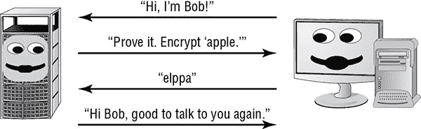

**FIGURE 6.1** Challenge-response authentication protocol

#### 不可否认性

*不可否认性* 为接收方提供确认消息来源的保证，即消息确实由发送方发出，而非冒充发送方的其他人。它还防止发送方声称自己从未发送过该消息（即 *repudiating* 该消息）。对称密钥（secret key）密码系统（如简单的替换密码）无法提供此不可否认性保证。若 Jim 与 Bob 参与对称密钥通信系统，他们均可使用共享密钥生成相同的加密消息。不可否认性仅由公钥（非对称）密码系统提供，该主题将在第 7 章中作更详细阐述。

### 加密概念

与任何科学一样，在深入研究密码学之前，必须熟悉相关术语。下面我们简要介绍描述密码和密码文所用的几个关键词。在消息被编码之前，它称为 *plaintext*（明文），在描述加密函数时用字母`P`表示。发送者使用加密算法对明文进行 *encrypt*（加密），生成 *ciphertext*（密文），用字母`C`表示。该密文随后通过某种物理或电子方式传输给接收方。接收方再使用预定义的算法对密文进行 *decrypt*（解密），恢复明文。（此过程的示意图请参见本章后的 Figure 6.3）。

所有加密算法都依赖 *keys*（密钥）来保持安全。大多数情况下，密钥仅是一个数字，通常是一个非常大的二进制数，但本质上仍是数字。每种算法都有特定的 *key space*（密钥空间），即可用作该算法密钥的数值范围。密钥空间由其 *bit size*（位大小）定义。位大小即密钥中 0 和 1 的总数。密钥空间的范围是从所有位为 0 的键到所有位为 1 的键。换句话说，密钥空间的取值范围是 0 到 `2^n`，其中`n`为密钥的位大小。例如，一个 128 位密钥的取值范围是 0 到 2¹²⁸（约 3.40282367 × 10³⁸，一个极大的数字）。绝对必须保护秘密密钥的安全。事实上，所有 cryptography（密码学）所提供的安全性，都取决于你能否保持所用密钥的私密性。

随着您在本章和下一章的学习，不同类型的算法需要不同类型的密钥。在私钥（或密钥）密码系统中，所有参与者使用一个共享密钥。在公钥密码系统中，每个参与者都有自己的密钥对。密码学中的密钥有时被称为`cryptovariables`。

创建和实现密码和密码的艺术被称为`cryptography`。这一实践与`cryptanalysis`的艺术相类比——即研究破解密码和密码的方法。`cryptography`与`cryptanalysis`合起来通常被称为`cryptology`。密码或密码在硬件和软件中的具体实现被称为`cryptosystems`。联邦信息处理标准（FIPS）140–2，“安全要求密码模块”，定义了联邦政府使用的密码模块的硬件和软件要求。

## 加密数学

加密学与大多数计算机科学学科一样，其基础在于数学科学。要完全理解加密学，你首先需要掌握二进制数学的基础以及用于操作二进制数值的逻辑运算。下面的章节提供了对一些最基本、你应该熟悉的概念的简要介绍。

### 布尔数学

*Boolean mathematics* 定义了构成任何计算机“神经系统”的位和字节所使用的规则。你很可能熟悉十进制系统。它是一个基数为 10 的系统，每个数位使用 0 到 9 的整数，且每个数位的权值是 10 的倍数。我们依赖十进制系统可能源于生物学——人类有 10 根手指，可以用于计数。

同样，计算机依赖布尔系统的原因是电气特性。在电路中，只有两种可能状态——开（表示电流存在）和关（表示电流不存在）。所有由电气设备执行的计算都必须用这种方式表达，从而催生了现代电子设备中布尔计算的使用。一般而言，计算机科学家将“开”状态称为`true`值，“关”状态称为`false`值。

### 逻辑运算

加密学中的布尔数学使用多种逻辑函数来操作数据。我们简要查看其中一些操作。

#### AND

AND 操作（用`∧`符号表示）检查两个值是否都为真。下面的真值表展示了 AND 函数的所有四种可能输出。请记住，AND 函数仅接受两个变量作为输入。在布尔数学中，每个变量只有两个可能值，因此 AND 函数共有四种可能的输入组合。正是这种有限的可能性使得计算机能够轻松在硬件中实现逻辑函数。请注意，在下面的真值表中，只有当两个输入均为真时，输出值才为真：

| `X` | `Y` | `X ∧ Y` |
| --- | --- | --- |
| 0 | 0 | 0 |
| 0 | 1 | 0 |
| 1 | 0 | 0 |
| 1 | 1 | 1 |

逻辑运算通常在整个布尔字上进行，而不是单个值。以下示例展示了如何对整个布尔词进行 AND 运算：

```
X: 0 1 1 0 1 1 0 0
Y: 1 0 1 0 0 1 1 1
___________________________
X ∧ Y: 0 0 1 0 0 1 0 0
```

请注意，AND 函数通过在每一列中比较`X`和`Y`的值来计算。只有当`X`和`Y`在同一列中均为真时，输出值才为真。

#### OR

OR 操作（用`∨`符号表示）检查是否至少有一个输入值为真。请参考以下真值表查看 OR 函数的所有可能值。请注意，只有当两个输入值均为假时，OR 函数才返回假值：

| `X` | `Y` | `X ∨ Y` |
| --- | --- | --- |
| 0 | 0 | 0 |
| 0 | 1 | 1 |
| 1 | 0 | 1 |
| 1 | 1 | 1 |

我们使用上一节相同的示例，展示如果将`X`和`Y`作为输入传递给 OR 函数而不是 AND 函数时的输出结果：

```
X: 0 1 1 0 1 1 0 0
Y: 1 0 1 0 0 1 1 1
___________________________
X ∨ Y: 1 1 1 0 1 1 1 1
```

#### NOT

NOT 操作（用`∼`或`!`符号表示）简单地反转输入变量的值。该函数仅在一个变量上操作。以下是 NOT 函数的真值表：

| `X` | `~X` |
| --- | --- |
| 0 | 1 |
| 1 | 0 |

在下面的示例中，我们取用之前的`X`值并对其应用 NOT 函数：

```
X: 0 1 1 0 1 1 0 0
___________________________
~X: 1 0 0 1 0 0 1 1
```

#### 异或（XOR）

本章最后介绍的逻辑函数——可能是最重要且最常用于密码学应用的异或（XOR）函数。它在数学文献中被称为 XOR 函数，通常用`⊕`符号表示。XOR 函数在仅有一个输入值为真时返回真值；如果两个值均为假或均为真，则 XOR 函数的输出为假。以下是 XOR 操作的真值表：

| `X` | `Y` | `X ⊕ Y` |
| --- | --- | --- |
| 0 | 0 | 0 |
| 0 | 1 | 1 |
| 1 | 0 | 1 |
| 1 | 1 | 0 |

以下示例展示了将`X`和`Y`作为输入传递给 XOR 函数时的运算结果：

```
X: 0 1 1 0 1 1 0 0
Y: 1 0 1 0 0 1 1 1
___________________________
X ⊕ Y: 1 1 0 0 1 0 1 1
```

#### 模运算

*modulo*函数在密码学领域极为重要。回想你最初学习除法时，你并不熟悉小数，而是通过在每次除法后给出余数来补偿。计算机也不自然理解十进制系统，而这些余数在计算机执行许多数学运算时起着关键作用。模运算，简单来说，就是除法操作后剩余的值。

模运算通常用公式中的`mod`缩写表示，有时也用`%`运算符表示。以下是模运算的一些输入输出示例：

```
8 mod 6 = 2
6 mod 8 = 6
10 mod 3 = 1
10 mod 2 = 0
32 mod 8 = 0
```

我们将在第 7 章再次讨论该函数，届时探讨 RSA 公钥加密算法（以其发明者 Rivest、Shamir 和 Adleman 命名）。

#### 一元函数

*One-way function*（单向函数）是一种数学运算，它能轻松为每种可能的输入组合产生输出值，但使得检索输入值变得不可能。公钥密码系统全部基于某种单向函数。然而，实际上并没有证明任何已知函数真正是单向的。密码学家依赖于他们认为单向的函数，但未来的密码分析者可能会破解它们。

-   [费曼学习法](https://wiki.example.org/feynmans_learning_method)的灵感源于诺贝尔物理奖获得者**Richard Feynman**。

1.  运用费曼技巧，你只需花上`20 min`就能深入理解知识点，而且记忆深刻，*难以遗忘*。

```
if (condVar > someVal) {console.log("xxx")}
```

-   在本章前面的[Figure 6.1 挑战响应协议示例中，使用了简单的置换密码，将消息的字母反转，使得 *apple* 变为 *elppa*。置换密码比这更为复杂。例如，你可以使用关键词进行 *列置换*。下面的示例，我们尝试使用秘密关键词 *attacker* 对 “The fighters will strike the enemy bases at noon” 进行加密。第一步是将关键词的字母按字母顺序编号。第一次出现的字母`A`获得数值 1；第二次出现的字母`A`获得数值 2。接下来的字母`C`被编号为 3，以此类推。这产生了以下序列：

```
A T T A C K E R
1 7 8 2 3 5 4 6
```

随后，消息的字母按顺序写在关键词字母的下方：

```
A T T A C K E R
1 7 8 2 3 5 4 6
T H E F I G H T
E R S W I L L S
T R I K E T H E
E N E M Y B A S
E S A T N O O N
```

最后，发送者通过每列自上而下阅读来加密消息；列的阅读顺序对应第一步中分配的数字。这产生了以下密文：

```
T E T E E F W K M T I I E Y N H L H A O G L T B O T S E S N H R R N S E S I E A
```

另一方面，接收方使用密文和相同的关键词重建八列矩阵，然后直接在行上读取明文消息。

#### Substitution Ciphers

*Substitution ciphers* 使用加密算法将明文消息的每个字符或位元替换为不同的字符。本章开头讨论的 **Caesar 密码** 是一种 substitution cipher 的良好示例。现在你已经了解了一些密码数学知识，我们再来看一下 Caesar 密码。回顾，我们在明文中将每个字母向右平移三位来生成密文。然而，当我们到达字母表末尾时，会出现问题——字母`Z`缺少后续字母。我们通过循环回到字母表开头来解决此问题，使得明文字符`Z`变为密文字符`C`。

你可以用数学表达式描述 ROT3 密码，即把每个字母转换为其十进制值（其中`A`为 0，`Z`为 25），然后在每个字母上加 3，得到密文字符。为了处理循环，使用在 “Cryptographic Mathematics” 章节中讨论的取模函数。Caesar 密码的最终加密函数为：

```
C = (P + 3) mod 26
```

对应的解密函数为：

```
P = (C - 3) mod 26
```

与置换密码一样，还有许多更为高级的 substitution ciphers。多字母 substitution ciphers 在同一消息中使用多个字母表，以增加破解难度。其中最著名的例子是 **Vigenère 密码**。Vigenère 密码使用单一加密/解密表，如下所示：


```
A B C D E F G H I J K L M N O P Q R S T U V W X Y Z
A B C D E F G H I J K L M N O P Q R S T U V W X Y Z
B C D E F G H I J K L M N O P Q R S T U V W X Y Z A
C D E F G H I J K L M N O P Q R S T U V W X Y Z A B
D E F G H I J K L M N O P Q R S T U V W X Y Z A B C
E F G H I J K L M N O P Q R S T U V W X Y Z A B C D
F G H I J K L M N O P Q R S T U V W X Y Z A B C D E
G H I J K L M N O P Q R S T U V W X Y Z A B C D E F
H I J K L M N O P Q R S T U V W X Y Z A B C D E F G
I J K L M N O P Q R S T U V W X Y Z A B C D E F G H
J K L M N O P Q R S T U V W X Y Z A B C D E F G H I
K L M N O P Q R S T U V W X Y Z A B C D E F G H I J
L M N O P Q R S T U V W X Y Z A B C D E F G H I J K
M N O P Q R S T U V W X Y Z A B C D E F G H I J K L
N O P Q R S T U V W X Y Z A B C D E F G H I J K L M
O P Q R S T U V W X Y Z A B C D E F G H I J K L M N
P Q R S T U V W X Y Z A B C D E F G H I J K L M N O
Q R S T U V W X Y Z A B C D E F G H I J K L M N O P
R S T U V W X Y Z A B C D E F G H I J K L M N O P Q
S T U V W X Y Z A B C D E F G H I J K L M N O P Q R
T U V W X Y Z A B C D E F G H I J K L M N O P Q R S
U V W X Y Z A B C D E F G H I J K L M N O P Q R S T
V W X Y Z A B C D E F G H I J K L M N O P Q R S T U
W X Y Z A B C D E F G H I J K L M N O P Q R S T U V
X Y Z A B C D E F G H I J K L M N O P Q R S T U V W
Y Z A B C D E F G H I J K L M N O P Q R S T U V W X
Z A B C D E F G H I J K L M N O P Q R S T U V W X Y
```

注意，该表格仅是字母表重复写 26 次，每行相对于上一行整体向右平移一个字母。要使用 Vigenère 系统，需要一个 `关键词`。例如，关键词可以是 `secret`。使用关键词的规则如下：

在挑战-响应协议示例中（如本章前面图 6.1 所示），使用了一种简单的转位密码，将消息的字母反转，例如将 `apple` 变为 `elppa`。转位密码可能比这复杂得多。例如，可以使用关键词进行 `列式转位`。在下面的示例中，我们尝试使用密钥 `attacker` 加密消息“The fighters will strike the enemy bases at noon”。第一步是获取关键词的字母，并按字母顺序编号。字母 `A` 的第一次出现赋值为 1；第二次出现编号为 2。下一个字母 `C` 编号为 3，依此类推。这将产生以下序列：

```
A T T A C K E R
1 7 8 2 3 5 4 6
```

接下来，将消息的字母按顺序写在关键词字母下方：

```
A T T A C K E R
1 7 8 2 3 5 4 6
T H E F I G H T
E R S W I L L S
T R I K E T H E
E N E M Y B A S
E S A T N O O N
```

最后，发送方通过逐列读取来加密消息；列的读取顺序对应第一步中分配的数字。这将产生以下密文：

```
T E T E E F W K M T I I E Y N H L H A O G L T B O T S E S N H R R N S E S I E A
```

在另一端，接收方使用密文和相同的关键词重建八列矩阵，然后简单地按行读取明文消息。

### 替换密码

`替换密码` 使用加密算法将明文消息中的每个字符或位替换为不同的字符。如果这些要求中的任何一个未得到满足，一次性密码的不可穿透性会立即失效。事实上，美国情报机构的重大成功之一是密码分析人员破解了一个依赖于一次性密码的苏联顶级秘密密码系统。在名为 `VENONA` 的项目中，分析人员发现了苏联在生成一次性密码中使用的密钥值时存在的一个模式。这一模式的存在违反了一次性密码系统的第一个要求：密钥必须是随机生成且不使用任何重复模式的。整个 VENONA 项目最近解密，并公开在国家安全局网站（`https://www.nsa.gov/about/cryptologic-heritage/historical-figures-publications/publications/coldwar/assets/files/venona_story.pdf`）上。

一次性密码在历史上一直被用于保护极其敏感的通信。其广泛使用的主要障碍是生成、分发和保护所需的长密钥的困难。由于密钥长度的限制，一次性密码现实上只能用于短消息。

### 运行密钥密码

由于密钥长度有限，许多密码学漏洞围绕着密钥的长度。正如上一节所学到的，一次性密码通过使用至少与消息长度相同的密钥来避免这些漏洞。然而，一次性密码的实现较为笨拙，因为它需要实物交换密钥。

一个常见的解决方案是使用 `运行密钥密码`（也称为 `书籍密码`）。在这种密码中，加密密钥的长度与消息本身相同，通常从一本共同的书中选取。例如，发送方和接收方可能事先约定使用《白鲸》一书的某一章节（从第三段开始）作为密钥。双方只需使用必要的连续字符来执行加密和解密操作。

让我们看一个例子。假设你想使用上述约定的密钥加密消息“Richard will deliver the secret package to Matthew at the bus station tomorrow”。该消息长 66 个字符，因此你将使用密钥的前 66 个字符：“With much interest I sat watching him. Savage though he was, and hideously marred.” 任何算法都可以用这个密钥对明文进行加密。让我们看看模 26 加法的例子，它将每个字母转换为十进制数值，将明文与密钥相加，然后进行模 26 操作得到密文。如果将字母 `A` 赋值为 0，字母 `Z` 赋值为 25，则前两个单词的加密操作如下：

| 明文 || `R` || `I` || `C` || `H` || `A` || `R` || `D` || `W` || `I` || `L` || `L` |

| --- | --- | --- | --- | --- | --- | --- | --- | --- | --- | --- | --- |

| 密钥 || `W` || `I` || `T` || `H` || `M` || `U` || `C` || `H` || `I` || `N` || `T` |

| 明文数值 || 17 || 8 || 2 || 7 || 0 || 17 || 3 || 22 || 8 || 11 || 11 |

| 密钥数值 || 22 || 8 || 19 || 7 || 12 || 20 || 2 || 7 || 8 || 13 || 19 |

| 密文数值 || 13 || 16 || 21 || 14 || 12 || 11 || 5 || 3 || 16 || 24 || 4 |

| 密文 || `N` || `Q` || `V` || `O` || `M` || `L` || `F` || `D` || `Q` || `Y` || `E` |

当接收方收到密文后，他们使用相同的密钥，然后从密文中减去密钥，进行模 26 操作，最后将得到的明文转换回字母形式。

### 块密码

`块密码`（block ciphers）对消息的“块”（chunks）或块进行操作，并对整个块应用加密算法。转位密码是块密码的例子。简单的挑战-响应算法使用的算法是对整个单词进行字母逆序。更复杂的列式转位密码作用于整个消息（或消息的一部分）并使用秘密关键词进行转位加密。大多数现代加密算法都实现某种形式的块密码。

### 流密码

`流密码`（stream ciphers）对消息（或数据流）中的一个字符或位进行处理。凯撒密码是流密码的例子。一次性密码也是流密码，因为其算法对明文的每个字母都独立操作。流密码也可以作为一种块密码的形式工作。在这类操作中，有一个缓冲区实时填充数据，然后作为块进行加密并传输给接收方。

### 混淆与扩散

加密算法依赖于两种基本操作来隐藏明文消息——混淆（confusion）和扩散（diffusion）。`混淆` 发生在明文与密钥之间的关系如此复杂，以至于攻击者无法仅通过修改明文并分析得到的密文来确定密钥。`扩散` 发生在明文的一次变化导致密文中多处出现变化时。例如，考虑一种先进行复杂的替换，然后使用转位重新排列替换后密文字符的算法。在这种例子中，替换操作引入混淆，转位操作引入扩散。

### 现代密码学

现代密码系统使用计算复杂的算法和长密钥来满足数据安全的保密性、完整性、身份验证和不可否认性目标。以下章节将探讨密码学密钥在数据安全中的作用，并介绍当今常用的三种算法类型：对称加密算法、非对称加密算法和散列算法。

#### 加密密钥

在密码学的早期，主要原则是“安全通过隐蔽”。一些密码学家认为，保持加密算法的细节隐藏是确保其安全的最佳方式。旧密码系统要求通信双方将用于加密和解密消息的算法保密，不被第三方知晓。一旦算法被披露，整个系统就会因对手的介入而被破坏。

现代密码系统不依赖算法的秘密性。事实上，大多数密码系统的算法都公开在相关文献和互联网上供公众审查。将算法公开给公众审视实际上会提高其安全性。计算机安全社区对算法的广泛分析使得实践者能够发现并修正潜在的安全漏洞，确保所使用的算法能够最大程度地保护通信安全。

与依赖秘密算法不同，现代密码系统依赖于用于个人化算法的一个或多个加密密钥的秘密性。回顾转位密码的讨论，列式转位使用关键词来指导加密和解密过程。列式转位使用的算法众所周知——你只需阅读本书中的细节即可！然而，只要选择一个外人难以猜测的关键词，列式转位仍可在第三方知晓算法细节的情况下安全地用于双方通信。只要该关键词的安全得到维护，算法细节的公开就不影响其安全性。

在本章前面的讨论中，你了解到单次密码（one-time pad）算法的主要优势来源于其使用极长的密钥。事实上，该算法的密钥长度至少与消息本身的长度相同。大多数现代密码系统并未使用如此长的密钥，但密钥长度仍是决定密码系统强度以及加密是否可能通过密码分析技术被破解的重要因素。

计算能力的快速提升使你能够在密码学努力中使用更长的密钥。然而，这种计算能力同样落在试图破解你所使用算法的密码分析人员手中。因此，必须通过使用足够长的密钥，确保其能够抵御当前的密码分析尝试，从而超越对手。此外，如果你希望在未来一段时间内保持数据免受密码分析的威胁，就必须使用能够超越预计的密码分析能力增长的密钥，以覆盖数据需要保护的整个时间段。例如，量子计算的出现可能会改变密码学，使当前密码系统变得不安全，正如本章前面所讨论的那样。

几十年前，当数据加密标准（DES）被创建时，56 位密钥被认为足以确保任何数据的安全。然而，现在普遍认为 56 位 DES 算法已不再安全，原因是密码分析技术和超级计算机的进步。现代密码系统使用至少 128 位密钥来保护数据免受窥探。请记住，密钥长度直接关联密码系统的工作量：密钥越长，破解密码系统越困难。

### 对称密钥算法

对称密钥算法依赖于一个“共享秘密”加密密钥，该密钥分发给所有参与通信的成员。该密钥用于所有参与方的加密和解密，因此发送方和接收方都持有共享密钥的副本。发送方使用共享秘密密钥进行加密，接收方使用它进行解密。当使用大尺寸密钥时，对称加密极难被破解。它主要用于大规模数据的加密，并仅提供机密性这一安全服务。对称密钥密码学也可称为 `secret key cryptography`（秘密密钥密码学）和 `private key cryptography`（私钥密码学）。Figure 6.3 展示了对称密钥加密和解密过程。

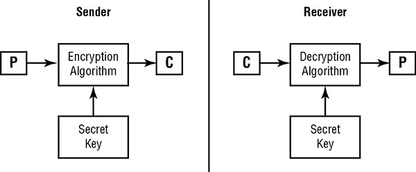

**FIGURE 6.3** 对称密钥密码学

对称密钥密码学存在几个弱点。

**密钥分发是主要问题。** 参与方必须在使用对称密钥协议建立通信前，通过安全方式交换秘密密钥。如果没有安全的电子通道，通常需要使用离线（即带外）密钥分发方式。

**对称密钥密码学不实现不可否认性。** 由于任何通信方均可使用共享秘密密钥加密和解密消息，因此无法证明某条消息的来源。

**算法不可扩展。** 大型群体使用对称密钥密码学进行安全通信极为困难。只有在每个可能的用户组合之间都共享私钥时，才能实现群内个人的安全私密通信。

**密钥必须频繁 regeneration。** 每当参与方离开群组时，该参与方所知的所有密钥都必须被撤销。

对称密钥密码学的主要优势在于其极高的运行速度。对称密钥加密非常快速，通常比非对称算法快 1,000 到 10,000 倍。由于涉及的数学原理，对称密钥密码学自然适合硬件实现，从而为更高速的操作提供了可能。

本章后续的“对称密码学”章节将对当今主要的秘密密钥算法进行详细介绍。

### 非对称密钥算法

`非对称密钥算法`，也称为 `public key algorithms`（公钥算法），为对称密钥加密的弱点提供了解决方案。在这些系统中，每个用户拥有两把钥匙：公钥，可与所有用户共享；私钥，保持秘密且仅知晓于用户本人。但这里有一个变化：加密和解密必须使用相反且相关的钥匙组合。也就是说，如果使用公钥加密消息，则只有对应的私钥才能解密，反之亦然。

Figure 6.4 展示了公钥密码系统中用于加密和解密消息的算法。考虑以下例子：如果爱丽丝（Alice）想通过公钥密码学向鲍勃（Bob）发送消息，她先创建消息，然后使用鲍勃的公钥进行加密。解密此密文唯一可行的方式是使用鲍勃的私钥，而唯一拥有该私钥的用户是鲍勃。因此，爱丽丝在加密后无法自行解密消息。如果鲍勃想回复爱丽丝，他只需使用爱丽丝的公钥加密消息，然后爱丽丝通过使用自己的私钥解密即可阅读。

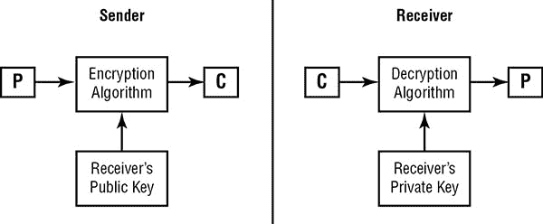

**FIGURE 6.4** 非对称密钥密码学

| 参与者人数 || 所需对称密钥数量 || 所需非对称密钥数量 |

| --- | --- | --- |

| 2 || 1 || 4 |

| 3 || 3 || 6 |

| 4 || 6 || 8 |

| 5 || 10 || 10 |

| 10 || 45 || 20 |

| 100 || 4,950 || 200 |

| 1,000 || 499,500 || 2,000 |

| 10,000 || 49,995,000 || 20,000 |


非对称密钥算法还支持数字签名技术。基本上，如果鲍勃（Bob）想向其他用户保证一条带有他名字的消息确实是他发送的，他首先使用哈希算法创建消息摘要（你将在下一节了解更多关于哈希算法的内容）。鲍勃随后使用私钥对该摘要进行加密。想要验证签名的用户只需使用鲍勃的公钥对加密后的摘要进行解密，然后确认解密后的摘要是否准确。第 7 章会对该过程进行更详细的说明。

以下是非对称密钥密码学的主要优势列表：

- **添加新用户仅需生成一对公钥-私钥。** 该密钥对用于与非对称密码系统中的所有用户通信，使算法极具可扩展性。

- **从非对称系统中移除用户更加容易。** 非对称密码系统提供了密钥撤销机制，可取消密钥，从而实质性地将用户从系统中移除。

- **仅在用户私钥被 compromise 时才需要 regeneration。** 如果用户离开社区，系统管理员只需撤销该用户的密钥即可。其他用户的密钥不会受到影响，因此不需要为其他用户进行密钥 regeneration。

- **非对称密钥加密可提供完整性、认证和不可否认性。** 如果用户不将私钥分享给其他个人，由该用户签名的消息可以证明其准确性和来源，且以后不能否认。

- **密钥分发简单。** 想要参与系统的用户只需将其公钥提供给任何想与之通信的人。公钥无法从私钥推导出。

- 不需要预先建立通信链接。Two individuals can begin communicating securely from the moment they start communicating. Asymmetric cryptography does not require a preexisting relationship to provide a secure mechanism for data exchange.

- 公钥加密的主要弱点是其操作速度较慢。For this reason, many applications that require the secure transmission of large amounts of data use public key cryptography to establish a connection and then exchange a symmetric secret key. The remainder of the session then uses symmetric cryptography. Table 6.1 compares the symmetric and asymmetric cryptography systems. Close examination of this table reveals that a weakness in one system is matched by a strength in the other.

**TABLE 6.1 对称和非对称密码系统的比较**

| 对称 | 非对称 |
| --- | --- |
| 单一共享密钥 | 密钥对集 |
| 带外交换 | 带内交换 |
| 不可扩展 | 可扩展 |
| 快速 | 慢速 |
| 批量加密 | 小块数据、数字签名、数字信封、数字证书 |
| 保密性 | 保密性、完整性、真实性、不可否认性 |

### 哈希算法

在前一节中，你学习了公钥密码系统在与消息摘要一起使用时可以提供数字签名能力。消息摘要是消息内容的摘要（类似于文件校验和），由哈希算法生成。理想哈希函数几乎不可能反向推导出原始消息，而且两条不同的消息产生相同哈希值的情况极不 likely。哈希函数为两个不同输入产生相同输出的情况称为*碰撞*，而碰撞的存在通常会导致哈希算法被淘汰。

第 7 章详细介绍了当代哈希算法，并解释了它们如何用于提供数字签名能力，从而满足完整性和不可否认性的密码学目标。

## 对称密码学

你已经学习了对称密钥加密、非对称密钥加密和哈希函数的基本概念。在下面的章节中，我们将深入探讨几种常见的对称密码系统：数据加密标准（DES）、三重 DES（3DES）、国际数据加密算法（IDEA）、Blowfish、Skipjack 和高级加密标准（AES）。

### 数据加密标准

美国政府于 1977 年发布了数据加密标准（DES），作为政府通信的拟议密码系统。由于算法存在缺陷，密码学家和联邦政府不再认为 DES 安全。据信情报机构经常解密 DES 加密信息。DES 于 2001 年 12 月被高级加密标准（AES）取代。了解 DES 仍然很重要，因为它是三重 DES（3DES）的基础，而 3DES 是一种强加密算法，将在下一节中讨论。

DES 是一个 64 位区块密码，具有五种工作模式：电子代码本模式（ECB）、密码块链模式（CBC）、密码反馈模式（CFB）、输出反馈模式（OFB）和计数模式（CTR）。这些模式在下面的章节中解释。所有 DES 模式都一次处理 64 位明文，生成 64 位密文块。DES 使用的密钥长度为 56 位。

DES 使用大量的异或（XOR）操作来生成密文。该过程在每次加密/解密操作中重复 16 次。每次重复通常被称为一次*轮*加密，解释了 DES 执行 16 轮加密的说法。

#### 电子代码本模式

电子代码本（ECB）模式是最易于理解且最不安全的模式。每当算法处理一个 64 位块时，它仅使用选定的密钥对该块进行加密。这意味着如果算法在通信中多次遇到相同的块，它会产生相同的加密块。如果敌人在窃听通信，他们可以构建所有可能加密值的“代码本”。在收集了足够多的块后，可以使用密码分析技术破译部分块，从而破解加密方案。

这一弱点使得在除最短传输外几乎无法使用 ECB 模式。在日常使用中，ECB 仅用于交换少量数据，例如用于启动其他 DES 模式的密钥和参数，以及数据库中的单元。

#### 密码块链模式

在密码块链（CBC）模式中，每个未加密文本块在使用 DES 算法加密之前，会与紧随其后的密文块进行异或操作。解密过程则是解密密文并逆转异或操作。CBC 模式实现了初始化向量（IV），并将其与第一个消息块异或，每次操作都会产生唯一的输出。初始化向量必须发送给接收方，可以通过在加密文本前附加明文形式的 IV，或者使用与消息相同的密钥对 IV 进行 ECB 模式加密来保护它。使用 CBC 模式时的一个重要考虑是错误传播——如果一个块在传输过程中损坏，那么该块及下一个块都将无法解密。

#### 密码反馈模式

密码反馈（CFB）模式是 CBC 模式的流加密版本。也就是说，CFB 作为实时数据流处理数据，而不是将消息分块。它使用与块大小相同的内存缓冲区。当缓冲区充满时，将其加密并发送给接收方，然后等待下一个缓冲区充满新数据后再加密并传输。除了数据是实时生成的，CFB 的工作方式与 CBC 相同。它使用 IV，并使用链接。

#### 输出反馈模式

在输出反馈（OFB）模式中，DES 的工作方式几乎与 CFB 模式相同。然而，它不像 CFB 那样异或前一个密文块的加密结果，而是将明文与种子值异或。第一个加密块的种子值由初始化向量（IV）生成。后续的种子值通过在前一个种子值上运行 DES 算法得到。OFB 模式的主要优势是没有链接函数，且传输错误不会影响后续块的解密。

#### 计数模式

DES 在计数（CTR）模式下运行时使用类似 CFB 和 OFB 模式的流加密机制。然而，它不像其他模式那样从前一个种子值的结果中生成每次加密/解密操作的种子值，而是使用一个简单的递增计数器。与 OFB 模式一样，CTR 模式中错误不会在后续块中传播。

### 三重 DES

如前几节所述，由于现代密码分析技术和超级计算机的计算能力，DES 的 56 位密钥已不再足够安全。然而，一种改进的 DES 版本，即三重 DES（3DES），使用相同的算法提供了更高的安全性。

3DES 有四种版本。第一种是三次加密，使用三个不同的密钥：`K[1]`、`K[2]` 和 `K[3]`。它被称为 DES-EEE3 模式（`E`s 表示有三次加密操作，而数字 3 表示使用三个不同的密钥）。DES-EEE3 可以表示为以下符号，其中`E(K,P)`表示使用密钥`K`对明文`P`进行加密：

```
E(K1,E(K2,E(K3,P)))
```

DES-EEE3 的有效密钥长度为 168 位。

第二种变体（DES-EDE3）同样使用三个密钥，但将第二次加密操作替换为解密操作。

```
E(K1,D(K2,E(K3,P)))
```

3DES 的第三个版本（DES-EEE2）仅使用两个密钥，`K[1]` 和 `K[2]`，如下所示：

```
E(K1,E(K2,E(K1,P)))
```

3DES 的第四个变体（DES-EDE2）也使用两个密钥，但在中间使用解密操作。

```
E(K1,D(K2,E(K1,P)))
```

第三和第四个变体的有效密钥长度均为 112 位。

这四种 3DES 变体的研发历时多年，因为多位密码学家提出了理论，认为某一种变体比其他变体更安全。然而，当前的共识是所有模式的安全性相等。

### 国际数据加密算法

国际数据加密算法（IDEA）块密码是应对 DES 算法密钥长度不足的投诉而研发的。与 DES 相同，IDEA 在 64 位明文/密文块上运行。但它以 128 位密钥开始运算。该密钥随后被分解为一系列操作，生成 52 个 16 位子密钥。子密钥随后通过 XOR 与模运算的组合作用于输入文本，生成加密/解密后的消息。IDEA 能够在 DES 使用的相同五种模式中工作：ECB、CBC、CFB、OFB 和 CTR。

IDEA 算法已被其瑞士开发者专利保护。然而，该专利于 2012 年到期，现已可自由使用。IDEA 的一个流行实现是 Phil Zimmerman 开发的 Pretty Good Privacy（PGP）安全电子邮件包。第 7 章对 PGP 有更详细的介绍。

### Blowfish

Bruce Schneier 开发的 Blowfish 块密码是另一种 DES 和 IDEA 的替代方案。与其前身一样，Blowfish 在 64 位文本块上运行。但它通过支持从相对不安全的 32 位到极其强大的 448 位可变长密钥，进一步提升了密钥强度。显然，密钥越长，加密/解密所需时间也越长。不过，时间测试表明 Blowfish 比 IDEA 和 DES 都快得多。此外，Schneier 先生将 Blowfish 公开使用且无需许可。Blowfish 加密已内置于众多商业软件产品和操作系统中，同时也有大量面向软件开发者的 Blowfish 库可供下载使用。

### Skipjack

Skipjack 算法被美国政府批准用于联邦信息处理标准（FIPS）185，即加密 escrow 标准（EES）。像许多块密码一样，Skipjack 在 64 位文本块上运行，使用 80 位密钥，并支持 DES 所支持的四种运行模式。Skipjack 被迅速采纳，并为 Clipper 和 Capstone 加密芯片提供加密功能。

然而，Skipjack 还有一个特点——它支持密钥的保管（escrow）。美国国家标准技术研究院（NIST）和财政部持有重建 Skipjack 密钥所需的部分信息。当执法机构获得法律授权时，他们会联系这两家机构，获取密钥的各个部分，从而解密相关通信。

由于美国政府内部的保管程序受到广泛的不信任，Skipjack 和 Clipper 芯片未受到加密学界的普遍欢迎。

### 高级加密标准

2000 年 10 月，美国国家标准技术研究院（NIST）宣布 Rijndael（发音 “rhine-doll”）块密码被选为 DES 的替代方案。2001 年 11 月，NIST 发布 FIPS 197，规定政府所有机密但未分类数据必须使用 AES/Rijndael 进行加密。

AES 密码支持三种密钥长度：128 位、192 位和 256 位。AES 仅处理 128 位块，但 Rijndael 超出该规范，允许密码学家使用与密钥长度相同的块大小。所需的加密轮数取决于所选密钥长度：

- 128 位密钥需要 10 轮加密。

- 192 位密钥需要 12 轮加密。

- 256 位密钥需要 14 轮加密。

AES 只是众多对称加密算法中的一种。表 6.2 列出了几种常见且知名的对称加密算法及其块大小和密钥大小。

**TABLE 6.2 对称加密记忆表**

| 名称 | 块大小 | 密钥大小 |
| --- | --- | --- |
| 高级加密标准 (AES) | 128 | 128, 192, 256 |
| Rijndael | 可变 | 128, 192, 256 |
| Blowfish（常用于 SSH） | 64 | 32–448 |
| 数据加密标准 (DES) | 64 | 56 |
| IDEA（用于 PGP） | 64 | 128 |
| 瑞斯块密码 2 (RC2) | 64 | 128 |
| 瑞斯块密码 5 (RC5) | 32, 64, 128 | 0–2,040 |
| Skipjack | 64 | 80 |
| 三重 DES (3DES) | 64 | 112 或 168 |
| Twofish | 128 | 1–256 |

### 对称密钥管理

由于密码学密钥包含维持密码系统安全所必需的信息，使用和管理密钥的用户及管理员必须采取特殊措施保护密钥材料的安全。这些安全措施统称为 *密钥管理实践*。它们包括对密钥创建、分发、存储、销毁、恢复和保管的保护措施。

#### 密钥创建与分发

如前所述，对称加密算法的主要问题之一是密钥的安全分发。安全交换密钥的三种主要方法是离线分发、公钥加密以及 Diffie–Hellman 密钥交换算法。

**离线分发** 最技术上简单的方法是进行物理交换密钥材料。一方向另一方提供一张纸或存储媒介，上面包含秘密密钥。在许多硬件加密设备中，密钥材料以实际的钥匙形状电子设备的形式出现，插入加密设备即可。然而，离线分发的每种方式都有其固有缺陷。若通过邮件发送密钥材料，可能被拦截；电话可能被窃听；纸质密钥可能被随意丢弃或遗失。

**公钥加密** 许多通信者希望在不经历密钥分发麻烦的情况下获得对称密钥加密的速度优势。因此，许多人使用公钥加密来建立初始通信链路。链路建立成功且双方确认身份后，它们会通过安全的公钥链路交换秘密密钥，随后切换到对称密钥算法，享受更高的处理速度。一般而言，对称密钥加密的处理速度是公钥加密的数千倍。

**Diffie-Hellman** 在某些情况下，公钥加密或离线分发都不足以满足需求。两方可能需要相互通信，但没有物理手段交换密钥材料，且缺乏公钥基础设施来促进密钥交换。此类情况下，Diffie–Hellman 算法等密钥交换机制极为有用。

#### 密钥存储与销毁

另一个使用对称密码学的主要挑战是所有在密码系统中使用的密钥都必须保持安全。这包括围绕加密密钥存储的最佳实践：

- 切勿在存储加密数据的同一系统上存储加密密钥。这只会让攻击者更容易！

- 对于敏感密钥，考虑将密钥分成两部分，分别交给两个不同的个人。他们必须协作重新组合整个密钥。这被称为`split knowledge`原则（在本章前面已讨论）。

当拥有秘密密钥的用户离开组织或不再被允许访问使用该密钥保护的材料时，密钥必须更换，所有加密材料必须使用新密钥重新加密。从对称密码系统中删除用户的密钥难度是组织转向非对称算法的主要原因之一，如第 7 章所讨论。

#### 密钥托管和恢复

密码学是一种强大的工具。和大多数工具一样，它可以用于多种有益的目的，也可以被用于恶意目的。为控制密码技术的快速增长，各国政府提出了实施密钥托管系统的设想。这些系统允许在受限制的情况下（如法院命令），政府从中央存储设施中获取特定通信使用的密码密钥。

过去十年中，已提议了两种主要的密钥托管方法。

**公平密码系统** 在这种托管方式中，通信中使用的秘密密钥被分成两个或更多部分，每个部分分别交给独立的第三方。单个部分单独使用无法获得密钥，但组合后可还原密钥。当政府获得访问特定密钥的法律授权时，它会向每个第三方提供法院命令的证明，然后重新组合密钥。

**托管加密标准** 这种托管方式为政府提供了技术手段，以解密密文。该标准是前文提到的 Skipjack 算法的基础。

政府监管者极不可能克服实施广泛密钥托管所需的法律和隐私障碍。技术本身是可用的，但公众很可能永远不会接受其所带来的政府侵入性。

## 加密生命周期

除一次性密码外，所有密码系统都有有限的寿命。摩尔定律（常被引用的计算机性能提升趋势）指出，最先进处理器的处理能力大约每两年翻倍一次。这意味着，最终处理器将达到足以暴力猜解通信使用的加密密钥的强度。

安全专业人员必须牢记这一加密生命周期，在选择加密算法时考虑，并建立适当的治理控制措施，以确保所选的算法、协议和密钥长度能够在需要保护信息保密的时间内保持密码系统的完整性。安全专业人员可以使用以下算法和协议治理控制措施：

- 指定组织可使用的加密算法（如 AES、3DES 和 RSA）

- 根据信息传输的敏感程度，确定每种算法可接受的密钥长度

- 列出可使用的安全事务协议（如 SSL 和 TLS）

例如，如果你正在设计一个用于保护业务计划的加密系统，且计划在下周实施，那么你无需担心十年后可能出现的处理器能够破解它们的理论风险。相反，如果你保护的是可能用于构造核武器的信息，那么你几乎肯定需要确保该信息在 10 年后仍然保密！

## 总结

密码学家和密码分析人员一直在发展更安全的密码系统和高级密码分析技术，以此绕过这些系统。

密码学可以追溯到凯撒密码，一直是长期研究的主题。本章节介绍了一些密码学领域的基本概念，帮助你了解密码学家使用的术语，并回顾了早期密码学中使用的历史密码和密码。

本章节还分析了对称密钥密码学（通信双方使用相同密钥）与非对称密钥密码学（每个通信方拥有公钥和私钥）的相似之处和区别。

我们接着分析了当前可用的对称算法及其优缺点，并通过查看加密生命周期及企业安全中的算法/协议治理作用，结束了本章。

下一章将进一步讨论当代公钥密码算法，并探讨用于击败这两类密码系统的常见密码分析技术。

## 考试要点

**理解密码系统中保密性、完整性和不可否认性的作用。** 保密性是密码学的主要目标之一，它在数据静止和传输时保护数据的秘密。完整性为消息接收方提供保证，确保数据在创建和访问之间未被（故意或无意）修改。不可否认性提供发送者的不可否认的证明，防止其否认自己发送了原始消息。


了解如何使用密码系统实现身份验证。身份验证提供对用户身份的保证。一种可能的验证方案是挑战响应协议，其中远程用户被要求使用仅通信双方知晓的密钥加密一条消息。身份验证

-   [`Feynman's learning method`](https://wiki.example.org/feynmans_learning_method) is inspired by **Richard Feynman**, the Nobel Prize winner in physics.

1.  With Feynman's skills, you can understand the knowledge points in depth in just `20 min`, and it is memorable and *hard to forget*.

```
if (condVar > someVal) {console.log("xxx")}
```

# 第 7 章

PKI 和密码学应用

## 本章 CISSP 考试涵盖的主题包括：

*    **第 3 域：安全架构与工程**

    *   3.9 应用密码学

        *   3.9.1 密码学生命周期（例如，密钥管理、算法选择）

        *   3.9.2 密码学方法

        *   3.9.3 公钥基础设施（PKI）

        *   3.9.4 密钥管理实践

        *   3.9.5 数字签名

        *   3.9.6 不可否认性

        *   3.9.7 完整性

        *   3.9.8 理解密码分析攻击方法

        *   3.9.9 数字权利管理（DRM）

 在第 6 章“密码学与对称密钥算法”中，我们介绍了基本的密码学概念，并探讨了多种私钥密码系统。这些对称密码系统提供快速且安全的通信，但面临着在先前不相识的各方之间进行密钥交换的重大挑战。

本章探讨了非对称（或公钥）密码学及其所支持的公钥基础设施（PKI），该基础设施可实现不需要在通信前事先了解对方的安全通信。非对称算法提供了便捷的密钥交换机制，并且可扩展到数以千计用户的规模，这解决了对称密码系统使用者面临的两大难题。

本章还探讨了非对称密码学的几个实际应用：保护电子邮件、Web 通信、电子商务、数字版权管理以及网络通信。本章以对弱密码系统可能受到的各类攻击进行审视而告终。

## 非对称密码学

第 6 章“现代密码学”部分介绍了私钥（对称）和公钥（非对称）密码学的基本原理。你学到了，对称密钥系统要求通信双方拥有相同的共享秘密密钥，这导致了安全密钥分发的问题。你也了解到，非对称密码系统通过使用一对公钥和私钥消除了这一障碍，从而无需复杂的密钥分发系统即可实现安全通信。这些系统的安全性依赖于逆向一元函数的难度。

在下面的章节中，我们将更详细地探讨公钥密码学的概念，并重点介绍当今使用最广泛的三种公钥密码系统：Rivest–Shamir–Adleman（RSA）、El Gamal 和椭圆曲线密码学（ECC）。

### 公钥与私钥

回顾第 6 章可知，公钥密码系统依赖于每个系统使用者的一对密钥。每个使用者都同时持有公钥和私钥。顾名思义，公钥使用者会将其公钥自由公开给任何想与其通信的人。公钥的拥有权并不会向第三方引入任何弱点。相反，私钥仅供密钥所有者独占使用，绝不与其他使用者共享。

公钥密码系统使用者之间的正常通信过程相当简单。图 7.1（`#c07.xhtml#figure7-1`）展示了整体流程。

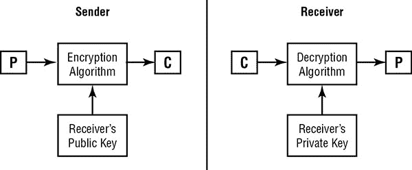

**FIGURE 7.1** 非对称密码学

请注意，该过程不需要共享私钥。发送者使用接收者的公钥对明文信息（P）进行加密，生成密文（C）。当接收者打开密文时，使用其私钥对密文进行解密，恢复原始明文。

一旦发送者使用接收者的公钥加密信息，除了拥有接收者的私钥（即公钥-私钥对中的第二个元素）外，任何人（包括发送者）都无法解密该信息。这正是公钥密码学的魅力：公钥可以通过不受保护的渠道自由共享，随后用于在先前未知的用户之间建立安全的通信通道。

你也在上一章了解到，公钥密码学的计算复杂度更高。为了达到与私钥系统相同安全强度，公钥系统使用的密钥长度必须更长。

### RSA

最著名的公钥密码系统是以其发明者命名的。1977 年，Ronald Rivest、Adi Shamir 和 Leonard Adleman 提出了 *RSA 公钥算法*，至今仍是全球标准。他们对算法进行了专利申请，并成立了 RSA Security 公司，负责其安全技术的主流实现。如今，RSA 算法已进入公有领域，广泛用于安全通信。

RSA 算法依赖于对大质数进行因式分解的计算难度。每个系统使用者通过以下步骤生成公钥/私钥对：

1. 选择两个大质数（约 200 位），记作 *p* 与 *q*。

2. 计算这两个数的乘积：*n* = *p* × *q*。

3. 选取一个数 *e*，满足以下两个条件：

   1. *e* < *n*。

   2. *e* 与 (*p* − 1)(*q* − 1) 互质，即两者的最大公约数为 1。

4. 找到一个数 *d*，使得 (*e*·*d* − 1) mod (*p* − 1)(*q* − 1) = 1。

5. 将 *e* 与 *n* 公开为公钥，保持 *d* 为私钥。

如果 Alice 想向 Bob 发送加密信息，她使用 Bob 的公钥（*e*）和 *n*（在密钥生成时由 *p* 与 *q* 计算得到）生成密文：

```
C = P^e mod n
```

收到密文后，Bob 通过以下计算恢复明文：

```
P = C^d mod n
```

### El Gamal

在第 6 章，你学习了 Diffie–Hellman 算法如何利用大整数和模运算在不安全的通信信道上安全交换密钥。1985 年，T. El Gamal 发表文章，描述了如何在 Diffie–Hellman 关键交换的数学原理基础上，扩展为一个完整的公钥密码系统，用于加密和解密消息。

与 RSA 相比，El Gamal 的主要优势之一是它自发布起即进入公有领域。El Gamal 未对其对 Diffie–Hellman 的改进申请专利，因而免费可用，而当时 RSA 仍受专利保护。（RSA 于 2000 年才将算法公开。）

然而，El Gamal 也存在显著缺点——它会使被加密的消息长度翻倍。这在加密长消息或在带宽受限的通信环境中造成了严重困难。

### 椭圆曲线

1985 年，两位数学家——华盛顿大学的 Neal Koblitz 和 IBM 的 Victor Miller——独立提出，将椭圆曲线理论应用于构建安全的密码系统。

任何椭圆曲线都可以由以下方程定义：

```
y² = x³ + a·x + b
```

在该方程中，*x*、*y*、*a*、*b* 均为实数。每条椭圆曲线对应一个椭圆曲线群，该群包含曲线上的所有点以及一个位于无穷远的点 *O*。同一椭圆曲线群内的两个点 *P* 与 *Q* 可以通过椭圆曲线加法运算相加，记作：

```
P + Q
```

该运算可以进一步推广为标量乘法，假设 *Q* 是 *P* 的倍数，则有：

```
Q = x·P
```

计算机科学家和数学家认为，即使 `P` 和 `Q` 已经已知，找到 `x` 仍然是极其困难的。这个困难的问题，即椭圆曲线离散对数问题，构成了椭圆曲线密码学的基础。普遍认为，这个问题比 RSA 密码系统基于的素因数分解问题和 Diffie–Hellman 与 El Gamal 所使用的标准离散对数问题更难解决。这在侧边栏“密钥长度的重要性”中所示的表格数据中得以说明，该表格指出，1,024 位 RSA 密钥在密码学上等价于 160 位椭圆曲线密码系统密钥。

### Hash Functions

本章后面，你将了解加密系统如何实现数字签名，以证明消息来源于加密系统的特定用户，并确保在两方之间传输时消息未被篡改。在完全理解这一概念之前，我们必须先解释 `hash functions` 的概念。我们将探讨哈希函数的基本原理，并查看现代数字签名算法中常用的几种哈希函数。

哈希函数的作用非常简单——它将可能很长的消息转换为一个由消息内容衍生的唯一输出值。该值通常称为 `消息摘要`。发送者可以生成消息摘要并与完整消息一起传输给接收方，原因有两点。

第一，接收方可以使用相同的哈希函数对完整消息重新计算消息摘要，然后将其与传输的摘要进行比较，以确保发送方发出的消息与接收方收到的消息完全相同。如果摘要不匹配，说明消息在传输过程中被修改过。需要注意的是，只有当消息 `exactly` 完全相同时，摘要才会相同。即使消息在空格、标点或内容上有微小差别，其摘要值也会截然不同。通过比较摘要无法判断两条消息之间的差异程度，微小差异会导致完全不同的摘要值。

第二，消息摘要可以用于实现数字签名算法。该概念在本章后的“数字签名”部分有所阐述。

在大多数情况下，消息摘要长度为 128 位或更大。然而，也可以使用单个数字进行奇偶校验，这是一种低层次的单数检查值，用于提供单个验证点。通常而言，摘要越长，其完整性验证越可靠。

根据 RSA Security 的说法，密码散列函数必须满足以下五个基本要求：

*   输入可以是任意长度。

*   输出长度是固定的。

*   对于任意输入，哈希函数的计算相对容易。

*   哈希函数是单向的（即在提供输出时，极难确定输入）。单向函数及其在密码学中的用途在第 6 章中描述。

*   哈希函数是抗碰撞的（即极难找到两条消息产生相同的哈希值）。

下面，我们将依次介绍四种常用的哈希算法：安全哈希算法（SHA）、消息摘要 2（MD2）、消息摘要 4（MD4）和消息摘要 5（MD5）。随后还会讨论消息认证码（HMAC）。

### SHA

安全哈希算法（SHA）及其后续版本 SHA-1、SHA-2 和 SHA-3，是由国家标准技术研究所（NIST）推广的政府标准哈希函数，详见官方发布的《安全哈希标准》（SHS），即联邦信息处理标准（FIPS）180。

SHA-1 接收几乎任意长度的输入（实际上，其上限约为 2,097,152  terabytes），并生成 160 位的消息摘要。SHA-1 将消息按 512 位块处理，因此如果消息长度不是 512 的倍数，算法会在消息末尾补足数据，使其长度达到最近的更大的 512 的整数倍。

对 SHA-1 的密码学攻击表明该算法存在弱点，这促使开发了 SHA-2，它包含四个变体：

*   `SHA-256` 生成 256 位摘要，使用 512 位块大小。

*   `SHA-224` 通过截断 SHA-256 的结果生成 224 位摘要，同样使用 512 位块大小。

*   `SHA-512` 生成 512 位摘要，使用 1,024 位块大小。

*   `SHA-384` 通过截断 SHA-512 的结果生成 384 位摘要，同样使用 1,024 位块大小。

学术界普遍认为 SHA-2 系列算法安全，但理论上它们与 SHA-1 具有相同的弱点。2015 年，政府宣布推出 Keccak 算法作为 SHA-3 标准。SHA-3 系列被设计为 SHA-2 的替换品，提供相同的变体和摘要长度，但基于更安全的算法。

### MD2

1989 年，罗纳德·里维斯特（Ronald Rivest，与 Rivest、Shamir、Adleman 同名）开发了 MD2 哈希算法，用于 8 位处理器提供安全的哈希函数。MD2 会将消息填充至 16 字节的倍数，然后在消息末尾附加 16 字节的校验和，随后使用原始消息加上该校验和生成 128 位的消息摘要。

对 MD2 的密码学攻击表明其存在缺陷。具体而言，Nathalie Rogier 和 Pascal Chauvaud 发现，如果在计算摘要前不将校验和附加到消息上，可能会出现碰撞。随后，Frederic Mueller 证明 MD2 不是单向函数，因此不应再使用。

### MD4

1990 年，里维斯特在支持 32 位处理器的同时增强了安全性，推出了改进版的消息摘要算法，即 MD4。该算法首先在消息末尾填充数据，使得消息长度比 512 位的整数倍小 64 位。例如，16 位的消息会被填充 432 位，使其长度为 448 位，正好比 512 位小 64 位。

随后，MD4 按 512 位块对消息进行三轮计算，最终输出 128 位的消息摘要。

多位数学家发表论文，指出 MD4 的完整版本以及某些错误实现存在缺陷。特别是，Hans Dobbertin 在 1996 年的论文中展示，现代个人电脑可以在不到一分钟内找到 MD4 消息摘要的碰撞。基于此，MD4 现在被认为不安全，若可能，应避免使用。

### MD5

1991 年，里维斯特发布了 MD5，这是 MD4 的后续版本。MD5 同样处理 512 位块，但通过四轮计算生成与 MD2 和 MD4 相同长度的 128 位摘要。MD5 的填充要求与 MD4 相同——消息长度必须比 512 位的整数倍小 64 位。

MD5 实现了额外的安全特性，显著降低了消息摘要生成的速度。遗憾的是，最近的密码分析攻击表明，MD5 协议易受碰撞影响，无法用于确保消息完整性。具体而言，Arjen Lenstra 等人在 2005 年展示了可以生成两个由不同公钥的数字证书，且具有相同 MD5 哈希值的证书。

Table 7.1 列出了常见哈希算法及其生成的哈希值长度（位数）。请记住此页面以便记忆。

**TABLE 7.1** **哈希算法记忆表**

| 名称 || 哈希值长度 |

| --- | --- |

| 可变长度哈希（HAVAL）—一种 MD5 变体 || 128、160、192、224 和 256 位 |

| 消息验证码（HMAC） || 可变 |

| 消息摘要 2（MD2） || 128 |

| 消息摘要 4（MD4） || 128 |

| 消息摘要 5（MD5） || 128 |

| 安全哈希算法（SHA-1） || 160 |

| SHA2-224/SHA3-224 || 224 |

| SHA2-256/SHA3-256 || 256 |

| SHA2-384/SHA3-384 || 384 |

| SHA2-512/SHA3-512 || 512 |

## 数字签名

在选择了安全的密码散列算法后，您可以使用它来实现 *数字签名* 系统。数字签名基础设施具有两个不同的目标：

*   数字签名确保消息真正来自声称的发送者，并实现不可否认性（即发送者不能事后主张消息为伪造）。

*   数字签名确保消息在发送方和接收方之间传输过程中未被篡改。这既防止恶意方篡改消息，也防止因通信过程故障（如电气干扰）导致的意外修改。

数字签名算法结合了本章节已介绍的两大概念——公钥加密和散列函数。

如果 Alice 想对发送给 Bob 的消息进行数字签名，她需执行以下操作：

1.  Alice 使用一种安全的密码散列算法（如 SHA3-512）对原始明文消息生成消息摘要。

2.  Alice 仅使用她的私钥对该消息摘要进行加密，得到数字签名。

3.  Alice 将已签名的消息摘要附加到明文消息后，发送给 Bob。

4.  Alice 将附加后的消息传输给 Bob。

当 Bob 收到数字签名消息后，他会按以下步骤逆向处理：

1.  Bob 使用 Alice 的公钥对数字签名进行解密。

2.  Bob 使用相同的散列函数对 Bob 收到的完整明文消息生成消息摘要。


3. Bob 将解密得到的消息摘要与自己计算的摘要进行比较。若两者一致，则可确认消息确实由 Alice 发送；若不一致，则说明消息未由 Alice 发送或在传输过程中被修改。

需要注意的是，数字签名过程本身并不提供隐私保护。它仅确保实现了完整性、身份验证和不可否认性这三个密码学目标。但如果 Alice 想确保消息对 Bob 的隐私性，她可以在生成消息后、附加数字签名之前，使用 Bob 的公钥对整条消息进行加密。收到消息的 Bob 会先用自己的私钥解密整条消息，然后再按上述步骤验证签名。

### HMAC

哈希消息验证码（HMAC）算法实现了部分数字签名——它保证消息在传输过程中的完整性，但不提供不可否认性。

HMAC 可与任意标准散列生成算法（如 SHA-3）配合共享秘密密钥使用。因此，只有知道该密钥的通信双方才能生成或验证数字签名。若接收方解密消息摘要后，无法与从明文消息生成的摘要进行比对，则说明消息在传输过程中被篡改。

由于 HMAC 依赖于共享秘密密钥，它不具备不可否认性（如前所述）。但相比于后文所述的公钥数字签名标准，HMAC 计算效率更高，可能适用于对称密钥加密合适的场景。简言之，它介于直接使用散列算法（无加密）与基于公钥加密的计算成本较高的数字签名算法之间的中间地带。

### 数字签名标准

美国国家标准暨技术研究院（NIST）在联邦信息处理标准（FIPS）186-4（即数字签名标准 DSS）中规定了政府部门可使用的数字签名算法。该标准要求所有获批的数字签名算法必须使用 SHA-3 哈希函数。

DSS 还规定了支持数字签名基础设施的加密算法。当前批准的标准加密算法有三种：

*   数字签名算法（DSA），依据 FIPS 186-4 规定

*   瑞维特–夏米尔–阿德曼（RSA）算法，依据 ANSI X9.31 规定

*   椭圆曲线 DSA（ECDSA），依据 ANSI X9.62 规定

## 公钥基础设施

公钥加密的主要优势在于能够在双方先前未知的情况下建立通信。这得益于 `公钥基础设施（PKI）` 的信任层级结构。该信任体系使得对称加密与散列、数字证书以及混合加密相结合，从而实现混合加密。

在接下来的章节中，您将了解公钥基础设施的基本组成部分以及使全球安全通信可能的密码学概念。您将学习数字证书的构成、证书颁发机构（CA）的作用，以及证书的生成与撤销过程。

### 证书

数字 `证书` 向通信双方提供确认对方身份的保障。数字证书本质上是个人公钥的正式背书副本。当用户验证证书由受信任的证书颁发机构（CA）签署时，便可确认该公钥的真实性。

数字证书包含特定的标识信息，其构建遵循国际标准 X.509。符合 X.509 标准的证书包含以下字段：

*   X.509 版本号（证书符合的版本）

*   序列号（由证书创建者提供）

*   签名算法标识（证书权威机构用于数字签名证书内容的算法）

*   发布者名称（证书颁发机构的标识）

*   有效期（证书生效的起止日期和时间，包括开始时间和结束时间）

*   主体名称（包含持有公钥实体的区分名称，即 DN）

*   主体公钥（证书的核心内容——实际公钥，用于安全通信）

当前 X.509 版本 3 支持证书扩展——由证书颁发机构在证书中添加的自定义字段，用于跟踪证书或支持各类应用。

`Certificate authorities` (CAs) 是公钥基础设施的粘合剂。这些中立组织为数字证书提供认证服务。要从可信赖的 CA 获取数字证书，你必须向 CA 证明自己的身份。下面列出了一些提供广泛接受的数字证书的主要 CAs：

*`Symantec`*

*`IdenTrust`*

*`Amazon Web Services`*

*`GlobalSign`*

*`Comodo`*

*`Certum`*

`GoDaddy`

`DigiCert`

`Secom`

`Entrust`

`Actalis`

`Trustwave`

任何组织都可以简单地设立自己作为 CA。但发布的证书的可信度取决于对发布该证书的 CA 的信任程度。在从第三方接收数字证书时，这点值得注意。如果你不认识并信任发布该证书的 CA 名称，则不应对该证书抱有任何信任。PKI 基于信任层次结构。如果你在浏览器中信任某个 CA，浏览器会自动信任该 CA 发布的所有数字证书。浏览器开发者预先配置浏览器以信任主要 CAs，以避免将此负担置于用户身上。

`Registration authorities` (RAs) 协助 CAs 在发布数字证书前验证用户身份，减轻 CAs 的负担。它们不直接发布证书，但在认证过程中发挥重要作用，使 CAs 能够远程验证用户身份。

#### `Certificate Generation and Destruction`

公钥基础设施的技术概念相对简单。下面的章节将介绍 CAs 用于创建、验证和撤销客户端证书的过程。

#### Enrollment

获得数字证书前，你必须以某种方式向 CA 证明自己的身份；此过程称为 `enrollment`。如前所述，有时需要亲自向认证机构的代理出示适当的身份证明文件。一些证书机构提供其他验证方式，包括使用信用报告数据以及由受信社区领袖进行身份验证。

当你满足证书机构对身份的要求后，你需要向它们提供公钥。CA 随后创建包含你的身份信息和公钥的 X.509 数字证书。CA 使用其私钥对证书进行数字签名，并提供给你已签名的数字证书副本。你可以安全地将此证书分发给你希望与之安全通信的任何人。

#### Verification

当你从想与之通信的人那里收到数字证书时，你需要通过使用 CA 的公钥检查其数字签名来 `验证` 证书。随后，你必须检查并确保证书未被撤销，方法是使用 `证书撤销列表` (CRL) 或 `在线证书状态协议` (OCSP)。在此阶段，只要满足以下条件，你就可以认为证书中列出的公钥是真实的：

*   CA 的数字签名是真实的。

*   你信任该 CA。

*   证书未列在 CRL 中。

*   证书确实包含你信任的数据。

最后一点细微但极其重要。在信任他人的标识信息前，务必确认该信息确实包含在证书中。例如，证书包含电子邮件地址 `billjones@foo.com` 但不包含个人姓名，你只能确定该公钥与该邮箱关联，CA 对 `billjones@foo.com` 邮箱账户的实际身份不作任何断言。若证书同时包含 Bill Jones 的姓名、地址和电话号码，则 CA 也为这些信息背书。

数字证书验证算法已内置于许多流行的浏览器和电子邮件客户端中，通常无需你深入处理细节。但了解背后的技术细节有助于你为组织做出恰当的安全判断。选择一家被广泛信任的 CA 至关重要；若 CA 未列入或随后被从主要浏览器的受信任 CA 列表中移除，你的证书使用价值将大幅下降。

2017 年，数字证书行业出现重大安全事件。`Symantec` 通过其关联公司发布了多个不符合行业安全标准的数字证书。对此，`Google` 宣布 `Chrome` 浏览器将不再信任 `Symantec` 证书。结果 `Symantec` 将其证书发放业务出售给 `DigiCert`，后者承诺在发行前正确验证证书。这凸显了正确验证证书请求的重要性——细小的程序疏漏可能导致 CA 业务彻底受损！

#### Revocation

偶尔，CA 需要 `撤销` 证书。可能的原因包括：

*   证书被 compromise（例如，证书持有者不慎泄露了私钥）。

*   证书误发（例如，CA 未能进行适当验证即误发证书）。

*   证书细节变更（例如，主体姓名变更）。

*   安全关联变更（例如，主体不再受该机构雇佣）。

你可以使用两种技术来验证证书真实性并识别已撤销的证书：

**`Certificate Revocation Lists`** `Certificate revocation lists` (CRLs) 由各 CA 维护，列出已撤销的证书序列号以及撤销生效时间。其主要缺点是必须定期下载并交叉引用，导致撤销通知之间存在 latency。尽管如此，CRLs 仍是当前最常用的证书状态检查方式。

**`Online Certificate Status Protocol`** (OCSP) 通过实时验证消除 CRL 的 latency。客户端收到证书后向 CA 的 OCSP 服务器发送请求，服务器返回证书状态：valid（有效）、invalid（无效）或 unknown（未知）。

## Asymmetric Key Management

在公钥基础设施中，需遵循若干最佳实践以确保通信安全。

首先，选择加密系统时需审慎。正如前文所述，“security through obscurity”（安全通过隐蔽）并非正确做法。应选择算法公开、经行业专家充分验证的系统。对采用“黑盒”方式、声称算法保密是系统完整性关键的系统保持警惕。

你也必须以适当的方式选择密钥。使用一个在安全性要求与性能考量之间取得平衡的密钥长度。同时，确保你的密钥是真正随机的。密钥中的任何模式都会增加攻击者破解你的加密并降低你的密码系统安全性的可能性。

在使用非对称加密时，务必保持私钥的秘密！在任何情况下都不要允许其他人获取你的私钥。记住，即使只允许一次访问，也会永久损害使用该密钥的所有通信（过去、现在或未来），并使第三方能够成功冒充你。

当密钥已完成其有用的生命周期时，应退役密钥。许多组织有强制性的密钥轮换要求，以防止未被发现的密钥泄露。如果你没有必须遵守的正式政策，则应根据使用密钥的频率选择合适的间隔。如果实际可行，你可能希望每隔几个月更换一次密钥对。

备份你的密钥！如果因数据损坏、灾难或其他原因丢失包含私钥的文件，你肯定希望随时拥有备份。你可以自行创建备份，或使用维护备份的密钥托管服务。无论哪种方式，确保备份以安全的方式处理都至关重要。毕竟，备份和主密钥文件同等重要！

`Hardware security modules (HSMs)` 也提供有效的密钥管理方式。这些硬件设备以安全的方式存储和管理加密密钥，防止人类直接处理密钥。HSM 的范围和复杂度从非常简单的设备（如 YubiKey）到更复杂的企业级产品不等，后者部署在数据中心。亚马逊和微软等云服务提供商也提供云端 HSM，为 IaaS 服务提供安全的密钥管理。

## Applied Cryptography

到目前为止，你已经学习了大量关于密码学基础、各种加密算法的工作原理以及使用公钥基础设施通过数字证书分发身份凭证的知识。你现在应该对密码学的基本概念感到舒适，并准备好将这项技术用于解决日常通信问题的更高层次应用。

在接下来的章节中，我们将探讨如何使用密码学保护数据在静止状态（例如存储在便携设备上的数据）以及在传输状态（例如安全电子邮件、加密网络通信和网络传输）中的应用。

### 便携设备

笔记本电脑、净设备、智能手机和平板电脑的普及性为计算安全带来了新的风险。这些设备通常包含高度敏感的信息，一旦丢失或被盗，可能对组织及其客户、员工和关联方造成严重损害。因此，许多组织选择加密技术在设备丢失时保护数据。

当前主流操作系统的版本已内置磁盘加密功能，使得在便携设备上应用和管理加密变得容易。例如，Microsoft Windows 包含 BitLocker 和 Encrypting File System (EFS) 技术，Mac OS X 包含 FileVault 加密，而 VeraCrypt 开源套件则允许在 Linux、Windows 和 Mac 系统上加密磁盘。

市面上有大量商业工具可提供额外功能和管理能力。这些工具的主要区别在于它们如何保护内存中的密钥、是否提供全盘或仅卷加密、以及是否与硬件 Trusted Platform Modules (TPMs) 集成以提供增强安全性。在选择加密软件时，应分析各选项在这些特性上的竞争力。

### 电子邮件

我们多次提到安全应具成本效益。在电子邮件方面，简洁性是最具成本效益的选择，但有时加密功能提供的特定安全服务是不可或缺的。鉴于安全也应具成本效益，以下是加密电子邮件的一些简单规则：

*   如果需要在电子邮件中保持机密性，请加密消息。

*   如果消息必须保持完整性，则必须对消息进行哈希。

*   如果消息需要身份验证、完整性和/或不可否认性，则应对消息进行数字签名。

*   如果消息需要机密性、完整性、身份验证和不可否认性，则应加密并数字签名。

始终由发送方负责实施适当的机制，以确保消息或传输的安全性（即保密性、完整性、真实性和不可否认性）。

加密电子邮件是密码学最受欢迎的应用之一。直到最近，加密电子邮件仍需要复杂、笨拙的软件，这些软件往往需要手动操作和繁琐的密钥交换程序。近年来对安全的重视提升，使得主流电子邮件包中集成了强大的加密技术。接下来，我们将查看当前广泛使用的安全电子邮件标准。

#### Pretty Good Privacy

Phil Zimmerman 的 Pretty Good Privacy (PGP) 安全电子邮件系统于 1991 年出现在计算机安全领域。它结合了本章前面描述的 CA 层次结构与“信任网络”概念——即，你必须先成为 PGP 用户的信任对象，才能开始使用该系统。随后，你接受其对其他用户有效性的判断，并据此信任从你的初始判断出发的多层次“网络”用户。

PGP 初期面临多个推广障碍。最主要的阻碍是美国政府的出口管制法规，将加密技术视为武器，禁止向美国以外地区分发强加密技术。好在，这一限制已被撤销，PGP 可自由分发到大多数国家。

PGP 有两个版本。商业版使用 RSA 进行密钥交换，IDEA 用于加密/解密，MD5 用于消息摘要生成。而免费版（基于高度相似的 OpenPGP 标准）使用 Diffie-Hellman 密钥交换，Carlisle Adams/Stafford Tavares (CAST) 128 位加密/解密算法，以及 SHA-1 哈希函数。

许多商业提供商也提供基于 PGP 的电子邮件服务，以云端邮件服务、移动设备应用或电子邮件插件的形式呈现。这些服务吸引管理员和终端用户，因为它们消除了配置和维护加密证书的复杂性，并提供了受管理的安全电子邮件服务。该类产品包括 StartMail、Mailvelope、SafeGmail 和 Hushmail。

#### S/MIME

Secure/Multipurpose Internet Mail Extensions (S/MIME) 协议已成为加密电子邮件的事实上标准。S/MIME 使用 RSA 加密算法，并得到包括 RSA Security 在内的主要行业参与者的支持。S/MIME 已被大量商业产品集成，包括：

*   Microsoft Outlook 和 Office 365

*   Mozilla Thunderbird

*   Mac OS X Mail

*   GSuite Enterprise 版

S/MIME 依赖于使用 X.509 证书来交换加密密钥。这些证书中包含的公钥用于数字签名以及交换用于更长通信会话的对称密钥。RSA 是 S/MIME 唯一支持的公钥加密协议。该协议支持 AES 和 3DES 对称加密算法。

尽管 S/MIME 标准得到广泛行业支持，技术限制仍阻碍了其广泛采用。尽管大多数桌面邮件应用程序支持 S/MIME 邮件，主流的基于网页的电子邮件系统并不支持它（需要使用浏览器扩展）。

### Web Applications

加密广泛用于保护 Web 交易。这主要是因为电子商务的强劲趋势，以及电子商务供应商和消费者希望在 Web 上安全交换财务信息（如信用卡信息）的愿望。我们将探讨两种在 Web 浏览器中产生小锁图标的技术——安全套接层 (SSL) 和传输层安全 (TLS)。

SSL 由 Netscape 开发，用于为 Web 流量提供客户端/服务器加密。超文本传输协议安全 (HTTPS) 使用 443 端口来协商服务器和浏览器客户端之间的加密通信会话。虽然 SSL 最初是为 Netscape 浏览器制定的标准，Microsoft 也将其作为其流行的 Internet Explorer 浏览器的安全标准采用。SSL 被纳入这两款产品，使其成为事实上的 Internet 标准。

SSL 依赖于交换服务器数字证书，以在浏览器和 Web 服务器之间协商加密/解密参数。SSL 的目标是创建在整个 Web 浏览会话期间保持打开的安全通信通道。它依赖于对称和非对称加密的组合。以下步骤涉及：

1. 当用户访问网站时，浏览器检索服务器的证书并从中提取服务器的公钥。

2. 浏览器然后创建一个随机对称密钥，使用服务器的公钥对其进行加密，并将加密后的对称密钥发送给服务器。

3. 服务器使用其私钥解密对称密钥，两个系统随后使用该对称加密密钥交换所有后续消息。

这种方式使 SSL 能够利用非对称加密的高级功能，同时使用更快的对称算法对大部分交换的数据进行加密和解密。

1999 年，安全工程师提出 TLS 作为当时处于第三版的 SSL 标准的替代方案。与 SSL 类似，TLS 使用 TCP 端口 443。基于 SSL 技术，TLS 纳入了许多安全增强，并最终在大多数应用中取代了 SSL。早期 TLS 版本在双方均不支持 TLS 时，允许降级通信至 SSL v3.0。然而，2011 年 TLS v1.2 取消了这种向后兼容性。

2014 年，名为 Padding Oracle On Downgraded Legacy Encryption (POODLE) 的攻击揭示了 TLS 中 SSL 3.0 降级机制的重大缺陷。为修复此漏洞，许多组织完全取消了 SSL 支持，现在仅依赖 TLS 安全。

#### Steganography and Watermarking

`Steganography` 是利用加密技术在另一条消息中嵌入秘密消息的艺术。Steganographic 算法通过修改图像文件中许多位元的最小有效位（LSB）来实现。这些修改极其微小，对观察到的图像没有显著影响。该技术允许通信双方在显而易见的场景中隐藏消息——例如，他们可能在看似无害的网页上的插图中嵌入秘密消息。

Steganographers 常将秘密消息嵌入图像或 WAV 文件，因为这些文件通常体积巨大，秘密消息很容易被即使最细心的检查员也难以察觉。Steganography 技术常用于非法或存疑的活动，如间谍活动和儿童色情制品。

Steganography 也可用于合法目的。通过隐藏水印来保护知识产权，即在文档中嵌入数字水印，这正是通过 steganography 实现的。隐藏的信息仅为文件创建者所知。如果后来有人未经授权复制内容，水印可用于检测复制并（如果为每位原始接收者提供唯一水印文件）追踪到源头。


Steganography 极其易于使用，免费工具在互联网上公开可用。Figure 7.2 展示了其中一种工具 iSteg 的完整界面。它仅需要您指定包含秘密消息的文本文件和您希望用来隐藏消息的图像文件。Figure 7.3 显示一张包含嵌入式秘密消息的图片；该消息肉眼无法检测。

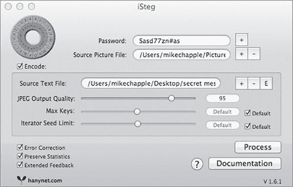

**FIGURE 7.2** Steganography tool


**FIGURE 7.3** Image with embedded message

## Digital Rights Management

*Digital rights management* (DRM) 软件使用加密来执行数字媒体的版权限制。过去十年，出版商尝试在音乐、电影和书籍等多种媒体类型上部署 DRM 方案。在许多情况下，尤其是音乐方面，反对者激烈反对 DRM 部署，认为其侵犯了自由享受和备份合法授权媒体文件的权利。

### Music DRM

音乐行业长期与盗版作斗争，从早期的磁带复制开始，一直到光盘和数字格式。音乐发行公司尝试过多种 DRM 方案，但大多在消费者压力下放弃了该技术。

当面对这种反对声时，苹果公司大幅减少了在 iTunes 商店出售的音乐中使用 FairPlay DRM 的使用。Apple 创始人乔布斯在 2007 年发布一封公开信，呼吁音乐行业允许其出售无 DRM 的音乐。该信中写道：

> 第三种方案是彻底取消 DRM。想象一个世界，每个在线商店都销售无 DRM 的、基于开放可授权格式的音乐。在这个世界里，任何播放器都能播放从任何商店购买的音乐，任何商店都能销售可在所有播放器上播放的音乐。这显然是对消费者最有利的方案，Apple 会毫不犹豫地拥抱它。如果四大音乐公司愿意在不要求其受保护的前提下授权 Apple 其音乐，我们将在 iTunes 商店仅销售无 DRM 的音乐。所有 iPod 都能播放这种无 DRM 的音乐。

Apple 官方网站上的完整文章已不再可用，但存档副本可在 [`bit.ly/1TyBm5e`](http://bit.ly/1TyBm5e) 找到。

目前，音乐领域 DRM 技术的主要用途是订阅制服务，如 Napster 和 Kazaa，它们使用 DRM 在订阅期结束时撤销用户对已下载音乐的访问权限。

### Movie DRM

电影行业多年来使用多种 DRM 方案以遏制全球范围内的电影盗版问题。保护大规模分发媒体的两大主要技术如下：

#### 高带宽数字内容保护（HDCP）

`HDCP` 为通过数字连接（包括 `HDMI`、`DisplayPort` 和 `DVI` 接口）传输的内容提供 DRM 保护。虽然该技术仍在许多实现中使用，但 2010 年黑客公开了 `HDCP` 主密钥，使得保护完全失效。

#### 高级访问内容系统（AACS）

`AACS` 保护存储在 `Blu-Ray` 和 `HD DVD` 媒体上的内容。黑客已演示过能够检索 `AACS` 加密密钥的攻击，并将其在网络上公开。

行业出版商与黑客今天仍在猫鼠游戏；媒体公司试图保护内容，黑客则寻求继续获取未加密的拷贝。

### 电子书 DRM

或许 DRM 技术最成功的部署领域是书籍和文档出版。当前大多数电子书都使用某种形式的 DRM，这些技术也保护企业用于 DRM 功能的敏感文档。

Adobe Systems 提供 `Adobe Digital Experience Protection Technology (ADEPT)`，为以多种格式出售的电子书提供 DRM 技术。`ADEPT` 结合 `AES` 技术加密媒体内容，并使用 `RSA` 加密保护 `AES` 密钥。除 `Amazon Kindle` 外，许多电子书阅读器都使用此技术保护内容。`Amazon` 的 `Kindle` 电子阅读器采用多种书籍分发格式，每种格式都有自有的加密技术。

### 视频游戏 DRM

许多视频游戏实现依赖于主机通过活动的 Internet 连接验证游戏许可，云端服务进行授权。此类技术（如 `Ubisoft` 的 `Uplay`）传统上要求持续的 Internet 连接以便游戏进行。如果玩家失去连接，游戏将无法运行。

2010 年 3 月，`Uplay` 系统遭遇拒绝服务攻击，全球使用 `Uplay` 的玩家无法玩之前正常运行的游戏，因为控制台无法访问 `Uplay` 服务器。此事引发公众不满，`Ubisoft` 随后移除始终在线的要求，改为仅在游戏首次激活时进行一次验证的 DRM 方式。

### 文档 DRM

虽然 DRM 技术最常见的用途是保护娱乐内容，组织也可使用 DRM 保护 PDF 文件、办公生产力文档等敏感信息的安全。商业 DRM 产品（如 `Vitrium` 和 `FileOpen`）使用加密保护源内容，然后让组织精细控制文档权限。

以下是文档 DRM 方案常见的权限限制：

* 阅读文件
* 修改文件内容
* 移除文件中的水印
* 下载/保存文件
* 打印文件
* 对文件内容进行截图

DRM 方案允许组织在需要时授予这些权限，在不再需要时撤销，甚至可以在指定时间后自动过期权限。

## 网络

本章最后探讨的密码学应用是利用密码算法提供安全网络服务。下面我们将简要查看两种用于保护通信电路的方法，并探讨 `IPsec` 与 `Internet Security Association and Key Management Protocol (ISAKMP)`，以及无线网络相关的安全问题。

### 电路加密

安全管理员使用两种加密技术保护数据在网络中传输：

* `链路加密` 通过在两端之间创建安全隧道（使用硬件或软件解决方案）来保护整个通信电路，软件方案会加密进入隧道一端的所有流量并在另一端解密。例如，一家公司的两个办公地点通过数据电路相连，可使用链路加密防止中间点的攻击者监听。

* `端到端加密` 保护两方（如客户端与服务器）之间的通信，且独立于链路加密。典型的端到端加密例子是使用 `TLS` 保护用户与网页服务器之间的通信，这能防止在已加密链路的受保护一侧或未加密链路中监听的入侵者。

链路加密与端到端加密的关键区别在于：链路加密会对所有数据（包括报头、报尾、地址和路由信息）进行加密，导致每个数据包在每个跳点都需要先解密再重新加密以便路由，从而减慢转发速度；而端到端加密不加密报头、报尾、地址和路由信息，传输更快，但更易受到窃听和窥探。

当加密在 OSI 模型的高层实现时，通常是端到端加密；而在 OSI 模型低层实现时，通常是链路加密。

安全 Shell (`SSH`) 是端到端加密的良好示例。该套件提供加密版本的常见 Internet 应用，如 `File Transfer Protocol (FTP)`、`Telnet` 和 `rlogin`。实际上有两个 SSH 版本：`SSH1`（现已被认为不安全）支持 `Data Encryption Standard (DES)`、`Triple DES (3DES)`、`International Data Encryption Algorithm (IDEA)` 和 `Blowfish` 算法；`SSH2` 则移除对 `DES` 和 `IDEA` 的支持，并增加了多种其他算法的支持。

### IPsec

当前已有多种安全架构，每种针对不同环境的安全问题而设计。其中一种支持安全通信的架构是 `Internet Protocol Security (IPsec)` 标准。`IPsec` 由 `Internet Engineering Task Force (IETF)` 制定，用于建立两个实体之间安全通道以交换信息。

通过 `IPsec` 进行通信的实体可能是两台系统、两台路由器、两台网关，或它们的任何组合。虽然通常用于连接两个网络，`IPsec` 也可用于连接单个计算机，例如服务器与工作站，或一对工作站（发送者和接收者）。`IPsec` 不规定实现细节，而是一个开放、模块化的框架，允许各厂商和开发者构建兼容其他厂商产品的 `IPsec` 解决方案。

`IPsec` 采用公钥加密提供加密、访问控制、不可否认性和消息验证，全部基于 `IP` 协议。其主要用途是虚拟私网（VPN），因此 `IPsec` 可在传输模式或隧道模式工作，常与 `Layer 2 Tunneling Protocol (L2TP)` 配合使用为 `L2TP/IPsec`。

`IPsec` 协议提供安全网络通信的完整基础设施，已获得广泛接受并在许多商业操作系统中默认提供。`IPsec` 依赖安全关联（security associations），主要包含两个组件：

* `Authentication Header (AH)` 提供消息完整性和不可否认性保证，同时实现认证、访问控制并防止重放攻击。

* `Encapsulating Security Payload (ESP)` 提供数据包内容的机密性和完整性，实现加密和有限的完整性保护，并防止重放攻击。

`IPsec` 提供两种离散的工作模式。当 `IPsec` 使用 `transport mode` 时，仅对数据包负载进行加密。该模式设计用于点对点通信。当使用 `tunnel mode` 时，整个数据包（包括头部）均被加密。该模式设计用于网关到网关通信。

在运行时，你通过创建 `security association`（SA）来设置 `IPsec` 会话。SA 表示通信会话，记录连接的任何配置和状态信息。SA 表示单向连接。如果你想要一个双向通道，需要两个 SA，分别对应每个方向。此外，如果你希望使用 AH 和 ESP 同时支持双向通道，则需要设置四个 SA。

`IPsec` 的一些最大优势来自于能够按 SA 进行过滤或管理通信，这样在存在安全关联的客户端或网关之间可以严格管理允许使用 `IPsec` 连接的协议或服务种类。此外，如果没有定义有效的安全关联，用户或网关对的双方无法建立 `IPsec` 链路。

关于 `IPsec` 算法的更多细节请参阅第 11 章 “安全网络架构与安全网络组件”。

#### ISAKMP

`Internet Security Association and Key Management Protocol (ISAKMP)` 为 `IPsec` 提供背景安全支持服务，通过协商、建立、修改和删除安全关联来实现。正如上一节所学，`IPsec` 依赖于一套安全关联（SAs）。这些 SAs 通过使用 `ISAKMP` 进行管理。Internet RFC 2408 规定了 `ISAKMP` 的四项基本要求：

* `Authenticate` 通信实体
* `Create` 并管理安全关联
* `Provide` 密钥生成机制
* `Protect` 免受威胁（例如，重放攻击和拒绝服务攻击）

#### 无线网络

无线网络的快速普及带来了巨大的安全风险。许多传统网络在本地网络内主机之间的常规通信中未实现加密，并假设攻击者难以在安全地点物理接入网络线路进行窃听。然而，无线网络通过空气传输数据，使其极易受到拦截。无线网络安全主要有两种类型：

**Wired Equivalent Privacy** (WEP) 提供 64 位和 128 位加密选项，用于保护无线局域网内的通信。WEP 在 IEEE 802.11 中被描述为可选组件。

**WiFi Protected Access** (WPA) 在 WEP 加密之上实现了 Temporal Key Integrity Protocol (TKIP)，消除了 WEP 因缺陷而受到的弱点。进一步改进的技术，即 WPA2，加入了 AES 加密。WPA2 提供适用于现代无线网络的安全算法。

另一种常用的安全标准，IEEE 802.1x，提供有线和翻网

用用


用户`$k1$`在中间人攻击中，攻击者使用已知的明文消息。明文随后使用所有可能的密钥（`k1`）进行加密，相应的密文则使用所有可能的密钥（`k2`）进行解密。当找到匹配时，对应的键对（`k1`，`k2`）代表双重加密的两个部分。此类攻击通常只需要双倍单轮加密所需的时间（或 `2^n` 而非预期的 `2*^n* * 2*^n*`），提供了极小的额外保护。

`Man in the Middle` 在中间人攻击中，恶意个人位于两个通信方之间并拦截所有通信（包括密码学会话的设置）。攻击者响应发起方的初始化请求，并与发起方建立安全会话。随后，攻击者使用不同的密钥与预期的接收方建立第二个安全会话，并冒充发起方。攻击者可以在两方之间“坐在中间”，读取所有在两方之间传递的流量。

`Birthday` 生日攻击，也称为*碰撞攻击*或*反向哈希匹配*（参见第 14 章“控制和监控访问”中关于暴力破解和词典攻击的讨论），旨在寻找哈希函数单射性的缺陷。在该攻击中，恶意个人试图在数字签名的通信中替换为一个产生相同消息摘要的不同消息，从而保持原始数字签名的有效性。

`Replay` 重放攻击针对不包含时间保护的密码学算法。在此攻击中，恶意个人拦截两方之间的加密消息（通常是身份验证请求），然后稍后“重放”捕获的消息以打开新会话。通过在每条消息中加入时间戳和有效期，可以防御此攻击。

非对称密钥加密，或公钥加密，提供了极其灵活的基础设施，简化了不必事先知道对方的两方之间的安全通信。它还为消息的数字签名提供了框架，以确保不可否认性和消息完整性。

本章探讨了公钥加密，它为大量用户提供可扩展的密码学架构。我们还描述了一些流行的密码学算法，如链接加密和端到端加密。最后，我们介绍了公钥基础设施（PKI），它使用证书颁发机构（CAs）生成包含系统用户公钥的数字证书，以及依赖于公钥加密和哈希函数的数字签名。

我们还研究了密码技术在解决日常问题中的常见应用。你学习了如何使用 PGP 和 S/MIME 保护电子邮件，使用 SSL 和 TLS 保护 Web 通信，以及使用 IPsec 和 ISAKMP 保护点对点和网关到网关网络，以及使用 WPA 和 WPA2 保护无线通信。

最后，我们介绍了一些常见的攻击，这些攻击由恶意个人用于干扰或拦截两方之间的加密通信。这些攻击包括生日攻击、密码分析攻击、重放攻击、暴力破解攻击、已知明文攻击、选定明文攻击、选定密文攻击、中间人攻击和生日攻击。了解这些攻击对于提供对它们的充分安全至关重要。

了解非对称密码学中使用的密钥类型。公钥会自由在通信方之间共享，而私钥则保持秘密。加密消息时使用接收方的公钥，解密消息时使用自己的私钥。签署消息时使用自己的私钥，验证签名时使用发送方的公钥。

熟悉三大主要公钥密码系统。RSA 是最著名的公钥密码系统，由 Rivest、Shamir 和 Adleman 在 1977 年开发。它依赖于分解质数乘积的难度。El Gamal 是 Diffie-Hellman 密钥交换算法的扩展，依赖于模运算。椭圆曲线算法依赖于椭圆曲线离散对数问题，并且在密钥长度相同时提供比其他算法更高的安全性。

了解哈希函数的基本要求。良好的哈希函数具有五个要求：允许任意长度输入，提供固定长度输出，使得对任意输入计算哈希函数相对容易，提供单向功能性，并且是无碰撞的。

熟悉主要的哈希算法。Secure Hash Algorithm（SHA）的后继者 SHA-1 和 SHA-2 构成政府标准消息摘要函数。SHA-1 产生 160 位的消息摘要，而 SHA-2 支持可变长度，最高达 512 位。SHA-3 在 SHA-2 的安全性基础上进行改进，并支持相同的哈希长度。

了解密码盐如何提高密码哈希的安全性。当直接哈希用于存储密码时，攻击者可以使用预计算的彩虹表来识别常用密码。在哈希密码之前添加盐可以降低彩虹表攻击的效果。常用的密码哈希算法通过密钥扩展进一步增加攻击难度，包括 PBKDF2、bcrypt 和 scrypt。

了解数字签名的生成与验证过程。要对消息进行数字签名，首先使用哈希函数生成消息摘要，然后用你的私钥对该摘要进行加密。要验证消息上的数字签名，使用发送者的公钥对签名进行解密，然后将解密后的摘要与你自己生成的摘要进行比较。如果两者匹配，消息即为真实。

了解数字签名标准（DSS）的组成部分。数字签名标准使用 SHA-1、SHA-2 和 SHA-3 消息摘要函数，以及三种加密算法：数字签名算法（DSA）、Rivest、Shamir、Adleman（RSA）算法或椭圆曲线 DSA（ECDSA）算法。

了解公钥基础设施（PKI）。在公钥基础设施中，证书颁发机构（CAs）生成包含系统用户公钥的数字证书。用户随后将这些证书分发给他们希望通信的对象。证书接收方使用 CA 的公钥验证证书。

了解密码学在保护电子邮件方面的常见应用。用于加密消息的新兴标准是 S/MIME 协议。另一款流行的电子邮件安全工具是 Phil Zimmerman 的 Pretty Good Privacy（PGP）。大多数使用电子邮件加密的用户依赖于在其电子邮件客户端或网页基础邮件服务中内置该技术。

了解密码学在保护 Web 活动方面的常见应用。安全 Web 流量的事实标准是使用传输层安全性（TLS）或较旧的安全套接层（SSL）对 HTTP 进行加密。大多数 Web 浏览器都支持这两种标准，但许多网站因安全顾虑正在逐步取消对 SSL 的支持。

了解密码学在保护网络方面的常见应用。IPsec 协议标准提供了一个共同框架，用于加密网络流量，并且已内置在许多常见操作系统中。在 IPsec 传输模式下，仅对等方通信的数据包内容进行加密。在隧道模式下，整个数据包（包括头部信息）均被加密，用于网关到网关的通信。

# 安全模型、设计和能力的原理

## 这章涵盖的 CISSP 考试主题包括：

*   **第 3 章：安全架构与工程**  

    *   3.1 使用安全设计原则实施并管理工程过程  

    *   3.2 理解安全模型的基本概念  

    *   3.3 根据系统安全需求选择控制措施  

    *   3.4 理解信息系统的安全能力  

*   理解安全解决方案背后的哲学有助于限定您为特定安全需求寻找最佳控制的范围。本章讨论安全模型，包括状态机、贝尔-拉普拉斯、巴巴、克拉克-威尔逊、授权-传递以及布鲁尔和纳什。本章还描述了**Common Criteria**以及政府和企业用于从安全角度评估信息系统的其他方法，特别强调美国**国防部**和**国际安全评估准则**。最后，我们讨论常见的设计缺陷及其他可能导致信息系统易受攻击的问题。

-   [确定系统安全程度的过程](https://example.org)可能很困难且耗时。本章描述了评估计算机系统安全水平的过程。我们首先介绍并解释用于描述信息系统安全概念的基本概念和术语，讨论安全计算、安全边界、安全访问监视器以及内核代码。随后转向安全模型，说明如何实现访问和安全控制。我们还简要说明系统安全可分为开放系统或封闭系统；描述一系列用于确保数据保密性、完整性和可用性的标准安全技术；讨论安全控制；并介绍一套标准的安全网络协议。

-   该领域的其他章节包括：第 6 章 “密码学与对称密钥算法”，第 7 章 “PKI 与密码学应用”，第 9 章 “安全漏洞、威胁与对策”，以及第 10 章 “物理安全要求”。请务必阅读这些章节，以获得该领域的完整视角。

### 使用安全设计原则实施并管理工程过程

安全应在系统开发的每个阶段被考虑。程序员应努力在其开发的每个应用中构建安全性，对关键应用和处理敏感信息的应用提供更高的安全级别。从项目早期阶段就考虑安全影响至关重要，因为将安全直接构建到系统中比在已有系统上追加安全要容易得多。以下章节讨论了在硬件或软件工程项目早期应实施和管理的几项基本安全设计原则。

#### 对象与主体

在安全系统中控制对任何资源的访问涉及两个实体。`主体` 是发起资源请求的用户或进程。访问可以是读取或写入资源。`对象` 是用户或进程想要访问的资源。请注意，主体和对象指的是特定的访问请求，因此同一资源在不同的请求中既可以是主体也可以是对象。

例如，进程 A 可能请求从进程 B 获取数据。为了满足进程 A 的请求，进程 B 必须从进程 C 获取数据。在此示例中，进程 B 是第一次请求的对象，同时是第二次请求的主体：

| 第一次请求 | 进程 A（主体） | 进程 B（对象） |

|---|---|---|

| 第二次请求 | 进程 B（主体） | 进程 C（对象） |

这也是 **传递信任**（transitive trust）的例子。传递信任是指：如果 A 信任 B 且 B 信任 C，则 A 通过传递性获得对 C 的信任——这就像数学等式：如果 a = b，b = c，则 a = c。在前面的例子中，A 请求 B 的数据，随后 B 请求 C 的数据，A 最终得到的数据实际上来源于 C。传递信任是严重的安全隐患，因为它可能导致 A 与 C 之间的限制被绕过，尤其是当 A 与 C 都能与 B 交互时。例如，组织阻止员工访问 Facebook 或 YouTube 以提高工作效率。此时，员工（A）没有直接访问这些网站（C）。但如果员工能够访问代理服务器、虚拟专用网络（VPN）或匿名化服务，则可以利用这种传递信任进行绕过。换言之，若员工（A）访问 VPN 服务（B），而 VPN 服务（B）能够访问被阻止的网络服务（C），则 A 可通过 B 间接访问 C，利用传递信任进行攻击。

#### 封闭系统与开放系统

系统的设计和构建通常遵循两种不同的哲学：`封闭系统` 设计用于与有限范围的其他系统（通常是同一厂商的产品）协作，其标准往往是专有且不公开的。`开放系统` 则基于行业公认的标准进行设计。开放系统更容易与其他支持相同标准的厂商系统集成。

封闭系统集成难度大，但安全性可能更高。封闭系统通常由专有硬件和软件组成，未采用行业标准，这使得对通用组件的攻击难以成功或必须高度定制。许多已知漏洞的软硬件组件在封闭系统中往往不存在，因此需要更深入的系统知识才能成功发动攻击。

开放系统则易于与其他开放系统集成。例如，可以轻松在一台 Windows Server、一台 Linux 机器和一台 Macintosh 电脑上构建局域网（LAN），尽管它们使用不同的操作系统和硬件架构，但均支持行业标准，便于网络通信。这种易于集成的优势带来的代价是：标准化组件的存在增加了可预见的攻击入口和方法。开放系统的普及使其更容易受到攻击，且攻击者更容易发现并针对大量潜在目标。由于开放系统使用更广泛，攻击者更容易获得目标，且对开放系统的攻击技术积累更多。相较于封闭系统，开放系统的“市场”更大，攻击者更倾向于关注开放系统。

#### 确保保密性、完整性和可用性的技术


要保证数据的保密性、完整性和可用性，必须确保所有拥有数据访问权限的组件都安全且行为得当。软件设计师使用多种技术确保程序仅执行所需操作且不做多余事。假设一个程序读取或写入另一个程序正在使用的内存区域，则该程序可能同时违反保密性、完整性和可用性三大安全原则。若该程序处理敏感数据，则该数据的保密性不再受到保障。若数据被意外覆盖或篡改（多个读写者共享同一数据时的常见问题），则完整性无法保证。若数据修改导致损坏或丢失，则可用性也会受影响。虽然本节讨论的概念主要针对软件程序，但它们在安全的各个领域均被广泛应用，例如物理隔离保证对硬件的访问受到控制。

## 隔离（Confinement）

```
if (condVar > someVal) {console.log("xxx")}
```

软件设计师使用进程隔离来限制程序的操作。简单来说，进程隔离允许进程只读取和写入特定的内存位置和资源。这也称为沙箱。操作系统或其他安全组件禁止非法的读取/写入请求。如果进程尝试发起超出其授权范围的操作，该操作将被拒绝。此外，还可能采取进一步操作，例如记录违规尝试。必须符合更高安全等级的系统通常会记录所有违规行为并以具体方式响应。通常，违规进程会被终止。隔离可以在操作系统本身中实现（例如通过进程隔离和内存保护），也可以通过使用隔离应用程序或服务（例如 Sandboxie 在 [www.sandboxie.com](http://www.sandboxie.com)）来实现，或者通过虚拟化或超级计算机解决方案（例如 VMware 或 Oracle 的 VirtualBox）。

### Bounds

在系统上运行的每个进程都会被分配一个权限级别。权限级别告诉操作系统该进程可以执行什么操作。在简单系统中，可能只有两个权限级别：用户和内核。权限级别告诉操作系统如何为进程设置边界。进程的边界包括对其可以访问的内存地址和资源的限制。边界定义了进程被限制或包含的区域。在大多数系统中，这些边界将逻辑区域的内存分段为每个进程使用的区域。操作系统负责强制执行这些逻辑边界，并禁止进程访问其他进程。更安全的系统可能要求物理上受限的进程。物理受限要求每个受限进程在物理上与其他受限进程分离的内存区域中运行，而不仅仅是逻辑上在相同内存空间内受限。物理受限内存可能非常昂贵，但它比逻辑受限更安全。

### Isolation

当进程通过强制执行访问边界来受到限制时，该进程处于隔离状态。进程隔离确保任何行为都只影响与该隔离进程相关的内存和资源。隔离用于保护操作环境、操作系统内核（OS）以及其他独立应用程序。隔离是稳定操作系统的关键组成部分。隔离正是防止应用程序访问其他应用程序的内存或资源（无论是为了好是为了坏）的手段。操作系统可能提供中间服务，例如剪切和粘贴以及资源共享（如键盘、网络接口和存储设备访问）。

这三个概念（隔离、边界和隔离）使得设计安全的程序和操作系统更加困难，但也使得实现更安全的系统成为可能。

## Controls

为了确保系统的安全，你需要只允许主体访问受信任的对象。控制使用访问规则限制主体对对象的访问。访问规则说明每个主体可以访问哪些对象。此外，对象可能对一种访问有效，而对另一种访问无效。常见的控制是文件访问。文件可以通过使其只读来保护免受修改，但对一小部分拥有修改权限的用户则保持可读写。

访问控制主要分为强制访问控制（MAC）和自主访问控制（DAC），详见第 14 章“控制与监控访问”以获取深入讨论。在强制控制中，主体和对象的静态属性被用来判断访问的许可性。每个主体拥有定义其访问资源的清除级别或权限。每个对象拥有定义其分类的属性。不同的安全方法对资源进行分类的方式不同。例如，如果安全系统能找到一条规则，允许具有主体 A 的清除级别的主体访问具有对象 B 的分类的对象，则主体 A 被授予对对象 B 的访问权限。

自主控制与强制控制的区别在于主体对访问的对象具有一定的定义能力。在一定范围内，自主访问控制允许主体定义所需的对象列表。此访问控制列表作为动态访问规则集，主体可以修改。修改的限制通常与主体的身份相关。基于身份，主体可能被允许添加或修改定义对象访问的规则。

强制访问控制和自主访问控制都通过限制主体对对象的访问来发挥作用。控制的主要目标是通过禁止未经授权的访问（无论是由受权还是未受权的主体）来确保数据的机密性和完整性。

## Trust and Assurance

在设计和架构阶段以及设计过程中，必须在设计和架构阶段之前和期间将适当的安全概念、控制和机制集成，以产生可靠的安全产品。安全问题不应作为事后考虑，这样会导致疏漏、成本增加和可靠性降低。一旦安全被集成到设计中，它必须被工程化、实现、测试、审计、评估、认证，最后认可。

一个受信任的系统是指所有保护机制协同工作，处理敏感数据，同时为许多类型的用户维持一个稳定和安全的计算环境。保证简单定义为对安全需求满足程度的信心程度。保证必须持续维护、更新和重新验证。无论受信任系统经历已知变更，还是大量时间过去，这都是真的。变更在某些层面上总是发生。变更往往是安全的对立面；它往往会削弱安全。因此，每当发生变更时，系统需要重新评估，以验证其先前提供的安全水平是否仍然保持。

保证因系统而异，必须单独为每个系统建立。然而，对于同类系统、提供相同服务的系统或部署在相同地理位置的系统，可以定义相应的保证等级。因此，通过实施特定的安全功能，可以在系统中构建信任；而保证则是对这些安全功能在实际情境中可靠性和易用性的评估。

## 理解安全模型的基本概念

在信息安全领域，模型提供了一种形式化安全策略的方式。这些模型可以是抽象的或直观的（有些是数学性质的），但它们的目的都是提供一套明确的规则，让计算机能够遵循实现基本安全概念、过程和程序所需的策略。这些模型帮助深入理解计算机操作系统应如何设计和开发以支持特定的安全策略。

安全模型为设计者提供了将抽象表述映射到安全策略的算法和数据结构的方法。因此，安全模型为软件设计师提供了衡量其设计和实现的依据。该模型必须支持安全策略的每一部分，从而确保安全实现符合策略要求。

你将在下面的章节中探索多种安全模型；它们都能阐明安全如何融入计算机体系结构和操作系统设计：

* `Trusted computing base`
* `State machine model`
* `Information flow model`
* `Noninterference model`
* `Take-Grant model`
* `Access control matrix`
* `Bell-LaPadula model`
* `Biba model`
* `Clark-Wilson model`
* `Brewer and Nash model` (`also known as Chinese Wall`)
* `Goguen-Meseguer model`
* `Sutherland model`
* `Graham-Denning model`

尽管没有系统可以完全安全，但可以设计并构建相当安全的系统。事实上，如果一个受保护系统符合特定的安全标准，则可以说它表现出一定的信任度。因此，信任可以被构建到系统中，然后进行评估、认证和授权。但在讨论每个安全模型之前，我们必须先建立大多数安全模型所依赖的基础。这奠定基础是 `trusted computing base`。

### Trusted Computing Base

一个旧的美国国防部标准，通俗地称为《橙皮书》/可信计算机系统评估准则（TCSEC）（DoD Standard 5200.28，后面章节的“彩虹系列”会有更详细说明）将 `trusted computing base (TCB)` 描述为硬件、软件和控制元素的组合，它们协同工作，形成可信基础以执行安全策略。TCB 是完整信息系统的一部分子集。它应尽可能小，以便详细分析能够合理确保系统满足设计规范和要求。TCB 是该系统中唯一可以被信任遵守并执行安全策略的部分。并非系统的每个组件都需要被信任。但从安全角度审视系统时，评估应包含定义该系统 TCB 的所有受信任组件。

一般而言，系统中的 TCB 组件负责控制对系统的访问。TCB 必须提供访问系统内部和外部资源的方法。TCB 组件通常会限制 TCB 之外组件的活动。TCB 组件的责任是确保系统在所有情况下行为正确，并在所有情况下遵守安全策略。

#### Security Perimeter

系统的 `security perimeter` 是一个虚拟边界，将 TCB 与系统其余部分分隔开（如图 8.1 所示）。该边界确保 TCB 与系统其余元素之间不发生不安全的通信或交互。为了让 TCB 与系统其余部分通信，它必须创建安全通道，也称为 `trusted paths`。受信任路径是遵循严格标准建立的通道，用于在不暴露 TCB 于安全漏洞的前提下允许必要的通信。受信任路径还保护系统用户（有时称为主体）免受因 TCB 交换而被 compromise 的风险。随着你进一步学习正式的安全指南和评估准则，你会发现受信任路径在追求高安全级别的系统中是必需的。根据 TCSEC 指南，受信任路径是那些在 TCSEC 中达到 B2 级或更高安全级别的高信任级系统的必要条件。

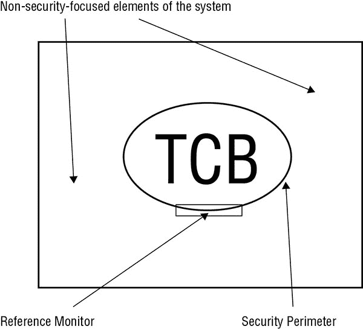

**FIGURE 8.1** The TCB, security perimeter, and reference monitor

#### Reference Monitors and Kernels

在实现安全系统时，必须开发 TCB 的一部分来强制执行对系统资产和资源（有时称为对象）的访问控制。TCB 中负责在每个资源授予访问请求之前验证访问权限的部分称为 `reference monitor`（如图 8.1 所示）。参考监视器位于每个主体和对象之间，在主体请求访问对象之前，会验证请求主体的凭证是否满足对象的访问要求。如果不满足，访问请求将被拒绝。因此，参考监视器是 TCB 的访问控制执行者。于是，授权并安全的操作和活动被允许进行，而未经授权且不安全的操作和活动则被拒绝并阻止。参考监视器依据所期望的安全模型（如自愿性、强制性、基于角色或其他形式的访问控制）来执行访问控制或授权。参考监视器可以是概念性的 TCB 部分；它不需要是实际的、独立的或自包含的工作系统组件。

负责实现参考监视器功能的 TCB 中的组件集合被称为 `security kernel`。参考监视器是一种概念或理论，它通过在软件和硬件中实现安全内核来付诸实践。安全内核的目的是启动适当的组件以强制参考监视器功能，并抵御所有已知的攻击。安全内核使用受信任路径与主体通信。它还中介所有资源访问请求，仅在系统适用的适当访问规则匹配时才授予请求。

参考监视器需要对每个受保护资源的描述性信息。此类信息通常包括其分类和指定。当主体请求访问对象时，参考监视器会查阅对象的描述性信息，以判断应否授予访问（请参阅侧边栏“Tokens, Capabilities, and Labels”，了解此工作原理的详细信息）。

### State Machine Model

`State machine model` 描述了一个无论处于何种状态始终安全的系统。它基于计算机科学中 `finite state machine (FSM)` 的定义。FSM 将外部输入与内部机器状态结合，用于建模各种复杂系统，包括解析器、解码器和解释器。给定输入和状态，FSM 会转换到另一个状态并可能产生输出。数学上，下一个状态是当前状态和输入的函数；即，`下一个状态 = F(input, current state)`。同样，输出也是输入和当前状态的函数；即，`输出 = F(input, current state)`。

许多安全模型基于安全状态的概念。根据状态机模型，`state` 是系统在特定时刻的快照。如果该状态的所有方面都满足安全策略的要求，则该状态被视为安全。当接受输入或产生输出时会发生转换。转换总是产生一个新状态（也称为 `state transition`）。所有状态转换都必须被评估。如果每种可能的状态转换都导致另一个安全状态，则该系统可称为 `secure state machine`。安全状态机模型系统始终以安全状态启动，在所有转换中保持安全状态，并仅在符合安全策略的方式下允许主体访问资源。安全状态机模型是许多其他安全模型的基础。

### Information Flow Model

The `信息流模型`关注信息的流动。`信息流模型`基于状态机模型。`Bell-LaPadula`和`Biba`模型，我们将在本章后详细讨论，它们都是`信息流模型`。`信息流模型`不一定只处理信息流的方向；它们也可以处理流的类型。

`信息流模型`设计用于防止未经授权、不安全或受限制的信息流动，通常在不同的安全级别之间（这些通常被称为多级模型）。`信息流`可以在相同分类级别的主体和对象之间，也可以在不同分类级别的主体和对象之间发生。一个`信息流模型`允许所有授权的信息流动，无论是在相同分类级别内部还是不同分类级别之间。它防止所有未经授权的信息流动，无论是在相同分类级别内部还是不同分类级别之间。

另一个有趣的视角是，`信息流模型`用于建立同一对象的两个版本或状态之间的关系，当这两个版本或状态在不同时间点存在时。因此，`信息流`决定了对象从一个时间点的状态转变为另一个时间点的状态。`信息流模型`也处理隐蔽通道，通过明确排除所有未定义的流动路径来实现。

### Noninterference Model

`非干扰模型`松散地基于信息流模型。然而，它不关注信息的流动，而是关注高安全级别主体的操作如何影响系统状态或低安全级别主体的操作。基本上，主体 A（高）的操作不应影响主体 B（低）的操作，也不应被主体 B 察觉。核心问题是防止高安全分类级别主体的操作影响低安全级别的系统状态。如果发生这种情况，主体 B 可能处于不安全状态，或者能够推断或推断出高安全级别的信息。这是一种信息泄漏，隐含创建了隐蔽通道。因此，非干扰模型可以用来提供对恶意程序（如特洛伊木马）造成的损害的保护。

### Take-Grant Model

`取授模型`使用有向图（图 8.2）来规定权利如何从一个主体传递到另一个主体，或从主体传递到对象。简单来说，拥有授予权的主体可以将其拥有的任何其他权利授予另一个主体或对象。同样，拥有取权的主体可以从另一个主体取走权利。除了这两条主要规则外，取授模型可能采用创建规则和删除规则来生成或删除权利。该模型的关键在于，这些规则允许你确定系统中权利何时发生变化以及泄漏（即权限的 unintentional distribution）可能发生的位置。

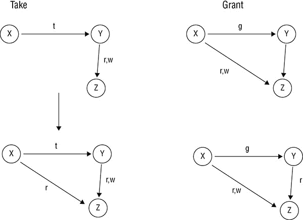

**FIGURE 8.2** The Take-Grant model’s directed graph

| 规则 | 描述 |
| --- | --- |
| 取权规则 | 允许主体对对象取权 |
| 授予规则 | 允许主体向对象授予权利 |
| 创建规则 | 允许主体创建新权利 |
| 删除规则 | 允许主体删除其拥有的权利 |

### Access Control Matrix

`访问控制矩阵`是一个主体和对象的表格，指示每个主体对每个对象可以执行的操作或功能。矩阵的每一列是访问控制列表（ACL）。矩阵的每一行是`能力列表`。ACL 与对象关联；它列出每个主体可以对对象执行的有效操作。能力列表与主体关联；它列出主体可以对每个对象执行的有效操作。从管理角度来看，仅使用能力列表进行访问控制是一场噩梦。基于能力列表的访问控制可以通过在每个主体上存储其对每个对象的权利列表来实现。这实际上为每个用户提供了一个访问和权利的钥匙圈，用于安全域内的对象。要移除对特定对象的访问权限，必须单独操作所有拥有该对象访问权限的用户（主体）。因此，管理用户账户的访问权限比通过 ACLs 管理对象的访问权限要困难得多。

实施访问控制矩阵模型通常涉及以下步骤：

*   构建一个能够创建和管理主体和对象列表的环境
*   编写一个函数，该函数可以返回输入对象所关联的类型（这很重要，因为对象的类型决定了可以对其执行的操作）

The access control matrix shown in Table 8.1 is for a discretionary access control system. A mandatory or rule-based matrix can be constructed simply by replacing the subject names with classifications or roles. Access control matrixes are used by systems to quickly determine whether the requested action by a subject for an object is authorized.

**TABLE 8.1** **An access control matrix**

| 主体 | 文档文件 | 打印机 | 网络文件夹共享 |
| --- | --- | --- | --- |
| Bob | 读取 | 无访问权限 | 无访问权限 |
| Mary | 无访问权限 | 无访问权限 | 读取 |
| Amanda | 读取、写入 | 打印 | 无访问权限 |
| Mark | 读取、写入 | 打印 | 读取、写入 |
| Kathryn | 读取、写入 | 打印、管理打印队列 | 读取、写入、执行 |
| Colin | 读取、写入、更改权限 | 打印、管理打印队列、更改权限 | 读取、写入、执行、更改权限 |

由于设计的原因，贝尔-拉帕拉萨模型通过阻止低级别安全凭证的主体访问高级别对象，防止了机密信息向更低级别的凭证泄露或转移。通过这些限制，贝尔-拉帕拉萨模型专注于维护对象的机密性。因此，确保文档机密性所涉及的复杂性在贝尔-拉帕拉萨模型中得到了处理。然而，贝尔-拉帕拉萨模型并未涉及对象的完整性或可用性。贝尔-拉帕拉萨也是第一个数学多级安全策略模型。


该模型基于状态机概念和信息流模型，并采用强制访问控制和格子概念。安全策略中使用的 `classification levels`（分类级别）对应格子的层级。状态机支持多个状态，并明确定义任意两个状态之间的转换；这一概念之所以使用，是因为状态机的正确性以及文档机密性的保证可以通过数学证明。该状态机有三个基本属性：

*   `Simple Security Property`（简单安全属性）规定，主体不能读取比其安全级别更高的敏感级别的信息（即禁止“读上”）。

*   `\*`（星号）`Security Property`（安全属性）规定，主体不能向比其安全级别更低的敏感级别的对象写入信息（即禁止“写下”），这也称为 `Confinement Property`（隔离属性）。

*   `Discretionary Security Property`（离散安全属性）规定系统使用访问矩阵来执行离散访问控制。

这三条属性共同定义了系统可以在其中转换的状态。不允许其他任何转换。所有通过这两条规则可到达的状态均为安全状态。因此，基于贝尔-拉帕拉萨模型的系统提供了状态机模型的安全性（参见 Figure 8.3）。

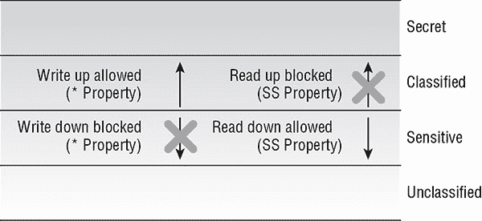

**FIGURE 8.3** 贝尔-拉帕拉萨模型

贝尔-拉帕拉萨属性旨在保护数据机密性。主体不能读取比其已授权级别更高的对象。由于一个级别的对象包含比低级别对象更敏感或更秘密的数据，非受信任的主体不能将一级数据写入低级别对象，这类似于将机密备忘录粘贴到非机密文件中。第三条属性强制要求主体在知晓的情况下才能访问对象。

贝尔-拉帕拉萨模型仅处理数据的机密性，不涉及其完整性或可用性。由于该模型在 1970 年代设计，不支持当今常见的许多操作，如文件共享和网络通信，也假设安全层之间的安全转换，未处理隐蔽通道（详见第 9 章“安全漏洞、威胁与对策”）。尽管如此，贝尔-拉帕拉萨在机密性保护方面表现良好，常与其他模型结合使用，以处理完整性和可用性。

## Biba 模型

对于某些非军事组织，完整性比机密性更重要。基于这种需求，开发了多个侧重完整性的安全模型，如由 Biba 和 Clark‑Wilson 开发的模型。`Biba 模型` 在贝尔-拉帕拉萨模型之后被提出。贝尔-拉帕拉萨模型关注机密性，而 Biba 模型关注完整性。Biba 模型同样基于状态机概念、信息流以及多级模型。事实上，Biba 在结构上与贝尔-拉帕拉萨相似，只是方向相反。两者都使用状态和转换，并拥有基本属性。最大的区别在于其主要关注点：Biba 主要保护数据完整性。以下是 Biba 模型状态机的基本属性：

*   `Simple Integrity Property`（简单完整性属性）规定，主体不能读取比其完整性级别更低的对象（即禁止“读下”）。

*   `\*`（星号）`Integrity Property`（完整性属性）规定，主体不能修改比其完整性级别更高的对象（即禁止“写上”）。

Figure 8.4 说明了这些 Biba 模型公理。

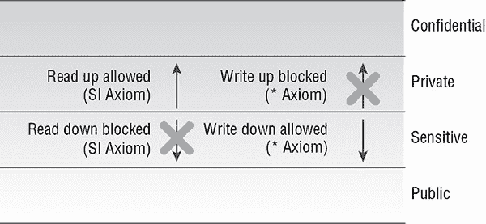

**FIGURE 8.4** Biba 模型

对比 Biba 与 Bell-LaPadula，你会发现它们在安全关注点上似乎是相反的。这是因为它们分别关注不同的安全领域：贝尔-拉帕拉萨模型确保数据机密性，而 Biba 模型确保数据完整性。

Biba 为以下三类完整性问题而设计：

*   防止未授权主体修改对象。

*   防止受信任主体未经授权修改对象。

*   保护内部和外部对象的一致性。

与贝尔-拉帕拉萨一样，Biba 要求所有主体和对象都拥有分类标签，因此数据完整性保护依赖于数据分类。

在分析 Biba 属性时，第二条属性非常直观：主体不能向比其完整性级别更高的对象写入数据，这很合理。那么第一条属性——为何不能读取低完整性级别的对象？答案需要一些思考。把完整性级别想象成空气的纯净度。你不希望把吸烟区的空气泵入洁净室环境，同样，在注重完整性时，也不应将未经验证的数据读取到已验证的文档中，以免导致数据污染。若允许这种访问，数据被污染的风险过大。

对 Biba 模型的批评揭示了几个缺点：

*   它仅关注完整性，未涉及机密性或可用性。

*   它侧重于防止外部威胁对对象的侵害，假设内部威胁已通过程序处理。

*   它不处理访问控制管理，也没有提供为对象或主体分配或更改分类级别的机制。

*   它不防止隐蔽通道。

由于 Biba 模型专注于数据完整性，它在商业安全模型中比贝尔-拉帕拉萨模型更常被选用。一些商业组织更在意数据的完整性而非机密性。因此，倾向于完整性的组织可能会选择实施 Biba 模型，而大多数组织则需要在机密性和完整性之间取得平衡，这要求它们实现比单一模型更复杂的解决方案。

## Clark‑Wilson 模型

虽然 Biba 模型在商业应用中表现良好，1987 年专门为商业环境设计的 `Clark‑Wilson 模型` 则采用了多层次的数据完整性保护方法。该模型不依赖正式的状态机，而是定义每个数据项，并仅通过一小 set of 程序允许对其进行修改。

Clark‑Wilson 模型不需要格子结构，而是采用主体/程序/对象（或主体/事务/对象）的三元组关系，称为 `triple` 或 `access control triple`。主体不直接访问对象，对象只能通过程序访问。通过以下两条原则 —  — 完整的事务（well‑formed transactions）和职责分离（separation of duties）—  — Clark‑Wilson 模型提供了有效的完整性保护手段。

良好构建的事务采用程序的形式。主体只能通过使用程序、接口或访问门户（`Figure 8.5`）来访问对象。每个程序都有针对对象（如数据库或其他资源）能做什么和不能做的具体限制。这有效地限制了主体的能力。这被称为受约束的接口。如果程序设计得当，则三元关系提供了一种保护对象完整性的手段。

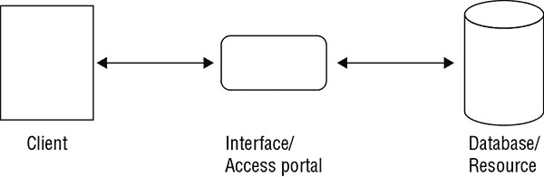

**FIGURE 8.5** `The Clark-Wilson model`

Clark-Wilson 定义了以下项目和过程：

*   一个 *受约束数据项 (CDI)* 是任何数据项，其完整性由安全模型保护。

*   一个 *受控数据项 (UDI)* 是任何未受安全模型控制的数据项。未经验证的输入数据或输出数据均属于受控数据项。

*   一个 *完整性验证程序 (IVP)* 是扫描数据项并确认其完整性的程序。

*   *转换程序 (TPs)* 是唯一被允许修改 CDI 的程序。通过 TPs 对 CDI 的受限访问构成了 Clark-Wilson 完整性模型的基础。

Clark-Wilson 模型使用安全标签来授予对象的访问权限，但仅通过转换程序和 *受限接口模型*。受限接口模型使用基于分类的限制，仅向特定主体提供授权的信息和功能。同一分类级别的主体看到同一组数据并访问同一组功能，而不同分类级别的主体则看到不同的数据并访问不同的功能。为不同用户或用户类别提供的功能可能通过向所有用户展示所有功能但禁用未授权功能，或仅展示授予特定用户的功能来实现。通过这些机制，Clark-Wilson 模型确保数据免受任何用户的未经授权更改。事实上，Clark-Wilson 模型强制实行职责分离。Clark-Wilson 设计在商业应用中是常见的模型。

## Brewer 和 Nash 模型（即 Chinese Wall）

`Brewer and Nash model` 旨在根据用户的先前活动动态调整访问控制（因此它也是一种状态机模型）。该模型适用于单个集成数据库；它力求创建对“利益冲突”概念敏感的安全域（例如，在公司 C 工作且已访问公司 A 专有数据的人不应再被允许访问公司 B 类似数据，因为这两家公司具有竞争关系）。该模型被称为 `Chinese Wall model`，因为它创建了一个数据类别，定义哪些安全域可能处于冲突，并阻止拥有某个冲突类别中数据访问权的主体访问同一冲突类别中其他数据。隐喻上，这为冲突类别中的所有其他信息划上了“壁”。因此，该模型还利用每个冲突类别内的数据隔离原则，防止用户进入潜在的利益冲突情境（例如，公司数据管理）。由于公司关系时刻变化，对冲突类别成员和定义的动态更新至关重要。

另一种观察或思考 Brewer and Nash 模型的方式是：管理员拥有基于其职责和工作任务的广泛数据访问权限。然而，当对任何数据项执行操作的瞬间，管理员对所有冲突数据项的访问会被暂时阻断。仅在操作期间，与初始数据项相关的数据项才可访问。任务完成后，管理员的访问权限恢复为全控。

## Goguen-Meseguer 模型

`Goguen-Meseguer model` 是一个完整性模型，尽管不如 Biba 和其他模型知名。事实上，该模型被认为是非干扰概念理论的基石。通常，当有人提到非干扰模型时，实际指的就是 Goguen-Meseguer 模型。

Goguen-Meseguer 模型基于预先确定可访问的对象集合或域——即主体可以访问的对象列表。该模型基于自动化理论和域分离。这意味着主体仅能对预定义的对象执行预定义的操作。当相似用户被分组到各自的域（即集体）中时，一个主体域的成员不能干扰另一个主体域的成员。因此，主体无法干扰彼此的活动。

## Sutherland 模型

`Sutherland model` 是一个完整性模型。它专注于防止对完整性的干扰。它正式基于状态机模型和信息流模型。但它并未直接指明保护完整性的具体机制。相反，该模型基于定义一组系统状态、初始状态和状态转换。通过仅使用这些预定义的安全状态，完整性得以维持，干扰被禁止。

Sutherland 模型的一个常见例子是防止隐蔽通道（covert channel）被用来影响过程或活动的结果。（关于隐蔽通道的讨论，请参见第 9 章。）

## Graham-Denning 模型

`Graham-Denning model` 专注于安全地创建和删除主体与对象。Graham-Denning 是八条主要保护规则或操作的集合，定义了某些安全操作的边界：

*   安全创建对象。

*   安全创建主体。

*   安全删除对象。

*   安全删除主体。

*   安全提供读取访问权限。

*   安全提供授权访问权限。

*   安全提供删除访问权限。

*   安全提供转移访问权限。

通常，主体对一组对象的具体能力或权限在访问矩阵（即访问控制矩阵）中定义。

Those who purchase information systems for certain kinds of applications—think, for example, about national security agencies where sensitive information may be extremely valuable (or dangerous in the wrong hands) or central banks or securities traders where certain data may be worth billions of dollars—often want to understand their security strengths and weaknesses. Such buyers are often willing to consider only systems that have been subjected to formal evaluation processes in advance and have received some kind of security rating. Buyers want to know what they’re buying and, usually, what steps they must take to keep such systems as secure as possible.

When formal evaluations are undertaken, systems are usually subjected to a two-step process:

1.  The system is tested and a technical evaluation is performed to make sure that the system’s security capabilities meet criteria laid out for its intended use.

2.  The system is subjected to a formal comparison of its design and security criteria and its actual capabilities and performance, and individuals responsible for the security and veracity of such systems must decide whether to adopt them, reject them, or make some changes to their criteria and try again.

-   [可信第三方](https://example.org)通常被雇佣来执行此类评估；此类测试的最重要结果是其“批准印章”，表明系统满足所有基本标准。

-   无论评估是在组织内部还是外包进行，采用的组织必须决定是否接受或拒绝所提议的系统。管理层必须在系统被采用时承担正式责任，并愿意接受其部署和使用过程中的任何风险。

-   本文主要讨论的三种产品评估模型或分类标准是 `TCSEC`、`信息技术安全评估标准 (ITSEC)` 和 `通用准则`。

## Rainbow 系列

-   自 1980 年代以来，各级政府、机构、企业及其他组织在采用和使用信息系统时面临的风险促使人们开发出一系列历史性的信息安全标准，这些标准试图为不同使用类别规定最低可接受的安全要求。这些类别对购买方而言至关重要，因为他们需要获得并部署能够保护并保存其内容，或满足各种强制性安全要求（如承包商必须定期满足以与政府业务往来）的系统。第一套标准促成了 1980 年代美国国防部 (DoD) 开发并强制执行系统安全标准的 `Trusted Computer System Evaluation Criteria (TCSEC)`，随后在 1990 年代中期至 1990 年代末期间产生了一系列相关文档。由于这些文档常以封面颜色标识，它们统称为 `rainbow series`。

-   继国防部之后，其他政府或标准机构也制定了在 `rainbow series` 基础上构建并改进的计算机安全标准。该组别中的重要标准包括一个欧洲模型——`Information Technology Security Evaluation Criteria (ITSEC)`，该标准于 1990 年制定并在 1998 年停止使用。最终，`TCSEC` 与 `ITSEC` 都被所谓的 `Common Criteria` 所取代，该准则于 1998 年被美国、加拿大、法国、德国和英国采用，正式名称为 “IT 安全领域通用准则认证证书承认协议”。后文将进一步讨论 `ITSEC` 与 `Common Criteria`。

-   当政府或其他安全意识强的机构评估信息系统时，会使用多种标准评估准则。1985 年，国家计算机安全中心 (NCSC) 开发了 `TCSEC`，通常因其封面颜色而被称为 `Orange Book`。`TCSEC` 为评估独立计算机的安全性提供指南，涵盖基本安全功能，并允许评估者测量并评级系统的功能和可信度。与后来开发的安全标准不同，`TCSEC` 将功能性与安全保证合并，而非分离。`TCSEC` 的指南设计用于评估供应商产品，或供应商在新产品中确保已将所有必要的功能和安全保证纳入其中。请记住，在继续阅读本章其余部分时，`TCSEC` 于 2005 年被 `Common Criteria` 取代（后文将进一步说明）。

-   接下来，我们将查看《橙皮书》本身的细节，并讨论彩虹系列中的其他重要元素。

### TCSEC 类别与必需功能

`TCSEC` 将系统提供的保密保护功能的功能性与保证等级结合为四大类别，这些类别随后细分为若干子类别，用数字标识，如 C1、C2。`TCSEC` 的类别是通过对目标系统进行评估得出的。适用的系统是独立、未联网的系统。`TCSEC` 定义了以下主要类别：

**Category A** 验证保护。安全等级最高。

**Category B** 强制保护。

**Category C** 离散保护。

**Category D** 最小保护。仅适用于已评估但未达到其他任何类别要求的系统。

下面的列表简要讨论了类别 A 至 C，并附带对应的数字后缀，表示可适用的子类别（参见 Figure 8.6）。

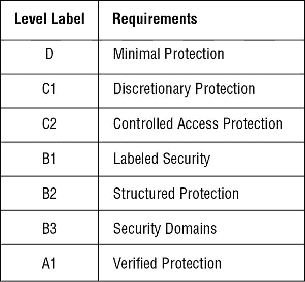

**FIGURE 8.6** TCSEC 级别

**离散保护（类别 C1、C2）** 离散保护系统提供基本的访问控制。此类系统虽具备一些安全控制，但缺乏针对安全系统特定需求的更高级、更严格的控制。C1 与 C2 系统提供基本控制，并完整记录系统安装与配置。

> **离散安全保护（C1）** 离散安全保护系统通过用户标识和/或组来控制访问。虽然存在一些限制对象访问的控制，但此类系统仅提供弱保护。

> **受控访问保护（C2）** 受控访问保护系统比 C1 更强。用户必须单独识别才能访问对象。C2 系统还必须执行介质清洗：在另一用户重新使用介质前，必须彻底清除介质上的残留数据，以防止数据被检查或使用。此外，必须实施严格的登录程序，限制无效或未经授权用户的访问。

**强制保护（类别 B1、B2、B3）** 强制保护系统的安全控制优于 C 或 D 类系统。控制更为细粒化，使安全管理员能够施加极限的访问控制，仅允许极少量的主体/对象访问。该类系统基于 Bell-LaPadula 模型，强制访问依赖于安全标签。

> **标记安全（B1）** 在标记安全系统中，每个主体和每个对象都有安全标签。B1 系统通过匹配主体与对象标签并比较其权限兼容性来授予访问权限，能够容纳机密数据。


> **结构化保护（B2）** 除了 B1 所要求的安全标签外，B2 系统必须确保不存在隐蔽通道。操作员和管理员职能分离，进程隔离保持。B2 系统足以满足对比 B1 更高安全功能需求的机密数据。

> **安全域（B3）** 安全域系统通过进一步增强不相关进程的分离与隔离，提供更安全的功能。管理职能明确定义并与其他用户功能分离。B3 系统的重点转向简化，以减少未使用或冗余代码带来的漏洞风险。B3 系统的安全状态需在启动阶段即时处理。B3 系统难以成功攻击，并为极其敏感或秘密数据提供充分的安全控制。

Verified Protection (Category A1) Verified protection systems are similar to B3 systems in the structure and controls they employ. The difference is in the development cycle. Each phase of the development cycle is controlled using formal methods. Each phase of the design is documented, evaluated, and verified before the next step is taken. This forces extreme security consciousness during all steps of development and deployment and is the only way to formally guarantee strong system security.

A verified design system starts with a design document that states how the resulting system will satisfy the security policy. From there, each development step is evaluated in the context of the security policy. Functionality is crucial, but assurance becomes more important than in lower security categories. A1 systems represent the top level of security and are designed to handle top-secret data. Every step is documented and verified, from the design all the way through to delivery and installation.

#### Other Colors in the Rainbow Series

Altogether, there are nearly 30 titles in the collection of DoD documents that either add to or further elaborate on the Orange Book. Although the colors don’t necessarily mean anything, they’re used to identify publications in this series.

Other important elements in this collection of documents include the following:

**Red Book** Because the Orange Book applies only to stand-alone computers not attached to a network, and so many systems were used on networks (even in the 1980s), the `Red Book` was developed to interpret the TCSEC in a networking context. In fact, the official title of the Red Book is `Trusted Network Interpretation of the TCSEC` so it could be considered an interpretation of the Orange Book with a bent on networking. Quickly the Red Book became more relevant and important to system buyers and builders than the Orange Book. The following list includes a few other functions of the Red Book:

*   Rates confidentiality and integrity

*   Addresses communications integrity

*   Addresses denial of service protection

*   Addresses compromise (in other words, intrusion) protection and prevention

*   Is restricted to a limited class of networks that are labeled as “centralized networks with a single accreditation authority”

*   Uses only four rating levels: None, C1 (Minimum), C2 (Fair), and B2 (Good)

**Green Book** The `Green Book`, or the `Department of Defense Password Management Guidelines`, provides password creation and management guidelines; it’s important for those who configure and manage trusted systems.

Table 8.2 has a more complete list of books in the rainbow series. For more information and to download the books, see the Rainbow Series web pages here:

[`csrc.nist.gov/publications/detail/white-paper/1985/12/26/dod-rainbow-series/final`](https://csrc.nist.gov/publications/detail/white-paper/1985/12/26/dod-rainbow-series/final)

[`fas.org/irp/nsa/rainbow.htm`](https://fas.org/irp/nsa/rainbow.htm)

**TABLE 8.2** **Some of the rainbow series elements**

| Publication number || Title || Book name |

| --- | --- | --- |

| 5200.28-STD || `DoD Trusted Computer System Evaluation Criteria` || Orange Book |

| --- | --- | --- |

| CSC-STD-002-85 || `DoD Password Management Guidelines` || Green Book |

| CSC-STD-003-85 || `Guidance for Applying TCSEC in Specific Environments` || Yellow Book |

| NCSC-TG-001 || `A Guide to Understanding Audit in Trusted Systems` || Tan Book |

| NCSC-TG-002 || `Trusted Product Evaluation: A Guide for Vendors` || Bright Blue Book |

| NCSC-TG-002-85 || `PC Security Considerations` || Light Blue Book |

| NCSC-TG-003 || `A Guide to Understanding Discretionary Access Controls in Trusted Systems` || Neon Orange Book |

| NCSC-TG-004 || `Glossary of Computer Security Terms` || Aqua Book |

| NCSC-TG-005 || `Trusted Network Interpretation` || Red Book |

| NCSC-TG-006 || `A Guide to Understanding Configuration Management in Trusted Systems` || Amber Book |

| NCSC-TG-007 || `A Guide to Understanding Design Documentation in Trusted Systems` || Burgundy Book |

| NCSC-TG-008 || `A Guide to Understanding Trusted Distribution in Trusted Systems` || Lavender Book |

| NCSC-TG-009 || `Computer Security Subsystem Interpretation of the TCSEC` || Venice Blue Book |

Given all the time and effort that went into formulating the TCSEC, it’s not unreasonable to wonder why evaluation criteria have evolved to newer, more advanced standards. The relentless march of time and technology aside, these are the major critiques of TCSEC; they help to explain why newer standards are now in use worldwide:

*   Although the TCSEC puts considerable emphasis on controlling user access to information, it doesn’t exercise control over what users do with information once access is granted. This can be a problem in military and commercial applications alike.

*   Given the origins of evaluation standards at the U.S. Department of Defense, it’s understandable that the TCSEC focuses its concerns entirely on confidentiality, which assumes that controlling how users access data is of primary importance and that concerns about data accuracy or integrity are irrelevant. This doesn’t work in commercial environments where concerns about data accuracy and integrity can be more important than concerns about confidentiality.

*   Outside the evaluation standards’ own emphasis on access controls, the TCSEC does not carefully address the kinds of personnel, physical, and procedural policy matters or safeguards that must be exercised to fully implement security policy. They don’t deal much with how such matters can impact system security either.

*   The Orange Book, per se, doesn’t deal with networking issues (though the Red Book, developed later in 1987, does).

To some extent, these criticisms reflect the unique security concerns of the military, which developed the TCSEC. Then, too, the prevailing computing tools and technologies widely available at the time (networking was just getting started in 1985) had an impact as well. Certainly, an increasingly sophisticated and holistic view of security within organizations helps to explain why and where the TCSEC also fell short, procedurally and policy-wise. But because ITSEC has been largely superseded by the Common Criteria, coverage in the next section explains ITSEC as a step along the way toward the Common Criteria (covered in the section after that).

### ITSEC Classes and Required Assurance and Functionality

The ITSEC represents an initial attempt to create security evaluation criteria in Europe. It was developed as an alternative to the TCSEC guidelines. The ITSEC guidelines evaluate the functionality and assurance of a system using separate ratings for each category. In this context, a system’s functionality is a measurement of the system’s utility value for users. The functionality rating of a system states how well the system performs all necessary functions based on its design and intended purpose. The assurance rating represents the degree of confidence that the system will work properly in a consistent manner.

ITSEC refers to any system being evaluated as a `target of evaluation (TOE)`. All ratings are expressed as TOE ratings in two categories. ITSEC uses two scales to rate functionality and assurance.


The functionality of a system is rated from F-D through F-B3 (there is no F-A1). The assurance of a system is rated from E0 through E6. Most ITSEC ratings generally correspond with TCSEC ratings (for example, a TCSEC C1 system corresponds to an ITSEC F-C1, E1 system). See Table 8.4 (at the end of the section “Structure of the Common Criteria”) for a comparison of TCSEC, ITSEC, and Common Criteria ratings.

Differences between TCSEC and ITSEC are many and varied. The following are some of the most important differences between the two standards:

Although the TCSEC concentrates almost exclusively on confidentiality, ITSEC addresses concerns about the loss of integrity and availability in addition to confidentiality, thereby covering all three elements so important to maintaining complete information security.

ITSEC does not rely on the notion of a TCB, and it doesn’t require that a system’s security components be isolated within a TCB.

Unlike TCSEC, which required any changed systems to be reevaluated anew—be it for operating system upgrades, patches, or fixes; application upgrades or changes; and so forth—ITSEC includes coverage for maintaining targets of evaluation after such changes occur without requiring a new formal evaluation.

For more information on ITSEC (now largely supplanted by the Common Criteria, covered in the next section), please see these sites:

[`www.bsi.bund.de/SharedDocs/Downloads/DE/BSI/Zertifizierung/ITSicherheitskriterien/itsec-en_pdf.pdf?__blob=publicationFile`](https://www.bsi.bund.de/SharedDocs/Downloads/DE/BSI/Zertifizierung/ITSicherheitskriterien/itsec-en_pdf.pdf?__blob=publicationFile)

[`www.sogis.org/documents/itsec/itsec-en.pdf`](https://www.sogis.org/documents/itsec/itsec-en.pdf)

Or you can view the original ITSEC specification here:

[`www.ssi.gouv.fr/uploads/2015/01/ITSEC-uk.pdf`](http://www.ssi.gouv.fr/uploads/2015/01/ITSEC-uk.pdf)

### Common Criteria

The *Common Criteria (CC)* represents a more or less global effort that involves everybody who worked on TCSEC and ITSEC as well as other global players. Ultimately, it results in the ability to purchase CC-evaluated products (where CC, of course, stands for Common Criteria). The Common Criteria defines various levels of testing and confirmation of systems’ security capabilities, and the number of the level indicates what kind of testing and confirmation has been performed. Nevertheless, it’s wise to observe that even the highest CC ratings do not equate to a guarantee that such systems are completely secure or that they are entirely devoid of vulnerabilities or susceptibilities to exploit. The Common Criteria was designed as a product evaluation model.

#### Recognition of Common Criteria

Caveats and disclaimers aside, a document titled “Arrangement on the Recognition of Common Criteria Certificates in the Field of IT Security” was signed by representatives from government organizations in Canada, France, Germany, the United Kingdom, and the United States in 1998, making it an international standard. This document was converted by ISO into an official standard: *ISO 15408*, Evaluation Criteria for Information Technology Security. The objectives of the CC guidelines are as follows:

*   To add to buyers’ confidence in the security of evaluated, rated information technology (IT) products

*   To eliminate duplicate evaluations (among other things, this means that if one country, agency, or validation organization follows the CC in rating specific systems and configurations, others elsewhere need not repeat this work)

*   To keep making security evaluations and the certification process more cost effective and efficient

*   To make sure evaluations of IT products adhere to high and consistent standards

*   To promote evaluation and increase availability of evaluated, rated IT products

*   To evaluate the functionality (in other words, what the system does) and assurance (in other words, how much can you trust the system) of the TOE

Common Criteria documentation is available at [`www.niap-ccevs.org/cc-scheme/`](http://www.niap-ccevs.org/cc-scheme/). Visit this site to get information on the current version of the CC guidelines and guidance on using the CC along with lots of other useful, relevant information.

The Common Criteria process is based on two key elements: protection profiles and security targets. *Protection profiles (PPs)* specify for a product that is to be evaluated (the TOE) the security requirements and protections, which are considered the security desires or the “I want” from a customer. *Security targets (STs)* specify the claims of security from the vendor that are built into a TOE. STs are considered the implemented security measures or the “I will provide” from the vendor. In addition to offering security targets, vendors may offer packages of additional security features. A package is an intermediate grouping of security requirement components that can be added to or removed from a TOE (like the option packages when purchasing a new vehicle).

The PP is compared to various STs from the selected vendor’s TOEs. The closest or best match is what the client purchases. The client initially selects a vendor based on published or marketed *Evaluation Assurance Levels (EALs)* (see the next section for more details on EALs), for currently available systems. Using Common Criteria to choose a vendor allows clients to request exactly what they need for security rather than having to use static fixed security levels. It also allows vendors more flexibility on what they design and create. A well-defined set of Common Criteria supports subjectivity and versatility, and it automatically adapts to changing technology and threat conditions. Furthermore, the EALs provide a method for comparing vendor systems that is more standardized (like the old TCSEC).

#### Structure of the Common Criteria

The CC guidelines are divided into three areas, as follows:

**Part 1** Introduction and General Model describes the general concepts and underlying model used to evaluate IT security and what’s involved in specifying targets of evaluation. It contains useful introductory and explanatory material for those unfamiliar with the workings of the security evaluation process or who need help reading and interpreting evaluation results.

**Part 2** Security Functional Requirements describes various functional requirements in terms of security audits, communications security, cryptographic support for security, user data protection, identification and authentication, security management, TOE security functions (TSFs), resource utilization, system access, and trusted paths. Covers the complete range of security functions as envisioned in the CC evaluation process, with additional appendices (called *annexes*) to explain each functional area.

**Part 3** Security Assurance covers assurance requirements for TOEs in the areas of configuration management, delivery and operation, development, guidance documents, and lifecycle support plus assurance tests and vulnerability assessments. Covers the complete range of security assurance checks and protects profiles as envisioned in the CC evaluation process, with information on evaluation assurance levels that describe how systems are designed, checked, and tested.

Most important of all, the information that appears in these various CC documents (worth at least a cursory read-through) are the evaluation assurance levels commonly referred as EALs. Table 8.3 summarizes EALs 1 through 7. For a complete description of EALs, consult the CC documents hosted at [`www.niap-ccevs.org/`](https://www.niap-ccevs.org/) and view Part 3 of the latest revision.

**TABLE 8.3** **CC evaluation assurance levels**

| Level | Assurance level | Description |
| --- | --- | --- |


| EAL1 | Functionally tested | Applies when some confidence in correct operation is required but where threats to security are not serious. This is of value when independent assurance that due care has been exercised in protecting personal information is necessary. |
| --- | --- | --- |
| EAL2 | Structurally tested | Applies when delivery of design information and test results are in keeping with good commercial practices. This is of value when developers or users require low to moderate levels of independently assured security. IT is especially relevant when evaluating legacy systems. |
| EAL3 | 经过系统测试和检查 | 适用于安全工程在设计阶段开始并贯穿始终，无重大后续变更。这在开发人员或用户需要中等程度的独立安全保障时有价值，包括对 TOE 及其开发进行彻底调查。 |
| EAL4 | 系统设计、测试和审查时系统化 | 适用于采用严格的安全工程和良好商业开发实践时。这不需要大量的专业知识、技能或资源。它涉及对所有 TOE 安全功能进行独立测试。 |
| EAL5 | 半形式化设计和测试 | 采用严格的安全工程和商业开发实践，包括专门的安全工程技术，用于半形式化测试。适用于开发人员或用户需要高度独立安全保障的规划开发过程，随后进行严格的开发。 |
| EAL6 | 半形式化验证、设计和测试 | 在设计、开发和测试的所有阶段使用直接、严格的安全工程技术，生产高端 TOE。适用于高风险场景所需的 TOE，受保护资产的价值足以支撑额外成本。广泛测试降低渗透风险、覆盖通道概率以及攻击易感性。 |
| EAL7 | 形式化验证、设计和测试 | 仅用于最高风险场景或涉及高价值资产的情况。仅限于安全功能紧密聚焦、经过广泛形式分析和测试的 TOE。 |

The CC guidelines are flexible and accommodating enough to capture most security needs and requirements, but they are by no means perfect. As with other evaluation criteria, the CC guidelines do nothing to make sure that how users act on data is also secure. The CC guidelines also do not address administrative issues outside the specific purview of security. As with other evaluation criteria, the CC guidelines do not include evaluation of security *in situ*—that is, they do not address controls related to personnel, organizational practices and procedures, or physical security. Likewise, controls over electromagnetic emissions are not addressed, nor are the criteria for rating the strength of cryptographic algorithms explicitly laid out. Nevertheless, the CC guidelines represent some of the best techniques whereby systems may be rated for security. To conclude this discussion of security evaluation standards, Table 8.4 summarizes how various ratings from the TCSEC, ITSEC, and the CC can be compared. Table 8.4 shows that ratings from each standard have similar, but not identical evaluation criteria.

### TABLE 8.4 Comparing security evaluation standards

| TCSEC | ITSEC | CC description |  |
| --- | --- | --- | --- |
| D | F-D+E0 | EAL0, EAL1 | Minimal/no protection |
| C1 | F-C1+E1 | EAL2 | Discretionary security mechanisms |
| C2 | F-C2+E2 | EAL3 | Controlled access protection |
| B1 | F-B1+E3 | EAL4 | Labeled security protection |
| B2 | F-B2+E4 | EAL5 | Structured security protection |
| B3 | F-B3+E5 | EAL6 | Security domains |
| A1 | F-B3+E6 | EAL7 | Verified security design |

In addition to overall security access models, such as Common Criteria, there are many other more specific or focused security standards for various aspects of storage, communication, transactions, and the like. Two of these standards you should be familiar with are *Payment Card Industry Data Security Standard (PCI DSS)* and *International Organization for Standardization (ISO)*.

PCI DSS is a collection of requirements for improving the security of electronic payment transactions. These standards were defined by the PCI Security Standards Council members, who are primarily credit card banks and financial institutions. The PCI DSS defines requirements for security management, policies, procedures, network architecture, software design, and other critical protective measures. For more information on PCI DSS, please visit the website at [`www.pcisecuritystandards.org`](http://www.pcisecuritystandards.org).

ISO is a worldwide standards-setting group of representatives from various national standards organizations. ISO defines standards for industrial and commercial equipment, software, protocols, and management, among others. It issues six main products: International Standards, Technical Reports, Technical Specifications, Publicly Available Specifications, Technical Corrigenda, and Guides. ISO standards are widely accepted across many industries and have even been adopted as requirements or laws by various governments. For more information on ISO, please visit the website at [`www.iso.org`](http://www.iso.org).

Organizations that require secure systems need one or more methods to evaluate how well a system meets their security requirements. The formal evaluation process is divided into two phases, called *certification* and *accreditation*. The actual steps required in each phase depend on the evaluation criteria an organization chooses. A CISSP candidate must understand the need for each phase and the criteria commonly used to evaluate systems. The two evaluation phases are discussed in the next two sections, and then we present various evaluation criteria and considerations you must address when assessing the security of a system. Certification and accreditation processes are used to assess the effectiveness of application security as well as operating system and hardware security.

The process of evaluation provides a way to assess how well a system measures up to a desired level of security. Because each system’s security level depends on many factors, all of them must be taken into account during the evaluation. Even though a system is initially described as secure, the installation process, physical environment, and general configuration details all contribute to its true general security. Two identical systems could be assessed at different levels of security because of configuration or installation differences.

Certification and accreditation are additional steps in the software and IT systems development process normally required from defense contractors and others working in a military environment. The official definitions of these terms as used by the U.S. government are from Department of Defense Instruction 5200.40, Enclosure 2.

### Certification

The first phase in a total evaluation process is *certification*. Certification is the comprehensive evaluation of the technical and nontechnical security features of an IT system and other safeguards made in support of the accreditation process to establish the extent to which a particular design and implementation meets a set of specified security requirements.

System certification is the technical evaluation of each part of a computer system to assess its concordance with security standards. First, you must choose evaluation criteria (we will present criteria alternatives in later sections). Once you select criteria to use, you analyze each system component to determine whether it satisfies the desired security goals. The certification analysis includes testing the system’s hardware, software, and configuration. All controls are evaluated during this phase, including administrative, technical, and physical controls.

在评估完整个系统后，您可以评估结果，以确定系统在当前环境中所支持的安全级别。系统的环境是认证分析的关键部分，因此系统的安全性会因其周围环境而更高或更低。您以安全的方式将系统连接到网络的方式会影响其安全状态。同样，系统周围的物理安全也会影响整体安全评级。在认证系统时，您必须考虑所有因素。

当您已评估所有因素并确定系统的安全级别时，认证阶段即告完成。请记住，认证仅适用于特定环境和配置中的系统。任何变更都可能使认证失效。一旦为特定配置认证了安全级别，您就准备好寻求系统的接受。通过认证流程，管理层接受系统的认证安全配置。

### Accreditation

在认证阶段，您会测试并记录特定配置下系统的安全能力。有了这些信息，组织的管理层会将系统的能力与组织的需求进行比较。安全策略必须明确说明安全系统的要求。管理层会审查认证信息，决定系统是否满足组织的安全需求。如果管理层认为系统的认证满足其需求，则系统被 `accredited`。`Accreditation` 是经 `designated approving authority (DAA)`（指定批准机构）正式声明，该 IT 系统在特定安全模式下，采用预定义的防护措施且风险水平可接受后，可投入运行。认证完成后，管理层可正式接受对系统整体安全性能的评估结果的充分性。

认证和认证的完整流程往往是迭代的。在认证阶段，通常会要求对配置进行修改或添加安全控制以解决安全问题。请记住，每当您更改配置时，都必须重新认证新配置。同样，当特定时间段结束或进行任何配置变更时，也需要重新认证系统。您的安全策略应说明哪些情况需要重新认证。一个合理的策略会列出认证的有效期时长以及任何需要重新启动认证和认证流程的变更。

### Certification and Accreditation Systems


当前已有两项政府标准用于计算机系统的认证和认证。当前的国防部标准是 `风险管理框架 (RMF)`（[`www.esd.whs.mil/Portals/54/Documents/DD/issuances/dodi/855101p.pdf`](http://www.esd.whs.mil/Portals/54/Documents/DD/issuances/dodi/855101p.pdf)），它最近取代了 `国防信息保障认证与认证 (DoD Information Assurance Certification and Accred)`，后者又取代了 `国防信息技术安全认证与认证流程 (DITSCAP)`。所有其他美国政府行政部门、机构及其承包商和顾问的标准是 `国家安全系统委员会 (CNSS) 政策 (CNSSP)`（[`www.cnss.gov/CNSS/issuances/Policies.cfm;`](https://www.cnss.gov/CNSS/issuances/Policies.cfm;) 向下滚动至 CNSSP 22 链接），它取代了 `国家信息保障认证与认证流程 (NIACAP)`。然而，CISSP 可能指代当前标准或旧标准。这两个流程均分为四个阶段：

**第 1 阶段：定义** 包括分配适当的项目人员、记录任务需求，以及注册、谈判和创建系统安全授权协议 (SSAA)，该协议指导整个认证和认证过程。

**第 2 阶段：验证** 包括对 SSAA 的细化、系统开发活动以及认证分析。

**第 3 阶段：验证** 包括对 SSAA 的进一步细化、对集成系统的认证评估、向 DAA 提出建议以及 DAA 的认证决定。

**第 4 阶段：认证后** 包括维护 SSAA、系统运行、变更管理以及合规性验证。

NIACAP 过程由国家安全局（NSA）的信息系统安全组织管理，并列出了三种可能授予的认证类型。这些认证类型的定义（取自《国家安全通信和信息系统安全指南 1000》）如下：

*   对于系统认证，会评估一个主要应用或通用支持系统。

*   对于站点认证，会评估特定、自包含地点的应用和系统。

*   对于类型认证，会评估一个分布在多个不同地点的应用或系统。

### 理解信息系统的安全能力

信息系统的安全能力包括内存保护、虚拟化、可信平台模块（TPM）、接口以及容错。仔细评估基础设施的每个方面至关重要，以确保其足以支持安全。如果不了解信息系统的安全能力，就不可能对其进行评估，也无法正确实施它们。

#### 内存保护

内存保护是核心安全组件，必须在操作系统中设计并实现。无论哪个程序在系统中运行，内存保护都必须强制执行。否则，可能导致不稳定、完整性受损、服务拒绝以及信息泄露。内存保护用于防止活动进程访问未专门分配或分配给它的内存区域。

内存保护在 9 章中会围绕隔离、虚拟内存、分段、内存管理和保护环等主题进行讨论。

#### 虚拟化

`Virtualization` 技术用于在单台宿主计算机的内存中托管一个或多个操作系统。该机制允许几乎任何操作系统在任何硬件上运行，同时多个操作系统可以在同一硬件上同时工作。常见示例包括 `VMware Workstation Pro`、`VMware vSphere` 与 `vSphere Hypervisor`、`VMware Fusion for Mac`、`Microsoft Hyper-V`、`Oracle VirtualBox`、`XenServer` 以及 `Parallels Desktop for Mac`。

虚拟化带来的好处包括按需启动单独的服务器或服务实例、实时弹性扩展以及能够为特定应用运行所需的精确操作系统版本。从用户视角来看，虚拟化服务器和服务与传统服务器和服务 indistinguishable（不可区分）。此外，恢复损坏、崩溃或损坏的虚拟系统通常很快，只需将虚拟系统的主硬盘文件替换为干净的备份版本，然后重新启动即可。（关于虚拟化及其相关风险的进一步说明，以及云计算的覆盖，也在第 9 章中涉及。）

#### 可信平台模块

`Trusted Platform Module (TPM)` 既是主板上一种加密处理器芯片的规范，也是该规范实现的通用名称。TPM 芯片用于存储和处理用于硬件支持/实现的硬盘加密系统的密码密钥。通常，硬件实现（而非仅软件实现）的硬盘加密被认为更安全。

当使用基于 TPM 的全盘加密时，用户或操作员必须向计算机提供密码或物理通用串行总线（USB）令牌设备，以进行身份验证并允许 TPM 芯片将硬盘加密密钥释放到内存中。虽然这与软件实现看起来类似，但关键区别在于：如果从原始系统中移除硬盘，它无法被解密。只有使用原始 TPM 芯片才能解密并访问加密内容。而仅使用软件的硬盘加密方式则允许将硬盘移动到其他计算机，而不受访问或使用限制。

一个 `硬件安全模块 (HSM)` 是一种用于管理/存储数字加密密钥、加速加密操作、支持更快的数字签名以及提升身份验证的加密处理器。HSM 通常是一个附加适配器或外设，也可以是基于传输控制协议/互联网协议（TCP/IP）的网络设备。HSM 包含防篡改保护，即使攻击者获得物理访问权限，也能防止其被滥用。TPM 只是 HSM 的一个示例。

HSM 为大尺寸（2,048 位及以上）非对称加密计算提供加速解决方案，并为密钥存储提供安全存储空间。许多证书颁发机构使用 HSM 存储证书；银行 ATM 和 POS 终端通常采用专有 HSM；硬件 SSL 加速器可包含 HSM 支持；且符合域名系统安全扩展（DNSSEC）的域名系统（DNS）服务器使用 HSM 存储密钥和区域文件。

### 界面

受限或限制界面是实现在应用程序中的，用于根据用户权限限制用户能执行或看到的操作。拥有完整权限的用户可以使用应用程序的全部功能；而权限受限的用户则只能访问有限的功能。

应用程序通过不同方式限制界面。常见做法是：如果用户没有相应权限，则隐藏相应功能。管理员可能通过菜单或右键单击项目来访问命令，但如果普通用户权限不足，该命令将不可见。其他情况是：命令虽显示但处于灰显或禁用状态，普通用户能看到但无法使用。

受限界面的目的是限制授权用户和未授权用户的操作。其使用是 Clark-Wilson 安全模型的实际体现。

### 容错性

`容错性` 是系统在出现故障时仍能继续运行的能力。容错性通过添加冗余组件实现，例如在廉价磁盘阵列（RAID）中添加额外磁盘，或在故障转移集群配置中添加额外服务器。容错性是安全设计的重要组成部分，也是避免单点故障和实现冗余的关键。更多关于容错性、冗余服务器、RAID 以及故障转移方案的信息，请参见第 18 章“灾难恢复规划”。

### 认证与认可

安全系统不仅仅是组装而成，而是设计用来支撑和执行安全策略的。必须评估系统支撑和强制执行安全策略的能力，这一过程称为 **认证**。认证是对系统技术能力的评估，判断其是否满足设计目标。系统通过技术评估后，组织管理层开始正式接受该系统，这一过程称为 **认可**。

整个认证与认可过程依赖于标准评估准则。已有多种用于评估计算机安全系统的准则。最早的是美国国防部制定的 **TCSEC**（也称橙皮书），它为系统的安全组件功能性和保障水平提供评估标准。欧洲国家更常使用 **ITSEC**，它是 TCSEC 的替代方案。2005 年，TCSEC 被 **公共准则（Common Criteria）** 取代。无论使用哪种准则，评估过程都包括检查每项安全控制是否符合安全策略。系统越能严格约束主体对资源的访问行为，其安全等级就越高。

在设计安全系统时，常用 **安全模型** 来表示系统实现安全策略的方法。本章讨论了多种安全模型。Bell-LaPadula 模型仅支持数据保密性，最初面向军事领域，满足军事需求。Biba 模型和 Clark-Wilson 模型关注数据完整性，并以不同方式实现。这些模型常作为商业应用安全基础设施设计的基石。

要想实现有效的系统安全，必须结合预防、检测和纠正控制。因此，你还需了解访问控制模型及其功能。包括状态机模型、Bell-LaPadula、Biba、Clark-Wilson、信息流模型、非干扰模型、提取-授予模型、访问控制矩阵模型以及 Brewer 和 Nash 模型。

**掌握每种访问控制模型的细节。** 这些模型及其功能包括：状态机模型确保所有主体访问对象的实例都是安全的；信息流模型用于防止未经授权、不安全或受限的信息流动；非干扰模型防止一个主体的操作影响另一主体的系统状态或操作；提取-授予模型规定了权利如何从一个主体传递到另一个主体或从主体传递到对象；访问控制矩阵是一个表格，列出主体与对象，指示每个主体对每个对象可执行的操作或功能；Bell-LaPadula 中的主体拥有清晰度级别，只能访问对应分类级别的对象，从而强制保密性；Biba 防止安全级别较低的主体写入安全级别较高的对象；Clark-Wilson 是一个基于审计的完整性模型，确保未经授权的主体无法访问对象，同时授权用户能够正确访问对象。Biba 和 Clark-Wilson 负责执行完整性；Goguen-Meseguer 和 Sutherland 关注完整性；Graham-Denning 关注对主体和对象的安全创建与删除。

**掌握认证与认可的定义。** 认证是对计算机系统各部分的技术评估，以判断其是否符合安全标准；认可是授权指定权威正式接受已认证配置的过程。

**能够描述开放系统和封闭系统。** 开放系统采用行业标准，通常易于与其他开放系统集成；封闭系统一般是专有硬件和/或软件，规格不公开，集成难度较大。

**了解约束、边界和隔离的定义。** 约束（confinement）限制进程只能读取和写入特定的内存位置；边界（bounds）是进程在读写时不能跨越的内存上限；隔离（isolation）是进程在受约束且受边界限制时的运行模式。

**能够定义 `对象` 与 `主体（subject）` 在访问方面的含义。** 主体是发起访问资源的用户或进程；对象是用户或进程希望访问的资源。

了解安全控制的工作原理及其功能。安全控制使用访问规则限制主体对对象的访问。

能够列出 TCSEC、ITSEC 和共准则（Common Criteria）的类别。TCSEC 的类别包括经验验证保护、强制保护、自主保护和最小保护。Table 8.4 涵盖并比较了 TCSEC、ITSEC 和 CC（请注意，ITSEC 中的功能评级 F7 到 F10 没有在 TCSEC 中对应的评级）。

定义可信计算基（TCB）。TCB 是构成可信基并强制执行安全策略的硬件、软件和控制的组合。

能够解释什么是安全边界。安全边界是将 TCB 与系统其余部分隔开的虚拟边界。TCB 组件通过受信通道与非 TCB 组件进行通信。

了解参考监视器和安全内核的概念。参考监视器是 TCB 的逻辑部分，在授予访问权限之前确认主体是否有权使用资源。安全内核是实现参考监视器功能的 TCB 组件的集合。

了解信息系统的安全能力。常见的安全能力包括内存保护、虚拟化和受信平台模块（Trusted Platform Module, TPM）。

# 第 9 章

安全漏洞、威胁与对策

本章涵盖的 CISSP 考试主题包括：

 Domain 3: Security Architecture and Engineering

3.5 评估并缓解安全架构、设计和解决方案元素的漏洞

3.5.1 客户端系统

3.5.2 服务器系统

3.5.3 数据库系统

3.5.5 工业控制系统（ICS）

3.5.6 云端系统

3.5.7 分布式系统

3.5.8 物联网（IoT）

3.6 评估并缓解 Web 系统的漏洞

3.7 评估并缓解移动系统的漏洞

3.8 评估并缓解嵌入式设备的漏洞

 在本书的前面章节中，我们已经涵盖了基本安全原则以及为防止它们被违反而设置的保护机制。我们还探讨了一些恶意个人用来绕过这些保护机制的具体攻击类型。在此之前，在讨论预防措施时，我们主要关注的是策略措施以及运行在系统上的软件。然而，安全专业人员必须同样关注系统本身，确保其更高层级的保护控制措施不是建立在不稳固的基础之上。毕竟，全世界最安全的防火墙配置也无济于事，如果其运行的计算机存在根本性安全漏洞，攻击者可以直接完全绕过防火墙。

在本章中，我们将通过对 `computer architecture`（计算机体系结构）这一领域进行简要调查，来阐述这些底层安全问题：该领域涉及计算机的物理设计，包括各种组件的构成。我们将从安全角度审视计算系统的主要物理组件——硬件和固件。显然，由于资源和时间限制，对系统硬件组件的详细分析并非总是可行的奢侈。但所有安全专业人员都应至少了解这些概念，以便在安全事件涉及系统设计层面时能够应对。

安全工程领域涵盖广泛的关注点和问题，包括安全设计要素、安全架构、漏洞、威胁以及相应的防护措施。该领域的其他内容在各章节中详细讨论：第 6 章 “密码学与对称密钥算法”、第 7 章 “公钥基础设施与密码学应用”、第 8 章 “安全模型、设计与能力的原理”以及第 10 章 “物理安全要求”。请务必阅读这些章节，以获得该领域的完整视角。

## Assess and Mitigate Security Vulnerabilities

`computer architecture` 是一门关注在逻辑层面设计和构建计算系统的工程学科。许多本科计算机工程或计算机科学专业的课程难以在一个学期内涵盖计算机体系结构的全部基本原理，因此该材料通常被划分为两门一学期的本科课程。计算机体系结构课程会在比特级别深入探讨中央处理器（CPU）组件、存储设备、设备通信等内容，定义使各个逻辑器件能够进行“0 或 1” simple 决策的处理路径。大多数安全专业人员不需要如此深入的知识，这已超出本书以及 CISSP 考试的范围。但如果你将参与计算系统在该层面的安全设计，建议对该领域进行更深入的研究。

这段关于计算机体系结构的初步讨论可能最初看起来与 CISSP 考试无关，但大多数安全架构和设计元素都基于对计算机硬件的扎实理解与实现。

### Hardware

任何计算专业人员都熟悉 `hardware`（硬件）的概念。与建筑行业类似，硬件是构成计算机的物理“stuff”。`hardware` 包括你可以实际触摸的任何有形计算机部件，从键盘、显示器到 CPU（或多个 CPU）、存储媒体以及内存芯片。请注意，虽然存储设备的物理部分（如硬盘或闪存）可视为硬件，但这些设备内部的内容——即构成其中软件和数据的 0/1 位集合——则不属于硬件。毕竟，你无法从电脑中取出一把手 full of bits and bytes！

#### Processor

`central processing unit (CPU)`，通常称为 `processor or the microprocessor`，是计算机的神经中枢——它是掌控所有主要操作的芯片（或在多处理器系统中是多个芯片），负责直接执行或协调复杂的计算交响乐，使计算机能够完成其预定任务。令人惊讶的是，尽管 CPU 能让计算机执行复杂任务，它本身只能执行有限的一组计算和逻辑操作。操作系统和编译器的职责是将高级编程语言翻译成 CPU 理解的简单汇编指令。这种有限的功能范围是有意设计的——它使 CPU 能够以惊人的速度执行计算和逻辑操作。

##### Execution Types

随着处理能力的提升，用户对系统的需求也随之增加，需要更高的信息处理速率和同时管理多个功能。计算机工程师提出了多种满足这些需求的方法：

**Multitasking** 在计算中，`multitasking` 指同时处理两个或多个任务。过去，大多数系统并未真正实现多任务，而是依赖操作系统通过精心安排发送给 CPU 的指令序列来模拟多任务。当处理器以多吉赫兹频率运行时，人类难以分辨它是在切换任务还是同时处理多个任务。单核多任务系统能够在任意时刻同时“ juggle”多个任务或进程。

**Multicore** 如今，大多数 CPU 都是多核的。这意味着以前单一的 CPU 或微处理器芯片现在已集成两个、四个、八个，甚至数十个独立的执行核心，这些核心可以并行工作。

**Multiprocessing** 在 `multiprocessing` 环境中，多处理器系统（即拥有多个 CPU 的系统）利用多个处理器共同完成多线程应用的执行。例如，数据库服务器可能运行在包含四、六或更多处理器的机器上。如果数据库应用同时接收多个独立查询，它可以把每个查询分别交给不同的处理器执行。

现代多 CPU 系统中最常见的两种多处理方式是：一种是 **对称多处理 (SMP)**，即系统中多个处理器地位平等，由单一操作系统统一管理，它们共享公共总线和内存资源；另一种是其他多处理模式（此处未详述）。在 SMP 体系结构中，处理器数量可非常多，足以满足大多数系统的需求。

一些计算密集型操作（如支持科学家和数学家研究的操作）需要的处理能力超过了单个操作系统能提供的，这类操作最适合使用一种称为`massively parallel processing (MPP)`的技术。MPP 系统包含数百甚至数千个处理器，每个处理器都有自己的操作系统和内存/总线资源。当负责协调整个系统活动并排程处理的软件遇到计算密集型任务时，它会将该任务分配给单个处理器。该处理器随后将任务拆分为可管理的若干部分，并将其分配给其他处理器执行。这些处理器将结果返回给协调处理器，在那里它们被组装并返回给请求的应用程序。MPP 系统极其强大（更不用说极其昂贵了！），在大量计算或计算研究中被广泛使用。

两种类型的多处理都有独特的优势，适用于不同的场景。SMP 系统擅长以极高的速率处理简单操作，而 MPP 系统则特别适合处理非常大、复杂且计算密集的任务，这些任务可以分解并分布到多个子任务中执行。

**Multiprogramming** `Multiprogramming` 类似于多任务。它通过操作系统伪同时执行两个任务在单个处理器上，以提高操作效率。大体上，多程序是将多个进程批量或序列化，以便当一个进程等待外设时，其状态会被保存，然后让排在后面的进程开始处理。第一个程序在所有其他进程都有机会执行并停止等待外设后才恢复处理。对于单个程序，这种方法会导致任务完成出现显著延迟。然而，在所有进程的整体上，完成所有任务的总时间会被缩短。

多程序被视为相对老旧的技术，如今除在遗留系统中几乎不再使用。多程序与多任务的主要区别有两点：

* 多程序通常在大规模系统（如主 frame）上运行，而多任务在个人计算机（PC）操作系统（如 Windows 和 Linux）上进行。


- 多任务由操作系统协调，而多程序则需要专门编写的软件自行协调活动和执行，并通过操作系统实现。

`Multithreading` 允许在单个进程内同时执行多个并发任务。与多任务不同，多任务中多个任务占用多个进程，而多线程允许多个任务在同一个进程内运行。线程是一个自包含的指令序列，可以与同一父进程中的其他线程并行执行。多线程常用于那些频繁进行多个活动之间的上下文切换会产生过高开销并降低效率的应用。与进程切换相比，线程切换的开销要小得多，因而更高效。自 2002 年 Xeon 发布后，许多 Intel CPU 都内置了名为超线程（hyperthreading）的专有多线程技术，该技术能够在每个物理核上虚拟化两个处理器，从而允许任务的并行调度。在现代 Windows 实现中，同一进程内切换一个线程到另一个线程的开销约为 40 到 50 条指令，几乎不涉及显著的内存传输。相比之下，切换一个进程到另一个进程需要 1,000 条指令或更多，并且还需要大量的内存传输。

多线程的一个典型例子是同时在文字处理程序中打开多个文档。此时并不需要多个文字处理程序的实例（这会给系统带来过大的负担），而是将每个文档视为单个线程，在单一的文字处理进程中运行。软件会在任何时刻选择处理哪一个线程。

对称多处理系统在操作系统层面使用线程。正如前面文字处理的例子所示，操作系统本身也包含若干线程来控制它所分配的任务。在单处理器系统中，操作系统（OS）每次只向处理器发送一个线程进行执行。SMP 系统则为每个可用处理器发送一个线程，实现并行执行。

## Processing Types

许多高安全系统会根据信息的安全级别（如美国政府对国防相关信息所赋予的“未分类”、“机密”、“绝密”、“秘密”和“绝对秘密”等分级）来控制信息的处理。计算机必须设计成既不——理想情况下不能—— unintentionally 泄露信息给未经授权的接收者。

处理器架构师和安全策略管理员在处理器层面提出了两种应对方式：一种是通过政策机制，另一种是通过硬件方案。下面的列表分别探讨这两种选项：

### Single State

`Single-state systems` 依赖于策略机制来管理不同级别的信息。在这种安排下，安全管理员只批准处理器和系统在同一安全级别上运行。例如，一个系统可能被标记为仅处理“秘密”信息。此时，所有使用该系统的用户都必须获准处理“秘密”级别的信息。这将保护正在处理的信息的责任从硬件和操作系统转移到负责系统访问控制的管理员身上。

### Multistate

`Multistate systems` 能够在同一时间实现更高层次的安全。这些系统经过认证，能够同时处理多个安全级别，并使用专门的安全机制（如下一节“Protection Mechanisms”所述）来防止信息在安全级别之间跨越。例如，一个用户可能在多状态系统中处理“秘密”信息，而另一个用户同时处理“绝对秘密”信息。技术机制阻止两者之间的信息跨越，从而防止跨越安全级别。

在实际操作中，多状态系统相对少见，因为实现所需的技术机制成本较高。但当涉及非常昂贵的资源（如大规模并行系统）时，使用多个系统的成本往往远高于在单一系统上实现多状态操作的额外成本。

## Protection Mechanisms

如果一台计算机没有运行，它就是一个什么都不做的惰性塑料、硅和金属的堆块。当计算机在运行时，它会运行一个运行时环境，该环境代表操作系统与当前可能激活的任何应用程序的组合。在运行时，计算机还能够在用户安全权限允许的范围内访问文件和其他数据。在该运行时环境内，有必要整合安全信息和控制措施，以保护操作系统本身的完整性，管理哪些用户可以访问特定数据项，以及授权或拒绝针对这些数据的操作请求，以此类推。从安全角度来看，运行时的计算机实现和处理安全的方式可以概括为一系列保护机制。下面是对这些保护机制的描述，包括保护环（`protection rings`）、操作状态和安全模式。

`Protection Rings` 环保护方案是老而弃的好方法。它可以追溯到多行星（Multics）操作系统的研发工作。该实验操作系统于 1963 年至 1969 年由贝尔实验室（Bell Labs）、麻省理工学院（MIT）和通用电气（General Electric）联合设计并构建，随后在霍尼韦尔（Honeywell）的实现中投入商业使用。多行星留下了计算机领域两项持久的遗产：第一，它启发了一个更简洁、结构更清晰的操作系统——Unix（即“多行星”的缩写）的诞生；第二，它引入了保护环（`protection rings`）这一概念，被用于操作系统设计。

从安全角度来看，`protection rings` 将操作系统中的代码和组件（以及在操作系统控制下运行的应用程序、实用程序或其他代码）组织成同心环，如图 9.1 所示。环越靠内，所在环的代码对应的特权级别越高。虽然原始的多行星实现支持最高七个环（编号 0 至 6），但现代操作系统通常采用四环模型（编号 0 至 3）。

作为最内层的环，0 拥有最高的特权级别，几乎可以访问任何资源、文件或内存位置。始终驻留在内存中以便随时按需运行的操作系统核心部分（kernel）位于环 0，能够中断任何其他环中运行的代码。操作系统的其余部分——即根据任务请求、操作执行、进程切换等而来去的模块——则位于环 1。环 2 同样具有较高的特权，因为它是 I/O 驱动程序和系统实用程序所在的位置；这些组件能够访问外设、特殊文件等其他应用程序和程序无法直接访问的资源。而这些应用程序和程序则位于最外层的环 3。

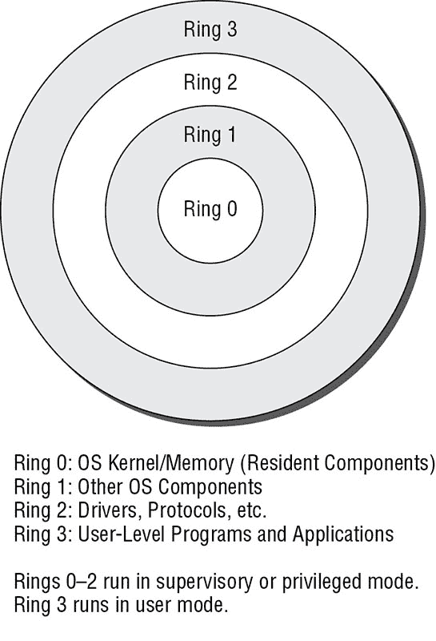

**FIGURE 9.1** 在常用的四环模型中，保护环将操作系统划分为内核、组件和驱动（分别位于环 0 至环 2），而应用程序和程序则运行在环 3。

环模型的核心在于优先级、特权和内存分段。任何想要执行的进程都必须排队（挂起进程队列）。环号最小的进程始终优先于环号较大的进程执行。环号较小的进程可以直接访问更多资源，并更直接地与操作系统交互；而环号较大的进程通常必须向低环号的处理程序或驱动程序请求服务，这称为`mediated-access model`（中介访问模型）。在最严格的实现中，每个环都有独立的内存段。因此，高环号进程请求低环号地址时，必须通过与该地址所属环相同的进程（helper process）发起请求。实际上，许多现代操作系统仅将内存划分为两段：一段用于系统级访问（环 0 至环 2），即`kernel mode`或`privileged mode`；另一段用于用户程序和应用（环 3），即`user mode`。

从安全角度，环模型使操作系统能够保护并隔离自身免受用户和应用的影响，同时也能够在高特权组件（如内核）与低特权部分（如操作系统的其他部分、驱动和实用程序）之间设立严格的边界。在该模型中，对特定资源的直接访问仅限于特定环，而某些操作（如进程切换、终止和调度）也只能在特定环内执行。

进程所处的环决定了其访问系统资源的权限（以及必须向哪些低环号进程请求资源）。进程仅能直接访问自己所在环或更外层环（数值上更大）的资源；例如，环 1 的进程可以直接访问其所在环以及环 2、环 3 的资源，但不能直接访问仅属于环 0 的资源。实现中介访问的机制——即前文提到的驱动或处理程序请求——通常称为`system call`，它通过调用特定的系统或编程接口将请求传递给更内层的环以提供服务。在请求被处理之前，被调用的环必须检查调用进程是否拥有相应的凭证和授权，以确保其能够访问数据并执行相关操作。

在 `ready state` 中，进程处于准备就绪状态，一旦被调度执行即可恢复或开始处理。如果在进程达到该状态时 CPU 可用，它将直接转入 `running state`；否则，它将停留在 `ready state` 直至轮到它执行。这意味着进程拥有所有所需的内存和其他资源，可以立即开始执行。

`Waiting`（也可理解为“等待资源”）指的是进程已准备好继续执行，但必须等待设备或访问请求（某种中断）被服务完成，然后才能继续处理。例如，数据库应用程序在读取文件记录时必须等待文件被定位、打开并找到正确的记录集。有些文献将此状态称为“阻塞状态”，因为进程在外部事件发生前无法继续执行。

`Running` 进程在 CPU 上执行，直到完成、时间片用完或因某种原因被阻塞（通常是因为它生成了对设备或网络的中断并等待该中断处理）。如果时间片结束而进程未完成，它会返回 `ready state`（并排入队列）；如果进程在等待资源可用时被阻塞，则进入 `waiting state`（并排入队列）。

`Supervisory` `supervisory state` 用于进程必须执行需要超过问题状态（`problem state`）特权集合的操作，包括修改系统配置、安装设备驱动或修改安全设置。基本上，除用户态（ring 3）或问题状态之外的任何功能都在监视态（`supervisory mode`）中执行。

`Stopped` 当进程完成或必须终止（因错误发生、所需资源不可用或资源请求无法满足）时，它进入 `stopped state`。此时，操作系统可以回收该进程所分配的所有内存和其他资源，并根据需要重新用于其他进程。

Figure 9.2 显示了这些各状态之间的关系图。新进程始终进入 `ready state`。随后，处于 `ready` 的进程总是转入 `running state`。在 `running` 期间，进程可能转入 `stopped state`（如果完成或被终止），返回 `ready state` 以便在下一个时间片执行，或转入 `waiting state` 直至其待请求的资源得到满足。当操作系统决定下一个执行的进程时，它会检查 `waiting queue` 和 `ready queue`，并选择优先级最高且已准备好运行的任务（因此只有那些等待请求已被服务或可以服务的等待作业才能在此考虑）。一个特殊的内核部分——`program executive`（进程调度器）一直驻留在内存中，以便在进程状态转换时介入并处理相关机制。

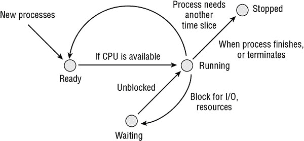

**FIGURE 9.2** 进程调度器

在 Figure 9.2 中，进程调度器负责管理处于 `ready` 和 `waiting` 状态的进程，并决定当进程从运行态转入其他状态（ready、waiting 或 stopped）时应发生什么。

## Security Modes

美国政府为处理机密信息的系统指定了四种经批准的 `security modes`。下面依次描述。在第 1 章“通过原则和政策进行安全治理”中，我们回顾了联邦政府使用的分类体系以及安全许可和访问批准的概念。本段唯一的新术语是 `need to know`，指一种访问授权方案，即主体访问对象的权限不仅取决于其特权级别，还取决于所涉及数据在主体所扮演角色（或工作）中的相关性。这表明主体需要访问该对象以正确履行职责或填补特定角色。没有 `need to know` 的主体即使拥有最高特权也不能访问该对象。如果需要复习这些概念，请在第 1 章中先行查阅。在部署这些安全模式之前，必须满足三个具体要素：

- 层次强制访问控制（MAC）环境
- 对哪些主体可以访问计算机控制台的**完全物理控制**
- 对哪些主体可以进入与计算机控制台同一房间的**完全物理控制**

### Dedicated Mode

`Dedicated mode` 系统本质上等同于前文“Processing Types”章节中描述的单态系统。使用专用系统的用户必须满足以下三项要求：

- 每位用户的安全许可必须允许访问系统处理的全部信息。
- 每位用户必须对系统处理的全部信息拥有访问批准。
- 每位用户必须对系统处理的全部信息拥有有效的 `need to know`。

### System High Mode

`System high mode` 系统的要求略有不同：

- 每位用户必须拥有允许访问系统处理全部信息的有效安全许可。
- 每位用户必须对系统处理的全部信息拥有访问批准。
- 每位用户必须对系统处理的**部分**信息拥有有效的 `need to know`，但不必对全部信息拥有。

主要区别在于，专用模式（`dedicated mode`）要求所有用户对系统处理的全部信息都有 `need to know`，而系统高模式（`system high mode`）则不一定；因此，同一用户既可以访问专用模式系统的全部数据，也可能在系统高模式系统中被限制访问部分数据。

### Compartmented Mode

`Compartmented mode` 系统进一步放宽了这些要求：

- 每位用户必须拥有允许访问系统处理全部信息的有效安全许可。
- 每位用户必须对其将在系统上访问的信息拥有访问批准。
- 每位用户必须对其将在系统上访问的全部信息拥有有效的 `need to know`。

与系统高模式的主要区别在于，分区模式（`compartmented mode`）的用户不一定对系统上所有信息拥有访问批准；但和专用模式、系统高模式一样，所有用户仍必须拥有适当的安全许可。特殊实现——`compartmented mode workstations (CMWs)`——允许拥有必要许可的用户同时处理多个数据分区。

CMWs 要求在对象上标记两类安全标签：**sensitivity levels**（敏感性级别）和 **information labels**（信息标签）。敏感性级别描述必须保护的对象所处的级别，这些级别在四种模式中均相同。信息标签防止数据过度分类，并为对象关联额外信息，有助于在非访问控制范围内进行准确的数据标记。

### Multilevel Mode

政府对 `multilevel mode` 系统的定义基本上与前文技术定义相同，但为保持一致性，我们用许可、访问批准和 `need to know` 来表述：

一些用户没有系统处理的所有信息的有效安全许可。因此，访问由主体的许可级占主体的敏感性标签的主导地位来控制。

每个用户必须获得系统上所有他们将能够访问的信息的访问批准。

每个用户必须为系统上所有他们将能够访问的信息拥有有效的知情需求。

当你浏览经联邦政府批准的各种运行模式的要求时，你会发现，随着从专用系统转向多层系统，控制用户访问系统的行政要求会减少。然而，这并不减少限制个人访问的重要性，以确保用户只能获得他们合法有权访问的信息。正如上一节所讨论的，这只是将强制执行这些要求的责任从物理限制计算机访问的行政人员（即硬件）转移到硬件和软件（即控制多用户系统中每个用户可以访问的信息）。

Table 9.1 总结并比较了这四种安全模式，依据所需的安全许可、知情需求以及处理多级许可数据的能力（缩写为 PDMCL）。当比较所有四种安全模式时，通常认为多层模式面临最高风险。

**TABLE 9.1** **Comparing security modes**

| Mode | Clearance | Need to know | PDMCL |
| --- | --- | --- | --- |
| Dedicated | Same | None | None |
| System high | Same | Yes | None |
| Compartmented | Same | Yes | Yes |
| Multilevel | Different | Yes | Yes |

Clearance is **Same** if all users must have the same security clearances, **Different** if otherwise.

Need to Know is **None** if it does not apply and is not used or if it is used but all users have the need to know all data present on the system, **Yes** if access is limited by need-to-know restrictions.

PDMCL applies if and when CMW implementations are used (**Yes**); otherwise, PDMCL is **None**.

## Operating Modes

Modern processors and operating systems are designed to support multiuser environments in which individual computer users might not be granted access to all components of a system or all the information stored on it. For that reason, the processor itself supports two modes of operation: `user mode` and `privileged mode`.


## User Mode

*User mode* is the basic mode used by the CPU when executing user applications. In this mode, the CPU allows the execution of only a portion of its full instruction set. This is designed to protect users from accidentally damaging the system through the execution of poorly designed code or the unintentional misuse of that code. It also protects the system and its data from a malicious user who might try to execute instructions designed to circumvent the security measures put in place by the operating system or who might mistakenly perform actions that could result in unauthorized access or damage to the system or valuable information assets.

Often processes within user mode are executed within a controlled environment called a *virtual machine (VM)*. A virtual machine is a simulated environment created by the OS to provide a safe and efficient place for programs to execute. Each VM is isolated from all other VMs, and each VM has its own assigned memory address space that can be used by the hosted application. It is the responsibility of the elements in privileged mode (aka kernel mode) to create and support the VMs and prevent the processes in one VM from interfering with the processes in other VMs.

## Privileged Mode

CPUs also support *privileged mode*, which is designed to give the operating system access to the full range of instructions supported by the CPU. This mode goes by a number of names, and the exact terminology varies according to the CPU manufacturer. Some of the more common monikers are included in the following list:

* Privileged mode
* Supervisory mode
* System mode
* Kernel mode

No matter which term you use, the basic concept remains the same—this mode grants a wide range of permissions to the process executing on the CPU. For this reason, well-designed operating systems do not let any user applications execute in privileged mode. Only those processes that are components of the operating system itself are allowed to execute in this mode, for both security and system integrity purposes.

## Memory

The second major hardware component of a system is *memory*, the storage bank for information that the computer needs to keep readily available. There are many different kinds of memory, each suitable for different purposes, and we’ll take a look at each in the sections that follow.

### Read-Only Memory

*Read-only memory (ROM)* works like the name implies—it’s memory the PC can read but can’t change (no writing allowed). The contents of a standard ROM chip are burned in at the factory, and the end user simply cannot alter it. ROM chips often contain “bootstrap” information that computers use to start up prior to loading an operating system from disk. This includes the familiar *power-on self-test (POST)* series of diagnostics that run each time you boot a PC.

ROM’s primary advantage is that it can’t be modified. There is no chance that user or administrator error will accidentally wipe out or modify the contents of such a chip. This attribute makes ROM extremely desirable for orchestrating a computer’s innermost workings.

There is a type of ROM that may be altered by administrators to some extent. It is known as programmable read-only memory (PROM), and its several subtypes are described next:

#### Programmable Read-Only Memory (PROM)

A basic *programmable read-only memory (PROM)* chip is similar to a ROM chip in functionality, but with one exception. During the manufacturing process, a PROM chip’s contents aren’t “burned in” at the factory as with standard ROM chips. Instead, a PROM incorporates special functionality that allows an end user to burn in the chip’s contents later. However, the burning process has a similar outcome—once data is written to a PROM chip, no further changes are possible. After it’s burned in, a PROM chip essentially functions like a ROM chip.

PROM chips provide software developers with an opportunity to store information permanently on a high-speed, customized memory chip. PROMs are commonly used for hardware applications where some custom functionality is necessary but seldom changes once programmed.

#### Erasable Programmable Read-Only Memory (EPROM)

Combine the relatively high cost of PROM chips and software developers’ inevitable desires to tinker with their code once it’s written and you have the rationale that led to the development of *erasable PROM (EPROM)*. There are two main subcategories of EPROM, namely UVEPROM and EEPROM (see next item). *Ultraviolet EPROMs (UVEPROMs)* can be erased with a light. These chips have a small window that, when illuminated with a special ultraviolet light, causes the contents of the chip to be erased. After this process is complete, end users can burn new information into the UVEPROM as if it had never been programmed before.

#### Electronically Erasable Programmable Read-Only Memory (EEPROM)

A more flexible, friendly alternative to UVEPROM is *electronically erasable PROM (EEPROM)*, which uses electric voltages delivered to the pins of the chip to force erasure.

#### Flash Memory

*Flash memory* 是从 EEPROM 衍生的概念。它是一种非易失性存储介质，能够通过电子方式擦除并重写。EEPROM 与 flash memory 的主要区别在于，EEPROM 必须在重写前完全擦除，而 flash memory 可以以块或页的方式进行擦除和写入。最常见的 flash memory 类型是 NAND flash，它广泛用于记忆卡、U 盘、移动设备以及 SSD（固态驱动器）。

### Random Access Memory

*Random access memory (RAM)* 是一种可读可写的内存，用于存储计算机在处理过程中使用的信息。RAM 仅在持续供电的情况下才保留其内容。与 ROM 相比，计算机断电后，RAM 中存储的所有数据都会消失。因此，RAM 仅适用于临时存储。关键数据不应仅存储在 RAM 中；应始终在其他存储设备上保留备份副本，以防止因电力突然中断而丢失数据。下面列出了几种 RAM 类型：

#### Real Memory

*Real memory*（也称为 *main memory* 或 *primary memory*）通常是计算机可用的最大 RAM 存储资源。它通常由若干动态 RAM 芯片组成，因此 CPU 需要定期刷新（请参见侧边栏“Dynamic vs. Static RAM”以获取更多信息）。

#### Cache RAM

计算机系统中包含多个缓存，以通过从较慢设备读取数据并在需要时暂时存储到更快设备中来提升性能；这就是 *cache RAM*。处理器通常内置一个极快的缓存，用于保存将要操作的数据。这可以称为 L1、L2、L3，甚至 L4 缓存（L 代表层级）。许多现代 CPU 包含多达三层片上缓存，其中一些缓存（通常是 L1 和/或 L2）专用于单个处理器核心，而 L3 可能是多个核心共享的缓存。某些 CPU 还支持 L4 缓存，它可能位于主板/母板或 GPU（图形处理单元）上。同样，真实内存（real memory）中也会包含存储在磁介质或 SSD 上的缓存信息。这一存储层级链条一直延伸下去，使计算机能够通过将更可能被使用的数据保持更近的位置（无论是 CPU 指令、数据读取、文件访问或其他用途）来提升性能。

许多外设也内置缓存，以减轻它们对 CPU 和操作系统的存储负担。例如，高端打印机通常配备大容量 RAM 缓存，使操作系统能够快速将整个任务缓冲到打印机中。之后，处理器可以不再关注该打印任务；它不必等待打印机实际输出，而是按块方式“送料”。打印机可以从其内部缓存预处理信息，从而让 CPU 和操作系统能够处理其他任务。许多存储设备（如硬盘驱动器（HDD）、固态驱动器（SSD）以及部分 U 盘）也包含缓存，以提升读写速度。然而，这些缓存在拔除或断电前必须先刷新到永久或次要存储区，以防止缓存数据丢失。

### Registers

CPU 还包含一种受限的内部内存，称为 *registers*，它提供直接可访问的内存位置，供 CPU 的核心——算术逻辑单元（ALU）——在执行计算或处理指令时使用。事实上，ALU 需要操作的任何数据都必须加载到寄存器中，除非直接作为指令的一部分提供。这种类型的内存的主要优势是它属于 ALU 本身，因而能够与 CPU 在典型 CPU 速度下同步工作。

### Memory Addressing

在使用存储资源时，处理器必须有某种方式来指代记忆体中的各个位置。解决此问题的方案称为 *addressing*，并在不同情境下使用多种寻址方案。下面列出了五种常见的寻址方案：

#### Register Addressing

如前一节所述，寄存器是直接位于 CPU 内部的小内存区域。当 CPU 需要从寄存器获取信息以完成操作时，会使用 *register address*（例如，“寄存器 1”）来访问其内容。

#### Immediate Addressing

*Immediate addressing* 并非一种记忆体寻址方案，而是指在指令中直接提供给 CPU 的数据。例如，CPU 可能处理指令“向寄存器 1 中添加 2”。该指令使用两种寻址方式。第一种是即时寻址——CPU 被指示直接加入数值 2，无需从记忆体中取值，因为该值已随指令一起提供。第二种是寄存器寻址，指令要求从寄存器 1 中取出值。

#### Direct Addressing

在 *direct addressing* 中，CPU 直接获得访问的记忆体地址。该地址必须位于正在执行的指令所在的同一页中。相较于即时寻址，direct addressing 更具灵活性，因为记忆体内容可以更容易改变，而无需重新编写硬编码的即时数据。

#### Indirect Addressing

*Indirect addressing* 的寻址方式与直接寻址类似，但指令中提供的内存地址本身并不保存要使用的操作数值。相反，该地址保存另一个地址（可能位于不同页）。CPU 读取间接地址，获取目标数据所在的地址，然后从该地址读取实际操作数。

#### Base+Offset Addressing

*Base+offset addressing* 使用寄存器中的一个值作为基址，CPU 在指令中提供的偏移量被加到基址上，从而计算出操作数所在的内存位置并读取。

### Secondary Memory

*Secondary memory* 通常指磁性、光学或闪存等介质或其他存储设备，其中的数据在 CPU 立即可得时并不可用。要让 CPU 访问次要存储中的数据，操作系统必须先将其读取并存储到真实内存中。尽管次要存储的成本远低于主存，但它可以用于存储海量信息。在此语境下，硬盘、闪存盘以及光盘（CD、DVD、Blu‑ray）均可充当次要存储。

虚拟内存是一种特殊的次要存储，操作系统管理它以使其表现和行为如同真实内存。最常见的虚拟内存类型是操作系统用于内存管理的页文件（pagefile）。该格式化文件包含之前存储在内存但最近未使用的数据。当操作系统需要访问页文件中的地址时，会检查该页是否在内存中（即 memory‑resident），若在则直接访问；若已被换出到磁盘，则读取磁盘数据回到真实内存（此过程称为 *paging*）。

使用虚拟内存是一种低廉的方式，让计算机在运行时表现得像拥有比实际安装的更多的真实内存。其主要缺点是，当数据在主存和次存之间交换时，分页操作相对较慢（内存操作在纳秒级，磁盘系统在微秒级；通常这意味着三个数量级的差异！）并且会消耗大量的计算机开销，导致整个系统变慢。随着实际物理 RAM 容量的增大，对虚拟内存的需求会降低，使用闪存卡或 SSD 托管虚拟内存的分页文件可以进一步降低虚拟内存带来的性能损失。

### 内存安全问题


内存存储并处理你的数据——其中可能包含极其敏感的信息。必须了解各种内存类型，并知道它们如何存储和保留数据。任何可能保留敏感数据的存储设备在出于任何原因将其交出组织之前都必须被彻底清除。这点在二次存储以及设计用于在断电后仍保留数据的 ROM/PROM/EPROM/EEPROM 设备尤为重要。

然而，内存数据保留问题并不局限于那些专门设计用于长期保留数据的存储类型。请记住，静态 RAM（SRAM）和动态 RAM（DRAM）芯片通过电容和触发器（见侧边栏“动态 vs. 静态 RAM”）来存储数据。这些电气元件在断电后可能会保留一定的电荷，持续一段时间。技术上有经验的个人理论上可以通过电测量获取这些设备上存储的部分数据。但这需要相当的技术专长，除非你拥有资源惊人的对手，否则这种攻击并不常见。

有一种攻击手段是冷启动攻击：在系统关闭或从主板拔掉 RAM 时，通过冷却内存芯片来延缓居住数据的衰减。参见 [`http://en.wikipedia.org/wiki/Cold_boot_attack`](http://en.wikipedia.org/wiki/Cold_boot_attack)。还有针对内存转储或系统崩溃转储的攻击，旨在提取加密密钥。参见 [`www.lostpassword.com/hdd-decryption.htm`](http://www.lostpassword.com/hdd-decryption.htm)。

最重要的内存安全问题之一是控制在计算机使用期间谁可以访问内存中的数据。这主要是操作系统的职责，也是本章前面段落所描述的各种处理模式背后的主要内存安全问题。在本章后面的“Essential Security Protection Mechanisms”章节中，你将学习如何利用进程隔离原则，确保进程无法读取或写入未分配给它们的内存空间。如果你在多级安全环境中工作，确保已建立足够的保护措施，防止通过直接内存访问或隐蔽通道在安全级别之间泄漏内存内容，这一点尤为重要（隐蔽通道的完整讨论稍后本章会涉及）。

## 存储

*数据存储设备* 是我们将讨论的计算机系统组成部分的第三类。这些设备用于在计算机之后任何时间使用已写入的信息。我们先来看几个与存储设备相关的常见术语，然后再讨论与数据存储相关的安全问题。

### 主存 vs. 从存

主存和从存的概念在与记忆的主存和从存相比时可能会让人感到困惑。保持清晰的方法是：它们本质上是同一概念！*主存*（也称为*主存储*）是电脑在运行时向 CPU 提供必要信息的 RAM。*从存*（或*从存储*）则指你日常使用的所有长期存储设备。从存储包括磁性和光学介质，如 `HDD`、`SSDs`、USB 闪存盘、磁带、CD、DVD、闪存卡等。

### 易失性 vs. 非易失性

你已经熟悉易失性的概念，尽管在之前的记忆讨论中可能没有使用这个术语。存储设备的易失性是指当电源关闭时，数据丢失的可能性大小。能够保留数据的设备（如磁性介质）被归类为*非易失性*，而设计用于在断电后丢失数据的静态或动态 RAM 模块则被归类为*易失性*。正如前一节所讨论的，先进技术有时能够在电源移除后从易失性内存中提取数据，导致两者的界限有时会模糊。

### 随机 vs. 顺序

存储设备的访问方式主要有两种。*随机访问存储*设备允许操作系统通过某种寻址系统，即时从设备的任意位置读取（有时也可写入）数据。几乎所有主存设备都是随机访问的。你可以使用记忆地址直接访问 RAM 芯片中任意位置的数据，而无需先读取其前面的物理数据。大多数从存设备也是随机访问的，例如硬盘使用可移动头部系统，可直接定位到磁盘的任意扇区，而无需旋转过去之前的所有轨道；CD/DVD 则使用光学扫描器，可在光盘表面的任何位置定位。

*顺序存储*设备则不具备这种灵活性。它们要求你在访问目标位置之前，先读取（或跳过）所有位于该位置之前的物理数据。磁带驱动器是顺序存储的典型例子：要访问磁带中间的数据，驱动器必须 physically 扫描整个磁带（即使以快进模式扫过其中的数据），直至定位到所需点。

显然，顺序存储设备的速度远低于随机访问设备。但在这里又出现了成本/收益的权衡。许多顺序存储设备能够在相对低廉的介质上存储巨量数据，这使得磁带驱动器非常适合用于灾难恢复/业务连续性计划中的备份任务（参见第 3 章“业务连续性规划”和第 18 章“灾难恢复规划”）。在备份场景中，你通常需要存储极大量数据，且 infrequently（频繁）访问这些数据，这正好适合顺序存储设备！

### 存储介质安全

我们在前一节中讨论了主存设备的安全问题。针对次级存储设备的安全性，主要有三大顾虑，它们与主存设备的安全关注点相呼应：

*   数据可能在次级存储设备上即使已被“删除”，仍然残留。此现象称为 *数据余留*（data remanence）。大多数经验丰富的计算机用户知道，存在工具可以在磁盘被删除后仍恢复文件。技术上也可以从已格式化的磁盘中恢复数据。如果你真的想从次级存储设备上彻底消除数据，必须使用专门的彻底销毁工具或对其造成不可修复的损坏（通常称为 *清理*）。

SSD 存储介质在擦除方面存在独特问题。SSD 的磨损均衡意味着经常会有数据块未被标记为“活动”，但这些块在数据被复制到磨损更低的块后仍保留数据的副本。因此，传统的零填充方法作为 SSDs 的数据安全措施效果不佳。

次级存储设备也易受盗窃。经济损失并非主要考量因素（毕竟，备份磁带或硬盘的成本并不高），但机密信息的丧失风险极大。如果有人将你的商业机密复制到可移动介质并带出公司，这带来的价值远超磁盘本身的成本。因此，使用全盘加密以减少未经授权实体访问数据的风险至关重要。出于磨损均衡技术的考虑，在将数据存储于 SSD 之前加密 SSD 是良好安全实践，这将降低活动块中明文数据存在的可能性。幸运的是，许多 HDD 和 SSD 设备都提供内置的本机加密功能。

次级存储设备上存储的数据访问是计算机安全专业人员面临的最关键问题之一。对于硬盘，数据通常可以通过操作系统的访问控制组合来保护。但可移动介质则挑战更大，通常需要加密技术来确保其安全。

在安全三要素中，可用性同样重要，因此必须选择能够在所需的时间内保留数据的介质。例如，备份磁带可能在数据保留期结束前就退化。此外，次级存储技术的演进可能导致其过时，使得数据恢复或读取变得困难。

## 输入和输出设备

输入和输出设备常被视为基础、初级的外设，通常在出现故障时才受到关注。但即使这些基础设备也可能对系统构成安全风险。安全专业人员应警觉这些风险，并确保已建立适当的控制措施加以缓解。下面的四个章节将探讨特定输入和输出设备所带来的风险。

### 显示器

显示器看似无害。毕竟，它们仅显示操作系统所提供的数据。关闭显示器后，屏幕上的数据即消失且无法恢复。然而，TEMPEST 等程序技术可威胁显示器上显示的数据安全。通常，阴极射线管（CRT）显示器更易辐射显著信号，而液晶显示器（LCD）则泄漏较少（部分人士认为泄漏量不足以暴露关键数据）。

TEMPEST 是一项技术，能够从距离读取所有显示器产生的电磁辐射（即 Van Eck 辐射），该过程称为 Van Eck 窃听；该技术也用于防范此类活动。多项演示表明，可通过停在街道上的车内携带设备轻易读取办公楼内的显示器画面。遗憾的是，实施防范 Van Eck 辐射的保护措施（大量铜材）成本高昂且使用繁琐。可以认为，监视屏幕的最大风险仍是肩窥或摄像头镜头——即通过肉眼或视频摄像头窥视屏幕内容的行为，这被称为 shoulder surfing。肩窥问题不仅关乎台式机显示器，也涉及笔记本、平板和移动设备。

### 打印机

打印机也可能构成安全风险，但风险相对简单。根据组织的物理安全控制，直接拷贝敏感信息的纸质输出往往比携带 U 盘或磁盘更容易。若打印机共享，用户可能忘记取回打印件，导致信息被窥视。许多现代打印机本地存储数据，通常在硬盘上，且部分会无限期保留打印副本。打印机通常在网络中开放以便便捷访问，且往往未被设计为安全系统。但根据打印机型号，可调配多项设置以提供合理的安全网络打印服务，如加密数据传输和访问前认证等。这些都是应由企业安全政策来妥善处理的议题。

### 键盘/鼠标

键盘、鼠标及类似输入设备同样面临安全漏洞。它们易受 TEMPEST 监测，且键盘易受低成本“bugging”（窃听）攻击。一个简单的装置可隐藏在键盘内部或连接线缆中，拦截所有按键并通过无线电信号将数据传输至远程接收器，这与 TEMPEST 监测效果相同，但所需设备成本更低。此外，若键盘和鼠标采用无线（包括蓝牙）方式，其无线信号同样可能被拦截。

### 调制解调器（Modem）

随着高速宽带和无线连接的普及，调制解调器正逐渐成为稀有的老旧硬件。若组织仍使用旧设备，可能存在调制解调器是其硬件配置的一部分的情况。用户系统中存在调制解调器常是安全管理员的主要痛点。调制解调器会让用户在系统中创建不可控的网络接入点。最坏情况下，若配置不当，调制解调器可绕过所有外围防护机制，直接访问网络资源；最佳情况下，它提供一个替代出口通道，供内部人员将数据外传。但这些漏洞仅在调制解调器连接至运营的电话线时才可被利用。

建议在安全策略中 outright 禁止调制解调器，除非业务上真正需要。若必须使用，安全负责人应知晓网络中所有调制解调器的物理和逻辑位置，确保其配置正确，并实施适当的防护措施，防止其非法使用。

## 固件（Firmware）

固件（亦称为某些圈子中的 microcode）指存储在 ROM 芯片中的软件。此类软件更换频率极低（实际上，若存储于真正的 ROM 芯片而非 EPROM/EEPROM，则几乎永不更换）且通常负责设备的基本运行。固件分为两类：母板上的 BIOS 与设备的内部或外部固件。

### BIOS 与 UEFI

基本输入/输出系统（BIOS）包含操作系统无关的原始指令，用于启动计算机并从磁盘加载操作系统。BIOS 存储在启动时由计算机立即访问的固件设备中。大多数计算机的 BIOS 存储在 EEPROM 芯片上，以便支持版本更新。更新 BIOS 的过程称为“flashing BIOS”。

已有几例恶意代码嵌入 BIOS/固件的案例。还有一种称为“phlashing”的攻击，即安装一种变种的官方 BIOS 或固件，该变种引入远程控制或其他恶意功能到设备中。

自 2011 年以来，大多数系统制造商在其主板上将传统的 BIOS 系统替换为统一可扩展固件接口（UEFI）。UEFI 是硬件与操作系统之间更高级的接口，它仍然保持对传统 BIOS 服务的支持。

### 设备固件

许多硬件设备（如打印机和调制解调器）也需要一定的处理能力来完成任务，同时尽量减轻操作系统本身的负担。在许多情况下，这些“微型”操作系统完全包含在服务于它们的设备上的固件芯片中。与计算机的 BIOS 类似，设备固件通常存储在 EEPROM 设备上，以便在必要时进行更新。

## 客户端系统

客户端系统的漏洞会使用户、其数据以及系统面临被破坏和破坏的风险。客户端攻击是指任何能够损害客户端的攻击。通常在讨论攻击时，默认假设主要目标是服务器或服务器端组件。客户端攻击或客户端导向攻击是指客户端本身或客户端上的进程是攻击的目标。常见的客户端攻击示例是恶意网站将恶意移动代码（如小程序）传输到客户端上运行的易受影响的浏览器。客户端攻击可以通过任何通信协议发生，而不仅仅是超文本传输协议（HTTP）。另一个客户端基于的潜在漏洞是本地缓存中毒的风险。

### Applets

请回顾，代理是从用户系统发送到远程系统以查询和处理数据的代码对象。Applets 的作用相反；这些代码对象是从服务器发送到客户端以执行某些操作。事实上，Applets 是能够独立于发送它们的服务器运行的自包含微型程序。万维网的使用场景不断变化。Applets 的使用在当今已不像 2010 年代初期那样普遍。然而，Applets 并未从 Web 中消失，大多数浏览器仍然支持它们（或仍有支持它们的插件）。因此，即使您的组织在内部或公共网页设计中不使用 Applets，您的浏览器在浏览公共 Web 时仍可能遇到它们。

想象一个提供各种金融工具的 Web 服务器。其中一个工具可能是按揭计算器，它处理用户的财务信息，并根据贷款的本金、期限以及借款人的信用信息提供每月按揭支付额。与将数据处理并返回结果给客户端系统不同，远程 Web 服务器可能会向本地系统发送一个 Applet，使其能够自行执行这些计算。这为远程服务器和最终用户带来了多项好处：

*   将处理负担转移到客户端，从而释放服务器资源以处理更多用户的请求。

*   客户端可以使用本地资源生成数据，而无需等待远程服务器响应。在许多情况下，这能加快输入数据变化时的响应速度。

*   在正确编程的 Applet 中，Web 服务器不会接收作为输入提供给 Applet 的任何数据，从而保持用户财务数据的安全和隐私。

然而，与代理一样，Applets 也带来了一系列安全问题。它们允许远程系统向本地系统发送代码以供执行。安全管理员必须采取措施确保网络中系统接收到的代码是安全的，并经过适当的恶意活动筛查。此外，除非代码逐行分析，终端用户永远无法确定 Applet 是否包含特马组件。例如，按揭计算器可能在未经用户知晓或同意的情况下将敏感的财务信息传输到 Web 服务器。

Applets 的两个历史类型是 Java Applets 和 ActiveX 控件。

#### Java Applets

*Java*是由 Sun Microsystems（现被 Oracle 收购）开发的平台无关编程语言。Java 在现代应用中基本被取代，且在大多数浏览器中不再直接支持。但您仍应了解 Java，因为它可能仍在内部使用或在您组织所使用的特定浏览器中受支持。虽然现代 Web 设计已转移 away from Java，但这并不意味着 Java 从互联网上被清除。大多数编程语言使用编译器生成针对特定操作系统定制的应用程序，这需要为每个支持的平台使用多个编译器来生成该应用的不同版本。Java 通过插入*Java Virtual Machine (JVM)*来克服这一限制。每个运行 Java 代码的系统会下载其操作系统支持的 JVM 版本。JVM 然后将 Java 代码翻译成该特定系统可执行的格式。这种安排的巨大好处是，代码可以在不同操作系统之间无需修改即可共享。Java Applets 仅是通过互联网传输的短 Java 程序，用于在远程系统上执行操作。

Java 平台的设计将安全置于首位，Sun 的开发团队创建了“沙箱”概念，用于对 Java 代码施加权限限制。沙箱将 Java 代码对象与操作系统的其余部分隔离，并严格限制这些对象可访问的资源。例如，沙箱会禁止 Java Applet 从未明确分配给它的内存区域检索信息，从而防止 Applet 窃取信息。不幸的是，尽管沙箱化减少了通过 Java 发起的恶意事件的形式，但仍有大量广泛被利用的其他漏洞。

#### ActiveX Controls

*ActiveX*控件是 Sun 的 Java Applets 的 Microsoft 答案。它们的工作方式相似，但使用了多种语言实现，包括 Visual Basic、C、C++和 Java。Java Applets 与 ActiveX 控件之间有两个关键区别。首先，ActiveX 控件使用专有的 Microsoft 技术，因此只能在运行 Microsoft 浏览器的系统上执行。其次，ActiveX 控件不受 Java Applets 所施加的沙箱限制。它们拥有完整的 Windows 操作环境访问权限，并能执行一系列特权操作。因此，在决定下载并执行哪些 ActiveX 控件时，必须采取特殊 precautions。一些安全管理员采取了相当严厉的立场，禁止除少数可信站点外的所有站点下载 ActiveX 内容。

ActiveX 仍然受到 Internet Explorer 11 的支持，但 Microsoft 的最新浏览器 Edge（随 Windows 10 发布）不包含 ActiveX 支持。这表明 Microsoft 正在逐步淘汰 ActiveX。

### 本地缓存

一个 `local cache` 是指暂时存储在客户端上的任何内容，以便将来重复使用。典型客户端上有许多 `local cache`，包括 `Address Resolution Protocol (ARP) cache`、`Domain Name System (DNS) cache` 和 `internet files cache`。*ARP cache poisoning* 是由于攻击响应 ARP 广播查询，以发送回复的方式来伪造回复。如果客户端在收到有效回复之前收到伪造回复，则伪造回复会被用于填充 `ARP cache`，而有效回复则会被视为超出打开查询范围而被丢弃。无论 `ARP cache` 是被伪造还是合法的，其动态内容都会保留在缓存中，直到超时发生（通常在 10 分钟以下）。ARP 用于将 `Internet Protocol (IP) address` 解析为相应的 MAC 地址，以便构建以太网报文头用于数据传输。一旦 IP 到 MAC 的映射从缓存中失效，攻击者在客户端重新执行 ARP 广播查询时就有机会再次中毒 `ARP cache`。

`ARP cache poisoning` 的第二种形式是创建静态 ARP 条目。此操作通过 `ARP` 命令进行，并且必须在本地执行。但可以通过脚本在客户端上执行，例如通过木马、缓冲区溢出或社交工程攻击。静态 ARP 条目是永久的，即使系统重启后也会保留。无论 ARP 中毒是针对永久条目还是动态条目，从客户端发出的流量都会被发送到与预期不同的系统，原因是 IP 地址关联了错误或不同的硬件地址（即 MAC 地址）。`ARP cache poisoning`（即 ARP 中毒）是实施中间人攻击的一种手段。

另一种流行的中间人攻击方式是 *DNS cache poisoning*。与 `ARP cache` 类似，一旦客户端收到 DNS 响应，该响应会被缓存以供将来使用。如果可以将错误信息注入 `DNS cache`，则误导通信变得微不足道。实施 `DNS cache poisoning` 的多种方式包括 `HOSTS` 中毒、授权 DNS 服务器攻击、缓存 DNS 服务器攻击、DNS 查找地址更改和 DNS 查询伪造。


...[/content]中。注意不要输出额外说明。

另外，注意段落之间的空行。我们保留一个空行。标题前后空行？通常标题前空一行，后空一行。我们按标准。

现在开始组装。

注意原文中“### Server-Based Systems”之前有一段关于split-DNS的，然后直接标题。我们保留。

另外，注意“### Database Systems Security”之前是“拒绝服务攻击”段落，然后标题。

注意“#### Aggregation”和“#### Inference”等是四级标题，保留。

注意“### `数据分析`”标题中的反引号，我们保留。但注意在Markdown中，标题中的反引号会显示为代码，可能没问题。我们保留。

注意“### 大规模并行数据系统”没有反引号。

注意“## 分布式系统与终端安全”后，我们降级“# 分布式架构...”为“### 分布式架构...”。

注意“## 云端系统和云计算”是最后一个标题，后面没有内容。

现在，我们还需要注意原文中“防线深度”等斜体去掉星号。我们处理。

另外，注意“*防线深度*”在句子中，我们改为“防线深度”。同样“*多层防御*”和“*防御多样性*”改为“多层防御”和“防御多样性”。“*单一安全范式*”改为“单一安全范式”。“*堡垒心态*”改为“堡垒心态”。

注意“*HOSTS file*”和“*FQDN (fully qualified domain name)*”我们已经改为反引号。

现在，我们开始写最终输出。

注意列表项格式：使用“*”作为列表标记，保留。列表项之间不要空行。但原文中列表项之间有空白行，我们删除。注意列表项内容较长，我们保持。

另外，注意“这些包括以下内容：”后面直接跟列表，没有空行？在Markdown中，列表前可以有空行，我们保留一个空行。

现在，我们逐段输出。

注意“不 wanted”保留。

注意“编 strength”保留。

注意“低效、低效且不足”保留。

注意“incoming 和 outgoing”保留。

注意“drive-level encryption”保留。

注意“staff”保留。

现在，开始写。

我们还需要注意，原文中“HOSTS 文件”我们加反引号，但注意“HOSTS 文件”在中文中，反引号内包含空格？我们写`HOSTS 文件`。同样“HOSTS file”写`HOSTS file`。

另外，注意“FQDN (fully qualified domain name)”加反引号，括号内是英文，没问题。

现在，输出。[content]
`HOSTS file` 是在 Transmission Control Protocol/Internet Protocol (TCP/IP) 支持系统上静态的文件，其中包含域名及其对应 IP 地址的硬编码引用。该文件在当今基于动态查询的 DNS 系统之前被使用，但仍作为回退措施或强制解析的手段。管理员或黑客可以向`HOSTS 文件`中添加内容，建立`FQDN (fully qualified domain name)`与所选 IP 地址的关系。如果攻击者能够在`HOSTS 文件`中植入错误信息，则系统启动时`HOSTS 文件`的内容会加载到内存中，并覆盖默认行为。与动态查询不同，动态查询会在超时后失效，而`HOSTS 文件`中的条目是永久的。

授权 DNS 服务器攻击旨在修改 FQDN 在其原始主机系统上的主记录，即主授权 DNS 服务器。主授权 DNS 服务器托管区域文件或域数据库。如果该原始数据集被篡改，最终这些变更会在整个互联网中传播。然而，针对授权 DNS 服务器的攻击通常会被迅速发现，因此很少导致广泛利用。因此，攻击者更多关注缓存 DNS 服务器。缓存 DNS 服务器是任何用于缓存 DNS 信息的 DNS 系统，它从其他 DNS 服务器获取信息并进行缓存。大多数企业和 ISP 为其用户提供缓存 DNS 服务器。缓存 DNS 服务器上的内容并未受到全球安全社区的监控，仅由本地运营者监控。因此，针对缓存 DNS 服务器的攻击可能在很长时间内不被发现。

关于缓存 DNS 服务器攻击的详细信息，请参见“An Illustrated Guide to the Kaminsky DNS Vulnerability”在 [`unixwiz.net/techtips/iguide-kaminsky-dns-vuln.html`](http://unixwiz.net/techtips/iguide-kaminsky-dns-vuln.html)。虽然这两种攻击都针对 DNS 服务器，但它们最终影响客户端。一旦客户端执行动态 DNS 解析，从权威 DNS 服务器或缓存 DNS 服务器收到的信息会暂时存储在客户端的本地 DNS cache 中。如果该信息是错误的，则客户端的 DNS cache 已被中毒。

DNS 中毒的第四个例子是向客户端发送替代 IP 地址，使其使用该地址作为 DNS 服务器来解析查询。DNS 服务器地址通常通过 Dynamic Host Control Protocol (DHCP) 分配给客户端，但也可以静态指定。即使所有其他 IP 配置均由 DHCP 分配，本地篡改仍可轻松静态指定 DNS 服务器地址。篡改客户端 DNS 服务器查找地址的攻击可以通过脚本（类似于前文提到的 ARP 攻击）或 compromise DHCP 实现。一旦客户端拥有错误的 DNS 服务器，它们将把查询发送给受攻击者控制的 DNS 服务器，后者会返回伪造结果。

DNS 查询伪造是 DNS 中毒的第五个例子。该攻击发生在黑客能够窃听客户端向 DNS 服务器的查询时。攻击者随后发送包含错误信息的回复。如果客户端接受了错误回复，则该信息会被存入本地 DNS cache。当真实回复到达时，它会被丢弃，因为原始查询已被回答。无论这五种 DNS 攻击方式中的哪一种被执行，客户端本地 DNS cache 中都会存在错误条目。因此，所有 IP 通信都会被发送到错误的终端，这使攻击者能够通过运营该错误终端并将流量转发至正确目的地来实施中间人攻击。

关于本地缓存的第三个关注点是临时互联网文件或 internet files cache。这是客户端工具为当前和可能未来使用而暂时存储从互联网站点下载的文件的存储空间。该缓存主要包含网站内容，但其他互联网服务也可以使用文件缓存。诸如分段响应攻击等多种利用手段可以导致客户端下载并缓存本不应为请求页面的一部分的内容。移动代码脚本攻击也可以用于在缓存中植入错误内容。一旦文件在缓存中被中毒，即使合法的网页请求缓存中的项目，恶意项目仍会被激活。

缓解或解决这些攻击并不总是简单或直接。没有一个简单的补丁或更新能够防止这些漏洞针对客户端进行攻击。这是因为这些攻击利用了各种协议、服务和应用程序中已建立的正常且正确的机制。因此，防御措施更多是侦测和预防，而非直接的补丁修复。通常，第一步是保持操作系统和应用程序与其供应商提供的补丁保持最新。其次，安装主机 IDS 和网络 IDS 工具以监控这类滥用行为。定期审查 DNS 和 DHCP 系统的日志，以及本地客户端系统日志，以及可能的防火墙、交换机和路由器日志，以寻找表明异常或可疑情况的记录。

组织应使用 `split-DNS` 系统（即 `split-horizon DNS`、`split-view DNS` 和 `split-brain DNS`）。`split-DNS` 是在公共 DNS 服务器上部署 DNS 服务器，并在内部使用单独的 DNS 服务器。公共 DNS 服务器上的区域文件数据可通过查询或探测被公众访问，而内部 DNS 仅供内部使用。只有内部系统被授权与内部 DNS 服务器交互，外部人员因阻止 TCP 和 UDP 的入站端口 53 访问而被禁止访问内部 DNS 服务器。TCP 53 用于区域传输（大多数 DNS 服务器之间的通信），UDP 53 用于查询（任何非 DNS 系统向 DNS 服务器发送的查询）。内部系统可以配置为仅与内部 DNS 服务器交互，或允许其发送查询至外部 DNS 服务器（此时防火墙需为状态检查防火墙，并配置为允许响应返回到内部系统）。

### Server-Based Systems

`data flow control` 是服务器相关（可能包括客户端）的重要问题，指进程间、设备间、跨网络或通信通道的数据移动。对数据流的管理确保了传输效率高、延迟低，并通过哈希和加密实现可靠的吞吐量和保密性。数据流控制还防止接收系统因流量过大而被过载，从而导致连接丢失或遭受恶意或自发的拒绝服务。数据溢出会导致数据丢失、损坏或触发重传需求，这些结果均不宜。数据流控制常由网络设备（如路由器和交换机）以及网络应用和服务实现。

`load balancer` 用于在多个网络链路或网络设备间分布网络流量。它可能提供更细粒度的数据流控制。其目的是实现更优化的基础设施利用率、降低响应时间、最大化吞吐量、减少过载并消除瓶颈。虽然负载均衡可用于多种场景，常见实现为在服务器农场或集群的多个成员之间分布负载。`load balancer` 可采用随机选择、轮询、负载/利用率监控和偏好等多种技术进行负载分布。

拒绝服务攻击（DoS）会严重损害数据流控制。监控 DoS 攻击并实施缓解措施至关重要，详见第 12 章和第 17 章关于此类攻击及防护措施的讨论。

### Database Systems Security

`Database security` 是任何大规模数据资产组织的重要组成部分。缺乏数据库安全措施会导致业务中断和机密信息泄露。CISSP 考试要求您熟悉以下数据库安全主题：聚合、推断、数据挖掘、数据仓库和数据分析。

#### Aggregation

SQL 提供多种函数，用于合并一个或多个表中的记录以生成有用信息，此过程称为 `aggregation`。聚合存在安全漏洞，攻击者可通过聚合收集低级别或低价值信息，进而构造更高级别或价值的信息。

这些功能虽实用，却可能威胁数据库信息安全。例如，一名低级别军事记录员负责更新人员和装备转移记录。他拥有查询和更新人员表的权限。军方可能不认为个人转移请求（如“琼斯军士从 X 基地调至 Y 基地”）属于机密信息，但记录员因处理转移而需要访问该信息。然而，借助聚合函数，他可以统计全球各基地的部队编 strength，这些编 strength 常为机密，却可通过大量非机密记录的聚合函数推导。因此，数据库安全管理员必须严格控制对聚合函数的访问权限，并评估其可能泄露的信息风险。

#### Inference

推断攻击的数据库安全影响与聚合相似。`Inference` 攻击通过组合多个非敏感信息获取应被归类为更高级别的信息。它利用人脑推理能力而非数据库平台的原始数学能力。

典型例子是大型企业会计员，其被授权获取公司总薪酬支出用于高层报告，但不得访问个人员工薪资。会计员需处理历史日期的报告，因而可访问过去一年任意日期的总薪酬额。若该员工仅在某一特定日期被雇佣，会计员可通过获取该日期及前一天的总薪酬，推算出该员工的薪资——这是未被授权直接查看的敏感信息。因此，防御措施包括严格审查用户权限、对数据进行有意模糊处理（如仅返回薪资到百万位），以及使用数据库分区等手段削弱此类攻击。

#### Data Mining and Data Warehousing

许多组织使用大型数据库（即 `data warehouses`）存储来自多个数据库的大量信息，以支持专用分析技术。这些数据仓库通常包含因存储限制或安全考虑而不在生产数据库中存储的详细历史数据。

`data dictionary` 用于存储关于数据的关键信息，包括用途、类型、来源、关系、格式等。数据库管理系统（DBMS）读取数据字典以确定用户访问数据的权限。

`数据挖掘`技术使分析师能够在数据仓库中浏览数据，寻找潜在的相关信息。例如，分析师可能发现灯泡的需求在冬季始终会增加，然后利用这些信息来制定定价和促销策略。`数据挖掘`技术促成了数据模型的开发，这些模型可用于预测未来的活动。

`数据挖掘`的活动会产生元数据。`元数据`是关于数据或数据信息的数据。元数据并非仅由`数据挖掘`操作产生；其他功能或服务也可以产生元数据。将`数据挖掘`操作产生的元数据视为数据的浓缩。它也可以是更大数据集的超集、子集或表示。元数据可以是数据集中重要、显著、相关、异常或异常的元素。

一个常见的元数据安全示例是安全事件报告。事件报告是通过安全审计`数据挖掘`工具从审计日志的数据仓库中提取的元数据。在大多数情况下，元数据的价值或敏感性（因披露风险）大于数据仓库中大部分数据。因此，元数据存储在更安全的容器——`数据集市`中。

`数据仓库`和`数据挖掘`对安全专业人员具有重要意义，原因有二。首先，如前所述，`数据仓库`包含大量可能敏感的信息，易受聚合和推断攻击的威胁，安全实践者必须确保已建立适当的访问控制和其他安全措施来保护这些数据。其次，当`数据挖掘`用于开发统计异常检测系统的基线时，它实际上可以作为安全工具。`数据挖掘`用于在大量安全相关数据中“猎寻”异常事件，这些事件可能表明正在进行的攻击、妥协或泄露。

### `数据分析`

`数据分析`是对原始数据的考察科学，重点在于从大量信息集中提取有用信息。`数据分析`的结果可能聚焦于重要的异常值或正常或标准项目的例外，也可能是对所有数据项的总结，或是对有趣信息的聚焦提取和组织。随着更多组织从客户和产品中收集到惊人的数据量，`数据分析`是一个快速增长的领域。处理如此巨大的信息量，催生了全新的数据库结构和分析工具类别，甚至被称为“大数据”。

`大数据`指的是数据规模如此庞大，传统的分析或处理方式已变得低效、低效且不足。`大数据`面临诸多困难，包括数据收集、存储、分析、挖掘、传输、分发以及结果展示。大规模数据集有潜力揭示更细致和独特的特征，而普通数据集无法捕捉到这些特征。从大数据中学习的潜力巨大，但其负担同等巨大。随着数据量的增加，数据分析的复杂性也随之上升。`大数据`分析需要在大规模并行或分布式处理系统上运行的高性能分析。

在安全方面，组织正努力收集日益详细和全面的事件数据和访问数据。这些数据的目标是评估合规性、提高效率、提升生产力以及检测违规行为。

### 大规模并行数据系统

`并行数据系统`或`并行计算`是一种设计用于同时执行大量计算的计算系统。但`并行数据系统`往往远超基本多处理能力。它们通常包括将大任务划分为更小的元素，并将每个子元素分配到不同的处理子系统进行并行计算。该实现基于这样一个思想：如果将问题分解为可以并行处理的较小任务，则某些问题可以更高效地得到解决。`并行数据处理`可以通过使用独立的 CPU、多核 CPU，或二者的任何组合来实现。大规模并行数据系统还必须关注性能、功耗以及可靠性/稳定性问题。

在多处理或并行处理领域，存在几种划分方式。第一种划分是`非对称多处理 (AMP)`与`对称多处理 (SMP)`之间的区别。在`AMP`中，处理器通常相互独立运行，通常每个处理器拥有自己的操作系统和/或任务指令集。在`AMP`下，处理器可以被配置为仅执行特定代码或处理特定任务（或特定代码或任务仅允许在特定处理器上运行；在某些情况下称为`亲和性`）。在`SMP`中，处理器共享相同的操作系统和内存。处理器集体协作处理单个任务、代码或项目。`AMP`的一个变体是大规模并行处理 (MPP)，其中多个 SMP 系统通过多个进程在多个链接系统中共同处理单一主任务。传统的`MPP`涉及多个机柜，但现代`MPP`通常实现于同一芯片上。

大规模并行数据系统的领域仍在快速演进。预计许多管理问题尚未被发现，已知问题的解决方案仍在寻求中。大规模并行数据管理很可能成为管理大数据的关键工具，并通常涉及云计算、网格计算或点对点计算解决方案。以下章节将介绍这三个概念。

## 分布式系统与终端安全

随着计算从`主机/终端模型`（用户可能物理分布，但所有功能、活动、数据和资源居于单一中心化系统）演变为`客户端-服务器模型`（用户操作独立的完整桌面计算机，同时访问网络服务器上的服务和资源），安全控制和概念也必须随之演变。这意味着客户端具备计算和存储能力，通常多个服务器也如此。客户端-服务器模型网络也被称为分布式系统或分布式架构。因此，安全必须在所有位置而非单一中心主机上得到处理。从安全角度看，由于处理和存储分布在多个客户端和服务器上，所有这些计算机都必须得到适当的保护和安全。同时，客户端与服务器之间的网络链路（在某些情况下这些链路可能不是纯本地的）也必须得到保护和安全。在评估安全架构时，务必包含对分布式架构相关需求和风险的评估。

### 分布式架构易受到在单体主机/终端系统中难以想象的漏洞的影响。

桌面系统可能包含敏感信息，这些信息可能面临被泄露的风险，因此必须加以保护。个人用户可能缺乏一般的安全智慧或意识，因此底层架构必须为这些不足之处进行补偿。桌面个人电脑、工作站和笔记本电脑可以成为进入分布式环境中其他关键信息系统的入口，因为用户需要访问网络服务器和服务才能完成工作。通过允许用户机器访问网络及其分布式资源，组织必须认识到这些用户机器如果被滥用或被入侵，也可能成为威胁。此类软件和系统漏洞及威胁必须得到适当的评估和处理。

通信设备也可能成为进入分布式环境的不 wanted 入口。例如，连接到桌面机器且该桌面机也连接到组织网络的调制解调器（modem）会使该网络面临拨号攻击的风险。此外，客户端系统上的无线适配器也可能被用来创建开放网络。同样，用户如果从互联网下载数据，就会增加其自身和其他系统被恶意代码、特洛伊木马等感染的风险。台式机、笔记本电脑、平板电脑、移动电话和工作站——以及相关的磁盘或其他存储设备——可能不安全，易受到物理入侵或盗窃。最后，当数据仅存在于客户端机器上时，它可能没有得到适当的备份（通常服务器会定期备份，但客户端计算机往往不是）。

你应该看到，上述分布式架构潜在漏洞的长篇大论意味着此类环境需要实施众多保护措施，以确保安全并消除、缓解或解决这些漏洞。客户端必须受到限制其内容和用户活动的策略约束。这些包括以下内容：

* 电子邮件必须进行筛选，以防止其成为恶意软件感染的载体；同时，电子邮件也应受到规范使用政策的约束，以降低潜在责任。
* 下载/上传政策必须制定，以筛选 incoming 和 outgoing 数据，并阻止可疑材料。
* 系统必须受到强有力的访问控制，可能包括多因素认证和/或生物特征识别，以限制对终端设备的访问，并防止未经授权访问服务器和服务。
* 应安装受限的用户界面机制和数据库管理系统，并强制其使用，以限制和管理对关键信息的访问，确保用户仅对关键资源有最小但必要的访问权限。
* 对客户端机器上存储的文件和数据进行文件加密可能是合适的，尤其是对笔记本电脑和其他易于在组织范围外丢失或被盗的移动计算设备进行 drive-level encryption 是一个好主意。
* 必须将用户模式和监督模式中运行的进程分离和隔离，以防止未经授权和不想要的访问高特权进程及能力。
* 应创建保护域，以便客户端的妥协不会自动导致整个网络的妥协。
* 磁盘和其他敏感材料应明确标记其安全分类或组织敏感性；程序流程和系统控制应共同帮助防止敏感材料被不想要或未经授权的访问。
* 桌面机器上的文件应进行备份，服务器上的文件也应如此，最好使用某种形式的集中备份工具，该工具能够与客户端代理软件协同工作，识别并捕获客户端存储的文件，并将其安全存储在备份存储库中。
* 桌面用户需要定期进行安全意识培训，以保持适当的安全意识；同时，他们也需要被告知潜在威胁，并被指导如何妥善应对。
* 桌面电脑及其存储介质需要防护，以抵御环境危害（温度、湿度、电源丢失/波动等）。
* 桌面电脑应纳入灾难恢复和业务连续性规划，因为它们对组织重新让用户上线其他系统和服务的作用可能与其他系统和服务一样重要，甚至更为重要。
* 在分布式环境中开发定制软件的开发人员也需要考虑安全因素，包括使用形式化方法进行开发和部署，如代码库、变更控制机制、配置管理、以及补丁和更新的部署。

总体而言，保护分布式环境意味着了解其面临的漏洞，并应用适当的保护措施。这些措施可以（也确实）从技术解决方案和控制，到管理风险的政策和流程，再到旨在限制或避免损失、损害、不当披露等的措施不等。

对防御措施原则的合理理解始终是应对漏洞和威胁时的重要前提。一些具体的防御措施原则在第二章“人员安全与风险管理概念”中的“风险管理”章节讨论。但一个常见的总体原则是“防线深度”（defense in depth）。防线深度 是一种常用的安全策略，用于构建多层防护屏障，以抵御各种攻击形式。可以合理假设，在由防火墙、入侵检测系统（IDS）以及勤勉的管理员 staff 加固的网络中，通过恶意流量或数据的通过会比仅依赖防火墙的网络更具难度。为什么不加倍防护措施呢？防线深度（即 多层防御 和 防御多样性）是使用多种类型的访问控制，在字面或理论上的同心圆中实施。这种分层安全模式帮助组织避免 单一安全范式（monolithic security stance）。单一或 堡垒心态 是认为单一安全机制就足以提供足够安全的信念。不幸的是，每一种单独的安全机制都有缺陷或可被黑客发现并利用的漏洞。只有通过防御措施的智能组合，才能构建出能够抵御重大且持续的妥协尝试的防线。

## 云端系统和云计算


# 云计算

云计算是指处理和存储在网络连接上而非本地进行的计算概念，通常被认为是基于 Internet 的计算或远程虚拟化。最终，处理和存储仍然在某些计算机上进行，但区别在于本地操作者不再需要在本地拥有这些容量或能力。这也使得更大范围的用户能够按需利用云资源。从终端用户的角度来看，所有计算工作现在都在“云”中完成，因此其复杂性被隔离于用户之外。

云计算是虚拟化、互联网、分布式架构以及对数据和资源无处不在访问需求的自然延伸和演进，但也存在一些问题，包括隐私顾虑、合规难题、开源/闭源解决方案的使用、开放标准的采用，以及云数据是否真正受到保护（甚至可保护）。

`hypervisor`，也称为`虚拟机监视器 (VMM)`，是虚拟化的组件，负责创建、管理和运行虚拟机。运行`hypervisor`的计算机称为`主机操作系统 (host OS)`，而`hypervisor`支持的虚拟机中运行的操作系统称为`客户端操作系统 (guest OSs)`。

`类型 I hypervisor` 是原生或裸机 hypervisor。在此配置中，不存在主机操作系统；相反，`hypervisor`直接安装在硬件上，而非在通常居住主机操作系统的位置。`类型 I hypervisor`常用于支持服务器虚拟化，这有助于最大化硬件资源，同时消除主机操作系统可能带来的风险或资源削减。

`类型 II hypervisor` 是托管 hypervisor。在此配置中，硬件上运行一个标准的普通操作系统，然后`hypervisor`作为另一个软件应用程序安装。`类型 II hypervisor`常用于桌面部署，其中客户端操作系统提供安全的沙箱区域来测试新代码，允许运行旧应用程序，支持来自其他操作系统的应用，并为用户提供访问主机操作系统功能的能力。

`云存储` 是利用云供应商提供的存储容量来托管组织的数据文件的概念。云存储可用于备份或支持在线数据服务。云存储可能具有成本效益，但不一定高速或低延迟。大多数人仍不将云存储视为物理备份媒体解决方案的替代，而是作为组织数据保护的补充。此外，使用云存储可能带来额外风险，因为您的组织数据存储在第三方控制的其他设施上。

`弹性` 指的是虚拟化和云解决方案根据需求扩展或缩小的灵活性。在虚拟化方面，`主机弹性` 指在需要时启动额外的硬件主机，然后将虚拟化服务的工作量分布到新可用的容量上。当工作量变小时，可以将虚拟化服务从不需要的硬件上移除，从而关闭这些硬件以节省电力并减少热量。

## 云服务模型

云计算中的一些概念如下：

### 平台即服务

`平台即服务 (PaaS)` 是提供计算平台和软件解决方案堆栈作为虚拟或云服务的概念。本质上，这种云解决方案提供平台的所有方面（即操作系统和完整的解决方案包）。PaaS 的主要吸引力在于避免购买和维护本地高端硬件和软件。

### 软件即服务

`软件即服务 (SaaS)` 是 PaaS 的衍生形式。SaaS 提供按需的在线访问特定软件应用程序或套件，无需本地安装。在许多情况下，本地硬件和操作系统限制较少。SaaS 可以实现为订阅服务（例如 Microsoft Office 365）、按使用付费服务或免费服务（例如 Google Docs）。

### 基础即服务

`基础即服务 (IaaS)` 进一步推进 PaaS 模型，提供不仅按需的操作系统解决方案，还提供完整的外包选项。这可能包括公用计算或计费服务、行政任务自动化、动态扩展、虚拟化服务、策略实施和管理服务、受控/过滤的互联网连接。最终，IaaS 使企业能够通过云系统快速扩展新的软件或数据驱动的服务/解决方案，而无需在本地安装大量硬件。

市场中还有许多其他“X 即服务”的产品，每种都有其潜在的弱点和优势。不同的云计算公司可能与其他公司定义或标记其服务的方式不同。因此，仔细比较和对比提供商及其提供的功能和选项非常重要。

`本地解决方案` 是传统的部署概念，组织拥有硬件、软件许可证，并自行操作和维护系统，通常在其自身建筑内。本地解决方案没有像云服务那样的持续月度订阅费用，但可能因硬件和许可证的初始高成本以及持续的运营管理成本而更昂贵。本地解决方案提供完全定制化、本地安全控制、无需互联网连接、以及本地控制更新和变更。然而，它们也需要大量的行政参与来进行更新和变更，需要本地备份和管理，并且扩展起来更具挑战性。

`托管解决方案` 是一种部署概念，组织必须授权软件，然后操作和维护该软件。托管提供商拥有、运营并维护支持组织软件的硬件。

`云解决方案` 是一种部署概念，组织与第三方云提供商签约。云提供商拥有、运营并维护硬件和软件。组织通常按用户数量乘数支付月费（通常为按用户数量计费）以使用云解决方案。大多数本地环境可以被构建或重新创建为仅限云的解决方案。

## 云部署模型

云服务还可以以多种部署选项提供，包括以下内容：

### 私有

一个`私有云` 是在公司网络内的云服务，与互联网隔离，仅供内部使用。`虚拟私有云` 是公共云提供商提供的服务，提供公共或外部云的一个隔离子部分，供组织内部专属使用。换句话说，组织将其私有云外包给外部提供商。

### 公有

一个`公有云` 是可由公众访问的云服务，通常通过互联网连接。公有云服务可能需要某种订阅或按使用付费，或免费提供。虽然组织或个人的数据通常在公有云中与其他客户的数据保持分离和隔离，但整体目的或用途对所有客户都是相同的。

### 混合

一个`混合云` 是私有云和公有云组件的混合体。例如，组织可能为内部专属用途托管私有云，但将部分资源分发到公有云供公共、业务合作伙伴、客户、外部销售团队等使用。

### 社区

一个`社区云` 是由一组用户或组织共同维护、使用和支付的云环境，供他们共享受益，如协作和数据交换。这可能比独立访问私有或公有云更具成本效益。

云计算是虚拟化、互联网、分布式架构以及对数据和资源无处不在访问需求的自然延伸和演进，但也存在一些问题，包括隐私顾虑、合规难题、开源/闭源解决方案的使用、开放标准的采用，以及云数据是否真正受到保护（甚至可保护）。

-   [`云解决方案`](https://example.org)通常具有较低的初始成本、较低的维护成本、供应商维护的安全性、可扩展的资源，并且通常具有高水平的`可用性`和`可用性`，可从任何地方（通过互联网）访问。然而，云解决方案并不提供客户对操作系统和软件的控制，例如更新和配置更改；提供的自定义较少；并且在没有互联网连接的情况下可能无法访问。此外，云提供商的安全策略可能与组织的安全策略不匹配。

-   云计算和虚拟化，特别是在云中进行虚拟化时，存在严重的风险。一旦敏感、机密或专有数据离开组织的范围，它也就离开了组织安全策略及其基础设施所提供的保护。云服务及其人员可能不遵守与贵组织相同的安全标准。许多云提供商实际上可能提供比大多数组织自己能够维护的更安全的环境。云提供商通常拥有投资安全工程师、运营人员和测试人员的资源，而许多中小型（甚至大型）组织负担不起这些资源。在采用云服务之前，调查其安全性是很重要的。

-   随着行业法规的增加，例如 2002 年《萨班斯-奥克斯利法案》（SOX）、健康保险可携带性和责任法案（HIPAA）以及支付卡行业数据安全标准（PCI DSS），确保云服务提供足够的保护以维持合规性至关重要。此外，云服务提供商可能不将您的数据存储在靠近您主要物理位置的位置。事实上，他们可能会将数据分布在众多位置，其中一些位置可能位于您的母国之外。可能需要在云服务合同中加入条款，限制仅在特定逻辑和地理边界内存储数据。

-   调查云服务所采用的加密解决方案很重要。您是将数据在发送到云之前预加密，还是仅在到达云后加密？加密密钥存储在哪里？您的数据与其他云用户数据之间是否存在隔离？加密错误可能会让您的秘密公之于众，或者使信息无法恢复。

-   从云中恢复或恢复的方法和速度如何？如果本地出现系统故障，您如何使环境恢复正常？此外，请考虑云服务是否拥有自己的灾难恢复解决方案。如果它发生灾难，其恢复和恢复服务及对您云资源的访问的计划是什么？

-   其他问题还包括调查的困难、数据破坏的担忧，以及当前云计算服务关闭或被另一家组织收购时会发生什么。

-   `快照` 是虚拟机的备份。它们提供了快速从错误或糟糕更新中恢复的手段。与其将整个虚拟系统进行备份相比，备份本地安装的原生系统通常更容易、更快捷。

-   虚拟化并不减少操作系统的安全管理要求。因此，补丁管理仍然是必不可少的。为虚拟化的操作系统进行补丁或更新的过程与传统硬件安装的操作系统相同，但额外的好处是您可能在不中断服务的情况下对系统进行补丁或切换活动系统。

-   当您使用虚拟化系统时，保护主机的稳定性很重要。这通常意味着避免将主机用于除托管虚拟元素之外的其他用途。如果主机的可用性受到影响，虚拟系统的可用性和稳定性也会受到影响。

-   虚拟化系统应接受安全测试。虚拟化的操作系统可以像传统安装的操作系统一样进行测试，例如通过漏洞评估和渗透测试。然而，虚拟化产品可能引入额外且独特的安全问题，因此测试过程需要适应这些特性。

-   `云访问安全网关（CASB）` 是一种安全策略强制执行解决方案，可以在本地安装，也可以是基于云的。CASB 的目标是确保在云解决方案和客户组织之间实施并确保适当的安全措施。

-   `安全即服务（SECaaS）` 是云提供商概念，指通过或由在线实体向组织提供安全。SECaaS 解决方案的目的是降低本地实施和管理安全的成本和开销。SECaaS 通常实现仅基于软件的安全组件，无需专用本地硬件。SECaaS 安全组件可以包括广泛的安全产品，如身份验证、授权、审计/记录、反恶意软件、入侵检测、合规性和漏洞扫描、渗透测试以及安全事件管理。

-   `云共享责任模型` 是指当组织使用云解决方案时，安全和稳定性的责任在提供商和客户之间进行划分。不同的云服务形式（如 SaaS、PaaS 和 IaaS）可能在共享责任的级别或划分点上有所不同。SaaS 解决方案将大部分管理责任置于云提供商的肩膀上，而 IaaS 的管理责任更倾向于客户。在选择云服务时，考虑管理、故障排除和安全管理的具体内容以及这些责任在云提供商和客户之间如何分配、划分或共享是很重要的。

## 网格计算

-   `网格计算` 是一种松散地将大量处理节点分组以共同实现特定处理目标的并行分布式处理形式。网格成员可以在随机间隔的时间点加入或离开网格。通常，网格成员仅在本地工作负载未占用其处理能力时才会加入网格。当系统处于空闲状态时，它可以加入网格组，下载一小部分工作，并开始计算。当系统离开网格时，它会保存其工作，并可能将已完成或部分完成的工作元素上传回网格。网格计算已发展出许多有趣的应用，涵盖从寻找智能外星人、执行蛋白质折叠、预测天气、建模地震、规划财务决策到求解质数等项目。

-   网格计算的最大安全隐患是每个工作包的内容可能被公开。许多网格计算项目对公众开放，因此没有限制谁可以运行本地处理应用并参与网格项目。这意味着网格成员可能会保留每个工作包的副本并检查其内容。因此，网格项目很难保持机密性，不适合处理私密、机密或专有数据。

-   网格计算的计算能力也会在时刻间有很大变化。工作包有时未返回、返回迟到或返回损坏。这需要大量的重新处理，并导致整个项目以及各个网格成员的速度、进度、响应性和延迟不稳定。

网格计算通常使用一个中央主服务器来管理项目、跟踪工作包并集成返回的工作段。如果中央服务器过载或离线，网格的完整失败或崩溃可能会发生。然而，通常当中央网格系统不可访问时，网格成员会完成当前的本地任务，然后定期轮询以发现中央服务器重新上线的时间。此外，中心网格服务器的妥协也可能被用来攻击网格成员或诱使网格成员执行恶意操作，而不是网格社区的初衷。

## 点对点

`点对点 (P2P)` 技术是网络和分布式应用解决方案，在点之间共享任务和工作量。这与网格计算类似；主要区别在于没有中央管理系统，且提供的服务通常是实时的，而不是作为计算能力的集合。常见的 P2P 示例包括许多 VoIP 服务，如 Skype、BitTorrent（用于数据/文件分发）以及 Spotify（用于音频/音乐流媒体分发）。

P2P 解决方案的安全问题包括对受版权保护材料的诱导、分布式内容窃听的能力、缺乏中心控制/监督/管理/过滤，以及服务消耗所有可用带宽的潜在风险。

## 物联网

`智能设备` 是一系列移动设备，为用户提供通过安装应用来进行大量定制选项，并可能利用本地或云端的人工智能 (AI) 处理。标记为“智能设备”的产品不断扩展，已包括智能手机、平板电脑、音乐播放器、家庭助理、极限运动相机和健身追踪器。

`物联网 (IoT)` 是一个新的子类别，甚至是智能设备的新类别，这些设备通过互联网连接，以在家庭或办公环境中为传统或新型家用或办公设备提供自动化、远程控制或 AI 处理。IoT 设备有时是对长期手动在本地执行的功能或操作的革命性适配，一旦使用，你就不想再失去它们。其他 IoT 设备不过是高价的噱头小工具，使用片刻后便被遗忘或丢弃。IoT 的安全问题主要涉及访问和加密。太多情况下，IoT 设备在设计时并未将安全作为核心概念，甚至只是事后考虑。这已经导致家庭和办公网络安全屡次被 breaches。此外，一旦攻击者获得对 IoT 设备的远程访问或通过该设备访问其他设备，他们可能会访问受损网络中的其他设备。在安装 IoT 设备时，请评估设备的安全性以及供应商的安全声誉。如果新设备无法满足或接受你现有的安全基线，则不要为了炫酷的小工具而牺牲安全。

一种可能的安全实现是为 IoT 设备部署独立的网络，该网络与主网络保持分离和隔离。此配置通常被称为 `三个笨路由器`（见 `/https://www.grc.com/sn/sn-545.pdf` 或 `/https://www.pcper.com/reviews/General-Tech/Steve-Gibsons-Three-Router-Solution-IOT-Insecurity`）。

虽然我们通常将智能设备和 IoT 与家庭或个人使用联系在一起，但它们也是对每个组织的关注点。这部分原因是员工在公司设施内部或甚至在组织网络中使用移动设备。另一个网络专业人士关注的方面是，越来越多的 IoT 或网络自动化设备被加入到业务环境中。这包括环境控制，如暖通空调 (HVAC) 管理、空气质量控制、碎屑和烟雾检测、照明控制、门禁自动化、人员与资产跟踪，以及消耗品管理与自动补单（如咖啡、零食、打印机墨粉、纸张和其他办公用品）。因此，智能设备和 IoT 设备都是现代业务网络中需要适当安全管理和监督的潜在元素。如需进一步阅读关于正确管理智能设备和 IoT 设备安全的重要性，请参见 “NIST 物联网倡议” 在 `/https://www.nist.gov/itl/applied-cybersecurity/nist-initiatives-iot`。

## 工业控制系统

`工业控制系统 (ICS)` 是一种用于控制工业过程和机器的计算机管理设备。ICSs 被广泛应用于制造、 fabrication、电力生成与分配、水资源管理、污水处理以及石油精炼等行业。ICS 有多种形式，包括 `分布式控制系统 (DCSs)`、`可编程逻辑控制器 (PLCs)` 和 `监控与数据采集 (SCADA)`。

DCS 单元通常在需要从单一位置收集大规模环境数据并实施控制的工业过程中发现。DCS 的一个重要特点是控制元素在被监控环境（如制造车间或生产线）中分布，而集中监控位置则向这些本地控制器发送命令，同时收集状态和性能数据。DCS 可能是模拟的或数字的，具体取决于任务或被控制的设备。例如，液体流量 DCS 通常是模拟系统，而电压调节器 DCS 则可能是数字系统。

PLC 单元是一种专用或聚焦型数字计算机。它们通常用于管理和自动化各种工业电气机械操作，例如控制装配线或大型数字灯光显示（如体育场或拉斯维加斯大道广告牌上的巨型显示系统）的系统。

SCADA 系统可以作为独立设备工作，也可以与其他 SCADA 系统或传统信息技术 (IT) 系统进行网络化。大多数 SCADA 系统设计为人机界面最小化。它们通常使用机械按钮和旋钮，或简单的 LCD 显示屏（类似于业务打印机或 GPS 导航设备上的界面）。然而，网络化的 SCADA 设备可能拥有更复杂的远程控制软件界面。

在理论上，SCADA、PLC 和 DCS 单元的静态设计以及最小化的人机界面应使系统相对抗妥协或修改，因此这些工业控制设备过去很少内置安全。但近年来发生了多起著名的工业控制系统妥协案例；例如，Stuxnet 向位于核设施的 SCADA 系统注入了首个根套件。许多 SCADA 供应商开始在其解决方案中实施安全改进，以防止或至少减少未来的妥协。然而，实践中，SCADA 和 ICS 系统仍经常安全性不足、易受攻击且更新频率低，旧版本的设备也普遍存在，这些设备的设计初衷并未考虑安全。

存在广泛的网络应用和系统漏洞及威胁，且范围不断扩大。漏洞包括与可扩展标记语言（XML）和安全断言标记语言（SAML）相关的问题，以及开放社区导向的网络项目——即开放式网络应用安全项目（OWASP）所讨论的诸多其他问题。

OWASP 是一个非营利安全项目，致力于提升在线或网络应用的安全性。OWASP 不仅仅是一个组织，它还是一个庞大的社区，成员们共同合作，自由共享与更好编码实践和更安全部署架构相关的信息、方法、工具和技术。如需了解 OWASP 并参与社区，请访问 `www.owasp.org`。OWASP 组织维护了一份针对 Web 服务安全评估的建议指南，网址为 `https://www.owasp.org/index.php/Web_Application_Security_Testing_Cheat_Sheet`。OWASP 还维护了一个包含最关键的前十大 Web 应用攻击的列表，网址为 `https://www.owasp.org/images/7/72/OWASP_Top_10-2017_%28en%29.pdf.pdf`。这两份文档都是规划组织安全评估或渗透测试的合理起点。

任何安全评估都应从侦察或信息收集阶段开始。该阶段的目标是尽可能多地收集关于目标的信息，以便在后续步骤中使用。通常包括查看所有托管的网页、发现所使用的自动化技术、寻找不应公开的信息以及检查配置和安全泄漏。随后是对站点配置管理（如文件处理、使用的扩展、备份）以及传输安全（如检查 SSL/TLS 版本支持、评估密码套件、 cookie/session ID/token 管理以及防伪请求的易感性）的评估。

在 Web 安全评估中，下一步是评估身份验证和会话管理。随后是对站点加密以及数据验证和清理方法的评估。Web 安全评估还应包括对抗 DoS 的防御、风险响应的评估以及错误处理的测试。

这只是对 Web 安全评估概念的简要概述，因为 CISSP 考试并不期望你成为专业渗透测试人员，但你应当对安全评估的概念有所了解。如果你发现该主题感兴趣，欢迎进一步探索 OWASP 指南中的详细信息。


*以下是 OWASP 前十大 Web 风险中值得关注的一些：注入、XML 利用、跨站脚本（XSS）和 XSRF。*

An injection attack 是指任何允许攻击者向目标系统提交代码以修改其操作和/或中毒并腐蚀其数据集的利用。注入攻击种类繁多。通常，注入攻击的名称来源于其利用的后端系统类型或所传输的负载（即注入到目标）的类型。示例包括结构化查询语言（SQL）注入、轻量目录访问协议（LDAP）、XML 注入、命令注入、超文本标记语言（HTML）注入、代码注入和文件注入。部分内容在此部分中详细说明。

SQL injection attacks 从组织视角来看比 XSS 攻击（见下文）更具风险，因为 SQL 注入攻击的目标是组织资产，而 XSS 攻击的目标是注入内容；等等。Ultimately，SQL 注入是脚本用于处理前端（通常是 Web 服务器）与后端数据库交互的脚本的漏洞。如果脚本被编写为防御性并包含转义（无效化或拒绝）元字符的代码，SQL 注入将无法实施。

LDAP 注入是一种输入注入攻击的变体；然而，攻击的焦点在于 LDAP 目录服务的后端，而不是数据库服务器。如果 Web 服务器前端使用脚本根据用户输入构建 LDAP 语句，则 LDAP 注入可能构成威胁。正如 SQL 注入一样，输入清理和防御性编码是消除此威胁的必要措施。

XML 注入是 SQL 注入的另一种变体，后端目标为 XML 应用。再次，输入清理是消除此威胁的必要措施。

XML 利用是一种编程攻击形式，用于向访问者提供虚假信息或在未经授权的情况下使其系统泄露信息。关于 XML 攻击日益关注的领域之一是 **Security Association Markup Language（SAML）**。SAML 滥用通常集中在基于 Web 的身份验证上。SAML 是一种基于 XML 的约定，用于在安全域之间组织和交换通信的身份验证和授权详情，通常通过 Web 协议进行。SAML 常用于提供基于 Web 的单点登录（single sign‑on，SSO）解决方案。如果攻击者能够伪造 SAML 通信或窃取访问者的访问令牌，他们可能绕过身份验证并未经授权地访问网站。

**Cross‑site scripting（XSS）** 是一种恶意代码注入攻击，攻击者能够 compromise Web 服务器并将其自身的恶意代码注入发送给其他访问者的内容。黑客发现了许多巧妙的方式，通过 Common Gateway Interface（CGI）脚本、Web 服务器漏洞、SQL 注入、框架利用、DNS 重定向、Cookie 劫持等多种攻击方式注入恶意代码到网站。成功的 XSS 攻击可能导致身份 theft、凭证 theft、数据 theft、经济损失，或在访问客户端上植入远程控制软件。

对于网站管理员，防范 XSS 的措施包括保持 Web 服务器补丁更新、使用 Web 应用防火墙、部署主机入侵检测系统（HIDS）、审计可疑活动，最重要的是在服务器端进行输入验证（长度、恶意内容、元字符过滤）。作为 Web 用户，您可以通过保持系统补丁、运行防病毒软件以及避免访问非主流网站来防御 XSS。部分浏览器支持插件，如 Firefox 的 NoScript 和 Chrome 的 uBlock Origin，它们只允许您选择的脚本执行。

**Cross‑site request forgery（XSRF）** 是一种性质与 XSS 类似的攻击。但 XSRF 的焦点更多在被访问的用户的浏览器上，而不是被访问的网站。XSRF 的主要目的是欺骗用户或其浏览器执行其未曾意图或未曾授权的操作，例如注销会话、上传站点 Cookie、修改账户信息、下载账户详情、进行购买等。一种 XSRF 形式是向受害者系统植入恶意软件，该恶意软件保持沉默，直到访问特定网站时激活，随后伪造请求以欺骗 Web 服务器并对服务器或客户端执行恶意操作。

一个典型的 XSRF 利用示例是 **Zeus**，它会隐藏在受害者系统中，直到用户访问其在线银行网站；随后，在检查账户余额并确认银行账户号码后，这些信息会被发送给控制攻击者，攻击者随即发起 ACH 汇款转移至另一银行。因此，这正是一种帮助直接窃取受害者账户资金的恶意软件的例子。

网站管理员可以通过以下措施防范 XSRF：在连接客户端请求敏感或高风险操作时要求确认或重新验证。具体做法包括要求用户重新输入密码、通过短信或电子邮件发送代码供用户回填、触发基于电话的验证、或实施 Completely Automated Public Turing Test to Tell Computers and Humans Apart（CAPTCHA）机制（用于区分人类和自动化程序）。另一种潜在的防护机制是为每个 URL 请求和会话建立随机字符串（称为 *nonce*），并在客户端 HTTP 请求头的 `Referer` 中检查伪造情况。终端用户可以养成更安全的习惯，例如运行反恶意软件扫描、使用 HIDS、启用防火墙、避免访问非主流网站、始终退出站点而非直接关闭浏览器或标签页、保持浏览器补丁更新、定期清理临时文件和缓存 Cookie。

关于 XSS 和 XSRF 的更详细内容可参见第 21 章 “恶意代码与应用程序攻击”。

## Assess and Mitigate Vulnerabilities in Mobile Systems

智能手机和其他 mobile devices 随着它们能够更频繁地与互联网及企业网络交互而带来日益增长的安全风险。当个人所有设备在没有限制、监督或控制的情况下进入和离开受保护设施时，潜在的危害非常显著。

恶意内部人员可以通过多种存储设备（包括移动电话、音频播放器、数码相机、存储卡、光盘以及 Universal Serial Bus (USB) 驱动器）将恶意代码带入内部环境。这些同类存储设备也可用于泄露或窃取内部机密数据并将其公开到外部。（维基解密的大部分内容从哪里来的，您猜想呢？）恶意内部人员可以执行恶意代码、访问危险网站，或有意实施有害活动。

移动设备通常包含敏感数据，如联系人、短信、电子邮件，以及可能的笔记和文档。具备摄像头功能的任何移动设备都能拍摄敏感信息或地点的照片。移动设备的丢失或被盗可能导致个人或企业秘密被泄露。

移动设备是黑客和恶意代码的常见目标。保持非必要信息离设备之外、使用防火墙和防病毒产品（如果可用），并将系统锁定或加密（如果可能）非常重要。

许多移动设备还支持通过 USB 进行与台式机或笔记本电脑的同步，以传输通信记录、联系人、文件、文档、音乐、视频等数据。

此外，移动设备并非免受窃听的影响。通过适当的高级设备，大多数移动电话通话可以被窃听——更不用说任何在 15 英尺范围内的人都能听到您的谈话。在公共场所，请注意手机通话的内容，尤其是涉及敏感信息时。

移动设备上可用的安全功能种类繁多。但功能的支持与功能的正确配置和启用并不相同。只有当安全功能处于活动状态时，才能获得安全收益。请确保在您的设备上所有所需的安全功能均已正常运行。

### Device Security

设备安全是移动设备可能提供的各种安全选项或功能的范围。并非所有 portable electronic devices (PEDs) 都具备良好的安全功能。但即使设备具备安全功能，如果未启用或未正确配置，这些功能也毫无价值。在做出购买决定前，请务必考虑新设备的安全选项。

### 全设备加密

部分移动设备（包括便携式计算机、平板电脑和移动电话）可能提供设备加密功能。如果设备的大部分或全部存储介质均可加密，这通常是一项值得开启的实用功能。然而，加密并不能绝对保证数据安全，尤其是设备在未锁定状态下被盗，或系统本身存在已知的后门攻击漏洞时。

在使用 VoIP 服务时，移动设备上的语音加密可能成为可能。电脑类设备之间的 VoIP 通话更可能提供加密选项，而传统固定电话或普通移动电话的 VoIP 连接则较少提供此功能。当语音通话被加密时，窃听变得毫无意义，因为对话内容变得不可解读。

### 远程擦除

当设备丢失或被盗时，remote wipe（远程擦除）或 remote sanitation（远程清除）已渐成常态。远程擦除功能可让您远程删除设备上的全部数据，甚至可能包括配置设置。擦除过程可通过移动网络服务触发，也可通过任何互联网连接发起。然而，远程擦除并不能绝对确保数据安全。攻击者可能聪明地阻断触发擦除的连接，从而窃取数据。此外，远程擦除主要是删除操作。使用未删除或数据恢复工具，通常仍能在擦除后恢复设备上的数据。为确保远程擦除使数据无法恢复，设备应加密。这样，未删除操作仅能恢复加密数据，攻击者将无法解密。

### 锁定

移动设备上的锁定功能类似于公司工作站的账户锁定。当用户在多次尝试后未能提供凭证时，账户或设备会在一段时间内或直到管理员清除锁定标志前被禁用（锁定）。

移动设备可能提供锁定功能，但仅在配置了屏幕锁后才生效。否则，仅靠屏幕滑动即可访问设备，这种方式安全性不足，因为不涉及身份验证过程。部分设备会在验证失败次数增加时延长每次访问的延迟时间。部分设备在达到设定次数（如三次）后触发持续锁定，需使用不同账户或主密码/代码才能重新获得访问权限。

### 屏幕锁

屏幕锁旨在防止他人随意拿起并使用您的手机或移动设备。但大多数屏幕锁都可以通过绘制图案或在数字键盘上输入数字来解锁，这两种方式并非真正安全。屏幕锁可能有规避方式，例如通过紧急呼叫功能访问电话应用。且屏幕锁不一定能防止黑客通过蓝牙、无线或 USB 线连接设备。

屏幕锁通常在非使用一段时间后触发。大多数 PC 会在系统闲置几分钟后自动触发受密码保护的屏幕保护程序。类似地，许多平板电脑和移动电话会在 30–60 秒后触发屏幕锁并使显示屏变暗或关闭。锁定功能确保，当您将设备置于闲置状态或设备丢失/被盗时，其他人难以访问您的数据或应用。解锁时需输入密码、代码或 PIN 码；绘制图案；提供眼球或面部进行识别；扫描指纹；或使用近场通信（NFC）或射频识别（RFID）戒指/卡片等 proximity device。

### GPS

许多移动设备内置全球定位系统（GPS）芯片，以支持和惠及本地化服务，如导航，从而实现设备定位。GPS 芯片本身通常仅作为卫星信号的接收端。然而，移动设备上的应用可以记录设备的 GPS 位置，并将其上报至在线服务。您可以利用 GPS 追踪来监控自身行踪、追踪他人（如未成年人或送货人员）的移动，或查找被盗设备。但 GPS 追踪要发挥作用，移动设备必须具备互联网或无线电话服务，以便通信其位置信息。

### 应用控制

Application control（应用控制）是一种设备管理解决方案，用于限制可在设备上安装的应用程序。它还可用于强制安装特定应用，或强制执行某些应用的设置，以支持安全基线或维持其他合规性要求。使用应用控制可通过限制用户安装来自不明来源或提供非工作相关功能的应用，从而降低恶意应用的暴露风险。

### 存储分区

Storage segmentation（存储分区）用于在存储介质上人为划分不同类型或数值的数据区域。移动设备上，设备制造商和/或服务提供商可能使用存储分区将操作系统和预装应用与用户安装应用及用户数据隔离。一些移动设备管理系统进一步实施存储分区，以分隔公司数据和应用与用户数据和应用。

### 资产追踪

资产追踪是维护移动设备等库存 oversight 的管理过程。资产追踪系统可分为被动式和主动式。被动系统依赖资产本身定期向管理服务检查在，或每次员工到达办公室时，设备被检测为在办公室内。主动系统则使用轮询或推送技术向设备发送查询，以获取响应。

您可以使用资产追踪验证设备是否仍在授权用户手中。部分资产追踪解决方案可定位丢失或被盗设备。

部分资产追踪方案的范围已超越硬件库存管理，能够监控设备上安装的应用、应用使用情况、存储的数据以及数据访问。您可以利用此类监控验证对安全指南的合规性，或检查敏感信息是否被授权实体获取。

### 存货管理

术语 inventory control（存货管理）可能指代前文所述的硬件资产追踪。但它也可指使用移动设备作为仓库或储物柜库存追踪手段的概念。大多数移动设备均配备摄像头，借助摄像头，可使用能拍照或扫描条形码的应用来追踪实物商品。具备 RFID 或 NFC 功能的移动设备，则可与已电子标记的物体或其容器进行交互。

### 移动设备管理

*移动设备管理 (MDM)* 是一种软件解决方案，用于管理员工用于访问公司资源的各种移动设备这一艰巨任务。MDM 的目标是提升安全性、提供监控、实现远程管理以及支持故障排除。许多 MDM 解决方案支持广泛的设备类型，并可在多个服务提供商之间运行。您可以使用 MDM 推送或移除应用、管理数据、以及通过运营商网络（空中）和 Wi‑Fi 连接强制执行配置设置。MDM 可用于管理公司所有的设备以及个人所有的设备（如在“自带设备” BYOD 环境中）。

#### 设备访问控制

强密码在手机或其他移动设备上是一个好主意，如果锁定手机能够提供真正的安全。但许多移动设备并不安全，即使有强密码，设备仍可通过蓝牙、无线或 USB 线访问。如果特定移动设备在启用系统锁时能够阻止访问，这将是一个值得启用的功能，可在一段时间不活动或手动初始化后自动触发。此好处通常在同时启用设备密码和存储加密时获得。

您应考虑任何能够降低移动设备未经授权访问的手段。许多 MDM 解决方案可强制执行屏幕锁配置，并阻止用户禁用该功能。

#### 可移除存储

许多移动设备支持可移除存储。部分设备支持 microSD 卡，可用于扩展移动设备的可用存储空间。然而，大多数手机需要取下后盖并有时需要取下电池才能添加或移除存储卡。更大的手机、平板和笔记本电脑可能在设备侧面设有易于访问的卡槽。

此外，移动设备还支持外部 USB 存储设备，如 USB 驱动器和外部硬盘。这些设备可能需要专用的“随行” (OTG) 线缆。

还有移动存储设备，可通过设备内置的无线接口提供基于 Bluetooth 或 Wi‑Fi 的数据访问。

#### 禁用未使用的功能

虽然启用安全功能对其产生有益影响至关重要，但同等重要的是移除不 essential 的应用并禁用不必要的功能。功能越多、已安装的应用越多，越有可能因 exploit 或软件缺陷导致设备或其数据受损。遵循常规安全实践（如硬化）可以缩小移动设备的攻击面。

### 应用安全

除了管理移动设备的安全外，您还需关注在这些设备上使用的应用和功能。桌面或笔记本系统上的大多数软件安全问题同样适用于移动设备，常识性安全实践同样适用。

#### 密钥管理

密钥管理始终是密码学涉及时的关注点。大多数密码系统的失败源于密钥管理而非算法本身。良好的密钥选择基于随机数的质量和可用性。大多数移动设备依赖本地较差的随机数生成机制，或通过无线链路访问更强大的随机数生成器 (RNG)。密钥创建后，需要以一种能最大程度降低丢失或被破坏风险的方式进行存储。最佳的密钥存储方式通常是使用可移除的硬件或采用可信平台模块 (TPM)，但这些在移动 phones 和 tablets 上很少可用。

#### 凭据管理

将凭据集中存储称为凭据管理。鉴于互联网站点和服务种类繁多，每个都有其特定的登录要求，使用唯一的用户名和密码可能成为负担。凭据管理解决方案提供了一种安全存储大量凭据集合的方式。这些工具通常使用主凭据集（推荐多因素）在需要时解锁该数据集。一些凭据管理选项甚至可以提供应用和网站的自动登录功能。

#### 身份验证

对移动设备的身份验证通常相当简单，尤其是针对手机和平板。然而，手势或图案解锁不应被视为真正的身份验证。尽可能使用密码、输入个人识别码 (PIN)、使用眼睛或面部进行识别、扫描指纹，或使用 NFC 或 RFID 环形/方块等近场设备进行身份验证。这些身份验证手段在实现得当的情况下，比窃贼更难绕过。如前所述，将设备身份验证与设备加密结合也是明智之举，以阻止通过连接线访问存储信息。

#### 地理标记

具备 GPS 支持的移动设备能够在照片的元数据中嵌入地理位置信息，如纬度、经度以及拍摄的日期/时间。这使得潜在攻击者（或愤怒的前任）能够查看社交网络等照片，并确定照片拍摄的具体时间和地点。此 *geotagging* 可被用于恶意目的，例如确定个人的日常活动时间。

一旦地理标记照片上传到互联网，潜在的网络跟踪者可能获得超出上传者意图的更多信息。这正是面向终端用户的安全意识简报的理想素材。

#### 加密

加密是防止未经授权访问数据的有效保护机制，无论是存储还是传输状态。大多数移动设备提供某种形式的存储加密。如果存储加密可用，应启用它。部分移动设备提供原生通信加密支持，但大多数可以运行插件（应用）来为数据会话、语音通话和/或视频会议添加加密。

#### 应用白名单

*应用白名单* 是一种安全选项，禁止未经授权的软件执行。白名单也称为 *默认拒绝* 或 *隐式拒绝*。在应用安全领域，白名单阻止任何及所有软件（包括恶意软件）在未在预先批准例外列表（即白名单）上的情况下执行。这与典型的设备安全 stance（默认允许、默认拒绝）形成了显著差异。

鉴于恶意软件的增长，应用白名单是目前少数仍显示出真实前景的保护设备和数据的方案。然而，任何安全解决方案都不完美，包括白名单。所有已知的白名单方案都可能通过 kernel‑level 漏洞和应用配置问题被绕过。

### BYOD 关注点

*自带设备 (BYOD)* 是一项政策，允许员工将其个人移动设备带入工作场所，并通过公司网络连接到业务资源和/或互联网。尽管 BYOD 可能提升员工士气和工作满意度，但它也增加了组织的安全风险。如果 BYOD 政策不加限制，任何设备均可连接到公司网络。并非所有移动设备都具备安全特性，因此该政策可能养成非合规设备进入生产网络。虽然强制特定设备的 BYOD 政策可以降低此风险，但它可能迫使公司为无法购买符合要求设备的员工购买设备。许多其他 BYOD 关注点在下文讨论。

还有几种替代 BYOD 政策的方案，包括 COPE、CYOD、公司所有权和 VDI。

- 公司拥有、个人启用（COPE）概念是指组织购买设备并提供给员工。每位用户随后可以自定义设备，并将其用于工作和个人活动。COPE 使组织能够仅选择那些能够配置为符合安全策略的设备，以在组织网络上使用。

- 选择自带设备（CYOD）概念为用户提供从已批准设备列表中选择设备的选项。CYOD 可以实现为员工从已批准列表购买自己的设备（BYOD 变体），或公司购买设备供员工使用（COPE 变体）。


- [企业拥有的移动策略]是指公司购买能够满足安全合规性的移动设备。这些设备仅用于公司目的，用户不应在设备上进行任何个人任务。这通常需要员工携带第二部用于个人用途的设备。

- [虚拟桌面基础设施（VDI）]是通过在中央服务器上托管虚拟机，并由用户远程访问，从而降低终端设备的安全风险和性能要求。VDI 已被集成到移动设备中，并在平板电脑和笔记本电脑方面广泛使用。它能够在中央服务器上保留存储控制，获得更高的系统处理能力和其他资源，并允许硬件容量有限的设备访问其后方的软件和服务。

- 这导致了 [虚拟移动基础设施（VMI）]，在中央服务器上虚拟化移动设备的操作系统。因此，传统移动设备的大部分操作和活动不再在设备本身进行。这种远程虚拟化使组织在使用标准移动设备平台时拥有更大的控制权和安全性。它还可以在不增加风险的前提下，使个人拥有的设备通过 VDI 与之交互。该概念需要一条专用的隔离无线网络，以阻止 BYOD 设备直接与公司资源交互，除非通过 VDI 解决方案。

- 用户需要了解在工作中使用个人设备的好处、限制和后果。阅读并签署 BYOD、COPE、CYOD 等政策，并参加概述或培训课程，可能就足以达到合理的认知程度。

#### 数据所有权

当个人设备用于业务任务时，个人数据和业务数据的混合使用很可能会发生。虽然某些设备支持存储分区，但并非所有设备都能提供数据类型隔离。建立数据所有权可能会很复杂。例如，如果设备丢失或被盗，公司可能希望触发远程擦除，清除设备上所有有价值的信息。然而，员工通常会抵触此操作，尤其是如果还有希望设备能够被找回或归还时。擦除可能会删除所有业务和个人数据，这对个人而言可能是重大损失——尤其是当设备被找回时，擦除似乎是过度反应。应制定明确的数据所有权政策。一些移动设备管理（MDM）解决方案可以提供数据隔离/分区，并在不影响个人数据的前提下支持业务数据清除。

移动设备政策应涵盖移动设备的备份。业务数据和个人数据应通过备份解决方案得到保护——无论是单一解决方案管理设备上所有数据，还是针对每种或每类数据提供独立解决方案。这可在远程擦除事件、设备故障或损坏时降低数据丢失的风险。

#### 支持所有权

当员工的移动设备出现故障、故障或损坏时，谁负责设备的维修、更换或技术支持？移动设备政策应明确公司将提供哪些技术支持，以及个人（如适用）及其服务提供商需要承担的支持责任。

#### 补丁管理

移动设备政策应定义个人拥有的移动设备的补丁管理方式和机制。用户是否负责安装更新？用户是否应安装所有可用更新？组织是否应在设备上安装更新前先进行测试？更新是通过运营商（空中）还是通过 Wi‑Fi 处理？是否有不可使用的移动操作系统版本？所需的补丁或更新级别是多少？

#### 防病毒管理

移动设备政策应规定是否在移动设备上安装防病毒、防恶意软件和防间谍软件扫描程序。政策应指明推荐的产品或应用，以及这些解决方案的设置。

#### 取证

移动设备政策应涉及与移动设备相关的取证和调查。用户需知晓在发生安全漏洞或刑事活动时，其设备可能会被卷入，从而需要从中收集证据。某些取证过程可能具有破坏性，而某些法律调查则要求 confiscate 设备。

#### 隐私

移动设备政策应涵盖隐私和监控问题。当个人设备用于业务任务时，用户往往会失去在使用移动设备工作之前享有的部分或全部隐私。工人可能需要同意在移动设备上被追踪和监控，即使不在公司属地且工作时间之外。在 BYOD 模式下使用的个人设备应被视为半公司属性。

#### 入职/离职

移动设备政策应涉及个人移动设备的入职和离职程序。移动设备入职包括安装安全、管理和生产力应用，并实施安全且高效的配置设置。移动设备离职包括正式擦除业务数据并移除任何业务特定应用。在某些情况下，可能会要求进行完整的设备擦除和恢复出厂设置。

#### 遵守公司政策

移动设备政策应明确指出，使用个人移动设备进行业务活动并不免除员工遵守公司政策的义务。员工应将移动设备视为公司财产，并遵守所有限制，即使在公司外和下班时间。

#### 用户接受

移动设备政策需要清晰具体地说明在工作中使用个人设备的所有要素。对于许多用户而言，公司政策下实施的限制、安全设置和 MDM 追踪会比他们预期的更为繁琐。因此，组织应在允许个人设备进入生产环境之前，充分说明移动设备政策的细节。只有在员工表示同意并接受，通常通过签名，其设备才能被入职。

#### 架构/基础设施考量

当实施移动设备政策时，组织应评估其网络和安全设计、架构以及基础设施。如果每个员工都使用个人设备，网络上的设备数量可能会翻倍。这需要规划来处理 IP 分配、通信隔离、数据优先级管理，以及入侵检测系统（IDS）/入侵防御系统（IPS）监测负载的增加，同时也会导致内部和任何互联网链路的带宽消耗增加。大多数移动设备都是无线连接的，因此这通常需要更强大的无线网络，并处理 Wi‑Fi 拥堵和干扰问题。移动设备政策必须在考虑其将引发的额外基础设施成本的前提下进行评估。

#### 法律顾虑

公司律师应评估移动设备的法律问题。在执行业务任务时使用个人设备可能会增加责任负担并导致数据泄露的风险。移动设备可能让员工感到愉快，但这对组织来说可能不是值得或具有成本效益的做法。

#### 可接受使用政策

移动设备政策应当引用公司的通用可接受使用政策，或包含专门针对移动设备的版本，重点关注独有的问题。在工作场所使用个人移动设备会增加信息泄露、分心以及访问不适当内容的风险。工人应当记住，在工作时的主要目标是完成生产性任务。

#### 内置摄像头/视频

移动设备政策需要涉及带有内置摄像头的移动设备。某些环境禁止任何类型的摄像头，这要求移动设备必须没有摄像头。如果摄像头被允许，则应当明确记录并向员工说明何时可以使用、何时不可以使用摄像头。移动设备可以作为存储设备、提供对外部提供商或服务的备用无线连接路径，也可以用于收集可能泄露机密信息或设备的图像和视频。

#### 评估并减轻嵌入式设备和 cyber‑physical 系统中的漏洞

`embedded system` 是作为更大系统一部分而实现的计算机。嵌入式系统通常围绕有限的、特定的功能而设计，与其所在的整体产品相关。它可能包含典型计算机系统中的相同组件，也可能是一个微控制器（集成在芯片上的内存和外设接口）。嵌入式系统的例子包括网络打印机、智能电视、暖通空调控制、智能家电、智能恒温器、车载娱乐/驾驶辅助/自动驾驶系统以及医疗设备。

与嵌入式系统类似的概念是 `static system`（也称为 `static environment`）。静态环境是一组条件、事件和周围环境，它们不会改变。理论上，一旦理解，静态环境不会带来新的或惊人的元素。静态 IT 环境是指用户和管理员意图保持不变的系统。目标是防止，或至少降低，用户实施改变导致安全性或功能运行受损的可能性。

在技术领域，静态环境指的是为特定需求、能力或功能而配置的应用、操作系统、硬件集合或网络，然后设定保持不变。然而，尽管使用 `static` 这一术语，实际上并不存在真正静止的系统。硬件故障、硬件配置变更、软件缺陷、软件设置变更或 exploit 都有可能改变环境，导致不期望的运行参数或实际的安全入侵。

### 嵌入式系统和静态系统的示例

网络启用设备是任何具有原生网络能力的便携式或非便携式设备。通常这指的是由移动通信公司提供的无线网络，但也可以指能够自动连接 Wi‑Fi 的设备、能够共享无线运营商数据连接的设备（如移动热点），以及配备 RJ‑45 接口以有线以太网连接的设备。网络启用设备包括智能手机、移动电话、平板电脑、智能电视、机顶盒、流媒体播放器（如 Roku Player、Amazon Fire TV、Google Android TV/Chromecast），网络连接打印机、游戏系统等。

`cyber‑physical systems` 指的是提供计算能力以控制物理世界的设备。过去这些可能被称为嵌入式系统，但 `cyber‑physical` 类别更侧重于物理世界的结果而非计算方面。cyber‑physical 设备和系统是机器人和传感器网络的关键要素。基本上，任何能够在现实世界中引起运动的计算设备都被视为机器人元件，而能够感知物理条件（如温度、光照、运动和湿度）的设备则是传感器。cyber‑physical 系统的例子包括提供人体增强或帮助的假肢、车辆的碰撞避免、空中交通控制协调、机器人手术的精准、危险环境中的远程操作，以及车辆、设备、移动设备和建筑物的能源节约。

另一个延伸是 `Internet of Things (IoT)`，它涵盖了能够相互通信或与控制台通信以影响和监控现实世界的设备集合。IoT 设备可能被标记为智能设备或智能家居设备。许多工业环境控制的概念正在进入更适用于小型办公室或个人住宅的消费解决方案。IoT 不仅限于固定位置的设备，也可以与陆地、空中或水上车辆以及移动设备关联。IoT 设备通常是静态系统，因为它们往往只运行制造商提供的固件。

主机（mainframes）是用于执行高度复杂计算并提供大量数据处理的高端计算机系统。较旧的主机可能被视为静态环境，因为它们通常是围绕单一任务或单一关键任务应用而设计的。这些配置缺乏显著灵活性，但提供了高稳定性和长期运行。许多主机能够运行数十年。

现代主机功能更加灵活，常用于支持大量虚拟机的高速计算。每个虚拟机可以运行独立的操作系统，从而支持广泛的应用。如果现代主机被用于提供固定或静态的单一操作系统或应用的支持，则可能被视为静态环境。

游戏主机（无论是家用还是便携式）可能是静态系统的例子。游戏主机的操作系统通常是固定的，只有在供应商发布系统升级时才会改变。升级通常包含操作系统、应用和固件的改进混合。虽然游戏主机的功能主要用于游戏和媒体，但现代主机可能支持一系列第三方和自定义应用。应用支持越灵活、越开放，该系统就越不像静态系统。

在车载计算系统中，可以包含用于监控发动机性能并优化制动、转向和悬挂的组件，也可以包含与驾驶、环境控制和娱乐相关的车内元件。早期的车载系统是静态环境，具有很少或没有调整或更改的能力，尤其是对车主/驾驶员而言。现代车载系统可能提供更广泛的功能，包括连接移动设备或运行自定义应用。

## 保护嵌入式和静态系统的方法

关于嵌入式和静态系统的安全问题在于，大多数系统的设计重点是最小化成本和多余功能，这往往导致缺乏安全性以及升级或补丁的困难。由于嵌入式系统控制着物理世界中的机制，安全漏洞可能会对人员和财产造成伤害。

静态环境、嵌入式系统以及其他有限或专用计算环境需要安全管理。尽管它们可能没有通用计算机那样广泛的攻击面，也不是面临那么多风险，但它们仍然需要适当的安全管理。

### 网络分段

`网络分段`涉及控制网络中设备之间的流量。完全或物理网络分段发生在网络与所有外部通信隔离时，只有位于分段网络内的设备之间才能进行交易。你可以通过使用交换机的虚拟局域网（VLAN）来强制实现逻辑网络分段，或通过其他流量控制手段，包括 MAC 地址、IP 地址、物理端口、TCP 或 UDP 端口、协议、应用过滤、路由和访问控制管理等。网络分段可以用于隔离静态环境，以防止变更或利用行为到达它们。

### 安全层

`安全层`是指将具有不同分类或敏感度级别的设备组合在一起并将其与其他级别的组别隔离的情况。这种隔离可以是绝对的，也可以是单向的。例如，低级别可能无法发起与高级别的通信，但高级别可以发起与低级别的通信。隔离也可以是逻辑的或物理的。逻辑隔离要求在数据和数据包上使用分类标签，这些标签必须被网络管理、操作系统和应用程序所尊重并执行。物理隔离需要实施网络分段或在不同安全级别的网络之间实施隔离带（air gaps）。

### 应用防火墙

`应用防火墙`是设备、服务器附加组件、虚拟服务或系统过滤器，它定义了服务及其所有用户的严格通信规则集。它的设计初衷是作为应用程序特定的服务器端防火墙，以防止应用程序特定的协议和负载攻击。

`网络防火墙`通常是硬件设备，也称为设备，用于一般网络过滤。网络防火墙设计用于为整个网络提供广泛保护。

这两种类型的防火墙都很重要，可能在许多情况下都相关。每个网络都需要网络防火墙。许多应用服务器需要应用防火墙。然而，使用应用防火墙通常并不消除对网络防火墙的需求。你应该将两者串联使用，以相互补充，而不是将它们视为竞争性的解决方案。

### 手动更新

在静态环境中，应使用手动更新以确保仅实施经过测试和授权的变更。使用自动更新系统会导致未经测试的更新引入未知的安全降低。

### 固件版本控制

与手动软件更新类似，在静态环境中对固件的严格控制也很重要。固件更新应在手动基础上实施，仅在测试和审查之后进行。对`固件版本控制`的监督应专注于在最大限度减少停机或妥协风险的同时，维持稳定的操作平台。

### 封装（Wrapper）

`封装`（wrapper）是用于包围或包含其他事物的东西。在安全社区中，封装广为人知，与特洛伊木马恶意软件相关。这种类型的封装用于将无害的主机与恶意负载结合。

封装也被用作封装解决方案。某些静态环境可能被配置为仅通过受控渠道接受更新、更改或软件安装。该受控渠道可以是特定的封装。封装可能包括完整性和身份验证功能，以确保仅将预期且授权的更新应用于系统。

### 监控

即使是嵌入式和静态系统，也应进行性能、违规、合规性和运行状态的监控。某些类型的设备可以在本地进行监控、审计和日志记录，而其他设备可能需要外部系统来收集活动数据。组织内的所有设备、设备和计算机都应进行监控，以确保高性能、最小停机时间，并检测和阻止违规和滥用行为。

### 控制冗余和多样性

与任何安全解决方案一样，依赖单一的安全机制是不明智的。防御深度（Defense in depth）使用多种类型的访问控制，无论是实际的还是理论上的同心圆或层。这种分层安全有助于组织避免单一安全立场。单一安全立场是指相信单一的安全机制就足以提供足够的安全。通过拥有安全控制的冗余和多样性，静态环境可以避免单一安全特性失败的缺陷；该环境有多个机会来 `deflect`（ deflect ），`deny`（拒绝），`detect`（检测）和 `deter`（威慑）任何威胁。遗憾的是，没有任何安全机制是完美的。每个单独的安全机制都有缺陷或可被黑客发现并利用的绕过方法。

## 关键安全保护机制

操作系统内部安全机制的需求归结为一个简单事实：软件不应被信任。第三方软件本质上是不可信的，无论它来自谁或哪里。这并不意味着所有软件都是恶意的。相反，这是一种保护立场——由于第三方软件是由与操作系统创建者不同的人编写的，因此软件可能会造成问题。因此，将所有非操作系统软件视为可能造成损害的内容，使操作系统能够通过软件管理保护机制防止许多灾难性事件的发生。操作系统必须采用保护机制，以保持计算环境的稳定性，并保持进程相互隔离。如果没有这些努力，数据的安全性将无法可靠，甚至无法实现。

计算机系统设计师在设计安全系统时应遵循一系列共同的保护机制。这些原则是安全规则的具体实例，这些规则 govern 安全的计算实践。在开发的早期阶段将安全纳入系统设计，有助于确保整体安全架构更有可能取得成功和可靠。在以下章节中，我们将讨论分为两个领域：技术机制和政策机制。

### 技术机制

技术机制是系统设计师可以直接在系统中构建的控制。我们将探讨五种：分层、抽象、数据隐藏、进程隔离和硬件分段。

#### 分层

通过`layering`（层级）过程，你实现了一个类似于章节前文中讨论的操作模式环形模型的结构，并将其应用于每个操作系统进程。它将进程中最敏感的功能置于核心位置，周围环绕着一系列越来越大的同心圆，这些圆的敏感度相应降低（通过略有不同的方式，这也常以上下层的概念来解释，即从下往上层时安全性和特权会降低）。在操作系统架构的讨论中，受保护环（protected ring）的概念很常见，且并非唯一的选择。还有其他以层级而非环形来表示相同基本思想的方式。在这样的系统中，最高层级拥有最高特权，而最低层级拥有最低特权。

层级之间的通信仅通过定义明确、特定的接口进行，以确保必要的安全性。来自外层（较不敏感）层的所有入站请求在被允许继续之前，必须经过严格的认证和授权检查（如果检查失败，则被拒绝）。使用层级进行安全防护与使用安全域和基于格子的安全模型相似，即对特定主体和对象的安全性和访问控制与其所在的层级和特权相关，且随着从外层向内层移动，访问权限会增加。

事实上，单独的层级只能通过专门设计用于维护系统安全和完整性的特定接口进行通信。即使较不安全的外层依赖于更安全的内层的服务和数据，它们也只知道如何与这些层级进行接口交互，而不了解内层的内部结构、特性或其他细节。因此，层级的完整性得以维护：内层既不了解也不依赖于外层。无论任何两层之间存在何种安全关系，它们都不能相互篡改（以确保每个层都免受其他层的篡改）。最终，外层不能违反或覆盖由内层强制执行的任何安全策略。

#### 抽象

`抽象`是面向对象编程领域的基本原则之一。它是“黑盒”原则，意味着对象（或操作系统组件）的使用者不一定需要知道该对象的工作原理；他们只需知道正确的使用语法以及返回的数据类型（即如何输入并获取输出）。这与通过中间层访问数据或服务的做法非常相似，例如用户模式应用程序通过系统调用请求管理员模式服务或数据（这些请求的授予或拒绝取决于请求者的凭据和权限），而不是直接、未经中间层的访问。

安全领域中抽象的另一种体现是引入对象组，也称为`类`，其中访问控制和操作权限被分配给对象组而非单个对象。这种方式使安全管理员能够轻松定义和命名组（名称通常与工作角色或职责相关），并简化了权限和特权的管理（将对象加入类时，即授予该类的权限和特权，而无需为每个对象单独管理权限和特权）。

#### 数据隐藏

`数据隐藏`是多层安全系统的重要特性。它确保在一个安全级别上的数据不会被运行在不同安全级别的进程所看到。数据隐藏的核心概念是确保对某一级别数据访问和处理细节没有必要知晓的人员无法通过隐蔽或非法手段获取或观察这些细节。从安全角度看，数据隐藏通过将对象放置在与主体（subject）所占的安全容器不同的容器中，来隐藏对象细节，防止那些不需要了解这些细节的人获取或窥探。

#### 进程隔离

`进程隔离`要求操作系统为每个进程的指令和数据提供独立的内存空间。它还要求操作系统强制执行这些边界，防止一个进程读取或写入属于其他进程的数据。使用该技术的两大主要优势：

*   它防止未经授权的数据访问。进程隔离是多层安全模式系统的基本要求。

*   它保护进程的完整性。若缺乏此类控制，设计不良的进程可能失控，向其他进程的内存空间写入数据，导致整个系统不稳定，而非仅影响出错进程的执行。在更恶意的场景中，进程可能尝试（甚至成功）读取或写入其授权范围之外的内存，侵入或攻击其他进程。


许多现代操作系统通过在用户级或进程级实现虚拟机来满足进程隔离的需求。虚拟机向用户或进程提供一个处理环境（包括内存、地址空间及其他关键系统资源和服务），使其感觉拥有对整台计算机的唯一、独占访问权。这样，每个用户或进程可以独立运行，而无需考虑同一台机器上同时活动的其他用户或进程。操作系统通过中间访问机制，在用户模式下映射虚拟资源和访问，使其通过监视模式调用访问对应的真实资源。这不仅简化了程序员的工作，也保护了各个用户和进程之间的相互隔离。

#### 硬件分段

`硬件分段`的目的与进程隔离相似——它防止不同进程或安全级别的信息被访问。主要区别在于，硬件分段通过物理硬件控制来强制这些要求，而不是操作系统实施的逻辑进程隔离控制。此类实现较少见，通常仅限于国家安全领域，其中额外的成本和复杂度由敏感信息的高价值以及未经授权访问或披露所带来的风险所抵消。

### 安全策略与计算机架构

正如安全策略指导组织日常的安全操作、流程和程序，它在系统设计和实现时也发挥着重要作用。无论系统是纯硬件、纯软件，还是两者的结合，这一作用都是至关重要的。在此情形下，安全策略的作用是指导特定系统的设计、开发、实现、测试和维护。因此，这种安全策略紧密针对单一实现 effort（努力），虽然它可能从其他类似 effort 中借鉴，但应尽可能准确、完整地反映目标。

-   [系统开发人员](https://example.org)最好在定义一套规则、实践和程序的文档中遇到安全策略，这些规则、实践和程序描述了系统如何管理、保护和分配敏感信息。防止信息从高安全级别流向低安全级别的安全策略称为`多级安全策略`。随着系统的开发，安全策略应当在涉及所有适用系统组件或元素（包括任何或所有以下内容）时进行设计、构建、实施和测试：物理硬件组件、固件、软件以及组织与系统的交互和使用方式。核心要点是安全需求应贯穿整个项目生命周期。当安全仅在最后阶段应用时，通常会失败。

### 政策机制

与任何安全程序一样，政策机制也应当得到落实。这些机制是基础计算机安全教义的扩展，但本节所述的应用特定于计算机架构和设计领域。

#### 最小权限原则

第 13 章“管理身份和认证”讨论了通用的`最小权限原则`及其在计算系统用户中的应用。该原则对计算机和操作系统的设计也至关重要，尤其是在系统模式方面。在设计操作系统进程时，应当确保它们尽可能在用户模式下运行。进程在特权模式下执行的数量越多，恶意个人越有可能利用漏洞获得系统的监督访问权限。通常，通过 API 向特权模式服务请求或将控制权交给按需在用户模式应用程序中运行的受信任、保护良好的特权模式进程，比将程序或进程整体提升到特权模式更为稳妥。

#### 特权分离

`特权分离`原则在最小权限原则的基础上进一步发展，要求使用细粒度的访问权限；即，每种特权操作拥有不同的权限。这使得设计者能够为某些进程赋予执行特定监督功能的权限，而无需授予其对系统的无限制访问权。同时，也可以根据请求服务或访问资源的用户身份、其所属的组或其所占的安全角色来检查、核对访问控制，并据此准许或拒绝访问。

将`职责分离`视为最小权限原则在管理员中的应用。在中等至大型组织中，通常有许多管理员，每人负责不同的任务。因此，通常很少或几乎没有单个管理员拥有对整个环境或基础设施进行完全、全局访问的需求。例如，用户管理员无需具备重新配置网络路由、格式化存储设备或执行备份功能的特权。

职责分离也是防止利益冲突的工具，用于安全管理访问权限和工作任务的分配。例如，负责编写代码的人不应同时负责代码的测试和实施。同样，账款付款人也不应承担账款接收的责任。通过正确实施职责分离，可以安全管理众多此类工作或任务冲突。

#### 问责

`问责`是任何安全设计的 essential 组成部分。许多高安全系统包含物理设备（如纸笔访客登记簿和不可修改的审计轨迹），这些设备强制执行对特权功能的个人问责。总体而言，这些能力依赖于系统监控系统资源和配置数据的活动以及保护生成的日志不被不当访问或篡改，从而提供准确可靠的记录，文档每位用户（包括管理员或其他拥有高特权的可信个人）的系统历史。除了可靠的审计和监控系统以支持问责外，还必须具备有弹性的授权系统和精确的身份验证系统。

### 常见架构缺陷和安全问题

没有安全架构是完备且完全安全的。每个计算机系统都存在弱点和漏洞。安全模型和架构的目标是尽可能解决已知的弱点。因此，必须采取纠正措施来解决安全问题。以下章节介绍一些常见的安全问题，这些问题与安全架构的漏洞有关。你应当理解每个问题及其如何降低系统的整体安全性。某些问题和缺陷相互重叠，并被巧妙地用于攻击系统。虽然下面的讨论涵盖了最常见的缺陷，但列表并不 exhaustive。攻击者非常聪明。

#### 暗通道

A `covert channel` is a method that is used to pass information over a path that is not normally used for communication. 因为该路径通常不被用于通信，它可能不受系统正常安全控制的保护。使用暗通道可让攻击者在不被检测的情况下违反、绕过或规避安全策略。暗通道是安全架构漏洞的重要例子。

你可能会想象，暗通道是 `overt channel` 的反面。`overt channel` 是一种已知、预期、授权、设计、监控、受控的普通通信方式。

暗通道有两种基本类型：

**`Covert Timing Channel`** A `covert timing channel` 通过改变系统组件的性能或以可预测的方式修改资源的时序来传递信息。使用暗 timing 通道通常是一种秘密传输数据的方法，且极难被检测。

**`Covert Storage Channel`** A `covert storage channel` 通过向共享存储区域写入数据，让另一个进程读取该数据来传递信息。在评估软件安全性时，应当仔细检查任何向另一进程可读的内存区域写入的进程。

这两种暗通道都依赖于交换信息的技术，以向未授权的主体传递信息。由于暗通道位于正常数据传输环境之外，检测它非常困难。最佳防御措施是实施审计并分析日志文件，寻找任何暗通道活动。

#### 基于设计或编码缺陷及安全问题的攻击

某些攻击可能源于设计不善、实现方法存疑或测试不足。也有攻击是由于在开发过程中为绕过访问控制、登录或其他安全检查而特意保留的入口（这些入口在生产环境中应被移除），这些入口被称为 `后门`，因为它们在设计上规避了安全措施（后文将在“维护钩子和特权程序”章节中详细说明）。进行彻底的测试和代码审查是发现这些隐蔽的访问方式的关键，这些方式在开发的最终阶段容易移除，但在测试和维护阶段却极难发现。

-   [功能测试](https://www.owasp.org/images/7/72/OWASP_Top_10-2017_%28en%29.pdf.pdf)在商业代码和应用中很常见，但针对安全问题的独立测试直到近年来才开始获得关注和可信度，这得益于广泛报道的病毒和蠕虫攻击、SQL 注入攻击、跨站脚本攻击以及偶尔对广泛使用的公共网站进行篡改或中断。

在下面的章节中，我们将介绍安全架构的常见攻击或漏洞来源，这些来源可以归因于设计失败、实现缺陷、预发布代码清理不足或直接的编码错误。虽然这些问题可避免，但要发现并修复这些缺陷需要在项目开发初期进行严谨的安全意识设计，并在测试和分析上投入额外的时间和精力。这也解释了软件安全现状经常令人 lament 的原因，但这并不为其辩护！

人类永远无法编写完全安全（无缺陷）的代码。在整个应用开发周期中实现的源代码分析工具会将生产发布中的缺陷数量降至最低，而在生产发布前发现的缺陷修复成本要远低于事后。代码审查和测试的概念在第 15 章 “安全评估与测试”中有所介绍。

# 可信恢复

当一个未做好准备的系统崩溃并随后恢复时，可能会出现两次安全控制被破坏的机会。许多系统在关闭过程中会卸载安全控制。 `可信恢复` 确保在系统崩溃时所有安全控制保持完整。在可信恢复过程中，系统保证在安全控制被禁用时不存在访问机会。即使是恢复阶段也运行在所有控制完整的状态下。

例如，假设一个系统在正在向磁盘写入数据的数据库事务中崩溃，该数据库被分类为机密最高。未受保护的系统可能在数据写入磁盘之前，让未经授权的用户访问这些临时数据。支持可信恢复的系统确保即使在崩溃期间，也不会出现数据保密性的违规。此过程需要仔细规划以及处理系统故障的详细程序。虽然自动化恢复程序可能占据整个恢复过程的一部分，但手动干预仍可能是必要的。显然，如果需要手动操作，相应的身份识别和认证对于执行恢复的人员也是必不可少的。

# 输入和参数检查

最臭名昭著的安全违规之一是 `缓冲区溢出`。当程序员未能充分验证输入数据，特别是未对软件所接受的输入数据量施加限制时，就会发生这种违规。由于此类数据通常存储在输入缓冲区中，当缓冲区的正常最大大小被超过时，多余的数据即为溢出。因此，当有人尝试在程序输入中注入恶意指令或代码时，所产生的攻击类型称为缓冲区溢出。不幸的是，在许多系统中，这种溢出数据往往会被系统在高特权级别或接受输入的进程所关联的特权级别直接执行。几乎所有类型的操作系统，包括 Windows、Unix、Linux 和其他系统，缓冲区溢出都暴露出最为明显且深刻的安全漏洞和被攻击的机会。

导致缓冲区溢出漏洞的责任始终是编写允许未经验证或未清理输入的程序员。程序员的严谨检查可以完全消除缓冲区溢出，前提是他们在将数据存储到任何数据结构之前检查所有输入和参数，并限制可作为输入提供的数据量。正确的数据验证是消除缓冲区溢出的唯一方法。否则，发现缓冲区溢出会导致常见的关键安全更新必须应用于受影响的系统，以关闭攻击点。

# 维护钩子和特权程序

`维护钩子` 是仅系统开发者所知的系统入口点，也称为 `后门`。虽然维护钩子的存在明显违反安全政策，但它们仍然在许多系统中出现。后门的最初目的是为维护提供保证的系统访问，或在常规访问被意外禁用时提供访问。问题是，这种访问绕过所有安全控制，为知道后门存在的人提供免费访问。

另一种常见的系统漏洞是执行安全级别在执行期间提升的程序。此类程序必须编写并测试得非常仔细，以确保不会留下任何退出或入口点，从而让主体获得更高的安全等级。确保所有在高安全级别运行的程序仅对适当用户可访问，并对其滥用进行硬化处理。一个典型的例子是 Unix/Linux 环境中的 root 拥有的可写入的世界可执行脚本。这一重大安全缺陷常常被忽视。任何人都可以修改脚本，并且它会在 root 进程上下文中执行，从而允许创建用户，导致后门访问。

# 逐步攻击

某些攻击形式以缓慢、逐步的增量进行，而非通过明显或可识别的尝试来破坏系统安全或完整性。这两种形式的攻击是 `数据篡改` 和 `薄片攻击`。

`数据篡改` 发生在攻击者获得系统访问权后，在存储、处理、输入、输出或事务期间，对数据进行小的、随机的或逐步的修改，而不是明显地修改文件内容或删除整个文件。除非文件和数据受到加密保护，或常规执行完整性检查（如校验和或消息摘要）并在每次读取或写入文件时应用，否则这些修改难以检测。加密文件系统、文件级加密技术或某种文件监控（包括像 Tripwire 等应用程序执行的完整性检查）通常能够提供充分的保证，防止数据篡改。数据篡改通常被认为是内部人员而非外部入侵者所进行的攻击（即，外部入侵者）。很明显，由于数据篡改会修改数据，它被视为一种主动攻击。

`salami attack` 根据所有已发表的报告，显得更加神话化。攻击名称指的是在账户或其他具有财务价值的记录中系统性地削减资产，通常会定期且例行地从余额中扣除极小的金额。隐喻上，该攻击可以解释为每次向正在被付费客户访问的切片机取出一片极薄的火腿肠时，都像偷走一片薄片。实际上，虽然没有已记录的此类攻击实例，但大多数安全专家承认，只要组织内部人员可能参与，salami 攻击是可能的。只有通过正确的职责分离和对代码的适当控制，组织才能完全防止或消除此类攻击。将金融交易监控器设置为跟踪极小额资金转移或其他有价值项目，以及定期通知员工此类做法，都有助于检测并劝阻此类攻击。

### 编程

我们已经提到了编程中最大的缺陷：缓冲区溢出，当程序员未能检查或清理输入数据的格式和/或大小时，就会发生这种情况。程序还有其他潜在缺陷。任何未能优雅处理异常的程序都有可能以不稳定的状态退出。可以巧妙地在程序提升安全级别后，在执行常规任务时使其崩溃。如果攻击者在正确的时机成功使程序崩溃，他们就能获得更高的安全级别，并对系统的机密性、完整性和可用性造成损害。

所有直接或间接执行的程序都必须经过充分测试，以符合您的安全模型。请确保已安装最新版本的任何软件，并了解已知的安全漏洞。由于每种安全模型和安全策略都不同，您必须确保您执行的软件不超过您授予的权限。编写安全代码虽难，但绝对可行。请确保您使用的所有程序都设计用于应对安全 concerns。请参见第 15 章，获取关于代码审查和测试的更多信息。

### 时间、状态变更和通信断裂

计算机系统以坚固精确的方式执行任务。计算机擅长执行可重复的任务。攻击者可以基于任务执行的可预测性开发攻击。算法的常见执行序列是先检查资源是否可用，然后在获得许可的情况下访问它。`检查时间（TOC）` 是主体检查对象状态的时刻。在返回对象进行访问之前，可能会做出若干决定。当决定访问对象时，过程在 `使用时间（TOU）` 访问它。TOC 与 TOU 之间的差距有时足够大，攻击者可以在合法进程之前将原始对象替换为符合其自身需求的对象。`检查时间到使用时间（TOCTOU）攻击` 通常被称为 `race condition`，因为攻击者与合法进程竞争，在对象被使用前将其替换。

经典的 TOCTTOU 攻击示例是：在验证数据文件身份后，但在读取数据之前将其替换。攻击者用自己选择并设计的另一份文件替换真实数据文件，可能以多种方式影响程序的行为。当然，攻击者必须深入了解被攻击的程序和系统。

同样，攻击者可以在两个已知状态之间进行操作，此时资源或整个系统的状态发生变化。通信断裂也提供攻击者可能寻找利用的微小窗口。每当资源的状态检查先于对该资源的操作，就会在检查与操作之间的短暂间隔中出现潜在攻击的机会。这些攻击必须在您的安全策略和安全模型中得到解决。TOCTTOU 攻击、race condition 利用以及通信断裂统称为 `state attacks`，因为它们攻击时序、数据流控制以及系统状态之间的转换。

### 技术与流程集成

评估并理解系统架构中的漏洞尤为重要，尤其是在技术与流程集成方面。随着多种技术和复杂流程在构建新颖业务功能时交织在一起，新的问题和安全隐患常常出现。随着系统的集成，应关注潜在的单点故障以及 `面向服务架构（SOA）` 中的 emergent weaknesses（出现的弱点）。SOA 通过将新应用或功能构建为已存在的、独立且不同的软件服务来实现。 resulting application（ resulting application）往往是全新的，因此其安全问题未知、未经测试且未受保护。所有新部署，尤其是新应用或功能，在被允许投入生产网络或公共互联网之前，必须经过彻底审查。

### 电磁辐射

由于它们的电子元件构成，许多计算机硬件设备在正常工作时会发射电磁（EM）辐射。与其他机器或外设通信的过程会产生可以被拦截的辐射。甚至可以通过拦截并处理键盘和计算机显示器的电磁辐射，来重现键盘输入或监视输出。您还可以被动（即不实际窃听电缆）检测并读取网络数据包，当它们经过网络段时。这些辐射泄漏虽会导致严重的安全问题，但通常容易解决。

消除电磁辐射拦截的最简便方法是通过电缆屏蔽或管道减少辐射，并通过物理安全控制阻止未经授权的人员和设备靠近设备或布线。通过降低信号强度并增加对敏感设备的物理缓冲距离，您可以显著降低信号拦截的风险。

如前所述，多种 TEMPEST 技术可用于防止电磁窃听。包括法拉第笼（`Faraday cage`）、干扰或噪声发生器以及控制区。`法拉第笼` 是一种特殊的封闭结构，充当电磁电容器。使用法拉第笼时，无法让电磁信号进入或离开封闭区域。`干扰` 或 `噪声发生器` 利用干扰使得检索信号变得困难或不可能；因此，通过广播自身干扰，您可以阻止不必要的电磁拦截。其唯一问题是必须确保干扰不会影响设备的正常操作。确保方法之一是使用 `control zones`，即专用法拉第笼，用于阻挡有意广播的干扰。例如，如果您想在办公室的几间房间内使用无线网络，但不希望在其他区域使用，可以将这些房间整体用单个法拉第笼包围，并在笼外安装若干噪声发生器。这样，指定房间内的无线网络使用正常，而外部区域则完全阻止正常使用和窃听。

设计安全的计算系统是一项复杂的任务，许多安全工程师将其整个职业生涯都致力于理解信息系统的内在工作机制，并确保其支持在当前环境中安全运行所需的核心安全功能。许多安全专业人员不一定需要深入理解这些原则，但他们至少应该具备驱动该过程以在其组织内增强安全性的基础知识。

这种理解始于对硬件、软件和固件的调查，以及这些组件如何融入安全拼图中。了解常见计算机和网络组织、架构及设计的原则，包括物理和象征性地址、地址空间与内存空间的区别，以及机器类型（真实、虚拟、多状态、多任务、多程序、多处理、多处理器、多用户）。

此外，安全专业人员必须对操作状态（单状态、多状态）、操作模式（用户、监视员、特权）以及存储类型（主存、次存、真实、虚拟、易失、非易失、随机、顺序）以及保护机制（层次、抽象、数据隐藏、进程隔离、硬件分段、最小权限原则、特权分离、问责）有扎实的理解。

无论安全模型有多么先进，总存在攻击者可以利用的漏洞。一些漏洞（如缓冲区溢出和维护钩子）是程序员引入的，而其他漏洞（如隐蔽通道）则是架构设计问题。理解这些问题的影响并适当修改安全架构以进行补偿是很重要的。

## Exam Essentials

**能够解释多任务、多线程、多进程和多程序的区别。** 多任务是操作系统管理的同时运行多个应用程序。多线程允许在单个进程内同时执行多个任务。多进程是利用多个处理器提升计算能力。多程序类似于多任务，但在主帧系统上进行，并需要特定的编程。

**理解单状态处理器和多状态处理器的区别。** 单状态处理器在同一时刻只能在一个安全级别上运行，而多状态处理器可以同时在多个安全级别上运行。

**描述联邦政府批准的四种处理机密信息的安全模式。** 专用系统要求所有用户对系统中存储的所有信息拥有适当的清晰度、访问权限和知情权。系统高级模式消除了知情权的需求。隔离模式消除了知情权和访问权限的需求。多级模式消除了这三项要求。

**解释大多数现代处理器使用的两层操作模式。** 用户应用程序在用户模式下运行，这是一个受限指令集环境。操作系统在特权模式（也称为系统模式、内核模式、监视模式）中执行受控操作。


描述计算机使用的不同存储类型。只读存储器（ROM）是非易失的，用户无法写入。用户只能在一次性写入后编程只读存储器（PROM）芯片写入数据。可擦除只读存储器（EPROM/UVEPROM）芯片可通过紫外线擦除，然后可以重新写入数据。电子擦除只读存储器（EEPROM）芯片可通过电流擦除，然后重新写入数据。随机存储器（RAM）芯片是易失的，断电后内容丢失。

了解存储组件的安全问题。存储组件的安全问题包括数据在断电后仍可能残留在芯片上，以及在多用户系统中对内存访问的控制。

描述计算机使用的存储设备的不同特性。主存与内存相同。次存储由磁性、闪存和光学介质组成，必须先读取到主存储中，CPU 才能使用数据。随机存取存储设备可在任意位置读取，而顺序存取设备需要 physically 扫描所有存储的数据才能到达所需位置。

了解次存储设备的安全问题。次存储设备的三大安全问题包括：可移动介质可用于窃取数据，必须应用访问控制和加密来保护数据，以及即使文件删除或媒体格式化后，数据仍可能残留在介质上。

了解输入和输出设备可能带来的安全风险。输入/输出设备可能受到窃听和窃取，用于将数据偷出组织，或用于创建组织系统和网络中未经授权、不安全的入口点。应准备好识别并缓解此类漏洞。

了解固件的目的。固件是存储在只读存储器（ROM）芯片上的软件。在计算机层面，它包含启动计算机所需的基本指令。固件也用于提供外设（如打印机）的操作指示。

能够描述进程隔离、层次、抽象、数据隐藏和硬件分段。进程隔离确保个别进程只能访问其自身数据。层次创建进程内的不同安全域，限制它们之间的通信。抽象为程序员创建“黑盒”接口，无需了解算法或设备的内部工作原理。数据隐藏防止在不同安全级别读取信息。硬件分段通过物理控制执行进程隔离。

理解安全策略如何驱动系统设计、实现、测试和部署。安全策略的作用是指导特定系统的设计、开发、实现、测试和维护。

了解云计算。云计算是指处理和存储在网络连接的远程位置而非本地进行的计算概念，通常被认为是基于互联网的计算。

了解云计算和虚拟化的风险。云计算和虚拟化（尤其是结合使用时）存在严重风险。一旦敏感、机密或专有数据离开组织范围，它也就离开了组织安全策略及相应基础设施提供的保护。云服务及其人员可能不遵循与贵组织相同的安全标准。

了解超级计算机监视器（hypervisor）。超级计算机监视器（也称为虚拟机监视器 VMM）是虚拟化组件，负责创建、管理和操作虚拟机。

了解类型 I 超级计算机监视器。类型 I 超级计算机监视器是原生或裸机监视器。此配置下，不存在主机操作系统；相反，超级计算机监视器直接安装在硬件上，而非主机操作系统通常所在的位置。

了解类型 II 超级计算机监视器。类型 II 超级计算机监视器是托管监视器。此配置下，标准操作系统存在于硬件上，超级计算机监视器则作为另一软件应用安装。

定义 CASB。云访问安全网关（CASB）是一种安全策略执行解决方案，可在本地安装，也可基于云部署。

# 理解 SECaaS

安全即服务（SECaaS）是一种云服务提供商概念，其中安全通过或由在线实体提供给组织。

# 理解智能设备

智能设备是一系列移动设备，为用户提供众多自定义选项，通常通过安装应用实现，并可能利用设备本地或云端的人工智能（AI）处理功能。

# 理解物联网（IoT）

物联网（IoT）是一个新的子类别，甚至可能是新的设备类别，这些设备连接到互联网，以提供家庭或办公室环境中传统或新型设备的自动化、远程控制或 AI 处理功能。

# 理解移动设备安全

设备安全涉及移动设备可能提供的各种安全选项或功能。并非所有便携式电子设备（PED）都具有良好的安全功能。PED 安全功能包括全设备加密、远程擦除、锁定、屏幕锁、GPS、应用控制、存储分段、资产跟踪、库存管理、移动设备管理、设备访问控制、可移除存储以及禁用未使用的功能。

# 理解移动设备应用安全

移动设备上使用的应用和功能需要得到保护。相关概念包括密钥管理、凭据管理、身份验证、地理标记、加密、应用白名单以及传递信任/身份验证。

# 理解 BYOD

自带设备（BYOD）是一项允许员工将个人移动设备带到工作场所，然后使用这些设备连接到公司网络以访问业务资源和/或互联网的政策。尽管 BYOD 可能提高员工士气和工作满意度，但它也会增加组织的安全风险。相关问题包括数据所有权、支持所有权、补丁管理、防病毒管理、取证、隐私、入职/离职、遵守公司政策、用户接受度、架构/基础设施考量、法律问题、可接受使用政策以及入职摄像头/视频。

# 理解嵌入式系统和静态环境

嵌入式系统通常围绕有限的特定功能集设计，以实现更大产品的组件。静态环境是为特定需求、能力或功能配置的应用、操作系统、硬件集合或网络，然后保持不变。

# 理解嵌入式系统和静态环境的安全关注点

静态环境、嵌入式系统以及其他有限或专用计算环境需要安全管理。这些技术可能包括网络分割、安全层、应用防火墙、手动更新、固件版本控制、包装以及控制冗余和多样性。

# 理解最小权限、特权分离和问责原则在计算机体系结构中的应用

最小权限原则确保只有最少的进程被授权在监督模式下运行。特权分离提高了安全操作的粒度。问责原则确保存在审计日志，以追溯操作来源。

# 能够解释什么是隐蔽通道

隐蔽通道是任何用于传递信息但通常不用于信息传递的方法。

# 理解缓冲区溢出和输入检查

缓冲区溢出发生在程序员在将数据写入特定内存位置之前未检查输入数据大小时发生。事实上，任何未验证输入数据的行为都可能导致安全漏洞。

# 描述安全架构的常见缺陷

除了缓冲区溢出外，程序员在部署系统后可能会在系统上留下后门和特权程序。即使是写得很好的系统也可能受到时间检查到时间使用（TOCTTOU）攻击的影响。任何状态变更都可能是攻击者 compromising 系统的潜在窗口。

## 实验室写作

1. 列出三种标准的云端“即服务”选项并简要描述它们。

2. 系统处理分类信息的四种安全模式是什么？

3. 描述用于表示存储的三个方面或特征的配对。

4. 列出分布式架构中常见的安全漏洞。

## 复习题

1. 许多 PC 操作系统提供功能，使其能够在单处理器系统上同时运行多个应用。这个功能称为什么？

    1. 多程序执行

    2. 多线程

    3. 多任务

    4. 多处理

2. 哪种技术为组织提供对 BYOD 设备的最佳控制？

    1. 应用白名单

    2. 移动设备管理

    3. 加密可移除存储

    4. 地理标记

3. 你在一个单核单处理器系统上运行三个应用，该系统支持多任务。其中一个应用是一个单词处理程序，同时管理两个线程。另外两个应用只使用一个线程。处理器上同时运行的应用线程总数是多少？

    1. 一个

    2. 两个

    3. 三个

    4. 四个

4. 哪种联邦政府计算系统要求所有访问该系统的个人都有权限知晓系统处理的所有信息？

    1. 专用

    2. 系统高

    3. 分区

    4. 多级

5. 哪种嵌入式系统安全风险在标准 PC 中并不常见？

    1. 软件缺陷

    2. 互联网访问

    3. 物理世界机制的控制

    4. 电源损失

6. 下列哪项描述了社区云？

    1. 由一组用户或组织维护、使用并为其共享利益（如协作和数据交换）而付费的云环境

    2. 企业内部网络中的云服务，与互联网隔离

    3. 通常通过互联网向公众提供的云服务

    4. 部分由组织私有托管并向外部提供资源的云服务

7. 什么是作为更大系统一部分实现的计算机概念，通常围绕有限的特定功能（如管理、监控和控制）设计，作为更大产品的组成部分？

    1. 物联网（IoT）

    2. 应用电器

    3. 系统-on-Chip（SoC）

    4. 嵌入式系统

8. 哪种类型的存储设备在被移出计算机后可能保留信息，从而代表安全风险？

    1. 静态 RAM

    2. 动态 RAM

    3. 二级存储

    4. 真实内存

9. 对于笔记本电脑等移动设备，降低数据丢失风险的最有效手段是什么？

    1. 定义强有力的登录密码

    2. 最小化移动设备上存储的敏感数据

    3. 使用线缆锁

    4. 加密硬盘

10. 哪种电气元件是动态 RAM 芯片的主要构建块？

    1. 电容器

    2. 电阻

    3. 触发器

    4. 晶体管

11. 哪种存储设备在网络环境中最可能需要加密技术以保持数据安全？

    1. 硬盘

    2. 备份磁带

    3. 可移除驱动器

    4. RAM

12. 在以下哪种安全模式下，您可以确信系统处理的所有信息均具有访问权限，但不一定需要了解所有信息？

     1. 专用

     2. 系统高

     3. 分区

     4. 多层

13. 手机窃听最常被忽视的方面与以下哪项有关？

     1. 存储设备加密

     2. 屏幕锁

     3. 窃听对话

     4. 无线网络

14. 通常用于存储计算机主板 BIOS 的存储设备类型是什么？

     1. PROM

     2. EEPROM

     3. ROM

     4. EPROM

15. 哪种存储器直接可供 CPU 使用，并且通常是 CPU 的一部分？

     1. RAM

     2. ROM

     3. 寄存器存储器

     4. 虚拟内存

16. 您是一家正在上线电子商务网站的零售商组织的 IT 安全经理。您聘请了几位程序员编写新的 Web 销售系统的核心代码。然而，您担心虽然新代码功能正常，但可能不安全。您开始审查代码、系统设计和服务架构，以找出问题和顾虑。以下哪项您希望找到，以防止或保护免受 XSS（跨站脚本）攻击？

     1. 输入验证

     2. 防御性编码

     3. 允许脚本输入

     4. 转义元字符

17. 哪种攻击利用程序在接收数据前对其长度没有限制的缺陷，将输入存储到内存中，从而导致任意代码执行？

     1. ARP 欺骗

     2. XSS

     3. 域劫持

     4. 缓冲区溢出

18. 哪项安全原则有助于防止用户访问其他用户运行的应用程序所分配的内存空间？

     1. 特权分离

     2. 层次

     3. 进程隔离

     4. 最小权限

19. 哪项安全原则规定，只有极少数操作系统进程应在监督模式下运行？

     1. 抽象

     2. 层次

     3. 数据隐藏

     4. 最小权限

20. 哪项安全原则将进程隔离的概念使用物理控制来实现？

     1. 硬件分段

     2. 数据隐藏

     3. 层次

     4. 抽象

# 第 10 章

# 物理安全要求

本章涵盖的 CISSP 考试主题包括：

* Domain 3: Security Architecture and Engineering

    * 3.10 将安全原则应用于场地和设施设计

    * 3.11 实施场地和设施安全控制

        * 3.11.1 布线间 closet/中间分配设施

        * 3.11.2 服务器室/数据中心

        * 3.11.3 媒体存储设施

        * 3.11.4 证据存储

        * 3.11.5 受限和工作区安全

        * 3.11.6 公用设施和暖通空调（HVAC）

        * 3.11.7 环境问题

        * 3.11.8 防火、检测和抑制

* Domain 7: Security Operations

    * 7.15 实施和管理物理安全

        * 7.15.1 perimeter 安全控制

        * 7.15.2 内部安全控制

物理和环境安全在多个域中被引用。这两个主要出现在第 3 章“安全架构与工程”和第 7 章“安全运营”中。这两个域的 Common Body of Knowledge（CBK）子章节涉及设施安全，包括基础原则、设计与实施、防火、边界安全、内部安全等众多内容。

本章的目的是防范物理威胁。常见的物理威胁包括：火灾与烟雾、水（上涨/下降）、地壳运动（地震、滑坡、火山）、风暴（风、闪电、雨、雪、冰雹）、破坏/ vandalism、爆炸/毁灭、建筑倒塌、有毒材料、公用设施损失（电力、供暖、制冷、空气、水）、设备故障、盗窃、人员损失（罢工、疾病、访问、运输）。

本章探讨这些问题，并讨论保护措施和对策。在许多情况下，如果发生严重的物理威胁（如爆炸、破坏或自然灾害），您将需要灾难恢复计划或业务连续性计划。第 3 章“业务连续性规划”和第 18 章“灾难恢复规划”对这些主题进行了详细阐述。

## 应用安全原则到场地与设施设计

显而易见，如果没有对物理环境的控制，任何行政、技术或逻辑访问控制都无法提供充分的安全。如果恶意人员能够获得对您设施或设备的物理访问，他们几乎可以做任何事，从破坏到泄露或篡改。物理控制是您的第一道防线，而人员是最后一道。

实施和维护物理安全涉及许多方面。核心要素是选择或设计用于容纳信息技术（IT）基础设施和组织运营的设施。选择或设计设施安全的过程始终以计划为起点。

### 安全设施计划

Secure facility plan 阐述了贵组织的安全需求，并强调采用哪些方法或机制来提供安全。该计划通过所谓的关键路径分析（critical path analysis）制定。关键路径分析是系统地识别任务关键应用、过程和操作之间以及所有必要的 supporting elements 之间的关系。例如，一个用于通过互联网销售产品的电子商务服务器依赖于互联网接入、计算机硬件、电力、温度控制、存储设施等。

当关键路径分析正确完成时，会产生组织为维持运营所需的相互依赖关系和交互的完整图景。完成分析后，其结果作为需要保护的项目清单。设计安全的 IT 基础设施的第一步是为组织及其计算机提供基本安全需求。这些基本需求包括电力、环境控制（即建筑、空调、供暖、湿度控制等）以及供水/排水。

在查找关键路径时，还需评估已完成或潜在的技术收敛（technology convergence）。技术收敛是各种技术、解决方案、公用事业和系统随时间演变并合并的趋势。这通常导致多个系统执行相同或冗余任务，或一个系统取代另一个系统的功能和能力。虽然在某些情况下这可以提高效率并节约成本，但也可能代表单点故障，成为黑客和入侵者的更具吸引力的目标。例如，如果声音、视频、传真和数据流共享单一连接路径而非各自独立的路径，那么对主连接的一次破坏行为即可使外部通信完全中断。

Security staff should participate in site and facility design considerations. Otherwise, many important aspects of physical security essential for the existence of logical security may be overlooked. With security staff involved in the physical facility design, you can be assured that your long-term security goals as an organization will be supported not just by your policies, personnel, and electronic equipment, but by the building itself.

## Site Selection

Site selection should be based on the security needs of the organization. Cost, location, and size are important, but addressing the requirements of security should always take precedence. When choosing a site on which to build a facility or selecting a preexisting structure, be sure to examine every aspect of its location carefully.

Securing assets depends largely on site security, which involves numerous considerations and situational elements. Site location and construction play a crucial role in the overall site selection process. Susceptibility to riots, looting, break-ins, and vandalism or location within a high-crime area are obviously all poor choices but cannot always be dictated or controlled. Environmental threats such as fault lines, tornado/hurricane regions, and close proximity to other natural disasters present significant issues for the site selection process as well because you can’t always avoid such threats.


Proximity to other buildings and businesses is another crucial consideration. What sorts of attention do they draw, and how does that affect your operation or facility? If a nearby business attracts too many visitors, generates lots of noise, causes vibrations, or handles dangerous materials, they could harm your employees or buildings. Proximity to emergency-response personnel is another consideration, along with other elements. Some companies can afford to buy or build their own campuses to keep neighboring elements out of play and to enable tighter access control and monitoring. However, not every company can exercise this option and must make do with what’s available and affordable instead.

At a minimum, ensure that the building is designed to withstand fairly extreme weather conditions and that it can deter or fend off overt break-in attempts. Vulnerable entry points such as windows and doors tend to dominate such analysis, but you should also evaluate objects (trees, shrubs, or man-made items) that can obscure break-in attempts.

## Visibility

Visibility is important. What is the surrounding terrain? Would it be easy to approach the facility by vehicle or on foot without being seen? The makeup of the surrounding area is also important. Is it in or near a residential, business, or industrial area? What is the local crime rate? Where are the closest emergency services located (fire, medical, police)? What unique hazards may be found in the vicinity (chemical plants, homeless shelters, universities, construction sites, and so on)?

Another element of visibility is related to the area monitored by a security camera. Be sure the locations and capabilities of the security cameras are coordinated with the interior and exterior design of the facility. Cameras should be positioned to have clear site lines of all exterior walls, entrance and exit points, and interior hallways.

## Natural Disasters

Another concern is the potential impact that natural disasters could make in the area. Is it prone to earthquakes, mudslides, sinkholes, fires, floods, hurricanes, tornadoes, falling rocks, snow, rainfall, ice, humidity, heat, extreme cold, and so on? You must prepare for natural disasters and equip your IT environment to either survive an event or be replaced easily. As mentioned earlier, the topics of business continuity and disaster planning are covered in Chapters 3 and 18, respectively.

## Facility Design

When designing the construction of a facility, you must understand the level of security that your organization needs. A proper level of security must be planned and designed before construction begins.

Important issues to consider include combustibility, fire rating, construction materials, load rating, placement, and control of items such as walls, doors, ceilings, flooring, HVAC, power, water, sewage, gas, and so on. Forced intrusion, emergency access, resistance to entry, direction of entries and exits, use of alarms, and conductivity are other important aspects to evaluate. Every element within a facility should be evaluated in terms of how it could be used for and against the protection of the IT infrastructure and personnel (for example, positive flows for air and water from inside a facility to outside its boundaries).

There’s also a well-established school of thought on “secure architecture” that’s often called `Crime Prevention through Environmental Design (CPTED)`. The guiding idea is to structure the physical environment and surroundings to influence individual decisions that potential offenders make before committing any criminal acts. The International CPTED Association is an excellent source for information on this subject ([`www.cpted.net`](http://www.cpted.net)), as is Oscar Newman’s book `Creating Defensible Space`, published by HUD’s Office of Policy Development and Research (you can obtain a free PDF download at [`www.defensiblespace.com/book.htm`](http://www.defensiblespace.com/book.htm)).

## Implement Site and Facility Security Controls

The security controls implemented to manage physical security can be divided into three groups: administrative, technical, and physical. Because these are the same categories used to describe access controls, it is vital to focus on the physical security aspects of these controls. *Administrative physical security controls* include facility construction and selection, site management, personnel controls, awareness training, and emergency response and procedures. *Technical physical security controls* include access controls; intrusion detection; alarms; closed-circuit television (CCTV); monitoring; heating, ventilation, and air conditioning (HVAC) power supplies; and fire detection and suppression. *Physical controls for physical security* include fencing, lighting, locks, construction materials, mantraps, dogs, and guards.

When designing physical security for an environment, focus on the functional order in which controls should be used. The order is as follows:

1. `Deterrence`
2. `Denial`
3. `Detection`
4. `Delay`

Security controls should be deployed so that initial attempts to access physical assets are `deterred` (boundary restrictions accomplish this). If deterrence fails, then direct access to physical assets should be `denied` (for example, locked vault doors). If denial fails, your system needs to `detect` intrusion (for example, using motion sensors), and the intruder should be `delayed` sufficiently in their access attempts to enable authorities to respond (for example, a cable lock on the asset). It’s important to remember this order when deploying physical security controls: first deterrence, then denial, then detection, then delay.

### Equipment Failure

No matter the quality of the equipment your organization chooses to purchase and install, eventually it will fail. Understanding and preparing for this eventuality helps ensure the ongoing availability of your IT infrastructure and should help you to protect the integrity and availability of your resources.

### 为设备故障做准备

为设备故障做准备可能采取多种形式。在某些非关键任务场景中，仅需知道在 48 小时更换周期内可以购买备件的位置即可。在其他场景中，保持现场备件是必须的。请记住，将系统恢复到完全功能状态的响应时间与维护此类解决方案的成本直接成正比。成本包括存储、运输、预购买以及维护现场安装和恢复专业知识。在某些情况下，保持现场备件可能不可行。对于此类情况，与硬件供应商建立`服务级别协议 (SLA)`是必不可少的。SLA 明确了供应商在设备故障紧急情况下提供的响应时间。

老化硬件应安排更换或维修。此类操作的计划应基于为每个设备建立的`平均故障时间 (MTTF)`和`平均修复时间 (MTTR)`估计，或依据组织在管理硬件生命周期方面的最佳实践。MTTF 是在特定工作环境下设备的预期典型功能寿命。MTTR 是执行设备维修所需的平均时间长度。设备在出现灾难性故障前通常会经历多次维修。请确保在设备的 MTTF 到期前对所有设备进行更换。还有一个衡量指标是`平均故障间隔时间 (MTBF)`，它是第一次故障与后续故障之间的时间估计。如果 MTTF 和 MTBF 值相同或相当相似，制造商通常只列出 MTTF 来同时代表这两个值。

当设备送修时，您需要备用解决方案或备用设备在维修期间占位。通常，在小故障发生后再进行维修是可接受的，但等到完全故障后才更换设备是不可接受的安全实践。

### 布线间 closet

布线间 closet 过去是用于在建筑中通过压线端子整理电信线缆的小间 closet。如今，布线间 closet 仍用于组织目的，但也承担重要的基础设施功能。现代的`布线间 closet`是将整个建筑或仅一个楼层的网络线缆连接到其他关键设备（如配线板、交换机、路由器、局域网 (LAN) 扩展器和骨干频道）的地方。布线间 closet 的其他更专业的名称包括`场地布线分配房间`和`中间分发设施 (IDF)`。在布线间 closet 中，通常会安装一个或多个互连设备的机架（参见 Figure 10.1）。

大型建筑可能需要多个布线间 closet 以满足最大线缆运行限制。对于常见的铜缆型双绞线布线，最大运行长度为 100 米。但在电磁噪声环境中，此长度可能显著缩短。布线间 closet 也可作为便捷地连接多个楼层的位置。在多层配置中，布线间 closet 通常位于相应楼层的上方或下方。

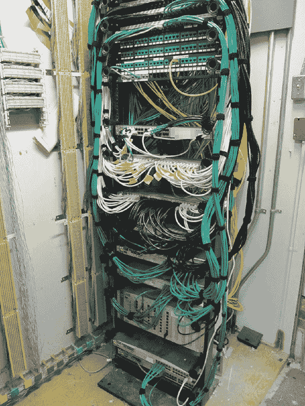

**FIGURE 10.1** A typical wiring closet  ¶ Source: [`www.flickr.com/photos/clonedmilkmen/4390901323/`](https://www.flickr.com/photos/clonedmilkmen/4390901323/)

布线间 closet 也常用于管理建筑的其他重要系统的布线，包括报警系统、断路器面板、电话压线端子、无线接入点以及视频系统（包括安防摄像头）。

布线间 closet 的安全至关重要。大部分安全措施集中在防止未经授权的物理进入上。如果未经授权的入侵者进入该区域，他们可能会窃取设备、拉断或切断电缆，甚至安装窃听装置。因此，布线间 closet 的安全政策应包括以下基本规则：

* 切勿将布线间 closet 用作普通存储区。
* 配备适当的锁具，可能包括生物识别功能。
* 保持区域整洁。
* 不得在该区域存放易燃物品。
* 设置视频监控，监控布线间 closet 内的活动。
* 使用门开关传感器记录出入。
* 仅向授权管理员提供钥匙。
* 定期对布线间 closet 的安全和内容物进行物理检查。
* 将布线间 closet 纳入组织的环境管理与监控体系，以确保适当的环境控制和监测，并及时发现如洪水或火灾等有害条件。

此外，还需向建筑管理方通报布线间 closet 的安全政策和访问限制，这将进一步降低未经授权的访问尝试。

布线间 closet 只是`电缆基础设施管理策略`的一个组成部分。电缆基础设施（cable plant）是由相互连接的电缆和中间设备（如交叉连接、配线板、交换机）组成的物理网络集合。电缆基础设施的组成部分包括：

* `入口设施`：也称为 demarcation point，这是建筑内部与外部提供商电缆连接的入口点。


* `设备室`：这是建筑的主布线间 closet，通常与入口设施相连或相邻。

* `骨干分布系统`：提供设备室与通信室之间的有线连接，包括跨楼层连接。

* `通信室`：也称为布线间 closet，满足楼层或大型建筑部分的连接需求，提供网络设备和布线系统空间，并作为骨干分布系统与水平分布系统的互连点。

* `水平分布系统`：提供通信室与工作区域的连接，通常包括布线、交叉连接块、配线板以及支持硬件基础设施（如电缆托盘、电缆挂钩和导管）。

# 服务器室/数据中心

`服务器室`、`数据中心`、`通信室`、`布线间 closet`、`服务器金库`和`IT 间 closet` 是受控、受限且受保护的房间，用于存放关键服务器和网络设备。集中式服务器室不需要兼容人类使用。事实上，服务器室越不人性化，越能提供对随意和有预谋攻击的更好防护。人性化不足可以通过引入 Halotron、PyroGen 或其他氧气置换型灭火系统（如 Halon 替代品）、低温、极少照明以及设备堆叠空间受限等方式实现。服务器室应设计以支持 IT 基础设施的最优运行，并阻止未经授权的人员进入或干预。

服务器室应位于建筑的核心位置。尽可能避免将其设在一楼、顶层或地下室。此外，服务器室应远离水、燃气和污水管线，以免发生泄漏或洪水，从而导致严重损坏和停机。

对于许多组织来说，其数据中心和服务器室是同一事物。对于一些组织而言，数据中心是一个外部位置，用于存放其大部分后端计算机服务器、数据存储设备和网络管理设备。这可能是一座位于主要办公区附近的独立建筑，也可能是一个远程位置。数据中心可能由您的组织独占和管理，也可能是从数据中心提供商处租用的服务。数据中心可能是单租户配置或多租户配置。无论哪种情况，除了服务器室的考虑因素外，许多其他概念通常也相关。

在许多数据中心和服务器室中，会采用各种技术控制措施作为访问控制机制来管理物理访问。这些措施包括，但不限于：智能/非智能卡、亲近读卡器、生物识别、入侵检测系统（IDSs）以及基于防御深度的设计。

## 智能卡

`智能卡`是与信用卡等大小的证件、徽章或安全通行证，内部嵌有磁条、条形码或集成电路芯片。它们包含持有者的授权信息，可用于识别或验证目的。部分智能卡甚至可以处理信息或在记忆芯片中存储合理数量的数据。智能卡可能被称作以下几种术语之一：

* 包含集成电路（ICs）的身份代币

* 处理器 IC 卡

* 具有 ISO 7816 接口的 IC 卡

智能卡常被视为完整的安全解决方案，但单靠它本身并不足以保障安全。正如任何单一的安全机制一样，智能卡也存在弱点和漏洞。智能卡可能受到物理攻击、逻辑攻击、特木马攻击或社会工程攻击的侵害。在大多数情况下，智能卡会在多因素配置中使用。因此，智能卡的盗窃或丢失不会导致轻易的冒充。与智能卡相关的最常见的多因素形式是要求输入个人识别码（PIN）。您可以在“管理身份和验证”第 13 章中找到关于智能卡的更多信息。

`记忆卡`是带有磁条的可机读身份证卡。与信用卡、借记卡或取款卡类似，记忆卡可以保留少量数据，但无法像智能卡那样处理数据。记忆卡通常作为一种两因素控制方式工作：卡片是“something you have”，而其个人识别码（PIN）是“something you know”。然而，记忆卡易于复制或复制，在安全环境中不足以用于身份验证。

## 亲近读卡器

除了智能/非智能卡外，亲近读卡器也可用于控制物理访问。`亲近读卡器`可以是被动设备、受场地供电的设备或发射器。亲近设备由授权持有者佩戴或携带。当它经过亲近读卡器时，读卡器能够确定持有者是谁以及其是否获准访问。被动设备会反射或改变读卡器产生的电磁场，读卡器通过这种改变来识别持有者。

被动设备没有主动电子元件；它仅是一个具有特定特性的小磁铁（类似于 DVD 上常见的防盗标签）。受场地供电的设备具有在进入读卡器生成的电磁场时会激活的电子元件。这些设备会从电磁场中获取电力来为自身供电（例如，只需将访问卡在读卡器几英寸内即可解锁门的卡片读取器）。发射器设备是自供电的，并向读卡器发送信号。这种信号可以持续发生，也可以仅在按下按钮时发生（例如，车库门开启器或汽车防盗钥匙扣）。

除了智能/非智能卡和亲近读卡器外，通过 `射频识别（RFID）` 或生物识别访问控制设备也可以管理物理访问。请参见第 13 章中关于生物识别设备的描述。这些设备以及其他设备（如电缆锁）可用于保护和保障设备。

## 入侵检测系统

`入侵检测系统（IDSs）`是自动或手动设计的，用于检测试图入侵、泄露或攻击；未经授权的进入/点；或在未经授权或异常时间发生的特定事件。用于监控物理活动的入侵检测系统可能包括安保人员、自动访问控制、运动探测器以及其他专用监测技术。这些内容将在后文的“运动探测器”和“入侵警报”部分中详细讨论。

物理入侵检测系统，也称为 `盗贼警报`，用于检测未经授权的活动并通知当局（内部安保或外部执法）。最常见的系统类型使用简单电路（即干触点开关），由在入口处的箔带组成，用于检测门或窗户是否被打开。

入侵检测机制只有在与入侵警报连接时才有用。（参见本章后续的“入侵警报”。）入侵警报用于通知当局关于物理安全 breaches（突破）的情况。

入侵检测和警报系统的任何一个方面都可能导致其失效：电源来源和通信方式。如果系统失去电源，警报将无法工作。因此，可靠的检测和警报系统需要电池备用，且储存的电力足以支撑 24 小时的运行。

如果通信线路被切断，警报可能无法工作，安全人员和紧急服务也将无法收到通知。因此，可靠的检测和警报系统应包含 `心跳传感器` 以监控线路。心跳传感器是一种机制，用于不断或周期性地通过测试信号检查通信路径。如果接收端检测到心跳信号失败，警报将自动触发。这两项措施均设计用于防止入侵者绕过检测和警报系统。

## 访问滥用

无论使用何种形式的物理访问控制，都必须部署安保人员或其他监控系统，以防止滥用、冒充和跟随进入。物理访问控制滥用的例子包括强行打开受保护的门以及绕过锁或访问控制。`冒充` 是使用他人的安全凭证进入设施。`跟随进入` 是在未经个人识别或授权的情况下，跟随他人通过受保护的闸门或门口。通过创建审计日志和保留访问日志，可以检测到此类滥用行为。

审计日志和访问日志是物理访问控制的有用工具，即使在没有电子系统的情况下也可能需要由安保人员手动创建。如果使用了足够的自动化访问控制机制（如智能卡和某些亲近读卡器），日志也可以自动生成。审计日志和访问日志中需要包含的重要元素包括：主体请求进入的时间、身份验证过程的结果以及受保护闸门保持打开的时间长度。除了使用电子或纸质轨迹外，还应考虑使用 `闭路电视（CCTV）` 或安保摄像头监控入口。CCTV 使您能够将审计日志和访问日志与事件的视觉记录进行比对。此类信息对于重建入侵、泄露或攻击的事件至关重要。

## 辐射安全

Many electrical devices emit electrical signals or radiation that can be intercepted by unauthorized individuals. These signals may contain confidential, sensitive, or private data. Obvious examples of emanation devices are wireless networking equipment and mobile phones, but many other devices are vulnerable to interception. Other examples include monitors, modems, and internal or external media drives (hard drives, USB thumb drives, CDs, and so on). With the right equipment, unauthorized users can intercept electromagnetic or radio frequency signals (collectively known as `emanations`) from these devices and interpret them to extract confidential data.

Clearly, if a device emits a signal that someone outside your organization can intercept, some security protection is needed. The types of countermeasures and safeguards used to protect against emanation attacks are known as TEMPEST countermeasures. `TEMPEST` was originally a government research study aimed at protecting electronic equipment from the electromagnetic pulse (EMP) emitted during nuclear explosions. It has since expanded to a general study of monitoring emanations and preventing their interception. Thus, TEMPEST is now a formal name for a broad category of activities.

TEMPEST countermeasures include Faraday cages, white noise, and control zones.

**Faraday Cage** `A Faraday cage` is a box, mobile room, or entire building designed with an external metal skin, often a wire mesh that fully surrounds an area on all sides (in other words, front, back, left, right, top, and bottom). This metal skin acts as an electromagnetic interference (EMI)-absorbing capacitor (which is why it’s named after Michael Faraday, a pioneer in the field of electromagnetism) that prevents electromagnetic signals (emanations) from exiting or entering the area that the cage encloses. Faraday cages are quite effective at blocking EM signals. In fact, inside an active Faraday cage, mobile phones do not work, and you can’t pick up broadcast radio or television stations.

**White Noise** `White noise` simply means broadcasting false traffic at all times to mask and hide the presence of real emanations. White noise can consist of a real signal from another source that is not confidential, a constant signal at a specific frequency, a randomly variable signal (such as the white noise heard between radio stations or television stations), or even a jam signal that causes interception equipment to fail. White noise is most effective when created around the perimeter of an area so that it is broadcast outward to protect the internal area where emanations may be needed for normal operations.

**Control Zone** A third type of TEMPEST countermeasure, a `control zone`, is simply the implementation of either a Faraday cage or white noise generation or both to protect a specific area in an environment; the rest of the environment is not affected. A control zone can be a room, a floor, or an entire building. Control zones are those areas where emanation signals are supported and used by necessary equipment, such as wireless networking, mobile phones, radios, and televisions. Outside the control zones, emanation interception is blocked or prevented through the use of various TEMPEST countermeasures.

## Media Storage Facilities

Media storage facilities should be designed to securely store blank media, reusable media, and installation media. Whether hard drives, flash memory devices, optical disks, or tapes, media should be controlled against theft and corruption. New blank media should be secured to prevent someone from stealing it or planting malware on it.

Media that is reused, such as thumb drives, flash memory cards, or portable hard drives, should be protected against theft and data remnant recovery. `Data remnants` are the remaining data elements left on a storage device after a standard deletion or formatting process. Such a process clears out the directory structure and marks clusters as available for use but leaves the original data in the clusters. A simple un-deletion utility or data recovery scanner can often recover access to these files. Restricting access to media and using secure wiping solutions can reduce this risk.

Installation media needs to be protected against theft and malware planting. This will ensure that when a new installation needs to be performed, the media is available and safe for use.

Here are some means of implementing secure media storage facilities:

* Store media in a locked cabinet or safe.

* Have a librarian or custodian who manages access to the locked media cabinet.

* Use a check-in/check-out process to track who retrieves, uses, and returns media from storage.

* For reusable media, when the device is returned, run a secure drive sanitization or `zeroization` (a procedure that erases data by replacing it with meaningless data such as zeroes) process to remove all data remnants.


Media can also be verified using a hash-based integrity check mechanism to ensure either that valid files remain valid or that a media has been properly and fully sanitized to retain no remnants of previous use.

For more security-intensive organizations, it may be necessary to place a security notification label on media to indicate its use classification or employ RFID/NFC asset tracking tags on media. It also might be important to use a storage cabinet that is more like a safe than an office supply shelf. Higher levels of protection could also include fire, flood, electromagnetic field, and temperature monitoring and protection.

### Evidence Storage

Evidence storage is quickly becoming a necessity for all businesses, not just law enforcement–related organizations. As cybercrime events continue to increase, it is important to retain logs, audit trails, and other records of digital events. It also may be necessary to retain image copies of drives or snapshots of virtual machines for future comparison. This may be related to internal corporate investigations or to law enforcement–based forensic analysis. In either case, preserving datasets that might be used as evidence is essential to the favorable conclusion to a corporate internal investigation or a law enforcement investigation of cybercrime.

Secure evidence storage is likely to involve the following:

* A dedicated storage system distinct from the production network
* Potentially keeping the storage system offline when not actively having new datasets transferred to it
* Blocking Internet connectivity to and from the storage system
* Tracking all activities on the evidence storage system
* Calculating hashes for all datasets stored on the system
* Limiting access to the security administrator and legal counsel
* Encrypting all datasets stored on the system

There may be additional security requirements for an evidence storage solution based on your local regulations, industry, or contractual obligations.

### Restricted and Work Area Security

The design and configuration of internal security, including work areas and visitor areas, should be considered carefully. There should not be equal access to all locations within a facility. Areas that contain assets of higher value or importance should have more restricted access. For example, anyone who enters the facility should be able to access the restrooms and the public telephone without going into sensitive areas, but only network administrators and security staff should have access to the server room. Valuable and confidential assets should be located in the heart or center of protection provided by a facility. In effect, you should focus on deploying concentric circles of physical protection. This type of configuration requires increased levels of authorization to gain access into more sensitive areas inside the facility.

墙体或隔断可用于分隔相似但不同的工作区域。此类分隔可阻止随意的“窥视”或窃听（`shoulder surfing` 是通过观察监视器或操作员使用键盘来获取系统信息的行为）。应使用从地板到天花板的墙体来分隔不同敏感度和保密级别的区域（在存在悬空或假天花板的情况下，墙体应将其切断，以提供更安全区域与较不安全区域之间的连续物理屏障）。

每个工作区域应像 IT 资产一样进行评估并分配分类。只有拥有相应清度或分类的个人才能被允许访问该区域。用途或功能不同的区域应分配不同的访问级别或限制。设备提供的访问资产越多，对该区域实施的限制就越重要，以控制谁可以进入以及允许执行哪些操作。

设施安全设计流程应支持内部安全的实施与运行。除了正确工作空间内人员的管理外，还应考虑访客及访客控制。若需对访客实施接待要求，以及应实施哪些其他访客控制措施？除基本的物理安全工具（钥匙、锁具）外，还应实施遮蔽门、视频监控、书面日志、安保人员以及 RFID 标签等机制。

一个安全或受限工作区的示例是 **Sensitive Compartmented Information Facility（SCIF）**。SCIF 通常由政府和军工承包商使用，以提供高度敏感数据的存储与计算安全环境。SCIF 的目的在于存储、查看和更新 **机密分级信息（SCI）**，这是一种受限制的信息类别。SCIF 的访问受到严格限制，仅允许具有特定业务需求并获授权访问其中数据的个人进入，通常由个人的清度级别和 SCI 批准级别决定。大多数情况下，SCIF 禁止在受控区域内使用或携带摄影、视频或其他录制设备。SCIF 可设在地面设施、飞行器或漂浮平台上，可为永久性结构或临时设施。SCIF 通常位于建筑内部，但整个建筑也可以作为 SCIF 实现。

### Utilities and HVAC Considerations

电力公司提供的电力并不总是稳定且干净。大多数电子设备需要干净的电力才能正常工作。由于电力波动导致的设备损坏十分常见。许多组织通过多种方式自行管理电力。`不间断电源 (UPS)` 是一种自充电的电池，可为敏感设备提供持续且干净的电力。UPS 的工作原理是从墙壁插座取电、存储于电池中、从电池中取出电力并供给连接的设备。通过向电池引入电流，它能够保持稳定的干净电力供应。这种设计称为 **双重转换 UPS**。UPS 还具备另一项功能，常作为卖点：在主电源失效后仍能提供连续电力。UPS 可根据其容量和所连接设备的功耗，持续供电数分钟至数小时。电网供电切换至电池供电的过程瞬间完成，不会影响设备的供电。

另一种 UPS 形式是 **线互动 UPS**。该系统在电网电源与设备之间加入浪涌保护、电池充电/逆变器以及电压调节器。在正常情况下电池不在线路中。若电网故障，电池逆变器和电压调节器会立即提供 uninterrupted power，确保设备不受断电影响。

电池备用或备用电池并不属于 UPS，因为在电网失效与切换至电池之间会出现短暂的完全断电（即使只是瞬间）。

为了防止设备因电力波动而受损，还可使用配备浪涌保护的电源插座。浪涌保护器内置保险丝，在电压变化足以损害设备前会先熔断。但一旦保险丝或断路器跳闸，电流将完全中断。只有在立即切断电力不会导致设备损失或数据丢失时才适用浪涌保护器；否则应使用 UPS。

如果在棕色出现或黑 outs（电力中断）期间需要保持业务连续性，则必须配备现场电力发电机。此类发电机在检测到电力故障时会自动启动。大多数发电机使用液体或气体燃料的储罐，且需妥善维护以确保可靠性。电力发电机被视为备用或交替电源。

电力问题层出不穷。以下是与电力相关的术语列表，供您了解：

* `Fault`: 电力的一瞬间中断
* `Blackout`: 完全的电力中断
* `Sag`: 电压瞬时下降
* `Brownout`: 持续的低电压
* `Spike`: 电压瞬时升高
* `Surge`: 持续的高电压
* `Inrush`: 连接电源时（无论是主电源还是备用/次级电源）的初始电流涌入
* `Noise`: 稳定的干扰性电力干扰或波动
* `Transient`: 短时线路噪声扰动
* `Clean`: 无波动的纯净电力
* `Ground`: 电路中接地的导线

在遇到电力问题时，首先需要确定故障发生的位置。若问题出现在计量器之外，则由电力公司负责修复；若发生在内部，则由您负责处理。

#### Noise

噪声不只会影响设备的运作，还会干扰通信、传输和播放的质量。由电流产生的噪声可影响任何依赖电磁传输机制的数据传输方式，如电话、蜂窝、电视、音频、无线电、网络等。

`电磁干扰 (EMI)` 有两种类型：`共模噪声` 与 `横向噪声`。`共模噪声` 是电源或工作设备的火线与地线之间的电位差产生的，而 `横向噪声` 是电源或工作设备的火线与中性线之间的电位差产生的。

`射频干扰 (RFI)` 是另一种噪声来源，可影响许多与 EMI 相同的系统。包括荧光灯、电力线、电热器、电脑、电梯、电机以及电磁体等常见电器会产生 RFI，因此在部署 IT 系统和基础设施时应尽量定位这些设备。

保护电源和设备免受噪声侵害是维持高效运作环境的关键。可采取的措施包括提供足够的电源调理、建立正确的接地、对所有电缆进行屏蔽、并限制 EMI 与 RFI 源的暴露。

#### Temperature, Humidity, and Static

除了电力考虑之外，维护环境还包括对暖通空调（HVAC）系统的控制。用于安置计算机的房间通常应保持在 60 至 75 华氏度（15 至 23 摄氏度）之间。然而，有些极端环境会将设备温度降至 50 华氏度，或保持在 90 华氏度以上。计算机房的湿度应保持在 40%至 60%之间。湿度过高会导致腐蚀，湿度过低会引起静电。即使在防静电地毯上，如果环境湿度较低，仍可能产生 20,000 伏的静电放电。正如你在`表 10.1`中所见，即使是最小程度的静电放电也会破坏电子设备。

**表 10.1** **静电电压与损害**

| 静电电压 | 可能的损害 |
| --- | --- |
| 40 | 破坏敏感电路和其他电子元件 |
| 1,000 | 扭曲显示器显示 |
| 1,500 | 破坏硬盘上存储的数据 |
| 2,000 | 系统突然关闭 |
| 4,000 | 打印机卡纸或元件损坏 |
| 17,000 | 永久电路损坏 |

#### 水患问题（如泄漏、洪水）

水患问题，如泄漏和洪水，应在你的环境安全政策和程序中加以处理。管道泄漏并非每日发生，但一旦发生，可能造成严重损害。

水与电不相容。如果你的计算机系统接触到水，尤其是在运行时，必然会损坏。此外，水与电的结合会对附近人员造成电击风险。尽可能，将服务器室、数据中心和关键计算机设备远离任何水源或输送管道。你也可以在关键系统周围的地板上安装水检测电路。水检测电路会在水侵入设备时发出警报并通知你。

为了最大限度地减少紧急情况，应熟悉截止阀和排水位置。除了监测管道泄漏外，你还应评估设施应对严重暴雨或附近洪水的能力。设施位于山丘还是山谷？是否有足够的排水？是否有洪水历史或积水积聚？服务器室是位于地下室还是一楼？

### 防火、检测与扑救

防火、检测与扑救不可忽视。保护人员安全应始终是任何安全或防护系统的首要目标。除了保护人员外，防火检测与扑救旨在将火灾、烟雾、热量以及扑救材料造成的损害降至最低，尤其是针对信息技术（IT）基础设施。

标准的防火培训包括对火三角（见`图 10.2`）的了解。火三角的三个角分别代表火、热和氧气，三者中心的交点代表这三种元素之间的化学反应。火三角的意义在于说明，如果你能从这四个要素中去除任何一种，火就能被扑灭。不同的灭火介质针对火三角的不同方面：

* 水能降低温度。
* 碱性洗涤剂和其他干粉（干粉或液体化学品）能切断燃料供应。
* 二氧化碳（CO₂）能切断氧气供应。
* 氟碳化物替代品和其他不易燃气体会干扰燃烧化学过程，或切断氧气供应。

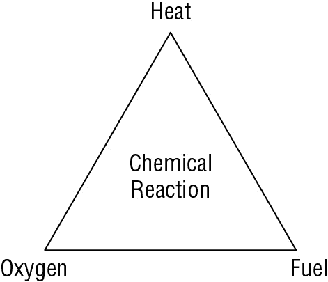

**图 10.2** 火三角

选择灭火介质时，需考虑其针对火三角的哪个方面，这个方面具体指什么，该介质通常的有效性如何，以及该介质对环境会产生什么影响。

除了理解火三角，你还应了解火灾的阶段。火灾经历多个阶段，`图 10.3` 描述了最关键的四个阶段。

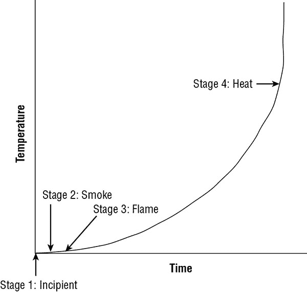

**图 10.3** 火灾四个主要阶段

**第一阶段：初期阶段** 此时仅有空气电离，没有烟雾。

**第二阶段：烟雾阶段** 在第二阶段，从点火处可见烟雾。

**第三阶段：火焰阶段** 此时肉眼可见火焰。

**第四阶段：热量阶段** 在第四阶段，火势已大幅发展，区域内温度剧升，所有物品均在燃烧。

火灾越早被检测，越容易扑灭，且其造成的损害及所使用的灭火介质也更少。

防火管理的翻译为**火灾管理**，其基本原则包括**人员意识培训**。所有人员应充分熟悉设施中的灭火机制。每个人也应熟悉至少两条从主要工作区域出发的撤离路线，并知道如何在设施内找到其他撤离路线。人员应接受灭火器的使用培训。其他应纳入火灾或一般应急培训的内容包括心肺复苏（CPR）、紧急关闭程序，以及预先确定的集合地点或安全验证机制（如语音信箱）。

#### 灭火器

了解在不同类型火灾中使用哪种灭火器至关重要。如果灭火器使用不当，或使用了不适用的灭火器类型，火灾可能会蔓延并加剧，而非被扑灭。灭火器仅在火势仍处于初期阶段时使用。`表 10.2` 列出了三种常见的灭火器类型。

**表 10.2** **灭火器类别**

| 类别 | 类型 | 灭火介质 |
| --- | --- | --- |
| A | 普通可燃物 | 水、碱性洗涤剂（干粉或液体化学品） |
| B | 液体 | 二氧化碳（CO₂）、氟碳化物（halon\*）、碱性洗涤剂 |
| C | 电气 | 二氧化碳（CO₂）、氟碳化物（halon\*） |
| D | 金属 | 干粉 |

\* 氟碳化物或经 EPA 批准的氟碳化物替代品

#### 防火检测系统

要有效保护设施免受火灾侵害，需要安装自动检测与灭火系统。目前有多种火灾检测系统类型。固定温度检测系统会在达到特定温度时触发灭火，通常通过熔化的金属或塑料部件（如喷头内的部件）或含化学品的玻璃瓶子气化并使容器过压来实现。升温速率检测系统会在温度变化速率达到特定水平时触发灭火。 flame-actuated（火焰启动）系统根据火焰的红外能量触发灭火。烟雾启动系统利用光电或放射电离传感器作为触发器。初期烟雾检测系统（也称为吸入传感器）能够在火势其他可检测迹象出现之前，检测出燃烧早期阶段典型的化学物质。

大多数火灾检测系统可与火灾应急响应通知机制连接。当灭火被触发时，这些联动系统会通过自动信息或警报联系当地消防救援队伍并请求援助。

为有效工作，烟雾报警器需要合理放置。不要忘记在下沉天花板和升高地板内、服务器室、私人办公室和公共区域、暖通空调通风口、升降机井道、地下室等位置放置烟雾报警器。

关于抑制机制的使用，它们可以基于水或基于火灾抑制气体系统。水在人类友好环境中很常见，而气体系统更适合于人员通常不居住的计算机室。

#### 水抑制系统

水抑制系统主要有四种类型：

* `wet pipe system`（也称为 `closed head system`）始终充满水。水在触发抑制时立即排出。
* `dry pipe system` 含有压缩空气。当抑制被触发后，空气排出，打开水阀，进而使管道充满并向环境中排放水。
* `deluge system` 是另一种干管系统的形式，使用更大的管道，因此能够输送更大体积的水。干管系统不适用于包含电子设备和计算机的环境。


`preaction system` 是干管/湿管系统的组合。系统在初期处于干管状态，直到检测到火灾的初期迹象（烟雾、热量等）后，管道才充满水。只有在喷头启动触发器因足够热量被熔化后，水才被释放。如果火势在喷头触发前被扑灭，管道可以手动排空并重置。这也允许在喷头触发前手动干预停止水的释放。此类系统最适合同时容纳电脑和人员的环境。

水基抑制系统中，`preaction system` 是最适合同时容纳电脑和人员的环境。

## 气体排放系统

`气体排放` 系统通常比水排放系统更有效。然而，气体排放系统不应在有人员存在的环境中使用，因为它们会排出空气中的氧气，对人员构成危险。它们使用加压气体抑制介质，如二氧化碳（CO2）、哈龙（halon）或 FM-200（哈龙替代品）。

哈龙是有效的火灾抑制剂（它通过破坏氧气与可燃物之间的化学反应来使火缺氧），但其在 900 华氏度时会分解成有毒气体。此外，它对环境不友好（是臭氧层消耗物质）。1994 年，美国环保局禁止在美国生产哈龙。进口 1994 年后制造的哈龙也是非法的。（哈龙 1301、哈龙 1211 和哈龙 2403 在发达国家已于 2003 年 12 月 31 日停止生产。）根据《蒙特利尔议定书》，可以通过联系哈龙回收设施获得哈龙。环保局致力于耗尽现有哈龙库存，以将该物质从流通中清除。

鉴于哈龙的诸多问题，它常被更环保、毒性更低的介质所取代。以下列表列出了多个经 EPA 批准的哈龙替代品（详情请参见 [`www.epa.gov/ozone/snap/fire/halonreps.html`](http://www.epa.gov/ozone/snap/fire/halonreps.html)）：

* `FM-200`（HFC-227ea）
* `CEA-410` 或 `CEA-308`
* `NAF-S-III`（HCFC Blend A）
* `FE-13`（HCFC-23）
* `Argon`（IG55）或 `Argonite`（IG01）
* `Inergen`（IG541）
* `Aero-K`（以微小的氧化钾颗粒形式的气溶胶）

你也可以用低压水雾取代哈龙替代品，但此类系统通常不适用于计算机室或电气设备存储设施。低压水雾是一种气雾，用于迅速降低区域温度。

## 损害

处理火灾探测和抑制包括应对火灾可能导致的污染和损害。火灾的破坏因素包括烟雾和热量，同时也包括抑制介质，如水或洗涤液。烟雾会损害大多数存储设备。热量会损害任何电子或计算机组件。例如，100 华氏度的温度会损害存储磁带，175 华氏度会损害计算机硬件（即中央处理器 `[CPU]` 和随机访问存储器 `[RAM]`），而 350 华氏度会损害纸制品（通过变形和变色）。

抑制介质可能导致短路、腐蚀，或使设备无法使用。所有这些问题在设计火灾应急系统时都必须予以考虑。

## 实施和管理物理安全

许多种类的物理访问控制机制可以部署在环境中，以控制、监控和管理对设施的访问。这些机制从威慑手段到检测手段不等。站点或设施内的各个部分、分区或区域应明确划分为公共、私有或受限区域。每种区域都需要独特且聚焦的物理访问控制、监控和防范机制。下面的章节讨论了多种可以用于将不同区域隔离、孤立并控制访问的机制，包括周界安全和内部安全。

### 周界安全控制

建筑物或校园的可进入性也很重要。单一入口虽然能提供安全，但多个入口在紧急疏散时更为有利。附近有哪些道路？哪些交通方式（火车、公路、机场、货运）容易获得？一天中交通流量如何？

请记住，可进入性也受到周界安全的制约。访问和使用的需求应与周界安全的实施和运行相协调。使用物理访问控制、监控进入离开的人员和设备，以及审计/记录所有物理事件，是维护整体组织安全的关键要素。

#### 围栏、闸门、闸机和人防（mantraps）

`围栏` 是定义周界的设备。围栏用于清晰区分受特定安全保护级别的区域和未受保护的区域。围栏可包括地面条纹、链条链网、带刺铁丝、混凝土墙，甚至使用激光、运动或热感应器的无形周界。不同类型的围栏对不同类型的入侵者有效：

* 3 到 4 英尺高的围栏能够阻止随意闯入者。
* 6 到 7 英尺高的围栏攀爬较困难，能够阻止大多数入侵者，除非是极为有决心的入侵者。
* 8 英尺或更高的围栏，配合三股带刺铁丝，能够阻止即使是最有决心的入侵者。

`闸门` 是围栏中的受控出入口。闸门的威慑等级必须与围栏的威慑等级相匹配，以保持整体效果。铰链和锁闭机构应能够抵御篡改、破坏或拆除。关闭的闸门不应创造额外的访问漏洞。尽量减少闸门数量。可由保安监控闸门。若没有保安保护，建议使用犬只或闭路电视（CCTV）进行监控。

`闸机`（见 Figure 10.4）是一种门禁形式，一次仅允许一人通过，并通常限制单向移动。它用于控制进入，或限制离开。闸机本质上是受保护的旋转门的围栏等效。

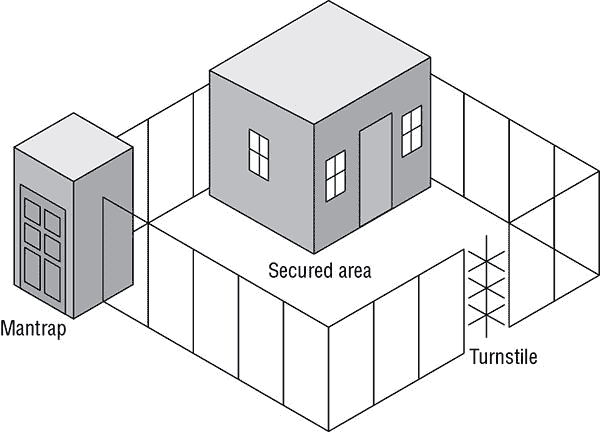

**FIGURE 10.4** A secure physical boundary with a mantrap and a turnstile

-   [双层门套件]是一种常见的门禁结构，通常由门卫（如`Figure 10.4`）或其他物理布局保护，以防止尾随进入并可在安保人员的指示下将个人困在门内。套件的目的是在身份和身份验证完成前使主体无法移动。如果主体获准进入，内门打开，允许进入设施或场所。如果主体未获准，两扇门保持关闭并锁定，直至安保人员（通常是门卫或警察）到达现场将主体带离属地或因侵入而逮捕（此称为*延迟功能*）。套件通常还包括一个防止尾随或跟随的装置。

### Lighting

`Lighting`是常用的周界安全控制形式。灯光的主要目的是劝阻随意入侵者、越界者、徘徊者或想在黑暗中进行非法行为的人。然而，灯光本身不是强有力的威慑。除非在威胁等级较低的区域，否则不应将其作为主要或唯一的保护机制。

灯光不应照亮守卫、犬只、巡逻站或其他类似安保要素的位置。应将灯光与守卫、犬只、闭路电视或其他入侵检测或监控机制结合使用。灯光必须不会给附近的居民、道路、铁路、机场等带来滋扰或问题。同时，灯光绝不能导致守卫、犬只或监测设备出现眩光或反射干扰，这可能在破门时帮助攻击者。

通常认为，用于周界保护的灯光应使关键区域达到每英尺两英尺烛光（foot-candles）的照度标准。另一个常见问题是灯光的布局。标准似乎表明，灯杆之间的间距应与照明元件所覆盖的区域直径相同。因此，如果照明区域直径为 40 英尺，灯杆间距也应为 40 英尺。

### Security Guards and Dogs

所有物理安全控制，无论是静态威慑还是主动检测与监控机制，最终都依赖人员进行干预以阻止实际的侵入和袭击。安保人员的职责正是为此。安保人员可以布置在周界外或内部，监控出入口或观察监控画面。安保人员的真正优势在于他们能够适应并应对各种情况或环境。他们能够学习并识别攻击和入侵的行为模式，在环境变化时进行调整，并作出决策和判断。当现场需要即时处理和决策时，安保人员通常是合适的安全控制手段。

遗憾的是，使用安保人员并非完美解决方案。部署、维护和依赖安保人员存在诸多缺点。并非所有环境和设施都适合部署安保人员，这可能是因为人与人之间的不兼容性，或设施的布局、设计、位置和结构所致。并非所有安保人员本身可靠。预筛选、保险和培训并不能保证不会出现无效或不可靠的安保人员。

即使安保人员最初可靠，他们也会因身体伤害或疾病、休假、分心、易受社交工程攻击，甚至因药物滥用而失业。此外，安保人员的保护通常只能到他们生命受到威胁时为止。此外，安保人员通常不了解设施内部操作的全貌，因此不足以应对每种情况。最后，安保人员费用昂贵。

守卫犬可以作为安保人员的替代方案。它们可以作为周界安全控制被部署。作为检测和威慑手段，犬只极为有效。然而，犬只成本高昂，需要高水平的维护，并且对保险和责任提出严格要求。

### Internal Security Controls

如果设施采用受限区域来控制物理安全，则需要一个处理访客的机制。通常会指派一名随行人员，并严格监控其进入权限和活动。未能在允许进入受保护区域时跟踪外来人员的行为，可能导致对最受保护资产的恶意行为。访客控制还可以利用钥匙、组合锁、徽章、运动传感器、入侵警报等手段。

#### Keys and Combination Locks

锁具用于保持门关闭。它们的设计和部署旨在阻止未经授权的所有人员进入。一个*锁*是一种粗糙的身份和授权机制。如果你持有正确的钥匙或组合，即被视为已获授权并允许进入。基于钥匙的锁具是最常见且最经济的物理访问控制设备，通常称为*预设锁*。这类锁具易于被撬，属于一种称为*针脚*（shimming）的锁机制攻击类别。

可编程或组合锁具的控制范围比预设锁具更广。一些可编程锁具可以配置多个有效访问组合，或采用键盘、智能卡或密码设备等数字或电子控制方式。例如，*电子访问控制（EAC）锁*包含三个要素：电磁体用于保持门关闭、凭证阅读器用于验证主体身份并使电磁体失效，以及传感器在门关闭时重新激活电磁体。

锁具可作为安保人员的替代，用于周界入口的访问控制设备。闸门或门可以由安保人员在验证身份后开启，或锁具本身即为验证装置，也负责授予或限制进入。

#### Badges

*Badges*、*身份证*和*安全证*是物理身份识别或电子访问控制设备的形式。徽章可以是简单的姓名标签，指示你是合格员工还是访客。也可以是带有多因素认证的智能卡或令牌设备，用于验证并证明你的身份，并提供对设施、特定房间或受保护工作站的访问权限。徽章通常包含照片、磁条（含编码数据）以及个人信息，帮助安保人员通过比对照片和查阅纸质或电子名单来核实身份。

徽章可用于物理访问主要由安保人员控制的环境中，此时徽章作为视觉识别工具供守卫使用。守卫可通过比对照片与本人，并查阅授权人员名单（纸质或电子）来核实你的身份及访问权限。

-   [徽章](https://wiki.example.org/feynmans_learning_method)也可在受扫描设备保护的环境中使用，而非安保人员。在这种情况下，徽章可用于**识别**或**验证**。当徽章用于**识别**时，需在设备上刷卡，然后徽章持有者必须提供一种或多种**验证因素**，例如密码、密语或生物特征（如果使用生物识别设备）。当徽章用于**验证**时，徽章持有者需提供**ID**、**用户名**等信息，然后刷卡进行验证。

#### Motion Detectors

A *motion detector*, or *motion sensor*, is a device that senses movement or sound in a specific area. Many types of motion detectors exist, including infrared, heat, wave pattern, capacitance, photoelectric, and passive audio.

*   An *infrared motion detector* monitors for significant or meaningful changes in the infrared lighting pattern of a monitored area.
*   A *heat-based motion detector* monitors for significant or meaningful changes in the heat levels and patterns in a monitored area.
*   A *wave pattern motion detector* transmits a consistent low ultrasonic or high microwave frequency signal into a monitored area and monitors for significant or meaningful changes or disturbances in the reflected pattern.
*   A *capacitance motion detector* senses changes in the electrical or magnetic field surrounding a monitored object.
*   A *photoelectric motion detector* senses changes in visible light levels for the monitored area. Photoelectric motion detectors are usually deployed in internal rooms that have no windows and are kept dark.
*   A *passive audio motion detector* listens for abnormal sounds in the monitored area.

#### Intrusion Alarms

Whenever a motion detector registers a significant or meaningful change in the environment, it triggers an alarm. An *alarm* is a separate mechanism that triggers a deterrent, a repellent, and/or a notification.

**Deterrent Alarms** Alarms that trigger deterrents may engage additional locks, shut doors, and so on. The goal of such an alarm is to make further intrusion or attack more difficult.

**Repellant Alarms** Alarms that trigger repellants usually sound an audio siren or bell and turn on lights. These kinds of alarms are used to discourage intruders or attackers from continuing their malicious or trespassing activities and force them off the premises.

**Notification Alarms** Alarms that trigger notification are often silent from the intruder/attacker perspective but record data about the incident and notify administrators, security guards, and law enforcement. A recording of an incident can take the form of log files and/or CCTV tapes. The purpose of a silent alarm is to bring authorized security personnel to the location of the intrusion or attack in hopes of catching the person(s) committing the unwanted or unauthorized acts.

Alarms are also categorized by where they are located: local, centralized or proprietary, or auxiliary.

**Local Alarm System** *Local alarm systems* must broadcast an audible (up to 120 decibel [db]) alarm signal that can be easily heard up to 400 feet away. Additionally, they must be protected from tampering and disablement, usually by security guards. For a local alarm system to be effective, there must be a security team or guards positioned nearby who can respond when the alarm is triggered.

**Central Station System** The alarm is usually silent locally, but offsite monitoring agents are notified so they can respond to the security breach. Most residential security systems are of this type. Most central station systems are well-known or national security companies, such as Brinks and ADT. A *proprietary system* is similar to a central station system, but the host organization has its own onsite security staff waiting to respond to security breaches.


**Auxiliary Station** *Auxiliary alarm systems* can be added to either local or centralized alarm systems. When the security perimeter is breached, emergency services are notified to respond to the incident and arrive at the location. This could include fire, police, and medical services.

Two or more of these types of intrusion and alarm systems can be incorporated in a single solution.

#### Secondary Verification Mechanisms

When motion detectors, sensors, and alarms are used, secondary verification mechanisms should be in place. As the sensitivity of these devices increases, false triggers occur more often. Innocuous events such as the presence of animals, birds, bugs, or authorized personnel can trigger false alarms. Deploying two or more detection and sensor systems and requiring two or more triggers in quick succession to occur before an alarm is issued may significantly reduce false alarms and increase the likelihood that alarms indicate actual intrusions or attacks.

CCTV is a security mechanism related to motion detectors, sensors, and alarms. However, CCTV is not an automated detection-and-response system. CCTV requires personnel to watch the captured video to detect suspicious and malicious activities and to trigger alarms. Security cameras can expand the effective visible range of a security guard, therefore increasing the scope of the oversight. In many cases, CCTV is not used as a primary detection tool because of the high cost of paying a person to sit and watch the video screens. Instead, it is used as a secondary or follow-up mechanism that is reviewed after a trigger from an automated system occurs. In fact, the same logic used for auditing and audit trails is used for CCTV and recorded events. A CCTV is a preventive measure, whereas reviewing recorded events is a detective measure.

#### Environment and Life Safety

An important aspect of physical access control and maintaining the security of a facility is protecting the basic elements of the environment and protecting human life. In all circumstances and under all conditions, the most important aspect of security is protecting people. Thus, preventing harm to people is the most important goal for all security solutions.

Part of maintaining safety for personnel is maintaining the basic environment of a facility. For short periods of time, people can survive without water, food, air conditioning, and power. But in some cases, the loss of these elements can have disastrous results, or they can be symptoms of more immediate and dangerous problems. Flooding, fires, release of toxic materials, and natural disasters all threaten human life as well as the stability of a facility. Physical security procedures should focus on protecting human life and then on restoring the safety of the environment and restoring the utilities necessary for the IT infrastructure to function.

People should always be your top priority. Only after personnel are safe can you consider addressing business continuity. Many organizations adopt occupant emergency plans (OEPs) to guide and assist with sustaining personnel safety in the wake of a disaster. The OEP provides guidance on how to minimize threats to life, prevent injury, manage duress, handle travel, provide for safety monitoring, and protect property from damage due to a destructive physical event. The OEP does not address IT issues or business continuity, just personnel and general property. The business continuity plan (BCP) and disaster recovery plan (DRP) address IT and business continuity and recovery issues.

#### Privacy Responsibilities and Legal Requirements

The safety of personal information also needs to be addressed in any organization’s security policy. In addition, the security policy must conform to the regulatory requirements of the industry and jurisdictions in which it is active.

*Privacy*的意思是保护个人信息不被未经授权的个人或实体披露。在当今的在线世界中，公共信息与私人信息之间的界限往往模糊不清。例如，关于你上网习惯的信息是私有的还是公开的？这种信息可以在未经你同意的情况下合法收集吗？收集该信息的组织可以将其出售获利，而你并不分享这部分收益吗？此外，你的个人信息还包括更多内容：你是谁（姓名、地址、电话、种族、宗教、年龄等），健康和医疗记录，财务记录，甚至刑事或法律记录。总体而言，这类信息属于个人可识别信息（PII），如美国国家标准与技术研究院（NIST）在《保护个人可识别信息（PII）机密性指南》（Guide to Protecting the Confidentiality of Personally Identifiable Information (PII)）中所述，可在线查阅：[`csrc.nist.gov/publications/detail/sp/800-122/final`](https://csrc.nist.gov/publications/detail/sp/800-122/final)。

处理隐私问题是任何拥有员工的组织的要求，因此隐私是所有组织的核心议题。保护隐私应作为任何组织安全政策中设定的核心使命或目标。

《通用数据保护条例》（GDPR）Regulation (EU) 2016/679 是一项聚焦于保护公民及其权利和对个人数据控制的欧盟法规。虽然美国没有与之相当的法律体系来保护美国公民，但许多美国公司采用部分 GDPR 条款，以吸引和保留员工和客户，并获得在欧盟地区运营的资格。

GDPR 及其他许多与人员隐私相关的议题在“第 4 章：法律、法规与合规”中讨论得更为详尽。

### 监管要求

每个组织都在特定的行业和司法管辖区内运营。这两类实体（以及可能的其他实体）会对组织在其管辖范围内的做法施加法律要求、限制和规定。这些*法律要求*可适用于软件的授权使用、招聘限制、敏感材料的处理以及安全法规的合规性。

遵守所有适用的法律要求是维持安全的关键部分。该行业和国家（通常也包括州和城市）的法律要求必须被视为构建其余安全基础设施的基线或根基。

## 总结

如果你无法控制物理环境，任何行政或技术/逻辑访问控制都无法提供足够的安全保障。如果恶意人员获得对你设施或设备的物理访问，他们即可随意对其进行破坏、披露或篡改。

实施和维护物理安全涉及多个要素。其中核心要素之一是选择或设计用于托管 IT 基础设施和组织运营的设施。你需要先制定一份明确组织安全需求的计划，并强调采用的安全方法或机制。该计划通过所谓的**关键路径分析**过程开发而成。

用于管理物理安全的安全控制可分为三类：**行政、技术和物理**。行政物理安全控制包括设施建设与选择、场地管理、人员控制、意识培训以及应急响应与程序。技术物理安全控制包括访问控制、入侵检测、警报、闭路电视（CCTV）、监控、暖通空调（HVAC）、电源供应以及火灾检测与抑制。物理安全控制的实例包括围栏、照明、锁具、建筑材料、人防通道、警犬和保安人员。

在环境中部署用于控制、监控和管理对设施访问的众多物理访问控制机制，种类从抑制手段到检测手段不等。它们可以是围栏、闸门、闸机、人防通道、照明、保安人员、保安警犬、钥匙锁、组合锁、徽章、运动检测器、传感器以及警报。

最常用于管理物理访问的技术控制包括**智能卡/笨卡**和**生物特征识别**。除了访问控制，物理安全机制还可以采取审计轨迹、访问日志和入侵检测系统的形式。

布线间 closet 和服务器室是重要的基础设施元素，需要得到保护。它们通常容纳核心网络设备和其他敏感设备。保护措施包括适当的锁具、监控、访问控制以及定期的物理检查。

媒体存储的安全应包括图书馆借阅系统、存放在上锁的柜子或保险箱中，以及对可重复使用媒体进行**消磁或销毁**（sanitization）。

保护基本环境要素和人类生命是物理访问控制及设施安全维护的重要方面。在任何情况下、任何条件下，安全的首要目标是**保护人**。防止伤害是所有安全解决方案的最高追求。提供干净的电源并管理环境同样重要。

**火灾检测与抑制**不可忽视。除了保护人员外，火灾检测与抑制旨在将火灾、烟雾、热量及抑制剂造成的损害（尤其是对 IT 基础设施）降至最低。

**人永远是首要考虑对象**。只有在人员安全确保后，才能考虑业务连续性。

### 考试要点

**理解物理安全的必要性。** 缺乏对物理环境的控制，任何行政或技术/逻辑访问控制都无法提供足够的安全保障。如果恶意人员能够物理接触你的设施或设备，他们几乎可以做任何事，从破坏到信息披露和篡改。

**能够列举行政物理安全控制。** 例如：设施建设与选择、场地管理、人员控制、意识培训、应急响应与程序。

**能够列举技术物理安全控制。** 技术物理安全控制包括访问控制、入侵检测、警报、闭路电视（CCTV）、监控、暖通空调（HVAC）、电源供应以及火灾检测与抑制。

**能够命名物理安全控制。** 物理安全控制包括围栏、照明、锁具、建筑材料、人防通道、警犬和保安人员。

**了解控制的功能顺序。** 顺序为：抑制 → 否认 → 检测 → 延迟。

**了解在选择和设计设施时的关键要素。** 选择设施时的关键要素有：可见性、周边区域的构成、区域可达性以及自然灾害的影响。设计设施时的关键要素是：明确组织所需的安全级别并在此前规划好。

**了解如何设计和配置安全工作区。** 设施内各区域的访问权限不应相同。包含高价值或重要资产的区域应受到限制性访问。贵重且机密的资产应位于设施提供的核心保护范围内。此外，集中式服务器或计算机室通常不设计为人性化环境。

1. 哪种设备可以定义组织的边界，同时也能阻止随意闯入？

2. 使用哈龙（halon）的灭火技术存在什么问题？

3. 消防部门的紧急访问可能留下哪些潜在问题？

4. 以下哪项是最重要的安全方面？
   1. 物理安全
   2. 入侵检测
   3. 逻辑安全
   4. 意识培训

5. 哪种方法可以用于绘制组织为新设施制定需求的图表？
   1. 日志审计
   2. 关键路径分析
   3. 风险分析
   4. 清单

6. 哪个基础设施组件通常位于多个楼层的相同位置，以便方便地连接楼层级网络？
   1. 服务器室
   2. 布线间
   3. 数据中心
   4. 媒体柜

7. 以下哪项不是设施或场地的以安全为导向的设计要素？
   1. 工作区和访客区的分离
   2. 对价值或重要性更高区域的受限访问
   3. 价值或重要性资产位于设施的核心或中心位置
   4. 设施内所有位置均提供平等访问

8. 哪项条件不需要满足，以保持服务器室的最高效率和安全性？
   1. 它必须是人性化的。
   2. 它必须使用非水基灭火剂。
   3. 湿度必须保持在 40%到 60%之间。
   4. 温度必须保持在 60 到 75 华氏度之间。

9. 下列哪项*不是*针对包含可重复使用的可移除媒体的媒体存储设施实施的典型安全措施？
   1. 雇佣图书管理员或看守
   2. 使用检查入/检查出流程
   3. 哈希
   4. 使用消毒工具对返回的媒体进行处理

10. 下列哪项是一组双门，通常由警卫保护，用于在身份和身份验证确认之前将主体关闭？
    1. 门
    2. 闸门
    3. 安全舱
    4. 近距离探测器

11. 最常见的周边安全设备或机制形式是什么？
    1. 安全警卫
    2. 围栏
    3. CCTV
    4. 照明

12. 下列哪项*不是*使用安全警卫的缺点？
    1. 安全警卫通常不了解设施内操作范围。
    2. 并非所有环境和设施都支持安全警卫。
    3. 并非所有安全警卫本身可靠。
    4. 预筛选、背景调查和培训并不能保证安全警卫有效且可靠。

13. 水基灭火系统最常见的故障原因是什么？
    1. 水量不足
    2. 人
    3. 电离探测器
    4. 探测器安装在下沉天花板中

14. 最常见且最便宜的物理访问控制设备形式是什么？
    1. 照明
    2. 安全警卫
    3. 钥匙锁
    4. 围栏

15. 哪种类型的运动探测器会感知被监测对象周围的电场或磁场的变化？
    1. 电磁波
    2. 光电
    3. 热量
    4. 电容

16. 下列哪项*不是*典型的物理安全警报类型？
    1. 预防性
    2. 遏制性
    3. 反弹性
    4. 通知性

17. 无论使用哪种形式的物理访问控制，必须部署安全警卫或其他监控系统来防止除以下哪项之外的所有情况？
    1. 背包客
    2. 间谍活动
    3. 冒充
    4. 滥用

18. 所有安全解决方案的最重要目标是什么？
    1. 信息披露的预防
    2. 完整性的维护
    3. 人员安全
    4. 可用性的持续

19. 计算机室的理想湿度范围是？
    1. 20–40 百分比
    2. 40–60 百分比
    3. 60–75 百分比
    4. 80–95 百分比

20. 静电何种电压水平会破坏硬盘上存储的数据？
    1. 4,000
    2. 17,000
    3. 40
    4. 1,500

21. Type B 灭火器可能使用以下所有*除*以下哪种灭火介质？
    1. 水
    2. CO₂


3. Halon 或可接受的 Halon 替代品

4. 硫酸盐

19. 计算机设施最适合的水基灭火系统类型是什么？

    1. 湿管系统
    2. 干管系统
    3. 预作动系统
    4. 洒水系统

20. 哪项通常*不是*火灾触发灭火系统后对计算机设备造成损害的罪魁祸首？

    1. 热量
    2. 灭火介质
    3. 烟雾
    4. 光线

# Chapter 11 安全网络架构和网络组件的保护

**本章涵盖的 CISSP 考试主题包括：**

* ** 第 4 项：通信与网络安全**
  * 4.1 在网络架构中实施安全设计原则
    * 4.1.1 开放系统互连 (OSI) 和传输控制协议/互联网协议 (TCP/IP) 模型
    * 4.1.2 互联网协议 (IP) 网络
    * 4.1.3 多层协议的影响
    * 4.1.4 融合协议
    * 4.1.5 软件定义网络
    * 4.1.6 无线网络
  * 4.2 安全网络组件
    * 4.2.1 硬件的运作
    * 4.2.2 传输媒介
    * 4.2.3 网络访问控制 (NAC) 设备
    * 4.2.4 端点安全
    * 4.2.5 内容分发网络


计算机和网络是由通信设备、存储设备、处理设备、安全设备、输入设备、输出设备、操作系统、软件、服务、数据和人员集成而成的。本章以网络的开放系统互连 (OSI) 模型为指导原则，讨论网络、布线、无线连接、传输控制协议/互联网协议 (TCP/IP) 及相关协议、网络设备以及防火墙。

通信与网络安全领域涉及网络组件（即网络设备和协议）的功能及其与安全的相关性。该领域在本章和第 12 章“安全通信与网络攻击”中讨论。务必阅读并学习这两章的材料，以确保为 CISSP 认证考试提供完整覆盖。

## OSI 模型

计算机通过网络进行通信是由协议实现的。一个 *协议* 是一组规则和限制，定义了数据在网络介质（如扭绞线电缆、无线传输）上如何传输。早期网络发展时，许多公司使用自有的专有协议，这导致不同厂商计算机之间的交互往往困难甚至不可能。为消除此问题，国际标准化组织 (ISO) 在 1980 年代初开发了 *开放系统互连 (OSI) 参考模型* 用于协议。具体来说，ISO 7498 定义了 OSI 参考模型（更常被称为 OSI 模型）。理解 OSI 模型及其在网络设计、部署和安全中的作用对于准备 CISSP 考试至关重要。

要在网络架构中正确实施安全设计原则，必须充分了解计算机通信涉及的所有技术。从硬件和软件到协议、加密及其他方面，细节繁多，标准众多，程序需遵循。此外，安全网络架构和设计的基础是对 OSI 和 TCP/IP 模型以及一般 IP 网络的深入了解。

### OSI 模型的历史

OSI 模型并非第一个或唯一尝试简化网络协议或建立共同通信标准的尝试。事实上，当今最广泛使用的协议 TCP/IP（基于 *DARPA 模型*，即现在的 *TCP/IP 模型*）是在 1970 年代初开发的。OSI 模型是在 1970 年代末开发的。

OSI 协议旨在建立一个所有计算机系统之间的共同通信结构或标准。实际的 OSI 协议从未被广泛采用，但其背后的理论和 OSI 模型本身被广泛接受。OSI 模型作为一种抽象框架，理论上描述了理想硬件环境下协议应如何运作。因此，OSI 模型成为所有协议比较和对比的公共参考点。

### OSI 的功能性

The OSI model divides networking tasks into seven distinct layers. Each layer is responsible for performing specific tasks or operations for the ultimate goal of supporting data exchange (in other words, network communication) between two computers. The layers are always numbered from bottom to top (see Figure 11.1). They are referred to by either their name or their layer number. For example, layer 3 is also known as the Network layer. The layers are ordered specifically to indicate how information flows through the various levels of communication. Each layer communicates directly with the layer above it as well as the layer below it, plus the peer layer on a communication partner system.

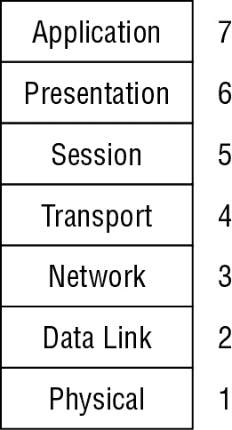

**FIGURE 11.1** Representation of the OSI model 

The OSI model is an open network architecture guide for network product vendors. This standard, or guide, provides a common foundation for the development of new protocols, networking services, and even hardware devices. By working from the OSI model, vendors are able to ensure that their products will integrate with products from other companies and be supported by a wide range of operating systems. If all vendors developed their own networking framework, interoperability between products from different vendors would be next to impossible.

The real benefit of the OSI model is its expression of how networking actually functions. In the most tangible sense, network communications occur over a physical connection (whether that physical connection is electrons over copper, photons over fiber, or radio signals through the air). Physical devices establish channels through which electronic signals can pass from one computer to another. These physical device channels are only one type of the seven logical communication types defined by the OSI model. Each layer of the OSI model communicates via a logical channel with its peer layer on another computer. This enables protocols based on the OSI model to support a type of authentication by being able to identify the remote communication entity as well as authenticate the source of the received data.

### Encapsulation/Deencapsulation

Protocols based on the OSI model employ a mechanism called encapsulation. *Encapsulation* is the addition of a header, and possibly a footer, to the data received by each layer from the layer above before it’s handed off to the layer below. As the message is encapsulated at each layer, the previous layer’s header and payload combine to become the payload of the current layer. Encapsulation occurs as the data moves down through the OSI model layers from Application to Physical. The inverse action occurring as data moves up through the OSI model layers from Physical to Application is known as *deencapsulation*. The encapsulation/deencapsulation process is as follows:

1. The Application layer creates a message.

2. The Application layer passes the message to the Presentation layer.

3. The Presentation layer encapsulates the message by adding information to it. Information is usually added only at the beginning of the message (called a header); however, some layers also add material at the end of the message (called a footer), as shown in Figure 11.2.

4. The process of passing the message down and adding layer-specific information continues until the message reaches the Physical layer.

5. At the Physical layer, the message is converted into electrical impulses that represent bits and is transmitted over the physical connection.

6. The receiving computer captures the bits from the physical connection and re-creates the message in the Physical layer.

7. The Physical layer converts the message from bits into a Data Link frame and sends the message up to the Data Link layer.

8. The Data Link layer strips its information and sends the message up to the Network layer.

9. This process of deencapsulation is performed until the message reaches the Application layer.

10. When the message reaches the Application layer, the data in the message is sent to the intended software recipient.

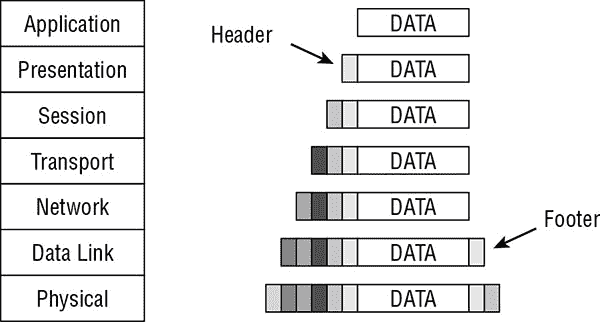

**FIGURE 11.2** Representation of OSI model encapsulation

The information removed by each layer contains instructions, checksums, and so on that can be understood only by the peer layer that originally added or created the information (see Figure 11.3). This information is what creates the logical channel that enables peer layers on different computers to communicate.

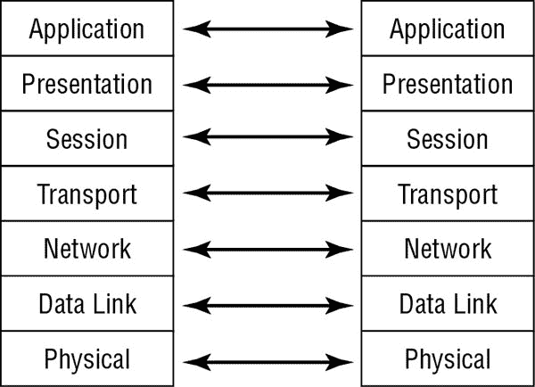

**FIGURE 11.3** Representation of the OSI model peer layer logical channels 

The message sent into the protocol stack at the Application layer (layer 7) is called the data stream. It retains the label of data stream (or sometimes the label of *protocol data unit \[PDU\]* is applied) until it reaches the Transport layer (layer 4), where it is called a *segment* (TCP protocols) or a *datagram* (User Datagram Protocol \[UDP\] protocols). In the Network layer (layer 3), it is called a *packet*. In the Data Link layer (layer 2), it is called a *frame*. In the Physical layer (layer 1), the data has been converted into *bits* for transmission over the physical connection medium. Figure 11.4 shows how each layer changes the data through this process.

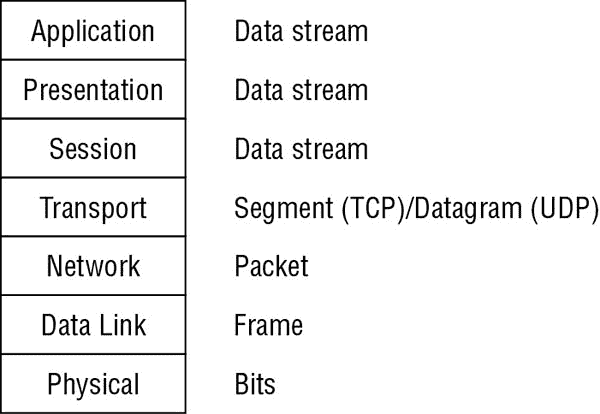

**FIGURE 11.4** OSI model data names 

### OSI Layers

Understanding the functions and responsibilities of each layer of the OSI model will help you understand how network communications function, how attacks can be perpetrated against network communications, and how security can be implemented to protect network communications. We discuss each layer, starting with the bottom layer, in the following sections.


## OSI模型

**Remember the OSI** To make the most of the OSI, you must first be able to remember the names of the seven layers in their proper order. One common method of memorizing them is to create a mnemonic from the initial letters of the layer names so they are easier to remember. One of our favorites is Please Do Not Teach Surly People Acronyms. Do take note that this memorization mnemonic works from the Physical layer up to the Application layer. A mnemonic working from the Application layer down is All Presidents Since Truman Never Did Pot. There are many other OSI memorization schemes out there; just be sure you know whether they are top-down or bottom-up.

### Physical Layer

The `Physical layer (layer 1)` accepts the frame from the Data Link layer and converts the frame into bits for transmission over the physical connection medium. The Physical layer is also responsible for receiving bits from the physical connection medium and converting them into a frame to be used by the Data Link layer.

The Physical layer contains the device drivers that tell the protocol how to employ the hardware for the transmission and reception of bits. Located within the Physical layer are electrical specifications, protocols, and interface standards such as the following:

*   EIA/TIA-232 and EIA/TIA-449

*   X.21

*   High-Speed Serial Interface (HSSI)

*   Synchronous Optical Networking (SONET)

*   V.24 and V.35

Through the device drivers and these standards, the Physical layer controls throughput rates, handles synchronization, manages line noise and medium access, and determines whether to use digital or analog signals or light pulses to transmit or receive data over the physical hardware interface.

网络硬件设备在层 1（物理层）运行，包括网络接口卡（NIC）、集线器、中继器、集中器和放大器。这些设备执行基于硬件的信号操作，例如将信号从一个连接端口广播到所有其他端口（集线器）或放大信号以支持更长的传输距离（中继器）。

### 数据链路层

`数据链路层（层 2）`负责将网络层的数据包格式化为适当的传输格式。正确的格式由硬件和网络技术决定。有很多可能性，如 `以太网 (IEEE 802.3)`、`环形令牌 (IEEE 802.5)`、`异步传输模式 (ATM)`、`光纤分布式数据接口 (FDDI)` 和 `铜线 DDI (CDDI)`。然而，只有以太网在现代网络中仍是数据链路层的常用技术。数据链路层包含将数据包转换为正确格式帧的技术特定协议。帧格式化后，将其发送到物理层进行传输。

下面的列表包含数据链路层中一些协议：

*   `串行线路互联协议 (SLIP)`

*   `点对点协议 (PPP)`

*   `地址解析协议 (ARP)`

*   `层 2 转发 (L2F)`

*   `层 2 隧道协议 (L2TP)`

*   `点对点隧道协议 (PPTP)`

*   `集成业务数字网 (ISDN)`

在数据链路层内部对数据的处理包括在帧中添加硬件源和目的地址。硬件地址是 `媒体访问控制 (MAC) 地址`，它是一个 6 字节（48 位）二进制地址，用十六进制表示（例如，`00-13-02-1F-58-F5`）。地址的前 3 字节（24 位）表示物理网络接口的供应商或制造商。这称为 `组织唯一标识符 (OUI)`。OUI 通过 IEEE 注册，IEEE 控制其发行。OUI 可用于通过 IEEE 网站 `http://standards.ieee.org/regauth/oui/index.shtml` 发现 NIC 的制造商。地址的后 3 字节（24 位）是制造商为该接口分配的唯一数字。在同一本地以太网广播域内，没有两个设备可以拥有相同的 MAC 地址；否则会发生地址冲突。确保私营企业网络中所有 MAC 地址唯一也是良好做法。虽然 MAC 地址的设计旨在确保唯一性，但供应商错误会导致重复 MAC 地址。当这种情况发生时，需要更换 NIC 硬件或修改 MAC 地址（即伪造）为非冲突的替代地址。

在 OSI 模型的数据链路层（层 2）中，你应该熟悉 `地址解析协议 (ARP)`。ARP 用于将 IP 地址解析为 MAC 地址。网络段上的流量通过其源系统和目的系统的 MAC 地址进行定向。

ARP 作为以太网帧的负载传输。由于以太网是层 2，因此考虑 ARP 为层 3 是合理的。然而，ARP 并不像真正的层 3 协议那样运行，因为它在头部不使用源/目的地址方案来指向通信（类似于 IP 头部）。相反，它依赖于以太网的源和目的 MAC 地址。因此，ARP 并不是真正的层 3 协议。ARP 也不是完全的层 2 协议，因为它依赖于以太网作为其传输宿主。因此，它最多是一个依赖层 2 的协议。OSI 模型是概念模型，而非对真实协议运行方式的精确描述。因此，ARP 不能在 OSI 体系结构中恰当地定位。

数据链路层包含两个子层：逻辑链接控制 (LLC) 子层和 MAC 子层。关于这些子层的详细信息对于 CISSP 考试并不关键。

在层 2（数据链路层）运行的网络硬件设备是交换机和桥接器。这些设备支持基于 MAC 的流量路由。交换机在一端口接收帧，并根据目的 MAC 地址将其转发到另一端口。MAC 地址用于决定帧是否从一个网络通过桥接器传输到另一个网络。

### 网络层

`网络层（层 3）`负责在数据上添加路由和寻址信息。网络层接受传输层的段，并添加信息以创建数据包。数据包包含源和目的 IP 地址。

在该层的路由协议包括：

*   `Internet 控制消息协议 (ICMP)`

*   `路由信息协议 (RIP)`

*   `开放最短路径优先 (OSPF)`

*   `边界网关协议 (BGP)`

*   `Internet 组管理协议 (IGMP)`

*   `Internet 协议 (IP)`

*   `Internet 协议安全 (IPSec)`

*   `Internet 包交换 (IPX)`

*   `网络地址转换 (NAT)`

*   `Internet 协议简单关键管理 (SKIP)`

网络层负责提供路由或交付信息，但不负责验证可靠交付（这是传输层的责任）。网络层还管理错误检测和节点数据流量（即流量控制）。

在层 3 的网络硬件设备包括路由器和桥接路由器（ brouters）。路由器根据速度、跳数、偏好等因素确定数据包的最佳逻辑路径。路由器使用目的 IP 地址指导数据包的传输。桥接路由器主要在层 3 工作，但在需要时在层 2 工作，它尝试先路由，如果失败则回退到桥接。

### 传输层

`传输层（层 4）`负责管理连接的完整性和会话控制。它接受来自会话层的 PDU（可称为协议数据单元、数据包或负载数据单元），并将其转换为段。传输层负责网络中设备的寻址或引用，建立节点（即 `设备`）之间的通信连接，并定义会话规则。会话规则指定每个段可包含的最大数据量、如何验证传输数据的完整性以及如何判断数据是否丢失。会话规则通过握手过程建立，使通信设备对规则达成一致。（请参见本章后的“传输层协议”部分，了解 TCP 的三次握手 SYN/ACK）。

传输层建立两个设备之间的逻辑连接，并提供端到端传输服务以确保数据送达。该层包括分段、排序、错误检查、数据流量控制、错误纠正、复用和网络服务优化等机制。以下协议在传输层运行：

*   `传输控制协议 (TCP)`

*   `用户数据报协议 (UDP)`

*   `序列数据交换 (SPX)`

*   `安全套接层 (SSL)`

*   `传输层安全 (TLS)`

### 会话层

-   `Session layer (layer 5)` 负责建立、维护和终止两台计算机之间的通信会话。它管理对话规范或对话控制（单向、半双工、全双工），为分组和恢复建立检查点，并在自上一次已确认检查点以来失败或丢失的 PDU 重新传输。

下面的协议在会话层中运行：

`Network File System (NFS)`

`Structured Query Language (SQL)`

`Remote Procedure Call (RPC)`

通信会话可在以下三种不同的对话或控制模式之一中运行：

`Simplex` 单向通信

`Half-Duplex` 双向通信，但同一时间只能单向发送数据

`Full-Duplex` 双向通信，数据可在两个方向同时传输

### 表示层

The `Presentation layer (layer 6)` 负责将应用层接收的数据转换为符合 OSI 模型中任何系统都能理解的格式。它对数据施加公共或标准化的结构和格式化规则。表示层还负责加密和压缩。因此，它充当网络与应用之间的接口。该层使得各种应用能够在网络上相互交互，并通过确保数据格式在两个系统之间均受支持来实现此目标。大多数文件或数据格式都在该层运行，包括图像、视频、音频、文档、电子邮件、网页、控制会话等格式。下面列出了表示层中存在的一些格式标准：

`American Standard Code for Information Interchange (ASCII)`

`Extended Binary-Coded Decimal Interchange Mode (EBCDICM)`

`Tagged Image File Format (TIFF)`

`Joint Photographic Experts Group (JPEG)`

`Moving Picture Experts Group (MPEG)`

`Musical Instrument Digital Interface (MIDI)`

### 应用层

The `Application layer (layer 7)` 负责将用户应用、网络服务或操作系统与协议栈进行接口交互。它允许应用与协议栈通信。应用层决定远程通信伙伴是否可用且可访问，并确保提供足够的资源以支持所需的通信。

应用本身并不位于该层；相反，用于传输文件、交换消息、连接远程终端等所需的协议和服务位于此层。该层包含大量特定于应用的协议，例如：

`Hypertext Transfer Protocol (HTTP)`

`File Transfer Protocol (FTP)`

`Line Print Daemon (LPD)`

`Simple Mail Transfer Protocol (SMTP)`

`Telnet`

`Trivial File Transfer Protocol (TFTP)`

`Electronic Data Interchange (EDI)`

`Post Office Protocol version 3 (POP3)`

`Internet Message Access Protocol (IMAP)`

`Simple Network Management Protocol (SNMP)`

`Network News Transport Protocol (NNTP)`

`Secure Remote Procedure Call (S-RPC)`

`Secure Electronic Transaction (SET)`

在应用层工作的网络设备（或服务）是网关。然而，应用层网关是一种特定类型的组件。它充当协议翻译工具。例如，IP 到 IPX 网关接收来自 TCP/IP 的入站通信，并将其在出站传输时转换为 IPX/SPX。应用层防火墙也在该层运行。其他网络设备或过滤软件可能在该层观察或修改流量。

## TCP/IP 模型

TCP/IP 模型（也称为 DARPA 或 `DOD model`）仅包含四层，而 OSI 参考模型有七层。TCP/IP 模型的四层分别是：应用层（也称为进程层）、传输层（也称为主机到主机层）、Internet 层（有时称为互联网层）和链接层（虽然网络接口层和有时称为网络访问层）。Figure 11.5 展示了它们与 OSI 模型七层的对比。TCP/IP 协议族在 OSI 参考模型创建之前就已经被开发。OSI 参考模型的设计者确保其 TCP/IP 协议族能够适配其模型，这得益于其在网络领域的已建立部署。

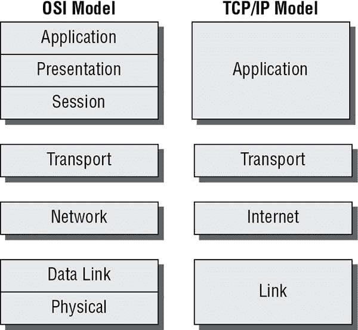

**FIGURE 11.5** Comparing the OSI model with the TCP/IP model 

TCP/IP 模型的应用层对应 OSI 模型的第 5、6、7 层。TCP/IP 模型的传输层对应 OSI 模型的第 4 层。TCP/IP 模型的 Internet 层对应 OSI 模型的第 3 层。TCP/IP 模型的链接层对应 OSI 模型的第 1 和 2 层。

由于混淆、误解和可能的懒惰，TCP/IP 模型的层也常被使用 OSI 模型的层名称来称呼。TCP/IP 模型的应用层已经直接借用了 OSI 的名称，因此这一步很简单。TCP/IP 模型的 Host-to-Host 层有时被称为传输层（OSI 模型的第四层）。TCP/IP 模型的 Internet 层有时被称为网络层（OSI 模型的第三层）。TCP/IP 模型的链接层有时被称为数据链路层或网络访问层（OSI 模型的第二层）。

## TCP/IP 协议族概述

最广泛使用的协议族是 TCP/IP，但它并非单一协议，而是由数十个独立协议组成的协议栈（见 Figure 11.6）。TCP/IP 是平台无关的、基于开放标准的协议。然而，这既是优势也是缺点。TCP/IP 几乎可以在所有可用操作系统中找到，但它消耗大量资源，且因设计初衷侧重易用而非安全，相对容易被黑客利用。

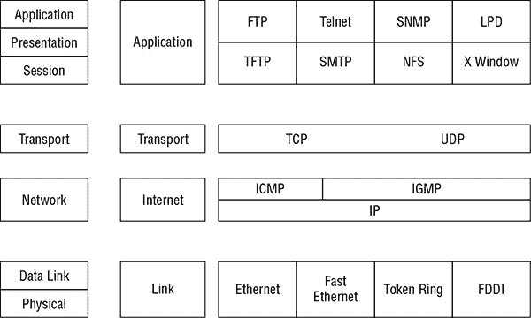

**FIGURE 11.6** The four layers of TCP/IP and its component protocols 

TCP/IP 可以通过系统之间的虚拟专用网络（VPN）链接进行安全保护。VPN 链接经过加密，以增加隐私、保密性、身份验证并维护数据完整性。用于建立 VPN 的协议包括 `Point-to-Point Tunneling Protocol (PPTP)`、`Layer 2 Tunneling Protocol (L2TP)`、`Secure Shell (SSH)`、`OpenVPN`（SSL/TLS VPNs）和 `Internet Protocol Security (IPSec)`。另一种提供协议级安全的方法是使用 TCP 封装（TCP wrapper）。一个 `TCP wrapper` 是一个应用程序，可充当基本防火墙，通过用户 ID 或系统 ID 限制对端口和资源的访问。使用 TCP wrapper 是一种基于端口的访问控制方式。

### 传输层协议

TCP/IP 的两个主要传输层协议是 TCP 和 UDP。`Transmission Control Protocol (TCP)` 是全双工、面向连接的协议，而 `User Datagram Protocol (UDP)` 是单向、无连接的协议。当两个系统之间建立通信连接时，会使用端口。TCP 和 UDP 各有 65,536 个端口。由于端口号是 16 位二进制数，总端口数为 2¹⁶，即 65,536，编号范围从 0 到 65,535。端口仅仅是通信链路两端在传输层传输数据时约定使用的地址号。端口使得单个 IP 地址能够同时支持多个独立的通信会话，每个会话使用不同的端口号。IP 地址与端口号的组合称为 `socket`。


The first 1,024 of these ports (0–1,023) are called the `well-known ports` or the `service ports`. This is because they have standardized assignments as to the services they support. For example, port 80 is the standard port for web (HTTP) traffic, port 23 is the standard port for Telnet, and port 25 is the standard port for SMTP. These ports are reserved for use exclusively by servers (in other words, they cannot be used as the source port by a requesting client). You can find a list of ports worth knowing for the exam in the section “Common Application Layer Protocols” later in this chapter.

Ports 1,024 to 49151 are known as the `registered software ports`. These are ports that have one or more networking software products specifically registered with the International Assigned Numbers Authority (IANA, [www.iana.org](http://www.iana.org)) in order to provide a standardized port-numbering system for clients attempting to connect to their products.

Ports 49152 to 65535 are known as the `random, dynamic, or ephemeral ports` because they are often used randomly and temporarily by clients as a source port. These random ports are also used by several networking services when negotiating a data transfer pipeline between client and server outside the initial service or registered ports, such as performed by common FTP.

Transmission Control Protocol (`TCP`) operates at layer 4 (the Transport layer) of the OSI model. It supports full-duplex communications, is connection oriented, and employs reliable sessions. `TCP` is connection oriented because it employs a handshake process between two systems to establish a communication session. Upon completion of this handshake process, a communication session that can support data transmission between the client and server is established. The three-way handshake process (Figure 11.7) is as follows:

1. The client sends a `SYN` (synchronize) flagged packet to the server.

2. The server responds with a `SYN/ACK` (synchronize and acknowledge) flagged packet back to the client.

3. The client responds with an `ACK` (acknowledge) flagged packet back to the server.

![FIGURE 11.7 The TCP three-way handshake process]


# User Datagram Protocol (UDP)

User Datagram Protocol (UDP) 也在 OSI 模型的第 4 层（传输层）运行。它是一种无连接的“尽力而为”通信协议。它不提供错误检测或纠正，不使用序列号，不使用流量控制机制，也不使用预先建立的会话，被认为不可靠。UDP 的开销极低，因此可以快速传输数据。然而，UDP 只应在数据传输不是关键时使用。UDP 常用于实时或流媒体通信，如音频和/或视频。UDP 的 IP 头部协议字段值为 17（0x11）。

如前所述，与 TCP 头部相比，UDP 头部相对简单。UDP 头部长度为 8 字节（64 位），分为四个字段（每个 16 位）：

* 源端口
* 目的端口
* 消息长度
* 检查和

## 网络层协议和 IP 网络基础

TCP/IP 协议族中另一个重要的协议在 OSI 模型的网络层运行，即 Internet Protocol（IP）。IP 为数据包提供路由寻址。正是这种路由寻址是全球互联网通信的基础，因为它提供了身份标识并规定了传输路径。与 UDP 类似，IP 是无连接的不可靠的数据报服务。IP 不保证数据包会被送达、会被按正确顺序送达，也不会保证数据包只被送达一次。因此，必须在 IP 上使用 TCP 来获得可靠且受控的通信会话。

### IP 类

网络层寻址和 IP 类的基本知识是任何安全专业人员的必备。如果你在寻址、子网划分、类别等方面生疏，请花时间复习。表 11.3 和 表 11.4 提供了类别和默认子网的快速概览。完整的 Class A 子网支持 16,777,214 个主机；完整的 Class B 子网支持 65,534 个主机；完整的 Class C 子网支持 254 个主机。Class D 用于多播，而 Class E 保留用于将来使用。

#### TABLE 11.3 IP 类

| Class | 首位二进制数字 | 首位八位字节的十进制范围 |
| --- | --- | --- |
| A | 0 | 1–126 |
| B | 10 | 128–191 |
| C | 110 | 192–223 |
| D | 1110 | 224–239 |
| E | 1111 | 240–255 |

#### TABLE 11.4 IP 类的默认子网掩码

| Class | 默认子网掩码 | CIDR 等价 |
| --- | --- | --- |
| A | 255.0.0.0 | /8 |
| B | 255.255.0.0 | /16 |
| C | 255.255.255.0 | /24 |

请注意，整个 Class A 网络的 127 被留作 `回环地址`，虽然只需要一个地址即可实现此目的。

另一种子网划分方式是使用 `Classless Inter-Domain Routing (CIDR)` 表示法。CIDR 使用掩码位而不是完整的点分十进制子网掩码。因此，与其使用 255.255.0.0，CIDR 在 IP 地址后加上斜杠和掩码位，例如 172.16.1.1/16。CIDR 相较于传统子网掩码技术的一个显著优势是能够将多个非连续的地址集合合并为一个子网。例如，可以将多个 Class C 子网合并为一个更大的子网组。如果 CIDR 引起你的兴趣，请参阅维基百科上的 CIDR 文章或访问 IETF 的 CIDR RFC（`tools.ietf.org/html/rfc4632`）。

ICMP 和 IGMP 是 OSI 模型网络层的其他协议：

**ICMP** `Internet Control Message Protocol (ICMP)` 用于检查网络或特定链路的健康。ICMP 被 ping、traceroute、pathping 等网络管理工具使用。ping 实用程序使用 ICMP 回显包并将其反射到远程系统。因此，你可以用 ping 判断远程系统是否在线、是否及时响应、中间系统是否支持通信以及中间系统的通信效率。ping 实用程序包含重定向功能，允许回显响应发送到不同于源系统的目的地。

遗憾的是，ICMP 的功能常被用于各种带宽型拒绝服务（DoS）攻击，如 `ping of death`、`smurf attacks` 和 `ping floods`。这导致现代网络对 ICMP 流量的处理方式改变，许多网络会限制 ICMP 的使用或至少限制其吞吐量。ping of death 发送比 65,535 字节（IPv4 最大数据包大小）更大的损坏 ping 包到计算机，试图使其崩溃。smurf 攻击通过伪造广播回显流量在目标网络上生成巨量流量。ping floods 是一种基本的 DoS 攻击，依靠消耗目标可用的全部带宽。

关于 ICMP 的几个重要细节值得注意。首先，ICMP 的 IP 头部协议字段值为 1（0x01）。其次，ICMP 头部的类型字段定义其负载中的消息类型或目的。虽然定义了超过 40 种类型，但只有 7 种最常用（见 表 11.5）。完整的 ICMP 类型字段值列表可在 `www.iana.org/assignments/icmp-parameters` 查看。许多类型可能还支持子码，子码是额外的数据参数，提供对 ICMP 消息负载功能或目的的更多细节。例如，当尝试连接到未在目标服务器上实际启用的 UDP 服务端口时，会触发 ICMP Type 3 响应。由于 UDP 没有直接发送错误的机制，协议栈会转而使用 ICMP 来实现此目的。

#### TABLE 11.5 常用 ICMP 类型字段值

| Type | 功能 |
| --- | --- |
| 0 | 回显回复 |
| 3 | 目的地不可达 |
| 5 | 重定向 |
| 8 | 回显请求 |
| 9 | 路由通告 |
| 10 | 路由请求 |
| 11 | 超时 |

#### TABLE 11.5 IGMP

`Internet Group Management Protocol (IGMP)` 允许系统支持多播。多播是将数据传输到多个特定接收者的传输。 (RFC 1112 讨论了 IGMP 多播的要求。) IGMP 由 IP 主机使用，以注册其动态的多播组成员资格。它也用于连接的路由器发现这些组。通过 IGMP 多播，服务器可以最初发送单个数据信号给整个组，而不是为每个预期接收者发送单独的初始数据信号。通过 IGMP，单个初始信号在路由器处如果存在分歧路径到达预期接收者时会被复制。IGMP 的 IP 头部协议字段值为 2（0x02）。

**ARP** `Address Resolution Protocol (ARP)` 对逻辑和物理寻址方案的互操作性至关重要。ARP 用于将 IP 地址（32 位二进制数，用于逻辑寻址）转换为 Media Access Control（MAC）地址（48 位二进制数，用于物理寻址），或 EUI-48 或 EUI-64。网络段上的流量（例如，通过集线器的电缆）会使用 MAC 地址从源系统传送到目的系统。

ARP 使用缓存和广播来执行其操作。解析 IP 地址到 MAC 地址，或反之亦然的第一步是检查本地 ARP 缓存。如果所需信息已经在 ARP 缓存中，则使用该信息。此操作有时会被 `ARP cache poisoning` 技术滥用，攻击者在此过程中向 ARP 缓存中插入虚假信息。如果 ARP 缓存中不包含所需信息，则会通过广播形式发送 ARP 请求。如果被查询地址的所有者在本地子网内，它可以响应所需信息。否则，系统将默认使用默认网关来传输其通信。然后，默认网关（即路由器）需要执行其自己的 ARP 过程。

## 常见的应用层协议

在 TCP/IP 模型的应用层（包含 OSI 模型的会话层、表示层和应用层）居住大量面向应用或服务的协议。对这些协议及其相关服务端口的基本了解对 CISSP 考试至关重要：

`Telnet`, TCP 端口 23 这是一个终端模拟网络应用，用于提供远程连接以执行命令和运行应用，但不支持文件传输。

`文件传输协议 (FTP)`, TCP 端口 20（被动数据）/Ephemeral（主动数据）和 21（控制连接）这是一个网络应用，用于支持文件交换，需要匿名或特定的认证。

`简单文件传输协议 (TFTP)`, UDP 端口 69 这是一个网络应用，用于支持文件交换，无需认证。

`简单邮件传输协议 (SMTP)`, TCP 端口 25 这是用于从客户端向邮件服务器以及从一个邮件服务器向另一个邮件服务器传输电子邮件消息的协议。

`邮件收取协议 (POP3)`, TCP 端口 110 这是用于从邮件服务器的收件箱下拉电子邮件消息到电子邮件客户端的协议。

`Internet 邮件访问协议 (IMAP)`, TCP 端口 143 这是用于从邮件服务器的收件箱下拉电子邮件消息到电子邮件客户端的协议。IMAP 比 POP3 更安全，并且能够从邮件服务器下载头部信息，同时直接在服务器上删除消息，无需先下载到本地客户端。

`动态主机配置协议 (DHCP)`, UDP 端口 67 和 68 DHCP 使用端口 67 作为服务器的目的端口以接收客户端通信，使用端口 68 作为客户端请求的源端口。它用于在系统启动时为系统分配 TCP/IP 配置设置。DHCP 支持集中管理网络地址。

`超文本传输协议 (HTTP)`, TCP 端口 80 这是用于从 Web 服务器向浏览器传输网页元素的协议。

`安全套接层 (SSL)`, TCP 端口 443（用于 HTTP 加密）这是一种类似 VPN 的安全协议，在传输层运行。SSL 最初设计用于支持安全的 Web 通信（HTTPS），但也能够保护任何应用层协议的通信。

`行星打印守护进程 (LPD)`, TCP 端口 515 这是一个网络服务，用于排队打印作业并将打印作业发送到打印机。

`X Window`, TCP 端口 6000–6063 这是用于命令行操作系统的 GUI API。

`网络文件系统 (NFS)`, TCP 端口 2049 这是一个网络服务，用于支持不同系统之间的文件共享。

`简单网络管理协议 (SNMP)`, UDP 端口 161（UDP 端口 162 用于陷阱消息）这是一个网络服务，用于通过轮询监控设备从中央监控站收集网络健康和状态信息。

## 多层协议的影响

如前面的章节所示，TCP/IP 协议族由众多分散的单独协议组成，分布在各个协议栈层中。因此，TCP/IP 是一个 `多层协议`。多层设计为 TCP/IP 带来了若干好处，特别是在封装机制方面。例如，当通过普通网络连接 Web 服务器和浏览器时，HTTP 被封装在 TCP 中，TCP 被封装在 IP 中，IP 被封装在以太网中，可表示为：

```
[ Ethernet [ IP [ TCP [ HTTP ] ] ] ]
```

但这并不是 TCP/IP 封装能力的全部。还可以在通信中添加额外的封装层。例如，在 HTTP 和 TCP 之间添加 SSL/TLS 加密会产生：

```
[ Ethernet [ IP [ TCP [ SSL [ HTTP ] ] ] ]
```

进一步可以用 IPSec 等网络层加密封装：

```
[ Ethernet [ IPSec [ IP [ TCP [ SSL [ HTTP ] ] ] ] ]
```

然而，封装并非总是用于善意目的。大量的隐蔽通道通信机制利用封装来隐藏或隔离未经授权的协议。例如，如果网络阻止 FTP 但允许 HTTP，则可以使用 HTTP Tunneling 绕过限制，形成如下封装结构：

```
[ Ethernet [ IP [ TCP [ HTTP [ FTP ] ] ] ]
```

通常 HTTP 承载其自己的 Web 相关负载，但使用 HTTP Tunneling 时，标准负载会被替换为其他协议。这种伪封装甚至可以在协议栈的更低层发生。例如，ICMP 通常用于网络健康检测而非一般通信，但像 Loki 这样的工具会将 ICMP 转换为隧道协议以支持 TCP 通信。Loki 的封装结构如下：

```
[ Ethernet [ IP [ ICMP [ TCP [ HTTP ] ] ] ]
```

由于封装支持无限制，另一个关注点是能够在虚拟局域网（VLAN）之间跳转。VLAN 是通过标签逻辑上分隔的网络段。此攻击称为 VLAN 跳转，通过创建双封装 `IEEE 802.1Q VLAN 标签` 实现：

```
[ Ethernet [ VLAN1 [ VLAN2 [ IP [ TCP [ HTTP ] ] ] ] ]
```

通过这种双封装，第一个交换机会剥除第一个 VLAN 标签，随后的交换机会被内部 VLAN 标签欺骗，并将流量移动到其他 VLAN。

多层协议提供了以下好处：

* 高层可使用多种协议。
* 可以在多个层中加入加密。
* 支持在复杂网络结构中实现灵活性和弹性。

多层协议也存在以下缺点：

* 允许隐蔽通道。
* 可以绕过过滤。
* 逻辑上划定的网络段边界可能被越过。

## TCP/IP 漏洞

TCP/IP 漏洞众多。各种操作系统中未正确实现的 TCP/IP 栈易受缓冲区溢出、SYN 洪水攻击、各种拒绝服务（DoS）攻击、碎片攻击、过大包攻击、伪造攻击、中间人攻击、劫持攻击以及代码错误攻击。

TCP/IP（以及大多数协议）也易受被动攻击，如监听或嗅探。网络监控是监控流量模式以获取网络信息的行为。数据包嗅探是捕获网络中的数据包以期从包内容中提取有用信息。有效的数据包嗅探工具可以提取用户名、密码、电子邮件地址、加密密钥、信用卡号、IP 地址、系统名称等。

数据包嗅探及其他攻击在第十三章有更详细的讨论。

## 域名系统

地址和命名是网络通信的重要组成部分。没有地址方案，网络计算机将无法区分一个计算机与另一个计算机，也无法指定通信的目的地。同样，没有命名方案，人类就必须记住并依赖数字编号系统来识别计算机。因此，记住 `Google.com` 要比记住 `64.233.187.99` 容易得多。因此，大多数命名方案是为人类使用而设计的，而非为计算机使用。

合理理解在 TCP/IP 网络中使用的地址和编号的基本概念是很重要的。需要关注三个不同的层次。这里按逆序列出，因为第三层是最基础的：

* 第三层，也就是底层，是 MAC 地址。MAC 地址，或称硬件地址，是一个“永久”的物理地址。
* 第二层，也就是中间层，是 IP 地址。IP 地址是一种“临时”的逻辑地址，它在 MAC 地址之上或之中被分配。
* 顶层是域名。域名或计算机名是一种“临时”的、面向人类的友好约定，它在 IP 地址之上被分配。

这种命名和地址体系为每个网络组件提供所需的信息，并尽可能简化其使用。人类获得友好的域名，网络协议获得路由友好的 IP 地址，网络接口获得物理地址。然而，这三种方案必须相互链接，以实现互操作性。因此，开发了 `Domain Name System (DNS)` 和 ARP 系统，分别在域名与 IP 地址之间，以及 IP 地址与 MAC 地址之间进行交换或解析。DNS 将人类友好的域名解析为其对应的 IP 地址。然后，ARP 将 IP 地址解析为对应的 MAC 地址。如果在 DNS 中配置了 PTR 记录（见本章后续关于“Domain Name System”的说明），也可以通过 DNS 反向查找将 IP 地址解析为域名。

DNS 是一种层次化的命名方案，适用于公共网络和私有网络。DNS 将 IP 地址与人类友好的 `fully qualified domain names (FQDNs)` 关联在一起。一个 FQDN 由三个主要部分组成：

* `Top-level domain (TLD)`——例如 `com` 在 `www.google.com` 中。
* `Registered domain name`——例如 `google` 在 `www.google.com` 中。
* `Subdomain(s)` 或 `hostname`——例如 `www` 在 `www.google.com` 中。

TLD 可以是官方选项的任意数量，包括六个原始 TLD——`com`、`org`、`edu`、`mil`、`gov`、`net`——以及许多新的 TLD，如 `info`、`museum`、`telephone`、`mobi`、`biz` 等。还有被称为 `country codes` 的国家变体（详见 `www.iana.org/domains/root/db/` 以获取当前 TLD 和国家代码的详细信息）。注意，原始的第七个 TLD `int`（国际）已被两位字母的国家代码取代。

注册的域名必须向任何一个获准的域名注册商（如 Network Solutions 或 `1and1.com`）进行官方登记。

FQDN 的最左侧部分可以是单个主机名（如 `www`、`ftp` 等），也可以是多层次子域名（如 `server1.group3.bldg5.mycompany.com`）。

FQDN 的总长度不能超过 253 个字符（包括点号），每个单独部分不能超过 63 个字符。FQDN 只能包含字母、数字和连字符。

每个注册域名都有一个授权的权威名称服务器。`primary authoritative name server`（主权威名称服务器）保存该域的原始区域文件。`Secondary authoritative name servers`（次要权威名称服务器）可用于保存区域文件的只读副本。`zone file`（区域文件）是 `resource records`（资源记录）的集合，描述特定域的详细信息。虽然有数十种可能的资源记录（见 `List of DNS record types`），但最常见的列在 `Table 11.6` 中。

#### TABLE 11.6 Common resource records

| Record | Type | Description |
| --- | --- | --- |
| A | Address record | Links an FQDN to an IPv4 address |


| --- | --- | --- |

| AAAA || Address record || Links an FQDN to an IPv6 address |

| PTR || Pointer record || Links an IP address to an FQDN (for reverse lookups) |

| CNAME || Canonical name || Links an FQDN alias to another FQDN |

| MX || Mail exchange || Links a mail- and messaging-related FQDN to an IP address |

| NS || Name server record || Designates the FQDN and IP address of an authorized name server |

| SOA || Start of authority record || Specifies authoritative information about the zone file, such as primary name server, serial number, time-outs, and refresh intervals |

最初，DNS 通过静态本地文件 `HOSTS file` 处理。该文件仍然存在，但动态 DNS 查询系统已取代了它，尤其是在大型私有网络以及互联网中。当客户端软件指向 FQDN 时，协议栈会发起 DNS 查询，以将名称解析为可用于构建 IP 头的 IP 地址。解析过程首先检查本地 DNS 缓存，看是否已经知道答案。本地 DNS 缓存包含从本地 HOSTS 文件预加载的内容以及在当前启动会话期间（未过期）执行的任何 DNS 查询。如果缓存中没有所需答案，就会将查询发送到本地 IP 配置中指定的 DNS 服务器。虽然解析过程有趣且复杂，但大部分内容与 `(ISC)² CISSP` 考试无关。

DNS 通过 TCP 和 UDP 端口 `53` 运行。TCP 端口 `53` 用于区域传输，即 DNS 服务器之间的区域文件交换，用于特殊手动查询或当响应超过 `512` 字节时。UDP 端口 `53` 用于大多数常规 DNS 查询。

`Domain Name System Security Extensions (DNSSEC)` 是对现有 DNS 基础设施的安全增强。DNSSEC 的主要功能是为 DNS 操作提供设备间可靠的认证。DNSSEC 已在 DNS 系统的大部分区域得到实现。每个 DNS 服务器都会获得一个数字证书，用于进行双向证书认证。DNSSEC 的目标是防止在解析过程中注入错误数据的各种滥用行为。一旦完全实施，DNSSEC 将显著降低服务器导向的 DNS 滥用。

#### DNS Poisoning

`DNS poisoning` 是篡改客户端用于定位目标系统的 DNS 信息的行为。它可以通过多种方式发生。每当客户端需要将 DNS 名称解析为 IP 地址时，它可能会经历以下过程：

1. 检查本地缓存（其中包含 HOSTS 文件的内容）。

2. 向已知的 DNS 服务器发送 DNS 查询。

3. 向可能存在的本地子网 DNS 服务器发送广播查询。（此步骤不常被支持。）

如果客户端未能从上述任何步骤获得 DNS 到 IP 的解析，则解析失败，通信无法发送。DNS 中毒可以在上述任何步骤发生，但最容易的方式是篡改 HOSTS 文件或 DNS 服务器查询。

攻击或利用 DNS 的方式有很多。攻击者可能会使用以下技术之一：

部署一个恶意 DNS 服务器（也称为 DNS 欺骗或 DNS 农场）。恶意 `rogue DNS` 服务器可以监听网络中针对任意 DNS 查询或特定目标站点的 DNS 查询。随后，该服务器向客户端发送包含错误 IP 信息的 DNS 响应。此攻击要求恶意 DNS 服务器的响应必须在真实 DNS 服务器响应之前到达客户端。一旦客户端收到恶意 DNS 服务器的响应，客户端会关闭 DNS 查询会话，导致真实 DNS 服务器的响应被视为会话外包的数据包而被丢弃并忽略。

DNS 查询不进行身份验证，但其中包含一个 16 位的 `查询 ID (QID)`。DNS 响应必须包含与查询相同的 QID 才能被接受。因此，恶意 DNS 服务器必须在错误回复中包含请求的 QID。

执行 DNS 中毒。`DNS poisoning` 是攻击真实 DNS 服务器并将错误信息写入其区域文件的行为，这会导致真实 DNS 服务器向客户端发送错误数据。

修改 HOSTS 文件。在客户端上编辑 HOSTS 文件，加入错误的 DNS 数据，从而将用户重定向到错误的地址。

损坏 IP 配置。损坏 IP 配置可能导致客户端拥有错误的 DNS 服务器定义。这种情况可以在客户端本身或网络的 DHCP 服务器上进行。

使用伪造代理。该方法仅针对 Web 通信。攻击在客户端浏览器中植入错误的 Web 代理数据，然后攻击者运营恶意代理服务器。恶意代理服务器可以修改 HTTP 流量包，将请求重定向到攻击者希望的站点。

虽然 DNS 中毒的方法多种多样，但以下是一些基本的安全措施，可大幅降低相关威胁：

* 限制内部 DNS 服务器向外部 DNS 服务器的区域传输。通过阻止入站 TCP 端口 `53`（区域传输请求）和 UDP 端口 `53`（查询）实现。

* 限制内部 DNS 服务器从的外部 DNS 服务器获取区域传输。

* 部署 `网络入侵检测系统 (NIDS)` 监控异常 DNS 流量。

* 正确硬化私有网络中所有 DNS、服务器和客户端系统。

* 使用 DNSSEC 保护 DNS 基础设施。

* 要求内部客户端通过内部 DNS 解析所有域名。这需要阻止出站 UDP 端口 `53`（用于查询），同时保持出站 TCP 端口 `53`（用于区域传输）开放。

与 DNS 中毒和/或 DNS 欺骗密切相关的另一种攻击是 DNS 农场（`pharming`）。`Pharming` 是将合法网站的 URL 或 IP 地址恶意重定向到假冒网站的行为，假冒网站托管原始站点的伪造版本。这通常是网络钓鱼攻击的一部分，攻击者试图诱骗受害者泄露登录凭证。如果受害者不够小心或未注意，可能会在伪造的网站上提供登录信息。Pharming 通常通过修改本地 HOSTS 文件或通过 DNS 解析中毒/伪造实现。由于黑客发现利用 DNS 漏洞对大量目标域名进行 pharming，这一行为日益成为问题。

### 域名劫持

`Domain hijacking`，或 `domain theft`，是未经合法所有者授权而篡改域名注册信息的恶意行为。这可能通过窃取所有者的登录凭据、利用 XSRF、劫持会话、使用 MitM（见第 21 章 “恶意代码和应用程序攻击” 以获取此类攻击的说明）或利用域名注册机构系统漏洞来实现。

有时当另一个人在原始所有者注册过期后立即注册同一域名时会被称作 `domain hijacking`，但这并不正确。这是一种潜在不道德的做法，但并非真正的劫持或攻击，而是利用原始所有者未手动续期或未启用自动续期的疏忽。如果原始所有者因未维护注册而失去域名，通常只能联系新所有者请求重新获得控制权。许多注册机构执行 “you snooze, you lose” 政策，即注册过期即失去所有权。

当组织失去其域名且他人接管控制权时，这对组织及其客户和访问者可能产生毁灭性影响。原始网站或在线内容将不再可用（或至少不再在相同的域名下提供），新所有者可能会托管完全不同的内容或托管该站点的伪造复制品。此类伪造活动可能导致访客被误导，类似于网络钓鱼攻击，个人可识别信息（PII）可能被提取并收集。

2017 年 9 月，Fox-IT.com 域名被盗的典型案例可参考 [`www.fox-it.com/en/insights/blogs/blog/fox-hit-cyber-attack/`](https://www.fox-it.com/en/insights/blogs/blog/fox-hit-cyber-attack/)。

### 融合协议

`Converged protocols` 是将专有或专用协议与标准协议（如 TCP/IP 套件）合并的协议。融合协议的主要优势是能够在现有的 TCP/IP 支持的网络基础设施上提供专有或专用服务，而无需为其单独部署额外的网络硬件，从而实现显著的成本节约。然而，并非所有融合协议的吞吐量或可靠性与其专有实现相当。常见的融合协议示例包括：

**Fibre Channel over Ethernet (FCoE)** *Fibre Channel* 是一种高速数据存储解决方案（存储区域网 \[SAN\] 或 网络附加存储 \[NAS\]），可支持高达 128 Gbps 的高速文件传输。它最初设计用于光纤光缆，后期增加了对铜缆的支持，以提供更具成本效益的选择。Fibre Channel 通常需要独立的专用基础设施（单独的线路）。但 `Fibre Channel over Ethernet (FCoE)` 可在现有网络基础设施上实现该协议。FCoE 用于在以太网网络上封装 Fibre Channel 通信。它通常需要 10 Gbps 以太网以支撑 Fibre Channel 协议。在此技术下，Fibre Channel 作为网络层（OSI 层 3）运行，取代 IP 作为标准以太网的负载。

**MPLS (Multiprotocol Label Switching)** `MPLS (Multiprotocol Label Switching)` 是一种高吞吐、高性能的网络技术，它根据短路径标签而非较长的网络地址来转发数据。该技术相较于传统基于 IP 的路由过程可节省大量时间，因为后者往往相当复杂。此外，MPLS 通过封装支持广泛的协议，使网络不局限于 TCP/IP 及其兼容协议，从而可使用诸如 T1/E1、ATM、Frame Relay、SONET、DSL 等多种网络技术。

**Internet Small Computer System Interface (iSCSI)** `Internet Small Computer System Interface (iSCSI)` 是基于 IP 的存储网络标准。该技术可在 LAN、WAN 或公共互联网连接上实现位置无关的文件存储、传输和检索。iSCSI 常被视为光纤通道的低成本替代方案。

# Voice over IP (VoIP)

`VoIP` 是一种隧道机制，用于在 TCP/IP 网络上传输语音和/或数据。`VoIP` 有潜力取代或替代 PSTN，因为它通常更便宜，并且提供更丰富的选项和功能。`VoIP` 可以作为计算机网络或移动设备上的直接电话替代使用。然而，`VoIP` 能够支持视频和数据传输，从而实现视频会议和项目协作。`VoIP` 既有商业选项，也有开源选项。一些 `VoIP` 方案需要专用硬件，以替代传统电话手柄/基站，或允许这些设备连接并运行在 `VoIP` 系统上。另一些 `VoIP` 方案仅为软件，例如 Skype，使用户现有的扬声器、麦克风或耳机替代传统电话手柄。其他方案则更偏向硬件，例如 magicJack，它允许用户将现有的 PSTN 电话设备通过 USB 适配器连接到 `VoIP` 系统，从而利用互联网上的 `VoIP`。通常，`VoIP-to-VoIP` 通话是免费的（前提是使用相同或兼容的 `VoIP` 技术），而 `VoIP-to-landline` 通话通常按分钟收费。

# Software-Defined Networking (SDN)

`Software-defined networking (SDN)` 是一种独特的网络运营、设计和管理方式。其概念基于这样一种理论：传统网络因需在设备上（即路由器和交换机）进行配置而变得复杂，这往往迫使组织局限于单一设备供应商（如 Cisco），并限制网络应对物理和业务变化的灵活性。SDN 旨在将基础设施层（即硬件及硬件配置）与控制层（即数据传输管理的网络服务）分离。此外，它还消除了传统网络概念（如 IP 地址、子网、路由等）必须被写入或由托管应用程序解码的需求。

`SDN` 提供了一种新型网络设计，可从中央位置直接编程，具有灵活性、供应商中立性以及基于开放标准的特点。使用 `SDN` 使组织无需从单一供应商处购买设备，而是可以根据需要自由组合硬件，例如选择最具性价比或最高吞吐量的设备，而不受供应商限制。硬件的配置和管理通过集中化管理界面完成。此外，对硬件的设置可以动态修改和调整。

另一种思考方式是将 `SDN` 视为网络虚拟化。它在 `SDN` 控制层虚拟化数据传输路径、通信决策树和流量控制，而不是在每个硬件设备上单独处理这些功能。

## Content Distribution Networks

一个 `content distribution network (CDN)`，或称内容交付网络，是一系列部署在互联网多个数据中心的资源服务集合，旨在提供低延迟、高性能和高可用性的托管内容。CDN 通过分布式主机概念，向客户提供所需的多媒体性能质量。与将媒体内容存储在单一位置并传输至互联网各地不同，CDN 将媒体分布到互联网的众多位置。这实现了一种地理和逻辑上的负载均衡。单个服务器或服务器集群不会因所有资源请求的负载而受到压力，且托管服务器更靠近请求客户端。整体结果是更低的延迟和更高的传输质量。目前有许多 CDN 服务提供商，包括 CloudFlare、Akamai、Amazon CloudFront、CacheFly 和 Level 3 Communications。

虽然大多数 CDN 关注服务器的物理分布，但客户端基于 CDN 也是可能的。这通常被称为 P2P（点对点）。最广为人知的 P2P CDN 是 BitTorrent。

## Wireless Networks

`Wireless networking` 是连接企业和家庭系统的流行方式，因为部署简便且成本相对较低。它使网络比以往任何时候都更加灵活。工作站和便携设备不再依赖有线连接，可以在部署的无线接入点信号覆盖范围内自由漫游。然而，这种自由也带来了额外的安全风险。传统上，无线网络相对不安全，主要是由于终端用户和组织缺乏知识以及设备制造商的默认配置不安全。无线网络与有线网络一样，面临相同的漏洞、威胁和风险，此外还包括距离窃听、数据包嗅探以及新型的拒绝服务（DoS）和入侵攻击。正确管理无线网络以确保可靠接入和安全性并非总是易事或直接可行。本节探讨各种无线安全问题。

`数据发射`（Data emanation）是指通过电磁信号传输数据。几乎所有计算机内部或网络中的活动都以某种形式的数据发射进行。然而，这一术语常用于指代不想要的发射或处于风险中的数据。

当电子移动时，发射就会发生。电子的移动会产生磁场。如果你能读取该磁场，就可以在别处重现它，从而复制电子流。如果原始电子流用于传输数据，则重现的电子流同样是对原始数据的复制。这种电子窃听听起来像科幻小说，但实际上是科学事实。美国政府自 1950 年代起就一直在 TEMPEST 项目下研究发射安全。

防止窃听和数据盗窃需要多方面的努力。首先，必须对所有电子设备实施物理访问控制。其次，在物理访问或 proximity 仍可能被未授权人员触及的情况下，应使用屏蔽设备和媒介。第三，应始终使用安全的加密协议来传输敏感数据。

### Securing Wireless Access Points

`无线单元`（Wireless cells）是物理环境中无线设备可以连接到无线接入点的区域。无线单元可能会泄漏到受保护的环境之外，从而让入侵者轻易访问无线网络。你应调整无线接入点的强度，以最大化 authorized 用户的访问并最小化入侵者的访问。这可能需要对无线接入点的布置、屏蔽和噪声传输进行独特的调整。

`802.11` 是 IEEE 为无线网络通信制定的标准。其各个版本（技术上称为修订案）已在无线网络硬件中实现，包括 802.11a、802.11b、802.11g 和 802.11n。802.11x 有时用于统称这些具体实现的集合；然而，802.11 更受青睐，因为 802.11x 容易与独立于无线的 802.1x 认证技术混淆。每个版本或 802.11 修订案在吞吐量上略有提升：2 MB、11 MB、54 MB 和 200 MB+，如 Table 11.7 所述。b、g、n 修订案使用相同频率，因此保持向后兼容。

**TABLE 11.7** **802.11 无线网络修订案**

| 修订案 | 速率 | 频率 |

| --- | --- | --- |

| 802.11 | 2 Mbps | 2.4 GHz |

| 802.11a | 54 Mbps | 5 GHz |

| 802.11b | 11 Mbps | 2.4 GHz |

| 802.11g | 54 Mbps | 2.4 GHz |

| 802.11n | 200+ Mbps | 2.4 GHz or 5 GHz |

| 802.11ac | 1 Gbps | 5 GHz |

当你部署无线网络时，应该配置使用 `infrastructure mode` 的无线接入点，而不是 `ad hoc mode`。`Ad hoc mode` 意味着任何两个无线网络设备（包括两个无线网络接口卡（NIC））都可以在没有中央控制权限的情况下进行通信。`Infrastructure mode` 意味着需要一个无线接入点，无线 NIC 在系统上不能直接相互通信，并且无线接入点对无线网络访问的限制会被执行。

在 `infrastructure mode` 概念中包含几种变体，包括 `stand-alone`、`wired extension`、`enterprise extended` 和 `bridge`。`stand-alone` 模式的基础设施发生在有一个无线接入点连接无线客户端但不连接到任何有线资源时。无线接入点专门作为无线集线器。`wired extension` 模式的基础设施发生在无线接入点充当连接点，用于将无线客户端连接到有线网络时。`enterprise extended` 模式的基础设施发生在使用多个无线接入点（WAP）连接大面积物理区域到同一有线网络时。每个无线接入点都使用相同的 `扩展服务集标识符 (ESSID)`，这样客户端可以在保持网络连接的同时在区域内漫游，即使它们的无线 NIC 从一个无线接入点切换到另一个。

`bridge` 模式的基础设施发生在使用无线连接来链接两个有线网络时。这通常使用专用的无线桥接器，并且在有线桥接器不便时使用，例如在楼层或建筑物之间链接网络。

### Securing the SSID


无线网络被分配一个服务集标识符 (`SSID`)（要么是 `BSSID`，要么是 `ESSID`）以区分不同的无线网络。如果多个基站或无线接入点参与同一个无线网络，则定义扩展站点标识符 (`ESSID`)。`SSID` 类似于工作组的名称。如果无线客户端知道 `SSID`，它们可以配置其无线 `NIC` 与相关的 `WAP` 通信。知道 `SSID` 不总是能够进入，因为 `WAP` 可以使用多种安全功能阻止不受欢迎的访问。`SSID` 由供应商默认定义，由于这些默认 `SSID` 非常知名，标准安全实践规定在部署前应将 `SSID` 更改为唯一的内容。

`SSID` 通过特殊的传输 called `beacon frame` 由 `WAP` 广播。这使得任何在范围内的无线 `NIC` 都可以看到无线网络并轻松连接。然而，默认的 `SSID` 广播应被禁用以保持无线网络的秘密。尽管如此，攻击者仍可以通过无线窃听器发现 `SSID`，因为 `SSID` 必须在无线客户端和 `WAP` 之间的传输中使用。因此，禁用 `SSID` 广播并不是真正的安全机制。相反，应使用 `WPA2` 作为可靠的认证和加密解决方案，而不是试图隐藏无线网络的存在。

## Conducting a Site Survey

一种用于发现物理环境中可能出现不想要的无线访问区域的方法是进行 `site survey`。`site survey` 是检查已部署在环境中的无线接入点的存在、强度和覆盖范围的过程。这项任务通常涉及携带便携式无线设备行走于环境中，记录无线信号强度，并在建筑物的图纸或示意图上绘制地图。

`site survey` 应该进行，以确保在所有可能使用无线设备的位置都有足够的信号强度，同时尽量减少或消除在不应允许无线访问的位置（公共区域、楼层间、其他房间或建筑物外）的无线信号。`site survey` 对于评估现有无线网络部署、规划当前部署的扩展以及规划未来部署很有用。

## Using Secure Encryption Protocols

IEEE 802.11 标准定义了无线客户端在进行正常无线链路通信之前，可以用来向 `WAP` 进行身份验证的两种方法。这两种方法是 `open system authentication (OSA)` 和 `shared key authentication (SKA)`。`OSA` 意味着不需要真正的身份验证。只要无线信号可以在客户端和 `WAP` 之间传输，通信就被允许。无线网络使用 `OSA` 时通常以明文传输所有数据，从而提供不安全的隐私。`SKA` 意味着在网络通信发生之前必须进行某种形式的身份验证。IEEE 802.11 标准定义了一种可选的 `SKA` 技术，称为有线等效隐私 (`WEP`)。随后对原始 802.11 标准的修订增加了 `WPA`、`WPA2` 和其他技术。

### WEP

`Wired Equivalent Privacy (WEP)` 是 IEEE 802.11 标准定义的。它被设计为提供与有线或有线网络相同的无线网络安全和加密级别。`WEP` 提供对无线传输的数据包窃听和窃听的保护。

`WEP` 的一个次要好处是它可以配置为防止未经授权访问无线网络。`WEP` 使用预定义的共享密钥；然而，与典型的动态对称加密方案不同，该共享密钥是静态的，并且在所有无线接入点和设备接口之间共享。该密钥在传输前用于加密数据包，从而提供机密性保护。使用哈希值验证接收的数据包未在传输过程中被修改或损坏；因此，`WEP` 还提供完整性保护。拥有或知晓密钥不仅允许加密通信，还作为一种基础形式的认证，因为没有密钥就无法访问无线网络。

`WEP` 在发布后不久就被破解。如今，破解 `WEP` 只需不到一分钟，因此它作为安全措施毫无价值。幸运的是，有替代方案，即 `WPA` 和 `WPA2`。

`WPA` 是对 `WEP` 的改进，因为它不使用相同的静态密钥加密所有通信。相反，它为每个主机协商唯一的密钥集。然而，使用一个 `passphrase`（口令）授权与基站的关联（即允许新客户端建立连接）。如果口令不够长，它可能被猜到。通常建议口令长度为 14 个字符或更多。

`WEP` 加密使用 `Rivest Cipher 4 (RC4)`，一种对称流密码（见第 6 章“密码学和对称密钥算法”以及第 7 章“PKI 和密码学应用”以了解加密的一般知识）。由于 `RC4` 的设计和实现缺陷，`WEP` 在以下几个方面较弱：使用静态公共密钥以及 `IV`（初始化向量）的实现不佳。由于这些弱点，`WEP` 密钥可以在发现足够多的未正确使用的 `IV` 后在不到 60 秒内被破获。当 `WEP` 密钥被发现后，攻击者可以加入网络并窃听所有其他无线客户端的通信。因此，不应使用 `WEP`，它没有真正的保护，可能导致一种虚假的安全感。

### WPA

- `WPA` 被设计为 `WEP` 的替代方案；它是一个临时解决方案，直至新的 `802.11i` 修订案完成。编写新修订案的过程耗时多年，因此 `WPA` 在市场中树立了立足点，至今仍被广泛使用。此外，`WPA` 可在大多数设备上使用，而 `802.11i` 的功能则排除了部分低端硬件。

- `802.11i` 是定义用于替代 `WEP` 的加密解决方案的修订案。然而，当 `802.11i` 最终确定时，`WPA` 方案已经广泛使用，因此无法按原计划使用 `WPA` 名称；于是它被命名为 `WPA2`。但这并不表示 `802.11i` 是 `WPA` 的第二版本。事实上，它们是两套完全不同的技术。`802.11i`（即 `WPA2`）实现类似 `IPSec` 的概念，为无线通信提供当前最佳的加密与安全。

- `Wi‑Fi Protected Access` 基于 `LEAP` 和 `Temporal Key Integrity Protocol (TKIP)` 两种加密系统，并常使用秘密口令进行身份验证。遗憾的是，使用单一静态口令是 `WPA` 的致命缺陷。攻击者可以直接对 `WPA` 网络进行暴力猜解，以获取该口令。即使口令长度在 14 个字符或以上，通常也难以在合理时间内完成，但并非不可能。此外，`WPA` 的 `LEAP` 与 `TKIP` 加密选项均已可通过多种 `cracking` 技术被破解。相较于 `WEP` 的妥协，`WPA` 现已不再提供长期可靠的安全保障。

### WPA2

最终，开发出了一种仍被普遍认为安全的无线保护新方法。该方法是修订案 `802.11i` 或 `Wi‑Fi Protected Access 2 (WPA2)`。它是一种新的加密方案，名为 `Counter Mode Cipher Block Chaining Message Authentication Code Protocol (CCMP)`，基于 `AES` 加密算法。2017 年底，一项名为 `KRACK` (`Key Reinstallation AttaCKs`) 的攻击概念被公开，能够破坏客户端与 `WAP` 之间的初始四次握手，使其重新使用已使用过的密钥，甚至在某些情况下使用全为零的密钥。大多数易受影响的无线设备已更新或有可用更新以解决此问题。更多信息请参见 [`https://www.krackattacks.com/`](https://www.krackattacks.com/)。

### 802.1X/EAP

`WPA` 与 `WPA2` 均支持企业级认证 `802.1X/EAP`，这是一种基于端口的网络访问控制标准，确保客户端在完成正确认证前不能访问资源。实际上，`802.1X` 是一种“手 off”系统，使无线网络能够利用现有网络基础设施的认证服务。通过使用 `802.1X`，可以将远程认证拨号用户服务 (`RADIUS`)、终端访问控制器访问控制系统 (`TACACS`)、证书、智能卡、令牌设备、生物识别等技术整合到无线网络中，从而实现相互认证和多因素认证。

`Extensible Authentication Protocol (EAP)` 并非具体的认证机制，而是一个认证框架。它使得新的认证技术能够兼容现有的无线或点对点连接技术。目前已有超过 40 种 `EAP` 认证方法被广泛支持，包括 `LEAP`、`EAP-TLS`、`EAP-SIM`、`EAP-AKA`、`EAP-TTLS` 等。并非所有 `EAP` 方法都安全；例如，`EAP-MD5` 以及早期的 `LEAP` 也可被破解。

### PEAP

`Protected Extensible Authentication Protocol (PEAP)` 将 `EAP` 方法封装在 `TLS` 隧道内，提供认证以及可能的加密。由于 `EAP` 原本设计用于物理隔离通道，假设通道已受保护，因此 `EAP` 通常不加密。于是 `PEAP` 可为 `EAP` 方法提供加密保护。

### LEAP

`Lightweight Extensible Authentication Protocol (LEAP)` 是思科专有的、用于 `WPA` 的 `TKIP` 替代方案。它在 `802.11i/WPA2` 标准正式发布前，针对 `TKIP` 的缺陷进行了改进。2004 年，一个名为 `Asleap` 的攻击工具发布，能够利用 `LEAP` 最终提供的弱保护进行攻击。建议尽量避免使用 `LEAP`；若必须使用，则强烈建议使用 `EAP-TLS` 作为替代，且若使用 `LEAP`，应采用复杂密码。

### MAC Filter

`MAC filter` 是一份授权的无线客户端接口 `MAC` 地址列表，由无线接入点用于阻止非授权设备接入。虽然它是有用的功能，但管理起来较为麻烦，通常只在小型、静态环境中使用。此外，拥有基础无线黑客工具的攻击者可以发现合法客户端的 `MAC` 地址，然后在其攻击客户端上伪装该地址。

### TKIP

`Temporal Key Integrity Protocol (TKIP)` 被设计为无需更换已有无线硬件即可替代 `WEP` 的方案。`TKIP` 在 `802.11` 无线网络中以 `WPA`（`Wi‑Fi Protected Access`）的名义实现。`TKIP` 的改进包括：将初始化向量 (`IV`)（即随机数）与根密钥混合后再与 `RC4` 一起用于加密；使用序列计数器防止包重放攻击；以及使用名为 `Michael` 的强完整性检查。

`TKIP` 与 `WPA` 于 2004 年正式被 `WPA2` 取代。此外，针对 `WPA` 与 `TKIP` 的专门攻击（如 `coWAtty` 以及基于 `GPU` 的 `cracking` 工具）已使 `WPA` 的安全性变得不可靠。

### CCMP

`CCMP`（`Counter Mode with Cipher Block Chaining Message Authentication Code Protocol`）是为取代 `WEP` 与 `TKIP/WPA` 而创建的。`CCMP` 使用 128 位密钥的 `AES`（高级加密标准）进行加密。`CCMP` 是 `802.11i` 所指示的无线网络首选安全协议。截至目前，尚未成功攻破 `AES/CCMP` 加密。

## Determining Antenna Placement

在部署无线网络时，天线位置应当被重点考虑。在进行正式的现场勘测之前，请不要固定于某一具体位置。先将无线接入点及/或其天线放置在可能的位置，然后测试多个位置的信号强度和连接质量。只有在确认所选位置能提供满意的连通性后，才能将其固定为永久位置。

在寻找最佳天线位置时，请遵循以下指南：

- 采用居中位置。
- 避免固体物理障碍。
- 避免反射面或其他平整金属面。
- 避免电气设备。

如果基站配有外部全向天线，通常应将其竖直向上指向天空。若使用方向性天线，则应将焦点指向所需使用的区域。请记住，无线信号会受到干扰、距离和障碍物的影响。在设计安全的无线网络时，工程师可能会选择方向性天线，以避免在不希望提供信号的区域广播，或在希望覆盖的特定区域提供更强的信号。

## Antenna Types

可用于无线客户端和基站的天线种类种类繁多。许多设备的标准天线可以被更强（即信号增强）的天线所取代。

标准的直杆或杆状天线是一种 *全向天线*，能够在天线本身线向的垂直方向上向四周发送和接收信号。这是大多数基站以及部分客户端设备上常见的天线类型。该类天线有时也被称为基站天线或橡皮鸭天线（因为大多数外观覆盖有柔性橡胶套）。

大多数其他类型的天线是方向性的，意味着它们将发送和接收能力集中在一个主要方向。`directional antennas` 的示例包括 `Yagi`、`cantenna`、`panel` 和 `parabolic`。`Yagi` 天线的结构与传统屋顶有线电视天线相似。`Yagi` 天线由一根直条及用于捕获特定射频的横截面组成，方向与主条相同。`Cantenna` 由一端封闭的管子制成，信号沿管子开口端方向聚焦。早期的一些 `cantenna` 是用 `Pringles` 罐制成的。`Panel` 天线是平面设备，仅从天线的一侧聚焦。`Parabolic` 天线用于聚焦来自很远距离或微弱信号的信号。

## 调整功率控制

一些无线接入点提供物理或逻辑上的天线功率调节功能。功率控制通常由制造商设置为适合大多数情况的默认值。但如果在进行现场调查并调整天线位置后，无线信号仍不理想，则可能需要调整功率。不过，请记住，更改信道、避免反射和信号散射表面以及减少干扰通常对提高连接可靠性更为重要。

在调整功率时，应进行小幅调整，而非试图将设置最大化或最小化。同时，请记录初始/默认设置，以便需要时可以恢复。每次调整功率后，请重启/重置无线接入点，然后重新进行现场调查和质量测试。有时降低功率水平可以提升性能。请注意，某些无线接入点的功率水平超过所在国家法规允许的范围。

## WPS

`Wi-Fi Protected Setup (WPS)` 是无线网络的安全标准，旨在简化将新客户端添加到已安全保护的无线网络的过程。它通过在管理员按下基站上的 `WPS` 按钮触发功能后，自动让第一个新无线客户端寻找网络来实现。然而，标准还要求通过发送代码或个人识别号码（`PIN`）到基站进行远程触发 `WPS` 协商，而无需物理按下按钮。这导致了暴力猜测攻击的发生，攻击者可能在数小时内（通常少于六小时）猜出 `WPS` 代码，从而将未经授权的设备连接到无线网络。

`WPS` 默认在大多数无线接入点上启用，因为它是设备 `Wi‑Fi Alliance` 认证的要求。作为安全预部署的一部分，应禁用它。如果设备没有提供关闭 `WPS` 的功能（或关闭开关失效），请升级或更换基站固件，或更换整个设备。

通常保持 `WPS` 关闭。每次升级固件时，请再次执行安全预部署流程，确保所有设置（包括 `WPS`）均已正确配置。如果需要为网络添加大量客户端，可临时重新启用 `WPS`，但务必在随后立即关闭它。

## 使用 Captive Portals

`Captive portal` 是一种认证技术，会在新连接的无线客户端尝试访问网络时将其重定向到一个门户认证页面。门户页面可能要求用户输入支付信息、提供登录凭据或输入访问代码。它还用于向用户展示可用使用政策、隐私政策和跟踪政策，用户必须同意这些政策后才能在网络上通信。`Captive portals` 最常出现在公共无线网络中，如酒店、餐厅、酒吧、机场、图书馆等，但也可用于有线以太网连接。

## 一般 Wi‑Fi 安全程序

基于无线安全和配置选项的详细说明，以下是部署 `Wi‑Fi` 网络的一般指南或流程。这些步骤按考虑和应用顺序排列，且不暗示任何一步比其他步骤更具安全性。例如，使用 `WPA2` 是真正的安全功能，而禁用 `SSID` 广播则不是。以下是步骤：

1. 更改默认管理员密码。
2. 根据部署需求决定是否禁用 `SSID` 广播。
3. 将 `SSID` 更改为独特的名称。
4. 如无线客户端数量较小（通常少于 20）且静态，启用 `MAC` 过滤。
5. 考虑使用静态 `IP` 地址，或在 `DHCP` 中配置保留（仅适用于小规模部署）。
6. 开启当前支持的最高级别的认证和加密，即目前的 `WPA2`，未来可能升级为 `WPA3`（2018 年初正在开发：[`www.networkworld.com/article/3247658/wi-fi/wi-fi-alliance-announces-wpa3-to-secure-modern-networks.html`](https://www.networkworld.com/article/3247658/wi-fi/wi-fi-alliance-announces-wpa3-to-secure-modern-networks.html)）。如果设备上没有 `WPA2` 或更强的方案，则需要购买新的无线设备。
7. 将无线视为远程访问，并使用 `802.1X` 管理访问。
8. 将无线视为外部访问，并使用防火墙将接入点与有线网络分离。
9. 将无线视为攻击入口点，并使用入侵检测系统（`IDS`）监控所有 `WAP` 到有线网络的通信。
10. 要求所有在无线客户端与 `WAP` 之间的传输都进行加密，即要求建立 `VPN` 链接。

## 无线攻击

无线通信是快速增长的网络、连接、通信和数据交换技术领域。数以千计的协议、标准和技术可被归类为无线，包括蜂窝手机、蓝牙、无绳电话和无线网络。随着无线技术的普及，组织的安全措施必须超越仅仅锁定本地网络。安全应是端到端的解决方案，涵盖所有通信形式、方法和技术。

无线网络在企业和家庭网络中已相当普及。正确管理无线网络以保证可靠接入和安全性并非总是易事。即使已有无线安全措施，无线攻击仍可能发生。攻击种类不断增多，许多攻击同时影响有线和无线环境。少数攻击专注于无线网络本身。本节探讨各种无线安全问题。

### War Driving

`War driving` 是使用检测工具查找无线网络信号的行为。通常，它指的是寻找未经授权的无线网络。换句话说，它是对潜在恶意或至少未经授权的网络进行现场勘测。该名称来源于“战电话”（`war dialing`）的传统攻击概念，该概念通过在前缀或区号内拨打所有号码来发现活动的计算机调制解调器。

`War driving` 可以使用专用的手持检测器、具备 `Wi‑Fi` 功能的个人电子设备（`PED`）或移动设备、或配备无线网卡的笔记本电脑进行。它可以使用操作系统的原生功能，也可以使用专用的扫描和检测工具。

一旦无线网络被检测到，下一步是确定该网络是开放还是封闭。开放网络没有技术限制允许哪些设备连接，而封闭网络则有技术限制防止未经授权的连接。如果网络是封闭的，攻击者可能会尝试猜测或破解阻止连接的技术。通常，使无线网络封闭（或至少隐藏）的设置是禁用服务集标识符（`SSID`）广播。这一限制可以通过无线 `SSID` 扫描器轻松绕过。随后，黑客会判断是否使用加密，使用何种类型的加密，以及是否可以被破解。从而，攻击者会获取专用破解工具来尝试入侵连接或进行中间人攻击。保护措施越弱、越老旧，这类攻击成功的速度和成功率越高。

### War Chalking


`War chalking` 是一种早期无线（1997–2002 年）黑客使用的几何涂鸦方式。它是通过在物理空间标记无线网络的信息来实现的。封闭的圆圈表示封闭或受保护的无线网络，两个相连的半圆表示开放网络。War chalking 常用于向他人透露已发现的无线网络，以便共享发现的互联网链接。然而，如今互联网连接几乎无处不在，大多数人随身携带联网设备（通常是智能手机），便携式 Wi‑Fi 热点普及，许多零售场所提供免费 Wi‑Fi 作为客户激励，War chalking 的需求和出现已大幅减少。当攻击者使用 War dialing 定位无线目标进行入侵时，他们不会在现场用特殊符号标记，以告知他人自己的意图。

#### Replay

`replay attack` 是指重新传输捕获的通信，企图未经授权访问目标系统。在无线环境中，重放攻击往往集中在初始认证滥用上，但还有许多其他变体。它们包括捕获普通客户端的新建连接请求，然后重放该请求，欺骗基站以为另一个新客户端发起了连接请求。无线重放攻击也可以针对拒绝服务（DoS），通过重传基站的连接请求或资源请求，使其忙于处理新连接，从而忽视维护和提供现有连接的服务。

无线重放攻击可以通过保持基站固件更新以及部署专注于无线的网络入侵检测系统（NIDS）来缓解。`W-IDS` 或 `W-NIDS` 能够检测此类滥用行为，并及时通知管理员。

#### IV

`IV` 代表 `initialization vector`，是数学和密码学术语中用于随机数的概念。大多数现代加密函数使用 IV 以提升安全性，通过降低可预测性和重复性来增强安全。当 IV 长度不足、以明文交换或选择不当时，它会成为弱点。因此，IV 攻击是利用 IV 的处理（或处理不当）进行的。WEP 破解是一个典型的 IV 攻击例子。

WEP 是 802.11 无线网络的原始加密选项，基于 RC4。但由于设计和实现中的错误，WEP 的主要缺陷与其 IV 相关。WEP 的 IV 仅 24 位长度且以明文传输。加上 WEP 不检查数据包新鲜度，这使得实时 WEP 破解可以在不到 60 秒内成功（参见 Aircrack-ng 套件中的 Wesside-ng 工具，网址为 [www.aircrack-ng.org](http://www.aircrack-ng.org)）。

#### Rogue Access Points

在现场勘察中常发现的安全隐患是 `rogue wireless access points` 的存在。恶意 WAP 可能被内部员工为了便利安装，也可能由外部攻击者部署。

员工安装的无线接入点可以连接到任何开放的网络端口。此类未经授权的接入点通常缺乏安全配置，或虽有配置但未按组织批准的接入点进行设置。恶意无线接入点应被发现并移除，以消除未经授权的通道进入原本受保护的网络。

攻击者常通过多种方式进入公司（如通过员工朋友、公司导览、冒充维修技术人员或早餐车推销员，甚至在夜间非法进入）来安装恶意接入点。安装后，攻击者可以轻松在距前门不远的位置接入网络。

恶意 WAP 也可以由外部攻击者部署，针对已有的无线客户端或即将到访的客户端。针对已有客户端的攻击需要恶意 WAP 伪装为合法 WAP，复制其 SSID、MAC 地址和无线信道，并且功率更高。这会导致已保存无线配置的客户端误选或偏好连接到恶意 WAP，而不是原始合法的 WAP。

第二种方法针对新到访的无线客户端。此类恶意 WAP 通过设置 SSID 为看似合法或甚至优于原始合法网络的名称来实施社会工程攻击。例如，若原始 SSID 为 “ABCcafe”，则恶意 WAP 的 SSID 可能是 “ABCcafe-2”、“ABCcafe-LTE”或 “ABCcafe-VIP”。恶意 WAP 的 MAC 地址和信道无需与原始 WAP 完全复制。这些别名对新访客来说可能显得更具吸引力，从而诱导他们错误连接到虚假网络，而不是真实的合法网络。

防范恶意 WAP 的措施包括熟悉正确的、合法的 SSID，并部署无线 IDS 监控无线信号，尤其是那些使用相似或伪装的 SSID 和 MAC 值的新出现的接入点。

#### Evil Twin

`Evil twin` 是一种攻击，黑客在客户端设备请求连接时，运行一个伪装的接入点，自动克隆合法接入点的身份。每次设备成功连接到无线网络后，它会在本地保存无线配置文件。这些配置文件用于在设备在基站覆盖范围内时自动重新连接。每当启用无线适配器时，设备会尝试连接，并向其配置文件中列出的所有网络发送重连请求。重连请求包含原始基站的 MAC 地址和网络的 SSID。邪恶双胞胎系统监听这些重连请求。一旦检测到请求，它便以相同参数伪装自身并提供明文连接。客户端接受请求并与伪装的基站建立连接，从而使黑客能够通过中间人攻击窃听通信，进而导致会话劫持、数据篡改、凭据窃取和身份盗用。

This attack works because authentication and encryption are managed by the base station, not enforced by the client. Thus, even though the client’s wireless profile will include authentication credentials and encryption information, the client will accept whatever type of connection is offered by the base station, including plain text.

To defend against evil twin attacks, pay attention to the wireless network your devices connect to. If you connect to a network that you know is not located nearby, it is a likely sign that you are under attack. Disconnect and go elsewhere for internet access. You should also prune unnecessary and old wireless profiles from your history list to give attackers fewer options to target.

## Secure Network Components

The internet is host to countless information services and numerous applications, including the Web, email, FTP, Telnet, newsgroups, chat, and so on. The internet is also home to malicious people whose primary goal is to locate your computer and extract valuable data from it, use it to launch further attacks, or damage it in some way. You should be familiar with the internet and able to readily identify its benefits and drawbacks from your own online experiences. Because of the success and global use of the internet, many of its technologies were adapted or integrated into the private business network. This created two new forms of network segments: intranets and extranets.

`intranet` 是一个私有网络，旨在托管与互联网上相同的信息服务。依赖外部服务器（即位于公共互联网上的服务器）来在内部提供信息服务的网络不被视为内联网。内联网为用户提供访问内部服务器上的 Web、电子邮件和其他服务的权限，这些服务器对私有网络外的任何人都不可访问。

`extranet` 是互联网和内联网的结合体。外联网是组织网络中被划分出来的一部分，它对私有网络充当内联网，同时也向公共互联网提供信息。外联网通常保留给特定合作伙伴或客户使用。它很少位于公共网络上。面向公众消费的外联网通常被称为 `demilitarized zone (DMZ)` 或边缘网络。

网络通常不会配置为单一的大型系统集合。通常，网络被分段或细分为较小的组织单元。这些较小的单元、分组、段或子网络（即子网）可用于改善网络的各个方面：

**Boosting Performance** 网络分段可以通过一种组织方案来提高性能，即经常通信的系统位于同一段中，而很少或从不通信的系统位于其他段中。通常使用路由器来划分广播域，这可以显著提高大型网络的性能。

**Reducing Communication Problems** 网络分段通常可以减少拥塞，并将通信问题（例如广播风暴）限制在网络的单个子部分中。

**Providing Security** 网络分段还可以通过隔离流量和用户访问其有权访问的段来提高安全性。

段可以通过使用基于交换机的 VLAN、路由器或防火墙来创建，可以单独使用，也可以组合使用。专用 LAN 或内联网、DMZ 和外联网都是网络段的类型。

在设计安全网络（无论是私有网络、内联网还是外联网）时，必须评估众多网络设备。并非所有这些组件对于安全网络都是必要的，但它们都是常见的网络设备，可能会影响网络安全。

### Network Access Control

`Network Access Control (NAC)` 是通过严格遵守和实施安全策略来控制对环境访问的概念。NAC 的目标如下：

*   防止/减少零日攻击
*   在整个网络中强制执行安全策略
*   使用身份执行访问控制

NAC 的目标可以通过使用强大的详细安全策略来实现，这些策略定义了从客户端到服务器的每个设备以及每个内部或外部通信的安全控制、过滤、预防、检测和响应的所有方面。NAC 充当自动检测和响应系统，可以实时响应以在威胁发生时及在其造成损害或泄露之前阻止威胁。

最初，802.1X（提供基于端口的 NAC）被认为体现了 NAC，但大多数支持者认为 802.1X 只是一种简单的 NAC 形式，或者是完整 NAC 解决方案中的一个组件。

NAC 可以采用预入场理念或后入场理念实施，或两者兼有：

*   预入场理念要求系统在被允许与网络通信之前满足所有当前安全要求（例如补丁应用和防病毒更新）。
*   后入场理念基于用户活动来允许和拒绝访问，用户活动基于预定义的授权矩阵。

围绕 NAC 的其他问题包括客户端/系统代理与整体网络监控（无代理）；带外监控与带内监控；以及解决任何补救、隔离或受限门户策略。在实施之前，必须考虑和评估这些及其他 NAC 问题。

### Firewalls


`Firewalls` are essential tools in managing and controlling network traffic. A firewall is a network device used to filter traffic. It is typically deployed between a private network and a link to the internet, but it can be deployed between departments within an organization. Without firewalls, it would not be possible to prevent malicious traffic from the internet from entering into your private network. Firewalls filter traffic based on a defined set of rules, also called filters or access control lists. They are basically a set of instructions that are used to distinguish authorized traffic from unauthorized and/or malicious traffic. Only authorized traffic is allowed to cross the security barrier provided by the firewall.

Firewalls are useful for blocking or filtering traffic. They are most effective against unrequested traffic and attempts to connect from outside the private network and can also be used for blocking known malicious data, messages, or packets based on content, application, protocol, port, or source address. They are capable of hiding the structure and addressing scheme of a private network from the public. Most firewalls offer extensive logging, auditing, and monitoring capabilities as well as alarms and basic intrusion detection system (IDS) functions.

Firewalls are typically unable to block viruses or malicious code (i.e., firewalls do not typically scan traffic as an antivirus scanner would) transmitted through otherwise authorized communication channels, prevent unauthorized but accidental or intended disclosure of information by users, prevent attacks by malicious users already behind the firewall, or protect data after it passes out of or into the private network. However, you can add these features through special add-in modules or companion products, such as antivirus scanners and IDS tools. There are firewall appliances that are preconfigured to perform all (or most) of these add-on functions natively.

In addition to logging network traffic activity, firewalls should log several other events as well:

*   A reboot of the firewall
*   Proxies or dependencies being unable to start or not starting
*   Proxies or other important services crashing or restarting
*   Changes to the firewall configuration file
*   A configuration or system error while the firewall is running

防火墙只是整体安全解决方案的一部分。使用防火墙时，许多安全机制都集中在一个位置，因此防火墙可能成为单一故障点。防火墙故障最常见的原因是人为错误和配置错误。防火墙仅能保护跨越防火墙的子网之间的流量。它们对防火墙内部的子网流量（即防火墙后面的流量）提供无保护。

防火墙有多种基本类型，包括静态包过滤防火墙、应用层网关防火墙、会话层网关防火墙和状态检查防火墙。此外，还可以通过组合两种或多种防火墙类型来创建混合或复杂的网关防火墙。在大多数情况下，采用多层防火墙可以更好地控制过滤流量。无论如何，我们将介绍各种防火墙类型，并讨论防火墙部署架构：

`静态包过滤防火墙` 静态包过滤防火墙通过检查数据报头来过滤流量。通常规则关注源、目的和端口地址。使用静态过滤，防火墙无法提供用户身份验证，也无法判断数据包是否来自内部私有网络，容易受到伪造数据包的欺骗。静态包过滤防火墙属于第一代防火墙，在 OSI 模型的第 3 层（网络层）运行，也称为 `screening routers`。

`应用层网关防火墙` 应用层网关防火墙也称为 `proxy 防火墙`。`proxy` 是一种将一个网络的数据包复制到另一个网络的机制，复制过程会修改源和目的地址以保护内部或私有网络的身份。应用层网关防火墙根据使用的网络服务（即应用）来过滤流量。每种应用都需要其独特的 proxy 服务器。因此，应用层网关防火墙由众多独立的 proxy 服务器组成。这种防火墙会降低网络性能，因为每个数据包都必须在通过防火墙时被检查和处理。应用层网关被视为第二代防火墙，在 OSI 模型的第 7 层（应用层）运行。

`会话层网关防火墙` 会话层网关防火墙用于建立受信任合作伙伴之间的通信会话。它们在 OSI 模型的第 5 层（会话层）运行。`SOCKS`（来自 `Socket Secure`，即 TCP/IP 端口）是实现会话层网关防火墙的常见方式。会话层网关防火墙也称为 `circuit proxies`，它们基于通信会话（即源和目的地址及服务端口号）而非流量内容来管理通信，仅允许或阻止基于端点指定的转发决策。会话层网关防火墙被视为第二代防火墙，因为它们是对应用层网关防火墙概念的一种修改。

`状态检查防火墙` 状态检查防火墙（也称为 `动态包过滤防火墙`）会评估网络流量的状态或上下文。通过检查源和目的地址、应用使用、来源以及当前数据包与同一会话之前数据包的关系，状态检查防火墙能够为授权用户和活动提供更广泛的访问权限，并主动监测并阻止未授权的用户和活动。状态检查防火墙通常比应用层网关防火墙更高效。它们被视为第三代防火墙，运行在 OSI 模型的第 3 层和第 4 层（网络层和传输层）。

`深度包检查防火墙` 深度包检查（DPI）防火墙是一种过滤机制，通常在应用层工作，以过滤通信负载的内容而非仅检查报头值。DPI 也可称为完整包检查和信息提取（IX）。DPI 过滤能够阻止通信负载中的域名、恶意软件、垃圾邮件或其他可识别元素。DPI 经常与应用层防火墙和/或状态检查防火墙集成。

`下一代防火墙` 下一代防火墙是一个多功能设备（MFD），除了防火墙功能外，还集成了多种安全特性，包括入侵检测系统（IDS）、入侵防御系统（IPS）、TLS/SSL 代理、Web 过滤、QoS 管理、带宽限制、NAT、VPN 锚点和防病毒。

#### 多 homed 防火墙

一些防火墙系统拥有多个接口。例如，`多 homed 防火墙` 必须至少有两个接口来过滤流量（也称为双 homed 防火墙）。所有多 homed 防火墙应启用 IP 转发，这会自动将流量发送到另一个接口，但需要禁用，以强制过滤规则控制所有流量，而非允许软件支持的介质访问。一个 `堡垒主机` 是一台暴露在互联网上的计算机或设备，已通过移除所有不必要的服务、程序、协议、端口等进行硬化。`筛选主机` 是一种在私有网络内部逻辑位置的防火墙受保护系统。所有入站流量都会路由到筛选主机，它再作为私有网络内受信任系统的代理。它负责过滤进入私有网络的流量，并保护内部客户的身份。

筛选子网概念与筛选主机类似，只是子网位于两个路由器或防火墙之间，而堡垒主机位于该子网内。所有入站流量都会被引导到堡垒主机，只有经过授权的流量才能通过第二个路由器/防火墙进入私有网络。这创建了一个子网，外部访客可以与网络提供的资源通信，同时仍然与私有网络隔离。这就是 `DMZ` 的概念，它是一个通常为子网的网络区域，设计为可被外部访客访问，但仍与组织的私有网络隔离。DMZ 通常托管公共网页、电子邮件、文件和其他资源服务器。

#### 防火墙部署架构

常见的防火墙部署架构有三种：单层、双层和三层（也称为多层）。

如 Figure 11.8 所示，单层部署将私有网络置于防火墙后，然后通过路由器连接到互联网（或其他不受信任网络）。单层部署仅能抵御通用攻击，提供的保护最小。

双层部署架构可能有两种不同设计。一种设计使用三个或更多接口的防火墙；另一种设计使用两个防火墙串联，从而可以创建 DMZ 或公共可访问的外网。在第一种设计中，DMZ 位于主防火墙的一个接口旁；在第二种设计中，DMZ 位于两个串联防火墙之间。DMZ 用于托管供外部用户访问的信息服务器。防火墙根据其严格的过滤规则将流量路由到 DMZ 或受信任网络。该架构增加了路由和过滤的复杂程度。

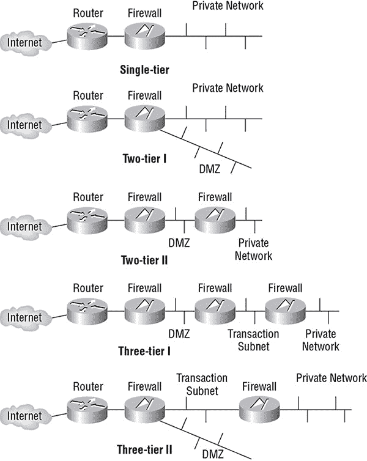

**图 11.8** 单层、双层和三层防火墙部署架构

三层部署架构是指在私有网络和互联网之间通过防火墙部署多个子网的方式。每个后续防火墙都有更严格的过滤规则，以限制仅允许受信任的来源的流量。最外层子网通常是区域防火墙（DMZ）。中间子网可作为事务子网，用于在 DMZ 中支持复杂 Web 应用的系统。第三个、后端子网可支持私有网络。这种架构是这些选项中最安全的；然而，它在设计、实施和管理上也最为复杂。

### 端点安全

`端点安全`是指每个单独设备必须在本地维护安全，无论其网络或电信渠道是否提供或提供安全。有时这被表述为“终端设备负责自身的安全”。但更清晰的视角是，网络中的任何弱点（无论是边界、服务器还是客户端）都会对组织内的所有元素构成风险。

传统安全依赖于网络边界守卫，如设备防火墙、代理、集中式病毒扫描以及 IDS/IPS/IDP 等解决方案，以提供网络内部节点的安全。这已不再被视为最佳商业实践，因为威胁既来自内部也来自外部。网络的安全性取决于其最弱的环节。

当远程访问服务（包括拨号、无线和 VPN）可能允许外部实体（授权或未授权）在绕过边界安全防护之前直接访问私有网络时，缺乏内部安全变得尤为严重。

端点安全因此应被视为在为每个单独主机提供足够安全的努力的一部分。每个系统应配备合适的组合：本地主机防火墙、反恶意软件扫描、身份验证、授权、审计、垃圾邮件过滤以及 IDS/IPS 服务。

### 安全硬件的操作

在构建网络时，你会使用大量硬件设备。对这些安全网络组件的深入了解有助于你设计一个避免单点故障、并提供强大可用性支持的 IT 基础设施。

以下是网络中一些硬件设备：

**Repeaters, Concentrators, and Amplifiers**

`Repeaters`, `concentrators`, and `amplifiers` 用于增强电缆段上的通信信号，并连接使用相同协议的网络段。这些设备可通过在长距离电缆运行中部署一个或多个 Repeaters 来延长特定电缆类型的最大长度。Repeaters, concentrators, and amplifiers 在 OSI 第 1 层运行。位于 Repeater, concentrator 或 amplifier 两侧的系统属于同一冲突域和广播域。

**Hubs**

`Hubs` 用于连接多个系统并连接使用相同协议的网络段。Hub 是多端口 Repeater。Hubs 在 OSI 第 1 层运行。Hub 两侧的系统属于同一冲突域和广播域。这确保了流量能到达其目标主机，但代价是同一冲突域和广播域的所有成员都会接收该通信。大多数组织实行无 Hub 安全策略，以限制或减少嗅探攻击的风险，因为这是过时技术，交换机更受青睐。

**Modems**

传统的电话线 `modem`（调制解调器）是一种通信设备，用于在模拟载波信号和数字信息之间进行调制或解调，以支持公共交换电话网（PSTN）线路的计算机通信。从 1960 年代中期至 1990 年代中期，调制解调器是广域网通信的常见手段。调制解调器通常被数字宽带技术（包括 ISDN、有线调制解调器、DSL 调制解调器、802.11 无线、以及各种无线调制解调器）所取代。

**Bridges**

`Bridge` 用于将两个网络连接在一起——即使是不同拓扑结构、布线类型和速度的网络，也能通过使用相同协议的网络段进行连接。Bridge 会将一个网络的流量转发到另一个网络。能够连接使用不同传输速度的网络的 Bridge 可能会设置缓冲区来存储数据包，直到可以转发到较慢的网络。这称为`存储-转发`设备。Bridge 在 OSI 第 2 层运行。Bridge 两侧的系统属于同一广播域，但属于不同的冲突域。

**Switches**

与使用 Hub 的方式不同，你可能会考虑使用交换机（或智能 Hub）。`Switches` 知道每个出站端口上连接的系统地址。与在每个出站端口上重复所有流量不同，交换机仅在目标已知的端口上重复流量。Switches 为流量传输提供更大的效率，创建独立的冲突域，并提高数据整体吞吐量。Switches 还能在创建 VLAN 时划分独立的广播域，仅允许在单个 VLAN 内进行广播，而不允许在 VLAN 之间自由跨越。Switches 主要在 OSI 第 2 层运行。当 Switches 具备额外功能（如路由）时，可在 OSI 第 3 层运行（例如在 VLAN 之间进行路由）。第 2 层运行的 Switches 两侧的系统属于同一广播域，但属于不同的冲突域；第 3 层运行的 Switches 两侧的系统属于不同的广播域和不同的冲突域。Switches 用于连接使用相同协议的网络段。

**Routers**

`Routers` 用于控制网络中的流量流向，常用于连接相似网络并控制两个网络之间的流量。它们可以使用静态路由表，也可以采用动态路由系统。有许多动态路由协议，如 RIP、OSPF 和 BGP。Routers 在 OSI 第 3 层运行。Router 两侧的系统属于不同的广播域和不同的冲突域。Routers 用于连接使用相同协议的网络段。

**Brouters**

`Brouters` 是组合设备，包含路由器和桥接器。Brouter 首先尝试进行路由，如果失败则回退到桥接。因此，Brouter 主要在层 3 运行，但在必要时可在层 2 运行。Brouter 第 3 层两侧的系统属于不同的广播域和不同的冲突域；Brouter 第 2 层两侧的系统属于同一广播域，但属于不同的冲突域。Brouters 用于连接使用相同协议的网络段。

**Gateways**

A `gateway` 连接使用不同网络协议的网络。Gateway 负责将一个网络的流量转换为另一个网络使用的协议或传输方法中兼容的格式，从而实现流量转移。Gateway 也称为`协议翻译器`，可以是独立的硬件设备，也可以是软件服务（例如，IP 到 IPX 网关）。Gateway 两侧的系统属于不同的广播域和不同的冲突域。Gateway 用于连接使用不同协议的网络段。常见的 Gateway 类型包括数据、邮件、应用、安全和 Internet 网关。Gateway 通常在 OSI 第 7 层运行。

-   [正向代理](https://example.org/proxy)是一种网关形式，不支持跨协议翻译。相反，正向代理充当中介、过滤器、缓存服务器，甚至作为网络的 NAT/PAT 服务器。正向代理会代表另一个系统执行功能或请求服务，并连接使用相同协议的网络段。正向代理最常用于在私有网络中为客户端提供互联网访问，同时保护客户端的身份。正向代理接受客户端请求，修改请求者的源地址，维护请求与客户端的映射，然后发送修改后的请求数据包。此机制通常称为网络地址转换 (NAT)。收到回复后，正向代理服务器会通过查看其映射来确定该回复适用于哪个客户端，然后将数据包转发给该客户端。位于正向代理两侧的系统属于不同的广播域和不同的碰撞域。

## LAN 扩展器

A `LAN extender` 是一种远程访问、多层交换机，用于通过宽带链路连接远程网络。这是一种奇怪的设备，因为它创建宽带网络，但该设备的营销人员回避使用 "WAN" 这个词，仅使用 "LAN" 和 "扩展的 LAN"。该设备的设计初衷是为了简化术语，使产品比正常的 WAN 设备更易销售，因为后者包含复杂的概念和术语。最终，它与 WAN 交换机或 WAN 路由器是同一产品。

## 布线、无线、拓扑、通信和传输介质技术

建立安全的网络不仅仅是管理操作系统和软件，还必须解决物理层问题，包括布线、无线、拓扑和通信技术。

### 传输介质


网络所使用的连接介质对网络的设计、布局和能力至关重要。缺乏正确的布线或 `传输介质`，网络可能无法覆盖整个企业，或无法支撑所需的流量。事实上，网络故障（即可用性违规）的最常见原因是布线故障或配置错误。您需要了解，不同的网络设备和技术会与不同类型的布线配合使用，每种布线类型都有其独特的可用长度、传输速率和连接要求。

#### 同轴电缆

`同轴电缆`，也称为 `同轴`，在 1970 年代和 1980 年代被广泛用于网络布线。进入 1990 年代初期后，由于双绞线的流行和性能，其使用迅速下降。2000 年代，同轴电缆作为网络布线的使用几乎可以忽略不计，但仍可能在音视频连接（如有线电视设备或卫星天线设备）中出现，尽管从服务设备到电视的最终连接大概率是 `HDMI`。

同轴电缆由中心铜导体、包裹绝缘层、导电编织屏蔽层以及最外层绝缘护套组成。

中心铜导体和编织屏蔽层作为两个独立的导体，从而允许同轴电缆双向通信。该设计使同轴电缆对 `电磁干扰 (EMI)` 具有较强抵抗能力，并能够支持比当时其他技术更高的带宽，同时提供的可用长度也比双绞线更长。由于成本更低、安装更简便，同轴电缆未能保持其作为流行网络布线技术的地位。同轴电缆需要使用段终结器，而双绞线不需要。同轴电缆更笨重，其最小弯曲半径大于双绞线（弯曲半径是指在未损坏内部导体之前，电缆能弯曲的最大距离）。此外，随着交换网络的普及，距离限制的问题因层级化布线模式的实现而变得不再重要。

同轴电缆主要有两种类型：细网线和粗网线。`细网线`，也称为 `10Base2`，常用于将系统连接到粗网线骨干。细网线可覆盖 185 米，提供最高 10 Mbps 的吞吐量。`粗网线`，也称为 `10Base5`，可覆盖 500 米，提供最高 10 Mbps 的吞吐量。

同轴电缆的常见问题包括：

*   超过电缆最大弯曲半径进行弯折，导致中心导体断裂  

*   部署长度超过其推荐最大长度（`10Base2` 为 185 米，`10Base5` 为 500 米）  

*   未正确在同轴电缆两端使用 50 Ω 终端电阻  

*   未在至少一端接地已终端的同轴电缆  

#### 基带和宽带电缆

大多数网络电缆技术的命名遵循 `XXyyyyZZ` 语法。`XX` 表示该电缆支持的最大速率，例如 10 Mbps 的 `10Base2`。接下来的 `yyyy` 表示基带或宽带特性，如 `10Base2` 的基带。基带电缆一次只能传输单个信号，宽带电缆则可同时传输多个信号。大多数网络电缆为基带电缆，但在特定配置下，同轴电缆可用作宽带连接，例如与有线调制解调器配合使用。

Table 11.8 显示了最常见网络布线类型的重要特性。

**TABLE 11.8** **常见网络布线类型的重要特性**

| 类型 | 最大速率 | 距离 | 安装难度 | EMI 易感性 |

| --- | --- | --- | --- | --- |

| `10Base2` | 10 Mbps | 185 米 | 中等 | 中等 |

| `10Base5` | 10 Mbps | 500 米 | 高 | 低 |

| `10BaseT (UTP)` | 10 Mbps | 100 米 | 低 | 高 |

| `STP` | 155 Mbps | 100 米 | 中等 | 中等 |

| `100BaseT/100BaseTX` | 100 Mbps | 100 米 | 低 | 高 |

| `1000BaseT` | 1 Gbps | 100 米 | 低 | 高 |

| 光纤 | 2+ Gbps | 2+ 公里 | 高至中等 | 无 |

#### 双绞线

`双绞线布线` 相比同轴电缆更薄更柔软。它由四对相互扭绕的导线组成，外层覆盖 PVC 绝缘层。如果在导线下层包裹金属箔层，则称为 `屏蔽双绞线 (STP)`；箔层提供额外的外部 EMI 防护。没有箔层的双绞线称为 `非屏蔽双绞线 (UTP)`，`UTP` 通常指 `10BaseT`、`100BaseT` 或 `1000BaseT`。

-   `UTP` 和 `STP` 的导线由细小的铜线对扭转而成。线对的扭转可保护免受外部射频和电磁、磁性干扰，并减少线对之间的串扰。当电流产生的电磁场使一组线上的传输数据被另一组线“ pickup”时，就会发生串扰。每根线对在电缆中以不同的扭转速率（即每英寸扭转次数）扭转；因此，同一电缆内一对线上的信号无法跨越到另一对线上（至少在同一电缆内）。

-   `UTP` 布线有多种类别。不同类别是通过加强线对的扭转、提高导体质量以及提高外部屏蔽质量来实现的。Table 11.9 显示了原始 UTP 类别。

**TABLE 11.9** **UTP categories**

| UTP category || Throughput || Notes |

| --- | --- | --- |

| `Cat 1` || Voice only || Not suitable for networks but usable by modems |

| --- | --- | --- |

| `Cat 2` || 4 Mbps || Not suitable for most networks; often employed for host-to-terminal connections on mainframes |

| `Cat 3` || 10 Mbps || Primarily used in `10BaseT` Ethernet networks (offers only 4 Mbps when used on Token Ring networks) and as telephone cables |

| `Cat 4` || 16 Mbps || Primarily used in Token Ring networks |

| `Cat 5` || 100 Mbps || Used in `100BaseTX`, `FDDI`, and `ATM` networks |

| `Cat 6` || 1,000 Mbps || Used in high-speed networks |

| `Cat 7` || 10 Gbps || Used on 10 gigabit-speed networks |

-   扭绞对布线最常见的问题包括：

*   为高吞吐量网络使用了错误类别的扭绞对电缆

*   部署的扭绞对电缆长度超过了其建议的最大长度（即 100 米）

*   在存在显著干扰的环境中使用 `UTP`

#### Conductors

-   导体网络布线的长度限制源于用作导体的金属的电阻。铜是最常用的导体，也是一种在室温下性能优异且成本低廉的导体。然而，它仍然会阻碍电子的流动。这种电阻导致信号随电缆长度的衰减和质量下降。

-   每种电缆类型所规定的最大长度表明，在此长度之后信号退化可能会影响数据高效传输。这种信号退化称为衰减。虽然可以使用比电缆额定长度更长的线路段，但该段会出现更多错误和重传，最终导致网络性能下降。随着传输速度的提高，衰减更为明显。建议在传输速度提高时使用更短的线路长度。

-   通过使用集线器（`repeaters`）或集中器（`concentrators`）可以延长长线路。集线器是一种信号放大设备，类似于车载或家庭音响的放大器。它增强 `incoming data stream` 的信号强度，并通过第二个端口广播。集中器功能相同，但拥有多个端口。不过，连续使用超过四个集线器（或集线器）是不建议的（参见侧边栏“5-4-3 规则”）。

### Network Topologies

-   计算机和网络设备的物理布局和组织方式称为网络拓扑。逻辑拓扑是将网络系统分组为受信任集合的方式。物理拓扑不一定与逻辑拓扑相同。网络物理布局的四种基本拓扑为环形、总线、星形和网状。

**Ring Topology** 环形拓扑将每个系统作为圆周上的点连接（参见 Figure 11.9）。连接介质作为单向传输循环。同一时间只能有一个系统传输数据。流量由令牌（`token`）管理。令牌是一个数字通行证，环绕环形直到某个系统抓取它。拥有令牌的系统可以传输数据。数据和令牌会传送到特定目的地。随着数据沿环流动，每个系统检查该数据是否为其自身。如果不是，则转递令牌；如果是，则读取数据。数据接收完毕后，令牌释放并继续在环中循环，直至另一个系统抓取它。如果环形的任何一段断裂，环形上的所有通信都会停止。某些环形拓扑的实现采用双环机制（双向相反方向运行的环），以防止单点故障。

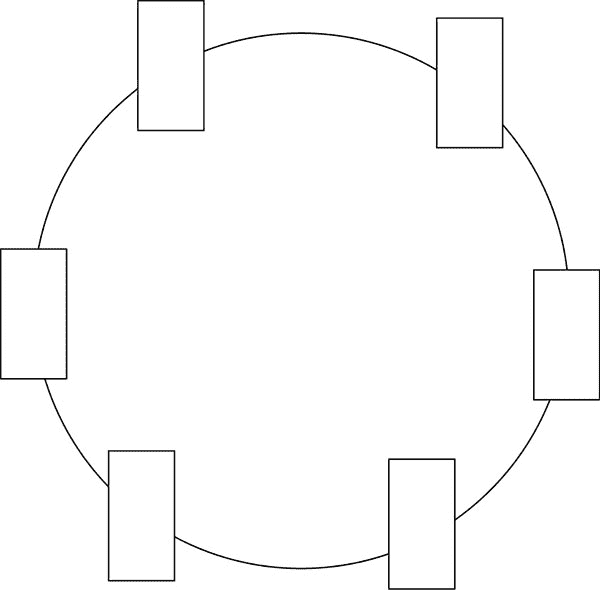

**FIGURE 11.9** A ring topology 

**Bus Topology** 总线拓扑将每个系统连接到主干线或后骨线上。总线上的所有系统可以同时传输数据，这可能导致碰撞。碰撞发生在两个系统同时传输数据时，信号相互干扰。为避免碰撞，系统使用碰撞避免机制，基本上“监听”当前是否有其他流量。如果听到流量，系统稍后再尝试。如果没有听到，系统即传输数据。总线拓扑下传输的数据所有网络系统都能接收；如果数据未针对特定系统，则该系统忽略。总线拓扑的优点是，若单个段失败，其他段仍可继续通信。但主干线仍是单点故障。

总线拓扑有两种类型：线性和树形。线性总线拓扑使用单条主干线，所有系统直接连接到它上。树形总线拓扑使用单条主干线，并设有可支持多个系统的分支。Figure 11.10 展示了两种类型。今天几乎不再使用总线，因为它必须在两端终止，且任何断开都会导致整个网络瘫痪。

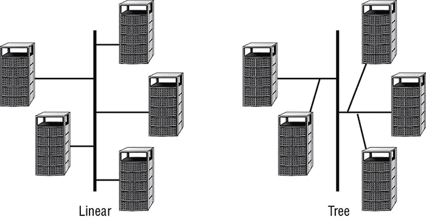

**FIGURE 11.10** A linear bus topology and a tree bus topology 

**Star Topology** 星形拓扑采用集中连接设备。该设备可以是简单的集线器或交换机。每个系统通过专用段连接到中心集线器（参见 Figure 11.11）。若任一段失败，其他段仍可继续工作。但中心集线器是单点故障。通常星形拓扑的布线比其他拓扑少，且更易于定位损坏的线缆。

逻辑总线和逻辑环可以作为物理星形实现。以太网是基于总线的技术。它可以作为物理星形部署，但集线器或交换机实际上是逻辑总线连接设备。同样，令牌环是基于环形的技术。它可以通过多站接入单元（`MAU`）作为物理星形部署，内部则实现逻辑环连接。

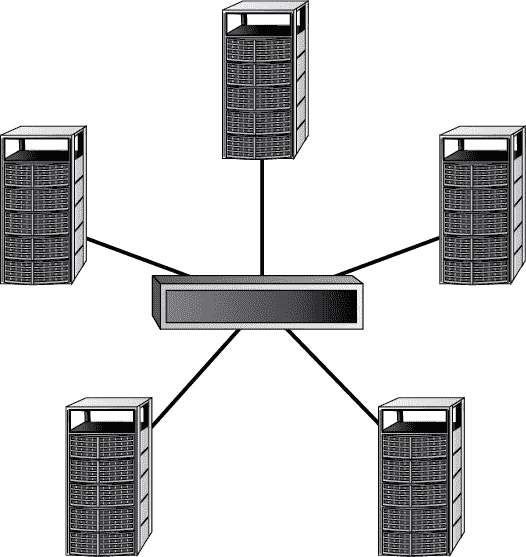

**FIGURE 11.11** A star topology 

`Mesh Topology` A `mesh topology` 连接系统到其他系统，使用众多路径（见 Figure 11.12）。全网格拓扑（`full mesh topology`）将每个系统连接到网络上所有其他系统。部分网格拓扑（`partial mesh topology`）将许多系统连接到许多其他系统。网格拓扑提供冗余连接，即使多个段出现故障，也能保持连接。

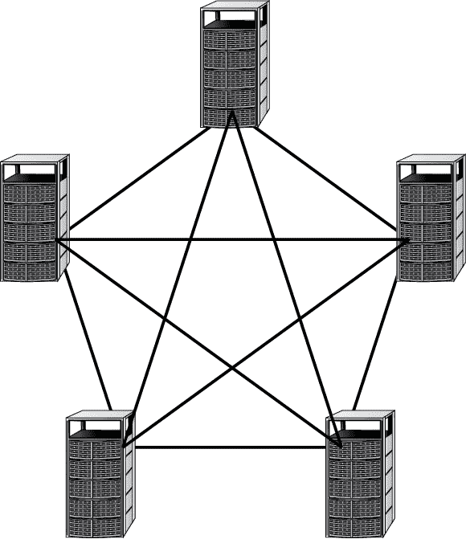

**FIGURE 11.12** A mesh topology 

### 无线通信与安全

无线通信是网络、连接、通信和数据交换技术快速发展的领域。数以千计的协议、标准和技术可以被标记为无线，包括蜂窝电话、蓝牙、无绳电话和无线网络。随着无线技术的普及，组织的安全措施必须超越仅仅保护本地网络。安全应是端到端的解决方案，涵盖所有通信形式、方法和技术。

#### 一般无线概念

无线通信利用无线电波在距离上传输信号。无线电频谱是有限的，因此其使用必须得到适当管理，以实现多任务同时使用且几乎无干扰。频率用于测量或区分无线电波，是单位为 `Hertz (Hz)`（每秒波动次数）的波动次数的计量。无线电波的频率范围在 3 Hz 到 300 GHz 之间。不同频段被指定用于特定用途，如 AM/FM 广播、VHF/UHF 电视等。目前，900 MHz、2.4 GHz 和 5 GHz 频段因未经许可而被无线产品广泛使用。为管理有限频率的并发使用，开发了多种频谱使用技术，包括 `spread spectrum`、`FHSS`、`DSSS` 和 `OFDM`。

`Spread spectrum` 表示通信同时在多个频率上进行。消息被拆分成若干段，每段在同一时间通过不同频率发送。这实质上是并行通信而非串行通信。

`Frequency Hopping Spread Spectrum (FHSS)` 是 `spread spectrum` 概念的早期实现。它不采用并行发送，而是在不断变换频率的同时串行发送数据。所有可用频率范围被利用，但同一时刻只使用一个频率。发送方切换频率时，接收方必须遵循相同的跳频模式以捕获信号。`FHSS` 设计用于通过不固定在可能受干扰的单一频率来最小化干扰，而是通过频率不断变化来降低干扰。

`Direct Sequence Spread Spectrum (DSSS)` 同时在所有可用频率上并行使用。其数据吞吐量高于 `FHSS`。`DSSS` 采用一种称为 `chipping code` 的特殊编码机制，即使因干扰导致信号部分失真，接收端仍能通过类似 `RAID-5` 校验的方式重建数据。

`Orthogonal Frequency-Division Multiplexing (OFDM)` 是频率使用的另一种变体。`OFDM` 使用数字多载波调制方案，实现更紧凑的传输。调制信号相互垂直（正交），因此互不干扰。`OFDM` 只需要较小的频率集（即信道带），但可以提供更大的数据吞吐量。

#### 手机

手机无线通信是使用特定无线电频率范围的便携设备与手机运营商的网络以及其他手机设备或互联网进行交互。运营商使用的技术种类繁多且常令人困惑。一个常见的混淆点是“2G”和“3G”等术语的使用。这些术语并不指代具体技术，而是指代手机技术的世代。因此，1G 是第一代（主要是模拟），2G 是第二代（主要是数字，3G 和 4G 也是数字），以此类推。也有讨论中的 2.5G，表示系统整合了第二代和第三代技术。Table 11.10 部分列出了这些技术以澄清相关混淆（仅为不完整的列表）。

**TABLE 11.10** **Mobile service technologies**

| Technology || Generation |

| --- | --- |

| `NMT` || 1G |

| `AMPS` || 1G |

| `TACS` || 1G |

| `GSM` || 2G |

| `iDEN` || 2G |

| `TDMA` || 2G |

| `CDMA` || 2G |

| `PDC` || 2G |

| `HSCSD` || 2.5G |

| `GPRS` || 2.5G |

| `W-CDMA` || 3G |

| `TD-CDMA` || 3G |

| `UWC` || 3G |

| `EDGE` || 3G |

| `DECT` || 3G |

| `UMTS` || 3G |

| `HSPDA` || 3.5G |

| `WiMax – IEEE 802.16` || 4G |

| `XOHM (Brand name of WiMax)` || 4G |

| `Mobile Broadband – IEEE 802.20` || 4G |

| `LTE (Long Term Evolution)` || 4G |

| `4G/IMT-Advanced standards using millimeter wave bands (28, 38, and 60 GHz)` || 5G |

部分列出的技术被标记为 4G，但实际上并未满足 ITU-R 在 2008 年定义的 4G 技术要求。2010 年，ITU-R 同意运营商在其不符合要求的技术仍可称为 4G，只要这些技术能够向未来合规的服务演进。5G 技术正在研发中，2018 年已有少量测试网络部署。

在手机无线传输方面，需要注意几个关键问题。第一，并非所有手机流量都是语音；手机系统常用于传输短信和甚至计算机数据。第二，无论是语音、短信还是数据，手机运营商网络的通信未必是安全的。第三，使用特定的无线窃听设备，您的手机传输可能被拦截。事实上，运营商的基站可以被模拟以进行中间人攻击。第四，利用手机连接访问互联网或办公网络为攻击者提供了另一种潜在的入口、访问和妥协途径。许多设备可能充当桥梁，为未经授权的访问创建通道。

#### Bluetooth (802.15)

-   `Bluetooth`，或 `IEEE 802.15`，`个人区域网络 (PANs)` 是另一领域的无线安全关注点。用于手机耳机、鼠标、键盘、全球定位系统 (`GPS`) 设备以及许多其他界面设备和外设的连接通过 `Bluetooth` 实现。许多连接使用一种称为“配对”的技术，其中主设备扫描 2.4 GHz 无线电频段寻找可用设备，然后在发现设备后，使用四位数字 PIN 来“授权”配对。此过程虽能减少误配对的次数，但四位数字 PIN 并不安全（更不用说默认 PIN 常为 0000）。此外，还有针对 `Bluetooth` 设备的攻击。一种技术称为 `蓝牙劫持 (bluejacking)`，允许攻击者向你的设备发送类似短信 (`SMS`) 的消息。`蓝牙偷听 (bluesnarfing)` 让黑客在不知情的情况下连接到你的 `Bluetooth` 设备并窃取信息，这可能包括联系人列表、数据以及对话内容。`蓝牙劫持 (bluebugging)` 则让攻击者获得对 `Bluetooth` 设备的远程控制，例如打开麦克风将手机用作音频监听器。虽然 `Bluetooth` 的典型有效范围约为 30 英尺，但部分设备可工作超过 100 米。`Bluetooth` 射频功率和天线按其最大允许功率分类为若干类，如 `Table 11.11` 所示。

**TABLE 11.11** **Bluetooth 设备类别**

| 类别 | 最大允许功率 | 典型范围 |

| --- | --- | --- |

| 1 | 100 mW | 100 m |

| 2 | 2.5 mW | 10 m |

| 3 | 1 mW | 1 m |

| 4 | .5 mW | .5 m |

`Bluetooth` 设备有时使用加密，但它不是动态的，通常可以通过适度的努力被破解。对于不涉及敏感或机密的活动使用 `Bluetooth`。尽可能更改设备的默认 PIN。不要让设备保持发现模式，并在未使用时关闭 `Bluetooth`。

#### RFID


射频识别（Radio Frequency Identification，RFID）是一种基于在磁场中放置天线时，利用天线产生的电流为无线电发射器供电的技术。RFID 可在相当远的距离（常数百米）触发/供电并读取。RFID 可附着在设备上或集成到设备结构中，如笔记本电脑、平板电脑、路由器、交换机、`USB` 闪存盘、便携式硬盘等。这使得无需直接接触设备即可快速进行库存跟踪。只需走进配备 RFID 读取器的房间，即可收集该区域被激活芯片所传输的信息。

也有人担心 RFID 会侵犯隐私。如果你持有带 RFID 芯片的设备，任何拥有 RFID 读取器的人都可以捕获芯片的信号。当 RFID 芯片被唤醒或靠近读取器时，芯片（也称 RFID 标签）会发送一个唯一的代码或序列号。该唯一号码本身在没有对应数据库将其与特定对象（或人）关联的情况下毫无意义。但如果在读取器检测到你的 RFID 代码时，你是当时唯一在场的对象，那么他们可以将你或你的设备与该代码关联，并在以后每次检测到相同代码时进行关联。

## NFC

近场通信（Near-field communication，NFC）是一种在设备近距离（几英寸而非英尺）建立无线电通信的标准。它通过让设备轻触或将其在几英寸内靠近来实现自动同步和关联。NFC 源自 RFID，本身也是一种被动或触发式的场能技术。

NFC 普遍出现在智能手机及许多移动设备配件上。它常用于设备间的数据交换、建立直接通信，或通过将移动设备与无线接入点（WPA2 加密的无线网络）通过 NFC 进行关联，从而访问更复杂的服务（如无线网络）。由于 NFC 是基于射频的技术，它同样存在漏洞。NFC 攻击可能包括中间人攻击、窃听、数据篡改和重放攻击。

## 无绳电话（Cordless Phones）

无绳电话是一个常被忽视的安全问题。无绳电话设计用于使用任何非授权频段，即 `900 MHz`、`2.4 GHz` 或 `5 GHz`。这三个非授权频段被众多设备使用，包括无绳电话、婴儿监视器、`Bluetooth` 和无线网络设备。经常被忽视的问题是，有人可以通过频率扫描器轻易窃听无绳电话的通话，因为其信号通常缺乏加密。只要拥有频率扫描器，任何人都能窥听你的对话。

## 移动设备（Mobile Devices）

智能手机和其他移动设备的安全风险随其对互联网及企业网络能力的增强而不断上升。移动设备通常支持存储卡，可用于将恶意代码或机密数据走私进或出组织。许多移动设备还支持 `USB` 连接，用于与台式机或笔记本电脑同步通信记录、联系人，以及传输文件、文档、音乐、视频等。设备本身往往包含敏感数据，如联系人、短信、电子邮件、笔记和文档。

移动设备的丢失或被盗可能导致个人和/或企业秘密被泄露。

移动设备也日益成为黑客和恶意代码的目标。保持非必要信息离设备而外、使用防火墙和防病毒软件（如有），并将系统锁定或加密（如果可能）是必要的措施。

许多移动设备同样支持 `USB` 连接，用于与台式机或笔记本电脑同步通信记录、联系人，以及传输文件、文档、音乐、视频等。

此外，移动设备也易受窃听。使用适当的高级设备，大多数移动电话通话可以被窃听，而且任何在 `15` 英尺以内的人都能听到你在谈论什么。员工应被教育在公共场所保持低调，避免在手机上讨论敏感内容。

移动设备虽有大量安全功能，但功能的支持并不等同于功能已正确配置并启用。只有当安全功能真正处于工作状态，才能获得安全收益。务必检查所有希望在组织网络上连接的设备上，所需的安全功能是否已正常运行。

更多关于移动设备安全管理的信息，请参见第 `9` 章“移动系统的安全漏洞、威胁与对策”，特别是“评估并缓解移动系统漏洞”这一节。

## LAN 技术

主要有三种 LAN 技术：`Ethernet`、`Token Ring` 和 `FDDI`。虽然还有少量其他 LAN 技术，但它们使用较少。CISSP 考试只涉及这三种主流技术。大多数 LAN 技术的差异主要体现在数据链路层及以下层次。

### Ethernet

- `Ethernet` 是一种共享介质的局域网技术（也称为广播技术）。这意味着它允许多个设备通过同一介质进行通信，但要求设备在通信时轮流进行，并进行碰撞检测和避免。`Ethernet` 使用广播域和碰撞域。广播域是指一组系统的物理分组，其中该组内的所有系统都会接收由组内单一系统发送的广播消息。广播消息是发送到特定地址的消息，表示该组内的所有系统都是目标接收者。

- 碰撞域是指一组系统的集合，在这些系统中，如果两个系统同时发送数据，就会发生碰撞。数据碰撞发生在两个传输消息同时尝试使用网络介质时。这会导致一个或两个消息损坏。

- `Ethernet` 支持全双工通信（即双向通信），通常采用双绞线布线。（同轴电缆最初被使用。）`Ethernet` 最常部署在星形或总线拓扑结构中。`Ethernet` 基于 `IEEE 802.3` 标准。`Ethernet` 数据的基本单位称为帧。快速以太网支持 `100 Mbps` 的吞吐量。千兆以太网支持 `1,000 Mbps`（`1 Gbps`）的吞吐量。`10` 千兆以太网支持 `10,000 Mbps`（`10 Gbps`）的吞吐量。

### Token Ring

`Token Ring` 使用令牌传递机制来控制哪些系统可以在网络介质上传输数据。令牌在 LAN 的所有成员之间逻辑环形移动。`Token Ring` 可以在环形或星形网络拓扑结构中使用。由于性能限制、相比 `Ethernet` 的更高成本以及部署和管理的复杂性，它今天很少使用。`Token Ring` 在过去十年或更长时间内很少出现在大多数网络中。

`Token Ring` 可以作为物理星形部署，使用 `multistation access unit (MAU)`。`MAU` 允许线缆段以星形部署，而内部设备则逻辑上形成环形连接。

### Fiber Distributed Data Interface (FDDI)

`Fiber Distributed Data Interface (FDDI)` 是一种高速令牌传递技术，使用两个环，流量在相反方向流动。`FDDI` 通常作为大型企业网络的骨干使用。其双环设计允许通过从失败段中移除该段，并在剩余的内环和外环部分之间创建单一环来实现自愈。`FDDI` 虽然昂贵，但在快速以太网和千兆以太网发展之前，经常用于校园环境。一个更便宜、距离受限且速度较慢的版本称为 `Copper Distributed Data Interface (CDDI)`，它使用双绞线电缆。`CDDI` 也更容易受到干扰和窃听。

#### Subtechnologies

大多数网络由多种技术而非单一技术组成。例如，`Ethernet` 不仅仅是一种技术，而是一个包含其常见和预期活动和行为的子技术集合的上位技术。`Ethernet` 包括数字通信、同步通信和基带通信的技术，并支持广播、组播、单播通信以及 `Carrier-Sense Multiple Access with Collision Detection (CSMA/CD)`。许多局域网技术，如 `Ethernet`、`Token Ring` 和 `FDDI`，可能包含下面各节描述的许多子技术。

#### Analog and Digital

许多网络通信形式中常见的子技术是用于通过物理介质（如电缆）实际传输信号的机制。主要有两种类型：模拟和数字。

* 模拟通信 使用连续信号，该信号在频率、振幅、相位、电压等方面有所变化。连续信号的变化产生波形（不同于数字信号的方形波形）。实际通信是通过连续信号的变化来实现的。

* 数字通信 通过使用不连续的电信号和开关脉冲（即状态变化）来实现。

数字信号在长距离传输或存在干扰时比模拟信号更可靠。这是因为数字信号使用直流电压来存储信息，电压表示 `1`，无电压表示 `0`。这些开关脉冲形成二进制数据流。模拟信号因长距离传输和干扰而衰减和失真。由于模拟信号可以有无数种变化用于编码，而数字信号只有两种状态，因此随着退化程度增加，提取数据变得更加困难。

#### Synchronous and Asynchronous

一些通信是经过时钟或时间活动同步的。通信要么是同步的，要么是异步的：

* 同步通信 依赖于时钟或时间戳机制，可以是独立时钟或数据流中嵌入的时间戳。同步通信通常能够支持非常高的数据传输速率。

* 异步通信 依赖于停止和开始的分隔位来管理数据传输。由于使用分隔位以及传输的停止和开始特性，异步通信最适合传输较小的数据量。公共交换电话网（`PSTN`）调制解调器是异步通信设备的良好示例。

#### Baseband and Broadband

能在电缆段上同时传输多少通信取决于使用基带技术还是宽带技术：

* 基带技术 只能支持单一通信信道。它使用直接电流在电缆上施加。电流水平越高代表二进制信号 `1`，电流水平越低代表二进制信号 `0`。基带是一种数字信号形式。`Ethernet` 是基带技术。

* 宽带技术 可以同时支持多个通信信号。宽带使用频率调制来支持多个信道，每个信道支持独立的通信会话。宽带适合高吞吐量，尤其是当多个信道被复用时。宽带是一种模拟信号形式。有线电视、有线调制解调器、`ISDN`、`DSL`、`T1`、`T3` 等都是宽带技术的例子。

#### Broadcast, Multicast, and Unicast

广播、组播和单播技术决定单次传输可以到达多少个目的地：

* 广播 技术支持向所有可能的接收者进行通信。

* 组播 技术支持向特定多个接收者进行通信。

* 单播 技术仅支持向特定接收者的单次通信。

#### LAN Media Access

至少有五种局域网媒体访问技术用于避免或防止传输碰撞。这些技术定义了如何在同一碰撞域内的多个系统进行通信。一些技术主动防止碰撞，而其他技术则响应碰撞。

**Carrier-Sense Multiple Access (CSMA)** 这是一种局域网媒体访问技术，其工作步骤如下：

1. 主机监听局域网介质以确定其是否正在使用。

2. 如果介质未被使用，主机进行通信传输。

3. 主机等待确认。

4. 如果在超时期间未收到确认，主机重新从步骤 `1` 开始。

`CSMA` 不直接解决碰撞问题。如果发生碰撞，通信将无法成功，因此不会收到确认。这会导致发送系统重新传输数据并重新执行 `CSMA` 过程。

# Carrier-Sense Multiple Access with Collision Avoidance (CSMA/CA)

这是局域网介质访问技术，使用以下步骤进行通信：

1. 主机有两个与局域网介质的连接：接收和发送。主机通过接收连接监听局域网介质是否正在使用。

2. 如果局域网介质未被占用，主机请求发送权限。

3. 如果在超时期间未收到权限，主机重新执行第 `1` 步。

4. 如果权限获取成功，主机通过发送连接传输数据。

5. 主机等待确认信号。

6. 如果在超时期间未收到确认信号，主机重新执行第 `1` 步。

`AppleTalk` 和 `802.11` 无线网络是采用 `CSMA/CA` 技术的网络示例。`CSMA/CA` 通过在任意时刻仅授予单个通信权限来避免碰撞。该系统需要指定主系统（`master`），该系统响应请求并授予数据传输权限。

# Carrier-Sense Multiple Access with Collision Detection (CSMA/CD)

这是局域网介质访问技术，使用以下步骤进行通信：

1. 主机监听局域网介质以判断是否正在使用。

2. 如果局域网介质未被占用，主机开始传输数据。

3. 在传输过程中，主机监听碰撞（即多个主机同时传输）。

4. 如果检测到碰撞，主机发送干扰信号。

5. 如果接收到干扰信号，所有主机停止传输。每个主机等待随机时间后重新执行第 `1` 步。

以太网使用 `CSMA/CD` 技术。`CSMA/CD` 通过让碰撞域内的每个成员等待短暂且随机的时间后重新开始过程来应对碰撞。遗憾的是，允许发生碰撞并随后处理碰撞会导致传输延迟并需要重传，从而使潜在吞吐量损失约 `40%`。

# 令牌传递（Token Passing）

这是使用数字令牌进行通信的局域网介质访问技术。令牌的拥有权允许主机传输数据。数据传输完成后，主机将令牌释放给下一个系统。令牌传递用于令牌环网络，如 `FDDI`。令牌环网通过仅允许持有令牌的系统传输数据来防止碰撞。

# 轮询（Polling）

这是使用主从配置的局域网介质访问技术。有一个系统被标记为主系统，其他系统被标记为从系统。主系统按顺序轮询每个从系统是否有数据需要传输。如果从系统表示需要传输，则授予其发送权限。主系统在传输完成后会轮询下一个从系统。同步数据链控制（`SDLC`）使用轮询。

轮询通过使用权限系统来预防碰撞。轮询是 `CSMA/CA` 的逆过程。两者都使用主从（或主从）体系结构，但 `CSMA/CA` 允许从系统请求权限，而轮询由主系统授予权限。轮询可配置为为某些系统提供优先级，例如，如果标准轮询顺序为 `1, 2, 3, 4`，则可将系统 `1` 设为优先级，改为 `1, 2, 1, 3, 1, 4`。

## 总结

设计、部署和维护网络安全需要对网络涉及的技术有深入理解。这包括协议、服务、通信机制、拓扑结构、布线、端点和网络设备。

`OSI` 模型是评估所有协议的标准。理解 `OSI` 模型的使用方法及其在实际协议中的应用，有助于系统设计师和系统管理员提升安全性。`TCP/IP` 模型直接来源于协议，大致对应 `OSI` 模型。

大多数网络以 `TCP/IP` 为主协议。但 `TCP/IP` 网络中包含大量子协议、支持协议、服务和安全机制。对这些实体的基本了解有助于设计和部署安全网络。

除了路由器、集线器、交换机、重复器、网关和代理，防火墙也是网络安全的重要组成部分。防火墙有多种类型：静态包过滤、应用层网关、电路层网关、状态检测、深度包检测和下一代。

汇聚协议在现代网络中很常见，包括 `FCoE`、`MPLS`、`VoIP` 和 `iSCSI`。软件定义网络和内容分发网络扩展了网络的定义及其使用场景。构建网络的硬件组件种类繁多，其中包括用于连接所有设备的布线。了解每种布线类型的优缺点是设计安全网络的一部分。

无线通信形式多样，包括蜂窝网络、`Bluetooth (802.15)`、`RFID`、`NFC` 和无线网络（`802.11`）。无线通信更易受干扰、窃听、拒绝服务和中间人攻击。

以太网是最常用的局域网技术。常见的网络拓扑结构包括环形、总线、星形和网状。

## 考试要点

**了解 `OSI` 模型的层级及其对应的协议。** `OSI` 模型的七层及其支持的协议如下：

* 应用层：`HTTP`、`FTP`、`LPD`、`SMTP`、`Telnet`、`TFTP`、`EDI`、`POP3`、`IMAP`、`SNMP`、`NNTP`、`S-RPC` 和 `SET`

* 表示层：`加密协议和格式类型`，如 `ASCII`、`EBCDICM`、`TIFF`、`JPEG`、`MPEG` 和 `MIDI`

* 会话层：`NFS`、`SQL` 和 `RPC`

* 传输层：`SPX`、`SSL`、`TLS`、`TCP` 和 `UDP`

* 网络层：`ICMP`、`RIP`、`OSPF`、`BGP`、`IGMP`、`IP`、`IPSec`、`IPX`、`NAT` 和 `SKIP`

* 数据链路层：`SLIP`、`PPP`、`ARP`、`L2F`、`L2TP`、`PPTP`、`FDDI`、`ISDN`

* 物理层：`EIA/TIA-232`、`EIA/TIA-449`、`X.21`、`HSSI`、`SONET`、`V.24` 和 `V.35`

**掌握 `TCP/IP` 的知识。** 了解 `TCP` 和 `UDP` 的区别；熟悉四层 `TCP/IP` 结构（应用层、传输层、`Internet` 层、链接层）及其与 `OSI` 模型的对应关系。此外，需了解常见端口的用途及相关子协议。

**了解不同布线类型及其长度和最大吞吐量。** 包括 `STP`、`10BaseT (UTP)`、`10Base2` (thinnet)、`10Base5` (thicknet)、`100BaseT`、`1000BaseT` 和光纤。同时需了解 `UTP` 类别 `1` 到 `7`。

**熟悉常见的局域网技术。** 最常见的局域网技术是 `Ethernet`。还需了解模拟与数字通信、同步与异步通信、基带与宽带通信、广播、组播与单播通信、`CSMA`、`CSMA/CA` 和 `CSMA/CD`、令牌传递以及轮询。

**理解安全网络架构和设计。** 网络安全需考虑 `IP` 和非 `IP` 协议、网络访问控制、安全服务和设备、多层协议管理以及端点安全。

**理解网络分段的类型和目的。** 网络分段可用于管理流量、提升性能和强化安全。例如，内部网（`intranet`）、外部网（`extranet`）和边缘区域网（`DMZ`）。

# 理解不同的无线技术。

`Cell phones`、`Bluetooth (802.15)` 和无线网络（`802.11`）都被称为无线技术，尽管它们本质上各不相同。要了解它们的区别、优势和劣势。了解 `802.11` 无线网络的基础安全知识。

# 理解光纤通道。

光纤通道是一种网络数据存储解决方案形式（即 `SAN`（存储区网络）或 `NAS`（网络附加存储）），能够支持高速文件传输。

# 理解 `FCoE`。

`FCoE`（光纤通道以太网）用于在以太网网络中封装光纤通道通信。

# 理解 `iSCSI`。

`iSCSI`（Internet Small Computer System Interface）是基于 `IP` 的网络存储标准。

# 理解 `802.11` 及 `802.11a`、`b`、`g`、`n`、`ac`。

`802.11` 是 `IEEE` 无线网络通信的标准。包括 `802.11`（`2 Mbps`）、`802.11a`（`54 Mbps`）、`802.11b`（`11 Mbps`）、`802.11g`（`54 Mbps`）、`802.11n`（`600 Mbps`）和 `802.11ac`（`1.3+ Mbps`）。`802.11` 标准还定义了有线等效隐私（`WEP`）。

# 理解现场调查。

`site survey` 是对部署在环境中的无线接入点的存在、强度和覆盖范围进行调查的过程。此任务通常包括携带便携式无线设备行走于现场，记录无线信号强度，并在建筑平面图或示意图上绘制这些信息。

# 理解 `WPA2`。

`WPA2` 是一种新的加密方案，全称为 `Counter Mode with Cipher Block Chaining Message Authentication Code Protocol (CCMP)`，基于 `AES` 加密方案。

# 理解 `EAP`。


EAP（可扩展认证协议）并非一种具体的认证机制，而是一个认证框架。实际上，EAP 使得新的认证技术能够与现有的无线或点对点连接技术保持兼容。

# 理解 PEAP

PEAP（受保护可扩展认证协议）在 TLS 隧道内封装 EAP 方法，提供认证功能，并可能提供加密。

# 理解 LEAP

LEAP（轻量可扩展认证协议）是思科专有的、用于 WPA 的 TKIP 替代方案。它是在 802.11i/WPA2 标准制定之前开发的，旨在解决 TKIP 的缺陷。

# 理解 MAC 过滤

MAC 过滤是一份授权的无线客户端接口 MAC 地址列表，由无线接入点使用以阻止非授权设备访问。

# 理解 SSID 广播

无线网络传统上通过特殊的广播包（Beacon frame）定期在 SSID 上进行广播。当 SSID 被广播时，具有自动发现并连接功能的设备不仅能看到该网络，还能发起连接。

# 理解 TKIP

TKIP（临时密钥完整性协议）被设计为 WEP 的替代方案，无需更换已有的老旧无线硬件。TKIP 在 802.11 无线网络中以 WPA（Wi‑Fi Protected Access）的名义实现。

# 理解 CCMP

CCMP（Counter Mode with Cipher Block Chaining Message Authentication Code Protocol）是用于取代 WEP 和 TKIP/WPA 的方案，采用 128 位密钥的 AES（高级加密标准）。

# 理解 captive portals

Captive portal 是一种认证技术，会在无线客户端首次连接时将其重定向到一个门户访问控制页面。

# 理解天线类型

无线客户端和基站可以使用多种天线类型，包括全向天线的棒状天线以及许多方向性天线，如 Yagi、cantenna、面板和抛物面天线。

# 了解标准网络拓扑结构

这些包括环形、总线、星形和网状拓扑结构。

# 了解常见网络设备

常见的网络设备有防火墙、路由器、集线器、桥接器、调制解调器、重复器、交换机、网关和代理。

# 了解防火墙的不同类型

防火墙有多种类型：静态包过滤、应用层网关、电路层网关、状态检查、深度包检查和下一代。

# 了解用于连接 LAN 和 WAN 通信技术的协议服务

这些包括帧中继、SMDS、X.25、ATM、HSSI、SDLC、HDLC 和 ISDN。

1. 名称 OSI 模型的层及其编号（从上到下）。

2. 名称三种布线问题及对应的解决方法。

3. 无线设备使用哪些技术来最大化可用的无线电频率的使用？

4. 讨论保护 802.11 无线网络的方法。

5. 名称 LAN 共享介质访问技术及其使用示例（如有）。

## 复习题

1. OSI 模型的第 4 层是什么？

   1. 表示层  

   2. 网络层  

   3. 数据链路层  

   4. 传输层  

2. 什么是封装（encapsulation）？

   1. 更改数据包的源和目的地址  

   2. 在数据在 OSI 堆栈中向下移动时，在其前后添加头部和尾部  

   3. 验证个人身份  

   4. 在证据被正确收集前保护证据  

3. 哪个 OSI 模型层负责管理单工、半双工和全双工模式的通信？

   1. 应用层  

   2. 会话层  

   3. 传输层  

   4. 物理层  

4. 哪个选项最不易受到电磁干扰（EMI）？

   1. Thinnet  

   2. UTP  

   3. STP  

   4. 光纤  

5. 以下哪项不是网络分段的例子？

   1. 内部网  

   2. 展区（DMZ）  

   3. 外网（Extranet）  

   4. VPN  

6. 哪种基于场地供电的技术可用于库存管理且无需直接物理接触？

   1. IPX  

   2. RFID  

   3. SSID  

   4. SDN  

7. 如果你是蓝牙劫持（bluejacking）攻击的受害者，什么被 compromized（被 compromized）？

   1. 你的防火墙  

   2. 你的交换机  

   3. 你的手机  

   4. 你的网页 Cookie  

8. 哪种网络技术基于 IEEE 802.3 标准？

   1. 以太网  

   2. 令牌环网  

   3. FDDI  

   4. HDLC  

9. 什么是 TCP Wrapper？

   1. 交换机使用的封装协议  

   2. 可作为基本防火墙的应用，通过用户 ID 或系统 ID 限制访问  

   3. 保护 TCP/IP 流量在 WAN 链路上的安全协议  

   4. 用于在非 IP 网络中隧道 TCP/IP 的机制  

10. 哪项既是多层协议的优势，又可能是潜在的有害影响？

    1. 吞吐量  

    2. 封装  

    3. 哈希完整性检查  

    4. 逻辑地址  

11. 通过检查源和目的地址、应用程序使用、来源以及当前数据包与同一会话之前数据包的关系，`stateful inspection` 防火墙能够为授权用户和活动提供更广泛的访问权限，并主动监控并阻止未授权用户和活动。

2. `stateful inspection` 防火墙被称为第三代防火墙。

3. 以下哪项关于防火墙的描述不正确？

   1. 能够记录流量信息。  

   2. 能够阻止病毒。  

   3. 能够根据疑似攻击触发警报。  

   4. 无法防止内部攻击。  

4. 以下哪项不是路由协议？

   1. OSPF  

   2. BGP  

   3. RPC  

   4. RIP  

15. 一个`\_\_\_\_\_\_\_\_\_\_\_\_\_\_`是一个智能枢纽，因为它知道连接在每个出站端口上的系统的地址。与在每个出站端口上重复流量不同，它只在已知目的地存在的端口上重复流量。

     1. `Repeater`

     2. `Switch`

     3. `Bridge`

     4. `Router`

16. 下列哪项不是专门与 802.11 无线网络相关的技术？

     1. `WAP`

     2. `WPA`

     3. `WEP`

     4. `802.11i`

17. 哪种无线频率访问方法在提供最大吞吐量的同时提供最少的干扰？

     1. `FHSS`

     2. `DSSS`

     3. `OFDM`

     4. `OSPF`

18. 哪种安全概念鼓励管理员在每个主机上安装防火墙、恶意软件扫描器和 IDS？

     1. `Endpoint security`

     2. `Network access control (NAC)`

     3. `VLAN`

     4. `RADIUS`

20. 哪种基础设施模式无线网络部署支持通过使用单个 SSID 但多个接入点来支持大型物理环境？

     1. `Stand-alone`

     2. `Wired extension`

     3. `Enterprise extension`

     4. `Bridge`

# 第 12 章

安全通信和网络攻击

**本章涵盖的 CISSP 考试主题包括：**

*   第 4 个域：通信和网络安全  

    *   4.3 按设计实施安全通信通道  

        *   4.3.1 `Voice`  

        *   4.3.2 `Multimedia collaboration`  

        *   4.3.3 `Remote access`  

        *   4.3.4 `Data communications`  

        *   4.3.5 `Virtualized networks`  

以静态形式存储在存储设备上的数据相对容易保护。只要保持物理访问控制并实施合理的逻辑访问控制，存储的文件就会保持机密性、完整性，并可供授权用户访问。然而，一旦数据被应用程序使用或通过网络连接传输，保护它的过程就变得复杂得多。

通信安全涵盖了将电子信息从一个地点传输到另一个地点的广泛问题。这种传输可能发生在星球两端的系统之间，也可能发生在同一业务网络内的系统之间。一旦涉及任何传输方式，数据就会面临众多威胁其机密性、完整性和可用性的风险。幸运的是，通过适当的防范措施，许多这些威胁可以被减轻或消除。

通信安全设计用于检测、防止甚至纠正数据传输错误（即，它提供完整性保护以及机密性）。这是为了在支持数据交换和共享的同时维护网络的安全。本章涵盖了各种通信安全形式、漏洞以及防范措施。

通信和网络安全域是 CISSP 认证考试的考点之一，主要涉及网络组件（即网络设备和协议），特别是它们的工作原理及其与安全的相关性。本章以及第 11 章“安全网络架构和保障网络组件”讨论了该域，务必阅读并学习这两章的内容，以确保为 CISSP 认证考试提供完整的必要材料。

## 网络和协议安全机制

`传输控制协议/互联网协议套件（TCP/IP）` 是大多数网络和互联网上使用的主要协议套件。它是一个强大的协议套件，但也存在诸多安全缺陷。为了提高 TCP/IP 的安全性，已开发出许多子协议、机制或应用程序来保护传输数据的机密性、完整性和可用性。需要记住，即使是 TCP/IP 的基础协议套件，实际上也有数以百计甚至数以千计的单独协议、机制和应用程序在互联网上使用。有些是为了提供安全服务，有些保护完整性，有些保护机密性，还有些提供身份验证和访问控制。在下面的章节中，我们将讨论一些常见的网络和协议安全机制。

### 安全通信协议

提供应用程序特定通信通道安全服务的协议称为安全通信协议。以下列表列出了一些可选的示例：

`IPsec` 互联网协议安全（IPsec）使用公钥加密提供加密、访问控制、不可否认性和消息验证，全部基于 IP 协议。IPsec 的主要用途是虚拟私网（VPN），因此它可以在传输模式或隧道模式下运行。IPsec 将在第 7 章“PKI 和密码学应用”中进一步讨论。

`Kerberos` Kerberos 提供单点登录解决方案，保护登录凭据。现代 Kerberos 实现使用混合加密提供可靠的身份验证保护。Kerberos 将在第 13 章“密码学和对称密钥算法”中进一步讨论。

`SSH` 安全壳（SSH）是端到端加密的一个良好示例。该安全工具可用于加密众多明文工具（如 rcp、rlogin、rexec），作为协议加密器（如 SFTP），以及作为 VPN。

`Signal Protocol` 这是一个提供端到端加密的密码协议，用于语音通信、视频会议和文本消息服务。Signal Protocol 是非联邦的，是命名为 Signal 的即时通讯应用的核心元素。

`Secure Remote Procedure Call (S-RPC)` 这是一个身份验证服务，简单来说就是防止在远程系统上未经授权执行代码的手段。

`Secure Sockets Layer (SSL)` 这是由 Netscape 开发的加密协议，用于保护 Web 服务器和 Web 浏览器之间的通信。SSL 可用于保护 Web、电子邮件、文件传输协议（FTP）甚至 Telnet 流量。它是一个面向会话的协议，提供机密性和完整性。SSL 采用 40 位密钥或 128 位密钥部署，并已被传输层安全（TLS）取代。

`Transport Layer Security (TLS)` TLS 的工作方式与 SSL 类似，但它使用更强的身份验证和加密协议。

SSL 和 TLS 都有以下特点：

*   支持在不安全网络上进行安全的客户端-服务器通信，防止篡改、伪造和窃听。

*   支持单向身份验证。

*   支持使用数字证书的双向身份验证。

*   通常作为 TCP 包的初始负载，允许它封装所有更高层协议的负载。

*   可以在较低层实现，例如在网络层（第 3 层）作为 VPN 运行。这种实现称为 OpenVPN。

此外，TLS 还可用于加密用户数据报协议（UDP）和会话初始化协议（SIP）连接。（SIP 是与 Voice over IP [VoIP] 相关的协议。）

### 身份验证协议

连接远程系统与服务器或网络后，第一个活动应该是验证远程用户的身份。这称为身份验证。有几种身份验证协议控制登录凭据的交换方式，以及这些凭据在传输过程中的加密情况：

`Challenge Handshake Authentication Protocol (CHAP)` 这是一种用于点对点协议（Point-to-Point Protocol，PPP）链路的认证协议。CHAP 对用户名和密码进行加密。它通过挑战响应对话进行认证，且该对话无法被重放。CHAP 还会在已建立的通信会话期间定期重新认证远程系统，以验证远程客户端的持久身份。此活动对用户透明。

`Password Authentication Protocol (PAP)` 这是 PPP 的标准化认证协议。PAP 以明文传输用户名和密码。它不提供任何加密形式；它仅仅提供一种在客户端与认证服务器之间传输登录凭据的方式。

`Extensible Authentication Protocol (EAP)` 这是一个认证框架，而非实际协议。EAP 允许定制认证安全解决方案，例如支持智能卡、令牌和生物特征。（参见侧边栏“EAP、PEAP 和 LEAP”，获取关于基于 EAP 的其他协议的信息。）

这三种认证协议最初用于拨号 PPP 连接。如今，这些以及许多其他新兴认证协议（如 openID、OAuth 和 Shibboleth）以及概念（如认证联邦和 SAML）已在广泛的远程连接技术中使用，包括宽带和虚拟专用网络（VPN），以及对传统认证服务的扩展和使用，如 Kerberos、远程访问拨号用户服务（RADIUS）以及终端访问控制器访问控制系统加（TACACS+`）。

## 安全语音通信

语音通信的脆弱性与信息技术（IT）系统安全性间接相关。然而，随着语音通信方案通过数字设备和 VoIP 移动至网络，保护语音通信变得日益重要。当语音通信通过 IT 基础设施发生时，实施机制以提供认证和完整性至关重要。应通过使用加密服务或协议在传输过程中保护语音通信的机密性。

普通 `私有分支交换机 (PBX)` 或 `公共 switched telephone network (PSTN)` 语音通信易受拦截、窃听、窃听和其他利用。通常，需要物理安全以在组织内部物理位置内控制语音通信。组织外的语音通信安全通常由提供服务的电话公司负责。如果语音通信漏洞是维持安全策略的重要问题，您应部署加密通信机制并专用使用它。

### 互联网协议语音 (VoIP)

`VoIP` 是一种将音频封装到 IP 包中，以通过 TCP/IP 网络连接支持电话通话的技术。VoIP 已成为全球公司和个人的流行且廉价的电话解决方案。

在选择 VoIP 解决方案时，保持安全至关重要，以确保其提供您预期的隐私和安全。一些 VoIP 系统本质上是明文通信，易受拦截和窃听；而另一些则高度加密，任何试图干扰或窃听的行为都会被阻止并化解。

VoIP 并非没有问题。黑客可以对 VoIP 解决方案发起广泛的潜在攻击：

*   `来电显示 (Caller ID)` 可以轻易使用各种 VoIP 工具被伪造，因此黑客可以进行 `钓鱼电话 (vishing)` 或 `互联网电话垃圾邮件 (SPIT)` 攻击。

*   呼叫管理系统和 VoIP 电话本身可能易受操作系统 (`OS`) 攻击和拒绝服务 (`DoS`) 攻击的影响。如果设备或软件的操作系统或固件存在漏洞，风险会增加。

*   攻击者可能通过伪造呼叫管理器或终端连接协商及/或响应来执行中间人 (`MitM`) 攻击。

*   根据部署情况，将 VoIP 电话部署在与桌面和服务器系统相同的交换机上也存在风险。这可能导致 `802.1X` 身份验证伪造以及虚拟局域网 (`VLAN`) 和 VoIP 跳跃（即跨越已认证通道）的风险。

*   由于 VoIP 流量仅为网络流量，当它未加密时，很容易通过解码 VoIP 流量来窃听 VoIP 通信。

`Secure Real-Time Transport Protocol` 或 `SecureRTP (SRTP)` 是对 `Real-Time Transport Protocol (RTP)` 的安全改进，RTP 在许多 VoIP 通信中使用。SRTP 旨在通过强大的加密和可靠的认证，最小化 VoIP 拒绝服务 (`DoS`) 风险。

### 社会工程

恶意个人可以通过一种称为 `社会工程` 的技术利用语音通信。社会工程是一种通过未知、不受信任或至少未经授权的人员获得组织内部某人信任的手段。精通技巧的个人可以让员工相信他们与高层管理、技术支持、客服等有关联。一旦被说服，受害者通常会被鼓励更改其系统用户账户（如重置密码）。其他攻击包括指示受害者打开特定电子邮件附件、启动应用程序或访问特定统一资源定位符 (`URL`)。无论实际活动是什么，通常旨在打开后门，供攻击者用于获取网络访问。

组织内部的人员使其易受社会工程攻击。仅凭少量信息或几个事实，往往就足以让受害者披露机密信息或参与不负责任的活动。社会工程攻击利用人类特征，如对他人的基本信任、提供帮助的愿望或炫耀的倾向。忽视差异、分心、盲从指令、假设他人比实际更了解、想帮助他人以及害怕受罚也会导致攻击。攻击者通常能够绕过广泛的物理和逻辑安全控制，因为受害者从内部打开访问路径，实际上在受保护的边界上打了一个洞。

保护免受社会工程攻击的唯一方法是教导用户如何应对和与任何形式的通信互动，无论是仅语音、面对面、即时通讯 (`IM`)、聊天还是电子邮件。以下是一些指南：

*   只要语音通信显得奇怪、出乎意料或意外，就应始终保持谨慎。

*   始终要求身份证明。这可以是驾照号码、社会安全号码、雇员 ID 号码、客户号码，或任何可轻松验证的案例或参考号码。也可以采用让办公室内的人员（能够辨认来电者的声音）接听电话的方式。例如，如果来电者声称是部门经理，您可以通过询问其行政助理来确认其身份。

*   对所有仅语音请求网络修改或活动实施 `回拨授权`。回拨授权发生在初始客户端连接断开后，相关人员会在预定号码（通常存储在公司目录中）拨回客户，以验证客户的身份。


* 分类信息（用户名、密码、IP 地址、经理姓名、拨入号码等），并明确指示哪些信息可以通过语音通信讨论或确认。

如果特权信息通过电话由应知晓在电话中透露该特定信息违反公司安全政策的个人请求，请询问该信息的需求，并再次验证其身份。此事件还应报告给安全管理员。

永远不要通过仅语音的通信方式泄露或更改密码。

在处置办公室文档（根据政策和法规合规）时，始终使用安全的处置或销毁流程，尤其是对于包含 IT 基础设施或其安全机制信息的文件或介质。

### 欺诈与滥用

另一种语音通信威胁是分支交换机（PBX）欺诈与滥用。许多 PBX 系统可被恶意个人利用以规避长途费用并隐藏身份。被称为 `phreakers` 的恶意攻击者以类似于攻击计算机网络的方式滥用电话系统。Phreakers 可能未经授权访问个人语音邮件箱、重定向消息、阻断访问，并重定向来电和外出电话。

针对 PBX 欺诈与滥用的对策包括与保护普通计算机网络相同的多种措施：逻辑/技术控制、行政控制和物理控制。以下是设计 PBX 安全解决方案时需牢记的关键要点：

* 考虑将 PBX 的远程接入或长途通话改为使用信用卡或 calling card 系统。
* 将拨入和拨出功能限制在仅有工作需求的授权人员。
* 如仍使用拨入调制解调器，使用未公开的、位于语音号码前缀块之外的电话号码。
* 保护 PBX 的管理接口。
* 阻断或禁用任何未分配的访问码或账户。
* 制定可接受使用政策，并培训用户正确使用系统。
* 记录并审计 PBX 上的所有活动，审查审计日志以发现安全与使用违规行为。
* 禁用维护调制解调器（即供应商用于远程管理、更新和调优已部署产品的远程访问调制解调器）以及任何形式的远程管理访问。
* 更改所有默认配置，尤其是与管理或特权功能相关的密码及能力。
* 阻断远程拨号（即允许远程呼叫者拨入 PBX 后再拨出，导致所有长途费用计入 PBX 主机）。
* 部署 `Direct Inward System Access (DISA)` 技术，以通过外部方式减少 PBX 欺诈。（但务必正确配置，详见侧边栏“DISA：病与药”。）
* 随时保持系统与供应商/服务提供商的更新同步。

此外，对 PBX 连接中心、电话门户和布线柜的物理访问控制也能防止本地攻击者直接侵入。

DISA 如同其他安全特性一样，必须正确安装、配置并监控，才能实现预期的安全提升。仅有 DISA 本身是不够的。务必禁用组织不需要的所有功能，创建复杂且难以猜测的用户代码/密码，然后开启审计以监控 PBX 活动。Phreaking 是一种针对电话系统的特定攻击类型。Phreakers 使用各种技术绕过电话系统，以免费进行长途通话、篡改电话服务功能、窃取专用服务，甚至导致服务中断。某些 phreaker 工具是实际硬件设备，另一些则是对普通电话的特定使用方式。无论工具或技术本身如何，phreaker 工具均统称为“彩盒”（black box、red box 等）。多年来， phreaker 开发并广泛使用了大量此类技术，但只有少数能够对当今基于包交换的电话系统产生效果。下面是常见的 phreaker 工具：

* `Black boxes` 用于操纵线路电压以窃取长途服务，通常是自制电路板，配有电池和线夹。
* `Red boxes` 用于模拟硬币投入话费电话的音调，通常是小型磁带录音机。
* `Blue boxes` 用于模拟 2600 Hz 音调，以直接交互于电话网骨干系统（即骨干）。这可能是一个口哨、磁带录音机或数字音调发生器。
* `White boxes` 用于控制电话系统，即双音多频（DTMF）发生器（即键盘）。它可以是定制设备，也可以是电话维修人员常用的设备之一。

### 多媒体协作

多媒体协作是指利用各种支持多媒体的通信解决方案，以增强远程协作（远程协作的团队协作）。协作通常允许成员同时工作，也可跨越不同的时间段。协作还可用于跟踪变更、包含多媒体功能。协作可结合电子邮件、即时聊天、VoIP、视频会议、白板使用、在线文档编辑、实时文件交换、版本控制等工具。它常是高级远程会议技术的一个功能。

### 远程会议

远程会议技术用于任何硬件或软件产品，使得远程各方能够进行交互。此类技术和解决方案也被称为数字协作、虚拟会议、视频会议、软件或应用协作、共享白板服务、虚拟培训方案等。任何能够让人们沟通、交换数据、协作处理材料/数据/文档并共同完成工作任务的服务，都可以视为远程会议技术服务。

无论实施何种多媒体协作方式，其安全影响都必须得到评估。该服务是否采用强认证技术？通信是通过公开协议还是加密隧道进行？解决方案是否支持真正的内容删除？用户活动是否被审计并记录？多媒体协作及其他远程会议技术可改善工作环境，并让全球多元化的工作者参与，但前提是通信解决方案的安全性必须得到确保。

### 即时通讯

*即时通讯（IM）* 是一种允许互联网上任意位置的两名用户进行实时文本聊天的机制。部分 IM 公共工具支持文件传输、多媒体、语音和视频会议等功能。部分即时通讯基于点对点服务，另一些则使用集中控制服务器。点对点 기반 IM 易于终端用户部署和使用，但从企业角度管理困难，因为它通常安全性不足。它存在诸多漏洞：易受包 sniffing、缺乏原生安全能力，且不提供隐私保护。

许多传统的即时通讯缺乏共同的安全特性，如加密或用户隐私保护。独立的即时通讯客户端往往容易通过文件传输功能受到恶意代码的植入或感染。此外，IM 用户经常成为各种社会工程攻击的目标，如冒充他人或诱使受害者泄露应保密的信息（如密码）。

- 考虑用于个人交互和团队协作及沟通的几种现代即时通讯解决方案。

一些是公共服务，例如`Twitter`、`Facebook Messenger`和`Snapchat`。另一些是面向私有或内部使用的，例如`Slack`、`Google Hangouts`、`Cisco Spark`、`Workplace by Facebook`和`Skype`。大多数即时通讯服务都以安全为核心设计，通常采用多因素认证和传输加密。

# Manage Email Security

电子邮件是互联网上使用最广泛和最常用的服务。互联网上主要采用的电子邮件基础设施包括使用`Simple Mail Transfer Protocol (SMTP)`的邮件服务器，用于接受客户端提交的消息、将这些消息传输到其他服务器以及存储到用户的服务器端邮箱中。除了邮件服务器，基础设施还包括电子邮件客户端。客户端使用`Post Office Protocol version 3 (POP3)`或`Internet Message Access Protocol (IMAP)`从服务器端邮箱中检索电子邮件。客户端通过`SMTP`与邮件服务器通信。许多面向互联网的电子邮件系统依赖于 X.400 标准进行地址和消息处理。

`Sendmail`是 Unix 系统中最常用的 SMTP 服务器，`Exchange`是 Microsoft 系统中最常用的 SMTP 服务器。除了这三款流行产品之外，还有众多替代方案，但它们都共享相同的基本功能并遵循互联网电子邮件标准。

如果部署 SMTP 服务器，必须正确配置入站和出站邮件的认证。SMTP 设计为邮件中继系统，意味着它会将邮件从发送者中继到预定的接收者。然而，你需要避免将 SMTP 服务器配置为`open relay`（也称为开放中继代理或`relay agent`），即不验证发送者就接受并转发邮件的 SMTP 服务器。开放中继是垃圾邮件的主要目标，因为它们允许垃圾邮件发送者利用不安全的邮件基础设施发送大量邮件。随着开放中继被加固为受认证或封闭的中继，越来越多的 SMTP 攻击是通过被盗用的已认证用户账户实施的。

另一种企业电子邮件的选择是 SaaS 电子邮件解决方案。例如，云端或托管电子邮件包括`Gmail (Google Apps for Business)`和`Outlook/Exchange Online`。SaaS 电子邮件使你能够利用一些最大的互联网导向组织的安全经验和管理专业知识来支持公司的通信。SaaS 电子邮件的优势包括高可用性、分布式架构、易于访问、标准化配置以及与物理位置无关。然而，使用托管电子邮件解决方案也存在一些潜在风险，包括黑名单问题、速率限制、应用/插件限制以及你可以部署的额外安全机制（如果有的话）。

## Email Security Goals

互联网上基本的电子邮件机制能够高效传输消息，但缺乏提供机密性、完整性或可用性的控制。换句话说，基础电子邮件并不安全。然而，你可以通过多种方式为电子邮件添加安全性，这些方式可能满足以下一个或多个目标：

* 提供不可否认性
* 将消息访问权限限制在其预定义的接收者（即隐私和保密性）
* 维护消息的完整性
* 对消息的来源进行身份验证和确认
* 验证消息的送达
* 对消息内部或附件中的敏感内容进行分类

与任何 IT 安全方面一样，电子邮件安全始于经上级管理层批准的安全策略。在安全策略中，必须解决以下几个问题：

* 电子邮件的可接受使用政策
* 访问控制
* 隐私
* 电子邮件管理
* 电子邮件备份和保留政策

可接受使用政策定义了在组织的电子邮件基础设施上可以执行和禁止的活动。通常规定可以发送和接收专业、面向业务的电子邮件以及有限的个人电子邮件。具体限制通常针对为其他组织（包括自雇）进行的个人业务，以及发送或接收非法、不道德、冒犯性的通信，以及从事任何可能对生产力、盈利能力或公共关系产生不利影响的其他活动。

访问控制应确保用户仅能访问其特定的收件箱和电子邮件存档数据库。这一规则的延伸意味着，无论是授权用户还是未经授权的用户，都不能访问个人的电子邮件。访问控制应既提供合法访问，也提供一定程度的隐私，至少要防止其他员工和未经授权的入侵者。

实施、维护和管理组织电子邮件的机制和流程应予以明确说明。终端用户可能不需要知道电子邮件管理的具体细节，但他们需要知道电子邮件是否被视为私密通信。电子邮件最近成为众多法院案件的焦点，在这些案件中，存档消息被用作证据——往往让消息的发送者或接收者感到非常不快。如果电子邮件需要保留（即备份并存档以供将来使用），用户必须知晓此事。如果审计人员需要审查电子邮件以查找违规行为，用户也需要被告知。一些公司选择在销毁前仅保留电子邮件存档的最后三个月，而其他公司则选择保留电子邮件多年。根据你所在的国家和行业，通常会有法规规定保留政策。

## Understand Email Security Issues

部署电子邮件安全的第一步是认识到电子邮件特有的漏洞。用于支持电子邮件的标准协议（即 SMTP、POP 和 IMAP）不原生支持加密。因此，所有消息都以提交给邮件服务器时的形式传输，通常是纯文本格式，这使得拦截和窃听变得轻而易举。然而，缺乏原生加密是与电子邮件相关的最不重要的安全问题之一。

电子邮件是病毒、蠕虫、特洛伊木马、带有破坏性宏的文档以及其他恶意代码的常见传播途径。支持多种脚本语言、自动下载功能以及自动执行特性的兴起，使得电子邮件内容中的超链接和附件成为对每个系统的严重威胁。

电子邮件缺乏源验证机制。伪造电子邮件的发件人地址是即使是新手攻击者也能轻松完成的过程。电子邮件头部可以在其源头或传输过程中被修改。此外，还可以直接通过连接到邮件服务器的 SMTP 端口将电子邮件直接发送到用户的收件箱。关于传输中的修改，电子邮件本身也没有原生完整性检查，无法确保消息在源和目的地之间未被篡改。

此外，电子邮件本身也可以作为攻击手段。当大量消息被指向单个用户的收件箱或特定 SMTP 服务器时，会导致拒绝服务（DoS）攻击。这种攻击通常被称为邮件洪水攻击（mail-bombing），即通过向系统发送大量消息来实施 DoS。DoS 的结果可能是存储容量消耗或处理能力利用率提升。无论哪种情况，结果都是一样的：合法消息无法送达。

# 邮件安全解决方案

发送不需要、不恰当或无关的电子邮件（即**spamming**）通常只是一种**nuisance**，但它会浪费本地和互联网上的系统资源。由于消息来源通常被**spoofed**，因此阻止垃圾邮件往往很困难。

## Email Security Solutions

对电子邮件实施安全措施是可行的，但应与所交换消息的**value**和**confidentiality**相匹配。您可以使用多种**protocols**、**services**和**solutions**为电子邮件添加安全性，而无需彻底改造整个互联网基于 SMTP 的基础设施。这些方案包括 `S/MIME`、`MOSS`、`PEM` 和 `PGP`。我们在 **Chapter 7, “PKI and Cryptographic Applications”** 中讨论了 `S/MIME`。

Secure Multipurpose Internet Mail Extensions (`S/MIME`)

Secure Multipurpose Internet Mail Extensions 是一种电子邮件安全标准，通过**public key encryption**和**digital signatures**为电子邮件提供**authentication**和**confidentiality**。**Authentication** 通过 `X.509` digital certificates 实现。**Privacy** 通过 Public Key Cryptography Standard (`PKCS`) encryption 实现。可以形成两种消息：签名消息和加密包裹消息。签名消息提供**integrity**、**sender authentication**和**nonrepudiation**。加密包裹消息提供**integrity**、**sender authentication**和**confidentiality**。

MIME Object Security Services (`MOSS`)

MIME Object Security Services 可为电子邮件消息提供**authentication**、**confidentiality**、**integrity**和**nonrepudiation**。MOSS 使用 Message Digest 2 (`MD2`) 和 `MD5` 算法、Rivest–Shamir–Adleman (`RSA`) public key 以及 Data Encryption Standard (`DES`) 来提供**authentication**和**encryption**服务。

Privacy Enhanced Mail (`PEM`)

Privacy Enhanced Mail 是一种电子邮件加密机制，提供**authentication**、**integrity**、**confidentiality**和**nonrepudiation**。PEM 使用 `RSA`、`DES` 和 `X.509`。

DomainKeys Identified Mail (`DKIM`)

DKIM 是一种通过验证**domain name identity**来断言可靠邮件的方法。参见 [`www.dkim.org`](http://www.dkim.org)。

Pretty Good Privacy (`PGP`)

Pretty Good Privacy (`PGP`) 是一种公钥/私钥系统，使用多种**encryption algorithms**来加密文件和电子邮件消息。第一版 `PGP` 使用 `RSA`，第二版采用 International Data Encryption Algorithm (`IDEA`)，但后续版本提供了更广泛的**algorithm**选项。`PGP` 不是标准，而是独立开发的产品，拥有广泛的**internet grassroots**支持。

`Opportunistic TLS` for SMTP Gateways (`RFC 3207`)

许多组织现在使用 **Secure SMTP over TLS**，但因缺乏**awareness**而未得到广泛采用。Opportunistic TLS 会尝试与所有支持的邮件服务器建立加密连接；如果不支持，则降级为明文。使用此方式可减少**casual sniffing**的机会。

Sender Policy Framework (`SPF`)

为防止垃圾邮件和**email spoofing**，组织可以配置其 SMTP 服务器的 **Sender Policy Framework**。`SPF` 通过检查入站消息是否源自**authorized host**来验证发件人。例如，若收到来自 `mark.nugget@abccorps.com` 的消息，`SPF` 会在 `smtp.abccorps.com` 的管理员确认 `mark.nugget` 被授权发送消息后才接受该消息。使用 `SPF` 有利有弊，需要在实施前权衡其需求。

通过使用这些及其他**security mechanisms**保护电子邮件和通信传输，您可以**reduce**或**eliminate**许多电子邮件安全漏洞。**Digital signatures**可消除**impersonation**，**encryption**可防止**eavesdropping**，而**email filters**则将**spamming**和**mail-bombing**降至最低。

## 阻止恶意附件

在邮件网关系统中阻止附件可降低恶意附件的威胁。您可以实施 **100 percent no-attachments policy**，或仅阻止已知或**suspected**的恶意附件（如可执行和脚本文件的扩展名）。如果附件是邮件沟通的**essential**部分，则需**train**用户并使用**antivirus tools**进行防护。**Training users**以避免**suspicious**或**unexpected**附件可大幅降低**malicious code**通过邮件传播的风险。**Antivirus software**对已知病毒有效，但对新型或**unknown**病毒保护有限。

## 管理不需要的邮件


不需要的邮件既是**hassle**，也是**security risk**和**resource drain**。无论是垃圾邮件、恶意邮件还是大规模广告，都有多种方法降低其对基础设施的影响。黑名单服务提供订阅已知**email abuse sources**的列表。您可以将黑名单集成到邮件服务器中，使来自已知滥用域名或 IP 的消息自动丢弃。另一种方法是使用**challenge/response filter**：当收到来自新/未知地址的邮件时，自动回复请求确认消息。垃圾邮件发送者和自动发送器不会回复，但真实用户会。确认后，其地址会被加入**whitelist**以供未来通信。

## 邮件身份验证过滤

一些服务维护邮件服务的**grading system**，以判断邮件用于**standard/normal communications**还是**spam**。这些服务包括 [senderscore.org](http://senderscore.org)、[senderbase.org](http://senderbase.org)、[ReputationAuthority.org](http://ReputationAuthority.org)、[trustedsource.org](http://trustedsource.org) 和 Barracuda Central。这些机制是 **Apache SpamAssassin** 和 `spamd` 等**spam filtering technologies** 的一部分。

## 远程访问安全管理

远程办公（telecommuting）已成为企业计算的常见特征，通常需要**remote access**，即远程客户端建立与网络的通信会话。远程访问形式包括：

* 使用调制解调器直接拨号到远程访问服务器
* 通过互联网使用 **VPN** 连接网络
* 通过**thin-client**连接到终端服务器系统
* 使用 **remote desktop service**（如 Microsoft **Remote Desktop**、TeamViewer、GoToMyPC、Citirx’s XenDesktop 或 VNC）访问办公室 PC
* 使用云桌面解决方案，如 Amazon **Workspaces**

前两种示例使用**fully capable clients**，它们的连接方式与直接连接到局域网（LAN）相同。最后一种示例中，所有计算活动在**terminal server system**上进行，而非远程客户端。

**Telephony** 是提供电话服务或组织使用电话服务进行**voice**和/或**data communications**的方法集合。传统上，电话服务包括**plain old telephone service (POTS)**（也称**public switched telephone network (PSTN)**）以及调制解调器。但现在，**private branch exchange (PBX)**、**VoIP** 和 **VPN** 也常用于电话通信。

POTS 和 PSTN 指的是传统的固定电话连接。POTS/PSTN 连接在高速、成本效益高且普及广泛的接入方式出现之前，是许多企业唯一或主要的远程网络链路。POTS/PSTN 的使用也随着宽带和无线服务的普及而减少，在家庭用户的互联网连接中也不再常见。POTS/PSTN 连接有时仍被用作远程连接的备用选项，当宽带解决方案失败时，尤其适用于农村地区和远程连接；在 ISDN、VoIP 或宽带解决方案不可用或不具成本效益时，它们也作为标准语音线路使用。

当在任何环境中部署远程访问功能时，必须考虑并实施安全措施，以保护私有网络免受远程访问带来的潜在威胁：

* 远程访问用户在获得访问权限前必须经过严格的身份验证。
* 只有那些明确需要远程访问以完成工作任务的用户才应被授予建立远程连接的权限。
* 所有远程通信都应防止拦截和窃听。通常需要采用能够强有力保护身份验证流量以及所有数据传输的加密解决方案。

在传输敏感、重要或个人信息之前，建立安全的通信渠道至关重要。如果未能妥善保护和监控远程访问，可能会带来多种安全隐患：

* 任何拥有远程连接的人都能尝试入侵贵组织的安全，从而削弱物理安全措施的效果。
* 远程办公者可能使用不安全或安全性较低的远程系统访问敏感数据，从而使其面临数据丢失、被篡改或泄露的更大风险。
* 远程系统可能暴露于恶意代码，并可能成为将恶意软件带入私有局域网的载体。
* 远程系统的物理安全可能较差，从而可能被不授权实体利用或被盗。
* 远程系统的故障排除可能更为困难，尤其是当问题与远程连接相关时。
* 由于远程系统可能连接不频繁或链路速度较慢，升级或打补丁可能更加困难；但当存在高速可靠的宽带链路时，此问题会得到减轻。

### 规划远程访问安全

在制定远程访问安全管理策略时，务必涵盖以下问题：

**远程连接技术** 每种连接类型都有其独特的安全问题。务必全面检查所有连接选项的各个方面。这可能包括蜂窝/移动服务、调制解调器、数字用户线路（DSL）、集成数字业务数字网（ISDN）、无线网络、卫星、有线调制解调器等。

**传输保护** 存在多种加密协议、加密连接系统以及加密网络服务或应用。应根据远程连接的需求，选择合适的加密服务组合。这可以包括虚拟私网（VPN）、SSL、TLS、安全壳（SSH）、IPsec 以及二层隧道协议（L2TP）。

**身份验证保护** 除了保护数据流量外，还必须确保所有登录凭证得到妥善保护。这需要使用身份验证协议，并可能要求使用集中化的远程访问身份验证系统。这可以包括密码验证协议（PAP）、挑战握手验证协议（CHAP）、可扩展验证协议（EAP，或其扩展 PEAP 或 LEAP）、远程访问拨号用户服务（RADIUS）以及终端访问控制器访问控制系统加（TACACS+）。

**远程用户支持** 远程访问用户可能会不定期需要技术支持。必须建立高效的支持方式来尽快提供帮助。这可以包括解决软件和硬件问题以及用户培训等。如果组织无法提供合理的远程用户技术支持，可能导致生产力下降、远程系统受到威胁或整体组织安全受到 breaches。

### 拨号协议

当远程连接链路建立后，必须使用一种协议来管理链路的创建，并建立其他协议在此基础上工作的共同通信基础。尽可能选择支持安全的协议。至少需要一种保护身份验证的方式，同时最好还能提供数据加密选项。两种主要的拨号协议——点对点协议（PPP）和串行线 Internet 协议（SLIP）——既负责链路治理，也适用于某些 VPN 链路：

***点对点协议（PPP）*** 这是一种全双工协议，用于在各种非局域网连接（如调制解调器、ISDN、VPN、帧中继等）上传输 TCP/IP 数据包。PPP 广泛支持，是拨号互联网连接的首选传输协议。PPP 通过使用多种协议（如 CHAP 和 PAP）来保护身份验证。它是 SLIP 的替代方案，并且可以支持除 TCP/IP 之外的任何局域网协议。

***串行线 Internet 协议（SLIP）*** 是一项较早的技术，用于在异步串行连接（如串行线缆或调制解调器拨号）上支持 TCP/IP 通信。SLIP 使用较少，但仍在许多系统上得到支持。它仅支持 IP，要求静态 IP 地址，缺乏错误检测和纠正功能，也不支持压缩。

### 集中化远程身份验证服务

### Virtual Private Network

虚拟专用网络（VPN）是一种通信隧道，用于在中间不受信任的网络上提供点对点的认证和数据流量传输。大多数 VPN 使用加密来保护封装的流量，但加密不是 VPN 连接被视为 VPN 的必要条件。

VPN 最常与通过互联网建立安全通信路径以连接两个遥远网络相关联。然而，它们可以在任何地方存在，包括私有网络内部或连接到 ISP 的终端系统之间。VPN 可以连接两个网络或两个单独的系统。它们可以连接客户端、服务器、路由器、防火墙和交换机。VPN 还能为依赖风险或脆弱通信协议或方法的旧式应用程序提供安全保护，尤其是在网络间通信时。

VPN 可在不受信任或不可信的中间网络上提供机密性和完整性。它们不提供或保证可用性。VPN 还被广泛用于绕过 Netflix 和 Hulu 等服务的地理限制，从而提供（有时存疑）的匿名性。

#### Tunneling

在真正理解 VPN 之前，你必须先理解隧道。隧道是网络通信过程，它通过在另一种协议的数据包中封装协议数据包的内容来保护数据包的内容。封装正是创建在不受信任中间网络上逻辑上的通信隧道的原因。这个虚拟路径位于封装和解封装实体之间，位于通信两端。

事实上，向你的奶奶寄一封信也涉及隧道系统的使用。你创建个人信件（主要内容协议数据包）并将其放入信封（隧道协议）。信封通过邮政服务（不受信任的中间网络）送达其预定收件人。你可以在许多情况下使用隧道，例如绕过防火墙、网关、代理或其他流量控制设备。通过将受限内容封装在获准传输的数据包中实现绕过。隧道过程防止流量控制设备阻塞或丢弃通信，因为这些设备不知道数据包实际包含的内容。

隧道常用于在原本无法直接通信的系统之间启用通信。如果两个系统因缺乏网络连通性而分离，可以通过拨号调制解调器链路或其他远程访问或宽带网络服务建立通信链接。实际的 LAN 流量会在临时连接使用的通信协议（例如拨号调制解调器的点对点协议）中封装。如果两个网络通过使用不同协议的网络相连，则可以在中间网络的协议中封装分离网络的协议，从而提供通信路径。

无论具体情况如何，隧道通过在中间网络或连接中使用的受信任协议中封装或包装内部协议和流量数据包来保护其内容。如果主要协议不可路由，隧道可以用于保持网络上支持的协议数量最小。

如果封装协议涉及加密，隧道可以在不受信任的中间网络上安全传输敏感数据，而无需担心失去机密性和完整性。

隧道并非没有问题。它通常是低效的通信方式，因为大多数协议包含其自身的错误检测、错误处理、确认和会话管理功能，因此同时使用多个协议会增加单条消息的通信开销。此外，隧道会创建更大的数据包或额外的数据包，从而消耗更多的网络带宽。如果带宽不足，隧道可以迅速占满网络。此外，隧道是点对点通信机制，不设计用于处理广播流量。隧道在某些情况下还会使监控流量内容变得困难，甚至不可能，给安全从业者带来问题。

#### How VPNs Work

VPN 链接可以通过任何其他网络通信连接建立。这可能是典型的 LAN 线缆连接、无线 LAN 连接、远程访问拨号连接、WAN 链路，甚至是使用互联网的客户端访问办公室 LAN。VPN 链接的工作方式与典型的直接 LAN 线缆连接相同；唯一的可能差异是基于中间网络和客户端系统与服务器系统之间的连接类型而导致的速度差异。在 VPN 链路上，客户端可以执行与直接通过 LAN 线缆连接时相同的活动并访问相同的资源。

VPN 可以连接两个单独的系统或两个整个网络。唯一的区别是，传输的数据仅在 VPN 隧道内受保护。网络边界的远程访问服务器或防火墙充当 VPN 的起点和终点。因此，流量在源 LAN 内未受保护，在边界 VPN 服务器之间受保护，并在到达目的 LAN 后再次未受保护。

通过互联网进行的 VPN 链接用于连接远程网络，通常是廉价的替代方案，相较于直接链路或租用线路更具成本效益。支持 VPN 的两个高速互联网链接的成本通常远低于其他任何连接方式的费用。

#### Common VPN Protocols

VPN 可以使用软件或硬件方案实现。无论哪种情况，都有四种常见的 VPN 协议：`PPTP`、`L2F`、`L2TP` 和 `IPsec`。`PPTP`、`L2F` 和 `L2TP` 都在 OSI 模型的数据链路层（第 2 层）运行。`PPTP` 和 `IPsec` 仅限于 IP 网络使用，而 `L2F` 和 `L2TP` 可以封装任意局域网协议。

##### Point-to-Point Tunneling Protocol

`Point-to-Point Tunneling Protocol (PPTP)` 是基于拨号点对点协议（Point-to-Point Protocol）开发的封装协议。它在 OSI 模型的数据链路层（第 2 层）运行，用于 IP 网络。PPTP 在两个系统之间创建点对点隧道并封装 PPP 包。它通过 PPP 支持的相同认证协议对认证流量提供保护：

* `Microsoft Challenge Handshake Authentication Protocol (MS-CHAP)`
* `Challenge Handshake Authentication Protocol (CHAP)`
* `Password Authentication Protocol (PAP)`
* `Extensible Authentication Protocol (EAP)`
* `Shiva Password Authentication Protocol (SPAP)`

PPTP 使用的初始隧道协商过程不加密。因此，包含发送方和接收方 IP 地址的会话建立包（可能还包含用户名和哈希密码）可能会被第三方截获。PPTP 用于 VPN，但通常会被 L2TP 取代，后者可以使用 IPsec 提供流量加密。大多数现代 PPTP 使用都采用了微软定制实现，支持使用 Microsoft Point-to-Point Encryption（MPPE）进行数据加密，并支持多种安全的认证选项。

PPTP 不支持 TACACS+ 和 RADIUS。

##### Layer 2 Forwarding Protocol and Layer 2 Tunneling Protocol

思科自行开发的 VPN 协议是 Layer 2 Forwarding（L2F），它是一种双向认证的隧道机制。但 L2F 不提供加密。L2F 并未被广泛部署，很快就被 L2TP 取代。从名称上看，两者都在第 2 层工作，并且都能封装任意局域网协议。

`Layer 2 Tunneling Protocol (L2TP)` 是将 PPTP 和 L2F 的元素组合而成的协议。L2TP 在通信端点之间创建点对点隧道。它本身没有内置加密方案，但通常依赖于 IPsec 作为安全机制。L2TP 还支持 TACACS+ 和 RADIUS。IPsec 常被用作 L2TP 的安全机制。

##### IP Security Protocol

当前最常用的 VPN 协议是 IPsec。`IP Security (IPsec)` 既是独立的 VPN 协议，也是 L2TP 的安全机制，并且只能用于 IP 流量。IPsec 是为 IPv4 添加到 IPv6 的安全元素而构建的附加包。它仅在 IP 网络上工作，并提供安全的认证以及加密的数据传输。IPsec 有两个主要组件或功能：

***Authentication Header (AH)*** AH 提供认证、完整性和不可否认性。

***Encapsulating Security Payload (ESP)*** ESP 用于加密保护传输数据的机密性，同时可以执行有限的认证。它在网络层（第 3 层）运行，可以在传输模式或隧道模式下使用。在传输模式下，仅 IP 包的数据被加密，但报头不被加密；在隧道模式下，整个 IP 包被加密并在报头上添加新的报头以管理隧道传输。

Table 12.1 展示了 VPN 协议的主要特性。

**TABLE 12.1** **VPN characteristics**

| VPN Protocol | Native Authentication Protection | Native Data Encryption | Protocols Supported | Dial-Up Links Supported | Number of Simultaneous Connections |
| --- | --- | --- | --- | --- | --- |
| PPTP | Yes | No | PPP | Yes | Single point-to-point |
| L2F | Yes | No | PPP/SLIP | Yes | Single point-to-point |
| L2TP | Yes | No (can use IPsec) | PPP | Yes | Single point-to-point |
| IPsec | Yes | Yes | IP only | No | Multiple |

能够封装 PPP 的 VPN 协议能够支持与 PPP 兼容的任何子协议，包括 IPv4、IPv6、IPX 和 AppleTalk。

VPN 设备是一种网络附加设备，用于在服务器或客户端操作系统之外单独创建 VPN 隧道。VPN 设备对网络化系统是透明的。

### Virtual LAN

*Virtual local area network (VLAN)* 是由交换机硬件强制实现的网络分段。默认情况下，交换机的所有端口都属于 VLAN 1。但当交换机管理员按端口逐一更改 VLAN 分配时，各个端口可以被分组并与其他 VLAN 的端口保持区分。VLAN 也可以根据设备的 MAC 地址、协议、或认证情况来分配或创建，类似于 IP 子网划分。VLAN 管理最常用于区分用户流量和管理流量。VLAN 1 通常被指定为管理流量的 VLAN。


VLAN 用于流量管理。同一 VLAN 内成员的通信不受阻碍，但不同 VLAN 之间的通信需要路由功能，这可以由外部路由器或交换机的内部软件提供（这也是 *L3 switch* 和 *multilayer switch* 之称的原因）。VLAN 如同子网，但不是子网。VLAN 由交换机创建，子网则由 IP 地址和子网掩码 assignments 创建。

`VLAN management` 是使用 VLAN 为安全或性能原因控制流量的做法。VLAN 可以用于隔离网络段之间的流量。通过不在不同 VLAN 之间定义路由，或在特定 VLAN（或 VLAN 内的特定成员）之间设置拒绝过滤来实现。任何不需要与另一网络段通信以完成工作任务的网络段都不应允许其通信。使用 VLAN 来允许必要的通信，阻止不必要的通信。记住，“默认拒绝，仅允许例外”不仅适用于防火墙规则，也适用于整体安全策略。

VLAN 的工作方式与传统子网相似。要在两个 VLAN 之间进行通信，交换机会执行路由功能来控制和过滤 VLAN 之间的流量。

VLAN 用于逻辑上分段网络而不改变其物理拓扑。实现简便，管理开销小，是硬件解决方案（具体为第 3 层交换机）。当网络在虚拟环境或云端构建时，常使用软件交换机。在这些情况下，VLAN 不是硬件基础，而是基于软件的实现。

VLAN 可以控制和限制广播流量，并通过将每个 VLAN 视为独立的网络分段，降低嗅探器的威胁。要在不同段之间通信，交换机必须提供路由功能。路由功能阻止子网和 VLAN 之间的广播，因为路由器（或执行第 3 层路由功能的设备，如第 3 层交换机）不会转发层 2 以太网广播。此特性阻止了 VLAN 之间的以太网广播，从而帮助防止广播风暴。广播风暴是不受控制的以太网广播流量洪 lood。

-   VLAN 部署中的另一个元素是端口隔离或私有端口。这些是配置为使用专用或保留上行端口的私有 VLAN。私有 VLAN 或端口隔离 VLAN 的成员只能相互交互，并通过预定义的出口端口或上行端口进行通信。端口隔离的常见实现出现在酒店。酒店网络可以配置为使每个房间或套房的以太网端口处于独立的 VLAN 中，因此同一单元内的连接可以通信，但不同单元之间的连接不能。然而，所有这些私有 VLAN 都有通往互联网的路径（即上行端口）。

### Virtualization

*Virtualization* 技术用于在单个宿主计算机的内存中托管一个或多个操作系统。该机制允许几乎任何操作系统在任何硬件上运行。这种操作系统也称为客户操作系统。从原始或直接安装在计算机硬件上的操作系统的角度来看，由超级程序员系统托管的额外操作系统是“客户”。它还允许多个操作系统同时在同一硬件上运行。常见示例包括 `VMware/vSphere`、`Microsoft’s Hyper-V`、`VirtualBox`、`XenServer` 和 `Apple’s Parallels`。

虚拟化的服务器和服务从用户的角度来看与传统服务器和服务无异。

虚拟化的好处包括：按需启动单个服务器或服务实例、实时弹性扩展以及能够运行所需应用程序的精确操作系统版本。此外，恢复损坏、崩溃或损坏的虚拟系统通常很快：只需将虚拟系统的主硬盘文件替换为清洁的备份版本，然后重新启动即可。

在安全方面，虚拟化提供了多项好处。整个虚拟系统的备份通常比本地安装的原生系统更易且更快完成。当出现错误或问题时，虚拟系统可以在分钟内通过备份恢复。恶意代码对虚拟系统的 compromise 或感染通常不会影响宿主操作系统，从而允许安全的测试和实验。

*VM escaping* 是指客户操作系统内的软件能够突破超级程序员提供的隔离保护，从而破坏其他客户操作系统的容器或渗透宿主操作系统。近年来发现了多个逃逸漏洞。幸运的是，厂商已快速发布补丁。例如，`VENOM` 利用受损的开源虚拟软盘驱动程序，使恶意代码能够在虚拟机之间跳转，甚至访问宿主。

虽然 VM escaping 可能是一个严重问题，但可以采取措施降低风险。首先，将高度敏感的系统和数据放在独立的物理机上。组织应已关注因过度整合导致的单点故障风险，因此让每台硬件服务器支持少量客户操作系统有助于降低此风险。保持足够多的物理服务器，以实现对高度敏感客户操作系统的物理隔离，可进一步防止 VM escaping。其次，保持所有超级程序员软件与厂商发布的补丁同步（尤其是与 VM escaping 漏洞相关的更新）。第三，监控攻击、暴露和滥用指数，及时发现环境中的新威胁。

虚拟化用于广泛的新架构和系统设计方案。云计算本质上是虚拟化的一种形式（见第 9 章 “Security Vulnerabilities, Threats, and Countermeasures” 了解云计算的更多内容）。在组织的私有基础设施内（或至少在本地），虚拟化可用于托管服务器、客户操作系统、受限用户界面（即虚拟桌面）、应用程序等。

### Virtual Software

一个 *virtual application* 是一种软件产品，它被部署的方式使其误以为自己正在与完整的操作系统交互。虚拟（或虚拟化）应用程序被封装或包装，以实现便携性并无需原始操作系统的完整安装即可运行。虚拟应用程序在其封装“气泡”（技术上称为虚拟机，VM）中包含了足够的原始操作系统，使其运行/功能如同传统安装般。一些虚拟应用程序用作 USB 驱动器上的便携应用（即 portable apps）。其他虚拟应用程序设计用于在替代操作系统上执行，例如在 Linux 操作系统上运行 Windows 应用程序。

*Virtual desktop* 这个术语指代至少三种不同类型的技术：

-   一种远程访问工具，允许用户通过远程查看和控制远程计算机的显示、键盘、鼠标等来访问远程系统。
-   对虚拟应用概念的扩展，封装多个应用以及某种“桌面”或壳，以实现便携性或跨操作系统运行。该技术提供了在不需要多台计算机、双启动或整个操作系统虚拟化的情况下，将一种平台的功能/惠益/应用提供给另一平台的用户。
-   一个比当前显示器更大的扩展桌面，使用户能够使用多种应用布局，并通过键盘或鼠标移动在它们之间切换。

请参见第 8 章 “Principles of Security Models, Design, and Capabilities” 和第 9 章 “Security Vulnerabilities, Threats, and Countermeasures”，获取虚拟化在安全架构和设计中的更多信息。

### Virtual Networking

操作系统虚拟化催生了其他虚拟化主题，如虚拟化网络。虚拟化网络或 *network virtualization* 是将硬件和软件网络组件整合为单一整体的概念。 resulting system 允许软件控制所有网络功能：管理、流量整形、地址分配等。单一管理控制台或界面即可 oversight network 的每个方面，而过去则需要在每个硬件组件上亲自到场。全球企业已将虚拟化网络作为基础设施部署和管理的流行方式。它们使组织能够实现或适配诸如软件定义网络、虚拟 SAN、客户操作系统和端口隔离等有趣的网络解决方案。

*Software-defined networking (SDN)* 是一种独特的网络运行、设计和管理方法。其理论基础是传统网络因设备上的配置（即路由器和交换机）而变得复杂，往往迫使组织锁定单一设备厂商（如 Cisco），限制网络适应物理和业务变化的灵活性。SDN 旨在将基础设施层（即硬件及硬件配置）与控制层（即数据传输管理的网络服务）分离。此外，它还消除了传统网络概念（如 IP 地址、子网、路由等）必须被嵌入或由托管应用程序解读的需求。

SDN 提供一种新型的网络设计，可直接从中央位置进行编程，具有灵活性，是供应商中立的，基于开放标准的。使用 SDN 使组织免于必须从单一供应商处购买设备。它允许组织根据需求混合匹配硬件，例如选择最具性价比或带宽最高的设备，而不受供应商限制。硬件的配置和管理通过集中化管理界面控制。此外，还可根据需要动态更改和调整硬件的设置。

另一种将数据包传送至其预定目的地的方式。此过程称为 `stateful NAT`，因为它维护了客户端与外部系统之间通信会话的信息。

NAT 仅能以一对一的方式运行，仅允许一个内部客户端通过其租用的公共 IP 地址与外部通信。这种配置在更多客户端尝试访问互联网而公共 IP 地址数量不足时会造成瓶颈。例如，若仅有五个租用的公共 IP 地址，第六个客户端必须等待地址释放后才能通过互联网传输其通信。其他 NAT 形式使用端口号进行复用，以便在单个租用公共 IP 地址上管理多个内部客户端的流量。技术上，这种复用形式的 NAT 称为 `端口地址转换 (PAT)` 或 `NAT 过载`，但行业仍常用 NAT 来指代这种较新的版本。

### 静态 NAT 与动态 NAT

NAT 可采用两种模式：静态和动态。

***静态 NAT*** 当特定内部客户端的 IP 地址被永久映射到特定的外部公共 IP 地址时，使用静态 NAT 模式。这使得外部实体能够与网络内部的系统通信，即使你使用的是 RFC 1918 私有 IP 地址。

***动态 NAT*** 使用动态模式 NAT 向多个内部客户端提供对少量租用公共 IP 地址的访问。因此，大型内部网络仍可通过互联网访问，而无需租用大量公共 IP 地址。这既最小化了公共 IP 地址使用滥用，也降低了互联网接入成本。

在动态 NAT 实现中，NAT 系统维护映射数据库，确保从互联网服务返回的所有流量能够正确路由至原始内部请求客户端。通常 NAT 会与代理服务器或代理防火墙结合，提供额外的互联网接入和内容缓存功能。

NAT 与 IPsec 不直接兼容，因为它修改了数据包头部，而 IPsec 依赖于头部以防止安全违规。不过，专为 NAT 设计的代理版本可以支持 IPsec over NAT。具体而言，`NAT-Traversal`（RFC 3947）通过使用 IKE 的 UDP 封装来支持 IPsec VPN。IP Security (IPsec) 是一种标准化的机制，用于为点对点 TCP/IP 流量提供加密。

### 自动私有 IP 地址分配

*Automatic Private IP Addressing (APIPA)*，即链路本地地址分配（RFC 3927 定义），在 DHCP 分配失败时为系统分配 IP 地址。APIPA 主要是 Windows 的功能。它为每个失败的 DHCP 客户端分配 169.254.0.1 到 169.254.255.254 的地址范围，并使用默认的 B 类子网掩码 255.255.0.0。这使得系统能够在同一广播域内与其他配置了 APIPA 的客户端通信，但无法与路由器或正确分配 IP 地址的系统通信。

APIPA 通常不直接涉及安全问题。但是，它仍然是一个重要的问题，需要了解。如果你发现系统被分配了 APIPA 地址而不是有效的网络地址，这表明存在问题。这可能是 DHCP 服务器上的故障电缆或电源故障等琐事，也可能是 DHCP 服务器遭受恶意攻击的迹象。你可能会被要求在 IP 地址呈现的情境中解决问题。你应该能够辨别地址是公共地址、RFC 1918 私有地址、APIPA 地址还是循环地址。

## 交换技术

当两个系统（单台计算机或局域网）通过多个中间网络相连时，将数据包从一个传输到另一个的任务是一个复杂的过程。为了简化这一任务，开发了交换技术。第一种交换技术是电路交换。

### 电路交换

*电路交换*最初是用于管理公共交换电话网络上的电话通话。在电路交换中，两个通信方之间会创建一条专用的物理通路。一旦通话建立，两方之间的链路在整个通话过程中保持不变。这为固定或已知的传输时间、统一的质量水平以及几乎无信号或通信中断提供了保证。电路交换系统使用永久的物理连接。然而，“永久”仅适用于每一次通信会话。路径在单次会话期间是永久的。一旦路径断开，两方再次通信时，可能会组装出一条不同的路径。在单次会话期间，相同的物理或电子路径始终用于该通信，仅用于该一次通信。电路交换为当前通信伙伴独占使用通信路径。只有在会话结束后，路径才能被其他通信复用。

### 数据包交换

随着计算机通信的增长相对于语音通信，新的交换方式被开发。*数据包交换*是将消息或通信分解为若干小段（通常是固定长度的数据包，取决于所采用的协议和技术）并通过中间网络传输到目的地的过程。每个数据段都有自己的头部，包含源和目的信息。头部由每个中间系统读取，并用于将数据包路由到其预定目的地。每个信道或通信路径仅在数据包实际传输期间保留使用。数据包发送完成后，信道即可供其他通信使用。

数据包交换不强制通信路径的独占性。它可以被视为一种逻辑传输技术，因为地址逻辑决定了通信伙伴之间在中间网络中如何 traversing 通信。Table 12.2 比较电路交换与数据包交换。

**TABLE 12.2** **电路交换 vs. 数据包交换**

| 电路交换 | 数据包交换 |
| --- | --- |
| 持续流量 | 突发流量 |
| 固定已知延迟 | 可变延迟 |
| 面向连接 | 无连接 |
| 敏感于连接丢失 | 敏感于数据丢失 |
| 主要用于语音 | 用于任何类型的流量 |

在安全方面，仍需考虑几个潜在问题。数据包交换系统将不同来源的数据放在同一物理连接上，这可能导致信息泄露、损坏或窃听。需要适当的连接管理、流量隔离以及通常的加密措施来防范共享物理路径带来的风险。数据包交换网络的优势在于其对特定物理连接的依赖性不如电路交换强。因此，当物理路径受损或离线时，可使用备用路径继续传输数据/数据包。电路交换网络通常因物理路径故障而中断。

### 虚拟电路

*虚拟电路*（也称为通信路径）是一种在数据包交换网络中为两个特定端点之间创建的逻辑路径或电路。在数据包交换系统中有两种虚拟电路类型：

*   *永久虚拟电路 (PVCs)*
*   *交换虚拟电路 (SVCs)*

PVC 类似于专用租用线路；逻辑电路始终存在并处于待命状态，随时准备客户端发送数据。PVC 是预先定义的虚拟电路，始终可用。虚拟电路在未使用时可以关闭，但需要时可以立即重新打开。SVC 更像拨号连接，因为在使用前必须根据当前可用的最佳路径创建虚拟电路，并在传输完成后拆除。无论哪种类型的虚拟电路，当数据包进入虚拟电路的 A 端点时，该包会直接发送到 B 端点（即虚拟电路的另一端）。然而，同一传输中不同数据包的实际路径可能不同。换句话说，虽然虚拟电路的两端（A 和 B）之间可能存在多条路径，但进入 A 端点的任意数据包最终都会到达 B 端点。

PVC 类似于双向无线电对讲机。需要通信时，按下按钮并开始说话；无线电会自动重新打开预定频率（即虚拟电路）。SVC 更像短波或业余无线电，每次想要与他人通信时，需要调谐发射和接收端的新频率。

## 广域网技术

宽带网络链路用于连接遥远的网络、节点或单个设备。这可以提高通信和效率，但也可能使数据面临风险。正确的连接管理和传输加密是确保安全连接的必要措施，尤其是在公共网络链路上。广域网链路和长距离连接技术可分为两大类：

A *专用线路*（也称为 *租用线路* 或点对点链路）是始终为特定客户保留且持续可用的线路（参见 Table 12.3）。专用线路始终在线，随时等待传输流量。客户端局域网与专用广域网链路之间的连接始终打开并建立。专用线路连接两个特定端点，仅限这两个端点。

**TABLE 12.3** **专用线路示例**

| 技术 | 连接类型 | 速率 |
| --- | --- | --- |
| 数字信号级别 0 (DS-0) | 部分 T1 | 64 Kbps 至 1.544 Mbps |
| 数字信号级别 1 (DS-1) | T1 | 1.544 Mbps |
| 数字信号级别 3 (DS-3) | T3 | 44.736 Mbps |
| 欧洲数字传输格式 1 | El | 2.108 Mbps |
| 欧洲数字传输格式 3 | E3 | 34.368 Mbps |
| 线缆调制解调器或线路路由器 |  | 10+ Mbps |

A *非专用线路* 是指在数据传输前需要先建立连接的线路。非专用线路可用于连接使用相同类型非专用线路的任何远程系统。

标准调制解调器、DSL 和 ISDN 是非专用线路的示例。数字 subscriber line (DSL) 是一种利用升级后的电话网络来为消费者提供从 144 Kbps 到 20 Mbps（或更高）速度的技术。DSL 有众多格式，如 ADSL、xDSL、CDSL、HDSL、SDSL、RASDSL、IDSL 和 VDSL。每种格式提供的下行和上行带宽各不相同。

最大 DSL 线路可从中央办公室（即电话网络的特定类型的分配节点）的距离约为 5,000 米。

`Integrated Services Digital Network (ISDN)` 是一种完全数字化的电话网络，支持语音和高速数据通信。ISDN 服务有两种标准类别或格式：

`Basic Rate Interface (BRI)` 为客户提供两个 B 频道和一个 D 频道的连接。B 频道支持 64 Kbps 的吞吐量，用于数据传输。D 频道用于呼叫建立、管理和拆除，带宽为 16 Kbps。尽管 D 频道最初设计用于不支持数据传输，但 BRI ISDN 仍被认为为消费者提供 144 Kbps 的总吞吐量。

`Primary Rate Interface (PRI)` 为客户提供多个 64 Kbps B 频道（2 到 23 个）和一个 64 Kbps D 频道的连接。因此，PRI 可以配置为最小 192 Kbps，最大 1.544 Mbps。需要注意的是，这些数值是带宽而非吞吐量，因为它们包含 D 频道，D 频道在大多数正常商业实现中无法用于实际数据传输。

### WAN 连接技术


为需要在多个地点之间以及与外部合作伙伴进行通信的企业提供了众多 WAN 连接技术。这些 WAN 技术在成本和吞吐量上差异很大，但大多数共享一个共同特点：对连接的 LAN 或系统透明。WAN 交换机、专用路由器或边界连接设备负责完成网络运营商服务与公司 LAN 之间的所有接口工作。边界连接设备称为 `channel service unit/data service unit (CSU/DSU)`。这些设备将 LAN 信号转换为 WAN 运营商网络使用的格式，反之亦然。CSU/DSU 包含 `data terminal equipment/data circuit-terminating equipment (DTE/DCE)`，它提供 LAN 路由器（DTE）与 WAN 运营商交换机（DCE）的实际连接点。CSU/DSU 充当翻译器、存储转发设备和链路调节器。WAN 交换机本质上是一种专用的 LAN 交换机，内置了针对特定运营商网络类型的 CSU/DSU。WAN 连接技术种类繁多，如 X.25、Frame Relay、ATM 和 SMDS。

### X.25 WAN 连接

`X.25` 是一种较早的 paket-switching 技术，在欧洲曾被广泛使用。它使用永久虚拟电路建立点对点的特定连接。X.25 是 Frame Relay 的前身，工作方式相似。由于性能和吞吐量低于 Frame Relay 或 ATM，X.25 的使用正在下降。不过，Frame Relay 和 ATM 也正计划退役，因为它们正被光纤和无线解决方案取代。

### Frame Relay 连接

`Frame Relay` 也是一种 paket-switching 技术，同样使用 PVC（见虚拟电路的讨论）。与 X.25 不同，Frame Relay 可在单个 WAN 运营商连接上支持多个 PVC。Frame Relay 是层 2 的连接机制，利用 paket-switching 技术建立虚拟电路。与专用或租用线路不同，后者的费用主要基于端点间的距离，Frame Relay 的费用主要基于传输的数据量。Frame Relay 网络是共享介质，虚拟电路在其上创建以提供点对点通信。所有虚拟电路相互独立且不可见。

Frame Relay 的一个关键概念是 `committed information rate (CIR)`。CIR 是运营商保证向客户提供的最小带宽，通常远低于运营商网络的实际最大能力。每个客户的 CIR 在合同中约定，可能不同。运营商可能在有额外带宽可用时，允许客户在短时间内超过其 CIR，这称为按需带宽。虽然这听起来像是额外的优势，但实际是客户需为额外使用的带宽支付高额费用。Frame Relay 在 OSI 模型的层 2（数据链路层）上运行，是面向连接的 paket-switching 传输技术。

Frame Relay 需要在每个连接点使用 DTE/DCE。提供的 DTE 充当路由器或交换机，为客户网络提供接入 Frame Relay 网络的功能。运营商拥有 DCE，负责实际的数据传输以及建立和维护客户的虚拟电路。但 Frame Relay 已属较旧技术，正逐步被更快的光纤解决方案取代。

### ATM

`Asynchronous transfer mode (ATM)` 是一种 cell-switching WAN 通信技术，区别于 Frame Relay 等 paket-switching 技术。它将通信划分为固定长度的 53 字节单元。固定长度单元使 ATM 能够非常高效，并提供高吞吐量。ATM 可使用 PVC 或 SVC。与 Frame Relay 供应商一样，ATM 供应商可保证其租用服务的最小带宽和特定的质量水平。客户通常可在网络有可用带宽时，按需消费额外带宽（需支付按使用计费费用）。ATM 是面向连接的 paket-switching 技术。然而，ATM 也是较旧的技术，正被更快的光纤解决方案取代。

### SMDS

`Switched Multimegabit Data Service (SMDS)` 是一种 connectionless（无连接）的 paket-switching 技术。它常用于将多个 LAN 连接起来，形成城域网（MAN）或广域网（WAN）。SMDS 经常被用于连接通信频率较低的远程 LAN。它支持高速突发流量和按需带宽，并将数据划分为小传输单元。

### Synchronous Digital Hierarchy and Synchronous Optical Network

Synchronous Digital Hierarchy（SDH）和 Synchronous Optical Network（SONET）是光纤高速网络标准。SDH 由国际电信联盟（ITU）标准化，SONET 由美国国家标准协会（ANSI）标准化。SDH 和 SONET 主要是硬件或物理层标准，定义了基础设施和线速率要求，采用同步时分复用（TDM）实现高速全双工通信，几乎无需控制和管理开销。

这两个标准只有细微差别，并使用相同的带宽层级体系。传输服务的基础速率为 51.48 Mbps，能够支撑 SDH 的同步传输信号（STS）或 SONET 的同步传输模块（STM）。光缆运营商（OC）也可用于替代 STS。SDH 和 SONET 的主要带宽层级如 Table 12.4 所示。

**TABLE 12.4 SDH 和 SONET 的带宽层级**

```markdown
| SONET || SDH Data || Rate |
| --- | --- | --- |
| STS-1 / OC-1 || STM-0 || 51.84 Mbps |
| --- | --- | --- |
| STS-3 / OC-3 || STM-1 || 155.52 Mbps |
| STS-12 / OC-12 || STM-4 || 622.08 Mbps |
| STS-48 / OC-48 || STM-16 || 2.488 Gbps |
| STS-96 / OC-96 || STM-32 || 4.876 Gbps |
| STS-192 / OC-192 || STM-64 || 9.953 Gbps |
| STS-768 / OC-768 || STM-256 || 39.813 Gbps |
```

SDH 和 SONET 都支持网状和环形拓扑结构。这些光纤解决方案通常作为电信服务的骨干，并将容量的分段或分数租用给客户。SDH 和 SONET 的互连点或节点通常是添加/删除复用器（ADM），它们允许在主干线上添加或移除低速比特流连接或产品。

### 专用协议

某些广域网连接技术需要额外的专用协议来支持各种专用系统或设备。下面列出了三种协议：SDLC、HDLC 和 HSSI：

`Synchronous Data Link Control (SDLC)` Synchronous Data Link Control 用于在专用租用线路的永久物理连接上提供主帧（如 IBM 系统网络架构（SNA）系统）的连接。SDLC 使用轮询，位于 OSI 第二层（数据链路层），是面向位的同步协议。

`High-Level Data Link Control (HDLC)` High-Level Data Link Control 是专为串行同步连接设计的 SDLC 精炼版本。HDLC 支持全双工通信，支持点对点和多点连接。HDLC 与 SDLC 同样使用轮询，位于 OSI 第二层（数据链路层），是面向位的同步协议。HDLC 提供流量控制，并包含错误检测和纠正功能。

### Dial-Up 封装协议

Point-to-Point Protocol（PPP）是一种封装协议，用于在拨号或点对点链路中传输 IP 流量。PPP 允许不同厂商的 WAN 设备在串行链路上实现互操作。所有拨号以及大多数点对点连接均为串行（而非并行）性质。PPP 包含广泛的通信服务，包括 IP 地址的分配与管理、同步通信的管理、标准化封装、复用、链路配置、链路质量测试、错误检测以及特性或选项协商（如压缩）。

PPP 最初设计用于支持 CHAP 和 PAP 进行身份验证。但最近的 PPP 版本还支持 MS‑CHAP、EAP 和 SPAP。PPP 还可用于支持 Internetwork Packet Exchange（IPX）和 DECnet 协议。PPP 是 RFC 1661 记录的 Internet 标准，取代了 Serial Line Internet Protocol（SLIP）。SLIP 不提供身份验证、仅支持半双工通信、缺乏错误检测能力，并且需要手动建立和拆除链路。

## 杂项安全控制特性

在选择或部署网络通信的安全控制时，您需要结合自身的情境、能力和安全策略，对众多特性进行评估。我们在下面的章节中讨论这些问题。

### 透明性

顾名思义，`透明性` 是指服务、安全控制或访问机制对用户不可见的特性。透明性通常是安全控制的理想特性。控制越透明，用户越不易绕过它，甚至不察觉其存在。透明的安全机制缺乏直接证据表明其特性、服务或限制的存在，且对性能的影响极小。

在某些情况下，透明性应表现为可配置的特性，而非永久的操作属性，例如在管理员调试、评估或微调系统配置时。

### 验证完整性

要验证传输的完整性，可以使用一种称为“哈希总值”的检查和（checksum）。在消息或数据包传输前，对其执行哈希函数，得到的哈希总值随后附加到消息末尾，称为“消息摘要”。接收方收到消息后，同样执行哈希函数，并将结果与原始哈希总值进行比较。若两者一致，则可高度确定消息在传输过程中未被篡改或损坏。哈希总值与循环冗余校验（CRC）类似，二者均作为完整性工具。在大多数安全事务系统中，哈希函数用于保证通信完整性。

记录序列检查类似于哈希总值检查，但它验证的是数据包或消息的序列完整性，而不是内容完整性。许多通信服务使用记录序列检查来确保消息的各个部分未丢失，且所有元素均按正确顺序排列。

### 传输机制

传输日志是一种专注于通信的审计形式。传输日志记录源、目的、时间戳、标识代码、传输状态、包数量、消息大小等细节。这些信息在故障排查、追踪未授权通信以及作为系统行为分析依据时非常有用。

传输错误纠正是连接或会话导向协议和服务内置的功能。如果确定消息（整体或部分）在传输过程中被损坏、篡改或丢失，可请求源端重新发送全部或部分消息。重传控制决定在错误纠正系统发现问题时，是重传全部还是部分消息。重传控制还可决定是否发送多份哈希总值或 CRC 值，以及是否使用多条数据路径或通信信道。

## 安全边界

一个 `安全边界` 是任何两个具有不同安全需求或要求的区域、子网或环境的交界线。例如，安全边界可能位于高安全区与低安全区之间，如局域网（LAN）与互联网之间。认识到网络内部以及物理世界中的安全边界很重要。一旦识别出安全边界，就需要部署机制来控制跨越这些边界的信息流动。

安全区域之间的划分形式多样。例如，对象可能拥有不同的分类。每个分类定义哪些主体可以在哪些对象上执行哪些操作。分类之间的区别本身就是一个安全边界。

安全边界还存在于物理环境与逻辑环境之间。要实现逻辑安全，必须使用不同于提供物理安全的安全机制。物理安全与逻辑安全必须同时存在，并在安全策略中加以考虑，但它们是独立的，必须作为安全解决方案的独立元素进行评估。

例如，保护区与未保护区之间的隔离边界（如防火墙边界）应始终清晰定义。安全策略中应明确指出控制的起止点，并在物理和逻辑环境中标识该点。逻辑安全边界是电子通信与组织在法律上负责的设备或服务接口的位置。通常该接口已明确标记，未经授权的主体被告知其无权访问，且尝试入侵将受到起诉。

物理环境中的安全边界通常反映了逻辑环境的安全边界。在大多数情况下，组织在法律上负责的区域决定了安全策略在物理领域的覆盖范围。这可能是办公室的墙壁、建筑的墙壁，或是校园周围的围栏。在受保护的环境中，会张贴警告标志，指示未经授权的访问是被禁止的，且任何试图获取访问的行为都将被阻止并导致起诉。

在将安全策略转化为实际控制措施时，必须分别考虑每个环境和安全边界。不能简单地推断出对特定环境和情境最合理、最具成本效益、最有效的安全机制。然而，所有安全机制都必须与其所保护的对象的价值进行权衡。部署的对策成本高于被保护对象的价值是不合理的。

## 防止或减轻网络攻击

通信系统的安全性与 IT 基础设施的其他任何方面一样容易受到攻击。了解威胁及可能的对策是保障环境的重要部分。任何可能对数据、资源或人员造成损害的活动或状况都必须加以应对并加以缓解，如果可能的话。请记住，损害不仅包括破坏或损毁；它还包括信息泄露、访问延迟、访问被拒绝、欺诈、资源浪费、资源滥用以及损失。针对通信系统安全的常见威胁包括拒绝服务、窃听、伪装、重放和篡改。

### DoS 和 DDoS

`denial-of-service` (DoS) 攻击是一种消耗资源的攻击，其主要目标是阻止合法活动在受害系统上进行。DoS 攻击使目标无法响应合法流量。

拒绝服务攻击有两种基本形式：

*   利用硬件或软件中的漏洞进行攻击。这种利用软件中的弱点、错误或标准功能的手段旨在导致系统挂起、冻结、耗尽所有系统资源等。结果是受害计算机无法处理任何合法任务。
*   向受害者的通信管道发送大量垃圾网络流量的攻击。这些攻击有时被称为流量生成或洪水攻击。结果是受害计算机无法发送或接收合法的网络通信。

无论哪种情况，受害者都被剥夺了正常操作（服务）的能力。

DoS 并非单一攻击，而是一类攻击的统称。有些攻击利用操作系统软件的缺陷，而其他攻击则针对已安装的应用程序、服务或协议。一些攻击针对特定协议，包括 Internet Protocol (IP)、传输控制协议 (TCP)、Internet 控制消息协议 (ICMP) 和用户数据报协议 (UDP)。

DoS 攻击通常发生在一名攻击者和一名受害者之间。但情况并非总是如此简单。大多数 DoS 攻击都会使用某种中间系统（通常是不情愿且不知情的参与者）来隐藏攻击者的身份。例如，如果攻击者直接向受害者发送攻击包，受害者可能会发现攻击者是谁。通过使用伪造（spoofing）这一手段（在本章其他部分有更详细说明），这种情况会变得更加困难，但并非不可能。

许多 DoS 攻击始于 compromising 或渗透一个或多个中间系统，这些系统随后作为发射点或攻击平台。这些中间系统通常被称为次要受害者。攻击者在中间系统上安装远程控制工具，通常称为 `bots`、`zombies` 或 `agents`。然后，在攻击者发出指令或约定时间时，DoS 攻击针对受害者进行。受害者可能能够发现导致 DoS 攻击的僵尸系统，但很可能无法追踪到实际攻击者。涉及僵尸系统的攻击被称为 `distributed denial-of-service (DDoS)` 攻击。在众多不受监视的次要受害者中部署大量僵尸主机，已被称为 `botnets`。

下面是针对这些攻击的一些对策和防护措施：

*   部署防火墙、路由器和入侵检测系统 (IDS)，它们能够检测 DoS 流量并自动阻止端口或根据源或目的地址过滤数据包。
*   与服务提供商保持良好联系，以便在发生 DoS 时请求过滤服务。
*   禁用外部系统上的回显回复。
*   禁用边界系统上的广播功能。
*   阻止伪造数据包进入或离开您的网络。
*   确保所有系统都已安装厂商提供的最新安全更新补丁。
*   考虑使用商业的 DoS 防护/响应服务，如 CloudFlare 的 DDoS 减缓或 Prolexic。这些服务可能费用较高，但通常非常有效。

关于 DoS 和 DDoS 的进一步讨论，请参见第 17 章 “事件防范与响应”。

### 窃听

顾名思义，`eavesdropping` 就是为了复制通信流量而进行的窃听。复制可以是将数据记录到存储设备，也可以是使用提取程序动态尝试从流量流中提取原始内容。一旦攻击者手中拥有流量内容的副本，他们通常可以从中提取大量敏感信息，例如用户名、密码、过程程序、数据等。

窃听通常需要对 IT 基础设施进行物理访问，以便将物理录音设备连接到开放的端口或线缆分接处，或在系统上安装软件录音工具。窃听常通过使用网络流量捕获或监控程序或协议分析系统（通常称为 `sniffer`）来得到便利。窃听设备和软件通常难以被发现，因为它们属于被动攻击。当窃听或窃听被转化为篡改或注入通信时，该攻击被视为主动攻击。

您可以通过维护对 IT 基础设施的物理访问安全，防止未经授权人员接触设备来对抗窃听。对于在网络外部进行的通信或针对内部攻击者的防护，使用加密（如 IPsec 或 SSH）以及一次性认证方法（如一次性口令或令牌设备）对通信流量进行保护，能够大幅降低窃听的有效性和及时性。

窃听的常见威胁是维持可靠通信安全的主要动机之一。数据在传输过程中往往比在存储时更容易被拦截。此外，通信线路可能位于组织控制之外。因此，确保在组织内部以外传输数据时的可靠安全措施至关重要。一些常用的网络健康和通信可靠性评估与管理工具（如嗅探器）如果用于恶意目的，则需要严格的控制和监督，以防止滥用。

### 伪装/ masquerading

`冒充`，或 `伪装`，是指假装自己是别人或别的东西，以未经授权访问系统。这通常意味着身份验证凭据已被窃取或伪造，以满足（即，成功绕过）身份验证机制。这与伪造不同，伪造是实体假装一个假身份，但没有任何证明（例如，伪造 IP 地址、MAC 地址、电子邮件地址、系统名称、域名等）。冒充通常通过窃取用户名和密码，或通过捕获网络服务的会话设置过程来实现。

防止冒充的解决方案包括使用一次性密码和令牌认证系统、使用 Kerberos 以及使用加密来增加从网络流量中提取身份验证凭据的难度。

## 重放攻击

`重放攻击` 是冒充攻击的一个分支，通过窃听捕获网络流量后实现。重放攻击试图通过重新播放捕获的流量来重新建立与系统的通信会话。可以通过使用一次性认证机制和有序会话标识来防止它们。

## 修改攻击

在 `修改攻击` 中，捕获的数据包被修改后再对系统进行播放。修改后的数据包被设计用来绕过改进后的认证机制和会话序列化的限制。针对修改重放攻击的对策包括使用数字签名验证和数据包校验和验证。

## 地址分辨率协议（ARP）欺骗

地址分辨率协议（ARP）是 TCP/IP 协议族的子协议，工作于数据链路层（第 2 层）。ARP 用于通过轮询使用 IP 地址来发现系统的 MAC 地址。ARP 通过向目标 IP 地址广播请求包来工作。拥有该 IP 地址的系统（或已有 ARP 映射的其他系统）会回复关联的 MAC 地址。发现的 IP 到 MAC 的映射存储在 ARP 缓存中，并用于指向数据包。


ARP 映射可以通过欺骗进行攻击。`ARP 欺骗` 为请求的 IP 地址系统提供错误的 MAC 地址，以将流量重定向到替代目的地。ARP 攻击通常是中间人攻击的一部分。此类攻击涉及攻击者系统在源系统的 ARP 缓存中将其 MAC 地址冒充为目标 IP 地址。所有从源系统接收的数据包都会被检查并转发到实际预期的目的系统。应对 ARP 攻击的措施包括为关键系统定义静态 ARP 映射、监控 ARP 缓存中的 MAC 到 IP 地址映射，或使用入侵检测系统（IDS）检测系统流量中的异常和 ARP 流量的变化。

## DNS 中毒、欺骗和劫持

`DNS 中毒` 和 `DNS 欺骗` 也称为解析攻击。DNS 中毒发生在攻击者修改 DNS 系统中的域名到 IP 地址映射时，将流量重定向到恶意系统或仅仅对系统进行拒绝服务。DNS 欺骗是指攻击者向请求系统发送错误的响应，抢在真实响应之前。这也是一种利用竞争条件的技术。防止因中毒和欺骗导致的错误 DNS 结果的措施包括仅允许受信任的更改、限制区域传输，并记录所有特权 DNS 活动。

2008 年，丹·卡明斯基（Dan Kaminsky）发现并向全世界公布了一项相当重要的漏洞。该漏洞位于本地或缓存 DNS 服务器从根服务器获取特定域的授权服务器身份信息的方式上。攻击者通过向缓存 DNS 服务器发送针对不存在子域的伪造回复，即可劫持整个域的解析详情。欲获得关于 DNS 工作原理及此漏洞对当前 DNS 基础设施的威胁的详细说明，请访问“An Illustrated Guide to the Kaminsky DNS Vulnerability”（http://unixwiz.net/techtips/iguide-kaminsky-dns-vuln.html）。

另一个 DNS 关注点是 `Homograph 攻击`。此类攻击利用字符集相似性注册看似合法的假冒国际域名（IDN）。例如，拉丁字母中的 `p` 看起来像克里里尔字母 `П`。因此，apple.com 和 paypal.com 看似合法的拉丁字符域名实际上可能包含克里里尔字符，导致解析时跳转到不同的站点。欲了解 Homograph 攻击的详细讨论，请参阅 https://blog.malwarebytes.com/101/2017/10/out-of-character-homograph-attacks-explained/。

解决此 DNS 劫持漏洞的唯一真正方法是升级到域名系统安全扩展（DNSSEC）。更多信息请访问 dnssec.net（http://dnssec.net）。

## 超链接欺骗

另一种相关的攻击是 `超链接欺骗`，它与 DNS 欺骗类似，用于将流量重定向到恶意或假冒系统，或仅仅将流量从其预期目的地转向其他地方。超链接欺骗可以是 DNS 欺骗的形式，也可以是文档 HTML 代码中超链接 URL 的篡改。由于大多数用户不通过 DNS 验证 URL 域名，而是直接假设超链接有效并点击，超链接欺骗攻击通常会成功。

防止超链接欺骗的措施包括使用与 DNS 欺骗相同的预防措施，同时保持系统补丁更新并谨慎使用互联网。

## 总结

远程访问安全管理要求安全系统设计者在实现硬件和软件组件的同时，还需考虑政策问题、工作任务问题和加密问题。这包括部署安全通信协议。本地和远程连接的安全认证是整体安全的重要基石。

维护对通信路径的控制对于支持网络、语音及其他通信形式的机密性、完整性和可用性至关重要。许多攻击集中在拦截、阻断或干扰数据从一个地点传输到另一个地点的过程。幸运的是，也有合理的对策可以减少甚至消除许多这些威胁。

隧道（或封装）是一种将一种协议中的消息通过另一种网络或通信系统使用第二种协议传输的手段。隧道可以与加密结合，为传输的消息提供安全。VPN 基于加密隧道。

VLAN 是交换机创建的硬件强制的网络分段，用于逻辑上划分网络而不改变其物理拓扑结构。VLAN 用于流量管理。

远程办公，或远程连接，已成为企业计算的常见特性。在任何环境部署远程访问能力时，必须考虑并实施安全，以保护私有网络免受远程访问带来的复杂性的影响。远程访问用户在获得访问权限前应经过严格认证；这可能包括使用 RADIUS 或 TACACS+。远程访问服务包括 VoIP、应用流媒体、VDI、协作媒体和即时通讯。

NAT 是用于隐藏私有网络的内部结构，并通过少量公共 IP 地址让多个内部客户端获得互联网访问。NAT 通常是边界安全设备（如防火墙、路由器、网关和代理）的原生功能。

在电路交换中，两个通信方之间会建立一条专用的物理通路。包交换发生在将消息或通信分割成小段（通常是固定长度的包，取决于所采用的协议和技术）并通过中间网络发送到目的地时发生。在包交换系统中有两种通信方式：路径和虚拟电路。虚拟电路是一种在包交换网络上为两个特定端点创建的逻辑通路或电路。虚拟电路分为两种类型：永久虚拟电路（PVC）和交换虚拟电路（SVC）。

宽带链路（WAN 链路）或长距离连接技术主要分为两类：专用线路和非专用线路。专用线路连接两个特定端点，仅服务这两个端点。非专用线路在数据传输前需要先建立连接。非专用线路可用于与使用相同类型非专用线路的任何远程系统进行连接。WAN 连接技术包括 X.25、帧瑞尔（Frame Relay）、ATM、SMDS、SDH、HDLC、SDLC、SONET。

在选择或部署网络通信的安全控制措施时，需要结合自身的情况、能力和安全策略进行评估。安全控制应对用户透明。哈希值和 CRC 检查可用于验证消息完整性，传输序列号用于确保传输的序列性，传输日志有助于检测通信滥用。

虚拟化技术用于在单台宿主计算机的内存中托管一个或多个操作系统。该机制允许几乎任何操作系统在任何硬件上运行，也能够让多个操作系统同时在同一硬件上工作。虚拟化带来的好处包括按需启动单独的服务器或服务实例、实时弹性扩展以及能够运行应用所需的精确操作系统版本。

基于互联网的电子邮件除非采取措施保护，否则是不安全的。要保障电子邮件安全，应提供不可否认性、仅允许授权用户访问、确保完整性、验证消息来源、确认送达以及对敏感内容进行分类。这些问题必须在安全策略中得到处理，然后才能在解决方案中实施。它们常以可接受使用政策、访问控制、隐私声明、电子邮件管理流程、备份与保留政策的形式出现。

电子邮件是恶意代码的常见传播机制。过滤附件、使用防病毒软件以及教育用户是有效的防范措施。电子邮件的垃圾邮件或洪水攻击属于拒绝服务形式，可通过过滤和入侵检测系统（IDS）进行阻止。可使用 S/MIME、MOSS、PEM 和 PGP 来提升电子邮件安全。

加密可用于保护传真和语音传输的文档，防止窃听。有效的用户培训是应对社会工程攻击的有价值的防御措施。

安全边界可以是两个受保护区域之间的分隔，也可以是受保护区域与不受保护区域之间的分隔。两者都必须在安全策略中得到处理。

通信系统易受多种攻击，包括分布式拒绝服务（DDoS）、窃听、冒充、重放、修改、伪造、ARP 和 DNS 攻击。针对每种攻击，都有有效的防范措施。PBX 诈骗和滥用以及窃听电话（phone phreaking）也是必须解决的问题。

**理解远程访问安全管理的相关问题。** 远程访问安全管理要求安全系统设计者同时考虑实现的硬件和软件组件，以及政策、工作任务和加密等问题。

**熟悉在局域网（LAN）和广域网（WAN）上用于数据通信的各种协议和机制。** 这些包括 `SKIP`、`SWIPE`、`SSL`、`SET`、`PPP`、`SLIP`、`CHAP`、`PAP`、`EAP` 和 `S-RPC`，也可包括 `VPN`、`TLS/SSL` 和 `VLAN`。

**了解隧道的概念。** 隧道是将一种协议可交付的消息封装在另一种协议中。第二种协议通常会对消息内容进行加密以保护其安全。

**理解 VPN。** VPN 基于加密隧道，可提供点对点的身份验证和数据保护。常见的 VPN 协议有 `PPTP`、`L2F`、`L2TP` 和 `IPsec`。

**能够解释 NAT。** NAT 保护私有网络的地址方案，允许使用私有 IP 地址，并使多个内部客户端能够通过少量公共 IP 地址获得互联网访问。NAT 由许多边界安全设备（如防火墙、路由器、网关和代理）支持。

**理解电路交换与包交换的区别。** 在电路交换中，两个通信方之间会建立一条专用的物理通路。包交换是将消息或通信分割成小段并通过中间网络发送到目的地的过程。在包交换系统中有两种通信路径，即虚拟电路：永久虚拟电路（PVC）和交换虚拟电路（SVC）。

**理解专用线路与非专用线路的区别。** 专用线路始终在线，专用于特定客户。专用线路的示例包括 `T1`、`T3`、`E1`、`E3` 和 `cable modems`。非专用线路在数据传输前需要先建立连接，可用于与使用相同类型非专用线路的任何远程系统进行连接。标准调制解调器、DSL 和 ISDN 是非专用线路的示例。

**了解远程访问安全相关的各种问题。** 要熟悉远程访问、拨号连接、屏幕抓取、虚拟应用/桌面以及一般远程办公的安全 concerns。

**了解各种宽带技术类型。** 知道大多数宽带技术需要 CSU/DSU（即 WAN 交换机），并了解许多种运营商网络和宽带连接技术，如 `X.25`、`Frame Relay`、`ATM`、`SMDS`、`SDH` 和 `SONET`。某些宽带连接技术还需要额外的专用协议来支持各种专用系统或设备。

**了解 PPP 与 SLIP 的区别。** 点对点协议（PPP）是一种封装协议，用于在拨号或点对点链路上传输 IP 流量。PPP 包含大量通信服务，包括 IP 地址的分配和管理、同步通信的管理、标准化封装、复用、链路配置、链路质量测试、错误检测以及选项协商（如压缩）。PPP 最初设计用于支持 `CHAP` 和 `PAP` 进行身份验证，但最新版本的 PPP 还支持 `MS-CHAP`、`EAP` 和 `SPAP`。PPP 取代了串行线路 Internet 协议（SLIP）。SLIP 不提供身份验证，仅支持半双工通信，缺乏错误检测能力，并且需要手动建立和拆除链路。

# 了解安全控制的常见特征

安全控制应对用户透明。哈希总和和 CRC 检查可用于验证消息完整性。记录序列用于确保传输的序列完整性。传输日志有助于检测通信滥用。

# 了解电子邮件安全的工作原理

Internet 电子邮件基于 SMTP、POP3 和 IMAP。它本质上是不安全的。可以通过使用 S/MIME、MOSS、PEM 或 PGP 等方法进行保护，但这些方法必须在安全策略中加以说明。电子邮件安全解决方案包括使用 S/MIME、MOSS、PEM 或 PGP。

# 了解传真安全的工作原理

传真安全主要基于使用加密传输或加密通信线路来保护传真材料。主要目标是防止拦截。活动日志和异常报告可用于检测传真活动中的异常，这些异常可能是攻击的症状。

# 了解与 VoIP 相关的安全问题

VoIP 面临来电显示伪造、窃听（vishing）、SPIT、呼叫管理软件/固件攻击、电话硬件攻击、DoS、中间人攻击（MitM）、伪造和交换机跳转等风险。

# 认识黑客（phreaker）是什么

黑客（phreaking）是一种特定的攻击方式，利用各种技术绕过电话系统，以免费长途电话、改变电话服务功能、窃取专用服务，甚至导致服务中断。黑客常用的工具包括黑色、红色、蓝色和白色盒子。

# 了解语音通信安全

语音通信易受多种攻击，尤其是当语音通信成为网络服务的重要组成部分时。可以通过使用加密通信获得保密性。必须部署防范拦截、窃听、窃听和其他类型的攻击的防护措施。熟悉语音通信相关概念，如 POTS、PSTN、PBX 和 VoIP。

# 能够解释什么是社会工程

社会工程是一种手段，通过说服组织内部的某人认为自己与高层管理、技术支持或客服中心有关，从而获得该人信任。受害者通常会被诱导更改其用户账户（例如重置密码），以便攻击者利用该账户访问网络。针对此类攻击的主要防护措施是用户培训。

# 解释安全边界的概念

安全边界可以是两个受保护区域之间的分隔，也可以是受保护区域与不受保护区域之间的分隔。两者都必须在安全策略中加以说明。

# 了解与通信安全相关的各种网络攻击及其对应的防护措施

通信系统易受多种攻击，包括分布式拒绝服务（DDoS）、窃听、冒充、重放、修改、伪造、ARP 和 DNS 攻击。能够为每种攻击提供有效的防护措施。

## Written Lab

1. 描述 IPsec 的传输模式和隧道模式之间的区别。

2. 讨论 NAT 的好处。

3. 介绍电路交换和包交换的主要区别。

4. 列出电子邮件的主要安全问题以及缓解措施。

## Review Questions

1. _______ 是二层连接机制，使用包交换技术在通信端点之间建立虚拟电路。

1. ISDN

2. Frame Relay

3. SMDS

4. ATM

2. 隧道连接可以建立在除哪个选项之外的所有选项上？

1. WAN 链路

2. LAN 路径

3. 拨号连接

4. 独立系统

3. ______ 是一种基于标准的机制，用于为点对点 TCP/IP 流量提供加密。

1. UDP

2. IDEA

3. IPsec

4. SDLC

4. 下列哪个 IP 地址不是 RFC 1918 定义的私有 IP 地址？

1. 10.0.0.18

2. 169.254.1.119

3. 172.31.8.204

4. 192.168.6.43

4. 哪个选项不能通过 VPN 连接？

1. 两个远程互联的互联网接入 LAN

2. 同一 LAN 上的两个系统

3. 一个连接互联网的系统和一个连接互联网的 LAN 上的系统

4. 两个没有中间网络连接的系统

4. 如果网络使用 NAT 代理，允许外部客户端发起与内部系统的通信会话需要什么？

1. IPsec 隧道

2. 静态模式 NAT

3. 静态私有 IP 地址

4. 反向 DNS

4. 哪些 VPN 协议不提供原生数据加密？（多选）

1. L2F

2. L2TP

3. IPsec

4. PPTP

4. IPsec 协议在 OSI 模型的哪一层工作？

1. 数据链路

2. 传输

3. 会话

4. 网络

4. 哪种技术允许在现有 TCP/IP 网络和互联网连接上通过电话进行通话？

1. IPsec

2. VoIP

3. SSH

4. TLS

4. 下列哪项不是 NAT 的好处？

1. 隐藏内部 IP 地址方案

2. 与大量内部客户共享少量公共互联网地址

3. 在内部网络上使用 RFC 1918 私有 IP 地址

4. 过滤网络流量以防止 brute-force 攻击

4. 当安全控制对用户不可见时，这被称为：

1. 隐蔽性

2. 透明性

3. 误导

4. 隐身

4. 在设计面向互联网的电子邮件安全系统时，以下哪项最不重要？

1. 不可否认性

2. 可用性

3. 消息完整性

4. 访问限制

4. 哪项通常不是在向终端用户说明电子邮件保留策略时需要讨论的内容？

1. 隐私

2. 审计审查

3. 保留期限

4. 备份方法

4. 当电子邮件本身被用作攻击机制时，这被称为：

1. 伪装

2. 邮件轰炸

3. 伪造

4. Smurf 攻击

4. 为什么垃圾邮件（spam）很难阻止？

1. 过滤器对入站消息的阻断效果不佳。

2. 源地址通常被伪造。

3. 它是一个需要很少专业知识的攻击。

4. 垃圾邮件可能导致拒绝服务（DoS）攻击。

4. 哪项是一种逻辑电路，始终存在并随时等待客户端发送数据的连接类型？

1. ISDN

2. PVC

3. VPN

4. SVC

4. 除了保持系统更新和控制物理访问外，以下哪项是对 PBX 诈骗和滥用最有效的防护措施？

1. 加密通信

2. 更改默认密码

3. 使用传输日志

4. 录音并归档所有对话

4. 哪项可以绕过即使最佳的物理和逻辑安全机制，从而访问系统？

1. 字典攻击

2. 拒绝服务

3. 社会工程

4. 端口扫描

4. 下列哪项 *不是* 拒绝服务攻击？

1. 利用程序漏洞使 CPU 占用 100%

2. 发送 malformed 包导致系统冻结

### 3. 对没有启用账户锁定的已知用户账户进行暴力破解攻击

### 4. 向单个地址发送数千封电子邮件

### 20. 哪种认证协议在登录凭据方面既不提供加密也不提供保护？

1. `PAP`

2. `CHAP`

3. `SSL`

4. `RADIUS`

# 第 13 章  

## 管理身份和认证

**本章涵盖的 CISSP 考试主题包括：**

*   ** 第 5 域：身份和访问管理（IAM）**

    *   5.1 `控制资产的物理和逻辑访问`

        *   5.1.1 `信息`

        *   5.1.2 `系统`

        *   5.1.3 `设备`

        *   5.1.4 `设施`

    *   5.2 `管理人、设备和服务的身份和认证`

        *   5.2.1 `身份管理实施`

        *   5.2.2 `单因素/多因素认证`

        *   5.2.3 `问责性`

        *   5.2.4 `会话管理`

        *   5.2.5 `身份注册和验证`

        *   5.2.6 `联合身份管理（FIM）`

        *   5.2.7 `凭据管理系统`

    *   5.3 `将身份作为第三方服务集成`

        *   5.3.1 `本地部署`

        *   5.3.2 `云`

        *   5.3.3 `联合`

    *   5.5 `管理身份和访问权限生命周期`

        *   `用户访问审查`

        *   `系统账户访问审查`

        *   `预 visioning 和去�visioning`

 身份和访问管理（IAM）域关注授予和撤销对数据或系统执行操作的权限问题。主要关注点是识别、认证、授权和问责。在本章和第 14 章“访问控制与监控”中，我们讨论了身份和访问管理域内的所有目标。务必阅读并学习这两章的材料，以确保对该域的必要内容做到全面覆盖。

## 控制资产访问

控制资产访问是安全的核心主题之一，你会发现许多不同的安全控制措施协同工作以提供访问控制。资产包括信息、系统、设备、设施和人员。


## 信息

**信息** 组织的信息包括所有数据。数据可能存储在服务器、计算机和小型设备的简单文件中，也可能存储在服务器农场内的大型数据库中。访问控制旨在防止未授权访问信息。

## 系统

**系统** 组织的系统包括提供一种或多种服务的任何信息技术（IT）系统。例如，一个简单的文件服务器用于存储用户文件是一个系统。此外，一个通过数据库服务器提供电子商务服务的 Web 服务器也是一个系统。

## 设备

**设备** 设备指任何计算系统，包括服务器、台式计算机、便携式笔记本电脑、平板电脑、智能手机以及外部设备如打印机。越来越多的组织采用允许员工将个人所有设备（如智能手机或平板电脑）连接到组织网络的政策。虽然设备通常由员工所有，但设备上存储的组织数据仍然是组织的资产。

## 设施

**设施** 组织的设施包括其拥有或租赁的任何物理位置。这可能是单个房间、整个建筑或由多个建筑组成的整个校园。物理安全控制措施帮助保护设施。

## 人员

**人员** 为组织工作的人员也是组织的重要资产。保护人员的主要方式之一是确保已建立适当的安全实践，以防止伤害或死亡。

## 比较主体和对象

访问控制不仅涉及控制哪些用户可以访问哪些文件或服务，还涉及主体（subjects）与对象（objects）之间的关系。访问是从对象向主体传输信息的过程，因此理解主体和对象的定义很重要。

### 主体

**主体** 主体是主动实体，它访问被动对象以获取信息或数据。主体可以是用户、程序、进程、服务、计算机或其他任何可以访问资源的实体。在获得授权后，主体可以修改对象。

### 对象

**对象** 对象是被动实体，它向主动主体提供信息。对象的示例包括文件、数据库、计算机、程序、进程、服务、打印机和存储介质。

你可能已经注意到，有些示例（如程序、服务和计算机）既被列为主体也被列为对象。这是因为主体和对象的角色可以相互切换。在两个实体交互时，他们通常扮演不同的角色。有时他们请求信息，有时他们提供信息。关键区别在于，主体始终是主动接收信息或数据的实体，而对象始终是被动提供或托管信息或数据的实体。

例如，考虑一个常见的 Web 应用程序，它向用户提供动态网页。用户向 Web 应用程序查询网页，因此应用程序最初处于对象角色。随后，Web 应用程序转为主体角色，查询用户计算机以获取 Cookie，并查询数据库以获取基于 Cookie 的用户信息。最后，应用程序再次转为对象角色，将动态网页发送回用户。

## CIA 三元组与访问控制

组织实施访问控制机制的主要原因是防止损失。IT 损失分为三类：*保密性*损失、*可用性*损失和*完整性*损失（CIA）。防止这些损失是 IT 安全的核心，因此它们常被称为*CIA 三元组*（或有时称为 AIC 三元组或安全三元组）。

### 保密性

**保密性** 访问控制帮助确保只有授权主体才能访问对象。当未经授权的实体能够访问系统或数据时，会导致保密性损失。

### 完整性

**完整性** 完整性确保数据或系统配置在未经授权的情况下不被修改，或者如果发生未经授权的修改，安全控制能够检测到这些变更。如果对对象发生未经授权或不想要的修改，会导致完整性损失。

### 可用性

**可用性** 受信任的请求必须在合理的时间内授予主体。换句话说，当用户和其他主体需要时，系统和数据应可用。如果系统不可用或数据不可访问，会导致可用性损失。

## 访问控制类型

通常，访问控制是任何硬件、软件、行政政策或程序，用于控制资源的访问。目标是向授权主体提供访问权限，防止未授权的访问尝试。访问控制包括以下整体步骤：

1. 识别并验证试图访问资源的用户或其他主体。
2. 判断访问是否获准。
3. 基于主体的身份授予或限制访问。
4. 监控并记录访问尝试。

这些步骤涉及广泛的控制措施。主要的三种控制类型是预防性、检测性和纠正性。可能的话，你希望预防任何类型的安全问题或事件。当然，这并非总是可行，不想要的事件仍会发生。当它们发生时，你希望尽快检测到该事件。如果检测到事件，你希望对其进行纠正。

## 比较识别与认证

*识别*是主体声称或宣称身份的过程。主体必须向系统提供身份以启动认证、授权和问责流程。提供身份可能包括输入用户名；刷卡；挥动令牌设备；说出一句话；或将面部、手部或指纹放在摄像头前或靠近扫描设备。认证的一个核心原则是所有主体必须拥有唯一的身份。

*认证*通过与数据库中的有效身份（如用户账户）进行比对，验证主体的身份。用于验证身份的认证信息是私密信息，需要受到保护。例如，密码通常不会以明文形式存储在数据库中，而是以哈希形式存储。主体和系统保持认证信息的秘密能力直接反映了系统的安全水平。

识别与认证始终作为一个两步骤的过程一起发生。提供身份是第一步，提供认证信息是第二步。缺少任一步骤，主体无法访问系统。

或者，想象一位用户声称身份（例如使用用户名 `john.doe@sybex.com`），但未证明该身份（例如未提供密码）。这个用户名属于名为 John Doe 的员工。然而，如果系统仅接受用户名而不要求密码，则没有证据表明用户是 John Doe。任何知道 John 用户名的人都可以冒充他。

## 访问控制类型与实现

此外，还有四种访问控制类型，通常称为**抑制**、**恢复**、**指令**和**补偿**访问控制。

在阅读以下列表中的控制措施时，你会发现一些示例在多个访问控制类型中被使用。例如，围绕建筑物的围栏（或界定设备）可以作为**预防控制**，因为它物理上阻止某人进入建筑园区；同时它也是**抑制控制**，因为它阻止某人尝试进入。

### 预防访问控制

*预防控制*旨在阻止或防范不想要的或未经授权的活动发生。预防控制的示例包括围栏、锁具、生物特征、警戒室、照明、警报系统、职责分离政策、职务轮换政策、数据分类、渗透测试、访问控制方法、加密、审计、监控摄像头或闭路电视（CCTV）的使用、智能卡、回拨程序、安全政策、安全意识培训、防病毒软件、防火墙以及入侵防御系统。

### 侦测访问控制

*侦测控制*旨在发现或检测不想要的或未经授权的活动。侦测控制在事后运作，只能在活动发生后才能发现。侦测控制的示例包括安保人员、运动传感器、对安全摄像头或 CCTV 捕获的事件进行记录和回顾、职务轮换政策、强制休假政策、审计日志、蜜罐或蜜网、入侵检测系统、违规报告、对用户的监督与审查，以及事件调查。

### 纠正访问控制

*纠正控制*在不想要的或未经授权的活动发生后，对环境进行修改以使系统恢复正常。纠正控制尝试解决因安全事件导致的问题。纠正控制可以是简单的，例如终止恶意活动或重启系统；也包括能够移除或隔离病毒的防病毒解决方案、备份与恢复计划以确保丢失数据可恢复，以及能够在攻击进行中修改环境以阻止攻击的主动入侵检测系统。

### 抑制访问控制

*抑制访问控制*旨在阻止安全策略违规行为。抑制控制与预防控制相似，但抑制控制往往依赖于个人决定不采取不想要的行动；而预防控制则直接阻止该行动。示例包括政策、安全意识培训、锁具、围栏、安全徽章、安保人员、警戒室和监控摄像头。

### 恢复访问控制

*恢复访问控制*旨在在安全策略违规后修复或恢复资源、功能和能力。恢复控制是纠正控制的扩展，但具备更高级或更复杂的能力。恢复控制的示例包括备份与恢复、容错驱动器系统、系统映像、服务器集群、防病毒软件以及数据库或虚拟机的镜像。

### 指令访问控制

*指令访问控制*旨在指挥、限制或控制主体的行为，以强制或鼓励遵守安全策略。指令控制的示例包括安全策略要求或标准、张贴的通知、逃生路线标志、监控、监督以及程序。

### 补偿访问控制

*补偿访问控制*在无法使用主控制时提供备选方案，或在需要提高主控制效果时使用。例如，安全策略可能要求所有员工使用智能卡，但新员工获得智能卡可能需要较长时间。组织可以向员工发放硬件令牌作为补偿控制。这些令牌的认证强度高于仅凭用户名和密码。

访问控制还可以根据实现方式分类。控制可以以**行政**、**逻辑/技术**或**物理**方式实现。先前提到的所有访问控制类型均可以采用这三种实现方式中的任意一种。

### 行政访问控制

*行政访问控制*是由组织的安全政策及其他法规或要求所定义的政策和程序。它们有时被称为管理控制。这些控制聚焦于人员和业务实践。行政访问控制的示例包括政策、程序、招聘实践、背景调查、数据分类与标记、安全意识与培训、报告与审查、人员控制以及测试。

### 逻辑/技术控制

*逻辑访问控制*（也称为*技术访问控制*）是用于管理访问并保护资源和系统的硬件或软件机制。顾名思义，它们使用技术。逻辑或技术访问控制的示例包括认证方法（如密码、智能卡和生物特征）、加密、受限接口、访问控制列表、协议、防火墙、路由器、入侵检测系统以及限制级别。

### 物理控制

*物理访问控制*是可以触摸的项目。它们包括用于防止、监控或检测对系统或设施内部区域的直接接触的物理机制。物理访问控制的示例包括安保人员、围栏、运动传感器、上锁的门、密封的窗户、照明、电缆防护、笔记本锁、徽章、刷卡卡、守卫犬、视频摄像头、警戒室、警报。

## 访问控制类型与实现（继续）

在阅读以下列表中的控制措施时，你会发现一些示例在多个访问控制类型中被使用。例如，围绕建筑物的围栏（或界定设备）可以作为预防控制，因为它物理上阻止某人进入建筑园区；同时它也是抑制控制，因为它阻止某人尝试进入。

### 预防访问控制

*预防控制*旨在阻止或防范不想要的或未经授权的活动发生。预防控制的示例包括围栏、锁具、生物特征、警戒室、照明、警报系统、职责分离政策、职务轮换政策、数据分类、渗透测试、访问控制方法、加密、审计、监控摄像头或闭路电视（CCTV）的使用、智能卡、回拨程序、安全政策、安全意识培训、防病毒软件、防火墙以及入侵防御系统。

### 侦测访问控制

*侦测控制*旨在发现或检测不想要的或未经授权的活动。侦测控制在事后运作，只能在活动发生后才能发现。侦测控制的示例包括安保人员、运动传感器、对安全摄像头或 CCTV 捕获的事件进行记录和回顾、职务轮换政策、强制休假政策、审计日志、蜜罐或蜜网、入侵检测系统、违规报告、对用户的监督与审查，以及事件调查。

### 纠正访问控制

*纠正控制*在不想要的或未经授权的活动发生后，对环境进行修改以使系统恢复正常。纠正控制尝试解决因安全事件导致的问题。纠正控制可以是简单的，例如终止恶意活动或重启系统；也包括能够移除或隔离病毒的防病毒解决方案、备份与恢复计划以确保丢失数据可恢复，以及能够在攻击进行中修改环境以阻止攻击的主动入侵检测系统。

### 抑制访问控制

*抑制访问控制*旨在阻止安全策略违规行为。抑制控制与预防控制相似，但抑制控制往往依赖于个人决定不采取不想要的行动；而预防控制则直接阻止该行动。示例包括政策、安全意识培训、锁具、围栏、安全徽章、安保人员、警戒室和监控摄像头。

### 恢复访问控制

*恢复访问控制*旨在在安全策略违规后修复或恢复资源、功能和能力。恢复控制是纠正控制的扩展，但具备更高级或更复杂的能力。恢复控制的示例包括备份与恢复、容错驱动器系统、系统映像、服务器集群、防病毒软件以及数据库或虚拟机的镜像。

### 指令访问控制

*指令访问控制*旨在指挥、限制或控制主体的行为，以强制或鼓励遵守安全策略。指令控制的示例包括安全策略要求或标准、张贴的通知、逃生路线标志、监控、监督以及程序。

### 补偿访问控制

*补偿访问控制*在无法使用主控制时提供备选方案，或在需要提高主控制效果时使用。例如，安全策略可能要求所有员工使用智能卡，但新员工获得智能卡可能需要较长时间。组织可以向员工发放硬件令牌作为补偿控制。这些令牌的认证强度高于仅凭用户名和密码。

访问控制还可以根据实现方式分类。控制可以以行政、逻辑/技术或物理方式实现。先前提到的所有访问控制类型均可以采用这三种实现方式中的任意一种。

-   [每种身份验证技术或因素都有独特的优点和缺点。因此，在部署该机制的环境中评估每种机制至关重要。例如，处理机密材料的设施需要非常强大的身份验证机制。相比之下，课堂环境中学生的身份验证要求要低得多。

### 注册和身份证明

注册过程发生在用户首次获得身份时。在组织内部，新员工在招聘过程中通过适当的文档证明其身份。人力资源（HR）部门的工作人员随后开始创建其用户 ID 的过程。

注册过程在使用更安全的身份验证方法时会更加复杂。例如，如果组织使用指纹识别作为生物识别验证方法，注册过程包括捕获用户的指纹。

身份证明对于在线站点的用户（如在线银行网站）略有不同。当用户首次创建账户时，银行会采取额外步骤来验证用户的身份。这通常包括要求用户提供银行和用户本人已知的信息，例如账户号码和个人信息，如国家识别号或社会安全号。

在注册过程中，银行还会要求用户提供其他信息，例如用户的喜欢颜色、最年长兄弟姐妹的中间名，或其第一辆汽车的型号。随后，如果用户需要更改密码或转账，银行可以通过这些问题来验证用户的身份。

许多组织，如金融机构，通常会使用更高级的验证技术。它们会收集客户信息，并通过国家数据库验证这些信息的准确性。这些数据库允许组织验证当前和以前的地址、雇主以及信用记录等项目。在某些情况下，验证过程会给用户提出选择题，例如“以下哪家银行持有您的抵押贷款？”或“以下哪项最接近您当前的抵押贷款付款？”

### 访问控制中的授权与问责

访问控制系统中的两个附加安全元素是 *授权* 和 *问责*。

**授权** 主体根据已证明的身份被授予对对象的访问权限。例如，管理员根据用户的已证明身份授予用户对文件的访问权限。

**问责** 当实施审计时，用户和其他主体可以对其行为进行问责。审计跟踪主体并记录它们访问对象的时间，在一个或多个审计日志中创建审计轨迹。例如，审计可以记录用户何时读取、修改或删除文件。审计提供了问责。

此外，假设用户已正确通过身份验证，审计日志提供了不可否认性。用户无法令人置信地否认在审计日志中记录的操作。

一个有效的访问控制系统需要强大的识别和身份验证机制，以及授权和问责元素。主体拥有唯一的身份并通过身份验证来证明其身份。管理员根据主体的身份授予访问权限（即授权）。基于已证明身份记录用户的操作提供了问责。

相反，如果用户不需要使用凭据登录，那么所有用户都将是匿名的。如果所有人都是匿名的，则无法将授权限制到特定用户。虽然日志仍然可以记录事件，但无法确定哪个用户执行了任何操作。

#### 授权

授权指示谁有信任执行特定操作。如果操作被允许，主体受到授权；如果不被允许，主体则未受到授权。例如：如果用户尝试打开文件，授权机制会检查该用户是否至少拥有对文件的读取权限。

需要意识到，仅凭用户或其他实体能够对系统进行身份验证，并不意味着他们可以访问系统中的任何内容。相反，主体根据其已证明的身份被授予对特定对象的访问权限。授权过程确保请求的活动或对象访问是基于主体所拥有的特权。管理员仅授予用户执行其工作所需的特权，遵循最小权限原则。

识别和身份验证是访问控制中的“全或无”方面。要么用户的凭据证明其声称的身份，要么不。相反，授权具有广泛的变体。例如，用户可能能够读取文件但不能删除它，或者能够打印文档但不能修改打印队列。

#### 问责

通过审计、日志和监控，审计提供了问责，确保主体可以对其行为承担责任。审计是跟踪和记录主体活动的过程，记录在日志中。日志通常记录谁执行了操作、何时何地执行了操作以及操作内容。一个或多个日志创建一个 *审计轨迹*，研究人员可以利用该轨迹重建事件并识别安全事件。当调查人员审查审计轨迹的内容时，可以提供证据以对人们的行为进行问责。

关于问责的一个微妙但重要的点需要强调：问责依赖于有效的识别和身份验证，但不要求有效的授权。换句话说，在识别和验证用户后，诸如审计日志等问责机制可以跟踪他们的活动，即使他们尝试访问其未获授权的资源。

### 身份验证因素

三种基本的身份验证方法也被称为类型或因素。它们如下：

**类型 1** *类型 1* 的身份验证因素是您**知道**的东西。例如，密码、个人识别号码（PIN）或口语短语。

**类型 2** *类型 2* 的身份验证因素是您**拥有**的东西。用户所持有的物理设备可以帮助他们提供验证。例如，智能卡、硬件令牌、`memory card` 或 USB 驱动器。

**类型 3** *类型 3* 的身份验证因素是您**是**的东西或您**做**的事情。它是对人的物理特征的识别，通过不同类型的生物特征实现。例如，在“something-you-are”类别中包括指纹、声音特征、视网膜图案、虹膜图案、面部形状、掌部拓扑、手掌几何。在“something-you-do”类别中包括签名和键盘动态，也称为行为生物特征。

这些类型在实现正确时会逐渐增强安全性，其中类型 1 最弱，类型 3 最强。也就是说，密码（类型 1）是最弱的，而指纹（类型 3）比密码更强。然而，攻击者仍然可以绕过某些类型 3 的身份验证因素。例如，攻击者可能能够在口香糖糖果上创建一个复制的指纹，从而骗过指纹读取器。

除了这三种主要的身份验证因素外，还有其他一些因素。

一些地方你所在的地方  somewhere-you-are 因子根据特定计算机、互联网协议地址（IP 地址）或来电显示识别的电话号码确定主体的位置。通过物理位置控制访问权限迫使主体必须在特定位置存在。地理定位技术可以根据 IP 地址识别用户的位置，并被一些认证系统使用。

基于上下文的认证 许多移动设备管理（MDM）系统使用基于上下文的认证来识别移动设备用户。它可以识别多个元素，如用户的位置、时间以及移动设备。地理定位技术可以识别特定位置，例如组织的大楼。地理围栏是一个虚拟围栏，用于识别大楼的位置，并可识别用户是否在大楼内。组织通常允许用户使用移动设备访问网络，MDF 系统在用户尝试登录时可以检测设备的详细信息。如果用户满足所有要求（在本例中为位置、时间和设备类型），则允许用户通过其他方式（如用户名和密码）登录。

许多移动设备支持在触摸屏上使用手势或手指滑动。例如，Microsoft Windows 10 支持图片密码，允许用户通过选择自己喜欢的图片并在屏幕上用手指滑动来进行认证。同样，Android 设备支持 Android 锁屏，允许用户在网格上连接点以进行滑动。请注意，这些方法与本章后续“生物特征”部分解释的行为生物特征不同。行为生物特征示例如签名和键盘动态，它们独特于个人，能够提供一定的识别水平，但触摸屏滑动可以被任何了解模式的人重复操作。

一些人认为这属于第一类认证因子（您知道的东西），尽管手指滑动是一种行为，而非知识。

### 密码

最常见的认证技术是使用密码（用户输入的字符串）进行 Type 1 认证（您知道的东西）。密码通常是静态的。静态密码在一段时间内保持不变，例如 30 天，但它们是最弱的认证形式。密码是弱安全机制的原因有多种：

* 用户通常选择容易记住的密码，因此容易被猜测或破解。
* 随机生成的密码难以记忆；因此，许多用户会将其写下来。
* 用户经常共享密码或忘记密码。
* 攻击者通过多种方式（包括观察、网络窃听和窃取安全数据库）发现密码。


* 密码有时以明文或易破解的加密协议传输。攻击者可以使用网络嗅探器捕获这些密码。

* 密码数据库有时存储在公开可访问的在线位置。

* 暴力攻击可以快速破解弱密码。

#### 创建强密码

当用户创建强密码时，密码最为有效。强密码长度足够，并使用多种字符类型，如大写字母、小写字母、数字和特殊字符。组织通常在整体安全政策中包含书面密码政策。IT 安全专业人员随后通过技术控制（如技术密码策略）来执行该政策，该策略强制执行密码限制要求。以下列表包含一些常见的密码策略设置：

**最大有效期** 该设置要求用户定期更改密码，例如每 45 天。

**密码复杂度** 密码的复杂度指其包含的字符类型数量。一个由大写字母、小写字母、符号和数字组成的八位字符密码比仅使用数字的八位字符密码要强得多。国家标准技术研究所（NIST）特刊（SP）800-63B，“数字身份指南”，指出认证系统应支持使用任何可打印的美国标准代码信息交换码（ASCII）字符以及空格字符。

**密码长度** 长度是密码中的字符数。较短的密码更容易被破解。例如，在单台计算机上运行的密码破解应用可以在不到一秒内破解一个复杂的五位字符密码，而破解一个复杂的 12 位字符密码则需要数千年。当然，不同计算机的计算能力不同，也可以通过并行处理系统创建多台计算机以更快破解密码。但核心要点是，长密码比短密码更难破解。NIST SP 800-63B 表示密码至少应有 8 个字符长度，系统应支持最长 64 个字符。许多组织要求特权账户密码至少 15 个字符长。

**密码历史记录** 许多用户习惯在两个密码之间轮换。密码历史记录保存一定数量的之前密码，并防止用户重用历史记录中的密码。这通常与最小密码有效期一起使用，防止用户频繁更改密码直至返回到原始密码。最小密码有效期通常设置为一天。

用户往往不理解强密码的必要性。即使他们理解，也常常不知道如何创建既强又容易记住的密码。以下建议可帮助他们创建强密码：

* 不要使用您的姓名、登录名、电子邮件地址、员工编号、国家识别号、社会安全号、电话号码、分机号或任何其他识别名称或代码。

* 不要使用社交网络资料中的信息，如家庭成员姓名、宠物姓名或出生日期。

* 不要使用字典单词（包括外语词典中的单词）、俚语或行业缩写。

* 使用非标准大小写和拼写，例如 `stRongsecuRitee` 替代 `strongsecurity`。

* 将字母替换为特殊字符和数字，例如 `stR0ng$ecuR1tee` 替代 `strongsecurity`。

在某些环境中，系统会自动为用户账户生成初始密码。通常生成的密码是由两个或多个无关单词组合而成，中间包含数字或符号。这类密码易于计算机生成，但不应长期使用，因为它们易受密码猜测攻击。

#### 密码短语

比基本密码更有效的机制是密码短语。密码短语是一个类似密码的字符串，但对用户具有独特意义。例如，密码短语可以是 `I passed the CISSP exam`。许多认证系统不支持空格，因此可以将其修改为 `IPassedTheCISSPExam`。

使用密码短语有多个好处。它易于记住，并鼓励用户创建更长的密码。更长的密码更难以使用暴力工具破解。鼓励用户创建密码短语也有助于防止他们使用常见、可预测的密码，如 `password` 和 `123456`。

-   [在线身份验证系统通常对用户施加复杂的规则，要求他们至少使用大写字母、小写字母、数字和特殊字符。满足这些规则的一种方法是将字母替换为字符或数字。例如，字母 `a` 可以被 `@` 字符替换，字母 `i` 可以被数字 `1` 替换。这有效地将 `IPassedTheCISSPExam` 变为 `1P@ssedTheC1SSPEx@m`。

#### Cognitive Passwords

-   另一种密码机制是 `cognitive password`。`cognitive password` 是一系列关于事实或预定义响应的挑战问题，只有主体才能知道这些问题。身份验证系统通常在账户初始注册时收集这些问题的答案，但也可以在后续收集或修改这些答案。例如，在创建账户时，主体可能会被问到三到五个问题，例如：

  *   你的出生日期是什么？

  *   你母亲的婚前姓氏是什么？

  *   你第一位主管的姓名是什么？

  *   你第一只宠物的姓名是什么？

  *   你最喜爱的运动是什么？

-   之后，系统使用这些问题进行身份验证。如果用户全部答对，系统即可验证用户。最有效的 `cognitive password` 系统会收集多个问题的答案，并且每次使用时提出不同的问题集。`cognitive password` 通常通过自助密码重置或辅助密码重置系统来帮助密码管理。例如，如果用户忘记了原始密码，可以请求帮助。密码管理系统随后会用其中一两个用户本人应知晓的 `cognitive password` 问题进行验证。

#### Smartcards and Tokens

-   智能卡和硬件令牌都是 `Type 2`（即“拥有”）因素的示例。它们通常不会单独使用，而是与其他因素结合，提供多因素身份验证。

#### Smartcards

-   `smartcard` 是一张与信用卡尺寸相同的身份证或徽章，内部嵌入了集成电路芯片。智能卡包含用于识别和/或验证的授权用户信息。大多数当前智能卡包含一个微处理器和一个或多个证书。证书用于非对称加密，如数据加密或电子邮件数字签名。（非对称加密相关内容在第 7 章 “PKI 与加密应用” 中更详细介绍。）智能卡具备防篡改设计，为用户提供携带和使用复杂加密密钥的便捷方式。

-   用户在验证时将卡片插入智能卡读卡器。通常还需要用户输入 PIN 或密码，作为智能卡的第二因素进行验证。

-   美国政府内部人员使用 `Common Access Cards (CACs)` 或 `Personal Identity Verification (PIV)` 卡。`CACs` 和 `PIV` 卡是包含持卡人照片及其他识别信息的智能卡，用户在行走时佩戴为徽章，登录电脑时插入卡片读卡器。

#### Tokens

-   `token device`（硬件令牌）是一种生成密码的设备，用户可随身携带。常见的令牌具有一个显示屏，显示六到八位数字。身份验证服务器存储令牌的详细信息，随时可知悉用户令牌上显示的数字。硬件令牌通常与其他验证机制配合使用。例如，用户可能输入用户名和密码（属于“所知”因素），随后输入令牌显示的数字（属于“拥有”因素），从而实现多因素验证。

-   硬件令牌使用动态 `一次性密码`，这比静态密码更安全。静态密码在较长时间内保持不变，例如 60 天。动态密码则会频繁变化，如每 60 秒一次。一次性密码仅使用一次，使用后即失效。令牌主要分为两类：`synchronous dynamic password tokens`（同步动态密码令牌）和 `asynchronous dynamic password tokens`（异步动态密码令牌）。

-   **Synchronous Dynamic Password Tokens** 同步动态密码令牌会在时间上与身份验证服务器保持同步，生成定期更新的密码，例如每 60 秒一次。这要求令牌与服务器拥有准确的时间。常见的使用方式是要求用户输入用户名、静态密码以及动态一次性密码，在网页上完成验证。

-   **Asynchronous Dynamic Password Tokens** 异步动态密码不依赖时钟，而是基于算法和递增计数器生成密码。使用递增计数器时，令牌会在计数器变化前生成相同的动态一次性密码，直至被用于验证。例如，用户先在网页上提交用户名和密码，验证通过后，系统利用令牌的标识和递增计数器生成挑战数（nonce），并将其发送回用户。挑战数每次验证都会变化，因此常被称为 “一次性使用的数字”。该挑战数只能在拥有该用户令牌的设备上正确生成密码。用户将挑战数输入令牌，令牌生成密码，用户再将密码输入网站完成验证。

-   硬件令牌提供强有力的验证，但也存在缺陷。如果电池耗尽或设备损坏，用户将无法获得访问。

-   部分组织使用相同的概念，但通过用户设备上的软件应用提供 PIN。例如，Symantec 支持 VIP Access 应用。配置好与身份验证服务器的工作后，该应用每 30 秒向用户发送一个新的六位数字 PIN。

#### Two-Step Authentication

-   许多在线组织采用两步验证的趋势。想象一下你在进行在线银行业务，使用用户名和密码登录。银行最近要求你提供手机号码。现在，登录时银行网站会提示你收到短信验证码，并要求你输入该码以完成登录。你查看智能手机，看到一个六位数字的验证码。输入后，即可登录系统。在此情境下，智能手机相当于硬件令牌，实现了两因素验证，虽然许多组织（如 Google）称之为两步验证。该过程通常利用以下标准之一。

-   **HOTP** HMAC（散列消息认证码）使用哈希函数创建一次性密码（HOTP）。HOTP 标准通常生成六到八位数的 HOTP 值，这与令牌生成的异步动态密码相似。该 HOTP 值在使用前保持有效。

-   **TOTP** 时间基于一次性密码（TOTP）标准与 HOTP 类似，但使用时间戳，有效期为特定时间段（如 30 秒）。如果用户在时间段内未使用，密码将失效。TOTP 与令牌使用的同步动态密码相似。

-   许多在线组织结合使用 HOTP 和 TOTP，并通过两步验证向用户提供一次性密码。

虽然这听起来很安全，但我们经常看到由 NIST 解决的常见漏洞。具体来说，NIST SP 800-63B 建议发送到用户智能手机上的代码在用户解锁手机之前不应可见。然而，代码几乎总是作为通知出现在手机上，而无需解锁手机。

另一种许多在线网站使用的两步验证方法是电子邮件挑战。当用户登录时，网站会向用户发送一封包含 PIN 码的电子邮件。用户需要打开电子邮件并在此网站上输入 PIN 码。如果用户无法输入 PIN 码，网站将阻止用户访问。虽然攻击者可能在数据泄露后获取用户的凭据，但攻击者很可能无法访问用户的电子邮件（除非用户为所有账户使用相同的密码）。

### 生物特征

另一种常见的认证和识别技术是生物特征的使用。生物特征属于 Type 3，即“你所是”的认证类别。

生物特征可以作为识别或认证技术使用，也可以两者兼用。使用生物特征作为识别因子而非用户名或账户 ID 进行识别需要在存储的已注册和授权模式数据库中进行一对多的模式搜索。例如，捕获一张人的照片并与数据库中许多人的模式进行匹配是一对多的搜索。作为识别技术，生物特征用于物理访问控制。

使用生物特征作为认证技术需要对所提供的生物特征模式进行一对一的匹配，与存储的模式进行匹配，对应所提供的主体身份。换句话说，用户声称身份，生物特征用于验证该人是否与所声称的身份相符。作为认证技术，生物特征用于逻辑访问控制。

生物特征通常被定义为生理或行为特征。生理生物特征方法包括 `指纹`、`面部扫描`、`视网膜扫描`、`虹膜扫描`、`掌纹扫描`（也称为 `掌纹地形` 或 `掌纹地理`）、`手掌结构` 和 `声音模式`。行为生物特征方法包括 `签名动态` 和 `键盘模式`（`键盘动态`）。这些有时被称为“你所做”的认证。

**指纹** `指纹` 是人们手指和拇指上的可见图案，它们对每个人都是独特的，几十年来一直用于物理安全的识别。`指纹` 读取器现在常用于笔记本电脑和 `USB 闪存驱动器` 作为识别和认证的方法。

**面部扫描** `面部扫描` 使用面部的几何图案进行检测和识别。`Facebook` 多年来一直在使用面部识别来提供标签建议。例如，如果一张包含你本人并带有你姓名的图片（如在你的个人资料图片中）存在于 `Facebook`，它可以利用这些信息识别你。它扫描新上传的照片并提供标签建议（照片中的人的姓名）。每当有人在照片中标记你时，它会为 `Facebook` 提供更多信息，以便在下次上传你的照片时准确识别你。`Facebook` 最近开始允许用户使用面部识别与另一种认证方法一起解锁账户。赌场使用它来识别作弊的卡牌玩家。执法机构使用它在边境和机场抓捕罪犯。`面部扫描` 也用于在访问诸如安全金库等安全空间之前识别和认证人们。

**视网膜扫描** `视网膜扫描` 关注眼后部的血管模式。...

生物识别技术的使用承诺为地球上每个人提供唯一的身份识别。遗憾的是，生物识别技术尚未实现这一承诺。然而，专注于物理特征的技术对于身份验证非常有用。

#### 生物识别因子错误评级

生物识别设备的最重要方面是其准确性。要使用生物识别技术进行识别，生物识别设备必须能够检测细微的信息差异，例如血管在视网膜中的变化或掌纹中静脉的差异。由于大多数人基本相似，生物识别方法常常导致假阴性和假阳性的身份验证。生物识别设备的性能通过其产生的不同类型错误来评估。

**假拒率** 假拒发生在合法主体未被认证时。例如，Dawn 已登记了她的指纹并曾用它进行身份验证。想象一下，她今天使用指纹进行身份验证，但系统错误地将她的指纹拒绝为有效。这有时被称为假阴性身份验证。假拒与有效认证的比率称为 `假拒率 (FRR)`。假拒有时被称为 `类型 I 错误`。

**假接受率** 假接受发生在无效主体被认证时。这也被称为假阳性身份验证。例如，想象一下黑客 Joe 没有账户且未登记他的指纹。然而，他使用指纹进行身份验证，系统将其识别。这是假阳性或假接受。假接受与有效认证的比率称为 `假接受率 (FAR)`。假接受有时被称为 `类型 II 错误`。

大多数生物识别设备都有灵敏度调节功能。当设备过于敏感时，假拒（假阴性）更为常见；当设备灵敏度不足时，假接受（假阳性）更为常见。

您可以通过 `交叉错误率 (CER)`，也称为等误差率 (ERR) 来比较生物识别设备的整体质量。图 13.1 展示了在设备设置不同灵敏度时的 FRR 和 FAR 百分比。FRR 与 FAR 百分比相等的点即为 CER，CER 用作衡量不同生物识别设备准确性的标准评估值。CER 越低，设备的准确性越高。

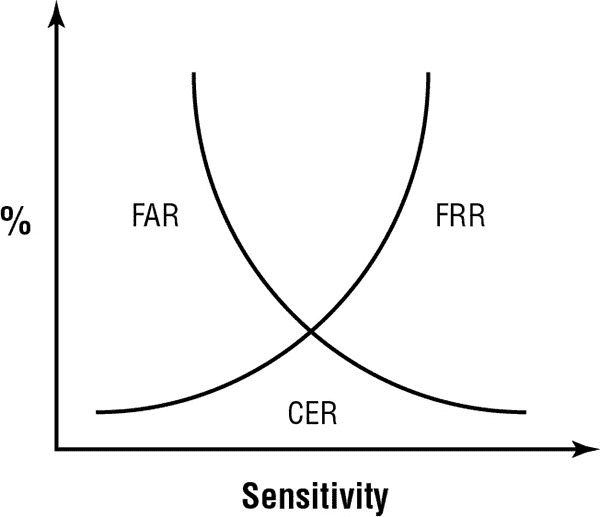

```
**FIGURE 13.1** Graph of FRR and FAR errors indicating the CER point
```

通常，不必且往往不想让设备的灵敏度设置在 CER 级别。例如，组织可能使用人脸识别系统来允许或禁止访问受保护区域，以确保未经授权的个人永不获得进入。在这种情况下，组织会将灵敏度调至非常高，以尽量减少假接受（假阳性）的可能性。这可能会导致更多假拒（假阴性），但在这种场景下，假拒比假接受更可接受。

#### 生物识别注册

生物识别设备可能因所谓的注册时间、吞吐率和接受度而变得无效或不可接受。为了使生物识别设备作为识别或认证机制工作，必须进行 `注册`（或登记）过程。在注册期间，主体的生物因子被采集并存储在设备的数据库中。该存储的生物因子样本称为 `参考档案`（也称为 `参考模板`）。

扫描并存储生物因子所需的时间取决于被测量的物理或性能特征。用户通常不愿接受生物识别方法的长时间处理。一般而言，注册时间超过 2 分钟是不可接受的。如果使用会随时间变化的生物特征，如声音语调、面部毛发或签名模式，则需要定期重新注册，这会增加不便。

`吞吐率` 是系统扫描主体并批准或拒绝访问所需的时间。生物特征越复杂或详细，处理时间越长。用户通常接受约 6 秒或更快的吞吐率。

### 多因素认证

`多因素认证` 是指使用两个或多个因素进行的认证。`两因素认证` 需要两种不同的因素来提供认证。例如，智能卡通常要求用户将卡片插入阅读器并输入 PIN 码。智能卡属于 `拥有物` 因素，PIN 码属于 `知识` 因素。一般原则是，使用更多种类或因素的认证方式会提高安全性。

当使用同一因素的两种认证方法组合在一起时，认证的强度并不会比只使用一种方法更强，因为同一种攻击可能同时窃取或获取两者。例如，使用两个密码组合并不比使用单个密码更安全，因为密码破解尝试可能一次性发现两个密码。

相反，当使用两种或多种不同的因素时，必须成功多种攻击方式才能获取所有相关的认证元素。例如，如果使用令牌、密码和生物因子进行认证，那么实物盗窃、密码破解和生物仿冒攻击必须同时成功，才能让入侵者进入系统。

### 设备认证

历史上，用户只能从公司拥有的系统（如台式机）登录网络。例如，在 Windows 域中，用户计算机加入域并拥有与用户账户相似的计算机账户和密码。如果计算机未加入域，或其凭据与域控制器不同步，则用户无法从该计算机登录。

如今，越来越多的员工携带个人移动设备上班并连接到网络。一些组织接受这种做法，但会实施安全策略作为控制措施。这些设备未必能够加入域，但可以实现设备识别和认证方法。

一种方法是设备指纹识别。用户可以向组织注册设备并将其与用户账户关联。在注册过程中，设备认证系统会捕获设备的特征。通常通过让用户访问网页来完成，系统随后使用操作系统和版本、浏览器、浏览器插件、时区、数据存储、屏幕分辨率、Cookie 设置以及 HTTP 头部等特征识别设备。

当用户从该设备登录时，认证系统会检查用户账户是否已注册该设备，并验证用户设备的特征与已注册设备的特征是否匹配。即使某些特征随时间变化，这种方法仍被证明是成功的设备认证手段。组织通常使用第三方工具，如 SecureAuth 身份提供者（IdP），进行设备认证。

如前所述，许多 MDM 系统使用基于上下文的身份验证方法来识别设备。它们通常与网络访问控制（NAC）系统协同工作，检查设备的健康状况，并根据 NAC 系统中配置的要求来授予或限制访问权限。

802.1x 是另一种用于设备身份验证的方法。它可用于某些路由器和交换机的端口基于身份验证。此外，它常与无线系统配合使用，迫使用户在获得网络访问权限之前使用账户登录。最近，部分 802.1x 解决方案已被纳入 MDM 和/或 NAC 方案，以控制移动设备的访问。如果设备或用户无法通过 802.1x 系统进行身份验证，则不会授予其网络访问权限。

### 服务身份验证

许多服务也需要身份验证，通常使用用户名和密码。服务账户仅仅是为服务创建的用户账户，而非为个人创建的。

例如，常见做法是为第三方工具在 Microsoft Exchange Server 中监控电子邮件创建服务账户。这些第三方工具通常需要权限扫描所有邮箱，以查找垃圾邮件、恶意软件、潜在的数据泄露尝试等。管理员通常会创建一个 Microsoft 域账户，并赋予该账户执行相应任务所需的权限。


为防止密码永不过期，管理员通常会设置账户属性使密码永不失效。对普通用户，则会设置密码最长有效期（如 45 天）。密码到期后，用户会被通知必须更改密码，用户会自行完成更改。但服务无法响应此类通知，只能被锁定。

由于服务账户拥有高权限，通常使用强复杂的密码，并比普通用户更频繁地更换。管理员需手动更改这些密码。密码保持不变的时间越长，越可能被破解。另一种做法是将账户配置为非交互式，从而阻止用户通过传统登录方式登录该账户。

服务可以配置为使用基于证书的身份验证。证书由运行服务的设备发布，并在访问资源时由服务 present。Web‑based 服务常通过应用编程接口（API）在系统之间交换信息。不同的 Web‑based 服务使用的 API 方法各不相同。例如，Google 和 Facebook 提供供开发者调用的 Web‑based 服务，但它们的实现方式各不相同。

## 实现身份管理

身份管理技术通常分为两类：集中化和分散/分布式。

* *集中化访问控制* 表示所有授权验证均由系统内的单一实体完成。
* *分散/分布式访问控制*（也称作 *分布式访问控制*）表示系统各处散布的多个实体负责进行授权验证。

集中化和分散化的访问控制方法各自拥有相同的利弊，这与任何集中或分散系统的特性一致。小团队或个人可以管理集中化访问控制，因为行政开销更低——所有变更均在单一位置完成，且单一变更会影响整个系统。

分散访问控制通常需要多个团队或多位个人参与。行政开销更高，因为变更必须在多个位置同步实施。随着访问控制点数量增多，保持系统一致性变得更为困难。对任意一个访问控制点的变更，都必须在每个访问点上重复执行。

### 单点登录（SSO）

*单点登录（SSO）* 是一种集中化访问控制技术，使用户只需在系统上进行一次身份验证，即可访问多个资源而无需再次验证。例如，用户可在网络上一次性验证，随后无需再次提示即可访问网络内的所有资源。

SSO 对用户极其便利，同时也提升了安全性。当用户需要记住多个用户名和密码时，往往会将其写下，从而削弱安全。而只需记住一个密码的用户则不太可能将其记录下来。SSO 还通过降低主体所需的账户数量，简化了管理工作。

SSO 的主要缺点是，一旦账户被 compromise，攻击者即可获得所有受授权资源的 unrestricted 访问。不过，大多数 SSO 系统都提供保护用户凭证的措施。下面的章节将讨论几种常见的 SSO 机制。

#### LDAP 与集中化访问控制

在单个组织内部，常采用集中化访问控制系统。例如，*目录服务* 是一个集中数据库，包含关于主体和对象的信息。许多目录服务基于轻量级目录访问协议（LDAP）。例如，Microsoft Active Directory Domain Services 基于 LDAP。

你可以把 LDAP 目录视作网络服务和资源的电话簿。用户、客户端和进程可以查询目录服务，以确定所需系统或资源的位置。主体在查询前必须先对目录服务进行身份验证。即使在验证通过后，目录服务也只会根据该主体的已分配权限，向其展示部分信息。

访问控制系统常使用多域和信任关系。安全域是一组共享相同安全策略的主体和对象的集合，单独的域可以相互独立运行。 *信任* 是在域之间建立的安全桥梁，允许一个域的用户访问另一个域的资源。信任可以是单向的，也可以是双向的。

#### LDAP 与 PKI

公钥基础设施（PKI）在将数字证书纳入传输时会使用 LDAP。第 7 章会更深入地介绍 PKI，简而言之，PKI 是一组用于在证书生命周期中管理数字证书的技术。客户端常需查询证书颁发机构（CA）关于证书的信息，而 LDAP 是用于此目的的协议之一。

LDAP 与集中化访问控制系统可以用于支持单点登录（SSO）功能。

#### Kerberos

票据验证是一种利用第三方实体来证明身份并提供认证的机制。最常见且最知名的票据系统是 *Kerberos*。

Kerberos 为用户提供单点登录解决方案，并保护登录凭证。当前版本 Kerberos 5 依赖对称密钥加密（也称为密钥密码学），使用高级加密标准（AES）对称加密协议。Kerberos 通过端到端安全保护身份验证流量的机密性和完整性，有助于防止窃听和重放攻击。其设计涉及多个重要元素：

**Key Distribution Center（KDC）**：KDC 是受信任的第三方，提供认证服务。Kerberos 使用对称密钥加密让客户端向服务器进行身份验证。所有客户端和服务器均已向 KDC 注册，且 KDC 维护着网络中所有成员的秘密密钥。

**Kerberos 身份验证服务器**：身份验证服务器托管 KDC 的功能：一个票据授予服务（TGS）和一个身份验证服务（AS）。但是，可以将票据授予服务托管在另一个服务器上。`身份验证服务` 用于验证或拒绝凭证的真实性和及时性。该服务器通常被称为 KDC。

**票据授予凭证**：票据授予凭证（TGT）提供证明主体已通过 KDC 进行身份验证，并获准请求凭证以访问其他对象。TGT 是加密的，包含一个对称密钥、有效期以及用户的 IP 地址。主体在请求访问对象的凭证时会提交 TGT。

**凭证**：凭证是一个加密消息，用于证明主体有权访问对象。它有时被称为服务凭证（ST）。主体请求凭证以访问对象，如果主体已进行身份验证并有权访问该对象，Kerberos 会颁发凭证。Kerberos 凭证具有特定的有效期和使用参数。凭证过期后，客户端必须请求更新或新凭证以继续与任何服务器通信。

Kerberos 需要一个账户数据库，通常包含在目录服务中。它使用客户端、网络服务器和 KDC 之间的凭证交换来验证身份并提供身份验证。这使得客户端可以向服务器请求资源，且客户端和服务器都能确信对方的身份。这些加密凭证还确保登录凭据、会话密钥和身份验证消息永远不会以明文形式传输。

Kerberos 登录过程如下：

1. 用户在客户端中输入用户名和密码。
2. 客户端使用 AES 对用户名进行加密，以便传输到 KDC。
3. KDC 将用户名与已知凭据的数据库进行验证。
4. KDC 生成将用于客户端和 Kerberos 服务器的对称密钥。它使用用户密码的哈希对该密钥进行加密。KDC 同时还生成一个带时间戳的加密 TGT。
5. KDC 然后将加密的对称密钥和加密的时间戳 TGT 传输给客户端。
6. 客户端在凭证有效期内安装 TGT。客户端还使用用户密码的哈希来解密对称密钥。

当客户端想要访问对象（例如网络上托管的资源）时，必须通过 Kerberos 服务器请求凭证。该过程涉及以下步骤：

1. 客户端将其 TGT 发送回 KDC，并请求访问资源的凭证。
2. KDC 验证 TGT 的有效性，并检查访问控制矩阵，确认用户是否有足够权限访问请求的资源。
3. KDC 生成服务凭证并将其发送给客户端。
4. 客户端将凭证发送给托管资源的服务器或服务。
5. 托管资源或服务器验证凭证的有效性，并与 KDC 进行确认。
6. 一旦身份和授权得到验证，Kerberos 活动即完成。服务器或服务器主机随后与客户端建立会话并开始通信或数据传输。

Kerberos 是一个灵活的身份验证机制，可在本地 LAN、远程访问以及客户端 - 服务器资源请求上工作。然而，Kerberos 存在单一故障点——KDC。如果 KDC 被入侵，网络上所有系统的秘密密钥也会被 compromise。此外，如果 KDC 离线，则无法进行主体身份验证。

Kerberos 还对时间有严格要求，默认配置要求所有系统之间的时间同步在五分钟以内。如果系统未同步或时间被更改，之前颁发的 TGT 将不再有效，系统将无法接收任何新凭证。结果是，客户端将被拒绝访问任何受保护的网络资源。

## 联合身份管理和单点登录（SSO）

单点登录在内部网络中很常见，也在互联网上使用。许多基于云的应用程序使用 SSO 解决方案，使得用户可以更轻松地访问互联网上的资源。许多基于云的应用程序使用联邦身份管理（FIM），这是一种 SSO 形式。

身份管理是用户身份和凭据的管理。FIM 将其范围扩展到多个组织之外。多个组织可以加入联邦，达成共享身份的协议。每个组织的用户可以在自己组织中一次性登录，其凭据会与联邦身份进行匹配。随后，他们可以使用该联邦身份访问联邦内任何其他组织的资源。

联邦可以由多个无关联的网络组成，位于单个大学校园内，或由多个学院和大学校园组成，又或是多个共享资源的组织，或任何可以达成共同联邦身份管理系统的群体。联邦成员在组织内将用户身份与联邦身份进行匹配。

例如，许多企业在线培训网站使用联邦 SSO 系统。当组织与在线培训公司协调员工访问时，他们也会协调联邦访问所需的细节。常用方法是将用户的内部登录 ID 与联邦身份进行匹配。用户使用其正常登录 ID 在组织内登录。当用户通过浏览器访问培训网站时，联邦身份管理系统使用其登录 ID 检索对应的联邦身份。如果找到匹配，则授权用户访问该联邦身份所允许的网页。

管理员在背后管理这些细节，流程通常对用户透明。用户无需再次输入凭据。

多家公司在联邦中通信的一个挑战是找到共同的语言。它们可能使用不同的操作系统，但仍需要共享一个共同语言。为了解决这一挑战，联邦身份系统通常使用安全断言标记语言（SAML）和/或服务提供标记语言（SPML）。下面是一些标记语言的简要描述。

### 超文本标记语言

超文本标记语言（HTML）常用于显示静态网页。HTML 源自标准通用标记语言（SGML）和泛型标记语言（GML）。HTML 使用标签来描述文本的显示方式，如大小和颜色。例如，以下 H1 标签显示为一级标题：`<H1>I Passed The CISSP Exam</H1>`。

### 可扩展标记语言

可扩展标记语言（XML）不仅描述数据的显示方式，还实际描述数据本身。XML 可以包含标签以任何方式描述数据。例如，以下标签标识数据为考试结果：`<ExamResults>Passed</ExamResults>`。

多家厂商的数据库可以导入和导出 XML 格式的数据，使 XML 成为交换信息的常用语言。为确保公司明确知道使用了哪些标签，已为特定用途创建了许多特定的模式（schema）。这些模式实际上创建了新的 XML 语言。用于联邦身份的常见语言包括以下几种。

### 安全断言标记语言

安全断言标记语言（SAML）是一种基于 XML 的语言，常用于在联邦组织之间交换身份验证和授权（AA）信息。它经常用于为浏览器提供单点登录（SSO）功能。

### 服务提供标记语言

*服务提供标记语言 (SPML)* 是由 OASIS（一个非营利联盟）开发的新框架，该联盟鼓励开放标准的发展。它基于 XML，专门用于交换用于联邦身份单点登录 (SSO) 的用户信息。它基于目录服务标记语言 (DSML)，可以将基于 LDAP 的目录服务信息以 XML 格式显示。

### 可扩展访问控制标记语言

*可扩展访问控制标记语言 (XACML)* 是由 OASIS 开发的标准，用于在 XML 格式中定义访问控制策略。它通常实现为基于属性的访问控制系统，但也可以使用基于角色的访问控制。它帮助联盟中的所有成员确信，他们为不同角色提供的访问级别是相同的。

### OAuth 2.0

OAuth（意味着开放认证）是一个用于访问委托的开放标准。例如，假设你有一个 Twitter 账户，然后下载一个名为 Acme 的应用，它可以与你的 Twitter 账户交互。当你尝试使用此功能时，它会将你重定向到 Twitter，如果你尚未登录，则会提示你登录 Twitter。Twitter 然后询问你是否授权该应用，并告知你正在授予的权限。如果你批准，Acme 应用可以访问你的 Twitter 账户。主要好处是你永远不会向 Acme 应用提供你的 Twitter 凭据。即使 Acme 应用遭受重大数据泄露，暴露所有数据，也不会暴露你的凭据。许多在线站点支持 OAuth 2.0，但不支持 OAuth 1.0。OAuth 2.0 与 OAuth 1.0 不兼容。RFC 6749 文档规范了 OAuth 2.0。

### OpenID

OpenID 也是一个开放标准，但它由 OpenID Foundation 而非 RFC 标准维护。它提供去中心化的身份验证，使用户可以使用第三方服务（即 OpenID 提供者）维护的一组凭据，在多个不相关的网站上登录。当用户访问 OpenID 启用的网站（也称为依赖方）时，他们会被提示提供其 OpenID 身份作为统一资源定位符 (URL)。两个站点交换数据并创建安全通道。用户随后被重定向到 OpenID 提供者并被提示输入密码。如果密码正确，用户会被重定向回 OpenID 启用的站点。

### OpenID Connect

OpenID Connect 是基于 OAuth 2.0 框架的身份验证层。与 OpenID 类似，它由 OpenID Foundation 维护。它在 OpenID 创建的技术基础上构建，使用 JavaScript Object Notation (JSON) Web Token (JWT)，也称为 ID 令牌。OpenID Connect 使用 Representational State Transfer (REST) 合规的 Web 服务来获取 JWT。除了提供身份验证外，JWT 还可以包含用户的个人资料信息。

## 脚本访问

*脚本访问* 或登录脚本通过在登录会话开始时提供自动化过程来传输登录凭据，从而建立通信链接。脚本访问通常可以在仍需为每个服务器或资源进行唯一身份验证的环境中模拟单点登录 (SSO)。在没有真正的 SSO 技术的环境中，脚本可以用于实现 SSO。脚本和批处理文件应存放在受保护的区域，因为它们通常以明文形式包含访问凭据。

## 凭据管理系统

一个 *凭据管理系统* 为用户提供存储凭据的空间，当单点登录 (SSO) 不可用时。用户可以存储网站和网络资源的凭据，这些资源需要不同的凭据集。管理系统通过加密保护凭据，防止未授权访问。

例如，Windows 系统包含凭据管理器工具。用户将凭据输入凭据管理器，必要时操作系统会检索用户的凭据并自动提交。当用于网站时，用户输入 URL、用户名和密码。随后，当用户访问该网站时，凭据管理器会自动识别 URL 并提供凭据。

第三方凭据管理系统也可用。例如，KeePass 是一个免费工具，允许你存储凭据。凭据存储在加密数据库中，用户使用主密码解锁数据库。一旦解锁，用户可以轻松复制密码并粘贴到网站表单中。也可以配置应用自动将凭据输入网页表单。当然，使用强主密码保护所有其他凭据是重要的。

## 集成身份服务

身份服务提供额外的识别和验证工具。一些工具专门为云端应用设计，其他则是面向组织内部（本地）使用的第三方身份服务。

*身份即服务*，或身份和访问管理服务 (IDaaS)，是第三方服务，提供身份和访问管理。IDaaS 实际上为云端提供单点登录 (SSO)，尤其在内部客户访问云端软件即服务 (SaaS) 应用时非常有用。Google 通过其口号 “One Google Account for everything Google” 实现此功能。用户登录其 Google 账户一次，即可获得访问多个 Google 云端应用的权限，而无需再次登录。

另一个例子是 Office 365，它将 Office 应用作为安装应用和 SaaS 应用的组合提供。用户在其系统上安装了完整的 Office 应用，这些应用也可以通过 OneDrive 连接到云端存储。这使用户可以在多个设备上编辑和共享文件。当人们在家使用 Office 365 时，Microsoft 提供 IDaaS，允许用户通过云端验证以访问其 OneDrive 数据。

当员工在企业内部使用 Office 365 时，管理员可以将网络与第三方服务集成。例如，Centrify 提供第三方 IDaaS 服务，与 Microsoft Active Directory 集成。配置后，用户登录域后，即可直接访问 Office 365 云资源，无需再次登录。

## 管理会话

使用任何类型的身份验证系统时，管理会话以防止未授权访问非常重要。这包括桌面计算机（如台式机和笔记本）上的会话，以及与应用的在线会话。

台式机和笔记本电脑包含屏幕保护程序。这些在计算机闲置时通过显示随机图案、不同图片或仅仅空白屏幕来更改显示。屏幕保护程序保护了旧式计算机的屏幕，但新式显示器不需要它们。不过，它们仍在使用，并且具有密码保护功能，可在启用后显示登录屏幕，强制用户在退出屏幕保护程序前再次进行身份验证。

屏幕保护程序有一个时间框架（以分钟为单位）可供配置，通常设置在 10 到 20 分钟之间。如果设置为 10 分钟，则在 10 分钟后激活，要求用户在系统闲置 10 分钟或更长时间后重新登录。

安全的在线会话通常在一段时间后会自动终止。例如，如果您与银行建立安全会话但 10 分钟内未与会话进行交互，应用程序通常会将您注销。在某些情况下，应用程序会给出通知，说明即将注销。此类通知通常提供机会点击页面，以便保持登录状态。如果开发者未实现这些自动注销功能，则用户的浏览器会话可能保持打开且用户已登录。即使用户在未注销的情况下关闭浏览器标签，也可能导致浏览器会话仍然保持打开，从而使账户在其他人访问浏览器时面临被攻击的风险。

### AAA 协议

多种协议提供身份验证、授权和计费功能，统称为 AAA 协议。这些协议为远程访问系统（如虚拟专用网 VPN）和其他类型的网络访问服务器提供集中式访问控制。它们帮助保护内部 LAN 身份验证系统和其他服务器免受远程攻击。当使用独立的远程访问系统时，对该系统的成功攻击仅影响远程访问用户，攻击者不会获得内部账户的访问权限。移动 IP 为移动用户（如智能手机）提供访问，也使用 AAA 协议。

这些 AAA 协议使用识别、身份验证、授权和计费四个访问控制元素（如本章前文所述）。它们确保用户拥有有效凭证以进行身份验证，并根据已验证的身份判断用户是否有权连接到远程访问服务器。此外，计费元素可以跟踪用户的网络资源使用情况，用于计费目的。常见的 AAA 协议如下所述。

#### RADIUS

*Remote Authentication Dial-in User Service (RADIUS)* 集中远程连接的身份验证。它通常用于组织拥有多个网络访问服务器（或远程访问服务器）的场景。用户可以连接到任意网络访问服务器，该服务器随后将用户凭据发送至 RADIUS 服务器进行验证、授权和计费。在此语境下，网络访问服务器是 RADIUS 客户端，RADIUS 服务器充当身份验证服务器。RADIUS 服务器还为多个远程访问服务器提供 AAA 服务。

许多互联网服务提供商（ISP）使用 RADIUS 进行身份验证。用户可以在任何地点访问 ISP，ISP 服务器随后将连接请求转发至 RADIUS 服务器。


### RADIUS

组织也可以使用 RADIUS，并且常常结合基于位置的安全。例如，当用户使用某 IP 地址连接时，系统可以利用地理定位技术识别用户的位置。虽然如今较少见，但仍有部分用户使用集成业务数字网（ISDN）线路并通过其连接到 VPN。RADIUS 服务器可采用回拨安全（callback security）作为额外保护层。用户拨入，验证身份后，RADIUS 服务器结束连接并主动拨回用户预定义的电话号码。若用户的验证凭据被泄露，回拨安全可防止攻击者利用这些凭据。

RADIUS 使用用户数据报协议（UDP）并仅加密密码交换，整个会话不加密。可以使用其他协议对数据会话进行加密。当前版本定义于 RFC 2865。

#### TACACS+

Terminal Access Controller Access-Control System（TACACS）被引入作为 RADIUS 的替代方案。思科随后推出扩展 TACACS（XTACACS）作为专有协议。然而，TACACS 和 XTACACS 如今并不常用。TACACS Plus（TACACS+）随后作为开放且公开文档的协议问世，且是三者中使用最广泛的。

TACACS+ 在多方面优于早期版本及 RADIUS。它将身份验证、授权和计费分为独立过程，可在三台独立服务器上部署。早期版本则将两个或三个过程合并。此外，TACACS+ 加密所有身份验证信息（而非仅密码），如 RADIUS 所做。TACACS 和 XTACACS 使用 UDP 端口 49，而 TACACS+ 使用传输控制协议（TCP）端口 49，提供更可靠的数据包传输。

#### Diameter

在 RADIUS 和 TACACS+ 取得成功的基础上，开发了增强版 RADIUS——Diameter。它支持包括传统 IP、移动 IP 和语音 over IP（VoIP）在内的广泛协议。由于支持额外命令，它在需要漫游支持的场景中（如无线设备和智能手机）日益流行。虽然 Diameter 是 RADIUS 的升级，但其与 RADIUS 不兼容。

Diameter 使用 TCP 端口 3868 或流控传输协议（SCTP）端口 3868，比 RADIUS 使用的 UDP 提供更高可靠性。它还支持 Internet 协议安全（IPsec）和传输层安全（TLS）用于加密。

### 管理身份和访问权限生命周期

*身份和访问权限生命周期* 指的是账户的创建、管理和删除过程。尽管这些活动看似平凡，但它们是系统访问控制能力的基石。若未能正确定义和维护用户账户，系统将无法准确建立身份、执行身份验证、提供授权或追踪问责。如前所述，识别是主体声称身份的过程，最常见的身份是用户账户，也包括计算机账户和服务账户。

访问控制管理是贯穿账户全生命周期的任务与职责集合，涵盖账户、访问权限和问责的管理。这些任务包含在身份和访问权限生命周期的三项主要责任中：配置（provisioning）、账户审查和账户撤销。

#### 配置（Provisioning）

身份管理的初始步骤是创建新账户并为其分配适当权限。创建新用户账户通常并不复杂，但必须遵循组织安全策略程序进行保护和加固。账户不应由管理员随意或应对随机请求创建。正确的配置确保人员在创建账户时遵循特定流程。

新用户账户的初始创建常被称为 *enrollment*（注册）或 registration。注册过程创建新身份并确定系统执行身份验证所需的因素。完成并准确执行注册过程至关重要。同时，必须通过组织认定的充分且必要的方式证明被注册的个人身份。照片身份证、出生证、背景调查、信用调查、安全审查、FBI 数据库检索，甚至联系推荐人等均可作为在受保护系统中注册前验证个人身份的有效方式。

Many organizations have automated provisioning systems. For example, once a person is hired, the HR department completes initial identification and in-processing steps and then forwards a request to the IT department to create an account. Users within the IT department enter information such as the employee’s name and their assigned department via an application. The application then creates the account using predefined rules. Automated provisioning systems create accounts consistently, such as always creating usernames the same way and treating duplicate usernames consistently. If the policy dictates that usernames include first and last names, then the application will create a username as `suziejones` for a user named Suzie Jones. If the organization hires a second employee with the same name, then the second username might be `suziejones2`.

If the organization is using groups (or roles), the application can automatically add the new user account to the appropriate groups based on the user’s department or job responsibilities. The groups will already have appropriate privileges assigned, so this step provisions the account with appropriate privileges.

As part of the hiring process, new employees should be trained on organization security policies and procedures. Before hiring is complete, employees are typically required to review and sign an agreement committing to uphold the organization’s security standards. This often includes an acceptable use policy.

Throughout the life of a user account, ongoing maintenance is required. Organizations with static organizational hierarchies and low employee turnover or promotion will conduct significantly less account administration than an organization with a flexible or dynamic organizational hierarchy and high employee turnover and promotion rates. Most account maintenance deals with altering rights and privileges. Procedures similar to those used when creating new accounts should be established to govern how access is changed throughout the life of a user account. Unauthorized increases or decreases in an account’s access capabilities can cause serious security repercussions.

#### Account Review

Accounts should be reviewed periodically to ensure that security policies are being enforced. This includes ensuring that inactive accounts are disabled and employees do not have excessive privileges.

Many administrators use scripts to check for inactive accounts periodically. For example, a script can locate accounts that users have not logged onto in the past 30 days, and automatically disable them. Similarly, scripts can check group membership of privileged groups (such as administrator groups) and remove unauthorized accounts. Account review is often formalized in auditing procedures.

It’s important to guard against two problems related to access control: excessive privilege and creeping privileges. *Excessive privilege* occurs when users have more privileges than their assigned work tasks dictate. If a user account is discovered to have excessive privileges, the unnecessary privileges should be immediately revoked. *Creeping privileges* (sometimes called *privilege creep*) involve a user account accumulating privileges over time as job roles and assigned tasks change. This can occur because new tasks are added to a user’s job and additional privileges are added, but unneeded privileges are never removed. Creeping privileges result in excessive privilege.

Both of these situations violate the basic security principle of least privilege. The principle of least privilege ensures that subjects are granted only the privileges they need to perform their work tasks and job functions, but no more. Account reviews are effective at discovering these problems.

#### Account Revocation

When employees leave an organization for any reason, it is important to disable their user accounts as soon as possible. This includes when an employee takes a leave of absence. Whenever possible, HR personnel should have the ability to perform this task because they are aware when employees are leaving for any reason. As an example, HR personnel know when an employee is about to be terminated, and they can disable the account during the employee exit interview.

If a terminated employee retains access to a user account after the exit interview, the risk for sabotage is very high. Even if the employee doesn’t take malicious action, other employees may be able to use the account if they discover the password. Logs will record the activity in the name of the terminated employee instead of the person actually taking the action.

It’s possible the account will be needed, such as to access encrypted data, so it should not be deleted right away. When it’s determined that the account is no longer needed, it should be deleted. Accounts are often deleted within 30 days after an account is disabled, but it can vary depending on the needs of the organization.

Many systems have the ability to set specific expiration dates for any account. These are useful for temporary or short-term employees and automatically disable the account on the expiration date, such as after 30 days for a temporary employee hired on a 30-day contract. This maintains a degree of control without requiring ongoing administrative oversight.

### Summary

Domain 5 of the CISSP Common Body of Knowledge is Identity and Access Management (IAM). It covers the management, administration, and implementation aspects of granting or restricting access to assets. Assets include information, systems, devices, facilities, and personnel. Access controls restrict access based on relationships between subjects and objects. Subjects are active entities (such as users), and objects are passive entities (such as files).

Three primary types of access controls are preventive, detective, and corrective. Preventive access controls attempt to prevent incidents before they occur. Detective access controls attempt to detect incidents after they’ve occurred. Corrective access controls attempt to correct problems caused by incidents once they’ve been detected.


# 控制类型

Controls are implemented as administrative, logical, and physical. Administrative controls are also known as management controls and include policies and procedures. Logical controls are also known as technical controls and are implemented through technology. Physical controls use physical means to protect objects.

# 访问控制的四个主要要素

The four primary access control elements are identification, authentication, authorization, and accountability. Subjects (users) claim an identity, such as a username, and prove the identity with an authentication mechanism such as a password. After authenticating subjects, authorization mechanisms control their access and audit trails log their activities so that they can be held accountable for their actions.

# 身份验证的三个主要因素

The three primary factors of authentication are something you know (such as passwords or PINs), something you have (such as smartcards or tokens), and something you are (identified with biometrics). Multifactor authentication uses more than one authentication factor, and it is stronger than using any single authentication factor.

# 单点登录

Single sign-on allows users to authenticate once and access any resources in a network without authenticating again. Kerberos is a popular single sign-on authentication protocol using tickets for authentication. Kerberos uses a database of subjects, symmetric cryptography, and time synchronization of systems to issue tickets.

# 联合身份管理

Federated identity management is a single sign-on solution that can extend beyond a single organization. Multiple organizations create or join a federation and agree on a method to share identities between the organizations. Users can authenticate within their organization and access resources in other organizations without authenticating again. SAML is a common protocol used for SSO on the internet.

# AAA 协议

AAA 协议提供身份验证、授权和审计功能。流行的 AAA 协议有 `RADIUS`、`TACACS+` 和 `Diameter`。

# 身份和访问权限生命周期

身份和访问权限生命周期包括创建、管理和删除主体使用的账户的过程。权限管理包括初始创建账户并确保它们对对象拥有适当的访问权限。随着用户工作变化，他们通常需要修改初始访问权限。账户审查流程确保账户修改遵循最小权限原则。当员工离职时，账户应尽快停用，然后在不再需要时删除。

# Exam Essentials

## 了解主体和对象的区别

**Know the difference between subjects and objects.** You’ll find that CISSP questions and security documentation commonly use the terms `subject` and `object`, so it’s important to know the difference between them. Subjects are active entities (such as users) that access passive objects (such as files). A user is a subject who accesses objects while performing some action or accomplishing a work task.

## 了解各种访问控制类型

**Know the various types of access controls.** You should be able to identify the type of any given access control. Access controls may be preventive (to stop unwanted or unauthorized activity from occurring), detective (to discover unwanted or unauthorized activity), or corrective (to restore systems to normal after an unwanted or unauthorized activity has occurred). Deterrent access controls attempt to discourage violation of security policies, by encouraging people to decide not to take an unwanted action. Recovery controls attempt to repair or restore resources, functions, and capabilities after a security policy violation. Directive controls attempt to direct, confine, or control the action of subjects to force or encourage compliance with security policy. Compensating controls provide options or alternatives to existing controls to aid in enforcement and support of a security policy.

## 了解访问控制的实现方法

**Understand the implementation methods of access controls.** Controls are implemented as administrative, logical/technical, or physical controls. Administrative (or management) controls include policies or procedures to implement and enforce overall access control. Logical/technical controls include hardware or software mechanisms used to manage access to resources and systems and provide protection for those resources and systems. Physical controls include physical barriers deployed to prevent direct contact and access with systems or areas within a facility.

## 了解识别与身份验证的区别

**Understand the difference between identification and authentication.** Access controls depend on effective identification and authentication, so it’s important to understand the differences between them. Subjects claim an identity, and identification can be as simple as a username for a user. Subjects prove their identity by providing authentication credentials such as the matching password for a username.

## 了解授权与审计的区别

**Understand the difference between authorization and accountability.** After authenticating subjects, systems authorize access to objects based on their proven identity. Auditing logs and audit trails record events including the identity of the subject that performed an action. The combination of effective identification, authentication, and auditing provides accountability.

## 了解主要身份验证因素的详细信息

**Understand the details of the primary authentication factors.** The three primary factors of authentication are something you know (such as a password or PIN), something you have (such as a smartcard or token), and something you are (based on biometrics). Multifactor authentication includes two or more authentication factors, and using it is more secure than using a single authentication factor. Passwords are the weakest form of authentication, but password policies help increase their security by enforcing complexity and history requirements. Smartcards include microprocessors and cryptographic certificates, and tokens create one-time passwords. Biometric methods identify users based on characteristics such as fingerprints. The crossover error rate identifies the accuracy of a biometric method. It shows where the false rejection rate is equal to the false acceptance rate.

## 了解单点登录

**Understand single sign-on.** Single sign-on (SSO) is a mechanism that allows subjects to authenticate once and access multiple objects without authenticating again. Kerberos is the most common SSO method used within organizations, and it uses symmetric cryptography and tickets to prove identification and provide authentication. When multiple organizations want to use a common SSO system, they often use a federated identity management system, where the federation, or group of organizations, agrees on a common method of authentication. Security Assertion Markup Language (SAML) is commonly used to share federated identity information. Other SSO methods are scripted access, SESAME, and KryptoKnight. OAuth and OpenID are two newer SSO technologies used on the internet. OAuth 2.0 is recommended over OAuth 1.0 by many large organizations such as Google.

## 了解 AAA 协议的目的

**Understand the purpose of AAA protocols.** Several protocols provide centralized authentication, authorization, and accounting services. Network access (or remote access) systems use AAA protocols. For example, a network access server is a client to a RADIUS server, and the RADIUS server provides AAA services. RADIUS uses UDP and encrypts the password only. TACACS+ uses TCP and encrypts the entire session. Diameter is based on RADIUS and improves many of the weaknesses of RADIUS, but Diameter is not compatible with RADIUS. Diameter is becoming more popular with mobile IP systems such as smartphones.

## 了解身份和访问权限配置生命周期

**Understand the identity and access provisioning lifecycle.** The identity and access provisioning lifecycle refers to the creation, management, and deletion of accounts. Provisioning accounts ensures that they have appropriate privileges based on task requirements. Periodic reviews ensure that accounts don’t have excessive privileges and follow the principle of least privilege. Revocation includes disabling accounts as soon as possible when an employee leaves the company, and deleting accounts when they are no longer needed.

# Written Lab

1. Name at least three access control types.

2. Describe the differences between identification, authentication, authorization, and accountability.

3. Describe the three primary authentication factor types.

4. Name the method that allows users to log on once and access resources in multiple organizations without authenticating again.


# 5. Identify the three primary elements within the identity and access provisioning lifecycle.

## Review Questions

1. Which of the following would *not* be an asset that an organization would want to protect with access controls?

    1. Information

    2. Systems

    3. Devices

    4. Facilities

    5. None of the above

2. Which of the following is true related to a subject?

    1. A subject is always a user account.

    2. The subject is always the entity that provides or hosts the information or data.

    3. The subject is always the entity that receives information about or data from an object.

    4. A single entity can never change roles between subject and object.

3. Which of the following types of access control uses fences, security policies, security awareness training, and antivirus software to stop an unwanted or unauthorized activity from occurring?

    1. Preventive

    2. Detective

    3. Corrective

    4. Authoritative

4. What type of access controls are hardware or software mechanisms used to manage access to resources and systems, and provide protection for those resources and systems?

    1. Administrative

    2. Logical/technical

    3. Physical

    4. Preventive

5. Which of the following *best* expresses the primary goal when controlling access to assets?

    1. 保护系统和数据的保密性、完整性和可用性。

    2. 确保只有合法的对象能够在系统上进行身份验证。

    3. 防止对主体的未经授权访问。

    4. 确保所有主体都经过身份验证。

6. 用户使用登录 ID 和密码进行登录。登录 ID 的作用是什么？

    1. 身份验证

    2. 授权

    3. 问责

    4. 标识

7. 账责（Accountability）要求以下所有项目中的一项除外。哪一项不是账责所必需的？

    1. 标识

    2. 身份验证

    3. 审计

    4. 授权

8. 你可以使用什么来防止用户在两个密码之间切换？

    1. 密码复杂性

    2. 密码历史记录

    3. 密码年龄

    4. 密码长度

9. 哪个选项最能体现口语短语（passphrase）的好处？

    1. 它很短。

    2. 它容易记住。

    3. 它包含一个字符集。

    4. 它很容易被破解。

10. 下列哪个是类型 2 身份验证因子的例子？

     1. 你拥有的东西

     2. 你是

     3. 你做的事

     4. 你知晓的事

11. 你的组织向员工发放设备。这些设备每 60 秒生成一次密码。组织内部的服务器在任何时刻都知道这个密码是什么。这个设备是什么类型？

     1. 同步令牌

     2. 异步令牌

     3. 智能卡

     4. 通用访问卡

12. 下列哪个选项提供基于主体的物理特征的身份验证？

     1. 账户 ID

     2. 生物特征

     3. 令牌

     4. PIN

13. 生物识别设备的 CER（等效误差率）指示什么？

     1. 它表明灵敏度过高。

     2. 它表明灵敏度过低。

     3. 它表明假拒率等于假接受率的点。

     4. 当足够高时，它表明生物识别设备高度准确。

14. 萝莉有用户账户，并以前使用生物识别系统登录。今天，生物识别系统未能识别她，导致她无法登录。这最好描述为什么？

     1. 假拒

     2. 假接受

     3. 跨错误

     4. 等误差

15. Kerberos 的主要目的是什么？

     1. 保密性

     2. 完整性

     3. 身份验证

     4. 问责

16. 哪个选项最适合支持联合身份管理（FIM）系统？

     1. Kerberos

     2. 超文本标记语言（HTML）

     3. 可扩展标记语言（XML）

     4. 安全断言标记语言（SAML）

17. 在 RADIUS 架构中，网络访问服务器（NAS）的功能是什么？

     1. 身份验证服务器

     2. 客户端

     3. AAA 服务器

     4. 防火墙

18. 哪个 AAA 协议基于 RADIUS 并支持移动 IP 和 VoIP？

     1. 分布式访问控制

     2. Diameter

     3. TACACS+

     4. TACACS

    * 请参考下面的情景回答问题 19 和 20。

    * 一名管理员在组织中工作了超过 10 年。他在这期间在不同的 IT 部门之间调动，并保留了他在每个职位任职期间获得的权限。最近，他的主管责备他对系统做出未经授权的更改。他再次做出未经授权的更改，导致出现意外故障。管理层决定终止他的雇佣合同。他第二天回到工作岗位清理办公桌和物品，在此期间他安装了一个恶意脚本，该脚本被设置为在下个月的第一天运行。该脚本会更改管理员密码、删除文件，并在数据中心的 100 多台服务器上关闭系统。

19. 在管理员任职期间，以下基本原则被违反了？

     1. 隐式拒绝

     2. 可用性丧失

     3. 防御特权

     4. 最小权限

20. 在任职期间，以下哪项可能发现了该用户账户的问题？

     1. 强身份验证的政策

     2. 多因素身份验证

     3. 日志记录

     4. 账户审查

# Chapter 14

# Controlling and Monitoring Access

**THE CISSP EXAM TOPICS COVERED IN THIS CHAPTER INCLUDE:**

* **Domain 5: Identity and Access Management ( IAM )**

    * 5.4 Implement and manage authorization mechanisms

        * 5.4.1 Role Based Access Control (RBAC)

        * 5.4.2 Rule-based access control

        * 5.4.3 Mandatory Access Control (MAC)

        * 5.4.4 Discretionary Access Control (DAC)

        * 5.4.5 Attribute Based Access Control (ABAC)

Chapter 13, “Managing Identity and Authentication,” presented several important topics related to the Identity and Access Management (IAM) domain for the CISSP certification exam. This chapter builds on those topics and includes key information on some common access control models. It also includes information on how to prevent or mitigate access control attacks. Be sure to read and study the materials from each of these chapters to ensure complete coverage of the essential material for this domain.

## Comparing Access Control Models

Chapter 13 focused heavily on identification and authentication. After authenticating subjects, the next step is authorization. The method of authorizing subjects to access objects varies depending on the access control method used by the IT system.

### Comparing Permissions, Rights, and Privileges

When studying access control topics, you’ll often come across the terms *permissions*, *rights*, and *privileges*. Some people use these terms interchangeably, but they don’t always mean the same thing.

**Permissions** In general, permissions refer to the access granted for an object and determine what you can do with it. If you have read permission for a file, you’ll be able to open it and read it. You can grant user permissions to create, read, edit, or delete a file on a file server. Similarly, you can grant a user access rights to a file, so in this context, access rights and permissions are synonymous. For example, you may be granted read and execute permissions for an application file, which gives you the right to run the application. Additionally, you may be granted data rights within a database, allowing you to retrieve or update information in the database.

**Rights** A right primarily refers to the ability to take an action on an object. For example, a user might have the right to modify the system time on a computer or the right to restore backed-up data. This is a subtle distinction and not always stressed. However, you’ll rarely see the right to take action on a system referred to as a permission.

**Privileges** *Privileges* are the combination of rights and permissions. For example, an administrator for a computer will have full privileges, granting the administrator full rights and permissions on the computer. The administrator will be able to perform any actions and access any data on the computer.

### Understanding Authorization Mechanisms

Access control models use many different types of authorization mechanisms, or methods, to control who can access specific objects. Here’s a brief introduction to some common mechanisms and concepts.

## 隐式拒绝

一个访问控制的基本原则是`隐式拒绝`，大多数授权机制都使用它。隐式拒绝原则确保除非对主体明确授予访问权限，否则对对象的访问将被拒绝。例如，想象一位管理员明确授予 Jeff 文件的完全控制权限，但没有明确授予其他任何人权限。Mary 即使管理员没有明确拒绝她的访问，也不会拥有任何访问权限。相反，隐式拒绝原则会拒绝对 Mary 以及除了 Jeff 之外的所有人的访问。

## 访问控制矩阵

一个`访问控制矩阵`是一张包含主体、对象和分配权限的表格。当主体尝试执行操作时，系统会检查访问控制矩阵，以确定主体是否拥有适当的权限来执行该操作。例如，访问控制矩阵可以包含一组文件作为对象，一组用户作为主体。它会显示每个用户对每个文件授予的精确权限。请注意，这涵盖了单个`访问控制列表`（`ACL`）的范围之外。在本例中，矩阵中的每个文件都有其单独的`ACL`，列出了授权用户及其分配的权限。

## 能力表

`能力表`是另一种识别分配给主体权限的方式。它们与`ACLs`的不同之处在于，`能力表`专注于主体（如用户、组或角色）。例如，为会计角色创建的`能力表`将包含该角色可以访问的所有对象的列表，并包括为这些对象分配给会计角色的具体权限。相比之下，`ACLs`专注于对象。文件的`ACL`将列出所有被授予访问该文件的用户和/或组，以及对每个用户分配的具体访问权限。

## 受限接口

应用程序使用`受限接口`或受限制的接口来根据用户的权限限制用户能做什么或能看到什么。拥有完整权限的用户可以访问应用程序的所有功能。权限受限的用户则拥有有限的访问权限。应用程序通过不同的方法来限制接口。常见的方法是，如果用户没有权限使用某项功能，则隐藏该功能。例如，命令可能通过菜单或右键单击项目提供给管理员，但如果普通用户没有权限，该命令将不显示。其他时候，应用程序会显示菜单项但将其置灰或禁用。普通用户可以看到菜单项，但无法使用它。

## 内容依赖控制

`内容依赖访问控制`根据对象内容来限制对数据的访问。数据库视图是`内容依赖控制`的一个例子。视图从一个或多个表中检索特定列，创建一个虚拟表。例如，数据库中的客户表可能包含客户姓名、电子邮件地址、电话号码和信用卡数据。基于客户的视图可能只显示客户姓名和电子邮件地址，而不显示其他内容。被授予访问该视图的用户可以看到客户姓名和电子邮件地址，但无法访问底层表中的数据。

## 依赖上下文控制

`依赖上下文访问控制`要求在授予用户访问权限之前需要特定的活动。例如，考虑在线出售数字产品的交易数据流。用户将产品添加到购物车并开始结账流程。结账流程的第一页显示购物车中的产品，下一页收集信用卡信息，最后一页确认购买并提供数字产品的下载说明。如果用户未通过购买流程，系统会拒绝访问下载页面。也可以使用日期和时间作为依赖上下文控制。例如，可以根据当前日期和/或时间限制对计算机和应用程序的访问。如果用户尝试在不允许的时间访问资源，系统会拒绝他们。

## 需知之原则

该原则确保主体仅为完成工作任务和职能而`需知`而被授予访问权限。主体可能拥有访问机密或受限数据的许可，但除非他们实际需要该数据来执行工作，否则不会被授予对该数据的授权。

## 最小权限原则

`最小权限原则`确保主体仅获得执行工作任务和职能所需的权限。这有时与需知原则被归为一类。唯一的区别是，最小权限原则还包括对系统采取行动的权利。

## 职责分离与责任分离

`职责分离与责任分离`原则确保敏感功能被分割为由两名或多名员工执行的任务。它通过创建制衡机制，帮助防止欺诈和错误。

## 定义要求与安全策略

一个`安全策略`是一份定义组织安全要求的文档。它识别需要保护的资产以及安全解决方案应尽力保护它们的程度。一些组织将安全策略作为单一文档创建，而其他组织则创建多个策略，每个策略专注于一个独立领域。


策略是访问控制的重要元素，因为它们帮助组织内部人员了解哪些安全要求是重要的。高级领导批准安全策略，从而提供组织安全需求的广泛概览。然而，安全策略通常不会详细说明如何满足安全需求或如何实施策略。例如，它可能会说明需要实施和强制执行职责分离和最小权限原则，但不会说明如何实现。

专业人员使用安全策略作为指南，以实施安全要求。

## 实施防御在深度（防御深度）

组织使用`防御深度`策略实施访问控制。该策略使用多层或多级的访问控制来提供分层安全。例如，考虑图 14.1。它展示了两台服务器和两块磁盘，用来表示组织希望保护的资产。入侵者或攻击者需要克服多层防御才能到达这些受保护的资产。

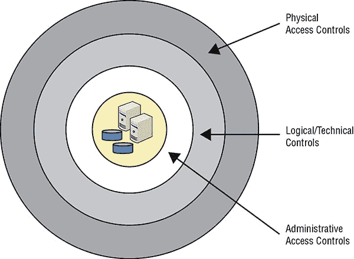

**FIGURE 14.1** 通过分层安全的防御深度

组织使用多种方法实施控制。你不能只依赖技术来提供安全；你还必须使用物理访问控制和行政访问控制。例如，如果服务器具有强认证但存放在无人看管的桌子上，小偷可以轻易窃取它并花时间入侵系统。同样，用户可能拥有强密码，但社交工程师可以欺骗未受教育的用户让他们交出密码。

防御深度概念突出了几个重要点：

* 组织的安全策略（一种行政访问控制）通过定义安全要求，为资产提供一层防御。

* 人员是防御的关键组成部分。然而，他们需要适当的培训和教育，以实施、遵守和支持安全策略中定义的安全元素。

* 行政、技术和物理访问控制的组合提供了更强大的防御。仅使用行政、仅使用技术或仅使用物理控制会导致弱点，攻击者可以发现并利用这些弱点。

## 总结访问控制模型

以下章节介绍了在准备 CISSP 认证考试时需要理解的五种访问控制模型：

# 离散访问控制（Discretionary Access Control）

离散访问控制（DAC）模型的一个关键特征是每个对象都有所有者，所有者可以授予或拒绝对其他主体的访问权限。例如，如果你创建了一个文件，你是所有者，可以向其他用户授予访问该文件的权限。用于 Microsoft Windows 操作系统的 New Technology File System（NTFS）采用 DAC 模型。

# 基于角色的访问控制（Role Based Access Control）

基于角色的访问控制（RBAC）模型的一个关键特征是使用角色或组。而不是直接向用户分配权限，用户账户会被放入角色中，管理员向角色分配特权。这些角色通常由职务功能标识。如果用户账户在角色中，则该用户拥有该角色所分配的所有特权。Microsoft Windows 操作系统通过使用组来实现该模型。

# 基于规则的访问控制（Rule-based access control）

基于规则的访问控制模型的一个关键特征是它应用全局规则，这些规则适用于所有主体。例如，防火墙使用规则来允许或阻止对所有用户的同等流量。基于规则的访问控制模型中的规则有时被称为`restrictions`（限制）或`filters`（过滤器）。

# 基于属性的访问控制（Attribute Based Access Control）

基于属性的访问控制（ABAC）模型的一个关键特征是其使用可以包含多个属性的规则。这使其比基于规则的访问控制模型更具灵活性，后者对所有主体应用相同的规则。许多软件定义网络使用 ABAC 模型。此外，ABAC 允许管理员在策略中使用简洁的语言语句（如“Allow Managers to access the WAN using a mobile device”）创建规则。

# 强制访问控制（Mandatory Access Control）

强制访问控制（MAC）模型的一个关键特征是对主体和对象都应用标签。例如，如果用户的标签为 top secret，则可以向其授予访问 top secret 文档的权限。在这种情况下，主体和对象的标签相匹配。当以表格形式记录时，MAC 模型有时看起来像一个网格（例如用于攀爬玫瑰灌木的网格），因此被称为基于网格的模型。

## 离散访问控制

`discretionary access controls` 的系统允许对象的所有者、创建者或数据管理员控制并定义对该对象的访问。所有对象都有所有者，访问控制基于所有者的裁量或决定。例如，如果用户创建了一个新的电子表格文件，该用户既是文件的创建者也是所有者。作为所有者，用户可以修改文件的权限，以授予或拒绝其他用户的访问。数据所有者还可以将日常数据处理任务委派给数据管理员，赋予数据管理员修改权限的能力。基于身份的访问控制是 DAC 的子集，因为系统通过身份识别用户，并将资源所有权分配给身份。

DAC 模型通过在对象上使用访问控制列表（ACL）来实现。每个 ACL 定义对主体的授予或拒绝的访问类型。它不提供集中管理系统，因为所有者可以随意修改其对象的 ACL。与强制访问控制的静态特性相比，在 DAC 环境中更容易更改对象的访问权限，例如在管理员不在时暂停用户特权，或当用户离开组织时禁用账户。

Microsoft Windows 系统使用 DAC 模型来管理文件。每个文件和文件夹都有一个 ACL，标识授予任何用户或组的权限，所有者可以修改这些权限。

在 DAC 环境中，管理员可以轻松在用户离职（如休假）期间暂停其特权。同样，管理员可以在用户离开组织时轻松禁用账户。

### 非离散访问控制

离散与`nondiscretionary access controls`的主要区别在于它们的控制和管理方式。管理员集中管理非离散访问控制，并可以进行影响整个环境的更改。相比之下，DAC 模型允许所有者自行更改，这些更改不会影响环境的其他部分。

在非-DAC 模型中，访问权限不以用户身份为中心。相反，一个静态的规则集管理整个环境的访问权限。非-DAC 系统是集中控制的，易于管理（尽管灵活性较低）。一般而言，任何不是离散模型的都是非离散模型。

#### 基于角色的访问控制

采用基于角色或基于任务的访问控制的系统定义主体访问对象的能力，基于主体的角色或已分配任务。`Role Based Access Control (RBAC)` 通常通过组来实现。

例如，银行可能有贷款专员、出纳员和经理。管理员可以创建名为 Loan Officers 的组，将每个贷款专员的用户账户加入该组，然后向该组分配相应的特权，如图 14.2 所示。如果组织招聘新的贷款专员，管理员只需将新员工的账户添加到 Loan Officers 组，新员工即可获得与该组其他成员相同的权限。管理员对出纳员和经理也采用类似步骤。

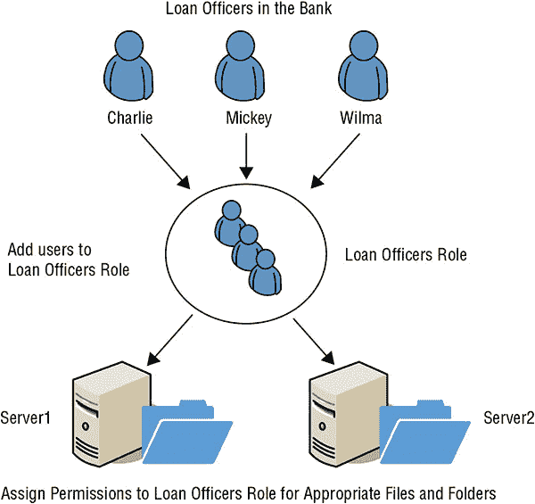

**FIGURE 14.2** Role Based Access Control

这有助于执行最小权限原则，防止特权膨胀。`Privilege creep` 是用户随着角色和访问需求变化而逐渐累积特权的倾向。理想情况下，管理员在用户内部调动时会撤销其不必要的特权。但当特权直接分配给用户时，识别并撤销用户所有不必要的特权变得困难。

管理员只需简单地将用户账户从组中移除，即可撤销不必要的特权。一旦管理员移除用户从组中，该用户即失去该组所分配的所有特权。例如，如果贷款专员调至其他部门，管理员只需将该专员的账户从 Loan Officers 组中移除，即可立即撤销该用户的 Loan Officers 组特权。

管理员通过职务描述或工作功能来识别角色（和组）。在许多情况下，这遵循组织结构图中记录的组织层级。担任管理职位的用户将拥有比处于临时职位的用户更大的资源访问权限。

RBAC 在人员变动频繁的动态环境中非常有用，因为管理员只需将新用户添加到相应角色即可轻松授予多个权限。值得注意的是，用户可以同时属于多个角色或组。例如，在同一银行场景中，经理可能同时属于 Managers 角色、Loan Officers 角色和 Tellers 角色，这使他们能够访问其员工可以访问的所有资源。

Microsoft 操作系统通过使用组来实现 RBAC。一些组，如本地 Administrators 组，是预定义的。然而，管理员可以创建额外组，以匹配组织中使用的职能或角色。

-   [`基于角色的访问控制 (RBAC)`](https://en.wikipedia.org/wiki/Role-based_access_control) 之所以容易与基于属性的访问控制 (DAC) 混淆，是因为两者都可以使用组来将用户组织为可管理的单元，但它们在部署和使用上存在区别。在 DAC 模型中，对象拥有者决定谁有权访问；在 RBAC 模型中，管理员确定主体权限并将相应权限分配给角色或组。在严格的 RBAC 模型中，管理员不直接向用户分配权限，而是通过将用户账户添加到角色或组来授予权限。

-   另一个与 RBAC 相关的方法是基于任务的访问控制 (TBAC)。TBAC 与 RBAC 类似，但不再是分配到一个或多个角色，而是为每个用户分配一个任务数组。这些项都与与用户账户关联的已分配工作任务有关。在 TBAC 下，关注点是通过已分配的任务来控制访问，而不是通过用户身份。

#### Rule-Based Access Controls

-   `基于规则的访问控制` 模型使用一组规则、限制或过滤条件来决定系统上可以发生什么以及不可以发生。它包括向主体授予对象的访问权限，或向主体授予执行操作的能力。基于规则的访问控制模型的一个显著特征是它们拥有适用于所有主体的全局规则。

-   一个常见的基于规则的访问控制模型示例是防火墙。防火墙在 ACL（访问控制列表）中包含一组规则或过滤条件，由管理员定义。防火墙检查所有经过它的流量，仅允许符合其中一条规则的流量通过。

-   防火墙包含一个最终规则（称为隐式拒绝规则），该规则拒绝所有其他流量。例如，最后一条规则可能是`deny all all`，表示防火墙应阻止网络内或外所有未被之前规则明确允许的流量。换句话说，如果流量未满足任何先前明确定义的规则条件，则该最终规则确保流量被阻止。该最终规则有时会在 ACL 中可见，以便查看；有时则作为隐含的最终规则存在，但并未在 ACL 中明确列出。

#### Attribute Based Access Controls

-   传统的基于规则的访问控制模型包含对所有主体（如用户）均等适用的全局规则。然而，基于规则的访问控制的高级实现是`Attribute Based Access Control (ABAC)`模型。ABAC 使用包含多个属性的策略来定义规则。许多软件定义网络（SDN）应用程序使用 ABAC 模型。

-   属性几乎可以是用户、网络和网络设备的几乎任何特征。例如，用户属性可以包括组成员身份、工作部门以及使用的设备（如台式机或移动设备）。网络可以是本地内部网、无线网络、内部网或广域网（WAN）。设备可以包括防火墙、代理服务器、Web 服务器、数据库服务器等。

-   以 CloudGenix 开发的软件定义广域网（SD‑WAN）解决方案为例，它实现了策略以允许或阻止流量。管理员使用简洁的语言声明创建 ABAC 策略，例如“允许经理通过平板电脑或智能手机访问 WAN”。这使得经理角色的用户能够使用平板电脑或智能手机访问 WAN。由此可见，这提升了基于规则的访问控制模型的灵活性。基于规则的访问控制适用于所有用户，而 ABAC 可以更精准地控制。

#### Mandatory Access Controls

-   `强制访问控制 (MAC)`模型依赖于分类标签。每个分类标签代表一个安全`域`，即安全策略的领域。安全域是一组共享相同安全策略的主体和对象的集合。例如，安全域可以标记为`Secret`，MAC 模型会以相同的方式保护所有标记为 Secret 的对象。只有拥有匹配的 Secret 标签的主体才能访问标记为 Secret 的对象。此外，获得 Secret 标签的要求对所有主体都是相同的。

-   用户的标签是根据其清除级别（一种特权形式）分配的。对象同样拥有标签，指示其分类或敏感程度。例如，美国军队使用`Top Secret`、`Secret`和`Confidential`标签对数据进行分类。管理员可以将 Top Secret 数据的访问权限授予拥有 Top Secret 清除级别的用户，但不能将其授予拥有较低清除级别（如 Secret 或 Confidential）的用户。

-   私有企业组织通常使用`confidential（专有）`、`private`、`sensitive`和`public`等标签。虽然政府使用法律规定的标签，私有企业则可自由选择自己喜欢的标签。

-   MAC 模型常被称为`lattice-based`模型。Figure 14.3 提供了一个基于网格的 MAC 模型示例。它类似于花园中的栅栏，例如用于训练攀爬玫瑰的玫瑰栅栏。水平线标记为`Confidential`、`Private`、`Sensitive`和`Public`，表示分类级别的上限。例如，Public 与 Sensitive 之间的区域包含标记为 Sensitive 的对象（上界）。拥有 Sensitive 标签的用户可以访问 Sensitive 数据。

-   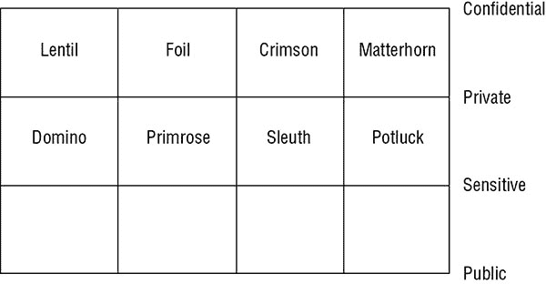

**FIGURE 14.3** A representation of the boundaries provided by lattice-based access controls

-   MAC 模型还允许标签标识更细致的安全域。在`Confidential`区域（位于 Private 与 Confidential 之间）内，有四个独立的安全域，分别标记为`Lentil`、`Foil`、`Crimson`和`Matterhorn`。这些域均包含 Confidential 数据，但通过将其放在独立的隔离区中提供了额外的保护层。拥有 Confidential 标签的用户还必须拥有相应的域标签才能访问这些数据。例如，要访问 Lentil 数据，用户需要同时拥有`Confidential`标签和`Lentil`标签。

-   同样，标记为`Domino`、`Primrose`、`Sleuth`和`Potluck`的隔离区包含`Private`数据。访问该区域的用户需要`Private`标签以及该隔离区中的任一标签。

-   Figure 14.3 中的标签是二战军事行动的名称，但组织可以使用任何名称。关键在于这些区域为数据等对象提供了额外的隔离层。注意，Sensitive 数据（位于 Public 与 Sensitive 之间）没有额外标签。拥有 Sensitive 标签的用户可以被授予访问任何标记为 Sensitive 的数据的权限。

-   组织内部人员会识别标签、定义其含义以及获得标签的要求。管理员随后将标签分配给主体和对象。标签到位后，系统依据已分配标签来决定访问权限。

-   使用 MAC 模型的隔离层强制执行`需要知道`原则。拥有`Confidential`标签的用户并不会自动获得 Confidential 区域内的隔离域访问权限。如果其工作需要访问特定数据（例如标记为`Crimson`的数据），管理员可以为其分配`Crimson`标签，从而授予访问该隔离域的权限。

-   MAC 模型采用`隐式拒绝`策略，即未明确授予访问权限的情况下，系统会拒绝访问相关数据。MAC 模型比 DAC 模型更安全，但相对更不灵活且难以扩展。

安全分类指示一个敏感性层级结构。例如，如果您考虑军事安全标签`Top Secret`、`Secret`、`Confidential`和`Unclassified`，则`Top Secret`标签包含最敏感的数据，而`Unclassified`是最不敏感的。由于这种层级，被授权访问`Top Secret`数据的人也被授权访问`Secret`和更低敏感度的数据。然而，分类不一定包含较低级别。可以使用 MAC 标签，使得对较高级别标签的授权不包括对较低级别标签的授权。

在 MAC 模型中，分类使用以下三种类型的环境：

`Hierarchical Environment` *A hierarchical environment* 将各种分类标签在从低安全级别到中等安全级别到高安全级别的有序结构中关联，例如`Confidential`、`Secret`和`Top Secret`。结构中的每个级别或分类标签都相互关联。某一级别的授权赋予主体访问该级别的对象以及该级别以下所有级别的对象，但禁止访问所有高级别的对象。例如，拥有`Top Secret`权限的人可以访问`Top Secret`数据和`Secret`数据。

`Compartmentalized Environment` 在`compartmentalized environment`中，一个安全域与另一个安全域之间没有关系。每个域代表一个独立的、相互隔离的隔间。要访问一个对象，主体必须拥有该对象的特定安全域授权。

`Hybrid Environment` *Hybrid environment* 结合了层级和隔间的概念，因此每个层级可能包含许多相互隔离的细分。主体必须拥有正确的授权以及在特定隔间内知晓数据，才能访问隔间化对象。混合 MAC 环境提供细粒度的访问控制，但随着规模扩大变得愈发难以管理。Figure 14.3 是一个混合环境的示例。

## 理解访问控制攻击

如前所述，第 13 章指出，访问控制的目标之一是防止未经授权访问对象。这包括未经授权访问任何信息系统，包括网络、服务、通信链路和计算机，以及未经授权访问数据。除了控制访问外，信息技术安全措施还旨在防止未经授权的披露和未经授权的修改，并提供资源的持续可用性。换言之，信息技术安全措施试图防止机密性丧失、完整性丧失和可用性丧失。

安全专业人员需要了解常见的攻击方法，以便采取主动措施进行预防、在发生时识别并作出适当响应。以下章节快速回顾了风险要素，并介绍了一些常见的访问控制攻击。

虽然本节专注于访问控制攻击，但要意识到还有许多其他类型的攻击，这些攻击在其他章节中有所描述。例如，第 6 章 “Cryptography and Symmetric Key Algorithms” 介绍了各种密码分析攻击。


## 风险要素

第 2 章 “Personnel Security and Risk Management Concepts” 更深入地阐述了风险和风险管理，但在此背景下重申一些术语是有价值的。*风险* 是威胁利用漏洞导致资产受损的可能性或可能性。*威胁* 是可能导致不良结果的潜在事件，包括罪犯或其他攻击者的潜在攻击，也包括洪水或地震等自然事件，以及员工的 accidental acts。*漏洞* 是任何类型的弱点，可能是硬件或软件的缺陷或限制，也可能是缺乏安全控制（例如，电脑上缺少防病毒软件）。

*风险管理* 旨在通过实施控制措施或对策来减少或消除漏洞，或降低潜在威胁的影响。完全消除风险是不可能的，也不是期望的。相反，组织关注的是降低对其造成最严重损害的风险。安全专业人员在风险管理过程早期完成的关键任务包括：

- 识别资产
- 识别威胁
- 识别漏洞

## 识别资产

*Asset valuation* 指识别资产的实际价值，以便进行优先排序。风险管理关注价值最高的资产，并识别用于缓解这些资产风险的控制措施。

资产的价值不仅仅是购买价格。例如，考虑一台托管电商网站的 Web 服务器，每天产生 10,000 美元的销售额。它的价值远高于硬件和软件的成本。如果该服务器故障导致电商网站不可用，将导致直接销售收入损失以及客户信任的丧失。

了解资产价值有助于进行成本‑效益分析，以确定不同安全控制的性价比。例如，如果资产价值数十万美元，那么一项花费 100 美元的有效安全控制是合理的；而为保护一只价值 10 美元的鼠标花费几百美元则不合理。相反，组织通常会接受与低价值资产相关的风险。

在访问控制攻击的背景下，评估数据的价值很重要。例如，如果攻击者入侵数据库服务器并下载包含隐私数据和信用卡信息的客户数据库，这对公司造成了重大损失。虽然很难量化，但 Equifax 数据泄露事件提供了一些参考（参见侧边栏 “Equifax 数据泄露”）。

Equifax 数据泄露可能对数十万人的财务状况和信用评级产生长期负面影响。它也直接影响 Equifax。Equifax 股价在官方公布数据泄露消息的 9 月后一周内下跌了 35%，约 wiped out 了公司市值约 60 亿美元。一个集体诉讼案寻求 700 亿美元的赔偿。美国国税局（IRS）在 10 月的攻击后 reportedly 暂停了与 Equifax 的 720 万美元合同。此外，联邦贸易委员会（FTC）表示正在调查 Equifax，立法者也在敦促其他联邦机构对该公司进行调查。

## 识别威胁

在识别并优先排序资产后，组织尝试识别可能对宝贵系统构成威胁的所有潜在威胁。*威胁建模* 指识别、理解和分类潜在威胁的过程。目标是列出可能针对这些系统的威胁清单并进行分析。

威胁建模不是一次性事件。通常，组织会在系统设计初期开始威胁建模，并在其生命周期内持续进行。例如，Microsoft 使用其 Security Development Lifecycle（SDL）流程在产品开发的每个阶段考虑并实施安全措施。这支持了 “Secure by Design, Secure by Default, Secure in Deployment and Communication” 的格言（也称为 SD3+C）。Microsoft 在此过程中有两个主要目标：

- 减少安全相关的设计和编码缺陷的数量
- 减少剩余缺陷的严重程度

一个专注于访问控制的威胁建模过程会尝试识别任何可能绕过访问控制并未经授权访问系统的潜在威胁。针对访问控制的常见威胁是攻击者，而本章后面的“常见访问控制攻击”章节识别了许多常见的攻击类型。

### 高级持续性威胁

任何威胁模型都应考虑已知威胁的存在，这包括*高级持续性威胁 (APTs)*。APT 是一群协作的攻击者，他们动机高昂、技术娴熟且耐心十足。他们具备高级知识和多样化的技能，用于发现并利用漏洞。APT 持续不懈，专注于利用一个或多个特定目标，而非随意攻击任何目标。

通常由国家或政府资助 APT，但有些组织化犯罪集团也资助并运营 APT。

如果组织将某个攻击者视为潜在威胁（而非自然威胁），威胁建模会尝试识别该攻击者的目标。一些攻击者可能希望使系统瘫痪，而其他攻击者则希望窃取数据，每种目标代表一个独立的威胁。组织识别出这些威胁后，会根据底层资产的重要性对它们进行分类。

过去，保持网络安全只需要比其他网络更安全。攻击者会针对容易攻击的目标并规避安全网络。你可能记得那句老话：“当被熊追赶时，你需要跑多快？”答案是：“只需要比小组里最慢的人跑得快一点。”

但如果你手里拿着一罐蜂蜜，而熊想要它，它可能会忽略其他目标，只追赶你。这就是 APT 的做法——它会根据自身想要利用的目标，专门攻击特定对象。如果想要更多示例，请使用你喜欢的搜索引擎搜索 “cozy bear attacks” 和 “fancy bear attacks”。

### 威胁建模方法

由于威胁几乎无限，使用结构化方法识别相关威胁很困难。相反，许多组织会采用以下三种方法之一来识别威胁：

**聚焦于资产** 该方法利用资产估值结果，尝试识别针对有价值资产的威胁。人员评估具体资产，判断其受攻击的易感性。如果资产存储数据，人员会评估访问控制，寻找绕过身份验证或授权机制的威胁。

**聚焦于攻击者** 部分组织会先识别潜在攻击者，再根据攻击者的目标确定其代表的威胁。例如，政府常能预知潜在攻击者及其想达成的目标，从而针对相关资产进行保护。但随着众多由外国国家赞助的 APT 出现，这种做法正变得 increasingly 困难。

**聚焦于软件** 如果组织开发软件，可考虑针对软件的潜在威胁。过去组织很少自行开发软件，但如今已非常常见。大多数组织拥有线上 presence，许多会自行构建网站。炫酷的网站吸引更多流量，但也需要更高级的编程，并带来额外的威胁。第 21 章 “恶意代码与应用程序攻击” 介绍了应用程序攻击和 Web 应用安全。

## 识别漏洞

在识别有价值资产和潜在威胁后，组织会进行*漏洞分析*。换言之，它尝试发现这些系统相对于潜在威胁的弱点。在访问控制的语境下，漏洞分析旨在识别不同访问控制机制的优势与劣势，以及威胁利用这些弱点的可能性。

漏洞分析是一个持续的过程，可包含技术步骤和行政步骤。在大型组织中，专职人员可能全职进行漏洞分析。他们定期执行漏洞扫描，寻找各种漏洞，并报告结果。在小型组织中，网络管理员可能会以周或月为周期运行漏洞扫描。

风险分析通常会在评估系统及环境相对于已知威胁和漏洞后，加入渗透测试以利用漏洞。第 16 章 “管理安全运营” 详细说明了如何在整体漏洞管理中使用漏洞扫描和漏洞评估。

## 常见访问控制攻击

访问控制攻击试图绕过或规避访问控制方法。正如第 13 章所述，访问控制始于身份识别和授权，攻击者通常会尝试窃取用户凭证。攻击者获取凭证后，可以发起在线 *冒充* 攻击，以该用户身份登录并访问用户资源。亦或是，攻击者可以直接绕过身份验证机制，窃取数据。

本书涵盖多种攻击，以下章节将直接讨论与访问控制相关的常见攻击。

### 访问聚合攻击

*访问聚合* 指收集多个非敏感信息并组合（即聚合）以获取敏感信息。换言之，个人或团体可能收集系统多个事实，然后利用这些事实发动攻击。

侦察攻击是访问聚合攻击的一种，利用多种工具识别系统的多个元素，如 IP 地址、开放端口、运行服务、操作系统等。攻击者也会对数据库使用聚合攻击。第 20 章 “软件开发安全” 介绍了间接获取数据的聚合与推断攻击，这些技术让未经授权的个人能够通过聚合和推断手段访问数据。

结合“防御深度”、“需要知道”和“最小权限”原则，可帮助防止访问聚合攻击。

### 密码攻击

密码是最弱的身份验证方式，且有大量密码攻击手段。若攻击者成功实施密码攻击，便能登录该账户并访问该账户授权的资源。若攻击者发现根或管理员密码，便能访问所有其他账户及其资源。在高安全环境中，若攻击者窃取特权账户密码，系统的安全性将不再可完全信任。攻击者可能创建其他账户或后门以继续访问系统。与其接受风险，组织可能选择从头重新构建整个系统。

*强密码* 有助于防止密码攻击。它通常足够长，并包含多种字符类型。所谓“足够长”是一个随使用环境而变化的移动目标。第 13 章讨论密码策略、强密码以及使用口诀（passphrases）的方法。关键点是：长度越长，密码越强。

尽管安全专业人员通常知道强密码的要点，但许多用户并不知道，常见情况是用户创建短密码且只包含一种字符类型。2015 年的 Ashley Madison 数据泄露有助于说明这一点。Ashley Madison 是面向已婚或有伴侣人士的在线约会服务，其标语是“Life is short. Have an affair.”。攻击者释放了超过 60 GB 的客户记录，分析显示超过 120,000 名用户的密码为 `123456`。其他顶 10 个密码包括 `12345`、`1234567`、`12345678`、`123456789`、`password` 和 `abc123`。用户想出轨却仍使用极其简单的密码。

密码不应以明文存储。通常使用强哈希函数（如 `SHA-3`）对密码进行哈希，仅存储密码的哈希值。用户验证时，系统会对提供的密码进行哈希，并通常以加密格式将该哈希发送到认证服务器。认证服务器解密接收到的哈希，然后将其与用户在密码数据库中存储的哈希进行比较。如果哈希匹配，系统即可验证用户身份。

在密码哈希时，使用强哈希函数至关重要。许多密码攻击成功是因为组织使用了弱哈希函数，例如消息摘要 5（`MD5`）。

同样重要的是更改默认密码。虽然 IT 专业人员了解此点适用于计算机，但该知识在嵌入式系统中并未广泛传播。嵌入式系统是指具有专用功能的设备，包含计算系统以执行该功能。例如，考虑一个运行网络并从客户水表收集数据的嵌入式系统。如果未更改默认密码，任何知道该密码的人都可以登录并造成问题。

下面的章节描述了使用字典、暴力破解、彩虹表和嗅探方法的常见密码攻击。其中一些攻击可针对在线账户，但更常见的是攻击者窃取账户数据库后，再离线破解密码。

#### 字典攻击

字典攻击是通过使用预定义的数据库或常见/预期密码列表，尝试发现密码的过程。换句话说，攻击者先准备一个包含字典中常见单词的数据库。字典攻击数据库还包含虽然不在字典中但常被用作密码的字符组合。例如，您可能在公开的 Ashley Madison 账户数据库中提到的密码列表中，看到许多在密码 cracking 字典中出现的条目。

此外，字典攻击还会扫描“一键修改”密码。一键修改密码是指之前使用过的密码，但将其中一个字符修改。例如，`password1` 是 `password` 的一键修改版，`Password`、`1password` 和 `passXword` 也是。攻击者在生成彩虹表（后文将讨论）时常使用此方法。

#### 暴力破解攻击

暴力破解攻击是通过系统性尝试所有可能的字母、数字和符号组合，来发现用户账户密码的过程。攻击者通常不会手动输入这些组合，而是使用程序自动尝试所有可能的组合。混合攻击结合字典攻击，然后针对一键修改密码执行一种暴力破解攻击。

更长且更复杂的密码破解所需时间更长，成本更高，而简单密码则更易被破解。随着可能性数量的增加，完整攻击的成本也随之上升。也就是说，密码越长且包含的字符类型越丰富，其对暴力破解攻击的安全性就越高。

密码和用户名通常存储在受保护的系统账户数据库文件中。然而，这些文件并不以明文形式存储，而是通常对密码进行哈希，仅保存哈希值。

用户使用哈希密码进行身份验证时，会发生以下三个步骤：

1. 用户输入凭证，如用户名和密码。
2. 用户的系统对密码进行哈希，并将该哈希发送到验证系统。
3. 验证系统将该哈希与密码数据库文件中存储的哈希进行比较。如果匹配，则表明用户输入了正确的密码。

这提供了两层重要的保护：密码不会以明文形式在网络中传输，防止被嗅探攻击捕获；密码数据库不以明文形式存储，防止攻击者在获取数据库后轻易发现密码。

然而，密码攻击工具会寻找能够产生与数据库中存储哈希值相同的密码。如果成功，攻击者即可使用该密码登录账户。例如，假设密码 `IPassed` 的存储哈希值为 `1A5C7G`（实际哈希值会更长）。暴力破解工具会执行以下步骤：

1. 猜测一个密码。
2. 计算该密码的哈希值。
3. 将计算出的哈希值与离线数据库中存储的哈希值进行比较。
4. 重复上述步骤，直到猜测的密码产生与存储密码相同的哈希值。

这也称为比较分析。当密码破解工具发现匹配的哈希值时，表明猜测的密码极大概率是原始密码。攻击者即可使用该密码冒充用户。

如果两个不同的密码产生相同的哈希值，则产生碰撞。碰撞不 desirable，理想情况下不应发生，但某些哈希函数（如 `MD5`）并非防碰撞。这使得攻击者能够创建一个不同的密码，使其产生与数据库中存储的哈希值相同。这也是目前不建议使用 `MD5` 进行密码哈希的原因之一。

随着现代计算机的速度和分布式计算的能力，暴力破解攻击甚至能成功破解一些强密码。实际破解密码所需时间取决于用于哈希的算法以及计算机的处理能力。

许多攻击者在暴力破解攻击中使用图形处理单元（GPU）。通常，GPU 的处理能力高于大多数台式电脑的 CPU。快速在线搜索可找到如何在不到 10,000 美元且仅需几小时内组装多 GPU 系统的方法。

Mandylion Research Labs 创建了一个 Excel 表格，展示了密码破解的速度。系统能尝试猜测密码的数量是一个随 CPU 和 GPU 性能提升而变化的目标。我们假设系统每秒可尝试 3500 亿个密码，以下条目展示了不同密码组合破解所需的时间：

- 8 个字符（6 个小写字母、1 个大写字母、1 个数字）少于 1 秒
- 10 个字符（8 个小写字母、1 个大写字母、1 个数字）约 1.29 小时
- 12 个字符（10 个小写字母、1 个大写字母、1 个数字）约 36 天
- 15 个字符（13 个小写字母、1 个大写字母、1 个数字）约 1,753 年

随着处理器变得更快且更便宜，攻击者更容易将更多处理器集成到单一系统中。这使得系统每秒能尝试更多密码，从而缩短破解较长密码所需的时间。

#### 生日攻击

一个 `birthday attack` 专注于寻找碰撞。它的名称来源于一种称为“生日悖论”的统计现象。生日悖论指出，如果在一个房间里有 23 个人，那么任意两个人拥有相同生日的概率为 50%。这里的“相同年份”并不是指相同的年份，而是指相同的月份和日期，例如 3 月 30 日。

在闰年（有 2 月 29 日）中，一年只有 366 天。如果在一个房间里有 367 个人，那么至少有两个人拥有相同生日的概率为 100%。即使只剩下 23 个人，概率仍然是 50%。

这与找到任意两个密码的相同哈希值的过程类似。如果哈希函数只能生成 366 种不同的哈希值，那么拥有 23 个哈希样本的攻击者就有 50% 的概率发现两个密码会产生相同的哈希值。虽然哈希算法可以生成远多于 366 种不同的哈希值，但要点在于，生日攻击方法不需要遍历所有可能的哈希值就能发现碰撞。

从另一个角度思考，假设你是房间里的某个人，想要找到其他人并与你拥有相同生日。在这种情况下，你需要 253 个人才能达到与 50% 的概率找到同样生日的人。

同样，某些工具可以生成与给定哈希值相同的另一个密码。例如，如果你知道管理员账户密码的哈希值是 `1A5C7G`，某些工具可以找到一个能生成相同哈希值 `1A5C7G` 的密码。这不一定是同一个密码，但只要能生成相同的哈希，它就和原始密码一样有效。

通过使用足够长的比特位来使碰撞在计算上不可行，以及在“彩虹表攻击”章节中讨论的盐（`salt`）来降低生日攻击的成功率。曾经安全专家认为 `MD5`（使用 128 位）是无碰撞的，但计算能力的持续提升使得 `MD5` 不再安全。`SHA-3`（即安全哈希算法第 3 版）可使用高达 512 位，目前被认为对生日攻击和碰撞是安全的——至少在目前为止。随着计算能力的进一步提升，`SHA-3` 终将被更长哈希值或更强密码学方法的哈希算法所取代。

#### 彩虹表攻击

猜测密码、对其进行哈希并与有效密码哈希进行比较是找到密码的漫长过程。`rainbow table` 通过使用大量预计算哈希的数据库来缩短这一时间。攻击者猜测密码（使用字典或暴力破解方法），对其进行哈希，然后将猜测的密码和其哈希值放入彩虹表中。

密码破解工具可以遍历彩虹表中的每个哈希，与被盗密码数据库中的哈希进行比对。传统的密码破解工具必须先猜测密码并计算其哈希，然后才能进行比对，这需要时间。而使用彩虹表时，密码破解工具无需进行猜测和哈希计算，只需比对表中的哈希直到找到匹配，从而大幅缩短破解时间。

许多系统会对密码进行 `salt`（盐）处理，以降低彩虹表攻击的效果。`Salt` 是在对密码进行哈希之前添加的随机位块。加密方法在哈希之前加入额外位块，使得攻击者使用彩虹表攻击密码变得更加困难。`Bcrypt` 和 `Password-Based Key Derivation Function 2 (PBKDF2)` 是两种常用的盐化算法。

然而，即使加了盐，只要时间足够，攻击者仍可以通过暴力破解来破解盐化密码。向盐化密码中添加 `pepper`（胡椒）可以进一步提升安全性，使其更难破解。盐是存放在与存储哈希密码的数据库相同的位置的随机数，如果攻击者获取了数据库，也就获得了所有密码的盐。而 `pepper` 是存放在数据库之外的大型常数，例如服务器上的配置值或应用程序代码中的常量。

虽然盐化密码的做法最初是为了抵御彩虹表攻击，但它同样也能削弱离线字典和暴力破解攻击的效果。离线攻击必须计算被猜测密码的哈希，如果存储的密码包含盐，攻击者必须同时发现盐才能成功。再次强调，将 `pepper` 存放在保存盐化、哈希密码的数据库之外，使得这些攻击更加困难。

#### 窃听攻击

`Sniffing`（窃听）是指通过网络捕获数据包以便分析它们。`Sniffer`（也称包分析器或协议分析器）是一种捕获网络流量的软件应用。管理员使用窃听器来分析网络流量并排查问题。

当然，攻击者也可以使用窃听器。`Sniffer attack`（也称为窃听攻击或窥探攻击）发生在攻击者使用窃听器捕获网络传输的信息时。攻击者可以捕获并以明文形式读取网络上传输的任何数据，包括密码。

Wireshark 是一个流行的协议分析器，可免费下载。图 14.4 展示了 Wireshark 捕获的相对较小的流量包，并演示了攻击者如何以明文方式捕获并读取网络传输的数据。


**FIGURE 14.4** Wireshark 捕获


上方面板显示选中了第 260 号数据包，下方面板显示该数据包的内容，其中包含 “User: DarrilGibson Password: IP@$$edCi$$P”。如果查看上方面板的第一个数据包（编号 250），可以看到打开的文件名为 CISSP Secrets.txt。

防止成功的窃听攻击的技术包括：

* 加密所有敏感数据（包括密码）在网络中传输。攻击者无法轻易通过窃听器读取加密数据。例如，Kerberos 会对票据进行加密，以防止窃听，攻击者无法轻易读取这些票据的内容。

* 当加密不可行或不切实际时，使用一次性密码。一次性密码能够防止窃听攻击，因为它们只使用一次；即使攻击者捕获一次性密码，也无法再次使用。

* 对网络设备实施物理安全防护。限制对路由器和交换机的物理访问，防止攻击者在设备上安装窃听器。

* 监控网络中窃听器的签名。入侵检测系统可以监测网络中是否存在窃听器，并在检测到窃听器时发出警报。

### 冒充攻击

`Spoofing`（也称为伪装）是指冒充他人或其他事物。冒充攻击种类繁多。例如，攻击者可以使用他人的凭证进入建筑物或访问 IT 系统。某些应用程序会冒充合法的登录界面。一次攻击展示了一个看起来与操作系统登录屏幕完全相同的登录界面。当用户输入凭证时，假应用捕获这些凭证，攻击者随后使用它们。稍后描述的网络钓鱼（phishing）攻击也模仿了这种方式，通过伪造网站来骗取用户凭证。

在 IP 欺骗攻击中，攻击者将有效的源 IP 地址替换为虚假的 IP 地址，以隐藏其身份或冒充受信任系统。访问控制攻击中使用的其他类型的欺骗包括电子邮件欺骗和电话号码欺骗。

`电子邮件欺骗` 电子邮件营销人员通常在“发件人”字段中伪造电子邮件地址，使邮件看起来像是来自另一个来源。网络钓鱼攻击经常使用这种手段，误导用户认为邮件来自可信来源。`Reply To` 字段可以是另一个电子邮件地址，电子邮件程序通常在用户回复邮件后才显示该字段。此时，用户往往会忽略或未注意到它。

`电话号码欺骗` 来电显示服务允许用户识别任何来电者的电话号码。电话号码欺骗允许来电者将此号码替换为另一个号码，这是语音 over 互联网协议 (VoIP) 系统中的常见技术。最近攻击者使用的一种技术是将实际来电号码替换为包含与被叫号码相同区号的电话号码，这使得看起来像是本地来电。

#### Social Engineering Attacks

有时，获取他人密码的最简便方式就是直接询问，这也是社会工程师常用的方法。当攻击者通过欺骗（如虚假赞美或冒充）或通过狡猾的行为获取他人信任时，就会发生 `social engineering`。攻击者试图诱使人们透露他们通常不会透露的信息或执行他们通常不会执行的操作。社会工程师的目标通常是获取对 IT 基础设施或物理设施的访问。

例如，熟练的社会工程师可以向不熟悉帮助台的员工声称自己与上级管理层有关，并声称在远程工作但忘记了密码。如果员工被骗，员工可能会重置密码并向攻击者提供新密码。其他时候，社会工程师会诱使普通用户透露自己的密码，从而获得对用户账户的访问。教育员工常见的社会工程手段可以降低这类攻击的有效性。

社交工程攻击可以通过电话、面对面和电子邮件发生。面对面，恶意人员通常冒充维修技术人员（如电话维修技术员）以获取物理访问权限。如果他们获得对网络基础设施的访问，就可以安装窃听器来捕获敏感数据。在提供访问权限前验证访客身份可以减轻此类冒充攻击。

有时，社会工程师只是试图在个人肩膀旁观看，读取电脑屏幕上的信息或观察用户输入时的键盘。这通常被称为 `shoulder surfing`。在监视器上放置屏幕过滤器可以限制攻击者的视野。此外，密码遮蔽（显示替代字符，如星号，而不是实际密码字符）也常用于防止肩窥。

##### Phishing

`Phishing` 是一种社交工程形式，试图诱使用户泄露敏感信息、打开附件或点击链接。它经常尝试通过冒充合法公司来获取用户凭证或个人可识别信息 (PII)，如用户名、密码或信用卡详情。攻击者将钓鱼邮件作为垃圾邮件 indiscriminately 发送，不知道谁会收到但希望有些用户会回应。钓鱼邮件有时会告知用户存在虚假问题，并声称如果用户不采取行动，公司将锁定用户的账户。例如，邮件可能声称公司检测到账户上的可疑活动，除非用户验证用户名和密码信息，否则公司将锁定账户。

简单的钓鱼攻击会告知用户存在问题，并要求收件人通过回复邮件提供用户名、密码及其他详细信息。发件人地址通常被伪造以看起来合法，但回复地址是攻击者控制的账户。高级攻击包括链接到看起来合法的欺骗网站。例如，如果钓鱼邮件描述 PayPal 账户出现问题，欺骗网站会看起来像 PayPal 网站。如果用户输入凭据，网站会捕获它们并将其传递给攻击者。

有时，发送钓鱼邮件的目的是在用户系统上安装恶意软件。消息可能包含受感染的文件（如附件）并鼓励用户打开。邮件也可能包含链接，该链接在用户不知情的情况下安装恶意 `drive-by download`。

某些恶意网站试图诱使用户下载并安装软件。例如，勒索软件在近年来的攻击者中非常流行。勒索软件是一种恶意软件，它控制用户的系统或数据，并阻止用户访问，直到用户支付费用或赎金。攻击者通过恶意附件、drive-by download 和诱导用户下载安装软件的方式传播勒索软件。

攻击者经常利用社交媒体识别人们之间的友谊或关系，以构建钓鱼邮件。例如，假设你有一位在社交媒体上非常活跃的姐妹，并且你与她保持联系。攻击者注意到这种关系，然后向你发送看起来像你姐妹的伪造电子邮件地址。这些邮件通常包含简短的句子，如 “Check this out” 或 “I thought you might like this”。点击链接会带你到尝试进行 drive-by download 的恶意网站。

人员可以通过遵循一些简单规则来降低钓鱼攻击的常见风险：

* 对意外的电子邮件消息或来自未知发送者的电子邮件保持警惕。

* 永远不要打开意外的电子邮件附件。

* 永远不要通过电子邮件共享敏感信息。

* 对电子邮件中的任何链接保持警惕。

存在多种钓鱼攻击的变体，包括 `spear phishing`、`whaling` 和 `vishing`。

##### Spear Phishing

`Spear phishing` 是一种针对特定用户群体（如特定组织的员工）的钓鱼形式。它可能看起来像来自组织内部的同事或同事，或来自外部来源。

例如，攻击者利用 Adobe PDF 文件的零日漏洞，在 PDF 文件中嵌入恶意代码。如果用户打开该文件，就会在系统上安装恶意软件。攻击者将 PDF 文件命名为类似 “Contract Guide”，并在邮件中说明其提供了关于合同奖励流程的更新信息。他们将邮件发送给知名政府承包商（如 Lockheed Martin）的目标邮箱。如果任何承包商打开了文件，恶意软件就会安装在其系统上，并给攻击者提供对受感染系统的远程访问。

##### Whaling

`Whaling` 是一种针对高级或高层级执行官（如首席执行官 (CEOs) 和公司董事）的钓鱼变体。一个著名的 whaling 攻击针对约 20,000 名高级企业高管，邮件中标明每位收件人的姓名，并声称他们被传唤到陪审团前。邮件包含一个链接，用于获取关于传唤的更多信息。如果高管点击该链接，网站上的消息会指示该高管需要安装浏览器插件才能阅读文件。

批准安装插件的高管安装了恶意软件，该软件记录他们的键盘输入，捕获访问不同网站时的登录凭据。它还授予攻击者对高管系统的远程访问，使攻击者能够安装额外恶意软件或读取系统上的所有数据。

# Vishing

虽然攻击者主要通过电子邮件发起网络钓鱼攻击，但他们也利用其他方式欺骗用户，例如即时通讯（IM）和 VoIP。

`Vishing` 是一种利用电话系统或 VoIP 的网络钓鱼变体。常见攻击方式是自动拨打电话给用户，声称其信用卡账户存在问题。用户被鼓励验证或确认信用卡号码、有效期以及卡背面的安全码等信息。Vishing 攻击通常会伪装来电显示号码，冒充合法的银行或金融机构。

## Smartcard Attacks

智能卡比密码提供更好的身份验证，尤其是当它们与另一种验证因素（如个人识别码 PIN）结合使用时。然而，智能卡也容易受到攻击。一个 `side-channel attack`（侧信道攻击）是一种被动、非入侵的攻击，旨在观察设备的操作。当攻击成功时，攻击者可以获取卡片中包含的有价值信息，例如加密密钥。

智能卡包含微处理器，但内部没有电源。相反，当用户将卡片插入读卡器时，读卡器为卡片提供电源。读卡器有一个电磁线圈，用于激发卡片上的电子元件。这为智能卡提供足够的电量，以将数据传输到读卡器。

侧信道攻击分析传输到读卡器的信息。有时它们会测量芯片的功耗，使用功耗监测攻击或差分功耗分析攻击，以提取信息。在定时攻击中，它们会监控处理时序，根据不同计算所需的时间来获取信息。故障分析攻击则尝试诱导故障（例如提供不足电源），以获取有价值信息。

### Summary of Protection Methods

以下列表总结了许多保护措施，用于防止访问控制攻击。但要注意，这并非针对所有攻击类型的完整防护列表。在本书的其他章节中，你会找到更多有助于防止相关攻击的控制措施。

`控制系统的物理访问`。一个与安全相关的老话是：如果攻击者拥有对计算机的无限制物理访问，那么攻击者就拥有了它。如果攻击者能够获得身份验证服务器的物理访问，他们可以在很短的时间内窃取密码文件。一旦攻击者获得密码文件，就可以离线破解密码。如果攻击者成功下载密码文件，则所有密码都应被视为已泄露。

`控制文件的电子访问`。对所有重要数据（包括包含密码的文件）进行严格的电子访问控制和监控。终端用户和非账户管理员在日常工作中无需访问密码数据库文件。安全专业人员应立即调查任何针对密码数据库文件的未经授权访问。

`创建强密码策略`。密码策略会以程序化方式强制执行强密码的使用，并确保用户定期更改密码。攻击者破解更长、包含多种字符类型的密码需要更多时间。随着时间的推移，攻击者可以通过离线暴力破解发现任何密码，因此定期更改密码是保持安全的必要措施。更安全或更敏感的环境需要更强的密码，并要求用户更频繁地更换密码。许多组织为特权账户（如管理员账户）实施单独的密码策略，以确保其密码更强，且管理员比普通用户更频繁地更换密码。

`对密码进行哈希和盐化`。使用 `bcrypt`、`PBKDF2` 等协议为密码添加盐，并考虑使用外部 `pepper` 进一步保护密码。结合强密码、盐化和加盐的密码，使用 `rainbow table` 或其他方法破解密码变得极其困难。

`使用密码遮盖`。确保应用程序永不在任何屏幕上以明文显示密码。取而代之，通过显示替代字符（如星号 `*`）来遮盖密码的显示。这可以降低肩窥尝试的风险，但用户应意识到，攻击者可能通过观察用户在键盘上输入密码来获取密码。

`部署多因素认证`。部署多因素认证，例如使用生物特征或令牌设备。当组织使用多因素认证时，攻击者即使获得了密码，也无法访问网络。许多在线服务（如 Google）现在提供多因素认证作为额外的保护措施。

`使用账户锁定控制`。账户锁定控制有助于防止在线密码攻击。它们在用户连续输入错误密码预定义次数后锁定账户。账户锁定控制通常使用削减级别，忽略某些用户错误，但在达到阈值后采取行动。例如，常见做法是允许用户连续输入错误密码最多五次后锁定账户。对于不支持账户锁定控制的系统和服务（如大多数 FTP 服务器），通过广泛的日志记录和入侵检测系统可以保护服务器。

`使用上次登录通知`。许多系统会显示包含上次成功登录的时间、日期和位置（如计算机名称或 IP 地址）的消息。如果用户关注此消息，可能会发现有人 else 登录了他们的账户。例如，用户上周五登录账户，但上次登录通知显示周六有人访问了该账户，这表明存在问题。怀疑他人登录其账户的用户可以更改密码或向系统管理员报告问题。如果是组织账户的情况，用户应按照组织的安全事件报告程序进行报告。

`教育用户关于安全`。正确培训的用户对安全有更深入的理解，也更倾向于使用更强的密码。提醒用户永不共享或书写密码。管理员可能会为最敏感的账户（如管理员或 root 账户）记录长而复杂的密码，并将其存储在安全存储箱或保险箱中。向用户提供创建强密码的技巧（如使用密码短语），以及如何防止肩窥的建议。同时，让用户了解使用同一密码访问所有在线账户（如银行账户和游戏账户）的风险。当用户对多个账户使用相同密码时，成功攻击游戏系统可能导致攻击者获取用户的银行账户。用户还应了解常见的社交工程手段。

## Summary

本章涵盖了访问控制模型相关的许多概念。权限（permissions）是对对象的访问授予，决定用户（主体）可以对对象执行什么操作。权利（right）主要指对对象执行操作的能力。特权（privileges）同时包含权利和权限。隐式拒绝（Implicit deny）确保除非明确授予，否则对对象的访问默认被拒绝。

访问控制矩阵（access control matrix）是一种以对象为中心的表格，包含对象、主体以及分配给主体的特权。矩阵中的每一行代表单个对象的访问控制列表（ACL）。ACL 以对象为焦点，标识授予主体对特定对象的访问权限。能力表（capability tables）以主体为焦点，标识主体可以访问的对象。

# 1. 主要区别：离散访问控制与非离散访问控制模型

主要区别在于 `离散访问控制（DAC）` 赋予对象所有者完全的权限控制，允许他们修改访问权限，而 `非离散访问控制（NAC）` 由管理员集中管理，所有者不得更改权限，访问依据预定义的策略进行强制。

# 2. 识别和防止访问控制攻击时的三个要素

- 资产估值

- `threat modeling`

- 漏洞分析

# 3. 用于发现密码的三种攻击类型

- 词典攻击

- 暴力破解攻击

- 虹膜表攻击

# 4. 盐和胡椒在密码哈希中的区别

- `盐` 在哈希前添加到密码中，以防止虹膜表攻击；它与哈希密码一起存储在同一数据库中。

- `胡椒` 在密码（或盐）哈希前添加一个大的常数，以进一步提升安全性；它存储在包含哈希密码的数据库之外。

## 复习题

### 1. 下列哪项 `最` 描述隐式拒绝原则？

1. 所有未明确拒绝的操作均允许。

2. 所有未明确允许的操作均被拒绝。

3. 所有操作必须明确拒绝。

4. 以上都不是。

**Answer:** 2. 所有未明确允许的操作均被拒绝。

### 2. 最小权限原则的意图是什么？

1. 只授予用户运行系统进程所需的最严格权限。

2. 只授予用户运行系统进程所需的最宽松权限。

**Answer:** 2. 只授予用户运行系统进程所需的最宽松权限。

3. 强制执行用户完成指定任务所需的最严格权限。

4. 强制执行用户完成指定任务所需的最少权限。

3. 表格包含多个对象和主题，并标识每个主题对不同对象的具体访问权限。这是什么表？

    1. 访问控制列表

    2. 访问控制矩阵

    3. 联合

    4. 特权蔓延

4. 在 DAC 模型中，谁或什么为用户授予权限？

    1. 管理员

    2. 访问控制列表

    3. 分配标签

    4. 数据保管员

5. 下列哪种模型也被称为身份基于访问控制模型？

    1. DAC

    2. RBAC

    3. 基于规则的访问控制

    4. MAC

6. 中央当局决定用户可以访问哪些文件。以下哪项最能描述这种情况？

    1. 访问控制列表（ACL）

    2. 访问控制矩阵

    3. 离散访问控制模型

    4. 强制访问控制模型

7. 中央当局根据组织的层级结构决定用户可以访问哪些文件。以下哪项最能描述这种情况？

    1. DAC 模型

    2. 访问控制列表（ACL）

    3. 基于规则的访问控制模型

    4. RBAC 模型

8. 下列哪项陈述关于 RBAC 模型是正确的？

    1. RBAC 模型允许用户在多个组中拥有成员身份。

    2. RBAC 模型允许用户在单个组中拥有成员身份。

    3. RBAC 模型是非层级的。

    4. RBAC 模型使用标签。

9. 在使用 RBAC 模型的组织中，哪项是角色的最佳选择？

    1. 网页服务器

    2. 应用

    3. 数据库

    4. 程序员

10. 哪项最能描述基于规则的访问控制模型？

     1. 它对用户使用本地规则。

     2. 它对用户使用全局规则。

     3. 它对所有用户使用本地规则。

     4. 它对所有用户使用全局规则。

11. 防火墙上使用的访问控制模型是什么类型？

     1. MAC 模型

     2. DAC 模型

     3. 基于规则的访问控制模型

     4. RBAC 模型

12. 哪种访问控制依赖于标签的使用？

     1. DAC

     2. 非自愿性

     3. MAC

     4. RBAC

13. 下列哪项最能描述 MAC 模型的特征？

     1. 采用显式拒绝哲学

     2. 容许性

     3. 基于规则

     4. 禁止性

14. 下列哪项不是有效的访问控制模型？

     1. 自愿性访问控制模型

     2. 非自愿性访问控制模型

     3. 强制性访问控制模型

     4. 合规性访问控制模型

15. 组织要识别弱点，应做什么？

     1. 资产估值

     2. `threat modeling`（威胁建模）

     3. 漏洞分析

     4. 访问审查

16. 哪项有助于缓解在线粗力攻击的成功？

     1. 彩虹表

     2. 账户锁定

     3. 盐化密码

     4. 密码加密

17. 哪项能最好地保护免受彩虹表攻击？

     1. 使用 MD5 对密码进行哈希

     2. 盐和胡椒与哈希

     3. 账户锁定

     4. 实施 RBAC

18. 哪种攻击利用电子邮件诱骗高级执行官？

     1. 钓鱼

     2. 定向钓鱼

     3. 鲸钓

     4. 语音钓鱼

    * 请参考下面的情景回答问题 19 和 20：


该组织最近经历了一系列安全 breaches，损害了其声誉。多次成功的攻击导致客户数据库文件通过公司的一个网络服务器被访问。此外，一名员工在前任职务中访问了机密数据，复制并出售给竞争对手。组织聘请了安全顾问帮助降低未来攻击风险。

19. 顾问将使用什么来识别潜在攻击者？

    1. 资产估值
    2. 威胁建模
    3. 漏洞分析
    4. 访问审查和审计

20. 管理层希望确保顾问在研究时拥有正确的优先级。以下哪项应提供给顾问以满足此需求？

    1. 资产估值
    2. 威胁建模结果
    3. 漏洞分析报告
    4. 审计日志

* Likelihood of a misconfiguration of the control that would jeopardize security
* Risk that the system will come under attack
* Rate of change of the control configuration
* Other changes in the technical environment that may affect the control performance
* Difficulty and time required to perform a control test
* Impact of the test on normal business operations

After assessing each of these factors, security teams design and validate a comprehensive assessment and testing strategy. This strategy may include frequent automated tests supplemented by infrequent manual tests. For example, a credit card processing system may undergo automated vulnerability scanning on a nightly basis with immediate alerts to administrators when the scan detects a new vulnerability. The automated scan requires no work from administrators once it is configured, so it is easy to run quite frequently. The security team may wish to complement those automated scans with a manual penetration test performed by an external consultant for a significant fee. Those tests may occur on an annual basis to minimize costs and disruption to the business.

Of course, it’s not sufficient to simply perform security tests. Security professionals must also carefully review the results of those tests to ensure that each test was successful. In some cases, these reviews consist of manually reading the test output and verifying that the test completed successfully. Some tests require human interpretation and must be performed by trained analysts.

Other reviews may be automated, performed by security testing tools that verify the successful completion of a test, log the results, and remain silent unless there is a significant finding. When the system detects an issue requiring administrator attention, it may trigger an alert, send an email or text message, or automatically open a trouble ticket, depending on the severity of the alert and the administrator’s preference.

### Security Assessments

*Security assessments* are comprehensive reviews of the security of a system, application, or other tested environment. During a security assessment, a trained information security professional performs a risk assessment that identifies vulnerabilities in the tested environment that may allow a compromise and makes recommendations for remediation, as needed.

Security assessments normally include the use of security testing tools but go beyond automated scanning and manual penetration tests. They also include a thoughtful review of the threat environment, current and future risks, and the value of the targeted environment.

The main work product of a security assessment is normally an assessment report addressed to management that contains the results of the assessment in nontechnical language and concludes with specific recommendations for improving the security of the tested environment.

Assessments may be conducted by an internal team, or they may be outsourced to a third-party assessment team with specific expertise in the areas being assessed.

### Security Audits

*Security audits* use many of the same techniques followed during security assessments but must be performed by independent auditors. While an organization’s security staff may routinely perform security tests and assessments, this is not the case for audits. Assessment and testing results are meant for internal use only and are designed to evaluate controls with an eye toward finding potential improvements. Audits, on the other hand, are evaluations performed with the purpose of demonstrating the effectiveness of controls to a third party. The staff who design, implement, and monitor controls for an organization have an inherent conflict of interest when evaluating the effectiveness of those controls.

Auditors provide an impartial, unbiased view of the state of security controls. They write reports that are quite similar to security assessment reports, but those reports are intended for different audiences that may include an organization’s board of directors, government regulators, and other third parties. There are three main types of audits: internal audits, external audits, and third-party audits.

#### Internal Audits

*Internal audits* are performed by an organization’s internal audit staff and are typically intended for internal audiences. The internal audit staff performing these audits normally have a reporting line that is completely independent of the functions they evaluate. In many organizations, the chief audit executive reports directly to the president, chief executive officer, or similar role. The chief audit executive may also have reporting responsibility directly to the organization’s governing board.

#### External Audits

*External audits* are performed by an outside auditing firm. These audits have a high degree of external validity because the auditors performing the assessment theoretically have no conflict of interest with the organization itself. There are thousands of firms who perform external audits, but most people place the highest credibility with the so-called Big Four audit firms:

* Ernst & Young
* Deloitte & Touche
* PricewaterhouseCoopers
* KPMG

Audits performed by these firms are generally considered acceptable by most investors and governing body members.

#### Third-Party Audits

*Third-party audits* are conducted by, or on behalf of, another organization. For example, a regulatory body might have the authority to initiate an audit of a regulated firm under contract or law. In the case of a third-party audit, the organization initiating the audit generally selects the auditors and designs the scope of the audit.

Organizations that provide services to other organizations are frequently asked to participate in third-party audits. This can be quite a burden on the audited organization if they have a large number of clients. The American Institute of Certified Public Accountants (AICPA) released a standard designed to alleviate this burden. The Statement on Standards for Attestation Engagements document 16 (*SSAE 16*), titled *Reporting* on Controls, provides a common standard to be used by auditors performing assessments of service organizations with the intent of allowing the organization to conduct an external assessment instead of multiple third-party assessments and then sharing the resulting report with customers and potential customers.

SSAE 16 engagements produce two different types of reports.

* Type I reports provide a description of the controls provided by the audited organization as well as the auditor’s opinion based upon that description. Type I audits cover a single point in time and do not involve actual testing of the controls by the auditor.

* Type II reports cover a minimum six-month time period and also include an opinion from the auditor on the effectiveness of those controls based upon actual testing performed by the auditor.

Type II reports are considered much more reliable than Type I reports because they include independent testing of controls. Type I reports simply take the service organization at their word that the controls are implemented as described.


Information security professionals are often asked to participate in internal, external, and third-party audits. They commonly must provide information about `security` `controls` to auditors through interviews and written documentation. Auditors may also request the participation of `security` `staff` members in the execution of control evaluations. Auditors generally have carte blanche access to all information within an organization, and `security` `staff` should comply with those requests, consulting with management as needed.

## Auditing Standards

在进行审计或评估时，执行审查的团队应明确使用的评估标准。标准提供了应满足的控制目标的描述，然后审计或评估被设计用来确保组织已正确实施控制以满足这些目标。

一个常见的审计和评估框架是 `Control Objectives for Information and related Technologies (COBIT)`。`COBIT` 描述了组织应在其信息系统周围建立的常见要求。

国际标准化组织（ISO）也发布与信息安全相关的一系列标准。`ISO 27001` 描述了一种设置信息安全管理系统的标准方法，而 `ISO 27002` 则更详细地说明了信息安全控制的具体细节。这些国际公认的标准在安全领域被广泛使用，组织可以选择成为 `ISO 27001` 合规的官方认证机构。

## 执行漏洞评估

漏洞评估是信息安全专业人员工具箱中最重要的测试工具之一。漏洞扫描和渗透测试为安全专业人员提供了系统或应用程序技术控制中的弱点的视角。

### 描述漏洞

安全社区依赖于一套共同的标准，以提供描述和评估漏洞的通用语言。`NIST` 为社区提供了 `Security Content Automation Protocol (SCAP)` 以满足此需求。`SCAP` 提供了讨论的通用框架，并简化了不同安全系统之间交互的自动化。`SCAP` 的组件包括以下内容：

*   `Common Vulnerabilities and Exposures (CVE)` 提供描述安全漏洞的命名系统。

*   `Common Vulnerability Scoring System (CVSS)` 提供描述安全漏洞严重程度的标准化评分系统。

*   `Common Configuration Enumeration (CCE)` 提供描述系统配置问题的命名系统。

*   `Common Platform Enumeration (CPE)` 提供描述操作系统、应用程序和设备的命名系统。

*   `Extensible Configuration Checklist Description Format (XCCDF)` 提供指定安全检查列表的语言。

*   `Open Vulnerability and Assessment Language (OVAL)` 提供描述安全测试程序的语言。

### 漏洞扫描

`Vulnerability scans` 自动探测系统、应用程序和网络，寻找攻击者可能利用的弱点。用于这些测试的扫描工具提供快速、点击式的测试，执行否则繁琐的任务而无需手动干预。大多数工具支持定期的自动扫描，并提供显示不同日间扫描差异的报告，为管理员提供安全风险环境变化的视图。

主要有四类漏洞扫描：网络发现扫描、网络漏洞扫描、Web 应用漏洞扫描和数据库漏洞扫描。各类扫描工具种类繁多。

#### 网络发现扫描

网络发现扫描使用多种技术扫描一系列 IP 地址，寻找具有开放网络端口的系统。网络发现扫描仪实际上不检查系统是否存在漏洞，而是生成报告，列出网络上检测到的系统以及通过网络和服务器防火墙（位于扫描器与被扫描系统之间）暴露的端口。

网络发现扫描仪使用多种不同的技术识别远程系统上的开放端口。其中一些更常见的技术如下：

**`TCP SYN Scanning`** `Sends a single packet to each scanned port with the SYN flag set`。这表示请求建立新连接。如果扫描仪收到包含 `SYN` 和 `ACK` 标志的响应，则说明系统正处于三次握手的第二阶段，且端口是开放的。`TCP SYN scanning` 也称为“半开”扫描。

**`TCP Connect Scanning`** `Opens a full connection to the remote system on the specified port`。当执行扫描的用户没有权限运行半开扫描时，使用此扫描类型。大多数其他扫描类型需要发送原始数据包，用户可能因操作系统限制而无法发送手工制作的数据包。

**`TCP ACK Scanning`** `Sends a packet with the ACK flag set`，指示它是已建立连接的一部分。此类扫描可能用于确定防火墙强制的规则及其方法。

**`Xmas Scanning`** `Sends a packet with the FIN, PSH, and URG flags set`。包含大量标志的数据包被描述为“像圣诞树一样亮灯”，因此得名。

网络发现扫描最常用的开源工具是 `nmap`。它最初于 1997 年发布，至今仍得到维护并广泛使用。它仍然是最受欢迎的网络安全工具之一，几乎每位安全专业人员要么定期使用 `nmap`，要么在职业生涯中曾使用过它。您可以免费下载 `nmap` 或在 [`http://nmap.org`](http://nmap.org) 了解更多关于该工具的信息。

当 `nmap` 扫描系统时，它会识别该系统上每个网络端口的当前状态。对于 `nmap` 检测到结果的端口，它会提供该端口的当前状态：

**Open** 端口在远程系统上是打开的，且有应用程序正在积极接受该端口的连接。

**Closed** 端口在远程系统上可访问，防火墙允许访问，但该端口上没有应用程序接受连接。

**Filtered** `Nmap` 无法判断端口是否打开或关闭，因为防火墙干扰了连接尝试。

Figure 15.1 展示了 `nmap` 的使用示例。用户在 Linux 提示符下输入了以下命令：

```
nmap –vv 52.4.85.159
```


**FIGURE 15.1** `Nmap 扫描 Linux 系统上的 Web 服务器`

随后 `nmap` 开始对 IP 地址 52.4.85.159 的系统进行端口扫描。`–vv` 标志指示 `nmap` 使用详细模式，输出详细结果。扫描结果位于 Figure 15.1 的底部，显示 `nmap` 发现了三个活动端口：22、80 和 443。端口 22 和 80 处于打开状态，表示系统正在接受连接请求；端口 443 处于关闭状态，意味着防火墙规则允许尝试连接，但系统未运行相应的服务。

要解读这些结果，需了解常见网络端口的用途（见第 12 章 “安全通信和网络攻击”）。下面逐一说明扫描结果：

*   第一行端口列表 `22/tcp open ssh` 表示系统接受 TCP 端口 22 的连接。安全壳（SSH）服务使用该端口提供管理员对服务器的远程连接。

*   第二行端口列表 `80/tcp open http` 表示系统接受 TCP 端口 80 的连接请求，端口 80 用于超文本传输协议（HTTP）传输网页内容。

-   端口列表的最后一行，`443/tcp` 关闭 `https`，表明存在防火墙规则允许访问 443 端口，但该端口上没有监听服务。443 端口用于超文本传输协议安全（HTTPS）协议接受加密的 Web 服务器连接。

-   从这些结果我们可以学到：被扫描的系统可能是一台公开接受扫描系统连接请求的 Web 服务器。扫描器与该系统之间的防火墙已配置为允许安全（端口 443）和不安全（端口 80）连接，但服务器未配置执行加密事务。服务器还打开了一个管理端口，可能允许命令行连接。

-   阅读这些结果的攻击者可能会做出几个观察，从而进一步进行探测：

    * 将浏览器指向该服务器可能会让人大致了解服务器的功能及其运营者。直接在浏览器地址栏中输入 `http://52.4.85.159` 可能会泄露有用信息。[图 15.2 展示了此操作的结果：该站点运行的是默认安装的 Apache Web 服务器。

    * 该服务器的连接是未加密的。如果能够窃听这些连接，可能会暴露敏感信息。

    * 打开的 SSH 端口是一个有趣的发现。攻击者可能会尝试对该端口的管理员账户进行暴力破解密码攻击，以获取系统访问权限。


**FIGURE 15.2** 默认 Apache 服务器页面在图 15.1 中被扫描的服务器上运行

-   本例中我们使用 `nmap` 扫描单个系统，但该工具也支持扫描整个网络以发现开放端口的系统。图 15.3 所示的扫描跨越 `192.168.1.0/24` 网络，涵盖地址范围 `192.168.1.0–192.168.1.255`。


**FIGURE 15.3** 由 Mac 系统的终端工具运行的大型网络 Nmap 扫描

#### 网络漏洞扫描

`网络漏洞扫描` 比发现扫描更深入。它们不止于检测开放端口，还会继续对目标系统或网络进行探测，查找已知漏洞的存在。这些工具包含数千条已知漏洞的数据库，并附带测试以判断目标系统是否易受每个漏洞的影响。

当扫描器对系统进行漏洞测试时，它会使用数据库中的测试来判断目标系统是否可能包含该漏洞。在某些情况下，扫描器没有足够信息来确定漏洞是否真的存在，从而错误地报告漏洞，这种情况称为 `误报（false positive）`，有时会给系统管理员带来困扰。更危险的是扫描器漏掉了漏洞，未能提醒管理员存在危险局面，这称为 `误负（false negative）` 报告。

默认情况下，网络漏洞扫描器执行未授权扫描，即在没有密码或其他授权信息的情况下测试目标系统。这使得扫描可以从攻击者的视角运行，但也限制了扫描器充分评估所有可能漏洞的能力。提高扫描准确性、降低误报和误负的一种方法是进行 `授权扫描`。在授权扫描中，扫描器拥有只读访问权限，能够读取目标系统的配置信息，并在分析漏洞测试结果时使用这些信息。

Figure 15.4 展示了使用 Nessus 漏洞扫描器对本章前面对同一系统进行的网络发现扫描所做的网络漏洞扫描的结果。


**FIGURE 15.4** 与图 15.1 中的端口扫描相同的 Web 服务器的网络漏洞扫描结果

- 图 15.4 所示的扫描结果非常干净，代表一个维护良好的系统。没有严重漏洞，只有与被扫描系统上运行的 SSH 服务相关的两个低风险漏洞。管理员若想进一步降低这些低风险漏洞，可以微调 SSH 加密设置，但总体而言这是一份很好的报告，能够让管理员对系统管理水平有信心。

- Nessus 是常用的漏洞扫描器，但也有许多其他工具可供选择。知名商业扫描器包括 Qualys 的 `QualysGuard` 和 Rapid7 的 `NeXpose`。开源的 `OpenVAS` 扫描器也拥有日益增长的用户社区。

- 组织还可以针对无线网络进行专门的漏洞评估。`Aircrack` 是一款常用于测试无线网络加密和其他安全参数的工具，常与被动监控技术配合使用，以识别网络中的 `rogue` 设备。

#### Web 漏洞扫描

Web 应用程序对企业安全构成显著风险。由于其本质，许多 Web 应用的服务器必须向 Internet 用户提供服务。防火墙和其他安全设备通常包含规则，允许 Web 流量无阻地通过到达 Web 服务器。Web 服务器上运行的应用程序复杂，往往拥有对底层数据库的特权访问。攻击者常利用 SQL 注入等针对 Web 应用安全设计缺陷的攻击手段。

`Web 漏洞扫描器` 是专用工具，用于扫描 Web 应用以查找已知漏洞。它们在任何安全测试程序中扮演重要角色，因为它们可以发现网络漏洞扫描不可见的缺陷。当管理员运行 Web 应用扫描时，工具会自动化地操作输入参数等，模拟攻击手法来识别漏洞。随后工具会生成包含发现和建议修复措施的报告。图 15.5 给出了使用 Nessus 漏洞扫描器对同一服务器上运行的 Web 应用进行的一次 Web 漏洞扫描示例。该扫描同时也针对图 15.1 中的网络发现扫描和图 15.4 中的网络漏洞扫描所涉及的服务器。在阅读图 15.5 的扫描报告时，请注意它发现了网络漏洞扫描中未显现的漏洞。


**FIGURE 15.5** 与图 15.1 中的端口扫描以及图 15.2 中的网络漏洞扫描相同的 Web 服务器的 Web 应用漏洞扫描结果

Web 漏洞扫描是组织安全评估和测试程序的重要组成部分。以下情况建议运行扫描：

* 进行首次 Web 漏洞扫描时，先扫描所有应用程序，以检测遗留应用程序的问题。

* 在首次将新应用程序部署到生产环境之前，先对其进行扫描。

* 在将代码变更部署到生产环境之前，先对修改后的应用程序进行扫描。

* 按照固定频率扫描所有应用程序。受限资源可能需要根据应用程序的优先级来调度这些扫描，例如，处理敏感信息的 Web 应用程序的扫描频率可高于不处理敏感信息的应用程序。

在某些情况下，Web 应用漏洞扫描可能是合规性要求的前提。例如，第 4 章“法律、法规和合规”中讨论的支付卡行业数据安全标准 (`PCI DSS`) 要求组织要么至少每年进行一次 Web 应用漏洞扫描，要么安装专用的 Web 应用防火墙，以在防御 Web 漏洞方面再增加一层保护。

除了 Nessus 外，常用的 Web 应用漏洞扫描工具还包括商业版 `Acunetix` 扫描仪、开源的 `Nikto` 和 `Wapiti` 扫描器以及 `Burp Suite` 代理工具。

#### 数据库漏洞扫描

数据库包含组织最敏感的信息，是攻击者的有利目标。虽然大多数数据库通过防火墙防止直接的外部访问，但 Web 应用提供了进入这些数据库的入口，攻击者可能利用数据库驱动的 Web 应用发起攻击，包括 SQL 注入攻击。

数据库漏洞扫描工具让安全专业人员能够同时扫描数据库和 Web 应用，发现可能影响数据库安全的漏洞。`sqlmap` 是一款常用的开源数据库漏洞扫描器，它允许安全管理员对 Web 应用进行数据库漏洞探测。Figure 15.6 展示了 `sqlmap` 对 Web 应用的扫描示例。


**FIGURE 15.6** Scanning a database-backed application with `sqlmap`

#### 漏洞管理工作流

采用漏洞管理系统的组织应当制定漏洞管理工作流，其基本步骤应包括：

1. `Detection`（检测）：漏洞的初步识别通常来源于漏洞扫描的结果。

2. `Validation`（验证）：扫描仪检测到漏洞后，管理员应确认该漏洞，以确保它不是误报。

3. `Remediation`（修复）：被验证的漏洞应随后进行修复，这可能包括应用供应商发布的安全补丁、修改设备配置、实施规避漏洞的工作绕道、或安装 Web 应用防火墙或其他控制措施，以阻止漏洞被利用。

工作流的目标是确保漏洞有序发现并得到解决。工作流还应包括依据漏洞严重程度、被利用的可能性以及修复难度对漏洞修复进行优先排序。

### 渗透测试

`渗透测试` 超出了漏洞测试技术，因为它实际尝试利用系统。漏洞扫描仅探测漏洞是否存在，通常不主动进攻目标系统。（不过，某些漏洞扫描技术可能会干扰系统，但这些选项默认是禁用的。）执行渗透测试的安全专业人员则试图突破安全防护，入侵目标系统或应用，以证明其缺陷。

渗透测试需要比漏洞扫描更大程度的专业安全人员关注。在进行渗透测试时，安全专业人员通常会针对单个系统或一组系统，使用多种技术获取访问。整个过程通常包括如下阶段，如 Figure 15.7 所示：

* `Planning`（规划）包括确定测试范围和参与规则。此阶段至关重要，因为它确保测试团队与管理层对测试的性质达成一致，并明确授权。

* `Information gathering and discovery`（信息收集与发现）使用手动和自动化工具收集目标环境信息，包括基础侦察（如访问系统上托管的网站）和网络发现扫描（识别开放端口）。

* `Vulnerability scanning`（漏洞扫描）通过网络漏洞扫描、Web 漏洞扫描和数据库漏洞扫描来探测系统弱点。

* `Exploitation`（利用）使用手动和自动化利用工具尝试绕过系统安全。

* `Reporting`（报告）总结渗透测试结果，并提出改进系统安全的建议。

渗透测试人员常用名为 `Metasploit` 的工具自动执行针对目标系统的利用。`Metasploit` 在 Figure 15.8 中展示，它使用脚本语言实现常见攻击的自动化，从而大幅节省测试人员（以及黑客）的时间，消除许多重复、繁琐的步骤。


# FIGURE 15.7 Penetration testing process


# FIGURE 15.8 The Metasploit automated system exploitation tool allows attackers to quickly execute common attacks against target systems.

渗透测试人员可能是公司内部员工，也可能是受雇的外部顾问。测试通常分为三类：

`White Box Penetration Test`（白盒渗透测试）提供攻击者对目标系统的详细信息，跳过常规的侦察步骤，缩短攻击时间并提高发现安全漏洞的可能性。

`Gray Box Penetration Test`（灰盒渗透测试），也称为部分知识测试，常用于在白盒和黑盒测试之间取得平衡。当黑盒结果理想但成本或时间限制要求提供部分知识时，这种测试尤为常见。

`Black Box Penetration Test`（黑盒渗透测试）在攻击前不提供攻击者任何信息，模拟外部攻击者在获取业务和技术环境信息前进行入侵。

Organizations 进行渗透测试时应小心确保他们了解测试本身的危害。渗透测试旨在利用漏洞，因而可能导致系统访问中断或系统中存储的数据损坏。这是明确在测试计划阶段制定参与规则以及在开始任何测试前获得高级管理层完整授权的主要原因之一。

渗透测试耗时且需要专业资源，但它们在维持健全的信息安全测试程序的持续运行中发挥重要作用。

## 测试您的软件

软件是系统安全的关键组成部分。考虑以下在现代企业中广泛使用的应用程序的常见特征：

* 软件应用程序通常拥有对操作系统、硬件及其他资源的特权访问权限。

* 软件应用程序常规处理敏感信息，包括信用卡号、社会安全号和专有业务信息。

* 许多软件应用程序依赖于数据库，这些数据库也包含敏感信息。

* 软件是现代企业的核心，执行关键业务功能。软件故障可能导致业务严重中断。

这些只是众多表明需要对软件进行细致测试的原因，对于每个现代组织的保密性、完整性和可用性要求至关重要。在本节中，您将了解可整合到组织软件开发生命周期中的多种软件测试类型。

### 代码审查和测试

软件测试程序中最关键的组成部分之一是进行代码审查和测试。这些程序在开发人员将代码移入生产环境前，对其工作进行第三方审查。代码审查和测试可能发现应用程序在上线前存在的安全、性能或可靠性缺陷，从而对业务运营产生负面影响。

#### 代码审查

`代码审查` 是软件评估程序的基础。在代码审查（也称为“同行评审”）过程中，除原始开发人员外的开发人员会审查代码以寻找缺陷。代码审查可能导致应用程序被批准进入生产环境，也可能要求原始开发人员根据审查发现的问题进行重新工作。

代码审查形式多样，形式 ality 因组织而异。最正式的代码审查流程，即 `Fagan inspections`，遵循包含六个步骤的严格审查和测试过程：

1. 计划

2. 概览

3. 准备

4. 审查

5. 重新工作

6. 后续跟进

`Fagan inspection` 的概览在 Figure 15.9 中呈现。每个步骤都有明确的入口和出口标准，必须在正式从一个阶段过渡到下一阶段前满足这些标准。

`Fagan inspection` 的正式程度通常只在高度受限的环境中出现，在此类环境中代码缺陷可能产生灾难性影响。大多数组织使用较为不严格的代码同行审查措施，包括以下做法：

* 开发人员在会议中与一名或多名团队成员一起逐行查看代码

* 高级开发人员手动审查代码并签字确认，所有代码在移动到生产环境前均已通过审查

* 使用自动化审查工具在移动到生产环境前检测常见应用缺陷


# FIGURE 15.9 Fagan inspections follow a rigid formal process, with defined entry and exit criteria that must be met before transitioning between stages.

每个组织应采用符合其业务需求和软件开发文化的代码审查流程。

#### 静态测试

`静态测试` 在不运行软件的情况下评估其安全性，通过分析源代码或编译后的应用程序实现。静态分析通常使用旨在检测常见软件缺陷（如缓冲区溢出）的自动化工具。在成熟的开发环境中，应用程序开发人员会在设计、构建和测试过程中获得并使用静态分析工具。

#### 动态测试

`动态测试` 在运行环境中评估软件的安全性，通常是仅有的选择，特别是对于由他人编写的应用程序。此时测试人员往往无法访问底层源代码。动态软件测试的一个常见例子是使用 Web 应用扫描工具检测跨站脚本、SQL 注入或其他 Web 应用缺陷。对生产环境进行动态测试时必须仔细协调，以避免意外中断服务。

动态测试可使用 `合成事务` 来验证系统性能。这些是具有已知预期结果的脚本化事务。测试人员运行合成事务并将输出与预期状态进行比较。实际结果与预期结果之间的偏差代表潜在缺陷，必须进一步调查。

#### 模糊测试

`模糊测试` 是一种专用的动态测试技术，通过向软件提供多种输入来使其超出极限并发现先前未被发现的缺陷。模糊测试软件会向软件提供无效输入，要么随机生成，要么精心构造以触发已知漏洞。模糊测试工具随后监控应用程序的性能，关注软件崩溃、缓冲区溢出或其他不良或不可预测的结果。

模糊测试主要分为两类：

`Mutation (Dumb) Fuzzing` 使用实际运行的输入值并对其进行修改（或“变异”）以生成模糊输入。它可能修改字符、在内容末尾附加字符串，或执行其他数据操作技术。

`Generational (Intelligent) Fuzzing` 基于对程序所用数据类型的理解，构建数据模型并生成新的模糊输入。

工具 `zzuf` 自动化实现变异模糊测试，根据用户指定的方式对输入进行操作。例如，Figure 15.10 显示了一个包含一系列 1 的预处理输入文件。


# FIGURE 15.10 Prefuzzing input file containing a series of 1s

Figure 15.11 展示了 `zzuf` 工具在该输入文件上的应用。生成的模糊文本几乎与原文相同，仍然大部分由 1 组成，但其中出现了若干修改，可能会让程序对原始输入产生困惑。这种对输入进行轻微修改的过程称为 `位翻转`。


# FIGURE 15.11 The input file from Figure 15.10 after being run through the zzuf mutation fuzzing tool

- [`模糊测试`](https://wiki.example.org/feynmans_learning_method)是一个重要的工具，但它也存在局限性。模糊测试通常不会导致代码的完整覆盖，并且通常仅用于检测不需要复杂业务逻辑操作的简单漏洞。因此，模糊测试应被视为一套测试中仅一个工具，并且进行测试覆盖分析（在本章后面讨论）以确定测试的完整范围是非常有用的。

### 接口测试

`接口测试`是复杂软件系统开发的重要部分。在许多情况下，多个开发团队分别开发复杂应用的不同部分，这些部分必须协同工作以实现业务目标。这些独立开发模块之间的交接使用明确定义的接口，使各团队能够独立工作。接口测试评估模块是否符合接口规范，以确保在所有开发工作完成后它们能够正确协同工作。

在软件测试过程中应测试三种类型的接口：

`应用编程接口 (APIs)` `提供代码模块之间交互的标准化方式，并可能通过 Web 服务向外部公开`。开发人员必须测试 API 以确保其强制执行所有安全要求。

`用户界面 (UIs)` `包括图形用户界面 (GUI) 和命令行界面`。`UIs 为终端用户提供与软件交互的能力`。接口测试应包括对所有用户界面的审查，以验证其功能正常。

`物理接口` `存在于需要操作机械、逻辑控制器或其他实体的应用中`。软件测试人员应仔细关注物理接口，因为它们出现故障可能导致严重后果。

接口提供了复杂系统规划或未来互连的重要机制。Web 2.0 环境依赖于这些接口，以便在不同软件包之间促进交互。然而，开发人员必须注意接口提供的灵活性是否会引入额外的安全风险。接口测试为确保接口满足组织安全要求提供了额外的保障。

### 恶意用例测试

在某些应用中，存在明确的软件用户可能尝试滥用该应用的情况。例如，银行软件的用户可能尝试操纵输入字符串以访问另一用户的账户，或者尝试从已透支的账户中提取资金。测试人员使用一种称为`滥用用例测试`或`滥用案例测试`的过程，评估其软件对这些已知风险的易受性。

在滥用用例测试中，测试人员首先列举已知的滥用用例，然后使用手动和/或自动化攻击技术尝试利用这些用例。

### 测试覆盖分析

虽然测试是任何软件开发过程的重要组成部分，但完全测试任何软件都是不可能的。软件可能出现故障或遭受攻击的方式实在太多。测试专业人员通常会进行`测试覆盖分析`来估算对新软件进行的测试程度。测试覆盖率的计算公式如下：

<displayedItem xmlns:cms="http://cms.wiley.com" xmlns:dctm="http://www.documentum.com" xmlns="http://www.wiley.com/namespaces/wiley" xmlns:wiley="http://www.wiley.com/namespaces/wiley/wiley" numbered="no" id="c15-disp-0001" type="mathematics"><math display="block"/></displayedItem>


当然，这是一个主观的计算。准确计算测试覆盖率需要列举所有可能的用例，这本身就是一项极其困难的任务。因此，任何使用测试覆盖率计算的人都应当在解释结果时，了解用于生成输入值的过程。

测试覆盖分析公式可以根据多种标准进行适配。以下是五种常见标准：

* `分支覆盖`：是否已在所有 if 和 else 条件下执行每个 if 语句？

* `条件覆盖`：是否已在所有输入组合下执行代码中的每个逻辑测试？

* `函数覆盖`：是否已调用代码中的每个函数并返回结果？

* `循环覆盖`：是否已在导致代码多次执行、仅一次执行或完全不执行的条件下，对代码中的每个循环进行了测试？

* `语句覆盖`：是否已在测试过程中执行了代码的每一行？

### 网站监控

安全专业人员也经常参与网站的持续监控，用于性能管理、故障排查以及潜在安全问题的识别。这种监控主要有两种形式。

* `被动监控` `分析实际网络流量，通过在网络传输或到达服务器时捕获它`。这提供了真实的网络监控数据，为管理员提供了对网络实际情况的洞察。实时用户监控 (RUM) 是被动监控的一种变体，监控工具会将个别用户的活动重新组装，以跟踪其与网站的交互。

* `合成监控` (或 `主动监控`) `对网站进行人工交易以评估性能`。这可以是简单的请求站点页面以测量响应时间，也可以是执行复杂脚本的脚本，用于识别交易的结果。

这两种技术经常一起使用，因为它们各自能够达到不同的结果。被动监控只能在真实用户发生问题后才能检测到问题，因为它监控的是真实用户活动。被动监控对于排查用户报告的问题特别有用，因为它可以捕获与该问题相关的流量。合成监控可能会漏掉真实用户未包含在测试脚本中的问题，但它能够在问题实际发生前检测到它们。

### 实施安全管理流程

除了进行评估和测试外，健全的信息安全程序还包括一系列管理流程，旨在监督信息安全程序的有效运行。这些流程是安全评估过程中的关键反馈循环，因为它们提供管理层监督，并对内部威胁的风险具有抑制作用。

安全管理审查满足了这一需求，包括日志审查、账户管理、备份验证以及关键性能和风险指标。每个审查都应遵循标准化流程，并在审查完成时获得管理层批准。

#### 日志审查

在第 16 章“管理安全运营”中，你将了解到存储日志数据并进行自动化和手动日志审查的重要性。安全信息和事件管理 (SIEM) 解决方案在这些流程中发挥重要作用，自动化了日志审查的常规工作。这些设备通过许多设备、操作系统和应用程序中的 syslog 功能收集信息。一些设备（包括 Windows 系统）可能需要第三方客户端来添加 syslog 支持。管理员可以通过 Windows 组策略对象 (GPO) 和其他机制部署日志策略，并在整个组织中部署和强制执行标准策略。

- [`日志系统`]也应使用 `网络时间协议 (NTP)` 来确保将日志条目发送到 `SIEM` 的系统以及 `SIEM` 本身的时钟保持同步。这确保了来自多个来源的信息在时间轴上是一致的。

- `信息安全管理人员` 也应定期进行日志审查，特别是针对`敏感功能`，以确保特权用户不滥用其特权。例如，如果 `信息安全团队` 具有访问 `eDiscovery` 工具的权限，这些工具允许搜索单个用户文件的内容，那么 `安全管理人员` 应该定期审查 `行政用户` 所执行操作的日志，以确保其文件访问与合法的 `eDiscovery` 项目相符，且不侵犯用户隐私。

### 账户管理

- `账户管理` 审查确保用户仅保留授权的权限，且不发生未经授权的修改。该审查职能可能由 `信息安全管理人员` 或 `内部审计师` 执行。

- 进行账户管理的一种方式是对`所有账户`进行全面审查。这通常仅针对`高度特权账户`进行，因为所需时间较长。具体流程因组织而异，但以下为一个示例：

    1. 管理者要求系统管理员提供`特权访问用户`的列表以及其特权访问权限。管理者可在管理员检索该列表的过程中进行监控，以防止篡改。

    2. 管理者要求`特权批准权威`提供`获批用户`的列表以及应分配的特权。

    3. 管理者随后比较两份列表，确保仅授权用户保留系统访问权限，且每位用户的访问权限不超过其授权范围。

- 此过程可能包括其他检查，例如验证已终止用户是否仍保留系统访问权限、检查特定账户的审计痕迹，或其他任务。

- `没有时间进行此类彻底流程` 的组织可采用`抽样`方法。在此方法中，管理者抽取随机样本账户，并对该样本的权限授予过程进行完整验证。如果样本中未发现显著缺陷，则假设该样本能够代表整体人口。

- 组织还可以`自动化`部分账户审查流程。许多 `IAM (Identity and Access Management)` 供应商提供账户审查工作流，提示管理员进行审查、维护用户账户文档，并提供审查完成的审计痕迹。

### 备份验证

- 在 `第 18 章 “灾难恢复规划”` 中，你将了解保持一致的备份程序的重要性。管理者应定期检查备份结果，以确保该过程有效运行并满足组织的数据保护需求。这可能包括审查日志、检查哈希值，或请求对系统或文件进行实际恢复。

### 关键绩效和风险指标

- `安全管理人员` 还应持续监控`关键绩效指标 (KPIs)` 和`关键风险指标 (KRIs)`。具体监控的指标因组织而异，但可能包括以下内容：

    * 开放漏洞的数量

    * 解决漏洞的时间

    * 漏洞/缺陷的重复出现

    * 被 compromise 的账户数量

    * 预生产扫描中发现的软件缺陷数量

    * 重复的审计发现

    * 用户访问已知恶意站点的次数

- 一旦组织确定了希望跟踪的关键安全指标，管理者可能希望`开发一个仪表盘`，清晰展示这些指标随时间的变化，并将其放置在管理者和安全团队经常能看到的位置。

## Summary

- `安全评估与测试` 程序在确保组织的安全控制随时间保持有效方面发挥着关键作用。业务运营变化、技术环境变化、安全风险变化以及用户行为变化，可能会影响保护信息资产的`保密性、完整性和可用性`的控制有效性。评估与测试程序监控这些控制，并突出需要管理员介入的变更。

- 安全专业人员应`精心设计`其评估与测试程序，并在业务需求变化时进行`修订`。

- `安全测试` 技术包括`漏洞评估`和`渗透测试`。在漏洞评估中，安全专业人员使用多种测试手段识别系统、应用和网络中的配置错误和其他安全缺陷。这些缺陷可能包括缺失的补丁、配置错误或有缺陷的代码，从而使组织面临安全风险。渗透测试同样使用这些工具，但会补充攻击技术，评估员尝试利用漏洞并获取系统访问权限。

- `软件测试` 用于验证即将投入生产的代码是否按预期工作且不包含安全缺陷。代码审查采用`同行评审`流程，在部署到生产环境前对代码进行正式或非正式的验证。接口测试评估组件之间以及组件与用户的交互，包括 API 测试、用户界面测试和物理接口测试。

- `静态与动态软件测试的区别`：

    - `静态测试` 方法（如代码审查）在不运行软件的情况下，通过分析源代码或编译后的应用来评估其安全性。

    - `动态测试` 在软件运行的运行时环境中评估安全性，通常是唯一可行的选项，尤其对于由他人编写的应用。

# 管理安全运营

## 第 16 章


# 管理安全运营

## 本章涵盖的 CISSP 考试主题

### 第 7 个域：安全运营

#### 7.4 资源安全配置

##### 7.4.1 资产清单

##### 7.4.2 资产管理

##### 7.4.3 配置管理

#### 7.5 理解并应用基础安全运营概念

##### 7.5.1 需要知道/最小权限

##### 7.5.2 职责分离

##### 7.5.3 特权账户管理

##### 7.5.4 任务轮换

##### 7.5.5 信息生命周期

##### 7.5.6 服务级别协议 (SLA)

#### 7.6 应用资源保护技术

##### 7.6.1 媒体管理

##### 7.6.2 硬件和软件资产管理

#### 7.9 实施并支持补丁和漏洞管理

## 描述 TCP SYN 扫描与 TCP 连接扫描的区别

TCP SYN 扫描发送 `SYN` 包并期望收到 `SYN-ACK` 响应，而无需完成三次握手；TCP 连接扫描则使用操作系统的 `connect` 系统调用完成完整的握手（`SYN-ACK-ACK`），随后拆除连接。

## Nmap 网络发现扫描工具返回的三个端口状态值是什么

这三个端口状态值是 `open`、`closed` 和 `filtered`。

## 静态测试与动态测试技术的区别是什么

静态测试在不执行代码的情况下检查源代码，寻找代码本身的缺陷；动态测试则运行编译后的程序并观察其行为，以在执行期间发现缺陷。

## 变异模糊测试与生成式模糊测试的区别是什么

变异模糊测试通过对已有合法输入进行随机修改（位翻转、插入、删除）来生成测试用例；生成式模糊测试则基于模型或语法，创建新的符合预期结构的输入。

## 哪个工具主要用于执行网络发现扫描

1. `Nmap`

2. `Nessus`

3. `Metasploit`

4. `lsof`

## Adam 最近从外部网络对组织内部 Web 服务器进行了端口扫描，以获取攻击者的视角。以下哪项结果最令人警报

1. `80/open`

2. `22/filtered`

3. `443/open`

4. `1433/open`

## 在规划针对特定系统的安全测试时间表时，以下因素不应被考虑

1. 系统中存储信息的敏感程度

2. 测试的难度

3. 想尝试新测试工具的欲望

4. 该系统对攻击者的吸引力

## 哪个因素通常不包含在安全评估中

1. 漏洞扫描

2. 风险评估

3. 漏洞缓解

4. 威胁评估

## 安全评估报告的目标受众是谁

1. 管理层

2. 安全审计师

3. 安全专业人员

4. 客户

## Beth 想对组织的私有网络中所有系统运行 `nmap` 扫描，这些系统位于 `10.0.0.0` 私有地址空间。她希望扫描整个私有地址空间，因为不确定使用了哪些子网。她应该指定的目标网络地址是

1. `10.0.0.0/0`

2. `10.0.0.0/8`

3. `10.0.0.0/16`

4. `10.0.0.0/24`

## Alan 对服务器进行 `nmap` 扫描，发现端口 `80` 处于开放状态。哪个工具最有可能为他提供关于服务器目的和运营者身份的最佳额外信息

1. `SSH`

2. Web 浏览器

3. `telnet`

4. `ping`

## 使用 `SSH` 实用程序接受管理连接的典型端口是

1. `20`

2. `22`

3. `25`

4. `80`

## 哪种网络发现扫描仅遵循 TCP 握手的前两步

1. TCP 连接扫描

2. Xmas 扫描

3. TCP SYN 扫描

4. TCP ACK 扫描

## Matthew 想测试网络中的系统是否存在 SQL 注入漏洞。以下工具最适合此任务

1. 端口扫描器

2. 网络漏洞扫描器

3. 网络发现扫描器

4. Web 漏洞扫描器

## Badin Industries 的 Web 应用处理电子商务订单并处理信用卡交易，受 PCI DSS 约束。公司最近对该应用进行了 Web 漏洞扫描，未发现不满意的结果。Badin 必须多久重新扫描一次该应用

1. 仅在应用变更时

2. 至少每月一次

3. 至少每年一次

4. 没有重新扫描的要求

## Grace 在对客户网络进行渗透测试时，希望使用一款工具自动执行常见漏洞利用。以下工具最能满足她的需求

1. `nmap`

2. `Metasploit`

3. `Nessus`

4. `Snort`

## Paul 想对之前使用过的输入的轻微变体进行测试。他打算执行哪种类型的测试

1. 代码审查

2. 应用漏洞审查

3. 变异模糊测试

4. 生成式模糊测试

## 银行应用的用户可能尝试从账户中提取不存在的资金。开发人员已实施代码保护。如果开发人员尚未修复此漏洞，哪种软件测试最有可能发现此类漏洞

1. 滥用案例测试

2. SQL 注入测试

3. 模糊测试

4. 代码审查

## 哪种界面测试会识别程序命令行界面中的缺陷

1. 应用编程接口测试

2. 用户界面测试

3. 物理界面测试

4. 安全界面测试

## 在哪种渗透测试中，测试人员始终拥有系统配置信息

1. 黑盒渗透测试

2. 白盒渗透测试

3. 灰盒渗透测试

4. 红盒渗透测试

## 运行未加密 HTTP 服务器的系统上通常打开哪个端口

1. `22`

2. `80`

3. `143`

4. `443`

## Fagin 检查流程的最终步骤是什么

1. 检查

2. 重新工作

3. 后续

4. 以上都不是

## 哪项信息安全管理任务确保组织的数据保护要求得到有效满足

1. 账户管理

2. 备份验证

3. 日志审查

4. 关键绩效指标

# 7.10 理解并参与变更管理流程

# 7.16 处理人员安全与保障问题

## 7.16.1 旅行

## 7.16.2 安全培训与意识

## 7.16.3 应急管理

## 7.16.4 受胁迫

 安全运营领域包含广泛的安全基础概念和最佳实践。这包括组织实施以提供基础安全防护所需的若干核心概念。本章的第一部分介绍这些概念。

资源保护确保在资源部署时及其整个生命周期内安全配置资源。配置管理确保系统正确配置，变更管理流程防止因未经授权的变更导致的停机。补丁和漏洞管理控制确保系统保持最新并防范已知漏洞。

## 应用安全运营概念

安全运营实践的主要目的是保护资产，包括信息、系统、设备和设施。这些实践帮助识别威胁和漏洞，并实施控制措施以降低组织资产的总体风险。

在信息技术（IT）安全领域，`应谨慎（due care）`和`应勤勉（due diligence）`指持续、合理地保护组织资产的行为。高级管理层直接负责持续行使应谨慎和应勤勉。实施下文后续章节中介绍的常规安全运营概念，并定期进行安全审计和评审，体现了高层管理在发生损失时的应谨慎与应勤勉，从而降低其责任。

### Need-to-Know 与最小权限

Need-to-Know 与最小权限是安全 IT 环境中遵循的两项标准原则，它们通过限制对宝贵资产的访问来提供保护。两者虽相关且常被混用，但有明显区别：Need-to-Know 关注信息的访问权限，而最小权限关注权限本身。

第 14 章“控制与监控访问”对权限、权利和特权进行了对比。提醒：权限允许访问对象（如文件），权利指执行操作的能力。访问权限等同于权限，但权利也可指对系统执行操作的权利，例如更改系统时间。特权是权利与权限的组合。

#### Need-to-Know 访问

`Need-to-Know` 原则要求仅向用户授予其执行工作任务所需的数据或资源访问权限。其核心目的是保持机密信息的保密性。若想保持秘密，最直接方式是不告诉任何人；若你是唯一知晓者，便能确保其保密。若告知可信的朋友，仍可能保密；但可信的朋友可能会向其他人（如另一位可信的朋友）泄露。随着知晓人数增多，秘密泄露的风险随之上升。限制知晓人数，可提高保密成功率。

Need-to-Know 经常与军事和政府机构的安全审批等级（如“机密”审批）关联。但审批并不自动赋予对所有机密数据的访问权限。例如，假设 `Sally` 拥有“机密”审批，这表明她获准访问机密数据，但并未自动授予她访问所有机密数据的权限。相反，管理员仅授予她与工作职责相符的机密数据访问权限。

尽管 Need-to-Know 最常与军事和政府审批相关，它同样适用于民用组织。例如，数据库管理员可能需要访问数据库服务器以进行维护，但不必访问服务器内的全部数据。基于 Need-to-Know 的访问限制能有效防止因未经授权访问导致的机密泄露。

#### 最小权限原则

`最小权限原则（principle of least privilege）`指出，主体仅获得执行其工作任务所必需的特权，不得更多。这里的特权包括对数据的读写、创建、修改或删除权限，也包括对系统执行操作的权利。对数据而言，即控制写入、创建、修改或删除数据的能力。依据此原则限制和控制特权，可保护机密性和数据完整性。若用户仅能修改其工作任务所需的数据文件，则可防止对其他文件的篡改，从而维护环境的完整性。

该原则不仅适用于数据访问，也适用于系统访问。例如，在许多网络中，普通用户可使用网络账户登录到网络中的任何计算机。然而，组织通常通过禁止普通用户登录服务器，或限制用户仅能登录单台工作站，来限制此特权。

组织违背该原则的常见方式包括将所有用户加入本地管理员组，或向计算机授予根（`root`）访问权限。这赋予用户对计算机的完全控制权。但普通用户很少需要如此高的权限，若拥有此权限，用户可能（故意或无意）对系统造成损害，如访问或删除重要数据。

此外，若用户以完整的管理员权限登录，并无意安装恶意软件，恶意软件可获得该用户账户的完整管理员权限。相较之下，若用户以普通账户登录，恶意软件仅能获得该普通账户的有限权限。

最小权限通常侧重于限制用户特权，但同样适用于其他主体，如应用程序或进程。例如，服务和应用程序常以专门为该服务或应用创建的账户运行。历史上，管理员往往在未考虑最小权限的前提下，为这些服务账户赋予完整的管理员权限。若攻击者 `compromise` 该应用，便可能假冒该服务账户，获得完整的管理员权限。

在实施 Need-to-Know 与最小权限时，人员还应考虑 `特权（entitlement）`、`聚合（aggregation）` 与 `传递信任（transitive trusts）` 等概念。

`特权（Entitlement）` 特权指在账户初始配置时授予用户的特权数量。即管理员在创建用户账户时，确保账户拥有适当的资源与特权。遵循最小权限的正确用户配置流程能确保特权的恰当分配。

`聚合（Aggregation）` 在最小权限语境下，指用户随时间累积的特权总量。例如，用户在组织内部调动部门，可能同时获得各部门的特权。为避免此类聚合导致的访问问题，管理员应在用户调动且不再需要之前的特权时，及时撤销相应权限。

## 可信的信任

安全域间的信任关系允许一个域（名为 `primary`）中的主体访问另一个域（名为 `training`）中的对象。想象 `training` 域有一个子域名为 `training.cissp`。可信的信任将信任关系扩展到子域。换句话说，`primary` 域的用户可以访问 `training` 域以及 `training.cissp` 子域中的对象。如果信任关系是非可信的，`primary` 域的用户无法访问子域中的对象。在最小权限原则的上下文中，检查这些信任关系非常重要，尤其是在为不同组织创建它们时。非可信的信任强制执行最小权限原则，并且一次只将信任授予单个域。

## 分离职责和责任

`分离职责和责任` 确保没有单个人对关键功能或系统拥有全部控制。这对于确保没有单个人能够破坏系统或其安全至关重要。相反，两个或多个人必须合谋或勾结才能对组织造成威胁，这增加了这些人的风险。

分离职责政策创建了一个制衡系统，其中两个或多个用户验证彼此的操作，并必须协同工作才能完成必要的工作任务。这使得个人从事恶意、欺诈或未经授权活动变得更加困难，并扩大了检测和报告的范围。相反，如果个人认为自己能够 `away with them`，他们可能会更倾向于进行未经授权的行为。当两个或多个人参与时，检测风险增加，并作为有效的威慑。

下面是一个简单的例子。电影院使用分离职责来防止欺诈。一个人售票。另一个人收集票据，并且只允许持有票据的人进入。如果同一个人收集金钱并允许入场，这个人可以在不发出票据的情况下让人进入，或者在不发出票据的情况下私吞收集的金钱。当然，售票员和票据收集人也可以合谋，设计偷窃电影院的计划。这是勾结，因为它是两个或多个人之间达成的未经授权活动的协议。然而，勾结需要更多的努力，并且增加了每个人的风险。分离职责政策通过要求两个或多个人合谋才能执行未经授权活动来帮助减少欺诈。

类似地，组织通常将流程分解为多个任务或职责，并将这些职责分配给不同的个人，以防止欺诈。例如，一个人批准有效发票的付款，而另一个人执行付款。如果一个人控制整个批准和付款过程，那么可以批准虚假发票并欺诈公司。

分离职责的另一种执行方式是将安全或行政能力和功能划分给多个受信任的个人。当组织在多个用户之间划分管理和安全责任时，没有单个人拥有足够的访问权限来绕过或禁用安全机制。

### 分离特权

`分离特权` 在概念上与分离职责和责任相似。它基于最小权限原则，并将其应用于应用程序和进程。分离特权政策要求使用细粒度的权利和权限。

管理员为每种特权操作分配不同的权利和权限。他们仅授予特定进程所需的权限，以执行特定功能，而不是授予它们对系统的无限制访问。

正如最小权限原则可以同时应用于用户和服务账户，分离特权概念也可以同时应用于用户和服务账户。

许多服务器应用程序都有底层服务来支持应用程序，如前所述，这些服务必须在一个账户（通常称为服务账户）的上下文中运行。如今，服务器应用程序通常拥有多个服务账户。管理员应为每个服务账户仅授予执行其在应用程序内功能所需的权限。这支持了特权分离政策。

### 任务分离

任务分离类似于分离职责和责任政策，但它也结合了最小权限原则。目标是确保个人不会拥有过多的系统访问权限，从而导致利益冲突。当职责得到适当分离时，没有单个员工能够实施欺诈或犯错并掩盖错误。它与分离职责相似，即职责被分离，同时也与最小权限原则相似，即权限受到限制。

任务分离政策对必须遵守 2002 年萨班斯–奥利尔法案（`SOX`）的公司特别相关，因为 `SOX` 明确要求这样做。但也可以在任何 IT 环境中应用任务分离政策。

任务分离政策的最常见实现之一是确保安全职责与组织内的其他职责分离。也就是说，负责审计、监控和审查安全的职责人员不应拥有与他们审计、监控和审查的内容相关的其他操作职责。当安全职责与其他操作职责结合时，个人可以利用其安全特权来掩盖与其操作职责相关的活动。

`Figure 16.1` 是一个基本的任务分离控制矩阵，比较了组织内不同角色和任务。标记为 `X` 的区域表示应避免的潜在冲突。例如，考虑应用程序程序员和安全管理员。程序员可以对应用程序进行未经授权的修改，但安全管理员的审计或审查将能够检测这些未经授权的修改。然而，如果一个人拥有这两个职务（及相应的特权），他就可以修改应用程序，然后掩盖修改以防止被发现。


**FIGURE 16.1** 任务分离控制矩阵

理想情况下，人员永远不会被分配到存在利益冲突的两个角色。但如果特殊情况需要这样做，可以实施补偿控制措施来降低风险。

## 双人控制

双人控制（通常称为双人规则）要求对关键任务进行两个人的批准。例如，银行的保险箱通常需要两把钥匙。一名银行员工控制一把钥匙，客户持有第二把钥匙。打开保险箱需要两把钥匙，银行员工仅在验证客户身份后才会允许客户访问保险箱。

在组织内使用双人控制可以确保同行审查，并降低串谋和欺诈的可能性。例如，组织可以要求两名公司内部人员（如首席财务官和首席执行官）批准关键业务决策。此外，某些特权活动可以配置为需要两名管理员共同完成任务。

`[分割知识]` 结合了职责分离和双人控制的概念，形成一个整体解决方案。基本思想是将执行操作所需的信息或特权在两个或多个用户之间进行划分。这确保没有任何单个用户拥有足够的特权来威胁环境的安全。

1. 利用费曼技巧，你只需花上 `20 min` 就能深入理解知识点，而且记忆深刻，`难以遗忘`。

```
if (condVar > someVal) {console.log("xxx")}
```

## Job Rotation

通过使用 `job rotation` 进一步控制和限制特权功能。Job rotation（有时称为职责轮换）的含义是，员工会被轮换到不同的岗位，或者至少部分工作职责被轮换到不同的员工。将 `job rotation` 作为安全控制措施使用，可以提供同事审查、减少欺诈，并实现交叉培训。交叉培训有助于使环境不那么依赖于任何单一的个人。

Job rotation 既可以作为威慑机制，也可以作为检测机制。如果员工知道未来某个时间点会有人接手他们的职责，他们就不太可能参与欺诈活动。如果他们仍然选择进行欺诈，那么后来接手职责的个人很可能会发现欺诈行为。

## Mandatory Vacations

许多组织要求员工以一周或两周的周期强制休假。这为同事审查提供了一种形式，并有助于发现欺诈和串通行为。该政策确保至少有一名其他员工在一周内接手个人的工作职责。如果员工参与欺诈，接手职责的人很可能会发现它。

`Mandatory vacations` 既可以作为威慑机制，也可以作为检测机制，正如 `job rotation` 政策一样。即使某人只在一周或两周内接手某人的职责，这通常足以发现异常情况。

## Privileged Account Management


`Privileged account management`确保人员不会拥有超过其所需的特权，也不会滥用这些特权。特权操作是需要特殊访问权限或提升权限才能执行许多行政和敏感任务的活动。这些任务的例子包括创建新用户账户、向路由器表添加新路由、修改防火墙配置以及访问系统日志和审计文件。使用常见的安全实践，例如最小特权原则，确保只有有限数量的人拥有这些特殊特权。监控确保被授予这些特权的用户不会滥用它们。

被授予提升特权的账户通常被称为`特权实体`，它们拥有普通用户无法访问的特殊、更高级别的功能。如果这些提升后的权限被滥用，可能会对组织资产的保密性、完整性或可用性造成重大损害。因此，监控`特权实体`及其访问是很重要的。

在大多数情况下，这些提升后的特权仅限于管理员和某些系统操作员。在此语境下，系统操作员是指需要执行特定工作功能的拥有额外特权的用户。普通用户（或普通系统操作员）只需要最基本的特权来完成他们的工作。

填补这些特权角色的员工通常是受信任的员工。然而，有很多原因导致员工从受信任的员工变成不满的员工或恶意内部人员。这些原因可能很简单，比如奖金低于预期、负面绩效评估，或者对另一名员工产生个人恩怨。然而，通过监控特殊特权的使用，组织可以阻止员工滥用特权，并在受信任的员工滥用特权时及时发现。

总体而言，任何类型的管理员账户都有提升特权，应该进行监控。同时，也可以在不授予用户完整管理访问权限的情况下，授予用户提升特权。基于此，监控用户在拥有某些提升特权时的活动也很重要。以下列表包含了一些需要监控的特权操作示例。

* `访问审计日志`
* `修改系统时间`
* `配置接口`
* `管理用户账户`
* `控制系统重启`
* `控制通信路径`
* `备份和恢复系统`
* `运行脚本/任务自动化工具`
* `配置安全机制控制`
* `使用操作系统控制命令`
* `使用数据库恢复工具和日志文件`

许多自动化工具可用于监控这些活动。当管理员或特权操作员执行这些活动之一时，工具可以记录事件并发送警报。此外，访问审查审计还能发现这些特权的滥用行为。

# Managing the Information Lifecycle

第 5 章“保护资产的安全”讨论了保护数据的各种方法。当然，并非所有数据都需要相同程度的保护。然而，组织会定义数据分类，并根据数据的分类识别保护数据的方法。组织定义数据分类，通常会在安全政策中发布这些分类。一些政府常用的数据分类包括`Top Secret`、`Secret`、`Confidential`和`Unclassified`。民用分类包括`confidential`（或`proprietary`）、`private`、`sensitive`和`public`。

安全控制贯穿信息的整个生命周期。然而，并没有一致的标准用于标识数据生命周期的每个阶段或阶段。有些人将其简化为从创建到销毁的整个过程（cradle to grave）。以下列表包含了一些用于标识数据在其生命周期中不同阶段的术语：

`Creation or Capture` 数据可以由用户创建，例如用户创建文件时；系统可以创建，例如监控系统创建日志条目；也可以通过捕获，例如用户从互联网下载文件，流量经过边界防火墙。

`Classification` 尽早对数据进行分类非常重要。组织对数据的分类方式不同，但最重要的考虑因素是确保敏感数据根据其分类得到适当的识别和处理。第 5 章讨论了定义敏感数据和定义数据分类的不同方法。一旦数据被分类，人员就可以确保数据被标记并相应处理，基于其分类。标记（或标签）数据确保人员能够轻松识别数据的价值。人员应在创建数据后尽快对其进行标记。例如，`top secret`数据的备份应标记为`top secret`。同样，如果系统处理`sensitive`数据，系统应标记为相应的标签。除了在系统外部标记外，组织通常会配置壁纸和屏幕保护贴，以清晰显示系统处理的数据级别。例如，如果系统处理`secret`数据，其壁纸和屏幕保护贴会清晰标示处理`secret`数据。

## 存储

数据主要存储在磁盘驱动器上，人员会定期备份重要数据。存储数据时，需要确保根据数据分类应用适当的安全控制措施。这包括为防止未经授权披露而应用适当的权限。敏感数据还应进行加密以进行保护。敏感信息的备份存储在一个站内位置，同时将另一个副本存储在站外位置。物理安全措施保护这些备份免受盗窃。环境控制保护数据免受环境腐蚀（如高温和高湿）导致的丢失。

## 使用

使用是指数据在使用或通过网络传输时的状态。当数据在使用时，它处于未加密的格式。应用开发人员需要采取措施，确保在使用后将任何敏感数据从内存中清除。数据在传输（通过网络传输）时需要根据数据的价值提供保护。在发送前对数据进行加密可提供这种保护。

## 归档

数据有时会归档以符合法律或法规要求的数据保留规定。此外，重要数据通过基本安全控制进行备份，以确保即使原始数据无法访问，它仍然可用。归档和备份通常存储在站外。在传输和存储这些数据时，确保与在站内存储时应用的相同保护级别是重要的。保护级别取决于数据的分类和价值。

## 破坏或清除

当数据不再需要时，应以确保其不可读的方式进行破坏。仅仅删除文件并不能真正删除它们，而是标记为删除，因此这不是破坏数据的有效方法。技术人员和管理员会使用各种工具在必要时删除文件的所有可读内容。这些工具通常会用 1 和 0 的模式覆盖文件或磁盘，或者使用其他方法粉碎文件。在删除敏感数据时，许多组织要求人员销毁磁盘，以确保数据不可访问。美国国家标准技术局（NIST）特刊（SP）SP 800-88r1，“介质清除指南”，详细说明了如何清除介质。此外，第 5 章介绍了多种破坏和清除数据的方法。

# 服务级别协议

服务级别协议（SLA）是组织与外部实体（如供应商）之间的协议。SLA 规定了性能期望，并通常包括如果供应商未能满足这些期望时的处罚。

作为例子，许多组织使用基于云的服务租用服务器。供应商提供访问服务器的权限并进行维护，以确保服务器可用。组织可以使用 SLA 来指定可用性，例如最大停机时间。在此基础上，组织应清楚了解与第三方合作时的需求，并确保 SLA 包含这些需求。

除了 SLA 外，组织有时还会使用谅解备忘录（MOU）和/或互连安全协议（ISA）。MOU 记录两个实体合作实现共同目标的意图。虽然 MOU 与 SLA 相似，但它更不正式，不包含任何金钱处罚，如果一方未能履行其责任。

如果两个或多个方计划传输敏感数据，他们可以使用 ISA 来指定连接的技术要求。ISA 提供了双方如何建立、维护和断开连接的信息。它还可以识别为保护数据所使用的最小加密方法。

# 人员安全与安全

人员安全问题是安全运营的重要组成部分。数据、服务器甚至整个建筑都可以被替代，但人员不能被替代。因此，组织应实施安全控制措施，以增强人员安全。

例如，考虑数据中心出口门的情况，该门由推拉式电子密码锁控制。如果发生火灾导致停电，出口门会自动解锁还是保持锁定？一个更重视服务器室内物理资产而非人员安全的组织可能会决定在电力不可用时保持门锁状态，以保护物理资产。但这也会危及人员安全，因为他们无法轻松离开房间。相反，一个更重视人员安全的组织会确保在电力丢失时门锁自动解锁。

## 紧急情况

紧急情况系统在人员单独工作时非常有用。例如，夜间值班的安保人员可能独自守卫一栋建筑。如果一群人闯入建筑，该人员可能无法单独制止他们。但安保人员可以使用紧急情况系统发出警报。简单的紧急情况系统仅仅是一个按钮，用于发送求救信号。监控实体收到求救信号后，会根据既定程序进行响应。监控实体可以致电或发送短信给发送求救信号的人，在本例中，安保人员会确认情况。

安全系统通常包含代码词或短语，供人员用于确认一切正常，或确认存在问题。例如，表示一切正常的代码短语可能是“一切都很棒”。如果安保人员不小心触发了紧急情况系统，且监控实体响应，该人员可以说“一切都很棒”，然后解释发生了什么。但如果罪犯绑架了安保人员，他可能会跳过该短语，编造一个他不小心触发紧急情况系统的故事。监控实体会注意到安保人员跳过了代码短语，并派遣帮助。

## 旅行

另一个安全关注点是员工出差，因为罪犯可能在员工出差时针对组织员工。对旅行安全的培训可以提升人员安全并防止安全事件。这包括简单的做法，如在开门前验证个人身份。如果房间服务送来免费食物，可以致电前台确认这是否真实或是诈骗。

此外，员工应被警告电子设备（如智能手机、平板电脑和笔记本电脑）在旅行时的诸多风险。这些风险包括：

**敏感数据** 理想情况下，设备中不应包含任何敏感数据。这可以防止设备丢失或被盗时数据丢失。如果员工在旅行时需要这些数据，应使用强加密进行保护。

**恶意软件和监控设备** 有许多报告称，恶意软件在员工访问外国时被安装在系统上。同样，我们也有亲身经历的报告称，在访问外国后，物理监控设备可能被安装在设备内部。人们可能认为他们的设备在酒店房间是安全的，因为他们外出去吃饭。但这段时间足以让看起来像酒店工作人员的人进入房间，在操作系统上安装恶意软件，并在电脑内部安装物理窃听设备。随时保持对设备的物理控制可以防止这些攻击。此外，安全专家建议员工不要携带个人设备，而是携带临时设备在旅行期间使用。旅行后，这些设备可以被擦除并重新映像。

Free Wi-Fi 免费 Wi-Fi 在旅行时听起来很有吸引力。然而，它很容易成为一个陷阱，用于捕获所有用户的流量。例如，攻击者可以将 Wi‑Fi 连接配置为“中间人”攻击，迫使所有流量通过攻击者的系统。攻击者随后可以捕获所有流量。高级的“中间人”攻击可以在客户端与攻击者系统之间建立 HTTPS 连接，并在攻击者系统与互联网服务器之间再建立一个 HTTPS 连接。从客户端的视角来看，这看起来像是客户机与互联网服务器之间的安全 HTTPS 连接。但实际上，所有数据都在攻击者系统上解密并轻易可视。相反，用户应有创建自己网络连接的方法，例如通过智能手机或使用 Mi‑Fi 设备。

VPN 雇主应拥有虚拟专用网络（VPN），以便能够创建安全的连接。这些 VPN 可用于访问内部网络资源，包括工作相关的电子邮件。

## 应急管理

应急管理计划和实践帮助组织在灾难后应对人员安全与安全。灾害可以是自然的（如飓风、龙卷风和地震）或人为的（如火灾、恐怖袭击或导致大规模停电的网络攻击），如第 18 章“灾难恢复规划”所讨论。组织根据其可能面临的自然灾害类型制定不同的计划。

## 安全培训与意识

实施安全培训与意识项目也很重要。这些项目帮助确保人员了解强迫系统、旅行最佳实践、应急管理计划以及一般的安全与安全最佳实践。

# 安全配置资源

安全运营领域的另一项要素是资源的配置与管理，贯穿其全生命周期。第 13 章“管理身份与认证”涵盖了用户账户的配置与注销，作为身份与访问配置生命周期的一部分。本节重点讨论硬件、软件、物理、虚拟和云资源的配置与管理。

组织采用多种资源保护技术，以确保资源安全配置与管理。例如，常将台式机使用成像技术部署，以确保其以已知的安全状态启动。变更管理和补丁管理技术确保系统保持最新，满足必要的变更。具体技术因资源类型而异，详见下文。

## 管理硬件与软件资产

在此语境下，硬件指 IT 资源，如计算机、服务器、路由器、交换机和外设。软件包括操作系统和应用程序。组织通常会定期进行清点，以跟踪其硬件和软件。

### 硬件清点

许多组织使用数据库和清点应用来执行清点并贯穿整个设备生命周期跟踪硬件资产。例如，条形码系统可打印条形码并贴在设备上。条形码数据库包含硬件相关信息，如型号、序列号和位置。设备购买后，会在部署前进行条形码标记。定期，人员使用条形码读取器扫描所有条形码，以确认组织仍然控制这些硬件。

类似的方法使用射频识别（RFID）标签，标签可向 RFID 读取器传输信息。人员在设备上贴上 RFID 标签，并使用 RFID 读取器进行清点。RFID 标签和读取器比条形码及读取器更昂贵，但 RFID 方法大幅缩短清点所需时间。

在处置设备前，人员需对其进行“清除”（sanitize），即彻底删除所有数据，防止未授权人员获取敏感信息。当设备到达生命周期终点时，人员容易忽视其中包含的数据，因此使用清单对系统进行清除非常有价值。清单可包括擦除硬盘、非易失性存储介质以及可移动介质（如光盘、DVD 和 USB 闪存盘）的步骤。NIST 800‑88r1 以及第 5 章提供了更详细的驱动器清除程序说明。

携带敏感数据的便携媒体也被视为资产进行管理。例如，组织可以为便携媒体打印条形码，并使用条形码清点系统定期进行清点。这样可以定期清点存储敏感数据的媒体。

### 软件许可

组织为软件付费，许可证密钥常用于激活软件。激活过程通常需要通过互联网联系许可服务器，以防止盗版。如果许可证密钥被组织之外泄露，可能导致组织内部的密钥失效。同时，监控许可合规性也很重要，以避免法律风险。

例如，组织可能购买了五个安装许可证，但仅立即在一个实例上安装并激活。若密钥被盗并安装在组织外的四台系统上，这些激活仍会成功。当组织尝试在内部系统上安装该应用时，激活将失败。因此，任何类型的许可证密钥对组织都极为珍贵，应妥善保护。

软件许可还包括防止未经授权软件在系统中安装。市面上有许多工具可以远程检查系统，以获取系统详情。例如，Microsoft System Center Configuration Manager（ConfigMgr 或 SCCM）是一个服务器产品，能够在网络中查询每个系统。ConfigMgr 拥有广泛功能，包括识别已安装的操作系统和应用程序。这使其能够发现系统上运行的未经授权软件，并帮助组织确保遵守软件许可规定。

## 保护实物资产

实物资产不仅限于 IT 硬件，还包括组织的实体资产，如建筑及其内容物。保护实物安全资产的方法包括围栏、路障、锁门、保安人员、闭路电视（CCTV）系统等。

在规划建筑布局时，通常会将敏感实物资产放置在建筑中心，以便逐层加强物理安全控制。例如，组织会将数据中心放置在建筑中心位置。若数据中心位于外墙，攻击者可能驾车冲破墙体窃取服务器。

此外，建筑通常设有公共入口，任何人都可进入。但为了限制对内部工作区域的访问，会采用额外的物理安全控制，如密码锁、双门锁（mantrap）、安全徽章和保安人员，这些都是常见的访问控制手段。

## 管理虚拟资产

组织正在不断采用更多虚拟化技术，以节省巨大的成本。例如，一个组织可以将 100 台物理服务器减少到仅 10 台物理服务器，而每台物理服务器托管 10 台虚拟服务器。这降低了供暖、通风和空调（HVAC）成本、电力成本以及整体运营成本。

虚拟化不仅限于服务器。软件定义的一切（SDx）指的是通过虚拟化替代硬件的软件趋势。SDx 中的部分虚拟资产包括：

**虚拟机 (VMs)** 虚拟机在物理服务器上作为客户端操作系统运行。物理服务器提供额外的处理能力、内存和磁盘存储，以满足 VM 的需求。

**虚拟桌面基础设施 (VDI)** 虚拟桌面基础设施（VDI），有时也称为虚拟桌面环境（VDE），在服务器上以 VM 的形式托管用户的桌面。用户可以连接到服务器，从几乎任何系统访问桌面，包括移动设备。持久化虚拟桌面为用户保留自定义桌面。非持久化虚拟桌面对所有用户相同。如果用户做出更改，登录后桌面会恢复到已知状态。

**软件定义网络 (SDNs)** 软件定义网络（SDN）将控制平面与数据平面（或转发平面）解耦。控制平面使用协议决定流量的转发位置，而数据平面包含决定流量是否转发的规则。与传统网络设备（如路由器和交换机）不同，SDN 控制器通过接受控制器的指令，使用更简单的网络设备来处理流量路由，从而消除了传统网络协议相关的部分复杂性。

**虚拟存储区网络 (VSANs)** 存储区网络（SAN）是专用的高速网络，用于托管多个存储设备。它们通常与需要高速数据访问的服务器配合使用。传统上，SAN 因复杂的硬件要求而成本高昂。虚拟化使得 VSAN 绕过这些复杂性。

虚拟化的主要软件组件是超级程序（hypervisor）。超级程序管理虚拟机、虚拟数据存储和虚拟网络组件。作为物理服务器上的额外软件层，它增加了攻击面。如果攻击者 compromises 物理主机，攻击者可能访问该主机上托管的所有虚拟系统。管理员通常会格外小心，确保虚拟主机经过加固。

尽管虚拟化可以简化许多 IT 概念，但需要记住，许多基本的安全要求仍然适用。例如，每个虚拟机仍需单独更新。更新主机系统不会自动更新虚拟机。此外，组织应保持其虚拟资产的备份。许多虚拟化工具提供内置功能，用于创建虚拟系统的完整备份，并定期创建快照，从而实现相对简单的点恢复。

## 管理云资源

云资源包括组织通过云计算访问的任何资源。云计算指的是按需从几乎 anywhere 访问计算资源的能力，且云资源高度可用且易于扩展。组织通常从组织外部租用云资源，但也可以在组织内部托管本地资源。将组织外部托管的云资源的主要挑战在于它们不在组织的直接控制之下，这使得风险管理更加困难。

一些云服务仅提供数据存储和访问。将数据存储在云中时，组织必须确保已有安全控制，防止未经授权访问数据。此外，组织应正式定义在云中存储和处理数据的要求。例如，国防部（DoD）云计算安全要求指南（DoD Cloud Computing Security Requirements Guide）为 U.S. 政府机构在评估云计算资产使用时提供具体要求。该文档为标记为 Secret 及以下的资产划分了六个信息影响级别，并列出了相应的计算要求。

资产的责任程度因服务模型而异。这包括维护资产、确保其功能正常以及保持系统和应用与当前补丁同步。在某些情况下，云服务提供商（CSP）负责这些步骤；在其他情况下，消费者负责。

**软件即服务 (SaaS)** *软件即服务 (SaaS)* 模式提供完整的应用程序，通常通过网页浏览器访问。例如，Google 的 Gmail 是一个 SaaS 应用。在此示例中，CSP（Google）负责 SaaS 服务的全部维护。消费者不管理或控制任何云资源。

**平台即服务 (PaaS)** *平台即服务 (PaaS)* 模式向消费者提供计算平台，包括硬件、操作系统和应用程序。在某些情况下，消费者从 CSP 提供的选项列表中安装应用程序。消费者管理其应用程序及可能的配置设置，但 CSP 负责维护主机及底层云基础设施。

**基础设施即服务 (IaaS)** *基础设施即服务 (IaaS)* 模式提供基本的计算资源，包括服务器、存储，以及在某些情况下网络资源。消费者安装操作系统和应用程序，并对操作系统和应用程序进行所有维护。CSP 负责维护云基础设施，确保消费者可以租用系统。在评估公共服务时，IaaS 与 PaaS 模型的区别并不总是清晰。但租用云服务时，CSP 使用的标签并不重要，重要的是明确谁负责执行不同的维护和安全操作。


云部署模式也会影响云资源的责任划分。四种云模型可供选择：公共、私有、社区和混合。

- **公共云**模式提供资源供任何消费者租用或租赁，并由外部 CSP 托管。服务级别协议（SLA）可以确保 CSP 以组织可接受的水平提供云服务。

- **私有云**部署模式用于单个组织的云资源。组织可以使用其自有的本地资源创建并托管私有云。如果如此，组织负责所有维护。也可以租用第三方专属资源。维护要求通常根据服务模型（SaaS、PaaS 或 IaaS）进行划分。

- **社区云**部署模式向两个或更多组织提供云资源。资产可由一个或多个组织拥有和管理。维护责任根据托管方和所用的服务模型进行共享。

- **混合云**模式包含两个或更多云的组合。与社区云模式类似，维护责任根据托管方和所用的服务模型进行共享。

### 媒体管理

媒体管理是指为保护存储在媒体上的媒体和数据所采取的步骤。在此语境下，媒体是指任何能够存储数据的介质。它包括磁带、光学媒体（如 CD 和 DVD）、便携式 USB 驱动器、外部 SATA（eSATA）驱动器、内部硬盘驱动器、固态驱动器以及 USB 闪存盘。许多便携设备（如智能手机）也属于此类，因为它们包含可以存储数据的存储卡。备份通常存储在磁带上，因此媒体管理与磁带直接相关。然而，媒体管理的范围不仅限于备份磁带，还包括任何能够存储数据的介质类型，同时也包括任何形式的纸质数据。

当媒体包含敏感信息时，应将其存储在受严格访问控制的安全位置，以防止因未经授权访问而导致的损失。此外，任何用于存储媒体的位置都应具备温度和湿度控制，以防止因腐坏而导致的损失。

媒体管理还可以包括技术控制，用于限制计算机系统对设备的访问。例如，许多组织使用技术控制来阻止 USB 驱动器的使用，或在用户尝试使用时进行检测和记录。在某些情况下，书面安全策略禁止使用 USB 闪存盘，自动化检测方法会检测并报告任何违规行为。

正确管理媒体直接关系到保密性、完整性和可用性。当媒体被标记、处理和存储得当时，它有助于防止未经授权的披露（保密性丧失）、未经授权的修改（完整性丧失）以及未经授权的破坏（可用性丧失）。

#### 磁带媒体

组织通常在磁带上存储备份，且磁带极易因腐坏而丢失。作为最佳实践，组织至少保留两份备份副本。他们将一份副本保存在现场，以便在需要时立即使用，另一份副本则存放在安全的离站位置。如果发生灾难性事件（如火灾）导致主要位置被毁，数据仍可在备用位置获取。

存储区域的整洁度会直接影响磁带媒体的寿命和实用性。此外，磁场可作为消磁器，导致磁带上的数据被擦除或损坏。基于此，磁带不应暴露于可能来自电梯电机或某些打印机等磁场源的磁场中。以下是管理磁带媒体的一些有用指南：

- 保持新媒体在其原始密封包装中，直至需要时使用，以防止其受到灰尘和污垢的侵害。

- 打开媒体包装时应格外小心，避免损坏媒体。这包括避免使用锐利物品，且不得扭曲或弯折媒体。

- 避免将媒体暴露于温度极端环境；不应将其存放在加热器、散热器、空调或其他极端温度源附近。

- 不要使用已损坏、暴露于异常灰尘和污垢或已掉落的媒体。

- 媒体应在受控温度的车辆中从一个站点运输到另一个站点。

- 媒体应受到外界环境的保护；避免阳光、湿气、湿度、热量和寒冷。使用前应让媒体适应 24 小时。

- 从备份设备离开到安全的离站存储设施到达的整个过程中，应对媒体保持适当的安全保障。媒体在传输过程中随时面临损坏和盗窃的风险。

- 基于媒体上数据的分类级别，应在媒体全生命周期内对其进行适当的安全保障。

- 如备份磁带丢失或被盗，可通过加密备份来防止数据未经授权的披露。

#### 移动设备

移动设备包括智能手机和平板电脑。这些设备拥有内部存储或可移除的存储卡，能够存储大量数据。数据可包括带附件的电子邮件、联系人和日程安排信息。此外，许多设备还包含应用程序，使用户能够阅读和操作不同类型的文档。

许多组织向用户发放移动设备，或实施选择自带设备（CYOD）政策，允许员工在组织网络中使用特定设备。虽然仍有组织支持自带设备（BYOD）政策，让员工使用任何类型的设备，但这已被证明极为困难，组织往往转而采用 CYOD 政策。管理员会在移动设备管理（MDM）系统中注册员工设备。MDM 系统监控并管理这些设备，确保其保持最新。

用户手机的常见安全控制措施包括加密、屏幕锁定、全球定位系统（GPS）以及远程擦除。加密在设备丢失或被盗时保护数据，屏幕锁定使盗窃者使用设备更为困难，GPS 提供设备丢失或被盗时的位置信息。远程擦除信号可用于向丢失设备发送指令，删除部分或全部数据。许多设备在远程擦除成功后会显示确认消息。

#### 管理媒体生命周期

所有媒体都具有有用但有限的生命周期。可重复使用的媒体会受到平均故障时间（MTTF）的影响，有时以可重复使用的次数或在理想条件下预期可保存的年限来表示。例如，某些磁带的规格表明它们最多可重复使用 250 次，或在理想条件下可使用长达 30 年。然而，许多变量会影响媒体的寿命，从而缩短这些估计。因此，监控备份错误并将其作为环境中寿命估算的依据非常重要。当磁带开始产生错误时，技术人员应将其退出使用。

当备份媒体达到其 MTTF 后，应进行销毁。磁带上保存的数据分类将决定使用的销毁方法。一些组织在磁带到达使用期限后对高度机密的磁带进行消磁处理，然后在销毁前暂存它们。磁带通常在大批量碎纸机或焚烧炉中销毁。

第 5 章讨论了固态驱动器（SSD）的一些安全挑战。具体而言，消磁无法从 SSD 中删除数据，内置擦除命令通常也无法清除整个磁盘。与其尝试从 SSD 中删除数据，许多组织选择直接销毁它们。

#### 配置管理

配置管理确保系统在安全且一致的状态下部署，并在其整个生命周期内保持该状态。基线和镜像通常用于系统部署。

##### 基线

基线是一个起点。在配置管理的语境中，它是系统的起始配置。管理员在部署系统后常会修改基线以满足不同需求。然而，当系统以安全状态和安全基线部署时，它们更有可能保持安全。尤其是当组织拥有有效的变更管理程序时。

基线可以通过要求某人确保系统以特定方式或特定配置部署的检查清单来创建。但手动基线易受人为错误影响。人员可能会遗漏步骤或误配置系统。

一种更好的替代方案是使用脚本和自动化操作系统工具来实现基线。这样效率高，且能降低错误的潜在风险。例如，Microsoft 操作系统包含 **Group Policy**。管理员只需一次配置 Group Policy 设置，即可自动将该设置应用到域内所有计算机。

##### 使用图像进行基线

许多组织使用图像来部署基线。Figure 16.2 展示了在整体三步流程中创建和部署基线图像的过程。以下是具体步骤：


**FIGURE 16.2** 创建和部署图像

1. 管理员首先在一台计算机（在图中标记为基线系统）上安装操作系统及所需的所有应用程序。随后，管理员根据组织需求对系统进行相关的安全设置和其他配置。随后，人员会进行广泛测试，确保系统按预期运行后，再进入下一步。

2. 接下来，管理员使用成像软件捕获系统的镜像，并将其存储在服务器上（图中标记为 **Image Server**）。也可以将镜像存储在外部硬盘、USB 驱动器或光盘上。

3. 人员随后按需将镜像部署到系统上。这些系统通常需要额外的配置，例如为其分配唯一名称。但总体配置与基线系统保持一致。

基线图像通过确保安全设置始终正确配置，提升系统安全性。此外，它们还大幅缩短系统的部署和维护时间，从而降低整体维护成本。部署预建镜像只需技术人员几分钟的时间。而且，当用户的系统损坏时，技术人员可以在几分钟内重新部署镜像，而不是花费数小时排查问题或从头重新构建系统。

通常会将成像与其他自动化基线方法结合使用。也就是说，管理员可以为组织内的所有桌面计算机创建一张统一的镜像。随后，他们使用自动化方法为特定计算机组添加额外的应用、功能或设置。例如，某部门的计算机可能通过脚本或其他自动化工具获得额外的安全设置或应用。

组织通常会保护基线镜像，防止其被修改。在最坏的情况下，恶意软件可能被植入镜像，然后在网络内部部署，导致系统受到影响。

## 管理变更

在安全状态部署系统是一个良好起点，但确保系统持续保持该安全水平同样重要。*变更管理* 能够减少因未经授权的变更导致的意外停机。

变更管理的主要目标是防止变更导致停机。其流程确保相关人员在实施变更前进行审查和批准，并要求人员对变更进行测试和记录。

变更常常会产生意外的副作用，进而导致停机。管理员可能在一台系统上进行变更以解决问题，却不经意间在其他系统上引发新问题。请参考 Figure 16.3。Web 服务器可从互联网访问，并通过内部网络访问数据库服务器。管理员已在防火墙 1 上配置适当的端口，以允许互联网流量到达 Web 服务器，并在防火墙 2 上配置适当的端口，以允许 Web 服务器访问数据库服务器。


**FIGURE 16.3** Web 服务器与数据库服务器

一位善意的防火墙管理员可能会发现防火墙 2 上有一个未知的开放端口，并出于安全考虑决定将其关闭。遗憾的是，Web 服务器需要该端口保持打开以与数据库服务器通信，因此关闭后，Web 服务器将出现故障。随后，客服中心将收到大量关于 Web 服务器故障的请求，技术人员开始排查。他们向 Web 服务器开发人员求助，经过分析后发现数据库服务器未响应查询。随后他们联系数据库管理员进行排查。经过一番喧闹、指责、推诿和责备，终于有人发现防火墙 2 上需要的端口被关闭了。他们重新打开该端口，问题得以解决。至少在该管理员再次关闭它或继续对防火墙 1 进行调整之前，问题已得到缓解。

未经授权的变更直接影响 *A*（可用性）在 CIA 三元组中。然而，变更管理流程为各类 IT 专家提供了在技术人员实施变更前，审查并评估拟议变更的意外副作用的机会。同时，它也给管理员在受控环境中验证工作的时间。

此外，某些变更可能削弱或降低安全性。例如，如果组织未采用有效的访问控制模型来授予用户访问权限，管理员可能无法及时满足额外访问的请求。沮丧的管理员可能决定将一组用户加入到管理员组中。这样，用户即可拥有所需的全部访问权限，提升其使用网络的能力，也免去了向管理员发起访问请求的麻烦。但此类授予管理员权限的做法直接违背了最小权限原则，显著削弱了安全性。

### 安全影响分析

变更管理流程确保人员能够在生产环境部署变更前，进行安全影响分析。专家在部署前评估变更的安全影响。

变更管理控制提供了一个过程，用于控制、记录、跟踪和审计系统的所有变更，包括硬件和软件配置的变更。组织通过系统的生命周期实施变更管理流程。

变更管理流程中的常见任务如下：

1. **请求变更。** 当人员识别出所需的变更后，他们提交变更请求。部分组织使用内部网站，允许人员通过网页提交变更请求。网站会自动在数据库中记录请求，从而让人员能够跟踪变更进度，也让任何人都能查看变更请求的状态。

2. **审查变更。** 组织内的专家对变更进行审查。审查人员通常来自组织的多个不同部门。在某些情况下，他们可能迅速完成审查并批准或拒绝变更；在其他情况下，变更可能需要经过广泛测试后，在正式的变更审查委员会（CAB）上获批。

3. **批准/拒绝变更。** 根据审查结果，专家决定批准或拒绝变更，并将响应记录在变更管理文档中。例如，若使用内部网站，相关记录会在网站数据库中保存。在某些情形下，变更审查委员会可能要求制定回滚或撤销计划，以确保在变更导致故障时，人员能够将系统恢复到原始状态。

4. **测试变更。** 变更获批后，应在非生产服务器上进行测试，最好是使用预备环境。测试可验证变更不会导致意外问题。

5. **计划并实施变更。** 变更被安排为尽可能减少对系统及其客户的影响而实施。这可能需要在非工作时间或非高峰时段安排变更。

6. **记录变更。** 最后一步是记录变更，以确保所有相关方知晓该变更。这通常需要更新配置管理文档。如果因无关的灾难迫使管理员重新构建系统，变更管理文档为他们提供了有关变更的信息，确保他们能够将系统恢复到变更前的状态。

在出现紧急变更的情况下，例如一次攻击或恶意软件感染导致一个或多个系统宕机时，管理员可能需要对系统或网络进行修改以遏制事件。在这种情况下，管理员仍需记录所做的变更，以便变更审查委员会能够审查潜在问题。记录紧急变更还确保受影响的系统在需要重新构建时包含新的配置。

当变更管理流程被强制执行时，它会为系统的所有变更创建文档。如果人员需要撤销变更，这提供了信息路径。如果人员需要在其他系统上实施相同的变更，文档也提供了遵循的路线图或步骤。

变更管理控制是满足 ISO Common Criteria 安全保证要求（SARs）的强制性元素，但许多没有 ISO Common Criteria 合规要求的组织也实施了变更管理控制。它通过防止未经授权的变更导致的意外损失来提升环境的安全性。

### 版本控制

版本控制通常指软件配置管理中的版本管理。标签或编号系统用于区分不同机器上的软件集合或配置，或在单个机器的不同时间点之间的区别。例如，应用程序的第一个版本可能标记为 1.0，第一次小更新标记为 1.1，第一次大更新标记为 2.0。这有助于随时间追踪已部署软件的变更。

尽管大多数成熟的软件开发者认识到版本控制和应用程序修订的重要性，但许多新的 Web 开发者并不认识其重要性。这些 Web 开发者学习了一些优秀的技能来创建出色的网站，但不总是意识到像版本控制这样的底层原则的重要性。如果他们没有通过某种版本控制系统来控制变更，就可能实施一项会导致网站崩溃的变更。

### 配置文档

配置文档标识系统的当前配置，说明负责该系统的人员以及系统的目的，并列出已应用于基线的所有变更。多年前，许多组织使用简单的纸质笔记本记录服务器上的这些信息，但今天更常见的是将这些信息存储在文件或数据库中。当然，将文档存储在数据文件中的挑战是，在故障期间可能无法访问该文档。

### 管理补丁和降低漏洞

补丁管理和漏洞管理流程协同工作，帮助组织防范新兴威胁。操作系统和应用程序中的错误和安全漏洞不断被发现。发现它们后，供应商会编写并测试补丁以消除漏洞。补丁管理确保适当的补丁被应用，而漏洞管理则负责验证系统不受已知威胁的影响。

#### 用于管理的系统

有必要强调，补丁和漏洞管理不仅适用于工作站和服务器，也适用于任何操作系统的计算设备。网络基础设施系统如路由器、交换机、防火墙、统一威胁管理设备（如安全网关）、打印机等也包含某种操作系统。有些基于 Cisco，有些基于 Microsoft，有些基于 Linux。

嵌入式系统是指具有中央处理单元（CPU）、运行操作系统且包含一个或多个专用应用的设备。例如：摄像头系统、智能电视、家用电器（如入侵报警系统、无线恒温器、冰箱）、汽车、医疗设备等。这些设备有时被称为物联网（IoT）。

这些设备可能存在需要打补丁的漏洞。例如，2016 年底对域名服务器（DNS）的大规模 *分布式拒绝服务* 攻击导致互联网大面积瘫痪，用户无法访问数十个网站。攻击者据称使用 Mirai 恶意软件控制了物联网设备（如 IP 摄像头、婴儿监视器和打印机）并将其加入 *僵尸网络*。数千万台设备向 DNS 服务器发送查询请求，导致服务器过载。显然，这些设备应被打补丁以防止此类攻击重复发生，但许多制造商、组织和所有者并不为物联网设备打补丁，甚至很多供应商根本不发布补丁。

最后，如果组织允许员工在组织网络内使用移动设备（如智能手机和平板电脑），这些设备也应得到管理。

#### 补丁管理

补丁是任何用于修正错误或漏洞或提升现有软件性能的代码的统称，软件可以是操作系统或应用程序。补丁也被称为更新、快速修复和热修复。在安全性语境下，管理员主要关注安全补丁，即影响系统漏洞的补丁。

尽管供应商定期编写并发布补丁，但这些补丁只有在被应用时才有用。这似乎显而易见，但许多安全事件仅因组织未实施补丁管理策略而发生。例如，第 14 章讨论了 2017 年 Equifax 的多次攻击。2017 年 5 月的攻击利用了一个 Apache Struts Web 应用程序漏洞，该漏洞在 2017 年 3 月已有补丁。

一个有效的 *补丁管理* 程序确保系统保持最新的补丁。该程序的常见步骤如下：

1. **评估补丁。** 当供应商宣布或发布补丁时，管理员会评估它们是否适用于自身系统。例如，为 Unix 系统的 DNS 服务器编写的补丁对运行 Windows 的 DNS 服务器不适用；同样，针对 Windows 系统上某个功能的补丁如果该功能未安装，则不需要。

2. **测试补丁。** 可能的话，管理员在隔离的非生产环境中测试补丁，以判断是否会产生不良副作用。最坏的情况是系统在应用补丁后无法启动。例如，补丁有时会导致系统进入无限重启循环：系统尝试重启以恢复停止错误，但一直重启。如果测试显示在单个系统上出现此问题，则仅影响该系统；但如果在数千台计算机上先行应用补丁而未测试，后果可能 disastrous。

3. **Approve the patches.** 管理员在测试补丁并确认其安全后，批准补丁用于部署。通常会使用变更管理流程（本章节前面已描述）作为批准过程的一部分。

4. **Deploy the patches.** 经过测试和批准后，管理员部署补丁。许多组织使用自动化方法部署补丁，这些方法可以是第三方产品或软件供应商提供的产品。

5. **Verify that patches are deployed.** 补丁部署后，管理员定期测试和审计系统，确保其仍然保持补丁状态。许多部署工具具备审计系统的功能。此外，许多漏洞评估工具也能检查系统，确保其已应用相应的补丁。

### Vulnerability Management

Vulnerability management 指定期识别漏洞、评估它们，并采取措施降低与它们相关的风险。完全消除风险是不可能的，同样也无法消除所有漏洞。然而，有效的漏洞管理程序帮助组织确保定期评估漏洞，并针对代表最高风险的漏洞进行缓解。漏洞管理程序的两个常见组成部分是常规漏洞扫描和周期性漏洞评估。

#### Vulnerability Scans

*Vulnerability scanners* 是用于测试系统和网络已知安全问题的软件工具。攻击者使用漏洞扫描器来发现系统和网络中的弱点，例如缺失的补丁或弱密码。发现弱点后，他们会发动攻击以利用这些弱点。许多组织的管理员使用相同类型的漏洞扫描器来检测其网络中的漏洞。其目标是在此攻击者发现之前检测到漏洞并进行缓解。


正如防病毒软件通过签名文件检测已知病毒，漏洞扫描器包含已知安全问题的数据库，并检查系统是否匹配该数据库。供应商会定期更新该数据库，并向客户出售订阅更新。如果管理员未保持漏洞扫描器的最新，就无法检测新兴威胁。这与防病毒软件如果未及时更新病毒签名定义，就无法检测新病毒一样。

Nessus 是由 Tenable Network Security 管理的热门漏洞扫描器，它结合多种技术检测广泛的漏洞。Nessus 分析系统发送的数据包，以确定系统的操作系统及其他信息。它使用端口扫描来发现开放端口，并识别可能运行的服务和协议。一旦 Nessus 发现系统的基本信息，便会进一步查询检查已知漏洞（如系统是否已及时打补丁）。它还能通过 IP 探测和 ping 掃描发现网络中可能使用探测和 ping 掃描的恶意系统。

需要认识到，漏洞扫描器的功能不止于检查未打补丁的系统。例如，如果系统运行数据库服务器应用，扫描器可以检查数据库的默认密码和默认账户。同样，如果系统托管网站，扫描器可以检查网站是否使用输入验证技术防止 SQL 注入或跨站脚本等注入攻击。

在大型组织中，专门的安全团队会定期使用现有工具执行漏洞扫描。在小型组织中，IT 或安全管理员可能会将扫描作为其他职责的一部分。请注意，如果负责部署补丁的管理员同时也负责运行扫描来检查补丁，这会产生潜在冲突。如果有因素阻碍管理员部署补丁，管理员可能会跳过原本应发现未打补丁系统的扫描。

扫描仪具备生成报告的功能，报告列出其发现的任何漏洞。报告可能建议应用补丁或修改特定的配置或安全设置以增强或强化安全。仅仅建议应用补丁并不能直接降低漏洞。管理员必须采取行动实际应用补丁。

但有时情况并非可行或可取。例如，修复一个小型安全问题的补丁可能导致系统上的应用出现故障，管理层可能决定在开发者提供规避方案之前暂不实施该补丁。漏洞扫描器仍会定期报告该漏洞，尽管组织已通过接受风险的方式缓解了该风险。

相反，从未进行漏洞扫描的组织通常会有大量漏洞，且这些漏洞会保持未知，管理层无法决定哪些漏洞需要缓解、哪些可以接受。

#### Vulnerability Assessments

漏洞评估通常会结合漏洞扫描的结果，但范围更广。例如，年度漏洞评估可能分析过去一年所有漏洞扫描报告，以判断组织是否在处理漏洞。如果同一漏洞在每份扫描报告中均出现，则合理的问题是：“为何未对其进行缓解？”可能存在合理原因且管理层已选择接受风险，亦或是扫描已执行但未采取任何缓解措施。

漏洞评估常作为风险分析或风险评估的一部分，用于在特定时点识别漏洞。此外，漏洞评估还可检查其他领域以确定风险。例如，评估可以审视敏感信息在其全生命周期中的标记、处理、存储和销毁方式，以发现潜在漏洞。

第 15 章 “Security Assessment and Testing” 介绍了渗透测试。许多渗透测试以漏洞评估为起点。

### Common Vulnerabilities and Exposures

漏洞通常使用 Common Vulnerability and Exposures（CVE）词典来引用。CVE 词典提供了标准化的命名约定，用于标识漏洞。MITRE 维护 CVE 数据库，您可以访问：[www.cve .mitre.org](http://www.cve.mitre.org)。

Patch management 和漏洞管理工具通常在扫描特定漏洞时使用 CVE 词典作为标准。例如，前文提到的 WannaCry 勒索软件利用了未打补丁的 Windows 系统中的漏洞，Microsoft 发布了安全公告`MS17-010`以防止该攻击。该漏洞对应的 CVE 编号为`CVE-2017-0143`。

CVE 数据库简化了开发 patch management 和 vulnerability management 工具的公司的工作。它们无需投入资源管理漏洞的命名和定义，而是可以专注于检查系统是否存在相应的漏洞。

-   [安全操作的核心是几项基本的安全原则](https://example.org)。这些原则包括**需知原则**、**最小权限原则**、**职责分离与责任分担**、**轮岗制度**和**强制休假**。这些措施共同作用，可防止安全事件发生，并限制已发生事件的范围。管理员和操作员需获得特殊权限才能履行职责。除了实施这些原则外，还需监控特权活动，确保特权实体不滥用其访问权限。

-   在资源保护方面，包含数据的介质及其他资产在其全生命周期内均受到保护。介质包括任何可存储数据的介质，如磁带、内部驱动器、便携式驱动器（`USB`、`FireWire`、`eSATA`）、CD、DVD、移动设备、内存卡和打印输出。存储敏感信息的介质应使用组织认可的方法进行标记、处理、存储和销毁。资产管理的范围不仅限于介质，还包括任何对组织有价值的资产——包括实物资产（如计算机）和软件资产（如购买的应用程序和软件密钥）。

-   虚拟资产包括虚拟机、虚拟桌面基础设施（`VDI`）、软件定义网络（`SDN`s）和虚拟存储区域网络（`VSAN`s）。超级管理程序（hypervisor）是管理这些虚拟组件的软件部分。超级管理程序会增加额外的攻击面，因此必须确保其部署在安全状态并及时打补丁更新。此外，每个虚拟组件也需要单独进行更新。

-   云端资产包括任何存储于云端的资源。在与云服务提供商洽谈时，必须明确谁负责维护和安全。一般而言，云服务提供商在软件即服务（`SaaS`）资源上承担最多责任，在平台即服务（`PaaS`）产品上责任较少，而在基础即服务（`IaaS`）提供上责任最少。许多组织在与云服务签约时会使用服务级协议（`SLAs`）。`SLA` 规定了性能期望，并通常包括若供应商未达标的处罚措施。

-   变更管理和配置管理是两项额外的控制措施，有助于减少停机时间。配置管理确保系统以一致且已知安全的方式部署。成像是配置管理的常用技术，能够让系统从已知的基线出发。变更管理可防止因未经授权的变更导致的意外停机，也能阻止安全措施因变更而减弱。

-   补丁管理和漏洞管理程序相辅相成，共同保护系统免受已知漏洞的威胁。补丁管理负责使系统及时更新相关补丁。漏洞管理则包括对已知漏洞（包括未打补丁的系统）进行扫描，并将漏洞评估纳入风险评估过程。

**理解需知原则及最小权限原则。** 需知原则和最小权限原则是安全网络中实施的两项标准 IT 安全原则。它们限制对数据和系统的访问，使得用户和其他主体仅能访问其所需的内容。此类限制有助于防止安全事件，并在事件发生时缩小其影响范围。当这些原则未被遵循时，安全事件可能对组织造成更大损害。

**理解职责分离与轮岗制度。** 职责分离是基础安全原则，确保没有单个人能够完全控制关键功能或系统的所有环节。通过轮岗制度，员工会在不同岗位之间轮转，或将任务分配给不同员工。串通是多名个人达成的协议，用于执行某些未经授权或非法的行为。实施这些政策可通过限制个人单独能够执行的操作来防止欺诈。

**理解监控特权操作的重要性。** 特权实体虽受信任，但可能滥用其特权。因此，监控所有特权分配及特权操作的使用至关重要。目标是确保受信任的员工不滥用其授予的特殊权限。对这些操作的监控还能够发现许多攻击，因为攻击者常在攻击过程中使用特权。

**理解信息生命周期。** 数据需要在其整个生命周期内得到保护。这始于对数据进行正确分类和标记，随后包括对数据的恰当处理、存储和销毁。

**理解服务级协议。** 组织会与外部实体（如供应商）签订服务级协议（`SLAs`），协议中规定了性能期望（如最大停机时间），并通常在供应商未达标时加入处罚条款。

**理解安全配置概念。** 安全配置包括确保资源以安全方式部署，并在其全生命周期内保持安全状态。例如，个人电脑（`PCs`）可采用安全镜像进行部署。

**理解虚拟资产。** 虚拟资产包括虚拟机、虚拟桌面基础设施、软件定义网络和虚拟存储区域网络。超级管理程序是管理虚拟资产的主要软件组件，但它也为攻击者提供了额外的攻击目标。必须保持托管虚拟资产的物理服务器对操作系统和超级管理程序进行适当补丁更新。此外，所有虚拟机也必须保持最新。

**认识到云端资产的安全问题。** 云端资产指任何通过云端访问的资源。将数据存储于云端会增加风险，根据数据价值的不同，可能需要采取额外的保护措施。在租用云端服务时，必须明确谁负责维护和安全。在 IaaS 模式下，云服务提供商承担的维护和安全责任最少。

**解释配置与变更控制管理。** 许多停机和事件可以通过有效的配置和变更管理程序来防止。配置管理确保系统配置保持一致，且系统配置已知且已记录。基线确保系统以共同的基线或起点部署，成像是常用的基线方法。变更管理可防止因未经授权的变更导致的停机或安全弱化。变更管理流程要求变更必须被请求、批准、测试和记录。版本化使用标签或编号系统来跟踪软件更新版本的变更。

**理解补丁管理。** 补丁管理确保系统保持最新的补丁。你需知道，一个有效的补丁管理程序会评估、测试、批准并部署补丁。此外，要注意系统审计会验证已批准补丁的部署情况。补丁管理常与变更和配置管理相互关联，以确保文档反映实际变更。当组织缺乏有效的补丁管理程序时，往往会因本可防止的已知问题而经历停机和事件。

# 第十七章 防止和响应事件

## 本章涵盖的 CISSP 考试主题包括：

*   **第 7 域：安全运营**  

    *   7.3 进行日志记录和监控活动  

        *   7.3.1 入侵检测和防范  

        *   7.3.2 安全信息和事件管理 (SIEM)  

        *   7.3.3 连续监控  

        *   7.3.4 出站监控  

    *   7.7 进行事件管理  

        *   7.7.1 检测  

        *   7.7.2 响应  

        *   7.7.3 缓解  

        *   7.7.4 报告  

        *   7.7.5 恢复  

        *   7.7.6 纠正  

        *   7.7.7 经验教训

*   7.8 运营和维护侦测与预防措施

    *   7.8.1 防火墙

    *   7.8.2 入侵检测与防御系统

    *   7.8.3 白名单/黑名单

    *   7.8.4 第三方提供的安全服务

    *   7.8.5 沙箱

    *   7.8.6 蜜罐/蜜网

    *   7.8.7 防病毒

 安全运营领域在 CISSP 认证考试中包括若干直接与事件管理相关的目标。有效的事件管理帮助组织在发生攻击时作出适当响应，从而限制攻击范围。组织实施预防措施以防范和发现攻击，本章节涵盖了许多此类控制和对策。日志、监控和审计提供保证安全控制已到位并提供所需的保护。

## 管理事件响应

任何安全计划的主要目标是防止安全事件。然而，尽管信息技术（IT）和安全专业人员竭尽全力，事件仍会发生。当事件发生时，组织必须能够进行响应以限制或遏制事件。事件响应的主要目标是最小化对组织的影响。

### 定义事件

在深入事件响应之前，了解事件的定义很重要。虽然这看似简单，但你会发现根据不同的上下文会有不同的定义。

*incident* 是任何对组织资产的保密性、完整性或可用性产生负面影响的事件。ITILv3 将 incident 定义为“IT 服务的计划外中断或 IT 服务质量的下降”。注意，这些定义涵盖范围广泛，包括直接攻击、自然灾害（如飓风或地震）以及意外（如有人意外切断 live 网络的电缆）。

相反，*computer security incident*（有时也称为 *security incident*）通常指因攻击或用户的恶意或故意行为而导致的事件。例如，RFC 2350 “Expectations for Computer Security Incident Response” 将安全事件和计算机安全事件定义为“任何损害计算机或网络安全的不利事件”。国家标准与技术局（NIST）特刊（SP）800-61 “Computer Security Incident Handling Guide” 将计算机安全事件定义为“违反或即将违反计算机安全政策、可接受使用政策或标准安全实践的情况”。（NIST 文档，包括 SP 800-61，可在 NIST 出版页面访问：[`csrc.nist.gov/Publications`](https://csrc.nist.gov/Publications)）。

在事件响应的上下文中，incident 指的是计算机安全事件。但你常常会看到它简称为 incident。例如，在 CISSP 安全运营域中，“Conduct incident management” 目标明显指的是计算机安全事件。

组织通常在其安全政策或事件响应计划中定义计算机安全事件的含义。定义通常为一两句话，并列举了组织将视为安全事件的常见情况，例如：

* 任何网络入侵尝试

* 任何拒绝服务攻击尝试

* 任何检测到的恶意软件

* 任何未经授权的数据访问

* 任何违反安全政策的行为

### 事件响应步骤

有效的事件响应管理分为若干步骤或阶段。Figure 17.1 如图所示，CISSP 目标中列出了七个管理事件响应的步骤。重要的是要认识到，事件响应是一个持续的活动，而“经验教训”阶段的结果用于改进检测方法或防止重复发生的事件。下面的章节将对这些步骤进行更深入的描述。


**FIGURE 17.1** 事件响应

需要强调的是，事件响应不包括对攻击者的反击。对他人发起攻击是适得其反且往往非法。如果技术人员能够识别攻击者并进行攻击，极有可能导致攻击者升级攻击。换句话说，攻击者可能会将此视为个人恩怨，并不断进行报复性攻击。此外，攻击者往往隐藏在一个或多个无辜受害者背后。攻击者常使用伪装手段隐藏身份，或通过僵尸网络（botnet）发起攻击。对攻击者进行的反击可能会针对无辜受害者而非攻击者本人。

#### 检测

IT 环境采用多种方法检测潜在事件。下面的列表列出了常见的检测方法，并附有这些方法如何报告事件的说明：

* 入侵检测与防御系统（本章后文将详细说明）在发生感兴趣的项目时向管理员发送警报。

* 防病毒软件通常会弹出窗口提示检测到的恶意软件。

* 许多自动化工具会定期扫描审计日志，寻找预定义的事件，如特权使用。当检测到特定事件时，它们通常会向管理员发送警报。

* 终端用户有时会发现异常活动并联系技术人员或管理员求助。当用户报告无法访问网络资源或更新系统等情况时，这会提醒 IT 人员潜在事件。

注意，仅凭自动工具的警报或用户的投诉不一定意味着已经发生了事件。入侵检测与防御系统经常产生误报，用户也易受普通错误影响。IT 人员需要调查这些事件，以判断它们是否真的是安全事件。

许多 IT 专业人员被视为事件的第一响应者。他们是现场第一个到达的人，具备区分普通 IT 问题和安全事件的知识。他们类似于医疗急救人员，具备在事故现场提供医疗帮助并将患者送往医院的技能。医疗急救人员拥有特定培训，能够区分轻微和严重伤害，并知道在遇到严重伤害时该怎么做。同样，IT 专业人员也需要特定培训，以便区分普通问题（需要故障排除）和需要升级的安全事件。

在调查完事件并确认是安全事件后，IT 人员进入下一步：响应。在大多数情况下，最初调查的个人会将事件升级，邀请其他 IT 专业人员参与响应。

#### 响应

-   [在检测并验证事件后，下一步是响应。响应取决于事件的严重程度。许多组织设有专门的应急响应团队——有时称为计算机应急响应团队（CIRT），或计算机安全应急响应团队（CSIRT）。组织在发生重大安全事件时会激活该团队，但通常不会为小型事件激活团队。正式的应急响应计划记录了谁会激活团队以及在什么条件下激活。

-   团队成员接受过应急响应培训，并熟悉组织的应急响应计划。通常，团队成员会协助调查事件、评估损失、收集证据、报告事件以及执行恢复程序。他们还参与缓解和经验教训阶段，并协助进行根本原因分析。

-   组织响应速度越快，能够限制损害的机会就越大。相反，如果事件持续数小时或数天，损害可能会更严重。例如，攻击者可能试图访问客户数据库。快速响应可以阻止攻击者获取任何有意义的数据。但如果攻击者在数小时或数天内获得对数据库的持续无阻碍访问，攻击者可能会复制整个数据库。

-   在调查结束后，管理层可能会决定起诉责任人员。因此，在调查期间保护所有数据作为证据至关重要。第 19 章“调查与伦理”在支持调查的背景下涵盖了事件处理和响应。如果有任何起诉的可能性，团队成员会采取额外措施保护证据。这确保证据在法律程序中可被使用。

#### Mitigation

-   Mitigation 步骤旨在限制事件的范围。有效的应急响应的主要目标之一是缩小事件的影响或范围。例如，如果一台被感染的计算机正通过网络接口卡（NIC）发送数据，技术人员可以禁用 NIC 或断开 NIC 线缆以阻止数据外泄。有时，遏制措施包括将网络与其他网络隔离，以将问题限制在单一网络内。问题被隔离后，安全部门可以在不担心问题扩散到整个网络的情况下进行处理。

-   在某些情况下，响应人员会采取措施缓解事件，但不会让攻击者知道攻击已被发现。这使得安全部门能够监控攻击者的活动，并判断攻击的范围。

#### Reporting

-   Reporting 指在组织内部以及组织之外的机构和个人之间报告事件。虽然不需要向首席执行官（CEO）报告小型恶意软件感染，但高层管理仍需了解严重的安全泄露情况。


- 例如，2017 年的 WannaCry 勒索软件攻击在一天内感染了 230,000 多台计算机，遍及 150 多个国家。恶意软件显示“Ooops your files have been encrypted”的信息。该攻击 reportedly 导致英国国家医疗服务体系（NHS）部分服务被迫仅限紧急使用。随着 IT 人员了解攻击影响，他们开始向上级报告，且此举极有可能在攻击当天就传达给了高层领导。

- 组织通常有法律义务在组织之外报告某些事件。大多数国家（以及许多较小的司法管辖区，包括州和城市）已制定监管合规法规，以规范安全泄露，尤其是涉及信息系统中保存的敏感数据。这些法规通常要求报告事件，特别是当安全泄露导致客户数据被暴露时。法规因地区而异，但都旨在保护个人记录和信息的隐私，保护消费者身份，并建立金融实践和公司治理的标准。每个组织都有责任了解适用于自己的法律并遵守这些法律。

- 许多司法管辖区有专门针对个人可识别信息（PII）保护的法律。如果数据泄露导致 PII 被暴露，组织必须报告。不同法律的报告要求各不相同，但大多数包括通知受影响个人的要求。换言之，如果系统遭到攻击导致攻击者获取了关于你的 PII，系统所有者有责任告知你攻击情况以及攻击者访问了哪些数据。

- 针对严重安全事件，组织应考虑向官方机构报告。在美国，这可能意味着向联邦调查局（FBI）、地方检察官办公室以及州或地方执法机构报告。在欧洲，组织可能向国际刑警组织（INTERPOL）或根据事件和所在地向其他实体报告。这些机构可以协助调查，其收集的数据有助于防止对其他组织的未来攻击。

- 许多事件未被报告，因为它们不被视为事件。这往往是由于培训不足导致的。显而易见的解决办法是确保人员接受相关培训。培训应教导个人如何识别事件、如何进行初步响应以及如何报告事件。

#### Recovery

- 在收集完所有必要证据后，下一步是恢复系统，或将其恢复到完全可用的状态。对于小型事件，恢复过程可能非常简单，只需重新启动即可。但对于重大事件，可能需要完全重建系统。重建包括从最近的备份恢复所有数据。

- 当从零重建受损系统时，确保其配置正确且安全程度至少与 `incident` 发生前相当重要。如果组织拥有有效的配置管理和变更管理程序，这些程序将提供必要的文档，以确保重建系统配置正确。需要重点检查的项目包括访问控制列表（ACL）、确保不必要的服务和协议已禁用或移除、安装所有已更新的补丁、修改用户账户以避免默认设置，以及逆转任何已发生的 `compromises`。

#### Remediation

- 在 `remediation` 阶段，人员会审查事件并尝试找出导致事件发生的原因，然后实施防止其再次发生的措施。这包括进行根本原因分析（`root cause analysis`）。

- 根本原因分析通过审查事件来确定其发生的原因。例如，如果攻击者通过网站成功访问数据库，人员会检查系统的所有组成部分，以确定攻击者为何能够成功。如果根本原因分析发现可被缓解的漏洞，该阶段将建议进行变更。

可能是网络服务器没有及时打补丁，使攻击者能够远程控制服务器。缓解措施可能包括实施补丁管理程序。也许网站应用未使用足够的输入验证技术，导致成功的结构化查询语言（SQL）注入攻击。缓解措施包括更新应用以加入输入验证。也许数据库位于网络服务器上而非后端数据库服务器。缓解措施可能包括将数据库移动到防火墙后的服务器上。

#### 经验教训

在经验教训阶段，人员会检查事件及其应对措施，看是否有可学习的教训。事件响应团队会参与此阶段，但对事件了解的其他人员也会参与。

在检查事件响应时，人员会寻找改进响应的任何领域。例如，如果响应团队花费了很长时间才遏制事件，检查会尝试确定原因。可能是人员培训不足，缺乏有效响应所需的知识和专业技能。他们可能在收到第一条通知时未能识别事件，导致攻击持续时间比必要的更长。第一响应者可能未能认识到保护证据的必要性，并在响应过程中不慎破坏了证据。

请记住，此阶段的输出可以反馈到 `incident management` 的检测阶段。例如，管理员可能意识到攻击未被检测到，从而增强检测能力并建议修改入侵检测系统。

完成 `lessons learned` 审查后，事件响应团队通常会编写报告。基于发现，团队可能会建议修改流程、添加安全控制，甚至修改政策。管理层决定实施哪些建议，并对未实施的建议承担剩余风险。

### 实施检测和预防措施

理想情况下，组织可以通过实施预防措施完全避免事件。本节介绍几种预防安全控制，这些措施可以防止许多攻击，并描述了许多常见且众所周知的攻击。当事件发生时，组织希望尽快发现。入侵检测和防范系统是组织实现检测的一种方式，本节还包括一些组织可以采取的具体措施来检测和防止成功的攻击。

#### 基本预防措施

虽然没有单一步骤可以保护免受所有攻击，但有一些基本步骤可以大幅降低对多种攻击的风险。这些步骤在书的其他部分有更深入的描述，但在此作为本节的引言列出。

**保持系统和应用程序的更新。** 供应商定期发布补丁以修正错误和安全漏洞，但这些补丁只有在被应用时才有效。补丁管理（第 16 章“管理安全运营”）确保系统和应用程序及时获得相关补丁。

**移除或禁用不需要的服务和协议。** 如果系统不需要某服务或协议，则不应运行。攻击者无法利用未运行的服务或协议中的漏洞。极端对比：想象一个网络服务器运行所有可用的服务和协议，它会面临针对这些服务和协议的潜在攻击风险。

**使用入侵检测和防范系统。** 入侵检测和防范系统监控活动，尝试检测攻击并提供警报。它们可以阻止或停止攻击。这些系统在本章后部分有更详细的描述。

**使用最新的防病毒软件。** 第 21 章“恶意代码和应用程序攻击”介绍了病毒、蠕虫等多种恶意代码类型。主要防御措施是防病毒软件，后文将有更详细说明。

**使用防火墙。** 防火墙可以阻止许多不同类型的攻击。网络层面的防火墙保护整个网络，主机层面的防火墙保护单个系统。第 11 章“安全网络架构和网络组件保护”包含防火墙在网络内部的使用方法，本章也包含一节说明防火墙如何阻止攻击。

**实施配置和系统管理流程。** 配置和系统管理流程帮助确保系统以安全方式部署，并在其整个生命周期内保持安全状态。第 16 章涵盖配置和变更管理流程。

#### 理解攻击

安全专业人员需要熟悉常见攻击方法，以便采取主动预防措施、在攻击发生时识别并作出适当响应。本节概述了许多常见攻击。后续章节讨论了针对这些和其他攻击的预防措施。

#### `botnets`

`Botnets` 如今相当常见。`botnet` 中的计算机如同机器人（称为 `bots` 或有时 `zombies`）。多个 `bot` 在网络中组成 `botnet`，并会执行攻击者指令。`bot herder` 通常是控制 `botnet` 所有计算机的罪犯，通过一个或多个命令与控制服务器实现控制。`bot herder` 在服务器上输入命令，`zombies` 会定期向命令与控制服务器检查以获取指示，或在特定时间、特定事件（如检测到特定流量）时唤醒。`bot herder` 经常指示 `botnet` 中的 `bots` 发起各种攻击、发送垃圾邮件和钓鱼邮件，或将 `botnet` 出租给其他罪犯。

计算机通常在感染某种恶意代码或恶意软件后加入 `botnet`。感染后，计算机通常会给 `bot herder` 提供远程访问权限，并安装额外的恶意软件。在某些情况下，`zombies` 会安装查找文件（包括密码或其他攻击者感兴趣的信息）或键盘记录器来捕获用户键盘输入。`bot herder` 经常向 `zombies` 发出命令，使其发起攻击。

超过 40,000 台计算机的 `botnet` 相对常见，过去也有控制数百万系统的 `botnet` 活跃。有些 `bot herder` 控制多个 `botnet`。

保护系统免受加入 `botnet` 的方法有很多，因此最好采用 `defense-in-depth`（防御深度）策略，分层部署多种安全措施。由于系统通常在感染恶意软件后加入 `botnet`，确保系统和网络安装最新的防病毒软件至关重要。某些恶意软件利用操作系统和应用程序的未打补丁漏洞，因此保持系统及时打补丁有助于防护。但攻击者正在 `increasingly` 创建新的恶意软件，能够暂时绕过防病毒软件。他们也在寻找尚未有补丁的零日漏洞。

- 教育用户是对抗僵尸网络感染的重要措施。全球范围内，攻击者几乎不间断地发送恶意钓鱼电子邮件。其中一些包含恶意附件，用户打开后会将系统加入僵尸网络；另外一些则包含指向恶意站点的链接，试图下载恶意软件或诱导用户下载。还有攻击者试图骗取用户的密码，获取后利用这些密码渗透系统和网络。对这些攻击进行用户教育并保持高度的安全意识，通常能够防止许多攻击。

- 许多恶意软件感染是通过浏览器实现的，当用户在浏览网页时系统可能被感染。保持浏览器及其插件的更新是重要的安全实践。此外，大多数浏览器内置强大的安全功能，这些功能不应被禁用。例如，大多数浏览器支持沙箱（`sandboxing`）来隔离 Web 应用，但有些浏览器提供关闭沙箱的选项。这可能略微提升浏览器性能，但风险显著。

### 拒绝服务攻击

`拒绝服务（DoS）` 攻击是指阻止系统处理或响应合法流量或资源请求的攻击。常见的 `DoS` 攻击形式是向服务器发送大量数据包，导致服务器无法处理全部请求。其他形式的 `DoS` 攻击则利用操作系统、服务或应用程序中已知的故障或漏洞进行攻击。利用该故障往往会导致系统崩溃或 `CPU` 使用率达到 100%。无论实际攻击手段如何，只要攻击使受害者无法进行正常活动，即属于 `DoS` 攻击。`DoS` 攻击可能导致系统崩溃、系统重启、数据损坏、服务阻塞等后果。

- 另一种 `DoS` 攻击是 `分布式拒绝服务（DDoS）` 攻击。`DDoS` 攻击发生在多个系统同时攻击单个系统时。例如，攻击者可能协调一批机器对目标发起攻击。更常见的是，攻击者先 `compromise` 多个系统，再将它们作为发射平台对受害者进行攻击。攻击者通常利用僵尸网络（`botnet`）发起 `DDoS` 攻击。

- `分布式反射拒绝服务（DRDoS）` 攻击是 `DoS` 的一种变体。它利用反射方式进行攻击，即不直接攻击受害者，而是操纵流量或网络服务，使攻击流量从其他来源反射回受害者。例如，`DNS` 欺骗（Chapter 12）和 `smurf` 攻击（本章后段）都是此类攻击的例子。

### `SYN` 洪水攻击

- `SYN 洪水攻击` 是常见的 `DoS` 攻击，它破坏 `TCP` 三次握手的标准过程，用于建立通信会话。正常情况下，客户端发送 `SYN`（同步）包，服务器回复 `SYN/ACK`（同步/确认），客户端随后发送 `ACK`（确认）完成握手，从而建立会话用于数据传输，直至通过 `FIN`（结束）或 `RST`（重置）包终止。

- 在 `SYN` 洪水攻击中，攻击者发送大量 `SYN` 包但从不发送 `ACK`，导致服务器为每个 `SYN` 保留资源，等待 `ACK` 完成连接。这类攻击类似于调皮的捣蛋者伸出手掌握手势，对方回以回应时他又收回手，使对方措手不及。

- [Figure 17.2 展示了一个例子：单个攻击者发送了三个 `SYN` 包，服务器分别回复。对于每个请求，服务器都会保留系统资源，等待 `ACK`。服务器默认会等待 `ACK` 长达三分钟，管理员可自行调整此时间。

- 

- **FIGURE 17.2** `SYN flood attack`

- 三个不完整的会话不会直接导致问题。但攻击者会发送数百甚至数千个 `SYN` 包，每个不完整的会话消耗资源，最终受害者会因资源耗尽而无法响应合法请求，出现响应变慢甚至崩溃。

- 攻击者常常伪造源 `IP` 地址，使每个 `SYN` 包拥有不同的源地址，这使得仅凭源 `IP` 进行阻断变得困难。攻击者也可能发起协同攻击，同时对单一受害者发起 `DDoS` 攻击。限制允许的打开会话数量并不能有效防御，因为一旦系统达到上限，将阻止合法用户的请求。增加服务器可容忍的会话数会让服务器消耗更多资源，而服务器的内存和处理能力是有限的。

- 使用 `SYN cookies` 是一种防御手段。`SYN cookies` 只占用极少的系统资源，收到 `ACK` 后检查 `cookie` 并建立会话。防火墙、入侵检测系统和入侵防御系统通常都包含对 `SYN` 攻击的检测机制。

- 另一种防御方法是缩短服务器等待 `ACK` 的时间。默认通常为三分钟，但在正常操作中很少需要这么长时间。缩短等待时间可以更快地清理半开放会话，释放内存。

### `Smurf` 和 `Fraggle` 攻击

- `Smurf` 和 `Fraggle` 都是 `DoS` 攻击。`Smurf 攻击` 是一种洪水攻击，使用 `ICMP echo` 包（`ping`）进行。具体来说，它是伪造的广播 `ping` 请求，使用受害者的 `IP` 地址作为源 `IP`。

- `ping` 使用 `ICMP` 检查远程系统的连通性。正常情况下，`ping` 向单个系统发送 `echo request`，系统回复 `echo reply`。而在 `smurf` 攻击中，攻击者将 `echo request` 以广播方式发送给网络中所有系统，并伪造源 `IP` 为受害者。所有这些系统都会回复 `echo reply`，从而向受害者泛洪大量流量。

- `Smurf` 攻击利用 `放大网络`（`smurf amplifier`）进行放大：攻击者通过路由器发送定向广播，使网络中所有主机都参与攻击受害者。但 `RFC 2644`（1999 年发布）已将路由器的默认行为改为不转发定向广播流量。当管理员正确配置路由器以符合 `RFC 2644`，网络就不能成为放大网络，这将 `smurf` 攻击限制在单个网络内部。此外，常见做法是在防火墙、路由器以及许多服务器上禁用 `ICMP`，以防止任何利用 `ICMP` 的攻击。遵循标准安全实践后，`smurf` 攻击今天已很少见。

- `Fraggle 攻击` 与 `smurf` 攻击类似，但使用 `UDP` 数据包而非 `ICMP`，目标端口为 7 和 19。`Fraggle` 攻击广播 `UDP` 包，源 `IP` 伪造为受害者，所有网络中的系统随后将流量发送给受害者，与 `smurf` 攻击的效果相同。

### `Ping Flood`

# 一个中间人（`MITM`）攻击发生在恶意用户可以在正在进行的通信的两个端点之间逻辑上获得位置时。`MITM` 攻击有两种类型。一种类型是复制或窃听两方之间的流量，这基本上是第 14 章中描述的窃听攻击。另一种类型是攻击者在通信线上定位自己，充当存储-转发或代理机制，如 `Figure 17.3` 所示。客户端和服务器认为它们是直接相连的。然而，攻击者会捕获并转发这两个系统之间的所有数据。攻击者可以收集登录凭据和其他敏感数据，以及更改两个系统之间交换的消息内容。


**FIGURE 17.3** A man-in-the-middle attack

中间人攻击比许多其他攻击需要更高的技术 `sophistication`，因为攻击者需要从客户端的视角成功冒充服务器，并从服务器的视角冒充客户端。中间人攻击通常需要结合多种攻击方式。例如，攻击者可能会修改路由信息和 `DNS` 值、获取并安装加密证书以破解加密隧道，或在攻击过程中伪造 `Address Resolution Protocol（ARP）` 查找。

一些中间人攻击可以通过保持系统及时补丁来规避。入侵检测系统通常无法检测中间人或劫持攻击，但它可以检测通信链路上的异常活动并对可疑行为发出警报。许多用户经常使用虚拟专用网络（`VPN`）来避免这些攻击。有些 `VPN` 由员工所在组织托管，但也有几种面向公众的商业 `VPN`，通常需要付费。

## 破坏

员工 `sabotage` 是员工对组织实施的破坏或干扰行为，属于犯罪。如果员工足以了解组织的资产、拥有足够的权限操纵关键环境，并且变得不满，它就可能成为风险。员工破坏行为最常发生在员工怀疑自己将在没有正当理由的情况下被解雇，或员工在被解雇后仍保留系统访问权限时。

因此，员工解雇应尽快处理，并且在解雇后尽快停用其访问权限。其他防范员工破坏的措施包括强度审计、监控异常或未经授权的活动、保持员工与管理者之间的沟通渠道畅通，以及合理补偿和表彰员工的贡献。

## 间谍

`Espionage` 是恶意获取组织的专有、秘密、私人、敏感或机密信息的行为。攻击者通常出于向竞争对手或其他感兴趣组织（如外国政府）披露或出售这些信息的目的进行间谍活动。攻击者可能是不满的员工，也可能是被外部人员勒索的员工。

间谍行为也可以由组织内部的“分子”或“植入物”实施，以窃取信息供其主要雇主使用。在某些情况下，间谍行为发生在工作场所之外，例如在展会或活动中，由专门针对员工移动设备的个人实施。

对间谍的防范措施包括严格控制所有非公开数据的访问、对新员工候选人进行彻底背景审查，以及高效跟踪员工的所有活动。

许多间谍案件的来源被追溯到由国家赞助的高级持续性威胁（`APT`）。`APT` 章节在本书的多个章节中讨论，例如第 14 章。检测这些攻击的一种方式是出站监控，即监控网络流量的出站流向。

## 入侵检测与防御系统

前一节描述了许多常见攻击。攻击者不断修改其攻击方法，因此攻击通常会随时间而演变。检测和防御方法也会相应改变以适应新攻击。组织通常会实施入侵检测系统（`IDS`）和入侵防御系统（`IPS`）来检测和防止攻击。

当攻击者能够绕过或规避安全机制并获取组织资源时，就发生了 `intrusion`。入侵检测是一种特定的监控形式，用于监控记录的信息和实时事件，以检测可能表示潜在事件或入侵的异常行为。入侵检测系统（`IDS`）自动化地检查日志和实时系统事件，以检测入侵尝试和系统故障。由于 `IPS` 包含检测功能，通常会将其统称为入侵检测与防御系统（`IDPS`）。


IDS 对许多拒绝服务（DoS）和分布式拒绝服务（DDoS）攻击具有有效的检测能力。它们可以识别来自外部连接的攻击（如来自互联网的攻击）以及内部传播的攻击（如恶意蠕虫）。一旦检测到可疑事件，IDS 会通过发送警报或触发警报来响应。在某些情况下，它们还可以修改环境以阻止攻击。IDS 的主要目标是提供及时且准确的入侵响应手段。

入侵防御系统（IPS）具备 IDS 的全部功能，并能够采取额外措施阻止或防止入侵。如果管理员希望，可以禁用 IPS 的这些额外功能，使其仅作为 IDS 运行。

在文献中，这两个术语常被合称为入侵检测与防御系统（IDPS）。例如，NIST SP 800-94 “Guide to Intrusion Detection and Prevention Systems” 文档全面覆盖了 IDS 和 IPS，但为了简洁，在文档中统一使用 IDPS 来指代两者。本章将介绍 IDS 用于检测攻击的方法、应对攻击的方式，以及可用的 IDS 类型；并在适当位置补充关于 IPS 的信息。

## 基于知识和行为的检测

IDS 通过监控网络流量并检查日志来主动观察可疑活动。例如，IDS 可以在关键设备（如路由器和防火墙）上部署传感器或代理，这些设备的日志可以记录活动，传感器将日志条目转发给 IDS 进行分析。有些传感器会将所有数据发送给 IDS，而其他传感器则仅根据管理员配置的规则检查条目并发送特定的日志条目。

IDS 通过以下两种常见方法检测恶意行为：知识基础检测和行为基础检测。简言之，知识基础检测使用类似于防病毒软件所使用的签名定义；而行为基础检测不依赖签名，而是将活动与正常性能的基线进行比较，以检测异常行为。许多 IDS 同时采用这两种方法。

### 知识型检测

最常用的检测方法是`知识型检测`（也称为`签名检测`或`模式匹配检测`）。它使用 IDS 供应商开发的已知攻击数据库。例如，一些自动化工具可用于发起 SYN 洪水攻击，这些工具的模式和特征已在签名数据库中定义。实时流量会与数据库进行匹配，如果 IDS 发现匹配项，则会触发警报。知识型 IDS 的主要缺点是它仅针对已知的攻击方法有效。新攻击，或已知攻击的轻微变体，通常会被 IDS 未能识别。

知识型检测在 IDS 中与反恶意软件应用程序使用的基于签名的检测类似。反恶意软件应用程序拥有已知恶意软件的数据库，并检查文件以查找匹配项。正如反恶意软件软件必须定期更新新的签名，IDS 数据库也必须定期更新新的攻击签名。大多数 IDS 供应商提供自动更新签名的方法。

### 行为型检测

第二种检测类型是`行为型检测`（也称为`统计入侵检测`、`异常检测`和`启发式检测`）。行为型检测首先通过创建系统上正常活动和事件的基线来开始。一旦积累了足够的基线数据以确定正常活动，它就可以检测可能表明恶意入侵或事件的异常活动。

基线通常在有限时间内（如一周）创建。如果网络发生变更，基线需要更新。否则，IDS 可能会错误地将正常行为标记为异常。一些产品会持续监控网络以了解更多关于正常活动的信息，并根据观察结果更新基线。

行为型 IDS 利用基线、活动统计和启发式评估技术，将当前活动与之前的活动进行比较，以检测潜在的恶意事件。许多 IDS 可以执行类似于状态检查防火墙（在 11 章中讨论）的有状态数据包分析，这些防火墙会根据网络流量的状态或上下文来检查流量。

异常分析通过让 IDS 识别和响应流量量或活动的突然增加、多次失败登录尝试、非工作时间段的登录或程序活动，或错误或失败消息的突然增加等，从而扩展了 IDS 的能力。这些都可能表明知识型检测系统无法识别的攻击。

行为型 IDS 可以被描述为专家系统或伪人工智能系统，因为它能够学习并对事件做出假设。换句话说，IDS 可以像人类专家一样，通过将当前事件与已知事件进行比较来进行评估。向行为型 IDS 提供的关于正常活动和事件的更多信息，使其能够更准确地检测异常。行为型 IDS 的一个显著优势是，它可以检测到没有签名、且无法通过签名检测方法检测的新型攻击。

行为型 IDS 的主要缺点是它通常会产生大量的误报，也称为误报或误报警报。用户和系统活动在正常操作期间可能差异很大，这使得准确定义正常和异常活动的边界变得困难。

## SIEM 系统

许多 IDS 和 IPS 将收集的数据发送到安全信息和事件管理 (SIEM) 系统。SIEM 系统还会从网络内的许多其他来源收集数据。它提供流量的实时监控、分析以及潜在攻击的通知。此外，它还提供长期数据存储，使安全专业人员能够分析数据。

SIEM 通常包含多种功能。由于它从不同设备收集数据，它包括关联和聚合功能，将这些数据转换为有用信息。SIEM 中的高级分析工具可以分析数据，并根据预配置规则触发警报或响应。这些警报和触发器通常与 IDS 和 IPS 发出的警报是分开的，但可能会有重叠。

## IDS 响应

尽管知识型和行为型 IDS 检测事件的方式不同，但它们都使用警报系统。当 IDS 检测到事件时，它会触发警报或通知。然后，它可以使用被动或主动方式进行响应。被动响应会记录事件并发送通知。主动响应则会在记录和发送通知的同时，改变环境以阻止活动。

### 被动响应

通知可以通过电子邮件、短信或拨号器消息，或弹出消息发送给管理员。在某些情况下，警报可以生成详细描述事件前活动的报告，并且日志可供管理员查看以获取更多信息。许多 24 小时网络操作中心 (NOC) 具有供所有主要支持中心人员查看的集中监控屏幕。例如，单个墙面可以配置多个大屏幕显示器，显示 NOC 的不同元素数据。IDS 警报可以显示在其中一个屏幕上，以确保人员了解事件。这些即时通知帮助管理员快速有效地应对不良行为。

### 主动响应

主动响应可以使用多种不同的方法修改环境。典型响应包括修改 ACL 以根据端口、协议和源地址阻止流量，甚至禁用特定电缆段上的所有通信。例如，如果 IDS 检测到单个 IP 地址的 SYN 洪水攻击，IDS 可以修改 ACL 以阻止该 IP 地址的所有流量。同样，如果 IDS 检测到多个 IP 地址的 ping 洪水攻击，它可以修改 ACL 以阻止所有 ICMP 流量。IDS 还可以阻止可疑或行为不当用户的访问资源。安全管理员会在先前配置这些主动响应，并根据环境变化进行调整。

## 主机和网络基于 IDS

IDS 类型通常分为主机基于和网络基于。`主机基于 IDS (HIDS)`监视单个计算机或主机。`网络基于 IDS (NIDS)`通过观察网络流量模式来监视网络。

一个较少使用的分类是`应用程序基于 IDS`，它是特定类型的网络基于 IDS。它监视两个或多个服务器之间的特定应用流量。例如，应用程序基于 IDS 可以监视 Web 服务器和数据库服务器之间的流量，以查找可疑活动。

### 主机基于 IDS

HIDS 监视单个计算机上的活动，包括进程调用和系统、应用、安全和主机基于防火墙日志中记录的信息。它可以比 NIDS 更详细地检查事件，并且可以定位攻击中被攻陷的具体文件。它还可以跟踪攻击者使用的进程。

HIDS 相对于 NIDS 的一个优势是，HIDS 可以检测到 NIDS 无法检测到的主机系统异常。例如，HIDS 可以检测到入侵者在系统中安装并远程控制系统的情况。这与反恶意软件软件在计算机上所做的类似。许多 HIDS 包含反恶意软件功能。

虽然许多供应商建议在所有系统上安装基于主机的 IDS，但这并不常见，因为 HIDS 存在一些缺点。相反，许多组织选择仅在关键服务器上安装 HIDS，以增加保护层。HIDS 的一些缺点与成本和易用性有关。与 NIDS 相比，HIDS 的管理成本更高，因为它需要在每个系统上进行管理，而 NIDS 通常支持集中化管理。HIDS 无法检测其他系统上的网络攻击。此外，它通常会消耗大量系统资源，导致主机性能下降。虽然可以限制 HIDS 使用的系统资源，但这可能导致它漏掉正在进行的攻击。此外，HIDS 更容易被入侵者发现和禁用，其日志存储在系统上，使得日志在成功攻击时容易被篡改。

### 网络基于 IDS

一个 NIDS 监控并评估网络活动以检测攻击或事件异常。单个 NIDS 可以通过使用远程传感器在网络关键位置收集数据，并将数据发送到中央管理控制台和/或 SIEM，从而监控大型网络。这些传感器可以在支持端口镜像的路由器、防火墙、网络交换机以及其他网络设备上监控流量。

中央控制台通常安装在专用且硬化的计算机上，这可以降低 NIDS 的漏洞，使其几乎不可见，从而更难以被攻击者发现和禁用。NIDS 对整体网络性能的负面影响很小，并且在专用系统上部署时不会影响其他计算机的性能。在流量巨大的网络中，单个 NIDS 可能跟不上数据流，但可以通过添加额外系统来平衡负载。

NIDS 通常可以通过执行反向地址解析协议 (RARP) 或反向域名系统 (DNS) 查找来确定攻击源。然而，由于攻击者经常伪装 IP 地址或通过僵尸网络 (botnet) 发起攻击，还需要额外的调查来确定实际源。这可能是一个繁琐的过程，超出了 IDS 的范围。不过，通过一些调查仍然可以发现伪造 IP 的来源。

NIDS 通常能够检测到攻击的发起或持续进行，但它不能总是提供攻击成功的信息。它无法判断攻击是否影响了特定系统、用户账户、文件或应用程序。例如，NIDS 可能发现通过网络发送了一个缓冲区溢出利用，但不一定知道该利用是否成功渗透到系统中。不过，管理员收到警报后可以检查相关系统。此外，调查人员可以将 NIDS 日志作为审计链的一部分，了解事件经过。

## 入侵防御系统 (IPS)

入侵防御系统 (IPS) 是一种特殊的主动 IDS，用于在攻击到达目标系统之前检测并阻止攻击。它有时被称为入侵检测和防御系统 (IDPS)。IDS 与 IPS 的主要区别在于，IPS 与流量在线，如 Figure 17.4 所示。换句话说，所有流量必须经过 IPS，IPS 在分析后可以选择转发或阻止流量。这使得 IPS 能够阻止攻击到达目标。

```

```

**FIGURE 17.4** 入侵防御系统

相比之下，未与流量在线的主动 IDS 在攻击到达目标后才检查活动。主动 IDS 在攻击开始后可以采取措施阻止，但无法预防。

IPS 可以使用基于知识的检测和/或基于行为的检测，与其他 IDS 类似。此外，它还可以记录活动并向管理员发送通知，就像 IDS 一样。

## 特定预防措施

尽管入侵检测和防御系统对网络安全有很大帮助，管理员通常会实施额外的安全控制措施来保护网络。下面的章节描述了这些额外的预防措施。

### 蜜罐/蜜网

*Honeypots* 是用于诱捕入侵者的单台计算机。一个 *honeynet* 是两个或多个网络化的 honeypots 组合在一起，用于模拟网络。它们的表现和外观与合法系统相似，但不存储任何对攻击者有价值的真实数据。管理员通常会在 honeypots 上配置漏洞，以诱骗入侵者进行攻击。它们可能未打补丁，或管理员故意保留的安全漏洞。其目标是吸引入侵者的注意力，并将其从托管重要资源的合法网络中赶走。合法用户不会访问 honeypot，因此对 honeypot 的访问大多是未经授权的入侵者。

除了将攻击者从生产环境中赶走外，honeypot 还为管理员提供了在不危及真实环境的情况下观察攻击者活动的机会。在某些情况下，honeypot 设计用来让入侵者花费足够的时间，以便自动 IDS 能够检测到入侵并尽可能多地收集关于入侵者的信息。入侵者与 honeypot 的接触时间越长，管理员就有越多的时间进行调查，并可能识别入侵者。一些安全专业人员（如从事安全研究的人）认为 honeypots 对于应对零日漏洞（zero‑day exploits）非常有效，因为它们可以观察攻击者的行为。

通常，管理员会在虚拟系统上部署 honeypots 和 honeynets，这样在攻击后更容易重新创建。例如，管理员可以配置 honeypot，然后对虚拟机快照。如果攻击者修改环境，管理员可以将机器恢复到快照时的状态。使用虚拟机 (VM) 时，管理员应密切监控 honeypot 或 honeynet。攻击者常常能够检测到自己在 VM 中，并可能尝试 VM 逃离攻击以跳出 VM。

honeypots 的使用引发了“诱饵”与“陷阱”之间的争议。如果入侵者是通过 honeypot 所有者的外部努力偶然发现的，组织可以在法律上将 honeypot 视为诱饵工具。将一个带有公开安全漏洞且运行已知漏洞服务的系统放在 Internet 上属于诱饵。诱饵攻击者自行决定进行非法或未经授权的行为。陷阱 (entrapment) 是非法的，发生在 honeypot 所有者主动诱导访客访问该站点，然后指控其未经授权的入侵时。换句话说，当你诱骗或鼓励他人实施非法或未经授权的行为时，就是陷阱。不同国家的法律各不相同，因此了解当地关于诱饵和陷阱的相关法律非常重要。

#### 理解伪缺陷

*伪缺陷* 是在系统中有意插入的假漏洞或表面上的缺陷，目的是诱骗攻击者。它们通常用于蜜罐系统来模拟已知操作系统漏洞。寻找已知漏洞的攻击者可能会发现一个伪缺陷，误以为自己成功渗透了系统。更高级的伪缺陷机制实际上模拟渗透过程，让攻击者相信他们获得了系统的额外访问权限。然而，当攻击者在系统中探索时，监控和警报机制会触发并通知管理员威胁。

#### 理解加密单元

加密单元系统类似于蜜罐，但它使用不同的方法进行入侵隔离。当 IDPS 检测到入侵者时，该入侵者会自动转移到加密单元。加密单元看起来和感觉上像真实网络，但攻击者无法在其中进行任何恶意活动或访问机密数据。

加密单元是一个模拟环境，提供假数据以保持入侵者的兴趣，类似于蜜罐。然而，IDPS 在不通知入侵者的情况下将其转移到加密单元。相反，攻击者会直接攻击蜜罐，而不需要 IDPS 进行转移。管理员会密切监控加密单元，并利用它们来检测和观察攻击。它们可供安全专业人员用来检测攻击手法并收集可能用于起诉攻击者的证据。加密单元今天并不常用，但在考试中仍可能出现。

### 警告横幅

警告横幅向用户和入侵者说明基本的安全策略指南。它们通常提到在线活动会被审计和监控，并经常提供受限活动的提醒。在大多数情况下，横幅的措辞在法律上很重要，因为这些横幅可以在法律上约束用户遵守可允许的行动、行为和流程。

未经授权的个人如果设法登录到系统，也会看到警告横幅。此时，你可以把警告横幅看作是电子等效的“无入侵”标志。大多数入侵和攻击都可以在警告明确说明未经授权访问被禁止，且所有活动将被监控和记录时被起诉。

### 防病毒软件

防止恶意代码的最重要保护措施是使用带有更新的签名库和启发式功能的防病毒软件。攻击者经常发布新的恶意软件，并经常修改已有恶意软件以防止防病毒软件检测到。防病毒软件供应商会寻找这些变化，并开发新的签名库来检测新的和修改后的恶意软件。多年前，防病毒软件供应商建议每周更新一次签名库。然而，当今大多数防病毒软件都具备在不需要用户介入的情况下多次每日检查更新的功能。

许多组织采用多层防御策略来阻止恶意软件并检测任何入侵的恶意软件。具备内容过滤功能（或专用内容过滤设备）的防火墙通常位于互联网与内部网络之间，用于过滤任何类型的恶意代码。专用防病毒软件安装在邮件服务器上，用于检测并过滤通过电子邮件传递的任何类型恶意软件。此外，防病毒软件还安装在每个系统上，用于检测并阻止恶意软件。组织通常使用中央服务器部署防病毒软件、下载更新的定义并推送这些定义到客户端。

在每个系统上使用防病毒软件并结合过滤互联网内容的多层防御策略，有助于保护系统免受任何来源的感染。例如，在员工的 USB 闪存驱动器上使用最新的防病毒软件可以检测并阻止病毒。

防病毒供应商通常建议在任何系统上仅安装一个防病毒应用。当系统上安装了多个防病毒应用时，这些应用可能相互干扰并有时导致系统问题。此外，拥有多个扫描器会消耗过多的系统资源。

遵循最小权限原则也有所帮助。用户不会在系统上拥有管理员权限，也无法安装可能是恶意的应用。如果病毒感染了系统，它常常会冒充已登录用户。当该用户权限有限时，病毒的能力也受到限制。此外，随着额外应用的增加，与恶意软件相关的漏洞也会增加。每增加一个应用，就为恶意代码提供了另一个潜在的攻击点。

教育用户关于恶意代码的危害、攻击者如何诱骗用户安装它以及他们可以采取哪些措施来降低风险是另一种保护方法。很多时候，用户只需不点击链接或不打开电子邮件附件就可以避免感染。

第 14 章介绍了社交工程战术，包括钓鱼、 spear phishing 和 whaling。当用户了解这些类型的攻击时，他们就不太可能成为受害者。尽管许多用户已经了解这些风险，钓鱼邮件仍然充斥互联网并落入用户收件箱。攻击者继续发送这些邮件的唯一原因是它们仍然能骗到一些用户。

### 白名单和黑名单

白名单和黑名单可以是有效的预防措施，阻止用户运行未经授权的应用程序，也能帮助防止恶意软件感染。白名单识别系统上被允许运行的应用程序列表，黑名单识别系统上不被允许运行的应用程序列表。

白名单不会包含恶意软件应用，并阻止其运行。一些白名单使用哈希算法创建哈希值，但如果应用程序被病毒感染，病毒会改变哈希值，因此这种白名单也会阻止被感染的应用程序运行。（第 6 章 “密码学和对称密钥算法” 更深入地介绍了哈希算法。）

Apple iOS 在 iPhone 和 iPad 上是极端白名单的一个例子。用户只能从 Apple 的 App Store 安装应用。Apple 人员会审查并批准 App Store 中的所有应用，并迅速移除表现不佳的应用。虽然用户可以绕过安全并越狱其 iOS 设备，但大多数用户不会这样做，部分原因是这会使保修失效。

黑名单是管理员知道想要阻止的应用程序时的一个好选择。例如，如果管理层希望确保用户不在系统上运行游戏，管理员可以启用工具来阻止这些游戏。

### 防火墙

防火墙通过过滤流量来保护网络。正如第 11 章所讨论的，防火墙多年来经历了很多变化。

基本防火墙根据 IP 地址、端口和某些协议（使用协议号）过滤流量。防火墙在 ACL 中包含规则以允许特定流量，并以隐式拒绝规则结束。隐式拒绝规则阻止所有未被之前规则允许的流量。例如，防火墙可以通过允许使用 TCP 端口 80 和 443 的流量来允许 HTTP 和 HTTPS 流量。（第 11 章 更深入地介绍了逻辑端口。）


ICMP 使用协议号 1，因此防火墙可以通过允许协议号为 1 的流量来允许 `ping` 流量。同样，防火墙可以通过允许协议号 50 和 51 来允许 IPsec Encapsulating Security Protocol (ESP) 流量和 IPsec Authentication Header (AH) 流量。

第二代防火墙增加了额外的过滤能力。例如，应用层网关防火墙根据特定的应用程序要求过滤流量，而 *circuit-level gateway firewalls* 则根据通信电路过滤流量。第三代防火墙（也称为 *stateful inspection firewalls* 和动态数据包过滤防火墙）根据流量流中的状态过滤流量。

*next-generation firewall* 作为 *unified threat management (UTM)* 设备，结合了多种过滤能力。它包含防火墙的传统功能，如数据包过滤和状态检查。然而，它能够执行数据包检查技术，从而识别并阻止恶意流量。它可以使用定义文件和/或白名单及黑名单来过滤恶意软件。此外，它还包含入侵检测和/或入侵防御功能。

## Sandboxing

Sandboxing 为应用程序提供安全边界，防止应用程序与其他应用程序交互。反恶意软件应用程序使用 sandboxing 技术测试未知应用程序。如果应用程序显示可疑特征，sandboxing 技术可防止该应用程序感染其他应用程序或操作系统。

应用程序开发人员经常使用虚拟化技术测试应用程序。他们创建虚拟机，并将其与主机机器和网络隔离。然后，他们可以在该 sandbox 环境中测试应用程序，而不会影响虚拟机之外的任何内容。同样，许多反恶意软件供应商使用虚拟化作为 sandboxing 技术，以观察恶意软件的行为。

## Third-Party Security Services

一些组织将安全服务外包给第三方，即组织内部或组织外的个人或组织。这可能包括许多不同类型的服务，如审计和渗透测试。

在某些情况下，组织必须向外部实体提供保证，确保第三方服务提供商符合特定的安全要求。例如，处理主要信用卡交易的组织必须遵守支付卡行业数据安全标准 (PCI DSS)。这些组织通常会外包部分服务，PCI DSS 要求组织确保服务提供商也符合 PCI DSS 要求。换句话说，PCI DSS 不允许组织将其责任外包。

一些软件即服务 (SaaS) 供应商通过云提供安全服务。例如，Barracuda Networks 包含类似于下一代防火墙和 UTM 设备的云解决方案。例如，其 Web Security Service 充当浏览器的代理。管理员配置代理设置以访问云系统，并根据组织的需求进行 Web 过滤。同样，他们拥有云端邮件安全网关，可执行入站垃圾邮件和恶意软件过滤，并可检查出站流量以确保其符合组织的数据丢失防止策略。

## Penetration Testing

*Penetration testing* 是组织用来防御攻击的另一种预防措施。渗透测试（通常缩写为 *pentest*）模拟实际攻击，试图识别攻击者可以用来绕过应用程序、系统、网络或组织安全的技术。它可能包括漏洞扫描、端口扫描、数据包嗅探、DoS 攻击和社交工程技术。

安全专业人员在进行渗透测试时会尽量避免导致服务中断。然而，渗透测试具有侵入性，可能影响系统的可用性。因此，安全专业人员在进行任何测试前必须获得高级管理层的书面批准。

定期进行的渗透测试是评估组织内部安全控制有效性的好方法。渗透测试可能发现补丁或安全设置不足、新漏洞出现或被暴露、以及安全策略无效或未被遵守的区域。攻击者可以利用这些漏洞。

渗透测试通常包括漏洞扫描或漏洞评估，以检测弱点。但渗透测试更进一步，尝试利用这些弱点。例如，漏洞扫描仪可能发现某网站的后端数据库未使用输入验证技术，易受 SQL 注入攻击。渗透测试可能随后利用 SQL 注入攻击访问整个数据库。同样，漏洞评估可能发现员工对社交工程攻击缺乏教育，渗透测试可能使用社交工程方法访问安全区域或从员工处获取敏感信息。

以下是渗透测试的一些目标：

- 确定系统在遭受攻击时的容忍能力
- 识别员工实时检测和响应攻击的能力
- 识别可以实施的额外控制措施以降低风险

### Risks of Penetration Testing

渗透测试存在重大风险，某些方法可能导致服务中断。例如，如果漏洞扫描发现互联网服务器易受缓冲区溢出攻击，渗透测试可以利用该漏洞，导致服务器关闭或重启。

理想情况下，渗透测试应在不造成实际损害的前提下停止。不幸的是，测试人员往往不知道哪一步会导致损害，直到他们执行该步骤。例如，模糊测试工具向应用程序或系统发送无效或随机数据以检查响应。测试人员可能发送一串数据，导致缓冲区溢出并使应用程序挂起，但他们不知道这会发生，直到运行模糊测试工具。

经验丰富的渗透测试人员可以最大限度地降低测试导致损害的风险，但无法完全消除风险。

Whenever possible，测试人员在测试系统而非生产系统时进行渗透测试。例如，在测试应用程序时，测试人员可以在像 sandbox 这样的隔离环境中运行和测试该应用程序。如果测试导致损害，它只会影响测试系统，而不会影响实时网络。挑战在于测试系统通常无法真实反映生产环境。测试人员可能能够测试简单的应用程序，这些应用程序在测试环境中不与其他系统交互。但大多数需要测试的应用程序并不简单。当使用测试系统时，渗透测试人员通常会用一句话说明测试是在测试系统上进行的，因此结果可能无法真实反映生产环境。

### Obtaining Permission for Penetration Testing

渗透测试应在高级管理层经过慎重考虑并批准后方可进行。许多安全专业人员坚持获得书面批准，并明确列出风险。未经批准的安全测试可能导致生产力损失并触发应急响应团队。

- [恶意员工] intent on violating the security of an IT environment can be punished based on existing laws. Similarly, if internal employees perform informal unauthorized tests against a system without authorization, an organization may view their actions as an illegal attack rather than as a penetration test. These employees will very likely lose their jobs and may even face legal consequences.

### Penetration-Testing Techniques

It is common for organizations to hire external consultants to perform penetration testing. The organization can control what information they give to these testers, and the level of knowledge they are given identifies the type of tests they conduct.

#### Black-Box Testing by Zero-Knowledge Team

A `zero-knowledge team` knows nothing about the target site except for publicly available information, such as a domain name and company address. It’s as if they are looking at the target as a black box and have no idea what is within the box until they start probing. An attack by a zero-knowledge team closely resembles a real external attack because all information about the environment must be obtained from scratch.

#### White-Box Testing by Full-Knowledge Team

A `full-knowledge team` has full access to all aspects of the target environment. They know what patches and upgrades are installed, and the exact configuration of all relevant devices. If the target is an application, they would have access to the source code. Full-knowledge teams perform white-box testing (sometimes called crystal-box or clear-box testing). White-box testing is commonly recognized as being more efficient and cost effective in locating vulnerabilities because less time is needed for discovery.

#### Gray-Box Testing by Partial-Knowledge Team

A `partial-knowledge team` that has some knowledge of the target performs gray-box testing, but they are not provided access to all the information. They may be given information on the network design and configuration details so that they can focus on attacks and vulnerabilities for specific targets.

The regular security administration staff protecting the target of a penetration test can be considered a full-knowledge team. However, they aren’t the best choice to perform a penetration test. They often have blind spots or gaps in their understanding, estimation, or capabilities with certain security subjects. If they knew about a vulnerability that could be exploited, they would likely already have recommended a control to minimize it. A full-knowledge team knows what has been secured, so it may fail to properly test every possibility by relying on false assumptions. Zero-knowledge or partial-knowledge testers are less likely to make these mistakes.

Penetration testing may employ automated attack tools or suites, or be performed manually using common network utilities. Automated attack tools range from professional vulnerability scanners and penetration testers to underground tools shared by attackers on the internet. Several open-source and commercial tools (such as `Metasploit`) are available, and both security professionals and attackers use these tools.

Social-engineering techniques are often used during penetration tests. Depending on the goal of the test, the testers may use techniques to breach the physical perimeter of an organization or to get users to reveal information. These tests help determine how vulnerable employees are to skilled social engineers, and how familiar they are with security policies designed to thwart these types of attacks.

### Protect Reports

Penetration testers will provide a report documenting their results, and this report should be protected as sensitive information. The report will outline specific vulnerabilities and how these vulnerabilities can be exploited. It will often include recommendations on how to mitigate the vulnerabilities. If these results fall into the hands of attackers before the organization implements the recommendations, attackers can use details in the report to launch an attack.

It’s also important to realize that just because a penetration testing team makes a recommendation, it doesn’t mean the organization will implement the recommendation. Management has the choice of implementing a recommendation to mitigate a risk or accepting a risk if they decide the cost of the recommended control is not justified. In other words, a one-year-old report may outline a specific vulnerability that hasn’t been mitigated. This year-old report should be protected just as closely as a report completed yesterday.

### Ethical Hacking

*Ethical hacking* is often used as another name for penetration testing. An `ethical hacker` is someone who understands network security and methods to breach security but does not use this knowledge for personal gain. Instead, an ethical hacker uses this knowledge to help organizations understand their vulnerabilities and take action to prevent malicious attacks. An ethical hacker will always stay within legal limits.


Chapter 14 mentions the technical difference between crackers, hackers, and attackers. The original definition of a hacker is a technology enthusiast who does not have malicious intent whereas a cracker or attacker is malicious. The original meaning of the term `hacker` has become blurred because it is often used synonymously with `attacker`. In other words, most people view a hacker as an attacker, giving the impression that ethical hacking is a contradiction in terms. However, the term `ethical hacking` uses the term `hacker` in its original sense.

Ethical hackers will learn about and often use the same tools and techniques used by attackers. However, they do not use them to attack systems. Instead, they use them to test systems for vulnerabilities and only after an organization has granted them explicit permission to do so.

## Logging, Monitoring, and Auditing

Logging, monitoring, and auditing procedures help an organization prevent incidents and provide an effective response when they occur. The following sections cover logging and monitoring, as well as various auditing methods used to assess the effectiveness of access controls.

### Logging and Monitoring

Logging records events into various logs, and monitoring reviews these events. Combined, logging and monitoring allow an organization to track, record, and review activity, providing overall accountability.

This helps an organization detect undesirable events that can negatively affect confidentiality, integrity, or availability of systems. It is also useful in reconstructing activity after an event has occurred to identify what happened and sometimes to prosecute those responsible for the activity.

#### Logging Techniques

*Logging* is the process of recording information about events to a log file or database. Logging captures events, changes, messages, and other data that describe activities that occurred on a system. Logs will commonly record details such as what happened, when it happened, where it happened, who did it, and sometimes how it happened. When you need to find information about an incident that occurred in the recent past, logs are a good place to start.

For example, Figure 17.5 shows Event Viewer on a Microsoft system with a log entry selected and expanded. This log entry shows that a user named Darril Gibson accessed a file named `PayrollData (Confidential).xlsx` located in a folder named `C:\Payroll`. It shows that the user accessed the file at 4:05 p.m. on November 10.


**FIGURE 17.5** Viewing a log entry

只要身份验证和认证流程是安全的，这就足以让达里尔对访问文件负责。另一方面，如果组织不使用安全的认证流程，且容易让某人冒充另一位用户，达里尔可能会被错误地指控。这强化了安全的识别和认证实践作为问责的前提条件的重要性。

### 常见日志类型

IT 环境中有许多不同类型的日志。以下是常见的 IT 环境中的日志简短列表。

**安全日志** 安全日志记录对资源（如文件、文件夹、打印机等）的访问。例如，它们可以记录用户何时访问、修改或删除文件，如上文图 17.5 所示。许多系统会自动记录对关键系统文件的访问，但需要管理员在其他资源上启用审计才能记录访问。例如，管理员可能会配置为记录专有数据的日志，但不会为网站上发布的公开数据记录。

**系统日志** 系统日志记录系统事件，如系统启动或停止、服务启动或停止的情况。如果攻击者能够关闭系统并通过 CD 或 USB 闪存盘重新启动，他们可以在不留下数据访问记录的情况下窃取系统中的数据。同样，如果攻击者能够停止一个监控系统的服务，他们可能在不被日志记录的情况下访问系统。能够检测系统重启或服务停止的日志可以帮助管理员发现潜在的恶意活动。

**应用日志** 这些日志记录特定应用的信息。应用开发人员选择在应用日志中记录什么内容。例如，数据库开发人员可以选择记录任何访问特定数据对象（如表或视图）的人。

**防火墙日志** 防火墙日志可以记录到达防火墙的任何流量事件。这包括防火墙允许的流量和防火墙阻止的流量。这些日志通常会记录关键包信息，如源和目的 IP 地址、源和目的端口，但不会记录包的实际内容。

**代理日志** 代理服务器提升用户的互联网访问性能，并可以控制用户可以访问的网站。代理日志包括记录特定用户访问的网站详情以及他们在这些网站上花费的时间。它们还可以记录用户尝试访问已知禁止网站的情况。

**变更日志** 变更日志记录变更请求、批准以及作为整体变更管理过程一部分对系统的实际变更。变更日志可以手动创建，也可以由内部网页自动生成，人员会在其中记录与变更相关的活动。变更日志有助于跟踪已批准的变更，也可作为灾难恢复计划的一部分。例如，灾难发生后，管理员和技术人员可以使用变更日志将系统恢复到其最后已知状态，包括所有已应用的变更。

记录通常是操作系统的原生功能，并且大多数应用程序和服务也支持。这使得管理员和技术人员相对容易配置系统来记录特定类型的事件。应包括特权账户（如管理员和 root 用户账户）的事件在任何记录计划中。这有助于防止恶意内部人员的攻击，并在必要时为起诉提供活动记录。

### 保护日志数据

组织内的人员可以使用日志重新创建事件发生前后以及事件发生期间的情况，前提是日志未被修改。如果攻击者能够修改日志，他们可以抹去自己的活动，从而有效地使数据失去价值。文件可能不再包含准确信息，也可能无法作为证据用于起诉攻击者。基于此，保护日志文件免受未经授权的访问和修改非常重要。

通常会在中央系统（如 SIEM）上存储日志的副本以进行保护。即使原始文件被修改或损坏，人员仍可使用副本来查看事件。保护日志文件的一种方法是为其分配权限，限制其访问。

组织通常会有严格的政策，要求对日志文件进行备份。此外，这些政策还定义了保留时间。例如，组织可能会保留归档日志一年、三年或其他时长。某些政府法规要求组织无限期保留归档日志。诸如将日志设置为只读、分配权限以及实施物理安全控制等安全措施可保护归档日志免受未经授权的访问和修改。当日志不再需要时，应销毁日志。

国家标准暨技术研究院（NIST）发布了大量关于 IT 安全的信息，包括 *联邦信息处理标准 (FIPS) 文档*。 *联邦信息和信息系统最小安全要求 (FIPS 200)* 指定了以下作为审计数据的最小安全要求：

> 创建、保护并按需保留信息系统审计记录，以便监控、分析、调查和报告非法、未经授权或不适当的信息系统活动。

> 确保单个信息系统用户的操作可以唯一追溯到该用户，从而使其对其行为负责。

### 监控的作用

监控为组织带来多项好处，包括提高问责性、协助调查以及基本故障排除。以下章节将更深入地描述这些好处。

#### 审计日志

*审计日志* 是在一个或多个数据库或日志文件中存储关于事件和发生情况的记录。它们提供系统活动的记录，并可在安全事件前后重建活动。安全专业人员从审计日志中提取信息以证明或否定 culpability（责任），以及更多内容。审计日志允许安全专业人员按顺序或逆向顺序检查和追踪事件。这种灵活性在追踪问题、性能问题、攻击、入侵、安全漏洞、编码错误以及其他潜在政策违规时非常有用。

使用审计日志是一种被动式威胁防御控制。它们的作用类似于闭路电视（CCTV）或保安人员，起到威慑作用。如果人员知道自己正在被观察且其行为被记录，他们理论上不太可能参与非法、未经授权或恶意活动。当然，有些罪犯过于粗心或缺乏常识，这种威慑效果并不总是适用。然而，越来越多的高级攻击者会花时间查找并删除可能记录其活动的日志。这已成为许多高级持续性威胁（APT）的标准做法。

审计日志也作为证据在刑事起诉中至关重要。它们提供资源、系统和资产的“之前和之后”状态图，从而帮助判断变更或修改是用户、操作系统（OS）、软件的操作，还是由其他来源（如硬件故障）引起的。由于审计日志中的数据价值极高，确保日志不被修改或删除非常重要。

监控是确保主体（如用户和员工）对其行为和活动负责的必要功能。用户声称身份（如使用用户名），并通过验证证明身份，审计日志在用户登录期间记录其活动。监控和审查审计日志为这些用户提供了问责能力。

这直接促进了积极的用户行为和组织安全政策的遵守。当用户知道日志正在记录其 IT 活动时，他们不太可能尝试绕过安全控制或执行未经授权或受限制的活动。

一旦发生安全政策违规或漏洞，应确定该违规的来源。如果可以识别负责的个人，他们应根据组织的安全政策进行问责。严重案件可能导致解雇或法律起诉。

立法通常要求特定的监控和问责实践。这包括 2002 年萨班斯–奥利尔法案（Sarbanes–Oxley Act）、医疗保险可移植性与责任法案（HIPAA）以及许多组织必须遵守的欧洲联盟（EU）隐私法。

### 监控与调查

审计日志为调查人员提供了在事件发生后很久仍能重构事件的能力。它们可以记录访问滥用、特权违规、试图入侵和许多不同类型的攻击。在发现安全违规后，安全专业人员可以通过仔细查看审计日志，在事件发生前、期间和之后重构导致该事件的条件和系统状态。

一个重要的考虑因素是确保日志具有准确的时间戳，并且这些时间戳在整个环境中保持一致。常见的方法是设置一个内部网络时间协议（NTP）服务器，并将其与受信任的时间源（如公共 NTP 服务器）同步。其他系统可以然后与这个内部 NTP 服务器同步。

NIST 操作多个支持身份验证的时间服务器。一旦 NTP 服务器配置正确，NIST 服务器将响应加密并经过身份验证的时间消息。身份验证提供了保证响应来自 NIST 服务器。

### 监控与问题识别

审计日志提供了对记录事件的详细信息，对管理员很有用。它们可以记录系统故障、操作系统 bug 和软件错误，以及恶意攻击。一些日志文件甚至可以在应用程序或系统崩溃时捕获内存内容。这些信息有助于定位事件原因并将其排除为可能的攻击。例如，如果系统因故障内存而不断崩溃，崩溃转储文件可以帮助诊断问题。

使用日志文件用于此目的通常被称为问题识别。一旦问题被识别，执行问题解决通常只需遵循所披露的信息即可。

### 监控技术

*监控* 是审查信息日志以查找特定内容的过程。人员可以手动审查日志，或使用工具自动化该过程。监控对于检测主体的恶意行为、试图入侵和系统故障是必要的。它有助于重构事件、为起诉提供证据，并为分析创建报告。

理解监控是一个持续的过程很重要。持续监控确保所有事件都被记录，并且在必要时可以进行后续调查。许多组织在响应事件或疑似事件时会增加日志记录，以获取对攻击者的额外情报。

*日志分析* 是一种详细且系统化的监控形式，在其中记录的信息被分析以查找趋势、模式以及异常、未经授权、非法和违反政策的活动。日志分析不一定是在响应事件时进行，而是一个周期性任务，可以在发现潜在问题时进行。

手动分析日志时，管理员只需打开日志文件并查找相关数据。这可能非常繁琐且耗时。例如，即使使用内置搜索工具，搜索 10 个归档日志以查找特定事件或 ID 代码也可能需要一些时间。

在许多情况下，日志产生的信息量如此巨大，重要细节会在数据的庞大体积中被淹没，因此管理员通常使用自动化工具来分析日志数据。例如，入侵检测系统（IDS）会主动监控多个日志以实时检测和响应恶意入侵。IDS 可以帮助检测和跟踪外部攻击者的攻击、向管理员发送警报，并记录攻击者对资源的访问。

多家供应商销售操作管理软件，这些软件会主动监控网络中系统的安全、健康和性能。这些软件会自动查找表明问题（如攻击或未经授权访问）的可疑或异常活动。

### 安全信息和事件管理

许多组织使用一个中央应用来自动化网络系统的监控。描述这些工具的术语包括安全信息和事件管理（SIEM）、安全事件管理（SEM）和安全信息管理（SIM）。这些工具提供对组织内部系统上发生的事件的实时分析。它们包括安装在远程系统上的代理，用于监控特定事件，称为警报触发器。当触发器发生时，代理会将事件报告回中央监控软件。

例如，SIEM 可以监控一组电子邮件服务器。每当电子邮件服务器记录一个事件时，SIEM 代理会检查该事件是否为感兴趣的项目。如果是，SIEM 代理会将事件转发到中央 SIEM 服务器，并根据事件提醒管理员。例如，如果电子邮件服务器的发送队列开始积压，SIEM 应用可以在问题变得严重之前检测到该问题并向管理员发出警报。

大多数 SIEM 可配置，允许组织内的人员指定感兴趣的项目并需要转发到 SIEM 服务器。SIEM 为几乎任何类型的服务器或网络设备提供代理，在某些情况下还会监控网络流量以进行流量和趋势分析。工具还可以收集目标系统的所有日志，并使用数据挖掘技术检索相关数据。安全专业人员可以创建报告并分析数据。

SIEM 包含先进的关联引擎。这些引擎是软件组件，负责收集数据并聚合以查找共同属性。然后它们使用高级分析工具检测异常并向安全管理员发送警报。

一些监控工具也用于资产和状态目的。例如，工具可以查询所有可用系统并记录详细信息，如系统名称、IP 地址、操作系统、已安装的补丁、更新、已安装的软件。这些工具可以根据组织的需求创建系统的任何报告。例如，它们可以识别活跃系统的数量、识别缺少补丁的系统，并标记已安装未经授权软件的系统。

软件监控会监视未经授权软件的尝试或成功安装、未经授权软件的使用或已授权软件的未经授权使用。这降低了用户不慎安装病毒或木马程序的风险。

### 抽样

*采样*，或 `数据提取`，是从大量数据集中提取特定元素的过程，以构建对整体的有意义的表示或总结。换句话说，采样是一种数据缩减形式，它使某人能够通过查看审计轨迹中的仅小部分数据来获取有价值的信息。

统计采样使用精确的数学函数从非常大的数据量中提取有意义的信息。这与调查人员用来在不面谈整个人口的情况下了解大众舆论的科学方法相似。始终存在样本数据不能准确代表整体数据的风险，而统计采样可以识别误差的范围。

### Clipping Levels

Clipping 是一种非统计采样方式。它仅选择超过 `clipping level`（即预定义的事件阈值）的事件。系统在事件达到该阈值之前会忽略事件。

例如，登录失败尝试在任何系统中都很常见，用户可能只需输入错误密码一次或两次。与其为每一次登录失败尝试设置警报，剪贴水平可以设定为在 30 分钟内检测到五次登录失败尝试时才触发警报。许多账户锁定控制采用类似的剪贴水平。它们不会在单次登录失败后即锁定账户，而是计数登录失败次数，并在达到预定阈值时才锁定账户。

Clipping levels 在审计事件的过程中被广泛用于建立系统或用户常规活动的基线。监控系统仅在基线被超出时触发警报，即剪贴水平使系统忽略常规事件，仅在检测到严重入侵模式时发出警报。

总体而言，非统计采样是由审计师自行决定的采样方式，或审计师自行选择的采样。它不能提供对整体数据的准确代表，并且会忽略未达到剪贴水平阈值的事件。然而，当用于关注特定事件时，它是有效的。此外，非统计采样比统计采样更便宜且更易于实施。

### 其他监控工具

虽然日志是审计中主要使用的工具，但组织内部还有其他一些值得提及的工具。例如，闭路电视（CCTV）可以自动将事件记录到磁带上以便后续查看。安保人员还可以实时观看 CCTV 系统，以监测不良、未经授权或非法行为。该系统可以单独工作，也可以与安保人员配合工作，而安保人员本身也可以被 CCTV 监控并对任何非法或不道德行为承担责任。其他工具包括 `键盘监控`、`流量分析监控`、`趋势分析监控` 以及防止数据丢失的监控。


## 键盘监控

键盘监控是记录用户在物理键盘上操作的键盘行为的过程。通常通过硬件设备或称为 keylogger 的软件程序来实现监控。不过，视频录像机也可以进行视觉监控。在大多数情况下，攻击者使用键盘监控进行恶意目的。在极端情况和高度受限的环境中，组织可能会实施键盘监控以审计和分析用户活动。

键盘监控常被比作窃听。关于键盘监控是否应受到与电话窃听相同的限制和控制，存在一些争论。许多雇佣键盘监控的组织会通过雇佣协议、安全政策或登录或登入区域的警告横幅，向授权和非授权用户通知此类监控情况。

## 流量分析和趋势分析

流量分析和趋势分析是检查数据包流量而非实际包内容的监控形式。这有时被称为网络流量监控。它可以推断出大量信息，例如主要和备用通信路径、主要服务器的位置、加密流量的来源以及网络支持的流量量、典型的流量方向、通信频率等。

这些技术有时会揭示可疑的流量模式，例如员工账户大量发送电子邮件给他人，这可能表明该员工的系统是受远程攻击者控制的僵尸网络的一部分。同样，流量分析可能检测到不法内部人员通过电子邮件将内部信息转发给未经授权的第三方。此类事件通常会留下可检测的特征。

## 出站监控

出站监控指的是监控出站流量，以防止数据外泄，即未经授权的数据转移至组织外部。防止数据外泄的一些常见方法包括使用数据丢失防止技术、查找隐写尝试以及使用水印以检测未经授权的数据外泄。

高级攻击者，如由国家支持的高级持续性威胁（APT），通常在将数据发送出网络之前会对其进行加密，这可能会阻碍一些常见的数据外泄检测工具。然而，也可以使用监控加密数据出站流量的工具。

### 数据丢失防止

数据丢失防止（DLP）系统尝试检测并阻止数据外泄尝试。这些系统能够扫描未加密数据以查找关键词和数据模式。例如，假设某组织将数据分类为机密、专有、私有和敏感。DLP 系统可以扫描文件以查找这些关键词并进行检测。

模式匹配 DLP 系统查找特定模式。例如，美国社会安全号码的模式为 `nnn-nn-nnnn`（三个数字、破折号、两个数字、破折号、四个数字）。DLP 可以查找该模式并进行检测。管理员可以根据需求配置 DLP 系统查找任何模式。

DLP 系统主要有两种类型：网络型和端点型。

#### 网络型 DLP

网络型 DLP 扫描所有出站数据以查找特定数据。管理员通常将其部署在组织边缘，以扫描所有离开组织的数据。如果用户发送包含受限数据的文件，DLP 系统会检测到并阻止其离开组织。DLP 系统会发送警报，例如向管理员发送电子邮件。

#### 端点型 DLP

端点型 DLP 可以扫描系统上存储的文件以及发送到外部设备的文件，如打印机。例如，组织的端点型 DLP 可以防止用户将敏感数据复制到 USB 闪存驱动器或通过打印机发送敏感数据。管理员会配置 DLP 系统扫描包含适当关键词的文件，如果检测到包含这些关键词的文件，就会阻止复制或打印作业。还可以配置端点型 DLP 系统定期扫描文件服务器上的文件，查找包含特定关键词或模式的文件，甚至查找 unauthorized file types（如 MP3 文件）。

DLP 系统通常具备深度检查的能力。例如，如果用户将文件嵌入压缩的 zip 文件，DLP 系统仍然可以检测到关键词和模式。但 DLP 系统无法解密数据。

一个基于网络的数据防泄漏（DLP）系统可能在过去阻止了一些重大泄漏事件。例如，2014 年索尼攻击中，攻击者窃取了超过 25GB 的未加密敏感数据，包括索尼员工的社会安全号码、医疗和薪资信息。如果攻击者在提取数据前没有加密这些数据，基于网络的 DLP 系统就可以检测到将其传输出网络的尝试。

然而，值得注意的是，高级持续性威胁（如第 14 章讨论的 Fancy Bear 和 Cozy Bear）通常在将数据传输出网络前会对其进行加密。

### Steganography

Steganography 是将消息隐藏在文件中的实践。例如，个人可以修改图片文件中的比特来嵌入消息。对观察者而言，这种更改是不可见的，但如果其他人知道要查找该消息，他们可以提取它。

如果你拥有原始文件以及你怀疑包含隐藏消息的文件，就可以检测出 Steganography 的尝试。如果你使用如 SHA-3（安全哈希算法 3）等哈希算法，可以分别对两个文件生成哈希值。如果两个哈希值相同，说明文件中没有隐藏消息；如果哈希值不同，则表示第二个文件已被修改。取证技术可能能够提取该消息。

在出境监控的情境中，组织可以定期捕获很少改变的内部文件的哈希值。例如，JPEG 和 GIF 等图形文件通常保持不变。如果安全专家怀疑恶意内部人员在将这些文件嵌入额外数据后通过电子邮件将其发送出组织外部，他们可以将原始哈希值与恶意内部人员发送的文件哈希值进行比较。如果哈希值不同，说明文件已发生变化，可能包含隐藏消息。

### Watermarking

Watermarking 是将图像或图案嵌入纸张中，使其不易被轻易察觉的实践。它常用于货币防伪，以阻止伪造尝试。同样，组织也常在文档中使用水印。例如，敏感文档的作者可以在文档上标记适当的分类，如“机密”或“专有”。任何处理该文件或打印该文件的人都能轻易看到该分类。

从出境监控的角度来看，DLP 系统可以检测到未加密文件中的水印。当 DLP 系统从这些水印中识别出敏感数据时，它可以阻止传输并向安全人员发出警报。这防止了文件离开组织。

数字水印是水印的高级实现形式。数字水印是秘密嵌入在数字文件中的标记。例如，一些电影工作室会在发送给不同分销商的电影副本时进行数字水印标记。每份副本都有不同的标记，工作室可以追踪哪位分销商收到了哪份副本。如果任何分销商泄露了盗版电影，工作室可以确定是哪位分销商。

## Auditing to Assess Effectiveness

许多组织已建立强有力的有效安全政策。然而，仅有政策并不意味着人员了解它们或遵循它们。许多情况下，组织希望通过审计环境来评估其安全政策及相关访问控制的有效性。

Auditing 是对环境进行系统性的检查或审查，以确保符合法规并检测异常、未经授权的行为或犯罪。它验证了部署在环境中的安全机制是否为环境提供了足够的安全保障。测试过程确保人员遵循安全策略或其他法规的要求，且在部署的安全解决方案中不存在重大漏洞或弱点。

Auditors（审计员）负责测试和验证流程和程序是否已建立以实施安全策略或法规，并确认这些流程和程序是否足以满足组织的安全需求。他们还验证人员是否遵循这些流程和程序。换句话说，审计员执行审计工作。

### Inspection Audits

安全 IT 环境高度依赖审计作为一种侦测性安全控制，用于发现并纠正漏洞。在访问控制的上下文中，两项重要审计是访问审查审计和用户权限审计。

明确并遵守审计审查的频率至关重要。组织通常根据风险来确定安全审计或安全审查的频率。人员评估漏洞和威胁相对于组织有价值资产的整体风险水平。这有助于组织为审计的费用提供依据，并确定他们希望多久进行一次审计。

与安全部署和维护的许多其他方面一样，安全审计常被视为尽职审慎的关键组成部分。如果高级管理层未能强制执行定期安全审查的合规性，利益相关者可以对其在安全泄露或政策违规导致资产损失时的责任和问责追究。当审计未被执行时，这会给人一种管理层未履行尽职审慎的印象。

### Access Review Audits

许多组织会定期进行访问审查和审计，以确保对象访问和账户管理实践支持安全策略。这些审计验证用户没有过度权限，且账户得到适当管理。它们确保已建立安全流程和程序，人员遵循这些流程，且这些流程和程序按预期工作。

例如，对高价值数据的访问应仅限于需要该数据的用户。访问审查审计将验证数据已分类，且分类对用户清晰可见。此外，它还确保有权限授予数据访问权限的人员了解用户获得该级别访问权限的条件。例如，如果帮助台专业人员可以授予高度机密数据的访问权限，那么该专业人员需要知道用户获得该级别访问权限的条件。

在检查账户管理实践时，访问审查审计将确保账户按照最佳实践和安全政策进行禁用和删除。例如，如果员工被解雇，账户应尽快被禁用。典型的解雇流程政策通常包括以下要素：

* 在退出面谈过程中至少有一名见证人在场。

* 在面谈期间禁用账户访问。

* 在面谈过程中或面谈后立即收集员工的身份证件和其他实物凭证，如智能卡。

* 面谈后立即将员工带离场地。

访问审查验证政策的存在以及人员是否遵循该政策。当已解雇的员工在面谈后继续拥有网络访问权限时，他们很容易造成损害。例如，管理员可以在原账户被禁用后，创建一个新的管理员账户并使用它访问网络。

### User Entitlement Audits

用户权限指用户被赋予的特权。用户需要权限和权限（特权）才能完成工作，但他们只需要有限数量的特权。在用户权限的上下文中，最小权限原则确保用户仅拥有执行工作所需的特权，而不多。

虽然访问控制试图执行最小权限原则，但有时用户会被授予过多权限。用户权限审查可以发现用户拥有违反与用户权限相关的安全策略的过多权限。

## 特权组的审计

许多组织在角色基于访问控制模型中使用组。限制拥有高级别权限的组的成员资格很重要，例如管理员组。同时，确保组成员仅在必要时使用其高权限账户也很重要。审计可以帮助确定人员是否遵循这些政策。

### 高级别管理员组

许多操作系统拥有特权组，例如管理员组。管理员组通常在系统上获得完整权限，当用户账户被添加到管理员组时，该用户拥有这些权限。基于此，用户权限审查通常会审查任何特权组的成员资格，包括不同的管理员组。

一些组拥有如此高的权限，即使在拥有数万用户的组织中，其成员资格也仅限于极少数人。例如，Microsoft 域包含一个称为企业管理员组的组。该组中的用户可以在 Microsoft 森林（相关域的集合）中的任何域上执行任何操作。该组拥有如此大的权力，以至于成员资格通常仅限于两三名高级管理员。监控<unk><unk><unk><unk><unk><unk><unk><unk><unk><unk><unk><unk><unk><unk><unk><unk><unk><unk><unk><unk><unk><unk><unk><unk><unk><unk><unk><unk><unk><unk><unk><unk><unk><unk><unk><unk><unk><unk><unk><unk><unk><unk><unk><unk><unk><unk><unk><unk><unk><unk><unk><unk><unk><unk><unk><unk><unk><unk><unk><unk><unk><unk><unk><unk><unk><unk><unk><unk><unk><unk><unk><unk><unk><unk><unk><unk><unk><unk><unk><unk><unk><unk>

Although access controls attempt to enforce the principle of least privilege, there are times when users are granted excessive privileges. User entitlement reviews can discover when users have excessive privileges, which violate security policies related to user entitlement.

## Audits of Privileged Groups

Many organizations use groups as part of a Role Based Access Control model. It’s important to limit the membership of groups that have a high-level of privileges, such as administrator groups. It’s also important to make sure group members are using their highlighter


I need to be careful to ensure that I don't miss any lines and that I don't repeat any of the original text. Let `I need to be careful to ensure that I don't miss any lines and that I don't repeat any of the original text. Let`

1. [ Feynman's learning method method, Feynman's learning method method, [ Feynman's learning method (method (feynman's learning method) is inspired by Richard Feynman, the Nobel Prize winner in physics.

1.. 1.  With Feynman's skills, you minion's, 20 min [  min, and it is memorable Feynman's skills, 20 min, and it is memorable Feynman's skills, you 1. 1. 1. 20 min 1. 1. 1. 1. 1 1. 1. 1. 1. 1. 1. 1. 1. 20 min   Feynman's learning method is inspired Feynman's learning method is inspired by Richard Feynman, the Nobel Prize winner in physics. 2.  With Feynman's skills, you can ` min't 20 min and it is memorable memorable 1.  With Feynman's skills, you  min 1.  With Feynman's skills, you   20 min, and it is memorable, and it is memorable, and it is memorable and * hard to forget.

2..  if ( condVar > someVal then console log.  35]  log ( Val   `, 1.  With Feynman's learning method is inspired by `20 min` and it is Feynman's skills skills, you 1.  With Feynman's learning method is inspired by Richard Feynman, the Nobel Prize winner in physics. 2.  With Feynman's skills, you can understand 20 min and it is memorable Feynman's skills, you the Nobel Prize winner in physics. 3.  With Feynman's skills, you can understand the knowledge points in just `20 min and it is memorable and it is memorable and *hard to forget.  if (condVar > someVal) { console.log("xxx"

```
if (condVar > someVal) { console.log("xxx" }
```


1. [Feynman's learning method](https://wiki.example.org/feynmans_learning_method) is inspired by **Richard Feynman**, the Nobel Prize winner in...

## 审计报告的分发

审计员有时会为其他人员创建一个包含有限数据的单独审计报告。此修改版报告仅提供与目标受众相关的细节。例如，高级管理人员不需要了解审计报告中的所有细节。因此，针对高级管理人员的审计报告更为简洁，并提供了对发现的概览或总结。负责纠正问题的安全管理员的审计报告应非常详细，并包含有关所覆盖事件的所有可用信息。

另一方面，审计员正在进行审计的事实往往非常公开。这让人员知道高级管理层正在积极采取措施维护安全。

审计报告完成后，审计员会将其提交给安全政策文档中指定的相应接收方。通常会提交一份签字的确认收据。当审计报告包含关于严重安全违规或性能问题的信息时，人员会将其上报至更高层级管理层，以供审查、通知，并分配响应以解决问题。

## 使用外部审计师

许多组织选择通过聘请外部安全审计师进行独立审计。此外，某些法律和法规也要求进行外部审计。外部审计提供了内部审计无法提供的客观性，并为内部政策、实践和流程带来了全新的外部视角。

外部审计师会获得公司的安全政策以及检查 IT 和物理环境相应方面的授权。因此，审计师必须是受信任的实体。审计活动的目标是获取一份最终报告，详细列出发现并提出适当的对策。

外部审计可能需要相当长的时间完成——数周或数月，甚至更久。在审计过程中，审计师可能会发布中间报告。中间报告是针对组织中观察到的任何安全弱点或政策/程序不匹配的书面或口头报告，这些弱点或不匹配需要立即处理。审计师会在发现问题或问题太重要无法等到最终审计报告时发布中间报告。

审计师完成调查后，通常会召开退出会议。在该会议中，审计师会向相关方展示并讨论其发现以及讨论解决问题。然而，只有在退出会议结束且审计师离开现场后，他们才会撰写并提交最终审计报告给组织。这使得最终审计报告不受办公室政治和胁迫的影响。

组织收到最终审计报告后，内部审计师会对其进行审查，并根据报告向高级管理层提出建议。高级管理层负责选择实施哪些建议，并将实施要求委派给内部人员。

## 摘要

CISSP 安全运营领域列出了六个具体的事件响应步骤。检测是第一步，可以来自自动化工具或员工观察。人员调查警报以确定是否发生实际事件，如果是，下一步是响应。在缓解阶段，事件的遏制至关重要。在响应的所有阶段，保护任何证据也很重要。根据管辖法律或组织安全政策，报告可能是必须的。在恢复阶段，系统会恢复到全功能运行状态，确保其安全状态至少与攻击前保持一致很重要。remediation 阶段包括根本原因分析，并通常包含防止再次发生的建议。最后，经验教训阶段审视事件和响应，以确定是否有可学习的教训。

一些基本步骤可以预防许多常见攻击。它们包括保持系统和应用程序与当前补丁同步、删除或禁用不需要的服务和协议、使用入侵检测和防范系统、使用签名更新及时的防病毒软件，以及启用主机防火墙和网络防火墙。

拒绝服务（DoS）攻击会阻止系统处理或响应合法请求，通常针对通过互联网可访问的系统。SYN 洪水攻击会破坏 TCP 三次握手，有时会消耗资源和带宽。虽然 SYN 洪水攻击至今仍然常见，但其他攻击往往是对较旧攻击方法的变体。僵尸网络（Botnets）常用于发起分布式 DoS（DDoS）攻击。零日漏洞是此前未知的漏洞。遵循基本预防措施有助于防止成功的零日漏洞利用攻击。

自动化工具（如入侵检测系统）使用日志监控环境并在发生攻击时实时检测。部分工具可自动阻断攻击。入侵检测系统（IDS）主要采用两种检测方法：基于知识的和基于行为的。基于知识的 IDS 使用攻击签名数据库来检测入侵尝试，但无法识别新的攻击方式。基于行为的系统先建立正常活动的基线，然后衡量活动与基线的差异以检测异常行为。被动响应会记录活动并可能对感兴趣的项目发送警报；主动响应则会在实时内改变环境以阻止攻击。主机基系统安装在并监控单个主机，而网络基系统安装在网络设备上并监控整体网络活动。入侵防御系统（IPS）放置在流量路径上，可在到达目标系统之前阻断恶意流量。

蜜罐（Honeypots）、蜜网（Honeynets）和加固单元（padded cells）是防止恶意活动在生产网络上发生的有用工具，它们通过诱饵让入侵者停留。这些工具通常包含伪缺陷和假数据，用于诱惑攻击者。管理员和安全人员也会使用这些工具收集针对攻击者的证据，以备可能的起诉。

及时更新的防病毒软件可防止许多恶意代码攻击。防病毒软件通常安装在互联网与内部网之间的边界、电子邮件服务器以及每个系统上。限制用户特权以安装软件，有助于防止用户因误操作安装恶意软件。此外，教育用户了解不同类型的恶意软件以及罪犯如何诱骗用户，有助于他们避免高风险行为。

渗透测试是检查已部署安全措施及组织安全策略强度和有效性的有用工具。它从漏洞评估或扫描开始，然后尝试利用漏洞。渗透测试应仅在获得管理层批准的前提下进行，并且尽可能在测试系统而非生产系统上进行。组织通常会聘请外部顾问进行渗透测试，并可控制这些顾问的知识范围。零知识测试通常称为黑盒测试，全知识测试通常称为白盒或晶体盒测试，部分知识测试通常称为灰盒测试。

- **日志和监控**：结合有效的识别和身份验证措施时，能够提供整体问责。日志涉及在日志文件和数据库文件中记录事件。安全日志、系统日志、应用日志、防火墙日志、代理日志和变更管理日志都是常见的日志文件。日志文件包含有价值的数据，应受到保护，以确保它们不会被修改、删除或损坏。如果未受到保护，攻击者通常会尝试修改或删除它们，并且它们将无法作为证据用于起诉攻击者。

- 监控涉及实时查看日志以及在稍后作为审计的一部分进行查看。审计轨迹是通过记录事件和发生情况的信息创建的，存储在一个或多个数据库或日志文件中，可用于重建事件、提取事件信息以及证明或否定 culpability。审计轨迹作为一种被动的侦测安全控制，与闭路电视或保安的作用方式相同，起到威慑作用。此外，它们在起诉罪犯时也可作为关键证据。日志文件可能非常大，因此使用不同的方法对其进行分析或缩小大小。抽样是一种统计方法，用于分析日志；而使用阈值的削减（clipping levels）是一种非统计方法，涉及为感兴趣的项目设定预定义阈值。

- 访问控制的有效性可以通过不同类型的审计和审查来评估。审计是对环境的系统性检查或审查，以确保符合法规并检测异常、未经授权的发生或 outright 犯罪。访问审计确保对象访问和账户管理实践支持组织的安全政策。用户权限审计确保人员遵循最小权限原则。

- 审计报告记录审计的结果。这些报告应受到保护，并仅分发给组织中特定的人员。高级管理人员和安全专业人员有权查看安全审计的结果，但如果攻击者获取审计报告，他们可以利用其中的信息识别可被利用的漏洞。

- 安全审计和审查通常用于确保控制按预期实施并正常工作。常见的做法包括检查补丁管理、漏洞管理、变更管理和配置管理程序的审计和审查。

## 考试要点

### 了解应急响应步骤

CISSP 安全运营领域将应急响应步骤列为：检测、响应、缓解、报告、恢复、整改和经验教训。在检测并验证事件后，第一步是限制或遏制事件范围，同时保护证据。根据相关法律，组织可能需要向官方机构报告事件，如果涉及个人身份信息（PII），则需要通知相关个人。整改和经验教训阶段包括根本原因分析，以确定原因并提出防止再次发生的建议。

### 了解基本预防措施

基本预防措施可以防止许多事件发生。这些措施包括保持系统更新、移除或禁用不必要的协议和服务、使用入侵检测和防御系统、使用带有最新签名的防病毒软件、以及启用主机防火墙和网络防火墙。

### 了解拒绝服务（DoS）攻击

DoS 攻击阻止系统响应合法请求。常见的 DoS 攻击是 SYN 洪水攻击，它会破坏 TCP 三次握手。虽然较老的攻击因为基本防护措施而不再常见，但你仍可能会被考到，因为许多新攻击都是对旧方法的变体。Smurf 攻击利用放大网络发送大量响应包到受害者。Ping-of-death 攻击发送大量 oversized ping 包，导致受害者冻结、崩溃或重启。

### 了解僵尸网络、僵尸网络控制者和僵尸指挥者

僵尸网络因能够动员大量计算机而构成重大威胁，因此了解它们很重要。僵尸网络是由被入侵的计算设备（通常称为僵尸或僵尸主机）组成的网络，受僵尸指挥者（bot herder）控制。僵尸指挥者使用命令和控制服务器远程控制僵尸，并常用僵尸网络发起针对其他系统的攻击，或发送垃圾邮件和钓鱼邮件。僵尸指挥者还会将僵尸网络访问权出租给其他罪犯。

### 了解零日漏洞利用

零日漏洞利用是利用一种既被攻击者所知，又可能仅被有限人员知晓的漏洞的攻击。表面上看，似乎无法防范未知漏洞，但基本的安全实践仍能大幅降低零日漏洞的风险。移除或禁用不必要的协议和服务可缩小攻击面，防火墙阻断许多接入点，入侵检测和防御系统有助于检测并阻止潜在攻击。此外，使用蜜罐（honeypots）和加固单元（padded cells）也能保护生产网络。

### 了解中间人攻击

中间人攻击发生在恶意用户能够在通信链路的两端之间获得逻辑位置时发生。虽然完成中间人攻击需要攻击者具备相当高的技术 sophistication，但从攻击中获取的数据量可能非常大。

### 了解破坏和间谍行为

不满的内部人员可能会对组织进行破坏。间谍行为是竞争对手试图窃取信息，他们可能会利用内部员工。基本的安全原则，如实施最小权限原则并立即禁用已终止员工的账户，可以限制这些攻击的损害。

### 了解入侵检测和入侵防御

IDS（入侵检测系统）和 IPS（入侵防御系统）是重要的侦测和预防措施。了解基于签名的检测（使用类似防病毒签名的数据库）与基于行为的检测之间的区别。行为检测以基线为起点，识别正常行为，并与基线对比以检测异常活动。基线如果网络环境发生变化，可能会过时，因此在环境变更时必须更新基线。

### 识别 IDS/IPS 的响应方式

IDS 可以被动地记录日志并发送通知，或主动地改变环境。有些人将主动 IDS 称为 IPS，但需要注意的是 IPS 会置于流量链路中，并能在恶意流量到达目标之前阻止其传输。

### 了解 HIDS 与 NIDS 的区别

基于主机的 IDS（HIDS）只能监控单个系统的活动，缺点是攻击者可以发现并禁用它们。网络基于 IDS（NIDS）可以监控整个网络的活动，且不易被攻击者察觉。

### 了解蜜罐、加固单元和伪缺陷

蜜罐是一种常带有伪缺陷和假数据的系统，用来诱骗入侵者。管理员可以在攻击者停留于蜜罐期间观察其活动，确保攻击者不在真实网络中。一些 IDS 具备在检测到攻击后将攻击者转入加固单元的功能。虽然蜜罐和加固单元相似，但需注意：蜜罐诱骗攻击者，而攻击者在加固单元中被转移。

### 了解阻止恶意代码的方法

恶意代码通过多种工具进行防御。显而易见的工具是安装了最新定义库的反恶意软件，在每个系统、网络边界以及电子邮件服务器上使用。然而，执行基本安全原则（如最小权限原则）的策略可以阻止普通用户安装潜在的恶意软件。此外，教育用户了解风险以及攻击者常用的传播病毒的方法，有助于用户识别并避免危险行为。

### 了解渗透测试

渗透测试首先是发现漏洞，然后模拟攻击以确定哪些漏洞可以被利用。需要记住，渗透测试应在管理层明确同意并了解的前提下进行。此外，由于渗透测试可能导致损害，应尽可能在隔离系统上进行。你也应认识到黑盒测试（零知识）、白盒测试（全知识）和灰盒测试（部分知识）之间的区别。

### 了解日志文件的类型

日志数据记录在数据库和不同类型的日志文件中。常见的日志文件包括安全日志、系统日志、应用日志、防火墙日志、代理日志和变更管理日志。日志文件应通过集中存储并使用权限限制访问来得到保护，已归档的日志应设置为只读，以防止修改。

### 了解监控及监控工具的用途

监控是一种审计形式，专注于对日志文件数据的主动审查。监控用于使主体对其行为负责，并检测异常或恶意活动。它也用于监控系统性能。监控工具如 IDS（入侵检测系统）或 SIEM（安全信息和事件管理）系统自动化监控，并提供事件的实时分析。

### 了解审计轨迹

审计轨迹是通过记录事件和发生情况的信息创建的，存储在一个或多个数据库或日志文件中。它们用于重建事件、提取事件信息以及证明或否定责任。使用审计轨迹是一种被动的安全控制形式，在起诉罪犯时是关键证据。审计轨迹是安全审计的重要组成部分。

### 了解采样

采样，或数据提取，是从大量数据中提取元素以构建整体的有意义的表示或摘要的过程。统计采样使用精确的数学函数从大量数据中提取有意义的信息。剪辑是一种非统计采样方式，仅记录超过阈值的事件。

### 了解如何保持问责

通过审计，对个人主体保持问责。日志记录用户活动，用户可以因其记录的行为而被问责。这直接促进良好用户行为，并确保遵守组织的安全政策。

### 了解安全审计和审查的重要性

安全审计和审查确保管理程序有效并被遵循。它们通常与账户管理实践相关，以防止违反最小权限或需知原则。此外，它们也可用于监督补丁管理、漏洞管理、变更管理和配置管理程序。

### 了解审计及其需要频繁进行的安全审计

审计是系统性地检查或审查环境，以确保符合法规并检测异常、未经授权的发生或 outright 犯罪。安全的 IT 环境依赖于审计。总体而言，审计是安全环境中主要的被动控制类型。IT 基础设施安全审计或审查的频率取决于风险。组织决定是否有足够的风险来证明进行安全审计的必要性和中断。风险程度也影响审计的执行频率。明确定义并遵守审计审查的频率非常重要。

### 了解审计是注意的方面

安全审计和审查的有效性是展示注意的关键要素。高级管理层必须执行定期的安全审查，否则在发生资产损失时将可能承担责任和责任。

### 了解控制审计报告访问权限的必要性

审计报告通常涵盖审计的目的、范围以及审计中发现或揭示的结果。它们还可能包含特定环境的其他细节，以及敏感信息，如问题、标准、原因和建议。包含敏感信息的审计报告应分配分类标签并相应处理。只有拥有足够特权的人员才能访问它们。审计报告可为不同受众准备多个版本，仅包含特定受众所需的细节。例如，高级安全管理员可能会获得包含所有相关细节的报告，而面向高管的报告则只提供高层信息。

### 了解访问审查和用户权限审计

访问审查审计确保对象访问和账户管理实践支持安全政策。用户权限审计确保遵循最小权限原则，并通常关注特权账户。

### 审计访问控制

对访问控制流程的定期审查和审计有助于评估其有效性。例如，审计可以跟踪任何账户的登录成功和失败。入侵检测系统可以监控这些日志，并轻松识别攻击并通知管理员。

## 写作练习

1. 列出 CISSP 安全运营领域中识别的事件响应的不同阶段。
2. 描述入侵检测系统的主要类型。
3. 描述审计与审计轨迹之间的关系。
4. 组织应做什么来验证账户管理是否正确？

## 复习问题

1. 检测并验证事件后，最佳的响应是什么？

    - 将其隔离。
    - 报告它。
    - 修复它。
    - 收集证据。

2. 安全人员在事件响应的修复阶段会做什么？

    - 隔离事件
    - 收集证据
    - 重建系统
    - 根本原因分析

3. 下列哪些是拒绝服务（DoS）攻击？（选择三项。）

    - Teardrop
    - Smurf
    - Ping of death
    - Spoofing

4. SYN 洪水攻击是如何工作的？

    - 利用 Windows 系统中数据包处理漏洞
    - 使用放大网络向受害者发送大量数据包
    - 破坏 TCP 使用的三次握手
    - 向受害者发送过大的 ICMP 数据包

5. 最近，一台位于互联网上的 Web 服务器因操作系统漏洞被攻击。操作系统供应商在事件调查中协助，并确认该漏洞之前未被知晓。这类攻击是什么？

    - 僵尸网络
    - Zero-day exploit（零日漏洞利用）
    - 拒绝服务
    - 分布式拒绝服务

6. 在以下选项中，哪种是分发恶意软件最常用的方法？

    - 驱动程序下载（Drive-by downloads）
    - USB 闪存驱动器
    - 勒索软件
    - 未经授权软件

7. 在以下选项中，哪项指示了入侵检测系统（IDS）的主要目的？

    - 检测异常活动
    - 诊断系统故障
    - 系统性能测试
    - 测试系统漏洞

8. 关于主机入侵检测系统（HIDS）的以下哪项陈述是正确的？

    - 它监控整个网络。
    - 它监控单个系统。
    - 它对攻击者和授权用户不可见。
    - 它无法检测恶意代码。

9. 哪个以下选项是一个假网络，旨在诱骗入侵者，提供未修补和未受保护的安全漏洞以及虚假数据？

    - IDS
    - Honeynet
    - Padded cell
    - Pseudo flaw

10. 在以下选项中，哪种是最佳的防病毒保护形式？

    - 每个系统上多种解决方案
    - 组织范围内的单一解决方案
    - 在多个位置进行防病毒保护
    - 在所有边界网关处进行 100%内容过滤

11. 在使用渗透测试验证安全策略强度时，以下哪项是**不推荐**的？

    - 模拟之前针对您系统的攻击
    - 在没有管理层知识的情况下进行攻击
    - 使用手动和自动化攻击工具
    - 重新配置系统以解决任何发现的漏洞

12. 在认证到系统时，用于让主体对其行为负责的手段是什么？

    - 身份验证
    - 监控
    - 账户锁定


## 4. 用户权限审查

## 13. 审计日志属于哪种类型的安全控制？

1. 行政

2. 侦测

3. 纠正

4. 物理

## 14. 哪个以下选项是对环境进行系统性的检查或审查，以确保符合法规并检测异常、未经授权的事件或犯罪行为？

1. 渗透测试

2. 审计

3. 风险分析

4. 诱捕

## 15. 哪种方法可以通过非统计手段减少记录或审计数据的量？

1. 削减级别

2. 抽样

3. 日志分析

4. 警报触发

## 16. 哪个选项更关注数据的模式和趋势，而不是实际内容？

1. 键盘监控

2. 流量分析

3. 事件日志

4. 安全审计

## 17. 哪种方式可以检测用户拥有超过其需要的特权？

1. 账户管理

2. 用户权限审计

3. 记录

4. 报告

* 请参考下面的情景回答问题 18 至 20。

* 一个组织有一个事件响应计划，要求在验证后报告事件。为了安全考虑，组织未公开该计划。只有事件响应团队成员知道该计划及其内容。最近，一名服务器管理员发现他管理的 Web 服务器运行速度比正常慢。经过快速排查后，他意识到攻击来自特定 IP 地址。他立即重启了 Web 服务器以重置连接并停止攻击。随后，他使用从互联网上找到的工具对该 IP 地址发起了持续数小时的攻击。由于该 IP 地址的攻击停止，他没有报告该事件。

## 18. 在重启 Web 服务器之前，应该做什么？

1. 审查事件

2. 执行修复步骤

3. 采取恢复步骤

4. 收集证据

## 19. 哪个选项表明服务器管理员在本次事件中犯了最严重的错误？

1. 重启服务器

2. 未报告事件

3. 攻击 IP 地址

4. 重置连接

## 20. 本次事件完全遗漏了什么？

1. 经验教训

2. 检测

3. 响应

4. 恢复

# Chapter 18

Disaster Recovery Planning

**THE CISSP EXAM TOPICS COVERED IN THIS CHAPTER INCLUDE:**

* **Domain 6: Security Assessment and Testing**

    * 6.3 Collect security process data

        * 6.3.5 Training and awareness

        * 6.3.6 Disaster Recovery (DR) and Business Continuity (BC)

* **Domain 7: Security Operations**

    * 7.11 Implement recovery strategies

        * 7.11.1 Backup storage strategies

        * 7.11.2 Recovery site strategies

        * 7.11.3 Multiple processing sites

        * 7.11.4 System resilience, high availability, Quality of Service ( QoS ), and fault tolerance

    * 7.12 Implement Disaster Recovery (DR) processes

        * 7.12.1 Response

        * 7.12.2 Personnel

        * 7.12.3 Communications

        * 7.12.4 Assessment

        * 7.12.5 Restoration

        * 7.12.6 Training and awareness

    * 7.13 Test Disaster Recovery Plans (DRP)

        * 7.13.1 Read-through/tabletop

        * 7.13.2 Walkthrough

        * 7.13.3 Simulation

        * 7.13.4 Parallel

        * 7.13.5 Full interruption

In Chapter 3, “Business Continuity Planning,” you learned the essential elements of business continuity planning (BCP)—the art of helping your organization assess priorities and design resilient processes that will allow continued operations in the event of a disaster.

Disaster recovery planning (DRP) is the technical complement to the business-focused BCP exercise. It includes the technical controls that prevent disruptions and facilitate the restoration of service as quickly as possible after a disruption occurs.

Together, the disaster recovery and business continuity plans kick in and guide the actions of emergency-response personnel until the end goal is reached—which is to see the business restored to full operating capacity in its primary operations facilities.

While reading this chapter, you may notice many areas of overlap between the BCP and DRP processes. Our discussion of specific disasters provides information on how to handle them from both BCP and DRP points of view. Although the (ISC)² CISSP curriculum draws a distinction between these two areas, most organizations simply have a single team and plan to address both business continuity and disaster recovery concerns. In many organizations, the single discipline known as business continuity management (BCM) encompasses BCP, DRP, and crisis management under a single umbrella.

## The Nature of Disaster

Disaster recovery planning brings order to the chaos that surrounds the interruption of an organization’s normal activities. By its very nature, a `disaster recovery plan` is designed to cover situations where tensions are already high and cooler heads may not naturally prevail. Picture the circumstances in which you might find it necessary to implement DRP measures—a hurricane destroys your main operations facility; a fire devastates your main processing center; terrorist activity closes off access to a major metropolitan area. Any event that stops, prevents, or interrupts an organization’s ability to perform its work tasks (or threatens to do so) is considered a disaster. The moment that information technology (IT) becomes unable to support mission-critical processes is the moment DRP kicks in to manage the restoration and recovery procedures.

A disaster recovery plan should be set up so that it can almost run on autopilot. The DRP should also be designed to reduce decision-making activities during a disaster as much as possible. Essential personnel should be well trained in their duties and responsibilities in the wake of a disaster and also know the steps they need to take to get the organization up and running as soon as possible. We’ll begin by analyzing some of the possible disasters that might strike your organization and the particular threats that they pose. Many of these are mentioned in Chapter 3, but we’ll now explore them in further detail.

- [规划应对自然灾害和人为灾害](https://wiki.example.org/feynmans_learning_method)的第一步是了解它们的各种形式，如下文所述。

### 自然灾害

`自然灾害`反映了我们栖息地的偶尔暴力——由地球表面或大气层变化引起、超出人类控制的剧烈事件。在某些情况下，如飓风，科学家已经开发出精密的预测模型，能在灾害发生前提供充足的预警。其他灾害，如地震，可能在瞬间造成毁灭性后果。灾难恢复计划应提供应对这两类灾害的机制，无论是逐步增派响应力量，还是针对迅速出现的危机作出即时反应。

#### 地震

地震是由地壳板块的移动引起的，几乎可以在全球任何地方突然发生。然而，它们更可能沿已知的断层线发生，这些断层遍布世界许多地区。著名的例子是圣安德烈斯断层，它对美国西部的部分地区构成重大风险。如果您居住在可能发生地震的断层区，您的灾难恢复计划（`DRP`）应说明在地震中断正常业务时，贵公司将采取的具体措施。

您可能会惊讶于世界上某些被认为可能发生地震的地区。表 18.1 列出了美国（及其领土）部分地区，这些地区被联邦紧急管理局（`FEMA`）视为中等、高或极高地震风险。需要注意的是，表中列出的州份占 50 个州的 82%（即 41 个州），这意味着该国绝大多数地区至少面临中等程度的地震活动风险。

**表 18.1** **美国州份或领土的地震风险等级**

| 中等地震风险 | 高地震风险 | 极高地震风险 |

| --- | --- | --- |

| 阿拉巴马 | 美属萨摩亚 | 阿拉斯加 |

| --- | --- | --- |

| 科罗拉多 | 阿利桑那 | 加利福尼亚 |

| 康涅狄格 | 阿肯色 | 关岛 |

| 特拉华 | 伊利诺伊 | 夏威夷 |

| 乔治亚 | 印第安纳 | 爱达荷 |

| 缅因 | 肯塔基 | 蒙大拿 |

| 马里兰 | 密苏里 | 尼瓦达 |

| 马萨诸塞 | 新墨西哥 | 俄勒冈 |

| 密西西比 | 南卡罗来纳 | 普里托里科 |

| 新罕布什尔 | 田纳西 | 美属维尔京群岛 |

| 新泽西 | 犹他 | 华盛顿 |

| 新 York |  | 怀俄明 |

| 北卡罗来纳 |  |  |

| 俄亥俄 |  |  |

| 俄克拉荷马 |  |  |

| 宾夕法尼亚 |  |  |

| 罗德岛 |  |  |

| 德州 |  |  |

| 佛罗里达 |  |  |

| 弗吉尼亚 |  |  |

| 西弗吉尼亚 |  |  |

| 佛罗里达 |  |  |

#### 洪水

洪水几乎可以在世界任何地方、任何季节随时发生。一些洪水是由于雨水在河流、湖泊和其他水体中逐渐积累，导致河岸、湖岸等溢出，进而淹没社区。另一种洪水，即`闪 lood`，在短时间内因暴雨倾盆倾泻的雨水超过地面能吸收的量时发生。洪水也可能因大坝决口而产生。由地震活动引发的大型波浪，即`海啸`，将水的巨大重量与洪水相结合，正如我们在 2011 年日本海啸期间所看到的那样。该海啸充分展示了水的毁灭性及其对各类企业和经济体造成的破坏，尤其是在引发福岛核灾难时。

根据政府统计数据，洪水每年给美国企业和家庭造成约 80 亿美元（即 `billion`，b 代表十亿）的损失。因此，您的灾难恢复计划（`DRP`）应制定针对洪水可能袭击设施的适当应对措施。

虽然理论上几乎任何地区都可能发生洪水，但某些地区发生的可能性更高。`FEMA` 的全国洪水保险计划负责对美国全境进行洪水风险评估，并以图形形式向公众提供该数据。您可以在线查看洪水地图：

[`msc.fema.gov/portal`](http://msc.fema.gov/portal)

该网站还提供记录的地震、飓风、暴风雨、冰雹等自然灾害的相关信息，帮助您为组织的风险评估做准备。

在查看洪水地图时，如图 18.1 所示，通常会将区域划分为“100 年洪水平原”和“500 年洪水平原”。这两个术语的含义是，政府估计每年发生洪水的概率分别为 1/100 或 1/500。若需更详细的洪水地图阅读教程及最新地图信息，请访问 [`www.fema.gov/media/fhm/firm/ot_firm.htm`](http://www.fema.gov/media/fhm/firm/ot_firm.htm)。


**图 18.1** 洪水危险地图——佛罗里达州迈阿密-戴德县

#### 暴风雨

暴风雨形式多样，对企业构成各种风险。持续强降雨会导致前文所述的`闪 lood` 风险。飓风和龙卷风可能伴随超过每小时 100 英里的风速，削弱建筑结构完整性，并将树木、草坪家具、车辆等日常物品变成致命的武器。冰雹暴雨带来从天而降的致命冰块。许多暴风雨还伴随闪电，闪电可能对敏感的电子元件造成严重损害。因此，业务连续性计划应详细说明防范因闪电引起的损害的机制，而灾难恢复计划则需包含应对因闪电导致的停电和设备损坏的充分措施。切勿低估单个暴风雨可能造成的破坏。

2017 年，第 4 类大西洋飓风哈维（`Harvey`）是历史上在美国大陆登陆最具破坏力、致命和强劲的飓风之一。它在德州留下了一条毁灭性的道路，摧毁了自然和人造景观。哈维造成的经济损失估计超过 1250 亿美元，并直接导致至少 63 死亡。

#### 火灾

火灾可因多种自然或人为原因发生，但无论哪种形式，其破坏性都可能同样严重。在进行业务连续性计划（`BCP`）/灾难恢复计划（`DRP`）时，您应评估火灾风险，并至少实施基本的风险缓解措施，以应对关键设施发生 `catastrophic fire`（毁灭性火灾）后的恢复。

一些地区在暖季容易发生野火。这些火灾一旦启动，往往沿一定规律扩散，火灾专家与气象学家合作可以相对准确地预测野火的潜在路径。

#### 其他地区性事件

某些地区容易发生局部性质的自然灾害。在 `BCP/DRP` 过程中，评估团队应分析贵组织的所有运营地点，并判断此类事件可能对业务造成的影响。例如，全球许多地区易受火山喷发影响。如果您在靠近活火山或 `dormant`（静止）火山的地区开展业务，则灾难恢复计划（`DRP`）应当涵盖此类情形。其他局部自然灾害包括亚洲的季风、南太平洋的海啸、山区的雪崩以及美国西部的泥石流。

如果您的业务范围地理分布广泛，明智的做法是在规划团队中加入当地的应急响应专家。至少，要利用当地资源，如政府应急准备团队、民防组织以及保险索赔办公室，以指导您的工作。这些组织拥有丰富的知识，通常乐于帮助您为突发情况做好组织准备——毕竟，成功度过自然灾害的组织就少了在灾难发生后需要部分宝贵恢复资源的需求。

## 人为灾难

我们的高级文明越来越依赖技术、物流和自然系统之间复杂的相互作用。正是这些相互作用使我们的高度发达社会得以实现，同时也带来了来自有意或无意 `人为灾难` 的潜在脆弱性。在以下章节中，我们将探讨一些常见的灾难，帮助您在制定业务连续性计划和灾难恢复计划时分析组织的脆弱性。

### 火灾


前文已说明，世界部分地区在温暖季节容易发生野火，这类火灾可视为自然灾害。许多小规模火灾源于人为行为——如疏忽、电路故障、消防措施不当或其他原因。保险信息研究所的研究显示，美国每天至少有 1,000 起建筑火灾。如果火灾袭击贵组织，您是否已具备快速遏制的预防措施？如果火灾摧毁了设施，贵组织的灾难恢复计划能否让您迅速在其他地点恢复运营？

### 恐怖袭击

自 2001 年 9 月 11 日的恐怖袭击以来，企业对恐怖威胁的关注度日益提高。这些袭击导致许多小企业因缺乏适当的业务连续性/灾难恢复计划而倒闭。许多大型企业则遭受重大损失，造成严重的长期影响。保险信息研究所在袭击一年后发布的研究估计，纽约市的总损失约为`400 亿美元`（是的，这里的`b`再次出现）。

恐怖袭击对灾难恢复计划（`DRP`）团队构成独特挑战，因为其不可预测性。2001 年之前，很少有 `DRP` 团队把飞机撞击公司总部的威胁视为足以进行缓解的风险。许多公司会自问一系列“如果”问题，关于恐怖活动的考量。总体而言，这些问题是有益的，因为它们促进业务各环节之间就潜在威胁进行沟通。另一方面，灾难恢复规划者必须强调稳健的风险管理原则，确保在应对恐怖威胁时不会过度分配资源，从而损害对更可能出现的其他 `DRP/BCP` 活动的防护。

### 爆炸/爆炸

爆炸可源自多种人为事件。泄漏的可燃气体可能充满房间或建筑，随后点燃导致毁灭性冲击波。在许多地区，爆炸也是需要考虑的威胁。从灾难规划的角度看，爆炸和`[sic]`的影响类似于大规模火灾。但防止爆炸冲击的规划更为困难，依赖于第 10 章“物理安全要求”中所述的物理安全措施。

### 电力中断

即使是最基础的灾难恢复计划也会包含应对短暂电力中断的措施。关键业务系统通常通过不间断电源（`UPS`）设备得到保护，以便在停电期间继续运行，足够时间进行关机或启动应急发电机。即便如此，贵组织能否在持续的电力中断期间保持运营？

2017 年飓风哈维登陆后，德克萨斯州数百万居民失去电力。贵组织的业务连续性计划是否包含在如此长时间无电的情况下保持业务可行性的措施？灾难恢复计划是否已做好及时恢复电力的准备，即使商业电网仍不可用？

当今技术驱动的组织对电力依赖日益增加，因此业务连续性/灾难恢复团队应考虑提供能够无限期运行业务系统的备用电源。一台适当的备用发电机在业务生存攸关时可能产生巨大差异。

### 网络、公用事业和基础设施故障

在考虑公用事业中断对组织的影响时，规划者首先会想到停电。但请同时关注其他公用事业。贵组织的关键业务系统是否依赖水、污水、天然气或其他公用设施？此外，还需考虑区域基础设施，如高速公路、机场和铁路。这些系统的故障可能与本章描述的天气或其他条件无关。许多企业依赖于这些基础设施元素来运输人员或物料，其失效可能导致贵业务无法继续运营。

您也必须把互联网视为公用事业服务。是否有足够的连接冗余，以便在灾难发生时快速生存或恢复？如果有多个提供商，它们是否存在单点故障？例如，两家供应商是否都通过同一光纤管道进入建筑，这根管道若被切断会导致双方同时失去连接？若缺乏备用光纤入口，能否通过无线连接补充光纤链路？在灾难情况下，备用处理站点是否拥有足够的网络容量来承担全部业务负荷？

### 硬件/软件故障

如您所愿，计算机系统会故障。硬件组件会因磨损而停止工作，或因物理损伤受损；软件系统则可能含有缺陷，或对不当或意外的输入产生反应。因此，业务连续性/灾难恢复团队必须为系统提供适当的冗余。如果零停机是强制性要求，最佳方案是使用完全冗余的故障转移服务器，这些服务器位于不同地点、通过不同的通信链路和基础设施（也设计为故障转移模式）。一旦一台服务器受损或毁坏，另一台会立即接管处理负载。有关此概念的详细信息，请参见本章后续的“远程镜像”章节。

由于财务限制，并非总能维持完全冗余的系统。此时，业务连续性/灾难恢复团队应考虑如何快速获取并安装替换部件。应尽可能多地在本地保留备件库，尤其是那些难以采购、需从海外运输安装的部件。毕竟，有多少组织能够在关键私有交换机（`PBX`）部件运输至现场的三天内保持电话使用？

### 罢工/示威

在设计业务连续性和灾难恢复计划时，切勿忽视紧急计划中`人为因素`的重要性。一种常被忽视的人为灾难形式是`罢工或其他劳工危机`的可能性。如果大量员工同时离职，对贵公司的业务会产生什么影响？如果没有正常的全职员工来支撑某个部门，您能维持多长时间的运营？您的业务连续性和灾难恢复（`BCP/DRP`）团队应当处理这些问题，并在发生劳工危机时提供备选方案。

#### 盗窃/破坏行为

此前我们讨论了恐怖主义活动对组织构成的威胁。盗窃和破坏行为在规模上属于同类威胁，但程度更小。大多数情况下，贵组织遭受盗窃或破坏的机会远大于遭受恐怖袭击的机会。保险（需扣除额及保险范围限制）可提供部分财务保护，但此类行为会在短期和长期均对贵公司造成严重损害。业务连续性和灾难恢复计划应当包含适当的`预防措施`，以降低此类事件的发生频率，以及`应急方案`，以减轻盗窃和破坏对持续运营的影响。

## 理解系统弹性与容错

直接提升系统弹性和容错的技术控制直接影响`可用性`——这是 `CIA` 安全三元组（机密性、完整性、可用性）的核心目标之一。系统弹性与容错的首要目标是`消除单点故障`。

`单点故障（SPOF）` 是指任何一个组件能导致整个系统失效的元素。例如，若一台电脑的数据仅存储在单一磁盘上，磁盘故障即会导致整台电脑失效，故该磁盘为单点故障。若数据库驱动的网站仅有多台 Web 服务器，但全部依赖同一台数据库服务器，则该数据库服务器即为单点故障。

`容错` 是指系统在出现故障的情况下仍能继续运行的能力。容错通过增加冗余组件实现，如在`RAID（独立磁盘冗余阵列）`中加入额外磁盘，或在`故障转移集群`中加入额外服务器。

`系统弹性` 指系统在不利事件发生时仍能保持可接受的服务水平。这可能是硬件故障由容错组件管理，也可能是通过`入侵检测与防御系统`等其他控制手段应对攻击。在某些语境下，它指系统在不利事件后恢复到先前状态的能力。例如，若故障转移集群中的主服务器发生故障，容错机制会自动切换到备用服务器；主服务器修复后，集群可`恢复（fail back）`到原始服务器。

### 保护硬盘

对计算机实现容错和系统弹性的常见手段是使用`RAID 阵列`。`RAID 阵列`包含两台或更多磁盘，且大多数 `RAID` 配置在单个磁盘故障时仍能继续工作。常见的 `RAID` 配置如下：

**`RAID-0`**（条带化）  

- 使用两台或更多磁盘，提升磁盘子系统性能，但**不提供容错**。

**`RAID-1`**（镜像）  

- 使用两台磁盘，两者保存相同数据。若一台磁盘故障，另一台仍保留数据，系统可在磁盘更换或手动配置后继续运行。

**`RAID-5`**（条带化 + 校验）  

- 至少使用三台磁盘，其中一台存储校验信息。单个磁盘故障时阵列仍可运行，但性能会下降。

**`RAID-10`**（条带+镜像）  

- 至少四台磁盘，由多个镜像（`RAID‑1`）组成条带（`RAID‑0`）。只要每个镜像中至少有一台磁盘仍在工作，阵列即可继续运行。例如，三个镜像（`M1`、`M2`、`M3`）对应六台磁盘；若每个镜像中各有一台磁盘故障，阵列仍可工作；但若同一镜像的两台磁盘均故障，整个阵列将失效。

软件 `RAID` 由操作系统管理磁盘阵列，成本较低但可能影响整体性能；硬件 `RAID` 则更高效可靠，虽贵但提升关键组件可用性的收益大于成本。

硬件 `RAID` 通常配备`备用驱动器`，可在检测到磁盘故障后逻辑替换。例如，硬件 `RAID‑5` 可能包含五台磁盘（三台构成 `RAID‑5`，两台备用）。磁盘故障时，硬件会自动将故障磁盘换成备用磁盘，并且大多数硬件支持`热插拔`，维修人员可在不关机的情况下更换故障磁盘。若是`冷插拔（cold‑swappable）`则需先关机再更换。

### 保护服务器

对关键服务器可采用`故障转移集群`实现容错。`故障转移集群`由两台或更多服务器组成，当其中一台服务器故障时，集群会自动将负载转移至另一台服务器，此过程称为`故障转移`。集群可容纳多台服务器，并能够为多个服务或应用提供容错保护。

下面以 `Figure 18.2` 为例，展示了多组件组合以提供高可用性网页访问的典型场景。`DB1` 与 `DB2` 为两台数据库服务器，配置在故障转移集群中。同一时刻仅有一台处于活动状态，另一台保持 `inactive`。例如，若 `DB1` 为活动服务器，则它负责所有数据库服务；`DB2` 实时监控 `DB1`，一旦感知到 `DB1` 失败，集群会自动切换到 `DB2`。


**FIGURE 18.2** Failover cluster with network load balancing  

在 `Figure 18.2` 中，`DB1` 与 `DB2` 均能访问数据库中的数据。该数据存储在提供磁盘容错的 `RAID 阵列` 中。

此外，这三台 Web 服务器被配置在一个网络负载均衡集群中。负载均衡器可以是硬件或软件形式，它会在三台服务器之间分配客户端负载。这使得在负载增加时可以轻松添加额外的 Web 服务器，同时在所有服务器之间均衡负载。如果任何服务器发生故障，负载均衡器可以感知故障并停止向该服务器发送流量。虽然网络负载均衡主要用于提高系统的可扩展性，以便处理更多流量，但它也提供了一定的容错能力。

如果您在云中运行服务器，可能可以利用云服务提供商提供的容错服务。例如，许多 `IaaS` 提供商提供负载均衡服务，能够根据需求自动扩展资源。这些服务还包含健康检查，可以自动重启运行不正常的服务器。

同样，在设计云环境时，请务必考虑全球不同地区数据中心的可用性。如果您已经在负载均衡多台服务器，可能可以将这些服务器放置在不同地理区域和可用性区域中，以在增加可扩展性的同时增加弹性。

### 保护电源

可以通过不间断电源（`uninterruptible power supply`，`UPS`）、发电机或两者结合来为电源添加容错。通常，`UPS` 提供电池供电，在商用电力中断后可持续 5 到 30 分钟，而发电机提供长期电力。`UPS` 的目标是为系统提供足够的电力，以完成逻辑关机，或在发电机启动并提供稳定电力之前保持系统运行。

理想情况下，电力始终干净无波动，但在现实中，商用电力会经历各种问题。`spike`是电压快速上升的短暂实例，`sag`是电压快速下降的短暂实例。如果电压长时间保持高，则称为`surge`而非 `spike`；如果电压长时间保持低，则称为`brownout`。偶尔电力线会出现`transients`（噪声），这些噪声来自多种来源。所有这些问题都可能对电气设备造成损害。

一个基本的 `UPS`（也称为离线或待机 `UPS`）提供浪涌保护和电池备用。它插入商用电力，关键系统则插入 `UPS` 系统。如果电力中断，电池备份将在短时间内为系统提供连续电力。线路互动 `UPS` 越来越流行，它们提供超出基本 `UPS` 的额外服务。它们包括可调电压变压器，可在过压和低压事件中调整而不消耗电池。当电力丢失时，电池将在短时间内为系统供电。

发电机在长期电力中断期间为系统供电。发电机能提供电力的时间长度取决于燃料，且只要燃料充足且发电机正常工作，站点就可以一直使用发电机供电。例如，2017 年飓风伊尔玛在 `Puerto Rico`（波多黎各）造成的长期灾后，发电机被用于运行数周甚至数月，并在此期间出现故障。

发电机也需要稳定的燃料供应，通常使用柴油、天然气或丙烷。除了确保有足够的燃料外，还应采取措施确保在长期紧急情况下能够定期供应燃料。请记住，如果灾难范围广泛，对有限燃料的需求会显著增加。如果与供应商签订了合同，您更有可能按时获得燃料。

### 可信恢复

可信恢复提供保证，即在故障或崩溃后，系统的安全性与故障前保持一致。根据故障类型，恢复过程可能是自动化的，也可能需要管理员进行手动干预。但无论哪种情况，系统都可以设计以支持可信恢复。

系统可以设计为在故障时进入`fail-secure`（安全失败）或`fail-open`（开放失败）状态。`fail-secure`系统在发生故障时默认进入安全状态，阻止所有访问。`fail-open`系统在故障时进入开放状态，允许所有访问。选择取决于故障后安全性还是可用性更为重要。

例如，防火墙通过控制网络内外的访问提供大量安全性。它们采用默认拒绝的哲学，仅允许明确允许的流量。防火墙通常设计为`fail-secure`，支持默认拒绝的哲学。如果防火墙发生故障，所有流量都会被阻断。虽然这会消除通过防火墙的通信可用性，但保证了安全性。相反，如果可用性比安全性更重要，防火墙可以配置为`fail-open`，允许所有流量通过。这会降低安全性，但网络可用性不会丧失。

可信恢复的两个关键元素是：第一，故障准备，包括系统弹性、容错措施以及可靠的备份方案；第二，系统恢复过程。系统应被强制重新启动进入单用户、非特权状态，这意味着系统重启后允许正常用户登录，且不授予未授权用户访问。系统恢复还包括在故障或崩溃时正在使用的所有受影响文件和服务的恢复。任何缺失或损坏的文件都将被恢复，分类标签的更改也会被纠正，所有安全关键文件的设置也会被验证。

《`Common Criteria`》（第 8 章“安全模型、设计和能力原则”介绍）包含一段关于可信恢复的内容，与系统弹性和容错相关。具体定义了四种可信恢复类型：

**手动恢复**：如果系统发生故障，它不会进入安全状态。相反，需要管理员手动执行操作，以在故障或系统崩溃后实现受保护或可信恢复。

**自动恢复**：系统能够自行执行可信恢复活动，以应对至少一种故障类型。例如，硬件 `RAID` 可自动应对硬盘故障，但不能应对整个服务器的故障。某些故障类型仍需手动恢复。

**自动恢复且不导致不必要的损失**：这类恢复与自动恢复类似，系统能自行应对至少一种故障，但提供了保护特定对象的机制，防止其丢失。自动恢复且不导致不必要的损失的方法包括恢复数据或其他对象，可能还包括对损坏文件的恢复、从事务日志重建数据以及验证关键系统和安全组件的完整性。

**功能恢复**：支持功能恢复的系统能够自动恢复特定功能。这确保系统能够成功完成功能恢复，或能够回滚更改以恢复安全状态。

### 服务质量

质量服务（`QoS`）控制在负载下保护数据网络的完整性。许多不同的因素会影响最终用户体验的质量，`QoS` 尝试管理所有这些因素，以创建满足业务要求的体验。

影响 `QoS` 的因素包括：

`Bandwidth` 网络可用于传输通信的容量。

`Latency` 数据包从源到目的地的传输时间。

`Jitter` 不同数据包之间的时延变异。

`Packet Loss` 部分数据包在源和目的地之间丢失，需要重新传输。

`Interference` 电气噪声、故障设备和其他因素可能会损坏数据包的内容。

除了控制这些因素外，`QoS` 系统通常会优先处理对干扰敏感或业务要求高的特定流量类型。例如，`QoS` 设备可能被配置为将高级会议室的视频会议流量优先于实习生电脑上的视频流。

## 恢复策略

当灾难中断您的业务时，灾难恢复计划应几乎自动启动，并开始为恢复操作提供支持。灾难恢复计划应设计成第一批到场的员工能够立即以有条理的方式启动恢复工作，即使官方灾难恢复（`DRP`）团队成员尚未到达现场。下面的章节将介绍制定有效灾难恢复计划的关键子任务，以指导快速恢复常规业务流程并在主要业务地点恢复活动。

除了提升应对能力外，购买保险可以降低财务损失的风险。选择保险时，请确保购买足够的保障范围，以便在灾难后能够恢复。基于价值的保障可能不足以涵盖实际替换成本。如果您的财产保险包含实际现金价值（`ACV`）条款，则损坏的财产将在损失日期按购买时的公允市场价值减去自购买以来的全部折旧进行补偿。重要的一点是，除非您的保险覆盖范围包含更换成本条款，否则在您可能遭受的任何损失后，组织很可能会因自付而出现财务缺口。许多保险提供商提供专门针对保密性、完整性和可用性泄露的网络责任保险政策。

有价值的纸质保险覆盖范围可保护已编写、印刷和手写的文档、手稿以及其他印刷商业记录。但它不覆盖纸币和印刷的安全证书的损坏。

### 业务单元和功能优先级

为了以最大效率恢复业务运营，您必须设计灾难恢复计划，使优先级最高的业务单元首先恢复。您还需要识别并优先级排序关键业务功能，以便定义在灾难或故障后应按何顺序恢复这些功能。

为了实现这一目标，`DRP` 团队首先必须识别相关业务单元并确定优先级顺序，同时也要对业务功能进行类似的识别和排序。（请注意：并非所有关键业务功能都必然在关键业务单元中执行，因此最终结果很可能是关键业务单元以及其他选定单元的并集。）

如果这个过程听起来很熟悉，那它确实如此！这非常类似于第 3 章中 `BCP` 团队在业务影响评估（`BIA`）期间执行的优先级任务。事实上，大多数组织会在其业务连续性规划过程中完成业务影响评估（`BIA`）。此分析识别脆弱性、制定降低风险的策略，并最终产生一份 `BIA` 报告，描述组织可能面临的潜在风险，并确定关键业务单元和功能。`BIA` 还会列出因故障产生的成本，包括现金流损失、设备更换、清理工作积压所需的人工费用、利润损失、因无法吸引新业务而产生的机会成本等。这些失败的影响会以财务、人员、安全、合规、合同履行和质量保证等方面进行评估，最好以金钱形式衡量，以便比较并设定预算期望。在拥有所有这些 `BIA` 信息后，您应将其作为此优先级任务的依据。

至少，此任务的输出应为业务单元的简单优先级列表。然而，更详细的列表——按具体业务流程排序的优先级——会是更有价值的交付成果。这种以业务流程为导向的列表更贴近实际情况，但需要更大的努力。它将帮助恢复工作——毕竟，最高优先级业务单元中的每一项任务都不一定是最高优先级。您可能会发现，先将最高优先级单元恢复至 50% 容量，然后再逐步恢复较低优先级单元，以在组织整体达到最低运营容量后，再进行全面恢复。

同样，关键业务流程和功能也必须完成相同的练习。这些流程可能跨越多个业务单元，并定义在灾难或其他业务中断后必须恢复的操作要素。最终结果应为按优先级排序的检查清单，每一项都包含风险和成本评估，并对应相应的平均恢复时间（`MTTR`）以及相关的恢复目标和里程碑。其中包括一个称为最大可容忍停机时间（`MTO`）的指标。`MTO` 是业务在服务不可用时仍能承受而不出现重大中断的最大时间长度。业务连续性规划师可以比较 `MTTR` 与 `MTO` 值，识别需要干预和额外控制的情形。

### 危机管理

如果灾难袭击您的组织，恐慌很可能随之而来。与其应对恐慌的最佳方式是拥有一个组织有序的灾难恢复计划。最先注意到紧急情况（如安保人员、技术人员等）的业务人员应全面接受灾难恢复程序培训，并熟悉正确的通知程序和即时响应机制。


许多看似显而易见的常识（例如火灾时拨打 911）在员工惊慌逃离时可能会从记忆中滑脱。与其对抗的最佳办法是进行持续的灾难恢复责任培训。以火灾为例，所有员工都应被训练在发现火情后启动火警或联系应急人员（在采取适当自我保护措施后）。毕竟，让消防部门收到十几通报告火灾的电话比让每个人都假设有人已经处理更为稳妥。

危机管理是一门科学也是一门艺术。如果培训预算允许，投资于关键员工的危机培训是个好主意。这能确保至少有部分员工知道如何正确处理紧急情况，并能在同事陷入恐慌时提供重要的现场领导力。

# 备用恢复站点

进入`/path/to/xxx`目录，找到`xxx.json`。

在表达式`cvar = avar + bvar`中，加法运算符（`+`）将`avar`与`bvar`相加，得到它们的和`cvar`。

在`List.of(arg0, arg1, arg2)`中，`List`接口的工厂方法`of()`接受一系列的元素，返回包含它们的只读列表。

之后我们这样调用`cmd`命令：`cmd arg0 arg1 arg2`。

```
if (condVar > someVal) {console.log("xxx")}
```

`热备站`避免了维护作业数据环境的实时副本所固有的**电信**和**人员**成本。与热备站和冷备站一样，热备站也可以在共享设施的基础上获得。如果您选择此选项，请确保在合同中写入“无锁定”政策，保证在需求高峰期仍能使用合适的设施。建议进一步推进此概念，实地检查设施及承包商的运营计划，以确保在关键时刻能够兑现“无锁定”保证。

## Mobile Sites

`Mobile sites`是传统恢复站的非主流替代方案。它们通常由自包含的拖车或其他易于搬迁的单元组成。这些站点包含所有必要的环境控制系统，以维持安全的计算环境。大型企业有时会以“随叫随走”的方式维护这些站点，随时可以通过空、铁、海或陆路运输将它们部署到全球任何运营地点。较小的公司可能会在当地与移动站供应商签约，按需提供这些服务。

移动站通常根据其所支持的灾难恢复计划配置为冷站或热站。也可以将移动站配置为热站，但这在实践中较少见，因为通常事先并不知道移动站将在何处部署。

## Service Bureaus

A `service bureau`是一家租赁计算机时间、拥有大型服务器农场和工作站的公司。任何组织都可以从服务商处购买合同，以使用其部分处理容量。访问方式可以是现场或远程。

服务商通常能够在灾难发生时提供所有 IT 需求的支持，甚至包括供员工使用的工作站。与服务商的合同通常包括测试、备份、响应时间和可用性等内容。然而，服务商经常通过赌注——并非所有合同都会同时被使用——来**过售**其实际容量，从而在重大灾难发生后可能出现资源争用。如果贵公司所在的行业集中，这将是一个重要考量因素。您可能需要选择本地和远程两家服务商，以确保在真实灾难期间能够获得处理设施。

## Cloud Computing

许多组织现在将**云计算**视为首选的灾难恢复选项。像`Amazon Web Services`、`Microsoft Azure`和`Google Compute Cloud`等基础设施即服务（IaaS）提供商提供按需、低成本的服务。希望自行维护数据中心的公司可以将这些 IaaS 选项作为备份提供商。将已准备好的镜像存储在云提供商中通常成本效益高，且在灾难时激活云站点时，组织可以避免大部分运营成本。

## Mutual Assistance Agreements

`Mutual assistance agreements`（MAAs），也称为 `reciprocal agreements`，在灾难恢复文献中很受欢迎，但在实际操作中却很少实施。理论上，它们提供了一个极佳的备选处理方案。在 MAA 框架下，两家组织承诺在灾难时相互支援，共享计算设施或其他技术资源。乍一看，MAA 似乎极具性价比——无需为热站、温站、冷站或移动站等昂贵的备用处理站进行投资。事实上，许多 MAAs 都设计为提供前文所描述的服务级别。例如，在冷站的情况下，双方可在各自的处理设施中保留空间，以便在灾难时供另一方使用；在热站的情况下，双方可互相托管完全冗余的服务器。

然而，MAA 存在若干固有缺陷，制约其广泛应用：

- **执行困难**：双方可能互相信任，但在关键时刻“非受害方”可能违约。受害方虽有法律救济，但这无法立即解决恢复工作。

- **地理 proximity**：合作组织应保持相对接近的位置，以便人员在两地之间迁移。但接近性也意味着两家机构可能同时受到同类威胁——若地震摧毁了所在城市的处理设施，双方都将受影响，MAA 便失去作用。

- **保密性**：法律或业务保密因素常阻止企业将数据交给他人。例如，处理医疗或金融数据的合规要求，或是保护商业机密、知识产权等问题。

尽管存在这些顾虑，若成本是首要考量因素，MAA 仍可作为灾难恢复方案的可行选择。若您负担不起实施其他任何备用处理方式，MAA 可能在局部灾害发生时为贵公司提供一定程度的保护。

## Database Recovery

许多组织依赖数据库来处理和跟踪业务、销售、物流等关键活动，因此必须在灾难恢复计划中纳入数据库恢复技术。建议在 DRP（灾难恢复计划）团队中配备一位数据库专家，提供技术可行性评估。毕竟，若恢复数据库备份需要数小时，而实际恢复时间不可能少于半天，则分配不当的时间会导致业务中断。

下面将介绍三种常用的离站数据库副本创建技术：`electronic vaulting`、`remote journaling` 和 `remote mirroring`。每种技术都有其特定的优缺点，您需要结合公司的计算需求和资源情况，选择最适合贵组织的方案。

### Electronic Vaulting

在 `electronic vaulting` 场景中，数据库备份通过批量传输被移动到远程站点。该远程位置可以是专用的备用恢复站（如热站），也可以是公司内部或承包商管理的其他 offsite 位置，用于维护备份数据。

如果采用 electronic vaulting，请注意，从声明灾难到数据库可恢复并具备最新数据之间可能存在显著延迟。若决定激活恢复站，技术人员需要从电子保险箱中检索相应的备份，并在恢复站的生产服务器上应用这些备份。

与任何备份方案一样，务必定期测试 electronic vaulting 的设置。一种有效的测试方法是进行“惊喜测试”，让灾难恢复人员在不知情的情况下恢复指定日期的数据。

### Remote Journaling

`Remote journaling` 以更及时的方式进行数据传输。虽然仍采用批量传输模式，但频率更高，通常每小时一次，甚至更频繁。与 electronic vaulting 不同，remote journaling 只传输自上一次批量传输以来的事务日志片段，而不是整个备份文件。

`远程日志记录`类似于电子保险箱，即事务日志被传输到远程站点，但不会应用于实时数据库服务器，而是保存在备份设备中。当发生灾难时，技术人员检索相应的事务日志并将其应用于生产数据库，使数据库达到当前生产状态。

### 远程镜像

`远程镜像`是最先进的数据库备份解决方案。不出所料，它也是最昂贵的！远程镜像超越了远程日志记录和电子保险箱所使用的技术；在远程镜像中，实时数据库服务器会在备份站点保持运行。远程服务器会在与生产服务器在主要站点应用修改的同时，接收数据库修改的复制。因此，镜像服务器随时可以立即承担运营角色。

远程镜像是组织实施热站时的流行数据库备份策略。然而，在评估远程镜像解决方案的可行性时，请务必考虑支持镜像服务器所需的基础设施和人员成本，以及在镜像服务器上为每个数据库事务添加的处理开销。

# 灾难恢复计划的制定

在确定业务单元的优先级后，并对贵组织的适当备选恢复站点有一个大致概念的情况下，是时候拿起笔开始起草真正的灾难恢复计划了。请不要期望一次就能完成完整的计划。很可能 DRP 团队会在达到满足关键业务单元的运营需求并符合灾难恢复预算和可用人员限制的最终书面文件之前，经历多次草案的修订。

在下面的章节中，我们探讨灾难恢复计划中需要包含的重要事项。根据贵组织的规模以及参与 DRP 计划的人数，可能会建议维护多种类型的计划文档，面向不同受众。以下列表包含了值得考虑的各类文档：

- 执行摘要，提供计划的高层概览

- 部门特定计划

- 针对负责实施和维护关键备份系统的 IT 人员的技术指南

- 灾难恢复团队成员的检查清单

- 关键灾难恢复团队成员的完整计划副本

使用定制化文档在灾难发生或即将发生时尤为重要。需要快速回顾影响组织各部分的灾难恢复程序的人员，将能够参考其部门特定的计划。关键灾难恢复团队成员将拥有检查清单，帮助他们在灾难混乱的环境中引导行动。IT 人员将拥有技术指南，帮助他们启动备用站点。最后，管理人员和公共关系人员将拥有一份简单的文档，帮助他们了解协同作战的灾难恢复工作的高层概览，而无需从与该工作直接相关的繁重任务中获取解释。

## 应急响应

灾难恢复计划应包含简明且全面的指示，供关键人员在确认灾难正在进行或即将发生时立即遵循。这些指示会因灾难的性质、响应人员的类型以及在设施撤离或设备关闭前可用的时间而有所不同。例如，针对大规模火灾的指示会比针对预计在距运营站点 48 小时内登陆的飓风的准备指示更为简洁。应急响应计划通常以提供给响应者的检查清单形式呈现。在设计此类检查清单时，请牢记一个基本设计原则：将检查清单的任务按优先级排序，最重要的任务放在最前面！

必须记住，这些检查清单将在危机中执行。极有可能的是，响应者无法完成整个检查清单，尤其是在突发灾难的情况下。因此，请将最关键的任务（如“启动建筑物警报”）放在检查清单的最前面。列表越靠下，越不太可能在撤离/关闭前完成该项任务。

## 人员与通信

灾难恢复计划还应包含灾难发生时需要联系的人员名单。通常包括 DRP 团队的关键成员以及负责执行组织内关键灾难恢复任务的人员。此响应清单应包含备用联系方式（如页码、手机号码等），以及在主联系人无法联系或无法前往恢复站点时的备用联系人。

## 评估

当灾难恢复团队到达现场时，其首要任务之一是评估现状。这通常以滚动方式进行，初始响应者会进行简易评估以进行分级并启动灾难响应。随着事态发展，会进行更详细的评估，以衡量灾难恢复措施的效果并确定资源的优先级。

## 备份与离站存储

您的灾难恢复计划（尤其是技术指南）应全面说明贵组织所采用的备份策略。事实上，这也是任何业务连续性计划和灾难恢复计划中最重要的组成部分之一。

许多系统管理员已经熟悉各种备份类型，因此可以通过在 BCP/DRP 团队中加入具备特定技术专长的人员，获得专业指导。主要有三种备份类型：

**全备份** 顾名思义，`全备份`存储受保护设备上数据的完整副本。全备份会复制系统上所有文件，无论存档位标的设置如何。全备份完成后，所有文件的存档位标会被复位、关闭或设置为 0。

**增量备份** `增量备份`仅存储自最近一次全备份或增量备份以来修改的文件。仅复制存档位标已打开、启用或设置为 1 的文件。增量备份完成后，所有复制文件的存档位标会被复位、关闭或设置为 0。

**差异备份** `差异备份`存储自最近一次全备份以来修改的所有文件。仅复制存档位标已打开、启用或设置为 1 的文件。与全备份和增量备份不同，差异备份过程不会修改存档位标。

最重要的区别在于恢复数据所需的时间。如果你使用全备份和差异备份的组合，恢复时只需还原两个备份——最近的完整备份和最近的差异备份。相反，如果你的策略结合了完整备份和增量备份，则需要还原最近的完整备份以及自该完整备份以来执行的所有增量备份。其权衡是创建备份所需的时间——差异备份的恢复时间较短，但创建时间比增量备份更长。

备份介质的存储同样至关重要。虽然将备份介质存放在或靠近主操作中心可能更方便，以便轻松满足用户对备份数据的请求，但你必须在主要操作位置突然被破坏时，保留至少一个离站位置的介质副本以提供冗余。许多组织采用的常见策略是将备份存储在本身具备地理冗余的云服务中。这使得组织在灾难后可以从任何位置检索备份。请注意，使用地理多样化的站点可能会在信息跨越不同司法管辖区时引入新的合规性要求。

大多数组织采用一种或多种备份类型的组合策略，并配合介质轮换方案。这种组合既让备份管理员能够获得足够丰富的备份选择以满足用户需求，又提供容错能力，同时最小化对备份介质的支出。常见策略是周末进行完整备份，夜间执行增量或差异备份。具体的备份方法及其细节取决于组织的容错要求。如果你无法承受少量数据丢失，则容错能力较低；但如果几小时或几天的数据丢失并无严重后果，则容错能力较高。你应据此设计备份方案。

### 磁盘到磁盘备份

过去十年来，磁盘存储成本显著下降。随着硬盘容量现在以千兆字节计量，磁带和光盘媒体已无法满足数据量需求。许多企业现在使用磁盘到磁盘（D2D）备份解决方案作为灾难恢复策略的一部分。

许多备份技术围绕磁带模型设计。`虚拟磁带库（VTL）`通过软件将磁盘存储呈现为磁带，以适应备份软件的模型。

重要提示：计划完全采用磁盘到磁盘方式的组织需注意保持地理多样性。部分磁盘必须位于离站位置。许多组织通过聘请托管服务提供商管理远程备份位置来解决此问题。

### 备份最佳实践

无论备份方案、介质或方法如何，必须解决几个常见问题。例如，备份和恢复操作可能笨重且耗时，这会显著影响网络性能，尤其是在正常生产时段。因此，建议在低峰期（例如夜间）安排备份。

随着时间推移，备份数据量不断增长，导致备份和恢复过程每次都更长，并消耗更多备份介质空间。因此，你需要在备份方案中预留足够的容量，以应对合理的增长空间和合理的时间周期。合理的容量范围取决于你的环境和预算。

对于每日定期备份（即每 24 小时运行一次），总是存在数据丢失长达该周期长度的风险。墨菲定律指出，服务器不会在成功备份后立即崩溃，而是就在下一次备份开始前。为避免此问题，需部署实时连续备份技术，如`RAID`、集群或服务器镜像。

最后，请务必测试组织的恢复流程。许多组织依赖备份软件报告成功备份的结果，却在为时过晚时才尝试恢复，导致无法发现问题。这是备份失败的主要原因之一。

## 磁带轮换

备份中常用的几种磁带轮换策略包括：Grandfather-Father-Son（GFS）策略、Tower of Hanoi（金字塔）策略以及 Six Cartridge Weekly Backup（每周六卷磁带）策略。这些策略对于大量磁带集来说可能相当复杂，可以手动使用笔和日历实施，也可以通过商业备份软件或完全自动化的层级存储管理（HSM）系统自动实现。HSM 系统是一种自动化的磁带/光盘备份机柜，包含 32 或 64 个备份设备。HSM 系统内的所有驱动器元素均配置为单个驱动器阵列（类似于 RAID）。

## 软件托管安排

`软件托管安排`是一种独特工具，用于保护企业免受软件开发商无法提供足够支持或因公司倒闭导致技术支持不可用的风险。

如果你的组织依赖定制开发的软件或由小型公司生产的软件产品，建议将此类安排纳入灾难恢复计划。在软件托管协议下，开发商将应用程序源代码交给独立第三方机构，该机构以安全方式维护源代码的更新备份。用户与开发商之间的协议规定“触发事件”，例如开发商未履行服务级协议（SLA）或开发商公司清算。当触发事件发生时，第三方机构向用户释放源代码副本。用户可基于源代码解决应用问题或实施更新。

## 外部通信

在灾难恢复过程中，需要与组织外的各类实体进行沟通。您需要联系供应商，在需要时提供支持灾难恢复工作的物资。您的客户会希望联系您以确认您仍在运营。公共关系人员可能需要联系媒体或投资机构，而经理可能需要与政府部门沟通。基于此，灾难恢复计划必须包含足够的对外沟通渠道，以满足运营需求。通常，在灾难期间使用首席执行官（CEO）作为发言人并非明智的商业或恢复做法。应聘请、培训并准备一名媒体联络员来承担此责任。

## 公用事业

如前几节所述，贵组织依赖多种公用事业提供基础设施的关键要素——电力、水、天然气、污水处理服务等。灾难恢复计划应包含联系信息和故障排查程序，以便在灾难期间出现公用事业问题时进行处理。

## 物流与物资

灾难恢复运营面临巨大的物流挑战。您将突然面临将大量人员、设备和物资调运至备用恢复站点的问题。人们可能需要在备用站点居住较长时间，恢复团队需负责提供食物、水、住所及相应设施。灾难恢复计划应包含针对此类情况的措施，前提是符合预期的运营需求。

## 恢复与恢复工作的区分

在恢复时间较长的情况下，将灾难恢复任务与灾难恢复工作区分开来非常有用。恢复团队负责在恢复站点实施并维持运营，而救援团队负责将主站点恢复至可操作状态。根据贵组织的需求及所面对的灾害类型进行分配。

恢复团队成员的作业时间窗口非常短。他们必须迅速启动灾难恢复计划（DRP）并尽快恢复 IT 服务。如果恢复团队未能在 MTD/RTO 内恢复业务流程，则公司将面临失败。

当原站点被认为对人员安全时，救援团队开始工作。其任务是将公司恢复至完整的原有能力，必要时恢复至原位置。若原位置已不复存在，则需选择新的主站点。救援团队需重建或修复 IT 基础设施。由于此活动基本等同于新建 IT 系统，从备用/恢复站点返回主/原站点的过程本身风险较高。好在救援团队拥有比恢复团队更充足的工作时间。

救援团队必须确保新 IT 基础设施的可靠性。方法是先将最少关键的业务流程返回原站点进行压力测试，以检验重建网络的弹性。当恢复站点展现出弹性后，再将更重要的流程迁移。当关键流程返回原站点时，存在严重漏洞——返回本身可能引发新的灾难。因此，直至恢复的原站点完全恢复正常运营，紧急状态不能宣告结束。

灾难恢复工作结束后，将恢复主站点的运营并终止灾难恢复协议下的任何运行站点。DRP 应明确判断何时适宜返回主站点的标准，并指导恢复与救援团队有序过渡。

## 培训、意识与文档

与业务连续性计划类似，必须为参与灾难恢复工作的所有人员提供培训。培训需求因个人在 effort 中的角色及公司职位而异。设计培训计划时，可考虑以下要素：

- 为所有新员工提供入职培训

- 为首次承担灾难恢复角色的员工提供初始培训

- 为灾难恢复团队成员提供详细的复习培训

- 为其他所有员工提供简短的意识刷新（可在其他会议中完成，或通过发送至全体员工的电子邮件简报实现）

灾难恢复计划还应完整文档化。如前文所述，本章提供了多种文档化选项。务必实施必要的文档程序，并在计划变更时及时更新文档。鉴于灾难恢复与业务连续性计划变化迅速，可考虑在组织内部安全区域的内网发布。


DRP 应作为高度敏感文档，仅在“需知”基础上向相关人员提供。参与计划的人员应充分理解各自职责，但无需知晓或访问整个计划。当然，关键 DRP 成员及高层管理者必须获得完整计划并理解高层实施细节。切勿让这份知识仅存于单一人士。

## 测试与维护

灾难恢复计划必须定期测试，以确保其规定的措施可行且符合组织不断变化的需求。测试类型取决于可用的恢复设施、组织文化以及灾难恢复团队成员的可用性。本章其余部分将讨论五种主要测试类型——检查表测试、结构化桌面演练、模拟测试、并行测试和全停机测试。

### 读取测试

*read-through test* 是最简单也最关键的测试之一。在此测试中，将灾难恢复计划的副本分发给恢复团队成员进行审阅。这可同时实现三项目标：

*   确保关键人员了解自身职责，并定期刷新相关知识。

*   为成员提供审查计划、发现过时信息并根据组织变更更新相关事项的机会。

*   在大型组织中，有助于发现关键人员已离职且未人为重新分配灾难恢复责任的情况。这也是灾难恢复责任应纳入职位描述的原因。

### 结构化桌面演练

*structured walk-through*（亦称 *table-top exercise*）进一步深化测试。在此类测试中，恢复团队成员在大型会议室聚集，参演灾难情景。通常，具体情景仅由测试主持人知晓，并在会议上向团队呈现。团队成员随后参考自带的灾难恢复计划，讨论针对该类灾难的适当响应。

### 模拟测试

模拟测试类似于结构化演练。在模拟测试中，灾难恢复团队成员会被展示一个场景并被要求制定适当的响应措施。与先前讨论的测试不同，这些响应措施中的一些随后会被实际测试。这可能涉及中断非关键业务活动以及使用部分运营人员。

### 并行测试

并行测试代表测试的下一级别，涉及将人员迁移到备用恢复站点并实施站点激活程序。迁移到该站点的员工在实际灾难时会像往常一样履行灾难恢复责任。唯一的区别在于主设施的运营不会中断。该站点仍然对组织的日常业务负有全部责任。

### 完全中断测试

完全中断测试与并行测试类似，但实际会关闭主站点的运营并将其转移到恢复站点。这些测试风险显著，因为需要关闭主站点并转移到恢复站点，随后再逆向操作以恢复主站点的运行。因此，完全中断测试极其难以安排，通常会遭到管理层的抵触。

### 维护

请记住，灾难恢复计划是一个活态文档。随着组织需求的变化，您必须相应地调整灾难恢复计划以满足这些变化的需求。通过使用结构化且协调的测试计划，您会发现许多必要的修改。小修改通常可以通过一系列电话或电子邮件完成，而重大修改可能需要灾难恢复团队的一次或多次会议。

灾难恢复规划师应将组织的业务连续性计划作为其恢复工作的模板。此文件及所有辅助材料必须符合联邦法规，并反映当前的业务需求。诸如工资发放和订单生成等业务流程应包含映射到相关 IT 系统和基础设施的指定指标。

大多数组织采用正式的变更管理流程，以便在 IT 基础设施发生变化时，所有相关文档都能及时更新并检查，以反映这些变化。定期安排的火灾演练和演练可确保灾难恢复计划（DRP）的所有元素被正确使用，使人员保持训练，并提供了将变更整合到常规维护和变更管理程序的绝佳机会。每次进行这些流程和练习时，请设计、实施并记录变更。了解所有内容的位置，并确保 DRP 的每个元素都能正常工作。在紧急情况下，使用恢复计划。最后，确保人员接受训练，保持技能敏锐（针对现有支持人员），并通过模拟练习快速让新人上手。

## 总结

灾难恢复规划是全面信息安全计划的关键。灾难恢复计划（DRP）是业务连续性计划的有价值补充，确保已具备正确的技术控制，以保持业务运行并在中断后恢复服务。

在本章中，您了解了可能影响业务的各种自然灾害和人为灾害类型，同时也探讨了恢复站点和备份策略的类型，以增强恢复能力。

灾难恢复计划是安全专业人员监管下最重要的文档之一。它应指导负责在灾难面前确保业务连续性的人员。DRP 提供了一个有序的事件序列，用于启动备用处理站点，同时同时将主站点恢复到可操作状态。成功开发 DRP 后，必须对人员进行使用培训，保持准确的文档，并定期进行测试，以使应急响应人员始终熟悉该计划。

## 考试要点

**了解可能威胁组织的常见自然灾害类型。** 自然灾害中常见的包括地震、洪水、暴风雨、火灾、海啸和火山喷发。

**了解可能威胁组织的常见人为灾害类型。** 爆炸、电气火灾、恐怖袭击、停电、其他公用设施故障、基础设施故障、硬件/软件故障、劳动争议、盗窃和破坏都是常见的人为灾害。

**了解常见的恢复设施类型。** 常见的恢复设施包括冷站、温站、热站、移动站、服务机构以及多站点。务必了解每种设施的优缺点。

**阐述相互援助协议的潜在好处以及它们为何在当今企业中并不常见。** 相互援助协议（MAA）是一种相对廉价的灾难恢复站点替代方案，但因实施难度大而不常见。参与 MAA 的组织可能在同一灾害中全部停业，且 MAA 可能涉及保密性问题。

**了解可能有助于数据库备份的技术。** 数据库利用三种备份技术。电子存档用于将数据库备份传输到远程站点，作为批量传输的一部分。远程日志记录以更频繁的频率进行数据传输。远程镜像技术在实时将数据库事务镜像到备份站点。

**了解灾难恢复计划测试的五种类型及其对正常业务运营的影响。** 这五种测试类型是阅读测试、结构化演练、模拟测试、并行测试和完全中断测试。检查表测试纯属纸面工作，结构化演练涉及项目团队会议。两者均不对业务运营产生影响。模拟测试可能会关闭非关键业务单元。并行测试涉及人员迁移，但不影响日常运营。完全中断测试则会关闭主系统并将责任转移到恢复设施。

## 实验室作业

1.  企业在考虑采用相互援助协议时，主要担忧有哪些？

2.  列出并解释五种灾难恢复测试类型。

3.  解释本章中讨论的三种备份策略的区别。

## 复习题

1.  灾难恢复规划的最终目标是什么？

    1.  防止业务中断  

    2.  设置临时业务运营  

    3.  恢复正常业务活动  

    4.  减少灾害的影响  

2.  下列哪一项是人为灾害的例子？

    1.  海啸  

    2.  地震  

    3.  停电  

    4.  闪电击中  

3.  根据联邦紧急管理局（FEMA），大约有多少比例的美国州份被评为至少中等地震活动风险？

    1.  20%  

    2.  40%  

    3.  60%  

    4.  80%  

4.  哪一种灾害类型通常不被标准商业或住房保险所覆盖？

    1.  地震  

    2.  洪水  

    3.  火灾  

    4.  盗窃  

5.  哪一种控制措施为存储设备提供容错能力？

    1.  负载均衡  

    2.  RAID  

    3.  集群  

    4.  HA 双机（HA pairs）  

6. 以下哪个存储位置在组织在恢复操作时尚未确定其位置时提供了良好的选择？

    1. 主数据中心

    2. 现场办事处

    3. 云计算

    4. IT 经理的家

7. “100 年洪水平原”对应急准备官员意味着什么？

    1. 该地区最近任何一次洪水都已超过 100 年。

    2. 发生如此严重洪水的概率为每年 1/100。

    3. 该地区至少 100 年内预计不会发生洪水。

    4. 该地区最近重大洪水已超过 100 年。

8. 哪种数据库恢复技术会在备用地点保持数据库的精确、最新拷贝？

    1. 事务日志

    2. 远程日志记录

    3. 电子保险箱

    4. 远程镜像

9. 哪项灾难恢复原则最能保护组织免受硬件故障？

    1. 一致性

    2. 效率

    3. 冗余

    4. 先发性

10. 哪项业务连续性规划技术有助于准备灾难恢复规划中业务单元的优先级任务？

    1. 脆弱性分析

    2. 业务影响评估

    3. 风险管理

    4. 连续性规划

11. 哪种替代处理站点的激活时间最长？

    1. 热站

    2. 移动站

    3. 冷站

    4. 暖站

12. 从灾难宣布到激活暖站的典型时间估计是多少？

    1. 1 小时

    2. 6 小时

    3. 12 小时

    4. 24 小时

13. 哪项特征是热站的特征，但不是暖站的特征？

    1. 通信电路

    2. 工作站

    3. 服务器

    4. 当前数据

14. 哪种数据库备份策略涉及在远程站点维护一个活动的备份服务器？

    1. 事务日志

    2. 远程日志记录

    3. 电子保险箱

    4. 远程镜像

15. 哪种文档可帮助公共关系专员和其他需要在灾难恢复期间获得灾难恢复努力高层概述的个人？

    1. 执行摘要

    2. 技术指南

    3. 部门特定计划

    4. 检查清单

16. 哪项灾难恢复规划工具可用于保护组织免受关键软件供应商未能提供适当产品支持的故障？

    1. 差异备份

    2. 业务影响评估

    3. 增量备份

    4. 软件保管协议

17. 哪种备份始终存储自最近完整备份以来所有已修改文件的副本？

    1. 差异备份

    2. 部分备份

    3. 增量备份

    4. 数据库备份

18. 哪种备份策略组合能提供最快的备份创建时间？

    1. 完整备份和差异备份

    2. 部分备份和增量备份

    3. 完整备份和增量备份

    4. 增量备份和差异备份

19. 哪种备份策略组合能提供最快的备份恢复时间？

    1. 完整备份和差异备份

    2. 部分备份和增量备份

    3. 完整备份和增量备份

    4. 增量备份和差异备份

20. 哪种灾难恢复计划测试能够完全评估备用设施的运营，但不会将主要操作责任从主站点转移？

    1. 结构化走查

    2. 并行测试

    3. 完全中断测试

    4. 模拟测试

**Chapter 19**  

**Investigations and Ethics**

**THE CISSP EXAM TOPICS COVERED IN THIS CHAPTER INCLUDE:**

*   ** Domain 1: Security and Risk Management** 

    *   1.5 Understand , adhere to, and promote professional ethics 

        *   1.5.1 (ISC)² Code of Professional Ethics

        *   1.5.2 Organizational code of ethics

*   ** Domain 7: Security Operations** 

    *   7.1 Understand and support investigations 

        *   7.1.1 Evidence collection and handling

        *   7.1.2 Reporting and documenting

        *   7.1.3 Investigative techniques (e.g., root-cause analysis, incident handling)

        *   7.1.4 Digital forensics tools, tactics, and procedures

    *   7.2 Understand requirements for investigation types 

        *   7.2.1 Administrative

        *   7.2.2 Criminal

        *   7.2.3 Civil

        *   7.2.4 Regulatory

        *   7.2.5 Industry standards

 In this chapter, we explore the process of investigating whether a computer crime has been committed and collecting evidence when appropriate. This chapter also includes a complete discussion of ethical issues and the code of conduct for information security practitioners.

As a security professional, you must be familiar with the various types of investigations. These include administrative, criminal, civil, and regulatory investigations, as well as investigations that involve industry standards. You must be familiar with the standards of evidence used in each investigation type and the forensic procedures used to gather evidence in support of investigations.

### Investigation Types

Every information security professional will, at one time or another, encounter a security incident that requires an investigation. In many cases, this investigation will be a brief, informal determination that the matter is not serious enough to warrant further action or the involvement of law enforcement authorities. However, in some cases, the threat posed or damage done will be severe enough to require a more formal inquiry. When this occurs, investigators must be careful to ensure that proper procedures are followed. Failure to abide by the correct procedures may violate the civil rights of those individual(s) being investigated and could result in a failed prosecution or even legal action against the investigator.

#### Administrative Investigations

Administrative investigations are internal investigations that examine either operational issues or a violation of the organization’s policies. They may be conducted as part of a technical troubleshooting effort or in support of other administrative processes, such as Human Resources disciplinary procedures.

Operational investigations examine issues related to the organization’s computing infrastructure and have the primary goal of resolving operational issues. For example, an information technology (IT) team noticing performance issues on their web servers may conduct an operational investigation designed to determine the cause of the performance problems.

Operational investigations have the loosest standards for collection of information. They are not intended to produce evidence because they are for internal operational purposes only. Therefore, administrators conducting an operational investigation will only conduct analysis necessary to reach their operational conclusions. The collection need not be thorough or well-documented, because resolving the issue is the primary goal.

在解决操作问题的同时，操作调查通常还会进行根本原因分析，旨在确定操作问题发生的原因。根本原因分析通常会突出需要整改的问题，以防止未来发生类似事件。


非操作性质的行政调查可能需要更高的证据标准，尤其是当这些调查可能导致个人受到制裁时。在这类调查中没有固定的证据标准规定。安全专业人员应与调查发起方以及其法律团队协商，确定行政调查的证据收集、处理和保留的适当指南。

### 刑事调查

刑事调查通常由执法人员进行，旨在调查涉嫌违反刑法的行为。刑事调查可能导致对嫌疑人提出刑事指控，并在刑事法院对这些指控进行起诉。

大多数刑事案件必须达到`超出合理怀疑`的证据标准。在此标准下，检方必须通过提供无其他合理结论的事实来证明被告犯有罪行。因此，刑事调查必须遵循非常严格的证据收集和保存流程。

### 民事调查

民事调查通常不涉及执法部门，而是由内部员工和代表法律团队的外部顾问共同参与。他们负责准备在民事法院呈现的证据，以解决双方之间的争议。

大多数民事案件不适用超出合理怀疑的证据标准，而是采用较弱的`优势证据`标准。满足此标准只需证据表明案件的结果更可能是肯定的。因此，民事调查的证据收集标准不如刑事调查严格。

### 监管调查

当政府机构认为个人或公司违反了行政法时，它们可能会开展监管调查。监管机构通常会依据预期提交案件的场所，以相应的证据标准进行调查。监管调查的范围和程序差异很大，通常由政府特工进行。

一些监管调查不涉及政府机构，而是基于行业标准，例如支付卡行业数据安全标准（`PCI DSS`）。这些行业标准虽非法律，但为参与组织提供了合同性义务。在某些情况下，包括`PCI DSS`，组织可能需要接受由独立第三方进行的审计、评估和调查。未能参与这些调查或调查结果不佳可能导致罚款或其他制裁。因此，对行业标准违规的调查应与监管调查对待同等。

### 电子发现

在法律程序中，双方均有义务保存与案件相关的证据，并在发现过程（discovery process）中向对方披露信息。该过程适用于纸质记录和电子记录，电子发现（eDiscovery）流程促进了电子信息的处理与披露。

电子发现参考模型（Electronic Discovery Reference Model）描述了一个包含九个步骤的标准 eDiscovery 过程：

* `信息治理`（Information Governance）确保信息为后续 eDiscovery 操作做好良好组织。
* `识别`（Identification）在组织认为诉讼可能性较大时，定位可能响应发现请求的信息。
* `保存`（Preservation）确保可能被发现的信息免受篡改或删除。
* `收集`（Collection）将相关信息集中，以便在 eDiscovery 过程中使用。
* `处理`（Processing）对收集的信息进行“粗筛”，去除无关信息，从而减少需要详细审查的数据量。
* `审查`（Review）检查剩余信息，确定其是否响应请求，并移除受律师-client 特权保护的信息。
* `分析`（Analysis）对剩余信息的内容和上下文进行更深入的检查。
* `生产`（Production）将信息转换为可与他人共享的格式。
* `展示`（Presentation）向证人、法院及其他相关方展示信息。

开展 eDiscovery 是一项复杂的工作，需要信息技术专业人员与法律顾问之间进行精心协调。

### 证据

要成功起诉犯罪，检方必须提供足够的证据，证明个人的 guilt 超出合理怀疑。在下文中，我们将说明证据在法庭上被采纳前必须满足的要求，介绍可能被提出的证据类型，以及证据的处理和记录要求。

#### 可采纳证据

证据在法庭上被采纳必须同时满足三个基本要求，由法官在公开庭审前认定：

* 证据必须与确定事实有`相关性`。
* 证据所针对的事实必须是`关键性`的（即与案件相关）。
* 证据必须是`有效的`，即合法获得。非法搜查获得的证据因不具备有效性而被认定为不可采纳。

#### 证据类型

法庭可使用三种证据类型：实物证据（real evidence）、文档证据（documentary evidence）和证词证据（testimonial evidence）。每种证据类型对可采性有略有不同的附加要求。

**实物证据** `实物证据`（也称为`物证`）指可以实际带入法庭的物品。在常规刑事案件中，这可能包括谋杀武器、衣物或其他实物。在计算机犯罪案件中，实物证据可能包括被没收的计算机设备，如带有指纹的键盘或黑客电脑系统中的硬盘。根据具体情况，`实物证据` 也可能是`决定性证据`，例如 DNA，具有不可辩驳性。

**文档证据** `文档证据`包括为证明当前事实而提交的任何书面材料。此类证据必须经过认证。例如，若律师希望将计算机日志作为证据，必须在庭上传唤证人（例如系统管理员）作证，说明该日志是常规业务收集的，且确实是系统记录的原始日志。

针对文档证据有两条专门规则：

* `最佳证据规则`（best evidence rule）规定，当文档作为证据使用时，必须提交原件。复印件或对原始证据的描述（即`次级证据`）除非适用特定例外情况，否则不被接受为证据。
* `口头证据规则`（parol evidence rule）规定，当双方将协议以书面形式定稿时，书面文件被视为包含所有条款，口头协议不得用于修改书面协议。

如果文档证据满足**物质性**、**能力**和**相关性**的要求，并且遵守**最佳证据规则**和**言论外证据规则**，则可以被采纳为证据。

`Testimonial Evidence` *证据* 简单来说，就是**证人证词**的证据，无论是法庭上的口头证词还是记录的证词。证人必须宣誓说 truth，并且必须基于个人知识来提供证词。此外，证人必须记得其证词的依据（他们可以参考书面笔记或记录来帮助回忆）。证人可以提供*直接证据*：基于其亲自观察的口头证词，用来证明或否定索赔。大多数证人的证词必须严格限制在基于证人事实观察的直接证据上。但如果证人被法院认定为某一领域的**专家**，则不适用此限制。在这种情况下，证人可以基于其他事实以及其在该领域的个人知识，提供*专家意见*。

证词证据不能是*传闻证据*。也就是说，证人不能作证他人在法庭外告诉他的内容。未经系统管理员认证的计算机日志文件也可能被视为传闻证据。

#### 证据收集和法医程序

收集数字证据是一个棘手的过程，应仅由专业法医技术人员尝试。国际计算机证据组织（IOCE）列出了六项原则，指导法医技术人员在进行介质分析、网络分析和软件分析以追求法医回收的证据时的操作规范：

* 处理数字证据时，所有通用法医和程序原则都必须应用。
* 扣押数字证据后，所采取的行动不应改变该证据。
* 当需要某人访问原始数字证据时，该人应接受过相应培训。
* 所有与数字证据的扣押、访问、存储或转移相关的活动必须完整记录、保存，并可供审查。
* 个人对数字证据在其管辖范围内的所有操作负全责。
* 负责扣押、访问、存储或转移数字证据的任何机构均需遵守这些原则。

在进行法医证据收集时，保护原始证据至关重要。请记住，您的调查过程本身可能会改变您正在评估的证据。因此，在分析数字证据时，最好尽可能使用实际证据的复制品。例如，在调查硬盘内容时，先制作硬盘镜像，将原始硬盘密封在证据袋中，然后使用磁盘图像进行调查。

**介质分析** 介质分析是计算机法医分析的一个分支，涉及从存储介质中识别和提取信息。这可能包括以下内容：

* 磁性介质（例如硬盘、磁带）
* 光学介质（例如紧凑光盘（CDs）、数字多媒体光盘（DVDs）、蓝光光盘）
* 内存（例如随机存取存储器（RAM）、固态存储）

用于介质分析的技术可能包括从物理磁盘未分配区域恢复已删除文件、对连接到计算机系统的存储介质进行实时分析（特别是在检查加密介质时非常有用），以及对存储介质的法医镜像进行静态分析。

**网络分析** 法医调查人员也常常关注在安全事件期间网络上的活动。由于网络数据的易变性——如果在发生时没有有意记录，通常不会保存——重建网络活动往往很困难。

因此，网络法医分析通常依赖于事先的事件认知或利用已有的安全控制来记录网络活动。这些控制包括：

* 入侵检测和防御系统日志
* 流量监控系统捕获的网络流量数据
* 在事件期间有意收集的数据包捕获
* 防火墙和其他网络安全设备的日志

网络法医分析员的任务是从这些分散的来源收集并关联信息，尽可能全面地描绘网络活动。

**软件分析** 法医分析师也可能被要求对应用程序或运行中的应用活动进行法医审查。在某些情况下，当怀疑有恶意内部人员时，法医分析师可能被要求审查软件代码，寻找后门、逻辑炸弹或其他安全漏洞。更多相关内容请参见第 21 章“恶意代码与应用程序攻击”。

在其他情况下，法医分析师可能被要求审查和解释应用程序或数据库服务器的日志文件，寻找其他恶意活动的迹象，如 SQL 注入攻击、权限提升或其他应用程序攻击。这些内容也在第 21 章中讨论。

**硬件/嵌入式设备分析** 最后，法医分析师通常需要审查硬件和嵌入式设备的内容。这可能包括对以下设备的审查：

* 个人电脑
* 智能手机
* 平板电脑
* 汽车、安防系统和其他设备中的嵌入式计算机

进行这些审查的分析师必须具备相关系统的专门知识。这往往需要调用熟悉此类设备的存储、存储系统和操作系统的专家顾问。由于软件、硬件和存储之间的复杂交互，硬件分析的学科需要同时具备介质分析和软件分析的技能。

### 侦查过程

当您启动计算机安全调查时，首先应组建一支**有能力的分析师团队**来协助调查。该团队应在组织现有的**事件响应政策**下运作，并获得一份明确界定调查范围、调查人员的**权限、角色和责任**，以及他们在调查过程中必须遵守的**行为准则**的**特许状**。

这些行为准则定义并指导调查人员在调查的不同阶段（如呼叫执法机构、审问嫌疑人、收集证据、干扰系统访问）被授权采取的行动。

#### 收集证据

通常会没收设备、软件或数据以进行适当的调查。没收证据的方式很重要。证据的没收必须**规范进行**。有三种基本替代方案。

首先，证据所有者可以**自愿交出**证据。这种方式通常仅在攻击者不是证据所有者时适用。很少有有罪方会自愿交出他们知道会定罪的证据。经验不足的攻击者可能认为自己已成功掩盖痕迹，从而自愿交出重要证据。经验丰富的法医调查员可以从计算机中提取大量“掩盖”的信息。在大多数情况下，向嫌疑攻击者请求证据仅仅会让对方知道你正接近采取法律行动。

第二，你可以请法院发出传票（subpoena）或法院命令，强制个人或组织交出证据，然后由执法机构送达该传票。再次，这种行动能够为当事人提供足够的通知，使其能够篡改证据，从而在法庭上使其失效。

最后一种选择是搜查令（search warrant）。只有在必须在不提醒证据所有者或其他人员的情况下获取证据时才应使用此选项。你需要有强烈的怀疑并具备可信的理由，以说服法官采取此类行动。

这三种替代方案均适用于组织内部和外部的设备 confiscation（没收），但你还可以采取额外一步，确保组织拥有的设备没收工作顺利进行。常见做法是让所有新员工签署协议，同意在调查期间同意搜查并扣押必要证据。这样，同意即为雇佣合同的条款之一，使得没收更加便捷，并降低在获得法律授权扣押前因证据被篡改而导致的损失风险。确保你的安全政策涵盖这一重要议题。

### 调用执法机构

在调查的最初阶段，必须决定是否应调用执法机构。这是一个相对复杂的决定，应由高层管理人员参与。有利于调用专家的因素很多。例如，联邦调查局（FBI）拥有一个全国性的网络犯罪中心——Cyber Division，专注于网络犯罪的调查。此外，地方 FBI 分局的特工也受过专门训练，专门处理网络犯罪调查。这些特工负责其所在地区的联邦罪行调查，必要时可咨询当地执法机构。美国秘密服务（U.S. Secret Service）同样在总部和分局拥有技术娴熟的工作人员。

相反，有两个主要因素可能导致公司回避调用执法机构。第一，调查极有可能公开，可能损害公司形象。第二，执法机构必须遵守第四修正案及其他法律要求，而这些要求在组织自行进行私人调查时可能不适用。

### 进行调查

如果你决定不调用执法机构，仍应遵循公正调查的原则，确保调查的准确性和公平性。请牢记以下几点关键原则：

* 切勿在实际被入侵的系统上直接进行调查。应将系统下线，制作备份，并使用备份进行调查。
* 切勿尝试“反击”并报复犯罪。你可能会不小心攻击无辜的第三方，从而面临电脑犯罪指控。
* 如有疑问，请寻求专业帮助。若不想调用执法机构，可联系具有计算机安全调查经验的私人调查公司。

### 访谈个人

在调查过程中，你可能需要与可能掌握相关信息的个人进行沟通。如果仅为收集信息以辅助调查，这称为 `interview`（访谈）。如果你怀疑该人参与犯罪且计划在法庭上使用其供述，这称为 `interrogation`（审讯）。

访谈和审讯都是专业技能，应仅由受过训练的调查员执行。不当技术可能妨碍执法机构成功起诉嫌疑人。此外，许多法律规范对羁押或拘留个人的行为，若你计划进行私人审讯，必须遵守这些法律。在进行任何访谈前，务必先咨询律师。

### 数据完整性与保留

无论证据多具说服力，若在收集过程中对其进行篡改，仍可能被法庭排除。务必能够证明你保持了所有证据的完整性。但数据在收集前的完整性如何保证？

你可能无法实时发现所有事件。有时调查会揭示此前存在但未被发现的事件。跟随证据线却发现关键日志文件（可能指向攻击者）已被清除，这令人沮丧。请审慎考虑日志文件或其他可能的证据存储位置。简洁的归档政策可确保关键证据在需要时随时可得，无论事件发生多长时间前。

由于许多日志文件包含宝贵证据，攻击者往往在成功攻击后尝试对其进行清理。采取措施保护日志文件的完整性并阻止其修改。一种做法是实施远程日志记录：网络中所有系统将日志记录发送至受保护的集中日志服务器，该服务器防篡改且不允许修改数据。此技术可防止事后日志文件被清理。管理员还常使用数字签名证明日志文件在最初捕获后未被篡改。关于数字签名的更多内容，请参见第 7 章 “PKI 与密码学应用”。

正如安全规划的每个环节一样，没有万能解决方案。熟悉你的系统，并为组织采取最合适的保护措施。

### 报告与记录调查

每一次调查都应产生最终报告，记录调查目标、所遵循的程序、收集的证据以及最终结果。报告的正式程度取决于组织的政策与程序，以及调查的性质。

做好正式文档准备非常重要，因为它为升级处理和潜在法律行动奠定基础。你可能在调查开始（甚至在结束后）才得知它会成为法律案件的焦点，但应提前做好准备。即使是内部的行政事务调查，也可能演变为就业纠纷或其他法律行动。

建议你与公司法律部门及相应执法机构建立关系，了解组织应联系的合适执法接触人。提前与他们沟通，当需要报告事件时，你的工作将事半功倍。你将花费更少的时间进行介绍和解释，因为对方已经是你的熟人。提前确定一位组织内的单一联系人，作为你与执法机构的沟通桥梁。这带来两个好处：第一，确保执法机构从组织获得统一的视角，并明确“首席联系人”以获取更新；第二，该预先指定的联系人能够与执法人员建立工作关系。

## 计算机犯罪的主要类别

有许多方式攻击计算机系统，也有许多动机去进行攻击。信息系统安全从业者通常将涉及或针对计算机的犯罪分为不同的类别。简单来说，`computer crime` 是涉及计算机的犯罪（或违反法律或法规的行为）。犯罪可能针对计算机本身，也可能是计算机在犯罪实际实施过程中被使用。每种计算机犯罪类别都代表攻击的目的和预期结果。

任何违反一个或多个安全策略的个人都被视为 `attacker`。`attacker` 使用不同的技术手段来实现特定目标。了解目标有助于明确不同类型的攻击。请记住，犯罪就是犯罪，计算机犯罪的动机与其他任何类型犯罪的动机并无本质区别。唯一的真正区别可能在于攻击者使用的手段。

计算机犯罪通常归类为以下几种：

* `Military and intelligence attacks`
* `Business attacks`
* `Financial attacks`
* `Terrorist attacks`
* `Grudge attacks`
* `Thrill attacks`

了解计算机犯罪类别之间的区别对于更好地保护系统并在遭受攻击时作出反应至关重要。攻击者留下的证据类型和数量往往取决于其专业水平。在下面的章节中，我们将讨论不同类别的计算机犯罪以及可能发现的证据类型。这些证据可以帮助你判断攻击者的行为和目标。你可能会发现，你的系统仅仅是网络跳跃链中的一个环节，用于到达真正的受害者，这使得追踪回真实攻击者变得更加困难。

### `Military and Intelligence Attacks`

`Military and intelligence attacks` 主要是为了从执法机构、军事或技术研究来源获取秘密和受限信息。披露此类信息可能会损害调查、扰乱军事规划，并威胁国家安全。用于获取军事信息或其他敏感情报的攻击通常会在其他更具破坏性的攻击之前进行。

攻击者可能在寻找以下类型的信息：

* `Military descriptive information` of any type, including `deployment information`, `readiness information`, and `order of battle plans`
* `Secret intelligence` gathered for military or law enforcement purposes
* `Descriptions` and `storage locations` of evidence obtained in a criminal investigation
* Any `secret information` that could be used in a later attack

由于军事和情报机构收集和使用的信息具有高度敏感性，其计算机系统常成为经验丰富攻击者的目标。为了防御更为常见和复杂的攻击者，通常在存储此类信息的系统上会实施更为正式的安全策略。正如第 1 章“通过原则和政策进行安全治理”所学到的，数据可以根据敏感度分类并存储在满足相应安全需求的系统上。军事和情报系统通常会配备严格的边界防护以及内部控制，以限制对机密文档的访问。

你可以确信，针对获取军事或情报信息的严重攻击都是由专业人员实施的。专业攻击者通常会非常彻底地掩盖痕迹。此类攻击后几乎没有可供取证的材料。该类攻击者是最成功且最满意的，因为他们能在无人察觉的情况下完成攻击。

### `Business Attacks`


## `Business Attacks`

`Business attacks` 侧重于非法获取组织的机密信息。这可能包括对组织运营至关重要的 `secret recipe`，也可能是披露后会损害组织声誉的 `personal information`（如员工个人信息）。获取竞争对手的机密信息，也称为 `corporate espionage` 或 `industrial espionage`，并非新鲜事。企业多年来一直使用非法手段获取竞争情报。或许变化的不是间谍来源，因为 `state-sponsored espionage` 已成为显著威胁。窃取竞争对手商业秘密的诱惑以及技术熟练攻击者轻易入侵系统的便利，使此类攻击极具吸引力。

企业攻击的唯一目标是提取机密信息。在攻击期间收集的信息使用后，通常会造成比攻击本身更大的损害。遭受此类攻击的企业可能陷入几乎无法恢复的境地。作为安全专业人员，你必须确保包含机密数据的系统得到充分保护。此外，还需制定应对入侵的策略（如有必要）。（更多关于安全策略的信息，请参见第 2 章“人员安全与风险管理概念”。）

## `Financial Attacks`

`Financial attacks` 是为了非法获取金钱或服务而进行的攻击。它们是你在新闻中最常听到的计算机犯罪类型。财务攻击的目标可能是窃取信用卡号、增加银行账户余额，或通过“免费”长途电话实现非法获利。

偷窃和入室盗窃都是财务攻击的例子。你通常可以通过损失金额来判断攻击者的专业水平。较不专业的攻击者倾向于选择更容易的目标，虽然其造成的损失通常较小，但随着时间的推移可能累积成较大风险。

由专业攻击者发起的财务攻击可能导致巨额损失。即使是每次交易只窃取少量金钱的攻击，若持续进行，也可能累积成数百万美元的重大财务攻击。与前文所述攻击类似，检测和追踪攻击的难易程度很大程度上取决于攻击者的技术水平。

## `Terrorist Attacks`

`Terrorist attacks` 是现代社会的现实。我们对信息系统的依赖日益增加，使它们对恐怖分子更具吸引力。此类攻击与军事或情报攻击的区别在于，恐怖袭击的目的在于扰乱正常生活并制造恐惧，而军事或情报攻击则旨在获取秘密信息。情报收集通常在任何恐怖袭击之前进行。受袭的系统很可能是在进行情报收集的攻击后被入侵的。你越能及时发现各类攻击，就越能在更严重的袭击发生前进行干预。

计算机恐怖袭击的潜在目标可能包括控制电厂或电信/电力分配的系统。许多此类控制和调度系统已实现计算机化，且易受恐怖袭击威胁。事实上，物理攻击与计算机攻击（如切断电力和通信）同时发生的可能性也存在。如果同时发生物理攻击和计算机攻击，我们应对此类攻击的能力将大幅下降。

大多数大型电力和通信公司都设立了专门的安全团队以保障系统安全，但许多通过互联网连接的中小企业则更易受到攻击。你必须持续监控系统，及时发现并迅速应对任何发现的攻击。

## `Grudge Attacks`

*报复攻击* 是为损害组织或个人而进行的攻击。损害可能表现为信息丢失或信息处理能力的丧失，或对组织或个人声誉的损害。报复攻击的动机通常是怨恨情绪，攻击者可能是现任或前任员工，也可能是对组织持敌意的其他人。

最近被解雇的员工是典型的可能实施报复攻击以“报复”组织的人。另一个例子是，与另一位员工的个人关系被拒绝的人。该人可能发起攻击，破坏受害者系统上的数据。

您的安全策略应当应对不满员工发起的攻击风险。例如，一旦员工被解雇，该员工的所有系统访问权限应立即终止。此举可降低报复攻击的可能性，并消除未使用的访问账户，这些账户可能在未来被用于攻击。

虽然大多数报复攻击者只是动机不满、技能有限的普通人，但也有具备造成重大损害技能的人。不满的黑客可能会给安全专业人员带来很多麻烦。当一位已知具备黑客能力的人离开贵公司时，请务必小心。至少，您应当对其可能访问的所有系统进行漏洞评估。您可能会惊讶地发现系统中留下了一个或多个“后门”。（关于后门，请参见第 21 章。）即使没有任何后门，熟悉组织技术架构的前员工仍可能知道如何利用其弱点。

如果放任不管，报复攻击可能产生毁灭性后果。对系统进行审慎的监控和漏洞评估是对大多数报复攻击的最佳防护措施。

## 刺激攻击

*刺激攻击* 是仅为乐趣而发起的攻击。缺乏自行设计攻击能力的攻击者通常会下载程序让它们执行攻击。这类攻击者常被称为 *script kiddies*，因为他们仅运行他人编写的程序或脚本来发起攻击。

这些攻击的主要动机是成功入侵系统后产生的“高潮”。如果你是刺激攻击的受害者，最常见的后果是服务中断。虽然这类攻击者可能会破坏数据，但其主要动机是 compromising 系统，并可能用其发起针对其他受害者的攻击。

一种常见的刺激攻击类型是网站篡改，攻击者入侵 web 服务器并将组织的合法网页内容替换为其他页面，通常炫耀其技术能力。例如，2017 年发生了一系列自动化网站篡改攻击，利用了广泛使用的 WordPress 发布平台的漏洞。这些攻击在一周内就导致超过 180 万个网页被篡改。

近年来，世界见证了“hacktivism”（黑客活动主义）领域的兴起。这类攻击者，即 *hacktivists*（黑客与活动家的组合），往往将政治动机与黑客的刺激感结合起来。他们松散地组织成如 Anonymous 和 Lulzsec 等团体，并使用诸如 Low Orbit Ion Cannon 等工具，以极低的知识成本发起大规模的拒绝服务攻击。

## 伦理

安全专业人员因身处可信的岗位，对彼此和社会保持高尚的行为准则。规范个人行为的规则统称为 *伦理*。多个组织认识到制定统一伦理规则的必要性，并制定了行为准则指南。

下面我们将介绍两个伦理守则。这些规则并非法律，而是专业行为的最低标准。它们将为您提供做出健康、伦理判断的基础。我们期望所有安全专业人员均遵守这些指南，无论其专业领域或雇主为何。请确保您理解并同意下面列出的伦理守则。此外，所有信息安全专业人员还应支持其组织的伦理守则。

### (ISC)² 伦理守则

负责 CISSP 认证的管理机构是 International Information Systems Security Certification Consortium，即 (ISC)²。 (ISC)² 伦理守则旨在为 CISSP 行为提供依据。它是一个简洁的守则，包含前言和四条守则。以下是守则的主要概念摘要。

#### 伦理守则前言

前言如下：

*   社会的安全与福祉、对主体的责任以及彼此之间的责任，要求我们遵守并被视为遵守最高的伦理行为标准。
*   因此，严格遵守本守则是认证的条件。

#### 伦理守则条款

伦理守则包含以下条款：

**保护社会、公共利益、必要的公共信任与信心以及基础设施。** 安全专业人员肩负巨大的社会责任。我们被赋予确保我们的行动有利于公共利益的重任。

**以荣誉、诚实、公正、负责和合法的方式行事。** 诚信是我们履行职责的基石。如果组织内部、安全界或公众对我们提供的指导准确性或行动动机产生疑虑，我们就无法有效履行职责。

**为主体提供勤勉且有竞技的服务。** 虽然我们对整个社会负有责任，但我们也有特定的责任，即为被委托保护其基础设施的客户提供无偏、专业的服务。

**推进并保护职业。** 我们的职业不断演进。作为安全专业人员，我们必须确保自己的知识保持最新，并为行业公共知识库贡献自己的专业知识。

### 伦理与互联网

2009 年 1 月，Internet Advisory Board（IAB）认识到互联网正在迅速扩展，已超出最初受信任的创建者社区的范围。鉴于互联网的规模扩大可能导致滥用，IAB 发布了关于互联网正确使用的政策声明。该声明的内容至今仍然有效。您需要了解标题为“Ethics and the Internet”的文档（请求评论 RFC 1087）的基本内容，因为大多数伦理守则的根源可追溯至此文档。

该声明是一份简要列出的被视为不道德的行为清单。而伦理守则说明的是您应该做什么，而该文档则说明您不应该做什么。RFC 1087 指出，以下目的的任何活动都是不道德且不可接受的：

*   未经授权访问互联网资源
*   破坏互联网的 intended use
*   通过上述行为浪费资源（人力、容量、计算机）
*   毁坏计算机化信息的完整性
*   侵犯用户的隐私

## 摘要

信息安全专业人员必须熟悉调查流程。这包括收集和分析进行调查所需的证据。安全专业人员应熟悉主要类别的证据，包括实物证据、文档证据和证词证据。电子证据通常通过对硬件、软件、存储介质和网络的分析来获取。必须使用适当的程序收集证据，既不更改原始证据，又保持证据链的完整性。

电脑犯罪被分为几大类别，每类犯罪的动机和预期结果相似。了解攻击者想要什么，有助于正确保护系统。

例如，军事和情报攻击是为了获取法律上无法合法获得的秘密信息。商业攻击则类似，但针对民用系统。其他类型的攻击包括财务攻击（例如电话窃听是一种财务攻击）和恐怖袭击（在电脑犯罪语境下，是为了扰乱正常生活的攻击）。最后，报复攻击的目的是通过破坏数据或利用信息损害组织或个人，而刺激攻击则由经验不足的黑客发起，旨在入侵或瘫痪系统。虽然通常不具备高超技术，刺激攻击仍可能很烦人且成本高昂。

规范个人行为的规则是伦理准则。从一般到具体，安全专业人员可以使用多种伦理准则来指导自己。 (ISC)² 将接受其伦理准则作为认证的强制要求。

## 考试要点

**了解计算机犯罪的定义。** 计算机犯罪是指（或违反法律或法规的行为）直接针对或直接涉及计算机的犯罪。

**能够列出并解释计算机犯罪的六大类别。** 计算机犯罪分为六类：军事和情报攻击、商业攻击、财务攻击、恐怖袭击、报复攻击和刺激攻击。能够说明每种攻击的动机。

**了解收集证据的重要性。** 一旦发现事件，必须立即开始收集证据以及尽可能多的相关信息。证据可用于后续法律程序或用于确定攻击者身份。证据还可帮助判断损害的范围。

**理解电子发现（eDiscovery）过程。** 相信自己将成为诉讼目标的组织有责任在电子发现（eDiscovery）过程中保存数字证据。eDiscovery 包括信息治理、识别、保存、收集、处理、审查、分析、产出、展示等活动。

**了解如何调查入侵并如何从设备、软件和数据中获取足够信息。** 必须拥有设备、软件或数据以进行分析并作为证据使用。必须在不修改证据或让他人修改的前提下获取证据。

**了解证据扣押的三种基本替代方案及其适用情形。** 第一种是证据所有者自愿交付证据。第二种是通过传票强制被调查对象交付证据。第三种是搜查令，最适用于需要在不给被调查对象机会修改证据的情况下扣押证据。

**了解保留调查数据的重要性。** 由于你在事件发生后才发现某些情况，若未能及时保留关键日志文件，就会丧失重要证据。你可以将日志文件和系统状态信息保存在原地或归档中。

**了解证据在法庭上采纳的基本要求。** 证据要在法庭上采纳，必须与案件中争议的事实相关，该事实必须对案件具有重要意义，且证据必须具备采纳资格或是合法收集的。

**说明可能在刑事或民事审判中使用的证据类型。** 实物证据指可在法庭中展示的实际物品。文档证据指提供事实见解的书面文件。证词证据指目击者的口头或书面陈述。

**理解伦理对安全人员的重要性。** 安全从业人员拥有极高的权限和责任。若缺乏严格的个人行为准则，滥用权力的风险即存在。遵守伦理准则可确保这种权力不被滥用。

**了解 (ISC)² 伦理准则及 RFC 1087 “Internet Ethics”。** 所有 CISSP 候选者必须熟悉 (ISC)² 的完整伦理准则，因为他们需要签署同意遵守的协议。此外，还需了解 RFC 1087 的基本表述。

1. 计算机犯罪的主要类别有哪些？
2. 刺激攻击的主要动机是什么？
3. 面谈（interview）和审讯（interrogation）有何区别？
4. 证据在法庭上采纳必须满足的三个基本要求是什么？

## 复习题

1. 什么是计算机犯罪？

   1. 任何在你安全策略中明确列出的攻击
   2. 任何非法攻击并破坏受保护计算机的行为
   3. 任何违反法律或法规且涉及计算机的行为
   4. 未能在计算机安全方面履行应有的谨慎义务

2. 军事和情报攻击的主要目的是什么？

   1. 攻击军事系统的可用性
   2. 从军事或执法来源获取秘密和限制性信息
   3. 利用军事或情报机构系统攻击其他非军事目标
   4. 入侵军事系统以用于对其他系统的攻击

3. 哪种攻击针对民用组织系统中存储的专有信息？

   1. 商业攻击
   2. 服务拒绝攻击
   3. 财务攻击
   4. 军事和情报攻击

4. 以下哪项不是财务攻击的目的？

   1. 获取未付费的服务
   2. 向未授权来源转入资金至你的账户
   3. 窃取他人组织的金钱
   4. 向员工披露机密个人信息

5. 哪项攻击最能体现恐怖袭击的特征？

   1. 篡改敏感专有文档
   2. 破坏通信能力并阻碍对物理攻击的响应
   3. 窃取不列级信息
   4. 将资金转移至其他国家

6. 下列哪项不是 grudge（报复）攻击的主要目标？

   1. 公开令人尴尬的个人信息
   2. 在组织系统上发布病毒
   3. 发送带有伪造来源地址的不适当邮件
   4. 使用自动化工具扫描组织系统的漏洞端口

7. 攻击者进行刺激攻击的主要动机有哪些？（多选）

   1. 炫耀本领
   2. 通过出售被盗文档获利
   3. 征服安全系统的成就感
   4. 对个人或组织进行报复

8. 收集证据时最重要的规则是什么？

   1. 在拍摄屏幕前，切勿关闭计算机。
   2. 记录所有在收集证据期间在场的人员。
   3. 在收集过程中切勿更改证据。
   4. 将所有设备转移到安全存储地点。

9. 当发现事故时，以下哪项是不立即切断机器电源的有效论点？

   1. 所有损害均已完成。关闭机器不会阻止进一步损害。
   2. 如果关闭它，没有其他系统可以取代这一系统。
   3. 过多的用户已登录并正在使用系统。
   4. 存储在内存中的宝贵证据将会丢失。

10. 黑客活动人士受到以下哪些因素的驱动？（多选）

   1. 财务收益
   2. 刺激
   3. 技能
   4. 政治信仰

11. 哪种调查类型的证据标准最高？

   1. 行政
   2. 民事
   3. 刑事
   4. 监管

12. 在运营调查期间，组织可能进行哪种类型的分析，以防止未来类似事件的发生？

   1. 法医分析
   2. 根本原因分析
   3. 网络流量分析
   4. Fagan 分析

13. 哪个阶段的电子发现参考模型（EDRM）确保可能受到发现约束的信息不被修改？

   1. 保存
   2. 生产
   3. 处理
   4. 展示

14. Gary 是系统管理员，并在法庭上作证关于一次网络犯罪事件。他带来了服务器日志以支持他的作证。服务器日志属于何种证据类型？

   1. 真实证据
   2. 文档证据
   3. 传闻证据
   4. 证词证据

15. 如果你需要从一名不属于你组织的疑似攻击者处扣押个人电脑，最合适的法律途径是什么？

   1. 员工签署的同意协议。
   2. 搜查令。
   3. 不需要任何法律途径。
   4. 自愿同意。

16. 为什么应避免每日删除日志文件？

   1. 事件可能在几天后才被发现，宝贵证据可能会丢失。
   2. 磁盘空间便宜，日志文件使用频繁。
   3. 日志文件受保护，无法被修改。
   4. 日志文件中的任何信息在几小时后就毫无用处。

17. 电子发现参考模型（EDRM）的哪个阶段检查信息以去除受律师-client 特权约束的信息？

   1. 识别
   2. 收集
   3. 处理
   4. 审查

18. 什么是伦理？

   1. 为满足工作要求而必须履行的强制行动
   2. 专业行为准则的法律
   3. 由专业组织制定的法规
   4. 个人行为的规则

19. 根据（ISC）² 伦理守则，CISSP 被期望如何行事？

   1. 诚实、勤勉、负责、合法
   2. 荣誉、诚实、公正、负责、合法
   3. 维护安全政策并保护组织
   4. 可信赖、忠诚、友好、有礼

20. 根据 RFC 1087，“网络伦理”规定以下哪些行为是不道德且不可接受的？

   1. 破坏机密信息隐私的行为
   2. 破坏用户隐私的行为
   3. 破坏组织活动的行为
   4. 使用计算机的方式与既定安全政策不一致的行为

# Software Development Security

**THE CISSP EXAM TOPICS COVERED IN THIS CHAPTER INCLUDE:**

*   ** Domain 8: Software Development Security**

    *   8.1 将安全集成到软件开发生命周期（SDLC）中
        *   8.1.1 开发方法论
        *   8.1.2 成熟度模型
        *   8.1.3 运营与维护
        *   8.1.4 变更管理
        *   8.1.5 集成产品团队
    *   8.2 识别并应用开发环境中的安全控制
        *   8.2.1 软件环境的安全
        *   8.2.2 配置管理作为安全编码的一部分
        *   8.2.3 安全的代码仓库
    *   8.3 评估软件安全的有效性
        *   8.3.1 变更的审计与日志记录
        *   8.3.2 风险分析与缓解
    *   8.4 评估已获软件的安全影响
    *   8.5 定义并应用安全编码指南和标准
        *   8.5.2 安全的应用程序编程接口
        *   8.5.3 安全编码实践

 软件开发是一项由具有不同技能水平和安全意识的开发人员完成的复杂且充满挑战的任务。开发人员创建和修改的应用程序通常处理敏感数据并与公众互动。这对企业安全构成了重大风险，信息安全专业人员必须理解这些风险，在业务需求与安全要求之间取得平衡，并实施适当的风险缓解机制。

## 引入系统开发控制

许多组织使用定制软件来实现其独特的业务目标。这些定制解决方案因恶意或 careless（疏忽）的开发人员创建后门、缓冲区溢出漏洞或其他弱点，从而导致安全漏洞，使系统易受恶意人员利用。


为了防范这些漏洞，必须在整个系统开发生命周期中引入安全控制。组织化、有条理的过程能确保解决方案满足功能需求以及安全指南。以下章节从安全关注的角度探讨系统开发的各个环节，供正在参与解决方案开发的信息安全专业人员参考。

## 软件开发

安全应贯穿系统的每个开发阶段，包括软件开发过程。程序员应努力在其开发的每个应用程序中构建安全，对处理敏感信息的关键应用提供更高的安全水平。必须在项目早期考虑软件开发的安全影响，因为在系统已建立后再添加安全比从一开始就将安全融入系统要困难得多。

### 编程语言

你可能已经知道，软件开发人员使用编程语言编写代码。你可能不知道，同一系统可以同时使用多种类型的语言。本节简要介绍不同类型的编程语言及其安全影响。

计算机理解二进制代码。它们使用 1 和 0 的语言，仅此而已！计算机执行的指令是由一系列二进制数字组成的，称为 `机器语言`。每种 CPU 芯片组都有其自身的机器语言，几乎不可能让人类在没有专用软件帮助的情况下解读除最简单的机器语言代码外的任何内容。组装语言是一种更高级的替代方案，使用助记符表示 CPU 的基本指令集，但仍需对相对冷门的硬件特定语言有深入了解。编写组装语言需要大量繁琐的工作；仅仅将两个数字相加可能需要五六行组装代码！

程序员不想在机器语言或汇编语言中编写代码。他们更倾向于使用高级语言，例如 `Python`、`C++`、`Ruby`、`R`、`Java` 和 `Visual Basic`。这些语言允许程序员编写更接近人类沟通的指令，缩短构建应用所需的时间，可能减少项目所需的程序员数量，并且允许在不同操作系统和硬件平台之间实现一定程度的可移植性。当程序员准备执行其程序时，有两种选项可供选择：编译和解释。

一些语言（如 `C`、`Java` 和 `FORTRAN`）是编译语言。使用编译语言时，程序员使用称为 `compiler` 的工具将高级语言转换为为特定操作系统设计的可执行文件。该可执行文件随后分发给最终用户，用户可以按需使用。通常情况下，无法直接查看或修改可执行文件中的软件指令。然而，逆向工程领域的专家可以借助称为 `decompilers` 的工具帮助逆转编译过程。这在进行恶意软件分析或竞争情报工作时尤为有用，因为此时无法访问底层源代码。

其他语言（如 `Python`、`R`、`JavaScript` 和 `VBScript`）是解释语言。使用这些语言时，程序员分发包含高级语言指令的源代码。最终用户则使用解释器在其系统上执行该源代码。他们可以查看程序员编写的原始指令。

每种方法都有安全优势和劣势。编译代码通常不易被第三方篡改。但缺点是，恶意（或不熟练）程序员更容易在代码中植入后门和其他安全缺陷，因为原始指令无法被终端用户查看。另一方面，解释代码由于终端用户可以查看并检查代码的准确性，较难被原始程序员在不被发现的情况下植入恶意代码。然而，任何接触软件的人都有能力修改程序员的原始指令，并可能在解释软件中植入恶意代码。

在“Application Attacks”（第 21 章“恶意代码与应用程序攻击”）章节中，你将了解攻击者用来破坏软件的常见利用手段。

### Object-Oriented Programming

许多现代编程语言，如 `C++`、`Java` 和 `.NET` 语言，支持面向对象编程（OOP）的概念。较早的编程范式，如函数式编程，侧重于程序本身的流程，并试图将期望的行为建模为一系列步骤。面向对象编程则关注交互中的对象。你可以将其视为一组可以被请求执行特定操作或展示特定行为的对象。对象协同工作，提供系统的功能或能力。OOP 有潜力更可靠，并能减少程序变更错误的传播。作为一种编程方法，它更适合建模或模拟现实世界。例如，银行程序可能包含三个对象类，分别对应账户、账户持有者和员工。当在系统中添加新账户时，会创建相应对象的新实例（副本）以包含该账户的详细信息。

每个在 OOP 模型中的对象都有对应于特定操作的方法。例如，账户对象可能包含添加资金、扣除资金、关闭账户和转移所有权的方法。

对象还可以是其他对象的子类，并从其父类中继承方法。例如，账户对象可能有子类对应特定类型的账户，如储蓄账户、活期账户、抵押贷款和汽车贷款。子类可以使用父类的所有方法，并拥有额外的类专属方法。例如，活期账户对象可能包含名为 `write_check()` 的方法，而其他子类则不具备此方法。

从安全角度来看，面向对象编程提供了黑盒抽象的方法。用户需要知道对象的接口细节（通常是输入、输出以及每个方法对应的操作），但不一定需要知道对象内部的工作 ings 才能有效使用它。为了实现面向对象系统的期望特性，对象被封装（自包含），并且只能通过特定消息（即输入）访问。对象还可以展示替换属性，这允许用提供兼容操作的不同对象相互替换。

下面是您在工作中可能会遇到的一些常见面向对象编程术语：

**Message** 消息是对象的通信或输入。

**Method** 方法是内部代码，定义对象在响应消息时执行的操作。

**Behavior** 行为是对象所展示的结果或输出。行为是消息通过方法处理后的产物。

**Class** 类是一组共享相同方法的对象的集合，这些方法定义了这些对象的行为。

**Instance** 对象是类的实例或示例，包含其方法。

**Inheritance** 继承发生在类（父类或超类）的方法被另一个子类（子类）继承时。

**Delegation** 委派是对象将请求转发给另一个对象或委托对象的过程。当对象没有处理消息的方法时，它会进行委派。

**Polymorphism** 多态是指对象在同一消息或方法因外部条件变化而能够以不同的行为响应的特性。

**Cohesion** 凝聚力描述同一类中方法目的之间的关系强度。

**Coupling** 耦合是对象之间交互的程度。耦合越低，交互越少。较低的耦合意味着更好的软件设计，因为对象更加独立。较低的耦合更易于排查和更新。耦合度高的对象需要大量其他对象的帮助才能完成任务，且耦合度高。

### Assurance

为确保新应用中内置的安全控制机制在系统生命周期的整个过程中始终正确贯彻安全策略，管理员使用 `assurance procedures`。这些程序是将信任正式化并建入系统生命周期的标准化过程。Common Criteria 提供了一种在政府环境中使用的标准化保证方法。

### Avoiding and Mitigating System Failure

无论开发团队多么先进，系统在某个时间点可能会发生故障。您应在建立软件和硬件控制时预先规划此类故障，确保系统能作出适当响应。您可以采用多种方法避免故障，包括使用输入验证和创建容错或容错开放的程序。下面我们详细讨论这些方法。

## Input Validation

当用户与软件交互时，他们通常以输入的形式向应用程序提供信息，这可能包括输入程序后续使用的数值。开发人员通常期望这些数值在特定范围内。例如，如果程序员要求用户输入月份，程序可能期望看到一个在 1 到 12 之间的整数。如果用户输入的数值超出该范围，写得不好的程序可能会崩溃，最好是如此，或者让用户获得对底层系统的控制，最糟的情况是。

`输入验证` 在用户提供的数值符合程序员预期之前，会验证这些数值，然后才允许进一步处理。例如，输入验证会检查月份数值是否为 1 到 12 之间的整数。如果数值超出该范围，程序将不会尝试将该数字作为日期进行处理，并会向用户说明输入的期望。这种在代码中检查数值是否在可接受范围内的验证方式，称为 `限制检查`。

输入验证还可能检查文本字段中的不寻常字符，例如引号，这可能是攻击的迹象。在某些情况下，输入验证例程可以将输入转换为去除风险字符序列的安全值，这称为转义输入。

输入验证应始终在交易的服务器端进行。发送到用户浏览器的任何代码都可能被用户操纵，因此很容易被绕过。

## Authentication and Session Management

许多应用程序，尤其是 Web 应用程序，要求用户在访问敏感信息或修改数据之前进行身份验证。开发人员面临的核心安全任务之一是确保用户已正确进行身份验证，仅执行已授权的操作，并且会话从开始到结束都能安全跟踪。

应用程序所需的身份验证级别应直接对应该应用程序的敏感程度。例如，如果应用程序提供用户访问敏感信息或允许用户执行关键业务操作，则应要求使用强大的多因素身份验证。

在大多数情况下，开发人员应尝试将其应用程序与组织现有的身份验证系统集成。一般来说，使用已存在的、经过加固的身份验证系统比为特定应用程序开发身份验证系统更安全。如果这不可能，请考虑使用外部开发并经过验证的身份验证库。

同样，开发人员应使用已建立的会话管理方法。这包括确保用于 Web 会话管理的任何 Cookie 仅通过安全的加密通道传输，且 Cookie 中使用的标识符应为长度充足且随机生成。会话令牌应在指定的时间后失效，并要求用户重新验证。

## Error Handling

开发人员喜欢详细的错误信息。这些错误信息中包含的详细信息对于调试代码和让技术人员轻松诊断用户遇到的问题至关重要。

然而，这些错误信息也可能向攻击者暴露敏感的内部信息，包括数据库表结构、内部服务器的地址以及其他可用于攻击前期侦察的数据。因此，开发人员应在任何公开可访问的服务器和应用程序上禁用详细错误信息（也称为 `调试模式`）。

## Logging

虽然用户面前的详细错误信息可能构成安全威胁，但这些信息对开发人员和网络安全分析师都很有用。因此，应用程序应配置为将详细的错误日志和其他安全事件发送到中央日志存储库。

Open Web Application Security Project (OWASP) 安全编码指南建议记录以下事件：

* 输入验证失败

* 身份验证尝试，尤其是失败的情况

* 访问控制失败

* 篡改尝试

* 使用无效或已过期的会话令牌

* 操作系统或应用程序抛出的异常

* 使用管理员权限

* 传输层安全 (TLS) 失败

* 加密错误

这些信息在诊断安全问题和调查安全事件时非常有用。

## Fail-Secure and Fail-Open

尽管程序员、产品设计师和项目经理尽力而为，开发的应用程序仍会以意想不到的方式被使用。某些条件会导致失败。由于失败是不可预测的，程序员应在代码中设计一种通用的方式来应对和处理失败。

在规划系统故障时有两种基本选择：

* `fail-secure` 失败状态会将系统置于高度安全的状态（甚至可能完全禁用），直至管理员诊断问题并将系统恢复到正常操作状态。

* `fail-open` 状态允许用户绕过失败的安全控制，偏向于宽容。

在绝大多数环境中，`fail-secure` 是合适的失败状态，因为它防止未经授权访问信息和资源。

软件应回到 `fail-secure` 状态。这可能意味着仅关闭应用程序，或停止整个主机系统的运行。例如，Windows 操作系统（OS）的著名蓝色屏幕死亡（BSOD）就是此类故障响应的例子，它指示发生了 STOP 错误。当出现不想要的活动，尽管操作系统努力防止时，就会出现 STOP 错误。这可能包括应用程序直接访问硬件、尝试绕过安全访问检查，或一个进程干扰另一个进程的内存空间。一旦发生这些情况，环境不再可信。因此，操作系统会通过其 `fail-secure` 响应——即触发 STOP 错误——来终止不可靠且不安全的操作环境。

一旦发生 `fail-secure` 操作，程序员应考虑随后的活动。选项包括保持在 `fail-secure` 状态或自动重启系统。保持 `fail-secure` 状态需要管理员手动重启系统并监督过程，这可以通过使用引导密码来强制。自动重启不需要人工干预即可使系统恢复功能，但也有自身的独特问题。例如，系统必须限制重启时进入非特权状态，也就是说系统不应重启并自动登录；相反，系统应提示用户提供授权凭证。

即使安全设计得当且嵌入到软件中，安全常常会为了支持更易安装而被禁用。因此，IT 管理员通常负责开启和配置安全以匹配其特定环境的需求。维护安全通常与用户友好性和功能性之间存在权衡，如图 20.1 所示。随着安全的增加，成本也会上升，管理开销也会增加，生产力/吞吐量也会下降。


**FIGURE 20.1** Security vs. user-friendliness vs. functionality

## Systems Development Lifecycle

安全性在系统或应用的整个生命周期中规划和管理时最为有效。管理员使用项目管理来保持开发项目的目标一致，并推动其向完成产品的目标前进。项目管理通常采用生命周期模型来指导开发过程。使用正式化的生命周期模型有助于确保良好的编码实践，并在产品开发的每个阶段嵌入安全性。

所有系统开发过程应包含若干共同的活动。尽管它们可能不共享相同的名称，但这些核心活动对于构建健全、安全的系统是必不可少的：

* `概念定义`

* `功能需求确定`

* `控制规格开发`

* `设计评审`

* `代码审查走查`

* `系统测试评审`

* `维护与变更管理`

本章后面的“生命周期模型”部分将进一步探讨两种生命周期模型，并展示这些活动在实际软件工程环境中的应用。

### `概念定义`

系统开发的 `概念定义` 阶段涉及为系统创建基本概念陈述。这是一份经所有相关利益方（开发人员、客户、管理层）一致同意的简洁声明，阐述项目的目的及系统的一般需求。`概念定义` 是一个极高层次的目的声明，通常不超过一两段。如果你阅读的是项目的详细摘要，你可能会期望在摘要或引言中看到概念陈述，它能让外部人员在短时间内获得项目的顶层理解。

在系统开发的所有阶段，定期参考概念陈述非常有帮助。开发过程的细节往往会掩盖项目的总体目标，而经常阅读概念陈述可以帮助团队重新聚焦，确保大家的努力仍然与项目的核心目标保持一致。

### `功能需求确定`

当所有利益方对概念陈述达成一致后，开发团队需要坐下来开始功能需求的确定工作。在这一阶段，具体的系统功能被列出，开发人员开始思考系统各部分如何协作以满足这些功能需求。该阶段的交付物是一份功能需求文档，列出了具体的系统需求。这些需求应以软件开发人员可消费的形式呈现。功能需求的三大主要特征如下：

**输入(s)** 函数接收的数据

**行为** 描述系统在响应不同输入时应执行的业务逻辑

**输出(s)** 函数返回的数据

与概念陈述一样，在进入下一阶段之前，必须确保所有利益方对功能需求文档达成一致。文档完成后，它不应被放置一旁收集灰尘——整个开发团队应在所有阶段不断参考该文档，以确保项目进展顺利。在测试和评估的最终阶段，项目经理应使用该文档作为检查表，确保所有功能需求均已满足。

### `控制规格开发`

注重安全的组织也会在系统开发的 earliest 阶段就将适当的安全控制措施设计进系统。通常在生命周期模型中加入 `控制规格开发` 阶段是有益的。该阶段紧随功能需求开发之后，并通常在设计及设计评审阶段持续进行。

在开发 `控制规格` 时，需要从多个安全角度分析系统。首先，必须在每个系统中设计充分的访问控制，确保只有授权用户能访问系统，且不得超出其授权范围。其次，系统必须通过适当的加密和数据保护技术保持关键数据的机密性。再次，系统应提供审计日志以强制个人责任，并具备检测非法活动的机制。最后，根据系统的重要性，需要考虑可用性和容错问题，并将其作为纠正措施加以解决。

请记住，将安全融入系统设计并非一次性过程，必须主动进行。经常，系统在设计阶段未进行安全规划，随后开发人员尝试事后为系统添加安全机制。这类机制往往是事后添加的，与系统设计不充分集成，导致安全漏洞。此外，每当对设计规格做出重大变更时，安全需求也应相应 revisited（重新审视）。如果系统的重要组件发生变化，安全需求很可能随之改变。

### `设计评审`

当功能规格和控制规格完成后，让系统设计师发挥专长！在这一过程（通常较长）中，设计师确定系统各部分如何协作，以及模块化结构将如何布局。同时，设计管理团队通常会为不同团队设定具体任务，并制定代码里程碑的初步完成时间表。

在设计团队完成正式设计文档后，应组织与相关方的评审会议，确保大家一致认为项目仍在通往实现所需功能的成功系统开发的正轨上。

### `代码审查走查`

在相关方对软件设计给予批准后，是开发人员开始编写代码的时机。项目经理应在编码过程的各个里程碑安排多次 `代码审查走查` 会议。这些技术会议通常仅涉及开发人员，他们拿着特定模块的代码副本进行逐行 walk‑through，寻找逻辑流程或设计/安全缺陷。这些会议在确保各开发团队产出的代码符合规范方面发挥了关键作用。

### `用户接受测试`

经过多次代码审查和无数个通宵后，开发人员最终敲下最后一个分号，宣告系统完成。正如任何经验丰富的软件工程师所知，系统永远不会真正“完成”。现在是开始用户接受测试（UAT）阶段。最初，大多数组织会使用开发人员进行初步系统测试，以发现明显错误。随着测试的深入，开发人员和实际用户会根据预定义的场景（模拟常见和不寻常的用户活动）验证系统。

当该阶段结束后，代码即可进入部署阶段。与任何关键开发过程一样，保留书面测试计划和测试结果的副本以供将来审阅非常重要。

### `维护与变更管理`

一旦系统投入运行，为确保在面对不断变化的运行、数据处理、存储和环境需求时继续正常运作，必须开展多种维护任务。确保您已在岗的熟练支持团队至关重要，以便处理任何常规或突发的维护工作。同时，任何代码变更都应通过第 1 章“通过原则和政策的安全治理”所述的正式变更管理流程进行，这是必须的。

## 生命周期模型

从更成熟的工程学科（如土木工程、机械工程和电气工程）的从业者中，经常听到的主要抱怨是软件工程根本不是工程学科。事实上，他们认为，它不过是一系列混乱的过程，偶尔能凑出可行的解决方案。事实上，当今开发环境中的所谓“软件工程”很多只是靠“胶带和铁丝”拼凑的快速搭建代码。


然而，随着行业成熟，正式的生命周期管理流程的采用已被主流软件工程所接受。毕竟，将一门古老的学科（如土木工程）的流程与仅几十年历史的行业进行比较是不公平的。20 世纪 70 年代和 80 年代，像温斯顿·罗伊斯（Winston Royce）和巴里·布埃姆（Barry Boehm）这样的先驱提出了多种软件开发生命周期（SDLC）模型，以指导实践向正式流程的演进。1991 年，软件工程研究所（Software Engineering Institute）推出了能力成熟度模型（Capability Maturity Model），描述了组织在将工程原则融入软件开发流程时所经历的过程。下面的章节将回顾这些研究的成果。建立管理模型应能提升最终产品的质量。但如果 SDLC 方法不足，项目可能无法满足业务和用户需求。因此，有必要验证 SDLC 模型是否已正确实施且适合所在环境。此外，实施 SDLC 的最初步骤之一应包括管理层的批准。

### 水 fall 模型

水 fall 模型最初由温斯顿·罗伊斯于 1970 年开发，旨在将系统开发生命周期视为一系列迭代活动。如 Figure 20.2 所示，传统的水 fall 模型包含七个开发阶段。每当一个阶段完成，项目便进入下一阶段。正如倒退箭头所示，现代水 fall 模型允许开发在后续阶段发现缺陷后返回前一阶段进行修正。这被称为水 fall 模型的反馈循环特征。


**FIGURE 20.2** The waterfall lifecycle model 

水 fall 模型是最早尝试在考虑必须返回前序阶段以修正系统故障的前提下，对软件开发过程进行全面建模的尝试之一。但其主要批评之一是，它仅允许开发人员向后退回一个阶段，未为在开发周期后期发现错误提供机制。

### 螺旋模型

1988 年，TRW 的巴里·布埃姆（Barry Boehm）提出了一种替代生命周期模型，允许对水 fall 样式过程进行多次迭代。Figure 20.3 展示了该模型。由于螺旋模型包含了另一个模型（水 fall 模型）的多次迭代，它被称为元模型，即“模型的模型”。


**FIGURE 20.3** The spiral lifecycle mode 

请注意，螺旋的每一次“环”都会产生一个新的系统原型（在 Figure 20.3 中用 P1、P2、P3 表示）。理论上，系统开发人员会对每个原型应用完整的水 fall 流程，从而逐步构建出满足所有功能需求、经过充分验证的成熟系统。螺旋模型解决了水 fall 模型的主要批评——它让开发人员能够回到规划阶段，以适应技术需求和客户要求的变化。

### 敏捷软件开发

近年来，敏捷软件开发模式在软件工程界日益流行。自 90 年代中期起，开发人员愈发接受摒弃过去僵硬模式、强调客户需求并快速迭代交付满足该需求的新功能的开发方法。

1990 年代末，17 位敏捷开发实践者聚集并撰写了《敏捷软件开发宣言》（*Manifesto for Agile Software Development*）([`agilemanifesto.org`](http://agilemanifesto.org))，阐述了敏捷方法的核心哲学：

> 我们通过实践开发软件并帮助他人实践，不断发现更好的开发方式。通过这份工作，我们珍视：

> **个人和互动** 重于流程和工具

> **可工作的软件** 重于完整的文档

> **客户合作** 重于合同谈判

> **响应变化** 重于遵循计划

> 也就是说，虽然右侧项目有价值，但我们更看重左侧项目。

《敏捷软件开发宣言》还定义了 12 条支撑该哲学的原则，可在此查阅：[`agilemanifesto.org/principles.html`](http://agilemanifesto.org/principles.html)。

以下是《敏捷软件开发宣言》所列的 12 条原则：

* 最高优先级是通过早期且持续的有价值软件交付来满足客户需求。

* 欢迎即使在开发后期也改变的需求。敏捷流程利用变化为客户提供竞争优势。

* 以数周到数月的频繁交付可工作软件，倾向于较短的时间跨度。

* 业务人员与开发人员必须在整个项目期间每日协作。

* 围绕有动力的个人构建项目，为他们提供所需环境和支持，并信任他们完成工作。

* 向发展团队传达和内部沟通的最

软件工程研究所（SEI）位于卡内基梅隆大学，介绍了软件能力成熟度模型（也称为软件能力成熟度模型，缩写为 SW-CMM、CMM 或 SCMM），该模型主张所有从事软件开发的组织会按顺序经历一系列成熟度阶段。SW-CMM 描述了软件过程成熟度的原则和实践。它旨在通过实施从随意、混乱的过程向成熟、有纪律的软件过程的演进路径，帮助软件组织提升软件过程的成熟度和质量。SW-CMM 的核心思想是，软件的质量取决于其开发过程的质量。

SW-CMM 的阶段如下：

# Level 1: Initial

在这一阶段，你常常会看到勤奋的团队在混乱的方式中冲锋陷进。通常几乎没有定义的软件开发过程。

# Level 2: Repeatable

在这一阶段，基本的生命周期管理流程被引入。代码的有组织重用开始进入视野，类似项目预期会得到可重复的结果。SEI 为该级别定义的关键过程领域包括 `Requirements Management`（需求管理）、`Software Project Planning`（软件项目规划）、`Software Project Tracking and Oversight`（软件项目跟踪与监督）、`Software Subcontract Management`（软件外包管理）、`Software Quality Assurance`（软件质量保证）和 `Software Configuration Management`（软件配置管理）。

# Level 3: Defined

在这一阶段，软件开发人员按照一套正式的、文档化的软件开发流程进行操作。所有开发项目都在新的标准化管理模型的约束下进行。SEI 为该级别定义的关键过程领域包括 `Organization Process Focus`（组织过程关注）、`Organization Process Definition`（组织过程定义）、`Training Program`（培训计划）、`Integrated Software Management`（集成软件管理）、`Software Product Engineering`（软件产品工程）、`Intergroup Coordination`（群组协调）和 `Peer Reviews`（同行评审）。

# Level 4: Managed

在这一阶段，软件过程的管理进入更高阶段。通过定量措施，获得对开发过程的详细了解。SEI 为该级别定义的关键过程领域包括 `Quantitative Process Management`（定量过程管理）和 `Software Quality Management`（软件质量管理）。

# Level 5: Optimizing

在优化组织中，持续改进成为一个过程。已建立的高级软件开发流程确保反馈从一个阶段传递到前一阶段，以改进未来的结果。SEI 为该级别定义的关键过程领域包括 `Defect Prevention`（缺陷预防）、`Technology Change Management`（技术变更管理）和 `Process Change Management`（过程变更管理）。有关软件能力成熟度模型的更多信息，请访问软件工程研究所的网站 [`www.sei.cmu.edu`](http://www.sei.cmu.edu)。

## IDEAL 模型

软件工程研究所还开发了用于软件开发的 IDEAL 模型，它实现了许多 SW-CMM 的属性。IDEAL 模型包含五个阶段：

# I: Initiating

在 IDEAL 模型的 Initiating（启动）阶段，阐述了变更的商业原因，建立了对该计划的支持，并搭建了相应的基础设施。

# 2: Diagnosing

在 Diagnosing（诊断）阶段，工程师分析组织当前的状态，并给出一般性的改进建议。

# 3: Establishing

在 Establishing（建立）阶段，组织根据诊断阶段的一般性建议，制定具体的行动计划，以实现所需的变更。

# 4: Acting

在 Acting（执行）阶段，是时候从“说”转为“行”。组织开发解决方案，然后进行测试、优化并实施。

# 5: Learning

与任何质量改进过程一样，组织必须持续分析其努力，以确定是否达成了目标，并在必要时提出新的行动，使组织重新走上正确的轨道。

IDEAL 模型如下图 Figure 20.4 所示。


**FIGURE 20.4** The IDEAL model 

### Gantt Charts and PERT

甘特图是一种条形图，用于展示项目和进度之间的时间间关系。它提供了一个图形化的进度可视化，帮助规划、协调和跟踪项目中的具体任务。Figure 20.5 展示了一个甘特图的示例。


**FIGURE 20.5** Gantt chart 

程序评估与回顾技术（PERT）是一种项目进度评估工具，用于评估正在开发的软件产品的规模，并计算风险评估的标准差（SD）。PERT 将每个组件的最低可能规模、最可能规模和最高可能规模进行关联。PERT 用于指导项目管理和软件编码的改进，以生产更高效的软件。随着编程和管理能力的提升，实际产出的软件规模应当更小。

### 变更和配置管理

一旦软件发布到生产环境，用户必然会请求新功能、错误修复以及其他代码修改。正如组织为软件开发制定了有序的流程，也必须建立程序来有序地管理代码变更。这些变更应记录到中央存储库，以支持后续审计、调查和分析的需求。

变更管理过程包含三个基本组成部分：

**Request Control** 请求控制过程为用户提供一个有组织的框架，用于请求修改、管理者进行成本/收益分析，以及开发者优先排序任务。

**Change Control** 变更控制过程由开发者用于重现用户所遇到的情形，并分析适当的变更以解决问题。它还为多个开发者在正式部署到生产环境之前，创建和测试解决方案提供了有组织的框架。变更控制包括遵守质量控制限制、开发用于更新或变更部署的工具、正确记录任何代码修改，以及限制新代码的影响，以减少安全性的降低。

**Release Control** 在变更最终确定后，必须通过发布控制程序获得批准。发布控制的关键步骤是双重检查并确保在变更过程中插入的任何编程辅助代码（如调试代码或后门）在发布新软件到生产环境前已被移除。发布控制还应包括接受测试，以确保对最终用户工作任务的任何修改都被理解并能正常工作。

除了变更管理流程外，安全管理员还应认识到配置管理的重要性。该过程用于控制组织内部使用的所有软件版本，并正式跟踪和控制软件配置的变更。它包含四个主要组成部分：

**Configuration Identification** 在配置识别过程中，管理员记录组织所覆盖的软件产品的配置。

**Configuration Control** 配置控制过程确保软件版本的变更符合变更控制和配置管理的政策。更新只能从受授权的发行版中进行，遵循这些政策。

**Configuration Status Accounting** 使用正式化的程序跟踪所有已授权的变更。

# 配置审计

定期进行配置审计，以确保实际生产环境与会计记录一致，并确保没有发生未经授权的配置更改。

开发人员的变更和配置管理技术共同构成了软件工程师的重要工具，用于保护组织免受开发相关的安全问题的影响。

## DevOps 方法

最近，许多技术专业人员认识到软件开发、质量保证和技术运营这三大主要 IT 功能之间存在脱节。这些功能通常由非常不同类型的个人负责，并且位于独立的组织孤岛中，经常相互冲突。这种冲突导致了代码编写、测试以及部署到生产系统的时间延长。当问题出现时，各团队往往是“把问题扔给对方”，即通过官僚主义的来回沟通来解决问题，而不是协作共同解决。

DevOps 方法通过将这三个功能整合到一个单一的运营模型中来解决这些问题。DevOps 一词是 Development 和 Operations 的组合，意味着这两个功能必须合并并协作，以满足业务需求。图 Figure 20.6 所示的模型展示了软件开发、质量保证和 IT 运营之间的重叠性质。


**FIGURE 20.6** DevOps 模型

DevOps 模型与 **敏捷开发** 方法紧密对应，旨在大幅缩短软件变更的开发、测试和部署所需时间。传统方法往往导致软件部署非常不频繁，可能只有每年一次；而采用 DevOps 模型的组织则可能每天多次部署代码。有些组织甚至追求 **持续部署** 的目标，即一天内数十甚至上百次部署。

## 应用编程接口 (API)

虽然早期的 Web 应用通常是独立系统，用于处理用户请求并提供输出，但现代 Web 应用功能更为复杂，往往包含多个不同 Web 服务之间的交互。例如，零售网站可能使用外部信用卡处理服务、允许用户在社交媒体上分享购买内容、与运输提供商集成，并提供在其他网站上的推荐计划。

为了使这些跨站点功能正常工作，网站必须相互交互。许多组织提供 **应用编程接口 (API)** 以实现此目的。API 让开发人员可以绕过传统的 Web 页面，直接通过函数调用与底层服务交互。例如，社交媒体 API 可能包含以下函数调用：

*   `Post status`

*   `Follow user`

*   `Unfollow user`

*   `Like/Favorite a post`

提供和使用 API 能为服务提供商创造巨大机遇，但也带来安全风险。开发人员必须了解这些挑战，并在创建和使用 API 时予以解决。

首先，开发人员必须考虑认证要求。一些 API（如天气预报或产品库存查询）对公众开放，不需要任何认证即可使用；而另一些 API（如修改信息、下单或访问敏感信息）则仅限特定用户，并依赖安全的认证机制。API 开发者必须知道何时需要认证，并确保在每次 API 调用时都验证凭证和授权。通常通过向已授权的 API 用户提供一个复杂的 API 密钥，并随每次请求一起传递该密钥。后端系统在处理请求前会验证该密钥，以确保发起请求的系统有权进行该特定 API 调用。

API 同样必须像任何 Web 应用一样，经过彻底的安全性测试。更多细节请参见下一节。

## 软件测试

在开发过程中，贵组织应在内部分发（或上市发布）前对所有软件进行彻底测试。最佳的测试时机是在模块设计之时，也就是说，用于测试产品的机制以及用于探索产品的数据集应与产品本身同步设计。编程团队应开发专门的测试套件和数据，这些测试数据应尽可能覆盖软件的所有路径，并事先知道正确的输出结果。

需要执行的测试之一是 **合理性检查**（reasonableness check）。该检查确保软件返回的值符合指定的、在合理范围内的标准。例如，计算人体最佳体重的程序如果返回 612 磅，显然会失败合理性检查！


此外，在进行软件测试时，应检查产品如何处理正常和合法的输入数据、错误的数据类型、超出范围的值以及其他边界或条件。真实工作负载提供最佳的压力测试。但早期开发阶段不应使用真实或实际的现场数据，因为缺陷或错误可能导致测试数据的完整性或保密性被破坏。

在测试软件时，应遵循与组织其他方面相同的职责分离原则，即将软件的测试交给与编写代码的程序员（programmer(s)）不同的人员，以避免利益冲突，确保最终产品更安全、更功能完善。当第三方对软件进行测试时，获得的客观、非偏袒的审查可能性更大。第三方测试能够提供更广泛、更全面的测试，并防止程序员的偏见和倾向影响测试结果。

您可以使用三种软件测试方法：

**White-Box Testing** `White-box testing` 通过逐行分析程序的内部逻辑结构，检查代码以发现潜在错误。

**Black-Box Testing** `Black-box testing` 从用户视角提供多种输入场景，检查输出结果，且测试者无法看到内部代码。系统交付前的最终验收测试是黑盒测试的常见例子。

**Gray-Box Testing** `Gray-box testing` 结合上述两种方法，在软件验证中很受欢迎。该方法在用户视角下分析输入和输出，同时也拥有源代码并用于设计测试用例。但在测试过程中，测试者并不分析程序的内部工作 ings。

除了评估软件质量外，程序员和安全专业人员还应仔细评估软件的安全性，确保其满足组织的安全要求。这一点尤为重要，因为公开暴露的 Web 应用更容易受到威胁。专门用于评估应用安全性的两类测试如下：

## 静态测试

静态测试通过分析源代码或编译后的应用程序，在不运行软件的情况下评估其安全性。静态分析通常使用自动化工具来检测常见的软件缺陷，例如缓冲区溢出。（关于缓冲区溢出，请参见第 21 章“恶意代码和应用程序攻击”。）在成熟的开发环境中，应用开发人员可以使用静态分析工具，并在设计/构建/测试全过程中持续使用它们。

## 动态测试

动态测试在运行环境中评估软件的安全性，通常是部署了由他人编写的应用程序的唯一选项。此时，测试人员通常无法访问底层源代码。动态软件测试的一个常见例子是使用 Web 应用扫描工具来检测跨站脚本、结构化查询语言（SQL）注入或其他 Web 应用缺陷。对生产环境进行动态测试时应始终仔细协调，以避免意外中断服务。

正确的软件测试实施是项目开发过程的关键要素。许多在商业和内部软件中常见的错误和疏漏可以通过测试消除。将测试计划和结果作为系统永久文档保存。

## 代码仓库

软件开发是协作工作，大型软件项目需要由多名开发人员组成的团队，他们可能同时在代码的不同部分进行工作。更复杂的是，这些开发人员可能分布在全球各地。

*代码仓库*提供多种重要功能，以支持这些协作。主要作用是作为开发人员存放源代码的中央存储点。此外，像 `GitHub`、`Bitbucket` 和 `SourceForge` 等代码仓库还提供版本控制、缺陷跟踪、Web 托管、发布管理和通信功能，这些都支持软件开发。

代码仓库是极好的协作工具，能够促进软件开发，但它们也自带安全风险。首先，开发人员必须适当控制对仓库的访问权限。一些仓库（如开源软件开发支持的仓库）可能允许公开访问；另一些（如包含商业机密信息的仓库）则可能更受限，仅限授权开发人员访问。仓库所有者必须仔细设计访问控制，仅允许适当的用户读取和/或写入权限。

## 服务级别协议

使用服务级别协议（SLAs）已成为确保向内部或外部客户提供服务的组织维持适当服务水平的日益流行的方法。明智的做法是在组织的关键组件（如数据线路、应用程序、信息处理系统、数据库或其他对组织持续 viability 至关重要的其他元素）上制定 SLAs。SLAs 通常会涉及以下问题：

- 系统可用性（占整体运行时间的百分比）
- 最大连续不可用时间（以秒/分钟等计）
- 高峰负载
- 平均负载
- 诊断责任
- 备援切换时间（如果已实现冗余）

服务级别协议还常常包含财务和其他合同补救措施，如果协议未得到遵守则会生效。例如，如果关键线路停机超过 15 分钟，服务提供方可能同意在一周内免除该线路的所有费用。

## 软件采购

企业使用的大部分软件并非内部开发，而是从供应商处购买。一些软件用于在组织管理的服务器上运行，无论是本地部署还是在基础设施即服务（IaaS）环境中。其他软件则通过互联网以软件即服务（SaaS）方式购买并通过浏览器交付。大多数组织会根据业务需求和软件可用性选择混合使用这些方式。

例如，组织在处理电子邮件服务时可能有两种做法。他们可能购买物理或虚拟服务器，然后在上面安装邮件软件（如 `Microsoft Exchange`）。此时，组织从 Microsoft 购买 Exchange 许可证，然后负责安装、配置和管理邮件环境。

作为另一种选择，组织可能选择完全外包邮件服务，例如委托给 `Google`、`Microsoft` 或其他供应商。用户通过浏览器或其他工具访问邮件，直接与供应商管理的邮件服务器交互。在这种情况下，组织仅负责创建账户并管理一些应用层面的设置。

无论哪种方式，安全都是首要考虑。当组织自行购买和配置软件时，安全专业人员必须了解如何正确配置该软件以满足安全目标，并且必须持续关注安全公告和补丁，以修复新发现的漏洞。未能履行这些义务可能导致环境不安全。

在 SaaS 环境中，安全责任大多由供应商承担，但组织的安全团队并非可以置之不理。虽然它们可能不需要承担那么多配置工作，但现在需要监控供应商的安全状况，这可能包括审计、评估、漏洞扫描等措施，以验证供应商是否保持适当的控制措施。组织可能对法律合规义务保留全部或部分责任，具体取决于监管的性质以及与服务提供方的协议。

## 设立数据库和数据仓库

几乎所有现代组织都会维护某种包含关键业务信息的数据库——如客户联系信息、订单跟踪数据、人力资源和福利信息，或敏感的商业机密。这些数据库很可能包含用户持有的个人信息，例如信用卡使用记录、旅行习惯、超市购物记录和电话记录。由于对数据库系统的依赖日益增加，信息安全专业人员必须确保已有适当的安全控制，防止未经授权的访问、篡改或数据破坏。

在下面的章节中，我们将讨论数据库管理系统（DBMS）架构，包括各种 DBMS 类型及其特性。随后讨论数据库安全考虑因素，包括多重实例化、开放数据库连接（ODBC）、聚合、推断和数据挖掘。

### 数据库管理系统架构

虽然当今已有多种数据库管理系统（DBMS）架构可供选择，但大多数现代系统主要采用关系数据库管理系统（RDBMS）技术。因此，下面的章节主要聚焦于关系数据库。但首先，我们将讨论另外两种重要的 DBMS 架构：层次和分布式。

#### 层次和分布式数据库

层次数据模型将记录和字段以逻辑树结构相关联，形成一对多的数据模型，即每个节点可能有零、一个或多个子节点，但只有一个父节点。层次数据模型的示例见 Figure 20.7。


**FIGURE 20.7** 层次数据模型

- 层级模型是企业组织结构图。请注意，此处的**一对多**数据模型在此示例中成立。每位员工只有**一个**管理者（即“一”），但每位管理者可能有**一个或多个**员工（即“多”）。其他层级数据模型的示例包括 NCAA March Madness 锦标赛对阵系统以及互联网上用于域名系统（DNS）记录的层级分配。层级数据库以这种层级方式存储数据，适用于符合该模型的专用应用。例如，生物学家可能会使用层级数据库来按**领域/门类/纲类/目类/科类/属类/种类**的层级模型存储标本数据。

- 分布式数据模型的数据存储在多个数据库中，但这些数据库在逻辑上是相连的。用户将数据库视为一个整体，尽管它由网络上相互连接的多个部分组成。每个字段既可以有**多个子项**，也可以有**多个父项**。因此，分布式数据库的数据映射关系为**多对多**。

### 关系数据库

- 关系数据库由**二维平面表**组成，表由行和列构成。实际上，每张表类似于**表格文件**。行和列结构提供**一对一**数据映射关系。关系数据库的基本构建块是**表**（也称为`relation`）。每张表包含一组相关记录。例如，销售数据库可能包含以下表：

    - `Customers` 表，包含组织所有客户的联系信息
    - `Sales Reps` 表，包含组织销售人员的身份信息
    - `Orders` 表，包含每位客户下的订单记录

- 每张表包含若干**属性**（即`fields`），每个属性对应表中的**列**。例如，`Customers` 表可能包含公司名称、地址、城市、州、邮编和电话号码等列。每位客户通过一条记录（`tuple`，即表中的行）表示。表中的**行数**称为`cardinality`，**列数**称为`degree`。属性的`domain`是该属性允许取值的集合。 显示了一个关系数据库中的`Customers` 表示例。

 Customers table from a relational database

- 在此示例中，表的`cardinality`为 3（对应表中 3 行），`degree`为 8（对应 8 列）。表的`cardinality`在正常业务过程中会变化，例如销售人员添加新客户时。表的`degree`通常变化不频繁，一般需要数据库管理员介入。

- 表之间的**关系**用于标识相关记录。例如，`Customers` 表与 `Sales Reps` 表之间存在关系，因为每位客户被分配一个销售代表，而每位销售代表负责一个或多个客户。该关系体现在`Customers` 表中的`Sales Rep` 字段/列，如 所示。该列的值指向`Sales Reps` 表中的 `Sales Rep` ID 字段（图中未显示）。此外，`Customers` 表与 `Orders` 表之间也应存在关系，因为每笔订单必须关联到客户，而每位客户可关联多个产品订单。`Orders` 表（未显示）可能包含`Customer` 字段，其中存储`Customers` 表中的 `Customer` ID 值（如 所示）。

- 记录使用多种**键**进行唯一标识。简单来说，`keys` 是表中字段的子集，用于唯一标识记录，同时也用于表间**连接**以交叉引用信息。你应熟悉三种键类型：

    **Candidate Keys** `candidate key` 是一组属性的子集，能够唯一标识表中任意记录。同一表中不存在两条记录拥有相同的候选键属性值。每张表可能有**一个或多个**候选键，这些键从列标题中选取。

    **Primary Keys** `primary key` 从候选键集合中选出，用于唯一标识表中的记录。每张表仅有一个主键，由数据库设计者从候选键中选定。RDBMS 通过**禁止插入多条相同主键的记录**来强制主键唯一性。在`Customers` 表（如 所示）中，`Customer ID` 很可能是主键。

    **Foreign Keys** `foreign key` 用于强制两表之间的**关联**，也称为**referential integrity**（引用完整性）。引用完整性确保若一表包含外键，则该外键对应另一表中仍然存在的主键。它保证不存在记录引用不存在的主键记录。如前所述，`Customers` 表中的`Sales Rep` 字段是外键，指向`Sales Reps` 表的主键。

- 所有关系数据库使用标准语言 **Structured Query Language (SQL)** 为用户提供一致的数据存储、检索和修改接口，以及数据库管理系统（DBMS）的管理控制。各 DBMS 供应商实现略有不同的 SQL 版本（如 Microsoft 的 Transact‑SQL 和 Oracle 的 PL/SQL），但均支持核心功能集。SQL 的主要安全特性是**授权的细粒度**。这意味着 SQL 允许在非常细微的粒度上设置权限，例如按表、行、列，甚至单个单元格进行限制。

- SQL 为管理员、开发人员和最终用户提供了完整的功能，以便与数据库交互。事实上，当前流行的图形化数据库界面仅在标准 SQL 接口之上包装额外的钟表花式。SQL 本身分为两个主要组成部分：**数据定义语言 (DDL)**，用于创建和修改数据库结构（即`schema`），以及**数据操作语言 (DML)**，用于与所在 `schema` 中的数据进行交互。

### 数据库事务

- 关系数据库支持**显式**和**隐式**事务，以确保数据完整性。每个事务是一组 SQL 指令，要么全部成功，要么全部失败。事务的任何部分不能单独成功。例如，银行两账户之间的转账可能使用以下 SQL 代码：先向账户 1001 添加 250 美元，再从账户 2002 减去 250 美元：

```
BEGIN TRANSACTION
UPDATE accounts
SET balance = balance + 250
WHERE account_number = 1001;

UPDATE accounts
SET balance = balance - 250
WHERE account_number = 2002

END TRANSACTION
```

- 假设这两条语句未作为事务执行，而是分别执行。如果在第一条事务完成后、第二条事务完成前数据库发生故障，$250 会被添加到账户 1001，但账户 2002 将不会相应扣除。$250 会像凭空出现一样！交换这两条语句的顺序也无济于事——如果在执行过程中被中断，这会导致 $250 消失到凭空！这个简单的例子凸显了面向事务处理的重要性。

- 当事务成功完成后，它被认为已**提交**到数据库，且无法撤销。事务提交可以是显式的，使用 SQL 的 `COMMIT` 命令，也可以是隐式的，只要事务结束成功即可。如果事务需要被撤销，可以显式使用 `ROLLBACK` 命令，或在出现硬件或软件故障时隐式撤销。事务回滚后，数据库会恢复到事务开始前的状态。

- 所有数据库事务都具有四个必要特征：**原子性**、**一致性**、**隔离性**和**持久性**。这四个属性合称为`ACID`模型，是数据库管理系统开发中的关键概念。下面简要介绍每个要求：

    **原子性（Atomicity）**：数据库事务必须是**原子**的，即“全或无”。如果事务的任何部分失败，整个事务必须回滚，仿佛从未发生。

    **一致性（Consistency）**：所有事务必须在符合数据库所有规则的环境中开始（例如，所有记录都有唯一主键）。事务完成后，数据库必须保持一致，无论在事务处理过程中是否违反了规则。没有其他事务能够使用因另一个事务执行而产生的任何不一致数据。

    **隔离性（Isolation）**：隔离性要求事务相互独立运行。如果数据库收到两条修改同一数据的 SQL 事务，其中一条事务必须完整完成后，另一条事务才能对同一数据进行修改。这防止一个事务使用另一个事务在中间步骤生成的无效数据。

    **持久性（Durability）**：事务一旦提交到数据库，就必须**持久**。数据库通过使用事务日志等备份机制确保持久性。

- 在下面的章节中，我们将讨论面向数据库开发人员和管理员的各种具体安全问题。

## 安全多级数据库

正如第 1 章所学，许多组织使用数据分类方案，根据数据对象和个人用户所赋予的安全标签来强制访问控制。当组织安全策略要求时，这种分类概念也必须扩展到组织的数据库。

多级安全数据库包含多个分类级别的信息。它们必须验证用户的标签，并在响应用户请求时，仅提供适当的信息。然而，当涉及数据库安全时，这一概念变得更为复杂。

当需要多级安全时，管理员和开发者必须努力将不同安全需求的数据保持分离。将不同分类级别或“需要知道”要求的数据混合在一起，称为 `数据库污染`，是一个重要的安全挑战。通常，管理员会部署受信任的前端，为遗留或不安全的 DBMS 添加多级安全。

### 并发

*并发*（或编辑控制）是一种预防性安全机制，旨在确保数据库中存储的信息始终正确，或者至少保持其完整性和可用性。该特性可在单级或多级数据库中使用。

数据库如果未能正确实现并发，可能会出现以下问题：

- **丢失更新**：当两个不同进程分别对数据库进行更新且互不感知时发生。例如，仓库库存系统中有 10 本 `CISSP 学习指南`。如果两个不同的接收站点同时接收该书，它们都会检查当前库存，发现是 10，然后各自将其加 1 并更新表为 11，实际应为 12。

- **脏读**：当进程读取未成功提交的事务中的记录时发生。回到仓库例子，如果一个接收站点开始写入新库存记录但中途崩溃，若事务未完全回滚，数据库中可能会残留不完整的、错误的信息。

并发使用“锁”特性让一个用户可以进行修改，同时阻止其他用户访问视图或修改相同数据；随后通过“解锁”特性恢复其他用户的访问权限。有时管理员会将并发与审计机制结合，记录文档或字段的变更；审计数据被回顾时，并发成为**检测型**控制。

### 其他安全机制

管理员在使用 DBMS 时可以部署多种其他安全机制。这些功能实现相对简单，且在行业中非常常见。与语义完整性相关的机制是 DBMS 的常见安全特性。语义完整性确保用户操作不违反结构规则，检查所有存储数据类型是否在合法范围内，确保仅存储逻辑值，并确认系统遵守所有唯一性约束。

管理员可以使用时间戳和日期戳来维护数据的完整性和可用性。时间戳常见于分布式数据库系统。当时间戳标记所有变更事务，并且这些事务在其他数据库成员之间分发或复制时，所有变更会按正确的时间顺序在所有成员上应用。

另一个常见的 DBMS 安全特性是对象的细粒度控制，这也能提升安全控制。基于内容的访问控制是细粒度控制的例子。该机制基于被访问对象的内容或负载进行决策，因而在每个对象上做出判断，处理开销较大。另一种细粒度控制形式是 `单元格压制`。单元格压制指隐藏单个数据字段或单元，或对其施加更严格的安全限制。


# 上下文依赖访问控制

**上下文依赖访问控制** 常与 **内容依赖访问控制** 一起讨论，因为两者名称相似。上下文依赖访问控制评估整体情况来决定访问控制，关键因素是每个对象、数据包或字段与整体活动或通信的关系。单个元素本身可能看似无害，但在更大的上下文中可能被证明是无害或有害。

管理员可能会使用数据库分区来规避聚合和推断漏洞，这些在本章后的“聚合”部分有所讨论。数据库分区是将单个数据库拆分为多个部分，每个部分拥有唯一且不同的安全级别或内容类型。

`Polyinstantiation` 在数据库上下文中发生时，同一关系数据库表中的两个或多个行看似拥有相同的主键元素，但其数据在不同的分类级别中有所不同。它常被用作防御某些推断攻击的手段（参见“推断”，该内容已在第 9 章中讨论）。

想象一个包含正在执行海军舰艇巡逻位置的数据库表。通常，该数据库会在秘密分类级别存储每艘舰艇的确切位置。然而，USS `UpToNoGood` 号舰艇正在执行一项机密任务，前往顶级机密地点。军事指挥官不希望任何人知道该舰艇偏离了正常巡逻路线。如果数据库管理员仅仅将 `UpToNoGood` 的位置分类为顶级机密，拥有机密级别权限的用户在无法查询该舰艇位置时便会察觉到异常情况。然而，若采用 polyinstantiation，则可在表中插入两条记录。第一条记录分类为顶级机密，反映舰艇的真实位置，仅限拥有相应顶级机密安全许可的用户访问。第二条记录分类为秘密级别，表明舰艇正在例行巡逻，从而向拥有机密级别权限的用户返回该信息。

最终，管理员可以在数据库管理系统中插入虚假或误导性数据，以此重定向或阻碍信息保密性攻击。这一概念称为噪声和扰动。在使用此技术时，必须极其谨慎，确保插入的噪声不会影响业务运营。

## Open Database Connectivity

Open Database Connectivity (ODBC) 是一种数据库特性，使得应用程序能够与不同类型的数据库通信，而无需针对每种数据库类型编写直接的交互代码。ODBC 充当应用程序与后端数据库驱动程序之间的代理，为应用程序开发人员提供了更大的灵活性，使其在创建解决方案时无需担心后端数据库系统的细节。图 20.9 展示了 ODBC 与后端数据库系统之间的关系。


**FIGURE 20.9** ODBC as the interface between applications and a backend database system

## NoSQL

随着数据库技术的发展，许多组织在需要更高的速度或数据不适合表格形式时，便会转向非关系型模型。NoSQL 数据库是一类使用除关系模型之外的其他模型来存储数据的数据库。

以下是 NoSQL 数据库的三大主要类别：

*   *Key/value stores* 是可能的最简形式的数据库。它们以键/值对的形式存储信息，键本质上是用于唯一标识记录的索引，而记录包含一个数据值。Key/value stores 适用于高速应用和非常大的数据集。

*   *Graph databases* 以图形格式存储数据，使用节点表示对象，使用边表示关系。它们适用于表示任何类型的网络，如社交网络、地理位置以及其他适合图形表示的数据集。

*   *Document stores* 与 Key/value stores 类似，它们使用键来存储信息，但其存储的信息类型通常比 Key/value store 更为复杂，且以文档形式出现。文档存储中常用的文档类型包括 Extensible Markup Language (XML) 和 JavaSsript Object Notation (JSON)。

NoSQL 数据库所采用的安全模型可能与关系数据库有显著差异。在使用此类技术的组织中，安全专业人员应熟悉所用解决方案的安全特性，并与数据库团队协作，设计适当的安全控制措施。

## Storing Data and Information

数据库管理系统（DBMS）帮助我们发挥数据的潜力，并对谁可以访问数据以及能对其执行哪些操作提供了一定程度的控制。然而，安全专业人员必须牢记，DBMS 安全性仅涵盖通过传统“正门”渠道访问信息的权限。数据也会通过计算机的存储资源——内存和物理介质——进行处理。因此，必须采取措施确保这些基础资源免受安全漏洞的侵害；否则，你永远不会花费大量时间和金钱去锁好家的正门，却让后门大开，对吗？

## Types of Storage

现代计算系统使用多种存储类型来维护系统和用户数据，各存储类型之间取得平衡，以满足组织的计算需求。以下是几种常见的存储类型：

*   *Primary (or “real”) memory* 指直接由系统 CPU 可用的主存储资源。主存通常由易失性随机存取内存（RAM）组成，是系统中性能最高的存储资源。

*   *Secondary storage* 包含更具成本效益的非易失性存储资源，供系统长期使用。常见的二级存储资源包括磁介质和光介质，如磁带、磁盘、硬盘、闪存盘以及 CD/DVD 存储。

*   *Virtual memory* 通过利用二级存储模拟额外的主存资源。例如，内存不足的系统可能将硬盘的一部分作为直接 CPU 寻址的空间。

*   *Virtual storage* 通过使用主存模拟二级存储资源。最常见的例子是 RAM 磁盘：它在操作系统中表现为二级存储设备，但实际上是以易失性 RAM 实现的。RAM 磁盘提供极高的文件系统速度，适用于多种应用，但缺乏恢复能力。

*   *Random access storage* 允许操作系统从媒体的任意位置请求内容。RAM 和硬盘是典型的随机存取存储资源。

*   *Sequential access storage* 要求从媒体起始端扫描至特定地址才能获取内容。磁带是典型的顺序存取存储资源。

*   *Volatile storage* 在电源断开时会丢失其内容。RAM 是最常见的易失性存储资源。

*   *Nonvolatile storage* 不依赖电源即可保持内容。磁/光介质和非易失性 RAM (NVRAM) 是典型的非易失性存储资源。

## Storage Threats

信息安全专业人员应当了解针对数据存储系统的两大主要威胁。首先，无论使用何种存储方式，未经授权访问存储资源的威胁都始终存在。如果管理员未能实施适当的文件系统访问控制，入侵者可能仅通过浏览文件系统就发现敏感数据。在更敏感的环境中，管理员还应防范绕过操作系统控制、直接访问物理存储介质以获取数据的攻击。这类攻击最好通过使用加密文件系统来防范，该文件系统仅在主操作系统下可访问。此外，在多级安全环境中运行的系统应提供足够的控制措施，确保共享的内存和存储资源采用失效安全机制，防止高分类级别的数据在低分类级别下可被读取。

隐蔽通道攻击构成了针对数据存储资源的第二大主要威胁。隐蔽存储通道允许在分类级别之间通过对共享存储介质的直接或间接操纵，传输敏感数据。这可能包括将敏感数据写入意外共享的内存或存储区域，或通过操纵磁盘的剩余空间或文件大小来隐蔽地传递信息。更为复杂的隐蔽存储通道可能用于改变磁盘的空闲空间或文件的大小，以在安全级别之间传递信息。有关隐蔽通道分析的更多信息，请参见第 8 章“安全模型、设计与能力原则”。

# 理解基于知识的系统

自计算机问世以来，工程师和科学家一直致力于开发能够执行会让人感到无聊且耗时的常规操作的系统。在此领域取得的大多数成就主要集中在缓解计算密集型任务的负担上。然而，研究人员也在取得巨大进展，开发能够模拟（至少在一定程度上）纯粹人类推理能力的“人工智能”系统。

下面的章节将探讨两种基于知识的人工智能系统：专家系统和神经网络。我们还将审视它们在计算机安全问题上的潜在应用。

## 专家系统

专家系统旨在将特定领域专家累积的知识体现出来，并在未来的决策中以一致的方式应用。研究表明，当专家系统得到适当开发和实现时，它们往往在处理常规决策时，表现优于部分人类同行。

每个专家系统都包含两个主要组件：知识库和推理引擎。

知识库包含专家系统所依据的规则。它通过一系列“如果/那么”语句来编码人类专家的知识。我们以一个帮助房主在飓风威胁时决定是否撤离的简易专家系统为例，其知识库可能包含以下语句（仅作示例）：

*   如果飓风为四级或以上风暴，则洪水通常会在海平面上方达到 20 英尺的高度。

*   如果飓风风速超过 120 英里/小时（mph），则木结构建筑将被摧毁。

*   如果处于飓风季节的后期，则飓风在接近海岸时往往会增强。

在实际专家系统中，知识库会包含数百甚至数千条类似上述的断言。

推理引擎是专家系统的第二大组成部分，它分析知识库中的信息以得出适当的决策。用户通过某种用户界面向推理引擎提供当前情境的细节，推理引擎结合逻辑推理和模糊逻辑技术，基于以往经验得出结论。以飓风例子为例，用户可能告知专家系统一场四级飓风正朝海岸逼近，平均风速为 140 mph。推理引擎随后会在知识库中查找相关信息，并据此作出撤离建议。

专家系统并非全知全能——它们的表现取决于知识库中的数据以及推理引擎中实现的决策算法。但它们在压力大的情境下具有显著优势：决策不受情绪影响。专家系统可在分析紧急事件、股票交易以及其他情感投入可能阻碍逻辑决策的场景中发挥重要作用。因此，许多金融机构现在使用专家系统进行信用决策，而不是依赖可能主观评价的贷款专员（“吉姆的付款记录不佳，但他看起来是个很不错的人”）。

## 机器学习

机器学习技术利用分析能力从数据集中获取知识，而无需直接应用人类洞察。机器学习的核心在于让计算机直接分析并学习数据，从而构建和更新活动模型。

机器学习技术主要分为两大类：

*   *监督学习*技术使用标记数据进行训练。分析师在创建机器学习模型时，会提供包含标记数据的数据集以及正确答案，让算法发展出可用于未来案例的模型。例如，若要构建恶意系统登录的模型，分析师会提供一段时间内系统登录的数据集，并标记哪些登录是恶意的。算法利用这些信息构建恶意登录模型。

*   *无监督学习*技术使用未标记数据进行训练。提供给算法的数据集不包含“正确答案”，而是要求算法自行建模。在登录示例中，算法可能被要求识别相似登录的组别。分析师随后可检查算法生成的组别，判断哪些可能是恶意。

## 神经网络

在神经网络中，链条式的计算单元被用来模拟人类大脑的推理过程。与专家系统不同，专家系统的 `ClassName.funcName(var1 + var2, "cmd arg0 arg1")`，而在神经网络中，一个长链的计算决策相互传递，最终累加得到所需输出。神经网络是机器学习技术的延伸，也常被称为*深度学习*或认知系统。

需要注意的是，目前尚未有任何神经网络能够媲美人类的推理能力。尽管如此，神经网络展示出在人工智能领域推动其超越当前状态的巨大潜力。神经网络的优势包括线性、输入输出映射以及适应性。这些优势在神经网络用于语音识别、人脸识别、天气预测以及思维与意识模型探索的实现中得以体现。

解释数据库表中主键的主要目的。

多值实例化是什么？

解释应用程序代码的静态分析与动态分析的区别。

当发现开发缺陷时，水 fall 模型允许开发人员向后回退多远？

以下哪项不是 DevOps 模型的组成部分？

1. 信息安全

2. 软件开发

3. 质量保证

4. IT 运营

Bob 在开发软件时，用户输入日期字段，需要确保输入的是准确日期以避免安全问题，应该使用什么技术？

1. 多值实例化

2. 输入验证

3. 污染

4. 筛选

变更管理过程中哪一部分允许开发人员优先排序任务？

1. 发布控制

2. 配置控制

3. 请求控制

4. 变更审计

哪种失败管理策略能将系统置于高安全级别？

1. 失败开放

2. 失败减缓

3. 失败安全

4. 失败清除

哪种系统开发模型采用七阶段方法，并包含反馈循环，允许向后退一步？

1. 巴斯-库多

2. 水 fall

3. 螺旋

4. 敏捷

哪种访问控制形式主要关注字段中存储的数据？

1. 内容依赖

2. 上下文依赖

3. 语义完整性机制

4. 扰动

哪种键类型用于在数据库表之间强制引用完整性？

1. 候选键

2. 主键

3. 外键

4. 超键

Richard 认为数据库用户滥用权限，通过组合大量记录的数据来获取公司整体业务趋势，他利用的是什么过程？

1. 推断

2. 污染

3. 多值实例化

4. 聚合

哪种数据库技术可防止未经授权用户通过观察 normally 可用的信息缺失来推断机密信息？

1. 推断

2. manipulation

3. 多值实例化

4. 聚合

以下哪项不是 Agile 开发的原则？

1. 通过早期和持续的交付，满足客户需求。

2. 业务人员和开发人员协作。

3. 持续关注技术卓越。

4. 将安全置于其他要求之上。

11. 专家系统决策过程的基础信息类型是什么？

1. 一系列有权重的层次计算

2. 根据以往表现对多位人类专家的综合输入，并进行加权

3. 以知识库中编码的“如果/那么”规则形式

4. 模拟人类思维推理过程的生物决策过程

12. 在 SW-CMM 的哪个阶段，组织使用定量措施来获得对开发过程的详细理解？

1. 初始

2. 可重复

3. 定义

4. 管理

13. 哪个选项充当应用程序与数据库之间的代理，以支持交互并简化程序员的工作？

1. 软件生命周期（SDLC）

2. ODBC

3. DSS

4. 抽象

14. 哪种软件测试类型下，测试人员可以访问底层源代码？

1. 静态测试

2. 动态测试

3. 跨站脚本测试

4. 黑盒测试

15. 哪种图表提供了日程安排的可视化，有助于规划、协调和跟踪项目任务？

1. 甘特图

2. 维恩图

3. 柱状图

4. PERT 图

16. 当高分类级别的数据与低分类级别的数据混合时，会出现哪种数据库安全风险？

1. 聚合

2. 推断

3. 污染

-   [最近的恶意软件开发趋势](https://example.org/advanced-persistent-threat) 随着 `高级持续性威胁 (APT)` 的兴起而出现。APT 是拥有高超技术技能和巨额资金的高级对手。这些攻击者通常是军事单位、情报机构或可能与政府机构关联的阴影组织。APT 攻击者与其他恶意软件作者之间的关键区别在于，这些恶意软件开发者通常能够获得软件供应商所不知晓的零日漏洞。由于供应商未知该漏洞，因此不存在补丁， exploit 极具成效。APT 开发的恶意软件高度针对性，仅针对少数对手系统（有时甚至只有单个系统），且难以防御。你将在本章后续了解到 Stuxnet，这是一例 APT 开发的恶意软件。

## `Viruses`

计算机病毒或许是最早困扰安全管理员的恶意代码形式。事实上，病毒如今无处不在，重大爆发屡次引发大众媒体关注，并引起普通电脑用户的轻度恐慌。据 Symantec（Symantec 是主要防病毒软件供应商之一）称，2016 年全球网络中流通的恶意代码 strain 超过 357 万种，且此趋势仍在继续，部分来源甚至称每天约有 200,000 种新恶意软件变体出现在互联网上！每天数以百万计的病毒变体会感染毫无防备的电脑用户。许多病毒携带恶意载荷，造成的破坏范围从在屏幕上显示脏话到彻底破坏本地硬盘上所有数据。

与生物病毒一样，计算机病毒具有两大主要功能——传播和破坏。创建病毒的恶意分子精心设计代码，以实现这两项功能的创新实现，并希望逃避检测、绕过日益复杂的防病毒技术。可以说，病毒编写者与防病毒技术人员之间形成了一场军备竞赛，双方都希望在对方之前研发出更先进的技术。传播功能定义了病毒如何在系统之间传播，感染其路径上的每一台机器。病毒的载荷通过执行病毒编写者设想的恶意活动来提供破坏力，这可能是任何负面影响系统或数据保密性、完整性或可用性的行为。

### `Virus Propagation Techniques`

按定义，病毒必须包含能够在系统间传播的技术，借助无辜的电脑用户通过交换磁盘、共享网络资源、发送电子邮件或其他方式共享数据来实现。一旦“触碰”到新系统，它们会使用以下几种传播技术感染新受害者并扩大影响范围。本节将介绍四种常见的传播技术：主引导记录区感染、文件感染、宏感染和服务注入。

**`Master Boot Record Viruses`** 主引导记录区 (MBR) 病毒是最早知晓的病毒感染形式之一。这些病毒攻击 MBR——在可启动介质（如硬盘、USB 存储、CD/DVD）的引导过程中的小段区域，计算机使用该区域加载操作系统。由于 MBR 空间极小（通常仅 512 字节），无法容纳病毒实现传播和破坏功能所需的全部代码。为绕过此空间限制，MBR 病毒将大部分代码存储在存储介质的其他位置。当系统读取受感染的 MBR 时，病毒指示系统读取并执行存储在替代位置的代码，从而在内存中加载完整病毒，并可能触发载荷的交付。

大多数 MBR 病毒通过用户不慎共享已感染介质在系统间传播。如果感染介质位于启动时的驱动器中，目标系统读取受感染的 MBR，病毒加载入内存，感染目标系统硬盘的 MBR，并进一步传播到其他机器。

**`File Infector Viruses`** 许多病毒感染各类可执行文件，并在操作系统尝试执行时触发。对于基于 Windows 的系统，这类文件的扩展名通常为 `.exe` 和 `.com`。文件感染病毒的传播代码可能略微修改可执行程序的代码，从而植入病毒复制和破坏系统的技术。在某些情况下，病毒甚至会将整个文件替换为已感染版本。未使用隐蔽技术（如隐蔽或加密，见本章后续“病毒技术”章节）的标准文件感染病毒，往往可以通过比较感染前后的文件特征（如大小和修改日期）或比较哈希值来轻易被检测。相关技术细节见“防病毒机制”章节。

文件感染病毒的一种变体是 `companion virus`（伴随病毒）。伴随病毒是自包含的可执行文件，通过使用与合法操作系统文件名相似但略有差异的文件名来逃避检测。它们依赖于 Windows 操作系统在执行程序文件时默认附加的扩展名顺序（`.com`、`.exe`、`.bat`）。例如，若硬盘上有一个名为 `game.exe` 的程序，伴随病毒可能命名为 `game.com`。若在命令行工具中输入 `GAME`，操作系统会执行 `game.com`（病毒文件）而非用户实际意图的 `game.exe`。因此，避免使用快捷方式并完整指定要执行的文件名非常重要。


# Macro Viruses

许多常见软件应用实现脚本功能以帮助自动化重复任务，这些功能常使用如 Visual Basic for Applications（VBA）等简单而强大的编程语言。虽然宏能为用户带来显著的生产力提升，但它们也为感染提供了另一个途径——宏病毒。

`Macro viruses` 首次出现在 1990 年代中期，利用粗糙的技术感染 Microsoft Word 等流行文档环境中的文档。尽管它们技术相对简陋，但病毒传播速度极快，因为防病毒界未曾预见，导致当时的防病毒软件缺乏针对性防御。宏病毒迅速普及，厂商随即修改防病毒平台以扫描文档中的恶意宏。1999 年，Melissa 病毒通过利用 Microsoft Outlook 安全漏洞在 Word 文档中复制传播；随后，臭名昭著的 I Love You 病毒也紧随其后，利用 2000 年代初的类似漏洞进行快速传播，显示出快速传播的病毒已困扰我们近 20 年。

在 20 世纪下半叶大量宏病毒爆发后，生产力软件开发者对宏环境作出重要改动，限制未经用户明确授权的不可信宏运行，从而导致宏病毒的出现大幅下降。

## 服务注入病毒

最近的恶意代码爆发使用了另一种技术来感染系统并逃避检测——将自身注入操作系统的受信任运行进程，如 `svchost.exe`、`winlogin.exe` 和 `explorer.exe`。通过成功 compromising 这些受信任进程，恶意代码能够绕过主机上运行的任何防病毒软件的检测。保护系统免受服务注入攻击的最佳方法之一是确保所有允许查看网页内容的软件（浏览器、媒体播放器、辅助应用程序）都保持最新的安全补丁。

## 易受病毒感染的平台

正如大多数宏病毒感染运行流行的微软办公套件应用程序的系统一样，大多数计算机病毒都是针对运行全球最流行操作系统——微软 Windows 版本的系统设计，以扰乱活动。2017 年 av-test.org 的分析中，研究人员估计 77% 现存的恶意软件都针对 Windows 平台。这与过去多年超过 95% 的恶意软件都针对 Windows 系统的情况形成了显著变化，反映出恶意软件开发已开始转向移动设备和其他平台。

显著的是，2016 年针对 Mac 系统的恶意软件数量三倍增加，而针对 Android 设备的恶意软件变种在同一年翻了一番。结论是，所有操作系统的用户都应认识到恶意软件的威胁，并确保已有足够的防护措施。

## 防病毒机制

几乎所有当今在线的台式计算机都运行某种防病毒软件包。受欢迎的桌面产品包括 `Microsoft Security Essentials`、`McAfee AntiVirus`、`Avast Antivirus`、`Trend Micro Antivirus`、`ESET NOD32 Antivirus`、`Sophos Antivirus` 和 `Symantec Norton AntiVirus`，但市场上还有大量其他产品提供从单台系统到整个企业的保护；其他包则专注于特定的常见病毒入侵向量，如入站电子邮件。

绝大多数这些包使用一种称为 `signature-based detection` 的方法来识别系统上的潜在病毒感染。基本上，防病毒包维护一个极其庞大的数据库，其中包含所有已知病毒的特征特征。根据防病毒包及其配置设置，它会定期扫描存储介质，检查是否有文件包含符合这些标准的数据。如果检测到任何文件，防病毒包会采取以下行动之一：

- 如果软件能够根除病毒，它会对受影响的文件进行消毒，并将机器恢复到安全状态。

- 如果软件能够识别病毒但不知如何消毒文件，它可能会将文件隔离，直至用户或管理员手动检查。

- 如果安全设置/策略不提供隔离，或文件超过预定义的危险阈值，防病毒包可能会删除受感染的文件，以保护系统完整性。

使用签名防病毒包时，需要记住该包的效果取决于其基于的病毒定义文件。如果你不经常更新病毒定义（通常需要年费），你的防病毒软件将无法检测到新创建的病毒。由于每天有数千种新病毒在互联网上出现，过时的定义文件会迅速使你的防御失效。

许多防病毒包还采用启发式机制来检测潜在的恶意软件感染。这些方法分析软件的行为，寻找病毒活动的典型迹象，如提升权限级别、掩盖痕迹以及修改无关或操作系统文件。该方法在过去并不常用，但如今已成为许多组织使用的高级端点保护解决方案的主流。常见策略是让系统将可疑文件隔离，并将其发送到恶意软件分析工具，在隔离但受监控的环境中执行。如果该软件在该环境中表现可疑，它会被加入组织的黑名单，从而快速更新防病毒签名以应对新威胁。

现代防病毒软件产品能够检测并移除种类繁多的恶意代码，并清理系统。换言之，防病毒解决方案很少仅限于病毒。这些工具通常能够提供对蠕虫、特洛伊木马、逻辑炸弹、根包根 (`rootkits`)、间谍软件以及各种其他电子邮件或网页代码的保护。如果你怀疑互联网上正蔓延新的恶意代码，最佳做法是联系防病毒软件供应商，询问你对新威胁的防护状态。不要等到下一次计划中的或自动的签名字典更新。此外，切勿轻信任何第三方关于防病毒解决方案保护状态的说法，始终直接联系供应商。负责任的防病毒供应商会在发现新的重大威胁时立即向客户发送警报，务必订阅此类通知。

其他安全软件，如流行的 Tripwire 数据完整性保障包，也提供二次防病毒功能。Tripwire 设计用于向管理员发出未经授权文件修改的警报。它常用于检测 Web 服务器篡改等攻击，但如果关键系统可执行文件（如 `command.com`）被意外修改，它也可能警告病毒感染。这些系统通过维护系统上所有文件的哈希值数据库来工作（见第 6 章“密码学与对称密钥算法”，了解用于创建这些值的哈希函数的完整讨论）。这些已存档的哈希值随后与当前计算的值进行比较，以检测任何两个时期之间修改的文件。从最基本的层面来看，哈希是用于概括文件内容的数字。只要文件保持不变，哈希值也保持不变；如果文件被修改，即使是轻微的变化，哈希值也会大幅改变，从而指示文件已被修改。除非该变化可以解释（例如在新软件安装后、操作系统补丁应用或类似更改后），可执行文件的 sudden changes 可能是恶意软件感染的迹象。

# Multipartite Viruses

`Multipartite viruses` 使用多于一种传播技术，以便在仅能防御单一方法的系统中渗透。例如，1993 年发现的 Marzia 病毒在感染关键的 COM 和 EXE 文件（尤其是 `command.com` 系统文件）时，会向每个文件中添加 2,048 字节的恶意代码，这使其符合文件感染病毒的特征。此外，病毒在感染系统两小时后，会向系统的主引导记录区（master boot record）写入恶意代码，使其成为引导区病毒。

进入`/path/to/xxx`目录，找到`xxx.json`。

在表达式`cvar = avar + bvar`中，加法运算符（`+`）将`avar`与`bvar`相加，得到它们的和`cvar`

在`List.of(arg0, arg1, arg2)`中，`List`接口的工厂方法`of()`接受一系列的元素，返回包含它们的只读列表。

之后我们这样调用`cmd`命令：`cmd arg0 arg1 arg2`。

```
if (condVar > someVal) {console.log("xxx")}
```

## Code Red 蠕虫

[Code Red 蠕虫]在 2001 年夏季因快速在运行未打补丁版本的 Microsoft Internet Information Server (IIS) 的 Web 服务器之间传播而获得了大量媒体关注。

Code Red 在渗透的系统上执行了三项恶意操作：

*   它随机选择数百个 Internet Protocol (IP) 地址，然后探测这些地址以确认它们是否由运行易受损版本的 IIS 的主机使用。它发现的任何系统都会迅速被 compromised。这极大地扩大了 Code Red 的影响范围，因为每个它感染的主机都会寻找许多新的目标。

*   它在本地 Web 服务器的 HTML 页面上进行篡改，将正常内容替换为以下文本：

    ```
    Welcome to http://www.worm.com!
    Hacked By Chinese!
    ```

*   它植入了一个逻辑炸弹，会针对 IP 地址 198.137.240.91（当时属于承载白宫主页的 Web 服务器）发起拒绝服务攻击。机智的政府网页管理员在攻击真正开始前就更改了白宫的 IP 地址。

蠕虫的破坏力对现代互联网构成极端风险。系统管理员必须确保在软件供应商发布安全补丁后及时应用到其互联网连接系统上。例如，针对 Code Red 利用的 IIS 漏洞的安全修复，Microsoft 在蠕虫袭击互联网之前就已经提供了超过一个月。如果管理员及时应用了该修复，Code Red 将会是一个彻底的失败。

## Stuxnet

2010 年中旬，一款名为 Stuxnet 的蠕虫在互联网上出现。该高度复杂的蠕虫使用多种先进技术进行传播，包括多个 previously undocumented（未记录的）漏洞。Stuxnet 使用以下传播技术：

*   在本地网络上查找未受保护的管理共享

*   利用 Windows Server 服务和 Windows Print Spooler 服务中的零日漏洞（zero‑day vulnerabilities）

*   使用默认数据库密码连接到系统

*   通过共享的已感染 USB 驱动器进行传播

虽然 Stuxnet 在系统之间自由传播，但它实际上是在寻找一种非常特定的系统——使用西门子（Siemens）制造的控制器，据称用于生产核武器材料的系统。当它发现此类系统时，会执行一系列破坏挂在西门子控制器上的离心机的操作。

Stuxnet 似乎始于中东，具体是在伊朗的系统上。据称它是由西方国家设计的，旨在干扰伊朗的核武器计划。根据《纽约时报》的一则故事，以色列的一个设施包含了用于测试蠕虫的设备。故事中写道：“以色列的设备几乎与伊朗的完全相同”，并进一步说明“在那里的操作以及美国相关努力……暗示该病毒是美以合作项目，用于破坏伊朗计划”。

如果这些指控属实，Stuxnet 标志着恶意代码领域的两大重要演进：一是蠕虫用于对设施造成重大物理损害，二是恶意代码在国家之间的战争中被用作武器。

## Spyware and Adware

另外两种不需要的软件会干扰你正常使用电脑的方式。[spyware] 监控你的行为并将重要信息传输到远程系统，以窥探你的活动。例如， spyware 可能在你登录银行网站时等待，然后将用户名和密码传输给 spyware 的创建者。或者，它可能在你在电子商务站点输入信用卡号时等待，并将该信息传输给黑市欺诈者。

[adware]，虽然在形式上与 spyware 相似，但其目的不同。它使用各种技术在受感染的电脑上显示广告。最简单的 adware 在你浏览网页时弹出广告。更恶劣的版本可能监控你的购物行为，并将你重定向到竞争网站。

## Zero-Day Attacks

许多恶意代码利用 [zero‑day vulnerabilities]（安全社区尚未充分处理的安全漏洞）。影响这些漏洞的系统有两大主要原因：

*   发现新型恶意代码与发布补丁和防病毒更新之间的必要延迟，这被称为 *window of vulnerability*（漏洞窗口）。

*   系统管理员在应用更新方面的迟缓。

由于存在 zero‑day 漏洞，拥有基于防御深度（defense‑in‑depth）的网络安全防御策略至关重要，该策略应包含多层次、相互重叠的安全控制。这些控制应包括强大的补丁管理程序、当前的防病毒软件、配置管理、应用控制、内容过滤以及其他防护措施。当这些控制一起使用时，至少有一项控制能够检测并阻止恶意软件的安装。

# 密码攻击

攻击者最简单的技术之一是获取合法用户的用户名和密码，从而获得系统的非授权访问。一旦他们以普通用户身份登录，就拥有系统的立足点。此后，他们可以使用其他技术（如自动化 rootkit 包），提升访问权限（见本章后续的“特权提升与 Rootkits”部分）。他们也可以将被 compromises 的系统作为跳板，对网络中更具吸引力的其他目标发起攻击。

下面的章节将探讨攻击者用于获取合法用户密码并访问系统的三种方法：密码猜测攻击、词典攻击和社交工程攻击。许多这些攻击依赖于弱密码存储机制。例如，网站可能在单个文件中存储密码的 MD5 哈希值。如果攻击者能够通过操纵 Web 服务器软件或操作系统获取该文件，他们就可以利用它进行攻击。

## 密码猜测

最基本的密码攻击类型是猜测用户的密码。无论用户接受多少安全教育，他们往往仍使用极其弱的密码。如果攻击者能够获得授权系统用户的列表，他们通常可以迅速猜出正确的用户名。（在大多数网络中，用户名由用户的首字母加上姓氏的一部分组成。）有了这些信息，他们可以开始对用户的密码进行一些有理据的猜测。最常用的密码是某种形式的用户的姓氏、名字或用户名。例如，用户 mchapple 可能使用弱密码 elppahcm，因为它容易记住。遗憾的是，它同样容易被猜到。

如果第一次尝试失败，攻击者会转向广泛可得的最常见密码列表。这些列表在侧边栏“最常见密码”中显示。

最后，对个人的了解可以提供极佳的线索。许多人会使用配偶、子女、家庭宠物、亲属或喜爱的艺人名字作为密码。常见密码还包括生日、纪念日、社会安全号码、电话号码以及自动柜员机（ATM）个人识别码（PIN）。

## 词典攻击

如前所述，许多 Unix 系统将用户密码的加密版本存储在 `/etc/shadow` 文件中，该文件对所有系统用户均可访问。为了提供一定程度的安全性，该文件不包含实际的用户密码，而是通过一-way 哈希函数生成的哈希值（请参见第 7 章“PKI 与密码学应用”以了解哈希函数）。当用户尝试登录系统时，验证程序会使用相同的哈希函数对用户输入的密码进行哈希，然后与存储在 `/etc/shadow` 文件中的实际密码的哈希值进行比较。如果两者相同，用户即被授予访问权限。

密码攻击者使用诸如 `John the Ripper` 之类的自动化工具，运行自动字典攻击，利用该机制的一个简单漏洞。他们使用包含成千上万个词的大字典文件，并对所有这些词运行加密函数，得到它们的加密形式。`John the Ripper` 然后在密码文件中搜索与加密字典中任意匹配的加密值。当找到匹配时，它会报告用户名和密码（明文），攻击者即可获得系统访问权限。

听起来，简单的安全机制和教育可以防止用户使用 `John the Ripper` 容易猜到的密码，但该工具在破坏真实系统时出人意料地有效。随着破解工具的新版本发布，更高级的功能被加入，以对抗用户常用的规避密码复杂性规则的技术。以下列表列出了一些这些功能：

*   对字典词的字母进行重新排列

*   在字典词后追加数字

*   将字典词中的每个字母 *O* 替换为数字 0（或字母 *l* 替换为数字 1）

*   以某种方式组合两个词典词

彩虹表攻击是一种字典攻击的变体，旨在减少对加密密码进行暴力破解所需的时间。在这种攻击中，攻击者获取一列常用密码，并将其通过系统使用的相同哈希函数处理，生成这些密码的哈希版本。得到的哈希值列表称为 *rainbow table*。在简单的密码哈希实现中，攻击者只需在哈希值列表中查找彩虹表中的哈希值，即可确定用户密码。盐化（Salting），在第 7 章中讨论，解决了此问题。请参阅该章中的“Salting Saves Passwords”侧边栏，获取更多细节。

# Social Engineering

*Social engineering* 是攻击者用来获取系统访问权限的最有效工具之一。在其最基本的形式中，社交工程攻击仅仅是给用户打电话，冒充技术支持人员或其他需要立即获取信息的权威人物，直接询问其密码。幸运的是，大多数当代计算机用户已知晓这些诈骗，直接询问用户密码的成功率在当今已有所降低。相反，这些攻击依赖于钓鱼邮件，诱导用户登录到假站点使用其真实用户名和密码，这些信息随后被攻击者捕获并用于登录真实站点。钓鱼攻击常常针对金融服务网站，用户凭据可用于快速转账。

除了骗取用户密码外，钓鱼攻击还常被用来诱导用户安装恶意软件或提供其他敏感个人信息。

钓鱼消息越来越精密，并被设计成与合法通信高度相似。例如，图 21.1 所示的钓鱼消息被发送给数千名代表社会保障局的官方通信的收件人。用户点击链接后，会被重定向到恶意网站，该网站捕获其敏感信息。

钓鱼还有许多常见的变体。以下是其中一些：

*   *Spear phishing* 攻击是针对特定个人的，基于攻击者的研究。攻击者可能在消息中加入个人信息，使其看起来更真实。

*   *Whaling* 攻击是 spear phishing 的子集，针对高价值目标，如高级执行官。

*   *Vishing* 攻击利用电话等语音通信进行钓鱼。

![FIGURE 21.1 Social Security phishing message  ¶ Image source: U.S. Social Security Administration]

**FIGURE 21.1** Social Security phishing message  ¶ Image source: U.S. Social Security Administration

尽管用户正在变得更加谨慎，社交工程仍然对密码（以及网络整体）的安全构成重大威胁。攻击者可以通过“打动”计算机用户、办公室八卦者和行政人员，获取敏感个人信息。这些信息在发起密码猜测攻击时可作为绝佳的弹药。此外，攻击者有时还能获取敏感的网络拓扑或配置数据，这在策划其他类型的电子攻击时对组织非常有用。

*Dumpster diving* 是社交工程的另一种形式，攻击者 literally（字面意思）在目标公司的垃圾中翻找，寻找敏感信息。此技术可通过碎纸和擦除电子媒体来轻易防范，但翻垃圾的人仍然惊人地取得成功。

# Countermeasures

任何安全程序的基石是教育。安全人员应不断提醒用户选择安全密码并保密的重要性。用户在加入组织时应接受培训，并应定期接受 refresher training（即使只是管理员发送的邮件提醒他们威胁）。


向用户提供创建安全密码所需的知识。告诉他们攻击者在猜测密码时使用的技术，并给出创建强密码的建议。最有效的技术之一是使用非常长的短语，例如 “My son Richard likes to eat four pies” 而不是短密码。如果系统不允许使用长 passphrases，可考虑使用记记词（mnemonic）方式，例如取长短语每个单词的首字母生成密码。例如，“My son Richard likes to eat four pies” 可变为 `MsRlte4p`——一个极其强大的密码。你也可以考虑为用户提供一个安全的工具，用于存储这些强密码。`Password Safe` 和 `LastPass` 是两个常用的例子。这些工具让用户能够为每个服务创建唯一、强密码，而无需记忆所有密码。

过于热心的安全管理员常犯的一个错误是，创建一系列强密码后，将其分配给用户（并阻止用户更改密码）。乍一看，这似乎是一项稳健的安全政策。然而，用户收到诸如 `1mf0A8flt` 这样的密码时，第一件事会是把它写在便利贴上，放在键盘下面。Whoops！安全随即消失（或在键盘下面）！

## Application Attacks

在第 20 章，你学习了在开发操作系统和应用程序时利用稳健的软件工程流程的重要性。在下面的章节中，你将简要了解攻击者用来利用因抄近写代码而留下的漏洞的具体技术。

## Buffer Overflows

### 缓冲区溢出漏洞

`Buffer overflow` 漏洞存在于开发者未能正确验证用户输入以确保其大小适当的情况下。输入过大可能导致“溢出”数据结构，进而影响计算机内存中存储的其他数据。例如，如果一个网页表单有一个字段关联到后端变量，该变量允许 10 个字符，但表单处理程序未验证输入长度，操作系统可能会尝试在变量预留的内存空间之外写入数据，从而潜在地破坏内存中存储的其他数据。最坏的情况是，这段数据可以被用来覆盖系统命令，使攻击者利用缓冲区溢出漏洞在服务器上执行任意命令。

在开发软件时，开发者必须特别关注允许用户输入的变量。许多编程语言在内在上不强制执行变量的大小限制——它们依赖程序员在代码中进行边界检查。这是一种固有的漏洞，因为许多程序员认为参数检查是不必要的负担，会减慢开发速度。作为安全实践者，确保您组织中的开发者了解缓冲区溢出漏洞的风险，并采取适当措施保护其代码免受此类攻击是您的责任。

每当程序变量允许用户输入时，程序员应采取措施确保满足以下条件：

*   用户不能输入长度超过将保存它的缓冲区大小的值（例如，将 10 个字母的词输入到 5 个字母的字符串变量中）。

*   用户不能输入不适合变量类型的值（例如，输入字母到数值变量中）。

*   用户不能输入会导致程序超出其指定参数的值（例如，在回答“是”或“否”问题时输入“maybe”）。

未能执行简单检查以确保这些条件成立可能导致缓冲区溢出漏洞，进而可能导致系统崩溃，甚至允许用户执行 shell 命令并获取系统访问权限。缓冲区溢出漏洞在快速为网页开发的代码中尤其常见，使用 Common Gateway Interface (CGI) 或其他允许不熟练程序员快速创建交互式网页的语言。大多数缓冲区溢出漏洞通过软件和操作系统供应商提供的补丁得到缓解，这凸显了保持系统和软件更新的重要性。

## Time of Check to Time of Use

The `time of check to time of use (TOCTOU or TOC/TOU)` issue is a timing vulnerability that occurs when a program checks:

At this point, you’re probably asking yourself how anyone would fall victim to this type of attack. After all, you’re not going to attack yourself by embedding scripts in the input that you provide to a web application that performs reflection. The key to this attack is that it’s possible to embed form input in a link. A malicious individual could create a web page with a link titled “Check your account at First Bank” and encode form input in the link. When the user visits the link, the web page appears to be an authentic First Bank website (because it is!) with the proper address in the toolbar and a valid digital certificate. However, the website would then execute the script included in the input by the malicious user, which appears to be part of the valid web page.

What’s the answer to cross-site scripting? When you create web applications that allow any type of user input, you must be sure to perform `input validation`. At the most basic level, you should never allow a user to include the `<SCRIPT>` tag in a reflected input field. However, this doesn’t solve the problem completely; there are many clever alternatives available to an industrious web application attacker. The best solution is to determine the type of input that you `will` allow and then validate the input to ensure that it matches that pattern. For example, if you have a text box that allows users to enter their age, you should accept only one to three digits as input. Your application should reject any other input as invalid.

### Cross-Site Request Forgery

`Cross-site request forgery` attacks, abbreviated as XSRF or CSRF attacks, are similar to cross-site scripting attacks but exploit a different trust relationship. XSS attacks exploit the trust that a user has in a website to execute code on the user’s computer. XSRF attacks exploit the trust that remote sites have in a user’s system to execute commands on the user’s behalf.

XSRF attacks work by making the reasonable assumption that users are often logged into many different websites at the same time. Attackers then embed code in one website that sends a command to a second website. When the user clicks the link on the first site, he or she is unknowingly sending a command to the second site. If the user happens to be logged into that second site, the command may succeed.

Consider, for example, an online banking site. If an attacker wants to steal funds from user accounts, the attacker might go to an online forum and post a message containing a link. That link is actually a link directly into the money transfer site that issues a command to transfer funds to the attacker’s account. The attacker then leaves the link posted on the forum and waits for an unsuspecting user to come along and click the link. If the user happens to be logged into the banking site, the transfer succeeds.

Developers should protect their web applications against XSRF attacks. One way to do this is to create web applications that use secure tokens that the attacker would not know to embed in the links. Another safeguard is for sites to check the referring URL in requests received from end users and only accept requests that originated from their own site.

### SQL Injection

`Structured Query Language (SQL) injection attacks` are even riskier than XSS attacks from an organization’s perspective. As with XSS attacks, SQL injection attacks use unexpected input to a web application. However, instead of using this input to attempt to fool a user, SQL injection attacks use it to gain unauthorized access to an underlying database.

#### Dynamic Web Applications

In the early days of the web, all web pages were `static`, or unchanging. Webmasters created web pages containing information and placed them on a web server, where users could retrieve them using their web browsers. The web quickly outgrew this model because users wanted the ability to access customized information based on their individual needs. For example, visitors to a bank website aren’t interested only in static pages containing information about the bank’s locations, hours, and services. They also want to retrieve `dynamic` content containing information about their personal accounts. Obviously, the webmaster can’t possibly create pages on the web server for each individual user with that user’s personal account information. At a large bank, that would require maintaining millions of pages with up-to-the-minute information. That’s where dynamic web applications come into play.

Web applications take advantage of a database to create content on demand when the user makes a request. In the banking example, the user logs into the web application, providing an account number and password. The web application then retrieves current account information from the bank’s database and uses it to instantly create a web page containing the user’s current account information. If that user returns an hour later, the web server would repeat the process, obtaining updated account information from the database. Figure 21.2 illustrates this model.


**FIGURE 21.2** Typical database-driven website architecture

What does this mean to you as a security professional? Web applications add complexity to our traditional security model. As shown in Figure 21.2, the web server, as a publicly accessible server, belongs in a separate network zone from other servers, commonly referred to as a demilitarized zone (DMZ). The database server, on the other hand, is not meant for public access, so it belongs on the internal network. The web application needs access to the database, so the firewall administrator must create a rule allowing access from the web server to the database server. This rule creates a potential path for internet users to gain access to the database server. (For more on firewalls and DMZs, see Chapter 11, “Secure Network Architecture and Securing Network Components.”) If the web application functions properly, it will allow only authorized requests to the database. However, if there is a flaw in the web application, it may allow individuals to tamper with the database in an unexpected and unauthorized fashion through the use of SQL injection attacks.

#### SQL Injection Attacks


SQL injection attacks allow a malicious individual to directly perform SQL transactions against the underlying database, in violation of the isolation model shown in Figure 21.2.

In the example used earlier, a bank customer might enter an account number to gain access to a dynamic web application that retrieves current account details. The web application must use a SQL query to obtain that information, perhaps of the following form, where `<number>` is the account number provided by the user on the web form:

```
SELECT *
FROM transactions
WHERE account_number = '<number>'
```

There’s one more important fact you need to know: Databases will process multiple SQL statements at the same time, provided that you end each one with a semicolon.

If the web application doesn’t perform proper input validation, the user may be able to insert their own SQL code into the statement executed by the web server. For example, if the user’s account number is 145249, they could enter the following:

```
145249'; DELETE * FROM transactions WHERE 'a' = 'a
```

The web application would then obediently plug this into the `<number>` field in the earlier SQL statement, resulting in the following:

```
SELECT *
FROM transactions
WHERE account_number ='145249'; DELETE * FROM transactions WHERE 'a' = 'a'
```

Reformatting that command slightly, you get the following:

```
SELECT *
FROM transactions
WHERE account_number ='145249';
DELETE *
FROM transactions
WHERE 'a' = 'a'
```

这是一个有效的 SQL 事务，包含两条语句。第一条语句从数据库中检索所需信息。第二条语句删除数据库中存储的所有记录。Whoops！

### 防范 SQL 注入

你可以使用三种技术来保护你的 Web 应用免受 SQL 注入攻击：

**使用预处理语句** Web 应用的开发人员应利用预处理语句来限制应用执行任意代码的能力。预处理语句（包括参数化查询和存储过程）在数据库服务器上存储 SQL 语句，仅由拥有适当访问权限的数据库管理员和开发人员修改。Web 应用调用预处理语句时，只能传递参数，不能修改其底层结构。

**执行输入验证** 如前面在跨站脚本章节中所述，输入验证允许你限制用户在表单中提供的数据类型。在我们前一节提供的 SQL 注入示例中，移除输入中的单引号字符（`'`）将阻止此攻击的成功使用。最强、最安全的输入验证方式是白名单验证，开发人员指定预期输入的确切性质（例如，小于 1024 的整数或少于 20 个字符的字母数字字符串），代码在将其提交到数据库之前验证用户提供的输入是否符合预期模式。

**限制账户权限** Web 服务器使用的数据库账户应拥有尽可能小的权限集合。如果 Web 应用仅需检索数据，则应仅授予该权限。在示例中，如果账户仅拥有 `SELECT` 权限，则 `DELETE` 命令将失败。

### 勘察攻击

虽然恶意代码通常依赖于诱导用户打开或访问恶意软件，但其他攻击直接针对机器。执行勘察可以让攻击者发现弱点，以便直接用其攻击代码进行针对。为辅助此定位，攻击者工具开发人员创建了许多自动化工具来执行网络勘察。在以下章节中，我们将介绍三种自动化技术——IP 探测、端口扫描和漏洞扫描——并说明这些技术如何通过更具物理强度的“桶子潜水”（dumpster-diving）技术进行补充。

#### IP 探测

`IP 探测`（也称为`IP 扫描`或`ping 扫描`）通常是针对目标网络执行的第一种网络勘察技术。使用此技术，自动化工具简单尝试向范围内的每个地址发送 ping 请求。响应 ping 请求的系统会被记录以供进一步分析。未返回响应的地址被认为是未使用的，并被忽略。

IP 探测在当今互联网上极为普遍。事实上，如果你配置一个具有公共 IP 地址的系统并将其连接到互联网，开机后几小时内很可能收到至少一个 IP 探测。这种技术的广泛使用凸显了至少对外部用户禁用 ping 功能的强烈理由。

#### 端口扫描

在执行 IP 探测后，攻击者会得到网络中活动系统的列表。接下来的任务是选择一个或多个系统进行进一步攻击。攻击者通常有特定的目标类型；Web 服务器、文件服务器以及支持关键操作的其他服务器是理想目标。

为缩小搜索范围，攻击者使用`端口扫描`软件对网络中所有活动系统进行探测，确定每台机器上运行的公共服务。例如，如果攻击者想要目标是一台 Web 服务器，他们可能运行端口扫描以查找任何在端口 80（超文本传输协议 HTTP 的默认端口）上运行服务的系统。管理员应利用这些信息禁用系统上不必要的服务。这样可以减少系统的攻击面，使攻击者更难以找到立足点来发起攻击。

#### 漏洞扫描

第三种技术是`漏洞扫描`。一旦攻击者确定要目标的具体系统，他们需要发现该系统中的特定漏洞以便获得所需的访问权限。网络上有许多用于此目的的工具。其中一些更流行的工具包括 Nessus、OpenVAS、Qualys、Core Impact 和 Nexpose。这些包包含已知漏洞的数据库，并探测目标系统以查找安全弱点。随后，它们会生成非常吸引人的报告，详细列出所有已检测到的漏洞。从那时起，只需找到针对特定漏洞的脚本并对受害者发起攻击即可。

需要注意的是，漏洞扫描器是高度自动化的工具。它们可以用于针对特定系统发起攻击，但攻击者更可能使用一系列 IP 探测、端口扫描和漏洞扫描来缩小潜在受害者的列表。然而，入侵者通常会对整个网络运行漏洞扫描，以查找任何可被利用的弱点。

再次强调，及时更新操作系统到最新的安全补丁水平可以修复漏洞扫描器几乎报告的所有弱点。此外，明智的系统管理员会学会像敌人一样思考——在上级管理层的许可下，他们会在自己的网络上下载并运行这些漏洞扫描器，以查看可能向潜在攻击者揭示的安全漏洞。这使他们能够迅速集中资源，加固网络中最薄弱的环节。

### 伪装攻击

获得访问你本不应拥有的资源的最简单方式是冒充拥有适当访问权限的人。在离线世界，青少年常借用哥哥的驾照购买酒精，电脑安全世界也是如此。攻击者冒用合法用户和系统的身份，以获得第三方的信任。在以下章节中，我们将探讨两种常见的伪装攻击——IP 伪造和会话劫持。

#### IP 伪造

在`IP 伪造攻击`中，恶意个人只需重新配置其系统，使其拥有受信任系统的 IP 地址，然后尝试访问其他外部资源。这在许多缺乏适当过滤规则的网络中非常有效。系统管理员应在每个网络的边界处配置过滤器，确保数据包满足以下至少一个条件：

* 内部源 IP 地址的数据包不应从网络外部进入。

* 外部源 IP 地址的数据包不应从网络内部退出。

* 私有 IP 地址的数据包在任何方向通过路由器都不应传递（除非作为内部网络配置的一部分明确允许）。

这三条简单的过滤规则可以消除大多数 IP 伪造攻击，并大幅增强网络安全。

#### 会话劫持

会话劫持攻击发生在恶意个人拦截授权用户与资源之间的通信部分，然后使用劫持技术接管会话并假冒授权用户。以下列表包含了一些常见的劫持技术：

* 捕获客户端与服务器之间的认证细节，并使用这些细节假冒客户端身份

* 骗取客户端，使其认为攻击者的系统是服务器，作为中间人，当客户端建立与服务器的合法连接时，然后断开客户端的连接

* 使用未正确关闭连接的用户的 Cookie 数据访问 Web 应用程序

这些技术对最终用户可能产生灾难性的后果，必须通过管理控制（例如反重放身份验证技术）和应用控制（例如在合理的时间内过期 Cookie）来应对。

## 摘要

应用程序开发人员必须担心很多事情！随着黑客在工具和技术方面变得更加高明，由于其复杂性和多个漏洞点，应用层正 increasingly 成为攻击的焦点。

包括病毒、蠕虫、特洛伊木马和逻辑炸弹在内的恶意代码，利用应用程序和操作系统中的漏洞，或通过社交工程感染系统并获取其资源和机密信息。

应用程序本身也可能包含多种漏洞。缓冲区溢出攻击利用缺乏适当输入验证的代码来影响系统内存的内容。后门为前开发人员和恶意代码作者提供了绕过正常安全机制的能力。Rootkits 为攻击者提供了轻松进行特权提升攻击的方式。

许多应用程序正在向 Web 迁移，这创造了新的暴露和漏洞水平。跨站脚本攻击允许黑客欺骗用户向不安全的站点提供敏感信息。SQL 注入攻击允许绕过应用控制，直接访问和操作底层数据库。

侦察工具为攻击者提供了自动化工具，用于识别可能在后续被攻击的弱点系统。IP 探测、端口扫描和漏洞扫描都是自动化检测组织安全控制弱点的方式。伪装攻击使用隐蔽技术，允许冒充用户和系统。

## 考试要点

**理解病毒使用的传播技术。** 病毒使用四种主要传播技术——文件感染、服务注入、引导扇区感染和宏感染——来渗透系统并传播其恶意负载。你需要了解这些技术，以便有效保护网络中的系统免受恶意代码的侵害。

**了解防病毒软件包如何检测已知病毒。** 大多数防病毒程序使用基于签名的检测算法，查找已知病毒的特征模式。因此，定期更新病毒定义文件以保持对新出现的病毒的保护至关重要。基于行为的检测也在日益普及，防病毒软件会监控目标系统的异常活动，即使软件不匹配已知恶意软件签名，也会阻止或标记该活动以供调查。

**解释攻击者用于破坏密码安全的技术。** 密码是当今最常用的访问控制机制，你需要了解如何防范试图 undermine 其安全的攻击者。了解密码破解工具、字典攻击以及钓鱼等社交工程攻击（如 phishing）如何被用来击败密码安全。

**了解攻击者用于利用 poorly written software 的各种应用程序攻击类型。** 应用程序攻击是现代计算的最大威胁之一。攻击者利用缓冲区溢出、后门、时间检查到时间使用漏洞以及 Rootkits 来获得非法访问系统。安全专业人员必须清楚了解每种攻击及其相应的防护措施。

**了解常见的 Web 应用程序漏洞及其防护措施。** 随着许多应用程序向 Web 迁移，开发人员和安全专业人员必须了解该环境中的新型攻击以及如何防范它们。最常见的两个例子是跨站脚本（XSS）和 SQL 注入攻击。

**了解攻击者在发起网络攻击前使用的侦察技术。** 在发动攻击之前，攻击者会使用 IP 扫描来搜寻网络中活动的主机。这些主机随后会受到端口扫描和其他漏洞探测的攻击，以尝试 compromising 网络。你需要了解这些攻击，以便帮助保护你的网络，限制攻击者可能获取的信息量。

## 实验室作业

1. 病毒和蠕虫的主要区别是什么？

2. 攻击者如何构建彩虹表（rainbow table）？

3. 当防病毒软件包发现受感染文件时，可能会采取哪些操作？

4. 像 Tripwire 这样的数据完整性保障工具如何提供二次病毒检测能力？

## 复习题

1. 防范病毒攻击最常用的技术是什么？

   1. 签名检测  

   2. 启发式检测  

   3. 数据完整性保障  

   4. 自动重构  

2. 作为电子商务公司的安全管理员，你正在将新的 Web 服务器放入生产环境。应该使用哪个网络区域？

   1. Internet  

   2. DMZ  

   3. Intranet  

   4. Sandbox  

3. 哪种攻击依赖于两个事件之间的时间差异？

   1. Smurf  

   2. TOCTOU  

   3. Land  

   4. Fraggle  

4. 哪种技术最接近 APT（高级持续性威胁）攻击？

   1. Zero-day exploit  

   2. Social engineering  

   3. Trojan horse  

   4. SQL injection  

5. 哪种高级病毒技术会在每个系统感染时修改病毒的恶意代码？

   1. Polymorphism  

   2. Stealth  

   3. Encryption  

   4. Multipartitism  

6. 哪个工具可以解决用户忘记复杂密码的问题？

   1. LastPass  

   2. Crack  

   3. Shadow password files  

   4. Tripwire  

7. 哪种应用程序漏洞最直接地允许攻击者修改系统内存的内容？

   1. Rootkit  

   2. Back door  

   3. TOC/TOU  

   4. Buffer overflow  

8. 哪个密码最可能在字典攻击中被破解？

   1. mike  

   2. elppa  

   3. dayorange  

   4. fsas3alG  

9. 哪种技术可以限制彩虹表攻击的效果？

   1. Hashing  

   2. Salting  

   3. Digital signatures  

   4. Transport encryption  

10. 在 Web 表单中，哪个字符在处理用户输入时应特别小心？

    1. !  

    2. &  

    3. *  

    4. '  

11. 如果在 Web 表单中实现某种数据库技术，可以限制 SQL 注入攻击的潜在风险？

    1. Triggers  

    2. Stored procedures  

    3. Column encryption  

    4. Concurrency control  

12. 哪种侦察攻击能为攻击者提供系统上运行的服务信息？

    1. Session hijacking  

    2. Port scan  

    3. Dumpster diving  

    4. IP sweep  

13. 要在 Web 页面上使用跨站脚本攻击，需要满足什么条件？

    1. Reflected input  

    2. Database-driven content  

    3. .NET technology  

    4. CGI scripts  

14. 哪种病毒使用了多种传播技术，以最大化渗透系统的数量？

    1. Stealth virus  

    2. Companion virus  

    3. Polymorphic virus  

    4. Multipartite virus  

15. 对跨站脚本攻击而言，最有效的防御措施是什么？

    1. `限制账户权限`

    2. `输入验证`

    3. `用户认证`

    4. `加密`

16. `什么蠕虫是第一个导致设施重大物理损坏的？`

    1. `Stuxnet`

    2. `Code Red`

    3. `Melissa`

    4. `RTM`

17. `本的系统被恶意代码感染，该代码修改操作系统以允许恶意代码作者访问他的文件。攻击者使用了什么类型的漏洞？`

    1. `特权提升`

    2. `后门`

    3. `根 kit`

    4. `缓冲区溢出`

18. `Java 语言使用什么技术来降低 applets 带来的威胁？`

    1. `保密性`

    2. `加密`

    3. `隐蔽性`

    4. `沙箱`

19. `在跨站脚本（XSS）攻击中，常用的 HTML 标签是什么？`

    1. `<H1>`

    2. `<HEAD>`

    3. `<XSS>`

    4. `<SCRIPT>`

20. `在设计防火墙规则以防止 IP 伪造时，应遵循以下哪项原则？`

    1. `内部源 IP 地址的数据包不应从外部进入网络。`

    2. `内部源 IP 地址的数据包不应从内部退出网络。`

    3. `公共 IP 地址的数据包不应在任何方向通过路由器。`

    4. `外部源 IP 地址的数据包不应从外部进入网络。`

## Appendix A  

Answers to Review Questions

## Chapter 1: Security Governance Through Principles and Policies

1. `B. 安全的主要目标和宗旨是保密性、完整性和可用性，通常称为 CIA 三元组。`

2. `A. 漏洞和风险是基于它们对一个或多个 CIA 三元组原则的威胁进行评估的。`

3. `B. 可用性意味着授权主体能够及时且 uninterrupted（不间断）地获取对象。`

4. `C. 硬件破坏违反了可用性，可能也违反完整性。保密性的侵犯包括捕获网络流量、窃取密码文件、社会工程、端口扫描、肩窥、窃听和嗅探等。`

5. `C. 保密性的侵犯不仅限于直接的故意攻击。许多未经授权的敏感或机密信息泄露是由于人为错误、疏忽或无能造成的。`

6. `D. 披露不是 STRIDE 的组成部分。STRIDE 的元素包括伪造、篡改、否认、信息披露、拒绝服务和特权提升。`


## Chapter 2: Personnel Security and Risk Management Concepts

1. `D.` 无论安全解决方案的具体细节如何，人类都是最弱的环节。

2. `A.` 雇佣新员工的第一步是创建职位描述。没有职位描述，就没有达成一致，以确定需要找到并雇佣的个人类型。

3. `B.` 退出面谈的主要目的是回顾非披露协议（`NDA`）以及基于雇佣协议和其他安全相关文档对前员工所施加的义务和限制。

4. `B.` 你应在告知其终止或解雇时，立即或同步删除或禁用员工的网络用户账户。

5. `B.` 第三方治理是对组织依赖的第三方实施安全监督的应用。

6. `D.` 风险评估的一部分是对业务流程和组织政策的逻辑和实际调查。

7. `C.` 针对 IT 基础设施的风险并非全部是计算机相关的。事实上，许多风险来源于非计算机因素。在进行组织风险评估时，必须考虑所有可能的风险。如果未能正确评估和应对所有形式的风险，公司将保持脆弱。

8. `C.` 风险分析包括分析环境中的风险、评估每个威胁事件的发生可能性及其可能造成的损害成本、评估各种对策的成本，并为上层管理层创建安全措施的成本/收益报告。选择对策是基于风险分析结果由上层管理层完成的任务，属于风险管理范畴，但不属于风险分析过程本身。

9. `D.` 用户的个人文件通常不被视为组织资产，因此在风险分析中不予考虑。

10. `A.` `threat events` 是对漏洞的 `accidental`（意外）或 `intentional`（故意）利用。

11. `A.` 漏洞是缺乏保护措施或防御措施的缺失或弱点。

12. `B.` 任何消除漏洞或防范一种或多种特定威胁的事物都被视为 `safeguard`（保护措施）或 `countermeasure`（对策），而不是风险。

13. `C.` 安全措施的年度成本不应超过资产预期年度损失成本。

14. `B.` `SLE` 使用公式计算：`SLE = 资产价值（$）× 暴露因子（SLE = AV × EF）`。

15. `A.` 安全措施对组织的价值可以通过 `ALE`（年损失期）在实施前后的差值减去安全措施的年度成本来计算：`[(ALE1 – ALE2) – ACS]`。

16. `C.` 合作伙伴参与非法或虐待方案的可能性因职责分离、受限职责范围和职务轮换带来的更高检测风险而降低。

17. `C.` 培训是教导员工完成工作任务并遵守安全政策。培训通常由组织举办，针对具有相似工作职能的员工群体。

18. `A.` 管理安全职能通常包括对预算、指标、资源以及信息安全策略的评估，以及评估安全计划的完整性和有效性。

19. `B.` 火灾威胁以及缺乏灭火器的脆弱性导致设备受损的风险。

20. `D.` 直接的防护措施主要影响年度发生率，因为该措施设计用于防止风险发生，从而每年降低其频率。

## Chapter 3: Business Continuity Planning

1. `B.` 业务组织分析帮助初始规划者选择适当的 `BCP` 团队成员，并指导整个 `BCP` 流程。

2. `B.` `BCP` 团队的第一项任务是对最初由牵头 `BCP` 的人员完成的业务组织分析进行审查和验证，确保由少数人员完成的初始工作反映整个 `BCP` 团队的信念。

3. `C.` 公司的高管和董事在开展活动时法律上有义务行使谨慎职责，这意味着他们有责任确保已制定 `adequate business continuity plans`（适当的业务连续性计划）。

4. `D.` 在规划阶段，`BCP` 团队成员投入的时间是资源利用最显著的部分，这代表了重要的业务资源消耗，也说明需要高层管理层的支持。

5. `A.` 优先识别的量化部分应以金额单位指定资产价值。

6. `C.` 年度预期损失期望 (`ALE`) 表示企业每年因特定风险而预期的金额损失，在定量优先级排序资源分配时非常有用。

7. `C.` 最大可容忍停机时间 (`MTD`) 是指业务功能在造成不可挽回业务损害之前可不可用的最长时间，用于确定分配给特定功能的业务连续性资源水平。

8. `B.` `SLE` 是 `AV` 与 `EF` 的乘积。已知 `AV` 为 `$3,000,000`，`EF` 为 `90%`，则 `SLE` 为 `$2,700,000`。

9. `D.` 需要计算 `ALE`，它是 `SLE` 与 `ARO` 的乘积。已知 `ARO` 为 `0.05`（`5%`），`SLE` 为 `$2,700,000`，则 `ALE` 为 `$135,000`。

10. `A.` 需要计算 `ALE`，它是 `SLE` 与 `ARO` 的乘积。已知 `ARO` 为 `0.10`（`10%`），`SLE` 为 `$7.5` 百万，则 `ALE` 为 `$750,000`。

11. `C.` 策略开发任务通过分析业务影响评估与连续性规划之间的差距，利用在业务影响评估 (`BIA`) 中已确定的风险优先级列表，决定哪些风险将在 `BCP` 中得到处理。

12. `D.` 人类生命的安全始终是业务连续性规划中的首要考虑。确保计划在书面文档中体现这一优先级，尤其是在向组织员工分发的文档中。

13. `C.` 很难用金钱衡量因负面宣传而导致的业务损失，因此此类关注点更适合通过定性分析来评估。

14. `B.` 单次损失期望 (`SLE`) 是单次风险发生所造成的损害金额。本例中，`SLE` 为 `$10` 百万，即一次龙卷风造成的损失；龙卷风每 `100` 年发生一次的频率不在 `SLE` 范围内，但在年度预期损失期望 (`ALE`) 中会体现。

15. `C.` 年度预期损失期望 (`ALE`) 通过将单次损失期望 (`SLE`) 与年度发生率 (`ARO`) 相乘得到，`SLE` 为 `$10` 百万，`ARO` 为 `0.01`，则 `ALE` 为 `$100,000`。

16. `C.` 在提供和流程阶段，`BCP` 团队实际设计减轻在策略开发阶段被认定不可接受的风险的程序和机制。

17. `D.` 这是一个备用系统的例子。冗余通信电路提供在主电路不可用时的备用链路。

18. `C.` 灾难恢复计划在业务连续性计划之后进行。灾难发生后，业务中断，灾难恢复计划指导团队快速将业务恢复到正常水平。

19. `A.` 单次损失期望 (`SLE`) 等于资产价值 (`AV`) 与暴露因子 (`EF`) 的乘积。其他公式均不准确反映此计算方式。

20. `C.` 你应尽可能让最高层级的人员签署 `BCP` 的重要性声明。在给出的选项中，首席执行官层级最高。

## Chapter 4: Laws, Regulations, and Compliance

1. `C.` 经修订的《计算机欺诈与滥用法》对使用病毒、蠕虫、特洛伊木马等恶意代码导致计算机系统损坏的个人进行刑事和民事处罚。

2. `A.` 《联邦信息安全管理法》(`FISMA`) 规定了联邦机构的信息安全，将有类别系统的权限交给国家安全局 (`NSA`)，将其他系统的权限交给国家标准暨技术局 (`NIST`)。

3. `D.` 行政法不需要立法机构在联邦层面实施。行政法由行政机构的政策、程序和规章制定，虽不需经国会立法，但仍受司法审查，并必须遵守立法机构制定的刑事和民事法规。

4. `C.` `NIST` 负责管理除处理敏感国家安全信息的系统之外的所有联邦政府计算机系统的安全；国家安全局（属国防部）负责管理处理机密或敏感信息的系统。

5. `C.` 原始的 `1984` 年《计算机欺诈与滥用法》仅覆盖政府和金融机构使用的系统，`1986` 年扩展至所有联邦利益系统，`1994` 年《计算机滥用修正案》进一步将其涵盖所有在州际 `commerce` 中使用的系统，包括美国大部分但并非全部的计算机系统。

6. `B.` 第四修正案确立了“合理怀疑”标准，要求执法人员在搜查或扣押私人财产时必须满足此标准，并获得搜查令才能强制进入。

7. `A.` 版权法是马修唯一可获得的知识产权保护形式，它仅涵盖马修所使用的特定软件代码，不包括软件背后的过程或想法。商标保护不适用于此类情况，专利保护不适用于数学算法。马修无法寻求商业秘密保护，因为他计划在公开技术期刊中发表该算法。

8. `D.` 玛丽和乔应该将他们的油料配方视为商业秘密。只要他们不公开披露配方，就可以无限期地保持公司秘密。

9. `C.` 理查德的产品名称应受商标法保护。在注册获批之前，他可以在产品旁使用 `™` 符号，以告知他人该名称受商标法保护。注册获批后，该名称成为注册商标，理查德可以使用 `®` 符号，并开始使用。

10. `A.` `1974` 年隐私法限制了政府机构在特定情况下使用公民向其披露的信息的方式。

11. `B.` 隐私盾框架由美国商务部和联邦贸易委员会管理，允许美国公司认证符合欧盟数据保护法。

12. `B.` 《儿童在线隐私保护法》（`COPPA`）对收集儿童信息且未获父母同意的公司处以严厉处罚。`COPPA` 规定，必须在收集任何信息（除基本信息用于获取同意外）之前，从 `13` 岁以下儿童的父母处获得同意。

13. `A.` 《数字千年版权法》不包括任何关于“传输活动”豁免的地理位置要求。其他选项是五项强制性要求中的三项，另外两项要求是服务提供商不得确定材料的接收者，且材料在传输过程中不得修改其内容。

14. `C.` 《`USA PATRIOT` 法案》于 `2001` 年 `9` 月 `11` 日恐怖袭击之后通过，它扩大了政府监听私人公民通信的权力，从而实际上削弱了消费者和互联网用户的隐私权。其他提到的法律都包含旨在增强个人隐私权的条款。

15. `B.` 收缩包装许可卖协议在用户打开软件包时生效。点击包装协议要求用户在安装过程中点击按钮以接受许可协议条款。标准许可协议要求用户在使用软件前签署书面协议。口头协议虽不常用于软件许可，但也需要用户进行一定程度的主动参与。

16. `B.` 《格拉姆-里德-布莱因法案》规定，金融机构在处理客户私人信息方面受有关规定的约束。

17. `C.` 美国专利法规定，自专利申请提交至专利和商标局时起，专利拥有权的独占期为 `20` 年。

18. `C.` 通用数据保护条例（`GDPR`）是一项全面的数据隐私法律，保护欧盟居民的个人信息，并计划于 `2018` 年生效。

19. `C.` 支付卡行业数据安全标准（`PCI DSS`）适用于涉及存储、传输和处理信用卡信息的组织。

20. `A.` `2009` 年《健康信息技术促进经济和临床健康法》（`HITECH`）修订了 `HIPAA` 的隐私和安全要求。

## Chapter 5: Protecting Security of Assets


1. A. 信息分类流程的主要目的是识别敏感数据的安全分类，并定义保护敏感数据的要求。信息分类流程通常包括要求保护数据在静止状态（如备份和介质）。

11. D. `SSH` 是一种安全的通过网络连接到远程服务器的方法，因为它会加密在网络上传输的数据。相比之下，`Telnet` 会以明文传输数据。`SFTP` 和 `SCP` 是传输敏感数据的良好方法，但不适用于管理目的。

12. D. 数据保管员负责日常保护数据的完整性和安全性，包括备份。用户访问数据。所有者分类数据。管理员为数据分配权限。

13. A. 管理员根据最小权限原则和“需要知道”原则分配权限。保管员保护数据的完整性和安全性。所有者对数据拥有最终责任，并确保数据正确分类，同时向管理员提供谁可以访问的指导，但所有者不分配权限。用户仅访问数据。

14. C. 行为规则规定了对数据的适当使用和保护规则。最小权限确保用户仅获得其所需的访问权限。数据所有者决定谁可以访问系统，但这不属于行为规则。行为规则适用于用户，而非系统或安全控制。

15. A. 欧洲联盟（EU）全球数据保护 regulation（GDPR）将数据处理者定义为“仅代表数据控制者处理个人数据的自然人或法人、公共机构、机构或其他实体”。数据控制者是负责处理数据并指示数据处理者的实体。在 EU GDPR 的语境下，数据处理者不是计算系统或网络。

16. A. 伪名化是将部分数据替换为标识符（如伪名）的过程。这使得从数据中识别个人变得更加困难。在未使用标识符的情况下删除个人数据更接近匿名化。加密数据是伪名化的逻辑替代方案，因为它使得查看数据变得困难。数据应存储以防止任何类型的丢失，但这与伪名化无关。

17. D. 缩放和定制过程允许组织将安全基线定制到其需求。无需实现不适用的安全控制，也无需识别或重新创建不同的基线。

18. D. 备份介质应与其包含的数据同等程度受到保护，使用安全的离站存储设施可以确保这一点。介质应进行标记，但如果存放在无人值守的仓库中，这无法保护它。应将备份的副本存放在离站位置，以确保在灾难影响主要位置时仍可获得可用性。如果不将数据副本存放离站，或离站备份被销毁，安全将因可用性风险而受损。

19. A. 如果在数据中心离开前对磁带进行标记，员工会认识到其价值，且更有可能有人挑战其在无人值守仓库中的存储。在使用前擦除或消磁磁带会抹除之前保存的数据，但如果在擦除或消磁后仍将敏感信息备份到磁带上，则无法帮助。将磁带添加到资产管理数据库有助于跟踪它们，但无法防止此类事件发生。

20. B. 人员未遵循记录保留政策。场景说明管理员为符合组织安全政策而清除本地电子邮件中超过六个月的数据，但离站备份包含了过去 20 年的备份数据。当组织不再需要介质时，人员应遵循媒体销毁政策，但这里的问题在于磁带上的数据。配置管理确保系统使用基线正确配置，但这不适用于备份介质。版本控制适用于应用程序，而非备份磁带。

## Chapter 6: Cryptography and Symmetric Key Algorithms

1. C. 计算密钥空间中的密钥数量，需要将 2 提升到密钥空间的位数的幂。在此示例中，2⁴ = 16。

2. A. 不可否认性防止消息发送者稍后否认其已发送该消息。

3. A. DES 使用 56 位密钥。这是该加密系统的主要弱点之一。

4. B. 置换密码使用多种技术对消息中的字符进行重新排序。

5. A. Rijndael 密码允许用户根据应用程序的具体安全需求选择 128、192 或 256 位密钥长度。

6. A. 不可否认性需要使用非对称密码系统，以防止用户错误否认其消息的来源。

7. D. 假设正确使用，一次性密码是唯一已知且不受攻击威胁的密码系统。

8. B. 选项 B 正确，因为 16 除以 3 等于 5，余数为 1。

9. B. 3DES 简单重复使用 DES 算法三次。因此，它具有与 DES 相同的块长度：64 位。

10. C. 块密码对消息的“块”进行操作，而不是单个的字符或位。其他提到的密码类型都是流密码，它们对消息的单个位或字符进行操作。

11. A. 对称密钥密码学使用共享秘密密钥。所有通信方在任何方向都使用相同的密钥进行通信。

12. B. M of N 控制要求至少 M 个代理（M）中的 N 个代理协同工作，以执行高安全性任务。

13. D. 输出反馈（OFB）模式防止早期错误影响后续的加密/解密。密码块链（CBC）和密码反馈（CFB）模式会在整个加密/解密过程中传播错误。电子代码本（ECB）操作不适合大量数据。

14. C. 一-way function（单向函数）是一种数学运算，能够轻松为每种输入组合产生输出值，但无法检索输入值。

15. C. 对称算法所需的密钥数量由公式 `(n*(n–1))/2` 确定，在此例中 `n = 10`，结果为 45。

16. C. 高级加密标准（AES）使用 128 位块大小，尽管其基于的 Rijndael 算法支持可变块大小。

17. C. 克莱尔密码（及其他简单替换密码）易受频率分析攻击，该攻击分析密文中特定字母出现的频率。

18. B. 运行密钥（或“书”）密码通常使用一本常见可得的书作为加密密钥。

19. B. Twofish 算法由 Bruce Schneier 开发，使用预白化和后白化。

20. B. 在非对称算法中，每个参与者需要两把密钥：公钥和私钥。


# Chapter 7: PKI and Cryptographic Applications

1. **B.** 变量`n`是由两个大质数`p`和`q`的乘积生成的。因此，`n`必须始终大于`p`和`q`。此外，算法约束要求`e`必须小于`n`。因此，在RSA加密中，`n`始终是四个选项中最大的变量。

2. **B.** El Gamal 加密系统扩展了 Diffie-Hellman 密钥交换协议的功能，以支持消息的加密和解密。

3. **C.** Richard 必须使用 Sue 的公钥对消息进行加密，以便 Sue 能够使用她的私钥进行解密。如果他使用自己的公钥加密了消息，接收者将需要 Richard 的私钥才能解密该消息。如果他使用自己的私钥加密，任何人都可以使用 Richard 公开可用的公钥来解密消息。Richard 不能使用 Sue 的私钥加密消息，因为他没有访问权限。如果他这样做，任何人都可以使用 Sue 公开可用的公钥来解密消息。

4. **C.** El Gamal 加密系统的主要缺点是它会将任何加密的消息的长度加倍。因此，一个 2,048 位的明文消息在使用 El Gamal 进行加密时会产生 4,096 位的密文消息。

5. **A.** 椭圆曲线密码系统（ECC）需要显著短于 RSA 加密算法才能达到相同的加密强度。1,024 位 RSA 密钥在密码学上等同于 160 位椭圆曲线密码系统密钥。

6. **A.** SHA-1 哈希算法始终会产生 160 位的消息摘要，无论输入消息的大小如何。事实上，这种固定长度的输出是任何安全哈希算法的要求。

7. **C.** WEP 算法存在已知缺陷，使其极易被破解。它绝对不应用于保护无线网络。

8. **A.** Wi‑Fi Protected Access（WPA）使用 Temporal Key Integrity Protocol（TKIP）来保护无线通信。WPA2 使用 AES 加密。

9. **B.** Sue 使用 Richard 的公钥对消息进行加密。因此，Richard 需要使用密钥对中的互补密钥——他的私钥——来解密该消息。

10. **B.** Richard 应该使用自己的私钥对消息摘要进行加密。当 Sue 收到消息时，她会用 Richard 的公钥对摘要进行解密，然后自己计算摘要。如果两个摘要相同，她可以确信消息确实来源于 Richard。

11. **C.** 数字签名标准（DSS）允许联邦政府在与 SHA-1 哈希函数一起使用数字签名算法（DSA）、RSA 或椭圆曲线 DSA 时，生成安全的数字签名。

12. **B.** X.509 规范了数字证书和公钥基础设施（PKI）。它定义了数字证书的适当内容以及证书颁发机构（CA）用于生成和撤销证书的过程。

13. **B.** Pretty Good Privacy（PGP）采用“信任网络”系统进行数字签名验证。加密技术基于 IDEA 私钥密码系统。

14. **C.** 传输层安全（TLS）使用 TCP 端口 443 进行加密的客户端‑服务器通信。

15. **C.** 中间人攻击表明，破解 2DES 所需的计算努力与破解标准 DES 所需的计算努力相差不多。这促使政府通信采用 Triple DES（3DES）作为标准。

16. **A.** 彩虹表（Rainbow tables）包含常用密码的预计算哈希值，可用于提高密码破解攻击的效率。

17. **C.** Wi‑Fi Protected Access（WPA）协议加密了移动客户端与无线接入点之间的流量，但不提供端到端加密。

18. **B.** 证书撤销列表（CRL）由于 CRL 分发之间的时间滞后，在证书失效过程中引入了固有的延迟。

19. **D.** Merkle‑Hellman 背包算法依赖于对超递增集因子分解的难度，已被密码分析人员破解。

20. **B.** IPsec 是一款安全协议，定义了如何建立两个实体之间安全通道以交换信息的框架。

# Chapter 8: Principles of Security Models, Design, and Capabilities

1. **B.** 系统认证是技术评估。选项 A 描述的是系统认证（accreditation）。选项 C 和 D 指的是制造商标准，而非实施标准。

2. **A.** 认证是正式接受过程。选项 B 不合适，因为它涉及制造商标准。选项 C 和 D 错误，因为无法证明一个配置强制执行安全策略，且认证不涉及安全通信规范。

3. **C.** 闭系统是主要使用专有或未公开的协议和标准的系统。选项 A 和 D 未描述任何特定系统，选项 B 描述的是开放系统。

4. **C.** 受约束过程是只能访问特定内存位置的过程。选项 A、B 和 D 未描述受约束过程。

5. **A.** 对象是用户或进程想要访问的资源。选项 A 描述的是访问对象。

6. **D.** 控制限制对象的访问，以防止未授权用户滥用。

7. **B.** 在特定、自包含的地点的应用程序和系统被评估用于 DITSCAP 和 NIACAP 站点认证。

8. **C.** TCSEC 定义了四个主要类别：A 类是经验证的保护，B 类是强制性保护，C 类是自主性保护，D 类是最小保护。

9. **C.** TCB（安全基础）是硬件、软件和控制的组合，协同工作以强制执行安全策略。

10. **A, B.** 虽然本章节语境下最准确的答案是选项 B，但选项 A 在物理安全的上下文中也是正确的。

11. **C.** 引用监视器在授予访问请求前验证对每个资源的访问。选项 D（安全内核）是实现引用监视器功能的 TCB 组件集合，即安全内核是引用监视器概念的实现。选项 A 和 B 不是 TCB 概念的有效组成部分。

12. **B.** 选项 B 是唯一正确定义安全模型的选项。选项 A、C、D 分别定义了安全策略的一部分以及认证和认证过程。

13. **D.** Bell‑LaPadula 和 Biba 模型基于状态机模型。

14. **A.** 只有 Bell‑LaPadula 模型涉及数据保密性。Biba 和 Clark‑Wilson 模型涉及数据完整性。Brewer‑Nash 模型防止利益冲突。

15. **C.** 无读上传属性（no read up property），也称为简单安全策略，禁止主体读取比自身安全级别更高的对象。

16. **B.** Biba 的简单属性是“禁止向下读取”，但隐含了向上读取是可接受的。

17. **D.** 降级（declassification）是将对象移至较低级别分类的过程，只有受信任的主体可以执行此操作，因为这违反了 Bell‑LaPadula 的星属性表述，但不违背其意图——即防止未经授权的披露。

18. **B.** 访问控制矩阵（ACM）将多个 ACL 整合到单一表格中。该表的行是主体在各对象上的授权条目（ACE），因此它是一个能力列表。

19. **C.** 可信计算基（TCB）在理论上包含参考监视器（reference monitor），在实现中成为安全内核（security kernel）。

20. **C.** Clark‑Wilson 模型的访问控制关系（access triple）由主体、对象和程序（或接口）三部分组成。

# Chapter 9: Security Vulnerabilities, Threats, and Countermeasures

1. **C.** 多任务处理是同时处理多个任务。在大多数情况下，即使处理器不支持多任务，操作系统也会模拟多任务处理。

2. **B.** Mobile device management (MDM) 是一种软件解决方案，用于管理员工用于访问公司资源的各种移动设备。MDM 的目标是提高安全性、提供监控、实现远程管理以及支持故障排除。并非所有移动设备都支持可移除存储，更甚的是支持加密的可移除存储。地理标记用于标记照片和社交媒体帖子，而非用于 BYOD 管理。应用程序白名单可能是 BYOD 管理的一部分，但仅是完整 MDM 解决方案的一部分。

3. **A.** 单核处理系统一次只能运行一个线程。虽然会有四个应用线程（忽略操作系统自动创建的线程），但操作系统负责决定在任何时刻哪个单一线程在处理器上运行。

4. **A.** 在专用系统中，所有用户必须拥有系统处理的最高信息级别的有效安全许可，必须对系统处理的所有信息拥有访问批准，并且必须对系统处理的所有信息拥有有效的知晓需求。

5. **C.** 由于嵌入式系统控制物理世界中的机制，安全漏洞可能导致人员和财产损害。这通常不适用于普通个人电脑。电源中断、网络访问和软件缺陷是嵌入式系统和普通个人电脑的安全风险。

6. **A.** 社区云是由一组用户或组织维护、使用并为其共同利益（如协作和数据交换）付费的云环境。私有云是企业内部的云服务，与互联网隔离。公有云是通常通过互联网连接对公众开放的云服务。混合云是部分托管在组织内部以供私有使用，并利用外部服务提供资源给外部用户的云服务。

7. **D.** 嵌入式系统是作为更大系统一部分而实现的计算机。它通常围绕有限的、特定的功能集设计，以配合其所在的更大产品。它可能由普通计算机系统中相同的组件组成，也可能是微控制器。

8. **C.** 次级存储是用来描述磁性、光学或闪存介质的术语。这些设备在移出计算机后仍保留其内容，并可能被其他用户读取。

9. **B.** 丢失或被盗笔记本电脑的风险在于数据丢失，而非系统本身的丢失。因此，将系统上保留的敏感数据量最小化是降低风险的唯一方法。硬盘加密、数据线锁和强密码虽好，但它们是预防措施而非风险降低手段，无法阻止故意和恶意的数据破坏，反而促使诚实人士保持诚实。

10. **A.** 动态 RAM 芯片由大量电容组成，每个电容保存一个电荷。CPU 必须不断刷新这些电容以保持其内容，断电后数据即丢失。

11. **C.** 移动存储介质易被取出其授权物理位置，且通常无法在操作系统访问控制下加以保护。因此，除物理安全外，加密通常是仅有的安全措施。备份磁带通常通过物理安全措施得到严格控制。硬盘和 RAM 芯片通常通过操作系统访问控制来保护。

12. **B.** 在系统高级模式下，所有用户拥有系统处理的所有信息的适当清晰度和访问权限，但仅需知晓其中的一部分信息。

13. **C.** 手机窃听最常被忽视的方面是周围人员 overhearing 对话（至少其中一方）。组织通常会考虑并解决无线网络、存储设备加密和屏幕锁定等问题。

14. **B.** BIOS 和设备固件通常存储在 EEPROM 芯片上，以便便于未来的固件更新。

15. **C.** 寄存器是直接位于 CPU 芯片上的小型内存位置。它们的数据直接对 CPU 可用，且可被极快速访问。

16. **A, B, and D.** 程序员可以通过验证输入、防御性编码、转义元字符以及拒绝所有类似脚本的输入，来实现防止 XSS 的最有效方法。

17. **D.** 缓冲区溢出攻击发生在攻击者提交的数据大小超过输入变量能容纳的范围时。若程序未正确处理超出的输入，额外数据会写入系统执行栈，并可能以最高权限执行。

18. **C.** 进程隔离为每个系统中的进程提供独立的内存空间，防止进程相互覆盖数据，并确保进程无法读取其他进程的数据。

19. **D.** 最小权限原则指出，只有绝对需要内核级访问权限的进程应在监视模式下运行，其余进程应运行在用户模式，以降低安全漏洞的潜在数量。

20. **A.** 硬件分段在实现上与进程隔离具有相同的目标，但通过硬件物理控制将其提升到更高层次。

# Chapter 10: Physical Security Requirements

1. **A.** 物理安全是整体安全最重要的方面。没有物理安全，其他安全方面均不足。

2. **B.** 关键路径分析可用于映射组织为新设施所需的资源。关键路径分析是识别任务关键应用、流程和操作之间的关系，以及所有 supporting elements。

3. **B.** 线路 closets 是经常位于多层相同位置的基础设施组件，用于便捷地在各层间连接 floor-based 网络。

4. **D.** 对设施内所有位置提供平等访问并非以安全为导向的设计要素。每个包含资产或资源且重要性、价值、保密性不同的区域，应对应设置相应的安全限制。

5. **A.** 计算机室不需要兼容人类就能高效且安全。人 incompatibility 的服务器室能提供更大的攻击防护。

6. **C.** 哈希通常不适用于包含可重复使用可移除介质的媒体存储设施。哈希用于验证数据集合的完整性，而可重复使用的可移除介质上的数据应被删除而非保留。媒体存储设施的常见安全措施包括使用管理员或看守、实行检入/检出流程，以及在归还的介质上使用擦除工具。

7. **C.** 槛门（mantrap）是一组双门，通常由守卫保护，用于在身份和认证验证前限制主体的进入。

8. **D.** 照明是最常见的周边安全设施或机制。整个场地应明亮充分，以便轻松识别人员并更易发现入侵行为。

9. **A.** 安全守卫通常对设施内部操作的范围不熟悉，这有助于保护这些操作的机密性，从而降低守卫参与机密信息泄露的可能性。

10. **B.** 水基系统最常见的故障原因是人为错误。如果在火灾后关闭水源但忘记重新打开，将会为未来带来麻烦。此外，在无火灾时拉响警报会导致办公室范围内的破坏性水释放。

11. **C.** 钥匙锁是最常见且最经济的物理访问控制设备。照明、安保人员和围栏的成本均远高于钥匙锁。

12. **D.** 电容式移动探测器会感知被监测对象周围的电场或磁场变化。

13. **A.** 不存在预防性警报。警报总是响应检测到的入侵或攻击而触发。

14. **B.** 无论使用何种物理访问控制方式，都必须部署安全人员或其他监控系统，以防止滥用、伪装和跟随登录。间谍活动无法通过物理访问控制来防范。

15. **C.** 人身安全是所有安全解决方案的最重要目标。

16. **B.** 计算机室的湿度理想应为 40%至 60%。

17. **D.** 硬盘上存储的数据破坏可能由 1500 伏静电引起。

18. **A.** Type B 灭火器不使用水作为抑制介质，因为它们用于液体火灾。

19. **C.** 预作动系统是计算机设施最佳的水基灭火系统类型。

20. **D.** 光通常不会损害大多数计算机设备，但火灾、烟雾和抑制介质（通常是水）非常具有破坏性。

# Chapter 11: Secure Network Architecture and Securing Network Components

1. **D.** 传输层是第 4 层，表示层是第 6 层，数据链路层是第 2 层，网络层是第 3 层。

2. **B.** 封装是将数据在 OSI 堆栈向下移动时添加头部和尾部。

3. **B.** 第 5 层，会话层，管理单向（单向）、半双工（双向但仅一方可发送数据）和全双工（双向，数据可双向同时发送）通信。

4. **B.** UTP 最易受干扰，因为它未受保护。Thinnet（10Base2）是一种屏蔽同轴电缆，可抵御干扰。STP 是屏蔽双绞线的一种形式，可抵抗干扰。光纤不受大地干扰影响。

5. **D.** VPN 是一种安全隧道，用于建立在可能不安全的中间网络上建立连接。内部网、外部网和 DMZ 是网络分段的示例。

6. **B.** 射频识别（RFID）是一种基于能够在磁场中通过天线产生电流为射频发射器供电的技术。RFID 可在相当远的距离（通常数百米）触发/供电并读取。

7. **C.** 蓝牙劫持（蓝牙劫持）是一种针对蓝牙的无线攻击，此类攻击中最常被妥协的设备是手机。

8. **A.** 以太网基于 IEEE 802.3 标准。

9. **B.** TCP 封装是一种可以作为基本防火墙的应用程序，通过用户 ID 或系统 ID 限制访问。

10. **B.** 封装既是多层协议的益处，也是潜在的有害影响。

11. **C.** 状态检查防火墙能够为授权用户和活动提供更广泛的访问权限，并主动监控并阻止未授权用户和活动。

12. **B.** 状态检查防火墙被称为第三代防火墙。

13. **B.** 大多数防火墙提供广泛的日志、审计和监控功能，以及警报和基本的入侵检测系统（IDS）功能。防火墙无法阻止通过授权通信通道传输的病毒或恶意代码，无法防止用户因疏忽或意图泄露信息而意外或故意泄露信息，无法阻止已在防火墙内的恶意用户发起的攻击，也无法在私有网络内或外部数据传出后保护数据。

14. **C.** 动态路由协议包括 RIP、OSPF 和 BGP，但 RPC 不是路由协议。

15. **B.** 交换机是智能集线器。它之所以被认为是智能的，是因为它知道每个出站端口上连接系统的地址。

16. **A.** 无线应用协议（WAP）是与手机访问互联网相关的技术，而非 802.11 无线网络。

17. **C.** 正交频分复用（OFDM）提供高吞吐量且干扰最小。OSPF 是路由协议，而非无线频率接入方法。

18. **A.** 端点安全是一种鼓励管理员在每个主机上安装防火墙、恶意软件扫描器和入侵检测系统（IDS）的安全概念。

19. **B.** 地址解析协议（ARP）将 IP 地址（逻辑地址）解析为 MAC 地址（物理地址）。

20. **C.** 企业扩展基础设施模式存在于设计用于通过单一 SSID 支持大型物理环境的无线网络，但使用了众多接入点。

# Chapter 12: Secure Communications and Network Attacks

1. **B.** 帧中继是一种层 2 连接机制，使用包交换技术在通信端点之间建立虚拟电路。帧中继网络是共享介质，通过虚拟电路提供点对点通信。所有虚拟电路相互独立且不可见。

2. **D.** 独立系统无需隧道，因为系统间不存在通信，也不存在中间网络。

3. **C.** IPsec，即 IP 安全，是一种标准化机制，用于为点对点 TCP/IP 流量提供加密。

4. **B.** `169.254.x.x`子网属于 APIPA 范围，不属于 RFC 1918。RFC 1918 的地址范围是 10.0.0.0–10.255.255.255、172.16.0.0–172.31.255.255 和 192.168.0.0–192.168.255.255。

5. **D.** 为建立 VPN 链路，需要中间网络连接。

6. **B.** 静态模式 NAT 用于允许外部实体通过 NAT 代理启动与内部系统的通信。

7. **A, B, D.** L2F、L2TP 和 PPTP 均缺乏原生数据加密，只有 IPsec 包含原生数据加密。

8. **D.** IPsec 在网络层（第 3 层）运行。

9. **B.** VoIP 允许通过现有 TCP/IP 网络和互联网连接进行电话通话。

10. **D.** NAT 不能防止或阻止暴力攻击。

11. **B.** 当服务、安全控制或访问机制的特性是透明的时，安全控制或访问机制对用户不可见。

12. **B.** 总体而言，可用性是安全的关键方面，但在互联网交付的电子邮件系统中，可用性是安全系统中最不重要的方面。

13. **D.** 备份方法是讨论电子邮件保留时与终端用户沟通时的重要因素。

14. **B.** 邮件炸（mail-bombing）是使用电子邮件作为攻击机制。向系统发送大量消息会导致服务中断。

15. **B.** 通常很难阻止垃圾邮件，因为消息来源通常是伪造的。

16. **B.** 永久虚拟电路（PVC）可描述为始终存在的逻辑电路，随时等待客户端发送数据。


17. B. 在 PBX 系统上更改默认密码是最有效的安全增强措施。

18. C. 社会工程学常常可以绕过即使是最有效的物理和逻辑控制。攻击者说服受害者执行的活动通常是为了开辟后门，以便攻击者获取网络访问权限。

19. C. 暴力攻击不被视为拒绝服务（DoS）攻击。

20. A. 密码验证协议（PAP）是针对 PPP 的标准化身份验证协议。PAP 以明文方式传输用户名和密码，不提供任何加密。它仅用于将登录凭据从客户端传输到身份验证服务器。

## 第 13 章：管理身份和验证

1. E. 所有答案都包含在组织为保护通过访问控制而尝试保护的资产类型中。

2. C. 主体是主动方，始终是接收关于或从对象获取信息或数据的实体。主体可以是用户、程序、进程、文件、计算机、数据库等。对象始终是提供或托管信息或数据的实体。主体和对象的角色在两个实体通信完成任务时可能会交换。

3. A. 防范性访问控制可阻止不想要或未经授权的活动发生。侦测控制在活动发生后发现该活动，而纠正控制则尝试逆转因该活动造成的问题。权威性不是一种有效的访问控制类型。

4. B. 逻辑/技术访问控制是用于管理对资源和系统访问并保护这些资源和系统的硬件或软件机制。行政控制是管理控制，物理控制使用实物来控制物理访问。预防性控制尝试防止安全事件发生。

5. A. 控制资产访问的主要目标是防止损失，包括机密性丧失、可用性丧失或完整性丧失。主体在系统上进行身份验证，而对象不进行身份验证。主体访问对象，但对象不访问主体。识别和验证是访问控制的第一步，但保护资产还需要更多措施。

6. D. 用户通过登录 ID 声明其身份。登录 ID 与密码的组合用于进行身份验证。主体在验证后被授予对对象的访问权限。记录和审计提供问责性。

7. D. 问责性不包括授权。问责性要求进行正确的识别和验证。验证后，问责性要求记录以支持审计。

8. B. 密码历史记录可防止用户在两个密码之间切换。它会记住先前使用过的密码。密码复杂度和密码长度有助于确保用户创建强密码。密码使用期限确保用户定期更改密码。

9. B. 口令短语是一串容易记忆的长字符串，例如 IP@$$edTheCISSPEx@m。它通常不短，并且通常包含所有四种字符类型。它强大且复杂，难以破解。

10. A. 第 2 类身份验证因子基于你拥有的东西，例如智能卡或令牌设备。第 3 类身份验证基于你是什么以及有时是什么，使用物理和行为生物特征。第 1 类身份验证基于你所知道的，例如密码或 PIN。

11. A. 同步令牌会生成并显示一次性密码，这些密码与身份验证服务器同步。非同步令牌使用挑战响应过程生成一次性密码。智能卡不生成一次性密码，常见访问卡是智能卡的一种版本，包含用户照片。

12. B. 物理生物识别方法（如指纹和虹膜扫描）为主体提供身份验证。账户 ID 提供标识。令牌是你拥有的东西，它生成一次性密码，但与物理特征无关。个人识别号码（PIN）是你所知道的。

13. C. 生物识别假拒率和假接受率相等时的交叉点即交叉错误率（CER）。它不表示灵敏度过高或过低。CER 越低，生物识别设备质量越高；CER 越高，设备准确度越低。

14. A. 假拒（有时称为假负面身份验证或类型 I 错误）发生在合法主体（例如示例中的 Sally）未被验证的情况下。类型 2 错误（假接受，也称为假正面身份验证或类型 II 错误）发生在非法主体被验证的情况下。交叉错误率和等误差并不是生物识别领域的有效术语。然而，交叉错误率（也称为等误差率）比较假拒率和假接受率，为生物识别系统提供准确性测量。

15. C. Kerberos 的主要目的是认证，因为它允许用户证明其身份。它还通过对称密钥加密提供机密性和完整性保护，但这些不是主要目的。Kerberos 不包含日志功能，因此不提供问责性。

16. D. SAML 是一种基于 XML 的框架，用于在联邦身份管理系统中在组织之间交换用户信息以实现单点登录（SSO）。Kerberos 仅在单个组织内支持 SSO，不支持联邦。HTML 仅描述数据的显示方式。XML 可以使用，但需要重新定义 SAML 中已定义的标签。

17. B. 网络访问服务器是 RADIUS 架构中的客户端。RADIUS 服务器是身份验证服务器，提供身份验证、授权和计费（AAA）服务。网络访问服务器可能启用了主机防火墙，但这并非其主要功能。

18. B. Diameter 基于远程身份验证拨号用户服务（RADIUS），并支持移动 IP 和语音 over IP（VoIP）。分布式访问控制系统（如联邦身份管理系统）不是特定协议，不一定提供身份验证、授权和计费。TACACS 和 TACACS+ 是 AAA 协议，但它们是 RADIUS 的替代，而不是基于 RADIUS。

19. D. 最小权限原则被违反，因为他保留了所有之前在不同部门担任管理员职位时的特权。隐式拒绝确保只有显式授予的访问才被允许，但该管理员已被显式授予特权。管理员的行为可能导致可用性丧失，但可用性丧失并不是基本原则。防御性特权不是有效的安全原则。

20. D. 账户审查可以发现用户拥有的特权超过其需要，也可以用于发现该员工拥有多个职位的权限。强身份验证方法（包括多因素身份验证）在该场景中并不能防止问题的发生。记录可以记录活动，但审查是发现问题的必要手段。

## 第 14 章：控制和监控访问

1. B. 隐式拒绝原则确保除非对主体明确允许（或明确授予）否则对对象的访问被拒绝。它不允许所有未被拒绝的操作，也不要求所有操作都被拒绝。

2. C. 最小权限原则确保用户（主体）仅获得执行工作任务和职责所需的最严格权限。用户不执行系统进程。最小权限原则并不强制执行最宽松的权限，而是强制执行最严格的权限。

3. B. 访问控制矩阵包含多个对象，列出了主体对每个对象的访问权限。访问控制矩阵中针对特定对象的主体列表称为访问控制列表。联邦指一组公司共享联邦身份管理系统以实现单点登录。特权膨胀指主体随时间累积的过度权限。

4. D. 数据所有者（或 custodian）在自主访问控制（DAC）模型中向用户授予权限。管理员为其拥有的资源授予权限，但不为 DAC 模型中的所有资源授权。基于规则的访问控制模型使用访问控制列表。强制访问控制（MAC）模型使用标签。

5. A. 自主访问控制（DAC）模型是基于身份的访问控制模型。它允许资源的所有者（或数据 custodian）自行在其 discretion 下授予权限。基于角色的访问控制（RBAC）模型基于角色或群组成员。基于规则的访问控制模型基于 ACL 中的规则。强制访问控制（MAC）模型使用已分配的标签来标识访问。

6. D. 非自主访问控制模型使用中央权限决定用户（及其他主体）可以访问的对象（如文件）。相反，自主访问控制（DAC）模型允许用户对其拥有的对象授予或拒绝访问。访问控制列表（ACL）是基于规则的访问控制模型的一个例子。访问控制矩阵包含多个对象，列出主体对每个对象的访问权限。

7. D. 基于角色的访问控制（RBAC）模型可以根据组织的层级将用户分组为角色，是一种非自主访问控制模型。非自主访问控制模型使用中央权限决定主体可以访问的对象。相反，自主访问控制（DAC）模型允许用户对其拥有的对象授予或拒绝访问。访问控制列表（ACL）是基于规则的访问控制模型的例子，它使用规则而非角色来定义访问。

8. A. 基于角色的访问控制（RBAC）模型基于角色或群组成员，用户可以属于多个群组，不限于单一角色。RBAC 模型基于组织的层级结构，因此是层级化的。强制访问控制（MAC）模型使用已分配的标签来标识访问。

9. D. 在基于角色的访问控制（RBAC）模型中，程序员是一个有效的角色。管理员会将程序员的用户账户放入程序员角色，并为该角色分配权限。角色通常用于组织用户，其他选项并非用户。

10. D. 基于规则的访问控制模型使用对所有用户和其他主体均相同的全局规则。它不局限于本地规则或针对个别用户的规则。

11. C. 防火墙使用基于规则的访问控制模型，规则以访问控制列表（ACL）形式表达。强制访问控制（MAC）模型使用标签。自主访问控制（DAC）模型允许用户分配权限。基于角色的访问控制（RBAC）模型将用户组织入群组。

12. C. 强制访问控制（MAC）模型依赖于为主体和对象使用标签。自主访问控制（DAC）模型允许对象的所有者控制对象的访问。非自主访问控制模型具有集中管理，例如在防火墙上部署的基于规则的访问控制模型。基于角色的访问控制（RBAC）模型根据与工作相关的角色定义主体的访问权限。

13. D. 强制访问控制（MAC）模型具有抑制性，采用隐式否认（而非显式否认）哲学。它不是允许性，并且使用标签而非规则。

14. D. 合规性基于访问控制模型不是一种有效的访问控制模型。其他选项列出的都是有效的访问控制模型。

15. C. 漏洞分析识别弱点，并可包括定期的漏洞扫描和渗透测试。资产估值确定资产的价值，而不识别弱点。威胁建模识别威胁，但不识别弱点。访问审查审计账户管理和对象访问实践。

16. B. 账户锁定策略在用户多次输入错误密码后锁定账户，从而阻止在线暴力破解攻击。攻击者在离线密码攻击中使用彩虹表。密码盐降低彩虹表的有效性。加密密码可以保护存储的密码，但如果没有账户锁定，仍然无法抵御暴力破解攻击。

17. B. 同时使用盐和胡椒对密码哈希提供强有力的防范彩虹表攻击的措施。MD5 已不再被认为安全，不适合用于密码哈希。账户锁定可以阻止在线密码暴力破解，但彩虹表攻击是离线攻击。基于角色的访问控制（RBAC）是访问控制模型，与密码攻击无关。

18. C. 鲸鱼攻击（whaling）是一种针对高级别高管的钓鱼形式。鱼叉式钓鱼（spear phishing）针对特定群体，不一定是高层高管。口语化钓鱼（vishing）通常使用 VoIP（Voice over IP）。

19. B. 威胁建模帮助识别、理解和分类潜在威胁。资产估值确定资产的价值，漏洞分析识别可被威胁利用的弱点。访问审查和审计确保账户管理实践支持安全策略。

20. A. 资产估值确定资产的实际价值，以便进行优先级排序。例如，它会识别因客户数据丢失而损失的公司声誉价值，并与恶意员工窃取的机密数据价值进行比较。其他选项未聚焦于高价值资产。威胁建模结果识别潜在威胁，漏洞分析识别弱点，审计日志有助于重建事件。

## Chapter 15: Security Assessment and Testing

1. A. Nmap 是一个网络发现扫描工具，用于报告远程系统上打开的端口。

2. D. 只有打开的端口才代表潜在的重要安全风险。端口 80 和 443 是预期在 Web 服务器上打开的，端口 1433 是数据库端口，绝不可暴露到外部网络。

3. C. 系统中存储信息的敏感程度、测试难度以及攻击者针对该系统的可能性是规划安全测试时间表时必须考虑的因素。希望尝试新工具不应影响生产测试计划。

4. C. 安全评估包括多种用于识别漏洞的测试类型，评估报告通常包含缓解建议。评估本身并不包括对这些漏洞的实际缓解。

5. A. 安全评估报告应面向组织管理层，因此应使用简洁的英文并避免技术术语。

6. B. 8 位子网掩码意味着 IP 地址的第一段代表网络地址。在此情况下，10.0.0.0/8 将扫描所有以 10 开头的 IP 地址。

7. B. 服务器很可能在 80 端口上运行网站。使用浏览器访问该站点可以提供关于站点目的的重要信息。

8. B. SSH 协议使用 22 端口接受服务器的管理连接。

9. D. 经过身份验证的扫描可以读取目标系统的配置信息，并减少误正和误负报告的情况。

10. C. TCP SYN 扫描发送 SYN 包并收到 SYN ACK 响应，但不发送完成三次握手所需的最终 ACK。

11. D. SQL 注入是 Web 漏洞，Matthew 最好使用 Web 漏洞扫描器。网络漏洞扫描器可能也会检测到此漏洞，但专门的 Web 漏洞扫描器更可能成功。

12. C. PCI DSS 要求 Badin 至少每年重新扫描一次应用，并在应用发生任何变更后进行重新扫描。

13. B. Metasploit 是一个自动化漏利工具，使攻击者能够轻松执行常见的攻击技术。

14. C. 变异模糊测试使用位翻转等技术，对程序的先前输入稍作修改，以尝试发现软件缺陷。

15. A. 滥用案例测试识别攻击者已知的利用方式，并明确测试这些攻击是否在拟议代码中可行。

16. B. 用户界面测试包括对软件程序的图形用户界面（GUI）和命令行界面（CLI）进行评估。

17. B. 在白盒渗透测试期间，测试人员拥有被测系统的详细配置信息。

18. B. 未加密的 HTTP 通信默认通过 TCP 端口 80 传输。

19. C. Fagin 检查流程以后续阶段结束。

20. B. 备份验证过程确保备份正常运行，从而满足组织的数据保护目标。

## Chapter 16: Managing Security Operations

1. C. 需知情要求拥有完成特定工作任务所需的数据访问、知识或持有权，但不多于此。最小权限原则包括权利和权限，但“最小权限原则”在 IT 安全中无效。职责分离确保单人不控制流程的所有环节。基于角色的访问控制（RBAC）根据角色授予资源访问权限。

2. D. 默认访问级别应为无访问。最小权限原则规定用户仅获得完成工作所需的访问级别，而题目未表明新用户需要数据库访问。只读、修改和完整访问授予用户某些访问权限，违背最小权限原则。

3. C. 职责分离政策防止单人控制流程的全部环节，并在安全设置中防止个人在未经协助的情况下进行重大安全更改。轮岗制度确保多个人能够执行同一工作，并防止组织在单人离职时丢失信息。将员工才能集中于某一岗位与职责分离无关。

4. B. 轮岗和职责分离政策有助于防止欺诈。串通是多个人协议进行未经授权或非法行为的行为，实施这些政策既不防止串通，也不鼓励员工背离组织。它们能够威慑和防止事件，但不能纠正已发生的事件。

5. A. 轮岗政策要求员工轮换工作或职责，有助于发现串通和欺诈。职责分离政策确保单人不控制特定功能的全部环节。强制休假政策确保员工长时间离职，迫使其他人承担其职责，从而增加发现欺诈的可能性。最小权限确保用户仅拥有完成工作所需的权限，不多不少。

6. B. 强制休假政策有助于发现欺诈。它要求员工长时间离职，迫使他人承担其职责，从而增加发现欺诈的可能性。它不改变职责轮换。虽然强制休假可能降低员工压力并提高生产力，但这并非强制休假政策的主要目的。

7. A, B, C. 职责轮换、职责分离和强制休假政策均有助于降低欺诈风险。基线用于配置管理，不能帮助降低串通或欺诈。

8. B. 不应将特权平等授予管理员和操作员。相反，应仅授予完成工作所需的特权。特权是需要特殊访问或提升权限的活动，用于执行行政和敏感任务。应监控特权的分配和使用，仅向受信任员工授予访问权限。

9. A. 服务级协议（SLA）识别第三方（如供应商）的责任，并可包括如果供应商未满足责任的金钱惩罚。谅解备忘录（MOU）是非正式协议，不包含金钱惩罚。信息系统契约（ISA）定义建立、维护和断开连接的要求。软件即服务（SaaS）是云服务模型之一，不规定供应商责任。

10. C. 当系统达到生命周期终点时，应进行清理以确保不包含任何敏感数据。移除光盘是清理过程的一部分，但系统的其他元素（如磁盘驱动器）也应检查，确保不包含敏感信息。移除软件许可或重新安装原始软件并不一定是必须的，除非组织的清理流程要求如此。

11. A. 重要资产需要多层物理安全防护，将数据中心置于建筑中心有助于提供这些额外层。将重要资产放在外墙（包括建筑后方）会消除部分安全层。

12. D. 虚拟机（VM）需要像在物理服务器上一样单独更新。对物理服务器的更新不会自动更新托管的 VM。同样，更新一个 VM 不会更新所有 VM。

13. A. 当租用基础设施即服务（IaaS）云资源时，组织对维护和安全负有最多责任。云服务提供商在平台即服务（PaaS）模型中承担更多责任，而在软件即服务（SaaS）模型中承担最多责任。混合模式是云部署模型（而非服务模型），表示使用两个或多个部署模型（如私有、公有或社区）。

14. C. 社区云部署模型向两个或多个组织提供云资源。公有云模型提供给任何租户租用或租赁的资源。私有云部署模型提供仅限单一组织的独占资源。混合模型组合两个或多个部署模型。无论是 SaaS 模型还是其他服务模型，这都不影响其定义。

15. B. 磁带应被清除，确保数据无法通过任何已知手段恢复。即使磁带已到达生命周期终点，它们仍可能保存数据，应在丢弃前进行清除。擦除不能从介质中彻底删除所有可用数据，但清除可以。如果磁带已到达生命周期终点，无需存储它们。

16. B. 使用基线的图像可以是有效的配置管理方法。成像确保系统以相同、已知的配置进行部署。变更管理流程有助于防止因未经授权的变更导致的停机。漏洞管理流程有助于识别漏洞，而补丁管理流程有助于确保系统保持最新。

17. A. 变更管理流程可能需要在应对紧急情况时暂时绕过，但不应仅仅因为有人认为这样可以提高性能而绕过。即使在紧急情况下实施变更，也应在事件发生后对其进行记录和审查。请求变更、制定回滚计划以及记录变更都是变更管理流程中有效的步骤。

18. D. 变更管理流程确保在实施变更之前对其进行评估，以防止意外停机或不必要地削弱安全性。补丁管理确保系统保持最新，漏洞管理检查系统中已知的漏洞，而配置管理确保系统以相同的方式部署，但这些其他流程无法防止因未经授权的变更而导致的问题。

19. C. 只部署必要的补丁，因此组织不会部署*全部*补丁。相反，组织会评估补丁以确定哪些补丁是必要的，测试它们以确保不会造成意外问题，然后部署经批准并经过测试的补丁，并审计系统以确保补丁已应用。

20. B. 漏洞扫描器用于检查系统中已知的问题，是整体漏洞管理程序的一部分。版本管理用于跟踪软件版本，与检测漏洞无关。安全审计和审查有助于确保组织遵循其政策，但不会直接检查系统中是否存在漏洞。

## Chapter 17: Preventing and Responding to Incidents

1. A. 检测并验证事件后，第一步是`隔离`（Containment）。隔离限制事件的影响或范围。组织根据政策和相关法律报告事件，但这并不是第一步。补救尝试识别事件原因并采取措施防止再次发生，但这也不是第一步。在尝试隔离事件时，保护证据很重要，但收集证据是在隔离之后进行的。

2. D. 安全人员在补救阶段进行根本原因分析（root cause analysis）。根本原因分析旨在发现问题的根源。发现原因后，审查通常会识别一种解决方案，以帮助防止类似情况在未来再次发生。在事件响应过程中，隔离事件和收集证据是早期步骤。在恢复阶段可能需要重建系统。


3. A, B, C. Teardrop、`smurf` 和 `ping of death` 都是 `拒绝服务（DoS）攻击` 的类型。攻击者使用伪造（`spoofing`）隐藏其身份，但伪造本身不是一种攻击。请注意，此问题可轻易改为负面问题，例如“下列哪项 `不是` DoS 攻击？”

4. C. SYN 洪水攻击通过 `never sending the third packet` 来 disrupt TCP 三次握手过程。它并不局限于任何特定操作系统（如 Windows）。Smurf 攻击利用放大网络向受害者洪 `lood packets`。Ping-of-death 攻击使用 `oversized ping packets`。

5. B. 零日漏洞利用（`zero-day exploit`）利用先前未知的漏洞。僵尸网络（`botnet`）是由僵尸牧羊人（`bot herder`）控制的计算机集合，可以发起攻击，但它们可以利用已知漏洞和先前未知漏洞。同样，拒绝服务（`DoS`）和分布式拒绝服务（`DDoS`）攻击可以使用零日漏洞，也可以使用已知方法。

6. A. 在提供的选项中，`drive-by downloads` 是恶意软件最常见的分发方式。USB 闪存驱动器可以用于分发恶意软件，但这种方法不如 `drive-by downloads` 常见。勒索软件是一种恶意软件感染类型，而非分发方法。如果用户可以安装未经授权的软件，他们可能会不慎安装恶意软件，但并非所有未经授权软件都是恶意软件。

7. A. 入侵检测系统（`IDS`）自动检查审计日志和实时系统事件，以检测指示未经授权系统访问的异常活动。虽然 `IDS` 可以检测系统故障并监控系统性能，但它们不具备诊断系统故障或评估系统性能的能力。漏洞扫描器用于测试系统是否存在漏洞。

8. B. 主机入侵检测系统（`HIDS`）监控单个系统的异常活动。网络基础入侵检测系统（`NIDS`）监控网络上的异常活动。`HIDS` 通常表现为系统中运行的进程，并向授权用户提供警报。`HIDS` 可以像反恶意软件软件一样检测恶意代码。

9. B. 诱饵（`Honeypots`）是单台计算机，诱饵网络（`honeynets`）是为引诱入侵者而创建的整个网络。它们看起来像合法网络，并以未修补和未受保护的安全漏洞以及吸引人但虚假的数据来诱骗入侵者。入侵检测系统（`IDS`）会检测攻击。在某些情况下，`IDS` 可以将攻击者引导到伪装单元（`padded cell`），这是一个模拟环境，包含假数据以保持攻击者的兴趣。许多诱饵和诱饵网络使用的伪缺陷（`pseudo flaw`）是故意在系统中植入的假漏洞，用来诱骗攻击者。

10. C. 多层次方法提供最佳解决方案。这包括在多个位置部署防病毒软件，例如在互联网与内部网之间的边界、在邮件服务器上以及每个系统上。单个系统上安装多个防病毒应用不被推荐。单一解决方案对整个组织往往无效，因为恶意软件可以通过多种途径进入网络。在边界网关（互联网与内部网之间）进行内容过滤是一个良好的部分解决方案，但它无法捕获通过其他方式带入的恶意软件。

11. B. 渗透测试应仅在管理层知晓并同意的情况下进行。未经授权的安全测试可能导致生产力下降、触发应急响应团队，并导致对测试人员的法律行动，包括失业。渗透测试可以模拟以前的攻击，并使用手动和自动化攻击方法。渗透测试后，系统可能会被重新配置以解决发现的漏洞。

12. B. 通过监控主体和客体的活动以及监控维护操作环境和安全机制的核心系统功能来维护问责制。身份验证是有效监控的前提，但它本身并不提供问责制。账户锁定在密码输入错误次数过多时防止登录。用户特权审查可以识别过度特权。

13. B. 审计日志是一种被动的侦测安全控制。行政控制是管理实践。纠正控制可以纠正与事件相关的问题，而物理控制是可以触摸的控制。

14. B. 审计是对环境的系统性检查或审查，以确保符合法规并检测异常、未经授权的事件或 outright 犯罪。渗透测试尝试利用漏洞。风险分析基于已识别的威胁和漏洞来分析风险。诱捕是诱使他人执行非法或未经授权的行为。

15. A. 削减是一种非统计抽样方式，通过在削减级阈值下减少记录的数据量。抽样是一种统计方法，从审计日志中提取有意义的数据。日志分析检查日志信息以寻找趋势、模式以及异常或未经授权的事件。警报触发器在特定事件或阈值出现时向管理员发送通知。

16. B. 流量分析更关注数据的模式和趋势，而非实际内容。键盘监控记录特定键盘输入以捕获数据。事件日志记录特定事件以记录数据。安全审计记录安全事件并/或审查日志以检测安全事件。

17. B. 用户权限审计可以发现用户拥有的权限超过必要的情况。账户管理实践试图确保权限正确分配。审计检查管理实践是否被遵循。日志记录活动，但需要审查日志才能判断实践是否被遵循。报告是审计的结果。

18. D. 安全人员应收集可能用于起诉攻击者的证据。然而，事件响应计划未发布，服务器管理员 `unaware of the requirement`。检测到并验证事件后的第一步是 `containment the incident`，但可以在不重启服务器的情况下完成 `containment`。经验教训阶段包括审查，它是最后阶段。`remediation` 包括根本原因分析，以确定导致事件的因素，但这通常在过程的后期进行。在此情境下，重启服务器执行了恢复。

19. C. 将攻击者的 IP 地址作为攻击的最严重错误，因为在大多数地区这是非法的。此外，由于攻击者经常使用伪造技术，这很可能不是攻击者的真实 IP 地址。重启服务器而不收集证据并未报告事件是错误，但不会对组织产生持久的负面影响。如果在不重启服务器的情况下重新建立连接以隔离事件，则是一个良好的步骤。

20. A. 管理员未报告事件，因此没有机会进行经验教训步骤。事件可能是因为服务器上的漏洞导致的，但如果没有检查，确切原因在没有重复攻击的情况下无法确定。管理员检测到事件并作出响应（尽管不当）。重启服务器是恢复步骤。值得注意的是，事件响应计划被保密，服务器管理员没有访问权限，因此很可能不知道正确的响应方式。

# Chapter 18: Disaster Recovery Planning

## 1. C
灾难中断业务运营后，灾难恢复计划（`DRP`）的目标是尽快恢复常规业务活动。因此，灾难恢复规划接续业务连续性规划的内容。

## 2. C
电力中断是人为灾难的例子。其他列出的事件——海啸、地震和闪电——都是自然发生的事件。

## 3. D
50 个美国州中有 41 个被认为具有中等、高或极高的地震活动风险。这约为 80 百分比，以匹配选项 D 中的数值。

## 4. B
大多数通用商业保险和家庭保险政策不对洪水或洪水灾害提供任何保护。如果洪水对您的组织构成风险，您应考虑购买 `FEMA` 国家洪水保险计划下的补充洪水保险。

## 5. B
冗余磁盘阵列（`RAID`）是一种容错控制，允许组织的存储服务在丢失一个或多个单个磁盘时仍能继续运作。负载均衡、集群和高可用性（`HA`）对等是为服务器设计的容错服务，而非存储。

## 6. C
云计算服务提供了极佳的备份存储位置，因为它们可从任何位置访问。

## 7. B
`100-year flood plain` 这个术语用于描述预计每 100 年出现一次洪水的区域。从数学上讲，更准确的说法是该标签表示任意一年发生洪水的概率为 1%。

## 8. D
使用远程镜像时，会在备用位置保持数据库的完全复制副本。您通过在主站点和备用站点同时执行所有事务，保持远程副本保持最新。

## 9. C
冗余系统/组件提供了对单一硬件故障的保护。

## 10. B
在业务影响评估（`BIA`）阶段，您必须识别组织的业务优先级，以帮助分配业务连续性计划（`BCP`）资源。您可以使用相同的信息来驱动灾难恢复计划（`DRP`）各业务单元的优先级。

## 11. C
冷站不包含恢复操作所需的任何设备。所有设备必须运送、配置并恢复数据后才能开始运营，这通常需要数周时间。

## 12. C
热站通常在灾难被宣布后约 12 小时内激活。这与热站的即时激活形成对比，而冷站则至少需要一周的时间才能恢复运营。

## 13. D
热站和热站都包含工作站、服务器以及通信线路，以实现运营状态。两者的主要区别在于，热站包含近实时的操作数据副本，而热站需要从备份中恢复数据。

## 14. D
远程镜像是唯一一种备份选项，其中在远程站点的实时备份服务器保持主服务器内容的位元级复制，并尽可能接近主备系统之间链路的延迟来同步。

## 15. A
执行摘要提供了整个组织灾难恢复努力的高层概览。该文档对公司管理层和公共关系人员有用，他们需要非技术性的视角来了解这一复杂的工作。

## 16. D
软件托管协议将应用程序源代码置于独立第三方手中，从而在开发人员破产或未履行服务协议条款时，为公司提供“安全网”。

## 17. A
差异备份始终存储自最近完整备份以来修改的所有文件的副本，无论期间是否创建了增量或差异备份。

## 18. C
任何备份策略必须在某个阶段包含完整备份。增量备份比差异备份更快，因为每次需要备份的文件数量较少。

## 19. A
任何备份策略必须在某个阶段包含完整备份。如果使用完整备份和差异备份的组合，最多只需恢复两次备份。如果使用完整备份和增量备份的组合，所需的恢复次数可能是无限的。

## 20. B
并行测试包括将人员移至恢复站点并准备好业务运行，但日常业务运营的责任仍然由主业务运营中心承担。

# 第 19 章：调查与伦理

## 1. C
犯罪是任何违反法律或规章的行为。违规规定将行为定义为犯罪。如果违规行为涉及电脑，无论是作为目标还是工具，都属于计算机犯罪。

## 2. B
军事和情报攻击针对系统中存储的机密数据。对攻击者而言，信息的价值正当化了进行此类攻击的风险。从此类攻击中提取的信息通常用于策划后续攻击。

## 3. A
与军事或情报机构无关的机密信息是商业攻击的目标。最终目标可能是破坏、篡改或披露机密信息。

## 4. B
金融攻击主要集中在非法获取服务和资金。

## 5. B
恐怖袭击旨在通过制造恐慌来干扰生活方式。计算机恐怖袭击可以通过削弱应对同时的物理攻击的能力来实现此目标。

## 6. D
任何能够直接或间接损害个人或组织（包括羞辱）的行为都是复仇攻击的有效目标。此类攻击的目的是“报复”某人。

## 7. A, C
刺激攻击的唯一回报是提升自尊和自我的动力。攻击的刺激来自参与攻击（且不被发现）。

## 8. C
虽然其他选项在个别情况下有一定价值，但最重要的规则是绝不修改或污染证据。若修改证据，则在法庭上将被视为不可采信。

## 9. D
从机器中移除电源的最强有力理由是会丢失内存中的内容。应当权衡利弊，权衡之后可能是最佳选择。

## 10. B, D
黑客活动家（`hacktivist`）一词是 `hacker` 与 `activist` 的组合，他们常将政治动机与黑客的刺激结合。组织松散地形成如 `Anonymous` 和 `Lolzsec` 等团体，使用如 `Low Orbit Ion Cannon` 等工具，以极少的知识即可发起大规模的拒绝服务攻击。

## 11. C
刑事调查可能导致个人监禁，因此对被告权利的保护具有最高证据标准。

## 12. B
根本原因分析旨在找出操作问题的原因。该分析通常会凸显需要整改的问题，以防止类似事件再次发生。

## 13. A
保全确保潜在可发现的信息不被篡改或删除。

## 14. B
服务器日志是文档证据的例子。`Gary` 可能要求在法庭上引入它们，随后需提供证词证据，说明他如何收集并保全证据。该证词证据验证了文档证据的真实性。

## 15. B
在此情况下，需要搜查令才能在不给嫌疑人时间销毁证据的前提下没收设备。如果嫌疑人为贵组织任职且所有员工已签署同意协议，则可直接没收设备。

## 16. A
日志文件包含大量通常无用的信息。但在追踪问题或事件时，它们可以极具价值。即使事件正在发生时被发现，往往在此之前已有其他事件。日志提供有价值的线索，应受到保护并归档。

## 17. D
审查检查处理阶段产生的信息，判断其是否响应请求，并移除受律师-client 特权保护的信息。

## 18. D
伦理仅是个人行为的规则。许多专业组织制定正式的伦理准则来规范成员，但个人仍使用自己的伦理准则指导生活。

## 19. B
`(ISC)²` 伦理第二条规范规定 `CISSP` 应如何行事：荣誉、诚实、公正、负责、合法。

## 20. B
`RFC 1087` 未专门针对 A、C 或 D 中的表述。虽然列出的每种活动都是不可接受的，但 `RFC 1087` 明确指出只有“ `compromising` 用户隐私的行为”被明确列出。

# 第 20 章：软件开发安全

## 1. A
`DevOps` 模型的三要素是软件开发、质量保证和 IT 运维。

## 2. B
输入验证确保用户提供的输入符合设计参数。

## 3. C
请求控制为用户提供请求变更的框架，并为开发者提供优先级的机会。

## 4. C
在安全失效状态下，系统保持高安全级别，直至管理员介入。

## 5. B
瀑布模型采用七阶段开发流程，并包含反馈循环，使开发能够回到前一阶段纠正后续阶段发现的缺陷。

## 6. A
内容依赖访问控制侧重于每个字段的内部数据。

## 7. C
外键用于在参与关系中的表之间强制参照完整性约束。

## 8. D
此处，数据库用户利用的过程是聚合。聚合攻击使用专门的数据库函数将大量记录合并，从而揭示单个记录可能更敏感的信息。

## 9. C
多实例化（`Polyinstantiation`）允许在不同分类级别下插入看似拥有相同主键值的多条记录。

## 10. D
在敏捷开发中，最高优先级是通过早期且持续的交付有价值软件来满足客户。

## 11. C
专家系统使用由一系列“如果/那么”语句组成的知识库，基于人类专家的经验进行决策。

## 12. D
在管理阶段（`SW-CMM` 级别 4）的 `Managed` 阶段，组织使用定量指标深入了解开发过程。

## 13. A
`ODBC` 充当应用与后端数据库管理系统之间的代理。

## 14. A
要进行静态测试，测试人员必须能够访问底层源代码。

## 15. A
甘特图是一种条形图，展示项目和进度之间的时间间关系，帮助规划、协调和跟踪任务。

## 16. C
`contamination`（混合）是将高分类级别或需知要求的数据与低分类级别或需知要求的数据混合。

## 17. A
数据库开发者使用多实例化（`polyinstantiation`）创建看似拥有相同主键的多条记录，以防止推断攻击。

## 18. C
配置审计属于配置管理过程，而非变更控制过程。

## 19. C
隔离原则指出，同一数据上运行的两个事务必须暂时相互隔离，以免一个干扰另一个。

## 20. B
表的基数（`cardinality`）指表中的行数，而表的度（`degree`）指表的列数。

# 第 21 章：恶意代码与应用程序攻击

## 1. A
签名检测机制利用已知病毒的描述来识别系统中居住的恶意代码。

## 2. B
阶段化区域（`DMZ`）设计用于托管必须同时从内部和外部网络可达的系统（如 Web 服务器）。

## 3. B
时间检查到时间使用（`TOCTOU`）攻击依赖于两个事件执行时机的时序关系。

## 4. A
当高级持续性威胁（`APT`）可能利用这些攻击时，它们与零日攻击最为密切相关。

## 5. A
为了规避签名防病毒软件的检测，多态病毒在每次感染系统时都会修改自身代码。

## 6. A
`LastPass` 是一款工具，使用户能够为其使用的每个服务创建独特且强有力的密码，而无需记忆所有密码。

## 7. D
缓冲区溢出攻击允许攻击者通过超出变量所分配空间的写入，修改系统内存的内容。

## 8. D
除选项 D 外，其他选项均为可能在词典攻击中出现的常见词汇形式。`mike` 是人名，容易被检测；`elppa` 只是把 `apple` 拼写颠倒，`dayorange` 组合了两个词典单词；`crack` 等工具可以轻易破解这些“隐蔽”手段。选项 D 仅是一串随机字符，词典攻击根本无法发现。

## 9. B
给密码加盐（`salting`）是在哈希之前向密码中添加随机值，使得构建所有可能值的彩虹表变得不切实际。

## 10. D
单引号字符（`'`）在 SQL 查询中使用，需要在 Web 表单中谨慎处理，以防止 SQL 注入攻击。

## 11. B
网络应用开发者应利用数据库存储过程，限制应用执行任意代码的能力。存储过程位于数据库服务器上，仅由数据库管理员修改。

## 12. B
端口扫描揭示机器上运行的服务及其对外可用的端口。

## 13. A
跨站脚本攻击仅在包含反射输入的 Web 应用上成功。

## 14. D
多部分病毒使用两种或多种传播技术（例如文件感染和引导区感染）以最大化其传播范围。

## 15. B
输入验证通过限制用户输入到预定范围，防止攻击者在输入中包含 HTML `<SCRIPT>` 标签，从而防止跨站脚本攻击。

## 16. A
`Stuxnet` 是一款高度复杂的蠕虫，专为破坏挂载于西门子控制器的核裂变离心机而设计。

## 17. B
后门是未记录的命令序列，使具备相关知识的个人能够绕过正常访问限制。

## 18. D
Java 沙箱隔离 `Applet`，使其在受保护的环境中运行，限制其对系统其余部分的影响。

## 19. D
`<SCRIPT>` 标签用于指示可执行的客户端脚本开始，并在反射输入中用于创建跨站脚本攻击。

## 20. A
包含内部源 IP 地址的数据包不应被允许从外部进入网络，因为它们很可能是伪造的。

# Appendix B

## Answers to Written Labs

# Chapter 1: Security Governance Through Principles and Policies

## 1. C
保密性、完整性和可用性三要素（`CIA Triad`）是安全解决方案的三个关键组成部分。保密性是确保数据、信息或资源不被未经授权访问的措施；完整性是保护数据的可靠性和正确性的概念；可用性是授权主体能够及时、 `uninterrupted` 地获取对象的概念。

## 2. C
问责制的要求包括识别、认证、授权和审计。每个组件都需要得到法律支持，才能真正对个人的行为负责。

## 3. D
变更控制管理的好处包括防止因未受控变更导致的安全下降、记录并跟踪环境中所有修改、实现标准化、符合安全政策、以及在出现不良或意外结果时回滚变更的能力。

## 4. B
(1) 确定 `custodian` 并定义其职责。 (2) 指定信息分类和标记的评估标准。 (3) 对资源进行分类和标记（虽由所有者执行，但应由主管审查）。 (4) 记录发现的分类政策例外，并将其纳入评估标准。 (5) 为每个分类级别选择适用的安全控制措施，以提供相应的保护。 (6) 规定资源去分类的程序以及将资源转移至外部实体的程序。 (7) 建立企业级别的意识提升计划，教育所有员工了解分类系统。

## 5. A
六个安全角色分别是：高级管理层、IT/安全人员、所有者、 `custodian`、操作员/用户、审计员。


## 6. 安全策略的四个组成部分

安全策略的四个组成部分是：政策、标准、指南和程序。政策是广泛的安全声明；标准定义硬件和软件的安全合规要求；指南在缺乏合适程序时使用；程序是执行安全任务的详细逐步操作指南。

## Chapter 2: Personnel Security and Risk Management Concepts

1. 可能的答案包括：职位描述、最小权限原则、职责分离、职责划分、轮岗/交叉培训、绩效评估、背景调查、职业警告、安全意识培训、职业培训、离职面谈/终止、保密协议、非竞争协议、雇佣合同、隐私声明、可接受使用政策。

2. 公式如下：

   * `SLE = AV * EF`
   * `ARO = # / yr`
   * `ALE = SLE * ARO`
   * `Cost/benefit = (ALE1 – ALE2) – ACS`

3. Delphi 技术是一种匿名反馈‑响应过程，用于让群体达成匿名共识。其主要目的是获取所有参与者的真诚、不受影响的回应。参与者通常在同一会议室聚集。对于每一次反馈请求，每位参与者均在纸上匿名写下自己的回答。随后将结果汇总并呈现给群体以供评估，过程重复，直至达成共识。

4. 风险评估通常采用量化与质化方法的混合方式。纯量化分析是不可行的，因为并非所有要素都能量化——有些是质性的、主观的或是无形的。由于纯量化评估无法实现，平衡量化结果至关重要。将量化与质化分析相结合得出组织风险最终评估的方法称为混合评估（hybrid assessment）或混合分析（hybrid analysis）。

## Chapter 3: Business Continuity Planning

1. 许多联邦、州和地方法律或法规要求企业实施业务连续性计划（BCP）相关规定。在 BCP 团队中加入法律代表，有助于确保符合法律、法规及合同义务。

2. “临时应付”（seat-of-the-pants）做法是一种借口，用于形容那些不愿意投入时间和金钱进行正式 BCP 编制的个人。缺乏周密计划的应急响应在紧急情况下可能导致灾难性后果。

3. 量化风险评估使用数字和公式进行决策；质化风险评估则依赖专业判断，而非数值度量，例如情绪、投资者/消费者信心、`workforce` 稳定性等。

4. BCP 培训计划应包括对所有员工的概述简报，以及针对直接或间接参与人员的具体培训。此外，备份人员也应接受每个关键 BCP 角色的培训。

5. BCP 流程的四个步骤是项目范围与规划、业务影响评估、连续性规划以及批准/实施。

## 第 4 章：法律、法规与合规

1. 美国与欧盟之间的隐私框架（Privacy Shield）协议的关键条款如下：

   * 告知个人数据处理情况
   * 提供免费且易于获取的争议解决机制
   * 与商务部合作
   * 保持数据完整性和目的限制
   * 确保向第三方转移数据时的问责责任
   * 确保与执法行动相关的透明度
   * 确保在数据仍在保存期间保持承诺

2. 组织在外包服务提供商方面常见的问题包括：

   * 供应商存储、处理或传输哪些敏感信息？
   * 已采取哪些控制措施保护组织的信息？
   * 组织的信息如何与其他客户的信息隔离？
   * 如果依赖加密作为安全控制，使用哪些加密算法和密钥长度？密钥管理如何处理？
   * 供应商执行哪类安全审计，客户对这些审计的访问权限如何？
   * 供应商是否依赖其他第三方存储、处理或传输数据？合同中关于安全的条款如何延伸至这些第三方？
   * 数据存储、处理和传输的地点在哪里？如果位于客户和/或供应商所在国家之外，这会产生什么影响？
   * 供应商的应急响应流程是什么？在潜在安全泄露时，客户何时会被通知？
   * 为确保客户数据的持续完整性和可用性，已采取哪些措施？

3. 雇主常见的通知员工监控措施包括：

   * 在雇佣合同中加入条款，说明使用公司设备时员工无需期望隐私权
   * 在公司可接受使用政策和隐私政策中加入书面声明
   * 在登录横幅中警告所有通信均受监控
   * 在电脑和电话上标注监控警告

## 第 5 章：资产安全保护

1. 个人可识别信息（PII）是指可以识别个人的任何信息，包括可用于区分或追踪个人身份的信息，如姓名、社会安全号或国民身份证号、出生日期和地点、母亲婚前姓名以及生物特征记录。受保护健康信息（PHI）是指与特定个人相关的任何健康信息。PHI 不仅适用于医疗提供者，任何提供或补充医疗保险的雇主都会收集和处理 PHI。

2. 固态硬盘（SSD）应通过如分解器等方式销毁以实现清洗。传统硬盘的处理方法不可靠。虽然加密不能单独清洗驱动器，但对驱动器上所有数据进行加密仍然提供了额外的保护层。

3. 伪名化是将数据替换为伪名的过程。此处的伪名是人工标识符，一般数据保护条例（GDPR）称之为伪名。GDPR 建议使用伪名以降低数据识别个人的可能性。

4. 范围（Scoping）是指审查基线安全控制列表，仅选择适用于要保护的 IT 系统的控制。定制（Tailoring）是指根据不同系统的要求对已选基线控制进行修改。

## 第 6 章：密码学与对称密钥算法

1. 一次性口令（one-time pad）密码系统广泛采用的主要障碍是创建和分发极长密钥的困难，因为算法依赖于这些密钥。

2. 加密此消息的第一步是为秘密关键词的字母分配数字列值：

   ```
   S E C U R E
   5 2 1 6 4 3
   ```

   接着，将消息的字母按顺序写在关键词字母下方：

   ```
   S E C U R E
   5 2 1 6 4 3
   I W I L L P
   A S S T H E
   C I S S P E
   X A M A N D
   B E C O M E
   C E R T I F
   I E D N E X
   T M O N T H
   ```

   最后，发送者通过每列自上而下阅读来对消息进行加密；列的阅读顺序对应第一步中分配的数字。以下是生成的密文：

   ```
   I S S M C R D O W S I A E E E M P E E D E F X H L H P N M I E T I A C X B C I T L T S A O T N N
   ```

3. 该消息的解密使用以下函数：

   ```
   P = (C - 3) mod 26
   C: F R Q J U D W X O D W L R Q V B R X J R W L W
   P: C O N G R A T U L A T I O N S Y O U G O T I T
   ```

   隐藏的消息是 “Congratulations You Got It.” 祝贺，你做到了！

## 第 7 章：PKI 与密码学应用

1. Bob 应使用 Alice 的公钥对消息进行加密，然后将加密后的消息传输给 Alice。

2. Alice 应使用她的私钥对消息进行解密。

3. Bob 应使用哈希函数对明文消息生成消息摘要（message digest），随后使用自己的私钥对该摘要进行加密，生成数字签名。最后，他应在消息末尾附加数字签名并传输给 Alice。

4. Alice 应使用 Bob 的公钥对数字签名进行解密，然后使用相同的哈希算法对明文消息生成摘要，最后比较两个摘要。如果相同，签名即为真实。

## 第 8 章：安全模型、设计与能力的原则

1. 安全模型包括状态机、信息流、非干扰、取-授予、访问控制矩阵、贝尔-拉普拉、比巴、克拉克-威尔逊、布鲁尔与纳什（即中国墙）、古根·梅塞格、萨瑟兰以及格雷厄姆-登宁。

2. 可信计算基（TCB）的主要组件包括：

   * 用于强制执行安全策略的硬件和软件元素（这些元素统称为 TCB）
   * 将 TCB 与非 TCB 组件区分开的安全边界
   * 跨越安全边界的访问控制设备——参考监视器

3. 贝尔-拉普拉的两条主要规则是“无读上升”（simple rule of no read-up）和“星规”（star rule of no write-down）。比巴的两条规则是“无读下降”（simple rule of no read-down）和“星规”（star rule of no write-up）。

4. 开放系统是拥有公开 API 的系统，允许第三方开发与之交互的产品。封闭系统是专有且不支持第三方产品的系统。开源是一种允许他人查看程序源代码的编码态度。闭源是与之相对的态度，保持源代码保密。

## 第 9 章：安全漏洞、威胁与对策

1. 三种标准的云端 X‑as‑a‑service 选项是 `平台即服务 (PaaS)`、`软件即服务 (SaaS)` 和 `基础设施即服务 (IaaS)`。`PaaS` 是提供计算平台和软件解决方案栈的虚拟或云端服务的概念。基本上，这种云端解决方案提供了平台的所有方面（即操作系统和完整的解决方案包）。PaaS 的主要吸引力在于避免购买和维护本地高端硬件和软件。`SaaS` 是 PaaS 的衍生形式。SaaS 提供按需的在线访问特定软件应用或套件，无需本地安装，通常几乎没有本地硬件和操作系统限制。SaaS 可以以订阅、按使用付费或免费服务的方式实现。`IaaS` 在 PaaS 模型的基础上进一步向前发展，提供的不仅是按需的操作系统解决方案，还包括完整的外包选项。这可能包括公用或按使用计费的计算服务、行政任务自动化、动态扩展、虚拟化服务、策略实施与管理服务，以及受控/过滤的互联网连接。最终，IaaS 使企业能够通过云端系统快速扩展新的软件或数据服务/解决方案，而无需在本地安装大量硬件。

2. 四种安全模式是：专用、系统高、隔离、多层。

3. 用于描述存储的三对方面或特性是：主要 vs. 次要、易失忆 vs. 不易失忆、随机 vs. 有序。

4. 分布式架构中发现的一些漏洞包括：存储在台式机/终端/笔记本上的敏感数据、用户缺乏安全认知、对实体组件被盗的更大风险、客户端被入侵导致整个网络被入侵的风险、由于用户安装软件和可移动介质而增加的恶意软件风险、以及客户端上的数据不太可能被包含在备份中。

## Chapter 10: Physical Security Requirements

1. 围栏是一个极佳的边界保护措施，能够阻止随意闯入。中等安全程度的设施在围栏高度为 6 到 8 英尺时效果良好，通常采用螺旋网（也称为链条链网）围栏，其上表面被卷曲或带刺以阻止随意攀爬。更高安全程度的设施通常选择高度超过 8 英尺的围栏，并且往往在链条链网布面之上安装多股带刺或 razor wire（刀刃线）以进一步阻止攀爬。

2. Halon 在 900 华氏度时会分解为有毒气体，并且它对环境不友好（它是臭氧消耗物质）。虽然可以回收 Halon，但其生产已在发达国家于 2003 年停止。Halon 常被更环保、毒性更低的替代介质所取代。

3. 任何使用水来应对火灾、火焰或烟雾的情况，都会引发严重的水损害顾虑，尤其是在水被释放到使用电气设备的区域时。不仅电脑和其他电气设备可能因水而受损或毁坏，许多形式的存储介质也可能受损或无法使用。此外，消防员在寻找热点时常常使用斧头破门或切开墙壁以尽快到达目标，这同样可能导致设备或附近布线的物理损伤或毁坏。

## Chapter 11: Secure Network Architecture and Securing Network Components

1. `应用层 (7)`、`表示层 (6)`、`会话层 (5)`、`传输层 (4)`、`网络层 (3)`、`数据链路层 (2)` 和 `物理层 (1)`。

2. 与布线相关的问题及其对策包括：衰减（使用中继器或遵守距离建议），使用错误的 CAT 线缆（核对线缆规格与吞吐量需求，保守起见），串扰（使用屏蔽线缆、将线缆放在独立导管中或使用每英寸扭转次数不同的线缆），线缆断裂（避免在移动区域运行线缆），干扰（使用线缆屏蔽、使用扭转次数更高的线缆或改用光纤），窃听（对所有线缆运行保持物理安全或改用光纤）。

3. 部分使用频谱的技术包括扩频、频率跳变扩频（FHSS）、直接序列扩频（DSSS）以及正交频分复用（OFDM）。

4. 保障 802.11 无线网络安全的措施包括禁用 SSID 广播、将 SSID 更改为独特名称、启用 MAC 过滤、考虑使用静态（静态）配置等。

2. 当主体声称身份时会发生识别，例如使用用户名。当主体提供信息以验证声称的身份是否属于该主体时会发生验证。例如，用户可以提供与用户姓名相匹配的正确密码。授权是根据主体已验证的身份授予其权利和权限的过程。通过记录主体的操作来实现问责，前提是识别和验证过程必须强大且安全。

3. Type 1 认证因素是“你所知道的事物”。Type 2 认证因素是“你所拥有的事物”。Type 3 认证因素是“你所是”的事物。

4. 联邦身份管理系统允许单点登录（SSO）功能跨越单个组织。SSO 让用户只需认证一次即可访问多个资源，无需重复认证。SAML 是用于在组织之间交换联邦身份信息的常用语言。

5. 身份和访问管理生命周期包括创建账户、定期审查和管理账户，以及在不再使用时禁用或删除账户。

## Chapter 14: Controlling and Monitoring Access

1. 离散访问控制（DAC）模型允许对象的所有者、创建者或数据管理员控制并定义访问权限。管理员集中管理非离散访问控制，并可进行会影响整个环境的更改。

2. 通过资产估值、威胁建模和漏洞分析，应识别资产、威胁和漏洞。

3. 暴力破解、字典攻击、嗅探攻击、 rainbow 表攻击和社会工程攻击都是用于发现密码的已知方法。

4. 盐是数据库中每个密码都不同的值。胡椒是数据库中所有密码相同的值。密码盐存储在与哈希密码相同的数据库中，而胡椒则存储在数据库外部，例如在应用代码中或服务器的配置设置里。

## Chapter 15: Security Assessment and Testing

1. TCP SYN 扫描向每个被扫描端口发送一个带 SYN 标志的数据包，表示请求建立新连接。如果扫描仪收到 SYN 和 ACK 标志均为 1 的响应，则表示系统正处于三次握手的第二阶段，且端口是打开的。TCP SYN 扫描也称为“半开”扫描。TCP 连接扫描会在指定端口上与远程系统建立完整连接。当执行扫描的用户没有权限运行半开扫描时，使用这种扫描方式。

2. nmap 返回的端口状态有三种：

   * Open——端口在远程系统上是打开的，并且有一个正在积极接受连接的应用程序。
   * Closed——端口在远程系统上可访问（防火墙允许），但没有应用程序在该端口上接受连接。
   * Filtered——防火墙干扰了连接尝试，导致 nmap 无法判断端口是打开还是关闭。

3. 静态软件测试技术（如代码审查）在不运行软件的情况下通过分析源代码或编译后的应用程序来评估其安全性。动态测试则在运行环境中评估安全性，通常是仅有的选择对于由他人编写的应用程序。

4. 变异（笨）模糊测试会从软件实际运行中获取之前的输入值，并对其进行修改（即变异）以生成模糊输入。它可能会修改字符、在内容末尾追加字符串，或执行其他数据操作。

   生成性（智能）模糊测试会基于对程序使用数据类型的理解，构建数据模型，并据此生成新的模糊输入。

## Chapter 16: Managing Security Operations

1. “需知”原则关注权限和访问信息，而最小权限原则关注特权。特权包括权利和权限，二者都限制用户和主体只能访问其所需的内容。遵循这些原则可防止并限制安全事件的范围。

2. 管理敏感信息包括根据其分类正确标记、处理、存储和销毁它。

3. 监控特权的分配可以在个人被授予更高特权（如加入管理员账户）时发现。它还能检测未经授权实体获得更高特权的情况。监控特权的使用可以发现实体如何使用更高特权，例如创建未授权账户、访问或删除日志、创建自动化任务。此类监控可发现潜在的恶意内部人员和远程攻击者。

4. 三种模型是软件即服务（SaaS）、平台即服务（PaaS）和基础设施即服务（IaaS）。云服务提供商（CSP）在 SaaS 中提供最多的维护和安全服务，在 PaaS 中较少，在 IaaS 中最少。虽然 NIST SP 800-144 提供了这些定义，但 CSP 在营销材料中有时会使用自己的术语和定义。

5. 变更管理流程通过在部署前审查和测试拟议的变更，帮助防止停机。它们还确保变更得到文档记录。

## Chapter 17: Preventing and Responding to Incidents

1. CISSP 安全运营域中列出的 incident response 步骤包括：检测、响应、缓解、报告、恢复、修复以及经验教训。

2. 入侵检测系统（IDS）可以根据检测方法（基于知识或基于行为）以及响应方式（被动或主动）分为主机基于或网络基于。

   * 主机基于 IDS 会对单个计算机上的详细事件进行检查，包括文件活动、访问和进程。
   * 网络基于 IDS 会通过流量评估来检查整体网络事件和异常。
   * 基于知识的 IDS 使用已知攻击的数据库来检测入侵。基于行为的 IDS 以正常活动基线为起点，测量网络活动并发现异常行为。
   * 被动响应会记录活动并通常发出通知。主动响应则直接响应入侵，以阻止或阻截攻击。

3. 审计是对环境的系统性检查或审查，涵盖广泛活动，以确保符合法规并发现异常、未经授权的行为或犯罪。审计日志提供支持该检查的数据，正是这些日志使审计及随后发现攻击和不当行为成为可能。

4. 组织应定期进行访问审查和审计。这些审查可以发现组织未遵循自身关于账户管理的政策和流程。审查可以手动执行，也可以利用某些身份和访问管理（IAM）系统提供的自动化技术。

## Chapter 18: Disaster Recovery Planning

1. 企业在考虑采用互助协议时有三大主要顾虑。首先，互助协议（MAA）的性质通常要求企业位于地理上相近的区域，但这也增加了两家企业受到相同威胁影响的风险。其次，MAA 在危机中难以执行；如果一家组织受灾而另一家未受影响，未受影响的组织可能在最后一刻撤回支持，使另一家陷入困境。最后，法律和业务层面的保密 concerns 常常阻碍企业将敏感运营数据托付给他人。

2. 灾难恢复测试主要分为五种类型：


* 阅读测试（Read-through tests）涉及向灾难恢复人员分发恢复检查清单以供审阅。
* 结构化桌面演练（Structured walk-throughs）是“表格”演练，要求组建灾难恢复团队讨论灾难情景。
* 模拟测试（Simulation tests）更为全面，可能影响组织的一个或多个非关键业务单元。
* 并行测试（Parallel tests）要求将人员迁移到备用站点并在此处启动业务操作。
* 完全中断测试（Full-interruption tests）则要求将人员迁移到备用站点并关闭主站点的业务操作。

3. 完全备份会复制服务器上存储的所有数据。增量备份会复制自上一次完整备份或增量备份后修改的所有文件。差异备份会复制自上一次完整备份后修改的所有文件，而不考虑在此之后的任何差异或增量备份。

## 第 19 章：调查与伦理

1. 计算机犯罪的主要类别包括军事/情报攻击、商业攻击、金融攻击、恐怖袭击、私人恩怨攻击以及刺激攻击。
2. 刺激攻击是由个人为了获得成功入侵计算机系统所带来的“高感”而动机的。
3. 访谈旨在从个人那里收集信息以辅助调查；审讯则是为了从嫌疑人手中获取证据，用于刑事诉讼。
4. 为使证据可采纳，它必须可靠、具备专业性且与案件相关。

## 第 20 章：软件开发安全

1. 主键唯一标识表格中的每一行。例如，员工识别号可能是包含员工信息的表格中的主键。
2. 多实例化（Polyinstantiation）是一种数据库安全技术，看似允许在同一唯一标识信息下插入多行记录。
3. 静态分析对代码本身进行评估，分析指令序列以发现安全缺陷；动态分析则在真实生产环境中测试代码，寻找运行时缺陷。
4. 只有一个阶段。

## 第 21 章：恶意代码与应用程序攻击

1. 病毒和蠕虫都会在系统之间传播，试图将恶意负载交付到尽可能多的机器上。然而，病毒需要人工介入（如共享文件、网络资源或电子邮件）才能传播；而蠕虫会主动寻找漏洞并在系统之间自行传播，极大提升其复制能力，尤其在网络连接紧密的环境中。
2. 构建彩虹表的攻击步骤如下：

   1. 获取或开发常用密码列表。
   2. 确定密码机制所使用的哈希函数。
   3. 为列表中的每个密码计算哈希值并与密码一起存储，得到彩虹表。

3. 如可能，防病毒软件可能尝试对受感染文件进行消毒，去除恶意代码。若失败，则可能将文件隔离以供人工审查，或直接删除以防进一步感染。
4. 如 Tripwire 等数据完整性保障包会为受保护系统上的每个文件计算哈希值；若文件感染病毒，受影响文件的哈希值会改变，从而触发完整性警报。


# 综合在线学习环境

注册即可获得一年免费的在线交互式学习环境和题库，帮助您备考 (ISC)² CISSP 认证考试——此服务随书购买一并提供！

在线题库包含以下内容：

* 评估测试，帮助您集中学习于特定目标
* 章节测试，巩固所学知识
* 模拟考试，检验对材料的掌握程度
* 数字闪卡，强化学习并提供考前最后时刻的复习
* 可检索词汇表，定义考试所需的关键术语

### 注册并获取在线题库

注册您的书籍并获取在线题库的步骤如下：

1. 访问 [`bit.ly/SybexTest`](http://bit.ly/SybexTest)。
2. 从列表中选择您的书籍。
3. 完成所需的注册信息，包括验证书籍所有权的安全验证，您将收到一段包含 PIN 码的邮件。
4. 按照邮件中的指示或前往 [`www.wiley.com/go/cissptestprep`](http://www.wiley.com/go/cissptestprep)。
5. 输入收到的 PIN 码并点击“Activate PIN”按钮。
6. 在“创建账户或登录”页面输入用户名和密码，点击登录。会出现“感谢激活您的 PIN！”的提示。如您尚未创建账户，请新建账户。
7. 点击“转至我的账户”按钮，将新书加入“我的产品”页面。

需要更多练习吗？查看 *CISSP 官方 (ISC)2 实践题集，第二版*（ISBN: 978-1-119-47592-7）。该书包含每个领域 100 多道练习题以及四套完整模拟考试，是提升信心和考前准备的理想选择。


# WILEY END USER LICENSE AGREEMENT

前往 [`www.wiley.com/go/eula`](http://www.wiley.com/go/eula) 以获取 Wiley 电子书的用户许可协议。
