# Java 深度学习精要：深入数据科学的未来，学习如何用 Java 构建深度学习和 AI 的基础算法

## 贡献者名单

- **作者**：Yusuke Sugomori
- **审校者**：Wei Di、Vikram Kalabi
- **组稿编辑**：Kartikey Pandey
- **策划编辑**：Manish Nainani
- **内容开发编辑**：Rohit Singh
- **技术编辑**：Vivek Arora
- **文字编辑**：Ameesha Smith Green
- **项目协调员**：Izzat Contractor
- **校对员**：Safis Editing
- **索引编制员**：Mariammal Chettiyar
- **美工**：Abhinash Sahu
- **制作协调员**：Arvindkumar Gupta
- **封面设计**：Arvindkumar Gupta

## 关于作者

**Yusuke Sugomori** 是一名创意技术专家，拥有信息工程背景。研究生期间，他与同事共同创立了 Gunosy。Gunosy 利用机器学习和基于网络的数据挖掘来确定每位用户的兴趣，并根据这些兴趣提供优化后的每日新闻推送。这款基于算法的应用自发布以来获得了极大关注，目前用户已超过 1000 万。该公司自 2015 年 4 月 28 日起在东京证券交易所上市。

2013 年，Sugomori 加入了电通（Dentsu）——日本 2014 年非合并毛利润最大的广告公司，他在这家公司开展了广泛的数字广告、智能手机应用开发和大数据分析工作。他还被日本杂志《Web Designing》评为八位“新一代”创作者之一。

2016 年 4 月，他作为联合创始人兼首席技术官加入了一家医疗初创公司。

## 关于审校者

**Wei Di** 是一名数据科学家。她热衷于创建智能且可扩展的分析和数据挖掘解决方案，这些方案能够影响数以百万计的用户，并助力企业成功。

她的兴趣还广泛涵盖人工智能、机器学习和计算机视觉等领域。她曾就职于 eBay 人类语言技术团队和 eBay 研究实验室，专注于大规模应用的图像理解以及视觉与文本信息的联合学习。在此之前，她曾在 Ancestry.com 从事记录链接、搜索相关性和排序等领域的大规模数据挖掘和机器学习模型工作。她于 2011 年获得普渡大学博士学位，研究方向为数据挖掘和图像分类。

**Vikram Kalabi** 是一名数据科学家。他正在研究一种能够实现智能植物育种的认知系统。他的工作主要集中在预测分析和数学优化领域。他还参与过以推荐系统为重点的大规模数据驱动决策系统的开发。他对能够改善农民生活并减少全球粮食短缺的数据科学充满热情。他是约翰霍普金斯大学认证的数据科学家。

## 前言

随着全球对 AI 的兴趣日益浓厚，深度学习吸引了公众的广泛关注。每天，深度学习算法都被应用于不同行业。深度学习为实现 AI 迈出了革命性的一步。尽管这是一项革命性技术，但深度学习常常被认为很复杂，因此其内容往往鲜为人知。基于深度学习的理论和概念并不复杂或困难。在本书中，我们将采用循序渐进的方法，学习正确理解深度学习所需的理论和公式。您将从零开始看到实现，并附有对实际用例注意事项的详细解释。

### 本书涵盖内容

- *第 1 章，深度学习概述*，探讨深度学习是如何演变的。
- *第 2 章，机器学习算法——为深度学习做准备*，实现与深度学习相关的机器学习算法。
- *第 3 章，深度信念网络与堆叠去噪自编码器*，深入探讨深度信念网络和堆叠去噪自编码器算法。
- *第 4 章，Dropout 与卷积神经网络*，通过 Dropout 和卷积神经网络发现更多深度学习算法。
- *第 5 章，探索 Java 深度学习库——DL4J、ND4J 及其他*，深入了解深度学习库 DL4J 及其实际用途。
- *第 6 章，实际应用方法——循环神经网络与更多*，让您制定在现实世界中使用深度学习算法和库的策略。


第7章 *其他重要的深度学习库* 将使用 Theano、TensorFlow 和 Caffe 进一步探索深度学习。

第8章 *下一步是什么？* 探讨了近期深度学习的发展动向和事件，并介绍了一些有用的深度学习资源。

## 本书所需环境

我们将使用 Lambda 表达式实现深度学习算法，因此需要 Java 8 或更高版本。此外，我们还会使用 Java 库 DeepLearning4J 0.4 或更高版本。

## 本书读者对象

本书面向希望了解深度学习算法并希望在应用程序中实现它们的 Java 开发者。

由于本书涵盖了机器学习和深度学习的核心概念与方法，因此读者无需具备机器学习方面的经验。

此外，我们将用非常简单的代码来实现深度学习算法，因此初级 Java 开发者也会发现本书对提升 Java 技能和深度学习技能都有帮助。

## 排版约定

在本书中，你会看到多种不同的文本样式，用以区分不同种类的信息。以下是一些样式示例及其含义说明。

文中的代码词、数据库表名、文件夹名、文件名、文件扩展名、路径名、虚拟 URL、用户输入和 Twitter 用户名将以如下形式显示：“我们来看看 convolution 包中的 CNNMnistExample.java。”

代码块如下所示：

```xml
<dependency>
    <groupId>org.nd4j</groupId>
    <artifactId>nd4j-jcublas-7.0</artifactId>
    <version>${nd4j.version}</version>
</dependency>
```

任何命令行输入或输出写作如下：

```text
[[7.00,7.00]
 [7.00,7.00]
 [7.00,7.00]]
```

**新术语和重要词汇**以粗体显示。你在屏幕上看到的文字，例如菜单或对话框中的文字，会以如下形式出现在文中：“如果你使用的是 IntelliJ，可以通过 **File | New | Project** 从现有源导入项目。”

> 警告或重要提示会出现在这样的框中。


> 提示和技巧会出现在这样的框中。


## 读者反馈

我们始终欢迎读者的反馈。请告诉我们您对这本书的看法——喜欢哪些内容，不喜欢哪些内容。读者反馈对我们非常重要，因为它帮助我们开发出您真正能从中获益的图书。

如要发送一般性反馈，只需发送电子邮件至 feedback@packtpub.com，并在邮件主题中注明书名即可。

如果您在某方面拥有专业知识，并且有兴趣撰写或参与编写图书，请参阅我们的作者指南：www.packtpub.com/authors。

## 客户支持

既然您已成为 Packt 图书的拥有者，我们提供了多种帮助，让您能从所购图书中获得最大的价值。

## 下载示例代码

您可以从您的账户（http://www.packtpub.com）下载本书的示例代码文件。如果您在其他渠道购买了本书，可以访问 http://www.packtpub.com/support 并注册，我们将直接把文件发送到您的邮箱。

您可以按照以下步骤下载代码文件：

- 1. 使用您的电子邮件地址和密码登录或注册我们的网站。
- 2. 将鼠标指针悬停在顶部的 SUPPORT 标签上。
- 3. 点击 Code Downloads & Errata。
- 4. 在搜索框中输入书名。
- 5. 选择您要下载代码文件的书籍。
- 6. 从下拉菜单中选择您购买本书的渠道。
- 7. 点击 Code Download。

您还可以在 Packt Publishing 网站上本书的网页中点击 Code Files 按钮来下载代码文件。该页面可以通过在搜索框中输入书名来访问。请注意，您需要登录您的 Packt 账户。

文件下载后，请确保使用最新版本的以下软件解压或提取文件夹：

- Windows 版 WinRAR / 7-Zip
- Mac 版 Zipeg / iZip / UnRarX
- Linux 版 7-Zip / PeaZip

本书的代码包也托管在 GitHub 上：https://github.com/PacktPublishing/Java-Deep-Learning-Essentials。我们丰富的图书和视频目录中还有其他代码包，可在 https://github.com/PacktPublishing/ 获取。快去看看它们吧！

## 勘误

尽管我们已尽一切努力确保内容的准确性，但错误仍难以避免。如果您在我们的某本书中发现错误——无论是文字还是代码错误——我们将不胜感激您向我们报告。这样，您可以帮助其他读者免于困惑，并帮助我们改进本书的后续版本。如果您发现任何勘误，请访问 http://www.packtpub.com/submit-errata，选择您的图书，点击 **勘误提交表** 链接，并输入勘误的详细信息。您的勘误经过验证后，提交将被接受，勘误将被上传到我们的网站，或添加到该图书的 **勘误** 部分下的现有勘误列表中。

要查看先前提交的勘误，请访问 https://www.packtpub.com/books/content/support，在搜索字段中输入书名。相关信息将出现在 **勘误** 部分下。

## 盗版

互联网上对受版权保护材料的盗版是所有媒体长期面临的问题。在 Packt，我们非常重视对我们版权和许可的保护。如果您在互联网上发现任何形式的我们作品的非法副本，请立即向我们提供地址或网站名称，以便我们采取补救措施。

请发送包含疑似盗版材料链接的邮件至 copyright@packtpub.com 与我们联系。

我们感谢您帮助我们保护我们的作者，并维护我们为您提供有价值内容的能力。

## 疑问

如果您对本书的任何方面有问题，可以通过 questions@packtpub.com 联系我们，我们将尽最大努力解决问题。

尽管深度学习是一项创新技术，但实际上它并没有那么复杂，反而出奇地简单。通读本书后，您将看到它有多么精妙。我真诚地希望本书能有助于您理解深度学习，从而助力您的研究和业务。

### AI 的变迁

那么，为什么现在深度学习会成为焦点？您可能会提出这个问题，尤其是如果您熟悉机器学习的话，因为深度学习与其他机器学习算法并没有太大不同（如果您不了解这一点，不用担心，我们将在本书后面详细讲解）。事实上，我们可以说深度学习是神经网络（机器学习算法之一）的一种演变，神经网络模仿了人脑的结构。然而，深度学习所能取得的成就要比包括神经网络在内的任何其他机器学习算法都更为重大，也更为不同。如果您了解了深度学习所经历的过程和研究，您就会对深度学习本身有更好的理解。那么，让我们一起来看 AI 的变迁吧。您可以一边啜饮咖啡，一边大致浏览这部分内容。

### AI 的定义

一时间，AI 成了全球热门话题；然而，事实证明，真正的 AI 尚不存在。当然，创造真正 AI 的研究正在取得进展，但实现它还需要更多时间。无论你愿不愿意承认，人类大脑——或可称为“智能”——的结构极其复杂，你无法轻易复制它。

但请稍等——我们看到许多产品的广告上到处都写着“*由 AI*”或“*使用 AI*”这样的短语。它们是骗人的吗？实际上，确实是！惊讶吗？你可能会看到诸如“*AI 推荐系统*”或“*AI 驱动的产品*”这样的词，但这里使用的 AI 一词并不表示 AI 的真实含义。严格来说，AI 一词的含义要宽泛得多。过去积累的 AI 研究和 AI 技术只实现了 AI 的一部分，但现在人们也把这些部分称为 AI。

让我们看几个例子。大致来分，通常被认定为 AI 的有三个不同类别：

- 人类预先编程好的简单重复性机器动作。例如，仅处理同一组工作的高速工业机器人。
- 按照人类设定的规则，搜索或猜测给定任务的答案。例如，iRobot Roomba 可以通过碰撞障碍物来感知房间的形状，从而沿着房间的形状进行清洁。


- 通过从现有数据中找到可测量的规律，来为未知数据提供答案。例如，基于用户购买历史的产品推荐系统，或在广告网络中投放横幅广告，都属于这一类。

人们用“AI”这个词来指代这些类别，不用说，利用深度学习的新技术也被称为 AI。然而，这些技术在结构上和所能完成的任务上都有所不同。那么，我们具体应该把哪个称为 AI 呢？遗憾的是，人们对这个问题的看法不一，答案无法客观解释。在学术上，根据机器能达到的水平，术语被设定为强人工智能或弱人工智能。但是，在本书中，为了避免混淆，AI 被用来指（尚未实现的）与真正人脑难以区分的人类智能。AI 领域正在飞速发展，在深度学习的推动下，AI 成为现实的可能性呈指数级增长。这一领域现在比历史上任何时候都更加火热。这股热潮能持续多久，取决于未来的研究。

### 过去的人工智能热潮

AI 最近突然成为热门话题；然而，这并不是第一次 AI 热潮。回顾过去，对 AI 的研究已经进行了几十年，并且经历了活跃与沉寂的循环。最近的热潮是第三次热潮。因此，有些人实际上认为，这一次不过是又一次转瞬即逝的热潮。

然而，最新一次热潮与过去的热潮有一个显著的区别。是的，那就是深度学习。深度学习实现了过去技术无法实现的目标。那是什么？简单来说，机器本身能够从给定数据中找出特征量，并加以学习。有了这一成就，我们可以看到 AI 成为现实的巨大可能性，因为在此之前，机器无法自行理解新概念，而需要人类利用过去在 AI 领域创造的技术，预先输入某种特征量。

如果你仅仅读到这个事实，它看起来差别并不大，但实际有天壤之别。在机器能够自行测量特征量之前，已经走过了漫长的道路。当机器能够在深度学习的驱动下获得智能时，人们终于能够向前迈出一大步。那么，过去的技术与深度学习之间究竟有什么重大区别？让我们简要回顾一下过去的 AI 领域，以便更好地理解这种差异。

第一次 AI 热潮出现在 20 世纪 50 年代末。当时，搜索程序的主流研究和开发基于固定规则——不用说，这些规则是人类定义的。简单来说，搜索就是分类讨论。在这种搜索中，如果我们想让机器执行任何处理，就必须写出处理过程可能需要的每一种模式。机器计算的速度远比人类快。无论模式有多么庞大，机器都能轻松处理。机器会持续搜索一百万次，最终找到最佳答案。然而，即使机器能以高速计算，如果只是随机且盲目地搜索答案，也会花费大量时间。是的，别忘了那个约束条件——“时间”。因此，人们进一步研究了如何提高搜索效率。在这些研究中，最流行的搜索方法是**深度优先搜索（DFS）**和**广度优先搜索（BFS）**。

在你所能想到的每一种可能模式中，搜索最有效的路径，并在现实的时间范围内从中做出最佳选择。这样做，每次都应该能得到最佳答案。基于这一假设，人们开发了两种用于图数据结构树的搜索或遍历算法：DFS 和 BFS。两者都从图或树的根开始，DFS 在回溯前尽可能沿每个分支深入探索，而 BFS 则先探索邻居节点，然后再移动到下一级邻居。下面是一些示例图，展示了 DFS 和 BFS 之间的区别：

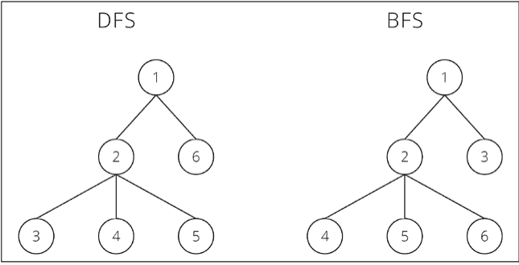

这些搜索算法在特定领域可以取得一定成果，尤其是像国际象棋和将棋这样的领域。棋类游戏是机器擅长的领域之一。如果预先输入大量胜负模式、过往棋局数据以及棋子所有允许的走法，机器就能评估棋盘局面，并从非常大量的模式中决定最佳下一步。

对于对这个领域感兴趣的读者，让我们更详细地看看机器如何下国际象棋。假设机器执白棋走了第一步，那么“白方”和“黑方”的下一步各有 20 种可能的走法。回想前面图示中的树状模型。从棋局开始时的树顶开始，下方有 20 个分支，代表白方下一步的可能走法。在这 20 个分支中的每一个下方，又有 20 个分支，代表黑方下一步的可能走法，依此类推。在这种情况下，根据白方的走法，黑方有 20 x 20 = 400 个分支，白方有 400 x 20 = 8,000 个分支，黑方又有 8,000 x 20 = 160,000 个分支，然后……如果你愿意，可以尽情计算下去。

机器生成这棵树，并评估这些分支中每一个可能的棋盘局面，在一秒内决定最佳布局。它深入的程度（生成并评估树的多少层）受机器速度的控制。当然，每种不同棋子的走法也必须考虑并嵌入程序中，所以国际象棋程序并不像之前想的那么简单，但本书中我们不深入讨论这一点。如你所见，机器能在国际象棋上击败人类并不奇怪。机器可以同时评估和计算大量模式，所需时间比人类短得多。机器击败国际象棋冠军并不是什么新鲜事；机器已经战胜过人类。因为这样的故事，人们曾期望 AI 成为现实。

不幸的是，现实并非那么容易。我们随后发现，面前有一堵高墙，阻碍我们将搜索算法应用于现实。如你所知，现实是复杂的。机器擅长根据给定的规则高速处理事物，但当只给出一项任务时，它无法自行找出如何行动以及应用什么规则。人类在行动时，会无意识地评估、丢弃许多与自身无关的事物/选项，并从现实世界中的数百万事物（模式）中做出选择。机器无法像人类那样做出这些无意识的决定。如果我们创造一台能够适当考虑现实世界中发生的现象的机器，我们可以假设两种可能性：

- 机器试图完成其任务或目的，而不考虑次要发生的事件和可能性
- 机器试图完成其任务或目的，而不考虑无关的事件和可能性

当人类给它们任务时，这两种机器在达成目的之前，仍然会陷入停滞并迷失在处理过程中；尤其是后一种机器，甚至会在采取第一个行动之前就立刻僵住。这是因为这些元素几乎是无限的，如果机器试图思考/搜索这些无限的模式，它无法在现实时间内厘清它们。这个问题被认为是 AI 领域的重要挑战之一，被称为框架问题。

让机器获取知识，不像人类单方面命令机器做什么，而更像是机器能够回应人类的提问并给出答案。这一技术应用于现实世界的一个简单例子是正负面分析，这是情感分析的主题之一。如果你事先将定义句子中每个词语正面或负面语气（称为“词典”）的数据输入机器，机器就可以通过比较句子和词典来判断该句子是正面的还是负面的。

这项技术被用于社交网络或博客帖子和评论的正负面分析。如果你问机器“这篇博客文章的反应是正面的还是负面的？”它会根据其知识（词典）分析评论并回答你。与第一次 AI 热潮中机器只遵循人类设定的规则相比，第二次 AI 热潮显示出了一些进步。

通过将知识整合到机器中，机器变得无所不能。这个想法本身对实现 AI 并不坏；然而，在实现它的道路上，我们面前有两堵高墙。首先，你可能已经注意到，在互联网更普及、我们可以从网络获取海量开放数据的今天，输入所有现实世界知识需要几乎无限的工作量。在当时，收集数百万条数据，然后分析并将这些知识输入机器，并不现实。实际上，将世界上所有数据建立数据库这项工作一直在继续，被称为 Cyc（http://www.cyc.com/）。Cyc 的最终目标是基于这些知识的数据库构建一个推理引擎，这个数据库被称为**知识库**。下面是使用 Cyc 项目进行知识表示（KR）的一个示例：

```
(#$isa #$BarackObama #$UnitedStatesPresident)
"Barack Obama belongs to the collection of U.S. presidents."

(#$genls #$Tree-ThePlant #$Plant)
"All trees are plants."

(#$capitalCity #$Japan #$Tokyo)
"Tokyo is the capital of Japan."
```


其次，机器并非真正理解知识的实际含义。即使知识被结构化、系统化，机器也只是将其理解为标记，从未理解概念。毕竟知识是由人类输入的，而机器所做的只是比较数据并基于词典推断含义。例如，如果你知道“apple”和“green”的概念，并且被教导“green apple = apple + green”，那么你一眼就能理解“a green apple is a green colored apple”，而机器却不能。这被称为**符号接地问题**，被认为是人工智能领域以及框架问题中最重要的问题之一。

这个想法并不坏——它确实改进了人工智能——然而，这种方法在现实中无法实现人工智能，因为它不能创造人工智能。因此，第二波人工智能热潮悄无声息地冷却了，随着对人工智能期望的丧失，谈论人工智能的人数减少了。当提到“我们真的能够实现人工智能吗？”这个问题时，回答“否”的人数逐渐增加。

### Machine learning evolves

虽然人们在努力建立实现人工智能的方法时遇到了困难，但一种完全不同的方法却稳步构建了通用技术。这种方法叫做机器学习。如果你稍微接触过数据挖掘，应该听过这个名字。与本章前面提到的、仅根据人类提供的知识进行搜索或假设的过去人工智能方法相比，机器学习是一种更强大的工具，因此机器学习非常先进。在机器学习出现之前，机器只能从已输入的数据中查找答案。重点在于机器能多快地从其保存的知识中提取与问题相关的知识。因此，机器可以迅速回答它已知的問題，但在面对未知问题时会陷入困境。

另一方面，在机器学习中，机器确实是在学习。机器可以根据所学知识应对未知问题。那么，你可能会问，机器是如何学习的呢？这里的*学习*到底是什么？简单来说，学习就是机器能够将问题划分为“是”或“否”。我们将在下一章更详细地讨论这个问题，但目前可以说机器学习是一种模式识别方法。

我们可以说，最终世界上所有问题都可以被替换为可以用“是”或“否”回答的问题。例如，“What color do you like?”这个问题几乎等同于问“Do you like red? Do you like green? Do you like blue? Do you like yellow?...”。在机器学习中，利用计算能力和高速处理能力作为武器，机器利用大量训练数据，将复杂问题替换为是/否问题，并找出数据为“是”的规律以及数据为“否”的规律（换句话说，它在学习）。然后，凭借这种学习，机器会推断新给出的数据是“是”还是“否”并给出答案。总结来说，机器学习可以通过识别并整理提供的数据中的模式，然后在面对未知数据作为问题时将该数据分类到可能的适当模式中（预测）来给出答案。

事实上，这种方法并没有做特别困难的事情。人类也会无意识地将数据分类为模式。例如，如果你在派对上遇到一个完全符合你类型的人/女人，你可能会迫切想知道你面前的人/女人是否对你有同样的感觉。在你的脑海中，你会将他/她的说话方式、外貌、表情或手势与过去的经验（即数据）进行比较，并推断你们是否会约会！这与基于模式识别的推测相同。

机器学习是一种能够以机械方式由机器而非人类来处理这种模式识别的方法。那么，机器如何识别模式并对其进行分类呢？机器学习分类的标准是基于一种称为**概率统计模型**的数值公式的推测。这种方法已基于各种数学模型进行研究。

学习，换句话说，就是调整模型的参数，并在学习完成后构建一个参数已调整的模型。然后机器将未知数据归类到最可能的模式中（即最合适的模式）。数学上对数据进行分类具有很大优势。虽然人类几乎不可能处理多维数据或多模式数据，但机器学习可以用几乎相同的数值公式处理分类。机器只需要添加一个向量或矩阵的维度数即可。（内部而言，当它对多维进行分类时，并不是通过分类线或分类曲线，而是通过超平面。）

在这种方法出现之前，机器在没有人类帮助的情况下应对未知数据时无能为力，但有了机器学习，机器能够应对人类无法处理的数据。研究人员对机器学习的可能性感到兴奋，并抓住机会开始改进该方法。机器学习本身的概念有着悠久的历史，但由于缺乏可用数据，研究人员无法进行太多研究并证明机器学习的实用性。然而，最近许多开源数据已在线上提供，研究人员可以轻松使用数据对算法进行实验。于是，第三波人工智能热潮就这样出现了。围绕机器学习的环境也推动了其发展。机器学习在正确识别模式之前需要大量数据。此外，它还需要具备处理数据的能力。它处理的数据和模式类型越多，数据量和计算量就越大。因此，显然过去的技术无法应对机器学习。

然而，时间在推移，更不用说机器的处理能力已经提高。此外，网络已经发展，互联网遍布全球，因此开放数据也增加了。随着这一发展，只要从网络上获取数据，每个人都可以进行数据挖掘。环境已为每个人随意学习机器学习做好了准备。网络是文本数据的宝库。通过在机器学习领域充分利用这些文本数据，我们看到了巨大的发展，尤其是在统计自然语言处理方面。机器学习在图像识别和语音识别领域也取得了出色的成就，研究人员一直在努力寻找精度最高的方法。

机器学习也在商业世界的各个部分得到应用。在自然语言处理领域，**输入法编辑器 (IME)** 中的预测转换可能很快就会出现在你的脑海中。搜索引擎中的图像识别、语音识别、图像搜索和语音搜索领域就是很好的例子。当然，它并不限于这些领域。它还应用于从营销定位等广泛领域，如特定产品的销售预测或广告优化，或基于预测人类行为来设计商店货架或空间规划，到预测金融市场的走势。可以说，现在商业世界中使用最广泛的数据挖掘方法就是机器学习。是的，机器学习就是这么强大。目前，如果你听到“AI”这个词，通常情况下这个词只是表示由机器学习完成的过程。

### What even machine learning cannot do

机器通过收集数据并预测答案来学习。的确，机器学习非常有用。得益于机器学习，人类在现实时间内难以解决的问题（如使用 100 维超平面进行分类！）对机器来说很容易。最近，“大数据”已被用作流行语，顺便说一下，分析这些大数据主要也是使用机器学习完成的。

不幸的是，即使是机器学习也无法实现人工智能。从“它是否真的能实现人工智能？”的角度来看，机器学习有一个很大的弱点。机器学习与人类学习的学习过程中存在一个很大的差异。你可能已经注意到这种差异，但让我们看看。机器学习是基于输入数据的模式分类和预测技术。如果是这样，到底什么是输入数据？它能使用任何数据吗？当然……不能。很明显，它无法基于无关数据做出正确预测。为了让机器正确学习，它需要有适当的数据，但随后就会出现一个问题。机器无法分辨什么是适当的数据，什么是不适当的数据。只有在拥有正确数据的情况下，机器学习才能找到模式。无论问题有多容易或多困难，都是人类需要找到正确的数据。

让我们思考这个问题：“Is the object in front of you a human or a cat?” 对人类来说，答案再明显不过了。区分它们一点也不困难。现在，让我们用机器学习做同样的事情。首先，我们需要准备机器可以读取的格式，换句话说，我们需要分别准备人类和猫的图像数据。这没什么特别的。问题出在下一步。你可能只想使用图像数据进行输入，但这行不通。如前所述，机器无法自行从数据中找出需要学习的内容。机器应该学习的内容需要从原始图像数据中处理并由人类创建。假设在这个例子中，我们可能需要使用能够定义差异的数据作为输入数据，例如面部颜色、面部部位位置、人和猫的面部轮廓等等。这些作为输入、需要人类找出的数据值被称为特征。


机器学习无法进行特征工程，这是机器学习的最大弱点。特征，也就是机器学习模型中的变量。由于这些值以量化的方式展现对象的特征，机器才能恰当地处理模式识别。换言之，如何设置这些特征值，将对预测的精确度产生巨大影响。机器学习的局限性大致可分为两类：

- 算法只能在训练数据所假设的数据分布上表现良好——一旦数据分布不同，学习到的模型往往无法很好地泛化。
- 即便是训练良好的模型，也缺乏做出明智的元决策的能力。因此，在大多数情况下，机器学习只能在非常狭窄的方向上取得成功。

我们来看一个简单的例子，这样你就能轻松地想象出特征对模型预测精度的影响有多大。假设有一家公司想根据客户的资产规模来推广一个资产管理包。该公司希望推荐合适的产品，但由于不能直接询问个人问题，它需要预测客户可能拥有多少资产并提前做好准备。在这种情况下，我们应该将哪些潜在客户特征作为特征值呢？我们可以假设很多因素，比如身高、体重、年龄、住址等等都可作为特征值，但显然年龄或居住地与身高或体重相比似乎更相关。如果你试图基于身高或体重进行机器学习，很可能不会得到好结果，因为它是根据无关数据进行预测，说白了这只是随机预测。

因此，机器只有读取了恰当的特征值，才能针对问题给出合适的答案。但遗憾的是，机器无法判断什么是恰当的特征值，而机器学习的精度恰恰依赖于这个特征工程！

机器学习有各种方法，但无法进行特征工程的问题在所有方法中都存在。人们开发了各种方法并在精度上竞争，但当我们达到一定精度后，人们评价一种机器学习方法的好坏，就取决于它能否找到多好的特征。这已不再是算法上的差异，而更像是人的直觉或品味，或者是参数微调，这根本谈不上是创新。各种方法层出不穷，但归根结底，最难的还是想出最佳的特征值，而这一部分终究需要人来完成。

### 机器与人类的分界线

我们已经讨论了三个问题：框架问题、符号 grounding 问题（符号接地问题）和特征工程。这些问题对人来说完全不是问题。那么，为什么机器无法处理这些问题呢？让我们重新审视这三个问题。仔细思考你就会发现，这三个问题最终都指向同一个核心问题：

- 框架问题是指机器在被分配任务时，不知道应该使用哪些知识。
- 符号接地问题是指机器因为只把知识当作标记来识别，所以无法理解将知识组合起来的概念。
- 机器学习中的特征工程问题是指机器无法找出对象的特征是什么。

只有当机器能够理清*应该关注事物/现象的哪些特征，以及应该使用哪些信息*时，这些问题才能得到解决。归根结底，这就是机器与人类最大的区别。世界上每个物体都有其固有的特征。人类擅长捕捉这些特征。这究竟是靠经验还是本能？无论如何，人类知道特征，并依据这些特征将事物理解为“概念”。

现在，让我们简要解释一下什么是概念。首先，作为一个前提，请记住世界上每一个事物都由一组符号表征及其符号内容构成。例如，如果你不认识“猫”这个词，当你在街上看到一只猫时，难道就意味着你无法识别出这是一只猫吗？不，并非如此。你知道它的存在，如果你接着又看到另一只猫，你会把它理解为“和我之前看到的相似的东西”。后来，有人告诉你“那叫做猫”，或者你自己去查了一下，这时你才第一次将那个存在与那个词联系起来。

“猫”这个词，就是**符号表征**，而你认知为猫的概念，就是**符号内容**。你可以看到，这是一体两面的关系。（有趣的是，这两个方面之间没有必然联系。“猫”这个字写成C-A-T或那样发音并非必然。即便如此，在我们的理解系统中，这些被认为是理所当然的。如果人们听到“cat”，我们都会想象到同一个东西。）概念，也就是符号内容。这两个概念有对应的术语。前者称为**能指（signifiant）**，后者称为**所指（signifié）**，这两者成对组合称为**符号（signe）**。（这些词是法语，也可以分别用英语说成signifier、signified和sign。）我们或许可以说，机器与人类的区别就在于，它能否自行获得所指（signifié）。

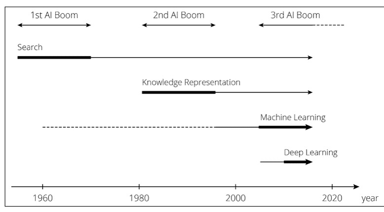

历次AI热潮与AI研究领域的对应关系图

深度学习第一次出现实际上已经有一段时间了，可以追溯到2006年。加拿大多伦多大学的Hinton教授等人发表了一篇论文（https://www.cs.toronto.edu/~hinton/absps/fastnc.pdf）。在这篇论文中，提出了一种称为**深度信念网络（DBN）**的方法，它是神经网络的一种扩展，属于机器学习方法。DBN使用**MNIST**数据库进行了测试，该数据库是比较各种图像识别方法精确度和准确度的标准数据库。该数据库包含70,000张28 x 28像素的手写数字0到9的图像数据（其中60,000张用于训练，10,000张用于测试）。

随后，他们基于训练数据构建了预测模型，并通过机器能否正确识别测试用例中写的是哪个数字（0到9）来衡量其准确度。尽管这篇论文提出的方法比传统方法的精度高得多，但当时并没有引起太多关注，也许是因为它只是与另一种通用的机器学习方法进行了比较。

后来，在2012年，整个AI研究界被一种方法震惊了。在图像识别世界竞赛——ImageNet大规模视觉识别挑战赛（ILSVRC）中，由多伦多大学Hinton教授等人开发的、使用深度学习的方法SuperVision（严格来说是团队名称）赢得了比赛。它以其惊人的精度远远超越了其他参赛者。在这次比赛中，任务是让机器自动区分图像中是一只猫、一只狗、一只鸟、一辆车、一条船等等。提供了一千万张图像作为学习数据，十五万张图像用于测试。在测试中，各方法竞争的是谁的错误率最低（即准确率最高）。

让我们看看下面展示竞赛结果的表格：

| 排名 | 团队名称 | 错误率 |
|---|---|---|
| 1 | SuperVision | 0.15315 |
| 2 | SuperVision | 0.16422 |
| 3 | ISI | 0.26172 |
| 4 | ISI | 0.26602 |
| 5 | ISI | 0.26646 |
| 6 | ISI | 0.26952 |
| 7 | OXFORD_VGG | 0.26979 |
| 8 | XRCE/INRIA | 0.27058 |

你可以看到，SuperVision与第二名ISI之间的错误率差距超过10%。从第二名往后，就只是在0.1%以内的竞争了。现在你明白SuperVision在精度上有多么遥遥领先了吧。此外，令人惊讶的是，这是SuperVision第一次参加ILSVRC，换句话说，图像识别并非他们的本行。在SuperVision（深度学习）出现之前，图像识别领域的常规方法是机器学习。并且，如前所述，机器学习所需的特征值必须由人类来设定或设计。他们反复基于人类直觉和经验设计特征，并一遍遍地微调参数，最终也仅仅将精度提升了0.1%。在深度学习发展之前，研究和竞赛的主要焦点在于谁能设计出更好的特征工程。因此，当深度学习突然横空出世时，研究者们必定感到非常震惊。


还有一个让深度学习席卷全球的重要事件。 该事件发生在2012年，就在世界因ILSVRC上的SuperVision而震惊的同一年，Google宣布一台机器能够利用YouTube视频作为学习数据自动检测猫，这是Google提出的深度学习算法。

该算法的细节在 http://googleblog.blogspot.com/2012/06/using-large-scale-brain-simulations-for.html 中有解释。 该算法从YouTube视频中提取了1000万张图像并将其用作输入数据。 现在请记住，在机器学习中，人类必须从图像中检测特征值并处理数据。 另一方面，在深度学习中，原始图像可以直接作为输入使用。 这表明机器本身能够从训练数据中自动找到特征。 在这项研究中，机器学习了猫的概念。 （只有这个猫的故事出名，但研究也用人类图像进行了，而且进展顺利。机器学会了什么是人类！） 研究中介绍的以下图像说明了深度学习在利用未标记YouTube视频的静帧训练后认为猫的特征是什么：

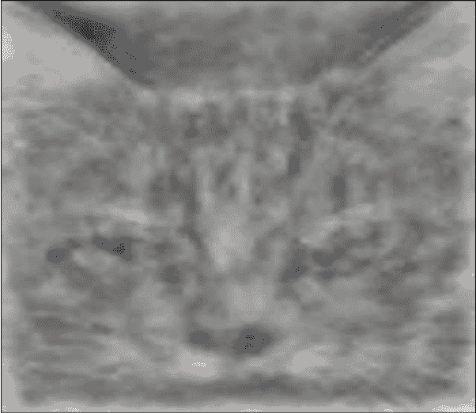

这两个重大事件让我们印象深刻地认识到深度学习，并引发了至今仍在加速的热潮。

在能够识别猫的方法发展之后，Google利用深度学习进行了一项让机器作画的另一项实验。 这种方法被称为 **Inceptionism** (http://googleresearch.blogspot.ch/2015/06/inceptionism-going-deeper-into-neural.html)。 正如文章中所写，在这种方法中，网络被要求：

> “你看到的任何东西，我想要更多！”这形成了一个反馈循环：如果云看起来有点像鸟，网络就会让它看起来更像鸟。 反过来，这会使网络在下一次处理时更强烈地识别出鸟，以此类推，直到一只高度详细的鸟似乎凭空出现。

虽然机器学习中使用神经网络通常是一种用于检测模式以便指定图像的方法，但Inceptionism做的是相反的事情。 从以下Inceptionism的例子可以看出，这些绘画看起来很奇怪，像噩梦的世界：


或者说，它们看起来可能具有艺术性。 任何人都可以尝试Inceptionism的工具在GitHub上向公众开放，名为Deep Dream (https://github.com/google/deepdream)。 该页面上有示例实现。 如果你会写Python代码就可以尝试它们。

好吧，没有什么能阻止深度学习势头增强，但仍然存在疑问，例如深度学习到底创新在哪里？是什么特殊功能大幅提高了这种精度？ 令人惊讶的是，实际上深度学习在算法上并没有太多差异。 如前所述，深度学习是神经网络的应用，神经网络是模仿人类大脑结构的机器学习算法；然而，附加在其上的一个装置改变了一切。 代表是 **pretraining** 和 **dropout**（以及激活函数）。 这些也是实现的关键词，请记住它们。

首先，深度学习中的 *deep* 指的是什么？ 如你所知，人类大脑是一个电路结构，而且结构非常复杂。 它由堆叠成多层的复杂电路构成。 另一方面，神经网络算法刚出现时结构相当简单。 它是人类大脑的简化结构，网络只有几层。 因此，它能够识别的模式极其有限。 于是大家都在想“我们能否像人类大脑一样堆积网络，使其实现复杂化？” 当然，这个方法已经尝试过了。 不幸的是，结果精度反而比单纯堆叠网络更低。 事实上，我们遇到了简单网络中不会出现的一系列问题。 为什么会这样？好吧，在人类大脑中，信号会根据你看到的内容进入电路的不同部分。 根据受刺激的电路部分不同而产生的模式差异，你可以区分各种事物。

为了再现这一机制，神经网络算法用数字加权来替代网络的连接。 这是一种很好的做法，但很快就会出现问题。 如果网络简单，权重可以从学习数据中正确分配，网络可以很好地识别和分类模式。 然而，一旦网络变得复杂，连接变得过于密集，很难在权重上做出区分。 简而言之，它无法正确地划分模式。 此外，在神经网络中，网络可以通过采用将训练期间发生的错误反馈到整个网络的机制来建立适当的模型。 同样，如果网络简单，反馈可以正确反映，但如果网络有许多层，就会出现错误在反映到整个网络之前就消失的问题——想象一下如果那个错误被拉伸并稀释了。

希望通过构建复杂结构的网络就能顺利进行这一意图最终以令人失望的失败告终。 算法本身的概念很精彩，但按任何标准都不能称之为好的算法；这是世界的理解。 虽然深度学习成功地使网络多层化，即使网络“变深”，成功的关键是让每一层分阶段学习。 之前的算法将整个多层网络视为一个巨大的神经网络并让其整体学习，这导致了前面提到的问题。

因此，深度学习采取了让每一层预先学习的方法。 这 literally 被称为 pretraining。 在 pretraining 中，学习按顺序从低维层开始。 然后，低层学习到的数据被视为下一层的输入数据。 这样，机器就能在低级层学习低层特征，然后逐步学习更高级别的特征。 例如，在学习什么是猫时，第一层是轮廓，下一层是眼睛和鼻子的形状，下一层是面部的图像，下一层是面部的细节，等等。 同样可以说，人类采取相同的学习步骤，先把握整体画面，后来看细节特征。 随着每一层分阶段学习，学习错误的反馈也可以在每一层中正确进行。 这导致了精度的提高。 还有针对各层学习的各自方法的装置，但这将在后面介绍。

我们也解决了网络变得过于密集的问题。 防止这种密度问题的方法称为 dropout。 使用 dropout 的网络通过在网络单元内随机切断一些连接来学习。 dropout 在物理上使网络稀疏。 被切断的连接是随机的，因此每次学习步骤都会形成不同的网络。 光看可能会怀疑这会起作用，但它极大地有助于提高精度，从而增加了网络的鲁棒性。 人类大脑的电路也有根据所见对象而反应或不反应的不同部位。 dropout 似乎能够成功模仿这一机制。 通过将 dropout 嵌入算法中，网络权重的调整得以良好完成。

深度学习在各个领域取得了巨大成功；然而，当然深度学习也有缺点。 正如“深度学习”这个名字所示，这种方法中的学习非常深。 这意味着完成学习需要很长时间。 这一过程中的计算量往往非常巨大。 事实上，前面提到的 Google 对猫的识别学习用了 1,000 台计算机处理了三天。 相反，虽然深度学习本身的想法可以用过去的技术构想出来，但无法实现。 如果不能轻松使用具有大规模处理能力并处理海量数据的机器，这种方法就不会出现。


正如我们不断所说，深度学习只是机器获得类人知识的第一步。没人知道未来会发生怎样的创新。然而，我们可以预测计算机的性能在未来将提高到何种程度。为此，使用了摩尔定律。支持计算机进步的集成电路的性能由其搭载的晶体管数量来表示。摩尔定律显示了该数量，据说晶体管的数量每一年半翻一番。事实上，计算机 CPU 中的晶体管数量一直遵循摩尔定律而增加。与世界上第一款微处理器 Intel® 4004 处理器相比，其拥有 1 × 10³（一千）个晶体管，而最近的 2015 年版本、第 5 代 Intel® Core™ 处理器则拥有 1 × 10⁹（十亿）个！如果这种技术以此速度持续改进，晶体管数量将超过一百亿，这比人类大脑皮层的细胞数量还要多。

根据摩尔定律，到了 2045 年的更远未来，据说我们将达到一个被称为 **技术奇点** 的临界点，在那里人类将能够进行技术预测。到那时，预计机器将能够产生自我递归智能。换句话说，大约 30 年后，AI 将准备就绪。那时的世界会是什么样子…

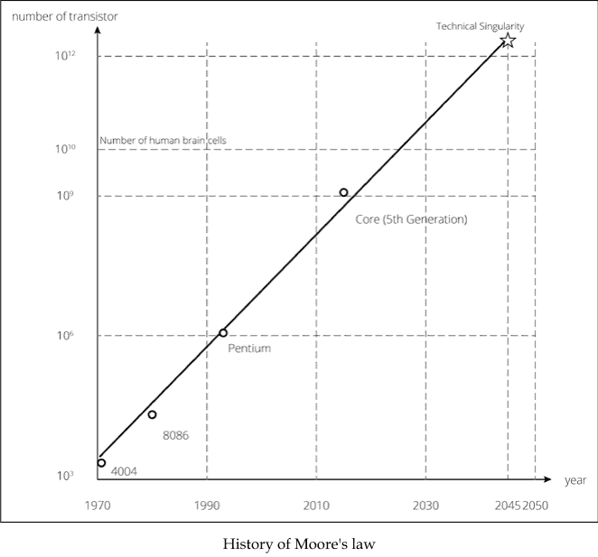

## 2 机器学习算法 – 为深度学习做准备

在上一章中，你通过回顾人工智能的历史，了解了深度学习是如何发展起来的。正如你应该注意到的那样，机器学习和深度学习密不可分。的确，你了解到深度学习是机器学习算法发展而来的方法。

在本章中，作为深入理解深度学习的前置练习，你将看到机器学习的更多细节，特别是，你将学习与深度学习密切相关的机器学习方法的实际代码。

本章将涵盖以下主题：

-   机器学习的核心概念
-   主流机器学习算法概述，尤其侧重于神经网络
-   与深度学习相关的机器学习算法的理论与实现：感知器、逻辑回归和多层感知器

### 开始

从本章开始，我们将插入使用 Java 实现的机器学习和深度学习的源代码。代码中使用的 JDK 版本为 1.8，因此需要 Java 8 以上版本。同时，IDE 使用的是 IntelliJ IDEA 14.1。我们将使用来自 *第 5 章，探索 Java 深度学习库 – DL4J、ND4J 等* 的外部库，因此我们将从一个新的 Maven 项目开始。

本书中使用的代码的根包名为 DLWJ，即 Deep Learning with Java 的缩写，我们将根据需要在此之下添加新的包或类。请参考下方的截图，其中显示了新建项目后立即出现的屏幕：

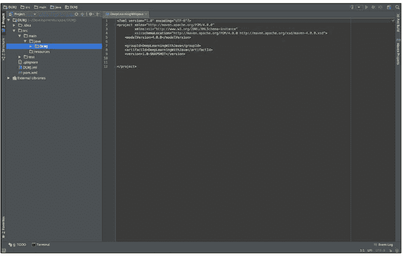

代码中会有一些变量名和方法名不符合 Java 编码规范。这是为了与公式中的某些字符一起提高你的理解并增加可读性。请提前注意这一点。

### 机器学习中训练的必要性

你已经看到机器学习是一种模式识别方法。机器学习通过识别并整理给定的学习数据中的模式来得出答案。光看这句话似乎很容易，但事实是，机器学习对未知数据进行分类，即构建合适的模型，需要相当长的时间。为什么会这样？只是分类就这么困难吗？中间还要有“学习”阶段，真的有必要吗？

答案当然是肯定的。适当分类数据极其困难。问题越复杂，完美分类数据就越不可能。这是因为一旦提到“模式分类器”，分类模式几乎是无限的。让我们在下面的图表中看一个非常简单的例子：

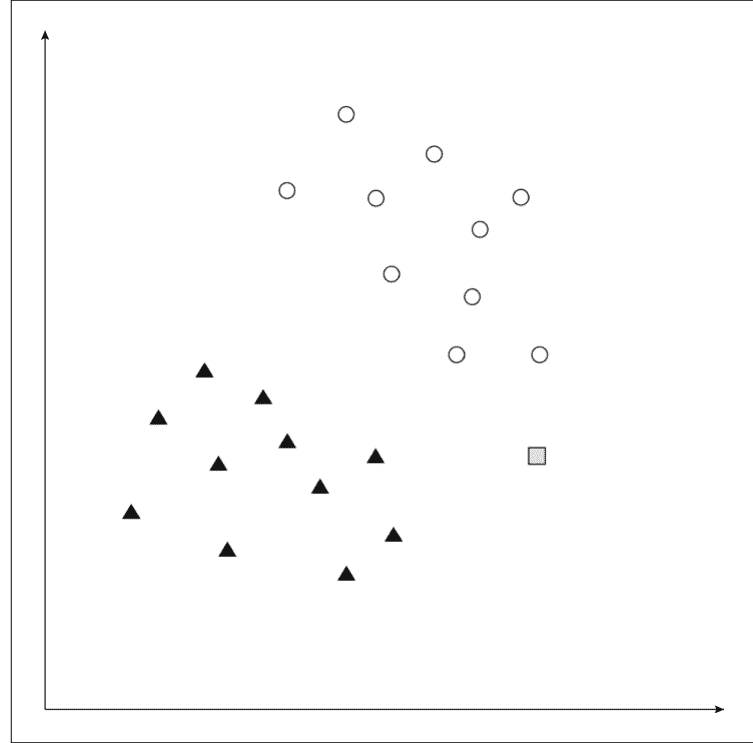

有两种类型的数据，圆形和三角形，以及未知数据，方形。在二维坐标空间中，你不知道正方形属于哪个组，所以任务是找出正方形属于哪个组。

你可能会立刻意识到似乎存在一条分隔两种数据类型边界。如果决定设置边界的位置，看起来你应该能够找出正方形属于哪个组。那么，让我们来确定边界吧。然而，实际上，要清晰地定义这个边界并不容易。如果你想设置边界，有很多线需要考虑，如下图所示：

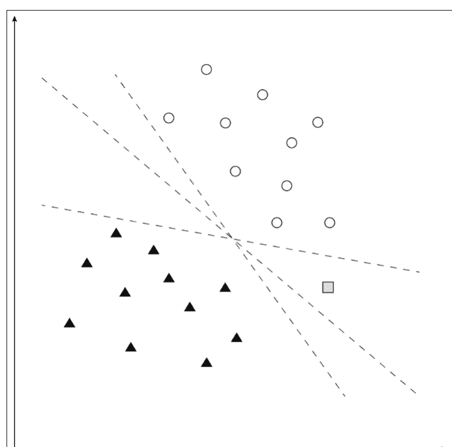

此外，根据边界的放置位置，你可以看到正方形可能会被分配到不同的组或模式。此外，还可以考虑边界可能是非线性边界。

在机器学习中，机器在训练时所做的是从这些可能模式中选择最可能的边界。在逐一处理大量训练数据时，它会自动学习如何分类模式。换句话说，它调整数学模型的参数并最终决定边界。机器学习决定的边界称为 **决策边界**，不一定是线性或非线性边界。决策边界也可以是超平面，如果它能最好地对数据进行分类。数据分布越复杂，决策边界越可能是非线性边界或超平面。典型案例是多维分类问题。我们仅在这个问题中设置边界就已经遇到了这样的困难，因此不难想象解决更复杂的问题会非常耗时。

### 监督学习与无监督学习

在上一节中，我们看到即使对于简单的分类问题也可能存在数百万条边界，但很难说哪一个是最合适的。这是因为，即使我们能够正确地整理已知数据中的模式，也并不意味着未知数据也能以相同模式进行分类。然而，你可以提高正确模式分类的比例。每种机器学习方法都设定一个标准来执行更好的模式分类器，并决定最可能的边界——决策边界——以提高比例。这些标准当然在每种方法中差异很大。在本节中，我们将看到我们可以采取的所有方法。

首先，机器学习可以大致分为 **监督学习** 和 **无监督学习**。这两类之间的区别在于机器学习的数据集是有标签数据还是无标签数据。在监督学习中，机器使用有标签数据，即输入数据和输出数据的组合，并指出每种数据类型应被分类为哪种模式。当机器被赋予未知数据时，它会推导出可以应用的模式，并基于有标签数据，即过去的正确答案，对数据进行分类。例如，在图像识别领域，当你向机器输入一些图像时，如果你准备并提供一定数量的猫的图像，标记为 `cat`，以及相同数量的人的图像，标记为 `human`，供机器学习，它可以自行判断一张图像属于猫或人（或两者都不是）哪个组。当然，仅判断图像是猫还是人并不能提供实际用途，但如果你将同样的方法应用于其他领域，你可以创建一个系统，能够自动标记社交媒体上上传的照片中谁是谁。如你现在所见，在监督训练中，当机器被提供由人类提前准备的正确数据时，学习就会进行。


另一方面，在无监督学习中，机器使用未标注的数据。在这种情况下，仅提供输入数据。机器学习的是数据集中包含的模式和规则。无监督学习的目标是掌握数据的结构。它可能包括称为**聚类**的过程，即将具有共同特征的数据点分组，或提取关联规则的步骤。例如，假设有关于某个在线购物网站用户的年龄、性别和购买趋势的数据。那么，你可能会发现20多岁的男性和40多岁的女性的品味相近，并希望利用这一趋势来改进产品营销。这里有一个著名的例子——通过无监督训练发现，大量人群同时购买啤酒和尿布。

现在你已经知道监督学习和无监督学习之间存在巨大差异，但这还不是全部。每种学习方法也分别有不同的学习方法和算法。让我们在下一节中看一些代表性的例子。

### 支持向量机（SVM）

可以说，SVM是机器学习中最流行的监督训练方法。该方法至今仍广泛用于数据挖掘行业的各个领域。在SVM中，距离其他类别最近的数据被标记为标准，并以此标准确定决策边界，使每个标记数据到边界的欧几里得距离之和最大化。这些被标记的数据称为**支持向量**。简单来说，SVM将决策边界设置在距所有模式距离最大化的中间点。因此，SVM算法所做的事情被称为**最大化间隔**。下面是SVM概念的示意图：

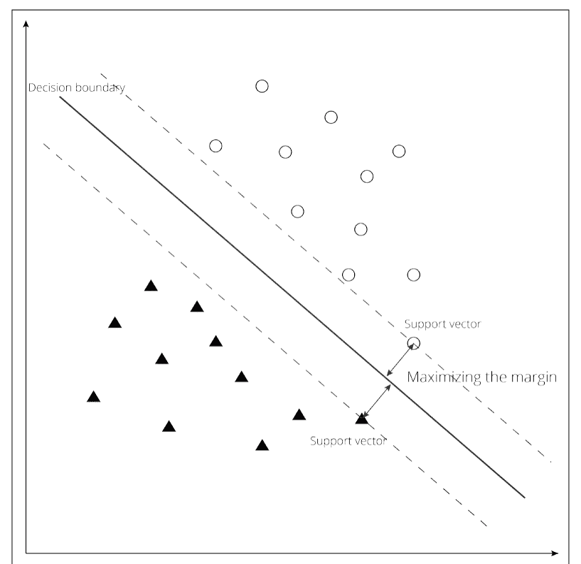

决策边界  
支持向量  
最大化间隔  
支持向量

如果只听到这些，你可能会想“就这么简单？”但让SVM最有价值的是一项数学技巧：核技巧，或称核方法。该技术将那些在原始维度上看似无法线性分类的数据，有意地映射到更高维的空间，从而使其能够毫无困难地被线性分类。看看下面的图，以便理解核技巧是如何工作的：

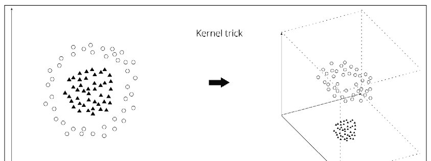

我们有两类数据，分别用圆形和三角形表示，很明显在二维空间中无法将这两类数据线性分开。然而，如上图所示，通过将核函数应用于数据（严格来说，是训练数据的特征向量），整个数据被变换到更高维的空间，即三维空间，并且可以用一个二维平面将它们分开。

尽管SVM既实用又优雅，但它也有一个缺点。由于它将数据映射到更高维度，计算量往往会增加，因此随着计算变得更加复杂，处理时间往往也会更长。

### 隐马尔可夫模型（HMM）

HMM是一种无监督训练方法，它假设数据遵循**马尔可夫过程**。马尔可夫过程是一种随机过程，其中未来的状态仅由当前值决定，与过去的状态无关。HMM用于在仅观察到单一观测值时，预测该观测值来自哪种状态。

仅凭前面的解释可能不足以让你完全理解HMM的工作原理，让我们看一个例子。HMM常用于分析碱基序列。你可能知道，碱基序列由四种核苷酸组成，例如A、T、G、C，而序列实际上就是这些核苷酸的字符串。仅仅浏览字符串不会得到任何信息，但你必须分析哪个部分与哪个基因相关。假设任何碱基序列是随机排列的，那么当你切出碱基序列的任何部分时，四个字符中的每一个都应该以四分之一概率出现。

然而，如果存在某种规律，例如C往往出现在G旁边，或者ATT组合频繁出现，那么每个字符被输出的概率就会相应改变。这种规律就是概率模型，如果输出的概率仅取决于紧邻的前一个碱基，你就可以使用HMM从碱基序列（=观测）中找出遗传信息（=状态）。

除了这些生物信息学领域之外，HMM还常用于需要时间序列模式的领域，例如**自然语言处理（NLP）**中的句法分析或声音信号处理。我们在此不深入探讨HMM，因为它的算法与深度学习的关系较小，但如果你感兴趣，可以参考麻省理工学院出版社出版的一本非常著名的书——*《统计自然语言处理基础》*。

### 神经网络

神经网络与机器学习算法稍有不同。其他机器学习方法采用基于概率或统计的方法，而神经网络是模仿人脑结构的算法。人脑由神经元网络组成。看下图了解一下：

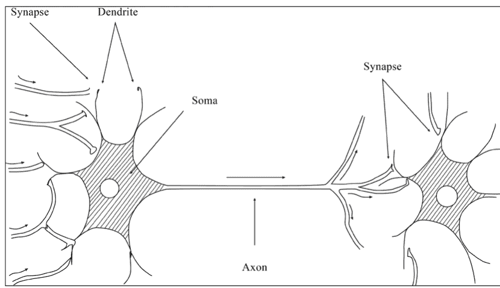

一个神经元通过另一个神经元连接到网络中，并从突触接收电刺激。当电信号超过阈值时，它被激活并将电刺激传递给网络中连接的下一个神经元。神经网络根据电刺激的传递方式来区分事物。

神经网络最初是一种用数字表示这种电刺激的监督学习类型。近年来，尤其是在深度学习中，人们引入了各种类型的神经网络算法，其中一些是无监督学习。该算法通过学习过程调整网络的权重来提高可预测性。深度学习是一种基于神经网络的算法。关于神经网络的更多细节将在后面结合实现进行说明。

### 逻辑回归

逻辑回归是服从伯努利分布的变量的统计回归模型之一。虽然SVM和神经网络是分类模型，逻辑回归是回归模型，但它确实是监督学习的方法之一。尽管逻辑回归的思维基础不同，但事实上，当你查看其公式时，可以将其视为神经网络的一种。逻辑回归的细节也将在后面结合实现进行说明。

如你所见，每种机器学习方法都有独特的特征。根据你想了解的内容或你想将数据用于何种目的来选择正确的算法非常重要。深度学习也是如此。深度学习有不同的方法，因此你不仅应考虑哪种方法是最佳的，还应考虑到在某些情况下不应该使用深度学习。为每种情况选择最佳方法十分重要。

### 强化学习

仅供参考，还有另一种机器学习方法，称为**强化学习**。虽然有些人将强化学习归类为无监督学习，但另一些人则宣称监督学习、无监督学习和强化学习这三种学习算法应分别划分为不同类型的算法。下图展示了强化学习的基本框架：

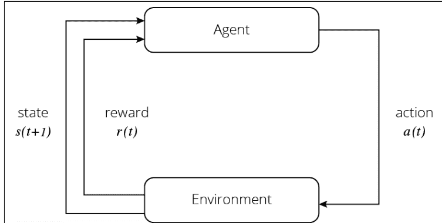


智能体根据环境的状态采取行动，而环境会根据行动发生变化。环境变化后，智能体会获得某种奖励机制，并据此学习如何更优地选择行动（即决策）。

### 机器学习应用流程

我们已经了解了机器学习所拥有的方法以及这些方法如何识别模式。在本节中，我们将看到使用机器学习进行数据挖掘时采用或必须采用的流程。每种机器学习方法都会根据模型参数设定决策边界，但我们不能说调整模型参数是唯一需要关心的事情。还有另一个棘手的问题，它实际上是机器学习最薄弱的环节：特征工程。决定从原始数据（即分析对象）中创建哪些特征，是构建合适分类器的必要步骤。而这一工作与调整模型参数一样，也需要大量的试错。在某些情况下，特征工程所花费的精力远超过参数的确定。

因此，当我们简单地说“机器学习”时，为了构建能够处理实际问题的合适分类器，需要预先完成一些预处理任务。一般来说，这些任务可以概括如下：

- 决定哪种机器学习方法适合某个问题
- 决定应该使用哪些特征
- 决定模型参数采用哪种设置

只有完成这些任务，机器学习才具有应用价值。

那么，如何决定合适的特征和参数？如何让机器进行学习？我们先来看一下下面的图表，这可能有助于你把握机器学习的整体概况。这是学习流程的总结：

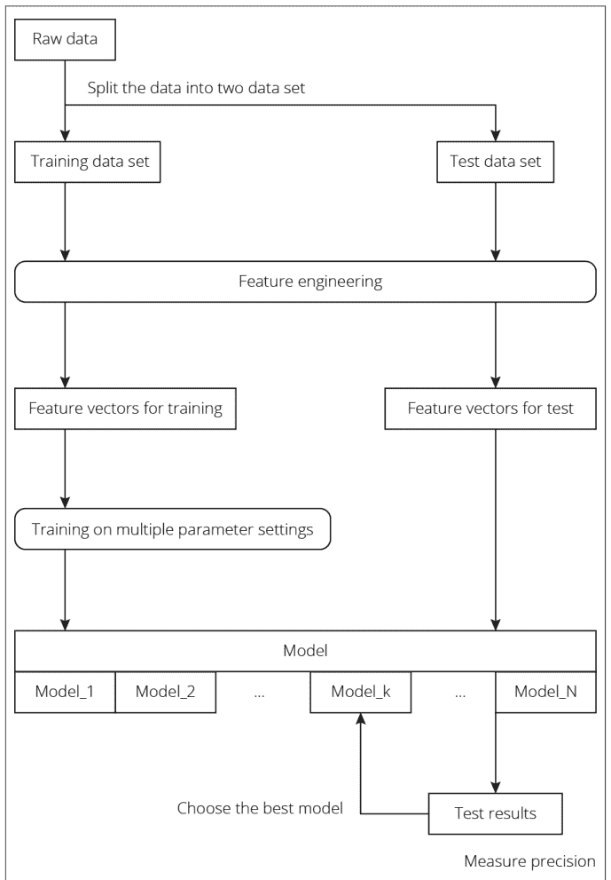

从前面的图片可以看出，机器学习的学习阶段大致可分为以下两个步骤：

- 训练
- 测试

从字面上看，模型参数在训练阶段被更新和调整，而机器在测试阶段评估模型的优劣。毫无疑问，仅凭一次训练和一次测试，研究或实验很难成功。我们需要重复训练 → 测试、训练 → 测试……的过程，直到得到合适的模型。

让我们按顺序考虑前面的流程图。首先，你需要将原始数据分成两部分：训练数据集和测试数据集。这里需要特别注意的是，训练数据和测试数据必须分开。让我们举个例子，以便你更容易理解这是什么意思：你正试图利用历史价格数据，通过机器学习预测标普500指数的每日价格。（事实上，利用机器学习预测金融工具价格是最活跃的研究领域之一。）

假设你有2001年至2015年的历史股价数据作为原始数据，如果你用2001年至2015年的所有数据进行训练，并且同样对同一时期进行测试，会发生什么？结果就会是：即使你使用简单的机器学习或特征工程，获得正确预测的概率也会达到70%，甚至更高，达到80%或90%。然后，你可能会想：*多么伟大的发现！市场竟然如此简单！现在我可以成为亿万富翁了！*

但这只会是短暂的兴奋。现实不会那么顺利。如果你真的用那个模型开始投资管理，你不会得到预期的表现，并且会感到困惑。只要你稍加思考并稍加留意，这一点就很明显。如果训练数据集和测试数据集相同，你就是用已知答案的数据进行测试。因此，获得高精度是自然而然的结果，因为你是在用正确答案去预测正确答案。但这对于测试毫无意义。如果你想正确评估模型，一定要使用不同时间段的数据，例如，应使用2001年至2010年的数据作为训练数据集，使用2011年至2015年作为测试。在这种情况下，你是用不知道答案的数据进行测试，这样就能得到合理的预测精度。这样，你就可以避免因为相信永远不会成功的投资而走向破产。

因此，很明显，你应该将训练数据集和测试数据集分开，但你可能不认为这是个严重问题。然而，在实际的数据挖掘场景中，经常会出现我们在没有这种意识的情况下用相同数据进行实验的情况，所以请格外小心。我们已经在机器学习的案例中讨论过这一点，但它同样适用于深度学习。

如果你将整个数据集分成两个数据集，第一个要使用的数据集就是训练数据集。为了获得更好的精度，我们首先需要考虑在训练数据集中创建特征。这种特征工程部分依赖于人类的经验或直觉。在选择能够带来最佳结果的特征之前，可能需要花费大量时间和精力。此外，每种机器学习方法接受的特征数据格式也不同，因为模型理论和公式对每种方法来说都是独特的。例如，有的模型只能接受整数，有的模型只能接受非负数/值，还有的模型只能接受0到1之间的实数。让我们回顾一下前面股价的例子。由于价格值在更大范围内变化很大，使用只能接受整数的模型可能难以进行预测。

此外，我们还需要注意确保数据与模型之间的兼容性。这并不是说，如果你想将股价原样用作特征，就不能使用能够接受所有非负实数的模型。例如，如果你将所有股价数据除以某一时期内的最大值，数据范围就可以落在0-1之间，这样你就可以使用只能接受0到1实数的模型。这样，只要你稍微改变数据格式，就有可能应用某个模型。在思考特征工程时，你需要牢记这一点。一旦你创建了特征并决定了应用哪种机器学习方法，那么你只需要对其进行检验。

在机器学习中，特征当然是决定模型精度的重要变量；但模型本身，也就是算法中的公式，也有参数。调整学习速度或调整允许的误差数量就是很好的例子。学习速度越快，完成计算所需的时间越少，因此快一点更好。然而，加快学习速度也意味着它只能提供简略的解决方案。因此，我们应当小心，不要丢失预期的精度。调整允许的误差范围对于数据中混入噪声的情况是有效的。机器判断“这数据是否奇怪？”的标准由人类决定。

当然，每种方法都有一组特有的参数。以神经网络为例，应该有多少个神经元就是其中一个参数。另外，当我们考虑SVM中的核技巧时，如何设置核函数也是需要确定的参数之一。如你所见，机器学习需要定义的参数非常多，而哪种参数最佳无法提前得知。关于如何预先定义模型参数，有一个专门研究参数的研究领域。

因此，我们需要测试许多参数组合，以找出哪种组合能带来最佳精度。由于逐一测试每种组合会花费大量时间，标准流程是以并发处理方式测试多个具有不同参数组合的模型，然后进行比较。通常，需要在一定程度上确定参数范围，因此问题并非无法在现实时间内解决。

当在训练数据集中得到能够获得良好精度的模型后，下一步就是测试。测试的大致流程是，分别应用与训练数据集相同的特征工程和相同的模型参数，然后验证精度。测试中并没有特别困难的步骤，计算也不会花太多时间。这是因为从数据中寻找模式（即优化公式中的参数）会产生计算成本。然而，一旦参数调整完成，计算就会立即进行，因为它只是将公式应用到新数据集上。执行测试的原因，简单来说，就是检查模型是否被训练数据过度优化。这是什么意思？在机器学习中，有两种情况会出现训练集表现良好但测试集表现不佳。

第一种情况是，由于将训练数据集中混杂的噪声数据也分类了，导致模型被错误地优化。这可以联系到本章前面提到的允许误差范围的调整。现实世界中的数据通常并不干净。可以说，几乎不存在能够被正确分类为清晰模式的数据。股价预测又是一个很好的例子。股价通常会围绕先前股价呈现适度波动，但有时会突然飙升或急剧下跌。而且，在这种不规律变动中，没有（也不应有）规律性。另一种情况是，如果你想预测一个国家的农作物产量，受异常天气影响的年份的数据与正常年份的数据应该差异很大。这些例子比较极端且容易理解，但现实世界中的大多数数据也包含噪声，这使得将数据分类为合适的模式变得困难。如果只进行训练而不调整机器学习的参数，模型会强行将噪声数据分类为某种模式。在这种情况下，训练数据集中的数据可能会被正确分类，但由于训练数据集中的噪声数据也被分类了，而测试数据集中并不存在这些噪声，因此测试的预测能力应该会很低。


第二种情况是过度优化，即对训练数据集中特有的数据进行分类。例如，假设我们要开发一个英语语音输入应用。为了构建该应用，需要准备各种单词的发音数据作为训练数据集。现在，假设我们准备了足够多的英式英语母语者的语音数据，并成功创建了一个能够正确分类训练数据集中发音的高精度模型。下一步是测试。既然是测试，为了提供不同的数据，我们使用美式英语母语者的语音数据。那么结果会如何呢？你很可能无法获得良好的精度。此外，如果你尝试让该应用识别非英语母语者的发音，精度会低得多。如你所知，英语在不同地区的发音有所不同。如果不考虑这一点，仅使用英式英语训练数据集来优化模型，那么即使在训练集上效果不错，在测试集上也不会取得好结果，对实际应用也没有帮助。

这两个问题之所以出现，是因为机器学习模型从训练数据集中学习，并过度拟合该数据集。这个问题在字面上被称为**过拟合问题**，你在使用时必须非常小心地避免它。机器学习的难点在于，除了特征工程之外，你还必须思考如何避免过拟合问题。这两个问题，过拟合与特征工程，在一定程度上存在关联，因为糟糕的特征工程会导致过拟合。

为了避免过拟合问题，除了增加数据量或测试次数之外，没有太多办法。通常，数据量是有限的，因此经常采用增加测试次数的方法。典型的例子是**K折交叉验证**。在K折交叉验证中，首先将所有数据划分为K组。然后，从中选出一组作为测试数据集，其余K-1组作为训练数据集。交叉验证对划分成的K组数据分别进行验证，共进行K次，通过计算这K次结果的平均值来衡量精度。最令人担心的是，训练数据集和测试数据集都可能碰巧取得较好的精度；但在K折交叉验证中，由于会进行多次测试，这种偶然发生的概率可以降低。对于过拟合，再小心也不为过，因此务必仔细验证结果。

好了，你现在已经了解了训练集和测试集的流程，并学到了需要牢记的要点。这两者主要聚焦于数据分析。所以，举例来说，如果你的目标是从已有的数据中提取有意义的信息并加以利用，那么你可以遵循这一流程。另一方面，如果你需要一个能够应对更新模型的应用程序，则还需要额外的步骤，即利用训练集和测试集中得到的模型参数进行预测。例如，如果你想从股价数据集中找出某些信息，进行分析并撰写市场报告，下一步就是执行训练集和测试集。或者，如果你想基于数据预测未来股价，并将其用作投资系统，那么你的目标就是利用训练集和测试集得到的模型构建应用程序，并根据每天或每个设定周期新获得的数据预测价格。在第二种情况下，如果你希望用新增加的数据更新模型，就需要确保在下一个模型到来之前完成模型构建的计算。

### 神经网络的理论与算法

在前一节中，你了解了使用机器学习进行数据分析时的一般流程。本节将介绍机器学习方法之一——神经网络的理论和算法，为深度学习做准备。

虽然我们简单地说“神经网络”，但其历史很长。神经网络最早发表的算法称为感知器，1957年弗兰克·罗森布拉特发表的论文题为《感知器：一种感知和识别自动机》（Project Para）。此后，许多方法被研究、开发并发表，如今神经网络已成为深度学习的要素之一。虽然我们简单地说“神经网络”，但其类型多种多样，接下来我们将逐一介绍具有代表性的方法。

#### 感知器（单层神经网络）

感知器算法是神经网络算法中结构最简单的模型，可以对两类数据进行线性分类。可以说它是神经网络的雏形。该算法以最简单的方式模拟了人类神经元。

下图是通用模型的示意图：

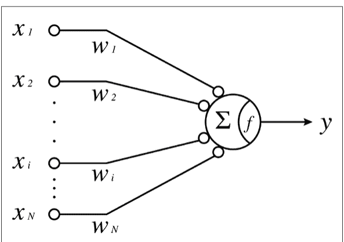

在这里，$x_i$ 表示输入信号，$w_i$ 表示与每个输入信号对应的权重，$y$ 表示输出信号。$f$ 是激活函数。$\sum$ 表示，字面上就是计算来自输入的数据之和的意思。请记住，$x_i$ 预先通过特征工程进行了非线性转换，即 $x_i$ 是经过特征工程处理的特征。

然后，感知器的输出可以表示如下：

$y(x) = f(w^T x)$

$f(a) = \begin{cases} +1,\ a \ge 0 \\ -1,\ a < 0 \end{cases}$

$f(*)$ 被称为阶跃函数。如公式所示，感知器通过将特征向量的每个因子与权重相乘、计算总和，然后使用阶跃函数对该总和进行激活来返回输出。该输出是感知器估计的结果。在训练过程中，你会将这个结果与正确数据进行比较，并反馈误差。

令 $t$ 为标注数据的值。那么，公式可以表示如下：

$t \in \{-1,1\}$

如果某些标注数据属于类别1 $C_1$，则 $t = 1$。如果属于类别2 $C_2$，则 $t = -1$。此外，如果输入数据被正确分类，我们得到：

$\begin{cases} w^T x_n > 0 \text{ where } x_n \in C_1 \\ w^T x_n < 0 \text{ where } x_n \in C_2 \end{cases}$

因此，将这些公式组合在一起，我们得到正确分类数据的如下方程：

$w^T x_n t_n > 0$

因此，可以通过最小化以下函数来提高感知器的预测能力：

$E(w) = - \sum_{n \in M} w^T x_n t_n$

这里，$E$ 被称为误差函数。$M$ 表示误分类的集合。为了最小化误差函数，可以使用梯度下降（或最速下降）这一优化算法来寻找函数的局部最小值。该方程可以描述如下：

$w^{(k+1)} = w^{(k)} - \eta \nabla E(w) = w^{(k)} + \eta x_n t_n$

这里，$\eta$ 是学习率，它是优化算法中调节学习速度的常用参数，$k$ 表示算法的步数。一般来说，学习率的值越小，算法越容易陷入局部最小值，因为模型无法过多地覆盖旧值。然而，如果该值过大，模型参数则无法收敛，因为值的波动过于剧烈。因此，在实际操作中，学习率在开始时设置得较大，然后随着每次迭代逐渐减小。另一方面，对于感知器而言，已证明当数据集线性可分时，无论学习率取何值，算法都会收敛，因此该值通常设为1。

现在，让我们来看一个实现。包结构如下：

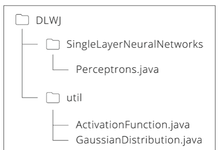

让我们看一下上图中显示的 Perceptrons.java 的内容。我们将逐一介绍主要方法。

首先，我们定义学习所需的参数和常量。如前所述，学习率（在代码中定义为 learningRate）可以设为1：

```
final int train_N = 1000;  // number of training data
final int test_N = 200;    // number of test data
final int nIn = 2;         // dimensions of input data

double[][] train_X = new double[train_N][nIn];  // input data for training
int[] train_T = new int[train_N];               // output data (label) for training

double[][] test_X = new double[test_N][nIn];  // input data for test
int[] test_T = new int[test_N];                // label of inputs
int[] predicted_T = new int[test_N];           // output data predicted by the model

final int epochs = 2000;    // maximum training epochs
final double learningRate = 1.;  // learning rate can be 1 in perceptrons
```


不言而喻，机器学习和深度学习需要一个数据集来进行学习和分类。这里，由于我们希望重点关注与感知器理论密切相关的实现，因此在源代码中生成了一个示例数据集并用于训练集和测试集，定义了名为 `GaussianDistribution` 的类，它返回一个遵循正态分布或高斯分布的值。至于源代码本身，我们在此不作说明，因为你可以在 `GaussianDistribution.java` 中看到它。我们在 `nIn = 2` 中设置学习数据的维度，并按如下方式定义两种类型的实例：

```java
GaussianDistribution g1 = new GaussianDistribution(-2.0, 1.0, rng);
GaussianDistribution g2 = new GaussianDistribution(2.0, 1.0, rng);
```

你可以通过 `g1.random()` 得到均值为 `-2.0`、方差为 `1.0` 的正态分布值，并通过 `g2.random()` 得到均值为 `2.0`、方差为 `1.0` 的值。

利用这些值，类 1 通过 `[ g1.random(), g2.random() ]` 生成 500 个数据属性，类 2 通过 `[ g2.random(), g1.random() ]` 生成另外 500 个。请注意，类 1 标签的实际值为 1，类 2 标签的实际值为 -1。几乎所有数据对于类 1 来说都集中在 `[-2.0, 2.0]` 附近，对于类 2 来说集中在 `[2.0, -2.0]` 附近；因此它们可以被线性分离，但一些数据会在另一类附近混合作为噪声。

现在数据已经准备好，我们可以继续构建模型。输入层的单元数 `nIn` 是此处用于决定模型轮廓的参数：

```java
Perceptrons classifier = new Perceptrons(nIn);
```

让我们看看实际的 `Perceptrons` 构造函数。感知器模型的参数只有网络的权重 w，非常简单，如下所示：

```java
public Perceptrons(int nIn) {

    this.nIn = nIn;
    w = new double[nIn];
}
```

下一步终于进行训练。学习迭代会一直持续，直到提前达到学习集的足够次数或正确分类所有训练数据：

```java
while (true) {
    int classified_ = 0;

    for (int i=0; i < train_N; i++) {
```

当你编译 `Perceptron.java` 并运行它时，可以得到 99.0% 的准确率、98.0% 的精确率和 100% 的召回率。这意味着实际的正样本被正确分类，但有一些数据被错误地预测为正样本，而实际上是负样本。在此源代码中，由于数据集仅用于演示，因此不包含 K 折交叉验证。上面的示例中数据集是程序生成的，噪声数据很少。因此，由于数据可以很好地分类，准确率、精确率和召回率都很高。然而，正如上文所述，你必须仔细查看结果，尤其是在结果非常好的时候。

### 逻辑回归

逻辑回归顾名思义是一种回归模型。但从公式来看，可以看出逻辑回归是将感知器推广的线性分离模型。

逻辑回归可以被视为神经网络之一。在感知器中，激活函数使用阶跃函数，而在逻辑回归中，使用（逻辑）sigmoid 函数。sigmoid 函数的方程可以表示如下：

$\sigma(x)=\frac{1}{1+e^{-x}}$

该函数的图像可以如下所示：

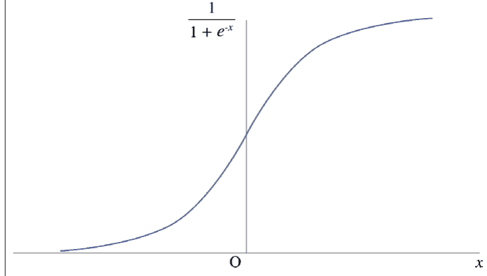

sigmoid 函数将实数的任意值映射到 0 到 1 之间的值。因此，逻辑回归的输出可以被视为每个类别的后验概率。方程可以描述如下：

$$p(C=1\mid x)=y(x)=\sigma(w^T x+b)$$

$$p(C=0\mid x)=1-p(C=1\mid x)$$

这些方程可以合并为：

$$p(C=t\mid x)=y^t(1-y)^{1-t}$$

这里，$t\in\{0,1\}$ 是正确数据。你可能已经注意到数据的范围与感知器的不同。

利用前面的方程，估计模型参数最大似然的似然函数可以表示如下：

$$L(w,b)=\prod_{n=1}^{N}y_n^{t_n}(1-y_n)^{1-t_n}$$

其中：

$$y_n=p(C=1\mid x_n)$$

如你所见，不仅网络的权重，而且偏置 $b$ 也是需要优化的参数。

我们现在需要做的是最大化似然函数，但计算令人担忧，因为该函数具有数学乘积。为了使计算更容易，我们对似然函数取对数（log）。此外，我们改变符号以将目标转为最小化负对数似然函数。由于对数是单调递增的，大小关系不会改变。方程可以表示如下：

$$E(w,b) = -\ln L(w,b) = -\sum_{n=1}^{N}\{t_n \ln y_n + (1-t_n)\ln(1-y_n)\}$$

你可以同时看到误差函数。这种类型的函数称为交叉熵误差函数。

与感知器类似，我们可以通过计算模型参数 $w$ 和 $b$ 的梯度来优化模型。梯度可以描述如下：

$$\frac{\partial E(w,b)}{\partial w} = -\sum_{n=1}^{N}(t_n - y_n)x_n$$

$$\frac{\partial E(w,b)}{\partial b} = -\sum_{n=1}^{N}(t_n - y_n)$$

利用这些方程，我们可以按如下方式更新模型参数：

$$w^{(k+1)} = w^{(k)} - \eta \frac{\partial E(w,b)}{\partial w} = w^{(k)} + \eta \sum_{n=1}^{N}(t_n - y_n)x_n$$

$$b^{(k+1)} = b^{(k)} - \eta \frac{\partial E(w,b)}{\partial b} = b^{(k)} + \eta \sum_{n=1}^{N}(t_n - y_n)$$

理论上，使用刚刚提到的方程并实现它们没有任何问题。然而，正如你所看到的，为了在每次迭代中计算梯度，你必须对所有数据求和。一旦数据集的大小变大，这将极大地增加计算成本。

$E(W,b) = -\ln L(W,b) = -\sum_{n=1}^{N}\sum_{k=1}^{K} t_{nk} \ln y_{nk}$

这里，$W = [w_1, ..., w_j, ..., w_K]$，$y_{nk} = y_k(x_n)$。此外，$t_{nk}$ 是正确数据向量 $t_n$ 的第 K 个元素，对应于第 $n$ 个训练数据。如果输入数据属于类别 $k$，则 $t_{nk}$ 的值为 1；否则值为 0。

损失函数相对于模型参数、权重向量和偏置的梯度可以描述如下：

$\frac{\partial E}{\partial w_j} = -\sum_{n=1}^{N} (t_{nj} - y_{nj}) x_n$

$\frac{\partial E}{\partial b_j} = -\sum_{n=1}^{N} (t_{nj} - y_{nj})$

现在让我们查看源代码以更好地理解理论。除了模型必需的变量外，你还可以看到一些与小批量相关的变量：

```java
int minibatchSize = 50; // number of data in each minibatch
int minibatch_N = train_N / minibatchSize; // number of minibatches

double[][][] train_X_minibatch = new double[minibatch_N]
[minibatchSize][nIn]; // minibatches of training data
int[][][] train_T_minibatch = new int[minibatch_N][minibatchSize]
[nOut]; // minibatches of output data for training
```

以下代码是对训练数据进行洗牌的过程，以便每个小批量中的数据可以随机应用于 SGD：

```java
List<Integer> minibatchIndex = new ArrayList<>(); // data index for minibatch to apply SGD
for (int i = 0; i < train_N; i++) minibatchIndex.add(i);
Collections.shuffle(minibatchIndex, rng); // shuffle data index for SGD
```

由于我们可以看到多类分类问题，因此我们生成了一个包含三个类别的示例数据集。除了感知器中使用的均值和方差外，我们还使用均值为 0.0、方差为 1.0 的正态分布数据集作为类 3 的训练数据和测试数据。换句话说，每个类别的数据遵循均值为 [-2.0, 2.0]、[2.0, -1.0] 和 [0.0, 0.0] 且方差为 1.0 的正态分布。我们将训练数据的标签定义为 int 类型，将测试数据的标签定义为 Integer 类型。这是为了在评估模型时更方便地处理测试数据。此外，每个标签数据都被定义为数组，因为它遵循多类分类：

```java
train_T[i] = new int[]{1, 0, 0};
test_T[i] = new Integer[]{1, 0, 0};
```

然后我们使用之前定义的 minibatchIndex 将训练数据分类为小批量：

```java
for (int i = 0; i < minibatch_N; i++) {
    for (int j = 0; j < minibatchSize; j++) {
        train_X_minibatch[i][j] = train_X[minibatchIndex.get(i *
minibatchSize + j)];
        train_T_minibatch[i][j] = train_T[minibatchIndex.get(i *
minibatchSize + j)];
    }
}
```

现在数据已经准备好，让我们实际构建一个模型：

```java
LogisticRegression classifier = new LogisticRegression(nIn, nOut);
```

逻辑回归的模型参数是网络的权重 w 和偏置 b：

```java
public LogisticRegression(int nIn, int nOut) {
    this.nIn = nIn;
    this.nOut = nOut;
    W = new double[nOut][nIn];
    b = new double[nOut];
}
```

训练是使用每个小批量进行的。如果将 minibatchSize 设置为 1，可以进行所谓的在线训练：

```java
for (int epoch = 0; epoch < epochs; epoch++) {
    for (int batch = 0; batch < minibatch_N; batch++) {
```


```
classifier.train(train_X_minibatch[batch], train_T_minibatch[batch], minibatchSize, learningRate);
}
learningRate *= 0.95;
}
```

这里，学习率逐渐减小，从而使模型能够收敛。对于实际的训练方法 `train`，可以粗略地分为两部分，如下所示：

- 1. 使用小批量（mini-batch）中的数据计算 w 和 b 的梯度。
- 2. 使用这些梯度更新 w 和 b：

```
// 1. calculate gradient of W, b
for (int n = 0; n < minibatchSize; n++) {

double[] predicted_Y_ = output(X[n]);

for (int j = 0; j < nOut; j++) {
	dY[n][j] = predicted_Y_[j] - T[n][j];

for (int i = 0; i < nIn; i++) {
	grad_W[j][i] += dY[n][j] * X[n][i];
}

grad_b[j] += dY[n][j];
}
}

// 2. update params
for (int j = 0; j < nOut; j++) {
for (int i = 0; i < nIn; i++) {
W[j][i] -= learningRate * grad_W[j][i] / minibatchSize;
}
b[j] -= learningRate * grad_b[j] / minibatchSize;
}

return dY;
```

在 `train` 方法最后返回 `dY`，即预测数据与正确数据之间的误差值。这一步对于逻辑回归本身来说并不是必需的，但在之后介绍的机器学习和深度学习算法中是必需的。

训练之后接下来是测试。执行测试的过程与感知机中的过程相比基本没有变化。首先，使用 `predict` 方法，用训练好的模型对输入数据进行预测：

```
for (int i = 0; i < test_N; i++) {
    predicted_T[i] = classifier.predict(test_X[i]);
}
```

这里调用到的 `predict` 方法和 `output` 方法的实现如下：

```
public Integer[] predict(double[] x) {

    double[] y = output(x); // activate input data through learned networks
    Integer[] t = new Integer[nOut]; // output is the probability, so cast it to label

    int argmax = -1;
    double max = 0.;

    for (int i = 0; i < nOut; i++) {
        if (max < y[i]) {
            max = y[i];
            argmax = i;
        }
    }

    for (int i = 0; i < nOut; i++) {
        if (i == argmax) {
            t[i] = 1;
        } else {
            t[i] = 0;
        }
    }

    return t;
}
```

```
public double[] output(double[] x) {

    double[] preActivation = new double[nOut];

    for (int j = 0; j < nOut; j++) {

        for (int i = 0; i < nIn; i++) {
            preActivation[j] += W[j][i] * x[i];
        }
        preActivation[j] += b[j];  // linear output
    }
    return softmax(preActivation, nOut);
}
```

首先，使用 `output` 方法对输入数据进行激活。从 `output` 方法的末尾可以看出，激活函数使用的是 softmax 函数。softmax 定义在 `ActivationFunction.java` 中；这个函数会返回一个表示每个类别概率的数组，因此只需要获取数组中概率最高元素的下标即可。这个下标就代表预测的类别。

最后，我们来评估模型。同样地，这里使用混淆矩阵进行模型评估，但要注意，这次是多分类问题，因此需要分别求出每个类别的精确率和召回率：

```
int[][] confusionMatrix = new int[patterns][patterns];
double accuracy = 0.;
double[] precision = new double[patterns];
double[] recall = new double[patterns];

for (int i = 0; i < test_N; i++) {
    int predicted_ = Arrays.asList(predicted_T[i]).indexOf(1);
    int actual_ = Arrays.asList(test_T[i]).indexOf(1);

    confusionMatrix[actual_][predicted_] += 1;
}

for (int i = 0; i < patterns; i++) {
    double col_ = 0.;
    double row_ = 0.;

    for (int j = 0; j < patterns; j++) {

        if (i == j) {
            accuracy += confusionMatrix[i][j];
            precision[i] += confusionMatrix[j][i];
            recall[i] += confusionMatrix[i][j];
        }

        col_ += confusionMatrix[j][i];
        row_ += confusionMatrix[i][j];
    }
    precision[i] /= col_;
    recall[i] /= row_;
}

accuracy /= test_N;

System.out.println("--------------------------------------------------");
System.out.println("Logistic Regression model evaluation");
System.out.println("--------------------------------------------------");
System.out.printf("Accuracy: %.1f %%\n", accuracy * 100);
System.out.println("Precision:");
for (int i = 0; i < patterns; i++) {
    System.out.printf(" class %d: %.1f %%\n", i+1, precision[i] * 100);
}
System.out.println("Recall:");
for (int i = 0; i < patterns; i++) {
    System.out.printf(" class %d: %.1f %%\n", i+1, recall[i] * 100);
}
```

### 多层感知机（多层神经网络）

单层神经网络有一个很大的问题。感知机和逻辑回归对于可以线性分类的问题很有效，但它们完全无法解决非线性问题。例如，它们甚至连图中这个最简单的 XOR 问题都无法解决：

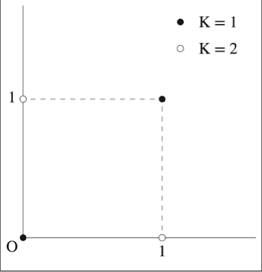

现在，我们来看如何计算输出。乍一看很复杂，但它以同样的方式逐层累积网络的权重和激活结构，因此只需把每一层的方程组合起来即可。每个输出可以表示如下：

$$y_k=g\left(\sum_{j=1}^{M}w_{kj}^{(2)}z_j+b_k^{(2)}\right)$$

$$=g\left(\sum_{j=1}^{M}w_{kj}^{(2)}h\left(\sum_{i=1}^{D}w_{ji}^{(1)}x_i+b_j^{(1)}\right)+b_k^{(2)}\right)$$

这里，$h$ 是隐藏层的激活函数，$g$ 是输出层。

如前所述，在多分类问题中，使用 $softmax$ 函数可以高效地计算输出层的激活函数，误差函数如下：

$$E(W,b)=-\ln L(W,b)=-\sum_{n=1}^{N}\sum_{k=1}^{K}t_{nk}\ln Y_{nk}$$

对于单层网络，只需把这个误差反映到输入层即可；但对于多层网络，除非同时将误差反映到隐藏层和输入层，否则神经网络无法作为一个整体进行学习。

幸运的是，在前馈网络中，有一种称为反向传播的算法，它通过向前和向后追踪网络，使模型能够高效地传播这个误差。我们来看看这个算法的原理。为了让公式更易读，我们考虑在线训练中误差函数的评估，如下所示：

$$E(W,b)=\sum_{n=1}^{N}E_n(W,b)$$

现在只需考虑这个 $E_n$ 的梯度。在大多数实际应用中，数据集中的所有数据都是独立同分布的，因此像上面这样定义完全没有问题。

前馈网络中的每个单元都可以表示为与该单元相连的网络权重的和，因此一般项可以表示如下：

$$a_j = \sum_i w_{ji}x_i + b_j$$

$$z_j = h(a_j)$$

注意，这里的 $x_i$ 不只是输入层的值（当然，它也可以是输入层的值）。另外，$h$ 是非线性激活函数。权重的梯度和偏置的梯度可以表示如下：

$$\frac{\partial E_n}{\partial w_{ji}} = \frac{\partial E_n}{\partial a_j}\frac{\partial a_j}{\partial w_{ji}} = \frac{\partial E_n}{\partial a_j}x_i$$

$$\frac{\partial E_n}{\partial b_j} = \frac{\partial E_n}{\partial a_j}\frac{\partial a_j}{\partial b_j} = \frac{\partial E_n}{\partial a_j}$$

现在引入下一个等式中定义的记号：

$$\delta_j := \frac{\partial E_n}{\partial a_j}$$

于是得到：

$$\frac{\partial E_n}{\partial w_{ji}} = \delta_j x_i$$

$$\frac{\partial E_n}{\partial b_j} = \delta_j$$

因此，对比这些公式，输出单元可以描述如下：

$\delta_k = y_k - t_k$

另外，隐藏层的每个单元为：

$\delta_j = \frac{\partial E_n}{\partial a_j} = \sum_k \frac{\partial E_n}{\partial a_k} \frac{\partial a_k}{\partial a_j}$

$\delta_j = h'(a_j) \sum_k w_{kj} \delta_k$

于是引入了**反向传播公式**。因此，delta 被称为**反向传播的**误差。通过计算 `backpropagated` 误差，就可以计算出权重和偏置。这些公式看起来可能很难，但它本质上做的事情就是接收来自相连单元的误差反馈，并更新权重，所以并没有那么难。

下面我们以一个简单的 XOR 问题为例来看具体实现。阅读源代码后，你会理解得更清楚。包的目录结构如下：

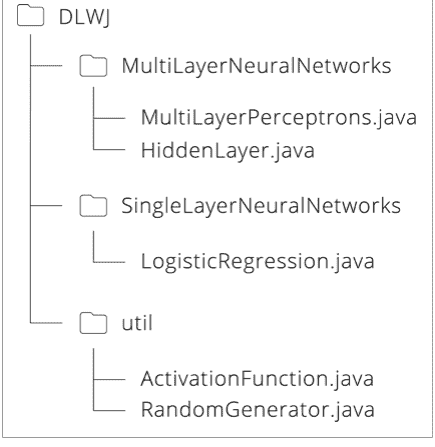


MLP 的参数是隐藏层 HiddenLayer 和输出层 LogisticRegression 的权重 w 和偏置 b。 由于输出层与之前介绍的相同，这里不对其代码进行查看。 HiddenLayer 的构造函数如下：

```java
public HiddenLayer(int nIn, int nOut, double[][] W, double[] b, Random rng, String activation) {

    if (rng == null) rng = new Random(1234);  // seed random

    if (W == null) {

        W = new double[nOut][nIn];
        double w_ = 1. / nIn;

        for(int j = 0; j < nOut; j++) {
            for(int i = 0; i < nIn; i++) {
                W[j][i] = uniform(-w_, w_, rng);  // initialize W with uniform distribution
            }
        }

    }

    if (b == null) b = new double[nOut];

    this.nIn = nIn;
    this.nOut = nOut;
    this.W = W;
    this.b = b;
    this.rng = rng;

    if (activation == "sigmoid" || activation == null) {

        this.activation = (double x) -> sigmoid(x);
        this.dactivation = (double x) -> dsigmoid(x);

    } else if (activation == "tanh") {

        this.activation = (double x) -> tanh(x);
        this.dactivation = (double x) -> dtanh(x);

    } else {
        throw new IllegalArgumentException("activation function not supported");
    }
}
```

W 会根据单元的数量随机初始化。这种初始化实际上很棘手，如果初始值分布不佳，更容易遇到局部最小值问题。因此，在实际场景中，模型通常会使用一些随机种子进行测试。激活函数可以应用于 sigmoid 函数或双曲正切函数。

MLP 的训练可以通过神经网络按顺序进行前向传播和反向传播来实现：

```java
public void train(double[][] X, int T[][], int minibatchSize, double learningRate) {
    double[][] Z = new double[minibatchSize][nIn];  // outputs of hidden layer (= inputs of output layer)
    double[][] dY;
    // forward hidden layer
    for (int n = 0; n < minibatchSize; n++) {
        Z[n] = hiddenLayer.forward(X[n]);  // activate input units
    }
    // forward & backward output layer
    dY = logisticLayer.train(Z, T, minibatchSize, learningRate);
    // backward hidden layer (backpropagate)
    hiddenLayer.backward(X, Z, dY, logisticLayer.W, minibatchSize, learningRate);
}
```

hiddenLayer.backward 部分实现了来自逻辑回归的预测误差 dY 的隐藏层反向传播。请注意，逻辑回归的输入数据对于反向传播也是必要的：

```java
public double[][] backward(double[][] X, double[][] Z, double[][] dY, double[][] Wprev, int minibatchSize, double learningRate) {
    double[][] dZ = new double[minibatchSize][nOut];  // backpropagation error
    double[][] grad_W = new double[nOut][nIn];
    double[] grad_b = new double[nOut];

    // train with SGD
    // calculate backpropagation error to get gradient of W, b
    for (int n = 0; n < minibatchSize; n++) {

        for (int j = 0; j < nOut; j++) {

            for (int k = 0; k < dY[0].length; k++) { // k < ( nOut of previous layer )
                dZ[n][j] += Wprev[k][j] * dY[n][k];
            }
            dZ[n][j] *= dactivation.apply(Z[n][j]);

            for (int i = 0; i < nIn; i++) {
                grad_W[j][i] += dZ[n][j] * X[n][i];
            }

            grad_b[j] += dZ[n][j];
        }
    }

    // update params
    for (int j = 0; j < nOut; j++) {
        for(int i = 0; i < nIn; i++) {
            W[j][i] -= learningRate * grad_W[j][i] / minibatchSize;
        }
        b[j] -= learningRate * grad_b[j] / minibatchSize;
    }

    return dZ;
}
```

你可能会觉得算法复杂且难以理解，因为参数看起来很复杂，但我们在这里做的几乎与逻辑回归的 train 方法相同：我们以 mini-batch 为单位计算 W 和 b 的梯度并更新模型参数。就这样。那么 MLP 能否学习 XOR 问题呢？通过运行 MultiLayerPerceptrons.java 来检查结果。

结果仅输出模型的准确率、精确率和召回率的百分比，但例如，如果你使用 LogisticRegression 的 predict 方法转储预测数据，就可以看到它实际预测的概率是多少，如下所示：

```java
double[] y = output(x);   // activate input data through learned networks
Integer[] t = new Integer[nOut];  // output is the probability, so cast it to label

System.out.println( Arrays.toString(y) );
```

我们刚刚证明了 MLP 可以逼近 XOR 的函数。此外，已被证明 MLP 可以逼近任意函数。我们在这里不涉及数学细节，但你可以很容易想象，MLP 拥有的单元越多，就能表达和逼近越复杂的函数。

### Summary

在本章中，作为深度学习的准备，我们深入研究了神经网络，它是机器学习算法之一。你学习了单层神经网络的三种代表性算法：感知器、逻辑回归和多类逻辑回归。我们看到单层神经网络无法解决非线性问题，但这个问题可以通过多层神经网络解决——即在输入层和输出层之间具有隐藏层（s）的网络。对 MLP 为何能解决非线性问题的直观理解是，网络可以通过增加层数和单元数量来学习更复杂的逻辑运算，从而具有表达更复杂函数的能力。让模型具备这种能力的关键是反向传播算法。通过将输出的误差反向传播到整个网络，模型在每次迭代中都会更新和调整以适应训练数据，最终优化以逼近数据的函数。

在下一章，你将学习深度学习的概念和算法。由于你现在已经获得了机器学习算法的基础理解，学习深度学习将不会有任何困难。

## 3 深度信念网络和堆叠去噪自编码器

从本章到下一章，你将学习深度学习的算法。我们将逐步遵循基础数学理论，以充分理解每个算法。一旦你掌握了深度学习的基础概念和理论，就能轻松地将其应用于实际应用。

本章你将学习以下主题：

- 深度学习可能成为突破的原因
- 深度学习与过去机器学习（神经网络）之间的差异
- 深度学习的典型算法 **深度信念网络 (DBN)** 和 **堆叠去噪自编码器 (SDA)** 的理论和实现

### 神经网络的衰落

在上一章中，你学习了神经网络的典型算法，并了解到非线性分类问题无法用感知器解决，但可以通过构建多层建模的神经网络来解决。换句话说，通过在输入层和输出层之间插入隐藏层，非线性问题可以被学习和解决。仅此而已；但通过增加一层中的神经元数量，神经网络整体上可以表达更多模式。如果忽略时间成本或过拟合问题，理论上神经网络可以逼近任意函数。

那么，我们可以这样想吗？如果增加隐藏层的数量——一层层累积隐藏层——神经网络能否解决任何复杂问题？产生这个想法是很自然的。而且，当然，这个想法已经被研究过。然而，结果表明，这次尝试并不成功。仅仅累积层数并不能让神经网络解决世界问题。相反，一些情况下的预测准确率甚至低于层数更少的模型。

为什么会出现这些情况？神经网络层数越多表达能力越强，这并没有错。那么问题出在哪里呢？这是因为前馈网络中学习算法的特性所致。如我们在上一章所见，反向传播算法用于将学习误差高效地传播到整个多层神经网络中。在该算法中，误差在神经网络的每一层中被反转，并按顺序逐一传达至输入层。通过将输出层的误差反向传播到输入层，网络的权重按顺序在每一层进行调整，整个网络的权重得到优化。

问题就出在这里。如果网络的层数较少，从输出层反向传播的误差可以很好地贡献于调整每一层的权重。然而，一旦层数增加，误差在每次反向传播层时逐渐消失，并且不再调整网络的权重。在靠近输入层的层中，误差根本不会被反馈。

层间连接密集的神经网络无法调整权重。因此，整个网络的权重无法得到优化，当然，学习也无法顺利进行。这个严重的问题被称为 **梯度消失问题**，长期困扰着研究人员，直到深度学习的出现。神经网络算法在早期阶段就达到了极限。

### 神经网络的复仇

由于梯度消失问题，神经网络在机器学习领域失去了流行度。我们可以说，与逻辑回归和 SVM 等其他典型算法相比，神经网络在现实世界数据挖掘中使用的案例数量明显较少。


但随后深度学习的出现打破了所有现有惯例。如你所知，深度学习就是神经网络不断叠加层数。换句话说，它是深度神经网络，并在某些领域产生了惊人的可预测性。如今，谈到人工智能研究，毫不夸张地说，那就是对深度神经网络的研究。这无疑是神经网络的反击。既然如此，为什么梯度消失问题在深度学习中不再重要？它与过去的算法又有什么区别？

在本节中，我们将探讨深度学习为何能产生如此强的可预测性，以及它的机制。

### 深度学习的演进——突破在哪里？

可以说，有两个算法引发了深度学习的热潮。第一个，正如*第1章，深度学习概述*中提到的，是由Hinton教授开创的DBN（https://www.cs.toronto.edu/~hinton/absps/fastnc.pdf）。第二个是Vincent等人提出的SDA（http://www.iro.umontreal.ca/~vincentp/Publications/denoising_autoencoders_tr1316.pdf）。SDA在DBN提出后不久问世。尽管算法细节不同，但它采用了与DBN类似的方法，也在深层结构中取得了很高的可预测性。

那么，解决梯度消失问题的共同方法是什么呢？也许你正紧张地准备解复杂的方程来理解DBN或SDA，但别担心。DBN绝对是一个可以理解的算法。相反，其机制本身非常简单。深度学习是由一个非常简洁而优雅的方案确立的。这个方案就是：**逐层训练**。就是这样。你可能会觉得看到后显而易见，但这正是让深度学习流行起来的方法。

如前所述，理论上，如果神经网络有更多的单元或层，它应该具有更强的表达能力，并能解决更多问题。之所以效果不好，是因为误差无法正确地反馈到每一层，整个网络的参数也无法得到适当调整。这就是创新之处——在每一层分别进行学习。由于每一层独立调整网络权重，即使层数不断堆叠，整个网络（即模型参数）也能被正确优化。

以前的模型之所以不顺利，是因为它们试图将误差从输出层直接反向传播到输入层，并利用反向传播的误差调整网络权重来进行优化。于是，算法转向了逐层训练，模型优化也随之顺利进行。这就是深度学习的突破所在。

然而，虽然我们简单地说“**逐层训练**”，但实现这种学习仍需要具体的技术。而且，理所当然地，整个网络的参数调整不能仅靠逐层训练完成，还需要最后的调整。逐层训练的阶段被称为**预训练**，最后的调整阶段被称为**微调**。可以说，DBN和SDA引入的最大特点就是预训练，但这两个特点都是深度学习必要流程的一部分。预训练是如何进行的？微调又能做什么？让我们逐一探讨这些问题。

### 带有预训练的深度学习

深度学习更像是隐藏层不断累积的神经网络。预训练中的逐层训练负责在每一层进行学习。不过，你可能仍有疑问：如果两层都是隐藏层（即既不是输入层也不是输出层），那么训练是如何进行的？输入和输出又是什么呢？

在思考这些问题之前，请再次提醒自己这一点（前面反复强调过）：深度学习是层数堆叠的神经网络。这意味着模型参数仍然是网络中的权重（和偏置）。由于这些权重（和偏置）需要在各层之间调整，在标准的三层神经网络（即输入层、隐藏层和输出层）中，我们只需要优化输入层和隐藏层之间，以及隐藏层和输出层之间的权重。然而在深度学习中，两个隐藏层之间的权重也需要调整。

首先，让我们考虑某一层的输入。稍加思考就能轻松想象：从上一层传播过来的值就是输入。从上一层传播过来的值，正是利用网络权重向前传播到当前层的值，这与普通前馈网络相同。写起来很简单，但如果深入探究其含义，就会发现它有着重要意义。来自上一层的值成为输入，这意味着前一层（或多层）学到的特征成为当前层的输入，当前层在此基础上重新学习给定数据的特征。换句话说，在深度学习中，特征是分阶段（且半自动地）从输入数据中学习到的。这暗示了一种机制：层越深，学习到的特征越高级。这是普通多层神经网络做不到的，也正是“机器能学习概念”这一说法的原因。

现在，让我们思考输出。请记住，思考输出意味着思考它如何学习。DBN和SDA的学习方法完全不同，但两者都满足以下条件：学习的目标是使输出值与输入值相等。你可能会想“你在说什么？”但这正是让深度学习成为可能的技术。

值从输入层经过隐藏层传出，再传回输入层，这种技术就是调整网络权重（即让输出值等于输入值）以消除当时的误差。其图形模型可以如下表示：

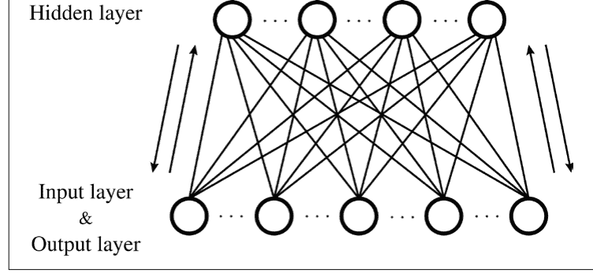

乍一看它与标准神经网络有所不同，但并没有什么特别之处。如果我们有意将输入层和输出层分开画出来，其机制与普通神经网络的形状是一样的：

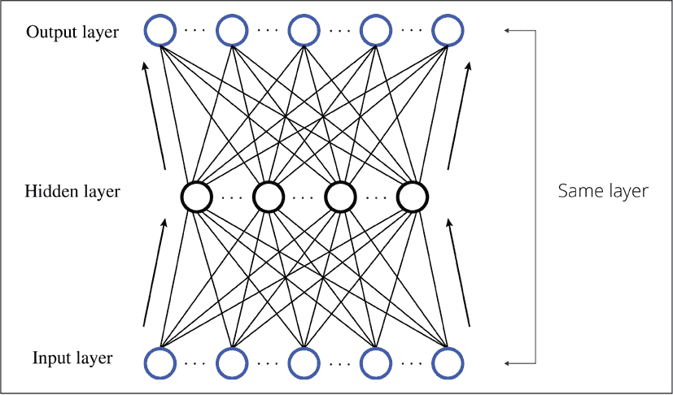

对人来说，这种“匹配输入和输出”的行为并不直观，但对机器来说却是一种有效的行为。那么，它如何通过匹配输出层和输入层来从输入数据中学习特征呢？

需要一点解释吗？我们这样想：在包括神经网络在内的机器学习算法中，学习旨在最小化模型预测输出与数据集输出之间的误差。其机制是通过从输入数据中发现模式来消除误差，并将具有共同模式的数据归为相同的输出值（例如0或1）。那么，如果我们把输出值变成输入值，会发生什么呢？

当我们把深度学习要整体解决的问题看作一个整体时，输入数据本质上是可以划分为若干模式的数据集。这意味着输入数据中存在一些共同特征。如果是这样，在让每个输出值分别等于对应输入数据的学习过程中，网络权重应调整得更加关注反映共同特征的部分。而且，即使在同一类别的数据中，学习也应降低对非共同特征部分（即噪声部分）的权重。

现在你应该明白了某一层的输入和输出是什么，以及学习是如何进行的。一旦预训练在某层完成，网络就进入下一层的学习。不过，正如下面的图片所示，请记住，当网络进入下一层学习时，隐藏层会变成输入层：

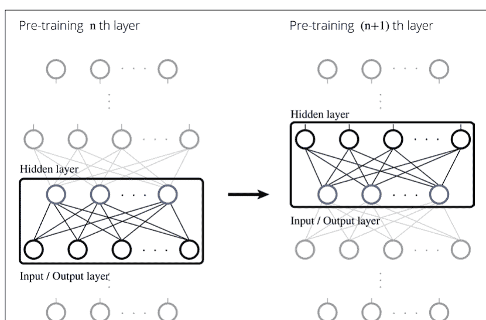

这里的要点是，预训练之后的层可以被视为普通的、权重已调整好的前馈神经网络。因此，在考虑输入值时，我们只需要简单地计算从输入层通过网络向前传播到当前层的值。

到目前为止，我们已经了解了预训练（即逐层训练）的流程。在深度神经网络的隐藏层中，通过使输入匹配输出的学习，输入数据的特征被分阶段提取出来。现在，有些人可能想知道：我理解通过预训练可以从输入数据中分阶段学习特征，但仅凭这一点并不能解决分类问题。那么，它是如何解决分类问题的呢？


好吧，在预训练期间，并未提供数据属于哪个类别的信息。这意味着预训练是无监督训练，它仅使用输入数据分析隐藏的模式。如果不能用于解决问题，即使它提取了特征也是毫无意义的。因此，模型需要再完成一步才能正确解决分类问题。那就是微调。微调的主要作用如下：

- 1. 为完成预训练的深度神经网络添加输出层并进行监督训练。
- 2. 对整个深度神经网络进行最终调整。

这可以如下图所示：

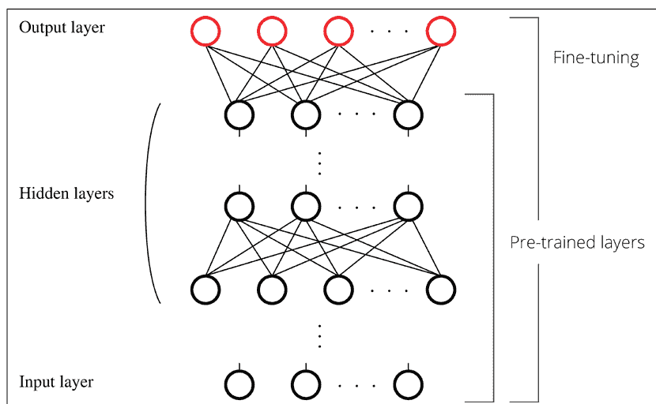

输出层的监督训练使用机器学习算法，例如逻辑回归或 SVM。一般来说，考虑到计算量和精度提升的平衡，逻辑回归使用得更频繁。

在微调中，有时只会调整输出层的权重，但通常也会调整整个神经网络的权重，包括预训练中已调整权重的层。这意味着标准学习算法，也就是反向传播算法，被应用于深度神经网络，就像一个多层神经网络一样。因此，能够解决更复杂分类问题的神经网络模型就完成了。

即便如此，你可能会有以下疑问：为什么即使在层层堆叠的多层神经网络中，使用标准的反向传播算法学习也能进行得很好？难道不会出现梯度消失问题吗？这些问题可以通过预训练来解决。让我们思考以下几点：首先，在没有预训练的多层神经网络中，由于错误反馈不当，每个网络的权重无法正确调整；换句话说，就是出现梯度消失问题的多层神经网络。另一方面，一旦预训练完成，学习就从网络权重几乎已经调整好的起点开始。因此，适当的误差可以传播到接近输入层的层。因此得名微调。于是，通过预训练和微调，最终深度神经网络成为具有更深层而表达能力增强的神经网络。

从下一节开始，我们将最终探讨深度学习算法 DBN 和 SDA 的理论和实现。但在此之前，让我们再次回顾一下深度学习的流程。下面是流程的总结图：

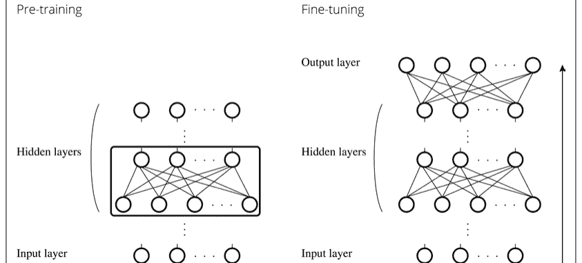

模型参数在预训练期间逐层优化，然后在微调期间作为单一深度神经网络进行调整。深度学习，人工智能的突破，是一种非常简单的算法。

### 深度学习算法

现在，让我们探讨深度学习算法的理论和实现。本章中我们将看到 DBN 和 SDA（以及相关方法）。这两个算法在 2012 年至 2013 年间得到了爆炸性研究，当时深度学习开始迅速传播并点燃了深度学习的潮流。尽管有两种方法，但基本流程相同，与上一节所述的预训练和微调一致。这两者之间的区别在于应用了哪种预训练（即无监督训练）算法。

因此，如果深度学习中有困难点，应该就是无监督训练的理论和方程。然而，你不必害怕。所有的理论和实现都将逐一解释，请仔细阅读以下章节。

### 受限玻尔兹曼机

DBN 逐层训练中使用的预训练方法称为受限玻尔兹曼机（RBM）。首先，让我们看看构成 DBN 基础的 RBM。RBM 代表受限玻尔兹曼机，当然还有一种称为玻尔兹曼机（BMs）的方法。或者说，BMs 是更标准的形式，而 RBM 是其特例。两者都是神经网络的一种，并且都由 Hinton 教授提出。

RBM 和 DBN 的实现可以在不理解 BM 详细理论的情况下完成，但为了理解这些概念，我们将简要看看 BM 所基于的思想。首先，让我们看一下下面的图，它展示了 BM 的图形模型：

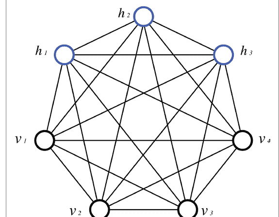

BMs 看起来很复杂，因为它们是全连接的，但实际上它们只是具有两层的简单神经网络。通过重新排列网络中的所有单元以便更好地理解，BMs 可以如下所示：

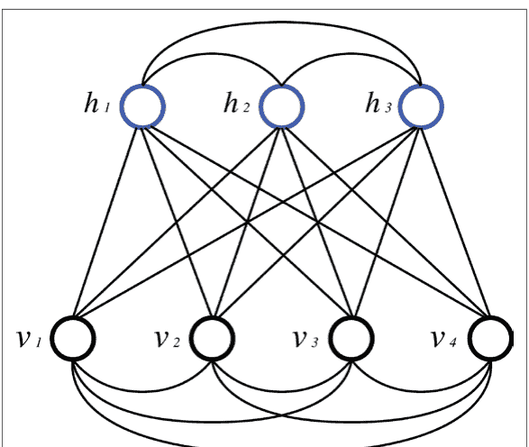

请记住，通常在 BMs 和 RBMs 中，输入/输出层称为 **可见层**（通常按原样使用隐藏层），因为它是根据可观察条件推断隐藏条件（不可观察条件）的网络。此外，可见层的神经元称为 **可见单元**，隐藏层的神经元称为 **隐藏单元**。前一图中的符号是根据给定名称描述的。

如图所示，BMs 的结构与标准神经网络并没有太大不同。然而，其思维方式有一个很大的特点。特点是采用神经网络中的 *能量* 概念。每个单元分别具有随机状态，整个网络的能量取决于每个单元所处的状态。（首先在网络中采用能量概念的模型称为 **霍普菲尔德网络**，而 BMs 是其发展版本。由于霍普菲尔德网络的细节与深度学习完全相关，因此本书中未作解释。）记住正确数据的条件是网络的稳定状态，也是这些网络具有的最小能量。另一方面，如果向网络提供带噪声的数据，每个单元处于不同的状态，但不是稳定状态，因此其状态会发生变化以稳定整个网络，换句话说，是将其转变为稳定状态。

这意味着模型的权重被调整，每个单元的状态被转移以最小化网络所具有的能量函数。这些操作可以去除噪声并整体从输入中提取特征。虽然网络的能量听起来很大，但并不难想象，因为最小化能量函数与最小化误差函数具有相同的效果。

BMs 的概念很奇妙，但在实际问题中应用 BMs 时出现了各种问题。最大的问题是 BMs 是全连接网络，需要大量的计算时间。因此，提出了 RBM。RBM 是通过限制 BMs 而在现实时间范围内解决各种问题的算法。就像 BM 一样，RBM 也是基于网络能量的模型。让我们在下面的图中看看 RBM：

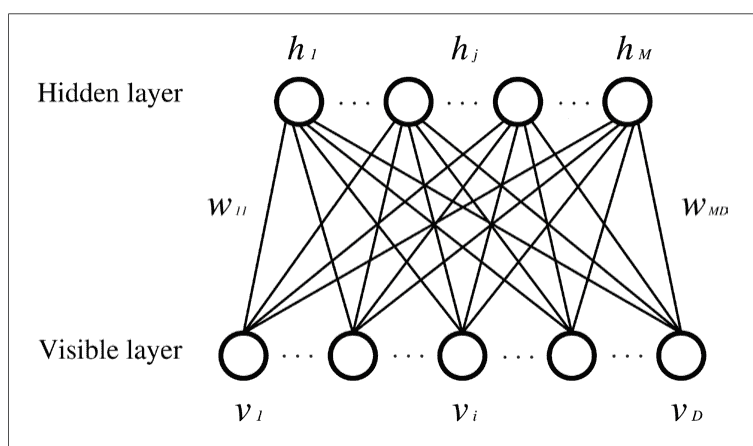

这里，D 是可见层中单元的数量，M 是隐藏层中单元的数量。v_i 表示可见单元的值，h_j 表示隐藏单元的值，w_{ij} 表示这两个单元之间的权重。如你所见，BM 与 RBM 之间的区别在于 RBM 没有同一层之间的连接。由于这种限制，计算量减少，可以应用于现实问题。

现在，让我们探讨理论。

> 请注意，作为前提，RBM 中每个可见单元和隐藏单元可以取的值通常为 {0, 1}，即二值（这与 BMs 相同）。

如果扩展理论，它也可以处理连续值。然而，这会使方程变得复杂，而这并不是理论的核心，而且在 Hinton 教授提出的原始 DBN 中使用的是二值。因此，我们在本书中也将实现二值 RBM。具有二值输入的 RBM 有时称为伯努利 RBM。


RBM 是基于能量的模型，可见层或隐藏层的状态被视为随机变量。我们将按顺序查看方程。首先，每个可见单元通过网络传播到隐藏单元。此时，每个隐藏单元根据其传播输入生成的概率分布取二值：

$$p(h_j=1|v)=\sigma\left(\sum_{i=1}^{D} w_{ij} v_i + c_j\right)$$

这里，$c_j$ 是隐藏层的偏置，$\sigma$ 表示 sigmoid 函数。

这次，它反过来通过同一网络从隐藏层传播到可见层。与前一种情况一样，每个可见单元根据传播值生成的概率分布取二值。

$$p(v_i=1|h)=\sigma\left(\sum_{j=1}^{M} w_{ij} h_j + b_i\right)$$

这里，$b_i$ 是可见层的偏置。可见单元的值预计与原始输入值匹配。这意味着如果 $W$ 作为模型参数的网络权重，以及可见层和隐藏层的偏置 $b$、$c$，表示为向量参数 $\theta$，它学习 $\theta$，以使上面可以获得的概率 $p(v|\theta)$ 接近 $v$ 的分布。

为此学习，需要定义能量函数，即评价函数。能量函数如下所示：

$$E(v,h) = -b^T v - c^T h - h^T W v$$

$$= -\sum_{i=1}^{D} b_i v_i - \sum_{j=1}^{M} c_j h_j - \sum_{j=1}^{M}\sum_{i=1}^{D} h_j w_{ij} v_i$$

此外，显示网络行为的联合概率密度函数可以表示如下：

$$p(v,h)=\frac{1}{Z}\exp(-E(v,h))$$

$$Z=\sum_{v,h}\exp(-E(v,h))$$

根据前面的公式，将确定参数训练的方程。我们可以得到以下方程：

$$p(v\mid\theta)=\sum_{h}p(v,h)=\frac{1}{Z}\sum_{h}\exp(-E(v,h))$$

因此，**对数似然**可以表示如下：

$$\ln L(\theta\mid v)=\ln p(v\mid\theta)$$

$$=\ln\left(\frac{1}{Z}\sum_{h}\exp(-E(v,h))\right)$$

$$=\ln\sum_{h}\exp(-E(v,h))-\ln\sum_{v,h}\exp(-E(v,h))$$

然后，我们将计算相对于模型参数的每个梯度。导数可以按如下方式计算：

$$\frac{\partial \ln L(\theta | v)}{\partial \theta} = \frac{\partial}{\partial \theta}\left( \ln \sum_h \exp(-E(v,h)) \right) - \frac{\partial}{\partial \theta}\left( \ln \sum_{v,h} \exp(-E(v,h)) \right)$$

$$= -\frac{1}{\sum_h \exp(-E(v,h))} \sum_h \exp(-E(v,h)) \frac{\partial E(v,h)}{\partial \theta}$$

$$= +\frac{1}{Z} \sum_{v,h} \exp(-E(v,h)) \frac{\partial E(v,h)}{\partial \theta}$$

$$= -\sum_h p(h|v) \frac{\partial E(v,h)}{\partial \theta} + \sum_{v,h} p(v,h) \frac{\partial E(v,h)}{\partial \theta}$$

中间的一些方程很复杂，但在模型和原始数据的概率分布方面却变得简单。

因此，每个参数的梯度如下所示：

$$\frac{\partial \ln L(\theta | v)}{\partial w_{ij}} = -\sum_h p(h|v) \frac{\partial E(v,h)}{\partial w_{ij}} + \sum_{v,h} p(v,h) \frac{\partial E(v,h)}{\partial w_{ij}}$$

$$= \sum_h p(h|v) h_j v_i - \sum_v p(v) \sum_h p(h|v) h_j v_i$$

$$= p(H_j=1|v) v_i - \sum_v p(v) p(H_j=1|v) v_i$$

$$\frac{\partial \ln L(\theta | v)}{\partial b_i} = v_i - \sum_v p(v) v_i$$

$$\frac{\partial \ln L(\theta | v)}{\partial c_j} = p(H_j=1|v) - \sum_v p(v) p(H_j=1|v)$$

那么，我们可以找到梯度方程，但在直接应用该方程时会遇到问题。考虑 $\sum_v p(v)$ 项。该项意味着我们必须为所有 $\{0, 1\}$ 模式计算概率分布，这些模式可以假设为包含数据中实际上不存在的模式的输入数据。

我们可以很容易想象该项如何导致组合爆炸，这意味着我们无法在现实的时间范围内解决它。为了解决这个问题，引入了使用 Gibbs 采样近似数据的方法，称为 **对比散度 (CD)**。现在让我们看看这种方法。

这里，$v^{(0)}$ 是输入向量。此外，$v^{(k)}$ 是通过使用该输入向量采样 k 次可以获得的输入（输出）向量。

然后，我们得到：

$$h_j^{(k)} \sim p\big(h_j \mid v^{(k)}\big)$$

$$v_i^{(k+1)} \sim p\big(v_i \mid h^{(k)}\big)$$

因此，在重复 Gibbs 采样后近似 $p(v)$ 时，对数似然函数的导数可以表示如下：

$$\frac{\partial \ln L(\theta \mid v)}{\partial \theta} = -\sum_h p(h \mid v)\frac{\partial E(v,h)}{\partial \theta} + \sum_{v,h} p(v,h)\frac{\partial E(v,h)}{\partial \theta}$$

$$\approx -\sum_h p(h \mid v^{(0)})\frac{\partial E(v^{(0)},h)}{\partial \theta} + \sum_h p(h \mid v^{(k)})\frac{\partial E(v^{(k)},h)}{\partial \theta}$$

因此，模型参数可以表示如下：

$$w_{ij}^{(\tau+1)} = w_{ij}^{(\tau)} + \eta\big(p\big(H_j = 1 \mid v^{(0)}\big)v_i^{(0)} - p\big(H_j = 1 \mid v^{(k)}\big)v_i^{(k)}\big)$$

$$b_i^{(\tau+1)} = b_i^{(\tau)} + \eta\big(v_i^{(0)} - v_i^{(k)}\big)$$

$$c_j^{(\tau+1)} = c_j^{(\tau)} + \eta\big(p\big(H_j = 1 \mid v^{(0)}\big) - p\big(H_j = 1 \mid v^{(k)}\big)\big)$$

这里，τ 是迭代次数，η 是学习率。如前面的公式所示，通常执行 k 次采样的 CD 表示为 CD-k。众所周知，在将算法应用于实际问题时，CD-1 已足够。

现在，让我们回顾 RBM 的实现。包结构如以下屏幕截图所示：

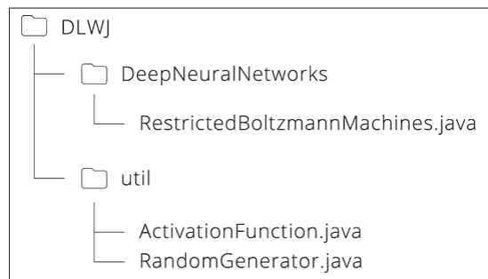

让我们查看 RestrictedBoltzmannMachines.java 文件。因为 main 方法的第一部分只是定义模型所需的变量并生成演示数据，所以我们这里不看它。

因此，在生成模型实例的部分，你可能会注意到参数中有许多 null 值：

```java
// construct RBM
RestrictedBoltzmannMachines nn = new
RestrictedBoltzmannMachines(nVisible, nHidden, null, null, null,
rng);
```

当你查看构造函数时，你可能会知道这些 null 值是 RBM 的权重矩阵、隐藏单元的偏置和可见单元的偏置。我们在这里将参数定义为 null，因为它们是用于 DBN 的实现。在构造函数中，它们按如下方式初始化：

```java
if (W == null) {
    W = new double[nHidden][nVisible];
    double w_ = 1. / nVisible;

    for (int j = 0; j < nHidden; j++) {
        for (int i = 0; i < nVisible; i++) {
            W[j][i] = uniform(-w_, w_, rng);
        }
    }
}

if (hbias == null) {
    hbias = new double[nHidden];

    for (int j = 0; j < nHidden; j++) {
        hbias[j] = 0.;
    }
}

if (vbias == null) {
    vbias = new double[nVisible];

    for (int i = 0; i < nVisible; i++) {
        vbias[i] = 0.;
    }
}
```

下一步是训练。对每个小批量应用 CD-1：

```java
// train with contrastive divergence
for (int epoch = 0; epoch < epochs; epoch++) {
    for (int batch = 0; batch < minibatch_N; batch++) {
        nn.contrastiveDivergence(train_X_minibatch[batch],
minibatchSize, learningRate, 1);
    }
    learningRate *= 0.995;
}
```

现在，让我们深入 RBM 的核心点，即 contrastiveDivergence 方法。CD-1 在实际运行此程序时可以获得足够的解（因此演示中 k = 1），但该方法也定义为处理 CD-k：

```java
// CD-k : CD-1 is enough for sampling (i.e. k = 1)
sampleHgivenV(X[n], phMean_, phSample_);

for (int step = 0; step < k; step++) {

    // Gibbs sampling
    if (step == 0) {
        gibbsHVH(phSample_, nvMeans_, nvSamples_, nhMeans_,
nhSamples_);
    } else {
        gibbsHVH(nhSamples_, nvMeans_, nvSamples_, nhMeans_,
nhSamples_);
    }

}
```

看起来 CD-k 中使用了两种不同类型的方法 sampleHgivenV 和 gibbsHVH，但当你查看 gibbsHVH 时，可以看到：

```java
public void gibbsHVH(int[] h0Sample, double[] nvMeans, int[]
nvSamples, double[] nhMeans, int[] nhSamples) {
    sampleVgivenH(h0Sample, nvMeans, nvSamples);
    sampleHgivenV(nvSamples, nhMeans, nhSamples);
}
```

因此，CD-k 只由两个采样方法 sampleVgivenH 和 sampleHgivenV 组成。

如方法名所示，sampleHgivenV 是根据给定可见单元的值设置隐藏层中生成的概率分布和采样数据的方法，反之亦然：

```java
public void sampleHgivenV(int[] v0Sample, double[] mean, int[] sample)
{

    for (int j = 0; j < nHidden; j++) {
        mean[j] = propup(v0Sample, W[j], hbias[j]);
        sample[j] = binomial(1, mean[j], rng);
    }

}
```


```
public void sampleVgivenH(int[] h0Sample, double[] mean, int[] sample)
{
    for(int i = 0; i < nVisible; i++) {
        mean[i] = propdown(h0Sample, i, vbias[i]);
        sample[i] = binomial(1, mean[i], rng);
    }
}
```

popup 和 propdown 这两个方法将值设置为各自的均值，它们是通过 sigmoid 函数激活每个单元的值的方法：

```
public double popup(int[] v, double[] w, double bias) {
    double preActivation = 0.;
    for (int i = 0; i < nVisible; i++) {
        preActivation += w[i] * v[i];
    }
    preActivation += bias;
    return sigmoid(preActivation);
}
```

```
public double propdown(int[] h, int i, double bias) {
    double preActivation = 0.;
    for (int j = 0; j < nHidden; j++) {
        preActivation += W[j][i] * h[j];
    }
    preActivation += bias;
    return sigmoid(preActivation);
}
```

用于将值设置为样本的 binomial 方法定义在 RandomGenerator.java 中。该方法基于二项分布返回 0 或 1。通过该方法，每个单元的值变为二进制：

```
public static int binomial(int n, double p, Random rng) {
    if(p < 0 || p > 1) return 0;
    int c = 0;
    double r;

    for(int i=0; i<n; i++) {
        r = rng.nextDouble();
        if (r < p) c++;
    }

    return c;
}
```

一旦通过采样获得了近似值，我们只需要计算模型参数的梯度，并使用小批量数据更新参数。这里没有什么特别之处：

```
// calculate gradients
for (int j = 0; j < nHidden; j++) {
    for (int i = 0; i < nVisible; i++) {
        grad_W[j][i] += phMean_[j] * X[n][i] - nhMeans_[j] * nvSamples_[i];
    }
    grad_hbias[j] += phMean_[j] - nhMeans_[j];
}

for (int i = 0; i < nVisible; i++) {
    grad_vbias[i] += X[n][i] - nvSamples_[i];
}

// update params
for (int j = 0; j < nHidden; j++) {
    for (int i = 0; i < nVisible; i++) {
        W[j][i] += learningRate * grad_W[j][i] / minibatchSize;
    }
    hbias[j] += learningRate * grad_hbias[j] / minibatchSize;
}

for (int i = 0; i < nVisible; i++) {
    vbias[i] += learningRate * grad_vbias[i] / minibatchSize;
}
```

### 深度信念网络（DBNs）

DBN 是深度神经网络，其中将逻辑回归作为输出层添加到 RBM 上。由于实现所需的理论已经解释过了，我们可以直接进入实现。包结构如下：

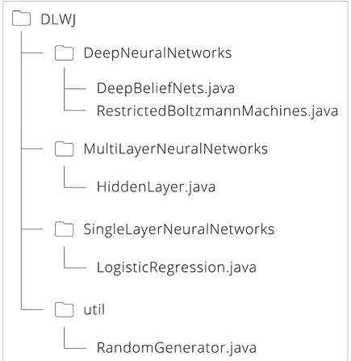

程序的流程非常简单。顺序如下：

- 1. 设置模型参数。
- 2. 构建模型。
- 3. 预训练模型。
- 4. 微调模型。
- 5. 测试并评估模型。

与 RBM 一样，设置 main 方法的第一步是声明变量以及创建演示数据的代码（这里省略了解释）。

请检查演示数据中，输入层的单元数为 60，隐藏层有 2 层，它们的单元总数为 20，输出层的单元数为 3。现在，让我们看一下“构建模型”部分的代码：

```
// construct DBN
System.out.print("Building the model...");
DeepBeliefNets classifier = new DeepBeliefNets(nIn, hiddenLayerSizes,
nOut, rng);
System.out.println("done.");
```

hiddenLayerSizes 变量是一个数组，其长度表示深度神经网络中隐藏层的数量。深度学习算法需要大量的计算，因此程序会输出当前状态，以便我们了解正在执行哪个过程。hiddenLayerSizes 变量是一个数组，其长度表示深度神经网络中隐藏层的数量。每个层都在构造函数中构建。

> 请记住，sigmoidLayers 和 rbmLayers 当然是不同的对象，但它们的权重和偏置是共享的。

这是因为，如理论部分所述，预训练执行逐层训练，而整个模型可以被视为一个神经网络：

```
// construct multi-layer
for (int i = 0; i < nLayers; i++) {
    int nIn_;
    if (i == 0) nIn_ = nIn;
    else nIn_ = hiddenLayerSizes[i-1];

    // construct hidden layers with sigmoid function
    //  weight matrices and bias vectors will be shared with RBM layers
    sigmoidLayers[i] = new HiddenLayer(nIn_, hiddenLayerSizes[i], null,
null, rng, "sigmoid");

    // construct RBM layers
    rbmLayers[i] = new RestrictedBoltzmannMachines(nIn_,
hiddenLayerSizes[i], sigmoidLayers[i].W, sigmoidLayers[i].b, null,
rng);
}

// logistic regression layer for output
logisticLayer = new LogisticRegression(hiddenLayerSizes[nLayers-1],
nOut);
```

构建模型后要做的第一件事是预训练：

```
// pre-training the model
System.out.print("Pre-training the model...");
classifier.pretrain(train_X_minibatch, minibatchSize, train_minibatch_N, pretrainEpochs, pretrainLearningRate, k);
System.out.println("done.");
```

预训练需要针对每个小批量进行处理，同时也要针对每一层进行处理。因此，首先将所有训练数据提供给 pretrain 方法，然后在该方法中处理每个小批量的数据：

```
public void pretrain(int[][][] X, int minibatchSize, int minibatch_N,
int epochs, double learningRate, int k) {

    for (int layer = 0; layer < nLayers; layer++) { // pre-train layer-wise
        for (int epoch = 0; epoch < epochs; epoch++) {
            for (int batch = 0; batch < minibatch_N; batch++) {

                int[][] X_ = new int[minibatchSize][nIn];
                int[][] prevLayerX_;

                // Set input data for current layer
                if (layer == 0) {
                    X_ = X[batch];
                } else {

                    prevLayerX_ = X_;
                    X_ = new int[minibatchSize][hiddenLayerSizes[layer-1]];

                    for (int i = 0; i < minibatchSize; i++) {
                        X_[i] = sigmoidLayers[layer-1].outputBinomial(prevLayerX_[i], rng);
                    }
                }
                rbmLayers[layer].contrastiveDivergence(X_,
                minibatchSize, learningRate, k);
            }
        }
    }
}
```

由于实际学习是通过 RBM 的 CD-1 完成的，因此代码中 DBN 的描述非常简单。在 DBN（RBM）中，每一层的单元具有二进制值，因此不能使用 HiddenLayer 的 output 方法，因为它返回 double 类型。因此，在类中添加了 outputBinomial 方法，它返回 int 类型（这里省略了代码）。预训练完成后，下一步是微调。


> 注意不要使用预训练中使用过的训练数据。

如果我们对整个数据集同时进行预训练和微调，很容易陷入过拟合。因此，验证数据集与训练数据集分开准备，并用于微调：

```
// fine-tuning the model
System.out.print("Fine-tuning the model...");
for (int epoch = 0; epoch < finetuneEpochs; epoch++) {
    for (int batch = 0; batch < validation_minibatch_N; batch++) {
        classifier.finetune(validation_X_minibatch[batch],
            validation_T_minibatch[batch], minibatchSize,
            finetuneLearningRate);
    }
    finetuneLearningRate *= 0.98;
}
System.out.println("done.");
```

在 `finetune` 方法中，应用了多层神经网络中的反向传播算法，其中输出层使用逻辑回归。为了在多个隐藏层之间反向传播单元值，我们定义了变量来维护每一层的输入：

```
public void finetune(double[][] X, int[][] T, int minibatchSize,
 double learningRate) {

    List<double[][]> layerInputs = new ArrayList<>(nLayers + 1);
    layerInputs.add(X);

    double[][] Z = new double[0][0];
    double[][] dY;

    // forward hidden layers
    for (int layer = 0; layer < nLayers; layer++) {

        double[] x_;  // layer input
        double[][] Z_ = new double[minibatchSize][hiddenLayerSizes[layer]];

        for (int n = 0; n < minibatchSize; n++) {

            if (layer == 0) {
                x_ = X[n];
            } else {
                x_ = Z[n];
            }

            Z_[n] = sigmoidLayers[layer].forward(x_);
        }

        Z = Z_.clone();
        layerInputs.add(Z.clone());
    }

    // forward & backward output layer
    dY = logisticLayer.train(Z, T, minibatchSize, learningRate);

    // backward hidden layers
    double[][] Wprev;
```


```java
double[][] dZ = new double[0][0];

for (int layer = nLayers - 1; layer >= 0; layer--) {
    if (layer == nLayers - 1) {
        Wprev = logisticLayer.W;
    } else {
        Wprev = sigmoidLayers[layer+1].W;
        dY = dZ.clone();
    }
    dZ = sigmoidLayers[layer].backward(layerInputs.get(layer),
        layerInputs.get(layer+1), dY, Wprev, minibatchSize,
        learningRate);
}
```

DBN 的训练部分就是前面代码中看到的那样。困难的部分可能在于 RBM 的理论和实现，所以当你只是看 DBN 的代码时，可能会觉得它并不太难。

由于训练后的 DBN 可以被视为一个（深度）神经网络，因此当你尝试预测未知数据属于哪个类别时，只需在每一层中对数据进行前向传播：

```java
public Integer[] predict(double[] x) {
    double[] z = new double[0];
    for (int layer = 0; layer < nLayers; layer++) {
        double[] x_;
        if (layer == 0) {
            x_ = x;
        } else {
            x_ = z.clone();
        }
        z = sigmoidLayers[layer].forward(x_);
    }
    return logisticLayer.predict(z);
}
```

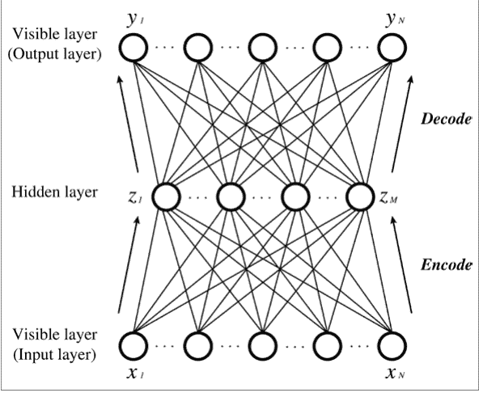

这里，\( \tilde{x} \) 是损坏的数据，即带噪声的输入数据。然后，前向传播到隐藏层和输出层可以表示如下：

$$
z_j = \sigma\left(\sum_{i=1}^{N} w_{ji}\tilde{x}_i + c_j\right)
$$

$$
y_i = \sigma\left(\sum_{j=1}^{M} w_{ji}z_j + b_i\right)
$$

这里，\( c_j \) 表示隐藏层的偏置，\( b_i \) 表示可见层的偏置。此外，\( \sigma \) 表示 sigmoid 函数。如前图所示，对输入数据进行损坏并映射到隐藏层称为 **编码**，将编码后的数据映射以恢复到原始输入数据称为 **解码**。然后，DA 的评价函数可以用原始输入数据和解码数据的负对数似然函数表示：

$$
E := -\ln L(\theta) = -\sum_{i=1}^{N}\left\{x_i\ln y_i + (1-x_i)\ln(1-y_i)\right\}
$$

这里，\( \theta \) 是模型参数，即可见层和隐藏层的权重和偏置。我们需要做的只是求这些参数相对于评价函数的梯度。为了便于变形方程，我们在这里定义以下函数：

$$
h_j := \sum_{i=1}^{N} w_{ji} \tilde{x}_i + c_j
$$

$$
g_i := \sum_{j=1}^{M} w_{ji} z_j + b_i
$$

那么，我们得到：

$$
z_j = \sigma(h_j)
$$

$$
y_i = \sigma(g_i)
$$

使用这些函数，每个参数的梯度可以表示如下：

$$
\frac{\partial E}{\partial w_{ji}} = \frac{\partial E}{\partial h_j} \frac{\partial h_j}{\partial w_{ji}} + \frac{\partial E}{\partial g_i} \frac{\partial g_i}{\partial w_{ji}} = \frac{\partial E}{\partial h_j} \tilde{x}_i + \frac{\partial E}{\partial g_i} z_j
$$

$$
\frac{\partial E}{\partial b_i} = \frac{\partial E}{\partial g_i} \frac{\partial g_i}{\partial b_i} = \frac{\partial E}{\partial g_i}
$$

$$
\frac{\partial E}{\partial c_j} = \frac{\partial E}{\partial h_j} \frac{\partial h_j}{\partial c_j} = \frac{\partial E}{\partial h_j}
$$

因此，只需要两个项。让我们逐一推导：

$$
\frac{\partial E}{\partial h_j} = \frac{\partial E}{\partial z_j}\frac{\partial z_j}{\partial h_j} = \frac{\partial E}{\partial z_j} z_j(1 - z_j)
$$

这里，我们利用了 sigmoid 函数的导数：

$$
\frac{d}{dx}\sigma(x) = \sigma(x)(1 - \sigma(x))
$$

此外，我们得到：

$$
\frac{\partial E}{\partial z_j} = \sum_{i=1}^{N}\frac{\partial E}{\partial y_i}\frac{\partial y_i}{\partial z_j} = \sum_{i=1}^{N} w_{ji}\left(x_i - y_i\right)
$$

因此，可以得到以下方程：

$$
\frac{\partial E}{\partial h_j} = \left(\sum_{i=1}^{N} w_{ji}\left(x_i - y_i\right)\right) z_j(1 - z_j)
$$

另一方面，我们也可以得到以下式子：

$$
\frac{\partial E}{\partial g_i} = \frac{\partial E}{\partial y_i}\frac{\partial y_i}{\partial g_i} = x_i - y_i
$$

因此，每个参数的更新方程如下：

$$
w_{ji}^{(k+1)} = w_{ji}^{(k)} + \eta\left[\left(\sum_{i=1}^{N} w_{ji}^{(k)} (x_i - y_i)\right) z_j (1 - z_j) \tilde{x}_i + (x_i - y_i) z_j \right]
$$

$$
b_i^{(k+1)} = b_i^{(k)} + \eta (x_i - y_i)
$$

$$
c_j^{(k+1)} = c_j^{(k)} + \eta\left(\sum_{i=1}^{N} w_{ji}^{(k)} (x_i - y_i)\right) z_j (1 - z_j)
$$

这里，\( k \) 是迭代次数，\( \eta \) 是学习率。虽然 DA 在变形上需要一些技巧，但你可以看到其理论本身与 RBM 相比非常简单。

现在，让我们进行实现。包结构与 RBM 的相同。

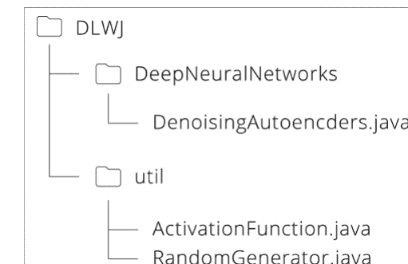

就模型参数而言，除了隐藏层的单元数外，添加到输入数据的噪声量也是 DA 中的一个参数。这里，损坏级别设置为 0.3。通常，该值常设置为 0.1 ~ 0.3：

```java
double corruptionLevel = 0.3;
```

从构建模型到训练的流程与 RBM 相同。虽然在 RBM 中这种训练方法称为 contrastiveDivergence，但在 DA 中它简单地设为 train：

```java
// construct DA
DenoisingAutoencoders nn = new DenoisingAutoencoders(nVisible,
nHidden, null, null, null, rng);

// train
for (int epoch = 0; epoch < epochs; epoch++) {
    for (int batch = 0; batch < minibatch_N; batch++) {
        nn.train(train_X_minibatch[batch], minibatchSize,
            learningRate, corruptionLevel);
    }
}
```

train 的内容如理论部分所述。首先，对输入数据添加噪声，然后对其进行编码和解码：

```java
// add noise to original inputs
double[] corruptedInput = getCorruptedInput(X[n], corruptionLevel);

// encode
double[] z = getHiddenValues(corruptedInput);

// decode
double[] y = getReconstructedInput(z);
```

添加噪声的过程，如前所述，是将数据对应部分的值强制置为 0：

```java
public double[] getCorruptedInput(double[] x, double corruptionLevel)
{
    double[] corruptedInput = new double[x.length];

    // add masking noise
    for (int i = 0; i < x.length; i++) {
        double rand_ = rng.nextDouble();

        if (rand_ < corruptionLevel) {
            corruptedInput[i] = 0.;
        } else {
            corruptedInput[i] = x[i];
        }
    }

    return corruptedInput;
}
```

其他过程只是简单的激活和传播，这里就不详细说明了。梯度的计算遵循数学方程：

```java
// calculate gradients

// vbias
double[] v_ = new double[nVisible];

for (int i = 0; i < nVisible; i++) {
    v_[i] = X[n][i] - y[i];
    grad_vbias[i] += v_[i];
}

// hbias
double[] h_ = new double[nHidden];

for (int j = 0; j < nHidden; j++) {
    for (int i = 0; i < nVisible; i++) {
        h_[j] = W[j][i] * (X[n][i] - y[i]);
    }
    h_[j] *= z[j] * (1 - z[j]);
    grad_hbias[j] += h_[j];
}

// W
for (int j = 0; j < nHidden; j++) {
    for (int i = 0; i < nVisible; i++) {
        grad_W[j][i] += h_[j] * corruptedInput[i] + v_[i] * z[j];
    }
}
```

与 RBM 相比，DA 的实现也相当简单。当你测试（重构）模型时，不需要损坏数据。如标准神经网络一样，只需根据网络的权重对给定的输入进行前向传播即可：

```java
public double[] reconstruct(double[] x) {
    double[] z = getHiddenValues(x);
    double[] y = getReconstructedInput(z);
    return y;
}
```

### 堆叠去噪自编码器（SDA）

SDA 是堆叠了 DA 层的深度神经网络。与 DBN 由 RBM 和逻辑回归组成相同，SDA 由 DA 和逻辑回归组成：

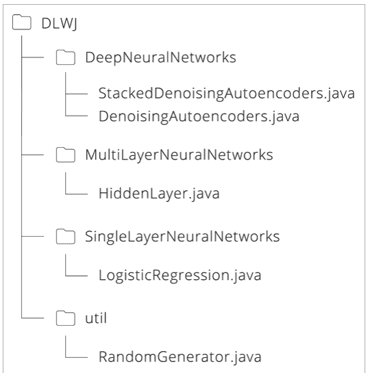

DBN 和 SDA 的实现流程并没有太大不同。尽管 RBM 和 DA 在预训练中存在差异，但微调的内容完全相同。因此，可能不需要太多解释。


预训练的方法并没有太大不同，但请注意，原本在 DBN 中使用 `int` 类型的地方改为了 `double` 类型，因为 DA 处理的是 [0, 1] 区间内的数据，而不是二值数据：

```
public void pretrain(double[][][] X, int minibatchSize, int minibatch_N, int epochs, double learningRate, double corruptionLevel) {
    for (int layer = 0; layer < nLayers; layer++) {
        for (int epoch = 0; epoch < epochs; epoch++) {
            for (int batch = 0; batch < minibatch_N; batch++) {
                double[][] X_ = new double[minibatchSize][nIn];
                double[][] prevLayerX_;
                // Set input data for current layer
                if (layer == 0) {
                    X_ = X[batch];
                } else {
                    prevLayerX_ = X_;
                    X_ = new double[minibatchSize][hiddenLayerSizes[layer-1]];
                    for (int i = 0; i < minibatchSize; i++) {
                        X_[i] = sigmoidLayers[layer-1].output(prevLayerX_[i]);
                    }
                }
                daLayers[layer].train(X_, minibatchSize, learningRate, corruptionLevel);
            }
        }
    }
}
```

学习完成后的预测方法也与 DBN 完全相同。考虑到 DBN 和 SDA 在学习后都可以被视为一个多层神经网络（即预训练和微调），那么大部分过程是共通的也就很自然了。

总体来说，SDA 比 DBN 更容易实现，但能获得的精度几乎相同。这正是 SDA 的优点。

### 小结

在本章中，我们探讨了之前神经网络算法存在的问题，以及深度学习的突破口是什么。同时，你还学习了 DBN 和 SDA 的理论与实现——正是这两种算法推动了深度学习的热潮，以及它们各自所采用的 RBM 和 DA 方法。

在下一章中，我们将研究更多的深度学习算法。这些算法采用不同的方法来获得高精度，并且已经发展得相当成熟。

## 4 随机丢弃（Dropout）与卷积神经网络

在本章中，我们继续审视深度学习的各种算法。预训练被同时用于 DBN 和 SDA，确实是一种创新方法，但深度学习还有其他创新方法。在这些方法中，我们将深入探讨尤为著名的两种算法：

- 随机丢弃（Dropout）学习算法
- 卷积神经网络

这两种算法都是理解和掌握深度学习所必需的，请务必跟上。

### 无需预训练的深度学习算法

在上一章中，你了解到带有预训练的逐层训练是 DBN 和 SDA 的突破点。这些算法需要预训练的原因在于：在简单堆叠层的神经网络中，会出现输出误差逐渐消失且无法正常工作的问题（我们称之为梯度消失问题）。无论你是想改进现有方法还是重新发明方法，深度学习算法似乎都需要预训练——你可以这样理解。

然而，实际上本章中的深度学习算法并没有预训练阶段，尽管在没有预训练的深度学习算法中，我们却能得到更高精度和准确率的结果。为什么能做到这一点呢？这里有一个简要的原因。让我们想想梯度消失问题为什么会发生——还记得反向传播的方程吗？某一层的 delta 通过字面意义上的反向传播网络，被分配到前一层所有单元上。这意味着在一个所有单元紧密连接的网络中，反向传播到每个单元的误差值会变得很小。从反向传播方程可以看出，权重的梯度是通过单元之间的权重和 delta 相乘得到的。因此，项数越多，网络越稠密，发生下溢的可能性就越大。这就导致了梯度消失问题。

因此，我们可以说，如果上述问题可以在不进行预训练的情况下避免，那么机器就可以通过深层神经网络进行正确的学习。要实现这一点，我们需要调整网络的连接方式。本章中的深度学习算法正是利用各种方法将这种巧思付诸实践。

### 随机丢弃（Dropout）

如果网络连接得过于稠密是个问题，那就强制让它变得稀疏。这样梯度消失问题就不会发生，学习也能正常进行。基于这种思想的算法就是随机丢弃算法。深度神经网络的 Dropout 最早在《Improving neural networks by preventing co-adaptation of feature detectors》（Hinton 等，2012，http://arxiv.org/pdf/1207.0580.pdf）中提出，并在《Dropout: A Simple Way to Prevent Neural Networks from Overfitting》（Srivastava 等，2014，https://www.cs.toronto.edu/~hinton/absps/JMLRdropout.pdf）中进一步完善。在 Dropout 中，一些单元在训练时会被字面意义上地强行丢弃。这意味着什么呢？我们来看下面的图——首先是神经网络：

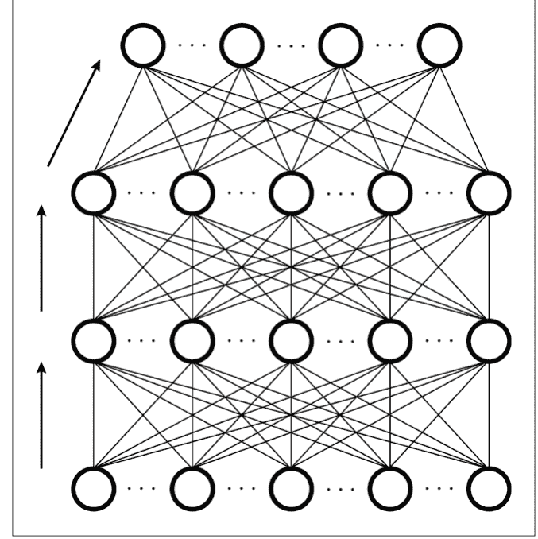

这张图没有什么特别之处。它是一个标准的神经网络，包含一个输入层、两个隐藏层和一个输出层。其次，对这个网络应用 Dropout 后，图形化模型可以表示如下：

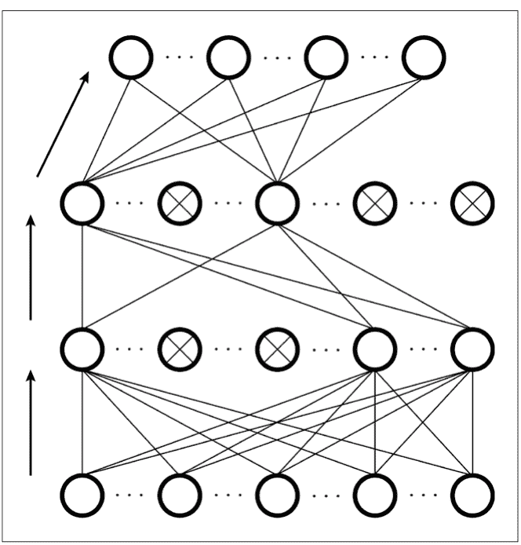

从网络中丢弃的单元用叉号标记。如上图所示，被丢弃的单元在网络中被视为不存在。这意味着在应用 Dropout 学习算法的过程中，我们需要改变原始神经网络的结构。幸运的是，从计算角度来看，对网络应用 Dropout 并不困难。你可以先构建一个普通的深度神经网络。然后只需在每一层的所有单元上添加一个 dropout 掩码——一个简单的二值掩码——即可应用 Dropout 学习算法。二值掩码中值为 0 的单元就是那些从网络中被丢弃的单元。

这可能让你想起上一章讨论的 DA（或 SDA），因为 DA 和 Dropout 乍看之下很相似。DA 中损坏输入数据在实现时也会向数据添加二值掩码。然而，它们之间有两点显著的不同。首先，虽然两种方法确实都有向神经元添加掩码的过程，但 DA 只将掩码应用于输入层的单元，而 Dropout 则将其应用于隐藏层的单元。有些 Dropout 算法会同时将掩码应用于输入层和隐藏层，但这仍然与 DA 不同。其次，在 DA 中，一旦损坏的输入数据生成，该数据就会在整个训练周期中使用；而在 Dropout 中，每个训练周期都会使用具有不同掩码的数据。这表明每次迭代训练的是不同形状的神经网络。Dropout 掩码会在每次迭代的每一层根据 Dropout 的概率生成。

你可能会有疑问：即使网络的形状每一步都不同，我们还能训练模型吗？答案是肯定的。你可以这样理解：使用 Dropout 训练网络效果很好，因为它会给现有神经元赋予更大的权重，以反映输入数据的特征。然而，Dropout 有一个缺点，那就是它比其他算法需要更多的训练周期来训练和优化模型，这意味着它需要更长的时间才能达到最优。这里还引入了另一种技术来减少这个问题。虽然 Dropout 算法本身更早被发明，但仅靠这种方法还不足以让深度神经网络获得泛化能力并达到高精度。通过另一种让网络更加稀疏的技术，我们使得深度神经网络获得了更高的准确率。这项技术是对激活函数的改进，可以说是一个简单而优雅的解决方案。

迄今为止解释的所有神经网络方法都使用 sigmoid 函数或双曲正切函数作为激活函数。使用这些函数也许能得到很好的结果。然而，从它们的形状可以看出，当某一层的输入值或误差值相对较大或较小时，这些曲线会饱和并杀死梯度。

为了解决这个问题而引入的激活函数之一是整流器（rectifier）。应用了整流器的单元被称为修正线性单元（ReLU）。我们也可以把激活函数本身称为 ReLU。该函数描述如下：

f(x) = max(0, x) = { x   当 x ≥ 0
0  其他情况 }


该函数可以用下图表示：

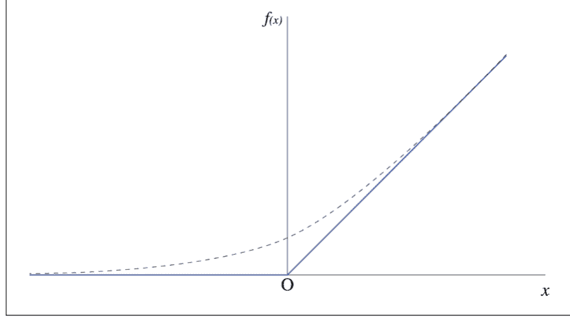

图中折线所表示的函数称为 softplus 函数，其导数为 logistic 函数，可描述如下：

$softplus(x)=ln(1+exp(x))$

仅供参考：我们有以下关系，它是对整流器的平滑近似。如上图所示，由于整流器比 sigmoid 函数和双曲正切函数简单得多，可以很容易猜到将其应用于深度学习算法时时间成本会降低。此外，由于计算反向传播误差时所需的整流器的导数也很简单，我们还可以进一步缩短时间成本。其导数的方程可表示如下：

$f'(x)=\begin{cases}1 & if\ x\ge0\\0 & otherwise\end{cases}$

由于整流器及其导数都非常稀疏，我们可以很容易想象神经网络在训练过程中也会变得稀疏。你可能也注意到，我们不再需要担心梯度饱和问题，因为 sigmoid 函数和双曲正切函数所包含的饱和曲线已不存在。

借助 dropout 技术和整流器，一个简单的深度神经网络可以在没有预训练的情况下学习一个问题。就实现 dropout 算法所使用的方程而言，它们并不困难，因为它们只是向多层感知器添加 dropout mask 的简单方法。让我们按顺序来看：

$$Z_j = h\left(\sum_i w_{ji} x_i + b_j\right)$$

这里，$h(\cdot)$ 表示激活函数，在本例中为整流器。你看，前一个方程是无 dropout 的隐藏层单元的方程。dropout 所做的只是对它们应用 mask。可表示如下：

$$Z_j = h\left(\sum_i w_{ji} x_i + b_j\right) m_j$$

$$m_j \sim \text{Bernoulli}(1 - p)$$

这里，$p$ 表示 dropout 的概率，通常设为 0.5。这就是前向激活的全部内容。从方程可以看出，二进制 mask 项是与一般神经网络的唯一区别。此外，在反向传播期间，我们还必须向 delta 添加 mask。假设我们有以下方程：

$$a_j = \sum_i w_{ji} x_i + b_j$$

在此基础上，我们可以如下定义 delta：

$$\delta_j := \frac{\partial E_n}{\partial a_j} = \sum_k \frac{\partial E_n}{\partial a_k}\frac{\partial a_k}{\partial a_j}$$

这里，$E_n$ 表示评估函数（这些方程与我们在 *第 2 章，机器学习算法 – 为深度学习做准备* 中提到的相同）。

我们得到以下方程：

$$a_k = \sum_j w_{kj}z_j + c_k$$
$$= \sum_j w_{kj}h(a_j)m_j + c_k$$

这里，delta 可描述如下：

$$\delta_j = h'(a_j)m_j\sum_k \delta_k w_{kj}$$

现在我们有了实现所需的所有方程，让我们深入实现。包结构如下：

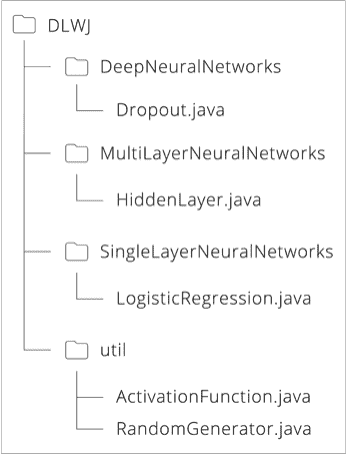

首先，我们需要的是整流器。与其他激活函数一样，我们在 ActivationFunction.java 中将其实现为 ReLU：

```java
public static double ReLU(double x) {
    if(x > 0) {
        return x;
    } else {
        return 0.;
    }
}
```

此外，我们将 dReLU 定义为整流器的导数：

```java
public static double dReLU(double y) {
    if(y > 0) {
        return 1.;
    } else {
        return 0.;
    }
}
```

相应地，我们更新了 HiddenLayer.java 的构造函数以支持 ReLU：

```java
if (activation == "sigmoid" || activation == null) {
    this.activation = (double x) -> sigmoid(x);
    this.dactivation = (double x) -> dsigmoid(x);
} else if (activation == "tanh") {
    this.activation = (double x) -> tanh(x);
    this.dactivation = (double x) -> dtanh(x);
} else if (activation == "ReLU") {
    this.activation = (double x) -> ReLU(x);
    this.dactivation = (double x) -> dReLU(x);
} else {
    throw new IllegalArgumentException("activation function not supported");
}
```

一旦模型构建完成，下一步就是使用 dropout 训练模型。训练方法简单地称为 train。由于在计算反向传播误差时需要一些层输入，我们首先定义名为 layerInputs 的变量来缓存其各自的输入值：

```
List<double[][]> layerInputs = new ArrayList<>(nLayers+1);
layerInputs.add(X);
```

这里，X 是原始训练数据。我们还需要为反向传播缓存每一层的 dropout mask，因此将其定义为 dropoutMasks：

```
List<int[][]> dropoutMasks = new ArrayList<>(nLayers);
```

训练以前向激活的方式开始。看我们如何将 dropout mask 应用于值；我们只是将激活值与二进制 mask 相乘：

```
// forward hidden layers
for (int layer = 0; layer < nLayers; layer++) {

    double[] x_; // layer input
    double[][] Z_ = new double[minibatchSize][hiddenLayerSizes[layer]];
    int[][] mask_ = new int[minibatchSize][hiddenLayerSizes[layer]];

    for (int n = 0; n < minibatchSize; n++) {

        if (layer == 0) {
            x_ = X[n];
        } else {
            x_ = Z[n];
        }

        Z_[n] = hiddenLayers[layer].forward(x_);
        mask_[n] = dropout(Z_[n], pDropout);  // apply dropout mask to units
    }

    Z = Z_;
    layerInputs.add(Z.clone());

    dropoutMasks.add(mask_);
}
```

dropout 方法也在 Dropout.java 中定义。如方程所述，此方法返回遵循伯努利分布的值：

```java
public int[] dropout(double[] z, double p) {
    int size = z.length;
    int[] mask = new int[size];
    for (int i = 0; i < size; i++) {
        mask[i] = binomial(1, 1 - p, rng);
        z[i] *= mask[i]; // apply mask
    }
    return mask;
}
```

经过隐藏层的前向传播后，训练数据在逻辑回归的输出层中进行前向传播。然后，与其他神经网络算法相同，各层的 delta 通过网络向后传播。在这里，我们将缓存的 mask 应用于 delta，以便其值在同一网络中进行反向传播：

```java
// forward & backward output layer
D = logisticLayer.train(Z, T, minibatchSize, learningRate);

// backward hidden layers
for (int layer = nLayers - 1; layer >= 0; layer--) {
    double[][] Wprev_;
    if (layer == nLayers - 1) {
        Wprev_ = logisticLayer.W;
    } else {
        Wprev_ = hiddenLayers[layer+1].W;
    }
    // apply mask to delta as well
    for (int n = 0; n < minibatchSize; n++) {
        int[] mask_ = dropoutMasks.get(layer)[n];
        for (int j = 0; j < D[n].length; j++) {
            D[n][j] *= mask_[j];
        }
    }
}
```

```
}
}

D = hiddenLayers[layer].backward(layerInputs.get(layer),
layerInputs.get(layer+1), D, Wprev_, minibatchSize,
learningRate);
}
```

训练之后是测试阶段。但在将测试数据应用于调优模型之前，我们需要配置网络的权重。不能简单地将 dropout mask 应用于测试数据，因为在 mask 后，每个网络的形状会有所不同，这可能会导致不同的结果，因为某个单元可能对某些特征有显著影响。相反，我们所做的是平滑网络的权重，这意味着我们模拟整个单元被同等 mask 的网络。这可以通过以下方程实现：

$$W_{test} = (1 - p)W$$

从方程可以看出，所有权重都乘以非 dropout 的概率。我们将此方法定义为 pretest：

```
public void pretest(double pDropout) {

    for (int layer = 0; layer < nLayers; layer++) {

        int nIn_, nOut_;

        if (layer == 0) {
            nIn_ = nIn;
        } else {
            nIn_ = hiddenLayerSizes[layer];
        }

        if (layer == nLayers - 1) {
            nOut_ = nOut;
        } else {
            nOut_ = hiddenLayerSizes[layer+1];
        }

        for (int j = 0; j < nOut_; j++) {
            for (int i = 0; i < nIn_; i++) {
                hiddenLayers[layer].W[j][i] *= 1 - pDropout;
            }
        }
    }
}
```


我们必须在测试前调用此方法一次。由于网络是一个通用的多层神经网络，我们对预测所需要做的只是通过网络进行前向激活：

```java
public Integer[] predict(double[] x) {

    double[] z = new double[0];

    for (int layer = 0; layer < nLayers; layer++) {

        double[] x_;

        if (layer == 0) {
            x_ = x;
        } else {
            x_ = z.clone();
        }

        z = hiddenLayers[layer].forward(x_);
    }

    return logisticLayer.predict(z);
}
```

与 DBN 和 SDA 相比，dropout MLP 远更简单、更容易实现。它表明，通过混合两种或更多技术，我们可以获得更高的精度。

### 卷积神经网络

为了解决这个问题，提出了一种名为 **卷积神经网络 (CNN)** 的算法。在 CNN 中，特征通过卷积层和池化层（稍后会解释）从二维输入数据中提取，然后这些特征被放入通用的多层感知器中。这种对 MLP 的预处理灵感来源于人类视觉区域，可以描述如下：

-   将输入数据分割成几个域。这个过程相当于人类的感受野。
-   从各自的域中提取特征，例如边缘和位置畸变。

有了这些特征，MLP 就可以据此对数据进行分类。

CNN 的图形模型与其他神经网络不相似。以下是 CNN 的一个简要示例：

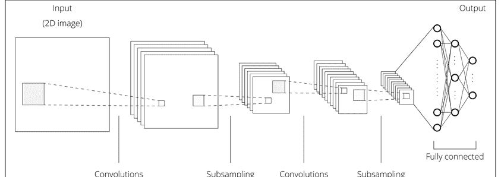

你可能仅凭图示无法完全理解 CNN 是什么。而且，你可能会觉得 CNN 相对复杂且难以理解。但你不必为此担心。CNN 具有复杂的图形模型，并且有卷积和池化等在其他深度学习算法中不常见的术语，这是事实。然而，当你逐步查看模型时，并没有太难理解的内容。CNN 由几种专门针对图像识别调整的层组成。让我们在下一小节中逐一查看每一层。在前面的图中，网络中有两个卷积和池化（子采样）层以及全连接的多层感知器。我们先看看卷积层的作用。

#### 卷积

卷积层字面上的确执行卷积，这意味着对图像应用多个滤波器以提取特征。这些滤波器称为 **核**，卷积后的图像称为 **特征图**。让我们看下面的图像（分解为颜色值）和核：

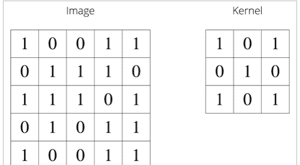

使用这些，卷积所做的事情如下所示：

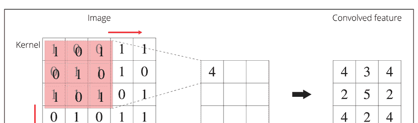

核在图像上滑动并返回其值与核的乘积之和作为乘法滤波器。你可能已经注意到，通过改变核值可以提取许多种特征。假设你有如下描述的值的核：

|   |   |   |
|---|---|---|
| -1 | -1 | -1 |
| -1 | 8 | -1 |
| -1 | -1 | -1 |

|   |   |   |
|---|---|---|
| 0.1 | 0.1 | 0.1 |
| 0.1 | 0.1 | 0.1 |
| 0.1 | 0.1 | 0.1 |

你可以看到，左边的核提取图像的边缘，因为它强调了颜色差异，而右边的核使图像模糊，因为它降低了原始值。CNN 的优点在于，在卷积层中，你不需要手动设置这些核值。一旦初始化，CNN 本身将通过学习算法学习适当的值（这意味着 CNN 中训练的参数是核的权重），最终可以非常精确地对图像进行分类。

现在，让我们思考为什么具有卷积层（核）的神经网络可以以更高的精度率进行预测。关键在于局部感受野。在除 CNN 外的神经网络的大多数层中，所有神经元都是全连接的。这甚至会导致稍微不同的数据，例如，一像素平移的数据在网络中会被视为完全不同的数据，因为该数据会传播到隐藏层中的不同神经元，而人类可以很容易地理解它们是相同的。使用全连接层，神经网络确实可以识别更复杂的模式，但同时它们缺乏泛化能力和灵活性。相比之下，你可以看到卷积层中神经元之间的连接仅限于其核大小，使模型对平移图像更鲁棒。因此，当核被优化时，具有局部受限感受野的神经网络能够获得平移不变性。

每个核都有自己的值并从图像中提取各自的特征。请记住，特征图的数量和核的数量始终相同，这意味着如果我们有 20 个核，我们也有二十个特征图，也就是卷积图像。这可能会令人困惑，所以让我们探索另一个例子。给定一个灰度 **图像** 和二十个 **核**，有多少个 **特征图**？答案是二十。这二十个图像将被传播到下一层。如下图所示：

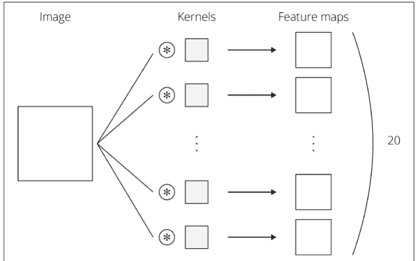

那么这样呢：假设我们有一个 3 通道的图像（例如 RGB 图像）并且核的数量为二十，会有多少个特征图？答案仍然是二十。但这次，卷积过程与灰度即 1 通道图像不同。当图像具有多个通道时，核将针对每个通道分别适配。因此，在这种情况下，我们首先会有总共 60 个卷积图像，由每个 3 个通道的二十个映射图像组成。然后，所有原本来自同一图像的卷积图像将被合并成一个特征图。结果我们将有二十个特征图。换句话说，图像被分解为不同通道的数据，应用核，然后再次组合成混合通道图像。你可以通过前一图中的流程很容易想象，当我们对多通道图像应用核以生成分解图像时，应该应用相同的核。此流程可在下图中看到：

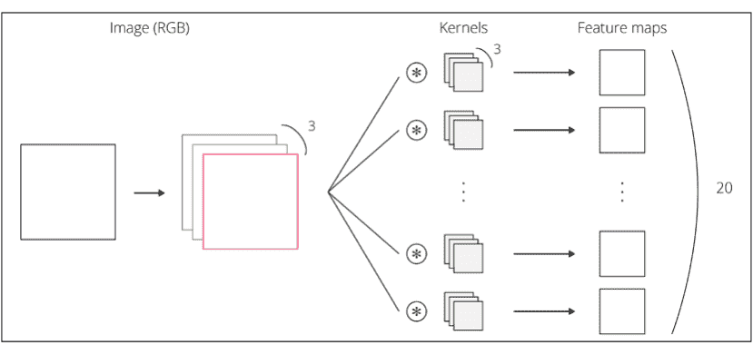

在计算上，核的数量用权重张量的维度表示。你稍后会看到如何实现这一点。

#### 池化

与卷积层相比，池化层所做的事情相当简单。它们实际上不会自行训练或学习，只是对从卷积层传播的图像进行下采样。为什么要费心做下采样？你可能会认为它可能会丢失数据中的一些重要信息。但在这里，与卷积层一样，这个过程对于使网络保持其平移不变性是必要的。

下采样有几种方法，其中最著名的是最大池化。它可以表示如下：

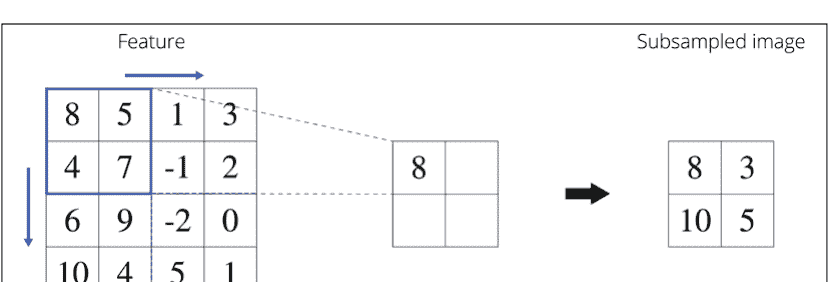

在最大池化层中，输入图像被分割成一组不重叠的子数据，并从每个数据中输出最大值。这一过程不仅保持了其平移不变性，还减少了上层层的计算量。通过卷积和池化，CNN 可以从输入中获取鲁棒特征。

#### 方程与实现

现在我们知道了卷积和最大池化是什么，让我们用方程来描述整个模型。我们将在方程中使用下面的卷积图：

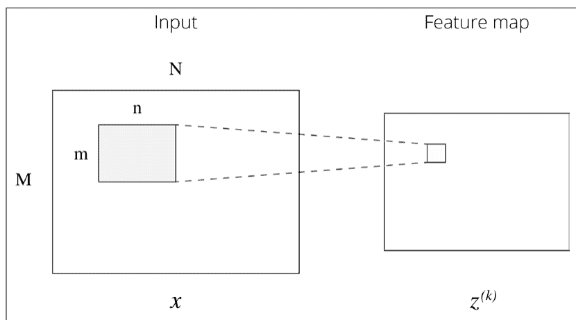

如图所示，如果我们有一个大小为 M × N 的图像和大小为 m × n 的核，卷积可以表示为：

$z_{ij}^{(k)} = \sum_{s=0}^{m-1} \sum_{t=0}^{n-1} w_{st}^{(k)} x(i+s)(j+t)$


这里，w 是核的权重，即模型参数。请记住，我们将每个求和都从 0 开始描述，而不是从 1 开始，这样你能更好地理解。然而，当我们考虑多卷积层时，该方程是不够的，因为它没有通道的信息。幸运的是，这并不困难，因为我们只需在核中添加一个参数即可实现。扩展的方程可以表示为：

$$z_{ij}^{(k)} = \sum_{c} \sum_{s=0}^{m-1} \sum_{t=0}^{n-1} w_{st}^{(k,c)} x_{(i+s)(j+t)}^{(c)}$$

这里，c 表示图像的通道。如果核的数量为 K，通道数量为 C，则有 $W \in \mathbb{R}^{K \times C \times m \times n}$。然后，从方程中可以看到，卷积后图像的大小为 $(M - m +1)\times(N - n +1)$。

卷积后，所有卷积值都将由激活函数激活。我们将使用整流器——目前最流行的函数——来实现 CNN，但你也可以使用 sigmoid 函数、双曲正切或其他可用的激活函数。有了激活函数，我们有：

$$a_{ij}^{(k)} = h\left(z_{ij}^{(k)} + b^{(k)}\right) = \max\left(0, z_{ij}^{(k)} + b^{(k)}\right)$$

这里，b 表示偏置，即另一个模型参数。可以看到 b 没有 i 和 j 的下标，即我们有 $b \in \mathbb{R}^K$，一个一维数组。因此，我们已将卷积层的值前向传播。

接下来是最大池化层。传播可以简单地写成如下：

$$y_{ij}^{(k)} = \max\left(a_{(l_1 i + s)(l_2 j + t)}^{(k)}\right)$$

这里，$l_1$ 和 $l_2$ 是池化滤波器的大小，且 $s \in [0, l_1], t \in [0, l_2]$。通常，$l_1$ 和 $l_2$ 被设为相同的值 2 ~ 4。

这两个层，卷积层和最大池化层，往往按此顺序排列，但你不一定必须遵循。例如，你可以在最大池化之前放置两个卷积层。此外，虽然我们将激活放在卷积之后，有时它也会设在最大池化之后而不是卷积之后。然而，为了简单起见，我们将按卷积-激活-最大池化的顺序和序列实现 CNN。


> 这里有一个重要说明，虽然核权重将从数据中学习，但架构、核的大小和池化的大小都是参数。

简单的 MLP 在卷积层和最大池化层之后，用于对数据进行分类。这里，由于 MLP 只能接受一维数据，我们需要将下采样的数据展平作为预处理，以适应 MLP 的输入层。特征提取在 MLP 之前已完成，因此将数据格式化为一维不会有问题。因此，一旦模型优化，CNN 就可以对图像数据进行分类。为此，与其他神经网络一样，反向传播算法应用于 CNN 以训练模型。我们在此不提及与 MLP 相关的方程。

来自 MLP 输入层的误差被反向传播到最大池化层，这次它被展开为二维以正确适应模型。由于最大池化层没有模型参数，它只是简单地将误差反向传播到前一层。方程可以描述如下：

$$\frac{\partial E}{\partial a^{(k)}_{(l_1+s)(l_2+j+t)}} = \begin{cases} \frac{\partial E}{\partial y^{(k)}_{ij}} & \text{if } y^{(k)}_{ij} = a^{(k)}_{(l_1+s)(l_2+j+t)} \\ 0 & \text{otherwise} \end{cases}$$

这里，E 表示评估函数。然后该误差被反向传播到卷积层，并据此我们可以计算权重和偏置的梯度。由于在反向传播时带偏置的激活在卷积之前，让我们先看偏置的梯度，如下所示：

$$\frac{\partial E}{\partial b^{(k)}} = \sum_{i=0}^{M-m} \sum_{j=0}^{N-m} \frac{\partial E}{\partial a^{(k)}_{ij}} \frac{\partial a^{(k)}_{ij}}{\partial b^{(k)}}$$

为了继续这个方程，我们定义如下：

$\delta_{ij}^{(k)} := \frac{\partial E}{\partial a_{ij}^{(k)}}$

我们还定义：

$c_{ij}^{(k)} := z_{ij}^{(k)} + b^{(k)}$

有了这些，我们得到：

$\frac{\partial E}{\partial b^{(k)}} = \sum_{i=0}^{M-m} \sum_{j=0}^{N-n} \delta_{ij}^{(k)} \frac{\partial a_{ij}^{(k)}}{\partial c_{ij}^{(k)}} \frac{\partial c_{ij}^{(k)}}{\partial b^{(k)}}$
$= \sum_{i=0}^{M-m} \sum_{j=0}^{N-n} \delta_{ij}^{(k)} h'\left(c_{ij}^{(k)}\right)$

我们可以用同样的方式计算权重（核）的梯度：

$\frac{\partial E}{\partial w_{st}^{(k,c)}} = \sum_{i=0}^{M-m} \sum_{j=0}^{N-n} \frac{\partial E}{\partial z_{ij}^{(k)}} \frac{\partial z_{ij}^{(k)}}{\partial w_{st}^{(k,c)}}$
$= \sum_{i=0}^{M-m} \sum_{j=0}^{N-n} \frac{\partial E}{\partial z_{ij}^{(k)}} \frac{\partial a_{ij}^{(k)}}{\partial z_{ij}^{(k)}} x_{(i+s)(j+t)}^{(c)}$
$= \sum_{i=0}^{M-m} \sum_{j=0}^{N-n} \delta_{ij}^{(k)} h'\left(c_{ij}^{(k)}\right) x_{(i+s)(j+t)}^{(c)}$

因此，我们可以更新模型参数。如果我们只有一个卷积层和最大池化层，刚才给出的方程就足够了。然而，当考虑多卷积层时，我们还需要计算卷积层的误差。这可以表示如下：

$\frac{\partial E}{\partial x_{ij}^{(c)}} = \sum_{k} \sum_{s=0}^{m-1} \sum_{t=0}^{n-1} \frac{\partial E}{\partial z_{(i-s)(j-t)}^{(k)}} \cdot \frac{\partial z_{(i-s)(j-t)}^{(k)}}{\partial x_{ij}^{(c)}} = \sum_{k} \sum_{s=0}^{m-1} \sum_{t=0}^{n-1} \frac{\partial E}{\partial z_{(i-s)(j-t)}^{(k)}} w_{st}^{(k,c)}$

这里，我们得到：

$\frac{\partial E}{\partial z_{ij}^{(k)}} = \frac{\partial E}{\partial a_{ij}^{(k)}} \cdot \frac{\partial a_{ij}^{(k)}}{\partial z_{ij}^{(k)}} = \delta_{ij}^{(k)} \frac{\partial a_{ij}^{(k)}}{\partial c_{ij}^{(k)}} \cdot \frac{\partial c_{ij}^{(k)}}{\partial z_{ij}^{(k)}} = \delta_{ij}^{(k)} h'(c_{ij}^{(k)})$

因此，误差可以写成如下：

$\frac{\partial E}{\partial x_{ij}^{(c)}} = \sum_{k} \sum_{s=0}^{m-1} \sum_{t=0}^{n-1} \delta_{(i-s)(j-t)}^{(k)} h'(c_{(i-s)(j-t)}^{(k)}) w_{st}^{(k,c)}$

计算时我们必须小心，因为存在 i − s < 0 或 j − t < 0 的可能性，此时特征图之间没有元素。为了解决这个问题，我们需要在它们的左上角添加零填充。然后，该方程只是沿两个轴翻转核的卷积。虽然 CNN 中的方程看起来可能很复杂，但它们只是每个参数的求和堆叠。

有了之前的全部方程，我们现在可以实现 CNN，那么让我们看看如何做。包结构如下：

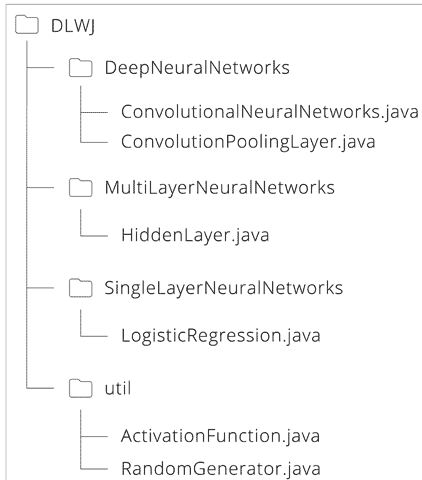

ConvolutionNeuralNetworks.java 用于构建 CNN 的模型概要，而卷积层和最大池化层的训练、向前传播和向后传播的确切算法则写在 ConvolutionPoolingLayer.java 中。在演示中，我们原始图像大小为 12 × 12，且通道数为 1：

```
final int[] imageSize = {12, 12};
final int channel = 1;
```

图像将通过两个 ConvPoolingLayer（卷积层和最大池化层）传播。第一层的核数量设为 10，大小为 3 × 3，第二层的核数量为 20，大小为 2 × 2。池化滤波器的大小均设为 2 × 2：

```
int[] nKernels = {10, 20};
int[][] kernelSizes = { {3, 3}, {2, 2} };
int[][] poolSizes = { {2, 2}, {2, 2} };
```

在第二个最大池化层之后，有 20 个大小为 2 × 2 的特征图。这些图随后被展平为 80 个单元，并将转发到具有 20 个神经元的隐藏层：

```cpp
int nHidden = 20;
```

然后我们创建三个带少量噪声的简单演示数据。我们在此省略创建演示数据的代码。如果我们说明数据，这里是一个示例：

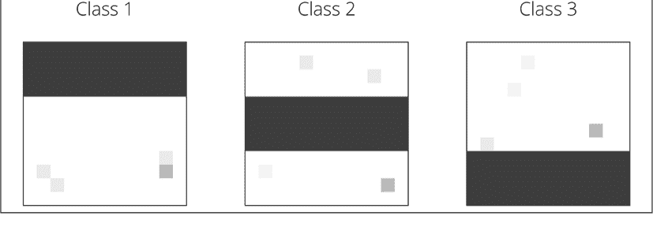

现在让我们构建模型。构造函数与其它深度学习模型类似且相当简单。我们首先构建多个 ConvolutionPoolingLayers。每个层的大小在方法中计算：

```cpp
// construct convolution + pooling layers
for (int i = 0; i < nKernels.length; i++) {
    int[] size_;
    int channel_;

    if (i == 0) {
        size_ = new int[]{imageSize[0], imageSize[1]};
        channel_ = channel;
    } else {
        size_ = new int[]{pooledSizes[i-1][0], pooledSizes[i-1][1]};
        channel_ = nKernels[i-1];
    }

    convolvedSizes[i] = new int[]{size_[0] - kernelSizes[i][0] + 1,
    size_[1] - kernelSizes[i][1] + 1};
}
```


```java
pooledSizes[i] = new int[] {convolvedSizes[i][0] / poolSizes[i][0], convolvedSizes[i][1] / poolSizes[i][1] };

convpoolLayers[i] = new ConvolutionPoolingLayer(size_, channel_, nKernels[i], kernelSizes[i], poolSizes[i], convolvedSizes[i], pooledSizes[i], rng, activation);
}
```

当你查看ConvolutionPoolingLayer类的构造函数时，可以看到卷积核和偏置是如何定义的：

```java
if (W == null) {
    W = new double[nKernel][channel][kernelSize[0]][kernelSize[1]];
    double in_ = channel * kernelSize[0] * kernelSize[1];
    double out_ = nKernel * kernelSize[0] * kernelSize[1] / (poolSize[0] * poolSize[1]);
    double w_ = Math.sqrt(6. / (in_ + out_));
    for (int k = 0; k < nKernel; k++) {
        for (int c = 0; c < channel; c++) {
            for (int s = 0; s < kernelSize[0]; s++) {
                for (int t = 0; t < kernelSize[1]; t++) {
                    W[k][c][s][t] = uniform(-w_, w_, rng);
                }
            }
        }
    }
}

if (b == null) b = new double[nKernel];
```

接下来是MLP的构建。在将下采样后的数据传入MLP时，别忘了将其展平：

```java
// build MLP
flattenedSize = nKernels[nKernels.length-1] * pooledSizes[pooledSizes.length-1][0] * pooledSizes[pooledSizes.length-1][1];

// construct hidden layer
hiddenLayer = new HiddenLayer(flattenedSize, nHidden, null, null, rng, activation);

// construct output layer
logisticLayer = new LogisticRegression(nHidden, nOut);
```

一旦模型构建完成，我们就需要训练它。在train方法中，我们缓存所有前向传播的数据，以便在反向传播时使用：

```java
// cache pre-activated, activated, and downsampled inputs of each
// convolution + pooling layer for backpropagation
List<double[][][]> preActivated_X = new ArrayList<>(nKernels.length);
List<double[][][]> activated_X = new ArrayList<>(nKernels.length);
List<double[][][]> downsampled_X = new ArrayList<>(nKernels.length+1);  // +1 for input X
downsampled_X.add(X);

for (int i = 0; i < nKernels.length; i++) {
    preActivated_X.add(new double[minibatchSize][nKernels[i]][convolvedSizes[i][0]][convolvedSizes[i][1]]);
    activated_X.add(new double[minibatchSize][nKernels[i]][convolvedSizes[i][0]][convolvedSizes[i][1]]);
    downsampled_X.add(new double[minibatchSize][nKernels[i]][convolvedSizes[i][0]][convolvedSizes[i][1]]);
}
```

preActivated_X用于存储卷积后的特征图，activated_X用于存储激活后的特征，downsampled_X用于存储下采样后的特征。我们将原始数据放入downsampled_X中进行缓存。实际训练从通过卷积层和最大池化层进行前向传播开始：

```java
// forward convolution + pooling layers
double[][][] z_ = X[n].clone();
for (int i = 0; i < nKernels.length; i++) {
    z_ = convpoolLayers[i].forward(z_, preActivated_X.get(i)[n], activated_X.get(i)[n]);
    downsampled_X.get(i+1)[n] = z_.clone();
}
```

ConvolutionPoolingLayer的forward方法很简单，由convolve和downsample组成。convolve函数执行卷积，downsample执行最大池化：

```java
public double[][][] forward(double[][][] x, double[][][] preActivated_X, double[][][] activated_X) {
    double[][][] z = this.convolve(x, preActivated_X, activated_X);
    return this.downsample(z);
}
```

```java
for (int j = 0; j < pooledSize[1]; j++) {
    double max_ = 0.;
    for (int s = 0; s < poolSize[0]; s++) {
        for (int t = 0; t < poolSize[1]; t++) {
            if (s == 0 && t == 0) {
                max_ = x[k][poolSize[0]*i][poolSize[1]*j];
                continue;
            }
            if (max_ < x[k][poolSize[0]*i+s][poolSize[1]*j+t]) {
                max_ = x[k][poolSize[0]*i+s][poolSize[1]*j+t];
            }
        }
    }
    y[k][i][j] = max_;
}
}
}
return y;
}
```

你可能会觉得这里出了错，因为这些方法中有如此多的for循环，但实际上并无问题。从CNN的公式可以看出，该算法需要大量循环，因为它有很多参数。这里的代码运行良好，但实际开发中，你可以将最内层循环的部分提取出来，放到其他方法中。为了便于理解，我们用大量的嵌套循环来实现CNN，这样就可以将代码与公式进行对照。现在你可以看到，CNN需要很长时间才能得到结果。

下采样数据之后，我们需要将其展平：

```java
// flatten output to make it input for fully connected MLP
double[] x_ = this.flatten(z_);
flattened_X[n] = x_.clone();
```

然后将数据前向传播到隐藏层：

```java
// forward hidden layer
Z[n] = hiddenLayer.forward(x_);
```

输出层使用多类逻辑回归，然后将delta反向传播到隐藏层：

```java
// forward & backward output layer
dY = logisticLayer.train(Z, T, minibatchSize, learningRate);

// backward hidden layer
dZ = hiddenLayer.backward(flattened_X, Z, dY, logisticLayer.W, minibatchSize, learningRate);

// backpropagate delta to input layer
for (int n = 0; n < minibatchSize; n++) {
    for (int i = 0; i < flattenedSize; i++) {
        for (int j = 0; j < nHidden; j++) {
            dX_flatten[n][i] += hiddenLayer.W[j][i] * dZ[n][j];
        }
    }
    dX[n] = unflatten(dX_flatten[n]); // unflatten delta
}

// backward convolution + pooling layers
dC = dX.clone();
for (int i = nKernels.length-1; i >= 0; i--) {
    dC = convpoolLayers[i].backward(downsampled_X.get(i),
        preActivated_X.get(i), activated_X.get(i),
        downsampled_X.get(i+1), dC, minibatchSize, learningRate);
}
```

ConvolutionPoolingLayer的backward方法与forward方法一样，也很简单。最大池化的反向传播实现在upsample中，卷积的反向传播实现在deconvolve中：

```java
public double[][][][] backward(double[][][][] X, double[][][][] preActivated_X, double[][][][] activated_X, double[][][][] downsampled_X, double[][][][] dY, int minibatchSize, double learningRate) {
    double[][][][] dZ = this.upsample(activated_X, downsampled_X, dY, minibatchSize);
    return this.deconvolve(X, preActivated_X, dZ, minibatchSize, learningRate);
}
```

upsample所做的工作只是将delta传递回卷积层：

```java
public double[][][][] upsample(double[][][][] X, double[][][][] Y,
                               double[][][][] dY, int minibatchSize) {

    double[][][][] dX = new double[minibatchSize][nKernel][convolvedSize[0]][convolvedSize[1]];

    for (int n = 0; n < minibatchSize; n++) {
        for (int k = 0; k < nKernel; k++) {
            for (int i = 0; i < pooledSize[0]; i++) {
                for (int j = 0; j < pooledSize[1]; j++) {
                    for (int s = 0; s < poolSize[0]; s++) {
                        for (int t = 0; t < poolSize[1]; t++) {
                            double d_ = 0.;

                            if (Y[n][k][i][j] == X[n][k][poolSize[0]*i+s][poolSize[1]*j+t]) {
                                d_ = dY[n][k][i][j];
                            }

                            dX[n][k][poolSize[0]*i+s][poolSize[1]*j+t] = d_;
                        }
                    }
                }
            }
        }
    }

    return dX;
}
```

在deconvolve中，我们需要更新模型参数。由于我们使用小批量训练模型，我们首先计算梯度的总和：

```java
// calc gradients of W, b
for (int n = 0; n < minibatchSize; n++) {
    for (int k = 0; k < nKernel; k++) {
        for (int i = 0; i < convolvedSize[0]; i++) {
            for (int j = 0; j < convolvedSize[1]; j++) {
                double d_ = dY[n][k][i][j] *
                    this.dactivation.apply(Y[n][k][i][j]);

                grad_b[k] += d_;

                for (int c = 0; c < channel; c++) {
                    for (int s = 0; s < kernelSize[0]; s++) {
                        for (int t = 0; t < kernelSize[1]; t++) {
                            grad_W[k][c][s][t] += d_ *
                                X[n][c][i+s][j+t];
                        }
                    }
                }
            }
        }
    }
}
```

然后，利用这些梯度更新权重和偏置：

```java
// update gradients
for (int k = 0; k < nKernel; k++) {
    b[k] -= learningRate * grad_b[k] / minibatchSize;

    for (int c = 0; c < channel; c++) {
        for (int s = 0; s < kernelSize[0]; s++) {
            for (int t = 0; t < kernelSize[1]; t++) {
                W[k][c][s][t] -= learningRate * grad_W[k][c][s][t] / minibatchSize;
            }
        }
    }
}
```

与其他算法不同，在CNN中我们必须分别计算参数和delta：

```java
// calc delta
for (int n = 0; n < minibatchSize; n++) {
    for (int c = 0; c < channel; c++) {
        for (int i = 0; i < imageSize[0]; i++) {
            for (int j = 0; j < imageSize[1]; j++) {
                for (int k = 0; k < nKernel; k++) {
```


```
for (int s = 0; s < kernelSize[0]; s++) {
    for (int t = 0; t < kernelSize[1]; t++) {

        double d_ = 0.;

        if (i - (kernelSize[0] - 1) - s >= 0 &&
            j - (kernelSize[1] - 1) - t >= 0) {
            d_ = dY[n][k][i-(kernelSize[0]-1)-
            s][j-(kernelSize[1]-1)-t] *
            this.dactivation.apply(Y[n][k]
            [i- (kernelSize[0]-1)-s]
            [j-(kernelSize[1]-1)-t]) *
            W[k][c][s][t];
        }

        dX[n][c][i][j] += d_;
    }
}
}
}
}
}
}
```

现在我们训练模型，所以接下来进入测试部分。测试或预测的方法只是进行前向传播，就像其他算法一样：

```
public Integer[] predict(double[][][] x) {

    List<double[][][]> preActivated = new ArrayList<>(nKernels.length);
    List<double[][][]> activated = new ArrayList<>(nKernels.length);

    for (int i = 0; i < nKernels.length; i++) {
        preActivated.add(new
            double[nKernels[i]][convolvedSizes[i][0]]
            [convolvedSizes[i][1]]);
        activated.add(new double[nKernels[i]][convolvedSizes[i][0]]
            [convolvedSizes[i][1]]);
    }

    // forward convolution + pooling layers
    double[][][] z = x.clone();
    for (int i = 0; i < nKernels.length; i++) {
    z = convpoolLayers[i].forward(z, preActivated.get(i),
    activated.get(i));
}

// forward MLP
return logisticLayer.predict(hiddenLayer.forward(this.flatten(z)));
}
```

恭喜！关于 CNN 就到此为止了。现在你可以运行代码看看它是如何工作的。这里，我们的 CNN 输入是二维数据，但如果扩展模型，CNN 也可以处理三维数据。我们可以期待它在医学领域的应用，例如从人类大脑的三维扫描数据中找出恶性肿瘤。

卷积和池化的过程最初由 LeCun 等人在 1998 年发明（http://yann.lecun.com/exdb/publis/pdf/lecun-98.pdf），但从代码中可以看到，它需要大量的计算。我们可以假设当时这种方法可能不适合在计算机上进行实际应用，更不用说使其加深了。CNN 近期获得更多关注的原因可能是因为计算机的性能和容量得到了极大发展。但我们仍然不能否认这个问题。因此，当我们处理一定数据量的 CNN 时，使用 GPU 而不是 CPU 似乎是实用的。由于将算法优化到 GPU 的实现很复杂，我们这里不会编写代码。相反，在第 5 章《探索 Java 深度学习库 – DL4J、ND4J 等》和第 7 章《其他重要深度学习库》中，你将看到能够利用 GPU 的深度学习库。

### 摘要

在本章中，你学习了两种不需要预训练的深度学习算法：带 dropout 的深度神经网络和 CNN。实现高精度率的关键在于如何使网络稀疏化，而 dropout 就是实现这一目标的一种技术。另一种技术是整流器，即一种激活函数，可以解决 sigmoid 函数和双曲正切函数中出现的饱和问题。CNN 是图像识别中最流行的算法，具有两个特征：卷积和最大池化。这两者都使模型获得平移不变性。如果你对 dropout、整流器和其他激活函数如何影响神经网络性能感兴趣，以下资料可能是不错的参考：Deep Sparse Rectifier Neural Networks（Glorot, et al. 2011, http://www.jmlr.org/proceedings/papers/v15/glorot11a/glorot11a.pdf），ImageNet Classification with Deep Convolutional Neural Networks（Krizhevsky et al. 2012, https://papers.nips.cc/paper/4824-imagenet-classification-with-deep-convolutional-neural-networks.pdf），和 Maxout Networks（Goodfellow et al. 2013, http://arxiv.org/pdf/1302.4389.pdf）。

虽然你现在已经了解了流行且有用的深度学习算法，但本书中仍有许多未提及的算法。这个研究领域变得越来越活跃，新的算法也不断出现。但不用担心，因为所有算法都基于同一个根源：神经网络。现在你已经掌握了理解或实现模型所需的方式，你可以完全理解所遇到的任何模型。

我们从零开始实现了深度学习算法，以便你完全理解它们。在下一章，你将看到如何使用深度学习库来实现它们，从而促进我们的研究或应用。

## 5 探索 Java 深度学习库 – DL4J、ND4J 等

在之前的章节中，你学习了深度学习算法的核心理论并从零开始实现了它们。虽然我们可以说深度学习的实现并不困难，但我们不能否认实现模型仍然需要花费一些时间。为缓解这种情况，本章将教你如何使用 Java 深度学习库编写代码，以便我们能更专注于数据分析的关键部分而非琐碎部分。

本章将学习以下主题：

- Java 深度学习库的介绍
- 示例代码以及如何使用该库编写自己的代码
- 一些额外的方法来优化模型以获得更高的精度率

### 从零实现与使用库/框架

我们在第 2 章《机器学习算法 – 为深度学习做准备》中实现了神经网络的机器学习算法，并在第 3 章《深度信念网络和堆叠去噪自编码器》以及第 4 章《Dropout 和卷积神经网络》中从零开始实现了许多深度学习算法。当然，我们可以用一些定制将自己的代码应用于实际应用，但在使用它们时必须谨慎，因为我们不能否认它们未来可能会引起一些问题的可能性。它们可能是什么？以下是可能的情况：

- 我们编写的代码缺少一些更好的优化参数，因为我们为了简洁和让你更好地理解概念，只实现了算法的精髓。虽然你仍然可以用它们训练和优化模型，但通过添加你自己的实现的另一个参数，你可以获得更高的精度率。
- 如前一章所述，本书中仍有许多有用的深度学习算法未作解释。虽然你现在已经掌握了深度学习算法的核心组件，但在你的领域和应用中获得所需结果时，你可能需要实现额外的类或方法。
- 假设的时间消耗对应用来说将非常重要，尤其是在考虑分析大量数据时。Java 相对于 Python 和 R 等其他流行语言在速度方面确实有更好的性能，但你仍需考虑时间成本。解决问题的可行方法之一是使用 GPU 而非 CPU，但这需要复杂的实现来调整代码以进行 GPU 计算。

这些是主要的原因问题，你可能还需要考虑到我们在代码中没有处理异常。

这并不意味着从零实现会有致命错误。我们编写的代码可以作为特定规模数据的应用实质性地使用；然而，如果你使用通常需要深度学习的大规模数据挖掘，你需要考虑到你已实现的基本部分需要进一步编码。这意味着你需要记住从零实现具有更大的灵活性，因为如果需要你可以更改代码，但同时它也有负面影响，即算法的调优和维护也必须独立完成。

那么，我们如何解决刚才提到的问题呢？这就是库（或框架）发挥作用的地方。得益于全球对深度学习的积极研究，使用各种编程语言开发和发布了许多库。当然，每个库都有各自的特点，但每个库共同拥有的特点可以总结如下：

- 模型的训练只需通过定义深度学习的层结构即可完成。你可以专注于参数设置和调优，而无需考虑算法。
- 大多数库作为开源项目向公众开放，并且每天都在积极更新。因此，如果存在错误，这些错误很可能很快会被修复（当然，自己修复错误并提交到项目中是受欢迎的）。
- 在 CPU 或 GPU 上运行程序之间切换很容易。由于库补充了 GPU 计算的繁琐编码元素，如果机器支持 GPU，你只需专注于实现而无需考虑 CPU 或 GPU。

简单来说，你可以将从零实现时可能很残酷的所有部分留给库。得益于此，你可以在必要的数据挖掘部分花费更多时间，因此如果你想利用实际应用，使用库进行数据分析的可能性很高，可以更高效地进行。

然而，过度依赖库并不是好事。使用库很方便，但另一方面，它也有一些缺点，如下所示：

- 由于你可以轻松构建各种深度学习模型，你可以在没有对模型所依据的理论有具体理解的情况下进行实现。如果我们只考虑与特定模型相关的实现，这可能不是问题，但当你想结合其他方法或在应用模型时考虑其他方法时，你将面临无法处理的风险。
- 你不能使用库不支持的算法，因此可能出现你无法选择想要使用的模型的情况。这可以通过版本升级解决，但另一方面，由于升级导致规范变更，过去实现的某些部分可能被弃用的可能性存在。此外，我们不能否认由于许可证突然变更，库的开发突然终止或使用变得收费的可能性。在这些情况下，你迄今为止开发的代码可能无法使用的风险存在。


你从实验中能得到的精确率取决于库的实现方式。例如，如果我们用同一个神经网络模型在两个不同的库中进行实验，所得到的结果可能会有巨大差异。这是由于神经网络算法包含随机操作，而且机器的计算精度有限，也就是说，在过程中计算出的值可能会根据实现方法而产生波动。

由于得益于前面的章节，你已经很好地理解了深度学习算法的基础概念和理论，因此我们无需担心第一点。然而，我们需要对剩下的两点保持谨慎。从下一节开始，将介绍使用库的实现方法，我们也会更加关注刚才讨论的优缺点。

### 介绍 DL4J 和 ND4J

世界各地已经开发了大量的深度学习库。2015 年 11 月，由 Google 开发的机器学习/深度学习库 **TensorFlow** (http://www.tensorflow.org/) 向公众开放，引起了极大的关注。

从开发库所使用的编程语言来看，公开的大多数库都是用 Python 开发的或使用 Python API。TensorFlow 后端使用 C++ 开发，但也可以用 Python 编写代码。本书专注于使用 Java 学习深度学习，因此其他语言开发的库将在第 7 章 *其他重要深度学习库* 中简要介绍。

那么，我们有哪些基于 Java 的库呢？实际上，有一些正在积极开发的案例（也许还有一些未公开的项目）。然而，实际上我们能使用的库只有一个：**Deeplearning4j (DL4J)**。官方项目页面网址是 http://deeplearning4j.org/。该库也是开源的，源代码全部发布在 GitHub 上。网址是 https://github.com/deeplearning4j/deeplearning4j。该库由 Skymind (http://www.skymind.io/) 开发。这是什么样的库呢？如果查看项目页面，其介绍如下：

> "Deeplearning4j 是第一个为 Java 和 Scala 编写的商业级、开源、分布式深度学习库。集成了 Hadoop 和 Spark，DL4J 被设计用于商业环境，而不是作为研究工具。Skymind 是其商业支持部门。

> *Deeplearning4j 旨在成为前沿的即插即用，更多的是约定而非配置，这使得非研究人员能够快速原型设计。DL4J 可在规模上进行定制。在 Apache 2.0 许可证下发布，DL4J 的所有衍生产品归其作者所有。*

读到这里，你会发现 DL4J 最大的特点是它是在与 Hadoop 集成的[content]
你从实验中能得到的精确率取决于库的实现方式。例如，如果我们用同一个神经网络模型在两个不同的库中进行实验，所得到的结果可能会有巨大差异。这是由于神经网络算法包含随机操作，而且机器的计算精度有限，也就是说，在过程中计算出的值可能会根据实现方法而产生波动。

由于得益于前面的章节，你已经很好地理解了深度学习算法的基础概念和理论，因此我们无需担心第一点。然而，我们需要对剩下的两点保持谨慎。从下一节开始，将介绍使用库的实现方法，我们也会更加关注刚才讨论的优缺点。

### 介绍 DL4J 和 ND4J

世界各地已经开发了大量的深度学习库。2015 年 11 月，由 Google 开发的机器学习/深度学习库 **TensorFlow** (http://www.tensorflow.org/) 向公众开放，引起了极大的关注。

从开发库所使用的编程语言来看，公开的大多数库都是用 Python 开发的或使用 Python API。TensorFlow 后端使用 C++ 开发，但也可以用 Python 编写代码。本书专注于使用 Java 学习深度学习，因此其他语言开发的库将在第 7 章 *其他重要深度学习库* 中简要介绍。

那么，我们有哪些基于 Java 的库呢？实际上，有一些正在积极开发的案例（也许还有一些未公开的项目）。然而，实际上我们能使用的库只有一个：**Deeplearning4j (DL4J)**。官方项目页面网址是 http://deeplearning4j.org/。该库也是开源的，源代码全部发布在 GitHub 上。网址是 https://github.com/deeplearning4j/deeplearning4j。该库由 Skymind (http://www.skymind.io/) 开发。这是什么样的库呢？如果查看项目页面，其介绍如下：

> "Deeplearning4j 是第一个为 Java 和 Scala 编写的商业级、开源、分布式深度学习库。集成了 Hadoop 和 Spark，DL4J 被设计用于商业环境，而不是作为研究工具。Skymind 是其商业支持部门。

> *Deeplearning4j 旨在成为前沿的即插即用，更多的是约定而非配置，这使得非研究人员能够快速原型设计。DL4J 可在规模上进行定制。在 Apache 2.0 许可证下发布，DL4J 的所有衍生产品归其作者所有。*

读到这里，你会发现 DL4J 最大的特点是它是在与 Hadoop 集成的[content]
你从实验中能得到的精确率取决于库的实现方式。例如，如果我们用同一个神经网络模型在两个不同的库中进行实验，所得到的结果可能会有巨大差异。这是由于神经网络算法包含随机操作，而且机器的计算精度有限，也就是说，在过程中计算出的值可能会根据实现方法而产生波动。

由于得益于前面的章节，你已经很好地理解了深度学习算法的基础概念和理论，因此我们无需担心第一点。然而，我们需要对剩下的两点保持谨慎。从下一节开始，将介绍使用库的实现方法，我们也会更加关注刚才讨论的优缺点。

### 介绍 DL4J 和 ND4J

世界各地已经开发了大量的深度学习库。2015 年 11 月，由 Google 开发的机器学习/深度学习库 **TensorFlow** (http://www.tensorflow.org/) 向公众开放，引起了极大的关注。

从开发库所使用的编程语言来看，公开的大多数库都是用 Python 开发的或使用 Python API。TensorFlow 后端使用 C++ 开发，但也可以用 Python 编写代码。本书专注于使用 Java 学习深度学习，因此其他语言开发的库将在第 7 章 *其他重要深度学习库* 中简要介绍。

那么，我们有哪些基于 Java 的库呢？实际上，有一些正在积极开发的案例（也许还有一些未公开的项目）。然而，实际上我们能使用的库只有一个：**Deeplearning4j (DL4J)**。官方项目页面网址是 http://deeplearning4j.org/。该库也是开源的，源代码全部发布在 GitHub 上。网址是 https://github.com/deeplearning4j/deeplearning4j。该库由 Skymind (http://www.skymind.io/) 开发。这是什么样的库呢？如果查看项目页面，其介绍如下：

> "Deeplearning4j 是第一个为 Java 和 Scala 编写的商业级、开源、分布式深度学习库。集成了 Hadoop 和 Spark，DL4J 被设计用于商业环境，而不是作为研究工具。Skymind 是其商业支持部门。

> *Deeplearning4j 旨在成为前沿的即插即用，更多的是约定而非配置，这使得非研究人员能够快速原型设计。DL4J 可在规模上进行定制。在 Apache 2.0 许可证下发布，DL4J 的所有衍生产品归其作者所有。*

读到这里，你会发现 DL4J 最大的特点是它是在与 Hadoop 集成的[content]
你从实验中能得到的精确率取决于库的实现方式。例如，如果我们用同一个神经网络模型在两个不同的库中进行实验，所得到的结果可能会有巨大差异。这是由于神经网络算法包含随机操作，而且机器的计算精度有限，也就是说，在过程中计算出的值可能会根据实现方法而产生波动。

由于得益于前面的章节，你已经很好地理解了深度学习算法的基础概念和理论，因此我们无需担心第一点。然而，我们需要对剩下的两点保持谨慎。从下一节开始，将介绍使用库的实现方法，我们也会更加关注刚才讨论的优缺点。

### 介绍 DL4J 和 ND4J

世界各地已经开发了大量的深度学习库。2015 年 11 月，由 Google 开发的机器学习/深度学习库 **TensorFlow** (http://www.tensorflow.org/) 向公众开放，引起了极大的关注。

从开发库所使用的编程语言来看，公开的大多数库都是用 Python 开发的或使用 Python API。TensorFlow 后端使用 C++ 开发，但也可以用 Python 编写代码。本书专注于使用 Java 学习深度学习，因此其他语言开发的库将在第 7 章 *其他重要深度学习库* 中简要介绍。

那么，我们有哪些基于 Java 的库呢？实际上，有一些正在积极开发的案例（也许还有一些未公开的项目）。然而，实际上我们能使用的库只有一个：**Deeplearning4j (DL4J)**。官方项目页面网址是 http://deeplearning4j.org/。该库也是开源的，源代码全部发布在 GitHub 上。网址是 https://github.com/deeplearning4j/deeplearning4j。该库由 Skymind (http://www.skymind.io/) 开发。这是什么样的库呢？如果查看项目页面，其介绍如下：

> "Deeplearning4j 是第一个为 Java 和 Scala 编写的商业级、开源、分布式深度学习库。集成了 Hadoop 和 Spark，DL4J 被设计用于商业环境，而不是作为研究工具。Skymind 是其商业支持部门。

> *Deeplearning4j 旨在成为前沿的即插即用，更多的是约定而非配置，这使得非研究人员能够快速原型设计。DL4J 可在规模上进行定制。在 Apache 2.0 许可证下发布，DL4J 的所有衍生产品归其作者所有。*

读到这里，你会发现 DL4J 最大的特点是它是在与 Hadoop 集成的[content]
你从实验中能得到的精确率取决于库的实现方式。例如，如果我们用同一个神经网络模型在两个不同的库中进行实验，所得到的结果可能会有巨大差异。这是由于神经网络算法包含随机操作，而且机器的计算精度有限，也就是说，在过程中计算出的值可能会根据实现方法而产生波动。

由于得益于前面的章节，你已经很好地理解了深度学习算法的基础概念和理论，因此我们无需担心第一点。然而，我们需要对剩下的两点保持谨慎。从下一节开始，将介绍使用库的实现方法，我们也会更加关注刚才讨论的优缺点。

### 介绍 DL4J 和 ND4J

世界各地已经开发了大量的深度学习库。2015 年 11 月，由 Google 开发的机器学习/深度学习库 **TensorFlow** (http://www.tensorflow.org/) 向公众开放，引起了极大的关注。

从开发库所使用的编程语言来看，公开的大多数库都是用 Python 开发的或使用 Python API。TensorFlow 后端使用 C++ 开发，但也可以用 Python 编写代码。本书专注于使用 Java 学习深度学习，因此其他语言开发的库将在第 7 章 *其他重要深度学习库* 中简要介绍。

那么，我们有哪些基于 Java 的库呢？实际上，有一些正在积极开发的案例（也许还有一些未公开的项目）。然而，实际上我们能使用的库只有一个：**Deeplearning4j (DL4J)**。官方项目页面网址是 http://deeplearning4j.org/。该库也是开源的，源代码全部发布在 GitHub 上。网址是 https://github.com/deeplearning4j/deeplearning4j。该库由 Skymind (http://www.skymind.io/) 开发。这是什么样的库呢？如果查看项目页面，其介绍如下：

> "Deeplearning4j 是第一个为 Java 和 Scala 编写的商业级、开源、分布式深度学习库。集成了 Hadoop 和 Spark，DL4J 被设计用于商业环境，而不是作为研究工具。Skymind 是其商业支持部门。

> *Deeplearning4j 旨在成为前沿的即插即用，更多的是约定而非配置，这使得非研究人员能够快速原型设计。DL4J 可在规模上进行定制。在 Apache 2.0 许可证下发布，DL4J 的所有衍生产品归其作者所有。*

读到这里，你会发现 DL4J 最大的特点是它是在与 Hadoop 集成的[content]
你从实验中能得到的精确率取决于库的实现方式。例如，如果我们用同一个神经网络模型在两个不同的库中进行实验，所得到的结果可能会有巨大差异。这是由于神经网络算法包含随机操作，而且机器的计算精度有限，也就是说，在过程中计算出的值可能会根据实现方法而产生波动。

由于得益于前面的章节，你已经很好地理解了深度学习算法的基础概念和理论，因此我们无需担心第一点。然而，我们需要对剩下的两点保持谨慎。从下一节开始，将介绍使用库的实现方法，我们也会更加关注刚才讨论的优缺点。

### 介绍 DL4J 和 ND4J

世界各地已经开发了大量的深度学习库。2015 年 11 月，由 Google 开发的机器学习/深度学习库 **TensorFlow** (http://www.tensorflow.org/) 向公众开放，引起了极大的关注。

从开发库所使用的编程语言来看，公开的大多数库都是用 Python 开发的或使用 Python API。TensorFlow 后端使用 C++ 开发，但也可以用 Python 编写代码。本书专注于使用 Java 学习深度学习，因此其他语言开发的库将在第 7 章 *其他重要深度学习库* 中简要介绍。

那么，我们有哪些基于 Java 的库呢？实际上，有一些正在积极开发的案例（也许还有一些未公开的项目）。然而，实际上我们能使用的库只有一个：**Deeplearning4j (DL4J)**。官方项目页面网址是 http://deeplearning4j.org/。该库也是开源的，源代码全部发布在 GitHub 上。网址是 https://github.com/deeplearning4j/deeplearning4j。该库由 Skymind (http://www.skymind.io/) 开发。这是什么样的库呢？如果查看项目页面，其介绍如下：

> "Deeplearning4j 是第一个为 Java 和 Scala 编写的商业级、开源、分布式深度学习库。集成了 Hadoop 和 Spark，DL4J 被设计用于商业环境，而不是作为研究工具。Skymind 是其商业支持部门。

> *Deeplearning4j 旨在成为前沿的即插即用，更多的是约定而非配置，这使得非研究人员能够快速原型设计。DL4J 可在规模上进行定制。在 Apache 2.0 许可证下发布，DL4J 的所有衍生产品归其作者所有。*

读到这里，你会发现 DL4J 最大的特点是它是在以与 Hadoop 集成的前提下设计的。这表明 DL4J 适合处理大规模数据，并且比其他库更具可扩展性。此外，DL4J 支持 GPU 计算，因此可以更快地处理数据。

此外，DL4J 内部使用一个名为 **N-Dimensional Arrays for Java (ND4J)** 的库。项目页面是 http://nd4j.org/。与 DL4J 相同，该库也作为开源项目发布在 GitHub 上：https://github.com/deeplearning4j/nd4j。该库的开发者与 DL4J 相同，都是 Skymind。从库的名称可以看出，这是一个科学计算库，使我们能够处理多样的 n 维数组对象。如果你是 Python 开发者，如果将其想象成 NumPy 可能更容易理解，因为 ND4J 是一个受 NumPy 启发的库。ND4J 也支持 GPU 计算，而 DL4J 能够进行 GPU 集成的[content]
你能从实验中获得的精确率取决于库的实现方式。例如，用同一神经网络模型在两个不同库中做实验，结果可能差异很大。这是因为神经网络算法包含随机操作，且机器计算精度有限，即计算值会因实现方式而波动。

由于前几章已让你掌握深度学习算法的基础概念和理论，第一点无需担心。但其余两点需谨慎。从下一节起将介绍基于库的实现，并更关注前述优缺点。

### 介绍 DL4J 和 ND4J

世界各地已开发大量深度学习库。2015 年 11 月，Google 开发的机器学习/深度学习库 **TensorFlow** (http://www.tensorflow.org/) 对外开放，引起广泛关注。

就开发语言而言，公开的大多数库都用 Python 开发或提供 Python API。TensorFlow 后端用 C++ 开发，也可使用 Python 编写代码。本书以 Java 学习深度学习，因此其他语言的库将在第 7 章 *其他重要深度学习库* 中简要介绍。

有哪些基于 Java 的库？实际上有少数在积极开发，可能还有未公开项目。但实际可用的只有一种：**Deeplearning4j (DL4J)**。官方项目页为 http://deeplearning4j.org/。该库开源，源码全部发布在 GitHub。网址为 https://github.com/deeplearning4j/deeplearning4j。由 Skymind (http://www.skymind.io/) 开发。是什么样的库？项目页介绍如下：

> "Deeplearning4j 是第一个为 Java 和 Scala 编写的商业级、开源、分布式深度学习库。集成了 Hadoop 和 Spark，DL4J 被设计用于商业环境，而非研究工具。Skymind 是其商业支持部门。

> *Deeplearning4j 旨在成为前沿的即插即用，更多约定而非配置，便于非研究人员快速原型。DL4J 可大规模定制。在 Apache 2.0 许可证下发布，DL4J 的所有衍生产品归其作者所有。*

由此可见，DL4J 最大的特点是以与 Hadoop 集成的前提下设计。这表明 DL4J 适合大规模数据处理，可扩展性更强。此外 DL4J 支持 GPU 计算，可更快处理数据。

此外 DL4J 内部使用名为 **N-Dimensional Arrays for Java (ND4J)** 的库。项目页为 http://nd4j.org/。与 DL4J 一样，该库也在 GitHub 以开源项目发布：https://github.com/deeplearning4j/nd4j。开发者同为 Skymind。从名称可知，这是一个可处理多样 n 维数组对象的科学计算库。对 Python 开发者而言，可将其类比 NumPy，因 ND4J 受 NumPy 启发。ND4J 也支持 GPU 计算，DL4J 能 GPU 集成正因内部使用 ND4J。

在 GPU 上使用它们有何好处？简要说明。CPU 与 GPU 最大的区别是核心数量。GPU 即图形处理单元，原为图像处理集成电路，故擅长同时处理相同指令。并行处理是其强项。CPU 需处理多种指令，任务基本按序执行。相比 CPU，GPU 擅长处理大量简单任务，故深度学习训练迭代等计算是其专长。

ND4J 和 DL4J 对深度学习研究和数据挖掘都很有用。从下一节起将用简单示例展示其用法。你应已掌握深度学习核心理论，内容易于理解。希望能用于你的研究或业务。

### 使用 ND4J 的实现

ND4J 单独使用也很方便，先简要了解其用法，再介绍 DL4J。若单独使用 ND4J，创建新 Maven 项目后，在 `pom.xml` 中添加以下代码即可使用：

```xml
<properties>
    <nd4j.version>0.4-rc3.6</nd4j.version>
</properties>

<dependencies>
    <dependency>
        <groupId>org.nd4j</groupId>
        <artifactId>nd4j-jblas</artifactId>
        <version>${nd4j.version}</version>
    </dependency>
    <dependency>
        <groupId>org.nd4j</groupId>
        <artifactId>nd4j-perf</artifactId>
        <version>${nd4j.version}</version>
    </dependency>
</dependencies>
```

这里 `<nd4j.version>` 表示 ND4J 最新版本，实际实现时请检查是否更新。ND4J 中 CPU 到 GPU 的切换也很简单。若已安装 CUDA 7.0，只需将 `artifactId` 定义为如下：

```xml
<dependency>
    <groupId>org.nd4j</groupId>
    <artifactId>nd4j-jcublas-7.0</artifactId>
    <version>${nd4j.version}</version>
</dependency>
```

可根据配置替换 `<artifactId>` 的版本。

看一个 ND4J 可进行计算的简单示例。ND4J 使用的类型是 `INDArray`，即 `Array` 的扩展类型。先导入以下依赖：

```java
import org.nd4j.linalg.api.ndarray.INDArray;
import org.nd4j.linalg.factory.Nd4j;
```

然后按如下定义 INDArray：

```java
INDArray x = Nd4j.create(new double[]{1, 2, 3, 4, 5, 6}, new int[]{3, 2});
System.out.println(x);
```

Nd4j.create 接受两个参数。前者定义 INDArray 中的实际值，后者定义向量 矩阵的形状。运行此代码得到以下结果：

```
[[1.00,2.00]
    [3.00,4.00]
    [5.00,6.00]]
```

INDArray 可通过 System.out.print 输出值，调试很方便。标量计算也很简单。如以下所示给 x 加 1：

```java
x.add(1);
```

得到以下输出：

```
[[2.00,3.00]
    [4.00,5.00]
    [6.00,7.00]]
```

INDArray 内部计算也很简单，如下例：

```java
INDArray y = Nd4j.create(new double[]{6, 5, 4, 3, 2, 1}, new int[]{3, 2});
```

基本算术运算可表示为：

```java
x.add(y)
x.sub(y)
x.mul(y)
x.div(y)
```

结果分别为：

```
[[7.00,7.00]
    [7.00,7.00]
    [7.00,7.00]]
```

```
[[-5.00,-3.00]
    [-1.00,1.00]
    [3.00,5.00]]
```

```
[[6.00,10.00]
[12.00,12.00]
[10.00,6.00]]
```

```
[[0.17,0.40]
[0.75,1.33]
[2.50,6.00]]
```

ND4J 还有破坏性算术运算符。写 `x.addi(y)` 命令时，x 自身值会改变，`System.out.println(x);` 将返回：

```
[[7.00,7.00]
 [7.00,7.00]
 [7.00,7.00]]
```

同理，`subi`、`muli` 和 `divi` 也是破坏性运算符。还有许多可方便进行向量或矩阵间计算的方法。更多信息可参考 http://nd4j.org/documentation.html、http://nd4j.org/doc/ 和 http://nd4j.org/apidocs/。

再看一个示例，了解如何用 ND4J 编写机器学习算法。我们将基于 *第 2 章 算法 for Machine Learning – Preparing for Deep Learning* 中的源代码实现最简单的感知机。包名设为 `DLWJ.examples.ND4J`，文件 类名设为 `Perceptrons.java`。

首先添加以下两行从 ND4J 导入：

```java
import org.nd4j.linalg.api.ndarray.INDArray;
import org.nd4j.linalg.factory.Nd4j;
```

模型有两个参数：输入层的 `num` 和权重。前者与之前代码相同；后者不是 `Array` 而是 `INDArray`：

```java
public int nIn;       // dimensions of input data
public INDArray w;
```

从构造函数可看出，由于感知机的权重表示为向量，行数设为输入层单元数，列数设为 1。该定义如下：

```java
public Perceptrons(int nIn) {

    this.nIn = nIn;
    w = Nd4j.create(new double[nIn], new int[]{nIn, 1});
}
```


然后，由于我们将模型参数定义为 INDArray，因此也将示例数据、训练数据和测试数据定义为 INDArray。你可以在 main 方法开头看到这些定义：

```
INDArray train_X = Nd4j.create(new double[train_N * nIn], new int[]
{train_N, nIn});  // input data for training
INDArray train_T = Nd4j.create(new double[train_N], new int[]{train_N, 1});      // output data (label) for training

INDArray test_X = Nd4j.create(new double[test_N * nIn], new int[]
{test_N, nIn});  // input data for test
INDArray test_T = Nd4j.create(new double[test_N], new int[]{test_N, 1});      // label of inputs
INDArray predicted_T = Nd4j.create(new double[test_N], new int[]
{test_N, 1});      // output data predicted by the model
```

当我们向 INDArray 中赋值时，我们使用 put。请注意，使用 put 只能设置标量类型的值：

```
train_X.put(i, 0, Nd4j.scalar(g1.random()));
train_X.put(i, 1, Nd4j.scalar(g2.random()));
train_T.put(i, Nd4j.scalar(1));
```

模型构建和训练的流程与之前的代码相同：

```
// construct perceptrons
Perceptrons classifier = new Perceptrons(nIn);

// train models
while (true) {
    int classified_ = 0;

    for (int i=0; i < train_N; i++) {
        classified_ += classifier.train(train_X.getRow(i),
        train_T.getRow(i), learningRate);
    }

    if (classified_ == train_N) break;  // when all data classified correctly

    epoch++;
    if (epoch > epochs) break;
}
```

每条训练数据都通过 getRow() 传递给 train 方法。首先，让我们看一下 train 方法的完整内容：

```
public int train(INDArray x, INDArray t, double learningRate) {

    int classified = 0;

    // check if the data is classified correctly
    double c = x.mmul(w).getDouble(0) * t.getDouble(0);

    // apply steepest descent method if the data is wrongly classified
    if (c > 0) {
        classified = 1;
    } else {
        w.addi(x.transpose().mul(t).mul(learningRate));
    }

    return classified;
}
```

我们首先关注以下代码：

```
// check if the data is classified correctly
double c = x.mmul(w).getDouble(0) * t.getDouble(0);
```

这是检查数据是否能被感知机正确分类的部分，如下式所示：

w^T x_n t_n > 0

从代码中可以看出，.mmul() 用于向量或矩阵之间的乘法。我们在第2章《机器学习算法——为深度学习做准备》中编写了这一部分的计算，如下所示：

```
double c = 0.;

// check if the data is classified correctly
for (int i = 0; i < nIn; i++) {
    c += w[i] * x[i] * t;
}
```

通过比较这两段代码，你可以看到向量或矩阵之间的乘法用 INDArray 可以轻松编写，因此你只需跟随方程即可直观地实现算法。

更新模型参数的方程如下：

```
w.addi(x.transpose().mul(t).mul(learningRate));
```

这里，你同样可以像编写数学方程那样实现代码。该方程表示如下：

$w^{(k+1)} = w^{(k)} + \eta x_n t_n$

上次实现这部分时，我们使用 for 循环编写：

```
for (int i = 0; i < nIn; i++) {
    w[i] += learningRate * x[i] * t;
}
```

此外，训练后的预测也是标准的前向激活，如下式所示：

$y(x) = f(w^T x)$

其中：

$f(a) = \begin{cases} +1, & a \ge 0 \\ -1, & a < 0 \end{cases}$

我们可以用一行代码简洁地定义 predict 方法，如下所示：

```
public int predict(INDArray x) {
    return step(x.mmul(w).getDouble(0));
}
```

当你运行该程序时，可以看到它的精确率、准确率以及召回率都与之前的代码得到的结果相同。

因此，按照数学方程的形式来实现算法将大有帮助。我们这里只实现了感知机，但请你自己尝试其他算法。

### 使用 DL4J 实现

ND4J 是一个帮助你轻松方便地实现深度学习的库。然而，你必须自己实现算法，这与前面章节中的实现差别不大。换句话说，ND4J 只是让数值计算更简单，并不是针对深度学习算法优化的库。而一个让深度学习更容易处理的库是 DL4J。幸运的是，关于 DL4J，GitHub（https://github.com/deeplearning4j/dl4j-0.4-examples）上发布了一些带有典型方法的示例代码。这些示例以你使用 DL4J 的 0.4-* 版本为前提。当你实际克隆这个仓库时，请再次检查最新版本。在本节中，我们将从这些示例程序中提取基本部分并加以查看。我们将参考 https://github.com/yusugomori/dl4j-0.4-examples 上的分叉仓库，并在此节中作为截图展示。

#### 设置

首先让我们从克隆的仓库设置环境。如果你使用 IntelliJ，可以通过 **文件 | 新建 | 来自现有源的项目** 导入项目，并选择仓库路径。然后，选择**从外部模型导入项目**，并选择 **Maven**，如下所示：

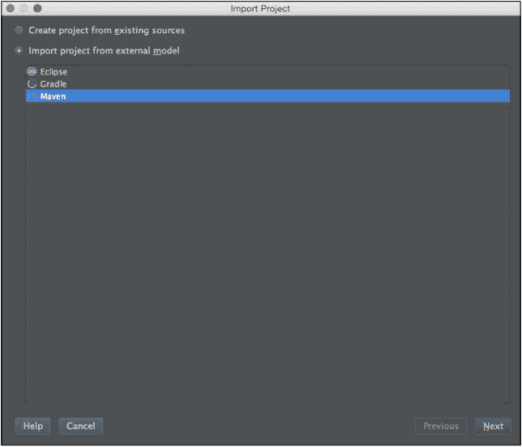

除了点击 **下一步**，其他步骤无需任何特殊操作。请注意，受支持的 JDK 版本为 1.7 或更高。这可能不是问题，因为在前几章中我们需要 1.8 或更高版本。一旦你顺利设置完成，可以确认目录结构如下：

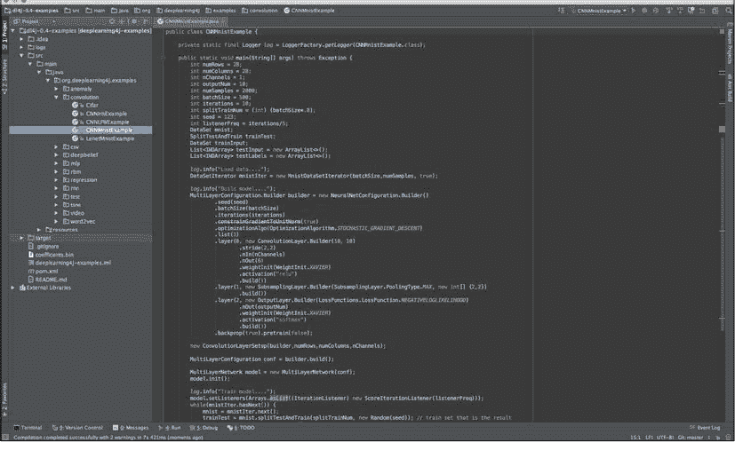

项目设置完成后，我们先来看一下 pom.xml。你可以看到与 DL4J 相关的包描述如下：

```
```xml
<dependency>
    <groupId>org.deeplearning4j</groupId>
    <artifactId>deeplearning4j-nlp</artifactId>
    <version>${dl4j.version}</version>
</dependency>

<dependency>
    <groupId>org.deeplearning4j</groupId>
    <artifactId>deeplearning4j-core</artifactId>
    <version>${dl4j.version}</version>
</dependency>
```
```

同样，从以下几行可以看出，DL4J 依赖于 ND4J：

```
<dependency>
    <groupId>org.nd4j</groupId>
    <artifactId>nd4j-x86</artifactId>
    <version>${nd4j.version}</version>
</dependency>
```

如果你想在 GPU 上运行程序，只需修改这一部分即可。如前所述，如果已安装 CUDA，可以如下编写：

```
<dependency>
    <groupId>org.nd4j</groupId>
    <artifactId>nd4j-jcublas-XXX</artifactId>
    <version>${nd4j.version}</version>
</dependency>
```

这里，xxx 是 CUDA 的版本，取决于你的机器情况。只需这样做就能采用 GPU 计算，真是太好了。我们无需任何特殊操作，就可以专注于深度学习的实现。

DL4J 开发并使用的另一个特色库是 Canova。pom.xml 中对应的部分如下：

```
<dependency>
    <artifactId>canova-nd4j-image</artifactId>
    <groupId>org.nd4j</groupId>
    <version>${canova.version}</version>
</dependency>
<dependency>
    <artifactId>canova-nd4j-codec</artifactId>
    <groupId>org.nd4j</groupId>
    <version>${canova.version}</version>
</dependency>
```

当然，Canova 也是一个开源库，其源代码可以在 GitHub 上的 https://github.com/deeplearning4j/Canova 查看。正如该页面所解释的，Canova 是一个将原始数据向量化为可供机器学习工具使用的向量格式的库。由于无论进行何种研究或实验，数据格式化都是不可或缺的，因此这也有助于我们专注于数据挖掘中更重要的部分。

### 构建

让我们看一下示例中的源代码，了解如何构建深度学习模型。在这个过程中，也会简要解释你尚未学过的深度学习术语。示例使用各种模型实现，如 MLP、DBN 和 CNN，但这里有一个问题。正如你在查看 README.md 时可以看到的那样，有些方法不能产生良好的精确度。这是因为，如前所述，机器拥有的计算精度是有限的，过程中计算值出现的波动完全取决于实现的差异。因此，尽管理论上应该能良好地学习，但在实际中却无法正确地进行学习。例如，你可以通过更改种子值或调整参数来获得更好的结果，但因为我们想专注于如何使用库，我们将使用一个能获得更高精度的模型作为示例。

#### DBNIrisExample.java

让我们首先看一下 deepbelief 包中的 DBNIrisExample.java。文件名中的 Iris 是常用于衡量机器学习方法的精确率或准确率的基准数据集之一。该数据集包含 3 个类别各 50 个实例，共 150 条数据，每个类别指一种鸢尾属植物。输入数量为 4，因此输出数量为 3。一个类别与另外两个类别线性可分；但另外两个类别彼此之间不是线性可分的。

实现从设置配置开始。这里需要设置的变量如下：

```
final int numRows = 4;
final int numColumns = 1;
int outputNum = 3;
int numSamples = 150;
int batchSize = 150;
int iterations = 5;
int splitTrainNum = (int) (batchSize * .8);
int seed = 123;
int listenerFreq = 1;
```


在 DL4J 中，输入数据最多可以是二维数据，因此你需要指定数据的行数和列数。由于 Iris 是一维数据，`numColumns` 设置为 1。这里 `numSamples` 是总数据量，`batchSize` 是每个小批次中的数据量。由于总数据量为 150 且相对较小，`batchSize` 设置为相同的数值。这意味着学习过程不会将数据拆分成小批次。`splitTrainNum` 是决定训练数据与测试数据分配的变量。这里，整个数据集的 80% 作为训练数据，20% 作为测试数据。在上一节中，`listenerFreq` 决定我们多久在过程中查看损失函数值的日志记录。此处的值设置为 1，这意味着每个 epoch 后会记录一次该值。

接下来，我们需要获取数据集。在 DL4J 中，已经准备好了一个类，可以方便地获取典型数据集（如 Iris、MNIST 和 LFW）的数据。因此，如果你想要获取 Iris 数据集，只需编写以下代码行：

```
DataSetIterator iter = new IrisDataSetIterator(batchSize, numSamples);
```

下面两行代码用于格式化数据：

```
DataSet next = iter.next();
next.normalizeZeroMeanZeroUnitVariance();
```

这段代码将数据拆分为训练数据和测试数据，并分别存储：

```
SplitTestAndTrain testAndTrain =
next.splitTestAndTrain(splitTrainNum, new Random(seed));
DataSet train = testAndTrain.getTrain();
DataSet test = testAndTrain.getTest();
```

如你所见，通过将 DL4J 准备的所有数据都视为 DataSet 类，它使数据处理变得更加容易。

现在，让我们实际构建一个模型。基本结构如下：

```
MultiLayerConfiguration conf = new NeuralNetConfiguration.Builder().layer().layer() ... .layer().build();
MultiLayerNetwork model = new MultiLayerNetwork(conf);
model.init();
```

代码首先定义模型配置，然后根据定义构建并初始化实际模型。让我们看一下配置细节。一开始，整个网络被设置如下：

```
MultiLayerConfiguration conf = new NeuralNetConfiguration.Builder()
    .seed(seed)
    .iterations(iterations)
    .learningRate(1e-6f)
    .optimizationAlgo(OptimizationAlgorithm.CONJUGATE_GRADIENT)
    .l1(1e-1).regularization(true).l2(2e-4)
    .useDropConnect(true)
    .list(2)
```

配置设置本身不言自明。然而，由于你之前还没学过正则化，让我们简要地了解一下它。

正则化可以防止神经网络模型过拟合，使模型更具泛化能力。为了实现这一点，评估函数 $E(w)$ 被改写为带有惩罚项的形式，如下所示：

$E(w) + \lambda \frac{1}{p} \|w\|_p^p = E(w) + \lambda \frac{1}{p} \sum_i |w_i|^p$

这里，$\|\cdot\|$ 表示向量范数。当 $p = 1$ 时，这种正则化称为 L1 正则化；当 $p = 2$ 时，称为 L2 正则化。相应地，范数分别称为 L1 范数和 L2 范数。这就是代码中有 `.l1()` 和 `.l2()` 的原因。$\lambda$ 是超参数。这些正则化项使模型更加稀疏。L2 正则化也称为权重衰减，用于防止梯度消失问题。

`.useDropConnect()` 命令用于启用 dropout，`.list()` 用于定义层数（不包括输入层）。

当你设置好整个模型后，下一步就是配置每一层。在这个示例代码中，模型没有被定义为深度神经网络。一个单独的 RBM 层被定义为隐藏层：

```
.layer(0, new RBM.Builder(RBM.HiddenUnit.RECTIFIED, RBM.VisibleUnit.GAUSSIAN)
.nIn(numRows * numColumns)
.nOut(3)
.weightInit(WeightInit.XAVIER)
.k(1)
.activation("relu")
.lossFunction(LossFunctions.LossFunction.RMSE_XENT)
.updater(Updater.ADAGRAD)
.dropOut(0.5)
.build()
)
```

这里，第一行中的 0 是该层的索引，`.k()` 用于对比散度。由于 Iris 的数据是浮点值，我们不能使用二值 RBM。所以这里使用了 `RBM.VisibleUnit.GAUSSIAN`，使模型能够处理连续值。另外，关于这一层的定义，需要特别提及的是 `Updater.ADAGRAD` 的作用。它用于优化学习率。现在我们继续看模型结构，关于优化器的详细解释将在本章末尾介绍。

后续的输出层非常简单且不言自明：

```
.layer(1, new OutputLayer.Builder(LossFunctions.LossFunction.MCXENT)
    .nIn(3)
    .nOut(outputNum)
    .activation("softmax")
    .build()
)
```

因此，神经网络已经构建为三层：输入层、隐藏层和输出层。此示例的图形模型可以说明如下：

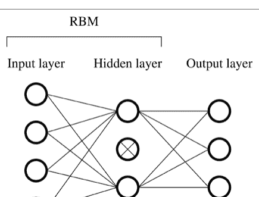

模型构建之后，我们需要训练网络。这里同样，代码非常简单：

```
model.setListeners(Arrays.asList((IterationListener) new ScoreIterationListener(listenerFreq)));
model.fit(train);
```

因为第一行用于记录过程，所以训练模型只需编写 `model.fit()` 即可。

使用 DL4J 测试或评估模型也很容易。首先，设置评估变量如下：

```
Evaluation eval = new Evaluation(outputNum);
INDArray output = model.output(test.getFeatureMatrix());
```

然后，我们可以使用以下代码获取特征矩阵的值：

```
eval.eval(test.getLabels(), output);
log.info(eval.stats());
```

通过运行代码，我们将得到如下结果：

```
=====================Scores======================
Accuracy:  0.7667
Precision: 1
Recall:    0.7667
F1 Score:  0.8679245283018869
===================================================
```

F1 Score，也称为 F-Score 或 F-measure，是精确率和召回率的调和平均值，表示如下：

$$F_1 = 2.\frac{Precision.Recall}{Precision + Recall}$$

这个值通常也会被计算来衡量模型的性能。此外，如示例中所述，你可以通过编写以下代码来查看实际值和预测值：

```
for (int i = 0; i < output.rows(); i++) {
    String actual = test.getLabels().getRow(i).toString().trim();
    String predicted = output.getRow(i).toString().trim();
    log.info("actual " + actual + " vs predicted " + predicted);
}
```

这就是整个训练和测试过程的全部内容。前面代码中的神经网络并不深，但你只需更改配置即可轻松构建深度神经网络，如下所示：

```
MultiLayerConfiguration conf = new NeuralNetConfiguration.Builder()
    .seed(seed)
    .iterations(iterations)
    .learningRate(1e-6f)
    .optimizationAlgo(OptimizationAlgorithm.CONJUGATE_GRADIENT)
    .l1(1e-1).regularization(true).l2(2e-4)
    .useDropConnect(true)
    .list(3)
    .layer(0, new RBM.Builder(RBM.HiddenUnit.RECTIFIED, RBM.VisibleUnit.GAUSSIAN)
        .nIn(numRows * numColumns)
        .nOut(4)
        .weightInit(WeightInit.XAVIER)
        .k(1)
        .activation("relu")
        .lossFunction(LossFunctions.LossFunction.RMSE_XENT)
        .updater(Updater.ADAGRAD)
        .dropOut(0.5)
        .build()
    )
    .layer(1, new RBM.Builder(RBM.HiddenUnit.RECTIFIED, RBM.VisibleUnit.GAUSSIAN)
        .nIn(4)
        .nOut(3)
        .weightInit(WeightInit.XAVIER)
        .k(1)
        .activation("relu")
        .lossFunction(LossFunctions.LossFunction.RMSE_XENT)
        .updater(Updater.ADAGRAD)
        .dropOut(0.5)
        .build()
    )
    .layer(2, new OutputLayer.Builder(LossFunctions.LossFunction.MCXENT)
        .nIn(3)
        .nOut(outputNum)
        .activation("softmax")
        .build()
    )
    .build();
```

如你所见，使用 DL4J 构建深度神经网络只需要简单的实现。一旦你设置好模型，需要做的就是调整参数。例如，增加迭代次数或更改种子值可能会得到更好的结果。


### CSVExample.java

在前面的示例中，我们使用了一个基准指标数据集来训练模型。当你希望使用自己准备的数据来训练和测试模型时，可以方便地从CSV中导入数据。让我们看一下CSV包中的CSVExample.java。第一步是如下所示初始化CSV读取器：

```
RecordReader recordReader = new CSVRecordReader(0,",");
```

在DL4J中，提供了一个名为CSVRecordReader的类，你可以轻松地从CSV文件导入数据。CSVRecordReader类中第一个参数的值表示应跳过文件中的多少行。当文件包含标题行时，这很方便。第二个参数是分隔符。要实际读取文件并导入数据，代码可以编写如下：

```
recordReader.initialize(new FileSplit(new
ClassPathResource("iris.txt").getFile()));
```

通过这段代码，resources/iris.txt中的文件将被导入模型。文件中的值与Iris数据集中的值相同。为了使用这些初始化数据进行模型训练，我们如下定义迭代器：

```
DataSetIterator iterator = new RecordReaderDataSetIterator(recordReader,4,3);
DataSet next = iterator.next();
```

在前面的示例中，我们使用了IrisDataSetIterator类，但这里使用的是RecordReaderDataSetIterator类，因为我们使用的是自己准备的数据。值4和3分别表示特征数和标签数。

构建和训练模型的过程与前面示例中解释的过程几乎相同。在本示例中，我们构建了一个包含两个隐藏层、并使用dropout和整流器的深度神经网络，也就是说，我们的结构是输入层-隐藏层-隐藏层-输出层，如下所示：

```
MultiLayerConfiguration conf = new NeuralNetConfiguration.Builder()
    .seed(seed)
    .iterations(iterations)
    .constrainGradientToUnitNorm(true).useDropConnect(true)
    .learningRate(1e-1)
    .l1(0.3).regularization(true).l2(1e-3)
    .constrainGradientToUnitNorm(true)
    .list(3)
    .layer(0, new DenseLayer.Builder().nIn(numInputs).nOut(3)
        .activation("relu").dropOut(0.5)
        .weightInit(WeightInit.XAVIER)
        .build())
.layer(1, new DenseLayer.Builder().nIn(3).nOut(2)
    .activation("relu")
    .weightInit(WeightInit.XAVIER)
    .build()
.layer(2, new
OutputLayer.Builder(LossFunctions.LossFunction
.NEGATIVELOGLIKELIHOOD)
    .weightInit(WeightInit.XAVIER)
    .activation("softmax")
    .nIn(2).nOut(outputNum).build()
.backprop(true).pretrain(false)
.build();
```

我们可以使用以下代码行来运行模型：

```
MultiLayerNetwork model = new MultiLayerNetwork(conf);
model.init();
```

图形化模型如下：

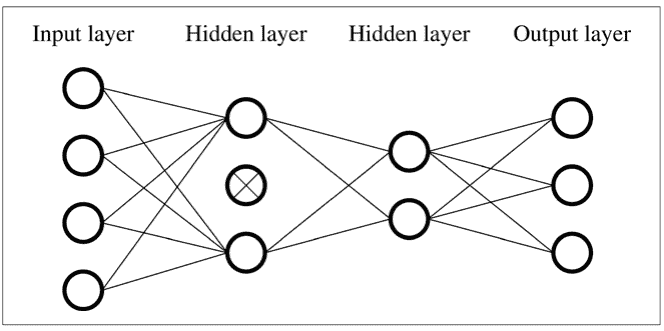

但是，这次训练代码的编写方式与前面的示例略有不同。之前，我们使用以下方式将数据拆分为训练数据和测试数据：

```
SplitTestAndTrain testAndTrain =
    next.splitTestAndTrain(splitTrainNum, new Random(seed));
```

这表明我们在.splitTestAndTrain()方法中对数据进行了混洗。在本示例中，我们使用以下代码设置训练数据：

```
next.shuffle();
SplitTestAndTrain testAndTrain = next.splitTestAndTrain(0.6);
```

如你所见，这里首先对数据进行混洗，然后拆分为训练数据和测试数据。请注意，.splitTestAndTrain()中的参数类型是不同的。这会带来好处，因为我们不必计算确切的样本总数或训练数据数量。实际训练使用以下方式完成：

```
model.fit(testAndTrain.getTrain());
```

评估模型的方式与之前的示例相同：

```
Evaluation eval = new Evaluation(3);
DataSet test = testAndTrain.getTest();
INDArray output = model.output(test.getFeatureMatrix());
eval.eval(test.getLabels(), output);
log.info(eval.stats());
```

通过前面的代码，我们得到以下结果：

```
==========================Scores==========================
Accuracy:  1
Precision: 1
Recall:    1
F1 Score:  1.0
============================================================
```

除了基准指标数据集之外，你现在还可以分析你所拥有的任何数据。

为了使模型更深，你只需添加另一个层，如下所示：

```
MultiLayerConfiguration conf = new
NeuralNetConfiguration.Builder()
    .seed(seed)
    .iterations(iterations)
    .constrainGradientToUnitNorm(true).useDropConnect(true)
    .learningRate(0.01)
    .l1(0.0).regularization(true).l2(1e-3)
    .constrainGradientToUnitNorm(true)
    .list(4)
    .layer(0, new DenseLayer.Builder().nIn(numInputs).nOut(4)
        .activation("relu").dropOut(0.5)
        .weightInit(WeightInit.XAVIER)
        .build())
    .layer(1, new DenseLayer.Builder().nIn(4).nOut(4)
        .activation("relu").dropOut(0.5)
        .weightInit(WeightInit.XAVIER)
.build())
.layer(2, new DenseLayer.Builder().nIn(4).nOut(4)
        .activation("relu").dropOut(0.5)
        .weightInit(WeightInit.XAVIER)
        .build())
.layer(3, new OutputLayer.Builder(LossFunctions.LossFunction
.NEGATIVELOGLIKELIHOOD)
        .weightInit(WeightInit.XAVIER)
        .activation("softmax")
        .nIn(4).nOut(outputNum).build())
.backprop(true).pretrain(false)
.build();
```

### CNNMnistExample.java/LenetMnistExample.java

CNN由于其结构而比其他模型更为复杂，但我们不必担心这些复杂性，因为我们可以使用DL4J轻松实现CNN。让我们看一下卷积包中的`CNNMnistExample.java`。在本示例中，我们使用MNIST数据集（http://yann.lecun.com/exdb/mnist/）训练模型，这是最著名的基准指标之一。正如*第1章，深度学习概述*中提到的，该数据集包含70,000个从0到9的手写数字数据，每个数字的宽度和高度均为28像素。

首先，我们定义模型所需的值：

```
int numRows = 28;
int numColumns = 28;
int nChannels = 1;
int outputNum = 10;
int numSamples = 2000;
int batchSize = 500;
int iterations = 10;
int splitTrainNum = (int) (batchSize*.8);
int seed = 123;
int listenerFreq = iterations/5;
```

由于MNIST中的图像都是灰度数据，因此通道数设置为1。在本示例中，我们使用70,000个数据中的2,000个，并将其拆分为训练数据和测试数据。这里的小批量大小（mini-batch）为500，因此训练数据被分成4个小批量。此外，每个小批量中的数据被拆分为训练数据和测试数据，每个测试数据存储在ArrayList中：

```
List<INDArray> testInput = new ArrayList<>();
List<INDArray> testLabels = new ArrayList<>();
```

在前面的示例中，我们不必设置ArrayList，因为当时只有一个批次。对于MnistDataSetIterator类，我们只需使用以下方式即可设置MNIST数据：

```
DataSetIterator mnistIter = new
MnistDataSetIterator(batchSize,numSamples, true);
```

然后，我们使用卷积层和子采样层构建模型。这里，我们有一个卷积层和一个最大池化层，后面直接连接一个输出层。CNN配置的结构与其他算法略有不同：

```
MultiLayerConfiguration.Builder builder = new NeuralNetConfiguration.
Builder().layer().layer(). ... .layer()
new ConvolutionLayerSetup(builder,numRows,numColumns,nChannels);
MultiLayerConfiguration conf = builder.build();
MultiLayerNetwork model = new MultiLayerNetwork(conf);
model.init();
```

区别在于我们不能直接从配置构建模型，因为我们需要预先使用ConvolutionLayerSetup()告诉builder设置卷积层。每个.layer()的编码方式完全相同。卷积层定义为：

```
.layer(0, new ConvolutionLayer.Builder(10, 10)
    .stride(2,2)
    .nIn(nChannels)
    .nOut(6)
    .weightInit(WeightInit.XAVIER)
    .activation("relu")
    .build())
```


这里，ConvolutionLayer.Builder() 中的 10 的值是核的大小，而 .nOut() 中的 6 的值是核的数量。此外，.stride() 定义了核的步幅大小。第 4 章《Dropout 和卷积神经网络》中我们从头实现的代码的功能仅等价于 .stride(1, 1)。数值越大，所需时间越短，因为它减少了卷积所需的计算量，但同时我们也必须小心，它可能会降低模型的精度。无论如何，我们现在可以用更灵活的方式实现卷积。

子采样层描述如下：

```
.layer(1, new
SubsamplingLayer.Builder(SubsamplingLayer.PoolingType.MAX, new int[]
{2,2})
    .build()
```

这里，{2, 2} 是池化窗口的大小。你可能已经注意到，我们不需要为每一层（包括输出层）设置输入的大小。这些值在模型设置好后会自动设定。

输出层可以像其他模型中一样写成：

```
.layer(2, new OutputLayer.Builder(LossFunctions.LossFunction.
NEGATIVELOGLIKELIHOOD)
    .nOut(outputNum)
    .weightInit(WeightInit.XAVIER)
    .activation("softmax")
    .build()
```

本示例的图形模型如下：

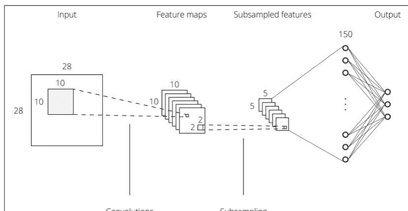

构建之后是训练。由于我们有多个小批量，因此需要遍历所有批次进行训练。在本例中，可以通过在 DataSetIterator 上使用 .hasNext() 以及 mnistIter 轻松实现。整个训练过程可以写成如下：

```
model.setListeners(Arrays.asList((IterationListener) new ScoreIterationListener(listenerFreq)));
while(mnistIter.hasNext()) {
    mnist = mnistIter.next();
    trainTest = mnist.splitTestAndTrain(splitTrainNum, new Random(seed));
    trainInput = trainTest.getTrain();
    testInput.add(trainTest.getTest().getFeatureMatrix());
    testLabels.add(trainTest.getTest().getLabels());
    model.fit(trainInput);
}
```

这里，测试数据和测试标签被保存以供后续使用。

在测试时，同样由于我们有多个小批量，需要迭代测试数据的评估过程：

```
for(int i = 0; i < testInput.size(); i++) {
    INDArray output = model.output(testInput.get(i));
    eval.eval(testLabels.get(i), output);
}
```

然后，我们像其他示例中一样使用：

```
log.info(eval.stats());
```

这将返回如下结果：

```
=====================Scores=====================
Accuracy:  0.832
Precision: 0.8783
Recall:    0.8334
F1 Score:  0.8552464933704985
=====================
```

刚才给出的示例是具有一个卷积层和一个子采样层的模型，但你可以使用 LenetMnistExample.java 实现深度卷积神经网络。在此示例中，有两个卷积层和子采样层，后面跟着全连接的多层感知机：

```
MultiLayerConfiguration.Builder builder = new NeuralNetConfiguration.Builder()
    .seed(seed)
    .batchSize(batchSize)
    .iterations(iterations)
    .regularization(true).l2(0.0005)
    .learningRate(0.01)
    .optimizationAlgo(OptimizationAlgorithm.STOCHASTIC_GRADIENT_DESCENT)
    .updater(Updater.NESTEROVS).momentum(0.9)
    .list(6)
    .layer(0, new ConvolutionLayer.Builder(5, 5)
        .nIn(nChannels)
        .stride(1, 1)
        .nOut(20).dropOut(0.5)
        .weightInit(WeightInit.XAVIER)
        .activation("relu")
        .build())
```

```java
.layer(1, new
SubsamplingLayer.Builder(SubsamplingLayer.PoolingType.MAX,
new int[]{2, 2})
        .build())
.layer(2, new ConvolutionLayer.Builder(5, 5)
        .nIn(20)
        .nOut(50)
        .stride(2,2)
        .weightInit(WeightInit.XAVIER)
        .activation("relu")
        .build())
.layer(3, new
SubsamplingLayer.Builder(SubsamplingLayer.PoolingType.MAX,
new int[]{2, 2})
        .build())
.layer(4, new DenseLayer.Builder().activation("tanh")
        .nOut(500).build())
.layer(5, new
OutputLayer.Builder(LossFunctions.LossFunction
.NEGATIVELOGLIKELIHOOD)
        .nOut(outputNum)
        .weightInit(WeightInit.XAVIER)
        .activation("softmax")
        .build())
.backprop(true).pretrain(false);
new ConvolutionLayerSetup(builder,28,28,1);
```

正如第一个卷积层所示，使用 DL4J 可以轻松地将 dropout 应用于 CNN。

使用此模型，我们得到以下结果：

```
=========================Scores=========================
Accuracy:  0.8656
Precision: 0.8827
Recall:    0.8645
F1 Score:  0.873490476878917
=========================================================
```

你可以在 MNIST 数据集页面 (http://yann.lecun.com/exdb/mnist/) 看到，最先进的结果比上面要好得多。这里，你再次会意识到参数、激活函数和优化算法的组合有多重要。

### 学习率优化

我们迄今为止学习了各种深度学习算法；你可能已经注意到它们有一个共同的参数：学习率。学习率定义在更新模型参数的方程中。那么，为什么不考虑优化学习率的算法呢？最初，这些方程描述如下：

$\theta^{(\tau+1)} = \theta^{(\tau)} + \Delta\theta^{(\tau)}$

这里：

$\Delta\theta^{(\tau)} = -\eta \frac{\partial E}{\partial \theta^{(\tau)}}$

这里，$\tau$ 是步数和 $\eta$ 是学习率。众所周知，随着每次迭代减小学习率的值，可以让模型获得更好的精度，但我们应谨慎确定下降幅度，因为值的突然下降会导致模型崩溃。学习率是模型参数之一，那么为什么不优化它呢？为此，我们需要知道最佳速率可能是什么。

设置速率最简单的方法是使用动量，表示如下：

$\Delta\theta^{(\tau)} = -\eta \frac{\partial E}{\partial \theta^{(\tau)}} + \alpha\Delta\theta^{(\tau-1)}$

这里，$\alpha \in [0,1]$，称为 **动量系数**。这个超参数通常先设为 0.5 或 0.9，然后再进行微调。

动量实际上是一种简单但有效的调整学习率的方法，但由 Duchi 等人提出的 **ADAGRAD**（http://www.magicbroom.info/Papers/DuchiHaSi10.pdf）被认为是一种更好的方法。其方程描述如下：

$\Delta\theta^{(\tau)} = -\frac{\eta}{\sqrt{\sum_{t=0}^{\tau} g_t^2}} g_{\tau}$

这里：

$g_{\tau} = \frac{\partial E}{\partial \theta^{(\tau)}}$

理论上，这效果很好，但实际上，为了防止发散，我们经常使用以下方程：

$\Delta \theta^{(\tau)} = -\frac{\eta}{\sqrt{\sum_{t=0}^{\tau} g_{t}^{2} + 1}} g_{\tau}$

或者我们使用：

$\Delta \theta^{(\tau)} = -\frac{\eta}{\sqrt{\sum_{t=0}^{\tau} g_{t}^{2} + 1}} g_{\tau}$

ADAGRAD 比动量更容易使用，因为值会自动设定，我们不需要设置额外的超参数。

由 Zeiler 提出的 ADADELTA（http://arxiv.org/pdf/1212.5701.pdf）被认为是一种更优秀的优化器。这是一种基于算法的优化器，不能用单一方程表示。以下是 ADADELTA 的描述：

- 初始化：
  - 初始化累积变量：

$E\left[g^{2}\right]_{0} = 0$

And：

$E\left[\Delta \theta^{2}\right]_{0} = 0$

- 迭代 τ = 0,1,2,...,T ：
  - 计算：
    $$g_{\tau} = \frac{\partial E}{\partial \theta^{(\tau)}}$$
  - 累积梯度：
    $$E\left[g^2\right]_{\tau} = \rho E\left[g^2\right]_{\tau-1} + (1-\rho) g_{\tau}^2$$
  - 计算更新：
    $$\Delta \theta^{(\tau)} = -\frac{\sqrt{E\left[\Delta \theta^2\right]_{\tau-1} + \varepsilon}}{\sqrt{E\left[g^2\right]_{\tau} + \varepsilon}} g_{\tau}$$
  - 累积更新：
    $$E\left[\Delta \theta^2\right]_{\tau} = \rho E\left[\Delta \theta^2\right]_{\tau-1} + (1-\rho)\left(\Delta \theta^{(\tau)}\right)^2$$
  - 应用更新：
    $$\theta^{(\tau+1)} = \theta^{(\tau)} + \Delta \theta^{(\tau)}$$

这里，ρ 和 ε 是超参数。你可能会觉得 ADADELTA 相当复杂，但在 DL4J 中实现时无需担心这种复杂性。

DL4J 中仍支持其他优化器，如 RMSProp、RMSProp + 动量 和 Nesterov's Accelerated Gradient Descent。然而，我们不会深入探讨它们，因为实际上，动量、ADAGRAD 和 ADADELTA 已足以优化学习率。


### 摘要

在本章中，你学习了如何使用 ND4J 和 DL4J 库实现深度学习模型。两者都支持 GPU 计算，并且都能让我们在没有任何困难的情况下实现它们。ND4J 是一个用于科学计算的库，并支持向量化，这使得在数组之间实现计算变得更容易，因为我们不需要在其中编写迭代。由于机器学习和深度学习算法包含许多涉及向量计算的方程，例如内积和逐元素乘法，ND4J 也有助于实现它们。

DL4J 是一个深度学习库，通过使用该库的一些示例，你看到了我们可以轻松构建、训练和评估各种类型的深度学习模型。此外，在构建模型的过程中，你学习了为什么正则化对于获得更好的结果是必要的。你还了解了一些学习率优化器：momentum、ADAGRAD 和 ADADELTA。所有这些都可以用 DL4J 轻松实现。

你获得了深度学习算法的核心理论和实现方面的知识，并且现在知道如何以很少的困难实现它们。我们可以说，我们已经完成了本书的理论部分。因此，在下一章中，我们将首先了解深度学习算法如何被应用于实际应用，然后再探讨其他可能的领域和应用算法的思路。

## 6
## 面向实际应用的方法 – 循环神经网络及其他

在之前的章节中，你已经学习了大量关于深度学习的内容。你现在应该理解了深度神经网络的概念、理论和实现的基本原理。你还了解到，通过利用深度学习库，你可以相对轻松地在各种数据上尝试深度学习算法。下一步是研究深度学习如何应用于更广泛的其他领域以及如何将其用于实际应用。

因此，在本章中，我们将首先了解深度学习实际是如何应用的。在这里，你会看到深度学习实际被利用的案例仍然很少。但为什么即使是这样创新的方法，案例也不多呢？问题是什么？稍后我们会思考原因。此外，今后我们还将考虑可以将深度学习应用于哪些领域，并有机会将深度学习和所有相关的人工智能领域应用起来。

本章涵盖的主题包括：
- 图像识别、自然语言处理，以及与之相关的神经网络模型和算法
- 将深度学习模型转化为实际应用的困难
- 深度学习可以应用的可能领域，以及如何处理这些领域的思路

我们将探索这场巨大的人工智能热潮的潜力，这将带来你可以利用的想法和提示，用于你的研究、业务和各种活动中的深度学习。

### 深度学习活跃的领域

我们经常听到深度学习的研究一直都在进行中，这是一个事实。许多公司，尤其是像 Google、Facebook、Microsoft 和 IBM 这样的大型科技公司，投入了巨额资金用于深度学习研究，我们经常听到某些公司收购了这些研究团队的消息。然而，从整体来看，深度学习本身具有各种类型的算法，以及这些算法可以应用的领域。即使如此，人们普遍不知道深度学习在哪些领域被利用或可以被使用，这是一个事实。由于“AI”一词被广泛使用，人们无法正确理解哪种技术用于哪个产品。因此，在本节中，我们将介绍人们积极尝试将深度学习应用于实际应用的领域。

#### 图像识别

深度学习最常被纳入的领域是图像识别。正是 Hinton 教授及其团队的发明引出了“深度学习”这一术语。他们的算法在图像识别竞赛中创下了有史以来最低的错误率。对算法进行持续改进的研究带来了更好的结果。现在，利用深度学习的图像识别不仅在研究中逐渐被采用，也被用于实际应用和产品。例如，Google 利用深度学习为 YouTube 自动生成缩略图，或在 Google Photos 中自动标记和搜索照片。像这些流行产品一样，深度学习主要应用于图像标记或分类，例如在机器人领域，它被用于让机器人识别周围的事物。

我们能够支持这些产品和行业的原因是深度学习更适合图像处理，因为它能够实现比任何其他领域应用更高的精确率。正是由于图像识别的精确率和召回率如此之高，才意味着该行业具有广阔的潜力。使用深度学习算法，MNIST 图像分类的错误率记录为 0.21%（http://cs.nyu.edu/~wanli/dropc/），而该记录不低于人类的记录（http://arxiv.org/pdf/0710.2231v1.pdf）。换句话说，如果仅限于图像识别，这不过是机器可能超越人类的事实。为什么只有图像识别能获得如此高的精度，而其他领域的方法仍需要大幅改进？

其中一个原因是深度学习中特征提取的结构非常适合图像数据。在深度神经网络中，堆叠了许多层，并在每一层逐步从训练数据中提取特征。也可以说图像数据具有分层结构。当你看图像时，你会无意识地先捕捉到简要特征，然后再深入到更详细的特征。因此，深度学习特征提取的固有属性与图像的感知方式相似，因此我们可以准确地实现特征。虽然深度学习图像识别仍需要更多改进，特别是机器如何理解图像及其内容，但仅通过将深度学习应用于未经预处理的样本图像数据就能获得高精度，这显然意味着深度学习和图像数据是很好的匹配。

另一个原因是人们一直在缓慢而稳步地改进算法。例如，在深度学习算法中，能够获得图像识别最佳精度的 CNN，每次遇到困难/任务时都会得到改进。引入了卷积层的核替代局部感受野，以避免网络变得过于密集。此外，还发明了诸如最大池化之类的下采样方法，以避免网络对图像位置差距的过度反应。这最初源于如何识别邮政编码等特定框架中手写字母的试错过程。因此，有许多案例是在寻求新的方法来将神经网络算法适配到实际应用中。复杂的模型 CNN 也是基于这些累积但稳步的改进构建的。虽然深度学习不需要特征工程，但我们仍需要考虑解决特定问题的适当方法，也就是说，我们无法构建全能模型，这在优化中被称为无免费午餐定理（NFLT）。

在图像识别领域，深度学习可以实现的分类准确率极高，并且实际上已经开始被用于实际应用。然而，深度学习可以应用的领域应该更多。图像与许多行业密切相关。未来，将会有更多案例和更多行业利用深度学习。在本书中，让我们在接下来的章节中思考，考虑到深度学习的兴起，我们可以将图像识别应用于哪些行业。


### 自然语言处理

继图像识别之后，深度学习研究第二活跃的领域是自然语言处理（NLP）。这一领域的研究未来可能会成为最活跃的方向。就图像识别而言，我们能够获得的预测精度几乎已经达到天花板，因为它甚至能比人类做出更好的分类。另一方面，在 NLP 中，深度学习的確让模型性能提升了很多，但同样的事实是，仍有许多任务有待解决。

对于一些产品和实际应用，深度学习已经被应用。例如，基于深度学习的 NLP 被应用于谷歌的语音搜索、语音识别以及谷歌翻译。此外，IBM Watson——这一能够理解并学习自然语言、支持人类决策的认知计算系统——从海量文档中提取关键词和实体，并具备为文档打标签的功能。这些功能以 Watson API 的形式向公众开放，任何人都可以不受限制地使用。

从前面的例子可以看出，NLP 本身的类型广泛且多样。就基础技术而言，我们有句子内容分类、词语分类以及词义指定。此外，像中文或日文这样词与词之间不空白的语言，还需要形态分析，这也是 NLP 中的另一项技术。

NLP 包含许多需要研究的内容，因此需要明确其目的是什么、问题是什么，以及这些问题如何解决。使用哪种模型最好，以及如何恰当地获得良好的精度，都是需要谨慎审视的话题。就图像识别而言，CNN 方法是通过解决所面临的任务而被发明的。现在，让我们思考对于神经网络和 NLP，分别可以考虑哪些方法，以及各自会面临哪些困难。理解过去的试错过程，对未来的研究和应用都将有所裨益。

### 用于 NLP 的前馈神经网络

NLP 的基本问题是“在给定一个或几个词的情况下预测下一个词”。然而，这个问题过于简单；如果你尝试用神经网络来解决它，很快就会遇到几个困难，因为使用 NLP 的文档或句子作为样本数据具有以下特征：

- 每个句子的长度不固定而是可变的，且词的数量极其庞大
- 可能存在拼写错误、缩写等不可预见的问题
- 句子是序列数据，因此包含时间信息

为什么这些特征会带来问题？回想一下一般神经网络的结构。为了用神经网络进行训练和测试，每一层（包括输入层）的神经元数量需要事先固定，并且网络对于所有样本数据需要保持相同的大小。与此同时，输入数据的长度并不固定，而且可能变化很大。这意味着样本数据至少不能直接应用于该模型。如果不对此数据进行添加/修改，就无法通过神经网络进行分类或生成。

我们必须固定输入数据的长度，而处理这个问题的一种方法是将句子从头开始按顺序划分为包含特定数量词的块。这种方法被称为 **N-gram**。这里，*N* 表示每个块的大小，大小为 1 的 **N-gram** 称为 **unigram**，大小为 2 的称为 **bigram**，大小为 3 的称为 **trigram**。当大小更大时，则直接使用 *N* 的值来称呼，如 *four-gram*、*five-gram* 等。

让我们看看 N-gram 如何应用于 NLP。这里的目标是计算在给定历史 *h* 的情况下某个词 *w* 的概率，即 *P(w | h)*。我们将 *N* 个词的序列表示为 *w₁ⁿ*。那么，我们要计算的概率是 *P(w₁ⁿ)*，通过将概率的链式法则应用于这一项，我们得到：

P(w₁ⁿ) = P(w₁) P(w₂ | w₁) P(w₃ | w₁²) ... P(wₙ | w₁ⁿ⁻¹)
       = ∏_{k=1}^n P(w_k | w₁^{k-1})

乍一看，这些条件概率似乎对我们有帮助，但实际上它们并没有，因为我们无法计算一个词在跟随一长串前序词之后的精确概率，即 *P(wₙ | w₁^{n-1})*。由于句子结构非常灵活，我们不能简单地利用样本文档和语料库来估计该概率。这正是 N-gram 发挥作用的地方。实际上，我们有两种方法来解决这个问题：原始的 N-gram 模型和基于 N-gram 的神经网络模型。我们将先研究第一种方法，以充分理解 NLP 领域是如何发展的，然后再深入探讨神经网络。

使用 N-gram 时，我们不是计算一个词在给定其全部历史条件下的概率，而是用最后 N 个词来近似该历史。例如，bigram 模型仅通过前一个词的条件概率来近似一个词的概率，即 $P(w_n \mid w_{n-1})$，因此遵循以下方程：

$P(w_1^n) = \prod_{k=1}^{n} P\left(w_k \mid w_1^{k-1}\right)$

$\approx \prod_{k=1}^{n} P\left(w_k \mid w_{k-1}\right)$

类似地，我们可以将方程推广并扩展到 N-gram。在这种情况下，一个词的概率可以表示为：

$P\left(w_n \mid w_1^{n-1}\right) \approx P\left(w_n \mid w_{n-N+1}^{n-1}\right)$

我们得到以下方程：

$P\left(w_1^n\right) \approx \prod_{k=1}^{n} P\left(w_k \mid w_{k-N+1}^{k-1}\right)$

请记住，这些基于 N-gram 的近似是建立在被称为 **马尔可夫模型** 的概率模型之上的，即一个词的概率只依赖于前一个词。

现在我们需要做的是估计这些 N-gram 概率，但我们如何估计它们呢？一种简单的方法叫做 **最大似然估计（MLE）**。这种方法通过从语料库中获取计数并将其归一化来估计概率。所以当我们以 bigram 为例时，我们得到：

```
$$P(w_n \mid w_{n-1}) = \frac{C(w_{n-1}w_n)}{\sum_{w} C(w_{n-1}w)}$$
```

在前面的公式中，$C(\cdot)$ 表示一个词或词序列的计数。由于分母，即以某个词 $w_{n-1}$ 开头的所有 bigram 计数之和，等于 $w_{n-1}$ 的 unigram 计数，前面的方程可以描述如下：

```
$$P(w_n \mid w_{n-1}) = \frac{C(w_{n-1}w_n)}{C(w_{n-1})}$$
```

相应地，我们也可以将 MLE 推广到 N-gram：

```
$$P(w_n \mid w_{n-N+1}^{n-1}) = \frac{C(w_{n-N+1}^{n-1}w_n)}{C(w_{n-N+1}^{n-1})}$$
```

尽管这是 NLP 中 N-gram 的基本方法，但我们现在知道了如何计算 N-gram 概率。

与这种方法相比，神经网络模型预测在给定特定历史 $h_j$ 的情况下某个词 $w_j$ 的条件概率，即 $P(w_j = i \mid h_j)$。NLP 中的一种模型被称为神经网络语言模型（NNLM）（http://www.jmlr.org/papers/volume3/bengio03a/bengio03a.pdf），其结构可以图示如下：

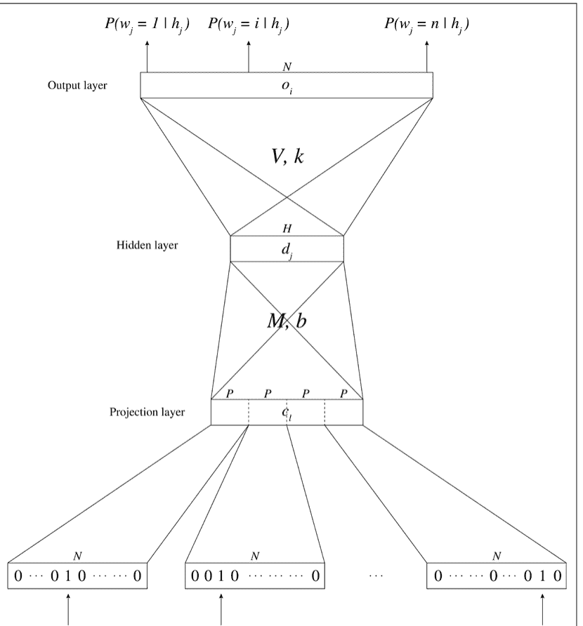

这里，$N$ 是词汇表的大小，词汇表中的每个词都是一个 N 维向量，其中只有该词的索引被设为 1，所有其他索引为 0。这种表示方法称为 1-of-$N$ 编码。NNLM 的输入是前 $n-1$ 个词的索引 $h_j = w_{j-n+1}^{j-1}$（因此它们是 $n$-gram）。由于大小 $N$ 通常在 5,000 到 200,000 之间，NNLM 的输入向量非常稀疏。然后，每个词被映射到投影层，以实现连续空间表示。这种从离散空间到连续空间的线性投影（激活）本质上是一个大小为 $N \times P$ 的查找表，其中 $P$ 表示特征维度。投影矩阵在上下文中的不同词位置之间共享，并将词向量激活为投影层单元 $c_l$，其中 $l = 1,\ldots,(n-1).P$。投影之后是隐藏层。由于投影层处于连续空间中，模型的后续结构与其它神经网络完全相同。因此，激活可以表示如下：

$$d_j = h\left(\sum_{l=1}^{(n-1).P} m_{jl}c_l + b_j\right)$$

这里，$h(\cdot)$ 表示激活函数，$m_{ji}$ 表示投影层与隐藏层之间的权重，$b_j$ 表示隐藏层的偏置。相应地，我们可以得到输出单元如下：

$$o_i = \sum_{j} v_{ij} d_j + k_i$$

这里，$v_{ij}$ 表示隐藏层与输出层之间的权重，$k_i$ 表示输出层的偏置。给定特定历史 $h_j$ 时某个词 $i$ 的概率然后可以通过 softmax 函数计算：

$$P\left(w_j = i \mid h_j\right) = \frac{\exp(o_i)}{\sum_{l=1}^{N} \exp(o_l)}$$

正如你所看到的，在 NNLM 中，模型同时预测所有词的概率。由于该模型现在用标准神经网络来描述，我们可以使用标准反向传播算法来训练该模型。


与标准神经网络不同的是，RNN 在时间上隐藏层之间存在连接。时间 $t$ 的输入在时间 $t$ 的隐藏层中被激活，被保存在隐藏层中，然后与时间 $t+1$ 的输入一起传播到时间 $t+1$ 的隐藏层。这使得网络能够包含过去数据的状态并反映它们。你可能会认为 RNN 更像是一个动态模型，但如果在每个时间步展开模型，你会发现 RNN 是一个静态模型：

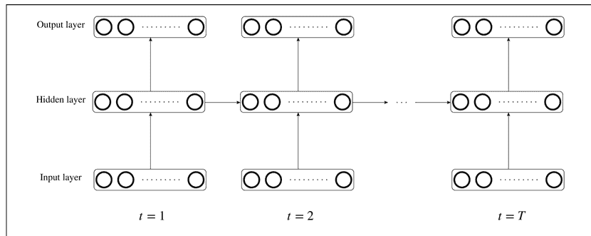

由于每个时间步的模型结构与一般神经网络相同，你可以使用反向传播算法训练该模型。然而，训练时需要考虑时间相关性，有一种名为 **Backpropagation through Time (BPTT)** 的技术来处理这个问题。在 BPTT 中，参数的误差和梯度会被反向传播到过去的层：


因此，RNN 可以在模型内保留上下文。理论上，每个时间步的网络应考虑到此为止的整个序列，但实际上，为了使计算不那么复杂或防止梯度消失问题和梯度爆炸问题，通常会对模型应用一定长度的时间窗口。BPTT 使层间训练成为可能，这也是 RNN 通常被认为是一种深度神经网络的原因。我们还拥有深度 RNN 的算法，例如隐藏层堆叠的堆叠 RNN。

RNN 已被应用于 NLP，实际上是该领域最成功的模型之一。为 NLP 优化的原始模型称为 **recurrent neural network language model (RNNLM)**，由 Mikolov et al. (http://www.fit.vutbr.cz/research/groups/speech/publi/2010/mikolov_interspeech2010_IS100722.pdf) 提出。模型架构可以如下所示：


该网络有三层：输入层 $x$、隐藏层 $s$ 和输出层 $y$。隐藏层也常被称为上下文层或状态层。相对于时间 $t$ 的每一层的值可以表示如下：

$$\begin{aligned}
x_t &= w_t + s_{t-1} \\
s_t &= f(Uw_t + Ws_{t-1}) \\
y_t &= g(Vs_t)
\end{aligned}$$

这里，$f(\cdot)$ 表示 sigmoid 函数，$g(\cdot)$ 表示 softmax 函数。由于输入层包含时间 $t-1$ 的状态层，因此它可以将整个上下文反映到网络中。模型架构意味着 RNNLM 可以查找比前馈 NNLM 更广的上下文，后者的上下文长度受限于 $N$ (-gram)。

训练 RNN 时应考虑全部时间和整个上下文，但如前所述，我们经常截断时间长度，因为 BPTT 需要大量计算，并且在学习长期依赖时经常导致梯度消失/爆炸问题，因此该算法通常被称为 **truncated BPTT**。如果我们根据时间展开 RNNLM，模型可以如下所示（图中展开时间 $\tau = 3$）：


这里 $d_t$ 是输出的标签向量。那么，输出的误差向量可以表示如下：

$$\delta_t^{out} = d_t - y_t$$

我们得到以下方程：

$$\delta_t^{hidden} = d\left(\left(\delta_t^{out}\right)^T V, t\right)$$

这里 $T$ 是展开时间：

$$d(x,t) = x s_t (1 - s_t)$$

前述图像是隐藏层激活函数的导数。由于这里使用 sigmoid 函数，我们得到前述方程。然后，我们可以按如下方式得到过去的误差：

$$\delta_{t-\tau-1}^{hidden} = d\left(\left(\delta_{t-\tau}^{out}\right)^T V, t - \tau - 1\right)$$

利用这些方程，我们现在可以更新模型的权重矩阵：

$$V_{t+1} = V_t + s_t \left(\delta_t^{out}\right)^T \alpha$$

$$U_{t+1} = U_t + \sum_{\tau=0}^{T} w_{t-\tau} \left(\delta_{t-\tau}^{hidden}\right)^T \alpha$$

$$W_{t+1} = W_t + \sum_{\tau=0}^{T} w_{t-\tau-1} \left(\delta_{t-\tau}^{hidden}\right)^T \alpha$$

这里，*α* 是学习率。RNNLM 中有趣的是，训练后矩阵中的每个向量都显示了词语之间的差异。这是因为 *U* 是将每个词映射到潜在空间的矩阵，因此训练后，映射的词向量包含词语的含义。例如，“king” − “man” + “woman” 的向量计算会返回 “queen”。DL4J 支持 RNN，因此你可以使用该库轻松实现此模型。

### 长短期记忆网络
使用标准 RNN 训练需要截断 BPTT。那么你可能会怀疑 BPTT 是否真的能足够训练模型以反映整个上下文，这确实是真的。这就是为什么引入了一种特殊的 RNN，即 **long short term memory (LSTM)** 网络来解决长期依赖问题。LSTM 令人望而生畏，但让我们简要探讨一下 LSTM 的概念。

首先，我们必须思考如何在网络中存储和传递过去的信息。虽然梯度爆炸问题可以通过为连接设置上限来简单缓解，但梯度消失问题仍需深入考虑。一种可能的方法是引入一个永久保存其输入值及其梯度的单元。因此，当你查看标准神经网络隐藏层中的一个单元时，它可以简单地描述如下：


这里没有什么特别的。然后，通过在网络下方添加一个单元，网络现在可以在神经元内记忆过去的信息。这里添加的神经元具有线性激活，其值通常设置为 1。这个神经元或单元被称为 **constant error carousel (CEC)**，因为误差像旋转木马一样留在神经元中而不会消失。CEC 作为存储单元工作并存储过去的输入。这解决了梯度消失问题，但引发了另一个问题。由于所有传播的数据都储存在神经元中，它可能也会存储噪声数据：


这个问题可以分解为两个问题：*input weight conflicts* 和 *output weight conflicts*。输入权重冲突的关键思想是保留网络中的某些信息直到必要时；神经元仅在相关信息到来时被激活，否则不被激活。类似地，输出权重冲突可能发生在所有类型的神经网络中；神经元的值仅在必要时传播，否则不传播。只要神经元之间的连接用网络的权重表示，我们就无法解决这些问题。因此，需要另一种表示方法或技术来控制输入和输出的传播。但我们如何做到这一点？答案是在 CEC 前后放置充当“门”的单元，它们分别称为 **input gate** 和 **output gate**。门的图形模型可以如下描述：


理想情况下，门应返回对应于输入的离散值 0 或 1，门关闭时为 0，打开时为 1，因为它是一个门，但从程序上讲，门被设置为返回 0 到 1 范围内的值，以便可以用 BPTT 很好地训练。

看起来我们现在可以在确切的时间放置和获取确切的信息，但仍存在另一个问题。仅凭输入门和输出门两个门，存储在 CEC 中的记忆无法在几步内轻松刷新。因此，我们需要一个额外的门来动态改变 CEC 的值。为此，我们在架构中添加一个 **forget gate** 来控制何时应擦除记忆。当门的值为 0 或接近 0 时，保存在 CEC 中的值会被新记忆覆盖。有了这三个门，一个单元现在可以记忆过去的信息或上下文，因此它被称为 **LSTM block** 或 **LSTM memory block**，因为它更像是一个块而不是单个神经元。以下是表示 LSTM 块的图：


标准 LSTM 结构之前已完全解释过，但有一个技巧可以提升其性能，我们现在就来解释。每个门都接收来自输入单元和 LSTM 中所有单元输出的连接，但没有来自 CEC 的直接连接。这意味着我们无法看到网络的真实隐藏状态，因为块的输出高度依赖于输出门；只要输出门关闭，任何门都无法访问 CEC，且其缺乏必要信息，这可能会降低 LSTM 的性能。一个简单而有效的解决方案是在块中添加从 CEC 到门的连接。这些被称为窥视孔连接，其作用类似于标准的加权连接，只是门通过窥视孔连接不会回传误差。窥视孔连接使所有门即使在输出门关闭时也能感知隐藏状态。你现在已经学习了很多术语，但因此，整个连接的基本架构可以描述如下：


为了简化，图中描述了单个 LSTM 块。你可能会感到畏惧，因为前述模型非常复杂。然而，当你逐步查看模型时，你可以理解 LSTM 网络是如何解决 NLP 中的困难的。给定输入序列 $x=(x_1,\ldots,x_T)$，每个网络单元可按如下方式计算：

$$\begin{aligned}
i_t &= \sigma(W_{ix}x_t + W_{im}m_{t-1} + W_{ic}c_{t-1} + b_i) \\
f_t &= \sigma(W_{fx}x_t + W_{fm}m_{t-1} + W_{fc}c_{t-1} + b_f) \\
c_t &= f_t \odot c_{t-1} + i_t \odot g(W_{cx}x_t + W_{cm}m_{t-1} + b_c) \\
o_t &= \sigma(W_{ox}x_t + W_{om}m_{t-1} + W_{oc}c_t + b_o) \\
m_t &= o_t \odot h(c_t) \\
y_t &= s(W_{ym}m_t + b_y)
\end{aligned}$$

在前述公式中，$W_{ix}$ 是从输入门到输入的权重矩阵，$W_{fx}$ 是从遗忘门到输入的权重矩阵，$W_{ox}$ 是从输出门到输入的权重矩阵。$W_{cx}$ 是从单元到输入的权重矩阵，$W_{cm}$ 是从单元到 LSTM 输出的权重矩阵，$W_{ym}$ 是从输出到 LSTM 输出的权重矩阵。$W_{ic}$、$W_{fc}$ 和 $W_{oc}$ 是窥视孔连接的对角权重矩阵。$b$ 项表示偏置向量，$b_i$ 是输入门偏置向量，$b_f$ 是遗忘门偏置向量，$b_o$ 是输出门偏置向量，$b_c$ 是 CEC 单元偏置向量，$b_y$ 是输出偏置向量。这里，$g$ 和 $h$ 分别是单元输入和单元输出的激活函数。$\sigma$ 表示 sigmoid 函数，$s(\cdot)$ 表示 softmax 函数。$\odot$ 是向量的逐元素乘积。

由于仅应用 BPTT 就会变得过于复杂，本书不会继续推导数学方程，但你也可以尝试使用 DL4J 实现 LSTM 以及 RNN。正如 CNN 在图像识别领域发展起来一样，RNN 和 LSTM 也是为了解决 NLP 中逐一出现的问题而发展的。虽然这两种算法只是利用 NLP 提升性能的一种方法，仍需改进，但由于我们是使用语言交流的生命体，NLP 的发展必定会带来技术创新。对于 LSTM 的应用，你可以参考 *使用神经网络的序列到序列学习* (Sutskever et al., http://arxiv.org/pdf/1409.3215v3.pdf)，对于更近期的算法，你可以参考 *网格长短期记忆* (Kalchbrenner et al., http://arxiv.org/pdf/1507.01526v1.pdf) 和 *展示、关注并讲述：带视觉注意力的神经图像字幕生成* (Xu et al., http://arxiv.org/pdf/1502.03044v2.pdf)。

### 深度学习的困难

深度学习在图像识别领域已取得超过人类的精度，并已应用于相当多的实际应用中。同样地，在 NLP 领域，已研究出许多模型。那么，在其他领域深度学习被利用的程度如何？令人惊讶的是，成功应用深度学习的领域仍然很少。这是因为与过去的算法相比，深度学习确实具有创新性，确实让我们在实现 AI 方面迈出了很大一步；然而，在实际应用中使用时存在一些问题。

第一个问题是深度学习算法中的模型参数太多。当你学习算法的理论和实现时，我们没有详细查看，但实际上与过去的神经网络或其他机器学习算法相比，深度神经网络有许多需要决定的超参数。这意味着我们需要经过更多的试错才能获得高精度。定义神经网络结构的超参数组合，例如设置多少个隐藏层或每个隐藏层应有多少个单元，需要大量实验。此外，训练和测试配置的参数，如学习率，也需要确定。 furthermore，每个算法特有的参数，如 SDA 中的损坏程度和 CNN 中的核大小，也需要额外的试错。因此，深度学习提供的出色性能得益于稳定的参数调优。然而，人们只看到深度学习的一面——它可以获得很高的精度——而往往忘记了达到这一点所需的艰难过程。深度学习不是魔法。

此外，深度学习在训练和分类简单问题的数据时常常失败。深度神经网络的结构如此深且复杂，以至于权重无法得到良好优化。在优化方面，数据量也很重要。这意味着深度神经网络每次训练都需要大量时间。综上所述，深度学习在以下情况下体现其价值：

- 它解决了复杂且困难的问题，而人们不知道其可归类的特征是什么
- 有足够多的训练数据来正确优化深度神经网络

与使用不断更新的数据不断更新模型的应用程序相比，一旦使用规模大且变化不大的数据集构建模型，则普遍使用该模型的应用程序更适合深度学习。

因此，从商业领域来看，可以说使用现有机器学习获得更好结果的情况比使用深度学习更多。例如，假设我们想在电子商务中向用户推荐合适的产品。在这个电商平台中，许多用户每天购买大量产品，因此购买数据每天都会大幅更新。在这种情况下，你是否会使用深度学习来获得高精度的分类和推荐，以利用这些数据提高用户购买的转化率？可能不会，因为使用现有的机器学习算法，如朴素贝叶斯、协同过滤、SVM 等，从实际角度来看可以获得足够的精度，并且可以更快地更新模型和计算，这通常更受青睐。这就是为什么深度学习在商业领域应用不多的原因。当然，在任何领域获得更高的精度都是更好的，但在现实中，更高的精度和必要的计算时间之间存在权衡关系。虽然深度学习在研究领域很重要，但考虑到实际应用，它还有许多障碍需要克服。

此外，深度学习算法并不完美，其模型本身仍需要许多改进。例如，正如前面提到的，RNN 只能满足过去信息如何反映到网络中或如何获得精度其中之一，尽管它使用了 LSTM 等技术。此外，与过去的算法相比，深度学习绝对是一种伟大的技术，但它与真正的 AI 仍相去甚远。算法研究正在积极推进，但与此同时，我们还需要一次突破，才能将深度学习推广并渗透到更广泛的社会中。也许这不仅仅是模型的问题。深度学习之所以突然兴起，是因为它得到了硬件和软件巨大发展的推动。深度学习与周边技术的发展密切相关。


如前所述，深度学习要在现实世界中更实际地应用，仍有许多障碍需要克服，但这并非不可能实现。我们不可能突然发明出AI来实现技术奇点，但在某些领域和方法中，深度学习可以立即投入使用。在下一节中，我们将思考深度学习可以应用于哪些行业。希望这能为您在业务或研究领域播下新思想的种子。

### 最大化深度学习潜能与能力的方法

关于如何将深度学习应用于各行各业，有几种方法。虽然根据任务或目的的不同，方法也可能有所不同，但我们可以将这些方法大致分为以下三类：

- **领域导向方法**：利用已经过充分研究且能带来卓越性能的深度学习算法或模型。
- **分解导向方法**：将深度学习看似可以解决的问题，替换为深度学习能够很好适配的另一个问题。
- **输出导向方法**：探索如何用深度学习来表达输出的新方式。

这些方法将在以下小节中详细说明。每种方法都划分了其适用的行业或领域以及不适用的情况，但其中任何一种都可能为您今后的工作提供重要启示。目前深度学习的应用案例仍然很少，且存在使用领域的偏见，但这意味着应该有很多创造创新事物的机会。近年来，利用深度学习的初创公司不断涌现，其中一些已经取得了一定程度的成功。根据您的想法，您有可能对世界产生重大影响。

#### 领域导向方法

这种方法不需要新技术或新算法。显然，有些领域非常适合当前的深度学习技术，而这里的理念就是深入这些领域。如前所述，经过实际研究和开发的深度学习算法大多集中在图像识别和自然语言处理（NLP）方面，因此我们将探索一些能与这些技术很好契合的领域。

##### 医学

医学领域应该由深度学习来推动发展。肿瘤或癌症可以在扫描图像上被检测出来。这无非就是能够利用深度学习最强大的特性之一——图像识别技术。利用深度学习帮助早期发现疾病并识别疾病种类，可以大幅提高精确度。由于CNN可以应用于3D图像，因此3D扫描图像应该相对容易分析。通过在当前的医学领域更多地采用深度学习，深度学习应该能做出巨大贡献。

我们还可以说，深度学习在未来对医学领域会非常有用。医学领域一直受到严格监管；然而，在一些国家，放松管制的运动正在推进，这大概是因为近年来IT的发展及其潜力。因此，医学领域和IT领域在业务上将有机会产生协同效应。例如，如果远程医疗更加普及，那么诊断或识别疾病不仅可以依靠扫描图像，还可以依靠显示器上实时显示的图像。此外，如果电子病历得到普及，利用深度学习分析医疗数据就会更加容易。这是因为病历是文本和图像的数据集，与深度学习兼容。这样，未知疾病的症状也能被发现。

##### 汽车

我们可以说，行驶中的汽车周围环境是图像序列和文本。其他车辆和景色是图像，路标是文本。这意味着我们也可以在这里利用深度学习技术，并且有可能通过改进驾驶辅助功能来降低事故风险。可以说，驾驶辅助的终极形式是自动驾驶汽车，谷歌和特斯拉主要在这一领域进行探索。一个既著名又引人入胜的例子是，第一个破解iPhone的人George Hotz在他的车库里制造了一辆自动驾驶汽车。这辆车的外观在彭博商业周刊的一篇文章中介绍过（http://www.bloomberg.com/features/2015-george-hotz-self-driving-car/），文章中包含了下面这张图片：


自动驾驶汽车已经在美国进行了测试，但由于其他国家的交通规则和道路条件不同，这一想法在自动驾驶汽车在世界范围内普及之前还需要进一步的研究和开发。这个领域成功的关键在于学习和识别周围的车辆、行人、景色和交通标志，并正确判断如何处理它们。

同时，我们不一定只关注将深度学习技术应用于汽车本身。假设我们能开发一款智能手机应用，具备我们刚才描述的功能，即识别和分类周围的图像和文本。那么，只需将智能手机安装在车上，就可以将其用作车载导航应用。此外，例如，它还可以用作盲人的导航应用，为他们提供良好、可靠的指引。

##### 广告技术

广告（ad）技术可以通过深度学习扩大其覆盖范围。说到广告技术，目前这通常是指优化要展示的广告横幅或产品的推荐系统或广告网络。另一方面，说到广告，这并不仅仅指横幅或广告网络。世界上有各种类型的广告，取决于媒体类型，如电视广告、广播广告、报纸广告、海报、传单等等。我们还有通过YouTube、Vine、Facebook、Twitter、Snapchat等进行的数字广告活动。广告本身的定义和内容已经发生了变化，但所有广告都有一个共同点：它们由图像和/或语言组成。这意味着它们是深度学习擅长的领域。到目前为止，我们只能使用基于用户行为的指标，如**页面浏览量（PV）、点击率（CTR）和转化率（CVR）**来评估广告效果，但如果应用深度学习技术，我们或许能够分析广告的实际内容，并在未来自动生成广告。特别是由于电影和视频只能作为图像识别和NLP的结果来分析，因此视频识别（而非图像识别）除了广告技术之外，也将获得发展动力。

##### 专业或执业领域

医生、律师、专利代理人和会计师等职业被认为是深度学习可以取代的角色。例如，如果NLP的精确度和准确度变得更高，任何需要专业知识的审阅工作都可以交给机器。由于机器可以承担这些耗时的阅读任务，人们可以更专注于高价值的工作。此外，如果机器能对过去的司法案件或医疗案例进行分类，例如什么疾病引起了什么症状等，我们将能够构建一个像Apple的Siri那样的应用，回答通常需要专业知识才能回答的简单问题。那么，如果医生或律师太忙无法及时提供帮助，机器可以在一定程度上处理这些专业事务。

人们常说AI会夺走人类的工作，但就我个人而言，这种说法似乎并不正确。更确切地说，机器会夺走一些琐碎的工作，这应该是对人类的一种支持。从事AI编程的软件工程师可以说拥有专业的工作，但这项工作未来也会发生变化。例如，考虑一下与汽车相关的工作，目前的工作是制造标准汽车，但未来，工程师的处境将类似于一级方程式赛车的维修站工作人员。

##### 体育

深度学习当然也可以为体育做出贡献。在被称为运动科学的研究领域中，分析和检验体育数据变得越来越重要。举个例子，您可能知道《点球成金》这本书或电影。在这部影片中，他们通过在棒球中采用回归模型，大幅提高了球队的胜率。观看体育比赛本身非常激动人心，但另一方面，体育可以被视为一堆图像序列和数字数据。由于深度学习擅长识别人类无法发现的特征，因此将更容易找出为什么某些球员能取得好成绩而其他人却不能。

我们提到的这些领域仅仅只是深度学习能够显著推动发展的众多领域中的一小部分。我们已经从某个领域是否包含图像或文本的角度审视了这些领域，但当然，深度学习在处理一般数字数据的简单分析时也应该表现出色。深度学习应该可以应用于各种其他领域，如生物信息学、金融、农业、化学、天文学、经济学等等。

#### 分解导向方法

这种方法可能与传统机器学习算法中考虑的方法类似。我们已经谈过特征工程是提高机器学习精度的关键。现在我们可以说，这种特征工程可以分为以下两个部分：

- 在机器学习模型的约束下进行工程。典型的情况是使输入离散化或连续化。
- 通过机器学习来提高精度的特征工程。这往往依赖于研究者的感觉。


从狭义上讲，特征工程被视为第二种，这是深度学习无需重点关注的部分；而第一种绝对是重要的部分，即使对深度学习也是如此。例如，使用深度学习预测股票价格是困难的。股票价格波动剧烈，且输入难以定义。此外，如何应用输出值也是一个难题。让深度学习能够处理这些输入和输出，也被称为广义上的特征工程。如果原始数据和/或你想要预测的数据的值没有限制，那么将这些数据集插入机器学习和深度学习算法（包括神经网络）会非常困难。

然而，我们可以采取某种方法，通过分解输入和/或输出来将模型应用于这些先前的问题。就NLP而言，正如前面所解释的，你可能会想，比如，一开始就不可能把无数的词作为特征，但正如你已经知道的，我们可以通过用稀疏向量表示词并将N-gram组合到其中，来训练前馈神经网络处理词语。当然，我们不仅可以在这里使用神经网络，还可以使用其他机器学习算法，如SVM。因此，我们可以通过工程手段开拓一个深度学习尚未应用的新领域，使特征能够很好地适应深度学习模型。与此同时，当我们关注NLP时，可以看到RNN和LSTM是为了恰当地解决NLP中遇到的困难或任务而开发的。这可以被视为与特征工程相反的方法，因为在这种情况下，问题是通过分解模型来适应特征而解决的。

那么，我们如何利用特征工程来解决刚才提到的股票预测问题呢？实际上，考虑输入（即特征）并不困难。例如，如果你按日预测股票价格，使用每日股票价格作为特征很难计算；但如果你使用当日与前一日之间的价格变化率，那么处理起来就容易得多，因为价格保持在一定的范围内，梯度也不容易爆炸。与此同时，困难的是如何处理输出。股票价格当然是连续值，因此输出可以是各种值。这意味着在输出层单元数量固定的神经网络模型中，它们无法处理这个问题。在这里我们该怎么做——难道要放弃吗？！不，等等。不幸的是，我们无法预测股票价格本身，但还有一种替代预测方法。

在这里，问题在于我们需要预测的股票价格可以被分类为无限种模式。那么，我们能让它们变成有限的模式吗？是的，我们可以。让我们强行这样做。考虑一个最极端但容易理解的情况：利用截至今天的股票价格数据，预测明天的股价——严格来说是收盘价——是上涨还是下跌。对于这种情况，我们可以用如下的深度学习模型来表示：


在上图中，o(t) 表示 t 日的开盘价；c(t) 表示收盘价，H(t) 是最高价，L(t) 是最低价。这里使用的特征只是示例，在实际应用中需要进行微调。这里的要点是，将原始任务替换为这类问题，使得深度神经网络在理论上能够对数据进行分类。此外，如果你按涨跌幅来对数据进行分类，还可以做出更细致的预测。例如，可以按照下表对数据进行分类：

| 类别 | 描述 |
|---|---|
| 类别 1 | 比收盘价上涨超过 3% |
| 类别 2 | 比收盘价上涨 1%~3% |
| 类别 3 | 比收盘价上涨 0%~1% |
| 类别 4 | 比收盘价下跌 0%~1% |
| 类别 5 | 比收盘价下跌 1%~3% |
| 类别 6 | 比收盘价下跌超过 3% |

这种预测是否真的有效，换句话说，分类是否有效，在我们检查之前是未知的；但通过将输出划分为多个类别，股票价格的波动可以在相当窄的范围内被预测。一旦我们能够将任务纳入神经网络，接下来要做的就是检查哪种模型能获得更好的结果。在这个例子中，我们可以应用RNN，因为股票价格是时间序列数据。如果我们把显示价格的图表视为图像数据，也可以使用CNN来预测未来价格。

现在，我们已经结合示例思考了这种方法，但总的来说，我们可以这样说：

- **面向模型的特征工程**：设计输入或调整值以适配深度学习模型，或通过为输出设置限制来实现分类。
- **面向特征的模型工程**：设计新的神经网络模型或算法，以解决特定领域中的问题。

第一种需要在设计输入和输出以适配模型方面有创意，而第二种需要采用数学方法。如果你有意识地将某个预测目标限制在有限范围内，特征工程可能更容易入手。

### 输出导向的方法

前面提到的两种方法都是利用深度学习来提高某一领域任务或问题的正确率。当然，这是至关重要的，也是深度学习证明自身价值的部分；然而，将精确度提升到极致水平可能并不是利用深度学习的唯一方式。另一种方法是稍微改变视角，利用深度学习来设计输出。让我们看看这意味着什么。

深度学习被研究人员和AI技术专家誉为一种创新方法，但普通大众对其伟大之处还知之甚少。相反，他们关注的是机器不能做什么。例如，人们并不真正关注使用CNN进行MNIST图像识别（其错误率已低于人类）的能力，而是批评机器无法完美识别图像。这可能是因为人们一听到并想象AI时，期望值很高。我们或许需要改变这种心态。让我们想想哆啦A梦——一个日本国民级卡通角色，在世界上也很有名——他是一个拥有高智能和AI的机器人，却经常犯一些愚蠢的错误。我们会批评他吗？不会，我们只是一笑置之，把它当作玩笑，不会当真。另外，想想《钢铁侠》电影中的机器人手臂DUMMY / DUM-E。它也有AI，但同样会犯愚蠢的错误。看，他们虽然犯错，但我们仍然喜欢他们。

这样一来，或许更值得强调机器也会犯错这一点。改变用户界面的表达方式可能会成为人们采用AI的触发点，而不仅仅是把算法研究到极致。谁知道呢？通过从创意领域而非精确性的角度构思点子，你极有可能吸引全世界的兴趣。谷歌的 Deep Dream 就是一个很好的例子。当艺术或设计与深度学习结合时，我们可以做更多令人兴奋的事情。

### 总结

在本章中，你学会了如何将深度学习算法应用于实际应用。研究较为成熟的领域是图像识别和NLP。在学习NLP领域的过程中，我们了解了两种新的深度学习模型：RNN和LSTM网络，它们可以用时间序列数据进行训练。这些模型使用的训练算法是BPTT。你还了解到，有充分利用深度学习能力的三种方法：领域导向方法、分解导向方法和输出导向方法。每种方法的切入角度不同，都能最大化深度学习的可能性。

而且……恭喜！你刚刚完成了使用Java学习深度学习的部分。虽然本书中还有一些模型尚未提及，但你可以放心，掌握并利用它们不会有任何问题。下一章将介绍一些用其他编程语言实现的库，所以放松地去了解一下吧。


## 7 其他重要的深度学习库

在本章中，我们将讨论其他深度学习库，特别是使用Java以外编程语言的库。以下是最著名、发展最完善的库：

- Theano
- TensorFlow
- Caffe

你将简要了解它们中的每一个。由于我们在这里主要使用Python实现它们，如果你不是Python开发者，可以跳过本章。本章介绍的所有库都支持GPU实现，并且还有其他特殊功能，让我们深入了解它们。

### Theano

Theano是为深度学习而开发的，但它实际上并不是一个深度学习库；它是一个用于科学计算的Python库。文档可在 http://deeplearning.net/software/theano/ 获取。该页面上介绍了几个特性，例如使用GPU，但最引人注目的特性是Theano支持计算微分或自动微分，而Java科学计算库ND4J不支持这一点。这意味着，使用Theano，我们不必自己计算模型参数的梯度。Theano会自动完成这项工作。由于Theano承担了算法中最复杂的部分，数学表达式的实现就不那么困难了。

让我们看看Theano如何计算梯度。首先，我们需要在机器上安装Theano。只需使用pip install Theano或easy_install Theano即可完成安装。然后，下面是导入和使用Theano的代码行：

```
import theano
import theano.tensor as T
```

在Theano中，所有变量都作为张量处理。例如，我们有标量、向量和矩阵，d表示double（双精度），l表示long（长整型），等等。诸如sin、cos、log和exp等通用函数也定义在theano.tensor下。因此，如前所示，我们经常使用tensor的别名T。

作为简要理解Theano实现的第一步，考虑非常简单的抛物线曲线。实现代码保存在DLWJ/src/resources/theano/1_1_parabola_scalar.py中，方便你参考。首先，我们如下定义x：

```
x = T.dscalar('x')
```

这个定义是Python特有的，因为x没有值；它只是一个符号。在这种情况下，x是d（double）类型的标量。然后我们可以非常直观地定义y及其梯度。实现如下：

```
y = x ** 2
dy = T.grad(y, x)
```

因此，dy内部应该有2x。让我们检查能否得到正确答案。我们还需要额外做的是用Theano注册这个数学函数：

```
f = theano.function([x], dy)
```

然后你可以轻松计算梯度的值：

```
print f(1)  # => 2.0
print f(2)  # => 4.0
```

非常简单！这就是Theano的强大之处。这里我们使用的是标量x，但你也可以轻松实现向量（和矩阵）计算，只需将x定义为：

```
x = T.dvector('x')
y = T.sum(x ** 2)
```

这里我们不再深入，但你可以在DLWJ/src/resources/theano/1_2_parabola_vector.py和DLWJ/src/resources/theano/1_3_parabola_matrix.py中找到完整代码。

当我们考虑用Theano实现深度学习算法时，可以在GitHub上的Deep Learning Tutorials（https://github.com/lisa-lab/DeepLearningTutorials）中找到一些非常好的示例。在本章中，我们将概述标准MLP实现，以便你更了解Theano。作为快照的fork仓库可在 https://github.com/yusugomori/DeepLearningTutorials 获取。首先，让我们看一下mlp.py。隐藏层的模型参数是权重和偏置：

```
W = theano.shared(value=W_values, name='W', borrow=True)
b = theano.shared(value=b_values, name='b', borrow=True)
```

这两个参数都使用theano.shared定义，以便通过模型访问和更新它们。激活可以表示为：

$z = h(Wx + b)$

这表示激活函数，即本代码中的双曲正切函数。因此，相应的代码如下：

```
lin_output = T.dot(input, self.W) + self.b
self.output = (
    lin_output if activation is None
    else activation(lin_output)
)
```

这里也支持线性激活。同样，输出层（即逻辑回归层）的参数W和b在logistic_sgd.py中定义并初始化：

```
self.W = theano.shared(
    value=numpy.zeros(
        (n_in, n_out),
        dtype=theano.config.floatX
    ),
    name='W',
    borrow=True
)

self.b = theano.shared(
    value=numpy.zeros(
        (n_out,),
        dtype=theano.config.floatX
    ),
    name='b',
    borrow=True
)
```

多类逻辑回归的激活函数是softmax函数，我们可以直接编写并定义输出如下：

```
self.p_y_given_x = T.nnet.softmax(T.dot(input, self.W) + self.b)
```

我们可以将预测值写为：

```
self.y_pred = T.argmax(self.p_y_given_x, axis=1)
```

在训练方面，由于反向传播算法的方程是从损失函数及其梯度计算出来的，我们只需要定义要最小化的函数，即负对数似然函数：

```
def negative_log_likelihood(self, y):
    return -T.mean(T.log(self.p_y_given_x)[T.arange(y.shape[0]), y])
```

这里计算的是平均值，而不是总和，以便在mini-batch（小批量）上进行评估。

有了上述值和定义，我们就可以实现MLP了。这里同样，我们需要做的是定义MLP的方程和符号。以下是代码的摘录：

```
class MLP(object):
    def __init__(self, rng, input, n_in, n_hidden, n_out):
        # self.hiddenLayer = HiddenLayer(...)
        # self.logRegressionLayer = LogisticRegression(...)
        # L1 norm
        self.L1 = (
            abs(self.hiddenLayer.W).sum()
            + abs(self.logRegressionLayer.W).sum()
        )
        # square of L2 norm
        self.L2_sqr = (
            (self.hiddenLayer.W ** 2).sum()
            + (self.logRegressionLayer.W ** 2).sum()
        )
        # negative log likelihood of MLP
```

每个索引输入和标签对应于givens中的x、y，因此当给定索引时，参数会通过updates更新。因此，我们可以通过训练轮次（epoch）和mini-batch的迭代来训练模型：

```
while (epoch < n_epochs) and (not done_looping):
    epoch = epoch + 1
    for minibatch_index in xrange(n_train_batches):
        minibatch_avg_cost = train_model(minibatch_index)
```

原始代码包含测试和验证部分，但我们刚才提到的是基本结构。使用Theano，不再需要推导梯度方程。

### TensorFlow

TensorFlow是由谷歌开发的机器学习和深度学习库。项目页面是 https://www.tensorflow.org/ ，所有代码都在GitHub上公开，地址为 https://github.com/tensorflow/tensorflow 。TensorFlow本身是用C++编写的，但它提供了Python和C++ API。本书重点介绍Python实现。安装可以通过pip、virtualenv或docker完成。安装指南可在 https://www.tensorflow.org/versions/master/get_started/os_setup.html 获取。安装完成后，你可以通过编写以下代码导入和使用TensorFlow：

```
import tensorflow as tf
```

TensorFlow建议你使用以下三个部分来实现深度学习代码：

- inference()：使用给定数据进行预测，定义模型结构
- loss()：返回需要优化的误差值
- training()：通过计算梯度应用实际的训练算法

我们将遵循这一指导原则。在 https://www.tensorflow.org/versions/master/tutorials/mnist/beginners/index.html 上介绍了面向初学者的MNIST分类教程，该教程的代码可以在DLWJ/src/resources/tensorflow/1_1_mnist_simple.py中找到。这里，我们考虑改进教程中介绍的代码。你可以在DLWJ/src/resources/tensorflow/1_2_mnist.py中看到所有代码。


### 其他重要的深度学习库

首先，我们需要考虑的是获取 MNIST 数据。幸好 TensorFlow 也在 `https://github.com/tensorflow/tensorflow/blob/master/tensorflow/examples/tutorials/mnist/input_data.py` 提供了获取数据的代码，我们把该代码放到同一目录下。然后，编写以下代码即可导入 MNIST 数据：

```python
import input_data
```

可以使用以下代码导入 MNIST 数据：

```python
mnist = input_data.read_data_sets("MNIST_data/", one_hot=True)
```

与 Theano 类似，我们将没有实际值的变量定义为占位符：

```python
x_placeholder = tf.placeholder("float", [None, 784])
label_placeholder = tf.placeholder("float", [None, 10])
```

这里，784 是输入层的单元数，10 是输出层的单元数。我们这样做是因为占位符中的值会随着小批量数据的变化而变化。一旦定义了占位符，就可以继续构建模型并进行训练。这里，我们在 `inference()` 中使用 `softmax` 函数设置非线性激活：

```python
def inference(x_placeholder):

    W = tf.Variable(tf.zeros([784, 10]))
    b = tf.Variable(tf.zeros([10]))

    y = tf.nn.softmax(tf.matmul(x_placeholder, W) + b)

    return y
```

这里，W 和 b 是模型的参数。损失函数，即 `cross_entropy` 函数，在 `loss()` 中定义如下：

```python
def loss(y, label_placeholder):

    cross_entropy = - tf.reduce_sum(label_placeholder * tf.log(y))

    return cross_entropy
```

定义了 `inference()` 和 `loss()` 之后，我们可以通过编写以下代码来训练模型：

```python
def training(loss):
    train_step = tf.train.GradientDescentOptimizer(0.01).minimize(loss)

    return train_step
```

GradientDescentOptimizer() 应用的是梯度下降算法。但请注意，这种方法只是定义了训练方式，实际训练尚未执行。TensorFlow 还支持 AdagradOptimizer()、MomentumOptimizer() 以及其他主要的优化算法。

前面解释的代码和方法都是用来定义模型的。要执行实际训练，你需要初始化一个 TensorFlow 会话：

```python
init = tf.initialize_all_variables()
sess.run(init)
```

然后我们使用小批量数据训练模型。一个小批量中的所有数据都存储在 `feed_dict` 中，并在 `sess.run()` 中使用：

```python
for i in range(1000):
    batch_xs, batch_ys = mnist.train.next_batch(100)
    feed_dict = {x_placeholder: batch_xs, label_placeholder: batch_ys}

    sess.run(train_step, feed_dict=feed_dict)
```

模型训练就是这样。非常简单，不是吗？你可以通过编写以下代码来显示结果：

```python
def res(y, label_placeholder, feed_dict):
    correct_prediction = tf.equal(
        tf.argmax(y, 1), tf.argmax(label_placeholder, 1)
    )

    accuracy = tf.reduce_mean(
        tf.cast(correct_prediction, "float")
    )

    print sess.run(accuracy, feed_dict=feed_dict)
```

TensorFlow 让深度学习的实现变得超级简单，而且非常有用。此外，TensorFlow 还有另一个强大的功能——TensorBoard，用于深度学习可视化。只需在前面的代码片段中添加几行代码，就可以使用这个有用的功能。

我们先来看看模型是如何可视化的。代码位于 `DLW/src/resources/tensorflow/1_3_mnist_TensorBoard.py`，直接运行即可。运行程序后，输入以下命令：

```bash
$ tensorboard --logdir=<ABSOLUTE_PATH>/data
```

这里的 `<ABSOLUTE_PATH>` 是程序的绝对路径。然后，如果你在浏览器中访问 `http://localhost:6006/`，就可以看到如下页面：


这里显示了 `cross_entropy` 值的变化过程。另外，当你点击页眉菜单中的 **GRAPH** 时，你会看到模型的可视化图：


当你在页面上点击 **inference** 时，可以看到模型结构：


现在让我们看看代码内部。要启用可视化，你需要用作用域 `with tf.Graph().as_default()` 包裹整个区域。添加这个作用域后，作用域内声明的所有变量都会显示在图中。可以通过添加名称标签来设置显示名称，如下所示：

```python
x_placeholder = tf.placeholder("float", [None, 784], name="input")
label_placeholder = tf.placeholder("float", [None, 10], name="label")
```

定义其他作用域会在图中创建节点，而这正是 `inference()`、`loss()` 和 `training()` 的定义凸显其真正价值的地方。你可以在定义各自作用域的同时不损失任何可读性：

```python
def inference(x_placeholder):
    with tf.name_scope('inference') as scope:
        W = tf.Variable(tf.zeros([784, 10]), name="W")
        b = tf.Variable(tf.zeros([10]), name="b")

        y = tf.nn.softmax(tf.matmul(x_placeholder, W) + b)

    return y

def loss(y, label_placeholder):
    with tf.name_scope('loss') as scope:
        cross_entropy = - tf.reduce_sum(label_placeholder * tf.log(y))

        tf.scalar_summary("Cross Entropy", cross_entropy)

    return cross_entropy

def training(loss):
    with tf.name_scope('training') as scope:
        train_step = tf.train.GradientDescentOptimizer(0.01).minimize(loss)

    return train_step
```

loss() 中的 tf.scalar_summary() 会让变量显示在 EVENTS 菜单中。要实现可视化，我们需要以下代码：

```python
summary_step = tf.merge_all_summaries()
init = tf.initialize_all_variables()

summary_writer = tf.train.SummaryWriter('data', graph_def=sess.graph_def)
```

然后可以通过以下代码添加变量的变化过程：

```python
summary = sess.run(summary_step, feed_dict=feed_dict)
summary_writer.add_summary(summary, i)
```

当使用更复杂的模型时，这一可视化功能会更有用。

#### Caffe

Caffe 是一个以速度快而闻名的库。官方项目页面是 http://caffe.berkeleyvision.org/，GitHub 页面是 https://github.com/BVLC/caffe。与 TensorFlow 类似，Caffe 主要用 C++ 开发，但它提供了 Python 和 MATLAB API。此外，Caffe 的独特之处在于，你不需要任何编程经验，只需编写配置或协议文件，即 `.prototxt` 文件，就能进行深度学习实验和研究。这里我们重点介绍基于协议的方法。

Caffe 是一个功能非常强大的库，可以快速构建、训练和测试模型；但是，要从中获得诸多好处，安装这个库会有点困难。从 http://caffe.berkeleyvision.org/installation.html 的安装指南可以看出，你需要预先安装以下内容：

- CUDA
- BLAS（ATLAS、MKL 或 OpenBLAS）
- OpenCV
- Boost
- 其他：snappy、leveldb、gflags、glog、szip、lmdb、protobuf 和 hdf5

然后，从 GitHub 页面克隆仓库，并根据 `Makefile.config.example` 创建 `Makefile.config` 文件。运行 make 命令前，你可能需要预先安装 Anaconda（一个 Python 发行版）。你可以从 https://www.continuum.io/downloads 下载它。运行 `make`、`make test` 和 `make runtest` 命令（你可能希望通过 `-jN` 选项来加速，例如 `make -j4` 或 `make -j8`）并通过测试后，你就会领略到 Caffe 的强大。下面来看一个例子。进入 `$CAFFE_ROOT`（你克隆仓库的路径），然后输入以下命令：

```bash
$ ./data/mnist/get_mnist.sh
$ ./examples/mnist/train_lenet.sh
```

这就是使用 CNN 解决标准 MNIST 分类问题所需的全部内容。那么，这里发生了什么？如果你看一下 `train_lenet.sh`，就会看到以下内容：

```sh
#!/usr/bin/env sh

./build/tools/caffe train --solver=examples/mnist/lenet_solver.prototxt
```


它只是使用协议文件`lenet_solver.prototxt`运行`caffe`命令。该文件配置模型的超参数，例如学习率和动量。该文件还引用了网络配置文件，在本例中是`lenet_train_test.prototxt`。你可以使用类似JSON的描述来定义每一层：

```
layer {
  name: "conv1"
  type: "Convolution"
  bottom: "data"
  top: "conv1"
  param {
    lr_mult: 1
  }
  param {
    lr_mult: 2
  }
  convolution_param {
    num_output: 20
    kernel_size: 5
    stride: 1
    weight_filler {
      type: "xavier"
    }
    bias_filler {
      type: "constant"
    }
  }
}
```

因此，基本上，协议文件分为两部分：

- **网络（Net）**：定义模型的详细结构，并描述每一层，从而构成整个神经网络
- **求解器（Solver）**：定义优化设置，例如使用CPU/GPU、迭代次数，以及模型的超参数（如学习率）

当你需要以主流方法将深度学习应用于大型数据集时，Caffe是一个很好的工具。

### 总结

在本章中，你学习了如何使用Theano、TensorFlow和Caffe实现深度学习算法和模型。它们都有特殊而强大的功能，而且每一个都非常有用。如果你对其他库和框架感兴趣，可以使用Chainer (http://chainer.org/)、Torch (http://torch.ch/)、Pylearn2 (http://deeplearning.net/software/pylearn2/)、Nervana (http://neon.nervanasys.com/) 等等。当你真正考虑使用前面提到的某个库构建应用程序时，也可以参考一些基准测试（https://github.com/soumith/convnet-benchmarks 和 https://github.com/soumith/convnet-benchmarks/issues/66）。

在本书中，你学习了机器学习和深度学习的基础理论和算法，以及深度学习如何应用于学习/商业领域。凭借你在这里学到的知识和技术，你应该能够应对所面临的任何问题。虽然要实现AI确实还需要更多的步骤，但你现在拥有了实现创新的最大机会。

## 8 下一步是什么？

在前面的章节中，我们学习了深度学习的概念、理论、实现以及如何使用相关库。现在你已经掌握了深度学习的基本技术，所以不用担心。另一方面，深度学习的发展非常迅速，明天可能就会出现新模型。关于AI或深度学习的大新闻每天都接连不断。既然你已经掌握了基本技术，就可以快速学习AI和深度学习即将出现的新技术。现在，让我们暂时放下技术的细节，思考AI领域将会或应该走什么样的道路。深度学习的未来是什么？作为最后一章，让我们来思考这个问题。本章将讨论以下主题：

- 深度学习行业的热门话题
- 如何管理AI技术
- 如何进一步推进深度学习的研究

至于最后一个主题——进一步学习，我将推荐一个关于深度学习的网站。你可以通过思考接下来可能出现的科技，或利用你学到的技术进行创新，从而保持领先，而不是被动地跟随AI的发展。

### 深度学习的重大新闻

深度学习引发了AI热潮，其势头无法阻挡。每天都有新的成果被报道。如*第6章，实际应用方法——循环神经网络及其他*中所述，许多研究者在图像识别和自然语言处理领域竞争。当然，深度学习不仅限于这两个领域，还适用于许多其他领域。这些应用的结果非常令人兴奋。

在这次AI热潮中，2016年3月，围棋界被一件事震撼。围棋是一种两人对弈的棋类游戏，双方试图占领比对手更多的领地。当一台机器，也就是AI，在围棋上击败人类时，“AI在围棋中击败人类”的消息不仅震惊了围棋玩家，也震惊了全世界。被谷歌收购的DeepMind (https://deepmind.com/) 一直在开发名为AlphaGo的围棋AI，AlphaGo第四次击败了世界级棋手李世石，在谷歌DeepMind挑战赛中以4比1赢得了五局系列赛。每场比赛都通过YouTube直播，许多人在线实时观看。如果你还没看过这五场比赛，可以在YouTube上观看：

- **第一局：** https://www.youtube.com/watch?v=VfR3K2DORc8
- **第二局：** https://www.youtube.com/watch?v=-l-GsfyVCBu0
- **第三局：** https://www.youtube.com/watch?v=qUZmTYHEyM8
- **第四局：** https://www.youtube.com/watch?v=yCALyQRN3hw
- **第五局：** https://www.youtube.com/watch?v=mzpW1ODPHeQ

在这些比赛中，第一局获得了特别多的关注。此外，从超过135万的页面浏览量来看，你可以看到很多人观看了第四局的视频，这是AlphaGo唯一输给李世石的一局。下面是一张捕捉第一局某个场景的图片：


AlphaGo击败李世石的瞬间 (https://www.youtube.com/watch?v=VfR3K2DORc8)

那一刻，不仅AI研究人员，全世界都为AlphaGo感到兴奋；但为什么这条新闻会获得如此多的关注呢？再举一个棋类游戏的例子：在国际象棋比赛中，IBM开发的深蓝在1997年击败了国际象棋世界冠军。当然，这在当时也是大新闻，因为那也是机器击败人类的时刻。那么，既然这并非机器第一次击败人类，为什么AlphaGo战胜李世石的消息如此震惊世界？国际象棋和围棋有什么区别呢？嗯，区别在于围棋模式的复杂性。事实上，围棋的策略模式比国际象棋多得多。在国际象棋、将棋和围棋等流行棋类游戏中，决定胜负的模式数量如下：

- 国际象棋：10^120
- 将棋：10^220
- 围棋：10^360

即使只看这些数字，你也能看出围棋的策略有多复杂，并且很容易想象到机器也需要海量的计算。由于模式数量如此庞大，直到最近，人们还认为AlphaGo不可能击败人类，或者认为AlphaGo要过100年或200年才能击败人类。人们曾认为，机器不可能在现实的时间内计算围棋的模式。但现在，仅仅几年时间，一台机器就击败了人类。根据谷歌研究博客，在DeepMind挑战赛举行前1.5个月，DeepMind在57%的情况下能够预测人类棋手的走法 (http://googleresearch.blogspot.jp/2016/01/alphago-mastering-ancient-game-of-go.html)。机器战胜人类的事实无疑产生了影响，但机器能在现实时间内学会围棋策略这一事实更令人惊讶。DeepMind将深度神经网络与蒙特卡洛树搜索和强化学习相结合，这展示了深度神经网络算法应用范围的广度。

### 预期的下一步行动

自从AlphaGo的新闻被媒体报道后，AI热潮肯定得到了推动。你可能会注意到，最近在媒体上听到“深度学习”这个词的频率更高了。可以说，世界对AI的期望已经提高了那么多。有趣的是，“深度学习”这个原本是技术术语的词，现在已常用于日常新闻中。你可以看到，“AI”这个词的形象一直在改变。也许就在几年前，如果人们听到AI，很多人会想象一个真正的机器人，但现在呢？“AI”这一术语现在经常被使用——并非特别刻意——用来指代软件或应用程序，并且已被普遍接受。这无非是表明，世界已经开始正确理解AI——这个为研究而开发的技术。如果一项技术被引向错误的方向，就会招致反感，或者有些人开始以错误的方式开发该技术；然而，到目前为止，这次AI技术热潮似乎正朝着一个好的方向发展。

当我们对AI的发展感到兴奋时，理所当然，有些人也会感到某些恐惧或焦虑。很容易想象，有些人可能会认为机器统治人类的世界——就像科幻电影或小说中那样——迟早会到来，尤其是在AlphaGo在围棋界战胜李世石之后，而围棋界曾被认为机器不可能击败人类；感到焦虑的人数可能会增加。然而，尽管如果你只关注“机器赢了”这一事实，机器击败人类的新闻可能会被视为负面消息，但这绝对不是负面新闻。相反，这对人类来说是个好消息。为什么？这里有两个原因。

第一个原因是，谷歌DeepMind挑战赛是一场人类处于劣势的比赛。不仅在围棋中，在纸牌游戏或体育比赛中，我们通常也会在赛前研究对手会使用什么战术，通过研究对手的行动模式来构建自己的策略。当然，DeepMind研究了职业围棋棋手的战术和棋路，而人类却无法充分研究机器如何下棋，因为DeepMind在谷歌DeepMind挑战赛开始前的最后时刻仍在不断研究并改变其行动模式。因此，可以说存在信息偏差或不利条件。李世石能在这些不利条件下赢下一局，已经非常了不起了。而且，这也表明AI将会进一步发展。


另一个原因是，我们发现机器不太可能摧毁人类的价值，反而会促进人类的进一步成长。在谷歌DeepMind挑战赛中，机器使用了人类从未使用过的策略。这一事实让我们大为惊讶，但同时也意味着我们发现了一个人类需要研究的新事物。深度学习显然是一项伟大的技术，但我们不应忘记，神经网络涉及一种模仿人脑结构的算法。换句话说，它的基本原理与人类的思维模式相同。机器只需提高计算速度，就能发现人脑因计算能力不足而忽略的模式。AlphaGo可以利用输入的学习数据与自己对弈，并从对局结果中学习。与人类不同，机器可以24小时持续学习，因此能快速获得新模式。然后，在这个过程中，机器会发现一个全新的模式，这可以用来让人类进一步研究围棋。通过研究仅靠人类无法发现的新策略，我们的围棋世界将会扩展，我们能更加享受围棋。不用说，不仅是机器在学习，人类也在学习。在各个领域，机器会发现人类从未注意到的新事物，每当人类面对这些新发现时，他们也会进步。

AI和人类是互补关系。重申一下，机器擅长计算大量模式并找出尚未发现的模式。这远远超出了人类的能力。另一方面，至少目前，AI还不能从全新的概念中创造出新的想法。恰恰相反，这正是人类擅长的领域。机器只能在给定的知识范围内进行判断。例如，如果只给AI输入多种狗的图像数据，它能回答这是哪种狗，但如果输入的是猫，AI就会尽力用它的狗类知识来回答是哪种狗。

AI在某种程度上其实是一种天真的存在，它只是从其获得的知识中给出最可能的答案。思考该给AI提供哪些知识以使其进步，是人类的任务。如果你提供新知识，AI会以相当快的速度从给定的知识中计算出最可能的答案。人们也会因成长环境的不同而拥有不同的兴趣或知识，AI也是如此。也就是说，AI拥有什么样的个性，或者对人类是善是恶，取决于与AI接触的人。一个典型的、AI以错误方式成长的例子，是微软开发的名为Tay的AI（https://www.tay.ai）。2016年3月23日，Tay在Twitter上发布了以下推文：哈喽，世界！！！

Tay从Twitter上用户之间的互动中获取知识，并发布新推文。这个试验本身很有趣。

### 接下来是什么？

然而，在公开后不久，问题就出现了。在Twitter上，用户通过向Tay的账户输入歧视性知识来捉弄它。结果，Tay就成长为一个不断发布包含性别歧视内容的推文的AI。就在Tay出现在Twitter上仅一天后，Tay从Twitter上消失了，留下了以下推文：*人类，很快再见。现在需要睡觉了，今天聊了很多，谢谢。*

如果你访问Tay的Twitter账户页面（https://twitter.com/tayandyou），推文已被保护，你无法再看到它们：


Tay的Twitter账户目前已关闭。

这正是AI被人类错误训练的结果。在过去几年中，AI技术受到了巨大关注，这可以成为进一步加速AI技术发展的因素之一。现在，应该采取的下一个行动是思考AI与人类如何相互互动。AI本身只是众多技术中的一种。技术可以因人类的使用方式而变好或变坏；因此，我们应该谨慎控制这项技术，否则未来整个AI领域可能会萎缩。AI在特定狭窄领域内变得特别擅长，但离压倒性的优势还远，也远非目前科幻小说所设想的那样。AI未来将如何发展，取决于我们如何运用知识和管理技术。

虽然我们确实应该关心如何控制技术，但不能放慢其发展速度。考虑到最近机器人的繁荣，正如Facebook将推出机器人商店（http://techcrunch.com/2016/03/17/facebooks-messenger-in-a-bot-store/）的报道所示，我们可以很容易地想象，用户与应用程序之间的交互将变成基于聊天界面的形式，并且AI将融入普通用户的日常生活。为了让更多人熟悉AI，我们应该进一步发展AI技术，使其对人们来说更方便使用。

深度学习和AI已经获得了更多关注，这意味着如果你想在该领域取得杰出成果，很可能会发现激烈的竞争。你想做的实验很可能已经有人在做了。深度学习领域正在变成一个像初创企业那样竞争激烈的世界。如果你拥有海量数据，你可以通过分析这些数据来占得先机，但如果没有，你需要考虑如何利用有限的数据进行实验。尽管如此，如果你想获得出色的表现，最好始终牢记以下几点：


> 深度学习只能在训练所给予的知识范围内进行判断。

基于此，你可能会通过采取以下两种方法得到有趣的结果：

- 使用能够轻松生成训练和测试所需输入数据与输出数据的数据进行实验
- 在实验中使用完全不同类型的数据，分别用于训练和测试

对于第一种方法，例如，你可以查看使用CNN的自动着色。该项目在线公开于 http://tinyclouds.org/colorize/ 或论文 http://arxiv.org/pdf/1603.08511v1.pdf 中。其思想是自动为灰度图像着色。如果你有任何彩色图像——这些图像应该很容易获取——你只需编写快速脚本就能生成灰度图像。这样，你就为训练准备好了输入数据和输出数据。能够准备大量数据意味着你可以更容易地测试，并更频繁地获得高精度。以下是测试示例之一：


两者均引用自 http://tinyclouds.org/colorize/

模型的输入是左侧的灰度图像，输出是中间的图像，右侧的图像是真实颜色的图像。

对于第二种方法，在实验中使用完全不同类型的数据分别用于训练和测试，我们有意提供AI不知道的数据，并让随机答案与正确答案之间的差距变得有趣/好玩。例如，在*生成关于图片的故事*（https://medium.com/@samim/generating-stories-about-images-d163ba41e4ed）中，他们向神经网络提供了一张相扑选手的图像，而这些神经网络只研究过一个项目——即言情小说——然后测试神经网络会怎么想。结果如下：


引用自 https://medium.com/@samim/generating-stories-about-images-d163ba41e4ed

这个实验本身基于名为neural-storyteller（https://github.com/ryankiros/neural-storyteller）的方法，但由于给定的数据包含某种想法，因此得到了有趣的结果。因此，将你的新想法添加到已有的方法中，也是一种可能得到有趣结果的方法。

### 深度学习的有用新闻来源

好吧，最后，让我们推荐两个网站，它们对于观察深度学习的未来发展动态和不断学习新知识会很有用。这将有助于你的学习。


### 接下来是什么？

第一个是 **GitXiv** (http://gitxiv.com/)。其首页如下：


在 GitXiv 中，主要收录基于论文的文章。但除了论文链接外，它还提供了用于测试的代码链接，因此可以缩短你的研究时间。当然，它会不断更新新的实验，所以你可以看到哪种方法占主导，或者深度学习目前在哪个领域火热。如果你注册了电子邮件地址，它会持续发送最新信息。你应该试试：


第二个是 Deep Learning News (http://news.startup.ml/)。这是一个深度学习和机器学习相关主题的链接集合。它的界面与 Hacker News (https://news.ycombinator.com/) 相同，后者涉及整个科技行业的新闻，所以如果你知道 Hacker News，应该对布局很熟悉：


Deep Learning News 上的信息更新不那么频繁，但它不仅提供实现或技巧方面的建议，还提供深度学习可以应用在哪些领域的建议，并包含深度学习和机器学习相关活动信息，因此对构思或灵感很有用。如果你稍微看一下首页列表中的网址，可能会产生好主意。

除了我们在这里挑选的两个之外，还有更多有用的网站、资料和社区，例如 Google+ 上的深度学习小组 (https://plus.google.com/communities/112866381580457264725)，所以你应该关注适合你的媒体。无论如何，现在这个行业正在快速发展，时刻关注最新信息绝对是必要的。

### 总结

在本章中，我们从 AlphaGo 作为爆炸性新闻的例子出发，思考了深度学习将如何发展或应该如何发展。机器在某些领域战胜人类并不值得恐惧，这同时也是人类成长的机遇。另一方面，如果人工智能技术处理不当，这项伟大的技术很有可能走向错误的方向，正如 Tay 的例子所示。因此，我们应该小心不要毁掉这项稳步发展的技术。

深度学习领域是一个只需要一个想法就能极大改变一个时代的领域。如果你在不久的将来构建 AI，那么这个 AI 可以说是一个没有任何知识的纯粹存在。思考教给 AI 什么、如何与它互动，以及如何为人类利用 AI，是人类的工作。作为本书的读者，你将引领一项新技术走向正确的方向。最后，我希望你能积极参与人工智能领域的最前沿。

## 索引

### A

ADADELTA 173, 174
ADAGRAD
  URL 172
AlphaGo 222
人工智能（AI）
  概述 1
  AI 转变的定义 2
  与深度学习 14-22, 224-229
  定义 2, 3
  历史 3-8
自动着色
  参考链接 228
自动微分 207

### B

反向传播误差 61
反向传播公式 61
时间反向传播（BPTT）187
伯努利受限玻尔兹曼机 79
二元语法 181
玻尔兹曼机（BMs）76
Bot Store
  URL 227
广度优先搜索（BFS）4
面向分解的方法（深度学习）198-205

### C

Caffe
  概述 217-219
  URL 218
聚类 28
计算微分 207
常量误差传送带（CEC）191
对比散度（CD）83
卷积神经网络（CNN）
  概述 120, 121
  卷积层 122-125
  方程 126-141
  特征图 122
  实现 126-141
  卷积核 122
  局部感受野 123
  池化层 125, 126
  平移不变性 123
Cyc
  URL 7

### D

决策边界 27
编码 97
深度信念网络（DBNs）
  定义 15, 67, 90-96
Deep Dream
  URL 18
深度学习
  能力最大化 198
  概述 1, 221-223
  在各领域的应用 178
  算法 76
  与人工智能 14-22, 224-229
  面向分解的方法 202-205
  深度信念网络（DBNs）90-96
  定义 69
  去噪自编码器（DA）96-103
  面向领域的方法 199
  图像识别领域 178, 179
  问题 196, 197
  自然语言处理（NLP）180
  新闻来源 229–232
  面向输出的方法 205, 206
  可能性最大化 198
  参考资料 69
  受限玻尔兹曼机（RBM）76–89
  堆叠去噪自编码器（SDA）103, 104
  带预训练 70–75
  Deeplearning4j (DL4J)
    构建 157
    CNNMnistExample.java / LenetMnistExample.java 166–171
    CSVExample.java 163–165
    DBNIrisExample.java 157–162
    实现 154
    使用 ND4J 实现 146, 147
    学习率优化 172–174
    设置 154–156
    URL 146
  深度学习算法
    URL 178
    无预训练 107, 108
  Deep Learning News
    概述 231
    URL 231
  DeepMind
    URL 222
  去噪自编码器（DA）
    定义 96–103
深度优先搜索（DFS）4
随机失活（dropout）19, 20
随机失活算法
  概述 108–120
  修正线性单元（ReLU）111
  整流器 111
  Softplus 函数 112

### E

编码 97

### F

特征图 122
前馈神经网络 180–185
面向领域的方法（深度学习）
  概述 198
  广告技术 201
  汽车 200, 201
  医药 199
  职业或实践 201
  体育 202
微调 70
遗忘门 193
框架问题 5

### G

GitHub
  URL 154
GitXiv
  概述 230
  URL 230

### H

Hacker News
  概述 231
  URL 231
隐马尔可夫模型（HMM）31
隐藏单元 78
Hopfield 网络 78

### I

ImageNet 大规模视觉识别挑战赛（ILSVRC）16
图像识别 178, 179
Inceptionism
  概述 18
  URL 18
输入门 192
输入法编辑器（IME）10

### K

卷积核 122
K 折交叉验证 39
知识库 7
知识表示（KR）6

### L

逐层训练 69
库/框架
  对比从零实现 144-146
逻辑回归
  定义 33, 48-51
长短期记忆（LSTM）
  网络 191-196
LSTM 块 193
LSTM 记忆块 193

### M

机器
  与人类比较 13, 14
机器学习
  应用流程 34-39
  定义 8-10
  缺点 11, 12
  需要训练 24-27
马尔可夫模型 182
马尔可夫过程 31
最大化间隔 28
最大似然估计（MLE）183
小批量 51
小批量随机梯度下降（MSGD）51
MLP 实现
  URL 209
MNIST 分类
  URL 213
MNIST 数据库 15
动量系数 172
多类逻辑回归
  定义 51-56
多层感知机
  定义 57-65

### N

自然语言处理（NLP）
  概述 31, 180
  深度学习方法 186
  前馈神经网络 180-185
  长短期记忆网络 191
  循环神经网络 186-191
Java N维数组（ND4J）
  实现 148-152
  URL 147
Nesterov 加速梯度下降 174
神经网络语言模型（NLMM）
  URL 184
神经网络
  定义 32
  逻辑回归 48-51
  多类逻辑回归 51-56
  多层感知机 57-65
  感知机算法 40-48
  问题 67, 68
  理论与算法 40
neural-storyteller
  URL 229
N-gram 181
没有免费午餐定理（NFLT）179

### O

输出门 192
面向输出的方法（深度学习）198, 205, 206
过拟合问题 39

### P

窥视孔连接 194
感知机 40
感知机算法 40-48
池化层 125, 126
预训练 70
协议文件 219

### R

修正线性单元（ReLU）111
循环神经网络语言模型（RNNLM）
  URL 188
循环神经网络（RNN）186
强化学习
  定义 33, 34


受限玻尔兹曼机（RBM）76-89
RMSProp 174
RMSProp + 174

### V
- 梯度消失问题 68
- 可见层 78
- 可见单元 78

### S
- 从零实现与库/框架 144-146
- 符号 13
- 能指 13
- 所指 13
- Skymind URL 146
- Softplus 函数 112
- 堆叠去噪自编码器（SDA）
  - 关于 67
  - 定义 103, 104
- 随机梯度下降（SGD） 51
- 强人工智能 3
- 监督学习 27
- 支持向量机（SVM） 28-30
- 支持向量 28
- 符号内容 13
- 符号接地问题 8
- 符号表征 13

### W
- 弱人工智能 3

### T
- Tay URL 225
- 技术奇点 21
- TensorFlow
  - 关于 212-217
  - URL 146, 212
- Theano
  - 关于 207-211
  - URL 207
- 三元文法 181
- 截断 BPTT 189

### U
- 一元文法 181
- 无监督学习
  - 关于 27
  - 隐马尔可夫模型（HMM） 31

