# PHP 入门指南：在周末内快速掌握 PHP

## 作者：CALLUM HOPKINS

作者 Callum Hopkins

***

## 关于 Callum Hopkins

Callum 职业是一名 Web 开发人员，同时也热爱设计。凭借在设计和开发流程方面的知识，他能够影响 Web 构建过程的两个方面。他对复杂代码功能以及美观设计与功能的的热情促使他寻找新的方法为全球客户构建、设计和优化 Web 解决方案。

## 关于 SitePoint

SitePoint 专门为 Web 专业人士出版有趣、实用且易于理解的内容。访问 [`www.sitepoint.com/`](http://www.sitepoint.com/) 访问我们的博客、书籍、通讯报、文章和社区论坛。你将找到关于 JavaScript、PHP、Ruby、移动开发、设计等大量信息。

## 关于 Jump Start

Jump Start 系列书籍为你提供对 Web 开发语言和技术的快速且实用的介绍。这些书籍通常长度约为 150 页，可以在周末内读完，让你在该主题上打下坚实的基础，并有独立实验的信心。

***

致我所有的家人和朋友，感谢你们一直的支持，我爱你们。

PHP 被认为是最流行的 Web 语言之一。从核心来看，PHP 设计的目的是帮助增强网页并使其内容动态化，但多年来 PHP 已经进化成了比这有用得多的东西。通过 PHP，开发者可以轻松构建复杂的应用程序，例如论坛、图库等。

在本书 **Jump Start PHP** 中，我们将教你使用 PHP 进行编写和开发的基础知识，并将引导你从构建具有动态内容的基础 PHP 网页，一直到构建交互式 Web 应用程序。我们将解决安全、数据库交互以及为构建你的 PHP 应用程序设置开发环境等问题。

在整个 **Jump Start PHP** 中，我们将维护一个持续的项目——一个小型但健壮的博客应用程序，它会将每章讨论的理论应用于真实的开发场景中。该项目将包含一些实用功能（显示帖子、评论和管理工具的前端），并希望有助于展示我们在书中贯讨论的概念。

## 谁应该读这本书

寻求快速入门 PHP 的开发者。你需要了解 HTML 和 CSS，具有其他编程语言的经验将会有帮助。

## 使用的规范

你会注意到，我们在整本书中使用了特定的排版和布局样式来表示不同类型的信息。请关注以下项目。

### 代码示例

书中的代码将使用代码块显示：

```php
if (condVar > someVal) {console.log("xxx")}
```

今天，PHP 开发主要侧重于服务器端脚本，而不是通用型脚本任务，它通常被认为是微软 ASP.NET、Apache 软件基金会的 `mod_perl` 模块以及 Joyent 的 Node.js 等技术的竞争对手。PHP 主要用于处理复杂的数据处理，允许动态数据出现在网页上，例如数学计算、数字处理以及与数据库交互。它允许开发者将原本静态的 HTML 内容变为对用户请求做出响应的内容，或者对存储在数据库中的永久数据执行相同的操作。

PHP 专注于 Web 开发，这使其成为开发者创建 Web 应用程序或网站时显而易见的选择。其平缓的学习曲线让开发者能够快速开始使用 PHP 构建，而其功能的丰富性允许开发者在无需借助另一种编程语言的情况下扩展他们的项目。Digg、Etsy、Yahoo、Facebook 和 Wikipedia 等网站都使用 PHP 来驱动其网站部分，包括与访问者相关的数据处理和处理。

在网页中使用 PHP 的一个简单示例是使用计数器显示访问人数。数据库存储访问网页的人数，PHP 用于与该数据库交互并生成 HTML 标记以显示当前计数。PHP 还可以用于创建大型、复杂且多级的导航类网站，这些网站具有许多嵌套页面，并通常用于驱动电子商务网站。PHP 甚至允许根据收集到的该用户的信息为访问者创建定制化体验。

PHP 的流行还带来了一个庞大的开发者社区，他们愿意为寻求建议的人提供帮助，而且大多数情况下是免费的，此外在线和离线都有不断扩展的参考资料库。

## 设置

PHP 几乎在每个共享服务器托管包中可用，它也可以与 Apache HTTP 服务器软件配合使用，在你的家庭电脑上创建一个本地 Web 服务器。PHP 还可以用于你自己的私有 Web 服务器，然后可以通过互联网访问它。

家庭电脑上的本地服务器通常使用流行的 `LAMP`（Linux, Apache, MySQL 和 PHP）、`MAMP`（Mac OS X, Apache, MySQL 和 PHP）和 `WAMP`（Windows, Apache, MySQL 和 PHP）堆栈设置，所有这些都可以免费下载。

这些堆栈通常包含一个一键安装程序，该程序会安装带有默认配置的标准 Web 服务器设置。这允许 Web 开发者设置一个与其 Web 托管公司提供的环境几乎相同的本地环境。开发者经常使用本地服务器开始构建网站和应用程序，因为他们可以轻松访问工作文件，且无需花费额外的时间和麻烦将文件上传到在线服务器。此外，这种方法意味着不必担心开发代码意外泄露到上线站点，开发者还可以避免使用托管带宽进行文件传输。

## 入门

在你的家庭电脑上获取本地服务器似乎可能是一项复杂的任务，但它通常非常简单：一键安装。根据你使用的操作系统，有几种选项可供：

### Windows

在 Windows 上，你有两个流行且强大的安装程序可选择。第一个是 [WAMP](http://www.wampserver.com/en/)，这是一个在你的电脑上安装 Apache、PHP、MySQL 和 `phpMyAdmin` 的 Windows 程序（`phpMyAdmin` 是一个用于操作 MySQL 数据库的方便基于 Web 的界面）。另一个来自 Apache Friends 的 [XAMMP](http://www.apachefriends.org/en/xampp.html3)，这是一个包含 Apache、MySQL、PHP、Perl 和 `phpMyAdmin` 的发行版。

就本书而言，我们将仅介绍使用 WAMP 的设置，但如果你选择安装该软件包，XAMMP 的设置也遵循类似的过程。

你的第一步是[下载 WAMP](http://www.wampserver.com/en/#download-wrapper)。你将获得多个下载选项，请选择与你的电脑处理器和操作系统版本相对应且为 "PHP 5.4 2.4" 的版本。

#### 注意：我的是什么种处理器？

要确定你拥有什么种处理器，请查看你的“我的电脑”图标，或者你可以前往控制面板并在可用选项中选择“系统”。右键点击它并寻找 `系统类型` 选项，它应该说明你的电脑使用的是 32 位还是 64 位操作系统。

#### 重要：Visual C++

你还需要在电脑上安装 Visual C++ 2010 SP1 Re-ributable Package x86 或 x64。该网页将为你提供与你的操作系统类型（32 位或 64 位）相应的链接，强烈建议在安装 WAMP 之前先在你的电脑上下载并安装该软件包。

下载完成后，运行安装程序。

一旦安装了 WAMP，你应该会在 Windows 系统托中看到一个新图标。WAMP 的图标会在三种不同的颜色之间切换，代表其服务的当前状态：

*   红色 – Apache 和 MySQL 均离线状态。这可能是因为尚未告诉它们启动，或者由于致命的配置问题阻止了它们的启动。

*   橙色 – 其中一个服务启动失败。这通常表示存在细小的配置问题，例如未正确加载扩展库，或者默认端口被另一个程序占用。如果发生这种情况，强烈建议你向该产品的帮助台或论坛寻求帮助。

*   绿色 – 服务正在运行且没有发生错误；一切正常。

你可以左键点击 WAMP 图标，将看到许多与服务交互的选项。这些选项允许你：

*   管理你的 Apache 和 MySQL 服务

*   切换在线/离线

*   安装并切换 Apache、MySQL 和 PHP 版本

*   访问你的日志文件

*   访问你的设置

*   创建别名

右键点击图标可以退出程序、更改程序语言并访问 WAMP 网站上的帮助页面。

#### 提示：80 端口问题

WAMP 最常见的问题是 80 端口（连接 Apache 服务器的端口）可能已被另一个程序占用。例如，如果你在启动 WAMP 时运行 Skype，可能会遇到此错误，因为 Skype 也使用 80 端口。要解决这个问题，建议你完全关闭 Skype 然后重启 WAMP。该问题的解决方案可以在 [Stack Overflow](https://stackoverflow.com/a/4705033) 上找到。

要检查本地服务器是否安装和配置正确，打开你的浏览器并在其地址栏中输入 `localhost` 或 `127.0.0.1`。你应该看到 WAMP 的主页。


图 1.1. WAMP 的主页

### Mac OS X

对于 Mac 用户，有一个简单的一键应用程序可以在你的电脑上设置带有 PHP 的本地服务器，称为 MAMP。与 Windows 一样，你也可以使用 XAMP，但 MAMP 是更流行的选择，因为它的开发专注于为希望使用 PHP 开发网站的人提供完美的设置。

首先，你需要从 [MAMP 网站](http://www.mamp.info/en/index.html) 下载应用程序，一旦文件下载完成，打开 .pkg 文件，这将启动安装过程。

#### 注意：MAMP Pro

MAMP 可能会安装两个文件夹，一个名为 MAMP，另一个名为 MAMP Pro。如果你的电脑上已经安装了 MAMP Pro，请删除此文件夹和应用程序。MAMP Pro 是一个付费程序，而 MAMP 是一个免费应用程序。

完成后，你可以通过点击 MAMP 图标来启动 MAMP 程序；你将看到欢迎界面。


图 1.2. MAMP 启动界面

在图 1.2 所示的启动界面上，你应该能在框的左侧看到两个标题标记为 `Apache Server` 和 `MySQL Server` 的图标，它们旁边都应该有一个红点。这些红点意味着它们尚未启动。要启动它们，我们需要点击 `Start Servers` 按钮；圆点应该变为绿色。点击 `Start Servers` 按钮后，你的默认浏览器将打开并加载 MAMP 启动屏幕。

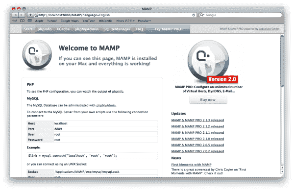

图 1.3. MAMP 启动界面

MAMP 现在已安装。然而，它强制你使用端口 `8888` 来访问 Apache 服务器。这不像像 WAMP 那样只需在浏览器地址栏中输入 `localhost` 访问服务器那样方便。幸运的是，这个问题有一个非常简单的解决方法。切换回 MAMP 启动界面并选择 `Preferences` 按钮。在面板顶部的小导航菜单中，应该有一个标题为 `Ports` 的选项。

在此窗口中，你应该能看到一个左侧有 `Apache Port` 标签的输入框。如果你将此选项从 `8888` 改为 `80`，你现在就可以通过在浏览器地址栏中简单输入 `localhost/MAMP` 来访问 MAMP 启动屏幕了。

## Linux

如果你运行的是 Ubuntu 或 Debian 等 Linux 操作系统，可以使用终端从系统仓库安装 `LAMP` 包。在 Linux 上安装本地服务器与 Windows 或 Mac OS X 略有不同。安装方法稍微高级一些，但它在运行和管理服务器时允许提供更多的控制和自由。事实上，这种方法与用于在 Linux 上管理和运行实时 Web 服务器的方法几乎相同。我们在这里介绍的安装示例将专门展示在 Ubuntu 上安装 `LAMP` 的步骤。

第一步是启动终端程序，可以通过在 Dash 菜单中搜索 `Terminal`、点击 Ubuntu 侧边菜单中的第一个图标，或通过文件夹导航进入 `Applications > Accessories > Terminal` 来完成。

打开终端后，你可以从在电脑上安装 Apache 开始。通过在终端中输入以下内容来实现：

```bash
sudo apt-get install apache2
```

按下 `Enter` 键，你的终端将开始疯狂运行，但不要惊慌，这是正常的。

Apache 现在应该已经安装完成，你的本地服务器基础设置也将就绪。要测试这一点，打开浏览器浏览器并在地址栏中输入 `localhost`。如果安装成功，你将看到如图 1.4 所示的“It works!”启动界面。

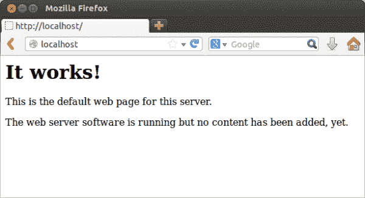

图 1.4. Linux 上的 localhost

现在你需要安装 PHP，请返回终端并输入：

```bash
sudo apt-get install php5 libapache2-mod-php5*
```

PHP 5 将连同你刚刚安装的 Apache 服务器配合工作所需的各种基础库一起安装。完成后，你必须重启 Apache 才能识别到刚刚安装了 PHP。在终端中输入以下命令：

```bash
sudo service apache2 restart
```

你的 Apache 服务器现在将重启，检测到你已安装 PHP，并将加载在本地服务器上运行 PHP 需要的所有库。

现在你已经让本地服务器运行起来，并且安装了 PHP。要安装 MySQL 和 phpMyAdmin，我建议遵循[Mhabub Mamun 编写的此指南。](http://www.developmentwall.com/install-apache-php-mysql-phpmyadmin-ubuntu/4)

最后，你可以选择启用 Apache 的 `mod_rewrite` 模块，这允许开发者通过重写请求的 URL 将用户重定向到网站的不同部分。有关启用和设置 `mod_rewrite` 模块的完整深度指南，请参考 [ Nettuts+ 指南](http://net.tutsplus.com/tutorials/other/a-deeper-look-at-mod_rewrite-for-apache/)，该指南提供了非常详细的逐步教程。

## PHP 配置

在我们深入编写一些 PHP 代码之前，让我们配置 PHP 以更好地适应我们的项目。PHP 的配置由 `php.ini` 文件决定，该文件包含了所有关于 PHP 在我们服务器上如何运行的核心设置。你可以通过在 PHP 脚本中使用 `phpinfo()` 函数来快速查看 PHP 当前配置的概览。要这样做，请在服务器文件夹中创建一个名为 `info.php` 的新文件，向文件中添加以下代码并保存：

```php
<?php
phpinfo();
```

现在，将浏览器指向 `info.php` 文件，你应该会看到一个页面，显示一个关于我们 PHP 当前配置信息的表格，如图 1.5 所示。

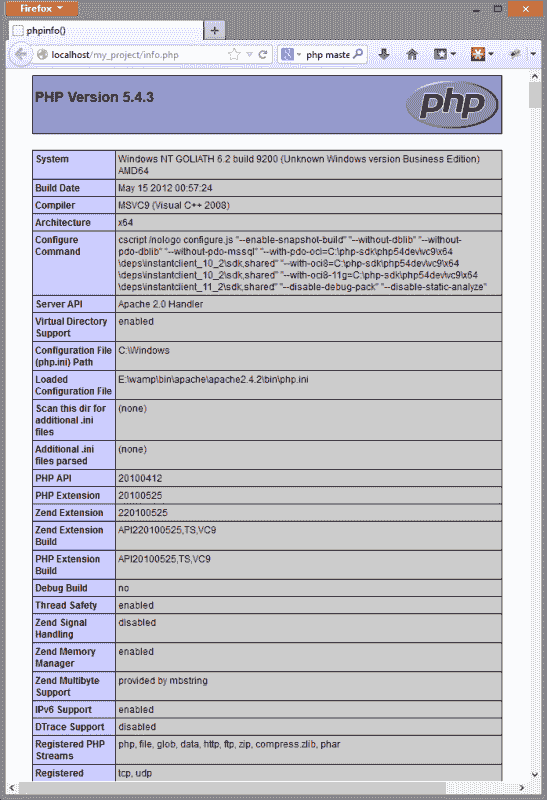

图 1.5. phpinfo

在这里你应该找到一个标题为 `Configuration File (php.ini) Path` 的行，这将告诉你的 `php.ini` 文件的具体位置。你可以在图 1.5 中看到它。`php.ini` 文件包含了许多设置，其中某些你可能永远不需要更改。然而，有一些可以更改以适应你的开发环境。对于 `php.ini` 文件的之旅，我强烈建议阅读[为 SitePoint 写的文章](http://www.sitepoint.com/a-tour-of-phpini/)。

## Hello PHP

现在你已经安装并运行了本地服务器，让我们开始编写 PHP 吧！我们首先进入 Apache 文件夹，它根据你使用的操作系统位于不同的位置：

- 对于使用 WAMP 的 Windows 用户，打开资源管理器或我的电脑并导航到目录 `C:/Program Files/wamp/`

- 对于使用 MAMP 的 Mac OS X 用户，打开 Finder 并导航到 `Applications > MAMP > htdocs` 以找到 MAMP 的目录。

- Linux 的 Web 位于 `/var/www`。许多 Linux 开发者喜欢编辑配置文件来更改使用的目录。要这样做，请参考 [Stack Overflow 上的解决方案](http://stackoverflow.com/a/5891858)。

一旦你找到了服务器的 Web 目录，你需要创建一个作为项目“根”的目录，所有的项目文件将放在这里。现在，创建一个名为 `my_project` 的目录。特意避免在文件夹名称中使用任何空格或大写字母，因为这将成为访问该文件夹内文件的 URL 的。

现在在 `my_project` 文件夹中创建一个名为 `index.php` 的新 PHP 文件。创建文件后，你需要用可以编辑 PHP 文件的文本编辑器打开它。

### 注意：选择文本编辑器

我建议使用支持 PHP 语法高亮的编辑器。选择编辑器是一个非常个人的决定，因为不同的编辑器提供不同的功能；某些编辑器会配合你的编码方式，而某些则可能会产生冲突。最终，选择应该取决于哪个编辑器能让编程变得更简单、更有趣。在最终决定之前，值得尝试不同的编辑器。

这里是一些流行的编辑器器的简短列表，包含了免费和付费编辑器的混合：

*   [Adobe Dreamweaver](http://www.adobe.com/products/dreamweaver.html) – (Windows 和 Mac OS X)

    *   最著名的编辑器之一。它提供了广泛的一键选项，并内置了 FTP 客户端。

*   [Sublime Text](http://www.sublimetext.com/) – (Windows, Mac OS X, 和 Linux)

    *   一个免费试用的编辑器，内置了一些强大的快捷键和宏命令。

*   [Komodo Edit](http://www.activestate.com/komodo-edit) – (Windows, Mac OS X, 和 Linux)

    *   一个强大的免费编辑器，界面精美并内置 FTP 客户端。


* [Coda](http://panic.com/coda/) – (Mac OS X)
  * 一个非常用户好的编辑器，功能非常强大。
* [Notepad++](http://www.notepad-plus-plus.org/) – (Windows)
  * 一个非常流行的免费编辑器。

一旦你选择了适合自己的编辑器，打开`index.php`，你就可以开始向文件中写入一些 PHP 代码了。输入以下代码并保存文件：

```
<?php echo "Hello World"; ?>
```

让我们运行这段代码。打开网络浏览器，在浏览器的地址栏中输入`http://localhost/my_project/index.php`。你应该看到类似于图 1.6 的内容。

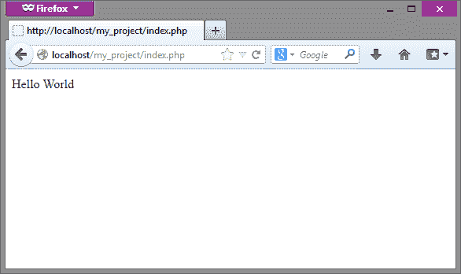

图 1.6. Hello, world!

恭喜你！你刚刚写了第一段 PHP 代码！如你所见，代码在浏览器中显示了“Hello World”字符串，但你到底在 PHP 文件中输入了什么呢？让我们来分解一下这行代码：

* `<?php` : 这被称为起始标签。它告诉服务器随后的代码旨在解释为 PHP，服务器应该使用 PHP 引擎来渲染这些代码。每当你想在文件中使用 PHP 代码时，必须输入此标签。
* `echo "Hello World";` : `echo` 是一个基础的 PHP 结构，它告诉 PHP `echo` 命令之后的内容是你希望在浏览器中显示的内容。在想要在屏幕上显示的文本周围加上引号。此外，你还在后面添加了重要的分号，表示你的 `echo` 语句结束了。
* `?>` : 这是 PHP 的结束标签，告诉服务器停止渲染 PHP 代码。结束标签并不总是需要使用的。保持代码“未闭合”可以防止意外的内容发送到浏览器中。在不需要时跳过结束标签可以避免在你开始编写更复杂的 PHP 代码时可能出现的问题。在书的后续部分，你将看到没有 PHP 结束标签的代码。该标签是有意省略的。

### 重要：使用你的分号！

记住在所有 PHP 语句末尾添加分号是非常重要的，因为没有分号，PHP 将不知道一个语句何时结束，下一个语句何时开始。

PHP 文件还允许将 PHP 代码与普通的 HTML 结合。如果你将 PHP 和 HTML 结合在一起，就可以创建非常漂亮的网页，其中包含动态和复杂的数据，而 HTML 无法独立处理和操作这些数据。

这是一个 HTML 和 PHP 协同工作的快速示例：

```
<!DOCTYPE html>
<head>
    <title>PHP 和 HTML 协同工作</title>
</head>
    <body>
      <h1><?php echo 'This is a H1 tag with PHP data'; ?></h1>
      <p><?php echo 'This is a P tag with PHP data also'; ?></p>
    </body>
</</html> 
```

如果你将`index.php`的内容更改为上面的示例并返回`http://localhost/my_project/index.php`，你将在浏览器中看到 HTML 代码正确显示了所有经过 PHP 处理的代码。

## PHP 变量

让我们更上一层，探索变量的世界。变量代表计算机内存中的一个位置，我们可以在那里临时存储位信息。我们可以将某些数据分配给变量（将数据放入内存），并在整个脚本中使用该变量。每当 PHP 在我们的代码中看到变量时，它就知道要访问它所代表的数据。分配给变量的数据可以是任何内容，从简单的文本字符串（如“Hello World”）或数字（如“1234”）到我们将介绍的更复杂的数据结构。

变量名始终以`$`符号开头。它们的名称不能包含空格，且只能包含字母（大小写）、数字和下划线。此外，`$`之后的第一个字符必须是字母或下划线。允许的变量名可以是`$myAwesomeVariable`，甚至是`$my_Awesome_Variable_1`。

给变量赋予有意义的名字是一个良好的习惯，这样如果另一个开发者阅读你写的代码，他们就能知道这些数据代表什么。例如，如果我们想让一个变量包含关于人名字的数据，可以将变量命名为`$personName`。

### 注意：使用驼峰命名法 (CamelCase)

如果变量名包含多个单词，通常的做法是将每个单词的首字母大写。这可以提高浏览代码时的可读性。

让我们来看一个变量使用的示例。修改`index.php`如下：

```php
<?php
$myVar = 'Hello World';
echo $myVar;
```

那么我们编写了什么？首先，我们将字符串 "Hello World" 分配给变量`$myVar`。现在再次查看`index.php`文件，使其看起来如下所示：

```php
<?php
$myVar = 'Hello World';
echo $myVar;
```

再次刷新页面，你应该会在屏幕上看到“Hello World”。这是因为我们在`echo`语句使用了变量`$myVar`。

* [`goldhat.ca/blog/php-beginner-lesson-using-variables`](http://goldhat.ca/blog/php-beginner-lesson-using-variables)

## 数组 (Arrays)

对于内存中更复杂的数据存储方式，我们可以选择数组，它像表格一样表示数据。让我们从图 1.7 所示的表格开始。

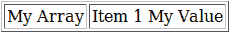

图 1.7. 一个简单的数组

我们可以像下面这样在 PHP 中将此表写为数组：

```php
<?php
$myArray = array('item1' => 'My Value'); 
```

我们在这里做的是通过`array()`构造函数创建一个名为`$myArray`的数组，用它定义我们的值，而不仅仅是一个字符串或整数。然后，我们添加了一个“键（key）”，我们将其命名为 "item1"，并使用`=>`符号为该键设置了值 "My value"。这个`=>`符号是 PHP 用来表示符号之后的数据将存储在内存中的某个位置，该位置可以通过该键从数组引用。

在定义数组时，我们可以像下面所示向数组中添加多个键/数据对：

```php
<?php
$myArray = array('item1' => 'My Value', 'item2' => 'Another value');
```

另一个选项是，我们可以创建一个空数组，并按照下面的方式稍后添加键和值：

```php
<?php
$myArray = array();
$myArray['item1'] = 'My Value';
$myArray['item2'] = 'Another value'; 
```

从 PHP 5.4 开始，我们已经有了使用简写表示法创建数组的能力，而不是传统的`array()`。简写方法如下：

```php
<?php
$myArray = ['item1' => 'My Value', 'item2' => 'Another value'];
```

数组允许我们处理一些非常复杂的数据，我们将在书的后面部分重新回到它们。在此期间，为了检查数组的基本用法，我建议查看以下文章：

* [`www.php.net/manual/en/language.types.array.php`](http://www.php.net/manual/en/language.types.array.php)
* [`www.sitepoint.com/introduction-to-php-arrays/`](http://www.sitepoint.com/introduction-to-php-arrays/)
* [`www.htmlandphp.com/beginner-php/207-introduction-to-arrays-in-php.html`](http://www.htmlandphp.com/beginner-php/207-introduction-to-arrays-in-php.html)

## 注释 (Comments)

我们可以在 PHP 代码中为自己编写注释。注释不会被当作语句处理。我们使用两个斜杠`//`开始注释 —— 在斜杠后同一行中编写任何内容都将被视为注释且不会被处理。例如：

```php
<?php
// this is a PHP comment for this only
```

我们还可以使用`/*`来标记跨多行注释的开始，并用`*/`标记结束。例如：

```php
<?php
/* this is the beginning of our PHP comment.
It can go on for multiple lines until we end it. */
```

注释允许开发者为任何阅读代码的人留下笔记，提供关于代码运行方式的见解并使其更容易维护。注释还允许我们临时隐藏代码段（“注释掉”）。

## 准备我们的项目 (Preparing Our Project)

在结束本章之前，让我们快速列出本书项目的目录结构。我们将开发一个完全由 PHP 和 MySQL 数据库驱动的博客应用程序，用于存储我们所有的数据。现在，我们需要在 Web 目录中创建一个新文件夹，命名为`kickstart`。在该目录下，我们需要再创建三个目录：一个命名为`admin`，另一个命名为`frontend`，最后一个命名为`includes`，如图 1.8 所示。

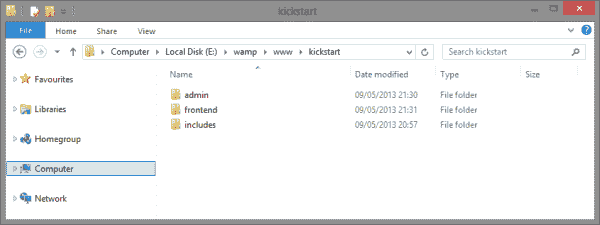

图 1.8. 我们的项目文件夹

`admin`目录将存放管理面板的文件。`frontend`目录将包含博客公开端运行的所有文件。这个公开端是访问者查看博客文章的地方。`includes`目录是我们放置任何可以在`admin`和公共部分都使用的脚本的地方。

我们还需要在`admin`和`frontend`目录内部各创建一个名为`templates`的目录。`templates`目录将包含所有接收`includes`文件夹中脚本数据的 PHP 和 HTML 文件。这些模板文件最终将格式化来自 PHP 的数据，并创建访问者前端交互的布局。在书的后面，我们将更深入地探讨模板，并学习我们为什么在项目中使用它。这样分离这些文件夹非常有帮助，因为它将帮助你编写更整洁、组织更好的代码。

## 总结 (Summary)

在本章中，我们涵盖了设置 Web 服务器的基础知识，通过显示文本引入了 PHP 编码，并使用了变量来存储数据。本章涵盖的所有内容都是介绍，我们将在书的后面回到触过的一些主题。

在下一章中，我们将研究如何使用持久存储选项如数据库来配合脚本，以及如何使用访问者的浏览器存储少量数据。此外，我们将简要探索一些重要的编程概念，如条件语句和循环，这些从数据库读取数据时是必要的。

## 运算符 (Operators)

在 PHP 中，就像几乎所有的编程语言一样，运算符用于对变量和值进行处理或操作。最基本的运算符是`=`，正如我们在第 1 章中看到的，它被用于向变量赋值。但还有许多其他强大的运算符等待发现。

首先，让我们在之前创建的`my_project`文件夹创建一个名为`op_experiments.php`的新文件。在该文件中添加以下代码：

```php
<?php
$firstName = "myfirstname";
$lastName = "mylastname";
$fullName = $firstName . $lastName;
echo $fullName;  
```

虽然这段代码的大部分看起来相当直观，但`$fullName = $firstName . $lastName;`这一行可能会让你感到意外，尤其是两个变量之间的那个点。

`.`是 PHP 的字符串连接运算符；它将两个字符串连接成一个更长的字符串。PHP 获取`$firstName`的字符串值，加上`$lastName`的值，并将结果放入变量`$fullName`中。当我们运行脚本 PHP 输出`$fullName`的值时，我们将在浏览器中看到`myfirstnamemylastname`。

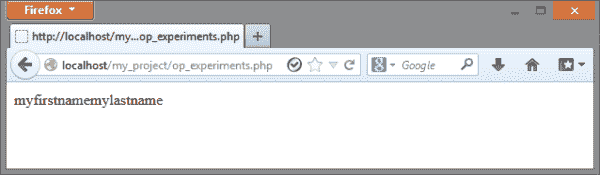

图 2.1. 我们的输出

不过这并不很易读，不是吗？别担心。我们可以轻松微调代码使输出更具可读性。修改代码使其看起来如下：

```php
<?php
$firstName = "myfirstname";
$lastName = "mylastname";
$fullName = $firstName . " - " . $lastName;
echo $fullName;
```

现在我们可以在浏览器中查看它们时，可以看到两个名字之间的间隔。酷酷。

图 2.2. 添加一些空格后的输出

## 条件语句

PHP 同样拥有允许我们比较值的操作符。例如，`==`用于检查两个值是否相同，`<`用于检查一个值是否小于另一个值，而`>`用于检查一个值是否大于另一个值。

大多数时候，我们使用这些比较操作符来编写`条件语句`（根据比较结果可能执行也可能不执行的语句）和`循环`（执行多次的语句）。

### if 语句

`if`语句由一个条件和一个或多个分组为代码块的语句组成。如果 PHP 评估该条件并发现其为真，它将执行该语句块。如果条件为假，则 PHP 将跳过该块。在下例示例中，PHP 检查`$a`的值是否等于`$b`。如果是，它会在屏幕上显示“A is equal to B”。

```php
<?php
if ($a == $b) {
    echo 'A is equal to B';
}
```

### else 语句

`else`语句是`if`语句的伙伴，它可以直接跟在`if`语句后面。PHP 只有在跳过了`if`语句的块后，才会执行构成`else`块的代码。在下例中，PHP 检查`$a`的值是否等于`$b`。如果是，它会在屏幕上显示“A is equal to B”。如果该测试失败，PHP 将执行`else`语句之后块的代码，并在屏幕上打印“A is not equal to B”。

```php
<?php
if ($a == $b) {
    echo 'A is equal to B';
} else {
    echo 'A is not equal to B';
}
```

### elseif 语句

另一个伙伴是`elseif`语句。正如其名，`elseif`是`if`和`else`的组合。它包含一个条件，当`if`条件被发现为假时，PHP 会检查该条件。

多个`elseif`语句可以组合使用以测试不同的条件，PHP 会检查每一个条件，直到发现其中一个条件为真。一旦找到真条件，PHP 将跳过链中剩余的`elseif`语句。

```php
<?php
if ($a == $b) {
    echo 'A is equal to B';
} elseif ($a == $c) {
    echo 'A is equal to C';
} elseif ($a == $d) {
    echo 'A is equal to D';
} else {
    echo 'A is not equal to anything';
}
```

## switch 语句

如果你仔细观察我们的`elseif`示例，可能会发现每个条件基本上都在测试相同的内容——即某个变量的值是否等于`$a`的值。PHP 的`switch`语句可以完成类似的操作，而且看起来没那么杂乱。

```php
switch ($a) {
    case $b:
        echo 'A equals B';
        break;
    case $c:
        echo 'A equals C';
        break;
    case $d:
        echo 'A equals D';
        break;
    default:
        echo 'A is not equal to anything';
        break;
}
```

在上面的示例中，PHP 获取`switch`开始时提供的值（`$a`的值），并将其与每个`case`的值进行比较。匹配的子句将被执行。如果没有其他`case`匹配，则执行`default`情况。

一旦 PHP 找到匹配的子句，它就会开始执行下面的代码并一直持续到看到`break`关键字，之后将跳转到`switch`语句的结尾，并愉快地继续执行我们脚本的其余部分。

### 注意：留意 Break

PHP 不会将一个`case`的开始视为上一个`case`的结束，这就是为什么`break`关键字是必要的。这在起初可能会让人困惑，而且很可能会出现你忘记使用`break`导致脚本运行不符合预期的情况，因此记住这一点非常重要。

这种行为也意味着我们可以编写在多个 case 下执行的代码，如下所示：

```php
switch ($a) {
    case $b:
    case $c:
    case $d:
        echo 'A equals B, C, or D';
        break;
    default:
        echo 'A is not equal to anything';
```

## 循环

大多数时候，我们使用这些比较操作符来编写`条件语句`（根据比较结果可能执行也可能不执行的语句）和`循环`（执行多次的语句）。

### if 语句

`if`语句由一个条件和一个或多个分组为代码块的语句组成。如果 PHP 评估该条件并发现其为真，它将执行该语句块。如果条件为假，则 PHP 将跳过该块。在下例示例中，PHP 检查`$a`的值是否等于`$b`。如果是，它会在屏幕上显示“A is equal to B”。


```php
<?php
if ($a == $b) {
    echo 'A is equal to B';
}
```

## else 语句

`else` 语句是`if`语句的伙伴，它可以直接跟在`if`语句后面。PHP 只有在跳过了`if`语句的块后，才会执行构成`else`块的代码。在下例中，PHP 检查`$a`的值是否等于`$b`。如果是，它会在屏幕上显示“A is equal to B”。如果该测试失败，PHP 将执行`else`语句之后块的代码，并在屏幕上打印“A is not equal to B”。

```php
<?php
if ($a == $b) {
    echo 'A is equal to B';
} else {
    echo 'A is not equal to B';
}
```

## elseif 语句

另一个伙伴是`elseif`语句。正如其名，`elseif`是`if`和`else`的组合。它包含一个条件，当`if`条件被发现为假时，PHP 会检查该条件。

多个`elseif`语句可以组合使用以测试不同的条件，PHP 会检查每一个条件，直到发现其中一个条件为真。一旦找到真条件，PHP 将跳过链中剩余的`elseif`语句。

```php
<?php
if ($a == $b) {
    echo 'A is equal to B';
} elseif ($a == $c) {
    echo 'A is equal to C';
} elseif ($a == $d) {
    echo 'A is equal to D';
} else {
    echo 'A is not equal to anything';
}
```

## switch 语句

如果你仔细观察我们的`elseif`示例，可能会发现每个条件基本上都在测试相同的内容——即某个变量的值是否等于`$a`的值。PHP 的`switch`语句可以完成类似的操作，而且看起来没那么杂乱。

```php
switch ($a) {
    case $b:
        echo 'A equals B';
        break;
    case $c:
        echo 'A equals C';
        break;
    case $d:
        echo 'A equals D';
        break;
    default:
        echo 'A is not equal to anything';
        break;
}
```

在上面的示例中，PHP 获取`switch`开始时提供的值（`$a`的值），并将其与每个`case`的值进行比较。匹配的子句将被执行。如果没有其他`case`匹配，则执行`default`情况。

一旦 PHP 找到匹配的子句，它就会开始执行下面的代码并一直持续到看到`break`关键字，之后将跳转到`switch`语句的结尾，并愉快地继续执行我们脚本的其余部分。

### 注意：留意 Break

PHP 不会将一个`case`的开始视为上一个`case`的结束，这就是为什么`break`关键字是必要的。这在起初可能会让人困惑，而且很可能会出现你忘记使用`break`导致脚本运行不符合预期的情况，因此记住这一点非常重要。

这种行为也意味着我们可以编写在多个 case 下执行的代码，如下所示：

```php
switch ($a) {
    case $b:
    case $c:
    case $d:
        echo 'A equals B, C, or D';
        break;
    default:
        echo 'A is not equal to anything';
}
```

## 循环

大多数时候，我们使用这些比较操作符来编写`条件语句`（根据比较结果可能执行也可能不执行的语句）和`循环`（执行多次的语句）。

### if 语句

`if`语句由一个条件和一个或多个分组为代码块的语句组成。如果 PHP 评估该条件并发现其为真，它将执行该语句块。如果条件为假，则 PHP 将跳过该块。在下例示例中，PHP 检查`$a`的值是否等于`$b`。如果是，它会在屏幕上显示“A is equal to B”。

```php
<?php
if ($a == $b) {
    echo 'A is equal to B';
}
```

### else 语句

`else`语句是`if`语句的伙伴，它可以直接跟在`if`语句后面。PHP 只有在跳过了`if`语句的块后，才会执行构成`else`块的代码。在下例中，PHP 检查`$a`的值是否等于`$b`。如果是，它会在屏幕上显示“A is equal to B”。如果该测试失败，PHP 将执行`else`语句之后块的代码，并在屏幕上打印“A is not equal to B”。

```php
<?php
if ($a == $b) {
    echo 'A is equal to B';
} else {
    echo 'A is not equal to B';
}
```

### elseif 语句

另一个伙伴是`elseif`语句。正如其名，`elseif`是`if`和`else`的组合。它包含一个条件，当`if`条件被发现为假时，PHP 会检查该条件。

多个`elseif`语句可以组合使用以测试不同的条件，PHP 会检查每一个条件，直到发现其中一个条件为真。一旦找到真条件，PHP 将跳过链中剩余的`elseif`语句。

```php
<?php
if ($a == $b) {
    echo 'A is equal to B';
} elseif ($a == $c) {
    echo 'A is equal to C';
} elseif ($a == $d) {
    echo 'A is equal to D';
} else {
    echo 'A is not equal to anything';
}
```

## switch 语句

如果你仔细观察我们的`elseif`示例，可能会发现每个条件基本上都在测试相同的内容——即某个变量的值是否等于`$a`的值。PHP 的`switch`语句可以完成类似的操作，而且看起来没那么杂乱。

```php
switch ($a) {
    case $b:
        echo 'A equals B';
        break;
    case $c:
        echo 'A equals C';
        break;
    case $d:
        echo 'A equals D';
        break;
    default:
        echo 'A is not equal to anything';
        break;
}
```

在上面的示例中，PHP 获取`switch`开始时提供的值（`$a`的值），并将其与每个`case`的值进行比较。匹配的子句将被执行。如果没有其他`case`匹配，则执行`default`情况。

一旦 PHP 找到匹配的子句，它就会开始执行下面的代码并一直持续到看到`break`关键字，之后将跳转到`switch`语句的结尾，并愉快地继续执行我们脚本的其余部分。

### 注意：留意 Break

PHP 不会将一个`case`的开始视为上一个`case`的结束，这就是为什么`break`关键字是必要的。这在起初可能会让人困惑，而且很可能会出现你忘记使用`break`导致脚本运行不符合预期的情况，因此记住这一点非常重要。

这种行为也意味着我们可以编写在多个 case 下执行的代码，如下所示：

```php
switch ($a) {
    case $b:
    case $c:
    case $d:
        echo 'A equals B, C, or D';
        break;
    default:
        echo 'A is not equal to anything';
}
```

## for 语句

`for`循环用于执行特定次数的块块。它包含三部分：初始化、条件和递增/递减。

```php
for ($i = 0; $i < 10; $i++) {
    echo $i . '<br>';
}
```

在上面的示例中，`$i = 0`是初始化，`$i < 10`是条件（当此为真时循环继续），而`$i++`是递增，在每次迭代后增加`$i`。

### while 语句

`while`循环在指定条件为真时执行代码块。它在你不知道循环应该运行多少次时非常有用。

```php
$i = 0;
while ($i < 10) {
    echo $i . '<br>';
    $i++;
}
```

### do-while 语句

`do-while`循环与`while`循环相似，但有一个关键区别：在检查条件之前，代码块至少执行一次。

```php
$i = 0;
do {
    echo $i . '<br>';
    $i++;
} while ($i < 10);
```

### foreach 语句

`foreach`循环用于遍历数组的元素。它是 PHP 中处理数组最方便的方法。

```php
$colors = array("red", "green", "blue");
foreach ($colors as $color) {
    echo $color . '<br>';
}
```

你也可以在`foreach`循环中同时访问键和值：

```php
$colors = array("a" => "red", "b" => "green", "c" => "blue");
foreach ($colors as $key => $value) {
    echo "$key: $value<br>";
}
```

关于`while`、`for`和`foreach`循环的更多信息，请参阅 [PHP 官方文档](http://www.php.net/manual/en/language.control-structures.php) 以及以下资源：

* [`www.sitepoint.com/loops/`](http://www.sitepoint.com/loops/)
* [`webcheatsheet.com/PHP/loops.php`](http://webcheatsheet.com/PHP/loops.php)

## 数据库、MySQL 与 PHP

当我们创建一个 PHP Web 应用程序时，通常需要将脚本中创建的一些数据保存到某处，以便日后访问。数据库允许我们存储大量不同类型的数据，从大型的字母数字字符串到序列化数组。MySQL 是目前最流行的开源数据库，它与 PHP 配合得非常好，可以用来存储我们的应用程序数据。它非常易于启动，只需要几个函数即可存储和检索数据。

像 MySQL 等传统数据库使用表、行和列来组织数据。每个表包含一组记录（用户信息、订单摘要等），表中的每行存储一条特定的记录，而每列则标识构成记录的不同数据。数据库表可以想象成图 2.3。

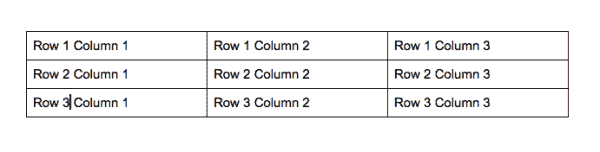

图 2.3. 数据库表

### 注意：考虑数据类型

由于表中的每列只允许存储一种类型的数据，且这通常是列定义的一部分，因此提前考虑你将存储的数据的不同属性是非常重要的。

在继续之前，确保你已经熟悉数据库的作用和 MySQL 的基础知识。如果你对其中任何内容不确定，请阅读 [tizag.com 上的 MySQL 文章](http://www.tizag.com/mysqlTutorial)。[`www.tizag.com/mysqlTutorial`](http://www.tizag.com/mysqlTutorial)

PHP 中处理 MySQL 有两个扩展——`MySQLi`和`PDO`。我们将使用`PDO`扩展来连接并与 MySQL 数据库交互，因此请确保该扩展已安装并启用。打开我们在第 1 章中编写的`info.php`文件，查找标题为`PDO`的部分，并确保 MySQL 列在启用列中。

### 注意：安装 PDO 时遇到的问题

如果你在启用扩展时遇到问题，请查看 [PHP 手册中安装 PDO 的指南](http://php.net/manual/en/pdo.installation.php)。

广流行的`phpMyAdmin`是一个 PHP 应用程序，它让管理多个数据库变得简单。基于此，强烈建议你确保服务器上安装了`phpMyAdmin`。我们将在本书中使用它来管理数据库。

要开始，我们需要使用`phpMyAdmin`创建一个新的空数据库。执行此操作，请在浏览器中打开安装的`phpMyAdmin`并登录。你会看到一个类似下面的屏幕：

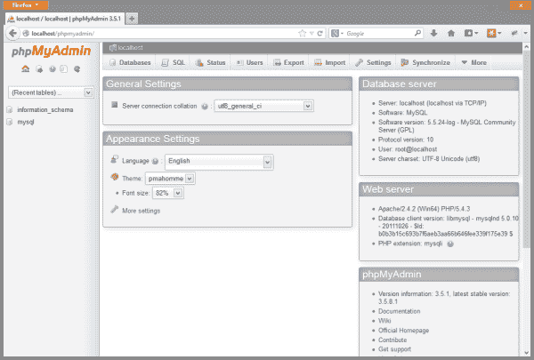

图 2.4. phpMyAdmin

接下来，点击顶部菜单中的`Databases`（数据库）链接。在下一个屏幕，我们可以通过输入要使用的数据库名称来创建新数据库。对于我们的项目，让我们在文本字段中输入 "kickstartapp" 并点击创建按钮。

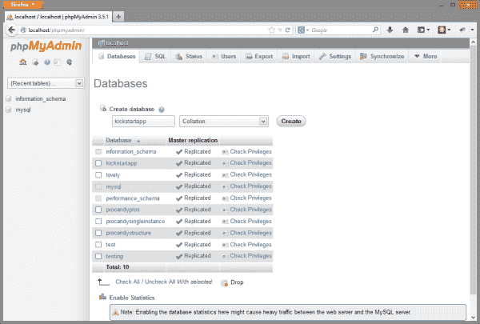

图 2.5. 创建我们的数据库

### 注意：排序规则（Collation）？

不要担心那个应该预选为“Collation”（排序规则）的下拉选项。这是一个更高级的功能，为了本书项目的目的，我们将坚持使用默认选项。如果你想阅读数据库排序规则类型，请参阅：

* [`dev.mysql.com/doc/refman/5.0/en/charset-collation-implementations.html`](http://dev.mysql.com/doc/refman/5.0/en/charset-collation-implementations.html)
* [`kb.mediatemple.net/questions/138/Default+MySQL+character+set+and+collation#gs`](https://kb.mediatemple.net/questions/138/Default+MySQL+character+set+and+collation#gs)

### 注意：命名数据库时要小心

当我们创建数据库时，其名称不能包含斜杠、句号或其他文件名不允许允许的字符，并且不应包含空格。

眼敏锐的人可能已经注意到，我们新创建的数据库已添加到可用数据库列表中。左侧菜单上的此列表是快捷链接的集合，我们可以用它来选择想要编辑或管理的数据库。在列表中找到新数据库 "kickstartapp" 并点击它。这将带我们进入一个新屏幕，它看起来非常空，且类似于图 2.6：

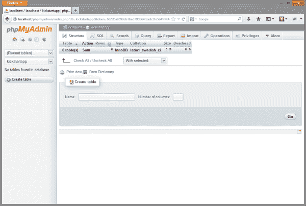

图 2.6. 我们的新数据库

这是`phpMyAdmin`的主区域，我们可以在这里为数据库创建表并编辑现有表。但在在此之前，我们需要创建一个用户账户，用于连接数据库并存储和提取我们的数据。

进入顶部菜单中的`Privileges`（权限）选项并点击它，然后在新面板中选择`Add User`（添加用户），如图 2.7 所示。

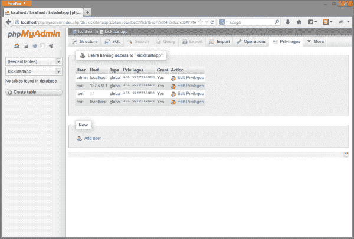

图 2.7. 添加新用户

现在我们只需要在`User name`（用户名）字段中输入用户名（确保从下拉菜单中选择了使用文本字段），在`Host`（主机）下拉菜单中选择`local`，然后在`password`字段中输入密码（再次确保选择了使用文本字段）。接下来，向下滚动并确保在面板的下一个选项区域勾选了`Grant all privileges on database kickstartapp`。最后，在最后一个面板的`Global privileges`（全局权限）下选择`Check all`（全选），并点击底部的`Add User`（添加用户）。

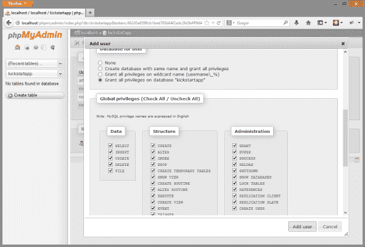

图 2.8. 新用户字段

这看起来可能有点复杂，但实际上我们所做的只是创建一个新用户并赋予该用户对 "kickstartapp" 执行任何操作的权限。这种设置对于用户来说是常见的，但不一定是最安全的。关于设置数据库用户的更多信息，请参阅：

* [`dev.mysql.com/doc/refman/5.0/en/charset-collation-implementations.html`](http://dev.mysql.com/doc/refman/5.0/en/charset-collation-implementations.html)
* [`kb.mediatemple.net/questions/138/Default+MySQL+character+set+and+collation#gs`](https://kb.mediatemple.net/questions/138/Default+MySQL+character+set+and+collation#gs)

现在我们已经设置好了用户账户，让我们在数据库中创建一个表。在我们的项目文件夹中创建一个名为`setup.php`的新 PHP 脚本。在该文件中以下代码，然后通过浏览器运行该文件。

### 注意：自定义你的代码

将以下代码中的`USERNAME`和`PASSWORD`替换为你创建数据库用户时设置的用户名和密码。


```php
<?php
$db = new PDO("mysql:host=localhost;dbname=kickstartapp",
 "USERNAME", "PASSWORD");
$db->setAttribute(PDO::ATTR_ERRMODE, PDO::ERRMODE_EXCEPTION);
try {
    $queryStr = "CREATE TABLE users (id INTEGER NOT NULL
AUTO_INCREMENT PRIMARY KEY, name VARCHAR(40), password
VARCHAR(100), email VARCHAR(150))";
    $db->query($queryStr);
} catch (PDOException $e) {
    echo $e->getMessage();
}
```

首先通过创建一个带有四个关键信息的`PDO`对象在 PHP 中连接 MySQL。第一个参数告诉 PHP 我们 MySQL 数据库的位置。在我们的情况下，这是 `"localhost"`，因为 MySQL 服务器与 PHP 运行在同一系统上。第二个参数识别我们要连接的数据库。这两个信息片段与`mysql:`结合，创建一个被称为 DSN（数据源名称）的内容。第三和第四个参数简单就是数据库用户的用户名和密码。

接下来，我们为`PDO`设置一个反馈选项，使 PHP 将任何数据库错误都视为异常。这样，当 MySQL 尝试执行我们提供的 SQL 语句发生任何问题时，我们将立即收到通知，并能够看到发生了什么以便进行修复。

然后，我们定义了用于创建表的 SQL 语句，并将字符串赋值给变量`$queryStr`。查看该 SQL 语句，我们正在告诉 MySQL 创建名为`users`的新表，我们将其用于存储与我们博客应用程序中管理员和公共用户相关的所有数据。这是通过`CREATE TABLE`命令实现的，随后跟的是我们在表中所需要的不同列的定义：`id`、`name`、`password`和`email`。每个列定义都告诉 MySQL 该列将存储什么类型的数据，以及该单元格的其他任何选项。例如，第一列（`id`）将只存储整数，且不允许记录该列有空值（`NOT NULL`）。

接下来，我们遇到了一种尚未讨论过的条件语句类型：`try`...`catch`块。在`try`块中，我们将变量`$queryStr`传递给`PDO`对象的`query()`方法。该方法接收我们的 SQL 字符串并将其发送到 MySQL 服务器执行。

只有当`try`块出现问题时，PHP 才会执行`catch`块中的代码。也就是说，如果 MySQL 运行我们的查询失败，PHP 将“抛出”异常（我们之前通过设置`PDO::ATTR_ERRMODE`请求了这种行为）。我们的`catch`块将“捕获”异常对象，其中包含了我们可以用于排排除问题的信息。

通过浏览器访问`setup.php`文件。如果屏幕保持空白，说明查询执行成功（我们只要求 PHP 在出现问题时输出任何内容）。然后返回 phpMyAdmin 并点击数据库以验证新创建的表是否存在。

现在，让我们向表中添加一些数据吧！在项目目录下创建一个名为`insert.php`的新文件，并向添加以下代码：

```php
<?php
$db = new PDO("mysql:host=localhost;dbname=kickstartapp",
 "USERNAME", "PASSWORD");
$db->setAttribute(PDO::ATTR_ERRMODE, PDO::ERRMODE_EXCEPTION); 
try {
    $queryStr = "INSERT INTO users (name, password, email) 
VALUES ('admin', MD5('admin'), 'youremail@domain.com')";
    $db->query($queryStr);
} catch (PDOException $e) {
    echo $e->getMessage();
}
```

大部分代码与之前相同，但我们发送给 MySQL 的 SQL 现在是一个`INSERT INTO`命令。我们正在要求 MySQL 在`users`表中创建一个具有用户名 `"admin"`、密码哈希和电子邮箱地址的新记录。

### 注意：使用 MD5

注意，对于`password`列，我们使用了`MD5()`函数对数据进行了哈希处理。这样做是为了安全考虑，以便任何未经授权访问我们数据库的人无法轻易查看我们用户的密码。永远不要以明文存储密码！

导航到`insert.php`文件，你应该再次看到一个空白页面，这意味着查询执行成功，否则你将看到一条错误消息，让你了解明哪里出了问题。最后，让我们从表中检索数据。创建文件`getdata.php`并添加以下代码：

```php
<?php
$db = new PDO("mysql:host=localhost;dbname=kickstartapp",
 "USERNAME", "PASSWORD");
$db->setAttribute(PDO::ATTR_ERRMODE, PDO::ERRMODE_EXCEPTION); 
try {
    $queryStr = "SELECT * FROM users";
    $query = $db->prepare($queryStr);
    $query->execute();
    while ($row = $query->fetch()) {
        echo $row['id'] . ' - ' . $row['name'] . ' - ' . $row['password'] . ' - ' . $row['email'] . '<br>';
    }
    $query->close();
} catch (PDOException $e) {
    echo $e->getMessage();
}
```

## 总结

在本章中，我们介绍了使用 phpMyAdmin 创建数据库、在 PHP 中创建表、插入记录以及从表中检索数据的基础。然而，这只是冰山一角。MySQL 和 PHP 的深度远比我们所看到的深得多。关于 MySQL 和使用 PHP 的更多信息，请参考以下资源：

* `http://dev.mysql.com/doc/`
* `http://www.sitepoint.com/migrate-from-the-mysql-extension-to-php`
* `http://www.php.net/manual/en/book.php`
* `http://www.sitepoint.com/avoid-the-original-mysql-extension-1/`

OOP 看起来可能很复杂，但它实际上是一种非常直接的编程方法。要了解更多关于 OOP 底层理论的信息，请参阅 [Lorna Mitchell 在 sitepoint.com 上关于 PHP OOP 的视频介绍](http://www.sitepoint.com/object-oriented-php-lesson-1/)。

## OOP 入门

让我们一起写一个 OOP 示例。假设我们想在 PHP 代码中将狗表示为一个对象。我们需要编写该对象（类）的定义，用来描述狗可以做什么。

在你的实验文件夹中创建一个名为`Dog.php`的文件，并包含以下内容：

```php
<?php
class Dog
{
    public $name;

    public function __construct($name) {
        $this->name = $name;
    }

    public function speak() {
        return 'Woof! Woof!';
    }
}
```

在实验文件夹中创建另一个文件`DogTest.php`。

```php
<?php
require 'Dog.php';

$dog = new Dog('Fido');
echo 'The dog\'s name is: ' . $dog->name . '<br>';
echo 'The dog says: ' . $dog->speak() . '<br>';
```

在浏览器中访问`DogTest.php`文件，你应该会在屏幕上看到狗的名字和汪叫声。非常棒。

### 注意：从其他文件中包含代码

在示例中看到的`require`结构——简单来说——是将外部 PHP 文件的内容导入到我们的`DogTest.php`文件中。它是用于从其他文件包含代码的四个结构之一，每种结构的行为略有不同：

* `include` ― 包含文件内容。如果找不到文件或无法访问，PHP 将发出警告但会继续执行。
* `include_once` ― 与`include`相同，但 PHP 会执行额外的检查以确保文件没有被导入过。如果已经导入，则 PHP 将不会再次包含内容。
* `require` ― 与`include`类似，但如果找不到文件，PHP 将抛出致命错误并停止执行。
* `require_once` ― 与`require`相同，但有一个额外的检查以确保内容不会被导入多次。

通过查看我们的`Dog.php`文件，我们首先注意到的是`class`关键字。这个关键字基本上表示接后的代码定义了一个类，该类将以随后的名称命名（在我们的案例中为`Dog`）。一旦定义了类，我们就可以使用`new Dog`从它创建一个对象。

方法`__construct()`和`speak()`是类定义的一部分。`__construct`是一个对 PHP 具有特殊含义的名字；当我们从类中创建一个新对象时，PHP 会检查是否定义了`__construct()`方法。如果是，它将在创建对象实例后自动执行该方法。这使得它成为放置初始化新对象的代码的绝佳位置。

### 注意：函数和方法

属于类的函数被称为方法（methods）。函数和方法之间的区别不大，所以如果对你的理解有帮助，在每次看到“方法（method）”时将其想象成“函数（function）”是安全的。

类可以有自己的变量，这些变量帮助对象实例维护其状态，并且可以被方法访问。在上面的`Dog.php`示例中，行`public $name;`将`$name`定义为类变量，或属性（property）。

### 注意：变量和属性

属于类的变量被称为属性（properties）。就像函数/方法一样，在你习惯 OOP 术语之前，在每次看到“属性（property）”时将其想象成“变量（variable）”是安全的。

当我们在类内部编写代码时，特殊变量`$this`代表对象的实例，并帮助我们解析方法。为了更好地理解这种工作，让我们更新`DogTest.php`文件，如下：

```php
<?php
  require 'Dog.php';

  $dog = new Dog('Fido');
  echo 'The dog\'s name is: ' . $dog->name . '<br>';
  echo 'The dog says: ' . $dog->speak() . '<br>';

  $fido = new Dog('Fido');
  echo 'The dog\'s name is: ' . $fido->name . '<br>';
  echo 'The dog says: ' . $fido->speak() . '<br>';

  $bubbles = new Dog('Bubbles');
  echo 'The dog\'s name is: ' . $bubbles->name . '<br>';
  echo 'The dog says: ' . $bubbles->speak() . '<br>';
```

（注：此处根据原文逻辑可能存在重复或断句，翻译已按原文保留）

### 提示：箭头

在调用方法或属性时，你需要记住使用`->`运算符。

## 扩展类

现在你对 OOP 有了基础了解，让我们创建`Pet`类。这个定义将变量和函数分组到一个逻辑单元。

```php
<?php
class Pet
{
    public $name;

    public function __construct($name) {
        $this->name = $name;
    }

    public function speak() {
        return 'nothing';
    }
}
```

这个类与`Dog`类相似，所以不会太意外。让我们重写`Dog`类使其扩展`Pet`。

```php
<?php
require_once 'Pet.php';

class Dog extends Pet
{
    public function speak() {
        return 'Woof! Woof!';
    }

    public function plays() {
        return 'fetch';
    }
}
```

为了好玩，让我们创建更多的动物类。创建`Cat.php`文件：

```php
<?php
require_once 'Pet.php';

class Cat extends Pet
{
    public function speak() {
        return 'Meow!';
    }

    public function plays() {
        return 'chase mice';
    }
}
```

...以及`Fish.php`：

```php
<?php
require_once 'Pet.php';

class Fish extends Pet
{
}
```

现在让我们测试它们。创建`PetTest.php`文件并包含以下代码：

```php
<?php
require 'Dog.php';
require 'Cat.php';
require 'Fish.php';

$fido = new Dog('Fido');
echo 'The dog\'s name is: ' . $fido->name . '<br>';
echo 'The dog says: ' . $fido->speak() . '<br>';
echo 'The dog plays: ' . $fido->plays() . '<br>';

$mittens = new Cat('Mittens');
echo 'The cat\'s name is: ' . $mittens->name . '<br>';
echo 'The cat says: ' . $mittens->speak() . '<br>';
echo 'The cat plays: ' . $mittens->plays() . '<br>';

$bubbles = new Fish('Bubbles');
echo 'The fish\'s name is: ' . $bubbles->name . '<br>';
echo 'The fish says: ' . $bubbles->speak() . '<br>';
```

现在事情开始变得有趣了！请继续创建定义`Parrot`类和`Lizard`类，并更新`PetTest.php`以创建它们的实例，显示它们的名字以及它们可能说的。

当我们扩展一个类时，基本上我们是从另一个类中构建一个类。这创建了父/子关系。例如，我们可以说`Dog`类是`Pet`的子类，而`Pet`是`Dog`的父类。通过在之前编写的代码的基础上进行构建，我们不需要在其他地方编写相同的代码来重复自己，因此，我们将拥有更有组织、更高效的代码。

每个代表特定类型宠物的类都继承父类`Pet`的方法和属性。考虑`Fish`类……它没有自己的代码，并从`Pet`继承了所有的行为。

另一方面，`Dog`和`Cat`类扩展了`Pet`类，但用它们自己的版本重写了`speak()`方法，并通过`plays()`方法添加了新功能。

### 注意：Public（公共）是怎么回事？

在类中，我们为对象和方法附加了所谓的`可见性`（visibility）。在赋值时，我们始终有三个选择：`public`、`protected`或`private`。`public`意味着类的对象和方法可以从任何地方调用访问。`protected`意味着对象和方法只能由与被调用方法或对象处于同一类树中的方法和调用访问。`private`意味着方法和对象只能由该方法或对象所属的类访问。

有关类中可见性的更多信息，请查看以下资源：

* [php.net/manual/en/language.oop5.visibility.php](http://php.net/manual/en/language.oop5.visibility.php)
* [aperiplus.sourceforge.net/visibility.php](http://aperiplus.sourceforge.net/visibility.php)
* [www.sitepoint.com/learn-object-oriented-php/](http://www.sitepoint.com/learn-object-oriented-php/)‎

我们在上面涵盖了在 PHP 中使用 OOP 的非常基础的内容。虽然初看起来是一个非常复杂且高级编码策略，但它实际上更像骑自行车；一旦你学会了，你就永远不会忘记。

OOP 不仅有助于开发大型复杂应用程序变得更容易，它还是出现在几乎每种其他编程语言中的方法。在 PHP 中学习并掌握它可以帮助你未来理解其他编程语言，因此是一项非常有用的技能。

从现在开始，假设你已经熟悉 OOP 以及在 PHP 中类和对象的使用。为了帮助你理解我们讨论的话题，建议查看这些链接：


* [`codular.com/introducing-php-classes`](http://codular.com/introducing-php-classes)
* [`www.php5-tutorial.com/classes/introduction/`](http://www.php5-tutorial.com/classes/introduction/)
* [`php.net/manual/en/keyword.extends.php`](http://php.net/manual/en/keyword.extends.php)
* [`jadendreamer.wordpress.com/2011/05/13/php-tutorial-learning-oop-class-basics-extending-classes/`](http://jadendreamer.wordpress.com/2011/05/13/php-tutorial-learning-oop-class-basics-extending-classes/)
* [`jadendreamer.wordpress.com/2011/05/13/php-tutorial-learning-oop-class-basics-extending-classes/`](http://jadendreamer.wordpress.com/2011/05/13/php-tutorial-learning-oop-class-basics-extending-classes/)
* [`jadendreamer.wordpress.com/2011/05/13/php-tutorial-learning-oop-class-basics-extending-classes/`](http://jadendreamer.wordpress.com/2011/05/13/php-tutorial-learning-oop-class-basics-extending-classes/)
* [`jadendreamer.wordpress.com/2011/05/13/php-tutorial-learning-oop-class-basics-extending-classes/`](http://jadendreamer.wordpress.com/2011/05/13/php-tutorial-learning-oop-class-basics-extending-classes/)
* [`jadendreamer.wordpress.com/2011/05/13/php-tutorial-learning-oop-class-basics-extending-classes/`](http://jadendreamer.wordpress.com/2011/05/13/php-tutorial-learning-oop-class-basics-extending-classes/)
* [`jadendreamer.wordpress.com/2011/05/13/php-tutorial-learning-oop-class-basics-extending-classes/`](http://jadendreamer.wordpress.com/2011/05/13/php-tutorial-learning-oop-class-basics-extending-classes/)
* [`jadendreamer.wordpress.com/2011/05/13/php-tutorial-learning-oop-class-basics-extending-classes/`](http://jadendreamer.wordpress.com/2011/05/13/php-tutorial-learning-oop-class-basics-extending-classes/)
* [`jadendreamer.wordpress.com/2011/05/13/php-tutorial-learning-oop-class-basics-extending-classes/`](http://jadendreamer.wordpress.com/2011/05/13/php-tutorial-learning-oop-class-basics-extending-classes/)
* [`jadendreamer.wordpress.com/2011/05/13/php-tutorial-learning-oop-class-basics-extending-classes/`](http://jadendreamer.wordpress.com/2011/05/13/php-tutorial-learning-oop-class-basics-extending-classes/)
* [`jadendreamer.wordpress.com/2011/05/13/php-tutorial-learning-oop-class-basics-extending-classes/`](http://jadendreamer.wordpress.com/2011/05/13/php-tutorial-learning-oop-class-basics-extending-classes/)
* [`jadendreamer.wordpress.com/2011/05/13/php-tutorial-learning-oop-class-basics-extending-classes/`](http://jadendreamer.wordpress.com/2011/05/13/php-tutorial-learning-oop-class-basics-extending-classes/)
* [`jadendreamer.wordpress.com/2011/05/13/php-tutorial-learning-oop-class-basics-extending-classes/`](http://jadendreamer.wordpress.com/2011/05/13/php-tutorial-learning-oop-class-basics-extending-classes/)
* [`jadendreamer.wordpress.com/2011/05/13/php-tutorial-learning-oop-class-basics-extending-classes/`](http://jadendreamer.wordpress.com/2011/05/13/php-tutorial-learning-oop-class-basics-extending-classes/)
* [`jadendreamer.wordpress.com/2011/05/13/php-tutorial-learning-oop-class-basics-extending-classes/`](http://jadendreamer.wordpress.com/2011/05/13/php-tutorial-learning-oop-class-basics-extending-classes/)
* [`jadendreamer.wordpress.com/2011/05/13/php-tutorial-learning-oop-class-basics-extending-classes/`](http://jadendreamer.wordpress.com/2011/05/13/php-tutorial-learning-oop-class-basics-extending-classes/)
* [`jadendreamer.wordpress.com/2011/05/13/php-tutorial-learning-oop-class-basics-extending-classes/`](http://jadendreamer.wordpress.com/2011/05/13/php-tutorial-learning-oop-class-basics-extending-classes/)
* [`jadendreamer.wordpress.com/2011/05/13/php-tutorial-learning-oop-class-basics-extending-classes/`](http://jadendreamer.wordpress.com/2011/05/13/php-tutorial-learning-oop-class-basics-extending-classes/)
* [`jadendreamer.wordpress.com/2011/05/13/php-tutorial-learning-oop-class-basics-extending-classes/`](http://jadendreamer.wordpress.com/2011/05/13/php-tutorial-learning-oop-class-basics-extending-classes/)
* [`jadendreamer.wordpress.com/2011/05/13/php-tutorial-learning-oop-class-basics-extending-classes/`](http://jadendreamer.wordpress.com/2011/05/13/php-tutorial-learning-oop-class-basics-extending-classes/)
* [`jadendreamer.wordpress.com/2011/05/13/php-tutorial-learning-oop-class-basics-extending-classes/`](http://jadendreamer.wordpress.com/2011/05/13/php-tutorial-learning-oop-class-basics-extending-classes/)
* [`jadendreamer.wordpress.com/2011/05/13/php-tutorial-learning-oop-class-basics-extending-classes/`](http://jadendreamer.wordpress.com/2011/05/13/php-tutorial-learning-oop-class-basics-extending-classes/)
* [`jadendreamer.wordpress.com/2011/05/13/php-tutorial-learning-oop-class-basics-extending-classes/`](http://jadendreamer.wordpress.com/2011/05/13/php-tutorial-learning-oop-class-basics-extending-classes/)
* [`jadendreamer.wordpress.com/2011/05/13/php-tutorial-learning-oop-class-basics-extending-classes/`](http://jadendreamer.wordpress.com/2011/05/13/php-tutorial-learning-oop-class-basics-extending-classes/)
* [`jadendreamer.wordpress.com/2011/05/13/php-tutorial-learning-oop-class-basics-extending-classes/`](http://jadendreamer.wordpress.com/2011/05/13/php-tutorial-learning-oop-class-basics-extending-classes/)
* [`jadendreamer.wordpress.com/2011/05/13/php-tutorial-learning-oop-class-basics-extending-classes/`](http://jadendreamer.wordpress.com/2011/05/13/php-tutorial-learning-oop-class-basics-extending-classes/)
* [`jadendreamer.wordpress.com/2011/05/13/php-tutorial-learning-oop-class-basics-extending-classes/`](http://jadendreamer.wordpress.com/2011/05/13/php-tutorial-learning-oop-class-basics-extending-classes/)
* [`jadendreamer.wordpress.com/2011/05/13/php-tutorial-learning-oop-class-basics-extending-classes/`](http://jadendreamer.wordpress.com/2011/05/13/php-tutorial-learning-oop-class-basics-extending-classes/)
* [`jadendreamer.wordpress.com/2011/05/13/php-tutorial-learning-oop-class-basics-extending-classes/`](http://jadendreamer.wordpress.com/2011/05/13/php-tutorial-learning-oop-class-basics-extending-classes/)
* [`jadendreamer.wordpress.com/2011/05/13/php-tutorial-learning-oop-class-basics-extending-classes/`](http://jadendreamer.wordpress.com/2011/05/13/php-tutorial-learning-oop-class-basics-extending-classes/)
* [`jadendreamer.wordpress.com/2011/05/13/php-tutorial-learning-oop-class-basics-extending-classes/`](http://jadendreamer.wordpress.com/2011/05/13/php-tutorial-learning-oop-class-basics-extending-classes/)
* [`jadendreamer.wordpress.com/2011/05/13/php-tutorial-learning-oop-class-basics-extending-classes/`](http://jadendreamer.wordpress.com/2011/05/13/php-tutorial-learning-oop-class-basics-extending-classes/)
* [`jadendreamer.wordpress.com/2011/05/13/php-tutorial-learning-oop-class-basics-extending-classes/`](http://jadendreamer.wordpress.com/2011/05/13/php-tutorial-learning-oop-class-basics-extending-classes/)
* [`jadendreamer.wordpress.com/2011/05/13/php-tutorial-learning-oop-class-basics-extending-classes/`](http://jadendreamer.wordpress.com/2011/05/13/php-tutorial-learning-oop-class-basics-extending-classes/)
* [`jadendreamer.wordpress.com/2011/05/13/php-tutorial-learning-oop-class-basics-extending-classes/`](http://jadendreamer.wordpress.com/2011/05/13/php-tutorial-learning-oop-class-basics-extending-classes/)
* [`jadendreamer.wordpress.com/2011/05/13/php-tutorial-learning-oop-class-basics-extending-classes/`](http://jadendreamer.wordpress.com/2011/05/13/php-tutorial-learning-oop-class-basics-extending-classes/)


*   [`jadendreamer.wordpress.com/2011/05/13/php-tutorial-learning-oop-class-basics-extending-classes/`](http://jadendreamer.wordpress.com/2011/05/13/php-tutorial-learning-oop-class-basics-extending-classes/)
*   [`jadendreamer.wordpress.com/2011/05/13/php-tutorial-learning-oop-class-basics-extending-classes/`](http://jadendreamer.wordpress.com/2011/05/13/php-tutorial-learning-oop-class-basics-extending-classes/)
*   [`jadendreamer.wordpress.com/2011/05/13/php-tutorial-learning-oop-class-basics-extending-classes/`](http://jadendreamer.wordpress.com/2011/05/13/php-tutorial-learning-oop-class-basics-extending-classes/)
*   [`jadendreamer.wordpress.com/2011/05/13/php-tutorial-learning-oop-class-basics-extending-classes/`](http://jadendreamer.wordpress.com/2011/05/13/php-tutorial-learning-oop-class-basics-extending-classes/)
*   [`jadendreamer.wordpress.com/2011/05/13/php-tutorial-learning-oop-class-basics-extending-classes/`](http://jadendreamer.wordpress.com/2011/05/13/php-tutorial-learning-oop-class-basics-extending-classes/)
*   [`jadendreamer.wordpress.com/2011/05/13/php-tutorial-learning-oop-class-basics-extending-classes/`](http://jadendreamer.wordpress.com/2011/05/13/php-tutorial-learning-oop-class-basics-extending-classes/)
*   每个库可能都有自己特殊的语法和功能。这可能会影响你应用程序的处理结构，或者可能与你个人的编码风格发生冲突。

这两种方法显然各有优劣，值得熟悉各种模板选项，以看看哪种方案最适用于你的应用程序。关于模板的的更多信息，建议你查看以下资源：

*   [`www.broculos.net/2008/03/how-to-make-simple-html-template-engine.html`](http://www.broculos.net/2008/03/how-to-make-simple-html-template-engine.html)
*   [`coding.smashingmagazine.com/2011/10/17/getting-started-with-php-templating/`](http://coding.smashingmagazine.com/2011/10/17/getting-started-with-php-templating/)
*   [`www.sitepoint.com/smarty-php-template-engine/`](http://www.sitepoint.com/smarty-php-template-engine/)
*   [`www.sitepoint.com/beyond-template-engine/`](http://www.sitepoint.com/beyond-template-engine/)

## 项目文件

现在我们已经看过了面向对象编程（OOP）和模板，是时候开始在我们的博客应用程序中实现这些强大的编码实践了，以便我们构建应用的的框架。我们需要添加许多文件；图 3.1 向你展示了根目录的样子，图 3.2 显示了管理目录，图 3.3 显示了包含目录，图 3.4 显示了前端目录。

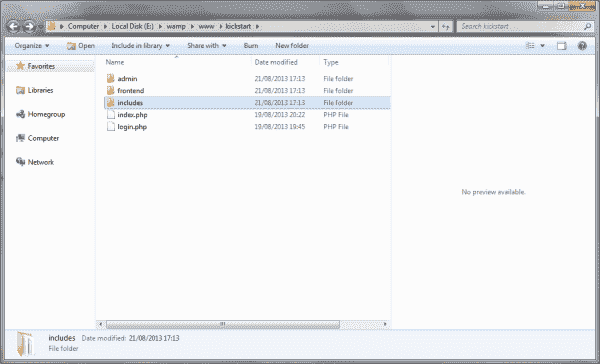

图 3.1. 主目录

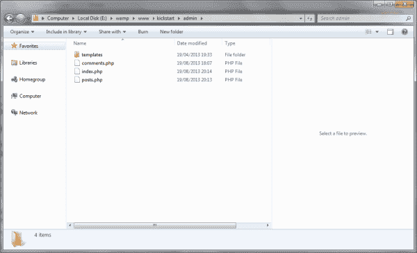

图 3.2. 管理目录

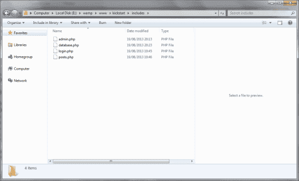

图 3.3. 包含目录

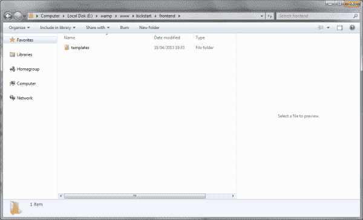

图 3.4. 前端目录

我们只需添加一些骨架代码来概述它们将如何运行。在列出的每个文件中，添加以下代码。添加完成后，请务必保存文件。

`index.php`

```php
<?php
require_once('includes/posts.php');

$blog = new Posts;

$admin = new Comments;
```

`login.php`

```php
<?php
    require_once('includes/login.php');

    $login = new Login;
```

`includes/database.php`

```php
<?php

class Database{

    public $dbserver = '';
    public $username = '';
    public $password = '';
    public $database = '';
    public $db = '';

    public function __construct(){
        $this->dbserver = 'localhost';
        $this->username = 'xxx';
        $this->password = 'xxx';
        $this->database = 'xxx';
        $this->db = new PDO("mysql:host=".$this->dbserver.";
dbname=".$this->database, $this->username, $this->password);
    }

    public function dbselect($table, $select, $where=NULL){

    }

    public function dbadd($tablename, $insert, $format){

    }

    public function dbupdate($tablename, $insert, $where){

    }

}
```

`includes/admin.php`

```php
<?php
    session_start();
    require_once('database.php');
    class Adminpanel{
        public function __construct(){
        }
    }

    class Posts extends Adminpanel{

        public function __construct(){
            parent::__construct();
        }

        public function listPosts(){

        }

        public function editPosts(){

        }

        public function addPost(){
        }

        public function savePost(){


        }

        public function deletePost(){

        }

    }

    class Comments extends Adminpanel{

        public function __construct(){
            parent::__construct();
        }

        public function listComments(){

        }

        public function deletePost(){

        }

    }

    $admin = new Adminpanel();
```

`includes/login.php`

```php
<?php
    require_once('database.php');
    class Login{

        public function __construct(){

        }

        public function index(){

        }

        public function loginSuccess(){

        }

        public function loginFail(){

        }

        private function validateDetails(){

        }

    }
```

`includes/posts.php`

```php
<?php

require_once('database.php');

class Blog{
    public $ksdb = '';
    public $base = '';
    public function __construct(){
        $this->ksdb = new Database;
        $this->base = '';
        $this->base = "http://".$SERVER['HTTP_HOST'];

    }

}

class Posts extends Blog{

    public function __construct(){
        parent::__construct();
    }

    public function getPosts(){

    }

    public function viewPost($id){

    }
}

class Comments extends Blog{

    public function __construct(){
        parent::__construct();
    }

    public function getComments($id){

    }

    public function deletePost($id){

    }

    public function addComment(){

    }

}
```

*   `enctype` – 此属性指定了表单数据在提交时的编码方式。然而，该属性仅在 `method` 属性被设置为 `POST` 时生效。`enctype` 有三个可能的值：`application/x-222-form-urlencoded`、`multipart/form-data` 和 `text/plain`。第一个选项会对表单提交的所有内容进行编码，因此所有空格都会编码为 `+`，所有其他特殊字符都将转换为 ASCII 十进制值。第二种选项不对任何表单数据进行编码。如果你的表单包含任何类型的文件上传控件或处理，这一点是关重要的。最后一种选项会将提交数据中的空格转换为 `+`，但不会编码任何特殊字符。在编写表单时应当评估这些选项，因为它们将对数据到达 `action` 属性 URL 时的状态起重要作用。

有两个属性可以设置在任何表单元素上，在用 PHP 脚本处理数据时也非常重要：

*   `name` – `name` 属性值是一个标识符，用于在数据发送到目标 URL 时收集数据。例如，如果我们有一个元素 `<input type="text" name="data" />`，用户为此输入的值将可以在服务器上的数组中可用，并可以使用数组键 `'data'` 进行引用。

*   `value` – `value` 属性用于设置表单中每个元素的信息或数据。你可以使用此属性为元素设置默认值。

这里是一个使用了上述某些属性的示例表单：

```
<form method="post">
    <input name="myField" value="Hello World" />
    <button type="submit">submit</button>
</form>
```

到目前为止，我们只查看了在 PHP 中使用表单时涉及的重要部分。然而，你可能会发现自己使用了一些这里未列出的属性和标签。我们讨论的元素涵盖了基础知识，如果你想获取更多关于表单的信息，请随时查看这些外部引用：

*   [`reference.sitepoint.com/html/elements-form`](http://reference.sitepoint.com/html/elements-form)
*   [`www.tizag.com/htmlT/forms.php`](http://www.tizag.com/htmlT/forms.php)
*   [`www.htmlgoodies.com/tutorials/forms/article.php/3479121/So-You-Want-A-Form-Huh.htm`](http://www.htmlgoodies.com/tutorials/forms/article.php/3479121/So-You-Want-A-Form-Huh.htm)

## POST 和 GET

每个表单的 `method` 属性允许两个选项：`POST` 和 `GET`。如我们所知，PHP 有一些特殊的预定义变量，例如 `$_SESSION` 变量。PHP 还有另外专门用于收集 HTML 表单发送数据的预定义变量：`$_POST` 和 `$_GET`，但这些变量也可以用于其他方式——我们稍后会介绍。

现在，让我们通过示例来说明 `POST` 和 `GET` 之间的区别。在我们的实验文件夹中创建新文件：`form.php` 和 `collect.php`。在我们的 `form.php` 文件中添加以下代码：

```html
<html
<<body>
    <form method="post" action="collect.php">
        <h1>Form #1</h1>
        <input name="data" placeholder="enter a string" 
type="text" />
        <button type="submit">submit</button>
    </form>
    <form method="get" action="collect.php">
        <h1>Form #2</h1>
        <input name="data" placeholder="enter a string" 
type="text" />
        <button type="submit">submit</button>
    </form>
</body>
</html>
```

完成了吗？很好。现在请在 `collect.php` 文件中添加以下代码：

```php
<?php
if (!empty($_POST['data'])) {
    echo 'The following string was sent from form #1: ' . 
$_POST['data'];
} elseif (!empty($_GET['data'])) {
    echo 'The following string was sent from form #2: ' . 
$_GET['data'];
}
```

接下来，在浏览器中打开 `form.php`，在表单 #1 的输入框中输入内容并点击提交。你应该能看到类似 图 4.2 的内容：

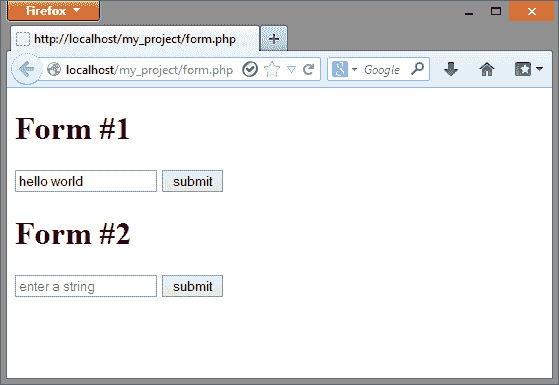

图 4.1. 向我们的表单输入数据

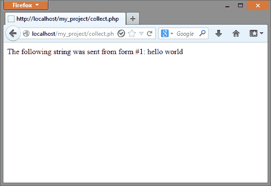

图 4.2. 提交表单的结果

如果你填写了表单 #2（如图 4.3 所示）并点击提交，你应该看到类似 图 4.4 的内容：

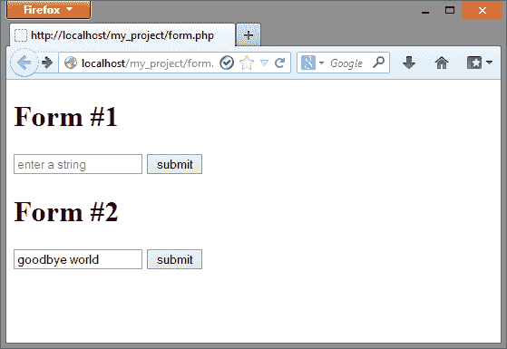

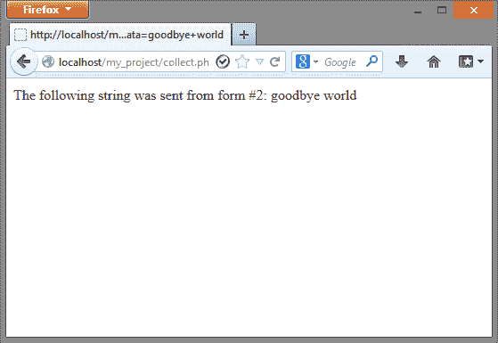

`POST` 和 `GET` 之间的主要区别在两个表单之间。


图 4.2. 提交表单的结果

`POST` 和 `GET` 之间的主要区别在两个表单之间。


图 4.2. 提交表单的结果


首先，让我们快速查看一下`PHP_SELF`。正如我们讨论过的，PHP 有一些特殊的预定义变量，我们可以在整个脚本中使用它们来完成一些非常特殊的功能。然而，其中一组变量比其他的更为特殊。它们位于`$_SERVER`数组中，该数组包含了服务器和执行环境的信息，例如标头、路径以及服务器上的脚本位置。我们可以像访问任何其他数组一样访问这些数据。`$_SERVER`数组的键之一就是`PHP_SELF`，它存储了相对于文档根目录的当前访问的 PHP 文件信息。

为了看到这个`PHP_SELF`值的实际效果，让我们在实验文件夹中创建一个名为`self.php`的新文件。在该文件中添加以下代码：

```php
<?php
echo $_SERVER['PHP_SELF'];
```

现在，当你在浏览器中查看此文件时，你应该能看到相对于服务器文档根目录的`self.php`文件的 URL。

在我们的情况下，这可能是类似于`"localhost/experiments/self.php"`的内容。我们可以在表单的`action`属性中使用`'PHP_SELF'`，使其提交到`self.php`，在那里我们可以使用`$_POST`或`$_GET`变量检查表单是否传输了数据，然后执行代码进一步处理这些数据。

这是一个示例：

```php
<?php
if (!empty($_POST['data'])) {
    echo 'Form has been submitted';
    // 处理来自表单数据的代码
}
?>
<html>
<body>
    <form action="POST" action="<?php echo $_SERVER['PHP_SELF']; ?>">
        <input type="text" name="data" type="text" placeholder="Type in a string here" />
        <button type="submit">submit</button>
    </form>
</body>
</html>
```

当表单被提交时，PHP 会检测到这一并并执行`echo`命令，这会在我们的浏览器中显示 "Form has been submitted" 字符串。`PHP_SELF`变量对于那些需要提交到显示它们的同一个脚本、并在提交后执行代码处理数据的表单来说非常有用。

在使用`PHP_SELF`变量作为表单的`action`时，使用`htmlspecialchars()`函数过滤掉 URL 中任何不需要的字符非常重要，这有助于防止跨站脚本 (XSS) 攻击。要在上面的示例中实现此操作，你需要将`form`标签更改为：

```html
<form action="POST" action="<?php echo htmlspecialchars($_SERVER['PHP_SELF']); ?>">
```

```php
<?php
class Posts {
    public $db = '';
    public function __construct() {
        $this->db = new PDO("mysql:host=localhost;dbname=testposts", 
        "dbuser", "dbpass");
        $this->db->setAttribute(PDO::ATTR_ERRMODE,
        PDO::ERRMODE_EXCEPTION);
        $this->index();
    }
    public function index() {
        $id = 0;
        $posts = array();
        $template = '';
        if (!empty($_GET['id'])) {
            $id = $_GET['id'];
        }
        try {
            if (!empty($id)) {
                $query = $this->db->prepare("SELECT * FROM posts 
WHERE id = ?");
                $params = array($id);
                $template = 'single-post.php';
            } else {
                $query = $this->db->prepare("SELECT * FROM posts");
                $params = array();
                $template = 'list-posts.php';
            }
            $query->execute($params);
            for ($i = 0; $row = $query->fetch(); $i++) {
                $posts[] = array('id' => $row['id'], 'content' =>
$row['content']);
            }
        } catch (PDOException $e) {
            echo $e->getMessage();
        }
        $query->closeCursor();
        $db = null;
        require_once($template);
    }
}
$posts = new Posts();
?>
```

我们在这里所做的是创建一个类`Posts`。在开始时，我们初始化了`PDO` MySQL 连接。接着我们进入`index`方法，在该方法中，我们检查 URL 是否包含一个变量，如果有，我们就从 URL 中获取它，并尝试从数据库中获取具有相同`id`的文章。如果没有 URL 变量，我们则直接加载数据库中的所有文章。最后，我们加载与我们执行的数据库查询相关的模板。

接下来，我们需要组合好模板文件来显示从数据库中检索的数据。因此，创建两个新文件——一个命名为`list-posts.php`，另一个命名为`single-post.php`。在`list-posts.php`中添加以下代码：

```html
<h1>List of Blog Posts</h1>
<?php foreach ($posts as $post): ?>
    <h3>Post #<?php echo htmlspecialchars($post['id']); ?></h3>
    <?php echo htmlspecialchars($post['content']); ?>
    <a href="http://localhost/experiments/posts.php?id=<?php echo 
htmlspecialchars($post['id']); ?>">Read More</a>
    <hr/>
<?php endforeach; ?>
```

等等，我漏掉了代码块中的格式。

最后，在我们的`single-post.php`文件中这段代码：

```php
<?php foreach($posts as $post): ?>
    <h1>Post #<?php echo htmlspecialchars($post['id']); ?></h1>
    <hr/>
    <?php echo htmlspecialchars($post['content']); ?>
    <a href="http://localhost/experiments/posts.php>
Back to Post List</a>
<?php endforeach; ?>
```

现在，如果我们导航到`posts.php`文件，可以看到有一篇文章列表——在这种情况下是一个特定的文章，因为我们目前数据库中只有一个文章——每篇文章都有一个让我们点击“阅读更多”的链接。点击此链接将我们带到单个文章页面，并显示一个与查看完整文章列表时不同的模板。

这是一个非常短的示例，展示了`$_GET`变量如何允许我们动态加载博客文章并与数据库进行交互。我们可以轻松地将示例改为使用`$_POST`变量。然而，这样我们就无法共享指向单篇文章的 URL 了。相反，URL 只会将访问者引导到文章列表，他们必须自己去点击“阅读更多”链接。

这个示例很好地引导我们进入本章的下一节，在下一节中，我们将扩展这段代码段以及之前的代码，并开始构建我们博客平台的核心部分。

## 在我们的平台上进行构建

在这一节中，我们将基于刚刚创建的示例（该示例显示了带有阅读单个文章链接的文章列表）进行构建，并在我们的应用程序中运行它。

让我们对上面的现有代码进行细微调整。修改博客平台文件夹中 includes 目录下的`posts.php`文件，使构造函数看起来如下：

```php
public function __construct() {
    parent::__construct();
    $this->comments = new Comments();
    if (!empty($_GET['id'])) {
        $this->viewPost($_GET['id']);
    } else {
        $this->getPosts();
    }
}
```

通过这段代码，我们的构造函数检查是否存在名为`id`的 URL 变量。如果有，它将继续从该变量收集数据，并传递给`Blog`类中的`viewPost()`方法。如果没有名为`id`的 URL 变量，应用程序将被指示加载数据库中的所有文章。这将访问者看到我们所有的文章，然后点击链接查看特定的文章。

我们对`posts.php`文件所做的下一个更改是编辑`getPosts()`方法：

```php
public function getPosts() {
    $id = 0;
    $posts = array();
    $template = '';
    if (!empty($_GET['id'])) {
        $id = $_GET['id'];
    }
    try {
        if (!empty($id)) {
            $query = $this->db->prepare("SELECT * FROM posts 
WHERE id = ?");
            $params = array($id);
            $template = 'single-post.php';
        } else {
            $query = $this->db->prepare("SELECT * FROM posts");
            $params = array();
            $template = 'list-posts.php';
        }
        $query->execute($params);
        for ($i = 0; $row = $query->fetch(); $i++) {
            $posts[] = array('id' => $row['id'], 'content' =>
$row['content']);
        }
    } catch (PDOException $e) {
        echo $e->getMessage();
    }
    $query->closeCursor();
    $db = null;
    require_once($template);
}
```

`getPosts()`方法用于从数据库收集所有文章以创建一个列表。它使用了`SELECT * FROM posts`数据库查询。然后我们使用`try` ... `catch`异常处理器检查数据库查询是否成功。如果查询成功，我们将再次遍历从数据库返回的数组并将结果赋值给键。最后，我们加载`list-posts.php`模板。

### 警告：显示 PDO 错误消息

像我们在示例中那样输出 PDO 错误消息，在开发期间很有帮助。然而，在生产环境中，这样做可能会带来安全风险。

该类的最后一步是编辑`viewPost()`方法：

```php
public function viewPost($postId) {
    $id = $postId;
    $posts = array();
    $template = '';
    $query = $this->db->prepare("SELECT * FROM posts WHERE id = ?");
    try {
        $query->execute(array($id));
        for ($i = 0; $row = $query->fetch(); $i++) {
            $posts[] = array('id' => $row['id'], 'content' =>
$row['content']);
        }
    } catch (PDOException $e) {
        echo $e->getMessage();
    }
    $query->closeCursor();
    $db = null;
    require_once($template);
}
```

在上述描述的方法中，我们正在加载一些模板文件——因此我们需要着手创建它们。现在，我们可以从零开始构建模板文件，但出于本项目的考虑，我们将使用 [Twitter Bootstrap 框架](http://twitter.github.io/bootstrap/index.html) 来设计和构建它们。Bootstrap 非常适合让 Web 应用程序的 UI 元素快速运行起来，让你专注于构建一个优秀应用程序后端的任务。

如果你擅长自己设置 Bootstrap，请根据你的需要将其实现到项目中。如果你不确定操作流程，别担心——从本书的代码归档中的`includes`文件夹中复制所有内容，你很快就能运行起 Twitter Bootstrap 了。

回到我们的项目，在`frontend`文件夹下的`templates`文件夹中创建两个新文件，并命名为`list-posts.php`和`view-post.php`。在`list-posts.php`中添加以下代码：

```php
<?php require_once 'includes/temps/header.php'; ?>
<?php foreach ($posts as $post): ?>
    <h3>Post #<?php echo htmlspecialchars($post['id']); ?></h3>
        <p><?php echo implode(' ', array_slice(explode(' ', 
strip_tags($post['content'])), 0, 10)); ?> [...]</p>
        <a href="<?php echo $this->base->url."/?id=".$post['id'];
 ?>" class="btn btn-primary">Read More</a>
    <hr/>
<?php endforeach; ?>
<?php require_once 'includes/temps/footer.php'; ?>
```

接下来，在`view-post.php`文件中添加以下代码：

```php
<?php require_once 'includes/temps/header.php'; ?>
<br/>
<a href="<?php echo $this->base->url; ?>" class="btn btn-primary">
Return to Post List</a>
<?php foreach ($posts as $post): ?>
    <h3>Post #<?php echo htmlspecialchars($post['id']); ?></h3>
        <?php echo htmlspecialchars($post['content']); ?>
    <hr/>
<?php endforeach; ?>
<?php require_once 'includes/temps/footer.php'; ?>
```

我们的`list-post.php`文件遍历了从数据库中收集的许多文章，为文章内容创建一个短小的摘要，并创建一个指向阅读每篇文章的链接。我们的`view-post.php`文件显示从数据库加载的单个文章的标题和正文。

`list-post.php`和`view-post.php`看起来都非常简单。然而，你可能在`list-posts.php`文件中注意到一些不寻常且复杂的代码：

```php
implode(' ', array_slice(explode(' ', 
view-post.phpstrip_tags($post['content'])), 0, 10));
```


此行代码结合了多个不同的 PHP 函数，提取出文章内容的前十个单词，以自动创建一个显示在我们的文章列表中的摘要字符串。`strip_tags()` 函数移除内容中的任何 HTML 标签，`explode()` 函数在函数每次遇到内容中的空格时都会创建一个新数组和键。接下来，使用 `array_slice()` 函数获取由 `explode()` 函数创建的数组中的前十个键。传递给 `array_slice()` 函数的参数 `0` 表示它应该从 `0` 开始计数，并在达到 `10` 时停止。此外，它还接收了由 `explode()` 函数创建的数组。最后，我们使用 `implode()` 函数将那十个数组值合并为一个字符串。

关于 PHP 中这些函数的更多细节以及它们用途的深入概述，请查看以下资源：

* [`php.net/manual/en/function.strip-tags.php`](http://php.net/manual/en/function.strip-tags.php)
* [`php.net/manual/en/function.explode.php`](http://php.net/manual/en/function.explode.php)
* [`php.net/manual/en/function.array-slice.php`](http://php.net/manual/en/function.array-slice.php)
* [`php.net/manual/en/function.implode.php`](http://php.net/manual/en/function.implode.php)

我们示例应用程序的下一阶段是创建管理员面板和登录面板。我们将后创建。打开 `includes` 目录下的 `login.php` 文件。它位于项目目录的主目录下。从在构造方法中开始添加以下内容：

```php
public function __construct() {
    $this->ksdb = new Database;
    $this->base = (object) '';
    $this->base->url = "http://".$_SERVER['SERVER_NAME'];
    $this->index();
}
```

本质上，我们的构造方法设置了在整个类中需要的对象和变量。接下来我们需要在 `index()` 方法中添加：

```php
public function index() {
    if ($_SERVER['REQUEST_METHOD'] === 'POST') {
        $this->validateDetails();
    } elseif (!empty($_GET['status']) && $_GET['status'] == 'inactive') {
        $error = 'You have been logged out due to inactivity. Please log in again.';
    }
    require_once 'admin/loginform.php';
}
```

现在我们已经创建了登录类，只需要为我们的登录表单创建一个模板。在 `admin` 文件夹中创建一个名为 `templates` 的目录，并添加一个名为 `loginform.php` 的新 PHP 文件。

### 注意：关于结构的说明

花时间为管理后台部分创建一个新的头部（header）和页脚（footer）模板文件是值得的。将前端头部和页脚模板文件分离可以在区分前端和管理面板时减少复杂性。有关设置此内容的细节，请查看项目的文件结构。

在 `loginform.php` 文件中，添加以下代码：

```php
<?php require_once 'includes/temps/header.php'; ?>
<br/>
<?php if (!empty($error)): ?>
    <div class="alert alert-error">~<?php echo $error; ?>div>
<?php endif; ?>
<br/>
<form action="<?php echo htmlspecialchars($_SERVER['PHP_SELF']); ?>" method="post" class="form-horizontal offset2">
    <h3>Admin Login</h3>
    <div class="control-group <?php echo (!empty($error)? 'error': ''); ?>">
        <label class="control-label" for="inputEmail">Username</label>
        <div class="controls">
            <input type="text" name="username" id="inputEmail" placeholder="Username">
        </div>
    </div>
    <div class="control-group <?php echo (!empty($error)? 'error': '')); ?>">
        <label class="control-label" for="inputPassword">Password</label>
        <div class="controls">
            <input type="password" name="password" id="inputPassword" placeholder="Password">
        </div>
    </div>
    <div class="control-group">
        <div class="controls">
            <button type="submit" class="btn">Sign in</button>
        </div>
    </div>
</form>
<?php require_once 'includes/temps/footer.php'; ?>
```

在此文件中，我们创建了一个表单，提示用户输入用户名以登录应用程序的管理部分。当此表单被提交时，它将把数据发送到我们的 `login` 类用于处理登录过程的同一个文件。然后，它会将任何错误连用户一起传回此登录文件。

现在我们已经创建了登录面板和登录类，只需要创建管理面板及其所需的类。再次在 `includes` 目录下，打开 `admin.php` 文件并添加以下内容：

```php
class Adminpanel {
    public function __construct() {
        $this->ksdb = new Database;
        $this->base = (object) '';
        $this->base->url = "http://".$_SERVER['SERVER_NAME'];
    }
}
```

在这里，我们在 `Adminpanel` 类的构造函数中添加了代码，其中包含了我们在 `admin.php` 文件中将使用的对象和变量。这是管理文件中其他类将继承的主类。

接下来，我们将向 `listPosts()` 方法中添加代码：

```php
public function listPosts() {
    $posts = $return = array();
    $query = $this->ksdb->db->prepare("SELECT * FROM posts");
    try {
        $query->execute();
        for ($i = 0; $row = $query->fetch(); $i++) {
            $return[$i] = array();
            foreach ($row as $key => $rowitem) {
                $return[$i][$key] = $rowitem;
            }
        }
    } catch (PDOException $e) {
        echo $e->getMessage();
    }
    $posts = $return;
    require_once 'templates/manageposts.php';
}
```

`listPosts()` 方法与 `posts.php` 文件中的 `getPosts()` 方法几乎完全相同：我们从数据库的 `posts` 表中加载所有帖子并检查查询。如果检查通过，我们从数据库获取数据并将其添加到 `$return` 数组中。如果没有通过，我们将显示数据库错误。最后，我们加载 `manageposts.php` 模板文件。

现在，我们处理 `addPost()` 方法：

```php
public function addPost() {
    require_once 'templates/newpost.php';
}
```

这仅仅是加载了 `newpost.php` 模板。

最后，我们向 `savePost()` 方法添加代码：

```php
public function savePost() {
    $array = $format = $return = array();
    if (!empty($_POST['post'])) {
        $post = $_POST['post'];
    }
    if (!empty($post['content'])) {
        $array['content'] = $post['content'];
        $format[] = ':content';
    }
    $cols = $values = '';
    $i = 0;
    foreach ($array as $col => $data) {
        if ($i == 0) {
            $cols .= $col;
            $values .= $format[$i];
        } else {
            $cols .= ',' . $col;
            $values .= ',' . $format[$i];
        }
        $i++;
    }
    try {
        $query = $this->ksdb->db->prepare("INSERT INTO posts ".$cols.") VALUES (".$values.")");
        for($c=0;$c<$i;$c++){
            $query->bindParam($format[$c], $array[$c]);
        }
        $query->execute();
        $add = $query->rowCount();
    } catch (PDOException $e) {
        echo $e->getMessage();
    }
    $query->closeCursor();
    if (!empty($add)) {
        header("Location: posts.php");
    } else {
        $status = array('error' => 'There has been an error saving your post.');
    }
}
```

`savePost()` 方法使用 PDO 准备一个 `INSERT` SQL 查询将数据保存到 `posts` 表。然后我们根据数据是否保存成功返回一个状态。现在我们只需要创建几个模板。我们将在 `templates` 文件夹中添加两个 PHP 文件。第一个文件 `manageposts.php` 是我们查看数据库中保存的所有帖子列表的地方，另一个 `newpost.php` 是我们拥有简单表单的地方，可以在其中输入数据创建新帖子。在 `manageposts.php` 文件中，添加以下代码：

```php
<?php require_once '_inc/header.php'; ?>
<a href="<?php echo $this->base->url; ?>/posts.php?action=create" class="btn btn-info">Create Post</a>
<table>
    <thead>
        <tr>
            <td>Post Title</td>
            <td>Post Content</td>
            <td>Actions</td>
        </tr>
    </thead>
    <tbody>
    <?php foreach($posts as $post): ?>
        <tr>
            <td><h3>Post #<?php echo htmlspecialchars($post['id']); ?></h3></td>
            <td><p><?php echo implode(' ', array_slice(explode(' ', strip_tags($post['content'])), 0, 10)); ?> [...]</p></td>
            <td>
                <a href="<?php echo $this->base->url; ?>/posts.php?id=<?php echo $post['id']; ?>&action=edit" class="btn btn-primary">Edit Post</a>
                <a href="<?php echo $this->base->url; ?>/posts.php?id=<?php echo $post['id']; ?>&action=delete" class="btn btn-primary">Delete Post</a>
            </td>
        </tr>
    <?php endforeach; ?>
    </tbody>
</table>
<?php require_once '_inc/footer.php'; ?>
```

接下来，打开 `newpost.php` 文件并添加以下代码：

```php
<?php require_once '_inc/header.php'; ?>
<form action="<?php echo htmlspecialchars($_SERVER['PHP_SELF']); ?>" method="post">
    <div class="control-group">
        <label class="control-label" for="inputTitle">Post Title</label>
        <div class="controls">
            <input type="text" name="post[title]" id="inputTitle" placeholder="Title">
        </div>
    </div>
    <div class="control-group">
        <label class="control-label" for="inputContent">Post Content</label>
        <div class="controls">
            <textarea name="post[content]" id="inputContent" rows="10" placeholder="Content"></textarea>
        </div>
    </div>
    <div class="control-group">
        <div class="controls">
            <button type="submit" class="btn">Save Post</button>
        </div>
    </div>
</form>
<?php require_once '_inc/footer.php'; ?>
```


在此时，我们仅拥有一个用于输入内容的基础文本区域。稍后，我们将进一步扩展此面板，包含一个用于文章标题的区域，并将文本区域更改为更动态且易用的内容编辑器。

在将上述所有代码添加到`newpost.php`文件后，你现在应该拥有了一个可以运行的管理面板，可以在其中创建新的博客文章！

我们还可以访问项目的公共（或前端）部分，查看博客文章列表，并点击单篇文章来阅读其内容，如图 4.7 所示。很令人兴奋对吧？

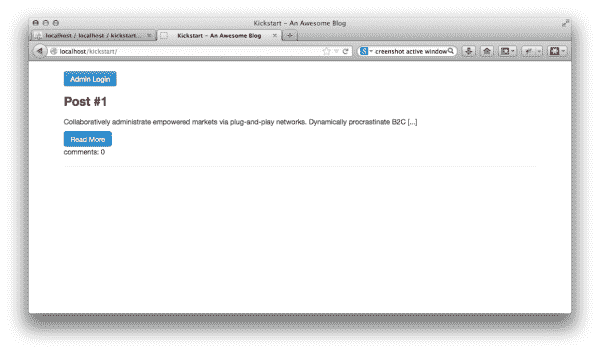

图 4.7. 我们项目的前端。

请随时导航到项目的主`index.php`文件并开始使用该系统。

在下一章节中，我们将进一步扩展管理面板，允许我们更新数据库中现有的博客文章，并删除博客文章。

## 总结

表单是任何 Web 应用程序至关重要的部分，允许用户提交数据。PHP 为我们提供了强大的工具，用于处理、存储和操作通过表单提交的数据。在本章中，我们讨论了 PHP 收集表单提交数据的方法，查看了`POST`和`GET`方法，并讨论了如何验证收集到的数据，为将其输入我们的`MySQL`数据库做好准备。然后，我们使用了讨论过的表单方法构建了我们的博客应用程序。

正如我们讨论过的，数据库是存储应用程序可以在日后检索的数据的理想选择。然而，使用 PHP 还有以更临时的方式存储数据的选项。`cookies`和`sessions`设计用于存储比通常数据库中存储更小的数据块。它们通常用于存储用户登录功能的个人数据（例如），并为应用程序配置文件等功能提供用户数据的快速访问。

Cookies 和 sessions 之间的主要区别在于数据存储的位置。Cookies 将数据存储在客户端计算机上，而 sessions 将其数据存储在 Web 服务器上。PHP 可以同时处理 cookies 和 sessions，我们将在本章中详细查看这些每个选项。

## Cookies：概览

HTTP 请求是无状态的，这意味着每当浏览器请求新页面时，Web 服务器都不会记住与用户之前的某个请求相关的数据。

幸运的是，我们有使用 cookies 的选项，它允许我们在访问者的浏览器中存储一小部分信息。这些 cookie 信息可以被网站加载，并在其脚本中使用以实现数据的个性化，或帮助在站点页面上创建动态数据。

当您需要在 HTTP 页面请求之间保留数据时，Cookies 也非常有用。在浏览器中创建的每个 cookie 仅可由创建它的浏览器访问，这有助于保持其中包含的信息安全。

### 重要：Cookies 与最近的欧洲立法

最近，对于居住在欧洲或与要在欧洲部署的项目工作的 Web 开发人员来说，cookies 被处于疑云之中。欧盟认为 cookies 被用来存储了关于网站访问者的太多个人信息，因此已经实施了[新立法](http://www.ico.org.uk/for_organisations/privacy_and_electronic_communications/the_guide/cookies)，旨在提高其使用的透明度。

这项立法并不意味着开发者不应该使用 cookies，但它确实意味着我们必须更高效地使用它们，并且仅在应用有真实需求时才使用它们。

事实是，网站使用的大多数 cookies 都是无害的——许多仅用于根据用户乐意提供的个人信息来增强用户内容。

## Sessions：概览

尽管 cookies 很有用，但它们确实存在漏洞——因为它们存储在用户的计算机上，理论上它们可能会被用户篡改，或者更糟糕的是，被用户计算机上的病毒篡改。sessions 提供了 cookies 的替代方案，并且不带客户端的安全风险。

`sessions`是一种特殊形式的连续性，用于在用户访问您的网站期间跨页面请求存储数据。当您登录 Web 应用程序、编辑某些内容并注销时，通常情况下，一个 session 会在后台运行。

值得注意的是，sessions 仍然依赖 cookies 来成功将存储在网站服务器上 session 中的数据归类给客户端。换句话说，用户每当访问网站时，都需要客户端计算机上的一个 cookie 来识别他们。

## Session 对比 Cookies

在您使用 PHP 开发时，您可以很方便地同时使用 cookies 和 sessions。两者都可以使用非常简单的方法访问。不过，在深入代码之前，探索 cookies 和 sessions 的独特特性以更好地了解您何时可能倾向于使用其中一个。

### Cookies

Cookies 与 sessions 相比的第一个独特特性是我们为它们设置了过期时间。当客户端离开我们的网站或 Web 应用程序并游览到互联网的其他部分时，他们很有可能会返回。通过 cookies 我们可以设置过期时间，这样当用户再次访问时，只要过期时间未到，他们之前提交或输入的信息就会像没有离开一样显示。

使用过期时间的例子是您登录社交媒体应用程序（如 Facebook）。登录后，您可能会导航到另一个网站。但在特定时间范围内返回 Facebook，您可能会发现自己仍然处于登录状态。cookie 为 Facebook 提供了此部分数据，帮助它加载我们的配置文件，从而极大地改进了用户体验。为 cookies 设置过期时间使这种便利成为可能，同时增加了一层安全性。通过强制用户在活动一段时间后重新验证身份，防止其他用户通过硬件劫持访问 cookie 中存储的数据。

Cookies 的另一个特性是，每当有人访问在其机器上了 cookie 的网站时，cookie 会自动包含在客户端发送的后续 HTTP 请求中。考虑到这一点，不要让 cookies 存储太多数据，因为它们会占用 Web 服务器的带宽。

Cookies 使数据管理更加简单，因为使用它们不需要任何任何形式的数据库。这意味着使用 cookies 不需要任何数据库管理技能。此外，在许多 Web 编程语言（如 PHP）中，创建、分配数据和访问 cookies 的功能已经内置，因此您无需担心自己编写库来访问它们。

总来说，cookies 应该用于存储小量信息，这些信息可以用于个性化网页的小部分以提升用户体验。它们还可以允许用户恢复之前与您的应用程序的交互，营造出他们仍处于登录状态的错。

### 注意：Cookies 与安全

记住不要在 cookies 中存储敏感数据，因为每当请求页面时，cookies 都会被发送到 Web 服务器，并可能被精通技术的攻击者访问。

此外，由于 cookies 存储在用户的计算机上，我们作为开发者，在保护 cookies 方面做的其实非常有限。因此，理想情况下，cookies 只应该存储应用程序用于识别存储在数据库或其他安全存储选项中信息的数据，而不是将数据直接存储在 cookie 中。

### 会话 (Sessions)

会会将 cookies 的实用性与 Web 服务器的安全性和可管理性结合。与 cookie 不同，特定的变量数据和信息不会直接存储在用户的计算机上。数据本身实际上存储在托管并处理网站或 Web 应用程序的服务器上。

Sessions 与我们目前看到的任何其他变量都不同，因为它们不会在浏览器请求的页面之间直接传递数据——相反，数据是从每个页面开始时启动的会话中检索的。如前所述，sessions 使用存储在客户端计算机上的 cookie 来将正确的用户与其存储在会话中的数据识别起来。这个 cookie 不包含任何个人信息，而且除非与 Web 服务器上存储的数据进行比较，否则这些数据没有任何意义；通常它它以键的形式出现，例如`350401be75bbb0fafd3d912a1a1d5e54`。出于这个原因，sessions 的数据安全性比单独使用 cookies 更高。

虽然这种在客户端计算机和服务器上同时存储数据的方法看起来可能有些笨拙，但它实际上有其优势：

*   Sessions 对可以存储的数据量没有限制。这是因为 sessions 存储在服务器上，因此不会对服务器的带宽产生负面影响。
*   由于 session 数据存储在 Web 服务器上而不是用户的计算机上，这允许你将安全精力放在 Web 服务器上，而不是应用能够适应用户浏览器存储能力的加密方法。

关于 sessions 需要记住的一点是，你可以指定它们存活或活跃的时间。我们将其称为“存活时间”（time-to-live），通常配置为在用户关闭与 Web 服务器建立会话的浏览器或标签页后，会话过期或失效。例如，如果一个用户登录了社交媒体应用程序，当他们完成使用并关闭浏览器时，如果配置了此类操作，会话将自动删除该用户的数据——这是一个非常实用的功能。

## PHP 中的 Sessions 和 Cookies

现在我们已经涵盖了使用 sessions 和 cookies 的原因以及它们之间的主要区别，是时候开始学习如何在 PHP 中实现它们了。

sessions 和 cookies 都可以通过专门用于这些方法的特殊变量进行访问和加载。在 PHP 中，我们通过使用超全局变量`$_COOKIE`来表达使用和操作 cookie 的意图。

### PHP 中的 Cookies

现在我们已经知道了编写和使用 cookies 的基础知识，我们将查看如何使用和编写 sessions。就像 cookies 一样，这种方法利用了一个特殊的超全局变量，我们通过该变量向 sessions 分配数据并从其获取数据：`$_SESSION`。

我们必须使用一些特殊的函数来设置 cookies。在我们的示例中，我们设置了 cookie 的过期时间和日期，并将其存储在第一行的`$expire`变量中。注意我们使用了`time()`函数。让我们创建一个新文件并添加以下代码：

```php
<?php

$expire = time() + 60 * 24 * 30;

setcookie("user", "Joe Public", $expire);

if (isset($_COOKIE["user"])) {

    echo "Welcome " . $_COOKIE["user"];

} else {

    echo "Welcome!";

}
```

### 重要：isset()

同样重要的是，来自 cookies 的数据会在每次页面请求时发送到服务器。如果你的脚本在发送任何 cookie 数据之前输出了 HTML，或者设置了任何要发送的 cookie 数据，PHP 将报错。请确保在脚本开始时设置并发送 cookie 数据是非常重要的。但是你可以在脚本的后续（在 HTML 发送之后）检索 cookie 数据。这不会引发 PHP 错误（只要 cookie 存在且有数据）。强烈建议你花时间阅读[关于 PHP 中 cookies 的 SitePoint 文章](http://www.sitepoint.com/php-sessions/) 以进一步了解。

`isset()`函数检查变量是否有值。在上面的代码中，我们使用`$_COOKIE`来确保 cookie 已被检测到。现在查看`storage.php`文件时，你会发现`isset()`将会-.

会话（Sessions）的工作原理类似于 cookie，但在分配数据方面有一有一个特定的过程，这与设置 cookie 数据的方式非常不同。最初，我们需要告诉 PHP 我们想使用会话，我们通过`session_start()`函数来实现这一点。我们还可以选择单独地或批量地移除会话变量，这可以通过如`session_unset()`和`session_destroy()`等函数完成。这里有一个基础示例，展示了我们如何启动会话、向其中添加数据，并使用之前介绍过的`$_SESSION`变量获取这些数据：

```php
<?php

session_start();

$_SESSION["username"] = "myusername";

echo "Username = " . htmlspecialchars($_SESSION["username"]);
```

如你所见，我们启动会话，创建一个名为`username`的新会话变量，并将字符串`"myusername"`赋值给该变量。最后，我们在浏览器中显示存储在会话变量中的字符串。这只是一个基础示例，因为如果我们在实际项目中使用这段代码，实际上会将其分布在两个文件中——第一个文件启动会话并创建`username`会话变量，第二个文件也启动会话，但随后显示会话变量中存储的字符串。

在使用完会话后将其结束是非常重要的。尽管会话被用于临时数据存储，但它们仍然容易受到攻击。在处理可能敏感的信息时，结束会话有助于确保最大的安全性。要做到这一点，我们只需要在完成后简单地向代码中添加`session_destroy()`函数，如下：

```php
<?php

session_start();

$_SESSION["username"] = "Username";

echo "Username = " . $_SESSION["username"];

session_destroy();
```

强烈建议在完成工作且代码中不再需要该会话时将其结束，以防止恶意代码被注入到你的 PHP 脚本中。

如果我们不想不想结束会话，而是想从其中移除某部分数据，可以使用`unset()`函数。这里是`unset()`的用法示例：

```php
<?php

session_start();

unset($_SESSION["username"]);
```

我们还可以使用`session_unset()`函数清除所有会话及其值。因此，如果我们修改上面的简短示例，可以这样使用`session_unset()`：

```php
<?php

session_start();

session_unset();
```

### 警告：不要在会话中保留敏感数据

在本章前面的部分，我们讨论了为什么不使用 cookie 存储敏感数据（即使是临时的）。同样的建议也适用于会话，尽管它们被认为比 cookie 更安全。虽然会话数据存储在 Web 服务器上而不是用户的计算机上，但会话也可能是攻击者和黑客的目标。因此，也建议你不要使用会话存储敏感数据。

## 项目

现在我们已经涵盖了会话和 cookie 的使用，是时候开始填充我们项目的外壳，使其成为一个功能完整的博客平台了。首先，让我们从`includes`文件夹中的`login.php`文件开始，并对其进行添加。我们将从编辑`index()`方法开始：

```php
public function index() {

    if (isset($_GET['status']) && $_GET['status'] == 'logout') {

        session_unset();

        session_destroy();

        $error = '您已注销。请登录。';

        require_once 'templates/loginform.php';

    } elseif (!empty($_SESSION['kickstart_login'])) {

        if ($_SERVER['REQUEST_METHOD'] === 'POST') {

            $this->validateDetails();

        } elseif (isset($_GET['status'])) {

            if ($_GET['status'] == 'inactive') {

                session_unset();

                session_destroy();

            }

        }

        require_once 'templates/loginform.php';

    }

}
```

我们在`index()`中添加的是为了跟踪用户在整个管理面板中的活跃状态。我们在构造函数中添加了注销流程，当用户选择注销时销毁会话。我们还添加了`if`语句来检查用户是否已登录。最后，我们在文件顶部添加了`session_start()`，以便在用户请求管理面板内的页面时启动会话。如果用户仍然活跃，`Adminpanel`类将首先检查用户是否在未登录的情况下直接访问管理面板。无论何种情况，用户都将被重定向回登录页面。最后，如果用户已经登录并拥有活动会话，类将开始加载渲染管理面板所需的所有内容。

接下来，让我们快速查看`loginSuccess()`方法：

```php
public function loginSuccess() {

    $_SESSION['kickstart_login'] = true;

    $_SESSION["timeout"] = time();

    header('Location: ' . $this->url . '/posts.php');

}
```

在这里，我们添加了两个会话变量及其对应的数据，一旦用户允许进入管理面板。这些是在`login.php`中更改的内容，所以接下来让我们查看位于`includes`文件夹中的`admin.php`文件。首先，我们将向`Adminpanel`的构造函数添加内容，同时在文件开头添加一些代码：

```php
<?php

session_start();

require_once 'database.php';

class Adminpanel {

    public function __construct() {

        $inactive = 600;

        if (isset($_SESSION["kickstart_login"])) {

            $sessionTTL = time() - $_SESSION["timeout"];

            if ($sessionTTL > $inactive) {

                session_unset();

                session_destroy();

                header("Location: http://" . $_SERVER['SERVER_NAME']
```


进入`/path/to/xxx`目录，找到`xxx.json`。

在表达式`cvar = avar + bvar`中，加法运算符（`+`）将`avar`与`bvar`相加，得到它们的和`cvar`。

在`List.of(arg0, arg1, arg2)`中，`List`接口的工厂方法`of()`接受一系列的元素，返回包含它们的只读列表。

之后我们这样调用`cmd`命令：`cmd arg0 arg1 arg2`。

```
if (condVar > someVal) {console.log("xxx")}
```

---

接下来，让我们看看继承`Adminpanel`类的`Posts`类：

```php
public function __construct() {
    parent::__construct();
    if (!empty($_GET['action'])) {
        switch ($_GET['action']) {
            case 'create':
                $this->addPost();
                break;
            default:
                $this->listPosts();
                break;
            case 'save':
                $this->savePost();
                break;
            case 'delete':
                $this->deletePost();
                break;
        }
    } else {
        $this->listPosts();
    }
}
```

在这里，我们在`switch`条件语句中添加了一个新的`case`。这会检查 URL 变量`action`是否包含字符串`delete`。如果是这样，我们的应用程序就需要加载一个名为`deletePost()`的新方法。现在，让我们继续将该方法添加到类的底部：

```php
public function deletePost() {
    if (!empty($_GET['id']) && is_numeric($_GET['id'])) {
        $query = "DELETE FROM `posts` WHERE id = ?";
        $stmt = $this->db->prepare($query);
        $stmt->execute(array($_GET['id']));
        $delete = $stmt->rowCount();
        $this->db = null;
        if (!empty($delete) && $delete > 0) {
            header("Location: " . $this->base->url . "/posts.php?delete=success");
        } else {
            header("Location: " . $this->base->url . "/posts.php?delete=error");
        }
    }
}
```

上面，我们添加了所需的功能，允许我们通过“删除”按钮（我们在管理面板列出所有帖子时可以看到）来删除帖子。为了实现这一点，我们不仅在`deletePost()`方法中添加了功能，还在`Posts`构造函数中添加了必要的代码，以便在 URL 中请求时检测`delete`方法。我们通过在`Posts`构造函数中添加一个新的`switch case`来实现这一点，从而从 URL 变量识别我们想要对从管理面板选择的帖子执行什么操作。我们还在构造函数和`editPosts()`方法中都添加了功能，允许我们编辑已经创建的帖子。

最后，我们需要更新`savePost()`方法：

```php
public function savePost() {
    $array = $format = $return = array();
    if (!empty($_POST['post'])) {
        $post = $_POST['post'];
    }
    if (!empty($post['content'])) {
        $array['content'] = $post['content'];
        $format[] = ':content';
    }
    $cols = $values = '';
    $i = 0;
    foreach ($array as $col => $data) {
        if ($i == 0) {
            $cols .= $col;
            $values .= $format[$i];
        } else {
            $cols .= ',' . $col;
            $values .= ',' . $format[$i];
        }
        $i++;
    }
    try {
        // 此查询存在 SQL 注入漏洞
        $query = $this->ksdb->db->prepare("INSERT INTO posts ($cols) VALUES ($values)");
        for ($c = 0; $c < $i; $c++) {
            $query->bindParam($format[$c], ${'var' . $c});
        }
        $z = 0;
        foreach ($array as $col => $data) {
            ${'var' . $z} = $data;
            $z++;
        }
        $result = $query->execute();
        $add = $query->rowCount();
    } catch (PDOException $e) {
        echo $e->getMessage();
    }
    $query->close();
    $this->db = null;
    if (!empty($add)) {
        $status = '您的帖子已保存。';
    } else {
        $status = '保存帖子出错，请重试。';
    }
    header("Location: " . $this->base->url . "/posts.php");
}
```

除了为用户添加了一个可以为帖子插入标题的额外字段外，我们还更改了他们输入内容的文本区域；我们更改它使其变成了一个支持 markdown 的输入字段。对于不熟悉 [markdown](http://daringfireball.net/projects/markdown/) 的人来说，它是一种简单的纯文本标记语法，旨在易于为内容添加格式。markdown 引擎随后会将内容转换为有效的 HTML 格式。

对于我们的项目，我们将使用一个易于实现的 JavaScript Markdown 转换器和编辑器，名为 [Pagedown](http://code.google.com/p/pagedown/)。要实现该库，你需要按照顺序加载三个 Pagedown 库：`Markdown.Converter`、`Markdown.Sanitizer`和`Markdown.Editor`。一旦加载了这些库，通过将以下代码添加到`header.php`模板文件的`<head>`标签中来初始化这些库：

```html
<script>
    (function () {
        var converter = new Markdown.Converter();
        var editor = new Markdown.Editor(converter);
        editor.run();
    }());
</script>
```

你还需要确保你有正确的元素来加载编辑器的格式按钮，并为你的文本区域分配正确的类名，以便库能够确定在何处加载文本格式代码。此外，库还需要知道在你输入内容和进行格式化时，在何处显示文章的预览。

我们已经在上面的模板中添加了这两个元素及其所需的类。让我们来看看我们添加的代码。以下是格式按钮和文本输入的代码：

```html
<div class="wmd-panel controls">
    <div id="wmd-button-bar"></div>
    <textarea class="wmd-input" name="post[content]" id="wmd-input">*在此开始输入*</textarea>
</div>
```

以及预览区域的代码：

```html
<section class="span4" style="padding-left:20px; border-left:1px solid #eee;">
    <div id="wmd-preview" class="wmd-panel wmd-preview"></div>
</section>
```

你可以通过查找 id 和/或类名带有`wmd`前缀的元素来识别 Pagedown 库需要的区域。一旦加载了这些库，你就可以开始在编辑器区域中输入你的文章内容以及一些 markdown 格式了，如图 5.2 所示。

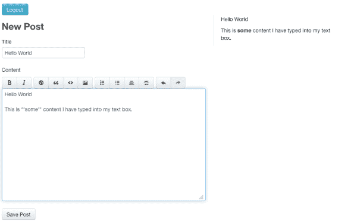

图 5.2. 在文本编辑器中编写文章

你还应该注意到我们在模板文件的顶部添加了一个名为“评论”（Comments）的新按钮。点击此新按钮将把用户带到评论管理面板，他们可以在那里查看所有添加到我们文章的评论，并删除他们不想在博客上显示的评论。为了让它运行起来，我们首先需要的是在数据库中创建一个新表，用于存储用户的评论。在你的数据库中建立一个新表，如图 5.3 所示。

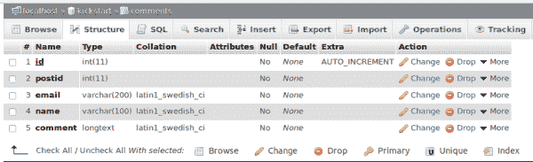

图 5.3. 我们的`comments`表

为了让管理面板的这部分运行，让我们再次打开 includes 文件夹中的`admin.php`文件，并首先修改构造函数的代码：

```php
public function __construct() {
    parent::__construct();
    if (!empty($_GET['action']) && $_GET['action'] == 'delete') {
        $this->deleteComment();
    } else {
        $this->listComments();
    }
}
```

正如我们看到的，我们的构造函数现在检查 URL 变量`action`并检查它是否存在，以及它是否持有字符串`delete`。如果是，我们的应用程序将加载`deleteComment()`方法；如果不是，它将加载`listComments()`方法。所以让我们构建这些方法，从`listComments()`开始：

```php
public function listComments() {
    // ... (后续代码)
}
```

```php
public function viewpost($postid) {
    $id = $postid;
    $posts = $this->ksdb->dbselect('posts', array('*'), array('id' => $id));
    $markdown = new Michelf\Markdown();
    $posts[0]['content'] = $markdown->defaultTransform($posts[0]['content']);
    $postcomments = $this->comments->getcomments($posts[0]['id']);
    $template = 'view-post.php';
    include_once 'frontend/templates/' . $template;
}
```

我们已经在脚本开头引入了新的 markdown 库，准备在应用程序需要以 markdown 格式渲染数据时使用它。我们还更改了`getposts()`方法以及`viewpost()`方法的功能，并且我们现在于构造函数中加载`Comments`类。

让我们先仔细观察一下我们在这两个方法中添加的代码。在`getposts()`中，我们添加了一个新的`foreach`循环，它将调用我们`Comments`类中的`commentnumber()`方法。我们还需要将该方法添加到类中，所以请记住这一点，并快速查看`viewpost()`方法。在这里，我们正在从 markdown 库加载`markdown`类，并将此类赋值给变量`$markdown`，使其变成一个对象。

你会发现调用 markdown 库的方式与我们以前调用类的方式非常不同；这是因为 Michel 在他的库中使用了**命名空间（namespace）**。命名空间有助于为类建立唯一的标识符。这避免了当两个同名类被加载时可能发生的冲突。命名空间是在 PHP 5.3 中引入的。这是一个开始变得流行的特性，因为它有助于解决创建供公共使用的库时出现的命名复杂性问题。命名空间可以这样应用于类：

```php
<?php
namespace Project;

class myProject {
    function index() {
        echo 'Loading a method from a class with a namespace!';
    }
}
```

它们的实现非常简单，但可以对代码的互操作产生巨大的改进。例如，markdown PHP 库使用命名空间`Michelf`，因此为了将库的类及其方法加载到我们的脚本中，我们只需要在调用类之前在脚本中让命名空间出现。在这种情况下，我们不需要写：

```php
$markdown = new Markdown();
```

而是必须写：

```php
$markdown = new Michelf\Markdown();
```

### 注意：更多关于命名空间

关于命名空间的更多信息，请参阅 [PHP 手册](http://php.net/manual/en/language.namespaces.php) 和 [SitePoint 上的这篇文章](http://www.sitepoint.com/php-namespaces/)。

现在我们已经实现了 markdown PHP 库，可以使用它将用 markdown 语法编写的文章转换为完全渲染的 HTML。

我们添加的最后一段新代码是对我们`Comments`类中另一个方法的调用，我们还没有编写该方法。该方法是`getcomments()`，它将让应用程序加载特定文章的所有评论。

让我们从 "frontend" 目录打开`comments.php`文件。按如下修改代码：

```php
<?php
require_once 'frontend/posts.php';

class Comments extends Blog {
    public function __construct() {
        parent::__construct();
        if ($_SERVER['REQUEST_METHOD'] === 'POST' && !empty($_POST['comment'])) {
            $this->addcomment();
        }
    }
```

我们该类的构造函数从父类的构造函数（即`Blog`类的构造函数）中加载了我们需要的所有内容，然后检查是否有提交新评论的后台请求。如果有，应用程序将随后触发`addcomment()`方法。在这个方法中，我们获取评论表单提交的所有数据，并使用 PDO 数据库库中的`dbadd()`方法将其准备好存入我们的评论数据库。

```php
public function commentnumber($postid) {
    $query = $this->ksdb->dbselect('comments', array('*'), array('postid' => $postid));
    $commentnum = count($query);
    if ($commentnum <= 0) {
```


`$commentnum = 0;`

`return $commentnum;`

`public function getcomments($postid) { return $this->ksdb->dbselect('comments', array('*'), array('postid' => $postid)); }`

你也可以看到我们有方法 `getcomments()`，它要求传递一个包含文章 ID 的变量到方法中。任何在正确处理之前需要传递给方法的数据，都可以放在方法名后的括号中。该方法根据传递给方法的 id 收集所有属于该文章的评论，并将它们返回给调用此方法时赋值的变量。这意味着如果数据没有传递给方法，PHP 将抛出错误：

```php
public function addcomment() {
    $status = '';
    $array = $format = array();
    if (!empty($_POST['comment'])) {
        $comment = $_POST['comment'];
    }
    if (!empty($comment['fullname'])) {
        $array['name'] = $comment['fullname'];
        $format[] = ':fullname';
    }
    if (!empty($comment['email'])) {
        $array['email'] = $comment['email'];
        $format[] = ':email';
    }
    if (!empty($comment['content'])) {
        $array['content'] = $comment['content'];
        $format[] = ':content';
    }
    if (!empty($comment['postid'])) {
        $array['postid'] = $comment['postid'];
        $format[] = ':postid';
    }
    $add = $this->ksdb->dbadd('comments', $array, $format);
    if (!empty($add) && $add > 0) {
        $status = array('success' => 'Your comment has been submitted');
        $key = 'success';
    } else {
        $status = array('error' => 'There has been an error submitting your comment. Please again later.');
        $key = 'error';
    }
    header('http://localhost/kickstart/?id=' . $comment['postid']);
}
```

我们还有 `commentnumber()` 方法，它要求在执行之前向它传递一个文章 ID。它统计传递给方法的文章的所有评论，并返回这个数字。

现在我们已经运行了 `Comments` 类。我们只需要做的是微调 `list-posts.php` 模板，以显示我们的文章有多少条评论——以及文章的新标题——并在 `view-post.php` 模板中添加一个部分，允许访问者提交评论（再次显示新的文章标题）。

让我们从 `list-posts.php` 文件开始。打开它并添加以下代码：

```php
<?php require_once 'includes/temps/header.php'; ?>
<?php foreach ($posts as $post): ?>
    <h3><?php echo (!empty($post['title']) ? htmlspecialchars($post['title']) : 'Post #' . htmlspecialchars($post['id'])); ?></h3>
    <p><?php echo implode(' ', array_slice(explode(' ', strip_tags($post['content'])), 0, 10)); ?> [...]</p>
    <a href="<?php echo $this->base->url . "/?id=" . $post['id']; ?>" class="btn btn-primary">Read More</a>
    <p>comments: <?php echo $post['comments']; ?></p>
    <hr/>
<?php endforeach; ?>
<?php require_once 'includes/temps/footer.php'; ?>
```

现在我们有了一个小部分，显示了每篇文章有多少条评论，以及文章的标题和每篇文章内容的简短摘要（在每次列出时）。

最后，让我们在 `view-post.php` 模板中添加：

```php
<?php require_once 'includes/temps/header.php'; ?>
<br/>
<a href="<?php echo $this->base->url; ?>" class="btn btn-primary">返回文章列表</a>
<article>
<?php foreach($posts as $post): ?>
    <h3><?php echo (!empty($post['title']) ? htmlspecialchar($post['title']) : 'Post #' . htmlspecialchar($post['id'])); ?></h3>
    <?php echo $post['content']; ?>
    <hr/>
<?php endforeach; ?>
<h3>评论</h3>
<?php foreach ($postcomments as $comment): ?>
    <section class="span3">
        <figure>
            " alt="">
        </figure>
        <h4><?php echo htmlspecialchar($comment['name']); ?></h4>
        <p><small><?php echo htmlspecialchar($comment['email']); ?></small></p>
    </section>
    <section class="span8">
        <p><?php echo htmlspecialchar($comment['comment']); ?></p>
    </section>
    <hr style="clear:both;"/>
<?php endforeach; ?>
<br/>
```

在这段代码中，我们添加了一个部分，现在它会在每篇文章的顶部显示文章标题，并包含了一个显示每个提交评论的区域。我需要指出，在添加显示博客文章标题的部分时，我们包含了一个条件判断来检查博客文章是否有标题。如果没有，我们的脚本将显示博客文章编号以及字符串 `"Post #"`，以便为每个没有标题的提供提供一个回退标题。重要的一点是，当你在脚本中调用可能并不总是存在的数据时，要确保有一个回退方案，这样 `PHP` 就不会在你的实时网站或应用程序上显示错误。

```html
<h3>发表评论</h3>
<form action="<?php echo htmlspecialchars($_SERVER['PHP_SELF']); ?>" method="post" class="form-horizontal">
    <input type="hidden" value="<?php echo $_GET['id']; ?>" name="comment[postid]" />
    <div class="control-group <?php echo (!empty($error) ? 'error' : ''); ?>">
        <label class="control-label" for="email">邮箱</label>
        <div class="controls">
            <input type="email" name="comment[email]" id="email" placeholder="您的邮箱地址"/>
        </div>
    </div>
    <div class="control-group <?php echo (!empty($error) ? 'error' : ''); ?>">
        <label class="control-label" for="name">姓名</label>
        <div class="controls">
            <input type="text" name="comment[fullname]" id="name" placeholder="您的全名"/>
        </div>
    </div>
    <div class="control-group <?php echo (!empty($error) ? 'error' : ''); ?>">
        <label class="control-label" for="comment">评论</label>
        <div class="controls">
            <textarea id="comment" name="comment[context]"></textarea>
        </div>
    </div>
    <div class="control-group">
        <div class="controls">
            <button type="submit" class="btn">提交评论</button>
        </div>
    </div>
</form>
</article>
<?php require_once('includes/temps/footer.php'); ?>
```

在上面的代码中，我们添加了一个新表单，让访客可以在博客文章下发表评论。表单将使用 `post` 方法将数据提交到自身，随后我们的应用程序能够处理这些数据并使用 `addComment()` 将其保存到数据库。我们还为表单中的每个输入字段添加了 `if` 语句，以防用户在尝试提交评论时忘记填写。我们还有一个隐藏字段，用于存储文章 ID——这是我们正确保存评论所需要的内容。

### 注意：使用 Gravatar 作为头像

需要注意的是一点是，我们添加了指向 [Gravatar](http://en.gravatar.com/) 的链接，以便在评论旁边显示用户的头像。Gravatar 是一项免费服务，允许用户将图像上传到在线服务器并将电子邮件地址关联到它。这使得开发者可以在应用程序中编写代码来收集可能与用户邮箱地址关联的头像。

调用 Gravatar 服务器是免费的，这意味着你不需要自己存储图像。Gravatar 的目标是提供一个快速方便的解决方案来更新每个人的头像。如果用户在 Gravatar 上没有设置头像，它将返回一个默认头像。每个电子邮件地址都使用基本方法进行编码，因此我们需要使用 `md5` 对用户的邮箱地址进行编码；我们在代码中已经这样做，以便从 Gravatar 服务器获取头像。

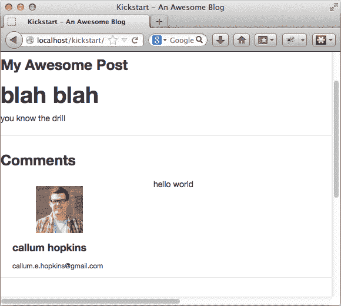

图 5.5。我们的博客，现在有评论了！

回到我们的代码，在模板的底部，我们有一个新区域，用户可以在其中输入关于自己的信息，并提交评论以附并显示在博客文章上。

要定位你的 `php.ini` 文件，请使用 `phpinfo()` 函数来发现它的位置。需要快速回顾一下？我们之前 第 1 章 中介绍过这一点。

一旦你找到了正确的文件，用你的文本编辑器打开它，你将看到大量的配置选项。下面将讨论的其中几项将帮助提高应用程序的安全性。

### allow_url_include

```
allow_url_include=Off
```

默认情况下，标准的 PHP 安装将 `allow_url_include` 设置为关闭状态，但某些托管提供商可能会开启它，因此检查你的 `php.ini` 文件是非常重要的。

当 `allow_url_include` 关闭时，PHP 只能加载和执行存在于 Web 服务器文件系统上的其他文件。然而，如果你激活了 `allow_url_include`，你就可以通过 URL 包含额外的文件。这看起来是一个有趣且可能实用的功能，但这样做会让你的应用程序面临恶意代码注入攻击的风险。因此，强烈建议保持此选项关闭状态。

### 注意：代码注入

`code injection`（代码注入）是用于描述在未经许可的情况下将外部来源的意外代码放入 PHP 脚本的术语。关于代码注入的更多信息，请参考以下外部资源：

*   [`www.theserverpages.com/articles/webmasters/php/security/Code_Injection_Vulnerabilities_Explained.html`](http://www.theserverpages.com/articles/webmasters/php/security/Code_Injection_Vulnerabilities_Explained.html)
*   [`www.owasp.org/index.php/Code_Injection`](https://www.owasp.org/index.php/Code_Injection)

另一个相关的设置为 `allow_url_fopen`，它也应该被关闭。

### open_basedir

```
open_basedir=/path/to/web/directory
```


与`allow_url_include`一样，`open_basedir`也可以帮助限制脚本在服务器上允许加载的文件。通过`open_basedir`，你可以设置可以从哪个目录加载文件，并确保任何脚本都无法加载该目录之外的文件。

攻击者可能会尝试的一种方法是访问基于 Linux 的 Web 服务器上的`/etc/password`文件，该文件列出了服务器上注册的用户账户。如果你的 PHP 应用程序从`/var/www`运行，你可以将`open_basedir`设置为`"/var/www/"`。一旦设置，`www`目录之外的文件将无法包含在你的脚本中，从而阻止攻击者的行动。当你的应用程序上线时启用此选项，可以为你的服务器增加额外的安全级别。

## 错误管理

在项目的开发阶段，让 PHP 在代码中遇到任何错误或问题时向你提供反馈是有用的。然而，一旦你的应用程序部署，你真的希望这些错误越少越好。开发者会希望向用户隐藏 PHP 错误消息，因为如果看到这些错误，可能会产生一种不可靠的感觉，影响客户的信心。

重要的是，错误信息还可能暴露有关你系统配置的关键信息，黑客可以利用这些信息。PHP 的默认错误消息可能包含如应用程序的安装路径、数据库连接详情、数据库列名以及其他脚本细节（如类名、对象 ID 和变量名）。

为了确保这些信息对用户不可见，请将`php.ini`中的`display_errors`选项设置为`off`。这告诉 PHP 在运行时发生错误时不要显示错误。这并不意味着 PHP 会忽略错误——而是它不会在浏览器中显示它。

你仍然可以告诉 PHP 将任何错误保存到特定的日志文件中，你作为应用程序开发者可以私下参考该文件。要实现这一点，请将`error_log`选项设置为所需错误日志文件的路径。

开启`log_errors`选项也是一个好主意。这确保了 PHP 将记录错误、保存错误数据，并避免所有在屏幕上渲染错误消息的可能性。

设置这些选项后，PHP 将为你私下创建错误日志，以便在需要时参考。

## 提高 Session 安全性

正如在上一章中讨论的，Session 是临时存储数据（例如用户是否已登录）的手段。我们在博客应用程序中使用了 Session，正如你可能已经注意到的，它们提供了实用的功能。Session 通常只包含少量数据，但任何与获取应用程序访问相关的数据对任何攻击者或黑客来说都可能价值连城。在默认情况下，Session 存储有关你的应用程序用户的信息，并使用 cookie 来帮助 PHP 等编程语言将每个用户与正确的会话信息匹配。遗憾的是，Session 维持了攻击者想要实现的登录状态，这使得 Session 成为黑客最有吸引力的目标之一。

黑客尝试劫持 Session 的一种方法是访问 Session 数据本身。幸运的是，`php.ini`再次出现，并允许我们通过`session.save_path`选项更改 Session 数据存储的位置：

```
session.save_path = /var/lib/php
```

上面的示例是默认设置。如果你更改了位置，它将让黑客迷失方向，因为他们需要弄清楚你将 Session 数据移动到了哪里。

重要的是，当你更改此路径时，要确保你的 Web 服务器可以对新位置进行读写操作。未能做到这一点，你的 PHP 将无法正常使用 Session。

黑客还经常尝试通过被称为[跨站脚本](https://en.wikipedia.org/wiki/Cross-site_scripting)（简称 XSS）的技术来利用你的应用程序和服务器，这允许他们向你的应用程序注入恶意 JavaScript 代码。Session 经常是 XSS 攻击的目标，如果成功，它们可以造成各种破坏，从键盘记录（记录所有按键）到强制显示非法广告。为了帮助防止 XSS 攻击，你可以使用选项：

```
session.cookie_httponly = 1
```

当此选项设置为`1`时（大多数`php.ini`文件的默认值），将限制 JavaScript 访问 PHP 创建的 cookie。如果你不打算让 JavaScript 使用任何 cookie 数据，强烈建议开启此选项，因为这有助于控制从客户端计算机到你的应用程序及其托管服务器的数据。

关于`php.ini`内部选项以及如何让 PHP 更安全的更多信息，请参考以下来源：

*   [`www.sitepoint.com/a-tour-of-php-ini/`](http://www.sitepoint.com/a-tour-of-php-ini/)
*   [`php.net/manual/en/ini.php`](http://php.net/manual/en/ini.php)
*   [`www.madirish.net/?article=229`](http://www.madirish.net/?article=229)

## 验证提交的数据

PHP 应用程序最大的威胁并不是缺乏来自攻击者的保护，而是用户提交的糟糕数据的威胁。用户是故意还是无意提交错误数据通常很难判断，但格式错误的数据会损害你的应用程序。

确保用户知道他们应该提交什么类型的数据是非常重要的。对于你提示的数据类型使用正确的输入元素，并确保标签清楚地指示预期内容。

此外，最佳实践是假设即使用户已经在你的 HTML 表单中交互过具有特定限制的输入字段，他们仍可能提交格式不正确的数据。当数据被发送到你的 PHP 脚本进行处理时，实现某种类型的验证脚本是非常重要的。

有几个 PHP 函数可以用于验证。下面的代码示例旨在检查用户提交的数据，以确保其提供了正确的数据，从而帮助确保其处于应用程序可以直接使用的格式：

```php
<?php

$input = array(); 

// 此处将存储所有过滤后的数据

// 名称为 'number' 的输入字段

// 仅接受数字输入

if (isset($_POST['number']) && is_numeric($_POST['input'])) {

    $input['number'] = $_POST['number'];

}

// 名称为 'date' 的输入字段，接受

// dd/mm/yyyy 格式的日期

if (isset($_POST['date'])) {

    list ($dd, $mm, $yyyy) = explode('/', $input);

    if (checkdate ($mm,$dd,$yyyy)) {

        $input['date'] = $_POST['date'];

    }

}

// 名称为 'content' 的输入字段，接受

// 任意文本

if (isset($_POST['content'])) {

    // 过滤掉字符串中可能任何有害 HTML

    $input['content'] = strip_tags($_POST['content']);

}

// $input 中的值在应用程序中使用是安全的
```

在上面的示例中，我们内部检查了每个传入的表单值，如果它们通过了某些基础验证检查，就会将其放入一个新数组中。失败的项不会被添加到`$input`数组。

`is_numeric()`函数检查字符串的内容，只有当它包含组成数字的字符时，才会返回 true。数字字符串由一个可选的前导符号（`+`或`-`）、任意数量的数字以及可选的小数部分或指数部分组成。

`checkdate()`函数检查给定日期的有效性，只有当参数构成一个有效日期时，才会返回 true。

最后，`strip_tags()`返回一个删除了 HTML 和 PHP 标签的字符串，只留下基础格式的 HTML 标签（例如换行符`<br>`标签）和纯文本。

在完成验证检查后，可以安全地在应用程序的其余部分使用`$input`中的值，并知道它们处于正确的格式。

然而，表单并不是我们需要考虑实现验证的唯一数据类型。在本书构建的博客应用程序中，我们使用了 URL 变量来加载应用程序的新部分并执行特定脚本。URL 变量通常是攻击者的目标，因为它们很容易被利用，并且会对实施适当安全措施的应用程序造成非常严重的损害。

我们已经在应用程序中实现了一些安全验证技术，特别是在使用 URL 变量来决定应该执行何种方法或功能的地方：

```
...

if (!empty($_GET['id']) && is_numeric($_GET['id'])) {

...
```

这个示例取自`admin/posts.php`，显示我们已经有了`is_numeric()`函数，以确保只有当来自 URL 的数据为数字时，应用程序才会继续处理`if`语句内部的方法。它将忽略任何人可能尝试通过 URL 传递的其他值。

## 总结

在本章中，我们对 PHP 安全性进行了简要概述，并查看了一些避免最常见漏洞的基本方法。

PHP 安全是一个巨大的课题，我们在这里只是触及一角。建议每当你编写一个新函数时，想象一下某人将如何能够：

*   非法访问任何受保护的区域
*   破坏、扭曲或更改应用程序正在处理的数据
*   破坏、更改或以任何负面方式影响应用程序的过程和/或功能

在开发过程中，始终值得考虑的是每当需要用户输入时，用户都可能提交错误或格式错误的数据。如果你在开发时记住这些，你将能够保护自己免受应用程序可能遇到的许多初始安全问题。

关于在 PHP 应用程序中实现安全方法、功能和脚本的更多信息，请参考：

*   [`www.sitepoint.com/top-10-php-security-vulnerabilities/`](http://www.sitepoint.com/top-10-php-security-vulnerabilities/)
*   [`www.sitepoint.com/php-security-blunders/`](http://www.sitepoint.com/php-security-blunders/)
*   [`www.php-security.net/`](http://www.php-security.net/)

## 结论

在这本短书中，我们简短地体验了 PHP 开发并创建了一个简单的博客平台。我们讨论过的所有内容都是经过仔细挑选，旨在启发你精进你的 PHP 开发技能。

这本书应该仅被视为你 PHP 开发者之旅的起点。进一步提高 PHP 技能的极佳资源是 SitePoint 的 PHP 频道，[`www.sitepoint.com/php/`](http://www.sitepoint.com/php/)，它为 PHP 开发者提供了丰富的文章。

> 优秀软件的功能是让复杂变得简单。 ― Grady Booch
