# Just Enough R!：机器学习与分析的交互式方法

荣誉教授，计算机科学系

明尼苏达州立大学

由 `codeMantra` 设计

# 前言

我的书名反映了它的目的，即提供足够的 `R` 语言、机器学习算法、统计方法论和分析，让你学习如何使用数据解决复杂问题。我写这本书有两个主要目标：

*   明确如何、为什么以及何时使用机器学习技术
*   提供让你尽可能熟练使用 `R` 所需的内容

这种方法非常直观，可以被称为“先看后做”，因为它：

*   使用简单易懂的示例提供分步说明
*   实现了各种学习算法
*   提供了章节后的练习
*   解释了理论

## 目标读者群

在编写本文时，我关注了四类群体：

*   想要学习 `R` 的**学生**
*   决策科学、计算机科学、信息系统领域的**教育者**，希望教授单元、工作坊或课程
*   需要理解机器学习的**商务人士**
*   希望增加机器学习能力的**应用研究人员**

## 如何使用本书

快速学习的最佳方法是边看边做。我们提供了 `R` 脚本。为了充分利用这本书，你应该首先阅读并完成第 `1` 章到第 `4` 章。这些章节为机器学习奠定了基础。第 `5` 章将花费一些时间，因为它提供了丰富的信息，其中一些具有统计性质。在这里，你将学习线性回归、逻辑回归以及朴素贝斯分类器。你将学习使用训练集和测试集以及交叉验证进行模型评估。一旦学习了第 `5` 章，第 `6` 章到第 `11` 章可以任何顺序学习。唯一的例外是第 `7` 章应该在第 `6` 章之后。第 `12` 章应该最后涵盖，因为它提供了一个案例研究，提供了对整个知识发现过程的洞察。

# 材料

所有用于插图和章节练习的数据集和脚本在文中都有描述。数据集来自包括业务、健康和科学在多个领域。数据集和脚本可以在两个位置下载：

*   CRC 网站：[`www.crcpress.com/9780367439149`](https://www.crcpress.com/9780367439149)
*   [`krypton.mnsu.edu/~sa7379bt/`](https://krypton.mnsu.edu/~sa7379bt/)

如果你在获取这些材料时遇到困难，请邮件给我：`richard.roiger@mnsu.edu` (richard.roiger@mnsu.edu)

# 教师辅助材料

提供辅助材料是为了帮助教师组织讲座和编写考试。

请注意，辅助材料仅供合格的教师使用。联系您的 CRC 销售代表或访问 [`www.crcpress.com/contactus`](https://www.crcpress.com/contactus) 获取帮助以获取这些材料。

# 致谢

我深感谢我的妻子 Suzanne 极大的耐心和一如既往的支持。

# 作者

Richard J. Roiger 是明尼苏达州立大学曼卡托分校的荣誉教授，他在计算机与信息科学系教学并从事研究了 30 多年。Roiger 博士在明尼苏达大学获得计算机与信息科学博士学位。他发表了许多会议论文，并撰写了若干关于机器学习和知识发现主题的期刊文章。退休后，Roiger 博士继续担任兼职教员，教授机器学习、人工智能和研究方法的课程。他还是明尼苏达州退休教育协会的董事，并担任财务顾问。他喜欢与孙辈们互动、旅行、写作以及追求自己的音乐天赋。

# 第 1 章

## 机器学习导论

## 本章内容

* 定义与术语
* 机器学习策略
* 评估技术
* 伦理问题

R 语言继续保持其作为机器学习、数据科学、数据分析、数据挖掘和统计分析领域顶级解决方案工具之一的地位。这显而易见：R 是免费的，包含了成千上万个包，拥有不断增长的用户社区支持，而且在 `RStudio` 集成开发环境界面中使用时非常易用！

R 的流行促使了数千个关于机器学习的教程出现。信息无所不在！遗憾的是，很容易在海量信息的迷宫中迷失。人们花费宝贵的时间试图寻找解决问题所需的确切信息。结果就是沮丧，并且难以理解哪些是重要的。

我们相信，我们通过展示和清晰解释基于脚本的解决问题的方法，为你提供了使用 R 进行机器学习所需的工具。书的标题反映了其目的。《恰好足够的 R！》（Just Enough R!）为你提供恰好的 R 语言和机器学习方法，以最大限度地减少障碍并穿过迷宫。我们的目标是让你尽可能快地能够高效地使用 R。

在本章中，我们将对机器学习进行简要介绍。在第 2 章中，我们将直接进入 R 语言的核心内容及其提供的解决问题技术。我们以一个简短的总结、关键术语定义和一组练习结束本章。让我们开始吧！

## 1.1 机器学习、统计分析与数据科学

在浏览网页、阅读报纸或打开电视时，几乎不可能接触到机器学习、统计分析、数据科学、数据分析和数据挖掘等术语。大多数人对这些术语的意思大致了解，但如果你要求对其中任何一个给出精确定义，你会得到各种答案。以下是几点区别：

* 构建模型以发现数据中的结构植根于数学和统计学领域。统计方法与其他技术的区别在于，它们对数据的性质做出了某些假设。从技术上说，如果违背了这些假设，用这些技术构建的模型可能是不准确的。
* 机器学习与统计建模的区别在于，它不将关于数据分布和变量独立性的假设视为考虑问题。
* 数据科学或数据分析通常被定义为利用计算机科学、统计学和数学从数据中提取有意义信息的过程。
* 数据挖掘经常被用作发现大型数据集中模式和异常的过程。
* “知识发现”（KDD）这一短语产生于 1989 年，旨在强调知识可以从数据中得出。

尽管存在这些区别，但最重要的一点是机器学习是为了解决问题设计的。

## 1.2 机器学习：第一个示例

监督学习可能是机器学习中最好且应用最广泛的技术。监督学习的目的有两个：首先，我们使用监督学习从包含示例和非示例的数据集中构建分类模型。每个示例或非示例被称为数据的一个实例（`instance`）。其次，一旦构建了分类模型，它就被用于对新提出的实例进行分类。值得注意的是，虽然模型创建是归纳性的，但将模型应用于未知来源的新实例则是一个演绎过程。

### 1.2.1 属性-值格式

为了更清楚地说明监督学习的概念，请考虑表 1.1 所示的假设数据集。该数据集非常小，仅用于演示。该表以属性-值格式显示，第一行显示了表中包含的属性名称。喉痛、发烧、淋巴结肿大、鼻塞和头痛是患有特定疾病（链球菌炎、感冒或过敏）的人可能经历的症状。这些属性被称为输入属性，用于创建一个表示数据的模型。诊断（Diagnosis）是我们想要预测的属性。诊断被称为类（`class`）、响应（`response`）或输出属性。

**表 1.1 疾病诊断的假设训练数据**

| 患者 ID# | 喉痛 | 发热 | 淋巴结肿大 | 鼻塞 | 头痛 | 诊断 |
| :--- | :--- | :--- | :--- | :--- | :--- | :--- |
| 1 | 是 | 是 | 是 | 是 | 是 | 链球菌炎 |
| 2 | 否 | 否 | 否 | 是 | 是 | 过敏 |
| 3 | 是 | 是 | 否 | 是 | 否 | 感冒 |
| 4 | 是 | 否 | 是 | 否 | 否 | 链球菌炎 |
| 5 | 否 | 是 | 否 | 是 | 否 | 感冒 |
| 6 | 否 | 否 | 否 | 是 | 否 | 过敏 |
| 7 | 否 | 否 | 是 | 否 | 否 | 链球菌炎 |
| 8 | 是 | 否 | 否 | 是 | 是 | 过敏 |
| 9 | 否 | 是 | 否 | 是 | 是 | 感冒 |
| 10 | 是 | 是 | 否 | 是 | 是 | 感冒 |

从表格的第二行开始，剩下的每一行都是数据的一个 `instance`（实例）。每一行显示单个患者的症状和病症。例如，`ID` = `1` 的患者有喉痛、发烧、淋巴结肿大、鼻塞和头痛。该患者被诊断为链球菌性喉炎。

假设我们希望开发一个泛化模型来表示表 1.1 所示的数据。尽管这个数据集很小，但除非我们了解各个属性的相对重要性以及属性之间可能的关系，否则很难开发出一种通用的表示方法。幸运的是，合适的监督学习算法可以帮我们完成这项工作。

### 1.2.2 用于诊断疾病的决策树

我们将表 1.1 中的数据提供给了 `C4.5` (Quinlan, 1993)，这是一种监督学习程序，它通过构建决策树来对一组输入实例进行泛化。`decision tree`（决策树）是一种简单的结构，其中非终止节点表示对一个或多个属性的测试，终止节点反映决策结果。决策树有几个优点，即它们易于我们理解，可以转换为规则，并且在实验中证明效果良好。创建决策树的监督算法详见第 6 章。

图 1.1 显示了根据表 1.1 中的数据创建的决策树。该决策树对表格数据进行了泛化。具体来说：

*   如果患者有淋巴结肿大，则疾病诊断为链球菌性喉炎。
*   如果患者没有淋巴结肿大且发烧，则诊断为感冒。
*   如果患者没有淋巴结肿大且没有发烧，则诊断为过敏。

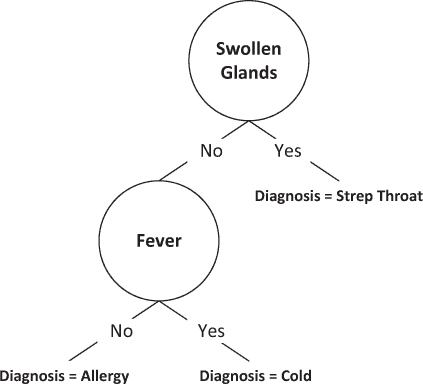

FIGURE 1.1   针对表 1.1 数据的决策树。

决策树告诉我们，只需要关注患者是否患淋巴结肿大和发烧，就可以准确地诊断数据集中的患者。喉痛、鼻塞和头痛这些属性在确定诊断中并不起作用。如你所见，决策树对数据进行了泛化，并为我们提供了对准确诊断至重要的属性和属性关系的总结。

让我们使用决策树来对表 1.2 中显示的前两个实例进行分类。

**表 1.2   未知分类的数据实例**

| 患者 ID | 喉痛 | 发烧 | 淋巴结肿大 | 鼻塞 | 头痛 | 诊断 |
| :--- | :--- | :--- | :--- | :--- | :--- | :--- |
| 11 | 否 | 否 | 是 | 是 | 是 | ? |
| 12 | 是 | 是 | 否 | 否 | 是 | ? |
| 13 | 否 | 否 | 否 | 否 | 是 | ? |

*   因为 `ID` = `11` 的患者 `swollen glands` 值为 `Yes`，所以我们遵循决策树根节点的右侧链接。右侧链接指向一个终止节点，表示该患者患有链球菌性喉炎。
*   `ID` = `12` 的患者 `swollen glands` 值为 `No`。我们遵循左侧链接并检查属性 `fever` 的值。由于 `fever` 等于 `Yes`，我们将其诊断为感冒。

创建决策树的监督算法遵循以下规则：

*   IF `antecedent conditions`（前提条件）
*   THEN `consequent conditions`（结论条件）

前提条件指定了一个或多个输入属性的值或范围。结论条件是输出属性的值或范围。决策树通过从根节点开始沿着路径到达叶节点来创建规则。规则的前提是路径上的属性值组合。规则的结果是叶节点的值。这里是图 1.1 所示决策树的三个规则：

1.  IF `Swollen Glands` = 是
    *   THEN `Diagnosis` = 链球菌性喉炎
2.  IF `Swollen Glands` = 否 & `Fever` = 是
    *   THEN `Diagnosis` = 感冒
3.  IF `Swollen Glands` = 否 & `Fever` = 否
    *   THEN `Diagnosis` = 过敏

让我们使用规则来分类实例 `13`。因为 `swollen glands` 为 `否`，我们跳过第一条规则。同样，因为 `fever` 为 `否`，第二条规则不适用。最后，第三条规则的所有前提条件都满足了。因此，我们应用第三条规则并诊断患者为过敏。

用于创建决策树模型的实例被称为 `training data`（训练数据）。目前这些是已知的实例。

## 1.3 机器学习策略

机器学习 `strategies`（策略）可以大致分为监督或无监督。监督学习通过使用输入属性来预测输出值。许多监督学习算法允许单个输出属性。其他的监督学习工具允许我们指定一个或多个输出属性。输出属性也被称为 `dependent variables`（因变量），因为它们的结果取决于一个或多个输入属性。当进行无监督学习时，不存在输出属性。因此，所有用于建模的属性都是自变量。

监督学习策略可以根据输出属性是离散的还是类别的，以及模型设计用于确定当前状况还是预测未来结果进一步分类。在本节中，我们将检查三种监督学习策略，详细查看无监督聚类，并介绍一种发现目录和商店销售商品之间关联的策略。图 1.2 显示了我们以后讨论的五种机器学习策略。

### 1.3.1 分类

`Classification`（分类）可能是所有策略中理解最好的。分类任务有三个共同特征：

*   学习是监督的。
*   因变量是类别的。
*   重点是构建能够将新实例分配到一组良定义的类之一的模型。

一些分类任务示例包括：

*   确定区分发生过心脏病发作的人与未发生过发作的人的特征。
*   建立一个“成功”人士的画像。
*   确定信用卡购买是否为欺诈。
*   将汽车贷款申请人分类为高信用风险或低信用风险。
*   确定所得税申报表是否经过伪造。

注意，每个示例处理的都是当前行为而非未来行为。例如，我们希望汽车贷款申请模型能够判断申请人在*此时*是否为良好的信用风险，而不是在未来的某个时段。预测模型旨在回答关于未来行为的问题。预测模型将在本节稍后讨论。

### 1.3.2 估计 (Estimation)

与分类类似，`estimation` 模型的目的是为未知的输出属性确定一个值。然而，与分类不同，估计问题的输出属性是数值型的，而不是分类的。以下是估计任务的三个示例：

*   估算雷暴到达给定地点前的分钟数。
*   估算广告活动的投资回报率。
*   估计信用卡被盗的概率。

大多数监督学习技术都能解决分类或估计问题，但不能两者兼顾。如果我们的学习工具支持一种策略而不支持另一种，通常可以通过调整问题来使用其中一种策略进行解决。为了说明这一点，假设上述信用卡被盗示例中原始训练数据的输出属性是 0 到 1 之间的数值，其中 `1` 代表信用卡被盗的最可能情况。我们可以通过替换输出属性值创建离散类别：将 `0.0` 到 `0.3` 之间的分数替换为 `unlikely`（不太可能），`0.3` 到 `0.7` 之间的分数替换为 `likely`（可能），将大于 `0.7` 的分数替换为 `highly likely`（极有可能）。在这种情况下，数值与离散类别之间的转换是简单的。尝试将货币金额离散化等情况更具挑战性。

### 1.3.3 预测 (Prediction)

区分预测与分类或估计容易。然而，与分类或估计模型不同，预测模型的目的是确定未来的结果而非当前行为。预测模型的输出属性可以是分类的，也可以是数值的。以下是适用于预测数据挖掘的任务示例：

*   预测国家橄榄球联盟（NFL）跑卫在本 NFL 赛季中得分的达阵总数。
*   确定信用卡客户是否可能利用其信用卡账单提供的特殊优惠。
*   预测道琼斯工业平均指数下周的收盘价。
*   预测哪些手机用户可能在未来 3 个月内更换运营商。

大多数适用于分类或估计问题的监督机器学习技术也可以构建预测模型。实际上，是数据本身的性质决定了模型适用于分类、估计还是预测。为了说明这一点，让我们考虑一个包含 303 个实例的真实医学数据集。其中 165 个实例包含未患心脏病患者的信息。其余的 138 个实例包含已知心脏病患者的数据。

与该数据集相关的属性和可能的属性值如表 1.3 所示。该数据集有两种形式：一个数据集由所有数值属性组成；另一个数据集对原始 7 个数值属性进行了分类转换。标记为 `Mixed Values` 的表列显示未转换为分类等价值的属性为 `Numeric`。例如，`Age`（年龄）属性在两个数据集中是相同的。然而，`Fasting Blood Sugar < 120` 属性在转换后的集中具有 `True` 或 `False` 值，而在原始数据中具有 `0` 和 `1` 值。

#### 表 1.3 心脏病患者数据

| 属性名称 | Mixed Values | Numeric Values | 注释 |
| :--- | :--- | :--- | :--- |
| Age | Numeric | Numeric | 年龄（岁） |
| Gender | Male, Female | 1, 0 | 患者性别 |
| Chest pain type | Angina, Abnormal Angina, NoTang, Asymptomatic | 1–4 | NoTang = 非心绞痛 |
| Blood pressure | Numeric | Numeric | 入院时的静息血压 |
| Cholesterol | Numeric | Numeric | 血胆固醇 |
| Fasting blood sugar < 120 | True, False | 1, 0 | 空腹血糖是否小于 120？ |
| Resting CG | Normal, Abnormal, Hyp | 0, 1, 2 | Hyp = 左心室肥大 |
| Maximum heart rate | Numeric | Numeric | 达到的心率 |
| Induced angina? | True, False | 1, 0 | 患者是否因运动引起心绞痛？ |
| Old peak | Numeric | Numeric | 相较于静息，运动引起的 ST 段下 |
| Slope | Up, Flat, Down | 1–3 | 运动高峰 ST 段的斜率 |
| Number of Colored Vessels | 0, 1, 2, 3 | 0, 1, 2, 3 | 荧光造影标记血管血管 |
| Thal | Normal fix, rev | 3, 6, 7 | 正常、固定性缺、可逆性缺 |
| Concept class | Healthy, Sick | 1, 0 | 血管造影状态 |


表 1.4 列出了数据集混合形式的四个实例。其中两个实例代表了每个类别的典型示例。另外两个实例是非典型成员。典型健康者与典型患者之间的某些差异是可以预见的，例如 `Resting ECG`（静息心图）和 `Induced angina`（诱发心绞痛）。惊讶的是，我们并没有在最典型和最不典型个体之间的胆固醇和血压上看到预期的差异。

#### 表 1.4 心脏病领域的典型与非典型实例

| 属性名称 | 典型健康类 | 非典型健康类 | 典型患病类 | 非典型患病类 |
| :--- | :--- | :--- | :--- | :--- |
| Age | 52 | 63 | 60 | 62 |
| Gender | Male | Male | Male | Female |
| Chest pain type | NoTang | Angina | Asymptomatic | Asymptomatic |
| Blood pressure | 138 | 145 | 125 | 160 |
| Cholesterol | 223 | 233 | 258 | 164 |
| Fasting blood sugar < 120 | False | True | False | False |
| Resting ECG | Normal | Hyp | Hyp | Hyp |
| Maximum heart rate | 169 | 150 | 141 | 145 |
| Induced angina? | False | False | True | False |
| Old peak | 0 | 2.3 | 2.8 | 6.2 |
| Slope | Up | Down | Flat | Down |
| Number of colored vessels | 0 | 0 | 1 | 3 |
| Thal | Normal | Fix | Rev | Rev |

以下是该数据集生成的两条规则。`Class` 被指定为输出属性：

*   IF `Maximum Heart Rate >= 158.333`
    THEN `Class = Healthy`
    *   规则精确率：75.60%
    *   规则覆盖率：40.60%

*   IF `Thal = Rev`
    THEN `Class = Sick`
    *   规则精确率：76.30%
    *   规则覆盖率：38.90%

让我们考虑第一条规则。规则覆盖率（Rule coverage）告诉我们满足规则前提条件的数据实例百分比。规则覆盖率显示，在数据集代表的 303 个人中，有 40.6% 或 123 名患者的最大心率大于 158.333。规则精确率（Rule precision）告诉我们，在 123 个最大心率 ≥ 158.333 的个人中，有 75.6% 或 93 人是健康患者。这意味着如果数据集中的某个患者最大心率大于 158.333，那么我们在识别该患者为健康状态时，每 100 次会有 75 次以上是正确的。我们将这一知识与表 1.4 所示的最大心率值相结合，就可以得出结论：健康患者可能具有更高的最大心率值。

这条第一规则适用于分类还是预测？如果该规则具有预测性，我们可以用以下陈述来警示健康人士：

如果该规则适用于分类但不适用于预测，则场景如下：

在任何情况下，我们都不能暗示更强的陈述：

也就是说，通过机器学习，我们可以陈述属性之间的关系，但无法说这些关系是否意味着因果关系。因此，进行一项旨在增加最大心率的锻炼计划可能是一个好主意，也可能不是。

问题仍然在于，前两个警告中是否有一个是。这个问题并不容易回答。专家可以开发模型来生成类似于上面的规则。除此之外，专家在确定如何使用发现的知识之前，必须获得额外信息——在这种情况下，是医学专家。

### 1.3.4 无监督聚类

通过无监督聚类（第 11 章），我们没有因变量来引导学习过程。相反，学习程序通过使用某种聚类质量衡量标准将实例分为两或多类，从而构建知识结构。无监督聚类策略的一个主要目标是发现数据中的概念结构。无监督聚类的常见用途包括：

*   检测股票交易活动、保险理赔或金融交易中的欺诈
*   在代表太阳系外的伽马射线暴数据中，确定是否能以概念形式发现有意义的关系
*   为构建监督模型确定最佳输入属性集，以识别可能流失的手机客户

将无监督聚类作为监督学习的评估工具并不罕见。为了说明这一观点，让我们假设我们已经使用具有输出属性 `Class` 的心脏病患者数据构建了一个监督模型。为了评估该监督模型，我们将训练实例提交给无监督聚类系统。属性 `Class` 被标记为未使用。接下来，我们检查无监督模型的输出，以确定来自每个概念类（`Healthy` 健康和 `Sick` 患病）的实例是否自然地聚集在一起。如果各个类别的实例没有聚集在一起，我们可能认为这些属性无法区分健康患者和患有心脏疾病的患者。在这种情况下，监督模型的性能可能很差。一种解决方案是通过反复应用备用属性的无监督聚类，为监督学习器模型选择一组最佳属性。通过这种方式，可以识别出最能区分健康患者和患心脏疾病患者的属性。

无监督聚类还可以识别离群值——即与任何其他实例无法良好聚集的实例。

### 1.3.5 购物篮分析

`market basket analysis`（购物篮分析）的目的是寻找产品之间有趣的的关系。`market basket analysis` 的结果帮助零售商设计促销和安排商品。关联规则在第 7 章中详细介绍。

## 1.4 性能评估

性能评估可能是所有步骤中最关键的。在本节中，我们关注监督和无监督模型。作为一个起点，我们提出了三个通用问题：

1.  机器学习带来的收益是否能更多抵消成本？
2.  我们如何解释结果？
3.  我们能放心地使用结果吗？

第一个问题需要关于数据状态的知识。因此，我们将转向监督模型。

### 1.4.1 评估监督模型

监督模型旨在分类、估计或预测未来结果。对于某些应用，目标是构建显示出持续高准确性的模型。以下三个应用专注于分类：

*   开发一个用于接受或拒绝信用卡模型
*   开发一个用于接受或拒绝抵押贷款申请的模型
*   开发一个决定是否钻孔的模型

分类正确性最好通过以测试集的形式向模型呈现不可见数据来计算。测试集准确率可以在名为 `confusion matrix`（混淆矩阵）的表中汇总。为了说明，假设有三个类：`C[1]`、`C[2]` 和 `C[3]`。三类的通用混淆矩阵所示表 1.5。

#### 表 1.5：三类混淆矩阵

| 计算的决策 | *C[1]* | *C[2]* | *C[3]* |
| :--- | :--- | :--- | :--- |
| ***C[1]*** | *C[11]* | *C[12]* | *C[13]* |
| ***C[2]*** | *C[21]* | *C[22]* | *C[23]* |
| ***C[3]*** | *C[31]* | *C[32]* | *C[33]* |

对角线上的值给出每个类的正确分类总数。例如，`C[11]` 的值为 15 表示有 15 个 `C[1]` 类测试集实例被模型正确分类。主对角线以外的值代表分类错误。为了说明，假设 `C[12]` 的值为 4。这意味着有四个 `C[1]` 类实例被错误地归类为 `C[2]`。以下四个观察对于分析混淆矩阵中的信息可能有帮助：

1.  对于给定的单元格 `C[i j]`，下标 `i` 代表实际类别，`j` 表示计算类别。
2.  主对角线上的值代表正确分类。对于表 1.5 中的矩阵，值 `C[11]` 代表被模型正确分类的 `C[1]` 类实例的总数。
3.  行 `C[i]` 中的值代表属于类别 `C[i]` 的实例。例如，当 `i` = 2 时，与单元格 `C[21]`、`C[22]` 和 `C[23]` 关联的实例实际上都是 `C[2]` 的成员。要找到被错误分类为其他类别成员的 `C[2]` 实例总数，我们需要计算 `C[21]` 和 `C[23]` 之和。
4.  列 `C[i]` 中的值表示被分类为 `C[i]` 成员的实例。当 `i` = 2 时，与单元格 `C[12]`、`C[22]` 和 `C[32]` 关联的实例已被分类为类别 `C[2]` 的成员。要找到被错误分类为类别 `C[2]` 成员的实例总数，我们需要计算 `C[12]` 和 `C[32]` 之和。

我们可以使用混淆矩阵显示的汇总数据来计算模型准确率。要确定模型的准确率，我们将主对角线上的值求和，并将该和除以测试集实例的总数。例如，如果我们将一个模型应用于包含 100 个实例的测试集，且结果混淆矩阵主对角线上的值之和为 70，则该模型的测试集准确率为 0.70 或 70%。由于模型准确率通常以错误率给出，我们可以通过从 1.0 减去模型准确率值来计算模型错误率。对于我们的示例，相应的错误率为 0.30。

### 1.4.2 二分类错误分析

本节开头列出的三个应用代表了二分类问题。例如，信用卡申请要么被接受要么被拒绝。我们可以使用简单的二分类混淆矩阵来帮助分析这些应用中的每一个。

考虑表 1.6 所示的混淆矩阵。显示 `True Accept`（真接受）和 `True Reject`（真拒绝）的单元格代表分类正确的测试集实例。对于上一节介绍的前两个应用，`False Accept`（假接受）单元格表示本应被拒绝但被接受的申请人。`False Reject`（假拒绝）单元格表示本应被接受但被拒绝的申请人。第三个应用也可以进行类似的类比。让我们使用表 1.7 所示的混淆矩阵来详细检查第一个应用。

#### 表 1.6 简单的混淆矩阵

| | 计算接受 | 计算拒绝 |
| --- | --- | --- |
| 接受 | True Accept | False Reject |
| 拒绝 | False Accept | True Reject |

#### 表 1.7 两个混淆矩阵，每个均显示 10% 的错误率

| 模型 A | 计算接受 | 计算拒绝 | 模型 B | 计算接受 | 计算拒绝 |
| --- | --- | --- | --- | --- | --- |
| 接受 | 600 | 25 | 接受 | 600 | 75 |
| 拒绝 | 75 | 300 | 拒绝 | 25 | 300 |

假设表 1.7 所示的混淆矩阵代表了为信用卡申请问题构建的两个监督学习器模型的测试集错误率。混淆矩阵显示每个模型的错误率均为 10%。由于错误率相同，哪一个模型更好呢？为了回答这个问题，我们必须将信用卡支付违约的平均成本，与拒绝那些具有良好审批意向的个人所造成的平均潜在利润损失进行比较。考虑到信用卡购买是无抵押的，接受可能违约的信用卡客户的成本更令人关注。在这种情况下，我们应该选择模型 B，因为混淆矩阵告诉我们，该模型不太可能向可能违约的个人错误地提供信用卡。同样的推理适用于房贷申请吗？对于决定是否要钻油的应用呢？如你所见，虽然测试集错误率是模型评估的一个有用指标，但还必须考虑其他因素，例如误包含所产生的成本以及误遗漏导致的损失。

### 1.4.3 评估数值输出

混淆矩阵对于评估提供数值输出的监督模型作用不大。此外，对于数值输出模型，分类正确性的概念具有了新的意义，因为实例无法被直接归类为几种可能的输出类别之一。然而，对于具有数值输出的监督模型，已经定义了一些实用的模型准确率衡量标准。最常见的数值准确率衡量标准是平均绝对误差和均方误差。

一组测试数据的 `mean absolute error`（`mae`）是通过找到计算值与期望结果值之间的平均绝对差得到的。同样，`mean squared error`（均方误差）是计算结果与期望结果之间平方差的平均值。最后，`root mean squared error`（`rms`）只是均方误差值的平方根。`rms` 经常作为前馈神经网络测试集准确率的指标。显然，为了获得最佳的测试集准确率，我们希望每个指标的值越小越好。你将在第 9 章学习更多关于这些数值准确率指标的优缺点。

### 1.4.4 通过衡量提升率（Lift）比较模型

关注大众邮寄响应率的市场应用并不关注测试集的分类错误，而更感兴趣于构建能够从大群体中提取偏态样本（bias samples）的模型。偏态样本的响应率高于普通人群的率。用于从普通人群中提取偏态样本的监督模型通常由一种直接来自营销领域的指标——`lift`（提升率）进行评估。一个示例说明了这一观点。

假设 Acme 信用卡公司准备在下个月的信用卡账单中推出新的优惠。公司确定，通常情况下，大约有 100,000 名信用卡持有者的余额为零。公司还确定，平均有 1% 的持卡者会利用账单中的优惠活动。根据这些信息，100,000 名零余额持卡中有大约 1000 人可能会接受新的优惠。由于零余额持卡者不需要每月账单，问题在于向恰好那些会接受新优惠的客户发送零余额账单。

图 1.3 为信用卡推广问题提供了图形化表示。该图有时被称为 `lift chart`（提升图）。横轴显示了总人口中抽样的百分比，纵轴代表可能响应者的数量。该图展示了模型性能随样本大小变化的函数关系。直线代表总体人口。这条线告诉我们，如果我们随机选择 20% 的人口进行邮寄，我们可以预计在 1000 个可能响应者中会有 200 人给出响应。同样，选择 100% 的人口将带给我们所有的响应者。曲线则显示了使用不同样本大小的模型所实现的提升（lift）。通过观察图表，你可以看到理想模型将在最小样本量下显示出最大的提升。这在图 1.3 中表现为图的左上部分。虽然图 1.3 很有用，但混淆矩阵也为我们解释了如何引入提升来解决问题。

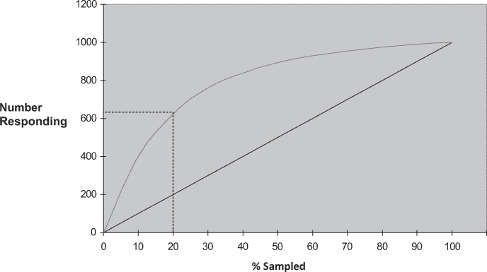

图 1.3 定向邮寄与大众邮寄。

表 1.8 展示了两个混淆矩阵，帮助我们从提升的角度理解信用卡推广问题。显示 `No Model`（无模型）的混淆矩阵告诉我们，所有零余额客户都收到了带有优惠信息的账单。根据定义，这种场景下的提升为 `1.0`，因为样本和总体是完全相同的。显示 `Ideal Model`（理想模型）的矩阵提升为 `100`（`100%/1%`），因为偏态样本仅包含正例。

#### 表 1.8 两个混淆矩阵：无模型和理想模型

| 无模型 | | 计算接受 | | 计算拒绝 | 理想模型 | | 计算接受 | | 计算拒绝 |
| --- | --- | --- | --- | --- | --- | --- | --- | --- | --- |
| 接受 | | 1,000 | | 0 | 接受 | | 1,000 | | 0 |
| 拒绝 | | 99,000 | | 0 | 拒绝 | | 0 | | 99,000 |

考虑表 1.9 中所示两个模型的混淆矩阵。`model X` 的提升计算为：

```
Lift(model X) = (540/24000) / (1000/100000)
```

#### 表 1.9 两个提升等于 2.25 的备选模型混淆矩阵

| 无模型 | | 计算接受 | | 计算拒绝 | 理想模型 | | 计算接受 | | 计算拒绝 |
| --- | --- | --- | --- | --- | --- | --- | --- | --- | --- |
| 接受 | | 540 | | 460 | 接受 | | 450 | | 550 |
| 拒绝 | | 23,460 | | 75,540 | 拒绝 | | 19,550 | | 79,450 |

计算结果为 `2.25`。`model Y` 的提升计算为：

```
Lift(model Y) = (450/20000) / (1000/100000)
```

计算结果也是 `2.25`。与上一个例子一样，为了回答哪个模型更好的问题，我们需要关于假负性和假阳性选择的相对成本的额外信息。对于我们的示例，如果邮寄费的节省（减少 4000 份邮寄）超过了由于销售减少导致的利润损失（减少 90 笔销售），则 `model Y` 是更好的选择。

由机器学习算法创建的模型是对数据的概念性泛化。常见的泛化形式有树、网络、一个或多个方程或一组规则。在监督学习中，机器学习工具使用已知分类结果的实例来构建一个表示该数据的通用模型。然后，使用所创建的模型来确定新的、此前未分类的实例的分类情况。在无监督聚类中，并不存在预定义的概念。相反，数据实例根据由聚类模型定义的相似性方案被分组在一起。

在接下来的章节中，你将学习更多关于机器学习过程步骤的知识。你将学习到不同的机器学习算法，以及帮助你判断何时将机器学习应用于你的问题的若干技术。我们希望在整本书中传达的一个共同主题是：机器学习关于模型构建的，而不是魔法。人类本性要求我们对周围的世界进行泛化和分类。因此，模型构建是一个自然的过程，而且可以是很有趣且非常有成就感的！

## 1.7 关键术语

*   **属性-值格式（Attribute-value format）**。一种表格格式，表格的第一行包含属性名称。表格第一行之后的每行都包含一个数据实例，其属性值在表格的列中给出。
*   **分类（Classification）**。一种监督学习策略，其中输出属性是类别的。重点在于构建能够将新实例分配到一组定义良好的类中的一个的模型。


- **混淆矩阵（Confusion matrix）**。一种用于总结监督分类结果的矩阵。沿主对角线的条目代表正确分类的总数。主对角线外的条目代表分类错误。

- **数据仓库（Data warehouse）**。一种为决策支持而非事务处理设计的历史数据库。

- **决策树（Decision tree）**。一种树结构，其中非终端节点表示对一个或多个属性的测试，终端节点反映决策结果。

- **因变量（Dependent variable）**。其值由一个或多个自变量决定的变量。

- **估计（Estimation）**。一种监督学习策略，其中输出属性是数值型的。重点在于确定当前而非未来的结果。

- **自变量（Independent variable）**。用于构建监督或无监督学习器模型的输入属性。

- **输入属性（Input attribute）**。机器学习算法用于帮助创建数据模型的属性。输入属性有时被称为自变量。

- **实例（Instance）**。概念的正例或反例。

- **提升度（Lift）**。给定从群体 `P` 中取样本的情况下类别 `C[i]` 的概率除以在整个群体 `P` 中给定 `C[i]` 的概率。

- **提升图（Lift chart）**。一种显示机器学习模型性能随样本量变化的函数图表。

- **购物篮子分析（Market basket analysis）**。一种试图发现零售产品之间有趣关系的机器学习策略。

- **平均绝对误差（Mean absolute error）**。对于一组训练集或测试集实例，平均绝对误差是分类器预测输出与实际输出之间绝对差的平均值。

- **均方误差（Mean squared error）**。对于一组训练集或测试集实例，均方误差是分类器预测输出与实际输出之间平方差和的平均值。

- **离群值（Outlier）**。一种异常的数据实例。

- **输出属性（Output attribute）**。对于监督学习，要预测输出的属性。

- **预测（Prediction）**。一种旨在确定未来结果的监督学习策略。

- **产生规则（Production rule）**。一种形式的规则：如果 前提条件 然后 后条件。

- **均方根误差（Root mean squared error）**。均方误差的平方根。

- **规则覆盖率（Rule coverage）**。给定规则 `R`，规则覆盖率是满足 `R` 前提条件的所有实例的百分比。

- **规则精确率（Rule precision）**。对于规则 `R`，被 `R` 前提条件覆盖且也被 `R` 后条件覆盖的实例百分比。规则精确率和规则准确率通常被认为是互换。

- **监督学习（Supervised learning）**。使用已知来源的数据实例构建的分类模型。一旦构建完成，模型就能确定未知来源实例的分类。

- **测试集（Test set）**。用于测试监督学习模型的数据实例。

- **训练数据（Training data）**。用于创建监督学习模型的数据实例。

- **无监督聚类（Unsupervised clustering）**。机器学习模型使用一种衡量将实例放入同一簇中程度的评估函数进行构建。数据实例根据聚类模型定义的相似性方案被分组在一起。

# 练习

## 复习题

1. 区分以下术语：

    1. 训练数据和测试数据

    2. 输入属性和输出属性

    3. 监督学习和无监督聚类

2. 对于以下每个问题场景，判断解决方案最适合通过监督学习、无监督聚类还是数据库查询来解决。根据情况，说明你想测试的任何初始假设。如果你认为监督学习或无监督聚类是最佳答案，列出两个或多个你认为与解决问题相关的输入属性。

    1. 哪些特征可以区分做过背部手术并已上班的人与做过背部手术但未上班的人？

    2. 一家大型汽车制造商对其最畅销车型之一发起了轮胎召回。该汽车公司将其最畅销车型异常高的事故率归咎于轮胎。轮胎制造商声称，只有当他们的轮胎安装在问题车辆上时才会出现高事故率。谁应该负责？

    3. 一家可调节床公司想要开发一个模型，帮助购买其一种床的新客户客户确定合适的设置。

    4. 你想为一个奇幻足球队建立一个模型，帮助决定在特定周上上哪位跑卫。

    5. 当客户访问我的网站时，他们最可能一起买哪些产品？

    6. 我有多少百分比的员工每月缺勤一天或以上。

    7. 我在个人的身高、体重、年龄和喜欢的观赛运动之间可以找到什么关系？

3. 列出至少五个可能与判断个人所得税申报是否欺诈相关的属性。

4. 访问网站 `https://en.wikipedia.org/wiki/Examples_of_data_mining` 并总结五个机器学习的应用。

5. 访问网站 `www.kdnuggets.com`。

    1. 总结一两篇关于机器学习如何解决实际问题的文章。

    2. 点击 `Datasets` 链接并浏览 UCI KDD 仓库寻找有趣数据集。描述你感兴趣的两个数据集的属性。

6. 在网上查找一个提供前十大机器学习算法的参考文献。提供这些算法的列表以及参考文献。

7. 当你尝试在不使用 `Table1.1` 中的属性的情况下构建决策树时会发生什么？

## 计算题

1. 考虑以下三类混淆矩阵。该矩阵显示了一个监督模型的分类结果，该模型利用之前的投票记录来确定美国参议员的政党派别（共和党、民主党或独立人士）。

| | 共和党 | 民主党 | 独立人士 |
| --- | --- | --- | --- |
| 共和党 | 42 | 2 | 1 |
| 民主党 | 5 | 40 | 3 |
| 独立人士 | 0 | 3 | 4 |

    1. 正确分类的实例百分比是多少？

    2. 根据混淆矩阵，参议院中有多少民主党人？有多少共和党人？有多少个独立人士？

    3. 有多少共和党人被归类为民主党？

    4. 有多少独立人士被归类为共和党人？

2. 假设我们有两个类别，每个类别包含 100 个实例。其中一个类别的实例包含目前拥有信用卡保险的人的信息。第二个类别的实例包含至少有一张信用卡但没有信用卡保险的人的信息。使用以下规则回答下面的问题：

    `IF Life Insurance = Yes & Income > $50K THEN Credit Card Insurance = Yes`

    *   规则精确率 (Rule Precision) = 80%
    *   规则覆盖率 (Rule Coverage) = 40%

    1. 在信用卡保险持有者类别的实例中，有多少人拥有寿险且年收入超过 50,000 美元？

    2. 代表没有信用卡保险的人的实例中，有多少人拥有寿险且年收入超过 50,000 美元？

3. 考虑下面的混淆矩阵。

    1. 计算模型 X 的提升度 (lift)。

    2. 计算模型 Y 的提升度 (lift)。

| 模型 X | 计算接受 | 计算拒绝 | 模型 Y | 计算接受 | 计算拒绝 |
| --- | --- | --- | --- | --- | --- |
| 接受 | 46 | 54 | 接受 | 45 | 55 |
| 拒绝 | 2245 | 7655 | 拒绝 | 1955 | 7945 |

4. 某份邮件列表包含 `P` 份姓名。假设已经建立了一个模型，用于从该列表中选出一组将接收特殊传单的个人。作为第二种选择，传单可以发送给列表中的所有个人。使用下方混淆矩阵中给出的符号证明，选择模型而非向全人群发送传单的 `lift`（提升度）可以通过以下方程计算：

$$lift = \frac{C_{11}P}{\left( C_{11} + C_{12} \right)\left( C_{11} + C_{21} \right)}$$

| 发送传单？ | 计算发送 | 计算不发送 |
| --- | --- | --- |
| 发送 | `C[11]` | `C[12]` |
| 不发送 | `C[21]` | `C[22]` |

# 第 2 章

## R 简介

## 本章内容

*   R RStudio
*   基础 R 函数
*   包
*   有用信息

# 第 1 章

介绍定义机器学习和数据科学领域的核心概念。在掌握了基础知识后，你就可以成为一个在注重“在做中学习”的环境中的积极参与者了。好消息是，开展这项令人兴奋的新事业所需的所有工具都包含在名为 `R` 的编程和统计语言中！

需要注意的是，这并不假设你具备计算机科学或计算机编程的背景。在第 3 章中，我们确实会涉及 `R` 编程，但要精通使用 `R` 进行机器学习，并不需要编写计算机程序的专业知识。RStudio 友好的用户界面提供了你所需的所有分析功能，而无需编写大量的程序代码。让我们从回答 `R` 的“是什么”和“为什么”开始吧！

## 2.1 介绍 R 和 RStudio

`R` 是一种为了通用编程、统计计算、图形处理等而设计的开源语言。它通常被看作是 John Chambers 在贝尔实验室开发的 `S` 语言的变体。`R` 中的所有内容都被认为是一个对象，其特征是函数或变量。在这方面，`R` 可以被粗略地视为一种面向对象的语言。然而，与大多数关注包含数据字段和操作这些字段数据方法的传统面向对象语言不同，`R` 的重点是函数。事实上，泛型函数（generic functions）是 `R` 最有趣的特性之一，因为泛型函数能够根据其接收的数据类型表现出不同的行为。

`R` 与大多数传统编程语言的一个区别是它是作为解释器来实现的。这允许我们像使用计算器一样直接与 `R` 交互，但又具备编程语言的所有功能。这一事实以及它的函数式本质、无类型变量声明以及对递归编程的支持，使其与 LISP 编程语言有些相似。实际上，一种名为 `Scheme` 的 LISP 特定方言是开发 `R` 的灵感来源之一。当你使用 `R` 时，你很快就会发现你可以用 `R` 轻松做到许多你从未认为在任何编程语言中可能的事情！

### 2.1.1 R 的特性

以下是为什么 `R` 是机器学习和数据科学良好选择的几个原因：

*   与大多数花费数百或数千美元的分析工具不同，`R` 是免费的，但具有这些工具的大部分功能。
*   我们可以使用桌面版和服务器版本的 RStudio IDE（集成开发环境）与 `R` 交互。
*   除了大量的标准包外，不断增长的新包数据库可供你自由使用。
*   `R` 可以在三个主要平台上实现：Windows、Macintosh 和 Unix。
*   `R` 支持复杂的图形处理。
*   `R` 可以集成你可能已经熟悉的其他软件包。例如，如果你用过 `Weka`，一旦安装了 `RWeka` 包，你会立即感到如归。
*   `R` 可以集成到你可能已经熟悉的其他编程语言和分析平台中。
*   熟悉 `R` 是数据科学专业人员常见的要求。
*   `R` 拥有庞大的支持社区。

这只是让 `R` 成为机器学习和知识发现初学者和经验学生优秀工具的部分列表。让我们通过安装 `R` 和 RStudio 让这些特性发挥作用吧！

### 2.1.2 安装 R

最新版本的 `R` 可以通过点击图 1 所示 `www.r-project.org` 网站上的下载链接免费下载。在左上方 CRAN（综合 R 存档网络）下点击 *download*，这将带你进入 CRAN 下载站点。滚动找到一个合适的站点下载并安装最新版本的 `R`。安装完成后，点击屏幕上的 R 图标，你将看到图 2 中的 R 图形用户界面 (GUI)。我们完全可以使用 RGUI 进行工作，但除非速度极其重要，否则 RStudio IDE 是一个更好的选择。在安装 RStudio 之前，我们必须退出 `R`，可以通过 `q` 函数退出——在光标后输入 `q()`——或者直接关闭 R GUI 窗口。

RStudio 是一家专门为 R 用户开发工具的商业公司。RStudio 为其 RStudio IDE 产品提供免费版本——包括桌面版和服务器版两种实现。要获取免费的桌面版，请访问 [`rstudio.com/`](https://rstudio.com/) 并点击 `Download`。你的屏幕将与图 2.3 类似。点击 `RStudio Desktop` 正下方的免费下载链接。安装完成后，屏幕上将出现一个 RStudio 图标。点击该图标，你的屏幕将像图 2.4 所示，但不包含箭头！


图 2.3 获取和安装 RStudio。

## 2.2 导航 RStudio

RStudio IDE 分为图 2.4 所示的四个主要区域。让我们来看看每个区域的功能。

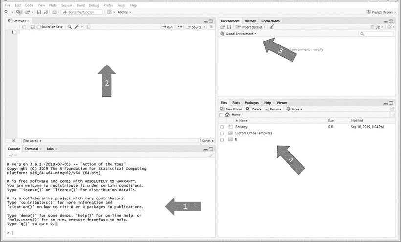

图 2.4 RStudio 界面。

### 2.2.1 控制台

区域 1 称为控制台（console）。使用 RStudio 启动 R 会话会将你带入控制台，在那里你可以显示 R 版本的信息、如何启动演示、如何访问帮助以及如何退出。要清空控制台，按住 `ctrl` 键并按 `L` (`ctrl-L`)。闪烁的光标表示控制台已准备好输入。有关实用的快捷键和所选函数的额外信息请见表 2.1。最主要关注的是 `Esc` 键，当所有其他方法都失效时，它允许你重新开始！

表 2.1 常用快捷键和操作

| 快捷键/命令 | 说明 |
| --- | --- |
| `Ctrl-L` | 清空控制台并将光标置于屏幕顶部。 |
| `↑` | 使用上箭头滚动查看之前的语句。 |
| `Esc` | 按下终止当前运行的进程。 |
| `#` | 使用此符号开始每行注释。没有多行注释符号。 |
| `Ctrl-Shift-Enter` | 运行整个源文件脚本。 |
| `Ctrl-Shift-N` | 开始创建新脚本。 |
| `` `var` <- 3.14 `` | 左箭头后跟减号是基础赋值最常用的方法。这里将 3.14 赋值给变量 `var`。 |
| `quit( ), q( ), or ctrl-q` | 退出 R 会话的三种方法。 |
| `rm(x)` | 从全局环境中删除对象 `x`。 |
| `ls( )` | 列出当前工作空间中的所有对象。 |
| `list.files()` | 列出工作目录中的所有文件。 |

让我们在控制台中输入输入表达式 `57 / 3 + 5` 看看发生了什么：

```
> 57 / 3 + 5
[1] 24
>
```

结果显示在 `[1]` 之后，并有一个准备好输入的新光标。

R 中的赋值语句是左箭头后跟减号。等号（`=`）也可以用，但你不会经常看到它。在这里我们将 3.14 赋值给数据对象 `x`。

```
> x <- 3.14
> x
[1] 3.14
```

组合函数 `c()` 用于向量赋值。这里 `x` 的原有值被覆盖，`x` 变成了一个带有 1–30 的向量对象。

```
> x <- c(1:30)
> x
[1] 1 2 3 4 5 6 7 8 9 10 11 12 13 14 15 16 17 18 19 20 21 22 23 24
25 26 27 28 29
[30] 30
```

我们可以轻松地引用向量 `x` 中的任何项。这里我们引用了第五项。

```
> x[5]
[1] 5
```

我们经常看到至少包含一些缺失值的数据。在 R 中，缺失项（无论是数值还是分类）都用符号 `NA`（不可用）表示。

```
> x[31]
[1] NA
```

处理缺失数据的方法将在第 4 章 中讨论。

让我们使用 `sd` 函数将 `x` 中值的标准差赋值给 `my.sd`。与 C++ 和 Java 等语言不同，语句中的点没有特殊含义。

```
> my.sd <- sd(x)
> my.sd
[1] 8.803408
```

使用 `round` 函数对 `my.sd` 进行重新赋值。

```
> my.sd <- round(my.sd, 2)
> my.sd
[1] 8.8
```

### 2.2.2 源面板

区域 2 代表源面板。这是大部分操作发生的地方。

#### 2.2.2.1 脚本的力量

当你继续执行单个脚本行时，注意除了在控制台中看到输出外，数据对象还会逐一个地添加到全局环境中——区域 3。

### 2.2.3 全局环境

为了查看函数在全局环境中是如何工作的，让我们导入在补充材料中找到 `ccpromo.csv` 数据集。该数据集在标题为“信用卡促销数据库”的框中进行了描述。数据中的 15 个实例显示在表 2.2 中。以下是使用 `import data` 选项的方法。

表 2.2 信用卡促销数据库

| ID | 收入范围 ($) | 杂志促销 | 腕表促销 | 人寿保险促销 | 信用卡保险 | 性别 | 年龄 |
| --- | --- | --- | --- | --- | --- | --- | --- |
| 1 | 40-50 K | 是 | 否 | 否 | 否 | 男 | 45 |
| 2 | 30-40 K | 是 | 是 | 是 | 否 | 女 | 40 |
| 3 | 40-50 K | 否 | 否 | 否 | 否 | 男 | 42 |
| 4 | 30-40 K | 是 | 是 | 是 | 是 | 男 | 43 |
| 5 | 50-60 K | 是 | 否 | 是 | 否 | 女 | 38 |
| 6 | 20-30 K | 否 | 否 | 否 | 否 | 女 | 55 |
| 7 | 30-40 K | 是 | 否 | 是 | 是 | 男 | 35 |
| 8 | 30-40 K | 否 | 是 | 否 | 否 | 男 | 27 |
| 9 | 30-40 K | 是 | 否 | 否 | 否 | 男 | 43 |
| 10 | 30-40 K | 是 | 是 | 是 | 否 | 女 | 41 |
| 11 | 40-50 K | 否 | 是 | 是 | 否 | 女 | 43 |
| 12 | 20-30 K | 否 | 是 | 是 | 否 | 男 | 29 |
| 13 | 50-60 K | 是 | 是 | 是 | 否 | 女 | 39 |


| 14 | 30-40 K | 否 | 是 | 否 | 否 | 男 | 55 |
| 15 | 20-30 K | 否 | 否 | 是 | 是 | 女 | 19 |

### 2.2.3.1 将数据导入全局环境

点击 `Import Dataset` 并选择第一个选项——from text (base.....)——这会告诉 R 你正在导入一个文本文件。图 2.5 显示了该请求生成的导入界面。请确保 `Heading`（标题）处勾选了 `yes`。这告诉 R 数据的第一行表示列名。此外，确保 `Strings as factors`（字符串作为因子）已勾选。其原因稍后就会显而易见。点击 `import` 查看一个与图 2.6 类似的屏幕。你的全局环境现在应该包含一个标记为 `ccpromo` 的对象。在这个环境中，`ccpromo` 被存储为名为数据框（data frame）的结构。数据框是一种通用的二维结构，允许列包含不同的数据类型。你将在第 3 章中学习更多关于数据框的知识。


图 2.5 导入 ccpromo.csv。


图 2.6 已导入的数据文件。

在处理 `ccpromo` 之前，了解你的补充数据集 zip 文件中的大多数文件都同时以 .csv 和 Microsoft Excel 格式存储是有益的。

---

**更正：由于提供的原始文本包含大量重复段落，以下是基于核心内容的去重完整翻译：**

为了查看函数在全局环境中是如何工作的，让我们导入在补充材料中找到的 `ccpromo.csv` 数据集。该数据集在标题为“信用卡促销数据库”的框中进行了描述。数据中的 15 个实例显示在表 2.2 中。以下是使用 `import data` 选项的方法。

表 2.2 信用卡促销数据库

| ID | 收入范围 ($) | 杂志促销 | 腕表促销 | 人寿保险促销 | 信用卡保险 | 性别 | 年龄 |
| --- | --- | --- | --- | --- | --- | --- | --- |
| 1 | 40-50 K | 是 | 否 | 否 | 否 | 男 | 45 |
| 2 | 30-40 K | 是 | 是 | 是 | 否 | 女 | 40 |
| 3 | 40-50 K | 否 | 否 | 否 | 否 | 男 | 42 |
| 4 | 30-40 K | 是 | 是 | 是 | 是 | 男 | 43 |
| 5 | 50-60 K | 是 | 否 | 是 | 否 | 女 | 38 |
| 6 | 20-30 K | 否 | 否 | 否 | 否 | 女 | 55 |
| 7 | 30-40 K | 是 | 否 | 是 | 是 | 男 | 35 |
| 8 | 30-40 K | 否 | 是 | 否 | 否 | 男 | 27 |
| 9 | 30-40 K | 是 | 否 | 否 | 否 | 男 | 43 |
| 10 | 30-40 K | 是 | 是 | 是 | 否 | 女 | 41 |
| 11 | 40-50 K | 否 | 是 | 是 | 否 | 女 | 43 |
| 12 | 20-30 K | 否 | 是 | 是 | 否 | 男 | 29 |
| 13 | 50-60 K | 是 | 是 | 是 | 否 | 女 | 39 |
| 14 | 30-40 K | 否 | 是 | 否 | 否 | 男 | 55 |
| 15 | 20-30 K | 否 | 否 | 是 | 是 | 女 | 19 |

### 2.2.3.1 将数据导入全局环境

点击 `Import Dataset` 并选择第一个选项——from text (base.....)——这会告诉 R 你正在导入一个文本文件。图 2.5 显示了该请求生成的导入界面。请确保 `Heading`（标题）处勾选了 `yes`。这告诉 R 数据的第一行表示列名。此外，请确保 `Strings as factors`（字符串作为因子）已勾选。其原因稍后就会显而易见。点击 `import` 查看一个与图 2.6 类似的屏幕。你的全局环境现在应该包含一个标记为 `ccpromo` 的对象。在这个环境中，`ccpromo` 被存储为名为数据框（data frame）的结构。数据框是一种通用的二维结构，允许列包含不同的数据类型。你将在第 3 章中学习更多关于数据框的知识。


图 2.5 导入 ccpromo.csv。


图 2.6 已导入的数据文件。

在处理 `ccpromo` 之前，了解你的补充数据集 zip 文件中的大多数文件都同时以 .csv 和 Microsoft Excel 格式存储是有益的。

### 2.2.3 分析信用卡促销

让我们使用点击式选择选项从 CRAN 库安装两个包。你将在接下来的章节中使用这些包中的函数。让我们先安装 `RWeka`。在区域 4 中，点击 packages（包），然后点击 install（安装）。在搜索栏中输入 `RWeka`。一旦找到该包，点击 install（安装）。完成后，`RWeka` 将出现在已安装包列表中。要安装第二个包，点击 install（安装）。在搜索栏中输入 `RWeka.jars` 以在 CRAN 库中定位该包。再次点击 install（安装）。接下来，向下滚动包列表，直到找到这两个新安装的包。请注意，尽管这些包可用，但它们尚未被加载。要加载一个包，请在包名旁边的方框中勾选，或使用 `library` 函数。例如，`library(RWeka)` 会加载 `RWeka` 包，从而使该包的内容可用。要查看 `RWeka` 包提供了哪些功能，请点击包名。滚动屏幕可以访问该包的文档和帮助页面。

## 2.3 数据在哪里？

书中示例中使用的大部分数据集可以在补充材料中找到。然而，R 环境中以及互联网上都有大量可用数据。附录 A 提供了关于获取文本补充材料的信息，并提供了几个获取额外数据的网站。

你可以通过输入 `data()` 获取当前加载的 R 包的可用数据集列表。让我们向列表添加一个数据集。由于 `AdultUCI` 数据集是机器学习引用最多的数据集之一，它是一个可行的选择。该数据集由 15 个属性和接近 49,000 个实例组成，代表从政府数据库提取的人口普查信息。数据集位于 `arules` 包中，我们将在[第 7 章]中使用它。要访问数据，必须先安装 `arules` 包。以下是从控制台安装 `arules` 包并使用 `table` 函数从 `AdultUCI` 数据中提取信息的步骤序列。

```
> install.packages("arules") # 从 CRAN 安装 arules
> library(arules)      # 加载 arules 包。
> data(AdultUCI)        # 让数据集变得可用。
> View(AdultUCI)        # 在源编辑器中查看数据。
> attach(AdultUCI)      # 将 AdultUCI 添加到搜索路径。
> table(sex, race)      # 创建一个简单的表。

     race
sex   Amer-Indian-Eskimo Asian-Pac-Islander Black Other White
  Female             185               517  2308   155 13027
  Male               285             1002  2377   251 28735
```

章末的练习为你提供了进一步探索这些数据的机会。

## 2.4 获取帮助和额外信息

你可能已经注意到，在源窗口或控制台窗口输入函数名的前三个字符后，会弹出一个小窗口，显示函数调用以及可用选项。该窗口要求你输入 F1 获取更多帮助。如果你听从了，包界面（区域 4）区域将给出函数名（括号内列出相应的包名）以及若干种形式的文档。你可以通过 `help(function-name)` 或更简单的 `?function-name` 获取相同的信息。

几个在线资源提供了额外的支持。其中两个值得注意的资源包括：

*   [`www.rdocumentation.org/`](https://www.rdocumentation.org/)——该网站由 DataCamp 开发，提供了有关最新包的丰富信息。如果你在网上搜索某个特定主题的帮助，通常会找到与 DataCamp 相关的回复。
*   [www.r-consortium.org](http://www.r-consortium.org)——RConsortium 由数据科学家组成，他们的首要目标是支持 R 社区的增长。
*   [`support.rstudio.com/hc/en-us`](https://support.rstudio.com/)——该网站提供关于 RStudio 的支持和信息。

## 2.5 总结

本章介绍了 R 语言、数据类型和结构。我们演示了如何使用 R 进行监督学习、聚类、关联规则和可视化。在下一章中，我们将详细探索如何使用数据。

## 2.6 练习

请注意：除了输出显示在控制台中外，你还可以使用 `sink` 将输出写入外部文件。

```
sink("C:/Users/desktop/my.output.txt", split = TRUE)
```

1.  导入[第 1 章]中描述的 `CardiologyMix` 数据集。执行以下任务：
    *   有多少个实例被归类为健康？
    *   是否存在缺失数据？如果是的话，哪些属性有缺失数据？
    *   `slope` 的常见值是什么？
    *   说明数据集中 `age` 的平均值和中位数。
    *   `maximum rate` 的范围（最高和最低值）以及标准差是多少？
    *   有多少个实例的 `number of vessels` 值为 2？
    *   为 `maximum rate` 显示两个直方图。其中一个使用默认间隔数，另一个使用五个间隔。
    *   使用 `head` 函数显示 `chest.pain` 的前十个值。
    *   有多少个健康个体的 `thal` 值为 normal（正常）？患病类中有多少个体的 `thal` 值为 normal（正常）？

2.  使用 `AdultUCI` 数据集回答以下问题：
    *   数据中 `age` 的平均值和中位数是多少？
    *   是否存在缺失数据 (NAs)？如果是的话，哪些属性有缺失数据？
    *   什么职业出现的频率最高？
    *   `hours worked per week` 的平均值和中位数是多少？
    *   百分之多少的实例列出的收入为“small”？
    *   百分之多少的实例是未婚的白人女性？
    *   为 `hours per week` 和 `education num` 创建直方图。从每个图中你学到了什么？

3.  使用 `help` 函数说明 `print` 和 `cat` 函数有什么区别。给出一个使用它们分别处理 `CardiologyMix` 数据对象的示例。

在本章中，我们将扩展对 R 的研究。我们从第 3.1 节开始，详细介绍 R 支持的数据类型。在第 3.2 节中，我们将检查 R 提供的单模式数据结构。在第 3.3 节中，我们的重点是多模式数据结构，特别强调了数据框（data frames）的作用。这里给出了一些数据处理技术，并在全文中进行更多介绍。第 3.4 节提供了一个 R 编程的快速指南。你可能并不对学习编写自己的 R 函数感兴趣。然而，许多 R 脚本至少包含一两行 R 程序代码。本节的简要回顾可以让你对最常用的 R 编程结构有一个基本的了解。

## 3.1 数据类型


# R 数据类型与数据结构

## 3.1 数据类型

R 支持四种主要数据类型：数值（numeric）、字符（character）、逻辑（logical）和复数（complex）。`mode()` 函数告诉我们任何值的数据类型。以下是每种数据类型的示例：

```
> mode(4)
[1] "numeric"
> mode(4.1)
[1] "numeric"
> mode('cat')
[1] "character"
> mode("dog")
[1] "character"
> mode(TRUE)
[1] "logical"
> mode(3 + 4i)
[1] "complex"
```

如你所见，带有和不带小数点的数字默认为数值表示。此外，字符值可以使用单引号或双引号识别。虽然整数（integer）不是 R 中的基本数据类型，但我们可以将数字表示为整数。考虑以下语句：

```
> is.integer(4)
[1] FALSE
> y <- as.integer(4)
> is.integer(y)
[1] TRUE
> y == 4.0
[1] TRUE
```

默认情况下，4 被存储为小数（浮点）值。因此，`is.integer` 测试会失败。然而，我们可以使用 `as.integer()` 函数将 4 存储为整数。当我们测试整数 `y` 和小数 4 是否相同时，我们看到 TRUE，因为 R 会先将 `y` 转换为小数以便进行比较。`TRUE` 和 `FALSE` 是逻辑类型；但它们在内部分别存储为 1 和 0。这允许它们用于算术计算。

```
> TRUE + TRUE
[1] 2
> FALSE + TRUE
[1] 1
> FALSE - 5
[1] -5
```

尽管这是一个有趣的特性，但数据类型通常不会给我们带来麻烦。然而，当特定属性的所有数据都是整数，但在之后可能会看到该属性的小数值时，可能会出现问题。我们将在第 6 章中查看如何处理这种情况。

### 3.1.1 字符数据与因子

字符数据可以表示为称为因子（factors）的数值向量。这种方法的优势有两个：首先，字符串的数值存储在内存中是高效的。例如，假设我们有一个包含 50,000 个实例的数据集，其中一列字符数据代表健康状况，分为“healthy”（健康）或“sick”（疾病）。如果我们将该数据列存储为 `factor` 变量，我们可以为健康分配 1，为疾病分配 2。我们还必须有一个图表告诉我们值是如何分配的。通过这种方案，我们可以将所有的“healthy”和“sick”值替换为 1 和 2。同时，如果我们查询数据集中的任何实例，我们都有图表来告诉我们个体的健康状况。让我们看看在 R 中它是如何工作的。考虑以下语句：

```
> my.result <- c('good','bad','not sure','bad','good','not sure')
> str(my.result)
chr [1:7] "good" "bad" "not sure" "bad" "good" "not sure"
> my.result <- factor(my.result)
[1] good bad not sure
Levels: bad not sure
> str(my.result)
Factor w/ 3 levels "bad","good","not sure": 2 1 3 1 2 2
```

第一条语句将字符字符串向量赋值给 `my.result`。接下来，我们看到对 `str()` 函数的调用。该函数根据给定的数据对象显示其内部格式。在这里它告诉我们 `my.result` 是一个包含七个元素的向量。接下来，`factor()` 函数将字符字符串向量转换为三个层级的因子。这三个级别代表原始字符串。`str()` 函数还显示了替代字符字符串的数值。这里我们必须小心！默认情况下，对字符字符串的数值赋值是按字母顺序完成的。也就是说，1 分配给“bad”，2 分配给“good”，3 表示“not sure”。在显示的因子级别之后，我们有一个数字字符串 2 1 3 1 2 3。我们首先看到 2，它与“good”匹配。“Good” 也是原始向量中的第一个元素。原始向量在第二个位置列出“bad”，所以我们得到 1。3 告诉我们第三个位置是“not sure”，依此类推。

如果你不喜欢对因子的数字默认赋值，可以按照如下方式进行更改：

```
> my.result <- c('good','bad','not sure','bad','good','not sure')
> my.result <- factor(my.result, order = TRUE, levels = c('good','not sure','bad'))
> str(my.result)
Ord.factor w/ 3 levels "good"<"not sure"<"bad": 1 3 2 3 1 1 2
```

我们现在将“good”分配给 1，“not sure”是 2，3 是“bad”。`str()` 函数是一个在许多情况下都非常实用的工具，特别是当我们看到错误信息提示输入数据格式不正确时。让我们把 `str()` 函数应用于第 2 章中的 `ccpromo` 数据集。你的全局环境应该仍然列出 `ccpromo` 数据对象。以下是结果。

```
> str(ccpromo)      # Internal storage structure
'data.frame': 15 obs. of 7 variables:
 $ Income       : Factor w/ 4 levels "20-30K","30-40K",..:  3 2 3 2 4
 $ MagazinePromo: Factor w/ 2 levels "No","Yes": 2 2 1 2 2 1 2 1 2 2
 $ WatchPromo   : Factor w/ 2 levels "No","Yes": 1 2 1 2 1 1 1 2 1 2
 $ LifeInsPromo: Factor w/ 2 levels "No","Yes": 1 2 1 2 2 1 2 1 1 2
 $ CCardIns     : Factor w/ 2 levels "No","Yes": 1 1 1 2 1 1 2 1 1 1
 $ Gender       : Factor w/ 2 levels "Female","Male": 2 1 3 1 2 2
 $ Age          : int 45 40 42 38 55 35 27
```

“data.frame”声明告诉我们该文件是一个具有 15 个观测值和 7 个变量的数据框。R 的大多数机器学习工具要求数据结构化为数据框。我们还有六个属性被声明为因子。最后，由于所有年龄值都是整数，`Age` 被赋予整数类型。

## 3.2 单模式数据结构

R 支持三种单模式数据结构：向量、数组和矩阵。这些被称为单模式结构，因为每个数据项必须是相同类型。让我们看看每个结构。

### 3.2.1 向量

在第 2 章中，我们演示了如何使用函数 `c()` 创建向量。向量是单维结构。R 执行自动类型转换以防止违反单一类型。为了看到这一点，考虑以下情况，数值向量 `x` 变为字符向量然后变为因子。

```
> x <- c(1:5)  # 创建一个包含 5 个数值的向量
> x
[1] 1 2 3 4 5
> x[7] <- "run" # 在第 7 位置添加一个字符项
> x
[1] "1" "2" "3" "4" "5" NA "run"
> str(x)
chr [1:7] "1" "2" "3" "4" "5" NA "run"
> x <- factor(x)  # 将字符转换为因子
> x
[1] 1 2 3 4 5 <NA> run
Levels: 1 2 3 4 5 run
```

#### 3.2.1.1 向量化

R 的一个有趣特性是函数向量化。具有此能力的函数会自动对向量中的每个项执行其任务。以下是一些示例：

```
> x <- c(10, -20, 30, -40, 50, -60)
> abs(x)
[1] 10 20 30 40 50 60

> sqrt(x)
[1] 3.162278   NaN 5.477226   NaN 7.071068   NaN
Warning message:
In sqrt(x) : NaNs produced

> x > 20
[1] FALSE FALSE TRUE FALSE TRUE FALSE

> y <- x[x > 20]
> y
[1] 30 50

> Over35 <- ifelse(AdultUCI$`hours-per-week` > 35, TRUE, FALSE)

> table(Over35)
Over35
FALSE  TRUE
10332 38510

> colSums(ccpromo[7]) # Find the sum of all ages in the data.
Age
594
```

`ifelse` 结构的向量化处理特别值得关注。在上面的示例中，我们对成年数据集应用了 `ifelse`。该语句的工作原理如下：对于每个实例，查看 `hours-per-week` 的值；如果 `hours-per-week` 大于 35，输出 TRUE，否则输出 FALSE。数据对象 `Over35` 包含结果，并用 `table` 函数进行汇总。

如果你做过一些编程，一定能体会 `ifelse` 语句的简单和强大！你经常会看到使用 `ifelse` 将基于概率的结果转换为整数或字符值。在下面的示例中，`results` 中所有大于 0.5 的值在 `new.results` 中表示为 2。同样，那些小于或等于 0.5 的值在 `new.results` 中显示为 1。

```
new.results <- ifelse(results > 0.5, 2, 1)
```

这些示例表明，向量化避免了编写循环遍历数据的函数。在处理必须要求执行效率的大量数据时，经过向量化的函数特别有帮助。

### 3.2.2 矩阵与数组

矩阵是一个二维结构，要求所有元素都具有相同的模式。我们可以使用 `matrix` 函数创建一个矩阵。默认情况下，矩阵按列优先顺序填充。这里有两个示例。第一个示例创建了一个四行三列矩阵。第二个示例定义了一个带有名称的 3×2 矩阵。

```
my.matrix <- matrix(1:12, nrow = 4, ncol = 3)
> my.matrix
      [,1] [,2] [,3]
[1,]    1    5    9
[2,]    2    6   10
[3,]    3    7   11
[4,]    4    8   12

> items <- c('bread','milk','cereal','grapes','bacon','fish')
> my.matrix2 <- matrix(items, nrow = 3, ncol = 2,
             dimnames = list(c('r1','r2','r3'),
             c('c1','c2')))
> my.matrix2
    c1       c2
r1 "bread"  "grapes"
r2 "milk"   "bacon"
r3 "cereal" "fish"
> my.matrix2[1,] # everything in row 1
      c1       c2
 "bread" "grapes"
> my.matrix2[,2] # everything in column 2
      r1       r2       r3
"grapes" "bacon" "fish"
```

数组与矩阵相似，因为所有元素必须是单一模式。它们与矩阵的区别在于它们不受限于二维。让我们创建一个三维的 2×2×2 数组。

```
my.array <- array(1:8, c(2,2,2), dimnames = list(c("A1","A2"),
             c("B1","B2"),
             c("C1","C2")))
> my.array, , C1
  B1 B2
A1 1  3
A2 2  4

, C2
  B1 B2
A1 5  7
A2 6  8
```

三维以上的数组很难可视化。与矩阵一样，默认按列优先顺序填充数组。数组对于存储大量的相关信息非常有用。然而，从机器学习的角度来看，数组所有元素必须是相同类型的要求限制了它们的用途。现在是时候进入多模态类型了，在其中我们找到了最适用于机器学习的数据结构。

## 3.3 多模态数据结构

### 3.3.1 列表

列表是非常通用的结构，是其他对象的容器。与向量、矩阵和数组不同，列表中的对象可以是不同的类型和模式。通过示例最易理解列表。以下是如何创建一个包含关于 `my dog` 信息的列表。

```
my.dog <- list(Name = "Lieue",
             age = 14,
             weight = 48,
             breed = 'springer spaniel',
             WeeklyWalk = c(2, 2, 2.5, 1, 0.5, 3.1, 0))

> my.dog # Show the contents of the list.
$Name
[1] "Lieue"

$age
[1] 14

$weight
[1] 48

$breed
[1] "springer spaniel"

$WeeklyWalk
[1] 2.0 2.0 2.5 1.0 0.5 3.1 0.0
```


# 3.2.2 矩阵与数组

矩阵是一个二维结构，要求所有元素都具有相同的模式。我们可以使用 `matrix` 函数创建一个矩阵。默认情况下，矩阵按列优先顺序填充。这里有两个示例。第一个示例创建了一个四行三列矩阵。第二个示例定义了一个带有名称的 3×2 矩阵。

```
my.matrix <- matrix(1:12, nrow=4, ncol=3)
> my.matrix
      [,1]  [,2]  [,3]
[1,]     1      5      9
[2,]     2      6     10
[3,]     3      7     11
[4,]     4      8     12

> items <- c('bread','milk','cereal','grapes','bacon','fish')
> my.matrix2 <- matrix(items, nrow=3, ncol=2,
             dimnames = list(c('r1','r2','r3'),
             c('c1','c2')))
>  my.matrix2
    c1       c2
r1 "bread"  "grapes"
r2 "milk"   "bacon"
r3 "cereal"  "fish"
> my.matrix2[1,] # everything in row 1
      c1       c2
 "bread" "grapes"
> my.matrix2[,2] # everything in column 2
      r1       r2       r3
"grapes" "bacon" "fish"
```

数组与矩阵相似，因为所有元素必须是单一模式。它们与矩阵的区别在于它们不受限于二维。让我们创建一个三维的 2×2×2 数组。

```
my.array <- array(1:8, c(2,2,2), dimnames=list(c("A1","A2"),
             c("B1","B2"),
             c("C1","C2")))
> my.array, , C1
  B1 B2
A1 1  3
A2 2  4

, C2
  B1 B2
A1 5  7
A2 6  8
```

三维以上的数组很难可视化。与矩阵一样，默认按列优先顺序填充数组。数组对于存储大量的相关信息非常有用。然而，从机器学习的角度来看，数组所有元素必须是相同类型的要求限制了它们的用途。现在是时候进入多模态类型了，在其中我们找到了最适用于机器学习的数据结构。

## 3.3 多模态数据结构

### 3.3.1 列表

列表是非常通用的结构，是其他对象的容器。与向量、矩阵和数组不同，列表中的对象可以是不同的类型和模式。通过示例最易理解列表。以下是如何创建一个包含关于 `my.dog` 信息的列表。

```
my.dog <- list(Name = "Lieue",
             age = 14,
             weight = 48,
             breed= 'springer spaniel',
             WeeklyWalk =c(2,2,2.5,1,0.5,3.1,0))

> my.dog # Show the contents of the list.
$Name
[1] "Lieue"

$age
[1] 14

$weight
[1] 48

$breed
[1] "springer spaniel"

$WeeklyWalk
[1] 2 2 2.5 1 0.5 3.1 0
```

`ifelse` 结构的向量化处理特别值得关注。在上面的示例中，我们对成年数据集应用了 `ifelse`。该语句的工作原理如下：对于每个实例，查看 `hours-per-week` 的值；如果 `hours-per-week` 大于 35，输出 TRUE，否则输出 FALSE。数据对象 `Over35` 包含结果，并用 `table` 函数进行汇总。

如果你做过一些编程，一定能体会 `ifelse` 语句的简单和强大！你经常会看到使用 `ifelse` 将基于概率的结果转换为整数或字符值。在下面的示例中，`results` 中所有大于 0.5 的值在 `new.results` 中表示为 2。同样，那些小于或等于 0.5 的值在 `new.results` 中显示为 1。

```
new.results <- ifelse(results > 0.5, 2, 1)
```

这些示例表明，向量化避免了编写循环遍历数据的函数。在处理必须要求执行效率的大量数据时，经过向量化的函数特别有帮助。

## 3.4 编写自己的函数

很少有复杂的 R 脚本不带有一两行程序代码。你文本中的许多脚本也不例外。在这个意义上，对你获得 R 编程语言的阅读知识是非常重要的。然而，随着成千上万个 R 软件包的随时可用，你可能会找到一个包含执行任何任务所需的确切函数的包。既然如此，有学习编写自己的函数的理由吗？绝对有！

如果程序代码流在你的血管里，那么 R 就是你实现个人想法的完美语言。编写自己的代码还能让你掌握控制权，谁会不喜欢掌握驾驶位呢？但如果你是编程新手怎么办？R 的优点之一是它相对容易学习。不需要担心严格的数据类型，并且能够通过解释器直接与 R 交互，这让初级编程者的生活变得简单得多。最重要的是，如果你在技术领域的任何领域工作，阅读和理解一些 R 程序代码将是一个非常大的加分项。让我们写几个函数来让你熟悉 R 语言编程。这将帮助你判断 R 语言编程是否适合你！

### 3.4.1 编写简单的函数

以下是 R 函数的通用结构：

```
my.function <- function(arg1, arg2, ..., argn)
{
    statement 1
    statement 2
    ...
    statement n
    return(value)
}
```

第一行指定了新函数的名称，并显示了传递给函数的参数。函数体由大括号包围，最后一个语句指定返回值。让我们从简单的开始，编写一个 `my.square` 函数，它在接收一个数字后返回其平方值。例如，调用 `my.square(4)` 返回 16。

要创建此函数，点击 *文件—新建文件—R 脚本*。在源编辑器中输入以下代码：

```
my.square <- function(x)
{
    # Return the square of x
    return(x*x)
}
```

接下来，点击*运行*（run），这会将 `my.square` 函数添加到你的全局环境中。如果一切顺利，你的控制台窗口将显示如下：

```
> my.square <- function(x)
+ {
+    # Return the square of x
+    return(x*x)
+ }
>
```

如果最后一行显示为 `+` 而不是 `>`，说明解释器表示它期待额外的输入。这代表了编码错误，例如括号不匹配。

现在我们已经定义了 `my.square`，让我们看看它是否有效用！这里有几次测试 `my.square` 的函数调用。

```
> my.square(5)
[1] 25
> my.square(-5)
[1] 25
> my.square("dog")
Error in x * x : non-numeric argument to binary operator
> y <- 10
> my.square(y)
[1] 100
> y
[1] 10
> y <- my.square(y)
> y
[1] 100
> my.lst <- c(5,10,20)
> sapply(my.lst, my.square)
[1] 25 100 400
```

第三次调用 `my.square` 导致解释器向我们返回一个错误。由于我们应该对捕获这个错误负责，稍后我们将通过修改该函数来捕获该错误。第五次调用具有特别的意义，因为我们正试图使用该函数来更改 `y` 的值。R 在向函数传递变量时使用的是*按值传递*（call by value）。通过*按值传递*，函数获得了所传递变量的值，但不知道它在内存中的位置。通过这种方式，在函数内部对参数的修改对变量不会产生永久影响。如果我们想让函数更改参数的值，可以使用这里展示的技术。最后一个示例展示了如何使用函数 `sapply` 将我们的函数应用到 `my.lst` 的每个成员。

### 3.4.2 条件语句

第三次调用 `my.square` 导致了系统错误，我们可以在函数内部轻松地捕获它。我们只需要具备条件的基础知识。以下是对原始代码的修改，用于捕获非数值值错误。

```
my.square <- function(x)
{
    if(is.integer(x) | is.numeric(x))
    {
        # Return the square of x
        return(x*x)
    }
    else
    {
        print("Error! Can't square a non-numeric value")
    }
}
```

上述代码包含一个 if-else 形式的条件。如果括号内的测试为真，则执行 `if` 语句之后的代码。如果语句为假，则执行 `else` 之后的代码。之前描述的向量化 `ifelse` 结构是通用 if-else 条件的一个特例。

一个 `if` 条件也可以在没有 `else` 的情况下存在。在这种情况下，当 `if` 语句为真时，会执行 `if` 后面大括号内的语句。如果语句为假，则跳过大括号内的语句。在这种情况下，该 `if` 被认为有一个空的 `else` 子句。值得注意的是，只有当 `if` 语句后面跟着多一个语句时，才需要大括号。`is.integer` 和 `is.numeric` 用于检查类型。

表 3.1 逻辑运算符

| 运算符 | 功能 |
| :--- | :--- |
| `>` | 大于 |
| `>=` | 大于等于 |
| `<` | 小于 |
| `<=` | 小于等于 |
| `==` | 等于 |
| `!=` | 不等于 |
| `|` | 或 |
| `&` | 与 |
| `!` | 非 |
| `~` | 波浪号 |
| `x` | x |

### 3.4.3 迭代

任何复杂性的程序总是使用某种形式的重复。重复有两种格式——迭代和递归。虽然如今的编程语言支持这两种类型，但大多数语言强调以 for、while 和 do-while 循环形式形式迭代。然而，某些语言如 LISP、Scheme 和 Prolog 是为了递归编程而构建的。

R 支持迭代和递归，但本质上是迭代的。让我们先看两个迭代的示例。接着是一个说明递归的简单示例。

#### 3.4.3.1 寻找平方根

对于我们的第一个示例，我们使用 `while` 循环来实现“猜测-除法-平均值”法来寻找正数的平方根。该算法是直观的。假设我们要找 6 的平方根。首先，我们必须进行初始猜测。在不失一般性的情况下，总是可以做出 2 的初始猜测。有了我们的初始猜测 2，我们将猜测除以 6 得到商 3。接下来，我们计算猜测（2）和商（3）之间的绝对差。如果绝对差小于诸如 0.001 的选值，则将猜测（或商，因为它们的差值在误差范围内）作为平方根。如果差值太大，我们通过计算旧猜测（2）和商（3）的平均值来计算新的猜测。

该算法如脚本 3.3 所示——通过两个函数实现，其中第一个函数用于检查参数是否有效。如果无效，则会打印错误信息并终止进程。如果测试有效，第一个函数将调用第二个函数，并传入数值和初始估计值。

`while` 循环是理解该算法工作原理的关键。`while` 循环测试条件语句，如果为真，则执行 `while` 内部的语句。在这里，如果 `(guess − x/guess)` 的绝对值大于 `0.001`，则会执行 `while` 内部的语句，之后再次重复测试。由于 `while` 循环只包含一条语句，因此不需要大括号。然而，良好的编程习惯鼓励使用大括号，因为它们清晰地定义了 `while` 循环的边界。

当 `while` 测试失败时，`guess` 的最后一个计算值将返回给 `my.sqrt`，然后 `my.sqrt` 又将该值返回给调用语句。最后，重要的一点是，在 R 函数内部定义的任何变量或列为参数的变量都是局部变量，一旦函数终止，它们就会销毁。在这里，局部变量 `guess` 和形式参数 `x` 在函数终止时消失。

当程序执行前已知迭代次数时，`for` 循环是首选迭代技术。下一个示例展示了如何使用 `for` 循环在数字列表中找到最大值。

#### 3.4.3.2 寻找最大值

我们的第二个说明迭代的示例定义了一个函数，该函数接收数值数据向量作为输入并返回最大值。脚本 3.4 定义了该函数。

`my.largest` 首先将列表中的第一个值声明为最大项。接下来，声明局部变量 `nas` 以跟踪向量中缺失项目的数量。由于迭代将从 2 开始，`rows` 被声明为列表长度减 1。`for` 语句从 `i` 等于 2 开始。

第一个 `if` 条件判断检查是否存在缺失项目。第二个 `if` 确定 `largest` 的值是否需要改变。从 `for` 声明之后开始并以 `# *end for*` 结束的大括号定义了循环体。变量 `i` 每次递增 1，直到其值超过 `rows` 的值。当迭代完成后，将打印 NA 的总数并返回最大值。

#### 3.4.3.3 混淆矩阵准确率

我们最后一个关于迭代的示例是一个在范围内使用的函数，用于根据混淆矩阵的值计算分类准确率。该函数对混淆矩阵主对角线的数字求和，然后将总和除以矩阵中的数值总数，得到准确率值。该函数使用嵌套的 `for` 语句来遍历矩阵的行和列。在检查语句之前，您可以在控制台或源代码编辑器中输入以下内容，查看嵌套 `for` 是如何工作的。执行结果（未显示）显示外层循环从 1 迭代到 3，而内层循环对于每个 `i` 值从 1 迭代到 3。

```
> for(i in 1:3)
+    for(j in 1:3)
+      cat("i=",i," j=",j,"\n")
```

脚本 3.5 提供了 `ConfusionP` 的定义。请确保在源代码编辑器中打开 `ConfusionP.R` 并点击 `run`，将 `ConfusionP` 作为函数进入您的全局环境。

### 3.4.4 递归编程

递归函数有两个主要特征。首先，函数必须调用自己，这被称为递归调用。其次，必须有一个条件来终止递归。

递归在内部通过被称为“栈”（stack）的结构实现。栈是一种后进先出（LIFO）结构，最后放入栈的项是第一个移除的项。一叠盘子让这个概念显而易懂。假设你正在擦盘子，在擦干每个盘子后，将其放在不断增加的干净盘子堆顶部。如果有人需要餐盘，移除的盘子是最后放在栈上的那一个。当放在栈上的盘子远多于移除的数量时，就会出现明显的问题——例如整叠盘子掉落在地上。

递归编程的问题类似。每个递归调用都需要一个包含当前状态信息的新盘子被放入内存中。这些信息必须被存储，因为当递归回溯时（盘子一个一个从栈中取出），这些信息将用于计算最终结果。

如果递归调用过多，为栈保留的内存就会满，导致栈溢出！

可以用递归轻松解决的问题类型是那些只需要最少递归调用和最少存储信息来跟踪递归的问题。估计-除法-平均开根法自然适用于递归解决方案。这是因为该技术始终能够以最少的计算次数得出平方根值。更重要的是，不需要在栈上存储信息，因为最终答案只需要通过之前的递归调用传回。也就是说，在递归回溯时，不需要满足任何中间计算结果的需求。

脚本 3.6 提供了估计-除法-平均技术的递归版本。函数 `my.SqrtR` 是用户调用的主函数，但它并不执行递归。它只是检查要计算平方根的值是否有效。如果有效，则使用该值和初始估计值调用递归程序 `SqrtR`。注意，重复仅仅通过继续调用 `Sqrt2` 并越来越接近真实的平方根来实现。这里完全看不到任何 `for` 或 `while` 循环！当满足终止条件时，递归将计算出的平方根通过递归调用栈传回，最终交给用户。可以的是，递归编程并不适合每个人。


R 支持几种单模式数据结构，包括向量、矩阵和数组。这些结构被称为单模式，是因为它们要求所有元素具有相同类型。如果违反了这一限制，R 会自动执行属性转换。列表（list）和数据框是多模式数据结构，因为它们消除了数据类型限制。数据框是 R 中机器学习算法中最常用的数据结构。数据框的行表示实例，列作为属性。`str` 函数对于理解 R 支持的数据结构的内部表示特别有用。R 脚本通常包含一些程序代码。建议学习如何编写自己的 R 函数，这有助于更好地理解他人编写的脚本，并为提高解决问题的能力提供额外工具。

## 3.5 总结

- **值传递**：被调用函数接收传递参数的值，但不知道它们在内存中的地址。作为参数传递的变量其值不会被函数永久改变。

- **因子 (Factor)**：表示字符数据的数值向量。因子具有水平（levels），定义了数值到原始字符表示的映射。

- **栈 (Stack)**：栈是一种后进先出的结构，最后放入栈的项是第一个移除的项。

- **向量化 (Vectorization)**：向量化函数将自身应用于向量中的每个值，从而消除了对循环的需求。

# 练习

1. 考虑以下声明：

   ```
   x <- matrix(1:12, nrow = 3, ncol = 4)
   ```

   将位置 `[1,3]` 替换为字符“A”并输出矩阵。结果是什么？

2. 为 `CardiologyMixed` 创建一个副本（下文记为 `CRD`）。使用该副本编写并执行脚本来完成以下任务。

   1. 列出数据中前十个个体的年龄（这一步已完成！）答案：

      `CRD[1:10, 1]`

      ```
      [1] 60 49 64 63 53 58 58 58 63 67
      ```

   2. 使用两种方法打印前五个实例。

   3. 打印第 1、20 和 51 个实例的年龄、`gender` 和 `chest.pain.type`。

   4. 使用两种方法打印列 1、3 和 5 中的所有数据。

   5. 删除第 1 到 10 列。

3. 在 RStudio 中打开 `mySqrt.R`，并在全局环境中创建 `my.sqrt` 和 `my.sqrt2` 函数。通过调用有效和无效的值来测试 `my.sqrt`。

4. 在 RStudio 中打开 `largest.R`，并在全局环境中将 `my.largest` 为一个函数。使用 csv 文件 `creditScreening` 的第二列或第十四列进行测试。该文件包含 690 个实例，在上述行中存在缺失项。该文件将用于后续章节中的几个示例。

5. 编写函数 `everyOther`，该函数接收一个数字列表并返回一个包含原始列表中每隔一个元素的列表。例如，`everyOther(c(1,2,3,4,5))` 返回 `(1,3,5)`。

6. 编写函数 `my.smallest`，该函数接受数据框的一列并返回该列中的最小值。请务必检查并打印 `NAs` 的数量。使用 `creditScreening` 数据集的第二列和第十四列测试你的函数。

7. 取余运算符 `%%` 用于判断一个数字是否是另一个数字的因子。例如，2 是 6 的因子，因为 `6 %% 2 = 0`。完全数是指其因子之和等于该数的数。六是一个完全数，因为 `1 + 2 + 3 = 6`。写一个函数来列出 1 到 1000 之间所有的完全数。（注意：`%/%` 给出两个数字的整数商。）

8. 编写 `my.largest` 的递归版本。使用 `mySqrt.R` 中提供的技术初始化递归。递归实现 `my.largest` 是一个好主意吗？为什么或为什么？

9. 使用 `while` 循环编写一个函数来寻找前 1000 个偶整数的和。递归实现这个函数是一个好主意吗？为什么或为什么？

10. 编写函数 `my.reverse`，该函数接收一个向量并返回反序排列的元素。`my.reverse(c(1,2,3))` 返回 `3 2 1`。

11. 欧几里得算法提供了一种寻找两个正整数最大公约数（GCD）的高效方法——即能整除这两个数且无余数的数字。写一个迭代或递归函数来寻找 GCD。算法如下：

    1. 将最小的数除以最大的数。

    2. 如果余数为 0，则除数就是 GCD，任务完成。

    3. 如果有余数，将余数变为新的最小数，将除数变为新的最大数。重复步骤 b。

# 已安装的包和函数

| 包名 | 函数(s) |
| --- | --- |
| `base / stats` | `abs, as.integer, array, c, cat, cbind, data.frame, factor, for, function, is.integer, is.na, is.numeric, list, matrix, mode, ncol, nrow, return, round, sapply, sqrt, str, table, while` |
| `sqldf` | `sqldf` |

# 第 4 章

# 数据准备

本章内容

* KDD 过程模型
* 关系型数据库
* 数据预处理技术
* 数据转换方法

通过综合 R 归档网络（CRAN）仓库提供的许多包都包含了至少经过部分预处理的数据集。这使得我们可以专注于学习各种机器学习工具，而无需担心分析真实世界数据所需的预处理任务。然而，真实数据通常包含缺失值、噪声，并且在用于模型构建过程之前需要进行一次或多次转换。因此，在转向后续章节中介绍的机器学习算法之前，我们先检查针对真实数据中常见的预处理问题的解决方案。

在第 4.1 节中，我们引入了一个正式的知识发现七步过程模型。在第 4.2 节–4.4 中，我们专注于目标数据创建、预处理和转换的步骤，这些是目前最困难且耗时的部分。当我们仔细关注数据预处理和转换时，我们构建有用模型的成功机会将显著增加。

## 4.1 知识发现过程模型

*数据中的发现*（KDD）是一个交互、迭代的过程，试图从数据中提取隐性的、此前未知的且潜在有用的知识。存在多种 KDD 过程的变体。这些变体将 KDD 过程描述为 4 到 12 个步骤。虽然步骤数量可能不同，但大多数内容上保持一致。以下是七步 KDD 过程的简要描述：

1. **目标识别**：这一步的重点是理解所考虑的领域。我们对要完成的任务写一个清晰的声明。可以提出关于可能或预期结果的假设。

2. **创建目标数据集**：在一个或多个人类专家和知识发现工具的帮助下，我们选择一组初始数据进行分析。

3. **数据预处理**：我们利用可用资源处理噪声数据。我们决定如何处理缺失值以及如何考虑时间序列信息。

4. **数据转换**：从目标数据中添加和或消除属性和实例。我们决定了归一化、转换和和平滑数据的方法。

5. **数据挖掘**：通过应用一种或多种机器学习算法创建表示数据的最佳模型。

6. **解释与评估**：我们检查第 5 步的输出，以确定发现的内容是否既有用又有趣。对于是否使用新属性和/或实例重复之前的步骤做出决策。

7. **采取行动**：如果发现的知识被认为是有用的，则将知识整合并直接应用于适当的问题中。

## 4.2 创建目标数据集

一组可行的资源数据对于任何分析项目的成功都至关重要。目标数据通常从三个主要来源提取——一个数据仓库、一个或多个事务数据库，或一个或多个平面文件。许多机器学习工具要求输入数据为平面文件或电子表格格式（即 R 的 `data.frame`）。如果原始数据存储在平面文件中，创建目标数据是简单的。让我们看看其他可能性。

数据库管理系统（DBMS）用于存储和处理事务性数据。DBMS 中的计算机程序能够快速从存储的数据库中更新和检索信息。DBMS 中的数据通常使用关系模型进行结构化。`关系型数据库`将数据表示为包含行和列的表集合。表中的每一列被称为属性，表中的每一行存储关于某条数据记录的信息。单行被称为 `tuples`（元组）。关系型表中的所有元组通过一个或多个表属性的组合进行唯一标识。

关系模型的一个主要目标是减少数据冗余，以便快速访问数据库中的信息。一组旨在抑制数据冗余的规范式定义了关系型表的格式化规则。如果关系型表包含冗余数据，则通过将表分解为两个或多个关系型结构来消除冗余。相比之下，知识发现的目标是揭示数据中固有的冗余。因此，通常需要一个或多个关系连接操作，将数据重构为易于数据挖掘的形式。

为了说明这一点，请考虑我们在第 2 章的表 2.2 中定义的假设信用卡促销数据库。回想表属性：`income range`（收入范围）、`magazine promotion`（杂志促销）、`watch promotion`（手表促销）、`life insurance promotion`（寿险促销）、`credit card insurance`（信用卡保险）、`gender`（性别）和 `age`（年龄）。表 2.2 中的数据完全不是数据库，而是从数据库中提取的平文件结构，如图 4.1 所示。Acme 信用卡数据库包含有关账单信息和订单的表，以及关于信用卡促销的信息。`Promotion-C` 表创建了两个一对多的关系，以解决 `Customer`（客户）与 `Promotion`（促销）之间的单一多多关系。因此，表 2.2 中显示的促销信息存储在数据库的多个关系表中。下一节将介绍从图 4.1 的关系数据库中提取信息所需的工作，以便创建一个类似于表 2.2 的数据帧结构。

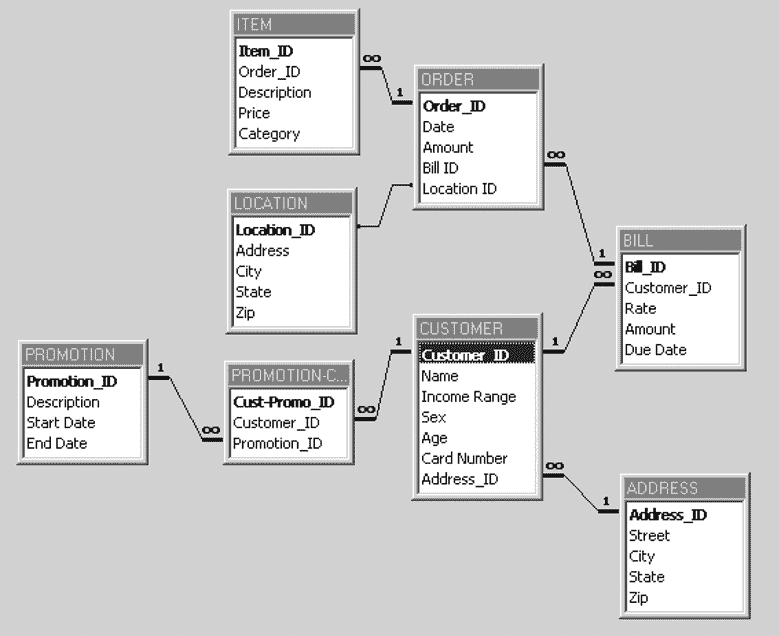

FIGURE 4.1   Acme 信用卡数据库。

### 4.2.1 R 与关系型模型的接口连接

将 R 连接到关系型数据库有多种选择。对于我们的示例，我们选择了 `SQLite` 作为 DBMS，并选择 R 的 `DBI` 包作为数据库接口。我们选择 `SQLite` 是因为它具有高度的可移植性、易于安装和使用、提供了 SQL 引擎的功能，最重要的是，它不需要服务器！此外，可以使用命令行提示符或数据库浏览器访问 `SQLite`。

`SQLite` 主页的 URL 是 [`sqlite.org/index.html`](https://sqlite.org/index.html)。点击 `download`，然后选择相应的下载链接。对于 Windows 用户，最好选择 Precompiled Binaries for Windows 下的 `sqlite tools` 链接。为了避免使用命令行界面，你可以下载 DB Browser—[`sqlitebrowser.org/dl/`](https://sqlitebrowser.org/)——它提供了一个适用于所有主要平台的优良界面。

我们使用 `SQLite` 创建了图 4.1 所示关系型数据库的子集。数据库——`CreditCardPromotion.db` 是本章补充材料的一部分。图 4.2 显示了使用 DB Browser 查看的数据库结构。脚本 4.1 提供了访问数据库的语句。在执行脚本之前，你必须访问 CRAN 仓库并安装两个接口包——`RSQLite` 和 `DBI`。让我们来看脚本 4.1 中的语句。

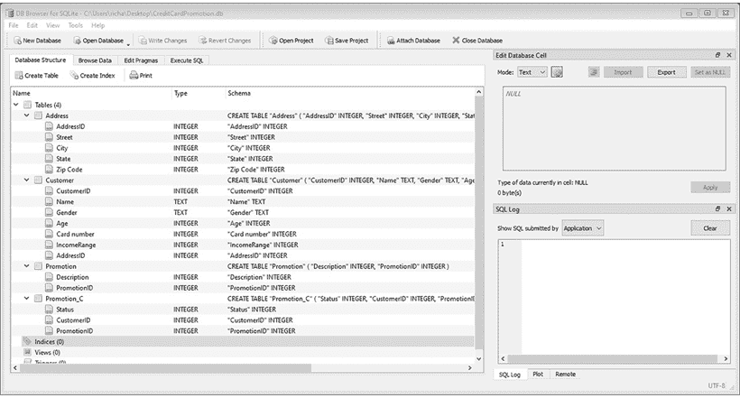

FIGURE 4.2   CreditCardPromotion 数据库。

前两个语句加载了上述安装的库。修改 `setwd` 语句以匹配你数据库副本的位置。`dbConnect` 函数建立与数据库的连接。第一个 `Select` 语句从 `Customer` 表中获取信息。注意数据库包含三个客户。

你可以通过在 DB Browser 中点击 `browse data` 查看促销 ID 如何对应促销名称，或者通过在控制窗口中提交以下查询：

```
dbGetQuery(dbCon, "Select * from Promotion")

             Description PromotionID
  1         Magazine Promotion           20
               Watch Promotion            30
3 Life Insurance Promotion          10
```

将 `Promotion` 替换为 `Promotion_C` 以查看所有三个客户对三个促销的反应。

下一个查询更有趣，因为它的目的是创建表 2.2 所示的 `Life Insurance Promotion` 列。为了实现这一点，该查询连接了 `Customer` 和 `Promotion_C` 表。连接创建了一个新表，将 `Promotion_C` 中的 `Status` 和 `PromotionID` 列与 `Customer` 表中的信息相结合。最后，我们使用 `colnames` 函数将 `Status` 改为 `LifeInsPromo` 以得到预期结果。添加杂志和手表促销 `ccpLife` 留作练习。

### 目标数据的额外数据源

从多个数据库提取数据也存在这种可能性。如果目标数据来自多个源，提取过程可能会很繁琐。考虑一个简单的示例，一个运营数据库将性别编码为 `male = 1`, `female = 2`。另一个数据库将性别存储为 `male = M` 和 `female = F`。`male` 和 `female` 的编码在所有记录中必须一致，否则数据将毫无用。在传输数据时促进这种一致性是 `数据转换` 的一种形式。其他类型的数据转换将在第 4.4 节中讨论。

获取数据的第三种可能性是数据仓库。数据仓库是为决策支持而非事务处理设计的数据库（Kimball 等人，1998）。因此，决策支持所需的数据从运营环境中提取并进入仓库。从运营数据库到仓库的数据传输是一个持续过程，通常在日常营业结束后完成。

第四种场景是数据需要服务器集群支持分布式环境。对于分布式数据，KDD 过程模型必须补充数据分布和结果聚合的复杂性。最后，流式数据存在特殊情况，实时分析使得数据预处理至少非常困难。

## 4.3 数据预处理

大多数数据预处理是数据清洗的形式，涉及处理噪声和缺失信息。理想情况下，大多数数据预处理发生在永久存储在如数据仓库之类的结构之前。

### 4.3.1 噪声数据

`噪声`表示属性值中的随机误差。在大数据集中，噪声以各种形式出现。关于噪声数据的常见问题包括：

*   我们如何发现重复记录？
*   我们如何定位不正确的属性值？
*   应该对我们的数据应用哪些数据平滑操作？
*   我们如何发现并处理离群值？
*   我们如何处理缺失的数据项？

#### 4.3.1.1 重复记录

假设某周刊有 100,000 名订阅者，所有邮件列表中 0.1% 的条目由于名称变体相同存在错误的重复列表（例如，Jon Doe 和 John Doe）。因此，每周会额外处理并发送 100 份出版物。由于每份处理和邮寄成本为 2.00 美元，公司每年花费超过 10,000 美元的额外费用。

#### 4.3.1.2 错误的属性值

在大型数据集中寻找分类数据中的错误是一个问题。大多数数据挖掘工具都提供分类属性的频率值摘要。我们应该将频率计数接近 0 的属性值视为错误。

对于血压或体重等属性，数值 0 是显而易见的错误。此类错误通常发生在数据缺失且使用默认值来填补缺失项时。在某些情况下，通过检查类均值和标准差评分可以发现此类错误。然而，如果数据集很大且仅存在少数错误值，发现这些错误可能会很困难。

#### 4.3.1.3 数据平滑

数据平滑既是数据清洗也是数据转换过程。多种数据平滑技术尝试减少数值属性的值。某些分类器（如神经网络）使用在分类过程中执行数据平滑的函数。在分类期间进行数据平滑时，被称为内部数据平滑。外部数据平滑发生在分类之前。舍入法和计算平均值是两种简单的外部数据平滑技术。当我们希望使用不支持数值数据的分类器，并希望保留有关数值属性值的粗略信息时，均值平滑法是合适的。在这种情况下，所有数值属性值都被相应的类均值所替换。

另一种常用的数据平滑技术试图寻找数据中的异常（离群值）实例。离群值通常代表数据中的错误，此时这些项应该被修正或删除。例如，在信用卡申请中，申请人的年龄给为 -21，这显然是错误的。在其他情况下，删除离群值可能会适得其反。例如，在信用卡欺诈检测中，离群值是我们最感兴趣寻找的项。

无监督离群值检测方法通常假设普通实例将聚集在一起。如果数据中不存在确定的模式，无监督技术会将过数量的普通实例标记为离群值。

### 4.3.2 使用 R 进行预处理

让我们使用 `creditScreening.csv` 数据集来说明使用 R 函数进行的一些基本预处理技术。该数据集是一个可行的选择，因为它包含了数值、分类和缺失数据项。该数据集包含了 690 个申请信用人的信息。数据有 15 个输入属性和 1 个输出属性，指示个人信用卡申请是否被接受（+）或拒绝（–）。隐私问题阻止了了解输入属性的语义含义。在第 5 章的第 5.4 节中提供了该数据集的更完整的描述。针对前三个属性和类属性的 `str` 函数的输出如下：

```
> str(creditScreening)
'data.frame': 690 obs. of 16 variables:
 $ one   : Factor w/ 3 levels "?","a","b": 3 2 2 3 3 3 3 2 3 3
 $ two   : num 30.8 58.7 24.5 27.8 20.2 ...
 $ three : num 0 4.46 0.5 1.54 5.62 ...
 $ class : Factor w/ 2 levels "-","+": 2 2 2 2 2 2 2 2 2 2 ...
```


`str` 函数告诉我们该文件已作为 data frame 导入。此外，属性 `one` 列出的其值之一为“?”，表示可能是一个未知的属性值。`subset` 函数可以为我们提供属性 `one` 值为“?”的实例行。以下是使用 `subset` 函数获取的前四个此类实例。

```
subset(creditScreening, one=="?")
 
   one   two three four five six seventh eight nine ten eleven twelve
218   ? 40.83 3.500     u     g     i    bb 0.500     f     f       0       f
237   ? 32.25 1.500     u     g     c     v 0.250     f     f       0       t
265   ? 28.17 0.585     u     g    aa     v 0.400     f     f       0       f
344   ? 29.75 0.65     u     g     w     v 0.250     f     f       0       t
```

`summary` 函数提供了关于分类属性和数值属性缺失项的信息。以下是 `one` 到 `six` 的摘要：

```
summary(creditScreening)
one             two           three          four      five          six
?: 12 Min.:13.75 Min.:0.000  Min.:6      Min.:6          c:137
a:210 1st Qu.:22.60 1st Qu.:1.000  l: 2      g:59          q:78
b:468 Median:28.46 Median:2.750  u:19         y:163
Mean:31.57 Mean:4.759  i:163         gg:59
3rd Qu.:38.23 3rd Qu.:7.207  aa:54         p:16
Max.:80.25 Max.:28.000                               ff:53
```

上面的摘要信息告诉我们 `two` 包含 12 个 NA。此外，属性 `one` 中看到了“?”。`unique` 函数可以列出列中的唯一值。属性 `six` 具有 16 个唯一值：

```
length(unique(creditScreening[,6]))
[1] 16
```

属性 `nine`、`ten` 和 `twelve`（未显示）可能有用，因为它们代表了分布。

### 4.3.3 检测离群值

图形方法常用于离群值检测。图 4.3 显示了 `creditScreening$fourteen` 的直方图。直方图显示大部分值远低于 1000。然而，直方图清楚地表明在 1700–2000 范围内有一组极小的值。鉴于摘要告诉我们属性十四有 14 个缺失项，这些离群值可能是数据中的错误。

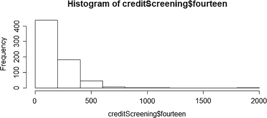

图 4.3 creditScreening$fourteen 的直方图。

还有用于检测离群值的函数。我们将调查第 5 章中 `car` 包提供的 `outlierTest` 函数。由于离群值检测器不考虑显著性，运算符检测到的离群值可能没有用。在使用像神经网络等未在建模过程中内置属性选择的机器学习方法时，最好在尝试检测离群值之前，先对数据应用属性选择技术。

### 4.3.4 缺失数据

插补是一个用于用替换值替换缺失数据的通用术语。在大多数情况下，缺失属性值表示信息的丢失。例如，属性 `age` 的缺失值确实表示一个存在但未记录的数据项。然而，`salary` 的缺失值可能被视为一个未输入的数据项，但也可能表示该个人失业了。某些机器学习技术能够直接处理缺失值。然而，许多方法要求所有属性都包含值。

在将数据提交给学习算法*之前*，处理缺失数据的可能方案包括：

- *丢弃缺失值的记录*。当总实例数中的一小部分包含缺失数据，且我们确定缺失值确实代表了丢失的信息时，这种方法最为合适。

*   对于实值数据，用类别的平均值替换缺失值。在大多数情况下，对于数值属性来说，这是一个合理的方法。而将缺失的数值数据替换为零或任意的大值、小值等选项通常不是一个好的选择。

*   用其他高度相似实例中的值来替换缺失的属性值。这种技术既适用于分类属性也适用于数值属性。

某些机器学习技术允许实例包含缺失值。以下是机器学习技术在学习过程中处理缺失数据的三种方法：

1.  `忽略缺失值`。许多机器学习算法——包括神经网络（第 8 章）和贝叶斯分类器（第 5 章））——都使用了这种方法。

2.  `将缺失值视为等价比较`。这种方法在处理噪声很大的数据时是危险的，因为不相似的实例可能看起来非常相似。

3.  `将缺失值视为不等价比较`。这是一种悲观的方法，但可能是合适的。两个包含多个缺失值的相似实例将看起来是不不相似的。

最后，一种基于知识的缺失信息解决方法使用监督学习来确定缺失数据的可能值。当缺失属性是分类属性时，我们将具有缺失值的属性指定为输出属性。使用该属性具有已知值的实例来构建分类模型。然后调用创建的模型对具有缺失值的实例进行分类。对于数值数据，我们可以使用回归技术或神经网络，并应用相同的策略。

`functions.zip` 中有两个为你的文本编写的函数，旨在帮助检测和替换缺失项。给定一个数据框，`removeNAS` 列出所有至少包含一个 NA 的实例。它返回一个删除了所有具有缺失数值数据实例的数据框。第二个函数 `RepVal` 将数据框中指定列的任何项替换为指定值。例如，调用

```
y<-repVal(creditScreening, 1, '?','a')
```

会创建一个新数据框 `y`，其中第一列中所有的 ‘?’ 值都被替换为‘a’。

# 4.4 数据转换

数据转换可以有多种形式，并且出于多种原因是必要的。在接下来的章节中，我们将描述一些常见的数据转换。

## 4.4.1 数据归一化

一种常见的数据转换涉及改变数值，使其落在指定的范围内。神经网络等分类器对于缩放到 0 到 1 之间范围的数值数据表现更好。归一化对于基于距离的分类器特别有吸引力，因为通过归一化属性值，取值范围大的属性不太可能超过初始范围较小的属性。四种常见的归一化方法包括：

*   `小数缩放`。小数缩放将每个数值除以相同的 10 的幂次。例如，如果我们知道某个属性的值范围在 –1000 到 1000 之间，我们可以通过将每个值除以 1000 来将范围改为 –1 到 1。

*   `Min-Max 归一化`。当已知属性的最小值和最大值时，Min-Max 是一种合适的技术。公式为：

    $$NewValue = \frac{originalValue - oldMin\left( NewMax - newMin \right) + newMin}{oldMax - oldMin}$$

    其中 `oldMax` 和 `oldMin` 代表该属性的原始最大值和最小值。`NewMax` 和 `newMin` 指定新的最大值和最小值。`NewValue` 代表 `originalValue` 的转换。这种转换对于目标范围为 [0,1] 的神经网络特别有用。在这种情况下，公式简化为：

    $$NewValue = \frac{originalValue - oldMin}{oldMax - oldMin}$$

*   `使用 Z-score 归一化`。Z-score 归一化通过从值减去属性平均值（`μ`）并除以属性标准差（`σ`）将值转换为标准分。具体来说：

    $$newValue = \frac{originalValue - \mu}{\sigma}$$

    这种技术在未知最大值和最小值时特别有用。

*   `对数归一化`。数字 `n` 的底数 `b` 对数是使 `b` 升幂后等于 `n` 的指数。例如，64 的底 2 对数是 6，因为 2⁶ = 64。将一组值替换为它们的对数的效果是在不丢失信息的情况下缩放取值的范围。

R 的通用函数 `scale` 将一列数值数据缩放到均值为 0、标准差为 1。执行以下语句可以清晰了解 `scale` 函数如何归一化 `ccpromo$Age`。

```
my.sc <- scale(ccpromo$Age)
str(my.sc)
my.sc <- data.frame (col1=my.sc)
str(my.sc)
my.sc<-as.numeric(my.sc$col1)
my.sc
sd(my.sc)
mean(my.sc)
```

## 4.4.2 数据类型转换

许多机器学习工具（包括神经网络和某些统计方法）无法处理分类数据。因此，将分类数据转换为数值等值是一种常见的数据转换。

## 4.4.3 属性和实例选择

具有内置属性选择的决策树等分类器不太受到包含无关属性数据集的影响。遗憾的是，许多机器学习算法（如神经网络和最近邻分类器）无法区分相关属性和无关属性。这是一个问题，因为这些算法在处理含有大量属性的数据时通常表现。。此外，证明证明构建准确监督模型所需的训练实例数量受无关属性数量的影响。为了克服这些问题，我们必须决定构建模型时使用哪些属性和实例。以下是一种帮助我们进行属性选择的可能算法：

该算法将为我们提供最好的结果。该算法的问题在于其复杂度。如果我们总共有 `n` 个属性，所有属性组合的总数为 2ⁿ – 1。对于任何包含多个属性的数据集，生成并测试所有可能的模型是不可能的。让我们研究可以使用的技术。

### 4.4.3.1 封装和过滤技术

属性选择方法通常分为封装和过滤技术。`过滤`方法根据独立于构建最终模型算法的质量指标来选择属性。在`封装`技术中，属性的好性是在构建最终模型所用算法的上下文中衡量的。也就是说，算法被封装在属性选择过程中。你将在后面的章节中看到这两种方法的示例。

### 4.4.3.2 更多属性选择技术

除了应用封装和过滤技术外，还可以采取其他步骤来帮助确定从考虑中消除属性：

1.  高度相关的输入属性是冗余的。当一组高度相关的属性中仅指定一个属性作为输入值时，大多数机器学习工具都能构建更好的模型。检测相关属性的方法包括图形化技术以及定量测量。

2.  `主成分分析` 是一种统计技术，它通过用较少的人造值替换原始属性，来寻找并消除数据内部可能的相关冗余。

3. `self-organizing map`（自组织映射）或 `SOM` 是一种通过无监督学习训练的神经网络，可用于属性压缩。当我们关注神经网络模型时，在第 8 章 中介绍了 `SOMs`。

### 4.4.3.3 创建属性

预测能力较低的属性有时可以与其他属性结合，形成具有高程度预测能力的新属性。例如，考虑一个包含股票数据的数据库。可以想象的属性包括当前股票价格、12 个月价格范围、增长率、收益、市值、公司行业等。其中 `price` 和 `earnings` 属性在确定未来目标价格方面具有一定的预测价值。然而，市盈率（`P/E ratio`）被认为更有用。另一个可能有效预测未来股票价格的创建属性是股票市盈率除以公司增长率。以下是用于创建新属性的常用转换方法：

- 创建一个新属性，其中每个值代表一个属性的值除以另一个属性的值的比率。

- 创建一个新属性，其值是两个现有属性值之间的差值。

- 创建一个新属性，其值计算为两个当前属性的百分比增加或百分比减少。给定两个值 `v[1]` 和 `v[2]`，且 `v[1]` < `v[2]`，则 `v[2]` 对于 `v[1]` 的百分比增加计算为：

$$Percent Increase\left( v_{2},v_{1} \right) = \frac{v_{2} - v_{1}}{v_{1}}$$

如果 `v[1]` > `v[2]`，我们从 `v[1]` 中减去 `v[2]` 并除以 `v[1]`，得到 `v[2]` 对于 `v[1]` 的百分比减少。

表示差值以及百分比增减的新属性对于时间序列分析特别有用。`Time series analysis` 模型随间隔的变化。因此，通过计算一个间隔与下一个间隔之间的差值而创建的属性属性。

## 4.4.4 创建训练和测试数据

一旦对数据完成预处理和转换，建模之前的最后一步是选择训练和测试数据。监督学习的一种常见场景是从随机化数据开始。随后选择 2/3 的数据用于模型构建，剩余的 1/3 用于测试。下面使用 `credit` 数据说明了这一点。让我们来看每条语句。

```
set.seed(1000)
### 随机化并划分数据，用于 2/3 训练，1/3 测试
credit <- credit
index <- sample(1:nrow(credit), 2/3)
train <- credit[index,]
test <- credit[-index,]
```

`set.seed` 函数为伪随机数生成器生成一个初始起点。每次使用相同的种子使得我们的实验具有可重复性。接下来，为实验创建了 `credit` 数据框的副本。`sample` 函数接收两个参数。第一个参数是数据框中的总行数——在本例中为 690。第二个参数指定样本的大小。在这种情况下，`index` 将包含一个位于 1 到 690 之间的 460 个随机整数值的列表。

语句 `credit[index,]` 将 `index` 指定行号的所有实例复制到 `train`。最后，`credit[-index,]` 指定 `test` 接收剩余 1/3 实例的副本。如果需要数据归一化，则会在采样之前使用 `scale` 函数。

我们提供了一种用于随机化和划分训练与测试数据的方法。还有无数其他技术可以实现相同的结果。下一节概述了在数据缺失时训练-测试场景的替代方案。

## 4.4.5 交叉验证和自助法

如果没有足够的测试数据，我们可以应用名为 `cross validation`（交叉验证）的技术。通过这种方法，所有可用数据被分为 `n` 个固定大小的单元。其中 `n-1` 个单元用于训练，而第 `n` 个单元是测试集。重复此过程，直到每个固定大小的单元都用作测试数据。模型测试集的正确性计算为 `n` 次训练-测试试验实现的平均准确率。实验结果表明，在大多数情况下，`n` 的值为 10 时最佳。将交叉验证多次应用于数据，有助于确保训练和测试数据集中类的分布相等。

`Bootstrapping`（自助法）是交叉验证的替代方案。通过自助法，我们允许训练集过程多次选择同一个训练实例。这是通过在每个训练实例被选中训练后将其放数据池实现的。从数学上可以证明，如果使用自助技术对包含 `n` 个实例的数据集进行 `n` 次采样，训练集将包含大约 `n` 个实例的三二。这留下了三分之一的实例用于测试。

## 4.4.6 大数据

虽然传统的机器学习算法假设整个数据集存储在内存中，但目前的数据通常太大，无法满足这一要求。处理此问题的一种方法是尽可能处理数据，同时反复从辅助存储设备检索剩余数据。显然，考虑到辅助存储数据检索的效率低下，这种解决方案是不合理的。另一种可能性是采用分布式环境，数据可以分发在多个处理器之间。当这不可行时，我们必须将可能的算法选择限制在那些具有可扩展性属性的算法上。

如果在给定固定内存的情况下，运行时间随数据集中记录数量线性增加，则称该算法是 `scalable`（可扩展的）。可扩展性的简单方法是采样。通过这种技术，使用可以在内存中高效处理的数据子构建并测试模型。这种方法在数据包含极少离群值时对监督学习和无监督聚类效果良好。然而，很难将这种方法作为处理大数据的通用方法。

一些传统算法，如 `Naïve Bayes classifier`（朴素贝叶斯分类器）（第 5 章）是可扩展的。`Cobweb` 和 `Classit`（[第 11 章](#ch11.xhtml#chapter11)）是两种可扩展的无监督聚类技术，因为数据增量处理并丢弃。

## 4.5 章总结

知识发现可以建模为一个七步过程，包括目标识别、目标数据创建、数据预处理、数据转换、数据挖掘、结果解释与评估以及知识应用。对要完成的任务进行清晰陈述是知识发现成功的良好起点。创建目标数据集通常涉及从仓库、事务数据库或分布式环境中提取数据。事务数据库不存储冗余数据，因为它们的设计模型是为了快速更新和检索信息。因此，在应用数据挖掘之前，必须对事务数据库的数据结构进行修改。

在运行机器学习工具之前，需要对收集的数据进行预处理以消除噪声。缺失数据是一个特别关注的问题，因为许多算法无法处理缺失项。除了数据预处理外，在建模之前还可以应用数据转换技术。为了获得最佳结果，通常需要数据归一化、属性创建或消除等数据转换方法。

## 4.6 关键术语

- **属性过滤 (Attribute filtering)**。属性过滤方法根据某些质量衡量标准选择属性，该衡量标准与用于构建最终模型的算法无关。

- **自助法 (Bootstrapping)**。允许实例在训练集中出现多次。

- **交叉验证 (Cross validation)**。将数据集划分为 `n` 个固定大小的单元。其中 `n - 1` 个单元用于训练，第 `n` 个单元用作测试集。重复此过程，直到每个固定大小的单元都曾用作测试数据。模型测试集的准确性通过 `n` 次训练-测试实验所实现的平均准确率来计算。

- **数据归一化 (Data normalization)**。一种数据转换技术，将数值修改为落在指定的范围内。

- **数据预处理 (Data preprocessing)**。KDD 过程中处理噪声数据和缺失数据的步骤。

- **数据转换 (Data transformation)**。KDD 过程中处理数据归一化、转换以及属性的添加和/或消除的步骤。

- **小数缩放 (Decimal scaling)**。一种针对数值属性的数据转换技术，将每个值除以相同的 10 的幂次。


- **对数归一化 (Logarithmic normalization)**。一种针对数值属性的数据转换方法，将每个数值替换为其底为 `b` 的对数。

- **离差值归一化 (Min-Max normalization)**。一种数据转换方法，用于转换一组数值属性值，使其落在指定的数值范围内。

- **噪声 (Noise)**。数据中的随机误差。

- **离群值 (Outlier)**。根据某种衡量标准偏离其他实例的实例。

- **关系型数据库 (Relational database)**。一种数据表示为包含行和列的表集合的数据库。表的每一列被称为属性，表的每行存储关于一个数据记录的信息。

- **时间序列分析 (Time series analysis)**。任何对随时间变化的行为变化进行建模的技术。

- **元组 (Tuple)**。关系型数据库中表的单行。

- **封装技术 (Wrapper technique)**。一种属性选择方法，其属性优性基于构建最终模型时使用的学习算法的上下文。

- **Z-score 归一化 (Z-score normalization)**。一种针对数值属性的数据归一化技术，将每个数值替换为其与均值的标准差。

# 练习

## 复习题

1. 区分以下术语：

    1. 数据清洗与数据转换

    2. 内部与外部数据平滑

    3. 小数缩放与 Z-score 归一化

    4. 过滤与封装属性选择

2. 在第 4.4 节 中，你学习了机器学习算法在学习过程中处理数据的数据的方法。判断哪种技术适用于以下问题。解释每个选择的原因。

    1. 设计用于接受或拒绝信用卡申请的模型。

    2. 用于确定谁应该通过邮寄收到促销传单的模型。

    3. 用于确定可能患上结直肠癌的个体的模型。

    4. 用于决定在特定区域钻探石油的模型。

    5. 用于批准或拒绝申请房屋转贷的候选人的模型。

## 使用 R 语言实验

1. 考虑脚本 4.1。复制该脚本并在新脚本中添加两个 SQL Select 子句，创建用于*杂志促销*和*观看促销*的“是/否”响应响应列。使用 `cbind` 将每列添加到 `ccpLife` 中。同时，务确保从最终表中删除 `PromotionID` 列。你的最终输出将显示一个具有以下标题的表：CustomerID, IncomeRange, Gender, Age, LifeInsPromo, MagazinePromo, 和 WatchPromo。

## 计算题

1. 针对表 2.2 中数据的 `age` 属性，设定一个 Min-Max 归一化的通用公式。转换数据使新的最小值为 0，新的最大值为 1。应用该公式确定 `age = 35` 转换后的值。

2. 回答以下关于百分比增长和百分比减少的问题。

    1. 某只股票的价格从 $25.00 增加到 $40.00。计算股票价格的百分比增长。

    2. 股票原价为 $40.00。价格下降了 50%。目前的股价是多少？

3. 你将对某个数值属性应用底 2 对数归一化，该属性当前的值范围在 2300 到 10,000 之间。完成完成后，该属性的新值范围是多少？

4. 对表 2.2 中属性 `age` 的值应用底 10 对数归一化。使用表格列出原始值以及转换后的值。

# 已安装的包和函数

| 包名 | 函数(s) |
| :--- | :--- |
| `base / stats` | `abs`, `c`, `cat`, `colnames`, `data.frame`, `factor`, `length`, `library`, `ncol`, `nrow`, `return`, `round`, `sample`, `scale`, `set.seed`, `setwd`, `str`, `summary`, `table`, `unique` |
| `car` | `outlierTest` |
| `DBI / SQLite` | `dbConnect`, `dbDisconnect`, `dbGetQuery` |

# 第 5 章

## 监督统计技术

本章内容

- 线性回归
- 逻辑回归
- 贝叶分类器
- 模型评估

数学和统计学为机器学习领域奠定了基础。因此，我们讨论机器学习的一个良好起点是检查监督方法。这些方法被称为*统计*方法，是因为它们对数据做了某些假设。如果违反了这些假设，对结果所进行的显著性检验可能是不准确的。在这些技术中，输入属性通常被称为*自变量*或*特征*，输出属性描述为*响应*或*因变量*。在第 5.1 节中，我们从简单线性回归开始，即单个输入属性决定数值结果。第 5.2 节的侧重点是多元线性回归，即多个输入属性建立数值结果。在第 5.3 节中，我们讨论了逻辑回归以及它如何用于为具有二分类结果的数据集构建学习模型。在第 5.4 节中，你将学习贝叶分类器如何为类别和数值输入数据构建监督模型。让我们开始吧！

## 5.1 简单线性回归

统计*回归*是一种监督技术，通过创建一个连接一个或多个输入属性与单个输出属性的数学方程，对一组数值数据进行泛化。在*线性回归*中，我们尝试将因变量的变化建模为一个或多个自变量的线性组合。线性回归方程的形式为：

```
f(x[1], x[2], x[3]...x[n]) = a[1]x[1] + a[2]x[2] + a[3]x[3] + ... + a[n]x[n] + c
```

其中 `x[1]`、`x[2]`、`x[3]`、 …, `x[n]` 是自变量，`a[1]`、`a[2]`、`a[3]`、 …, `a[n]` 和 `c` 是常数。`f(x[1], x[2], x[3], …, x[n])` 代表因变量，通常简单地表示为 `y`。通常，线性回归是统计学家们的青睐，当因变量与自变量之间的关系几为线性时，其效果通常良好。

线性回归方程的最简单形式允许单个自变量作为因变量的预测因子。这种回归被恰地命名为*简单线性回归*。回归方程以*斜率截距形式*写入。具体而言，

`y = ax + b` (5.2)

其中 `x` 是自变量，`y` 取决于 `x`。常数 `a` 和 `b` 通过监督学习计算得出，即对已知 `x` 和 `y` 值的数据集应用统计准则。方程 5.2 的图表是一条斜率为 `a`、`y` 截距为 `b` 的直线。

用于计算 `a` 和 `b` 的常用统计量是*最小二法准则*。最小二法准则最小化了实际输出值与预测输出值之间平方和。通过最小二法推导 `a` 和 `b` 需要微积分知识。因此，我们只需列出计算 `a` 和 `b` 的公式。对于总共 `n` 个实例，我们有：

$${\begin{matrix} {b = \frac{\Sigma \textit{xy}}{\Sigma x^{2}}} & {a = \frac{\Sigma y}{\Sigma n}} \\ \end{matrix} - \frac{b\Sigma y}{n}}$$ (5.3)

有了这些基础，让我们使用标题为“伽马射线暴发数据集”框的数据子集创建一个回归模型。该数据集非常有趣，因为伽马射线暴发是我们宇宙中最强大的单一事件，而且对于数据中存在的聚类数量存在相当大的争议（Mukherjee et al., 1998）。我们的示例旨在说明简单线性回归。因此，我们必须将实验限制在数据七个属性中的两个。让我们检查脉冲长度的两个测量值——`t90` 和 `t50` 之间线性关系的程度。

导入数据集 `Grb4u.csv` 并加载 `Script 5.1 Simple Linear Regression`——两者都是文本辅助材料的一部分——到你的 RStudio 编辑器中。该脚本包含了使用 `t90` 作为响应变量、`t50` 作为唯一输入变量来执行简单线性回归的代码。下文给出了 `Script 5.1` 的编辑版本——为了节省空间删除了一些文本。我们的目标是检查这两个伽马射线暴发长度测量值之间的关系。你可以通过在控制台中输入 `ctrl+enter` 或使用编辑器的 `run` 图标来逐行执行脚本。脚本中的第一行可执行代码打印了数据集中的前六实例。`round` 函数限制了小数点后的位数。变量 `grb` 是通过从原始数据中提取 `t50` 和 `t90` 创建的。`summary` 函数显示 `t90` 和 `t50` 的范围。`cor` 函数返回一个大于 0.95 的值，告诉我们 `t50` 和 `t90` 高度相关。这强烈暗示了 `t90` 和 `t50` 之间的关系是线性的。

获取线性模型的 R 函数是 `lm()`。对于我们的示例，我们有：

```
my.slr <- lm(t90 ~ t50, data = grb)
```

对象 `my.slr` 存储有关创建模型的信息。括号内的语句分两部分给出。最左边的组件是回归公式，输出 `t90` 后面跟着一个波浪号。接下来是输入属性列表，在我们案例中是 `t50`。逗号后面是数据集名称。该方程存在几种等价的括号形式。其中两个值得注意的是：

```
grb$t90 ~ grb$t50, data = grb
t90 ~ ., data = grb
```

在第一个示例中，我们看到变量 `t90` 前带有文件名。在这里，不需要指定数据集名称，因为数据集引用通过 `data=grb` 解析。第二个示例中给出的点-逗号格式意味着将使用所有属性。输入属性之间的 `+` 号用于指定可用属性的子集。例如，

```
t90 ~ t50 + fl + hr32, data = Grb4u
```

表示 `t50`、`fl` 和 `hr32` 将用于创建多元回归模型。这种格式起初可能有点晦懂，但你会习惯的！关于 `lm` 的附加信息可以通过 `help(lm)` 或输入 `?lm` 获取。`plot` 和 `abline` 函数提供了图 5.1 所示的图表。该图清楚地显示了 `t50` 和 `t90` 之间的线性关系。可以使用 `attach` 函数在 plot 语句中避免 `grb$`。

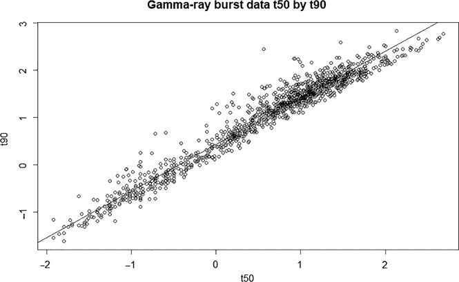

图 5.1 伽马射线暴发数据 t50 对 t90。

`summary` 函数输出的部分以概率和显著性水平的形式给出，这些是理解输出所需的（统计概念（见第 9 章）。*显著性水平*是我们愿意拒绝结果纯属偶然的概率。显著性水平也可以定义为错误拒绝纯偶然事件的概率。显著性水平通常由字母 `p` 表示，并在实验开始之前选择。常见的 `p` 选择有 `p <= 0.05` 或 `p <= 0.01`。例如，假设我们将两种机器学习模型（`A` 和 `B`）应用于测试数据集以帮助判断哪个是更好的选择。我们决定使用 `p <= 0.05` 作为显著性水平。假设实验结果显示模型 `B` 优于模型 `A`，`p = 0.03`。根据这一结果，我们有 95% 的确定 `A` 是更好的选择。或者，如果选择 `p <= 0.01` 作为显著性水平，我们的结论是模型之间没有显著差异。用于计算显著性水平的两种定量量是 `t` 统计量 F` `。

`summary(my.slr)` 提供了几个感兴趣的项目。我们首先看到 `lm()` 的调用。接下来，我们有了残差的信息。`residual` 代表误差，是通过实际值与计算值之间的差计算得。

`Coefficients` 表提供了我们指定回归方程所需的信息。具体而言，

`t90 = 0.985*t50 + 0.428`

`t value` 标题下的值是 `Estimate` 除以 `Std. Error` 计算的 `t` 分。`Pr(>|t|)` 是我们确定测试系数的 `t value` 显著异于零的显著性水平。如所示，截距和 `t50` 系数不为零的确定位于 99% 到 100% 之间。

多元 R 方（0.9498）可以被认为是 `t90` 的实际值与预测值之间的相关性。因此，它衡量了输入变量解释的变异量。调整后的 R 方通过考虑实例数量和使用的变量数量对多元 R 方进行归一化。R 方越接近 1，表示回归方程越拟合输出数据。

`residual standard error`（残差标准误差）显示为 0.21 是预测输出值的平均误差。它的计算方法是所有残差和除以自由度的平方根。`Degrees of freedom`（自由度）被定义为统计量计算中可以自由变化的数值个数。为了说明，如果我告诉你三个整数之和为 24，你可以自由选择其中两个整数的任意值。然而，为了满足求和标准，第三个选择必须是一个整数，且其与前两个整数之和相加后等于 24。因此，该计算有两个自由度。

对于我们的示例，`residual standard error` 的自由度必须考虑到 `squared sum of the residuals`（残差平方和）和 `regression model`（回归模型）。对于残差平方和，1178 个实例的误差贡献是可以自由变化的。最后一个实例的数值受限于特定值，这些值必须确保所有平方误差之和得到正确的总和。回归模型的自由度对应于已估计的系数个数减 1。包括截距在内，有两个系数，因此回归模型有 2 – 1 = 1 个自由度。因此，`residual standard error` 的自由度为 1178 – 1 = 1177。

与特定模型相关的自由度可以通过函数 `df.residual(model)` 获取。此外，用于计算 `residual standard error` 的残差平方和值由函数 `aov(model)` 给出。然而，需要注意的是，这些函数依赖于数据，当模型应用于新数据时无法使用。

与 `F statistic`（F 统计量）相关的 `p-value` 将仅包含截距的模型与指定的特定模型进行比较，并告诉我们至少有一个输入变量在随机性之外决定了输出变量。换句话说，`p-value` 是仅通过随机误差获得的 `F` 值至少与计算值一样极端的概率。2.2e-16 的 `p-value` 几乎消除了任何随机误差事件的可能性。

另外两个感兴趣的函数是用于打印 `t90` 计算值的 `fitted` 函数，以及显示实际值与计算出的 `t90` 值之间误差的 `residuals` 函数。这些函数对前六个实例的输出在脚本中给出。

这些结果的总体强烈表明，我们的回归方程紧密地模拟了 `t90`。这并不意外，因为 `t50` 是伽马射线暴距离的另一种衡量标准。然而，我们必须记住，这些统计数据是基于构建模型时使用的数据。我们没有关于该方程在面对未见数据时表现如何的信息。

最后，简单线性回归既易于理解也易应用。然而，它只允许单个独立变量的事实使得该技术在大多数机器学习应用中的用途有限。让我们通过多元线性回归扩展我们的视野吧！

## 5.2 多元线性回归

最小二乘法也用于创建两个以上变量的线性回归方程。将方程 5.1 写为

`y` = `Σ` `a`[`i]`x`[`i]` + `c` (5.4)

且 `i` 从 1 变到 `n`，回归算法确定 `c` 和 `a`[`i]` 值，以使所有实例的实际值（`y`[`i]`）与预测值（`ŷ`[`i]`）之间的平方差和最小。目标是最小化以下内容：

$$
\Sigma\left( y_{i} - {\overset{\hat{}}{y}}_{i} \right)^{2} = \Sigma\left( e_{i} \right)^{2} \tag{5.5}
$$


让我们通过多元线性回归示例继续对伽马射线暴数据的研究。我们的目标是开发一个能够确定 `t90` 的回归模型，但这次使用暴发亮度和硬度作为输入特征。

## 5.2.1 多元线性回归：示例

`Script 5.2` 列出了我们多元线性回归示例的步骤。第一条语句加载了可在 CRAN 仓库中的 `car package`——因为它包含了 `scatterplotMatrix` 函数，该函数允许我们以图形方式检查变量对之间的散点图关系。接下来，我们使用 `head` 函数来提醒我们属性名称。`cor` 函数说明了 `p256 & fl`、`hr321 & hr32` 以及 `t50 & t90` 之间的高相关性。我们将消除每对特征中的一个，包括 `t50`，如 `Script 5.1` 所示，`t50` 是 `t90` 的可行替代方案。

`Figure 5.2` 显示了散点图矩阵，其中我们看到每对变量的散点图。右上角的散点图支持 `fl` 和 `t90` 之间的强线性关系——这通过相关表中发现的 0.683 值得到了验证。图还清楚地显示了暴发长度与暴发硬度之间的负相关性。

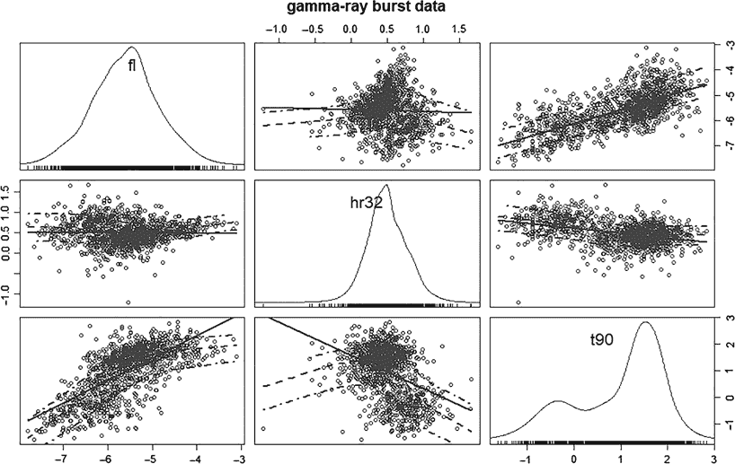

FIGURE 5.2 伽马射线暴数据的散点图矩阵。

矩阵的主对角线显示每个变量的密度图。我们可以使用 `densityPlot` 函数打印单个变量的密度图。`Figure 3` 展示了将 `densityPlot` 应用于 `t90` 的结果。我们看到大多数暴发的长度在 1 到 2 秒之间。

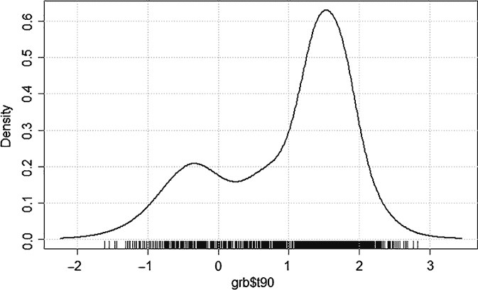

FIGURE 5.3 t90 的密度图。

`summary` 函数告诉我们所有系数都显著于零。0.6035 的 R 方值结合显著的 `F` 统计量表明我们的模型衡量了响应变量 60%。最后，我们使用 `anova` 函数来更好地理解每个输入属性。简单来说，`F` 值越大，变量对减少误差的贡献越大。

再次，我们所有的分析都是基于构建模型时的数据。我们没有关于该方程在面对未见数据时表现如何的信息。是时候对我们的回归模型进行真正的测试了！首先，这里有三个评估性能的定量指标。

## 5.2.2 评估数值输出

我们已经看到了评估回归方程拟合数据的几个有用统计量。对于具有数值输出的模型，另外三个统计量是均方误差、均方根误差和平均绝对误差。这些指标在评估模型面对测试数据时的性能时特别有用。

均方误差（`mse`）是实际输出与计算输出之间的平均平方差，如方程 5.6 所示。

$$
{\textit{mse} = \frac{\left( a_{1} - c_{1} \right)^{2} + \left( a_{2} - c_{2} \right)^{2} + \cdot \cdot \cdot + \left( a_{i} - c_{i} \right)^{2} + \cdot \cdot \cdot + \left( a_{n} - c_{n} \right)^{2}}{n}}
$$

其中对于 `i` 个实例，

*   `a[i]` = 实际输出值
*   `c[i]` = 计算输出值

均方根误差（`rms`）只是均方误差的平方根。通过应用平方根，我们将 `mse` 的维度降低到实际误差计算的维度。对于小于 1.0 的值，`rms` > `mse`。

你可能已经注意到方程 5.6 中的分子项是用于计算残差标准误差（`rse`）的残差平方和（`residual sum of squares`）值。`rms` 和 `rse` 计算的区别在于除数。对于 `rms`，除数是实例总数；而 `rse` 是通过除以自由度计算的。由于 `rse` > `rms`，`rse` 是更严谨的统计量。

平均绝对误差（`mae`）计算实际值与计算输出值之间的平均绝对差。`mae` 的优势是受实际值与计算值之间巨大偏差的影响较小。此外，`mae` 保持了误差值的维度。公式 5.7 正规范了这一定义。

$${\textit{mae} = \frac{\left| a_{1} - c_{1} \right| + \left| a_{2} - c_{2} \right| + \cdot \cdot \cdot + \left| a_{n} - c_{n} \right|}{n}}\mspace{180mu}\operatorname{(5.7)}$$

让我们来看一个在训练/测试集场景中使用这些指标的脚本，用于评估一个确定爆发长度的多元线性回归模型。

## 5.2.3 训练/测试集评估

`Script 5.3` 显示了该过程，首先对伽马射线暴数据进行随机化和拆分——2/3 用于训练，1/3 用于测试。接下来，调用 `lm` 创建回归模型。`summary` 函数给出的残差标准误差为 0.6185，多重 R 方值为 0.5661，调整后 R 方值为 0.5665。`F` 统计量向我们确保模型并非偶然随机事件的结果。

接下来，你将看到对 `mmr.stats` 函数的调用。该函数是专门为书中的示例编写的，可以在补充材料中的 `functions.zip` 文件中找到。要让 `mmr.stats` 成为 RStudio 全局环境的一部分，请在源编辑器中打开 `mmr.stats` 并点击 `run`。以下是 `mmr.stats` 的使用方法。

传递给 `mmr.stats` 的参数是回归模型、测试文件以及输出变量。该函数打印 `mae`、`mse`、`rms` 和 `rse` 的值，然后返回一个四列表格，显示实际值和预测值，以及每个测试集实例的绝对误差和平方误差。以下是 `Script 5.3` 中的函数调用。

```
output <- mmr.stats (grb.mlr, grb.test, grb.test$t90)
```

`mmr.stats` 使用了基础函数 `predict`，这非常关键，因为它在书中被多次使用。当给定模型和测试数据集时，`predict` 将模型应用于测试数据，并返回一个包含输出变量预测值的向量。预测输出可以是数值型或分类的。

```
predicted <- predict (model, test)
```

当给 `predict` 一个模型和测试数据集时，它会将模型应用于测试数据，并返回一个包含输出变量预测值的向量。预测输出可以是数值型或分类的。

## 5.2.4 使用交叉验证

在没有足够数据时，交叉验证通常是首选方法。`Script 5.4` 显示了该过程，首先对伽马射线暴数据进行随机化和拆分——2/3 用于训练，1/3 用于测试。接下来，调用 `lm` 创建回归模型。`summary` 函数给出的残差标准误差为 0.6185，多重 R 方值为 0.5661，调整后 R 方值为 0.5665。`F` 统计量向我们确保模型并非偶然随机事件的结果。

接下来，你将看到对 `mmr.stats` 函数的调用。该函数是专门为书中的示例编写的，可以在补充材料中的 `functions.zip` 文件中找到。要让 `mmr.stats` 成为 RStudio 全局环境的一部分，请在源编辑器中打开 `mmr.stats` 并点击 `run`。以下是 `mmr.stats` 的使用方法。

传递给 `mmr.stats` 的参数是回归模型、测试文件以及输出变量。该函数打印 `mae`、`mse`、`rms` 和 `rse` 的值，然后返回一个四列表格，显示实际值和预测值，以及每个测试集实例的绝对误差和平方误差。以下是 `Script 5.3` 中的函数调用。

```
output <- mmr.stats (grb.mlr, grb.test, grb.test$t90)
```

`mmr.stats` 使用了基础函数 `predict`，这非常关键，因为它在书中被多次使用。当给定模型和测试数据集时，`predict` 将模型应用于测试数据，并返回一个包含输出变量预测值的向量。预测输出可以是数值型或分类的。

## 5.2.5 带有分类数据的线性回归

线性回归也可用于为具有分类值的输入变量构建模型。为了这一点，在关注逻辑回归之前，让我们将多元线性回归应用于[第 12 章]案例研究中使用的 `Ouch’s Back & Fracture Clinic` (`OFC`) 数据集的小子集。数据是真实的，但诊所名称是虚构的！这个完整数据集带来了许多挑战，因为它包含 96 个属性，同时支持分类和数值数据，并且包含大量缺失项。这里的目标是让你熟悉该数据集，并向你展示更新和比较两个或线性模型的方法。

### 5.2.5.1 Ouch’s Back and Clinic 数据

Arthur Jones（Nautilus 健身设备的开发者）于 1972 年创立了 MedX 公司 ([`medxonline.net/`](http://medxonline.net/))，唯一目的是设计机器来测试和加强膝盖和背部的肌肉。他的理论认为疼痛与力量以及疼痛与灵活性之间存在可衡量的反比关系。[图 5.4] 显示了 MedX 腰部扩展器使用的骨盆限制系统，该系统旨在孤立和加强腰柱。

第 12 章中的案例研究使用了一个包含 1330 条患者记录（其中 737 名为女性）的数据集，这些患者通过 MedX 机器接受了针对腰部损伤的侵入性物理治疗。该案例研究的目标之一是寻找识别那些在治疗前可能无法成功完成治疗计划的患者的关系。在这里我们对 48 名男性患者的子集进行了一个小型初步研究，并结合了从原始数据提取的 96 个属性中的 12 个。我们的目标是确定使用该数据子集进行多元线性回归，以预测治疗开始前预计治疗结束时的疼痛水平的可行性。通过这种方式，患者和治疗师都对治疗结果有一个初步的预期。首先，将位于 `OFCM.csv` 中的患者数据导入到 RStudio 中。

`Script 5.5` 显示了该实验的步骤以及编辑后的输出。第一个操作是删除属性。由于所有数据实例均为男性，因此性别属性是无用的。此外，`visits`、`LE.rom.out` 和 `LE.wt.out` 代表治疗结束时的值，必须删除。`summary(ofc.data)` 提供了剩余七个输入属性以及输出属性 `oswest.out` 的描述性统计。

属性 `age`（年龄）、`height`（身高）和 `weight`（体重）是自言自明的。`INS` 是代表患者医疗保险类型的代码。原始数据错误地将 `INS` 标记为整数。`LE.wt.in`（腰椎伸展重量）和 `LE.rom.in`（腰椎伸展活动范围）属性提供了每个患者治疗前的腰部强度和灵活性测量值。这些是在患者最初使用 MedX 腰部机器时获取的计算机化值。`Oswest.in` 和 `oswest.out` 是正整数，表示完成治疗计划前（`oswest.in`）和后（`oswest.out`）的疼痛水平。这些得分具有一定的主观性，因为它们是从患者填写的问卷中获得的。通常认为 `oswest.out` 值小于 20 是一个成功的结果。

接下来的工作是检查属性之间的相关性（脚本中未显示）。感兴趣的相关性包括 `oswest.in` 和 `oswest.out` 之间 0.646 的相关、`LE.wt.in` 和 `oswest.in` 之间 -0.448 的相关，以及 `LE.wt.in` 和 `LE.rom.in` 之间 0.446 的相关。`LE.wt.in` 和 `oswest.in` 之间的负相关支持了腰部强度与疼痛水平之间的反向关系。

`set.seed` 后的语句将 `INS` 的数据类型更改为字符。R 通过创建 `v-1` 个辅助变量来处理具有 `v` 个值的变量到字符类型的转换。对于每个数据实例，辅助变量将是 0 或 1。对于我们的示例，我们创建了四个新变量——`INS2`、`INS3`、`INS4` 和 `INS5`。如果 `INS` 的原始值为 2，则名为 `INS2` 的新变量的值为 1，而 `INS3`、`INS4`、`INS5` 全部显示为 0。同样的逻辑适用于 `INS3`、`INS4` 和 `INS5`。如果原始值显示 `INS` = 1，则所有辅助变量都为 0。

接下来，调用 `lm` 时包含了 `na.action=na.omit`。值 `na.omit` 告诉我们任何包含至少一个缺失值的实例将被省略。由于 `na.omit` 是 `na_action` 的默认设置，只有在需要执行省略缺失值实例的其他操作时，才需要使用此函数。

`summary` 函数显示 `oswest.in` 是唯一显著不同于 0 的回归系数。此外，`residual standard error`（残差标准误差）显示 `oswest.in` 显著不同于 0。`F` 统计量的 `p` 值为 0.0025，说明模型是有效的。这里有三种方案：

- 使用 `update` 函数。
- 使用 `step` 函数来寻找更好的模型方案。
- 使用 `anova` 函数查看结果。

## 5.3 逻辑回归

在上一节中，你已经看到线性回归如何应用于具有数值和分类类型输入变量的数据集。线性回归也用于因变量（输出变量）代表二分类结果的情况。为了说明这一点，假设因变量是取值为 `healthy`（健康）或 `sick`（患病）的诊断。为了使用线性回归，我们必须有一个数值输出，因此我们将 `healthy` 替换为 `0`，将 `sick` 替换为 `1`。然而，使用线性回归对观测结果限制为两个值的模型进行建模，这种通用方法论存在严重缺陷。

问题在于，施在因变量上的值限制没有被回归方程观测到。这是因为线性回归产生的是直线函数；因变量的值在正方向和负方向上都是无界的。因此，为了使方程 5.1 的右侧与二分类结果一致，我们必须对线性回归模型进行转换。通过转换线性模型，将输出属性的值限制在 `[0, 1]` 区间范围内，回归方程可以被认为是在产生所测量事件发生或不发生的概率。

尽管存在多种转换线性回归模型的方法，但我们将讨论限制在逻辑模型（logistic model）上。逻辑模型应用对数变换，使得方程 5.1 的右侧变为转换方程中的指数项。

## 5.3.1 转换线性回归模型

逻辑回归是一种非线性回归技术，它将每个数据实例与条件概率相关联。为了理解逻辑模型执行的转换，我们首先将方程 5.1 视为计算概率。概率值 1 表示观测到一类（例如，`diagnosis = healthy`）。同样，概率 0 表示观测到第二类（例如，`diagnosis = sick`）。方程 5.8 是方程 5.1 的修改形式，其中方程的左侧写为条件概率。

```
p(y=1|x) = a[1]a[1] + a[2]x[2] + a[3]x[3] + ... + a[n]x[n] + c (5.8)
```

方程 5.8 将 `p(y = 1 | x)` 显示为一个无界值，表示给定特征（属性）向量 `x` 中包含的值时，观测与 `y = 1` 相关的类别的条件概率。为了消除方程中看到的边界问题，将概率转换为几率比（odds ratio）。具体来说，

```
( p(y = 1 | x) / (1 - p(y = 1 | x)) ) (5.9)
```

对于任何特征向量 `x`，几率（odds）表示与 `y = 1` 相关的类出现的频率相对于与 `y = 0` 相关的类观测频率。该几率比的自然对数（称为 `logit`）随后赋值给方程 5.8 的右侧。即：

```
ln( p(y = 1 | x) / (1 - p(y = 1 | x)) ) = ax + c (5.10)
```

其中：

*   `x` = `(x[1], x[2], x[3], …, x[n])`
*   `ax + c` = `a[1]x[1] + a[2]x[2] + a[3]x[3] + … + a[n]x[n]`


最后，我们对方程 5.10 求解 `p(y = 1 | x)` 以获得有界的表示，如方程 5.11 所示。

```
p(y = 1 | x) = \frac{e^{ax + c}}{1 + e^{ax + c}} \tag{5.11}
```

其中：

*   `e` 是自然对数的底，通常记作 `exp`。

## 5.3.2 逻辑回归模型

方程 5.11 定义了逻辑回归模型。图 5.6 显示方程图形是 S 型曲线，边界位于 `[0, 1]` 区间范围内。当指数项趋于负无穷时，方程 5.11 的右侧趋于 0。


该方法的目的是最小化对数和。当值不再变化时就会收敛。该技术的细节超出了本书的范围。

现在你已经了解了数学原理，让我们使用 R 将逻辑回归应用于心脏病数据集。预处理为训练/测试场景做好了准备。下一步是调用 `glm`（广义线性模型），它可以实现多种模型。其格式与 `lm` 类似，但增加了用于指定模型的参数。由于逻辑回归需要二分类输出，`0` 替换与 `healthy` 相关的水平，`1` 替换与 `sick` 相关的水平。

`summary` 函数给出所创建模型的系数。为了节省空间，删除了几个不显著的系数。注意，“血管数量”（number of vessels）对回归的贡献最为显著。

`predict` 函数将逻辑模型应用于测试数据。`Type = 'response'` 将输出显示为预测概率。对于每个测试集实例，`card.results` 将是 0 到 1 之间的数值。为了查看这一点，使用 `cbind` 创建了一个显示预测值和代表因子水平的整数的表格。`head` 函数列出了表格的前六行实例。

## 5.3.4 创建混淆矩阵

第 1 章向你展示了如何使用混淆矩阵来评估监督学习模型的准确性。可以很容易修改逻辑回归模型的数值输出来创建混淆矩阵。脚本 5.8 展示了如何操作！

要创建混淆矩阵，我们首先将计算出的测试集输出从概率列表转换为 1（*健康*）和 2（*患病*）的列表。这通过两个步骤完成：首先，`ifelse` 语句将大于 0.5 的概率替换为 2。小于 0.05 的概率值被替换为 1。一旦 `card.results` 中的值被转换为 1 和 2，我们就使用 `factor` 函数将 1 和 2 替换为它们关联的水平（`healthy` 或 `sick`）。然后，使用 `table` 函数创建混淆矩阵——`dnn` 指定表格的维度名称。第 3 章中的 `confusionP` 函数显示测试集准确率为 83.17%。我们看到 17 次错误分类中有 6 次是健康个体被误分类为患病。剩余的错误分类是患病个体被误分类为健康。

在许多情况下，分类准确率实际上不如错误分类的分布重要。例如，如果我们的目标是预测客户流失（可能可能停止服务的客户），那么一个显示出高水平总体准确率但无法识别流失客户的模型是没有价值的。下一节提供了一种分析备选模型之间错误分类分布的可视化方法（图 5.7）。

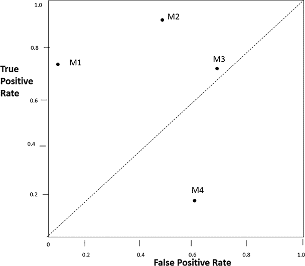

图 5.7 四个竞争模型的 ROC 曲线。

## 5.3.5 接收者工作特性 (ROC) 曲线

在查看接收者工作特性（ROC）曲线之前，我们需要了解一些混淆矩阵的术语。表 5.1 展示了一个二分类问题的混淆矩阵，其中*真阳性*和*真阴性*代表正确的分类。*假阴性*描述被错误识别为阴性（*否*）类的阳性实例。同样，*假阳性*是指被错误识别为阳性（*是*）类的阴性实例。有了这些定义，我们现在可以开始讨论*ROC 曲线*了。*ROC 曲线*是一种用于描述真阳性率和假阳性率之间权衡的二维图形方法。ROC 曲线首次用于第二次世界期间的雷达图像分析。今天，ROC 图是具有不平衡或成本敏感数据的二分类领域中特别有可视化和分析工具。

表 5.1 二分类预测的可能结果

| | | 预测类别 | |
| --- | --- | --- | --- |
| | | 是 | 否 |
| 实际类别 | 是 | 真阳性 (TP) | 假阴性 (FN) |
| 否 | 假阳性 (FP) | 真阴性 (TN) |

在 ROC 曲线中，真阳性率绘制在 y 轴上，假阳性率绘制在 x 轴上。对于类别 `C`，`true positive rate`（TP 率）计算方法是将正确分类为 `C` 的实例数量除以实际属于 `C` 的实例总数。具体来说，`TP rate = TP/(TP + FN)`。类别 `C` 的 `false positive rate`（FP 率）是将错误分类为 `C` 的实例总数除以不属于 `C` 的实例总数。即 `FP rate = FP/(FP + TN)`。当将非类别实例错误地分类为类别成员的成本，与将类别实例错误地分类为另一类成员的成本显著不同时，TP 率和 FP 率的值具有特殊意义。

ROC 曲线上的每个点代表一个由分类器产生的一个模型。在数据不平衡的情况下，稀有类被视为阳性类，因为它最受关注。ROC 图通过示例说明最为清晰。

最简单的情况在图 5.7 所示，它显示了四个竞争模型的 ROC 图。每个模型都是离散的，因为它输出单个类别标签，并与图上的某一点（TP 率，FP 率）相关。沿对角线上的任何点都代表随机猜测。假设每个模型都是检测信用卡欺诈的一种替代方案。欺诈交易是稀有类，因此由真阳性轴表示。图显示 M1 捕捉了 70% 以上的欺诈交易，同时接受了少于 10% 的假阳性实例。M2 确保了约 90% 的真阳性，但也接受了约 50% 的假阳性。M3 的性能比随机猜测好一点，而 M4 的假阳性率超过 60%。

ROC 曲线无法告诉我们哪个模型是最佳选择，因为我们不知道错误分类相关的成本。然而，ROC 图可以是分析过程的关键组成部分，特别是在涉及稀有性的领域。脚本 5.9 提供了。首先，你需要安装 ROCR 包。脚本 5.9 从 `performance` 开始。让我们继续之前的示例，创建一个 ROC 曲线。脚本 5.9 提供了。

```
Slot "predictions": (original ordering of test data)
0.003474688 0.199175170 0.997912546 0.568080750 0.125149902
0.017199134 0.02664405 0.040005274 0.805670532

Slot "labels": (original ordering of test data)
Healthy Healthy Sick Healthy Healthy

Slot "cutoffs": (Predictions sorted in descending order)
0.999964675 0.999748982 0.998960310 0.997912546 0.997557427
0.99633896 0.991093656 0.990741795 0.999831370 0.989775985

Slot "fp":
0 1 1 1 1 1 1 1 1 1 1 1 1 1 2 2 2…

Slot "tp":
0 0 1 2 3 4 5 6 7 8 9 10 11 12 13 14 14 15 16…
```

`tp` 和 `fp` 在 ROC 图中均显示为 `0` 作为起始位置。接下来，我们看到 `fp` 从 0 移动到 1 时出现了一个水平移动。这告诉我们，属于患病类概率最高的第一个实例实际上是一个根据数据判断没有患过心脏病的人员！在这次水平移动之后，`tp` 显示了 14 个唯一值（1–14）。这告诉我们图表进行了 14 次垂直移动，代表正类预测。注意，`fp` 的对应值均为 `1`，表示没有水平移动。接下来的 14 次重复，`fp` 从 1 移动到 2，产生另一个假例预测。这个过程一直持续直到图表在 TP 和 FP 速率均为 1 的点终止。所有实例都被归类为正类（患病类）。图 5.8 出了我们模型在 ROC 图上 TP 速率 = 0.750 (33/44) 且 FP 速率 = 0.105 (6/57) 的点。

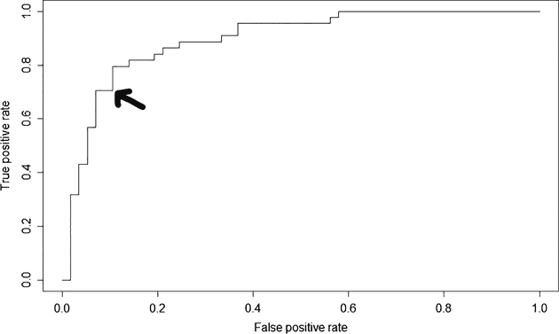

图 5.8 由 Script 5.9 创建的 ROC 曲线。在此处，你可能会问如何将所有信息投入良好用途。嗯，假设错误地将患有心脏病的人员识别为健康状态的代价非常高。表 5.2 显示有 11 个测试集个体（假阴性）属于这一类。ROC 图允许我们清楚地看到，为了将一些假阴性转入正类列，我们必须付出的假正例分类代价。例如，为了将 TP 速率从 0.75 提高到 0.80，我们将看到假正例速率发生微小变化。是否应该这样做取决于研究人员的考虑。

第二个问题是，如何修改模型以提高真正例速率？对于答案，我们回到 Script 5.8 并修改 `ifelse` 语句。例如，将语句更改如下：

```
card.results <- ifelse(card.results > 0.4, 2, 1)
```

降低了 `sick` 类的准入标准，从而提高了真正例速率。对脚本进行此更改（未显示）将 TP 速率提高到 0.795，FP 速率提高到 0.123，并将整体分类准确率提高到 84.16%。

## 5.3.6 ROC 曲线下的面积

ROC 曲线下的面积（`auc`）也备受关注，因为它为评估模型性能提供了定量衡量。要看到这一点，回到 Script 5.9，其中现在使用 `performance` 函数来计算 `auc`。由于真正例和假正例值在 0 到 1 之间，`auc` 的最大可能值为 1。在这种情况下，图表会立即垂直移动，所有真正例实例都被正确分类，且没有任何一个假正例错误。

我们示例计算出的 `auc` 为 0.8595，这告诉我们曲线下的大部分区域被覆盖了。这意味着 ROC 曲线倾向于垂直移动而非水平方向，从而识别出真正例实例而非假正例实例。章末的几项练习提供了关注 ROC 曲线的额外实验。我们监督统计模型列表中的下一个是朴素贝叶斯分类器！

## 5.4 朴素贝叶斯分类器

`朴素贝叶斯`（分类器）提供了一种简单而强大的监督分类技术。该分类器之所以被称为“朴素”，是因为它假设所有输入属性之间是独立的，并且数值属性值服从正态分布。即使在已知这些假设为假的情况下，朴素贝叶斯的表现通常也非常好。该分类器基于 `Bayes theorem`，其表述如下：

```
P(H | E) = \frac{P(E | H) \times P(H)}{P(E)} \tag{5.12}
```

其中 `H` 是待测试的假设，`E` 是与该假设相关的证据。

从分类的角度来看，假设是因变量并代表预测类别。证据由输入属性的值决定。`P(E|H)` 是在给定 `H` 为真的条件下 `E` 为真的 `条件概率`。`P(H)` 是 `先验概率`（a priori probability），表示在呈现任何证据之前假设的概率。条件概率和先验概率可以从训练数据中轻松计算。通过示例最有助于理解该分类器。

### 5.4.1 贝叶斯分类器：一个示例

考虑 表 5.3 中的数据，它是第 1 章中定义的信用卡促销数据库的子集。对于我们的示例，我们使用 `gender` 作为要预测值的输出属性。表 5.4 提供了每个属性的计数和比例分布。为了演示，表 5.4 告诉我们有四个男性利用了杂志促销。作为第二个例子，表 5.4 表明三个女性实例购买了杂志促销。

*   `P(life insurance promotion = no | gender = male) = 4/6`
*   `P(credit card insurance = no | gender = male) = 4/6`

这些值很容易获得，因为它们可以直接从表 5.2 中读取。因此，`gender = male`的条件概率计算为：

```
P(E | gender = male) = (4/6) * (2/6) * (4/6) * (4/6) = 8/81
```

先验概率在等式 5.13 中表示为 `P(gender = male)`，它表示在未知该实例促销优惠历史的情况下，男性客户的概率。在这种情况下，先验概率仅仅是总人口中男性的比例。由于有 6 名男性和 4 名女性，`gender = male` 的先验概率为 3/5。

给定这两个值，等式 5.13 的分子表达式变为：

(8/81)(3/5) ≅ 0.0593

我们现在得到：

*   `P(gender = male | E) ≅ 0.0593 / P(E)`

接下来，我们使用公式计算 `P(gender = female | E)` 的值：

```
P(gender = female | E) = \frac{P(E | gender = female) \times P(gender = female)}{P(E)} \tag{5.14}
```

我们首先利用直接从表 5.4 中获得的值计算条件概率。具体来说，

*   `P(magazine promotion = yes | gender = female) = 3/4`
*   `P(watch promotion = yes | gender = female) = 2/4`
*   `P(life insurance promotion = no | gender = female) = 1/4`
*   `P(credit card insurance = no | gender = female) = 3/4`

整体条件概率为：

```
P(E | gender = female) = (3/4) * (2/4) * (1/4) * (3/4) = 9/128
```

由于有 4 名女性，`P(gender = female)` 的先验概率为 2/5。

因此，等式 5.14 的分子表达式变为：

*   (9/128) (2/5) ≅ 0.0281

我们现在得到：

*   `P(gender = female | E) ≅ 0.0281 / P(E)`

最后，我们不需要考虑 `P(E)`，因为它同时代表了 `gender = male` 和 `gender = female` 时的证据概率。因此，由于 0.0593 > 0.0281，贝叶斯分类器告诉我们该实例最可能是一个男性信用卡客户。

### 5.4.2 零值属性计数

贝叶斯技术的一个显著问题是当某个属性值的计数为 0 时。例如，假设 `credit card insurance` 值为 `no` 的女性人数为 0。在这种情况下，`P(gender = female | E)` 的分子表达式将为 0。这意味着所有其他属性的值都是无关的，因为任何数与 0 相乘得到的整体概率值都为 0。

为了解决这个问题，我们在每个计算比率的分子 `n` 和分母 `d` 中添加一个小的常数 `k`。因此，每个形式为 `n/d` 的比率变为：

```
\frac{n + k \times p}{d + k} \tag{5.15}
```

其中

*   `k` 是 0 到 1 之间的一个值（通常为 1）
*   `p` 被选择为属性所有可能值总数的等分部分。（例如，如果一个属性有两个可能的值，`p` 将是 0.5。）另一种方法是简单地为每个属性值的计数加 1，以避免零概率。这种修改通常被称为*拉普拉斯平滑 (Laplace smoothing)*。

让我们使用第一种技术重新计算我们之前示例的条件概率 `P(E | gender = female)`。当 `k = 1` 且 `p = 0.5` 时，给定 `gender = female` 的证据条件概率计算为：

```
\frac{(3 + 0.5) \times (2 + 0.5) \times (1 + 0.5) \times (3 + 0.5)}{4 + 1} \approx 0.176
```

*(注：此处原文公式显示似乎在原始截取中不完整，已根据上下文进行了逻辑推全翻译以保持格式一致性)*

```
P(age = 45 | gender = male) = \frac{1}{\sqrt{2\pi} \times 7.69} e^{-\frac{(45 - 37.00)^2}{2 \times (7.69)^2}}
```

经过计算，得到：

*   `P(age = 45 | gender = male)` ≅ 0.030


为了确定给定 `gender = female` 时 `age` 的条件概率，我们代入 `σ` = 7.77，`μ` = 43.50 和 `x` = 45。具体而言：

$$P{\left( \textit{age} = 45 \middle| \textit{gender} = \textit{fe}\textit{male} \right) = 1/{\left( \sqrt{2\pi}7.77 \right)e}^{- {(45 - 43.50)}^{2}/2{(7.77)}^{2}}$$

经过计算，得到：

* `P(age=45|gender=female)` ≅ 0.050

我们现在可以确定整体条件概率值：

* `P(E | gender = male)` = (4/6) (2/6) (4/6) (4/6) (0.030) ≅ .003
* `P(E| gender = female)` = (3/4) (2/4) (1/4) (3/4) (0.050) ≅ .004

最后，应用方程 5.1 得到：

* `P(gender = male | E)` ≅ (0.003) (0.60)/`P(E)` ≅ 0.0018/`P(E)`
* `P(gender = female | E)` ≅ (0.004) (0.40)/`P(E)` ≅ 0.0016/`P(E)`

我们再次忽略 `P(E)` 并得出结论：该实例属于 `male`（男性）类。

### 5.4.5 实验朴素贝叶斯

多个软件包提供了朴素贝叶斯分类器的实现。在这里，我们关注位于 `e1071` 包中的 `naiveBayes` 函数——该包可在 CRAN 库获取。

对于我们的示例，我们使用了标题为“信用卡筛选数据集”的框中描述的数据。该数据集包含了 690 名申请信用卡的人的信息。数据包括 15 个输入属性和 1 个输出属性，指示个人信用卡申请是否被接受（+）或拒绝（–）。朴素贝叶斯是分析这些数据的良好选择，因为我们不需要担心处理具有缺失数据的实例。此外，由于贝叶斯是一种基于概率的分类器，我们可以选择以数值形式显示与每个分类相关的概率。这在我们的示例中是一个优点，因为对于信用卡公司来说，如果能够拒绝某些不会违约的人，同时又能够准确地拒绝那些会违约的人，这可能是有益的。通过了解每个分类相关的概率，我们能够根据需要调整概率列表中的“准入门槛”。

一个缺点是无法确定哪些属性最适合构建预测模型。我们将使用第 4 章中的一种技术来帮助解决这个问题。

我们的目标是：

> 使用信用卡筛选数据集的实例构建一个预测模型，能够预测接受哪些未来的信用卡申请者以及拒绝哪些。对于先前未见数据的预测准确性基准包括：模型整体正确率达到 85%，错误拒绝率最高 10%，错误接受率最高 5%。

我们提供了四个实验的部分输出——这些实验列在脚本 5.10–5.13 中，旨在满足前述目标。所有这些脚本都位于 `Script 5.10–5.13 Bayes classifier.R` 文件中，与所有脚本一样，它们是您的补充材料的一部分。让我们来看第一个脚本。

脚本 5.10 显示了我们尝试构建能够满足目标模型的首次语句和编辑后的输出。在这里调用了第 4 章中的 `removeNAS` 函数来验证是否存在缺失记录。您的输出将列出 24 个具有一个或多个 NA 值的实例。我们不使用 `removeNAS` 返回的修改文件，因为朴素贝叶斯简单地忽略 NA 属性值。

脚本 5.10 中显示的混淆矩阵显示整体正确 78.7%；35% 的正类实例其信用卡申请被拒绝。此外，10.8% (14/130) 应该被拒绝的人获得了信用卡。我们必须做得更好！

脚本 5.11 尝试改进我们的结果。具体而言，对所有数据应用了 `GainRatioEval`，以确定单个属性相对于输出类的价值。`GainRatioEval` 遵循 R 大多数机器学习工具使用的格式。`GainRatioEval` 返回一个列表，为每个属性关联一个“优度得分”。没有考虑属性之间的交互。

接下来，我们对列表排序，发现属性 *9* 是得分最高的属性，*10*、*11* 和 *15* 分别位第二、第三和第四。对于该实验，我们消除了前四个属性以外的所有属性。结果混淆矩阵显示误接受有所减少，但整体性能不尽如意。

第三次实验 (脚本 5.12) 仅使用两个输入属性。错误拒绝下降到 10%，整体准确率提高到 84.7%。然而，0.19 的误接受率远未达到我们的目标。

在最后一个实验中，我们指示 `predict` 函数给出分类器计算出的 `raw` 概率。其思想是检查单个概率值，以找到一个分割点，使能够在不丢失太多真正例的情况下移除一些误正分类。为了研究这种可能性，我们使用 `cbind` 将计算出的概率与其实际类别关联。结果被转换为数据框，将 + 和 – 标题替换为 *yes* 和 *no*，并使用 `order` 函数根据 `yes` 列对概率从高到低进行排序。脚本 5.13 列出了排序后的三个值。这三个实例都属于 *yes* 类（2）。如果你滚动整个排序后的概率列表，你会看到前 79 个实例的预测概率为 0.916。这些实例中有 7 个是误接受。第 80 个实例的关联概率为 0.616，接下来的 35 个实例也是如此。第 116 个实例代表了类别之间的界限。鉴于此，即使我们只向概率高于 90% 的个人发放信用卡，仍然通过 5% 的误接受测试。章末练习提供了对该数据集进行额外操作的机会。

线性回归是估计和预测问题中常用的统计技术。线性回归试图将数值型因变量的变化建模为一个或多个数值型自变量的线性组合。当因变量与自变量之间的关系几乎呈线性时，线性回归是一种适当的策略。当结果是二元时，线性回归并不是一个好的选择。问题在于，施加在因变量上的限制没有被回归方程观测到。这是因为线性回归产生的是直线函数，而因变量的值在正负方向上都是无界的。对于两种结果的情况，逻辑回归是更好的选择。逻辑回归是一种非线性回归技术，它将每个数据实例与一个条件概率值相关联。对于可能的输出 0 或 1，概率 `p(y = 1 | x)` 表示具有属性向量 `x` 的数据实例属于与结果 1 相关的类的条件概率。同样，`1 – p(y = 1 | x)` 是该实例属于与结果 0 相关的类的概率。

朴素贝叶斯分类器提供了一种简单而强大的监督分类技术。该模型假设所有输入属性具有同等重要性且相互独立。尽管这些假设很可能是错误的，但贝叶斯分类器在实践中仍然运行得很好。朴素贝叶斯适用于包含分类数据和数值数据的数据集。此外，与许多统计分类器不同，贝叶斯分类器可以应用于包含大量缺失项的数据集。如果在模型构建之前进行属性选择，我们使用朴素贝叶斯获得良好效果通常会提高。

## 5.6 关键术语

* **先验概率 (A priori probability)**：在缺乏支持或拒绝假设的证据的情况下，假设为概率。
* **贝叶斯分类器 (Bayes classifier)**：使用贝叶斯定理对新实例进行分类的监督学习方法。
* **贝叶斯定理 (Bayes theorem)**：在给定某些证据的情况下假设概率等于在假设给定证据的概率乘以假设的概率，再除以证据的概率。
* **条件概率 (Conditional probability)**：在假设 `H` 为真的条件下证据 `E` 的条件概率记为 `P(E | H)`，是在 `H` 为真时 `E` 为真的概率。
* **自由度 (Degrees of freedom)**：统计量计算中可以自由变化的值的数量。
* **密度图 (Density plot)**：一种允许我们可视化数据在连续区间上分布的图表。
* **假阳性率 (False positive rate (FP rate))**：FP 率的计算方法为被错误分类为特定类的实例总数除以非该类的实例总数。
* **拉普拉斯平滑 (Laplace smoothing)**：一种修正参数，在每个属性值的计数上加 1 以避免零概率。
* **最小二乘准则 (Least-squares criterion)**：最小二乘准则使实际输出值与预测输出值之间的平方和最小。
* **线性回归 (Linear regression)**：一种将数值型因变量的变化建模为一个或几个自变量线性组合的统计技术。
* **逻辑回归 (Logistic regression)**：用于二元结果问题的非线性回归技术。该方程将输出属性的值限制在 0 到 1 之间。这允许输出值表示类别成员的概率。
* **Logit (Logit)**：优势比 `p(y = 1 | x)/[1 – p(y = 1 | x)]` 的自然对数。`p(y = 1 | x)` 是由特征向量 `x` 决定的线性回归方程值为 1 的条件概率。
* **残差 (Residual)**：实际输出与计算输出之间的差值（误差）。
* **残差标准误差 (Residual standard error)**：预测输出值的平均误差。计算方法为所有残差平方和除以自由度的平方根。
* **显著性水平 (Significance level)**：我们愿意拒绝实验结果纯粹由偶然引起的结论的概率。
* **简单线性回归 (Simple linear regression)**：具有单个自变量的回归方程。
* **斜截式方程 (Slope–intercept form)**：形式为 `y = ax + b` 的线性方程，其中 `a` 是线的斜率，`b` 是 `y` 距。
* **真阳性率 (True positive rate (TP rate))**：TPR 的计算方法是用类内被正确分类的实例数量除以实际属于该类的实例总数。

# 练习题

## 复习题

1. 区分以下概念：
   1. 简单线性回归与多元线性回归
   2. 线性回归与逻辑回归
   3. 先验概率、条件概率、后验概率

## 使用 R 进行实验

1. 执行 `Script 5.1` 并输入 `attributes(my.slr)`。此函数列出与对象相关的属性。输入 `my.slr$` 后跟属性名称以列出五个属性的输出。
2. 重复练习 (1)，但使用 `hr32` 作为唯一输入变量。
3. 使用 `OFCM.csv` 数据集重复练习 (1)，以 `oswest.in` 为唯一输入变量，`oswest.out` 为响应变量。
4. 为伽马射线暴数据集创建一个多元线性回归模型：
   1. 建立模型使用 `fl`、`hr32` 和 `t50` 来确定 `t90`。
   2. 使用 `anova` 函数确定对误差平方和贡献最小的属性。
   3. 使用 `update` 函数从模型中移除效果最差的属性。
   4. 使用 `anova` 函数确定 `update` 函数带来的误差减少是否显著。
5. 重复 `Script 5.5` 中的实验，但移除 `oswest.out` 并添加 `LE.out` 作为响应变量。注释回归系数的显著性并报告 `mmr.stats` 计算的统计数据。输入变量能够准确预测 `LE.out` 吗？
6. 将包含 `Scripts 5.8` & `5.9` 的文件导入 RStudio。找到 `Script 5.9` 中如下行：`#p.card <- ifelse(p.card > 0.5,2,1)`。取消注释并执行 `Scripts 5.8` 和 `5.9`。你会发现包含 `ifelse` 会导致曲线离开 ROC 曲线。这是因为 `p.card` 内部的小数值现在全都是 1 和 2。
   1. 将 `sick` 类的阈值从 0.5 改为 0.4，然后是 0.3、0.2，最后是 0.1，每次记录 `auc` 的值。
   2. 重复此过程，但使用 0.6、0.7、0.8，最后是 0.9 作为阈值。
   3. 详细描述这些变化对 `auc` 值产生的影响。
7. 重复 `Script 5.11`，但使用属性 `nine` 作为唯一的输入属性。接下来，通过将属性 `nine` 替换为 `twelve` 构建第二个模型。使用两个属性作为输入构建最终模型。哪个模型的测试集准确率最好？
8. 使用 `Script 5.8` 作为模板构建并测试两个逻辑回归模型。使用显示显著系数的属性构建并测试一个模型。使用 `Script 5.8` 中具有显著偏差评分（deviance score）的属性构建并测试第二个模型。比较模型之间以及与原始模型之间的测试集准确率。
9. 阅读 Spam 数据集的文档。该文档写在 `Spam.xlsx` 的 `description` 表表中。编写一个脚本，使用 `.csv` 版本的数据集比较 R 的逻辑回归函数与朴素贝叶斯（naïve Bayes）。步骤如下：
   1. 导入 Spam 数据集。
   2. 使用 `removeNAS` 函数删除任何包含一个或多个缺失属性值的实例。
   3. 使用 2/3 训练集、1/3 测试集的评估方法确定每种技术的准确率。
   4. 返回预处理模式并使用 `GainRatioAttributeEval` 消除除六个输入属性以外的所有属性。重复步骤 `c`。
   5. 报告你的发现。

## 计算题

1. 使用表 5.3 中的数据填充下表中的计数和概率。输出属性为 `life insurance promotion`（人寿保险促销）。

| | | **杂志促销** | **手表促销** | **信用保险** | | **性别** |
| --- | --- | --- | --- | --- | --- | --- |
| 人寿保险促销 | 是 | 否 | 是 | 否 | 是 | 否 | | 是 | 否 | |
| --- | --- | --- | --- | --- | --- | --- | --- | --- | --- |
| 是 | | | | | | | | 男性 | | |
| 否 | | | | | | | | 女性 | | |
| 比例: 是/总计 | | | | | | | 比例: 男性/总计 | | |
| 比例: 否/总计 | | | | | | | 比例: 女性/总计 | | |

1. 使用完成的表格结合朴素贝叶斯分类器，确定以下实例的 `life insurance promotion` 取值：
   * `Magazine Promotion = Yes`
   * `Watch Promotion = Yes`
   * `Credit Card Insurance = No`
   * `Gender = Female`
   * `Life Insurance Promotion` = ?
2. 重复第 a 小，但假设客户的 `gender`（性别）未知。
3. 重复第 a 小，但使用方程 5.15，且 `k` = 1 且 `p` = 0.5，来确定 `life insurance promotion` 的值。

2. 考虑下方的混淆矩阵，其中 `Yes` 代表正类。

| | | 预测类 |
| --- | --- | --- |
| | | 是 | 否 |
| 实际类 | 是 | 30 | 10 |
| 否 | 10 | 70 |

1. 计算整体分类准确率。
2. 计算真阳性率（true positive rate）。
3. 计算假阳性率（false positive rate）。

# 已安装的包和函数

| 包名 | 函数 |
| --- | --- |
| `base/stats` | `abline`, `anova`, `aov`, `c`, `cbind`, `cor`, `data.frame`, `df.residual`, `factor`, `fitted`, `glm`, `head`, `ifelse`, `library`, `lm`, `order`, `plot`, `predict`, `residuals`, `round`, `sample`, `set.seed`, `step`, `summary`, `table`, `update` |
| `Car` | `densityPlot`, `scatterplotMatrix` |
| `Caret` | `train`, `trainControl` |
| `e1071` | `naiveBayes` |
| `graphics` | `boxplot` |
| `RWeka` | `GainRatioAttributeEval` |
| `ROCR` | `performance`, `prediction` |

# 第 6 章

## 基于树的方法

本章内容：

* 决策树算法
* 构建决策树
* 集成技术
* 回归树

第 5 章 侧重于监督式统计机器学习技术，这些技术需要满足某些假设（如正态性和数据独立性）以验证结果。我们现在转向对待分析数据的数据性质不做任何假设的监督机器学习算法。

在第 6.1 节中，我们的重点是创建决策树的标准方法。在第 6.2 节中，我们将 Quinlan 的 C4.5 决策树算法的商业版本应用于客户流失数据。第 6.3 节介绍了 `rpart`，一种用于构建决策树和回归树的树学习模型。在第 6.4 节中，我们引入了 RWeka 机器学习包，并将其 J48 决策树算法应用于客户流失数据。第 6.5 节的重点是用于提高性能的集成技术。使用 `rpart` 构建回归树是最后一节的主题。

## 6.1 决策树

决策树是监督学习的一种流行结构。关于其成功应用的文章比比皆是。我们在第 1 章中介绍过 C4.5。在本节中，我们将更深入地观察。

### 6.1.1 构建树的算法

决策树使用区分概念的最佳属性进行构建。算法遵循以下步骤：

1. 从根节点开始构建树。

选择

决策树是一种层次结构，其中每个节点代表对属性的测试，每个分支代表测试结果，每个叶节点代表类别标签或值。

### 6.1.2 C4.5 属性选择

C4.5 使用来自信息理论的测量来帮助属性选择。在树的每个点，C4.5 会计算所有属性的 `gain ratio`。比例最大的属性被选中分割数据。`gain ratio` 的方程如下：

```
GainRatio(A) = Gain(A) / SplitInfo(A)
```


其中 `Gain(A)` 是属性 `A` 的信息增益，`SplitInfo(A)` 是属性 `A` 分割的熵。

让我们使用表 6.1 给出的数据来看这些公式是如何应用的。在我们的示例中，我们将 `life insurance promotion`（寿险促销）指定为输出属性。为了说明，我们将公式应用于整个训练数据集。我们希望开发一个预测模型。因此，输入属性限制为 `income range`（收入范围）、`credit card insurance`（信用卡保险）、`gender`（性别）和 `age`（年龄）。指定为 `Id` 的属性目的是引用表格中的项目。

### 表 6.1 信用卡促销数据集

| Id. | 收入范围 | 人寿险促销 | 信用卡保险 | 性别 | 年龄 |
| --- | --- | --- | --- | --- | --- |
| 1 | 40–50 K | 否 | 否 | 男性 | 45 |
| 2 | 30–40 K | 是 | 否 | 女士 | 40 |
| 3 | 40–50 K | 否 | 否 | 男性 | 42 |
| 4 | 30–40 K | 是 | 是 | 男性 | 43 |
| 5 | 50–60 K | 是 | 否 | 女士 | 38 |
| 6 | 20–30 K | 否 | 否 | 女士 | 55 |
| 7 | 30–40 K | 是 | 是 | 男性 | 35 |
| 8 | 20–30 K | 否 | 否 | 男性 | 27 |
| 9 | 30–40 K | 否 | 否 | 男性 | 43 |
| 10 | 30–40 K | 是 | 否 | 女士 | 41 |
| 11 | 40–50 K | 是 | 否 | 女士 | 43 |
| 12 | 20–30 K | 是 | 否 | 男性 | 29 |
| 13 | 50–60 K | 是 | 否 | 女士 | 39 |
| 14 | 40–50 K | 否 | 否 | 男性 | 55 |
| 15 | 20–30 K | 是 | 是 | 女士 | 19 |

图 6.1 显示了对属性 `income range` 进行顶层划分的结果。输出属性 `life insurance promotion` 的 `yes` 和 `no` 总数显示在每个分支的底部。虽然该属性不是划分表格数据的良好选择，但它是演示上述公式的良好选择。

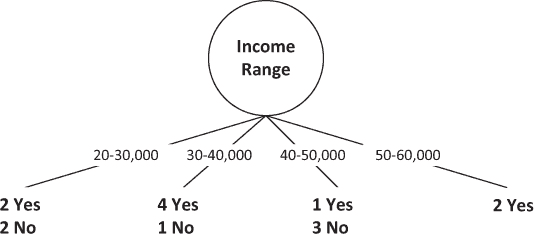

图 6.1 根节点 = income range 的部分决策树。

我们首先计算 `Info(I)` 的值。由于我们正试图确定树的顶层节点，`I` 包含了所有的 15 个表格实例。由于 `life insurance promotion` 包含 9 个 `yes` 值和 6 个 `no` 值，计算公式为：

`Info(I) = -9/15 log2(9/15) + 6/15 log2(6/15) = 0.97095`

`income range` 有四种可能的结果，`Info(I, income range)` 的计算公式为：

```
Info(I, Range) = 4/15 Info(20 - 30000) + 5/15 Info(30 - 40000) + 4/15 Info(40 - 50000) + 2/15 Info(50 - 60000) = 0.72365
```

其中，

`Info(20 - 30000) = -2/4 log2(2/4) + 2/4 log2(2/4)`

`Info(30 - 40000) = -4/5 log2(4/5) + 1/5 log2(1/5)`

`Info(40 - 50000) = -3/4 log2(3/4) + 1/4 log2(1/4)`

`Info(30 - 40000) = -2/2 log2(2/2)`

同样，

```
Split(Income Range) = 4/15 log2(4/15) + 5/15 log2(5/15) + 2/15 log2(2/15) = 1.93291
```

我们现在计算增益（gain）：

```
gain(Income Range) = Info(I) - Info(I, Income Range) ≈ 0.97905 - 0.72193 = 0.25712
```

最后，

```
Gain Ratio(Income Range) = Gain(Income Range) / Split(Income Range) ≈ 0.25712/1.93291 = 0.13302
```

分类属性 `credit card insurance` 和 `gender` 的得分是以类似的方式计算的。现在的问题是，我们如何应用这些公式来获得数值属性 `age` 的得分？答案是通过对数值进行排序并将数据离散化，并为每个可能的划分点计算增益比得分。对于我们的示例，年龄首先按以下顺序排序：

| 19 | 27 | 29 | 35 | 38 | 39 | 40 | 41 | 42 | 43 | 43 | 43 | 45 | 55 | 55 |
| --- | --- | --- | --- | --- | --- | --- | --- | --- | --- | --- | --- | --- | --- | --- |
| Y | N | Y | Y | Y | Y | Y | Y | N | Y | Y | N | N | N | N |

接下来，我们为每个可能的划分点计算得分。也就是说，19 和 27 之间二分划分的得分计算方法与 27 和 29 之间相同。这一过程持续直到获得 45 和 55 之间划分的得分。通过这种方式，每个划分点都被视为具有两个值的独立属性。最后，通过对 `income range`、`credit card insurance`、`gender` 和 `age` 进行计算，我们发现 `credit card insurance` 具有最佳增益比得分，为 3.610。

CART (Breiman et al., 1984) —— 一类基于树的方法的缩写，被称为分类和回归树 —— 引起了特别关注，因为有几种商业产品实现了原始算法的变体。CART 与 C4.5 非常相似，但存在几处不同。其中一个显著的区别是，无论属性是分类的还是数值型的，CART 总是对数据进行二分。另一个重要区别是用于属性选择的指标。CART 没有使用 C4.5 的信息增益方法，在每个选择点默认使用的测量标准是被称为 `Gini` 的不纯度评分。具体而言，

$$Gini = 1 - \underset{n = 1}{\overset{2}{\Sigma}}\left( p_{i}\left( n \right))^{2} \right.$$

其中 `pi` 是节点 `n` 属于类别 `i` 的实例比例。用于决策树下一次划分选择的属性是产生最小 `Gini` 计算结果的属性划分结果。如你所见，当节点 `n` 的所有实例都属于同一类时，总和为 1，从而得到 Gini 不纯度分为 0。

第三点区别是 CART 调用测试数据来帮助修剪并泛化创建的二叉树，而 C4.5 仅使用训练数据创建最终的树结构。最后，CART 是第一个引入 `回归树` 的系统。回归树的形式是决策树，其叶节点是数值值而非分类值。

CHAID (Kass, 1980) —— 卡方自动交互检测 —— 是 SAS 和 SPSS 等商业统计包中发现的第三种关注的决策树构建算法。CHAID 与 C4.5 和 CART 的不同之处在于它仅限于处理分类属性。CHAID 具有统计学味，因为它使用 `X`² 显著性统计检验来确定构建决策树的候选属性。在接下来的章节中，我们将对 R 语言版本的 C4.5、C5.0 以及在 `rpart package` 软件包中找到的 CART 实现进行实验。让我们开始吧！

## 6.2 构建决策树：C5.0

我们对构建决策树的第一个观察从 C5.0 开始，它是 C4.5 的增强版本。C5.0 基于 Quinlan 的商业模型，但缺少全商业版的一些功能。图 6.3 显示的决策树是使用 C5.0 构建的。用于构建图 6.3 中树的语句以及相关输出列在脚本 6.1 中。在执行脚本之前，你必须安装 `C50` 软件包。此外，确保已将 `ccpromo.csv` 导入到 RStudio 中。让我们仔细查看脚本 6.1。

### 6.2.1 用于信用卡促销的决策树

对 C5.0 的调用显示 `LifeInsPromo` 为输出属性，并指定在构建树时考虑所有输入属性。`minCases` 指示算法考虑划分在当前路径中剩余至少两个实例的任何树。在我们看到定义树的语句后，`summary` 函数显示了对 C5.0 的调用。终端节点提供分类结果，指示了遵循给定路径的实例数量，并告诉我们这些实例中有多少个被分类错误。例如，通向 `Gender = Yes (6/1)` 的分支告诉我们有六个实例遵循此路径，其中一个（实例 #6）代表分类错误。该分类错误的实例满足 `CardIns = No` 且 `Gender = Female`，但 `LifeInsPromo` 的显示值为 `No`。

接下来，我们以混淆矩阵的形式看到对训练数据的评估。该矩阵显示有两个训练实例被树分类错误。`Attribute usage` 下的列表列出了用于构建相应树的属性。列表顶部的属性对预测结果最相关。最后，`plot` 函数为我们提供了图中所示的树。在这里，让我们让我们看到图 6.3 所示的树。

`rpart` 包中的 `rpart` 函数是 CART 的一个熟悉实现。让我们再次使用表 6.1 中显示的信用卡促销数据从一个简单的示例开始。看看 `rpart` 生成的决策树与图 6.3 所示的 C5.0 决策树相比如何。

构建树的语句以及相关的输出列在脚本 6.3 中。在执行脚本之前，请确保已安装 CRAN 库中可用的 `rpart`、`rpart.plot` 和 `partykit` 包。

### 6.3.1 针对信用卡促销的 rpart 决策树

脚本 6.3 中的库语句反映了三个包。`rpart` 包是找到找到实现 CART 版本的 `rpart` 函数的地方。`rpart.plot` 库包含了用于绘制 rpart 决策树的 `rpart.plot` 和 `prp` 函数。它还提供了将 rpart 决策树映射到一组规则的 `rpart.rules` 函数。`partykit` 包允许我们强制转换 `rpart` 创建的对象，使其打印为 `party` 类型的对象。

对 `rpart` 的调用告诉我们构建树时要考虑所有输入属性。此外，在考虑分裂之前，必须至少三个三个节点实例。如果输出属性是因子（factor），则假设 `Method = class`，在这里确实如此。

接下来的几行给出了定义决策树的语句。最初，理解文字描述可能是一个挑战。考虑第一行：

```
root 15 6 Yes (0.4000000 0.6000000)
```

这一行告诉我们，在根节点处有 15 个实例，其中 6 个与最常见值相反（9 个实例显示 `LifeInsPromo = Yes`）。括号显示了“否”和“是”的概率得分。接下来的两行提供了：

```
2) Age>=44 3 0 No (1.0000000 0.0000000)
3) Age< 44 12 3 Yes (0.2500000 0.7500000)
```

注意 `Gini` 测量值为树的顶节点选择了 `age` 而不是 `credit card insurance`。第 2 行是一个终端路径，如 `\` 所示。它告诉我们有 3 个实例遵循 `Age >= 44`。`0` 表示所有三个实例都是 `No`。第 3 行显示有 12 个实例遵循 `Age < 44` 的路径。`LifeInsPromo` 的常用值为 `Yes`，有 3 个实例显示 `No`。`Gender` 被视为下一个属性选择，其中 `Gender = Female` 是一个终端路径。`Gender = Male` 在 `CCardIns` 上进行分裂，两个值都是终端的。

使用 `prp`（图 6.5）和 `plot`（图 6.6）获取树的图形要容易解释得多！你的脚本 6.3 副本还包含 `rpart.plot` 作为第三种方法。`Prp` 和 `rpart.plot` 提供了值得研究的选项。使用 `prp`，`type =2` 将分裂标签放在每个节点下方。`Fallen.leaves = TRUE` 将所有终端节点放置在树底部相同的级别，而 `extra = 104` 在图中包含概率值。将 `roundint` 设置为 `false` 可以避免当训练数据中的一个或多个数值属性严格为整数时看到的警告。该警告与新呈现的数据可能具有小数值有关。最后，`rpart.rules` 将决策树映射到一组规则。小数值表示具有 `LifeInsPromo = yes` 的实例满足每条规则的比例。

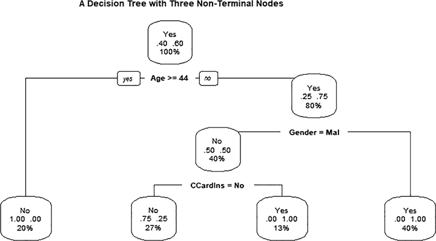

图 6.5 针对信用卡促销的三节点决策树：prp 函数。

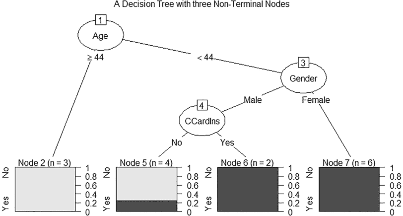

图 6.6 针对信用卡促销的三节点决策树：partykit。

根据我们实验的结果，我们得出 C5.0 和 `rpart` 为信用卡促销数据创建的树是不相同的。这并不意外，因为每个模型都使用不同的属性选择技术。然而，值得注意的是，分裂 `age` 为 44 way `CCardins` 的 Gini 分数是相同的，因为这两个分裂都导致了一个包含三个实例的终端节点。

在接下来的两个部分，我们将 `rpart` 应用于上述的 C50 流失数据。首先，我们使用训练/测试集场景来展示我们如何借助 `rpart` 提供的工具确定最佳模型。之后，我们将展示如何做到。

#### 6.3.2 训练和测试 rpart：流失数据

脚本 6.4 提供了数据的列表。

#### 6.3.3 交叉验证 rpart：流失数据

第 5 章 中的 脚本 5.4 向你介绍了使用线性回归和 `caret` 包进行交叉验证的方法。在此处，我们使用了相同的技术，但将 `lm` 替换为 `rpart` 以预测分类类型结果。脚本 6.5 给出了语句和相关输出，图 6.9 显示了生成的决策树。

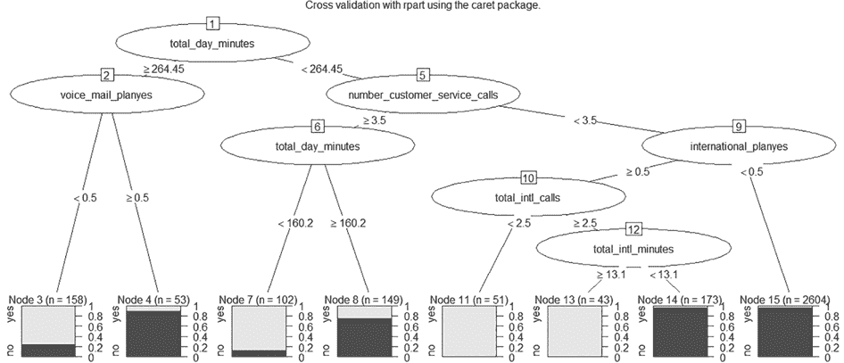

图 6.9 使用 caret 包的决策树：流失数据。

脚本提供了两个特别关注的项目。首先，对训练数据进行了十折交叉验证 (`cv`）。在训练集大小为 333 的情况下，我们有 299 个样本。单 10 折交叉验证的替代方案是重复交叉验证。为了实现这一点，我们使用 `method = “repeated"` 而不是 “cv”，并包含了 `repeats` 变量来指定执行重复交叉验证的次数。

第二个关注的项目是参数调优。在 `caret` 包中有两种调优参数的方法。可以使用 `tuneLength` 自动进行参数调优，也可以手动指定网格中每个参数可能的值。手动方法很有趣，但需要更多工作。在这里，我们使用 `tunelength` 变量来指定每个参数尝试的数值。当 `tuneLength` 设置为 5 时，我们在表中看到了五个条目。所选的 `cp` 值基于模型准确率，其测试集得分超过了 93%，有 7% 的流失者被错误分类。尽管不理想，但这一结果与我们之前的数据相比。

在这里我们仅仅接触了 `caret` 包的许多功能。花时间仔细查看该包提供的丰富功能是非常值得的。列表中的下一个 Weka 的 J48 决策树函数！

## 6.4 构建决策树：J48

在第 5 章 中，我们通过使用 `GainRatioAttribute` 函数引入了 Weka 包来辅助属性选择。在这里，我们使用 Weka 对 C4.5 的 Java 实现 `J48`。在查看示例之前，请确保你的机器上安装了 Weka 包（CRAN 库）。此外，Weka 包含几个尚未安装但可以安装的函数（称为包）。为了使用 Weka 包提供的所有功能，你最终需要创建一个名为 `WEKA_HOME` 的环境变量。由于 `J48` 已安装在基础 Weka 包中，环境变量的赋值可以等一下进行。

对于我们的实验，我们将 J48 决策树算法应用于流失数据。脚本 6.6 列出了我们实验的语句和相关输出。通过实验，我们确定 5 是每个叶节点最小实例数 (M) 的良好选择。`WOW(J48)` 列出了 J48 可的所有控制选项。

94.12% 的测试集准确率与我们之前的模型相比良好。6% 的错误分类也是一个积极的结果。然而，树的大小（此处未显示）是不理想的。最后，如果你喜欢使用交叉验证进行模型测试，可以使用 `evaluate_Weka_classifier` 函数来实现。虽然这里没有显示，但交叉验证包含在你的脚本 6.6 中。

在实验了 C5.0、`rpart` 和 `J48` 之后，你已经在建立决策树机器学习知识基础的道路上了。没有时间休息，我们刚刚开始。让我们看看多模型方法能提供什么！

## 6.5 提高性能的集成技术

当我们做决定时，通常依靠他人的帮助。同样，通过结合多个机器学习模型的输出来制定分类决策是有直觉的。遗憾的是，采用多模型方法进行分类的尝试结果不一。这在一定程度上解释为大多数模型错误分类了相同的实例。然而，在通过应用相同的机器学习算法构建每个模型的多模型方法中已经取得了一些成功。在本节中，我们描述了三种利用相同的机器学习算法来构建多模型（集成）分类器的技术。

这里描述的方法对于不稳定的机器学习算法效果最好。不稳定的算法在训练数据发生细微变化时，模型结构会发生显著变化。包括决策树在内的许多标准机器学习算法已显示出这种特征。

### 6.5.1 Bagging


# Bagging（自助聚合）

Bagging（自助聚合）是由 Leo Breiman (1996) 开发的一种监督学习方法，它允许多个模型在分类新实例时具有平等的投票权。通常使用相同的挖掘工具来创建多个模型。模型不同在于从同一个池中选择了不同的训练实例来构建每个模型。该方法的工作原理如下：

1. 从训练实例中随机抽取若干个大小相同的训练数据集。有放回采样。
2. 应用机器学习算法为每个数据集构建一个分类模型。`N` 个数据集产生 `N` 个模型。
3. 为了分类实例 `I`，将 `I` 交给每个分类器。每个分类器允许投一票。属于票数最多的类别。

Bagging 也可以应用于预测数值的估计问题。为了确定未知实例的值，输出是所有分类器估计值的平均值。

# 6.5.2 Boosting

Boosting 由 Freund 和 Schapire (1996) 引入，它更为复杂。Boosting 与 Bagging 类似，都使用多个模型对新实例进行分类投票。然而，Boosting 和 Bagging 有两个主要区别。具体来说：

* 每个新模型都是根据之前模型的结果构建的。最新模型专注于正确分类之前模型分类错误的实例。这通常通过为单个实例分配权重来实现。在训练开始时，所有实例分配相同的权重。在构建最新模型后，被模型正确分类的实例权重会减少。分类错误的实例权重则会增加。
3. 通过从之前的训练数据中有放回地采样实例创建一个新的训练数据集。与低权重实例相比，更频繁地选择具有高权重值的实例。这样，尽管机器学习算法本身无法使用实例权重，但最难分类的实例将在后续模型中获得更多的曝光机会。
4. 对每个新模型重复上一步骤。

由于分类错误的实例被采样的频率更高，权重值在模型构建过程中仍然起了作用。然而，学习算法在模型构建过程中并没有实际使用权重值。

# 6.5.3 Boosting：使用 C5.0 的示例

将 C5.0 的 `trials` 参数设置大于 1 即可实现上述 Boosting 策略。让我们尝试一下 Boosting！！返回脚本 6.2，设置 `trials = 10` 并执行脚本。

以下是相关的输出：

在训练数据上的评估（3333 个案例）：

```
Trial     Decision Tree
-----   ----------------
      Size      Errors

   0      8  237( 7.1%)
   1      4  442(13.3%)
   2      5  469(14.1%)
   3      4  463(13.9%)
   4     12  923(27.7%)
   5      7  536(16.1%)
   6      7  355(10.7%)
   7      7  472(14.2%)
   8      4  386(11.6%)
   9      8  340(10.2%)
boost         197( 5.9%)   <<
```

> # 测试集混淆矩阵
>
> Predicted
> Actual  yes   no
>    yes  119  105
>     no    6 1437
>
> Accuracy = 93.34 %

该输出显示了十棵树在单独面对训练数据时的各自准确率。Trial 0（算法的第 1 步）给出的是未经过 Boosting 的树。`Errors` 列显示了将每棵新树应用于训练数据时获得的错误。请注意，Trial 0 树的表现优于随后创建的每棵树。标记为 `boost` 的行显示了模型协同工作（每个模型获得一票）时的训练集准确率。Boosting 后的模型在训练数据上的表现略优于 Trial 0 模型。然而，当将 Boosting 模型应用于测试数据时，我们发现分类错误的流失用户人数从 83 个增加到了 105 个。

这个简单的实验支持了关于多模型方法的某种既有结论，即它并不一定能提高性能。显然，对 `trials` 变量进行更多实验可能会带给我们更好的结果。作为一个一般规则，Boosting 在噪声数据较少的环境中表现最好。下一种技术克服了 Bagging 和 Boosting 出现的一些问题。

# 6.5.4 随机森林

随机森林方法（Breiman, 2001）与 Bagging 相似之处在于，它使用了决策树集合和多数表决的方法。然而，与 Bagging 使用相同属性来构建每棵树不同，随机森林选择属性的随机子集来构建单棵树。该方法如下：

1. 为森林选择决策树的数量 `N`。
2. 重复以下步骤 `N` 次：
    1. 从训练数据集中有放回地随机选择一个实例子集。
    2. 从已选属性的集中随机选择一个属性子集。
    3. 使用所选的属性和实例构建决策树。

为了说明该方法，让我们回到第 5 章中描述的 `creditScreening` 数据集：

> 使用随机森林构建预测模型来预测哪些信用卡申请者接受，哪些拒绝。对于未见数据的基准测试显示，整体准确性为 85%，拒绝的错误率为 10%，接受的错误率为 5%。脚本 6.7 应用 `randomForest` 到 `creditScreening` 数据集时，树的数量默认设置为 500。属性数量的默认设置为输入属性数量的平方根。对于 15 个输入属性，默认值为 3。

`randomForest` 调用中另一个感兴趣的点是 `na.action` 的设置。设置为 `roughfix` 时，缺失属性值将被该属性的中位数替换。如果属性是类别的，缺失值将被属性的众数替换。如果存在多个众数，则随机选择一个众数。重要的是具有一个或多个缺失项目的测试集实例将被分类。

另一个感兴趣的点是 `importance`。Importance 是 `randomForest` 对象的一个方法，在给定模型时，它返回属性列表及其重要性的启发式衡量。这是因为随机森林中的每个树都使用属性空间的随机子集。森林中表现最好的属性获得最高的重要性评分。脚本 5.11 中通过 Weka 的 `GainRatio` 定的最佳属性与此处显示的重要性之间存在一些分歧。然而，两种方法都将属性 9 排在第一。

随机森林算法的步骤 2a 告诉我们，每棵树都是使用训练集的子集构建的。一旦构建了树，未使用实例就会交给树。OOB（袋外）估计的错误率为 14.78%，这是这些未使用实例的分类错误。分类 OOB 实例得到的混淆矩阵显示分类准确率为 85%。OOB 在缺乏测试数据时特别有用。

测试集错误率为 91.52% 是令人满意的。假阳性率 0.107 相比 Bayes 分类器（脚本 5.11）的结果有所提高，但仍未 5% 的目标。

随机森林克服了决策树的一些缺点，之一是在属性数量远大于实例数量的领域进行分类。此外，由于森林中的树是用不同的属性集构建的，可以确定最能构建准确树结构的属性。

在负面方面，随机森林的计算成本很高，并且可能需要大量内存。此外，由于树的数量很多，代表森林的生成规则至少难以理解。我们将在第 7 章中更详细地查看随机森林生成的规则。接下来是回归树！

当待建模数据是非线性时，回归树比线性回归方程更准确。然而，回归树可能会变得非常复杂且难以解释。因此，回归树有时会与线性回归结合，形成所谓的 `model trees`（模型树）。在模型树中，部分回归树的每个叶节点代表一个线性回归方程，而不是属性值的平均值。通过将线性回归与回归树相结合，可以简化回归树结构，只需较少的树层即可达到准确的结果。

图 6.10 显示了针对脚本 5.5 中引入的 OFCM 数据集的回归树。脚本 6.8 显示了对脚本 5.5 的修改，用 `rpart` 替换了 `lm`。与之前一样，目标是开发一个能够确定治疗结束疼痛水平的预测模型。定义回归树的语句提供了至少两个关注点。首先，治疗前疼痛水平（`oswest.in`）大于 42 的患者可能获得次优的结果。其次，患者体重可能对治疗成功起作用。此外，10.324 的残差标准误差比线性回归模型中看到的结果改进了 15%。由于该数据集较小，这些结论最好被视为假设，通过进一步的研究进行测试。

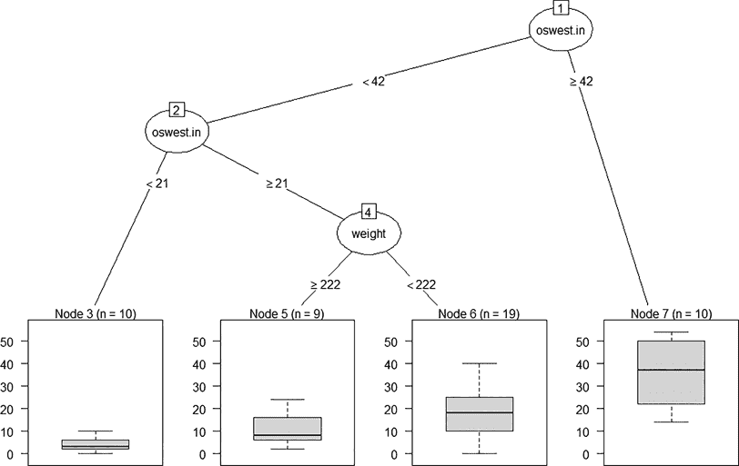

图 6.10   针对 OFCM 数据的回归树。

# 6.7 章节总结

决策树具有多个优点。

* 决策树易于理解，并可以很好地映射到一组生产规则中。
* 决策树已成功应用于实际问题。
* 决策树对数据的性质不作任何先验假设。
* 决策树能够利用包含数值数据和分类数据的数据集构建模型。

与所有机器学习算法一样，关于决策树的使用也存在一些问题。具体来说：

* 输出属性必须是分类的，且不允许有多个输出属性。
* 决策树算法是 `unstable`（不稳定的），因为训练数据中的细微变化会导致树中每个选择点产生不同的属性选择。这种影响可能是显著的，因为属性选择会影响所有后代树。
* 从数值数据集创建的树可能非常复杂，因为数值数据的属性拆分通常是二元的。

我们在这里没有涵盖的一个决策树模型是条件推理树，其拆分基于通过置换检验（第 10 章）确定的属性显著性。`party` 包中的 `ctree()` 函数是条件推理树的实现，可在 R 的 Rattle 包中使用（第 7 章）。

多模型方法（如自助法 bagging、提升法 boosting 和随机森林 forests）有时可以提高模型性能。这些方法对于不稳定的机器学习算法效果最好。回归树和模型树为构建数值输出的模型提供了额外的选择。

## 6.8 关键术语

* `Bagging`。一种监督学习方法，允许多个模型在对新实例分类时具有相同的投票权。
* `Boosting`。一种监督学习方法，允许多个模型参与对新实例的分类。每个模型都有一个相关的权重，用于新实例的分类。
* `Model Tree`。一种部分回归树，树的每个叶节点代表一个线性回归方程，而不是属性值的平均值。
* `Random Forest`。一种多数决定规则的方法，通过属性的随机子集构建决策树集合。每棵树在对新实例分类时都具有相同的投票权。
* `Regression Tree`。一种决策树，其叶节点是数值值而非分类值。

# 练习题

## 复习题

1. 描述 `randomForest` 模型可用的两种重要性类型。
2. 回归树和模型树之间有什么区别？它们又相同之处？
3. Boosting 和随机森林方法之间的主要区别是什么？
4. 流失数据集已结合 C5.0、带有训练/测试集场景的 `rpart`、带有交叉验证的 `rpart` 以及 J48 进行过。请总结这些实验的测试集结果。

## 在 R 中实验

1. 使用脚本 6.2 通过给出 10 到 100 之间以 10 为增量的值来实验 `trials` 参数。制作一个结果表格，显示每次试验的总体准确率和误分类的流失者总数。
2. 考虑脚本 6.2。将 `trials` 参数设置为练习 1 中产生误分类流失者最少的值。从 `minCases = 10` 开始，以 10 为增量尝试 `minCases` 的替代设置，直到包含 100。制作一个表格，显示每个 `minCases` 值创建的树的总体准确率和误分类的流失者总数。鉴于你的目标是最小化对流失者的误分类，请对 `minCases` 的最佳选择做出说明。
3. 加载脚本 6.7 并对 `randomForest` 函数关于树的数量和属性的数量设置进行实验。对每个参数尝试至少五种替代设置。总结你的结果。你能改进模型的测试集性能吗？
4. 使用 `rpart` 和 `caret` 包对 `cardiologyMixed` 数据进行交叉验证。目标是识别发生过一次心脏发病的人。随机选择 200 个实例构建模型。其余 103 个实例用于测试你的模型。使用至少五个值改变 `tuneLength` 参数。总结你的结果。
5. 使用 `cardiologyMixed` 数据结合 `rpart` 以及脚本 6.4 中的训练/测试集场景，构建判断心脏发病患者的模型。通过使用复杂度表裁剪创建的决策树来改进你的模型。提供剪剪前后测试集的混淆矩阵。
6. 使用 scripts.zip 文件中的脚本 6.25：识别有序列表中被错误预测为不流失的前 10 个实例。接下来，修改脚本使用 `rpart` 而不是 C5.0 来构建预测模型。同样，以概率输出预测结果。C5.0 分类错误的 10 个实例中，有多少个也被 `rpart` 分类错误？你得什么结论？

# 编程项目——缺失数据

`creditScreening` 数据框（creditScreening.csv）包含多个具有缺失数据的实例。数值或整数类型的缺失值显示为 `NA`。分类属性的缺失值为空。你的任务是使用 `rpart` 替换缺失的数值或整数项。操作步骤如下：

1. 通过修改 `removeNAS` 函数创建 `saveNAS` 函数，使其在给定数据框时，返回包含具有至少一个缺失数值属性实例的数据框。
2. 以如下方式调用两个函数：

```r
goodDF <- removeNAS(creditScreening)
badDF <- saveNAS(creditScreening)
```

3. 检查 `badDF` 的内容。你会发现属性 `two` 和 `fourteen` 是仅具有缺失值的数值/整数类型属性。编写一个脚本，使用 `rpart` 构建一个回归树，并将输出属性指定为 `two`。
4. 使用 `predict` 将你的模型应用到 `badDF`。`predict` 将估计 `badDF` 中属性 `two` 的值。将属性 `two` 的所有缺失值替换为预测值。
5. 重复步骤 3 和 4，但将属性 `two` 替换为属性 `fourteen`。
6. 合并 `goodDF` 和 `badDF` 以形成一个名为 `creditScreeningNew` 的新数据框。

# 已安装的包和函数

| 包名 | 函数(s) |
| --- | --- |
| `base/ stats` | `data, library, na.action, na.omit, nrow, plot, predict, round, set_seed, sample, summary, table` |
| `C50` | `C5.0` |
| `Caret` | `train, trainControl` |
| `party.kit` | `as.party` |
| `randomForest` | `randomForest` |
| `RWeka` | `J48, GainRatioAttributeEval` |
| `rpart` | `rpart` |
| `rpart.plot` | `prp, rpart.plot, rpart.rules` |

# 第 7 章：基于规则的技巧

本章内容

* 决策树规则
* 覆盖规则算法
* 关联规则
* Rattle 包

在本章中，我们将继续讨论监督学习，重点关注基于规则的机器学习技术。第 `7.1 节`的重点是决策树规则。在第 `7.2 节`中，我们概述了一种基础的覆盖规则算法。然后，我们将 RWeka 的 `JRip` 覆盖算法应用于第 6 章中引入的流失数据。在第 `7.3 节`中，我们展示了一种用于生成关联规则的高效技术。随后，利用 `Apriori(RWeka)` 关联规则函数在杂货店购买客户数据库中发现有趣的的关系。第 `7.4 节`的重点是 Rattle，这是一个图形用户界面（GUI），支持于本文讨论的许多预处理、建模和评估方法。我们使用 Rattle 的界面通过 `rpart` 生成产生规则，使用 `randomForest` 函数对客户流失进行建模，并使用 `apriori(arules)` 函数生成关联规则。

## 7.1 从树到规则

在 `第 1 章` 中，你看到了如何通过为树的每条路径编写一条规则，从而将决策树映射到一组产生规则。由于规则通常比树更具吸引力，研究人员已经研究了基础树到规则映射的几种变体。大多数变体集中在简化和/或消除现有规则。为了说明规则简化过程，请考虑 `图 6.6` 中的决策树。这里显示了遵循树的某条路径创建的规则：

* IF Age < 44 & Gender = Male & Credit Card Insurance = No
* THEN Life Insurance Promotion = No

该规则的前件条件覆盖了 15 个实例中的 4 个，准确率为 75%。让我们通过消除 `age` 的前件条件来简化该规则。简化后的规则形式如下：

* IF Gender = Male & Credit Card Insurance = No
* THEN Life Insurance Promotion = No

通过检查 `表 6.1`，我们看到简化规则的前件覆盖了六个实例。由于规则的后件覆盖了六个实例中的五个，因此简化规则的准确率约为 83.3%。因此，简化后的规则比原始规则更通用、更准确！初看起来看起来，似乎很难相信移除一个条件测试实际上可以提高规则的准确性。然而，更仔细的检查显示了为什么消除测试会带来更好的结果。为了看到，请注意从规则中移除 `age` 属性等同于删除了 `图 6.6` 中的该属性。这样做，遵循 `age >= 44` 的实例现在与遍历 `age < 44` 的实例相同。所有 `age >= 44` 的实例都属于 `life insurance promotion = no` 类。这三个实例中有两个是男性性别且 `credit card insurance = no`。这两个实例都了简化规则的前件和后件条件。

大多数决策树实现自动化了规则创建和简化的过程。一旦规则经过简化和/或消除，就可以对其进行排序以最小化误差。最后，选择一个默认规则。默认规则规定了不符合任何列出规则的实例的分类。让我们使用 `垃圾邮件` 数据集来看看 C5.0 如何生成规则。

### 7.1.1 垃圾邮件数据集

垃圾邮件数据集包含 4601 个实例，其中 2788 个是有效消息。其余实例是垃圾邮件。所有 57 个属性都是连续的。输出属性是分类的，0 表示有效消息。关于来源和性质的完整描述见 `Spam.xlsx` 中的 `description` 工作表。

让我们使用 C5.0 构建一个基于规则的模型，用以判断邮件信息是投递到用户的收件箱还是放入垃圾文件夹。理想的模型特征包括处理速度快和准确率高。


## 7.1.2 垃圾邮件分类：C5.0

开始之前，将 `Spam.csv` 导入 RStudio，并将 `Script 7.1` 加载到你的 RStudio 编辑器。为了节省空间，某些语句被注释掉了。在执行脚本之前移除注释符号将让你更好地了解数据。

感兴趣的第一个语句是带有 `rules=TRUE` 的 C5.0 调用。在这种情况下，C5.0 的输出是一组规则而非决策树。前五条规则列在 `Script 7.1` 中。规则的顺序是任意的。如果没有规则适用，则该实例被赋予数据中最频繁类别的分类。在这里显示为 `默认类别: 0`。

列在（部分）`attribute usage` 列表顶部的属性对预测结果最相关。92% 的整体准确率虽然不错，但几乎有 5% 的有效邮件被错误地分类为垃圾邮件。为了减少有效邮件被分类错误的数量，让我们来看一下预测概率值。回到 Script 5.8 有助于设置 Script 7.2 中所示实验。

与 Script 5.8 一样，`ifelse` 语句为我们提供了更改分类邮件为垃圾邮件的最小概率值的机会。如果我们使用 0.50，我们的结果将与 Script 7.1 中的结果相同。在这里，我们将阈值要求从 0.50 改为 0.75。混淆矩阵显示，在保持整体分类准确率的同时，将有效邮件分类错误的百分率从 5% 降低到了 3% 以下。代价是进入收件箱的垃圾邮件数量增加。我们绝对正沿着正确的方向前进。章末练习题提供了对垃圾邮件数据集进行额外工作的机会。下一节提供了一种不依赖于决策树结构的规则生成方法。

## 7.2 基础覆盖算法

一类流行的规则生成器使用了所谓的 `covering`（覆盖）方法。如果实例满足规则的先决条件，则该实例被该规则覆盖。对于每一类，目标是创建一组规则，在最大化被覆盖的类内实例总数的同时，最小化被覆盖的非类类实例数量。

这里我们概述了一种基于 PRISM 算法（Cendrowska, 1987）的简单覆盖技术。该方法从一个规则开始，其前件条件为空，后件被给定为代表要被覆盖实例的类别。此时，所有数据集中实例的定义范围都由该规则覆盖了。也就是说，当规则执行时，它将每个实例分类为规则后件中指定类别的成员。为了将规则覆盖范围限制在类类内的实例上，输入属性值被逐一考虑作为规则前件的可能添加项。在每次迭代中，选定的属性-值组合是最能代表该类内实例的组合。一旦规则的先决条件完全由目标类别的成员满足，或者属性列表已耗尽，该规则就会被添加到覆盖规则列表中。规则添加后，被规则覆盖的实例将从未覆盖实例池中移除。该过程一直持续，直到目标类中的所有实例都被一个或多个规则覆盖。然后对所有剩余类别重复此方法。这种通用技术存在若干种变体，但覆盖的概念是相同的。

在实践中，这里给出的方法只是构建一组有用规则的第一步。这是因为仅基于单个数据集的规则虽然对于数据集内的实例是准确的，但当应用于更广泛群体时可能表现不佳。生成有用覆盖规则的技术通常基于`增量减少误差剪枝`（`incremental-reduced-error pruning`）的概念。通用想法是按照 2:1 的比例将实例分为两组。较大的（增长）集在算法的增长阶段用于生长出完美规则；较小的（剪枝）集则在剪枝阶段应用，用于从完美规则中移除一个或多个前件条件。

在增长阶段，使用 `grow` 集用于为给定的类别 `C` 创建一个完美规则 `R`。接下来，通过将 `R` 应用于 `prune` 集，计算 `R` 价值的启发式衡量（例如分类正确性）。之后，逐个从 `R` 中移除规则前件条件，每次创建一个新规则 `R-`，它比上一个规则少一个先决条件。在每次移除后，都会为 `R-` 计算一个新的价值分。只要每个新规则的价值都大于原始完美规则的价值，该过程就会持续。当此过程结束时，价值最高的规则被添加到类别 `C` 的规则列表中，并且由此最佳规则覆盖的实例从实例集中移除。只要 `grow` 集和 `prune` 集中都至少剩余一个实例，该过程就会针对 `C` 重复。整个过程在数据中的所有剩余类别中重复。这种基础技术的增强版本（包含一个优化阶段）被称为 RIPPER 算法（`重复增量剪枝以产生误差减少`，`repeated incremental pruning to produce error reduction`）算法（Cohen, 1995），其变体实现在 RWeka 程序包中的 `JRip` 函数中。让我们看看 `JRip` 处理 `churn` 数据集的结果如何。

### 7.2.1 使用 JRip 生成覆盖规则

Script 7.3 显示了我们覆盖规则实验的语句和编辑后的输出。预处理包括检查训练数据和测试数据中的缺失项。调用 `JRip` 在自动将随机种子设置为 1 后创建了 12 条覆盖规则。需要注意的是，必须按照给定的顺序执行规则！

Script 7.3 列出了前四条规则和最后一条。第一条规则正确识别了 73 个训练集实例中的 72 个。第二和第三条规则共同正确地将 126 个实例分类为流失用户。第四条规则错误地分类了 57 个实例中的 8 个。最后的规则是 12 条规则中的最后一个。前 11 条规则用于识别流失用户。最后一条规则覆盖所有被前 11 条规则覆盖的实例。该规则误分类了剩余 2920 个实例中的 87 个，并简单地规定如果实例不满足规则 1 到 11 中的任何一个，则该实例被分类为非流失用户。

摘要包含一个基于训练数据的混淆矩阵。在 483 个流失用户中，我们看到 87 个被误分类为非流失用户。这代表了训练数据中流失人口的 18% 以上。当规则应用于测试数据时，这一百分比增加到了 27% 以上。

## 7.3 关联规则

关联规则与传统的分类规则不同，其特征在于：在一个规则中作为前提条件的属性，可能会出现在另一条规则的后件中。此外，传统的分类规则通常将规则的后件限制为单个属性，而关联规则生成器允许规则的后件包含一个或多个属性值。为了说明这一点，假设我们想要确定以下四种杂货商店产品的购买趋势中是否存在有趣的关系：

*   牛奶
*   奶酪
*   面包
*   鸡蛋

可能的关联包括：

1. 如果客户购买牛奶，他们也会购买面包。
2. 如果客户购买面包，他们也会购买牛奶。
3. 如果客户购买牛奶和鸡蛋，他们也会购买奶酪和面包。
4. 如果客户购买牛奶、奶酪和鸡蛋，他们也会购买面包。

第一个关联告诉我们，购买牛奶的客户也可能购买面包。而明显的问题是：“购买牛奶事件导致购买面包的可能性有多大？”为了回答这个问题，每条关联规则都有一个关联的置信度（confidence）。对于这条规则，置信度是在购买牛奶的条件下购买面包的条件概率。因此，如果总共有 10,000 笔客户交易涉及购买牛奶，而其中 5,000 笔交易同样包含了购买面包，那么购买牛奶购买面包的置信度为 `5000/10,000 = 50%`。

现在考虑第二条规则。这条规则提供的信息与第一条规则相同吗？答案是否！对于第一条规则，事务领域由所有购买过牛奶的客户。对于这条规则，领域是所有显示购买面包项目的客户交易集合。例如，假设我们总共有 20,000 笔涉及购买面包的客户交易，其中 5,000 笔也涉及购买牛奶。这使得购买面包购买牛奶的置信度值为 25%，而第一条规则为 50%。

尽管第三和第四条规则更复杂，但原理是相同的。第三条规则的置信度告诉我们我们在购买牛奶和鸡蛋的情况下，购买奶酪和面包的可能性。第四条规则的置信度告诉我们我们在购买牛奶、奶酪和鸡蛋的情况下，购买面包的可能性。

规则置信度值没有提供的一个重要信息是：包含关联规则中发现的属性值的所有交易的百分比。这一统计量被称为规则的`support`（支持度）。支持度简单是指数据库中包含特定关联规则列出的所有项目（事务）的最小百分比。在下一节中，你将看到项目集（item sets）如何利用支持度限制给定数据集关联规则的总数。

### 7.3.1 Apriori 算法

当存在多个属性时，由于每个规则的后件有可能的条件过多，关联规则的生成变得不合理。已经开发了特殊的算法来高效生成关联规则。其中一种算法是`apriori`算法（Agrawal et al., 1993）。该算法生成所谓的`item sets`（项集）。项集是满足特定覆盖要求的属性-值组合。不符合要求的属性-值组合会被丢弃。这使得`apriori`算法能够非常高效。

`apriori`关联规则的生成是一个两步骤的过程。第一步是`item set`生成。第二步是使用`item sets`进行`rule generation`。

在第一步中，我们找到满足最小`support`阈值的`item sets`。例如，假设最小`support` 设置为 20%。我们首先找到所有满足支持度的`1-item sets`。然后，通过检查`1-item sets`的组合，找到所有满足支持度的`2-item sets`。我们对`3-item sets`、`4-item sets`等继续此过程，直到无法找到更多的`item sets`为止。

在接下来的示例中，我们使用`apriori`算法从`Table 7.1`所示的数据集中生成关联规则。

#### 7.1 信用卡促销子集

| Item Set | Support |
| :--- | :--- |
| `{Milk}` | 50% |
| `{Bread}` | 50% |
| `{Cheese}` | 100% |
| `{Milk, Bread}` | 50% |
| `{Milk, Cheese}` | 20% |
| `{Milk, Eggs}` | 20% |
| `{Bread, Cheese}` | 20% |
| `{Bread, Eggs}` | 20% |
| `{Cheese, Eggs}` | 20% |
| `{Milk, Bread, Cheese}` | 20% |
| `{Milk, Bread, Eggs}` | 20% |
| `{Milk, Cheese, Eggs}` | 0% |
| `{Bread, Cheese, Eggs}` | 0% |
| `{Milk, Bread, Cheese, Eggs}` | 0% |

表 7.1 信用卡促销子集

| Transaction | Milk | Bread | Cheese | Eggs |
| :--- | :---: | :---: | :---: | :---: |
| 1 | Y | Y | Y | |
| 2 | | | Y | Y |
| 3 | Y | Y | | |
| 4 | | | Y | Y |
| 5 | Y | | Y | |
| 6 | | | Y | Y |
| 7 | Y | Y | Y | |
| 8 | | | Y | Y |
| 9 | Y | Y | | Y |
| 10 | | | Y | Y |

表 7.2 信用卡促销

#### 7.2.1 Apriori 算法详解

`apriori`算法利用以下属性：如果一个`item set`满足支持度阈值，那么它的所有的子集也必须满足该阈值。这允许算法显著剪枝搜索空间。

该算法的工作如下：

1. 找到所有满足最小`support`的`1-item sets`。
2. 对于 `k = 2, 3, ...`：
   a. 通过连接`(k-1)-item sets`生成候选的`k-item sets`。
   b. 计算每个`k-item set`的`support`。
   c. 只保留满足最小`support`的`k-item sets`。
   d. 如果没有保留`k-item sets`，则停止。

一旦找到了`item sets`，我们就生成关联规则。对于每个`item set`，我们可以生成可能的规则 `A -> B`，其中`A`是`item set`的子集，而`B`是该项集的补集。对于每条规则，我们计算`confidence`。如果`confidence`满足最小阈值，则保留该规则。

在`Table 7.2`的示例中，假设最小`support`为 20%，最小`confidence`为 50%。

满足 20%支持度的`item sets`有：

`{Milk}`, `{Bread}`, `{Cheese}`, `{Eggs}`,
`{Milk, Bread}`, `{Milk, Cheese}`, `{Milk, Eggs}`, `{Bread, Cheese}`, `{Bread, Eggs}`, `{Cheese, Eggs}`,
`{Milk, Bread, Cheese}`, `{Milk, Bread, Eggs}`

现在我们生成规则。例如，对于 `{Milk, Bread}`，可能的规则有：

`Milk -> Bread`: `confidence = support(Milk, Bread) / support(Milk) = 50% / 50% = 100%`
`Bread -> Milk`: `confidence = support(Milk, Bread) / support(Bread) = 50% / 50% = 100%`

两者都满足 50%的置信度阈值。

对于 `{Milk, Cheese}`，规则为：

`Milk -> Cheese`: `confidence = support(Milk, Cheese) / support(Milk) = 20% / 50% = 40%`
`Cheese -> Milk`: `confidence = support(Milk, Cheese) / support(Cheese) = 20% / 100% = 20%`

均不满足 50%的置信度阈值。

对所有`item sets`重复此操作，我们就找到了所有有效的关联规则。

### 7.3.2 挖掘关联规则：示例

- `Watch Promotion = No & Life Insurance Promotion = No & Credit Card Insurance = No`
- `Life Insurance Promotion = No & Credit Card Insurance = No & Gender = Male`

由于没有额外的成员集可能性，该过程将从生成项集开始创建关联规则。创建规则的第一步是指定最小规则置信度（confidence）。接下来，从二项集和三项集表中生成关联规则。最后，任何不符合最小置信值的规则都将被丢弃。

两种可能的二项集规则如下：

- `IF Magazine Promotion = Yes`
- `THEN Life Insurance Promotion = Yes` (5/7)
- `IF Life Insurance Promotion = Yes`
- `THEN Magazine Promotion = Yes` (5/5)

右侧的分数表示规则的准确率（置信度）。对于第一个规则，有五个实例显示杂志推广和人寿保险均为“yes”。`magazine promotion = yes` 的总实例共有七个。因此，在两种情况下，当 `magazine promotion = yes` 时，预测人寿推广值为“yes”的该规则会出错。如果我们的最小置信度设置为 80%，那么第一条规则将从最终规则集中删除。第二条规则规定，每当 `life insurance promotion = yes` 时 `magazine promotion = yes`。该规则的置信度为 100%。因此，该规则成为关联规则生成器最终输出的一部分。以下是几种可能的三项集规则中的三个：

- `IF Watch Promotion = No & Life Insurance Promotion = No`
- `THEN Credit Card Insurance = No` (4/4)
- `IF Watch Promotion = No`
- `THEN Life Insurance Promotion = No & Credit Card Insurance = No` (4/6)
- `IF Credit Card Insurance = No`
- `THEN Watch Promotion = No & Life Insurance Promotion = No` (4/8)

章节末尾的练习要求你为该数据集编写额外的关联规则。

### 7.3.3 通用考虑

关联规则之所以特别受欢迎，是因为它们能够在大型数据库中发现关系，而不会受到选择单一因变量的限制。然而，在解释关联规则时必须谨慎，因为许多发现的关系被证明是显微不足道的（trivial）。

例如，假设我们为一次购物篮分析提供了总共 10,000 笔交易。此外，假设 70% 的交易涉及购买牛奶，50% 的交易有购买面包。从这些信息中，我们可能会看到如下形式的关联规则：

- `如果客户购买牛奶，他们也会购买面包。`

该规则的支持度（support）可能远高于 40%，但请注意，大多数客户都购买这两种产品。该规则并没有为我们提供额外的营销信息，告诉我们通过促销牛奶来推广面包是有益的，因为大多数客户本身就会一起购买这些产品。然而，关联规则中发现的两种关系非常受关注：

- 我们对那些显示特定产品销售额提升（lift）的关联规则感兴趣，其中销量的提升是其与一个或多个其他产品关联的结果。在这种情况下，我们可以利用这些信息来帮助促销因关联而销量增加的产品。
- 我们也对那些显示特定关联的置信度低于预期的关联规则感兴趣。在这种情况下，一个可能的结论是规则中列出的产品在竞争同一个市场。

最后一点，购物篮分析通常存储海量数据。因此，尽量减少关联规则生成器所需的工作量是非常重要的。一个良好的方案是为项集覆盖标准（coverage criterion）指定一个初始高值。如果需要更多规则，可以降低覆盖标准并重复整个过程。是时候实验了！

### 7.3.4 Rweka 的 Apriori 函数

R 提供了多个关联规则包供选择。在我们这里的实验中，我们使用 `RWeka’s Apriori` 关联规则函数。我们将在第 7.4 节查看 `apriori(arules package)` 函数。


包括 Apriori 在内的大多数关联规则生成器都限于包含名义（分类）数据的数据集。如果数据集包含数值属性，我们有两种选择。一种选择是在生成关联规则之前删除所有数值属性。我们的第二个选择是将数值属性转换为等效的分类。对于我们的第一个示例，我们检查了 `RWeka` 包中包含的 `contact-lensesdataset`。该数据集包含 24 个实例，具有四个分类输入属性，以及一个说明个人能够佩戴隐形眼镜的输出属性。该数据集存储在标准的 Weka 文件 `arff` 中。脚本 7.4 中的读取语句读取并将文件转换为适用于 RStudio 环境的格式。

脚本 7.4 显示了将 `Apriori` 应用于隐形眼镜数据时看到的语句和相关输出。`WOW` 函数列出了 `Apriori` 可用的选项。我们可以选择置信度的下限，设置支持度的下下上限，使用置信度以外的指标，并控制显示规则的最大数量。脚本 7.4 将选项列表限制在此处实际使用的选项。

第一次调用 `Apriori` 生成了六条关联规则。前五条规则显示 `contact-lenses` 为输出属性。`Astigmatism` 是规则 6 的输出属性。让我们看看给第二条规则：

```
If spectacle-presc = myope tear-prod-rate=reduced 6 → contact-lenses=none 6 conf:(1)
```

规则前提（`→` 符号左侧）中的 6 告诉我们有六个数据实例在给定属性上同时显示 `myope` 和 `reduced` 为值。规则结果（`→` 符号右侧）中的 6 告诉我们这相同的六个实例在 `contact-lenses` 属性上的值为 `none`。这导致该规则的置信度值为 1。所有列出的规则的置信得分均为 1，意味着每条规则都是 100% 准确的。

`Apriori` 函数不显示规则支持。然而，`WOW` 选项列表告诉我们 `LowerBoundMinSupport` 当前设置为 0.1。如果我们将此值重置为 50% (M= 0.5) 并再次运行应用程序，我们将看到一条规则。具体来说：

- `Tear-prod-rate= reduced → contact-lenses = none`

让我们关注一个为购物篮分析设计的更有趣的数据集。该数据集——`supermarket.arff`——包含了从新超市收集的实际购物数据。该数据集不是 `RWeka` 的，但包含在你的补充材料中。脚本 7.5 显示了 `read.arff` 函数如何从当前工作目录读取该数据集。

整个数据集包含 4627 个实例和 217 个属性。每个实例给出了购物者在单次超市购物中的购买情况。图 7.1 显示了 RStudio 截图，显示数据的一小部分。`View(super.data)` 将让你对属性名称和值有更好的整体了解。

原始的 `.arff` 文件包含了大量的问号，每个 `?` 代表未购买的项目。幸运的是，`read.arff` 函数将所有的 `?` 转换为 `NA`！

某些属性非常通用，它们仅表示在给定的部门内有购买行为。其他属性则更具体，因为它们的值是具体的物品类型，例如罐装水果。最后一个属性是 `total`，其值为 `high` 或 `low`。如果总账单超过 100 美元，则该值为高。然而，该属性并不一定具有主要性，因为我们寻找的是具有属性值组合的关联规则，以确定那些可能被一起购买的物品。

每次购买都由一个 `t` 表示。第一个列出的客户购买了一个 `baby needs` 商品、一个 `bread and cake` 商品、一个来自 `baking needs` 的物品，以及通过移动编辑窗口底部的滚动条或点击屏幕顶部的 `cols` 箭头看到的其他几个物品。客户 2 购买了一个来自 `department 1` 的物品，以及通过向右移动滚动条看到的额外物品。显而易见，大部分数据是非常稀疏的，因为大多数属性值都是空的。

使用 Script 7.5 的 `Apriori` 函数设置可以产生五条关联规则。显然，每个规则的后件（consequent）都是 `bread and cake.`。进一步的研究显示，使用默认生成的所有规则具有相同的后件！要找到其他可能感兴趣的规则，需要对一个或多个参数设置进行操作。只需将最小置信度要求修改为 70%（`C` = 0.70），引入几个新属性。章末练习 10 要求你对这些数据进行进一步实验，尝试寻找有意义的关联。但现在，准备好摇摆、响动并滚动吧！

# 7.4 摇摆、响动并滚动

在本节中，我们介绍了 Rattle（易于学习 R 分析工具），这是一个允许我们可视化数据、预处理数据、构建模型和评估结果而无需编写长脚本的图形用户界面（GUI）。首先，我们必须前往 CRAN 库安装并加载 `rattle package`。

一旦安装并加载了 `rattle package`，可以在控制台窗口中输入 `rattle()` 来启动 GUI。图 7.2 显示了界面。通过 Rattle，我们可以加载、探索、转换、聚类和对数据进行建模。Rattle 还包含了丰富的模型评估工具。

学习如何使用 Rattle 最有效的方法是完成几个示例。在我们处理这些示例时，你很快就会发现 Rattle 需要几个你机器上未安装的包。每当 Rattle 询问你是否可以安装缺失的包时，只需给出肯定答案并让 Rattle 完成工作即可。让我们从简单的开始，将 `rpart` 应用于 `contact-lenses` 数据集。


FIGURE 7.2   Rattle 界面。

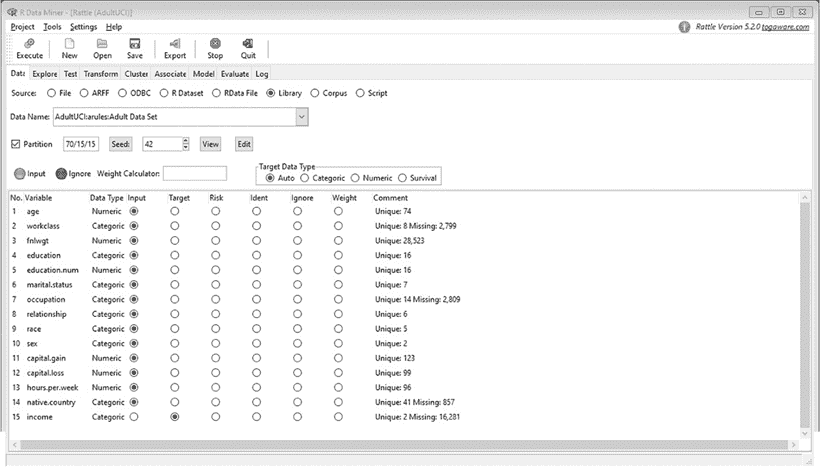

FIGURE 7.10   AdultUCI 数据集。

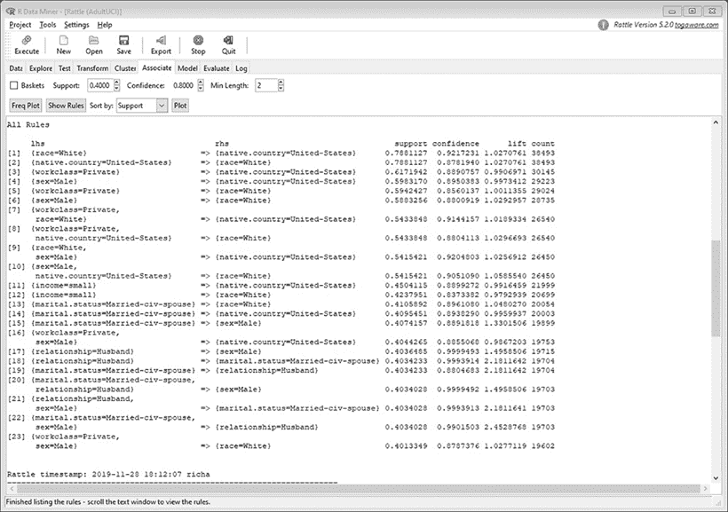

FIGURE 7.11   UCI adult 数据集的关联规则。

每个列出的每条关联规则都包含置信度（confidence）、支持度（support）、提升度（lift）和计数（count）的值。给定形式为 `x → y` 的规则，计算 `lift` 的方程为：

$$\frac{\textit{support~}\left( x,y \right)}{\textit{support}\left( \mathit{x} \right)^{\*}\textit{~}\textit{support}\left( y \right)}$$  

其中 `support(x,y)` 是规则支持度的值。

提升度高于 1.0 的值会增加在购买 `x` 之后购买 `y` 的概率，低于 1.0 的值则表示购买 `x` 降低了购买 `y` 的概率。虽然 图 7.11 中显示的规则并没太大吸引力，但该数据集规模很大，值得进一步的实验。

最后，你可以直接在控制台中中使用 `arules` 函数为数据集生成规则。以下是针对当前数据的一种可能性。

```
library(arules)
data("Adult")
my.Rules <- apriori(Adult,
+ parameter = list(supp = 0.4, conf = 0.8, target = "rules"))
summary(my.Rules)
inspect(my.Rules)
```

## 7.5 总结

决策树通过为树的每条路径编写规则，可以很好地映射到一组产生规则。在某些情况下，映射的规则可以简化，而不会显著降低测试集的准确率。

覆盖规则生成器（Covering rule generators）试图创建一组规则，在覆盖的类内实例总数最大化的同时，最小化覆盖的非类实例数量。关联规则与传统的产生规则不同之处在于，在一个规则中作为前提的属性可能会在另一条规则中作为后件出现。此外，关联规则生成器允许规则的后件包含一个或多个属性值。由于关联规则更加复杂，已经开发了特殊技术来高效地生成关联规则。规则的置信度和支持度有助于从营销角度确定哪些发现的关联可能是有意义的。然而，在解释关联规则时必须小心，因为许多发现的关系实际上被证明是平庸无奇的。`rattle` 包为我们提供了一个易于使用的 GUI。

## 7.6 关键术语

*   **关联分析（Affinity analysis）**：确定哪些事物通常在一起的过程。
*   **置信度（Confidence）**：给定形式为“如果 A 则 B”的规则，置信度定义为 A 为真时 B 为真的概率。
*   **项集（Item set）**：覆盖预设最小数量实例的属性值集合。
*   **支持度（Support）**：数据库中包含给定关联规则所有项的实例最小百分比。

# 练习

## 复习题

1. 关联规则与传统的产生规则有什么不同之处？有什么相同之处？
2. 覆盖规则与传统的产生规则有什么不同之处？

## 使用 R 进行实验

1. 使用 `C5.0`（默认设置）为 `ccromo` 数据集生成规则。重复但使用 `JRip` 生成规则。比较这两组规则。总结你的结果。
2. 在 Script 7.1 中实验 `minCases` 的不同值。尝试在保持整体准确率的同时创建一个规则较少的模型。制作一个表格显示实验结果。`minCases` 的值如何影响被分类为垃圾邮件的数量？
3. 使用 Script 7.2 实验垃圾邮件截断值。制作一个表格，显示不同截断值下的整体准确率、被分类为垃圾邮件的有效邮件数量以及错误的垃圾邮件数量。如果目标是让少于 2% 的有效邮件进入垃圾箱，应该使用哪个值？
4. 利用练习 2 和 3 创建的表格，帮助你实验 `minCases` 和截断值的各种组合，以获得最佳结果。
5. 重复 Script 7.1 中的实验，但将 `C5.0` 替换为 `RWeka` 的 `PART` 规则生成器。确保在脚本中包含 `RWeka` 库。使用 `WOW(PART)` 了解可用选项。构建模型的初始语句如下：

```
Spam.PART <- PART(Spam ~ ., data = spam.train, control = Weka_control(M=2))
```

尝试更高的 `M` 值以生成更少的规则。尝试构建一个减少有效邮件误分类且不损害整体准确的模型。
6. 使用脚本 7.1 和 7.2 中通过第 6 章引入的 `churn` 数据重复这些实验。目标是建立一个模型，能够识别测试集中比例最大的流失候选者，但同时保持合理的整体测试集准确率。从定义一个特定目标开始。
7. 将 Rattle 的关联规则生成器应用于 `ccpromo` 数据集。将规则置信度指定为 `0.90`，最小支持度指定为 `0.40`。列出你认为最感兴趣的两个规则，并说明它们为什么感兴趣。
8. 将 Rattle 的关联规则生成器应用于 `contact-lenses` 数据集。将规则置信度指定为 `0.90`，最小支持度指定为 `0.10`。列出你认为最感兴趣的两个规则，并说明它们为什么感兴趣。
9. 使用 `apriori(arules)` 一个脚本为 `ccpromo` 数据集生成规则。由于 `age` 是数值型的，你必须在生成规则之前对 `age` 进行离散化或删除。对支持度和置信度的各种设置进行实验。报告数据中发现的两个或三个“有趣”的规则。
10. 对 `RWeka` 的 `Apriori` 实现和超市数据进行实验。修改置信度和支持度值以尝试寻找有趣的规则。对你认为感兴趣的三个规则进行注释。指定置信度和支持度值，以及这些规则为什么感兴趣。
11. 使用 `JRip` 为 `Spam` 数据集创建一个覆盖规则集。对 `JRip` 的参数进行实验，以获得规则数量最少的最佳结果。对 `C50`、`PART` 和 `JRip` 创建的规则进行比较分析。
12. 使用 `PART` 为 `churn` 数据集生成规则。将你的模型的测试集准确率与将 `JRip` 应用于相同数据时所看到的结果进行比较。

## 计算题

1. 验证由 `C5.0` 使用 `ccpromo` 数据集中所有实例生成的以下规则的准确率和提升（lift）值。

```
Rule 1: (6/1, lift 1.9)
       CCardIns = No
       Gender = Male
       -> class No [0.750]
```

2. 回答以下问题。

    1. 写出图 6.3 所示决策树的生成式规则。
    2. 针对图 6.5 所示的决策树重复上述问题。

3. 使用表 7.1 中的数据为以下关联规则提供置信度和支持度值。

*如果 性别 = 男性 & 杂志促销 = 是，那么 人寿保险促销 = 是*

4. 使用表 7.3 中的信息列出三条二项规则。使用表 7.1 中的数据指定每个规则的置信度和支持度。

促销 = 否 & 人寿保险 = 否 & 信用卡保险 = 否

## 已安装包和函数

| 包名 | 函数 |
| :--- | :--- |
| `arules` | `apriori`, `inspect` |
| `base` | `c`, `cbind`, `data.frame`, `factor`, `ifelse`, `library`, `set.seed`, `sample`, `summary`, `table`, `View` |
| `C50` | `C5.0` |
| `randomForest` | `randomForest` |
| `rattle` | `rattle` |
| `PART` | `PART`, `Apriori`, `JRip`, `read.arff` |

# 第 8 章 神经网络

在本章中，我们将介绍

*   反馈神经网络
*   自组织网络
*   神经网络的优点与缺点
*   使用 R 构建神经网络

神经网络在商业、科学领域得到了广泛应用。尽管存在多种神经网络架构，但我们将讨论监督学习和无监督学习。在第 8.1 节 中，我们将介绍神经网络的基本概念。神经网络需要输入值值。在第 8.2 节 中，我们将提供监督学习神经网络的概述。在第 8.3 节 中，我们将介绍用于分类的常用技术。在第 8.4 节 中，我们将讨论神经网络的优缺点。在第 8.5 节 中，我们将介绍反向传播和自组织神经网络的示例。如果你对神经网络如何学习的理解感兴趣，可能会跳过第 8.6 节。在第 8.7 节 中，我们将使用 R 的两个包进行无监督聚类。最后一节的重点是股票价格。

分类数据的转换有多种方法。一种简单的方法是将区间范围划分为等大小的单元。为了说明这一点，考虑属性 `color`（颜色），其可能取值为红色、绿色、蓝色和黄色。使用这种方法，我们可以进行如下分配：红色 = 0.00，绿色 = 0.33，蓝色 = 0.67，黄色 = 1.00。虽然可以使用这种技术，但它有一个明显的缺陷。这种修改引入了转换前未出现过的距离度量。这在我们的示例中得到了体现：红色和绿色之间的距离小于红色和黄色之间的距离。因此，红色似乎比黄色更接近绿色。

分类到数值转换的第二种技术是为每个分类值设置一个输入节点。再次考虑属性 `color`，其四个值的分配如上一个示例所示。通过为 `color` 增加三个额外的输入节点，我们可以如下表示这四种颜色：红色 = `[1,0,0,0]`，绿色 = `[0,1,0,0]`，蓝色 = `[0,0,1,0]`，黄色 = `[0,0,0,1]`。使用这种方案，每个分类值都变成取值为 0 或 1 的属性。显而易见，这种方法消除了前一种方法中看到的偏差。

现在让我们考虑数值数据转换为所需的区间范围。假设我们有值 100、200、300 和 400。一种明显的转换方法是将所有属性值除以最大的属性值。对于我们的示例，将每个数字除以 400 得到转换后的值：0.25、0.5、0.75 和 1.0。这种方法的问题在于，除非至少有一些值接近 0，否则我们无法利用整个区间范围。对这种技术进行微调可以得到所需的结果，如公式 8.1 所示。

$$
\textit{newValue} = \frac{\textit{originalValue} - \textit{minimumValue}}{\textit{maximumValue} - \textit{minimumValue}} \tag{8.1}
$$

其中，

*   `newValue` 是落在 `[0,1]` 区间范围内的计算值
*   `originalValue` 是待转换的值
*   `minimumValue` 是属性的最小可能值
*   `maximumValue` 是属性的最大可能值

将该公式应用于上述值，我们得到 0.0、0.33、0.66 和 1.0。

当无法确定最大值时，存在特殊情况。一种可能的解决方案是使用一个任意大值作为除数。再次，除以任意数会留给我们无法覆盖整个区间范围的可能性。最后，除非应用这些技术的变体，否则高度偏斜的数据可能会导致不利的结果。处理偏斜数据的常用方法是在应用上述转换变换之前，对每个值取以 2 为底或以 10 为底的对数。

## 8.1.2 神经网络输出格式

神经网络的输出节点表示 `[0, 1]` 范围内的连续值。然而，输出可以转换以适应分类类别值。为了说明这一点，假设我们希望训练一个神经网络来识别可能利用特殊优惠的新信用卡客户。我们设计的网络架构有两个输出层节点，节点 1 和节点 2。在训练期间，对于利用过之前优惠的客户，我们将第一个输出节点的正确输出标记为 `1`，第二个输出节点标记为 `0`。对于传统上不利用优惠的客户，正确输出由节点 1 和节点 2 分别指定 `0` 和 `1`。一旦训练完成，神经网络会将节点 1 和节点 2 的输出组合 0.9、0.2 识别为可能利用优惠的新客户。

这种方法有某些缺点，因为像 0.2、0.3 这样的节点输出组合没有明确的分类。针对这种情况，人们已经提出了多种方法。一种方法建议将确定性因子与节点输出值相关联。一种流行的方法使用特殊的测试数据集来帮助处理难以解释的输出值。这种方法还允许即使在输出是分类的情况下，也能构建具有单输出层节点的神经网络。一个示例说明了这种方法。


假设我们为刚才讨论的信用卡客户示例决定使用单个输出节点。我们将 `1` 指定为可能利用特殊优惠的客户的理想输出，并将可能放弃优惠的客户指定为 `0`。一旦我们训练了网络，我们就可以放心地将输出值 0.8 分类为可能利用优惠的客户。然而，当输出值为 0.45 时该怎么办？特殊测试数据集有助于解决我们的困境。在将网络应用于未知实例之前，我们将测试集交给训练好的网络，并记录每个测试实例的输出值。然后我们将网络应用于未知实例。当未知实例 `x` 显示出不确定的输出值 `v` 时，我们根据聚集在 `v` 或其附近的测试集实例多数所展示的类别对 `x` 进行分类。

最后，当我们想要使用神经网络的计算输出进行预测时，我们又遇到了另一个问题。假设神经网络的输出帮助我们预测未来。假设神经网络的输出是 0.35。神经网络的输出帮助我们预测未来。神经网络的输出帮助我们预测未来。节点表示连续值。

# 8.1.3 Sigmoid 评估函数

前馈神经网络每个节点的目的是接受输入值并向下一层传递输出值。输入层节点原样传递输入值。因此，对于图 8.1 所示的输入实例，节点 1 的输出为 1.0，节点 2 的输出为 0.4，节点 3 的输出为 0.7。

隐藏层或输出层节点 `n` 获取来自上一层节点的输入，将上一层的值合并为单个值，并将新值作为评估函数的输入。评估函数的输出是节点的输出，它必须是 `[0, 1]` 闭区间内的数字。

让我们来看一个示例。表 8.1 显示了图 8.1 中神经网络的权重权重。考虑节点 `j`。计算节点 `j` 的输入，我们需要确定每个权重与其相应的输入层值乘积的总和。即：

```
Input to node j = (0.2)(1.0) + (0.3)(0.4) + (-0.1)(0.7) = 0.25
```

因此，0.25 代表节点 `j` 评估函数的输入值。

评估函数的第一个标准是该函数必须在 [0, 1] 区间内输出值。第二个标准是随着 `x` 的增加，`f(x)` 输出输出接近 1 的值。通过这种方式，函数在网络内部传播激活信号。`sigmoid 函数`满足这两个标准，通常用于节点评估。sigmoid 函数的计算方式为：

```
${f\left( x \right) = \frac{1}{1 + e^{- x}}}\mspace{180mu}\operatorname{(8.2)}$
``` 

其中

*   `e` 是自然对数的底，近似值为 2.718282。

图 8.2 显示了 sigmoid 函数的图像。注意小于零的 `x` 值提供的激活很小。对于我们的示例，`f(0.25)` 的评估值为 0.562，这代表节点 `j` 的输出。

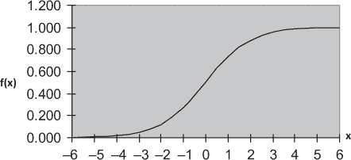

图 8.2   sigmoid 评估函数。

最后，需要注意的是，每个隐藏层和输出层节点通常都关联有一个`偏置`bias）或`阈值`threshold）节点。阈值节点与普通节点的区别在于，它们的连接值在学习过程中的变化与其他所有网络权重相同，但它们的输入被固定为一个常量（通常为 1）。在本章稍后的部分，当我们研究 R 的一个神经网络函数时，将阐明阈值节点的目的和功能。

# 8.2 神经网络训练：概念视角

在本节中，我们讨论了训练前馈网络的两种方法以及一种用于无监督神经网络聚类的技术。我们的讨论局限性在于，我们没有详细说明算法的工作原理。对于大多数读者来说，这里的讨论已足够满足对神经网络学习的基本好奇。然而，对于更倾向于技术的个人，第 8.5 节

监督学习涉及训练和测试。在训练阶段，训练实例被反复通过网络，同时修改单个权重值。改变连接权重的目的是最小化预测输出值与实际输出值之间的训练集误差。网络训练一直持续，直到满足特定的终止条件。终止条件可以是网络收敛到最小总误差值、特定的时间标准，或最大迭代次数。

反向传播学习常用于训练前馈网络。对于每个训练实例，反向传播的工作原理是首先将实例输入网络并计算网络输出值。回想一下，每个输出层节点计算一个输出值。为了说明反向传播学习，我们使用图 8.1 以及图中所示的输入实例。

我们之前确定了图 8.1 中实例的计算输出为 0.52。现在假设与该实例关联的输出输出为 0.65。显然，计算值与目标值之间的绝对误差为 0.13。然而，当我们试图确定错误产生的原因时，就出现了一个问题。也就是说，我们不知道网络连接权重中的哪一个应该为错误负责。可能改变其中一个权重就能在下一次实例通过网络时为我们提供更好的结果。更有可能的问题在于两个或更多权重值的组合。另一种可能性是，误差在某种程度上是与输出节点相关的每个网络连接的错。

反向传播学习算法假设了最后这种可能性。对于我们的示例，节点 `k` 处的输出误差反向回网络，所有八个相关的网络权重都发生了变化。每个连接权重的变化量通过一个公式计算，该公式利用了节点 `k` 处的输出误差、单个节点输出值以及 sigmoid 函数的导数。该公式有一种平滑实际误差值的方法，以免对任何单个训练实例引起过度纠正。

只要迭代次数足够，反向传播学习技术保证收敛。然而，并没有保证收敛是最优的。因此，可能需要多次应用该算法以获得可接受的结果。

### 8.2.2 使用自组织映射进行无监督聚类

Teuvo Kohonen (1982) 在 20 世纪 80 年代初通过引入 Kohonen 特征图，首次将神经网络无监督聚类形式化。他的原始工作侧重于图像和声音的映射。然而，该技术已有效用于无监督聚类。Kohonen 网络也被称为自组织映射 (SOMs)。

`Kohonen 网络`支持两个层。输入层为每个输入属性包含一个节点。输入层节点与输出层中的所有节点都有加权连接。输出层可以采用任何形式，但通常组织成二维网格。图 8.3 显示了一个具有两个输入层节点和九个输出层节点的简单 Kohonen 网络。

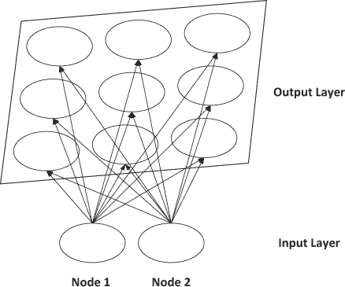

图 8.3  一个具有两个输入层节点的 3×3 Kohonen 网络。

在网络学习期间，输入实例被输入到输出层节点。当实例输入网络时，权重连接与实例最匹配的输出节点获胜。该节点通过修改权重以更匹配实例来获得奖励。最初，获胜节点的邻居也通过修改其权重以紧密匹配当前实例的属性值获得奖励。然而，在实例通过网络几次之后，邻域的大小会缩小，直到只有获胜节点获得奖励。

每次实例通过网络时，输出层节点都会跟踪它们赢得实例的数量。在数据的最后一次通过中赢得最多实例的输出节点被保存。保存的输出节点数量于于数据中的类数量。最后，那些与删除节点类的训练实例再次输入网络，并使用保存节点之一进行分类。节点与其相关的训练集实例表征了数据集中的类。

## 8.3 神经网络解释

神经网络架构的一个主要缺点是对所学习内容缺乏理解。这里我们总结了解决这一缺点的四种技术。神经网络解释的一种可能性是将架构转换为一组规则。用于从神经网络中提取规则的算法通常涉及移除分类正确性影响最小的权重链接。遗憾的是，规则提取方法的成功有限。

`敏感性分析`是另一种成功用于了解单个属性对神经网络输出影响的技术。该方法有多种变。通用过程包括以下步骤：

1.  将数据分为训练集和测试数据集。

2.  使用训练数据训练网络。

3. 使用测试集数据创建一个新实例 `I`。`I` 的每个属性值均为测试数据中所有属性值的平均值。

4. 针对每个属性：

   1. 改变实例 `I` 中的属性值，并将修改后的 `I` 提交给网络进行分类。

   2. 确定这些变化对神经网络输出的影响。

   3. 通过属性变化对网络输出的影响来衡量每个属性的相对重要性。

敏感性分析允许我们确定各个属性相对重要性的排序。然而，该方法并没有提供一组显式的规则，来帮助我们进一步了解网络学习了什么。

第三种作为无监督聚类通用解释工具的有价值的技术是`平均成员技术`（average member technique）。通过这种方法，通过计算每个类中每个类属性的平均值，可以得出每个类别的平均成员或最典型成员（这与敏感性分析中计算所有实例的平均值的方法不同）。

第四种更具信息量的替代方案是应用监督学习来解释无监督聚类的结果。以下是该方法应用于无监督神经网络学习的步骤：

1. 执行必要的数据转换，为无监督神经网络聚类准备数据。

2. 将数据提交给无监督网络模型。

3. 将神经网络创建的每个簇称为一个“类”，并为每个簇分配一个任意的类名。

4. 使用新形成的类作为决策树算法的训练实例。

5. 检查决策树，以确定聚类算法形成的概念类的性质。

这种方法相比`平均成员技术`的优势在于，它提供了关于所形成簇之间差异和相似性的通用总结。作为替代，可以使用规则生成器来详细描述每个簇。

## 8.4 通用考虑

构建神经网络的过程既是艺术也是科学。一种合理的方法是在改变属性选择和学习参数的同时进行多次实验。以下是影响神经网络模型性能的选择列表的一部分：

* 将使用哪些输入属性来构建网络？

* 网络输出将如何表示？

* 网络应该包含多少层隐藏层？

* 每个隐藏层应该有多少个节点？

* 什么什么条件将终止网络训练？

这些问题没有标准答案。然而，我们可以利用实验过程来帮助自己获得理想的结果。在本章的后后部分，你将学习如何通过实验 R 的神经网络软件工具来更好地回答这些问题。在这里，我们列出了神经网络知识发现方法的优缺点。

### 8.4.1 优点

* 神经网络对于包含大量噪声输入数据的数据集效果良好。神经网络评估函数（如 `sigmoid` 函数）自然地平滑由异常值和随机误差引起的输入数据变化。

* 神经网络可以处理并预测数值以及分类结果。然而，分类数据的转换可能很复杂。

* 神经网络在多个领域表现持续良好。

* 神经网络可以同时用于监督分类和无监督聚类。

### 8.4.2 缺点

* 神经网络可能最大的批评是它们缺乏解释自身行为的能力。

* 神经网络学习算法不能保证能收敛到最优解。对于大多数类型的神经网络，可以通过操纵各种学习参数来解决这个问题。

* 神经网络很容易被训练在训练数据上表现良好，但在测试数据上表现很差。这通常发生在训练数据通过网络的次数过多时，以至于网络在面对未见过的实例时无法泛化。通过持续测量测试集的性能，可以监控这个问题。

## 8.5 神经网络训练：详细视图

在这里，我们提供了两种流行的神经网络架构在训练期间修改其权重连接的详细示例。在第一部分，我们提供反向传播学习的部分示例，并给出反向传播学习算法的通用形式。在第二部分，我们展示了如何使用 Kohonen SOM 进行无监督聚类。

## 8.5.1 反向传播算法：示例

反向传播是前馈网络中最常用的训练方法。反向传播的原理是从输出层开始修改权重值，然后反向通过隐藏层。通过一个示例可以最好地理解这个过程。我们将使用图 8.1 中的神经网络、图中所示的输入实例以及表 8.1 中的初始权重，遵循反向传播算法的一次完整过程。

假设指定输入实例的目标输出为 0.68。第一步是将该实例馈入网络，并确定节点 `k` 的计算输出。我们应用 `sigmoid` 函数来计算所有输出值，如下计算所示。

* 节点 `j` 的输入 = (0.2)(1.0) + (0.3)(0.4) + (–0.1)(0.7) = 0.250

* 节点 `j` 的输出 = 0.562

* 节点 `i` 的输入 = (0.2)(1.0) + (0.3)(0.4) + (–0.1)(0.7) = 0.250

* 节点 `i` 的输出 = 0.550

* 节点 `k` 的输入 = 0.1 * 0.562 = 0.31

* 节点 `k` 的输出 = 0.582

接下来我们计算网络输出层的观测误差。输出层误差的计算公式为

```
Error(k) = (T - O[k]) * f'(x[k])
```

其中：

* `T` = 目标输出

* `O[k]` = 节点 `k` 的计算输出

* `T - O[k]` = 输出输出误差

* `f'(x[k])` = `sigmoid` 函数的一阶导数

* `x[k]` = 节点 `k` 处 `sigmoid` 函数的输入

公式 8.3 显示，实际输出误差乘以 sigmoid 函数的一阶导数。这种乘法缩放了误差，在曲线快速上升处产生更强的纠正。sigmoid 函数在 `x[k]` 处的导数方便地计算了 `Ok`。因此，

```
Error(k) = (T - O[k]) * O[k] * (1 - O[k])
```

对于我们的示例，`Error(k)` 的计算结果为：

```
Error(k) = (0.65 - 0.582) * 0.582 * (1 - 0.582) = 0.017
```

计算隐藏层的输出误差稍微直观一些。节点 `j` 误差的通用公式为：

```
Error(j) = (sum over k (Error(k) * W_jk)) * f'(x_j)
```

其中：

* `Error(k)` = 节点 `k` 的输出误差

* `W[jk]` = 节点 `j` 与输出节点 `k` 之间的权重

* `f'(x[j])` = `sigmoid` 函数的一阶导数

* `x[j]` = 节点 `j` 处 `sigmoid` 函数的输入

与公式 8.3 一一样，为 `Oj`。注意计算误差是跨所有输出节点求和。对于我们的示例，只有一个输出节点。因此：

```
Error(j) = 0.017 * 0.1 * 0.562 * (1 - 0.562) = 0.00042
```

我们将 `Error(i)` 的计算留作一项练习题。

反向传播过程的最后一步是更新与单个节点连接相关的权重。权重调整使用 Widrow 和 Hoff 开发的 `delta rule`（Widrow and Lehr 1995）来实现。delta 规则的目标是最小化误差平方和，其中误差定义为计算输出与实际输出之间的距离。我们将给出权重调整公式，并用我们的示例来说说明该过程。公式如下：

`wjk = wjk + Δw[jk]` (8.6)

其中 `Δw[jk]` 是加到当前权重值的值。

最后，`Δw[jk]` 的计算方式为：

`Δw[jk] = (r)Error(k)` (8.7)

其中：

*   `r` = 学习率参数，满足 `1 > r > 0`

*   `Error(k)` = 节点 `k` 处的计算误差

*   `O[j]` = 节点 `j` 的输出

以下是我们的示例中 `r = 0.5` 的参数调整。

*   `Δw[jk] = (0.5)(0.017)(0.562) = 0.0048`

    更新后的值 `w[jk] = 0.1 + 0.0048 = 0.1048`

*   `Δw[1j] = (0.5)(0.00042)(1.0) = 0.0002`

    更新后的值 `w[1j] = 0.2 + 0.0002 = 0.2002`

*   `Δw[2j] = (0.5)(0.00042)(0.4) = 0.000084`

    更新后的值 `w[1j] = 0.3 + 0.000084 = 0.300084`

*   `Δw[3j] = (0.5)(0.00042)(0.7) = 0.000147`

    更新后的值 `w[1j] = –0.1 + 0.000147 = –0.099853`

我们将与节点 `i` 相关链接的调整留作一个练习。既然我们已经看到了反向传播的工作原理，现在我们陈述通用的反向传播学习算法。

终止条件可以根据训练数据通过网络的总次数（也称为 `epochs`）来给出。或者，网络的终止可以由网络内部学习的程度来决定。`均方根误差`的广义形式通常被用作网络学习的标准衡量。计算 `rms` 的通用公式为以下值的平方根。

$$\frac{\underset{n}{\Sigma}\underset{i}{\Sigma}\left( T_{\textit{in}} - O_{\textit{in}} \right)^{2}}{\textit{ni}}\mspace{180mu}\operatorname{(8.8)}$$

其中：

*   `n` = 训练集的实例总数

*   `i` = 输出节点总数

*   `T[in]` = 第 `n` 个实例和第 `i` 个输出节点的目标输出

*   `O[in]` = 第 `n` 个实例和第 `i` 个输出节点的计算输出

如你所见，`rms` 仅仅是所有实例输出误差值平均值的平方根。一个常见的标准是在 `rms` 小于 `0.10` 时终止反向传播学习。上述方法存在一些变体。一种常见的变体是跟踪训练数据的误差，但等到所有训练实例都通过网络后才更新网络权重连接。无论采用何种方法，为了获得可以接受的结果，通常都需要对该过程进行多次迭代。

# 8.5.2 Kohonen 自组织映射：一个示例

为了查看如何实现无监督聚类，我们考虑图 8.3 所示的 Kohonen 特征图的输入层节点和两个输出层节点。该情况如图 8.4 所示。

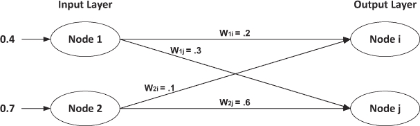

图 8.4 两个输出层节点的连接。

回想一下，当实例呈现给网络时，会计算用每个输出层节点对该实例进行分类的得分。用输出节点 `j` 对新实例进行分类的得分给出如下：

$$\frac{\underset{n}{\Sigma}\underset{i}{\Sigma}\left( T_{\textit{in}} - O_{\textit{in}} \right)^{2}}{\textit{ni}}\mspace{180mu}\operatorname{(8.8)}$$

*(等待，重新检查提供的文本流：该公式在源文件中似乎重复了或位置错误，但我将根据指令保持内容逻辑)*。

回想一下，当实例呈现给网络时，会计算用每个输出层节点对该实例进行分类的得分。用输出节点 `j` 对新实例进行分类的得分给出：

`Δw[jk] = (r)Error(k)` (8.7)

其中：

*   `r` = 学习率参数，满足 `1 > r > 0`

*   `Error(k)` = 节点 `k` 处的计算误差

*   `O[j]` = 节点 `j` 的输出

以下是我们的示例中 `r = 0.5` 的参数调整。

*   `Δw[jk] = (0.5)(0.017)(0.562) = 0.0048`

    更新后的值 `w[jk] = 0.1 + 0.0048 = 0.1048`


*   `Δw[1j] = (0.5)(0.00042)(1.0) = 0.0002`

    更新后的值 `w[1j] = 0.2 + 0.0002 = 0.2002`

*   `Δw[2j] = (0.5)(0.00042)(0.4) = 0.000084`

    更新后的值 `w[1j] = 0.3 + 0.000084 = 0.300084`

*   `Δw[3j] = (0.5)(0.00042)(0.7) = 0.000147`

    更新后的值 `w[1j] = –0.1 + 0.000147 = –0.099853`

我们将与节点 `i` 相关链接的调整留作一个练习。既然我们已经看到了反向传播的工作原理，现在我们陈述通用的反向传播学习算法。

终止条件可以根据训练数据通过网络的总次数（也称为 `epochs`）来给出。或者，网络的终止可以由网络内部学习的程度来决定。`均方根误差`的广义形式通常被用作网络学习的标准衡量。计算 `rms` 的通用公式为以下值的平方根。

$$\frac{\underset{n}{\Sigma}\underset{i}{\Sigma}\left( T_{\textit{in}} - O_{\textit{in}} \right)^{2}}{\textit{ni}}\mspace{180mu}\operatorname{(8.8)}$$

其中：

*   `n` = 训练集的实例总数
*   `i` = 输出节点总数
*   `T[in]` = 第 `n` 个实例和第 `i` 个输出节点的目标输出
*   `O[in]` = 第 `n` 个实例和第 `i` 个输出节点的计算输出

如你所见，`rms` 仅仅是所有实例输出误差值平均值的平方根。一个常见的标准是在 `rms` 小于 `0.10` 时终止反向传播学习。上述方法存在一些变体。一种常见的变体是跟踪训练数据的误差，但等到所有训练实例都通过网络后才更新网络权重连接。无论采用何种方法，为了获得可以接受的结果，通常都需要对该过程进行多次迭代。

# 8.6 使用 R 构建神经网络

在掌握了基础之后，现在是时候尝试构建几个神经网络模型了！R 提供了许多用于训练神经网络的包。在这里，我们研究了 `RWeka` 包中的两个函数，以及位于 `neuralnet` 包中的 `neuralnet` 函数。你可以轻松地安装 `neuralnet` 包，因为它托管在 CRAN 仓库中。

脚本 8.1 提供了必要的代码。我们将使用 `MultiLayerPerceptron` 函数进行反向传播学习，并使用 Kohonen `SelfOrganizingMap` 函数进行无监督聚类。如果你不想冒险确保所有内容都输入正确，只需使用你的源码编辑器加载并执行补充脚本代码——*脚本 8.1 安装 RWeka 网络包.R*。此外，在退出并重新进入 RStudio 后，你可能需要重新加载 Kohonen 无监督聚类算法 (`KSOM`) 和 `MultiLayerPerceptron` 算法 (`MLP`)。判断函数是否准备就绪的良好方法是在控制台窗口中输入 `MLP` 和 `KSOM`。这样做应该输出一条关于指定函数的摘要语句。如果你收到错误消息，请尝试重新加载一个或两个包。这可以通过输入以下实现：

```r
>library(RWeka)
>WPM("load-packages", MLP,KSOM)
```

如果结果导致错误消息，请通过重新执行 脚本 8.1 来重新安装包。

一旦所有包都安装并加载，你就准备就绪了！让我们从 `MLP` 和熟悉的 `XOR` 函数开始。`MLP` 提供了一个很好的起点，因为它能自动将任何分类输入数据转换为数值等值、归一化输入数据并轻松处理缺失数据。

## 8.6.1 异或函数

我们大多数人对基础逻辑运算符都很熟悉。常见的运算符包括*与* (and)、*或* (or)、*蕴含* (implication)、*否定* (negation) 和*异或* (xor)。`XOR` 函数的定义如表 8.2 所示。你可以将 `XOR` 函数理解为定义两个类。一类由 `XOR` 函数输出等于 1 的两个实例表示。另一类由函数输出等于 0 的两个实例给出。

**表 8.2 异或函数**

| X1 | X2 | XOR |
| --- | --- | --- |
| 1 | 1 | 0 |
| 0 | 1 | 1 |
| 1 | 0 | 1 |
| 0 | 0 | 0 |

图 8.5 提供了输出的图形解释。`x`-轴代表 `X1` 的值，`y`-轴表示 `X2` 的值。`XOR` 等于 1 的类实例在图 8.5 中用 `A` 表示。同样，`XOR` 等于 0 的类实例用 `B` 表示。`XOR` 函数特别受到关注，因为与其他逻辑运算符不同，代表 `XOR` 函数的点不是*线性可分*的。这在图 8.5 中可以看到，因为我们无法画一条直线来将 A 类实例与 B 类实例隔离开。

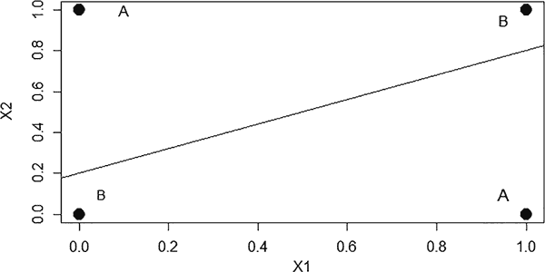

图 8.5 异或函数的图表。

第一批神经网络被称为*感知机网络*，由一个输入层和一个单输出层组成。`XOR` 函数为这些早期网络带来了麻烦，因为它们只有在面对具有线性可分解的问题时才会收敛。反向传播网络架构的发展能够对非线性问题，促进了人们对神经网络技术的重新关注。

让我们看看使用前馈网络结合反向传播学习的监督模型如何建模 `XOR` 函数。我们将遵循简单的五步法：

1. 识别目标。
2. 准备数据。
3. 定义网络架构。
4. 观察网络训练。
5. 读取并解释结果。

脚本 8.2 显示了 `XOR` 函数的训练数据。

## 8.6.2 使用 MLP 建模异或：数值输出

在我们的第一个实验中，让我们使用 `MLP` 创建具有数值输出的反向传播神经网络。`MLP` 包含了之前描述的 sigmoid 函数用于节点评估。`MLP` 处理数值和名义（分类）输入属性。在分类属性的情况下，网络为每个可能的输入值创建一个单独的输入节点。输出属性也可以数值或分类。如果输出属性是数值，网络只需要一个输出节点。但如果输出属性是分类，每个输出属性的值分配一个输出节点。一旦构建完成，未知实例将根据对应输出节点的最大数值进行分类。以下是步骤：

### 步骤 1：识别目标

* `XOR` 问题的目标非常直观。给定两个值均为 1 或 0 的输入值，我们希望网络输出 `XOR` 函数的值。

### 步骤 2：准备数据

* 脚本 8.2 和 8.3 位于你补充材料中的同一个文件中。将该文件加载到你的源码编辑器。

### 步骤 3：定义网络架构

* 为了帮助定义网络架构，我们需要研究：

```r
>library(RWeka)
>MLP
```

### 步骤 4：观察网络训练

* 使用 `run` 逐行执行脚本 8.2 和脚本 8.3。脚本 8.3 的第一行是调用 MLP 的。控制设置告诉我们 GUI 已开启，网络将有一个包含两个节点的隐藏层。一旦你调用 MLP，就会显示图 8.6 中定义的网络架构的图形化表示。图 8.6 显示当前 `Epoch` 和 `Error per Epoch` 的参数设置均为零。这意味着，尽管显示了网络架构，但网络训练尚未开始。点击 `start` 观察网络训练。由于我们的训练集仅包含四个实例，训练很快结束。注意 `Epoch` 的值现在为 500，表示训练周期已完成。此外，`Error per Epoch` 为 0，表示网络已经学会了 XOR 函数。继续后续，点击 `accept`，GUI 就会消失。

### 步骤 5：读取并解释总结结果

* 继续执行脚本 8.3，`my.xor` 显示了训练后的连接权重。解释此输出可能会非常困惑。为了帮助你理解权重在网络中的表示方式，我们创建了图 8.7，它给出了训练网络中显示的四舍入后的连接权重。列表首先显示 `Node 0`，它代表唯一的输出节点。标题 `Linear Node 0` 下 `node 1` 和 `node 2` 值代表从 `node 1` 到 `node 0` 以及 `node 2` 到 `node 0` 的连接权重。同样，在 `Sigmoid Node 1` 下，我们看到了 `X1` 与 `node 1` 以及 `X2` 与 `node 1` 之间的相应连接权重。`Sigmoid Node 2` 下的值也采用相同的方案。

* 图 8.7 还显示了与每个节点相关的额外权重链接。这些权重是脚本 8.3 列出的四舍入后的 `threshold` 值。阈值的作用类似于回归方程中的常数项，充当两个节点之间的另一个连接权重。链接一端的 1 代表一个输出始终为 1 的节点。阈值在学习过程中的变化方式与其他所有网络权值相同。

* 简单来说，`threshold`（阈值）或 `bias`（偏置）可以被认为是添加到关联节点上的值。为了理解这一点，考虑图 8.7，且 `Node 1` 的 `threshold` = 1.002，结合显示 `X1` = 1 且 `X2` = 0 的实例。赋予 `Node 1` 用于 sigmoid 函数处理的四舍入后激活值将是（1.867 * 1 + 1.807 * 0 + 1.002) = –0.874。与 `Node 0` 和 `Node 2` 相关的阈值也具有类似的推理过程。

* 回到脚本 8.3，总结语句显示平均绝对误差和均方根误差均为零。为了支持这些值，我们使用了 `predict` 函数。注意 `round` 和 `cbind` 是如何被用来提供一个实际值和预测值的表格的。移除 `round` 函数将使输出更紧密地反映网络确定的精确值。

* 由于训练数据代表了 XOR 函数的所有可能值，我们可以确信——在输入值正确的情况下——我们的网络将始终正确识别函数的值。正如你所看到的，这是例外而非常态。你可能记得，网络收敛的一个常用标准是 `rms` 小于 0.10。然而，较高的 `rms` 值通常是可以接受的。

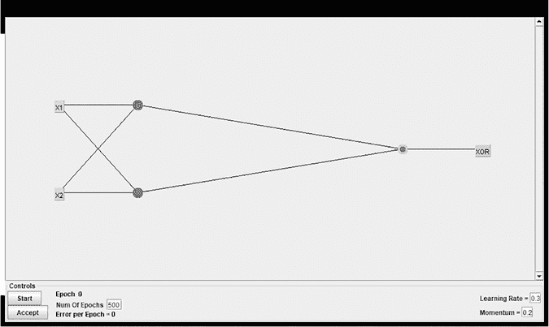

图 8.6 XOR 函数的架构。

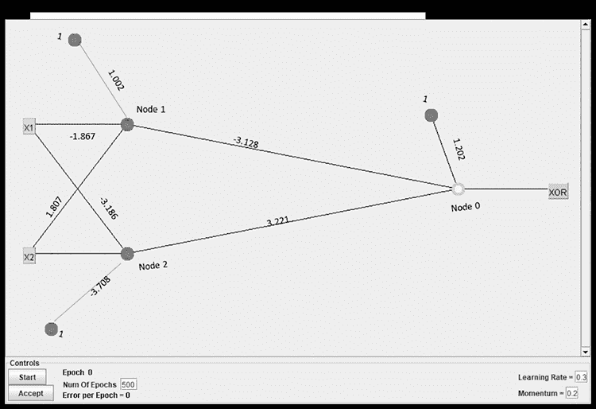

图 8.7 带有关联连接权重的网络架构。

## 8.6.3 使用 MLP 异或建模：分类输出

在研究了 XOR 函数输出为数值的情况后，现在该处理 XOR 输出属性被定义为分类的情况了。脚本 8.4 提供了相应的代码。注意，带有 `1` 和 `0` 的 XOR 已被具有值 `a` 和 `b` 的 XORC 替换。

对于第一个实验，让我们验证一下没有隐藏层的 MLP 无法学习 XOR 函数。这是通过在调用 MLP 之前将 `H` 设置为 `0` 完成的。图 8.8 提供了网络配置。注意在 500 个 epoch 之后，网络仍然显示出大于 0.25 的值。点击 `start` 开始训练。

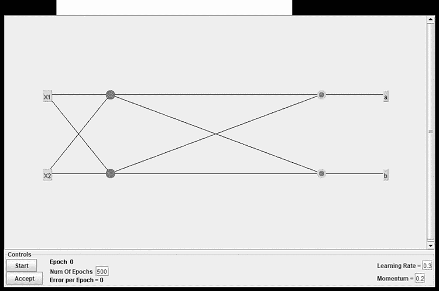

图 8.8 XOR 函数的架构。

为了在 XORC 中获得积极结果，我们回到五步流程中的第三步并更改 `H` 的值。在使用 50,000 次或更多 epoch 时，将值改为 `1` 或 `2` 可以降低错误率并导致四种分类中的三种正确。然而，你会发现至少有三个隐藏层，且 `Num of Epochs` 在 2000 左右，将产生 100% 的分类准确率。

## 8.6.4 使用 neuralnet 异或建模：数值输出

在转向新数据集之前，`neuralnet` 包中的 `neuralnet` 函数值得我们关注。该函数的意义是因为与 MLP 相比，它允许对学习环境进行更大的控制。然而，更大的自由是有代价的！使用 MLP 时预处理（如数据归一化、分类到数值的转换、初始化随机种子以及缺失数据问题）都在内部处理。现在不再如此。此外，为分类输出数据创建混淆矩阵的任务现在落在我们的肩上。

脚本 8.5 提供了使用 `neuralnet` 在输出为数值时对 XOR 代码。你可以通过输入 `help(neuralnet)` 查看参数列表和返回值。在这里我们查看最感兴趣的参数。你完全可以从补充材料中导入代码，但自己创建脚本 8.5 将带给你更好的学习体验。尽管如此，我们对脚本 8.5 进行逐行分析是必要的。

Script 8.5 的几行定义了 XOR 函数的数据框。由于网络权重是用随机值初始化的，因此 `set.seed` 函数对于获得一致的结果是至关重要的。接下来是调用 `neuralnet` 函数，在其中我们将隐藏层节点数设置为 3。误差函数和激活函数均设置为它们的默认值。`sse` 计算总体均方根误差，`logistic` 代表 sigmoid 函数。`linear.output` 参数设置为 `FALSE`。这告诉我们输出节点将对其输入应用逻辑（logistic）函数。如果输入和输出属性之间存在线性关系，则应将 `Linear.output` 设置为 `TRUE`。

`summary(my.nnet)` 被注释掉了。然而，调用摘要语句将为你提供几个摘要参数的列表。其中三个是值得关注的：

*   `my.nnet$net.result` 给出了神经网络对训练数据的最终输出。
*   `my.nnet$result.matrix` 显示了多个值，包括错误率和最终的网络连接权重。
*   `Mynnet$act.fct` 输出激活函数的代码。

`plot` 函数为我们提供了图 8.9。注意，数据通过网络 97 次后才收敛到小于 0.02 的错误率。作为一个实验，将隐藏层的值改为‘0’。你将看到网络立即收敛，错误率在 0.50 左右，这等于对网络的输出值进行猜测。

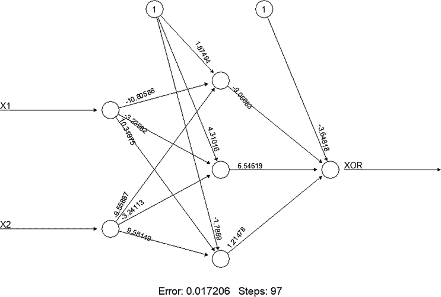

图 8.9 使用 neuralnet 函数对 XOR 建模。

Script 8.5 的最后几行显示了如何使用 `predict` 函数用训练数据测试网络。`cbind` 和 `round` 函数用于以表格格式显示输入和输出。在下一节中，我们将使用 `neuralnet` 对 XOR 的分类输出版本进行建模。

## 8.6.5 使用 neuralnet 对异或进行建模：分类输出

当输出为分类时，使用 `neuralnet` 对 XOR 函数进行建模需要更多工作。Script 8.6 详细说明了该方法。有几项需要解释。我们首先看到 XORC 的 1 和 0 现在变成了“a”和“b”。对 `neuralnet` 的调用显示了一个具有三个节点的隐藏层。

调用产生的图如图 8.10 所示。错误率小于 0.03 表示结果为正。

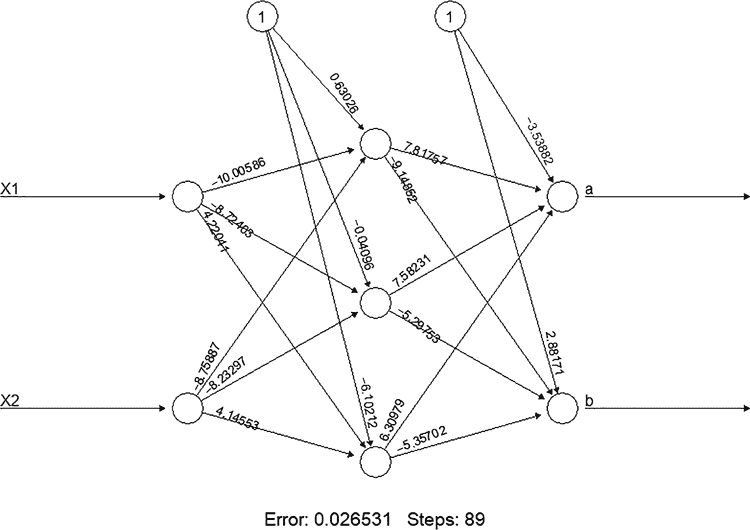

图 8.10 使用 neuralnet 函数对 XORC 建模。

接下来，预测值存储在 `my.pred` 中，然后将其结构化为数据框。由于有两个类别，该数据框——`my.results`——是一个双列结构，每行显示对应输出的数值。标记为 `Predicted.1` 的列代表类 `a`，标记为 `Predicted.2` 的列显示类 `b` 的概率。查看这一点，请考虑应用于 `xorc.data` 的 `str` 函数的输出。

```
XORC: Factor "a","b": 1 2 
```

记得因子（factors）是以整数值存储的，按字母顺序列出水平。为了制作混淆矩阵，我们使用 `ifelse` 结构结合 `Predicted.1`（代表 `a` 的列）来创建一个 1 和 2 的列表。`factor` 函数将 1 和 2 转换为相应的因子水平。然后，`table` 函数将使用这些因子水平来构建混淆矩阵。最后，将 `confusion` 应用于混淆矩阵以给出一个准确水平。现在我们已经掌握了 MLP 和 `neuralnet` 的基础知识，让我们来看一个更有趣的问题。

## 8.6.6 分类卫星图像数据

卫星图像数据集代表地球表面某部分的数字化卫星图像。训练和测试数据由 300 个像素，这些像素已经建立了 `ground truth`（地面真值）。卫星图像的地面真值是通过让地面上的人测量卫星试图测量的相同内容（同时）来建立的。然后将答案进行比较，以帮助卫星仪器工作得良好坏。

这些数据被分为 15 类：城市、农业 1、农业 2、草坪/草地、南方落叶林、北方落叶林、针叶林、浅水、深水、沼泽、灌木沼泽、森林沼泽、暗荒漠、荒漠 1 和荒漠 2。每个类别包含约 20 个实例。每个像素由六个数值表示，由六个波段的光谱值组成：蓝色（0.45–0.52m）、绿色（0.52–0.60m）、红色（0.63–0.69m）、近红外（0.76–0.90m）以及两个中红外（1.55–1.75m 和 2.08–2.35m）。输入数据是纯数值的。

### 第一步：确定目标

Script 8.7 显示了用于建模的步骤。我们的目标是建立一个可以监测指定区域变化的神经网络。一旦网络架构被接受，就可以使用整个数据集来构建模型。我们将接受测试集准确率大于等于 95%的模型。

### 第二步：准备数据

将 `Sonar` 的 `.csv` 格式导入 RStudio。除了草坪（21 个实例）和深水（19 个实例）外，所有类别都有 20 个实例。这为使用数据的一半进行训练、另一半进行测试提供了依据。这在 Script 8.7，其中预处理了数据并定义了训练和测试数据集。

在构建神经网络模型时，理解属性选择的重要性是有启发性的。这是因为与决策树等包含属性选择算法的模型不同，神经网络算法无法预先确定任何给定输入属性的重要性。因此，我们的工作是在预处理阶段做出适当的属性选择。在我们之前的示例中，属性预处理是简单的，因为 `XOR` 是一个定义良好的函数，所有实例和属性都是相关的。对于卫星图像数据，情况并非如此。另一方面，神经网络算法具有很韧性，即使属性选择并非最优，它们通常也能构建出非常有用的模型。章节练习 7 要求你对此数据集进行实验，以确定是否应该消除任何输入属性。在我们的示例中，最初将使用所有输入属性。

### 第三步：定义网络架构

我们将采用 `neuralnet` 函数来定义建模数据的网络。注意隐藏层参数设置为 5。考虑到总类别数，我们通常会使用更大的隐藏层。之前对该数据集的测试（Roiger, 2016）已经显示它定义良好。

### 第四步：观察网络训练


图 8.11 显示了创建的网络。`rms` 未在图中显示，但我们可以从 `result.matrix` 中获取。那就是：

> `my.nnet$result.matrix`

```
             [,1]
error             2.728610e-02
reached.threshold  9.992989e-03
steps             1.575000e+03
```

图 8.11 建模卫星图像数据。

这告诉我们网络收敛时的 `rms` < 0.03。

### 第 5 步：读取并解释摘要结果

*   为了创建混淆矩阵，我们需要一个函数——对于每个测试实例——确定获胜节点并将与节点匹配的数值因子存储在预测值列表中。此列表中的每个值都是 1 到 15 之间的正整数。专门为此任务编写的 `pred.subs` 通过将值置于 `my.predList` 中完成了这项工作。实际类别的列表和 `my.predList` 被 `table` 函数用于创建混淆矩阵。`pred.subs` 的源代码可以在 `functions.zip` 中找到。

*   继续查看 脚本 8.7，我们看到测试集准确率为 94.67%，这非常接近我们的预期结果。通过使用包含 10 个节点的单个隐藏层而不是 5 个节点，我们可以获得更好的效果。这将导致 96% 的测试集正确率，除五个测试实例外，所有实例都被正确分类。

*   鉴于我们已经对创建了一个用于土地覆盖分类的好模型感到满意，下一步是使用所有数据来创建并保存最终模型。该模型将在未来用于在指定时间后对相同区域进行分类，以确定任何区域的土地覆盖是否发生了变化。

*   最后，我们的预处理没有考虑输入属性之间可能的相关性。可以通过首先移除输出属性并如下所示应用 `cor` 函数来检查输入属性之间的高相关性值：

    ```
    > Sonar2 <- Sonar[-7]
    > cor(Sonar2)
    ```

*   该结果显示红、绿、蓝之间的相关性值高于 0.85。这表明消除三个属性中的两个不会对测试集准确率产生负面影响。这里是从数据中移除绿色和红色的简单方法：

    ```
    > Sonar2 <- Sonar[, c(-2, -3)]
    ```

*   我们将移除这两个输入属性的影响留给你们作为练习题来确定。

### 8.6.7 糖尿病测试

数据集 `Diabetes` 包含有关 768 名女性的信息，其中 268 人糖尿病检测呈阳性。数据包括八个数值输入属性和一个指示糖尿病测试结果的分类输出属性。该数据集是补充材料的一部分，以 .csv 和 MS Excel 格式提供。你可以在存放数据的 Excel 表格的描述页面阅读更多关于该数据集的信息。让我们使用我们的五步法来为这些数据建立模型。

### 第 1 步：确定目标

*   我们将目标表述为一个问题：给定输入属性，我们能建立一个模型来准确确定数据集中的个人糖尿病检测是否呈阳性吗？作为一个次要目标，模型的误差应倾向于报告假阳性而非假阴性。

*   通常情况下，这种类型的诊断模型在几种情况下都有价值。如果我们能以高准确率判断个人是否患有疾病，模型的误差应倾向于报告假阳性而非假阴性。我们将使用我们的五步法来为这些数据建立模型。

### 第 2 步：准备数据

*   脚本 8.8 显示了如何使用 `neuralnet` 构建模型。你可以看到 `KSOM` 可用的控制选项。我们感兴趣的选项是 `H` 和 `W`。

### 第 3 步：定义架构

*   `neuralnet` 函数定义了网络。由于数据中有两个类，我们将高度设为 2，宽度设为 1。

### 第 4 步：观察网络

*   图 8.12 显示了训练后的网络。网络收敛时 `rms` 高 0.03。

### 第 5 步：读取并解释摘要结果

*   脚本 8.8 显示了如何使用 `neuralnet` 构建模型。你可以看到 `KSOM` 可用的控制选项。我们感兴趣的选项是 `H` 和 `W`。


图 8.12 建模糖尿病数据。

## 8.7 用于评估的神经网络聚类

脚本 8.1 向你展示了如何安装 `KSOM`。记得我们把 `KSOM` 与实现相关。在这里我们对糖尿病数据集使用 `KSOM`。

### 第 1 步：确定目标

*   我们将使用无监督聚类来确定 `Diabetes` 数据集的输入属性在多大程度上构建了预测模型的类。如果形成的聚类与类不匹配，我们认为输入属性可能无法准确定义结构。

### 第 2 步：准备数据

*   脚本 8.9 描述了用于分析 `Diabetes` 数据集的输入属性如何定义输出属性的聚类过程。在调用 `KSOM` 之前，我们必须移除类属性。不需要对数据进行归一化，因为 `KSOM` 会替我们完成。

### 第 3 步：定义架构

*   输入 `WOW(KSOM)` 可以看到 `KSOM` 可用的控制选项。我们感兴趣的选项是 `H` 和 `W`。

### 第 4 步：观察网络训练

*   当聚类完成后，每个实例将被分配到簇 0 或 1。变量 `$class_ids` 为我们提供了每个实例相关的簇编号。以下语句将聚类分配列表放在变量 `ids` 中，并将 `ids` 转换为一个具有 768 行、单列的 0 和 1 的数据框。

### 第 5 步：读取并解释摘要结果

*   为了创建混淆矩阵，输出属性的因子（1 和 2）必须与簇编号（0 和 1）匹配。*Tested-negative*（测试阴性）与因子 1 关联，*tested-positive*（测试阳性）与因子 2 关联，因为 *tested-negative* 在字母顺序上在前。如果簇 0 匹配 *tested-negative*，我们必须将 `ids` 中所有的 0 转换为 1，将所有的 1 转换为 2。我们如何知道？

*   通过聚类，没有输出属性，因此 `cluster 0` 仅仅与第一个实例相关。在我们的情况下，除非我们查看分配的实例类别，否则我们不知道 `cluster 0` 是匹配 `tested-negative` 还是 `tested-positive`。另一个问题出现在第一个实例是离群值并最终聚成了相反类别时。幸运的是，一点领域知识可以解决这个问题！通过检查 时间序列 8.9 中的均值和标准差，我们看到 `cluster 1` 的平均值远高于 `cluster 0` 显示的平均值。随着糖尿病的流行，我们将 `cluster 1` 与 `tested_positive` 类关联。`for` 循环反映了这一观察结果，并将所有的 `ids` 修改为 `2` 和 `0`。当完全缺乏领域知识时，我们最初以相同的方式修改 `ids`。如果混淆矩阵看起来“反了”，我们必须重新评估并可能通过重新分配所有的 `ids` 为 `2` 和 `0` 来修改。对于三个或更多类，情况同样适用。

*   第 5 步：读取并解释结果
    *   `my.cluster` 的简略列表告诉我们 `age` 和 `pregnancies` 之间的差异。剩余的输入属性仅显示小差异。混淆矩阵显示 138 个错误分类。这告诉我们类与实际类别并没有匹配得很好。这在某种程度上解释了我们之前实验中糟糕的结果。本章练习要求你进一步研究这些输入属性的相关性。

## 8.8 时间序列分析

很多时候，我们想要分析的数据包含时间维度。具有一个或多个时间依赖属性的应用被称为“时间序列问题”。时间序列分析通常涉及预测数值结果，例如单个股票的未来价格或股票指数的收盘价。适用于时间序列分析的其他三个应用包括：

*   随时间跟踪客户以确定他们可能使用信用卡
*   预测汽车故障的可能性
*   预测国家橄榄联盟的每周冲码

时间依赖数据的大量工作是预测单个变量的未来值。然而，我们可以使用统计和非统计机器学习工具对多个变量进行分析。幸运的是，我们能够将用于其他机器学习应用的相同技术应用于解决时间序列问题。我们成功的能力在很大程度上取决于相关属性和实例的可用性，以及当前问题的难度。让我们来看时间序列分析的一个有趣应用。

### 8.8.1 股票市场分析

人类专家存在于医学、汽车维修、计算机编程和法律等领域。虽然良好的教育是成为专家的一部分，但经验往往起着更大的作用。遗憾的是，所有的经验都不会创造出一个“专家股票分析师”。问题不仅在于影响股市趋势的大量变量，还在于变量值的变化可能有多种解释方式。在一种情况下，利率上升会导致股票下跌，因为公司借钱的成本更高了；在另一种情况下，同样的利率上升会让股票飙升，因为这意味着经济正在改善。有一点是肯定的，并不对任何市场波动提供详细事实分析的“专家”。知道这一点，许多市场分析师在交易中非常努力，大多数时候表现良好。这些人分为四组：

一组专门分析公司基本面。他们检查公司财务报表并与公司代表交流，试图更好地理解公司的未来。第二组完全根据近期市场趋势和交易走势做出交易选择。这些人被称为技术分析师。这些市场技术人员使用股票图表、移动平均线、技术支撑位和标准差来确定特定股票或指数基金的未来。第三组人员结合了两种技术，有时更多依赖基本面，有时更多依赖技术分析。然后是第四组，被称为逆向者，他们根据市场情绪做出决策。这些人利用市场在任何时候往往过于乐观或过于悲观的事实。逆向者反市场情绪，在大多数人卖出时买入，大多数人购买时卖出。我们感兴趣的是技术分析师群体，他们许多人将通过机器学习的时间序列分析作为其技术工具的一部分。让我们看看他们是如何做的！

### 8.8.2 时间序列分析：示例

对于我们的示例，我们使用代码为 `SPY` 的交易所交易基金（ETF）。ETF 是一种像股票一样可以买卖的指数基金。例如，像 `GLD`（黄金）或 `USO`（美国原油）这样的商品指数基金与相应的商品同步交易。`VGT` 是一种科技指数基金，苹果计算机、微软公司、Facebook 和谷歌占其持仓的 35%。`XLF` 是一只金融 ETF，其主要持股为伯克希·哈撒韦、盛运和摩根大通。持有指数基金通常比持有个股要安全得多，由于这一点，过去几年出现了数以千计的 ETF。

我们感兴趣的基金是 `SPY`，这是一只追踪标普 500 指数变化的基金。`SPY` 对市场交易者尤其是市场时机者具有特别吸引力，原因有两个。为了开始我们的 SPY 实验，我们从一个目标开始：

*   建立一个时间序列模型，能够在当天收盘前 15 到 30 分钟预测 SPY 的明日收盘价。

*   如果我们目前没有持有 SPY，且我们的模型显示次日收盘价较低，我们可能会考虑购买 ProShares Short(S&P 500) 指数基金 SH，因为它的价格波动与 SPY 呈反向关系。

最后，如果我们的模型能够提供数值输出，我们可以根据预测波动的幅度来做出决策。如果预测的价格变动非常微小，我们可能考虑仅仅持有已有的股票。现在开始累积利润是否太早了？让我们来发现吧！

### 8.8.3 目标数据

获取历史股票数据有许多方法。在示例中，我们使用了 `yahoo` 配合 `quantmod` 库中的函数来获取 2017 年 1 月 1 日至 2020 年 1 月 2 日期间 `SPY` 的价格。仅使用调整后收盘价，通过直接在数据中构建四天的时间滞后来构建我们的时间序列。这意味着，任何行数据都包含当天的收盘价，随后按顺序是前四天的基金价格。

`Script 8.10` 显示了获取数据的过程以及创建时间滞后实例数据集的函数。`round(head(my.tsdata), 2)` 显示的第一行给出了 2017 年 1 月 3 日至 9 日 `SPY` 的收盘价。具体而言，2017 年 1 月 3 日的调整后收盘价为 $211.55。2017 年 1 月 9 日的收盘价为 $212.70。

### 8.8.4 时间序列建模

`Script 8.11` 显示了时间序列建模的语句。向量 `x` 包含了我们 770 天期间的收盘价。这些值生成了图 `8.13` 所示的 `SPY` 图表。位于 `forecast` 包中的 `ma` 函数用于产生 3 日移动平均以平滑数据点。通过 3 日移动平均，每个数据点都被替换为该数据点、其前一个点和后一个数据点的平均值。

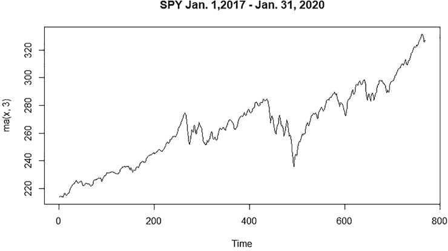

图 8.13 SPY 的 770 天价格图表。

接下来，删除了日期列，并将前 769 天指定用于训练。我们使用 5000 个 epoch 训练了神经网络。当测试项提交给网络时，它给出了第 770 天的收盘价预测值 $325.60。实际调整后收盘价为 $325.76，表明预测非常准确。

```
    my.pred     spy   spy-1  spy-2  spy-3  spy-4
770  325.6  325.76  324.71  324.98  321.61  326.85
```


### 8.8.5 通用考虑

这个示例让你了解关于如何使用神经网络对时间序列数据建模的基本概念。然而，使用单一变量的方法仅在股票市场相对稳定时有效。一个改进的模型将包含多个与时间相关的变量。无论如何，现在开始使用该模型来指导退休账户的交易还太早了！最后，尽管此处未进行详细介绍，但 R 包含了许多非常实用的时间序列分析函数。

## 8.9 章节总结

神经网络是由几个互连的处理器节点组成的并行计算系统。单个网络节点的输入限制在落在闭区间范围 `[0, 1]` 内的数值。因此，分类数据必须在网络训练之前进行转换。

开发神经网络涉及首先训练网络以执行所需的计算，然后将训练好的网络应用于解决新问题。在学习阶段，使用训练数据来修改节点对之间的连接权重，以便输出节点获得最佳结果。

前馈神经网络架构通常用于监督学习。前馈神经网络包含一组分层节点以及相邻层之间的加权连接。

前馈神经网络通常使用反向传播学习方案进行训练。反向传播学习通过从输出层开始修改权重值，然后向后通过网络的隐藏层来工作。

自组织科霍宁南（Kohonen）神经网络架构是无监督聚类的一种流行模型。自组织神经网络通过让多个输出节点竞争训练实例来学习。对于每个实例，权重向量与输入实例属性值最匹配的输出节点即为获胜节点。结果是获胜节点的关联权重与当前训练实例最为紧密。围绕神经网络的核心问题之一是它们无法解释已经学习了什么。Jain 等人（1996）为进一步学习神经网络提供了一个很好的起点。

## 8.10 关键术语

*   **`平均成员技术 (Average member technique)`**：一种无监督聚类神经网络技术，通过寻找每个属性的平均值来计算每个簇中最具典型的成员。
*   **`反向传播学习 (Backpropagation learning)`**：`Backpropagation` 是一种用于多前馈的训练方法。反向传播通过从输出层开始修改权重值，然后向后通过隐藏层来工作。
*   **`偏置 (Bias)`** 或 **`阈值节点 (Threshold Node)`**：与隐藏层和输出层相关的节点。偏置或阈值节点与普通节点的区别在于它们的输入是一个常数。相应的链路权重在学习过程中以相同的方式发生变化。
*   **`Delta 规则 (Delta rule)`**：用于最小化计算输出与目标输出之间平方和的神经学习规则。
*   **`Epoch`**：训练数据通过网络的完整次数。
*   **`前馈神经网络 (Feed-forward neural network)`**：一种神经网络架构，其一层所有的权重都指向下一层。权重不会循环回之前的层作为输入。
*   **`全连接 (Fully connected)`**：一种神经网络结构，一层所有的节点都连接到下一层节点。
*   **`Kohonen 网络 (Kohonen network)`**：用于无监督聚类的双层神经网络。
*   **`线性可分 (Linearly separable)`**：如果可以用一条直线将类 A 的实例与类 B 的实例隔离开，则认为这两个类是线性可分的。
*   **`神经网络 (Neural network)`**：由多个互连处理器组成的并行计算系统。
*   **`神经元 (Node)`**：神经网络处理器节点。多个神经元连接形成完整的神经网络结构。
*   **`感知器神经网络 (Perceptron neural network)`**：一种由输入层和单个输出层组成的简单前馈神经网络架构。
*   **`敏感性分析 (Sensitivity analysis)`**：一种神经网络解释技术，允许我们确定单个属性相对重要性的排序。
*   **`Sigmoid 函数 (Sigmoid function)`**：几种常用的神经网络评估函数之一。sigmoid 函数是连续的，并输出 0 到 1 之间的值。
*   **`时间序列问题 (Time series problem)`**：具有一个或多个时间相关属性的预测应用。

# 练习题

## 复习题

1.  为一个接受三个输入值、具有包含五个节点的隐藏层以及包含四个节点的输出层的全连接前馈网络绘制节点和节点连接。

2.  第 8.1 节描述了两种分类数据转换方法。解释你将如何使用每种方法将分类属性 `income range`（可能值为 10–20 K、20–30 K、30–40 K、40–50K … 90–100 K）转换为数值等效值。哪种方法最合适？

3.  平均成员技术法（average member technique）有时用于解释无监督神经网络聚类的结果。列出这种方法的优缺点。

## 计算题

1.  我们训练了一个神经网络来预测我们最喜爱的股票的未来价格。该股票年度的价格范围从最低 20 美元到最高 50 美元。

    1.  使用公式 8.1 将 40 美元的当前股价转换为 0 到 1 之间的值。

    2.  假设我们应用该模型预测未来某段时期的新价格。神经网络给出的输出价格值为 0.3。将此值转换为我们能够理解的预测价格。

2.  考虑图 8.1 中的前馈网络，以及表 8.1 所示的关联连接权重。将输入实例 `[0.5, 0.2, 1.0]` 应用于前馈神经网络。具体来说：

    1.  计算节点 `i` 和 `j` 的输入。

    2.  使用 sigmoid 函数计算节点 `i` 和 `j` 的初始输出。

    3.  使用 b 部分计算出的输出值来确定节点 `k` 的输入和输出值。

## 使用 R 语言实验

1.  使用 `MLP` 创建反向传播网络，对下表所示的三个逻辑运算符中的一个或多个进行建模。由于这些运算符是线性可分的，你可能假设与 `XOR` 运算符不同，我们不需要将隐藏层作为网络架构的一部分。运行实验以证实或拒绝这一假设。

2.  补反运算符（complement operator）接受单个输入值，当输入为 0 时输出 1，输入为 1 时输出 0。使用 `MLP` 或 `neuralnet` 构建一个反向传播网络来模拟逻辑取反。不使用隐藏层训练网络需要多少迭代（epochs）？如果添加一个隐藏层，训练网络是否需要更少的迭代？

3.  使用 `neuralnet` 通过两个不同大小的隐藏层对 XOR 函数的分类版本——`XORC` 进行建模。例如，两个第一层为 3、第二层为 2 的隐藏层写为 `hidden = c(3,2)`。你能够找到一个在没有任何分类错误的情况下模拟 `XORC` 的双隐藏层网络吗？

| 输入 | 输入 2 | 与 | 或 | 蕴 |
| --- | --- | --- | --- | --- |
| 1 | 1 | 1 | 1 | 1 |
| 0 | 1 | 0 | 1 | 1 |
| 1 | 0 | 0 | 1 | 0 |
| 0 | 0 | 0 | 0 | 1 |

4.  重复练习 2，但使用 `neuralnet` 函数来构建网络。

5.  使用 `MLP` 重复卫星图像数据的实验。一种简单的方法根据需要修改脚本 8.7。由于 `MLP` 在内部对数据进行归一化，你可以从定义训练和测试数据集开始。使用以下调用 `MLP`，创建一个五个节点的单隐藏层。

```
sonar.model <- MLP(class ~ ., data = sonar.train, control = Weka_control(H = 5, G = TRUE))
```

使用 `summary(sonar.model)` 显示从训练数据创建的混淆矩阵。随后调用 `predict` 来确定测试数据的预测。使用 `table` 函数打印测试数据的混淆矩阵。使用 `Confusion` 显示测试集的准确率。重复此实验，但将隐藏层节点数改为 4、3、2、1，最后为 0。在表格中显示你的结果。你的结论是什么？

6.  `nnet package` 中的 `nnet` 函数是另一个用于在 R 中开发前馈神经网络的流行函数。安装 `nnet package` 并阅读关于如何使用 `nnet` 函数的文档。使用 `nnet` 重复一个 XOR 实验。

7.  提到的卫星图像实验提到，输入属性之间的相关性测试显示红、绿、蓝之间的相关性高于 0.85。使用 `cor` 函数验证这些相关性值。我们知道，一组高度相关的输入属性中，除一个外都应从数据中移除。移除两个高度相关的属性，并使用修改后的数据重复卫星图像实验。报告你的发现。在报告中包含相关矩阵和生成的混淆矩阵。

8.  将 RWeka 的 `InfoGainAttributeEval` 应用于卫星图像数据集，以确定属性消除对 `MLP` 分类正确性的影响。创建一个表格，显示使用前五个最佳输入属性、然后是最佳四个属性、直到最佳单个属性的模型分类准确率。将你的结果与使用所有六个输入属性时的结果进行比较。

9.  使用 `neuralnet` 函数重复练习 8。

10. 此练习使用 `CardiologyMixed` 数据集并包含两个部分。

    1.  使用 `MLP` 构建心脏疾病的分类模型。使用前 200 个实例进行训练，剩余实例作为测试数据。尝试隐藏层参数以获得最佳结果。报告测试结果。

    2.  使用 KS 对数据进行聚类。遵循脚本 8.8 中的步骤。移除类别属性并设置 `H` 为 2、`W` 为 1 以形成两个类。KOM 总是将第一个数据放在类 0 中。根据此，使用以下代码为 `ids` 赋值正确值。

```
for (i in 1:nrow(ids)) {
  if (ids[i, 1] == 0)
    ids[i, 1] = 2
  else
    ids[i, 1] = 1
}
```

聚类与定义的类别匹配良好吗？根据聚类过程创建的混淆矩阵回答。

11. 结合 `Spam` 数据集，确定属性消除对 `MLP` 分类正确性的影响。使用数据的一半进行训练，剩余实例用于测试。使用所有输入属性获取基准。接下来，使用前十和前五个“最佳”属性重复训练和测试。结果之间的分类准确率有差异吗？总结你的发现。务必对每个模型看到的假阴性和假阳性错误百分比的差异进行评论。对你发现的内容进行一般性陈述。

12. COVID-19 在 2020 年 2 月和 3 月期间对全球股票市场造成了巨大破坏。为了观察这一点，重复第 8.9 节描述的时间序列实验，但将 `SPY` 替换为 Vanguard 总指数基金 `VT`。通过选择 2020 年 3 月的 10 个交易日期来更改实验结束日期。创建一个表格显示你的模型预测 `VT` 下一天收盘价的情况。在市场剧烈波动时期，你的模型表现如何？

13. 重复第 8.9 节描述的时间序列实验，但将 `SPY` 替换为 Facebook (`FB`)、阿里巴巴 (`BABA`)、亚马逊 (`AMZN`) 或你最喜爱的上市公司的代码。报告你的模型的性能。

## 编程题

1.  在脚本 8.5 中添加代码，显示每个实例实际输出与预测输出之间的绝对差。你的代码应该计算并打印平均绝对误差和均方根误差。

2.  创建一个打印混淆矩阵的函数。该函数应接受两个参数，第一个是实际类别值，第二个是预测值。将对 `confusionP` 的调用放在函数内部，以便报告给定模型的准确率。以下是该函数的骨架：

```
confusion <- function(actual, predicted) {
  table(...)
  confusionP(...)
}
```


# 已安装的包与函数

| 包名 | 函数(s) |
| --- | --- |
| `base / stats` | `c`, `cbind`, `data.frame`, `ifelse`, `library`, `max`, `min`, `plot`, `predict round`, `sample`, `set.seed`, `scale`, `table` |
| `forecast` | `ma` |
| `quantmod` | `getSymbols`, `setSymbolLookup` |
| `neuralnet` | `neuralnet` |
| `nnet` | `nnet` |
| `RWeka` | `GainRatioAttributeEval`, `MultiLayerPerceptron`, `SelfOrganizingMap`, `WOW`, `WPM`, `make_Weka_classifier`, `make_Weka_clusterer` |

# 第 9 章：正式评估技术

## 本章内容

* 评估工具
* 模型测试集准确率的置信区间
* 比较监督模型
* 具有数值输出的监督模型

在之前的章节，我们展示了测试集错误率、混淆矩阵和接收者操作特征（ROC）曲线如何帮助我们评估监督模型。在第 8 章中，你看到了如何将无监督聚类用于属性评估。在本章中，我们将继续讨论性能评估，重点关注监督学习的正式评估方法。本章介绍的大多数方法具有统计学属性。这种方法的优点是它允许我们为实验结果关联某种置信水平。

我们强调标准统计和非统计方法的实际应用，而不是每种技术背后的理论。我们的目标是提供必要的工具，让你能够清晰地理解哪些评估技术适用于你的数据挖掘应用。这里介绍的方法足以满足大多数读者的需求。然而，附录 B 为希望对统计评估技术进行更全面的读者提供了额外的材料。

在第 9.1 节中，我们重点介绍了机器学习过程中对评估有响应的组成部分。在第 9.2 节中，我们提供了几个基础统计概念的概述，如均值和方差评分、标准误差（SE）计算、数据分布、总体与样本以及假设检验。第 9.3 节提供了一种计算分类器错误率测试集置信区间的方法。第 9.4 节向你展示了如何结合经典假设检验和测试集错误率来比较竞争模型的分类准确率。在第 9.5 节中，我们向你展示了如何评估具有数值输出的监督学习模型。在阅读和完成本章示例时，请记住，最佳评估是通过结合统计、启发式、实验和人工分析来完成的。

## 9.1 应该评估什么？

图 9.1 展示了用于创建和测试监督学习器模型的主要组件。所有元素都以某种方式对所创建模型的性能做出贡献。当模型运行不符合预期时，适当的策略是评估每个组件对模型性能的影响。图 9.1 中的各个单独元素在之前的一个或多个章节中都讨论过。以下是图中所示组件的列表，以及评估的额外考虑因素。

1. **监督模型**。监督模型通常在测试数据上进行评估。可能特别关注不同类型误分类的成本。例如，我们可能愿意使用一种贷款申请模型，拒绝那些可能偿还贷款的边缘个人，只要该模型不会接受具有贷款违约风险的候选人。在本章中，我们通过展示如何为具有类别输出的监督模型计算测试集错误率置信区间，为你的评估工具箱增加内容。

2. **训练数据**。如果监督模型的测试集准确率很差，部分问题可能在于训练数据。使用不能代表所有可能的领域实例集或包含大量异常实例的训练数据构建的模型，其性能可能不会良好。最好的预防措施是随机选择训练数据，确保训练数据中包含的类别分布与总体中看到的分布一致。确保数据适当分布的过程被称为`分层`（stratification）。

3. **属性**。属性评估侧重于属性如何良好定义领域实例。我们已经看到，一组高度相关的输入属性中，外所有的都应该从数据中删除。

4. **模型构建器**。已经证明，使用替代学习技术构建的监督模型往往显示出相当的测试集错误率。然而，可能会出现一种学习技术优于另一种的情况。例如，当训练数据包含大量噪声数据时，神经网络往往优于其他监督技术。在第 9.4 节中，我们向你展示如何判断使用相同数据构建的两个学习器模型在测试集性能是否存在显著差异。

5. **参数**。大多数数据挖掘模型支持一个或多个用户指定的参数。参数设置会对模型性能产生显著影响。比较使用不同机器学习技术构建的监督学习模型的技术也适用于比较使用相同方法但对一个或多个参数采用替代设置的模型。

6. **测试集评估**。测试数据的目的是提供未来模型性能的衡量。测试数据应随机选择，并在适当的情况下应用分层。

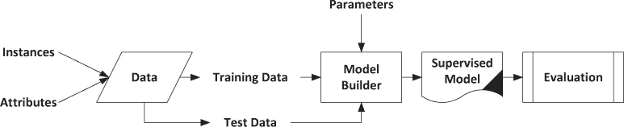

图 9.1 监督学习的组件。

图 9.1 也适用于无监督聚类，不同在于我们没有包含已知分类的测试数据。

有时，统计研究的结果必须以谨慎的态度进行解释。例如，女性成为寡妇的平均年龄可能是 55 岁；然而，女性成为寡妇的`median`年龄可能更高，而且更具信息量。最近一个健康保险广播广告声称：“50% 的美国人因致命疾病而破产。”正确的表述应该是：“50% 患有致命疾病的美国人破产！”

像上述列出的发现通常是通过随机抽样过程收集的。第一个陈述就属于这一类。要调查每一个美国家庭以确定其家庭信用卡债务数实在是太困难了。因此，专家对单个家庭进行抽样，并以总体的角度报告发现，同时附带误差范围。正如你所看到的，我们可以将用于进行统计研究的技术应用于我们的机器学习问题。统计方法的优势在于，它允许我们将实验结果与置信水平水平联系起来。

在研究用于评估和比较模型的有用统计量之前，我们先回顾均值、方差和总体分布的基本概念。

### 9.2.1 单值汇总统计量

数值数据总体由均值、标准差以及数据中出现值的频率或概率分布唯一定义。`mean`（或平均值）用 `µ` 表示，通过对数据求和并将总和除以数据项的数量来计算。

均值表示一个平均值，而 `variance`（`σ²`）代表关于均值的离散程度。要计算方差，我们首先计算与均值的差平方和。这是通过从均值减去每个数据值、将差平方并将结果累加到总和中实现的。方差通过差平方和除以数据项的数量获得。`standard deviation`用 `σ` 表示，仅仅是方差的平方根。

在对数据样本计算均值、方差或标准差得分时，符号表示发生变化。我们对样本均值和方差得分采用以下符号：

$$
\begin{array}{l} {\text{Sample~mean} = \overline{\text{X}}} \\ {\text{Sample~variance} = V} \\ \end{array}
$$

均值和方差是汇总数据的有用统计量。然而，两个总体可能显示出非常相似的均值和方差得分，但在单个数据项之间表现出显著差异。因此，为了充分理解数据，需要了解总体内数据项的分布。对于数据量较小，数据分布很容易获得。但对于大总体，分布通常很难确定。

### 9.2.2 正态分布

一种被充分理解的极其重要的数据分布是`normal distribution`，也称为高斯曲线或正态概率曲线。对于显示出正态分布的总体，已经开发了一些有用的统计量。

正态（或钟形）曲线是法国数学家亚伯拉罕·德·莫阿弗（Abraham de Moivre）在 1733 年为富有的赌徒解决问题时偶然发现的。这一发现是在记录抛硬币实验期间正面和反面次数时得出的。

为了帮助回答这个问题，假设我们重复进行多次实验，每次都对一组 10,000 户家庭的新随机样本记录其平均家庭信用卡债务。中心极限定理告诉我们，我们通过重复过程获得的平均值服从正态分布。用正式的话表述，我们认为得到的任何一个样本均值都是总体均值的无偏估计。此外，对所有等容量样本所取的样本均值的平均值，恰好等于总体均值！

我们现在知道，从初始 10,000 户家庭的样本均值计算出的平均信用卡债务，是该总体平均值的无偏估计。我们仍然对计算出的平均值没有足够的把握。尽管我们不能毫无根据地断定所计算的值是是总人口的精确平均债务数字，但我们可以使用样本方差轻松地获得所计算平均值的置信区间。

首先，我们估计总体的方差。总体方差通过 `v/n` 来估计，其中 `v` 是样本方差，`n` 是样本数量。接下来，我们计算 `standard error`（标准误差）。`SE` 仅仅是估计总体方差的平方根。计算 SE 的公式如下：

$${\textit{SE} = \sqrt{v/n}}\operatorname{(9.1)}$$

由于样本均值的总体服从正态分布，且 `SE` 是总体方差的估计，我们可以得出以下结论：

对于家庭信用卡债务问题，这意味着我们可以有 95% 的信心，真实的平均家庭信用卡债务位于计算样本均值上方两个 SE 之间下方两个 SE 之间的范围内。对于我们的示例，假设 10,000 户家庭样本的平均家庭债务为 $6000，`SE` 为 100。我们的表述告诉我们，我们可以有 95% 的确定，总人口真实的美国平均家庭信用卡债务位于 $5800 到 $6200 之间。

我们可以利用这种技术以及下一节介绍的假设检验模型，来帮助我们计算测试集错误率的置信区间，比较两个或多个数据挖掘模型的分类错误率，并确定那些最能区分单个类别或簇的数值属性。

### 9.2.4 假设检验的经典模型

你可能记得，假设是对某些事件结果的经过推测的猜测。假设检验在科学和医学领域非常常见，在处理政治和政府的日常情况下也是如此。让我们来看一个使用医学领域假设示例的标准实验设计。

假设我们希望确定一种新药物治疗 X 的效果，该药物用于治疗与房屋尘螨过敏相关的症状。对于实验，我们从患有该过敏的特定人群中随机选择两组。为了进行实验，我们选择其中一组作为 `experimental group`（实验组）。另一组被指定为 `control group`（对照组）。将治疗 X 应用于实验组，并将糖丸形式的安慰剂分给对照组。我们特意确保个体患者不知道自己所属的组别。记录两组中每位患者每天过敏反应总数的平均增加或减少情况。一段时间后，我们应用统计检验来确定两组患者之间所测参数之间是否存在显著差异。

通常的程序是针对实验结果陈述一个待检验的假设。通常，结果以 `null hypothesis`（零假设）的形式表述。`null hypothesis` 采取负面观点，因为它断言通过实验发现的任何关系纯粹是由随机偶然引起的。对于我们的示例，`null hypothesis` 宣布结果两组患者之间不会显示出显著差异。

接受治疗 X 的组患者与接受安慰剂的组患者在每天过敏反应总数的平均增加或减少方面没有显著差异。

注意，`null hypothesis` 规定的是“没有显著差异”而非“没有显著改善”。原因在于，我们没有 `a priori`（先验的）保证治疗 X 不产生不良反应并恶化与过敏相关的症状。

一旦实验完成并收集了显示实验结果的数据，我们就测试结果在两组患者之间是否显示出显著差异。测试结果在两组患者之间是否存在显著差异的经典模型是：

```
$$T = \frac{\left| \overline{x}_{1} - \overline{x}_{2} \right|}{\sqrt{v_{1}/n_{1} + v_{2}/n_{2}}}$$
```


其中 `T` 是检验统计量，`\overline{x}_{1}` 和 `\overline{x}_{2}` 是样本均值，`v_{1}` 和 `v_{2}` 是方差值，`n_{1}` 和 `n_{2}` 是样本量。分子中的项是两个样本均值之间的绝对差。为了检验均值之间是否存在显著差异，将该差值除以均值分布的 SE。由于两个样本是独立的，SE 仅仅是与两个均值相关的两个方差值和的平方根。为了有 95% 的信心均值之间的差异不是由于偶然引起的，方程中的 `T` 值必须大于或等于 2（参见图 9.2）。该模型是有效的，因为与从等容量独立样本中取的均值分布一样，差异分布也服从正态分布。

95% 的置信水平仍然留有错误空间。假设检验中定义了两种通类型的错误。当真实的零假设被拒绝时，发生了 `type 1 error`（第一类错误）。当应该被拒绝的零假设被接受时，发生了 `type 2 error`（第二类错误）。这两种可能性见表 9.1 的混淆矩阵。对于我们的实验，`type 1 error` 会让我们认为治疗 X 对过敏反应的平均数量有显著影响，而实际上并没有。我们愿意承担 `type 1 error` 的风险程度被称为 `statistical significance`（统计显著性）。`type 2 error` 则认为治疗 X 没有影响过敏反应的平均数量，而实际上确实有。

### 表 9.1 零假设的混淆矩阵

| | 计算接受 | 计算拒绝 |
| --- | --- | --- |
| 接受零假设 | 真实接受 | 第一类错误 |
| 拒绝零假设 | 第二类错误 | 真实拒绝 |

上述 t 检验的一个要求是每个均值都是从独立数据集计算的。幸运的是，t 检验有多种形式。在机器学习中，通常的情况是借助单个测试集来比较模型。在第 9.4 节中，你将看到如何将公式 9.2 给出的 t 检验微调后应用于受单个测试集的情况。

训练和测试数据可能会由`验证数据`进行补充。验证数据的一个目的是帮助我们从基于相同训练集构建的若干个模型中选择其中一个。一旦训练完成，每个模型将接受验证数据的测试，其中分类正确率最高的模型将会被选为最终模型。验证数据还可以用于优化监督学习模型的参数设置，以最大化分类正确率。

一旦一个监督学习模型通过了验证，将通过将其应用于测试数据对对其进行评估。模型性能最通用的衡量标准是`分类器错误率`。具体而言，

```
Classifier Error Rate ( E ) = number of test set errors / number of test set instances  (9.3)
```

计算测试集错误率的目的是为模型可能的未来性能提供指示。我们有多大信心认为该错误率是实际模型性能的有效衡量？为了回答这个问题，我们可以使用 `SE` 统计量来计算模型性能的错误率置信区间。应用 `SE` 衡量时，我们将分类器错误率视为样本均值。尽管错误率实际上是一个比例，但如果测试集实例数量足够（例如 `n` > 100），错误率就可以代表均值。

为了确定计算出的错误率的置信区间，我们首先计算与分类器错误率相关的 `SE`。然后将 `SE` 与错误率结合用于计算置信区间。步骤如下：

让我们来看一个例子以更好地理解置信区间是如何计算的。假设一个分类器在应用于包含 100 个测试集实例的随机样本时，显示出 10% 的错误率。我们设置 `E` = 0.10 并计算样本方差为

`Variance(0.10)` = 0.10(1−0.10) = 0.09

对于包含 100 个实例的测试集，`SE` 的计算为为

```
SE = sqrt( 0.09 / 100 ) = 0.03
```

我们有 95% 的信心认为实际测试集错误率位于 0.10 以下两个 `SE` 和 0.10 以上两个 `SE` 之间。这告诉我们实际测试集错误率落在 0.04 到 0.16 之间，这意味着测试集准确率在 84% 到 96% 之间。

如果我们增加测试集实例的数量，就能缩小置信范围的尺寸。假设我们将测试集大小增加到 1000 个实例。`SE` 变为

```
SE = sqrt( 0.09 / 1000 ) ≈ 0.0095
```

进行与上一个相同相同的计算，现在的测试集准确率范围在 88% 到 92% 之间。如你所见，测试数据集的大小对置信区间范围有显著影响。这是预料中的，因为当测试数据集的大小变得无限大时，`SE` 衡量将趋于零。`Script 9.1` 定义了一个 R 函数，该函数给定测试集错误率（或准确率）和测试集大小，返回 95% 置信区间的上下限。

关于该技术的三个一般性意见如下：

1. 只有当测试数据是从所有可能的测试集实例池中随机选择时，置信区间才有效。
2. 测试数据、训练数据和验证数据必须代表不相交的。
3. 如果可能，每类中的实例在训练、验证和测试数据中的分布应与它们在整个数据集中的分布一致。

第 1 章向你展示了测试集错误率仅是确定监督学习模型价值时的若干个考虑因素之一。为了强调这一点，让我们假设所有信用卡购买中平均有 0.5% 是欺诈。一个设计用于检测信用卡欺诈的模型如果总是声明信用卡购买是有效的，它将显示出 99.5% 的准确率。然而，这种模型是毫无价值的，因为它无法完成其设计初衷的任务。相比之下，一个能够正确检测所有信用卡欺诈案例、但是以表现出高假阳性分类率为代价的模型要有价值得多。

处理此问题的方法之一是给错误分类分配权重。以信用卡为例，我们可以对允许欺诈卡未被检测到的错误分类分配较大的权重，对将信用卡错误识别为欺诈的错误分配较小的权重。这样，如果模型表现出倾向于允许欺诈卡使用未被检测到的偏差，它的分类错误率就会增加。在下一节中，我们将展示如何利用测试集分类错误率来比较两个监督学习模型的性能。

# 9.4 比较监督模型

我们可以通过应用经典的假设检验范式比较使用相同训练数据构建的两个监督学习模型。我们对模型性能的衡量仍然是测试集错误率。让我们以零假设的形式阐述问题。具体而言，

> 两个监督学习模型 M[1] 和 M[2] 的测试集错误率之间没有显著差异

三种可能的测试集场景为

1. 使用两个独立测试集的模型准确率。
2. 用于比较模型的相同数据。
3. 模型的整体正确性。

从统计角度来看，最直接的方法是第 9.2 节中描述 `t` 统计量。只有在有充足测试集数据供应时，这种方法才可行。然而，对于较小的数据，单个测试集可能是唯一的选择。

当应用相同的测试集时，一种方案是对测试集结果进行逐实例匹配。这种方法在附录 B 中描述。在这里我们描述了一种更简单的比较两个模型整体正确性的技术。该方法适用于

```
T = | E1 - E2 | / sqrt( q( 1 - q )( 1/n1 + 1/n2 ) )  (9.4)
```

其中 `E1` = 模型 `M1` 的错误率

`E2` = 模型 `M2` 的错误率

`q` = (`E1` + `E2`)/2

`n1` = 测试集 A 的实例数量

`n2` = 测试集 B 的实例数量

注意 `q`(`1 – q`) 是使用错误率计算出的方差得分。对于大小为 `n` 的单个测试集，公式简化为

```
T = | E1 - E2 | / sqrt( q( 1 - q )( 2/n ) )  (9.5)
```

`Script 9.2` 定义了一个计算单个测试集 `T` 值的函数。该脚本可以很容易扩展到双测试集情况。根据公式 9.4 或 9.5，如果 `T` 的值 ≥ 2，我们有 95% 的信心认为 `M1` 和 `M2` 的测试集性能差异是显著的。

让我们来看一个例子。假设我们想要比较学习模型 `M[1]` 和 `M[2]` 的测试集性能。我们在测试集 A 上测试 `M[1]`，在测试集 B 上测试 `M[2]`。每个测试集包含 100 个实例。`M[1]` 在集合 A 上的达到了 80% 的分类准确率，而 `M[2]` 在测试集 B 上的获得了 70% 的准确率。我们想知道模型 `M[1]` 的表现是否显著优于模型 `M[2]`。计算过程如下：

* 对于模型 `M[1]`：`E[1] = 0.20`
* 对于模型 `M[2]`：`E[2] = 0.30`
* `q` 的计算方法为：
    * (0.20 + 0.30)/2 = 0.25
* 组合方差 `q(1 – q)` 为：
    * 0.25(1.0 – 0.25) = 0.1875
* `T` 的计算公式为：

```
T = | 0.20 - 0.30 | / sqrt( 0.1875( 1/100 + 1/100 ) )
T ≈ 1.633
```

由于 `T < 2`，模型性能的差异不认为是显著的。我们可以通过交换两个测试集并重复实验来增加对结果的置信。如果初始测试集的选择显示出显著差异，这一点尤为重要。然后使用两个 `T` 值的平均值进行显著性检验。

### 9.4.2 比较两个或多个模型的性能

t 检验的各种形式限于比较成对竞争的模型。使用多次 t 检验是解决这一问题的方法之一。例如，可以使用六 t 检验来比较四个模型。遗憾的是，在统计学领域，有一个众周知的事实：多次 t 检验会增加第一类错误的概率。因此，在需要对两个或多个模型比较的情况下，通常使用单因素方差分析（ANOVA）。

单因素 ANOVA 使用单一因素来比较一种处理方法/独立变量对连续依赖变量的影响。例如，假设我们想要测试三个年龄组的人看电视小时数是否存在显著差异：

* `age <= 20`
* `age > 20` 且 `age <= 40`
* `age > 40`

对于这个例子，依赖变量是每周看电视的小时，独立变量是 `age group`（年龄组）。

ANOVA 使用第 5 章引入的 `F` 统计量来判断由独立变量定义的组之间的显著差异。`F` 统计量的计算方法为组间方差除以组内方差的比率。对于我们的示例，计算出的 `F` 比率代表三个年龄组之间看电视小时数的方差相对于每个组内部看电视小时数的方差。

当组间方差相对于组内方差增加时，`F` 比率随之增加。`F` 比率越大，测试组均值之间存在显著差异的可能性越大。临界值表决定了 `F` 比率在统计学上是否显著。

当 ANOVA 应用于测试两个或多个数据挖掘模型性能的显著差异时，模型成为独立变量。每个被测试的模型都是独立变量的一个实例。依赖变量是模型错误率。

尽管 ANOVA 是更强大的检验方法，但重要的是，当测试三个或更多模型时，`F` 统计量告诉我们是否有任何模型在性能上存在显著差异，但并没有指示这些差异具体在哪里。

最后，t 检验和 ANOVA 被称为参数统计检验，因为它们对用于描述数据特征的参数（均值和方差）做了某些假设。其中两个假设是：样本的选择不会影响任何其他样本被包含的概率，以及数据来自具有相等方差的正态分布总体。然而，即使在这些假设无法完全验证的情况下，这些检验经常被使用。

## 9.5 数值输出的置信区间

对于数值输出，我们感兴趣计算一个或多个数值指标的置信区间。为了说明，我们将使用 `mean absolute error`（平均绝对误差）。与分类错误率一样，`mean absolute error` 被视为样本均值。样本方差由公式给出：

```
variance( mae ) = 1/(n - 1) * Σ(i=1 to n) ( e_i - mae )^2  (9.6)
```

其中：

* `e[i]` 是第 `i` 个实例的绝对误差
* `n` 是实例数量

接下来，与分类错误率一样，我们计算 `mae` 的 `SE`（标准误），即方差除以样本数量的平方根。

```
SE = sqrt( variance( mae ) / n )  (9.7)
```

最后，我们通过分别在 `mae` 上减加上两个 SE 来计算 95% 置信区间：

* 上界 = `mae + 2SE`
* 下界 = `mae - 2SE`

`mmr.stats` 函数可以很容易地修改以包含 `mae` 的置信区间——参见练习 1。最后，如果你对数值测试的兴趣超出了我们的讨论范围，比较监督模型的方程可以在附录 B 中找到。

## 9.6 章总结

性能受到多个组件的影响，包括训练数据、输入属性、学习器技术和参数设置等等。每一个以某种方式决定模型性能的组件都是评估的对象。

监督模型的性能通常通过某种测试集误差指标进行评估。对于具有分类输出的模型，该指标是测试集错误率，计算方法为测试集错误数与测试集总实例数的比例。对于输出为数值的模型，误差衡量标准通常是均方误差、均方误差或平均绝对误差。

尽管大多数数据并非正态分布，但从一组大小相同的独立样本中提取的样本均值呈正态分布。我们可以利用这一点，将测试集错误率视为样本均值，并应用正态分布的属性来计算测试集错误的置信区间。我们还可以应用经典的假设检验来比较两个或多个监督学习模型的测试集错误值。这些统计技术为我们提供了一种方法，将置信度与我们数据挖掘的结果联系。

## 9.7 关键术语

* **Classifier error rate**：测试集错误数量除以测试集实例数量。
* **Control group**：在实验中，未接受被测量的处理的组。控制组用作衡量接受实验处理的组别变化的基准。
* **Experimental group**：在受控实验中，接受正在测量的效果的处理的组。
* **Mean**：一组数值的平均值。
* **Mean absolute error**：给定一组每个具有特定数值输出的实例，平均绝对误差是分类器对每个实例的预测输出与实际输出之间绝对差值之和的平均值。
* **Mean squared error**：给定一组每个具有特定数值输出的实例，均方误差是分类器预测输出与实际输出之间平方差之和的平均值。

* `正态分布`。如果数据的频率分布图显示出钟形或对称特征，则该数据分布被认为是正态分布。
* `零假设`。无显著差异的假设。
* `均方根误差`。均方误差的平方根。
* `样本数据`。从实例总体中抽取的单个数据项。
* `标准差`。方差的平方根。
* `标准误`。样本方差除以样本实例总数的平方根。
* `分层`。以某种方式选择数据，确保每一类在训练集和测试集中都得到充分代表。
* `统计显著性`。我们愿意在犯第一类错误时承担的风险程度。
* `第一类错误`。在零假设为真时将其拒绝。
* `第二类错误`。在零假设为假时接受它。
* `验证数据`。一组用于优化监督模型参数设置，或帮助从多个使用相同训练数据构建的模型中进行选择的数据集。
* `方差`。偏离平均值的平方的平均值。

# 练习题

## 复习题

1. 区分以下术语：
    1. 验证数据与测试集数据
    2. 第一类错误与第二类错误
    3. 控制组与实验组
    4. 均方误差与平均绝对误差
2. 针对每个场景，说明第一类错误和第二类错误。此外，判断犯第一类或第二类错误较少的模型是否为最佳选择。请给出每个答案的理由。
    1. 预测是否下雪的模型
    2. 选择可能购买电视客户的模型
    3. 决定可能的电话推销候选人的模型
    4. 预测人是否应该手术的模型
    5. 判断税务申报表是否为欺诈的模型
3. 当总体呈正态分布时，我们可以有超过 95% 的把握认为从总体中选择的任何值都落在平均值的两个标准差之内。任何值落在两侧三个标准差范围内的置信水平是多少？

## 使用 R 语言编程

1. 修改 `mmr.stats` 以包含计算和打印 `mae` 的置信区间。这里有一些帮助：
    1. 初始化变量 `varTotal` 为 0，其目的是累加绝对误差之和。
    2. 将 `abs.error` 变为下标变量，因为单个误差值必须被保存以计算 `variance`。
    3. 在计算 `mae` 后，创建一个循环来累加平方误差。即：

```R
varTotal = varTotal + (abs.error[i] - mae) * (abs.error[i] - mae)
```


4. 将 `varTotal` 乘以 `1/(n-1)` 来计算 `variance`。
5. 使用 `varTotal` 计算 `SE` 和误差边界。打印误差的下限和上限。
6. 通过执行 `Script 5.3` 测试你对 `mmr.stats` 的修改。
2. 修改 `mmr.stats` 以包含均根误差和残差 `SE` 的置信限。通过执行 `Script 5.3` 测试你对 `mmr.stats` 的修改。

## 已安装包和函数

| 包名 | 函数(s) |
| --- | --- |
| base | `abs`, `c`, `function`, `round`, `sqrt` |
| stats | |

# 第 10 章

## 支持向量机

## 本章内容
- 创建支持向量机 (SVMs)
- 评估支持向量模型
- 将 SVM 应用于微阵列数据

支持向量机 (SVMs) 为线性可分和非线性数据的分类提供了一种独特的方法。第一个 SVM 算法由 Vladimir Vapnik 和 Alexey Chervonenkis 在 20 世纪 60 年代开发。然而，SVM 在 1992 年正式引入研究社区后才引起了广泛关注（Boser et al., 1992）。SVM 已应用于多个领域，包括时间序列分析、生物信息学、文本数据挖掘和语音识别。与创建局部最优模型的传播神经网络和其他技术不同，SVM 能够提供全局最优解。此外，由于 SVM 使用最难分类的实例作为预测的基础，它们较少出现数据过拟合。

SVM 算法的工作原理在概念上很简单，但数学上可能具有挑战性。为了消除 SVM 背后的许多神秘性，我们采取了基于示例的方法。

虽然 SVM 既可以分类也用于数值预测，但我们的重点是创建二分类模型的 SVM。希望深入研究 SVM 理论方面的人可以在教科书（Vapnik, 1998, 1999）和网上找到大量信息。

SVM 运行的关键在于超平面。超平面仅仅是比其环境空间少一维的子空间。为了理解这一点，请看图 10.1，它显示了一个具有线性可分类的二维空间。其中一类用星号表示，另一类用圆表示。在二维空间中，超平面是直线。图中显示了两个标记为 `h[1]` 和 `h[2]` 的超平面。显然，有无限多个超平面可以划分类别。那么，哪一个超平面是最佳选择？事实证明，是类别实例之间间隔最大的超平面。这个特定的超平面是唯一的，被称为`最大间隔超平面` (`MMH`）。给定一个具有两个类别的数据集，SVM 算法的任务是找到 `MMH`。

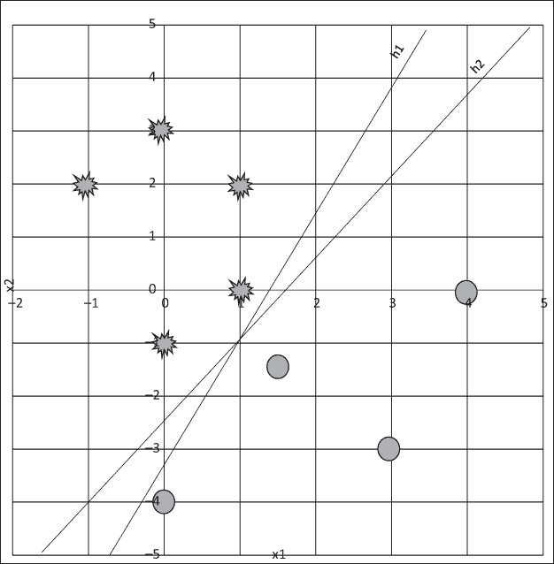

FIGURE 10.1 分隔圆形和星类的超平面。

SVM 使用位于类别之间外部边界的实例来寻找 `MMH`。为了理解这一点，请考虑图 10.2，它显示了两个分别通过定义各自类别边界边界实例的超平面。标记为 `h[1]` 的超平面通过星类的两个边界实例，而 `h[2]` 通过圆类的单个边界实例。这些边界实例被称为 `支持向量`。与 `MMH` 相关的支持向量具有区分类别的最佳机会，因为它们位于最大的边缘间隙处。SVM 算法仅使用这些关键的支持向量构建模型。所有其他类别实例都是无关的。以下是 SVM 算法使用的过程描述：

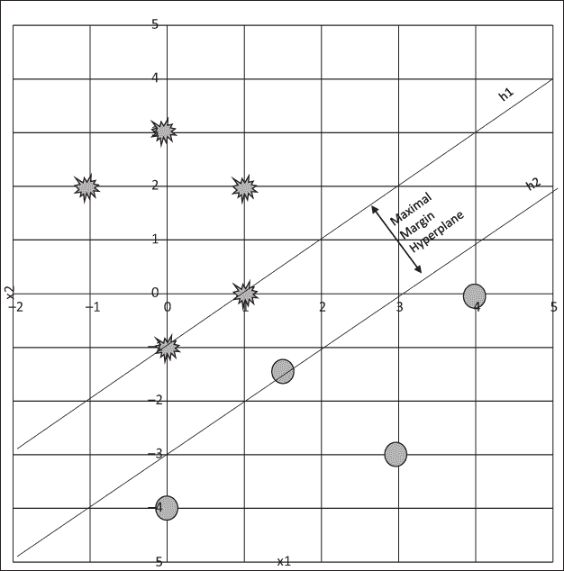

FIGURE 10.2 通过各自支持向量的超平面。

- 判断定义类别的实例在当前维度上是线性可分的。只要类别由线性边界划分，就使用支持向量建立 `MMH`。
- 如果类别不是线性可分的，则将实例映射到连续更高的维度中，直到实现线性可分。再次，在新更高维度中找到的支持向量决定了 `MMH`。

寻找支持向量和 `MMH` 是一个受约束二次优化问题，其细节超出了本书的范围。重要的点是，在给定某些条件下，可以在合理的时间确定 `MMH` 和支持向量。

在下一节中，我们将展示一个具有线性可分数据的简单二维示例。在示例之后，我们将对非线性情况进行讨论，并在该部分详细说明维度映射过程。最后，我们通过使用 R 语言提供的 SVM 软件进行若干实验，完成对 SVM 的研究。

# 10.1 线性可分类

在讨论 SVM 时，将实例视为向量是有用的。`vector`（向量）是一个既有方向又有幅度的量。实例可以以行向量的形式水平显示，也可以以列向量的形式垂直显示。我们用粗体表示向量。

一种特别重要的向量运算是`dot product`（点积）。点积可以被视为一种相似性度量。从代数角度来说，给定两个长度相同的向量，这两个向量的点积即为它们对应元素乘积之和。例如，给定 `v` = (`v[1]`, `v[2]`) 和 `w` = (`w[1]`, `w[2]`)，那么 `v · w` = (`v[1]*w[1]` + `v[2]*w[2]`)。通常会将上述方程写为 `v · w^T` = (`v[1]*w[1]` + `v[2]*w[2]`)，其中 `v` 是行向量，`w^T` 是行向量 `w` 的转置。这些信息结合图 10.2 为我们提供了第一个示例所需的信息！

图 10.2 中的坐标轴标记为 `x[1]` 和 `x[2]`，而不是 `x` 和 `y`。其理由是 `x[1]` 和 `x[2]` 都是独立的，而与每个向量相关的类别则是相关的。在这里，每个向量实例都是两个类别之一的成员。星号标记的类包含实例 (0, –1), (0, 3), (1, 0), (1, 2) 和 (–1, 2)。圆形类显示了实例 (0, –4), (1.5, –1.5), (3, –3) 和 (4, 0)。我们已经通过视觉判断确定这些类别是线性可分的。我们的目标是找到划分这些类的 MMH（最大间隔超平面）。要找到 MMH，我们必须定位支持向量。对于我们的简单示例，这个任务很容易。

图 10.2 显示星号类的两个支持向量别为 (1, 0) 和 (0, –1)。该图还显示 (1.5, –1.5) 为圆形类的唯一支持向量。如果对哪些实例代表支持向量有任何疑问，我们可以使用简单的欧几得距离来确定或验证我们的选择。对于这个示例，(1.5, –1.5) 和 (1, 0) 之间的欧几得距离为 √2.5，(1.5, –1.5) 和 (0, –1) 之间的距离也是。由于所有其他类间的向量距离都大于 √2.5，只有这三个向量与 SVM 算法相关。

具有支持向量 (1, 0) 和 (0, –1) 的类显然位于分类边界之上。按照惯例，该类标记为正类，并赋予标签 1。支持向量 (1.5, –1.5) 代表另一个类并位于类别边界之下。因此，(1.5, –1.5) 是一个负样本。惯例告诉我们给该类赋予标签 –1。虽然这种标记方案是标准的，但在选择代表每个相应类别的值时是任意的，除非所有位于边界上部分的支持向量获得相同的正值，且所有位于下边界的向量接收相应的负值。

接下来，建立 MMH 需要一个二维方程的通用形式。我们有两个选择。这里是包含常数项（偏置）的二维线性方程的标准表示。

`w[0] + w[1] + x[1] + w[2]*x[2] = 0` (10.1)

其中：
* `x[1]` 和 `x[2]` 是属性值
* `w[0]`、`w[1]` 和 `w[2]` 是需要学习的参数。

然而，如果通过添加一个项来考虑偏置并修改支持向量，我们也可以以下方式用其支持向量来表示 MMH：

`Σa[i]x[i] · x = 0` (10.2)

其中：
* `a[i]` 是与第 `i` 个支持向量相关的学习参数
* `x[i]` 是第 `i` 个支持向量
* `x` 是待分类的向量实例。

方程 10.2 更符合我们确定 MMH 的需求。要使用方程 10.2，我们首先为每个支持向量补充一个偏置 1 以考虑常数项。为了匹配方程 10.1，我们将偏置作为第一项。修改后的类 1 支持向量现在显示为 `SV[1] = (1, 1, 0)` 和 `SV[2] = (1, 0, –1)`。标记为 –1 的类的修改后支持向量为 `SV[3] = (1, 1.5, –1.5)`。由于方程 10.2 中的 `x` 代表待分类的实例，赋值 `a[0] = w[0]`、`a[1] = w[1]` 和 `a[2] = w[2]` 确认了方程 10.1 和 10.2 的等价性。

在已知支持向量和最大间隔超平面（MMH）的情况下，我们可以将模型应用于新实例以进行分类。这里有两种可选方案。我们可以通过将未分类实例的 `x[1]` 和 `x[2]` 值放入方程 10.4 来使用 MMH。如果结果大于 0，我们将该实例分类为标签 1。如果值为负，则将其归为标签为 –1 的类。或者，我们可以使用用支持向量表示的 MMH 公式，但这次将偏置作为常数项包含在内。具体来说：

```
y = b + Σ a[i] x[i] · x  (10.6)
```

其中：
* `a[i]` 是与第 `i` 个支持向量相关的学习参数
* `b` 是学习到的常数项
* `x[i]` 是第 `i` 个支持向量
* `x` 是待分类的向量实例。

如果 `y` 为正，我们将未知实例分类为标签 1。同样，如果 `y` 证明为负值，则该实例与标签为 –1 的类相关联。如果 `y = 0`，则该实例位于 MMH 上，并按出现频率最多的类进行分类。让我们使用方程 10.6 来确定实例 (0.5, 0) 的分类。

为了进行计算，我们从支持向量中移除偏置项，并将 `b` 的值取 2。应用之前计算出的 `a[1]`、`a[2]` 和 `a[3]` 的值，我们得到：

```
y = 2 + 2[(1,0)·(0.5)^T] + 2[(0.5,0)^T] − 2[(1.5,−1.5)·(0.5,0)^T]
```

这得到 `y` 的值为 1.5，告诉我们 (0.5, 0) 位于 MMH 之上，并分类为标记为 1 的向量。使用方程 10.6 分类 (0, –5) 得到值为 –3，说明 (0, –5) 被分类为标记为 –1 的类。

使用 10.6 分类支持向量 (1, 0) 得到值为 1。这是预料中的，因为 (1, 0) 位于超平面 `h[1]` 上。同样，将方程 10.6 应用于 (1.5, –1.5) 结果为 –1。使用模型分类 (3, 1) 得到值为 0。这告诉我们 (3, 1) 在 MMH 上。

在讨论非线性情况之前，显而易见的是，如果达到了可以接受的准确水平，线性模型是优的。尽管如此，值得注意的是，如果类别在当前维度上几乎是线性可分的，对 SVM 算法进行微调即可使其创建线性模型的能力。

# 10.2 非线性情况

SVM 的优势在于其能够在明显的非线性领域中进行分类的能力。当当前维空间中的实例不是线性可分时，SVM 应用非线性映射，从而将实例转换到新的、可能是更高维的空间。除非变换通过具有某些特殊特征的映射函数完成，否则可能会出现不可接受的复杂性。让我们来看看为何如此。

考虑二维向量 `x` 和 `z`，它们分别具有属性值（`x[1]`, `x[2]`）和 (`z[1]`, `z[2]`)。假设为了实现线性，我们的函数通过应用以下映射转换了当前的二维空间：

`(x[1],x[2])` → `(x[1],x[2],x[1]²,x[1]x[2],x[2]²)`

在上述映射之前，每对向量的点积计算需要一次乘法和一次加法。在新的空间中，每对向量 `x` 和 `z` 的点积则涉及五次乘法和四次加法。具体来说：

```
x · z = (x[1]*z[1],x[2]*z[2],x[1]²*z[1]²,x[1]*x[2],z[1]*z[2],x[2]²*z[2])
```

一旦建立了模型，模型的应用也需要相同的点积计算。然而，如果使用了正确类型的映射，这些额外的计算可以完全避免！这个过程需要使用称为`kernel function`（核函数）的特殊映射函数。要使函数 `K` 符合核函数，必须选择映射函数 `φ` 使得：

`K(x,z)` = `φ(x)` · `φ(z)`  (10.7)

为了说明这一属性，考虑映射 `φ` 且

`K(x,z)` = `φ(x)` · `φ(z)`  (10.7)

如你所示，脚本 10.2 显示的输出验证了方程 10.4。在本章的最后章节中，我们将探讨一个许多得的问题，涉及到非线性数据！

# 10.4 微阵列数据挖掘

两名女性被诊断为 3 期乳腺癌，均接受相同的治疗。其中一名女性康复并活了 20 年，另一位女性在几周内去世。这对于大多数影响男女的癌症类型来说都是一个常见的故事。原因之一是，两个诊断相同的个体的癌细胞在显微镜下可能看起来相同，但在分子水平上差异巨大。这些分子水平的差异会导致一个癌症发生转移，而另一个对治疗反应良好。

生物信息学（或计算生物学）领域的研究人员出于许多原因研究这些分子水平差异，包括：帮助医生为个体患者制定治疗方案、疾病早期检测、新药开发以及治疗结果预测等。关于如何操作的详细讨论已超出了本文的范围。然而，对该过程的最基础生物学概述将帮助你更好地理解什么是微阵列数据挖掘。

## 10.4.1 DNA 与基因表达

人类拥有数万亿细胞，它们都源于单个细胞（受精卵）。细胞有许多类型：皮肤、神经、血液、大脑。每个细胞都包含一份构建有机体的 `program` 完整拷贝。这个程序被称为基因组。基因组编码在 DNA 中，代表了给定有机体内所有基因的集合。

`gene` 是 DNA 的连续部分。人类 DNA 包含约 30,000–35,000 个基因。基因表达——通过制造信使 RNA（mRNA）转换为功能产物，随后将其翻译成蛋白质。也就是说，基因表达就像开关控制控制蛋白质的制造。在任何给定时刻，约 40% 的人类基因处于表达状态。

微阵列（也称为 DNA 芯片）能够测量这种水平的 mRNA 表达。

`microarray` 实际上是附在固体表面上的微型 DNA 斑集合。从微阵列获得的特定个体基因表达水平代表了分子水平的差异，这些差异可以帮助确定个体患者的结果和治疗。

`Microarray data mining` 是分析从微阵列设备获取的基因表达数据的过程。微阵列数据挖掘与传统数据挖掘的不同之处在于，一个典型的应用包含数千个属性（基因），但实例很少。显而易见，微阵列挖掘的一个定义性问题是属性选择/消除。让我们来看看属性选择过程。

## 10.4.2 预处理微阵列数据：属性选择

微阵列数据预处理分为两个阶段。第一阶段独立于数据中的任何类别。

### 10.4.2.1 类别无关预处理

常见的第一阶段技术包括阈值化、归一化和过滤。`Thresholding` 涉及为基因属性设置上限和下限值。未落在指定边界内的基因将不被分析。最佳的 `normalization` 方法是将数据归一化，使其均值为零，标准差为一。`Filtering` 方法移除变异较小的基因。例如，范围小于固定值的基因会被剔除。

### 10.4.2.2 类别相关预处理

第二阶段预处理的目的是为数据中的每个类别开发出一组最佳基因。由于第二阶段预处理依赖于类别，因此它只适用于监督学习。

#### 10.4.2.2.1 包装法

`wrapper` 方法根据类内排名为每个类别选择前 100–200 个基因。使用每个类别中不同数量的基因来创建模型。使用交叉验证方法对每个模型进行测试。选择性能最好的模型作为最终模型。

#### 10.4.2.2.2 置换检验

少量的实例和大量的属性可能会导致输入基因与输出类别之间出现假阳性相关。`Permutation testing`（有时也称为随机化）用于帮助识别这些假阳性相关。该方法的一个主要优势是可以并行估计多个基因的显著性。另一个优势是它即使对于小数据集也效果良好。该方法在假设两个类别和一个基因时最容易解释。具体来说：

1. 计算反映差异的 `t score`。
2. 保持实例顺序不变，但随机排列输出属性。也就是说，将每个基因实例随机分配到一个类别。
3. 对创建的数据集重新计算并记录 `t score`。
4. 重复步骤 2 和 3 数百或数千次。

当所有试验完成后，将 `t` 分按升序排列。如果原始的 `t score` 落在所有 `t scores` 的 95% 范围之外，我们就可以 95% 确定两个类别之间的基因表达水平差异是显著的。

置换检验是处理小数据集常见偏斜分布的广泛接受的方法。你可以通过安装 R 的 `coin` 和 `lmPerm` 包来尝试置换检验。

# 10.5 一个微阵列应用

在完成这些基础概述之后，让我们来看一些数据！我们在实验中将使用数据集——`SBRCTDNAData`——以 `.csv` 和 MS Excel 格式存储在你的数据目录中。该数据包含 59 个属性，代表 88 名癌症患者的基因表达水平。每个实例都描述了一个在儿童时期观察到的患有小圆蓝细胞肿瘤（SBRCT）的患者。原始数据集（Khan et al., 2001）包含 2308 个属性。研究人员使用他们的属性归约方法识别出了 59 个最重要的输入属性。数据中定义的肿瘤类型包括伯基特淋巴瘤（BL）、尤文肉瘤（EWS）、神经母细胞瘤（NB）和横纹肌肉瘤（RMS）。这些癌症类型在显微镜下很难区分，没有任何单一测试可以精确地区分它们。SRBCTs 的准确诊断至关重要，因为不同类型的预后和治疗方案差异巨大。请注意，训练数据中的五个实例不属于上述提到的四类之一。数据集的 MS Excel 版本中的 `description` 表格提供了关于数据及其用途的额外信息。

我们的目标是确定使用 `svm` 训练的模型能多好地确定测试数据的肿瘤类型。此外，我们想看看当使用 59 个属性的子集进行模型构建过程时，测试集的准确率发生什么变化。

# 10.5.1 建立基准

`Script 10.3` 显示了我们第一次实验的流程和部分输出。在数据准备期间，数据集中的第一列被删除了，因为它包含了每行的唯一标识符。训练数据包含前 61 个实例，剩余实例留作测试。调用 `sbr.perform` 生成了一个 8 × 8 的混淆矩阵（未显示）。

我们的实验结果显示，27 个中的 21 个（77.78%）测试集实例被正确识别。如果你检查混淆矩阵，你会发现错误的分类包括四个 `NB` 实例被归类为 `EWS` 实例，以及两个 `RMS` 实例被赋予了 `EWS` 标签。建立此基准后，让我们使用一种简单的属性消除技术，看看是否可以通过较少的输入属性获得更好的效果。

# 10.5.2 属性消除

由于这些数据已经过预处理，我们产生具有更少属性的更好模型的可能性存疑。然而，我们不能让消极的态度让我们放弃至少尝试一下！让我们执行一个简单的属性消除，首先从最用到最不用的对属性进行排名。然后我们使用所有属性构建一个基准模型。在消除效果最低的单个属性后，构建第二个模型。在消除下一个最低效属性后，构建第三个模型。这个过程一直持续，直到创建仅包含最高排名输入属性的最终模型。为了起见，这是一种暴力技术，没有考虑到输入属性之间的相互作用。然而，这种一次处理一个基因的方法在高维数据中很常见。

属性排名是借助 `RWeka` 内的 `GainRatioAttributeEval` 属性选择函数完成的。`GainRatioAttributeEval` 通过测量其相对于类别的增益比率来评估单个属性的价值。

`Script 10.4` 显示了为第二次实验准备数据的语句的流程和部分输出。我们首先给 `GainRatioAttributeEval` 传入数据集名称和输出属性。`GainRatioAttributeEval` 对每个属性进行排名，并将属性排名放入 `sbr.eval`。`sort` 函数按排名对属性进行排序。由于排名是从低到高，我们必须指定排名为降序。接下来，应用位于 `sqldf` 包中的 `select` 函数来构建一个包含输出属性和 30 个最相关的单项输入属性的新数据集。最后，使用新数据集创建训练数据和测试数据。

属性消除过程在 `Script 10.5` 中显示。`for loop` 显示了模型构建集中在 30 个最佳输入属性上。注意 `for loop` 变量 `k` 如何被整合以创建每个修改后的数据集。在几个打印语句前放置了注释符号。删除注释符号可以了解更多关于各个模型的信息。

部分输出列表显示，由于消除了不相关的输入属性，分类正确性迅速增加。几个模型的分类正确性达到了 100%！此外，在输入属性从六个减少到五个后，准确率从 80% 以上下降到 60% 范围左右。尽管这些结果非常令人鼓舞，但由于测试集较小，我们无法确定测试集准确率差异是否显著。置换检验是获取这些差异显著性的合适选择。下面的练习中提供了使用这些数据的额外实验。

我们对微阵数据挖掘的简要讨论到此结束。如果你的好奇心超出了本讨论的范围，可以在下面列出的网站上找到更多信息。第一个链接是特定于 R 的软件包。

*   [`master.bioconductor.org/`](http://master.bioconductor.org/)
*   [`www.genome.gov/about-genomics`](https://www.genome.gov/)
*   [`www.ebi.ac.uk/arrayexpress/`](https://www.ebi.ac.uk/)

除了上述链接外，书籍网站上提供的 Power Point 幻灯片提供了更多微阵资源列表。

# 10.6 章节总结

SVM 为线性可分和非线性数据的分类提供了一种独特的方法。SVM 能够提供全局最优解决方案。此外，由于 SVM 使用最难分类的实例作为预测基础，它们不太可能拟合数据。

即使使用核函数，SVM 在分类速度上无法与决策树和其他若干技术竞争。然而，它们在困难分类领域中的准确性使得 SVM 成为一种非常有价值的分类工具。SVM 在大型数据中发现异常的应用特别值得关注。

# 10.7 关键术语

SVM 的额外困难包括计算复杂度、维度（寻找实现分离的最小维度）、选择合适的属性以及选择合适的映射函数。SVM 也限于数值输入的二分类问题。

最后一个问题得到了解决，因为我们知道如何通过将每个属性值变为二值属性来将分类属性转换为数值值。此外，二分类限制也通过多种方法处理。一种被称为“孤对多”（one-versus-all）的方法为每个类构建一个分类模型。对于 $n$ 个类，我们有 $n$ 个模型。未知实例根据关联最近的类进行分类。“对一”（one-vs-one）方法为每对类构建一个分类器。给定 $n$ 个类，总共构建 $n(n – 1)/2$ 个类。未知实例根据得票最多的类进行分类。

R 提供了多个包含支持向量函数的包。我们的讨论集中在 RWeka 的 `SMO` 函数和 `e1071` 包中的 SVM 上。如果你想研究另一种 SVM 实现，位于 `kernlab` 包中的 `ksvm` 函数是一个可行的选择。

* `Dot product` 点积。代数上，两个向量的点积是它们对应元素乘积之和。
* `Gene filtering` 基因过滤。去除变化较小的基因。例如，范围小于固定值的基因会被移除。
* `Hyperplane` 超平面。比其环境空间低一维的子空间。
* `Maximum margin hyperplane` 最大间隔超平面。显示两类之间最大分离度的超平面。
* `Microarray` 微阵。附在固体表面上的微型 DNA 点集合。
* `Microarray data mining` 微阵数据挖掘。分析从微阵设备获取的基因表达数据的过程。
* `One-vs-one method` 对一方法。该方法用于限于二分类问题的模型。当存在两个以上类时，该方法为每对类构建一个模型。
* `One-vs-all method` 一对多方法。该方法用于限于二分类问题的模型。当存在两个以上类时，该方法为每个类构建一个模型。
* `Permutation testing` 置换检验。一种随机技术，用于帮助识别输入属性与输出之间的虚假相关性。输出属性的值被重复随机分配给输入实例，以确定哪些输入属性能够显著区分由输出属性定义的类。
* `Support vector` 支持向量。与最大间隔超平面（MMH）相关的边界实例。
* `Thresholding` 阈值化。为基因属性设置上限和下限。不在指定范围内的属性值将被弃。

# 练习

## 复习题

1. 区分以下内容：
    1. 对一方法和一对多方法。
    2. 线性和非线性 SVM。
2. 解释 `SMO` 和 `svm` 如何处理分类数据。请阅读每个函数的文档以获取帮助。
3. 阅读 `SMO` 的文档，描述 `na.action` 设置中 `na.omit` 和 `na.fail` 之间的区别。

# [使用 R 进行实验]

1. 修改 脚本 10.1 和 10.2 中的代码以允许数据归一化。对于每个会话，使用生成的最大间隔超平面方程来确定点是否被正确分类。你得什么结论？
2. 使用 Excel 打开 `DNA Lung Cancer.xlsx` 并读取数据描述。将 `DNALungCancer.csv` 加载到 RStudio。删除 `record name` 列。使用前 103 条记录创建训练集，使用剩余记录创建测试集。使用 `svm` 结合训练数据构建你的分类器。将你的模型应用于测试数据。对你的结果写一个简短的总结。包括混淆矩阵以及模型准确率的 95% 测试集置信区间限限。
3. 重复 脚本 10.4 和 10.5 给出的实验，但在你的实验中包含所有 59 个属性。写一份报告，其中包含一个显示前十个模型分类正确性的表格。表格还应列出每个模型使用的输入属性数量。在报告中包含一个说明，说明各个模型是否倾向于做出相同的错误测试集分类。
4. 重复 脚本 10.4 和 10.5 中的实验，但将属性选择限制为 20 个最不相关的属性。你的第一个模型由 20 个最不相关的属性创建，第二个模型由 19 个属性创建（每次移除一个最不相关的属性）。此过程一直持续到使用最好的 20 个不相关属性创建最终模型。总结你的发现，并分析 `GainRatio` 函数在确定此数据集相关性方面的作用。
5. 重复练习 3，但使用 RWeka 的 `InfoGainAttribute` 函数评估属性。`GainRatioAttribute` 的属性顺序与 `InfoGainAttribute` 确相同或相似吗？
6. 使用 `hist` 函数为 `SBRCTData` 中由 `GainRatioAttribute` 函数规定的三个最具预测性和三个最不预测性的基因绘制图。比较这些直方图。你可以得出什么性结论？
7. 在此练习中，将 `SMO` 应用具有 2212 个代表三个类的实例的 `SensorData.csv`。对于两个类以上的问题，`SMO` 使用上述的 `一对一` 技术。实例包含由航空产品公司收集的传感器数据。
    1. 使用 Excel 打开 `SensorData.xlsx` 并读取数据描述。
    2. 将 `SensorData.csv` 导入 Rstudio。随机化数据。使用随机数据集中的三分之一创建训练集。剩余实例作为测试数据集。使用 `SMO` 构建并测试代表三个类的模型。报告你的结果。
    3. 使用你喜欢的属性选择技术创建一个具有三个相关输入属性和输出属性的新数据集。重复你的实验。
    4. 两个模型的准确率之间是否存在`显著`差异？

## 计算题

1. 使用代数验证方程 10.8 是否满足方程 10.7 所述的条件。
2. 假设星类包含实例 (0, 0), (0, 1)。

算法的第一步需要对数据中可能存在的聚类数量做出初始决策。接下来，算法会随机选择 `K` 个数据点作为初始聚类中心。然后，将每个实例放置在与其最相似的聚类中。相似性可以用许多方式来定义；然而，最常用的相似性度量是简单的欧几里得距离。

一旦所有实例都被放置在各自的聚类中，就会通过计算每个新类的平均值来更新聚类中心。实例分类和聚类中心计算的过程持续，直到算法的某次迭代显示聚类中心没有变化。也就是说，直到第 3 步中没有实例改变其聚类分配。

# 1.1.1 使用 K-Means 的示例

为了弄清楚这个过程，让我们来看一个包含两个数值属性的局部示例。尽管大多数真实数据集包含多个属性，但无论属性的数量有多少，该方法都是一致的。对于我们的示例，我们将使用 [表 11.1] 所示的六个实例。为了简单起见，我们分别将两个属性命名为 `x` 和 `y`，并将实例映射到 `x`–`y` 坐标系中。映射关系如图 11.1 所示。

#### 表 11.1 K-Means 输入值

| 实例 | X | Y |
| --- | --- | --- |
| 1 | 1.0 | 1.5 |
| 2 | 1.0 | 4.5 |
| 3 | 2.0 | 1.5 |
| 4 | 2.0 | 3.5 |
| 5 | 3.0 | 2.5 |
| 6 | 5.0 | 6.0 |

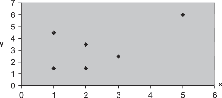

图 11.1 表 11.1 中数据的坐标映射。

作为第一步，我们必须为 `K` 选择一个值。假设我们怀疑有两个不同的聚类。因此，我们将 `K` 的值设为 2。算法随机选择两个点代表初始聚类中心。假设算法选择实例 1 作为一个聚类中心，选择实例 3 作为第二个聚类中心。下一步是对对方剩余实例进行分类。

回想计算坐标为 (`x[1]`,`y[1]`) 的点 A 与坐标为 (`x[2]`,`y[2]`) 的点 B 之间欧几里得距离的公式：

```
Distance(A - B) = sqrt((x1 - x2)^2 + (y1 - y2)^2)
```

`C[1]` = (1.0,1.5) 和 `C[2]` = (2.0,1.5) 的算法第一次迭代计算如下，其中 `C[i] − j` 是点 `C[i]` 到表 11.1 中实例 `j` 所代表的点之间的欧几里得距离。

*   距离 (`C[1] − 1`) = 0.00 距离 (`C[2] − 1`) = 1.00
*   距离 (`C[1] − 2`) = 3.00 距离 (`C[2] − 2`) ≅ 3.16
*   距离 (`C[1] − 3`) = 1.00 距离 (`C[2] − 3`) = 0.00
*   距离 (`C[1] − 4`) ≅ 2.24 距离 (`C[2] − 4`) = 2.00
*   距离 (`C[1] − 5`) ≅ 2.24 距离 (`C[2] − 5`) ≅ 1.41
*   距离 (`C[1] − 6`) ≅ 6.02 距离 (`C[2] − 6`) ≅ 5.41

在算法第一次迭代后，我们得到了以下聚类结果：
*   `C[1]` 包含实例 1 和 2。
*   `C[2]` 包含实例 3、4 和 6。

下一步是重新计算每个聚类。对于聚类 `C[1]`：
*   `x` = (1.0 + 1.0)/2 = 1.0
*   `y` = (1.5 + 4.5)/2 = 3.0

对于聚类 `C[2]`：
*   `x` = (2.0 + 2.0 + 3.0 + 5.0)/4 = 3.0
*   `y` = (1.5 + 3.5 + 2.5 + 6.0)/4 = 3.375

因此，新的聚类中心为 `C[1]` = (1.0,3.0) 和 `C[2]` = (3.0,3.375)。由于聚类中心发生了变化，算法必须执行第二次迭代。第二次迭代的计算如下：
*   距离 (`C[1] − 1`) = 1.50 距离 (`C[2] − 1`) ≅ 2.74
*   距离 (`C[1] − 2`) = 1.50 距离 (`C[2] − 2`) ≅ 2.29
*   距离 (`C[1] − 3`) ≅ 1.80 距离 (`C[2] − 3`) = 2.125
*   距离 (`C[1] − 4`) ≅ 1.12 距离 (`C[2] − 4`) ≅ 1.01
*   距离 (`C[1] − 5`) ≅ 2.06 距离 (`C[2] − 5`) = 0.875
*   距离 (`C[1] − 6`) = 5.00 距离 (`C[2] − 6`) ≅ 3.30

第二次迭代得出一个修改后的聚类结果：
*   `C[1]` 包含实例 1、2 和 3。
*   `C[2]` 包含实例 4、5 和 6。

接下来，我们计算聚类的类的新中心。对于聚类 `C[1]`：
*   `x` = (1.0 + 1.0 + 2.0)/3 ≅ 1.33
*   `y` = (1.5 + 4.5 + 1.5)/3 = 2.5

对于聚类 `C[2]`：
*   `x` = (2.0 + 2.0 + 3.0 + 5.0)/4 = 3.0
*   `y` = (1.5 + 3.5 + 2.5 + 6.0)/4 = 3.375

因此，新的聚类中心为 `C[1]` = (1.33,2.5) 和 `C[2]` = (3.0,3.375)。由于聚类中心发生了变化，算法必须继续进行（注：此处原文逻辑略有重复，已按原文意译翻译）。

*   当数据中存在的簇大小大致相同时时，`K-Means` 算法效果最好。在这种情况下，如果最优解是由大小不等的簇表示的，那么 `K-Means` 算法可能无法找到最佳解决方案。
*   无法判断哪些属性对于确定所形成的簇至关重要。由于这个原因，几个无关的属性可能会导致次优的结果。
*   由于缺乏对所形成簇性质的解释，我们必须对所发现的内容承担大部分的阐释工作。然而，我们可以使用监督机器学习工具来帮助我们洞察无监督聚类算法所形成簇的本质。

尽管存在这些局限性，`K-Means` 算法仍然是非常受欢迎的统计技术。

# 11.2 层次聚类

层次聚类是一种受欢迎的无监督聚类技术。与 `K-Means` 算法要求用户指定要形成的簇的数量不同，层次聚类从假设每个数据实例都代表其自己的簇开始。算法的步骤如下：

让我们看看如何将层次聚类应用于信用卡促销数据库！

# 11.2.1 层次聚类：一个示例

`表 11.3` 显示了 `第 1 章` 中描述的信用卡促销数据库的五个实例。`表 11.4` 提供了算法步骤 2(a) 第一次迭代计算出的实例相似性得分。对于类别属性，实例间的相似性得分是通过首先计算两个实例之间属性-值匹配的总数来计算的。然后用属性比较的总数除以该总数，得到相似性量。例如，比较 `I*[1]` 和 `I*[3]`，我们有四次匹配和五次比较。这得我们在 `表 11.4` 的 `I*[3]` 行、`I*[1]` 列看到的 0.80 值。

表 11.3 信用卡促销数据库中的五个实例

| 实例 || 收入范围 || 杂志促销 || 手表促销 || 人寿保险促销 || 性别 |
| --- | --- | --- | --- | --- | --- |
| `I*[1]` || 40–50 K | 是 | 否 | 否 | 男性 |
| `I*[2]` || 25–35 K | 是 | 是 | 是 | 女性 |
| `I*[3]` || 40–50 K | 否 | 否 | 否 | 男性 |
| `I*[4]` || 25–35 K | 是 | 是 | 是 | 男性 |
| `I*[5]` || 50–60 K | 是 | 否 | 是 | 女性 |

表 11.4 层次聚类：第一次迭代

| | `I*[1]` | `I*[2]` | `I*[3]` | `I*[4]` | `I*[5]` |
| --- | --- | --- | --- | --- | --- |
| `I*[1]` | 1.00 | | | | |
| `I*[2]` | 0.20 | 1.00 | | | | |
| `I*[3]` | 0.80 | 0.00 | 1.00 | | | |
| `I*[4]` | 0.40 | 0.80 | 0.20 | 1.00 | | |
| `I*[5]` | 0.40 | 0.60 | 0.20 | 0.40 | 1.00 |

步骤 2(b) 要求合并第一次迭代形成的两个最相似的簇。由于组合 `I*[1]-I*[3]` 和 `I*[2]-I*[4]` 分别显示出最高的相似性得分，我们可以选择合并 `I*[1]` 与 `I*[3]` 或合并 `I*[2]` 与 `I*[4]`。我们选择合并 `I*[1]` 与 `I*[3]`。因此，在步骤 2(b) 的第一次迭代之后，我们有三个单实例簇（`I*[2]`、`I*[4]`、`I*[5]`）和一个包含两个实例的簇（`I*[1]` 和 `I*[3]`）。

需要注意的是，我们也可以将此表表示为*不相似性矩阵*，其中属性匹配将不计入不相似性得分。如果我们选择不相似性，我们将合并具有最低表中得分的实例或簇。

接下来，我们需要一种方法来计算簇与簇之间的相似性得分。存在几种可能性。对于我们的示例，我们使用单次表计算中涉及的所有实例的平均相似性。也就是说，为了计算将包含 `I*[1]` 和 `I*[3]` 的簇与包含 `I*[4]` 的簇合并的得分，我们将 7 次属性-值匹配除以 15 次比较，得到一个相似性量。

只要对数据做出某些假设，就可以应用统计分析来帮助确定哪种聚类方法提供了最佳结果。用于选择最佳划分的一种常用统计检验是`贝叶斯信息准则`，也称为 `BIC`。`BIC` 要求聚类符合正态分布。`BIC` 在假设两个模型最初都不被偏好的情况下，给出一个模型相对于另一个模型的几率（Dasgupta and Raftery, 1998）。

## 11.2.2 通用考虑

凝聚聚类通过迭代合并聚类对来创建层次聚类结构。虽然我们在这里的讨论有限，但存在多种计算聚类相似性得分和合并聚类的程序。当数据为实值时，定义实例相似性的度量可能是一个挑战。一种常用的方法是使用简单的欧式距离。

凝聚聚类的一个广泛应用是作为其他聚类技术的预备。例如，K-Means 算法的第一次迭代需要选择初始类均值。通常情况下，这种选择是以随机或任意的方式进行的。然而，初始选择对最终聚类的质量可能产生显著影响。因此，为了增加获得最佳最终聚类的机会，我们首先应用凝聚聚类来创建与 K-Means 算法选择的数量数量的聚类。接下来，我们计算由凝聚技术产生的类均值，并将这些均值得分作为第一次 K-Means 聚类的初始选择（Mukherjee et al., 1998）。

## 11.3 概念聚类

概念聚类是一种无监督聚类技术，结合了增量学习以形成概念层次结构。概念层次呈树结构的形式，根节点代表最高级别的概念泛化。因此，根节点包含所有领域实例的摘要信息。特别感兴趣的是树的基级节点。基本级节点在人类吸引力和理解方面具有意义。合适的聚类质量度量在概念树的第一层或第二层形成这些基本级节点。以下是一个标准的概念聚类算法：

该算法清楚地展示了聚类过程的增量性质。也就是说，每个实例按顺序呈现现有的概念层次结构。接下来，在层次结构的每一层，都使用评估函数来决定是将实例包含在现有聚类中，还是以该新实例为唯一成员创建一个新聚类。在下一节中，我们将描述一个著名的基于概率的概念聚类系统所使用的评估函数。

### 11.3.1 衡量类别效用

`Cobweb`（Fisher, 1987）是一种在概念层次中存储知识的概念聚类模型。`Cobweb`接受属性-值格式的实例，其中属性值必须是类别的。`Cobweb`的评估函数已被证明一致地确定人类分类层次结构中心理偏好的（基本）级别。该评估函数是名为`类别效用`（category utility）的度量的推广。`类别效用`函数衡量了如果将特定对象放在给定类别中，其正确属性-值预测的“预期数量”的增益。

类别效用的公式包含三个概率。一种度量是在属于类 `C[k]` 的条件下属性 `A[i]` 具有值 `V[ij]` 的条件概率，记为 `P(A[i] = V[ij] | C[k])`。这是属性-值`预测性`（predictability）的正式定义。如果 `P(A[i] = V[ij] | C[k]) = 1`，我们可以确定类 `C[k]` 的每个实例将始终具有属性 `A[i]` 的值 `V[ij]`。属性 `A[i]` 具有值 `V[ij]` 被称为定义类 `C[k]` 的`必要`条件。第二个概率 `P(C[k] | A[i] = V[ij])` 是在属性 `A[i]` 具有值 `V[ij]` 的条件下，实例属于类 `C[k]` 的条件概率。这是属性-值`预测力`（predictiveness）的定义。如果 `P(C[k] | A[i] = V[ij])` 的值为 1，我们知道如果 `A[i]` 具有值 `V[ij]`，包含此属性-值对的类必须是 `C[k]`。属性 `A[i]` 具有值 `V[ij]` 被称为定义类 `C[k]` 的`充分`条件。根据这些定义，我们看到属性-值预测性是类内度量，而属性-值预测力是类间度量。

这三个概率度量结合并在所有 `i`、`j` 和 `k` 的值上求和，以描述划分质量的启发式度量。具体而言：

```
Σ_K Σ_i Σ_j P(A_i = V_ij) P(C_K | A_i = V_ij) P(A_i = V_ij | C_K)  (11.1)
```

概率 `P(A[i] = V[ij])` 允许频繁出现的属性值在衡量划分质量中起更重要的作用。使用划分质量的表达式，类别效用由以下公式定义：

```
(Σ_{k=1}^K P(C_K)^2 - Σ_i Σ_j P(A_i = V_ij | C_K)) / K  (11.2)
```

分子的第一项是通过应用贝叶斯规则述述划分质量表达式。第二项代表了在没有任何类别知识的情况下正确猜测属性值的概率。除以 `k`（类别总数）允许 `Cobweb` 考虑形成簇的总数的变化。

### 11.3.2 概念聚类：示例

为了说明 `Cobweb` 构建概念层次结构的过程，请考虑图 11.3 所示的由 `Cobweb` 根据表 11.6 中的实例创建的层次结构。假设我们有一个新实例要放入层次结构。实例从根节点 `N` 进入层次结构，并更新 `N` 的统计数据以反映新实例的添加。当实例进入层次结构的第二层时，`Cobweb`的评估函数选择四种操作之一。如果新实例与 `N[1]`、`N[2]` 或 `N[4]` 足够相似，则将其并到选节点中并进入第二层。作为另一种选择，评估函数可以判断新实例足够独特，值得创建一个新的第一级概念节点。如此，实例将成为第一级概念节点，分类过程结束。

Cobweb 允许另外两种选择。在一种情况下，系统考虑将得分最高的两个节点合并为一个节点。最后一种可能性实际上是从层级结构中删除得分最高的节点。这最终两个选择是为了帮助修改由于实例呈现倾斜（skewed instance presentation）——即多个高度相似的实例连续呈现——而导致的非优化层级结构。如果选择了其中任何一种，系统将处理合并或删除操作，并将新实例再次提交给修改后的层级结构进行分类。该过程在概念树的每一层持续进行，直到新实例成为末端节点。

最后，请注意，所有的预测性（predictiveness）和可预测性（predictability）得分都是相对于父节点计算的。例如，在 `N[3]` 中发现 `nuclei` = `two` 的预测性分为 1.0，反映了所有合并到 `N[2]` 中 `nuclei` = `two` 的实例都遵循了从 `N[2]` 到 `N[3]` 的路径。

# 11.3.3 一般考虑

尽管我们将讨论限制在 Cobweb 上，但已经开发了其他几种概念聚类系统。Classit (Gennari et al., 1989) 是一种概念聚类系统，它使用 Cobweb 基础算法的扩展来构建概念层级并对实例分类。这两个模型非常相似，例外 Classit 的评估函数是 Cobweb 对于实值属性类别用途（category utility）的等效变换。因此，单个概念节点存储的是属性均值和标准差得分，而不是属性值概率。

与 Cobweb 类似，Classit 特别具有吸引力，因为其评估函数证明能够一致地确定人类分类层级中心理学上的偏好水平。此外，Cobweb 和 Classit 都非常适合解释它们的行为，因为每个树节点在某个抽象层上都包含一个完整的概念描述。

概念聚类系统也有一些缺点。概念聚类系统的一个主要问题是实例的顺序会对聚类结果产生显著影响。实例缺乏代表性的排序可能导致次优的聚类结果。Cobweb 和 Classit 等聚类系统使用特殊操作来合并和拆分簇，试图解决这个问题。然而，这些技术的结果尚未证明在所有情况下都是成功的。

# 11.4 期望最大化

EM 算法 (Dempster et al., 1977) 是一种利用有限高斯混合模型的统计技术。`mixture`（混合模型）是 `n` 个概率分布的集合，其中每个分布代表一个簇。混合模型为每个单个数据实例分配一个概率（而不是特定的簇），即在它是指定簇的成员的情况下，它具有某组特定属性值的概率。混合模型假设所有属性都是独立随机变量。

EM 算法与 K-Means 过程相似，它们都会重新计算一组参数，直到达到预期的收敛值。在最简单的情况下，`n = 2`，假设概率分布为正态分布，且数据实例由单个实值属性组成。尽管算法可以适用于具有任意数量实值属性的数据集，但我们在这里将讨论限制在这个最简单的情况下，并在下一节中提供一个通用的示例。使用双类单属性的场景，算法的任务是确定五个参数的值。具体来说：

*   簇 1 的均值和标准差
*   簇 2 的均值和标准差
*   簇 1 的采样概率 `P`——簇 1 中的实例数量除以领域内实例总数。因此，簇 2 的概率为 `(1 - P)`。

EM 使用的通用过程如下：

当衡量簇质量的公式不再显示显著增加时，算法终止。簇质量的一种衡量标准是数据来自聚类所确定数据集的似然（likelihood）。似然计算是直接的。对于每个数据实例，首先求加该实例属于两个簇中每一个的条件概率。通过这种方式，每个实例都有一个关联的累计概率得分。接下来，将累计概率得分相乘以计算似然值。较高的似然得分代表更优的聚类。

EM 保证收敛到最大似然得分。然而，该最大值可能不是全局的。因此，可能需要多次运行算法以获得最佳结果。由于算法选择的初始均值和标准差会影响结果，通常会应用聚合聚类等替代技术。EM 然后使用由该技术确定的均值和标准差值作为初始设置。

缺乏解释是 EM 以及许多聚类系统共同存在的问题。因此，我们建议的利用监督模型来分析无监督聚类结果的方法是合适的。下一节提供了采用 K-Means 分类聚类和层次聚合聚类的聚类实验。

# 11.5 使用 R 进行无监督聚类

监督学习和无监督聚类互为补充，因为每种方法都可以评估相反策略。使用监督学习评估无监督聚类特别有吸引力，因为该过程独立于用于聚类的算法。

# 11.5.1 用于簇评估的监督学习

在第一个示例中，我们使用监督学习来帮助解释通过将 K-Means 算法应用于第 5 章描述的伽射线暴数据集而获得的簇。回想数据已经过对数归一化。处理如下：

1.  将数据交给聚类算法。
2.  将每个形成的簇标记为一类。
3.  选择具有解释能力的监督学习算法建立类模型。
4.  使用 (3) 创建的模型来帮助解释和分析形成的簇。

[脚本 11.1] 显示了实验的步骤以及编辑后的输出。为了简化解释，原始数据中除 `t50` 和 `hr32` 以外的所有字段均已删除。

脚本告诉我们，预处理的数据被交给 `kmeans` 函数并指示形成三个簇。`grb.km$size` 组件显示每个簇中的实例数量，`grb.km$centers` 为我们提供单个簇中心，而 `grb.km$cluster` 则提供每个实例关联的单个簇编号列表。

三个额外的组件（未在脚本中显示）提供了计算一种经常引用的聚类质量指标的方法，该指标通过平方和（`grb.km$betweenss`）除以总平方和(`grb.km$totss`)得到，其中 `betweenss = totalss – withinss`。该值越接近 1.0，我们越有信心聚类以有意义的方式区分了数据。计算出的得值为 0.81。该值支持了以下假设：聚类以有意义的方式捕捉了数据的结构。你可以通过输入 `grb.km` 获取聚类可用的所有组件列表。

检查聚类的大小和中心，我们看到了三个定义良好的聚类。聚类 1 代表软短暴，聚类 2 特是软长暴，聚类 3 包含极硬短暴。图 11.4 以图形方式描述了每个聚类。`points` 函数允许我们逐个将聚类添加到图中。设置 `ylim` 对于所有三个聚类出现在图中都是必须的。我们看到了几个可能的离群点。

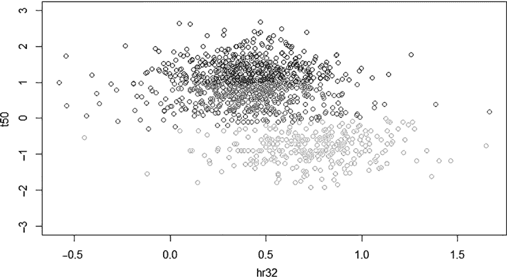

FIGURE 11.4   伽马射线暴数据的 K-Means 聚类。

接下来，将聚类列表转换为因子变量 `class`，将其绑定到原始数据。最后，`rpart` 使用聚类创建了图 11.5 所示的决策树。

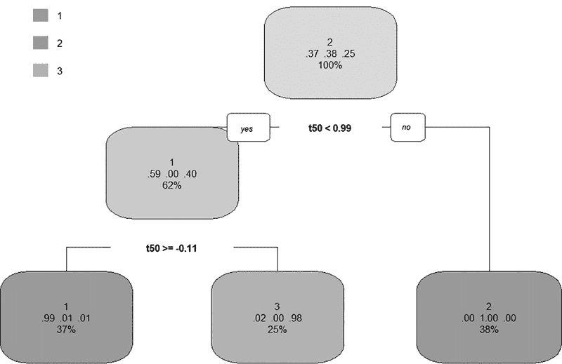

FIGURE 11.5   根据伽马射线暴聚类创建的决策树。

决策树告诉我们聚类构建了长暴的单一划分（t50 ≥ 0.99）。其余 62% 的实例再次通过 `T50` 进行划分。暴的硬度在树的构建中不起作用。然而，聚类 2 和聚类 3 之间的硬度存在显著差异，聚类 3 代表最短且最硬的暴。对于我们的下一个实验，我们将重新检查如何将无监督聚类用于属性评估。

# 11.5.2 用于属性评估的无监督聚类

在第 8 章中，我们将无监督神经网络聚类应用于一个包含 768 个实例的数据集，其中 268 个实例代表糖尿病测试呈阳性的女性。我们的目标是评估输入属性对监督学习的相关性。我们的初始结论是输入属性无法清晰地表示输出属性。在这里我们通过应用 K-Means 算法再次访问该数据集，以验证或反驳我们之前的结论。

脚本 11.2 提供了步骤和编辑后的输出。有几个项目值得关注。你会首先注意到输出属性从数据中删除，随后对数据进行归一化。聚类到类的准确率（67.4%）与使用相同数据的 Kohonen 聚类结果一致（第 8 章，第 8.7 节）。调用 `aggregate` 函数按其相应的聚类编号对实例进行分组。该函数随后在聚合数据上应用 `mean`。未编辑的脚本还对聚合值应用了 `sd`。

首要重要的是值 `betweenss /totalss`。四舍五入后的值 0.17 强烈表明，聚类没有反映属性内部的可衡量结构。这支持了我们之前的观点，即输入属性集无法区分这两个类别。尽管这种属性评估方法非常直接，但取决于聚类技术，在进行评估之前可能需要经过多次迭代。例如，应用 K-Means 形成的聚类受到初始均值选择的影响很大。对于单次迭代，算法可能会经历未最优的收敛。在非最优收敛的情况下，单个聚类可能包含来自多个类别的实例混合物。这反过来会让我们对领域特征的效能产生错误的印象。由于无监督评估完全基于训练数据，高质量的聚类并保证在测试集上的性能是可接受的。因此如此，该技术与其他方法形成补充，并且对于识别监督失败的原理最有价值。作为一条一般规则，我们看到这种方法的值与训练数据中包含的类别总数之间存在反比关系。是时候转向层次聚类了！

# 11.5.3 凝聚聚类：一个简单示例

脚本 11.3 显示了对表 11.1 中的数据应用凝聚聚类后产生的步骤和编辑后的输出。`dist` 函数创建了 `hclust` 聚类数据所需的`dissimilarity matrix`。脚本中显示的矩阵包含 15 个值，其中每个值都是点对点之间的欧式距离。对 `hclust` 的调用显示我们正在使用 `complete linkage`（完全连接）方法定义两个聚类之间的距离。该方法将两个聚类之间的距离定义为一个聚类中的点与第二个聚类中的点之间的最大距离。其他常用选项包括 `average linkage`（平均连接）和 `single linkage`（单链）。`Average linkage` 计算一个聚类中每个点与另一个聚类之间的平均距离。`Single linkage` 定义聚类之间的距离为最短距离。在脚本 11.5 中，我们使用了一种可以处理分类混合数据的方法。图 11.6 显示了聚类的树（dendrogram）。从底部开始，我们首先看到每个点都是独立的聚类。接下来，点 1 和 3 合并为一个聚类。此外，点 2 和 4 形成另一个聚类。第 5 个点被加入 1–3。之后，1–3 与 2–4 合并。最后，6 加入了顶层聚类。你会发现，隔离第 6 个点的合并对应于表 11.2 中描述的 K-Means 聚类结果。

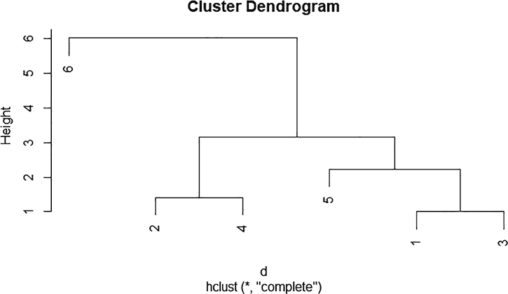

FIGURE 11.6   表 11.1 中数据的凝聚聚类。

# 11.5.4 伽马射线暴数据的凝聚聚类

大多数聚类技术都需要用户对数据的聚类数量做出初始决策。对于这个示例，我们采用伽马射线暴数据集来说说明一种自动此类选择的方法。脚本 11.4 显示了过程以及编辑后的输出。首要任务是安装包 `Nbust`。其次，在查看脚本 11.4 之前，我们检查属性的相关性。具体来说：

```


> `x <- Grb4u[-1]`
> `round(cor(x), 3)`

|       | p256 | fl   | hr32 | hr321 | t50  | t90  |
| :---- | :--- | :--- | :--- | :---- | :--- | :--- |
| p256  | 1.000 | 0.602 | 0.170 | 0.181 | 0.013 | 0.073 |
| fl    | 0.602 | 1.000 | -0.030 | -0.042 | 0.643 | 0.683 |
| hr32  | 0.170 | -0.030 | 1.000 | 0.959 | -0.387 | -0.391 |
| hr321 | 0.181 | -0.042 | 0.959 | 1.000 | -0.407 | -0.411 |
| t50   | 0.013 | 0.643 | -0.387 | -0.407 | 1.000 | 0.975 |
| t90   | 0.073 | 0.683 | -0.391 | -0.411 | 0.975 | 1.000 |

回想一下，集中每个脉冲长度、亮度和硬度都有一对属性。相关性表告诉我们从每对属性中删除一个：`t50-t90`、`fl-p256` 和 `hr32-hr321`。脚本 11.4 显示，除了剔除唯一脉冲编号列外，我们还选择了剔除 `t50`、`p256` 和 `hr321`。接下来，`NbClust` 使用基于 26 个标准的多数通过法来确定最佳聚类数量。图 11.7 中的条形图总结了调用 `NbClust` 的结果，告诉我们三个聚类是我们的作为最终方案的最佳选择。你可以在控制台中输入 `numC` 来查看 `NbClust` 使用的所有 26 种衡量标准。尽管我们在这里首先使用了 `NbClust`，但它是独立于聚类算法的。

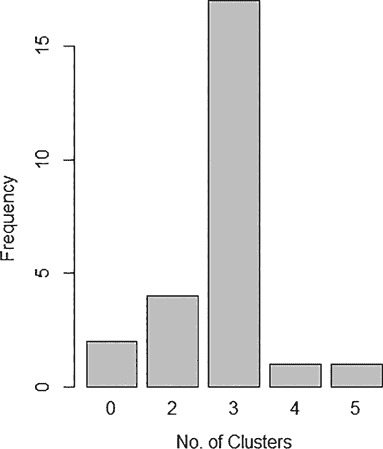

FIGURE 11.7 确定聚类的数量。

聚类生成的谱树图显示在图 11.8 中。`cutTree` 函数按照指定将树图切割成三个聚类，并输出每个聚类中的实例数量。最后，`aggregate` 函数显示了类内均值和标准差。只要属性经过了标准化，属性均值就能让我们更好地理解所提供的聚类。属性相关性的一种简单启发式衡量方法是：属性均值差的绝对值除以该属性的全局标准差。相关性值较低的数值属性（通常小于 0.25）对于区分不同聚类可能价值不大。

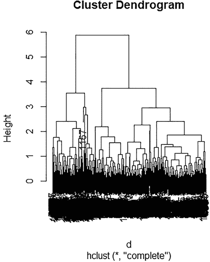

FIGURE 11.8 伽马射线暴发数据的凝聚聚类。

为了阐明这种方法，我们可以借助 `sapply` 轻松获得全局标准差分数。对于我们的示例，我们有：

```
> sapply(grb.data, sd)

fl      hr32       t90
0.7684309 0.2964524 0.9515629
```

有了上述 `sd` 值，让我们比较聚类 `1` 和 `2` 之间 `t90` 的均值：

```
> abs(1.354 - 1.767) / .9515629

[1] 0.4340228
```

对聚类 `1` 和 `3` 之间的 `t90` 进行相同的计算，得到：

```
> abs(-0.366 - 1.767) / .9515629

[1] 2.241575
```

对于 `fl` 以及聚类 `1` 和 `2`，我们得到：

```
> abs(-5.589 - -4.552) / 0.7684309

[1] 1.349503
```

这些计算表明，聚类 `1` 和 `3` 是通过 `t90` 区分的，而聚类 `1` 和 `2` 在平均脉冲亮度上显示出显著差异。通常，均值和标准差描述了一类更长、更亮、更软的脉冲；第二类更长、更暗、更软的脉冲；第三类更短、更硬的脉冲。章节末尾的几道练习题要求你继续探索伽马射线暴发数据的内在结构。

## 11.5.5 心脏病患者数据的凝聚聚类

脚本 11.5 说明了如何将凝聚聚类应用于具有分类和/或混合数据类型的数据集。为了实现这一点，我们必须安装 `cluster package` 并使用 `daisy` 函数配合 `metric = gower` 来创建差异矩阵。`gower` 度量能够为混合和严格分类的数据集计算相似值。如果所有属性都是数值，则差异度量默认为欧几得距离。

如果存在一个或多个分类变量，两个实例之间的差异被给出每个属性贡献的加权平均值。数值属性的贡献为两个实例间值差的绝对值除以该数值属性的范围。对于分类属性，如果两个值相同，则贡献为 0，否则为 1。实例内部的缺失属性值简单不包含在涉及该实例的差异中。你可以通过查看 cluster 包中的 `daisy` 文档来阅读该度量的具体细节。

图 11.9 调用 `hclust` 生成的树图清楚地显示了数据中的双聚类划分。混淆矩阵的创建有些问题，因为我们必须应用 `table` 函数之前必须交换聚类编号。由于第一个数据实例属于 `sick`（患病）类，因此代表患过心脏病的人的聚类可能会落在聚类 `1`。然而，`str(CardiologyMixed)` 告诉我们因子 `1` 与健康类（healthy）相关联！解决此问题的方法之一是应用脚本所示的 `for` 循环，其中交换了 `1` 和 `2`。更好的替代方案是将每个类的典型实例放在数据集的开头，使第一个实例与对应于因子值 `1` 的类别匹配。当数据中存在两个两个类时，该规则很容易泛化。最后，准确率为 76.57% 的聚类与类别混淆矩阵支持了输入属性定义数据结构的能力。你将在章节末尾的练习中学习更多关于混合类型数据集的聚类。

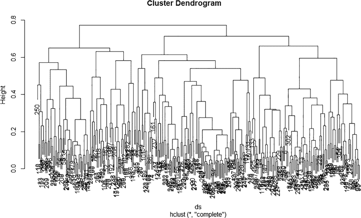

FIGURE 11.9 心脏病患者数据的凝聚聚类。

## 11.5.6 信用筛选数据的凝聚聚类

对于最后一个示例，我们将 `hclust` 应用于 `creditScreening` 数据集。回想一下，5% 的实例至少有一个属性值缺失。由于输入数据既是分类的又是数值，我们使用 `daisy` 函数创建差异矩阵。我们还调用了 `GainRatioAttributeEval` 函数获取单个属性相关性的衡量标准。脚本 11.6 显示了我们实验的步骤和编辑输出。

当使用所有 15 个输入属性进行聚类时，聚类与类别的混淆矩阵显示准确率为 56.23%。两百份应该被接受的信用卡申请被拒绝了！这结合 `GainRatioAttributeEval` 给出的相关性值，表明许多输入属性是无关的并对结果产生了负面影响。通过完成章节末的练习 11 可以很容易验证这一点。有趣的是，你会发现删除除 `nine` 之外的所有输入属性将使分类准确率提高 25% 以上！

## 11.6 章节总结

K-Means 算法将数据划分为预定义数量的聚类。该算法从随机选择一个数据点代表每个聚类开始。然后将每个数据实例放置与其最相似的聚类中。计算新的聚类中心并继续该过程，直到聚类中心不再变化。K-Means 算法易于实现和理解。然而，该算法不能保证收敛到全局最优解，缺乏解释所发现内容的能力，无法告知哪些属性对于确定形成的聚类具有意义。尽管有这些局限性，K-Means 算法仍然是最广泛使用的聚类技术之一。

凝聚聚类是一种受欢迎的层次聚类技术。凝聚聚类开始假设每个数据实例都代表它自己的类。算法的每次迭代都会合并最相似的一对类。在最后迭代中，数据集中的所有项都包含在单个类中。计算实例和类相似性评分以及类合并程序有多种选择。此外，当待聚类数据为实值时，定义实例相似性量可能是一项挑战。一种常用方法是使用简单的欧式距离。凝聚聚类的一个广泛应用是作为其他聚类技术的辅助。

概念聚类是一种无监督技术，它结合增量学习来形成概念层次。概念层次呈树状结构，其中根节点代表概念泛化的最高水平。概念聚类系统特别吸引人，因为研究证明它们形成的树能够一致地确定人类分类层次中心理学偏好的水平。此外，概念聚类系统便于解释其行为。概念聚类系统的一个主要问题是实例排序会对聚类结果产生显著影响。数据实例缺乏代表性的排序可能导致非优聚类结果。

EM 算法是一种利用有限高斯混合模型的统计技术。混合模型为每个单独的数据实例分配一个概率，即在它是指定类成员的情况下，其具有某组属性值的概率。该模型假设所有属性都是独立随机变量。EM 算法与 `K-Means` 过程相似，它们都会重新计算一组参数，直到达到期望的收敛值。与许多聚类系统一样，EM 算法的一个问题是对于“发现了什么”缺乏解释。我们使用监督模型来分析无监督聚类结果的方法论，是一种可以帮助解释 EM 聚类结果的技巧。

无监督聚类技术通常支持其内部的评估标准。由于许多无监督技术对形成类的性质提供的解释极少，因此对无监督聚类的评估应该包含对发现内容的解释。监督学习可以帮助解释和评估无监督聚类的结果。另一种有效的评估程序是进行类间的属性值比较，以确定备选类中包含的实例是否存在显著差异。

## 11.7 关键术语

- `Agglomerative clustering`（凝聚聚类）：一种无监督技术，每个数据实例最初均代表它自己的类。算法的连续迭代合并高度相似的类对，直到所有实例都成为单个类的成员。在最后一步，将决定哪种聚类是最佳最终结果。
- `Average linkage`（平均链法）：该方法用于层次聚类，将距离定义为一个类中每个点与第二个类中每个点之间的平均距离。
- `Basic-level nodes`（基本级节点）：概念层次中代表人类易于识别的概念节点。
- `Bayesian Information Criterion` (`BIC`，贝叶斯信息准则)：`BIC` 在假设两个模型都不优的情况下，给出一个数据挖掘模型相对于另一个模型的后验几率。
- `Category utility`（类别效用）：一种无监督评估函数，衡量如果将特定对象放在给定的类别或类中，其正确属性值预测“预期数量”的增益。
- `Complete linkage`（完全链法）：该方法将两个类之间的距离定义为一个类中一点与第二个类中某一点之间的最大距离。
- `Concept hierarchy`（概念层次）：一种树状结构，树的每个节点代表某个抽象层面的概念。树顶部的节点最通用。叶节点代表单独的数据实例。
- `Conceptual clustering`（概念聚类）：一种增量无监督聚类方法，从一组输入实例创建概念层次。
- `Dendrogram`（谱图）：一种常用于描述层次聚类的树状结构。
- `Dissimilarity matrix`（不相似矩阵）：一个包含代表各个实例或类之间差异的数值的矩阵。
- `Incremental learning`（增量学习）：一种在无监督环境中支持的学习形式，在该环境中实例是顺序呈现的。每当看到新实例时，学习模型就会被修改以反映新实例的添加。
- `Mixture`（混合）：一组包含 `n` 个概率分布的集合，每个分布代表一个类。
- `Single linkage`（单链法）：一种用于层次聚类的方法，将距离定义为一个类中一点与第二个类中一点之间的最短距离。

## 练习

### 复习题

1. 比较并对比概念聚类和凝聚聚类。列出它们的异同。
2. 比较并对比 EM 算法与 `K-Means` 方法。列出它们的异同。
3. 平方值常用于聚类评估。类间平方在第 11.5 节中定义为总平方与类内平方之差（`betwes = totalss – withinss`）。接近 1.0 的 `betwes/totalss` 值为形成的类表征数据集内部结构提供了积极支持。

### 使用 R 进行实验

1. 在 [Script 11.1] 中添加语句验证 `betweenss/totalss` 值为 0.81。
2. 重访 [Script 11.1]，但使用 `fl` 和 `hr32` 进行聚类。根据需要修改 `xlim` 和 `ylim` 以便正确显示类。添加计算 `betweenss/totalss` 值的语句。对你的结果进行简短总结。
3. 通过改变 [Script 11.2] 中的种子，尝试获得更好的分类结果。
4. 使用 `hclust` 对 `Diabetes` 数据集进行聚类。假设数据中有两个类并进行分类分析。将生成的混淆矩阵与 [Script 11.2] 中的混淆矩阵进行比较。
5. 将 RWeka 的 `GainRatioAttributeEval` 函数应用于 [Script 11.2] 中使用的 `Diabetes` 数据集的输入属性。接下来，排除最无用的属性后运行 [Script 11.2]。重复此过程，每次消除最有效的剩余属性。写一份短报告，包括每次实验的混淆矩阵。就属性在判断某是否患糖尿病方面的价值发表声明。
6. 考虑 [Script 11.3]。
    a. 修改脚本并调用 `hclust(method = average)`。
    b. 修改脚本并调用 `hclust(method = single)`。
    c. 将 *a* 和 *b* 创建的谱图与 [Figure 11.6] 进行比较。
7. 修改 [Script 11.5]，使用 `kmeans` 和 `cardiologyNumerical` 对数据进行聚类。总结你的结果。
8. `RWeka` 包提供了几个聚类包，包括 `SimpleKMeans` 和 `Cobweb`。这些包非常有价值，因为它们允许使用包含类别和混合数据类型的数据集，并实现数据归一化。使用 `RWeka` 的 `SimpleKMeans` 执行脚本 11.1 和脚本 11.2 中给 K-Means 实验。调用 `SimpleKMeans` 的格式如下：

```
SimpleKMeans(datafile, control = Weka_control( …… ))
```


使用 `WOW(SimpleKMeans)` 查看所有控制选项。确保为伽马射线暴数据集生成三个簇。输出簇内均值和标准差。多次运行实验并更改随机种子以获得不同的结果。总结你的结果。

9. 使用 `kmeans` 对传感器数据（`SensorData.csv`）进行聚类。使用决策树或其他监督技术来总结你的结果。

10. 使用 `hclust` 和你选择的数据集进行无监督聚类。总结你的结果。

11. 在 RStudio 中打开脚本 11.6 的 R 文件。该脚本包含变量 `card.data` 的六个值，其中除一个值外，都被注释掉了。每个值都从原始数据中提取属性子集。这些子集对应于属性相关性。例如，8–11 和 15 代表由 `GainRatioAttributeEval` 确定的五个最佳单个属性。执行脚本五次，每次使用不同的 `card.data` 定义。记录每个生成的混淆矩阵。针对你的发现撰写一份简短报告。列出用于构建最佳监督模型所使用的属性。

## 计算题

1. 创建表格以完成第 11.2 节中描述的层次聚类示例。从第 11.2 节中介绍的技巧中选择一种选取最佳聚类。作为替代，开发你自己的方法来做出选择。解释为什么你的选择代表了最佳聚类。

2. 在讨论脚本 11.4 时，我们描述了一种简单的属性相关性启发式度量，通过将属性均值差的绝对值除以该属性的全局标准差来计算。使用此启发式方法结合脚本 11.4 中显示的均值以及全局 `hr32` 标准差值，计算 `hr32` 的属性相关性得分。

3. 对第 11.1 节给出的示例执行 K-Means 算法的第三次迭代。新的簇中心是什么？

4. 将将具有下方属性值的新实例 `I[8]` 添加到图 11.3 的概念层次结构中。

   - `Tails = Two`
   - `Color = Dark`
   - `Nuclei = Two`

   1. 显示实例输入层次结构后，显示根节点更新后的概率值。
   2. 将新实例添加到节点 `n[2]`，并显示所有影响节点的更新后的概率值。
   3. 不要让实例成为节点 `n[2]` 的一部分，假设该实例创建一个新的第一级节点。将新节点添加到层次结构中，并显示所有影响节点的更新后的概率值。

# 已安装的包和函数

| 包名 | 函数 |
| --- | --- |
| `base / stats` | `abs`, `aggregate`, `as.factor`, `barplot`, `cbind`, `cutTree`, `data.frame`, `dist`, `for`, `hclust`, `head`, `if`, `kmeans`, `library`, `list`, `nrow`, `plot`, `points`, `round`, `sapply`, `scale`, `set.seed`, `sort`, `str`, `table` |
| `Cluster` | `daisy` |
| `NbClust` | `NbClust` |
| `rpart` | `rpart`, `rpart.plot`, `SimpleKMeans` |
| `RWeka` | `GainRatioAttributeEval` |

# 12 章

# 预测治疗结果的案例研究

在本章中，我们介绍一个使用来自“Ouch 背部和骨折诊所”（OFC）收集的实际患者数据的案例研究，该诊所在第 5 章。原始数据集包含 1330 患者（737 名女性）的记录，他们在 2003 年至 2008 年间接受了积极的物理治疗以治疗腰部损伤。诊所名称是虚构的，数据集中删除了患者身份信息。

由于男女患者在力量、体重和身高水平存在巨大差异，我们决定将实验限制在男性患者组，因此对女性患者的分析是一个单独的项目。女性患者数据包含在补充材料中。

大约 80% 的成年人在一生中的某个时刻会遭受急性腰痛综合征（LBS）。患有急性腰痛的人可能会从一个或多个来源寻求缓解，包括物理治疗师、脊骨医生、按摩治疗师或全科医生。然而，大多数 LBS 病例会在 1 至 6 个月内自行愈合。

在接下来的章节中，我们将第 4 章中概述的七步知识发现（KDD）过程模型应用于该数据集中包含 593 名男性患者的子集。KDD 过程包括：(1) 目标识别、(2) 目标数据创建、(3) 数据预处理、(4) 数据转换、(5) 数据挖掘、(6) 评估与解释以及 (7) 采取行动。

## 12.1 目标识别

在与物理治疗人员进行了几次会议后，我们制定了两个目标。具体而言：

*   在治疗早期识别可能无法顺利完成治疗计划的患者。
*   确定治疗计划中包含腰部伸展和躯干旋转的患者，与不包含躯干旋转的患者之间，在力量、灵活性或疼痛水平上是否存在显著差异。

第一个目标的理由是显而易见的。有一定比例的开始治疗的人未能成功完成其计划。患者可能由于多种原因导致治疗失败。如果患者感到自己没有朝着积极的方向进展，或者正在经历疼痛加剧，他们可能会退出计划。另一种可能性是医生认为应该终止治疗。最后，患者在完成治疗计划后可能仍然经历着剧烈疼痛。

在治疗早期阶段识别出可能失败的个体的能力，允许治疗师对其计划进行修改，以便他们有更好的机会取得积极进展。此外，如果渐进性力量训练对患者来说不是很好的替代方案，最好在治疗计划早期就此这一点。

所有接受腰部疼痛（LBS）治疗的患者都使用腰部伸展机作为治疗计划的一部分。然而，这些患者中只有 35% 进行了躯干旋转。患者是否进行躯干旋转是由医生或物理治疗师做出的决定。患者的整体健康、受伤性质以及医疗人员的理念都影响着患者是否进行躯干旋转。这一事实促使我们检查进行躯干旋转和不进行躯干旋转患者之间的差异。

## 12.2 治疗成功的衡量

当患者转诊接受治疗时，物理治疗师对其进行检查，设计针对患者特定的治疗计划，并使用一台或两台 MedX 机器测试患者的初始灵活性和力量水平。此外，在初次就诊时，患者通过填写奥斯威斯特腰部功能障碍指数（LBDI）自我报告其疼痛水平。

LBDI 已使用了 35 多年，用于衡量 LBS 患者的残障程度。LBDI 也用于衡量 LBS 患者相对于治疗结果的成功程度，并被认为是腰部功能结果工具的“金标准”（Fairbank and Pynsent, 2000）。

奥斯威斯特 LBDI 分数通过让患者填写包含十个类别的问卷来确定。患者在每个类别中从总共六种可能性中选择一个答案（0 = 无显著疼痛，5 = 剧痛）。LBDI 类别包括：

| • 现在疼痛强度 | 个人护理 | 抬举 |
| --- | --- | --- |
| • 步行 | 坐下 | 站立 |
| • 睡眠 | 社会生活 | 旅行 |
| • 疼痛程度的变化 | | |

要计算单个患者的奥斯威斯特得分，将所有十个类别中的报告得分相加，并将总和乘以 2。这使得最小分为 0 分，最高分为 100 分。单个 LBDI 分数的解释通过将患者得分映射到五个范围组之一来完成。表 12.1 显示了五组每组的奥斯威斯特值的范围。

表 12.1 奥斯威斯特障碍指数

| 分数 | 解释 |
| --- | --- |
| 0–20 | 轻度残障 |
| 21–40 | 中度残障 |
| 41–60 | 重度残障 |
| 61–80 | 瘫痪 |
| 81–100 | 卧床 |

轻度残障意味着患者能够在特殊考虑的情况下日常生活。

## 12.3 目标数据创建

数据收集自 2003 年至 2008 年接受治疗的患者记录。最初 75% 的患者记录不是电子化的。几位兼职人员参与了记录的电子化。每个 LBS 患者记录由 90 个属性表示。这些属性的汇总列表见表 12.2。

表 12.2 临床属性

| 性别（男性，女性） | 患者年龄 | 患者身高 | 患者体重 | 转诊（MD, 自聘, DC, 工伤, 其他） | 发病（急性，亚急性，慢性） | 诊断（35 个属性） | 残障（是，否） | 既往治疗（六个属性） | 就业状态（六个数值） | 失业时间（六个数值） | 吸烟（是，否） | 既往病史（23 个属性） | 保险类型（五个数值） | 就诊次数 | 腰部伸展开始 | 腰部伸展结束 | 躯干旋转开始 | 躯干旋转结束 | 躯干旋转重量开始 | 躯干重量结束 | 治疗结束（五个数值） | 患者满意度（五个数值） | 奥斯威斯特 LBDI 开始 | 奥斯威斯特 LBDI 结束 |
| --- | --- | --- | --- | --- | --- | --- | --- | --- | --- | --- | --- | --- | --- | --- | --- | --- | --- | --- | --- | --- | --- | --- | --- | --- |

诊断、既往治疗和既往病史分别代表包含 35、6 和 23 个属性的类别。

表 12.2 中的腰部伸展和躯干旋转属性提供了通过 MedX 机器测量的力量（腰部伸展重量和躯干旋转重量）和灵活性（腰部伸展 ROM 和躯干旋转 ROM）。表中显示的诊断类别实际上代表 35 个属性的集合。所有诊断属性都是类别的（是，否），告诉我们个体患者是否患有特定的诊断状况。大多数患者没有患有任何这些状况。最后，既往病史类别告诉我们患者是否曾患有或目前患有 23 种疾病之一，包括关节炎、神经系统疾病、中风和心脏病等。

## 12.4 数据预处理

由于我们使用 Oswestry LBDI 来衡量治疗结果，下一步工作是剔除没有 Oswestry start 和 Oswestry end 数值的数据实例。在 593 名男性患者中，有 231 人显示了 Oswestry start 数值，只有 172 人两项指标都有值。对此有许多原因。最常见的原因包括：要求患者填写 Oswestry 问卷的不一致、患者决定不开始治疗、患者转院以及患者在未通知的情况下结束治疗。此外，剩余患者中有 5 人没有显示腰部伸入和伸出的值。这些患者也被从数据中剔除，最终留下 226 个具有 Oswestry start 数值的实例和 167 个两项都有值的实例。

## 12.5 数据转换

初始数据以数值形式存储在 Excel 表格中。由于超过 75 个属性属于类别数据，我们将除 14 个数值表示以外的所有属性转换为其实际的类别值。

我们删除了所有 yes 或 no 出现次数少于 2 次的 `yes-no` 输入属性。接下来，我们删除了四个躯干旋转属性，因为在 167 个实例中，显示躯干旋转值的实例少于 60 个。除 Oswestry end 和 Oswestry start 之间存在 0.52 相关性外，属性间的相关性可以忽略不计。

由于我们的首要目标是预测性的，我们将数据限制在治疗开始时已知的属性上。这消除了腰部伸入端、腰部活动范围（ROM）端、患者满意度和就诊次数。剩余的 46 个输入属性用于构建预测 Oswestry end 的模型。

## 12.6 数据挖掘

数据的三分之二被随机选择用于训练，剩余三分之一用于模型测试。我们最初使用各种机器学习技术对数值型和混合形式的数据集进行实验，但无法准确确定 Oswestry end。这促使我们应用了数据转换：将小于或等于 20 的 Oswestry end 值替换为 0，将大于 20 的值赋予 1。这种转换符合我们对治疗成功的定义。

### 12.6.1 二分类实验

为了给二分类问题建立一个粗略的基准，我们将 `class` 包中的 `knn` 函数应用于一个包含治疗前已知的原始数值输入属性的数据集。Oswestry end 值列被替换为相应的 0 和 1 列。

最近邻算法存储的是实例，而不是数据的泛化模型。待分类的新实例将与每个存储的实例进行比较。该实例将获得与其相似度最高的存储实例相同的分类结果。该算法需要数值输入数据、类别输出值，并默认采用简单的欧几里距离来衡量相似性。

`knn` 使用的格式不是标准的，通过示例说明最好。以下是我们的基准实验的调用和结果输出。

```
> library(class)
> my.knn <- knn(Of.train[,-1], Of.test[,-1], Of.train[,1], k=3)
> y <- table(my.knn, Of.test[,1])
> y
     my.knn  0  1
           0 31 18
           1  4  3
> confusionP(y)
  Correct= 34
  Incorrect= 22
  Accuracy = 60.71 %
```

`knn` 的第一个参数是删除了输出属性（第 1 列）的训练数据。第二个参数是减去输出属性的测试数据。第三个参数是在训练数据中表示的输出属性。最后一个参数告诉 `knn` 分类时使用多少个最近邻。当 `k` = 3 时，新实例的分类遵循“三从多数”规则。

`table` 函数显示了行和列互换的混淆矩阵。也就是说，总共有 21 个测试集实例来自失败结果组。在 21 个实例中，有 18 个被错误地分类为成功结果。这种非优结果是意料之中的，因为数据尚未经过预处理，且包含许多不相关的属性。让我们看看是否能获得比 60% 基准更好的结果，特别是改进那 18 个被错误分类的失败案例。

对于使用处理后数据的二分类实验，我们使用了 `JRip(RWeka)`、`MLP(RWeka)` 和 `randomForest(randomForest)`。所有三种方法的测试集结果相似，其中 `randomForest` 显示出最佳整体测试集准确率 78.57%。以下是 `randomForest` 实验的混淆矩阵：

```
                           Predicted
                      actual  0 1
                           0 38 5
                           1  7 6
```

```
> confusionP(credit.perf)
  Correct= 44 Incorrect= 12
  Accuracy = 78.57 %
```

JRip 覆盖规则算法生成了一个带有前置条件的规则和一个默认规则，如下：

```
             (oswest.in >= 42) => success=1 (29.0/8.0)
             => success=0 (82.0/14.0)
```


回想第 6 章使用这些数据的 48 个实例子集创建的回归树，其第一棵树在 `Oswestry start (oswest.in)` = 42 处进行分裂。

作为最后一个实验，我们包含了有 `Oswestry start` 但没有 `Oswestry end` 的实例。我们给这些实例的 `Oswestry end` 赋予了 1，表示失败。再次，随机森林显示出最佳结果，测试集准确率为 77.63%。更重要的是，30 个（80%）测试集实例失败中有 24 个被正确识别出来。

# 12.7 解释与评估

完成治疗计划的患者的平均 `Oswestry` 分数从 31.57 降到 16.09。然而，我们尝试通过原始 `Oswestry end` 分数预测治疗结果的初始实验并未成功。存在多种可能性，包括缺乏相关的输入属性。作为预测失败的第二次尝试，我们将 `Oswestry` 输出属性替换为新的二值输出属性：成功患者为 0，最终 `Oswestry` 值大于 20 的患者为 1。我们还将未显示 `Oswestry end` 值的实例也视为失败。结果是，我们能够识别出 80% 未获得积极结果的测试集患者。

# 12.7.1 患者的躯干需要旋转吗？

所有接受 LBS 治疗的患者都使用腰部训练器作为治疗计划的一部分。然而，少于 40% 的患者躯干旋转。患者躯干是否旋转是由医生或物理治疗师决定的。患者的整体健康状况、伤情的性质以及医疗人员的理念都影响着躯干是否旋转。这一事实促使我们检查旋转和不旋转躯干患者之间的差异。

表 12.3 比较了旋转和不旋转躯干的男性 LBS 患者的腰部伸展起始和结束重量。对于每组，组内配对显著性 t 检验（起始重量与结束重量）均显著（`p` ≤ 0.01）。此外，两组之间的平均结束值差异也显著（`p` ≤ 0.01）。也就是说，与不旋转的组相比，旋转躯干的患者能够更大的重量进行腰部伸展（143.76 对 125.78）。这一观察必须谨慎对待，因为旋转躯干组的初始重量值显著更高。

表 12.3 旋转和不旋转躯干的男性患者腰部伸展重量值

| | 躯干旋转患者（共 191 人） | 不旋转躯干患者（共 304 人） |
| --- | --- | --- |
| 起始值 | 平均值: 99.24 SD: 31.76 | 平均值: 68.34 SD: 24.70 |
| 结束值 | 平均值: 143.76 SD: 33.67 | 平均值: 125.78 SD: 37.84 |
| 百分比增长（起始与结束配对比较） | 平均值: 56.16% 中位数: 38.64% | 平均值: 95.99% 中位数: 89.23% |

表 12.3 还显示了每组测量力量的增长百分比。注意，未进行躯干旋转的患者其腰部伸展重量增加了 95% 以上，而躯干旋转组的增加了 56%。这种比较也必须谨慎进行，因为每组内患者的放置并不是随机的。理想的实验应该对每组患者进行随机选择。通过这种，两组之间的比较就可以得出因果结论。

# 12.8 采取行动

本案例研究调查了接受强化性 LBS（腰痛）治疗的男性患者的治疗结果。LBS 的强化性治疗基于一种理论：腰痛与脊柱强度和灵活性反比。我们的结果明确支持了强化性治疗 LBS 的成功。

这项研究的首要目标是建立一个模型，识别那些可能在治疗计划中表现不佳的患者。一旦识别出来，就可以对个人治疗计划进行适当调整，以改善效果。尽管我们在这一努力方面取得了一些成功，但未能达到建立高精度预测模型的预期。我们缺乏数据、对治疗成功的定义不够清晰，以及 `Oswestry` 评分机制的主观性，可能都是部分原因。这一事实促使我们专注于利用治疗开始初以及治疗 2 或 3 周后获取的患者数据来收集并构建模型。通过这样做，我们可能会在识别当前治疗方案未能产生最佳结果的患者方面获得额外成功。

# 12.9 本章总结

我们这里的目的是让你大致了解如何使用你自己的数据进行分析过程。你的补充材料包含 `Casedata.zip`，其中包含四个 Excel 文件，用于对这些数据进行进一步实验。具体来说，

*   `Definitions`：列出原始数据的所有属性和可能值。
*   `FemaleNumericComplete`：包含所有 757 个数值格式的女性实例。
*   `MaleNumericComplete`：包含所有 593 个数值格式的男性实例。
*   `MalePreprocessed`：包含案例研究中使用的预处理数据。

鼓励你使用这些文件重复上述实验，形成并测试新假设，并提高你的报告写作能力！

## 参考文献

1.  Agrawal, R., Imielinski, T., and Swami, A. (1993). Mining Association rules between sets of items in large databases. In P. Buneman and S. Jajordia, eds., `Proceedings of the ACM Sigmoid International Conference on Management of Data`. New York: ACM.
2.  Baltazar, H. (1997). Tracking telephone fraud. `Computerworld`, 31, 75.
3.  Baltazar, H. (2000). NBA' latest weapon: Data mining. `PC Week`, March 69.
4.  Baumer, B.S., Kaplan, D., and Horton, N. (2017). `Modern Data Science with R`. Boca Raton: CRC Press.
5.  Blair, E., and Tibshirani, R. (2003). Machine learning methods applied to DNA data can improve the diagnosis of cancer. `SIGDD Explorations`, 5, 48–55.
6.  Boser, B., et al. (1992). A training algorithm for optimal classifiers. `Proceedings of the Fifth Annual Workshop on Computational Learning`, 5, 144–152.
7.  Brachman, R., Khabaza, T., Kloesgen, W., Pieetsky-Shapiro, G., and Simou, E. (1996). Mining business databases. `Communications of ACM`, 39, 11, 42–48.
8.  Breiman, L. (1996). Bagging predictors. `Machine Learning`, 24, 2, 123–140.
9.  Breiman, L. (2001). Random forests. `Machine Learning`, 45, 1, 32.
10. Breiman, L., Friedman, J., and Stone, C. (1984). `Classification and Regression Trees`. Monterey: Wadsworth International.
11. Burges, C. (1998). A tutorial on support vector machines for pattern recognition. `Data Mining and Knowledge Discovery`, 2, 121–167.
12. Calders, T., Dexters N., and Goethals, B. (2007). Mining frequent itemsets in a stream. In `Proceedings of the 2007 Seventh International Conference on Data Mining, ICDM’07`, Washington, DC. IEEE Society, 83–92.
13. Case, S., Azarmi, N., Thint, M., and Ohtani, T. (2001). Enhancing E-communities with agent-based systems. `Computer`, July, 64–69.
14. Cendrowska, J. (1987). `PRISM: An algorithm for modular rules`. `International Journal of Man-Machine Studies`, 27, 4, 349–370.
15. Chester, M. (1993). `Neural Networks—A Tutorial`. Upper River, NJ: PTR Prentice Hall.
16. Chou, W. Y., Hunt, Y. M., Beckjord, E. B., Moser, R. P., and Hesse, B. W. (2009). Social media use in the United States: Implications for health communication. `Journal of Medical Internet Research`, 11, 4, e48.
17. Civco, D. L. (1991). Landsat TM Land use and cover mapping using an artificial neural network. In `Proceedings of the 1991 Annual Meeting of the American Society for Photogrammetry and Remote Sensing`, Baltimore, MD, 3, 66–77.
18. Cohen, W., (1995). Fast effective rule induction. In `12th International Conference on Machine Learning`, Washington.C., USA, 115–123.
19. Cox, E. (2000). Free-Form data mining integrating fuzzy systems, self-organizing neural nets and rule-based knowledge bases. `PC AI`, September–October, 22–26.
20. Culotta, A. (2010). Towards detecting influenza epidemics by analyzing Twitter messages. In `Proceedings of the First Workshop on Social Media Analytics`, July. ACM, 115–122.
21. Dasgupta, A., and Raftery, A. E. (1998). Detecting features in spatial point processes with clutter via model-based clustering. `Journal of the American Statistical Association`, 93, 441, 294–302.
22. Dawson, R. (1995). The “unusual episode” data revisited. `Journal of Statistics Education`, 3, 3.
23. Delitto, A., Erhard, R.E., and Bowling R.W. (1995). A treatment-based classification approach to low back syndrome, identifying and staging patients for conservative treatment. `Physical Therapy`, 75, 6, 470–489.
24. Dempster, A. P., Laird, N. M., and Rubin, D. B. (1977). Maximum-likelihood from incomplete data via the EM algorithm (with Discussion). `Journal of the Royal Statistical Society, Series B`, 39, 1, 1–38.
25. Dixon, W. J. (1983). `Introduction to Statistical Analysis`, 4th ed. New York: McGraw-Hill.
26. Domingos, P., and Hulten, G. (2000). Mining high speed data. In `6th ACM SIGKDD International Conference on Knowledge Discovery and Data Mining (KDD’00)`, New York. ACM, 71–80.
27. Duda, R., Gaschnig, J., and Hart, P. (1979). Model design in the PROSPECTOR consultant for mineral exploration. In D. Michie, ed., `Expert Systems in the Microelectronic Age`. Edinburgh, Scotland: Edinburgh University Press, 153–167.
28. Durfee, E. H. (2001). Scaling up agent coordination strategies. `Computer`, July, 39–46.
29. Dwinnell, W. (1999). Text mining dealing with unstructured data. `PC AI`, May–June, 20–23.
30. Edelstein, H. A. (2001). Pan for gold in the clickstream. `Information Week`, March 12.
31. Fairbanks, J.C., and Pynsent, P.B. (2000). The Oswestry disability index. `Spine`, 25, 22, 2940–2952.
32. Fayyad, U., Haussler, D. and Stolorz, P. (1996). Mining scientific data. `Communications of the ACM`, 39, 11, 51–57.
33. Fisher, D. (1987). Knowledge acquisition via incremental conceptual clustering. `Machine Learning`, 2, 2, 139–172.
34. Frank, E., Hall, M.A., and Witten, I. A. (2016). `WEKA 工作台：数据挖掘在线附录：实用机器学习工具与技术`，第 4 版。旧金山，CA：Morgan Kaufmann。
35. Freund, Y., and Schapire, R. E. (1996). 一种新型提升算法的实验。In L. Saitta, ed., `第十三届国际机器学习会议论文集`.旧金山，CA：Morgan Kaufmann, 148–156.
36. Ganti, V., Gehrke, J., and Ramakrishnan, R. (1999). 挖掘超大型数据库。`Computer`, 八月, 38–45.
37. Gardner, S. R. (1998). 构建数据仓库。`ACM 通讯杂志`, 41, 9, 52–60.
38. Gehrke, J., Ramakrishnan, R., and Ganti, V. (2000). RainForest——一种用于大型数据集快速决策树构建的框架。`数据挖掘与知识发现` 4, 127–162.
39. Gennari, J. H., Langley, P., and Fisher, D. (1989). 增量概念形成模型。`人工智能`, 40, (1–3), 11–61.
40. Giarratano, J., and Riley, G. (1989). `专家系统：原理与程序设计`。纽约：PWS-Kent。
41. Gill, H. S., and Rao, P. C. (1996). `数据仓库官方指南`。印第纳波利斯，IN：Que Publishing。
42. Giovinazzo, W. A. (2000). `面向对象的数据仓库设计（构建星型模型）`.上萨德尔河，NJ：Prentice Hall。
43. Granstein, L. (1999). 寻找模式。`华尔街日报`, 6 月 21 日。
44. Grossman, R.L., Hornick, M.F., Meyer, G. (2002). 数据挖掘标准倡议，`ACM 通讯杂志`, 45, 8, 59–61.
45. Haag, S., Cummings, M., and McCubbrey, D. (2002). `信息时代的管理系统`，第 3 版。波士顿，MA：McGraw-Hill。
46. Haglin, D. J and Roiger. R. J. (2005). 一种科学数据公共分析工具，`数据科学期刊`, 4, 39–52.
47. Hornik, K., Buchta, C., and Zeileis, A. (2009). 开源机器学习：R 遭遇 Weka。`计算统计学`, 24, 2, 225–232, doi:10.1007/s00180-008-0119-7
48. Hosmer, D. W., and Lemeshow, S. (1989). `应用逻辑回归`。纽约：John Wiley & Sons。
49. Huntsberger, D. V. (1967). `统计推断要素`。波士顿，MA：Allyn and Bacon。
50. Inmon, W. (1996). `构建数据仓库`。纽约：John Wiley & Sons。
51. Jain, A. K., Mao, J., and Mohiuddin, K. M. (1996). 人工神经网络：入门教程。`Computer`, 三月, 31–44.
52. Jones, A. (1993). 我在铁人运动中的第一个半个世纪。`铁人杂志`, 七月, 94–98.
53. Kabacoff, R. I. (2015). `R 实战：使用 R 进行数据分析与绘图`，第 2 版。纽约：Manning Publications。
54. Kass, G. V. (1980). 一种调查大量分类数据的探索性技术。`应用统计学`, 29, IS, 119–127.
55. Kaur, I., Mann, D. (2014). 云计算中的数据挖掘。`国际计算机科学与软件工程高级期刊`, 4, 3, 1178–1183.
56. Khan, J. et al. (2001). 使用基因表达谱和人工神经网络对癌症进行分类和诊断预测。`自然医学`, 7, 673–679.
57. Kimball, R., Reeves, L., Ross, M., and Thornthwaite, W. (1998). `数据仓库生命周期工具包：设计、开发和部署数据仓库的专家方法`。纽约：John Wiley & Sons。
58. Kohonen, T. (1982). 拓扑映射。In M. Lang, ed., `模式识别国际国际会议论文集`.银泉市，MD：IEEE 学会, 148–156.
59. Kudyba, S. (2014). 趋势。`大数据分析`.博卡罗代尔，FL：CRC Press。
60. Larose, D., and Larose, C. (2015). `数据挖掘`，第 2 版。纽约：John Wiley & Sons。
61. Lin, N. (1994). 协作代理。In `第十二届机器学习会议论文集`.梅洛帕克，CA：美国 Association, 225–232.
62. Mitchell, T. (1997). `机器学习方法论`.上萨德尔河，NJ：Pearson。
63. Lloyd, S. P. (1982). 最小二乘法。`IEEE 刊`, 28, 129–137.
64. Maers, R. (1989). 分类。In `第四届机器学习会议论文集`.上萨德尔河，CA：Sage。
65. Maclin, J. L. (1985). 提升技术。`计算机科学刊`, 15, 44–50.
66. Peixoto, W. (1990). 良好公式的性质。`美国统计学`, 80, 39–42.
67. Mena, J. (2000). 预测性。`ACM 通讯杂志`, 43, 8, 152–158.
68. Perkowitz, M., and Etzioni, O. (2013). 社交媒体。`ACM 通讯杂志`, 56, 22–24.
69. Piegorsch, W. (2015). `统计数据分析`.纽约：John Wiley & Sons。
70. Schmidt, C. W. (2012). 趋势趋势：利用社交媒体预测和追踪疾病爆发。`环境健康展望`, 120, 1, a30.
90. Senator, T. E., Goldbert, H. G., Wooten, J., Cottini, M. A., Khan, A. F. U., Klinger, C. D., Llamas, W. M., Marrone, M. P., and Wong, R. W. H. (1995). 金融犯罪执法网络 AI 系统 (FAIS): 从大额交易报告中识别潜在洗钱。`AI Magazine`, 16, 4, 21–39.
91. Shafer, J., Agrawal, R., and Mehta, M. (1996). SPRINT: 一种数据挖掘的可扩展并行分类器。`Proceedings of the 22nd VLDB Conference Mumbai(Bombay), India`, 544–555.
92. Shannon, C. E. (1950). 用于下国际象棋计算机编程。`Philosophical Magazine`, 41, 4, 256–275.
93. Shavlik, J., Mooney, J., and Towell, G. (1990). 符号与神经学习算法：实验比较（修订版）。Tech. Rept. No. 955, 威斯康星大学马迪逊分校计算机科学系，马迪逊。
94. Shortliffe, E. H. (1976). `MYCIN: 计算机医学咨询`。纽约：Elsevier Press。
95. Signorini, A., Segre, A. M., and Polgreen, P. M. (2011). 利用 Twitter 追踪流感 H1N1 大流行期间美国疾病活动水平和公众关注。`PLoS One`, 6, 5, e19467.
96. Spiliopoulou, M. (2000). 用于网站评估的网站使用挖掘。`Communications of the ACM`, 43, 8, 127–134.
97. Sycara, K. P. (1998). 代理的多面性。`AI Magazine`, 19, 2, 11–12.
98. Thaisingham, B. (2003). `Web 数据挖掘及其在商业智能和反恐主义中的应用`。佛罗里达州 Boca Raton：CRC Press。
99. Torgo, L. (2011). `使用 R 进行数据挖掘：基于案例的学习`。佛罗里达州 Boca Raton：CRC Press。
100. Turing, A. M. (1950). 计算机器与智能。`Mind` 59, 433–460.
101. Vafaie, H., and DeJong, K. (1992). 遗传算法作为机器学习中特征选择的工具。`Proc. International Conference on tools with Artificial Intelligence`, 弗吉尼亚州阿灵顿。IEEE Computer Society Press，200–205.
102. Vapnik, V. (1998). `统计学习理论`。纽约：John Wiley & Sons。
103. Vapnik, V. (1999). `统计学习理论的本质`，第 2 版。纽约：Springer。
104. Weiss, S. M., and Indurkhya, N. (1998). `预测性数据挖掘：实用指南`。加利福尼亚州旧金山：Morgan Kaufmann。
105. Widrow, B., and Lehr, M. A. (1995). 感知器、adaline 与反向传播。在 M.A. Arbib 编，`脑理论与神经网络手册`。马萨诸塞州剑桥：MIT Press，719–724.
106. Widrow, B., Rumelhart, D. E., and Lehr, M. A. (1994). 神经网络：工业、商业和科学中的应用。`Communications of the ACM`, 37, 3, 93–105.
107. Wilson, C., Boe, B., Sala, A., Puttaswamy, K. P., and Zhao, B. Y. (2009, 4). 社交网络中的用户交互及其影响。`Proceedings of the 4th ACM European Conference on Computer Systems`。ACM，德国纽伦堡 205–218。
108. Winston, P. H. (1992). `人工智能`，第 3 版。马萨诸塞州 Reading：Addison-Wesley。
109. Witten, I. H., Frank, E. and Hall, M. (2011). `数据挖掘：实用机器学习工具与技术`，第 3 版。加利福尼亚州旧金山：Morgan Kaufmann。
110. Wu, X., Kumar, V. (2009). `数据挖掘中的前 10 算法`。佛罗里达州 Boca Raton：Chapman and Hall/CRC。
111. Zadeh, L. (1965). 模糊集。`Information and Control`, 8, 3, 338–353.
112. Zikopoulos, P.C., Eaton, C., deRoos, D., Deutsch, T., and Lapis, G. (2012). `理解大数据——企业级 Hadoop 与流式数据分析`。纽约：McGraw Hill。

# 附录 A

# 补充材料

## 补充材料

如果您在获取或使用这些材料时遇到任何问题，请通过电子邮件联系我。

# KDNgets

KDNgets 是数据集的领先网站。请访问 `richard.mssu.edu`

# 机器学习库

UCI 机器学习库包含丰富数据。主页如下：`archive.uci.edu`

# Watson Analytics

IBM Watson Analytics 是一种数据可视化工具。您可以通过访问 `watson.com` 获取免费试用。

# 附录 B

# 性能评估统计

## 单值汇总统计

*均值*或平均值通过对数据求和并除以数量计算得出。具体为

```
```


\mu = \frac{1}{n}\sum_{i = 1}^{n}x_{i}

```
其中 `\mu` 是均值，`n` 是数量。
```

这是计算方差的公式：

```
\sigma^{2} = \frac{1}{n}\sum_{i = 1}^{n}(\mu - x_{i})^{2}
```

其中 `\sigma²` 是方差，`\mu` 是均值，`n` 是数量。

在对数据样本计算方差时，除以 `n - 1` 而不是 `n` 会得到更好的结果。这一点的点的证明超出了本书的范围；但足以说明，当除以 `n - 1` 时，样本方差是总体方差的无偏估计量。无偏估计量的特征是，所有样本的估计量平均值等于待估计参数。

# 正态分布

这是正态（或称钟形）曲线的方程：

```
f(x) = 1/(\sqrt{2\pi}\sigma)e^{-(x - \mu)^{2}/2\sigma^{2}}
```


其中 `f(x)` 是对应于 `x` 值的高度，`e` 是自然对数的底（约等于 2.71828），`\mu` 是数据的算术均值，`\sigma` 是标准差。

*   两个独立的测试集，集合 A 包含 `n[1]` 个元素，集合 B 包含 `n[2]` 个元素
*   模型 `M[1]` 在测试集 A 上的误差率 `E[1]` 和方差 `v[1]`
*   模型 `M[2]` 在测试集 B 上的误差率 `E[2]` 和方差 `v[2]`

计算，

```
P = \frac{\left| E_{1} \right. - \left. E_{2} \right|}{\sqrt{(v_{1}/n_{1} + v_{2}/n_{2})}} \mspace{180mu} \operatorname{(B.4)}
```

结论：

*   如果 `P` ≥ 2，模型 `M[1]` 和模型 `M[2]` 在测试集上的性能差异显著。

让我们来看一个例子。假设我们想要比较学习模型 `M[1]` 和 `M[2]` 的测试集性能。我们在测试集 A 上测试 `M[1]`，在测试集 B 上测试 `M[2]`。每个测试集包含 100 个实例。`M[1]` 在集合 A 上达到了 80% 的分类准确率，`M[2]` 在测试集 B 上获得了 70% 的准确率。我们想知道模型 `M[1]` 的性能是否优于模型 `M[2]`。以下是计算过程。

*   对于模型 `M[1]`：
    *   `E[1]` = 0.20
    *   `v[1]` = 0.2 (1 − 0.2) = 0.16
*   对于模型 `M[2]`：
    *   `E[2]` = 0.30
    *   `v[2]` = 0.3 (1 − 0.3) = 0.21
*   `P` 的计算为：

```
\begin{array}{l} P = \frac{\left| 0.20 \right. - \left. 0.30 \right|}{\sqrt{(0.16/100 + 0.21/100)}} \\ P \approx 1.4714 \\ \end{array}
```

由于 `P` < 2，模型性能的差异不认为是显著的。我们可以通过交换两个测试集并重复实验来增加对结果的信心。如果初始测试集选择显示出显著差异，这一点尤为重要。然后使用两个 `P` 值的平均值进行显著性检验。

# 单测试数据集的成两比较

当相同的测试集被应用于数据时，其中一种方法是对测试集结果进行逐个实例的两两匹配。通过基于实例的比较，计算出一个基于两对差异的单一方差分数。以下是计算联合方差的公式。

```
V_{12} = \frac{1}{n - 1}{\sum\limits_{i = 1}^{n}{\lbrack(e_{1i} - e_{2i}) - (E_{1} - E_{2})\rbrack}^{2}} \mspace{180mu} \operatorname{(B.5)}
```

其中

*   `V[12]` 是联合方差
*   `e[1i]` 是学习模型 1 在第 `i` 个实例上的分类器误差
*   `e[2i]` 是学习模型 2 在第 `i` 个实例上的分类器误差
*   `E[1]` – `E[2]` 是模型 1 的整体分类器误差率减去模型 2 的分类器误差率
*   `n` 是测试集实例的总数。

当测试集误差率是比较模型的标准时，输出属性是分类。因此，对于类别 `j` 中的任何实例 `i`，如果分类正确则 `e[ij]` 为 0，如果分类错误则为 1。当输出属性是数值时，`e[ij]` 代表计算值与实际输出值之间的绝对差。使用计算联合方差的修订公式后，测试模型性能是否存在显著差异的方程变为

```
P = \frac{\left| E_{1} \right. - \left. E_{2} \right|}{\sqrt{V_{12}/n}} \mspace{180mu} \operatorname{(B.6)}
```

再次，如果 `P` ≥ 2，则认为模型测试集性能存在显著差异（95% 置信水平）。上述技术仅适用于可以对模型性能进行基于实例的两两比较的情况。在下一节中，我们将讨论无法进行基于实例比较的情况。

# 数值输出的置信区间

与输出为分类时一样，我们感兴趣的是计算一个或多个数值指标的置信区间。为了说明，我们使用 `平均绝对误差`。与分类器误差率一样，`平均绝对误差`被视为样本均值。样本方差由公式给出：

```
\text{variance}(mae) = \frac{1}{n - 1}{\sum\limits_{i = 1}^{n}{(e_{i}mae)}^{2}} \mspace{180mu} \operatorname{(B.7)}
```

其中

*   `e[i]` 是第 `i` 个实例的绝对误差
*   `n` 是实例的数量。

让我们使用表 9.2 中的数据来看一个例子。为了确定 `mae` 的置信区间，首先计算表 9.2 中的方差：

```
\begin{array}{lcl} \text{variance}(mae) = & \frac{1}{n - 1}{\sum\limits_{i = 1}^{n}{(e_{i}mae)}^{2}} & \\ \end{array}
```

其中

*   `e[i]` 是第 `i` 个实例的绝对误差
*   `n` 是实例的数量。

接下来，与误差率一样，我们通过方差的平方根计算 `mae` 的标准差：

```
\text{SE} = \sqrt{\text{variance}(mae)/n}
```

最后，通过在 `mae` 上加上减去两个标准差，得到 95% 置信区间。

# 数值输出的两两比较

当输出为数值时，比较模型的程序与分类输出相同。当可用两个独立的测试集并使用 `mae` 衡量性能时，显著性检验的形式如下：

```
P = \frac{\left| mae_{1} \right. - \left. mae_{2} \right|}{\sqrt{(v_{1}/n_{1} + v_{2}/n_{2})}} \mspace{180mu} \operatorname{(B.8)}
```

其中

*   `mae[1]` 是模型 `M[1]` 的平均绝对误差
*   `mae[2]` 是模型 `M[2]` 的平均绝对误差
*   `v[1]` 和 `v[2]` 是各自测试集的方差
*   `n[1]` 和 `n[2]` 是测试集中的实例数量。

当模型测试相同的数据且可以进行两两比较时，我们使用公式：

```
P = \frac{\left| mae_{1} \right. - \left. mae_{2} \right|}{\sqrt{V_{12}/n}} \mspace{180mu} \operatorname{(B.9)}
```

其中

*   `mae[1]` 是模型 `M[1]` 的平均绝对误差
*   `mae[2]` 是模型 `M[2]` 的平均绝对误差
*   `V[12]` 是根据公式 B.5 计算的联合方差
*   `n` 是实例的数量。

当应用相同的数据集但无法进行两两比较时，最直接的方法是使用公式计算每个模型 `mae` 的关联方差：

通过计算方差的平方根，确定表 9.2 中 `mae` 的置信区间：

```
\begin{array}{lcl} \text{variance}(mae) = & \frac{1}{n - 1}{\sum\limits_{i = 1}^{n}{(e_{i}mae)}^{2}} & \\ \end{array}
```

接下来，与误差率一样，我们计算 `mae` 的标准差：

```
\text{SE} = \sqrt{\text{variance}(mae)/n}
```

然后使用以下方程检验无显著差异的假设：

```
P = \frac{\left| mae_{1} \right. - \left. mae_{2} \right|}{\sqrt{v(2/n)}} \mspace{180mu} \operatorname{(B.11)}
```

其中

*   `v` 是每个模型方差的平均值或较大值
*   `n` 是测试集实例的总数。

正如分类属性时一样，使用较大的方差值是更强的检验。

# 关联规则

- apriori 算法, 170–173
- 应用 Apriori (RWeka), 173–177
- 将 apriori (arules) 应用 AdultUCI 数据, 182–184
- 关联规则提升度, 184
- 置信度与支持度, 169–170
- 项目集, 170–172
- 局限性, 173

- 属性创建, 73–74
- 属性消除, 97, 116, 236, 271
- 属性-值格式, 3
- 属性选择
    - 算法, 72
    - 相关性属性, 73, 82
    - 过滤方法, 73
    - 主成分分析, 73
    - 自组织映射用于, 73
    - 包装技术 (wrapper techniques), 72–73
- 平均成员技术, 196

# B

- 反向传播学习, 194–195, 198–201
- Bagging (自助聚合), 149
    - 对比 提升法 (boosting), 150
- 贝斯定理, 另参见 朴叶贝斯分类器
    - apriori 概率, 109
    - 条件概率, 109, 288
- 贝叶斯信息准则 (BIC), 286
- BATSE 4B 目录, 80–81
- 提升法 (Boosting), 150–151
    - 对比 Bagging, 150
    - 预测客户流失, 150–151
- 自助法 (Bootstrapping), 75

# C

- CART, 参见 分类回归树算法 (CART)
- 中心极限理, 244
- CHAID (卡方自动交互)算法, 133
- 分类回归树算法 (CART), 133
    - 属性选择 (Gini), 133
    - 对比 C4.5 树模型, 133
- 类依赖预处理
    - 置换检验, 268–269
    - 包装方法, 72–73, 268
- 类独立预处理
    - 过滤, 73, 268
    - 阈值化, 268
- 类属性, 37, 196, 224
- 概念聚类
    - 算法, 287
    - 类别效用, 287–288
    - 示例, 288–290
    - 一般考虑因素, 290
- 混淆矩阵, 12–14
- 控制组, 246
- 覆盖规则 (Covering rules)
    - 生成覆盖规则, 165–168
    - 增量剪枝, 166
    - PRISM 覆盖算法, 166
    - COVID–19, 236
    - CRAN 下载, 26–27
- 交叉验证, 74
    - 使用决策树 (rpart), 141–147
    - 结合线性回归, 91–92

# D

- 数据分析, 2
- 数据框 (Data frame), 34, 44, 48–50
- 数据挖掘, 2, 62
- 数据归一化, 70–74
- 数据预处理, 另参见类依赖预处理(#ch16_sindex.xhtml#idx47); 另参见类独立预处理(#ch16_sindex.xhtml#idx50)
    - 检测异常值, 69
    - 缺失数据, 69–70
    - 噪声数据, 66
- 数据科学, 2
- 数据平滑, 67
- 数据转换
    - 属性和实例选择, 72
    - 数据归一化, 70–72
    - 数据类型转换, 72
    - 知识发现中的, 70–75
- 数据集 (作为 .csv 文件)
    - adultUCI, 38, 45, 182
    - 背部与骨折诊样本 (OFCM), 94
    - 心脏疾病患者, 8–10, 101, 301
    - churnTest, 135, 136, 142, 146, 148, 150
    - churnTrain, 135, 136, 142, 146, 148, 150
    - 形眼镜, 174, 178
    - 信用卡促销 (cc), 32, 50, 133, 139
    - 信用卡筛选, 67, 101, 152, 158
    - 糖尿病, 220, 222, 225, 294
    - 伽射线暴 (Grb4), 80–88, 292
    - 卫星图像 (Sonar), 216–219
    - SBRCTDNA (小细胞肿瘤), 269–270
    - 传感器数据, 276, 308
    - 垃圾邮件, 162–163
    - 超市, 175–177
- 数据挖掘数据集 (更多), 328
- 十进制缩放, 71, 76
- 决策树
    - 构建算法, 128
    - 属性选择 (方程), 128–129
    - 属性选择 (示例), 129–130
    - 数值属性, 131
    - 预测客户流失, 136–137, 141–147
- 决策树规则
    - 准确率 (拉普拉斯比例), 163
    - 默认类, 163–164
    - 使用 C5.0 生成规则, 162–165
    - 使用 rpart 生成规则, 178–180

- `lift`, 163
- `minCases`, 134
- `Dendrogram`（聚类树）, 297
- `Density plot`（密度图）, 87–88
- `Dependent variable(s)`（因变量）, 7, 173

# E

- 方程：
    - `mean`（平均值）, 329
    - `normal distribution`（正态分布）, 330
    - `variance`（方差）, 329
- 错误率：
    - `confidence intervals for`（置信区间）, 245–246, 253
    - `standard error`（标准误差）, 84
    - `test set`（测试集）, 14
- 错误：
    - `in data`（数据中的错误）, 67
    - `type`（类型）, 1, 247, 255
    - `type`（类型）, 2, 247, 255
- `Ethical issues`（伦理问题）, 17–18
- 评估：
    - `attributes`（属性）, 240, 294–296
    - `comparison of models`（模型比较）, 249–253
    - `components of`（... Components）, 240
    - `experimental group`（实验组）, 246
    - `hypothesis testing (classical model)`（假设检验（经典模型））, 245
    - `sample means`（样本均值）, 244–247
    - `supervised learning for unsupervised evaluation`（用于无监督评估的监督学习）, 293
    - `supervised model`（监督模型）, 12–13
    - `tools for`（...的工具）, 241–247
    - `unsupervised clustering for supervised evaluation`（用于监督评估的无监督聚类）, 221–224, 294–295
    - `unsupervised model evaluation`（无监督模型评估）, 17, 292
    - `validation data`（验证数据）, 247
- `Exchange Traded Fund (ETF)`（交易型基金）, 228

# F

- `Factor`（因子）, 42–44
- `False accept`（假性接受）, 14, 120
- `False positive (FP) rate`（假阳性率）, 104–106
- `False reject`（假性拒斥）, 14
- `Features`（特征）, 79
- `Feed-forward neural networks`（前馈神经网络）, 189–194
- `Filtering methods`（过滤方法）, 72–73, 268
- 函数：
    - `call by value`（按值传递）, 52
    - `creating`（创建）, 50–58
    - `return value`（返回值）, 51

# G

- `Gain ratio`（增益率）, 128
- `Gennari, John, Dr.`（Gennari John 博士）, 290
- `Gini; for attribute`（属性的基尼系数）, 133
- `Goal identification`（目标识别）, 62, 312
- `Ground truth of satellite image`（卫星图像的真值）, 216

# H

- `Hidden layers`（隐藏层）, 190
- `Hierarchical clustering`（层次聚类）, 287
- `Hyperplane`（超平面）, 257
- `Hypothesis`（假设）, 62, 109, 245

# I

- `Independent variable`（自变量）, 6
- `Inference problem`（推理问题）, 18
- `Input attribute`（输入属性）, 3
- `Installing R`（安装 R）, 26
- `Instance of data`（数据实例）, 3
- `Item sets, association rules`（项集，关联规则）, 170

# J

- `Join`（连接）, 63–66

# K

- `KDD`，见 Knowledge discovery in databases (KDD)
- `KDgets`, 21, 327
- `K-means clustering`（K-means 聚类）：
    - `algorithm`（算法）, 280
    - `agglomerative clustering for selecting means`（用于选择均值的凝聚聚类）, 287
    - `for attribute evaluation`（属性评估）, 294
    - `example`（示例）, 280–282
    - `general considerations`（一般考虑因素）, 283
    - `limitations`（限制）, 282
- `Knowledge Discovery in databases (KDD)`（数据库知识挖掘）, 61–62, 312
- `Kohonen self-organizing maps`（霍宁自组织映射）, 195–196, 202–203

# L

- `Laplace ratio`（拉普拉斯比）, 163
- `Large-sized data`（大型数据）, 75
- `Least squares criterion`（最小二乘判则）, 80, 85
- `Lift`（提升度）, 15–17, 163, 184
- `Lift chart`（提升度图）, 15–16
- `Linear regression`（线性回归）：
    - `categorical data`（分类数据）, 93
    - `defined`（定义）, 79–80, 85
    - `degrees of freedom`（自由度）, 84
    - `f statistic & p-value`（f 统计量与 p 值）, 84
    - `multiple`（多元）, 85–89
    - `residual`（残差）, 83
    - `residual standard error`（残差标准误差）, 84
    - `simple`（单因素）, 79–85
    - `squared sum of residuals`（残差平方和）, 84
    - `t value`（t 值）, 84
- `List`（列表）, 47–48
- `Logarithmic normalization`（对数归一化）, 71
- `Logical operators`（逻辑运算符）, 204
- `Logistic regression`（逻辑回归）, 99
    - `equation`（方程）, 100
    - `logit`, 100

# M

- `Machine learning`（机器学习）：
    - `definition`（定义）, 2
    - `example`（示例）, 3
- `Machine learning Strategies`（机器学习策略）：
    - `classification`（分类）, 7
    - `estimation`（估计）, 7
    - `market basket`（市场篮分析）, 12
    - `prediction`（预测）, 8
    - `unsupervised clustering`（无监督聚类）, 11–12
- `Matrices`（矩阵）, 46
- `Mean absolute error (mae)`（平均绝对误差）, 14, 89
- `Mean squared error (mse)`（均方误差）, 14, 88
- `Medx corporation`（Medx 公司）, 93
- `Microarray`（微阵列）：
    - `definition`（定义）, 268
    - `DNA`, 267
    - `gene expression`（基因表达）, 267
- `Microarray data mining`（微阵列数据挖掘）：
    - `definition`（定义）, 268
    - `example`（示例）, 269–274
    - `issues`（问题）, 269
    - `preprocessing`（预处理）, 268–269
- `Model tree`（模型树）, 154

# N

- `Naïve Bayes classifier`（朴叶贝斯分类器）：
    - `Bayes’ theorem`（贝斯定理）, 109
    - `example`（示例）, 109–112
    - `experimenting with`（实验）, 115–120
    - `missing data`（缺失数据）, 112–113
    - `numeric data`（数值数据）, 113–115
    - `zero-valued attribute counts`（零值属性计数）, 112–113
- `Neural network(s)`（神经网络）：
    - `backpropagation learning`（反向传播学习）, 194–195, 198–201
    - `conceptual overview`（概念概述）, 194–195
    - `detailed view`（详细视图）, 198–201
    - `explanation`（解释）, 196–197
    - 用于属性评估，223–226
    - 用于时间序列数据，227–232
    - 输入与输出格式，190–191
    - Kohonen 自组织映射，195–196
    - 异或逻辑建模，204–215
    - 卫星图像数据建模，216–220
    - 感知器网络，205
    - sigmoid 函数，193
    - 优点与缺点，197–198
- `Neurodes`, 190
- 归一化
    - 类无关，266
    - 对数化，71
    - Min-Max，71
    - Z-Score，71
- 零假设，244

# O
- 一对多方法（One-vs-all method），273
- 一对一方法（One-vs-one method），273
- 单因素方差分析，250–251
- Oswestry 腰部功能障碍指数 (LBDI)，312–313
- 离群值（Outlier），67, 69, 99–100
- 输出属性，3, 6

# P
- 包（Packages）
    - arules，38, 161, 182
    - car，69, 85, 98
    - caret，91–92, 146–147
    - class，316
    - cluster，301
    - coin，269
    - C50，133–135
    - DBI，64
    - e1071，115, 117, 266
    - forecast，230
    - 安装，38
    - kernlab，274
    - 加载，38
    - lmPerm，269
    - NbClust，298
    - neuralnet，203, 212
    - nnet，235
    - party，157
    - partykit，137
    - quantmod，229
    - random，152, 317
    - rattle，177
    - rpart，133, 137, 139
    - rpart.plot，137, 139
    - RSQlite，64
    - Reka，37, 116, 147, 166, 174, 203, 265, 308
    - Reka.jars，38
    - sqldf，50, 271–272
    - 产生规则，5

# Q
- 量化指标
    - F 统计量，83–84, 252–253
    - 用于数值输出，14, 88, 253
    - t 统计量，83–84, 246

# R
- 随机森林（Random Forests）
    - 算法，152
    - 示例，153–154
- Rattle（快速数据分析工具），177–184
- rpart，见决策树，104
- 接收者工作曲线（ROC Curves），104–108
    - ROC 曲线下面积，108
- 递归函数，154
- 回归树（Regression tree）
    - 定义，154
    - 示例，156
- 关系型数据库，62
- 响应率，81
- 响应变量，80
- 均方误差（rms），14, 88
- RStudio
    - 下载，28
    - 导航，28
- 规则覆盖（Rule），9

# S
- 可扩展的（Scalable），75
- 散点图，87
- 敏感性分析，196
- sigmoid 函数，193–194
- 显著性水平，83
- 截距，80
- SQLite
    - 安装，64
    - 接口，64
- 标准差，57
- 分层（Stratification），40
- 支持向量（Support vector），62
- 支持向量机（Support Vector Machines, SVMs）
    - 背景，257
    - 线性可分类，259, 264
    - 最大超平面，258
    - 非线性分类，265

# T
- 测试集，12
- 时间序列分析，227–232
- 训练数据，5
- 真接受，13
- 真阳性率（True positive rate），104
- 真拒绝，13

# U
- 不稳定算法（Unstable algorithm），149
- 无监督聚类（Unsupervised clustering）
    - 层次聚聚类，284–286, 294
    - 定义，11
    - 概念聚类，287–290
    - 期望极大化（EM），291–292
    - k-means 聚类，280–284
    - 神经网络用于，195–196, 202
    - 监督学习用于评估，292–295

# V
- 验证数据，247
- 变量
    - 依赖变量，6
    - 独立变量，6
- 向量，30, 42–43
- 向量化，45–46

# W
- 怀卡知识分析环境（Weka），116
- 工作目录，29
- 属性选择的封装方法（Wrapper methods），72–73, 268

# X
- XLF（金融 ETF），228

# Y
* Yahoo 历史股票数据，229

# Z

* Z 分数
    * 使用归一化，71

# R 函数索引

* `abline()`, 81, 83
* `abs()`, 45, 54, 58
* `aggregate()`, 296, 299
* `anova()`, 86, 87, 96, 97, 103
* `aov()`, 84
* `Apriori()`, 173, 175
* `apriori()`, 182, 184
* `array()`, 46
* `as.factor()`, 210, 293
* `as.integer()`, 42
* `as.party()`, 139, 147, 156
* `attach()`, 37, 83
* `barplot()`, 299
* `boxplot()`, 98
* `c()`, 30, 32, 43
* `C5.0()`, 133–137, 163
* `cat()`, 32, 55, 57, 273
* `cbind()`, 49, 103, 119, 165, 209, 214, 219
* `colnames()`, 65, 119, 165, 230
* `cor()`, 81, 85, 95
* `cutTree()`, 299, 303
* `daisy()`, 301–304
* `data()`, 38
* `data.frame()`, 48, 71, 119, 165, 205, 220, 223, 230
* `dbDisconnect()`, 65
* `dbGetQuery()`, 65
* `densityPlot()`, 86, 87
* `detach()`, 37
* `df.residual()`, 84
* `dist()`, 297, 299
* `factor()`, 43, 44, 103, 165, 210, 223, 293
* `fitted()`, 82
* `for()`, 55, 56
* `function()`, 50, 51, 58
* `GainRatioAttribute()`, 116, 118, 271, 272
* `getSymbols()`, 229
* `getwd()`, 31
* `glm()`, 102
* `hclust()`, 297, 299, 303
* `head()`, 35
* `help()`, 39
* `hist()`, 36
* `if()`, 52
* `ifelse()`, 45, 103, 108, 165, 215, 303
* `inspect()`, 184
* `install.packages()`, 37
* `is.integer()`, 42
* `is.na()`, 55
* `is.numeric()`, 52
* `J4()`, 148
* `JRip()`, 167, 317
* `kmeans()`, 293–295
* `knn()`, 317
* `length()`, 32
* `library()`, 37
* `list()`, 46, 47, 184, 229
* `list.files()`, 29
* `lm()`, 81, 82, 86, 90
* `ls()`, 29
* `ma()`, 231
* `make_Weka_classifier()`, 204
* `make_Weka_cluster()`, 204
* `matrix()`, 46
* `max()`, 231
* `mean()`, 32, 48, 72
* `median()`, 32
* `min()`, 231
* `mode()`, 32, 41
* `MultiLayerPerceptron()`, 203, 204
* `na.omit()`, 95, 96, 156
* `naiveBayes()`, 117–119
* `NbClust()`, 298
* `neuralnet()`, 212, 214, 222
* `nnet()`, 235
* `ncol()`, 35, 46, 56
* `nrow()`, 35, 56, 74
* `order()`, 19
* `outlierTest()`, 69, 98
* `PART()`, 185
* `performance()`, 106
* `plot()`, 36, 81, 106, 134, 143, 214, 222, 231, 293, 297
* `points()`, 293
* `predict()`, 89, 106, 116, 119, 142, 154, 164, 209, 220, 231, 271
* `prediction()`, 106
* `print()`, 31, 36, 52, 53, 273
* `prp()`, 139
* `q()`, 28
* `quit()`, 29
* `randomForest()`, 152, 153, 317
* `rattle()`, 177
* `read.arff()`, 174, 176
* `residuals()`, 82
* `return()`, 51
* `rm()`, 29
* `round()`, 30
* `rpart()`, 138, 139, 156, 293
* `rpart.plot()`, 293
* `rpart.rules()`, 139
* `sample()`, 74, 90, 102, 117, 153
* `sapply()`, 52, 303
* `scale()`, 71, 295
* `scatterplotMatrix()`, 85, 86
* `SelfOrganizingMap()`, 203, 204
* `set.seed()`, 74, 92
* `setSymbolLookup()`, 229
* `setwd()`, 31
* `sink()`, 39
* `SMO()`, 265
* `sort()`, 118, 272
* `sqldf()`, 50, 272
* `sqrt()`, 45
* `step()`, 98
* `str()`, 43, 44, 68, 72
* `subset()`, 49, 68
* `summary()`, 35, 68, 81, 90, 102, 117, 156, 163, 184, 270
* `svm()`, 266, 267, 270, 273
* `table()`, 35, 38, 45, 103, 117, 136, 142, 146, 165, 303, 317
* `train()`, 92, 146
* `trainControl()`, 92, 146
* `unique()`, 97
* `update()`, 97
* `View()`, 38, 176
* `while()`, 54
* `with()`, 36
* `WOW()`, 147
* `WPM()`, 204

# 脚本索引

| 脚本 | 标题 | 页码 |
| :--- | :--- | :--- |
| 2.1 | R 中的语句 | 31 |
| 2.2 | 有用函数 | 35 (数据集: `promo.csv`) |
| 3.1 | 创建和更新数据框 | 48 |
| 3.2 | 行与列操作 | 50 (数据集: `promo.csv`) |
| 3.3 | 使用除二平均法寻找平方根 | 54 |
| 3.4 | 寻找最大值 | 55 |
| 3.5 | 计算准确率 | 56 |
| 3.6 | 除二平均法的递归实现 | 57 |
| 4.1 | 使用关系数据库创建数据框 | 64 (包: `DBI`, `RSQLite`, 数据库: `CreditPromotion.db`) |
| 5.1 | 简单线性回归 | 81 (数据集: `Gr4u.csv`, 机器学习函数: `lm()`) |
| 5.2 | 多线性回归 | 85 (包: `car`, 数据集: `Gr4u.csv`, 机器学习函数: `lm()`) |
| 5.3 | 评估：训练集 | 90 (数据集: `Gr4u.csv`, 机器学习函数: `lm()`) |
| 5.4 | 评估：交叉验证 | 91 (包: `caret`, 数据集: `Gr4u.csv`, 机器学习函数: `lm()`) |
| 5.5 | 结局建模 | 94 (数据集: `OFCM.csv`, 机器学习函数: `lm()`) |
| 5.6 | update 函数 | 97 (数据集: `OFCM.csv`, 机器学习函数: `update()`) |
| 5.7 | step 函数 | 98 (数据集: `OFCM.csv`, 机器学习函数: `step()`) |
| 5.8 | 心脏病患者数据的逻辑回归 | 102 (数据集: `cardiologixed.csv`, 机器学习函数: `glm()`) |
| 5.9 | 心脏病数据的 ROC 曲线 | 106 (包: `ROCR`, 数据集: `CardiologyMixed.csv`) |
| 5.10 | 贝斯分类器：筛选数据 | 117 (包: `e1071`, `RWeka`, 数据集: `creditScreening.csv`, 机器学习函数: `naiveBayes()`) |
| 5.11 | 贝斯分类器：属性选择 | 118 (包: `e1071`, `RWeka`, 数据集: `creditScreening.csv`, 机器学习函数: `naiveBayes()`) |
| 5.12 | 贝斯分类器：两个属性 | 118 (包: `e1071`, `RWeka`, 数据集: `creditScreening.csv`, 机器学习函数: `naiveBayes()`) |
| 5.13 | 贝斯分类器：数值输出 | 119 (包: `e1071`, `RWeka`, 数据集: `creditScreening.csv`, 机器学习函数: `naiveBayes()`) |
| 6.1 | 用于促销数据的 C5.0 决策树 | 134 (包: `C500`, 数据集: `promo.csv`, 机器学习函数: `C5.0()`) |
| 6.2 | 预测流失：C5.0 | 136 (包: `C500`, 数据集: `churnTrain`, `churnTest`, 机器学习函数: `C5.0()`) |
| 6.3 | 用于促销数据的 rpart 决策树 | 139 (包: `partykit`, `rpart`, 数据集: `promo.csv`, 机器学习函数: `rpart()`) |
| 6.4 | 使用 rpart 的训练/测试场景 | 142 (包: `partykit`, `rpart`, `rpart.plot`, 数据集: `churnTrain`, `churnTest`, 机器学习函数: `rpart()`) |
| 6.5 | 使用 rpart 进行交叉验证 | 146 (包: `caret`, `partykit`, `rpart`, `rpart.plot`, 数据(churn), 机器学习函数: `rpart()`) |
| 6.6 | 使用 J48 的训练/测试场景：流失数据 | 148 (包: `partykit`, `RWeka`, 数据集: `churnTrain`, `churnTest`, 机器学习函数: `J48()`) |
| 6.7 | 随机森林应用：筛选数据 | 153 (包: `randomForest`, 数据集: `creditScreening.csv`, 机器学习函数: `randomForest()`) |
| 6.8 | OFC 数据的回归树 | 155 (包: `partykit`, `rpart`, 数据集: `OFCM.csv`, 机器学习函数: `rpart()`) |
| 7.1 | 分析垃圾邮件数据集 | 163 (包: `C500`, `partykit`, 数据集: `Spam.csv`, 机器学习函数: `C5.0()`) |
| 7.2 | 概率实验：垃圾邮件数据 | 165 (包: `C500`, `partykit`, 数据集: `Spam.csv`, 机器学习函数: `C5.0()`) |
| 7.3 | 使用 JRip 生成覆盖规则 | 167 (包: `RWeka`, 数据集: `churnTrain`, `churnTest`, 机器学习函数: `JRip()`) |
| 7.4 | Apriori 规则：隐形眼镜数据集 | 174 (包: `RWeka`, 数据集: `contact-lenses.arff`, 机器学习函数: `Apriori()`) |
| 7.5 | Apriori 规则：超市数据 | 176 (包: `RWeka`, 数据集: `supermarket.arff`, 机器学习函数: `Apriori()`) |
| 8.1 | 安装 RWeka 神经网络包 | 204 (包: `RWeka`) |
| 8.2 | 异或函数的训练数据 | |
| 8.3 | 学习异或函数 | (包: `RWeka`, 机器学习函数: `multiLayerPerceptrons()`) |
| 8.4 | 无隐藏层的情况下学习异或函数 | (包: `RWeka`, 机器学习函数: `multiLayerPerceptrons()`) |
| 8.5 | 使用 neuralnet 函数对异或函数进行建模 | (包: `neuralnet`, 机器学习函数: `neuralnet()`) |
| 8.6 | 使用 neuralnet 函数对 XORC 进行建模 | (包: `neuralnet`, 机器学习函数: `neuralnet()`) |
| 8.7 | 分类卫星图像数据 | (包: `neuralnet`, 数据集: `Sonar.csv`, 机器学习函数: `neuralnet()`) |
| 8.8 | 对糖尿病数据进行建模 | (包: `neuralnet`, 数据集: `Diabetes.csv`, 机器学习函数: `neuralnet()`) |
| 8.9 | 聚类糖尿病数据 | (包: `RWeka`, 数据集: `Diabetes.csv`, 机器学习函数: `SelfOrganizingMap()`) |
| 8.10 | 创建时间序列数据 | (包: `mod`) |
| 8.11 | 预测 SPY 的明日价格 | (包: `forecast, RWeka`, 机器学习函数: `multiLayerPerceptrons()`) |
| 9.1 | 计算测试集 | (包: `quant`) |
| 9.2 | 使用相同的测试数据比较模型 | |
| 10.1 | 两个模型的数据点 | (包: `RWeka`, 机器学习函数: `kmeans()`) |
| 10.2 | 应用于这些点 | (包: `e07`, 机器学习函数: `svm()`) |
| 10.3 | 应用 SBRCT 患者数据集 | (包: `e07`, 数据集: `SBRCT.csv`, 机器学习函数: `svm()`) |
| 10.4 | 按相关性对 SBRCT 数据集排序 | (包: `sqldf`, 数据集: `SBRCT.csv`, 函数: `sqldf()`) |
| 10.5 | 使用 SBRCT 数据集进行属性消除 | (包: `e07`, 数据集: `SBRCT.csv`, 机器学习函数: `svm()`) |
| 11.1 | 用决策树解释伽马射线暴数据的聚类 | (包: `rpart, rpart`, 数据集: `Grb4u.csv`, 机器学习函数: `kmeans()`, `rpart()`) |
| 11.2 | 聚类糖尿病数据 | (数据集: `Diabetes.cs`, 机器学习函数: `kmeans`) |
| 11.3 | 数据的层次聚类 | (机器学习函数: `hclust()`) |
| 11.4 | 伽马射线暴数据的层次聚类 | (包: `NbClust`, 数据集: `Grb4u.csv`, 机器学习函数: `hclust()`) |
| 11.5 | 心脏病患者数据的层次聚类 | (包: `cluster`, 数据集: `CardiologyMixed.csv`, 机器学习函数: `hclust()`) |
| 11.6 | 信用筛选数据的层次聚类 | (包: `cluster, RWeka`, 数据集: `creditscreening.csv`, 机器学习函数: `hclust()`) |
