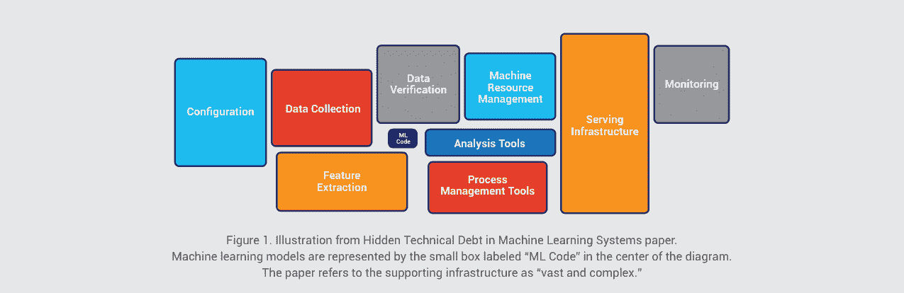
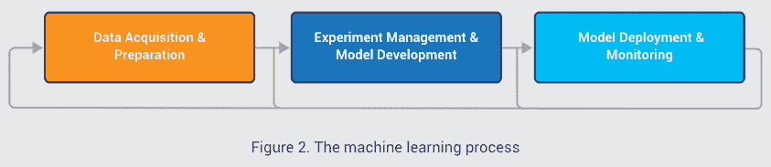
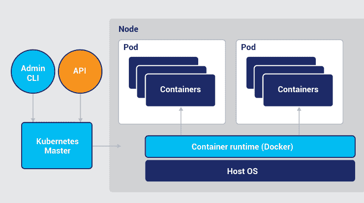
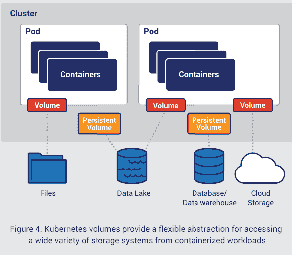
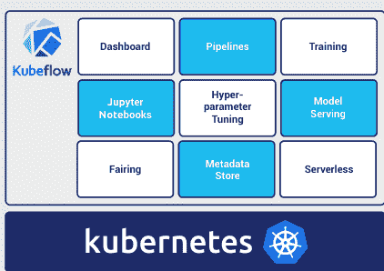
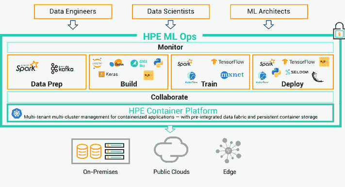
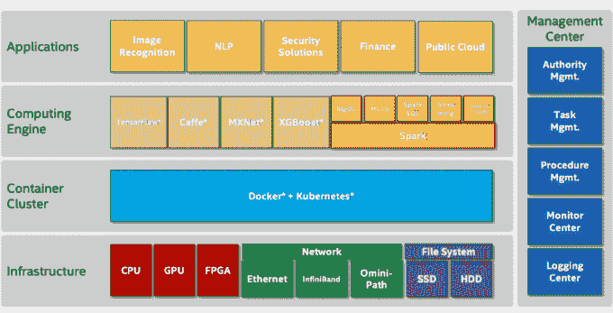

# MLOps 的 Kubernetes：企业级机器学习、深度学习和 AI 规模化

## 赞助商

本《Kubernetes for MLOps：扩展企业机器学习、深度学习和人工智能》副本由 HPE 和 Intel 提供。我们感谢他们的支持。

### 惠普企业

惠普企业是一家全球边缘到云平台即服务公司，帮助组织通过释放其所有数据的价值（无论身在何处）来加速成果。HPE 建立在数十年重塑未来、推动我们生活和工作方式创新的基础之上，提供独特、开放和智能的技术解决方案，在所有云和边缘上保持一致的体验，帮助客户开发新商业模式、以新方式互动，并提升运营性能。欲了解更多信息，请访问：www.hpe.com。

Intel 是行业领导者，创造改变世界的技术，推动全球进步并丰富人们的生活。受摩尔定律启发，我们不断努力推进半导体的设计和制造，以帮助解决客户面临的最大挑战。通过在云、网络、边缘及各种计算设备中嵌入智能，我们释放数据的潜力，以更好的方式改变商业和社会。欲了解 Intel 的创新，请访问 www.intel.com。

## 第二版前言

2018 年 12 月，我加班加点赶在 Kubecon Seattle 之前完成这本电子书的第一版。经过几周的研究、采访和撰写，我迫切希望为一个虽小但正在壮大的社区揭晓一份及时且必需的资源。

我赶在了截止日期前，但当我坐在会议的主题演讲和分会场中，聆听关于 Kubernetes 上机器学习（ML）和人工智能（AI）工作负载的众多新公告时，我的心沉了下去。虽然我知道这本电子书对读者来说是一份宝贵的资源，但我也知道它很快就需要更新。

从那时起，使用 Kubernetes 支持组织 ML/AI 项目的做法已从一个晦涩的想法，演变为许多面临将 ML 模型投入生产并进行规模化挑战的组织正在探索和追求的方向。

随着在 Kubernetes 上运行 ML/AI 工作负载的兴趣日益增长，周围的生态系统也随之扩大。在撰写第一版时，Kubeflow 尚处于起步阶段，刚刚发布了 0.3 版本。1 当时，这个由 Google 创立的项目距离生产可用还很远，且仍然相当狭隘地专注于在 Kubernetes 上运行 TensorFlow 作业。

自那以后，Kubeflow 发布了该项目的普遍可用性（GA）版本，现在致力于支持 Kubernetes 上各种端到端机器学习工作流。该项目 1.0 版本于 2020 年 3 月发布，伴随着美国银行、摩根大通商业银行和沃尔沃汽车等公司的推荐。（我很高兴在本书中包含沃尔沃之旅的首个公开案例。）

更广泛的 Kubernetes ML/AI 生态系统也呈爆发式增长，各种开源和商业产品均构建在 Kubernetes 提供的基础之上。我们将在本书中提及其中一些产品，但由于需要跟踪的服务和产品众多，且产品演进迅速，我们决定将开源和商业工具目录移至新 home：在线 TWIML AI 解决方案指南。

见证这一领域的演变是一次迷人的旅程，我很高兴为您带来这本电子书的第二版。我希望此处共享的信息能帮助您更好地了解在组织内构建、部署和规模化机器学习模型的这一有前途的方向，并最终为贵组织在机器学习和 AI 方面的创新应用做出贡献。

感谢阅读！

Sam

## 简介

企业对机器学习和人工智能的兴趣持续增长，组织正在为 ML/AI 项目投入越来越庞大的团队和资源。随着企业扩大投资，构建可重复、高效且可持续的模型开发和部署流程变得至关重要。

推动机器学习中更一致、更高效流程的趋势，与软件开发中为实现相同目标所做的努力相呼应。后者被称为 DevOps，而前者则越来越多地被称为 MLOps。

虽然 DevOps 和 MLOps 主要关注实践而非技术，但只要这些实践专注于自动化和可重复性，工具就是其兴起的重要推动因素。特别是，像 Docker 这样的容器技术的出现，极大地推动了 DevOps 的发展，使用户能够在软件开发工作中实现更高的敏捷性、效率、可管理性和可扩展性。

容器仍然是 DevOps 和 MLOps 的基础技术。容器提供了一种核心功能，允许我们在任何地方运行给定的代码——无论是笔记本、实验还是已部署的模型——而无需忍受其他软件共享方法所困扰的“依赖地狱”。但是，要扩展容器以支持大型团队、工作负载或应用程序，还需要额外的技术。这种技术称为容器编排系统，其中最流行的是 Kubernetes。

在本书中，我们将探讨 Kubernetes 在支持 MLOps 中所发挥的作用：

- 第 1 章对机器学习流程进行了高层次概述，并介绍了组织在规模化时倾向于遇到的挑战。
- 第 2 章阐述了大规模支持机器学习为何如此困难，并涵盖了数据科学家和机器学习工程师在将模型大规模投入生产时面临的许多挑战中的一些。
- 第 3 章介绍了容器技术和 Kubernetes，并展示了它们如何帮助解决前面提到的挑战。
- 在第 4 章中，我们将深入探讨 Kubernetes 的更多细节。
- 在第 5 章中，我们将回到 ML 工作流，并展示 Kubernetes 如何帮助组织克服其带来的各种挑战。
- 第 6 章和第 7 章探讨了 Kubeflow 和其他高级别工具在交付 MLOps 中的作用。
- 在第 8 章中，我们有机会坐在副驾驶座上，与早期的 Kubernetes 和 Kubeflow 用户沃尔沃汽车一同体验，从他们在这些技术之上构建 ML 平台的经验中学习。
- 第 8 章提供了有关如何启动您自己的项目的一些简要建议。

如果您刚开始接触 MLOps，请知道，现在是开始这段旅程的最佳时机。用户和从业者社区正在爆发式增长，实践和技术日趋成熟，支持和教育资源也与日俱增，质量越来越高。

## 机器学习流程

在讨论如何实现和规模化机器学习交付之前，我们必须了解机器学习流程的完整范围。尽管行业关于机器学习的许多讨论仍然集中在建模上，但现实是，建模只是该流程的一小部分。这一点在 2015 年 Google 作者的一篇论文2中得到了深刻的说明，直到今天依然成立。

图 1. 摘自《机器学习系统中的隐藏技术债务》论文的插图。机器学习模型由图表中心标记为“ML 代码”的小方框表示。该论文将支持基础设施称为“庞大且复杂。”

为了让组织从机器学习工作中获益并实现任何程度的规模和效率，模型必须在可重复的流程中开发，该流程需要考虑模型开发之前和之后的关键活动。

面临需要解决的新问题时，数据科学家将开发并运行一系列实验，以可用数据作为输入，旨在生成可接受的模型作为输出。图 2 展示了端到端 ML 工作流的高层次视图，代表了该流程中的三个主要“步骤”——数据获取和准备、实验管理与模型开发、模型部署与性能监控——以及连接它们的迭代循环。

## 数据获取与准备

构建高质量模型，数据科学家和机器学习工程师必须能够获取大量高质量的标记训练数据。此类数据极少以单一位置或数据科学家可直接使用的形式存在。相反，在绝大多数情况下，训练数据集必须由数据科学家、数据工程师、机器学习工程师和业务领域专家共同构建。

在现实世界中（与学术界或Kaggle竞赛不同），创建训练数据集通常涉及合并来自多个来源的数据。例如，构建产品推荐模型的数据科学家可能会通过连接Web活动日志、搜索历史记录、移动交互、产品目录和事务系统中的数据来构建训练数据集。

> 尽管使用标记训练数据集是监督学习（与非监督学习、自监督学习或强化学习相对）的特征，但前者仍然是当今最常用的机器学习类型。尽管本书偶尔会提及标签和其他监督学习概念，但其关键信息广泛适用。

编译完成后，训练数据必须为模型开发做好准备。为此，数据科学家会对原始数据应用一系列转换，以清洗和标准化数据。示例包括删除损坏的记录、填充缺失值，以及纠正不一致之处（例如州或国家的不同表示形式）。

转换还可能用于提取标签。例如，开发一个预测客户流失可能性的模型，需要一个标签来指示我们事务数据库中哪些客户是流失的示例。反过来，这可能需要针对数据仓库执行复杂查询，该查询考虑多种因素，例如预测所基于的产品或服务、没有交易的天数、我们希望进行预测的时间窗口等。³

由于涉及组织和技术复杂性，获取和准备企业数据的过程可能占据数据科学家在特定项目中绝大部分的精力——根据一些报告，为50%到80%。4

如果在规划过程中未加以考虑，或缺乏适当的流程和工具支持，数据获取可能会耗尽为项目分配的所有时间和资源，留给机器学习流程中剩余步骤的资源所剩无几。

## 实验管理与模型开发

实验是机器学习过程的核心。在建模过程中，数据科学家和机器学习工程师（MLE）会运行一系列实验，以确定一个强大的预测模型。通常，会训练和评估许多模型（可能是数百甚至数千个），以确定针对特定问题效果最佳的技术、架构、学习算法和参数。

特征工程是通过一系列数据转换创建训练模型所需特征和标签的迭代过程。特征工程通常与模型训练同步进行，因为识别有用特征的能力会对建模工作的整体成功产生重大影响。话虽如此，数据准备相关的初步数据清洗和标准化步骤与特征工程之间存在着一条细微的界限。

特征工程的简单示例包括生成派生特征（例如从出生日期计算年龄）或将分类变量（例如交易类型）转换为独热编码或二进制向量。

在深度学习中，特征通常非常直接，因为深度神经网络（DNN）会生成其自身的内部转换。在传统机器学习中，特征工程可能非常具有挑战性，在很大程度上依赖于数据科学家的创造力和经验，以及他们对业务领域的理解或与领域专家有效协作的能力。

此外，各种以“AutoML”为广泛旗号的工具正在广泛用于自动化实验和模型开发的各个方面。现有的解决方案可以通过创建和测试各种候选特征来自动化特征工程，识别最佳的机器学习或深度学习模型（后者称为神经架构搜索），自动调制或优化模型超参数，并自动化大型DNN的压缩，使其更适合移动或边缘部署。

无论是手动执行还是自动化，实验和模型训练的各个方面都可能非常耗费计算资源，尤其是在深度学习的情况下。为每个实验随时获得合适的基础设施（例如CPU、GPU、内存等，无论是本地还是云端），都会显著影响数据科学团队在流程模型开发阶段的速度和敏捷性。

## 模型部署

模型开发完成后，必须将其部署才能使用。尽管部署模型可以采取多种形式，但通常模型会直接嵌入到应用程序代码中，或放在某个API后面。越来越多地使用基于HTTP的API（即REST或gRPC），以便开发者可以将模型预测作为微服务来访问。

虽然模型训练可能需要在数小时、数天或数周内大量使用计算硬件，但模型推理（即对模型进行查询）随着时间的推移，其计算开销可能甚至超过训练。针对已部署模型的每次推理都需要少量但显著的计算能力。与训练的需求不同，推理的计算负担会随着推理次数的增加而增长，并且只要模型在生产环境中运行就会持续存在。

> 或者在某些深度学习模型的情况下，这并不算小。Google开始开发其张量处理单元（TPU）——一种用于推理的专用芯片——的工作始于2013年，当时工程师杰夫·迪恩预测，如果人们每天使用语音搜索3分钟，满足语音识别的推理需求将要求Google数据中心的容量翻一番。

满足大规模推理的需求是一个经典的系统工程问题。解决可扩展性、可用性、延迟和成本等问题通常是首要关注点。当需要移动或边缘部署时，处理周期、内存、尺寸、重量和功耗等额外考量也会发挥作用。

在某个阶段，我们往往最终需要转向分布式系统来实现可扩展性或性能目标。这当然会带来其自身的一系列挑战和运营考量。我们如何将模型部署到多台机器并随时间确保一致性？我们如何在不使应用程序停机的情况下更新到新模型？升级过程中如果出现问题会怎样？我们如何在实时流量上测试新模型？

幸运的是，对于部署模型的人来说，在解决微服务和其他软件系统的这些问题方面已经取得了很大进展。

## 模型监控

模型投入生产后，监控其持续性能非常重要。机器学习模型是易腐的，这意味着模型在生产中看到的数据的统计分布必然会开始偏离训练期间看到的分布。这将导致模型性能下降，如果不加以检测和解决，可能会导致负面的业务结果，例如销售损失或未检测到的欺诈活动。

生产模型应当进行仪器化，以便记录每次推理的输入和结果，从而允许审查使用情况并持续监控性能。性能出现下降的模型所有者可以使用这些信息采取纠正措施，例如重新训练或重新调整模型。

业务或监管要求可能会施加额外要求，规定模型监控的形式或功能以用于审计或合规目的，在某些情况下还包括解释模型决策的能力。

模型监控通常是组织中所有生产模型共同关注的问题，因此理想情况下应由通用框架或平台提供支持。这有助于使监控对数据科学家来说是“免费”的，也就是说，他们可以从中受益，但无需担心构建它。虽然某些模型或应用程序可能具有独特的监控或报告要求，需要数据科学家或ML工程师参与，但他们理想情况下应该能够利用已就位的底层“管道”。

## 大规模机器学习

当企业刚开始使用机器学习时，其已建立的ML实践或流程很少。在此期间，其数据科学家通常以临时的方式工作，以满足项目的即时需求。数据获取和准备，以及模型训练、部署和评估，都是手工制作的，步骤之间几乎没有自动化或集成。

当一个团队以这种方式运行多个项目后，就会清楚地发现，大量精力被花费在重复性任务上，甚至更糟，是在重复造轮子。例如，他们可能会发现自己反复复制相同的数据、执行相同的数据转换、构建相同的特征，或遵循相同的部署步骤。

如果不加干预，单个数据科学家或MLE会构建脚本或工具来帮助自动化ML流程中一些更枯燥的方面。这可以作为一种有效的权宜之计，但如果缺乏计划和协调，这些努力可能会成为分散注意力的来源并导致技术债务。

对于达到一定规模的组织——通常是在需要同时支持多个机器学习团队及其项目时——会建立“数据科学平台”或“ML基础设施”团队，以推动效率，并确保数据科学家和MLE能够获得工作所需的工具和资源。

以 Airbnb 为例，在将机器学习应用于搜索排名、智能定价和欺诈预防等场景积累经验后，该公司意识到，为实现业务目标，需要大幅增加投入生产的模型数量。为此，公司成立了机器学习基础设施团队。该团队的使命是消除其所谓的机器学习“偶发复杂性”——即获取数据、搭建服务器以及扩展模型训练和推理——而非其“内在复杂性”，例如识别合适的模型、选择合适的特征，以及调优模型性能以实现业务目标。

机器学习基础设施团队常遇到的挑战包括：

## 简化与自动化数据访问与管理

由于模型构建大量涉及数据获取和处理，提供一种简化并自动化数据获取、数据转换、特征工程及 ETL 流水线的方法，对于提升建模效率和确保可重复性至关重要。

当集中式数据仓库或目录可用时（例如数据湖、数据网格、数据仓库或数据目录），数据获取将变得非常便捷。这些系统支持高效的数据存储、管理和发现，使来自各种异构系统的数据更易于处理，从而最大限度地减少数据科学家在查找数据或尝试了解如何访问新系统上所花费的时间。

数据和特征转换会创建训练和推理所需的新数据。这些转换产生的数据通常不会保存回源系统，例如事务数据库或日志存储。相反，它们会被持久化回上述设施。理想情况下，转换和特征工程流水线会被编目，以便在项目和团队之间轻松共享。

除所提供的效率优势外，特征数据仓库还可以通过以满足广泛机器学习训练和推理工作负载的延迟和吞吐量要求的方式来构建，帮助消除耗时且浪费的数据复制。由于特征数据仓库具有可扩展性、安全性和其他技术要求，机器学习基础设施团队通常会与数据工程师和企业 IT 部门合作来建立它们。

## 推动资源高效利用

如今，我们可利用的原始计算能力比以往任何时候都多。此外，高密度 CPU 核心、GPU、TPU、FPGA 和其他硬件加速器等创新越来越多地针对机器学习和深度学习工作负载，承诺为这些应用持续扩展计算资源。尽管计算成本在下降，但机器学习过程具有突发性且资源密集，因此高效利用可用计算能力对于支持大规模机器学习至关重要。以下是高效向机器学习团队交付计算资源的关键要求：

- **多租户。** 为每个机器学习团队或工作负载建立专用硬件环境效率低下。相反，重点应放在创建共享环境上，以支持多个并发项目的训练和部署需求。

- **弹性。** 数据准备、模型训练和模型推理都是高度可变的工作负载，其所需资源的数量和类型随时间变化往往很大。要高效满足一组机器学习工作负载的需求，最好是专门用于单个任务的资源在需要时可以扩容，在完成后可以缩容。

- **即时性。** 数据科学家和机器学习工程师应能直接、自助式地获取训练和测试模型所需的数量和类型的计算资源，无需等待手动配置。

- **可编程性。** 新环境和工作负载的创建、配置、部署和扩展应通过 API 提供，以实现基础设施的自动化配置并最大化资源利用率。

当然，这些都是现代云原生环境的特征。然而，这并不意味着我们必须使用第三方“公共”云服务来进行大规模机器学习。

尽管公共云的运行特性使其成为运行某些机器学习工作负载的强劲选择，但通常还有其他需要考虑的因素。性能要求通常要求将训练和推理工作负载与生产应用及数据同位置部署，以最大限度地降低延迟。

经济性也是一个重要考量。在云端租赁计算基础设施的成本可能很高，入站和出站数据传输的成本也是如此，这导致许多组织选择本地服务器。

由于云资源和本地资源各有其适用场景，整合两者资源的混合云部署对许多组织来说是值得考虑的选择。混合云部署允许组织在云端和本地资源之间分配工作负载，从而快速且具成本效益地满足波动的工作负载需求，并在需要时提供更强的计算能力。

归根结底，在硬件创新迅速、基础设施经济动态变化且工作负载不断转移的世界里，将灵活性构建到新工具和平台中是明智之举，这样它们才能在任何这些环境中高效运行。

## 隐藏复杂性

随着平台即服务（PaaS）产品和 DevOps 自动化工具的兴起，软件开发人员获得了在更高抽象级别上运营的能力，使他们能够专注于正在构建的应用程序，而无需担心其软件运行的底层基础设施。

同样，为了让机器学习过程充分发挥规模和效率优势，数据科学家和机器学习工程师必须能够专注于其模型和数据产品，而非基础设施。

这一点尤为重要，因为数据产品建立在一套快速演进的复杂技术栈之上。这些技术包括更成熟的工具，如 TensorFlow 和 PyTorch 深度学习框架；特定语言的库，如 SciPy、NumPy 和 Pandas；以及数据处理引擎，如 Spark 和 MapReduce。此外，针对机器学习过程中特定痛点的专业工具数量激增，其中许多工具我们在配套书籍 _机器学习平台权威指南_ 中进行了讨论，并在我们的在线 **机器学习/AI 解决方案指南** 中有所涵盖。

这些高级工具由各种供应商提供的低级驱动程序和库支持，使训练和推理工作负载能够利用硬件加速功能。其中一些驱动程序栈臭名昭著地难以正确安装和配置，需要满足复杂的相互依赖关系。

手动管理快速更迭的软件工具及其随之而来的依赖网络，会持续耗尽数据科学家的生产力，并成为训练与生产环境结果之间难以调试的差异的根源。

## 统一机器学习工作流

归根结底，随着组织对数据科学和机器学习应用的成熟，业务和技术利益相关者都将从统一的机器学习工作流中受益，该工作流提供了一个通用框架，用于处理组织的数据、实验、模型和工具。

通用平台的优势贯穿整个机器学习工作流。正如我们之前讨论的，统一的数据视图有助于数据科学家更快地找到构建模型所需的数据。统一的实验视图有助于单个用户和团队更快识别哪些方法有效，并帮助管理者了解资源分配情况。统一的已部署模型视图有助于运维和 DevOps 团队监控大量服务的性能。而统一的基础设施视图则帮助数据科学家更轻松地获取训练所需的资源。

采用统一的机器学习工作流方法，跨团队协作的促进和管理变得更加容易，现有资源的复用得以推进，还能充分利用共享技能。它还能使团队成员在转换到新项目时更快上手提高生产力，从而推动数据科学和机器学习/AI 项目效率提升和整体成果更好。

## 进入容器和 Kubernetes

组织越来越多地转向容器和 Kubernetes，以克服扩展其机器学习和深度学习工作所面临的挑战。

结果发现，我们以前见过这种情况。2013 年 Docker 容器的引入启动了软件应用程序开发和部署方式的巨大转变，这使工程团队能够克服与数据科学家和机器学习工程师所面临的挑战类似的一系列挑战。

容器镜像提供一个标准化的可执行包，其中包含运行应用程序所需的一切，包括其代码、依赖项、工具、库和配置文件。运行中的 Docker 容器是容器镜像的一个实例。

与虚拟机相比，容器镜像更轻量、在环境之间更易于移动、启动速度更快。这在很大程度上是因为它们可以共享主机操作系统（OS）的内核，而不是包含一套完整操作系统的副本。

轻量级容器可以在不同的计算环境中可靠运行，这一事实帮助解决了软件开发和运维组织在现代化其软件交付流程、应用程序和基础设施时所面临的许多困难，从而促成了它们的最终普及。

但仅靠容器只能提供部分解决方案。对于大规模运营且需要支持多个并行的机器学习项目（项目处于不同的开发阶段）的组织来说，迅速就有必要使用多个容器、使它们提供的服务易于访问，并将它们连接到各种外部数据源。在这种情况下，需要一个容器编排平台——在实践中（如果不在理论上也是如此）——以高效管理容器及其彼此之间和与外部世界的交互。

Kubernetes 应运而生。Kubernetes 是 Google 在 2014 年开发并开源的容器编排平台。自那时起，Kubernetes 由于其在用户中的流行度、赋予用户的灵活性、获得的云计算和软件供应商的支持，以及在本地和公共云环境之间提供的可移植性程度，已成为容器编排的事实上的标准。

Kubernetes 提供了容器化应用程序和服务完整生命周期管理所需的功能，其方式已被证明具有高度的可扩展性和可靠性。

在探讨这对机器学习工作负载意味着什么之前，让我们先了解一下 Kubernetes 本身。

## 了解 Kubernetes

Kubernetes 采用分层方法来管理其负责的各种资源，每一层都隐藏了其下方的复杂性。

Kubernetes 中的最高级概念是 **集群**。Kubernetes 集群由至少一个 Kubernetes **主节点**组成，该主节点控制多个称为节点的工作机器。集群抽象了其底层计算资源，允许用户将工作负载部署到集群，而不是特定的 **节点**。

**Pod** 是一个或多个共享通用配置并在同一台机器上运行的容器集合。它是 Kubernetes 中的基本工作负载单元。Pod 内的所有容器共享相同的上下文、资源和生命周期。资源包括本地和远程存储卷以及网络。Pod 中的所有容器共享 IP 地址和端口空间。要在 Pod 中运行容器，Kubernetes 使用在每个节点上运行的容器运行时，例如 Docker。

图 3. Kubernetes 基本架构

主节点可以被视为集群的“大脑”。它响应通过 Kubernetes 客户端或 API 提交的集群配置和管理请求。它负责根据各自的要求和能力确定将哪些 Pod 部署到哪些节点，这一过程称为 **调度**。主节点通过响应服务器故障等故障重新调度 Pod 来维护集群的整体健康状况。

Kubernetes 集群中的节点运行一个名为 **kubelet** 的代理，它监听来自主节点的指令并相应地创建、运行和销毁容器。主节点和 kubelet 进程共同管理集群的运行，被称为 Kubernetes 控制平面。

要在 Kubernetes 集群上运行工作负载，用户提供一个定义要创建哪些 Pod 以及如何管理它们的计划。该计划可以通过配置文档指定，这些文档通过 Kubernetes 的 API 或客户端库发送到集群。在这方面，Kubernetes 被称为一种“声明式”系统；用户声明他们想要的系统状态，Kubernetes 则在可用资源的范围内尝试实现该状态。

要在 Kubernetes 集群上运行工作负载，用户提供一个定义要创建哪些 Pod 以及如何管理它们的计划。该计划可以通过配置文档指定，这些文档通过 Kubernetes 的 API 或客户端库发送到集群。在这方面，Kubernetes 被称为一种“声明式”系统；用户声明他们想要的系统状态，Kubernetes 则在可用资源的范围内尝试实现该状态。

当主节点收到新计划时，它会检查其要求并将其与系统的当前状态进行比较。然后主节点采取所需操作，使观察到的状态与期望的状态一致。当 Pod 被调度到节点时，节点会从镜像仓库拉取适当的容器镜像，并与本地容器运行时协调以启动容器。

在容器中创建的文件是短暂的，这意味着它们不会在容器生命周期之外持续存在。在构建现实世界的应用程序（尤其是机器学习系统）时，这会带来关键问题。

首先，大多数应用程序在某种程度上都是有状态的。这意味着它们会存储有关所接收请求和处理这些请求时所执行工作的数据。一个示例可能是长时间运行的训练作业，它会存储中间检查点，以便在发生故障时作业不需要从头开始。如果这些中间数据存储在容器中，则在容器失败或需要移动到另一台机器时，这些数据将不可用。

其次，许多应用程序必须访问和处理现有数据。在构建机器学习模型时当然也是如此，这需要训练数据在训练期间可访问。如果数据访问的唯一选择是容器中创建的文件，我们需要将数据复制到每个需要它的容器中，这不太实际。

为解决这些问题，Docker 等容器运行时提供将持久存储附加到其管理的容器的机制。但是，这些机制与单个容器的范围相关联，功能有限且缺乏灵活性。

Kubernetes 支持几种旨在解决基于容器的存储机制不足的抽象。**卷**允许 Pod 内的所有容器共享数据，并在 Pod 终止前保持可用。

**持久卷** 是在集群级别（而非 Pod 级别）上管理生命周期的卷。持久卷为集群管理员提供了一种集中配置和维护到外部数据源连接的方式，并提供了一种授予 Pod 访问权限的机制。

图 4. Kubernetes 卷为从容器化工作负载访问各种存储系统提供了一种灵活的抽象

Kubernetes 长期以来一直支持第一方和第三方卷插件，允许用户访问不同类型的存储资源。更近期的是，对容器存储接口（CSI）规范支持的普遍可用性，显著扩展了通过社区和供应商提供的驱动程序访问各种软件和硬件基础存储系统的能力。

除了 CSI 之外，Kubernetes 还提供其他功能，允许用户自定义其部署并支持复杂的应用程序场景，包括：

- 自定义资源，用于扩展 Kubernetes API 以管理新类型的对象
- 操作器，结合自定义资源和控制器来管理有状态的应用程序和系统
- 调度器扩展，可用于更改 Kubernetes 管理 Pod 并将其分配给节点的方式
- 容器网络接口（CNI），在容器和网络层之间提供一个通用接口
- 设备插件，允许 Kubernetes 节点发现新类型的硬件资源并执行特定于供应商的初始化和设置。一旦这些资源可被发现，Kubernetes 调度器在做出 Pod 放置决策时就可以考虑这些资源的可用性。

> "深度学习是一门经验科学，团队基础设施的质量对进度具有放大作用。幸运的是，当今的开源生态系统使任何人都能构建出色的深度学习基础设施。"
> OpenAI

## Kubernetes for Machine and Deep Learning

While the challenges faced by developers building traditional software are similar to those faced by data scientists and ML engineers, they aren't the same. In many ways, those faced by the latter are greater, significantly exacerbated by the highly iterative nature of the machine learning workflow.

Still, the capabilities provided by containers and Kubernetes can help organizations address the challenges presented by the machine learning process.

| Simplifying Data Management | Driving Efficient Resource Use | Hiding Complexity |
| :--- | :--- | :--- |
| Kubernetes provides connectors for diverse data sources and manages volume lifecycle. Data workflow & pipeline abstractions (3rd party) allow complex data transformations to be executed across cluster. Data fabrics (3rd party) extend scalable, multi-format storage to cluster | Kubernetes provides elasticity, allowing cluster and workloads to be easily scaled up/down. Multitenancy allows multiple teams to share cluster. Users can deploy workloads on-demand via CLI, API without IT intervention. Users and tools can programmatically deploy and control workloads | Containers provide a convenient format for packaging workloads and declaring dependencies. Kubernetes abstracts infrastructure, allowing users to think of cluster as unit of compute |

Figure 5. Containers and Kubernetes address major ML/DL challenges

## Data acquisition and preparation

By providing a mechanism for connecting storage to containerized workloads, the Kubernetes CSI enables support for a wide variety of stateful applications, including machine and deep learning. CSI drivers provide direct access to many different file, object, and block storage systems, as well as data fabric products which provide unified access to data stored in a variety of enterprise systems.

Ready access to scalable storage is the foundation upon which users can construct automated and repeatable data processing pipelines. This ensures the ability to reliably deliver properly transformed data to models, without manual intervention, and also facilitates the reuse of transformed data and processed features across projects.

## Driving efficient resource use

For resource-intensive workloads like machine learning, users face the constant conundrum of over-allocation or under-utilization. That is, they must manage the fine balance between either having more resources than is needed at any particular point in time, or not enough.

Kubernetes offers two solutions to this problem. The first is multi-tenancy. A single physical Kubernetes cluster can be partitioned into multiple virtual clusters using Kubernetes' **namespaces** feature. This allows a single cluster to easily support multiple teams, projects, or functions.

Each namespace can be configured with its own resource quotas and access control policies, making it possible to specify the actions a user can perform and the resources they have access to. Namespace-level configuration allows resources like storage to be configured on a per-team, -project, or -function basis.

Multi-tenancy features allow many users to share the same physical resources, with the aggregate usage having less variance and requiring less over-provisioning. Another solution Kubernetes offers to the resource efficiency problem is auto-scaling, of which there are two types.

Workload (or pod) autoscaling which is the ability to scale up the number of pods running a given workload as needed. This works with multi-tenancy to take full advantage of the resources available in a given Kubernetes cluster

Cluster autoscaling is the ability to scale up or down the number of nodes in the entire cluster without disrupting the cluster or any of its applications or users. This is helpful, but of limited utility, when you're running the cluster on physical nodes in your own datacenter. When you're running Kubernetes on virtual servers in the cloud, though, this allows you to continually right-size your cluster so you're only paying for the resources you need at any given time.

Because Kubernetes-enabled workloads can be run on any Kubernetes cluster in any location without any changes to the application's code, users can move applications between deployment environments with relative ease. In theory a single Kubernetes cluster can span clouds and/or on-premises data centers, but this is difficult to implement and not recommended.

## Hiding complexity

Containers provide an efficient way of packaging machine learning workloads that is independent of language or framework. Kubernetes builds on this to provide a reliable abstraction layer for managing containerized workloads and provides the necessary configuration options, APIs, and tools to manipulate these workloads declaratively.

While working with containers and containerized workloads may be a new skill for many data scientists, these tools will be familiar to machine learning engineers exposed to modern software development practices.

Custom and third-party user interfaces, command-line tools, or integration with source code repositories can simplify creating and managing containers for end users. Because Kubernetes is workload independent, once users are familiar with the tools required to work with their Kubernetes environment, they can apply these tools across a wide range of projects.

While introducing its own set of tools, the use of containers to facilitate data acquisition, experiment management and model deployment ensures that the correct and consistent dependencies are in place wherever jobs are run—whether on the developer laptop, training environment, or production cluster. This provides the valuable benefit of shielding those workloads from the complexity of the underlying technology stack, while supporting a wide variety of runtime configurations.

Kubernetes also helps support and enforce a separation of concerns, giving end-users control over defining their workloads and administrators control over the properties and configuration of the infrastructure.

## Unifying the ML workflow

For all its benefits, Kubernetes alone won't unify the end-to-end machine learning process. It will go a long way, however, in doing so for much of the software and hardware infrastructure that supports machine learning, and, in achieving that, it provides a strong platform for tools that go even further.

## MLOps on Kubernetes with Kubeflow

Kubeflow is an open source project designed to make machine learning workflows on Kubernetes simple, portable and scalable. Kubeflow is sponsored by Google and inspired by TensorFlow Extended, or TFX, the company's internal machine learning platform.

Originally intended to simply allow TensorFlow users to run training jobs on their Kubernetes clusters, the project now integrates a broad set of tools in support of many steps in an end-to-end machine learning process.

Kubeflow includes components for:

- **Launching Jupyter Notebooks.** Kubeflow includes support for setting up Jupyter notebook servers and creating and managing notebooks. Notebooks launched via Kubeflow are integrated with the authentication and access control policies an organization has established with its Kubernetes deployment, are easier to share across the organization, can help organizations standardize notebook images, and can readily take advantage of the compute capacity and other features available in the Kubernetes environment.

- **Building ML Pipelines.** Kubeflow Pipelines is a platform for building and deploying complex, repeatable ML workflows on Kubernetes. Pipelines themselves consist of a graph detailing the relationships between steps in a workflow. The workflow steps themselves are called components, and are provided by the user as Docker containers. Pipelines allow users to package up the various data access and transformation, model training, and model evaluation steps that make up an experiment, simplifying experimentation and re-use.

- **Training Models.** Kubeflow provides a variety of Kubernetes Operators allowing users to easily create and manage training jobs for ML frameworks like TensorFlow, PyTorch, MXNet, XGBoost. In addition to the distributed training support provided by these frameworks, it also supports MPI-based distributed training through the MPI Operator.

- **Tracking Experiment Metadata.** The Kubeflow Metadata project provides a Python SDK for tracking and managing information about the executions (runs), models, datasets, and other artifacts generated during machine learning. It also provides a UI for viewing a list of logged artifacts and their details.

- **Hyperparameter Tuning.** Tuning model hyperparameters is an important element of optimizing model performance and accuracy, yet manually adjusting hyperparameters during experimentation is tedious. Kubeflow includes Katib, an open-source hyperparameter tuning project inspired by Google’s internal black-box optimization service, Vizier. Katib is framework agnostic and deploys optimization tasks as Kubernetes pods.

- **Serving Models.** Users may choose from two model serving systems within Kubeflow—KFServing and Seldon Core—as well as any of several standalone model serving systems. These options support a wide variety of ML frameworks, and offer features supporting various strategies for model rollout, scaling, logging, and analytics.

Figure 6. Kubeflow builds on top of Kubernetes to address key challenges in the ML workflow

此外，Kubeflow 提供了一个中央仪表板，用户可通过该仪表板访问和管理 Kubeflow 部署的各种组件，支持多租户和多用户隔离；并且通过 Kubeflow Fairing，能够更轻松地直接从 Jupyter Notebook 在混合云环境中构建、训练和部署训练作业。

Kubeflow 向用户暴露了命名空间和 Pod 等 Kubernetes 概念，并要求他们使用命令行工具来执行配置和提交作业等任务。因此，它更偏向于具有工程技能的用户，而非传统的数据科学家。不过，所需的作业配置文件并非完全陌生，其配置参数与他们可能熟悉的其他分布式工具（如 Apache Spark）的参数相似。

此外，该项目在此方面正在取得进展，仪表板和流水线可视化代表了实质性进展。一些用户选择为其数据科学家构建自定义用户界面，旨在进一步抽象底层的 Kubeflow 和 Kubernetes 工具。

使用 Kubeflow 可以节省整合常见 ML 和 DL 组件支持的时间。过去，Kubeflow 的集成感觉相当浅层，项目有点像第三方开源产品的拼凑。值得称赞的是，该项目现在是一个经过更精心策划且更统一的产品。

也就是说，Kubeflow 的核心仍然是一个组件集合。尽管 Kubeflow 核心已达到 GA（正式发布）状态，但整体项目仍不够成熟，上述许多组件仍处于 beta 版。这种状况对一些组织来说可能存在问题，这些组织更看重更成熟、更紧密集成产品的稳定性和可预测性。此外，一些企业 IT 组织可能会发现，Kubeflow 缺乏涵盖工作负载、数据和基础设施的充足安全和治理框架，尽管在此方面正在取得进展。

说到治理，尽管是另一种类型，某些圈子对 Kubeflow 缺乏独立治理表示担忧。虽然 Kubernetes 项目由 CNCF 监督，后者提供了一定程度的透明度和社区驱动的治理，但 Kubeflow 仍由 Google 控制。这对该项目的未来方向造成了一些不确定性，尽管该项目确实拥有广泛的贡献者和拥护者基础。

## Kubernetes MLOps 生态系统

Kubeflow 是利用 Kubernetes 提供 MLOps 能力的众多可用产品之一。这些产品的范围从旨在解决数据科学家特定痛点的窄范围工具，到寻求为 ML 工作流提供全面支持的端到端平台。许可和交付模式也各不相同，包括开源项目、商业支持的软件产品和基于云的服务。

> 在可用于帮助您构建组织机器学习平台的各种工具中，最重要的区别之一是该工具是旨在广泛还是深入。这种区别及其随之而来的有趣悖论，在 TWIML 的《机器学习平台权威指南》中有详细探讨。

ML/AI 工具、基础设施和平台的格局仍在快速演变。出于此原因，我们开发了 TWIML ML/AI 解决方案指南，这是一个可在 twimlai.com/solutions 上访问的在线资源。

访问解决方案指南，了解支持 Kubernetes 和 Kubeflow 的 ML/AI 工具和平台概况，并经常回访以查看更新，因为我们将扩展其覆盖范围和功能。

## 利用 Kubernetes 推动数据科学创新：沃尔沃汽车的历程

总部位于瑞典的沃尔沃汽车是一家豪华汽车制造商，其品牌长期以来与安全和创新联系在一起。该公司的消费者数字集团负责多种旨在提升车主体验的产品，包括沃尔沃 On Call 应用程序，该应用提供道路救援、远程气候控制以及远程锁定和解锁车主汽车等功能。

消费者数字集团的数据科学家使用机器学习来既交付最终用户功能（如搜索和推荐），又更好地了解其产品的使用情况。

该集团的数据科学家于 2018 年开始使用 Kubernetes 来支持其工作负载，当时他们需要一种方法来自动化数据获取、转换和报告流水线，以支持与亚马逊的一项高调合作，让沃尔沃车主可以接收后备箱配送。团队希望使用 Jupyter Notebooks 构建这些流水线，但在公司内未找到现成工具能让他们轻松实现此目标。

受 Netflix⁶ 工作的启发，该公司数据科学平台的高级数据科学家兼技术负责人 Leonard Aukea 着手为其团队构建以笔记本为中心的数据科学工作流。

虽然 Netflix 的系统基于容器，但使用的是该公司自研的容器编排系统。然而，在沃尔沃，Kubernetes 已经开始获得认可以支持容器化工作负载。在 DevOps 同事的帮助和大量研究下，Leonard 能够为数据科学工作负载启动并运行一个 Kubernetes 集群。

团队的第一步是在 Kubernetes 上设置 Apache Airflow 工作流管理系统，并将其与 Netflix Papermill 工具配合使用，以运行笔记本作为流水线的步骤。流水线输出被馈送到 Nteract（另一个 Netflix 工具），提供了一个基于笔记本的便捷仪表板。

自动化流水线对 Leonard 的团队来说是一大胜利，其他团队很快也联系他们寻求自身工作负载的帮助。正是这时，该团队最初方法的局限性变得显而易见。

一个挑战是系统的各个元素没有紧密集成。用户需要访问几个不同的内部网站才能完成任何任务。

"在这里，你可视化笔记本；在这里，你在此 GitHub 仓库中指定 DAG；在这里，你进入 Airflow UI；然后在这里，你进入 JupyterHub。这变得一团糟。很难解释……而且它没有以我们想要的方式扩展。"

在获得批准部署更适合企业的解决方案后，Leonard 最终找到了 Kubeflow 项目。

沃尔沃团队欣赏 Kubeflow 是 Kubernetes 原生的，因此一切都在统一的用户界面和一组 API 下协同工作。

Kubeflow "将所有这些服务粘合在一起，并提供一个统一界面，用户可以进入平台以更轻松的方式完成工作。"

"有些事情运行得相当不错……就设置、从一个版本移动到另一个版本，以及[the] 服务的可靠性而言。"

然而，这并不意味着一切都完美。

该团队发现 Kubeflow "难以配置，因为您需要配置所有这些单独服务，深入研究您实际部署的清单，并[使用 kfctl 工具部署它们]。我不能说百分之百喜欢它……您必须投入大量[精力]才能使其工作。"

该工具的集成特性在支持方面让 Leonard 和他的团队承担了更多责任。

他们常常发现自己需要"深入研究各个单独应用程序并查看源代码，例如，在文档不集中的情况下。[...] 从这个意义上说，这也不符合人们对服务的传统期望。"

截至撰写本文时，Leonard 的数据科学平台团队正在以 beta 版运行 Kubeflow，几个团队已加入。采用过程相对顺利，尽管团队承认存在陡峭的学习曲线。使用 Docker 容器和 Kubeflow 工具对他们支持的 Python 数据科学家来说比对公司的 R 语言数据科学家更自然。

最终，该团队在 Kubeflow 中看到了一种方法，可以帮助公司的数据科学家更快速地行动并更加自给自足。他们希望部署模型的数据科学团队对其在整个生命周期内负责，但也能够获得成功所需的工具、培训和最佳实践。

平台团队目前正在收集统计数据，以比较新平台上的用户生产力与以往结果。

"我没有实际数字，但根据我从其他团队以及[我自己的使用]中听到的，一旦上手，它就有效得多。"

"我希望我们能有更多模型投入生产，否则这些模型可能会被浪费，或在组织中停滞一段时间，因为[某个团队]没有可用的工具或支持来将其模型投入生产。这对沃尔沃汽车公司来说可能非常有价值。"

## 开始使用

满足机器学习和深度学习开发的基础设施需求，对于希望将 AI 的使用从一次性 ML 项目扩展到企业更广泛范围的组织来说，是一项重大挑战。

幸运的是，踏上这条道路的企业无需从头开始。容器技术与 Kubernetes 的结合解决了寻求将机器学习使用工业化的组织面临的许多关键基础设施挑战。它们共同提供了一种方式，用于交付可扩展的数据管理和自动化、高效利用资源，以及在数据科学家和 MLE 的关注点与其所依赖基础设施提供者的需求之间进行有效的抽象。

除了开箱即用地提供强大机器学习基础设施平台所需的许多功能外，开源 Kubernetes 项目——凭借其广泛采用、活跃社区、丰富的第三方工具生态系统和多种商业支持选项——也满足了投资于面向未来增长平台的高管和业务决策者的最重要要求。

现在是开始学习 Kubernetes 和 MLOps 的绝佳时机。专注于 ML/AI 的 Kubernetes 用户社区规模庞大、不断增长且友好；该平台和工具可用于生产工作负载并快速成熟；而且拥有所需技术栈经验的人才池也在不断扩大。（同样，反之亦然，你在帮助组织扩展其 MLOps 平台时学到的技能具有可迁移性，并在市场上受到重视。）

尽管功能强大，但 Kubernetes 带来的一定复杂性对于小型数据科学团队来说可能具有挑战性。它最适合那些规模、资源和需求足以证明投资合理性的组织，不仅要投资构建用于数据科学的集中式平台，还要投资组建专门的支持团队。

如今，采用 Kubernetes 进行机器学习和 AI 的组织可以从众多选项中受益，以帮助缓解其复杂性。MLOps 堆栈的每一层——从服务器、网络和存储等物理基础设施；到 Kubernetes 控制平面；再到提供流水线和实验等抽象的 MLOps 软件——都可以使用现成组件在本地实现，也可以从各供应商处获取为完全托管的服务。

与任何新技术一样，最佳行动方案是研究并了解你的需求和选项，然后从小处着手，立足当前需求，同时着眼未来。你对 Kubernetes 的探索可以从在笔记本电脑或云端少量机器上运行的“集群”开始，让你亲身体验和领会它为机器学习工作负载带来的价值。从那里开始，你可以根据自己的经验、需求和资源进行扩展。

一路顺风。

## HPE ML Ops 与 Intel：携手交付企业级大规模机器学习

惠普企业（Hewlett Packard Enterprise）帮助大型企业克服在整个组织中部署和运营 AI/ML 所面临的障碍。HPE ML Ops 为 ML 生命周期带来了类似 DevOps 的速度和敏捷性。HPE ML Ops 解决方案支持 ML 生命周期的每个阶段——数据准备、模型构建、模型训练、模型部署、协作和监控。HPE ML Ops 是一个端到端的数据科学解决方案，具有在本地、多个公有云或混合模式下运行的灵活性，使客户能够针对各种用例响应动态业务需求。

### HPE ML Ops 提供：

| 模型构建 | 预打包的自助式沙箱环境 |
| :--- | :--- |
| 模型训练 | 可安全访问大数据的可扩展训练环境 |
| 模型部署 | 灵活、可扩展的端点部署 |
| 模型监控 | 端到端可见性，用于跟踪、衡量和报告 ML 管道中的模型性能 |
| 协作 | 使用代码、模型和项目仓库启用 CI/CD 工作流 |
| 安全与控制 | 与企业身份验证机制集成的安全多租户 |
| 混合部署 | 在本地、公有云或混合模式下部署 |

在 hpe.com/info/MLOps 上了解更多信息。

HPE 解决方案利用最新的 Intel® 技术，在已知且可信赖的基础设施上交付扩展企业机器学习工作负载所需的性能。

### Intel 创新包括：

- 经验证的世界一流第二代 Intel® Xeon® 可扩展处理器为各种分析和其他企业应用提供可扩展性能。该处理器配备 Intel® Optane™ 持久内存 (PMem)，这种强大的组合在靠近 CPU 的位置提供了更大的内存容量，以支持内存中工作负载，同时还具有原生持久性，可实现更高的弹性和生产力。
- Intel® Deep Learning Boost 为高级分析和 AI 工作负载带来了全新的嵌入式性能加速，与上一代相比，推理工作负载的性能最高可提升 30 倍，为未来分析和 AI 能力的演进奠定了基础。
- 在为 Kubernetes 和 Kubeflow 做贡献方面有着良好记录，包括支持 AVX 指令集特性发现、增强 Kubernetes 调度框架、贡献 CRI 资源管理器，以及开发 Kubernetes Topology Manager（可增强对高性能非统一内存访问 (NUMA) 节点的支持）。

JD 提供了一个示例，展示了当 Intel 创新大规模交付时可以实现什么。JD.com 是中国最大的零售商，其超大规模运营由其自身内部需求以及云计算和 AI 客户的需求驱动。该公司利用机器学习和 AI 支持多种零售用例，包括广告、仓库自动化和机器人、无人机配送、基于面部识别的支付以及个性化营销。

2016 年，JD.com 开始开发 JDOS，这是其定制和优化的 Kubernetes 版本，如今支持各种工作负载和应用程序。该公司运行着全球最大的生产 Kubernetes 集群，拥有超过 20,000 个节点。

Intel 与 JD 紧密合作，优化其大数据和机器学习框架及工具包，例如 Kubernetes 上的 Apache Spark、TensorFlow 等，这些框架和工具包通过单一的基于 Kubernetes 的架构向用户暴露，JD 称该架构为 Moonshot。

### MOONSHOT 架构

Intel 与 JD 合作，定制了下一代 Intel Xeon 可扩展处理器的版本，以支持 JD 独特的 JD Cloud 和电子商务工作负载。除了 CPU 之外，JD 还采用了其他 Intel 创新，例如 Intel Optane DC SSD，并计划采用即将推出的 Intel Optane DC Persistent Memory——这是一种新型存储技术，提供高容量、高性价比和持久性的前所未有的组合。

这些定制在分析和 AI 工作负载上提供了显著的性能提升，从而帮助 JD 区分其云服务产品、个性化网上购物体验并提高供应链效率。

## 关于 TWIML

机器学习和人工智能正在戏剧性地改变企业运营和人们生活的方式。通过我们的出版物、播客和社区，TWIML 将 ML 和 AI 领域的领先思想和人才带给广大且有影响力的数据科学家、工程师以及精通技术的商业和 IT 领导者社区。

TWIML 源于我们在 2016 年推出的播客 This Week in Machine Learning & AI，起初反响虽小但热情高涨。时光来到 2020 年，TWIML AI 播客如今已成为该领域的领先声音，拥有超过八百万次下载量和庞大且活跃的社区追随者。我们的产品如今包括像本报告这样的研究报告，以及 **线上聚会和学习小组**、**会议**和各种 **教育内容**。

TWIML AI 播客始终是我们使命的核心。通过分享和放大广泛而多样的机器学习和 AI 研究人员、实践者和创新者的声音，我们的项目有助于使 ML 和 AI 更加易于使用，并改善我们的受众及其社区的生活。

TWIML 由 Sam Charrington 创立，他是备受追捧的行业分析师、演讲者、评论员和思想领袖。Sam 的研究侧重于机器学习和 AI 的商业应用，将基于 AI 的产品推向市场，以及支持 AI 和实现 AI 的技术平台。

### 与我们联系：

- sam@twimlai.com
- @samcharrington
- @twimlai
- www.linkedin.com/in/samcharrington
- twimlai.com

## 参考文献

- 1. Jeremy Lewi 等人，“Kubeflow 0.3 简化设置并改进 ML 开发”，Kubeflow 博客，2018 年 10 月 29 日，https://medium.com/kubeflow/kubeflow-0-3-simplifies-setup-improves-ml-development-98b8ca10bd69
- 2. D. Sculley 等人，“机器学习系统中的隐藏技术债务”，神经信息处理系统会议论文集，https://papers.nips.cc/paper/5656-hidden-technical-debt-in-machine-learning-systems.pdf
- 3. William Koehrsen，“预测工程：如何设置机器学习问题”，Towards Data Science，2018 年 11 月 7 日，https://towardsdatascience.com/prediction-engineering-how-to-set-up-your-machine-learning-problem-b3b8f622683b
- 4. Steve Lohr，“对于大数据科学家，‘清洁工工作’是洞察的关键障碍”，《纽约时报》，2014 年 8 月 17 日，https://www.nytimes.com/2014/08/18/technology/for-big-data-scientists-hurdle-to-insights-is-janitor-work.html
- 5. Norman Jouppi 等人，“数据中心内张量处理单元性能分析”，arXiv [cs.AR]，https://arxiv.org/abs/1704.04760v1
- 6. Michelle Ufford 等人，“超越交互式：Netflix 的笔记本创新”，Netflix 技术博客，2018 年 8 月 16 日，https://netflixtechblog.com/notebook-innovation-591ee3221233

### TWIML
