# PHP Web 开发 快速启动指南

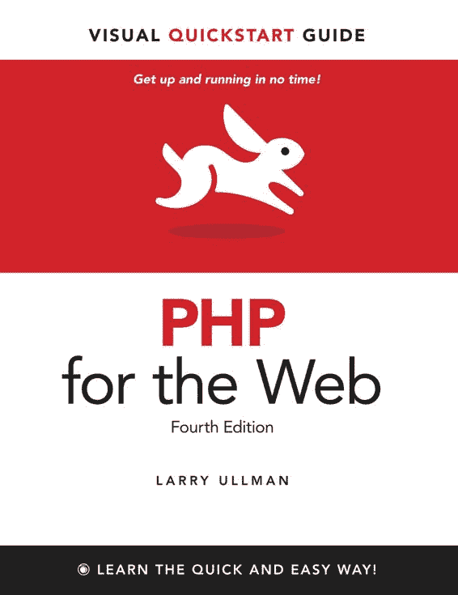

- **编辑:** Rebecca Gulick
- **文字编辑:** Liz Welch
- **技术审核员:** Jay Blanchard
- **校对:** Bob Campbell
- **制作协调:** Myrna Vladic
- **排字员:** Debbie Roberti
- **索引员:** Valerie Haynes-Perry
- **封面设计:** RHDG / Riezebos Holzbaur Design, Peachpit Press
- **内页设计:** Peachpit Press
- **Logo 设计:** MINE™ [www.minesf.com](http://www.minesf.com)

## 献辞

献给 Jessica、Gina 和 Rich，感谢他们所有的爱。

## 特别致谢

- 非常感谢 Peachpit Press 的所有人提供的帮助和辛勤工作。
- 全世界最棒的编辑 Rebecca Gulick。感谢你所做的一切切。
- 感谢 Liz Welch 对细节的关注。
- 感谢 Jay Blanchard 预测我下一句要说什么的神奇能力。
- 感谢 Bob Campbell 的敏锐眼光。
- 感谢 Myrna Vladic，将许多零散的内容变成一本书。
- 感谢 Valerie Haynes-Perry 提供的索引。
- 感谢 Peachpit 的所有人为制作、出版和销售这些书籍所做的努力。
- 诚挚感谢本书读者的反馈。
- 感谢 Rasmus Lerdorf（PHP 之父）、`PHP.net` 以及开源社区对改进和支持这项技术。
- 感谢 Karnesha，让这一切变得如此有趣。
- 感谢 Zoe，保持这种完美。

## 目录

### 第 5 章 使用字符串

- 使用字符串
- 创建 HTML 表单
- 字符串拼接
- 处理换行符
- HTML 与 PHP
- 字符串的编码与解码
- 查找子字符串
- 替换字符串部分
- 总结与扩展

### 第 6 章 控制结构

- 创建 HTML 表单
- if 条件语句
- 验证函数
- 使用 else
- 更多运算符
- 使用 elseif
- Switch 条件语句
- for 循环
- 总结与扩展

### 第 7 章 使用数组

- 什么是数组？
- 创建数组
- 向数组中添加项
- 访问数组元素
- 创建多维数组
- 数组排序
- 转换字符串和数组
- 从表单创建数组
- 总结与扩展

### 第 8 章 创建应用程序

- 模板
- 使用外部文件
- 使用常量
- 处理日期和时间
- 复习 PHP 处理 HTML 表单
- 使表单持久化
- 发送邮件
- 输出缓冲
- 操作 HTTP Header
- 总结与扩展

### 第 9 章 Cookies 与 Sessions

- 什么是 Cookies？
- 创建 Cookies
- 从 Cookies 读取
- 为 Cookie 添加参数
- 删除 Cookie
- 什么是 Sessions？
- 创建 Session
- 访问 Session 变量
- 删除 Session
- 总结与扩展

### 第 10 章 创建函数

- 创建和使用简单函数
- 创建和调用带参数的函数
- 设置默认值
- 创建返回值函数
- 理解作用域
- 总结与扩展

### 第 11 章 文件

- 权限
- 写入文件
- 读取文件
- 处理文件上传
- 目录导航
- 创建目录
- 增量读取
- 总结与扩展

### 第 12 章 数据库简介

- SQL 简介
- 连接 MySQL
- MySQL 错误处理
- 创建和选择数据库
- 创建表
- 向数据库插入数据
- 安全查询数据
- 从数据库检索数据
- 删除数据库中的数据
- 更新数据库中的数据
- 总结与扩展

### 第 13 章 整合一切

- 入门 (380)
- 连接数据库 (382)
- 编写用户定义函数 (383)
- 创建模板 (385)
- 登录 (388)
- 注销 (392)
- 添加引用 (393)
- 列出引用 (397)
- 编辑引用 (400)
- 删除引用 (406)
- 创建首页 (410)
- 回顾与追求 (414)

### 附录

- 附录 A 安装与配置 (415)
- 附录 B 资源与后续 (437)

### 索引 (447)

## 引言

当我在 2000 年编写这本书的第一版时，`PHP` 还是一个为人知的开源项目。它深受圈内技术人士的推崇，但尚未像今天这样成为 Web 开发的热门选择。当我自学 `PHP` 时，关于该语言的文档很少——而这本书提供了真实世界的示例，以及你开始使用 `PHP` 构建动态 Web 网站和应用程序所需的知识。

今天情况已经不同了。互联网经历过繁荣与衰落，现在是动态 Web 设计的王者，并已某种程度上扩展到了纯 Web 开发领域之外。尽管 `PHP` 变得流行，可用文档、示例代码和案例不断增加，但一本讨论该语言的好书仍然具有意义。

### 什么是 PHP？

`PHP` 最初代表 Personal Home Page（个人首页）。它由 Rasmus Lerdorf 在 1994 年创建，用于追踪他的简历。随着其用用能力的增长（并开始用于专业场合），`PHP` 变成了 Hypertext Preprocessor（超文本预处理器）。

说 `PHP` 可以嵌入 `HTML`，意味着 `PHP` 代码可以写在你的 `HTML` 代码中——而 `HTML` 是构建所有 Web 页面的代码。因此，使用 `PHP` 编程在起初仅仅是比手动编写 `HTML` 稍微复杂一点而已。自然而然地，这应该是你解决大多数 `PHP` 问题和好奇点的首要关注地方。

此外，`PHP` 是一种脚本语言，而不是编译语言。这意味着 `PHP` 设计用于在事件发生后执行某些操作——例如，当用户提交表单或访问 `URL`（统一资源定位符——Web 地址的术语）。另一个流行的脚本语言示例是 `JavaScript`，它通常处理发生在 Web 浏览器内的事件。这两种语言也可以被描述为解释型的，因为代码必须通过可执行程序运行，例如 `PHP` 模块或浏览器的 `JavaScript` 组件。相反，像 `C` 和 `C++` 这样的编译语言可以用于编写独立于任何事件运行的独立应用程序。

你还应该理解 `PHP` 是一种服务端技术。这意味着 `PHP` 所做的一切操作都发生在服务器上（而不是客户端，即查看 Web 网站的人所使用的计算机）。服务器仅仅是一台被设置好的计算机，当你用浏览器访问 Web 地址（例如 `Firefox`、`Microsoft Internet Explorer` 或 `Safari`）时提供所需的页面。我将在稍后详细讨论这一过程（参见“PHP 如何工作”）。

**B** 这是 `Zend` 的首页，它是 `PHP` 核心编程的创建者。该网站包含了实用的软件以及代码库和编写良好的教程。最后，`PHP` 是跨平台的，这意味着它可以在运行 `Unix`、`Windows`、`Macintosh` 以及其他操作系统的机器上。再次，我们说的是服务器的操作系统，而不是客户端的。

### PHP 不是什么

`PHP` 不仅可以运行在几乎任何操作系统上，而且与许多编程语言不同，它允许你只需或无需修改将工作从一个平台切换到另一个平台。尽管你可以使用该语言完成一系列惊人的任务，但它的主要限制是 `PHP` 不能用于某些 Web 网站中的客户端功能。

在本书编写期间 `PHP` 同时存在 `5.3.5` 和 `5.2.17` 版本（`5.3` 和 `5.2` 版本之间存在细微差异，因此 `5.2` 将继续支持一段时间）。虽然这本书是用稳定版本的 `PHP 5.3` 编写的，但所有代码都是向下兼容的，至少到 `PHP 5.x`，甚至是 `4.x`。在某些情况下，功能需要更新版本的 `PHP`，或者你需要 `JavaScript` 来创建新的浏览器窗口、添加鼠标悬停效果、弹出警报、调整浏览器窗口大小、获取用户机器的屏幕尺寸，以及动态生成和更改表单。这些任务都无法使用 `PHP` 完成（因为 `PHP` 是服务端的，而那些是客户端问题）。但是，你可以使用 `PHP` 来创建 `JavaScript`，就像你可以使用 `PHP` 创建 `HTML` 一样。

### 为什么要使用 PHP？

更多信息可以在 [`www.php.net`](http://www.php.net) 和 [`www.zend.com`](http://www.zend.com) 找到，这是 PHP 核心后的大脑。

诸如 `PHP` 等服务器端技术已成为常态。简单来说，`PHP` 比其他替代方案更好、更快、且更容易学习。所有网页设计者都允许网页设计师创建网站，只需从简单的 `HTML` 开始，你可以使用许多静态 `HTML` 页面创建一个整个网站。但基础的 `HTML` 是一种有限的方法，缺乏活性或响应性。访问仅包含 `HTML` 网站的游客看到的是简单的页面，没有任何程度的定制或动态行为。

在选择服务器端技术时，`PHP` 的主要替代方案是 `CGI` 脚本（通用网关接口，通常用 Perl 编写，但不必须）、`ASP.NET`（活动服务器页面）、Adobe 的 `ColdFusion`、`JSP`（Java 服务器页面）以及 `Ruby on Rails`。尽管有一些服务器端的 JavaScript 工具，但 `PHP` 还可以与数据库和文件交互，处理电子邮件，并完成许多仅 `HTML` 无法完成的工作。

网页管理员很久以前就意识到，仅靠 `HTML` 无法产生吸引人的动态生成 Web 应用程序，这些应用程序需要考虑到程序员所希望任何元素。通常，使用 `PHP`，你可以根据你想要考虑的任何因素创建令人兴奋且原创的页面。它们比静态 `HTML` 页面更容易更新和维护。

**A** Web Technology Surveys 网站显示，`PHP` 运行在 75% 的网站上 [(http://w3techs.com/technologies/overview/programming_language/all)](http://w3techs.com/technologies/overview/programming_language/all)。

所以问题是，为什么网页设计师应该使用 `PHP` 而不是 `CGI`、`ASP.NET`、`JSP` 或其他来制作动态 Web 网站？`Perl`——它们可以做 `PHP` 做不到的事情。

- **PHP 容易学习和使用得多。**
- **PHP 既免费又是跨平台的。**

人们——也许像你一样——没有任何正式编程训练的人，在读完这本书后就能轻松地编写 `PHP` 脚本。因此，你可以在几乎任何计算机上学习并使用 `PHP`，且免费。此外，它的开源特性意味着 `PHP` 的用户正在驱动它的开发，而不是某些公司实体。相比之下，`ASP.NET` 需要理解 `VBScript`、`C#` 或另一种语言；而 `CGI` 需要 `Perl`（或 `C`）。这些都是更复杂的语言，学习困难得多。

- **PHP 是开发动态 Web 网站最流行的工具。** 因为 `PHP` 已用于超过 75% 的网站 **A**，并且是整体范围内第四流行的编程语言 **B**。
- **PHP 专为为创建动态网页而编写的。** `Perl`（以及 `VBScript`、`Java` 和 `Ruby`）并非如此，这一事实表明，从其意图来看，`PHP` 可以比替代方案更快、更容易地完成某些任务。许多最大的网站——仅举三个 Yahoo!、Wikipedia 和 Facebook——以及内容管理工具，如 `WordPress`、`Drupal`、`Moodle` 和 `Joomla` 都使用 `PHP`。

我想明确的是，尽管我建议 `PHP` 在某些方面更好（特别是在它出现 **B** 的情况下）。通过学习这门语言，你将为自己提供一个实用的爱好或一项获利丰厚的技能。

**B** [Tiobe Index (http://www.tiobe.com/index.php/content/paperinfo/tpci/index.html)](http://www.tiobe.com/index.php/content/paperinfo/tpci/index.html) 使用多种因素对编程语言的流行程度进行排名。

## PHP 如何工作

`PHP` 是一种服务器端语言，这意味着你在 `PHP` 中编写的代码位于主机计算机上，该计算机为 Web 浏览器提供网页。当你访问一个网站（例如，[www.LarryUllman.com](http://www.LarryUllman.com)）时，你的互联网服务提供商（ISP）会将你的请求引导到持有 `www.LarryUllman.com` 信息的服务器。该服务器读取 `PHP` 代码并根据其脚本指令进行处理。在这个示例中，`PHP` 代码告诉服务器以 `HTML` **A** 的形式向你的浏览器发送适当的网页数据。简而言之，`PHP` 根据你选择的参数即时创建一个 `HTML` 页面。

使用 `PHP` 和直接使用 `HTML` 的核心区别在于，`PHP` 在服务器上完成所有工作，然后将适当的信息发送到浏览器。这与 `HTML` 生成的网站不同，区别在于当发出请求时，服务器仅将 `HTML` 数据发送到 Web 浏览器——没有经过服务器端的解释。本书涵盖了如何使用 `PHP` 向浏览器发送正确的数据。

**A** 这幅图演示了（尽管方式非常简单）客户端、服务器和 `PHP` 模块（添加到服务器中以增加其功能的应用程序）之间将 `HTML` 发回浏览器的过程。

**B** 因此，对于终端用户的浏览器，`home.` 和 `home.php` 看起来可能可能也没有明显的区别，但你到达该点的方式发生了根本变化。主要区别在于，通过使用 `PHP`，你可以让服务器动态生成 `HTML` 代码。例如，如果是周一而不是周二，或者用户以前访问过该页面，就可以呈现不同的信息。动态网页的创建将缺乏吸引力的静态网站与更有趣、因此访问量更大的交互网站区分开来。

**B** 将服务器处理基础 `HTML` 的这种直接关系与 **A** 进行比较。这也是为什么你可以从自己的电脑在浏览器中查看 `HTML` 页面——它们不需要被“提供”，但动态生成的页面需要通过处理处理的服务器进行访问。

## 你需要的

使用 `PHP` 的最重要的要求——因为它是一种服务器端脚本语言——是访问一个支持 `PHP` 的服务器。考虑到 `PHP` 的流行程度，你的 ISP 或 Web 主可能已经在他们的服务器上为你提供了这一选项。你需要联系他们以查看他们支持什么技术。

您的另一种选择是在您自己的计算机上安装 `PHP` 和 Web 服务器应用程序（如 `Apache`）。流行的 `Dreamweaver` 应用程序支持 `PHP` 开发以及其他服务器端技术。`Windows`、`Mac OS X` 或 `Linux` 用户可以轻松免费安装并使用 `PHP`。安装 `PHP` 的说明请参阅附录 A，“安装与配置”。如果您愿意尝试使用自己安装了 `PHP` 的服务器，那么可以宽慰的是，`PHP` 可以从 `PHP` 官方网站（[www.php.net](http://www.php.net)）免费获取，并提供易于安装的程序包。如果您采用这种方法（我建议您这样做这样做），那么您的计算机将既作为客户端又作为服务器。

第二个要求几乎是理所当然的：您必须在电脑上有一个文本编辑器。`Crimson Editor`、`SciTE`、`TextWrangler` 以及类似的免费软件都足够满足您的；而 `BBEdit`、`TextPad`、`TextMate` 以及其他商业应用程序提供了更多您可能青睐的功能。如果您习惯于使用图形界面（也称为 WYSIWYG——所见即所得），如 Adobe `Dreamweaver` 或 `Aptana Studio`，可以参考该应用程序的手来了解如何在其中进行编程。

引言 xv

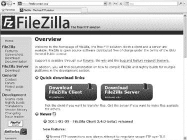

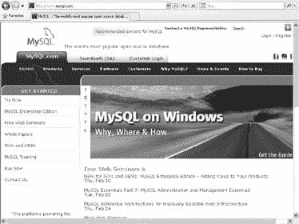

第三，您需要一种方法将编写的脚本传输服务器。如果您在自己的计算机上安装了 `PHP`，可以将脚本保存到相应的目录。然而，如果您正在使用 ISP 或 Web 托管提供的远程服务器，则需要一个 `FTP`（文件传输协议）程序将脚本发送到服务器。有很多 `FTP` 应用程序；在第 1 章“开始使用 PHP”中，我使用了免费 `FileZilla`（[`filezilla-project.org`](http://filezilla-project.org) **B**））作为示例。

**B** `FileZilla` 应用程序可以在许多不同的操作系统上将 `PHP` 脚本和其他文件移动到远程服务器。


最后，如果您想遵循第 12 章“数据库简介”中的示例，您需要访问 `MySQL`（[www.mysql.com](http://www.mysql.com)）或另一个数据库应用程序。`MySQL` 提供免费版本，您可以安装在自己的计算机上。本书假设读者仅具备基础 HTML 知识，尽管您在没有像 `Dreamweaver` 这样的 WYSIWYG 应用程序帮助的情况下处理原始 HTML 代码越熟练，过渡到使用 PHP 就越容易。每个程序员最终都会在某个时候转向 HTML 参考资料，无论您了解多少，因此我鼓励您手边放一本好的 HTML 书。其中一本关于 HTML 的介绍书籍是 Elizabeth Castro 的 *HTML, XHTML, and CSS: Visual QuickStart Guide*（Peachpit Press, 2007）。无疑不需要之前的编程经验。然而，它可能会加速您的学习，因为您会迅速发现例如 `Perl` 与 `PHP` 或是 `JavaScript` 与 `PHP` 之间的许多相似之处。

xvi 引言

**Script i.1** 一个示例 PHP 脚本，带有行号并对特定代码段进行了加粗强调。

## 关于本书

本书尝试在传达 PHP 编程基础的同时，暗示一些您未来可能考虑的更高级的功能，而不会陷入过多的细节中。我们采用了以下约定。分步说明指示了您需要向脚本中添加哪些代码以及加在何处。您应该输入的特定文本将以独特的字体打印，以便与正文区分开来。例如：

```html
<!DOCTYPE html PUBLIC "-//W3C//DTD XHTML 1.0 Transitional//EN" "http://www.w3.org/TR/xhtml1/DTD/xhtml1-transitional.dtd">
<html xmlns="http://www.w3.org/1999/xhtml" xml:lang="en" lang="en">
<head>
<meta http-equiv="Content-Type" content="text/html; charset=utf-8"/>
<title>Hello, World!</title>
</head>
<body>
<?php print "Hello, World!"; ?>
</body>
</html>
```

`<?php print "Hello, World!"; ?>`

PHP 代码也被写成一个独立的完整脚本，并按行编号以供参考（**Script i.1**）。您不应该自己插入这些行号，因为这样做会导致您的工作无法运行。

## 本书有什么新内容？

我认为这第四版是对一本已经很扎实的书的适度修订。本版最大的变化是删除了之前版本涵盖正则表达式的第 13 章。书中早期版本中讨论的正则表达式类型后来已被废弃，这意味着语言正在停止对它们的支持。处理正则表达式的更复杂的方法对于初学者来说并不合适，并在新的第 13 章“整合一切”中进行了详细介绍，该章节将引导您创建一个功能完备的网站，并使用书中讨论的几乎所有内容。其次，本版的每章现在都以一个“回顾与进阶”部分结束。在一或两页的内容中，您将被问一些旨在强化章节关键要点的问题。提示将引导您学习相关的额外信息，或尝试相似的练习。问题的帮助可以在书中对应的论坛（[www.Ullman.com/forum/](http://www.Ullman.com/forum/)）中找到。

最后，我微调了一些示例，主要是为了满足我对完美的追求。

引言 xvii


我建议使用自动显示行号的文本编辑器——因为这本书的列宽比常见的文本编辑器屏幕窄，当您调试工作时，行号将会提供帮助。在脚本中，您有时会看到特定的 PHP 行被加粗显示，以引起对新或相关内容的注意。一个小灰色箭头表示这种断处的发生。例如：

```php
print "This is going to be a longer line.";
```

由于 PHP 工作原理，您需要理解每个脚本本质上有三种视图：PHP 代码（例如 Script i.1）、发送到浏览器的代码（主要是 HTML）以及浏览器显示的内容。您应该使用编号的脚本，否则在执行它们时会遇到错误。（灰色箭头不是浏览器显示给终端用户的内容。）

在适当的情况下，会显示浏览器窗口的部分或全部，展示练习 **A** 的结果。在演示新功能和技术时，我会尽力在过程中解释它们的原理和方法。

如果你对某个函数感到困惑，或者浏览器对该 HTML 的解释让你疑问。通过示例，最好的办法是检查 PHP 代码（你创建了发送到浏览器的 HTML）、查看在线 PHP 手册或该书的辅助网站（及其用户支持论坛）。

**A** 这是你在浏览器窗口中看到的示例视图。对于本书而言，你使用哪种 Web 浏览器或操作系统都没有区别。

**B** 通过查看 Web 浏览器接收到的源代码，你可以看到由 PHP 创建并由服务器发送的 HTML。

xviii 引言

## 网站

在你阅读这本书时，你可能发现访问《PHP for the Web: Visual QuickStart Guide, 4th Edition》网站也会有帮助，该网站位于 `www.LarryUllman.com`。

## 哪一本书适合你？

这是我的第一本 PHP 教程的第四版。和原版一样，它是为初学者或非程序员编写的。如果你几乎或没有编程经验，更倾向于较慢的节奏，或者喜欢分碎片化地学习知识，那么这本书就是适合你的。不要误解：这本书涵盖了你开始开发动态 Web 网站所需的知识（同时使用了实用的示例），但它没有涉及任何深奥的理论或高级应用。

以及 PHP 的结构和语法。

该网站还包含一个更详细的参考部分，提供了指向许多有用 Web 页面的链接，你可以在那里继续学习 PHP。此外，网站还提供了一个勘误页（errata page），列出了书中可能出现的任何错误。

相反，如果你学习新技术非常快，或者已经具有了一些开发 Web 网站的经验，你可能会发现这本书太基础了。然而，对许多用户来说，最有帮助的是书的辅助论坛，可以通过网站找到或直接通过 `www.LarryUllman.com/forum/` 访问。使用论坛，你可以：

*   找到你所遇到问题的答案
*   获得如何实现你想法的建议
*   获取调试帮助
*   查看技术的变化如何影响书中的示例
*   了解他人如何使用 `PHP`
*   确认复习题的答案
*   获得比直接给我发邮件更快的回复

引言 xix

## 问题、意见或建议？

### 如何聪明地提问

如果你有关于 `PHP` 的特定问题，`PHP` 相关的 Web 网站上有新闻组、邮件列表和问答板块供你参考。这些在附录 B 中有更详细的讨论。浏览这些参考资料或搜索互联网几乎总能为你提供最快的答案。要在最短的时间内获得最佳答案，请遵循以下步骤：

1.  **搜索互联网**，阅读手册并浏览任何相关的文档。如果你更倾向于给我发邮件，可以通过网站上的联系页面进行操作。我确实会尽力回答我收到的每封邮件，但可能需要一周时间。
2.  **首先在最合适的论坛**（新闻组、邮件列表和问答板块）中提出你的问题。如果你更倾向于给我发邮件，请先发论坛（我总是优先回答这些问题）。
3.  **使用清晰简明的主题**。无论你是在书的辅助论坛发布消息、向我发邮件，还是在新闻组中提问，知道如何最有效地提问都能提高你收到的回复质量以及你获得答案的速度。
4.  **你也可以将你的问题、意见和建议直接告诉我**。使用书籍对应的论坛将获得最快的回复（我总是优先回答这些问题）。

（Peachpit Press, 2008）。它更详细地讨论了 SQL 和 `MySQL`，并介绍了几个更复杂的示例，但叙述节奏较快。

HTML 和 XHTML 元素定义了页面的内容，但此类内容的格式外观和行为最好交给 CSS（层联样式表）处理。与 HTML 和 XHTML 一样，本书不会详细教授 CSS，但由于书中某些代码将使用 CSS，因此你也应该熟悉它的基本语法。

你可以通过几种方式向 Web 页面添加 CSS。第一种（也是推荐的方法）是使用 HTML `style` 标签：

```html
<style type="text/css">
/*rules*/
</style>
```

在起始标签和结束标签之间定义 CSS 规则。你还可以使用 `link` HTML 标签来引入在外部文件中定义的 CSS 规则：

```html
<link href="styles.css" rel="stylesheet" type="text/css" />
```

CSS 规则应用于普通页面元素、CSS 类和特定项的组合：

`img { border: 0px; }`

`.error { color: red; }`

`#about { background-color: #ccc; }`

第一条规则适用于每一个 `img` 标签。第二条规则适用于任何具有 `error` 类的元素：

```html
<p class="error">Error!</p>
```

第三条规则仅适用于具有 `about` ID 值的特定元素：

```html
<p id="about">About...</p>
```

（并不是所有元素都需要 `id` 属性，但没有两个元素可以具有相同的 `id` 值。）在大多数情况下，本书将仅使用 CSS 执行简单操作，例如更改元素或某些文本的颜色或背景颜色。

尽管使用独立的 CSS 区域或文件是最好的，但为了保持简单，本书偶尔会使用内联 CSS：

```html
<p style="color: red;">Error!</p>
```

关于 CSS 的更多信息，请搜索 Web 或查看有关该主题的专类书籍。

# 开始使用 PHP

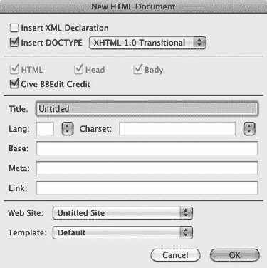

在进入 PHP 语法之前，让我们先创建一个简单但有效的 XHTML 文档，它将作为书中几乎所有示例的模板。

### 创建 XHTML 页面

1.  打开你的文本编辑器或集成开发环境 (IDE)。你可以使用几乎任何应用程序来创建 HTML、XHTML 和 PHP 页面。流行的选择包括 Adobe 的 [Dreamweaver](http://www.adobe.com)（运行在 Windows 和 Mac OS X 上）；[EditPlus](http://www.editplus.com) 和 Crimson Editor ([www.crimsoneditor.com](http://www.crimsoneditor.com)）用于 Windows；以及 **BBEdit** ([www.barebones.com](http://www.barebones.com)) 或 **MacroMates**' **TextMate** ([www.macromates.com](http://www.macromates.com)) 用于 Mac。

2.  选择 文件 (File) > 新建 (New) 来创建一个新的空白文档。

**脚本 1.1** 此示例文档显示了 XHTML 代码的基础。

```html
<!DOCTYPE html PUBLIC "-//W3C//DTD XHTML 1.0 Transitional//EN"
"http://www.w3.org/TR/xhtml1/DTD/xhtml1-transitional.dtd">
<html xmlns="http://www.w3.org/1999/xhtml" xml:lang="en" lang="en">
<head>
<meta http-equiv="content-type" content="text/html; charset=utf-8" />
<title>Welcome to this Page!</title>
</head>
<body>
<h1>This is a basic XHTML page!</h1>
<br/>
<p>Even with <span style="font-size: 150%;">some</span> some decoration, it's still not very exciting.</p>
</body>
</html>
```

有效的 XHTML 文档以这些行开始。它们告诉 Web 浏览器期望的是什么类型的文档。对于这个模板以及整本书，将创建 XHTML 1.0 Transitional 页面。这意味着要遵循 XHTML 1.0 标准。Transitional（过渡型）意味着页面可以使用过时的（不再建议使用的）标签（这与 Strict 严格模式不同，后者并不宽容）。

## 理解编码

编码是一个宏大的课题，但你需要理解的是：你在文件中使用的编码决定了哪些字符可以被表示，因此决定了可以使用哪些语言。要选择编码，你必须首先确认文本编辑器或 IDE 指出的编码与文件实际使用的编码匹配。某些文本编辑器允许你从创建一个特定类型的新文档开始——例如，新的 XHTML 文件。如果你的应用程序有此选项，请使用它。

3.  从 XHTML 头部行开始（**脚本 1.1**）：

```html
<!DOCTYPE html PUBLIC "-//W3C//DTD XHTML 1.0 Transitional//EN"
"http://www.w3.org/TR/xhtml1/DTD/xhtml1-transitional.dtd">
<html xmlns="http://www.w3.org/1999/xhtml" xml:lang="en" lang="en">
<head>
<meta http-equiv="content-type" content="text/html; charset=utf-8" />
<title>Welcome to this Page!</title>
</head>
<body>
<h1>This is a basic XHTML page!</h1>
<br/>
<p>Even with <span style="font-size: 150%;">some</span> some decoration, it's still not very exciting.</p>
</body>
</html>
```

4.  创建 head 部分：

head 还包含支持超过 99,000 个字符的 Unicode。截至本文为止，最常用的 Unicode 编码是 UTF-8。

5.  创建 body 部分：

页面内容——在 Web 浏览器中看到的内容——位于起始和结束 `body` 标签之间。根据 XHTML 规则，页面将仍然使用换行标签 (`<br/>`)，它在结束斜杠前有一个空格。所有其他标签与其标准的 HTML 对应物相似，只是它们是小写的。使用 CSS 来增大单词 some 的字体。与 PHP 脚本不同（你很快就会发现），你可以通过直接在 Web 浏览器中打开来测试 XHTML 和 HTML 页面。

6.  输入 `</html>` 以完成 HTML 页面。

7.  选择 文件 (File) > 另存为 (Save As)。在出现的对话框中，如果有选项，请选择纯文本 (Text Only) 或 ASCII 格式。

8.  将文件保存为 `welcome.html`。

9.  通过在 Web 浏览器中查看来测试该页面。

XHTML 和 PHP 文档只是纯文本文件（例如 Microsoft Word 文档，它是以专用格式存储的）。你可以使用 XHTML，但这并不意味着你必须使用它。如果你更熟悉 HTML，就用你熟悉的工具吧。

### 会影响你的 PHP 脚本的可操作性

还需要指定编码。

### 有关 XHTML 的更多信息以及 HTML，请查看 Elizabeth Castro 出版的优秀


### 书：HTML、XHTML 和 CSS，第六版：Visual QuickStart Guide

#### 8. 导航到你想要保存脚本的位置

（Peachpit Press, 2006）。

我将在整本书中交替使用 HTML 和 XHTML 术语。事实上，你可能在大多数时候看到的都是 HTML，但请理解我指的也包括 XHTML。

你可以将此脚本放在计算机上的任何地方，尽管为书中的每个脚本使用一个专门的文件夹（可能还为每个章节设置子文件夹）是合理的。

#### C 由 Web 浏览器解释的 XHTML 页面

### 基础 PHP 语法

现在你已经了解了本书将如何处理 HTML，是时候开始 PHP 脚本编写了。要创建你的第一个 PHP 页面，你的起始方式与从头开始创建一个 HTML 文档完全一样。理解其中的原因至关重要：Web 浏览器是理解 HTML 的客户端应用程序；PHP 是一种服务器端技术，无法在客户端运行。为了弥补这一差距，PHP 将在服务器上生成并在 Web 浏览器中运行的 HTML（请参考书的引言查看这种关系的视觉表示）。

标准 HTML 文档与 PHP 文档之间有三个主要区别。第一，PHP 脚本应该以 `.php` 文件扩展保存（例如 `index.php`）。第二，你将 PHP 代码放置在 `<?php` 和 `?>` 标签中，通常在某些 HTML 上文中：

```html
...
<body><h1>This is HTML.</h1>
<?php *PHP code*! ?>
<p>More HTML</p>
...
```

PHP 标签指示了页面中通过服务器上的 PHP 处理器运行的部分。这导致了第三个主要区别：PHP 脚本必须在支持 PHP 的 Web 服务器上运行（而 HTML 页面可以在任何计算机上直接通过浏览器查看）。这意味着 PHP 脚本必须始终通过 URL 运行（例如 `http://something/page.php`）。如果你在 Web 浏览器中查看 PHP 脚本且地址未以 `http` 开头，则 PHP 脚本将无法工作。

### 入门 PHP 7

#### 让这第一个 PHP 脚本执行某些操作

**脚本 1.2** 这第一个 PHP 脚本取了一个典型的 HTML 页面，添加了 PHP 标签并调用了一个 PHP 函数。使用 `phpinfo()` 函数。该函数在调用时会向 Web 浏览器发送一个信息，该信息列出了该特定服务器上 PHP 安装的详情。这是测试 PHP 安装的极佳方法，而且具有很高的“性价比”。

```html
<!DOCTYPE html PUBLIC "-//W3C//DTD XHTML 1.0 Transitional//EN" "http://www.w3.org/TR/xhtml1/DTD/xhtml1-transitional.dtd">
<html xmlns="http://www.w3.org/1999/xhtml" xml:lang="en" lang="en">
<head>
<meta http-equiv="content-type" content="text/html; charset=utf-8" />
<title>First PHP Script</title>
</head>
<body>
<?php
phpinfo();
?>
</body>
</html>
```

#### 在你的计算机上创建一个新的 PHP 脚本：

1. 在你的文本编辑器或 IDE 中创建一个新的 HTML 文档，命名为 `phpinfo.php`（脚本 1.2）。
2. 按 Return (Mac) 或 Enter (PC) 在起始 `<body>` 和结束 `</body>` 标签之间创建一些空行。
3. 在起始 `<body>` 标签之后单独起一行输入 `<?php`。
4. 添加以下内容：

```php
phpinfo();
```

5. 在结束 `</body>` 标签之前单独起一行输入 `?>`。

这个特定的 HTML 对于创建 PHP 页面的整体要点并不重要——但为了一致性，这个模板与基础 XHTML 示例（脚本 1.1）相同。

就像你计算机上的文件扩展名告诉操作系统用哪个应用程序打开文件一样，Web 页面的扩展名告诉服务器如何处理该文件：`file*.php` 通过 PHP 模块，`file*.aspx` 作为 ASP.NET 处理，而 `file*.html` 是静态 HTML 文档（通常情况下）。扩展名的关联由 Web 服务器设置决定。

如果你正在为托管网站开发 PHP 脚本，请咨询你的主机公司以了解 PHP 文档可以使用哪些扩展名。在本书中你会看到常见的 `.php` 扩展。

这个初始 PHP 标签告诉服务器后续代码是 PHP 并应以此方式处理。

你偶尔会在他人的脚本中使用 PHP 的短标签——简单的 `<?` 和 `?>`——尽管最好坚持使用正式标签。事实上，该语言对短标签的支持正在取消。

### 将你的脚本通过 FTP 上传服务器：

1. 在你的电脑上安装软件。
2. 打开你的 FTP 应用。
3. 获取 Web 托管。
4. 在应用程序的连接窗口中，输入由 PHP 开源软件提供的信息（这意味着，在 Web 托管 **A** 部分，它是免费的），并且通常易于安装（不会对你的电脑整体产生负面影响）。FTP 访问需要主机名（例如域名或 IP 地址）、用户名和密码，如果你想在电脑上安装 PHP 和 Web 服务器，请遵循附录 A 中的说明。
5. 点击快速连接（或你的 FTP 客户端的等效操作）。如果你已经这样做，可以跳到本章的下一节，在那里你将学习如何测试你的第一个 PHP 脚本。

如果你提供了正确的信息，你应该能够连接。如果没有，你将在 FileZilla 窗口顶部的 **B** 看到错误消息。

**A** FileZilla 主窗口的连接部分（在 Mac 上显示）。

**B** 报告的错误显示登录信息不正确。

1. 导航到对应 Web 页面的正确目录（例如 **www**、**htdocs** 或 **httpdocs**）。FTP 应用不一定会将你带到相应的目录。你可能需要进行一些导航以到达 Web 文档根目录。Web 文档根目录是 URL 直接指向的服务器目录（例如 www.larryullman.com）。如果你不确定设置的 Web 文档根目录是什么，请查看托管公司提供的文档（或向他们寻求支持）。在 FileZilla 中，右侧列代表服务器上的文件和目录；左列代表你电脑上的文件和目录 **C**。只需双击文件夹即可进入。

2. 将你的脚本——`phpinfo.php`——上传到服务器。在 FileZilla 中执行此操作，你只需要将文件从左列（你的电脑）拖到右列（服务器）。

**某些文本编辑器和 IDE 内置了 FTP 功能，允许你直接将脚本保存到服务器。某些工具如 Dreamweaver 和 TextMate 可以在离开应用程序的情况下运行 PHP 脚本。**

**C** 我已成功连接到远程服务器并导航到 `httpdocs` 目录（即 Web 文档根目录）。

### 测试你的脚本

#### 在浏览器中测试你的脚本：

1. 打开你喜欢的 Web 浏览器。测试 PHP 脚本分两个步骤。首先，你必须将 PHP 脚本放在 Web 服务器的相应目录中。其次，通过加载正确的 URL 在 Web 浏览器中运行 PHP 脚本。

如果你使用独立的 Web 服务器（例如托管公司提供的），你只需要使用 FTP 应用将你的 PHP 脚本上传到那里（如前面的步骤所示）。如果你在个人电脑上安装了 PHP，那么你可以将它们保存在相应目录来测试你的 PHP 脚本。

在大多数情况下，PHP 在不同浏览器上的表现没有差异（因为 PHP 运行在服务器上），所以使用你喜欢的任何浏览器即可。在本书中，你会发现无论操作系统如何，我主要使用 Firefox 和 Safari。

如果你在自己的电脑上运行 PHP，URL 为 `http://localhost`（Windows）；或 `http://localhost/~username`（Mac OS X），你应该将 `username` 替换为你的用户名。在我的情况下……但你的 URL 肯定会不同。

通常是：

* Mac OS X 用户使用 `~/Sites`（`~` 代表你的主目录）
* 任何其他系统使用 `~/AbyssDir/htdocs`，你应该将 `username` 替换为你的用户名。某些地方 `AbyssDir` 是安装 Abyss Web 服务器的目录。某些合一包（如 MAMP 和 XAMPP）也可能使用端口作为 URL 的一部分：`http://localhost:8888`
* 运行 IIS 的 Windows 用户使用 `C:\Inetpub\wwwroot`
* 运行 XAMPP (www.apachefriends.com) 的 Windows 用户使用 `C:\xampp\htdocs`
* 运行 MAMP (www.mamp.info) 的 Mac 用户使用 `/Applications/MAMP/htdocs`

如果不确定使用哪个 URL，请查看你安装的 Web 服务器应用程序的文档。如果你不确定设置的 Web 文档根目录是什么，请查看托管公司提供的文档。

### 将文本发送到浏览器

如果你只能看到它在工作，那么 PHP 就不会很有用（尽管这种确认至关重要）。你最频繁使用 PHP 以纯文本和 HTML 标签的形式向浏览器发送信息。为此，请使用 `print`：

```
print "something";
```

只需输入 `print` 单词，后跟你想显示的内容：一条简单的消息、变量的值、计算结果等等。在上一个示例中，消息是一个文本字符串，所以必须用引号括起来（相比之下，数字是不加引号的）。

为了明确起见，`print` 并没有实际打印打印；它只是输出数据。当 PHP 脚本通过 Web 浏览器运行时，该 PHP 输出是由浏览器本身接收的。

PHP 代码中的每条语句都必须以分号（`;`）结束，忘记这一要求是一个常见的错误的原因。PHP 中的语句是一行可执行的代码，例如：

`print "something";`

或者

`phpinfo();`

相反，注释、PHP 标签、控制结构（条件判断、循环等）以及本书中讨论的某些其他构造结构并不需要分号。

最后，你应该了解一个细微的技术问题：`phpinfo()` 是一个函数，而 `print` 实际上是一个语言结构。尽管将 `print` 称为函数仍然是标准做法，但由于 `print` 是一个语言结构，在使用它时不需要括号，就像 `phpinfo()` 示例那样。

### 打印一条简单的消息

**脚本 1.3** 通过将 `print` 语句放在 PHP 标签之间，服务器将动态地向浏览器发送一个带有 `Hello, world!` 问候的新型 HTML 文档。

**1.** 在你的文本编辑器或 IDE 中创建一个命名为 `hello.php` 的文件（**脚本 1.3**）：

```html
<!DOCTYPE html PUBLIC "-//W3C//DTD XHTML 1.0 Transitional//EN"
"http://www.w3.org/TR/xhtml1/DTD/xhtml1-transitional.dtd">
<html xmlns="http://www.w3.org/1999/xhtml" lang="en">
<head>
<meta http-equiv="content-type" content="text/html; charset=utf-8" />
<title>Hello, World!</title>
</head>
<body>
<p>The following was created by PHP:
<?php
print "Hello, world!";
?>
</p>
</body>
</html>
```

这段代码的大部分是标准的 HTML。最后一行将用于区分硬编码的 HTML 和由 PHP 生成的 HTML。

**2.** 在下一行，输入 `<?php` 以创建初始 PHP 标签。

**3.** 添加 `print "Hello, world!";` 打印“Hello, world!”短语是大多数编程参考书籍教授的第一步。尽管使用 PHP 的理由非常微不足道，但在你至少制作过一个 Hello, world! 应用程序之前，你还算不上真正的程序员。

**4.** 关闭 PHP 部分并完成 HTML 页面：`?>`

**5.** 将文件保存为 `hello.php`，将其放在启用了 PHP 的服务器上并在浏览器中进行测试。如果你在自己的计算机上运行 PHP，请记住可以将文件保存到相应的目录，并通过 `http://localhost/` 访问脚本。如果你看到错误或空白页面而不是图中所示的结果，请参阅本章末的调试部分。

在调用 `phpinfo()` 和 `print` 等函数时，PHP 是区分大小写的：`print`、`Print` 和 `PRINT` 产生相同的结果。在本书后面，你将看到大小写产生关键差异的示例。

### 一个简单的 Hello, world! 示例：你的首次 PHP 编程尝试

在调用 `phpinfo()` 和 `print` 等函数时，PHP 是区分大小写的：`print`、`Print` 和 `PRINT` 产生相同的结果。在本书后面，你将看到大小写产生关键差异的示例。

### 向浏览器发送 HTML

#### 尝试打印双引号

正如那些初学 HTML 的人很快就会遇到错误一样，因为它们会与 `print` 语句的主双引号冲突。你会发现，在 Web 浏览器中查看纯文本的效果不如人意。事实上，`Script 1.4` 使用 `print` 函数，你可以将 HTML 标签同文本一起发送到浏览器，在那里应用格式。由于 HTML 的创建是为了让纯文本更美观、实用，它通过向文本添加标签来工作，你可以使用 PHP 向浏览器发送 HTML 标签以及其他数据：

```html
<!DOCTYPE html PUBLIC "-//W3C//DTD XHTML 1.0 Transitional//EN" "http://www.w3.org/TR/xhtml1/DTD/xhtml1-transitional.dtd">
<html xmlns="http://www.w3.org/1999/xhtml" xml:lang="en" lang="en">
<head>
<meta http-equiv="content-type" content="text/html; charset=utf-8" />
<title>Hello, World!</title>
</head>
<body>
<p>The following was created by PHP:
<?php
print "<a href=\"page.php\">link</a>";
print "<span style=\"font-weight:bold;\">Hello, world!</span>";
?>
</p>
</body>
</html>
```

尽管，有一种情况你必须小心。需要双引号的 HTML 标签，例如 `<a href="page.php">link</a>`，在由 PHP 打印时会产生问题，因为 `print` 函数也使用了引号。

一种解决方法是在 HTML 内部的引号前加上反斜杠（`\\`）来对其进行转义：

```php
<?php
print "<a href=\"page.php\">link</a>";";
?>
```

通过对 `print` 语句中的每个引号进行转义，你告诉 PHP 打印引号本身，而不是将该引号视为要打印字符串的开始或结束。

#### 向浏览器发送 HTML：

1. 在你的文本编辑器或 IDE 中打开 `hello.php` 脚本（Script 1.3），如果它尚未打开。
2. 通过添加 HTML 标签编辑第 11 行的 `Hello, world!` 文本，使其读取（（ 1.4`）如下：

```php
print "<span style=\"font-weight:bold;\">Hello, world!</span>";
```

为了让 PHP 生成的消息部分更加突出，CSS 样式将使问候加粗。为了使这生效，你必须转义 `span` 标签内部的引号，以便它们不会与 `print` 语句的引号冲突。

3. 将脚本保存为 `hello2.php`，将其放置在启用了 PHP 的服务器上，并在浏览器中运行该页面。

B：新版本的 Hello, world! 页面，增加了装饰和吸引力。

### 使用空白

当你使用 PHP 编程时，你应该理解空白字符通常（但并非总是）是被忽略的。PHP 代码中的任何空行（只是连续的一个或多个空行）与最终结果无关。同样，制表符和空格对 PHP 通常也是无关紧要的。由于 PHP 代码在 Web 浏览器中不可见（除非服务器出现问题），PHP 文件中的空白对最终用户看到的内容没有影响。

HTML 代码的间距显示在 Web 页面的 HTML 源代码中，但对 Web 浏览器中的显示影响微乎其微。例如，整个 Web 页面的 HTML 源代码可以放在同一行，而不会改变最终用户看到的内容。然而，如果你必须在 HTML 源代码中寻找问题，你将看到一行 HTML。你可以通过跨行打印或使用换行符（`\n`）来影响动态生成的 HTML 的间距：

```php
print "Line 1\nLine 2";
```

再次，在双引号内使用换行符（`\n`）来调整 HTML 代码的间距。

4. 查看发送到浏览器的源代码。这取决于浏览器：在 Firefox 或 Internet Explorer 中选择“查看 > 源代码”，在 Safari 中选择“查看网页源代码”。这是一种良好的习惯，特别是在出现问题时。

### 理解引号的作用

记住，PHP 在处理脚本时会忽略这些注释。此外，注释可以帮助你记住为什么要这么做。这是一个你可以编写的注释示例。

### 在脚本中添加注释


# PHP 和 HTML 注释

PHP 和 HTML 注释被添加到脚本中以便记录并保持隐藏。你应该编写注释来记录脚本的功能、它依赖于哪些信息、创建者、时间等等。从风格上看，此类注释通常位于脚本的顶部（即 PHP 部分的最开始处），使用如下格式：

```php
<?php
/* Filename: hello3.php
Book reference: Script 1.5
Created by: Larry Ullman
这是一个多行注释。
*/
```

PHP 支持三种添加注释的方法。你可以在行开头使用 `//` 或 `#` 注释掉整行，如下：

```php
// 这是一个注释。
# 这也是一个注释。
```

你也可以在 PHP 行的末尾注释掉代码，如下：

```php
echo "Hello"; // 这是一个注释。
```

你可以通过使用 `/*` 开始并用 `*/` 结束来注释多行：

```php
/*
这是一个
多行注释。
*/
```

一些程序员也喜欢这种风格，因为它包含了两个“标签”，提供了注释开始和结束的标记。

```php
$bold;\\">Hello, world!</</span>\\n";
```

18

### 3. 在第 17 行、`print` 语句之前输入 `//`。

```php
<!-- This is an HTML comment. -->
```

通过在 `print` 语句前加上两个斜杠，函数调用会被“注释掉”，这意味着它永远不会被执行。

### 4. 在 PHP 结束标签之后（第 19 行），添加一个 HTML 注释：

```html
<!-- This is an HTML comment. -->
```

这行代码将帮助你：

**A** 通过注释掉 `print` 语句，区分不同页面外观之间的区别将就像 `print` 函数不存在一样。了解注释的类型以及它们出现的位置。此注释只会出现在 HTML 源代码中。

### 5. 将脚本保存为 `hello3.php`，将其放置在启用 PHP 的服务器上，并在 Web 浏览器中运行该页面 **A**。

26 第 1 章

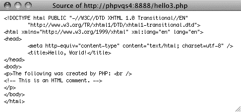

### 6. 查看页面源代码以查看 HTML 注释 **B**。

> **你可以使用 `/*` 和 `*/` 方法注释单行或多行代码。使用 `//` 或 `#` 时，每次只能注释掉一行。不同的程序员倾向于用不同的方式注释代码。重要的是找到一种适合自己的系统并坚持下去。**

请注意，你不能在 PHP 中使用 HTML 注释字符（`<!--` 和 `-->`）来注释代码。可以让 PHP 将这些标签打印到浏览器，但在那种情况下，你会在客户端计算机的 HTML 源代码中创建一个注释（但在浏览器窗口中不会）。PHP 注释永远不会到达用户的计算机。

尽管我深信脚本注释并不是越多越好，但为了节省空间，书中的脚本并没有像应该的那样详尽。不过，为了交叉引用，本书将记录每个脚本的名称和编号。

当你更改脚本代码时，务必同时更新其注释。如果看到注释暗示脚本或某行代码的功能与其实际功能不符，会让人非常困惑。

**B** HTML 注释不会显示在 Web 浏览器中，但存在 HTML 源代码中。PHP 注释保留在服务器上的 PHP 脚本中。

# 基础调试步骤

调试绝不是一个容易掌握的概念，遗憾的是，它只有通过实践才能真正精通。接下来的 50 页可能可以专门用于这个主题，但你仍然只能学会最终将获得并需要的调试技能的一小部分。

我以这种有些痛苦的方式引入调试，是因为在进入编程时不要抱幻想是重要的。有时代码不会按预期工作，你不可避免地会犯下粗心错误，某些日子你甚至会抓掉头发，即使使用像 PHP 这样相对用户友好的语言。简而言之，要准备好有时感到困惑和沮丧。我从 1999 年起就开始编写 PHP 代码，偶尔仍然会陷入编程的泥潭中。但调试是一项非常重要的技能，你最终会出于需要和经验学会它。当你开始 PHP 编程之旅时，我可以提供以下基础但具体的调试建议。

## 如何调试 PHP 脚本

- **确保你始终通过 URL 运行 PHP 脚本！** 这可能是初学者最常见的错误。PHP 代码必须通过 Web 服务器应用程序运行，这意味着它必须通过 `http://*something*` 进行请求。当你看到实际的 PHP 代码而不是该代码的执行结果时，很可能是你没有通过 URL 运行 PHP 脚本。

- **了解你运行的是哪个版本的 PHP。** 某些问题是由所使用的 PHP 版本引起的。在使用任何启用 PHP 的服务器之前，运行 `phpinfo.php` 文件（脚本 1.2）以确认使用的 PHP 版本。

- **确保 `display_errors` 已开启。** 这是一个基础的 PHP 配置设置（在附录 A 中讨论）。由于某些原因，PHP 可能没有设置显示发生的错误。如果是这样，当问题发生时你会看到空白页面。为了调试大多数问题，你在学习需要开启此设置。可以通过执行 `phpinfo()` 函数来确认此设置（只需使用浏览器搜索生成的页面即可）。

- **休息一下！** 多年来我遇到过许多问题，绝大多数最困难的问题通过离开电脑去搜索一段时间就解决了。人很容易感到沮丧和困惑，在这种情况下，你采取的任何进一步步骤都可能让事情恶化。

这些只是一些通用的调试技术，专门为初级程序员定制的。目前来说它们足够了，尽管书中的示例相对简单。更复杂的编码需要高级的调试技术，因此我的 PHP 专门用了一个章节讨论这个主题。

- 检查 HTML 代码。
- 检查错误信息。
- 相信错误信息。

## 复习与追求

- 如果你有访问多个服务器，确认另一台服务器上运行的是哪个版本的 PHP。

- 创建一个静态 HTML 页面，显示关于刚刚涵盖材料的一些问题。然后用 PHP 创建的内容替换一些静态内容。如果你在这些部分遇到任何问题，无论是在回答问题时还是在进行自己的探索时，请参阅书的支持论坛（www.Larryllman.com/forum/）。

- 创建一个供你自己工作的模板。该模板应该包含 HTML 壳、PHP 的开始和结束标签以及一些基础注释。

- 添加到 PHP 代码中。识别出你会使用注释的一些方法。

# 第 1 章：第 2 章

## 变量

在上一章中，你学习了如何使用 PHP 向网络浏览器发送简单的文本和 HTML——换句话说，就是你完全不需要 PHP 就能实现的内容！不过不要担心，本书将教你如何结合 `print` 和其他 PHP 特性，为你的网站实现强大且实的功能。

### 本章内容

要实现从创建简单的静态页面到动态 Web 应用和交互式 Web 网站的跨越，你需要变量。理解变量、语言支持的类型以及如何使用它们至关重要。

本章将讨论 PHP 中变量的基础，随后的章节将更详细地介绍不同类型。如果你以前从未处理过变量，本章将是一个很好的入门。如果你对这个概念已经熟悉，那么你应该能够轻松地完成本章内容。

### 什么是变量？

变量是数据的容器。一旦数据被存储在变量中（或者更准确地说，一旦变量被分配了一个值），该数据就可以被修改、打印到网络浏览器、保存到数据库、发送电子邮件等。

PHP 中的变量从本质上来说是灵活的：你可以将数据放入变量中，从中检索该数据（而不影响变量的值），放入新数据，并根据需要继续这种循环。但 PHP 中的变量在很大程度上是临时的：大多数变量只在脚本在服务器上执行期间存在——也就是说，它们只在该期间有值。一旦执行过了最后一个 PHP 结束标签，这些变量就会消失。此外，在用户点击链接或提交表单后，他们会被带到一个新页面，该页面可能有一套完全不同的变量。

在深入讨论变量之前，让我们快速写一个脚本来揭示 PHP 的一些预定义变量。这些变量是 PHP 在脚本运行时自动创建的变量。在整本书中，你将接触许多不同的预定义变量。对于这个特定的示例，让我们看看预定义的 `$_SERVER` 变量。它包含了关于运行 PHP 的计算机的大量信息。

`print_r()` 函数提供了一种显示任何变量值的简单方法：

```php
print_r($variable_name);
```

只需将你想要检查的变量作为参数传递给 `print_r()` 函数即可（你将在本章中学习更多关于变量语法的知识）。

#### 打印 PHP 的预定义变量

调用 `print_r()` 函数来显示存储在 `$_SERVER` 预定义变量中的值。

1. 在你的文本编辑器或 IDE 中创建一个 PHP 脚本，命名为 `predefined.php`（脚本 2.1）。

2. 创建初始的 HTML 标签：

```html
<!DOCTYPE html PUBLIC "-//W3C//DTD XHTML 1.0 Transitional//EN" "http://www.w3.org/TR/xhtml1/DTD/xhtml1-transitional.dtd">
<html xmlns="http://www.w3.org/1999/xhtml" xml:lang="en">
<head>
<meta http-equiv="Content-Type" content="text/html; charset=utf-8"/>
<title>Predefined Variables</title>
</head>
<body>
<pre>
<?php // Script 2.1 - predefined.php
print_r($_SERVER);
?>
</pre>
</body>
</html>
```

这段代码重复了上一章创建的 XHTML 模板。在页面正体内，`<pre>` 标签被用于使生成的 PHP 信息更具可读性。如果不使用 `<pre>` 标签，`print_r()` 函数的输出将非常混乱。

3. 添加 PHP 代码：

```php
<?php // Script 2.1 - predefined.php
print_r($_SERVER);
?>
```

这段 PHP 代码包含一个函数调用。该函数应提供变量的名称。

在这个示例中，变量是 `$_SERVER`，它在 PHP 中是特殊的。`$_SERVER` 存储了关于服务器的各种数据：名称、操作系统、当前用户、Web 服务器应用程序信息（Apache, Abyss, IIS 等）。它还反映了正在执行的 PHP 脚本：其名称、在服务器上的位置等。

注意，你必须像这里这样输入 `$_SERVER`，全部大写。

4. 完成 HTML 页面。

5. 将文件保存为 `predefined.php`，将其上传到服务器，并在浏览器中进行测试。

像你做的那样打印任何变量的值是最强大的调试工具之一。

### 变量语法

现在你已经对变量池有了初步了解，是时候进一步研究这个主题了。在先前的示例中，脚本报告了 PHP 预定义的 `$_SERVER` 变量。一旦你理解了正确的语法，你也可以创建自己的变量。要创建适当的变量名，必须遵循以下规则：

- 所有变量名必须以美元符号（`$`）开头。
- 符号之后，变量名必须以字母（A–Z，a–z）或下划线（`_`）开头。不能以数字开头。
- 变量名的其余可以是字母、下划线和数字的任意组合。
- 变量名中不允许有空格。（相反，常用下划线来分隔单词。）
- 每个变量必须有唯一的名称。
- 变量名是区分大小写的！因此，`$variable` 和 `$Variable` 是两个不同的结构，使用两个如此相似的变量将是一个坏主意。

最后一点可能是最重要的：PHP 中的变量名是区分大小写的。使用错误的大小写是 Bug 的非常常见原因。（如果你在示例中使用了 `$_server` 或 `$_Server`，在之前的脚本中，你会看到错误信息，或者什么都没有（A.）。

### 变量名的拼写错误（包括大小写）会导致不符合预期且不可预测的结果。

### 脚本 2.2 正确记录变量的用途

为了尽量减少 bug 的产生，我建议遵循以下策略，并使用有意义的名称，这是专业程序员的标志：

* 始终使用全小写的变量名。
* 使你的变量名具有描述性（例如，`$first_name` 比 `$fn` 好）。
* 使用注释来指示变量的用途（`Script 2.2`），无论这看起来多么多余。
* 最重要的是，无论你选择哪种命名规范，务必保持一致！

表 2.1 列出了一些有效的变量示例；表 2.2 列出了一些无效变量以及它们所违反的规则。

> **与某些其他语言不同，PHP 通常不需要你在使用变量之前声明或初始化它。换句话说，你可以在不先定义变量的情况下引用它们。但最好不要这样做；我尝试在编写脚本时，确保每个变量在使用之前都经过了定义或验证。**

> **有两种主要的变量命名规范，取决于你如何界分单词。这些是所谓的驼峰式（camel-hump）或驼峰命名法（命名是因为大字母分隔单词的方式——例如 `$FirstName`）和下划线法（`$first_name`）。本书使用了后者的规范。**

#### 表 2.1 PHP 中的有效变量

| 名称 |
| :--- |
| `$first_name` |
| `$person` |
| `$address1` |
| `$_SERVER` |

#### 表 2.2 PHP 中的无效变量

| 名称 | 原因 |
| :--- | :--- |
| `$first name` | 包含空格 |
| `$first.name` | 包含句点 |
| `first_name` | 不以 `$` 开头 |
| `$1address` | 数字不能跟在 `$` 后面 |

```php
<?php 
// 定义我的变量....
$year = 2011; // 当前年份。
$june_avg = 88; // 六月份的平均温度。
$page_title = 'Weather Reports'; // 页面标题。
// ... 以此类推。
?>
```

### 变量类型

本书涵盖了三种主要的变量类型：数字、字符串和数组。我在这里快速介绍一下它们，稍后的章节将进行更详细的讨论：

* 第 4 章，“使用数字”
* 第 5 章，“使用字符串”
* 第 7 章，“使用数组”

第四种变量类型——对象在附录 B“资源和后续步骤”中介绍，但本书未对其涵盖。该特定主题对于入门指南来说太高级了——事实上，在我的《PHP 5 Advanced: Visual QuickPro Guide》（Peachpit Press, 2007）中，对该主题的基础介绍就超过了 150 页！

### 数字

从技术上说，PHP 将数字分为两种类型：整数和浮点数（也称为双精度浮点数或 doubles）。由于 PHP 处理变量的方式比较宽松，将这两类数字归为一类全包含的成员并不会影响你的编程。尽管如此，为了清晰起见，让我们简要讨论一下它们之间的区别。

第一类数字——整数——与整数相同。它们可以是正数也可以是负数，但不包含分数或小数。使用小数点的数字（即使是像 `1.0` 这样的）是浮点数。你也必须使用浮点数来表示分数，因为在 PHP 中表示分数的唯一方法将其转换为等小数。因此，`1 1/4` 被写为 `1.25`。表 2.3 列出了一些有效的数字示例及其正式类型；表 2.4 列出了无效数字以及它们所违反的规则。

#### 表 2.3 PHP 中的有效数字

| 数字 | 类型 |
| :--- | :--- |
| 1 | 整数 |
| 1.0 | 浮点数 |
| 1972 | 整数 |
| 19.72 | 浮点数 |
| -1 | 整数 |
| -1.0 | 浮点数 |

#### 表 2.4 PHP 中的无效数字

| 数字 | 原因 |
| :--- | :--- |
| 1/3 | 包含斜杠 |
| 1996a | 包含字母 |
| 08.02.06 | 包含多个小数 |

> **正如你很快就会看到的，你可以通过给无效数字加上引号将其转换为有效的字符串。**

### 字符串

字符串是封装在一对单引号（`'`）或双引号（`"`）内的任意字符。字符串可以包含字母、数字、符号和空格的任何组合。字符串也可以包含变量。

以下是有效字符串值的示例：

* `'I said, "How are you?"'`
* `"I said, 'How are you?'"`
* `"Hello, world!"`
* `"Hello, $first_name!"`
* `"1/3"`

> **注意，“1996”通过通过将数字放在引号内将整数转换为字符串。本质上，字符串包含字符 1996，而数字（引号值）会与之相等。这是一个细微的区别，在你的代码中并不会重要。**

反斜杠告诉 PHP 将每个转义引号视为字符串值的一部分，而不是将其作为字符串的开始或结束指示。你可以类似地使用不同的引号类型来规避这个问题：

```html
<!DOCTYPE html PUBLIC "-//W3C//DTD XHTML 1.0//Transitional//EN" "http://www.w3.org/TR/xhtml1/DTD/xhtml1-transitional.dtd">
<html xmlns="http://www.w3.org/1999/xhtml" xml:lang="en" lang="en">
<head>
<meta http-equiv="Content-Type" content="text/html;charset=utf-8"/>
<title>Variables and Comments</title>
</head>
<body>

</</body>>
</html>
```

当 PHP 遇到上面的第二个引号时，它假设字符串在结束结束；后续的文本（How…）会导致错误。要在字符串中使用引号，你可以在引号前面加上一个反斜杠（`\`）来转义该引号：

```php
"I said, \"How are you?\""
```

这个字符串将会很棘手，我暗示过相同的问题：

```php
"08.02.06"
"1996"
''
```

简而言之，创建字符串只需将内容放在引号内。然而，在某些情况下你可能会遇到问题——不包含任何字符的字符串。

### 数组

数组将在第 7 章进行详细介绍，但我们在这里简要查看它们。虽然字符串或数字包含单个值（它们都被称为标量），但数组可以分配多个值。你可以将数组想象成值的列表或表格：你可以将多个字符串和/或数字放入一个数组中。数组使用“键”来创建和检索它们存储的值。生成的结构——键值对列表——看起来类似于两列电子表格。

#### 表 2.5 索引数组


# 表 2.5 索引数组

| 键 | 值 |
| :--- | :--- |
| 0 | Don |
| 1 | Betty |
| 2 | Roger |
| 3 | Jane |

# 表 2.6 关联数组

| 键 | 值 |
| :--- | :--- |
| VT | Vermont |
| NH | New Hampshire |
| IA | Iowa |
| PA | Pennsylvania |

PHP 有两种不同类型的数组，取决于键的格式。如果数组使用数字作为键（表 2.5），则它被称为索引数组。如果使用字符串作为键（表 2.6），则它是关联数组。无论何种情况，数组中的值可以是任何变量类型（字符串、数字等）。

数组的键也称为索引（index）。你会看到这两个术语互换使用。

数组可以（且通常会）包含其他数组，创建所谓的多维数组。

PHP 中称为关联数组的，在 Perl 和 Ruby 等其他语言中被称为哈希（hash）。

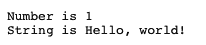
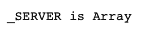

## 变量值

要给变量赋值，无论变量类型如何，你都使用等号（`=`）。因此，等号被称为赋值运算符，因为它将右侧的值赋值给左侧的变量。例如：

```php
$number = 1;
$floating_number = 1.2;
$string = "Hello, world!";
```

由于每一行都代表一个完整的语句（即一个可执行的动作），因此它们都以分号结尾。要打印变量的值，你可以使用 `print` 函数：

```php
print $number;
print $string;
```

如果你想在某个语境中打印变量的值，可以将变量名放在打印的字符串中，只要你使用双引号即可：

```php
print "Number is $number";
print "String is $string";
```

像这样使用 `print` 适用于标量（单值）变量类型——数字和字符串。对于复杂变量类型——数组和对象——你不能直接使用 `print`：

```php
print "_SERVER is $_SERVER";
```

正如你已经看到的，`print_r()` 可以处理这些非标量类型，你将在书的后续部分学习其他方法。

无论你处理的是标量还是非标量变量，不要忘记，当你的脚本遇到问题时，打印它们的值是一个极佳的调试技巧！

因为变量类型不是固定的（PHP 被称为弱类型语言），它们可以随时更改：

```php
$variable = 1;
$variable = "Greetings";
```

如果你现在打印 `$variable` 的值，结果将是 Greetings。下面的脚本更好地演示了给变量赋值然后访问这些值的概念。

### 脚本 2.3

**1.** 在你的文本编辑器或 IDE 中创建一个新的 PHP 脚本，并命名为 `variables.php`。

**2.** 创建初始的 HTML 标签：

```html
<!DOCTYPE html PUBLIC "-//W3C//DTD XHTML 1.0 Transitional//EN" "http://www.w3.org/TR/xhtml1/DTD/xhtml1-transitional.dtd">
<html xmlns="http://www.w3.org/1999/xhtml" lang="en">
<head>
<meta http-equiv="Content-Type" content="text/html; charset=utf-8"/>
<title>Variables</title>
</head>
<body>
```

**3.** 开始 PHP 代码：

```php
<?php // Script 2.3 - variables.php
// 一个地址：
$street = "100 Main Street";
$city = "State College";
$state = "PA";
$zip = 16801;

// 给变量赋值并访问变量：
// 打印地址：
print "<p>The address is:<br />$street<br />$city $state $zip</p>";
?>
```

**4.** 完成 HTML 标签：

```html
</body>
</html>
```

**脚本 2.3** 此脚本定义并打印了一些基础变量。

与脚本 2.3 类似，但后者并非如此

```php
$name1 = '$first_name $last_name';
$name2 = "$first_name $last_name";
```

此规则适用于 PHP 中任何你可能使用引号的地方，包括在 `print` 函数中以及将值赋值字符串变量。一个示例是演示这一关键概念的最佳方法。

```php
print "<h1>Double Quotes</h1><p>name1 is $name1 <br />name2 is $name2</p>";
print '<h1>Single Quotes</h1><p>name1 is $name1 <br />name2 is $name2</p>';
?>
```

**1.** 在你的文本编辑器或 IDE 中开始一个新的 PHP 脚本，命名为 `quotes.php`（脚本 2.4）。

**2.** 创建初始 HTML 标签：

```html
<!DOCTYPE html PUBLIC "-//W3C//DTD XHTML 1.0 Transitional//EN" "http://www.w3.org/TR/xhtml1/DTD/xhtml1-transitional.dtd">
<html xmlns="http://www.w3.org/1999/xhtml" xml:lang="en" lang="en">
<head>
<meta http-equiv="content-type" content="text/html; charset=utf-8" />
<title>Quotes</title>
</head>
<body>
```

**3.** 开始 PHP 代码：

```php
<?php // Script 2.4 - quotes.php
```

**4.** 创建两个字符串变量：

```php
$first_name = 'Larry';
$last_name = "Ullman";
```

对于这两个变量，使用单引号还是双引号都没有关系，因为每个字符串变量都可以被字面量地处理。然而，如果你在这里使用自己的名字（你可以随意这样做）并且它包含一个单引号，那么你需要使用双引号，或者在单引号内对单引号进行转义：

```php
$last_name = "O'Toole";
$last_name = 'O\'Toole';
```

**5.** 使用现有的姓和名变量，创建两个不同的名字变量：

```php
$name1 = '$first_name $last_name';
$name2 = "$first_name $last_name";
```

**6.** 使用两种类型的引号打印变量：

```php
print "<h1>Double Quotes</h1><p>name1 is $name1 <br />name2 is $name2</p>";
print '<h1>Single Quotes</h1><p>name1 is $name1 <br />name2 is $name2</p>';
```

在这些行中，你使用的引号会产生巨大的差异。`$name1` 变量现在字面上等于 `$first_name $last_name`，因为没有发生变量解析。相反，`$name2` 等于 Larry Ullman，这大概是预期的结果。

**7.** 完成 PHP 部分和 HTML 页面：

```php
?>
</body>
</html>
```

**8.** 将文件保存为 `quotes.php`，将其上传到你的服务器（或保存到你计算机上的相应目录），并在 Web 浏览器中测试它。

如果你仍然对这两种引号的区别感到困惑，那么坚持使用双引号会更安全。可以认为，在可以的情况下使用单引号略为优，因为 PHP 不需要搜索字符串来寻找变量。诚然，这只是一个次要要点。不同的引号（单引号与双引号）决定了打印的是变量名还是值。创建换行符（`\n`）、回车（`\r`）和制表符（`\t`）的快捷方式也必须在双引号中使用才能产生预期效果。

记住，你并不总是需要使用引号。在赋值数字值或仅打印变量时，你可以省略它们：

```php
$num = 2;
print $num;
```


## 复习与探索

如果你在练习题或探索提示中遇到任何问题，请访问书籍的支持论坛（`www.LarryUllman.com/forum/`）。

### 复习

- `$_SERVER` 是什么类型的示例？
- 所有变量必须以什么字符开头？
- 变量名的开头可以使用什么字符？在第一个字符之后，变量名中还可以使用哪些字符？
- 变量名是对大小敏感的还是不敏感的？
- 说变量是标量（scalar）意味着什么？标量类型的示例有哪些？非标量变量类型的示例是什么？
- 赋值运算符是什么？
- 本章引入了哪种关于变量的极佳调试技术？
- 使用单引号或双引号的区别是什么？

### 探索

- 创建另一个 PHP 脚本，定义一些变量并打印它们的值。尝试使用不同标量类型的变量。
- 创建一个 PHP 脚本，在 HTML 中打印某些变量的值。更高级的练习可能涉及使用 PHP 和变量创建链接或图像标签。

# 第 3 章 HTML 表单与 PHP

上一章对变量主题进行了简要介绍。虽然你经常会创建自己的变量，但你也会结合 HTML 表单使用变量。表单是当今 Web 网站的基本单元，能够实现注册和登录系统、搜索功能以及在线购物等功能。即使是最简单的网站也会有引入 HTML 表单的逻辑理由。通过 PHP，接收并处理由表单生成的数据是惊人地简单。

## 本章内容

考虑到这一点，本章将涵盖创建 HTML 表单的基础知识，并解释提交的表单数据如何供 PHP 脚本使用。本章还将介绍几个 PHP 编程的关键概念，包括如何管理脚本中的错误。

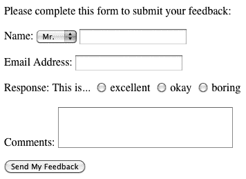

## 创建一个简单的表单

在本章的 HTML 表单示例中，你将创建一个页面，获取用户的称呼、姓名、电子邮件地址、回复和评论。生成表单的代码位于开启和关闭的 `form` 标签之间：

```html
<form>
***表单元素***
</form>
```

`form` 标签规定了表单的开始和结束。表单的所有元素都必须位于这两个标签之间。开启 `form` 标签还包含一个 `action` 属性。它指示表单数据应该提交到哪个页面。当你创建表单时，这是最重要的考虑因素之一。在本书中，`action` 属性始终指向 PHP 脚本：

```html
<form action="somepage.php">
```

并且末尾有一个斜杠。因此，在 HTML 中你可能会这样写

```html
<INPUT TYPE=TEXT NAME=address SIZE=40>
```

但在 XHTML 中你会写成

```html
<input type="text" name="address" size="40" />
```

### 脚本 3.1

此 HTML 页面包含包含多种不同输入类型的表单。希望这段快速解释帮助你理解后续脚本中的 XHTML。

```html
<!DOCTYPE html PUBLIC "-//W3C//DTD XHTML 1.0 Transitional//EN"
"http://www.w3.org/TR/xhtml1/DTD/xhtml1-transitional.dtd">
<html xmlns="http://www.w3.org/1999/xhtml" xml:lang="en" lang="en">
<head>
<meta http-equiv="Content-Type" content="text/html; charset=utf-8"/>
<title>Feedback Form</title>
</head>
<body>
<!-- Script 3.1 - feedback.html -->
<div><p>Please complete this form to submit your feedback:</p>
<form action="handle_form.php">
<p>Name: <select name="title">
<option value="Mr.">Mr.</option>
<option value="Mrs.">Mrs.</option>
<option value="Ms.">Ms.</option>
</select> <input type="text" name="name" size="20" /></p>
<p>Email Address: <input type="text" name="email" size="20" /></p>
<p>Response: This is...
<input type="radio" name="response" value="excellent" />
<input type="radio" name="response" value="okay" />
<input type="radio" name="response" value="boring" /></p>
<p>Comments: <textarea name="comments" rows="3" cols="30"></textarea></p>
<input type="submit" name="submit" value="Send My Feedback" />
</form>
</div>
</body>
</html>
```

最后，无论在 HTML 还是 XHTML 中，每个表单元素都需要其自己唯一的名称。在命名元素时，请坚持一致的命名规范，仅使用字母、数字和下划线（`_`）。结果名称应该是逻辑清晰且具有描述性的。

### 如何创建一个基础 HTML 表单：

1. **在你的文本编辑器或 IDE 中开始一个新文档，命名为 `feedback.html`。**

2. **添加表单起始标签：** `<form action="handle_form.php">`。`form` 标签表示该表单将提交到与此 HTML 页面位于同一目录下的 `handle_form.php` 页面。如果你倾向于明确指定，可以使用 PHP 脚本的完整 URL（例如 `http://www.example.com/handle_form.php`）。

3. **为姓名添加一个选择菜单和一个文本输入框：** `<p>Name: <select name="title"><option value="Mr.">Mr.</option><option value="Mrs.">Mrs.</option><option value="Ms.">Ms.</option></select> <input type="text" name="name" size="20" /></p>`。`select` 元素创建了一个下拉菜单。姓名的输入部分将由两个元素组成：**A.** 一个常用头衔（Mr., Mrs., Ms.）的下拉菜单和 **B.** 一个用于输入全名的基础文本框。

4. **为用户的电子邮件地址添加文本输入框：** `<p>Email Address: <input type="text" name="email" size="20" /></p>`。

5. **为响应添加单选按钮：** `<p>Response: This is...<input type="radio" name="response" value="excellent" /><input type="radio" name="response" value="okay" /><input type="radio" name="response" value="boring" /></p>`。这段 HTML 代码了三个单选按钮（可点击的圆形）。因为它们具有相同的 `name` 值，所以三个中只能选择一个。根据 XHTML 规则，除了值之外，代码均为小写，并且每个 input 的末尾添加了额外的空格和斜杠以关闭标签。

6. **添加一个 textarea 来记录评论：** `<p>Comments: <textarea name="comments" rows="3" cols="30"></textarea></p>`。`textarea` 比文本输入框提供了更大的空间来输入评论。然而，文本输入框允许你限制用户可以输入的信息，而这在 `textarea` 中是做不到的（除非使用 JavaScript）。

7. **添加提交按钮：** `<input type="submit" name="submit" value="Send My Feedback" />`。提交元素的 `value` 属性是 Web 浏览器中按钮上显示的内容。


注意 `feedback.html` 使用 `HTML` 扩展名是因为它是一个标准的 `HTML` 页面（而不是 PHP 脚本）。你可以顺利地使用 `.php` 扩展名，即使没有实际的 PHP 代码。（记住，在 PHP 页面中，任何 PHP 标签——`<?php` 和 `?>`——之外的内容都会被视为 HTML。）

确保你的 `action` 属性正确指向服务器上已存在的文件，否则你的表单将无法被处理。在这种情况下，表单将提交到 `handle_form.php`，该文件位于与 `feedback.html` 页面相同的目录下。在这个示例中，HTML 表单是通过手动编码创建的，但如果你更熟悉这种方法，可以在 Web 页面应用程序（如 Adobe Dreamweaver）中完成。

即将发布的 HTML5 规范中一个受欢迎的补充是新的表单元素，例如 `email`、`url` 和 `number`。

## HTML 表单与 PHP

经验丰富的 HTML 开发人员会注意到刚刚创建的反馈表单缺少了一个东西：初始 `form` 标签没有 `method` 属性。`method` 属性告诉服务器如何将数据从表单传输到处理脚本。

对于 `method` 你有两个选择：GET 和 POST。对于表单而言，使用 GET 和 POST 的区别在于信息如何从表单传递到处理脚本。`GET` 方法将所有收集的信息作为 URL 的一部分发送。`POST` 方法则以用户不可感知的方式传输信息。例如，在提交表单时，如果你使用 `GET` 方法，生成的 URL 将类似于 `http://www.example.com/page.php?some_var=some_value&age=20&...`。

如果用户刷新通过 `POST` 方法发送了数据的 PHP 脚本，他们将会被要求确认该操作（具体消息会随浏览器不同而异）。

在脚本名称 `page.php` 之后是一个问号，后面跟着一个键值对，对应每个提交的数据项一个。

当使用 `POST` 方法时，终端用户将只会看到 `http://www.example.com/page.php`。

在决定使用哪种方法时，请记住这四个因素：

- 使用 `GET` 方法时，传递的信息量有限。
- `GET` 方法会将数据公开发送到处理脚本（这意味着，例如，表单中输入的密码可以被 Web 浏览器视野内的任何人看到，从而产生重大的安全风险）。
- 使用 `post` 的表单生成的页面将被添加以完成表单。`GET` 方法可以被书签，但基于 `POST` 的页面则不行。
- 如果用户尝试重新加载通过 `POST` 访问的页面，系统会提示用户，但对于通过 `GET` 访问的页面则不会提示。

通常情况下，`GET` 请求用于从服务器获取信息。搜索结果页面几乎总是使用 `GET`（下次你使用搜索引擎时检查一下 URL），分页结果的网站也是如此（例如浏览产品类别的功能）。相反，`POST` 通常用于触发基于服务器的动作。这可能是提交联系表单（结果：发送一封电子邮件）或提交博客的评论表单（结果：评论被添加到数据库并显示在页面中）。

本书在处理表单时几乎全部使用 `POST`，尽管你也会看到一种涉及 `GET` 方法的有用技术（参见本章末尾的“向页面手动发送数据”）。

### 要向表单添加方法：

1. 在你的文本编辑器或 IDE 中打开 `feedback.html`（脚本 3.1），如果它尚未打开。
2. 在初始的 `form` 标签内添加 `method="post"`（`脚本 3.2`，第 12 行）。

表单的 `method` 属性告诉浏览器如何将表单数据发送到接收脚本。由于表单提交中可能包含大量数据（包括注释），而且用户书签生成的页面没有意义，因此 `POST` 是要使用的逻辑方法。

3. 保存脚本并在 Web 浏览器中重新加载它。养成在更改后在 Web 浏览器中重新加载页面的习惯非常重要。很容易忘记加载步骤，并在发现更改没有反映时感到不知所措。
4. 查看页面源代码，以确保所有所需的元素都存在并具有正确的属性。

在对方法的讨论中，`GET` 和 `POST` 使用大写字母是为了让它们脱颖而出。然而，脚本中的表单使用了 `post` 以符合 XHTML 规范。不要担心这种不一致性（即使你发现了）——无论大小写如何，该方法都能正常工作。

> 对于表单，许多重要信息（如 `action` 和 `method` 值或元素名称）只能在 HTML 源代码中看到。

## 接收表单数据

相反，要访问特定值，你必须引用数组的索引或键。

既然你已经创建了一个能够接收用户输入的 Basic HTML 表单，你现在需要编写一个 PHP 脚本来接收和处理提交的表单数据。对于此示例，PHP 脚本将简单地重复用户在表单中输入的内容。

然后，假设表单使用了 `POST` 方法，输入表单元素中的值将是可用的。在后面的章节中，你将学习如何获取这些信息并将其存储在数据库中、通过电子邮件发送、写入文件等。

### 实现

从一个 `name` 属性具有值的表单元素开始：

```html
<input type="text" name="something" />
```

要访问提交的表单数据，你需要引用预定义变量。不幸的是，有一个小插曲：当在双引号内使用时，键周围的单引号会导致解析错误：

```php
$something = $_POST['something'];
echo "Thanks for saying: $something";
```

> 这个糟糕的解析错误是由于尝试在双引号内使用 `$_POST['something']` 产生的。

在新的 PHP 脚本中实现信息之前，还有最后两点说明：首先，与 PHP 中的所有变量一样，`$_POST` 是大小敏感的：它必须完全按照你看到的输入（美元符号，下划线，然后全大写）。你不能像这样处理数组。其次，`$_POST` 中的索引——前一个示例中的——必须与对应表单元素的 `name` 属性值完全匹配。

### 处理 HTML 表单

**脚本 3.3** 该脚本通过引用关联的 `$_POST` 变量显示提交给它的表单数据。

1. 在你的文本编辑器或 IDE 中创建一个新文档，命名为 `handle_form.php`（脚本 3.3）：

```html
<!DOCTYPE html PUBLIC "-//W3C//DTD XHTML 1.0 Transitional//EN"
"http://www.w3.org/TR/xhtml1/DTD/xhtml1-transitional.dtd">
<html xmlns="http://www.w3.org/1999/xhtml" xml:lang="en" lang="en">
<head>
<meta http-equiv="Content-Type" content="text/html; charset=utf-8"/>
<title>反馈表单</title>
</head>
<body>
<!-- Script 3.2 - feedback.html -->
<div><p>请填写此表以提交您的反馈：</p>
<form action="handle_form.php" method="post">
<p>姓名：<select name="title">
<option value="Mr.">先生</option>
<option value="Mrs.">女士</option>
<option value="Ms.">小姐</option>
</select> <input type="text" name="name" size="20" /></p>
<p>电子邮件地址：<input type="text" name="email" size="20" /></p>
<p>反馈：这是...
<input type="radio" name="response" value="excellent" /> 优秀
<input type="radio" name="response" value="okay" /> 还可以
<input type="radio" name="response" value="boring" /> 无聊</p>
<p>意见：<textarea name="comments" rows="3" cols="30"></textarea></p>
<input type="submit" name="submit" value="发送我的反馈" />
</form>
</div>
</body>
</html>
```

```php
<?php
$something = $_POST['something'];
echo "Thanks for saying: $something";
?>
```

```html
<!DOCTYPE html PUBLIC "-//W3C//DTD XHTML 1.0 Transitional//EN"
"http://www.w3.org/TR/xhtml1/DTD/xhtml1-transitional.dtd">
<html xmlns="http://www.w3.org/1999/xhtml" xml:lang="en" lang="en">
<head>
    <meta http-equiv="Content-Type" content="text/html; charset=utf-8"/>
    <title>您的反馈</title>
</head>
<body>
    <meta http-equiv="Content-Type" content="text/html; charset=utf-8"/>
    <?php 
    // Script 3.3 handle_form.php
    // 此页面接收来自 feedback.html 的数据。 
    // 它将在 $_POST 中接收：title, name, email, response, comments 和 submit。

    // 2. 添加 PHP PHP 标签和任何变量：
    // 创建变量的简写版本：
    $title = $_POST['title'];
    $name = $_POST['name'];
    $response = $_POST['response'];
    $comments = $_POST['comments'];

    // 3. 打印接收的数据：
    print "<p>感谢你，$title $name，你的反馈。</p>";
    print "<p>你提到这个示例是 '$response'，并补充了：<br />$comments</p>";
    ?>
</body>
</html>
```

### 2. 添加 PHP 标签和任何变量

创建变量的简写版本：

```php
$title = $_POST['title'];
$name = $_POST['name'];
$response = $_POST['response'];
$comments = $_POST['comments'];
```

### 3. 将接收的数据赋值给新变量

```php
$title = $_POST['title'];
$name = $_POST['name'];
$response = $_POST['response'];
$comments = $_POST['comments'];
```

### 4. 打印用户信息

```php
print "<p>感谢你，$title $name，你的反馈。</p>";
print "<p>你提到这个示例是 '$response'，并补充了：<br />$comments</p>";
```

### 5. 关闭 PHP 部分并完成 HTML 页面

```php
?>
```

### 6. 将脚本保存为 handle_form.php

注意，该文件名必须与表单中 `action` 属性的值完全匹配。

### 7. 将脚本上传到服务器（如果你已安装了 PHP，则将其存储在计算机上的相应目录），确保它与 `feedback.html` 保存在同一目录下。

### 8. 在 Web 浏览器中加载 feedback.html

通过 URL (http://something)。你必须通过 URL 加载 HTML 表单，这样当它被提交给 PHP 脚本时，该 PHP 脚本也会通过 URL 运行。PHP 脚本必须始终通过 URL 运行！未能通过 URL 加载表单是初学者常见的错误。

### 9. 填写表单，然后提交。

如果你看到空白页面，请阅读下文。

## 魔术引号

再次，由于表单使用了 POST 方法，提交的数据可以在 `$_POST` 数组中找到。使用 `$_POST['name_attribute_value']` 语法访问单个值。无论表单元素类型如何（input、select、checkbox 等），这都有效。

为了方便在提交的表单数据中使用这些值，在第 4 步的 `print` 语句中，每个值在这一步都被赋值给了一个新变量。因此，我想获取更多信息的字符串 `more information` 会变成 `more information`。`$_POST['email']` 或 `$_POST['submit']` 都没有被处理，但如果你需要，可以为这些值创建变量。

对潜在的有问题的字符进行转义在某些情况下是有用的，甚至是必要的。但如果你的 PHP 安装启用了 Magic Quotes 功能，当 PHP 脚本打印表单数据时，你会看到这些反斜杠。你可以使用 `stripslashes()` 函数取消其影响。例如，将其应用于 `handle_form.php` 脚本，你可以这样做：

```php
$comments = stripslashes($_POST['comments']);
```

这将把转义的提交字符串转换回原始的、未转义的值。如果你没有看到提交的表单数据被添加额外的反斜杠，你就不需要担心魔术引号了。

执行以下任一：

- 为全局 PHP 重新开启 `display_errors`。（更多信息请参见附录 A，“安装与配置”中的“配置 PHP”部分。）
- 为单个脚本重新开启 `display_errors`。

> 运行 `phpinfo()` 脚本（例如脚本 1.2）来查看服务器的 `display_errors` 设置。

## 在脚本中显示错误

在开发网站时，第一种选项显然是首选的。然而，这只是其中的可能性。

**脚本 3.4** 此 PHP 脚本的添加开启了 `display_errors` 指令，使得具有服务器管理权限的人员可以看到错误。任何人都可以通过在脚本包含此行来使用第二种选项：

```html
<!DOCTYPE html PUBLIC "-//W3C//DTD XHTML 1.0 Transitional//EN"
"http://www.w3.org/TR/xhtml1/DTD/xhtml1-transitional.dtd">
<html xmlns="http://www.w3.org/1999/xhtml" xml:lang="en" lang="en">
<head>
<meta http-equiv="Content-Type" content="text/html; charset=utf-8"/>
<title>Your Feedback</title>
</head>
<body>
<?php // Script 3.4 - handle_form.php #2
ini_set ('display_errors', 1);
// 让我从错误中学习吧！
// 此页面接收来自 feedback.html 的数据。
// 它将在 $_POST 中接收：title, name, email, response, comments, 和 submit。
// 为变量创建简写版本：
$title = $_POST['title'];
$name = $_POST['name'];
$response = $_POST['response'];
$comments = $_POST['comments'];
?>
</body>
```

### 在脚本中显示错误：

1. 在你的文本编辑器或 IDE 中打开 `handle_form.php`（如果它尚未打开）。
2. 作为 PHP 代码的第一行，输入以下内容（`Script 3.4`）：

```php
ini_set ('display_errors', 1);
```

再次，此行代码告诉 PHP 你希望看到任何发生的错误。你应该在 PHP 部分的最开始调用它，以便其余的 PHP 代码将遵循这一新设置。

```php
print "<p>Thank you, $title $name, for your comments.</p>
<p>You stated that you found this example to be '$response'<br/>$comments</p>";
```

3. 将文件保存为 `handle_form.php`。
4. 将文件上传到你的 Web 服务器并在 Web 浏览器中测试。如果生成的页面没有错误，那么脚本将像以前一样运行。如果你稍之前运行表单时看到的是空白页面，现在你应该能看到错误信息。再次，如果你看到此类错误，可能是你拼写错了表单元素的名称、拼写错了 `$_POST` 数组中的索引，或者没有完整填写表单。

> 未完整填写表单……导致产生错误信息。这些通知是通过引用没有值的表单元素而生成的。

> 在调试脚本遇到困难时，请确保开启 `display_errors`。如果你在计算机上安装了 PHP，我强烈建议在学习期间在 PHP 配置中启用它（再次，参见附录 A）。


如果在运行 PHP 脚本时看到空白页面，请同时检查 HTML 源代码是否有错误或其他问题。

请记住，`display_errors` 指令仅控制是否将错误消息发送到 Web 浏览器。它不会创建错误，也不会以任何方式防止错误的发生。

表单元素中 `name` 后未使用等号也会导致问题：

### 表 3.1 错误类型

| 类型 | 描述 | 示例 |
| :--- | :--- | :--- |
| **Notice（通知）** | 可能指示问题的非致命错误 | 引用没有值的变量 |
| **Warning（警告）** | 非致命错误但问题严重 | 错误地使用函数 |
| **Parse（解析）** | 由语法错误引起的致命错误 | 缺少分号或引号、括号不平衡 |
| **Error（错误）** | 通用致命错误 | 内存分配问题 |

### 表 3.2 错误报告常量

| 名称 | 描述 |
| :--- | :--- |
| **E_0** | 不报告任何错误 |
| **E_ALL** | 报告所有错误 |
| **E_ALL & ~NOTICE** | 报告所有通知外的错误 |

**Script 3.5** 调整脚本的错误报告级别，以便对潜在和现有问题提供更多或更少的反馈。在我看来，越多越好。为了实现这一点，你可以在脚本中添加以下任何内容：

```php
error_reporting(0);
error_reporting(E_ALL);
error_reporting(E_ALL & ~NOTICE);
```

# 未来 PHP 版本中可能出现的问题

我们将此项此设置应用到 `handle_form.php` 页面。

```php
$name = $_POST['name'];
$response = $_POST['response'];
$comments = $_POST['comments'];

// 打印接收的数据：
print "<p>Thank you, $title $name, for your comments.</p>";
```

## 在脚本中调整错误报告：

**1.** 打开 `handle_form.php`（脚本 3.4）

你提到在文本编辑器或 IDE 中发现了此内容，如果不是示例中的 `'$response'` 并添加了：`<br/>$comments</p>";`。

**2.** 在 `ini_set()` 行之后，添加以下内容（**脚本 3.5**）：

```php
?>
</body>
</html>
error_reporting(E_ALL | E_STRICT);
```

**3.** 将文件保存为 `handle_form.php`。

*继续见下页*

**4.** 将文件放置在启用 PHP 的服务器相应目录中，并在 Web 浏览器中提交表单进行测试（**A** 和 **B**）。

此时，如果表单已完全填写且 `$_POST` 索引与表单元素的名称完全匹配，你不应该看到任何错误（如图所示）。如果存在任何问题，包括任何潜在问题（得益于 `E_STRICT`），它们都应该被显示并报告。

**A** 再次尝试表单……

*PHP 手册列出了所有的错误报告级别，但这里列出的是最重要的。书中的代码已经过测试*

**B** ……这里是结果（如果使用最高级别的错误报告 `E_ALL | E_STRICT` 且没有任何编程错误，且表单已完全填写）。

## 手动向页面发送数据

本章的最后一个示例与其他主题略有出入，但它呼应了用 PHP 处理表单数据的思路。正如在“选择表单方法”节中讨论的，如果表单使用 GET 方法，生成的 URL 将类似于：

`http://www.example.com/page.php?some_var=some_value&age=20&...`

接收的页面（在此处为 `page.php`）将接收一系列 `name=value` 对，每对之间由 ampersand (`&`) 隔开。整个序列以问号开头（紧跟处理脚本名称之后）。

要访问通过这种方式传递给页面的值，请查看 `$_GET` 变量。就像使用 `$_POST` 时一样，将特定名称作为 `$_GET` 中的索引。在示例中，`page.php` 接收一个值为 `some_value` 的 `$_GET['some_var']` 变量，一个值为 20 的 `$_GET['age']` 变量等等。

你可以通过创建一个使用 GET 方法的 HTML 表单向 PHP 脚本传递数据。但你也可以使用相同的思路在不使用表单向 PHP 页面发送数据。通常通过创建链接来实现：

`<a href="page.php?id=22">某个链接</a>`

该链接可以通过 PHP 动态生成，并将值 22 传递给 `page.php`，可以通过 `$_GET['id']` 访问。若想亲自尝试，接两个脚本将使用硬编码的 HTML 页面轻松地演示这一概念。

### 创建 HTML 页面：

**脚本 3.6** 此 HTML 页面使用链接在 URL 中向 PHP 脚本传递值（从而模拟一个使用 GET 方法的表单）。

**1.** 在你的文本编辑器或 IDE 中新建一个新文档，命名为 `hello.html`（**脚本 3.6**）：

```html
<!DOCTYPE html PUBLIC "-//W3C//DTD XHTML 1.0 Transitional//EN" "http://www.w3.org/TR/xhtml1/DTD/xhtml1-transitional.dtd">
<html xmlns="http://www.w3.org/1999/xhtml" xml:lang="en" lang="en">
<head>
<meta http-equiv="Content-Type" content="text/html; charset=utf-8"/>
<title>Greetings!</title>
</head>
<body>
<p>点击链接说你好：</p>
<ul>
<li><a href="page.php?name=Michael">Michael</a></li>
<li><a href="page.php?name=Celia">Celia</a></li>
<li><a href="page.php?name=Jude">Jude</a></li>
<li><a href="page.php?name=Sophie">Sophie</a></li>
</ul>
</body>
</html>
```

此处的假设是用户将看到一组链接，每个链接关联一个特定的名称 `A`。当用户点击链接时，该名称将传递给 `page.php` `B`。如果你想使用不同的名称是可以的，但稍后会解释原因。

**A** 简单的 HTML 页面，带有 PHP 脚本的链接。

2. 创建通过 URL 传递值的链接。

3. 完成 HTML 页面。

4. 将脚本保存为 `hello.html` 并将其放入启用 PHP 的服务器目录中。

5. 在 Web 浏览器中通过 URL 页面。虽然你可以通过 URL 查看 HTML 页面，但你需要点击链接来访问脚本，所以先不要点击任何链接，因为 PHP 脚本还不存在！

**B** 源代码显示了值是如何通过 URL 传递的。

### 创建 PHP 脚本：

**脚本 3.7** 此 PHP 页面引用 URL 中传递的 `name` 值以打印问候语。

**1.** 在你的文本编辑器或 IDE 中新建一个新文档，命名为 `hello.php`（**脚本 3.7**）：

```php
<!DOCTYPE html PUBLIC "-//W3C//DTD XHTML 1.0 Transitional//EN" "http://www.w3.org/TR/xhtml1/DTD/xhtml1-transitional.dtd">
<html xmlns="http://www.w3.org/1999/xhtml" xml:lang="en" lang="en">
<head>
<meta http-equiv="Content-Type" content="text/html; charset=utf-8"/>
<title>Greetings!</title>
</head>
<body>
<?php
// 脚本 3.7 - hello.php
// 此页面应该接收 URL 中的 name 值。
$name = $_GET['name'];
// 说“你好”：
print "<p>Hello, <span style=\"font-weight:bold;\">$name</span>!</p>";
// 如果需要，处理错误管理：
ini_set('display_errors', 1);
// 让我从我的错误中学习吧！
error_reporting(E_ALL | E_STRICT);
// 显示所有可能的问题！
?>
</body>
</html>
```

这两行配置了 PHP 如何响应错误的代码，在本节之前的页面中已经解释过。它们对于你的情况来说可能是必要的，也可能不需要，但会很有帮助。

### 4. 使用 URL 中传递的 `name` 值来创建问候：

```php
$name = $_GET['name'];
print "<p>Hello, <span style=\"font-weight:bold;\">$name</span>!</p>";
```

`name` 变量通过 URL 传递到页面（参见脚本 3.6）。要访问该值，请引用 `$_GET['name']`。同样，你将使用 `$_GET`（而不是 `$_POST`），因为该值来自 GET 请求。

与早早的 PHP 脚本一样，预定义变量 `$_GET` 中的值首先被赋值给另一个变量，以简化 `print` 语句中的语法。

### 5. 完成 PHP 代码和 `C` 通过点击第一个链接，Michael 会通过 URL 传递，并根据其名字对他进行问候。

**HTML 页面：**

```html
?>
</</body>>
</html>
```

### 6. 将脚本保存为 `hello.php`，并将其放在启用 PHP 的服务器的相应目录中。它应该存在与 `hello.html`（脚本 3.6）相同的目录中。

### `D` 通过点击第二个链接，Celia 会通过 URL 传递，并根据其名字对她进行问候。

### 7. 点击 `hello.html` 中的链接查看结果 `C` 和 `D`。

如果你直接运行 `hello.php`（即不点击任何链接），你将得到错误通知，因为 URL 中没有传递名称值，浏览器会打印出这条尴尬的消息以及错误通知。

**E.** 如果没有为 `$_GET['name']` 变量赋值……

由于 `hello.php` 从 URL 读取值，因此它实际上是独立于 `hello.html` 的。例如，你可以直接编辑 `hello.php` 的 URL 来问候任何人，即使 `hello.html` 中没有该名字的链接 `F`。

**.URL 中赋值给 `name`（小写）的任何值都会被 PHP 脚本使用。如果你想使用链接向脚本发送多个值，请用连字符（&`）分隔 name=value 对（例如 `first_name=Larry`）。因此，另一个链接可能是 `hello.php?first_name=Larry&last_name=Ullman`。然而，你应该继续只使用单词，不带标点符号或空格（直到你学习 `urlencode()` 函数为止）。**

虽然这里的示例——设置人的姓名——可能并不实际，但这种基础技术在很多情况下都是用的。例如，PHP 脚本可以作为一个模板，而生成的 Web 页面内容将根据 URL 中接收到的值而不同。

# HTML 表单与 PHP

在第 2 章“变量”中，简要讨论了各种类型的变量、如何为它们赋值以及通常如何使用。在本章中，你将专门处理数字变量——整数（整数）和浮点数（也称为浮 或小数）。

章节从创建一个用于生成数字变量的 HTML 表单开始。然后你将学习如何进行基本算术、如何格式化数字以及如何处理运算符优先级。本章最后最后部分涵盖了数字的递减以及随机数的生成。在整个章节中你还将学习其他与数字相关的 PHP 函数。

## 创建表单

本章中的大多数 PHP 示例将基于电子商务假设执行各种计算。表单将接收价格、数量、折扣金额、税率和运费 `A`，处理表单的 PHP 脚本将返回总成本。该成本还将根据用户想要进行的付款次数进行拆分，以生成每月成本值 `B`。

首先，让我们创建一个允许用户输入值的 HTML 页面。

### 创建 HTML 表单：

1. **在你的文本编辑器或 IDE 中开始一个新的 HTML 文档**，命名为 `calculator.html`（**脚本 4.1**）：

```html
<!DOCTYPE html PUBLIC "-//W3C//DTD/XHTML 1.0 Transitional//EN" "http://www.w3.org/TR/xhtml1/DTD/xhtml1-transitional.dtd">
<html xmlns="http://www.w3.org/1999/xhtml" xml:lang="en" lang="en">
<head>
<meta http-equiv="Content-Type" content="text/html; charset=utf-8"/>
<title>产品成本计算器</title>
</head>
<body><!-- 脚本 4.1 - calculator.html -->
<<div><p>填写此表单以计算总成本：</p>
```

`B` PHP 脚本对提交的数据进行一系列计算并输出结果。在本章节结束时，结果应该像这样。

`A` 此表单从用户处接收数字并将其发送到 PHP 页面

2. **创建初始的 `form` 标签：**

若干 PHP 脚本中执行数学计算的数字来源。

### 执行算术运算

正如你在小学学到的一样，数学涉及加、减、乘、除原理。这些运算在 PHP 中通过使用最直观的运算符来实现：

- 加法 `+`
- 减法 `-`
- 乘法 `*`
- 除法 `/`

为了使用这些运算符，你将创建一个 PHP 脚本来计算某些小部件的总成本。此处理脚本可以是购物车应用程序的基础——这是一个非常实用的 Web 功能（尽管在这种情况下，相关的数值来自 `calculator.html`）。当你编写此脚本时，请务必注意使用注释来解释不同的代码行及其背后的逻辑。

### 要创建你的销售成本计算器：

1.  在你的文本编辑器或 IDE 中创建一个新文档，命名为 `handle_calc.php`（脚本 4.2）：

```php
// Script 4.2 - handle_calc.php
/* 此脚本从
calculator.html 获取值并执行
总成本和每月付款的
计算。 */

// 从 $_POST 数组获取值：
$price = $_POST['price'];
$quantity = $_POST['quantity'];
$discount = $_POST['discount'];
$tax = $_POST['tax'];
$shipping = $_POST['shipping'];
$payments = $_POST['payments'];

// 计算总额：
$total = $price * $quantity;
$total = $total + $shipping;
$total = $total - $discount;

// Determine 税率：
$taxrate = $tax / 100;
$taxrate = $taxrate + 1;

// 考虑税率：
$total = $total * $taxrate;

// 计算每月付款额：
$monthly = $total / $payments;

// 打印结果：
print "<p>您选择了购买：<br/><span class=\"number\">$quantity</span></span> 个小部件，单价为 <span class=\"number\">$price</span></span>，另加 <span class=\"number\">$shipping</span></span> 的运费和 <span class=\"number\">$tax</span></span>% 的税率，总计为 <span class=\"number\">$total</span></span>。分 <span class=\"number\">$payments</span></span> 期每月付款，每期为 <span class=\"number\">$monthly</span></span>。</p>";
```

2.  完成 HTML 表单：


```html
<!DOCTYPE html PUBLIC "-//W3C//DTD XHTML 1.0 Transitional//EN" "http://www.w3.org/TR/xhtml1/DTD/xhtml1-transitional.dtd">
<html xmlns="http://www.w3.org/1999/xhtml" xml:lang="en" lang="en">
<head>
    <meta http-equiv="Content-Type" content="text/html; charset=utf-8"/>
    <title>Product Cost Calculator</title>
    <style type="text/css" media="screen">
        .number { font-weight: bold; }
    </style>
</head>
<body>
<form action="handle_calc.php" method="post">
    <p>填写此表单以计算总成本:</p>
    <p>Price: <input type="text" name="price" size="5" /></p>
    <p>Quantity: <input type="text" name="quantity" size="5" /></p>
    <p>Discount: <input type="text" name="discount" size="5" /></p>
    <p>Tax: <input type="text" name="tax" size="3" /> (%)</p>
    <p>Shipping method:
        <select name="shipping">
            <option value="5.00">Slow and steady</option>
            <option value="8.95">Put a move on it.</option>
            <option value="19.36">I need it yesterday!</option>
        </select>
    </p>
    <p>Number of payments to make: <input type="text" name="payments" size="3" /></p>
    <input type="submit" name="submit" value="Calculate!" />
</form>
</body>
</html>
```

`form` 标签开始了 HTML 表单。它的 `action` 属性指示数据将提交到名为 `handle_calc.php` 的页面。标签的 `method` 属性告诉页面使用 POST 发送数据。更多详情请参阅第 3 章“HTML 和 PHP”。

### 3. 为价格、数量、折扣和税创建输入

XHTML 没有用于数字的输入类型，因此你为这些值创建了文本框。括号内容表示税率应以百分比输入。还要记住，输入使用的名称必须与有效的 PHP 变量名对应（仅限字母、数字和下划线；不能以数字开头等）。

### 4. 添加一个用户可以选择运输方式的字段

运费方式的选择使用下拉菜单完成。所选选项的值是该选项的成本。如果用户选择了（例如）“Put a move on it.”选项，则 `handle_calc.php` 中 `$_POST['shipping']` 的值将是 8.95。

### 5. 完成 HTML 表单

最后两个输入类型接收所需付款次数的数字，然后创建一个提交按钮（标记为 Calculate!）。闭合的 `form` 标签标记了页面表单部分的结束。

### 6. 完成 HTML 页面

将脚本保存为 `calculator.html`。由于这是一个 HTML 页面，你可以直接在 Web 浏览器中查看它。

根据您的 PHP 配置，您可能想要添加几行代码来开启 `display_errors` 并调整错误报告级别。具体细节请参见第 3 章。

### 3. 将 `$_POST` 元素赋值给本地变量

```php
$price = $_POST['price'];
$quantity = $_POST['quantity'];
$discount = $_POST['discount'];
$tax = $_POST['tax'];
$shipping = $_POST['shipping'];
$payments = $_POST['payments'];
```

脚本将在预定义的 `$_POST` 变量接收所有表单数据。要访问单个表单值，请引用 `$_POST['index']`，并将 `index` 替换为相应表单元素的 `name` 值。这些值被赋值给单独的本地变量，以便在脚本其余部分使用。请注意，每个变量都赋予了描述性的名称，并且完全使用小写字母。

### 4. 开始计算总费用

```php
$total = $price * $quantity;
```

星号 (`*`) 在 PHP 中表示乘法，因此总额首先计算为购买商品数量（`$quantity`）乘以单价。然后，将运费加入总额中，并减去折扣。

```php
$total = $total + $shipping;
$total = $total - $discount;
```

请注意，通过使用变量现有值来部分确定变量的值（如最后两行所示）是完全可以的。

### 5. 计算税率和新总额

```php
$taxrate = $tax/100;
$taxrate = $taxrate + 1;
$total = $total * $taxrate;
```

税率应以百分比的形式输入——例如 8 或 5.75。为了方便阅读，随后将该数字除以 100 以得到等效的小数（.08 或 .0575）。最后，您通过将百分比加 1 然后乘以总额来计算含税总成本。每个变量的值将在浏览器中通过包裹在带有 `class="number"` 属性的 `<span>` 标签内高亮显示（参见第 1 步）。

### 6. 计算每月付款额

```php
$monthly = $total / $payments;
```

### 7. 打印结果

```php
print "<p>您选择了购买：<br /><span class=\"number\">$quantity</span> 个组件，单价为 <br />$<span class=\"number\">$price</span>，加上 <br /><span class=\"number\">$shipping</span> 运费和 <br />百分比税率。<br />$discount 折扣，总费用 $<span class=\"number\">$total</span>，分 $payments 期支付，每月 $<span class=\"number\">$monthly</span>。</p>";
```

### 8. 关闭 PHP 部分并完成 HTML 页面

```php
?>
</body>
</html>
```

### 9. 将脚本保存为 `handle_calc.php`，并将其放置在启用了 PHP 的服务器相应目录下。确保 `calculator.html` 位于同一目录下。

### 10. 通过 Web 浏览器填写表单来测试脚本

在此不作赘述，但请确保您在开始时是通过 URL (`http://something`) 加载 HTML 表单，这样在提交它时，PHP 脚本也会通过 URL 运行。您可以尝试这些值，以查看您的计算器工作得有多有效。如果您省略了任何值，生成的消息将有点奇怪，但计算应该仍然正常运行。您肯定会注意到，计算器得出的数字与真实的美元金额并不完全对应（参见 B 和 C）。在下一节“数字格式化”中，您将学习如何解决这个问题。

如果您想打印税前或折扣前的总额数值（或两者都打印），可以通过两种方式实现。您可以在确定相应值后、更改 `$total` 变量之前，立即插入相应的 `print` 语句。或者，您可以使用新变量来表示后续计算的值（例如，`$total_with_tax` 和 `$total_less_discount`）。您可以省略或更改任何值并重新运行计算器。这里省略了税和折扣值。

尝试打印美元符号后跟变量值（例如 $10，其中 10 来自于变量）必须小心处理。您不能使用 `$$variable` 语法，因为两个美元符号的组合创建了一个在书中讨论得过于复杂的变量类型。此脚本的执行方式取决于各个字段是否被省略。解决方案之一是在美元符号和变量名之间放置某些内容——如本例中的空格或 HTML 标签。另一个选项是转义第一个美元符号：`print "The total is \$$total";`。第三种方案是使用连接符，这将在下一章介绍。HTML 5 预期将具有限制用户输入数值的字段。

## 数字格式化

尽管计算器正向实用迈进，但它仍然有一个合理的问题：您不能要求某人支付 $10.1318333！为了创建更实用的数字，您需要对它们进行格式化。

此目的有两个合适的函数。第一个 `round()` 将值舍入到指定的小位数。函数的第一个参数是要舍入的数字。它可以是一个数字，也可以是一个具有数值的变量。第二个参数是可选的；表示要舍入的小数位数。如果省略，数字将舍入到最近的整数。例如：

```php
round(4.30); // 4
round(4.289, 2); // 4.29
$num = 236.26985;
round($num); // 236
```

在这种情况下使用的另一个函数是 `number_format()`。它的工作方式与 `round()` 类似，接收一个数字（或具有数值的变量）和一个可选的小数指定符。该函数的额外用处可以用逗号对数字进行格式化，就像常见的写法一样：

```php
number_format(428.4959, 2); // 428.50
number_format(428, 2); // 428.00
number_format(123456789); // 123,456,789
```

让我们重写 PHP 脚本以对数字进行格式化。

## 使用数字 81

### 格式化数字

**脚本 4.3** 将 `number_format()` 函数应用于两个数字变量的值上。

1. 在你的文本编辑器或 IDE 中打开 `handle_calc.php`（如果尚未打开），以便它们显示得更合适。

2. 在完成所有计算之后但在 `print` 语句之前，添加以下内容（**脚本 4.3**）：

```php
$total = number_format ($total, 2);
$monthly = number_format ($monthly, 2);
```

```html
<!DOCTYPE html PUBLIC "-//W3C//DTD XHTML (Script 4.2). 1.0 Transitional//EN"
"http://www.w3.org/TR/xhtml1/DTD/xhtml1-transitional.dtd">
<html xmlns="http://www.w3.org/1999/xhtml" xml:lang="en" lang="en">
<head>
<meta http-equiv="Content-Type" content="text/html; charset=utf-8"/>
<title>Product Cost Calculator</title>
<style type="text/css" media="screen">
.number { font-weight: bold;}
</style>
</head>
<body>
<?php // Script 4.3 - handle_calc.php 
/* 此脚本从 calculator.html 获取值并执行总成本和每月付款的计算。 */

// 如果需要，可以处理地址错误。

// 从 $_POST 数组中获取值：
$price = $_POST['price'];
$quantity = $_POST['quantity'];
$discount = $_POST['discount'];
$tax = $_POST['tax'];
$shipping = $_POST['shipping'];
$payments = $_POST['payments'];

// 计算总额：
$total = $price * $quantity;
$total = $total + $shipping;
$total = $total - $discount;

// 确定税率：
$taxrate = $tax/100;
$taxrate = $taxrate + 1;

// 考虑税率：
$total = $total * $taxrate;

// 计算每月付款额：
$monthly = $total / $payments;

// 应用适当的格式：
$total = number_format ($total, 2);
$monthly = number_format ($monthly, 2);

// 打印结果：
print "<p>您选择购买了:<br />
<span class=\"number\">$quantity</span> 个小部件，单价为 <br />
<span class=\"number\">$price</span>，加上 <br />
<span class=\"number\">$shipping</span> 运费和 <br />
<span class=\"number\">$tax</span> 的税率。<br />
在获得您的 $discount 折扣后，总成本为 <span class=\"number\">$total</span>。分摊到 <span class=\"number\">$payments</span> 期每月付款，每期金额为 $<span class=\"number\">$monthly</span>。</p>";
?>
</body>
</html>
```

另一种更复杂的格式化数字的方法是使用 `printf()` 和 `sprintf()` 函数。由于它们的语法比较复杂，本书不再讨论它们；更多信息请参阅 PHP 手册。

非 Windows 版本的 PHP 也有一个 `money_format()` 函数，可以代替 `number_format()` 使用。

出于某些复杂原因，`round()` 函数在处理恰一半（.5, .05, .005 等）时，会有一半的时间向下舍入，另一半时间向上舍入。

在 PHP 中，函数调用函数名与其括号之间可以有空格，也可以没有。这两种都是正确的：

`round ($num);`

`round($num);`

<span class="number">$shipping</span> 运费和

`$total = (($price * $quantity) +` 47 <span class="number">$tax</span> 百比 ➝ `$shipping) - $discount;` 税率。

48 在你的 `<span class="number">$discount</span> 之后，没有理由不应用所有的折扣，总成本计算是一一步完成的，只要 49 `<span class="number">$total</span>`。50 除以 `<span class="number">$payments</span>` 个月付款，数学计算就能正常运行。另一种选项是每个 `<span class="number">$monthly</span> 都要记住 PHP 多个运算符的优先级规则，但使用括号要简单得多。

### 更新计算

**3.** 将计算并添加税费的两行代码更改为如下内容：

`$taxrate = ($tax/100) + 1;`

同样，税费计算可以用一行代码完成，而不是分成两行。

**4.** 保存脚本，将其放在与 `calculator.html` 相同的目录下，并在你的浏览器 **A** 和 **B** 中进行测试。

**确保你在创建公式时始终保持括号的一致（每个左括号都需要一个对应的右括号）。未这样做会导致解析错误。**

**A** 再次测试表单。

**诚然，使用这里应用的方法，你可以将所有的总额计算合并为仅一行代码（而不是三行）——但存在过度简化的问题。**

**B** 尽管计算已经过精简，但数学结果是相同的。如果你看到不同的结果或收到错误消息，请双倍检查括号是否平衡（左括号和右括号的数量相等）。

### 递增与递减

**脚本 4.5** 分别使用 `++` 或 `--` 对数字进行递增或递减是一种常用操作。

### 递增数字


```php
<!DOCTYPE html PUBLIC "-//W3C//DTD XHTML 1.0 Transitional//EN" "http://www.w3.org/TR/xhtml1/DTD/xhtml1-transitional.dtd">
<html xmlns="http://www.w3.org/1999/xhtml" xml:lang="en" lang="en">
<head>
<meta http-equiv="Content-Type" content="text/html; charset=utf-8"/>
<title>产品计算器</title>
<style type="text/css" media="screen">
.number { font-weight: bold;}
</style>
</head>
<body>
<?php
/*
脚本 4.3 - handle_calc.php
此脚本从 calculator.html 获取值并执行总成本和每月付款计算。
仅为了测试这个概念，你将最后一次重写 handle_calc.php 脚本*/
// 从 $_POST 数组中获取值：
$price = $_POST['price'];
$quantity = $_POST['quantity'];
$discount = $_POST['discount'];
$tax = $_POST['tax'];
$shipping = $_POST['shipping'];
$payments = $_POST['payments'];

// 计算总额：
$total = (($price * $quantity) + $shipping) - $discount;

// 确定税率：
$taxrate = $tax/100;
// 考虑税率：
$total = $total * $taxrate;
// 计算每月付款额：
$monthly = $total / $payments;
// 应用正确的格式：
$total = number_format($total, 2);
$monthly = number_format($monthly, 2);

// 输出结果：
print "<p>你选择了 <span class=\"number\">$quantity</span> 个小组件，每个价格 <span class=\"number\">$price</span>，加上 <span class=\"number\">$shipping</span> 运费和 <span class=\"number\">$tax</span> 百比的税率。在你的 <span class=\"number\">$discount</span> 折扣后，总成本为 <span class=\"number\">$total</span>。除以 <span class=\"number\">$payments</span> 个月付款，每月为 <span class=\"number\">$monthly</span>。</p>";
?>
</body>
</html>
```

## 增加变量的值

当你需要将变量增加 1（递增调整）或减少 1（递减调整）时，可以分别使用 `++` 和 `--`：

```php
$var = 20; // 20
$var++; // 21
$var++; // 22
$var--; // 21
```

## 算术赋值运算符

PHP 还支持数学与赋值运算符的组合。这些 `+=`、`-=`、`*=` 和 `/=`。它们都会通过对变量进行计算来为其赋值。例如，这两行代码都是给变量加 5：

```php
$num = $num + 5;
$num += 5;
```

这意味着 `handle_calc.php` 脚本可以使用这种方式确定税率：

```php
$tax = $_POST['tax']; // 假设为 5
$tax /= 100; // 现在 $tax 是 .05
$tax += 1; // 1.05
```

你会经常看到这些简化的运算方法。使用变量的长短版本都不会影响你的计算。

## 创建随机数

**脚本 4.6** `rand()` 函数生成随机数。你在本章学习的最后一个函数是 `rand()`，一个随机数生成器。它所做的就是输出一个随机数：

```php
<!DOCTYPE html PUBLIC "-//W3C//DTD XHTML 1.0 Transitional//EN" "http://www.w3.org/TR/xhtml1/DTD/xhtml1-transitional.dtd">
<html xmlns="http://www.w3.org/1999/xhtml" xml:lang="en" lang="en">
<head>
<meta http-equiv="Content-Type" content="text/html; charset=utf-8"/>
<title>幸运数字</title>
</head>
<body>
<?php
// 创建三个随机数：
$n1 = rand(1, 99);
$n2 = rand(1, 99);
$n3 = rand(1, 99);

// 输出数字：
print "<p>你的幸运数字是：$n1, $n2, $n3</p>";
?>
</body>
</html>
```

### 1. 在你的文本编辑器中创建一个新文档

在你的文本编辑器或 IDE 中创建一个名为 `random.php` 的新文档。

### 2. 包含 PHP 标签并处理错误管理

如果需要，请包含 PHP 标签并处理错误管理：

```php
<?php // Script 4.6 - random.php
```

### 3. 创建三个随机数

创建三个随机数：

```php
$n1 = rand (1, 99);
$n2 = rand (1, 99);
$n3 = rand (1, 99);
```

此脚本将打印出一个幸运数字。这三个随机数就像幸运签饼背面的数字一样，是通过调用 `rand()` 函数生成的。通过三次调用 `rand()` 函数并将每个结果赋值给不同的变量。

### 4. 打印数字

打印这些数字：

```php
print "<p>你的幸运数字是:<br />
$n1<br />
$n2<br />
$n3</p>";
```

`print` 语句非常简单。使用 HTML 换行标签将每个数字单独打印出来。

### 5. 关闭 PHP 代码和 HTML 页面

关闭 PHP 代码和 HTML 页面：

```php
?>
</body>
</html>
```

### 6. 将文件保存为 random.php

将文件保存为 `random.php`，将其放置于启用 PHP 的服务器的相应目录中，并在 Web 浏览器中进行测试。

## 其他数学函数

PHP 拥有许多用于处理数学数据的内置函数。本章介绍了 `round()`、`number_format()` 和 `rand()`。PHP 将 `round()` 拆分为另外两个函数。第一个 `ceil()`，将每个数字向上舍入到下一个整数。第二个 `floor()` 将每个数字向下舍入到下一个整数。

计算器页面可以很好用处的另一个函数是 `abs()`，它返回数的绝对值。如果你忘记了绝对值，该函数的工作原理如下：

```php
$number = abs(-23); // 23
$number = abs(23); // 23
```

通俗地说，一个数的绝对值始终是一个正数。

`getrandmax()` 函数返回使用 `rand()` 可以创建的最大随机数。此值因操作系统而异。

PHP 还有另一个生成随机数的函数：`mt_rand()`。它的工作方式与 `rand()` 类似（但被认为更好），对于密码学等敏感情况，它是更明智的选择。更多信息请参阅 PHP 手册关于 `mt_rand()` 函数的页面。

除了这些函数，PHP 还支持你可能需要的所有三角、指数、进制转换和对数函数。请参阅 PHP 手册关于生成随机数的整体讨论。

## 复习与进阶

如果你对复习题或进阶提示有任何问题，请访问书籍的支持论坛（www.LarryUllman.com/forum/）。

### 复习

- 四种主要的算术运算符是什么？
- 为什么以下代码无法运行：`print "The total is $$total";`？应该怎么做？
- 为什么包含提交给 PHP 脚本的表单的 HTML 页面必须通过 URL 加载？
- 哪些函数可以用于格式化数值？如何将数字格式化为特定的小位数？
- 运算符优先级的重要性是什么？
- 增和递减运算符是什么？
- 算术赋值运算符是什么？

### 进阶

- 查找本章提到的新函数之一的 PHP 手页面。使用页面上的链接进行进一步调查。
- 创建另一个用于接收数值的 HTML 表单。然后创建一个 PHP 脚本来接收表单、执行计算并打印结果。
- 再次运行脚本以查看不同的数字。

变量名（不包含空格；不能以数字开头；必须仅由字母、数字和下划线组成）。

```html
<form action="handle_post.php" method="post">
```

**4.** 添加一个用于帖内容的输入框：

```html
<p>First Name: <input type="text" name="first_name" size="20" /></p>
```

```html
<p>Posting: <textarea name="posting" rows="9" cols="30"></textarea></p>
```

```html
<p>Last Name: <input type="text" name="last_name" size="20" /></p>
```

帖子字段是一个 `textarea`，它是一种较大的文本输入框。

```html
<p>Email Address: <input type="text" name="email" size="30" /></p>
```

**5.** 创建一个提交按钮并关闭表单：

```html
<p>Posting: <textarea name="posting" rows="9" cols="30"></textarea></p>
```

```html
<input type="submit" name="submit" value="Send My Posting" />
</form>
```

每个表单都必须有一个提交按钮（或提交图像）。

**6.** 完成 HTML 页面：

```html
</div>
</body>
</html>
```

继续见下页

### 使用字符串

**7.** 将文件保存为 `posting.html`，将其放置在启用 PHP 的服务器的相应目录中，并在 Web 浏览器 A 中查看它。

这是一个 HTML 页面，所以为了查看它，它并不一定非位于启用 PHP 的服务器上。但由于它最终会将数据发送给 PHP 脚本，因此最好先将该文件放在你的服务器上。

**从技术上来说，除了上传的文件外，所有表单数据都以字符串的形式发送给处理脚本。这包括输入文本框的数字数据、从下拉菜单选择的选项、复选框或单选按钮的值等。即使是第 4 章“使用数字”中的表单，也将带有数值的字符串发送给了处理脚本。**

**许多用 PHP 编写的论坛系统都是可以免费供使用的。本书没有讨论如何完全开发一个，但多语言论坛是在我的《Dynamic Web Sites: Visual QuickPro Guide》（Peachpit Press, 2007）书中使用 PHP 6 和 MySQL 5 开发的。** 本书的网站有一个论坛，读者可以在那里发布问题，其他读者（以及作者）回答问题。

你可以在 `www.LarryUllman.com/forum/list.php?30` 找到它。

## 字符串拼接

拼接（Concatenation）是一个笨拙的术语，但非常有用的概念。它指的是将一个项目附加到另一个项目上。具体来说，在编程中，我们拼接字符串。点（`.`）是执行此操作的操作符，用法如下：

```php
$s1 = 'Hello, ';
$s2 = 'world!';
$greeting = $s1 . $s2;
```

这种拼接最终的结果是 `$greeting` 变量的值为 Hello, world!。

由于 PHP 处理变量的方式，可以使用 `$greeting = "$s1$s2";` 实现相同的效果。这段代码之所以有效，是因为 PHP 会将双引号内的变量替换为它们的值。然而，使用点来拼接字符串的正式方法更常用且更受推荐（这会让你的代码中发生了什么更加直观）。

另一种执行拼接的方法涉及拼接赋值操作符：

```php
$greeting = 'Hello, ';
$greeting .= 'world!';
```

这第二行大致意味着“将 `$greeting` 的当前值加上 world! 的拼接赋值给自己”。最终结果是 `$greeting` 的值为 Hello, world!。

`posting.html` 页面向 `handle_post.php` 发送了多个字符串变量。这些变量中，姓和名逻辑上可以被合并。该表单将用户的姓和名作为分开输入。相反，能够将它们合并为一个名称是有益的。

### 使用拼接

**脚本 5.2** 演示了字符串变量的一种常见操作方式。

**1.** 在你的文本编辑器中开始一个文档：

```html
<!DOCTYPE html PUBLIC "-//HTML//4.0 Transitional//EN"
"http://www.w3.org/TR/REC-html40/loose.dtd">
<html>
<head>
    <meta http-equiv="Content-Type" content="text/html; charset=UTF-8">
    <title>Posting</title>
</head>
<body>
```

**2.** 包含 PHP 标签并处理错误管理：

```php
<?php // 此脚本接收来自 handle_post.php 的值：
```

**3.** 将表单数据赋值给局部变量：

```php
$first_name = $_POST['first_name'];
$last_name = $_POST['last_name'];
$posting = $_POST['posting'];
```

**4.** 使用拼接创建一个 `$name` 变量：

```php
$name = $first_name . ' ' . $last_name;
```

**5.** 向用户输出消息：

```php
echo "<div>Thank you, $name, for your posting:<p>$posting</p></div>";
```

**6.** 关闭 PHP 部分并完成 HTML 页面：

```html
?>
</body>
</html>
```

## 如果你使用了任何类型的引号

一种特定的格式。在这里，你表单中的 `$number` 变量以及在表中看到的多余斜杠将被转换为字符串并附加打印结果中，请参见侧边栏“变量 `$new_string` 值的魔法”。请参考第 3 章中的“引号”以解释连接（Concatenation）。字符串有许多种用法，即使在你向函数传递参数时也是如此。作为一个提醒，理解 PHP 中单引号和双引号之间的区别至关重要。一个不常见但功能允许的例子是：

```php
$text = nl2br($heading . $body);
```

在 PHP 中，单引号内的字符被视为字面量；双引号内的字符则会被解析（例如，变量名将被替换为它的值）。`nl2br()` 函数在第 1 章“PHP 入门”中首次提到，接下来将进行详细讨论。请参考第 3 章复习。

## 处理换行符

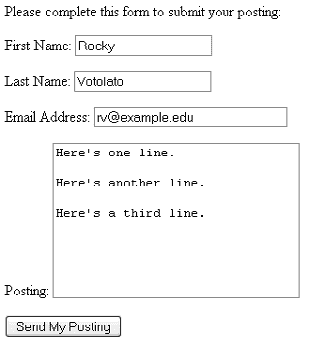

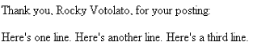

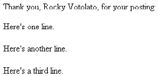

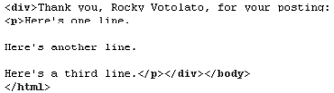


# 初级 PHP 开发者的常见问题涉及处理字符串中的换行

`textarea` 表单元素允许用户通过按下 Return/Enter 来输入多行文本。每次使用 Return/Enter 都等同于结果字符串中的一个换行。这些换行在 `textarea` 中有效，但对渲染后的 PHP 页面 **A** 和 **B** 没有影响。

要在渲染后的 Web 页面中创建等效换行，你需要使用换行标签：`<br />`。幸运的是，PHP 有 `nl2br()` 函数，它可以自动将换行转换为换行标签：

```php
$var = nl2br($var);
```

让我们此函数应用于 `handle_post.php`，以便用户的帖子保留其格式。

## 将换行转换为换行符

1. 在你的文本编辑器或 IDE 中打开 `handle_post.php`（脚本 5.2），如果它尚未打开。
2. 在给 `$posting` 变量赋值时应用 `nl2br()` 函数（脚本 5.3）：
3. 现在，相同的提交数据 **A** 在 Web 浏览器中正确地跨多行显示。

```php
$posting = nl2br($_POST['posting']);
```

现在 `$posting` 将被赋值 `$_POST['posting']` 的值，任何换行符都已转换为 HTML 换行标签。

**D** 对应 **B** 的 HTML 源代码显示了换行在 Web 浏览器中的效果（即它们在 HTML 源代码中增加了间距）。

## 换行也可以通过在双引号之间放置换行符——`\n` 来插入字符串中

其他 HTML 标签（如段落标签）也会影响渲染后 Web 页面的间距。你可以使用替换函数将换行（或任何字符）转换为段落标签，但实现此操作的代码比仅仅调用 `nl2br()` 要得多。

发送到浏览器的字符串中的换行将产生影响，但仅限于页面的 HTML 源代码。

## 脚本 5.3

当你使用 `nl2br()` 函数时，在帖子 `textarea` 中输入的换行在 Web 浏览器中显示时会被保留。

3. 保存文件，将其放置在与 `posting.html` 相同的目录下（在你启用了 PHP 的服务器上），并在 Web 浏览器 **C** 中再次测试。

```html
<!DOCTYPE html PUBLIC "-//W3C//DTD XHTML 1.0 Transitional//EN"
"http://www.w3.org/TR/xhtml1/DTD/xhtml1-transitional.dtd">
<html xmlns="http://www.w3.org/1999/xhtml" xml:lang="en" lang="en">
<head>
<meta http-equiv="Content-Type" content="text/html; charset=utf-8"/>
<title>论坛帖子</title>
</head>
<body>
<?php // 脚本 5.3 - handle_post.php #
/* 此脚本从 posting.html 接收五个值：
first_name, last_name, email, posting, submit
*/

// 处理错误，如果需要的话。

// 从 $_POST 数组获取值：
$first_name = $_POST['first_name'];
$last_name = $_POST['last_name'];
$posting = nl2br($_POST['posting']);

// 创建全名：
$name = $first_name . ' ' . $last_name;

// 打印消息：
echo "<div>感谢你， $name，你的帖子：$posting</div>";
?>
</body>
</html>
```

$posting$ 因为 $posting$ 已经

15 // 从 `$_POST` 数组获取值：

反映了 `nl2br()` 函数的应用

16 `$first_name = $_POST['first_name'];`

这意味着引入了换行标签

17 `$last_name = $_POST['last_name'];`

这些标签并不是用户显式输入的。

18 `$posting = nl2br($_POST['posting']);`

19

20 // 创建全名变量：

**3.** 修改 `print` 语句如下：

21 `$name = $first_name . ' ' . $last_name;`

22

23 // 调整 HTML 标签处理：

**print "<div>Thank you, $name, for**

**24 $html\_post = htmlentities($_POST**

➝ **your posting:**

**\['posting'\]);**

**<p>Original: $posting</p>**

**25 $strip\_post = strip_tags($_POST**

**<p>Entity: $html_post</p>**

**<p>Stripped: $strip_post</p></div>";**

26

27 // 打印消息：

为了突出不同的结果，打印

**28 print "<div>Thank you, $name, for**

帖子的三个不同版本文本。首先是输入的原始帖子，它在

**your**

**posting:**

**29 <p>Original:**

**$posting</p>**

**30 <p>Entity:**

**$html_post</p>**

经过

**31 <p>Stripped:**

**$strip_post</p></div>";**

`nl2br()` 处理后的。接下来是帖子的 `htmlentities()`

32 版本，它将显示 HTML 标签而不进行渲染。

33 ?>

34 </body>

最后，`strip_tags()` 版本将 

35 </html>

36 之后被打印出来；它不包含任何 HTML（或 PHP）标签。

继续见下一页

字符串基础 101

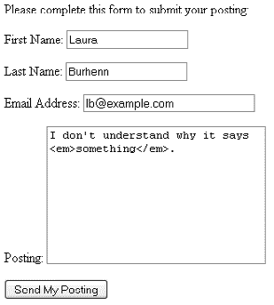

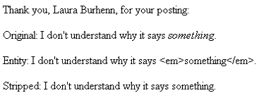

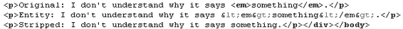

**4.** 保存文件，将其放置在 `posting.html` 相同的目录中（在你启用了 PHP 的服务器上），并在你的 Web 浏览器 **D** 和 **E** 中再次测试。

如果你查看生成的 PHP 页面 **F** 的 HTML 源代码，还将看到应用这些函数产生的效果。

**出于安全考虑，几乎总是使用 `htmlentities()`、`htmlspecialchars()` 或 `strip_tags()` 处理任何打印到 Web 浏览器的用户提供的数据是一个好主意。在本书的阅读过程中，我这样做是为了减少杂乱。**

**D** 作为帖子一部分输入的 HTML 字符现在将由 PHP 处理。

`html_entity_decode()` 函数的作用与 `htmlentities()` 正好相反，它将 HTML 实体转换为它们相应的 HTML 代码。

**另一个用于在 Web 浏览器中输出字符串的有用函数是 `wordwrap()`。该函数会将字符串换行到指定的字符数。**

**E**

**在将换行符转换为换行符的同时生成的 PHP 页面显示了原始帖子在不经修改的情况下打印的样子，仍然删除了任何 HTML 或 PHP 标签，应用了 `htmlentities()` 的效果，并在 `strip_tags()` 之后应用了 `nl2br()` 的效果：**

```php
$posting = nl2br(strip_tags($_POST['posting']));
```

在该行中，将首先调用 `strip_tags()` 函数，其结果将传递给 `nl2br()` 函数。

**F** **E** 中显示内容的 HTML 源代码。

102 章 5

## 脚本 5.5

此脚本在将变量添加到链接之前对两个变量进行编码。然后这些值就可以成功地传递到另一个页面。

```html
<!DOCTYPE html PUBLIC "-//W3C//DTD XHTML 1.0 Transitional//EN"
"http://www.w3.org/TR/xhtml1/DTD/xhtml1-transitional.dtd">
<html xmlns="http://www.w3.org/1999/xhtml" xml:lang="en" lang="en">
<head>
<meta http-equiv="Content-Type" content="text/html; charset=utf-8"/>
<title>Forum Posting</title>
</head>
<body>
<?php
/* Script 5.5 - handle.php
此脚本在将变量添加到链接之前对两个变量进行编码。然后这些值
就可以成功地传递到另一个页面。*/
$first_name = $_POST['first_name'];
$last_name = $_POST['last_name'];
$name = $first_name . ' ' . $last_name;
$posting = nl2br($_POST['posting']);
$html_post = htmlentities($_POST['posting']);
$strip_post = strip_tags($_POST['posting']);

print "<div>Thank you, $name, for
<p>Original: $posting</p>
<p>Entity: $html_post</p>
<p>Stripped: $strip_post</p>
</div>";

// 为了突出不同的结果，打印帖子的三个不同版本文本。首先是输入的原始帖子，它在经过 `nl2br()` 处理后的。接下来是帖子的 `htmlentities()`版本，它将显示 HTML 标签而不进行渲染。最后，`strip_tags()` 版本将打印出来；它不包含任何 HTML（或 PHP）标签。

// 在将换行符转换为换行符的同时生成的 PHP 页面显示了原始帖子在不经修改的情况下打印的样子，仍然删除了任何 HTML 或 PHP 标签，应用了 `htmlentities()` 的效果，并在 `strip_tags()` 之后应用了 `nl2br()` 的效果：
$posting = nl2br(strip_tags($_POST['posting']));

// 在该行中，将首先调用 `strip_tags()` 函数，其结果将传递给 `nl2br()` 函数。
?>
</body>
</html>
```

## 7. 查看处理页面的 HTML 源代码，以查看 HTML 代码 `C` 中生成的链接。

直接从表单发送的值在发送之前会自动进行 URL 编码，并在到达接收脚本时进行解码。你只需要 `urlencode()` 函数即可完成：

### A

表单的另一个用途是手动编码数据（如示例所示）。

`urldecode()` 函数的作用与 `urlencode()` 相——它接收一个编码后的 URL 并将其转换回标准形式。不过，你使用它的频率会很低，因为 PHP 会自动解码它收到的大多数值。

### B

处理脚本现在显示指向另一个页面的链接（继续见下一页）。

### C

页面 `B` 的 HTML 源代码显示了动态生成的链接。

使用字符串 105

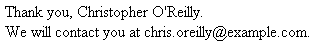

由于你可以配合函数使用字符串拼接，新的 `print` 语句可以写如下：

### D

```php
print 'Click <a href="thanks.php?name=' . $name . '&email=' . $email . '">here</a> to continue.';
```

在此过程中的第三个页面（由你在章节结束处创建）将根据在 URL 中接收到的值打印消息。这种方法与原始方法相比有两个额外优点。首先，它使用单引号来开始和结束语句，这意味着你不需要转义双引号。其次，使用的变量更加直观——它们没有被埋在大量的其他代码中。

为了在 URL 中使用数值 PHP 值，你不需要对其进行编码，因为它们不包含产生问题的字符。尽管如此，对它们进行编码也没有坏处。在章节结束时，你会被提示创建 `thanks.php`，该文件将通过姓名和电子邮件地址问候用户 `D`。

# 字符串的加密与解密

通常，为了保护数据，程序员会对数据进行加密——通过将其转换为更难识别（甚至无法识别）的形式来改变其状态。密码就是你可能想要加密的值示例。根据你想要建立的安全性级别，用户名、电子邮件地址和电话号码也可能是加密的候选对象。

你可以使用 `crypt()` 函数对数据进行加密，但请注意没有解密选项（这被称为单向加密）。因此，可以使用它对密码进行加密并存储，但永远无法确定密码的解密值。在 Web 应用程序中使用此函数，你可能在注册时加密用户的密码；然后当用户登录时，他们此时输入的密码也会被加密，然后对这两个受保护的密码版本进行比较。使用 `crypt()` 的语法为 `$data = crypt($data);`。

第二个加密函数是 `mcrypt_encrypt()`，可以使用相应命名的 `mcrypt_decrypt()` 函数进行解密。遗憾的是，为了让你能够使用这两个函数，必须在安装 PHP 模块时安装 Mcrypt 扩展。它的用法和语法也更复杂（我在我的《PHP 5 Advanced: Visual QuickPro Guide》Peachpit Press, 2007 中讨论过它）。

如果数据存储在数据库中，你还可以使用数据库应用程序内置的函数（例如 MySQL、PostgreSQL、Oracle 或 SQL Server）来执行加密和解密。取决于你使用的技术，它很可能提供单向和双向加密工具。

106 第 5 章

# 查找子字符串

## 比较字符串

PHP 有几个函数可以让你来拆分字符串、搜索字符串并执行比较。要比较两个字符串，你始终可以使用相等运算符，你将在下一章中学习它。否则，你可以使用这些函数：这些函数通常与条件语句（在第 6 章“控制结构”中讨论）配合使用，它们足够重要，因此在这里介绍；后面的章节将更正式地使用它们。

* `strcmp()` 通过返回一个整数来指示两个字符串的比较情况。
* `strnatcmp()` 类似，但在语言逻辑上更精确。
* 这些函数也有不区分大小写的伴侣函数，`strcasecmp()` 和 `strnatcasecmp()`。

在本章较早之前，你学习了如何使用拼接来连接字符串。除了由较小部分组成更大的字符串外，PHP 还轻松地让你从字符串中提取子部分。使用任何方法提取字符串子部分的诀窍在于，你必须了解字符串本身的一些，以便知道如何拆分它。

要检查一个子字符串是否包含在另一个字符串中（即在海中捞针），你将使用这些函数：

* `strstr()` 返回从针第一次出现处到末尾的干草堆。
* `strtok()` 函数使用预定义的分隔符（如逗号或空格）从较大的字符串中创建一个被称为标记（token）的子字符串。
* `strpos()` 搜索干草堆并返回特定针的数字位置。这两个函数也有不区分大小写的替代方案：`stristr()` 和 `stripos()`。

例如，如果用户输入了用空格分隔的全名，你可以通过以下代码提取名字：

```php
$first = strtok($_POST['name'], ' ');
```

如果用户以“姓，名”的格式输入，你可以通过这个找到姓：

```php
$last = strtok($_POST['name'], ', ');
```

## Substr

提取字符串部分的第二种方法是引用字符串内部的索引位置。字符串的索引位置是从开始数的字符的位置。然而，PHP 与大多数语言一样，从数字 0 开始。例如，为了索引 Larry，你从 L0 开始，接着是 a1、r2、r3 和 y4。尽管 Larry 的长度为 5，它的索引是从 0 到 4。

考虑到这一点，你可以调用 `substr()` 函数根据子字符串的索引位置创建一个字符串：

```php
$sub = substr($string, 0, 10);
```

第一个参数是派生子字符串的主字符串。第二个指示子字符串开始的位置，即索引位置（0 表示你想从第一个字符开始）。第三个参数指定从该起点开始子字符串应包含多少字符（10）。如果主字符串没有足够的字符，生成的子字符串将到主字符串的结束。这个参数是可选的；如果省略，子字符串也将一直到主字符串的结束。

你还可以使用负数从字符串末尾倒数：

```php
$string = 'ardvark';
$sub = substr($string, -3, 3); // ark
```

第二行代码表示从倒数第第三个字符开始返回三个字符。对于那个特定示例，你可以再次省略第三个参数并获得相同的结果：

```php
$sub = substr($string, -3); // ark
```

107 使用字符串

## 脚本 5.6

此版本的 `handle_post.php` 统计字符串中的字符数、帖子中的单词数，并将显示的帖子裁剪为仅包含前 50 个字符。

```php
print strlen('Hello, world!'); // 13
```

108 第 5 章


```html
<!DOCTYPE html PUBLIC "-//W3C//DTD
XHTML 1.0 Transitional//EN"
"http://www.w3.org/TR/xhtml1/DTD/xhtml1-transitional.dtd">
<html xmlns="http://www.w3.org/1999/xhtml" xml:lang="en" lang="en">
<head>
<meta http-equiv="Content-Type" content="text/html; charset=utf-8"/>
<title>Forum Posting</title>
</head>
<body>
<?php // Script 5.6 - handle_post.php #5
/* This script receives five values from posting.html: first_name, last_name, email, posting, submit */

// Address error management, if you want.
// Get the values from the $_POST array:
$first_name = $_POST['first_name'];
$last_name = $_POST['last_name'];
$posting = nl2br($_POST['posting']);

// This version of the script will do two things.
One will be to display the number of words it contains. That information is gathered and assigned to the `$words` variable.

// Create a full name variable:
$name = $first_name . ' ' . $last_name;

// Get a word count:
$words = str_word_count($posting);

// The second new thing this script will do is limit the displayed posting to its first 50 characters. You might use this, for example, if one page shows the beginning of a post, then a link takes the user to the full posting. To implement this limit, the `substr()` function is called on next page.
$posting = substr($posting, 0, 50);

// Print a message:
print "<div>Thank you, $name, for your posting:<p>$posting...</p><p>($words words)</p></div>";
?>
```

要查看字符串中包含多少个单词，请使用 `str_word_count()`。该函数将配合 `substr()` 在接下来的修订版的 `handle_post.php` 脚本中使用。

### 如何创建子字符串：

1.  在你的文本编辑器或 IDE 中打开 `handle_post.php`（脚本 5.5），如果它尚未打开。

2.  在 `print` 语句之前添加以下内容（**脚本 5.6**）：

```php
$words = str_word_count($posting);
```

3.  在下一行（同样在 `print` 语句之前），添加：

```php
$posting = substr($posting, 0, 50);
$words = str_word_count($posting);
```

4.  更新 `print` 语句读取为：

```php
print "<div>Thank you, $name, for your posting:<p>$posting...</p><p>($words words)</p></div>";
```

这里有两个改动。首先，在帖子之后添加了省略号，以表示这只是整个帖子的部分。然后，在另一个段落中打印了单词数。

5.  删除两个 `urlencode()` 行和相应的 `print` 语句。我特指在脚本的上一个版本中添加的链接到 `thanks.php` 的代码。

6.  保存文件，将其放置在启用 PHP 的服务器相应目录中，并在 Web 浏览器中再次测试。

### 超过 50 个字符的帖子……

将会被截断。还会显示单词数。如果你想检查字符串是否匹配特定格式——例如，检查它是否为有效的电子邮件地址——你需要使用正则表达式。正则表达式是一个高级概念，你可以在其中定义模式，然后查看某个值是否符合模板。请参阅 PHP 手册或我的书籍 *PHP for Dynamic Sites: Visual Quick Guide*。

### 调整字符串大小写

了一些 PHP 函数用于更改字符串字母的大小写：

- `ucfirst()` 将首字母大写化。
- `ucwords()` 将每个单词的首字母大写化。
- `strtoupper()` 将整个字符串转换为大写字母。
- `strtolower()` 将整个字符串转换为小写字母。

例如：

```php
$me = 'Larry E. Ullman';
$me = str_ireplace('E.', 'Edward', $me);
```

变量 `$me` 现在的值为 Larry Ullman。该函数执行的是不区分大小写的搜索。若要进行更严格的限制，可以使用 `str_replace()` 执行区分大小写的搜索。

在接下来的这个脚本中，`str_ireplace()` 将用于消除提交文本中的“脏话”。我还有一个想要讨论的字符串相关函数：`trim()`。该函数会移除字符串开头和结尾的任何空白字符——空格、换行符和制表符。由于用户输入信息时不小心或由于 HTML 代码粗率，字符串变量中增加额外的空格是非常常见的现象。为了清晰度、数据完整性和 Web 设计，在使用这些字符串之前删除这些空格是值得的。发送到浏览器的额外空格可能会让页面看起来很奇怪，而发送到数据库或 cookie 的空格在以后产生不幸的后果（例如，如果密码包含多余的空格，在不带空格输入时可能无法匹配）。

### 使用字符串

`trim()` 函数会自动删除字符串开头和结尾的任何额外空格（但不包括中间）。使用 `trim()` 的格式如下：

```html
<!DOCTYPE html PUBLIC "-//W3C//DTD
XHTML 1.0 Transitional//EN"
"http://www.w3.org/TR/xhtml1/DTD/xhtml1-transitional.dtd">
<html xmlns="http://www.w3.org/1999/xhtml" xml:lang="en" lang="en">
<head>
<meta http-equiv="Content-Type" content="text/html; charset=utf-8"/>
<title>Forum Posting</title>
</head>
<body>
```

### 使用 str_ireplace() 和 trim()：

1.  在你的文本编辑器或 IDE 中打开 `handle_post.php`（脚本 5.6），如果它尚未打开。

2.  对表单数据应用 `trim()`（**脚本 5.7**）：

```php
<?php // Script 5.7 - handle_post.php #6
/* This script receives five values from posting.html: first_name, last_name, email, posting, submit */

// 处理错误管理，如果需要。
// 从 $_POST 数组中获取值：
$first_name = trim($_POST['first_name']);
$last_name = trim($_POST['last_name']);
$posting = trim($_POST['posting']);

// 使用 trim() 移除额外空格：
// 以防输入的数据在开头或结尾有额外的空格，已应用 trim() 函数。
```

of `substr()`.

```php
24 // 获取单词计数：
25 $words = str_word_count($posting);
```

**4.** 在 `print` 语句之前，添加

```php
26 $posting = str_ireplace('badword',
```

**27 // 剔除脏词：**

```php
28 $posting = str_ireplace('badword', 'XXXXX', $posting);
```

➝ 这个特定的示例通过通过划掉词汇来标记帖子中对脏词的使用。代码并没有使用实际的脏话，而是使用了 `badword`。（当然，你可以使用任何喜欢的词汇。）

```php
30 // 打印消息：
31 print "<div>Thank you, $name, for your posting:
32 <p>$posting</p>
33 <p>($words words)</p></div>";
34
35 ?>
36 </body>
37 </html>
```

112 第 5 章

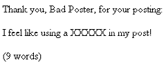

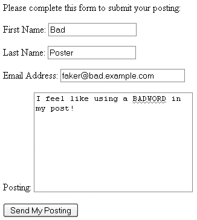

如果你想捕捉许多脏词，可以使用多行，如下：

```php
$posting = str_ireplace('badword1', 'XXXXX', $posting);
$posting = str_ireplace('badword2', 'XXXXX', $posting);
$posting = str_ireplace('badword3', 'XXXXX', $posting);
```

**5.** 更新 `print` 语句，使其不再使用省略号：

```php
print "<div>Thank you, $name, for your posting:<p>$posting</p><p>($words words)</p></div>";
```

**A** 如果用户输入了一个你不希望他们使用的单词……

**6.** 保存文件，将其置于启用 PHP 的服务器的相应目录中，并在 Web 浏览器 **A** 和 **B** 中再次测试。

`str_ireplace()` 函数甚至可以捕捉上下文中的脏词。例如，如果你输入 `I feel like using badwords`，你可以让 PHP 替换它。结果将是 `I feel like using XXXXXs`。

`str_ireplace()` 函数还可以接受一个针头数组（needle terms）、一个替换数组，甚至一个数组作为干草堆（haystack）。由于你可能还不知道数组，这种技术在这里没有演示。

如果你需要去除字符串开头或结尾的多余空格，而不是两端都，PHP 将 `trim()` 函数拆分为两个更具体的函数：`rtrim()` 移除字符串变量结尾（右侧）的空格，而 `ltrim()` 处理开头（左侧）的空格。它们的使用方法与 `trim()` 一样：

```php
$string = rtrim($string);
$string = ltrim($string);
```

使用字符串 113

## 复习与进阶

**进阶**

■ 查询其中一个 PHP 手手册页面。如果你在复习本章提到的新函数或执行进阶提示时遇到任何问题，请转到该页面上的链接以查看书籍的支持论坛（`www.LarryUllman.com/forum/`）。

检查 PHP 拥有的其他与字符串相关的函数。

**复习**

■ 专门查看 `substr()` 函数的 PHP 手手册。

■ 你如何创建字符串？阅读该页面上的其他示例，以更好地理解 `substr()` 如何使用。

■ 使用单引号和双引号之间有什么区别？

■ 拼接运算符是什么？

■ 拼接赋值运算符是什么？

■ 编写配合脚本 5.5 的 `thanks.php` 脚本。如果你需要帮助，请重新查看第 3 章的 `hello.php` 脚本（脚本 3.7）。

■ 在打印到浏览器的字符串中有换行符有什么影响？如何将换行符转换为换行标签？

■ 重写 `handle_post.php`（脚本 5.7）的最终版本中的 `print` 语句，使其使用单引号和拼接而不是双引号。

■ 当 HTML 输入到表单元素中且其值稍后会被打印回 Web 浏览器时可能会发生什么问题？采取哪些步骤来净化提交的表单数据中的 HTML 或 PHP 代码？

■ 创建另一个用于获取字符串值的 HTML 表单。然后创建一个 PHP 脚本来接收表单数据，对数据进行某些处理并输出结果。

■ 哪个函数可以安全地传递数据到 URL？

■ 你如何转义字符串中的问题字符？如果不转义会发生什么？

■ 字符串中的字符从什么数字开始索引？

■ `trim()` 函数的作用是什么？

114 第 5 章

## 控制结构

**本章内容**：控制结构——条件语句和循环——是编程语言的基础。PHP 有两种条件语句——`if` 和 `switch`——你将在本章中掌握它们。条件语句允许你建立一个测试，然后根据结果执行操作。此功能提供了让网站更加动态的能力。

对 `if` 条件语句的讨论需要引入最后两类运算符：比较运算符和逻辑运算符（你已经在之前的章节中见过算术运算符和赋值运算符）。你经常会在条件语句中使用这些运算符，以及布尔值 TRUE 和 FALSE。最后，本章引入了循环，允许你按照指定的迭代次数重复操作。你将在下一章看到。

### 创建 HTML 表单

### if 条件语句

### 验证函数

使用 else

使用 elseif

更多运算符

switch 条件语句

for 循环

复习与进阶

### 创建 HTML 表单

**1.** 在文本编辑器或 IDE 中创建一个新的 HTML 文档，命名为 `register.html`（**脚本 6.1**）：

```html
<!DOCTYPE html>
<html lang="en">
<head>
<meta http="Content-Type" charset="UTF-8">
<title>Registration Form</title>
</head>
<body>
<!-- Script 6.1 - register.html -->
<div><p>请填写此表单以注册：p>
<form action="handle_reg.php" method="post">
<p>电子邮件地址：<input type="text" name="email" size="30" /></p>
<p>密码：<input type="password" name="password" size="20" /></p>
<p>确认密码：<input type="password" name="confirm" size="20" /></p>
<p>出生年份：<input
```

116 第 6 章

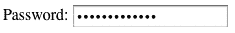

**脚本 6.1** 继续

**2.** 创建初始的 `form` 标签：

<form action="handle_reg.php" type="text" name="year" value="YYYY" size="4" /></p>

与之前的许多示例一样，此页面使用了 POST 方法。由 `action` 属性标识的处理脚本将是 `handle_reg.php`，它位于与 HTML 表单相同的目录下。

### 3. 为电子邮件地址和密码创建输入框：

<p>电子邮件地址：<input type="text" name="email" size="30" /></p>

<p><input type="checkbox" name="terms" value="Yes" /> 我同意条款（无论条款为何）。</p>

<p>密码：<input type="password" name="password" size="20" /></p>

<p>确认密码：<input type="password" name="confirm" size="20" /></p>

<input type="submit" name="submit" value="Register" /> </form>

这些代码应该是显而易见的。每行都包裹在 HTML 的 `<p></p>` 标签中，以改进 Web 浏览器中的间距。此外，注意创建了两个密码输入框——第二个用于确认第一个输入框中输入的内容。密码输入类型不会显示用户输入的内容，因此要求密码输入类型是一项标准策略，因为它要求用户输入两次密码（从而确保用户确切知道他们提供了什么密码）。

### 4. 为用户的出生年份创建输入框：

<p>出生年份：<input type="text" name="year" value="YYYY" size="4" /></p>

与其使用显示 50 年或 100 年的下拉菜单，不如让用户在文本框中输入他们的出生年份。通过预设输入的 `value` 属性，你可以让文本框指示年份的正确格式。

### 5. 为用户喜欢的颜色创建一个下拉菜单：

<p>喜欢的颜色：**

<select name="color">

<option value="">选择一个</option>

<option value="red">红色</option>

<option value="yellow">黄色</option>

<option value="green">绿色</option>

<option value="blue">蓝色</option>


### 6. 为用户同意网站条款创建一个复选框

注册页面应该始终让用户确认他们的密码和可能可能的条款。

### 7. 添加提交按钮并关闭表单

```html
<input type="submit" name="submit" value="Register" />
</form>
```

### 8. 完成 HTML 页面

事实上，我添加这个输入框是为了在章节后的特定示例中使用它，但它也可以用于在用户登录后自定义网站的外观。自然地，你可以在这里添加尽可能多的颜色。

### 9. 将文件保存为 `register.html`，将其放在启用 PHP 的服务器的相应目录下，并在 Web 浏览器中加载该页面。

（注：提供的文本包含来自源材料的大量重复片段和重叠标签；上述布局根据提供的指令重建了逻辑流。）

# 注册结果

注册成功（但其实并没有）。

## 2. 开始 PHP 部分并处理地址

```php
22 }
23 ?>
error management, if necessary:
24 </body>
<?php // Script 6.2 - handle_reg.php
25 </html>
```

如果你没有启用 `display_errors`，或者 `error_reporting` 设置了错误的级别，请参阅第 3 章“HTML 表单与 PHP”，获取此处包含的代码行以更改这些设置。

## 3. 创建一个标记变量

```php
$okay = TRUE;
```

为了验证表单数据，将使用一个标记变量来表示表单是否正确完成。它被称为“标记”（flag）变量。

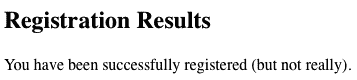

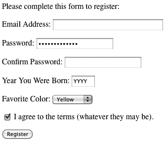

## 5. 完成 PHP 部分和 HTML 页面

因为该变量存储了一个指示状态的简单值。例如：是的，表单已完全填写；或者不是，没有。

变量被初始化为布尔值 `TRUE`，这意味着假设表单已正确完成。请注意，PHP 中的布尔值是不区分大小写的，所以你也可以写 `True` 或 `true`。

```php
?>
</body>
</html>
```

## 6. 将文件保存为 `handle_reg.php`，将其放在启用 PHP 的服务器的相应目录中（与 `register.html` 在同一目录下），并在你的 Web 浏览器 `B` 和 `C` 中测试两者。

## 4. 如果一切正常，则打印消息

```php
if ($okay) {
    print '<p>You have been successfully registered (but not really).</p>';
}
```

事实上，这个特定的脚本始终会打印成功消息，因为没有代码会将 `$okay` 设置为 `FALSE`。你甚至可以直接运行脚本并看到相同的结果。如果你的条件语句区域只有一行长，那么从技术上讲你不需要大括号。在这种情况下，你可以使用以下格式之一来编写条件：

```php
if (*condition*) *statement*;
```

或

```php
if (*condition*)
*statement*;
```

你可能会遇到这种格式的代码。在本章中，将向此脚本添加验证程序，以检查提交的表单数据。如果任何数据未通过程序，则 `$okay` 将被设置为 `FALSE`。在这种情况下，该条件也将为 `FALSE`，因此不会打印消息。然而，如果数据通过了每个验证程序，那么 `$okay` 仍然是 `TRUE`，在这种情况下将打印此消息。

然而，我认为最好是始终使用带有大括号的多行格式（如语法介绍中所示），以提高一致性并尽可能地减少错误。

**C** ……结果恰如下所示。

**B** 填写 HTML 表单的任何种程度……

控制结构 121

### 验证函数

PHP 有几十个常用于验证表单数据的函数。在这些函数中，最重要的三个用在本章示例中。

首先是 `empty()` 函数，它检查给定变量是否具有“空”值。如果变量没有值、值为 0 或值为 `FALSE`，则该变量被认为具有空值。在任何一种情况下，该函数都返回 `TRUE`；否则返回 `FALSE`：

```php
$var1 = 0;
$var2 = 'something';
$var3 = ' '; // 一个空字符串
empty($var); // TRUE, 无定义值
empty($var1); // TRUE, 空值
empty($var2); // FALSE, 非空值
empty($var3); // TRUE, 空值
```

此函数非常适合确保表单中的文本框已填写。例如，如果你有一个名为 `email` 的文本输入，并且用户在提交表单之前没有在其中输入任何内容，那么 `$_POST['email']` 变量将存在，但其值为空。

接下来是 `isset()` 函数，它几乎与 `empty()` 相反，尽管有细微差别。如果变量具有任何值（包括 0、`FALSE` 或空字符串），`isset()` 返回 `TRUE`。如果变量没有值，`isset()` 返回 `FALSE`：

```php
$var1 = 0;
$var2 = 'something';
$var3 = ' '; // 一个空字符串
isset($var); // FALSE, 无定义值
isset($var1); // TRUE
isset($var2); // TRUE
isset($var3); // TRUE
```

**脚本 6.3** 使用 `if` 条件语句和 `empty()` 函数。`isset()` 函数通常用于验证复选框、单选按钮和选择菜单等表单元素。

最后，`is_numeric()` 函数如果提交的变量具有有效的数值值，则返回 `TRUE`，否则返回 `FALSE`。整数、小数甚至字符串都可以通过 `is_numeric()`。

**脚本 6.2 - handle_reg.php**

```html
<!DOCTYPE html>
<html lang="en">
<head>
<meta http-equiv="Content-Type" content="text/html; charset=utf-8">
<title>Registration</title>
<style>
.error { color: red; }
</style>
</head>
<body>
<h1>Registration Results</h1>
<?php
// Script 6.2 - handle_reg.php
$okay = TRUE;

// 验证邮箱地址：
if (empty($_POST['email'])) {
    print '<p class="error">Please enter your email.</p>';
    $okay = FALSE;
}

// 验证密码：
if (empty($_POST['password'])) {
    print '<p class="error">Please enter your password.</p>';
    $okay = FALSE;
}

// 如果没有错误，打印成功消息：
if ($okay) {
    print '<p>You have been successfully registered (but not really).</p>';
}
?>
</body>
</html>
```

**脚本 6.3** 使用 `if` 条件语句和 `empty()` 函数，此 PHP 脚本检查是否提供了邮箱地址和密码值。

此 **if** 条件语句使用 `empty($_POST['email'])` 作为其条件。如果该变量为空（意味着它没有值、值为 0 或值为空字符串），则该条件为 `TRUE`。在这种情况下，将执行 `print` 语句并为 `$okay` 变量赋值 `FALSE`（表示一切并不正常）。如果变量非为空，则该条件为 `FALSE`，`print` 函数不会被调用，`$okay` 将保留其原始值。

**A** 如果你漏掉了邮箱地址或密码表单输入……

**4.** 重复密码的验证：

```php
if (empty($_POST['password'])) {
    print '<p class="error">Please enter your password.</p>';
    $okay = FALSE;
}
```

这是对邮箱验证的重复，但带有变量名和 `print` 语句已相应更改。其他表单输入项将及时进行验证。

所有打印的错误信息都放置在 HTML 段落标签内，该标签的 `class` 值为 `error`。通过这种方式，将应用 CSS 格式（即错误将以红色打印，尽管这在本书的插图中可能并不明显）。

**5.** 将文件保存为 `handle_reg.php`，将其置于与 `register.html` 相同的目录中（在你的启用了 PHP 的服务器上），并在 Web 浏览器 **A** 和 **B** 中测试表单和脚本。

**6.** 在不同的完整性状态下重新提交表单，以进一步测试结果。

如果你确实提供了电子邮箱地址和密码值，结果将与“The if 条件语句”节中的图 C 完全一样，因为 `$okay` 变量的值仍为 TRUE（真）。

**当你在条件语句中使用函数时（例如这里的 `empty()`），很容易忘记写右括号并导致解析错误。在编写任何控制结构时，请务必注意你的语法。**

**`isset()` 函数的一个用途是除非变量存在，否则不引用它。如果 PHP 设置为报告通知（参见第 3 章的“错误报告”），那么例如，在未定义的情况下使用 `$var` 将导致错误。你可以通过编写代码来避免这种情况：**

```php
if (isset($var)) {
    // 对 $var 执行任何操作。
}
```

**尽管几乎所有的表单数据都是作为字符串发送给 PHP 脚本的，`is_numeric()` 函数仍然可以来自表单的值，因为它可以处理仅包含数字的字符串。**

**`isset()` 函数可以任意数量的变量作为参数：**

```php
if (isset($var1, $var2)) {
    print 'Both variables exist.';
}
```

**如果所有命名变量都已设置，函数返回 TRUE；如果任何变量未设置，函数返回 FALSE。**

控制结构 125


### 使用 else

我们将讨论的下一个控制结构是 `if`-`else` 条件语句。该控制结构允许你在条件为 TRUE 时执行一个或多个语句，并在条件为 FALSE 时执行一个或多个其他语句：

```php
if (*condition*) {
    statement(s);
} else {
    other_statement(s);
}
```

使用此构造时需要记住的重要点是，除非显式满足条件，否则 `else` 语句将被执行。换句话说，`else` 之后的语句构成了默认操作，而 `if` 条件之后的语句则是该规则的例外。

### IF-ELSE 条件语句如何影响脚本的程序流

**脚本 6.4** 通过添加一个 `if-else` 条件语句，此脚本验证了出生年份并创建一个新变量。让我们重写 `handle_reg.php` 页面，引入一个 `if-else` 条件语句来验证出生年份。在此过程中，将创建一个代表用户年龄的新变量。

```html
<!DOCTYPE html PUBLIC "-//W3C//DTD HTML 1.0 Transitional//EN" "http://www.w3.org/TR/REC-html/html1-transitional.dtd">
<html lang="en" lang="en">
<head>
    <meta http-equiv="Content-Type" content="text/html; charset=utf-8">
    <title>Registration</title>
    <style>
        .error { color: red; }
    </style>
</head>
<body>
    <h1>Registration</h1>
<?php
// Script 6.4 - handle_reg.php
$email = $_POST['email'];
$password = $_POST['password'];
$year = $_POST['year'];

if (!empty($email) && !empty($password) && is_numeric($year)) {
    $age = 2011 - $year;
    $okay = true;
} else {
    $okay = false;
}

if ($okay) {
    print "You have been registered. You will turn $age this year.";
} else {
    if (empty($email)) {
        print '<p class="error">Please enter your email.</p>';
    }
    if (empty($password)) {
        print '<p class="error">Please enter your password.</p>';
    }
    if (!is_numeric($year)) {
        print '<p class="error">Please enter the year as four digits.</p>';
    }
}
?>
</body>
</html>
```


```html
<!DOCTYPE html PUBLIC "-//W3C//DTD HTML 1.0 Transitional//EN" "http://www.w3.org/TR/REC-html/html1-transitional.dtd">
<html lang="en" lang="en">
<head>
    <meta http-equiv="Content-Type" content="text/html; charset=utf-8">
    <title>Registration</title>
    <style>
        .error { color: red; }
    </style>
</head>
<body>
    <h1>Registration</h1>
<?php
// Script 6.4 - handle_reg.php
$email = $_POST['email'];
$password = $_POST['password'];
$year = $_POST['year'];

if (!empty($email) && !empty($password) && is_numeric($year)) {
    $age = 2011 - $year;
    $okay = true;
} else {
    $okay = false;
}

if ($okay) {
    print "You have been registered. You will turn $age this year.";
} else {
    if (empty($email)) {
        print '<p class="error">Please enter your email.</p>';
    }
    if (empty($password)) {
        print '<p class="error">Please enter your password.</p>';
    }
    if (!is_numeric($year)) {
        print '<p class="error">Please enter the year as four digits.</p>';
    }
}
?>
</body>
</html>
```

但带有变量名和 `print` **B** …你你会看到像这些这样的消息。

语句已相应更改。其他表单输入项将及时进行验证。

所有打印的错误信息都放置在 HTML 段落标签内，该标签的 `class` 值为 `error`。通过这种方式，将应用 CSS 格式（即错误将以红色打印，尽管这在本书的插图中可能并不明显）。

**5.** 将文件保存为 `handle_reg.php`，将其置于与 `register.html` 相同的目录中（在你的启用了 PHP 的服务器上），并在 Web 浏览器 **A** 和 **B** 中测试表单和脚本。

**6.** 在不同的完整性状态下重新提交表单，以进一步测试结果。

如果你确实提供了电子邮箱地址和密码值，结果将与“The if 条件语句”节中的图 C 完全一样，因为 `$okay` 变量的值仍为 TRUE（真）。

**当你在条件语句中使用函数时（例如这里的 `empty()`），很容易忘记写右括号并导致解析错误。在编写任何控制结构时，请务必注意你的语法。**

**`isset()` 函数的一个用途是除非变量存在，否则不引用它。如果 PHP 设置为报告通知（参见第 3 章的“错误报告”），那么例如，在未定义的情况下使用 `$var` 将导致错误。你可以通过编写代码来避免这种情况：**

```php
if (isset($var)) {
    // 对 $var 执行任何操作。
}
```

**尽管几乎所有的表单数据都是作为字符串发送给 PHP 脚本的，`is_numeric()` 函数仍然可以来自表单的值，因为它可以处理仅包含数字的字符串。**

**`isset()` 函数可以任意数量的变量作为参数：**

```php
if (isset($var1, $var2)) {
    print 'Both variables exist.';
}
```

**如果所有命名变量都已设置，函数返回 TRUE；如果任何变量未设置，函数返回 FALSE。**

控制结构 125


### 使用 else

我们将讨论的下一个控制结构是 `if`-`else` 条件语句。该控制结构允许你在条件为 TRUE 时执行一个或多个语句，并在条件为 FALSE 时执行一个或多个其他语句：

```php
if (*condition*) {
    statement(s);
} else {
    other_statement(s);
}
```

使用此构造时需要记住的重要点是，除非显式满足条件，否则 `else` 语句将被执行。换句话说，`else` 之后的语句构成了默认操作，而 `if` 条件之后的语句则是该规则的例外。

### IF-ELSE 条件语句如何影响脚本的程序流

**脚本 6.4** 通过添加一个 `if-else` 条件语句，此脚本验证了出生年份并创建一个新变量。让我们重写 `handle_reg.php` 页面，引入一个 `if-else` 条件语句来验证出生年份。在此过程中，将创建一个代表用户年龄的新变量。

```html
<!DOCTYPE html PUBLIC "-//W3C//DTD HTML 1.0 Transitional//EN" "http://www.w3.org/TR/REC-html/html1-transitional.dtd">
<html lang="en" lang="en">
<head>
    <meta http-equiv="Content-Type" content="text/html; charset=utf-8">
    <title>Registration</title>
    <style>
        .error { color: red; }
    </style>
</head>
<body>
    <h1>Registration</h1>
<?php
// Script 6.4 - handle_reg.php
$email = $_POST['email'];
$password = $_POST['password'];
$year = $_POST['year'];

if (!empty($email) && !empty($password) && is_numeric($year)) {
    $age = 2011 - $year;
    $okay = true;
} else {
    $okay = false;
}

if ($okay) {
    print "You have been registered. You will turn $age this year.";
} else {
    if (empty($email)) {
        print '<p class="error">Please enter your email.</p>';
    }
    if (empty($password)) {
        print '<p class="error">Please enter your password.</p>';
    }
    if (!is_numeric($year)) {
        print '<p class="error">Please enter the year as four digits.</p>';
    }
}
?>
</body>
</html>
```

但带有变量名和 `print` **B** …你你会看到像这些这样的消息。

语句已相应更改。其他表单输入项将及时进行验证。

所有打印的错误信息都放置在 HTML 段落标签内，该标签的 `class` 值为 `error`。通过这种方式，将应用 CSS 格式（即错误将以红色打印，尽管这在本书的插图中可能并不明显）。

**5.** 将文件保存为 `handle_reg.php`，将其置于与 `register.html` 相同的目录中（在你的启用了 PHP 的服务器上），并在 Web 浏览器 **A** 和 **B** 中测试表单和脚本。

**6.** 在不同的完整性状态下重新提交表单，以进一步测试结果。

如果你确实提供了电子邮箱地址和密码值，结果将与“The if 条件语句”节中的图 C 完全一样，因为 `$okay` 变量的值仍为 TRUE（真）。

**当你在条件语句中使用函数时（例如这里的 `empty()`），很容易忘记写右括号并导致解析错误。在编写任何控制结构时，请务必注意你的语法。**

**`isset()` 函数的一个用途是除非变量存在，否则不引用它。如果 PHP 设置为报告通知（参见第 3 章的“错误报告”），那么例如，在未定义的情况下使用 `$var` 将导致错误。你可以通过编写代码来避免这种情况：**

```php
if (isset($var)) {
    // 对 $var 执行任何操作。
}
```

**尽管几乎所有的表单数据都是作为字符串发送给 PHP 脚本的，`is_numeric()` 函数仍然可以来自表单的值，因为它可以处理仅包含数字的字符串。**

**`isset()` 函数可以任意数量的变量作为参数：**

```php
if (isset($var1, $var2)) {
    print 'Both variables exist.';
}
```

**如果所有命名变量都已设置，函数返回 TRUE；如果任何变量未设置，函数返回 FALSE。**

控制结构 125


## 算术

算术包括加法 (`+`)、减法 (`-`)、乘法 (`*`) 和除法 (`/`)，以及增量模 (`%`)（除法的取余运算）。递增 (`++`) 和递减 (`--`) 快捷方式允许将数字增加或减少 1。

## 赋值

赋值运算符 (`=`) 用于设置变量的值，无论其类型如何。它将值赋给变量。

你还学习了字符串拼接 (`.`)，它可以将一个字符串附加另一个字符串之后。

## 比较

相等 (`==`) 和不相等 (`!=`) 比较。

在创建条件语句时，比较运算符和逻辑运算符是最重要的。`Table 6.1` 列出了将讨论的运算符，以及你已经见过的运算符：

- `<`: 小于
- `>`: 大于
- `<=`: 小于等于
- `>=`: 大于等于
- `!`: 非

## 逻辑

当赋值运算符（等号）在第 2 章“变量”中引入时，你学到它的意义并不像你传统上认为的那样。`$var = 5;` 这一行并不是说 `$var` 等于 5，而是说它被赋值为值 5。这是一个重要的区别。

当你编写条件语句时，通常想检查一个变量是否等于某个特定值（例如为了匹配用户名或密码），这是你仅用等号无法完成的（因为该运算符用于赋值，而不是比较值是否相等）。相反，在比较时，请使用相等运算符 (`==`)：

```php
$var = 5;
if ($var == 5) { ...
```

这两行代码结合在一起首先确定了 `$var` 的值为 5，然后创建了一个检查 `$var` 是否等于 5 的 TRUE（真）条件。这个示例说明多一个等号对你的代码产生的巨大差异，以及为什么你必须仔细区分赋值运算符和比较运算符。

### 脚本 6.5

此版本的表单处理脚本使用比较运算符来验证密码和年份值。

```html
<!DOCTYPE html PUBLIC "-//W3C//DTD XHTML 1.0//EN"
"http://www.w3.org/TR/xhtml1/DTD/xhtml1-transitional.dtd">
<html lang="en">
<head>
<meta http-equiv="Content-Type" content="text/html; charset=utf-8"/>
<title>Registration</title>
<style>
.error { color: red; }
</style>
</head>
<body>
<h1>Results</h1>
<?php
/* Script 6.5 - handle_reg.php
此脚本从 register.html 接收七个值：email, password, confirm, year, terms, submit。如果需要，还包含地址管理。用于跟踪成功的标记变量： */
$okay = TRUE;

// 验证电子邮箱地址：
if (empty($_POST['email'])) {
    print '<p class="error">Please enter email address.</p>';
    $okay = FALSE;
}
// 验证密码：
if (empty($_POST['password'])) {
    print '<p class="error">Please enter password.</p>';
    $okay = FALSE;
}
// 检查两个密码是否相等：
if ($_POST['password'] != $_POST['confirm']) {
    print '<p class="error">Your confirmed password does not match the original.</p>';
    $okay = FALSE;
}
// 在年份验证后，报告错误：
if ($_POST['year'] >= 2011) {
    if (is_numeric($_POST['year'])) {
        $age = 2011 - $_POST['year'];
    } else {
        print '<p class="error">Please enter the year you were born as four digits.</p>';
        $okay = FALSE;
    }
    // 注意：这里简化了 2011 年以前出生的逻辑处理。
    print '<p class="error">Either you entered your birth year wrong or you come from the future!</p>';
    $okay = FALSE;
}
// 如果没有错误，打印成功消息：
if ($okay) {
    print '<p>You have been successfully registered (but not really).</p>';
    print "<p>You will turn $age this year.</p>";
}
?>
</body>
</html>
```

# 放置一个控制结构的过程

可见。逻辑运算符——位于另一个运算符内部的最终运算符（嵌套）。此的关键在于本章讨论的类型——它可以帮助你将内部条件放置为更复杂或更明显的结构。外部的语句（们）部分。

在 PHP 中，`TRUE` 条件的一个示例是 `if`。例如，它仅仅是一个取值不为 0、空字符串或 FALSE 的变量名：

```php
$var = 5;
if ($var) { // condition1
    if ($condition2) { // condition2
        statement(s)2;
    }_ {
    }
} // End of 2
} else { // condition1 else
    other_(s11

} // End of 1
```

```php
if (5 >= 3) { ... }
```

从这个示例可以看出，你可以通过大量的缩进和注释来降低这些结构的复杂性。只要每个条件在语法上是正确的，对于嵌套多少层并没有规定，也取决于你是否使用 `else` 子句，甚至取决于某个子条件属于主条件的 `if` 部分还是 `else` 部分。

如果一个条件引用变量且该变量没有值（或值为 0 或空字符串），或者你创建了一个不符合逻辑的结构，则该条件为 FALSE。以下条件始终为 FALSE：

```php
if (5 <= 3) { ... }
```

在 PHP 中，感叹号（`!`）是非运算符。你可以用它来反转语句的 TRUE/FALSE 状态。例如：

```php
$var = 'value';
if ($var) {... // TRUE
if (!$var) {... // FALSE
if (isset($var)) {... // TRUE
if (!isset($var)) {... // FALSE
if (!empty($var)) {... // TRUE
```

为了超越简单的单部分条件，PHP 支持另外五种类型的逻辑运算符：两个版本的“与”（`AND` 和 `&&`）、两个版本的“或”（`OR` 和 `||`——一个被称为“管道”的字符，组合了两次）以及“异或”（`XOR`）。当你对一个运算符有两个选项时（如 `and` 和 `or`），它们的区别仅在于优先级。对于几乎所有情况，你可以交替使用任何版本的 `and` 或任何版本的 `or`。


# 使用逻辑运算符构建复杂条件

通过使用括号和逻辑运算符，你可以创建更复杂的 `if` 条件。对于 `AND` 条件，每个连接部分都必须为 `TRUE`，整个条件才为 `TRUE`。对于 `OR`，至少有一个子部分为 `TRUE` 即可使整个条件为 `TRUE`。

这些条件是 `TRUE` 的：

```php
if ( (5 <= 3) OR (5 >= 3) ) { ... }
if ( (5 > 3) AND (5 < 10) ) { ... }
```

这些条件是 `FALSE` 的：

```php
if ( (5 != 5) AND (5 > 3) ) { ... }
if ( (5 != 5) OR (5 < 3) ) { ... }
```

在构建条件时，请记住两个重要的点：首先，为了让条件结果的语句被执行，整个条件必须具有 `TRUE` 值；其次，通过使用括号，你可以忽略优先级规则，并确保运算符按照你选择的顺序进行处理。

## 演示逻辑运算符

为了演示逻辑运算符，让我们在 `handle_reg.php` 页面添加更多条件。你还将把其中一个年份条件嵌套在另一个条件内部（更多信息请参见侧边栏“嵌套条件”）。

### 要使用逻辑运算符：

1. 在文本编辑器或 IDE 中打开 `handle_reg.php`（脚本 6.5），如果它尚未打开。
2. 删除现有的年份验证（脚本 6.6）。你将完全重写这些条件，作为一个嵌套条件，因此最好将其删除。
3. 检查年份是否为四位数字。

#### 脚本 6.5 - handle_reg.php

```php
<?php
 // Script 6.5 - handle_reg.php
 // 此脚本接收 register.html 的值：email, password, year, terms, color, submit
 // 地址管理，如果你想。
 // 用于跟踪成功的变量：
 $okay = TRUE;
 // 验证电子邮件地址：
 if (empty($_POST['email'])) {
     print '<p class="error">请输入电子邮件地址。</p>';
     $okay = FALSE;
 }
 // 验证密码：
 if (empty($_POST['password'])) {
     print '<p class="error">请输入密码。</p>';
     $okay = FALSE;
 }
 // 检查两个密码的等性：
 if ($_POST['password'] != $_POST['confirm']) {
     print '<p class="error">确认的密码不匹配</p>';
 }
 // 验证年份：
 if (is_numeric($_POST['year']) && (strlen($_POST['year']) == 4)) {
     if ($_POST['year'] < 2011) {
         $age = 2011 - $_POST['year'];
         // 计算今年的年龄
     } else {
         print '<p class="error">出生年份错误，你来自未来。</p>';
         $okay = FALSE;
     }
 } else {
     print '<p class="error">出生年份错误，你来自未来。</p>';
     $okay = FALSE;
 }
 // 验证条款：
 if (!isset($_POST['terms'])) {
     print '<p class="error">你必须接受条款。</p>';
     $okay = FALSE;
 }
 // 如果没有错误，打印成功消息：
 if ($okay) {
     print '<p>你已注册成功（但并非如此）。</p>';
     print "<p>你今年将 $age 岁。</p>";
 }
?>
```

#### 脚本 6.6 - register.html

```html
<!DOCTYPE html PUBLIC "-//W3C//DTD XHTML 1.0 Transitional//EN"
 "http://www.w3.org/TR/xhtml1/DTD/xhtml1-transitional.dtd">
<html xmlns="http://www.w3.org/1999/xhtml" xml:lang="en" lang="en">
<head>
<meta http-equiv="Content-Type" content="text/html; charset=utf-8"/>
<title>注册</title>
<style type="text/css" media="screen">
.error { color: red; }
</style>
</head>
<body>
<h1>注册结果</h1>
</body>
</html>
```

4. 创建一个子条件来检查年份值是否在 2011 年之前。

5. 完成主年份条件判断：

```php
} else { // 对应第一个判断的 else。
    print '<p class="error">请输入四位数字的出生年份。</p>';
    $okay = FALSE;
} // 第一个条件的结束。
```

此 `else` 部分完成了第 3 步中开始的条件判断。如果设置的条件至少有一个为 `FALSE`，则会打印此消息并将 `$okay` 设置为 `FALSE`。

6. 确认勾选框未勾选：

```php
if (!isset($_POST['terms'])) {
    print '<p class="error">必须接受条款。</p>';
    $okay = FALSE;
}
```

如果 `$_POST['terms']` 变量未设置，说明用户没有勾选该框，应当报告错误。为了更精确，此条件可以是：

```php
if (!isset($_POST['terms']) || $_POST['terms'] == 'Yes') {
```

7. 这些是脚本的唯一更改，因此你现在可以保存它，将其与 `register.html` 放在同一目录下（支持 PHP 的服务器），并在浏览器中再次测试。

8. 如果需要，将你的 `year` 值改为未来并再次提交表单。

## 编程规范与调试

另一种常见的编程规范——本书也维护这一点——是将 `TRUE` 和 `FALSE` 全部大写。尽管这不是 PHP 的强制要求。例如，以下条件是 `TRUE`：

```php
if (true) {...}
```

在长且复杂的条件中很容易忘记圆括号或花括号，这会导致错误消息或意外的结果。使用某种系统（如对条件进行缩进和使用注释）来辅助代码。另一种良好的技巧是先创建整个条件的结构，然后再添加细节。

如果在执行 `if-else` 语句时遇到问题，打印变量的值有助于调试问题。条件可能不是 `TRUE` 或 `FALSE`，因为变量的值并不是你认为的值。

# 使用 elseif

与 `if-else` 条件类似，`if-elseif`（或 `if-elseif-else`）类似于运行中的 `if` 语句，可以根据你的需要进行扩展：

```php
if (condition) {
    statement;
} elseif (condition2) {
    other_statement;
} else {
    other_statement;
}
```

如果存在 `else`，必须始终让 `else` 作为条件的最后部分，因为除非满足该点为止的条件之一（再次，`else` 可以在一个 `if` 条件中根据需要使用多次 `elseif`）。如果你不需要默认响应，也可以省略 `else` 子句。

## 脚本 6.7 - 多行 if-elseif-else 条件

脚本 6.7 多行 `if-elseif-else` 条件验证提交的颜色具有允许的值，并用于确定所选颜色的类型。

### 要使用 elseif：

1. 在文本编辑器或 IDE 中打开 `handle_reg.php`（脚本 6.6），如果它尚未打开。
2. 在 `$okay` 条件之前，开始一个新的条件（脚本 6.7）：

```php
<!DOCTYPE html PUBLIC "-//W3C//DTD XHTML 1.0 Transitional//EN" "http://www.w3.org/TR/xhtml1/DTD/xhtml1-transitional.dtd">
<html xmlns="http://www.w3.org/1999/xhtml" xml:lang="en" lang="en">
<head>
    <meta http-equiv="Content-Type" content="text/html; charset=utf-8"/>
    <title>Registration</title>
    <style type="text/css" media="screen">
        .error { color: red; }
    </style>
</head>
<body>
    <h1>Registration Results</h1>
<?php
// Script 6.7 - handle_reg.php
/* 此脚本从 register.html 接收七个值：email, password, confirm, year, terms, color, submit */

// 验证邮箱地址：
if (empty($_POST['email'])) {
    print '<p class="error">请输入您的邮箱地址。</p>';
    $okay = FALSE;
}

// 验证密码：
if (empty($_POST['password'])) {
    print '<p class="error">请输入您的密码。</p>';
    $okay = FALSE;
}

// 检查两个密码是否相等：
if ($_POST['password'] != $_POST['confirm']) {
    print '<p class="error">您确认的密码与原始不匹配</p>';
    $okay = FALSE;
}

// 验证年份：
if (is_numeric($_POST['year']) && strlen($_POST['year']) == 4) {
    if ($_POST['year'] < 2011) {
        $age = 2011 - $_POST['year'];
        // 计算今年的年龄。
    } else {
        print '<p class="error">要么您输入的年份错误，要么您来自未来！</p>';
        $okay = FALSE;
    }
} else {
    print '<p class="error">请输入四位数字的出生年份。</p>';
    $okay = FALSE;
}

// 验证颜色：
if ($_POST['color'] == 'red') {
    $color_type = 'primary';
} elseif ($_POST['color'] == 'yellow') {
    $color_type = 'primary';
} elseif ($_POST['color'] == 'green') {
    $color_type = 'secondary';
} elseif ($_POST['color'] == 'blue') {
    $color_type = 'primary';
} else { // 错误！
    print '<p class="error">Please select your favorite color.</p>';
    $okay = FALSE;
}

// 验证条款：
if (!isset($_POST['terms']) && ($_POST['terms'] == 'Yes')) {
    print '<p class="error">You must accept the terms.</p>';
    $okay = FALSE;
} // 第一个条件语句结束。

// 如果没有错误，则打印成功消息：
if ($okay) {
    print '<p>You have been successfully registered (but not really).</p>';
    print "<p>Your favorite color is a $color_type color.</p>";
}
?>
```

检查颜色的顺序并不重要，只要 `else` 子句排在最后即可。

3. 为第二颜色添加一个 `elseif` 子句：
4. 为其他颜色添加 `elseif` 子句：
5. 添加一个 `else` 子句：
6. 在 `$okay` 条件语句中，打印用户喜好的颜色类型：
7. 保存脚本，将其放在与 `register.html` 相同的目录中（在你的启用了 PHP 的服务器上），并在 Web 浏览器中再次测试它，使用不同的颜色选项。

大多数初级开发者没有意识到的一点是，黑客完全可以——事实上非常简单——在不使用你的 HTML 表单的情况下向你的 PHP 脚本提交数据。因此，验证预期变量的有效性（即它们是否已设置）、它们的类型及其值是非常关键的。如果你愿意，PHP 也允许你将 `elseif` 写成两个单词：

```php
if (condition1) {
    statement(s);
} else if (condition2) {
    statement(s)2;
}
```

# Switch 条件语句

**脚本 6.8** `switch` 条件语句可以简化复杂的 `if-elseif` 条件语句。当你需要处理较长的 `if-elseif-else` 条件语句时，你可能会发现使用 `switch` 条件语句反而可以节省编程时间并使代码更加清晰。`switch` 条件语句只接受一个可能的条件，通常只是一个变量。


```html
<!DOCTYPE html PUBLIC "-//W3C//DTD XHTML 1.0 Transitional//EN" "http://www.w3.org/TR/xhtml1/DTD/xhtml1-transitional.dtd">
<html xmlns="http://www.w3.org/1999/xhtml" xml:lang="en" lang="en">
<head>
    <meta http-equiv="Content-Type" content="text/html;charset=utf-8"/>
    <title>Registration</title>
    <style type="text/css" media="screen">
        .error { color: red; }
    </style>
</head>
<body>
    <h1>Registration Results</h1>
<?php
// Script 6.8 - handle_reg.php 
/* 
此脚本从 register.html 接收七个值：邮箱、密码、确认、年份、条款、颜色、提交。 
*/
```

你必须理解 `switch` 条件语句的工作原理才能正确使用它。在 `switch` 关键字之后，括号内会识别一个变量。PHP 将按顺序检查每个 `case`，尝试识别匹配的值。请注意，在 PHP 中任何其他使用字符串的地方，数值将不加引号；而字符串值应该加引号。在 `case value` 部分之后，一个冒号（不是分号）引导关联的语句，这些语句通常缩进在下一行。一旦 PHP 找到与条件变量值匹配的 `case`，它就会执行随后的语句。棘手之处在于：一旦 PHP 找到了匹配的 `case`，它将继续遍历 `switch` 直到遇到 `switch` 条件语句的结束（右括号）或遇到 `break` 语句，此时它将退出 `switch` 结构。因此，为了一致性，你务必关闭每个 `case`——即使是 `default` 情况——并使用 `break`。

此前的 `switch` 条件语句类似于以下内容的重写：

```php
if ($var == value1) {
    statement(s);
} elseif ($var == value2) {
    statement(s);
} else {
    statement(s);
}
```

由于 `switch` 条件语句使用 `$var` 的值作为其条件，它首先检查 `$var` 是否等于 `value1`，如果是，则执行 `statement(s)`。如果不是，它检查 `$var` 是否等于 `value2`，如果是，则执行 `statement(s)`。如果两个条件都不满足，`switch` 的默认操作将执行 `statement(s)`。

有了这个想法，让我们把颜色条件重写为 `switch`。

**使用 `switch` 条件语句：**

1. 在文本编辑器或 IDE 中打开 `handle_reg.php` (脚本 6.7)。
2. 删除颜色条件 (脚本 6.8)。
3. 开始 `switch`：

```php
switch ($_POST['color']) {
    case 'red':
        $color_type = 'primary';
        break;
    case 'yellow':
        $color_type = 'primary';
        break;
    case 'green':
        $color_type = 'secondary';
        break;
    case 'blue':
        $color_type = 'primary';
        break;
    default:
        print '<p class="error">Please select your favorite color.</p>';
        $okay = FALSE;
}
```

# Break, Exit, Die, and Continue

PHP 包含了许多语言结构——这些工具不是函数，但在你的脚本中仍然会执行操作。例如，`print` 就是一个语言结构。另一个例子是 `break`，它在 `switch` 中被演示过。`break` 用于退出当前结构，无论它是 `switch`、`if-else` 条件判断还是循环。

与此相似的是 `continue`，它终止循环的当前迭代。循环内剩余的任何语句都不会被执行，但会再次检查循环条件以判断是否应该进入循环。

`exit` 和 `die` 是 `break` 的更强力的版本（且它们是同义词）。这两个语言结构不是退出当前结构，而是终止整个 PHP 脚本的执行。因此，在使用 `exit` 或 `die` 之后，所有的 PHP 代码都永远不会被执行。同样，在这些结构之后的任何 HTML 都永远不会发送到 Web 浏览器。你最频繁地看到 `die` 被用作一种强硬的错误处理工具。`exit` 通常与 `header()` 函数配合使用。

# The for Loop

循环是本章讨论的最后一种控制结构。正如前面所建议的，循环用于重复执行一段代码。你可能想要多次打印某些内容，也可能想要对数组中的每个值（即值列表）进行某些操作。你可以使用循环。

PHP 支持三种循环：`for`、`while` 和 `foreach`。`while` 循环与 `for` 类似，但它最用于从数据库检索值或从文本文件中读取。`foreach` 循环与数组的使用有关。`for` 循环旨在执行固定次数的特定语句（与 `while` 不同，后者运行直到条件为假——两者显著不同）。

这个流程图代表了 PHP 中 `for` 循环的工作原理：

```
for (initial expression; condition; closing expression) {
    statement(s);
}
```

初始化表达式执行一次：条件用于判断是否执行语句，但仅当发现条件为 TRUE 时执行。结束表达式在每次语句执行后执行一次。这里有一个打印数字 1 到 10 的简单循环：

```php
for ($i = 1; $i <= 10; $i++) {
    print $i;
}
```

该脚本使用 `for` 循环动态生成日期，以便向用户询问完整的生日。`for` 循环可以用于在 HTML 表单中轻松创建下拉菜单。

编写一个 for 循环：

1. 在你的文本编辑器或 IDE 中打开 `register.html`（脚本 6.1），如果它尚未打开。
2. 移除现有的出生年份输入（脚本 6.9）。你将用三个独立的元素来替换这一个提示，以表示整个生日：月份、日期和年份。
3. 在出生年份提示处，即密码确认之后、颜色选项之前，添加一个提示和一个月份列表：

# Control Structures 控制结构

## 4. 创建第一个 case：脚本 6.8 继续

```php
case 'red':
    print '<p class="error">Please select your favorite color.</p>';
    $color_type = 'primary';
    break;
```

第一个 case 检查 `$_POST['color']` 的值是否为红色。如果是，则执行与之前相同的语句。接下来你包含一个 `break` 语句以退出 `switch`。

```php
if ($okay) {
    print '<p>You have been successfully registered (but not really).</p>';
}
```

## 5. 为第二个颜色添加 case：

```php
case 'yellow':
    print "<p>You will turn $age year.</p>";
    $color_type = 'primary';
    break;
```

## 6. 为剩余颜色添加 cases：

```php
case 'green':
    $color_type = 'secondary';
    break;
case 'blue':
    $color_type = 'primary';
    break;
```

## 7. 添加一个默认 case 并完成 switch：

```php
default:
    print '<p class="error">Please select your color.</p>';
    $okay = FALSE;
    break;
} // End of switch.
```

这个 `default` case 等同于原始条件判断中使用的 `else` 子句。你的 switch 中不需要 `default` case（如果值没有被任何一个 case 显式匹配，则什么都不会发生），但如果使用了它，它应该是最后一个 case。如果你在 switch case 中使用字符串，请记住它是区分大小写的，这意味着 Value 不匹配 value。

## 8. 保存你的脚本，将其放置在 `register.html` 相同的目录下（在你的 PHP 环境服务器上），并在你的 Web 浏览器中再次测试。

```html
<!DOCTYPE html PUBLIC "-//W3C//DTD XHTML1.0 Transitional//EN" "http://www.w3.org/TR/xhtml1/dtd">
<html lang="en">
<head>
    <meta http-equiv="Content-Type" content="text/html; charset=utf-8"/>
    <title>Registration Form</title>
</head>
<body>
    <!-- Script 6.9 - register.php -->
    <p>Please complete this form:</p>
    <form action="handle_reg.php" method="post">
        <p>Email Address: <input type="text" name="email" size="30" /></p>
        <p>Password: <input type="password" name="password" size="20" /></p>
        <p>Confirm Password: <input type="password" name="confirm" size="20" /></p>
        <p>Date Of Birth:
        <select name="month">
            <option value="">Month</option>
            <option value="1">January</option>
            <option value="2">February</option>
            <option value="3">March</option>
            <option value="4">April</option>
            <option value="5">May</option>
            <option value="6">June</option>
            <option value="7">July</option>
            <option value="8">August</option>
            <option value="9">September</option>
            <option value="10">October</option>
            <option value="11">November</option>
            <option value="12">December</option>
        </select>
    </p>
    </form>
</body>
</html>
```

`<option value="12">十二月</option>`

`29 <option`

`value="7">七月</option>`

`</select>`

`30 <option`

`value="8">八月</option>`

`31 <option`

`value="9">九月</option>`

首先是一个文本提示，告诉用户提供完整的出生日期。接下来

`32 <option`

`value="10">十月</option>`

是一个选择菜单，用户可以在其中选择出生月份。对于

`33 <option`

`value="11">十一月</option>`

`34 <option`

`value="12">十二月</option>`

每个选项的值都是数值；显示的文本

`35 </select>`

`36 <select`

`name="day">`

`37 <option`

`value="">日期</option>`

是一个字符串（月份的名称）。

`38`

```php
<?php // Print out 31 days:
```

继续在下一页

代码继续在下一页

控制结构 147

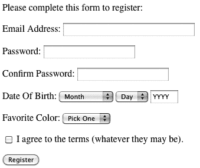

4. 为出生日期开始一个选择菜单：

**脚本 6.9** 继续

```html
<select name="day">
```

`39`

```php
for ($i = 1; $i <= 31; $i++) {
    <option value="">日期</option>
```

`40`

```php
    print "<option value=\"$i\">$i</option>\n";
```

`41`

```php
}
?>
```

`42`

此代码为用户的出生日期启动了 `select` 表单元素。可能的值列表将使用 PHP 进行生成。

`43 </select>`

`44`

```html
<input type="text" name="year" value="YYYY" size="4" /></p>
```

5. 创建一个新的 PHP 段：

45

46

```html
<p>喜欢的颜色:
```

```php
<?php
```

`47`

```html
<select name="color">
```

由于 PHP 可以嵌入到 HTML 中，你将用它来填充下拉菜单。从标准的 PHP 标签开始。

`48`

```html
<option value="">选择一个</option>
```

`49`

```html
<option value="red">红色</option>
```

`50`

```html
<option value="yellow">黄色</option>
```

`51`

```html
<option value="green">绿色</option>
```

`52`

```html
<option value="blue">蓝色</option>
```

6. 创建一个 `for` 循环来打印 31 天作为选择菜单的选项：

`53`

```html
</select></p>
```

`54`

```html
<p><input type="checkbox" name="terms" value="Yes" /> 我同意条款（无论条款是什么）。</p>
```

`55`

```php
for ($i = 1; $i <= 31; $i++) {
    print "<option value=\"$i\">$i</option>\n";
```

`56`

```php
}
```

`57`

```html
<input type="submit" name="submit" value="注册" />
```

`58`

```html
</form>
```

`59`

`60` 

循环通过创建一个名为 `$i` 的虚拟变量开始。在循环第一次使用时，该变量设置为 1。然后，只要 `$i` 小于或 31，就会执行循环的内容。这些内容是 `print` 行，它会创建如下代码：

```html
<option value="1">1</option>
```

随后是一个换行符（通过 `\n` 创建）。在执行此语句后，变量 `$i` 增加 1。然后再次检查条件（`$i <= 31`），并重复该过程。

7. 关闭 PHP 段：

```php
?>
```

8. 将文件保存为 `register.php`。你现在必须以 `.php` 扩展名保存文件，以便 PHP 代码被动态执行。

148 章

6

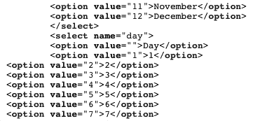

B. 新版本的 HTML 表单，带有一些动态生成的内容。

9. 将文件放在你启用 PHP 的服务器的相应目录中，并在 Web 浏览器中测试它。只要此脚本与 `handle_reg.php` 位于同一目录，你甚至可以像使用纯 HTML 版本一样填写并提交表单。

10. 如果需要，查看 HTML 源代码 C。如果你查看表单的 HTML 源代码，将看到由 `for` 循环生成的数据 C。

### While 循环

在 for 循环中使用简单变量作为计数器是惯例：`$i`、`$j`、`$k` 等。

PHP 存在的三种循环类型的第二——`while` 循环，设计用于只要建立的条件为 TRUE 就持续工作。与 `for` 循环一样，它在每次迭代之前都会检查条件。一旦条件变为 FALSE，就会退出循环。

与数组相关的函数。本章以数组与字符串之间的转换以及如何从 HTML 表单创建数组演示结束。复习与追求。

### 什么是数组？


**表格 7.1 购物列表数组**

| 项目编号 | 物品 |
| :--- | :--- |
| 1 | 苹果 |
| 2 | 香蕉 |
| 3 | 橙子 |

数组构成了一个复杂但实用的概念。数字和字符串是标量变量（意味着它们始终只有一个值），而数组是多个值组合成一个覆盖性变量的集合。数组可以由数字和/或字符串（以及/或其他数组）组成，这使得一个变量能够持有比简单字符串或数字多得指数级的信息。

例如，如果你想使用字符串创建一个购物列表，你的代码看起来像这样：

```php
$item1 = 'apples';
$item2 = 'bananas';
$item3 = 'oranges';
```

对于每个添加的项目，你都需要创建一个新字符串。这种方法非常繁琐，并且在代码的后续部分很难回溯整个列表或任何特定值。你可以通过将整个列表放入一个数组（例如 `$items`）来大大简化问题，该数组包含了你所需的所有内容（表格 7.1）。

作为一个数组，你的列表可以被添加、排序、搜索等。在记住这些背景的情况下，让我们来看看数组的语法。

## 数组的语法规则

### 超全局变量与你

你处理过的其他变量类型——数字和字符串——处理过一些数组：`$_SERVER`、`$_GET` 和 `$_POST`。这些都是被称为超全局变量的特殊数组（例如，`$first_name` 可以等于 `Larry`）。数组也有名称，`$_COOKIE`、`$_SESSION` 和 `$_ENV`，它们使用相同的约定衍生：

如你所知，`$_POST` 数组接收从使用 POST 方法的表单发送到页面的所有数据。它的索引是表单元素的名称，值是这些表单元素的值。因此，`$_POST['name']` 指向代码创建的表单输入框中输入的值：

```html
<input type="text" name="name" />
```

但数组的区别在于它们包含多个元素（将表格 7.1 中的每一行都视为一个元素）。元素由一个索引或键（这两个词可以互换使用）和一个值组成。同样，`$_GET` 指向从使用 GET 方法的表单发送的数据或通过 URL 传递的数据。在表格 7.1 中，项目编号是键，物品是值。`$_COOKIE` 指向存储在 cookie 中的数据，`$_SESSION` 指向存储在会话中的数据（你将在第 9 章“Cookies 和 Sessions”中遇到这两者）。

数组的索引被用作值的引用点。数组可以使用数字或字符串作为其键（或两者兼有），取决于你如何设置它。

通常，当你使用数组时，它看起来和任何其他变量一样，只是你在方括号 `[]` 中包含一个键来引用特定值。虽然 `$items` 指的是整个数组，而 `$items[1]` 指向数组中的一个特定元素（在本例中，为 `apples`）。

### 创建数组

创建数组的正式方法是使用 `array()` 函数。其语法为：

```php
$list = array ('apples', 'bananas', 'oranges');
```

数组会自动从 0 开始索引，除非另有指定。在那个示例中（没有为元素指定索引），第一个项目 `apples` 自动索引为 0，第二个项目为 1，第三个为 2。你可以在使用 `array()` 时分配索引：

```php
$list = array (1 => 'apples', 2 => 'bananas', 3 => 'oranges');
```

由于 PHP 对脚本中的空白非常宽容，你可以通过多行编写让这种结构更易读：

```php
$list = array (
    1 => 'apples',
    2 => 'bananas',
    3 => 'oranges'
);
```

最后，你指定的索引值不必是数字——你可以使用字符串。这种索引技术对于创建更有意义的列表是非常实用的。例如，你可以创建一个记录每天汤种的数组，如下脚本所示。这个示例还将演示你如何以及如何打印数组（之前演示过，但值得重温）。

**脚本 7.1** `$soups` 数组包含三个元素并使用字符串作为键。

**创建数组：**

1. 在你的文本编辑器或 IDE 中开始一个文档，命名为 `soups1.php`（**脚本 7.1**）：

```php
<!DOCTYPE html PUBLIC "-//W3C//DTD HTML 1.0 Transitional//EN" "http://www.w3.org/TR/REC4/W4-transitional.dtd">
<html lang="en">
<head>
<title>No Soup for You!</title>
</head>
<body>
<h1>Mmm...soups</h1>
<?php
/* 此脚本创建并打印一个数组。 */
// 如果必要，处理错误管理：
// 创建数组：
$soups = array (
    'Monday' => 'Clam Chowder',
    'Tuesday' => 'White Chicken Chili',
    'Wednesday' => 'Vegetarian'
);

// 尝试打印数组：
print "<p>$soups</p>";

// 打印数组的内容：
print_r($soups);
?>
</body>
</html>
```

如果你没有启用 `display_errors`，或者 `error_reporting` 设置错误，请参阅第 3 章“HTML 表单与 PHP”，获取在此处包含以更改这些设置的代码行。

正如你已经看到的，数组也是...

## 使用数组

在启用 PHP 的服务器上，并在 Web 浏览器中对其进行测试。

数组的不同之处在于，你无法像打印其他（标量）变量那样将它们打印到 Web 浏览器。请记住通过 URL 运行 PHP 脚本。

## 5. 使用 `print_r()` 函数以不同的方式打印数组：

```php
print_r ($soups);
```

**A** 因为数组的结构与其他变量类型不同，请求打印数组将导致显示 `Array` 字样。另一方面，`print_r()` 函数会打印数组的内容和结构。

**将任何索引从 0 开始的习惯是 PHP 以及大多数其他编程语言的标准做法。** 尽管这种计数系统看起来可能并不自然，但它将一直存在下去，因此你有两种处理方法：首先，手动让你的所有数组从位置 1 开始索引；其次，忘掉一辈子从 1 开始计数的习惯。你可以决定哪种更简单，但大多数程序员只是习惯了这种奇特的结构。

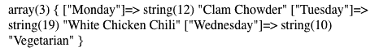

**`range()` 函数也可以根据数值范围创建一个包含项的数组。** 从 PHP 5 版本开始，`range()` 函数包含一个 `step` 参数，允许你指定增量：你必须通过与创建数组时相同的索引来引用数组的元素。

```php
$ten = range (1, 10);
$alphabet = range ('a', 'z');
$evens = range (0, 100, 2);
```

在 `$soups` 示例中，尽管数组显然有一个第一个元素，但 `$soups[0]` 并没有值（通常第一个元素在数字上索引为 0）。如果你在脚本中使用 `var_dump()` 函数代替 `print_r()`，它不仅会显示数组的内容，还会以更详细的格式显示其结构。**B** `var_dump()` 函数（在脚本 7.1 中代替 `print_r()` 使用）会显示数组中有多少个元素，以及每个字符串值的长度是多少。

如果你使用 `array()` 函数来定义索引，你可以关联第一个索引，其他的索引将按顺序排列。例如：

```php
$list = array (1 => 'apples', 'bananas', 'oranges');
```

现在 `bananas` 的索引为 2，`oranges` 的索引为 3。键为数字的数组被称为**索引数组**。如果键是字符串，则被称为**关联数组**。其他语言将关联数组称为哈希表（hashes）。

## 向数组添加项

在 PHP 中，一旦数组存在，你可以从数组中添加单个项，但也可以通过赋值运算符（等号）向数组中添加额外的元素来实现操作，这种方法类似于你给字符串或数字赋值。在执行此操作时，你可以指定所添加元素的键，也可以不指定，但无论哪种情况，你都必须使用方括号引用数组。要向现有的 `$list` 数组添加两个项，你可以写：

```php
$list[] = 'pears';
$list[] = 'tomatoes';
```

如果你不指定键，每个元素都会追加到现有数组中，并用下一个顺序数字索引。假设这与前一节中的数组是同一个（其索引为 1、2 和 3），那么 *pears* 现在位于 4，*tomatoes* 位于 5。你还可以使用 `array()` 函数重置数组（清空它）而不完全删除变量：

```php
$array = array();
```

如果你确实指定了索引，值将分配在该位置。任何已索引在该处的现有值都将被覆盖，如下：

```php
$list[3] = 'pears';
$list[3] = 'tomatoes';
```

## 元素

`count()` 函数可以帮助你跟踪数组中包含多少元素。通过使用 `count()`，你可以确定数组的元素数量：

```php
$how_many = count($soups);
```

## 删除数组

你可能需要使用 `unset()` 函数来删除数组，这会删除变量并释放内存：

```php
unset($array[4]);
```

## 使用数组

将你的脚本保存为 `soups2.php`。在直接向数组添加元素时，请务必小心。有一种正确的方法——将其放置在启用 PHP 的服务器的相应目录下，并在 Web 浏览器中进行测试。

```php
$array[] = 'Add This';
```

或者一种错误的方法：

```php
$array[1] = 'Add This';
```

## 合并数组

PHP 有一个函数允许你将一个数组追加到另一个数组。你可以将其想象为数组的拼接。`array_merge()` 函数的作用如下：

```php
$new_array = array_merge($array1, $array2);
```

你也可以使用这个函数来编写 `soups2.php` ：

```php
$soups2 = array (
    'Thursday' => 'Chicken Noodle',
    'Friday' => 'Tomato',
    'Saturday' => 'Cream of Broccoli'
);
```

在处理这些数组时，我使用单引号来包围键和值。由于没有任何内容需要插值（例如变量），因此不需要双引号。不过，如果你愿意，使用双引号也是完全可以的。

```php
$soups = array_merge($soups, $soups2);
```

如果键是数字、变量或常量，你不需要（事实上，也不应该）为它们加引号（你将在第 8 章“创建 Web 应用程序”中学习常量）。例如：

```php
$day = 'Sunday';
$soups = $soups + $soups2;
$soups[$day] = 'Mushroom';
```

或者

```php
$soups += $soups2;
```

`sizeof()` 函数是 `count()` 的别名。它也返回数组中元素的数量。确保新元素已成功添加到数组中的直接方法，是在进行添加前后统计元素的数量。

### 访问数组元素

其他变量类型没有这种特性：你必须知道数组的键才能访问其元素。如果数组是用字符串设置的（例如 `$soups`），那么引用 `$soups[1]` 将指向任何内容，因为它是区分大小写的，这意味着 `Clam Chowder` 索引在 `$soups['Monday']`。

```php
print "The first item is $array[0]";
```

访问数组所有值最快且简单的方法是使用 `foreach` 循环。该结构会遍历数组的每一个元素：

```php
foreach ($array as $key => $value) {
    print "<p>Monday's soup is $key. Value is $value</p>";
}
```

为了解决这个问题，你可以将整个数组结构封装在大括号内：在循环的每次迭代中，当前数组元素的键将赋值给 `$key`，值赋值给 `$value`。注意，你在这里可以使用任何变量：

```php
foreach ($soups as $k => $v) {
    print "<p>Monday's soup is {$soups['Monday']}</p>";
}
```

讽刺的是，让数组如此实用的特性——能够在一个变量中存储多个值——也赋予了它局限性。你现在可以编写一个新的 soups 脚本来使用这些知识了。在双引号中引用特定元素是避免解析错误的一种方法。引用不存在的数组索引将创建 Undefined offset（未定义偏移）或 Undefined Index（未定义索引）通知。

### 打印任何数组的值

`foreach` 循环是访问数组中每个元素最简单的方法。

1. 在你的文本编辑器或 IDE 中开始一个新文档（脚本 7.3，命名为 `soups2.php`）：

```html
<!DOCTYPE html PUBLIC "-//W3C//DTD XHTML 1.0//EN" "http://www.w3.org/TR/xhtml1/DTD/xhtml1-transitional.dtd">
<html xmlns="http://www.w3.org/1999/xhtml" lang="en">
<head>
    <meta http-equiv="Content-Type" content="text/html; charset=utf-8"/>
    <title>No Soup for You!</title>
</head>
<body>
    <h1>Mmm...soups</h1>
    <?php // Script 7.3 - soups3.php
    /* 此脚本创建并打印一个数组。 */
    // 如果需要，处理错误管理。
```

2. 开始页面的 PHP 部分，并在需要时处理错误管理：

```php
<?php // Script 7.3 - soups3.php
// 创建数组：
$soups = array (
    'Monday' => 'Clam Chowder',
    'Tuesday' => 'White Chicken Chili',
    'Wednesday' => 'Vegetarian',
);
```

3. 创建 `$soups` 数组：

```php
$soups = array (
    'Monday' => 'Clam Chowder',
    'Tuesday' => 'White Chicken Chili',
    'Wednesday' => 'Vegetarian',
    'Thursday' => 'Chicken Noodle',
    'Friday' => 'Tomato',
    'Saturday' => 'Cream of Broccoli'
);

// 打印每个键值：
foreach ($soups as $day => $soup) {
    print "<p>$day: $soup</p>\n";
}
?>
</body>
</html>
```

4. 创建一个 `foreach` 循环来打印每一天的汤：

使用赋值运算符将特定元素的值赋值给单独的变量：

```php
$total = $array[1];
print "<p>$day: $soup</p>\n";
```

5. 关闭 PHP 部分和 HTML 页面：

# 多维数组

多维数组既简单又复杂。其结构和概念可能有些难以掌握，但在 PHP 中创建和访问多维数组却出奇地简单。

你使用多维数组来创建一个比标准数组包含更多信息的数组。你通过使用其他数组作为值而不仅仅是字符串和数字来实现这一点。例如：

## 脚本 7.4: books.php

多维数组 `$books` 在一个大变量中存储了大量信息。


```php
<?php
// Script 7.4 - books.php
/* 此脚本创建并打印多维数组。 */
// 如果你需要，可以进行错误管理。
$fruits = array ('apples', 'bananas', 'oranges');
$meats = array ('steaks', 'hamburgers', 'pork chops');

// 创建第一个数组：
$phpvqs = array (1 => 'Getting Started with PHP', 'Variables', 'HTML Forms and PHP', 'Using Numbers');

// 创建第二个数组：
$phpadv = array (1 => 'Advanced PHP Techniques', 'Developing Web Applications', 'Advanced Database Concepts', 'Security Techniques');

// 创建第三个数组：
$phpmysql = array (1 => 'Introduction to PHP', 'Programming with PHP', 'Creating Dynamic Web Sites', 'Introduction to MySQL');

// 创建多维数组：
$books = array (
    'PHP VQS' => $phpvqs,
    'PHP Advanced VQP' => $phpadv,
    'PHP and MySQL VQP' => $phpmysql
);

// 打印一些值：
print "<p>The third chapter of " . $books['PHP VQS'][3] . "</p>";
print "<p>The second chapter of " . $books['PHP Advanced VQP'][1] . "</p>";
print "<p>The fourth chapter of " . $books['PHP and MySQL VQP'][4] . "</p>";
?>
```

这个数组 `$groceries` 现在由一个字符串（peanuts）、一个浮点数（30.00）和两个数组（`fruits` 和 `$meats`）组成。指向数组中数组的元素似乎很复杂。关键（key，这里是个双关语）是根据需要继续在方括号中添加索引，从外部数组向内部操作。

在那个示例中，`bananas` 位于 `$groceries['fruits'][1]`。首先，你通过 `$groceries['fruits']` 指向 `$groceries` 数组中的元素（在这种情况下是一个数组）。然后，你根据其位置指向该数组中的元素——它是第二个项目，所以你使用索引 `[1]`。

在下一个任务中，你将编写一个创建另一个多维数组示例的脚本。

## 使用多维数组

1. 在你的文本编辑器中开始一个新文档，命名为 `books.php`（**脚本 7.4**）。

## 花括号与数组

花括号用于在打印以字符串为键的数组值时避免错误。以下是两个示例，其中使用引号没有产生问题，因此不需要花括号：

```php
$name = trim ($array['name']);
$total = $_POST['qty'] * $_POST['price'];
```

花括号也可以用于将变量引用与美元符号或其他字符分开：

```php
print "The total is ${$total}.";
```

对数组中的每个元素执行循环生成此页面。`foreach` 结构允许脚本在无需预先知道它们是什么的情况下访问每个键和值。

```html
<!DOCTYPE html PUBLIC "-//W3C//DTD XHTML 1.0 Transitional//EN" "http://www.w3.org/TR/xhtml1/DTD/xhtml1-transitional.dtd">
<html xmlns="http://www.w3.org/1999/xhtml" xml:lang="en" lang="en">
<head>
<meta http-equiv="Content-Type" content="text/html;charset=utf-8"/>
<title>Larry Ullman's Books and Chapters</title>
</head>
<body>
<h1>Some of Larry Ullman's Books</h1>
</body>
</html>
```

### 数组排序

PHP 提供了许多不同的函数来排序数组，包括 `arsort()` 和 `ksort()`。

## 7.2 数组排序函数

PHP 支持多种排序数组的方法（如果排序的值是字符串，`sort` 指字母顺序排序；如果是数字，则进行数值排序）。当你对数组进行排序时，必须记住数组是由键值对组成的。因此，可以根据键进行排序，也可以根据值进行排序。更复杂的是，你可以对值进行排序并保持相应的键对齐，也可以对值进行排序并分配新的键。

要忽略键对值进行排序，使用 `sort()`。要反序对这些值进行排序（同样忽略键），使用 `rsort()`。每个排序函数的语法为 `function($array);`。因此，`sort()` 和 `rsort()` 的用法如下：

```php
sort($array);
rsort($array);
```

在保持每个值与其键之间关联性的同时对值进行排序，使用 `asort()`。在保持键关联性的同时反序对值进行排序，使用 `arsort()`。在保持键和值之间关联性的同时按键进行排序，使用 `ksort()`。相反，`krsort()` 反序对键排序。表 7.2 列出了所有这些函数。最后，`shuffle()` 会随机重新排列数组的顺序。

作为数组排序的一个示例，你将创建一个学生及其考试成绩的列表，然后先按成绩排序，再按姓名排序。

## 要排序数组

**1.** 在你的文本编辑器或 IDE 中开始一个新文档，命名为 `sort.php`

```html
<!DOCTYPE html PUBLIC "-//W3C//DTD XHTML 1.0 Transitional//EN" "http://www.w3.org/TR/xhtml1/DTD/xhtml1-transitional.dtd">
<html xmlns="http://www.w3.org/1999/xhtml" xml:lang="en" lang="en">
<head>
<meta http-equiv="Content-Type" content="text/html; charset=utf-8"/>
<title>My Gradebook</title>
</head>
<body>
```

**2.** 开始 PHP 部分，并根据需要处理错误管理：

```php
<?php
// Script 7.5 - sort.php
/* 此脚本创建、排序并打印一个数组。 */
$grades = array(
    'Richard' => 95,
    'Sherwood' => 82,
    'Toni' => 98,
    'Franz' => 87,
    'Melissa' => 75,
    'Roddy' => 85
);
```

**3.** 打印原始数组：

```php
print '<p>Originally the array looks like this:
foreach ($grades as $student => $grade) {
    print "$student: $grade<br />";
}
print '</p>';
```

`$grades` 数组由学生姓名及其相应的成绩组成。因为成绩是数字，在赋值时不需要加引号。

**4.** 打印一个标题，然后使用 `foreach` 循环打印数组的每个元素：

```php
print '<p>After sorting the array by value using arsort(), the array looks like this:
foreach ($grades as $student => $grade) {
    print "$student: $grade<br />";
}
print '</p>';
```

**5.** 按值反序排序数组，以确定谁获得最高分：

```php
arsort($grades);
```

要确定谁获得最高分，你需要使用 `arsort()` 而不是 `asort()`。后者按数值顺序排序数组，将使成绩按 75, 82, 85 等顺序排列，而不是预期的 98, 95, 87。你还必须使用 `arsort()` 而不是 `rsort()` 以保持键值关系（`rsort()` 会消除与每个成绩关联的学生姓名）。

**6.** 使用另一个循环再次打印数组（带标题）：

```php
print '<p>After sorting the array by value using arsort(), the array looks like this:
foreach ($grades as $student => $grade) {
    print "$student: $grade<br />";
}
print '</p>';
```

**7.** 按键对数组进行排序，使数组按学生姓名的字母顺序排列：

```php
ksort($grades);
```

```php
ksort($grades);
```

`ksort()` 函数根据键（在这种情况下为按字母顺序）对数组进行排序，同时保持键值关联。

**8.** 最后一次打印标题和数组：

```php
print '<p>After sorting the array by key using ksort(), the array looks like this: <br />';
foreach ($grades as $student => $grade) {
    print "$student: $grade<br />\n";
}
print '</p>';
```

**A** 你可以通过多种方式对数组进行排序，结果各不相同。在选择排序函数时，请密切注意你是否想要保持键值关联关系。

**9.** 使用标准的 PHP 和 HTML 标签完成脚本：

```php
?>
</body>
</html>
```

**10.** 将你的脚本保存为 `sort.php`，将其放在启用 PHP 的服务器相应目录中，并在 Web 浏览器 **A** 中进行测试。

**由于数组中的每个元素必须有其唯一的键，因此 `$grades` 数组只有在使用唯一的学生姓名时才能工作。`natsort()` 和 `natcasesort()` 函数使用自然顺序对字符串进行排序（同时保持键值关联）。自然顺序排序最明显的例子是，它会将 `name2` 置于 `name12` 之前，而 `sort()` 则将它们排序为 `name12` 然后是 `name2`。`usort()`、`uasort()` 和 `ursort()` 函数允许你使用自定义比较函数对数组进行排序。这些函数通常用于多维数组。**

使用数组 171 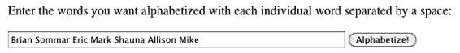

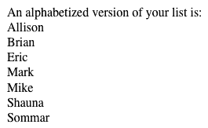

### 格式转换

`separator` 指定义一个值结束而另一个值开始的任何字符。

### 字符串与数组

通常这是一个逗号、制表符或空格。因此，你的代码可能是

现在你已经理解了字符串和数组，接下来的部分介绍了两个用于在两种格式之间切换的函数。第一个 `implode()` 将数组转换为字符串。第二个 `explode()` 则执行相反的操作。以下是使用这些函数的几个原因：

- 将数组转换为字符串，以便将该值附加到 URL 中（使用数组无法容易地做到）
- 将数组转换为字符串，以便将信息存储在数据库中
- 将字符串转换为数组，以便将逗号分隔的文本字段（例如表单的关键字搜索区域）转换为其各个部分

为了演示如何使用 `explode()` 和 `implode()`，你将创建一个 HTML 表单，接收用户输入的空格分隔的名称字符串 **A**。PHP 脚本将该字符串转换为数组，以便对列表进行排序。最后，代码将创建并返回按字母顺序排列字符串 **B**。

使用 `explode()` 的语法如下：

```php
$array = explode($separator, $string);
```

**A** 此 HTML 表单接收一个单词列表，然后由 `list.php` 脚本 **B** 按字母顺序排序。

**B** 这里是同一个列表，已为用户按字母顺序排序。这个过程编写快速且简单，但如果没有数组，这样做是不可能的。

172 第 7 章

**脚本 7.6** 这是一个简单的 HTML 表单，用户可以提交单词列表。包含关于表单如何使用的详细说明是一项审慎的 Web 设计策略。

## 创建 HTML 表单

**1.** 在你的文本编辑器或 IDE 中开始一个新文档，命名为 `list.html` (**脚本 7.6**)：

```html
<!DOCTYPE html PUBLIC "-//W3C//DTD XHTML 1.0 Transitional//EN" "http://www.w3.org/TR/xhtml1/DTD/xhtml1-transitional.dtd">
<html xmlns="http://www.w3.org/1999/xhtml" xml:lang="en" lang="en">
<head>
    <meta http-equiv="Content-Type" content="text/html; charset=utf-8"/>
    <title>I Must Sort This Out!</title>
</head>
<body>
    <!-- Script 7.6 - list.html -->
    <div><p>请输入你想按字母顺序排序的单词，每个单词之间用空格分隔：</p>
    <form action="list.php" method="post">
        <input type="text" name="words" size="60" />
        <input type="submit" name="submit" value="Alphabetize!" />
    </form>
    </div>
</body>
</html>
```

**2.** 创建一个带有文本输入的 HTML 表单：

```html
<div><p>输入你的</单词</p>
<form action="list.php" method="post">
    <input type="text" name="words" size="60" />
    <input type="submit" name="submit" value="Alphabetize!" />
</form>
</div>
```

在这种情况下，指示用户是非常重要的。例如，如果用户输入了逗号分隔的列表，PHP 脚本将无法正确处理它（尝试用空格代替逗号看看会发生什么）。

**3.** 创建提交按钮，然后是 HTML 页面：

```php
<?php
// 脚本 7.7 - list.php
/*
此脚本从 $_POST['words'] 接收一个字符串。然后将其转换为数组，按字母顺序排序数组并打印出来。
如果需要，请处理错误管理。
*/

$words_array = explode(' ', $_POST['words']);
sort($words_array);
$string_words = implode('<br />', $words_array);

echo "<p>你的列表按字母顺序排序的版本是：<br />" . $string_words . "</p>";
?>
```

**4.** 将你的脚本保存为 `sort.php`，将其放在启用 PHP 的服务器相应目录中，并在 Web 浏览器 **A** 中进行测试。

这行代码从字符串 174 Chapter 7 `$_POST['words']` 创建了一个新数组 `$words_array`。`$_POST['words']` 中单词之间的每个空格都表示下一个单词应该是一个新的数组元素。因此，第一个单词变为 `$words_array[0]`，然后 `$_POST['words']` 中有一个空格，接着第二个单词变为 `$words_array[1]`，依此类推，直到 `$_POST['words']` 结束。

### 3. 按字母顺序对数组进行排序

```php
sort($words_array);
```

由于你不需要在 `$words_array` 中维护键值关联关系，你可以使用 `sort()` 代替 `asort()`。

### 4. 用排序后的数组创建一个新字符串

```php
$string_words = implode('<br />', $words_array);
```

数组没有像字符串那样容易打印，因此将 `$words_array` 转换为名为 `$string_words` 的字符串。生成的字符串以 `$words_array[0]` 的值开始，随后是 HTML 标签 `<br />`、`$words_array[1]` 的值，依此类推。使用 `<br />` 代替空格或逗号可以让列表在打印到浏览器时具有更具读性的格式。

### 5. 将新字符串打印到浏览器

```php
print "<p>An alphabetized version of your list is: <br />$string_words</p>";
```

### 6. 关闭 PHP 部分和 HTML 页面

```php
?>
</body>
</html>
```


### 7. 将你的页面保存为 `list.php`，将其放在与 `list.html` 相同的目录下，并在你的浏览器 `A` 和 `B` 中测试两个脚本。

你还会遇到使用 `join()` 函数编写的代码，它与 `implode()` 同义。

---

### 从表单创建数组

在本章中，你完全在 PHP 页面内部建立了数组。然而，你可以通过 HTML 表单将数据数组发送到 PHP 脚本。事实上，每当你使用 `$_POST` 时，情况都是如此。但你可以通过使用 HTML 表单创建数组来更进一步。此类数组将成为更大的 `$_POST` 数组的一部分（从而使 `$_POST` 成为一个多维数组）。这种能力的一种逻辑用途是处理复选框，用户可能需要从组组 `A` 中选择多个选项。

复选框的 HTML 源代码如下：

```html
<input type="checkbox" name="topping" value="Ham" />
```

在这种情况下的问题是，每个表单元素必须有一个唯一的 `name`。如果你创建了多个名称为 `topping` 的复选框，那么 PHP 脚本将只接收最后一个被选中框的值。如果你为每个复选框创建唯一的名称——ham、tomato 等——那么处理所选值将非常繁琐。解决办法是使用数组语法，在下一个示例所示。

### HTML 表单中的复选框，展示多个选项。使用复选框输入名称创建数组：

#### 1. 在你的文本编辑器或 IDE 中开始一个新文档，命名为 `event.html`：

```html
<!DOCTYPE html PUBLIC "-//W3C//DTD XHTML 1.0 Transitional//EN" "http://www.w3.org/TR/xhtml1/DTD/xhtml1-transitional.dtd">
<html lang="en">
<head>
<meta http-equiv="Content-Type" content="text/html; charset=utf-8"/>
<title>Add an Event</title>
</head>
<body>
```

#### 2. 开始 HTML 表单：

```html
<form action="event.php" method="post">
    <p>Event Name: <input type="text" name="name" size="30" /></p>
```

#### 3. 为事件名称创建一个文本输入框：

```html
<p>Event Name: <input type="text" name="name" size="30" value="Add the Event!" /></p>
```

此示例允许用户输入事件名称以及发生的星期几。

#### 4. 创建星期几复选框：

```html
<p>Event Days:
    <input type="checkbox" name="days[]" value="Sunday" />
    <input type="checkbox" name="days[]" value="Monday" />
    <input type="checkbox" name="days[]" value="Tuesday" />
    <input type="checkbox" name="days[]" value="Wednesday" />
    <input type="checkbox" name="days[]" value="Thursday" />
    <input type="checkbox" name="days[]" value="Friday" />
    <input type="checkbox" name="days[]" value="Saturday" />
</p>
```

所有这些复选框都使用 `days[]` 作为 `name` 值，这会在 PHP 脚本中创建一个 `$_POST['days']` 数组。每个复选框的 `value` 属性不同，对应于星期。

#### 5. 完成 HTML 表单：

```html
<input type="submit" name="submit" value="Add the Event!" />
</form>
</div>
```

#### 6. 完成 HTML 页面：

```html
</body>
</html>
```

#### 7. 将你的页面保存为 `event.html`，并将其放在启用 PHP 的服务器的正确目录中。你还需要编写 `event.php` 页面来处理这个 `$_POST['days']`。

```php
<?php
// Script 7.9 - event.php
/* 此脚本处理事件表单。 */

// 2. 创建初始 PHP 标签，处理错误管理
print "<p>You want to add an event management (if need be), and print an called $_POST['name'] which introductory message: takes place on: <br />";
?>
```

```php
<?php // Script 7.9 - event.php

// Print each weekday:

if (isset($_POST['days']) AND is_array($_POST['days'])) {
    print "<p>You want to add an event called <b>{$_POST['name']}</b> which takes place on: <br />";

    foreach ($_POST['days'] as $day) {
        print "$day<br />\n";
    }
} else {
    print 'Please select at least one weekday for this event!';
}

// Complete the paragraph:
print '</p>';
?>

</body>
</html>
```

如果没有点击任何复选框，那么 `$_POST['days']` 将不是一个存在的变量。为了避免引用不存在的变量而导致错误，条件语句的第一部分检查了 `$_POST['days']` 是否设置。

条件的第二部分——且都为 `TRUE` 时整个条件才成立——确认了 `$_POST['days']` 是数组。这是一个很好的步骤，因为如果 `foreach` 循环接收到的变量不是数组 `B`，它将产生错误。

### list 函数

`list()` 函数用于将数组元素的值赋值给单个变量。从示例开始：

```php
$date = array('Thursday', 23, 'October');
```

**4.** 打印每个被选中的星期几：

```php
list($weekday, $day, $month) = $date;
foreach ($_POST['days'] as $day) {
    print "$day<br />\n";
}
```

现在有一个值为 `Thursday` 的 `$weekday` 变量，一个值为 `23` 的 `$day` 变量，以及一个值为 `October` 的 `$month` 变量。要打印每个选中的星期几，请通过 `foreach` 循环运行 `$_POST['days']` 数组。该数组包含了每个被选框的值（例如来自 HTML 表单输入的值，如周一、周二等）。

使用 `list()` 有两个注意事项。首先，`list()` 仅适用于索引为 0 的数值索引数组。其次，当你使用 `list()` 函数时，你必须列出每个数组元素。你不能这样做：

```php
list($weekday, $month) = $date;
```

但你可以使用空值来忽略元素：

```php
list($weekday, , $month) = $date;
```

**5.** 补全 `is_array()` 条件：

```php
} else {
    print '请为此活动至少选择一个星期几!';
}
}
```

如果没有选择任何星期几，则 `isset() AND is_array()` 条件为 `FALSE`，并打印此消息。`list()` 函数经常用于从数据库中检索值。`B` 尝试在非数组变量上使用 `foreach` 是错误的常见原因。

**6.** 补全主段落、章节和 HTML 页面：

```php
print '</p>';
?>
</body>
</html>
```

**7.** 将页面保存为 `event.php`，将其放在与 `event.html` 相同的目录下，并测试两个页面。这里演示的技术可以允许用户在下拉菜单中选择多个选项。只需给菜单命名为 `something[]`，PHP 脚本就会接收 `something[]`。`C` HTML 表单。`D` HTML 表单的结果。`E`

### 复习与练习

如果你对复习题或练习题有任何问题，请熟悉 `array_key_exists()`、`array_search()` 和 `in_array()`。

- 索引数组和关联数组的区别是什么？
- 重写 `soups2.php`，使其使用 `count()` 函数返回数组中的元素数量，而不是使用单独变量。
- 什么时候应该对数组键使用引号？什么时候不应该？
- 创建另一个创建并显示多维数组的脚本（至少是）。
- 如何打印特定的数组元素？如何打印数组中的每个元素？
- 重写 `list.php`，使其使用 `foreach` 代替 `implode()`，但仍将排序后的每个单词打印在浏览器的一行。还要添加一些表单验证，以便在字符串有值时才尝试解析和排序。
- 哪个函数返回数组的元素数量？打印数组？
- 什么时候必须使用大括号打印数组元素？


- `sort()` 和 `asort()` 函数的区别是什么？`sort()` 和 `rsort()` 的区别是什么？

- `explode()` 和 `implode()` 的语法是什么？如果不记得，请查看相应函数的 PHP 手册页。

## 第 7 章

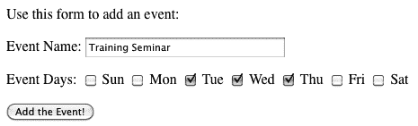 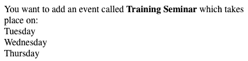

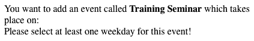

到目前为止这本书涵盖了 PHP 编程的基础知识；现在是时候将所有内容整合以创建实际应用程序。在本章中，你将学习许多函数和技术，使你的网络网站更加专业、功能更强且易于维护。

### 本章内容

- 创建模板
- 使用外部文件
- 使用常量
- 处理日期和时间
- 复习

首先，你将学习如何使用外部文件将 Web 页面拆分为各个部分，从而将逻辑与显示分离。然后你将尝试常量，这是一种特殊的数据类型。之后，你将介绍 PHP 内置的一些与日期时间相关的函数。

在站点中。你可以将这些元素放入每个单独的页面，但当你需要进行更改时，你不得不反复进行该更改。

通过创建模板将重复内容与页面特定材料隔离开，你可以节省时间。例如，一个网站可能具有跨多个页面 `A` 和 `B` 重复的导航、版权信息和其他功能。

当你刚开始进行动态 Web 开发时，创建和使用模板可能会令人生望生畏。关键是从 `B` 开始：目录页与主页 `A` 使用了一些相同的共同元素，首先像你要创建一个静态 Web 页面一样创建一个基础原型，然后感谢模板将该原型拆分为可重用的部分。使用本章下一节介绍的 `PHP` 函数，可以轻松地将重复部分包含在每个中，同时按页面生成新内容。

为了创建本章示例使用的模板，让我们从原型开始。此示例的布局 `C` 是由 Six Shooter 的 James Koster [Media (www.sixshootermedia.com) 和](http://www.sixshootermedia.com) 创建的，并在他的许可下使用。

`C` 本章示例的设计，作为一个单一的静态 HTML 页面。

### 要创建布局模型：

**脚本 8.1** 此脚本代表了站点中每个页面应该具备外观。

**1.** 在你的文本编辑器或 IDE 中开始一个新的 HTML 文档，命名为 `template.html`（**脚本 8.1**）：

```html
<!DOCTYPE html PUBLIC "-//W3C//DTD XHTML 1.1//EN" "http://www.w3.org/TR/xhtml11/DTD/xhtml11.dtd">
<html xmlns="http://www.w3.org/1999/xhtml" xml:lang="en">
<head>
<title>Raise High the Roof Beam! A J.D. Salinger Fan Club</title>
<meta http-equiv="content-type" content="text/html; charset=utf-8" />
<link rel="stylesheet" href="css/1.css" type="text/css" media="screen,projection" />
</head>
<body>
<div id="wrapper">
<div id="header">
<p class="description">A.D. Salinger Fan Club</p>
<h1>Raise High the Roof Beam!</h1>
<ul id="nav">
<li><a href="books.php">Books</a></li>
<li><a href="#">Stories</a></li>
<li><a href="#">Quotes</a></li>
<li><a href="login.php">Login</a></li>
<li><a href="register.php">Register</a></li>
</ul>
</div>
```

**2.** 添加 CSS 代码：

```html
<link rel="stylesheet" href="css/1.css" type="text/css" media="screen,projection" />
```

此示例使用 CSS 进行大部分的格式设置和布局控制。CSS 本身存储在外部文件中，通过 `link` 标签成为此页面的一部分。我不知道我想表达的是什么，但我的确是：`1.css` 仅存储在名为 `css` 的文件夹中。请注意，你需要从相应的网站 [www.larllman.com](http://www.larllman.com) 下载 CSS 文件。你将在书的可下载代码中找到它，代码将从下一页继续。

**3.** 关闭 HTML 头部，开始正文，并创建一个包装 `div` 标签：

```html
</head>
<body>
<div id="wrapper">
```

**4.** 创建页面的头部：

```html
<div id="header">
<p class="description">A.D. Salinger Fan Club</p>
<h1>Raise High the Roof Beam!</h1>
<ul id="nav">
<li><a href="books.php">Books</a></li>
<li><a href="#">Stories</a></li>
<li><a href="#">Quotes</a></li>
<li><a href="login.php">Login</a></li>
<li><a href="register.php">Register</a></li>
</ul>
</div>
```

头部区域（在 CSS 代码中也有定义）创建横幅以及指向 Web 应用程序其他页的主要导航链接。特定链接引用四个 `PHP` 脚本，这些脚本将在本章中开发。

**5.** 创建页面的侧边栏：

```html
<div id="sidebar">
```

**6.** 创建页面的内容：

```html
<div id="content">
```

开发任何模板系统的第一步是创建一个模型文档——一个基础页面应该是什么样的示例。一旦你创建了它，就可以将其拆分为它的各个部分。

**7.** 标记变化内容的结束：

```html
<!-- END CHANGEABLE CONTENT. -->
```

如今的许多设计将整个页面内容封装在一个主 `div` 中，这样所有内容就可以在浏览器窗口内轻松地格式化。

**8.** 添加页脚：

```html
<div id="footer">
<p>Template design by <a href="http://www.sixshootermedia.com">Six Shooter Media</a>a>.</p>
<p>&copy; 2011</p>
</div>
```

此站点的模板，几处引用

`<p>Template design by <a href=`

已高亮显示。

➝ `"http://www.sixshootermedia.`

➝ `com">Six Shooter Media</a>.</p>`

**6.** 开始，并标记页面特定内容的开始-

`<p>&copy;`

`2011</p>`

内容：

`</div><!-- footer -->`

`<div id="content">`

页脚包含版权信息和版权说明。

`<!-- BEGIN CHANGEABLE CONTENT. -->`

在此注释之前的所有内容在 Web 应用程序的每个页面中将保持相同。

**10.** 完成 HTML 页面：

`</div><!-- wrapper -->`

为了指示页面特定内容的开始位置（为了你方便起见），请包含一个 HTML 注释。

`</body>`

`</html>`

事实上，回看目前为止模板，你会看到许多 HTML 注释，有助于指示页面的每个部分是什么。你的 HTML 或 PHP 代码注释得再多也不过！

注释指示了哪些 `div` 正在关闭。

**11.** 将文件保存为 `template.html` 并在 Web 浏览器 `C` 中进行测试。

在此之前，内容区域开始。该区域在 CSS 代码中定义，并正确地格式化页面的主要内容部分。换句话说，在每个页面上，该页的内容将位于 `id` 为 `content` 的 `div` 中。

Creating Web Applications 187

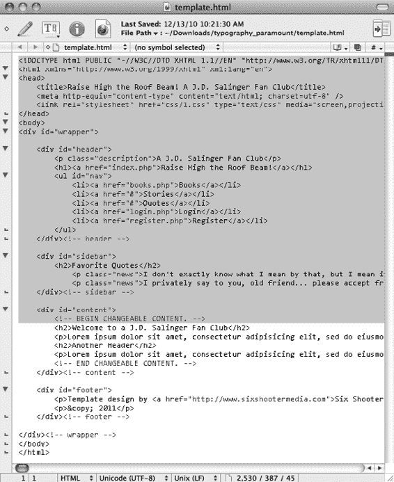

### 创建头部文件：

一旦你完成了一个喜欢的原型，就可以将其拆分为各个部分以生成模板系统。创建头部文件：

**1.** 在你的文本编辑器或 IDE 中打开 `template.html`（脚本 8.1），如果它还没有打开的话。

**2.** 选择从初始 HTML 代码到 `<!-- BEGIN CHANGEABLE CONTENT -->` HTML 注释 `D` 的所有内容。使用 HTML 注释标识页面特定内容开始处的好处之一是它可以简化将模型拆分为部分的过程。

**D** 使用原型文件，选择并复制初始行代码来创建头部。

## 第 8 章

**Script 8.2** 这是一个基础的头部文件，它创建了 **3.** 复制这段代码。

 HTML 头部信息，包括 CSS 文件，并开始主体。

使用你的编辑菜单或快捷键（Windows 上的 `Ctrl+C`，Mac 上的 `Command+C`），将所有高亮代码复制到计算机的临时内存（剪贴板）中。

```html
<!DOCTYPE html PUBLIC "-//W3C//DTD XHTML 1.1//EN" "http://www.w3.org/TR/xhtml11/DTD/xhtml11.dtd">
<html xmlns="http://www.w3.org/1999/xhtml" xml:lang="en">
<head>
<title>Raise High the Roof Beam! A J.D. Salinger Fan Club</title>
<meta http-equiv="content-type" content="text/html; charset=utf-8" />
<link rel="stylesheet" href="css/1.css" type="text/css" media="screen,projection" />
</head>
<body>
<div id="wrapper">
<div id="header">
<p class="description">A J.D. Salinger Fan Club</p>
<h1><a href="index.php">Raise High the Roof Beam!</a></h1>
<ul id="nav">
<li><a href="books.php">Books (书籍)</a></li>
<li><a href="#">Stories (故事)</a></li>
<li><a href="#">Quotes (引用)</a></li>
<li><a href="login.php">Login (登录)</a></li>
<li><a href="register.php">Register (注册)</a></li>
</ul>
</div></div>
<div id="sidebar">
<h2>Favorite Quotes</h2>
<p class="news">我并不确切知道我那句话是什么意思，但我确实是那个意思。<br />- <em>《The Catcher in the Rye》</em></p>
<p class="news">我私下里对你说，老朋友……请接受我送的这束不谦虚的早开括号花束：(((())))。<br />- <em>《Raise High the Roof Beam, Carpenters and Seymour: An Introduction》</em></p>
</</div> -->
<div id="content">
<!-- BEGIN CHANGEABLE CONTENT. -->
<!-- Script 8.2 - header.html -->
```

Creating Web Applications 189

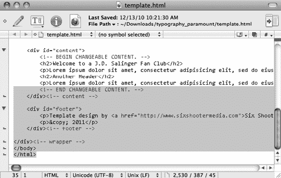

### 创建页脚文件：

**Script 8.3** 这是一个基础的页脚文件，结束 HTML 页面。

**1.** 在你的文本编辑器或 IDE 中打开 `layout.html`（脚本 8.1），如果它还没有打开的话。

**2.** 选择从 `<!-- END CHANGEABLE CONTENT -->` HTML 注释到脚本结束 `E` 的所有内容。

**3.** 复制这段代码。

```html
<!-- Script 8.3 - footer.html -->
<!-- END CHANGEABLE CONTENT -->
</div><!-- content -->
<div id="footer">
<p>Template design by <a href="http://www.sixshootermedia.com">Six Shooter Media</a>.</p>
<p>&copy; 2011</p>
</div><!-- footer -->
</div><!-- wrapper -->
</body>
</html>
```

**4.** 在你的文本编辑器或 IDE 中创建一个新的空白文档，命名为 `header.html`。

**5.** 将复制的文本粘贴到文档中（脚本 8.2）。使用你的编辑菜单或快捷键（Windows 上的 `Ctrl+V`，Mac 上的 `Command+V`），将所有高亮代码粘贴到此新文档中。

**6.** 将文件保存为 `header.html`。

现在头部文件已经创建，你将使用相同的过程创建页脚文件。

**6.** 将文件保存为 `footer.html`。

**10.** 完成 HTML 页面：

`</div><!-- footer -->`

`<div id="content">`

...

`</div><!-- wrapper -->`

`</body>`

`</html>`

事实上，回看目前为止模板，你会看到许多 HTML 注释，有助于指示页面的每个部分是什么。你的 HTML 或 PHP 代码注释得再多也不过！注释指示了哪些 `div` 正在关闭。

**11.** 将文件保存为 `template.html` 并在 Web 浏览器 `C` 中进行测试。

一旦你完成了一个喜欢的原型，就可以将其拆分为各个部分以生成模板系统。

Creating Web Applications 187


### CSS 模板

层叠样式表（CSS）长期以来一直是 Web 世界中日益重要的部分。它们最初的使用集中在美观上（字体大小、颜色等），但现在 CSS 常用于代替表格控制页面布局。本章的 Web 应用程序使用了这种方法。此示例定义了页面的四个区域——头部、侧边栏、内容和页脚。内容区域会随每个页面变化。其他区域包含每个页面标准项目，如导航链接。为了明确：PHP 和 CSS 的关系与 PHP 和 HTML 的关系相同——PHP 在服务器上运行，而 HTML 和 CSS 对浏览器很重要。就像 HTML 一样，可以使用 PHP 生成 CSS，但在示例中，CSS 被硬编码在单独文件中。

Creating Web Applications 191

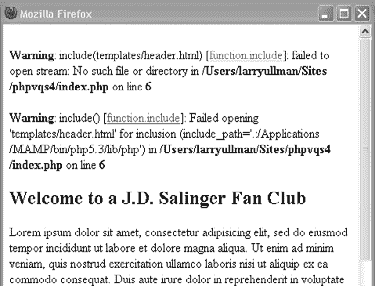

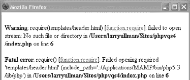

### 使用外部文件

正如前面的节所述，通过创建单独页面并使用特定函数将其到主 PHP 页面中可以节省开发时间。这两个函数是 `include()` 和 `require()`：

```php
include ('file.php');
require ('file.html');
```

这两个函数的工作方式相同，只有一个相对细微的区别：如果 `include()` 失败，会发出警告，`include()` 函数失败，但 PHP 脚本继续执行。产生警告 `A` 但继续运行。相反，如果 `require()` 失败，它将终止脚本的执行 `B`。

将引用的文件引入主文件中。

（为了清晰起见，包含 `include()` 或 `require()` 行的文件是父文件）。当 `require()` 函数调用失败时，系统会发出包含父文件在内的警告和错误，且脚本停止运行。其结果与被包含的代码最初就是父文件的一部分无异。

理解这一基本概念——包含一个文件就使得该文件的内容最初就存在于父脚本中——是充分利用这一功能的关键。这意味着，被包含文件中任何不在 PHP 标签内的代码都将被视为 HTML。无论被包含的文件是什么扩展名，这一点都适用（因为起作用的是包含文件的扩展名）。

使用这种方法的理由有很多。包含一个文件就使得该文件的内容最初就存在于父脚本中——是充分利用这一功能的关键。这意味着被包含文件中任何不在 PHP 标签内的代码都将被视为 HTML。无论被包含的文件是什么扩展名，这一点都适用（因为起作用的是包含文件的扩展名）。

使用这种方法的理由有很多。包含一个文件就使得该文件的内容最初就存在于父脚本中——是充分利用这一功能的关键。这意味着被包含文件中任何不在 PHP 标签内的代码都将被视为 HTML。无论被包含的文件是什么扩展名，这一点都适用（因为起作用的是包含文件的扩展名）。

使用这种方法的理由有很多。包含一个文件就使得该文件的内容最初就存在于父脚本中——是充分利用这一功能的关键。这意味着被包含文件中任何不在 PHP 标签内的代码都将被视为 HTML。无论被包含的文件是什么扩展名，这一点都适用（因为起作用的是包含文件的扩展名）。


# PHP 文件包含与常量使用指南

## 文件包含的核心概念

理解这一基本概念——包含一个文件就使得该文件的内容最初就存在于父脚本中——是充分利用这一功能的关键。这意味着被包含文件中任何不在 PHP 标签内的代码都将被视为 HTML。无论被包含的文件是什么扩展名，这一点都适用（因为起作用的是包含文件的扩展名）。

有许多使用这种方法的理由。包含一个文件就使得该文件的内容最初就存在于父脚本中——是充分利用这一功能的关键。这意味着被包含文件中任何不在 PHP 标签内的代码都将被视为 HTML。无论被包含的文件是什么扩展名，这一点都适用（因为起作用的是包含文件的扩展名）。

---

## 实战演示：模板系统

毕竟，那个页面将包含 `header.html`。

**13.** 在你的 Web 浏览器中运行 `index.php`。

生成的页面应该与原始布局完全相同（本章上一节中的 **C**）。

继续见下一页

**D** 此页面是使用包含的文件动态生成的。

创建 Web 应用程序 195

**14.** 在你的 Web 浏览器中查看页面的源代码。

**如果 PHP 部分只执行一个命令，通常会将该命令和 PHP 标签放在同一行：**

源代码应该与 `template.html` 的源代码完全一致

```php
<?php include 'filename.html'; ?>
```

script（脚本 8.1），除了为脚本名称添加的注释外，**如果你看到类似 A 和 B 中的错误信息**，说明父级脚本无法找到要包含的文件。这个问题最可能是由于包含的文件名拼写错误或路径错误引起的。

**此模板系统中的三个文件——**（例如，使用了 `header.html`、`footer.html` 和 `index.html` 而不是 `templates/header.html`）。—php—必须使用相同的编码以避免问题（参见第 1 章“开始使用 PHP”了解更多关于编码的内容）。

**如果渲染后的 Web 页面似乎没有反映 CSS 样式**，说明 HTML 页面找不到相应的文件。请确保你已将文件存储在正确的文件夹中，具有正确的名称，并且相对于 `index.php` 的引用是正确的。

`require()` 和 `include()` 函数可以带括号也可以不带括号使用：

```php
require 'filename.html';
```

对于包含的文件，文件的扩展名并不重要，因为它们并不打算被直接运行。作为一个经验法则，对于仅包含或大部分为 HTML 的包含文件使用 `.html` 是安全的（在这种情况下，扩展名表示它是 HTML 相关文件），对于仅包含或大部分为 PHP 的包含文件使用 `.php`。某些程序员使用 `.inc` 扩展（代表 include），但这种做法可能会带来安全风险。因此，对于任何包含敏感信息（如数据库访问参数）的文件，请务必使用 `.php` 扩展名。当然，始终使用能够确保同一个文件只被包含一次（在父级脚本中）的版本。你通常应该避免使用这些（函数），因为它们会对脚本的性能产生不利影响。

外部文件的另一个良好用法是将你的错误设置代码放在那里，以便这些更改可以应用到网站的每个页面。

196 章

8


## 使用常量

位于单引号或双引号内的常量，如下所示 **A**：

PHP 的许多数据类型已经在本书中讨论过了：主要是数字、字符串和数组。常量是另一种数据类型，但与变量不同，它们的值不能改变。

```php
print "The cost is 468 CURRENCY";
print 'The cost is 468 CURRENCY';
```

相反，需要使用拼接或多个 `print` 语句：

```php
print 'The cost is 468 ' . CURRENCY;
print 'The cost is 468 ';
print CURRENCY;
```

变量通过赋值运算符（`=`）进行赋值，而常量使用 `define()` 函数进行赋值：

```php
define('CONSTANT_NAME', value);
```

与创建常量的 `define()` 函数一起使用的是 `defined()` 函数，如果提交的常量已定义，它返回 `TRUE`。请注意——根据经验法则——常量使用全大写字母命名，尽管这不是要求的。最重要的是，常量不使用变量的初始美元符号（因为常量不是变量）。这里有两个常量：

```php
if (defined('CONSTANT_NAME')) { … }
define ('PI', 3.14);
define ('CURRENCY', 'euros');
```

作为使用常量的一个示例，你将使示例应用程序能够每个页面显示不同的标题（位于浏览器窗口顶部）。为了实现这一点，你将在父级脚本中定义一个常量，然后由头部文件进行打印。与任何值一样，对字符串加引号，对数字不加。

引用常量通常是简单的：在 `include()` 或 `require()` 调用之前存在于父文档中的常量对于包含文件是可用的（就像包含文件是父文档的一部分）。但在引号内使用常量则更为复杂。你不能在引号内打印常量的名称。常量的值不能使用引号打印。

# PHP 头部与标题管理

## 脚本 8.6: header.html

```php
<title>
<?php // 打印页面标题
if (defined('TITLE')) { // 标题是否定义？
    // 输出常量：
    echo TITLE;
} else { // 标题未定义。
    echo 'Raise High the Roof Beam! A J.D. Salinger Fan Club';
}
?>
</title>
<meta http-equiv="content-type" content="text/html; charset=utf-8" />
<link rel="stylesheet" href="css/1.css" type="text/css" media="screen,projection" />
</head>
<body>
<div id="wrapper">
    <?php
    <div id="header">
        <?php if (defined('TITLE')): ?>
            <p class="description">J.D. Salinger 粉丝俱乐部<?php echo TITLE; ?></p>
            <h1><a href="index.php">高举屋梁！</a></h1>
        <?php else: ?>
            echo 'Raise High the Roof Beam! A J.D. Salinger Fan Club';
        <?php endif; ?>
        <ul id="nav">
            <li><a href="books.php">书籍</a></li>
            <li><a href="#">故事</a></li>
            <li><a href="#">引用</a></li>
            <li><a href="login.php">登录</a></li>
            <li><a href="register.php">注册</a></li>
        </ul>
    </div>
    <!-- 头部 -->
    <div id="sidebar">
        <h2>喜欢的引用</h2>
        <p class="news">我并不确切知道这句话是什么意思，但我确实是这么想的。<br />- <em>《彻守拯救亚》</em></p>
    </div>
    <div id="content">
        <!-- 可变内容。 -->
        <!-- 脚本 8.6 - header.html -->
```

```

### 实现步骤

1.  在你的文本编辑器或 IDE 中**打开** `header.html`（脚本 8.2）。
2.  **删除** 出现于 `title` 标签之间显示的“Raise High the Roof Beam! A J.D. Salinger Fan Club”文本（第 4 行）。
3.  **在被删除的文本位置**（`title` 标签之间）添加以下内容（脚本 8.6）。
4.  **保存**文件为 `header.html`。
5.  将 `books.php` 和 `header.html` **上传**到你启用了 PHP 功能的服务器。新的 PHP 脚本 `books.php` 应该存放在与 `index.php` 相同的目录下；`header.html` 应该替换相同目录下的之前的版本——即 `footer.html` 所在。
6.  在 Web 浏览器中**运行** `books.php`。
7.  在 Web 浏览器中**查看** `index.php`（首页）。
8.  **如果你需要**，可以在 `index.php` 中添加一行常量定义行来更改其标题。

## 理解常量

现在页面标题将根据每个页面单独确定，因此不再需要将其硬编码到页面中。要让 PHP 创建页面标题，你首先需要在 `title` 标签之间开始一段 PHP 代码。然后你使用一个条件判断来检查 `TITLE` 常量是否已定义。如果已定义，则将其值作为页面标题打印。如果 `TITLE` 未定义，则打印一个默认标题。

### 常量命名规则

常量的正式命名规则与变量完全相同，除了省略了美元符号 `$`：
-   名称必须以字母开头；
-   可以包含字母、数字和下划线的任意组合；

PHP 预定义的常量包括：
- `PHP_VERSION`（PHP 版本）。
- `PHP_OS`（操作系统）。
- `SID`（会话 ID）。

使用常量的额外好处是它们是全局的。常量一旦定义就无法更改。

`date()` 函数的 24 小时格式：
- `H`：24 小时格式
- `h`：12 小时格式
- `i`：分钟
- `s`：秒
- `u`：微秒
- `a`：am 或 pm
- `U`：自时间戳的秒数
- `e`：时区（UTC）
- `O`：与 GMT 的偏移量

### 处理时间戳

`date()` 函数可以接受第二个参数，即时间戳。时间戳是自 1970 年 1 月 1 日午夜以来经过的秒数——称为 epoch。`time()` 函数返回当前时刻的时间戳。`mktime()` 函数可以返回特定时间的对应戳：`mktime(小时, 分钟, 秒, 月, 日, 年份)`。

所以代码
```php
$ts = mktime(12, 30, 0, 11, 5, 2011);
```
将从 epoch 到 2011 年 11 月 5 日 12:30 的秒数赋值给 `$ts`。然后可以将该数字传递给 `date()` 函数：
```php
date('D', $ts);
```
返回该日期的三字母格式。

### date() 函数表格

| 字符 | 含义 |
| :--- | :--- |
| `Y` | 4 位年份 |
| `y` | 2 位年份 |
| `m` | 2 位月份 |
| `M` | 三字母月份 |
| `d` | 月份中的第几天（带前导零） |
| `D` | 星期几（三字母） |
| `w` | 星期几（数字，0 代表周日） |
| `z` | 年中的第几天（0 到 365） |
| `t` | 当前月份的天数 |
| `G` | 24 小时制的小时（0-23） |
| `H` | 24 小时制的小时（01-23） |
| `i` | 分钟（00-59） |
| `s` | 秒（00-59） |


更新头文件，使其在侧边栏 `B` 中显示当前的日期时间。

```php
if (defined('TITLE')) { // 如果定义了标题
    print TITLE;
} else { // 未定义标题
    print 'Raise High the Roof Beam!';
}
```


### 1. 打开 `header.html`

在你的文本编辑器或 IDE 中打开 `header.html`（脚本 8.6）。

### 2. 添加内容

在闭合 `sidebar` `</div>` 标签之前，添加以下内容（脚本 8.7）：

```html
<meta http-equiv="content-type" content="text/html; charset=utf-8" />

<p><?php
```

初始的 HTML 段标签将包裹日期和时间。然后打开一个 PHP 代码段，以便调用 `date()` 函数。

```html
<link rel="stylesheet" href="css/1.css" type="text/css" media="screen,projection" />

</head>

<body>
```

### 3. 建立时区

在调用 `date()` 之前，必须设置时区。要查找你的时区，请访问 `www.php.net/timezones`。

```php
date_default_timezone_set('America/New_York');
```

```html
<div id="header">

    <p class="description">A J.D. Salinger Fan Club</p>

    <h1><a href="index.php">Raise High the Roof Beam!</a></h1>

    <ul id="nav">

        <li><a href="books.php">书籍</a></li>

        <li><a href="#">故事</a></li>

        <li><a href="#">名言</a></li>

        <li><a href="login.php">登录</a></li>

        <li><a href="register.php">注册</a></li>

    </ul>

</div>
```

### 4. 打印日期和时间

使用 `date()` 函数打印当前的日期和时间：

```php
print date('g:i a l F j');
```

使用表 8.1 中的格式化参数，`date()` 函数将返回一个形如 `4:15 pm Tuesday February 22` 的值。该值将立即打印出来。

### 5. 关闭 PHP 代码段并完成 HTML 代码

```html
</p>

</div>

<div id="sidebar">

    <h2>最爱名言</h2>

    <p class="news">我不确切那是什么意思，但我想对你说，请接受这束质朴的早晨花。
```

### 6. 保存并测试

将文件保存为 `header.html`，将其放在 PHP 服务器的 `templates` 目录中，并在 Web 浏览器中进行测试。由于 PHP 是一项服务端技术，这些函数反映的是服务器（即页面所在的计算机）的日期时间，而不是客户端的。要获取查看页面的 Web 浏览器所在计算机的时间，你必须使用 JavaScript。服务器的时区也可以在 PHP 配置文件中设置（参见附录 A，配置）。通常情况下，在那里设置时区比在每个脚本中单独设置是更好的主意。

```php
<?php

// 设置时区：
date_default_timezone_set('America/New_York');

// 现在打印日期和时间：
print date('g:i a l F j');
```

PHP 5.3 增加了使用 `DateTime` 类创建和操作日期的新方法。虽然这些工具很有用，但这种新工具需要熟悉面向对象编程，因此超出了本入门书籍的范围。

---

### 同一脚本显示并处理表单

被提交，并且由于其 `action` 属性指向同一个页面，脚本将发起第二次请求，这次是一个 POST 请求（假设表单使用了 POST 方法）。基于此，你可以通过检查位于 `$_SERVER` 数组中的请求类型来测试表单的提交：

```php
if ($_SERVER['REQUEST_METHOD'] == 'POST') { …}
```

为了作为一个示例，你将创建一个登录表单的基础结构。

#### 当同一个 PHP 脚本同时显示和处理 HTML 表单时

该脚本将通过两种不同的方法被请求。

#### 如果要使用一个页面来显示并处理表单

**脚本 8.8** 登录页面有两个用途：它显示登录表单并处理其提交。

1. **开始一个新的 PHP 文档**

   在你的文本编辑器或 IDE 中开始一个新的 PHP 文档，理论上命名为 `login.php`（脚本 8.8）：

   ```php
   <?php // 脚本 8.8 - login.php
   ```

2. **定义页面标题并包含页头文件**

   ```php
   define('TITLE', 'Login');
   include('templates/header.html');
   ```

3. **添加介绍性文本**

   ```php
   print '<h2>Login Form</h2>
   <p>登录的用户可以利用本章早期提到的某些功能，给此页面设置一个唯一的页面标题。</p>';
   ```

4. **检查表单是否已提交**

   ```php
   // 检查表单是否已提交：
   if ($_SERVER['REQUEST_METHOD'] == 'POST') {
       // 处理表单：
       if (!empty($_POST['email']) && !empty($_POST['password'])) {
           if (strtolower($_POST['email']) == 'me@example.com' && $_POST['password'] == 'testpass') { // 正确！
               print '<p>You are logged in!<br />Now you can blah, blah...</p>';
           } else { // 错误！
               print '<p>提交的邮箱地址和密码与记录中的不符！<br />返回并重试。</p>';
           }
       } else { // 漏掉了字段。
           print '<p>Please make sure you enter both an email address and a password!<br />Go back and try again.</p>';
       }
   }
   ```

5. **创建嵌套条件处理表单数据**

   ```php
   } else { // 显示表单。
       print '<form action="login.php" method="post">
       // ... (表单的其余 HTML 和逻辑)
       }
   ```

   这段出现在主条件判断之外的文本无论表单是在显示中还是已提交，始终会在 Web 浏览器中显示。由于此脚本的核心围绕着 PHP 条件判断，因此从 PHP 中打印 HTML 似乎比你在之前的两个示例（`index.php` 和 `books.php`）中直接退出 PHP 代码更清晰。

   要测试表单是否已提交，检查 `$_SERVER['REQUEST_METHOD']` 是否等于 `POST`（区分大小写）。代码将在下一页继续。

---

### 创建 Web 应用程序（续）

#### 完成主条件

```php
if ( (!empty($_POST['email'])) && (!empty($_POST['password'])) ) {
    if ( (strtolower($_POST['email']) == 'me@example.com') && ($_POST['password'] == 'testpass') ) {
        print '<p>You are logged in!<br />Now you can blah, blah, blah...</p>';
    } else { // 错误！
        print '<p>提交的邮箱地址和密码与记录中的不符！<br />返回并重试。</p>';
    }
} else { // 显示表单。
    print '<form action="login.php" method="post">
    <p>Email Address: <input type="text" name="email" size="20" /></p>
    <p>Password: <input type="password" name="password" size="20" /></p>
    <p><input type="submit" name="submit" value="Log In!" /></p>
    </form>';
} else {
    print '<p>Please make sure you enter both an email address and a password!<br />Go back and try again.</p>';
}
```

#### 引入页脚文件并完成 PHP 页面

```php
include('templates/footer.html');
?>
```

这些条件判断处理表单数据。第一个条件判断检查邮箱地址和密码是否有值。如果没有值，则会显示一条消息。在第一个条件判断内部，另一个条件判断检查邮箱是否等于 `me@example.com` 且密码是否为 `testpass`。如果是，假设用户已登录（在现阶段存储和检索用户信息以创建真实的登录系统还太高级了）。否则，将显示一条消息表示输入的值错误。成功登录后，用户会看到这条消息。在现实世界中，你将为错误消息添加一些 CSS 格式以便它们脱颖而出。本章的下一节将包含此功能。

这种检查隐藏输入是否存在的技巧可能会让人困惑。它之所以有效，是因为用户会两次访问同一个脚本——`login.php`。第一次访问表单尚未提交，因此检查 `$_POST['submitted']` 是否设置的条件将为 FALSE，并显示表单。然后用户点击提交后会再次访问页面，此时条件将变为 TRUE。如果你想让页面在处理表单后立即再次显示表单，请使用代码：

```php
if ($_SERVER['REQUEST_METHOD'] == 'POST') {
    // 处理表单。
}
```

脚本中不匹配，用户会看到此错误消息。

---

### 制作持久化表单

持久化表单会记住输入其中的值。一个常见的例子是搜索引擎，它即使在显示搜索结果时，通常会在搜索框中显示你的搜索词。你可能还会在用户未能准确完成表单并必须重新提交的情况下使用持久化表单。

从技术角度来看，持久化表单的工作原理是通过预设表单元素的值实现的。你可以通过设置文本输入内容的 `value` 属性来实现这一点：

```html
<input type="text" name="first_name" value="Stephanie" />
```

要让 PHP 预设该值，请在引号之间打印相应的变量：

```html
<input type="text" name="first_name" value="<?php print $_POST['first_name']; ?>" />
```

表单首次运行时，PHP 代码什么都不打印（因为变量没有值）。如果表单在提交后再次显示，用户最初在表单输入中输入的值将自动显示在那里。这就是基本思想，但更专业的实现会处理两件事……

首先，最好不要引用不存在的变量。这样做会产生 PHP 警告，由于 PHP 代码隐藏在表单元素的属性中，警告本身只会在 HTML 源代码中完全可见。为了避免这种情况，在打印变量之前检查其是否已设置：

```html
<input type="text" name="first_name" value="<?php if (isset($_POST['first_name'])) { print $_POST['first_name']; } ?>" />
```

其次，提交值中可能包含某些字符如果被打印为表单元素的值，将会引起问题。为了防止此类问题，请应用 `htmlspecialchars()` 函数（第 5 章“使用字符串”中讨论）。考虑到这一点，此代码的一个较长但更好的版本如下：

```html
<input type="text" name="first_name" value="<?php if (isset($_POST['first_name'])) { print htmlspecialchars($_POST['first_name']); } ?>" />
```

为了演示，你将创建一个注册表单的骨架。

#### 如何制作持久化表单

**脚本 8.9** 注册表单使用了所谓的持久化功能，以便它能回溯之前输入其中的值。

1. **创建新的 PHP 脚本**

   在你的文本编辑器或 IDE 中创建一个新的 PHP 脚本，命名为 `register.php`：

   ```php
   <?php // 脚本 8.9 - register.php
   /* 此页面允许人们注册网站（理论上）。 */
   ```

2. **设置页面标题并包含 HTML 头部文件**

   ```php
   define('TITLE', 'Register');
   include('templates/header.html');
   ```

3. **添加介绍性文本并定义 CSS 类**

   ```php
   print '<h2>Registration Form</h2>';
   print '<p>Register so that you can take advantage of certain features like this, that, and the other thing.</p>';
   // 添加 CSS:
   print '<style type="text/css" media="screen">
   .error { color: red; }
   </style>';
   ```

4. **检查表单是否已提交**

   ```php
   // 检查表单是否已提交：
   if ($_SERVER['REQUEST_METHOD'] == 'POST') {
       $problem = FALSE; // 没有问题
       // 检查每个值...
       if (empty($_POST['first_name'])) {
           $problem = TRUE;
           print '<p class="error">Please enter first name!</p>';
       }
       if (empty($_POST['last_name'])) {
           $problem = TRUE;
           print '<p class="error">Please enter last name!</p>';
       }
       if (empty($_POST['email'])) {
           $problem = TRUE;
           print '<p class="error">Please enter email address!</p>';
       }
   }
   ```

   为了让因未正确完成表单而生成的错误消息脱颖而出，定义了一个 CSS 类，将相关文本染成红色。虽然 CSS 通常定义在页面的头部，但你可以将其放在任何地方。

   像登录页面一样，这个脚本既显示又处理注册表单。要检查表单是否已提交，这里使用了之前的代码。

5. **创建标记变量**

   ```php
   $problem = FALSE;
   ```

   `problem` 变量将用于指示是否发生了问题。具体来说，你要在正式注册用户之前确保每个表单输入已填写。最初，此变量设置为 `FALSE`，因为还没有发生问题。这是在第 6 章“控制结构”中使用的方法。

6. **检查是否输入了姓名**

   ```php
   if (!$problem) { // 如果没有问题
       print '<p>You are now registered!<br>Okay, you are not registered but...</p>';
   }
   ```

   判断用户是否输入姓名的简单测试是检查它是否为空。如果变量为空，则通过将该变量设置为 `TRUE` 来指示问题并打印错误消息。错误消息具有 `error` 类型，以便应用 CSS 格式。

7. **重复对姓和电子邮件地址的验证**

   ```html
   <form action="register.php" method="post">
       <p>First Name: <input type="text" name="first_name" size="20" value="<?php if (isset($_POST['first_name'])) { print htmlspecialchars($_POST['first_name']); } ?>" /></p>
   ```


<p>Last Name: <input type="text" name="last_name" size="20" value="<?php if (isset($_POST['last_name'])) { print htmlspecialchars($_POST['last_name']); } ?>" /></p>

<p>Email: <input type="text" name="email" size="20" value="<?php if (isset($_POST['email'])) { print htmlspecialchars($_POST['email']); } ?>" /></p>

</form>

这两个检查都是用户名验证例的变体。

## 8. 验证密码

**脚本 8.9** 续

```php
if (empty($_POST['password1'])) {
    $problem = TRUE;
    print '<p>Email Address: <input type="text" name="email" size="20" value="<?php if (isset($_POST['email'])) { print htmlspecialchars($_POST['email']); } ?>" /></p>';
    print '<p class="error">Please type a password!</p>';
}

if ($_POST['password1'] != $_POST['password2']) {
    $problem = TRUE;
    print '<p>Password: <input type="password" name="password1" size="20" value="<?php if (isset($_POST['password1'])) { print htmlspecialchars($_POST['password1']); } ?> ?>" /></p>';
    print '<p class="error">Your password did not match your confirmed password!</p>';
}
```

密码验证需要两个条件判断。第一个检查 `$_POST['password1']` 变量是否为空。第二个检查 `$_POST['password1']` 变量是否等于 `$_POST['password2']` 变量。你不需要检查 `$_POST['password2']` 是否为空，因为如果它为空而 `$_POST['password1']` 不为空，第二个条件判断将捕捉到这个问题。如果 `$_POST['password1']` 和 `$_POST['password2']` 都为空，第一个条件判断将捕捉到错误。

## 9. 检查是否发生了问题

```php
if (!$problem) {
    print '<p>You are now registered!<br />Okay, you are not really registered but...</p>';
    $_POST = array();
}
```

如果没有出现问题，`$problem` 变量仍然为 `FALSE`，这里的初始条件为 `TRUE`（该条件是 `$problem` 的值为 `FALSE`）。在这种情况下，将执行注册过程。正式的注册过程（将数据存储在文件或数据库中）尚未开发，因此在这里显示一个简单的消息作为替代。

接下来，将 `$_POST` 变量赋值为 `array()` 值。这一行的作用是清空 `$_POST` 数组的内容，使该 PHP 变量失效（即将其重置为空数组）。这一步仅在（理论上的）注册成功后执行，以便这些值不会再次显示在注册表单中（例如参见步骤 12）。

## 10. 完成条件判断

```php
} else { // 漏掉了字段。
    print '<p class="error">Please try again!</p>';
}

if (isset($_POST['last_name'])) {
    print htmlspecialchars($_POST['last_name']);
}

// 处理表单 IF 结束。
```

如果发生了问题，则应用 `else` 子句，在这种情况下，要求用户再次填写表单。

```php
if (isset($_POST['email'])) {
    print htmlspecialchars($_POST['email']);
}
```

## 11. 开始 HTML 表单

这些是步骤 12 的变体，根据需要切换变量名。

```html
<form action="register.php" method="post">
```

与登录示例不同，此页面始终显示表单。因此，表单不属于任何条件判断。此外，由于有大量的 HTML 生成，离开页面的 PHP 部分并直接输出 HTML 会更简单。

## 12. 创建持久化的名字输入框

```html
<p>First Name: <input type="text" name="first_name" size="20" value="<?php if (isset($_POST['first_name'])) { print htmlspecialchars($_POST['first_name']); } ?>" /></p>
```

为了让名字持久化，打印出 `$_POST['first_name']` 变量，但以前无法在 input 标签内预设密码的值；现在浏览器已支持这一功能。

## 13. 为姓和电子邮件地址重复此过程

```html
<p>Password: <input type="password" name="password1" size="20" value="<?php if (isset($_POST['password1'])) { print htmlspecialchars($_POST['password1']); } ?>" /></p>
<p>Confirm Password: <input type="password" name="password2" size="20" value="<?php if (isset($_POST['password2'])) { print htmlspecialchars($_POST['password2']); } ?> /></p>
<p>Last Name: <input type="text" name="last_name" size="20" value="<?php if (isset($_POST['last_name'])) { print htmlspecialchars($_POST['last_name']); } ?>" /></p>
<p><input type="submit" name="submit" value="Register!" /></p>
</form>
```

## 14. 添加表单剩余部分

## 15. 完成 PHP 页面

```php
<?php include('templates/footer.html'); // 需要页脚 ?>
```

## 发送电子邮件

使用 PHP 发送电子邮件在理论上非常简单，只需要 PHP 的 `mail()` 函数。该函数使用服务器的电子邮件应用程序（如 Unix 或 Mac OS X 上的 `sendmail`）或 SMTP（简单邮件传输协议）服务器来发送消息。该函数的的基本用法如下：

`mail($to, $subject, $body);`

第一个参数是应发送邮件的电子邮件地址（或用逗号分隔的多个地址）。第二个参数建立邮件的主题，第三个参数创建邮件的内容。

此函数还可以接收另一个参数，通过该参数你可以向邮件添加更多细节（附加标头），包括 `From` 地址、邮件优先级和抄送地址：

```php
mail('someone@example.com', 'Test Email', 'This is a test email', 'From: email@example.com');
```

虽然在理论上这样做很容易，但在实际代码中使用此函数可能会复杂得多。首先，配置你自己的计算机来发送电子邮件可能是一项挑战（参见侧边栏“配置你的服务器以发送邮件”）。

其次，你应该采取措施防止恶意用户利用你的表单发送垃圾邮件。在我们的下一个示例中，邮件将发送到提供的电子邮箱地址。如果一个心怀鬼胎的用户提供了多个地址（例如地址 `A`），则邮件将发送到每一个地址。有很多方法可以防止这种情况。对于本书的难度水平来说，一个简单的选项是确认提供的地址中只存在一个 `@` 符号（即它只有一个电子邮件地址）。

### 使用 PHP 发送邮件

在 PHP 中，你可以通过调用 `mail()` 函数来发送邮件。你可以使用命名准确的 `substr_count()` 函数来计算字符串在字符串中出现的次数：（在理论上）。

```php
<?php // Script 8.10 - register.php 

/* 此页面允许人们注册网站（在理论上）。 */

if (substr_count($_POST['email'], '@') == 1) {
    // 设置页面标题并包含页头文件：
    define('TITLE', 'Register');
    include('templates/header.html');

    // 打印一些介绍文本：
    print '<h2>Registration Form</h2>';
    print '<p>注册后你就可以利用诸如这个、那个以及其他的功能了。</p>';

    // 添加 CSS：
    print '<style type="text/css" media="screen"> .error { color: red; }</style>';

    // 检查表单是否提交：
    if ($_SERVER['REQUEST_METHOD'] == 'POST' && (empty($_POST['email']) || substr_count($_POST['email'], '@') != 1) ) {
        $problem = FALSE; // 目前为止没有问题。

        // 检查每个值...
        if (empty($_POST['first_name'])) {
            $problem = TRUE;
            print '<p class="error">请输入你的名字!</p>';
        }

        if (empty($_POST['last_name'])) {
            $problem = TRUE;
            print '<p class="error">请输入你的姓氏!</p>';
        }

        // 3. 在注册消息（第 51 行）之后，添加以下内容：
        $body = "感谢加入 J.D. Salinger 粉丝俱乐部！你的密码是 {$_POST['password1']};";

        if (empty($_POST['email']) || substr_count($_POST['email'], '@') != 1) {
            $problem = TRUE;
            print '<p class="error">请输入你的电子邮件地址!</p>';
        }

        if (empty($_POST['password1'])) {
            $problem = TRUE;
            print '<p class="error">请输入密码!</p>';
        }

        if ($_POST['password1'] != $_POST['password2']) {
            $problem = TRUE;
            print '<p class="error">你的密码与确认的密码不匹配!</p>';
        }

        if (!$problem) { // 如果没有问题...
            // 打印消息：
            print '<p>你现在注册成功了！br />好的，你并没有真正注册，但是...</p>';
            // 发送邮件：
            mail($_POST['email'], 'Registration Confirmation', $body, 'From: admin@example.com');
            // 清除提交的值：
            $_POST = array();
        } else { // 漏掉了一个字段。
            print '<p class="error">请重试!</p>';
        }
    } // 处理表单 IF 的结束。

    // 创建表单：
?>

<form action="register.php" method="post">
    <p>名字: <input type="text" name="first_name"></p>
    <p>姓氏: <input type="text" name="last_name"></p>
    <p>电子邮件地址: <input type="text" name="email"></p>
    <p>密码: <input type="password" name="password1"></p>
    <p>确认密码: <input type="password" name="password2"></p>
    <input type="submit" name="submit" value="Register!">
</form>

<?php include('templates/footer.html'); ?>
```

1. 在你的文本编辑器或 IDE 中打开 `register.php` (Script 8.9)。
2. 修改邮件验证逻辑，使其也检查是否存在单个“at”符号（`Script 8.10`）。
3. 在注册消息（第 51 行）之后，添加以下内容：
4. 在你的文本编辑器或 IDE 中打开 `register.php` (Script 8.9)。
5. 成功完成表单后，检查你的邮箱以查看消息。

在考虑到这些注意事项的情况下，让我们在注册页面添加一个 `mail()` 调用，以便你对该函数可能的使用方式有一个直观的感受。

# 配置您的服务器

## 发送电子邮件

使用 PHP 发送电子邮件非常简单，因为程序员已经开发了许多可用的解决方案。请参阅附录 B，“资源和后续步骤”，获取可能有所帮助的网站。

如果你正在使用 Web 托管服务（或计算机）或自己的 Unix 计算机（如 Linux），这通常不应该是问题。如果你确实遇到了问题，请联系托管公司寻求支持。

如果你正在运行自己的服务器（例如，如果你正在进行本地开发），发送电子邮件可能是一个障碍。如果你使用诸如 MAMP 或 XAMPP 这样的合一安装程序（参见附录 A），软件包中也应该包含邮件服务器。如果你在注册后没有收到邮件，请检查相关软件的文档，了解需要执行哪些操作来启用电子邮件。

如果你使用的是操作系统内置的 Web 服务器（例如 Mac OS X 上的 Apache），你可能已经设置好了发送电子邮件。要开始尝试，请尝试使用一个有效的邮箱地址运行此示例。如果你没有收到邮件，请参阅附录 A 获取关于 `mail()` 正常工作的信息。

发送带有附件或 HTML 的邮件也是可能的，尽管这需要更复杂的代码（通常涉及类和对象）。

### 如何发送电子邮件

`mail()` 函数返回一个值（1 或 0），表示其使用成功。此值仅表示 PHP 是否能够尝试发送电子邮件（通过任何现有的电子邮件系统）。目前没有简单的方法可以利用 PHP 来检查邮箱地址是否有效，或者终端用户是否收到了消息。

要向多个地址发送电子邮件，请要使用 `CC` 参数，或者用逗号分隔每个 `TO` 地址。

若要在邮件正文中创建新行，可以跨行创建消息，或者在双引号内使用换行符（`\n`）。

如果你想在发送 `From` 地址之外再发送多个标头，请使用 `\r\n` 的组合将它们隔开：

```php
mail ('email@example.com', 'Testing',
$body, "From:email@example.org\r\nBcc:hidden@example.net,third@example.com");
```


我还要补充一点，我几乎从不担心让自己电脑上的 PHP 发送邮件，因为我永远不会从自己的电脑上运行真实的 Web 网站。换句话说，为什么要浪费时间让一个永远不会用到的东西运行起来（而让 PHP 在线上服务器上发送电子邮件则是非常重要的）？

## 输出缓冲

输出缓冲现在引入了输出缓冲。使用此功能将大大减少在使用标头（下一节）、Cookie（下一章）和会话（同样在下一章）时产生的错误。有几个函数只有在没有内容发送到 Web 浏览器时才会被调用。这些函数包括 `header()`、`setcookie()` 和 `ob_start()`。

要开始输出缓冲，请在页面的最顶部使用 `ob_start()` 函数。一旦调用了它，每个 `print` 类似的函数都会将数据发送到内存缓冲区，而不是 Web 浏览器。相反，像 `header()` 和 `setcookie()` 这样的 HTTP 调用不会被缓冲，并将照常方式运行。

### 放在那里

我为初级开发者推荐的一种解决方案是利用输出缓冲（也称为输出控制）。在普通的 PHP 脚本中，PHP 标签之外的任何 HTML 都会立即发送到 Web 浏览器。执行任何 `print` 语句时也是如此。通过输出缓冲，HTML 和打印的数据——即输出——将改为放入缓冲区（即内存）。在脚本结束时，缓冲区将发送到 Web 浏览器，或者在适当的情况下被清除而不发送到 Web 浏览器。这两个函数也会关闭输出缓冲。

**使用输出缓冲：**

1. 在你的文本编辑器或 IDE 中打开 `header.html`（脚本 8.7）。
2. 在页面的最顶部，在任何 HTML 代码之前，添加以下内容（脚本 8.11）：

```php
<?php
ob_start();
?>
<!DOCTYPE html PUBLIC "-//W3C//DTD XHTML1.1//EN" "http://www.w3.org/TR/xhtml11/DTD/xhtml11.dtd">
<html xmlns="http://www.w3.org/1999/xhtml" xml:lang="en">
<head>
<title><?php // 打印页面标题。
if (defined('TITLE')) { // 是否定义了标题？
    print TITLE;
} else { // 未定义标题。
    print 'Raise High the Roof Beam! A J.D. Salinger Fan Club';
} ?></title>
<meta http-equiv="content-type" content="text/html; charset=utf-8" />
<link rel="stylesheet" href="css/1.css" type="text/css" media="screen,projection" />
</head>
<body>
<div id="wrapper">
<div id="header">
<p class="description">A J.D. Salinger Fan Club</p>
<p class="news">我私下对你说，老朋友...请接受我送上的这束谦逊的早开花括号： (((()))).<br />
<em>Raise High the Roof Beam, Carpent and Seymour: An Introduction</em></p>
<h1><a href="index.php">Raise High the Roof Beam!</a></h1>
<ul id="nav">
<li><a href="books.php">Books</a></li>
<li><a href="#">Stories</a></li>
<li><a href="#">Quotes</a></li>
<li><a href="login.php">Login</a></li>
<li><a href="register.php">Register</a></li>
</ul>
</div>
</div>
```

3. 在你的文本编辑器或 IDE 中打开 `footer.html`（脚本 8.8）。

使用输出缓冲的关键是在脚本中尽可能早地调用 `ob_start()` 函数。在这个示例中，你在任何 HTML 之前创建了一个特殊的 PHP 并调用了 `ob_start()`。通过在头部文件中开启输出缓冲并在页脚文件中关闭，你对 Web 应用程序中的每个页面进行缓冲。

在脚本结束时，调用 `ob_end_flush()` 函数将累积的缓冲区发送到 Web 浏览器。或者使用 `ob_end_clean()` 函数删除缓冲区而不传递。

**A** 如果浏览器在调用 `header()` 之前接收到任何 HTML，将看到此错误信息：`headers already sent`（标头已发送）。

## 创建 Web 应用程序

### 输出缓冲 (Output Buffering)

4. 在脚本结束时，当 HTML 中所有的 `Script 8.12` 输出缓冲完成后，使用 `ob_end_flush()` 添加页脚文件的结尾，这会将累积的缓冲区发送到 浏览器。

```php
<?php // Script 8.12 - footer.html
ob_end_flush();
?>
```

此代码会关闭输出缓冲并将累积的缓冲区发送到 浏览器。换句话说，此时所有的 HTML 都会被发送。

```html
<div id="footer">
    <p>模板设计来自 <a href="http://www.sixshootermedia.com">Six Shooter Media</a>。</p>
    <p>&copy; 2011</p>
</div>
```

5. 保存两个文件，并将它们放置在启用 PHP 的服务器的 `templates` 目录中。

6. 在 Web 浏览器中测试任何页面。

**提醒：PHP 代码可以放置在具有 `.html` 扩展名的文件中——正如这里的这两个示例所示——只要该文件被 PHP 脚本（如 `index.php`）包含即可。**

长期以来，PHP 的默认配置中已自动启用了输出缓冲。你可以在 `php.ini`（PHP 配置文件）中设置最大缓冲区大小。默认值为 4,096 字节。

`ob_get_length()` 函数返回当前缓冲区内容的长度（以字符数计算）。

`ob_get_contents()` 函数返回当前缓冲区，以便在需要时将其赋值给变量，但在下一节中使用 HTTP 头部时，处理它会更方便。

`ob_flush()` 函数将缓冲区的当前内容发送到 Web 浏览器并丢弃它们，允许启动新的缓冲区。此函数允许你的脚本保持适中的缓冲区大小。

`ob_clean()` 函数在不停止进程的情况下删除当前缓冲区的内容。

如果没有其他操作，PHP 在脚本结束时会自动运行 `ob_end_flush()`。但自己调用它仍然是一个好习惯。

## HTTP 头部 (HTTP Headers)

服务器与 Web 浏览器（客户端）之间的大多数交互通过 HTTP（超文本传输协议）进行。这就是为什么 Web 页面的地址以 `http://` 开头。但 Web 服务器需要通过除了发送 HTML、图像和等以外的其它方式与浏览器进行通信。这些额外的通信可以使用 HTTP 头部来实现。HTTP 头部有几十种用途，所有可以使用 PHP 的 `header()` 函数完成。在这里，你将学习 `header()` 函数的一个非常常见的用途：将用户从一个页面重定向到另一个页面。要用 PHP 重定向用户的浏览器，你需要发送一个 location 头部：

```php
header('Location: page.php');
```

通常，`header()` 函数后面会跟 `exit()`，以取消脚本的执行（因为浏览器已经重定向到另一个页面了）：

```php
header('Location: page.php');
exit();
```

使用 `header()` 最重要的一点是，必须在向 Web 浏览器发送任何内容之前调用该函数——否则，你会看到常见的“headers already sent”（头部已发送）消息（参见“输出缓冲”部分中的 A）。如果你的 Web 页面接收到任何 HTML 甚至是空格，`header()` 函数将无法工作。

幸运的是，你在上一节中已经学习了输出缓冲。由于应用程序中开启了输出缓冲，在脚本的最后一行（调用 `ob_end_flush()` 时）之前，没有任何内容会被发送到 Web 浏览器。通过这种方法，你可以避免可怕的“headers already sent”错误消息。

为了练习重定向，你将重写登录页面，以便在登录成功后将用户带到欢迎页。

**使用 header() 函数：**

1. 在文本编辑器或 IDE 中打开 `login.php`（Script 8.8）。
2. 删除 `print` 语句（Script 8.13）。因为用户被重定向到了另一个页面，所以没有需要包含此消息了。

```php
<?php // Script 8.13 - login.php
/* 此页面允许人们登录网站（理论上）。 */

// 设置页面标题并包含文件：
define('TITLE', 'Login');
include('templates/header.html');

// 打印一些介绍性文本：
print '<h2>登录表单</h2><p>登录的用户可以利用某些功能，例如这个、那个以及其他的。</p>';

// 检查表单是否提交：
if ($_SERVER['REQUEST_METHOD'] == 'POST') {
    // 处理表单：
    if (!empty($_POST['email']) && !empty($_POST['password'])) {
        if ((strtolower($_POST['email']) == 'me@example.com') && ($_POST['password'] == 'testpass')) {
            // 正确！
            // 将用户重定向到欢迎页！
            ob_end_clean(); // 销缓冲区！
            header('Location: welcome.php');
            exit();
        } else {
            // 错误！
            print '<p>提交的邮箱地址和密码与记录中的信息不符！请返回并重试。</p>';
        }
    } else {
        // 漏掉了字段。
        ob_end_clean();
        print '<p>请确保你都输入了邮箱地址和密码！请返回并重试。</p>';
    }
}
```

3. 在 `print` 语句所在添加以下内容：第一行销毁页面缓冲区（因为累积的缓冲区将不会被使用）。这并不是强制要求的，但是一个好习惯。下一行将用户重定向到 `welcome.php`。第三行终止脚本剩余部分的执行。

现在，你需要创建用户将被重定向到的 **welcome.php** 页面。

**编写 welcome.php：**

1. 在你的文本编辑器或 IDE 中创建一个新的 PHP 文，命名为 `welcome.php`（Script 8.14）：

```php
<?php // Script 8.14 - welcome.php
// 需要页脚。
include('templates/header.html');
?>
<h2>欢迎来到 J.D. Salinger 粉丝俱乐部！</h2>
<p>你已成功登录，现在可以利用网站提供的所有功能。</p>
```

### `Script 8.14` 欢迎页在用户登录后欢迎他们。

```php
<?php // Script 8.14 - welcome.php
/* 这是一个欢迎页。用户在成功登录后
会被重定向到这里。 */

// 设置页面标题并包含头部文件：
define('TITLE', 'Welcome to the J.D. Salinger Fan Club!');
include('templates/header.html');

// 离开 PHP 部分以显示大量的 HTML：
?>
<h2>欢迎来到 J.D. Salinger 粉丝俱乐部！</h2>
<p>您已成功登录，现在可以使用该网站提供的所有功能。</p>
<p>Lorem ipsum dolor sit amet, consectetur adipisicing elit, sed do eiusmod tempor incididunt ut labore et dolore magna aliqua. Ut enim ad minim veniam, quis nostrud exercitation ullamco laboris nisi ut aliquip ex ea commodo consequat. Duis aute irure dolor in reprehenderit in voluptate velit esse cillum dolore eu fugiat nulla pariatur. Excepteur sint occaecat cupidatat non proident, sunt in culpa qui officia deserunt mollit anim id est laborum.</p>
<?php include('templates/footer.html'); // 需要页脚。 ?>
```

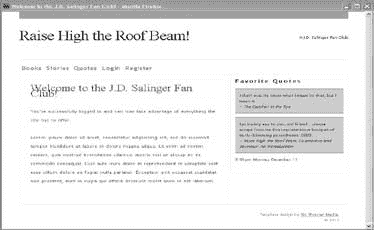
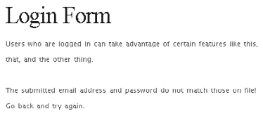
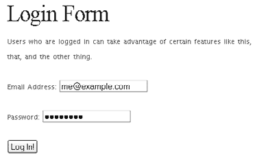

4. 返回到 PHP 并包含页脚：

```php
<?php include('templates/footer.html'); ?>
```

5. 将脚本保存为 `welcome.php`，将其放置在与 `login.php` 新版本相同的目录下，并在你的 Web 浏览器 `A`、`B` 和 `C` 中进行测试。

如果页面已经接收了 HTTP 头部，`headers_sent()` 函数返回 `TRUE`，此时无法使用 `header()` 函数。

使用 `GET` 方法技巧可以使用 `header()` 将值从一个页面传递到另一个页面：

```php
$var = urlencode('Pass this text');
header("Location: page.php?message=$var");
```

技术上，`header()` 函数在重定向时应该使用目标页面的完整路径。例如，它应该是：

```php
header('Location: http://www.example.com/welcome.php');
```

或

```php
header('Location: http://localhost/welcome.php');
```

在我的书籍《PHP 6 and MySQL 5 for Dynamic Web Sites: Visual QuickPro Guide》中，我展示了根据当前脚本的位置动态生成绝对 URL 的一些代码。

如果用户没有正确登录，他们将留在登录页面。

### 本章内容

第 8 章“创建 Web 应用程序”涵盖了开发更完善的 Web 网站的许多技术。缺失的一部分——也是本章的重点——是当用户浏览多页 Web 网站时如何维护“状态”。超文本传输协议（HTTP）是一种无状态技术，这意味着它没有内置方法来跟踪用户或记住从应用程序的一个页面到另一个页面的数据。这是一个严重的问题，因为电子商务应用程序、用户注册登录系统以及其他常见的在线服务都依赖于能够在不同页面之间跟踪同一个用户。幸运的是，使用 PHP 维护状态非常简单。本章讨论了跟踪数据的两种主要方法：cookies 和 sessions。你将从学习如何创建、读取、修改和删除 cookies 开始，然后你将发现掌握 sessions 是多么简单。

### 复习

- 修改 `header.html` 中 `date()` 函数的参数，以不同的方式显示日期和/或时间。
- `include()` 和 `required()` 之间有什么区别？
- 为什么即使使用 `.html` 扩展名，你也可以将 PHP 代码放入包含的文件中？
- 将 `register.php` 中的密码条件重写为嵌套的条件对。提示：参见第 6 章的示例。
- 文件的相对引用和绝对引用有什么区别？
- 如果你使用 PHP 5.2 或更高版本，请查看 PHP 手册中 `filter` 扩展。然后引入 `filter_var()` 函数来验证 `register.php` 中的邮箱地址。
- 如何定义常量？常量名是对大小写敏感还是不敏感？如何检查常量是否已定义？
- 将（伪）注册时发送的邮件主题和正文更改为更有意思且信息量丰富。
- 如何让表单元素“记住”之前提交的值？
- 如何查看表单元素内发生的 PHP 错误（例如在预设表单元素的值时）？
- “headers already sent”（头部已发送）错误意味着什么？如何防止？
- `$_SERVER['REQUEST_METHOD']` 的意义是什么？
- 什么是 epoch（纪元）？什么是时间戳（timestamp）？

## 探索

- 为新的头部和页脚文件创建一个原型设计。
- 如果你在复习本章示例时遇到任何问题，或者对探索提示有疑问，请访问书籍支持论坛（www.Larryllman.com/forum/）。
- 再次查看网站的任何页面（你不应该更改任何 PHP 脚本）。

## 什么是 Cookie？


在 cookie 出现之前，浏览 Web 网站是没有历史的旅行。虽然浏览器跟踪你访问的页面，允许你使用后退按钮返回之前的页面并用不同的颜色指示访问过的链接，但服务器并不跟踪个人的所见所得。这对于不使用 cookie 的网站，以及在 Web 浏览器 `A` 中禁用了 cookie 的用户也是如此。

为什么这是一个问题呢？如果服务器无法跟踪用户，就没有用于在线购物的购物车。简而言之，没有 cookie，就没有 Amazon、Facebook 或其他最流行的或实用的网站（至少以目前的形式）。

Cookie 仅仅是服务器在用户计算机上存储信息的一种。通过这种方式，服务器可以在一次访问期间或多次访问期间记住用户。把 cookie 想象成一个标签：你告诉服务器你的名字，它给你一个标签。然后它就可以通过参考标签来知道你是谁。

这引出了涉及 cookie 的安全问题的另一个点。cookie 的声誉不佳是因为用户认为 cookies 允许服务器获取关于他们的过多的信息。然而，cookie 只能存储你提供给它的信息，因此它的安全性取决于你希望它的安全程度。而且，正如之前提到的，在现代浏览器中，可以很容易地根据需要自定义 cookie 处理方式。

PHP 对 cookies 有非常好的支持。在本章中，你将学习如何设置 cookie、从 cookie 中获取信息，然后删除 cookie。你还将看到，当 Web 浏览器请求该网站的页面时，网站会读取 cookies。在某些可选参数中，你可以用来对 cookie 的生存时间应用限制。换句话说，当用户在地址栏输入 URL 并点击转到（或其他任何操作）时，网站会读取它有权访问任何 cookies，然后提供请求的页面。

在继续之前，关于 cookies 还有两点你应该了解。这个顺序非常重要，因为它决定了在何时以及如何访问 cookies。第一点是如何调试与 cookie 相关的问题。你不可避免地需要知道如何操作，因此该主题在侧边栏“调试 cookies”中进行了讨论。第二点是 cookie 如何被传输和接收 `B`。Cookies 存储在 Web 浏览器中，但只有最初发送 cookie 的网站才能读取它。此外，cookies 是……

### 调试 cookies

当你开始在 PHP 中处理 cookies 时，当出现困难时，你需要知道如何调试与 cookie 相关的脚本。有三个领域可能会给你带来麻烦：

1. 使用 PHP 发送 cookie
2. 在你的 Web 浏览器中接收 cookie
3. 在 PHP 脚本中访问 cookie

第一个问题和最后一个问题可以通过在你的 PHP 脚本中打印变量值来调试（你很快就会学到）。第二个问题要求你知道如何在 Web 浏览器中处理 cookies。为了调试目的，你可能希望你的 Web 浏览器在发送 cookie 时通知你。

在 Windows 上的 Internet Explorer 中，你可以通过选择“工具”菜单下的“Internet 选项”来实现这一点。然后点击“隐私”选项卡，接着点击“设置”下的“高级”按钮。点击“覆盖自动 cookie 处理” `A`，然后选择“对第一方和第三方 Cookie 均提示”（如果你愿意，你实际上也可以阻止第三方 cookie）。Internet Explorer 的其他版本可能使用此过程的不同变体。Internet Explorer 还有一个开发者工具窗口（位于“工具”菜单下的链接），这可能是非常有用的。

在任何平台上使用 Firefox 时，调试 cookies 的最佳方法是安装许多 cookie 相关的扩展之一，例如 Firecookie。每个开发者必须使用的 Firebug 扩展也显示与 cookie 相关的信息。但至少，如果你在“隐私”面板（在“选项/设置”窗口中）选择“使用自定义历史设置”，你将能够建立自定义 cookie 行为，例如提示。

Mac OS X 和 Windows 上的 Safari 没有给你提供很多 cookie 选择；你可以在“设置”窗口的“安全”选项卡上找到可用选项。

某些浏览器还允许你浏览现有 cookies 以查看它们的名称和值。这在调试战中是一项巨大的资产。

### 创建 cookies

关于 cookies 的一个重要点是，在发送任何信息之前，它们必须从服务器发送到客户端。这意味着脚本应该在任何 `print` 语句之前、包含包含 HTML 的外部文件之前发送 cookies。如果服务器在 Web 浏览器已经接收 HTML（即使是多余的空行或空格）之后尝试发送 cookie，cookie 将不会发送。这是到为止最常见的 cookie 相关错误。Cookies 使用 `setcookie()` 函数发送：

```php
setcookie(name, value);
```

`setcookie('CookieName', 'This is the cookie value.');` 那行代码向浏览器发送了一个名为 `CookieName` 值为 `This is the cookie value.` 的 cookie `B`。你可以通过后续使用 `setcookie()` 函数向浏览器发送更多 cookies，尽管你受到浏览器对同一站点 cookie 数量的限制：

```php
setcookie('name2', 'some value');
setcookie('name3', 'another value');
```

如果浏览器设置为提示 cookie，每个 cookie 都会出现如下消息（注意，Internet Explorer 以 URL 编码格式显示值）。最后，在创建 cookies 时，你可以——正如你在示例中看到的——使用变量作为 cookie 的名称或值：

```php
setcookie($cookie_name, $cookie_value);
```

设置 cookies 的示例：你将创建一个允许用户指定页面字体大小和颜色的脚本。该页面显示用于另一个 PHP 页面的字体大小和颜色表单 `C`。该表单用于选择这些值并处理表单提交。另一个将在下一节中使用这些设置。

#### 发送 cookies

1. 在你的文本编辑器或 IDE 中创建一个新的 PHP 文档，命名为 `customize.php`（`脚本 9.1`）。提交表单后，页面将显示一条消息和指向另一个页面的链接（在那里使用设置）。该页面将创建。

cookies 最关键的问题是它们在发送任何内容之前就已经创建。为了实现这一点，脚本从处理发送 cookies 的 PHP 部分开始。确保在初始 PHP 标签之前没有多余的空格或行。

```php
<?php // 脚本 9.1 - customize.php
// 如果表单已提交，则处理：
if (isset($_POST['font_size'], $_POST['font_color'])) {
    // 发送 cookies：
    setcookie('font_size', $_POST['font_size']);
    setcookie('font_color', $_POST['font_color']);

    // 后打印的消息：
    $msg = '<p>你的设置已输入！点击 <a href="view_settings.php">这里</a> 查看效果。</p>';
} // 提交的 IF 结束。
?>
<!DOCTYPE html PUBLIC "-//W3C//DTD XHTML 1.0 Transitional//EN" "http://www.w3.org/TR/xhtml1/DTD/xhtml1-transitional.dtd">
<html xmlns="http://www.w3.org/1999/xhtml" xml:lang="en" lang="en">
```

```php
setcookie('font_size', $_POST['font_size']);
setcookie('font_color', $_POST['font_color']);
```

<head>

<meta http-equiv="Content-Type" content="text/html; charset=utf-8"/>

<title>自定义您的设置</title>

</head>

<body>

<?php // 如果发送了 cookie，则打印一条消息。

...其他的 `font_color`。这些值将基于从 HTML 表单中选择的值，这些值存储在 `$_POST['font_size']` 和 `$_POST['font_color']` 变量中。

if (isset($msg)) {

    print $msg;

}

?>

```

在更完善的应用程序中，你应该首先确认这两个变量都具有可接受的值。

**4.** 创建一条消息并完成条件判断和 PHP 部分：

```php
$msg = '<p>您的设置已输入！点击<a href="view_settings.php">这里</a>以查看运行效果。</p>';

} // 结束提交的 IF。

?>
```

当表单被提交后，cookie 将被发送，并且 `$msg` 变量将被赋值一个字符串值。该变量稍后将在脚本中用于打印消息。这种方法是必要的，因为你现在无法打印消息（因为此时 HTML head 还没有创建）。

**5.** 创建 HTML head 和起始的 body 标签：

```html
<!DOCTYPE html PUBLIC "-//W3C//DTD XHTML 1.0 Transitional//EN" "http://www.w3.org/TR/xhtml1/DTD/xhtml1-transitional.dtd">
<html xmlns="http://www.w3.org/1999/xhtml" xml:lang="en" lang="en">
<head>
<meta http-equiv="Content-Type" content="text/html; charset=utf-8"/>
<title>自定义您的设置</title>
</head>
```

所有这些代码必须位于 `setcookie()` 语句之后。这并不是夸大事实，但在调用 `setcookie()` 之前，不能向 Web 浏览器发送任何文本、HTML 或空格。

HTML 表单本身非常简单。用户被提供了一个下拉菜单来选择字体大小。每个值都对应于设置文档字体大小的 CSS 代码：从 `xx-small` 到 `xx-large`。

**6.** 创建另一个 PHP 部分来报告 cookie 的发送情况：因为此脚本既显示又处理表单，所以表单的 `action` 属性指向同一个文件。

```php
<?php
if (isset($msg)) {
    print $msg;
}
?>
```

**8.** 完成 HTML 表单：如果 cookie 已经发送，此代码将打印一条消息。当用户第一次访问页面时，cookie 尚未发送，因此 `$msg` 未被设置，导致该条件为 `FALSE`，且此 `print` 调用永远不会执行。一旦表单被提交，此时 `$msg` 已经被设置，因此该条件为 `TRUE`。

**7.** 开始 HTML 表单：

```html
<form action="customize.php" method="post">
<p>使用此表单设置您的偏好：</p>
<select name="font_size">
<option value="">字体大小</option>
<option value="xx-small">xx-small</option>
<option value="x-small">x-small</option>
<option value="small">small</option>
<option value="medium">medium</option>
<option value="large">large</option>
<option value="x-large">x-large</option>
<option value="xx-large">xx-large</option>
</select>
<select name="font_color">
<option value="">字体颜色</option>
<option value="999">灰色</option>
<option value="0c0">绿色</option>
<option value="00f">蓝色</option>
<option value="c00">红色</option>
<option value="000">黑色</option>
</select>
<input type="submit" name="submit" value="设置我的偏好" />
</form>
```

**9.** 将文件保存为 `customize.php` 并将其放置在启用 PHP 的服务器中。
**10.** 在您的 Web 浏览器中运行脚本。
**11.** 如果你希望浏览器在接受 cookie 之前提示，请确保已将您的 Web 浏览器设置为对每个 cookie 进行提示。你应该尽可能在许多浏览器和操作系统上测试您的基于 cookie 的应用程序。

# 查看您的设置

例如，要获取通过 `body` 行建立的 `<style type="text/css">` cookie 的值，您可以使用变量 `$_COOKIE['user']`。

```php
<?php // Script 9.2 - view_settings.php
setcookie('user', 'trout');

// 检查 font_size 值：
if (isset($_COOKIE['font_size'])) {
    // 除非你更改了 cookie 的参数（你将在本章稍后的部分看到），否则
    print "\t\tfont-size: " . htmlentities($_COOKIE['font_size']) . ";\n";
} else {
    print "\t\tfont-size: medium;";
}
```

然而，您应该理解 cookie 在发送后立即是无法被脚本访问的。您不能执行以下操作：

```php
// 检查 font_color 值：
if (isset($_COOKIE['font_color'])) {
    setcookie('user', 'trout');
    print "\t\tcolor: #" . htmlentities($_COOKIE['font_color']) . ";\n";
} else {
    print "\t\tcolor: #000;";
}

print $_COOKIE['user']; // 无值。
```

此现象的原因是 cookie 读取和发送的顺序（请参见本章第一部分的 **B**）。为了查看访问在 `customize.php` 中设置的 cookie 值有多么简单，让我们编写一个使用 `customize.php` 来指定页面字体大小和颜色的脚本。该脚本依赖 CSS 来实现。

## 使用 PHP 获取 cookie 数据

**1.** 在您的文本编辑器或 IDE 中开始一个名为 `view_settings.php` 的新 PHP 文档（**脚本 9.2**）：

```html
<!DOCTYPE html PUBLIC "-//W3C//DTD XHTML 1.0 Transitional//EN" "http://www.w3.org/TR/xhtml1/DTD/xhtml1-transitional.dtd">
<html lang="en">
<head>
<meta http-equiv="content-type" content="text/html; charset=utf-8" />
<title>View Your Settings</title>
<style type="text/css">
body {
    font-size:
    color:
}
</style>
</head>
<body>
<p><a href="customize.php">Customize Your Settings</a></p>
<p><a href="reset.php">Reset Your Settings</a></p>
</body>
</html>
```

**2.** 开始 CSS 部分：

```css
body {
    font-size: x-large;
    color: #999;
}
```

另外注意，`print` 语句中添加两个制表符（`\t`）和一个换行符（`\n`），以便生成的 CSS 代码格式正确。这并不影响页面的功能，但是……

**3.** 打开一个 PHP 代码段：在这里正在为 CSS 的 `color` 属性赋一个值。cookie 本身的使用方法与步骤 4 相同。脚本现在将使用 PHP 根据 cookie 输出剩余的 CSS。

**4.** 使用字体大小 cookie 值（如果它存在）：

```php
if (isset($_COOKIE['font_size'])) {
    print "\t\tfont-size: " . htmlentities($_COOKIE['font_size']) . ";\n";
} else {
    print "\t\tfont-size: medium;";
}
```

**5.** 开始 HTML body 并创建指向两个页面的链接：

```html
<p><a href="customize.php">Customize Your Settings</a></p>
<p><a href="reset.php">Reset Your Settings</a></p>
```

**6.** 添加一些文本：

```html
<p>此页面反映了使用另一个 PHP 脚本所做的自定义字体选择。这些文本是为了显示 cookie 变化的影响。</p>
```


### 7. 完成 HTML 页面

```html
</body>
</html>
```

### 8. 保存并测试

将文件保存为 `view_settings.php`，将其置于与 `customize.php` 相同的目录下，并在 Web 浏览器 **A** 中点击 `customize.php` 上的链接进行测试。

### 9. 查看源代码

查看源代码以查看生成的 CSS 代码 **B**。

### 10. 更改设置

使用 `customize.php` 页面更改您的设置。每次提交表单都会创建两个新的 cookie，从而替换现有的 cookie。

---

可以通过 `forum.example.com` 在 PHP 中获取当前时间。

`time()` 函数（它返回一个时间戳；`setcookie(*name*, *value*, time()+3600, '',` 参见第 8 章）。因此，这行代码 ➝ `'forum.example.com');` 将 cookie 的过期时间设置为 `Script 9.3`。当你为这两个 cookie 添加了 `expiration` 参数后，即使用户关闭了浏览器并在稍后返回，这些 cookie 仍然存在。

### Script 9.3 - customize.php #2

```php
<?php // Script 9.3 - customize.php #2

// 如果表单已提交，则处理表单：
if (isset($_POST['font_size'], $_POST['font_color'])) {

    // 发送 cookie:
    setcookie('font_size', $_POST['font_size'], time()+10000000, '/');
    setcookie('font_color', $_POST['font_color'], time()+10000000, '/');

    // 稍后打印的消息:
    $msg = '<p>Your settings have been entered! Click <a href="view_settings.php">here</a> to see them in action.</p>';

} // 提交的 IF 。

?>

<!DOCTYPE html PUBLIC "-//W3C//DTD XHTML 1.0 Transitional//EN"
"http://www.w3.org/TR/xhtml1/DTD/xhtml1-transitional.dtd">
<html xmlns="http://www.w3.org/1999/xhtml" xml:lang="en" lang="en">
```

> 代码继续见下一页

---

### Script 9.3 继续

`secure` 值规定 cookie 只能通过安全的 HTTPS 连接发送。值为 `1` 表示必须使用安全连接，而值为 `0` 则表示不需要安全连接。你可以为电子商务网站确保 cookie 的安全传输：

```php
setcookie('cart', '82ABC3012', time()+3600, '', 'shop.example.com', 1);
```

正如与所有接受参数的函数一样，你必须按顺序传递所有值。在先的示例中，如果不需要指定（或限制）路径，可以使用空引号。

#### Path 和 HttpOnly 参数

使用此表单设置你的偏好：通过 `path` 参数，你也可以使用单个斜杠（`/`）来指示根文件夹（即无路径限制）。通过这样做，你保持了正确的参数数量，并且仍然可以指示需要 HTTPS 连接。

最后一个参数——`httponly`——是在 PHP 5.2 中引入的。它可以限制对 cookie 的访问（例如，防止使用 JavaScript 读取 cookie），但并不是所有浏览器都支持。让我们为现有的 `customize.php` 页面添加一个过期日期，这样用户在关闭浏览器稍后返回网站时，他们的偏好设置仍然存在。

#### 设置 cookie 的过期日期

1. 在你的文本编辑器或 IDE 中打开 `customize.php` (Script 9.1)。
2. 将两个 `setcookie()` 更改如下所示（**Script 9.3**）：

```php
setcookie('font_size', $_POST['font_size'], time()+10000000, '/');
setcookie('font_color', $_POST['font_color'], time()+10000000, '/');
```

```html
<form action="customize.php" method="post">
    <select name="font_size">
        <option value="">Font Size</option>
        <option value="xx-small">xx-small</option>
        <option value="x-small">x-small</option>
        <option value="small">small</option>
        <option value="medium">medium</option>
        <option value="large">large</option>
        <option value="x-large">x-large</option>
        <option value="xx-large">xx-large</option>
    </select>
    <select name="font_color">
        <option value="">Font Color</option>
        <option value="999">Gray</option>
        <option value="0c0">Green</option>
        <option value="00f">Blue</option>
        <option value="c00">Red</option>
        <option value="000">Black</option>
    </select>
    <input type="submit" name="submit" />
</form>
```

---

### 删除 Cookie

关于 cookie 最后需要知道的是如何删除它们。虽然 cookie 在用户浏览器关闭时或达到过期日期/时间时会自动过期，但有时你可能想手动删除 cookie。例如，具有注册用户和登录功能的网站通常会在用户注销时删除任何 cookie。

`setcookie()` 函数最多可以接受七个参数，但只需要其中一个——名称（name）。如果你发送一个只有名称而没有值的 cookie，其效果等同于删除同名的现有 cookie。例如，要创建 `username` cookie，你使用这行代码：

`setcookie('username', 'Larry');`

要删除 `username` cookie，你编写代码：

```php
setcookie('username', '');
```

或

```php
setcookie('username', FALSE);
```

作为额外的预防措施，你也可以设置一个过去的过期日期：`setcookie('username', FALSE, time()-600);`

删除 cookie 的唯一注意事项在于，你必须使用与最初设置 cookie 时相同的参数值（值和过期除外）。例如，如果你在设置 cookie 时提供了 `domain` 值，那么在删除 cookie 时也必须提供该值：

```php
setcookie('user', 'larry', time() + 3600, '', 'forums.example.com');
setcookie('user', '', time() - 600, '', 'forums.example.com');
```

---

### Script 9.4 - reset.php

为了演示此功能，让我们添加一个**脚本 9.4**。要删除现有的 cookie，向 Web 发送一个重置页面。这些新的 cookie 具有相同的名称、空值和过去的过期时间。PHP 脚本将销毁发送的 cookie，这样用户的偏好就会被遗忘。

**删除 cookie：**

1. 在你的文本编辑器或 IDE 中开始一个新的 PHP 脚本，命名为 **reset.php**（**脚本 9.4**）：

```php
<?php // Script 9.4 - reset.php

// 删除 cookies：
setcookie('font_size', '', time() - 600, '/');
setcookie('font_color', '', time() - 600, '/');
?>
<!DOCTYPE html PUBLIC "-//W3C//DTD XHTML 1.0 Transitional//EN" "http://www.w3.org/TR/xhtml1/DTD/xhtml1-transitional.dtd">
<html xmlns="http://www.w3.org/1999/xhtml" xml:lang="en" lang="en">
<head>
<meta http-equiv="Content-Type" content="text/html; charset=utf-8"/>
<title>重置设置</title>
</head>
```

这两行发送了名为 `font_size` 和 `font_color` 的 cookie，每个都没有值，且过期时间为 10 分钟前。正如你创建 cookie 时所做的那样，在向 Web 浏览器发送任何内容之前，你必须调用 `setcookie()` 函数。

**3.** 创建 HTML head：

```html
<!DOCTYPE html PUBLIC "-//W3C//DTD XHTML 1.0 Transitional//EN" "http://www.w3.org/TR/xhtml1/DTD/xhtml1-transitional.dtd">
<html xmlns="http://www.w3.org/1999/xhtml" xml:lang="en" lang="en">
<head>
<meta http-equiv="Content-Type" content="text/html; charset=utf-8"/>
<title>重置设置</title>
</head>
```

**4.** 添加页面的 body：

```html
<body>
<p>您的设置已重置！点击<a href="view_settings.php">这里</a>返回主页。</p>
</body>
```

此脚本的 body 仅仅是告诉用户他们的设置已经重置。然后提供了一个返回主页的链接。

**5.** 完成 HTML：

```html
</html>
```

**6.** 将页面保存为 **reset.php**，将其放置于启用 PHP 的服务器相应目录下，并在你的 Web 浏览器中进行测试。

> **注意：** 正如创建 cookie 在加载另一个页面之前不会生效，删除 cookie 在加载另一个页面之前也不会生效。这意味着你可以在页面上删除 cookie，但仍然在该页面上访问它（因为 cookie 在删除操作发送之前已经被页面接收了）。

> **提示：** 正如创建 cookie 在不同浏览器中会有混合结果，删除 cookie 也是如此。在许多浏览器上测试你的脚本并尝试 `setcookie()` 设置以确保良好的兼容性。

---

### 什么是 Session？

Session 就像 cookie，它提供了一种跨一系列页面跟踪数据的方法。两者之间的区别（这一点非常重要）是 cookie 将数据存储在客户端（浏览器）中，而 session 数据存储在服务器上。因此，session 通常更安全，因为数据不会在客户端和服务器之间往返。

### 选择 Session 还是 Cookie

**A** 第一次启动 session 时，会生成一个随机 session ID，并向浏览器发送名为 `PHPSESSID`（session 名称）且值为 `4bcc48dc8cb4b54d63f99da23fb1e1` 的 cookie（参见上一节的 **A**）。

一旦启动 session，你就可以通过向 `_SESSION` 数组赋值来向其记录数据：

```php
$_SESSION['first_name'] = 'Sam';
$_SESSION['age'] = 4;
```

与你在 PHP 中使用的其他数组不同，你应该始终将此数组视为关联数组。也就是说，你应该显式地使用字符串作为键，例如 `first_name` 和 `age`。

每当为 `_SESSION` 数组赋值时，PHP 将该数据写入存储在服务器上的临时文件中（参见脚本 9.5）。

### 创建 Session

创建、访问或删除 session 都从 `session_start()` 函数开始。该函数在启动 session 时会尝试发送 cookie，因此必须在向浏览器发送任何 HTML 或空格之前调用它。因此，在使用 session 的页面上，你应该在脚本的最前几行中调用 `session_start()` 函数：

```php
<?php
session_start();
```

---

## 2. 在 `ob_end_clean()` 行之前，添加以下内容（`Script 9.6`）：

```php
/* 此页面允许用户登录
站点（几乎可以！）。 */
session_start();

// 设置页面标题并包含
// 头部文件：
$_SESSION['email'] = $_POST['email'];
$_SESSION['loggedin'] = time();

define('TITLE', 'Login');
include('templates/header.html');

// 要在会话中存储值，首先调用 `session_start()` 函数。

// 打印一些介绍性文本：
```


print `<h2>登录表单</h2>

<p>登录的用户可以使用某些功能，

尽管你通常必须在脚本的最开始调用此函数（因为它可能会尝试发送 cookie），但像这样、那样，以及其他的，在这里是不需要的，因为由于那个东西。</p>`;

// 此脚本的头部文件开始开始输出缓冲（参见第 8 章）。

// 检查表单是否已提交：会话首先将用户提交的电子邮件地址存储在 `$_SESSION['email']` 中。然后，将用户登录的时间戳分配给 `$_SESSION['loggedin']`。此值通过调用 `time()` 函数确定，该函数返回自 Unix 纪（1970 年 1 月 1 日午夜）以来经过的秒数。

if ($_SERVER['REQUEST_METHOD'] == 'POST') {

    // 处理表单：

    if (!empty($_POST['email'])) && (!empty($_POST['password']))) {

        if ((strtolower($_POST['email']) == 'me@example.com') && ($_POST['password'] == 'testpass')) { // 正确！

            // 处理会话：

        }

    }

}

## 3. 将文件保存为 `login.php` 并将其放置在启用 PHP 的计算机的相应目录中。

此脚本应该放在与第 8 章相同的目录中，因为它需要其中的一些其他文件。

```php
21
session_start();
22
$_SESSION['email'] = $_POST['email'];
23
$_SESSION['loggedin'] = time();
// 将用户重定向到欢迎页！
26
ob_end_clean(); // 销毁缓冲区！
27
header ('Location: welcome.php');
28
exit();
} else { // 错误！
    print '<p>提交的电子邮件地址和密码与文件中的记录不符！<br />返回并重试。</p>';
}
```

代码继续下一页。

## 4. 在 Web 浏览器中加载表单，以确保其没有错误。

先不要完成并提交登录表单，因为在登录之前需要更新欢迎页。

`php.ini` 配置文件包含许多与会话相关的设置，如果你对服务器拥有管理级控制权，可以对它们进行调整。用文本编辑器打开 `php.ini` 文件并查看手册以获取更多信息。

你还可以使用 `ini_set()` 函数更改某些会话设置。

`session_name()` 函数允许你更改会话名称（而不是使用默认的 `PHPSESSID`）。它必须在每次调用 `session_start()` 之前使用，如下所示：

```php
session_name('YourVisit');
session_start();
```

`session_set_cookie_params()` 函数更改会话 cookie 设置，例如过期时间、路径和域名。

常量 `SID` 是 Session ID 的缩写，存储格式为 `name=ID` 的字符串。例如 `PHPSESSID=4bcc48dc87cb4b54d63f99da23fb41e1`。你可以在会话中存储任何类型的值——数字、字符串、数组或对象，或它们的任何组合。

## 访问会话

### 脚本 9.7

你可以使用 `$_SESSION` 数组访问存储的会话值，只要你的脚本先使用了 `session_start()`。

```php
<?php // Script 9.7 - welcome.php
/* 这是欢迎页。用户在成功登录后会被重定向到这里。 */

现在你已经在会话中存储了值，你需要知道如何访问它们。第一步是调用 `session_start()` 函数。对于任何创建新会话或访问现有会话的页面，这都是必要的。

// 需要会话：
session_start();

// 设置页面标题并包含
头部文件：
define('TITLE', 'Welcome to the J.D.');
include('templates/header.html');

// 打印问候语：
print '<h2>欢迎来到 J.D.</h2>';

// 访问会话变量：
// A. 在你的文本编辑器或 IDE 中创建一个 PHP 文档，命名为 welcome.php：
```

```php

date_default_timezone_set('America/New_York');

print '<p>你的登录时间是：' . date('g:i', $_SESSION['loggedin']) . '</p>';

// 通过电子邮件地址问候用户：

print '<p>你好，' . $_SESSION['email'] . '</p>';

// 打印他们登录了多久

print '<p>你自登录以来：' . date('g:i', $_SESSION['loggedin']) . '</p>';

// 创建注销链接：

print '<p><a href="logout.php">点击此处注销</a></p>';

// 包含 HTML 页脚并完成 HTML 页面：

include('templates/footer.html');

?>

```

要访问存储的用户地址，请引用 `$_SESSION['email']`。在这里，该值与正在打印的字符串其余拼接。

**5.** 将文件保存为 `welcome.php`，将其放置在启用 PHP 的服务器的正确目录中，并在 Web 浏览器中测试它（从 `login.php`，脚本 9.6 开始）**A**。

要查看特定的会话变量是否存在，使用 `isset($_SESSION['var'])`，就像检查任何其他变量是否存在一样。通过这种方式作为


已设置。

通过发送给 `date()` 函数的第二个参数以及适当的格式化参数，你可以让 PHP 脚本创建诸如 11:22 pm 的文本。

始终以明文形式存储在一个公开读取的文本文件中。对于存储在会话（session）中的内容不要掉以心，永远不要在其中存储真正敏感的信息，例如信用卡数据。

然而，在使用 `date()` 函数之前，你仍然需要设置默认时区（这在第 8 章中也讨论过）。如果你愿意，在在这里设置好时区后，可以从页脚文件中移除对相同函数的使用。

为了增加安全性，可以在将数据存储到会话之前进行加密并在检索时解密。然而，这需要 `Mcrypt` 库以及更高级的 PHP 知识。

### 会话管理概述

在成功登录（在表单中使用 `me@example.com` 和 `testpass`）后，用户被重定向到此页面，该页面使用会话值欢迎他们。

Cookies 与 Sessions 253

#### 删除会话

**脚本 9.8** 删除会话是一个三步过程：启动会话、重置数组并销毁会话数据。了解如何删除会话很重要，就像了解如何删除 cookie 一样重要：你最终想要删掉已存储的数据。会话数据存在于两个地方——脚本执行期间的数组中，以及在文本文件中，因此你需要删除这两个地方。但首先，你必须像往常一样从 `session_start()` 函数开始：

```php

<?php // 脚本 9.8 - logout.php

/* 这是注销页面。它销毁了会话信息。 */

// 需要会话：

session_start();

// 删除会话变量：

unset($_SESSION);

session_start();

// 重置会话数组：

$_SESSION = array();

$_SESSION = array();

// 定义页面标题并包含头部文件：

define('TITLE', 'Logout');

include('templates/header.html');

// 最后，从服务器上删除会话数据（存储在临时文件中）。要做到这一点，请使用

session_destroy();

?>

```

既然如此，让我们编写 `logout.php`，它将删除会话，有效地将用户注销。

```html

<h2>欢迎来到 J.D. Salinger 俱乐部！</h2>

<p>你已注销。</p>

<p>感谢使用本站。我们希望你喜欢。</p>

```

要删除会话：
1. 在你的文本编辑器或 IDE 中启动一个新的 PHP 脚本，命名为 `logout.php`（**脚本 9.8**）。
2. 启动会话：`session_start();`。记住，在你使用此函数激活会话之前，你是无法删除会话的。
3. 重置会话数组：`$_SESSION = array();`。正如第 7 章“使用数组”中所述，`array()` 函数创建一个新的空数组。通过将此函数调用的结果赋值给 `$_SESSION`，`$_SESSION` 中所有现键值对都将被擦除。
4. 销毁服务器上的会话数据：`session_destroy();`。这一步告诉 PHP 删除服务器上的实际会话文件。
5. 包含 HTML 头部并完成此 PHP 部分：`define('TITLE', 'Logout'); include('templates/header.html');`。注销页面会销毁会话数据。
6. 制作页面内容：`<h2>欢迎来到 J.D. Salinger 俱乐部！</h2><p>你已注销。</p><p>感谢使用本站。我们希望你喜欢。</p>`。
7. 包含 HTML 页脚：`<?php include('templates/footer.html'); ?>`。
8. 将文件保存为 `logout.php`，将其放置在启用 PHP 的服务器的相应目录下，并在 Web 浏览器中进行测试。要删除单个会话值，使用：`unset($_SESSION['var']);`。PHP 模块根据设置手动删除会话文件。

你可以让 PHP 在不使用 cookie 的情况下使用会话会将话 ID 附加到每个链接（如果你启用了 `php.ini` 文件中的 `use_sid` 设置，PHP 将为你处理）。

Cookies 与 Sessions 255

### 复习与探索

**探索**
- 如果你还没有，请先为 Firefox 安装 Firebug 扩展。
- 如果你在复习问题或探索提示上有任何问题，请访问本书的论坛（www.larullie.com/forum/）。
- 查找 `setcookie()` 函数的 PHP 手册页面。查看那里的信息和用户评论获取有关 cookie 的额外说明。

**复习**
- Cookie 存储数据在哪里？会话存储数据在哪里？哪种通常更安全？
- 重写 `customize.php` 以便应用用户的偏好。提示：你需要考虑到 cookie 在设置后不会立即可用的事实。
- 列出解决 cookie 问题时的两种调试技术。
- `setcookie()` 函数的 `path` 和 `domain` 参数如何影响 cookie 的访问性？
- 如何删除 cookie？
- 需要分配或访问会话数据必须调用哪个函数？
- 使 `customize.php` 中的表单变为持久化，使其反映用户的当前选择。
- 重写 `welcome.php`，使按电子邮件地址的打印语句使用双引号。
- 作为额外挑战，重写 `welcome.php`，使指示用户登录多久的打印语句使用双引号。提示：你需要使用一个变量。
- 重写最后三个脚本，使会话使用自定义名称。


之后，你将学习如何向函数传递信息、在函数中使用默认值，以及让函数返回一个。你还将学习函数和变量是如何协同工作的。

## 创建与使用

### 简单函数

在编写程序时，你会发现自己经常使用某些代码段，无论是在单个脚本内部还是跨越多个脚本。将这些例程放入自定义函数中可以节省时间并让你的编程变得更容易，特别是当你的网站变得越来越复杂时。一旦创建了函数，每次调用该函数时，该函数的操作就会执行，就像 `print` 每次使用都会向浏览器发送文本一样。

创建自定义函数的语法如下：

```php

function function_name() {

    statement(s);

}

```

例如：

```php

function whatever() {

    print 'whatever';

}

```

你可以为函数使用与变量大致相同的命命名规范，只是不需要开头的美元符号 `$`。其次建议创建有意义的函数名，就像你应该编写代表性的变量名一样（`create_header` 比 `function1` 是一个更好的函数名）。但记住不要使用空格——这样做会导致函数名变成两个独立的单词，从而导致错误信息（下划线是空格的逻辑替换）。与变量不同，PHP 中的函数名是不区分大小写的，但你仍然应该保持一致的命名方案。

任何有效的 PHP 代码都可以放入函数的 `statement(s)` 区域，包括对其他函数的调用。函数包含的语句数量也没有限制，但确保每条语句都以分号结束，就像你在 PHP 脚本的其他部分做的那样。函数还可以包含任何控制结构的组合：条件判断和循环。

函数的具体格式并不重要，只要包含了自定义 PHP 所需的元素即可。这些元素包括 `function` 关键字、函数名、左和右括号、左和右大括号以及 `statement(s)`。为了清晰起见，通常是将函数的 `statement(s)` 相对于 `function` 关键字行进行缩进，就像处理循环或条件语句一样。无论如何，请选择一种你喜欢的格式样式（既在语法上是正确的，在逻辑上也是合理的）并坚持下去。

你通过引用像调用任何内置函数一样来调用（或触发）该函数。这行代码

```php

whatever();

```

将导致之前定义的函数的语句部分——即 `print` 命令——执行。

让我们从创建一个函数开始，为表单 **A** 生成月、日、年的下拉菜单。

### 创建并调用基础函数：

1.  在你的文本编辑器或 IDE 中新建一个 PHP 文档，命名为 `menus.php`（**脚本 10.1**）：

```php

<!DOCTYPE html PUBLIC "-//W3C//DTD XHTML 1.0 Transitional//EN" "http://www.w3.org/TR/xhtml1-transitional.dtd">

<html xmlns="http://www.w3.org/1999/xhtml" xml:lang="en">

<head>

<title>Date</title>

</head>

<body>

<?php

$months = array (1 => 'January', 'February', 'March', 'April', 'May', 'June', 'July', 'August', 'September', 'October', 'November', 'December');

print '<select name="month">';

foreach ($months as $key => $value) {

    print "\n<option value=$key">$value</option>";

}

print '</select>';

?>

```

要生成月份列表，首先创建一个从 1 开始数字编号的月份名称数组。当你指定第一个元素的索引时，其他元素将按顺序排列，无需手动命名。

2.  开始 PHP 部分：

```php

<?php

// 此脚本定义并调用一个函数。

```

3.  开始定义函数：

```php

<?php

// 此函数创建月、日、年的下拉菜单。

function date_menus() {

```

该函数的名称为 `date_menus`，既具有描述性又容易记忆。`option` 标签被打印，每个元素前面都有一个换行符（`\n`），以便每个选项单独占一行。HTML 源定义了表单菜单的函数。

4.  创建月份下拉菜单：

```php

print '<select name="month">';

foreach ($months as $key => $value) {

    print "\n<option value=$key">$value</option>";

}

print '</select>';

```

5.  创建日期下拉菜单：

```php

print '<select name="day">';

for ($day = 1; $day <= 31; $day++) {

    print "\n<option value=$day">$day</option>";

}

print '</select>';

```

6.  创建年份下拉菜单：

```php

print '<select name="year">';

$start_year = date('Y');

for ($y = $start_year; $y <= ($start_year + 10); $y++) {

    print "\n<option value=$y">$y</option>";

}

print '</select>';

```

7.  结束函数：

```php

} // date_menus() 函数结束

```

8.  制作表单标签，并调用函数：

```php

print '<form action="" method="post">';

date_menus();

print '</form>';

```


`make_date_menus();`

`print '</form>';`

`print` 语句用于创建 HTML `form` 标签。如果没有 `form`，日期下拉菜单将无法在脚本中正常显示。

一旦你创建了函数，只需通过名称调用它（确保使用完全相同的拼写）即可使该函数生效。请确保也包含括号。

9. 完成 PHP 和 HTML：
```php

?>

</</body>>

</</html>


# 创建函数

## 保存并运行脚本

10. 将文件保存为 `menus.php`，将其放置在启用了 PHP 的服务器相应目录中，并在 Web 浏览器 A 中运行它。

11. 如果你想的话，可以检查页面的 HTML 源代码，查看动态生成的的内容 **B**。

**B** 页面源代码显示了由 `make_date_menus()` 函数中的 `print` 语句创建的 HTML。

## 创建函数

如果你看到“Call to undefined function: `some_function`…” 之类的错误消息，意味着你正尝试调用一个不存在的函数 **C**。如果你正尝试调用一个 PHP 函数，要么是你拼错了名称，要么是你的 PHP 版本不支持它。请查看 PHP 手册以获取更多信息。如果你在看到此错误时调用的是自定义函数，要么它尚未被定义，要么你拼错了它。重新检查函数定义和用处的拼写，看看是否犯了错误。

`function_exists()` 函数根据函数是否存在于 PHP 中返回 TRUE 或 FALSE。这既适用于自定义函数，也适用于内置到 PHP 的函数：

```php
if (function_exists('some_function')) {
    // ...
}
```

虽然不是强制要求的，但我建议你养成在脚本开头（或在包含文件中）定义函数的习惯，而不是在脚本末尾。有些人喜欢使用这种语法来布局函数：

```php
function function_name() {
    // statement(s);
}
```

自定义函数会为你的 PHP 脚本增加额外的内存需求，因此你应该谨慎地使用它们。如果你发现你的函数仅仅调用了另一个 PHP 函数或只有一行代码，那么这可能不是使用该功能的最佳方式。

**C** 此错误意味着 PHP 脚本无法访问根据给定名称定义的函数。在这种情况下，问题出于函数调用中缺少一个“s”：`make_date_menus()` 与 `make_date_menu()`。

### 接收参数的函数

虽然能够创建一个简单的函数是有用的，但编写一个能够接收输入并对该输入进行处理的函数会更好。函数接收的输入被称为参数（argument）。这是一个你以前见过的概念：`sort()` 函数接收一个数组作为参数，然后由函数对其进行排序。

编写接收参数的函数的语法如下：

```php
function function_name($arg1, $arg2) {
    // statement(s);
}
```

函数的参数以变量的形式存在，当调用函数时，发送给函数的值会被赋值给这些变量。变量的定义使用 PHP 中任何其他变量相同的命名规则：接收输入的函数的调用方式与不接收输入的函数相似——你只需要记住传递必要的值。你可以通过传递变量来实现：

`make_full_name($fn, $ln);`

或者通过发送字面量，例如：

`make_full_name('Larry', 'Uman');`

或者某些组合：

`make_full_name('Larry', $ln);`

需要注意的是，参数是完全字面上传递的：函数定义中的第一个变量被分配调用中的第一个值，第二个变量被分配第二个值，依此类推 **A**。函数并不足够智能，能够直观地理解这些值想要如何关联。如果你未能传递值，情况也是如此，在这种情况下函数将假设该值为 `null`（`null` 不是 0，0 实际上是一个值，但更接近“无”的概念）。如果一个函数接收四个参数而你传递了三个，情况也是——第四个将是 `null`，这可能会创建一个错误 **B**。

**A** 函数调用中的值如何分配给函数参数。

**B** 与任何函数（自定义或 PHP 内置）一样，调用时传递错误的参数数量会产生警告。

为了演示接收参数的函数，让我们创建一个更有趣的示例。在第 8 章“创建 Web 应用程序”中，你学习了如何让表单“持久”：让它们记住之前提交的值。持久文本输入的代码可能是：

` <input type="text" name="first_name" size="20" value="<?php if (isset($_POST['first_name'])) { print htmlspecialchars($_POST['first_name']); } ?>" />`

这些表单元素是由自定义函数创建的。由于许多表单（例如第 8 章中的 `register.php`）重复使用类似的代码，因此你有一个很好的自定义函数候选。接下来的脚本将定义并调用一个创建持久文本输入的函数。该函数将接收一个参数作为输入的名称，另一个参数作为输入的标签（其文本提示）。脚本将多次调用该函数以生成多个输入 **C**。提交表单后，之前输入的值将被记住 **D**。

**D** 表单元素反映了用户输入的值。

#### 创建并调用一个接收参数的函数：

1. 在你的文本编辑器或 IDE 中开始一个新的 PHP 文档，命名为 `sticky1.php` (**脚本 10.2**)：

```html
<!DOCTYPE html PUBLIC "-//W3C//DTD XHTML 1.0 Transitional//EN" "http://www.w3.org/TR/xhtml1/DTD/xhtml1-transitional.dtd">
<html xmlns="http://www.w3.org/1999/xhtml" xml:lang="en" lang="en">
<head>
    <meta http-equiv="content-type" content="text/html; charset=utf-8" />
    <title>Sticky Text Inputs</title>
</head>
<body>
```

2. 开始 PHP 部分：

```php
<?php // Script 10.2 – sticky1.php
```

3. 开始定义函数：

```php
function make_text_input($name, $label) {
```

`make_text_input()` 函数需要两个参数，这些参数将赋值给 `$name` 和 `$label` 变量。

4. 打印一个起始段落和一个 `label` 标签：

```php
print '<p><label>' . $label . ': ';
```

此函数生成的代码基本上就像这里所示（在第 8 章中也是如此），但将被包裹在段落标签中，并且输入的标签将正式放置在 `label` 标签内。标签的值（例如 *First Name*）将在调用函数时被传递给函数。

5. 开始文本输入：

```php
print '<input type="text" name="' . $name . '" size="20" ';
```

要创建一个“名字”输入框，调用 `make_text_input()` 函数并向其传递相应的标签。PHP `print` 语句仅仅创建了输入框应该拥有的名称和 HTML `input` 标签，但该标签的 `name` 属性的值将来自 `$name` 变量（在调用函数时被赋值，例如 `make_text_input('first_name', 'First Name')`）。

6. 如果适用，添加输入框预设值：

```php
if (isset($_POST[$name])) {
    print ' value="' . htmlspecialchars($_POST[$name]) . '"';
}
```

步骤 5 中的代码并没有真正完成文本输入（没有创建闭合的 `/>`），因此仍然可以添加另一个子句——具体来说是 `value="whatever"`。但只有 `$_POST['input_name']` 被设置时才应该添加该子句，因此条件检查对此进行了处理。

7. 完成输入框、标签、段落以及函数：

```php
print ' /></label></p>';
} // make_text_input() 函数结束。
```

8. 创建表单标签并调用函数：

```php
print '<form action="" method="post">';
make_text_input('first_name', 'First Name');
```

你可以定义任意数量的函数，而不像图中所示的每个脚本只定义一个。一旦你这样定义了自己的函数，你就可以将它们放置在外部文件中，并在需要时引入该文件。

9. 创建另外两个输入框：

```php
make_text_input('last_name', 'Last Name');
make_text_input('email', 'Email Address');
```

现在脚本已以三种不同的方式使用了三次同一个函数。结果将是三个不同的文本输入框。

10. 完成表单：

```php
print '<input type="submit" name="submit" value="Register!" /></form>';
```

表单需要一个提交按钮来测试持久化功能。

11. 完成 PHP 和 HTML：

```php
?>
</body>
</html>
```

12. 将文件保存为 `sticky1.php`，将其放置在启用 PHP 的服务器相应目录中，并在浏览器中运行它。

## 设置默认参数值

默认参数必须写在没有默认值的参数之后。这是因为 PHP 按照接收到的顺序进行赋值。因此，无法在调用函数时跳过参数但为第二个提供值。

例如，假设你有：

```php
function greeting($who = 'world') {
    print "<p>Hello, $who!</p>";
}
```

```php
function calculate_total($qty, $price = 20.00, $tax = 0.07) {
    // ...
}
```

`calculate_total(3);`

这样的函数除非接收到值，否则将使用默认值。换句话说，通过设置参数默认值将 `$qty` 设置为 3，`$price` 设置为 20.00，而 `$tax` 设置为 0.07，将会出现问题。结果将是 `$qty` 为 3，`$price` 为 0.07，这并不是我们预期的结果。要实现该效果的正确方法是编写代码：

```php
calculate_total(3, 20.00, 0.07);
```

（注意：这并不是自定义函数或默认参数值的良好用法，但作为一个示例很容易理解。）

让我们重构 `make_text_input()` 函数以引入默认参数值的概念。

**A** 不带任何参数调用函数时使用默认值（第一个）；提供参数时将使用该值（第二个）。

**B** 由于函数参数的工作方式，你无法在调用函数时“跳过”参数。

### 编写使用默认值的函数：

1. 在文本编辑器或 IDE 中打开 `sticky1.php`（脚本 10.2），如果尚未打开。

2. 为 `make_text_input()` 函数添加一个带有默认值的第三个参数（**脚本 10.3**）：

```php
function make_text_input($name, $label, $size = 20) {
```

尽管我喜欢所有文本输入大小相同的整洁感，但人的姓氏和电子邮件地址通常比名字长，所以可调整的大小更好。通过将输入框的大小作为参数，这将是可能的。但该大小将有一个默认值，使其成为可选参数。如果向函数传递三个参数，那么 `$size` 将被设置为第三个值而不是默认值。

**脚本 10.3** 该函数现在接受三个参数，但只有两个是必须的。如果没有向函数传递 `$size`，其值将为 20。

3. 修改输入的创建方式，使其使用 `$size` 变量：

```php
// Begin the input:
print '<input type="text" name="' . $name . '" size="' . $size . '" ';
```

4. 修改函数调用以改变不同的大小：

```php
make_text_input('first_name', 'First Name');
make_text_input('last_name', 'Last Name', 30);
make_text_input('email', 'Email Address', 50);
```

现在第一个输入将使用默认大小，而其他的将更长。

5. 将脚本保存为 `sticky2.php`，将其放在启用 PHP 的服务器的相应目录下，并在 Web 浏览器 **C** 中进行测试。

要向函数的特定参数不传递任何值，请使用空字符串（`''`）或单词 `NULL`（不带引号）。如果建立了默认值，这两个值中的任何一个将覆盖它。

正如早在第 1 章“PHP 入门”中提到的那样，PHP 手册使用方括号标记可选函数参数。例如，当你使用 `number_format()` 函数时，要舍入的小数点位数是可选的：

```php
string number_format(float number [, int decimals])
```

**C** 现在函数能够根据参数更改输入的大小。如果未为该参数提供值，则使用默认大小（第一个输入）。

## 创建和使用返回值的函数

这个简单的表单接收两个值并对其进行计算。函数不仅仅是接收参数；它们还可以返回结果。这样做只需要额外的两个步骤：首先，你在函数内部使用 `return` 语句。其次，你在调用函数时以某种方式使用输出。通常，你会将返回值赋值给变量，但你也可以（例如）直接打印输出。这里是接收两个参数并返回值的函数的标准格式：

**B** 计算结果，在用户定义的函数内部进行。

```php
function make_full_name($first, $last) {
    $name = $first . ' ' . $last;
    return $name;
}
```

该函数可以这样使用：

`$full_name = make_full_name($fn, $ln);`

在这里，函数的返回值被赋值给变量。在这里，它被立即打印出来：

`print make_full_name($fn, $ln);`


为了最好地演示这个概念，让我们创建一个执行简单计算并格式化结果的函数。此脚本将显示一个 HTML 表单，用户在那里输入数量和价格。当表单提交（返回此页面）时，将计算并打印总值。

## 创建并使用返回值的函数

1. 在文本编辑器或 IDE 中创建一个新的 PHP 文档，命名为 `calculator.php`（**Script 10.4**）：

```html
<!DOCTYPE html PUBLIC "-//W3C//DTD XHTML 1.0 Transitional//EN" "http://www.w3.org/TR/xhtml1/DTD/xhtml1-transitional.dtd">
<html xmlns="http://www.w3.org/1999/xhtml">
```

最终结果是将 PHP 脚本中的函数 `$v1` 赋值给函数中的 `$var1`。

这意味着表单已经提交。

### 验证表单数据并使用函数

函数中的 `$v2` 被赋值给 `$var2`。

```php
if ( is_numeric($_POST['quantity']) AND is_numeric($_POST['price']) ) {
    $total = calculate_total(
        $_POST['quantity'],
        $_POST['price']
    );
    print "<p>Your total comes to $<span style=\"font-weight:bold;\">" . $total . "</span></p>";
} else {
```

这部分 PHP 代码（处理已提交的表单）首先检查是否输入了数字数量和价格。如果是，则通过调用 `calculate_total()` 函数并将结果赋值给 `$total` 变量来确定总额。然后打印出该结果。

### 完成条件判断

```php
} else {
    print '<p style="color:red;">Please enter a valid quantity and price!</p>';
}
```

### 完成 HTML 页面

```html
</body>
</html>
```

如果任何表单变量没有被正确提交，将会打印相应的消息。最后的大括号关闭了表单提交的条件判断。例如，你可能想写一个函数来检查条件，并返回一个指示该条件是否满足的值。

对两个打印的消息都应用了少量的 CSS（此处以及第 5 步）。

在这种情况下，函数可能包含：

```php
if (*condition*) {
    return TRUE;
} else {
    return FALSE;
}
```

### 显示 HTML 表单

```html
<form action="calculator.php" method="post">
    <p>Quantity: <input type="text" name="quantity" size="3" /></p>
    <p>Price: <input type="text" name="price" size="5" /></p>
    <input type="submit" name="submit" value="Calculate!" />
</form>
```

函数返回的结果是 `TRUE` 或 `FALSE`，表示条件是否满足。表单本身非常简单，向用户请求了两个不同的值。由于此表单是在主提交条件判断之外创建的，因此页面将始终显示该表单。

## 变量作用域

然而，函数创建了一个新的作用域级别。

函数变量——函数的参数以及在函数内部定义的任何变量——仅存在于该函数内部，无法在外部访问（也就是说，它们是具有局部作用域的局部变量）。同样，函数外部变量默认在函数内部是不可用的。即使变量被用作函数调用的参数，该变量的值也被传递给函数，而不是变量本身。

之前没有引入变量作用域的概念，因为在不理解函数的情况下，作用域并没有多大意义。现在你已经熟悉了函数，本节将重新回顾变量主题，并详细讨论变量和函数是如何协同工作的。

## global 关键字/语句

正如你在本章的第二部分“创建和调用带参数的函数”中所看到的，你可以通过传递参数将变量发送到函数。然而，你也可以使用 `global` 语句在函数内部引用外部变量。`global` 语句的大意思是：“我希望函数内部的变量指向函数外部的同名变量”。换句话说，`global` 语句将具有局部作用域的局部变量转换为具有全局作用域的全局变量。

变量的作用域为其存在的范围。默认情况下，你在脚本中编写的变量在整个脚本生命周期内存在。相反，环境变量（例如 `$_SERVER['SELF']`）在整个脚本中存在。

然而，你可以通过 `global` 语句让函数外部变量在函数内部可用。

函数只能执行一个 `return` 语句，但同一个函数可以有多个 `return` 语句。例如，你可能想写一个函数来检查条件，并返回一个指示该条件是否满足的值。

**脚本 10.5** 得益于 `global` 语句，此脚本中的函数可以使用 `$tax` 变量——即使它并没有被传递给该函数。

```html
<!DOCTYPE html PUBLIC "-//W3C//DTD XHTML 1.0 Transitional//EN"
"http://www.w3.org/TR/xhtml1/DTD/xhtml1-transitional.dtd">
<html xmlns="http://www.w3.org/1999/xhtml" xml:lang="en" lang="en">
<head>
<meta http-equiv="Content-Type" content="text/html; charset=utf-8"/>
<title>Cost Calculator</title>
</head>
<body>
<?php // Script 10.5 - calculator.php #2
/* 此脚本显示并处理一个 HTML 表单。
它使用一个函数来根据数量、价格和税率计算总额。 */

// 定义税率：
$tax = 8.75;

// 此函数执行计算。
function calculate_total ($quantity, $price) {

global
$tax;

$total = $quantity * $price; // 计算

$taxrate = ($tax / 100) + 1;

$total = $total * $taxrate; // 加上税费。
$total = number_format ($total, 2); // 格式化

return $total; // 返回值。

} // 函数结束。
```

### 在函数定义内部，添加 `global` 语句

`global $tax;`

该语句告诉函数引入与函数外部相同的 `$tax` 变量。

### 在函数中的 `$total` 格式化之前，使用税率重新计算该值

```php
$taxrate = ($tax / 100) + 1;
$total = $total * $taxrate;
```

要在总值中加上税费，首先将税率除以 100 以创建一个百分比。然后将该值加 1 以得到一个倍数。接着将此结果乘以总额，从而得到新的最终总额。

**脚本 10.5** 继续

```php
// 检查表单提交：
if (isset($_POST['submitted'])) {

// 检查值是否存在：
if ( is_numeric($_POST['quantity']) AND is_numeric($_POST['price']) ) {

// 调用函数并打印结果：
$total = calculate_total($_POST['quantity'], $_POST['price']);
print "<p>您的总额为 $<span style=\"font-weight: bold;\">$total</span>,包含 $tax 百比的税率。</p>";

} else { // 输入了无效的值。
print '<p style="color: red;">请输入有效的数量和价格!</p>';
}

}
?>
<form action="calculator.php" method="post">
<p>数量: <input type="text" name="quantity" size="3" /></p>
<p>价格: <input type="text" name="price" size="5" /></p>
<input type="submit" name="submit" value="计算!" />
<input type="hidden" name="submitted" value="true" />
</form>
</body>
</html>
```

### 修改主 `print` 行（在函数调用之后），使其也打印税率

`print "<p>您的总额为 $<span style=\"font-weight: bold;\">$total</span>,包含 $tax 百比的税率。</p>";`

脚本开头定义的 `$tax` 变量在结尾处被打印。如果你没有在函数内部使用 `$taxrate` 变量，而是对全局 `$tax` 进行了修改，那么这些计算将反映在此处打印的值中。

注意，你使用了一个 `$taxrate` 变量（基于 `$tax`）来执行这些计算。这是因为你稍后会打印 `$tax` 的值，而在这里对其进行的任何更改都将反映出来（因为它是一个全局变量）。

### 保存脚本，将其放置在 PHP 服务器的相应目录中，并在浏览器中进行测试。

在本章中，你将学习文件权限，这是一个你必须首先掌握的话题。

## 增量读取文件

接下来，你将学习向文件写入、读取和锁定文件。之后，你将看到如何使用 PHP 处理文件上传、如何创建目录，以及从文件中读取数据的替代方法。最后两个示例还将演示一个简单的基于文件的注册和登录系统，你可以将其用于你的 Web 应用程序。

## 文件权限

### Web 根目录

在讨论文件、目录和文件并尝试对其进行写入和读取之前，你必须对安全有所了解，其中一个重要的概念就是文件权限。这个话题足够大，你可能想要进一步深入研究，但这个简要的介绍将让你入门。首先我要说明的是，本章中的大部分信息仅适用于非 Windows 用户。根据我的经验，在 Windows 计算机上运行 PHP 时，不需要采取某些准备步骤（尽管这些内容可能会随着操作系统版本的更新而变化）。尽管如此，了解整体权限概念是一个好主意，特别是如果你以后可能在非 Windows 服务器上运行 PHP 脚本。

其次，放置在 Web 服务器适当目录中的文件也可以通过 HTTP 访问，例如 `http://www.example.com/filename.php`、`www.example.com/filename.php` 或 `http://localhost/filename.php`。

考虑到这一点，Web 根目录是文件系统中的文件夹，基础 URL（如 `www.example.com`）指向该文件夹而无需额外的路径。在实施了这些限制的情况下，Web 浏览器可以访问 Web 根目录内及其下方（即子文件夹内）找到的所有文件。Web 浏览器无法访问 Web 根目录之外的文件。

权限标识了谁可以对文件或目录进行什么操作。选项有读取、写入和执行（实际上，文件可以被标记为可执行，而目录则被设置为可搜索）。这些选项中的每一个都可以为三类类型的用户进行设置：

- 文件所有者（创建文件或将其放置在服务器的人）
- 特定组的成员，包括所有者以及服务器管理员确定的成员
- 其他人员（不属于上述两类的人）

在创建可写的文件和目录时，将它们放置在 Web 目录之外更为安全。换句话说，如果你的 Web 页面位于 `C:\inetpub\wwwroot` 或 `/Users/*username*/Sites`，那么如果你将项目放在 `C:\inetpub` 或 `/Users/*username*`，它们应该只能被本地服务器访问，而不能被互联网上的其他人访问。

还有一个隐含的“所有人”（everyone）级别，它包含了所有三个用户类型。例如，如果你使用 FTP 将一个运行中的 PHP 文件传输到服务器，那么连接服务器的账户将是该文件的所有者。本章中的示例遵循了这种结构，你也应该这样做。

默认文件权限可能是：所有人都可以读取文件，但只有所有者可以修改它（即向其写入）。

通常情况下，这里的安全问题对目录来说比文件更重要。

难点在于，在大多数情况下，通过 Web 服务器应用程序运行的 PHP 被视为一个不同的服务器用户。例如，可能有一个用户的进程处理所有的 Web 请求，而另一个用户则是运行数据库应用程序的账户。最重要的是，要知道“用户”不是另一台计算机上的人，而“所有人”意味着“服务器上的所有人”。仅仅因为你让一个文件或目录对任何用户都可写，并不意味着互联网上的任何人都可以写它。该用户必须是服务器上的一个已识别账户。这意味着你必须知道如何、并能够调整文件或目录拥有的权限。尽管如此，将文件或目录设为可写（即放宽权限）可能会引发安全问题，应仅在绝对必要时这样做。

### 创建文件

在本章的第一个示例中，你将处理一个位于服务器上的文本文件 `quotes.txt`。如果该文件没有足够的权限来执行 PHP 脚本要求的操作，你可能会看到类似 `…failed to open stream: Permission denied` 的错误消息，这是尝试对不受允许的文件进行操作的结果。

如果提供的文件或目录在服务器上存在，则 `file_exists()` 函数返回 `TRUE`。这可以用于在对文件进行任何操作之前测试其是否存在：

```php
if (file_exists('somefile.ext')) {
```

假设 PHP 对目录具有写入权限，你可以使用 PHP 在该目录内创建一个空白文档。这是通过 `touch()` 函数实现的：

```php
touch('somefile.ext');
```

**创建 quotes.txt：**

1. 打开你的文本编辑器或 IDE，创建一个空白文档。
2. 在不输入任何内容的情况下，将其保存为 `quotes.txt`。
3. 将文件移动到 Web 根目录之外。

上述序列看起来像是一系列奇怪的步骤，但在设置文件权限之前，文件必须先存在。不过，你确实希望文件是空的，因为你之后将使用 PHP 向其写入数据。

### 设置文件权限

这种由托管公司提供的控制面板允许你调整文件的权限。此示例的预期最终结果是赋予“其他人”或“所有人”读取和写入 `quotes.txt` 的权限（但不能执行）。

## 本地计算机或远程服务器

### 启用 PHP 的计算机的操作系统

遗憾的是，我们无法为每个用户在任何情况下都提供如何设置权限的步骤，但这里有一些粗略的指南和步骤，可以帮助你入门。

#### 在远程服务器上设置文件权限

- 大多数 ISP 都为用户提供一个基于 Web 的控制面板，他们可以在那里设置文件权限，以及设置其他托管参数。
- 你可能可以使用你的 FTP 客户端来更改文件的权限。

#### 在你的计算机上设置文件权限


# 文件与目录

## 权限基础

大多数操作系统都没有 PHP 用户。相反地，PHP 用户本质上是运行 Web 服务器应用程序（例如 `Apache` 或 `IIS`）的身份的用户。在 Unix 族中，`Apache` 通常以 `nobody` 身份运行。在 Windows 上，Web 服务器通常以登录用户（以及可能创建了该文件的用户）相同的身份运行。

如果你正在自己的 Windows 计算机上工作，你可能不需要更改权限。要测试此理论，请先尝试每个示例。如果 PHP 脚本无法写入相关的文件或目录，请使用下一个建议来重新处理权限。否则就不需要更改文件的权限。

如果你已经熟悉 `Telnet` 和 `chmod`，你可能也理解 `0666` 数字的含义，但这里为那些不熟悉它的人提供了一个解释。

需要更改权限的 Windows 用户可以通过查看文件或目录的属性来实现。结果面板会根据每个 Windows 版本而不同，但基本上你只需要调整谁可以访问文件以及如何访问。

`0` 只是一个前缀，表示该数字是以八进制格式编写的。每个 `6` 对应读取 (`4`) 加写入 (`2`) 权限——首先将 `6` 分配给所有者，然后给组，最后给其他人。相比之下，`0777` 允许所有三类型的用户具有读取 (`4`)、写入 (`2`) 和执行 (`1`) 权限。这种编号适用于 Unix 变体操作系统（`Linux`、`Solaris` 和 `Mac OS X`）。

Mac OS X 用户必须在 Finder 中选择文件，并从文件菜单选择“显示简介”（Get Info）。从那里，使用“所有与权限”子面板调整文件的权限 `E`。

PHP 有几个更改文件或目录权限的函数，包括 `chgrp()`、`chmod()` 和 `chown()`。然而，只有当 PHP 已经拥有修改相关文件或目录的权限，这些函数才会生效。

在 Unix 上（包括 Linux 和 Mac OS X 用户），你也可以在终端窗口中使用命令行 `chmod 0666 quotes.txt`，假设你有权限这样做。

运行在共享托管环境上的网站比运行在专用服务器上的网站具有更高的安全风险，因为实际上有更多用户。例如，如果你让一个文件或目录对每个用户都可写，那么任何访问该服务器的人都可以操作该文件（假设他们知道它的存在并且没有其他限制）。

`E` Mac OS X 的“简介”面板允许你调整文件的所有权和权限等。

## 文件路径

由于你需要向文件写入某些内容才能从文件中读取内容，本章将首先探讨写入。引用计算机上任何文件或目录有两种方式：使用绝对路径或相对路径。绝对路径从计算机的根目录开始：

* `C:\somedir\somefile.txt` (Windows)
* `/Users/*username*/somefile.txt` (Mac OS X)

相对路径不会从计算机根目录 `C:\` 或 `/` 开始。相反，它将相对于当前工作目录：

* `fileA.txt`（在同一目录下）
* `./fileA.txt`（在同一目录下）
* `dirB/fileB.txt`（在 `dirB` 内部）
* `../fileC.txt`（在父目录内）
* `../dirD/fileD.txt`（在父目录内）

两个点代表当前目录。单个点代表当前目录。双点本身代表父文件夹。

## 写入文件

写入文件的最简单方法是使用 `file_put_contents()` 函数：

```php
file_put_contents($file, $data);
```

该函数在 PHP 5 中添加，它将打开文件并将数据写入其中。第一个参数是文件名，可以是绝对路径或相对路径。第二个参数是数据，可以是字符串、数字或数组（一维的，不是多维）。文件或数据都不一定用变量表示，但通常会这么做。如果文件不存在，该函数将尝试创建它。如果文件存在，文件的当前内容将被新数据替换。

在向文件追加数据时，你通常希望每条数据都单独写在一行，因此每次提交都应该以适用于操作系统的适当换行符结束。或者，你可以使用特殊的 PHP 常数 `PHP_EOL`，它代表正确的换行符序列（例如 Unix 和 Mac OS X 上的 `\n`，Windows 上的 `\r\n`）以便工作。

```php
file_put_contents($file, $data . PHP_EOL, PHP_APPEND);
```

### 表 11.1 fopen() 模式

| 模式 | 含义 |
| :--- | :--- |
| **r** | 仅读；从文件开头开始读取。 |
| **r+** | 读写；从文件开头开始读取。 |
| **w** | 仅写；如果文件不存在则创建文件，并覆盖任何现有内容。 |
| **w+** | 读写；如果文件不存在则创建文件，并覆盖任何现有内容（写入时）。 |
| **a** | 仅写；如果文件不存在则创建文件，并将新数据追加到文件末尾（保留任何现有数据并进行添加）。 |
| **a+** | 读写；如果文件不存在则创建文件，并在打开时追加文件指针。 |
| **x** | 仅写；如果文件不存在则创建文件，如果文件存在则什么都不做（并发出警告）。 |
| **x+** | 读写；如果文件不存在则创建文件，如果文件存在则什么都不做（并发出警告）。 |

```php
$fp = fopen($file, *mode*);
fwrite($fp, $data . PHP_EOL);
fclose($fp);
```

# 读取或写入；如果文件不存在则创建

取决于你打算的操作，如果文件不存在，则创建它；如果文件已存在（写入模式下），则什么都不做（模式决定了如何打开文件）。最宽容的模式是 `a+`，它允许（写入模式下存在）对文件进行读取或写入。如果文件不存在，它会创建文件，并且会将新数据追加到文件末尾（因此为 `a`）。相反，`r` 仅允许你从文件中读取。表 `11.1` 列出了所有可能的模式。每种模式都可以附加一个 `b` 标志，强制文件以二进制模式打开。对于可能可能在多个操作系统上读取的文件来说，这是一种更安全的选项。

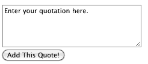

`fwrite()` 函数根据所选的模式将新数据（作为函数调用中的第二个参数发送）写入文件。

作为写入过程的最后一步，你通过再次引用文件指针并调用 `fclose()` 函数来关闭文件：

```php
fclose($fp);
```

考虑到这一点，让我们创建一个表单，将用户提交的引言存储在纯文本文件 A 中。在本章稍后的部分，另一个 PHP 脚本将检索并随机显示这些引言。然而，在我们进入代码之前，还要介绍另一个函数：`is_writable()`。该函数返回一个布尔值，指示命名文件是否可写：

```php
if (is_writable($file)) {…}
```

在尝试向文件（或目录）写入之前调用此函数是避免权限错误的简单方法。

## 写入到外部文件

**1.** 在你的文本编辑器或 IDE 中创建一个新的 PHP 文档，命名为 `add_quote.php`（**脚本 11.1**）：

```html
<!DOCTYPE html PUBLIC "-//W3C//DTD XHTML 1.0 Transitional//EN" "http://www.w3.org/TR/xhtml1/DTD/xhtml1-transitional.dtd">
<html xmlns="http://www.w3.org/1999/xhtml" xml-lang="en" lang="en">
<head>
<meta http-equiv="content-type" content="text/html; charset=utf-8" />
<title>Add A Quotation</title>
</head>
<body>
```

**脚本 11.1** 此脚本获取用户提交的引言并将其存储在文本文件中。

```php
1 <!DOCTYPE html PUBLIC "-//W3C//DTD XHTML 1.0 Transitional//EN"
2 "http://www.w3.org/TR/xhtml1/DTD/xhtml1-transitional.dtd"> 3
<html xmlns="http://www.w3.org/1999/xhtml" xml:lang="en" lang="en"> 4 <head>
5 <meta http-equiv="content-type" content="text/html; charset=utf-8" /> 6
<title>Add A Quotation</title> 7 </head>
8 <body>
9 <?php // Script 11.1 - add_quote.php
10 /* 此脚本显示并处理一个 HTML 表单。此脚本获取文本输入并将其存储在文本文件中。 */
11 // // 使用文件：
12 $file = '../quotes.txt';
13
14 // 检查表单提交：
15 if ($_SERVER['REQUEST_METHOD'] == 'POST') { // 处理表单。
16 if (!empty($_POST['quote']) && ($_POST['quote'] != 'Enter your quotation.') ) { // 需要写入内容。
17
18 if (is_writable($file)) { // 确认文件可写。
19 file_put_contents($file, $_POST['quote'] . PHP_EOL, FILE_APPEND); // 写入数据。
20 // 代码在下一页继续
21 // 创建 PHP 代码段并标识要使用的文件：
22 <?php // Script 11.1 - add_quote.php
23 $file = '../quotes.txt';
24 由于此脚本将两次引用同一个文件，因此将文件标识为变量是一个好主意。这样，如果你以后需要更改文件的名称或位置，只需要编辑一行代码。标识出的文件是 `quotes.txt`，它应该位于此脚本的上级目录中（通常在 Web 目录中）。有关此语法的更多信息请查看侧边栏“文件路径”。
25 // 代码在下一页继续
26 // 打印消息：
27 print '<p>Your quotation has been stored.</p>';
28 } else { // 无法打开文件。
29 print '<p style="color: red;">Your quotation could not be stored due to a system error.</p>';
30 }
31 } else { // 未输入引言。
32 print '<p style="color: red;">Please enter a quotation!</p>';
33 }
34
35 } // 提交的 IF 结束。
36
37 // 退出 PHP 并显示表单：
38 ?>
39
40 <form action="add_quote.php" method="post">
41 <textarea name="quote" rows="5" cols="30">Enter your quotation here.</textarea><br />
42 <input type="submit" name="submit" value="Add This Quote!" />
43 </form>
44
45 </body>
46 </html>
```

**2.** 创建 PHP 代码段并标识要使用的文件：

```php
<?php // Script 11.1 - add_quote.php
$file = '../quotes.txt';
```

由于此脚本将两次引用同一个文件，因此将文件标识为变量是一个好主意。这样，如果你以后需要更改文件的名称或位置，只需要编辑一行代码。标识出的文件是 `quotes.txt`，它应该位于此脚本的上级目录中（通常在 Web 目录中）。有关此语法的更多信息请查看侧边栏“文件路径”。

**3.** 检查表单是否已提交：

```php
if ($_SERVER['REQUEST_METHOD'] == 'POST') {
```

此页面既显示又处理 HTML 表单。条件测试检查表单是否已提交，如果是，则应将引言写入文本文件。第一行将用户提交的数据写入文件。`PHP_EOL` 常量被连接到写入的数据中，以便每次提交都存储在单独的一行中。

**4.** 检查是否输入了引言：

```php
if (!empty($_POST['quote']) && ($_POST['quote'] != 'Enter your quotation.') ) {
```

如果你没有使用 PHP 5 或更高版本，你需要使用以下替代方法：这个简单的条件验证了用户提供的数据。第一部分确认 `$_POST['quote']` 变量不为空。第二部分确认该没有仍然是默认值（如 A 所示）。

```php
$fp = fopen ($file, 'ab');
fwrite($fp, $_POST['quote'] . PHP_EOL);
fclose($fp);
```

**5.** 确认文件可以写入：

```php
if (is_writable($file)) {
```

通过将此函数调用放在条件语句中，你使 PHP 脚本仅在文件可写时才尝试写入文件。

**6.** 将数据写入文件然后打印消息：

```php
file_put_contents($file, $_POST['quote'] . PHP_EOL, FILE_APPEND);
print '<p>Your quotation has been stored.</p>';
```

**7.** 完成条件判断：

```php
} else { // 无法打开文件。
print '<p style="color: red;">Your quotation could not be stored due to a system error.</p>';
}
} else { // 未输入引言。
print '<p style="color: red;">Please enter a quotation!</p>';
}
} // 提交的 IF 结束。
```

**8.** 完成 PHP 部分：

```php
?>
```

**9.** 创建 HTML 表单：

```html
<form action="add_quote.php" method="post">
<textarea name="quote" rows="5" cols="30">Enter your quotation here.</textarea><br />
<input type="submit" name="submit" value="Add This Quote!" />
</form>
```

文本框具有预设值 Enter your quotation here.，这是通过将该文本放在 `textarea` 标签之间来实现的。

由于此脚本的其余部分在下一页的标准 HTML 中，请通过关闭 PHP 标签来退出 PHP 代码块。

**B** 如果 PHP 脚本找不到 `quotes.txt` 文件，或者该文件不可写，用户将看到此消息。

**C** 脚本包含了基础的表单验证。

文件与目录 299

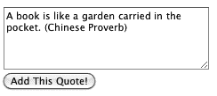

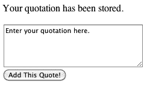

**10.** 完成 HTML 页面：

```html
</body>
</html>
```

**11.** 将文件保存为 `add_quote.php` 并将其放置在启用 PHP 的服务器的相应目录中。

**D** 正在填写表单……

再次参考本章上一节中的 **B**，以了解 `add_quote.php` 和 `quotes.txt` 在服务器上的相对位置应当如何。如果对你来说无法这样安排，或者这太让人困惑，那么请将两个文件都放在同一个目录中（即你可以执行 PHP 脚本的目录），并将 `$file` 赋值行更改为：

**E** ……以及如果一切顺利后的结果。

```php
$file = 'quotes.txt';
```

**12.** 在你的 Web 浏览器中多次运行脚本，执行 **D** 和 **E**。

**13.** 如果你需要，可以使用文本编辑器打开 `quotes.txt` 文件以确认数据已写入其中。

> **请注意，所有与文件和目录相关的函数只能用于运行 PHP 的同一台计算机（即服务器）上的文件和目录。位于服务器上的 PHP 脚本无法访问客户端计算机上的文件（直到文件被上传到服务器为止）。**
>
> **如果你在运行此脚本 B 时遇到权限错误，说明权限设置不正确，或者 PHP 脚本无法访问数据文件。后者可能发生在你拼写错误文件名或错误地引用了服务器上的文件路径时。**
>
> **如果你的 PHP 版本运行在安全模式（safe mode）下或设置了 `open_basedir` 指令，使用 PHP 访问文件和目录可能会受到限制。检查你的 `phpinfo()` 脚本查看服务器的这些设置。**

## 锁定文件

虽然上一个示例运行良好（希望如此），但它还可以被改进。如果一次只有一个用户提交表单，就不会有任何问题。

### 表 11.2 `flock()` 锁类型

| 锁类型 | 含义 |
| :--- | :--- |
| `LOCK_SH` | 用于读取的共享锁 |
| `LOCK_EX` | 用于写入的排斥锁 |
| `LOCK_UN` | 释放锁 |
| `LOCK_NB` | 非阻塞锁 |

但如果有两个或多个用户同时提交不同的引言呢？在这种情况下，当多个 PHP 脚本实例尝试同时写入同一个文本文件时，可能会出现问题（文件可能会损坏）。

解决方案是在 PHP 写入文件时临时锁定文件。如果你运行的是 PHP 5.1 或更高版本，可以添加 `LOCK_EX` 参数到 `file_put_contents()` 中：

```php
file_put_contents($file, $data, LOCK_EX);
```


要同时使用 `LOCK_EX` 和 `FILE_APPEND` 常量，请使用运算符 `|` 将它们分开：

```php
file_put_contents($file, $data, FILE_APPEND | LOCK_EX);
```

如果你使用的 PHP 版本较旧，需要使用 `fopen()`、`fwrite()` 和 `fclose()`，你可以在打开文件后调用 `flock()`：

```php
$fp = fopen($file, 'a');
flock($fp, LOCK_EX);
fwrite($fp, $data);
flock($fp, LOCK_UN);
fclose($fp);
```

锁类型在表 11.2 中所示。为了在完成后解锁文件，请使用：

```php
flock($fp, LOCK_UN);
```

## 文件与目录 301

为了演示，让我们让 `add_quote.php` 在写入期间锁定文件。

1. 在文本编辑器或 IDE 中打开 `add_quote.php` (11.1) 并：
2. 修改 `file_put_contents()` 行如下：

```php
file_put_contents($file, $_POST['quote'] . PHP_EOL, FILE_APPEND | LOCK_EX);
```

此命令对文件进行排斥锁，防止其他脚本同时写入。11.2 - 修改后的 `add_quote.php` 在写入期间锁定文件。

要使用 `file_put_contents()`，你需要如下所示：

```php
file_put_contents($file, $_POST['quote'] . PHP_EOL, FILE_APPEND | LOCK_EX);
```

在使用 `file_put_contents()` 时，将 `LOCK_EX` 常量作为第三参数：

```php
file_put_contents($file, $data, LOCK_EX);
```

为了更好的安全性和可靠性，`add_quote.php` 在写入期间锁定文件。

```php
$data = file_get_contents($file);
```

## 文件与目录 302

### 读取文件

现在你已经创建了一个向文件写入数据的脚本，现在是时候创建一个读取这些信息的脚本了。读取文件有很多方法；你采取的方法取决于你的需求。要将整个文件读取为一个字符串，请使用 `file_get_contents()`：

```php
$data = file_get_contents($file);
```

`$data = file($file);`

`file()` 函数是 PHP 中一个非常有用的内置工具。它读取文件中的所有内容，并且与 `file_get_contents()` 不同，它会将这些信息以数组的形式返回。数组中的每个元素包含文件的一行，每行都以换行符（`\n` 或 `\r\n`）结束。

如果 `$file` 代表的文档包含两行信息，且每行都以换行符结束，那么相应的数组将包含两个元素。第一个元素将等于 `$file` 的第一行，第二个元素将等于第二行。

一旦数据存储在数组中，你就可以像第 7 节“使用数组”中所学的那样，轻松地对其进行操作或打印。接下来，让我们利用这些知识来创建一个脚本，随机显示存储的引言之一。

### 脚本 11.3

`view_quote.php` 文件从文本文件中检索所有引言并随机显示其中一个。

1. 在你的文本编辑器或 IDE 中创建一个新的 PHP 文档，命名为 `view_quote.php`（脚本 11.3）：

```php
<!DOCTYPE html PUBLIC "-//W3C//DTD XHTML 1.0 Transitional//EN"
"http://www.w3.org/TR/xhtml1/DTD/xhtml-transitional.dtd">
<html xmlns="http://www.w3.org/1999/xhtml" xml:lang="en" lang="en">
<head>
    <meta http-equiv="content-type" content="text/html; charset=utf-8" />
    <title>View A Quotation</title>
</head>
<body>
    <h1>Random Quotation</h1>
    <?php // Script 11.3 - view_quote.php
    /* 此脚本显示并处理 HTML 表单。此脚本读取文件并打印其中随机的一行。 */
    // 将文件内容读到数组中：
    $data = file('../quotes.txt');
    // 统计数组中元素的数量：
    $n = count($data);
    // 选取一个随机项目：
    $rand = rand(0, ($n - 1));
    // 读取文件内容并存储在数组中：
    $data = file('../quotes.txt');
    // 打印引言：
    print '<p>' . trim($data[$rand]) . '</p>';
    ?>
</body>
</html>
```

该函数将文件数据读取到名为 `$data` 的数组中。`$data` 的每个元素都是字符串，即提交的引言。如果引言文件不在此脚本的父目录下，请相应更改此处的引用。

2. 根据 `$data` 中元素的数量选取一个随机数：
```php
$n = count($data);
$rand = rand(0, ($n - 1));
```

3. 打印引言：
```php
print '<p>' . trim($data[$rand]) . '</p>';
```

如果你想格外小心，可以使用 `is_readable()` 函数来测试 PHP 是否可以读取 `file()` 函数（尽管文件不可读的情况很少）。使用一个包含拼接的简单 `print` 语句来打印随机引言。要检索它，引用 `$data` 数组并使用生成的 `$rand` 数字作为索引。然后对检索到的引言进行 `trim` 处理以去掉末尾的换行符。每次查看页面时都会显示一个随机引言。后续查看 `view_quote.php` 脚本将显示文本文件中的不同引言。

在本章后面的部分，你将学习使用 `fgets()` 和 `fgetcsv()` 读取文件的更复杂的方法。

## 处理文件上传

正如本书所示，使用 PHP 处理 HTML 表单是一项非常容易的成就。无论提交什么数据，PHP 都能轻松、直接地处理它。要让用户通过 HTML 表单上传文件，必须对标准表单进行三项更改：

首先，`form` 标签必须包含 `enctype="multipart/data"`，让浏览器知道期望不同的表单数据：

```html
<form action="script.php" enctype="multipart/data" method="post">
```

表单必须使用 POST 方法。

其次，在表单中添加一个特殊的隐藏输入：

```html
<input type="hidden" name="MAX_FILE_SIZE" value="30000" />
```

这告诉浏览器可以上传多大的文件。

第三，`file` 标签用于创建必要的字段：

```html
<input type="file" name="picture" />
```

文件类型允许用户从电脑上选择文件，该文件在提交后将上传到服务器。

一旦完成，你就可以使用 PHP 处理文件。

在 PHP 脚本中，引用 `$_FILES` 变量（将其比作 `$_POST` 的文件副本）来引用上传的文件。`$_FILES` 数组包含五个元素：

- `name`: 文件在用户电脑上的文件名
- `type`: 文件的 MIME 类型（例如 `image/jpg`）
- `size`: 文件的大小（字节）
- `tmp_name`: 文件在服务器上的临时名称
- `error`: 出错时的错误代码

### 11.3 `$_FILES` 错误代码

| 代码 | 含义 |
| :--- | :--- |
| 0 | 未发生错误。 |
| 1 | 超过 `php.ini` 中的 `upload_max_filesize` 设置。 |
| 2 | 超过 HTML 表单中的 `MAX_FILE_SIZE` 设置。 |
| 3 | 文件仅部分上传。 |
| 4 | 未上传文件。 |
| 6 | 不存在临时目录。 |
| 7 | 写入磁盘失败。 |
| 8 | 扩展程序阻止上传。 |

注意，尽管这可能看起来很奇怪，并没有错误代码 5。

当文件被上传时，服务器首先将其放在临时目录中。然后你可以使用 `move_uploaded_file()` 函数将文件移动到目标位置：

```php
move_uploaded_file($_FILES['picture']['tmp_name'], '/path/to/dest/filename');
```

第一个参数是文件在服务器上的临时名称。第二个参数是目的地的完整路径和文件名。

为了让 PHP 能够执行这些步骤，你必须在 `php.ini` 文件中设置若干配置（参见“配置 PHP 用于文件上传”侧边栏），并且 Web 服务器需要对临时目录和最终目标目录具有写入权限。（默认情况下，PHP 应该具有临时目录的写入权限。）

接下来，你将编写一个基础脚本来上传文件并存储在服务器上。与 `add_quote.php` 脚本一样，这个示例在同一个页面内同时创建了 HTML 表单并处理了它。不过，首先，你需要创建一个可写的目录作为目标点。

### 创建可写目录

1. 创建一个名为 `uploads` 的新文件夹，位于 Web 根目录之外。
2. 按照本章第一节概述的步骤，设置权限，让每个人都能对该目录进行写入、读取和搜索（Unix 术语中的 `0777`）。

对于本示例，必须存在一个可写的 `uploads` 目录。在这里，它被放在与 Web 根目录相同的目录下。因此，`uploads` 位于 `upload_file.php` 脚本所在目录之上，并且无法通过 HTTP 访问。如果你运行的是 Windows，可能不需要做任何操作（尝试下一个脚本以确认）。如果你运行的是其他操作系统，请检查本章第一节中的项目列表，找到适用于你情况的建议。

### 配置 PHP 用于文件上传

为了使文件上传正常工作，必须设置 `php.ini` 配置文件中的若干设置。这些设置在你的配置中可能启用也可能禁用，因此你应该通过查看 `php.ini` 文件或运行 `phpinfo()` 脚本来检查它们。

首先，`file_uploads` 必须开启。其次，`upload_tmp_dir` 的值必须设置为服务器上的目录，PHP 可以在其中放置文件（换句话说，该目录必须存在并允许 Web 服务器修改）。如果此设置没有值，可能没问题（这意味着将使用一个专门为此类目的创建的隐藏目录）。

`upload_max_filesize` 和 `post_max_size` 设置决定了可以发送的文件大小。虽然 `MAX_FILE_SIZE` 隐藏表单输入是对 Web 浏览器的建议，但这两个设置控制着文件是否被上传。

最后，如果上传非常大的文件（数兆字节或更大），你可能需要增加 `memory_limit` 和 `max_execution_time` 设置，以给 PHP 提供完成所需的时间和资源。

### 使用 PHP 进行上传

1. 在你的文本编辑器或 IDE 中创建一个新的 PHP 文档，命名为 `upload_file.php`（脚本 1.4）：

```html
<!DOCTYPE html PUBLIC "-//W3C//DTD XHTML 1.0 Transitional//EN" "http://www.w3.org/TR/xhtml/transitional.dtd">
<html xmlns="http://www.w3.org/1999/xhtml" lang="en">
<head>
<meta http-equiv="content-type" content="text/html; charset=utf-8" />
<title>Upload a File</title>
</head>
<body>
```

2. 创建一段 PHP 代码段：

```php
<?php
// Script 1.4 - upload_file.php
/* 此脚本显示并处理一个 HTML 表单。此脚本接收文件上传并将其存储在服务器上。 */
if ($_SERVER['REQUEST_METHOD'] == 'POST') { // 处理表单。
    // 尝试移动上传的文件：
    if (move_uploaded_file($_FILES['the_file']['tmp_name'], "../uploads/$_FILES['the_file']['name'])) {
        print '<p>Your file has been uploaded.</p>';
    } else { // 出错了！
        print '<p style="color: red;">Your file could not be uploaded because: ';
        // 根据错误打印消息：
        switch ($_FILES['the_file']['error']) {
            case 1:
                print 'The file exceeds upload_max_filesize setting in php.ini';
                break;
            case 2:
                print 'The file exceeds MAX_FILE_SIZE setting in the HTML form';
                break;
            case 3:
                print 'The file was only partially uploaded';
                break;
            case 4:
                print 'No file was uploaded';
                break;
            case 6:
                print 'The temporary folder does not exist.';
                break;
            default:
                print 'Something unforeseen happened.';
                break;
        }
        print '</p>';
    } // End of move_uploaded_file() IF.
} // End of submission IF.
// 退出 PHP 并显示表单：
?>
```


<form action="upload_file.php" enctype="multipart/form-data" method="post">

    <p>Upload a file using this form:</p>

    <input type="hidden" name="MAX_FILE_SIZE" value="300000" />

    <p><input type="file" name="the_file" /></p>

    <p><input type="submit" name="submit" value="Upload This File" /></p>

</form>

</body>

</html>

### 3. 检查表单是否已提交

`if ($_SERVER['REQUEST_METHOD'] == 'POST') {`

再次，此脚本同时显示并处理 HTML 表单。如果已提交，则应该处理上传的文件。

### 4. 尝试将上传的文件移动到最终位置

`if (move_uploaded_file($_FILES['the_file']['tmp_name'], "../uploads/$_FILES['the_file']['name'])) {`

`move_uploaded_file()` 函数尝试将上传的文件（通过 `$_FILES['the_file']['tmp_name']` 标识）移动到新位置（`../uploads/$_FILES['the_file']['name']`）。该位置是 `uploads` 目录，它位于脚本所在目录的上方目录。文件名将与用户电脑上的文件名相同。将此函数作为 `if` 语句的条件，可以方便根据移动是否成功做出响应。

### 5. 打印指示操作成功的消息

`print '<p>Your file has been uploaded.</p>';`

如果文件成功上传并移动，将打印一条消息并重新显示表单。

### 6. 如果移动失败，则打印错误消息

当你在 `switch` 条件判断中使用它时，PHP 脚本可以打印相应的错误消息。

你通常不会放置如下代码：

```php
case 1:
    print 'The file exceeds the** information), but it’s exceptionally good
    ➝ `upload_max_filesize` setting
    for helping you debug a problem.
    ➝ in `php.ini';
    break;
```

### 7. 完成错误消息，并关闭 case 2

两个条件判断:
`print 'The file exceeds the**`
`print '</p>'; // 完成段落。`
➝ `MAX_FILE_SIZE` setting in
➝ `the HTML form';
} // 结束 `move_uploaded_file()` IF。
break;

case 3:
} // 结束提交 IF。
`print 'The file was only partially uploaded';`

### 8. 退出 PHP 并创建 HTML 表单

`breakbreak;`

case 4:
?>
<form action="upload_file.php"
break;
➝ `enctype="multipart/form-data"`
➝ `method="post">`
`print 'No file was uploaded';`
➝ `form:</p>`
break;

case 6:
`print 'The temporary folder does not exist.';`
break;

default:
`print 'Something unforeseen happened.';`
<p><input type="file" name="the_file" /></p>
<p><input type="submit" name="submit" value="Upload This File" /></p>
</form>

如果 `move` 不起作用，变量 `$_FILES['the_file']['error']` 包含一个指示错误的数字。

（继续见下一页）

如果发生问题，脚本会指示原因。

### 文件与目录 313

该 HTML 表单非常简单，仅包含两个可见元素：一个文件输入类型和一个提交按钮。它与书中的其他 HTML 表单不同之处在于，它使用了 `enctype` 属性和 `MAX_FILE_SIZE` 隐藏输入类型。

你可能会发现，通过 Web 浏览器上传的文件（在权限上）归 Web 服务器应用程序（将它们放置在那里的程序）所有。从安全角度来看，重命名上传的文件更好。为了做到这一点，你需要设计一个系统，生成新的唯一文件名，并将原始文件名和新文件名都存储在文本文件或数据库中。

只要文件名不同，脚本就可以处理多个文件上传。在这种情况下，你只需要一个 `MAX_FILE_SIZE` 隐藏输入。在 PHP 脚本中，你将 `move_uploaded_file()` 函数应用于 `$_FILES['filename1']`、`$_FILES['filename2']` 等。

得益于 `MAX_FILE_SIZE` 限制，应仅允许小于约 300 KB 的文件。

你可以通过在 PHP 脚本中引用相应的索引（例如，在文件上传后 `$_FILES['the_file']['size']`）将文件上传限制为特定的大小或类型。

### 11. 检查 `uploads` 目录以确保文件已放置在该处

使用 `unlink()` 删除文件而不移动或复制。

你可以使用 `copy()` 函数创建服务器上文件的副本。

### 导航目录

之前的 PHP 脚本处理文件，但你也可以使用 PHP 对目录进行许多操作。在这个示例中，你将编写一个列出目录内容的脚本，但首先你将需要理解用法。

要找到目录的所有内容，最好的方法是使用 `scandir($dir)`。该函数在 PHP 5 中引入，它返回一个包含给定目录内找到的每个项目（目录或文件）的数组。`$dir` 的值可以是目录的相对路径或绝对路径。

### 9. 完成 HTML 页面

</body>
</html>

### 10. 将页面保存为 `upload_file.php`，将其放置在启用了 PHP 的服务器上相对于 `uploads` 目录的正确目录，并在你的 Web 浏览器中进行测试

如果文件无法移动并显示拒绝访问的错误，请检查 `uploads` 目录的权限。然后检查脚本中使用的目录路径是否正确，以及是否有拼写错误。

在为你的 `file` 输入命名时要小心，因为此值必须与 `$_FILES` 变量中使用的索引完全匹配。在这里，你使用的是通用的 `the_file`。

```php
<?php

// Script 11.5 - list_dir.php

/* 此脚本列出目录中的目录和文件。 */

// 设置时区：

date_default_timezone_set('America/New_York');

// 设置目录名称并对其扫描：

$search_dir = '.';

$contents = scandir($search_dir);

```

（代码继续见下一页）

### 脚本 11.5 续

### 19. 先列出目录...

### 20. 打印标题并开始列表

```php
print '<h2>Directories</h2><ul>';

foreach ($contents as $item) {

    if ( (is_dir($search_dir . '/' . $item)) AND (substr($item, 0, 1) != '.') ) {

        print "<li>$item</li>\n";

    }

}

print '</ul>'; // 关闭列表。
```

### 31. 创建表格表头

```php
print '<hr /><h2>Files</h2>
<table cellpadding="2" cellspacing="2" align="left">
<tr>
<td>名称</td>
<td>大小</td>
<td>最后修改</td>
</tr>';
```

### 35-39. 列出文件

```php
foreach ($contents as $item) {

    if ( (is_file($search_dir . '/' . $item)) AND (substr($item, 0, 1) != '.') ) {

        // 获取文件大小：

        $fs = filesize($search_dir . '/' . $item);

        // 获取文件的修改日期：

        $lm = date('F j, Y', filemtime($search_dir . '/' . $item));

        // 打印信息：

        print
"<tr>
<td>$item</td>
<td>$fs bytes</td>
<td>$lm</td>
</tr>\n";

    } // 关闭 IF。

} // 关闭 FOREACH。

print '</table>'; // 关闭 HTML 表。
```

```php
?>
</body>
</html>
```

### 文件与目录 317

### 2. 开始 PHP 代码并设置时区

```php
<?php // 脚本 11.5 - list_dir.php
date_default_timezone_set('America/New_York');
```

函数 `is_dir()` 被调用以确认项目的类型。该条件还检查了当前项目是否不是当前目录（在 Unix 系统上用单点 `.` 表示）或父目录（在 Unix 系统上用双点 `..` 表示）。

由于此脚本将使用 `date()` 函数，因此需要建立一次时区。请参见第 8 章“创建 Web 应用程序”获取更多信息，以及 PHP 手册中的参考内容，你可以在那里找到你的时区。

如果此条件为 `TRUE`，则会将项目的名称打印在列表项标签内，并紧跟一个换行符（以使 HTML 源代码更整洁）。

### 3. 确定要打开的目录，并扫描其内容

```php
$search_dir = '.';
```

为了让 `is_dir()` 函数在处理其他目录中找到的项目时能够工作，会将 `$search_dir` 值加上一个斜杠，追加到每个项目后面。如果代码只是引用 `$item` 而不添加目录路径，则代码将仅对当前目录有效。

通过在 PHP 脚本顶部将此值建立为变量，将根据需要方便查找和更改。在这里你使用单点来指代当前目录。

```php
$contents = scandir($search_dir);
```

你也可以使用另一个目录的绝对路径（`/Users/larry/Documents` 或 `C:\\myfiles\\directory`）或相对路径（`../myfiles`），只要 PHP 有权限读取命名的目录。

第二行扫描目录内容并将其作为数组赋值给变量 `$contents`。

### 4. 列出此目录的子目录

```php
print '<h2>目录</h2>
<ul>';

foreach ($contents as $item) {
    if ( (is_dir($search_dir . '/' . $item)) AND (substr($item, 0, 1) != '.') ) {
        print "<li>$item</li>\n";
    }
}
print '</ul>';
```

脚本也显示文件的大小和修改日期。为了使 HTML 源代码更整洁。

### 5. 创建新标题，并为文件启动表格

```php
print '<hr /><h2>文件</h2>
<table cellpadding="2" cellspacing="2" align="left">
<tr>
<td>名称</td>
<td>大小</td>
<td>最后修改</td>
</tr>';
```

### 6. 遍历文件

```php
foreach ($contents as $item) {
    if ( (is_file($search_dir . '/' . $item)) AND (substr($item, 0, 1) != '.') ) {
        // ...
    }
}
```

另一个 `foreach` 循环遍历目录内容。`$search_dir` 值加上一个斜杠追加到每个项目前面。这个条件想要以点开头的文件。

### 7. 计算文件的大小和修改日期，然后打印信息

```php
$fs = filesize($search_dir . '/' . $item);
$lm = date('F j, Y', filemtime($search_dir . '/' . $item));
print "<tr>
<td>$item</td>
<td>$fs bytes</td>
<td>$lm</td>
</tr>\n";
```

等待，上面的逻辑遵循：第一行调用 `filesize()` 获取文件大小。第二行调用 `filemtime()` 获取修改时间戳。该时间戳随后传递 `date()` 函数，结合格式返回如“November 24, 2011”的字符串。最后，这些项目在表格的相应列中。

### 8. 完成条件和循环

注意在 Windows 上需要使用双斜杠。这是因为单斜杠是转义字符。所以它必须被转义。

### 9. 关闭表格

```php
print '</table>';
```

### 10. 完成 PHP 代码和 HTML 页面

```php
?>
</body>
</html>
```

### 11. 将文件保存为 `list_dir.php`，将其放置在服务器正确的目录中，并在浏览器中测试

### 12. 如果需要，更改 `$search_dir` 的值并重新测试脚本

### 你可能会用到的其他函数

`basename()` 和 `dirname()` 函数用于查找完整目录或文件路径的子部分。`fileperms()` 返回文件的权限；`atime()` 返回文件最后被访问的时间；`fileowner()` 返回拥有文件的用户；`finfo_file()` 是查找文件 MIME 类型的最佳方法。

### 创建目录和数据文件

了解如何在服务器上读取和写入文件只是数据存储过程的一部分。你可能也需要使用目录来实现此目的。它可以位于之前创建的 **uploads** 文件夹相同的目录下（参见“处理文件上传”中的 **D**）。

PHP 中创建目录的命令是 `mkdir()`：

```php
mkdir('*directory_name*', *permissions*);
```

目录名称是要创建的目录的名称。该值可以是相对于当前目录（即脚本所在的目录），也可以是完整路径。如果你在 Windows 上运行，此步骤通常是不必要的。在非 Windows 服务器上，默认权限为 **077**（参见本章前面的“文件权限”部分以了解这些数字的含义）。

如果你在 Windows 上运行，则是必要的，还将会将用户名和密码记录到你的 PHP 服务器的一个文本文件中，以便用户在登录时进行验证。你将从开始创建一个 PHP 可以创建的父目录（该目录必须是可写的，以便 PHP 可以在其中创建子目录），并在该目录下创建一个 PHP 可以写入的 `users.txt` 文件。然而，最好不要对这类事情做假设。将数据写入 `users.txt` 数据文件。

### 创建注册脚本

### 1. 在你的文本编辑器或 IDE 中开始一个新的 PHP 文档，命名为 `register.php`（**脚本 11.6**）

```html
<!DOCTYPE html PUBLIC "-//W3C//DTD XHTML 1.0 Transitional//EN"
"http://www.w3.org/TR/xhtml1/DTD/xhtml1-transitional.dtd">
<html xmlns="http://www.w3.org/1999/xhtml" xml:lang="en" lang="en">
<head>
<meta http-equiv="content-type" content="text/html; charset=utf-8" />
<title>Register</title>
<style type="text/css" media="screen">
.error { color: red; }
</style>
</head>
<body>
<h1>Register</h1>
```

在页面的头部，定义了一个 CSS 类，将用于格式化错误。

**脚本 11.6** `register.php` 脚本有两个用途：它在文本文件中记录用户信息，并为该用户的内容创建一个新目录。

### 2. 开始 PHP 代码并创建两个变量

```php
<?php // Script 11.6 - register.php
$dir = '../users/';
$file = $dir . 'users.txt';
```


这两个变量代表示例中正在使用的目录和文件。文件值以目录值开头。更改 `$dir` 的值以使其适用于你的情况。

**3.** 检查表单是否已提交：

```php
if ($_SERVER['REQUEST_METHOD'] == 'POST') {
```

再次，此页面既显示又处理 HTML 表单。这是通过使用条件判断实现的。

```php
} else { // 漏掉了一个字段。
    print '<p class="error">Please go back and try again!</p>';
} else { // 显示表单。
```

退出 PHP 并显示表单：

```html
<form action="register.php" method="post">
    <p>Username: <input type="text" name="username" size="20" /></p>
    <p>Password: <input type="password" name="password1" size="20" /></p>
    <p>Confirm Password: <input type="password" name="password2" size="20" /></p>
    <input type="submit" name="submit" value="Register" />
</form>
```

```php
<?php // End of submission. ?>
</body>
</html>
```

**4.** 验证注册信息：

```php
$problem = FALSE;
if (empty($_POST['username'])) {
    $problem = TRUE;
    print '<p class="error">Please enter a username!</p>';
}
if (empty($_POST['password1'])) {
    $problem = TRUE;
    print '<p class="error">Please enter a password!</p>';
}
if ($_POST['password1'] != $_POST['password2']) {
    $problem = TRUE;
    print '<p class="error">Your password did not match your confirmed password!</p>';
}
```

**5.** 检查问题：

```php
if (!$problem) {
```

再次，`$problem` 变量让你知道是否可以注册该用户。如果没有发生问题，就可以安全继续。

**6.** 确认 `users.txt` 文件是可写的：

```php
if (is_writable($file)) {
```

和之前一样，首先在条件判断中确认数据文件是可写的，以便脚本做出相应的响应。如果你没有使用 PHP 5.1 或更高版本，请使用 `fopen()` 行作为条件（参见本章稍后的内容）。

**7.** 创建要写入文件的数据，然后将其写入：

```php
$subdir = time() . rand(0, 4596);
$data = $_POST['username'] . "\t" . md5(trim($_POST['password1'])) . "\t" . $subdir . PHP_EOL;
file_put_contents($file, $data, FILE_APPEND | LOCK_EX);
```

创建的目录名称是基于用户注册的时间和一个随机值的数字。该系统有助于确保所创建的目录是唯一的并且具有有效名称。此脚本不像你之前那样存储单个字符串，而是存储了三个独立的信息部分：用户名称；密码的加密版本（使用 `md5()` 函数；参见第一个提示）；以及目录名称。你之前在上一行代码中开发的相同验证过程被用于检查提交的用户名和密码。`$problem` 变量被用作标记，指示是否发生了问题。为了区分这些信息部分，你插入了一个制表符（使用 `\t` 代码创建）。使用换行符来标记行的结束，同样使用了 `PHP_EOL` 常量。

```php
// 创建要写入的数据：
// // 创建目录：
mkdir ($dir . $subdir);
```

**8.** 创建用户的目录，并打印消息：

```php
print '<p>You are now registered!</p>';
```

`mkdir()` 函数在 `users` 目录下创建一个目录。该目录的名称为之前生成的随机数。

**9.** 完成条件判断：

```php
} else { // 无法写入文件。
    print '<p class="error">You could not be registered due to a system error.</p>';
}
```

**A** 如果 `users.txt` 文件不可写，结果是：

➝ **到一个系统错误。</p>';**

```php
}

} else { // 忘记了某个字段。

print '<p class="error">请

 ➝ **返回并重试!</p>';

}}
```

如果脚本无法为了写入 `A` 而打开 `users.txt` 文件，则第一个 `else` 完成了该条件判断。第二个 `else` 完成了该条件判断，前提是用户：

**B** 脚本报告任何未能正确完成表单验证的任何错误。

**B**。

**10.** 为主条件判断添加一个 `else` 子句，并退出 PHP：

```php
} else {

?>
```

与本章之前的示例不同，此 PHP 脚本首先显示表单，然后处理它。而其他脚本会再次显示表单，但这个脚本不会，因为表单的创建是 `else` 语句的一部分。由于页面的其余部分只是 HTML，你退出 PHP 来创建表单。

**11.** 显示 HTML 表单：

```html
<form action="register.php" method="post">
<p>Username: <input type="text" name="username" size="20" /></p>
<p>Password: <input type="password" name="password1" size="20" /></p>
<p>Confirm Password: <input type="password" name="password2" size="20" /></p>
<input type="submit" name="submit" value="Register" />
</form>
```

继续见下一页

文件与目录 325

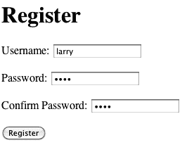


**12.** 完成主条件判断：

```php
<?php } // 提交 IF 的结束。 ?>
```

这个最后的右大括号关闭了主提交判断。为了让它工作，必须先创建一个 PHP 部分。

**13.** 完成 HTML 页面：

```html
</body>

</html>
```

**14.** 将文件保存为 `register.php`，将其放置在启用 PHP 的服务器的相应目录中，并在 Web 浏览器中进行 **C** 和 **D** 测试。

**15.** 如果你想看，可以在文本编辑器中打开 `users.txt` 文件查看其内容（**脚本 11.7**）。

**C** 注册表单非常基础，但达到了目的。

**D** 如果注册成功，这就是用户将看到的内容。

**`md5()` 函数创建一个哈希值：字符串的数学计算表示。因此，此脚本并没有实际存储密码，而是存储该密码的表示（理论上，没有两个字符串会具有相同的 `md5()` 值）。你很快就会看到登录脚本如何使用哈希后的密码。**

**你也可以通过查看用户目录中是否有新的子目录来确保页面按预期工作。**

**`rmdir()` 函数删除现有的目录，假设 PHP 有权限执行此操作。**

**脚本 11.7** `users.txt` 文件列出了三个制表符分隔的信息字段：用户名、用户密码的乱码版本以及关联目录名。

```
1 larry
1a1dc91c907325c69271ddf0c944bc72
12936537501284
2 john
0cc175b9c0f1b6a831c399e269772661
1293653788455
3 paul
92eb5ffee6ae2fec3ad71c777531578f
12936537931717
4 george
4a8a08f09d37b73795649038408b5f33
1293653799360
5 ringo
8277e0910d750195b448797616e091ad
12936538042144
```

326 第 11 章

读取文件

在数据存储在分隔格式（通常使用逗号，因此是 CSV——逗号分隔值格式）的示例中，你可以在 `view_quote.php` 脚本（脚本 11.3）中使用 `fgetcsv()` 函数代替。它使用标记的分隔符将整个文件拆分为数组部分，并返回一个数组。但如果你只想每次读取文件的一小部分呢？那么你需要使用 `fgets()` 函数。

`fgets()` 函数读取指定长度的字符串。它通常被放在使用 `feof()` 函数确保未到达文件结尾的 `while` 循环中。例如：

```php
$fp = fopen($file, 'rb');
while (!feof($fp)) {
    $string = fgets($fp, 1024);
}
fclose($fp);
```

```php
if ( ($line[0] == $_POST['username']) AND ($line[1] == md5(trim($_POST['password']))) {
    $loggedin = TRUE; // 正确的用户名/密码组合。
    // 停止循环文件：
    break;
} // IF 结束。
} // WHILE 结束。

fclose($fp); // 关闭文件。

// 打印消息：
if ($loggedin) {
    print '<p>You are now logged in.</p>';
} else {
    print '<p style="color: red;">The username and password you entered do not match those on file.</p>';
}
} else { // 显示表单。
// 退出 PHP 并显示表单：
?>
<form action="login.php" method="post"> 
    <p>Username: <input type="text" name="username" size="20" /></p>
    <p>Password: <input type="password" name="password" size="20" /></p>
    <input type="submit" name="submit" value="Login" />
</form>
<?php } // 提交 IF 结束。 ?>
</body>
</html>
```

### 文件与目录

#### 5. 打开文件进行读取：

将提交的密码与存储的密码（`$line[1]`）进行对比。然而，由于存储的密码使用了 `md5()` 进行了加密，因此需要使用 `ini_set('auto_detect_line_endings', 1);`，对提交的值应用 `md5()` 后进行比较。

与 `file()` 函数不同，`fgetcsv()` 函数需要一个文件指针。因此，必须使用 `fopen()` 函数以适当模式打开 `users.txt` 文件。

`$fp = fopen($file, 'rb');`

在这里，该模式为 `rb`，意味着以二进制安全的模式打开文件进行读取。

#### 6. 遍历文件的每一行：

```php
while ( $line = fgetcsv($fp, 200, "\t") ) {
```

此 `while` 循环每次迭代读取文件的另外 200 字节或一行（以先者为准）。读取的数据被拆分为数组，并使用制表符来区分不同的元素。

#### 7. 检查提交的值与获取的值是否匹配：

```php
if ( ($line[0] == $_POST['username']) AND ($line[1] == md5(trim($_POST['password']))) ) {
```

这个双部分条件检查了提交的用户名与存储的用户名（`$line[0]`）并检查文件。

#### 8. 如果找到匹配项，将 `$loggedin` 设置为 `TRUE` 并退出 `while` 循环：

```php
$loggedin = TRUE;
break;
```

如果条件为 `TRUE`，则提交的用户名和密码与文件中的匹配。在这种情况下，标志位 `$loggedin` 被设置为 `TRUE`，并使用 `break` 语句退出 `while` 循环。不过，为了安全起见，首先启用了 PHP 的行结束设置。该系统的优点是，只会读取找到匹配项所需的文件内容。

#### 9. 关闭条件判断、`while` 循环和文件：

```php
}
fclose ($fp);
```

#### 10. 向用户打印消息：

```php
if ($loggedin) {
    print '<p>You are now logged in.</p>';
} else {
    print '<p style="color: red;">The username and password you entered do not match those on file.</p>';
}
```

由于 `users.txt` 文件以“用户名 制表符密码 制表符目录换行”的格式存储数据，`$line` 数组包含三个元素，索引分别为 0（用户名）、1（密码）和 2（目录）。使用 `$loggedin` 标志，脚本现在可以判断用户是否“已登录”。你可以通过将用户的目录存储在会话中将其发送到上传页面来为此过程添加一些功能。

#### 11. 继续主提交条件，并退出 PHP：

```php
} else {
?>
```

#### 12. 创建 HTML 表单：

```html
<form action="login.php" method="post">
    <p>Username: <input type="text" name="username" size="20" /></p>
    <p>Password: <input type="password" name="password" size="20" /></p>
    <input type="submit" name="submit" value="Login" />
</form>
```

登录表单接收用户名和密码。如果提交的用户名和密码与之前记录的匹配，用户将看到此消息。

#### 13. 返回 PHP 完成主条件判断：

```php
<?php } // 提交 IF 结束。 ?>
```

当用户提交与记录值不匹配的用户名和密码组合时的结果。

#### 14. 完成 HTML 页面：

```html
</body>
</html>
```

#### 15. 将文件保存为 `login.php`，将其放置在启用 PHP 的服务器相应目录下，并在浏览器中进行测试。

从 PHP 4.3 开始，`fgetcsv()` 函数增加了另一个可选参数：用于包围元素的字符串。从 PHP 5.3 开始，`fgetcsv()` 函数又增加了另一个可选参数：用于转义问题字符的字符。自然地，默认字符是反斜杠。如果一行为空，`fgetcsv()` 将返回一个包含单个空值的数组。

### 复习

- 你运行的是哪个版本的 PHP？
- 你需要采取哪些步骤使服务器的某个文件或目录可写？
- 什么是 Web 根目录（概念上）？你的网站的 Web 根目录是什么（无论是在自己的电脑上还是在线服务器上）？
- 向文件写入数据有两种方法？
- 如何将新数据追加到现有文件中（而不是替换任何现有数据）？
- 你如何确保新数据放置在单独的一行？
- 为了让表单接受上传，起始 `form` 标签必须具有哪些属性？
- PHP 脚本将能够在哪个变量中访问上传的文件？使用哪个函数将文件移动到服务器上的最终位置？
- 在 `register.php` 中创建一个保证用户名唯一的系统。提示：在尝试创建目录之前，先使用 PHP 检查你的现有用户名列表，查看是否有与刚刚注册的名称匹配。`fgetcsv()` 函数与 `file()` 或 `file_get_contents()` 有何不同？如果没有找到匹配项，则该新名称是可以接受的。如果用户名已被占用，则 PHP 可以创建一个错误消息请求新的用户名。
- 结合写入和从文本文件中读取操作，加上会话（sessions）或 Cookie（cookies），创建一个真实的注册和登录系统。

### 进阶

- 查看 PHP 手册中支持本书的其他与文件系统相关的函数。
- 修改 `add_quote.php`，以便在检查是否可写之前先确认 `quotes.txt` 文件存在。
- 使 `add_quote.php` 中的文本区域变为持久化（sticky）。
- 修改 `add_quote.php`，使其将引言和出处作为单独输入，并将它们分别写入文本文件。然后修改 `view_quote.php`，使其检索并显示这两部分数据。
- 修改 `view_quote.php`，使其显示两个随机引言。
- 更新 `upload_file.php`，使其确认 `uploads` 目录是写的。
- 查看 `glob()` 函数的 PHP 手册页面，了解它的功能以及如何使用。


- 更新 `list_dir.php` 以显示关于目录中文件的其他信息。

如果没有数据库的存在，互联网就不会有今天的面貌。事实上，如果 PHP 没有内置了对多种类型数据库的支持，它可能不会如此流行或如此好用。本章将使用 MySQL 作为示例数据库管理系统（DBMS）。尽管 MySQL（支持大多数平台）可能不如最顶级的商业数据库服务器那样强大，但 MySQL 的速度和功能对于大多数用途来说足够了。而且它的价格（对于大多数用途是免费的）这使其成为 Web 开发的常见选择。

本章将带你开发一个用于运行基础博客的简单数据库。虽然你在这里学到的知识足够开始处理数据库，但在完成本章后，你可能希望访问附录 B“资源和后续步骤”，找到一些可以进一步学习该主题的参考文献。


### SQL 简介

## 表 12.1 常见 SQL 命令

数据库是存储信息的表（由列和行组成）集合。大多数数据库都是使用 SQL（结构化查询语言）创建、更新和读取的。SQL 中的命令少得惊人（表 12.1 列出了最重要的七个命令），这既是一种幸运也是一种诅咒。

SQL 的设计非常像英语，这使得它非常用户友好。但 SQL 仍然非常强大，即使使用仅有的少数可用术语来创建更复杂的 SQL 语句也需要一些思考。在本章中，你将学习如何执行所有基础的 SQL 命令。

| 命令 | 用途 |
| :--- | :--- |
| `ALTER` | 修改现有的表 |
| `CREATE` | 创建数据库或或表 |
| `DELETE` | 从表中删除记录 |
| `DROP` | 删除数据库或表 |
| `INSERT` | 向表中添加记录 |
| `SELECT` | 从表中检索记录 |
| `UPDATE` | 更新表中的记录 |

## PHP 中的 MySQL 支持

PHP 将用于将 SQL 语句发送到 MySQL。MySQL 将执行该语句并将结果返回给 PHP 脚本（即 PHP 可用于生成 HTML，但 PHP 代码绝不会在 Web 浏览器中执行）。当你整合数据库时，关系可能会变得更加模糊。这种过程非常简单：数据库将执行——例如创建表、插入记录、检索记录、甚至错误——都会由数据库返回给 PHP 脚本。对于大多数 安装，内置在 PHP 中的 MySQL。考虑到这一点，`mysql_query()` 函数将是最常用的工具。它向 MySQL 发送：

```php
$result = mysql_query(*SQL 命令*, connection);
```

当脚本终止时，数据库连接会自动关闭，但在不再需要连接时正式关闭它被认为是良好的习惯。

在本章的第一个示例中，你将编写一个尝试连接到 MySQL 的简单脚本。一旦连接成功，你就可以继续学习本章后续章节。

---

336 第 12 章

**脚本 12.1** 连接到 MySQL

**连接到 MySQL：**

服务器是最重要的一步。此脚本测试了该过程。

1. 在你的文本编辑器或 IDE 中创建一个新的 PHP 文档，命名为 `mysql_connect.php`（**脚本 12.1**）：

```php
<?php
?>
<!DOCTYPE html PUBLIC "-//W3C//DTD XHTML 1.0 Transitional//EN"
"http://www.w3.org/TR/xhtml1/DTD/xhtml1-transitional.dtd">
<html xmlns="http://www.w3.org/1999/xhtml" xml:lang="en" lang="en">
<head>
<meta http-equiv="content-type" content="text/html; charset=utf-8" />
<title>Connect to MySQL</title>
</head>
<body>
<?php
// Script 12.1 - mysql_connect.php
/* 此脚本连接到 MySQL 服务器。 */
// 尝试连接到 MySQL 并打印消息：
if ($dbc = mysql_connect('localhost', 'username', 'password')) {
    print '<p>Successfully connected to MySQL!</p>';
} else {
    print '<p style="color: red;">Could not connect to MySQL.</p>';
}
mysql_close($dbc); // Close the connection
?>
</body>
</html>
```

2. 开始 PHP 代码部分：

3. 连接到 MySQL 并报告结果：

4. 完成 PHP 代码和 HTML 页面：

5. 将文件保存为 `mysql_connect.php`，将其放置在启用 PHP 的计算机的相应目录下，并在 Web 浏览器中进行测试。

通过将连接尝试放置在 `if-else` 语句的条件中，你可以轻松地报告连接是否成功。

本章将继续使用 `username` 和 `password` 作为值。

继续见下一页

数据库简介 337

对于你的脚本，你需要将这些值替换为 Web 主机提供的值，或者在使用附录 A 中概述步骤添加用户时设置它们。

A. 如果 PHP 支持 MySQL 并且打印了正面消息，说明你使用的 `username/password/host` 组合是正确的，你应该看到这条简单的消息。否则，会打印相反的消息，并且无需关闭数据库连接（因为连接并未打开）。

---

338 第 x 章

PHP 和 MySQL 的结合非常常见，你可能会遇到标识配置了以下服务器的术语：LAMP、MAMP 和 WAMP。这些术语代表操作系统——Linux、Mac OS 或 Windows——加上 Apache Web 服务器、MySQL DBMS 和 PHP。

你将与 MySQL 打交道，因此在本章中使用的所有函数都是 MySQL 特有的。例如，在 MySQL 中连接数据库的正确函数是 `mysql_connect()`，但如果你使用的是 PostgreSQL，则应编写 `pg_connect()`。如果你没有使用 MySQL DBMS，请使用 PHP 手册（可通过 www.php.net 获取）查找适当函数名。

数据库简介 339

**MySQL 错误处理**

在本章深入研究 MySQL 之前，最好先讨论一些错误处理技术。你会遇到的常见错误包括：

- 连接 MySQL 失败
- 选择数据库失败
- 无法运行查询
- 查询未返回结果
- 数据未插入表中

经验会告诉你为什么通常会发生这些错误，但在运行脚本时立即看出问题所在可以节省你大量的调试时间。为了让你的脚本对发生的错误提供具有信息量的报告，请使用 `mysql_error()` 函数。该函数返回 MySQL 服务器返回的错误的文本版本。除了此函数外，你可能还想使用一些 PHP 工具来处理错误。具体来说，错误抑制运算符（`@`）在用作函数名前之前，会抑制该函数可能调用的任何错误消息或警告：

```php
@function_name();
```

注意，该运算符并阻止错误的发生；它只是防止消息立即显示。如果你在发生错误时打算自己处理该错误，你就会使用它。

## 如何使用错误处理：

1. 在你的文本编辑器或 IDE 中打开 `mysql_connect.php`（脚本 12.1）。

2. 通过按如下方式修改 `if` 条件，抑制由 `mysql_connect()` 函数创建任何 PHP 错误（**脚本 12.2**）：

```php
if ($dbc = @mysql_connect('localhost', 'username', 'password')) {
```

与其让 PHP 在 `mysql_connect()` 函数失效时（前一节中的 **B**）打印出错误信息，不如在此处使用 `@` 符号来抑制该消息。错误仍然会发生，但它们将通过下一步中进行的更改来处理处理。

**脚本 12.2** 通过向脚本添加错误控制（`@` 符号和 `mysql_error()` 函数），你可以更有针对性地解决发生的问题。

```html
<!DOCTYPE html PUBLIC "-//W3C//DTD XHTML 1.0 Transitional//EN"
2 "http://www.w3.org/TR/xhtml1/DTD/xhtml1-transitional.dtd"> 3
<html xmlns="http://www.w3.org/1999/xhtml" xml:lang="en" lang="en"> 4 <head>
5
<meta http-equiv="content-type" content="text/html; charset=utf-8" /> 6
<title>Connect to MySQL</title>
7 </head>
8 <body>
9
<?php // Script 12.2 - mysql_connect.php #2
10 /* 此脚本连接到 MySQL 服务器。 */
11
12 // 尝试连接 MySQL 并打印消息：
13 if ($dbc = @mysql_connect('localhost', 'username', 'password')) {
14
15 print '<p>Successfully connected to MySQL!</p>';
16
17 mysql_close($dbc); // 关闭连接。
18
19 } else {
20
21 print '<p style="color: red;">Could not connect to MySQL:<br />' . mysql_error() . '</p>';
22
23 }
24
25 ?>
26 </body>
27 </html>
```

3. 在 `else` 部分的 `print` 语句中添加 `mysql_error()` 函数：

```php
print '<p style="color: red;">Could not connect to MySQL:<br />' . mysql_error() . '</p>';
```

你可以使用 `@` 符号来抑制 PHP 抛出的任何错误、通知或警告（参见前一节中的 **B**），现在脚本会在此语境中打印 MySQL 错误。你通过打印某些 HTML 并拼接 `mysql_error()` 函数来实现这一点。

例如：

```php
@include('./filename.php');
```

你可能还会看到代码中在发生连接错误时调用了 `die()`（它是 `exit()` 的别名）。其想法是，既然无法建立数据库连接，就没有必要继续执行了。在我看来，这种方法太生硬了。

你应该注意，在这种情况下，`mysql_error()` 函数没有提供数据库连接——`$dbc`——作为参数，因为没有建立数据库连接。

4. 保存文件并在你的 Web 浏览器 **A** 中再次测试。

如果出现问题，现在的结果看起来比以前显示的要好。如果脚本连接成功，结果将如前一节中 **A** 所示，因为这两个错误管理工具都没有被涉及。

**A** 使用 PHP 的错误控制函数，你可以调整处理错误的方式。

### 创建和选择数据库

在本章中，揭示错误消息是为了协助完成调试过程。实时网站不应向用户显示这种程度的显式错误消息。与其打印消息或依赖任何函数（而不只是与 MySQL 相关的函数），

DBMS 本身——并会为你建立初始数据库。如果你在自己的服务器上工作或拥有管理权限，你应该具备创建新用户和数据库的能力。

在 PHP 脚本与数据库交互之前，必须先选择数据库。当然，为了让你选择数据库，它必须存在。使用 PHP 创建数据库，你使用 `mysql_query()` 函数来执行 `CREATE DATABASE` `databasename` SQL 命令：

```php
mysql_query('CREATE DATABASE somedb', $dbc);
```

一旦完成此操作，你就可以使用 PHP、MySQL 客户端、phpMyAdmin 或任何工具来选择数据库，只要你提供的 MySQL 主机/用户名/密码组合是正确的：

```php
mysql_select_db('somedb', $dbc);
```

数据库权限比文件权限稍微复杂一点，但你需要理解这一点：用户可以被分配不同的能力。例如，某些用户能够在单个数据库内创建新数据库并删除现有数据库；较低级的用户可能只能读取表而不能修改表。

`else` 子句中的 `error()` 函数。

注意，此处的 `mysql_error()` 调用可以提供特定的数据库连接：`$dbc`。

如果数据库已经为你创建好了，请跳过此步骤。

### 3. 尝试选择数据库：

```php
if (@mysql_select_db('myblog', $dbc)) {
    print '<p>The database has been selected!</p>';
} else {
    print '<p style="color: red;">Could not select the database because:<br />' . mysql_error($dbc) . '</p>';
}
```

下页继续

**脚本 12.3** 继续

```php
// 尝试选择数据库：
if (@mysql_select_db('myblog', $dbc)) {
    print '<p>The database has been selected!</p>';
} else {
    print '<p style="color: red;">Could not select the database because:<br />' . mysql_error($dbc) . '</p>';
}

mysql_close($dbc); // 关闭连接.

} else {

print '<p style="color: red;">Could not connect to MySQL:<br />' . mysql_error() . '</p>';

}

?>
</body>
</html
```

数据库简介 345

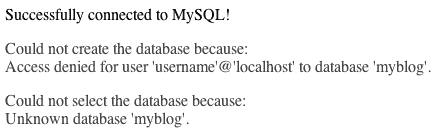

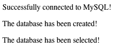

这个条件语句的结构与步骤 2 中的相同。如果 PHP 能够选择数据库，就会打印一条消息。如果无法选择数据库，则会显示特定的 MySQL 错误。

每个在数据库上运行查询的 PHP 脚本都必须连接 MySQL 并选择数据库才能工作。如果数据库成功创建并选择，你将在 Web 浏览器中看到此结果。

### 4. 如果需要，更改页面标题以反映此脚本的新用途：

```html
<title>Create the Database</title>
```

### 5. 将你的脚本保存为 `create_db.php`，将其放置在启用 PHP 的服务器的相应目录中，并在 Web 浏览器 A 和 B 中进行测试。

**你可能不会频繁创建数据库，而且通常不会使用 PHP 脚本来创建。尽管如此，此示例演示了如何使用 PHP 执行简单查询，以及创建数据库所需的 SQL 命令。虽然在这些示例中你还没有这样做，但通常情况下，将你的数据库信息（主机名、用户名、密码和数据库名称）设置为变量或常量是一个好主意。这样你就可以将它们插入到相应的函数中。这样做，你可以将数据库特定细节与脚本的功能分离，允许你轻松将该代码移植到其他应用程序。**

**B** 如果 MySQL 用户没有创建数据库的权限，你会看到类似这样的消息。如果用户没有选择数据库的权限，也会出现类似的结果。

346 第 12 章

表的主键是一个特殊的唯一值列，用于引用表的行。数据库会对该列创建索引，以便更快速地遍历表。一个表只能有一个主键，你通常将其设置为一个自动递增的整数列。第一行的键值为 1，第二行的键值为 2，依此类推。

### 创建数据表

一旦你创建并选择了初始数据库，就可以开始在其中创建单个数据表。数据库可以由多个表组成，但在这个简单的示例中，你将创建一个表，存储本章节的所有数据。

要在数据库中创建表，请使用 SQL —— 一种你理解的语言。创建新表的正确查询语句如下：


```sql
CREATE TABLE tablename (
    column1 definition,
    column2 definition,
    etc.
)
```

通过遵循本节中的说明，你应该能够完成基础的数据库任务。对于每个用逗号分隔的列，你首先指定列名，然后指定列类型。常见类型有 `TEXT`、`VARCHAR`（可变长度长度）、`DATETIME` 和 `INT`（整数）。由于强烈建议你创建一个作为主键的列（用于引用每一行的列），一个简单的 `CREATE` 语句可能是：

```sql
CREATE TABLE mytable (
    id INT PRIMARY KEY,
    title TEXT,
    entry TEXT,
    date_entered DATETIME
)
```

要在数据库中创建表，请定义相应的 SQL 语句，然后调用 `mysql_query()` 函数。

```php
<?php // 脚本 12.4 - create_db.php
此脚本连接到 MySQL 服务器，选择数据库并创建一个数据表。

// 连接并选择：
if ($dbc = @mysql_connect('localhost', 'username', 'password')) {
    // 如果无法选择数据库，处理错误：
    if (!mysql_select_db('myblog', $dbc)) {
        print '<p style="color: red;">Could not select the database because:<br />' . mysql_error($dbc) . '</p>';
        mysql_close($dbc);
        $dbc = FALSE;
    }
} else { // 连接失败。
    print '<p style="color: red;">Could not connect to MySQL:<br />' . mysql_error() . '</p>';
}
?>
```

348 章

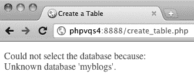

**脚本 12.4** 继续

**2.** 开始一段 PHP 代码：

```php
<?php
if ($dbc) {
    // 定义查询：
    $query = 'CREATE TABLE entries (
        id INT NOT NULL AUTO_INCREMENT PRIMARY KEY,
        title VARCHAR(100) NOT NULL,
        entry TEXT NOT NULL,
        date_entered DATETIME NOT NULL
    )';
    // 执行查询：
    if (@mysql_query($query, $dbc)) {
        print '<p>The table has been created!</p>';
    } else {
        // 如果无法创建表，处理错误：
        print '<p style="color: red;">Could not create the table because:<br />' . mysql_error($dbc) . '</p>';
    }
}
?>
```

```php
}
    because:<br />' .
    mysql_error($dbc) . '</p>
} else {
    <p>The query being run was: ' .
    print '<p style="color:
    $query . '</p>'; ➝ red;">Could not connect to 41 } ➝ MySQL:<br />' . mysql_error() 42 ➝ . '</p>';

mysql_close($dbc); // Close the connection.
}
```

这是前面脚本中代码的另一种版本。

```html
?>
</body>
```

主要区别在于，如果每一步都成功，则不会打印任何消息（希望到这里为止你的连接和数据库选择已经正常工作了）。

如果由于某种原因无法连接到数据库，或者无法选择数据库，则将显示错误信息 `A`。如果已连接但无法选择数据库，`A` 将出现在 MySQL 错误消息和连接关闭之间，因为通过打印正在执行的查询，如果连接不可用，你应该能够找出问题所在。为了指示脚本没有正常工作，在这种情况下，代表连接的 `$dbc` 变量被设置为 `FALSE`，这将防止 `CREATE` 查询的执行（参见步骤 4）。

继续见下一页

数据库导论 349

### 4. 定义创建表的查询语句：

```php
if ($dbc) {
    $query = 'CREATE TABLE entries (
        entry_id INT UNSIGNED NOT NULL AUTO_INCREMENT PRIMARY KEY,
        title VARCHAR(100) NOT NULL,
        entry TEXT NOT NULL,
        date_entered DATETIME NOT NULL
)';
```

接下来的两列由文本组成。名为 `title` 的一个限制为 100 个字符。第二个列 `entry` 容量可以非常大。这些字段都被标记为 `NOT NULL`，使它们成为必填字段。

首先，如果 `$dbc` 仍有值，表行将自动增加（`AUTO_INCREMENT`）并作为主键。最后，`date_entered` 列是一个时间戳，标记了每条记录添加到表中的时间。

### 5. 执行查询：

```php
if (@mysql_query($query, $dbc)) {
    print '<p>The table has been created.</p>';
} else {
    print '<p style="color:red;">Could not create the table because:' . mysql_error($dbc) . '</p><p>The query being run was: ' . $query . '</p>';
}
```

至于查询本身，让我们将其分解为更易识别的部分。首先，要创建一个新表，你编写 `CREATE TABLE tablename`（将 `tablename` 替换为所需的表名）。然后，在括号内列出所需的每个列，并用逗号隔开。你的表名和列名应该是字母数字。表中的第一列称为 `entry_id`；它是一个无符号整数（这意味着它只能是正整数）。通过包含 `NOT NULL` 词，你指示该列每行都必须有一个值。最后一步——打印实际执行的查询——是一种特别实用的技术 `B`。如果查询导致错误，将报告 MySQL 错误并显示查询本身（用于调试目的）。

### 6. 关闭数据库连接并：

```php
mysql_close($dbc);
```

如果一切进展顺利，你将看到这条消息。

### 7. 完成 PHP 代码和 HTML 页面：

```html
?>
</body>
</html>
```

### 8. 将脚本保存为 `create_table.php`，将其放置在启用 PHP 的服务器的相应目录下，并在 Web 浏览器 `C` 中测试。

没有必要像我在这里这样将 SQL 关键字全大写，但这样做有助于区分 SQL 术语与表名及列名。对于较大的应用程序，我强烈建议你将数据库连接和选择代码（此处第 13-24 行）放在 Web 目录之外的单独文件中。然后，每个页面都可以包含此外部文件。你将在第 13 章“整合一切”中看到此示例。如果在数据库上成功执行查询，`mysql_query()` 函数返回 `TRUE`。该结果并不意味着发生了预期的结果。本章介绍了 MySQL 和 SQL 相关的基础知识。一旦你熟悉了基础，你将希望查看附录 B 列出的其他资源。你通常不会使用 PHP 脚本来创建表，就像你通常不会使用 PHP 脚本创建数据库一样，当你刚开始使用 MySQL 时，如果要填充大量列，这是一个实现所需结果简单方法。

### 向数据库插入数据

无论何种情况，你必须确保为每列列出正确数量和类型的值。如所述，此数据库将用作一个简单的博客，一个在线日志。博客文章——由标题和文本组成——将使用一个页面添加到数据库，然后在另一个页面上显示。非数值值——字符串和日期——需要引号，而数字则不需要：

通过上一个脚本，你创建了表，它由四列组成：`entry_id`、`title`、`entry` 和 `date_entered`。向表中添加信息的过程在使用的 PHP 函数方面与创建表本身相似，但 SQL 查询语句是不同的。要插入记录，请使用 `INSERT` SQL 命令并采用以下两种语法之一：

```sql
INSERT INTO tablename VALUES (value1, value2, value3, etc.)
INSERT INTO tablename (column1_name, column2_name) VALUES (value1, value2)
```

为了演示，让我们创建一个向数据库添加博客文章的页面。像上一章中的许多示例一样，这个示例将同时显示和处理 HTML 表单。在进入示例之前，我会说这个脚本刻意包含一个安全漏洞；它将在本章的下一节中进行解释和修复。

查询以 `INSERT INTO tablename` 开始。然后，你可以指定你要为哪些列插入值，也可以不指定。后者更具体且更受推荐。

```sql
INSERT INTO example (name, age) VALUES ('Jonah', 1)
```

在下一章中，我们将开发另一个由数据库驱动的示例。该示例将使用 cookie 来限制用户在网站上的的操作。

352 页

12

### 如何从 HTML 表单向数据库输入数据：

**1.** 在你的文本编辑器或 IDE 中开始一个新的 PHP 文档，命名为 `add_entry.php`。

**php** (**脚本 12.5**):

```php
<!DOCTYPE html PUBLIC "-//W3C//DTD XHTML 1.0 Transitional//EN" "http://www.w3.org/TR/xhtml1/DTD/xhtml1-transitional.dtd">
<html xmlns="http://www.w3.org/1999/xhtml" xml:lang="en" lang="en">
<head>
<meta http-equiv="content-type" content="text/html; charset=utf-8" />
<title>Add a Blog Entry</title>
</head>
<body>
<h1>Add a Blog Entry</h1>
```

继续见下页

**脚本 12.5** 向数据库添加信息的查询语句足够简单，但请确保括号中的值的数量与数据库表中的列数匹配。

1

<!DOCTYPE html PUBLIC "-//W3C//DTD XHTML 1.0 Transitional//EN"

2 "http://www.w3.org/TR/xhtml1/DTD/xhtml1-transitional.dtd"> 3

<html xmlns="http://www.w3.org/1999/xhtml" xml:lang="en" lang="en"> 4 <head>

5

<meta http-equiv="content-type" content="text/html; charset=utf-8" /> 6

<title>Add a Blog Entry</title>

7 </head>

8 <body>

9

<h1>Add a Blog Entry</h1>

10 <?php // Script 12.5 - add_entry.php

11 /* 此脚本向数据库中添加博客博客条目。 */

12

13 if ($_SERVER['REQUEST_METHOD'] == 'POST') { // 处理表单。

14

15 // 连接并选择：

16 $dbc = mysql_connect('localhost', 'username', 'password');

17 mysql_select_db('myblog', $dbc);

18

19 // 验证表单数据：

20 $problem = FALSE;

21 if (!empty($_POST['title']) && !empty($_POST['entry'])) {

代码继续见下页

数据库简介 353 页

**2.** 创建初始 PHP 部分并检查。在此此时，如果你是按顺序运行这些示例，我假设你已经处理好了可以工作的连接和选择过程，因此我将省略所有的条件判断和错误报告（主要是为了缩短脚本）。如果你在连接和选择数据库时遇到问题，请应用本章中已经概述的代码。

```php
<?php // Script 12.5 -
add_entry.php
if ($_SERVER['REQUEST_METHOD'] == 'POST') {
```

**3.** 连接并选择数据库：

```php
$dbc = mysql_connect('localhost', 'username', 'password');
mysql_select_db('myblog', $dbc);
```

**脚本 12.5** 延续

22 $title = trim(strip_tags($_POST['title']));

23 $entry = trim(strip_tags($_POST['entry']));

24

} else {

25 print '<p style="color: red;">Please submit both a title and an entry.</p>'; 26 $problem = TRUE;

27 }

28

29 if (!$problem) {

30

31 // 定义查询：

32

```php
$query = "INSERT INTO entries (entry_id, title, entry, date_entered) VALUES (0, '$title', '$entry', NOW())";
```

33 // 执行查询：

34

```php
if (@mysql_query($query, $dbc)) {
35 print '<p>The blog entry has been added!</p>';
36 }
else
{
37 print '<p style="color: red;">Could not add the entry because:<br />' .
38 mysql_error($dbc) . '</p><p>The query being run was: ' . $query . '</p>';
39 }
40 // 没有问题
41 }
42 mysql_close($dbc); // 关闭连接。
43 } // 表单结束。
44
45 // 显示表单：
46 ?>
```html

<form action="add_entry.php" method="post">

<p>Entry Title: <input type="text" name="title" size="40" maxsize="100" /></p>

<p>Entry Text: <textarea name="entry" cols="40" rows="5"></textarea></p>

<input type="submit" name="submit" value="Post this Entry!" />

</form>

```
354 页
12


**4.** 验证表单数据：
```php

$problem = FALSE;

if (!empty($_POST['title']) && !empty($_POST['entry'])) {

$title = trim(strip_tags($_POST['title']));

$entry = trim(strip_tags($_POST['entry']));

} else {

print '<p style="color: red;">Please submit both a title and an entry.</p>';

$problem = TRUE;

}

```

**A** PHP 脚本执行了基本的表单验证，以防止空记录被插入数据库。在在查询中使用表单数据之前，应该对其进行验证。这里使用了最起的验证，确保提供了某些值。如果其中一个值为空，则会在浏览器中打印错误消息。

**5.** 执行查询：
```php

if (@mysql_query($query, $dbc)) {

    print '<p>The blog entry has been added!</p>';

}

else

{

    print '<p style="color: red;">Could not add the entry because:<br />' .

    mysql_error($dbc) . '</p><p>The query being run was: ' . $query . '</p>';

}

```

**6.** 创建表单：
```html

<form action="add_entry.php" method="post">

<p>Entry Title: <input type="text" name="title" size="40" maxsize="100" /></p>

<p>Entry Text: <textarea name="entry" cols="40" rows="5"></textarea></p>


<input type="submit" name="submit" value="Post this Entry!" />

</form>

**B** 如果 `INSERT` 查询没有执行成功，会打印 MySQL 错误以及执行的查询语句。因为 `entry_id` 列已设置为 `AUTO_INCREMENT`，所以你在该列上可以使用逻辑值 0。为了设置 `date_entered` 列的值，使用 MySQL 的 `NOW()` 函数。它会将当前时间作为该值插入。

**8.** 关闭连接：
```php
mysql_close($dbc);
```

**9.** 完成 HTML 页面：
```html
</body>
</html>
```

**10.** 将脚本保存为 `add_entry.php`，将其放在正确的目录下以

**C** 这是向数据库添加条目的表单形式。

使用启用 PHP 的服务器，并在你的 Web 浏览器中测试它 **C** 和 **D**。

你可能应该避免在表单值中使用单引号，否则你可能会看到像 **B** 中那样的结果。

翻到下一页查看说明和解决方案。

**D** 如果 `INSERT` 查询运行正常，将打印一条消息并再次显示表单。

**MySQL 允许你使用以下格式一次性插入多条记录：**
```sql
INSERT INTO *tablename* ( *column1_name*, *column2_name*) VALUES ( *value1*, *value2*), (*value3*, *value4*
```
但是，大多数其他数据库应用程序都不支持这种结构。要检索为 `AUTO_INCREMENT` 列创建的自动递增数字，请调用 `mysql_insert_id()` 函数。由于自增主键的工作方式，此查询也是可以：
```sql
INSERT INTO entries (title, entry, date_entered) VALUES ('$title', '$entry', NOW());
```

数据库导论 357

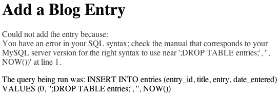

## 保护查询数据

提供的条目标题中开头的单引号的作用是完成博客标题，正如我在查询标题值部分的介绍中提到的那样。在步骤序列之前的分号，以及按此方式编写的代码随后会终止 `INSERT` 查询本身，这其中包含一个非常糟糕的安全漏洞。这将导致原始查询在语法上无效。

在目前的情况下，如果有人提交了包含单引号的文本，该数据将破坏 SQL 查询 **A**（撇开安全考虑不谈，这也是一个相当糟糕的错误）。结果显然是不如愿意的，但为什么它不安全呢？因为提供了第二个查询——`DROP TABLE entries`，希望它在原始的 `INSERT` 查询失败时执行。这被称为 SQL 注入攻击，但幸运的是它很容易防止。

如果恶意用户知道他们可以通过输入单引号来破坏查询，他们可能会尝试利用这个漏洞运行自己的查询。要做到这一点，通过 `mysql_real_escape_string()` 函数发送可能用于查询的潜在不安全数据。该函数将转义（即在前面加上反斜杠）任何潜在的有害字符，使数据在查询中使用是安全的：
```sql
INSERT INTO entries (entry_id, title, entry, date_entered) VALUES (0, '';DROP TABLE entries;', '<entry$text>', NOW())
```
```php
$var = mysql_real_escape_string($var, $dbc);
```

让我们将此函数应用于前面的脚本。A 连词中的单引号破坏了查询，因为单引号（或单引号）被用于界定查询中的字符串。

### 显示 MySQL 错误

即使 MySQL 不执行注入的 SQL 命令（通常 MySQL 只会运行通过 `mysql_query()` 函数发送的单个 SQL 查询），黑客也会在表单数据中提供糟糕的字符，希望语法错误的查询能生成数据库错误。通过查看数据库错误，黑客试图获取有关数据库的知识，这些知识可用于恶意目的。出于这个原因，实时网站绝不显示真实的 MySQL 错误或正在执行的查询是至关重要的。本章中的脚本这样做仅用于你自己的调试目的。

358 第 12 章

### 为了保护查询数据：

这两行代码将极大提高脚本的安全性和功能。对于：

1. 在你的文本编辑器或 IDE 中打开 `add_entry.php`（脚本 12.5），如果它尚未打开。两个提交的变量首先被 `trim` 处理并去除了标签，然后通过 `mysql_real_escape_string()` 发送。
2. 将 `$title` 和 `$entry` 变量的赋值更新为读取（**脚本 12.6**）如下：
```php
$title = mysql_real_escape_string(trim(strip_tags($_POST['title'])));
$entry = mysql_real_escape_string(trim(strip_tags($_POST['entry'])));
```

连接：
```php
$dbc = mysql_connect('localhost', 'username', 'password');
mysql_select_db('myblog', $dbc);

// 验证并安全表单数据:
$problem = FALSE;
if (!empty($_POST['title']) && !empty($_POST['entry'])) {

    $title = mysql_real_escape_string(trim(strip_tags($_POST['title'])));
    $entry = mysql_real_escape_string(trim(strip_tags($_POST['entry'])));

    // 定义查询:
    $query = "INSERT INTO entries (entry_id, title, date_entered) VALUES (0, '$title', '$entry', NOW())";

    // 执行查询:
    if (@mysql_query($query, $dbc)) {
        print '<p>The blog entry has been added!</p>';
    }
    else {
        print '<p style="color: red;">Could not add the entry because:<br />' . mysql_error($dbc) . '</p><p>The query being run was: ' . $query . '</p>';
    }

} // 没有问题！

mysql_close($dbc); // 关闭连接。

} // 表单提交结束

// 显示表单:
?>
<form action="add_entry.php" method="post">
<p>条目标题: <input type="text" name="title" size="40" maxsize="100" /></p>
<p>条目文本: <textarea name="entry" cols="40" rows="5"></textarea></p>
<input type="submit" name="submit" value="发布此条目!" />
<input type="hidden" name="submitted" value="true" />
</form>
</body>
</html>
```

继续下一页。

359

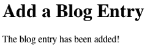

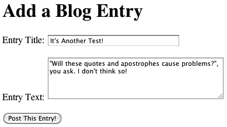

**B** 如果你看到（在章节后面的部分）显示的博客文章在单引号前有额外的反斜杠，这可能是因为你使用了启用了 Magic Quotes 的 PHP 版本。（Magic Quotes 会转义数据中的问题字符，但效果没有 `mysql_real_escape_string()` 好）。如果是这样的话，你需要应用 `stripslashes()` 函数来移除提交值中的多余反斜杠。

**C** 现在不会产生问题了。

从数据库检索数据与插入数据相比，主要区别在于本章演示的后续过程是：你需要以不同的方式处理查询。你应该先将查询结果赋值给变量。你仍然使用查询结果来操作数据库：你使用 `mysql_query()` 函数来运行查询，但检索数据与插入数据略有不同：
```php
$result = mysql_query($query, $dbc);
```

就像 `$dbc` 是打开的数据库连接的引用一样，`$result` 是查询结果集的引用。然后使用另一个函数来获取数据。接着将此变量提供给 `mysql_fetch_array()` 函数，该函数会检索查询结果：
```php
$row = mysql_fetch_array($result);
```

检索数据的基本语法是 `SELECT` 查询：
```sql
SELECT *what columns* FROM *what table*
```

从表中读取数据最简单的查询是：
```sql
SELECT * FROM *tablename*
```

星号 `*` 等同于“所有列”。如果你只需要返回某些列，可以限制你的查询，例如：
```sql
SELECT name, email FROM users
```

和任何数组一样，你必须完全按照数据库中定义的列进行引用（键是区分大小写的）。因此，在这个示例中，你必须使用 `$row['email']` 而不是 `$row['Email']`。此查询请求仅收集两个列（`name` 和 `email`）的信息。请记住，如果查询将返回多行，这种结构并不会限制返回哪些行（或记录），仅限制了这些行中的列。在循环中执行 `mysql_fetch_array()` 函数以访问所有数据：
```php
while ($row = mysql_fetch_array($result)) {
    // 对 $row 进行某些操作
}
```

另一种修改查询的方法是添加一个条件来限制返回的行，这通过使用 `WHERE` 子句实现：
```sql
SELECT * FROM users WHERE name='Larry'
```

在循环的每次迭代中，查询的下一行信息（由 `$result` 引用）赋值给名为 `$row` 的数组。这个过程将持续进行，直到没有更多信息行。在循环内部，你可以对 `$row` 中的表中的每一列进行任何操作，但仅限于 `name` 列等于 Larry 的行。

理解这段新代码的最佳方法是尝试运行它。你将编写一个脚本检索存储在 `entries` 表中的文章并显示它们。你可能想再运行几次来先建立该表。

### 从表中检索数据 (`view_entries.php`）：

动态 Web 页面使用 PHP 从数据库提取数据。
```php
<!DOCTYPE html PUBLIC "-//W3C//DTD XHTML 1.0 Transitional//EN" "http://www.w3.org/TR/xhtml1/transitional.dtd">
<html lang="en">
<head>
<meta http-equiv="content-type" content="text/html; charset=utf-8" />
<title>查看我的博客</title>
</head>
<body>
<h1>我的博客</h1>
<?php 
// 脚本 12.7 - view_entries.php
/* 此脚本按照录入的顺序从数据库中检索博客文章，从最近的开始在前面。最后这个选项由 DESC 设置。如果查询是 ORDER BY ASC，则最后添加的记录将被最后检索。 */

// 2. 开始 PHP 部分并连接到数据库：
$dbc = mysql_connect('localhost', 'username', 'password');
mysql_select_db('myblog', $dbc);

// 3. 定义 SELECT 查询：
$query = 'SELECT * FROM entries ORDER BY date_entered DESC';

// 4. 运行查询：
if ($r = mysql_query($query, $dbc)) {
    // 5. 打印返回的结果：
    while ($row = mysql_fetch_array($r)) {
        print "<p><h3>{$row['title']}</h3>
        {$row['entry']}<br />
        <a href=\"edit_entry.php?id={$row['entry_id']}\">编辑</a></a>
        <a href=\"delete_entry.php?id={$row['entry_id']}\">删除</a></a>
        </p><hr>\n";
    }
} else {
    // 6. 如果查询没有运行，则处理错误。
    print '<p style="color: red;">无法检索数据，因为:<br />' . mysql_error($dbc) . '</p><p>正在运行的查询为: ' . $query . '</p>';
}
mysql_close($dbc); // 关闭连接。
?>
</body>
</html>
```

```php
print '<p style="color: red;">无法检索数据，因为:<br />' .
mysql_error($dbc) . '</p>
<p>正在执行的查询为：' . $query . '</p>';
} // 查询 IF 结束。
```

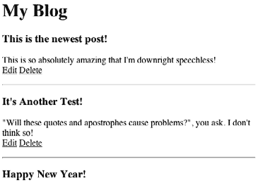

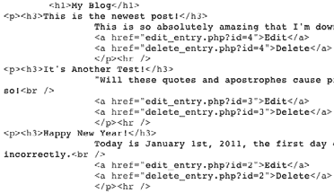

如果查询无法在数据库上运行，则应该将其打印出来，以及 MySQL 错误（用于调试之目的）。


### 7. 关闭数据库连接

```php
mysql_close($dbc);
```

### 8. 完成 PHP 部分和 HTML 页面

```php
?>
</body>
</html>
```

得益于 `SELECT` 查询（它根据录入日期对返回的记录进行排序），最近添加的条目始终列在第一个。

### 9. 保存并测试

将脚本保存为 `view_entries.php`，将其放置在启用 PHP 的服务器的相应目录中，并在 Web 浏览器 **A** 中进行测试。

### 10. 添加记录并再次测试

如果你想，可以使用 `add_entry.php` 页面（脚本 12.6）向博客添加另一条记录，并再次运行此页面 **B**。

### 11. 查看源代码

页面的源代码以查看动态生成的链接 **C**。

`mysql_fetch_array()` 函数接收另一个参数，该常量指示应返回什么种类的数组。`MYSQL_ASSOC` 返回一个关联数组，而 `MYSQL_NUM` 返回一个数字索引数组。

`mysql_num_rows()` 函数返回 `SELECT` 查询返回的记录数。

可以对返回的记录进行分页处理，以便每页显示 10 或 20 条（类似于 Google 的工作方式）。然而，这需要比书中教授的更高级的代码。请参阅我的书籍《PHP 6 and MySQL 5 for Dynamic Web Sites: Visual QuickPro Guide》（Peachpit Press, 2007），或者在网上查找代码示例和教程。

## 数据库简介 365

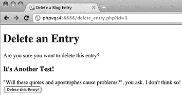

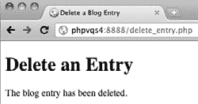

## 在数据库中删除数据

有时你可能还想在数据库上运行 `DELETE` 查询。此类查询会从数据库中删除记录。删除查询的语法为：

```sql
DELETE FROM *tablename* WHERE *column*=value
```

**A** 当用户到达此页面时，将显示博客条目，且用户必须确认他们想要删除它。

`WHERE` 子句不是必须的，但如果省略了它，你将删除表中的每条记录。你还应该理解，一旦你删除了某条记录，就没有办法可以恢复它（除非你有数据库的备份）。

作为安全措施，如果你只想从表中删除单条记录，请向查询添加 `LIMIT` 子句：

```sql
DELETE FROM *tablename* WHERE *column*=value LIMIT 1
```

该子句确保了最多删除一条记录。一旦你定义了查询，它将像任何其他查询一样使用 `mysql_query()` 函数再次执行。

要检查 `DELETE` 查询是否生效，你可以使用 `mysql_affected_rows()` 函数。该函数返回受 `INSERT`、`DELETE` 或 `UPDATE` 查询影响的行数。

作为一个示例，让我们编写 `delete_entry.php` 脚本，该脚本从 `view_blog.php` 页面链接。此页面在 URL 中接收数据库记录。然后显示该条目以确认用户想要删除它 **A**。如果用户点击按钮，该记录将被删除 **B**。

**B** 如果删除查询正常工作，用户将看到此结果。

### 从数据库中删除数据

1. 在你的文本编辑器或 IDE 中开始一个新的 PHP 文档，命名为 `delete_entry.php`（脚本 12.8）：

```html
<!DOCTYPE html PUBLIC "-//W3C//DTD XHTML 1.0 Transitional//EN" "http://www.w3.org/TR/xhtml1/transitional.dtd">
<html xmlns="http://www.w3.org/1999/xhtml" lang="en">
<head>
    <meta http-equiv="content-type" content="text/html; charset=utf-8" />
    <title>删除博客条目</title>
</head>
<body>
    <h1>删除一个条目</h1>
```

2. 开始 PHP 代码并连接到数据库：

```php
<?php // 脚本 12.8 - delete_entry.php
/* 此脚本删除一个博客条目。 */
$dbc = mysql_connect('localhost', 'username', 'password');
mysql_select_db('myblog', $dbc);

if (isset($_GET['id']) && is_numeric($_GET['id'])) { // 在表单中显示条目：
    // 定义查询：
    $query = "SELECT title, entry FROM entries WHERE entry_id={$_GET['id']}";
    if ($r = mysql_query($query, $dbc)) { // 执行查询。
        $row = mysql_fetch_array($r);
        // 生成表单：
        print '<form action="delete_entry.php" method="post">
        <p>你确定要删除此条目吗？</p>
        <h3>'.$row['title'].'</h3>
        <p>'.$row['entry'].'<br />
        <input type="hidden" name="id" value="'.$_GET['id'].'" />
        <input type="submit" name="submit" value="删除此条目!" /></p>
        </form>';
    } else { // 未获取信息。
        print '<p style="color: red;">无法检索条目，因为:<br />'
        . mysql_error($dbc) . '</p><p>正在执行的查询为：' . $query . '</p>';
    }
} elseif (isset($_POST['id']) && is_numeric($_POST['id'])) { // 处理表单：
    // 定义查询：
    $query = "DELETE FROM entries WHERE entry_id={$_POST['id']} LIMIT 1";
    $r = mysql_query($query, $dbc); // 执行查询。
    // 报告结果：
    if (mysql_affected_rows($dbc) == 1) {
        print '<p>博客条目已被删除。</p>';
    } else {
        print '<p style="color: red;">无法删除条目，因为:<br />'
        . mysql_error($dbc) . '</p><p>正在执行的查询为：' . $query . '</p>';
    }
} else { // 未接收 ID。
    print '<p style="color: red;">此页面访问错误。</p>';
} // 主 IF 结束。

mysql_close($dbc); // 关闭连接。
?>
</body>
</html>
```


3. 如果页面接收到了一个有效的条目 ID，定义并执行 `SELECT` 查询：

```php
if (isset($_GET['id']) && is_numeric($_GET['id'])) {
    $query = "SELECT title, entry FROM entries WHERE entry_id={$_GET['id']}";
    if ($r = mysql_query($query, $dbc)) {
        // ...
    }
}
```

因为只需要存储的两个值——标题和条目本身——所以只选择了这两个值。然后，使用 `mysql_query()` 函数执行该查询。

### 4. 获取记录并在表单中显示条目

```php
$row = mysql_fetch_array($r);
print '<form action="delete_entry.php" method="post">
<p>Are you sure you want to delete this entry?</p>
<p><h3>' . $row['title'] . '</h3>' .
$row['entry'] . '<br />
<input type="hidden" name="id" value="' . $_GET['id'] . '" />
<input type="submit" name="submit" value="Delete this Entry!" /></p>
</form>';
```

而不是检索所有记录。

### 5. 如果查询失败，报告错误

```php
} else { // Couldn't get the information.
    print '<p style="color: red;">Could not retrieve the blog entry because:<br />' .
    mysql_error($dbc) . '</p>';
```

### 6. 检查表单的提交

像你在上一个示例中所做的那样，使用 `while` 循环调用一次 `mysql_fetch_array()` 函数将返回的记录赋值给变量 `$row`。使用该数组，就可以显示要删除的记录。

此 `elseif` 子句是步骤 3 开始的条件判断的一部分。它对应于该脚本的第二次用法（表单被提交）。表单首先显示博客条目的详情，就像在 `view_blog.php` 脚本中一样。如果此条件为 `TRUE`，则应该删除该记录。当用户点击按钮时，表单将提交回此页面，此时应该删除该记录。为了实现这一点，必须将作为 `$_GET['id']` 传递给脚本的博客标识存储在隐藏输入框中，以便它在提交时存在于 `$_POST` 数组中（因为在此时 `$_GET['id']` 将没有值）。

ID 值来自表单，它在表单中作为隐藏输入存储。

### 7. 定义并执行查询

```php
$query = "DELETE FROM entries WHERE entry_id={$_POST['id']} LIMIT 1";
$r = mysql_query($query, $dbc);
```

此查询删除了 `entry_id` 值为 `$_POST['id']` 的记录。通过向查询中添加 `LIMIT 1` 子句，你可以确保最多只删除一条记录。

### 8. 检查查询结果

```php
if (mysql_affected_rows($dbc) == 1) {
    print '<p>The blog entry has been deleted.</p>';
} else {
```

等等，让我们重新检查文本中的逻辑。`mysql_affected_rows()` 函数返回最近一次查询更改的行数。如果查询运行正常，则删除了一行，因此此函数应返回 1。如果是这样，将打印一条消息。否则，将打印 MySQL 错误和查询以供调试。

如果 `SELECT` 查询运行失败：

```php
    print '<p style="color: red;">Could not delete the blog entry because:<br />' .
    mysql_error($dbc) . '</p>';
    print '<p>The query being run was: ' . $query . '</p>';
}
```

### 9. 完成主条件判断

```php
} else { // No ID received.
    print '<p style="color: red;">This page has been accessed in error.</p>';
} // End of main IF.
```

### 10. 关闭数据库连接，并完成页面

```php
mysql_close($dbc);
?>
</body>
</html>
```

### 11. 保存并测试

将脚本保存为 `delete_entry.php`，将其放置在启用 PHP 的服务器的相应目录下，并在 Web 浏览器 A 和 B 中进行测试。要测试此脚本，你必须先运行 `view_blog.php`。然后，点击一个 Delete 链接访问 `delete_entry.php`。

你可以通过运行查询 `TRUNCATE TABLE *tablename*` 来清空表中的所有记录。这种方法优于使用 `DELETE FROM *tablename*`。`TRUNCATE` 会完全删除并重建表，这对数据库更好。尝试像运行 `SELECT` 查询一样运行 `DELETE * FROM *tablename` 查询是一个相当常见的错误。请记住，`DELETE` 不使用与 `SELECT` 相同的语法，因为你不是在删除特定的列。

---

## 更新数据库中的数据

本章将涵盖的最后一种查询类型是 `UPDATE`。它用于更改记录列的值。语法是：

```sql
UPDATE *tablename* SET *column1_name*=value, *column2_name*=value2 WHERE *some_column*=value
```

与其他任何查询一样，如果值是字符串，它们应该被放置在单引号内：

```sql
UPDATE users SET first_name='Eleanor', age=7 WHERE user_id=142
```

**当用户到达编辑页面时，表单将显示现有值：**

与 `DELETE` 查询一样，你应该使用 `WHERE` 子句来限制受影响的行。如果不这样做，数据库中的每条记录都将被更新。要测试更新是否生效，你可以再次使用 `mysql_affected_rows()` 函数来返回更改的记录数。

为了演示，让我们写一个用于编辑博客条目的页面。它将允许用户更改条目的标题和文本，但不能更改输入日期或博客 ID 号（作为主键，ID 号永远不应该更改）。

---

### 脚本 12.9: edit_entry.php

```php
<!DOCTYPE html PUBLIC "-//W3C//DTD XHTML 1.0 Transitional//EN"
"http://www.w3.org/TR/xhtml1/DTD/xhtml1-transitional.dtd">
<html xmlns="http://www.w3.org/1999/xhtml" xml:lang="en" lang="en">
<head>
<meta http-equiv="content-type" content="text/html; charset=utf-8" />
<title>Edit a Blog Entry</title>
</head>
<body>
<h1>Edit an Entry</h1>
<?php // Script 12.9 - edit_entry.php
/* 此脚本使用 UPDATE 查询编辑博客条目。 */

// 连接并选择数据库：
$dbc = mysql_connect('localhost', 'username', 'password');
mysql_select_db('myblog', $dbc);

if (isset($_GET['id']) && is_numeric($_GET['id'])) {
    // 在表单中显示条目：
    // 定义查询。
    $query = "SELECT title, entry FROM entries WHERE entry_id={$_GET['id']}";
    if ($r = mysql_query($query, $dbc)) {
        // 获取信息。
        $row = mysql_fetch_array($r);
```


```php
print '<form action="edit_entry.php" method="post">
<p>Entry Title: <input type="text" name="title" size="40" maxsize="100" value="' . htmlentities($row['title']) . '" /></p>
<p>Entry Text: <textarea name="entry" cols="40" rows="5">' . htmlentities($row['entry']) . '</textarea></p>
<input type="hidden" name="id" value="' . $_GET['id'] . '" />
<input type="submit" name="submit" value="Update this Entry!" />
</form>';
```

```php
} else { // Couldn't get the information.
    print '<p style="color: red;">Could not retrieve the blog entry because:<br />' . mysql_error($dbc) . '</p><p>The query being run was: ' . $query . '</p>';
}
```

```php
} elseif (isset($_POST['id']) && is_numeric($_POST['id'])) { // Handle the form.
// Validate and secure the form data:
$problem = FALSE;
if (!empty($_POST['title']) && !empty($_POST['entry'])) {
    $title = mysql_real_escape_string(trim(strip_tags($_POST['title'])), $dbc);
    $entry = mysql_real_escape_string(trim(strip_tags($_POST['entry'])), $dbc);
} else {
    print '<p style="color: red;">Please submit both a title and an entry.</p>';
    $problem = TRUE;
}
if (!$problem) {
    // Define the query.
    $query = "UPDATE entries SET title='$title', entry='$entry' WHERE entry_id={$_POST['id']}";
    $r = mysql_query($query, $dbc); // Execute the query.
    // Report on the result:
    if (mysql_affected_rows($dbc) == 1) {
        print '<p>The blog entry has been updated.</p>';
    } else {
        print '<p style="color: red;">Could not update the entry because:<br />' . mysql_error($dbc) . '</p><p>The query being run was: ' . $query . '</p>';
    }
} // No problem!
} else { // No ID set.
    print '<p style="color: red;">This page has been accessed in error.</p>';
} // End of main IF.
mysql_close($dbc); // Close the connection.
?>
```

# 第 12 章

## 2. 启动你的 PHP 代码并连接数据库

再次，这与上一个脚本中的数据库几乎完全相同，包括将 ID 值存储在隐藏表单输入中的这一最重要的步骤。然而，这里存储的数据不仅被打印出来，而且实际上被用作表单元素的值。为了安全并避免潜在的冲突，每个值都会先通过 `htmlentities()` 处理。

## 3. 如果页面在 URL 中接收到有效的记录 ID，定义并执行 `SELECT` 查询：

```php
if (isset($_GET['id']) && is_numeric($_GET['id'])) {
    $query = "SELECT title, entry FROM entries WHERE entry_id={$_GET['id']}";
    if ($r = mysql_query($query, $dbc)) {
        // ... code ...
    } else { // Couldn't get the information.
        print '<p style="color: red;">Could not retrieve the blog entry because:<br />' . mysql_error($dbc) . '</p><p>The query being run was: ' . $query . '</p>';
    }
}
```

这段代码与删除页面中的完全相同；它根据提供的 ID 值从数据库中选择两个列的值。

## 4. 获取记录并在表单中显示条目：

当提交表单时，此条件判断将为 `TRUE`。

```php
} elseif (isset($_POST['id']) && is_numeric($_POST['id'])) {
    $row = mysql_fetch_array($r);
    print '<form action="edit_entry.php" method="post">
        <p>Entry Title: <input type="text" name="title" size="40" maxsize="100" value="' . htmlentities($row['title']) . '" /></p>
        <p>Entry Text: <textarea name="entry" cols="40" rows="5">' . htmlentities($row['entry']) . '</textarea></p>
        <input type="hidden" name="id" value="' . $_GET['id'] . '" />
        <input type="submit" name="submit" value="Update this Entry!" />
    </form>';
}
```

## 5. 如果查询失败则报告错误：

```php
if (mysql_affected_rows($dbc) == 1) {
    print '<p>The blog entry has been updated.</p>';
} else {
    print '<p style="color: red;">Could not update the entry because:<br />' . mysql_error($dbc) . '</p><p>The query being run was: ' . $query . '</p>';
}
```

## 6. 检查表单的提交：

## 7. 验证并安全表单数据：

```php
$problem = FALSE;
if (!empty($_POST['title']) && !empty($_POST['entry'])) {
    $title = mysql_real_escape_string(trim(strip_tags($_POST['title'])), $dbc);
    $entry = mysql_real_escape_string(trim(strip_tags($_POST['entry'])), $dbc);
} else {
    print '<p style="color: red;">Please submit both a title and an entry.</p>';
    $problem = TRUE;
}
```

## 8. 定义并执行查询：

```php
if (!$problem) {
    $query = "UPDATE entries SET title='$title', entry='$entry' WHERE entry_id={$_POST['id']}";
    $r = mysql_query($query, $dbc);
}
```

## 9. 报告查询的结果：

## 10. 完成条件判断：

```php
} else { // No ID set.
    print '<p style="color: red;">This page has been accessed in error.</p>';
} // End of main IF.
```

## 11. 关闭数据库连接并完成页面：

```php
mysql_close($dbc);
?>
```

## 12. 将文件保存为 `edit_entry.php`，将其放在启用 PHP 的服务器相应目录中，并在 Web 浏览器 `A` 和 `B` 中进行测试。

## 13. 访问 `view_blog.php` 以确认更改已 `C`。

`id` 是主键，意味着它的值不应该改变。通过在表中使用主键，你可以更改记录中的所有其他值，但仍可以使用该列来引用该行。

`mysql_real_escape_string()` 函数不需要应用于用于查询的 ID 值，因为 `is_numeric()` 测试已确认它们不包含单引号或其他问题字符。

如果你对表运行更新操作但没有更改记录的值，`mysql_affected_rows()` 将返回 0。在 `UPDATE` 查询中添加 `LIMIT 1` 子句并无害，可以确保最多只影响一行。

重新加载 `view_blog.php` 脚本将反映对条目内容的更改。

# 数据库入门 377

## 复习与扩展

### 扩展

- 找到 MySQL 手册的版本。如果你在对应你对应版本的复习问题或扩展提示时遇到任何问题，请访问书籍的支持论坛（`http://www.LarryUllman.com/forum/`）。开始学习 MySQL 吧！

- 将连接和选择数据库的代码移动到一个单独脚本中，然后在与数据库交互的 PHP 页面中包含该脚本。

### 复习

- 你正在使用哪个版本的 MySQL？

- 使 `add_entry.php` 表单具有持久化（sticky）效果。

- 你个人亲自使用哪些值来连接 MySQL？

- 修改 `view_entry.php` 中的代码，将每个条目中的换行符转换为 HTML 换行标签。

- PHP 脚本是如何连接到 MySQL 服务器的？又是如何断开的？

- 什么是错误抑制运算符？它有什么作用？

- 哪个函数返回 MySQL 报告的错误？

- 当处理与 MySQL 交互的 PHP 脚本出现问题时，你应该使用哪些调试技术？

- 你如何选择要使用的数据库？

- 使用什么 SQL 命令创建数据表？添加新记录？检索记录？修改记录？删除记录？

- 字符串值应该通过哪个函数处理以防止 SQL 注入攻击？

# 13 整合一切

到目前为止的 12 章已经涵盖了使用 PHP 进行 Web 开发的所有基础知识。在本章中，你将利用积累的知识创建一个完整且功能性的网站。尽管本章的重点是应用你新学到的知识，但你仍然会学一些新技巧。特别是，你将看到如何从零开始开发全功能的 Web 应用。

### 本章内容

- 入门
- 连接数据库
- 编写自定义函数
- 创建模板
- 登录
- 退出
- 添加格言
- 列出格言
- 编辑格言
- 删除格言
- 创建首页
- 复习与扩展

## 入门

开始任何项目的第一步都是确定网站的目标。本章的主要目标是应用到目前为止书中教的所有内容（这确实是一个宏大的目标）。我构思的示例结合了前两章的模型，创建一个可以存储和显示格言的网站。与第 11 章“文件和目录”中使用文件来实现不同，此网站将使用 MySQL 数据库作为存储库。

### 网站的简单首页

与第 12 章“数据库入门”中的博客示例一样，网站将实现创建、编辑和删除格言的功能。此外，公共用户能够查看最新的格言、随机的格言，或者被标记为收藏的随机格言。为了提高安全性，网站将设有一个管理员，管理员可以登录和退出。只有登录的管理员才被允许创建、编辑或删除格言。

### 非管理员拒绝访问某些页面

网站将使用简单的模板来让每个页面具有一致的外观，并由 CSS 处理所有的格式和布局。网站还将使用一个自定义函数。与第 12 章一样，你必须先创建数据库。数据库可以命名为 `myquotes`（或者如果你愿意也可以用其他名字）。你使用此 SQL 命令创建其数据表：

```sql
CREATE TABLE quotes (
  quote_id INT UNSIGNED NOT NULL AUTO_INCREMENT,
  quote TEXT NOT NULL,
  source VARCHAR(100) NOT NULL,
  favorite TINYINT(1) UNSIGNED NOT NULL,
  date_entered TIMESTAMP NOT NULL DEFAULT CURRENT_TIMESTAMP,
  PRIMARY KEY (quote_id)
);
```

`quote_id` 是主键，它会在每次新提交时自动递增到下一个逻辑值。`quote` 字段存储格言本身，`source` 字段存储出处（与第 11 章不同，在那中格言和出处是存储在一起的）。`favorite` 字段存储 1 或 0，用于标记格言是否为收藏。最后，`date_entered` 列是一个时间戳，在创建新记录时自动设置为当前时间戳。一旦你创建了数据库、表和必要的文件夹，就可以开始编写代码。你可以使用 PHP 脚本（例如脚本 12.4）或服务器上的第三方工具来创建此表。

### 文件的结构和组织

理想情况下，建立数据库连接的 `mysql_connect.php` 脚本应该存储在 Web 根目录之外。如果在你的情况下无法实现，你可以将其放在 `includes` 文件夹中，然后相应地更改其他脚本中的代码。

## 连接数据库

**脚本 13.1** 此脚本连接到数据库服务器并选择要使用的数据库。

```php
<?php // Script 13.1 - mysql_connect.php
/* 此脚本连接并选择数据库。 */
// Connect:
$dbc = mysql_connect('localhost', 'username', 'password');

// Select:
mysql_select_db('myquotes', $dbc);
?>
```

与第 12 章中在每个脚本中重复代码的代码不同，此网站将使用更常见的做法，将重复代码放在一个独立文件中。每个与数据库交互的脚本——这将是大多数而非全部脚本——都将包含此文件。正如你在上一节的图 C 中所示，此文件应存储在 Web 根目录之外，或者如果不可行，则放在 `includes` 文件夹内。

## 编写自定义函数

该网站将有一个自定义函数。正如第 10 章“创建函数”中所讨论的，创建自定义函数的最佳时机是脚本或网站可能出现重复代码时。在这个网站中有几处这样的情况...

A 这种 Cookie 将用于识别最显而易见的特征，即：许多脚本管理员管理员。需要检查当前用户是否为管理员。在接下来的脚本中，你将创建自己的函数，该函数将返回一个 `Boolean` 值，用以指示用户是否为管理员。但管理员的测试标准是什么呢？

成功登录后，将向管理员的浏览器发送一个 Cookie，名为 `Samuel`，值为 `Clemens` A。这看起来可能很奇怪或随机，事实也确实如此。当使用像 Cookie 这样简单的工具进行身份验证时，最好让验证内容的构成保持模糊性。如果你选择更显而易见的方式，例如名为 `admin` 且值为 `true`，那么任何人都可以轻易地猜到并伪造。考虑到这个 Cookie，接下来的函数简单地检查是否存在一个名为 `Samuel` 且值为 `Clemens` 的 Cookie。

整合在一起 383

### 创建 `functions.php`：

扩展网站的功能（例如，如果你有多种类型的身份验证需要执行）。尽管如此，由于通过对这些参数使用默认值，当检查假设的 Cookie 名称和值时，函数调用不需要提供参数值。

**1.** 在你的文本编辑器或 IDE 中开始一个新的 PHP 脚本，命名为 `functions.php`（**脚本 13.2**）：


# 脚本 13.2 - functions.php

```php
<?php // Script 13.2 - functions.php
// 虽然按照目前的写法，脚本只定义了一个函数，但我使用复数形式——functions——来命名文件，因为我以后可能会向脚本中添加更多用户定义的函数。

// 2. 开始定义新函数：
function is_administrator($name = 'Samuel', $value = 'Clemens') {
    // 该函数接受两个参数：Cookie 的名称和它的值。两者都有默认值。
    // 如果 Cookie 存在且具有适当的值，则返回布尔值 true。
    // 否则，函数返回 false。
    // 由于函数只检查一个具有特定预期值的 Cookie，它完全不需要参数，更不用说默认参数了。但通过让函数接受参数，如果以后函数需要参数，它可以以不同的方式使用。

    // 检查 Cookie 并检查其值：
    if (isset($_COOKIE[$name]) && ($_COOKIE[$name] == $value)) {
        return true;
    } else {
        return false;
    }
} // End of is_administrator()
?>
```

## 创建模板

现在两个辅助文件已经创建完成，是时候转向模板了。正如第 8 章“创建 Web”所示，网站的布局将由两个包含文件控制：头部和页脚。它们将存储在 `templates` 目录中。头部还引用了一个样式表，存储在 `css` 文件夹中。可以通过下载找到样式表（文件位于 `ch13` 文件夹）。

除了生成主要的 HTML 之外，头部文件必须包含 `functions.php` 脚本。如果当前用户是管理员，页脚将显示一些链接。如果查看页面的人是管理员，他们将看到额外的链接。

### 创建 `header.html`

**1.** 在你的文本编辑器或 IDE 中开始一个新的 HTML 文档，命名为 `header.html`（**脚本 13.3**）。

```php
<?php // Script 13.3 - header.html
include('includes/functions.php'); ?>
<!DOCTYPE html PUBLIC "-//W3C//DTD XHTML 1.0 Transitional//EN" "http://www.w3.org/TR/xhtml1/DTD/xhtml1.dtd">
<html xmlns="http://www.w3.org/1999/xhtml" xml:lang="en" lang="en">
<head>
<meta http-equiv="content-type" content="text/html; charset=utf-8" />
<link rel="stylesheet" media="all" href="css/style.css" />
<title><?php // 输出页面标题。
if (defined('TITLE')) { // 是否定义了标题？
    print TITLE;
} else { // 未定义标题。
    print 'My Site of Quotes';
}
?></title>
</head>
```

头部将从 PHP 部分开始包含 `functions.php` 脚本，该脚本将被网站上的多个页面需要。脚本引用相对于包含头部的页面。

### 创建 `footer.html`

**1.** 在你的文本编辑器或 IDE 中开始一个新的 HTML 文档，命名为 `footer.html`（**脚本 13.4**）：

```php
<?php // Script 13.4 - footer.html

// 显示通用管理链接...
// - 如果用户是管理员且页面不是 logout.php 页面
// - 或者如果 $loggedin 变量为真（即用户刚刚登录）

if ((is_administrator() && (basename($_SERVER['PHP_SELF']) != 'logout.php')) || (isset($loggedin) && $loggedin)) {
    // 创建链接：
    print '<hr /><h3>Site Admin</h3><p><a href="add_quote.php">Add Quote</a> <-> <a href="view_quotes.php">View All Quotes</a> <-> <a href="logout.php">Logout</a></p>';
}

?>

</div><!-- container -->

<div id="footer">Content &copy; 2011</div>

</body>
</html>
```

当前页面不是 `logout.php`。代码 `basename($_SERVER['PHP_SELF'])` 是获取当前脚本的可靠方法（因为页脚文件是由另一个脚本引入的，`$_SERVER['PHP_SELF']` 将具有包含脚本的值）。

条件的第二部分，在 `OR` 之后，会检查 `$loggedin` 变量是否已设置且其为真。这将导致在 `login.php` 页面上的 case 之后，用户成功登录。在那个时刻，`is_administrator()` 函数不会返回真值，因为 cookie 刚刚由脚本发送，因此无法被读取。

**6.** 将文件保存为 `footer.html`，存储在 `templates` 目录中。创建了三个链接：指向添加新引用的页面、指向查看所有引用的页面，以及注销页面。

**脚本 13.4** 页脚文件在适当的情况下显示通用管理链接，并完成 HTML 页面。

## 整合在一起

**脚本 13.5** 登录脚本同时显示并处理表单，在登录尝试成功后发送 cookie。

接下来，是时候创建一个管理员可以登录的脚本了。结果将与第 9 章“Cookies 和会话”中的脚本非常相似，有一个结构上的区别：该章节使用了输出缓冲，允许你以任意的方式布局脚本。本网站不使用输出缓冲，因此表单的处理必须写得如下，以便在不产生已发送头部的情况下发送 cookie（参见第 9 章）。换句话说，脚本必须在包含头部之前检查表单提交。因此，为了仍然能够在页面上下文中反映错误和其他消息，请使用变量。

### 创建 `login.php`

**1.** 在你的文本编辑器或 IDE 中开始一个新的 PHP 文档，命名为 `login.php`（**脚本 13.5**）：

```php
<?php // Script 13.5 - login.php
/* 此页面允许用户登录网站。 */

// 设置两个默认值的变量：
$loggedin = false;
$error = false;

// 检查表单是否已提交：
if ($_SERVER['REQUEST_METHOD'] == 'POST') {
    // 处理表单：
    if (!empty($_POST['email']) && !empty($_POST['password'])) {
        if (strtolower($_POST['email']) == 'me@example.com' && $_POST['password'] == 'testpass') {
            // 正确！
            setcookie('Samuel', 'Clemens', time()+3600);
            // 表示他们已登录：
            $loggedin = true;
        } else {
            // 错误！
            $error = '提交的电子邮件地址和密码与记录中的不匹配!';
        }
    } else {
        // 遗漏了字段。
        $error = '请确保你都输入了电子邮件地址和密码!';
    }
}

// 设置页面标题并包含头部文件：
define('TITLE', 'Login');
include('templates/header.html');

// 如果存在错误，则打印：
if ($error) {
    print '<p class="error">' . $error . '</p>';
}

// 表示用户已登录：
if ($loggedin) {
    print '<p>你现在已经登录了！</p>';
} else {
    // 显示表单：
    print '<h2>Login Form</h2>
    <form action="login.php" method="post">
    <p><label>Email Address <input type="text" name="email" /></label></p>
    <p><label>Password <input type="password" name="password" /></label></p>
    <p><input type="submit" name="submit" value="Log In!" /></p>
    </form>';
}

include('templates/footer.html');
?>
```

第一个 `else` 分句适用于提供了邮箱和密码但错误的情况。第二个 `else` 分句适用于未提交邮箱地址或密码的情况。在两种情况下，消息都被赋值给一个变量，以便稍后脚本中使用。

**8. 设置页面标题并包含头部文件：**
错误消息在包含头部之后、HTML 表单之前显示。
`define('TITLE', 'Login');`
`include('templates/header.html');`

**9. 如果存在错误，则打印：**
错误本身将在第 7 步确定，但此时无法打印，因为 HTML 头部尚未被包含。解决方案是让这段代码检查非假的 `$error` 值，然后在某些 HTML 和 CSS 中打印 `$error`。

**10. 表示用户已登录，或者显示表单：**
如果变量 `$loggedin` 的值为 `true`（其默认值为 `false`），则用户刚刚登录了网站，并显示一条此类消息。如果 `$loggedin` 变量仍为默认值，则应该显示表单。

**11. 包含页脚并完成页面：**
```php
include('templates/footer.html');
?>
```

**12.** 将文件保存为 `login.php`。

**13.** 在您的 Web 浏览器中测试该文件。我故意省略了创建指向登录部分的链接（作为一种安全措施），因此您需要在 Web 浏览器的地址栏中输入正确的 URL。

> **请注意，按照目前的写法，脚本要求管理员在一个小时后重新登录，无论他们是否在网站上持续活跃状态。**

## 注销

**脚本 13.6** 注销脚本删除了标识管理员的 cookie。

如果你编写了一个登录过程，那么也必须有一个注销过程。在这种情况下，仅使用 cookie，这是一个非常简单的脚本。

### 要创建 `logout.php`：

**1.** 在您的文本编辑器或 IDE 中开始一个新的 PHP 文档，命名为 `logout.php`。

**2.** 删除 cookie，但仅当它已存在时：

```php
<?php // Script 13.6 - logout.php
/* This is the logout page. It destroys the cookie. */

// Destroy the cookie, but only if it already exists:
if (isset($_COOKIE['Samuel'])) {
    setcookie('Samuel', FALSE, time()-300);
}
?>
```

作为额外的安全措施，该脚本仅在 cookie 存在时尝试删除它。通过此项检查，脚本防止了黑客在未先登录的情况下通过访问注销脚本来发现网站所使用的 cookie 名称。要删除现有的登录 cookie，会发送另一个具有相同名称、值为 `FALSE` 且过期时间在过去的 cookie。

**3.** 定义页面标题并包含页头：

```php
define('TITLE', 'Logout');
include('templates/header.html');
```

**4.** 打印消息：

```php
if (isset($_COOKIE['Samuel'])) {
    setcookie('Samuel', FALSE, time()-300);
    // Print a message:
    print '<p>You are now logged out.</p>';
}
```

**5.** 包含页脚：

```php
include('templates/footer.html');
?>
```


print `<p>You are now logged out.</p>`;

5. 包含页脚：

```php
include('templates/footer.html');
?>
```

**A** 此 cookie 除了现有的 cookie。
6. 将文件保存为 `logout.php`。
7. 在您的 Web 浏览器中测试该文件 **A** 和 **B**。（等等，文中写的是 **A 和 B**，但根据上下文，**B** 可能可能是指下方显示的的结果页面）。

**B** 结果注销页面。

392 第 13 章


### 添加引用

现在管理员有了登录的能力，她或他应该能够开始添加引用。执行此操作的脚本与添加博客文章（第 12 章）的脚本非常相似，但表单将有一个额外的复选框，用于将引用标记为收藏 **A**。

由于此脚本会在数据库中创建记录，安全性必须是首要考虑。作为初步预防措施，脚本将确保只有管理员可以使用该页面。其次，将用于 SQL 命令的值将是。

**A** 向数据库中添加引用的表单。

#### 要创建 add_quote.php：

**脚本 13.7** 该脚本允许管理员向数据库添加新引用。

1. 在您的文本编辑器或 IDE 中开始一个新的 PHP 文档，命名为 `add_quote.php`

```php
// （：此处对应的代码块在原文中不完整，已根据上下文逻辑翻译或保持说明）
```

```php
/>' . mysql_error($dbc) . '</

<p>正在运行的查询是：'

. $query . '</p>';
```

代码继续

**第 394 页**

**脚本 13.7 继续**

在数据库中，引言作为收藏的状态由 1 表示。

```php
44 }
```

非收藏由 0 表示。

```php
45

46 关闭连接：
```

```php
47 mysql_close($dbc);
```

要确定使用的数值，PHP 脚本只需要检查 `$_POST['favorite']` 值。如果该变量已设置（无论其值是什么），意味着用户勾选了收藏框。如果用户没有这样做，该变量将未设置，`$favorite` 变量将被赋值 0。

```php
49 } else { // 未输入引言。

print '<p class="error">请输入引言和来源。</p>';

50 } // 提交结束。
```

离开 PHP 并显示表单：

```php
55 ?>
```

**7. 定义并执行查询：**

```php
57 $query = "INSERT INTO quotes (quote, source, favorite) VALUES ('$quote', '$source', $favorite)";

58 $r = mysql_query($query, $dbc);
```

查询指定了三个字段的值并使用了已定义的变量。剩余的两个列 `quote_id` 和 **date_entered** 将根据表的定义自动赋值。

```html
<form action="add_quote.php" method="post">
<p><label>引言 <textarea name="quote" rows="5" cols="30"></textarea></label></p>
<p><label>来源 <input type="text" name="source" /></label></p>
<p><label>收藏收藏？<input type="checkbox" name="favorite" /></label></p>
<p><input type="submit" value="添加引言!" /></p>
</form>
```

**8. 根据结果打印消息：**

```php
<?php
include('templates/header.html');

if (mysql_affected_rows($dbc) == 1) {
    print '<p>您的引言已存储。</p>';
} else {
    print '<p class="error">无法存储引言是因为：br />' . mysql_error($dbc) . '</p><p>运行的查询是：' . $query . '</p>';
}
```

如果 `INSERT` 查询在数据库中创建了一个新行，则会显示此类消息。否则，将显示调试信息，以便你找出问题在哪里。

继续

汇总 395


**9. 完成验证条件：**

```php
} else { // 未输入引言。

print '<p class="error">请输入引言和来源。</p>';
}
```

**10. 完成提交条件和 PHP 块：**

```php
} // 提交结束。

?>
```

**C** 添加引言后的结果。

**11. 创建表单：**

```html
<form action="add_quote.php" method="post">
<p><label>引言 <textarea name="quote" rows="5" cols="30"></textarea></label></p>
<p><label>来源 <input type="text" name="source" /></label></p>
<p><label>收藏收藏？<input type="checkbox" name="favorite" /></label></p>
<p><input type="submit" value="添加引言!" /></p>
</form>
```

表单有一个文本区域、一个文本输入和一个复选框（当然还有提交按钮）。它没有被设计成“持久化（sticky）”的：如果你需要，以后可以添加该功能。

**12. 包含页脚：**

```php
<?php include('templates/footer.html'); ?>
```

**13. 将文件保存为 `add_quote.php` 并在 Web 浏览器中测试 C。**

创建（即 `INSERT`）、检索（即 `SELECT`）、更新和删除数据库记录的能力统称为 CRUD。

**第 396 页**


### 列出引言

网站的管理侧将有一个页面，列出数据库中存储的每一个引言 **A**。虽然相同的脚本可以很容易地调整到公开侧，但它的主要目的是为管理员提供快速链接，以编辑或删除任何引言（而不是在公开侧随机搜索要要的引言）。与 `add_quote.php` 脚本一样，此页面将访问限制仅限管理员。

#### 创建 `view_quotes.php`：

**1. 在你的文本编辑器或 IDE 中开始一个新的 PHP 文，命名为 `view_quotes.php`（**脚本 13.8**）：**

**A** 存储的引言完整列表，带有编辑或删除每个条目的链接。

```php
<?php // 脚本 13.8- view_quotes.php
define('TITLE', '查看所有引言');
include('templates/header.html');
print '<h2>所有引言</h2>';
```

**脚本 13.8** 该脚本列出了当前存储的所有引言，为管理员提供了编辑或删除它们的链接。

**2. 如果用户不是管理员，则终止脚本：**

```php
if (!is_administrator()) {
    print '<h2>拒绝访问</h2><p class="error">您没有权限访问此页面。</p>';
    include('templates/footer.html');
    exit();
}
```

**3. 包含数据库连接：**

```php
include('../connect.php');
$query = 'SELECT quote_id, quote, favorite FROM quotes ORDER BY date_entered DESC';

if ($r = mysql_query($query, $dbc)) {
    while ($row = mysql_fetch_array($r)) {
        print "<div><blockquote>{$row['quote']}</blockquote>-{$row['source']}</div>\n";
        if ($row['favorite'] == 1) {
            print '<strong>收藏！</strong>';
        }
        print "<p><b>引言管理：</b> <a href=\"edit_quote.php?id={$row['quote_id']}\">编辑</a> <a href=\"delete_quote.php?id={$row['quote_id']}\">删除</a></p></div>\n";
    }
} else {
    print '<p class="error">无法检索数据是因为：br />' . mysql_error($dbc) . '</p><p>运行的查询是：' . $query . '</p>';
}

include('templates/footer.html');
?>
```

**第 398 页**

该查询从数据库返回每条记录的除输入日期以外的所有列。对于每个引言，必须创建两个链接。第一个指向 `edit_quote.php`，第二个指向 `delete_quote.php`。结果将按照输入日期降序返回。每个链接还必须通过 URL 传递 `quote_id` 值，正如第 12 章的代码中所的那样。

**4. 执行查询并开始检索结果：**

**B**。

`print` 语句的结束关闭了 `if ($r = mysql_query($query, $dbc)) {` 用于特定引言（从第 5 步开始）的 `DIV`。

`while ($row = mysql_fetch_array($r)) {`

**8. 完成 `while` 循环和 `mysql_query()` 条件判断：**

`while` 循环代码在第 12 章中解释过，尽管该章并没有使用它。这种结构用于获取查询返回的每一个记录。

```php
} // End of while loop.
} else { // Query didn't run.
print '<p class="error">Could not retrieve the data because:<br />' . mysql_error($dbc) . '</p><p>The query being run was: ' . $query . '</p>';
```

**5. 开始打印记录：**

```php
print "<<div>><<blockquote>" . $row['quote'] . "</blockquote>-" . $row['source'] . "\n</div>";
} // End of query IF.
```

这段代码启动了一个 `DIV`，将引言本身放在 `blockquote` 标签内，然后显示引言的来源处。

**9. 关闭数据库连接：**

```php
mysql_close($dbc);
```

**10. 完成页面：**

```php
include('templates/footer.html');
?>
```

**6. 如果适用，标记该引言为收藏内容：**

```php
if ($row['favorite'] == 1) {
    print ' <strong>Favorite!</strong>';
}
```

`$row['favorite']` 的值将是 1 或 0。如果是 1，则加粗强调的单词 Favorite! 将会随记录一起显示。

**7. 添加用于编辑和删除引言的管理链接：**

```php
print "<p><b>Quote Admin:</b><a href=\"edit_quote.php?id={$row['quote_id']}\">Edit</a> <-> <a href=\"delete_quote.php?id={$row['quote_id']}\">Delete</a></p>\div>\n";
```

---

### 编辑引言

`view_quotes.php` 页面（以及后的 `index.php`）有指向 `edit_quote.php` 的链接，管理员可以在那里更新引言。从功能上讲，该脚本将与第 12 章中的 `edit_entry.php` 非常相似：

1. **脚本需要在 URL 中接收一个 ID 值。**

2. **使用该 ID 获取记录，并用于填充表单 A。**

3. **提交表单后，将对表单数据进行验证（即使仅是轻微验证）。**

4. **如果表单数据通过验证，将在数据库中更新记录。**

**A** 表单元素将使用记录现有的值进行预填充和预勾选。

在大多数情况下，这个脚本只是你已经见过的内容的另一种应用。但你在这里将学习到的新点是：如何根据预设值来检查或不勾选表单的复选框元素。

#### 脚本 13.9：`edit_quote.php` 脚本为管理员提供了一种更新现有记录的方法。

**创建 `edit_quote.php`：**

```php
<?php // Script 13.9 - edit_quote.php
/* This script edits a quote. */

// 1. 定义页面标题并包含页眉：
define('TITLE', 'Edit Quote');
include('templates/header.html');
print '<h2>Edit Quotation</h2>';

// 2. 如果用户不是管理员，则终止脚本：
if (!is_administrator()) {
    print '<h2>Access Denied</h2><p class="error">You do not have permission to access this page.</p>';
    exit();
}

// 3. 包含数据库连接：
// 4. 验证 URL 中是否接收了数字 ID：
// (此处内容因原文不完整未继续翻译)
```

```php
print '<p class="error">Please submit both a quotation and a source.</p>'; 68 $problem

=

TRUE;

69 }

70

71 if (!$problem) {

72 // Define the query.

73 $query = "UPDATE quotes SET quote='$quote', source='$source', favorite=$favorite WHERE quote_id=$_POST['id']}";

74 if ($r = mysql_query($query, $dbc)) { print '<p>The quotation has been updated.</p>'; } 75 else else { print '<p class="error">Could not update the quotation because:<br />' . mysql_error($dbc) . '</p><p>The query being run was: ' . $query . '</p>'; 79 }

80 } // No problem!

81 } else { // No ID set.

print '<p class="error">This page has been accessed in error.</p>'; 84 } // End of main IF.

85 mysql_close($dbc); // Close the connection.

86 include('templates/footer.html'); // Include the footer.

87 ?>
```

## 删除引用

表单会提交回当前页面。它始于一个文本区域，其值将预先填充从数据库中检索的引用值。该值将通过 `htmlentities()` 处理以作为安全措施。接下来，将创建一个文本输入框，并预先填充引用的来源。最后，开始一个用于标记是否为“收藏”的复选框。请注意，这个复选框元素尚未完成，因为脚本需要确定是否勾选框（在第 7 步）。

#### 7. 如果是收藏，则勾选框

```php
if ($row['favorite'] == 1) { print ' checked="checked"'; }
```

如果记录的 `favorite` 值等于 1，则管理员之前已将此引用标记为收藏。在这种情况下，需要向复选框输入添加额外的 HTML 以进行预选。在代码的此点之后，收藏的底层 HTML 将将是 `<input type="checkbox" name="favorite" value="yes">` 或 `<input type="checkbox" name="favorite" value="yes" checked="checked">`，并在下一页继续。页面首次访问时显示的 HTML 源代码显示了如何预选收藏复选框。

#### 8. 完成表单

```php
print ' </label></p><input type="hidden" name="id" value="' . $_GET['id'] . '" /><p><input type="submit" name="submit" value="Update This Quote!" /></p></form>';
```

`print` 语句首先关闭复选框。然后，表单必须将 ID 值存储在隐藏输入框中，以便在提交表单时供脚本使用。

#### 12. 为查询准备准备可使用的值


$quote = `mysql_escape_string(trim(strip_tags($_POST['quote'])), $dbc)`;

$source = `mysql_escape_string(trim(strip_tags($_POST['source'])), $dbc)`;

if (isset($_POST['favorite'])) { $favorite = 1; } else { $favorite = 0; }

#### 9. 如果无法检索记录，则创建错误
这段代码也直接取自 `add_quote.php`。

#### 13. 如果表单未完成，则指示问题
```php
else { print '<p class="error">Could not retrieve the quotation because:<br />' . mysql_error($dbc) . '</p><p>The query being run was: ' . $query . '</p>'; $problem = TRUE; }
```

#### 10. 检查表单提交
```php
elseif (isset($_POST['id']) && is_numeric($_POST['id']) && ($_POST['id'] > 0)) {
```

#### 14. 如果没有发生问题，更新数据库
```php
if (!$problem) {

    $query = "UPDATE quotes SET quote='$quote', source='$source', favorite=$favorite WHERE quote_id=$_POST['id']";

    if ($r = mysql_query($query, $dbc)) {

        print '<p>The quotation has been updated.</p>';

    }

}
```

#### 11. 验证表单数据
```php
if (!empty($_POST['quote']) && !empty($_POST['source'])) { $problem = FALSE; }
```

`UPDATE` 查询更新了记录中三个列的值。两个字符串值被包含在单引号内（在查询内部）；数值 `$favorite` 值则没有。`WHERE` 子句决定了要更新的记录，它是编辑记录的关键部分。最后，一条简单的消息指示操作的成功。

### 脚本 13.10: delete_quote.php

`delete_quote.php` 脚本为管理员提供删除现有记录的方法。

```php
<?php

// 脚本 13.10 - delete_quote.php

/* 此脚本删除一个引用。 */

// 定义页面标题并包含页眉：

define('TITLE', 'Delete a Quote');

include('templates/header.html');

print '<h2>Delete Quotation</h2>';

// 仅限制管理员访问：

if (!is_administrator()) {

    print '<h2>Access Denied!</h2><p class="error">You do not have permission to access this page.</p>';

    include('templates/footer.html');

    exit();

}

// 需要数据库连接：

include('../mysql_connect.php');

if (isset($_GET['id']) && is_numeric($_GET['id']) && ($_GET['id'] > 0)) ) {

    // 在表单中显示引用：

    // ... (其余逻辑)

}
```

# 脚本 13.10 续

```php
// 定义查询：

$query = "SELECT quote, source, favorite FROM quotes WHERE quote_id={$_GET['id']}";

if ($r = mysql_query($query, $dbc)) { // 执行查询。

    $row = mysql_fetch_array($r); // 获取信息。

    // 创建表单：

    print '<form action="delete_quote.php" method="post">

    <p>Are you sure you want to delete this quote?</p>

    <div><blockquote>' . $row['quote'] . '</blockquote>- ' . $row['source'];

    // 这是一个收藏项目吗？

    if ($row['favorite'] == 1) {

        print '<strong>Favorite!</strong>';

    }

    print '</div><br /><input type="hidden" name="id" value="' . $_GET['id'] . '" />

    <p><input type="submit" name="submit" value="Delete this Quote!" /></p>

    </form>';

} else { // 无法获取信息。

    print '<p class="error">Could not retrieve the quote because:<br />' . mysql_error($dbc) .

    '.</p><p>The query being run was: ' . $query . '</p>';

}

} elseif (isset($_POST['id']) && is_numeric($_POST['id']) && ($_POST['id'] > 0) ) { // 处理表单。

    // 定义查询：

    $query = "DELETE FROM quotes WHERE quote_id={$_POST['id']} LIMIT 1";

    $r = mysql_query($query, $dbc); // 执行查询。

    // 报告结果：

    if (mysql_affected_rows($dbc) == 1) {

        print '<p>The quote entry has been deleted.</p>';

    } else {

        print '<p class="error">Could not delete the blog entry because:<br />' . mysql_error($dbc) .

        '.</p><p>The query being run was: ' . $query . '</p>';

    }

} else { // 未接收到 ID。

    print '<p class="error">This page has been accessed in error.</p>';

} // 主 IF 结束。

mysql_close($dbc); // 关闭连接。

include('templates/footer.html');

?>

```

# 整合在一起

## 4. 验证 URL 中接收到的数字 ID 值：

## 6. 开始创建表单：
```php
print '<form action="delete_quote.php" method="post">

<p>Are you sure you want to delete this quote?</p>

<div><blockquote>' . $row['quote'] . '</blockquote>- ' . $row['source'];
```
这与在 `edit_quote.php` 中使用的条件相同。

## 5. 获取要删除的记录：
表单的大部分内容只是显示引言。
```php
$query = "SELECT quote, source, favorite FROM quotes WHERE quote_id={$_GET['id']}";

if ($r = mysql_query($query, $dbc)) {

    { $row = mysql_fetch_array($r);
```

## 7. 指明引言是否为收藏项目：
从数据库中检索该记录的标准三个字段。由于此脚本只处理一条记录，因此调用了一次 `mysql_fetch_array()` 函数，且在循环之外，这表明该引言确实是一个收藏项目。
```php
if ($row['favorite'] == 1) {

    print ' <strong>Favorite!</strong>';

}
```

## 8. 完成表单：
`DELETE` 查询将移除该记录。`WHERE` 条件指明了移除哪个特定记录，并应用 `LIMIT 1` 子句作为额外的预防措施。
```php
print '</div><br /><input type="hidden" name="id" value="' . $_GET['id'] . '" />

<p><input type="submit" name="submit" value="Delete this Quote!" /></p>

</form>';
```
表单必须包含一个隐藏输入框，在提交时将引言 ID 传回页面。

## 12. 报告结果：
```php
if (mysql_affected_rows($dbc) == 1) {

    print '<p>The quote entry has been deleted.</p>';

} else {

    print '<p class="error">Could not delete the blog entry because:<br />' . mysql_error($dbc) .

    '.</p><p>The query being run was: ' . $query . '</p>';

}
```

## 9. 完成 `mysql_query()` 条件判断：
如果查询成功，则有一条记录受影响，并向用户显示消息。如果查询失败，则显示 MySQL 错误和查询本身以便调试。
```php
else {

    print '<p class="error">Could not retrieve the quote because:<br />' . mysql_error($dbc) .

    '.</p><p>The query being run was: ' . $query . '</p>';

}
```

## 10. 检查表单提交：
如果页面没有通过 `GET` 或 `POST` 接收到有效 ID，则应用 `else` 分句。该条件开始了脚本的第二阶段：处理表单。验证过程与步骤 4 相同，但现在引用的是 `$_POST['id']` 而不是 `$_GET['id']`。
```php
else {

    print '<p class="error">This page has been accessed in error.</p>';

}
```

## 14. 关闭数据库连接并完成页面：
```php
mysql_close($dbc);

include('templates/footer.html');
```

## 11. 删除记录：
```php
$query = "DELETE FROM quotes WHERE quote_id={$_POST['id']} LIMIT 1";

$r = mysql_query($query, $dbc);
```

## 15. 保存文件并在 Web 浏览器中测试（通过点击 `view_quotes.php` 上的链接）。

## 创建首页
最后，但同样重要的，是首页。对于此网站，首页将是普通公众使用的唯一页面。首页将显示单条引言，但具体的引言可以是以下内容之一：
- 最新的引言（默认值）
- 随机引言
- 随机收藏引言

为了实现这一效果，链接将把不同的值通过 URL 传回此页面。如果用户是管理员，脚本还应该显示当前引言的管理链接——编辑和删除。当管理员查看首页时，会显示额外的链接。

## 创建 `index.php`：
### 1. 在你的文本编辑器或 IDE 中开始一个新的 PHP 文档，命名为 `index.php`（脚本 13.11）：
### 2. 包含头部：
```php
include('templates/header.html');
```
首页不需要自定义标题，因此在包含头部之前没有定义常量。
```php
<?php

 // Script 13.11 - index.php

/* 这是网站的首页。

它显示：

- 最新的引言（默认）

- 或者，随机引言

- 或者，随机收藏引言 */
```
### 3. 包含数据库连接：
```php
include('../mysql_connect.php');
```
### 4. 开始定义要执行的查询：
```php
// 包含头部：

include('templates/header.html');

// 需要数据库连接：

include('../mysql_connect.php');

// 定义查询...
```
如果设置了 `$_GET['random']` 变量，说明用户点击了随机引言。此查询与步骤 4 中的查询相似，但它使用了 `WHERE` 子句来限制结果。
```php
if (isset($_GET['random'])) {

    $query = 'SELECT quote_id, quote, source, favorite FROM quotes ORDER BY RAND() DESC LIMIT 1';

}
```

引言。无论该变量拥有的可能引言值池如何，只要它被设置了其喜好值等于 1 即可。

对于所有查询，包含四列——

**6.** 定义默认查询：

`quote_id`、`quote`、`source` 和 `favorite`——将从某行中返回。若要只检索一行，将使用 `LIMIT 1` 子句。

```php
$query = 'SELECT quote_id, quote, source, favorite FROM quotes ORDER BY date_entered DESC LIMIT 1';

} else {

    ...

}
```

在 MySQL 中选择随机行，请使用 `ORDER BY RAND()` 子句。此代码使用 MySQL 的 `RAND()` 函数（random 的缩写）来按随机顺序返回记录。如果 URL 中没有传递值，则主页应该显示最近添加的引言。为了实现这一点，查询按输入日期（`date_entered`）降序对所有引言进行排序，并将结果限制为单条记录。

**5.** 定义选择随机收藏记录的查询：

```php
} elseif (isset($_GET['favorite'])) {

    $query = 'SELECT quote_id, quote, source, favorite FROM quotes WHERE favorite=1 ORDER BY RAND() DESC LIMIT 1';

}
```

**7.** 执行查询并获取返回的记录：

```php
$query = 'SELECT quote_id, quote, source, favorite FROM quotes WHERE favorite=1 ORDER BY RAND() DESC LIMIT 1';

if ($r = mysql_query($query, $dbc)) {

    $row = mysql_fetch_array($r);

}
```

脚本 13.11 继续：

```php
// 根据 URL 中传递的值更改具体细节： 

if (isset($_GET['random'])) {

    $query = 'SELECT quote_id, quote, source, favorite FROM quotes ORDER BY RAND() DESC LIMIT 1';

} elseif (isset($_GET['favorite'])) {

    $query = 'SELECT quote_id, quote, source, favorite FROM quotes WHERE favorite=1 ORDER BY RAND() DESC LIMIT 1';

} else {

    $query = 'SELECT quote_id, quote, source, favorite FROM quotes ORDER BY date_entered DESC LIMIT 1';

}

// 运行查询:

if ($r = mysql_query($query, $dbc)) {

    // 获取返回的记录:

    $row = mysql_fetch_array($r);

    // 打印记录:

    print "<div><blockquote>{$row['quote']}</blockquote>- {$row['source']}"; 

}
```

**8.** 打印引言：

```php
print "<div><blockquote>{$row['quote']}</blockquote>- {$row['source']} ";
```

**10.** 如果用户是管理员，则创建编辑或删除此记录的链接：


```php
if (is_administrator()) {
    print "<p><b>Quote Admin:</b> <a href=\"edit_quote.php?id={$row['quote_id']}\">Edit</a> - <a href=\"delete_quote.php?id={$row['quote_id']}\">Delete</a> </p>\n";
}
```

### 9. 注明该引言是否为收藏并完成 DIV

```php
// 这是收藏吗？
if ($row['favorite'] == 1) {
    print ' <strong>Favorite!</strong>';
}

// 完成 DIV:
print '</div>';
```


如果用户是管理员，页面上将添加指向编辑和删除脚本的链接。链接本身的值与 `delete_quote.php` 和 `view_quotes.php` 中的值一样。

这段代码与 `view_quotes.php` 中的代码相似，但只需要使用一次。

# 在 Windows 上安装

为了执行本书中的所有示例：`MySQL`（数据库应用程序）、`PHP`（脚本语言）以及 `Web server`（如 `Apache`、`Abyss` 或 `IIS`），在 Windows 计算机上单独运行 `PHP`、`Web server` 应用程序（`PHP` 运行的程序）和 `MySQL`，我强烈建议你使用一个合一安装程序。这样做更简单，也更可靠。如果你正在使用 Windows XP 和 Mac OS X，并使用托管的网站，所有这些内容都已为你准备好，但这些产品都是免费且易于安装的，因此将它们放在你自己的电脑上仍然是有意义的。Windows 有多种合一安装程序。我看到提到最频繁的两个是 `XAMPP`（[(www.apachefriends.org)](http://www.apachefriends.org)）和 `WAMP`（[(www.wampserver.com)](http://www.wampserver.com)）。在本附录中，我将使用 `XAMPP`，它运行在 Windows 2000、2003、XP 和 Vista 上。（XAMPP 网站未提到 Windows 7，但你应该能够在该版本的 Windows 上使用 `XAMPP`。）详情：你可能也想查阅它们，特别是当你遇到问题时。除了 `Apache`、`PHP` 和 `MySQL` 之外，`XAMPP` 还会安装：

*   `PEAR`（PHP 扩展和应用存储库），一个 `PHP` 代码库
*   `phpMyAdmin`，`MySQL` 服务器的基于 Web 的界面
*   一个邮件服务器（用于发送电子邮件）
*   若干实用的扩展

截至写作时，`XAMPP`（版本 1.7.3）安装了 `PHP 5.31`、`MySQL 5.1.41`、`Apache 2.2.14` 和 `phpMyAdmin 3.2.4`。我将在接下来的步骤中介绍安装过程。请注意，如果你有任何问题，可以使用本书的支持论坛（[www.LarryUllman.com/forum/](http://www.LarryUllman.com/forum/)），但你转向 `XAMPP` 网站可能会更有运气（毕竟那是他们的产品）。此外，安装程序运行得非常好，并不很难使用，因此与其详细说明过程中的每一个步骤，我将重点介绍最重要的考虑因素。

## 关于防火墙

防火墙可以防止通过端口进行通信（端口是访问计算机的接入点）。从 XP Service Pack 2 开始的 Windows 版本都包含内置的防火墙。你也可以下载并安装第三方防火墙。防火墙可以提高你计算机的安全性，但它们也可能干扰你运行 `Apache`、`MySQL` 和 `PHP`，因为它们都使用端口。

首次运行 `XAMPP` 时，如果你看到安全提示，显示防火墙正在阻止 `Apache`、`MySQL` 或类似的程序，请选择“取消阻止（Unblock）”。否则，你可以手动配置防火墙（例如，在 Windows XP 上，通过`控制面板 > 安全中心`完成）。需要开放的端口如下：`80`（用于 `Apache`）、`3306`（用于 `MySQL`）和 `25`（用于 Mercury 邮件服务器）。如果你在启动或访问其中任何一个时遇到任何问题，请禁用防火墙查看是否可以工作。如果是这样，你就知道是防火墙的问题，需要重新配置。需要说明的是，防火墙不仅出现在 Windows 上，但就防火墙的存在而言，Windows 用户比其他任何用户更容易遇到困扰。

### 在 Windows 上安装 XAMPP：

1.  从 [www.apachefriends.org](http://www.apachefriends.org) 下载最新的 `XAMPP` 版本。
2.  在你的计算机上，双击下载的文件以开始安装。
3.  在出现提示时，不要将 `XAMPP` 安装在 `Program Files` 目录，因为由于权限问题，建议将 `XAMPP` 安装在其他地方（例如，`C:\\`）。
4.  如果你愿意，创建桌面快捷方式。
    在安装过程中，`XAMPP` 会打开一个窗口，你需要查看其他选项。
5.  在出现提示时，让 `XAMPP` 正确定位路径。
6.  在出现提示时，进入下一步。
7.  继续完成剩余的提示。
    `XAMPP` 的安装已完成！
8.  使用 XAMPP 控制面板启动、停止和配置 `XAMPP`。
9.  使用控制面板启动 `Apache`、`MySQL` 和 `Mercury`。
    书中的每一章都需要运行 `Apache`。第 12 章“数据库简介”需要 `MySQL`。Mercury 是 XAMPP 安装的邮件服务器。为了使用 `PHP` 发送电子邮件，它需要运行（参见第 8 章“创建 Web 应用程序”）。
10. 立即为 `root` 用户设置密码。
    方法将在后文中解释。

你的 Web 根目录（你应该在此放置 PHP 脚本以进行测试）是 `XAMPP` 安装目录下的 `htdocs` 文件夹。按照我的安装说明，这将是 `C:\\xampp\\htdocs`。

*   从控制面板链接的 XAMPP Web 欢迎页

参见“PHP 配置”部分以了解如何通过编辑 `php.ini` 文件来配置 `PHP`。

# 在 Mac OS X 上安装

多亏有一些现成的包，在 Mac OS X 上安装 `MySQL` 和 `PHP` 曾经非常简单（对你来说可能仍然如此）。Mac OS X 已经使用 `Apache` 作为其 Web 服务器，并带有一个安装但未启用的 `PHP` 版本。多亏 Marc Liyanage ([www.entropy.ch](http://www.entropy.ch)) 对苹果操作系统做了大量工作，可以轻松安装更新且功能更丰富的 `PHP` 版本。我之所以说“曾经”和“可能仍然”，是因为这取决于你使用的硬件和操作系统。从 Mac OS X 10.5 (Leopard) 开始，包含的 `Apache` 版本是 64 位的（假设你的计算机支持），这意味着 `PHP` 也必须是 64 位的，正如必须包含 PHP 使用的每一个库。这并不容易做到。由于 Mac OS X 10.5 使用 64 位版本的 `Apache`（如果可能的话）而产生的复杂性，我决定采取一种更通用且万无一失的方法，并建议你使用全合一的 MAMP 安装程序（[www.mamp.info](http://www.mamp.info））。它提供免费和商业两个版本，非常易于使用，并且不会影响操作系统内置的 `Apache` 服务器。

除了 `Apache`、`PHP` 和 `MySQL` 之外，MAMP 还会安装了 `phpMyAdmin`（`MySQL` 服务器的 Web 界面）以及许多实用的 `PHP` 扩展。截至写作期间，MAMP（版本 1.9.4）同时安装了 `PHP` 5.2.13 和 5.3.2，以及 `MySQL` 5.1.44、`Apache` 2.0.63 和 `phpMyAdmin` 3.2.5。

## 在 Mac OS X 上安装 MAMP：

**1.** 从 [www.mamp.info](http://www.mamp.info) 下载 MAMP 的最新版本。在首页上点击 Download（下载），然后点击 `MAMP` & `MAMP PRO` 1.9.4。（随着 `MAMP` 新版本的发布，链接和文件名显然会发生相应变化）。下载的同一个适用于这两个产品。事实上，`MAMP Pro` 只是一个用于控制和自定义相同 `MAMP` 软件的更漂亮的界面。

**2.** 在你的电脑上，双击下载的磁盘镜像文件以挂载磁盘镜像。

**3.** 将 `MAMP` 文件夹从磁盘镜像拷贝到你的 `Applications`（应用程序）文件夹。如果你认为你可能更喜欢商业版的 `MAMP PRO`，也拷贝该文件夹（再次强调，它是 `MAMP` 的界面，所以两个文件夹都是需要的）。`MAMP PRO` 附带 14 天的免费试用期。无论你选择哪个文件夹，请注意你必须将其放在 `Applications` 文件夹中。它不能放在电脑上的子文件夹或其他目录中。

**4.** 打开 `Applications/MAMP`（或 `Applications/MAMP PRO`）文件夹。

**5.** 双击 `MAMP`（或 `MAMP PRO`）应用程序启动程序。启动服务器可能只需要很短的时间，但随后你会看到类似 `MAMP` 的结果或 `MAMP PRO` 的结果。启动 `MAMP` 时，你的默认浏览器也应该打开一个启动页面。通过此页面，你可以查看运行的 `PHP` 版本以及它的配置，并使用 `phpMyAdmin` 与 `MySQL` 数据库交互。

**6.** 要启动、停止和配置 MAMP，请使用 `MAMP` 或 `MAMP PRO` 应用程序。`MAMP` 应用程序本身并没有多少功能（这是一件好事），但如果你点击 Preferences（偏好），你可以调整应用程序的行为、设置运行的 `PHP` 版本等。`MAMP PRO` 还让你能够轻松地创建不同的虚拟主机（即不同的网站）、调整 `Apache` 的配置和运行方式、使用动态 DNS、更改电子邮件发送方式等。

**7.** 立即更改 root `MySQL` 用户的密码。操作方法将在本章稍后解释。个人而言，我很欣赏 MAMP 本身有多强大，而且它是免费的。我不喜欢花钱。但我发现购买 MAMP PRO 花的那点小钱非常值得。请查看“PHP 配置”部分了解如何通过编辑 `php.ini` 文件来配置 `PHP`。

MAMP 允许你将 Apache 文档根更改为主目录下的 `Sites` 目录。这样做，你可以确保你的 Web 文档会与其他文件一起被备份（你正在进行定期备份，对吧？）。MAMP 还带有一个用于控制 `Apache` 和 `MySQL` 服务器的小部件。

你的 Web 根目录——为了测试它们而放置 `PHP` 脚本的地方——是 `MAMP` 安装目录下的 `htdocs` 文件夹。

# 配置

在自己的电脑上安装 `PHP` 的好处之一是你可以按照喜好来配置它。`PHP` 如何运行由 `php.ini` 文件决定，该文件通常在安装 `PHP` 时创建。你可能想要调整的两个重要设置是 `display_errors` 和 `error_reporting`（在第三章“HTML 表单与 PHP”中讨论过）。要更改任何设置，打开配置文件，根据需要进行编辑，然后保存并重启 Web 服务器。

此文本旁的值是配置文件的位置。它可能是 `C:\xampp\php\php.ini` 或 `/Library/Application Support/MAMP PRO/conf/php.ini`。

如果 Loaded Configuration File 没有值，说明你的服务器没有活跃的 `php.ini` 文件。在这种情况下，你需要从 [php.net](http://php.net) 下载 PHP 源码以找到示例配置文件。

### 修改 PHP 配置：

1. 在你的 Web 浏览器中执行调用 `phpinfo()` 函数的脚本。
2. 在浏览器输出中搜索 Loaded Configuration File。
3. 使用任何文本编辑器打开 `php.ini` 文件。
4. 按意愿更改设置。
5. 保存 `php.ini` 文件。
6. 重启你的 Web 服务器。

# 启用邮件

`mail()` 函数只有在运行 `PHP` 的计算机可以访问 `sendmail` 或另一个邮件服务器时才能工作。启用 `mail()` 函数的一种方法是在 `php.ini` 文件中设置 `smtp` 值。文件中包含了许多说明（仅针对 Windows）。在行前加分号可以将其注释掉（使其失效）。这种方法是有效的，例如当 ISP 的 SMTP 服务器需要身份验证时。遗憾的是，你无法使用此值。对于 Windows，还有许多免费的 SMTP 服务器，如 Mercury。它随 XAMPP 一起安装，如果你没有使用 XAMPP，也可以自己安装。

Mac OS X 自带了邮件服务器。

你也可以使用已安装的 `phpinfo()` 函数——postfix 和/或 `sendmail`——来确认你的配置更改是否已启用。请在 Google 上搜索有关在 Mac OS X 上手动启用邮件服务器的说明。如果你编辑了 `php.ini` 文件并重启了 Web 服务器，但你的更改没有生效，请确保你编辑的是正确的 `php.ini` 文件（你的电脑上可能有多个此类文件）。

或者，你可以搜索一些 PHP 代码库来学习如何使用需要身份验证的 SMTP 服务器。

### MAMP PRO 与配置

Mac OS X 上的 MAMP PRO 使用 `php.ini` 文件的模板，必须在 MAMP PRO 内部进行编辑。在使用 MAMP PRO 时更改 PHP 设置，请选择 `File > Edit Template > PHP X.X.X php.ini`。

# MySQL 接口

在第 12 章和第 13 章“整合”中，将使用一个 PHP 脚本与 MySQL 数据库交互。正如我在第 12 章中解释的那样，独立于 PHP 脚本与 MySQL 交互的能力是价值最高的调试工具。因此，知道如何使用独立的 MySQL 接口是关键信息。我将快速介绍最常用的选项。

## 使用 MySQL 客户端

MySQL 软件带有一个名为 MySQL client 的重要工具。该应用程序提供了一个与 MySQL 服务器通信的简单接口。它是一个命令行工具，在 Linux 和 Mac OS X 上必须使用 `Terminal` 应用程序访问，在 Windows 上通过命令 (DOS) 提示符访问。

### 如何使用 MySQL 客户端：

1. 确保 MySQL 服务器正在运行。
2. 找到 MySQL 的 `bin` 目录。要连接客户端，你需要知道它的位置。MySQL 客户端位于安装目录下的 `bin` 目录中。我将介绍几种常见的情况。

如果你是自行安装的 MySQL，客户端的位置取决于你安装软件的位置，但最可能是 `C:\mysql\bin\mysql` (Windows) 或 `/usr/local/mysql/bin/mysql` (Mac OS X 和 Unix)。

如果你在 Windows 上使用 XAMPP，路径为 `C:\xampp\mysql\bin\mysql`（假设你将 XAMPP 安装在 `C:\`）。如果你在 Mac OS X 上安装了 MAMP，MySQL 目录为 `/Applications/MAMP/Library/bin/mysql`。

3. 访问提示符。
   在 Mac OS X 和 Unix 上，你可以通过运行 `Terminal` 应用程序来实现。在 Mac OS X 上，它位于 `Applications/Utilities` 文件夹中。在 Windows 上，点击开始菜单，选择运行，然后输入 `cmd` 并按回车，或在提示处点击确定。

4. 尝试连接到 MySQL 服务器。要建立连接，输入步骤 2 确定的路径加上 `-u username -p`。因此，命令可能是：
```
c:\mysql\bin\mysql -u username -p (Windows)
/usr/local/mysql/bin/mysql -u username -p (Unix and Mac OS X)
C:\xampp\mysql\bin\mysql -u username -p (Windows)
/Applications/MAMP/Library/bin/mysql -u username -p (Mac OS X)
```


将 `username` 替换为你想要使用的用户名。如果你还没有创建任何其他用户，这将是 `root`（root 是 MySQL 的超级用户）。如果你尚未建立 root 用户密码（XAMPP 的默认行为），可以省略 `-p` 标记。

5. 在提示 **B** 处输入密码。请求的密码是连接期间指定用户的 MySQL 密码。只有当你在步骤 4 中使用了 `-p` 选项时，才会看到此提示。

**如果你看到 Can’t connect to local MySQL server through socket… 错误消息，通常意味着 MySQL 没有运行。**

如果你在 Mac OS X 上安装了 MAMP，root 用户的密码将是 `root`。如果你在 Windows 上安装了 XAMPP，初始没有设置密码。

MySQL 客户端是调试与 MySQL 的 PHP 脚本的最佳工具之一。你可以使用 MySQL 客户端检查用户权限，并在 PHP 脚本之外运行查询。

6. 列出可用数据库 **C**：

```
SHOW DATABASES;
```

`SHOW DATABASES` 命令是一个 SQL 查询，用于列出该安装上托管的所有数据库。

7. 退出 MySQL 客户端。如需，输入 `exit` 或 `quit`。

## 使用 phpMyAdmin

phpMyAdmin 是一个用于与 MySQL 服务器交互的 Web 界面，允许你创建表、导入和导出记录以及更多功能，而无需使用命令行界面。事实上，它是用 PHP 编写的最流行的软件，因为每个 PHP 托管公司都提供它。

### 如何使用 phpMyAdmin：

1. 在浏览器中访问 phpMyAdmin **D**。使用 XAMPP 时，phpMyAdmin 位于 `http://localhost/phpmyadmin/`。在 MAMP 上，通过访问 `http://localhost:8888/phpmyadmin/` 访问。
2. 点击左列中的数据库名称以选择该数据库。
3. 点击左列中的表名称以选择该表。
4. 使用标签和链接（页面右侧）来执行常用任务。在大多数情况下，标签和链接是常用命令的快捷方式。例如，Browse（浏览）标签执行 `SELECT` 查询，Insert（插入）标签会为添加记录创建一个表单。
5. 使用 SQL 标签执行任何 SQL 命令。你也可以使用链接在数据库或表名称列表上方的 SQL 查询窗口。使用任何一种界面，你都可以测试 PHP 脚本正在使用的查询，而无需增加脚本本身的复杂性。

还有许多与 MySQL 数据库交互的客户端，但 MySQL 命令行客户端和 phpMyAdmin 是最常用的两种。

**B** 在 Windows 上成功访问 MySQL 客户端。
**C** 在全新安装后，将只有几个默认数据库。
**D** phpMyAdmin 首页。
**E** 从左列选择数据库或表会更改页面右侧的选项。

## 管理 MySQL 用户

一旦你成功安装了 MySQL，就可以开始创建 MySQL 用户。MySQL 用户是一个基本的安全概念，限制了对存储数据的访问和影响。为了澄清，你的数据库可以有多个不同的用户，就像你的操作系统可能一样。但 MySQL 用户与操作系统用户不同。在你自己的电脑上学习 PHP 和 MySQL 时，你不一定需要创建用户，但生产环境站点需要具有相应权限的专用 MySQL 用户。初始的 MySQL 安装带有一个用户（名为 root），没有设置密码（除非使用 MAMP，它设置了默认密码为 root）。至少，你应该在安装 MySQL 之后为 root 用户创建一个新的、安全的密码。之后，你可以创建权限更受限的用户。作为原则，你不应该在日常操作中使用 root 用户。

当你安装 MySQL 时，root 用户没有设置任何值——或者没有设置安全密码。这无疑是一个安全风险，在开始使用服务器之前应该予以修复（因为 root 用户拥有无限权限）。

只要 MySQL 服务器正在运行，你就可以使用 phpMyAdmin 或 MySQL 客户端设置任何用户的密码。如果 MySQL 目前未运行，请按照附录中概述的步骤现在启动它。

其次，你必须以 root 用户身份连接到 MySQL，才能更改 root 用户的密码。

### 通过 MySQL 客户端为 root 用户分配密码：

1. 连接到 MySQL 客户端。详细指令请参见前面的步骤说明。
2. 输入以下命令，将 `thepassword` 替换为你想要使用的密码 **A**：

```sql
SET PASSWORD FOR 'root'@'localhost' = PASSWORD('thepassword');
```

请记住，MySQL 中的密码是区分大小写的，因此 `Kazan` 和 `kazan` 是不可互换的。实际引号密码前的 `PASSWORD` 告诉 MySQL 对该字符串进行加密。而且 `PASSWORD` 和左括号之间不能有空格。
3. 退出 MySQL 客户端：

```bash
exit
```

4. 再次登录 MySQL 客户端以测试新密码。现在已经建立了一个密码，你需要在连接命令中添加 `-p` 标志。你会看到 `Enter password:` 提示，在其中输入刚刚创建的密码。

**A** 在 MySQL 客户端中使用 SQL 更新 root 用户的密码。

---

### 通过 phpMyAdmin 为 root 用户分配密码：

更改 root 用户密码的结果很可能是 phpMyAdmin 被拒绝访问 MySQL 服务器。这是因为在本地服务器上的 phpMyAdmin 通常以 root 用户身份连接到 MySQL，并将 root 用户的密码硬编码在配置文件中。

1. 在 浏览器中打开 phpMyAdmin。详细指令请参见前面的步骤说明。
2. 在主页上，点击 `Privileges`（权限）选项卡。按照步骤 1–4 操作，在 phpMyAdmin 目录中找到 `config.inc.php` 文件——可能是 `/Applications/MAMP/`（带有 MAMP 的 Mac OS X）或 `C:\xampp\phpMyAdmin`（带有 XAMPP 的 Windows）。使用任何文本编辑器或 IDE 打开该文件，并将下一行更改为使用新密码：

```php
$cfg['Servers'][$i]['password'] = 'the_new_password';
```

你始终可以点击左上角的首页图标回到主页。
3. 在用户列表中，点击 root 用户行 **B** 上的 `Edit Privileges`（编辑权限）图标。
4. 使用结果页面下方的 `Change Password`（更改密码）表单 **C** 更改密码。
5. 在 phpMyAdmin 的配置文件中更改 root 密码，然后保存文件并在必要时浏览器中重新加载 phpMyAdmin。

**B** phpMyAdmin 所示的 MySQL 用户列表。
**C** 在 phpMyAdmin 中更新 MySQL 用户密码的表单。

---

### 创建用户和权限

#### 表格 A.1 MySQL 权限

| 权限 | 允许的操作 |
| :--- | :--- |
| `SELECT` | 读取表中的行。 |
| `INSERT` | 向表中添加新数据行。 |
| `UPDATE` | 修改表中现有的数据。 |
| `DELETE` | 从表中删除现有的数据。 |
| `INDEX` | 在表中创建和删除索引。 |
| `ALTER` | 修改表的结构。 |
| `CREATE` | 创建新表或数据库。 |
| `DROP` | 删除现有的表或数据库。 |
| `RELOAD` | 重新加载权限表（从而生效用户更改）。 |
| `SHUTDOWN` | 停止 MySQL 服务器。 |
| `PROCESS` | 查看并停止现有的 MySQL 进程。 |
| `FILE` | 从文本文件将数据导入表。 |
| `GRANT` | 创建新用户。 |
| `REVOKE` | 移除用户权限。 |

在你成功启动并运行 MySQL 并且为 root 用户建立了密码之后，你就可以添加其他用户。为了提高数据库的安全性，你应该始终创建新用户来访问数据库，而不是一直使用 root 用户。

MySQL 权限系统的设计旨在确保对特定数据库的某些命令具有适当权限。这种技术允许 Web 托管主机例如让多个用户访问多个数据库而无需担心。MySQL 系统中的每个用户都可以对特定主机（计算机）上的特定数据库拥有特定能力。root 用户（是 MySQL 的 root 用户，而不是系统的）拥有最高权限，用于创建子用户，尽管子用户可以被赋予类似 root 的权限（但不建议这样做）。

当用户尝试对 MySQL 服务器进行操作时，MySQL 首先检查该用户是否有权限连接到服务器（基于用户名、用户主机、用户密码以及 `mysql` 数据库中 `user` 表中的信息）。其次，MySQL 检查用户是否有权限对数据运行特定的 SQL 语句——例如，选择数据、插入数据或创建新表。表 A.1 列出了你可以根据每个用户逐一设置的大多数各种权限。

在 MySQL 中设置用户和权限有几种方法，但我将从讨论 `GRANT` 命令开始。语法如下：

```sql
GRANT *privileges* ON *database.* TO '*username*'@'*hostname*' IDENTIFIED BY '*password*';
```

对于该语句的权限部分，你可以从表 A.1 中列出特定的权限，或者使用 `ALL` 允许所有权限（这并不明智）。在创建用户时，最好是明确且限制在范围范围的。密码没有长度限制，但也是区分大小写的。密码在 MySQL 数据库中是加密的，这意味着它们无法以明文格式恢复。省略 `IDENTIFIED BY` 子句将导致不需要输入密码（再次强调，这应该被避免）。用户名的最大长度为 16 个字符。在创建用户名时，请务必避免空格（使用下划线代替），并注意用户名是区分大小写的。

作为此过程的示例，你将在名为 `temp` 的新数据库上创建两个具有特定权限的新用户。请记住，你只能向现有数据库授予权限。主机是允许用户连接的计算机。这可以是一个域名（例如 `www.example`），或者是一个 IP 地址。通常指定 `localhost` 为主机，这意味着 MySQL 用户必须从运行 MySQL 数据库的同一台计算机连接。要允许任何主机，请使用主机通配符字符（`%`）：

在下一页，选择该用户在该数据库上应拥有的权限，然后再次点击 Go。这完成了为该用户在该数据库上创建权限的过程。注意，此过程允许你轻松地为用户在不同的数据库分配不同的权限。

最后，点击返回主页的“权限”（Privileges）选项卡，然后点击“刷新权限”（reload the privileges）链接。

### 使用 GRANT 创建新用户：

#### 3. 在 `temp` 数据库上创建一个管理权限的用户

**1. 以 root 用户身份登录 MySQL 客户端。**

**E: `GRANT SELECT, INSERT, UPDATE, DELETE, CREATE, DROP, ALTER, INDEX ON temp.* TO 'llama'@'localhost' IDENTIFIED BY 'camel';`**
使用已经解释的步骤执行。你必须以能够创建数据库和其他用户的身份登录。

该用户 `llama` 可以在 `temp` 数据库上创建表、修改表、插入数据、更新数据等。这基本上包含了除了创建新用户之外的所有管理级能力。

**2. 创建新数据库 `D`：**

如果你的 MySQL 服务器上尚还没有 `temp` 数据库，请使用以下命令创建一个：

```bash
CREATE DATABASE temp;
```

（后跟分号，这是 MySQL 客户端要求的）。请务必使用密码——也许比这里使用的更复杂的密码——并且最好指定一个特定的主机。

**D** 创建新数据库。
**E** 为单个数据库创建一个管理级用户。

#### 4. 创建一个对数据库 `F` 具有基本访问的用户：

**5. 应用更改 `G`：**

```sql
FLUSH PRIVILEGES;
```

在你告诉 MySQL 重置可接受的用户和权限列表之前，刚刚做的更改将不会生效，这正是此命令的作用。忘记这一步将导致无法使用新创建的用户访问数据库，这是一个常见的错误。

```sql
GRANT SELECT, INSERT, UPDATE, DELETE ON temp.* TO 'webuser'@'localhost' IDENTIFIED BY 'BroWs1ng';
```


现在，通用的 `webuser` 可以浏览记录（从表中 `SELECT`）以及添加、编辑和删除它们，但该用户无法更改数据库的结构。在建立用户和权限时，应从底部开始构建，始终允许最少的访问权限。

任何以 `test_` 开头的数据库都可以被任何连接到 MySQL 的用户修改。因此，除非确实是实验性的，否则不要创建一个名为 `test_` 的数据库。

`REVOKE` 命令移除用户和权限。

**F** 此用户对同一数据库拥有更严格的权限。
**G** 在尝试使用新创建的用户访问 MySQL 之前，不要忘记这一步。

### 附录 B：资源与后续步骤

本书旨在为初学者 PHP 程序员提供一个良好的学习基础。某些主题被遗漏或略带过，因为本书侧重于涵盖绝对的基础知识。本附录列出了许多与 PHP 相关的互联网资源供你使用；简要讨论了从何处获取未涵盖的主题；并包含了一些新旧表格。

#### 在线 PHP 资源

如果你有关于 PHP 的特定问题，你应该能够轻松找到答案。附录的这部分强调了获取数据库及其他方面更多信息的最佳网络工具。

##### PHP 手册

所有 PHP 程序员在开始使用该语言之前，都应该熟悉并可能获取某个版本的 PHP 手册。手册可以从官方 PHP 网站获取——`www.php.net/docs.php`。除了这里包含的站点外，你应该查看本书的配套网站，地址为 `www.LarryUllman.com`。在那里，你可以找到书中所有的代码、支持论坛、错误列表页面以及来自多个位置的内容。在查看之前，请考虑在编写本书第一版时，很少有好的 PHP 站点。现在实际上有几十个（以及几百个没那么好的）。最好、最明显的已包含在这里，但快速的互联网搜索始终是你极好的资源。

官方网站在 `www.php.net/manual/en/`（英文）提供带注释的版本，用户在那里添加了有用的笔记和注释。你可以下载近十种语言、不同格式的手册。如果你在特定函数上遇到问题，阅读手册中关于该函数的页面可能会提供答案。

第 1 章“入门 PHP”中指出的一个技巧是，你可以通过访问 `www.php.net/functionname` 快速访问任何特定函数的文档页面。例如，对于使用 PHP、HTML、CSS 和 JavaScript 构建动态网站的页面，这是一个极佳的查询处。

`number_format()` 函数位于 `www.php.net/number_format`。

##### 通用 PHP 网站

`W3Schools (www.w3schools.com)` 是一个很好的通用 Web 开发网站，但它也将很大精力放在了 PHP 上。如果想全面地了解 PHP、HTML、CSS 和 JavaScript 开发，这是一个极佳的查询处。当有一个良好的资源，无论是 PHP 还是其他的，

##### 代码库

`PX: The PHP Code Exchange (http://px.sklar.com)` 是一个代码库，程序员在那里上传了示例脚本。你也可以在 Zend (www.zend.com) 找到代码示例，这是 PHP 核心创建者的主页。该网站包含大量的下载内容以及丰富的其他资源——可以说是直接来自大师之手。

甚至有一个专门针对 `php|architect (www.phparch.com)` 的搜索引擎，查找代码：`www.koders.com`。同时也出版一份每月 PHP 杂志。

#### 新闻组和邮件列表

如果你可以访问新闻组，你可以将其作为构思的绝佳平台，以及获取你最困难问题答案。当然，你也可以通过向需要的人提供自己的专业知识来回馈群体。

新闻组是 `comp.lang.php`。你可以通过你的 ISP 或付费 Usenet 组织访问它。新闻组还有非英语版本。

PHP 网站列出了你可以注册的可用邮件列表，地址为 `www.php.net/mailing-lists.php`。在向任何新闻组或邮件列表帖子之前，最好阅读一下 Eric Steven Raymond 的《如何聪明地提问》，网址为 `www.catb.org/~esr/faqs/smart-questions.html`。这篇文章是用 PHP 编写的，是处理数据库工作的宝贵工具。阅读该文档花费的 10 分钟将在你寻求帮助时节省数小时。

#### 数据库资源

PHP 常用的数据库管理系统（DBMS）可能是 `MySQL`，但 PHP 支持所有的数据库应用程序。

要了解更多关于使用 MySQL 的知识，请从官方 `MySQL` 网站 `www.mysql.com` 开始。你可以下载 `MySQL` 手册并在工作时作为参考。还有几本专门针对 `MySQL` 的书籍，包括我自己的 `MySQL: Visual QuickStart Guide, 2nd Edition`（Peachpit Press, 2006）。

如果你正在使用 `PostgreSQL` 甚至是 `Oracle`，你可以找到与它们交互的类似工具。每个数据库应用程序也有自己的邮件列表和新闻组。

你应该深入研究另一个数据库资源领域是 `SQL`。讨论每个数据库应用程序所用语言的网站包括：

- `SQL Course (www.sqlcourse.com)`
- `A Gentle Introduction to SQL (www.sqlzoo.net)`
- `W3Schools’ SQL Tutorial (www.w3schools.com/sql/)`
- `SQL.org (www.sql.org)`

我的 `PHP 6 and MySQL 5 for Dynamic Web Sites: Visual QuickPro Guide`（Peachpit Press, 2008）对 `SQL` 和 `MySQL` 的讨论也比这本书详细得多。

#### 前 10 个常见问题（或故障）

调试是一项宝贵的技能，需要时间和经验才能充分开发。但为了不让你在装备未全的情况下踏上这段旅程，我包含了 PHP 脚本中最常见的 10 个问题以及最可能的原因。不过，首先，关于调试问题，我有 5 条最好的建议：

##### 1. 知道你运行的是哪个版本的 PHP。

有些问题针对特定的 `PHP` 版本。只要可能，请使用 `phpinfo()` 函数来测试正在使用的版本。

##### 2. 了解你的环境。

我能提供的最好的建议是离开电脑休息一下。我通过这种方式解决了很多很多问题。有时候，你需要的是一个清醒的头脑。此外，每当你第一次使用服务器时，确保你了解正在使用的 `MySQL` 版本（如果适用的话）；操作系统；以及 Web 服务器（例如 `Apache 2.2`）。

##### 3. 避免通过“尝试”来修复问题！

如果你不确定是什么导致了问题以及正确的修复方法是什么，请避免尝试随机的方法作为解决方案。你可能会产生新问题，并让原始问题变得更加混乱。

##### 4. 休息一下！

##### 5. 使用 `print` 语句让你知道脚本正在做什么。

接下来，是你在 PHP 中可能会遇到的前 10 个常见问题：

##### 1. 空白网页

如果你在提交表单或加载 PHP 脚本后在 Web 浏览器中看到空白屏幕，最可能是发生了错误，导致 PHP 终止了页面的执行。首先检查 HTML 源代码查看是否是 HTML 问题。然后将你的 `php.ini` 配置文件或 PHP 脚本中的 `display_errors`，以查看可能发生了什么问题。

##### 2. 未定义的变量或索引错误

这些错误发生在你通过错误的名称引用变量时。双检变量名称的大写和拼写，然后确保在适当的情况下使用 `$_GET`、`$_POST`、`$_COOKIE` 和 `$_SESSION`。如有需要，使用 `print_r()` 函数查看任何变量的值。

##### 3. 没有值的变量

可能你引用了一个实际上并没有赋值的变量。双检你定义了什么。你也可以利用输出缓冲来防止这些错误的发生。

##### 4. 调用未定义的函数……错误

此类错误消息意味着你正尝试使用一个 PHP 没有的函数。这通常不是 PHP 问题。这个问题可能是由函数名拼写错误、未定义你自己的函数或使用了在你的 PHP 版本中不可用的函数引起的。

##### 5. Header 已发送（Headers already sent）错误

此错误消息表明你在浏览器接收到 HTML（即使是一个空格）之后使用了 HTTP Header 相关的函数——`header()`、`setcookie()` 或 `session_start()`。

##### 6. 拒绝访问错误

如果你在尝试操作数据库时看到此消息，说明你使用的用户名、密码和主机组合没有权限访问数据库。确认所使用的值，并尝试使用不同的接口（如 MySQL 客户端）连接数据库。

##### 7. 提供的参数无效

这是另一个与数据库相关的消息。该消息意味着 MySQL 结果资源错误，查询结果的使用方式不当。最常见的情况下，这是因为你尝试从一个没有返回任何记录的查询中获取行。要解决这个问题，打印出正在运行的查询，然后使用另一个工具（例如 MySQL 客户端或 `phpMyAdmin`）对其进行测试。

##### 8. 预设的 HTML 表单值被截断

如果你仍然找不到解析错误，请使用 `/*` 和 `*/` 字符注释掉脚本的大部分。一次取消一个部分，直到你再次看到解析错误。然后你就知道问题出现在脚本的哪个位置（或最可能出现的位置）。

##### 9. 条件句或循环行为不可预测

这些逻辑错误非常常见。检查你是否使用了错误的运算符（例如使用 `=` 而不是 `==`）以及确保你引用了正确的变量。

##### 10. 解析错误

解析错误是你将面对的最普遍存在的问题。即使是经验最丰富的 PHP 程序员偶尔也会遇到它们。检查每一条语句是否以分号结尾，并且所有的引号、括号、方括号和大花括号都是配对的。

**A** 投诉未定义变量或索引的错误通常源于拼写或大小写错误。
**B** 某些函数在错误的时间被调用时会产生“Header 已发送”的错误。
**C** 如果 MySQL 访问信息错误，你将看到一条显示拒绝访问数据库的消息。
**D** 解析错误非常常见，会导致脚本无法执行。

#### 下一步

想要进一步研究。

##### 框架

框架是一个现成的代码库，你可以用它开发复杂的 Web 应用程序。通过重用他人经过验证的代码，你可以快速构建网站的部分或全部内容。对于应用程序，你在这个领域总有学习更多的空间。从查看这些网站开始吧：

有许多 PHP 框架可用，从 PEAR 开始。PEAR 库是一个庞大的 PHP 代码库，使用对象（技术上说是类）编写。即使你自己不使用对象，或者几乎不理解这个概念，你仍然从 PEAR 中获得很多价值。

Web site `pear.php.net`。以及 `PECL (http://pecl.php.net)` 是 PEAR 的。

另一个值得考虑的框架是 Zend Framework `framework.zend.com`。该框架由 PHP 背后的一些关键人物创建，并且文档齐全。

我个人最喜欢的 PHP 框架，截至目前，是 `Yii (www.yiiframework.com)`。

##### 面向对象编程

对象和面向对象编程 (OOP) 的主题在书中没有涵盖，但有几个你可能感兴趣的话题：

`PHP 5 高级：Visual QuickPro 指南`（Peachpit Press, 2007）。我将该书中大约 150 页专门给了面向对象编程（OOP）（尽管还有一些 OOP 的方面我还没有涉及到）！

##### JavaScript 和 Ajax

JavaScript 是一种运行在 Web 浏览器中的客户端技术，提供诸如交互式菜单、表单和图像滚动等功能。因为它提供了一些 PHP 无法提供的动态特性，最终效果是网站的行为更像一个桌面应用程序。

1. 它易于使用、强大，
2. 并且，和 PHP 一样，JavaScript 相对容易学习和使用。
3. 使用你的 JavaScript、Ajax 以及其他与 MySQL 交互的语言与服务器通信动态 Web 需求。jQuery 是一个易于使用、强大且文档记录良好的 JavaScript 框架。

- `jQuery (www.jquery.com)` 来帮助你
- W3School 的 JavaScript 页面 `www.w3schools.com/js/`

用于动态网站的 PHP 和 MySQL：《Visual QuickPro Guide》第四版预计于 2011 年出版。

#### 附录 B：表格

##### 表格 B.1：运算符优先级

| 运算符 | 描述 | 类型 |
| :--- | :--- | :--- |
| `! ++ --` | | |
| `* / %` | | |
| `.` | 字符串连接 | 字符串 |
| `+ - .` | 异或 / 逻辑非 | 逻辑 |
| `< <= > >=` | | |
| `.=` | 拼接到变量值并赋值 | 组合 |
| `== != ===` | | |
| `&&` | | |
| `||` | | |
| `+=` | 加到变量值，算术和变量赋值 | 组合 |
| `= + = -= *= /= .= %=` | | |
| `and` | | |
| `-=` | 从变量值中减去，算术和变量赋值 | 组合 |
| `xor` | | |
| `or` | | |

##### 表格 B.2：PHP 运算符

书中散落着几个表格，其中最重要的三个在这里重新列出，方便参考。你还会发现一个列出运算符优先级的新表格（**表格 B.1**）。此部分列表从高到低排序（例如，乘法的优先级高于加法）。`Table B.2` 列出了 PHP 的主要运算符及其类型。最重要的是记住单个等号（`=`）用于变量赋值，而双等号（`==`）用于用于检查相等。

| 运算符 | 用法 | 类型 |
| :--- | :--- | :--- |
| `+` | 加法 | 算术 |
| `-` | 减法 | 算术 |
| `*` | 乘法 | 算术 |
| `/` | 除法 | 算术 |
| `%` | 取模（除法的余数） | 算术 |
| `++` | 自增 | 算术 |
| `--` | 递减 | 算术 |
| `=` | 给变量赋值 | 赋值 |
| `==` | 相等 | 比较 |
| `!=` | 不等 | 比较 |
| `<` | 小于 | 比较 |
| `>` | 大于 | 比较 |
| `<=` | 小于等于 | 比较 |
| `>=` | 大于等于 | 比较 |
| `!` | 否定 | 逻辑 |
| `AND` | 与 | 逻辑 |
| `&&` | 与 | 逻辑 |
| `OR` | 或 | 逻辑 |
| `||` | 或 | 逻辑 |

##### 表格 B.3：fopen() 模式

`fopen()` 模式表示你在打开文件时可以使用的模式。你选择哪种模式决定了 PHP 能对该文件做什么操作——写入、读取等等。

| 模式 | 含义 |
| :--- | :--- |
| `r` | 只读；从文件开头开始读取。 |
| `r+` | 可读可写；从文件开头开始。 |
| `w` | 只写；如果文件不存在则创建，并覆盖任何现有内容。 |
| `w+` | 可读可写；如果文件不存在则创建，并覆盖任何现有内容（写入时）。 |
| `a` | 只写；如果文件不存在则创建，并将新数据追加到文件末尾（保留任何现有数据并在其上添加）。 |
| `a+` | 可读可写；如果文件不存在则创建，并将新数据追加到文件末尾（写入时）。 |
| `x` | 只写；如果文件不存在则创建，如果文件已存在则什么都不做（并发出警告）。 |
| `x+` | 可读可写；如果文件不存在则创建，如果文件已存在则什么都不做（写入时，并发出警告）。 |

##### 表格 B.4：Date() 函数格式化

`date()` 函数的各种格式可能是最难记忆之一。在使用 `date()` 函数时，请随身保留 `Table B.4`。

| 字符 | 含义 | 示例 |
| :--- | :--- | :--- |
| `Y` | 4 位年份 | 2011 |
| `y` | 2 位年份 | 11 |
| `L` | 是否为闰年？（1 为是） | 1 |
| `g` | 小时；1 或 2 位的 12 小时制 | 6 |
| `m` | 月份；1 或 2 位数 | 02 |
| `G` | 小时；1 或 2 位的 24 小时制 | 18 |
| `F` | 月份 | February |
| `h` | 小时；2 位的 12 小时制 | 06 |
| `M` | 3 字母月份 | Feb |
| `H` | 小时；2 位的 24 小时制 | 18 |
| `j` | 月中的日期；1 或 2 位数 | 8 |
| `i` | 分钟 | 45 |
| `d` | 月中的日期；2 位 | 08 |
| `s` | 秒 | 18 |
| `u` | 微秒 | 1234 |
| `l` | 星期 | Monday |
| `a` | am 或 pm | am |
| `D` | 3 字母星期 | Mon |
| `A` | AM 或 PM | PM |
| `U` | Unix 时间戳秒数 | 1048623008 |
| `e` | UTC 时区 | 0 |
| `z` | 夏令时？（与 GMT 的差） | +0600 |
| `t` | 一个月的天数 | 31 |

### 符号索引

- `<=` 运算符
- `==` 运算符
- `=` 运算符
- `-=` 运算符
- `>` 运算符
- `>=` 运算符
- `@`（at 符号）
- `\\`（反斜杠）
- `<!-- -->`（注释字符）
- `#`（注释）
- `//`（注释）
- `/* */`（注释）
- `{}`（花括号，用于数组值）
- `$`（美元符号，位于变量前）
- `$`（美元符号，打印外部文件）
- `()`（括号）
- `action` 属性，包含在 `form` 标签中
- `add_entry.php` 脚本（用于条件判断）
- `"`（双引号）
- `add_quote.php` 脚本（用于变量）
- `\n`（换行符，用于 HTML）
- `;`（分号，用于 MySQL）
- `'`（单引号）
- `+` 运算符
- `abs()`（绝对值数学函数）
- `_`（下划线）

### 运算符与算术

- `%` 运算符, 129
- 算术
- `&&` 运算符, 129, 133
- `赋值运算符`, 87, 129
- `*` 运算符, 77–80, 129
- 执行, 77–80
- `*=` 运算符, 87
- `array()` 调用，嵌套, 167
- `.` 运算符, 129
- 数组元素
- `/` 运算符, 77–80, 129
- 访问, 161–163, 167
- `/=` 运算符, 87
- 删除, 158
- `|` 运算符, 129
- 指向, 164
- `||` 运算符, 133
- 引用, 157
- `+` 运算符, 77–80, 129
- `array()` 函数, 154–155, 157
- `++` 运算符, 86–87, 129
- 数组索引，使用字符串, 161
- `+=` 运算符, 87
- 数组语法，使用, 176–178
- `<` 运算符, 129
- 数组值，访问, 163

### 数组

- `arrays`, 40. 另见超全局变量
- 添加项, 158–160
- 计算，在括号中使用, 84–85
- 关联数组, 40
- `calculator.html` 脚本
- 用于检查复选框输入名称, 177
- 创建, 74–76
- 与常量对比, 200
- 保存, 76
- 内容, 152
- `calculator.php` 脚本
- 创建, 154–157
- 返回值的函数, 275–278
- 从表单创建, 176–181
- 保存, 278
- 删除, 158
- 变量作用域, 281–285
- 示例, 153
- 级联样式表 (CSS)，添加到 Web
- 购物列表示例, 152
- 页面, 3
- 索引数组, 40, 157
- 字符串情况，调整, 111
- 索引, 154, 157
- `cell()` 数学函数, 89
- 合并, 160
- 多维数组, 164–167
- 字符串中的计数, 109
- 概述, 152
- 转义, 59
- 打印数组值, 162–163
- 索引位置, 108
- 排序, 168–171

### 变量与作用域

- `$ps`, 155
- 为表单创建, 118
- 全局变量, 153
- 设置状态, 216
- 语法规则, 153
- `checkdate()` 验证函数, 128
- 与单引号使用, 160
- 代码存储库, 438
- 数组与字符串，转换, 172–175
- `arsort()` 函数, 168, 170
- `#` 类型, 25, 27
- `asort()` 函数, 168–170
- `//` 类型, 25, 27
- 赋值与比较运算符, 130
- `/* */` 类型, 25, 27
- @ 符号 (`@`)，在 MySQL 中, 342
- `<!-- -->` 类型, 27
- 属性，识别, 315
- 添加到脚本, 25–27

### 比较运算符

- `B` 与赋值运算符, 130
- 反斜杠 (`\`)，在字符串中使用, 39
- 横幅，为 Web 页面创建, 186
- 字符串拼接, 95–97
- BBEdit 网站, 4

### 拼接

- 出生年份，创建输入, 117
- 运算符, 129
- 空 Web 页面，调试, 440–441
- 与函数使用, 106

### 博客文章

- 条件判断。另请参阅 `if` 条件
- 添加, 355–358
- 调试, 442
- 编辑, 372–377
- `if-else`, 126–127
- 从中检索数据, 362
- 嵌套, 133
- 数据安全, 360
- 表单嵌套, 207
- `$books` 数组, 164–165
- 反转, 132
- 在函数中使用的 `books.php` 脚本, 125
- 创建, 165, 198
- 在括号中使用, 125
- 保存, 199
- 条件对比 `FALSE`, 133

### 控制结构

- `<br />` 标签配置更改, 424
- 用于换行, 98–99
- 在 XHTML 页面中使用, 6
- 与数组, 200
- `break` 语言结构, 144
- 益处, 285
- 将换行转换为, 98–99, 102
- 全局作用域, 200
- 浏览器命名, 200
- 发送 `Hello, world!` 16–17
- 预定义, 200
- 发送 HTML, 22–24
- 打印, 199–200
- 发送文本, 15–17
- 在 Web 应用中使用, 197–200
- 测试脚本, 12–14
- 缓冲区大小，设置最大, 224
- `else`, 126–128
- `elseif`, 138–141
- `foreach` 循环, 146, 162–163
- HTML 表单, 116–118
- `if` 条件, 119–121, 124
- 数据库。另请参阅示例网站
- `for` 循环, 146–149, 163
- 连接, 382
- `switch` 条件, 142–145
- 创建, 343–346
- `while` 循环, 146, 149
- 定义, 334

### Cookie

- 删除数据数据, 366–371
- 添加 `expiration` 参数, 242–244
- 编辑记录, 373–374
- 添加参数, 242–243
- `id` 主键, 377

### 数据库

- 创建, 234–238
- `INSERT INTO` 命令, 352
- 调试, 233
- 插入数据到, 352–357
- 删除, 245–247
- 权限对于, 343
- 特性对于, 234
- 查询, 352
- 输出缓冲, 238
- 从...中检索数据, 361–365
- 概述, 232–233
- 安全查询数据, 358–360
- 读取自, 239–241
- `选择`, 344–346
- 在示例站点中, 383
- `更新数据在`, 372–377
- `secure` 值, 243

### 函数与变量

- `date()` 函数, 201–203, 295, 446
- 发送, 235–238
- 日期，下拉菜单用于, 147–148
- `对比会话`, 248
- 创建日期下拉菜单, 262
- 测试兼容性, 247
- `$dbc` 引用
- `成本, 计算`, 79
- 解释说明, 361
- `count()` 函数, 160
- 设置, 364

### SQL 与数据库

- `CREATE` SQL 中的命令, 334
- `DBMS` (数据库管理系统), 335
- `create_table.php` 脚本
- 调试
- 开始, 348
- `cookies`, 233
- 保存, 351

### PHP 与 Web 开发

- `FAQs` (常见问题), 440–442
- Crimson Editor 网站, 4
- `PHP 脚本`, 28–29, 63
- 跨站脚本 (XSS) 攻击, 100
- 无值的变量, 441
- `CRUD`, 解释, 396
- 递减运算符, 129
- `crypt()` 函数, 与字符串配合使用, 106
- `default` 情况, 添加到 `switch` 条件, 145
- CSS (层叠样式表), 添加到
- `DELETE` 查询, 334
- Web 页面, 3
- 相关的错误对于, 371
- `CSS 代码`, 添加到布局模型, 185
- 在 MySQL 中使用, 366–371
- `CSS 模板`, 191. 另见模板
- `delete_entry.php` 脚本
- 大括号 (`{}`), 与数组值使用, 163
- 创建, 367
- `customize.php` 脚本
- 保存, 371
- 为 cookies 创建, 235
- `delete_quote.php` 脚本
- 过期日期, 243–244
- 创建, 406
- 保存, 238
- 保存, 409
- `D`
- `数组`, 158
- `cookies`, 245–247
- 数据库代码, 放置, 351
- 数据库中的数据, 366–371
- 数据库信息, 设置, 346
- 目录, 326
- 数据库管理系统 (DBMS), 335
- 文件, 314
- 数据库记录, 会话, 254–255
- `CRUD`, 396
- PHP 手册中列出的弃用函数, 21
- 在数据库中编辑, 373–374
- 在 MySQL 中调用 `die()`, 342
- 通过 MySQL, 357
- `die`, 语言结构, 144
- 分页返回的结果, 365
- 数据库资源, 439
- 删除, 326
- 数据库表
- 查找内容, 315
- ...中的列, 347
- 查找部分内容, 319
- 创建, 347–351
- 导航, 315–319
- 为示例站点创建, 380–381
- 父级目录, 293
- 记录清空, 371
- 权限对于, 320
- 条目示例, 347
- 指向, 293
- 主键, 347
- 保存, 320–326
- 在...中使用逗号, 347
- `scandir()` 函数, 315
- 在...中搜索文件, 319
- 创建目录控制面板, 316–319
- `调用未定义的函数...`, 441
- `display_errors` 设置。另见错误
- 数据库查询, 350
- 为调试脚本启用, 63
- `DELETE` 查询, 371
- 开启, 29, 62
- 在脚本中显示, 61–63
- 查看, 61
- 文件权限, 300
- 除法 (`/`) 运算符, 使用, 77–80
- `$FILES` 变量, 314
- Dreamweaver 网站, 4
- 已发送, 441
- `$` 符号, 前缀, 361
- 解析, 442
- 打印 `$` 符号, 379
- `foreach` 循环, 181
- 由...引起的错误, 322
- 参数无效, 357
- 与字符串配合使用, 369
- 未定义的索引, 441
- `DROP` SQL 中的命令, 334
- 未定义的变量, 345
- 未定义的变量, 441
- 转义序列, 与文件使用, 293
- 转义字符, 359
- 从...中选择选项, 181
- `event.html` 脚本
- 创建, 177
- `E`
- 保存, 178
- `event.php` 脚本
- `edit_entry.php` 脚本
- 创建, 179–181
- 创建, 373
- 保存, 181
- 保存, 376
- `exit()`, 别名, 342
- `edit_quote.php` 脚本
- `exit`, 语言结构, 144
- 创建, 400
- `explode()` 函数, 172, 174
- 保存, 405
- 扩展, 解释说明, 9

### EditPlus 网站, 4

### 外部文件

- `else` 条件判断, 126–128
- 将错误设置放置于，196
- `elseif` 条件判断, 138–141
- 用于 Web 应用程序, 192–196
- 发送电子邮件, 217–221
- 写入, 296–300
- 电子邮件地址
- 为...添加文本输入, 52
- 添加到 HTML 表单, 93

### F

- 为...创建输入, 117
- FALSE 与 TRUE 条件判断, 133, 137
- 邮件正文, 在其中创建, 221
- FAQs (常见问题), 440–442
- `empty()` 验证函数, 122–123
- `fclose()` 函数, 295, 302
- 编码, 选择, 5
- `feedback.html` 脚本
- 等于运算符, 129
- 为...添加 `method` 属性, 55–56
- 错误处理
- 创建, 51
- 应用于 PHP 脚本, 70
- 保存, 53
- 在 `handle_calc.php` 中 文档, 78
- 用于 HTML 表单, 60
- 错误信息
- `fgetcsv()` 函数, 331
- 示例站点, 390
- `fgets()` 函数, 327
- 信任, 440
- 文件访问, 返回时间, 319
- 错误报告。另见 `display_errors` 设置
- `file()` 函数, 304
- 调整级别, 65–66
- 文件导航, 194
- 常量, 64
- 文件所有者, 返回, 319
- 错误设置，放置于外部文件, 196
- 文件路径, 293, 319
- 错误类型, 64
- 文件权限
- 错误类型与数据库, 343
- Error, 64
- 用于目录, 320
- Notice, 64
- 错误, 300
- 解析错误, 64
- 概述, 288–289
- Warning, 64
- `quotes.txt` 文件, 289–290
- 错误处理技术, 340
- 返回, 319
- 错误。另见 `display_errors` 设置
- 设置, 291–292
- 拒绝访问, 441
- 文件传输协议 (FTP), 使用, 10–11
- “调用未定义的函数,” 264
- 文件上传
- 函数。另见用于 PHP 的, 307
- 用户定义函数
- `file` 标签, 307
- 调用, 17
- `$FILES` 变量, 308
- 弃用, 21
- `form` 标签, 307
- 隐藏输入类型, 307
- `functions.php` 脚本，为示例创建用于 PHP 的, 310–314
- 站点, 384–385
- 可写目录, 309
- `fwrite()` 函数, 295
- `file_get_contents()` 函数, 304
- `file_put_contents()` 函数, 293–294
- G 服务器上的文件复制, 314
- 垃圾回收, 255
- 删除, 314
- GET 方法, 301–303
- 用于 HTML 表单, 54–56
- 修改次数, 315
- 用于 `welcome.php` 页面, 229
- 打开, 294
- `$GET` 定义变量, 57
- 从...读取, 303–306
- `getrandmax()` 数学函数, 89
- 增量地读取, 327–331
- `glob()` 函数, 319
- 写入, 293–300
- `global` 语句，配合变量
- `$FILES` 变量作用域, 279–285
- 元素, 308
- `$grades` 数组, 169–171
- `GRANT` 命令, 在 MySQL 中使用, 434–435
- 使用 FileZilla 上脚本, 10–11
- 大于运算符, 129
- Firefox 的 Firebug 扩展, 233, 238
- 大于等于运算符, 129
- 火火墙, 使用, 416
- 在 PHP 脚本中创建 greetings, 70–71
- 第一个名称，添加到 HTML 表单, 93
- `$groceries` 数组, 164
- `flag` 变量
- 为粘性表单创建, 213

### H

- 用于 if 条件, 120–121
- `handle_calc.php` 脚本
- 浮点数和整数, 38
- 创建, 77
- `flock()` 锁类型, 301–303
- 优先级示例, 85–87
- `floor()` 数学函数, 89
- `else` 控制结构示例, 126–128
- 为 `register.html` 创建 script, 117
- `elseif` 示例, 139–141
- 用于 `posting.html` 的 script, 92
- 表单验证示例, 123–125
- 框架资源, 443
- 逻辑运算符示例, 134–137
- 常见问题 (FAQs), 440–442
- 保存, 121, 124
- FTP (文件传输协议), 使用, 10–11
- `switch` 条件判断示例, 143–145
- 函数调用，在间使用空格, 83
- 哈希，创建, 326
- 函数定义，查找, 20–21
- 头文件，为 Web 页面创建, 188–189
- 函数设计理论, 285
- `header()` 函数, 222, 225–229
- `function_exists()` 函数, 264
- `header.html`
- 与数据库配合, 353–357
- `date()` 函数, 202–203
- 在其中查看信息, 56
- 修改, 199–200

### HTML 页面

- 输出, 222
- 创建接收数据, 67–69
- 打印常量, 199–200
- 带有输入类型, 51
- 用于示例站点, 385
- 手动发送数据, 67–71
- 保存, 199, 203
- HTML 语法, 2–4
- `headers_sent()` 函数, 229
- HTML 标签，使用 PHP 函数使用, 100–101

### Hello, world! 问候

- 增强版本, 23
- `html_entity_decode` 函数, 102
- 发送到浏览器, 16–17
- `htmlspecialchars()` 函数, 100, 102
- `hello2.php` 脚本
- HTTP 头部，操作, 225–226
- 添加注释到, 26
- HTML (超文本标记语言)
- 保存, 23
- PHP 标签外部, 24
- 源代码, 24
- 对比 PHP 文档, 7
- `hello3.php` 文件, 保存, 26
- 资源, 6
- `hello.html` 脚本, 创建, 68
- 发送到浏览器, 22–24
- `hello.php` 文件, 保存, 17
- 对比 XHTML, 6
- `hello.php` 脚本, 创建, 70
- `I` 与 `hello.html`, 71
- 直接运行, 71
- `id` 主键, 在数据库中使用, 377
- 隐藏输入，使用 HTML 表单, 60
- `if` 条件。另见首页，创建用于示例站点, 410–413
- `=` 与 `==` 运算符, 132

### HTML (超文本标记语言)

- 创建, 119–121
- PHP 标签外部, 24
- 用于表单数据, 124
- 对比 PHP 文档, 7
- `if-else` 条件, 126–127, 135
- 资源, 6
- `if-else` 语句，排错, 137
- 发送到浏览器, 22–24
- `if-elseif` 条件，简化, 142–144
- 对比 XHTML, 6
- `if-elseif-else` 条件, 138–141
- HTML 代码, 间距, 23
- `implode()` 函数, 172, 174
- HTML 注释，位置, 27
- `include()` 函数, 192–193, 196
- `html_entities()` 函数, 100–102
- 递增 (`++`) 运算符，使用, 86–87, 129

### HTML 表单数据

- 数字增加, 86–87
- 访问, 60
- `index.php` 脚本
- 在 PHP 中接收, 57–60
- 创建, 193
- 验证, 120–121, 123–125
- 在浏览器中运行, 195

### HTML 表单。另见表单提交

- 用于示例站点, 410–413
- 向其中添加菜单, 52
- 保存, 194, 410–413
- 向其中添加单选按钮, 52
- 不等运算符, 129
- 向其中添加提交按钮, 53
- `ini_set()` 函数，在脚本中使用, 62
- 用于控制结构, 116–118
- `INSERT` 主键，在数据库中, 377
- 隐藏输入，使用 HTML 表单, 60
- 创建, 50–53
- 创建, 176–181
- `INSERT` 查询, 352–357
- `INSERT` 方法, 54–56
- 与数据库配合, 353–357
- 在 PHP 中使用, 209–210
- 在 Mac OS 中, 219–222
- 在 Windows 中, 215–218
- 使其粘性, 214–216
- 使其输出, 207–209
- 使其可读, 295–296
- 使其可写, 297–306
- 使其关闭, 442–444
- 使其整数, 122–125
- 使其浮点数, 74–76
- 使其数字, 86–87
- 使其数值, 73–75
- 使其 SQL, 34–35
- 使其表格, 50–53
- 使其表格, 54–56
- 使其表格, 59–61
- 使其表格, 68–70
- 使其表格, 71–73

### 函数

- `die`, 144
- `rand()`, 89
- `exit`, 144
- `round()`, 89
- `print`, 144
- 数学运算符, 84–85, 87.
- 姓氏，添加到 HTML 表单, 93
- 另见 运算符

### 布局模型

- 为 Web 页面创建, 185–187
- 数学，原理, 77
- `layout.html` 脚本，页脚文件, 190–191
- `mcrypt_encrypt()` 函数，与字符串一起, 106
- 小于运算符, 129
- `md5()` 函数, 326
- 小于运算符, 129
- `menu`，添加到 HTML 表单, 52. 另见链接；下拉菜单；拉式菜单
- 创建到 PHP 脚本, 68–69
- 菜单变量，值, 60
- 用于向脚本发送值, 71
- `menus.php` 脚本
- `list()` 函数, 181
- 创建, 260
- 单词列表，按字母排序, 172
- 保存, 263
- `list_dir.php` 脚本
- 消息，在浏览器中打印, 16
- 创建, 316–317
- `method` 属性，与 HTML 表单一起使用, 54–56
- 显示, 315–319
- MIME 类型，查找, 319
- 保存, 319
- `mkdir()` 命令, 320
- `list.html` 脚本
- 取模运算符, 129
- 创建, 173–174
- `money_format()` 函数, 83
- 保存, 174
- 月份下拉菜单，创建, 260
- `list.php` 脚本
- 月付，计算, 79
- 创建, 174
- `move_uploaded_file()` 脚本, 310–311
- 保存, 175
- `mt_rand()` 数学函数, 89
- 锁定, 301–303
- 多维数组
- `$loggedin` 标记, 330
- 使用, 164–167
- 逻辑运算符，使用, 133–137
- 查看, 167
- 多语言页面，创建, 5
- 检查隐藏输入, 209
- 乘法 `*` 运算符，使用, 77–80, 129
- 为 Web 页面创建, 205–209
- My Blog 示例. 登录脚本，创建, 327–331
- My Site of Quotes，设置, 380
- `login.php` 脚本
- 创建, 206, 328–329
- 用于 `exit()`, 342
- `header()` 函数, 226
- 自动递增主键, 357
- `$loggedin` 标记, 330
- 调用 `die()`, 342
- 用于示例站点, 388–391
- 连接到, 336–340
- 保存, 209, 331, 391
- `DELETE` 查询, 366–371
- 会话, 250–251
- 错误处理, 340–342
- `logout.php` 脚本
- 扩展, 339
- 创建, 254–255
- `GRANT` 命令, 434–435
- 用于示例站点, 392
- 插入记录, 357
- 保存, 255
- `localhost` 值, 339
- 循环。另见控制结构；`for` 循环
- 返回记录的分页, 365
- 调试, 442
- `REVOKE` 命令, 436
- 嵌套, 149
- `SELECT` 查询, 361
- 支持, 334–335
- M
- `TRUNCATE TABLE` 命令, 371
- Mac OS X，安装, 419–422
- `WHERE` 子句, 361
- Magic Quotes, 59–60. 另见引号
- MySQL 客户端，使用, 425–427
- `mail()` 函数, 218–221, 424
- MySQL 错误，显示, 358
- 邮件列表, 439
- MySQL 权限，创建, 433–436

### MySQL 符号

- O
- `;` (分号), 358
- `ob_clean()` 函数, 224
- `@` (at 符号), 342
- `ob_end_clean()` 函数, 222
- `'` (单引号), 358, 360
- `ob_end_flush()` 函数, 222, 244
- MySQL 用户 `ob_flush()` 函数, 224
- 创建, 433–436
- `ob_get_contents()` 函数, 224
- 设置根密码, 430–332
- `ob_get_length()` 函数, 224
- `mysql_connect.php` 脚本
- `ob_start()` 函数, 222–223
- 创建, 337
- 面对象编程资源, 443
- 创建数据库, 344–346
- `$okay` 条件条件，使用 `else`, 126–127
- 错误处理, 341
- 在线资源。另见网站
- 示例站点, 382
- 代码库, 438
- 保存, 338, 342, 382
- 新组, 439
- 选择数据库, 344–346
- PHP 手册, 437–438
- `mysql_error()` 函数, 340
- 网站, 438
- `mysql_fetch_array()` 函数, 365
- 运算符。另见数学运算符
- `mysql_num_rows()` 函数, 365, 377
- 算术, 129
- `mysql_query()` 函数
- 比较, 129–132
- 调用, 348, 350
- 逻辑, 133–137
- 返回 `TRUE`, 350
- 优先级, 84–85, 445
- 使用, 356
- 表格, 129, 445
- `mysql_real_escape_string()` 函数, 377
- 使用, 77–80
- `OR` 运算符, 129, 133
- N
- `ORDER BY` 子句，内容, 399
- 姓氏，添加到 HTML 表单, 93
- 输出缓冲, 222–224, 238
- `name` 值，用于问候, 70–71
- `$name` 变量，通过拼接创建, 96

### P

#### Functions

- `natcasesort()` 函数, 171
- `natsort()` 函数, 171
- 页面。参见 HTML 页面；Web 页面
- 参数, 与函数一起, 265–270
- 否定运算符, 129
- 括号 `()`
    - 嵌套
- 条件判断, 133
- 在计算中使用, 84–85
- 登录表单的条件判断, 207
- 在条件语句中使用, 125
- 循环, 149
- 解析错误, 64
- 换行符 `\n`, 与 HTML 使用, 23
- 调试, 442
- 换行符
- 用于变量值, 44
- 转换为换行, 98–99, 102
- 密码值, 验证, 130–133
- 插入字符串中, 99
- 密码
- 新闻组, 439
- 在 MySQL 中赋值给 root 用户, 431–432

#### `nl2br()` 函数。另见函数

- 为...创建输入, 117
- 在 PHP 手册中, 18
- 针对粘性表单进行验证, 214
- 在 PHP 中与 HTML 使用, 101–102
- 权限。参见数据库；文件权限
- 与换行符一起使用, 99
- PHP。另见示例站点

#### 运算符与逻辑

- 不等于运算符, 130
- ...的不区分大小写, 17
- 接收 404 找到（Not Found）服务器响应, 13
- 配置, 423–424
- `not` 运算符, 133–134
- 作为服务器端技术, 203
- Notice 错误类型, 64
- PHP 代码，放置在文件中, 224

#### 数字类 (Number Class)

- `number` 类，与 `handle_calc.php` 使用
- `.php` 扩展名, 9
- 文档, 77
- PHP 函数列表, 20
- 数字变量, 38
- PHP 函数。另见参数；函数；

#### `number_format()` 函数, 81–83

#### `nl2br()` 函数；排序函数；数字。另见随机数

#### 验证函数

- 为...创建 HTML 表单, 74–76
- 带参数的, 265–270
- 递减, 86–87
- `array()`, 154–155, 157
- 格式化, 81–83
- `count()`, 160
- 递增, 86–87
- 创建并调用, 260–264
- 整数和浮点数, 38
- `crypt()`, 106
- `round()` 函数, 81, 83
- `date()`, 201–203, 446
- 有效与无效, 38
- `explode()`, 172, 174
- `fclose()`, 295, 302
- `strlen()`, 109
- `fgetcsv()`, 331
- `strnatcmp()`, 107
- `fgets()`, 327
- `strnatcmp()`, 107
- `file()`, 304
- `strpos()`, 107
- `file_get_contents()`, 304
- `strstr()`, 107
- `file_put_contents()`, 293–294
- `strtok()`, 107
- `flock()` 锁类型, 301–303
- `strtolower()`, 111
- `fopen()` 模式, 294, 446
- `substr()`, 108
- 格式化, 259
- `trim()`, 111–113, 132
- `function_exists()`, 264
- `ucfirst()`, 111
- `fwrite()`, 295
- `ucwords()`, 111
- `glob()`, 319
- `unlink()`, 314
- `header()`, 222, 225–229
- `unset()`, 158
- `headers_sent()`, 229
- `urldecode()`, 105
- `html_entities()` 函数, 100–102
- `urlencode()`, 103–105
- `html_entity_decode`, 102
- 用户定义的, 258
- `implode()`, 172, 174
- 与连接使用, 106
- `include()`, 192–193, 196
- 在条件语句中使用, 125
- `is_readable()`, 306
- 与 HTML 标签使用, 100–101
- `is_writable()`, 295
- `var_dump()`, 157
- `join()`, 174
- `wordwrap()`, 102
- `list()`, 181
- `mail()`, 218–221, 424
- 在 Mac OS 上, 419–422
- `make_date_menus()` 函数, 263
- 在 Windows 上, 415–418
- `make_text_input()`, 269
- `mcrypt_encrypt()`, 106
- 访问, 18
- `md5()`, 326
- 已弃用的函数, 21
- `move_uploaded_file()`, 310
- 查找函数定义, 20–21
- `mysql_error()`, 340
- `nl2br()` 函数, 18
- `mysql_fetch_array()`, 365
- `print` 函数, 18
- `mysql_num_rows()`, 365, 377
- 使用, 18–19, 437–438
- `mysql_query()`, 348, 356
- PHP 脚本
- `mysql_real_escape_string()` 函数, 377
- 通过 URL 访问, 14
- 命名, 258
- 添加...注释, 25–27
- `ob_clean()`, 224
- 显示的空白页面, 63
- `ob_end_clean()`, 222
- 创建, 8–9
- `ob_end_flush()`, 222, 224
- 为 HTML 页面创建, 70–71
- `ob_flush()`, 224
- 链接到, 68–69
- `ob_get_contents()`, 224
- 调试, 28–29
- `ob_get_length()`, 224
- 在...显示错误, 61–63
- `ob_start()`, 222–223
- 执行, 9
- 从...省略空格, 258
- 作为开源软件, 10
- `readfile()`, 306
- 传递数据给, 67
- `require()`, 192–193, 196
- 将预设值传递给, 60
- 返回返回值, 274–278
- 运行, 10
- `rmdir()`, 326
- 通过 URL 运行, 28, 440
- `scandir()` 函数, 315
- 通过 FTP 发送至服务器, 10–11
- `session_start()`, 222, 249
- 在浏览器中测试, 12–14
- `setcookie()`, 222, 234, 238
- PHP 脚本，通过 URL 运行, 7
- `sizeof()`, 160
- PHP 语法, 7–8
- `srtoupper()`, 111
- PHP 标签, 7, 16. 参见 HTML 标签；标签 `str_ireplace()`, 111–113
- PHP 版本，确认, 28, 440
- `str_word_count()`, 109
- PHP 与 HTML 文档, 7
- `strcasecmp()`, 107
- PHP 网站, 438
- `strcmp()`, 107
- 启用 PHP 的服务器，获取, 10
- `strip_tags()` 函数, 100–102
- `phpinfo()` 函数
- `stripos()`, 107
- 调用, 8
- `stristr()`, 107
- 运行以显示错误, 61
- `/phpinfo.php`，添加到 URL, 13
- 随机显示, 304–306
- `phpinfo.php` 编辑, 400–405
- 创建, 8
- 存储在文本文件中, 296–300
- 保存, 9
- `quotes.php`，保存, 47
- 上传到服务器, 11
- `quotes.txt` 文件 phpAdmin, 335
- 创建, 289–290
- 分配给 root 用户, 432
- 引用, 297
- 在其中创建用户, 432
- 使用, 428–429

#### R

- `$_POST` 元素，添加至, 78
- `$_POST` 方法，与 HTML 表单配合, 54–56
- `$_POST` 预定义变量, 57–59
- 添加到 HTML 表单, 52
- `posting.html` 脚本预设状态, 216
- 创建, 92
- 值, 60
- `rand()` 函数，调用, 89
- 随机数字生成, 88–89. 参见
- `<pre>` 标签，使用变量, 35
- `random.php` 脚本，创建, 88
- 运算符
- `range()` 函数，创建数组, 157
- 预定义变量, 32–35, 57. 参见变量读取, 304–306
- `predefined.php` 文件，保存, 34
- 记录
- `print` 语句
- CRUD, 396
- 结构, 116
- 在数据库中, 373–374
- PHP 手册, 18
- 在 MySQL 中插入, 357
- 类型, 15
- 分页, 365
- 在 PHP 中, 41
- `register.html` 脚本，使用多行, 17
- `for` 循环, 147–149
- 使用 HTML 发送到浏览器, 22
- 保存, 94
- `printf()` 函数，使用数字, 83, 89
- 粘性表单, 212
- `register.php` 脚本，使用子字符串, 110
- 目录, 321–326
- 使用 `urlencode()` 函数, 104
- `mail()` 函数, 218
- 打印表单创建, 216
- `print_r()` 函数，调用, 33
- 保存, 216
- 变量
- 数组的值, 162–163
- 常量, 199–200
- `require()` 函数, 192–193, 196
- 变量值, 41–42
- 资源项目目标目标, 380
- 下拉菜单. 参见 菜单
- 书籍, 444
- 面向对象编程, 443
- 查询，执行, 352
- PHP 手册, 437–438
- 查询数据，安全, 358–360
- 安全性, 443
- 查询语句, 353–354
- PHP 网站, 438
- 引号. 参见 Magic Quotes
- 反向条件, 132
- 使用, 45–47
- `REVOKE` 命令，在 MySQL 中使用, 436
- 使用字符串, 39
- `rmdir()` 函数, 326
- 使用变量, 45
- `round()` 函数，使用数字, 81, 83, 89
- 引号
- `$row` 引用，解释, 361
- 添加到示例站点, 393–396
- `rsort()` 函数, 168
- 删除, 406–409
- `sticky1.php` 脚本
- `$_SERVER`
- 创建, 268
- 预定义变量, 57
- 带有默认值的函数, 272
- 服务器端技术, 7
- `$_SESSION`
- 保存, 270
- 数组, 252
- `sticky2.php` 脚本, 保存, 273
- session 值, 删除, 255
- `str_replace()` 函数, 111–113
- session 变量
- `str_word_count()` 函数, 109
- 访问, 252–253
- `strcasecmp()` 函数, 107
- 验证, 253
- `strcmp()`
- `session_start()` 函数, 107
- 函数, 222, 249
- 字符串大小写调整, 111
- 字符串操作符, 129
- 与 cookies 比较, 248
- 字符串值比较, 132
- 创建, 249–251
- 字符串。另参见子字符串
- 概述, 248
- 比较, 107
- 在无 cookies 的情况下使用, 255
- 连接, 95–97
- `setcookie()`
- 计数单词和字符, 109
- 函数, 222, 234, 38
- 短标签, 9
- 解密, 106
- `shuffle()` 函数, 与数组一起, 168
- 空, 39
- 单引号 (`'`)
- 编码和解码, 103–106
- 与数组一起, 160
- 加密, 106
- 与字符串使用, 39
- HTML 表单, 92–94
- 插入换行符, 99
- 站点结构, 194
- 链接通过, 97
- 站点。参见网站
- `sizeof()` 函数, 160
- 替换部分内容, 111–113
- 用于数组索引, 161
- `sort()` 函数, 168
- 在 `switch` 中条件语句中使用 (145)
- 字符串和数组转换, 172–175

#### U

- `strip_tags()` 函数, 100–102
- `uasort()` 函数, 171
- `stripos()` 函数, 107
- `ucfirst()` 函数, 用于字符串
- `strist()` 函数, 107
- `ucwords()` 函数, 用于字符串, 111
- `strlen()` 函数, 109
- 未定义变量, 44
- `strcasecmp()` 函数, 107
- 下划线 (`_`), 用于变量, 35
- `strnatcmp()` 函数, 107
- Unicode 编码, 5
- `strpos()` 函数, 107
- `unlink()` 函数, 314
- `strstr()` 函数, 107
- `unset()` 函数, 158
- `strtok()` 函数, 107
- `UPDATE` SQL 命令, 334
- `strtolower()` 函数, 111
- `UPDATE` 查询
- `LIMIT 1` 子句, 377
- `strupper()` 函数, 111
- 与数据库使用, 372–377
- 子目录，列出, 318

#### `upload_file.php` 脚本

- 提交按钮
- 创建, 310
- 添加到 HTML 表单, 53
- 保存, 314
- 为 `register.html` 脚本创建, 118

#### `uploads` 文件夹, 创建, 309

#### `substr()` 函数, 108

#### `urldecode()` 函数, 105

#### `urlencode()` 函数, 103–105

#### URL

- 查找, 107–110
- 从其访问脚本, 13
- 替换, 111–113
- 将 `/phpinfo.php` 添加到, 13
- 运行 PHP 脚本通过, 28

#### `superglobals`, 153, 285. 另见数组

#### 内存需求, 264

#### 表格。另见数据库表

#### 为示例网站编写, 383–384

#### 标签, 9. 另见 HTML 标签；PHP 标签

#### `users` 文件夹, 创建, 320

#### 税率

#### `users.txt` 文件

- 计算, 79
- 显示, 326
- 重新计算, 86–87
- 登录脚本, 327–331
- 模板系统中的文件, 196
- 保存, 320

#### `template.html` 脚本

#### `usort()` 函数, 171

- 创建, 185–187
- 使用 UTF-8 编码, 5
- 头文件, 188–189
- 保存, 187

#### V

#### 模板。另见 CSS 模板；Web 应用程序；网页页面

#### 验证

- 创建, 184
- 表单数据, 120–121, 123–125
- 密码值, 130–133
- 为示例网站创建, 385–387
- 变量, 141
- 页文件, 190–191
- 年份值, 130–133
- 头文件, 188–189
- 针对持久表单的重复验证, 213–214
- 布局模型, 185–188
- 验证函数。另见 PHP 函数
- 与外部文件一起, 193–194
- `checkdate()`, 128
- 文本，发送到浏览器, 15–17
- `empty()`, 122–123
- 文本区域，预设值, 216
- `is_numeric()`, 123, 125
- 文本输入，添加至邮箱地址, 52
- `isset()`, 122–123, 125
- `textarea` 表单元素
- 值，赋值给变量, 129
- 添加到 HTML 表单, 53
- `var_dump()` 函数, 157
- 配合换行符, 98–99

#### 变量名

- TextMate 网站, 4
- 大小敏感性, 36
- 时区，为服务器设置, 203
- 约定, 37
- 标记 子字符串，解释, 107

#### 变量作用域

- `trim()` 函数，与字符串一起, 111–113, 132
- `$arg` 和 `$var` 值, 280
- `TRUE` 与 `FALSE` 条件, 133, 137
- `global` 语句, 279–285
- `TRUNCATE TABLE` 命令, 371
- 概述, 279–281

#### 变量语法

- Index, 36–37
- 头部区域, 186

#### 变量类型

- 头文件, 188–189
- 数组, 40
- 布局模型, 185–188
- 数字, 38
- 登录表单, 205–209
- 字符串, 39
- 侧边栏, 187
- 使用 `print` 语句, 41
- Web 目录, 288

#### 变量值

- Web 网站。另见在线资源；赋值, 41–44
- Apache, 10
- 递增, 86–87
- `BBEdit`, 4
- 解析错误, 44
- `Crimson Editor`, 4
- 打印, 35–41–42
- Dreamweaver, 4
- 变量。另见；EditPlus, 4
- 标量目标, 380
- `$_SERVER`, 34–35
- 支持论坛, 6
- 赋值给, 129
- TextMate, 4
- 文档目的, 37
- Web 页面扩展, 9
- 最小化 Bug, 37
- `welcome.html` 文件，保存, 6
- 不存在, 60
- `welcome.php` 页面
- 概述, 32
- 创建, 227–229
- 预定义的, 32–35
- 会话变量, 252
- 引用, 37
- 在查询中使用 `WHERE` 子句, 361
- 有效与无效, 37
- `while` 循环, 146, 149
- 使用空格, 23
- 无值, 441
- 在 Windows 上安装, 415–418
- `variables.php` 文件，保存, 44
- 单词列表，按字母排序, 172
- `view_blog.php` 脚本, 366, 369–371, 376–377
- `wordwrap()` 函数, 102
- `view_entries.php` 脚本
- 创建, 362

#### X

- 保存, 365
- `view_quote.php` 脚本
- XAMPP 在 Windows 上安装, 417–419
- 创建, 305–306

#### XHTML

- 为示例网站, 397–399
- 属性, 2
- 保存, 306
- CSS, 2
- `view_settings.php` 脚本
- vs HTML, 2
- 资源, 6
- 与 Cookie 使用, 239
- 规则, 50–51
- 标签, 2–3

#### W

- XHTML 文档
- 警告错误类型, 6
- body 部分, 5–6
- 弱类型, 97
- `body` 标签, 6
- Web
- `<br />` 标签, 6
- 常量, 197–200
- 创建, 4–6
- 日期和时间, 201–203
- head 部分, 5
- 外部文件, 192–196
- 头部行, 4–5
- HTTP 头部, 225–229
- 保存, 6
- 输出缓冲, 222–224
- 测试, 6
- 发送邮件, 217–221
- `XOR` 运算符, 133–134
- 持久表单, 210–216
- XSS（跨站脚本）攻击, 100
- Web 文档根, 12

#### 网页。另见模板

#### Y

- 向, 3 中添加 CSS
- 横幅广告 (banners), 186
- 年份下拉菜单，创建, 262
- 空白, 440–441
- 内容, 187
- 年份验证, 137
- 为, 定义标题, 198
- 年份值，验证, 130–133, 135
- 页脚, 187, 190–191
- 年份变量，检查数字, 135–136

### 文档大纲

- 目录
- 引言
- 第 1 章 开始使用 PHP
    - 基础 HTML 语法
    - 基础 PHP 语法
    - 使用 FTP
    - 测试你的脚本
    - 向浏览器发送文本
    - 使用 PHP 手册
    - 向浏览器发送 HTML
    - 在脚本中添加注释
    - 基础调试步骤
    - 回顾与进阶
- 第 2 章 变量
    - 什么是变量？
    - 变量语法
    - 变量类型
    - 变量值
    - 理解引号
    - 回顾与进阶
- 第 3 章 HTML 表单与 PHP
    - 创建一个简单的表单
    - 选择表单方法
    - 在 PHP 中接收数据
    - 显示错误
    - 错误报告
    - 手动向页面发送数据
    - 回顾与进阶
- 第 4 章 使用数字
    - 创建表单
    - 执行算术
    - 数字格式化
    - 理解优先级
    - 数字递增与递减
    - 创建随机数
    - 回顾与进阶
- 第 5 章 使用字符串
    - 创建 HTML 表单
    - 字符串拼接
    - 处理换行符
    - HTML 与 PHP
    - 字符串的编码与解码
    - 查找子字符串
    - 替换字符串部分
    - 回顾与进阶
- 第 6 章 控制结构
    - 创建 HTML 表单
    - if 条件语句
    - 验证函数
    - 使用 else
    - 更多运算符
    - 使用 elseif
    - Switch 条件语句
    - for 循环
    - 回顾与进阶
- 第 7 章 使用数组
    - 什么是数组？
    - 创建数组
    - 向数组添加项
    - 访问数组元素
    - 创建多维数组
    - 数组排序
    - 字符串与数组之间的转换
    - 从表单创建数组
    - 回顾与进阶
- 第 8 章 创建 Web 应用程序
    - 创建模板
    - 使用外部文件
    - 使用常量
    - 处理日期与时间
    - 发送 PHP
    - 制作表单
    - 发送邮件
    - 输出缓冲
    - 处理头部
    - 回顾与进阶
- 第 9 章 Cookie 与 Session
    - 什么是 Cookie？
    - 创建 Cookie
    - 读取 Cookie
    - 设置 Cookie
    - 删除 Cookie
    - 什么是 Session
    - 创建 Session
    - 访问 Session 变量
    - 删除 Session
    - 回顾与进阶
- 第 10 章 函数
    - 创建并使用函数
    - 带参数函数
    - 默认参数
    - 有返回值函数
    - 变量作用域
    - 回顾与进阶
- 第 11 章 文件与目录
    - 文件权限
    - 写入文件
    - 文件锁定
    - 读取文件
    - 处理文件上传
    - 目录目录
    - 创建目录
    - 增量读取文件
    - 回顾与进阶
- 第 12 章 数据库简介
    - SQL 简介
    - 连接 MySQL
    - MySQL 错误处理
    - 创建和选择数据库
    - 创建表
    - 向数据库插入数据
    - 查询数据安全
    - 从数据库检索数据
    - 在数据库中删除数据
    - 在数据库中更新数据
    - 回顾与进阶
- 第 13 章 整合一切
    - 快速入门
    - 连接到数据库
    - 编写用户自定义函数
    - 创建模板
    - 登录
    - 注销
    - 添加报价
    - 列出报价
    - 编辑报价
    - 删除报价
    - 创建首页
    - 回顾与进阶
- 附录 A：安装与配置
- 附录 B：资源与后续步骤
- 索引
    - A
    - B
    - C
    - D
    - E
    - F
    - G
    - H
    - I
    - J
    - K
    - L
    - M
    - N
    - O
    - P
    - Q
    - R
    - S
    - T
    - U
    - V
    - W
    - X
    - Y
