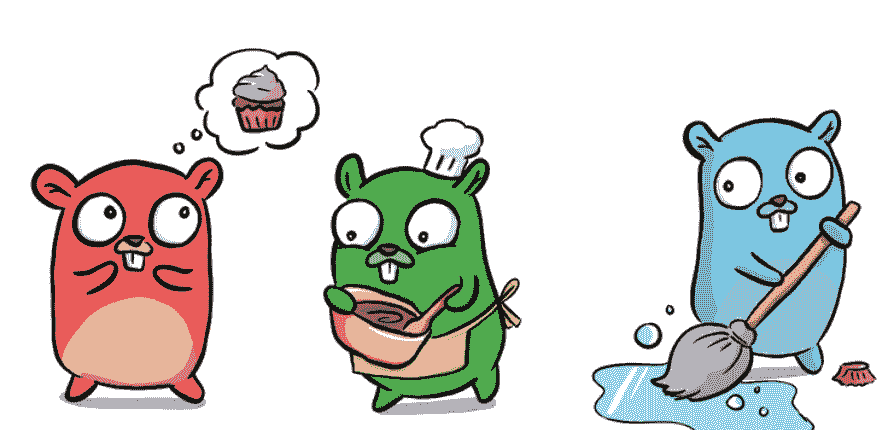
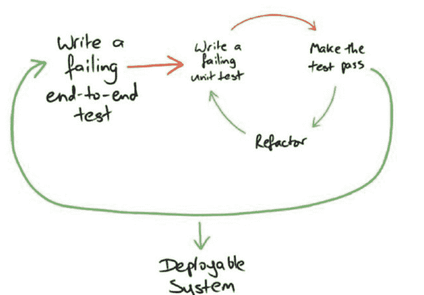
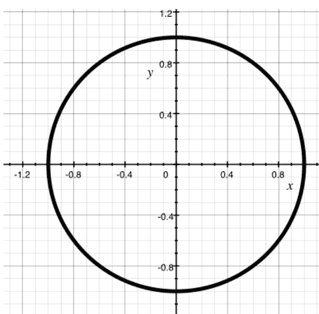
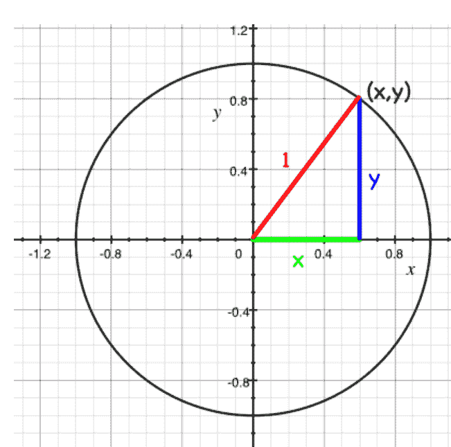
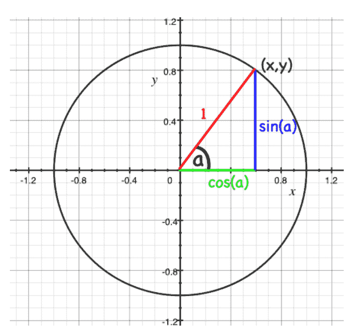
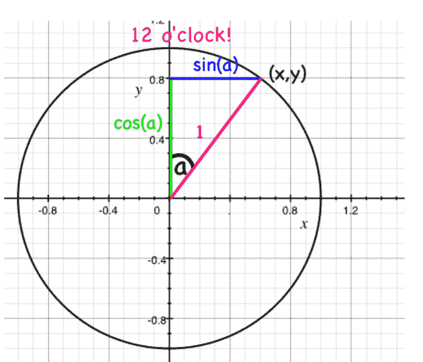
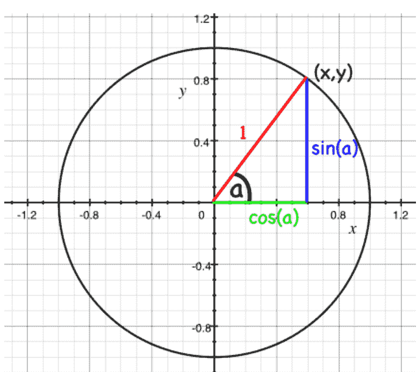
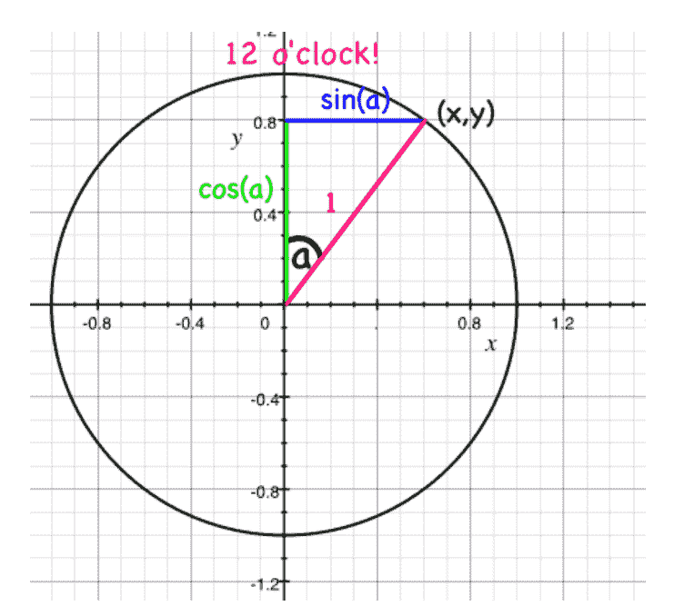
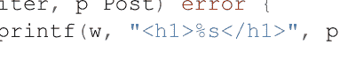
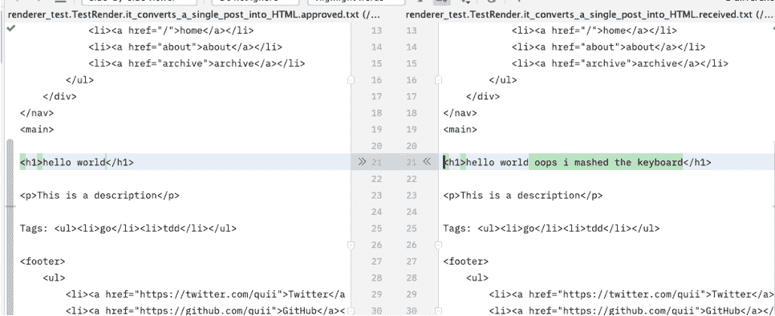

# 测试 学习Go


## TDD 反模式

## 使用测试学习 Go



红绿重构

Denise 的作品

## 支持我

我很自豪能免费提供这个资源，但如果你想表达一些感谢

- 在 Twitter 上给我发推 @quii
- 请我喝杯咖啡
- 在 GitHub 上赞助我

## 使用 Go 学习测试驱动开发

- 通过编写测试来探索 Go 语言
- **打下 TDD 的基础。** Go 是学习 TDD 的好语言，因为它简单易学且内置了测试
- 你可以确信自己能够开始用 Go 编写健壮且经过充分测试的系统

翻译：

- 中文
- Português
- 日本語
- 한국어
- Türkçe

## 背景

我有一些向开发团队介绍 Go 的经验，并尝试了不同的方法，将对 Go 感兴趣的一些人培养成高效的 Go 系统编写者。

## 什么不起作用

### 阅读 *这本书*

我们尝试过一种方法，就是拿起那本蓝皮书，每周讨论下一章以及相关练习。

我很喜欢这本书，但它需要高度的投入。书中对概念的解释非常详细，这显然很棒，但这意味着进展缓慢而稳定——这并不适合所有人。

我发现虽然少数人会阅读第 X 章并完成练习，但很多人没有。

## 解决一些问题

Kata 很有趣，但它们在学习语言方面的范围通常有限；你不太可能用 goroutines 来解决一个 kata。

另一个问题是热情程度各不相同。有些人学习的语言远比其他人多，当他们展示自己所做的工作时，可能会用其他人不熟悉的功能来让人困惑。

这最终使得学习感觉相当 *无结构* 且 *临时拼凑*。

## 什么有效

迄今为止最有效的方法是通过阅读 go by example，慢慢介绍语言的基础知识，通过示例探索并作为一个小组进行讨论。这比“为作业阅读第 x 章”更具互动性。

随着时间的推移，团队获得了语言 *语法* 的坚实基础，因此我们就可以开始构建系统了。

对我来说，这类似于学习吉他时练习音阶。

无论你认为自己多么有艺术天赋，如果不理解基础并练习技巧，你就不太可能写出好音乐。

## 对我有效的方法

当 *我* 学习一种新的编程语言时，我通常会先在 REPL 中随意尝试，但最终我需要更多的结构。

我喜欢做的是探索概念，然后用测试来巩固这些想法。测试验证我编写的代码是否正确，并记录了我所学习的功能。

结合我与团队一起学习的经验和我自己的个人方式，我将尝试创造一些东西，希望对其他团队有用。通过编写小测试来学习基础知识，这样你就可以利用现有的软件设计技能来交付一些很棒的系统。

## 适合谁

- 对学习 Go 感兴趣的人
- 已经了解一些 Go，但想更深入探索测试的人

## 你需要什么

- 一台电脑！
- 已安装 Go
- 一个文本编辑器
- 一些编程经验。理解 `if`、变量、函数等概念
- 熟悉使用终端

## 反馈

- 在这里添加问题/提交 PR 或在 Twitter 上给我发推 @quii


## 为什么需要单元测试以及如何让它们为你工作

[这里有一个我谈论这个话题的视频链接](video-link)

如果你不喜欢视频，这里是冗长的文字版本。

## 软件

软件的承诺是它可以改变。这就是为什么它被称为 *软* ware，与硬件相比它是可塑的。一个优秀的工程团队应该是公司的宝贵资产，编写能够随业务发展而演进的系统，以持续提供价值。

那么为什么我们在这方面做得这么差？有多少项目你听说过彻底失败？或者变成“遗留系统”必须完全重写（而且重写往往也会失败！）

软件系统到底如何“失败”呢？它不能一直被修改直到正确吗？这就是我们被承诺的！

很多人选择 Go 来构建系统，因为它做出了一些选择，希望能使其更具抗遗留性。

- 与我之前 Scala 的经历相比，我在其中[描述了它有足够的绳子让你自缢](link)，Go 只有 25 个关键字，*大量*的系统可以仅用标准库和几个小型库构建。希望是使用 Go 编写代码，6 个月后再回来阅读仍然能看懂。
- 与大多数替代方案相比，测试、基准测试、代码检查和发布的工具链是一流的。

- 标准库非常出色。
- 非常快的编译速度，适合紧密的反馈循环
- Go 的向后兼容性承诺。看起来 Go 将在未来获得泛型和其他功能，但设计者承诺即使是你 5 年前编写的 Go 代码仍然可以构建。我真的花了数周时间将一个项目从 Scala 2.8 升级到 2.10。

即使拥有所有这些优秀特性，我们仍然可能制造出糟糕的系统，因此我们应该回顾过去，了解适用于任何语言（无论是否光鲜）的软件工程经验教训。

1974 年，一位聪明的软件工程师 Manny Lehman 写下了 Lehman 软件演化定律。

这些定律描述了推动新发展的力量与阻碍进展的力量之间的平衡。

这些力量似乎很重要，如果我们希望避免陷入不断交付系统、系统变成遗留系统然后被一次又一次重写的无尽循环中。

## 持续变化定律

任何在现实世界中使用的软件系统必须不断变化，否则在环境中会变得越来越无用

系统必须变化否则变得无用，这看起来显而易见，但又有多少次被忽视了？

许多团队被激励在特定日期交付项目然后转到下一个项目。如果软件“幸运”，至少会有一部分交接给另一组人维护，但他们当然不是编写者。

人们经常关心尝试选择一个框架来帮助他们“快速交付”，但没有关注系统在需要演进方面的长期性。

即使你是一位不可思议的软件工程师，你仍然会因为不知道系统的未来需求而受害。随着业务的变化，你编写的一些精彩代码现在不再相关。

Lehman 在 70 年代势头正旺，因为他给了我们另一个定律来咀嚼。

## 复杂性递增定律

随着系统的演进，其复杂性会增加，除非有工作来减少它

他在这里的意思是我们不能让软件团队成为盲目的功能工厂，不断向软件堆砌更多功能，希望它能长期存活。

我们**必须**随着领域知识的变化不断管理系统的复杂性。

## 重构

有 *许多* 软件工程的方面可以保持软件的可塑性，例如：

- 开发者赋能
- 通常是“良好”的代码。合理的关注点分离等
- 沟通技巧
- 架构
- 可观测性
- 可部署性
- 自动化测试


- 反馈循环

我将专注于重构。这是一个被频繁抛出的短语“我们需要重构这个”——在程序员的第一天就被说出来而无人深思。

短语从何而来？重构与编写代码到底有何不同？

我知道我和其他许多人有 *thought* 我们在做重构，但我们错了

Martin Fowler 描述了人们是如何弄错的

然而“重构”这个术语经常在不合适的场合使用。如果有人说系统在他们重构期间坏了好几天，你可以相当确定他们并没有在重构。

那它到底是什么？

## 因式分解

在学校学习数学时你可能学过因式分解。这里有一个非常简单的例子

计算 1/2 + 1/4

为此你需要 *factorise* 分母，将表达式变成

```
2/4 + 1/4 which you can then turn into 3/4.
```

我们可以从中吸取一些重要的教训。当我们 *factorise* *the expression* 时，我们 have **not changed the meaning of the expression**。两者都等于 3/4，但我们让它更容易处理；通过把 1/2 改为 2/4，它更符合我们的“domain”更容易。

当你重构代码时，你试图找到让代码更容易理解并“fit”到你对系统需要做什么的当前理解中的方法。至关重要的是 **you should not be changing behaviour**。

## Go 中的示例

这里有一个函数，用特定的 `name` 向 `language` 打招呼

```go
func Hello(name, language string) string {
    if language == "es" {
        return "Hola, " + name
    }

    if language == "fr" {
        return "Bonjour, " + name
    }

    // imagine dozens more languages

    return "Hello, " + name
}
```

拥有数十个 `if` 语句感觉不舒服，而且我们重复地将特定语言的问候语与 , 和 `name` 拼接起来。所以我将重构代码。

```go
func Hello(name, language string) string {
    return fmt.Sprintf(
        "%s, %s",
        greeting(language),
        name,
    )
}

var greetings = map[string]string {
    "es": "Hola",
    "fr": "Bonjour",
    //etc..
}

func greeting(language string) string {
    greeting, exists := greetings[language]
    if exists {
        return greeting
    }

    return "Hello"
}
```

这次重构的本质其实并不重要，重要的是我没有改变行为。

重构时你可以随意操作，添加接口、新类型、函数、方法等。唯一的规则是你不要改变行为

## 重构代码时你必须不改变行为

这非常重要。如果你在同时改变行为，你就是在同时做两件事。作为软件工程师，我们学会将系统拆分为不同的文件/包/函数/等，因为我们知道试图理解一大堆东西是困难的。

我们不想同时思考很多事情，因为那时我们容易犯错。我见证过太多重构尝试失败，因为开发者想做得太多。

当我在数学课上用笔和纸做因式分解时，我必须手动检查自己是否没有改变表达式的含义。当重构代码时，尤其是处理非平凡的系统时，我们如何知道自己没有改变行为？

那些选择不写测试的人通常依赖手动测试。对于除小型项目之外的任何项目，这将是一个巨大的时间黑洞，长期来看无法扩展。

## 如果单元测试如此伟大，为什么有时人们会抵制编写它们？

一方面，有人（如我）说单元测试对系统的长期健康很重要，因为它们确保你能有信心地持续重构。

另一方面，有人描述了单元测试实际上阻碍重构的经历。

问问自己，重构时你有多频繁地需要更改测试？多年来，我参与过许多测试覆盖率非常好的项目，然而工程师们却不愿重构，因为他们认为更改测试的成本很高。

这与我们被承诺的完全相反！

## 为什么会这样？

想象一下，你被要求开发一个正方形，我们认为最好的实现方式是把两个三角形拼在一起。


我们围绕正方形编写单元测试以确保边相等，然后围绕三角形编写一些测试。我们想确保三角形渲染正确，因此我们断言角度总和为 180 度，也许检查我们制作了 2 个，等等等等。测试覆盖率非常重要，编写这些测试也很容易，所以为什么不呢？

几周后，持续变化的法则影响了我们的系统，一位新开发者做了一些更改。她现在认为如果用 2 个矩形而不是 2 个三角形来形成正方形会更好。


她尝试进行这次重构，却收到多个失败测试的混杂信号。她是否真的破坏了重要的行为？她现在必须深入研究这些三角形测试并尝试弄清楚发生了什么。

*It's not actually important that the square was formed out of triangles* but **our tests have falsely elevated the importance of our implementation details.**

## 更倾向于测试行为而非实现细节

当我听到人们抱怨单元测试时，通常是因为测试处于错误的抽象层级。它们在测试实现细节，过度监视协作者并过度模拟。

我认为这源于对单元测试的误解以及追逐虚荣指标（test coverage）。

如果我说只测试行为，我们是否应该只编写系统/黑盒测试？这类测试在验证关键用户旅程方面确实很有价值，但通常编写成本高且运行缓慢。因此它们对 *refactoring* 帮助不大，因为反馈循环很慢。此外，与单元测试相比，黑盒测试在定位根本原因方面帮助不大。

那么什么是 *is* 正确的抽象层级？

## 编写有效的单元测试是一个设计问题

暂时忘掉测试，理想情况下，系统中应有围绕领域关键概念的自包含、解耦的“units”。

我喜欢把这些单元想象成简单的乐高积木，它们具有连贯的 API，我可以与其他积木组合来构建更大的系统。在这些 API 之下，可能有数十个事物（types、functions et al）在协作以使其按需工作。

例如，如果你在用 Go 编写银行系统，你可能会有一个“account”包。它会提供一个不泄露实现细节且易于集成的 API。

如果你有遵循这些属性的单元，你就可以针对它们的公共 API 编写单元测试。 *By definition* 这些测试只能测试有用的行为。在这些单元之下，我可以随意重构实现，而测试在很大程度上不会妨碍。

## 这些是单元测试吗？

**YES**。单元测试针对的是我描述的那样的“units”。它们 were *never* 关于只针对单个 class/function/whatever。

## 将这些概念结合起来

我们已经涵盖了

- 重构
- 单元测试
- 单元设计

我们开始可以看到，这些软件设计的方面相互强化。

## 重构

- 让我们了解单元测试的信号。如果我们必须进行手动检查，我们需要更多测试。如果测试错误地失败，那么我们的测试处于错误的抽象层级（或没有价值，应该删除）。
- 帮助我们处理单元内部和单元之间的复杂性。

## 单元测试

- 为重构提供安全网。
- 验证并记录我们的单元的行为。

## （设计良好的）单元

- 易于编写 *meaningful* 单元测试。
- 易于重构。

是否有一种流程可以帮助我们达到可以不断重构代码以管理复杂性并保持系统灵活的程度？

## 为什么是测试驱动开发（TDD）

有些人可能会引用 Lehman 关于软件必须变化的言论，并过度思考复杂的设计，浪费大量时间

从一开始就试图创建“完美”的可扩展系统，结果却搞错了方向，一事无成。

这是软件行业糟糕的旧时代：分析师团队花 6 个月编写需求文档，架构师团队再花 6 个月进行设计，几年后整个项目却失败了。

我说是糟糕的旧时代，但这种情况至今仍在发生！

敏捷开发告诉我们，需要以迭代的方式工作，从小处着手，逐步演进软件，以便快速获得关于软件设计以及真实用户使用情况的反馈；TDD（测试驱动开发）正是这种理念的实践。

TDD 通过鼓励持续重构和迭代交付的方法论，应对了 Lehman 所讲的定律以及其他从历史中艰难学到的教训。

## 小步前进

- 针对少量期望行为编写一个小测试
- 检查测试是否以明确的错误失败（红灯）
- 编写最少量的代码让测试通过（绿灯）
- 重构
- 重复

随着你越来越熟练，这种工作方式会变得自然且高效。

你会逐渐期望这个反馈循环不会花费太长时间；如果系统处于非“绿灯”状态，你会感到不安，因为这表明你可能已经钻进了牛角尖。

你将始终能够从容地推进小而实用的功能，并有测试反馈作为坚实的后盾。

## 总结

软件的优势在于我们可以改变它。大多数软件随着时间推移，都会以不可预测的方式需要变更；但不要试图过度设计，因为未来太难预测了。

相反，我们需要让软件保持可塑。为了能够变更软件，我们必须在其演进过程中不断重构，否则它会变成一团乱麻。

一套良好的测试套件可以帮助你更快、更轻松地进行重构。

编写良好的单元测试是一个设计问题，因此要考虑如何组织代码，使其具有像乐高积木一样可以组合在一起的有意义的单元。

TDD 能够帮助你并促使你迭代地设计出结构良好的软件，同时以测试为支撑，为将来的新任务做好准备。

## 你好，世界

[你可以在这里找到本章的所有代码](...)

对于一门新语言，你的第一个程序按传统应该是[你好，世界](...)。

- 在你喜欢的任何地方创建一个文件夹
- 在其中创建一个名为 `hello.go` 的新文件，并将以下代码放入其中

```go
package main

import "fmt"

func main() {
    fmt.Println("Hello, world")
}
```

运行它，请输入 `go run hello.go`。

### 它是如何工作的

当你用 Go 编写程序时，你会有一个 `main` 包，其中定义了一个 `main` 函数。包是将相关的 Go 代码组织在一起的方式。

`func` 关键字用来定义具有名称和函数体的函数。

通过 `import "fmt"`，我们导入了一个包含 `Println` 函数的包，我们用 `Println` 来进行打印。

### 如何测试

你如何测试这个？最好将你的“领域”代码与外部世界（副作用）分开。`fmt.Println` 是一个副作用（打印到标准输出），而我们传入的字符串是我们的领域。

因此，让我们把这些关注点分离开，以便更容易测试

```go
package main

import "fmt"

func Hello() string {
    return "Hello, world"
}

func main() {
    fmt.Println(Hello())
}
```

我们再次用 `func` 创建了一个新函数，但这次在定义中添加了另一个关键字 `string`。这意味着这个函数返回一个字符串。

现在创建一个名为 `hello_test.go` 的新文件，我们将在其中为我们的 `Hello` 函数编写测试

```go
package main

import "testing"

func TestHello(t *testing.T) {
    got := Hello()
    want := "Hello, world"

    if got != want {
        t.Errorf("got %q want %q", got, want)
    }
}
```

### Go 模块？

下一步是运行测试。在终端中输入 `go test`。如果测试通过，那么你可能使用的是较早版本的 Go。但如果你使用的是 Go 1.16 或更高版本，测试很可能根本不会运行。相反，你会在终端中看到类似这样的错误信息：

```
$ go test
go: cannot find main module; see 'go help modules'
```

问题是什么？一言以蔽之：模块。幸运的是，这个问题很容易解决。在终端中输入 `go mod init hello`。这将创建一个包含以下内容的新文件：

```
module hello

go 1.16
```

这个文件告诉 `go` 工具关于你代码的必要信息。如果你打算分发你的应用程序，你还需要在文件中包含代码可下载的位置以及依赖信息。目前，你的模块文件是最简的，你可以就让它保持这样。想了解更多关于模块的信息，可以查看 Golang 文档中的参考。既然测试应该能够运行了（即使在 Go 1.16 上），我们现在可以回到测试和学习 Go 的环节。

在后续章节中，你需要先在每个新文件夹中运行 `go mod init SOMENAME`，然后再运行 `go test` 或 `go build` 等命令。

## 回到测试

在终端中运行 `go test`。它应该已经通过了！为了确认，你可以故意更改 `want` 字符串来破坏测试。

注意，你不需要在多个测试框架之间做选择，然后还要研究如何安装。你需要的一切都已内置于语言中，语法也与你将要编写的其余代码相同。

## 编写测试

编写测试就像编写函数一样，只需遵循几条规则

- 测试需要放在名为 `xxx_test.go` 之类的文件中
- 测试函数必须以 `Test` 开头
- 测试函数只接受一个参数 `t *testing.T`
- 为了使用 `*testing.T` 类型，你需要导入 `"testing"`，就像我们在另一个文件中导入 `fmt` 那样

目前，你只需要知道，`*testing.T` 类型的 `t` 是你进入测试框架的“钩子”，这样你就可以在需要失败时执行类似 `t.Fail()` 的操作。

我们介绍了一些新主题：

`if`

Go 中的 `if` 语句与其他编程语言非常相似。

### 声明变量

我们使用 `varName := value` 语法声明一些变量，这样可以重复使用测试中的某些值，以提高可读性。

`t.Errorf`

我们正在调用 `t` 上的 `Errorf` *方法*，它会打印一条消息并使测试失败。`f` 代表 format（格式化），它允许我们构建一个字符串，并在占位符 `%q` 中插入值。当你让测试失败时，它怎么工作应该很清楚了。

你可以在 [fmt.go.doc](fmt.go.doc) 中了解更多关于占位符字符串的信息。对于测试来说，`%q` 非常有用，因为它会将你的值用双引号括起来。

```go
func TestHello(t *testing.T) {
    got := Hello("Chris")
    want := "Hello, Chris"

    if got != want {
        t.Errorf("got %q want %q", got, want)
    }
}
```

现在运行 `go test`，你应该会看到一个编译错误

```
./hello_test.go:6:18: too many arguments in call to Hello
    have (string)
    want ()
```

使用像 Go 这样的静态类型语言时，倾听编译器的意见很重要。编译器理解你的代码应该如何衔接在一起并工作，因此你无需费力思考。

在这种情况下，编译器会告诉你接下来需要做什么。我们必须修改 `Hello` 函数，使其接受一个参数。

修改 `Hello` 函数，使其接受一个 `string` 类型的参数

```go
func Hello(name string) string {
    return "Hello, world"
}
```

如果你再次尝试运行测试，`hello.go` 将无法编译，因为你没有传入参数。传入 `"world"` 使其编译通过。

```go
func main() {
    fmt.Println(Hello("world"))
}
```

现在，当你运行测试时，你应该会看到类似这样的内容

```
hello_test.go:10: got 'Hello, world' want 'Hello, Chris'
```

我们终于有了一个可以编译的程序，但根据测试，它还没有满足我们的要求。

让我们使用 `name` 参数，并把它与 `Hello,` 拼接，让测试通过。

```go
func Hello(name string) string {
    return "Hello, " + name
}
```

当你运行测试时，它们现在应该通过了。通常，作为 TDD 循环的一部分，我们现在应该进行 *重构*。

## 关于源代码管理的一点说明

在这一点上，如果你正在使用源代码管理（你应该使用！），我会按现状提交代码。我们拥有了由测试支撑的可用软件。

不过，我 *不会* 推送到主分支，因为我接下来打算进行重构。在此时提交是个好主意，以防你在重构过程中陷入混乱——你总是可以回到可用的版本。

这里没有太多需要重构的地方，但我们可以引入另一个语言特性：*常量*。

## 常量

常量定义如下

```
const englishHelloPrefix = "Hello, "
```

现在我们可以重构我们的代码

```
const englishHelloPrefix = "Hello, "
```

```
func Hello(name string) string {
```


```
return englishHelloPrefix + name
}
```

重构后，请重新运行你的测试以确保没有破坏任何东西。

常量可以提高应用程序的性能，因为它可以避免每次调用 Hello 时都创建 "Hello, " 字符串实例。

明确地说，对于这个示例来说，性能提升微不足道！但值得思考创建常量来捕捉值的含义，有时也能辅助性能。

## 你好，世界... 再来一次

下一个需求是，当我们的函数传入空字符串时，它默认打印 "Hello, World"，而不是 "Hello, "。

首先编写一个新的失败测试

```
func TestHello(t *testing.T) {
	t.Run("saying hello to people", func(t *testing.T) {
		got := Hello("Chris")
		want := "Hello, Chris"
		if got != want {
			t.Errorf("got %q want %q", got, want)
		}
	})
	t.Run("say 'Hello, World' when an empty string is supplied",
		func(t *testing.T) {
			got := Hello("")
			want := "Hello, World"
			if got != want {
				t.Errorf("got %q want %q", got, want)
			}
		})
}
```

这里我们引入了测试工具箱中的另一个工具——子测试。有时将测试围绕一个“事物”分组，然后用子测试描述不同的场景是很有用的。

这种方法的优点是你可以在其他测试中设置并使用共享代码。

在检查消息是否符合预期时存在重复代码。

重构不仅仅是为了生产代码！

重要的是你的测试*是代码需要做什么的清晰规范*。

我们可以并且应该重构我们的测试。

```go
func TestHello(t *testing.T) {
    assertCorrectMessage := func(t testing.TB, got, want string) {
        t.Helper()
        if got != want {
            t.Errorf("got %q want %q", got, want)
        }
    }

    t.Run("saying hello to people", func(t *testing.T) {
        got := Hello("Chris")
        want := "Hello, Chris"
        assertCorrectMessage(t, got, want)
    })
    t.Run("empty string defaults to 'World'", func(t *testing.T) {
        got := Hello("")
        want := "Hello, World"
        assertCorrectMessage(t, got, want)
    })
}
```

## 我们在这里做了什么？

我们将断言重构为一个函数。这减少了重复并提高了测试的可读性。在 Go 中，你可以在其他函数内部声明函数并将其赋给变量。然后你可以像调用普通函数一样调用它们。我们需要传入 `t *testing.T`，以便在需要时让测试代码失败。

对于辅助函数，最好接受一个 `testing.TB`，它是一个接口，`*testing.T` 和 `*testing.B` 都实现了它，这样你就可以从测试或基准测试中调用辅助函数。

`t.Helper()` 是必需的，用来告诉测试套件此方法是一个辅助方法。这样做时，如果失败，报告的行号将在我们的*函数调用*中，而不是在测试辅助函数内部。这将帮助其他开发者更容易地追踪问题。如果你仍然不理解，请将其注释掉，让一个测试失败并观察测试输出。Go 中的注释是向代码添加额外信息的好方法，或者在这种情况下，快速告诉编译器忽略一行的方法。你可以通过在行首添加两个正斜杠 `//` 来注释掉 `t.Helper()` 代码。你应该会看到该行变灰或变为与代码其余部分不同的颜色，以表明它现在已被注释掉。

现在我们有一个写得很好的失败测试，让我们使用 `if` 来修复代码。

```go
const englishHelloPrefix = "Hello, "

func Hello(name string) string {
    if name == "" {
        name = "World"
    }
    return englishHelloPrefix + name
}
```

如果我们运行测试，应该会看到它满足了新的需求，并且没有意外破坏其他功能。

## 回到源代码控制

现在我们对代码满意了，我会修改之前的提交，以便我们只签入带有其测试的漂亮版本的代码。

## 纪律

让我们再次回顾这个循环

- 编写一个测试
- 让编译器通过
- 运行测试，看到它失败并检查错误信息是否有意义
- 编写足够多的代码使测试通过
- 重构

乍一看这可能显得乏味，但坚持反馈循环很重要。

它不仅确保你拥有*相关的测试*，还通过在测试的安全保障下重构，帮助确保*你设计出良好的软件*。

看到测试失败是一个重要的检查，因为它还能让你看到错误信息是什么样的。作为开发者，当失败的测试没有给出问题的清晰提示时，很难处理一个代码库。

通过确保你的测试*快速*并设置工具使运行测试变得简单，你可以在编写代码时进入心流状态。

如果不编写测试，你就必须通过运行软件手动检查代码，这会破坏你的心流状态，而且不会为你节省时间，尤其是在长期来看。

## 继续！更多需求

通过传递空字符串来修复它们。现在你的所有测试都应该编译并通过，除了我们的新场景

hello_test.go:29: got 'Hello, Elodie' want 'Hola, Elodie'

我们可以在这里使用 if 来检查语言是否等于 "Spanish"，如果是则更改消息

```
func Hello(name string, language string) string {
    if name == "" {
        name = "World"
    }

    if language == "Spanish" {
        return "Hola, " + name
    }
    return englishHelloPrefix + name
}
```

测试现在应该通过了。

现在是时候重构了。你应该能看到代码中的一些问题，“魔法”字符串，其中一些是重复的。尝试自己重构它，每次更改都确保重新运行测试，以确保重构没有破坏任何东西。

```
const spanish = "Spanish"
const englishHelloPrefix = "Hello, "
const spanishHelloPrefix = "Hola, "

func Hello(name string, language string) string {
    if name == "" {
        name = "World"
    }

    if language == spanish {
        return spanishHelloPrefix + name
    }
    return englishHelloPrefix + name
}
```

## 法语

- 编写一个断言测试，如果传入 "French" 则得到 "Bonjour, "
- 看到它失败，检查错误信息是否易于阅读
- 对代码做最小的合理更改

你可能写了一些大致如下的内容

```
func Hello(name string, language string) string {
    if name == "" {
        name = "World"
    }

    if language == spanish {
        return spanishHelloPrefix + name
    }
    if language == french {
        return frenchHelloPrefix + name
    }
    return englishHelloPrefix + name
}
```

## switch

当你有很多 if 语句检查特定值时，通常改用 switch 语句。我们可以使用 switch 来重构代码，使其更易读，如果我们希望以后添加更多语言支持，也更具可扩展性

```
func Hello(name string, language string) string {
    if name == "" {
        name = "World"
    }

    prefix := englishHelloPrefix

    switch language {
    case french:
        prefix = frenchHelloPrefix
    case spanish:
        prefix = spanishHelloPrefix
    }

    return prefix + name
}
```

编写一个测试，现在包含你选择的语言的问候语，你会看到扩展我们的*惊人*函数是多么简单。

## 再来一次...最后的重构？

你可以认为我们的函数可能有点大了。对此最简单的重构就是将一些功能提取到另一个函数中。

```
func Hello(name string, language string) string {
    if name == "" {
        name = "World"
    }

    return greetingPrefix(language) + name
}
```

```
func greetingPrefix(language string) (prefix string) {
    switch language {
    case french:
        prefix = frenchHelloPrefix
    case spanish:
        prefix = spanishHelloPrefix
    default:
        prefix = englishHelloPrefix
    }
    return
}
```

一些新概念：

-   在我们的函数签名中，我们创建了一个*命名返回值*（`prefix string`）。
-   这将在你的函数中创建一个名为 `prefix` 的变量。
    -   它会被赋值为“零”值。这取决于类型，例如 `int` 为 0，`string` 为 ""。
        -   你可以直接调用 `return` 而不是 `return prefix` 来返回它设置的值。
    -   这会显示在你的函数的 Go Doc 中，因此它可以使你的代码意图更清晰。
-   如果其他 `case` 语句都不匹配，`switch` 中的 `default` 分支会被执行。
-   函数名以小写字母开头。在 Go 中，公共函数以大写字母开头，私有函数以小写字母开头。我们不希望算法的内部细节暴露给外界，因此我们将此函数设为私有。

## 总结

谁知道你从 `Hello, world` 中能获得这么多收获？

现在你应该对以下内容有所了解：

## Go 的一些语法

-   编写测试
-   声明函数，包含参数和返回类型
-   `if`、`const` 和 `switch`
-   声明变量和常量

## TDD 过程以及*为什么*这些步骤很重要

-   *编写一个失败的测试并看到它失败，这样我们就知道我们为需求编写了一个相关的测试，并且看到它产生了易于理解的失败描述*
-   编写最少的代码使其通过，这样我们就知道我们有了可工作的软件
-   *然后*重构，在测试的安全保障下，确保我们拥有精心设计且易于处理的代码

在我们的案例中，我们以小而易于理解的步骤从 `Hello()` 到 `Hello("name")`，再到 `Hello("name", "French")`。

当然，与“现实世界”的软件相比，这微不足道，但原则依然适用。TDD 是一项需要练习才能发展的技能，但通过将问题分解为可测试的较小组件，你将更容易编写软件。

## 整数

[你可以在这里找到本章的所有代码]

整数的行为正如你所预期的那样。让我们编写一个 `Add` 函数来试试。创建一个名为 `adder_test.go` 的测试文件，并编写以下代码。

**注意：** Go 源文件在每个目录中只能有一个 `package`，请确保你的文件分开组织。[这里有很好的解释。]( )

## 先编写测试

```go
package integers

import "testing"

func TestAdder(t *testing.T) {
    sum := Add(2, 2)
    expected := 4

    if sum != expected {
        t.Errorf("expected '%d' but got '%q'", expected, sum)
    }
}
```

你会注意到我们使用 `%d` 作为格式字符串，而不是 `%q`。这是因为我们希望打印整数而不是字符串。

还要注意，我们不再使用 `main` 包，而是定义了一个名为 `integers` 的包，正如其名，这个包将把处理整数的函数（如 `Add`）分组。

## 尝试运行测试

运行测试 `go test`

检查编译错误

```
./adder_test.go:6:9: undefined: Add
```

## 编写最少的代码使测试运行，并检查失败的测试输出

编写足够的代码来满足编译器，仅此而已——记住，我们希望检查我们的测试是否因为正确的原因而失败。

```
package integers

func Add(x, y int) int {
    return 0
}
```

当你有一个以上相同类型的参数（在我们的例子中是两个整数）时，不需要写成 (x int, y int)，可以简写为 (x, y int)。

现在运行测试，我们应该满意测试正确地报告了问题。

```
adder_test.go:10: expected '4' but got '0'
```

如果你注意到了，我们在上一节学习了命名返回值，但这里没有使用它。它通常应在结果的含义从上下文中不清楚时使用；在我们的例子中，`Add` 函数会加总参数是相当清楚的。你可以参考这个 wiki 了解更多细节。

## 编写足够的代码使其通过

在 TDD 最严格的意义上，我们现在应该编写*最少的代码使测试通过*。一个吹毛求疵的程序员可能会这样做：

```go
func Add(x, y int) int {
    return 4
}
```

啊哈！又被耍了，TDD 是个骗局，对吧？

我们可以再写一个测试，用一些不同的数字来强制该测试失败，但那感觉像一场猫捉老鼠的游戏。

等我们更熟悉 Go 的语法后，我会介绍一种叫做“基于属性的测试”的技术，它可以避免让开发者烦恼，并帮助你发现 bug。

现在，让我们正确地修复它：

```go
func Add(x, y int) int {
    return x + y
}
```

如果你重新运行测试，它们应该会通过。

## 重构

在*实际*代码中，我们确实没有太多可以改进的地方。

我们之前探讨过，通过命名返回参数，它会出现在文档中，也会出现在大多数开发者的文本编辑器中。

这很棒，因为它有助于提高你所编写代码的可用性。最好用户只需查看类型签名和文档就能理解你代码的用法。

你可以用注释为函数添加文档，这些注释会出现在 Go Doc 中，就像你查看标准库文档时一样。

```
// Add takes two integers and returns the sum of them.
func Add(x, y int) int {
    return x + y
}
```

## 示例

如果你真的想更进一步，你可以制作示例。你会在标准库的文档中找到很多示例。

通常在代码库之外找到的代码示例，例如 README 文件中的示例，往往由于未经检查而变得过时并与实际代码不一致。

Go 示例会像测试一样被执行，所以你可以确信示例反映了代码的实际行为。

示例作为包测试套件的一部分被编译（并可选择执行）。

与典型测试一样，示例是位于包的 _test.go 文件中的函数。在 adder_test.go 文件中添加以下 ExampleAdd 函数。

```
func ExampleAdd() {
    sum := Add(1, 5)
    fmt.Println(sum)
    // Output: 6
}
```

（如果你的编辑器没有自动导入包，编译步骤会失败，因为你会在 adder_test.go 中缺少 import "fmt"。强烈建议你研究如何在任何你使用的编辑器中自动修复这类错误。）

如果你的代码发生变化，使示例不再有效，你的构建将会失败。

运行包的测试套件，我们可以看到示例函数无需我们做进一步安排即可执行：

```
$ go test -v
=== RUN   TestAdder
--- PASS: TestAdder (0.00s)
=== RUN   ExampleAdd
--- PASS: ExampleAdd (0.00s)
```

请注意，如果你删除注释 // Output: 6，示例函数将不会执行。尽管该函数会被编译，但不会被执行。

通过添加这段代码，示例将出现在 godoc 的文档中，使你的代码更加易于访问。

要试用它，请运行 godoc -http=:6060 并导航到 http://localhost:6060/pkg/

在这里你会看到所有包的列表，你将能找到你的示例文档。

如果你将带有示例的代码发布到公共 URL，你可以在 pkg.go.dev 上分享你的代码文档。例如，这里是本章的最终 API。这个网络界面允许你搜索标准库包和第三方包的文档。

## 总结

我们涵盖的内容：

-   更多 TDD 工作流的实践
-   整数、加法
-   编写更好的文档，以便我们代码的用户能快速理解其用法
-   如何使用我们代码的示例，这些示例会作为我们测试的一部分被检查

## 迭代

你可以在这里找到本章的所有代码

要在 Go 中重复做某事，你需要使用 for。在 Go 中没有 while、do、until 关键字，你只能使用 for。这是一件好事！

让我们为一个重复字符 5 次的函数编写一个测试。

到目前为止没有新东西，所以试着自己写一下来练习吧。

## 先编写测试

```
package iteration

import "testing"

func TestRepeat(t *testing.T) {
    repeated := Repeat("a")
    expected := "aaaaa"

    if repeated != expected {
        t.Errorf("expected %q but got %q", expected, repeated)
    }
}
```

## 尝试运行测试

```
./repeat_test.go:6:14: undefined: Repeat
```


## 为测试运行编写最少的代码并检查失败的测试输出

*保持纪律！你现在不需要知道任何新东西就能让测试正确地失败。*

全部你现在需要做的就是让它能够编译，以便你可以检查测试是否写得很好。

```go
package iteration

func Repeat(character string) string {
    return ""
}
```

知道你已经足够了解 Go 来为一些基本问题编写测试，不是很好吗？这意味着你现在可以随意修改生产代码，并且知道它会按预期运行。

repeat_test.go:10: expected 'aaaaa' but got ''

## 编写足够代码使其通过

`for` 语法非常普通，遵循大多数类似 C 的语言。

```go
func Repeat(character string) string {
    var repeated string
    for i := 0; i < 5; i++ {
        repeated = repeated + character
    }
    return repeated
}
```

与 C、Java 或 JavaScript 等其他语言不同，for 语句的三个组成部分周围没有括号，并且大括号 { } 总是必需的。你可能会想知道下面这行发生了什么

```
var repeated string
```

因为我们到目前为止一直使用 := 来声明并初始化变量。然而，:= 只是这两个步骤的简写。在这里我们只声明一个字符串变量。因此使用显式版本。我们也可以使用 var 来声明函数，正如我们稍后会看到的。

运行测试，它应该会通过。

for 循环的额外变体在此描述。

## 重构

现在是时候重构并引入另一个构造 += 赋值运算符了。

```go
const repeatCount = 5
```

```go
func Repeat(character string) string {
    var repeated string
    for i := 0; i < repeatCount; i++ {
        repeated += character
    }
    return repeated
}
```

+= 被称为“加法和赋值运算符”，将右操作数添加到左操作数并将结果赋给左操作数。它也适用于整数等其他类型。

## 基准测试

在 Go 中编写基准测试是该语言的另一个一等特性，它与编写测试非常相似。

```go
func BenchmarkRepeat(b *testing.B) {
    for i := 0; i < b.N; i++ {
        Repeat("a")
    }
}
```

你会发现代码与测试非常相似。

`testing.B` 让你可以访问名称晦涩的 `b.N`。

当基准代码执行时，它会运行 `b.N` 次并测量所需时间。

代码运行的次数不应该影响你，框架会确定一个“良好”的值以便获得一些不错的结果。

要运行基准测试，请执行 `go test -bench=.`。 （或在 Windows PowerShell 中执行 `go test -bench="."`）

```
goos: darwin
goarch: amd64
pkg: github.com/quii/learn-go-with-tests/for/v4
10000000        136 ns/op
PASS
```

`136 ns/op` 的意思是我们的函数平均需要 136 纳秒运行（在我电脑上）。这相当不错！为此测试它运行了 10000000 次。

*注意* 默认情况下基准测试是顺序运行的。

## 练习题

- 修改测试，使调用者可以指定字符重复的次数，然后修复代码

- 编写 `ExampleRepeat` 来记录你的函数
- 查看 [字符串](strings) 包。找到你认为可能有用的函数，并通过像我们这里一样编写测试来尝试它们。投入时间学习标准库将会在长期内真正得到回报。

## 总结

- 更多 TDD 练习
- 学会了 `for`
- 学会了如何编写基准测试

## 数组和切片

你可以在这里找到本章的所有代码

数组允许你按特定顺序在变量中存储多个相同类型的元素。

当你有一个数组时，通常需要遍历它们。因此，让我们利用我们新获得的 for 知识来创建一个 Sum 函数。Sum 将接收一个数字数组并返回总和。

让我们使用我们的 TDD 技能

## 先写测试

创建一个新文件夹来工作。创建一个名为 sum_test.go 的新文件并插入以下内容：

```go
package main

import "testing"

func TestSum(t *testing.T) {
    numbers := [5]int{1, 2, 3, 4, 5}

    got := Sum(numbers)
    want := 15

    if got != want {
        t.Errorf("got %d want %d given, %v", got, want, numbers)
    }
}
```

数组有一个 *固定容量*，你在声明变量时定义。我们可以通过两种方式初始化数组：

- `[N]type{value1, value2, ..., valueN}` 例如 `numbers := [5]int{1, 2, 3, 4, 5}`
- `[...]type{value1, value2, ..., valueN}` 例如 `numbers := [...]int{1, 2, 3, 4, 5}`

有时在错误消息中打印函数的输入也很有用。在这里，我们使用 `%v` 占位符来打印“默认”格式，这对于数组来说效果很好。

[阅读有关格式字符串的更多信息](Read more about the format strings)

## 尝试运行测试

如果你使用 `go mod init main` 初始化了 `go mod`，你会收到错误 `_testmain.go:13:2: cannot import "main"`。这是因为根据常见做法，package main 只应包含其他包的集成，而不包含可单元测试的代码，因此 Go 不允许你导入名为 `main` 的包。

要修复这个问题，你可以将 `go.mod` 中的 main 模块重命名为其他任意名称。

一旦上述错误修复，如果你运行 `go test`，编译器将以熟悉的 `./sum_test.go:10:15: undefined: Sum` 错误失败。现在我们可以继续编写实际的待测试方法。

### 为测试运行编写最少的代码并检查失败的测试输出

在 `sum.go` 中

```go
package main

func Sum(numbers [5]int) int {
    return 0
}
```

你的测试现在应该会以清晰的错误消息失败

```
sum_test.go:13: got 0 want 15 given, [1 2 3 4 5]
```

## 编写足够代码使其通过

```go
func Sum(numbers [5]int) int {
    sum := 0
    for i := 0; i < 5; i++ {
        sum += numbers[i]
    }
    return sum
}
```

要从数组的特定索引获取值，只需使用 array[index] 语法。在这种情况下，我们使用 for 迭代 5 次来遍历数组并将每个项目加到 sum 上。

## 重构

让我们引入 range 来帮助清理我们的代码

```go
func Sum(numbers [5]int) int {
    sum := 0
    for _, number := range numbers {
        sum += number
    }
    return sum
}
```

range 让你遍历数组。每次迭代时，range 返回两个值 - 索引和值。我们选择使用 _ blank identifier 来忽略索引值。

## 数组及其类型

数组的一个有趣属性是大小被编码在其类型中。如果你尝试将 [4]int 传递给期望 [5]int 的函数，它将无法编译。它们是不同的类型，所以就像尝试将字符串传递给想要 int 的函数一样。

你可能会觉得数组有固定长度很麻烦，而且大多数时候你可能不会使用它们！

Go 有切片，它们不编码集合的大小，而是可以有任意大小。

下一个需求将是求和不同大小的集合。

## 先写测试

我们现在将使用切片类型，它允许我们拥有任意大小的集合。语法与数组非常相似，你只需在声明时省略大小即可

```
mySlice := []int{1,2,3} rather than myArray := [3]int{1,2,3}
```

```go
func TestSum(t *testing.T) {
    t.Run("collection of 5 numbers", func(t *testing.T) {
        numbers := [5]int{1, 2, 3, 4, 5}
        
        got := Sum(numbers)
        want := 15
        
        if got != want {
            t.Errorf("got %d want %d given, %v", got, want, numbers)
        }
    })
}
```

```go
t.Run("collection of any size", func(t *testing.T) {
    numbers := []int{1, 2, 3}

    got := Sum(numbers)
    want := 6

    if got != want {
        t.Errorf("got %d want %d given, %v", got, want, numbers)
    }
})
```

## 尝试并运行测试

这无法编译

```
./sum_test.go:22:13: cannot use numbers (type []int) as type [5]int in argument to Sum
```

## 为测试运行编写最少的代码并检查失败的测试输出

这里的问题是我们有两个选择

- 通过将 Sum 的参数改为切片而不是数组来破坏现有 API。这样做时，我们可能会毁掉某人的日子，因为我们的其他测试将不再编译！
- 创建一个新函数

在我们的例子中，没有其他人使用我们的函数，所以与其维护两个函数，不如只有一个。


```go
func Sum(numbers []int) int {
    sum := 0
    for _, number := range numbers {
        sum += number
    }
    return sum
}
```

如果你尝试运行测试，它们仍然无法编译，你需要将第一个测试更改为传入切片而不是数组。

## 编写足够代码使其通过

事实证明，修复编译器问题就是我们在这里需要做的全部工作，测试通过了！

## 重构

我们已经重构了 Sum —— 我们所做的只是用切片替换数组，因此不需要额外的更改。请记住，在重构阶段我们必须不要忽视测试代码 —— 我们可以进一步改进 Sum 测试。

```go
func TestSum(t *testing.T) {

    t.Run("collection of 5 numbers", func(t *testing.T) {
        numbers := []int{1, 2, 3, 4, 5}

        got := Sum(numbers)
        want := 15

        if got != want {
            t.Errorf("got %d want %d given, %v", got, want, numbers)
        }
    })

    t.Run("collection of any size", func(t *testing.T) {
        numbers := []int{1, 2, 3}

        got := Sum(numbers)
        want := 6

        if got != want {
            t.Errorf("got %d want %d given, %v", got, want, numbers)
        }
    })
}
```

质疑测试的价值很重要。目标不应是尽可能多地拥有测试，而应尽可能在代码库中拥有 *信心*。测试过多会变成一个真正的问题，并且只会增加维护的开销。**每个测试都有成本。**

在我们的例子中，你可以看到为此函数拥有两个测试是冗余的。如果它对一种大小的切片有效，那么它很可能对任何大小的切片都有效（在合理范围内）。

Go 内置的测试工具包包含一个 [覆盖工具](#)。虽然追求 100% 覆盖率不应是你的最终目标，但覆盖工具可以帮助识别代码中未被测试覆盖的区域。如果你严格遵循 TDD，那么你很可能已经接近 100% 覆盖率。

## 尝试运行

```bash
go test -cover
```

## 你应该看到

```text
PASS
coverage: 100.0% of statements
```

现在删除其中一个测试并再次检查覆盖率。

现在我们对拥有一个经过良好测试的函数感到满意，你应该在接受下一个挑战之前提交你的出色工作。

我们需要一个名为 SumAll 的新函数，它将接受可变数量的切片，返回一个包含每个传入切片总和的新切片。

例如

SumAll([]int{1,2}, []int{0,9}) 将返回 []int{3, 9}

或

SumAll([]int{1,1,1}) 将返回 []int{3}

## 先写测试

```go
func TestSumAll(t *testing.T) {
    got := SumAll([]int{1, 2}, []int{0, 9})
    want := []int{3, 9}
    if got != want {
        t.Errorf("got %v want %v", got, want)
    }
}
```

## 尝试并运行测试

```
./sum_test.go:23:9: undefined: SumAll
```

## 编写最少量的代码使测试运行并检查失败的测试输出

我们需要根据测试的要求定义 SumAll。

Go 允许你编写可变参数函数，可以接受可变数量的参数。

```go
func SumAll(numbersToSum ...[]int) (sums []int) {
    return
}
```

这是有效的，但我们的测试仍然无法编译！

```
./sum_test.go:26:9: invalid operation: got != want (slice can only be compared to nil)
```

Go 不允许你使用相等运算符比较切片。你可以编写一个函数遍历每个 got 和 want 切片并检查它们的值，但为了方便，我们可以使用 reflect.DeepEqual，它有助于判断任意两个变量是否相同。

```go
func TestSumAll(t *testing.T) {
    got := SumAll([]int{1, 2}, []int{0, 9})
    want := []int{3, 9}
    if !reflect.DeepEqual(got, want) {
        t.Errorf("got %v want %v", got, want)
    }
}
```

（确保在文件顶部导入 reflect 以使用 DeepEqual）

需要注意的是，reflect.DeepEqual 不是“类型安全”的 —— 即使你做了一些有点愚蠢的事情，代码也会编译。要亲眼看看这一点，暂时将测试更改为：

```go
func TestSumAll(t *testing.T) {
    got := SumAll([]int{1, 2}, []int{0, 9})
    want := "bob"

    if !reflect.DeepEqual(got, want) {
        t.Errorf("got %v want %v", got, want)
    }
}
```

我们在这里所做的是尝试比较一个切片与一个字符串。这毫无意义，但测试编译通过了！因此，虽然使用 reflect.DeepEqual 是比较切片（和其他东西）的便捷方式，但使用时必须小心。

将测试改回并运行。你应该有如下的测试输出

```
sum_test.go:30: got [] want [3 9]
```

## 编写足够代码使其通过

我们需要做的是遍历可变参数，使用现有的 Sum 函数计算总和，然后将其添加到我们将返回的切片中

```go
func SumAll(numbersToSum ...[]int) []int {
    lengthOfNumbers := len(numbersToSum)
    sums := make([]int, lengthOfNumbers)

    for i, numbers := range numbersToSum {
        sums[i] = Sum(numbers)
    }

    return sums
}
```

有很多新东西需要学习！

有一种创建切片的新方法。make 允许你创建一个切片，其起始容量为我们需要处理的 numbersToSum 的 len。

你可以用 `mySlice[N]` 像数组一样索引切片来获取值或用 = 为其分配新值

测试现在应该通过了。

## 重构

如前所述，切片有容量。如果你有一个容量为 2 的切片并尝试执行 `mySlice[10] = 1`，你将得到一个 *runtime* 错误。

然而，你可以使用 `append` 函数，它接受一个切片和一个新值，然后返回一个包含其中所有项的新切片。

```go
func SumAll(numbersToSum ...[]int) []int {
    var sums []int
    for _, numbers := range numbersToSum {
        sums = append(sums, Sum(numbers))
    }

    return sums
}
```

在此实现中，我们较少担心容量。我们从一个空切片 `sums` 开始，并在处理可变参数时将 `Sum` 的结果追加到它上面。

我们的下一个需求是将 `SumAll` 改为 `SumAllTails`，它将计算每个切片的“尾部”的总和。集合的尾部是集合中除第一个（“头”）之外的所有项。

## 先写测试

```go
func TestSumAllTails(t *testing.T) {
    got := SumAllTails([]int{1, 2}, []int{0, 9})
    want := []int{2, 9}
    if !reflect.DeepEqual(got, want) {
        t.Errorf("got %v want %v", got, want)
    }
}
```

## 尝试并运行测试

./sum_test.go:26:9: undefined: SumAllTails

## 编写最少量的代码使测试运行并检查失败的测试输出

将函数重命名为 SumAllTails 并重新运行测试

sum_test.go:30: got [3 9] want [2 9]

## 编写足够代码使其通过

```go
func SumAllTails(numbersToSum ...[]int) []int {
    var sums []int
    for _, numbers := range numbersToSum {
        tail := numbers[1:]
        sums = append(sums, Sum(tail))
    }

    return sums
}
```

切片可以被切片！语法是 slice[low:high]。如果你省略 : 两侧的值之一，它会捕获该侧的所有内容。在我们的例子中，我们使用 numbers[1:] 表示“从 1 到末尾”。你可能希望花一些时间编写其他测试

围绕切片并尝试切片操作符以更熟悉它。

## 重构

这次没有太多需要重构的。

你认为如果向我们的函数传入一个空切片会发生什么？空切片的“尾部”是什么？当你告诉 Go 从 myEmptySlice[1:] 捕获所有元素时会发生什么？

## 先写测试

```go
func TestSumAllTails(t *testing.T) {
    t.Run("make the sums of some slices", func(t *testing.T) {
        got := SumAllTails([]int{1, 2}, []int{0, 9})
        want := []int{2, 9}
        if !reflect.DeepEqual(got, want) {
            t.Errorf("got %v want %v", got, want)
        }
    })
    t.Run("safely sum empty slices", func(t *testing.T) {
        got := SumAllTails([]int{}, []int{3, 4, 5})
        want := []int{0, 9}
        if !reflect.DeepEqual(got, want) {
            t.Errorf("got %v want %v", got, want)
        }
    })
}
```

## 尝试并运行测试


panic: runtime error: slice bounds out of range [recovered]
    panic: runtime error: slice bounds out of range

哦不！重要的是要注意测试已经*编译*通过了，这是一个运行时错误。编译时错误是我们的朋友，因为它们帮助我们编写可工作的软件，运行时错误是我们的敌人，因为它们会影响我们的用户。

## 编写足够代码使其通过

```
func SumAllTails(numbersToSum ...[]int) []int {
    var sums []int
    for _, numbers := range numbersToSum {
        if len(numbers) == 0 {
            sums = append(sums, 0)
        } else {
            tail := numbers[1:]
            sums = append(sums, Sum(tail))
        }
    }

    return sums
}
```

## 重构

我们的测试中再次出现了断言周围的一些重复代码，所以让我们将其提取到一个函数中

```
func TestSumAllTails(t *testing.T) {

    checkSums := func(t testing.TB, got, want []int) {
        t.Helper()
        if !reflect.DeepEqual(got, want) {
            t.Errorf("got %v want %v", got, want)
        }
    }
}
```

```
t.Run("make the sums of tails of", func(t *testing.T) {
    got := SumAllTails([]int{1, 2}, []int{0, 9})
    want := []int{2, 9}
    checkSums(t, got, want)
})

t.Run("safely sum empty slices", func(t *testing.T) {
    got := SumAllTails([]int{}, []int{3, 4, 5})
    want := []int{0, 9}
    checkSums(t, got, want)
})
}
```

这有一个方便的副作用，即为我们的代码增加了一些类型安全性。如果开发者错误地添加了一个新的测试与 `checkSums(t, got, "dave")`，编译器会立即阻止他们。

```
$ go test
./sum_test.go:52:21: cannot use "dave" (type string) as type []int
```

## 总结

我们已涵盖

- 数组
- 切片
  - 创建它们的各种方式
  - 它们具有*固定*容量，但你可以使用 `append` 从旧切片创建新切片
  - 如何切片，切片！
- `len` 用于获取数组或切片的长度
- 测试覆盖率工具
- `reflect.DeepEqual` 及其有用之处，但可能降低代码的类型安全性

我们使用切片和数组处理整数，但它们也适用于任何其他类型，包括数组/切片本身。因此，如果需要，你可以声明 `[][]string` 类型的变量。

查看 Go 博客关于切片的文章以深入了解切片。尝试编写更多测试来巩固阅读所学内容。

除了编写测试之外，Go 游乐场是实验 Go 的另一种便捷方式。你可以尝试大多数内容，如果需要提问，还可以轻松分享你的代码。我为你准备了一个包含切片的 Go 游乐场供你实验。

这里有一个切片数组的例子，以及如何改变切片会影响原始数组；但切片的“副本”不会影响原始数组。另一个例子说明了为什么在对非常大的切片进行切片后，最好复制切片。

## 结构体、方法与接口

你可以在这里找到本章的所有代码

假设我们需要一些几何代码来根据高度和宽度计算矩形的周长。我们可以编写一个 `Perimeter(width float64, height float64)` 函数，其中 `float64` 用于像 `123.45` 这样的浮点数。

TDD 循环到现在应该对你来说相当熟悉了。

## 先写测试

```
func TestPerimeter(t *testing.T) {
    got := Perimeter(10.0, 10.0)
    want := 40.0

    if got != want {
        t.Errorf("got %.2f want %.2f", got, want)
    }
}
```

注意新的格式字符串？`f` 用于我们的 `float64`，`.2` 表示打印 2 位小数。

## 尝试运行测试

```
./shapes_test.go:6:9: undefined: Perimeter
```

## 为测试运行编写最少量的代码并检查失败

## 测试输出

```
func Perimeter(width float64, height float64) float64 {
	return 0
}
```

结果为 shapes_test.go:10: got 0.00 want 40.00.

## 编写足够代码使其通过

```
func Perimeter(width float64, height float64) float64 {
	return 2 * (width + height)
}
```

到目前为止，很简单。现在让我们创建一个名为 Area(width, height float64) 的函数，它返回矩形的面积。

尝试自己完成，遵循 TDD 循环。

你应该得到类似这样的测试

```
func TestPerimeter(t *testing.T) {
	got := Perimeter(10.0, 10.0)
	want := 40.0

	if got != want {
		t.Errorf("got %.2f want %.2f", got, want)
	}
}
```

```
func TestArea(t *testing.T) {
	got := Area(12.0, 6.0)
	want := 72.0

	if got != want {
		t.Errorf("got %.2f want %.2f", got, want)
	}
}
```

以及类似这样的代码

```
func Perimeter(width float64, height float64) float64 {
    return 2 * (width + height)
}

func Area(width float64, height float64) float64 {
    return width * height
}
```

## 重构

我们的代码可以工作，但它没有明确提及矩形。一个粗心的开发者可能会尝试向这些函数提供三角形的宽度和高度，而没有意识到它们会返回错误的结果。

我们可以给函数起更具体的名称，比如 `RectangleArea`。更优雅的解决方案是定义我们自己的 *type* 称为 `Rectangle`，它为我们封装了这个概念。

我们可以使用一个 **struct** 创建一个简单类型。结构体只是一个命名字段的集合，你可以在其中存储数据。

像这样声明一个结构体

```
type Rectangle struct {
    Width  float64
    Height float64
}
```

现在让我们重构测试，使用 `Rectangle` 而不是普通的 `float64`s。

```
func TestPerimeter(t *testing.T) {
    rectangle := Rectangle{10.0, 10.0}
    got := Perimeter(rectangle)
    want := 40.0
```

```
if got != want {
    t.Errorf("got %.2f want %.2f", got, want)
}
}
```

```
func TestArea(t *testing.T) {
    rectangle := Rectangle{12.0, 6.0}
    got := Area(rectangle)
    want := 72.0

    if got != want {
        t.Errorf("got %.2f want %.2f", got, want)
    }
}
```

在尝试修复之前请记得运行你的测试。测试应该显示一个有帮助的错误，例如

```
./shapes_test.go:7:18:  not enough arguments in call to Perimeter
    have (Rectangle)
    want (float64, float64)
```

你可以使用 myStruct.field 的语法访问结构体的字段。

修改这两个函数以修复测试。

```
func Perimeter(rectangle Rectangle) float64 {
    return 2 * (rectangle.Width + rectangle.Height)
}
```

```
func Area(rectangle Rectangle) float64 {
    return rectangle.Width * rectangle.Height
}
```

我希望你会同意，将 Rectangle 传递给函数能更清晰地表达我们的意图，但使用结构体还有更多好处，我们稍后会介绍。

我们的下一个需求是为圆编写一个 Area 函数。

## 先写测试

```
func TestArea(t *testing.T) {
    t.Run("rectangles", func(t *testing.T) {
        rectangle := Rectangle{12, 6}
        got := Area(rectangle)
        want := 72.0

        if got != want {
            t.Errorf("got %g want %g", got, want)
        }
    })

    t.Run("circles", func(t *testing.T) {
        circle := Circle{10}
        got := Area(circle)
        want := 314.1592653589793

        if got != want {
            t.Errorf("got %g want %g", got, want)
        }
    })
}
```

如你所见，f 已被 g 替换，有其原因。使用 g 会在错误消息中打印更精确的小数（fmt 选项）。例如，使用半径 1.5 计算圆面积，f 会显示 7.068583，而 g 会显示 7.0685834705770345。

## 尝试运行测试

```
./shapes_test.go:28:13: undefined: Circle
```

## 为测试运行编写最少量的代码并检查失败的测试输出

我们需要定义我们的 `Circle` 类型。

```
```go
type Circle struct {
    Radius float64
}
```
```

现在再次尝试运行测试

```
```text
./shapes_test.go:29:14: cannot use circle (type Circle) as type
Rectangle in argument to Area
```
```

一些编程语言允许你这样做：

```
```go
func Area(circle Circle) float64     {}
func Area(rectangle Rectangle) float64 {}
```
```

但在 Go 中不行

```
```text
./shapes.go:20:32: Area redeclared in this block
```
```

我们有两个选择：

- 你可以在不同的 *packages* 中声明同名函数。因此我们可以将 `Area(Circle)` 创建在新包中，但在这里感觉太过分了。
- 我们可以在新定义的类型上定义 [*方法*](#) 代替。

## 什么是方法？

到目前为止我们只编写了 *functions*，但我们使用了一些方法。当我们调用 `t.Errorf` 时，我们是在 `t` (`testing.T`) 的实例上调用方法 `Errorf`。


./shapes_test.go:29:16: circle.Area undefined (type Circle has no field or method Area)

## Circle 类型没有字段或方法 Area

我想再次强调，这里的编译器有多么出色。花时间慢慢阅读你得到的错误信息非常重要，从长远来看，这会帮助你。

## 编写最少的代码，让测试运行并检查失败的测试输出

## 为我们的类型添加一些方法

```go
type Rectangle struct {
    Width  float64
    Height float64
}

func (r Rectangle) Area() float64 {
    return 0
}

type Circle struct {
    Radius float64
}

func (c Circle) Area() float64 {
    return 0
}
```

声明方法的语法几乎与函数相同，那是因为它们非常相似。唯一的区别在于方法接收者的语法：`func (receiverName ReceiverType) MethodName(args)`。

当你的方法在该类型的变量上被调用时，你通过 `receiverName` 变量获取对数据的引用。在许多其他编程语言中，这是隐式完成的，你通过 `this` 访问接收者。

在 Go 中，约定是让接收者变量为类型的首字母。

```
r Rectangle
```

如果你尝试重新运行测试，它们现在应该能够编译，并给你一些失败的输出。

## 编写足够的代码让它通过

现在，让我们通过修复新方法来让矩形测试通过。

```go
func (r Rectangle) Area() float64 {
    return r.Width * r.Height
}
```

如果你重新运行测试，矩形测试应该通过，但 Circle 测试仍然会失败。

为了让 Circle 的 `Area` 函数通过，我们将借用 `math` 包中的 `Pi` 常量（记得导入它）。

```go
func (c Circle) Area() float64 {
    return math.Pi * c.Radius * c.Radius
}
```

## 重构

我们的测试中有一些重复。

我们想做的只是拿一组 *图形*，对它们调用 `Area()` 方法，然后检查结果。

我们希望能够编写一个 `checkArea` 函数，既能传入 `Rectangles` 和 `Circles`，但如果我们试图传入不是图形的东西，就会编译失败。

使用 Go，我们可以用**接口**将这种意图明确地表达出来。

[接口]( ) 在像 Go 这样的静态类型语言中是一个非常强大的概念，因为它们允许你创建可以用于不同类型的函数，并生成高度解耦的代码，同时仍然保持类型安全。

让我们通过重构测试来引入这一点。

```go
func TestArea(t *testing.T) {

    checkArea := func(t testing.TB, shape Shape, want float64) {
        t.Helper()
        got := shape.Area()
        if got != want {
            t.Errorf("got %g want %g", got, want)
        }
    }

    t.Run("rectangles", func(t *testing.T) {
        rectangle := Rectangle{12, 6}
        checkArea(t, rectangle, 72.0)
    })

    t.Run("circles", func(t *testing.T) {
        circle := Circle{10}
        checkArea(t, circle, 314.1592653589793)
    })
}
```

我们正在创建一个辅助函数，就像我们在其他练习中一样，但这次我们要求传入一个 `Shape`。如果我们试图用不是图形的东西调用它，那么它就不会编译。

一个东西怎样才能成为一个图形？我们只需使用接口声明告诉 Go 什么是 Shape。

```go
type Shape interface {
    Area() float64
}
```

我们正在创建一个新类型，就像我们创建 Rectangle 和 Circle 一样，但这次它是一个接口，而不是结构体。

一旦你把它添加到代码中，测试就会通过。

## 等等，什么？

这与大多数其他编程语言中的接口非常不同。通常你必须编写代码来说明“我的类型 Foo 实现了接口 Bar”。

但在我们的情况中

- Rectangle 有一个名为 Area 的方法，返回 float64，因此它满足 Shape 接口
- Circle 有一个名为 Area 的方法，返回 float64，因此它满足 Shape 接口
- string 没有这样的方法，所以它不满足该接口
- 等等。

在 Go 中，**接口解析是隐式的**。如果你传入的类型符合接口的要求，它就会编译。

## 解耦

注意我们的辅助函数不需要关心图形是 Rectangle、Circle 还是 Triangle。通过声明一个接口，辅助函数与具体类型解耦，并且只需要它完成工作所需的方法。

这种使用接口只声明**你所需内容**的方法在软件设计中非常重要，将在后面的章节中更详细地介绍。

## 进一步重构

既然你对结构体有了一些理解，我们就可以引入“表驱动测试”。

[表驱动测试](Table driven tests) 在你想构建一组可以用相同方式测试的测试用例时非常有用。

```go
func TestArea(t *testing.T) {
    areaTests := []struct {
        shape Shape
        want  float64
    }{
        {Rectangle{12, 6}, 72.0},
        {Circle{10}, 314.1592653589793},
    }

    for _, tt := range areaTests {
        got := tt.shape.Area()
        if got != tt.want {
            t.Errorf("got %g want %g", got, tt.want)
        }
    }
}
```

这里唯一的新语法是创建一个“匿名结构体” `areaTests`。我们使用 `[]struct` 声明一个结构体切片，带有两个字段：`shape` 和 `want`。然后我们用各种用例填充这个切片。

然后我们像遍历任何其他切片一样遍历它们，使用结构体字段运行测试。

你可以看到，开发者要引入一个新图形、实现 Area、然后把它添加到测试用例中，是多么容易。此外，如果发现 Area 有 bug，在修复之前也很容易添加一个新的测试用例来复现它。

表驱动测试可以是你工具箱中的一件利器，但要确保你确实需要测试中的这些额外噪音。当你希望测试一个接口的多种实现，或者传给函数的数据有很多不同的需求需要测试时，它们是非常合适的。

让我们通过添加并测试另一个图形来演示这一切：三角形。

## 先编写测试

为我们的新图形添加一个新测试非常容易。只需将 {Triangle{12, 6}, 36.0}, 添加到我们的列表中。

```go
func TestArea(t *testing.T) {

    areaTests := []struct {
        shape Shape
        want  float64
    }{
        {Rectangle{12, 6}, 72.0},
        {Circle{10}, 314.1592653589793},
        {Triangle{12, 6}, 36.0},
    }

    for _, tt := range areaTests {
        got := tt.shape.Area()
        if got != tt.want {
            t.Errorf("got %g want %g", got, tt.want)
        }
    }
}
```

## 尝试运行测试

记住，不断尝试运行测试，并让编译器引导你找到解决方案。

## 编写最少的代码，让测试运行并检查失败的测试输出

```
./shapes_test.go:25:4: undefined: Triangle
```

我们还没有定义 Triangle。

```go
type Triangle struct {
    Base    float64
    Height  float64
}
```

再试一次。

```
./shapes_test.go:25:8: cannot use Triangle literal (type Triangle) as type Shape in field value:
    Triangle does not implement Shape (missing Area method)
```

它告诉我们，不能将 Triangle 用作图形，因为它没有 Area() 方法，所以添加一个空实现来让测试工作。

```go
func (t Triangle) Area() float64 {
    return 0
}
```

最终代码编译通过，我们得到了错误：

```
shapes_test.go:31: got 0.00 want 36.00
```

## 编写足够的代码让它通过

```go
func (t Triangle) Area() float64 {
    return (t.Base * t.Height) * 0.5
}
```

然后我们的测试通过了！

## 重构

同样，实现没有问题，但我们的测试可以做一些改进。

当你看到这段代码时：

```
{Rectangle{12, 6}, 72.0},
{Circle{10}, 314.1592653589793},
{Triangle{12, 6}, 36.0},
```

这些数字代表什么并不是一目了然，而你应该努力让你的测试易于理解。

到目前为止，你只看到了创建结构体实例的语法 `MyStruct{val1, val2}`，但你也可以选择给字段命名。

让我们看看它长什么样：

```
{shape: Rectangle{Width: 12, Height: 6}, want: 72.0},
{shape: Circle{Radius: 10}, want: 314.1592653589793},
{shape: Triangle{Base: 12, Height: 6}, want: 36.0},
```

在《Test-Driven Development by Example》中，Kent Beck 将一些测试重构到某一点，并断言：

> > 测试能更清晰地向我们表达，仿佛它是一种对真相的断言，**而非一系列操作**

（引文中的强调是我加的。）


现在我们的测试——更准确地说，是测试用例列表——对形状及其面积做出了真值断言。

## 确保你的测试输出有帮助

请记住我们之前在实现 `Triangle` 时遇到的失败测试？它打印了 `shapes_test.go:31: got 0.00 want 36.00`。

我们知道这与 `Triangle` 有关，因为我们当时正好在处理它。但如果系统在表格中的 20 个用例之一中出现了 bug，开发者如何知道哪个用例失败了？这对开发者来说不是很好的体验，他们必须手动查看用例才能找出实际失败的用例。

我们可以将错误信息改为 `%#v got %g want %g`。`%#v` 格式字符串会打印出结构体及其字段中的值，这样开发者可以一目了然地看到正在测试的属性。

为了进一步提高测试用例的可读性，我们可以将 `want` 字段重命名为更具描述性的名称，例如 `hasArea`。

使用表驱动测试的最后一个小技巧是使用 `t.Run` 并为测试用例命名。

通过将每个用例包装在 `t.Run` 中，失败时的测试输出会更清晰，因为它会打印出用例的名称

```
--- FAIL: TestArea (0.00s)
    --- FAIL: TestArea/Rectangle (0.00s)
        shapes_test.go:33: main.Rectangle{Width:12, Height:6}
got 72.00 want 72.10
```

你可以使用 `go test -run TestArea/Rectangle` 在表格中运行特定的测试。

以下是捕获此功能的最终测试代码

```
func TestArea(t *testing.T) {
    areaTests := []struct {
        name    string
        shape   Shape
        hasArea float64
    }{
        {name: "Rectangle", shape: Rectangle{Width: 12, Height:
        {name: "Circle", shape: Circle{Radius: 10}, hasArea: 314
        {name: "Triangle", shape: Triangle{Base: 12, Height: 6},
    }

    for _, tt := range areaTests {
        // using tt.name from the case to use it as the `t.Run`
        t.Run(tt.name, func(t *testing.T) {
            got := tt.shape.Area()
            if got != tt.hasArea {
                t.Errorf("%v got %g want %g", tt.shape, got, tt
            }
        })
    }
}
```

## 总结

这是更多 TDD 实践，反复迭代我们对基本数学问题的解决方案，并学习由测试驱动的新语言特性。

- 声明结构体以创建自己的数据类型，这让你可以将相关数据捆绑在一起，使代码意图更清晰
- 声明接口，以便你可以定义可被不同类型使用的函数（参数化多态）
- 添加方法，以便你可以为数据类型添加功能并实现接口

- 表驱动测试，使断言更清晰，使测试套件更易于扩展和维护

本章很重要，因为我们现在开始定义自己的类型。在像 Go 这样的静态类型语言中，能够设计自己的类型对于构建易于理解、组合和测试的软件至关重要。

接口是隐藏系统其他部分复杂性的绝佳工具。在我们的例子中，测试辅助 *code* 不需要知道它断言的确切形状，只需要知道如何“询问”其面积。

随着你对 Go 越来越熟悉，你会开始看到接口和标准库的真正强大之处。你将了解到标准库中定义并被 *到处* 使用的接口，通过将它们实现在自己的类型上，你可以非常快速地重用大量优秀的功能。

## 指针与错误

你可以在这里找到本章的所有代码

我们在上一节学习了结构体，它让我们能够捕获围绕某个概念的多个相关值。

在某些时候，你可能希望使用结构体来管理状态，公开方法让用户以你可控的方式更改状态。

**Fintech loves Go** 而且呃比特币？那么让我们展示我们可以打造怎样惊人的银行系统。

让我们创建一个 `Wallet` 结构体，它允许我们存入 `Bitcoin`。

### 先写测试

```
func TestWallet(t *testing.T) {
    wallet := Wallet{}
    wallet.Deposit(10)
    got := wallet.Balance()
    want := 10
    if got != want {
        t.Errorf("got %d want %d", got, want)
    }
}
```

在之前的示例中我们直接使用字段名访问字段，然而在我们非常安全的钱包中，我们不想将

内部状态暴露给外界。我们希望通过方法来控制访问。

## 尝试运行测试

```
```text
./wallet_test.go:7:12: undefined: Wallet
```
```

### 编写最少量的代码使测试运行并检查失败的测试输出

编译器不知道 `Wallet` 是什么，所以让我们告诉它。

```
```go
type Wallet struct{}
```
```

现在我们已经创建了钱包，再尝试运行测试

```
```text
./wallet_test.go:9:8: wallet.Deposit undefined (type Wallet has no field or method Deposit)
./wallet_test.go:11:15: wallet.Balance undefined (type Wallet has no field or method Balance)
```
```

我们需要定义这些方法。

请记住只做足够让测试运行的事情。我们需要确保测试能正确失败并给出清晰的错误信息。

```
```go
func (w Wallet) Deposit(amount int) {

}
```
```

```
```go
func (w Wallet) Balance() int {
    return 0
}
```
```

如果这种语法不熟悉，请回去阅读结构体部分。

测试现在应该可以编译并运行

```
wallet_test.go:15: got 0 want 10
```

### 编写足够代码使其通过

我们需要在结构体中需要某种 *balance* 变量来存储状态

```
type Wallet struct {
    balance int
}
```

在 Go 中，如果一个符号（变量、类型、函数等）以小写字母开头，那么它在定义它的包之外是私有的 *在定义它的包之外*。

在我们的例子中，我们希望我们的 方法能够操作这个值，但其他人不能。

请记住我们可以使用“receiver”变量访问结构体中的内部 balance 字段。

```
func (w Wallet) Deposit(amount int) {
    w.balance += amount
}
```

```
func (w Wallet) Balance() int {
    return w.balance
}
```

在我们的金融科技职业生涯得以保障后，运行测试套件并享受通过的测试

```
wallet_test.go:15: got 0 want 10
```

### 这不太对

这很令人困惑，我们的代码看起来应该能工作。我们将新金额加到余额上，然后 balance 方法应该返回它的当前状态。

在 Go 中，**_当你调用一个函数或方法时，参数会被复制。_**

调用 `func (w Wallet) Deposit(amount int)` 时，w 是调用该方法时所用内容的副本。

不想太计算机科学化地说，当你创建一个值——比如钱包，它会被存储在内存中的某个位置。你可以用 `&myVal` 找到那块内存的 *address*。

### 通过在代码中添加一些打印进行实验

```
```go
func TestWallet(t *testing.T) {
    wallet := Wallet{}
    wallet.Deposit(10)
    got := wallet.Balance()
    fmt.Printf("address of balance in test is %v \n", &wallet.balance)
    want := 10
    if got != want {
        t.Errorf("got %d want %d", got, want)
    }
}
```
```

```
```go
func (w Wallet) Deposit(amount int) {
    fmt.Printf("address of balance in Deposit is %v \n", &w.balance)
    w.balance += amount
}
```
```

\n 转义字符在输出内存地址后打印新行。我们通过在符号开头放置 & 字符来获取某物的指针（内存地址）。

### 现在重新运行测试

```
address of balance in Deposit is 0xc420012268
address of balance in test is 0xc420012260
```

你可以看到两个余额的地址是不同的。因此，当我们在代码内部更改余额的值时，我们操作的是来自测试的副本。因此测试中的余额保持不变。

我们可以用 *pointers* 来修复这个问题。指针让我们 *指向* 到某些值然后更改它们。因此，与其复制整个 Wallet，不如取该钱包的指针，以便我们可以更改其中的原始值。

```
func (w *Wallet) Deposit(amount int) {
    w.balance += amount
}
```

```
func (w *Wallet) Balance() int {
    return w.balance
}
```

区别在于接收者类型是 `*Wallet` 而不是 `Wallet`，你可以将其读作“指向钱包的指针”。

尝试重新运行测试，它们应该会通过。

现在你可能会想，为什么它们通过了？我们在函数中并没有解引用指针，像这样：

```
func (w *Wallet) Balance() int {
    return (*w).balance
}
```

并且似乎直接针对对象。事实上，使用 `(*w)` 的上面代码绝对是有效的。然而，Go 的设计者认为这种记法很笨重，因此语言允许我们写成 `w.balance`，无需显式解引用。这些指向结构体的指针甚至有自己的名字：*结构体指针*，并且会被自动解引用。

从技术上讲，你不需要更改 `Balance` 来使用指针接收器，因为复制余额是可以的。然而，出于一致性考虑，按惯例你应该保持方法接收器类型相同。

## 重构

我们说要做一个比特币钱包，但到目前为止还没有提到它们。我们一直在使用 `int`，因为它们是计数的好类型！

为此创建一个 `struct` 似乎有点过度。`int` 在工作方式上是可以的，但它不够描述性。

Go 允许你从现有类型创建新类型。

语法是 `type MyName OriginalType`

```go
type Bitcoin int

type Wallet struct {
    balance Bitcoin
}

func (w *Wallet) Deposit(amount Bitcoin) {
    w.balance += amount
}

func (w *Wallet) Balance() Bitcoin {
    return w.balance
}
```

```go
func TestWallet(t *testing.T) {
    wallet := Wallet{}
    wallet.Deposit(Bitcoin(10))
    got := wallet.Balance()
    want := Bitcoin(10)
    if got != want {
        t.Errorf("got %d want %d", got, want)
    }
}
```

要创建 `Bitcoin`，你只需使用语法 `Bitcoin(999)`。

通过这样做，我们创建了一个新类型，并且可以在其上声明 *方法*。当你想在现有类型之上添加一些特定领域的[content]
并且似乎直接针对对象。事实上，使用 `(*w)` 的上面代码绝对是有效的。然而，Go 的设计者认为这种记法很笨重，因此语言允许我们写成 `w.balance`，无需显式解引用。这些指向结构体的指针甚至有自己的名字：*结构体指针*，并且会被自动解引用。

从技术上讲，你不需要更改 `Balance` 来使用指针接收器，因为复制余额是可以的。然而，出于一致性考虑，按惯例你应该保持方法接收器类型相同。

## 重构

我们说要做一个比特币钱包，但到目前为止还没有提到它们。我们一直在使用 `int`，因为它们是计数的好类型！

为此创建一个 `struct` 似乎有点过度。`int` 在工作方式上是可以的，但它不够描述性。

Go 允许你从现有类型创建新类型。

语法是 `type MyName OriginalType`

```go
type Bitcoin int

type Wallet struct {
    balance Bitcoin
}

func (w *Wallet) Deposit(amount Bitcoin) {
    w.balance += amount
}

func (w *Wallet) Balance() Bitcoin {
    return w.balance
}
```

```go
func TestWallet(t *testing.T) {
    wallet := Wallet{}
    wallet.Deposit(Bitcoin(10))
    got := wallet.Balance()
    want := Bitcoin(10)
    if got != want {
        t.Errorf("got %d want %d", got, want)
    }
}
```

要创建 `Bitcoin`，你只需使用语法 `Bitcoin(999)`。

通过这样做，我们创建了一个新类型，并且可以在其上声明 *方法*。当你想在现有类型之上添加一些特定领域的功能时，这会非常有用。

## 让我们在 Bitcoin 上实现 Stringer

```go
type Stringer interface {
    String() string
}
```

此接口定义在 `fmt` 包中，让你定义当类型在使用打印中的 `%s` 格式字符串时如何打印。

```go
func (b Bitcoin) String() string {
    return fmt.Sprintf("%d BTC", b)
}
```

正如你所见，创建类型声明上的方法的语法与在结构体上相同。

接下来我们需要更新我们的测试格式字符串，以便它们使用 `String()`。

```go
if got != want {
    t.Errorf("got %s want %s", got, want)
}
```

为了实际看到这一点，故意破坏测试以便我们可以看到它

```
wallet_test.go:18: got 10 BTC want 20 BTC
```

这使得我们测试中发生的事情更清晰。

下一个需求是 `Withdraw` 函数。

## 先写测试

基本上与 `Deposit()` 相反

```go
func TestWallet(t *testing.T) {
    t.Run("Deposit", func(t *testing.T) {
        wallet := Wallet{}
        
        wallet.Deposit(Bitcoin(10))
        
        got := wallet.Balance()
        
        want := Bitcoin(10)
        
        if got != want {
            t.Errorf("got %s want %s", got, want)
        }
    })
    
    t.Run("Withdraw", func(t *testing.T) {
        wallet := Wallet{balance: Bitcoin(20)}
        
        wallet.Withdraw(Bitcoin(10))
        
        got := wallet.Balance()
```

```go
want := Bitcoin(10)

if got != want {
    t.Errorf("got %s want %s", got, want)
}
})
}
```

## 尝试运行测试

./wallet_test.go:26:9: wallet.Withdraw undefined (type Wallet has no field or method Withdraw)

## 编写使测试运行的最小代码并检查失败的测试输出

```go
func (w *Wallet) Withdraw(amount Bitcoin) {

}
```

wallet_test.go:33: got 20 BTC want 10 BTC

## 编写足够代码使其通过

```go
func (w *Wallet) Withdraw(amount Bitcoin) {
    w.balance -= amount
}
```

## 重构

我们的测试中有一些重复，让我们将其重构出来。

```go
func TestWallet(t *testing.T) {

    assertBalance := func(t testing.TB, wallet Wallet, want Bitcoin) {
        t.Helper()
        got := wallet.Balance()

        if got != want {
            t.Errorf("got %s want %s", got, want)
        }
    }

    t.Run("Deposit", func(t *testing.T) {
        wallet := Wallet{}
        wallet.Deposit(Bitcoin(10))
        assertBalance(t, wallet, Bitcoin(10))
    })

    t.Run("Withdraw", func(t *testing.T) {
        wallet := Wallet{balance: Bitcoin(20)}
        wallet.Withdraw(Bitcoin(10))
        assertBalance(t, wallet, Bitcoin(10))
    })

}
```

如果尝试从账户中提取超过剩余的金额会发生什么？目前，我们的要求是假设没有透支设施。

在使用 Withdraw 时我们如何发出问题信号？

在 Go 中，如果你想指示错误，惯用的做法是让你的函数返回一个 err 以供调用者检查并采取行动。

让我们在测试中尝试一下。

## 先写测试

```go
t.Run("Withdraw insufficient funds", func(t *testing.T) {
    startingBalance := Bitcoin(20)
    wallet := Wallet{startingBalance}
    err := wallet.Withdraw(Bitcoin(100))

    assertBalance(t, wallet, startingBalance)

    if err == nil {
        t.Error("wanted an error but didn't get one")
    }
})
```

我们希望 `Withdraw` 在你尝试取出超过拥有的金额时返回错误，并且余额应保持不变。

我们随后通过在它是 `nil` 时使测试失败来检查是否返回了错误。

`nil` 与其他编程语言中的 `null` 同义。错误可以是 `nil`，因为 `Withdraw` 的返回类型将是 `error`，它是一个接口。如果你看到一个函数接受或返回接口类型的参数或值，它们可以为空。

像 `null` 一样，如果你尝试访问一个 `nil` 的值，它会抛出 **运行时 panic**。这很糟糕！你应该确保检查 nil。

## 尝试运行测试

```
./wallet_test.go:31:25: wallet.Withdraw(Bitcoin(100)) used as value
```

措辞可能有点不清楚，但我们之前对 `Withdraw` 的意图只是调用它，它永远不会返回值。为了使其编译，我们需要更改它以具有返回类型。

## 编写使测试运行的最小代码并检查失败的测试输出

```go
func (w *Wallet) Withdraw(amount Bitcoin) error {
    w.balance -= amount
    return nil
}
```

再次强调，写足够使编译器满意的代码非常重要。我们将 Withdraw 方法更正为返回 error，并且现在我们必须返回一些东西，所以就返回 nil 吧。

## 编写足够代码使其通过

```go
func (w *Wallet) Withdraw(amount Bitcoin) error {
    if amount > w.balance {
        return errors.New("oh no")
    }
    w.balance -= amount
    return nil
}
```

记得将 errors 导入到你的代码中。

errors.New 使用你选择的[content]
并且似乎直接针对对象。事实上，使用 `(*w)` 的上面代码绝对是有效的。然而，Go 的设计者认为这种记法很笨重，因此语言允许我们写成 `w.balance`，无需显式解引用。这些指向结构体的指针甚至有自己的名字：*结构体指针*，并且会被自动解引用。

从技术上讲，你不需要更改 `Balance` 来使用指针接收器，因为复制余额是可以的。然而，出于一致性考虑，按惯例你应该保持方法接收器类型相同。

## 重构

我们说要做一个比特币钱包，但到目前为止还没有提到它们。我们一直在使用 `int`，因为它们是计数的好类型！

为此创建一个 `struct` 似乎有点过度。`int` 在工作方式上是可以的，但它不够描述性。

Go 允许你从现有类型创建新类型。

语法是 `type MyName OriginalType`

```go
type Bitcoin int

type Wallet struct {
    balance Bitcoin
}

func (w *Wallet) Deposit(amount Bitcoin) {
    w.balance += amount
}

func (w *Wallet) Balance() Bitcoin {
    return w.balance
}
```

```go
func TestWallet(t *testing.T) {
    wallet := Wallet{}
    wallet.Deposit(Bitcoin(10))
    got := wallet.Balance()
    want := Bitcoin(10)
    if got != want {
        t.Errorf("got %d want %d", got, want)
    }
}
```

要创建 `Bitcoin`，你只需使用语法 `Bitcoin(999)`。

通过这样做，我们创建了一个新类型，并且可以在其上声明 *方法*。当你想在现有类型之上添加一些特定领域的功能时，这会非常有用。

## 让我们在 Bitcoin 上实现 Stringer

```go
type Stringer interface {
    String() string
}
```

此接口定义在 `fmt` 包中，让你定义当类型在使用打印中的 `%s` 格式字符串时如何打印。

```go
func (b Bitcoin) String() string {
    return fmt.Sprintf("%d BTC", b)
}
```

正如你所见，创建类型声明上的方法的语法与在结构体上相同。

接下来我们需要更新我们的测试格式字符串，以便它们使用 `String()`。

```go
if got != want {
    t.Errorf("got %s want %s", got, want)
}
```

为了实际看到这一点，故意破坏测试以便我们可以看到它

```
wallet_test.go:18: got 10 BTC want 20 BTC
```

这使得我们测试中发生的事情更清晰。

下一个需求是 `Withdraw` 函数。

## 先写测试

基本上与 `Deposit()` 相反

```go
func TestWallet(t *testing.T) {
    t.Run("Deposit", func(t *testing.T) {
        wallet := Wallet{}
        
        wallet.Deposit(Bitcoin(10))
        
        got := wallet.Balance()
        
        want := Bitcoin(10)
        
        if got != want {
            t.Errorf("got %s want %s", got, want)
        }
    })
    
    t.Run("Withdraw", func(t *testing.T) {
        wallet := Wallet{balance: Bitcoin(20)}
        
        wallet.Withdraw(Bitcoin(10))
        
        got := wallet.Balance()
```

```go
want := Bitcoin(10)

if got != want {
    t.Errorf("got %s want %s", got, want)
}
})
}
```

## 尝试运行测试

./wallet_test.go:26:9: wallet.Withdraw undefined (type Wallet has no field or method Withdraw)

## 编写使测试运行的最小代码并检查失败的测试输出

```go
func (w *Wallet) Withdraw(amount Bitcoin) {

}
```

wallet_test.go:33: got 20 BTC want 10 BTC

## 编写足够代码使其通过

```go
func (w *Wallet) Withdraw(amount Bitcoin) {
    w.balance -= amount
}
```

## 重构

我们的测试中有一些重复，让我们将其重构出来。

```go
func TestWallet(t *testing.T) {

    assertBalance := func(t testing.TB, wallet Wallet, want Bitcoin) {
        t.Helper()
        got := wallet.Balance()

        if got != want {
            t.Errorf("got %s want %s", got, want)
        }
    }

    t.Run("Deposit", func(t *testing.T) {
        wallet := Wallet{}
        wallet.Deposit(Bitcoin(10))
        assertBalance(t, wallet, Bitcoin(10))
    })

    t.Run("Withdraw", func(t *testing.T) {
        wallet := Wallet{balance: Bitcoin(20)}
        wallet.Withdraw(Bitcoin(10))
        assertBalance(t, wallet, Bitcoin(10))
    })

}
```

如果尝试从账户中提取超过剩余的金额会发生什么？目前，我们的要求是假设没有透支设施。

在使用 Withdraw 时我们如何发出问题信号？

在 Go 中，如果你想指示错误，惯用的做法是让你的函数返回一个 err 以供调用者检查并采取行动。

让我们在测试中尝试一下。

## 先写测试

```go
t.Run("Withdraw insufficient funds", func(t *testing.T) {
    startingBalance := Bitcoin(20)
    wallet := Wallet{startingBalance}
    err := wallet.Withdraw(Bitcoin(100))

    assertBalance(t, wallet, startingBalance)

    if err == nil {
        t.Error("wanted an error but didn't get one")
    }
})
```

我们希望 `Withdraw` 在你尝试取出超过拥有的金额时返回错误，并且余额应保持不变。

我们随后通过在它是 `nil` 时使测试失败来检查是否返回了错误。

`nil` 与其他编程语言中的 `null` 同义。错误可以是 `nil`，因为 `Withdraw` 的返回类型将是 `error`，它是一个接口。如果你看到一个函数接受或返回接口类型的参数或值，它们可以为空。

像 `null` 一样，如果你尝试访问一个 `nil` 的值，它会抛出 **运行时 panic**。这很糟糕！你应该确保检查 nil。

## 尝试运行测试

```
./wallet_test.go:31:25: wallet.Withdraw(Bitcoin(100)) used as value
```

措辞可能有点不清楚，但我们之前对 `Withdraw` 的意图只是调用它，它永远不会返回值。为了使其编译，我们需要更改它以具有返回类型。

## 编写使测试运行的最小代码并检查失败的测试输出

```go
func (w *Wallet) Withdraw(amount Bitcoin) error {
    w.balance -= amount
    return nil
}
```

再次强调，写足够使编译器满意的代码非常重要。我们将 Withdraw 方法更正为返回 error，并且现在我们必须返回一些东西，所以就返回 nil 吧。

## 编写足够代码使其通过

```go
func (w *Wallet) Withdraw(amount Bitcoin) error {
    if amount > w.balance {
        return errors.New("oh no")
    }
    w.balance -= amount
    return nil
}
```

记得将 errors 导入到你的代码中。

errors.New 使用你选择的错误消息创建一个新的错误。

## 重构

让我们为我们的错误检查制作一个快速的测试助手以提高测试的可读性

```go
assertError := func(t testing.TB, err error) {
    t.Helper()
    if err == nil {
        t.Error("wanted an error but didn't get one")
    }
}
```

## 在我们的测试中

```go
t.Run("Withdraw insufficient funds", func(t *testing.T) {
    startingBalance := Bitcoin(20)
    wallet := Wallet{startingBalance}
    err := wallet.Withdraw(Bitcoin(100))

    assertError(t, err)
    assertBalance(t, wallet, startingBalance)
})
```

希望当返回 "oh no" 错误时，你会想到我们可能会迭代它，因为它似乎不是很有用。

假设错误最终会返回给用户，让我们更新我们的测试以断言某种错误消息而不是仅仅存在错误。

## 先写测试

更新我们的助手以比较字符串。

```go
assertError := func(t testing.TB, got error, want string) {
    t.Helper()
    if got == nil {
        t.Fatal("didn't get an error but wanted one")
    }

    if got.Error() != want {
        t.Errorf("got %q, want %q", got, want)
    }
}
```

```go
}
}
```

## 然后更新调用者

```go
t.Run("Withdraw insufficient funds", func(t *testing.T) {
    startingBalance := Bitcoin(20)
    wallet := Wallet{startingBalance}
    err := wallet.Withdraw(Bitcoin(100))

    assertError(t, err, "cannot withdraw, insufficient funds")
    assertBalance(t, wallet, startingBalance)
})
```

我们引入了 t.Fatal，它会在被调用时停止测试。这是因为如果没有返回错误，我们就不想对返回的错误做更多断言。没有这个，测试会继续到下一步并因 nil 指针而 panic。

## 尝试运行测试

```
wallet_test.go:61: got err 'oh no' want 'cannot withdraw, insufficient funds'
```

## 编写足够代码使其通过

```go
func (w *Wallet) Withdraw(amount Bitcoin) error {
    if amount > w.balance {
        return errors.New("cannot withdraw, insufficient funds")
    }

    w.balance -= amount

    return nil
}
```


## 重构

测试代码和 Withdraw 代码中都有重复的错误提示信息。

如果将来有人想修改错误的措辞，却导致测试失败，那就太烦人了；而且对我们来说，测试细节也太多了。我们并不关心具体措辞是什么，只需要在特定条件下返回某种有意义的取款错误。

在 Go 中，错误也是值，因此我们可以把它重构为一个变量，并让它成为唯一的真源。

```
var ErrInsufficientFunds = errors.New("cannot withdraw, insufficient funds")
```

```
func (w *Wallet) Withdraw(amount Bitcoin) error {
	if amount > w.balance {
		return ErrInsufficientFunds
	}
	w.balance -= amount
	return nil
}
```

`var` 关键字允许我们定义包级别的全局值。

这本身就是个很好的改进，因为现在我们的 Withdraw 函数看起来非常清晰。

接下来，我们可以重构测试代码，用这个值代替具体的字符串。

```
func TestWallet(t *testing.T) {
	t.Run("Deposit", func(t *testing.T) {
```

```
wallet := Wallet{}
wallet.Deposit(Bitcoin(10))
assertBalance(t, wallet, Bitcoin(10))
})
t.Run("Withdraw with funds", func(t *testing.T) {
	wallet := Wallet{Bitcoin(20)}
	wallet.Withdraw(Bitcoin(10))
	assertBalance(t, wallet, Bitcoin(10))
})
t.Run("Withdraw insufficient funds", func(t *testing.T) {
	wallet := Wallet{Bitcoin(20)}
	err := wallet.Withdraw(Bitcoin(100))
	assertError(t, err, ErrInsufficientFunds)
	assertBalance(t, wallet, Bitcoin(20))
})
func assertBalance(t testing.TB, wallet Wallet, want Bitcoin) {
	t.Helper()
	got := wallet.Balance()
	if got != want {
		t.Errorf("got %q want %q", got, want)
	}
}
func assertError(t testing.TB, got, want error) {
	t.Helper()
	if got == nil {
		t.Fatal("didn't get an error but wanted one")
	}
	if got != want {
		t.Errorf("got %q, want %q", got, want)
	}
}
```

现在测试也更容易理解了。

```
assertBalance(t, wallet, Bitcoin(10))
})

t.Run("Withdraw with funds", func(t *testing.T) {
    wallet := Wallet{Bitcoin(20)}
    err := wallet.Withdraw(Bitcoin(10))

    assertNoError(t, err)
    assertBalance(t, wallet, Bitcoin(10))
})

t.Run("Withdraw insufficient funds", func(t *testing.T) {
    wallet := Wallet{Bitcoin(20)}
    err := wallet.Withdraw(Bitcoin(100))

    assertError(t, err, ErrInsufficientFunds)
    assertBalance(t, wallet, Bitcoin(20))
})
}

func assertBalance(t testing.TB, wallet Wallet, want Bitcoin) {
    t.Helper()
    got := wallet.Balance()

    if got != want {
        t.Errorf("got %s want %s", got, want)
    }
}

func assertNoError(t testing.TB, got error) {
    t.Helper()
    if got != nil {
        t.Fatal("got an error but didn't want one")
    }
}

func assertError(t testing.TB, got error, want error) {
    t.Helper()
    if got == nil {
        t.Fatal("didn't get an error but wanted one")
    }
```

```
}
    if got != want {
        t.Errorf("got %s, want %s", got, want)
    }
}
```

## 总结

### 指针

-   Go 在把值传给函数或方法时会进行拷贝，所以如果你要编写一个需要修改状态的函数，就需要让它接收一个指向要修改内容的指针。
-   Go 对值进行拷贝这一特性在很多情况下都很有用，但有时你不希望系统拷贝某个东西，这时就需要传入引用。例如引用非常大的数据结构，或者只需要一个实例的东西（比如数据库连接池）。

### nil

-   指针可以为 nil。
-   当函数返回一个指向某物的指针时，你需要确保检查它是否为 nil，否则可能会引发运行时异常——编译器在这里帮不了你。
-   当你想要描述一个可能缺失的值时，这会很有用。

### 错误

-   错误是表示调用函数或方法失败的方式。
-   通过倾听测试的意见，我们得出结论：检查错误中的字符串会导致测试不稳定。因此我们重构实现，改用有意义的值，这不仅让测试更容易编写，也让我们 API 的用户更省心。
-   错误处理并不是到此为止，你还可以做更复杂的事情，但这只是入门。后续章节会介绍更多策略。
-   [不要只检查错误，要优雅地处理它们。]

### 基于已有类型创建新类型

-   可以为值增加更多领域特定的含义。
-   可以让你实现接口。

指针和错误是编写 Go 代码的重要部分，你需要习惯于它们。幸运的是，如果你做错了什么，编译器*通常*会帮你指出问题，只需耐心阅读错误信息。

## 映射

你可以在这里找到本章所有代码。

在数组和切片中，你了解了如何按顺序存储值。现在，我们将学习如何按键存储项并快速查找。

映射允许你以类似字典的方式存储条目。你可以把键看作单词，把值看作定义。而学习映射的最佳方式莫过于构建我们自己的字典，还有什么比这更好的呢？

首先，假设字典中已经有一些单词及对应定义，如果我们查找一个单词，它应该返回该单词的定义。

## 先编写测试

在 dictionary_test.go 中：

```
```go
package main

import "testing"

func TestSearch(t *testing.T) {
    dictionary := map[string]string{"test": "this is just a test"}
    got := Search(dictionary, "test")
    want := "this is just a test"

    if got != want {
        t.Errorf("got %q want %q given, %q", got, want, "test")
    }
}
```
```

声明映射与声明数组有些类似。只不过它以 map 关键字开头，并且需要两个类型。第一个是键类型，写在 `[]` 内。第二个是值类型，紧跟 `[]` 之后。

键类型比较特殊。它只能是可比较的类型，因为如果无法判断两个键是否相等，我们就无法确保取到正确的值。可比较类型在语言规范中有详细说明。

另一方面，值类型可以是任何你想要的类型，甚至可以是另一个映射。

这个测试中的其余部分你应该都很熟悉。

## 尝试运行测试

运行 `go test` 时，编译器会报错：`./dictionary_test.go:8:9: undefined: Search`。

### 编写最少代码让测试运行并检查输出

在 dictionary.go 中：

```
```go
package main

func Search(dictionary map[string]string, word string) string {
    return ""
}
```
```

现在你的测试应该会失败，并给出清晰的错误信息：

```
dictionary_test.go:12: got '' want 'this is just a test' given, 'test'.
```

### 编写足够的代码让它通过

```
```go
func Search(dictionary map[string]string, word string) string {
    return dictionary[word]
}
```
```

从映射中取值与从数组中取值一样，都是 `map[key]`。

### 重构

```
```go
func TestSearch(t *testing.T) {
    dictionary := map[string]string{"test": "this is just a test"}

    got := Search(dictionary, "test")
    want := "this is just a test"

    assertStrings(t, got, want)
}

func assertStrings(t testing.TB, got, want string) {
    t.Helper()

    if got != want {
        t.Errorf("got %q want %q", got, want)
    }
}
```
```

我决定创建一个 `assertStrings` 辅助函数，使实现更通用。

### 使用自定义类型

我们可以通过围绕 map 创建新类型，并把 `Search` 改为方法，从而改进字典的用法。

在 dictionary_test.go 中：

```
```go
func TestSearch(t *testing.T) {
    dictionary := Dictionary{"test": "this is just a test"}

    got := dictionary.Search("test")
    want := "this is just a test"

    assertStrings(t, got, want)
}
```
```

我们开始使用 Dictionary 类型，但还没有定义它。然后在 Dictionary 实例上调用 Search。

我们不需要修改 `assertStrings`。

在 dictionary.go 中：

```
```go
type Dictionary map[string]string

func (d Dictionary) Search(word string) string {
    return d[word]
}
```
```

这里我们创建了一个 Dictionary 类型，它是对 map 的简单封装。定义好自定义类型后，就可以创建 Search 方法了。

## 先编写测试

基本的搜索实现起来很容易，但如果我们提供字典中不存在的单词，会发生什么？

实际上我们会得到一个空值。这还不错，因为程序可以继续运行，但还有更好的做法。函数可以报告该单词不在字典中。这样，用户就不会困惑于到底是不存在这个单词，还是仅仅没有定义。


(这对于字典来说可能似乎没什么用。然而，这在其他用例中可能是关键场景。)

```
func TestSearch(t *testing.T) {
    dictionary := Dictionary{"test": "this is just a test"}

    t.Run("known word", func(t *testing.T) {
        got, _ := dictionary.Search("test")
        want := "this is just a test"

        assertStrings(t, got, want)
    })

    t.Run("unknown word", func(t *testing.T) {
        _, err := dictionary.Search("unknown")
        want := "could not find the word you were looking for"

        if err == nil {
            t.Fatal("expected to get an error.")
        }

        assertStrings(t, err.Error(), want)
    })
}
```

在 Go 中处理这种情况的方式是返回第二个参数，该参数为 Error 类型。

错误可以通过 .Error() 方法转换为字符串，我们在将其传递给断言时就是这样做的。我们还用 if 保护 assertStrings，以确保不会在 nil 上调用 .Error()。

## 尝试并运行测试

这无法编译

```
./dictionary_test.go:18:10: assignment mismatch: 2 variables but 1 values
```

## 编写最少量的代码使测试运行并检查输出

```
func (d Dictionary) Search(word string) (string, error) {
    return d[word], nil
}
```

你的测试现在应该会以更清晰的错误信息失败。

dictionary_test.go:22: expected to get an error.

## 编写足够多的代码使其通过

```
func (d Dictionary) Search(word string) (string, error) {
    definition, ok := d[word]
    if !ok {
        return "", errors.New("could not find the word you were looking for")
    }
    
    return definition, nil
}
```

为了使其通过，我们使用了 map 查找的一个有趣特性。它可以返回 2 个值。第二个值是一个布尔值，表示键是否成功找到。

这个特性使我们能够区分一个不存在的词和一个只是没有定义的词。

## 重构

```
var ErrNotFound = errors.New("could not find the word you were looking for")
```

```
func (d Dictionary) Search(word string) (string, error) {
```

```
definition, ok := d[word]
if !ok {
    return "", ErrNotFound
}

return definition, nil
}
```

我们可以通过将其提取为变量来消除 Search 函数中的魔法错误。这也将使我们能够拥有更好的测试。

```
t.Run("unknown word", func(t *testing.T) {
    _, got := dictionary.Search("unknown")

    assertError(t, got, ErrNotFound)
})
```

```
func assertError(t testing.TB, got, want error) {
    t.Helper()

    if got != want {
        t.Errorf("got error %q want %q", got, want)
    }
}
```

通过创建新的辅助函数，我们能够简化测试，并开始使用我们的 ErrNotFound 变量，这样即使将来更改错误文本，测试也不会失败。

## 先写测试

我们有一种很好的搜索字典的方法。然而，我们没有办法向字典中添加新词。

```
func TestAdd(t *testing.T) {
    dictionary := Dictionary{}
    dictionary.Add("test", "this is just a test")
```

```
want := "this is just a test"
got, err := dictionary.Search("test")
if err != nil {
    t.Fatal("should find added word:", err)
}

if got != want {
    t.Errorf("got %q want %q", got, want)
}
}
```

在此测试中，我们利用了 Search 函数，使字典的验证变得稍微容易一些。

## 编写最少量的代码使测试运行并检查输出

在 dictionary.go 中

```
func (d Dictionary) Add(word, definition string) {
}
```

你的测试现在应该会失败

```
dictionary_test.go:31: should find added word: could not find the word you were looking for
```

## 编写足够多的代码使其通过

```
func (d Dictionary) Add(word, definition string) {
    d[word] = definition
}
```

向 map 添加元素也类似于向数组添加元素。你只需要指定一个键并将其设为等于一个值。

## 指针、拷贝等

map 的一个有趣特性是，你可以在不将其作为地址传递的情况下修改它（例如 `&myMap`）

这可能使它们*感觉*像“引用类型”，但正如 Dave Cheney 所描述的那样，它们并不是。

map 值是指向 runtime.hmap 结构的指针。

因此，当你将 map 传递给函数/方法时，你确实在复制它，但只是指针部分，而不是包含数据的底层数据结构。

map 的一个陷阱是它们可以是 `nil` 值。`nil` map 在读取时表现得像空 map，但尝试向 `nil` map 写入会导致运行时 panic。你可以在这里阅读更多关于 maps 的内容。

因此，你永远不应该初始化一个空的 map 变量：

```
var m map[string]string
```

相反，你可以像上面那样初始化一个空 map，或者使用 `make` 关键字为你创建 map：

```
var dictionary = map[string]string{}
```

```
// OR
```

```
var dictionary = make(map[string]string)
```

这两种方法都会创建一个空的 `hash map` 并让 `dictionary` 指向它。这确保你永远不会遇到运行时 panic。

## 重构

我们的实现中没有太多需要重构的地方，但测试可以使用一点简化。

```
func TestAdd(t *testing.T) {
    dictionary := Dictionary{}
    word := "test"
    definition := "this is just a test"

    dictionary.Add(word, definition)

    assertDefinition(t, dictionary, word, definition)
}

func assertDefinition(t testing.TB, dictionary Dictionary, word, definition string) {
    t.Helper()

    got, err := dictionary.Search(word)
    if err != nil {
        t.Fatal("should find added word:", err)
    }

    if definition != got {
        t.Errorf("got %q want %q", got, definition)
    }
}
```

我们为 word 和 definition 创建了变量，并将定义断言移到了自己的辅助函数中。

我们的 Add 看起来不错。除了，我们没有考虑当我们尝试添加的值已经存在时会发生什么！

如果值已存在，Map 不会抛出错误。相反，它们会继续用新提供的值覆盖该值。这在实践中可能很方便，但使我们的函数名不够准确。Add 不应修改现有值。它应该只向字典中添加新词。

## 先写测试

```
func TestAdd(t *testing.T) {
    t.Run("new word", func(t *testing.T) {
        dictionary := Dictionary{}
        word := "test"
        definition := "this is just a test"

        err := dictionary.Add(word, definition)

        assertError(t, err, nil)
        assertDefinition(t, dictionary, word, definition)
    })

    t.Run("existing word", func(t *testing.T) {
        word := "test"
        definition := "this is just a test"
        dictionary := Dictionary{word: definition}
        err := dictionary.Add(word, "new test")

        assertError(t, err, ErrWordExists)
        assertDefinition(t, dictionary, word, definition)
    })
}

func assertError(t testing.TB, got, want error) {
    t.Helper()
    if got != want {
        t.Errorf("got %q want %q", got, want)
    }
}
```

对于此测试，我们修改了 Add 使其返回一个错误，我们将其与新的错误变量 ErrWordExists 进行验证。我们还修改了之前的测试以检查 nil 错误，以及 assertError 函数。

## 尝试运行测试

编译器会失败，因为我们没有为 Add 返回值。

```
./dictionary_test.go:30:13:  dictionary.Add(word,  definition)
used as value
./dictionary_test.go:41:13:  dictionary.Add(word,  "new  test")
used as value
```

## 编写最少量的代码使测试运行并检查输出

在 dictionary.go 中

```
var (
    ErrNotFound  = errors.New("could not find the word you were looking for")
    ErrWordExists = errors.New("cannot add word because it already exists")
)

func (d Dictionary) Add(word, definition string) error {
    d[word] = definition
    return nil
}
```

现在我们又得到了两个错误。我们仍然在修改值，并返回 nil 错误。

```
dictionary_test.go:43: got error '%!q(<nil>)' want 'cannot add word because it already exists'
dictionary_test.go:44: got 'new  test' want 'this  is  just  a test'
```

## 编写足够多的代码使其通过

```
func (d Dictionary) Add(word, definition string) error {
    _, err := d.Search(word)

    switch err {
    case ErrNotFound:
        d[word] = definition
    case nil:

```
    return ErrWordExists
default:
    return err
}

    return nil
}
```

这里我们使用 `switch` 语句来匹配错误。这样的 `switch` 提供了一个额外的安全网，以防 `Search` 返回除 `ErrNotFound` 之外的错误。

## 重构

我们没有太多需要重构的，但随着错误用法的增加，我们可以做一些修改。

```
const (
    ErrNotFound    = DictionaryErr("could not find the word you w
    ErrWordExists = DictionaryErr("cannot add word because it al
)

type DictionaryErr string

func (e DictionaryErr) Error() string {
    return string(e)
}
```

我们将错误定义为常量；这要求我们创建自己的 `DictionaryErr` 类型，它实现了 `error` 接口。你可以在 [Dave Cheney 的这篇精彩文章](...) 中阅读更多细节。简单来说，这让错误更具复用性和不可变性。

接下来，让我们创建函数来 `Update` 一个单词的定义。

## 先编写测试

```
func TestUpdate(t *testing.T) {
    word := "test"
    definition := "this is just a test"
    dictionary := Dictionary{word: definition}
    newDefinition := "new definition"

    dictionary.Update(word, newDefinition)

    assertDefinition(t, dictionary, word, newDefinition)
}
```

Update 与 Add 非常相似，将是我们接下来的实现。

## 尝试运行测试

```
./dictionary_test.go:53:2: dictionary.Update undefined (type Dictionary has no field or method Update)
```

### 编写最少的代码让测试运行并检查测试失败输出

我们已经知道如何处理这类错误。我们需要定义函数。

```
func (d Dictionary) Update(word, definition string) {}
```

有了这个，我们可以看到需要修改单词的定义。

```
dictionary_test.go:55: got 'this is just a test' want 'new definition'
```

### 编写足够的代码使其通过

在修复 `Add` 的问题时，我们已经看到如何做到这一点。所以让我们实现一个与 `Add` 非常类似的东西。

```
func (d Dictionary) Update(word, definition string) {
    d[word] = definition
}
```

这是一个简单的改动，我们不需要重构。然而，我们现在遇到了与 `Add` 相同的问题。如果我们传入一个新单词，`Update` 会将其添加到字典中。

## 先编写测试

```
t.Run("existing word", func(t *testing.T) {
    word := "test"
    definition := "this is just a test"
    newDefinition := "new definition"
    dictionary := Dictionary{word: definition}

    err := dictionary.Update(word, newDefinition)

    assertError(t, err, nil)
    assertDefinition(t, dictionary, word, newDefinition)
})

t.Run("new word", func(t *testing.T) {
    word := "test"
    definition := "this is just a test"
    dictionary := Dictionary{}

    err := dictionary.Update(word, definition)

    assertError(t, err, ErrWordDoesNotExist)
})
```

我们又添加了一个错误类型，用于表示单词不存在的情况。我们还修改了 `Update`，让它返回一个 `error` 值。

## 尝试运行测试

```
./dictionary_test.go:53:16:                     dictionary.Update(word,
newDefinition) used as value
./dictionary_test.go:64:16: dictionary.Update(word, definition)
used as value
./dictionary_test.go:66:23: undefined: ErrWordDoesNotExist
```

这次我们有 3 个错误，但我们知道如何处理。

### 编写最少的代码让测试运行并检查测试失败输出

```
const (
    ErrNotFound           = DictionaryErr("could not find the word"
    ErrWordExists         = DictionaryErr("cannot add word because
    ErrWordDoesNotExist = DictionaryErr("cannot update word because
)

func (d Dictionary) Update(word, definition string) error {
    d[word] = definition
    return nil
}
```

我们添加了自己的错误类型，并返回 nil 错误。

经过这些修改，我们现在得到了非常清晰的错误信息：

```
dictionary_test.go:66: got error '%!q(<nil>)' want 'cannot update word because it does not exist'
```

### 编写足够的代码使其通过

```
func (d Dictionary) Update(word, definition string) error {
    _, err := d.Search(word)

    switch err {
    case ErrNotFound:
        return ErrWordDoesNotExist
    case nil:
        d[word] = definition
    default:
        return err
    }

    return nil
}
```

这个函数看起来与 Add 几乎相同，除了我们交换了更新字典和返回错误的时机。

### 关于为 Update 声明新错误的说明

我们可以复用 ErrNotFound 而不添加新错误。不过，为更新失败提供精确的错误通常更好。

特定的错误能提供更多关于出错原因的信息。下面是一个 Web 应用中的例子：

当遇到 ErrNotFound 时，你可以重定向用户；当遇到 ErrWordDoesNotExist 时，则显示错误消息。

接下来，让我们创建函数来 Delete 字典中的一个单词。

## 先编写测试

```
func TestDelete(t *testing.T) {
    word := "test"
    dictionary := Dictionary{word: "test definition"}
```

```
dictionary.Delete(word)

    _, err := dictionary.Search(word)
    if err != ErrNotFound {
        t.Errorf("Expected %q to be deleted", word)
    }
}
```

我们的测试创建了一个包含单词的 Dictionary，然后检查该单词是否已被移除。

## 尝试运行测试

通过运行 go test，我们得到：

```
./dictionary_test.go:74:6:  dictionary.Delete  undefined  (type Dictionary has no field or method Delete)
```

### 编写最少的代码让测试运行并检查测试失败输出

```
func (d Dictionary) Delete(word string) {

}
```

添加这段代码后，测试告诉我们没有删除单词。

```
dictionary_test.go:78: Expected 'test' to be deleted
```

### 编写足够的代码使其通过

```
func (d Dictionary) Delete(word string) {
    delete(d, word)
}
```

## 总结

Go 内置了适用于 map 的 `delete` 函数。它接收两个参数：第一个是 map，第二个是要移除的键。

`delete` 函数不返回任何内容，我们的 `Delete` 方法也基于同样的理念。由于删除不存在的值不会产生任何效果，与我们的 `Update` 和 `Add` 方法不同，我们不需要用错误来使 API 复杂化。

在本节中，我们涉及了很多内容。我们为字典实现了一个完整的 CRUD（创建、读取、更新和删除）API。在这个过程中，我们学会了如何：

- 创建 map
- 在 map 中查找条目
- 向 map 添加新条目
- 更新 map 中的条目
- 从 map 中删除条目
- 对错误有了更多了解
  - 如何创建常量的错误
  - 编写错误包装器

## 依赖注入

你可以在这里找到本章的所有代码

假定你已经阅读过结构体（structs）部分，因为本节需要一些对接口的理解。

编程社区对依赖注入存在*很多*误解。希望本指南能让你看到如何：

- 你不需要框架
- 它不会使你的设计过于复杂
- 它有助于测试
- 它允许你编写出色的通用函数

我们想编写一个向某人打招呼的函数，就像我们在 hello-world 章节中所做的那样，但这一次我们要测试*实际打印*。

简单回顾一下，这个函数可能是这样的：

```
```go
func Greet(name string) {
    fmt.Printf("Hello, %s", name)
}
```
```

但我们要如何测试呢？调用 `fmt.Printf` 会打印到 stdout，这很难用测试框架捕获。

我们需要做的，是能够**注入**（也就是传入的另一种说法）打印这个依赖。

**我们的函数不需要关心打印发生的*位置*或*方式*，因此我们应该接受*接口*，而不是具体类型。**

如果这样做，我们就可以把实现改为打印到我们可控制的地方，从而进行测试。在“真实场景”中，你会注入一个写入 stdout 的对象。

如果你查看 `fmt.Printf` 的源代码，会发现一种挂钩方式：

```
// It returns the number of bytes written and any write error err
func Printf(format string, a ...interface{}) (n int, err error)
    return Fprintf(os.Stdout, format, a...)
}
```

有意思！在底层，`Printf` 只是调用 `Fprintf`，并传入 `os.Stdout`。

`os.Stdout` 到底是什么？`Fprintf` 期望第一个参数传入什么？

```
func Fprintf(w io.Writer, format string, a ...interface{}) (n int, err error)
    p := newPrinter()
    p.doPrintf(format, a)
    n, err = w.Write(p.buf)
    p.free()
    return
}
```

一个 `io.Writer`

```
type Writer interface {
    Write(p []byte) (n int, err error)
}
```

由此可以推断，`os.Stdout` 实现了 `io.Writer`；`Printf` 将 `os.Stdout` 传递给期望 `io.Writer` 的 `Fprintf`。

当你编写更多 Go 代码时，你会发现这个接口经常出现，因为它是一个很好的通用接口，用于“把数据放到某个地方”。


所以，我们知道在底层，我们最终是使用 `Writer` 将问候语发送到某个地方。让我们利用这个现有的抽象，让我们的代码可测试且更具复用性。

## 先编写测试

```go
func TestGreet(t *testing.T) {
    buffer := bytes.Buffer{}
    Greet(&buffer, "Chris")

    got := buffer.String()
    want := "Hello, Chris"

    if got != want {
        t.Errorf("got %q want %q", got, want)
    }
}
```

`bytes` 包中的 `Buffer` 类型实现了 `Writer` 接口，因为它有方法 `Write(p []byte) (n int, err error)`。

所以，我们会在测试中使用它作为我们的 `Writer` 传入，然后在我们调用 `Greet` 之后，可以检查它被写入了什么内容。

## 尝试运行测试

测试将无法编译

```
./di_test.go:10:7: too many arguments in call to Greet
    have (*bytes.Buffer, string)
    want (string)
```

## 编写最少量的代码让测试运行，并检查失败输出

## 测试输出

*听从编译器的建议，修复问题。*

```go
func Greet(writer *bytes.Buffer, name string) {
    fmt.Printf("Hello, %s", name)
}
```

Hello, Chris di_test.go:16: got '' want 'Hello, Chris'

测试失败了。注意，名字被打印出来了，但它输出到了标准输出（stdout）。

## 编写足够的代码使其通过

使用 writer 将问候语发送到我们测试中的 buffer 中。记住，`fmt.Fprintf` 类似于 `fmt.Printf`，但它需要一个 `Writer` 来发送字符串，而 `fmt.Printf` 默认输出到 stdout。

```go
func Greet(writer *bytes.Buffer, name string) {
    fmt.Fprintf(writer, "Hello, %s", name)
}
```

现在测试通过了。

## 重构

之前编译器告诉我们传入一个指向 `bytes.Buffer` 的指针。这在技术上是正确的，但并不是很有用。

为了说明这一点，尝试将 `Greet` 函数接入到一个我们希望它打印到 stdout 的 Go 应用中。

```go
func main() {
    Greet(os.Stdout, "Elodie")
}
```

./di.go:14:7: cannot use os.Stdout (type *os.File) as type *bytes.Buffer in argument to Greet

如前所述，`fmt.Printf` 允许你传入一个 `io.Writer`，我们知道 `os.Stdout` 和 `bytes.Buffer` 都实现了它。

如果我们将代码改为使用更通用的接口，我们现在就可以在测试和应用程序中使用它了。

```go
package main

import (
    "fmt"
    "io"
    "os"
)

func Greet(writer io.Writer, name string) {
    fmt.Fprintf(writer, "Hello, %s", name)
}

func main() {
    Greet(os.Stdout, "Elodie")
}
```

## 更多关于 `io.Writer` 的内容

还有哪些其他地方我们可以使用 `io.Writer` 写入数据？我们的 `Greet` 函数到底有多通用？

## 互联网

运行以下代码

```go
package main

import (
    "fmt"
    "io"
    "log"
    "net/http"
)

func Greet(writer io.Writer, name string) {
    fmt.Fprintf(writer, "Hello, %s", name)
}

func MyGreeterHandler(w http.ResponseWriter, r *http.Request) {
    Greet(w, "world")
}

func main() {
    log.Fatal(http.ListenAndServe(":5000", http.HandlerFunc(MyGr
}
```

运行程序并访问 [http://localhost:5000](http://localhost:5000)。你会看到你的问候函数被使用。

HTTP 服务器将在后面的章节中介绍，所以不必过于担心细节。

当你编写 HTTP 处理器时，你会得到一个 `http.ResponseWriter` 和用于发起请求的 `http.Request`。当你实现服务器时，你使用该 writer 来*写入*你的响应。

你大概能猜到 `http.ResponseWriter` 也实现了 `io.Writer`，所以这就是为什么我们可以在处理器中复用我们的 `Greet` 函数。

## 总结

我们的第一轮代码不容易测试，因为它将数据写到了一个我们无法控制的地方。

*在测试的驱动下*，我们重构了代码，以便我们可以控制数据写入的*位置*，通过**注入依赖**，这使我们能够：

- **测试我们的代码** 如果你不能*轻松地*测试一个函数，通常是因为函数中硬编码了依赖*或*全局状态。例如，如果你有一个被某种服务层使用的全局数据库连接池，那么测试很可能很困难，而且运行缓慢。依赖注入会促使你注入一个数据库依赖（通过接口），然后你可以用测试中可控的东西来模拟它。
- **分离关注点**，解耦*数据去向*与*数据生成方式*。如果你觉得一个方法/函数承担了太多职责（生成数据*并且*写入数据库？处理 HTTP 请求*并且*执行领域逻辑？），依赖注入可能就是你需要的工具。
- **让我们的代码可以在不同上下文中复用** 我们的代码可以使用的第一个“新”上下文是在测试中。但更进一步，如果有人想用你的函数尝试一些新东西，他们可以注入自己的依赖。

## 那 mock 呢？我听说做 DI 需要它，而且它很邪恶

Mock 将在后面详细讨论（而且它并不邪恶）。你使用 mock 来替换你注入的真实事物，用一个你可以在测试中控制和检查的伪装版本。但在我们的例子中，标准库已经有一些现成的东西供我们使用。

## Go 标准库真的很棒，花时间研究它

通过对 `io.Writer` 接口有一定熟悉度，我们可以在测试中使用 `bytes.Buffer` 作为我们的 `Writer`，然后我们可以使用标准库中的其他 `Writer`，让我们的函数在命令行应用或 Web 服务器中使用。

你对标准库越熟悉，就越会看到这些通用接口，然后你可以在自己的代码中复用它，让你的软件在多种场景中可复用。

这个例子深受《The Go Programming language》一书中某一章的影响，如果你喜欢这个例子，去买这本书吧！

## Mocking

你可以在本章找到所有代码

你被要求编写一个程序，从 3 开始倒计时，每行打印一个数字（间隔 1 秒），当它到达零时打印“Go!”并退出。

```
3
2
1
Go!
```

我们将通过编写一个名为 `Countdown` 的函数来解决这个问题，然后将其放入一个 `main` 程序中，如下所示：

```
package main

func main() {
    Countdown()
}
```

虽然这是一个相当简单的程序，但要完整地测试它，我们仍然需要像往常一样采用*迭代式、测试驱动*的方法。

我说的迭代是什么意思？我们确保尽量采取最小的步骤来获得*有用的软件*。

我们不想在理论上经过一番修修补补后就能工作的代码上花费很长时间，因为那往往是开发者陷入兔子洞的方式。**能够将需求切分得尽可能小，从而拥有可工作的软件，是一项重要的技能。**

以下是我们如何划分工作并逐步迭代：

- 打印 3
- 打印 3、2、1 和 Go!
- 每一行之间等待一秒钟

## 先编写测试

我们的软件需要打印到 stdout，我们在 DI 部分已经看到了如何使用 DI 来促进这类测试。

```go
func TestCountdown(t *testing.T) {
    buffer := &bytes.Buffer{}

    Countdown(buffer)

    got := buffer.String()
    want := "3"

    if got != want {
        t.Errorf("got %q want %q", got, want)
    }
}
```

如果你对像 `buffer` 这样的东西不熟悉，请重新阅读[前一节](the_previous_section)。

我们知道我们希望 `Countdown` 函数将数据写入某个地方，而 `io.Writer` 是在 Go 中将其捕获为接口的事实标准方式。

- 在 `main` 中，我们会发送到 `os.Stdout`，这样用户就能在终端看到倒计时打印。
- 在测试中，我们会发送到 `bytes.Buffer`，这样我们的测试就可以捕获生成的数据。

## 尝试运行测试

```
./countdown_test.go:11:2: undefined: Countdown
```

## 编写最少量的代码让测试运行，并检查失败的测试输出

定义 `Countdown`

```go
func Countdown() {}
```

再试一次

./countdown_test.go:11:11: too many arguments in call to Countdown
have (*bytes.Buffer)
want ()

编译器在告诉你函数签名应该是什么样的，所以更新它。

```go
func Countdown(out *bytes.Buffer) {}
```

countdown_test.go:17: got '' want '3'

完美！

## 编写足够的代码使其通过

```go
func Countdown(out *bytes.Buffer) {
    fmt.Fprint(out, "3")
}
```

我们使用 `fmt.Fprint`，它接受一个 `io.Writer`（如 `*bytes.Buffer`）并向其发送一个字符串。测试应该通过。

## 重构


我们知道虽然 *bytes.Buffer* 可以工作，但使用通用接口会更好。

```
func Countdown(out io.Writer) {
    fmt.Fprint(out, "3")
}
```

重新运行测试，它们应该会通过。

为了完善这件事，让我们将函数接入 `main`，这样我们就有了一些可运行的软件，从而确信我们在取得进展。

```
package main
```

```
import (
    "fmt"
    "io"
    "os"
)
```

```
func Countdown(out io.Writer) {
    fmt.Fprint(out, "3")
}
```

```
func main() {
    Countdown(os.Stdout)
}
```

尝试运行程序，并为你的作品感到惊叹。

是的，这似乎微不足道，但这种方法是我对任何项目的建议。**取一小部分功能，使其端到端工作，并以测试为支撑。**

接下来，我们可以让它打印 2、1，然后打印“Go!”。

## 先编写测试

通过投入精力让整体管道正确工作，我们可以安全、轻松地迭代我们的解决方案。我们不再需要停下来重新运行程序来确认它能工作，因为所有逻辑都经过了测试。

```
func TestCountdown(t *testing.T) {
    buffer := &bytes.Buffer{}

    Countdown(buffer)

    got := buffer.String()
    want := `3
2
1
Go!`

    if got != want {
        t.Errorf("got %q want %q", got, want)
    }
}
```

反引号语法是创建字符串的另一种方式，但它允许你放入换行符等内容，这非常适合我们的测试。

## 尝试运行测试

```
countdown_test.go:21: got '3' want '3
2
1
Go!'
```

## 编写足够的代码使其通过

```
func Countdown(out io.Writer) {
    for i := 3; i > 0; i-- {
        fmt.Fprintln(out, i)
    }
}
```

```
fmt.Fprint(out, "Go!")
}
```

使用 for 循环配合 `i--` 进行倒计数，并使用 `fmt.Fprintln` 将我们的数字及换行符打印到 `out`。最后使用 `fmt.Fprint` 发送“Go!”。

## 重构

除了将一些魔法值重构为具名常量外，没有太多可重构的东西。

```
const finalWord = "Go!"
const countdownStart = 3

func Countdown(out io.Writer) {
    for i := countdownStart; i > 0; i-- {
        fmt.Fprintln(out, i)
    }
    fmt.Fprint(out, finalWord)
}
```

如果你现在运行程序，你应该会得到期望的输出，但我们还没有让它成为具有 1 秒暂停的戏剧性倒计时。

Go 允许你使用 `time.Sleep` 来实现这一点。尝试将其添加到我们的代码中。

```
func Countdown(out io.Writer) {
    for i := countdownStart; i > 0; i-- {
        time.Sleep(1 * time.Second)
        fmt.Fprintln(out, i)
    }

    time.Sleep(1 * time.Second)
    fmt.Fprint(out, finalWord)
}
```

如果你运行程序，它会按我们期望的方式工作。

## Mocking（模拟）

测试仍然通过，软件也按预期工作，但我们有一些问题：

- 我们的测试需要 4 秒才能运行。
- 每一篇关于软件开发的前瞻性文章都强调快速反馈循环的重要性。
- **慢测试破坏开发者的生产力**。
- 想象一下，如果需求变得更加复杂，需要更多测试。我们是否愿意为每个新的 `Countdown` 测试在测试运行中增加 4 秒？
- 我们还没有测试我们函数的一个重要属性。

我们有一个对 `sleeping` 的依赖，我们需要将其提取出来，以便在测试中控制它。

如果我们能*模拟（mock）* `time.Sleep`，我们就可以使用*依赖注入*来替代“真正的” `time.Sleep`，然后我们可以**监视这些调用**并对它们进行断言。

## 先编写测试

让我们将依赖定义为一个接口。这样我们就可以在 `main` 中使用*真实的* Sleeper，在测试中使用*间谍 sleeper*。通过使用接口，我们的 `Countdown` 函数对此不敏感，并为调用者增加了一些灵活性。

```
type Sleeper interface {
    Sleep()
}
```

我做了一个设计决策，即我们的 `Countdown` 函数不负责 sleep 的时间长短。这至少现在简化了我们的代码，也意味着我们函数的使用者可以随意配置睡眠时间。

现在我们需要为我们的测试创建一个 mock。

```
type SpySleeper struct {
    Calls int
}
```

```
func (s *SpySleeper) Sleep() {
    s.Calls++
}
```

间谍是一种 mock，可以记录依赖的使用方式。它们可以记录传入的参数、被调用的次数等。在我们的例子中，我们跟踪 `Sleep()` 被调用的次数，以便在测试中进行检查。

更新测试，注入对我们的 Spy 的依赖，并断言 sleep 已被调用 4 次。

```
func TestCountdown(t *testing.T) {
    buffer := &bytes.Buffer{}
    spySleeper := &SpySleeper{}

    Countdown(buffer, spySleeper)

    got := buffer.String()
    want := `3
2
1
Go!`

    if got != want {
        t.Errorf("got %q want %q", got, want)
    }

    if spySleeper.Calls != 4 {
        t.Errorf("not enough calls to sleeper, want 4 got %d", spySleeper.Calls)
    }
}
```

## 尝试运行测试

```
too many arguments in call to Countdown
    have (*bytes.Buffer, *SpySleeper)
    want (io.Writer)
```

## 编写最少的代码使测试运行，并检查失败的测试输出

我们需要更新 `Countdown` 以接受我们的 `Sleeper`。

```
func Countdown(out io.Writer, sleeper Sleeper) {
    for i := countdownStart; i > 0; i-- {
        time.Sleep(1 * time.Second)
        fmt.Fprintln(out, i)
    }

    time.Sleep(1 * time.Second)
    fmt.Fprint(out, finalWord)
}
```

如果你再试一次，你的 `main` 将因同样的原因无法编译。

```
./main.go:26:11: not enough arguments in call to Countdown
    have (*os.File)
    want (io.Writer, Sleeper)
```

让我们创建一个实现我们所需接口的真实 sleeper。

```
type DefaultSleeper struct{}

func (d *DefaultSleeper) Sleep() {
    time.Sleep(1 * time.Second)
}
```

然后我们可以在实际应用中使用它，如下所示。

```
func main() {
    sleeper := &DefaultSleeper{}
    Countdown(os.Stdout, sleeper)
}
```

## 编写足够的代码使其通过

测试现在可以编译但未通过，因为我们仍在调用 `time.Sleep` 而不是注入的依赖。让我们修复它。

```
func Countdown(out io.Writer, sleeper Sleeper) {
    for i := countdownStart; i > 0; i-- {
        sleeper.Sleep()
        fmt.Fprintln(out, i)
    }

    sleeper.Sleep()
    fmt.Fprint(out, finalWord)
}
```

测试应该会通过，并且不再需要 4 秒。

## 仍有一些问题

还有一个我们尚未测试的重要属性。

`Countdown` 应该在每次打印前 sleep，例如：

- Sleep
- Print N
- Sleep
- Print N-1
- Sleep
- Print Go!
- 等等

我们最新的更改只断言它 sleep 了 4 次，但这些 sleep 可能出现在错误的顺序中。

在编写测试时，如果你不确定测试是否能给你足够的信心，就破坏它！（但请确保你已将更改提交到源代码控制。）将代码改为以下内容。

```
func Countdown(out io.Writer, sleeper Sleeper) {
    for i := countdownStart; i > 0; i-- {
        sleeper.Sleep()
    }

    for i := countdownStart; i > 0; i-- {
        fmt.Fprintln(out, i)
    }

    sleeper.Sleep()
    fmt.Fprint(out, finalWord)
}
```

如果你运行测试，即使实现是错误的，它们仍然应该会通过。

让我们再次使用间谍，用一个新测试来检查操作的顺序是否正确。

我们有两个不同的依赖，我们想把它们的所有操作记录到一个列表中。所以我们将为它们创建一个间谍。

```
type SpyCountdownOperations struct {
    Calls []string
}

func (s *SpyCountdownOperations) Sleep() {
    s.Calls = append(s.Calls, sleep)
}

func (s *SpyCountdownOperations) Write(p []byte) (n int, err error) {
    s.Calls = append(s.Calls, write)
    return
}
```

```
const write = "write"
const sleep = "sleep"
```

我们的 `SpyCountdownOperations` 同时实现了 `io.Writer` 和 `Sleeper`，将每次调用记录到一个切片中。在这个测试中，我们只关心操作的顺序，所以仅将它们记录为命名操作的列表就足够了。

我们现在可以向测试套件中添加一个子测试，验证我们的 sleep 和 print 按我们期望的顺序操作。

```
t.Run("sleep before every print", func(t *testing.T) {
    spySleepPrinter := &SpyCountdownOperations{}
    Countdown(spySleepPrinter, spySleepPrinter)

    want := []string{
        sleep,
        write,
        sleep,
        write,
        sleep,
        write,
        sleep,
        write,
    }

    if !reflect.DeepEqual(want, spySleepPrinter.Calls) {
        t.Errorf("wanted calls %v got %v", want, spySleepPrinter.Calls)
    }
})
```

这个测试现在应该会失败。将 `Countdown` 恢复原样以修复测试。

我们现在有两个测试在监视 `Sleeper`，因此我们可以重构测试，让一个测试正在打印的内容，另一个确保我们在打印之间进行 sleep。最后我们可以删除第一个 spy，因为它不再使用了。


```go
func TestCountdown(t *testing.T) {
    t.Run("prints 3 to Go!", func(t *testing.T) {
        buffer := &bytes.Buffer{}
        Countdown(buffer, &SpyCountdownOperations{})

        got := buffer.String()
        want := `3
2
1
Go!`

        if got != want {
            t.Errorf("got %q want %q", got, want)
        }
    })

    t.Run("sleep before every print", func(t *testing.T) {
        spySleepPrinter := &SpyCountdownOperations{}
        Countdown(spySleepPrinter, spySleepPrinter)

        want := []string{
            sleep,
            write,
            sleep,
            write,
            sleep,
            write,
            sleep,
            write,
        }

        if !reflect.DeepEqual(want, spySleepPrinter.Calls) {
            t.Errorf("wanted calls %v got %v", want, spySleepPrinter.Calls)
        }
    })
}
```

现在我们有了我们的函数，并且它的两个重要属性已得到正确测试。

```
-- ...
    t.Errorf("should have slept for %v but slept for %v", sl)
}
}
```

这个测试中应该没有新东西，它的设置与之前的模拟测试非常相似。

## 尝试运行测试

```
sleeper.Sleep undefined (type ConfigurableSleeper has no field or method Sleep, but does have sleep)
```

你应该会看到一个非常清晰的错误信息，表明我们没有在 ConfigurableSleeper 上创建 Sleep 方法。

## 编写最少量的代码让测试运行并检查失败的测试输出

```
func (c *ConfigurableSleeper) Sleep() {
}
```

实现了我们新的 Sleep 函数后，我们有了一个失败的测试。

```
countdown_test.go:56: should have slept for 5s but slept for 0s
```

## 编写足够的代码使其通过

我们现在所要做的就是在 ConfigurableSleeper 上实现 Sleep 函数。

```
func (c *ConfigurableSleeper) Sleep() {
    c.sleep(c.duration)
}
```

有了这一更改，所有测试应该再次通过，你可能会想为什么这么麻烦，因为主程序根本没有改变。希望在下一节之后这能变得清晰。

## 清理与重构

我们最后要做的就是在 main 函数中实际使用我们的 `ConfigurableSleeper`。

```go
func main() {
    sleeper := &ConfigurableSleeper{1 * time.Second, time.Sleep}
    Countdown(os.Stdout, sleeper)
}
```

如果我们手动运行测试和程序，我们可以看到所有行为保持不变。

由于我们使用了 `ConfigurableSleeper`，现在可以安全地删除 `DefaultSleeper` 实现。这样我们的程序就成为一个更通用的 Sleeper，支持任意长的倒计时。

## 但模拟难道不是邪恶的吗？

你可能听说过模拟是邪恶的。就像软件开发中的任何东西一样，它也可以被用于邪恶的目的，就像 DRY 一样。

当人们不听测试的意见，并且不尊重重构阶段时，通常会陷入糟糕的状态。

如果你的模拟代码变得复杂，或者你必须模拟很多东西来测试某些东西，你应该倾听那种不好的感觉，并思考你的代码。这通常是一个信号：

- 你正在测试的东西不得不做太多事情（因为它的依赖太多，难以模拟）
  - 将模块拆分，让它做更少的事情
- 它的依赖过于细粒度
  - 思考如何将其中一些依赖整合成一个有意义的模块
- 你的测试过于关注实现细节

- 偏好测试预期行为，而不是实现

通常，大量的模拟指向代码中的*糟糕抽象*。

**人们在这里看到的是 TDD 的弱点，但实际上它是一个优势**，很多时候糟糕的测试代码是设计不良的结果，或者更准确地说，设计良好的代码易于测试。

## 但模拟和测试仍然让我的生活变得艰难！

你是否遇到过这种情况？

- 你想进行一些重构
- 为此你最终修改了很多测试
- 你质疑 TDD，并在 Medium 上发表了一篇题为“Mocking considered harmful”的文章

这通常表明你测试了太多*实现细节*。尝试让你的测试测试*有用的行为*，除非实现对于系统的运行方式确实很重要。

有时很难确切知道应该测试*到什么程度*，但这里有一些我尝试遵循的思考过程和规则：

- **重构的定义是代码改变但行为保持不变。** 如果你决定在理论上进行一些重构，你应该能够在没有任何测试更改的情况下提交。所以，在编写测试时，问问自己
  - 我测试的是我想要的行为，还是实现细节？
  - 如果我要重构这段代码，我是否需要大量修改测试？
- 尽管 Go 允许你测试私有函数，但我会避免这样做，因为私有函数是支持公共行为的实现细节。测试公共行为。Sandi Metz 描述

私有函数为“不太稳定”，你不想让测试与它们耦合。

- 我觉得如果一个测试使用了超过 3 个模拟，那么这是一个危险信号——是时候重新思考设计了
- 谨慎使用间谍。间谍让你看到正在编写的算法内部，这可能非常有用，但这意味着你的测试代码与实现之间更紧密的耦合。如果你要使用间谍，请确保你确实关心这些细节

## 难道不能只使用模拟框架吗？

模拟不需要魔法，而且相对简单；使用框架可能会让模拟看起来比实际更复杂。我们在本章不使用自动模拟，是为了：

- 更好地理解如何模拟
- 练习实现接口

在协作项目中，自动生成模拟是有价值的。在团队中，模拟生成工具会规范测试替身的一致性。这将避免不一致的测试替身编写，而不一致的测试替身可能导致不一致的测试编写。

你应该只使用针对接口生成测试替身的模拟生成器。任何过度规定测试编写方式或使用大量“魔法”的工具，都应该被摒弃。

## 总结

## 更多关于 TDD 方法的内容

- 面对不太简单的示例时，将问题分解为“细垂直切片”。尽可能快地达到拥有由测试支持的可工作软件的状态，以避免陷入兔子洞和采用“大爆炸”式的方法。

- 一旦你有了可工作的软件，就应该更容易地*小步迭代*，直到你得到你需要的软件。

> “什么时候使用迭代开发？你应该只在希望成功的项目上使用迭代开发。”

马丁·福勒（Martin Fowler）。

## 模拟

- **没有模拟，你代码的重要区域将未经测试**。在我们的例子中，我们将无法测试我们的代码在每次打印之间是否暂停，但还有无数其他例子。调用一个*可能*失败的服务？想要在特定状态下测试你的系统？没有模拟，这些场景很难测试。
- 没有模拟，你可能需要设置数据库和其他第三方东西，仅仅为了测试简单的业务规则。你可能会得到缓慢的测试，导致**缓慢的反馈循环**。
- 为了测试某些东西而不得不启动数据库或 Web 服务，你很可能会得到**脆弱的测试**，因为这类服务不可靠。

一旦开发者学会了模拟，就很容易过度测试系统的每一个方面，即关注*它工作的方式*而不是*它做什么*。始终要留意**你的测试的价值**以及它们对未来重构的影响。

在这篇关于模拟的文章中，我们只介绍了**间谍（Spies）**，它是模拟的一种。不过，模拟的“恰当”术语是“测试替身（test doubles）”

> > 测试替身是一个通用术语，指为了测试目的而替换生产对象的任何情况。

在测试替身之下，有各种类型，如存根、间谍，以及真正的模拟！请查看 Martin Fowler 的文章了解更多细节。


## 并发

你可以在这里找到本章的所有代码

事情是这样的：一位同事写了一个函数 `CheckWebsites`，用于检查一组 URL 的状态。

```go
package concurrency

type WebsiteChecker func(string) bool

func CheckWebsites(wc WebsiteChecker, urls []string) map[string]bool {
    results := make(map[string]bool)

    for _, url := range urls {
        results[url] = wc(url)
    }

    return results
}
```

它返回一个映射，其中每个被检查的 URL 对应一个布尔值——响应正常为 `true`，响应异常为 `false`。

你还需要传入一个 `WebsiteChecker`，它接收单个 URL 并返回一个布尔值。该函数用它来检查所有网站。

使用依赖注入，他们可以在不发出真实 HTTP 请求的情况下测试该函数，这使它既可靠又快速。

下面是他们编写的测试：

```go
package concurrency

import (
    "reflect"
    "testing"
)

func mockWebsiteChecker(url string) bool {
    if url == "waat://furhurterwe.geds" {
        return false
    }
    return true
}

func TestCheckWebsites(t *testing.T) {
    websites := []string{
        "http://google.com",
        "http://blog.gypsydave5.com",
        "waat://furhurterwe.geds",
    }

    want := map[string]bool{
        "http://google.com":      true,
        "http://blog.gypsydave5.com": true,
        "waat://furhurterwe.geds":  false,
    }

    got := CheckWebsites(mockWebsiteChecker, websites)

    if !reflect.DeepEqual(want, got) {
        t.Fatalf("Wanted %v, got %v", want, got)
    }
}
```

这个函数已投入生产，正在用来检查数百个网站。但你的同事开始收到抱怨，说它太慢了，所以他们请你帮忙加速。

## 编写测试

让我们使用基准测试来测试 `CheckWebsites` 的速度，这样我们就能看到修改带来的效果。

```go
package concurrency

import (
    "testing"
    "time"
)

func slowStubWebsiteChecker(_ string) bool {
    time.Sleep(20 * time.Millisecond)
    return true
}

func BenchmarkCheckWebsites(b *testing.B) {
    urls := make([]string, 100)
    for i := 0; i < len(urls); i++ {
        urls[i] = "a url"
    }
    b.ResetTimer()
    for i := 0; i < b.N; i++ {
        CheckWebsites(slowStubWebsiteChecker, urls)
    }
}
```

该基准测试使用一个包含一百个 URL 的切片来测试 `CheckWebsites`，并使用一个新的 `WebsiteChecker` 假实现。`slowStubWebsiteChecker` 故意放慢速度。它使用 `time.Sleep` 精确等待二十毫秒，然后返回 `true`。在这个测试中，我们使用 `b.ResetTimer()` 来在实际运行前重置测试计时。

当我们使用 `go test -bench=.` 运行基准测试时（如果你在 Windows PowerShell 中，则运行 `go test -bench="."`）：

```
pkg: github.com/gypsydave5/learn-go-with-tests/concurrency/v0
BenchmarkCheckWebsites-4        1        2249228637 ns/op
PASS
ok      github.com/gypsydave5/learn-go-with-tests/concurrency/v0
```

`CheckWebsites` 的基准测试结果为 2249228637 纳秒——大约 2.25 秒。

## 编写足够的代码使其通过

现在，我们终于可以来谈谈并发（concurrency）。在接下来的内容中，它的意思是“同时有多件事情在进行”。这是我们每天自然而然都会做的事情。

比如，今天早上我泡了一杯茶。我烧上水，然后在等水烧开的时候，我从冰箱里拿出牛奶，从橱柜里拿出茶叶，找到我最喜欢的马克杯，把茶包放进杯子里，然后等水烧开后，把水倒进杯子里。

我没有做的是：把水烧上，然后呆呆地站在那里看着水壶，直到水烧开，再做其他所有事情。

如果你能理解为什么第一种泡茶方式更快，那么你就能理解我们如何让 `CheckWebsites` 更快。我们不会等一个网站响应后再发送下一个请求，而是告诉计算机在等待的同时发送下一个请求。

正常情况下，在 Go 中调用函数 `doSomething()` 时，我们会等待它返回（即使它没有返回值，我们仍然会等待它完成）。我们说这个操作是阻塞的——它让我们等待它完成。在 Go 中，不阻塞的操作会运行在一个称为 goroutine 的独立进程中。你可以把一个进程想象成从上到下阅读 Go 代码，每当调用某个函数时，就“进入”该函数内部去阅读它的内容。当另一个进程启动时，就像另一个读者开始在该函数内部阅读，而原来的读者则继续往下读。

为了告诉 Go 启动一个新的 goroutine，我们只需在函数调用前加上关键字 `go`，把它变成一个 go 语句：`go doSomething()`。

```go
package concurrency
```

```go
type WebsiteChecker func(string) bool

func CheckWebsites(wc WebsiteChecker, urls []string) map[string]bool {
    results := make(map[string]bool)

    for _, url := range urls {
        go func() {
            results[url] = wc(url)
        }()
    }

    return results
}
```

因为启动 goroutine 的唯一方法是在函数调用前加上 `go`，所以当我们想要启动一个 goroutine 时，我们经常使用*匿名函数*。匿名函数字面量看起来与普通函数声明完全相同，只是没有名字（这并不意外）。你可以在上面的 `for` 循环体中看到一个例子。

匿名函数有许多有用的特性，我们上面用到了其中两个。首先，它们可以在声明的同时执行——这正是匿名函数末尾的 `()` 所做的。其次，它们能够访问定义它们的词法作用域——在你声明匿名函数时可用的所有变量，在函数体内也同样可用。

上面匿名函数的函数体与之前的循环体完全相同。唯一的不同是，循环的每次迭代都会启动一个新的 goroutine，与当前进程（`WebsiteChecker` 函数）并发执行，每个 goroutine 都会把结果添加到 results 映射中。

但当我们运行 `go test` 时：

```
--- FAIL: TestCheckWebsites (0.00s)
```

```
CheckWebsites_test.go:31: Wanted map[http://google.com:t
FAIL

exit status 1

FAIL    github.com/gypsydave5/learn-go-with-tests/concurrency/v1
```

## 快速插曲：进入一个并行（主义）的宇宙……

你可能不会得到这个结果。你可能会得到一个 panic 消息，我们稍后会讨论。如果你遇到了，别担心，只要继续运行测试，直到你确实得到上面的结果。或者假装遇到了。随你。

欢迎来到并发世界：如果处理不当，很难预测会发生什么。别担心——这正是我们编写测试的原因，帮助我们知道何时我们能以可预测的方式处理并发。

## ……然后我们回来了

我们被原来的测试 `CheckWebsites` 逮了个正着，它现在返回一个空的映射。哪里出了问题？

我们的 for 循环启动的 goroutine 都没有足够的时间将结果添加到 results 映射中；`WebsiteChecker` 函数对它们来说太快了，因此在它们完成之前，函数就返回了仍然为空的映射。

要解决这个问题，我们可以等所有 goroutine 完成它们的工作，然后再返回。两秒钟应该够了吧，对吧？

```go
package concurrency

import "time"

type WebsiteChecker func(string) bool

func CheckWebsites(wc WebsiteChecker, urls []string) map[string]bool {
    results := make(map[string]bool)
```

```go
for _, url := range urls {
    go func() {
        results[url] = wc(url)
    }()
}

time.Sleep(2 * time.Second)

return results
}
```

现在当我们运行测试时，你会得到（或者不会得到——见上面）：

```
--- FAIL: TestCheckWebsites (0.00s)
    CheckWebsites_test.go:31: Wanted map[http://google.com:t
FAIL
exit status 1
FAIL    github.com/gypsydave5/learn-go-with-tests/concurrency/v1
```

这可不太好——为什么只得到一个结果？我们可以尝试增加等待时间来解决这个问题——如果你愿意可以试试。这不会奏效。问题在于，变量 `url` 在 for 循环的每次迭代中都会被复用——它每次都从 `urls` 中取一个新值。但我们的每个 goroutine 都引用了同一个 `url` 变量——它们没有自己独立的副本。所以它们写入的都是迭代结束时 `url` 所保存的值——最后一个 URL。这就是为什么我们得到的那一个结果是最后一个 URL。

要修复这个问题：

```go
package concurrency

import (
    "time"
)

type WebsiteChecker func(string) bool

func CheckWebsites(wc WebsiteChecker, urls []string) map[string]
```


```
results := make(map[string]bool)

for _, url := range urls {
    go func(u string) {
        results[u] = wc(u)
    }(url)
}

time.Sleep(2 * time.Second)

    return results
}
```

通过为每个匿名函数提供一个用于 url 的参数 - u -，然后使用 url 作为参数调用该匿名函数，我们确保 u 的值被固定为我们在其中启动 goroutine 的循环迭代时的 url 值。u 是 url 值的副本，因此无法被更改。

现在如果你运气好，你会得到：

```
PASS
ok      github.com/gypsydave5/learn-go-with-tests/concurrency/v1
```

但如果你运气不好（如果你使用基准测试运行它们会更可能发生，因为你会有更多尝试）

```
fatal error: concurrent map writes

goroutine 8 [running]:
runtime.throw(0x12c5895, 0x15)
        /usr/local/Cellar/go/1.9.3/libexec/src/runtime/panic.go:
runtime.mapassign_faststr(0x1271d80, 0xc42007acf0, 0x12c6634, 0x
        /usr/local/Cellar/go/1.9.3/libexec/src/runtime/hashmap_f
github.com/gypsydave5/learn-go-with-tests/concurrency/v3.Website
        /Users/gypsydave5/go/src/github.com/gypsydave5/learn-go-
runtime.goexit()
```
/usr/local/Cellar/go/1.9.3/libexec/src/runtime/asm_amd64
created by github.com/gypsydave5/learn-go-with-tests/concurrency
/Users/gypsydave5/go/src/github.com/gypsydave5/learn-go-

... 许多更多吓人的文本行 ...

这很长也很吓人，但我们需要做的就是深呼吸并阅读堆栈跟踪：`fatal error: concurrent map writes`。有时，在我们运行测试时，两个 goroutine 会在完全相同的时间写入 results map。Go 中的 map 不喜欢同时有多个东西尝试写入它，因此会出现 `fatal error`。

这是一个 *race condition*，一种错误，当我们的软件输出依赖于我们无法控制的事件的时序和顺序时就会发生。因为我们无法控制每个 goroutine 何时写入 results map，所以我们容易出现两个 goroutine 同时写入它的情况。

Go 可以通过其内置的 race detector 帮助我们发现 race condition。要启用此功能，请使用 `race` 标志运行测试：`go test -race`。

你应该会得到类似这样的输出：

```
====================
WARNING: DATA RACE
Write at 0x00c420084d20 by goroutine 8:
    runtime.mapassign_faststr()
        /usr/local/Cellar/go/1.9.3/libexec/src/runtime/hashmap_fas
github.com/gypsydave5/learn-go-with-tests/concurrency/v3.Websi
        /Users/gypsydave5/go/src/github.com/gypsydave5/learn-go-wi

Previous write at 0x00c420084d20 by goroutine 7:
    runtime.mapassign_faststr()
        /usr/local/Cellar/go/1.9.3/libexec/src/runtime/hashmap_fas
github.com/gypsydave5/learn-go-with-tests/concurrency/v3.Websi
        /Users/gypsydave5/go/src/github.com/gypsydave5/learn-go-wi

Goroutine 8 (running) created at:
github.com/gypsydave5/learn-go-with-tests/concurrency/v3 Websi
```
```
github.com/gypsydave5/learn-go-with-tests/concurrency/v3.Websi
/Users/gypsydave5/go/src/github.com/gypsydave5/learn-go-with-
with-tests/concurrency/v3.TestW
/Users/gypsydave5/go/src/github.com/gypsydave5/learn-go-wi
testing.Runner()
/usr/local/Cellar/go/1.9.3/libexec/src/testing/testing.go:

Goroutine 7 (finished) created at:
    github.com/gypsydave5/learn-go-with-tests/concurrency/v3.Websi
/Users/gypsydave5/go/src/github.com/gypsydave5/learn-go-wi
    github.com/gypsydave5/learn-go-with-tests/concurrency/v3.TestW
/Users/gypsydave5/go/src/github.com/gypsydave5/learn-go-wi
testing.Runner()
    /usr/local/Cellar/go/1.9.3/libexec/src/testing/testing.go:
====================
```

细节再次难以阅读——但 `WARNING: DATA RACE` 非常明确。阅读错误正文，我们可以看到两个不同的 goroutine 在 map 上执行写入操作：

```
Write at 0x00c420084d20 by goroutine 8:
```

正在写入与以下相同的内存块 as

```
Previous write at 0x00c420084d20 by goroutine 7:
```

除此之外，我们可以看到写入发生的代码行：

```
/Users/gypsydave5/go/src/github.com/gypsydave5/learn-go-with-
tests/concurrency/v3/websiteChecker.go:12
```

以及启动 goroutine 7 和 8 的代码行：

/Users/gypsydave5/go/src/github.com/gypsydave5/learn-go-with-
tests/concurrency/v3/websiteChecker.go:11

你需要知道的一切都已打印到你的终端——你只需要有耐心去阅读它即可。

## Channels

我们可以通过使用 *channels* 来协调 goroutine 来解决此数据竞争。Channels 是 Go 的一种数据结构，可以接收和发送值。这些操作及其细节允许不同进程之间进行通信。

在这种情况下，我们需要考虑父进程与它创建的每个 goroutine 之间的通信，这些 goroutine 用于运行 WebsiteChecker 函数并处理 url。

```go
package concurrency

type WebsiteChecker func(string) bool
type result struct {
    string
    bool
}

func CheckWebsites(wc WebsiteChecker, urls []string) map[string]bool {
    results := make(map[string]bool)
    resultChannel := make(chan result)

    for _, url := range urls {
        go func(u string) {
            resultChannel <- result{u, wc(u)}
        }(url)
    }

    for i := 0; i < len(urls); i++ {
        r := <-resultChannel
        results[r.string] = r.bool
    }

    return results
}
```

除了 results map，我们现在还有一个 resultChannel，我们以相同的方式创建它。chan result 是该通道的类型——一个

result 的通道。新的类型 result 用于将 WebsiteChecker 的返回值与正在检查的 url 关联起来——它是一个 string 和 bool 的结构体。由于我们不需要为任一值命名，它们在结构体中都是匿名的；当难以为值命名时，这可能很有用。

现在当我们遍历 urls 时，我们不再直接写入 map，而是使用发送语句为每次对 wc 的调用向 resultChannel 发送一个 result 结构体。这使用了 <- 运算符，左侧是通道，右侧是值：

// Send statement
resultChannel <- result{u, wc(u)}
```

下一个 for 循环对每个 url 迭代一次。在内部，我们使用接收表达式，它将从通道接收到的值赋给一个变量。这也使用了 <- 运算符，但两个操作数现在反转了：通道在右侧，我们要赋值的变量在左侧：

// Receive expression
r := <-resultChannel
```

然后我们使用接收到的结果来更新 map。

通过将结果发送到通道，我们可以控制对 results map 的每次写入的时机，确保一次只发生一次。虽然 wc 的每次调用以及对 result channel 的每次发送都在各自的进程中并行发生，但每个结果都是逐个处理的，因为我们使用接收表达式从 result channel 中取出值。

我们已经并行化了想要加快速度的代码部分，同时确保无法并行执行的部分仍然线性执行。而且我们通过使用 channels 在涉及的多个进程之间进行了通信。

当我们运行基准测试时：

```
pkg: github.com/gypsydave5/learn-go-with-tests/concurrency/v2
BenchmarkCheckWebsites-8               100               23406615 ns/op
PASS
ok      github.com/gypsydave5/learn-go-with-tests/concurrency/v2
```

23406615 纳秒 - 0.023 秒，比原始函数快约一百倍。巨大的成功。

## Wrapping up

与平常相比，这次练习在 TDD 方面稍显轻松。某种程度上，我们参与了一次对 CheckWebsites 函数的长期重构；输入和输出从未改变，它只是变得更快了。但我们已有的测试以及我们编写的基准测试，使我们能够以一种保持对软件仍在工作充满信心的同时，证明它确实变得更快的方式重构 CheckWebsites。

在使其更快的过程中，我们学习了

- *goroutines*，Go 中并发的基本单元，它让我们能够同时检查多个网站。
- *anonymous functions*，我们用它来启动每个检查网站的并发进程。
- *channels*，用于帮助组织和控制不同进程之间的通信，从而避免一个 *race condition* 错误。
- *the race detector*，它帮助我们调试并发代码中的问题

## Make it fast

一种常被错误归因于 Kent Beck 的敏捷构建软件的方式表述为：

[使其工作，使其正确，使其快速]()

其中‘work’是指让测试通过，‘right’是指重构代码，而‘fast’是指优化代码使其例如运行更快。我们只能在让它工作并让它正确之后才‘让它变快’。我们很幸运，被给出的代码已经被证明是可工作的，并且不需要重构。我们绝不应该在另外两个步骤完成之前尝试‘让它变快’，因为

> [过早优化是万恶之源](#) -- Donald Knuth

## Select

你可以在这里找到本章的所有代码

你被要求创建一个名为 WebsiteRacer 的函数，它接收两个 URL 并通过发送 HTTP GET 请求来“竞赛”它们，并返回最先返回的 URL。如果它们在 10 秒内都未返回，则应返回错误。

为此，我们将使用

- `net/http` 来发起 HTTP 调用。
- `net/http/httptest` 来帮助我们测试它们。
- `goroutines`。
- `select` 来同步进程。

## Write the test first

让我们从一个天真的实现开始来启动。

```go
func TestRacer(t *testing.T) {
    slowURL := "http://www.facebook.com"
    fastURL := "http://www.quii.dev"

    want := fastURL
    got := Racer(slowURL, fastURL)

    if got != want {
        t.Errorf("got %q, want %q", got, want)
    }
}
```

我们知道这并不完美且存在问题，但它能让我们开始。重要的是不要过早地纠结于第一次就做到完美。

## Try to run the test

./racer_test.go:14:9: undefined: Racer

## Write the minimal amount of code for the test to run and check the failing test output

```go
func Racer(a, b string) (winner string) {
    return
}
```

racer_test.go:25: got '', want 'http://www.quii.dev'

## Write enough code to make it pass

```go
func Racer(a, b string) (winner string) {
    startA := time.Now()
    http.Get(a)
    aDuration := time.Since(startA)

    startB := time.Now()
    http.Get(b)
    bDuration := time.Since(startB)

    if aDuration < bDuration {
        return a
    }

    return b
}
```

对每个 URL：

1. 我们使用 `time.Now()` 来记录在尝试获取 URL 之前的时刻。
2. 然后我们使用 `http.Get` 来尝试获取 `URL` 的内容。此函数返回一个 `http.Response` 和一个 `error`，但目前我们对这些值不感兴趣。
3. `time.Since` 接收开始时间并返回一个 `time.Duration` 的差值。

完成这些之后，我们只需比较持续时间即可看出哪个更快。

## Problems

这可能对你来说会或不会让测试通过。问题是我们正在访问真实网站来测试自己的逻辑。

测试使用 HTTP 的代码非常常见，Go 在标准库中提供了工具来帮助你测试它。

在模拟和依赖注入章节中，我们介绍了理想情况下我们不希望依赖外部服务来测试代码，因为它们可能

- 慢
- 不稳定
- 无法测试边界情况

在标准库中，有一个名为 `net/http/httptest` 的包，你可以在其中轻松创建模拟 HTTP 服务器。

让我们更改我们的测试以使用模拟，这样我们就有可靠且可控的服务器来进行测试。

```go
func TestRacer(t *testing.T) {

    slowServer := httptest.NewServer(http.HandlerFunc(func(w http.ResponseWriter, r *http.Request) {
        time.Sleep(20 * time.Millisecond)
        w.WriteHeader(http.StatusOK)
    }))

    fastServer := httptest.NewServer(http.HandlerFunc(func(w http.ResponseWriter, r *http.Request) {
        w.WriteHeader(http.StatusOK)
    }))

    slowURL := slowServer.URL
    fastURL := fastServer.URL

    want := fastURL
    got := Racer(slowURL, fastURL)

    if got != want {
        t.Errorf("got %q, want %q", got, want)
    }

    slowServer.Close()
    fastServer.Close()
}
```

语法可能看起来有点繁琐，但慢慢来即可。

httptest.NewServer 接收一个 http.HandlerFunc，我们通过一个匿名函数将其传入。

http.HandlerFunc 是一个类型，看起来像这样：type HandlerFunc func(http.ResponseWriter, *http.Request)。

它所说的基本上是它需要一个接收 ResponseWriter 和 Request 的函数，这对于 HTTP 服务器来说并不奇怪。

事实证明这里并没有什么额外的魔法，这也是你在 Go 中编写真实 HTTP 服务器的方式。唯一的区别是我们将其包装在 httptest.NewServer 中，这使得在测试中使用它更容易，因为它会找到一个空闲端口进行监听，然后你可以在测试完成后关闭它。

在我们的两个服务器内部，我们让慢速服务器在收到请求时进行短暂的 time.Sleep，以使其比另一个服务器慢。两个服务器随后都使用 w.WriteHeader(http.StatusOK) 向调用方写回 OK 响应。

```go
got := Racer(slowURL, fastURL)

    if got != want {
        t.Errorf("got %q, want %q", got, want)
    }
}

func makeDelayedServer(delay time.Duration) *httptest.Server {
    return httptest.NewServer(http.HandlerFunc(func(w http.ResponseWriter, r *http.Request) {
        time.Sleep(delay)
        w.WriteHeader(http.StatusOK)
    }))
}
```

我们将创建假服务器的逻辑重构到一个名为 `makeDelayedServer` 的函数中，以将一些不感兴趣的代码移出测试并减少重复。

## defer

通过在函数调用前加上 `defer`，它现在会在 *包含函数的末尾* 调用该函数。

有时你需要清理资源，例如关闭文件，或者在我们的例子中关闭服务器以使其不再监听端口。

你希望它在函数结束时执行，但为了方便未来的代码阅读者，请将指令保留在创建服务器附近。

我们的重构是一个改进，并且在目前涵盖的 Go 特性范围内是一个合理的解决方案，但我们可以使解决方案更简单。

## Synchronising processes

- 为什么我们在 Go 擅长并发的情况下要一个接一个地测试网站速度？我们应该能够同时检查两者。
- 我们并不真正关心请求的 *确切响应时间*，我们只想知道哪个先返回。

为此，我们将引入一个新的构造 `select`，它能非常轻松清晰地帮助我们同步进程。

```go
func Racer(a, b string) (winner string) {
    select {
    case <-ping(a):
        return a
    case <-ping(b):
        return b
    }
}
```

```go
func ping(url string) chan struct{} {
    ch := make(chan struct{})
    go func() {
        http.Get(url)
        close(ch)
    }()
    return ch
}
```

## ping

我们定义了一个 `ping` 函数，它创建一个 `chan struct{}` 并返回它。

在我们的例子中，我们不 *关心* 发送到通道的类型是什么，*我们只想发出已完成的信号*，关闭通道就完美地实现了这一点！

为什么使用 `struct{}` 而不是像 `bool` 这样的其他类型？嗯，从内存角度来看，`chan struct{}` 是可用的最小数据类型，因此与 `bool` 相比我们没有分配。既然我们

关闭通道而不是在上面发送任何内容，为什么要分配任何东西呢？

在同一个函数内部，我们启动一个 goroutine，该 goroutine 在完成 `http.Get(url)` 后会向该通道发送信号。

## Always `make` channels

注意我们必须使用 `make` 来创建通道；而不是写成 `var ch chan struct{}`。当你使用 `var` 时，变量会被初始化为该类型的“零值”。例如 `string` 是 ""，`int` 是 0，等等。

对于通道，零值是 `nil`，如果你尝试用 `<-` 向其发送数据，它会永远阻塞，因为你无法向 `nil` 通道发送数据

你可以在 The Go Playground 中看到这种行为

## select

如果你还记得并发章节，可以使用 `myVar := <-ch` 来等待通道发送值。这是一个 *阻塞* 调用，因为你在等待值。

`select` 让你可以等待 *多个* 通道。第一个发送值的通道“获胜”，并且 `case` 下面的代码会被执行。

我们在 `select` 中使用 `ping` 为我们的两个 `URL` 设置两个通道。哪个通道先写入其通道，其代码就会在 `select` 中执行，这会导致其 `URL` 被返回（并成为赢家）。

经过这些更改后，我们代码背后的意图非常清晰，而且实现实际上更简单。

## Timeouts


我们的最后一个需求是：如果 Racer 耗时超过 10 秒，就返回一个错误。

## 首先编写测试

```go
t.Run("returns an error if a server doesn't respond within 10s", func(t *testing.T) {
    serverA := makeDelayedServer(11 * time.Second)
    serverB := makeDelayedServer(12 * time.Second)

    defer serverA.Close()
    defer serverB.Close()

    _, err := Racer(serverA.URL, serverB.URL)

    if err == nil {
        t.Error("expected an error but didn't get one")
    }
})
```

我们已经让测试服务器延迟超过 10 秒才返回，以便触发这一场景。现在我们预期 Racer 会返回两个值：获胜的 URL（本测试中用 `_` 忽略）和一个错误。

## 尝试运行测试

```text
./racer_test.go:37:10: assignment mismatch: 2 variables but 1 value
```

## 编写最少量的代码让测试运行，并检查失败的测试输出

```go
func Racer(a, b string) (winner string, error error) {
    select {
    case <-ping(a):
        return a, nil
    case <-ping(b):
        return b, nil
    }
}
```

修改 Racer 的函数签名，使其返回获胜者和一个错误。在我们的正常场景中返回 nil。

编译器会抱怨你的第一个测试只接收一个值，所以请将该行改为 `got, _ := Racer(slowURL, fastURL)`，同时要知道我们应当在正常场景中确认不会得到错误。

如果你现在运行它，11 秒后就会失败。

```text
--- FAIL: TestRacer (12.00s)
    --- FAIL: TestRacer/returns_an_error_if_a_server_doesn't_respond_within_10s (12.00s)
        racer_test.go:40: expected an error but didn't get one
```

## 编写足够的代码使其通过

```go
func Racer(a, b string) (winner string, error error) {
    select {
    case <-ping(a):
        return a, nil
    case <-ping(b):
        return b, nil
    case <-time.After(10 * time.Second):
        return "", fmt.Errorf("timed out waiting for %s and %s", a, b)
    }
}
```

`time.After` 是一个在使用 `select` 时非常方便的函数。虽然在我们的例子中没有发生，但如果你监听的 channel 永远没有返回值，你可能会写出永远阻塞的代码。`time.After` 返回一个 `chan`（类似于 `ping`），并在你指定的时间后向其中发送一个信号。

对我们来说这非常理想：如果 `a` 或 `b` 成功返回，则它们胜出；但如果到了 10 秒，`time.After` 就会发送信号，我们便返回一个错误。

## 慢速测试

我们面临的问题是，这个测试需要 10 秒才能运行完。对于如此简单的一点逻辑来说，这感觉不太好。

我们可以让超时时间可配置。这样在测试中可以使用很短的超时时间，而在真实环境中使用时则可以设置为 10 秒。

```go
func Racer(a, b string, timeout time.Duration) (winner string, error error) {
    select {
    case <-ping(a):
        return a, nil
    case <-ping(b):
        return b, nil
    case <-time.After(timeout):
        return "", fmt.Errorf("timed out waiting for %s and %s", a, b)
    }
}
```

由于没有提供超时时间，我们的测试现在无法编译。

在急于将默认值添加到两个测试之前，先听一听它们（的需求）。

-   在“正常”测试中，我们在意超时吗？
-   需求对超时时间有明确的说明。

基于这些认识，我们来稍微重构一下，以便同时照顾到我们的测试和代码的使用者。

```go
var tenSecondTimeout = 10 * time.Second

func Racer(a, b string) (winner string, error error) {
    return ConfigurableRacer(a, b, tenSecondTimeout)
}
```

```go
func ConfigurableRacer(a, b string, timeout time.Duration) (winner string, error error) {
    select {
    case <-ping(a):
        return a, nil
    case <-ping(b):
        return b, nil
    case <-time.After(timeout):
        return "", fmt.Errorf("timed out waiting for %s and %s", a, b)
    }
}
```

我们的使用者和第一个测试可以使用 `Racer`（它在底层使用 `ConfigurableRacer`），而我们的异常路径测试可以使用 `ConfigurableRacer`。

```go
func TestRacer(t *testing.T) {

    t.Run("compares speeds of servers, returning the url of the faster one", func(t *testing.T) {
        slowServer := makeDelayedServer(20 * time.Millisecond)
        fastServer := makeDelayedServer(0 * time.Millisecond)

        defer slowServer.Close()
        defer fastServer.Close()

        slowURL := slowServer.URL
        fastURL := fastServer.URL

        want := fastURL
        got, err := Racer(slowURL, fastURL)

        if err != nil {
            t.Fatalf("did not expect an error but got one %v", err)
        }

        if got != want {
            t.Errorf("got %q, want %q", got, want)
        }
    })

    t.Run("returns an error if a server doesn't respond within 10s", func(t *testing.T) {
        server := makeDelayedServer(25 * time.Millisecond)

        defer server.Close()

        _, err := ConfigurableRacer(server.URL, server.URL, 20*time.Millisecond)

        if err == nil {
            t.Error("expected an error but didn't get one")
        }
    })
}
```

我在第一个测试中增加了一个最终检查，用来验证不会收到错误。

## 总结

### select

-   帮助你同时等待多个 channel。
-   有时候你可能希望在某个 `case` 中加入 `time.After`，以防止系统无限期阻塞。

### httptest

-   这是一种创建测试服务器的便捷方式，让你能拥有可靠且可控的测试。
-   它使用了与“真实”`net/http` 服务器相同的接口，因此既一致，又减少了你需要学习的内容。

## 反射

你可以在这里找到本章的所有代码。

来自 Twitter

golang 挑战：编写一个函数 `walk(x interface{}, fn func(string))`，它接收一个结构体 x，并为其中找到的所有字符串字段调用 fn。难度级别：递归。

要做到这一点，我们需要用到*反射*。

在计算机科学中，反射是程序检查自身结构（尤其是通过类型）的能力；它是一种元编程形式，也是一个让人困惑的重要来源。

来自 Go 博客：反射

### 什么是 `interface`？

我们一直在享受 Go 为那些处理已知类型的函数所提供的类型安全，比如 `string`、`int`，以及我们自己的类型如 `BankAccount`。

这意味着我们无需额外工作就能获得一些文档，而且如果你试图向函数传入错误的类型，编译器会发出抱怨。

不过，你可能会遇到这样的场景：想要编写一个在编译时不知道类型的函数。

Go 通过 `interface{}` 类型让我们绕过这个限制，你可以把它看作任意类型（实际上，在 Go 中 `any` 是 `interface{}` 的别名）。

因此，`walk(x interface{}, fn func(string))` 会接受任何值作为 x。

### 那么为什么不全部使用 `interface` 来获得真正灵活的函数呢？

-   作为接受 `interface` 参数的函数的使用者，你会失去类型安全。如果你本意是将 `string` 类型的 `Foo.bar` 传入函数，却不小心传入了 `int` 类型的 `Foo.baz` 呢？编译器无法告知你犯了错。你也不知道究竟可以向函数传入什么。例如，知道一个函数接受 `UserService` 是非常有用的。

-   作为这类函数的编写者，你必须能够检查传入的*任何内容*，并试图弄清楚它是什么类型、可以用它做什么。这需要通过*反射*来完成。这种做法可能相当笨拙、难以阅读，并且通常性能较差（因为必须在运行时进行检查）。

简而言之，只有在确实需要时才使用反射。

如果你想要多态函数，请考虑是否可以通过接口（注意：不是 `interface`，虽然容易混淆）来设计它，这样只要用户实现了你的函数所需的方法，就可以用多种类型来使用你的函数。

我们的函数需要能够处理许多不同的东西。一如既往，我们会采用迭代式的方法，为我们想支持的每一个新事物编写测试，并在这个过程中持续重构，直到完成。

### 首先编写测试

我们希望用一个包含字符串字段的结构体作为 `x` 来调用我们的函数。然后我们可以监视传入的函数 `fn`，以确认它是否被调用。


```go
func TestWalk(t *testing.T) {
	expected := "Chris"
	var got []string

	x := struct {
		Name string
	}{expected}

	walk(x, func(input string) {
		got = append(got, input)
	})

	if len(got) != 1 {
		t.Errorf("wrong number of function calls, got %d want %d")
	}
}
```

- 我们想要存储一个字符串切片（`got`），它保存 `walk` 传给 `fn` 的字符串。在之前的章节中，我们经常为这种场景创建专门的类型来监视函数/方法的调用，但现在我们只需为 `fn` 传入一个闭包来捕获 `got` 即可。
- 我们使用一个匿名的 `struct`，其中包含一个类型为 `string` 的 `Name` 字段，以走最简单的“快乐”路径。
- 最后，用 `x` 和这个间谍函数调用 `walk`，目前只检查 `got` 的长度；等我们有了非常基础的可运行代码，再对断言做更具体的验证。

## 尝试运行测试

```
./reflection_test.go:21:2: undefined: walk
```

## 编写最少量的代码让测试运行并检查失败

## 测试输出

我们需要定义 `walk`

```
func walk(x interface{}, fn func(input string)) {
}
```

再次尝试运行测试

```
=== RUN   TestWalk
--- FAIL: TestWalk (0.00s)
    reflection_test.go:19: wrong number of function calls, got 0 want 1
FAIL
```

## 编写足够的代码使其通过

我们可以用任意字符串调用间谍函数来让测试通过。

```
func walk(x interface{}, fn func(input string)) {
    fn("I still can't believe South Korea beat Germany 2-0 to pu
}
```

测试现在应该可以通过了。接下来我们需要做的是对 `fn` 被调用时收到的内容进行更具体的断言。

## 先编写测试

将以下内容添加到现有测试中，以检查传给 `fn` 的字符串是否正确

```
if got[0] != expected {
    t.Errorf("got %q, want %q", got[0], expected)
}
```

## 尝试运行测试

```
=== RUN   TestWalk
--- FAIL: TestWalk (0.00s)
    reflection_test.go:23: got 'I still can't believe South Korea beat Germany 2-0 to put them last in their group', want 'Chris'
FAIL
```

## 编写足够的代码使其通过

```go
func walk(x interface{}, fn func(input string)) {
    val := reflect.ValueOf(x)
    field := val.Field(0)
    fn(field.String())
}
```

这段代码非常不安全，也非常天真，但请记住：当我们处于“红色”（测试失败）阶段时，我们的目标是编写尽可能少的代码。然后我们再编写更多测试来解决我们的顾虑。

我们需要使用反射来查看 `x`，并尝试查看它的属性。

`reflect` 包有一个函数 `ValueOf`，它返回给定变量的 `Value`。这个 `Value` 提供了一些方法让我们检查一个值，包括它的字段，我们在下一行中使用了这些字段。

然后我们对传入的值做出了一些非常乐观的假设：

- 我们查看第一个也是唯一的字段，但可能根本没有字段，这会导致 panic。
- 然后我们调用 `String()`，它返回底层值的字符串形式，但我们也知道如果字段不是字符串，结果将是错误的。

## 重构

我们的代码在简单情况下能通过，但我们知道这段代码有很多不足。

我们将编写一系列测试，传入不同的值，并检查 `fn` 被调用时收到的字符串数组。

我们应该把测试重构为基于表的测试，以便更容易地继续测试新的场景。

```go
func TestWalk(t *testing.T) {

    cases := []struct {
        Name          string
        Input         interface{}
        ExpectedCalls []string
    }{
        {
            "Struct with one string field",
            struct {
                Name string
            }{"Chris"},
            []string{"Chris"},
        },
    }

    for _, test := range cases {
        t.Run(test.Name, func(t *testing.T) {
            var got []string
            walk(test.Input, func(input string) {
                got = append(got, input)
            })

            if !reflect.DeepEqual(got, test.ExpectedCalls) {
                t.Errorf("got %v, want %v", got, test.ExpectedCalls)
            }
        })
    }
}
```

现在我们可以轻松地添加一个场景，看看如果有多个字符串字段会发生什么。

## 先编写测试

将以下场景添加到 `cases` 中。

```
{
    "Struct with two string fields",
    struct {
        Name string
        City string
    }{"Chris", "London"},
    []string{"Chris", "London"},
}
```

## 尝试运行测试

```
=== RUN   TestWalk/Struct_with_two_string_fields
--- FAIL: TestWalk/Struct_with_two_string_fields (0.00s)
    reflection_test.go:40: got [Chris], want [Chris London]
```

## 编写足够的代码使其通过

```
func walk(x interface{}, fn func(input string)) {
    val := reflect.ValueOf(x)

    for i := 0; i < val.NumField(); i++ {
        field := val.Field(i)
        fn(field.String())
    }
}
```

`val` 有一个方法 `NumField`，它返回值中字段的数量。这让我们可以遍历字段并调用 `fn`，从而使测试通过。

## 重构

这里似乎没有什么明显的重构能改进代码，所以我们继续。

`walk` 的下一个缺点是它假设每个字段都是 `string`。让我们为这个场景编写一个测试。

## 先编写测试

添加以下案例

```
{
    "Struct with non string field",
    struct {
        Name string
        Age  int
    }{"Chris", 33},
    []string{"Chris"},
},
```

## 尝试运行测试

```
=== RUN   TestWalk/Struct_with_non_string_field
--- FAIL: TestWalk/Struct_with_non_string_field (0.00s)
    reflection_test.go:46: got [Chris <int Value>], want [Chris]
```

## 编写足够的代码使其通过

我们需要检查字段的类型是 `string`。

```go
func walk(x interface{}, fn func(input string)) {
    val := reflect.ValueOf(x)

    for i := 0; i < val.NumField(); i++ {
        field := val.Field(i)

        if field.Kind() == reflect.String {
            fn(field.String())
        }
    }
}
```

我们可以通过检查它的 `Kind` 来做到这一点。

## 重构

同样，目前这段代码看起来已经足够合理了。

下一个场景是：如果它不是“扁平”的结构体呢？换句话说，如果我们有一个包含嵌套字段的结构体，会发生什么？

## 先编写测试

我们一直在使用匿名结构体语法临时声明类型来编写测试，所以我们也可以继续这样做，比如：

```go
{
    "Nested fields",
    struct {
        Name string
        Profile struct {
            Age  int
            City string
        }
    }{"Chris", struct {
        Age  int
        City string
    }{33, "London"}},
```

```
[]string{"Chris", "London"},
},
```

但我们可以看到，当出现内部匿名结构体时，语法会变得有些混乱。目前有一项提案可以让语法更简洁。

我们不妨重构一下，为这个场景定义一个已知类型，并在测试中引用它。这带来了一点间接性：测试的部分代码位于测试之外，但读者应该能通过初始化代码推断出结构体的结构。

在测试文件的某个位置添加以下类型声明

```
type Person struct {
    Name    string
    Profile Profile
}
```

```
type Profile struct {
    Age  int
    City string
}
```

现在我们可以将其添加到 `cases` 中，这比之前清晰多了

```
{
    "Nested fields",
    Person{
        "Chris",
        Profile{33, "London"},
    },
    []string{"Chris", "London"},
},
```

## 尝试运行测试

```
=== RUN   TestWalk/Nested_fields
--- FAIL: TestWalk/Nested_fields (0.00s)
    reflection_test.go:54: got [Chris], want [Chris London]
```

问题在于我们只遍历了类型层级中第一层的字段。

## 编写足够的代码使其通过

```go
func walk(x interface{}, fn func(input string)) {
    val := reflect.ValueOf(x)

    for i := 0; i < val.NumField(); i++ {
        field := val.Field(i)

        if field.Kind() == reflect.String {
            fn(field.String())
        }

        if field.Kind() == reflect.Struct {
            walk(field.Interface(), fn)
        }
    }
}
```

解决方案非常简单：我们再次检查它的 `Kind`，如果它恰好是结构体，我们就对该内部结构体再次调用 `walk`。

## 重构

```go
func walk(x interface{}, fn func(input string)) {
    val := reflect.ValueOf(x)

    for i := 0; i < val.NumField(); i++ {
        field := val.Field(i)

        switch field.Kind() {
        case reflect.String:
            fn(field.String())
        case reflect.Struct:
            walk(field.Interface(), fn)
        }
    }
}
```


```
}
}
```

当你在对同一个值进行多次比较时 *通常* 将其重构为 `switch` 会提高可读性并使代码更容易扩展。

如果传入的结构体的值是指针怎么办？

## 首先编写测试

添加此用例

```
{
    "Pointers to things",
    &Person{
        "Chris",
        Profile{33, "London"},
    },
    []string{"Chris", "London"},
},
```

## 尝试运行测试

```
=== RUN   TestWalk/Pointers_to_things
panic: reflect: call of reflect.Value.NumField on ptr Value
[recovered]
    panic: reflect: call of reflect.Value.NumField on ptr Value
```

## 编写足够代码使其通过

```
func walk(x interface{}, fn func(input string)) {
    val := reflect.ValueOf(x)

    if val.Kind() == reflect.Ptr {
        val = val.Elem()
    }
}
```

```
for i := 0; i < val.NumField(); i++ {
    field := val.Field(i)

    switch field.Kind() {
    case reflect.String:
        fn(field.String())
    case reflect.Struct:
        walk(field.Interface(), fn)
    }
}
}
```

无法在指针 `Value` 上使用 `NumField`，我们需要在使用 `Elem()` 提取底层值后才能执行此操作。

## 重构

让我们将从给定的 `interface{}` 中提取 `reflect.Value` 的职责封装到一个函数中。

```
func walk(x interface{}, fn func(input string)) {
    val := getValue(x)

    for i := 0; i < val.NumField(); i++ {
        field := val.Field(i)

        switch field.Kind() {
        case reflect.String:
            fn(field.String())
        case reflect.Struct:
            walk(field.Interface(), fn)
        }
    }
}
```

```
func getValue(x interface{}) reflect.Value {
    val := reflect.ValueOf(x)

    if val.Kind() == reflect.Ptr {
```

```
val = val.Elem()
}

return val
}
```

实际上这增加了更多代码，但我觉得抽象层级是合适的。

- 获取 x 的 reflect.Value 以便我可以检查它，我不在乎具体如何。
- 遍历字段，根据其类型执行所需的操作。

接下来，我们需要处理切片。

## 首先编写测试

```
{
"Slices",
[]Profile {
{33, "London"},
{34, "Reykjavík"},
},
[]string{"London", "Reykjavík"},
},
```

## 尝试运行测试

```
=== RUN TestWalk/Slices
panic: reflect: call of reflect.Value.NumField on slice Value
[recovered]
panic: reflect: call of reflect.Value.NumField on slice Value
```

## 编写最少量的代码让测试运行并检查失败的测试输出

我们目前的代码确实做了这一点，但表达得并不好。我们只是在开头检查它是否是一个切片（并返回以停止其余代码的执行），如果不是我们就假设它是一个结构体。

让我们重构代码，以便先检查类型然后再执行工作。

```go
func walk(x interface{}, fn func(input string)) {
	val := getValue(x)
	switch val.Kind() {
	case reflect.Struct:
		for i := 0; i < val.NumField(); i++ {
			walk(val.Field(i).Interface(), fn)
		}
	case reflect.Slice:
		for i := 0; i < val.Len(); i++ {
			walk(val.Index(i).Interface(), fn)
		}
	case reflect.String:
		fn(val.String())
	}
}
```

看起来好多了！如果它是一个结构体或切片，我们会遍历其值并对每个值调用 walk。否则，如果它是 reflect.String，我们可以调用 fn。

不过在我看来它还可以更好。遍历字段/值然后调用 walk 的操作存在重复，但在概念上它们是相同的。

```go
func walk(x interface{}, fn func(input string)) {
	val := getValue(x)
	numberOfValues := 0
	var getField func(int) reflect.Value
	switch val.Kind() {
```

```
case reflect.String:
    fn(val.String())
case reflect.Struct:
    numberOfValues = val.NumField()
    getField = val.Field
case reflect.Slice:
    numberOfValues = val.Len()
    getField = val.Index
}

for i := 0; i < numberOfValues; i++ {
    walk(getField(i).Interface(), fn)
}
}
```

如果值是 reflect.String，那么我们就像往常一样调用 fn。

否则，我们的 switch 会根据类型提取出两件事

- 有多少个字段
- 如何提取 Value（Field 或 Index）

一旦确定了这些，我们就可以遍历 numberOfValues 并使用 getField 函数的结果调用 walk。

现在我们完成了，处理数组应该很简单。

## 首先编写测试

添加到用例中

```
{
    "Arrays",
    [2]Profile {
        {33, "London"},
        {34, "Reykjavík"},
    },
    []string{"London", "Reykjavík"},
},
```

## 尝试运行测试

```
=== RUN   TestWalk/Arrays
--- FAIL: TestWalk/Arrays (0.00s)
    reflection_test.go:78: got [], want [London Reykjavík]
```

## 编写足够代码使其通过

数组可以像切片一样处理，所以只需在 case 中加上逗号

```
func walk(x interface{}, fn func(input string)) {
    val := getValue(x)

    numberOfValues := 0
    var getField func(int) reflect.Value

    switch val.Kind() {
    case reflect.String:
        fn(val.String())
    case reflect.Struct:
        numberOfValues = val.NumField()
        getField = val.Field
    case reflect.Slice, reflect.Array:
        numberOfValues = val.Len()
        getField = val.Index
    }

    for i := 0; i < numberOfValues; i++ {
        walk(getField(i).Interface(), fn)
    }
}
```

我们接下来要处理的下一个类型是 map。

## 首先编写测试

```
{
    "Maps",
    map[string]string{
        "Foo": "Bar",
        "Baz": "Boz",
    },
    []string{"Bar", "Boz"},
},
```

## 尝试运行测试

```
=== RUN   TestWalk/Maps
--- FAIL: TestWalk/Maps (0.00s)
    reflection_test.go:86: got [], want [Bar Boz]
```

## 编写足够代码使其通过

再次如果你抽象地思考一下，你会发现 map 与 struct 非常相似，只是键在编译时是未知的。

```
func walk(x interface{}, fn func(input string)) {
    val := getValue(x)

    numberOfValues := 0
    var getField func(int) reflect.Value

    switch val.Kind() {
    case reflect.String:
        fn(val.String())
    case reflect.Struct:
        numberOfValues = val.NumField()
        getField = val.Field
    case reflect.Slice, reflect.Array:
        numberOfValues = val.Len()
        getField = val.Index
    case reflect.Map:
        for _, key := range val.MapKeys() {
            walk(val.MapIndex(key).Interface(), fn)
        }
    }
}
```

```
for i := 0; i < numberOfValues; i++ {
    walk(getField(i).Interface(), fn)
}
}
```

然而，按设计你无法通过索引从 map 中获取值。它只能通过键完成，所以这破坏了我们的抽象，可恶。

## 重构

你现在感觉如何？当时感觉可能是一个不错的抽象，但现在代码感觉有点别扭。

*这没问题！* 重构是一段旅程，有时我们会犯错。TDD 的一个重要点是它给了我们尝试这些东西的自由。

通过以测试为后盾的小步前进，这绝不是不可逆转的情况。让我们把它恢复到重构前的样子。

```
func walk(x interface{}, fn func(input string)) {
    val := getValue(x)

    walkValue := func(value reflect.Value) {
        walk(value.Interface(), fn)
    }

    switch val.Kind() {
    case reflect.String:
        fn(val.String())
    case reflect.Struct:
        for i := 0; i < val.NumField(); i++ {
            walkValue(val.Field(i))
        }
    case reflect.Slice, reflect.Array:
        for i := 0; i < val.Len(); i++ {
            walkValue(val.Index(i))
        }
    }
```

```go
case reflect.Map:
	for _, key := range val.MapKeys() {
		walkValue(val.MapIndex(key))
	}
}
```
```

我们引入了 walkValue，它使 switch 内部对 walk 的调用保持 DRY，这样它们只需要从 val 中提取出 reflect.Values。

## 一个最终问题

请记住 Go 中的 map 不保证顺序。因此你的测试有时会失败，因为我们断言对 fn 的调用是按特定顺序进行的。

为了解决这个问题，我们需要将关于 map 的断言移到一个新的测试中，在该测试中我们不关心顺序。

```go
t.Run("with maps", func(t *testing.T) {
	aMap := map[string]string{
		"Foo": "Bar",
		"Baz": "Boz",
	}

	var got []string
	walk(aMap, func(input string) {
		got = append(got, input)
	})

	assertContains(t, got, "Bar")
	assertContains(t, got, "Boz")
})
```

## 这里是如何定义 assertContains

```
```go
func assertContains(t testing.TB, haystack []string, needle string) t.Helper()
	contains := false
	...
```
```


```
for _, x := range haystack {
    if x == needle {
        contains = true
    }
}
    if !contains {
        t.Errorf("expected %+v to contain %q but it didn't", haystack, needle)
    }
}
```

接下来我们要处理的类型是 chan。

## 先编写测试

```
t.Run("with channels", func(t *testing.T) {
    aChannel := make(chan Profile)

    go func() {
        aChannel <- Profile{33, "Berlin"}
        aChannel <- Profile{34, "Katowice"}
        close(aChannel)
    }()

    var got []string
    want := []string{"Berlin", "Katowice"}

    walk(aChannel, func(input string) {
        got = append(got, input)
    })

    if !reflect.DeepEqual(got, want) {
        t.Errorf("got %v, want %v", got, want)
    }
})
```

## 尝试运行测试

```
--- FAIL: TestWalk (0.00s)
    --- FAIL: TestWalk/with_channels (0.00s)
        reflection_test.go:115: got [], want [Berlin Katowice]
```

## 编写足够的代码使其通过

我们可以使用 `Recv()` 遍历通过 channel 发送的所有值，直到其关闭为止。

```
func walk(x interface{}, fn func(input string)) {
    val := getValue(x)

    walkValue := func(value reflect.Value) {
        walk(value.Interface(), fn)
    }

    switch val.Kind() {
    case reflect.String:
        fn(val.String())
    case reflect.Struct:
        for i := 0; i < val.NumField(); i++ {
            walkValue(val.Field(i))
        }
    case reflect.Slice, reflect.Array:
        for i := 0; i < val.Len(); i++ {
            walkValue(val.Index(i))
        }
    case reflect.Map:
        for _, key := range val.MapKeys() {
            walkValue(val.MapIndex(key))
        }
    case reflect.Chan:
        for v, ok := val.Recv(); ok; v, ok = val.Recv() {
            walkValue(v)
        }
    }
}
```

接下来我们要处理的类型是 func。

## 先编写测试

```
t.Run("with function", func(t *testing.T) {
    aFunction := func() (Profile, Profile) {
        return Profile{33, "Berlin"}, Profile{34, "Katowice"}
    }

    var got []string
    want := []string{"Berlin", "Katowice"}

    walk(aFunction, func(input string) {
        got = append(got, input)
    })

    if !reflect.DeepEqual(got, want) {
        t.Errorf("got %v, want %v", got, want)
    }
})
```

## 尝试运行测试

```
--- FAIL: TestWalk (0.00s)
    --- FAIL: TestWalk/with_function (0.00s)
        reflection_test.go:132: got [], want [Berlin Katowice]
```

## 编写足够的代码使其通过

在这个场景下，非零参数的函数似乎没有太大意义。但我们应该允许任意数量的返回值。

```
func walk(x interface{}, fn func(input string)) {
    val := getValue(x)

    walkValue := func(value reflect.Value) {
        walk(value.Interface(), fn)
    }

    switch val.Kind() {
    case reflect.String:
        fn(val.String())
    case reflect.Struct:
        for i := 0; i < val.NumField(); i++ {
            walkValue(val.Field(i))
        }
    case reflect.Slice, reflect.Array:
        for i := 0; i < val.Len(); i++ {
            walkValue(val.Index(i))
        }
    case reflect.Map:
        for _, key := range val.MapKeys() {
            walkValue(val.MapIndex(key))
        }
    case reflect.Chan:
        for v, ok := val.Recv(); ok; v, ok = val.Recv() {
            walkValue(v)
        }
    case reflect.Func:
        valFnResult := val.Call(nil)
        for _, res := range valFnResult {
            walkValue(res)
        }
    }
}
```

## 总结

-   介绍了 `reflect` 包的一些概念。
-   使用递归遍历任意数据结构。
-   做了一个事后看来糟糕的重构，但并没有太沮丧。通过测试迭代工作，这没什么大不了的。
-   这里只涉及反射的一小部分。Go 博客有一篇优秀的文章介绍了更多细节。
-   既然你已经了解了反射，请尽量避免使用它。

## 同步

[你可以在这里找到本章的所有代码](#)

我们要制作一个可安全并发使用的计数器。

我们将从一个不安全的计数器开始，并验证其在单线程环境中的行为是否正常。

然后，我们将通过测试让多个 goroutine 尝试使用这个计数器，以检验其不安全性并进行修复。

## 先编写测试

我们希望我们的 API 能提供一个方法来递增计数器，然后获取其值。

```
```go
func TestCounter(t *testing.T) {
    t.Run("incrementing the counter 3 times leaves it at 3", func(t *testing.T) {
        counter := Counter{}
        counter.Inc()
        counter.Inc()
        counter.Inc()

        if counter.Value() != 3 {
            t.Errorf("got %d, want %d", counter.Value(), 3)
        }
    })
}
```
```

## 尝试运行测试

```
```text
./sync_test.go:9:14: undefined: Counter
```
```

这对我们这样的 Go 专家来说应该很简单。我们需要在数据类型中保存计数器的状态，然后在每次 Inc 调用时递增它。

```
type Counter struct {
    value int
}
```

```
func (c *Counter) Inc() {
    c.value++
}
```

```
func (c *Counter) Value() int {
    return c.value
}
```

### 重构

没有太多需要重构的，但考虑到我们将围绕 Counter 编写更多测试，我们会编写一个小的断言函数 assertCount，让测试读起来更清晰。

```
t.Run("incrementing the counter 3 times leaves it at 3", func(t *testing.T) {
    counter := Counter{}
    counter.Inc()
    counter.Inc()
    counter.Inc()
    assertCounter(t, counter, 3)
})
```

```
func assertCounter(t testing.TB, got Counter, want int) {
    t.Helper()
    if got.Value() != want {
        t.Errorf("got %d, want %d", got.Value(), want)
    }
}
```

### 后续步骤

这很容易，但现在我们要求它必须能在并发环境中安全使用。我们需要编写一个失败的测试来验证这一点。

## 先编写测试

```
```go
t.Run("it runs safely concurrently", func(t *testing.T) {
    wantedCount := 1000
    counter := Counter{}

    var wg sync.WaitGroup
    wg.Add(wantedCount)

    for i := 0; i < wantedCount; i++ {
        go func() {
            counter.Inc()
            wg.Done()
        }()
    }
    wg.Wait()

    assertCounter(t, counter, wantedCount)
})
```
```

这个循环将遍历我们的 `wantedCount`，并启动一个 goroutine 来调用 `counter.Inc()`。

我们使用 `sync.WaitGroup`，这是一种同步并发进程的便捷方式。

WaitGroup 会等待一组 goroutine 完成。主 goroutine 调用 Add 来设置需要等待的 goroutine 数量。然后每个 goroutine 运行并在完成时调用 Done。同时，Wait 可用于阻塞，直到所有 goroutine 都完成。

通过等待 `wg.Wait()` 完成再进行断言，我们可以确保所有的 goroutine 都尝试过对 `Counter` 调用 `Inc`。

## 尝试运行测试

```
=== RUN   TestCounter/it_runs_safely_in_a_concurrent_environment
--- FAIL: TestCounter (0.00s)
               ---               FAIL:
TestCounter/it_runs_safely_in_a_concurrent_environment (0.00s)
    sync_test.go:26: got 939, want 1000
FAIL
```

测试*可能*会以不同的数字失败，但无论如何，它表明当多个 goroutine 同时尝试修改计数器值时，该实现是行不通的。

### 编写足够的代码使其通过

一个简单的解决方案是为我们的 `Counter` 添加一个锁，即 Mutex。

Mutex 是一种互斥锁。Mutex 的零值是一个未上锁的互斥锁。

```
type Counter struct {
    mu      sync.Mutex
    value int
}
```

```
func (c *Counter) Inc() {
    c.mu.Lock()
    defer c.mu.Unlock()
    c.value++
}
```

这意味着，任何 goroutine 如果首先调用 `Inc`，就会获得 `Counter` 上的锁。所有其他 goroutine 必须等待它被 `Unlock`（解锁）后才能访问。

如果你现在重新运行测试，它应该会通过，因为每个 goroutine 在做出修改之前都必须等待轮到它。

### 我见过其他示例，其中 `sync.Mutex` 被嵌入到结构体中。

你可能会看到这样的示例

```
```go
type Counter struct {
    sync.Mutex
    value int
}
```
```

可以说这会让代码更优雅一些。

```
```go
func (c *Counter) Inc() {
    c.Lock()
    defer c.Unlock()
    c.value++
}
```
```

这*看起来*不错，但尽管编程是一门非常主观的学科，这种做法**既不好也不对**。

有时人们会忘记，嵌入类型意味着该类型的方法会成为*公共接口的一部分*，而您通常不希望这样。请记住，我们应该非常谨慎地对待公共 API，当我们公开某些内容时，其他代码就会与它耦合。我们总是希望避免不必要的耦合。

暴露 `Lock` 和 `Unlock` 充其量会让人困惑，但最坏的情况下，如果你的类型的调用者开始调用这些方法，可能会对你的软件造成非常大的危害。


这似乎真是个糟糕的主意

## 复制互斥锁

我们的测试通过了，但代码仍然有些危险。

如果你对代码运行 `go vet`，应该会得到类似下面的错误：

```
sync/v2/sync_test.go:16: call of assertCounter copies lock value: v1.Counter contains sync.Mutex
sync/v2/sync_test.go:39: assertCounter passes lock by value: v1.Counter contains sync.Mutex
```

查看 `sync.Mutex` 的文档，我们就能知道原因：

互斥锁在首次使用后不得复制。

当我们将 `Counter` 按值传递给 `assertCounter` 时，它会尝试创建互斥锁的副本。

为了解决这个问题，我们应该改为传入指向 `Counter` 的指针，因此修改 `assertCounter` 的签名：

```
func assertCounter(t testing.TB, got *Counter, want int)
```

我们的测试将不再编译，因为我们传入的是 `Counter`，而不是 `*Counter`。为了解决这个问题，我更倾向于创建一个构造函数，以此向 API 的使用者表明，最好不要自行初始化该类型。

```
func NewCounter() *Counter {
	return &Counter{}
}
```

在初始化 `Counter` 时，在测试中使用这个函数。

## 总结

我们介绍了 `sync` 包中的一些内容：

- `Mutex` 允许我们为数据添加锁
- `WaitGroup` 是一种等待 goroutine 完成任务的方式

## 什么时候应该使用锁，而不是通道和 goroutine？

我们之前在并发章节的第一部分介绍过 goroutine，它让我们能够编写安全的并发代码，那么为什么还要使用锁呢？Go wiki 有一个专门讨论这个主题的页面：Mutex Or Channel。

Go 新手常犯的一个错误是，仅仅因为通道和 goroutine 可用，或者因为使用它们很有趣，就过度使用它们。如果 `sync.Mutex` 最适合解决你的问题，不要害怕使用它。Go 非常务实：它允许你使用最适合解决问题的工具，而不会强迫你采用某一种代码风格。

换句话说：

- **在传递数据所有权时使用通道**
- **在管理状态时使用互斥锁**

## go vet

记得在构建脚本中使用 `go vet`，因为它可以在一些隐蔽的 bug 影响到可怜的用户之前，提醒你代码中存在这些问题。

## 不要因为方便就使用嵌入

- 思考嵌入对公共 API 的影响。
- 你*真的*希望暴露这些方法，并让其他人将自己的代码与这些方法耦合起来吗？
- 对于互斥锁而言，这可能会以非常不可预测且奇怪的方式造成灾难。想象一下，某些恶意代码在不该解锁互斥锁时将其解锁；这会导致一些非常奇怪、而且难以追踪的 bug。

```go
type Store interface {
	Fetch() string
	Cancel()
}
```

我们需要调整 spy，使它在返回 `data` 前等待一段时间，并增加一种方式来判断它是否收到了取消指令。我们还会将它重命名为 `SpyStore`，因为现在我们观察的是它被调用的方式。为了实现 `Store` 接口，它还必须添加 `Cancel` 方法。

```go
type SpyStore struct {
	response  string
	cancelled bool
}
```

```go
func (s *SpyStore) Fetch() string {
	time.Sleep(100 * time.Millisecond)
	return s.response
}
```

```go
func (s *SpyStore) Cancel() {
	s.cancelled = true
}
```

让我们添加一个新测试：在 100 毫秒之前取消请求，然后检查 store 是否被取消。

```go
t.Run("tells store to cancel work if request is cancelled", func(t *testing.T) {
data := "hello, world"
store := &SpyStore{response: data}
svr := Server(store)

request := httptest.NewRequest(http.MethodGet, "/", nil)

cancellingCtx, cancel := context.WithCancel(request.Context())
time.AfterFunc(5*time.Millisecond, cancel)
request = request.WithContext(cancellingCtx)

response := httptest.NewRecorder()

svr.ServeHTTP(response, request)
```

```
if !store.cancelled {
    t.Error("store was not told to cancel")
}
})
```

摘自 Go Blog：Context

`context` 包提供了从现有 `Context` 派生出新 `Context` 值的函数。这些值会形成一棵树：当某个 `Context` 被取消时，所有从它派生的 `Context` 也会被取消。

为特定请求派生上下文非常重要，这样取消操作才能沿着整个调用栈传播。

我们从 `request` 派生出一个新的 `cancellingCtx`，它会返回一个 `cancel` 函数。然后，我们使用 `time.AfterFunc` 安排在 5 毫秒后调用该函数。最后，通过调用 `request.WithContext`，在请求中使用这个新的上下文。

## 尝试运行测试

测试会像我们预期的那样失败。

```
--- FAIL: TestServer (0.00s)
                    ---                FAIL:
TestServer/tells_store_to_cancel_work_if_request_is_cancelled
(0.00s)
    context_test.go:62: store was not told to cancel
```

## 编写足够的代码使测试通过

记住要遵守 TDD 的纪律。只编写能够让测试通过的*最少量*代码。

```go
func Server(store Store) http.HandlerFunc {
    return func(w http.ResponseWriter, r *http.Request) {
        store.Cancel()
        fmt.Fprint(w, store.Fetch())
    }
}
```

这让测试通过了，但感觉不太对，是吧！我们当然不应该在每个请求中获取 Store 之前都取消它。

遵守纪律使我们发现了测试中的一个缺陷，这是一件好事！

我们需要更新正常流程测试，断言它不应被取消。

```go
t.Run("returns data from store", func(t *testing.T) {
    data := "hello, world"
    store := &SpyStore{response: data}
    svr := Server(store)

    request := httptest.NewRequest(http.MethodGet, "/", nil)
    response := httptest.NewRecorder()

    svr.ServeHTTP(response, request)

    if response.Body.String() != data {
        t.Errorf(`got "%s", want "%s"`, response.Body.String(), data)
    }

    if store.cancelled {
        t.Error("it should not have cancelled the store")
    }
})
```

运行两个测试，现在正常流程测试应该会失败，这迫使我们实现一个更合理的方案。

```go
func Server(store Store) http.HandlerFunc {
    return func(w http.ResponseWriter, r *http.Request) {
        ctx := r.Context()

        data := make(chan string, 1)

        go func() {
            data <- store.Fetch()
        }()

        select {
        case d := <-data:
            fmt.Fprint(w, d)
        case <-ctx.Done():
            store.Cancel()
        }
    }
}
```

## 我们在这里做了什么？

`context` 有一个 `Done()` 方法，它返回一个通道。当上下文“完成”或“被取消”时，该通道会收到一个信号。我们希望监听这个信号，并在收到信号时调用 `store.Cancel`；但如果我们的 Store 在此之前成功完成 `Fetch`，我们就希望忽略这个信号。

为了实现这一点，我们在 goroutine 中运行 `Fetch`，并将结果写入一个新的通道 `data`。然后，我们使用 `select`，有效地在两个异步过程之间进行竞争，最后要么写入响应，要么调用 `Cancel`。

## 重构

我们可以通过为 spy 添加断言方法，稍微重构一下测试代码：

```go
type SpyStore struct {
    response  string
    cancelled bool
    t         *testing.T
}
```

```go
func (s *SpyStore) assertWasCancelled() {
    s.t.Helper()
    if !s.cancelled {
        s.t.Error("store was not told to cancel")
    }
}

func (s *SpyStore) assertWasNotCancelled() {
    s.t.Helper()
    if s.cancelled {
        s.t.Error("store was told to cancel")
    }
}
```

创建 spy 时，记得传入 `*testing.T`。

```go
func TestServer(t *testing.T) {
    data := "hello, world"

    t.Run("returns data from store", func(t *testing.T) {
        store := &SpyStore{response: data, t: t}
        svr := Server(store)

        request := httptest.NewRequest(http.MethodGet, "/", nil)
        response := httptest.NewRecorder()

        svr.ServeHTTP(response, request)

        if response.Body.String() != data {
            t.Errorf(`got "%s", want "%s"`, response.Body.String(), data)
        }

        store.assertWasNotCancelled()
    })

    t.Run("tells store to cancel work if request is cancelled", func(t *testing.T) {
        store := &SpyStore{response: data, t: t}
        svr := Server(store)
```


```
request := httptest.NewRequest(http.MethodGet, "/", nil)

cancellingCtx, cancel := context.WithCancel(request.Context())
time.AfterFunc(5*time.Millisecond, cancel)
request = request.WithContext(cancellingCtx)

response := httptest.NewRecorder()

svr.ServeHTTP(response, request)

store.assertWasCancelled()

    })
}
```

这种方法是可以的，但它符合惯用法吗？

让我们的 Web 服务器关心手动取消 `Store` 有意义吗？如果 `Store` 还依赖于其他运行缓慢的进程怎么办？我们必须确保 `Store.Cancel` 能正确地将取消传播到其所有依赖项。

`context` 的主要优点之一是它提供了一种一致的取消方式。

[来自 go 文档](From the go doc)

进入服务器的请求应创建 Context，并且发出的服务器调用应接受 Context。它们之间的函数调用链必须传播 Context，可选择使用 WithCancel、WithDeadline、WithTimeout 或 WithValue 创建派生的 Context 来替换它。当 Context 被取消时，从它派生的所有 Context 也会被取消。

再次引用 [Go 博客：Context](Go Blog: Context)：

在 Google，我们要求 Go 程序员将 Context 参数作为第一个参数传递给传入和传出请求之间的调用路径上的每个函数。这使得由许多不同团队开发的 Go 代码能够很好地互操作。它提供了对超时和取消的简单控制，并确保诸如安全凭证等关键值在 Go 程序中正确传递。

（暂停一下，想想每个函数都必须传入 context 的含义，以及这种做法的易用性。）

感觉有点不安？很好。让我们尝试遵循这种方法，改为将 `context` 传递给我们的 `Store` 并让它负责。这样它也可以将 `context` 传递给其依赖项，它们也可以负责自行停止。

## 先写测试

我们必须更改现有的测试，因为它们的职责正在发生变化。现在我们的处理器唯一负责的事情就是确保它将 context 发送到下游的 `Store`，并处理 `Store` 在被取消时返回的错误。

让我们更新我们的 `Store` 接口以显示新的职责。

```go
type Store interface {
    Fetch(ctx context.Context) (string, error)
}
```

先删除处理器内部的代码

```go
func Server(store Store) http.HandlerFunc {
    return func(w http.ResponseWriter, r *http.Request) {
    }
}
```

## 更新我们的 SpyStore

```go
type SpyStore struct {
    response string
    t        *testing.T
}

func (s *SpyStore) Fetch(ctx context.Context) (string, error) {
    data := make(chan string, 1)

    go func() {
        var result string
        for _, c := range s.response {
            select {
            case <-ctx.Done():
                log.Println("spy store got cancelled")
                return
            default:
                time.Sleep(10 * time.Millisecond)
                result += string(c)
            }
        }
        data <- result
    }()

    select {
    case <-ctx.Done():
        return "", ctx.Err()
    case res := <-data:
        return res, nil
    }
}
```

我们必须让我们的间谍像一个真正使用 context 的方法一样工作。

我们正在模拟一个缓慢的过程，其中结果通过在 goroutine 中逐字符追加字符串来缓慢构建。当 goroutine 完成工作后，它会将字符串写入 data 通道。goroutine 会监听 ctx.Done，如果该通道中发送信号，它将停止工作。

```go
func Server(store Store) http.HandlerFunc {
    return func(w http.ResponseWriter, r *http.Request) {
        data, _ := store.Fetch(r.Context())
        fmt.Fprint(w, data)
    }
}
```

我们的 happy path 应该...很开心。现在我们可以修复另一个测试了。

## 先写测试

我们需要测试在错误情况下不写入任何响应。遗憾的是 httptest.ResponseRecorder 没有办法判断这一点，所以我们必须自己实现一个间谍来测试。

```go
type SpyResponseWriter struct {
    written bool
}
```

```go
func (s *SpyResponseWriter) Header() http.Header {
    s.written = true
    return nil
}
```

```go
func (s *SpyResponseWriter) Write([]byte) (int, error) {
    s.written = true
    return 0, errors.New("not implemented")
}
```

```go
func (s *SpyResponseWriter) WriteHeader(statusCode int) {
    s.written = true
}
```

我们的 SpyResponseWriter 实现了 http.ResponseWriter，因此我们可以在测试中使用它。

```
t.Run("tells store to cancel work if request is cancelled", func
    data := "hello, world"
    store := &SpyStore{response: data, t: t}
    svr := Server(store)
```

```go
request := httptest.NewRequest(http.MethodGet, "/", nil)

cancellingCtx, cancel := context.WithCancel(request.Context())
time.AfterFunc(5*time.Millisecond, cancel)
request = request.WithContext(cancellingCtx)

response := &SpyResponseWriter{}

svr.ServeHTTP(response, request)

if response.written {
    t.Error("a response should not have been written")
}
})
```

## 尝试运行测试

```
=== RUN   TestServer
===
RUN
TestServer/tells_store_to_cancel_work_if_request_is_cancelled
--- FAIL: TestServer (0.01s)
---
FAIL:
TestServer/tells_store_to_cancel_work_if_request_is_cancelled
(0.01s)
    context_test.go:47: a response should not have been written
```

## 编写足够代码使其通过

```go
func Server(store Store) http.HandlerFunc {
    return func(w http.ResponseWriter, r *http.Request) {
        data, err := store.Fetch(r.Context())

        if err != nil {
            return // todo: log error however you like
        }
    }
}
```

```
fmt.Fprint(w, data)
}
}
```

我们可以看到，之后服务器代码变得简化了，因为它不再明确负责取消，它只是传递 `context`，并依赖下游函数尊重可能发生的任何取消。

## 总结

## 我们涵盖了什么

- 如何测试客户端取消请求的 HTTP 处理器。
- 如何使用 context 管理取消。
- 如何编写接受 `context` 并使用 goroutine、`select` 和 channel 来取消自身的函数。
- 遵循 Google 的指南，通过在调用栈中传播请求作用域的 context 来管理取消。
- 如果需要，如何为 `http.ResponseWriter` 自己实现一个间谍。

## 那 context.Value 呢？

Michal Štrba 和我有相同的看法。

如果你在我（不存在的）公司使用 ctx.Value，你就被解雇了

一些工程师主张通过 `context` 传递值，因为它 *感觉很方便*。

方便往往是糟糕代码的原因。

`context.Values` 的问题在于它只是一个无类型映射，因此你没有类型安全，并且必须处理它实际上不包含你的值的情况。你必须在模块之间创建映射键的耦合，如果有人更改了某些内容，事情就会开始出错。

简而言之，**如果一个函数需要某些值，请将它们作为类型化参数传递，而不是尝试从 `context.Value` 中获取**。这样可以使其在静态检查中得到验证，并为所有人记录在案。

## 但是...

另一方面，将与请求正交的信息包含在 context 中可能会有所帮助，例如 trace id。可能并非调用栈中的每个函数都需要此信息，而将其添加到函数签名中会使签名变得非常混乱。

Jack Lindamood 说 Context.Value 应该提供信息，而不是控制

context.Value 的内容是为维护者而不是使用者准备的。它绝不应该是记录或预期结果所需的输入。

## 附加材料

- 我很喜欢阅读 Michal Štrba 的 Context should go away for Go 2。他的论点是到处传递 `context` 是一种代码异味，表明语言在取消方面存在缺陷。他说如果能在语言层面而不是库层面解决这个问题会更好。在此之前，如果你想管理长时间运行的进程，你就需要 `context`。
- Go 博客进一步描述了使用 `context` 的动机，并提供了一些示例


## 罗马数字

你可以在这里找到本章的所有代码。

一些公司会在面试过程中要求你完成“罗马数字练习”。本章将展示如何使用TDD来应对它。

我们将编写一个函数，将阿拉伯数字（0到9的数字）转换为罗马数字。

如果你没听说过罗马数字，它们就是罗马人记录数字的方式。

将符号拼接在一起就能构成数字，这些符号代表数值。

所以 I 表示“一”，III 表示三。

看起来容易，但有几个有趣的规则。V表示五，但IV是4（不是IIII）。

MCMLXXXIV是1984。这看起来很复杂，很难想象我们如何从一开始就写出代码来解决这个问题。

正如本书所强调的，软件开发人员的一项关键技能是尝试识别有用功能的“薄垂直切片”，然后进行迭代。TDD工作流有助于促进迭代开发。

所以，与其从1984开始，不如我们先从1开始。

## 先编写测试

```
func TestRomanNumerals(t *testing.T) {
	got := ConvertToRoman(1)
	want := "I"

    if got != want {
        t.Errorf("got %q, want %q", got, want)
    }
}
```

如果你已经读到这里，这会让你觉得非常无聊和常规。这是一件好事。

## 尝试运行测试

```
./numeral_test.go:6:9: undefined: ConvertToRoman
```

让编译器来指引方向。

### 编写最少量的代码，使测试能够运行并检查失败的测试输出

创建我们的函数，但先不要让测试通过，始终确保测试以你预期的方式失败。

```
func ConvertToRoman (arabic int) string {
    return ""
}
```

现在它应该可以运行了。

```
=== RUN   TestRomanNumerals
--- FAIL: TestRomanNumerals (0.00s)
    numeral_test.go:10: got '', want 'I'
FAIL
```

### 编写足够的代码使其通过

```
func ConvertToRoman(arabic int) string {
    return "I"
}
```

### 重构

目前没什么需要重构的。

*我知道*，硬编码结果感觉很奇怪，但在TDD中，我们希望能尽可能长时间地远离“红色”状态。我们可能*觉得*没有完成多少，但我们已经定义了API，并有一个测试捕获了我们的一个规则；即使“真正的”代码相当愚蠢。

现在利用这种不安的感觉，编写一个新的测试，迫使我们写出稍微不那么愚蠢的代码。

## 先编写测试

我们可以使用子测试来很好地分组我们的测试。

```
func TestRomanNumerals(t *testing.T) {
    t.Run("1 gets converted to I", func(t *testing.T) {
        got := ConvertToRoman(1)
        want := "I"

        if got != want {
            t.Errorf("got %q, want %q", got, want)
        }
    })

    t.Run("2 gets converted to II", func(t *testing.T) {
        got := ConvertToRoman(2)
        want := "II"

        if got != want {
            t.Errorf("got %q, want %q", got, want)
        }
    })
}
```

## 尝试运行测试

```
=== RUN   TestRomanNumerals/2_gets_converted_to_II
--- FAIL: TestRomanNumerals/2_gets_converted_to_II (0.00s)
    numeral_test.go:20: got 'I', want 'II'
```

没什么好惊讶的。

### 编写足够的代码使其通过

```go
func ConvertToRoman(arabic int) string {
    if arabic == 2 {
        return "II"
    }
    return "I"
}
```

是的，仍然感觉我们并没有真正解决问题。所以我们需要编写更多的测试来推动我们前进。

### 重构

我们的测试中有一些重复。当你测试的内容感觉像是“给定输入X，我们期望Y”这种情况时，你可能应该使用基于表格的测试。

```go
func TestRomanNumerals(t *testing.T) {
    cases := []struct {
        Description string
        Arabic      int
        Want        string
    }{
        {"1 gets converted to I", 1, "I"},
        {"2 gets converted to II", 2, "II"},
    }

for _, test := range cases {
    t.Run(test.Description, func(t *testing.T) {
        got := ConvertToRoman(test.Arabic)
        if got != test.Want {
            t.Errorf("got %q, want %q", got, test.Want)
        }
    })
}
}
```

我们现在可以轻松地添加更多用例，而无需编写更多测试样板代码。

让我们继续推进，攻克3。

## 先编写测试

将以下内容添加到我们的用例中。

```
{"3 gets converted to III", 3, "III"},
```

## 尝试运行测试

```
=== RUN   TestRomanNumerals/3_gets_converted_to_III
--- FAIL: TestRomanNumerals/3_gets_converted_to_III (0.00s)
    numeral_test.go:20: got 'I', want 'III'
```

### 编写足够的代码使其通过

```
func ConvertToRoman(arabic int) string {
    if arabic == 3 {
        return "III"
    }
    if arabic == 2 {
        return "II"
    }
    return "I"
}
```

### 重构

好吧，我开始不喜欢这些if语句了，如果你仔细观察代码，你会发现我们是在根据arabic的大小构建一串I。

我们“知道”对于更复杂的数字，我们将需要进行某种算术运算和字符串拼接。

让我们带着这些想法尝试重构，它可能不适合最终解决方案，但没关系。我们随时可以丢弃我们的代码，并依靠已有的测试重新开始。

```
func ConvertToRoman (arabic int) string {
    var result strings.Builder
    for i := 0; i < arabic; i++ {
        result.WriteString("I")
    }
    return result.String()
}
```

你可能以前没有使用过strings.Builder。

Builder用于通过Write方法高效地构建字符串。它最大限度地减少了内存复制。

通常，在遇到实际性能问题之前，我不会费心进行这种优化，但这里的代码量并不比“手动”追加字符串多多少，所以我们不妨使用更快的方法。

对我来说，这段代码看起来更好，并且描述了我们目前所知的领域。

### 罗马人也讲究DRY原则……

现在事情开始变得更加复杂。罗马人凭借他们的智慧认为，重复的字符会变得难以阅读和计数。所以罗马数字的一个规则是，同一个字符不能连续重复超过3次。

相反，你取下一个更高的符号，然后通过在其左侧放置一个符号来“减去”。并非所有符号都可以用作减数；只有I（1）、X（10）和C（100）可以。

例如，罗马数字中的5是V。要表示4，你不能写IIII，而应该写IV。

## 先编写测试

```
{"4 gets converted to IV (can't repeat more than 3 times)", 4, "IV"},
```

## 尝试运行测试

```
=== RUN TestRomanNumerals/4_gets_converted_to_IV_(cant_repeat_more_than_3_times)
--- FAIL: TestRomanNumerals/4_gets_converted_to_IV_(cant_repeat_more_than_3_times) (0.00s)
    numeral_test.go:24: got 'IIII', want 'IV'
```

### 编写足够的代码使其通过

```
func ConvertToRoman(arabic int) string {
    if arabic == 4 {
        return "IV"
    }

    var result strings.Builder

    for i := 0; i < arabic; i++ {
        result.WriteString("I")
    }

    return result.String()
}
```

### 重构

我不“喜欢”我们打破了字符串构建的模式，我想继续沿用这个模式。

```go
func ConvertToRoman(arabic int) string {
	var result strings.Builder

	for i := arabic; i > 0; i-- {
		if i == 4 {
			result.WriteString("IV")
			break
		}
		result.WriteString("I")
	}

	return result.String()
}
```

为了让4能够“契合”我目前的思路，我现在从阿拉伯数字开始倒序计数，并在过程中把符号添加到我们的字符串中。不确定从长远来看这是否可行，但让我们拭目以待！

让5也能工作吧。

## 先编写测试

```
{"5 gets converted to V", 5, "V"},
```

## 尝试运行测试

```
=== RUN   TestRomanNumerals/5 gets converted to V
--- FAIL: TestRomanNumerals/5_gets_converted_to_V (0.00s)
numeral_test.go:25: got 'IIIV', want 'V'
```

### 编写足够的代码使其通过

只需复制我们处理4的方法。

```
func ConvertToRoman (arabic int) string {

    var result strings.Builder

    for i := arabic; i > 0; i-- {
        if i == 5 {
            result.WriteString("V")
            break
        }
        if i == 4 {
            result.WriteString("IV")
            break
        }
        result.WriteString("I")
    }

    return result.String()
}
```

### 重构


像这样在循环中重复通常是抽象等待被提及的迹象。短路循环可以是提高可读性的有效工具，但它也可能在告诉你其他事情。

我们正在遍历我们的阿拉伯数字，如果遇到某些符号我们会调用 `break`，但我们*真正*做的是以笨拙的方式在 `i` 上进行减法。

```go
func ConvertToRoman (arabic int) string {
    var result strings.Builder

    for arabic > 0 {
        switch {
        case arabic > 4:
            result.WriteString("V")
            arabic -= 5
        case arabic > 3:
            result.WriteString("IV")
            arabic -= 4
        default:
            result.WriteString("I")
            arabic--
        }
    }

    return result.String()
}
```

- 从我从代码中读取的信号来看，基于对一些非常基本场景的测试，我可以看到要构建罗马数字，我需要在应用符号时从 `arabic` 中减去
- `for` 循环不再依赖于 `i`，而是我们在从 `arabic` 中减去足够多的符号之前会一直构建我们的字符串。

我相当确定这种方法对 6 (VI)、7 (VII) 和 8 (VIII) 也有效。尽管如此，请将这些用例添加到我们的测试套件中并检查（为简洁起见我不会包含代码，如果不确定请查看 github 上的示例）。

9 遵循与 4 相同的规则，即我们应该从下一个数字的表示中减去 I。10 在罗马数字中用 X 表示；因此 9 应该是 IX。

## 首先编写测试

```text
{ "9 gets converted to IX", 9, "IX"}
```

## 尝试运行测试

```text
=== RUN   TestRomanNumerals/9_gets_converted_to_IX
--- FAIL: TestRomanNumerals/9_gets_converted_to_IX (0.00s)
    numeral_test.go:29: got 'VIV', want 'IX'
```

## 编写足够代码使其通过

我们应该能够采用之前相同的方法

```text
case arabic > 8:
    result.WriteString("IX")
    arabic -= 9
```

## 重构

感觉代码仍在告诉我们某个地方需要重构，但对我来说并不完全明显，所以让我们继续。

我也会跳过这部分的 代码，但请在继续阅读之前，在你的测试用例中添加一个测试，10 应该为 X 并使其通过。

以下是一些我添加的测试，因为我有信心到 39 为止我们的代码应该能工作

```
{
"10 gets converted to X", 10, "X"},
{"14 gets converted to XIV", 14, "XIV"},
{"18 gets converted to XVIII", 18, "XVIII"},
{"20 gets converted to XX", 20, "XX"},
{"39 gets converted to XXXIX", 39, "XXXIX"},
```

如果你做过面向对象编程，你会知道应该对 switch 语句保持一点怀疑。通常你是在命令式代码中捕获某个概念或数据，而实际上它本可以被捕获在类结构中。

Go 并不是严格的面向对象，但这并不意味着我们完全忽略面向对象提供的教训（尽管有些人想让你这么认为）。

我们的 switch 语句描述了一些关于罗马数字的真理以及行为。

我们可以通过将数据与行为解耦来重构它。

```go
type RomanNumeral struct {
    Value int
    Symbol string
}
```

```go
var allRomanNumerals = []RomanNumeral{
    {10, "X"},
    {9, "IX"},
    {5, "V"},
    {4, "IV"},
    {1, "I"},
}
```

```go
func ConvertToRoman(arabic int) string {
    var result strings.Builder
    for _, numeral := range allRomanNumerals {
        for arabic >= numeral.Value {
            result.WriteString(numeral.Symbol)
            arabic -= numeral.Value
        }
    }
```

```
}
    return result.String()
}
```

这样感觉好多了。我们已将数字的规则声明为数据而不是隐藏在算法中，并且我们可以看到我们如何逐步处理阿拉伯数字，尝试在它们合适时将符号添加到结果中。

这种抽象对更大的数字有效吗？扩展测试套件，使其适用于 50 的罗马数字 L。

以下是一些测试用例，尝试让它们通过。

```
{"40 gets converted to XL", 40, "XL"},
{"47 gets converted to XLVII", 47, "XLVII"},
{"49 gets converted to XLIX", 49, "XLIX"},
{"50 gets converted to L", 50, "L"},
```

需要帮助吗？你可以在这个 gist 中看到需要添加哪些符号。

## 剩下的部分！

以下是剩余的符号

| 阿拉伯数字 | 罗马数字 |
|---|---|
|100|C|
|500|D|
|1000|M|

对剩余符号采用相同的方法，只需在测试和符号数组中添加数据即可。

你的代码对 1984: MCMLXXXIV 有效吗？

这是我的最终测试套件

```go
func TestRomanNumerals(t *testing.T) {
    cases := []struct {
        Arabic int
        Roman  string
    }{
        {Arabic: 1, Roman: "I"},
        {Arabic: 2, Roman: "II"},
        {Arabic: 3, Roman: "III"},
        {Arabic: 4, Roman: "IV"},
        {Arabic: 5, Roman: "V"},
        {Arabic: 6, Roman: "VI"},
        {Arabic: 7, Roman: "VII"},
        {Arabic: 8, Roman: "VIII"},
        {Arabic: 9, Roman: "IX"},
        {Arabic: 10, Roman: "X"},
        {Arabic: 14, Roman: "XIV"},
        {Arabic: 18, Roman: "XVIII"},
        {Arabic: 20, Roman: "XX"},
        {Arabic: 39, Roman: "XXXIX"},
        {Arabic: 40, Roman: "XL"},
        {Arabic: 47, Roman: "XLVII"},
        {Arabic: 49, Roman: "XLIX"},
        {Arabic: 50, Roman: "L"},
        {Arabic: 100, Roman: "C"},
        {Arabic: 90, Roman: "XC"},
        {Arabic: 400, Roman: "CD"},
        {Arabic: 500, Roman: "D"},
        {Arabic: 900, Roman: "CM"},
        {Arabic: 1000, Roman: "M"},
        {Arabic: 1984, Roman: "MCMLXXXIV"},
        {Arabic: 3999, Roman: "MMMCXCIX"},
        {Arabic: 2014, Roman: "MMXIV"},
        {Arabic: 1006, Roman: "MVI"},
        {Arabic: 798, Roman: "DCCXCVIII"},
    }
    for _, test := range cases {
        t.Run(fmt.Sprintf("%d gets converted to %q", test.Arabic
            got := ConvertToRoman(test.Arabic)
            if got != test.Roman {
                t.Errorf("got %q, want %q", got, test.Roman)
            }
        })
    }
}
```

- 我移除了 `description`，因为我觉得 *数据* 已足以描述信息。
- 我添加了一些我发现的其他边界情况，只是为了让我更有信心。使用基于表的测试这样做非常便宜。

我没有更改算法，我只需要更新 `allRomanNumerals` 数组。

```go
var allRomanNumerals = []RomanNumeral{
    {1000, "M"},
    {900, "CM"},
    {500, "D"},
    {400, "CD"},
    {100, "C"},
    {90, "XC"},
    {50, "L"},
    {40, "XL"},
    {10, "X"},
    {9, "IX"},
    {5, "V"},
    {4, "IV"},
    {1, "I"},
}
```

## 解析罗马数字

我们还没完成。接下来我们将编写一个函数，将 *从* 罗马数字转换为一个 `int`

## 首先编写测试

我们可以在这里通过一点重构重用我们的测试用例

将 cases 变量移出测试，作为包变量放在 var 块中。

```go
func TestConvertingToArabic(t *testing.T) {
    for _, test := range cases[:1] {
        t.Run(fmt.Sprintf("%q gets converted to %d", test.Roman,
            got := ConvertToArabic(test.Roman)
            if got != test.Arabic {
                t.Errorf("got %d, want %d", got, test.Arabic)
            }
        })
    }
}
```

请注意，我现在使用切片功能只运行其中一个测试（cases[:1]），因为试图一次性让所有测试通过跨度太大了

## 尝试运行测试

```
./numeral_test.go:60:11: undefined: ConvertToArabic
```

## 编写最少量的代码使测试运行并检查失败的测试输出

添加我们新的函数定义

```go
func ConvertToArabic(roman string) int {
    return 0
}
```

测试现在应该运行并失败

```
--- FAIL: TestConvertingToArabic (0.00s)
    --- FAIL: TestConvertingToArabic/'I'_gets_converted_to_1
(0.00s)
    numeral_test.go:62: got 0, want 1
```

## 编写足够代码使其通过

你知道该怎么做

```go
func ConvertToArabic(roman string) int {
    return 1
}
```

接下来，将测试中的切片索引更改为移动到下一个测试用例（例如 cases[:2]）。用你能想到的最蠢的代码让它通过，对第三个用例也继续写蠢代码（最好的书 ever 对吧？）。这是我的蠢代码。

```go
func ConvertToArabic(roman string) int {
    if roman == "III" {
        return 3
    }
    if roman == "II" {
        return 2
    }
    return 1
}
```

通过真正能工作的代码的蠢笨，我们可以开始看到像之前一样的模式。我们需要遍历输入并构建一些东西，在这种情况下是一个总和。

```go
func ConvertToArabic(roman string) int {
    total := 0
    for range roman {
        total++
    }
    return total
}
```

## 首先编写测试


接下来我们移动到 cases[:4] (IV)，它现在失败了，因为它返回了 2，这就是字符串的长度。

## 写足够代码使其通过

```
// earlier..
type RomanNumerals []RomanNumeral

func (r RomanNumerals) ValueOf(symbol string) int {
    for _, s := range r {
        if s.Symbol == symbol {
            return s.Value
        }
    }
    return 0
}
```

```
// later..
func ConvertToArabic(roman string) int {
    total := 0

    for i := 0; i < len(roman); i++ {
        symbol := roman[i]

        // look ahead to next symbol if we can and, the current
        if i+1 < len(roman) && symbol == 'I' {
            nextSymbol := roman[i+1]

            // build the two character string
            potentialNumber := string([]byte{symbol, nextSymbol})

            // get the value of the two character string
            value := allRomanNumerals.ValueOf(potentialNumber)

            if value != 0 {
                total += value
                i++ // move past this character too for the next
            } else {
                total++
            }
        } else {
            total++
        }
    }
    return total
}
```

这很糟糕但确实能工作。糟糕到我觉得有必要添加注释。

- 我希望能够为给定的罗马数字查找整数值，所以我从我们的数组 `RomanNumerals` 创建了一个类型，然后为其添加了方法 `ValueOf`
- 接下来在我们的循环中需要向前查看，如果字符串足够长，并且 *当前符号是有效的减数*。目前它只是 `I` (1)，但也可以是 `X` (10) 或 `C` (100)。
  - 如果同时满足这两个条件，我们需要查找值并在它是特殊减数之一时将其加到总计中，否则忽略它
  - 然后我们需要进一步递增 `i`，以免重复计算该符号

## 重构

我并不完全确信这会是长期的方法，而且可能有一些有趣的重构可以做，但我会克制，以免我们的方法完全错误。我宁愿先让更多测试通过再看看。在此期间，我把第一个 `if` 语句变得稍微不那么糟糕了。

```
func ConvertToArabic(roman string) int {
    total := 0

    for i := 0; i < len(roman); i++ {
        symbol := roman[i]

        if couldBeSubtractive(i, symbol, roman) {
            nextSymbol := roman[i+1]

            // build the two character string
            potentialNumber := string([]byte{symbol, nextSymbol})

            // get the value of the two character string
            value := allRomanNumerals.ValueOf(potentialNumber)

            if value != 0 {
                total += value
                i++ // move past this character too for the next
            } else {
                total++
            }
        } else {
            total++
        }
    }
    return total
}

func couldBeSubtractive(index int, currentSymbol uint8, roman string) bool {
    return index+1 < len(roman) && currentSymbol == 'I'
}
```

## 先写测试

让我们继续到 cases[:5]

```
=== RUN   TestConvertingToArabic/'V'_gets_converted_to_5
--- FAIL: TestConvertingToArabic/'V'_gets_converted_to_5
(0.00s)
    numeral_test.go:62: got 1, want 5
```

## 写足够代码使其通过

除了减法情况外，我们的代码假设每个字符都是 I，这就是值是 1 的原因。我们应该能够重用我们的 ValueOf 方法来修复这个问题。

```
func ConvertToArabic(roman string) int {
    total := 0

    for i := 0; i < len(roman); i++ {
        symbol := roman[i]

        // look ahead to next symbol if we can and, the current
        if couldBeSubtractive(i, symbol, roman) {
            nextSymbol := roman[i+1]

            // build the two character string
            potentialNumber := string([]byte{symbol, nextSymbol})

            if value := allRomanNumerals.ValueOf(potentialNumber); value != 0 {
                total += value
                i++ // move past this character too for the next
            } else {
                total++ // this is fishy...
            }
        } else {
            total += allRomanNumerals.ValueOf(string([]byte{symbol}))
        }
    }
    return total
}
```

## 重构

当你在 Go 中索引字符串时，你得到的是一个字节。这就是为什么当我们再次构建字符串时必须做类似 string([]byte{symbol}) 的事情。它重复了几次，我们只需将该功能移出，让 ValueOf 接受一些字节即可。

```
func (r RomanNumerals) ValueOf(symbols ...byte) int {
    symbol := string(symbols)
    for _, s := range r {
        if s.Symbol == symbol {
            return s.Value
        }
    }

    return 0
}
```

然后我们就可以直接按原样将字节传递给我们的函数

```
func ConvertToArabic(roman string) int {
    total := 0

    for i := 0; i < len(roman); i++ {
        symbol := roman[i]

        if couldBeSubtractive(i, symbol, roman) {
            if value := allRomanNumerals.ValueOf(symbol, roman[i+1]); value != 0 {
                total += value
                i++ // move past this character too for the next
            } else {
                total++ // this is fishy...
            }
        } else {
            total += allRomanNumerals.ValueOf(symbol)
        }
    }
    return total
}
```

它仍然相当糟糕，但正在逐步改善。

如果你开始移动我们的 cases[:xx] 编号，你会看到现在有不少测试通过了。完全移除切片操作符，看看哪些会失败，这里是我套件中的一些示例

```
=== RUN  TestConverterToArabic/'XL'_gets_converted_to_40
--- FAIL: TestConverterToArabic/'XL'_gets_converted_to_40
(0.00s)
numeral_test.go:62: got 60, want 40
```

```
=== RUN  TestConverterToArabic/'XLVI I'_gets_converted_to_47
--- FAIL: TestConverterToArabic/'XLVI I'_gets_converted_to_47 (0.00s)
numeral_test.go:62: got 67, want 47
```

```
=== RUN  TestConverterToArabic/'XLIX'_gets_converted_to_49
--- FAIL: TestConverterToArabic/'XLIX'_gets_converted_to_49
(0.00s)
numeral_test.go:62: got 69, want 49
```

我认为我们所缺少的只是对 couldBeSubtractive 的更新，以便它考虑其他类型的减数符号

```
func couldBeSubtractive(index int, currentSymbol uint8, roman string) bool {
    isSubtractiveSymbol := currentSymbol == 'I' || currentSymbol == 'X' || currentSymbol == 'C'
    return index+1 < len(roman) && isSubtractiveSymbol
}
```

再试一次，它们仍然失败。然而我们之前留下了注释...

```
total++ // this is fishy...
```

我们绝不应该只是递增 total，因为这意味着每个符号都是 I。用以下内容替换它：

```
total += allRomanNumerals.ValueOf(symbol)
```

并且所有测试都通过了！现在我们有了完全可用的软件，可以自信地进行一些重构了。

## 重构

这是我最终完成的全部代码。我有几次失败的尝试，但正如我一直强调的那样，这没关系，测试帮助我自由地尝试代码。

```
import "strings"
```

```
```go
func ConvertToArabic(roman string) (total int) {
    for _, symbols := range windowedRoman(roman).Symbols() {
        total += allRomanNumerals.ValueOf(symbols...)
    }
    return
}

func ConvertToRoman(arabic int) string {
    var result strings.Builder

    for _, numeral := range allRomanNumerals {
        for arabic >= numeral.Value {
            result.WriteString(numeral.Symbol)
            arabic -= numeral.Value
        }
    }

    return result.String()
}

type romanNumeral struct {
    Value int
    Symbol string
}

type romanNumerals []romanNumeral

func (r romanNumerals) ValueOf(symbols ...byte) int {
    symbol := string(symbols)
    for _, s := range r {
        if s.Symbol == symbol {
            return s.Value
        }
    }

    return 0
}

func (r romanNumerals) Exists(symbols ...byte) bool {
    symbol := string(symbols)
    for _, s := range r {
        if s.Symbol == symbol {
            return true
        }
    }
    return false
}

var allRomanNumerals = romanNumerals{
    {1000, "M"},
    {900, "CM"},
    {500, "D"},
    {400, "CD"},
    {100, "C"},
    {90, "XC"},
    {50, "L"},
    {40, "XL"},
    {10, "X"},
    {9, "IX"},
    {5, "V"},
    {4, "IV"},
    {1, "I"},
}

type windowedRoman string

func (w windowedRoman) Symbols() (symbols [][]byte) {
    for i := 0; i < len(w); i++ {
        symbol := w[i]
        notAtEnd := i+1 < len(w)

        if notAtEnd && isSubtractive(symbol) && allRomanNumerals.Exists(symbol, w[i+1]) {
            symbols = append(symbols, []byte{symbol, w[i+1]})
            i++
        } else {
            symbols = append(symbols, []byte{symbol})
        }
    }
    return
}
```


```
func isSubtractive(symbol uint8) bool {
	return symbol == 'I' || symbol == 'X' || symbol == 'C'
}
```

我之前代码的主要问题与我们之前的重构类似。我们把太多关注点耦合在一起了。我们写了一个算法，它试图从字符串中提取罗马数字然后找到它们的值。

所以我创建了一个新的类型 windowedRoman 来负责提取数字，并提供一个 Symbols 方法将其作为切片返回。这意味着我们的 ConvertToArabic 函数可以简单地遍历符号并将其累加。

我通过提取一些函数对代码进行了一些拆分，特别是围绕那个奇怪的 if 语句，以判断我们当前处理的符号是否是一个双字符减法符号。

可能有更优雅的方法，但我不会为此费心。代码就在那里，它有效并且经过了测试。如果我（或任何其他人）找到更好的方法，他们可以安全地更改它——艰难的工作已经完成。

## 属性测试简介

在本章中，我们处理了罗马数字领域的几条规则

- 不能有超过 3 个连续的符号
- 只有 I (1)、X (10) 和 C (100) 可以是“减数”
- 将 ConvertToRoman(N) 的结果传递给 ConvertToArabic 应该返回我们 N

到目前为止我们编写的测试可以描述为基于“示例”的测试，我们为工具提供一些代码示例以供验证。

如果我们能把我们对领域所知道的这些规则拿出来并以某种方式对我们的代码进行测试会怎样？

属性测试通过向你的代码抛出随机数据并验证你描述的规则始终成立来帮助你做到这一点。很多人认为属性测试主要关乎随机数据，但他们会弄错。属性测试真正的挑战在于对你的领域有良好的理解，以便你可以编写这些属性。

## 够了废话，让我们看看代码

```
func TestPropertiesOfConversion(t *testing.T) {
    assertion := func (arabic int) bool {
        roman := ConvertToRoman(arabic)
        fromRoman := ConvertToArabic(roman)
        return fromRoman == arabic
    }

    if err := quick.Check(assertion, nil); err != nil {
        t.Error("failed checks", err)
    }
}
```

## 属性的原理

我们的第一个测试将检查如果我们把一个数字转换为罗马数字，当我们使用另一个函数将其转换回数字时，我们能得到最初的数字。

- 给定随机数字（例如 4）。
- 使用随机数字调用 `ConvertToRoman`（如果为 4 应返回 IV）。
- 将上述结果传递给 `ConvertToArabic`。
- 上述操作应给我们原始输入（4）。

这感觉像是一个很好的测试，可以建立我们的信心，因为如果其中任何一个有 bug，它应该会失败。它唯一可能通过的方式是它们有同一种 bug；这并非不可能，但感觉不太可能。

## 技术解释

我们使用标准库中的 testing/quick 包

从底部读起，我们向 `quick.Check` 提供一个函数，它将针对大量随机输入运行该函数，如果函数返回 `false`，它将被视为检查失败。

我们上面的 `assertion` 函数接收一个随机数字并运行我们的函数来测试属性。

## 运行我们的测试

试着运行它；你的电脑可能会挂起一段时间，所以在你感到无聊时将其杀掉 :)

发生了什么？尝试将以下内容添加到断言代码中。

```
assertion := func(arabic int) bool {
    if arabic < 0 || arabic > 3999 {
        log.Println(arabic)
        return true
    }
    roman := ConvertToRoman(arabic)
    fromRoman := ConvertToArabic(roman)
    return fromRoman == arabic
}
```

你应该会看到类似这样的内容：

=== RUN   TestPropertiesOfConversion
2019/07/09 14:41:27 6849766357708982977
2019/07/09 14:41:27 -7028152357875163913
2019/07/09 14:41:27 -6752532134903680693
2019/07/09 14:41:27 4051793897228170080
2019/07/09 14:41:27 -1111868396280600429
2019/07/09 14:41:27 8851967058300421387
2019/07/09 14:41:27 562755830018219185

仅仅运行这个非常简单的属性就暴露了我们实现中的一个缺陷。我们使用了 int 作为输入，但：

- 罗马数字不能做负数
- 鉴于我们最多 3 个连续符号的规则，我们无法表示大于 3999 的值（好吧，差不多），而 int 的最大值远高于 3999。

太好了！我们被迫更深入地思考我们的领域，这正是属性测试的真正优势。

显然 int 不是一个很好的类型。如果我们尝试使用更合适的类型会怎样？

## uint16

Go 有无符号整数类型，这意味着它们不能为负；因此这立即排除了我们代码中的一类 bug。通过添加 16，它意味着它是一个 16 位整数，可以存储的最大值为 65535，这仍然太大了，但让我们更接近所需的值。

尝试将代码更新为使用 uint16 而不是 int。我更新了测试中的 assertion 以提供更多可见性。

```
assertion := func(arabic uint16) bool {
    if arabic > 3999 {
        return true
    }
    t.Log("testing", arabic)
    roman := ConvertToRoman(arabic)
    fromRoman := ConvertToArabic(roman)
    return fromRoman == arabic
}
```

如果运行测试，它们现在实际上会运行，你可以看到正在测试的内容。你可以多次运行以查看我们的代码在各种值下表现良好！这让我很有信心我们的代码按我们想要的方式工作。

quick.Check 默认执行的运行次数为 100，但你可以使用配置更改它。

```
if err := quick.Check(assertion, &quick.Config{
    MaxCount: 1000,
}); err != nil {
    t.Error("failed checks", err)
}
```

## 进一步工作

- 你能编写属性测试来检查我们描述的其他属性吗？
- 你能想出一种方法使其不可能有人用大于 3999 的数字调用我们的代码吗？
  - 你可以返回一个错误
  - 或创建一个无法表示 > 3999 的新类型
    - 你认为哪种最好？

## 总结

## 使用迭代开发进行更多 TDD 练习

一开始想到编写将 1984 转换为 MCMLXXXIV 的代码让你感到令人望而生畏吗？对我来说也是如此，而我已经编写软件很长时间了。

诀窍，始终如一，是 **从简单的事情开始** 并采取 **小步骤**。

在这个过程中，我们从未做出任何大的飞跃，做任何巨大的重构，或陷入混乱。

我能听到有人愤世嫉俗地说“这只是 kata”。我无法反驳这一点，但我仍然对我从事的每个项目都采取同样的方法。我从不先一步交付一个庞大的分布式系统，我找到团队可以交付的最简单的事情（通常是一个“Hello world”网站），然后像我们在这里所做的那样，以可管理的块迭代小功能。

技能在于知道如何拆分工作，而这需要练习和一些美好的 TDD 来帮助你前进。

## 属性测试

- 内置于标准库中
- 如果你能想到用代码描述你的领域规则的方法，它们是给你更多信心的优秀工具
- 迫使你深入思考你的领域
- 可能是你测试套件的一个很好的补充

## 后记

这本书依赖于社区的宝贵反馈。Dave 在几乎每一章中都提供了巨大的帮助。但他对我在本章中使用“阿拉伯数字”大发雷霆，所以，出于完全披露的利益，这里是他所说的话。

> 就写一下为什么类型为 int 的值真的不是‘阿拉伯数字’。这可能我太精确了，所以如果你让我滚蛋我完全理解。
> 
> 一个数字是用于表示数字的字符——源自拉丁语的‘手指’，因为我们通常有十个。在阿拉伯（也称为印度-阿拉伯）数字系统中也有十个。这些阿拉伯数字是：
> 
> 0 1 2 3 4 5 6 7 8 9
> 
> 一个数字是对使用一组数字表示的数字的表示。阿拉伯数字是用阿拉伯数字在基数 10 位值数制系统中表示的数字。我们说‘位值’

因为每个数字根据其在数字中的位置而有不同的值。所以

```
1337
```

这个 1 的值是一千，因为它是四位数字中的第一位。

罗马数字使用较少的数字（I、V 等）构建，这些数字主要作为值来生成数字。虽然也有一点位置概念，但大部分情况下 I 始终表示“一”。

那么，既然如此，int 是“阿拉伯数字”吗？数字的概念与其表示形式完全无关——如果我们问自己下面这个数字的正确表示是什么，就能明白这一点：

```
255
11111111
two-hundred and fifty-five
FF
377
```

是的，这是一个陷阱问题。它们都是正确的。它们分别是同一个数字在十进制、二进制、英文、十六进制和八进制数字系统中的表示。

一个数如何用数字符号表示，与其作为数的属性无关——我们看一下 Go 中的整数字面量就能明白：

```
0xFF == 255 // true
```

以及我们如何用格式字符串打印整数：

```
n := 255
fmt.Printf("%b %c %d %o %q %x %X %U", n, n, n, n, n, n, n, n)
// 11111111 ÿ 255 377 'ÿ' ff FF U+00FF
```

同一个整数，我们既可以写成十六进制，也可以写成阿拉伯（十进制）数字。

所以，当函数签名看起来像 `ConvertToRoman(arabic int) string` 时，它就对调用方式做了一些假设。因为有时 `arabic` 会写成十进制整数字面量

```
ConvertToRoman(255)
```

但它也完全可以写成

```
ConvertToRoman(0xFF)
```

实际上，我们根本不是从阿拉伯数字进行“转换”，我们是在“打印”——表示——将一个 `int` 用罗马数字表示出来；而 `int` 并不是数字符号，无论是阿拉伯的还是其他的；它们只是数字。`ConvertToRoman` 函数更像是 `strconv.Itoa`，因为它将 `int` 转换为 `string`。

但是这个 kata 的其他所有版本都不在乎这种区别，所以 🙆

## 数学

本章的所有代码都可以在这里找到

尽管现代计算机能够以闪电般的速度执行大量计算，但普通开发者在工作中很少用到数学。但今天例外！今天我们将用数学来解决一个实际问题。而且不是无聊的数学——我们将用到三角函数、向量，以及各种你总是说高中毕业后永远用不上的东西。

## 问题

你想制作一个时钟的 SVG。不是数字时钟——不，那太简单了——而是一个带指针的模拟时钟。你并不追求什么花哨的东西，只想要一个不错的函数：它从 time 包接收一个 Time，然后输出一个时钟的 SVG，时、分、秒三根指针都指向正确的方向。这能有多难呢？

首先，我们需要一个可以拿来把玩的时钟 SVG。SVG 是一种非常适合以编程方式操作的图像格式，因为它由一系列使用 XML 描述的形状组成。比如这个时钟：


描述如下：

```
<?xml version="1.0" encoding="UTF-8" standalone="no"?>
<!DOCTYPE svg PUBLIC "-//W3C//DTD SVG 1.1//EN" "http://www.w3.org/2000/svg">
<svg xmlns="http://www.w3.org/2000/svg"
    width="100%"
    height="100%"
    viewBox="0 0 300 300"
    version="2.0">

    <!-- bezel -->
<circle cx="150" cy="150" r="100" style="fill:#fff;stroke:#000;" />

<!-- hour hand -->
<line x1="150" y1="150" x2="114.150000" y2="132.260000"
    style="fill:none;stroke:#000;stroke-width:7px;"/>

<!-- minute hand -->
<line x1="150" y1="150" x2="101.290000" y2="99.730000"
    style="fill:none;stroke:#000;stroke-width:7px;"/>

<!-- second hand -->
<line x1="150" y1="150" x2="77.190000" y2="202.900000"
    style="fill:none;stroke:#f00;stroke-width:3px;"/>
</svg>
```

它就是一个圆加上三条直线，每条线都从圆心 (x=150, y=150) 出发，结束于距圆心一定距离的位置。

所以我们要做的，是以某种方式重建上面的 SVG，但修改这些线条，使它们针对给定的时间指向正确的方向。

## 验收测试

在我们陷入太深之前，先来想一想验收测试。

等等，你还不知道什么是验收测试。好吧，让我试着解释一下。

让我问你：胜利是什么样子？我们怎么知道工作完成了？TDD 提供了一种很好的知道何时完成的方式：当测试通过时。有时候，编写一个能告诉你何时完成整个可用功能的测试是很好的——实际上，几乎在所有时候都很好。它不是只告诉你某个特定函数按你的预期工作，而是告诉你你试图实现的整个东西——这个“功能”——已经完成了。

这些测试有时被称为“验收测试”，有时被称为“功能测试”。其想法是，你编写一个非常高层的测试，来描述你试图实现的目标——比如，用户点击网站上的一个按钮，然后看到他们已经捕获的宝可梦的完整列表。当我们写好了那个测试之后，就可以再写更多测试——单元测试——逐步构建出一个能通过验收测试的工作系统。所以，以我们的例子来说，这些测试可能涉及渲染一个带按钮的网页、测试 Web 服务器上的路由处理器、执行数据库查询等等。所有这些都会用 TDD 来完成，并且都会朝着让最初的验收测试通过的方向努力。

就像 Nat Pryce 和 Steve Freeman 的这幅*经典*图片一样：



不管怎样，让我们试着编写那个验收测试——就是那个能让我们知道何时完成的测试。

我们已经有了一个示例时钟，所以让我们想想重要的参数会是什么。

```
<line x1="150" y1="150" x2="114.150000" y2="132.260000"
    style="fill:none;stroke:#000;stroke-width:7px;"/>
```

时钟的中心（这条线的 x1 和 y1 属性）对每个指针都是相同的。每个指针需要改变的数值——也就是构造 SVG 时所用的参数——是 x2 和 y2 属性。我们需要为时钟的每个指针提供一个 X 和一个 Y。

我*可以*考虑更多参数——表盘圆的半径、SVG 的大小、指针的颜色、它们的形状等等……但更好的做法是，先用一个简单、具体的解决方案解决一个简单、具体的问题，然后再开始添加参数，使其通用化。

所以我们这样规定：

- 每个时钟的中心都是 (150, 150)
- 时针长度为 50
- 分针长度为 80
- 秒针长度为 90。

关于 SVG 有一点需要注意：原点——即点 (0,0)——位于*左上*角，而不是我们可能以为的*左下*角。在我们琢磨该往线条里填哪些数字时，记住这一点很重要。

最后，我还没有决定*如何*构造 SVG——我们可以使用 `text/template` 包中的模板，也可以直接把字节写入 `bytes.Buffer` 或某个 writer。但我知道我们需要那些数字，所以让我们专注于测试一个能生成这些数字的东西。

## 先编写测试

所以我的第一个测试是这样的：

```
package clockface_test

import (
    "testing"
    "time"

    "github.com/gypsydave5/learn-go-with-tests/math/v1/clockface"
)

func TestSecondHandAtMidnight(t *testing.T) {
    tm := time.Date(1337, time.January, 1, 0, 0, 0, 0, time.UTC)

    want := clockface.Point{X: 150, Y: 150 - 90}
    got := clockface.SecondHand(tm)

    if got != want {
        t.Errorf("Got %v, wanted %v", got, want)
    }
}
```

还记得 SVG 是如何从左上角开始绘制坐标的吗？要把秒针放在午夜位置，我们期望它在 X 轴上没有偏离表盘中心——仍然是 150——而 Y 轴是从中心“向上”量出指针长度；也就是 150 减 90。

## 尝试运行测试

这会暴露出预期的失败，即缺少了一些函数和类型：

```
--- FAIL: TestSecondHandAtMidnight (0.00s)
./clockface_test.go:13:10: undefined: clockface.Point
./clockface_test.go:14:9: undefined: clockface.SecondHand
```

所以，我们需要一个 Point 来表示秒针尖端应该到达的位置，以及一个获取它的函数。


## 编写最少量代码让测试运行，并检查失败的测试输出

让我们实现这些类型，让代码能够编译

```
package clockface

import "time"

// A Point represents a two dimensional Cartesian coordinate
type Point struct {
    X float64
    Y float64
}

// SecondHand is the unit vector of the second hand of an analog
// represented as a Point.
func SecondHand(t time.Time) Point {
    return Point{}
}
```

现在我们会得到：

```
--- FAIL: TestSecondHandAtMidnight (0.00s)
    clockface_test.go:17: Got {0 0}, wanted {150 60}
FAIL
exit status 1
FAIL                            github.com/gypsydave5/learn-go-with-
tests/math/v1/clockface 0.006s
```

## 编写足够的代码让它通过

当我们得到预期的失败后，就可以填充 `SecondHand` 的返回值：

```
// SecondHand is the unit vector of the second hand of an analog
// represented as a Point.
func SecondHand(t time.Time) Point {
    return Point{150, 60}
}
```

看，测试通过了。

```
PASS
ok          clockface    0.006s
```

## 重构

暂时不需要重构——代码量还很少！

## 针对新需求重复

我们可能需要做的工作不仅仅是让时钟总是显示午夜……

## 先编写测试

```
func TestSecondHandAt30Seconds(t *testing.T) {
    tm := time.Date(1337, time.January, 1, 0, 0, 30, 0, time.UTC)

    want := clockface.Point{X: 150, Y: 150 + 90}
    got := clockface.SecondHand(tm)

    if got != want {
        t.Errorf("Got %v, wanted %v", got, want)
    }
}
```

思路相同，但现在秒针指向*下方*，所以我们要在 Y 轴上*加上*长度。

这段代码可以编译……但我们要怎么让它通过呢？

## 思考时间

我们要如何解决这个问题？

每一分钟，秒针都会经历同样的 60 种状态，指向 60 个不同的方向。当它是 0 秒时，它指向钟面的顶部；当它是 30 秒时，它指向钟面的底部。这很容易。

所以如果我想知道秒针在比如 37 秒时指向的方向，我需要知道 12 点方向与圆周上 37/60 位置之间的角度。用度数表示就是 (360 / 60) * 37 = 222，但更简单的是记住它是一整圈旋转的 37/60。

但角度只说明了一半的问题；我们还需要知道秒针尖端指向的 X 和 Y 坐标。我们怎么计算出来呢？

## 数学

想象一个以原点（坐标 0, 0）为中心、半径为 1 的圆。



这被称为“单位圆”，因为……嗯，半径是 1 个单位！

圆的圆周由网格上的点组成——也就是更多的坐标。这些坐标的 x 和 y 分量构成一个三角形，其斜边始终为 1（即圆的半径）。



现在，三角函数可以让我们在知道每个三角形与原点形成的角度时，计算出 X 和 Y 的长度。X 坐标是 cos(a)，Y 坐标是 sin(a)，其中 a 是直线与（正）x 轴之间的角度。



（如果你不相信，可以去看看维基百科……）

最后一个转折——因为我们想从 12 点方向而不是从 X 轴（3 点方向）测量角度，我们需要交换坐标轴；现在 x = sin(a)，y = cos(a)。



所以现在我们知道了如何获取秒针的角度（每秒是圆的 1/60）以及 X 和 Y 坐标。我们需要 `sin` 和 `cos` 这两个函数。

## math

幸运的是，Go 的 `math` 包两者都有，只是有一个小问题需要理解；如果我们看看 `math.Cos` 的描述：

> Cos returns the cosine of the radian argument x.

它要求角度以弧度为单位。那么什么是弧度？我们不是把一整圈定义为 360 度，而是定义为一整圈是 2π 弧度。这样做有很好的理由，但我们不深入讨论了。¹

现在我们已经做了一些阅读、学习和思考，可以编写下一个测试了。

## 先编写测试

这些数学知识既难又令人困惑。我不太确定自己是否理解了正在发生的事情——所以让我们写一个测试吧！我们不需要一次性解决整个问题——让我们从计算特定时间秒针的正确弧度角度开始。

我打算在 `clockface` 包内编写这些测试；它们可能永远不会被导出，而且一旦我对正在发生的事情有了更好的把握，它们可能会被删除（或移动）。

我还打算在编写这些测试时注释掉我正在处理的验收测试——我不想在让这个测试通过时被那个测试分心。

```
package clockface

import (
    "math"
    "testing"
    "time"
)

func TestSecondsInRadians(t *testing.T) {
    thirtySeconds := time.Date(312, time.October, 28, 0, 0, 30, 0, time.UTC)
    want := math.Pi
    got := secondsInRadians(thirtySeconds)

    if want != got {
        t.Fatalf("Wanted %v radians, but got %v", want, got)
    }
}
```

这里我们测试的是，一分钟过去 30 秒时，秒针应该位于钟面的一半位置。这也是我们第一次使用 `math` 包！如果一整圈是 2π 弧度，我们知道半圈就是 π 弧度。`math.Pi` 为我们提供了 π 的值。

## 尝试运行测试

```
./clockface_test.go:12:9: undefined: secondsInRadians
```

## 编写最少量代码让测试运行，并检查失败的测试输出

```
func secondsInRadians(t time.Time) float64 {
    return 0
}
```

```
clockface_test.go:15: Wanted 3.141592653589793 radians, but got 0
```

## 编写足够的代码让它通过

```
func secondsInRadians(t time.Time) float64 {
    return math.Pi
}
```

```
PASS
ok      clockface  0.011s
```

## 重构

暂时不需要重构

## 针对新需求重复

现在我们可以扩展测试以覆盖更多场景。我要跳过一些内容，直接展示已经重构过的测试代码——应该足够清楚我是如何到达我想要的位置的。

```
func TestSecondsInRadians(t *testing.T) {
    cases := []struct {
        time  time.Time
        angle float64
    }{
        {simpleTime(0, 0, 30), math.Pi},
        {simpleTime(0, 0, 0), 0},
        {simpleTime(0, 0, 45), (math.Pi / 2) * 3},
        {simpleTime(0, 0, 7), (math.Pi / 30) * 7},
    }

    for _, c := range cases {
        t.Run(testName(c.time), func(t *testing.T) {
            got := secondsInRadians(c.time)
            if got != c.angle {
                t.Fatalf("Wanted %v radians, but got %v", c.angle, got)
            }
        })
    }
}
```

我添加了两个辅助函数，让编写这个表驱动测试不那么繁琐。`testName` 将时间转换为数字手表格式（HH:MM:SS），而 `simpleTime` 只使用我们真正关心的部分（同样，时、分、秒）来构造 `time.Time`。² 它们在这里：

```
func simpleTime(hours, minutes, seconds int) time.Time {
    return time.Date(312, time.October, 28, hours, minutes, seconds, 0, time.UTC)
}
```

```
func testName(t time.Time) string {
    return t.Format("15:04:05")
}
```

这两个函数应该有助于让这些测试（以及未来的测试）更容易编写和维护。

这给了我们一些不错的测试输出：

clockface_test.go:24: Wanted 0 radians, but got 3.141592653589793

clockface_test.go:24: Wanted 4.71238898038469 radians, but got 3.141592653589793

是时候实现我们上面讨论的所有数学知识了：

```go
func secondsInRadians(t time.Time) float64 {
    return float64(t.Second()) * (math.Pi / 30)
}
```

一秒是 (2π / 60) 弧度……约去 2，就得到 π/30 弧度。将其乘以秒数（以 `float64` 类型），我们现在应该能让所有测试通过……

clockface_test.go:24: Wanted 3.141592653589793 radians, but got 3.1415926535897936

等等，什么？

## 浮点数很糟糕

浮点运算是出了名的不精确。计算机只能真正处理整数和有理数，在某种程度上。小数会开始变得不准确，尤其是当我们在 `secondsInRadians` 函数中那样对它们进行放大和缩小时。通过将 `math.Pi` 除以 30，然后再乘以 30，我们最终得到的数字不再等于 `math.Pi`。

有两种方法可以解决这个问题：

- 1. 接受它
- 2. 通过重构我们的方程式来重构函数

现在（1）可能看起来不那么吸引人，但它通常是让浮点数相等性成立的唯一方法。在绘制钟面这样的场景中，相差一个无穷小的分数坦白说并不重要，所以我们可以编写一个定义“足够接近”的函数


“enough” 对我们的角度来说已经足够相等了。但有一个简单的方法可以恢复精度：我们重新排列方程，使其不再先除后乘。我们可以只通过除法来完成所有操作。

所以不是

```text
numberOfSeconds * π / 30
```

我们可以写成

```text
π / (30 / numberOfSeconds)
```

这是等价的。

在 Go 中：

```go
func secondsInRadians(t time.Time) float64 {
    return math.Pi / (30 / float64(t.Second()))
}
```

并且我们通过了测试。

```text
PASS
ok      clockface      0.005s
```

它应该看起来像这样。

## 关于除以零的说明

计算机通常不喜欢除以零，因为无穷大有点奇怪。

在 Go 中，如果你尝试显式地除以零，你会得到编译错误。

```go
package main

import (
    "fmt"
)

func main() {
    fmt.Println(10.0 / 0.0) // fails to compile
}
```

显然，编译器并不能总是预测你会除以零，例如使用我们的 `t.Second()` 时。

### 试试这个

```go
func main() {
    fmt.Println(10.0 / zero())
}

func zero() float64 {
    return 0.0
}
```

它会打印 `+Inf`（无穷大）。除以 `+Inf` 似乎会得到零，我们可以通过以下代码看到这一点：

```go
package main

import (
    "fmt"
    "math"
)

func main() {
    fmt.Println(secondsInRadians())
}

func zero() float64 {
    return 0.0
}

func secondsInRadians() float64 {
    return math.Pi / (30 / float64(zero()))
}
```

## 重复新需求

所以这里第一部分已经完成——我们知道秒针在弧度上指向的角度。现在我们需要计算坐标。

再次，让我们尽可能保持简单，只使用单位圆：半径为 1 的圆。这意味着我们的指针长度都为 1，但好的一面是，这意味着数学对我们来说很容易理解。

## 先写测试

```go
func TestSecondHandVector(t *testing.T) {
    cases := []struct {
        time  time.Time
        point Point
    }{
        {simpleTime(0, 0, 30), Point{0, -1}},
    }

    for _, c := range cases {
        t.Run(testName(c.time), func(t *testing.T) {
            got := secondHandPoint(c.time)
            if got != c.point {
                t.Fatalf("Wanted %v Point, but got %v", c.point, got)
            }
        })
    }
}
```

## 尝试运行测试

```text
./clockface_test.go:40:11: undefined: secondHandPoint
```

## 编写最少的代码使测试运行并检查失败的测试输出

```go
func secondHandPoint(t time.Time) Point {
    return Point{}
}
```

```text
clockface_test.go:42: Wanted {0 -1} Point, but got {0 0}
```

## 编写足够代码使其通过

```go
func secondHandPoint(t time.Time) Point {
    return Point{0, -1}
}
```

```text
PASS
ok      clockface   0.007s
```

## 重复新需求

```go
func TestSecondHandPoint(t *testing.T) {
    cases := []struct {
        time  time.Time
        point Point
    }{
        {simpleTime(0, 0, 30), Point{0, -1}},
        {simpleTime(0, 0, 45), Point{-1, 0}},
    }

    for _, c := range cases {
        t.Run(testName(c.time), func(t *testing.T) {
            got := secondHandPoint(c.time)
            if got != c.point {
                t.Fatalf("Wanted %v Point, but got %v", c.point, got)
            }
        })
    }
}
```

## 尝试运行测试

```text
clockface_test.go:43: Wanted {-1 0} Point, but got {0 -1}
```

## 编写足够代码使其通过

还记得我们的单位圆图吗？



另外请记住，我们希望从 12 点钟方向测量角度，即 Y 轴，而不是从 X 轴测量，这意味着测量秒针与 3 点钟方向之间的角度。



现在我们想要产生 X 和 Y 的方程。让我们把它写成秒：

```go
func secondHandPoint(t time.Time) Point {
    angle := secondsInRadians(t)
    x := math.Sin(angle)
    y := math.Cos(angle)

    return Point{x, y}
}
```

## 现在我们得到

```text
clockface_test.go:43: Wanted {0 -1} Point, but got {1.2246467991473515e-16 -1}

clockface_test.go:43: Wanted {-1 0} Point, but got {-1 -1.8369701987210272e-16}
```

等等，又怎么了？看起来我们再次被浮点数诅咒了——这两个意外的数字都是极其微小的，低到小数点后 16 位。所以再次，我们可以选择尝试提高精度，或者就说它们大致相等，然后继续生活。

提高这些角度精度的一个选择是使用 `math/big` 包中的有理数类型 `Rat`。但鉴于目标是绘制 SVG 而不是登月，我认为我们可以容忍一点模糊性。

```go
func TestSecondHandPoint(t *testing.T) {
    cases := []struct {
        time  time.Time
        point Point
    }{
        {simpleTime(0, 0, 30), Point{0, -1}},
        {simpleTime(0, 0, 45), Point{-1, 0}},
    }

    for _, c := range cases {
        t.Run(testName(c.time), func(t *testing.T) {
            got := secondHandPoint(c.time)
            if !roughlyEqualPoint(got, c.point) {
                t.Fatalf("Wanted %v Point, but got %v", c.point, got)
            }
        })
    }
}
```

```go
func roughlyEqualFloat64(a, b float64) bool {
    const equalityThreshold = 1e-7
    return math.Abs(a-b) < equalityThreshold
}
```

```go
func roughlyEqualPoint(a, b Point) bool {
    return roughlyEqualFloat64(a.X, b.X) &&
        roughlyEqualFloat64(a.Y, b.Y)
}
```

我们定义了两个函数来定义两个 Point 之间的近似相等——如果 X 和 Y 元素之间的差异在 0.0000001 以内，它们就会生效。这仍然相当精确。

现在我们得到：

```text
PASS
ok      clockface   0.007s
```

## 重构

我对这个结果仍然相当满意。

它现在看起来是这样的。

## 重复新需求

好吧，说“新”并不完全准确——实际上，我们现在可以做的就是让那个验收测试通过！让我们回顾一下它是什么样子的：

```go
func TestSecondHandAt30Seconds(t *testing.T) {
    tm := time.Date(1337, time.January, 1, 0, 0, 30, 0, time.UTC)

    want := clockface.Point{X: 150, Y: 150 + 90}
    got := clockface.SecondHand(tm)

    if got != want {
        t.Errorf("Got %v, wanted %v", got, want)
    }
}
```

## 尝试运行测试

```text
clockface_acceptance_test.go:28: Got {150 60}, wanted {150 240}
```

## 编写足够代码使其通过

我们需要做三件事将单位向量转换为 SVG 上的点：

- 按指针长度缩放它。
- 在 X 轴上翻转它，以考虑 SVG 的原点位于左上角。
- 将其平移到正确的位置（使其原点为 (150,150)）。

有趣的时光！

```go
// SecondHand is the unit vector of the second hand of an analogue clock
// represented as a Point.
func SecondHand(t time.Time) Point {
    p := secondHandPoint(t)
    p = Point{p.X * 90, p.Y * 90}    // scale
    p = Point{p.X, -p.Y}             // flip
    p = Point{p.X + 150, p.Y + 150} // translate
    return p
}
```

按这个顺序缩放、翻转和平移。万岁，数学！

```text
PASS
ok      clockface  0.007s
```

## 重构

这里有一些魔数应该提取为常量，所以让我们这样做。

```go
const secondHandLength = 90
const clockCentreX = 150
const clockCentreY = 150
```

```go
// SecondHand is the unit vector of the second hand of an analogue clock
// represented as a Point.
func SecondHand(t time.Time) Point {
    p := secondHandPoint(t)
    p = Point{p.X * secondHandLength, p.Y * secondHandLength}
    p = Point{p.X, -p.Y}
    p = Point{p.X + clockCentreX, p.Y + clockCentreY} // translate
    return p
}
```

## 绘制时钟

好吧……至少是秒针……

让我们做这件事——因为没有什么比不交付价值更糟糕的了，而它正坐在这里等待着走进世界去惊艳人们。让我们画一个秒针吧！

我们将在主 clockface 包目录下创建一个新目录，（令人困惑地）也叫做 `clockface`。在那里，我们将放置主包，该包将创建构建 SVG 的二进制文件：

```text
|-- clockface
|   |-- main.go
|-- clockface.go
|-- clockface_acceptance_test.go
|-- clockface_test.go
```

在 `main.go` 中，你将从这段代码开始，但请更改 clockface 包的导入，使其指向你自己的版本：

```go
package main

import (
    "fmt"
    "io"
    "os"
    "time"

    "github.com/quii/learn-go-with-tests/math/clockface" // REPL.
)

func main() {
    t := time.Now()
```

```
sh := clockface.SecondHand(t)
io.WriteString(os.Stdout, svgStart)
io.WriteString(os.Stdout, bezel)
io.WriteString(os.Stdout, secondHandTag(sh))
io.WriteString(os.Stdout, svgEnd)
}
```

```
func secondHandTag(p clockface.Point) string {
    return fmt.Sprintf(`<line x1="150" y1="150" x2="%f" y2="%f" `;
}
```

```
const svgStart = `<?xml version="1.0" encoding="UTF-8" standalone
<!DOCTYPE svg PUBLIC "-//W3C//DTD SVG 1.1//EN" "http://www.w3.org
<svg xmlns="http://www.w3.org/2000/svg"
    width="100%"
    height="100%"
    viewBox="0 0 300 300"
    version="2.0">`
```

```
const bezel = `<circle cx="150" cy="150" r="100" style="fill:#ff:`
```

```
const svgEnd = `</svg>`
```

哎呀，我可不是想靠 *这个* 乱七八糟的东西 来赢得漂亮代码的奖项——但它确实能完成工作。它是一次写一个字符串地把 SVG 输出到 os.Stdout。

如果我们这样构建

```
go build
```

并运行它，将输出发送到一个文件

```
./clockface > clock.svg
```

我们应该会看到类似这样的内容

嗯，我想我搞砸了。这感觉不对。让我们尝试用更以 SVG 为中心的测试来恢复。

我们的选择是什么？嗯，我们可以尝试测试 SVGWriter 输出的字符中是否包含看起来像是我们对特定时间所期望的 SVG 标签之类的内容。例如：

```
```go
func TestSVGWriterAtMidnight(t *testing.T) {
    tm := time.Date(1337, time.January, 1, 0, 0, 0, 0, time.UTC)

    var b strings.Builder
    clockface.SVGWriter(&b, tm)
    got := b.String()

    want := `<line x1="150" y1="150" x2="150" y2="60"`

    if !strings.Contains(got, want) {
        t.Errorf("Expected to find the second hand %v, in the SVG
    }
}
```
```

但这真的算改进吗？

不仅如果我没有生成有效的 SVG 它仍然会通过（因为它只是在测试输出中是否出现某个字符串），而且如果我对该字符串做最小的、不重要的改动——例如在属性之间添加一个额外的空格——它也会失败。

最大的问题是，我是通过查看其作为一系列字符——作为字符串的表示形式——来测试一个数据结构——XML。这永远、永远都不是一个好主意，因为它会产生我上面概述的类似问题：一个测试既过于脆弱又不够敏感。 一个在测试错误事物的测试！

所以唯一的解决方案是以 XML 的形式测试输出。而要做到这一点，我们需要解析它。

## 解析 XML

`encoding/xml` 是 Go 中可以处理所有简单 XML 解析相关事物的包。

函数 `xml.Unmarshal` 接收一段 XML 数据的 `[]byte`，以及一个指向要解组到其中的结构体指针。

所以我们需要一个结构体来解组我们的 XML。我们本可以花一些时间弄清楚所有节点和属性的正确名称，以及如何编写正确的结构，但幸运的是，有人写了 `zek` 这个程序，可以为我们自动化所有这些繁重的工作。更棒的是，有一个在线版本在 https://www.onlinetool.io/xmltogo/。只需把文件顶部的 SVG 粘贴到一个框中——砰——就出来了：

```
```go
type Svg struct {
    XMLName xml.Name `xml:"svg"`
    Text    string   `xml:",chardata"`
    Xmlns   string   `xml:"xmlns,attr"`
    Width   string   `xml:"width,attr"`
    Height  string   `xml:"height,attr"`
    ViewBox string   `xml:"viewBox,attr"`
    Version string   `xml:"version,attr"`
    Circle  struct {
        Text  string `xml:",chardata"`
        Cx    string `xml:"cx,attr"`
        Cy    string `xml:"cy,attr"`
        R     string `xml:"r,attr"`
        Style string `xml:"style,attr"`
    } `xml:"circle"`
    Line []struct {
        Text  string `xml:",chardata"`
        X1    string `xml:"x1,attr"`
        Y1    string `xml:"y1,attr"`
        X2    string `xml:"x2,attr"`
        Y2    string `xml:"y2,attr"`
        Style string `xml:"style,attr"`
    } `xml:"line"`
}
```
```

如果我们需要的话可以对它进行调整（比如把结构体的名称改为 `svg`），但它绝对足够让我们开始。把结构体粘贴到 clockface_test 文件中，然后让我们用它写一个测试：

```
func TestSVGWriterAtMidnight(t *testing.T) {
    tm := time.Date(1337, time.January, 1, 0, 0, 0, 0, time.UTC)

    b := bytes.Buffer{}
    clockface.SVGWriter(&b, tm)

    svg := Svg{}
    xml.Unmarshal(b.Bytes(), &svg)

    x2 := "150"
    y2 := "60"

    for _, line := range svg.Line {
        if line.X2 == x2 && line.Y2 == y2 {
            return
        }
    }

    t.Errorf("Expected to find the second hand with x2 of %+v and
}
```

我们将 clockface.SVGWriter 的输出写入 bytes.Buffer，然后将其 Unmarshal 到一个 Svg 中。然后我们查看 Svg 中的每个 Line，看看其中是否有任何一个具有期望的 x2 和 y2 值。如果匹配，我们就提前返回（测试通过）；如果不匹配，我们就以（希望是）信息丰富的消息失败。

./clockface_acceptance_test.go:41:2: undefined: clockface.SVGWrit

看起来我们最好还是写那个 SVGWriter...

```
package clockface

import (
    "fmt"
    "io"
```

```
```go
"time"
)

const (
    secondHandLength = 90
    clockCentreX     = 150
    clockCentreY     = 150
)

//SVGWriter writes an SVG representation of an analogue clock, si
func SVGWriter(w io.Writer, t time.Time) {
    io.WriteString(w, svgStart)
    io.WriteString(w, bezel)
    secondHand(w, t)
    io.WriteString(w, svgEnd)
}

func secondHand(w io.Writer, t time.Time) {
    p := secondHandPoint(t)
    p = Point{p.X * secondHandLength, p.Y * secondHandLength} //
    p = Point{p.X, -p.Y}                                   //
    p = Point{p.X + clockCentreX, p.Y + clockCentreY}      //
    fmt.Fprintf(w, `<line x1="150" y1="150" x2="%f" y2="%f" style
}

const svgStart = `<?xml version="1.0" encoding="UTF-8" standalone
<!DOCTYPE svg PUBLIC "-//W3C//DTD SVG 1.1//EN" "http://www.w3.org
<svg xmlns="http://www.w3.org/2000/svg"
    width="100%"
    height="100%"
    viewBox="0 0 300 300"
    version="2.0">`

const bezel = `<circle cx="150" cy="150" r="100" style="fill:#ff:

const svgEnd = `</svg>`
```
```

最漂亮的 SVG writer？不。但希望它能完成工作...

clockface_acceptance_test.go:56: Expected to find the second hand with x2 of 150 and y2 of 60, in the SVG output <?xml

```
version="1.0" encoding="UTF-8" standalone="no"?>
    <!DOCTYPE svg PUBLIC "-//W3C//DTD SVG 1.1//EN" "http://www.w3.org/Graphics/SVG/1.1/DTD/svg11.dtd">
    <svg xmlns="http://www.w3.org/2000/svg"
        width="100%"
        height="100%"
        viewBox="0 0 300 300"
        version="2.0"><circle cx="150" cy="150" r="100" style="fill:#fff;stroke:#000;stroke-width:5px;"/><line x1="150" y1="150" x2="150.000000" y2="60.000000" style="fill:none;stroke:#f00;stroke-width:3px;"/></svg>
```

哎呀！%f 格式指令会把我们的坐标打印到默认的精度级别——六位小数。我们应该明确我们期望坐标的精度级别。让我们说三位小数。

```
fmt.Fprintf(w, `<line x1="150" y1="150" x2="%.3f" y2="%.3f"`
```

并且在测试中更新我们的期望后

```
x2 := "150.000"
y2 := "60.000"
```

我们得到：

```
PASS
ok      clockface  0.006s
```

我们现在可以简化我们的 main 函数：

```
package main

import (
    "os"
    "time"

    "github.com/gypsydave5/learn-go-with-tests/math/v7b/clockface"
)

func main() {
    t := time.Now()
```

```
clockface.SVGWriter(os.Stdout, t)
}
```

这就是现在应该的样子。

并且我们可以按照相同的模式为另一个时间写一个测试，但在那之前……

## 重构

有三件事很突出：

-   1. 我们并不是真正测试了需要确保存在的所有信息——比如 x1 值呢？
-   2. 另外，那些 x1 等属性的属性真的不是字符串吗？它们是数字！
-   3. 我真的在乎手的样式吗？或者说，zek 生成的空 Text 节点呢？

我们可以做得更好。让我们对 Svg 结构体和测试做一些调整，使一切更清晰。

```
type SVG struct {
    XMLName xml.Name `xml:"svg"`
    Xmlns   string    `xml:"xmlns,attr"`
    Width   string    `xml:"width,attr"`
    Height  string    `xml:"height,attr"`
    ViewBox string    `xml:"viewBox,attr"`
    Version string    `xml:"version,attr"`
    Circle  Circle    `xml:"circle"`
    Line    []Line    `xml:"line"`
}
```

```
type Circle struct {
    Cx float64 `xml:"cx,attr"`
    Cy float64 `xml:"cy,attr"`
    R  float64 `xml:"r,attr"`
}
```


```go
type Line struct {
    X1 float64 `xml:"x1,attr"`
    Y1 float64 `xml:"y1,attr"`
    X2 float64 `xml:"x2,attr"`
    Y2 float64 `xml:"y2,attr"`
}
```

这里我

- 将结构体中重要的部分命名为类型 -- `Line` 和 `Circle`
- 将数值属性改为 `float64` 而不是 `string`。
- 删除了未使用的属性，如 `Style` 和 `Text`
- 将 `Svg` 重命名为 `SVG`，因为这是 *正确的做法*。

这将让我们能够更精确地断言我们正在查找的线条：

```go
func TestSVGWriterAtMidnight(t *testing.T) {
    tm := time.Date(1337, time.January, 1, 0, 0, 0, 0, time.UTC)
    b := bytes.Buffer{}

    clockface.SVGWriter(&b, tm)

    svg := SVG{}

    xml.Unmarshal(b.Bytes(), &svg)

    want := Line{150, 150, 150, 60}

    for _, line := range svg.Line {
        if line == want {
            return
        }
    }

    t.Errorf("Expected to find the second hand line %+v, in the s")
}
```

最后我们可以借鉴单元测试中的表格，并编写一个辅助函数 `containsLine(line Line, lines []Line) bool`

真正让这些测试出彩：

```go
func TestSVGWriterSecondHand(t *testing.T) {
    cases := []struct {
        time time.Time
        line Line
    }{
        {
            simpleTime(0, 0, 0),
            Line{150, 150, 150, 60},
        },
        {
            simpleTime(0, 0, 30),
            Line{150, 150, 150, 240},
        },
    }

    for _, c := range cases {
        t.Run(testName(c.time), func(t *testing.T) {
            b := bytes.Buffer{}
            clockface.SVGWriter(&b, c.time)

            svg := SVG{}
            xml.Unmarshal(b.Bytes(), &svg)

            if !containsLine(c.line, svg.Line) {
                t.Errorf("Expected to find the second hand line `
            }
        })
    }
}

func containsLine(l Line, ls []Line) bool {
    for _, line := range ls {
        if line == l {
            return true
        }
    }
    return false
}
```

它看起来像这样

现在 *那就是* 我所说的验收测试！

## 先写测试

所以秒针已经完成了。现在让我们开始处理分针。

```go
func TestSVGWriterMinuteHand(t *testing.T) {
    cases := []struct {
        time time.Time
        line Line
    }{
        {
            simpleTime(0, 0, 0),
            Line{150, 150, 150, 70},
        },
    }

    for _, c := range cases {
        t.Run(testName(c.time), func(t *testing.T) {
            b := bytes.Buffer{}
            clockface.SVGWriter(&b, c.time)

            svg := SVG{}
            xml.Unmarshal(b.Bytes(), &svg)

            if !containsLine(c.line, svg.Line) {
                t.Errorf("Expected to find the minute hand line `
            }
        })
    }
}
```

## 尝试运行测试

clockface_acceptance_test.go:87: Expected to find the minute hand line {X1:150 Y1:150 X2:150 Y2:70}, in the SVG lines

[{X1:150 Y1:150 X2:150 Y2:60}]

我们最好开始构建其他一些时钟指针。就像我们为秒针生成测试一样，我们可以迭代生成以下一组测试。再次在我们使其正常工作时注释掉我们的验收测试：

```go
func TestMinutesInRadians(t *testing.T) {
    cases := []struct {
        time  time.Time
        angle float64
    }{
        {simpleTime(0, 30, 0), math.Pi},
    }

    for _, c := range cases {
        t.Run(testName(c.time), func(t *testing.T) {
            got := minutesInRadians(c.time)
            if got != c.angle {
                t.Fatalf("Wanted %v radians, but got %v", c.angle
```

## 尝试运行测试

./clockface_test.go:59:11: undefined: minutesInRadians

## 为测试运行编写最少量的代码并检查失败的测试输出

```go
func minutesInRadians(t time.Time) float64 {
    return math.Pi
}
```

## 为新需求重复

好吧，好的——现在让我们做一些 *真正* 的工作。我们可以将分针建模为仅在整分钟移动——这样它就会在 30 分和 31 分之间“跳跃”而不在此期间移动。但那样看起来有点糟糕。我们希望它每秒移动 *一点点*。

```go
func TestMinutesInRadians(t *testing.T) {
    cases := []struct {
        time    time.Time
        angle   float64
    }{
        {simpleTime(0, 30, 0), math.Pi},
        {simpleTime(0, 0, 7), 7 * (math.Pi / (30 * 60))},
    }

    for _, c := range cases {
        t.Run(testName(c.time), func(t *testing.T) {
            got := minutesInRadians(c.time)
            if got != c.angle {
                t.Fatalf("Wanted %v radians, but got %v", c.angle
            }
        })
    }
}
```

这点小幅度是多少呢？嗯...

- 一分钟六十秒
- 半圈中有三十分钟 (`math.Pi` 弧度)
- 所以半圈中有 `30 * 60` 秒。
- 所以如果时间是整点后 7 秒 ...
- ... 我们预计分针会在 12 点之后 `7 * (math.Pi / (30 * 60))` 弧度处。

## 尝试运行测试

```
clockface_test.go:62: Wanted 0.012217304763960306 radians, but
got 3.141592653589793
```

## 编写足够代码使其通过

在詹妮弗·安妮斯顿的不朽名言中：这里来科学部分

```go
func minutesInRadians(t time.Time) float64 {
    return (secondsInRadians(t) / 60) +
        (math.Pi / (30 / float64(t.Minute())))
}
```

与其从头开始计算每秒钟将分针推过表盘的距离，这里我们可以直接利用 secondsInRadians 函数。每秒钟，分针将移动秒针移动角度的 1/60。

```
secondsInRadians(t) / 60
```

然后我们只需加上分钟的移动量——类似于秒针的移动。

```
math.Pi / (30 / float64(t.Minute()))
```

并且...

```
PASS
ok      clockface  0.007s
```

很简单。这就是现在的情况

## 为新需求重复

我应该为 minutesInRadians 测试添加更多用例吗？目前只有两个。在进行 minuteHandPoint 函数的测试之前，我需要多少个用例？

我最喜欢的 TDD 名言之一，常被归因于 Kent Beck,3 是

> 写测试直到恐惧转变为无聊。

说实话，我对测试那个函数感到厌倦了。我有信心知道它是如何工作的。所以下一个。

## 先写测试

```go
func TestMinuteHandPoint(t *testing.T) {
    cases := []struct {
        time  time.Time
        point Point
    }{
        {simpleTime(0, 30, 0), Point{0, -1}},
    }

    for _, c := range cases {
        t.Run(testName(c.time), func(t *testing.T) {
            got := minuteHandPoint(c.time)
            if !roughlyEqualPoint(got, c.point) {
                t.Fatalf("Wanted %v Point, but got %v", c.point,
            }
        })
    }
}
```

## 尝试运行测试

./clockface_test.go:79:11: undefined: minuteHandPoint

## 为测试运行编写最少量的代码并检查失败的测试输出

```go
func minuteHandPoint(t time.Time) Point {
    return Point{}
}
```

clockface_test.go:80: Wanted {0 -1} Point, but got {0 0}

## 编写足够代码使其通过

```go
func minuteHandPoint(t time.Time) Point {
    return Point{0, -1}
}
```

PASS
ok      clockface  0.007s

## 为新需求重复

现在是一些实际工作

```go
func TestMinuteHandPoint(t *testing.T) {
    cases := []struct {
        time  time.Time
        point Point
    }{
        {simpleTime(0, 30, 0), Point{0, -1}},
        {simpleTime(0, 45, 0), Point{-1, 0}},
    }

    for _, c := range cases {
        t.Run(testName(c.time), func(t *testing.T) {
            got := minuteHandPoint(c.time)
            if !roughlyEqualPoint(got, c.point) {
                t.Fatalf("Wanted %v Point, but got %v", c.point,
            }
        })
    }
}
```

clockface_test.go:81: Wanted {-1 0} Point, but got {0 -1}

## 编写足够代码使其通过

快速复制粘贴 secondHandPoint 函数并做一些小的更改应该就可以了...

```go
func minuteHandPoint(t time.Time) Point {
    angle := minutesInRadians(t)
    x := math.Sin(angle)
```


```
y := math.Cos(angle)

    return Point{x, y}
}

PASS
ok      clockface  0.009s
```

## 重构

我们确实在 `minuteHandPoint` 和 `secondHandPoint` 中发现了一些重复——我知道这一点，因为我们只是把一个复制粘贴成了另一个。让我们用一个函数来遵循 DRY 原则，消除重复。

```
func angleToPoint(angle float64) Point {
    x := math.Sin(angle)
    y := math.Cos(angle)

    return Point{x, y}
}
```

现在我们可以把 `minuteHandPoint` 和 `secondHandPoint` 改写成一行函数：

```
func minuteHandPoint(t time.Time) Point {
    return angleToPoint(minutesInRadians(t))
}
```

```
func secondHandPoint(t time.Time) Point {
    return angleToPoint(secondsInRadians(t))
}
```

PASS
ok      clockface  0.007s

现在我们可以取消验收测试的注释，然后着手绘制分针。

## 编写足够的代码使其通过


## 重构

让我们去除 `secondHand` 和 `minuteHand` 函数中的重复代码，把所有缩放、翻转和平移的逻辑集中到一处。

```
func secondHand(w io.Writer, t time.Time) {
    p := makeHand(secondHandPoint(t), secondHandLength)
    fmt.Fprintf(w, `<line x1="150" y1="150" x2="%.3f" y2="%.3f" ;
```
}
```
func minuteHand(w io.Writer, t time.Time) {
    p := makeHand(minuteHandPoint(t), minuteHandLength)
    fmt.Fprintf(w, `<line x1="150" y1="150" x2="%.3f" y2="%.3f" `;
}

func makeHand(p Point, length float64) Point {
    p = Point{p.X * length, p.Y * length}
    p = Point{p.X, -p.Y}
    return Point{p.X + clockCentreX, p.Y + clockCentreY}
}
```

PASS
ok      clockface  0.007s

这就是我们目前的进展。

好啦……现在只剩下时针要做了！

## 先编写测试

```
func TestSVGWriterHourHand(t *testing.T) {
    cases := []struct {
        time time.Time
        line Line
    }{
        {
            simpleTime(6, 0, 0),
            Line{150, 150, 150, 200},
        },
    }

    for _, c := range cases {
        t.Run(testName(c.time), func(t *testing.T) {
            b := bytes.Buffer{}
            clockface.SVGWriter(&b, c.time)

            svg := SVG{}
            xml.Unmarshal(b.Bytes(), &svg)
```
```
if !containsLine(c.line, svg.Line) {
    t.Errorf("Expected to find the hour hand line %+")
}
})
}
}
```

## 尝试运行测试

clockface_acceptance_test.go:113: Expected to find the hour hand line {X1:150 Y1:150 X2:150 Y2:200}, in the SVG lines [{X1:150 Y1:150 X2:150 Y2:60} {X1:150 Y1:150 X2:150 Y2:70}]

同样，让我们先把这个测试注释掉，直到我们在更底层的测试中获得了足够的覆盖率：

## 先编写测试

```
func TestHoursInRadians(t *testing.T) {
    cases := []struct {
        time  time.Time
        angle float64
    }{
        {simpleTime(6, 0, 0), math.Pi},
    }

    for _, c := range cases {
        t.Run(testName(c.time), func(t *testing.T) {
            got := hoursInRadians(c.time)
            if got != c.angle {
                t.Fatalf("Wanted %v radians, but got %v", c.angle
            }
        })
    }
}
```

## 尝试运行测试

./clockface_test.go:97:11: undefined: hoursInRadians

## 编写最少的代码使测试运行，并检查失败的测试输出

```go
func hoursInRadians(t time.Time) float64 {
	return math.Pi
}
```

PASS
ok	clockface	0.007s

## 针对新需求重复

```go
func TestHoursInRadians(t *testing.T) {
	cases := [][]struct {
		time time.Time
		angle float64
	}{
		{simpleTime(6, 0, 0), math.Pi},
		{simpleTime(0, 0, 0), 0},
	}

	for _, c := range cases {
		t.Run(testName(c.time), func(t *testing.T) {
			got := hoursInRadians(c.time)
			if got != c.angle {
				t.Fatalf("Wanted %v radians, but got %v", c.angle)
			}
		})
	}
}
```

## 尝试运行测试

clockface_test.go:100: Wanted 0 radians, but got 3.141592653589793

## 编写足够的代码使其通过

~~~go
func hoursInRadians(t time.Time) float64 {
    return (math.Pi / (6 / float64(t.Hour())))
}
~~~

## 针对新需求重复

~~~go
func TestHoursInRadians(t *testing.T) {
    cases := []struct {
        time  time.Time
        angle float64
    }{
        {simpleTime(6, 0, 0), math.Pi},
        {simpleTime(0, 0, 0), 0},
        {simpleTime(21, 0, 0), math.Pi * 1.5},
    }

    for _, c := range cases {
        t.Run(testName(c.time), func(t *testing.T) {
            got := hoursInRadians(c.time)
            if got != c.angle {
                t.Fatalf("Wanted %v radians, but got %v", c.angle
            }
        })
    }
}
~~~

## 尝试运行测试

~~~text
clockface_test.go:101: Wanted 4.71238898038469 radians, but got
10.995574287564276
~~~

## 编写足够的代码使其通过

~~~go
func hoursInRadians(t time.Time) float64 {
    return (math.Pi / (6 / (float64(t.Hour() % 12))))
}
~~~

请记住，这不是 24 小时制时钟；我们必须使用取模运算符来获得当前小时除以 12 的余数。

```
PASS
ok	tests/math/v10/clockface	github.com/gypsydave5/learn-go-with-
0.008s
```

## 先编写测试

现在，让我们尝试根据已经过去的分钟和秒数，让时针在钟面上移动。

```
func TestHoursInRadians(t *testing.T) {
    cases := []struct {
        time  time.Time
        angle float64
    }{
        {simpleTime(6, 0, 0), math.Pi},
        {simpleTime(0, 0, 0), 0},
        {simpleTime(21, 0, 0), math.Pi * 1.5},
        {simpleTime(0, 1, 30), math.Pi / ((6 * 60 * 60) / 90)},
    }

    for _, c := range cases {
        t.Run(testName(c.time), func(t *testing.T) {
            got := hoursInRadians(c.time)
            if got != c.angle {
                t.Fatalf("Wanted %v radians, but got %v", c.angle
            }
        })
    }
}
```

## 尝试运行测试

clockface_test.go:102: Wanted 0.013089969389957472 radians, but got 0

## 编写足够的代码使其通过

这里又需要稍微思考一下。我们需要让时针随着分钟和秒钟的流逝也移动一点点。幸运的是，我们已经有了一个针对分钟和秒钟的角度——就是 `minutesInRadians` 返回的那个。我们可以复用它！

那么唯一的问题就是要把这个角度缩小多少倍。对分针来说，旋转一整圈是一个小时；而对时针来说，一整圈是十二个小时。所以我们只需要把 `minutesInRadians` 返回的角度除以 12：

```go
func hoursInRadians(t time.Time) float64 {
    return (minutesInRadians(t) / 12) +
        (math.Pi / (6 / float64(t.Hour()%12)))
}
```

然后请看：

clockface_test.go:104: Wanted 0.013089969389957472 radians, but got 0.01308996938995747

浮点运算又来捣乱了。

让我们更新测试，使用 `roughlyEqualFloat64` 来比较角度。

```go
func TestHoursInRadians(t *testing.T) {
    cases := []struct {
        time  time.Time
        angle float64
    }{
        {simpleTime(6, 0, 0), math.Pi},
        {simpleTime(0, 0, 0), 0},
        {simpleTime(21, 0, 0), math.Pi * 1.5},
        {simpleTime(0, 1, 30), math.Pi / ((6 * 60 * 60) / 90)},
    }

    for _, c := range cases {
        t.Run(testName(c.time), func(t *testing.T) {
            got := hoursInRadians(c.time)
            if !roughlyEqualFloat64(got, c.angle) {
                t.Fatalf("Wanted %v radians, but got %v", c.angle
```
```
}
    })
}
}
```

PASS
ok	clockface	0.007s

## 重构

如果我们打算在*一个*弧度测试中使用 `roughlyEqualFloat64`，那么我们可能应该在*所有*测试中都使用它。这是一个不错且简单的重构，完成之后代码会[像这样]()。

## 时针端点

好了，是时候通过计算单位向量来确定时针端点的位置了。

## 先编写测试

```go
func TestHourHandPoint(t *testing.T) {
    cases := []struct {
        time  time.Time
        point Point
    }{
        {simpleTime(6, 0, 0), Point{0, -1}},
        {simpleTime(21, 0, 0), Point{-1, 0}},
    }

    for _, c := range cases {
        t.Run(testName(c.time), func(t *testing.T) {
            got := hourHandPoint(c.time)
            if !roughlyEqualPoint(got, c.point) {
                t.Fatalf("Wanted %v Point, but got %v", c.point,
            }
        })
    }
```


等待，我要一次写 *两个* 测试用例 *吗*？这不是 *糟糕的 TDD* 吗？

## 关于 TDD 原教旨主义

测试驱动开发不是一种宗教。有些人可能表现得好像是的——通常是那些不做 TDD 却乐于在 Twitter 或 Dev.to 上抱怨说只有狂热者才会做，并且在不写测试时自称“务实”的人。但它不是宗教。它是一种工具。

我 *知道* 这两个测试会是什么——我已经用完全相同的方式测试了另外两个时钟指针——而且我已经知道我的实现会是什么样——我在分钟指针迭代中写了一个将角度转换为点的通用函数。

我不会为了仪式而强行进行 TDD 仪式。TDD 是一种技术，有助于我更好地理解我正在编写的代码——以及我将要编写的代码。TDD 给我反馈、知识和洞察。但如果我已经拥有这些知识，那么我不会无缘无故地进行仪式。测试和 TDD 都不是目的本身。

我的信心增强了，所以我觉得可以迈出更大的步伐。我会“跳过”几个步骤，因为我知道我在哪里，我知道我要去哪里，而且我以前走过这条路。

但请注意：我并不是完全跳过写测试——我仍然先写测试。它们只是以更粗粒度的块出现。

## 尝试运行测试

```
./clockface_test.go:119:11: undefined: hourHandPoint
```

### 写足够代码使其通过

```go
func hourHandPoint(t time.Time) Point {
	return angleToPoint(hoursInRadians(t))
}
```

正如我所说，我知道我在哪里，也知道我要去哪里。为什么要假装否则？测试很快就会告诉我是否错了。

PASS
ok
github.com/gypsydave5/learn-go-with-tests/tests/math/v11/clockface
0.009s

### 绘制时针

最后我们要绘制时针。我们可以通过取消注释来引入那个验收测试：

```go
func TestSVGWriterHourHand(t *testing.T) {
	cases := []struct {
		time time.Time
		line Line
	}{}
	{
		{
			simpleTime(6, 0, 0),
			Line{150, 150, 150, 200},
		},
	}
	for _, c := range cases {
		t.Run(testName(c.time), func(t *testing.T) {
			b := bytes.Buffer{}
			clockface.SVGWriter(&b, c.time)
			svg := SVG{}
			xml.Unmarshal(b.Bytes(), &svg)
			if !containsLine(c.line, svg.Line) {
				t.Errorf("Expected to find the hour hand line %+v", c.line)
			}
		})
	}
}
```

```
})
}
```

## 尝试运行测试

clockface_acceptance_test.go:113: Expected to find a hour hand line {X1:150 Y1:150 X2:150 Y2:200},
in the SVG lines [ {[X1:150 Y1:150 X2:150 Y2:60} {X1:150 Y1:150 X2:150 Y2:70}]

## 写足够代码使其通过

现在我们可以对 SVG 写入常量和函数做最后的调整：

```
const (
	secondHandLength = 90
	minuteHandLength = 80
	hourHandLength = 50
	clockCentreX = 150
	clockCentreY = 150
)
```

```
//SVGWriter writes an SVG representation of an analogue clock, si
func SVGWriter(w io.Writer, t time.Time) {
	io.WriteString(w, svgStart)
	io.WriteString(w, bezel)
	secondHand(w, t)
	minuteHand(w, t)
	hourHand(w, t)
	io.WriteString(w, svgEnd)
}
```

```
func hourHand(w io.Writer, t time.Time) {
	p := makeHand(hourHandPoint(t), hourHandLength)
	fmt.Fprintf(w, `<line x1="150" y1="150" x2="%.3f" y2="%.3f" ; 
}
```

而且...

```
ok      clockface  0.007s
```

让我们通过编译和运行我们的 `clockface` 程序来检查一下。


## 重构

查看 `clockface.go`，有一些“魔法数字”在飘来飘去。它们都基于时钟面半圈转动的小时/分钟/秒数。让我们重构，使其含义明确。

```
const (
    secondsInHalfClock = 30
    secondsInClock     = 2 * secondsInHalfClock
    minutesInHalfClock = 30
    minutesInClock     = 2 * minutesInHalfClock
    hoursInHalfClock   = 6
    hoursInClock       = 2 * hoursInHalfClock
)
```

为什么要这样做？嗯，它使每个数字在方程中 *意味着* 什么变得明确。如果——*当*——我们回到这段代码时，这些名称将帮助我们理解发生了什么。

此外，如果我们将来想要制作一些非常、非常奇怪的时钟——比如时针有 4 小时，秒针有 20 秒——这些常量很容易变成参数。我们是在为此敞开大门（即使我们永远不会走进去）。

## 总结

我们还需要做些什么吗？

首先，让我们自我表扬一下——我们写了一个制作 SVG 时钟面的程序。它有效而且很棒。它永远只会制作一种时钟面——但这没问题！也许你只 *想要* 一种时钟面。有一个程序只解决特定问题而别无他求也没什么错。

## 一个程序……和一个库

但我们编写的代码 *确实* 解决了与绘制时钟面相关的更一般的一组问题。因为我们使用测试来独立思考问题的每个小部分，并且因为我们用函数将这种隔离形式化，所以我们构建了一个非常合理的时钟面计算小 API。

我们可以继续这个项目并将其变成更通用的东西——一个用于计算时钟面角度和/或向量的库。

事实上，提供库和程序一起 *是一个非常好的主意*。它不会花费我们任何成本，同时增加了我们程序的实用性并有助于记录其工作原理。

> > API 应该与程序一起出现，反之亦然。一个你必须用 C 代码来使用、且无法从命令行轻松调用的 API 更难学习和使用。反之，让接口的唯一开放、文档化的形式是一个程序，从而无法从 C 程序轻松调用它们，真是令人头疼。-- Henry Spencer, in *《Unix 编程艺术》*

在 [我对这个程序的最终看法]() 中，我将 `clockface` 中的未导出函数改造成了库的公共 API，其中包含用于计算每个时钟指针角度和单位向量的函数。我还将 SVG 生成部分拆分到自己的包 `svg` 中，然后由 `clockface` 程序直接使用。当然我已经记录了每个函数和包。

谈谈 SVGs...

## 最有价值的测试

我相信你已经注意到，处理 SVGs 最复杂的代码根本不在我们的应用程序代码中；而在测试代码中。

这会让我们感到不安吗？我们不应该做类似的事情吗

- use a template from `text/template`?
- use an XML library (much as we're doing in our test)?
- use an SVG library?

我们可以重构代码来实现这些任何事情，而且我们可以这样做，因为我们如何生成 SVG 并不是很重要，重要的是我们生成什么——一个 SVG。

因此，我们的系统中需要最了解 SVGs 的部分——需要最严格地定义什么是 SVG 的部分——是 SVG 输出的测试：它需要有足够的上下文和关于 SVG 的知识，以便我们确信我们输出的是 SVG。

SVG 的“是什么”存在于我们的测试中；“怎么做”存在于代码中。

我们可能觉得奇怪，我们在那些 SVG 测试上投入了大量时间和精力——导入 XML 库、解析 XML、重构结构体——但那段测试代码是我们代码库中有价值的一部分——可能比当前的生产代码更有价值。它将有助于保证输出始终是有效的 SVG，无论我们选择用什么来生成它。

测试不是二等公民——它们不是“一次性”代码。好的测试会比它们所测试的代码版本持续更久。你永远不应该觉得自己在写测试上花费了“太多时间”。这是一项投资。

- 1. 简而言之，它使用圆做微积分变得更容易，因为如果使用普通度数，π 会不断作为角度出现，所以如果用 π 来计数角度，所有方程都会更简单。↩
- 2. 这比手动将名称写成字符串然后必须与实际时间保持同步要容易得多。相信我，你不想那样做...↩
- 3. 归属错误，因为像所有伟大作者一样，Kent Beck 被引用的次数比被阅读的次数多。Beck 本人将其归于 Phlip。↩


## 读取文件

-   你可以在这里找到本章的所有代码
-   这是我在 Twitch 直播中讲解问题并回答问题的视频

在本章中，我们将学习如何读取一些文件，从中提取数据并做一些有用的事情。

假设你正在与朋友一起创建一些博客软件。想法是作者将用 markdown 编写他们的文章，并在文件顶部添加一些元数据。启动时，Web 服务器将读取一个文件夹来创建一些 `Posts`，然后单独的 `NewHandler` 函数将使用这些 `Posts` 作为博客 Web 服务器的数据源。

我们被要求创建一个包，将给定的博客文章文件文件夹转换为 `Posts` 集合。

### 示例数据
hello world.md

```
Title: Hello, TDD world!
Description: First post on our wonderful blog
Tags: tdd, go
---
Hello world!

The body of posts starts after the `---`
```

### 预期数据

```
type Post struct {
    Title, Description, Body string
}
```

## 迭代式、测试驱动开发

我们将采取迭代方法，始终朝着目标迈出简单、安全的一步。

这要求我们分解工作，但我们应注意不要陷入采取“自底向上”方法的陷阱。

我们不应在开始工作时相信我们过度活跃的想象力。我们可能会被诱惑去创建某种抽象，而这种抽象只有在把所有东西拼凑在一起后才得到验证，例如某种 `BlogPostFileParser`。

这*不是*迭代的，并且错过了 TDD 本应为我们带来的紧密反馈循环。

Kent Beck 说：

> > Optimism is an occupational hazard of programming. Feedback is the treatment.

相反，我们的方法应力求尽快尽可能接近交付*真实*的消费者价值（通常称为“happy path”）。一旦我们端到端交付了一小部分消费者价值，对其余需求的进一步迭代通常是直接的。

### 思考我们想要看到的测试类型

让我们提醒自己在开始时的心态和目标：

-   **编写我们想要看到的测试。** 从消费者的角度思考，我们希望如何使用即将编写的代码。
-   *关注是什么以及为什么，但不要被如何实现分散注意力。*

我们的包需要提供一个可以指向文件夹并返回一些文章的函数。

```
var posts []blogposts.Post
posts = blogposts.NewPostsFromFS("some-folder")
```

为了围绕这一点编写测试，我们需要某种包含示例文章的测试文件夹。这没什么大问题，但你正在做出一些权衡：

-   对于每个测试，你可能需要创建新文件来测试特定行为
-   一些行为将难以测试，例如加载文件失败
-   测试运行会稍慢一些，因为它们需要访问文件系统

我们也在不必要地将自己耦合到文件系统的特定实现上。

## Go 1.16 中引入的文件系统抽象

Go 1.16 引入了文件系统的抽象；io/fs 包。

包 fs 定义了文件系统的基本接口。文件系统可以由主机操作系统提供，也可以由其他包提供。

这让我们可以放松对特定文件系统的耦合，然后根据需要注入不同的实现。

在接口的生产者端，新的 embed.FS 类型实现了 fs.FS，zip.Reader 也是如此。The new os.DirFS
function provides an implementation of fs.FS backed by a tree of operating system files.

如果我们使用此接口，我们包的用户在标准库中内置了许多可用的选项。学习利用 Go 标准库中定义的接口（例如 io/fs、io.Reader、io.Writer）对于编写松耦合的包至关重要。这些包可以在你想象的不同上下文中重用，而不会给你的消费者带来最小的麻烦。

在我们的例子中，也许我们的消费者希望文章被嵌入到 Go 二进制文件中，而不是“真实”文件系统中的文件？无论如何，*我们的代码不需要关心。*

对于我们的测试，包 testing/fstest 为我们提供了一个可用的 io/fs 实现，类似于我们在 net/http/httptest 中熟悉的工具。

鉴于此信息，以下方法感觉更好，

```
var posts []blogposts.Post
posts = blogposts.NewPostsFromFS(someFS)
```

## 先写测试

我们应尽可能保持范围小而有用。如果我们证明可以读取目录中的所有文件，那将是一个良好的开端。这将让我们对正在编写的软件充满信心。我们可以检查返回的 []Post 的数量是否与我们伪造的文件系统中的文件数量相同。

创建一个新项目来完成本章。

-   mkdir blogposts
-   cd blogposts
-   go mod init github.com/{your-name}/blogposts
-   touch blogposts_test.go

```
package blogposts_test

import (
    "testing"
    "testing/fstest"
)

func TestNewBlogPosts(t *testing.T) {
    fs := fstest.MapFS{
        "hello world.md": {Data: []byte("hi")},
        "hello-world2.md": {Data: []byte("hola")},
    }

    posts := blogposts.NewPostsFromFS(fs)

    if len(posts) != len(fs) {
        t.Errorf("got %d posts, wanted %d posts", len(posts), len(fs))
    }
}
```

注意我们的测试的包是 `blogposts_test`。请记住，当 TDD 实践良好时，我们采取*以消费者为驱动*的方法：我们不想测试内部细节，因为*消费者*并不关心它们。通过在我们预期的包名后附加 `_test`，我们只能访问我们包中导出的成员——就像我们包的真实用户一样。

我们导入了 `testing/fstest`，它为我们提供了访问 `fstest.MapFS` 类型的权限。我们的伪造文件系统将把 `fstest.MapFS` 传递给我们的包。

MapFS 是一个用于测试的简单内存文件系统，表示为从路径名（Open 的参数）到它们表示的文件或目录信息的映射。

这比维护一个测试文件文件夹感觉更简单，并且执行速度更快。

最后，我们从消费者的角度对我们 API 的使用进行了编码，然后检查它是否创建了正确数量的文章。

## 尝试运行测试

```
./blogposts_test.go:15:12: undefined: blogposts
```

## 编写最少的代码使测试运行并*检查失败的测试输出*

该包不存在。创建一个新文件 `blogposts.go` 并在其中放入 `package blogposts`。然后你需要将该包导入到你的测试中。对我来说，导入现在看起来像：

```
import (
    blogposts "github.com/quii/learn-go-with-tests/reading-files"
    "testing"
    "testing/fstest"
)
```

现在测试无法编译，因为我们的新包没有 `NewPostsFromFS` 函数，该函数返回某种集合。

```
./blogposts_test.go:16:12: undefined: blogposts.NewPostsFromFS
```

这迫使我们制作函数的骨架以使测试运行。请记住，此时不要过度思考代码；我们只是在尝试获得一个运行中的测试，并确保它按预期失败。如果我们跳过这一步，我们可能会跳过假设并编写无用的测试。

```
package blogposts
```

```
import "testing/fstest"
```

```
type Post struct {
}
```

```
func NewPostsFromFS(fileSystem fstest.MapFS) []Post {
	return nil
}
```

测试现在应该正确失败

```
=== RUN TestNewBlogPosts
blogposts_test.go:48: got 0 posts, wanted 2 posts
```

## 编写足够代码使其通过

我们可以通过“slime”使其通过：

```
func NewPostsFromFS(fileSystem fstest.MapFS) []Post {
	return []Post{{}, {}}
}
```

> Slime is useful for giving a “skeleton” to your object. Designing an interface and executing logic are two concerns, and sliming tests strategically lets you focus on one at a time.

我们已经有了结构。那么，我们该怎么做呢？

由于我们缩小了范围，我们需要做的就是读取目录并为遇到的每个文件创建一个文章。我们暂时不必担心打开文件和解析它们。

```
func NewPostsFromFS(fileSystem fstest.MapFS) []Post {
	dir, _ := fs.ReadDir(fileSystem, ".")
	var posts []Post
	for range dir {
		posts = append(posts, Post{})
	}
}
```


```
    return posts
}
```

`fs.ReadDir` 读取给定 `fs.FS` 内的目录，返回 `[...]DirEntry`。

我们理想化的设想已经被现实打破了，因为错误可能发生，但请记住，我们现在的重点是*让测试通过*，而不是改变设计，所以暂时忽略这个错误。

剩下的代码很直接：遍历这些条目，为每一个创建一个 `Post`，然后返回这个切片。

## 重构

尽管我们的测试通过了，我们仍然无法在这个上下文之外使用我们的新包，因为它与具体的实现 `fstest.MapFS` 耦合在一起。但这不是必须的。把我们 `NewPostsFromFS` 函数的参数改为接受标准库中的接口。

```go
func NewPostsFromFS(fileSystem fs.FS) []Post {
    dir, _ := fs.ReadDir(fileSystem, ".")
    var posts []Post
    for range dir {
        posts = append(posts, Post{})
    }
    return posts
}
```

重新运行测试：一切都应该正常。

## 错误处理

在专注于让“快乐路径”工作时，我们把错误处理搁置了。在继续迭代功能之前，我们应该认识到，在处理文件时错误是可能发生的。

除了读取目录之外，打开单个文件时也可能会遇到问题。让我们改变 API（当然，首先通过测试驱动），使其能够返回错误。

```go
func TestNewBlogPosts(t *testing.T) {
    fs := fstest.MapFS{
        "hello world.md": {Data: []byte("hi")},
        "hello-world2.md": {Data: []byte("hola")},
    }

    posts, err := blogposts.NewPostsFromFS(fs)

    if err != nil {
        t.Fatal(err)
    }

    if len(posts) != len(fs) {
        t.Errorf("got %d posts, wanted %d posts", len(posts), len(fs))
    }
}
```

运行测试：它应该会抱怨返回值数量不对。修复代码很简单。

```go
func NewPostsFromFS(fileSystem fs.FS) ([]Post, error) {
    dir, err := fs.ReadDir(fileSystem, ".")
    if err != nil {
        return nil, err
    }
    var posts []Post
    for range dir {
        posts = append(posts, Post{})
    }
    return posts, nil
}
```

这将使测试通过。你体内的 TDD 实践者可能会感到不满，因为在编写从 fs.ReadDir 传播错误的代码之前，我们没有看到一个失败的测试。要“正确地”做到这一点，我们需要

```
// rest of test code cut for brevity
got := posts[0]
want := blogposts.Post{Title: "Post 1"}

if !reflect.DeepEqual(got, want) {
    t.Errorf("got %v, want %v", got, want)
}
}
```

## 尝试运行测试

```
./blogpost_test.go:58:26: unknown field 'Title' in struct literal of type blogposts.Post
```

## 编写最少的代码让测试运行，并检查失败的测试输出

给我们的 Post 类型添加新字段，以便测试能够运行。

```
type Post struct {
    Title string
}
```

重新运行测试，你应该能看到一个明确的、失败的测试。

```
=== RUN   TestNewBlogPosts
=== RUN   TestNewBlogPosts/parses_the_post
    blogpost_test.go:61: got {Title:}, want {Title:Post 1}
```

## 编写足够的代码让它通过

我们需要打开每个文件，然后提取标题。

```go
func NewPostsFromFS(fileSystem fs.FS) ([]Post, error) {
    dir, err := fs.ReadDir(fileSystem, ".")
    if err != nil {
        return nil, err
    }
    var posts []Post
    for _, f := range dir {
        post, err := getPost(fileSystem, f)
        if err != nil {
            return nil, err //todo: needs clarification, should
        }
        posts = append(posts, post)
    }
    return posts, nil
}

func getPost(fileSystem fs.FS, f fs.DirEntry) (Post, error) {
    postFile, err := fileSystem.Open(f.Name())
    if err != nil {
        return Post{}, err
    }
    defer postFile.Close()

    postData, err := io.ReadAll(postFile)
    if err != nil {
        return Post{}, err
    }

    post := Post{Title: string(postData)[7:]}
    return post, nil
}
```

记住，我们此时的重点不是编写优雅的代码，而是达到一个拥有可用软件的阶段。

尽管这感觉像是一小步前进，它仍然需要我们编写相当多的代码，并在错误处理方面做出一些假设。这时候你应该和同事讨论，决定最佳方法。

迭代方法给了我们快速反馈，表明我们对需求的理解还不完整。

fs.FS 通过它的 Open 方法提供了一种按名称打开其中文件的方式。接着我们从文件读取数据，目前我们还不需要任何复杂的解析，只需通过切片字符串把 Title: 文本去掉。

## 重构

将“打开文件的代码”和“解析文件内容的代码”分离开，会让代码更易于理解和维护。

```
func getPost(fileSystem fs.FS, f fs.DirEntry) (Post, error) {
	postFile, err := fileSystem.Open(f.Name())
	if err != nil {
		return Post{}, err
	}
	defer postFile.Close()
	return newPost(postFile)
}
```

```
func newPost(postFile fs.File) (Post, error) {
	postData, err := io.ReadAll(postFile)
	if err != nil {
		return Post{}, err
	}
	post := Post{Title: string(postData)[7:]}
	return post, nil
}
```

当你重构出新的函数或方法时，要小心并思考参数。你正在这里进行设计，并且由于你有通过状态的测试，可以自由深入地思考什么才是合适的。想想耦合和内聚。在这种情况下，你应该问自己：

newPost 必须与 fs.File 耦合在一起吗？我们真的用到了这个类型的所有方法和数据吗？我们真正需要的是什么？

在我们的例子中，我们只是将它用作 io.ReadAll 的参数，而 io.ReadAll 需要的是 io.Reader。所以我们应该放宽函数中的耦合，改为要求传入 io.Reader。

```go
func newPost(postFile io.Reader) (Post, error) {
    postData, err := io.ReadAll(postFile)
    if err != nil {
        return Post{}, err
    }

    post := Post{Title: string(postData)[7:]}
    return post, nil
}
```

对于 getPost 函数，你也可以提出类似的论据：它接受一个 fs.DirEntry 参数，但只是调用 Name() 来获取文件名。我们用不着全部这些；让我们与该类型解耦，直接以字符串形式传入文件名。这是完全重构后的代码：

```go
func NewPostsFromFS(fileSystem fs.FS) ([]Post, error) {
    dir, err := fs.ReadDir(fileSystem, ".")
    if err != nil {
        return nil, err
    }

    var posts []Post
    for _, f := range dir {
        post, err := getPost(fileSystem, f.Name())
        if err != nil {
            return nil, err //todo: needs clarification, should
        }
        posts = append(posts, post)
    }
    return posts, nil
}
```

```go
func getPost(fileSystem fs.FS, fileName string) (Post, error) {
    postFile, err := fileSystem.Open(fileName)
    if err != nil {
```

```go
return Post{}, err
}

defer postFile.Close()
return newPost(postFile)
}
```

```go
func newPost(postFile io.Reader) (Post, error) {
	postData, err := io.ReadAll(postFile)
	if err != nil {
		return Post{}, err
	}
	post := Post{Title: string(postData)[7:]}
	return post, nil
}
```

从现在开始，我们的大部分工作都可以干净地集中在 newPost 中。打开文件和遍历文件的事情已经完成了，现在我们可以专注于为 Post 类型提取数据。虽然从技术上讲不是必须的，但将相关的东西按逻辑分组，文件是一种很好的方式，所以我把 Post 类型和 newPost 移动到一个新的 post.go 文件中。

## 测试辅助函数

我们也应该关心一下测试。我们会经常对 Posts 做断言，所以应该编写一些代码来辅助处理。

```go
func assertPost(t *testing.T, got blogposts.Post, want blogposts.Post) {
	if !reflect.DeepEqual(got, want) {
		t.Errorf("got %+v, want %+v", got, want)
	}
}
```

assertPost(t, posts[0], blogposts.Post{Title: "Post 1"})


## 先写测试

让我们进一步扩展测试，以从文件中提取下一行，即描述。直到使其通过为止，现在应该感觉舒适且熟悉。

```go
func TestNewBlogPosts(t *testing.T) {
    const (
        firstBody = `Title: Post 1
Description: Description 1`
        secondBody = `Title: Post 2
Description: Description 2`
    )

    fs := fstest.MapFS{
        "hello world.md":  {Data: []byte(firstBody)},
        "hello-world2.md": {Data: []byte(secondBody)},
    }

    // rest of test code cut for brevity
    assertPost(t, posts[0], blogposts.Post{
        Title:       "Post 1",
        Description: "Description 1",
    })
}
```

## 尝试运行测试

./blogpost_test.go:47:58: unknown field 'Description' in struct literal of type blogposts.Post

## 编写最少的代码使测试运行并检查失败的测试输出

为 Post 添加新字段。

```go
type Post struct {
    Title         string
    Description string
}
```

测试现在应该可以编译，但会失败。

```
--- RUN   TestNewBlogPosts
    blogpost_test.go:47: got {Title:Post 1
        Description:  Description 1  Description:},  want
{Title:Post 1 Description:Description 1}
```

## 编写足够多的代码使其通过

标准库提供了一个方便的库，可帮助你逐行扫描数据；bufio.Scanner

Scanner 为读取数据（例如换行分隔的文本行文件）提供了一个便捷的接口。

```go
func newPost(postFile io.Reader) (Post, error) {
    scanner := bufio.NewScanner(postFile)

    scanner.Scan()
    titleLine := scanner.Text()

    scanner.Scan()
    descriptionLine := scanner.Text()

    return Post{Title: titleLine[7:], Description: descriptionLine
}
```

方便的是，它还接受一个 io.Reader 来读取（再次感谢松耦合），我们不需要更改函数参数。

调用 Scan 读取一行，然后使用 Text 提取数据。

这个函数永远不会返回错误。此时可能会想从返回类型中移除它，但我们知道以后需要处理无效的文件结构，所以还是保留它吧。

## 重构

我们在扫描一行然后读取文本时存在重复。我们知道至少还要再执行一次此操作，这是一个简单的重构以实现 DRY，所以让我们从这里开始。

```
func newPost(postFile io.Reader) (Post, error) {
    scanner := bufio.NewScanner(postFile)

    readLine := func() string {
        scanner.Scan()
        return scanner.Text()
    }

    title := readLine()[7:]
    description := readLine()[13:]

    return Post{Title: title, Description: description}, nil
}
```

这几乎没有节省任何代码行，但这很少是重构的重点。我在这里尝试做的只是将读取行的“做什么”与“怎么做”分离，以使代码对读者来说更具声明性。

虽然 7 和 13 这两个魔术数字可以完成工作，但它们描述性不强。

```
const (
    titleSeparator       = "Title: "
    descriptionSeparator = "Description: "
)
```

```
func newPost(postFile io.Reader) (Post, error) {
```

```
scanner := bufio.NewScanner(postFile)

readLine := func() string {
    scanner.Scan()
    return scanner.Text()
}

title := readLine()[len(titleSeparator):]
description := readLine()[len(descriptionSeparator):]

    return Post{Title: title, Description: description}, nil
}
```

现在我用创造性的重构思维盯着代码，我想尝试让我们的 readLine 函数负责移除标签。还有一种更易读的方式可以使用 strings.TrimPrefix 函数从字符串中修剪前缀。

```
func newPost(postBody io.Reader) (Post, error) {
    scanner := bufio.NewScanner(postBody)

    readMetaLine := func(tagName string) string {
        scanner.Scan()
        return strings.TrimPrefix(scanner.Text(), tagName)
    }

    return Post{
        Title:       readMetaLine(titleSeparator),
        Description: readMetaLine(descriptionSeparator),
    }, nil
}
```

你可能喜欢也可能不喜欢这个想法，但我喜欢。重点在于重构状态下我们可以自由地调整内部细节，并且你可以持续运行测试以检查行为是否仍然正确。如果我们不满意，始终可以回到之前的状态。TDD 方法给了我们频繁尝试想法的许可，因此我们有更多机会写出优秀的代码。

下一个需求是提取帖子的标签。如果你跟着做，我建议在阅读之前先自己尝试实现。你现在应该已经有了良好的迭代节奏，并且有信心提取下一行并解析出数据。

为了简洁，我不会逐步介绍 TDD 步骤，但这里是添加了标签的测试。

```
```go
func TestNewBlogPosts(t *testing.T) {
    const (
        firstBody = `Title: Post 1
Description: Description 1
Tags: tdd, go`
        secondBody = `Title: Post 2
Description: Description 2
Tags: rust, borrow-checker`
    )

    // rest of test code cut for brevity
    assertPost(t, posts[0], blogposts.Post{
        Title:       "Post 1",
        Description: "Description 1",
        Tags:        []string{"tdd", "go"},
    })
}
```
```

如果你只是复制粘贴我写的内容，那只是在欺骗自己。为了确保我们都在同一页面上，这里是我包含提取标签的代码。

```
```go
const (
    titleSeparator        = "Title: "
    descriptionSeparator = "Description: "
    tagsSeparator        = "Tags: "
)

func newPost(postBody io.Reader) (Post, error) {
    scanner := bufio.NewScanner(postBody)

    readMetaLine := func(tagName string) string {
        scanner.Scan(
```
```

```
return strings.TrimPrefix(scanner.Text(), tagName)
}

return Post{
    Title:       readMetaLine(titleSeparator),
    Description: readMetaLine(descriptionSeparator),
    Tags:        strings.Split(readMetaLine(tagsSeparator),
}, nil
}
```

这里希望没有意外。我们能够重用 readMetaLine 来获取标签的下一行，然后使用 strings.Split 将其拆分。

在我们的 happy path 上的最后一次迭代是提取正文。

这是所提议文件格式的提醒。

```
Title: Hello, TDD world!
Description: First post on our wonderful blog
Tags: tdd, go
---
Hello world!

The body of posts starts after the `---`
```

我们已经读取了前 3 行。然后我们需要再读取一行，丢弃它，然后文件的其余部分包含帖子的正文。

## 先写测试

将测试数据更改为包含分隔符，并使用几行换行符的正文，以检查我们是否抓取了所有内容。

```
const (
    firstBody = `Title: Post 1
Description: Description 1
```

```
Tags: tdd, go
---
Hello
World`
    secondBody = `Title: Post 2
Description: Description 2
Tags: rust, borrow-checker
---
B
L
M`
)
```

像其他断言一样添加

```
assertPost(t, posts[0], blogposts.Post{
    Title:       "Post 1",
    Description: "Description 1",
    Tags:        []string{"tdd", "go"},
    Body: `Hello
World`,
})
```

## 尝试运行测试

```
./blogpost_test.go:60:3: unknown field 'Body' in struct literal of type blogposts.Post
```

正如我们所期望的。

## 编写最少的代码使测试运行并检查失败的测试输出

为 Post 添加 Body，测试应该会失败。

- `scanner.Scan()` 返回一个 `bool`，表示是否还有更多数据可扫描，因此我们可以使用它与 `for` 循环配合，持续读取数据直到结束。
- 每次 `Scan()` 之后，我们使用 `fmt.Fprintln` 将数据写入缓冲区。我们使用添加换行符的版本，因为 scanner 会从每一行中移除换行符，但我们需要保留它们。
- 由于上述原因，我们需要修剪最后的换行符，以免出现尾随换行符。

## 重构

将获取剩余数据的想法封装到一个函数中，将帮助未来的读者快速理解 *what* 是在 `newPost` 中发生的，而无需关心实现细节。

```
```go
func newPost(postBody io.Reader) (Post, error) {
    scanner := bufio.NewScanner(postBody)

    readMetaLine := func(tagName string) string {
        scanner.Scan()
        return strings.TrimPrefix(scanner.Text(), tagName)
    }

    return Post{
        Title:       readMetaLine(titleSeparator),
        Description: readMetaLine(descriptionSeparator),
        Tags:        strings.Split(readMetaLine(tagsSeparator),
        Body:        readBody(scanner),
    }, nil
}

func readBody(scanner *bufio.Scanner) string {
    scanner.Scan() // ignore a line
    buf := bytes.Buffer{}
    for scanner.Scan() {
        fmt.Fprintln(&buf, scanner.Text())
    }
```

```
return strings.TrimSuffix(buf.String(), "\n")
}
```

## 进一步迭代

我们已经实现了功能的“钢丝线程”，采取最短路径到达我们的理想路径，但很明显，在它准备好投入生产之前还有一段距离。

我们尚未处理：

- 文件格式不正确时
- 文件不是 `.md` 时
- 如果元数据字段的顺序不同怎么办？应该允许吗？我们应该能够处理它吗？

然而至关重要的是，我们拥有可工作的软件，并且我们已经定义了接口。以上只是进一步的迭代，需要编写更多测试来驱动我们的行为。为了支持以上任何一项，我们不应该改变我们的 *设计*，只需要实现细节。

保持专注于目标意味着我们做出了重要决策，并根据期望行为对其进行了验证，而不是在不会影响整体设计的问题上浪费时间。

## 总结

`fs.FS` 以及 Go 1.16 中的其他更改为我们提供了一些优雅的方式来从文件系统读取数据并简单地测试它们。

如果你想“真正”尝试代码：

- 在项目中创建 `cmd` 文件夹，添加 `main.go` 文件
- 添加以下代码

```
import (
    blogposts "github.com/quii/fstest-spike"
    "log"
    "os"
)

func main() {
    posts, err := blogposts.NewPostsFromFS(os.DirFS("posts"))
    if err != nil {
        log.Fatal(err)
    }
    log.Println(posts)
}
```

- 在 `posts` 文件夹中添加一些 Markdown 文件并运行程序！

注意生产代码之间的对称性

```
posts, err := blogposts.NewPostsFromFS(os.DirFS("posts"))
```

以及测试

```
posts, err := blogposts.NewPostsFromFS(fs)
```

这就是消费者驱动、自顶向下 TDD *感觉正确* 的时候。

我们包的用户可以查看我们的测试，快速了解它应该做什么以及如何使用它。作为维护者，我们可以确信我们的测试是有用的，因为它们来自消费者的角度。我们没有测试实现细节或其他偶然细节，因此我们可以合理地确信我们的测试在重构时会帮助我们，而不是阻碍我们。

通过依赖注入等良好的软件工程实践，我们的代码易于测试和复用。

当你创建包时，即使它们仅限于项目内部，也应优先采用自顶向下消费者驱动的方法。这将阻止

你过度想象设计并创建可能根本不需要的抽象，并有助于确保你编写的测试是有用的。

迭代方法使每一步都很小，持续的反馈帮助我们比其他更随意的方法更早地发现不明确的需求。

## 写入？

需要注意的是，这些新功能仅提供 *读取* 文件的操作。如果你的工作需要写入，你需要寻找其他方法。记住要保持 HTTP 请求。

对于我们的博客，我们希望生成两种页面：

- 1. **查看文章。** 渲染特定文章。`Post` 中的 `Body` 字段是一个包含 Markdown 的字符串，因此应将其转换为 HTML。
- 2. **索引。** 列出所有文章，并附带查看特定文章的超链接。

我们还希望网站在整体上保持一致的外观和感觉，因此每个页面都会有通常的 HTML 结构，如 `<html>` 和包含 CSS 样式表链接以及我们可能想要的其他内容的 `<head>`。

当你构建博客软件时，在如何构建和向用户浏览器发送 HTML 方面有几种选择。

我们将设计代码使其接受 `io.Writer`。这意味着我们代码的调用者具有灵活性：

- 将其写入 [os.File]，以便静态提供服务
- 直接将 HTML 写入 `http.ResponseWriter`
- 或者真的写入任何东西！只要实现了 `io.Writer`，用户就可以从 `Post` 生成一些 HTML

## 先写测试

如同往常一样，在过快深入之前思考需求很重要。我们如何将这一大块需求分解为一个小而可实现、可以专注的步骤？

在我看来，实际查看内容比索引页面优先级更高。我们可以发布此产品并分享指向我们精彩内容的直接链接。无法链接到实际内容的索引页面是没有用的。

尽管如此，按前面描述渲染文章仍然感觉很大。所有 HTML 结构、将正文 Markdown 转换为 HTML、列出标签等。

在这个阶段，我不太关心具体的标记，一个简单的第一步就是检查我们是否可以将文章标题渲染为 <h1>。这 *感觉* 像是能让我们向前迈进一点的最小第一步。

```
```go
package blogrenderer_test

import (
    "bytes"
    "github.com/quii/learn-go-with-tests/blogrenderer"
    "testing"
)

func TestRender(t *testing.T) {
    var (
        aPost = blogrenderer.Post{
            Title:        "hello world",
            Body:         "This is a post",
            Description:  "This is a description",
            Tags:         []string{"go", "tdd"},
        }
    }
```
```

```
```go
)
t.Run("it converts a single post into HTML", func(t *testing.T) {
    buf := bytes.Buffer{}
    err := blogrenderer.Render(&buf, aPost)

    if err != nil {
        t.Fatal(err)
    }

    got := buf.String()
    want := `<h1>hello world</h1>`
    if got != want {
        t.Errorf("got '%s' want '%s'", got, want)
    }
})
}
```
```

我们决定接受 `io.Writer` 也使测试变得简单，在这种情况下我们写入到 [bytes.Buffer](#)，然后可以稍后检查其内容。

## 尝试运行测试

如果你读过本书的前几章，现在应该已经熟练了。你将无法运行测试，因为我们还没有定义包或 `Render` 函数。尝试自己跟随编译器消息，直到可以运行测试并看到它以清晰的消息失败。

非常重要的一点是你要练习让测试失败，当你 6 个月后意外让测试失败时，你会感谢自己现在花了精力 *现在* 确保它以清晰的消息失败。

### 编写最少的代码使测试运行并检查失败


## test output

这是让测试运行的最小代码

```
package blogrenderer

// if you're continuing from the read files chapter, you shouldn't
type Post struct {
	Title, Description, Body string
	Tags []string
}

func Render(w io.Writer, p Post) error {
	return nil
}
```



测试应该抱怨空字符串不等于我们期望的值。

## Write enough code to make it pass

```
func Render(w io.Writer, p Post) error {
	_, err := fmt.Fprintf(w, "<h1>%s</h1>", p.Title)
	return err
}
```

记住，软件开发主要是一种学习活动。为了在工作中发现和学习，我们需要以一种能提供频繁、高质量反馈循环的方式工作，而最简单的方法就是小步前进。

所以我们现在不担心使用任何模板库。你可以用“普通”的字符串模板轻松制作 HTML，并且通过跳过模板部分，我们可以验证一小部分有用的行为，并且为我们包的 API 完成了少量设计工作。

## Refactor

目前还没什么可重构的，所以让我们进入下一个迭代

## Write the test first

现在我们有一个非常基础的版本在运行，我们可以迭代测试以扩展功能。在这种情况下，从 Post 渲染更多信息。

```go
t.Run("it converts a single post into HTML", func(t *testing.T) {
buf := bytes.Buffer{}
err := blogrenderer.Render(&buf, aPost)
if err != nil {
	t.Fatal(err)
}

got := buf.String()
want := `<h1>hello world</h1>
<p>This is a description</p>
Tags: <ul><li>go</li><li>tdd</li></ul>`
if got != want {
	t.Errorf("got '%s' want '%s'", got, want)
}
```

注意，写这个感觉很别扭。看到测试中所有这些标记语言感觉很糟糕，而且我们甚至还没有加入 body，或我们想要的实际 HTML，其中包含所有 <head> 内容和所需的页面元素。

不过，让我们先忍受一下这种痛苦吧。

## Try to run the test

它应该失败，抱怨它没有我们期望的字符串，因为我们没有渲染描述和标签。

## Write enough code to make it pass

尝试自己完成而不是复制代码。你会发现让这个测试通过有点烦人！当我尝试时，我的第一次尝试出现了这个错误

```
=== RUN   TestRenderer
=== RUN   TestRenderer/it_converts_a_single_post_into_HTML
    renderer_test.go:32: got '<h1>hello world</h1><p>This is a description</p><ul><li>go</li><li>tdd</li></ul>' want '<h1>hello world</h1>
    <p>This is a description</p>
    Tags: <ul><li>go</li><li>tdd</li></ul>'
```

新行！谁在乎？好吧，我们的测试在乎，因为它是在匹配精确的字符串值。应该这样吗？我现在先去掉了换行符，只是为了让测试通过。

```go
func Render(w io.Writer, p Post) error {
    _, err := fmt.Fprintf(w, "<h1>%s</h1><p>%s</p>", p.Title, p.Description)
    if err != nil {
        return err
    }

    _, err = fmt.Fprint(w, "Tags: <ul>")
    if err != nil {
        return err
    }

    for _, tag := range p.Tags {
        _, err = fmt.Fprintf(w, "<li>%s</li>", tag)
        if err != nil {
            return err
        }
    }

    _, err = fmt.Fprint(w, "</ul>")
    if err != nil {
        return err
    }

    return nil
}
```

**糟糕**。我写过的代码并不算最好，而且我们仍然只处于标记实现的非常早期阶段。我们需要在页面上添加更多内容和东西，很快就会发现这种方法不合适。

不过关键是，我们有一个通过的测试；我们有可工作的软件。

## Refactor

在有通过测试的工作代码作为安全网的情况下，我们现在可以在重构阶段考虑改变实现方法。

## Introducing templates

Go 有两个模板包 text/template 和 html/template，它们共享相同的接口。它们都允许你将模板和一些数据结合起来生成一个字符串。

HTML 版本有什么区别？

包 template (html/template) 实现了数据驱动的模板，用于生成防代码注入的 HTML 输出。它提供了与包 text/template 相同的接口，并且只要输出是 HTML，就应该使用它代替 text/template。

模板语言与 Mustache 非常相似，并且允许你以非常干净的方式动态生成内容，

```
return nil
}
```

我们创建一个带有名称的新模板，然后解析我们的模板字符串。然后我们可以在其上使用 `Execute` 方法，传入我们的数据，在这里是 `Post`。

模板会将诸如 `{{.Description}}` 这样的内容替换为 `p.Description` 的内容。模板还提供了一些编程原语，如 `range` 用于遍历值，以及 `if`。你可以在 [text/template 文档](text/template documentation) 中找到更多详细信息。

*这应该是一个纯重构。* 我们不应该需要更改测试，它们应该继续通过。重要的是，我们的代码更易于阅读，并且要处理的烦人的错误处理也少得多。

经常有人抱怨 Go 中错误处理的冗长，但你可能会发现你可以找到更好的写法，使代码一开始就更不容易出错，就像这里一样。

## More refactoring

使用 `html/template` 绝对是一个改进，但将其作为代码中的字符串常量并不是很好：

- 它仍然相当难以阅读。
- 它对 IDE/编辑器不友好。没有语法高亮、重新格式化、重构等功能。
- 它看起来像 HTML，但你不能像处理“普通”HTML 文件那样使用它

我们希望让模板存在于单独的文件中，以便更好地组织它们，并像处理 HTML 文件一样处理它们。

创建一个名为 "templates" 的文件夹，并在其中创建一个名为 `blog.gohtml` 的文件，将我们的模板粘贴到该文件中。

现在更改我们的代码以使用 Go 1.16 中包含的嵌入功能来嵌入文件系统。

```go
package blogrenderer

import (
    "embed"
    "html/template"
    "io"
)

var (
    //go:embed "templates/*"
    postTemplates embed.FS
)

func Render(w io.Writer, p Post) error {
    templ, err := template.ParseFS(postTemplates, "templates/*.gohtml")
    if err != nil {
        return err
    }

    if err := templ.Execute(w, p); err != nil {
        return err
    }

    return nil
}
```

通过将“文件系统”嵌入到我们的代码中，我们可以自由加载多个模板并将它们组合起来。当我们想要在不同模板之间共享渲染逻辑时，这将变得很有用，例如 HTML 页面顶部的页眉和页脚。

## Embed?

Embed 在 reading_files 中略有涉及。标准库的文档解释说

包 embed 提供了访问嵌入在运行 Go 程序中的文件的方式。

Go 源文件 that import "embed" can use the //go:embed directive to initialize a variable of type string, []byte, or FS with the contents of files read from the package directory or subdirectories at compile time.

为什么我们想使用它呢？好吧，另一种选择是我们从“普通”文件系统加载模板。然而，这意味着我们必须确保无论我们想在哪里使用这个软件，模板都在正确的路径中。在你的工作中，你可能有开发、暂存和生产等各种环境。为了使其工作，你需要确保你的模板被复制到正确的位置。

使用 embed，文件在构建 Go 程序时包含在其中。这意味着一旦你构建了程序（你应该只做一次），文件就始终可供你使用。

有用的地方在于，你不仅可以嵌入单个文件，还可以嵌入文件系统；并且该文件系统实现了 io/fs，这意味着你的代码不需要关心它正在使用哪种文件系统。

如果你希望根据配置使用不同的模板，那么你可能希望坚持以更传统的方式从磁盘加载模板。

## Next: Make the template "nice"

我们并不真的希望模板被定义为一行字符串。我们希望能够将其分开，使其更易于阅读和操作，像这样：

```
<h1>{{.Title}}</h1>

<p>{{.Description}}</p>
```


```
Tags: <ul>{{range .Tags}}<li>{{.}}</li>{{end}}</ul>
```

但如果我们这样做，测试就会失败。这是因为我们的测试期望返回一个非常具体的字符串。

但实际上，我们并不真正关心空白字符。如果每次对标记做细微改动时，都需要辛苦地更新断言字符串，那么维护这个测试将变成一场噩梦。随着模板不断增长，这类修改会变得愈发难以管理，工作成本也将失控。

## 引入批准测试（Approval Tests）

Go 语言中的 Approval Tests

ApprovalTests 使得对较大的对象、字符串以及任何可以保存到文件的内容（图像、声音、CSV 等）进行测试变得简单。

其思路类似于“黄金”文件（golden files）或快照测试。与其在测试文件中笨拙地维护字符串，不如让批准工具将输出与你创建的“已批准”文件进行比对。当你认可新版本时，只需复制覆盖过去，然后重新运行测试，测试就会重新变绿。

将依赖 "github.com/approvals/go-approval-tests" 添加到你的项目中，并将测试修改为以下内容：

```
func TestRender(t *testing.T) {
    var (
        aPost = blogrenderer.Post{
            Title:        "hello world",
            Body:         "This is a post",
            Description:  "This is a description",
            Tags:         []string{"go", "tdd"},
        }
    )
```

```
t.Run("it converts a single post into HTML", func(t *testing.T) {
    buf := bytes.Buffer{}

    if err := blogrenderer.Render(&buf, aPost); err != nil {
        t.Fatal(err)
    }

    approvals.VerifyString(t, buf.String())
})
}
```

第一次运行时，测试会失败，因为我们还没有批准任何内容。

```
=== RUN   TestRender
=== RUN   TestRender/it_converts_a_single_post_into_HTML
    renderer_test.go:29: Failed Approval: received does not match approved.
```

它会创建两个文件，如下所示：

- renderer_test.TestRender.it_converts_a_single_post_into_HTML.received.txt
- renderer_test.TestRender.it_converts_a_single_post_into_HTML.approved.txt

received 文件包含未获批的新版本输出。将其复制到空的 approved 文件中，然后重新运行测试。

通过复制新版本，你就“批准”了这次变更，测试现在就会通过。

为了亲身体验这个工作流，请按我们之前讨论的方式修改模板，使其更易读（但语义上保持不变）。

```
<h1>{{.Title}}</h1>

<p>{{.Description}}</p>
```

```
Tags: <ul>{{ range .Tags }}<li>{{ . }}</li>{{ end }}</ul>
```

重新运行测试。由于代码输出与已批准版本不同，将会生成一个新的“received”文件。检查一下，如果你对这些改动满意，就直接复制新版本并重新运行测试。请务必将已批准的文件提交到版本控制中。

这种方法让管理像 HTML 这样庞大而丑陋的内容的变更变得简单得多。你可以使用 diff 工具来查看和管理差异，同时它也能让测试代码更加整洁。



这实际上只是批准测试的一个相当小的用途，它在你测试工具箱中是非常有用的工具。[Emily Bache](Emily Bache) 有一个[有趣的视频，她在视频中使用批准测试为一个零测试的复杂代码库添加了极其全面的测试集](interesting video)。“组合测试”（Combinatorial Testing）绝对值得深入研究。

完成这一修改后，我们依然能受益于代码被充分测试，但在调整标记时，测试也不会过多地妨碍我们。

## 我们还在做 TDD 吗？

## 修改现有模板，引入顶部和底部模板

```
{{template "top" .}}
<h1>{{.Title}}</h1>
<p>{{.Description}}</p>
Tags: <ul>{{range .Tags}}<li>{{.}}</li>{{end}}</ul>
{{template "bottom" .}}
```

然后创建 top.gohtml，内容如下：

```
{{define "top"}}
<!DOCTYPE html>
<html lang="en">
<head>
<title>My amazing blog!</title>
<meta charset="UTF-8"/>
<meta name="description" content="Wow, like and subscribe, it
</head>
<body>
<nav role="navigation">
<div>
<h1>Budding Gopher's blog</h1>
<ul>
<li><a href="/">home</a></li>
<li><a href="about">about</a></li>
<li><a href="archive">archive</a></li>
</ul>
</div>
</nav>
<main>
{{end}}
</main>
</body>
</html>
```

再创建 bottom.gohtml，内容如下：

```
{{define "bottom"}}
</main>
</footer>
<ul>
<li><a href="https://twitter.com/quii">Twitter</a></li>
</ul>
</footer>
</body>
</html>
```

```
<li><a href="https://github.com/quii">GitHub</a></li>
</ul>
</footer>
</body>
</html>
{{end}}
```

（显然，你可以随意使用任何你喜欢的标记！）

重新运行测试。会生成一个新的“received”文件，测试会失败。检查一下，如果你满意，就将其复制覆盖旧版以表示批准。再次运行测试，它应该会通过。

## 借机摆弄一下基准测试（Benchmarking）

在继续之前，让我们思考一下这段代码做了什么。

```
func Render(w io.Writer, p Post) error {
    templ, err := template.ParseFS(postTemplates, "templates/*.gohtml")
    if err != nil {
        return err
    }

    if err := templ.Execute(w, p); err != nil {
        return err
    }

    return nil
}
```

- 解析模板
- 使用模板将博客文章渲染到 io.Writer

虽然在大多数情况下，为每篇文章重新解析模板的性能影响相当微小，但避免重复解析所需付出的努力也同样微不足道，而且还能让代码更整洁一些。

为了看到不用反复解析模板的影响，我们可以使用基准测试工具来查看函数的运行速度。

```
func BenchmarkRender(b *testing.B) {
    var (
        aPost = blogrenderer.Post{
            Title:       "hello world",
            Body:        "This is a post",
            Description: "This is a description",
            Tags:        []string{"go", "tdd"},
        }
    )

    b.ResetTimer()
    for i := 0; i < b.N; i++ {
        blogrenderer.Render(io.Discard, aPost)
    }
}
```

## 在我电脑上的结果如下

```
BenchmarkRender-8 22124 53812 ns/op
```

为了避免反复解析模板，我们将创建一个类型来保存已解析的模板，并让该类型提供一个渲染方法。

```
type PostRenderer struct {
    templ *template.Template
}

func NewPostRenderer() (*PostRenderer, error) {
    templ, err := template.ParseFS(postTemplates, "templates/*.gohtml")
    if err != nil {
        return nil, err
    }

    return &PostRenderer{templ: templ}, nil
}

func (r *PostRenderer) Render(w io.Writer, p Post) error {
```

```
if err := r.templ.Execute(w, p); err != nil {
    return err
}

return nil
}
```

这会改变我们代码的接口，因此需要更新测试。

```
func TestRender(t *testing.T) {
    var (
        aPost = blogrenderer.Post{
            Title:        "hello world",
            Body:         "This is a post",
            Description: "This is a description",
            Tags:         []string{"go", "tdd"},
        }
    )

    postRenderer, err := blogrenderer.NewPostRenderer()

    if err != nil {
        t.Fatal(err)
    }

    t.Run("it converts a single post into HTML", func(t *testing.T) {
        buf := bytes.Buffer{}

        if err := postRenderer.Render(&buf, aPost); err != nil {
            t.Fatal(err)
        }

        approvals.VerifyString(t, buf.String())
    })
}
```

以及我们的基准测试

## 关于测试第三方库

注意：尽量不要过多担心在单元测试中显式测试第三方库的行为。

针对你不控制的代码编写测试是一种浪费，还会增加维护成本。有时你可能希望使用依赖注入来控制某个依赖，并在测试中模拟其行为。

不过在本例中，我将把 Markdown 转换为 HTML 视为渲染的实现细节，而我们的批准测试应该足以给我们信心。

## 渲染索引页

接下来我们要实现的功能是渲染一个索引页，将博客文章列成一个 HTML 有序列表。

我们正在扩展 API，所以要重新戴上 TDD 的帽子。

## 先写测试

乍看之下，索引页似乎很简单，但编写测试仍然会促使我们做出一些设计选择。

```
t.Run("it renders an index of posts", func(t *testing.T) {
    buf := bytes.Buffer{}
    posts := []blogrenderer.Post{{Title: "Hello World"}, {Title:

    if err := postRenderer.RenderIndex(&buf, posts); err != nil
        t.Fatal(err)
    }

    got := buf.String()
    want := `<ol><li><a href="/post/hello-world">Hello World</a>`

    if got != want {
```


```
t.Errorf("got %q want %q", got, want)
}
```

- 1. 我们使用 `Post` 的 title 字段作为 URL 路径的一部分，但我们并不希望 URL 中出现空格，因此我们用连字符替换它们。
- 2. 我们为 `PostRenderer` 添加了一个 `RenderIndex` 方法，它同样接受一个 `io.Writer` 和一个 `Post` 切片。

如果我们坚持使用测试后、批准测试的方法，在受控环境中就不会回答这些问题。**测试让我们有思考的空间。**

## 尝试运行测试

```
./renderer_test.go:41:13: undefined: blogrenderer.RenderIndex
```

## 编写最少的代码使测试运行并检查失败的测试输出

```
func (r *PostRenderer) RenderIndex(w io.Writer, posts []Post) er
    return nil
}
```

上述代码应导致以下测试失败

```
=== RUN   TestRender
=== RUN   TestRenderer/it_renders_an_index_of_posts
    renderer_test.go:49:     got "" want "<ol><li><a href=\"/post/hello-world\">Hello World</a></li><li><a href=\"/post/hello-world-2\">Hello World 2</a></li></ol>"
--- FAIL: TestRender (0.00s)
```

因为我们仍然希望在锚点中向用户显示空格。

我们有几个选择。第一个我们将探索的是向模板传递一个函数。

## 向模板传递函数

```go
func (r *PostRenderer) RenderIndex(w io.Writer, posts []Post) er
    indexTemplate := `<ol>{{range .}}<li><a href="/post/{{sanitis

    templ, err := template.New("index").Funcs(template.FuncMap{
        "sanitiseTitle": func(title string) string {
            return strings.ToLower(strings.Replace(title, " ", ".
        },
    }).Parse(indexTemplate)
    if err != nil {
        return err
    }

    if err := templ.Execute(w, posts); err != nil {
        return err
    }

    return nil
}
```

*在解析模板之前* 你可以向模板添加一个 `template.FuncMap`，这允许你定义可以在模板内调用的函数。在这种情况下，我们创建了一个 `sanitiseTitle` 函数，然后在模板中使用 `{{sanitiseTitle .Title}}` 调用它。

这是一个强大的功能，能够向模板发送函数将允许你做一些很酷的事情，但是，应该这样做吗？回到 Mustache 和无逻辑模板的原则，为什么它们提倡无逻辑？**模板中的逻辑有什么问题？**

正如我们所展示的，为了测试我们的模板，我们不得不 *引入一种完全不同类型的测试。*

想象一下你向模板中引入一个函数，该函数具有几种不同的行为排列和边缘情况，**你将如何测试它？** 在当前设计下，你测试这种逻辑的唯一手段是通过 *渲染 HTML 并比较字符串*。这不是一种容易或明智的测试逻辑的方式，绝对不是你想要的 *重要* 业务逻辑的方式。

即使批准测试技术降低了维护这些测试的成本，它们仍然比你编写的大多数单元测试更昂贵。它们仍然对你可能进行的任何微小标记更改敏感，只是我们让管理变得更容易了。我们仍然应该努力设计我们的代码，以便不必围绕模板编写许多测试，并尝试分离关注点，以便任何不需要存在于渲染代码中的逻辑都能得到适当的分离。

受 Mustache 影响的模板引擎赋予你的是一种有用的约束，不要太频繁地试图规避它；**不要逆势而行**。相反，要接受 [视图模型](view models) 的想法，即构建包含你需要渲染的数据的具体类型，以模板语言方便的方式。

这样，你用来生成该数据包的任何重要业务逻辑都可以单独进行单元测试，远离 HTML 和模板的混乱世界。

## 分离关注点

那么我们还能做什么呢？

## 向 `Post` 添加一个方法然后在模板中调用它

我们可以在模板代码中对发送的类型调用方法，因此我们可以向 `Post` 添加一个 `SanitisedTitle` 方法。这将简化

模板，我们也可以轻松地单独对该逻辑进行单元测试，如果我们愿意的话。这可能是最简单的解决方案，尽管不一定是最简单的。

这种方法的一个缺点是这仍然是 *视图* 逻辑。它对系统的其余部分并不有趣，但它现在成为核心域对象的 API 的一部分。随着时间的推移，这种方法可能会导致你创建上帝对象。

## 创建一个专门的视图模型类型，例如 `PostViewModel`，其中包含我们需要的数据

而不是让渲染代码与域对象 `Post` 耦合，它改为接受一个视图模型。

```go
type PostViewModel struct {
    Title, SanitisedTitle, Description, Body string
    Tags []string
}
```

我们代码的调用者将不得不从 `[]Post` 映射到 `[]PostView`，生成 `SanitizedTitle`。保持干净的一种方法是拥有一个 `func NewPostView(p Post) PostView`，它将封装映射。

这将使我们的渲染代码保持无逻辑，并且可能是我们能做到的最严格的关注点分离，但代价是获取帖子渲染的过程稍微复杂一些。

这两个选项都很好，在这种情况下我倾向于选择第一个。随着系统的演进，你应该注意不要添加越来越多的临时方法只是为了让渲染更顺畅；当域对象与视图之间的转换变得更加复杂时，专门的视图模型会更有用。

所以我们可以向 `Post` 添加我们的方法

```go
func (p Post) SanitisedTitle() string {
    return strings.ToLower(strings.Replace(p.Title, " ", "-", -1))
}
```

然后我们可以回到渲染代码中的更简单世界

```
func (r *PostRenderer) RenderIndex(w io.Writer, posts []Post) er
    indexTemplate := `<ol>{{range .}}<li><a href="/post/{{.Sanit:

    templ, err := template.New("index").Parse(indexTemplate)
    if err != nil {
        return err
    }

    if err := templ.Execute(w, posts); err != nil {
        return err
    }

    return nil
}
```

## 重构

最后测试应该通过了。我们现在可以将模板移动到文件中（templates/index.gohtml）并在构造渲染器时一次性加载它。

```
package blogrenderer

import (
    "embed"
    "html/template"
    "io"
)

var (
    //go:embed "templates/*"
    postTemplates embed.FS
)
```

```go
type PostRenderer struct {
    templ *template.Template
}

func NewPostRenderer() (*PostRenderer, error) {
    templ, err := template.ParseFS(postTemplates, "templates/*.g
    if err != nil {
        return nil, err
    }

    return &PostRenderer{templ: templ}, nil
}

func (r *PostRenderer) Render(w io.Writer, p Post) error {
    return r.templ.ExecuteTemplate(w, "blog.gohtml", p)
}

func (r *PostRenderer) RenderIndex(w io.Writer, posts []Post) er
    return r.templ.ExecuteTemplate(w, "index.gohtml", posts)
}
```

通过将多个模板解析到 templ 中，我们现在必须调用 ExecuteTemplate 并指定我们希望适当地渲染哪个模板，但希望你会同意我们得到的代码看起来很棒。

如果有人重命名其中一个模板文件，会引入一个小风险，这会引入一个错误，但我们快速运行的单元测试会很快捕获到这一点。

现在我们对包的 API 设计感到满意，并且通过 TDD 驱动了一些基本行为，让我们更改测试以使用批准。

```go
t.Run("it renders an index of posts", func(t *testing.T) {
    buf := bytes.Buffer{}
    posts := []blogrenderer.Post{{Title: "Hello World"}, {Ti

    if err := postRenderer.RenderIndex(&buf, posts); err != i
        t.Fatal(err)
    }
}
```

```
approvals.VerifyString(t, buf.String())
}
```

记得运行测试使其失败，然后批准更改。

最后我们可以向我们的索引页面添加页面装饰：

```
{{template "top" .}}
<ol>{{range .}}<li><a href="/post/{{.SanitisedTitle}}">{{.Title}}
{{template "bottom" .}}
```

重新运行测试，批准更改，我们就完成了索引！

## 渲染 Markdown 正文

我鼓励你自己尝试，这里是我最终采用的方法。

```
package blogrenderer

import (
    "embed"
    "github.com/gomarkdown/markdown"
    "github.com/gomarkdown/markdown/parser"
    "html/template"
    "io"
)

var (
    //go:embed "templates/*"
    postTemplates embed.FS
)

type PostRenderer struct {
    templ    *template.Template
    mdParser *parser.Parser
}
```


```go
func NewPostRenderer() (*PostRenderer, error) {
    templ, err := template.ParseFS(postTemplates, "templates/*.gohtml")
    if err != nil {
        return nil, err
    }

    extensions := parser.CommonExtensions | parser.AutoHeadingID
    parser := parser.NewWithExtensions(extensions)

    return &PostRenderer{templ: templ, mdParser: parser}, nil
}

func (r *PostRenderer) Render(w io.Writer, p Post) error {
    return r.templ.ExecuteTemplate(w, "blog.gohtml", newPostVM(p))
}

func (r *PostRenderer) RenderIndex(w io.Writer, posts []Post) error {
    return r.templ.ExecuteTemplate(w, "index.gohtml", posts)
}

type postViewModel struct {
    Post
    HTMLBody template.HTML
}

func newPostVM(p Post, r *PostRenderer) postViewModel {
    vm := postViewModel{Post: p}
    vm.HTMLBody = template.HTML(markdown.ToHTML([]byte(p.Body), []byte("")))
    return vm
}
```

我使用了出色的 gomarkdown 库，它的工作方式完全符合我的期望。

如果你尝试自行实现，可能会发现正文渲染出来的 HTML 被转义了。这是 Go 的 html/template 包提供的一项安全功能，用于阻止输出恶意的第三方 HTML。

要绕过这一点，你需要在传递给渲染器的类型中，使用 [template.HTML](template.HTML) 包装可信的 HTML。

HTML 封装了一个已知安全的 HTML 文档片段。它不应当用于来自第三方的 HTML，也不应当用于包含未闭合标签或注释的 HTML。可靠的 HTML 清理器的输出，以及经过此包模板转义的内容，都可以安全地与 HTML 一起使用。

使用此类型会带来安全风险：封装的内容应当来自可信来源，因为它会原样包含在模板输出中。

因此，我创建了一个**未导出**的视图模型（`postViewModel`），因为我仍然认为它属于渲染的内部实现细节。我没有必要单独测试它，也不希望它污染我的 API。

我在渲染时构造这个视图模型，以便将 `Body` 解析为 `HTMLBody`，然后在模板中使用该字段来渲染 HTML。

## 总结

如果你结合本章和[读取文件](reading_files)章节中学到的知识，就可以轻松构建一个经过充分测试的简单静态站点生成器，并搭建属于自己的博客。再找一些 CSS 教程，你还可以让它看起来更美观。

这种方法并不局限于博客。从任何来源获取数据——无论是数据库、API 还是文件系统——将其转换为 HTML，再由服务器返回，这是一项延续了数十年的简单技术。人们喜欢抱怨现代 Web 开发的复杂性，但你确定不是自己把复杂性强加给自己的吗？

Go 非常适合 Web 开发，尤其是当你清楚地思考自己要构建的网站真正需要什么时。在服务器上生成 HTML，通常比使用 React 等技术创建“Web 应用程序”更好、更简单，也更高效。

## 我们学到了什么

- 如何创建并渲染 HTML 模板。
- 如何将多个模板组合在一起，消除相关标记中的重复，并帮助我们保持一致的外观和体验。
- 如何将函数传递给模板，以及为什么你应该对此三思。
- 如何编写“审批测试”，帮助我们测试模板渲染器之类组件生成的大型、复杂输出。

## 关于无逻辑模板

一如既往，这一切都与**关注点分离**有关。我们必须认真考虑系统各个部分的职责。人们经常将重要的业务逻辑泄漏到模板中，混淆不同的关注点，从而使系统难以理解、维护和测试。

## 不仅适用于 HTML

请记住，Go 还有 `text/template`，可以使用模板生成其他类型的数据。如果你发现自己需要将数据转换为某种结构化输出，那么本章介绍的技术可能会很有用。

## 参考资料及更多材料

- John Calhoun 的《Learn Web Development with Go》包含许多关于模板化的优秀文章。
- Hotwire——你可以使用这些技术创建 Hotwire Web 应用程序。它由 Basecamp 构建，而 Basecamp 主要是一家 Ruby on Rails 公司，但由于 Hotwire 采用服务器端方式，我们可以将它与 Go 一起使用。

## 泛型

你可以在这里找到本章的所有代码

本章将向你介绍泛型，消除你可能对泛型的疑虑，并让你了解如何在未来简化部分代码。读完本章后，你将知道如何编写：

- 接受泛型参数的函数
- 泛型数据结构

## 我们自己的测试辅助函数（AssertEqual、AssertNotEqual）

为了探索泛型，我们将编写一些测试辅助函数。

## 断言整数

让我们从一些基础内容开始，并逐步实现我们的目标。

```
import "testing"

func TestAssertFunctions(t *testing.T) {
    t.Run("asserting on integers", func(t *testing.T) {
        AssertEqual(t, 1, 1)
        AssertNotEqual(t, 1, 2)
    })
}

func AssertEqual(t *testing.T, got, want int) {
    t.Helper()
    if got != want {
        t.Errorf("got %d, want %d", got, want)
    }
}
```

```
```go
}
}
func AssertNotEqual(t *testing.T, got, want int) {
    t.Helper()
    if got == want {
        t.Errorf("didn't want %d", got)
    }
}
```
```

### 断言字符串

能够断言整数是否相等很棒，但如果我们想断言 `string` 是否相等呢？

```
```go
t.Run("asserting on strings", func(t *testing.T) {
    AssertEqual(t, "hello", "hello")
    AssertNotEqual(t, "hello", "Grace")
})
```
```

### 你会收到错误

```
```text
### github.com/quii/learn-go-with-tests/generics
[github.com/quii/learn-go-with-tests/generics.test]
./generics_test.go:12:18: cannot use "hello" (untyped string constant) as int value in argument to AssertEqual
./generics_test.go:13:21: cannot use "hello" (untyped string constant) as int value in argument to AssertNotEqual
./generics_test.go:13:30: cannot use "Grace" (untyped string constant) as int value in argument to AssertNotEqual
```
```

### 回顾类型安全

如果你读过本书的前几章，或者有使用静态类型语言的经验，那么这应该不会让你感到意外。Go 编译器希望你通过描述所需使用的类型来编写函数、结构体等。

你不能将 `string` 传递给期望接收 `integer` 的函数。

虽然这可能让人感觉有些繁琐，但它可能非常有帮助。通过描述这些约束，你可以：

- 让函数实现更简单。通过向编译器描述你要处理的类型，你**限制了可能的有效实现数量**。你不能将一个 `Person` 和一个 `BankAccount` 相“加”。你不能将 `integer` 转换为大写。在软件中，约束通常非常有帮助。
- 防止意外地将数据传递给你本不打算调用的函数。

Go 通过接口为你提供了一种对类型进行更抽象处理的方式，这样你就可以设计不接受具体类型，而是接受能够提供所需行为的类型的函数。这在保持类型安全的同时，也提供了一定的灵活性。

## 接受字符串或整数的函数？（或者其他类型）

Go 让函数更加灵活的另一种方式，是将参数类型声明为 `interface{}`，这意味着“任何类型”。

尝试将函数签名改为使用这种类型。

```
func AssertEqual(got, want interface{})
```

```
func AssertNotEqual(got, want interface{})
```

现在测试应该可以编译并通过了。如果你尝试让测试失败，就会看到输出有些不理想，因为我们使用了整数 `%d` 格式字符串来打印消息。因此，将其改为通用的 `%+v` 格式，以便更好地输出任意类型的值。

## interface{} 的问题

我们的 `AssertX` 函数相当简单，但从概念上说，它们与其他流行库提供此类功能的方式并没有太大区别。

```
func (is *I) Equal(a, b interface{})
```

那么问题是什么呢？

使用 `interface{}` 后，编译器无法在我们编写代码时提供帮助，因为我们没有告诉它传递给函数的值具有什么有用的类型信息。尝试比较两种不同的类型。

```
AssertNotEqual(1, "1")
```

在这种情况下，我们侥幸可以这样做：测试能够编译，并且正如我们所希望的那样失败了，尽管错误消息 `got 1, want 1` 不够清晰；但我们真的希望能够比较字符串和整数吗？如果比较一个 `Person` 和一个 `Airport` 呢？

编写接受 `interface{}` 的函数可能极其困难且容易出错，因为我们失去了约束，并且在编译时无法获知正在处理的数据类型。

这意味着**编译器无法帮助我们**，相反，我们更有可能遇到**运行时错误**，这可能会影响用户、导致服务中断，甚至造成更严重的后果。

开发者通常必须使用反射来实现这些所谓的泛型函数，这会使代码变得难以阅读和编写，并且可能损害程序的性能。

## 使用泛型编写我们自己的测试辅助函数


理想情况下，我们不想为我们处理的每种类型都创建特定的 `AssertX` 函数。我们希望能够拥有一个 *一个* `AssertEqual` 函数，它适用于 *任意* 类型，但不允许你比较苹果和橘子。

泛型为我们提供了一种创建抽象（例如接口）的方法，通过让我们 **描述我们的约束**。它们允许我们编写具有与 `interface{}` 类似灵活程度的函数，但保留类型安全并为调用者提供更好的开发体验。

```go
func TestAssertFunctions(t *testing.T) {
    t.Run("asserting on integers", func(t *testing.T) {
        AssertEqual(t, 1, 1)
        AssertNotEqual(t, 1, 2)
    })

    t.Run("asserting on strings", func(t *testing.T) {
        AssertEqual(t, "hello", "hello")
        AssertNotEqual(t, "hello", "Grace")
    })

    // AssertEqual(t, 1, "1") // uncomment to see the error
}
```

```go
func AssertEqual[T comparable](t *testing.T, got, want T) {
    t.Helper()
    if got != want {
        t.Errorf("got %v, want %v", got, want)
    }
}
```

```go
func AssertNotEqual[T comparable](t *testing.T, got, want T) {
    t.Helper()
    if got == want {
        t.Errorf("didn't want %v", got)
    }
}
```

要在 Go 中编写泛型函数，你需要提供“类型参数”，这只是“描述你的泛型类型并为其命名”的花哨说法。

在我们的例子中，我们的类型参数的类型是 `comparable`，我们将其标记为 `T`。这个标记随后让我们能够描述函数参数的类型（`got`、`want T`）。

我们使用 `comparable` 是因为我们希望向编译器描述，我们希望在函数中使用 `==` 和 `!=` 运算符对类型为 `T` 的事物进行操作，我们想要比较！如果你尝试将类型更改为 `any`，

```
func AssertNotEqual[T any](got, want T)
```

你会得到以下错误：

```
prog.go2:15:5: cannot compare got != want (operator != not defined for T)
```

这很有道理，因为你不能对每种（或 `any`）类型使用这些运算符。

## 使用 T any 的泛型函数是否与 interface{} 相同？

考虑两个函数

```
func GenericFoo[T any](x, y T)
```

```
func InterfaceyFoo(x, y interface{})
```

这里泛型的意义何在？`any` 不描述... 任何东西吗？

从约束的角度来看，`any` 确实意味着“任何东西”，`interface{}` 也是如此。事实上，`any` 在 1.18 中被添加，并且是 *只是 interface 的别名*。

与泛型版本的区别在于 *你仍然在描述一个特定的类型*，这意味着我们仍然将此函数限制为仅适用于 *一种* 类型。

这意味着你可以对 InterfaceyFoo 使用任何类型的组合（例如 InterfaceyFoo(apple, orange)）。然而 GenericFoo 仍然提供一些约束，因为我们说过它仅适用于一种类型，T。

## 有效：

- GenericFoo(apple1, apple2)
- GenericFoo(orange1, orange2)
- GenericFoo(1, 2)
- GenericFoo("one", "two")

## 无效（编译失败）：

- GenericFoo(apple1, orange1)
- GenericFoo("1", 1)

如果你的函数返回泛型类型，调用者也可以按原样使用该类型，而不必进行类型断言，因为当函数返回 interface{} 时，编译器无法对类型做出任何保证。

## 下一步：泛型数据类型

我们将创建一个栈数据类型。从需求角度来看，栈应该相当容易理解。它们是一组项目，你可以将项目 Push 到“顶部”，要取回项目则从顶部 Pop 项目（LIFO - 后进先出）。

为了简洁起见，我省略了导致以下代码的 TDD 过程，该代码用于整数栈和字符串栈。

```
type StackOfInts struct {
    values []int
}
```

```
func (s *StackOfInts) Push(value int) {
    s.values = append(s.values, value)
}

func (s *StackOfInts) IsEmpty() bool {
    return len(s.values) == 0
}

func (s *StackOfInts) Pop() (int, bool) {
    if s.IsEmpty() {
        return 0, false
    }

    index := len(s.values) - 1
    el := s.values[index]
    s.values = s.values[:index]
    return el, true
}

type StackOfStrings struct {
    values []string
}

func (s *StackOfStrings) Push(value string) {
    s.values = append(s.values, value)
}

func (s *StackOfStrings) IsEmpty() bool {
    return len(s.values) == 0
}

func (s *StackOfStrings) Pop() (string, bool) {
    if s.IsEmpty() {
        return "", false
    }

    index := len(s.values) - 1
    el := s.values[index]
    s.values = s.values[:index]
    return el, true
}
```

## 我创建了一些其他断言函数来帮忙

```go
func AssertTrue(t *testing.T, got bool) {
    t.Helper()
    if !got {
        t.Errorf("got %v, want true", got)
    }
}

func AssertFalse(t *testing.T, got bool) {
    t.Helper()
    if got {
        t.Errorf("got %v, want false", got)
    }
}
```

## 这是测试

```go
func TestStack(t *testing.T) {
    t.Run("integer stack", func(t *testing.T) {
        myStackOfInts := new(StackOfInts)

        // check stack is empty
        AssertTrue(t, myStackOfInts.IsEmpty())

        // add a thing, then check it's not empty
        myStackOfInts.Push(123)
        AssertFalse(t, myStackOfInts.IsEmpty())

        // add another thing, pop it back again
        myStackOfInts.Push(456)
        value, _ := myStackOfInts.Pop()
        AssertEqual(t, value, 456)
        value, _ = myStackOfInts.Pop()
        AssertEqual(t, value, 123)
        AssertTrue(t, myStackOfInts.IsEmpty())
    })

    t.Run("string stack", func(t *testing.T) {
```

```go
// check stack is empty
AssertTrue(t, myStackOfStrings.IsEmpty())

// add a thing, then check it's not empty
myStackOfStrings.Push("123")
AssertFalse(t, myStackOfStrings.IsEmpty())

// add another thing, pop it back again
myStackOfStrings.Push("456")
value, _ := myStackOfStrings.Pop()
AssertEqual(t, value, "456")
value, _ = myStackOfStrings.Pop()
AssertEqual(t, value, "123")
AssertTrue(t, myStackOfStrings.IsEmpty())
})
}
```

## 问题

- `StackOfStrings` 和 `StackOfInts` 的代码几乎相同。虽然重复不总是世界末日，但它意味着更多的代码需要阅读、编写和维护。
- 由于我们在两种类型之间重复逻辑，我们也必须重复测试。

我们真的希望在一个类型中捕捉栈的 *思想*，并为它们准备一套测试。我们现在应该戴上重构的帽子，这意味着我们不应该更改测试，因为我们希望保持相同的行为。

没有泛型，我们 *可以* 这样做

```go
type StackOfInts = Stack
type StackOfStrings = Stack

type Stack struct {
    values []interface{}
}
```

```go
func (s *Stack) Push(value interface{}) {
    s.values = append(s.values, value)
}

func (s *Stack) IsEmpty() bool {
    return len(s.values) == 0
}

func (s *Stack) Pop() (interface{}, bool) {
    if s.IsEmpty() {
        var zero interface{}
        return zero, false
    }

    index := len(s.values) - 1
    el := s.values[index]
    s.values = s.values[:index]
    return el, true
}
```

- 我们将之前对 `StackOfInts` 和 `StackOfStrings` 的实现别名为新的统一类型 `Stack`
- 我们通过将 `values` 设为 `interface{}` 切片，从 `Stack` 中移除了类型安全

要尝试此代码，你必须从我们的断言函数中移除类型约束：

```go
func AssertEqual(t *testing.T, got, want interface{})
```

如果你这样做，我们的测试仍然会通过。谁需要泛型？

## 抛弃类型安全的弊端

第一个问题与我们之前在 `AssertEquals` 中看到的一样——我们失去了类型安全。我现在可以向橙子栈中 `Push` 苹果。

即使我们有纪律不这样做，代码仍然不愉快，因为当方法 **返回 interface{}** 时 **它们很难使用**。

添加以下测试，

```
t.Run("interface stack dx is horrid", func(t *testing.T) {
    myStackOfInts := new(StackOfInts)

    myStackOfInts.Push(1)
    myStackOfInts.Push(2)
    firstNum, _ := myStackOfInts.Pop()
    secondNum, _ := myStackOfInts.Pop()
    AssertEqual(firstNum+secondNum, 3)
})
```

你会得到一个编译器错误，显示了失去类型安全的弱点：

```
invalid operation: operator + not defined on firstNum (variable of type interface{})
```

当 Pop 返回 interface{} 时，这意味着编译器对数据没有任何信息，因此严重限制了我们可以做的事情。它无法知道它应该是整数，因此不允许我们使用 + 运算符。

为了解决这个问题，调用者必须对每个值进行类型断言。

```
t.Run("interface stack dx is horrid", func(t *testing.T) {
    myStackOfInts := new(StackOfInts)

    myStackOfInts.Push(1)
    myStackOfInts.Push(2)
    firstNum, _ := firstNum.(int)
    AssertTrue(t, ok) // need to check we definitely got an int
```

```
reallySecondNum, ok := secondNum.(int)
AssertTrue(t, ok) // and again!

AssertEqual(t, reallyFirstNum+reallySecondNum, 3)
})
```

来自此测试的不愉快感将会在我们 `Stack` 实现的每一个潜在使用者中重复出现，糟糕。

## 通用数据结构来救援

就像你可以为函数定义泛型参数一样，你也可以定义泛型数据结构。

这是我们新的 `Stack` 实现，具有泛型数据类型。

```
type Stack[T any] struct {
    values []T
}
```

```
func (s *Stack[T]) Push(value T) {
    s.values = append(s.values, value)
}
```

```
func (s *Stack[T]) IsEmpty() bool {
    return len(s.values)==0
}
```

```
func (s *Stack[T]) Pop() (T, bool) {
    if s.IsEmpty() {
        var zero T
        return zero, false
    }

    index := len(s.values) -1
    el := s.values[index]
    s.values = s.values[:index]
```

```
return el, true
}
```

以下是测试，展示它们按我们期望的方式工作，具有完整的类型安全。

```
func TestStack(t *testing.T) {
    t.Run("integer stack", func(t *testing.T) {
        myStackOfInts := new(Stack[int])

        // check stack is empty
        AssertTrue(t, myStackOfInts.IsEmpty())

        // add a thing, then check it's not empty
        myStackOfInts.Push(123)
        AssertFalse(t, myStackOfInts.IsEmpty())

        // add another thing, pop it back again
        myStackOfInts.Push(456)
        value, _ := myStackOfInts.Pop()
        AssertEqual(t, value, 456)
        value, _ = myStackOfInts.Pop()
        AssertEqual(t, value, 123)
        AssertTrue(t, myStackOfInts.IsEmpty())

        // can get the numbers we put in as numbers, not untyped
        myStackOfInts.Push(1)
        myStackOfInts.Push(2)
        firstNum, _ := myStackOfInts.Pop()
        secondNum, _ := myStackOfInts.Pop()
        AssertEqual(t, firstNum+secondNum, 3)
    })
}
```

你会注意到定义泛型数据结构的语法与定义函数泛型参数的语法是一致的。

```
type Stack[T any] struct {
    values []T
}
```

它*几乎*与之前相同，只是我们说的是**栈的类型限制了你可以操作的值的类型**。

一旦你创建了 `Stack[Orange]` 或 `Stack[Apple]`，我们在栈上定义的方法只会让你传入并且只会返回你正在使用的栈的特定类型：

```
func (s *Stack[T]) Pop() (T, bool)
```

你可以想象根据你创建的栈的类型，会为你生成某种类型的实现：

```
func (s *Stack[Orange]) Pop() (Orange, bool)
```

```
func (s *Stack[Apple]) Pop() (Apple, bool)
```

现在我们完成了这次重构，我们可以安全地移除字符串栈测试，因为我们不需要一遍遍地证明相同的逻辑。

使用泛型数据类型，我们实现了：

- 减少了重要逻辑的重复。
- 让 `Pop` 返回 `T`，因此如果我们创建 `Stack[int]`，实际上从 `Pop` 得到的是 `int`；我们现在可以使用 + 而无需类型断言的 gymnastics。
- 在编译时防止误用。你不能 `Push` 橙子到苹果栈。

## 总结

本章应该让你对泛型语法有所了解，并对泛型为何可能有帮助有一些想法。我们编写了自己的 `Assert` 函数，可以安全地重用以尝试泛型周围的其他想法，并且我们实现了一个简单的能够以类型安全的方式存储我们希望的任何类型数据的结构。

## 在大多数情况下，泛型比使用 `interface{}` 更简单

如果你对静态类型语言不熟悉，泛型的意义可能并不立即明显，但我希望本章中的示例已经说明了 Go 语言在表达力方面不如我们希望的地方。特别是使用 `interface{}` 会让你的代码：

- 安全性降低（混用苹果和橙子），需要更多的错误处理
- 表达力降低，`interface{}` 无法告诉你任何关于数据的信息
- 更可能依赖反射、类型断言等，这使得代码更难处理且更容易出错，因为它将检查从编译时推迟到运行时

使用静态类型语言是一种描述约束的行为。如果你做得好，你会创建不仅安全且简单易用，而且更简单编写的代码，因为可能的解决方案空间更小。

泛型为我们在代码中表达约束提供了一种新方法，正如所演示的那样，这将使我们能够整合和简化在 Go 1.18 之前无法实现的代码。

## 泛型会让 Go 变成 Java 吗？

- 不会。

Go 社区中关于泛型会导致噩梦般的抽象和令人困惑的代码库存在很多 FUD（恐惧、不确定性和怀疑）。这通常伴随着“它们必须谨慎使用”的警告。

虽然这是真的，但这并不是特别有用的建议，因为这对任何语言特性都适用。

没有多少人抱怨我们定义接口的能力，而接口与泛型一样是描述代码内约束的一种方式。当你描述一个接口时，你正在做出一个*可能很糟糕*的设计选择，泛型在制造令人困惑、令人厌烦的代码方面并不独特。

## 你已经在使用泛型

当你考虑到如果你使用过数组、切片或映射；你*已经是泛型代码的消费者*。

```
var myApples []Apple
// You can't do this!
append(myApples, Orange{})
```

## 抽象不是贬义词

嘲笑 AbstractSingletonProxyFactoryBean 很简单，但让我们不要假装一个完全没有抽象的代码库也不糟糕。你的工作是在适当的时候*收集*相关概念，以便你的系统更容易理解和更改；而不是成为一堆缺乏清晰度的分散函数和类型的集合。

## 先让它工作，再让它正确，再让它快

当人们在没有足够信息做出良好设计决策的情况下过早抽象时，就会遇到泛型问题。

红-绿-重构的 TDD 循环意味着你对交付行为所需的代码*实际需要*有更多指导，**而不是事先想象抽象**；但你仍然需要谨慎。

这里没有硬性规定，但要抵制在你看到有用的泛化之前就让事物变得通用。当我们创建各种 `Stack` 实现时，我们重要的是从由测试支持的像 `StackOfStrings` 和 `StackOfInts` 这样的*具体*行为开始。从我们的*实际*代码中，我们可以开始看到真正的模式，并且在测试的支持下，我们可以探索重构以实现更通用的解决方案。

人们经常建议你只有在看到相同的代码三次时才进行泛化，这似乎是一个很好的经验法则。

我在其他编程语言中走过的常见路径是：

- 一个 TDD 循环来驱动某些行为
- 另一个 TDD 循环来练习一些其他相关场景

嗯，这些东西看起来很相似——但一点重复也比耦合到糟糕的抽象更好

- 睡一觉
- 另一个 TDD 循环

好吧，我想试试看是否能把这个东西泛化。感谢上天我又聪明又帅气，因为我使用 TDD，所以我可以随时重构，并且这个过程帮助我在过度设计之前理解我实际需要的行为。

- 这个抽象感觉很不错！测试仍然通过，代码更简单了
- 我现在可以删除一些测试，我已经捕捉到了行为的*本质*并移除了不必要的细节

## 使用泛型重新审视数组和切片

本章的代码是 Arrays and Slices 的延续，见这里

看看我们在数组和切片中编写的 SumAll 和 SumAllTails。如果没有你的版本，请从数组和切片章节复制代码以及测试。

```
// Sum calculates the total from a slice of numbers.
func Sum(numbers []int) int {
    var sum int
    for _, number := range numbers {
        sum += number
    }
    return sum
}
```

```
// SumAllTails calculates the sums of all but the first number c
func SumAllTails(numbersToSum ...[]int) []int {
    var sums []int
    for _, numbers := range numbersToSum {
        if len(numbers) == 0 {
            sums = append(sums, 0)
        } else {
            tail := numbers[1:]
            sums = append(sums, Sum(tail))
        }
    }
    return sums
}
```

你看到了重复出现的模式吗？


-   创建某种“初始”结果值。
-   遍历集合，对结果和切片中的下一个项应用某种操作（或函数），为结果设置新值
-   返回结果。

这个想法在函数式编程圈中常被讨论，通常被称为 'reduce' 或 fold。

在函数式编程中，fold（也称为 reduce、accumulate、aggregate、compress 或 inject）指的是分析递归数据结构的一系列高阶函数，通过使用给定的合并操作，重新组合递归处理其组成部分的结果，构建出返回值。通常，fold 会带有一个合并函数、数据结构的一个顶节点，以及可能在某些条件下使用的默认值。然后 fold 会以系统的方式使用该函数合并数据结构层次结构中的元素。

Go 一直拥有高阶函数，自版本 1.18 起也拥有泛型，因此现在可以定义我们在更广泛领域中讨论的一些函数。没有必要在沙子里埋头，这在 Go 生态系统之外是一个非常常见的抽象，了解它会很有益处。

现在，我知道你们中有些人可能对此感到不适。

Go 应该是简单的

**不要混淆易用性与简洁性**。做循环和复制粘贴代码很容易，但不一定是简单的。关于简单 vs 易用，观看 Rich Hickey 的精彩演讲 - Simple Made Easy。

**不要混淆不熟悉与复杂性**。Fold/reduce 最初听起来可能很吓人，很像计算机科学，但它本质上只是对一种非常常见操作的抽象。取一个集合，并
将其组合成一个项目。当你退一步看，你会意识到你可能经常这样做 *很多*。

## A generic refactor

人们在使用 shiny new 语言特性时常犯的一个错误是，他们在没有具体用例的情况下就开始使用它们。他们依靠推测和猜测来指导自己的努力。

幸运的是，我们已经编写了我们的“有用”函数并围绕它们编写了测试，因此现在我们在 TDD 的重构阶段可以自由地尝试想法，并且知道我们尝试的任何东西都可以通过单元测试来验证其价值。

使用泛型作为重构步骤中简化代码的工具，更有可能引导你做出有用的改进，而不是过早的抽象。

我们可以安全地尝试，重新运行测试，如果我们喜欢这个更改，我们可以提交。如果不喜欢，就撤销更改。这种实验的自由是 TDD 的真正巨大价值之一。

你应该已经从上一章熟悉了泛型语法，尝试编写自己的 `Reduce` 函数并在 `Sum` 和 `SumAllTails` 中使用它。

## Hints

如果你先考虑函数的参数，它会给你一个非常小的有效解决方案集合

-   你想要归约的数组
-   某种合并函数，或 *累加器*

"Reduce" 是一个记录非常详尽的模式，没有必要重新发明轮子。阅读 wiki，特别是列表部分，它
会提示你还需要另一个参数。

在实践中，拥有一个初始值是方便且自然的

## My first-pass of Reduce

```
func Reduce[A any](collection []A, accumulator func(A, A) A, initialValue A) A {
    var result = initialValue
    for _, x := range collection {
        result = accumulator(result, x)
    }
    return result
}
```

Reduce 捕捉了该模式的本质，它是一个接受集合、累加函数、初始值并返回单个值的函数。没有围绕具体类型的混乱干扰。

如果你理解泛型语法，你应该没有问题理解这个函数的作用。通过使用公认的术语 Reduce，其他语言的程序员也能理解意图。

## The usage

```
// Sum calculates the total from a slice of numbers.
func Sum(numbers []int) int {
    add := func(acc, x int) int { return acc + x }
    return Reduce(numbers, add, 0)
}
```

```
// SumAllTails calculates the sums of all but the first number c
func SumAllTails(numbers ...[]int) []int {
    sumTail := func(acc, x []int) []int {
        if len(x) == 0 {
            return append(acc, 0)
        } else {
            tail := x[1:]
            return append(acc, Sum(tail))
        }
    }

    return Reduce(numbers, sumTail, []int{})
}
```

Sum 和 SumAllTails 现在分别描述了它们在各自第一行声明的函数的行为。对集合运行计算的行为在 Reduce 中被抽象掉了。

## Further applications of reduce

使用测试我们可以玩弄我们的 reduce 函数，看看它的可重用性如何。我已从上一章复制了我们的通用断言函数。

```
func TestReduce(t *testing.T) {
    t.Run("multiplication of all elements", func(t *testing.T) {
        multiply := func(x, y int) int {
            return x * y
        }

        AssertEqual(t, Reduce([]int{1, 2, 3}, multiply, 1), 6)
    })

    t.Run("concatenate strings", func(t *testing.T) {
        concatenate := func(x, y string) string {
            return x + y
        }

        AssertEqual(t, Reduce([]string{"a", "b", "c"}, concatena
    })
}
```

## The zero value

在乘法示例中，我们展示了将默认值作为 `Reduce` 的参数的原因。如果我们依赖 Go 对 `int` 的默认值 0，我们会将初始值乘以 0，然后乘以后面的值，所以你永远只能得到 0。通过将其设置为 1，切片中的第一个元素会保持不变，其余元素会乘以下一个元素。

如果你想在你的极客朋友面前显得聪明，你会称之为恒等元素。

在数学中，二元运算在集合上的恒等元素，或中性元素，是集合中的一个元素，当该运算被应用时，它使集合中的每个元素保持不变。

在加法中，恒等元素是 0。

```
1 + 0 = 1
```

在乘法中，它是 1。

```
1 * 1 = 1
```

## What if we wish to reduce into a different type from A?

假设我们有一个 `Transaction` 列表，我们想要一个函数来接收它们，加上一个名称来计算其银行余额。

让我们遵循 TDD 流程。

## Write the test first

```
func TestBadBank(t *testing.T) {
    transactions := []Transaction{
        {
            From: "Chris",
            To:   "Riya",
            Sum:  100,
        },
        {
            From: "Adil",
            To:   "Chris",
            Sum:  25,
        },
    }

    AssertEqual(t, BalanceFor(transactions, "Riya"), 100)
    AssertEqual(t, BalanceFor(transactions, "Chris"), -75)
    AssertEqual(t, BalanceFor(transactions, "Adil"), -25)
}
```

## Try to run the test

```
#
                    github.com/quii/learn-go-with-tests/arrays/v8
[github.com/quii/learn-go-with-tests/arrays/v8.test]
./bad_bank_test.go:6:20: undefined: Transaction
./bad_bank_test.go:18:14: undefined: BalanceFor
```

## Write the minimal amount of code for the test to run and check the failing test output

我们还没有类型或函数，添加它们以使测试运行。

```
type Transaction struct {
    From string
    To   string
    Sum  float64
}
```

```go
func BalanceFor(transactions []Transaction, name string) float64 {
    return 0.0
}
```

当你运行测试时，你应该会看到以下内容：

```
```
=== RUN TestBadBank
bad_bank_test.go:19: got 0, want 100
bad_bank_test.go:20: got 0, want -75
bad_bank_test.go:21: got 0, want -25
--- FAIL: TestBadBank (0.00s)
```
```

## Write enough code to make it pass

让我们先假设我们没有 Reduce 函数来编写代码。

```go
func BalanceFor(transactions []Transaction, name string) float64 {
    var balance float64
    for _, t := range transactions {
        if t.From == name {
            balance -= t.Sum
        }
        if t.To == name {
            balance += t.Sum
        }
    }
    return balance
}
```

此时，保持一些源代码控制的纪律并提交你的工作。我们有可工作的软件，准备挑战 Monzo、Barclays 等。


现在我们的代码已经提交，我们可以随意尝试，在重构阶段尝试一些不同的想法。公平地说，我们现有的代码并不算糟糕，但为了本次练习，我想用 Reduce 来演示相同的代码。

```
func BalanceFor(transactions []Transaction, name string) float64 {
    adjustBalance := func(currentBalance float64, t Transaction) float64 {
        if t.From == name {
            return currentBalance - t.Sum
        }
        if t.To == name {
            return currentBalance + t.Sum
        }
        return currentBalance
    }
    return Reduce(transactions, adjustBalance, 0.0)
}
```

但这无法编译。

./bad_bank.go:19:35: type func(acc float64, t Transaction) float64 of adjustBalance does not match inferred type func(Transaction, Transaction) Transaction for func(A, A) A

原因是我们试图将集合归约为与集合类型不同的类型。这听起来很可怕，但实际上只需要调整 Reduce 的类型签名使其工作即可。我们不需要更改函数体，也不需要更改现有的调用者。

```
func Reduce[A, B any](collection []A, accumulator func(B, A) B, initialValue B) B {
    var result = initialValue
    for _, x := range collection {
        result = accumulator(result, x)
    }
    return result
}
```

我们添加了第二个类型约束，这使得 Reduce 的约束得以放宽。这允许人们从 A 的集合归约为 B。在我们的例子中是从 Transaction 到 float64。

这使得 Reduce 更通用、可复用，并且仍然是类型安全的。如果再次运行测试，它们应该能够编译并通过。

## 扩展银行

为了好玩，我想改善银行代码的易用性。为了简洁，我省略了 TDD 过程。

```
func TestBadBank(t *testing.T) {
    var (
        riya  = Account{Name: "Riya", Balance: 100}
        chris = Account{Name: "Chris", Balance: 75}
        adil  = Account{Name: "Adil", Balance: 200}

        transactions = []Transaction{
            NewTransaction(chris, riya, 100),
            NewTransaction(adil, chris, 25),
        }
    )

    newBalanceFor := func(account Account) float64 {
        return NewBalanceFor(account, transactions).Balance
    }

    AssertEqual(t, newBalanceFor(riya), 200)
    AssertEqual(t, newBalanceFor(chris), 0)
    AssertEqual(t, newBalanceFor(adil), 175)
}
```

以下是更新后的代码

```
package main

type Transaction struct {
    From string
    To   string
    Sum  float64
}
```
```
func NewTransaction(from, to Account, sum float64) Transaction {
    return Transaction{From: from.Name, To: to.Name, Sum: sum}
}

type Account struct {
    Name    string
    Balance float64
}

func NewBalanceFor(account Account, transactions []Transaction) Account {
    return Reduce(
        transactions,
        applyTransaction,
        account,
    )
}

func applyTransaction(a Account, transaction Transaction) Account {
    if transaction.From == a.Name {
        a.Balance -= transaction.Sum
    }
    if transaction.To == a.Name {
        a.Balance += transaction.Sum
    }
    return a
}
```

我觉得这真的展示了使用像 `Reduce` 这样的概念的强大之处。`NewBalanceFor` 感觉更 _声明式_，描述的是 _发生了什么_，而不是 _如何发生_。当我们阅读代码时，我们经常在大量文件中跳转，我们试图理解 _发生了什么_，而不是 _如何_，这种代码风格很好地促进了这一点。

如果我想深入细节，我可以，而且我可以看到 `applyTransaction` 的 _业务逻辑_，而不用担心循环和可变状态；`Reduce` 会单独处理这些。

## Fold/reduce 非常通用

使用 `Reduce`（或 `Fold`）的可能性是无穷无尽™的。它之所以是一个常见模式是有原因的，它不仅仅用于算术或字符串拼接。尝试一些其他应用。

- 为什么不将一些 `color.RGBA` 混合成单一颜色呢？
- 统计投票中的票数，或购物车中的商品数量。
- 几乎任何涉及处理列表的操作。

## 查找

现在 Go 拥有泛型，结合高阶函数，我们可以减少项目中的大量样板代码，帮助系统更易于理解和管理。

你不再需要为每种想要搜索的集合类型编写特定的 `Find` 函数，而是重用或编写一个 `Find` 函数。如果你理解了上面的 `Reduce` 函数，编写 `Find` 函数将会非常简单。

这是一个测试

```
func TestFind(t *testing.T) {
    t.Run("find first even number", func(t *testing.T) {
        numbers := []int{1, 2, 3, 4, 5, 6, 7, 8, 9, 10}

        firstEvenNumber, found := Find(numbers, func(x int) bool {
            return x%2 == 0
        })
        AssertTrue(t, found)
        AssertEqual(t, firstEvenNumber, 2)
    })
}
```

以下是实现

```go
func Find[A any](items []A, predicate func(A) bool) (value A, found bool) {
    for _, v := range items {
        if predicate(v) {
            return v, true
        }
    }
    return
}
```

同样地，因为它接受泛型类型，我们可以在很多方式中重用它

```go
type Person struct {
    Name string
}

t.Run("Find the best programmer", func(t *testing.T) {
    people := []Person{
        Person{Name: "Kent Beck"},
        Person{Name: "Martin Fowler"},
        Person{Name: "Chris James"},
    }

    king, found := Find(people, func(p Person) bool {
        return strings.Contains(p.Name, "Chris")
    })

    AssertTrue(t, found)
    AssertEqual(t, king, Person{Name: "Chris James"})
})
```

如你所见，这段代码完美无缺。

## 总结

当得体地使用时，像这样的高阶函数会使你的代码更易于阅读和维护，但请记住经验法则：

使用 TDD 过程来驱动出你实际需要的真实、具体的行为，在重构阶段你然后 *可能会* 发现一些有用的抽象来帮助整理代码。

练习将 TDD 与良好的源代码控制习惯结合起来。在尝试重构 *之前*，在测试通过时提交你的工作。这样如果搞乱了，你可以轻松地回到工作状态。

## 名称很重要

努力在 Go 之外做一些研究，这样你就不会重新发明已经存在且已有 established 名称的模式。

编写一个函数接收 `A` 的集合并将其转换为 `B`？不要称之为 `Convert`，那是 `Map`。使用这些项目的“正确”名称将减少他人的认知负担，并使其在搜索引擎中更友好以便学习更多。

## 这感觉不地道？

尝试保持开放的心态。

虽然 Go 的惯用法不会，也不应因泛型的发布而 *根本性* 地改变，但惯用法 *会* 改变——因为语言在改变！这不应该是一个有争议的观点。

说

这不是地道的

如果没有更多细节，这并不是一个可操作或有用的说法。特别是在讨论新语言特性时。

根据其优点而不是教条，与同事讨论代码模式和风格。只要你有设计良好的测试，你就可以在理解什么对你和你的团队有效时，始终进行重构和调整。

## 资源

Fold 是计算机科学中的真正基础。以下是一些有趣的资源，如果你想更深入地了解它

- 维基百科：Fold
- 关于 fold 的普遍性和表达性的教程

## 构建应用程序

现在你希望已经消化了 *Go Fundamentals* 部分，你对 Go 大多数语言特性和如何进行 TDD 有了坚实的基础。

下一节将涉及构建一个应用程序。

每一章都将在前一章的基础上迭代，根据产品负责人指示扩展应用程序的功能。

将引入新概念来帮助促进编写优秀的代码，但大部分新材料将学习 Go 标准库可以实现什么。

到最后，你应该对如何在 Go 中迭代地编写应用程序并以测试为后盾有坚实的把握。

- [HTTP 服务器] - 我们将创建一个应用程序，监听 HTTP 请求并响应它们。
- [JSON、路由和嵌入] - 我们将使我们的端点返回 JSON，探索如何进行路由并学习类型嵌入。
- [IO] - 我们将从磁盘持久化并读取数据，并将涵盖数据排序。
- [命令行] - 我们将创建一个新程序，利用迄今为止的代码来制作命令行界面。这将涉及我们重构项目以支持多个二进制文件
- [时间] - 我们将安排一些活动，这些活动根据用户输入在不同时间发生。


## HTTP 服务器

你可以在[此处]找到本章的所有代码。

你被要求创建一个 Web 服务器，用户可以在其中跟踪玩家赢得的游戏场数。

- `GET /players/{name}` 应返回一个数字，表示总胜利次数。
- `POST /players/{name}` 应记录该名字的一次胜利，每次后续 `POST` 都会递增。

我们将遵循 TDD 方法，尽快让软件跑起来，然后进行小的迭代改进，直到得到解决方案。采用这种方法，我们可以：

- 在任何给定时间保持问题空间很小
- 不走进死胡同
- 如果我们被卡住或迷失方向，执行回滚不会丢失大量工作。

## 红、绿、重构

在本书中，我们一直强调 TDD 的过程：编写一个测试并观察它失败（红），编写*最少*的代码使其工作（绿），然后重构。

在 TDD 为你提供安全保障方面，编写最少量的代码这一纪律非常重要。你应该尽可能快地脱离“红”状态。

Kent Beck 将其描述为：

让测试快速通过，过程中犯下任何必要的过错。

你可以犯这些过错，因为之后你会在测试安全的保护下进行重构。

## 如果不这样做呢？

在“红”状态下做出的修改越多，就越可能增加测试未覆盖的问题。

其想法就是，以测试为驱动、小步迭代地编写有用的代码，这样你就不会陷入几个小时的死胡同。

## 先有鸡还是先有蛋

我们如何增量构建这个功能？如果还没有存储任何内容，我们就无法 `GET` 一个玩家；而在没有 `GET` 端点的情况下，似乎很难知道 `POST` 是否起作用了。

这就是 *模拟* 大显身手的地方。

- `GET` 需要一个 `PlayerStore` *对象*来获取玩家的分数。这应该是一个接口，这样在测试时，我们可以创建一个简单的桩（stub）来测试代码，而无需实现任何实际的存储代码。
- 对于 `POST`，我们可以 *监视* 它对 `PlayerStore` 的调用，以确保它正确存储玩家数据。我们的保存实现不会与检索耦合。
- 为了快速得到一些可运行软件，我们可以做一个非常简单的内存实现，之后再用我们喜欢的任何存储机制来创建实现。

## 先编写测试

我们可以先写一个测试，通过返回一个硬编码的值使其通过，从而入门。Kent Beck 称之为“假实现”。一旦我们有了一个可以工作的测试，就可以编写更多测试，帮助我们移除那个常量。

通过做这一小步，我们可以为整个项目结构正确工作打下重要基础，而无需过多担心应用程序逻辑。

在 Go 中创建 Web 服务器，你通常会调用 ListenAndServe。

```go
func ListenAndServe(addr string, handler Handler) error
```

这将启动一个 Web 服务器，监听某个端口，为每个请求创建一个 goroutine，并针对一个 Handler 运行。

```go
type Handler interface {
    ServeHTTP(ResponseWriter, *Request)
}
```

一个类型通过实现 ServeHTTP 方法来实现 Handler 接口，ServeHTTP 方法接收两个参数：第一个是我们写入响应的地方，第二个是发送到服务器的 HTTP 请求。

让我们创建一个名为 `server_test.go` 的文件，为函数 `PlayerServer` 编写一个测试，该函数接收这两个参数。发送的请求将用于获取玩家的分数，我们期望它是 "20"。

```go
func TestGETPlayers(t *testing.T) {
    t.Run("returns Pepper's score", func(t *testing.T) {
        request, _ := http.NewRequest(http.MethodGet, "/players/Pepper")
        response := httptest.NewRecorder()

        PlayerServer(response, request)

        got := response.Body.String()
        want := "20"

        if got != want {
            t.Errorf("got %q, want %q", got, want)
        }
    })
}
```

为了测试我们的服务器，我们需要一个发送进来的 Request，并且我们想要监视我们的处理器向 ResponseWriter 写了什么。

- 我们使用 http.NewRequest 创建请求。第一个参数是请求的方法，第二个是请求的路径。nil 参数指的是请求体，在这种情况下我们不需要设置。
- net/http/httptest 中有一个现成的间谍工具，叫做 ResponseRecorder，我们可以使用它。它有许多有用的方法来检查作为响应写入了什么。

## 尝试运行测试

```
./server_test.go:13:2: undefined: PlayerServer
```

## 编写让测试运行的最小代码，并检查失败的测试输出

编译器会帮助你，听它的就好。

创建一个名为 server.go 的文件，并定义 PlayerServer。

```go
func PlayerServer() {}
```

再次尝试

```
./server_test.go:13:14: too many arguments in call to PlayerServer
```

```
have (*httptest.ResponseRecorder, *http.Request)
want ()
```

## 给函数添加参数

```go
import "net/http"
```

```go
func PlayerServer(w http.ResponseWriter, r *http.Request) {
}
```

代码现在可以编译，测试失败：

```
=== RUN   TestGETPlayers/returns_Pepper's_score
--- FAIL: TestGETPlayers/returns_Pepper's_score (0.00s)
    server_test.go:20: got '', want '20'
```

## 编写足够的代码使其通过

从 DI 章节，我们曾通过一个 `Greet` 函数接触过 HTTP 服务器。我们了解到 net/http 的 `ResponseWriter` 也实现了 `io.Writer`，因此我们可以使用 `fmt.Fprint` 将字符串作为 HTTP 响应发送。

```go
func PlayerServer(w http.ResponseWriter, r *http.Request) {
    fmt.Fprint(w, "20")
}
```

测试现在应该通过了。

## 完成脚手架

我们想把它接入一个应用程序。这很重要，因为：

- 我们将拥有 *真正可用的软件*，我们不是为了写测试而写测试，看到代码实际运行是很好的。
- 当我们重构代码时，很可能会改变程序的结构。我们希望这在应用程序中也能得到体现，作为增量方法的一部分。

为我们的应用程序创建一个新的 `main.go` 文件，并放入这段代码：

```go
package main

import (
    "log"
    "net/http"
)

func main() {
    handler := http.HandlerFunc(PlayerServer)
    log.Fatal(http.ListenAndServe(":5000", handler))
}
```

到目前为止，我们所有的应用程序代码都在一个文件中。然而，对于更大的项目来说，这并不是最佳实践，因为你会想把代码拆分到不同的文件中。

要运行它，执行 `go build`，它会收集目录中的所有 `.go` 文件并构建出一个程序。然后你可以用 `./myprogram` 执行它。

## http.HandlerFunc

之前我们探讨过，要创建一个服务器，我们需要实现 `Handler` 接口。*通常*，我们通过创建一个 `struct` 并实现其自己的 ServeHTTP 方法来实现该接口。然而，struct 的用途是保存数据，但*目前*我们没有状态，所以创建一个结构体似乎不太合适。

HandlerFunc 让我们避免了这一点。

HandlerFunc 类型是一个适配器，允许将普通函数用作 HTTP 处理器。如果 f 是一个具有适当签名的函数，那么 HandlerFunc(f) 就是一个调用 f 的 Handler。

```go
type HandlerFunc func(ResponseWriter, *Request)
```

从文档中，我们看到 HandlerFunc 类型已经实现了 ServeHTTP 方法。通过用它对我们的 PlayerServer 函数进行类型转换，我们现在已经实现了所需的 Handler。

```
http.ListenAndServe(":5000"...)
```

ListenAndServe 接收要监听的端口和一个 Handler。如果出现问题，Web 服务器会返回一个错误，例如端口可能已被监听。因此，我们将调用包装在 log.Fatal 中，以向用户记录错误。

我们现在要做的是编写另一个测试，促使我们做出积极的改变，以摆脱硬编码的值。

## 先编写测试

我们将在测试套件中添加另一个子测试，尝试获取另一个玩家的分数，这会打破我们硬编码的方法。

```go
t.Run("returns Floyd's score", func(t *testing.T) {
    request, _ := http.NewRequest(http.MethodGet, "/players/Floyd")
    response := httptest.NewRecorder()

    PlayerServer(response, request)

    got := response.Body.String()
    want := "10"

    if got != want {
```


```
t.Errorf("got %q, want %q", got, want)
}
})
```

You may have been := httptest.NewRecorder()

        PlayerServer(response, request)

        assertResponseBody(t, response.Body.String(), "20")
    })

    t.Run("returns Floyd's score", func(t *testing.T) {
        request := newGetScoreRequest("Floyd")
        response := httptest.NewRecorder()

        PlayerServer(response, request)

        assertResponseBody(t, response.Body.String(), "10")
    })
}

func newGetScoreRequest(name string) *http.Request {
    req, _ := http.NewRequest(http.MethodGet, fmt.Sprintf("/players/%s", name))
    return req
}

func assertResponseBody(t testing.TB, got, want string) {
    t.Helper()
    if got != want {
        t.Errorf("response body is wrong, got %q want %q", got, want)
    }
}
```

然而，我们依然不应该满足。我们的服务器竟然知道这些分数，这让人感觉不对劲。

我们的重构已经清楚地告诉我们接下来该做什么。

我们将分数计算从处理器的主体中移到了一个名为 `GetPlayerScore` 的函数里。这看起来正是利用接口来分离关注点的合适位置。

让我们把我们重构出的这个函数改成一个接口。

```
```go
type PlayerStore interface {
    GetPlayerScore(name string) int
}
```
```

为了让我们的 `PlayerServer` 能够使用 `PlayerStore`，它需要持有对后者的引用。现在正是调整架构的好时机，让 `PlayerServer` 变成一个结构体。

```
```go
type PlayerServer struct {
    store PlayerStore
}
```
```

最后，我们通过向新结构体添加一个方法，并放入现有的处理器代码，来实现 `Handler` 接口。

```
```go
func (p *PlayerServer) ServeHTTP(w http.ResponseWriter, r *http.Request) {
    player := strings.TrimPrefix(r.URL.Path, "/players/")
    fmt.Fprint(w, p.store.GetPlayerScore(player))
}
```
```

唯一其他的改动是，我们现在调用 `store.GetPlayerScore` 来获取分数，而不是调用我们定义的本地函数（现在可以删除它了）。

下面是我们服务器的完整代码清单。

```
```go
//server.go
type PlayerStore interface {
    GetPlayerScore(name string) int
```
```

}

type PlayerServer struct {
    store PlayerStore
}

func (p *PlayerServer) ServeHTTP(w http.ResponseWriter, r *http.Request) {
    player := strings.TrimPrefix(r.URL.Path, "/players/")
    fmt.Fprintf(w, p.store.GetPlayerScore(player))
}
```

## 修复问题

这些改动不少，我们知道我们的测试和应用程序将无法编译，但别紧张，让编译器来处理吧。

```
./main.go:9:58: type PlayerServer is not an expression
```

我们需要修改测试，改为创建 `PlayerServer` 的新实例，然后调用它的 `ServeHTTP` 方法。

```
//server_test.go
func TestGETPlayers(t *testing.T) {
    server := &PlayerServer{}

    t.Run("returns Pepper's score", func(t *testing.T) {
        request := newGetScoreRequest("Pepper")
        response := httptest.NewRecorder()

        server.ServeHTTP(response, request)

        assertResponseBody(t, response.Body.String(), "20")
    })

    t.Run("returns Floyd's score", func(t *testing.T) {
        request := newGetScoreRequest("Floyd")
        response := httptest.NewRecorder()
```

```
server.ServeHTTP(response, request)

    assertResponseBody(t, response.Body.String(), "10")
})
}
```

注意，我们还不必担心如何创建存储（store），我们只是想尽快让编译器通过。

你应该养成这样的习惯：优先让代码能编译，然后再让代码通过测试。

如果在代码尚未编译时添加更多功能（如桩存储），我们可能会给自己带来更多的编译问题。

现在，`main.go` 也会因为同样的原因无法编译。

```
func main() {
    server := &PlayerServer{}
    log.Fatal(http.ListenAndServe(":5000", server))
}
```

最后，一切都能编译了，但测试却失败了。

```
=== RUN   TestGETPlayers/returns_the_Pepper's_score
panic: runtime error: invalid memory address or nil pointer dereference [recovered]
    panic: runtime error: invalid memory address or nil pointer dereference
```

这是因为我们在测试中没有传入 `PlayerStore`。我们需要创建一个桩（stub）存储。

```
//server_test.go
type StubPlayerStore struct {
    scores map[string]int
}

func (s *StubPlayerStore) GetPlayerScore(name string) int {
```

```
score := s.scores[name]
return score
}
```

对我们测试而言，使用 map 是创建桩键值存储的一种快速简单的方法。现在，让我们为测试创建一个这样的存储，并将其传入 `PlayerServer`。

```
//server_test.go
func TestGETPlayers(t *testing.T) {
    store := StubPlayerStore{
        map[string]int{
            "Pepper": 20,
            "Floyd": 10,
        },
    }
    server := &PlayerServer{&store}

    t.Run("returns Pepper's score", func(t *testing.T) {
        request := newGetScoreRequest("Pepper")
        response := httptest.NewRecorder()

        server.ServeHTTP(response, request)

        assertResponseBody(t, response.Body.String(), "20")
    })

    t.Run("returns Floyd's score", func(t *testing.T) {
        request := newGetScoreRequest("Floyd")
        response := httptest.NewRecorder()

        server.ServeHTTP(response, request)

        assertResponseBody(t, response.Body.String(), "10")
    })
}
```

现在我们的测试通过了，而且看起来更好。由于引入了存储，代码背后的意图更加清晰了。我们在告诉读者：因为我们把这些数据放在 `PlayerStore` 中，所以

当你将它与 `PlayerServer` 一起使用时，你应当得到以下响应。

## 运行应用程序

现在我们的测试已通过，完成这次重构所需做的最后一件事，就是检查我们的应用程序是否正常工作。程序应该能启动，但如果你尝试访问 http://localhost:5000/players/Pepper，你会得到一个糟糕的响应。

原因在于我们还没有传入 `PlayerStore`。

我们需要实现一个 `PlayerStore`。但现在这有点困难，因为我们还没有存储任何有意义的数据，所以暂时只能硬编码。

```
//main.go
type InMemoryPlayerStore struct{}

func (i *InMemoryPlayerStore) GetPlayerScore(name string) int {
    return 123
}

func main() {
    server := &PlayerServer{&InMemoryPlayerStore{}}
    log.Fatal(http.ListenAndServe(":5000", server))
}
```

如果你再次运行 `go build` 并访问同样的 URL，你应该会得到 "123"。这不算好，但在我们真正存储数据之前，这是能做到的最好情况了。另外，我们的主应用程序启动后却不能真正工作，这也让人感觉不好。我们不得不手动测试来发现问题。

关于下一步要做什么，我们有几个选择

- 处理玩家不存在的情况
- 处理 `POST /players/{name}` 场景


虽然 POST 场景让我们更接近“happy path”，但我觉得先处理缺失玩家场景会更容易，因为我们已经处于该上下文中。我们稍后再处理其余部分。

## 先写测试

为现有测试套件添加一个缺失玩家的场景

```
//server_test.go
t.Run("returns 404 on missing players", func(t *testing.T) {
    request := newGetScoreRequest("Apollo")
    response := httptest.NewRecorder()

    server.ServeHTTP(response, request)

    got := response.Code
    want := http.StatusNotFound

    if got != want {
        t.Errorf("got status %d want %d", got, want)
    }
})
```

## 尝试运行测试

```
=== RUN   TestGETPlayers/returns_404_on_missing_players
--- FAIL: TestGETPlayers/returns_404_on_missing_players
(0.00s)
    server_test.go:56: got status 200 want 404
```

## 编写足够代码使其通过

```
//server.go
func (p *PlayerServer) ServeHTTP(w http.ResponseWriter, r *http.Request) {
    player := strings.TrimPrefix(r.URL.Path, "/players/")
```

```
w.WriteHeader(http.StatusNotFound)

    fmt.Fprint(w, p.store.GetPlayerScore(player))
}
```

有时候当 TDD 提倡者说“确保你只编写使测试通过的最小代码量”时，我会很不耐烦，因为这感觉非常吹毛求疵。

但这个场景很好地说明了这一点。我做了最少的改动（知道这是不正确的），即在所有响应上写入 StatusNotFound，但我们的所有测试都通过了！

**通过做最少的工作来使测试通过，可以突出测试中的不足。** 在我们的例子中，我们没有断言当玩家存在于存储中时应该得到 StatusOK。

更新另外两个测试以断言状态并修复代码。

以下是新测试

```
//server_test.go
func TestGETPlayers(t *testing.T) {
    store := StubPlayerStore{
        map[string]int{
            "Pepper": 20,
            "Floyd": 10,
        },
    }
    server := &PlayerServer{&store}

    t.Run("returns Pepper's score", func(t *testing.T) {
        request := newGetScoreRequest("Pepper")
        response := httptest.NewRecorder()

        server.ServeHTTP(response, request)

        assertStatus(t, response.Code, http.StatusOK)
        assertResponseBody(t, response.Body.String(), "20")
    })
    t.Run("returns Floyd's score", func(t *testing.T) {
        request := newGetScoreRequest("Floyd")
        response := httptest.NewRecorder()
        server.ServeHTTP(response, request)
        assertStatus(t, response.Code, http.StatusOK)
        assertResponseBody(t, response.Body.String(), "10")
    })
    t.Run("returns 404 on missing players", func(t *testing.T) {
        request := newGetScoreRequest("Apollo")
        response := httptest.NewRecorder()
        server.ServeHTTP(response, request)
        assertStatus(t, response.Code, http.StatusNotFound)
    })
}
func assertStatus(t testing.TB, got, want int) {
    t.Helper()
    if got != want {
        t.Errorf("did not get correct status, got %d, want %d", got, want)
    }
}
func newGetScoreRequest(name string) *http.Request {
    req, _ := http.NewRequest(http.MethodGet, fmt.Sprintf("/players/%s", name), nil)
    return req
}
func assertResponseBody(t testing.TB, got, want string) {
    t.Helper()
    if got != want {
        t.Errorf("response body is wrong, got %q want %q", got, want)
    }
}
```

现在我们在所有测试中都检查状态，所以我创建了一个 helper assertStatus 来方便此操作。

现在我们的前两个测试因为 404 而不是 200 而失败，所以我们可以修复 PlayerServer，使其仅在分数为 0 时返回未找到。

```
//server.go
func (p *PlayerServer) ServeHTTP(w http.ResponseWriter, r *http.Request) {
    player := strings.TrimPrefix(r.URL.Path, "/players/")

    score := p.store.GetPlayerScore(player)

    if score == 0 {
        w.WriteHeader(http.StatusNotFound)
    }

    fmt.Fprint(w, score)
}
```

## 存储分数

现在我们能够从存储中检索分数，因此能够存储新分数也就变得合理了。

## 先写测试

```
//server_test.go
func TestStoreWins(t *testing.T) {
    store := StubPlayerStore{
        map[string]int{},
    }
    server := &PlayerServer{&store}

    t.Run("it returns accepted on POST", func(t *testing.T) {
        request, _ := http.NewRequest(http.MethodPost, "/players/Pepper", nil)
        response := httptest.NewRecorder()

        server.ServeHTTP(response, request)

        assertStatus(t, response.Code, http.StatusAccepted)
    })
}
```

先让我们只检查如果使用 POST 访问特定路由是否能得到正确的状态码。这让我们能够驱动接受不同类型请求并与 `GET` `/players/{name}` 不同处理的功功能。一旦这可行，我们就可以开始断言处理器与存储的交互。

## 尝试运行测试

```
=== RUN   TestStoreWins/it_returns_accepted_on_POST
--- FAIL: TestStoreWins/it_returns_accepted_on_POST (0.00s)
server_test.go:70: did not get correct status, got 404, want 202
```

## 编写足够代码使其通过

记住我们是有意犯错的，所以基于请求方法的 `if` 语句就能解决问题。

```
//server.go
func (p *PlayerServer) ServeHTTP(w http.ResponseWriter, r *http.Request) {

    if r.Method == http.MethodPost {
        w.WriteHeader(http.StatusAccepted)
        return
    }

    player := strings.TrimPrefix(r.URL.Path, "/players/")

    score := p.store.GetPlayerScore(player)
```

```
if score == 0 {
    w.WriteHeader(http.StatusNotFound)
}

fmt.Fprint(w, score)
}
```

## 重构

现在处理器看起来有点混乱。让我们拆分代码，使其更易于跟随，并将不同的功能隔离到新函数中。

```
//server.go
func (p *PlayerServer) ServeHTTP(w http.ResponseWriter, r *http.Request) {

    switch r.Method {
    case http.MethodPost:
        p.processWin(w)
    case http.MethodGet:
        p.showScore(w, r)
    }

}
```

```
func (p *PlayerServer) showScore(w http.ResponseWriter, r *http.Request) {
    player := strings.TrimPrefix(r.URL.Path, "/players/")

    score := p.store.GetPlayerScore(player)

    if score == 0 {
        w.WriteHeader(http.StatusNotFound)
    }

    fmt.Fprint(w, score)
}
```

```
func (p *PlayerServer) processWin(w http.ResponseWriter) {
    w.WriteHeader(http.StatusAccepted)
}
```

这使得 ServeHTTP 的路由方面更清晰，并且我们的下一次存储迭代只需在 processWin 内部进行。

接下来，我们希望检查当我们执行 POST /players/{name} 时，我们的 PlayerStore 是否被告知记录胜利。

## 先写测试

我们可以通过为 StubPlayerStore 扩展一个新的 RecordWin 方法，然后监视其调用来实现这一点。

```
//server_test.go
type StubPlayerStore struct {
    scores   map[string]int
    winCalls []string
}

func (s *StubPlayerStore) GetPlayerScore(name string) int {
    score := s.scores[name]
    return score
}

func (s *StubPlayerStore) RecordWin(name string) {
    s.winCalls = append(s.winCalls, name)
}
```

现在扩展我们的测试以开始检查调用次数

```
//server_test.go
func TestStoreWins(t *testing.T) {
    store := StubPlayerStore{
        map[string]int{},
    }
    server := &PlayerServer{&store}

    t.Run("it records wins when POST", func(t *testing.T) {
        request := newPostWinRequest("Pepper")
        response := httptest.NewRecorder()

        server.ServeHTTP(response, request)

        assertStatus(t, response.Code, http.StatusAccepted)

        if len(store.winCalls) != 1 {
            t.Errorf("got %d calls to RecordWin want %d", len(store.winCalls), 1)
        }
    })
}

func newPostWinRequest(name string) *http.Request {
    req, _ := http.NewRequest(http.MethodPost, fmt.Sprintf("/players/%s", name), nil)
    return req
}
```

## 尝试运行测试

```
./server_test.go:26:20: too few values in struct initializer
./server_test.go:65:20: too few values in struct initializer
```

## 编写最少的代码使测试运行并检查失败测试输出

我们需要在创建 StubPlayerStore 的地方更新代码，因为我们添加了一个新字段

```
//server_test.go
store := StubPlayerStore{
    map[string]int{},
    nil,
}
```


```
--- FAIL: TestStoreWins (0.00s)
    --- FAIL: TestStoreWins/it_records_wins_when_POST (0.00s)
        server_test.go:80: got 0 calls to RecordWin want 1
```

## 写足够代码使其通过

由于我们只断言调用次数而不是具体值，因此初始迭代会小一些。

如果我们要能够调用 RecordWin，就需要通过更改接口来更新 PlayerServer 对 PlayerStore 的认识。

//server.go
type PlayerStore interface {
    GetPlayerScore(name string) int
    RecordWin(name string)
}

这样做后 main 就不再编译了

```
./main.go:17:46:  cannot use InMemoryPlayerStore literal (type *InMemoryPlayerStore) as type PlayerStore in field value:
    *InMemoryPlayerStore does not implement PlayerStore
(missing RecordWin method)
```

编译器告诉我们出了什么问题。让我们更新 InMemoryPlayerStore 使其具有该方法。

//main.go
type InMemoryPlayerStore struct{}

func (i *InMemoryPlayerStore) RecordWin(name string) {}

尝试运行测试，我们应该能重新编译代码——但测试仍然失败。

现在 PlayerStore 拥有 RecordWin，我们可以在 PlayerServer 内部调用它

//server.go
func (p *PlayerServer) processWin(w http.ResponseWriter) {
    p.store.RecordWin("Bob")
    w.WriteHeader(http.StatusAccepted)
}

运行测试应该会通过！显然“Bob”并不是我们想要发送给 RecordWin 的确切内容，所以让我们进一步完善测试。

## 先写测试

//server_test.go
func TestStoreWins(t *testing.T) {
    store := StubPlayerStore{
        map[string]int{},
        nil,
    }
    server := &PlayerServer{&store}

    t.Run("it records wins on POST", func(t *testing.T) {
        player := "Pepper"

        request, _ := http.NewRequest(http.MethodPost, fmt.Sprintf
        response := httptest.NewRecorder()

        server.ServeHTTP(response, request)

        assertStatus(t, response.Code, http.StatusAccepted)

        if len(store.winCalls) != 1 {
            t.Fatalf("got %d calls to RecordWin want %d", len(store.winCalls))
        }

        if store.winCalls[0] != player {
            t.Errorf("did not store correct winner got %q want %q")
        }
    })
}

现在我们知道 `winCalls` 切片中有一个元素，可以安全地引用第一个元素并检查它是否等于 `player`。

## 尝试运行测试

```
=== RUN   TestStoreWins/it_records_wins_on_POST
   --- FAIL: TestStoreWins/it_records_wins_on_POST (0.00s)
         server_test.go:86: did not store correct winner got
'Bob' want 'Pepper'
```

## 写足够代码使其通过

//server.go
func (p *PlayerServer) processWin(w http.ResponseWriter, r *http.Request) {
    player := strings.TrimPrefix(r.URL.Path, "/players/")
    p.store.RecordWin(player)
    w.WriteHeader(http.StatusAccepted)
}

我们更改了 `processWin` 使其接受 `http.Request`，这样就可以查看 URL 以提取玩家名称。一旦获得该名称，我们就可以用正确的值调用 `store` 使测试通过。

## 重构

我们可以稍微 DRY 化这段代码，因为我们在两个地方以相同的方式提取玩家名称

//server.go
func (p *PlayerServer) ServeHTTP(w http.ResponseWriter, r *http.Request) {
    player := strings.TrimPrefix(r.URL.Path, "/players/")

    switch r.Method {
    case http.MethodPost:
```
```go
    p.processWin(w, player)
    case http.MethodGet:
        p.showScore(w, player)
    }
}

func (p *PlayerServer) showScore(w http.ResponseWriter, player string) {
    score := p.store.GetPlayerScore(player)

    if score == 0 {
        w.WriteHeader(http.StatusNotFound)
    }

    fmt.Fprint(w, score)
}

func (p *PlayerServer) processWin(w http.ResponseWriter, player string) {
    p.store.RecordWin(player)
    w.WriteHeader(http.StatusAccepted)
}
```

即使我们的测试通过了，我们实际上并没有可用的软件。如果你尝试运行 `main` 并按预期使用软件，它不起作用，因为我们还没有正确实现 `PlayerStore`。不过这没关系；通过专注于我们的处理器，我们已经确定了所需的接口，而不是试图提前设计它。

我们*可以*开始围绕 `InMemoryPlayerStore` 编写一些测试，但它只是暂时存在，直到我们实现更稳健的玩家分数持久化方式（即数据库）。

现在我们要做的是在 `PlayerServer` 和 `InMemoryPlayerStore` 之间编写一个*集成测试*来完成功能。这样可以在不直接测试 `InMemoryPlayerStore` 的情况下，让我们确信应用程序正在工作。不仅如此，当我们用数据库实现 `PlayerStore` 时，我们可以用相同的集成测试来测试该实现。

## 集成测试

集成测试可用于测试系统更大范围是否工作，但你必须牢记：

- 它们更难编写
- 当它们失败时，很难知道为什么（通常是集成测试组件中的错误），因此修复起来可能更困难
- 它们有时运行速度较慢（因为它们通常使用“真实”组件，如数据库）

因此，建议你研究*测试金字塔*。

## 先写测试

出于简洁考虑，我将向你展示最终重构的集成测试。

```
```go
//server_integration_test.go
package main

import (
    "net/http"
    "net/http/httptest"
    "testing"
)

func TestRecordingWinsAndRetrievingThem(t *testing.T) {
    store := InMemoryPlayerStore{}
    server := PlayerServer{&store}
    player := "Pepper"

    server.ServeHTTP(httptest.NewRecorder(), newPostWinRequest(
    server.ServeHTTP(httptest.NewRecorder(), newPostWinRequest(
    server.ServeHTTP(httptest.NewRecorder(), newPostWinRequest(
```
```

```
response := httptest.NewRecorder()
server.ServeHTTP(response, newGetScoreRequest(player))
assertStatus(t, response.Code, http.StatusOK)

assertResponseBody(t, response.Body.String(), "3")
}
```

- 我们正在创建我们尝试集成的两个组件：`InMemoryPlayerStore` 和 `PlayerServer`。
- 然后我们发出 3 个请求为 `player` 记录 3 次胜利。在此测试中我们不太关心状态码，因为这与它们是否集成良好无关。
- 下一个响应我们关心（因此我们存储变量 `response`），因为我们将尝试获取 `player` 的分数。

## 尝试运行测试

```
--- FAIL: TestRecordingWinsAndRetrievingThem (0.00s)
    server_integration_test.go:24: response body is wrong, got '123' want '3'
```

## 写足够代码使其通过

我在这里会做一些取巧，写比你可能在不写测试的情况下感到舒适更多的代码。

*这是允许的！* 我们仍然有测试检查事情是否正确工作，但它并不是围绕我们正在处理的特定单元（`InMemoryPlayerStore`）。

如果我在这种情况下卡住，我会将更改回滚到失败的测试，然后围绕 `InMemoryPlayerStore` 编写更具体的单元测试来帮助我推导出解决方案。

//in_memory_player_store.go
func NewInMemoryPlayerStore() *InMemoryPlayerStore {
    return &InMemoryPlayerStore{map[string]int{}}
}

type InMemoryPlayerStore struct {
    store map[string]int
}

func (i *InMemoryPlayerStore) RecordWin(name string) {
    i.store[name]++
}

func (i *InMemoryPlayerStore) GetPlayerScore(name string) int {
    return i.store[name]
}

- 我们需要存储数据，所以我在 `InMemoryPlayerStore` 结构体中添加了 `map[string]int`
- 为了方便，我创建了 `NewInMemoryPlayerStore` 来初始化存储，并更新了集成测试以使用它：
  ```
  //server_integration_test.go
  store := NewInMemoryPlayerStore()
  server := PlayerServer{store}
  ```
- 其余代码只是围绕 `map` 进行封装

集成测试通过了，现在我们只需要更改 `main` 以使用 `NewInMemoryPlayerStore()`

```
//main.go
package main

import (
    "log"
    "net/http"
)

func main() {
    server := &PlayerServer{NewInMemoryPlayerStore()}
}
```


```
log.Fatal(http.ListenAndServe(":5000", server))
}
```

构建并运行它，然后使用 `curl` 进行测试。

- 运行几次，如果愿意可以更改玩家名称 `curl -X POST http://localhost:5000/players/Pepper`
- 使用 `curl http://localhost:5000/players/Pepper` 查看分数

太好了！你已经创建了一个类似 REST 的服务。要更进一步，你需要选择一个数据存储，以便在程序运行结束后仍能保留分数。

- 选择一个存储（Bolt？Mongo？Postgres？文件系统？）
- 让 `PostgresPlayerStore` 实现 `PlayerStore`
- 以 TDD 方式实现该功能，确保其正常工作
- 将其接入集成测试，确认仍然没问题
- 最后将其接入 `main`

## 重构

我们快完成了！让我们花些精力来预防这样的并发错误：

```
fatal error: concurrent map read and map write
```

通过添加互斥锁，我们实现了并发安全，尤其是针对 `RecordWin` 函数中的计数器。你可以在 sync 章节了解更多关于互斥锁的内容。

## 总结

## http.Handler

- 实现此接口来创建 Web 服务器
- 使用 `http.HandlerFunc` 将普通函数转换为 `http.Handler`
- 使用 `httptest.NewRecorder` 作为 `ResponseWriter` 传入，以便侦测你的处理器发送的响应
- 使用 `http.NewRequest` 构造你期望系统接收的请求

## 接口、模拟与依赖注入

- 让你能够以较小的模块迭代地构建系统
- 允许你在不需要实际存储的情况下，开发需要存储的处理器
- 使用 TDD 来驱动你所需的接口

## 先提交糟糕的代码，然后重构（再提交到版本控制）

- 你需要将编译失败或测试失败视为需要尽快脱身的红色警报状态。
- 只编写必要的代码来达到目标。*然后* 再重构，让代码变得漂亮。
- 在代码无法编译或测试失败时，尝试做太多更改会使你面临问题叠加的风险。
- 坚持这种方法会迫使你编写小型测试，这意味着小步修改，这有助于让复杂系统的开发保持可控。

## JSON、路由与嵌入

你可以在这里找到本章的所有代码

在上一章中，我们创建了一个 Web 服务器，用来存储玩家赢了多少场比赛。

我们的产品负责人有一个新需求：增加一个名为 /league 的新端点，返回所有已存储玩家的列表。她希望以 JSON 格式返回。

## 这是我们目前的代码

```
// server.go
package main

import (
    "fmt"
    "net/http"
    "strings"
)

type PlayerStore interface {
    GetPlayerScore(name string) int
    RecordWin(name string)
}

type PlayerServer struct {
    store PlayerStore
}

func (p *PlayerServer) ServeHTTP(w http.ResponseWriter, r *http.
    player := strings.TrimPrefix(r.URL.Path, "/players/")

    switch r.Method {
    case http.MethodPost:
```
```go
p.processWin(w, player)
case http.MethodGet:
    p.showScore(w, player)
}
}

func (p *PlayerServer) showScore(w http.ResponseWriter, player s
    score := p.store.GetPlayerScore(player)

    if score == 0 {
        w.WriteHeader(http.StatusNotFound)
    }

    fmt.Fprint(w, score)
}

func (p *PlayerServer) processWin(w http.ResponseWriter, player
    p.store.RecordWin(player)
    w.WriteHeader(http.StatusAccepted)
}

// in_memory_player_store.go
package main

func NewInMemoryPlayerStore() *InMemoryPlayerStore {
    return &InMemoryPlayerStore{map[string]int{}}
}

type InMemoryPlayerStore struct {
    store map[string]int
}

func (i *InMemoryPlayerStore) RecordWin(name string) {
    i.store[name]++
}

func (i *InMemoryPlayerStore) GetPlayerScore(name string) int {
    return i.store[name]
}
```
```
```go
// main.go
package main

import (
    "log"
    "net/http"
)

func main() {
    server := &PlayerServer{NewInMemoryPlayerStore()}
    log.Fatal(http.ListenAndServe(":5000", server))
}
```
```

你可以在本章顶部的链接中找到对应的测试。

我们将从实现积分榜端点开始。

## 先写测试

我们将扩展现有的测试套件，因为我们有一些有用的测试函数和一个可供使用的假 PlayerStore。

```
```go
//server_test.go
func TestLeague(t *testing.T) {
    store := StubPlayerStore{}
    server := &PlayerServer{&store}

    t.Run("it returns 200 on /league", func(t *testing.T) {
        request, _ := http.NewRequest(http.MethodGet, "/league",
        response := httptest.NewRecorder()

        server.ServeHTTP(response, request)

        assertStatus(t, response.Code, http.StatusOK)
    })
}
```
```

在担心实际分数和 JSON 之前，我们将尽量保持小步修改，并计划逐步迭代以达到目标。最简单的开始是检查我们能否访问 `/league` 并得到 OK 响应。

## 尝试运行测试

```
--- FAIL: TestLeague/it_returns_200_on_/league (0.00s)
    server_test.go:101: status code is wrong: got 404, want 200
FAIL
FAIL    playerstore 0.221s
FAIL
```

我们的 `PlayerServer` 返回了 `404 Not Found`，就像我们在试图获取一个未知玩家的胜场数。查看 `server.go` 中 `ServeHTTP` 的实现，我们意识到它总是假设请求的 URL 是指向某个特定玩家的：

```
player := strings.TrimPrefix(r.URL.Path, "/players/")
```

在上一章中，我们提到这是一种相当简单的路由方式。测试正确地告诉我们，我们需要一种处理不同请求路径的概念。

## 编写足够的代码让测试通过

Go 有一个内置的路由机制，叫做 `ServeMux`（请求多路复用器），它允许你将 `http.Handler` 挂载到特定的请求路径上。

让我们先允许一些“罪过”，以最快的速度让测试通过，因为一旦测试通过，我们就能放心地重构。

```
//server.go
func (p *PlayerServer) ServeHTTP(w http.ResponseWriter, r *http.
    router := http.NewServeMux()
```
```
router.Handle("/league", http.HandlerFunc(func(w http.Respor
    w.WriteHeader(http.StatusOK)
}))

router.Handle("/players/", http.HandlerFunc(func(w http.Resp
    player := strings.TrimPrefix(r.URL.Path, "/players/")

    switch r.Method {
    case http.MethodPost:
        p.processWin(w, player)
    case http.MethodGet:
        p.showScore(w, player)
    }
}))

router.ServeHTTP(w, r)
}
```

- 当请求开始时，我们创建一个路由器，然后告诉它对于某个路径使用某个处理器。
- 因此，对于我们的新端点，我们使用 http.HandlerFunc 和一个匿名函数，在请求 /league 时调用 w.WriteHeader(http.StatusOK)，以让我们的新测试通过。
- 对于 /players/ 路由，我们只需将代码剪切并粘贴到另一个 http.HandlerFunc 中。
- 最后，我们通过调用新路由器的 ServeHTTP 来处理传入的请求（注意 ServeMux 也是一个 http.Handler）。

现在测试应该可以通过了。

## 重构

ServeHTTP 看起来相当臃肿，我们可以通过将处理器重构为独立的方法来稍微拆分一下。

//server.go

```
```go
//server.go
func (p *PlayerServer) ServeHTTP(w http.ResponseWriter, r *http.
    router := http.NewServeMux()
    router.Handle("/league", http.HandlerFunc(p.leagueHandler))
    router.Handle("/players/", http.HandlerFunc(p.playersHandler
    router.ServeHTTP(w, r)
}

func (p *PlayerServer) leagueHandler(w http.ResponseWriter, r *r
    w.WriteHeader(http.StatusOK)
}

func (p *PlayerServer) playersHandler(w http.ResponseWriter, r *
    player := strings.TrimPrefix(r.URL.Path, "/players/")
    switch r.Method {
    case http.MethodPost:
        p.processWin(w, player)
    case http.MethodGet:
        p.showScore(w, player)
    }
}
```
```

每次请求到来时都创建一个路由器然后调用它，这很奇怪（而且低效）。我们理想的做法是创建一个 `NewPlayerServer` 函数，它接收我们的依赖，并一次性完成路由器的创建。这样每个请求只需要使用该路由器实例即可。

```
```go
//server.go
type PlayerServer struct {
    store PlayerStore
    router *http.ServeMux
}

func NewPlayerServer(store PlayerStore) *PlayerServer {
    p := &PlayerServer{
        store,
        http.NewServeMux(),
```

```
}
p.router.Handle("/league", http.HandlerFunc(p.leagueHandler))
p.router.Handle("/players/", http.HandlerFunc(p.playersHandler))

return p
}

func (p *PlayerServer) ServeHTTP(w http.ResponseWriter, r *http.Request) {
    p.router.ServeHTTP(w, r)
}
```

- PlayerServer 现在需要存储一个路由器（router）。
- 我们已经将路由创建从 ServeHTTP 中移到了 NewPlayerServer 中，这样只需完成一次，而不是每个请求都做。
- 你需要更新所有测试和生产代码，将原来的 `PlayerServer{&store}` 替换为 `NewPlayerServer(&store)`。

## 最后一次重构

尝试将代码改为以下内容。

```
type PlayerServer struct {
    store PlayerStore
    http.Handler
}

func NewPlayerServer(store PlayerStore) *PlayerServer {
    p := new(PlayerServer)

    p.store = store

    router := http.NewServeMux()
    router.Handle("/league", http.HandlerFunc(p.leagueHandler))
    router.Handle("/players/", http.HandlerFunc(p.playersHandler))
```

```
p.Handler = router

return p
}
```

然后，在 server_test.go、server_integration_test.go 和 main.go 中将 `server := &PlayerServer{&store}` 替换为 `server := NewPlayerServer(&store)`。

最后确保删除 `func (p *PlayerServer) ServeHTTP(w http.ResponseWriter, r *http.Request)`，因为它已不再需要！

## 嵌入

我们更改了 PlayerServer 的第二个属性，移除了命名属性 `router http.ServeMux`，并将其替换为 `http.Handler`；这称为嵌入。

Go 并不提供典型的、类型驱动的子类化概念，但它确实能够通过将类型嵌入到结构体或接口中来“借用”实现的某些部分。

Effective Go - 嵌入

这意味着我们的 PlayerServer 现在拥有 `http.Handler` 的所有方法，也就是 `ServeHTTP`。

为了“填充” `http.Handler`，我们将其赋值给在 `NewPlayerServer` 中创建的 router。我们可以这样做，因为 `http.ServeMux` 具有 `ServeHTTP` 方法。

这让我们可以移除自己的 `ServeHTTP` 方法，因为我们已经通过嵌入类型暴露了一个。

嵌入是一个非常有趣的语言特性。你可以将其与接口一起使用，以组合出新的接口。

```
```go
type Animal interface {
    Eater
    Sleeper
}
```
```

你也可以将其用于具体类型，而不仅仅是接口。正如你所预料的那样，如果嵌入一个具体类型，你将可以访问其所有公共方法和字段。

## 有什么缺点吗？

你必须谨慎使用嵌入类型，因为你会暴露所嵌入类型的所有公共方法和字段。在我们的例子中，这没问题，因为我们只嵌入了我们想要暴露的*接口*（`http.Handler`）。

如果我们偷懒，改为嵌入 `http.ServeMux`（具体类型），它仍然可以工作，*但* `PlayerServer` 的用户将能够向我们的服务器添加新路由，因为 `Handle(path, handler)` 将是公开的。

**在嵌入类型时，请认真考虑这对你的公共 API 会产生什么影响。**

误用嵌入是一个*非常*常见的错误，最终会污染你的 API 并暴露类型的内部细节。

现在我们已经重构了应用程序，可以轻松添加新路由，并开始构建 `/league` 端点。我们现在需要让它返回一些有用的信息。

我们应该返回一些 JSON，看起来像这样。

```
```json
[
    {
        "Name":"Bill",
        "Wins":10
    },
    {
        "Name":"Alice",
        "Wins":15
    }
]
```
```

## 先编写测试

我们将从尝试将响应解析成有意义的内容开始。

```
//server_test.go
func TestLeague(t *testing.T) {
    store := StubPlayerStore{}
    server := NewPlayerServer(&store)

    t.Run("it returns 200 on /league", func(t *testing.T) {
        request, _ := http.NewRequest(http.MethodGet, "/league",
        response := httptest.NewRecorder()

        server.ServeHTTP(response, request)

        var got []Player

        err := json.NewDecoder(response.Body).Decode(&got)

        if err != nil {
            t.Fatalf("Unable to parse response from server %q ir
        }

        assertStatus(t, response.Code, http.StatusOK)
    })
}
```

## 为什么不直接测试 JSON 字符串？

你可能会争辩说，更简单的初始步骤是直接断言响应体包含某个特定的 JSON 字符串。

根据我的经验，针对 JSON 字符串做断言的测试存在以下问题。

- *脆弱性。* 如果你更改数据模型，测试将会失败。
- *难以调试。* 在比较两个 JSON 字符串时，可能很难理解实际问题是什么。
- *意图不明确。* 虽然输出应该是 JSON，但真正重要的是数据本身，而不是它的编码方式。
- *重复测试标准库。* 不需要测试标准库如何输出 JSON，因为它已经被测试过了。不要测试别人的代码。

## 数据建模

根据 JSON 数据模型，看起来我们需要一个包含某些字段的 `Player` 数组，因此我们创建了一个新类型来捕获它。

```
//server.go
type Player struct {
    Name string
    Wins int
}
```

## JSON 解码

```
//server_test.go
var got []Player
err := json.NewDecoder(response.Body).Decode(&got)
```

为了将 JSON 解析到我们的数据模型中，我们从 `encoding/json` 包创建一个 `Decoder`，然后调用其 `Decode` 方法。要创建 `Decoder`，需要一个 `io.Reader` 来读取数据，在我们的例子中就是 response spy 的 `Body`。

`Decode` 接收我们要解码到的目标对象的地址，这就是为什么我们在上一行声明了一个空的 `Player` 切片。

解析 JSON 可能会失败，因此 `Decode` 可能会返回错误。如果失败，继续测试就没有意义了，因此我们检查错误，如果发生错误，就用 `t.FatalIf` 停止测试。注意，我们会在打印错误的同时打印响应体，因为对于运行测试的人来说，看到哪个字符串无法解析很重要。

## 尝试运行测试

```
=== RUN   TestLeague/it_returns_200_on_/league
   --- FAIL: TestLeague/it_returns_200_on_/league (0.00s)
           server_test.go:107:  Unable to parse response from
server '' into slice of Player, 'unexpected end of JSON input'
```

我们的端点目前不返回任何响应体，因此它无法被解析为 JSON。

## 编写足够的代码使其通过

```
//server.go
func (p *PlayerServer) leagueHandler(w http.ResponseWriter, r *http.Request) {
  leagueTable := []Player{
    {"Chris", 20},
  }

  json.NewEncoder(w).Encode(leagueTable)

  w.WriteHeader(http.StatusOK)
}
```

测试现在通过了。

## 编码与解码

请注意标准库中可爱的对称性。

- 要创建 `Encoder`，你需要一个 `io.Writer`，这正是 `http.ResponseWriter` 所实现的。
- 要创建 `Decoder`，你需要一个 `io.Reader`，这正是我们的 response spy 的 `Body` 字段所实现的。

在本书中，我们一直在使用 `io.Writer`，这再次证明了它在标准库中的普遍性，以及许多库如何轻松地使用它。

## 重构

最好在处理器与获取 `leagueTable` 之间引入关注点分离，因为我们知道很快就不会对它进行硬编码了。

```
//server.go
func (p *PlayerServer) leagueHandler(w http.ResponseWriter, r *http.Request) {
    json.NewEncoder(w).Encode(p.getLeagueTable())
    w.WriteHeader(http.StatusOK)
}

func (p *PlayerServer) getLeagueTable() []Player {
    return []Player{
        {"Chris", 20},
    }
}
```

接下来，我们将扩展测试，以便能够精确控制我们希望返回的数据。

## 先编写测试

我们可以更新测试，断言联赛表包含一些我们将在 store 中桩（stub）化的玩家。

更新 `StubPlayerStore`，让它能够存储一个 league，也就是一个 `Player` 切片。我们将把期望的数据存储在其中。

```
//server_test.go
type StubPlayerStore struct {
    scores    map[string]int
    winCalls  []string
    league    []Player
}
```

接下来，更新我们当前的测试，在 stub 的 league 属性中放入一些玩家，并断言它们会从我们的服务器返回。

```
//server_test.go
func TestLeague(t *testing.T) {

    t.Run("it returns the league table as JSON", func(t *testing.T) {
        wantedLeague := []Player{
            {"Cleo", 32},
            {"Chris", 20},
            {"Tiest", 14},
        }

        store := StubPlayerStore{nil, nil, wantedLeague}
        server := NewPlayerServer(&store)

        request, _ := http.NewRequest(http.MethodGet, "/league",
        response := httptest.NewRecorder()

        server.ServeHTTP(response, request)

        var got []Player

        err := json.NewDecoder(response.Body).Decode(&got)

        if err != nil {
            t.Fatalf("Unable to parse response from server %q ir
        }

        assertStatus(t, response.Code, http.StatusOK)


```
if !reflect.DeepEqual(got, wantedLeague) {
    t.Errorf("got %v want %v", got, wantedLeague)
}
})
}
```

## 尝试运行测试

```
./server_test.go:33:3: too few values in struct initializer
./server_test.go:70:3: too few values in struct initializer
```

## 编写最少量代码让测试运行并检查失败的测试输出

你需要更新其他测试，因为 StubPlayerStore 中新增了一个字段；在其他测试中将其设为 nil。

再次尝试运行测试，你会看到

```
=== RUN   TestLeague/it_returns_the_league_table_as_JSON
--- FAIL: TestLeague/it_returns_the_league_table_as_JSON
(0.00s)
    server_test.go:124: got [{Chris 20}] want [{Cleo 32}
{Chris 20} {Tiest 14}]
```

## 编写足够的代码使其通过

我们知道数据存储在 StubPlayerStore 中，并且我们已经将其抽象为 PlayerStore 接口。我们需要更新这个接口，这样任何传入 PlayerStore 的人都能为我们提供联赛数据。

//server.go
type PlayerStore interface {
    GetPlayerScore(name string) int
    RecordWin(name string)
    GetLeague() []Player
}

现在我们可以更新处理器代码来调用该方法，而不是返回硬编码的列表。删除我们的 getLeagueTable() 方法，然后更新 leagueHandler 以调用 GetLeague()。

//server.go
func (p *PlayerServer) leagueHandler(w http.ResponseWriter, r *r
    json.NewEncoder(w).Encode(p.store.GetLeague())
    w.WriteHeader(http.StatusOK)
}

尝试运行测试。

```
### github.com/quii/learn-go-with-tests/json-and-io/v4
./main.go:9:50:  cannot use NewInMemoryPlayerStore()  (type *InMemoryPlayerStore)  as  type  PlayerStore  in  argument  to NewPlayerServer:
    *InMemoryPlayerStore does not implement PlayerStore (missing GetLeague method)
./server_integration_test.go:11:27:  cannot use  store (type *InMemoryPlayerStore)  as  type  PlayerStore  in  argument  to NewPlayerServer:
    *InMemoryPlayerStore does not implement PlayerStore (missing GetLeague method)
./server_test.go:36:28:  cannot use  &store  (type *StubPlayerStore)  as  type  PlayerStore  in  argument  to NewPlayerServer:
    *StubPlayerStore does not implement PlayerStore (missing GetLeague method)
./server_test.go:74:28:  cannot use  &store  (type *StubPlayerStore)  as  type  PlayerStore  in  argument  to NewPlayerServer:
    *StubPlayerStore does not implement PlayerStore (missing GetLeague method)
./server_test.go:106:29:  cannot use  &store  (type *StubPlayerStore)  as  type  PlayerStore  in  argument  to NewPlayerServer:
```

*StubPlayerStore does not implement PlayerStore (missing GetLeague method)

编译器之所以报错，是因为 InMemoryPlayerStore 和 StubPlayerStore 没有我们添加到接口的新方法。

对于 StubPlayerStore 来说很简单，只需返回我们之前添加的 league 字段即可。

```
```go
//server_test.go
func (s *StubPlayerStore) GetLeague() []Player {
    return s.league
}
```
```

这里提醒一下 InMemoryStore 是如何实现的。

```
```go
//in_memory_player_store.go
type InMemoryPlayerStore struct {
    store map[string]int
}
```
```

虽然通过遍历 map 来“正确”实现 GetLeague 相当直接，但请记住，我们只是想编写最少的代码让测试通过。

所以，我们暂时先让编译器满意，忍受 InMemoryStore 中不完整实现带来的不安感。

```
```go
//in_memory_player_store.go
func (i *InMemoryPlayerStore) GetLeague() []Player {
    return nil
}
```
```

这实际上在告诉我们，之后我们会想要测试这一点，但现在我们先把它放在一边。

尝试运行测试，编译器应该能通过，测试也应该能通过！

## 重构

测试代码不能很好地表达我们的意图，并且包含大量我们可以通过重构消除的样板代码。

//server_test.go
t.Run("it returns the league table as JSON", func(t *testing.T)
    wantedLeague := []Player{
    {"Cleo", 32},
    {"Chris", 20},
    {"Tiest", 14},
    }

    store := StubPlayerStore{nil, nil, wantedLeague}
    server := NewPlayerServer(&store)

    request := newLeagueRequest()
    response := httptest.NewRecorder()

    server.ServeHTTP(response, request)

    got := getLeagueFromResponse(t, response.Body)
    assertStatus(t, response.Code, http.StatusOK)
    assertLeague(t, got, wantedLeague)
})

## 以下是新的辅助函数

//server_test.go
func getLeagueFromResponse(t testing.TB, body io.Reader) (league
    t.Helper()
    err := json.NewDecoder(body).Decode(&league)

    if err != nil {
        t.Fatalf("Unable to parse response from server %q into s
    }

    return
}

```
func assertLeague(t testing.TB, got, want []Player) {
    t.Helper()
    if !reflect.DeepEqual(got, want) {
        t.Errorf("got %v want %v", got, want)
    }
}

func newLeagueRequest() *http.Request {
    req, _ := http.NewRequest(http.MethodGet, "/league", nil)

    return req
}
```

为了让我们的服务器正常工作，最后需要做的一件事是确保在响应中返回 content-type 头，以便机器能识别我们返回的是 JSON。

## 先编写测试

将这个断言添加到现有测试中

//server_test.go
if response.Result().Header.Get("content-type") != "application/
    t.Errorf("response did not have content-type of application/
}

## 尝试运行测试

```
=== RUN   TestLeague/it_returns_the_league_table_as_JSON
--- FAIL: TestLeague/it_returns_the_league_table_as_JSON
(0.00s)
    server_test.go:124: response did not have content-type
of   application/json,   got   map[Content-Type:[text/plain;
charset=utf-8]]
```

## 编写足够的代码使其通过

更新 leagueHandler

//server.go
func (p *PlayerServer) leagueHandler(w http.ResponseWriter, r *r
    w.Header().Set("content-type", "application/json")
    json.NewEncoder(w).Encode(p.store.GetLeague())
}

测试应该会通过。

## 重构

创建一个 "application/json" 常量并在 leagueHandler 中使用它

//server.go
const jsonContentType = "application/json"

func (p *PlayerServer) leagueHandler(w http.ResponseWriter, r *r
    w.Header().Set("content-type", jsonContentType)
    json.NewEncoder(w).Encode(p.store.GetLeague())
}

然后为 assertContentType 添加一个辅助函数。

//server_test.go
func assertContentType(t testing.TB, response *httptest.Response
    t.Helper()
    if response.Result().Header.Get("content-type") != want {
        t.Errorf("response did not have content-type of %s, got
    }
}

在测试中使用它。

//server_test.go
assertContentType(t, response, jsonContentType)

既然我们已经暂时解决了 `PlayerServer` 的问题，现在可以把注意力转向 `InMemoryPlayerStore`，因为如果现在向产品负责人演示，`/league` 将无法工作。

让我们快速建立信心的方法是添加到集成测试中，我们可以访问新端点并检查从 `/league` 返回的响应是否正确。

## 先编写测试

我们可以使用 `t.Run` 稍微拆分这个测试，并且可以重用服务器测试中的辅助函数——这再次说明了重构测试的重要性。

```
```go
//server_integration_test.go
func TestRecordingWinsAndRetrievingThem(t *testing.T) {
    store := NewInMemoryPlayerStore()
    server := NewPlayerServer(store)
    player := "Pepper"

    server.ServeHTTP(httptest.NewRecorder(), newPostWinRequest(
    server.ServeHTTP(httptest.NewRecorder(), newPostWinRequest(
    server.ServeHTTP(httptest.NewRecorder(), newPostWinRequest(

    t.Run("get score", func(t *testing.T) {
        response := httptest.NewRecorder()
        server.ServeHTTP(response, newGetScoreRequest(player))
        assertStatus(t, response.Code, http.StatusOK)

        assertResponseBody(t, response.Body.String(), "3")
    })

    t.Run("get league", func(t *testing.T) {
        response := httptest.NewRecorder()
        server.ServeHTTP(response, newLeagueRequest()
```


```
assertStatus(t, response.Code, http.StatusOK)

got := getLeagueFromResponse(t, response.Body)
want := []Player{
    {"Pepper", 3},
}
assertLeague(t, got, want)
}
}
```

## 尝试运行测试

```
=== RUN   TestRecordingWinsAndRetrievingThem/get_league
--- FAIL: TestRecordingWinsAndRetrievingThem/get_league
(0.00s)
    server_integration_test.go:35: got [] want [{Pepper 3}]
```

## 编写足够代码使其通过

InMemoryPlayerStore 在调用 GetLeague() 时返回 nil，所以我们需要修复它。

```
//in_memory_player_store.go
func (i *InMemoryPlayerStore) GetLeague() []Player {
    var league []Player
    for name, wins := range i.store {
        league = append(league, Player{name, wins})
    }
    return league
}
```

我们需要做的就是遍历 map 并将每个键/值转换为一个 Player。

测试现在应该可以通过了。

## 收尾

我们继续使用 TDD 安全地迭代我们的程序，使其以可维护的方式使用路由器支持新的端点，并且现在可以为我们的消费者返回 JSON。在下一章中，我们将介绍持久化数据和对联赛进行排序。

## 我们涵盖的内容：

- **路由**。标准库为你提供了一个易于使用的类型来进行路由。它完全拥抱 `http.Handler` 接口，因为你将路由分配给 `Handler`，而路由器本身也是一个 `Handler`。然而它缺少一些你可能期望的功能，例如路径变量（例如 `/users/{id}`）。你可以轻松自行解析此信息，但如果这成为负担，你可能需要考虑查看其他路由库。大多数流行的库都坚持标准库的理念，即也实现 `http.Handler`。
- **类型嵌入**。我们稍微涉及了这种技术，但你可以从 Effective Go 中了解更多关于它的内容。如果你从中只记住一件事，那就是它可能非常有用，但 *总是。

让我们尝试将其 DRY 化为一个函数。

创建一个名为 league.go 的新文件并将此内容放入其中。

```
//league.go
func NewLeague(rdr io.Reader) ([]Player, error) {
	var league []Player
	err := json.NewDecoder(rdr).Decode(&league)
	if err != nil {
		err = fmt.Errorf("problem parsing league, %v", err)
	}
	return league, err
}
```

在我们的实现中以及 server_test.go 中的测试辅助函数 getLeagueFromResponse 中调用它

```
//file_system_store.go
func (f *FileSystemPlayerStore) GetLeague() []Player {
	var league []Player
	err := json.NewDecoder(rdr).Decode(&league)
	if err != nil {
		err = fmt.Errorf("problem parsing league, %v", err)
	}
	return league, err
}
```


```
league, _ := NewLeague(f.database)
return league
}
```

我们还没有应对解析错误的策略，不过让我们继续前进。

## 寻找问题

我们的实现存在一个缺陷。首先，让我们回顾一下 io.Reader 是如何定义的。

```
type Reader interface {
    Read(p []byte) (n int, err error)
}
```

对于我们的文件，你可以想象它逐字节地读取直到末尾。如果你尝试第二次调用 Read，会发生什么？

将以下代码添加到当前测试的末尾。

//file_system_store_test.go

// read again
got = store.GetLeague()
assertLeague(t, got, want)

我们希望这个测试能通过，但如果你运行测试，它并不会通过。

问题在于我们的 Reader 已经到达末尾，没有更多内容可读了。我们需要一种方法让它回到起始位置。

ReadSeeker 是标准库中另一个可以提供帮助的接口。

```
type ReadSeeker interface {
    Reader
    Seeker
}
```

还记得嵌入吗？这是一个由 Reader 和 Seeker 构成的接口。

```
type Seeker interface {
    Seek(offset int64, whence int) (int64, error)
}
```

这听上去不错，我们能不能修改 FileSystemPlayerStore，让它改用这个接口？

```
//file_system_store.go
type FileSystemPlayerStore struct {
    database io.ReadSeeker
}

func (f *FileSystemPlayerStore) GetLeague() []Player {
    f.database.Seek(0, 0)
    league, _ := NewLeague(f.database)
    return league
}
```

试运行测试，现在通过了！幸运的是，我们在测试中使用的 string.NewReader 也实现了 ReadSeeker，所以我们不需要做其他改动。

接下来，我们将实现 GetPlayerScore。

## 先写测试

```
//file_system_store_test.go
t.Run("get player score", func(t *testing.T) {
    database := strings.NewReader(`[
        {"Name": "Cleo", "Wins": 10},
        {"Name": "Chris", "Wins": 33}]`)

    store := FileSystemPlayerStore{database}

    got := store.GetPlayerScore("Chris")
```
```
want := 33

if got != want {
    t.Errorf("got %d want %d", got, want)
}
})
```

## 尝试运行测试

```
./file_system_store_test.go:38:15:          store.GetPlayerScore
undefined (type FileSystemPlayerStore has no field or method GetPlayerScore)
```

## 编写最少量的代码让测试运行并检查失败的测试输出

我们需要为新类型添加该方法，以便测试能够编译通过。

//file_system_store.go
func (f *FileSystemPlayerStore) GetPlayerScore(name string) int {
    return 0
}
```

现在它编译通过了，但测试失败。

```
=== RUN   TestFileSystemStore/get_player_score
--- FAIL: TestFileSystemStore//get_player_score (0.00s)
    file_system_store_test.go:43: got 0 want 33
```

## 编写足够的代码使其通过

我们可以遍历 league，找到该玩家并返回其得分。

```go
//file_system_store.go
func (f *FileSystemPlayerStore) GetPlayerScore(name string) int {
    var wins int

    for _, player := range f.GetLeague() {
        if player.Name == name {
            wins = player.Wins
            break
        }
    }

    return wins
}
```

## 重构

你已经见过很多测试辅助函数的重构，所以这里就交给你来完成。

```go
//file_system_store_test.go
t.Run("get player score", func(t *testing.T) {
    database := strings.NewReader(`[
        {"Name": "Cleo", "Wins": 10},
        {"Name": "Chris", "Wins": 33}]`)

    store := FileSystemPlayerStore{database}

    got := store.GetPlayerScore("Chris")
    want := 33
    assertScoreEquals(t, got, want)
})
```

最后，我们需要开始使用 RecordWin 记录得分。

## 先写测试

我们的方法在写入方面相当短视。我们无法（轻松地）只更新文件中的某一“行” JSON。每次写入时，我们都需要保存数据库的全新表示。

我们该如何写入？通常我们会使用 Writer，但我们已经有了 ReadSeeker。理论上我们可以依赖两个接口，但标准库已经为我们提供了一个 ReadWriteSeeker 接口，它能够完成我们对文件所需的一切操作。

## 更新我们的类型

```
//file_system_store.go
type FileSystemPlayerStore struct {
    database io.ReadWriteSeeker
}
```

## 看看它能否编译

```
./file_system_store_test.go:15:34: cannot use database (type *strings.Reader) as type io.ReadWriteSeeker in field value:
    *strings.Reader does not implement io.ReadWriteSeeker
(missing Write method)
./file_system_store_test.go:36:34: cannot use database (type *strings.Reader) as type io.ReadWriteSeeker in field value:
    *strings.Reader does not implement io.ReadWriteSeeker
(missing Write method)
```

strings.Reader 没有实现 ReadWriteSeeker，这并不太令人意外，那我们该怎么办？

## 我们有两个选择

- 为每个测试创建一个临时文件。*os.File 实现了 ReadWriteSeeker。这样做的好处是它更像一个集成测试，我们真正地从文件系统读写，因此会带来很高的信心。缺点是我们更倾向于单元测试，因为它们更快且
本质上更简单。我们还需要花更多精力创建临时文件，并确保测试后将其删除。
- 我们可以使用第三方库。Mattetti 编写了一个名为 filebuffer 的库，它实现了我们需要的接口，并且不会触碰文件系统。

我不觉得这里有什么特别错误的答案，但如果选择使用第三方库，我就得解释依赖管理！所以我们将使用文件。

在添加测试之前，我们需要用 os.File 替换 strings.Reader，让其他测试能够编译通过。

让我们创建一些辅助函数，它们会创建带有一些数据的临时文件，并抽象出我们的分数测试。

```
//file_system_store_test.go
func createTempFile(t testing.TB, initialData string) (io.ReadWriteSeeker, func()) {
    t.Helper()

    tmpfile, err := ioutil.TempFile("", "db")

    if err != nil {
        t.Fatalf("could not create temp file %v", err)
    }

    tmpfile.Write([]byte(initialData))

    removeFile := func() {
        tmpfile.Close()
        os.Remove(tmpfile.Name())
    }

    return tmpfile, removeFile
}

func assertScoreEquals(t testing.TB, got, want int) {
    t.Helper()
```
```
if got != want {
    t.Errorf("got %d want %d", got, want)
}
}
```

TempFile 会为我们创建一个临时文件。我们传入的“db”值是它创建随机文件名时的前缀。这是为了确保它不会意外地与其他文件冲突。

你会注意到，我们不仅返回了 ReadWriteSeeker（文件），还返回了一个函数。我们需要确保测试结束后文件被移除。我们不想把文件的具体细节泄漏到测试中，因为这样容易出错，而且对读者来说也无趣。通过返回一个 removeFile 函数，我们可以在辅助函数里处理这些细节，调用者只需执行 defer cleanDatabase()。

//file_system_store_test.go
func TestFileSystemStore(t *testing.T) {

    t.Run("league from a reader", func(t *testing.T) {
        database, cleanDatabase := createTempFile(t, `[
            {"Name": "Cleo", "Wins": 10},
            {"Name": "Chris", "Wins": 33}]`)
        defer cleanDatabase()

        store := FileSystemPlayerStore{database}

        got := store.GetLeague()

        want := []Player{
            {"Cleo", 10},
            {"Chris", 33},
        }

        assertLeague(t, got, want)

        // read again
        got = store.GetLeague()
        assertLeague(t, got, want)
```
})

t.Run("get player score", func(t *testing.T) {
    database, cleanDatabase := createTempFile(t, `[ 
        {"Name": "Cleo", "Wins": 10},
        {"Name": "Chris", "Wins": 33}]`)
    defer cleanDatabase()

    store := FileSystemPlayerStore{database}

    got := store.GetPlayerScore("Chris")
    want := 33
    assertScoreEquals(t, got, want)
})
}

运行测试，它们应该都会通过！改动相当多，但现在感觉我们的接口定义已经完整了，以后添加新测试应该会非常容易。

## 先实现为现有玩家记录胜利的第一个迭代

```
//file_system_store_test.go
t.Run("store wins for existing players", func(t *testing.T) {
    database, cleanDatabase := createTempFile(t, `[ 
        {"Name": "Cleo", "Wins": 10},
        {"Name": "Chris", "Wins": 33}]`)
    defer cleanDatabase()

    store := FileSystemPlayerStore{database}

    store.RecordWin("Chris")

    got := store.GetPlayerScore("Chris")
    want := 34
    assertScoreEquals(t, got, want)
})
```

## 尝试运行测试


```
./file_system_store_test.go:67:8:    store.RecordWin  undefined
(type FileSystemPlayerStore has no field or method RecordWin)
```

## 编写最少的代码让测试运行并检查失败的测试输出

新增这个方法

```go
//file_system_store.go
func (f *FileSystemPlayerStore) RecordWin(name string) {

}
```

```
=== RUN   TestFileSystemStore/store_wins_for_existing_players
---           FAIL:
TestFileSystemStore/store_wins_for_existing_players (0.00s)
    file_system_store_test.go:71: got 33 want 34
```

我们的实现是空的，所以返回了旧的分数。

## 编写足够的代码使其通过

```go
//file_system_store.go
func (f *FileSystemPlayerStore) RecordWin(name string) {
    league := f.GetLeague()

    for i, player := range league {
        if player.Name == name {
            league[i].Wins++
        }
    }

    f.database.Seek(0, 0)
    json.NewEncoder(f.database).Encode(league)
}
```

你可能会问自己，为什么我要使用 `league[i].Wins++` 而不是 `player.Wins++`。

当你对切片进行 `range` 迭代时，会返回循环的当前索引（在我们的例子中是 `i`）以及该索引处元素的一个 *副本*。修改副本的 `Wins` 值不会对我们正在迭代的 `league` 切片产生任何影响。因此，我们需要通过 `league[i]` 获取实际值的引用，然后修改该值。

如果运行测试，现在应该可以通过了。

## 重构

在 `GetPlayerScore` 和 `RecordWin` 中，我们都在迭代 `[]Player` 以按名称查找玩家。

我们可以将这段公共代码重构到 `FileSystemStore` 内部，但对我来说，这似乎是可以提取到一个新类型中的有用代码。到目前为止，处理“League”一直使用的是 `[]Player`，但我们可以创建一个名为 `League` 的新类型。这将更容易让其他开发者理解，然后我们可以将该类型上附加有用的方法供我们使用。

在 `league.go` 中添加以下内容

```go
//league.go
type League []Player

func (l League) Find(name string) *Player {
    for i, p := range l {
        if p.Name == name {
            return &l[i]
        }
    }
    return nil
}
```

现在，如果有人拥有 League，他们可以轻松找到给定的玩家。

将 PlayerStore 接口改为返回 League 而不是 []Player。试着重新运行测试，你会遇到编译问题，因为我们修改了接口，但这很容易修复；只需将返回类型从 []Player 改为 League。

这让我们可以简化 file_system_store 中的方法。

```go
//file_system_store.go
func (f *FileSystemPlayerStore) GetPlayerScore(name string) int {
    player := f.GetLeague().Find(name)

    if player != nil {
        return player.Wins
    }

    return 0
}

func (f *FileSystemPlayerStore) RecordWin(name string) {
    league := f.GetLeague()
    player := league.Find(name)

    if player != nil {
        player.Wins++
    }

    f.database.Seek(0, 0)
    json.NewEncoder(f.database).Encode(league)
}
```

这看起来好多了，我们可以看到可能找到的其他有用的 League 相关功能可以被重构。

我们现在需要处理记录新玩家获胜的场景。

## 先编写测试

```go
//file_system_store_test.go
t.Run("store wins for new players", func(t *testing.T) {
    database, cleanDatabase := createTempFile(t, `[
        {"Name": "Cleo", "Wins": 10},
        {"Name": "Chris", "Wins": 33}]`)
    defer cleanDatabase()

    store := FileSystemPlayerStore{database}

    store.RecordWin("Pepper")

    got := store.GetPlayerScore("Pepper")
    want := 1
    assertScoreEquals(t, got, want)
})
```

## 尝试运行测试

```
=== RUN   TestFileSystemStore/store_wins_for_new_players#01
--- FAIL: TestFileSystemStore/store_wins_for_new_players#01
(0.00s)
    file_system_store_test.go:86: got 0 want 1
```

## 编写足够的代码使其通过

我们只需要处理 `Find` 因为找不到玩家而返回 nil 的情况。

```go
//file_system_store.go
func (f *FileSystemPlayerStore) RecordWin(name string) {
    league := f.GetLeague()
    player := league.Find(name)

    if player != nil {
        player.Wins++
    } else {
        league = append(league, Player{name, 1})
    }

    f.database.Seek(0, 0)
    json.NewEncoder(f.database).Encode(league)
}
```

正常路径看起来没问题，所以我们现在可以尝试在集成测试中使用我们的新 Store。这会让我们对软件工作更有信心，然后我们可以删除多余的 InMemoryPlayerStore。

在 TestRecordingWinsAndRetrievingThem 中替换旧的 store。

```go
//server_integration_test.go
database, cleanDatabase := createTempFile(t, "")
defer cleanDatabase()
store := &FileSystemPlayerStore{database}
```

如果运行测试，它应该会通过，现在我们可以删除 InMemoryPlayerStore。main.go 现在会有编译问题，这将促使我们在“真实”代码中使用我们的新 store。

```go
//main.go
package main

import (
    "log"
    "net/http"
    "os"
)

const dbFileName = "game.db.json"

func main() {
    db, err := os.OpenFile(dbFileName, os.O_RDWR|os.O_CREATE, 0666)
    if err != nil {
        log.Fatalf("problem opening %s %v", dbFileName, err)
    }
}
```

```
store := &FileSystemPlayerStore{db}

server := NewPlayerServer(store)

if err := http.ListenAndServe(":5000", server); err != nil {
    log.Fatalf("could not listen on port 5000 %v", err)
}
}
```

- 我们为数据库创建一个文件。
- `os.OpenFile` 的第二个参数允许你定义打开文件的权限，在我们的例子中，`O_RDWR` 表示我们要读写，`os.O_CREATE` 表示如果文件不存在则创建它。
- 第三个参数设置文件的权限，在我们的例子中，所有用户都可以读写该文件。（[参见 superuser.com 上的更详细解释](https://superuser.com)）。

现在运行程序会在重启之间将数据持久化到文件中，太棒了！

## 更多重构和性能问题

每次有人调用 `GetLeague()` 或 `GetPlayerScore()` 时，我们都会读取整个文件并将其解析为 JSON。我们不应该这样做，因为 `FileSystemStore` 完全负责 league 的状态；它应该只在程序启动时读取文件，并且只在数据发生变化时更新文件。

我们可以创建一个构造函数，为我们完成一些初始化工作，并将 league 作为值存储在 `FileSystemStore` 中，以便在读取时使用。

```go
//file_system_store.go
type FileSystemPlayerStore struct {
    database io.ReadWriteSeeker
    league   League
}

func NewFileSystemPlayerStore(database io.ReadWriteSeeker) *FileSystemPlayerStore {
    database.Seek(0, 0)
    league, _ := NewLeague(database)
    return &FileSystemPlayerStore{
        database: database,
        league:   league,
    }
}
```

这样我们只需要从磁盘读取一次。现在我们可以用 f.league 替换之前所有从磁盘获取 league 的调用。

```go
//file_system_store.go
func (f *FileSystemPlayerStore) GetLeague() League {
    return f.league
}

func (f *FileSystemPlayerStore) GetPlayerScore(name string) int {
    player := f.league.Find(name)

    if player != nil {
        return player.Wins
    }

    return 0
}

func (f *FileSystemPlayerStore) RecordWin(name string) {
    player := f.league.Find(name)

    if player != nil {
        player.Wins++
    } else {
        f.league = append(f.league, Player{name, 1})
    }

    f.database.Seek(0, 0)

    json.NewEncoder(f.database).Encode(f.league)
}
```

如果尝试运行测试，现在会抱怨初始化 `FileSystemPlayerStore` 的问题，所以只需通过调用我们的新构造函数来修复它们。

## 另一个问题

我们处理文件的方式还有一些天真之处，*可能*会在将来产生一个非常讨厌的 bug。

当我们 `RecordWin` 时，我们会 `Seek` 回到文件开头，然后写入新数据——但如果新数据比之前的数据小怎么办？

在我们当前的情况下，这是不可能的。我们从不编辑或删除分数，因此数据只会变大。然而，让我们把代码留成这样是不负责任的；删除场景的出现并非不可想象。

不过，我们该如何为此编写测试呢？我们需要做的是首先重构代码，将*我们写入的数据类型*与写入操作分离开。然后我们可以单独测试它，以确认它是否如我们所希望的那样工作。

我们将创建一个新类型来封装“写入时从头开始”的功能。我打算把它叫做 `Tape`。创建一个新文件，包含以下内容：

```go
//tape.go
package main
```


```
import "io"

type tape struct {
    file io.ReadWriteSeeker
}

func (t *tape) Write(p []byte) (n int, err error) {
    t.file.Seek(0, 0)
    return t.file.Write(p)
}
```

注意我们现在只实现了 `Write`，因为它封装了 `Seek` 部分。这意味着我们的 `FileSystemStore` 只需要引用一个 `Writer` 即可。

//file_system_store.go
type FileSystemPlayerStore struct {
    database io.Writer
    league   League
}

## 更新构造函数以使用 Tape

```
//file_system_store.go
func NewFileSystemPlayerStore(database io.ReadWriteSeeker) *FileSystemPlayerStore {
    database.Seek(0, 0)
    league, _ := NewLeague(database)

    return &FileSystemPlayerStore{
        database: &tape{database},
        league:   league,
    }
}
```

最后，我们可以通过从 `RecordWin` 中移除 `Seek` 调用来实现我们想要的惊人收益。是的，这感觉不算多，但至少意味着如果我们进行其他类型的写入，我们可以依赖我们的 `Write` 按需行为。此外，它现在让我们可以单独测试可能有问题的代码并修复它。

让我们编写一个测试，在其中我们希望用比原始内容更小的内容更新文件的整个内容。

## 先编写测试

我们的测试将创建一个包含一些内容的文件，尝试使用 tape 写入它，然后再次读取所有内容以查看文件中的内容。在 tape_test.go 中：

//tape_test.go
func TestTape_Write(t *testing.T) {
    file, clean := createTempFile(t, "12345")
    defer clean()

    tape := &tape{file}

    tape.Write([]byte("abc"))

    file.Seek(0, 0)
    newFileContents, _ := ioutil.ReadAll(file)

    got := string(newFileContents)
    want := "abc"

    if got != want {
        t.Errorf("got %q want %q", got, want)
    }
}

## 尝试运行测试

```
=== RUN   TestTape_Write
--- FAIL: TestTape_Write (0.00s)
    tape_test.go:23: got 'abc45' want 'abc'
```

正如我们所想！它写入了我们想要的数据，但保留了原始数据的其余部分。

## 编写足够代码使其通过

`os.File` 有一个 `truncate` 函数，可以让我们有效地清空文件。我们应该能够直接调用它来获得我们想要的结果。

将 `tape` 改为以下内容：

```go
//tape.go
type tape struct {
    file *os.File
}

func (t *tape) Write(p []byte) (n int, err error) {
    t.file.Truncate(0)
    t.file.Seek(0, 0)
    return t.file.Write(p)
}
```

编译器将在我们期望 `io.ReadWriteSeeker` 但传入 `*os.File` 的多个地方失败。你现在应该能够自己修复这些问题，但如果卡住了，只需查看源代码即可。

一旦你完成它，重构我们的 `TestTape_Write` 测试应该就能通过了！

### 另一个小重构

在 `RecordWin` 中我们有这一行
`json.NewEncoder(f.database).Encode(f.league)`

我们不需要每次写入时都创建一个新的编码器，我们可以在构造函数中初始化一个并重用它。

在我们的类型中存储对 `Encoder` 的引用，并在构造函数中初始化它：

//file_system_store.go
type FileSystemPlayerStore struct {
    database *json.Encoder
    league   League
}

func NewFileSystemPlayerStore(file *os.File) *FileSystemPlayerStore {
    file.Seek(0, 0)
    league, _ := NewLeague(file)

    return &FileSystemPlayerStore{
        database: json.NewEncoder(&tape{file}),
        league:   league,
    }
}

在 RecordWin 中使用它。

```
func (f *FileSystemPlayerStore) RecordWin(name string) {
    player := f.league.Find(name)

    if player != nil {
        player.Wins++
    } else {
        f.league = append(f.league, Player{name, 1})
    }

    f.database.Encode(f.league)
}
```

## 我们刚才是不是破坏了一些规则？测试私有事物？没有接口？

## 关于测试私有类型

确实，一般来说你应该避免测试私有事物，因为这有时会导致测试与实现过于紧密耦合，从而妨碍未来的重构。

然而，我们必须不要忘记测试应该给我们 *信心*。

我们对实现是否能在添加任何编辑或删除功能时正常工作没有信心。我们不想让代码保持原样，特别是如果这是由多个人共同开发的，他们可能不了解我们初始方法中的不足。

最后，这只是一个测试！如果我们决定改变其工作方式，删除该测试也不会造成灾难，但我们至少为未来的维护者记录了该需求。

## 接口

我们起初使用 `io.Reader` 编写代码，因为这是对新 `PlayerStore` 进行单元测试的最简单路径。随着代码的开发，我们转向了 `io.ReadWriter`，然后是 `io.ReadWriteSeeker`。我们随后发现标准库中除了 `*os.File` 之外没有真正实现它的东西。我们本可以决定自己编写或使用开源实现，但感觉为测试创建临时文件更为务实。

最后，我们需要 `Truncate`，它也在 `*os.File` 上。这本是一个选项，可以创建我们自己的接口来捕获这些需求。

```
type ReadWriteSeekTruncate interface {
    io.ReadWriteSeeker
    Truncate(size int64) error
}
```

但这到底给我们带来了什么？请记住我们并没有 *模拟*，对于 **文件系统** 存储来说，接受 `*os.File` 以外的任何类型是不现实的，所以我们不需要接口提供的多态性。

不要害怕像我们在这里一样随意更改类型并进行实验。使用静态类型语言的好处是编译器会在每次更改时帮助你。

## 错误处理

在开始处理排序之前，我们应该确保对当前代码满意并清除可能存在的技术债务。尽快获得可工作的软件（保持在红色状态之外）是一个重要原则，但这并不意味着我们应该忽略错误情况！

如果我们回到 `FileSystemStore.go`，在我们的构造函数中有 `league, _ := NewLeague(f.database)`。

`NewLeague` 如果无法从我们提供的 `io.Reader` 解析联赛，则可能返回错误。

当时忽略它很务实，因为我们已经有失败的测试了。如果我们当时同时处理它，我们就会同时处理两件事。

让我们让我们的构造函数能够返回错误。

```
//file_system_store.go
func NewFileSystemPlayerStore(file *os.File) (*FileSystemPlayerStore, error) {
    file.Seek(0, 0)
    league, err := NewLeague(file)

    if err != nil {
        return nil, fmt.Errorf("problem loading player store from file")
    }

    return &FileSystemPlayerStore{
        database: json.NewEncoder(&tape{file}),
        league:   league,
    }, nil
}
```

请记住提供有帮助的错误信息非常重要（就像你的测试一样）。互联网上的人开玩笑说大多数 Go 代码是：

```
if err != nil {
    return err
}
```

这 100% 不是惯用的。向错误信息中添加上下文信息（即导致错误的操作）会使操作软件变得容易得多。

如果你尝试编译，你会得到一些错误。

```
./main.go:18:35:  multiple-value  NewFileSystemPlayerStore()  in single-value context
./file_system_store_test.go:35:36:                  multiple-value NewFileSystemPlayerStore() in single-value context
./file_system_store_test.go:57:36:                  multiple-value NewFileSystemPlayerStore() in single-value context
./file_system_store_test.go:70:36:                  multiple-value NewFileSystemPlayerStore() in single-value context
./file_system_store_test.go:85:36:                  multiple-value NewFileSystemPlayerStore() in single-value context
./server_integration_test.go:12:35:                multiple-value NewFileSystemPlayerStore() in single-value context
```

在 main 中，我们希望退出程序并打印错误。

//main.go
store, err := NewFileSystemPlayerStore(db)

if err != nil {
    log.Fatalf("problem creating file system player store, %v", err)
}
```

在测试中我们应该断言没有错误。我们可以创建一个助手来帮助处理这个问题。


//file_system_store_test.go
func assertNoError(t testing.TB, err error) {
    t.Helper()
    if err != nil {
        t.Fatalf("didn't expect an error but got one, %v", err)
    }
}

使用此辅助函数处理其他编译问题。最后，你应该会得到一个失败的测试：

```
=== RUN   TestRecordingWinsAndRetrievingThem
--- FAIL: TestRecordingWinsAndRetrievingThem (0.00s)
    server_integration_test.go:14: didn't expect an error but got one, problem loading player store from file /var/folders/nj/r_ccbj5d7flds0sf63yy4vb80000gn/T/db841037437, problem parsing league, EOF
```

我们无法解析联赛，因为文件为空。我们之前没有收到错误，因为我们一直只是忽略它们。

让我们通过在其中放入一些有效的 JSON 来修复我们的集成测试：

//server_integration_test.go
func TestRecordingWinsAndRetrievingThem(t *testing.T) {
    database, cleanDatabase := createTempFile(t, `[]`)
    //etc...
}

现在所有测试都通过了，我们需要处理文件为空的情况。

## 先编写测试

//file_system_store_test.go
t.Run("works with an empty file", func(t *testing.T) {
    database, cleanDatabase := createTempFile(t, "")
    defer cleanDatabase()

    _, err := NewFileSystemPlayerStore(database)
```
assertNoError(t, err)
})
```

## 尝试运行测试

```
=== RUN   TestFileSystemStore/works_with_an_empty_file
   --- FAIL: TestFileSystemStore/works_with_an_empty_file
(0.00s)
    file_system_store_test.go:108: didn't expect an error
but got one, problem loading player store from file
/var/folders/nj/r_ccbj5d7flds0sf63yy4vb80000gn/T/db019548018,
problem parsing league, EOF
```

## 编写足够代码使其通过

将我们的构造函数更改为以下内容

//file_system_store.go
func NewFileSystemPlayerStore(file *os.File) (*FileSystemPlayerStore, error) {

    file.Seek(0, 0)

    info, err := file.Stat()

    if err != nil {
        return nil, fmt.Errorf("problem getting file info from file")
    }

    if info.Size() == 0 {
        file.Write([]byte("[]"))
        file.Seek(0, 0)
    }

    league, err := NewLeague(file)

    if err != nil {
        return nil, fmt.Errorf("problem loading player store from file")
```

```
}

    return &FileSystemPlayerStore{
        database: json.NewEncoder(&tape{file}),
        league:   league,
    }, nil
}
```

file.Stat 返回我们文件的统计信息，这使我们能够检查文件的大小。如果文件为空，我们写入一个空的 JSON 数组并 Seek 回到开头，为后续代码做好准备。

## 重构

我们的构造函数现在有点混乱，所以让我们将初始化代码提取到一个函数中：

//file_system_store.go
func initialisePlayerDBFile(file *os.File) error {
    file.Seek(0, 0)

    info, err := file.Stat()

    if err != nil {
        return fmt.Errorf("problem getting file info from file %v")
    }

    if info.Size() == 0 {
        file.Write([]byte("[]"))
        file.Seek(0, 0)
    }

    return nil
}

//file_system_store.go
func NewFileSystemPlayerStore(file *os.File) (*FileSystemPlayerStore, error) {
```
err := initialisePlayerDBFile(file)
if err != nil {
	return nil, fmt.Errorf("problem initialising player db file")
}
league, err := NewLeague(file)
if err != nil {
	return nil, fmt.Errorf("problem loading player store from file")
}
return &FileSystemPlayerStore{
	database: json.NewEncoder(&tape{file}),
	league: league,
}, nil
}
```

## 排序

我们的产品负责人希望 /league 返回按分数从高到低排序的玩家。

这里需要做的主要决定是软件中应在何处执行此操作。如果我们使用的是“真实”的数据库，我们会使用 ORDER BY 之类的功能，以便排序超快。因此，实现 PlayerStore 的代码负责排序似乎更合适。

## 先编写测试

我们可以更新 TestFileSystemStore 中第一个测试的断言：

//file_system_store_test.go
t.Run("league sorted", func(t *testing.T) {
	database, cleanDatabase := createTempFile(t, `{"Name": "Cleo", "Wins": 10},
 ...
```
{"Name": "Chris", "Wins": 33}]`)
defer cleanDatabase()

store, err := NewFileSystemPlayerStore(database)

assertNoError(t, err)

got := store.GetLeague()

want := []Player{
    {"Chris", 33},
    {"Cleo", 10},
}

assertLeague(t, got, want)

// read again
got = store.GetLeague()
assertLeague(t, got, want)
})
```

传入的 JSON 的顺序是错误的，我们的 want 将检查它是否以正确的顺序返回给调用者。

## 尝试运行测试

```
=== RUN   TestFileSystemStore/league_from_a_reader,_sorted
--- FAIL: TestFileSystemStore/league_from_a_reader,_sorted
(0.00s)
    file_system_store_test.go:46: got [{Cleo 10} {Chris 33}] want [{Chris 33} {Cleo 10}]
    file_system_store_test.go:51: got [{Cleo 10} {Chris 33}] want [{Chris 33} {Cleo 10}]
```

## 编写足够代码使其通过

```
func (f *FileSystemPlayerStore) GetLeague() League {
    sort.Slice(f.league, func(i, j int) bool {
```
```
return f.league[i].Wins > f.league[j].Wins
    })
    return f.league
}
```

sort.Slice

Slice 根据提供的 less 函数对提供的切片进行排序。

简单！

## 总结

## 我们涵盖的内容

- The `Seeker` interface and its relation to `Reader` and `Writer`.
- Working with files.
- Creating an easy to use helper for testing with files that hides all the messy stuff.
- `sort.Slice` for sorting slices.
- Using the compiler to help us safely make structural changes to the application.

## 打破规则

- Most rules in software engineering aren't really rules, just best practices that work 80% of the time.
- We discovered a scenario where one of our previous "rules" of not testing internal functions was not helpful for us so we broke the rule.
- It's important when breaking rules to understand the trade-off you are making. In our case, we were ok with it because it was just one test and would've been very difficult to exercise the scenario otherwise.
- In order to be able to break the rules **you must understand them first**. An analogy is with learning guitar. It doesn't matter
how creative you think you are, you must understand and practice the fundamentals.

## 我们的软件现状

- We have an HTTP API where you can create players and increment their score.
- We can return a league of everyone's scores as JSON.
- The data is persisted as a JSON file.

## 命令行和项目结构

你可以在这里找到本章的所有代码

我们的产品负责人现在希望通过引入第二个应用程序——命令行应用程序——来转变方向。

目前，它只需要能够在用户输入 Ruth wins 时记录玩家的胜利。目的是最终成为帮助用户玩扑克的工具。

产品负责人希望数据库在两个应用程序之间共享，以便联赛根据新应用程序中记录的胜利进行更新。

## 代码回顾

我们有一个包含 main.go 文件的应用程序，它启动了一个 HTTP 服务器。对于本次练习，HTTP 服务器本身不会很有趣，但它使用的抽象会很有趣。它依赖于 PlayerStore。

```
type PlayerStore interface {
    GetPlayerScore(name string) int
    RecordWin(name string)
    GetLeague() League
}
```

在上一章中，我们创建了 FileSystemPlayerStore，它实现了该接口。我们应该能够在新应用程序中重用其中的一些内容。

## 先进行一些项目重构

我们的项目现在需要创建两个二进制文件，我们现有的 Web 服务器和命令行应用程序。

在开始新工作之前，我们应该对项目进行结构化以适应这一点。

到目前为止，所有代码都生活在一个文件夹中，路径如下所示

```
$GOPATH/src/github.com/your-name/my-app
```

要在 Go 中创建应用程序，你需要在 `package main` 中有一个 `main` 函数。到目前为止，我们所有的“领域”代码都生活在 `package main` 中，我们的 `func main` 可以引用所有内容。

到目前为止这很好，而且不夸大包结构是良好的实践。如果你花时间查看标准库，你会看到很少有大量文件夹和结构。

幸运的是，在需要时添加结构非常简单。

在现有项目内部创建一个 `cmd` 目录，并在其中创建一个 `webserver` 目录（例如 `mkdir -p cmd/webserver`）。

将 `main.go` 移入其中。

如果你安装了 `tree`，你应该运行它，你的结构应该如下所示

```
.
|-- file_system_store.go
|-- file_system_store_test.go
|-- cmd
|   |-- webserver
|   |   |-- main.go
|-- league.go
|-- server.go
|-- server_integration_test.go
|-- server_test.go
```

|-- tape.go
|-- tape_test.go

我们现在在应用程序和库代码之间有效地实现了分离，但现在需要更改一些包名。记住，当你构建一个 Go 应用程序时，其包必须是 main。

将所有其他代码的包名改为 poker。

最后，我们需要将此包导入 main.go，以便我们可以使用它来创建 Web 服务器。然后我们可以通过使用 poker.FunctionName 来使用我们的库代码。

路径在你的电脑上会有所不同，但应该类似于这样：

```go
//cmd/webserver/main.go
package main

import (
    "github.com/quii/learn-go-with-tests/command-line/v1"
    "log"
    "net/http"
    "os"
)

const dbFileName = "game.db.json"

func main() {
    db, err := os.OpenFile(dbFileName, os.O_RDWR|os.O_CREATE, 0666)
    if err != nil {
        log.Fatalf("problem opening %s %v", dbFileName, err)
    }

    store, err := poker.NewFileSystemPlayerStore(db)

    if err != nil {
        log.Fatalf("problem creating file system player store, %v", err)
    }
```

server := poker.NewPlayerServer(store)

log.Fatal(http.ListenAndServe(":5000", server))
}
```

完整路径可能看起来有点突兀，但这就是将 *任何* 公开可用的库导入你的代码的方式。

通过将我们的领域代码分离到单独的包中并将其提交到像 GitHub 这样的公共仓库，任何 Go 开发者都可以编写自己的代码导入该包，从而使用我们编写的功能。第一次尝试运行它时会抱怨它不存在，但你需要做的就是运行 `go get`。

此外，用户可以查看 [在 godoc.org 查看文档](the documentation at godoc.org)。

## 最终检查

-   在根目录运行 `go test` 并检查它们是否仍然通过
-   进入我们的 `cmd/webserver` 并执行 `go run main.go`
    -   访问 `http://localhost:5000/league` 你应该会看到它仍然正常工作

## 骨架应用

在我们开始编写测试之前，让我们添加一个新应用程序，我们的项目将构建它。在 `cmd` 内部创建另一个名为 `cli`（命令行界面）的目录，并在其中添加一个 `main.go`，内容如下

```
//cmd/cli/main.go
package main

import "fmt"

func main() {
```

```
fmt.Println("Let's play poker")
}
```

我们要处理的第一个需求是当用户输入 {PlayerName} wins 时记录一次胜利。

## 先写测试

我们知道需要创建一个名为 CLI 的东西，它将允许我们玩扑克。它需要读取用户输入，然后将胜利记录到 PlayerStore。

不过在我们过早深入之前，让我们先写一个测试来检查它是否按我们希望的方式与 PlayerStore 集成。

在项目的根目录（不在 cmd 内部）中的 CLI_test.go 内

```
//CLI_test.go
package poker

import "testing"

func TestCLI(t *testing.T) {
    playerStore := &StubPlayerStore{}
    cli := &CLI{playerStore}
    cli.PlayPoker()

    if len(playerStore.winCalls) != 1 {
        t.Fatal("expected a win call but didn't get any")
    }
}
```

-   我们可以使用来自其他测试的 StubPlayerStore
-   将我们的依赖项传递给尚未存在的 CLI 类型
-   通过尚未编写的 PlayPoker 方法触发游戏
-   检查是否记录了胜利

## 尝试运行测试

```
### github.com/quii/learn-go-with-tests/command-line/v2
./cli_test.go:25:10: undefined: CLI
```

## 为测试运行编写最少量的代码并检查失败的测试输出

此时，你应该足够熟练，可以为我们的依赖项创建新的 CLI 结构体及其相应字段并添加一个方法。

你应该得到类似这样的代码

```
//CLI.go
package poker

type CLI struct {
    playerStore PlayerStore
}

func (cli *CLI) PlayPoker() {}
```

记住我们只是想让测试运行起来，以便检查测试是否按我们希望的方式失败

```
--- FAIL: TestCLI (0.00s)
    cli_test.go:30: expected a win call but didn't get any
FAIL
```

## 编写足够代码使其通过

```
//CLI.go
func (cli *CLI) PlayPoker() {
```

```
cli.playerStore.RecordWin("Cleo")
}
```

这应该能使其通过。

接下来，我们需要模拟从 Stdin（用户的输入）读取，以便我们可以为特定玩家记录胜利。

让我们扩展我们的测试来练习这一点。

## 先写测试

```
//CLI_test.go
func TestCLI(t *testing.T) {
    in := strings.NewReader("Chris wins\n")
    playerStore := &StubPlayerStore{}

    cli := &CLI{playerStore, in}
    cli.PlayPoker()

    if len(playerStore.winCalls) != 1 {
        t.Fatal("expected a win call but didn't get any")
    }

    got := playerStore.winCalls[0]
    want := "Chris"

    if got != want {
        t.Errorf("didn't record correct winner, got %q, want %q", got, want)
    }
}
```

os.Stdin 是我们在 main 中用来捕获用户输入的内容。它在底层是一个 *File，这意味着它实现了 io.Reader，我们现在已经知道这是一种方便捕获文本的方式。

我们在测试中利用方便的 strings.NewReader 创建一个 io.Reader，并用我们期望用户输入的内容填充它。

## 尝试运行测试

```
./CLI_test.go:12:32: too many values in struct initializer
```

## 为测试运行编写最少量的代码并检查失败的测试输出

我们需要在 CLI 中添加新的依赖项。

```
//CLI.go
type CLI struct {
    playerStore PlayerStore
    in          io.Reader
}
```

## 编写足够代码使其通过

```
--- FAIL: TestCLI (0.00s)
    CLI_test.go:23: didn't record the correct winner, got 'Cleo', want 'Chris'
FAIL
```

记住先做最简单的事情

```
func (cli *CLI) PlayPoker() {
    cli.playerStore.RecordWin("Chris")
}
```

测试通过了。我们将添加另一个测试来迫使我们编写一些真正的代码，但首先，让我们重构。

## 重构

在 `server_test` 中，我们之前做了检查以查看是否像这里一样记录了胜利。让我们将该断言提取到一个辅助函数中以避免重复

```go
//server_test.go
func assertPlayerWin(t testing.TB, store *StubPlayerStore, winner string) {
    t.Helper()

    if len(store.winCalls) != 1 {
        t.Fatalf("got %d calls to RecordWin want %d", len(store.winCalls), 1)
    }

    if store.winCalls[0] != winner {
        t.Errorf("did not store correct winner got %q want %q", store.winCalls[0], winner)
    }
}
```

现在在 `server_test.go` 和 `CLI_test.go` 中替换断言。

测试现在应该读起来像这样

```go
//CLI_test.go
func TestCLI(t *testing.T) {
    in := strings.NewReader("Chris wins\n")
    playerStore := &StubPlayerStore{}

    cli := &CLI{playerStore, in}
    cli.PlayPoker()

    assertPlayerWin(t, playerStore, "Chris")
}
```

现在让我们编写 *另一个* 测试，使用不同的用户输入来迫使我们真正读取它。

## 先写测试

```go
//CLI_test.go
func TestCLI(t *testing.T) {
```

```
t.Run("record chris win from user input", func(t *testing.T) {
    in := strings.NewReader("Chris wins\n")
    playerStore := &StubPlayerStore{}

    cli := &CLI{playerStore, in}
    cli.PlayPoker()

    assertPlayerWin(t, playerStore, "Chris")
})

t.Run("record cleo win from user input", func(t *testing.T) {
    in := strings.NewReader("Cleo wins\n")
    playerStore := &StubPlayerStore{}

    cli := &CLI{playerStore, in}
    cli.PlayPoker()

    assertPlayerWin(t, playerStore, "Cleo")
})
}
```

## 尝试运行测试

```
=== RUN   TestCLI
--- FAIL: TestCLI (0.00s)
=== RUN   TestCLI/record_chris_win_from_user_input
    --- PASS: TestCLI/record_chris_win_from_user_input (0.00s)
=== RUN   TestCLI/record_cleo_win_from_user_input
    --- FAIL: TestCLI/record_cleo_win_from_user_input (0.00s)
        CLI_test.go:27: did not store correct winner got 'Chris' want 'Cleo'
FAIL
```

## 编写足够代码使其通过

我们将使用一个 `bufio.Scanner` 从 `io.Reader` 读取输入。

包 bufio 实现了缓冲 I/O。它包装 io.Reader 或 io.Writer 对象，创建另一个对象（Reader 或 Writer），该对象也实现了接口，但提供了缓冲和一些文本 I/O 的帮助。

## 将代码更新为以下内容

```go
//CLI.go
type CLI struct {
    playerStore PlayerStore
    in          io.Reader
}

func (cli *CLI) PlayPoker() {
    reader := bufio.NewScanner(cli.in)
    reader.Scan()
    cli.playerStore.RecordWin(extractWinner(reader.Text()))
}

func extractWinner(userInput string) string {
    return strings.Replace(userInput, " wins", "", 1)
}
```

测试现在将通过。

-   `Scanner.Scan()` 将读取到换行符为止。
-   然后我们使用 `Scanner.Text()` 返回扫描器读取到的 `string`。

现在我们有一些通过的测试，我们应该将其连接到 main。记住我们应该始终努力尽快拥有完全集成的可工作软件。

在 main.go 中添加以下内容并运行它。（你可能需要调整第二个依赖项的路径以匹配你的电脑）

```go
package main

import (
    "fmt"
```


```go
import (
    "fmt"
    "github.com/quii/learn-go-with-tests/command-line/v3/poker"
    "log"
    "os"
)

const dbFileName = "game.db.json"

func main() {
    fmt.Println("Let's play poker")
    fmt.Println("Type {Name} wins to record a win")

    db, err := os.OpenFile(dbFileName, os.O_RDWR|os.O_CREATE, 0666)

    if err != nil {
        log.Fatalf("problem opening %s %v", dbFileName, err)
    }

    store, err := poker.NewFileSystemPlayerStore(db)

    if err != nil {
        log.Fatalf("problem creating file system player store, %v", err)
    }

    game := poker.CLI{store, os.Stdin}
    game.PlayPoker()
}
```

## 你应该会得到一个错误

```
command-line/v3/cmd/cli/main.go:32:25: implicit assignment of unexported field 'playerStore' in poker.CLI literal
command-line/v3/cmd/cli/main.go:32:34: implicit assignment of unexported field 'in' in poker.CLI literal
```

这里发生的事情是因为我们试图为 `CLI` 中的字段 `playerStore` 和 `in` 赋值。这些是未导出的（私有）字段。我们可以在测试代码中这样做，因为我们的测试与 `CLI` 在同一个包 `poker` 中。但我们的 `main` 在 `package main` 中，所以它无法访问。

这凸显了 *集成你的工作* 的重要性。我们理所当然地将 `CLI` 的依赖项设为私有（因为我们不希望它们暴露给 `CLI` 的使用者），但没有为使用者提供构造它的方法。

有没有办法更早地发现这个问题？

## package mypackage_test

到目前为止，在所有其他示例中，当我们创建测试文件时，我们将其声明为与我们正在测试的同一个包。

这没问题，这意味着在偶尔想要测试包内部某些内容时，我们可以访问未导出的类型。

但鉴于我们主张 *不* 通常测试内部事物，Go 能帮助强制执行这一点吗？如果我们只能访问导出的类型（就像我们的 `main` 所做的那样）来测试我们的代码会怎样？

当你使用多个包编写项目时，我强烈建议你的测试包名称以 `_test` 结尾。当你这样做时，你将只能访问包中的公共类型。这将有助于解决这个特定情况，也有助于强制执行只测试公共 API 的纪律。如果你仍然希望测试内部实现，可以使用你想要测试的包制作一个单独的测试。

TDD 中的一句格言是，如果你无法测试你的代码，那么用户集成它可能也很困难。使用 `package foo_test` 会有所帮助，因为它会强制你像包的用户一样导入并测试你的代码。

在修复 `main` 之前，让我们将 `CLI_test.go` 内部的测试包改为 `poker_test`。

如果你有一个配置良好的 IDE，你会突然看到很多红色！如果你运行编译器，你会得到以下错误

```
./CLI_test.go:12:19: undefined: StubPlayerStore
./CLI_test.go:17:3: undefined: assertPlayerWin
./CLI_test.go:22:19: undefined: StubPlayerStore
./CLI_test.go:27:3: undefined: assertPlayerWin
```

我们现在遇到了更多关于包设计的疑问。为了测试我们的软件，我们创建了未导出的存根和辅助函数，而这些在我们的 `CLI_test` 中不再可用，因为这些辅助函数是在 `poker` 包的 `_test.go` 文件中定义的。

## 我们是否希望我们的存根和辅助函数是“公开的”？

这是一个主观的讨论。有人可能会争辩说，你不希望用便于测试的代码污染你的包 API。

在 Mitchell Hashimoto 的演讲 “Advanced Testing with Go” 中，描述了 HashiCorp 如何倡导这样做，以便包的用户在编写测试时不必重新造轮子编写存根。在我们的例子中，这意味着任何使用我们的 `poker` 包的人都不必为与我们的代码一起工作而创建自己的存根 `PlayerStore`。

就个人经验而言，我在其他共享包中使用过这种技术，在用户集成我们的包时节省时间方面被证明非常有用。

所以让我们创建一个名为 `testing.go` 的文件并添加我们的存根和辅助函数。

```
//testing.go
package poker

import "testing"

type StubPlayerStore struct {
```
```go
scores   map[string]int
winCalls []string
league   []Player
}
```

func (s *StubPlayerStore) GetPlayerScore(name string) int {
    score := s.scores[name]
    return score
}

func (s *StubPlayerStore) RecordWin(name string) {
    s.winCalls = append(s.winCalls, name)
}

func (s *StubPlayerStore) GetLeague() League {
    return s.league
}

func AssertPlayerWin(t testing.TB, store *StubPlayerStore, winner string) {
    t.Helper()

    if len(store.winCalls) != 1 {
        t.Fatalf("got %d calls to RecordWin want %d", len(store.winCalls), 1)
    }

    if store.winCalls[0] != winner {
        t.Errorf("did not store correct winner got %q want %q", store.winCalls[0], winner)
    }
}

// todo for you - the rest of the helpers
```
```

你需要使辅助函数公开（记住导出是通过首字母大写完成的）如果你希望它们对导入我们包的人可见。

在我们的 `CLI` 测试中，你需要像在不同包内使用它一样调用代码。

```go
//CLI_test.go
func TestCLI(t *testing.T) {
```
```go
func TestCLI(t *testing.T) {
    t.Run("record chris win from user input", func(t *testing.T) {
        in := strings.NewReader("Chris wins\n")
        playerStore := &poker.StubPlayerStore{}

        cli := &poker.CLI{playerStore, in}
        cli.PlayPoker()

        poker.AssertPlayerWin(t, playerStore, "Chris")
    })

    t.Run("record cleo win from user input", func(t *testing.T) {
        in := strings.NewReader("Cleo wins\n")
        playerStore := &poker.StubPlayerStore{}

        cli := &poker.CLI{playerStore, in}
        cli.PlayPoker()

        poker.AssertPlayerWin(t, playerStore, "Cleo")
    })
}
```
```

你现在会看到我们与 `main` 中相同的问题

```
./CLI_test.go:15:26: implicit assignment of unexported field 'playerStore' in poker.CLI literal
./CLI_test.go:15:39: implicit assignment of unexported field 'in' in poker.CLI literal
./CLI_test.go:25:26: implicit assignment of unexported field 'playerStore' in poker.CLI literal
./CLI_test.go:25:39: implicit assignment of unexported field 'in' in poker.CLI literal
```

解决这个问题的最简单方法是像为其他类型那样制作一个构造函数。我们还将更改 `CLI` 使其存储一个 `bufio.Scanner` 而不是读取器，因为它现在在构造时自动包装。

```go
//CLI.go
type CLI struct {
    playerStore PlayerStore
    in          *bufio.Scanner
}

func NewCLI(store PlayerStore, in io.Reader) *CLI {
    return &CLI{
        playerStore: store,
        in:          bufio.NewScanner(in),
    }
}
```

通过这样做，我们就可以简化并重构我们的读取代码

```go
//CLI.go
func (cli *CLI) PlayPoker() {
    userInput := cli.readLine()
    cli.playerStore.RecordWin(extractWinner(userInput))
}

func extractWinner(userInput string) string {
    return strings.Replace(userInput, " wins", "", 1)
}

func (cli *CLI) readLine() string {
    cli.in.Scan()
    return cli.in.Text()
}
```

将测试改为使用构造函数，我们应该会使测试重新通过。

最后，我们可以回到新的 main.go 并使用我们刚刚创建的构造函数

```go
//cmd/cli/main.go
game := poker.NewCLI(store, os.Stdin)
```

尝试运行它，输入 “Bob wins”。

## 重构

我们在各自的应用中重复打开文件并从其内容创建 file_system_store。这感觉像是我们包设计上的一个小弱点，所以我们应该在其中创建一个函数来封装从路径打开文件并返回 PlayerStore。

```
//file_system_store.go
func FileSystemPlayerStoreFromFile(path string) (*FileSystemPlayerStore, func(), error) {
    db, err := os.OpenFile(path, os.O_RDWR|os.O_CREATE, 0666)

    if err != nil {
        return nil, nil, fmt.Errorf("problem opening %s %v", path, err)
    }

    closeFunc := func() {
        db.Close()
    }

    store, err := NewFileSystemPlayerStore(db)

    if err != nil {
        return nil, nil, fmt.Errorf("problem creating file system player store, %v", err)
    }

    return store, closeFunc, nil
}
```

现在重构我们的两个应用程序以使用此函数来创建存储。

## CLI 应用程序代码

```
//cmd/cli/main.go
package main

import (
```


```go
"fmt"
"github.com/quii/learn-go-with-tests/command-line/v3"
"log"
"os"
)

const dbFileName = "game.db.json"

func main() {
    store, close, err := poker.FileSystemPlayerStoreFromFile(dbFileName)
    if err != nil {
        log.Fatal(err)
    }
    defer close()
    fmt.Println("Let's play poker")
    fmt.Println("Type {Name} wins to record a win")
    poker.NewCLI(store, os.Stdin).PlayPoker()
}
```

## Web服务器应用代码

```go
//cmd/webserver/main.go
package main

import (
    "github.com/quii/learn-go-with-tests/command-line/v3"
    "log"
    "net/http"
)

const dbFileName = "game.db.json"

func main() {
    store, close, err := poker.FileSystemPlayerStoreFromFile(dbFileName)
    if err != nil {
        log.Fatal(err)
    }
```
```
}
defer close()

server := poker.NewPlayerServer(store)

if err := http.ListenAndServe(":5000", server); err != nil {
    log.Fatalf("could not listen on port 5000 %v", err)
}
}
```

注意这种对称性：尽管用户界面不同，但设置几乎完全相同。这感觉像是对我们目前设计的一个很好的验证。还要注意，`FileSystemPlayerStoreFromFile` 返回一个关闭函数，因此我们可以在使用完 Store 后关闭底层文件。

## 总结

## 包结构

本章意味着我们想要创建两个应用程序，并复用我们目前已经编写的领域代码。为此，我们需要更新包结构，以便我们各自的 `mains` 有独立的文件夹。

这样做时，由于未导出的值，我们遇到了集成问题，这进一步证明了在小组件中工作并经常集成的重要性。

我们学习了 `mypackage_test` 如何帮助我们创建一个测试环境，该环境对于与你的代码集成的其他包来说有着相同的体验，可帮助你发现集成问题，并了解你的代码使用起来有多容易（或不易！）。

## 读取用户输入

我们看到从 `os.Stdin` 读取非常容易使用，因为它实现了 `io.Reader`。我们使用 `bufio.Scanner` 轻松地逐行读取用户输入。

## 简单的抽象带来更简单的代码复用

将 `PlayerStore` 集成到我们的新应用中几乎不费吹灰之力（一旦我们做了包调整），随后测试也非常容易，因为我们也决定公开我们的 stub 版本。

## 时间

你可以在这里找到本章的所有代码。

产品负责人希望我们通过帮助一群人玩德州扑克来扩展命令行应用程序的功能。

你不需要知道太多关于扑克的知识，只需要知道在一定的时间间隔内，所有玩家都需要被告知一个稳步增加的“盲注”数值。

我们的应用程序将帮助跟踪盲注何时应该上涨，以及应该上涨多少。

- 当它启动时，会询问有多少玩家在玩。这将决定“盲注”下注上涨前的可用时间。
  - 基础时间为5分钟。
  - 每增加一个玩家，增加1分钟。
  - 例如，6名玩家等于盲注为11分钟。
- 盲注时间结束后，游戏应提醒玩家新的盲注下注金额。
- 盲注从100筹码开始，然后是200、400、600、1000、2000，并继续加倍，直到游戏结束（我们之前的“Ruth wins”功能仍然应该结束游戏）。

在上一章中，我们开始构建命令行应用程序，它已经接受 {name} wins 的指令。以下是当前 CLI 代码的样子，但在开始之前，请务必也熟悉其他代码。

```
type CLI struct {
    playerStore PlayerStore
    in          *bufio.Scanner
}
```

```
func NewCLI(store PlayerStore, in io.Reader) *CLI {
    return &CLI{
        playerStore: store,
        in:          bufio.NewScanner(in),
    }
}
```

```
func (cli *CLI) PlayPoker() {
    userInput := cli.readLine()
    cli.playerStore.RecordWin(extractWinner(userInput))
}
```

```
func extractWinner(userInput string) string {
    return strings.Replace(userInput, " wins", "", 1)
}
```

```
func (cli *CLI) readLine() string {
    cli.in.Scan()
    return cli.in.Text()
}
```

## time.AfterFunc

我们希望程序能够根据玩家数量，在特定的时间段打印盲注下注值。

为了限制我们需要做的工作范围，我们暂时忽略玩家数量部分，先假设有5个玩家，这样我们可以测试每隔10分钟打印一次新的盲注下注值。

像往常一样，标准库已经为我们提供了 `func AfterFunc(d Duration, f func()) *Timer`。

`AfterFunc` 等待时间过去，然后在其自己的 goroutine 中调用 f。它返回一个 `Timer`，可以使用其 Stop 方法取消调用。

## time.Duration

Duration 表示两个时刻之间的流逝时间，以 int64 纳秒计数。

time 库有许多常量，可让你乘以这些纳秒，从而使它们在我们将要处理的场景中更具可读性。

```
5 * time.Second
```

当我们调用 `PlayPoker` 时，我们将调度所有盲注提醒。

不过，测试这个可能有点棘手。我们想要验证每个时间段都调度了正确的盲注金额，但如果你查看 `time.AfterFunc` 的签名，其第二个参数是它将运行的函数。在 Go 中你不能比较函数，因此我们无法测试传入了哪个函数。所以我们需要在 `time.AfterFunc` 周围编写某种包装器，它将接受运行时间和要打印的金额，以便我们可以对其进行检查。

## 先编写测试

向我们的测试套件添加一个新测试。

```
t.Run("it schedules printing of blind values", func(t *testing.T) {
in := strings.NewReader("Chris wins\n")
playerStore := &poker.StubPlayerStore{}
blindAlerter := &SpyBlindAlerter{}
```

```
cli := poker.NewCLI(playerStore, in, blindAlerter)
cli.PlayPoker()

    if len(blindAlerter.alerts) != 1 {
        t.Fatal("expected a blind alert to be scheduled")
    }
})
```

你会注意到我们创建了一个 SpyBlindAlerter，试图将其注入到我们的 CLI 中，然后检查在调用 PlayPoker 后是否调度了一个提醒。

（请记住，我们先从最简单的场景开始，然后会逐步迭代。）

以下是 SpyBlindAlerter 的定义。

```
type SpyBlindAlerter struct {
    alerts []struct {
        scheduledAt time.Duration
        amount      int
    }
}
```

```
func (s *SpyBlindAlerter) ScheduleAlertAt(duration time.Duration, amount int) {
    s.alerts = append(s.alerts, struct {
        scheduledAt time.Duration
        amount      int
    }{duration, amount})
}
```

## 尝试运行测试

```
./CLI_test.go:32:27: too many arguments in call to poker.NewCLI
    have (*poker.StubPlayerStore, *strings.Reader,
*SpyBlindAlerter)
    want (poker.PlayerStore, io.Reader)
```

## 编写最少的代码使测试运行，并检查失败的测试输出

我们添加了一个新参数，编译器正在报错。*严格来说*，最少的代码是让 `NewCLI` 接受一个 `*SpyBlindAlerter`，但我们稍微取巧一下，直接将依赖定义为一个接口。

```
type BlindAlerter interface {
    ScheduleAlertAt(duration time.Duration, amount int)
}
```

然后将其添加到构造函数中。

```
func NewCLI(store PlayerStore, in io.Reader, alerter BlindAlerter) {
```

你的其他测试现在会失败，因为它们没有向 `NewCLI` 传入 `BlindAlerter`。

对 BlindAlerter 的间谍测试与其他测试无关，所以在测试文件中添加。

```
var dummySpyAlerter = &SpyBlindAlerter{}
```

然后在其他测试中使用它来修复编译问题。通过将其标记为“dummy”，测试的读者可以清楚地知道它并不重要。

> > 虚拟对象会被传递，但实际上从不使用。通常它们只是用来填充参数列表。

测试现在应该可以编译，而我们的新测试失败。

```
=== RUN   TestCLI
=== RUN   TestCLI/it_schedules_printing_of_blind_values
--- FAIL: TestCLI (0.00s)
```


--- FAIL: TestCLI/it_schedules_printing_of_blind_values
(0.00s)
    CLI_test.go:38: expected a blind alert to be scheduled

## 写足够代码使其通过

我们需要在 CLI 上添加 BlindAlerter 作为字段，以便在 PlayPoker 方法中引用它。

```
type CLI struct {
    playerStore PlayerStore
    in          *bufio.Scanner
    alerter     BlindAlerter
}

func NewCLI(store PlayerStore, in io.Reader, alerter BlindAlerter
    return &CLI{
        playerStore: store,
        in:          bufio.NewScanner(in),
        alerter:     alerter,
    }
}
```

使测试通过，我们可以随意调用我们的 BlindAlerter

```
func (cli *CLI) PlayPoker() {
    cli.alerter.ScheduleAlertAt(5*time.Second, 100)
    userInput := cli.readLine()
    cli.playerStore.RecordWin(extractWinner(userInput))
}
```

接下来我们希望检查它是否按预期为 5 名玩家安排了所有提醒

## 先写测试

```
t.Run("it schedules printing of blind values", func(t *testing.T
```

```
in := strings.NewReader("Chris wins\n")
playerStore := &poker.StubPlayerStore{}
blindAlerter := &SpyBlindAlerter{}

cli := poker.NewCLI(playerStore, in, blindAlerter)
cli.PlayPoker()

cases := []struct {
    expectedScheduleTime time.Duration
    expectedAmount        int
}{
    {0 * time.Second, 100},
    {10 * time.Minute, 200},
    {20 * time.Minute, 300},
    {30 * time.Minute, 400},
    {40 * time.Minute, 500},
    {50 * time.Minute, 600},
    {60 * time.Minute, 800},
    {70 * time.Minute, 1000},
    {80 * time.Minute, 2000},
    {90 * time.Minute, 4000},
    {100 * time.Minute, 8000},
}

for i, c := range cases {
    t.Run(fmt.Sprintf("%d scheduled for %v", c.expectedScheduleTime))
    if len(blindAlerter.alerts) <= i {
        t.Fatalf("alert %d was not scheduled %v", i,
    }
    alert := blindAlerter.alerts[i]
    amountGot := alert.amount
    if amountGot != c.expectedAmount {
        t.Errorf("got amount %d, want %d", amountGot
    }
    gotScheduledTime := alert.scheduledAt
    if gotScheduledTime != c.expectedScheduleTime {
        t.Errorf("got scheduled time of %v, want %v"
    }
```

基于表的测试在这里效果很好，并且清楚地说明了我们的需求。我们遍历表格并检查 SpyBlindAlerter，以查看提醒是否已使用正确的值安排。

## 尝试运行测试

你应该会看到很多类似这样的失败

```
=== RUN   TestCLI
--- FAIL: TestCLI (0.00s)
=== RUN   TestCLI/it_schedules_printing_of_blind_values
    --- FAIL:  TestCLI/it_schedules_printing_of_blind_values
    (0.00s)
===                                 RUN
TestCLI/it_schedules_printing_of_blind_values/100_scheduled_for
_0s
    ---         FAIL:
TestCLI/it_schedules_printing_of_blind_values/100_scheduled_for
_0s (0.00s)
        CLI_test.go:71: got scheduled time of 5s, want 0s
===                                 RUN
TestCLI/it_schedules_printing_of_blind_values/200_scheduled_for
_10m0s
    ---         FAIL:
TestCLI/it_schedules_printing_of_blind_values/200_scheduled_for
_10m0s (0.00s)
        CLI_test.go:59: alert 1 was not scheduled
[{5000000000 100}]
```

## 写足够代码使其通过

```
func (cli *CLI) PlayPoker() {

    blinds := []int{100, 200, 300, 400, 500, 600, 800, 1000, 20
```

```
blindTime := 0 * time.Second
for _, blind := range blinds {
    cli.alerter.ScheduleAlertAt(blindTime, blind)
    blindTime = blindTime + 10*time.Minute
}

userInput := cli.readLine()
cli.playerStore.RecordWin(extractWinner(userInput))
}
```

这并没有比我们已有的复杂多少。我们现在只是遍历 `blinds` 数组，并在递增的 `blindTime` 上调用调度器

## 重构

我们可以将安排的提醒封装到一个方法中，只是为了让 `PlayPoker` 的可读性更好一些。

```
func (cli *CLI) PlayPoker() {
    cli.scheduleBlindAlerts()
    userInput := cli.readLine()
    cli.playerStore.RecordWin(extractWinner(userInput))
}
```

```
func (cli *CLI) scheduleBlindAlerts() {
    blinds := []int{100, 200, 300, 400, 500, 600, 800, 1000, 200
    blindTime := 0 * time.Second
    for _, blind := range blinds {
        cli.alerter.ScheduleAlertAt(blindTime, blind)
        blindTime = blindTime + 10*time.Minute
    }
}
```

最后我们的测试看起来有点笨拙。我们有两个匿名结构体代表同一事物，即 `ScheduledAlert`。让我们将其重构

为一个新类型，然后制作一些比较它们的辅助函数。

```
type scheduledAlert struct {
    at      time.Duration
    amount int
}

func (s scheduledAlert) String() string {
    return fmt.Sprintf("%d chips at %v", s.amount, s.at)
}

type SpyBlindAlerter struct {
    alerts []scheduledAlert
}

func (s *SpyBlindAlerter) ScheduleAlertAt(at time.Duration, amount int
    s.alerts = append(s.alerts, scheduledAlert{at, amount})
}
```

我们为类型添加了 String() 方法，以便在测试失败时打印得更漂亮

更新我们的测试以使用新的类型

```
t.Run("it schedules printing of blind values", func(t *testing.T
    in := strings.NewReader("Chris wins\n")
    playerStore := &poker.StubPlayerStore{}
    blindAlerter := &SpyBlindAlerter{}

    cli := poker.NewCLI(playerStore, in, blindAlerter)
    cli.PlayPoker()

    cases := []scheduledAlert{
        {0 * time.Second, 100},
        {10 * time.Minute, 200},
        {20 * time.Minute, 300},
        {30 * time.Minute, 400},
        {40 * time.Minute, 500},
        {50 * time.Minute, 600},
        {60 * time.Minute, 800},
    }
```

```
```go
{70 * time.Minute, 1000},
{80 * time.Minute, 2000},
{90 * time.Minute, 4000},
{100 * time.Minute, 8000},
```
```

```
```go
for i, want := range cases {
	t.Run(fmt.Sprintf(want), func(t *testing.T) {
		if len(blindAlerter.alerts) <= i {
			t.Fatalf("alert %d was not scheduled %v", i, bli
		}
		got := blindAlerter.alerts[i]
		assertScheduledAlert(t, got, want)
	})
}
```
```

## 自己实现 assertScheduledAlert。

我们在这里花了相当多的时间编写测试，并且有点不老实没有将应用程序集成进来。让我们在添加更多需求之前先解决这个问题。

尝试运行应用程序，它将无法编译，抱怨 NewCLI 参数不足。

让我们创建一个可以在应用程序中使用的 BlindAlerter 实现。

创建 BlindAlerter.go 并移动我们的 BlindAlerter 接口并添加下面的新内容

```
```go
package poker

import (
	"fmt"
	"os"
	"time"
)
```
```

```
```go
)

type BlindAlerter interface {
    ScheduleAlertAt(duration time.Duration, amount int)
}

type BlindAlerterFunc func(duration time.Duration, amount int)

func (a BlindAlerterFunc) ScheduleAlertAt(duration time.Duration, amount int
    a(duration, amount)
}

func StdOutAlerter(duration time.Duration, amount int) {
    time.AfterFunc(duration, func() {
        fmt.Fprintf(os.Stdout, "Blind is now %d\n", amount)
    })
}
```
```

请记住，任何 *type* 都可以实现接口，而不仅仅是 `struct`。如果你正在制作一个库，该库公开了一个定义了一个函数的接口，那么同时公开一个 `MyInterfaceFunc` 类型也是一个常见的惯用法。

此类型将是一个 `func`，它也将实现你的接口。这样接口的用户就有选择仅用一个函数来实现你的接口；而不是必须创建一个空的 `struct` 类型。

然后我们创建函数 `StdOutAlerter`，它具有与函数相同的签名，并且只是使用 `time.AfterFunc` 安排它打印到 `os.Stdout`。

更新创建 `NewCLI` 的 `main` 以查看其实际效果

```
```go
poker.NewCLI(store, os.Stdin, poker.BlindAlerterFunc(poker.StdOutAlerter...
```
```

在运行之前，你可能希望将 CLI 中的 `blindTime` 增量改为 10 秒而不是 10 分钟，只是为了可以看到它

的效果。

你应该会看到它每 10 秒按预期打印盲注值。注意你仍然可以输入 Shaun wins 到 CLI 中，它会按预期停止程序。

游戏并不总是 5 人玩，所以我们需要在游戏开始前提示用户输入玩家数量。

## 先写测试

为了检查我们是否提示输入玩家数量，我们需要记录写入 StdOut 的内容。我们现在已经做过几次了，我们知道 os.Stdout 是一个 io.Writer，所以如果我们在测试中使用依赖注入传入一个 bytes.Buffer，我们就可以检查写入的内容，看看我们的代码会写入什么。

我们暂时不在乎这个测试中的其他协作者，所以我们在测试文件中制作了一些虚拟对象。

我们应该有点警惕，现在 CLI 有 4 个依赖，这感觉可能开始承担太多责任了。让我们先这样，看看在添加此新功能时是否会出现重构。

```
var dummyBlindAlerter = &SpyBlindAlerter{}
var dummyPlayerStore = &poker.StubPlayerStore{}
var dummyStdIn = &bytes.Buffer{}
var dummyStdOut = &bytes.Buffer{}
```

这是我们的新测试

```
t.Run("it prompts the user to enter the number of players", func
    stdout := &bytes.Buffer{}
    cli := poker.NewCLI(dummyPlayerStore, dummyStdIn, stdout, dummyBlindAlerter
    cli.PlayPoker()

    got := stdout.String()
    want := "Please enter the number of players. "


```
want. Please enter the number of players.

if got != want {
    t.Errorf("got %q, want %q", got, want)
}
})
```

我们传入将在 main 中成为 os.Stdout 的内容并查看写入了什么。

## 尝试运行测试

```
./CLI_test.go:38:27: too many arguments in call to poker.NewCLI
have (*poker.StubPlayerStore, *bytes.Buffer, *bytes.Buffer,
*SpyBlindAlerter)
    want (poker.PlayerStore, io.Reader, poker.BlindAlerter)
```

## 编写最少的代码使测试运行并检查失败的测试输出

我们有一个新的依赖项，因此必须更新 NewCLI

```
func NewCLI(store PlayerStore, in io.Reader, out io.Writer, alerter BlindAlerter)
```

现在其他测试将无法编译，因为它们没有将 io.Writer 传递给 NewCLI。

为其他测试添加 dummyStdout。

新的测试应如下失败

```
=== RUN   TestCLI
--- FAIL: TestCLI (0.00s)
===
RUN
TestCLI/it_prompts_the_user_to_enter_the_number_of_players
--- FAIL:
```

TestCLI/it_prompts_the_user_to_enter_the_number_of_players
(0.00s)
    CLI_test.go:46: got '', want 'Please enter the number of players: '
FAIL

## 编写足够的代码使其通过

我们需要将新的依赖项添加到我们的 CLI 中，以便在 PlayPoker 中引用它

```go
type CLI struct {
    playerStore PlayerStore
    in          *bufio.Scanner
    out         io.Writer
    alerter     BlindAlerter
}
```

```go
func NewCLI(store PlayerStore, in io.Reader, out io.Writer, alerter BlindAlerter) {
    return &CLI{
        playerStore: store,
        in:          bufio.NewScanner(in),
        out:         out,
        alerter:     alerter,
    }
}
```

然后我们终于可以在游戏开始时写出提示

```go
func (cli *CLI) PlayPoker() {
    fmt.Fprint(cli.out, "Please enter the number of players: ")
    cli.scheduleBlindAlerts()
    userInput := cli.readLine()
    cli.playerStore.RecordWin(extractWinner(userInput))
}
```

## 重构

我们有一个重复的提示字符串，应该将其提取为常量

```
const PlayerPrompt = "Please enter the number of players: "
```

在测试代码和 CLI 中都使用它。

现在我们需要发送一个数字并将其提取出来。判断是否产生预期效果的唯一方法是通过查看安排的盲注提醒。

## 先编写测试

```
t.Run("it prompts the user to enter the number of players", func
    stdout := &bytes.Buffer{}
    in := strings.NewReader("7\n")
    blindAlerter := &SpyBlindAlerter{}

    cli := poker.NewCLI(dummyPlayerStore, in, stdout, blindAlerter)
    cli.PlayPoker()

    got := stdout.String()
    want := poker.PlayerPrompt

    if got != want {
        t.Errorf("got %q, want %q", got, want)
    }

    cases := []scheduledAlert{
        {0 * time.Second, 100},
        {12 * time.Minute, 200},
        {24 * time.Minute, 300},
        {36 * time.Minute, 400},
    }

    for i, want := range cases {
        t.Run(fmt.Sprintf(want), func(t *testing.T) {

            if len(blindAlerter.alerts) <= i {
```

```
t.Fatal("alert %d was not scheduled %v", i, blindAlerter.alerts)
}

got := blindAlerter.alerts[i]
assertScheduledAlert(t, got, want)
})
}
})
```

哇！改动很多。

- 我们移除了 Stdin 的假对象，而是发送一个模拟版本，表示用户输入了 7
- 我们还移除了盲注提醒器的假对象，以便可以看到玩家数量对调度产生了影响
- 我们测试安排了哪些提醒

## 尝试运行测试

测试仍应编译并失败，报告安排的时间错误，因为我们硬编码了游戏基于 5 名玩家

```
=== RUN   TestCLI
--- FAIL: TestCLI (0.00s)
===
RUN
TestCLI/it_prompts_the_user_to_enter_the_number_of_players
--- FAIL:
TestCLI/it_prompts_the_user_to_enter_the_number_of_players
(0.00s)
===
RUN
TestCLI/it_prompts_the_user_to_enter_the_number_of_players/100_
chips_at_0s
--- PASS:
TestCLI/it_prompts_the_user_to_enter_the_number_of_players/100_
chips_at_0s (0.00s)
===
RUN
TestCLI/it_prompts_the_user_to_enter_the_number_of_players/200_
chips_at_12m0s
```

## 编写足够的代码使其通过

请记住，我们可以为使其工作而犯下任何必要的错误。一旦我们有了可工作的软件，我们就可以开始重构我们即将制造的混乱！

```
func (cli *CLI) PlayPoker() {
    fmt.Fprint(cli.out, PlayerPrompt)

    numberOfPlayers, _ := strconv.Atoi(cli.readLine())

    cli.scheduleBlindAlerts(numberOfPlayers)

    userInput := cli.readLine()
    cli.playerStore.RecordWin(extractWinner(userInput))
}
```

```
func (cli *CLI) scheduleBlindAlerts(numberOfPlayers int) {
    blindIncrement := time.Duration(5+numberOfPlayers) * time.Minute

    blinds := []int{100, 200, 300, 400, 500, 600, 800, 1000, 2000}
    blindTime := 0 * time.Second
    for _, blind := range blinds {
        cli.alerter.ScheduleAlertAt(blindTime, blind)
        blindTime = blindTime + blindIncrement
    }
}
```

- 我们将 `numberOfPlayersInput` 读入一个字符串
- 我们使用 `cli.readLine()` 从用户获取输入，然后调用 `Atoi` 将其转换为整数——忽略任何错误情况。我们以后需要为该场景编写测试。
- 从这里开始，我们将 `scheduleBlindAlerts` 修改为接受玩家数量。然后我们计算一个 `blindIncrement` 时间，在遍历盲注金额时将其添加到 `blindTime`

虽然我们的新测试已修复，但许多其他测试失败了，因为现在我们的系统只有在游戏开始时用户输入一个数字时才有效。你需要通过更改用户输入来修复测试，使其添加一个数字后跟换行符（这凸显了我们当前方法中更多的缺陷）。

## 重构

这感觉有点糟糕，对吧？让我们**倾听我们的测试**。

- 为了测试我们是否安排了一些提醒，我们设置了 4 个不同的依赖项。每当你的系统中为某件事设置了大量依赖项时，就意味着它做了太多。我们可以在测试的杂乱程度中直观地看到这一点。
- 我觉得**我们需要在读取用户输入和我们想要执行的业务逻辑之间建立一个更清晰的抽象**
- *更好的测试应该是给定此用户输入，我们是否使用正确的玩家数量调用新的类型 `Game`。*
- 然后我们将调度的测试提取到我们新的 `Game` 的测试中。

我们可以先朝着 `Game` 重构，我们的测试应该继续通过。一旦我们完成了想要的结构性更改，我们就可以考虑如何重构测试以反映我们新的关注点分离

请记住，在重构时进行更改时，尽量保持更改尽可能小，并不断重新运行测试。

先自己尝试一下。思考一下 `Game` 将提供什么边界，以及我们的 `CLI` 应该做什么。

现在**不要**更改 `NewCLI` 的外部接口，因为我们不想同时更改测试代码和客户端代码，这太难处理了，我们可能会破坏东西。

这是我想到的方法：

// name ...
```

```go
// game.go
type Game struct {
    alerter BlindAlerter
    store   PlayerStore
}

func (p *Game) Start(numberOfPlayers int) {
    blindIncrement := time.Duration(5+numberOfPlayers) * time.Minute
    blinds := []int{100, 200, 300, 400, 500, 600, 800, 1000, 2000}
    blindTime := 0 * time.Second
    for _, blind := range blinds {
        p.alerter.ScheduleAlertAt(blindTime, blind)
        blindTime = blindTime + blindIncrement
    }
}

func (p *Game) Finish(winner string) {
    p.store.RecordWin(winner)
}

// cli.go
type CLI struct {
    in     *bufio.Scanner
    out    io.Writer
    game   *Game
}

func NewCLI(store PlayerStore, in io.Reader, out io.Writer, alerter BlindAlerter) {
    return &CLI{
        in:  bufio.NewScanner(in),
        out: out,
        game: &Game{
            alerter: alerter,
            store:   store,
        },
    }
}

const PlayerPrompt = "Please enter the number of players: "

func (cli *CLI) PlayPoker() {
```

```
func (cli *CLI) playPoker() {
    fmt.Fprint(cli.out, PlayerPrompt)

    numberOfPlayersInput := cli.readLine()
    numberOfPlayers, _ := strconv.Atoi(strings.TrimSpace(numberOfPlayersInput))

    cli.game.Start(numberOfPlayers)

    winnerInput := cli.readLine()
    winner := extractWinner(winnerInput)

    cli.game.Finish(winner)
}

func extractWinner(userInput string) string {
    return strings.Replace(userInput, " wins\n", "", 1)
}

func (cli *CLI) readLine() string {
    cli.in.Scan()
    return cli.in.Text()
}
```

从“领域”的角度来看：

- 我们希望`Start`一个`Game`，表明有多少人在玩
- 我们希望`Finish`一个`Game`，宣布获胜者

新的`Game`类型为我们封装了这些。

通过这一改动，我们将`BlindAlerter`和`PlayerStore`传递给了`Game`，因为现在它负责警报和存储结果。

我们的`CLI`现在只关心：

- 使用其现有的依赖项构造`Game`（我们接下来会进行重构）
- 将用户输入解释为对`Game`的方法调用

我们希望尽量避免“大规模”重构，因为那样会让我们长时间处于测试失败的状态，从而增加出错的机会。（如果你在一个大型/分布式团队中工作，这一点格外重要）

我们要做的第一件事是重构`Game`，以便将其注入到`CLI`中。我们将在测试中做最小的改动来促进这一点，然后我们会看看如何将测试分解为解析用户输入和游戏管理两个主题。

我们现在需要做的就是修改`NewCLI`。

```
func NewCLI(in io.Reader, out io.Writer, game *Game) *CLI {
    return &CLI{
        in:    bufio.NewScanner(in),
        out:   out,
        game:  game,
    }
}
```

这已经感觉是一个改进。我们的依赖更少了，依赖列表也反映了我们的整体设计目标，即`CLI`负责输入/输出，并将游戏特定的操作委托给`Game`。

如果你尝试编译，会遇到问题。你应该能够自己解决这些问题。现在不要担心为`Game`创建任何模拟（mock），只需初始化真实的`Game`，让所有代码编译通过，测试变绿。

要做到这一点，你需要创建一个构造函数。

```
func NewGame(alerters BlindAlerter, store PlayerStore) *Game {
    return &Game{
        alerter: alerter,
        store:   store,
    }
}
```

以下是一个修复中测试的配置示例

```
```go
stdout := &bytes.Buffer{}
in := strings.NewReader("7\n")
blindAlerter := &SpyBlindAlerter{}
game := poker.NewGame(blindAlerter, dummyPlayerStore)

cli := poker.NewCLI(in, stdout, game)
cli.PlayPoker()
```
```

修复测试并重新变绿应该不需要太多功夫（这正是重点！），但在进入下一阶段之前，请确保也修复了`main.go`。

```
```go
// main.go
game := poker.NewGame(poker.BlindAlerterFunc(poker.StdOutAlerter))
cli := poker.NewCLI(os.Stdin, os.Stdout, game)
cli.PlayPoker()
```
```

既然我们已经提取出了`Game`，我们应该将游戏特定的断言移到与`CLI`分离的测试中。

这只是一个复制`CLI`测试的练习，但依赖更少。

```
```go
func TestGame_Start(t *testing.T) {
    t.Run("schedules alerts on game start for 5 players", func(t *testing.T) {
        blindAlerter := &poker.SpyBlindAlerter{}
        game := poker.NewGame(blindAlerter, dummyPlayerStore)

        game.Start(5)

        cases := []poker.ScheduledAlert{
            {At: 0 * time.Second, Amount: 100},
            {At: 10 * time.Minute, Amount: 200},
            {At: 20 * time.Minute, Amount: 300},
            {At: 30 * time.Minute, Amount: 400},
            {At: 40 * time.Minute, Amount: 500},
            {At: 50 * time.Minute, Amount: 600},
            {At: 60 * time.Minute, Amount: 800},
            {At: 70 * time.Minute, Amount: 1000},
            {At: 80 * time.Minute, Amount: 2000},
            {At: 90 * time.Minute, Amount: 4000},
        }
```
```

```
{At: 100 * time.Minute, Amount: 8000},
}

checkSchedulingCases(cases, t, blindAlerter)
})

t.Run("schedules alerts on game start for 7 players", func(t *testing.T) {
    blindAlerter := &poker.SpyBlindAlerter{}
    game := poker.NewGame(blindAlerter, dummyPlayerStore)

    game.Start(7)

    cases := []poker.ScheduledAlert{
        {At: 0 * time.Second, Amount: 100},
        {At: 12 * time.Minute, Amount: 200},
        {At: 24 * time.Minute, Amount: 300},
        {At: 36 * time.Minute, Amount: 400},
    }

    checkSchedulingCases(cases, t, blindAlerter)
})

}

func TestGame_Finish(t *testing.T) {
    store := &poker.StubPlayerStore{}
    game := poker.NewGame(dummyBlindAlerter, store)
    winner := "Ruth"

    game.Finish(winner)
    poker.AssertPlayerWin(t, store, winner)
}
```

现在，扑克游戏开始时发生的事情背后的意图变得更加清晰。

请确保也将游戏结束时的测试移过去。

一旦我们满意地将测试移到了游戏逻辑上，我们就可以简化`CLI`的测试，使其更清晰地反映我们预期的职责：

- 处理用户输入，并在适当时调用`Game`的方法
- 发送输出
- 关键的是，它不关心游戏的实际运作方式

要做到这一点，我们必须让`CLI`不再依赖于具体的`Game`类型，而是接受一个带有`Start(numberOfPlayers)`和`Finish(winner)`方法的接口。然后我们可以创建该接口的间谍（spy），并验证正确的调用。

这时我们意识到命名有时会很尴尬。将`Game`重命名为`TexasHoldem`（因为我们正在玩的是这种游戏），新的接口将命名为`Game`。这保持了我们`CLI`不关心实际游戏以及`Start`和`Finish`时发生什么的理念。

```
type Game interface {
    Start(numberOfPlayers int)
    Finish(winner string)
}
```

将`CLI`中所有对`*Game`的引用替换为`Game`（我们的新接口）。在重构过程中，一如既往地不断运行测试，确保一切保持绿色。

现在我们已经将`CLI`与`TexasHoldem`解耦，可以使用间谍来检查`Start`和`Finish`是否在我们期望的时候以正确的参数被调用。

创建一个实现`Game`接口的间谍。

```
type GameSpy struct {
    StartedWith int
    FinishedWith string
}
```

```
func (g *GameSpy) Start(numberOfPlayers int) {
    g.StartedWith = numberOfPlayers
}

func (g *GameSpy) Finish(winner string) {
    g.FinishedWith = winner
}
```

将任何测试游戏特定逻辑的`CLI`测试替换为对我们`GameSpy`被调用方式的检查。这将使`CLI`的职责在我们的测试中清晰地体现出来。

以下是一个正在修复的测试示例；尝试自己完成其余部分，如果卡住了可以查看源代码。

```
t.Run("it prompts the user to enter the number of players at the start", func(t *testing.T) {
    stdout := &bytes.Buffer{}
    in := strings.NewReader("7\n")
    game := &GameSpy{}

    cli := poker.NewCLI(in, stdout, game)
    cli.PlayPoker()

    gotPrompt := stdout.String()
    wantPrompt := poker.PlayerPrompt

    if gotPrompt != wantPrompt {
        t.Errorf("got %q, want %q", gotPrompt, wantPrompt)
    }

    if game.StartedWith != 7 {
        t.Errorf("wanted Start called with 7 but got %d", game.StartedWith)
    }
})
```

现在我们已经有了清晰的关注点分离，检查`CLI`中与IO相关的边界情况应该更容易了。

我们需要处理这样一个场景：用户在提示输入玩家数量时输入了一个非数字值：

我们的代码不应该启动游戏，而应该向用户打印一个有用的错误信息，然后退出。

## 先编写测试

我们首先要确保游戏不会启动。

```
t.Run("it prints an error when a non numeric value is entered and does not start the game", func(t *testing.T) {
    stdout := &bytes.Buffer{}
    in := strings.NewReader("Pies\n")
    game := &GameSpy{}

    cli := poker.NewCLI(in, stdout, game)
    cli.PlayPoker()

    if game.StartCalled {
        t.Errorf("game should not have started")
    }
})
```

你需要在我们`GameSpy`中添加一个`StartCalled`字段，只有在`Start`被调用时才设置它。

## 尝试运行测试

```
===
RUN
TestCLI/it_prints_an_error_when_a_non_numeric_value_is_entered_
and_does_not_start_the_game
--- FAIL:
TestCLI/it_prints_an_error_when_a_non_numeric_value_is_entered_
and_does_not_start_the_game (0.00s)
    CLI_test.go:62: game should not have started
```


## 编写足够的代码使其通过

在调用 `Atoi` 的地方，我们只需要检查错误即可

```
numberOfPlayers, err := strconv.Atoi(cli.readLine())

if err != nil {
    return
}
```

接下来，我们需要告知用户他们做错了什么，因此我们将对打印到 `stdout` 的内容进行断言。

## 先编写测试

我们之前已经对打印到 `stdout` 的内容做过断言，因此现在可以复制那段代码

```
gotPrompt := stdout.String()

wantPrompt := poker.PlayerPrompt + "you're so silly"

if gotPrompt != wantPrompt {
    t.Errorf("got %q, want %q", gotPrompt, wantPrompt)
}
```

我们保存了写入 `stdout` 的*所有*内容，因此仍然期望看到 `poker.PlayerPrompt`。然后我们只需检查是否额外打印了一些内容。我们暂时不太在意具体的措辞，等重构时再处理。

## 尝试运行测试

```
===
RUN
TestCLI/it_prints_an_error_when_a_non_numeric_value_is_entered_and_does_not_start_the_game
```

--- FAIL:
TestCLI/it_prints_an_error_when_a_non_numeric_value_is_entered_and_does_not_start_the_game (0.00s)
CLI_test.go:70: got 'Please enter the number of players: ', want 'Please enter the number of players: you're so silly'

## 编写足够的代码使其通过

修改错误处理代码

```
if err != nil {
    fmt.Fprint(cli.out, "you're so silly")
    return
}
```

## 重构

现在像 PlayerPrompt 一样，将该消息重构为一个常量

```
wantPrompt := poker.PlayerPrompt + poker.BadPlayerInputErrMsg
```

并换用更合适的消息

```
const BadPlayerInputErrMsg = "Bad value received for number of p
```

最后，我们围绕发送到 `stdout` 的内容所写的测试相当冗长，让我们编写一个断言函数来整理一下。

```
func assertMessagesSentToUser(t testing.TB, stdout *bytes.Buffer
    t.Helper()
    want := strings.Join(messages, "")
    got := stdout.String()
    if got != want {
        t.Errorf("got %q sent to stdout but expected %v", got,
    }
}
```

在这里使用可变参数语法 (...string) 很方便，因为我们需要对不同数量的消息进行断言。

在这两个断言发送给用户消息的测试中都使用这个辅助函数。

有一些测试可以借助一些 `assertX` 函数来改进，所以请通过清理测试来练习你的重构技巧，让测试读起来更清晰。

花点时间思考一下我们通过 TDD 驱动出来的这些测试的价值。记住，我们不需要超出必要的测试数量，你能重构/删除其中一些测试，同时对一切都正常工作仍然充满信心吗？

以下是我的做法

```
```go
func TestCLI(t *testing.T) {

    t.Run("start game with 3 players and finish game with 'Chris
        game := &GameSpy{}
        stdout := &bytes.Buffer{}

        in := userSends("3", "Chris wins")
        cli := poker.NewCLI(in, stdout, game)

        cli.PlayPoker()

        assertMessagesSentToUser(t, stdout, poker.PlayerPrompt)
        assertGameStartedWith(t, game, 3)
        assertFinishCalledWith(t, game, "Chris")
    })

    t.Run("start game with 8 players and record 'Cleo' as winner
        game := &GameSpy{}

        in := userSends("8", "Cleo wins")
        cli := poker.NewCLI(in, dummyStdOut, game)

        cli.PlayPoker()
```

```
assertGameStartedWith(t, game, 8)
assertFinishCalledWith(t, game, "Cleo")
})

t.Run("it prints an error when a non numeric value is entered
    game := &GameSpy{}

    stdout := &bytes.Buffer{}
    in := userSends("pies")

    cli := poker.NewCLI(in, stdout, game)
    cli.PlayPoker()

    assertGameNotStarted(t, game)
    assertMessagesSentToUser(t, stdout, poker.PlayerPrompt,
    })
}
```

这些测试现在反映了 CLI 的主要能力：它能够读取用户输入，了解有多少人在玩以及谁赢了，并处理输入玩家数量时出现错误值的情况。这样一来，读者就能清楚地看到 CLI 能做什么，以及不能做什么。

如果用户输入的不是 "Ruth wins"，而是 "Lloyd is a killer"，会发生什么？

通过编写一个针对该场景的测试并使其通过，来结束本章。

## 总结

## 项目快速回顾

在过去的 5 章中，我们通过 TDD 逐步编写了相当多的代码

- 我们有两个应用程序：一个命令行应用程序和一个 Web 服务器。
- 这两个应用程序都依赖 `PlayerStore` 来记录获胜者
- Web 服务器还可以显示谁赢得最多比赛的排名表
- 命令行应用程序通过跟踪当前盲注值来帮助玩家玩扑克游戏

## time.After 函数

这是一种在特定时间后调度函数调用的非常方便的方法。非常值得花时间查看 time 包的文档，因为它提供了许多节省时间的函数和方法供你使用。

以下是我最喜欢的一些

- `time.After(duration)` 在持续时间到期后返回一个 `chan Time`。所以如果你希望在特定时间*之后*做某事，这个函数会很有帮助。
- `time.NewTicker(duration)` 返回一个 `Ticker`，它与上述类似，也返回一个通道，但这个通道在每个持续时间都会“滴答”一次，而不仅仅是一次。如果你希望每隔 `N duration` 执行一些代码，这会非常方便。

## 更多关于良好关注点分离的示例

*通常*，将处理用户输入和响应的职责与领域代码分离是一种良好的实践。你在我们的命令行应用程序和 Web 服务器中都可以看到这一点。

我们的测试变得混乱。我们有太多断言（检查这个输入、调度这些提醒等等）和太多依赖。我们能够直观地看到它很杂乱；**倾听你的测试非常重要**。

- 如果你的测试看起来很乱，试着重构它们。
- 如果你已经这样做了，但它们仍然很乱，这很可能指向你设计中的缺陷。
- 这是测试的真正优势之一。

尽管测试和生产代码都有些杂乱，我们仍然可以在测试的支持下自由重构。

记住，当你遇到这些情况时，始终采取小步骤，并在每次更改后重新运行测试。

同时重构测试代码和生产代码是很危险的，所以我们首先在不改变其接口的情况下重构了生产代码（在目前的状态下我们无法对测试做太多改进），这样我们在更改内容时可以尽可能地依赖测试。然后，在设计改进之后，我们再重构测试。

重构之后，依赖列表反映了我们的设计目标。这是依赖注入（DI）的另一个好处，因为它常常能记录意图。当你依赖全局变量时，职责会变得非常不清晰。

## 一个函数实现接口的示例

当你定义一个只包含一个方法的接口时，你可能会考虑定义一个 MyInterfaceFunc 类型来配合它，这样用户就可以仅用一个函数来实现你的接口。

```
type BlindAlerter interface {
    ScheduleAlertAt(duration time.Duration, amount int)
}
```

```
// BlindAlerterFunc allows you to implement BlindAlerter with a
type BlindAlerterFunc func(duration time.Duration, amount int)

// ScheduleAlertAt is BlindAlerterFunc implementation of BlindAi
```

```
func (a BlindAlerterFunc) ScheduleAlertAt(duration time.Duration
    a(duration, amount)
}
```

这样，使用你的库的人就可以仅用一个函数来实现你的接口。他们可以使用类型转换将他们的函数转换为 BlindAlerterFunc，然后将其用作 BlindAlerter（因为 BlindAlerterFunc 实现了 BlindAlerter）。

```
game := poker.NewTexasHoldem(poker.BlindAlerterFunc(poker.StdOut
```

这里更广泛的观点是，在 Go 中，你可以为类型添加方法，而不仅仅是结构体。这是一个非常强大的特性，你可以利用它更方便地实现接口。

考虑到你不仅可以定义函数类型，还可以围绕其他类型定义类型，从而为它们添加方法。

```
type Blog map[string]string
```

```
func (b Blog) ServeHTTP(w http.ResponseWriter, r *http.Request)
    fmt.Fprintln(w, b[r.URL.Path])
}
```

在这里，我们创建了一个 HTTP 处理器，实现了一个非常简单的“博客”，它将使用 URL 路径作为存储在 map 中文章的键。


## WebSockets

你可以在这里找到本章的所有代码

在本章中，我们将学习如何使用 WebSockets 来改进我们的应用程序。

## 项目回顾

在我们的扑克代码库中，有两个应用程序

## 后续步骤

产品负责人对命令行应用程序非常满意，但她更希望我们能把这一功能带到浏览器中。她设想了一个带有文本框的网页，允许用户输入玩家数量，当用户提交表单时，页面会显示盲注值，并在适当时自动更新。与命令行应用程序一样，用户可以宣布获胜者，并将其保存到数据库中。

从表面上看，这听起来很简单，但一如既往，我们必须强调以*迭代*的方式来编写软件。

首先，我们需要提供 HTML 服务。到目前为止，我们所有的 HTTP 端点返回的都是纯文本或 JSON。我们*可以*使用已知的技术（因为它们最终都是字符串），但也可以使用 html/template 包来获得更简洁的解决方案。

我们还需要能够异步地向用户发送消息，比如`The blind is now *y*`，而无需刷新浏览器。我们可以使用 WebSockets 来实现这一点。

> WebSocket 是一种计算机通信协议，在单个 TCP 连接上提供全双工通信通道。

鉴于我们将要使用多种技术，更重要的是先完成最小量的有用工作，然后再迭代。

因此，我们要做的第一件事是创建一个带有表单的网页，让用户记录获胜者。我们将使用 WebSockets 而不是普通表单，将数据发送到服务器进行记录。

之后，我们将处理盲注提醒，届时我们已经搭建了一些基础设施代码。

## 那 JavaScript 的测试呢？

我们会编写一些 JavaScript 来实现这个功能，但我不会深入编写测试。

当然，这是可能的，但为了简洁起见，我不会包含任何相关解释。

抱歉了各位。去游说 O'Reilly 付钱给我，让我写一本《通过测试学习 JavaScript》吧。

## 先编写测试

我们需要做的第一件事是在用户访问 /game 时提供一些 HTML。

这里回顾一下我们 Web 服务器中的相关代码

```
type PlayerServer struct {
    store PlayerStore
    http.Handler
}

const jsonContentType = "application/json"

func NewPlayerServer(store PlayerStore) *PlayerServer {
    p := new(PlayerServer)

    p.store = store

    router := http.NewServeMux()
    router.Handle("/league", http.HandlerFunc(p.leagueHandler))
    router.Handle("/players/", http.HandlerFunc(p.playersHandler))
    p.Handler = router

    return p
}
```

目前最简单的做法是检查当我们 GET /game 时是否返回 200。

```
func TestGame(t *testing.T) {
    t.Run("GET /game returns 200", func(t *testing.T) {
        server := NewPlayerServer(&StubPlayerStore{})

        request, _ := http.NewRequest(http.MethodGet, "/game", nil)
        response := httptest.NewRecorder()

        server.ServeHTTP(response, request)

        assertStatus(t, response.Code, http.StatusOK)
    })
}
```

## 尝试运行测试

```
--- FAIL: TestGame (0.00s)
=== RUN   TestGame/GET_/game_returns_200
   --- FAIL: TestGame/GET_/game_returns_200 (0.00s)
       server_test.go:109: did not get correct status, got
404, want 200
```

## 编写足够的代码使其通过

我们的服务器已经设置了路由器，所以修复起来相对容易。

在我们的路由器中添加

```
router.Handle("/game", http.HandlerFunc(p.game))
```

然后编写 game 方法

```
func (p *PlayerServer) game(w http.ResponseWriter, r *http.Request) {
    w.WriteHeader(http.StatusOK)
}
```

## 重构

服务器代码已经很好，因为我们很容易地将更多代码插入到现有结构良好的代码中。

我们可以通过添加一个测试辅助函数 newGameRequest 来向 /game 发起请求，从而稍微整理一下测试。试着自己编写这个函数。

```
func TestGame(t *testing.T) {
    t.Run("GET /game returns 200", func(t *testing.T) {
```

```
server := NewPlayerServer(&StubPlayerStore{})

request := newGameRequest()
response := httptest.NewRecorder()

server.ServeHTTP(response, request)

assertStatus(t, response, http.StatusOK)
})
}
```

你还会注意到，我将 `assertStatus` 改为接受 `response` 而不是 `response.Code`，因为我觉得这样读起来更好。

现在我们需要让端点返回一些 HTML，内容如下

```
<!DOCTYPE html>
<html lang="en">
<head>
    <meta charset="UTF-8">
    <title>Let's play poker</title>
</head>
<body>
<section id="game">
    <div id="declare-winner">
        <label for="winner">Winner</label>
        <input type="text" id="winner"/>
        <button id="winner-button">Declare winner</button>
    </div>
</section>
</body>
<script type="application/javascript">
    const submitWinnerButton = document.getElementById('winner-button')
    const winnerInput = document.getElementById('winner')
    if (window['WebSocket']) {
        const conn = new WebSocket('ws://' + document.location.host)
    submitWinnerButton.onclick = event => {
```

```
conn.send(winnerInput.value)
}
}
</script>
</html>
```

我们有一个非常简单的网页

- 一个供用户输入获胜者的文本输入框
- 一个按钮，用户点击即可宣布获胜者。
- 一些 JavaScript，用于打开到我们服务器的 WebSocket 连接，并处理提交按钮的点击事件

`WebSocket` 内置于大多数现代浏览器中，因此我们无需担心引入任何库。该网页在旧版浏览器中无法工作，但在这个场景下我们可以接受。

## 我们如何测试返回的标记是否正确？

有几种方法。正如本书通篇强调的，你编写的测试必须具有足够的价值来证明其成本是合理的。

- 1. 编写基于浏览器的测试，使用类似 Selenium 的工具。这些测试是所有方法中最“真实”的，因为它们会启动某种实际的 Web 浏览器，并模拟用户与之交互。这些测试能让你对系统是否正常工作充满信心，但编写起来比单元测试更困难，运行起来也慢得多。就我们的产品而言，这有点大材小用。
- 2. 进行精确的字符串匹配。这也可以，但这种测试最终会非常脆弱。一旦有人修改了标记，你就会有一个测试失败，而实际上并没有任何东西被破坏。
- 3. 检查我们是否调用了正确的模板。我们将使用标准库中的模板库来提供 HTML（稍后会讨论），我们可以注入生成 HTML 的东西，并监视它的调用，以检查我们做得是否正确。这会影响我们代码的设计，但实际上并没有测试太多内容；除了我们是否用正确的模板文件调用它。鉴于我们的项目中只有一个模板，这里失败的可能性似乎很低。

因此，在《通过测试学习 Go》这本书中，我们第一次不打算编写测试。

将标记放入一个名为 `game.html` 的文件中

接下来，将我们刚刚编写的端点改为以下内容

```go
func (p *PlayerServer) game(w http.ResponseWriter, r *http.Request) {
    tmpl, err := template.ParseFiles("game.html")

    if err != nil {
        http.Error(w, fmt.Sprintf("problem loading template %s", "game.html"))
        return
    }

    tmpl.Execute(w, nil)
}
```

`html/template` 是一个用于创建 HTML 的 Go 包。在我们的例子中，我们调用 `template.ParseFiles`，并传入我们的 html 文件的路径。假设没有错误，你就可以执行 `Execute` 模板，它会将内容写入一个 `io.Writer`。在我们的例子中，我们希望它写入到互联网，所以我们传入 `http.ResponseWriter`。

由于我们没有编写测试，明智的做法是手动测试我们的 Web 服务器，以确保一切按预期工作。进入 `cmd/webserver` 并运行 `main.go` 文件。访问 `http://localhost:5000/game`。

你*应该*会遇到一个无法找到模板的错误。你可以将路径改为相对于你的文件夹，或者在 `cmd/webserver` 中放一份 `game.html` 的副本。


directory. 我选择创建一个符号链接（`ln -s ../../game.html game.html`）指向项目根目录内的文件，这样如果我进行更改，在运行服务器时也会反映出来。

如果你进行此更改并再次运行，你应该能看到我们的 UI。

现在我们需要测试当我们通过 WebSocket 连接向服务器发送一个字符串时，我们将其声明为游戏的获胜者。

## 首先编写测试

第一次我们将使用一个外部库来处理 WebSockets。

Run `go get github.com/gorilla/websocket`

这将获取优秀的 Gorilla WebSocket 库的代码。现在我们可以为新的需求更新我们的测试。

```
t.Run("when we get a message over a websocket it is a winner of a game", func(t *testing.T) {
    store := &StubPlayerStore{}
    winner := "Ruth"
    server := httptest.NewServer(NewPlayerServer(store))
    defer server.Close()

    wsURL := "ws" + strings.TrimPrefix(server.URL, "http") + "/ws"

    ws, _, err := websocket.DefaultDialer.Dial(wsURL, nil)
    if err != nil {
        t.Fatalf("could not open a ws connection on %s %v", wsURL, err)
    }
    defer ws.Close()

    if err := ws.WriteMessage(websocket.TextMessage, []byte(winner)) {
        t.Fatalf("could not send message over ws connection %v", err)
    }

    AssertPlayerWin(t, store, winner)
})
```

确保你为 `websocket` 库添加了导入。我的 IDE 自动为我完成了，所以你的也应该如此。

要测试浏览器中的行为，我们必须打开自己的 WebSocket 连接并向其写入数据。

我们之前围绕服务器的测试只是调用服务器的方法，但现在我们需要与服务器保持持久连接。为此我们使用 `httptest.NewServer`，它接受一个 `http.Handler` 并启动它以监听连接。

使用 `websocket.DefaultDialer.Dial` 我们尝试拨号到服务器，然后我们将尝试发送包含 `winner` 的消息。

最后，我们断言玩家存储以检查获胜者是否已记录。

## 尝试运行测试

```
===
RUN
TestGame/when_we_get_a_message_over_a_websocket_it_is_a_winner_of_a_game
---
FAIL:
TestGame/when_we_get_a_message_over_a_websocket_it_is_a_winner_of_a_game (0.00s)
        server_test.go:124: could not open a ws connection on
ws://127.0.0.1:55838/ws websocket: bad handshake
```

我们尚未更改服务器以在 `/ws` 上接受 WebSocket 连接，所以我们还没有握手。

## 编写足够代码使其通过

在路由器中添加另一个条目

```
router.Handle("/ws", http.HandlerFunc(p.webSocket))
```

### 然后添加新的 webSocket 处理程序

```
func (p *PlayerServer) webSocket(w http.ResponseWriter, r *http.Request) {
    upgrader := websocket.Upgrader{
        ReadBufferSize: 1024,
        WriteBufferSize: 1024,
    }
    upgrader.Upgrade(w, r, nil)
}
```

要接受 WebSocket 连接，我们升级请求。如果你现在重新运行测试，你应该进入下一个错误。

```
===
RUN
TestGame/when_we_get_a_message_over_a_websocket_it_is_a_winner_of_a_game
---
FAIL:
TestGame/when_we_get_a_message_over_a_websocket_it_is_a_winner_of_a_game (0.00s)
    server_test.go:132: got 0 calls to RecordWin want 1
```

现在我们已经打开了连接，我们希望监听消息然后将其记录为获胜者。

```
func (p *PlayerServer) webSocket(w http.ResponseWriter, r *http.Request) {
    upgrader := websocket.Upgrader{
        ReadBufferSize: 1024,
        WriteBufferSize: 1024,
    }
    conn, _ := upgrader.Upgrade(w, r, nil)
    _, winnerMsg, _ := conn.ReadMessage()
    p.store.RecordWin(string(winnerMsg))
}
```

（是的，我们现在忽略了很多错误！）

conn.ReadMessage() 会阻塞等待连接上的消息。一旦收到消息，我们就用它来 RecordWin。这最终会关闭 WebSocket 连接。

## 重构

如果你尝试运行测试，它仍然会失败。

问题是时序。我们的 WebSocket 连接读取消息并记录胜利之间存在延迟，而测试在发生之前就结束了。你可以通过在最终断言前放置一个短暂的 `time.Sleep` 来测试这一点。

我们先这样做，但要承认在测试中加入任意休眠 **是非常糟糕的做法**。

```
time.Sleep(10 * time.Millisecond)
AssertPlayerWin(t, store, winner)
```

## 重构

我们犯了很多罪来让测试在服务器代码和测试代码中都工作，但请记住这是我们工作最简单的方式。

我们有一个糟糕、恐怖的、*正在工作*的软件，并且有测试支持它，所以现在我们可以自由地让它变得漂亮，并且知道不会意外破坏任何东西。

让我们从服务器代码开始。

我们可以将 `upgrader` 移动到包内的私有值，因为我们不需要在每次 WebSocket 连接请求时重新声明它

```
var wsUpgrader = websocket.Upgrader{
    ReadBufferSize: 1024,
    WriteBufferSize: 1024,
}
```

```
func (p *PlayerServer) webSocket(w http.ResponseWriter, r *http.Request) {
    conn, _ := wsUpgrader.Upgrade(w, r, nil)
    _, winnerMsg, _ := conn.ReadMessage()
    p.store.RecordWin(string(winnerMsg))
}
```

我们对 template.ParseFiles("game.html") 的调用会在每次 GET /game 时运行，这意味着我们会在每次请求时访问文件系统，即使我们不需要重新解析模板。让我们重构代码，以便在 NewPlayerServer 中只解析一次模板。我们必须使此函数现在能够返回错误，以防我们从磁盘获取模板或解析它时出现问题。

### 以下是 PlayerServer 的相关更改

```
type PlayerServer struct {
    store PlayerStore
    http.Handler
    template *template.Template
}

const htmlTemplatePath = "game.html"

func NewPlayerServer(store PlayerStore) (*PlayerServer, error) {
    p := new(PlayerServer)

    tmpl, err := template.ParseFiles(htmlTemplatePath)

    if err != nil {
        return nil, fmt.Errorf("problem opening %s %v", htmlTemplatePath, err)
    }

    p.template = tmpl
    p.store = store

    router := http.NewServeMux()
    router.Handle("/league", http.HandlerFunc(p.leagueHandler))
    router.Handle("/players/", http.HandlerFunc(p.playersHandler))
    router.Handle("/game", http.HandlerFunc(p.game))
    router.Handle("/ws", http.HandlerFunc(p.webSocket))

    p.Handler = router

    return p, nil
}
```

```
}
func (p *PlayerServer) game(w http.ResponseWriter, r *http.Request) {
    p.template.Execute(w, nil)
}
```

通过更改 NewPlayerServer 的签名，我们现在有了编译问题。尝试自己修复，或在遇到困难时参考源代码。

对于测试代码，我创建了一个名为 mustMakePlayerServer(t *testing.T, store PlayerStore) *PlayerServer 的辅助函数，以便将错误噪音隐藏在测试之外。

```
func mustMakePlayerServer(t *testing.T, store PlayerStore) *PlayerServer {
    server, err := NewPlayerServer(store)
    if err != nil {
        t.Fatal("problem creating player server", err)
    }
    return server
}
```

同样，我创建了另一个辅助函数 mustDialWS，以便在创建 WebSocket 连接时隐藏讨厌的错误噪音。

```
func mustDialWS(t *testing.T, url string) *websocket.Conn {
    ws, _, err := websocket.DefaultDialer.Dial(url, nil)

    if err != nil {
        t.Fatalf("could not open a ws connection on %s %v", url, err)
    }

    return ws
}
```

最后，在我们的测试代码中，我们可以创建一个辅助函数来整理发送消息

```
func writeWSMessage(t testing.TB, conn *websocket.Conn, message string) {
    t.Helper()
    if err := conn.WriteMessage(websocket.TextMessage, []byte(message)) {
        t.Fatalf("could not send message over ws connection %v", err)
    }
}
```

现在测试通过了，尝试运行服务器并在 /game 中声明一些获胜者。你应该能在 /league 中看到它们被记录。记住，每次我们收到一个获胜者时我们都会 *关闭连接*，你需要刷新页面以再次打开连接。

我们制作了一个简单的网页表单，让用户可以记录游戏的获胜者。让我们迭代它，使其能够让用户通过提供玩家数量来开始游戏，并且服务器会向客户端推送消息，告知随着时间的推移盲注值是多少。

首先更新 `game.html` 以更新客户端代码以满足新需求

```
<!DOCTYPE html>
<html lang="en">
<head>
    <meta charset="UTF-8">
    <title>Lets play poker</title>
</head>
<body>
<section id="game">
    <div id="game-start">
        <label for="player-count">Number of players</label>
        <input type="number" id="player-count"/>
        <button id="start-game">Start</button>
    </div>

    <div id="declare-winner">
        <label for="winner">Winner</label>
        <input type="text" id="winner"/>
        <button id="winner-button">Declare winner</button>
    </div>
</section>
```


<div id="blind-value"/>
</section>

<section id="game-end">
    <h1>又一场精彩的扑克游戏，大家！</h1>
    <p><a href="/league">去查看联赛积分榜</a></p>
</section>

</body>
<script type="application/javascript">
    const startGame = document.getElementById('game-start')

    const declareWinner = document.getElementById('declare-winner')
    const submitWinnerButton = document.getElementById('winner-submit'
    const winnerInput = document.getElementById('winner')

    const blindContainer = document.getElementById('blind-value'

    const gameContainer = document.getElementById('game')
    const gameEndContainer = document.getElementById('game-end')

    declareWinner.hidden = true
    gameEndContainer.hidden = true

    document.getElementById('start-game').addEventListener('click'
        startGame.hidden = true
        declareWinner.hidden = false

        const numberOfPlayers = document.getElementById('player-

    if (window['WebSocket']) {
        const conn = new WebSocket('ws://' + document.location

        submitWinnerButton.onclick = event => {
            conn.send(winnerInput.value)
            gameEndContainer.hidden = false
            gameContainer.hidden = true
        }

        conn.onclose = evt => {
```

conn.onclose = evt => {
    blindContainer.innerText = 'Connection closed'
}

conn.onmessage = evt => {
    blindContainer.innerText = evt.data
}

conn.onopen = function () {
    conn.send(numberOfPlayers)
}
}
})
</script>
</html>

主要的改动是引入一个输入玩家数量的区域和一个显示盲注值的区域。我们有一些逻辑来根据游戏阶段显示/隐藏用户界面。

我们通过 conn.onmessage 接收到的任何消息都假设为盲注提醒，因此我们相应地设置 blindContainer.innerText。

我们该如何发送盲注提醒？在上一章中，我们引入了 Game 的概念，这样我们的 CLI 代码就可以调用 Game，其余一切都将被处理，包括安排盲注提醒。这被证明是一个良好的关注点分离。

```
type Game interface {
    Start(numberOfPlayers int)
    Finish(winner string)
}
```

当用户在 CLI 中被提示输入玩家数量时，它会启动游戏，这将触发盲注提醒，而当用户宣布获胜者时则会结束游戏。这与我们现在的要求相同，只是获取输入的方式不同；因此我们应该尝试重用这个概念，如果可以的话。

我们 Game 的“真实”实现是 TexasHoldem

```
```go
type TexasHoldem struct {
    alerter BlindAlerter
    store   PlayerStore
}
```
```

通过传入一个 `BlindAlerter`，TexasHoldem 可以安排盲注提醒发送到 *任何地方*

```
```go
type BlindAlerter interface {
    ScheduleAlertAt(duration time.Duration, amount int)
}
```
```

作为提醒，这里是我们 CLI 中使用的 `BlindAlerter` 的实现。

```
```go
func StdOutAlerter(duration time.Duration, amount int) {
    time.AfterFunc(duration, func() {
        fmt.Fprintf(os.Stdout, "Blind is now %d\n", amount)
    })
}
```
```

这在 CLI 中有效，因为我们 *总是希望将提醒发送到* `os.Stdout`，但这对我们的 Web 服务器不起作用。对于每个请求，我们都会得到一个新的 `http.ResponseWriter`，然后将其升级为 `*websocket.Conn`。因此，在构建依赖项时我们无法知道提醒需要去往何处。

因此我们需要更改 `BlindAlerter.ScheduleAlertAt`，使其接受提醒的目的地，以便我们可以在 Web 服务器中重用它。

打开 blind_alerter.go 并向 `io.Writer` 添加参数

```
```go
type BlindAlerter interface {
    ScheduleAlertAt(duration time.Duration, amount int, to io.Writer)
}
```
```

```
```go
type BlindAlerterFunc func(duration time.Duration, amount int, to io.Writer)
```
```

```
```go
func (a BlindAlerterFunc) ScheduleAlertAt(duration time.Duration, amount int, to io.Writer) {
    a(duration, amount, to)
}
```
```

`StdoutAlerter` 的概念不适合我们的新模型，因此只需将其重命名为 `Alerter`

```
```go
func Alerter(duration time.Duration, amount int, to io.Writer) {
    time.AfterFunc(duration, func() {
        fmt.Fprintf(to, "Blind is now %d\n", amount)
    })
}
```
```

如果你尝试编译，它将在 `TexasHoldem` 中失败，因为它在没有目的地的情况下调用了 `ScheduleAlertAt`，为了暂时让代码重新编译，*暂时*将其硬编码为 `os.Stdout`。

尝试运行测试，它们将失败，因为 `SpyBlindAlerter` 不再实现 `BlindAlerter`，通过更新 `ScheduleAlertAt` 的签名来修复此问题，运行测试，我们应该仍然是绿色的。

`TexasHoldem` 知道盲注提醒发送到哪里是没有意义的。现在让我们更新 `Game`，以便在启动游戏时声明提醒应该去往 *哪里*。

```
```go
type Game interface {
    Start(numberOfPlayers int, alertsDestination io.Writer)
    Finish(winner string)
}
```
```

让编译器告诉你需要修复什么。更改并不复杂：

- 更新 `TexasHoldem` 使其正确实现 `Game`
- 在 `CLI` 中启动游戏时，传入我们的 `out` 属性（`cli.game.Start(numberOfPlayers, cli.out)`）
- 在 `TexasHoldem` 的测试中我使用 `game.Start(5, ioutil.Discard)` 来修复编译问题并将提醒输出配置为

丢弃

如果一切正确，一切都应该是绿色的！现在我们可以尝试在 Server 中使用 Game。

## 首先编写测试

CLI 和 Server 的要求是相同的！只是交付机制不同。

让我们看看我们的 CLI 测试以获取灵感。

```
t.Run("start game with 3 players and finish game with 'Chris' as
    game := &GameSpy{}

    out := &bytes.Buffer{}
    in := userSends("3", "Chris wins")

    poker.NewCLI(in, out, game).PlayPoker()

    assertMessagesSentToUser(t, out, poker.PlayerPrompt)
    assertGameStartedWith(t, game, 3)
    assertFinishCalledWith(t, game, "Chris")
})
```

看起来我们应该能够使用 GameSpy 测试驱动出类似的结果

用以下内容替换旧的 websocket 测试

```
t.Run("start a game with 3 players and declare Ruth the winner",
    game := &poker.GameSpy{}
    winner := "Ruth"
    server := httptest.NewServer(mustMakePlayerServer(t, dummyPlayerStore
    ws := mustDialWS(t, "ws"+strings.TrimPrefix(server.URL, "http

    defer server.Close()
    defer ws.Close()
```

```
```go
writeWSMessage(t, ws, "3")
writeWSMessage(t, ws, winner)
time.Sleep(10 * time.Millisecond)
    assertGameStartedWith(t, game, 3)
    assertFinishCalledWith(t, game, winner)
})```
```

- 如讨论所述，我们创建一个 spy Game 并将其传递给 mustMakePlayerServer（请确保更新 helper 以支持此功能）。
- 然后我们为游戏发送 web socket 消息。
- 最后我们断言游戏以我们期望的方式启动和结束。

## 尝试运行测试

你会在其他测试中遇到关于 mustMakePlayerServer 的编译错误。引入一个未导出的变量 dummyGame 并在所有未编译的测试中使用它

```
```go
var (
    dummyGame = &GameSpy{}
)
```
```

最后的错误是我们尝试将 Game 传递给 NewPlayerServer 但它还不支持

```
```
./server_test.go:21:38: too many arguments in call to "github.com/quii/learn-go-with-tests/WebSockets/v2".NewPlayerServer
have     ("github.com/quii/learn-go-with-tests/WebSockets/v2".PlayerStore,
"github.com/quii/learn-go-with-tests/WebSockets/v2".Game)
want     ("github.com/quii/learn-go-with-tests/WebSockets/v2".PlayerStore)
```
```

## 编写最少的代码使测试运行并检查失败的测试输出

现在就把它作为参数添加以便让测试运行

```
func NewPlayerServer(store PlayerStore, game Game) (*PlayerServer
```

最后！

```
===
RUN
TestGame/start_a_game_with_3_players_and_declare_Ruth_the_winner
--- FAIL: TestGame (0.01s)
--- FAIL:
TestGame/start_a_game_with_3_players_and_declare_Ruth_the_winner (0.01s)
    server_test.go:146: wanted Start called with 3 but got 0
    server_test.go:147: expected finish called with 'Ruth' but got ''
FAIL
```

## 编写足够多的代码使其通过

我们需要将 `Game` 添加为 `PlayerServer` 的字段，以便它在收到请求时可以使用它。

```
type PlayerServer struct {
    store PlayerStore
    http.Handler
    template *template.Template
    game     Game
}
```

（我们已经有一个名为 `game` 的方法，因此将其重命名为 `playGame`）


## 接下来，让我们在构造函数中为它赋值

```
func NewPlayerServer(store PlayerStore, game Game) (*PlayerServer) {
    p := new(PlayerServer)

    tmpl, err := template.ParseFiles(htmlTemplatePath)

    if err != nil {
        return nil, fmt.Errorf("problem opening %s %v", htmlTemplatePath)
    }

    p.game = game

    // etc
}
```

现在，我们可以在 webSocket 中使用我们的 Game 了。

```
func (p *PlayerServer) webSocket(w http.ResponseWriter, r *http.Request) {
    conn, _ := wsUpgrader.Upgrade(w, r, nil)

    _, numberOfPlayersMsg, _ := conn.ReadMessage()
    numberOfPlayers, _ := strconv.Atoi(string(numberOfPlayersMsg))
    p.game.Start(numberOfPlayers, ioutil.Discard) //todo: Don't

    _, winner, _ := conn.ReadMessage()
    p.game.Finish(string(winner))
}
```

太棒了！测试通过了。

我们还不会把盲注消息发送到任何地方，因为我们需要先思考一下这个问题。当我们调用 game.Start 时，传入的是 ioutil.Discard，它会直接丢弃任何写入它的消息。

现在先把 Web 服务器启动起来。你需要更新 main.go，将 Game 传给 PlayerServer。

```
func main() {
	db, err := os.OpenFile(dbFileName, os.O_RDWR|os.O_CREATE, 0644)

	if err != nil {
		log.Fatalf("problem opening %s %v", dbFileName, err)
	}

	store, err := poker.NewFileSystemPlayerStore(db)

	if err != nil {
		log.Fatalf("problem creating file system player store, %v")
	}

	game := poker.NewTexasHoldem(poker.BlindAlerterFunc(poker.Al

	server, err := poker.NewPlayerServer(store, game)

	if err != nil {
		log.Fatalf("problem creating player server %v", err)
	}

	log.Fatal(http.ListenAndServe(":5000", server))
}
```

先不提我们还没有收到盲注提醒这一点，应用确实能工作了！我们成功地复用了 `Game` 和 `PlayerServer`，它已经处理了所有细节。一旦我们想出如何将盲注提醒发送到 WebSocket 而不是丢弃它们，一切*应该*都能正常工作。

不过在此之前，让我们先整理一些代码。

## 重构

我们使用 WebSocket 的方式相当基础，错误处理也比较简陋，所以我想把它封装到一个类型中，从而把那些混乱从服务器代码里清除出去。以后我们可能还想再回头处理，但现在这能让事情整洁一些。

```
type playerServerWS struct {
    *websocket.Conn
}

func newPlayerServerWS(w http.ResponseWriter, r *http.Request) *playerServerWS {
    conn, err := wsUpgrader.Upgrade(w, r, nil)

    if err != nil {
        log.Printf("problem upgrading connection to WebSockets %v")
    }

    return &playerServerWS{conn}
}

func (w *playerServerWS) WaitForMsg() string {
    _, msg, err := w.ReadMessage()
    if err != nil {
        log.Printf("error reading from websocket %v\n", err)
    }
    return string(msg)
}
```

现在服务器代码稍微简化了。

```
func (p *PlayerServer) webSocket(w http.ResponseWriter, r *http.Request) {
    ws := newPlayerServerWS(w, r)

    numberOfPlayersMsg := ws.WaitForMsg()
    numberOfPlayers, _ := strconv.Atoi(numberOfPlayersMsg)
    p.game.Start(numberOfPlayers, ioutil.Discard) //todo: Don't

    winner := ws.WaitForMsg()
    p.game.Finish(winner)
}
```

一旦我们解决了如何不丢弃盲注消息，就大功告成了。

## 我们先不写测试！

有时候，当我们不确定某件事该怎么做时，最好的办法就是先动手试试看！确保先把你的工作提交到版本控制，因为一旦我们找到了方法，就应该通过测试来驱动实现。

我们有问题的这一行代码是：

```
p.game.Start(numberOfPlayers, ioutil.Discard) //todo: Don't discard
```

我们需要传入一个 io.Writer，让游戏把盲注提醒写进去。

如果我们能把之前的 playerServerWS 传进去，岂不是很好？它是我们 WebSocket 的包装器，所以感觉我们应该可以把它传给 Game 来发送消息。

试一下吧：

```
func (p *PlayerServer) webSocket(w http.ResponseWriter, r *http.Request) {
    ws := newPlayerServerWS(w, r)

    numberOfPlayersMsg := ws.WaitForMsg()
    numberOfPlayers, _ := strconv.Atoi(numberOfPlayersMsg)
    p.game.Start(numberOfPlayers, ws)
    //etc...
}
```

## 编译器报错了

```
./server.go:71:14: cannot use ws (type *playerServerWS) as type io.Writer in argument to p.game.Start:
    *playerServerWS does not implement io.Writer (missing Write method)
```

显然，该做的就是要让 playerServerWS 实现 io.Writer。为此，我们使用底层的 *websocket.Conn，借助 WriteMessage 把消息发送到 WebSocket。

```
func (w *playerServerWS) Write(p []byte) (n int, err error) {
	err = w.WriteMessage(websocket.TextMessage, p)
	if err != nil {
		return 0, err
	}

	return len(p), nil
}
```

这看起来太容易了！试着运行应用，看看它是否有效。

在此之前，先修改 TexasHoldem，把盲注递增时间改短，这样你就能看到实际效果。

```
blindIncrement := time.Duration(5+numberOfPlayers) * time.Second
```

你应该能看到它生效了！盲注金额在浏览器里像变魔法一样递增。

现在让我们还原代码，想想如何测试它。为了实现这个功能，我们所做的全部事情就是把传给 StartGame 的参数从 ioutil.Discard 换成 playerServerWS，所以这可能会让你觉得，我们或许应该监视这个调用来验证它是否正常。

Spy 很强大，能帮助我们检查实现细节，但只要有可能，我们还是应该尽量偏向于测试真实行为，因为当你决定重构时，往往是 spy 测试开始失败，因为它们通常检查的正是你想要更改的实现细节。

我们目前的测试会打开一个连接到运行中服务器的 WebSocket，并发送消息让它执行操作。同样地，我们也应该能够测试服务器通过 WebSocket 连接发回来的消息。

## 先写测试

我们将修改现有的测试。

目前，当你调用 Start 时，GameSpy 不会向 out 发送任何数据。我们应该修改它，使其能够配置为发送一条预设消息，然后检查该消息是否被发送到了 WebSocket。这应该能让我们确信配置正确，同时仍然是在验证我们想要的真实行为。

```
type GameSpy struct {
    StartCalled      bool
    StartCalledWith int
    BlindAlert       []byte

    FinishedCalled   bool
    FinishCalledWith string
}
```

添加 BlindAlert 字段。

修改 GameSpy 的 Start，让它把预设消息发送到 out。

```
func (g *GameSpy) Start(numberOfPlayers int, out io.Writer) {
    g.StartCalled = true
    g.StartCalledWith = numberOfPlayers
    out.Write(g.BlindAlert)
}
```

这现在意味着，当我们运行 PlayerServer 并让它尝试启动游戏时，如果一切正常，它最终应该会通过 WebSocket 发送消息。

最后，我们可以更新测试：

```
t.Run("start a game with 3 players, send some blind alerts down
```

```
wantedBlindAlert := "Blind is 100"
winner := "Ruth"

game := &GameSpy{BlindAlert: []byte(wantedBlindAlert)}

server := httptest.NewServer(mustMakePlayerServer(t, dummyPl
ws := mustDialWS(t, "ws"+strings.TrimPrefix(server.URL, "htt

defer server.Close()
defer ws.Close()

writeWSMessage(t, ws, "3")
writeWSMessage(t, ws, winner)

time.Sleep(10 * time.Millisecond)
assertGameStartedWith(t, game, 3)
assertFinishCalledWith(t, game, winner)

_, gotBlindAlert, _ := ws.ReadMessage()

if string(gotBlindAlert) != wantedBlindAlert {
    t.Errorf("got blind alert %q, want %q", string(gotBlindAlert))
}
})
```

- 我们添加了一个 `wantedBlindAlert`，并配置了 `GameSpy`：当 Start 被调用时，它会将该消息发送到 out。
- 我们希望这条消息能通过 WebSocket 连接发送出去，所以我们添加了一个 `ws.ReadMessage()` 调用来等待消息，然后检查它是否是我们预期的那条。

## 尝试运行测试

你会发现测试会永远挂起。这是因为 `ws.ReadMessage()` 会一直阻塞，直到收到一条消息，而它永远收不到。

## 编写最少量的代码让测试运行，并检查失败的测试输出

我们绝不应该让测试挂起，所以让我们引入一种方式来对需要超时的代码进行处理。

```
func within(t testing.TB, d time.Duration, assert func() ) {
    t.Helper()

    done := make(chan struct{}, 1)

    go func() {
        assert()
        done <- struct{}{}
    }()

    select {
    case <-time.After(d):
        t.Error("timed out")
    case <-done:
    }
}
```

within 的作用是接收一个 assert 函数作为参数，然后在 goroutine 中运行它。如果/当函数执行完毕，它会通过 done 通道发出完成信号。

与此同时，我们使用 select 语句来等待某个通道发送消息。因此，这里就是 assert 函数和 time.After 之间的竞赛，time.After 会在指定时间过去后发送一个信号。

最后，我为我们的断言写了一个辅助函数，只是为了让代码更整洁一些。


func assertWebsocketGotMsg(t *testing.T, ws *websocket.Conn, want string) {
    _, msg, _ := ws.ReadMessage()
    if string(msg) != want {
        t.Errorf(`got "%s", want "%s"`, string(msg), want)
    }
}

## 现在测试代码是这样的

```
t.Run("start a game with 3 players, send some blind alerts down
    wantedBlindAlert := "Blind is 100"
    winner := "Ruth"

    game := &GameSpy{BlindAlert: []byte(wantedBlindAlert)}
    server := httptest.NewServer(mustMakePlayerServer(t, dummyPlayers))
    ws := mustDialWS(t, "ws"+strings.TrimPrefix(server.URL, "http"))

    defer server.Close()
    defer ws.Close()

    writeWSMessage(t, ws, "3")
    writeWSMessage(t, ws, winner)

    time.Sleep(tenMS)

    assertGameStartedWith(t, game, 3)
    assertFinishCalledWith(t, game, winner)
    within(t, tenMS, func() { assertWebsocketGotMsg(t, ws, wantedBlindAlert) })
})
```

## 现在运行测试...

```
=== RUN   TestGame
===
TestGame/start_a_game_with_3_players,_send_some_blind_alerts_down_WS_and_declare_Ruth_the_winner
--- FAIL: TestGame (0.02s)
---
TestGame/start_a_game_with_3_players,_send_some_blind_alerts_down_WS_and_declare_Ruth_the_winner (0.02s)
```

server_test.go:143: timed out
server_test.go:150: got "", want "Blind is 100"

## 写足够的代码让测试通过

最后，我们现在可以修改服务器代码，使其在游戏开始时将 WebSocket 连接发送给游戏。

```go
func (p *PlayerServer) webSocket(w http.ResponseWriter, r *http.Request) {
    ws := newPlayerServerWS(w, r)

    numberOfPlayersMsg := ws.WaitForMsg()
    numberOfPlayers, _ := strconv.Atoi(numberOfPlayersMsg)
    p.game.Start(numberOfPlayers, ws)

    winner := ws.WaitForMsg()
    p.game.Finish(winner)
}
```

## 重构

服务器代码的改动很小，所以这里没有太多需要修改的地方，但测试代码中仍然有 `time.Sleep` 调用，因为我们必须等待服务器异步完成其工作。

我们可以重构辅助函数 `assertGameStartedWith` 和 `assertFinishCalledWith`，使它们在失败前可以在一段时间内重试断言。

下面是如何对 `assertFinishCalledWith` 进行重构的方法，你可以对另一个辅助函数使用同样的方式。

```go
func assertFinishCalledWith(t testing.TB, game *GameSpy, winner string) {
    t.Helper()

    passed := retryUntil(500*time.Millisecond, func() bool {
        return game.FinishCalledWith == winner
```

```
})

    if !passed {
        t.Errorf("expected finish called with %q but got %q", winner, game.FinishCalledWith)
    }
}
```

`retryUntil` 的定义如下

```go
func retryUntil(d time.Duration, f func() bool) bool {
    deadline := time.Now().Add(d)
    for time.Now().Before(deadline) {
        if f() {
            return true
        }
    }
    return false
}
```

## 总结

我们的应用程序现已完成。可以通过 Web 浏览器启动一局扑克游戏，并且随着时间推移，用户会通过 WebSocket 获知盲注值。当游戏结束时，他们可以记录赢家，该结果会使用我们几章前编写的代码持久化。玩家可以通过网站的 `/league` 端点找出谁是最佳（或最幸运）的扑克玩家。

在整个过程中我们犯过错误，但借助 TDD 流程，我们离可工作的软件从未太远。我们可以自由地持续迭代和实验。

最后一章将回顾我们所采用的方法、最终的设计，并收尾一些未解决的问题。

我们在本章中涵盖了几项内容

## WebSocket

- 在客户端和服务器之间发送消息的便捷方式，无需客户端持续轮询服务器。我们现有的客户端和服务器代码都非常简单。
- 测试微不足道，但你必须警惕测试的异步特性。

## 处理测试中可能延迟或永不完成的代码

- 创建辅助函数来重试断言并添加超时。
- 我们可以使用 goroutine 来确保断言不会阻塞任何内容，然后使用 channel 让它们发出是否完成的信号。
- `time` 包中有一些有用的函数，它们也通过 channel 发送关于时间事件的信号，因此我们可以设置超时。

## 操作系统命令执行

你可以在这里找到所有代码。

keith6014 在 reddit 上提问

我正在使用 `os/exec.Command()` 执行一个命令，该命令生成 XML 数据。该命令将在名为 `GetData()` 的函数中执行。

为了测试 `GetData()`，我创建了一些测试数据。

在我的 `_test.go` 中有一个 `TestGetData`，它调用 `GetData()`，但这会使用 `os.exec`，相反我希望它使用我的测试数据。

有什么好方法可以实现这一点？在调用 GetData 时，我应该有一个“测试”标志模式，以便它读取文件，即 `GetData(mode string)` 吗？

几点说明

- 当某物难以测试时，通常是因为关注点分离做得不够好。
- 不要在你的代码中添加“测试模式”，而是使用依赖注入，这样你可以建模依赖并分离关注点。

我冒昧地猜测了一下代码可能的样子。

```go
type Payload struct {
    Message string `xml:"message"`
}
```

```go
func GetData() string {
    cmd := exec.Command("cat", "msg.xml")
```

```go
out, _ := cmd.StdoutPipe()
var payload Payload
decoder := xml.NewDecoder(out)

// these 3 can return errors but I'm ignoring for brevity
cmd.Start()
decoder.Decode(&payload)
cmd.Wait()

return strings.ToUpper(payload.Message)
}
```

- 它使用 `exec.Command`，这允许你向进程执行外部命令。
- 我们在 `cmd.StdoutPipe` 中捕获输出，它会返回一个 `io.ReadCloser`（这将会变得重要）。
- 其余代码或多或少是从[优秀文档]()中复制粘贴的。
  - 我们将 stdout 的任何输出捕获到一个 `io.ReadCloser` 中，然后 `Start` 命令，然后通过调用 `Wait` 等待所有数据被读取。在这两次调用之间，我们将数据解码到 `Payload` 结构体中。

`msg.xml` 中包含的内容如下

```xml
<payload>
    <message>Happy New Year!</message>
</payload>
```

我写了一个简单的测试来展示它的作用。

```go
func TestGetData(t *testing.T) {
    got := GetData()
    want := "HAPPY NEW YEAR!"

    if got != want {
        t.Errorf("got %q, want %q", got, want)
    }
}
```

## 可测试的代码

可测试的代码是解耦且单一用途的。在我看来，这段代码有两个主要关注点：

1. 获取原始 XML 数据
2. 解码 XML 数据并应用我们的业务逻辑（在本例中对 `<message>` 执行 `strings.ToUpper`）

第一部分只是从标准库中复制示例。

第二部分是我们业务逻辑所在的地方，通过查看代码，我们可以看到逻辑中“接缝”开始的位置；也就是我们获得 `io.ReadCloser` 的地方。我们可以利用这个现有的抽象来分离关注点，使代码可测试。

`GetData` 的问题在于业务逻辑与获取 XML 的方式耦合在一起。为了改进设计，我们需要解耦它们。

我们的 `TestGetData` 可以作为两个关注点之间的集成测试，所以我们会保留它以确保其继续工作。

新分离后的代码如下所示

```go
type Payload struct {
	Message string `xml:"message"`
}

func GetData(data io.Reader) string {
	var payload Payload
	xml.NewDecoder(data).Decode(&payload)
	return strings.ToUpper(payload.Message)
}

func getXMLFromCommand() io.Reader {
	cmd := exec.Command("cat", "msg.xml")
	out, _ := cmd.StdoutPipe()
	return out
}
```

```go
cmd.Start()
data, _ := ioutil.ReadAll(out)
cmd.Wait()

    return bytes.NewReader(data)
}
```

```go
func TestGetDataIntegration(t *testing.T) {
    got := GetData(getXMLFromCommand())
    want := "HAPPY NEW YEAR!"

    if got != want {
        t.Errorf("got %q, want %q", got, want)
    }
}
```

现在 `GetData` 仅从 `io.Reader` 获取输入，我们已经使它可测试，并且它不再关心数据如何检索；人们可以在任何返回 `io.Reader` 的东西上重用该函数（这非常常见）。例如，我们可以开始从 URL 而不是命令行获取 XML。

```go
func TestGetData(t *testing.T) {
    input := strings.NewReader(`
<payload>
    <message>Cats are the best animal</message>
</payload>`)

    got := GetData(input)
    want := "CATS ARE THE BEST ANIMAL"

    if got != want {
        t.Errorf("got %q, want %q", got, want)
    }
}
```

这是 `GetData` 的一个单元测试示例。


通过分离关注点并在 Go 测试中使用现有的抽象，我们的重要业务逻辑变得轻而易举。

## 错误类型

[你可以在这里找到所有代码]

为错误创建自己的类型可以优雅地整理代码，使代码更易于使用和测试。

Pedro 在 Gopher Slack 上问道

如果我创建像 fmt.Errorf("%s must be foo, got %s", bar, baz) 这样的错误，是否有办法在不比较字符串值的情况下测试相等性？

让我们编一个函数来帮助探索这个想法。

// DumbGetter will get the string body of url if it gets a 200
func DumbGetter(url string) (string, error) {
    res, err := http.Get(url)

    if err != nil {
        return "", fmt.Errorf("problem fetching from %s, %v", url
    }

    if res.StatusCode != http.StatusOK {
        return "", fmt.Errorf("did not get 200 from %s, got %d",
    }

    defer res.Body.Close()
    body, _ := ioutil.ReadAll(res.Body) // ignoring err for brevity

    return string(body), nil
}

编写一个可能因不同原因而失败的函数并不罕见，我们希望确保正确处理每种情况。

正如 Pedro 所说，我们*可以*像这样为状态错误编写测试。

```
t.Run("when you don't get a 200 you get a status error", func(t *testing.T
    svr := httptest.NewServer(http.HandlerFunc(func(res http.ResponseWriter
        res.WriteHeader(http.StatusTeapot)
    }))
    defer svr.Close()

    _, err := DumbGetter(svr.URL)

    if err == nil {
        t.Fatal("expected an error")
    }

    want := fmt.Sprintf("did not get 200 from %s, got %d", svr.URL
    got := err.Error()

    if got != want {
        t.Errorf(`got "%v", want "%v"`, got, want)
    }
})
```

此测试创建一个始终返回 `StatusTeapot` 的服务器，然后我们将其 URL 作为 `DumbGetter` 的参数，以便可以看到它正确处理非 200 响应。

## 这种测试方式的问题

本书试图强调*倾听你的测试*，而这个测试感觉*不太好*：

- 我们在测试时构造了与生产代码相同的字符串
- 阅读和编写都很烦人
- 我们*真正关心*的是确切的错误消息字符串吗？

这说明了什么？我们测试的易用性会反映在另一段尝试使用我们代码的代码上。

我们代码的用户如何应对我们返回的特定类型的错误？他们能做的最好的事情就是查看错误字符串，这极易出错且难以编写。

## 我们应该怎么做

在 TDD 中，我们有进入以下思维模式的好处：

我希望如何使用这段代码？

我们可以为 DumbGetter 做的是提供一种方式，让用户利用类型系统了解发生了什么类型的错误。

如果 DumbGetter 能返回类似这样的东西呢

```
```go
type BadStatusError struct {
    URL     string
    Status int
}
```
```

而不是一个神奇的字符串，我们有实际的数据可以操作。

让我们更改现有的测试以反映这一需求

```
```go
t.Run("when you don't get a 200 you get a status error", func(t *testing.T
    svr := httptest.NewServer(http.HandlerFunc(func(res http.ResponseWriter
        res.WriteHeader(http.StatusTeapot)
    }))
    defer svr.Close()

    _, err := DumbGetter(svr.URL)

    if err == nil {
        t.Fatal("expected an error")
    }
})
```
```

```
got, isStatusErr := err.(BadStatusError)

if !isStatusErr {
    t.Fatalf("was not a BadStatusError, got %T", err)
}

want := BadStatusError{URL: svr.URL, Status: http.StatusTeapot

    if got != want {
        t.Errorf("got %v, want %v", got, want)
    }
})
```

我们必须让 BadStatusError 实现 error 接口。

```
func (b BadStatusError) Error() string {
    return fmt.Sprintf("did not get 200 from %s, got %d", b.URL,
}
```

## 测试做了什么？

而不是检查错误的精确字符串，我们对错误进行类型断言以查看它是否是 BadStatusError。这更清晰地反映了我们对错误类型的期望。假设断言通过，我们就可以检查错误的属性是否正确。

当我们运行测试时，它告诉我们没有返回正确类型的错误

```
--- FAIL: TestDumbGetter (0.00s)
                        ---                 FAIL:
TestDumbGetter/when_you_dont_get_a_200_you_get_a_status_error
(0.00s)
        error-types_test.go:56: was not a BadStatusError, got
*errors.errorString
```

让我们通过更新错误处理代码来使用我们的类型来修复 DumbGetter

```
if res.StatusCode != http.StatusOK {
    return "", BadStatusError{URL: url, Status: res.StatusCode}
}
```

这一更改产生了*真正积极的效果*

- 我们的 `DumbGetter` 函数变得更简单了，它不再关心错误字符串的复杂性，只是创建了一个 `BadStatusError`。
- 我们的测试现在反映了（并记录了）如果代码用户决定想要做比仅仅记录日志更复杂的错误处理，他们*可以*做什么。只需进行类型断言，然后就可以轻松访问错误的属性。
- 它仍然是“只是”一个 `error`，因此如果他们选择这样做，可以像其他 `error` 一样将其传递到调用栈或记录日志。

## 总结

如果你发现自己在测试多个错误条件，不要陷入比较错误消息的陷阱。

这会导致不稳定且难以阅读/编写的测试，并且反映了如果用户也需要根据发生的错误类型做不同的事情，他们将遇到的困难。

一定要确保你的测试反映了你*希望*如何使用你的代码，因此在这一点上考虑创建错误类型来封装你的错误类型。这使得用户处理不同类型的错误变得更容易，也使编写错误处理代码更简单、更易读。

## 附录

自 Go 1.13 起，标准库中有处理错误的新方法，这在 Go 博客中有所介绍

```
t.Run("when you don't get a 200 you get a status error", func(t *testing.T
    svr := httptest.NewServer(http.HandlerFunc(func(res http.ResponseWriter
        res.WriteHeader(http.StatusTeapot)
    }))
    defer svr.Close()

    _, err := DumbGetter(svr.URL)

    if err == nil {
        t.Fatal("expected an error")
    }

    var got BadStatusError
    isBadStatusError := errors.As(err, &got)
    want := BadStatusError{URL: svr.URL, Status: http.StatusTeapot

    if !isBadStatusError {
        t.Fatalf("was not a BadStatusError, got %T", err)
    }

    if got != want {
        t.Errorf("got %v, want %v", got, want)
    }
})
```

在这种情况下，我们使用 errors.As 尝试将错误提取到我们的自定义类型中。它返回一个 `bool` 来表示成功，并为我们提取到 `got` 中。

## 上下文感知读取器

[你可以在这里找到所有代码](#)

本章演示了如何测试驱动一个上下文感知的 `io.Reader`，该内容由 Mat Ryer 和 David Hernandez 在 [Pace 开发博客](#) 中撰写。

### 上下文感知读取器？

首先，对 `io.Reader` 做一个快速介绍。

如果你读过本书的其他章节，你在打开文件、编码 JSON 和各种其他常见任务时就会遇到 `io.Reader`。它是对从*某物*读取数据的简单抽象

```
```go
type Reader interface {
    Read(p []byte) (n int, err error)
}
```
```

通过使用 `io.Reader`，你可以从标准库中获得大量重用，它是一个非常常用的抽象（连同其对应物 `io.Writer`）

### 上下文感知？

[在上一章](#) 中我们讨论了如何使用 `context` 来提供取消功能。这在执行可能计算成本高昂且你希望能够停止的任务时尤其有用。

当你使用一个 `io.Reader` 时，你对速度没有任何保证，它可能需要 1 纳秒或数百小时。你可能会发现能够在自己的应用程序中取消这类任务很有用，这正是 Mat 和 David 所写的。

他们结合了两个简单的抽象（context.Context 和 io.Reader）来解决这个问题。

让我们尝试使用 TDD 实现一些功能，以便我们可以包装一个 io.Reader 使其可以被取消。

测试这一点提出了有趣的挑战。通常在使用 io.Reader 时，你通常会将其提供给其他函数，并且你不会真正关心细节；例如 json.NewDecoder 或 ioutil.ReadAll。

我们想要演示的是类似这样的内容

给定一个包含 "ABCDEF" 的 io.Reader，当我发送取消信号到一半时，我在尝试继续读取时得不到其他内容，所以我只得到 "ABC"

让我们再次查看接口。

```
type Reader interface {
    Read(p []byte) (n int, err error)
}
```

Reader 的 Read 方法会将它所拥有的内容读取到我们提供的 []byte 中。

因此，与其读取所有内容，我们可以：

- 提供一个固定大小的字节数组，其大小不足以容纳所有内容
- 发送取消信号
- 再次尝试读取，这应该返回一个错误且读取 0 字节

现在，让我们只编写一个“happy path”测试，其中没有取消，只是为了让我们熟悉问题，而无需编写任何生产代码。


```
func TestContextAwareReader(t *testing.T) {
    t.Run("lets just see how a normal reader works", func(t *testing.T) {
        rdr := strings.NewReader("123456")
        got := make([]byte, 3)
        _, err := rdr.Read(got)

        if err != nil {
            t.Fatal(err)
        }

        assertBufferHas(t, got, "123")

        _, err = rdr.Read(got)

        if err != nil {
            t.Fatal(err)
        }

        assertBufferHas(t, got, "456")
    })
}

func assertBufferHas(t testing.TB, buf []byte, want string) {
    t.Helper()
    got := string(buf)
    if got != want {
        t.Errorf("got %q, want %q", got, want)
    }
}
```

- 用包含数据的字符串创建一个 `io.Reader`
- 一个用于读取的字节数组，其大小小于 reader 的内容
- 调用 read，检查内容，重复。

从中我们可以设想在第二次读取之前发送某种取消信号以改变行为。

现在我们已经了解了其工作原理，我们将使用 TDD 来实现剩余的功能。

## 先写测试

我们希望能够将 io.Reader 与 context.Context 组合。

在 TDD 中，最好先想象所需的 API 并为其编写测试。

从那里让编译器和失败的测试输出来指导我们找到解决方案

```
t.Run("behaves like a normal reader", func(t *testing.T) {
    rdr := NewCancellableReader(strings.NewReader("123456"))
    got := make([]byte, 3)
    _, err := rdr.Read(got)

    if err != nil {
        t.Fatal(err)
    }

    assertBufferHas(t, got, "123")

    _, err = rdr.Read(got)

    if err != nil {
        t.Fatal(err)
    }

    assertBufferHas(t, got, "456")
})
```

## 尝试运行测试

```
./cancel_readers_test.go:12:10: undefined: NewCancellableReader
```

## 编写最少的代码使测试运行并检查失败的测试输出

我们需要定义此函数，并且它应返回一个 `io.Reader`

```
func NewCancellableReader(rdr io.Reader) io.Reader {
    return nil
}
```

如果你尝试运行它

```
=== RUN   TestCancelReaders
=== RUN   TestCancelReaders/behaves_like_a_normal_reader
panic: runtime error: invalid memory address or nil pointer dereference [recovered]
    panic: runtime error: invalid memory address or nil pointer dereference
[signal SIGSEGV: segmentation violation code=0x1  addr=0x0 pc=0x10f8fb5]
```

正如预期的那样

## 编写足够代码使其通过

目前，我们只需返回传入的 `io.Reader`

```
func NewCancellableReader(rdr io.Reader) io.Reader {
    return rdr
}
```

测试现在应该通过了。

我知道，我知道，这看起来很愚蠢和吹毛求疵，但在投入花哨的工作之前，重要的是我们要验证没有破坏 `io.Reader` 的“正常”行为，并且此测试将在我们继续前进时给我们信心。

## 先写测试

接下来我们需要尝试取消。

```
t.Run("stops reading when cancelled", func(t *testing.T) {
    ctx, cancel := context.WithCancel(context.Background())
    rdr := NewCancellableReader(ctx, strings.NewReader("123456"))
    got := make([]byte, 3)
    _, err := rdr.Read(got)

    if err != nil {
        t.Fatal(err)
    }

    assertBufferHas(t, got, "123")

    cancel()

    n, err := rdr.Read(got)

    if err == nil {
        t.Error("expected an error after cancellation but didnt")
    }

    if n > 0 {
        t.Errorf("expected 0 bytes to be read after cancellation")
    }
})
```

我们或多或少可以复制第一个测试，但现在我们：

- 创建一个带有取消功能的 `context.Context`，以便在第一次读取后可以 `cancel`
- 为了让我们的代码工作，我们需要将 `ctx` 传递给我们的函数
- 然后我们断言在 `cancel` 之后没有读取任何内容

## 尝试运行测试

```
./cancel_readers_test.go:33:30: too many arguments in call to NewCancellableReader
have (context.Context, *strings.Reader)
want (io.Reader)
```

## 编写最少的代码使测试运行并检查失败的测试输出

编译器告诉我们该怎么做；更新我们的签名以接受 context

```
func NewCancellableReader(ctx context.Context, rdr io.Reader) io.Reader {
    return rdr
}
```

（你需要更新第一个测试以同样传入 context.Background）

你现在应该会看到非常清晰的失败测试输出

```
=== RUN  TestCancelReaders
=== RUN   TestCancelReaders/stops_reading_when_cancelled
--- FAIL: TestCancelReaders (0.00s)
    --- FAIL: TestCancelReaders/stops_reading_when_cancelled
(0.00s)
    cancel_readers_test.go:48: expected an error but didnt get one
    cancel_readers_test.go:52: expected 0 bytes to be read after cancellation but 3 were read
```

## 编写足够代码使其通过

在这一点上，它是从 Mat 和 David 的原始帖子中复制粘贴的，但我们仍然会缓慢且迭代地进行。

我们知道需要有一个类型来封装我们读取的 io.Reader 和 context.Context，所以让我们创建它并

尝试从我们的函数返回它而不是原始的 io.Reader

```
func NewCancellableReader(ctx context.Context, rdr io.Reader) io.Reader {
    return &readerCtx{
        ctx:        ctx,
        delegate: rdr,
    }
}
```

```
type readerCtx struct {
    ctx       context.Context
    delegate io.Reader
}
```

正如我在本书中多次强调的那样，慢慢来，让编译器帮助你

```
./cancel_readers_test.go:60:3: cannot use &readerCtx literal (type *readerCtx) as type io.Reader in return argument:
    *readerCtx does not implement io.Reader (missing Read method)
```

抽象感觉是对的，但它没有实现我们需要的接口（io.Reader），所以让我们添加该方法。

```
func (r *readerCtx) Read(p []byte) (n int, err error) {
    panic("implement me")
}
```

运行测试，它们应该可以编译但会 panic。这仍然是进展。

让我们通过将调用委托给底层 io.Reader 来使第一个测试通过

```
func (r readerCtx) Read(p []byte) (n int, err error) {
    return r.delegate.Read(p)
}
```

在这一点上，我们的 happy path 测试再次通过，并且感觉我们已经很好地抽象了事物

为了使第二个测试通过，我们需要检查 context.Context 是否已被取消。

```
func (r readerCtx) Read(p []byte) (n int, err error) {
	if err := r.ctx.Err(); err != nil {
		return 0, err
	}
	return r.delegate.Read(p)
}
```

所有测试现在都应该通过了。你会注意到我们如何返回来自 context.Context 的错误。这允许代码的调用者检查取消发生的各种原因，原始帖子中对此有更详细的介绍。

- 小接口是好的，并且易于组合
- 当你尝试用另一事物增强一事物（例如 io.Reader）时，通常希望使用委托模式

在软件工程中，委托模式是一种面向对象的设计模式，允许通过对象组合来实现与继承相同的代码重用。

- 开始此类工作的一个简单方法是包装你的委托，并在开始组合其他部分以改变行为之前编写一个测试来断言其行为与委托的正常行为一致。这将有助于你在朝着目标编码时保持事物正常工作

## HTTP 处理程序回顾

你可以在这里找到所有代码

本书已有关于测试 HTTP 处理程序的章节，但这里将更广泛地讨论如何设计它们，以便于测试。

我们将看一个真实的例子，并通过应用单一职责原则和关注点分离等原则来改进其设计。这些原则可以通过使用接口和依赖注入来实现。通过这样做，我们将展示测试处理程序实际上是多么简单。


测试 HTTP 处理程序似乎是 Go 社区中反复出现的问题，我认为这指向了一个更广泛的问题，即人们对如何设计它们存在误解。

经常人们在测试方面的困难源于代码的设计，而不是实际编写测试。正如我经常强调的那样

在本书中：

如果你的测试让你感到痛苦，请倾听这个信号并思考你的代码设计。

## 一个示例

Santosh Kumar 给我发了推文

如何测试具有 mongodb 依赖的 http 处理程序？

以下是代码

```go
func Registration(w http.ResponseWriter, r *http.Request) {
    var res model.ResponseResult
    var user model.User

    w.Header().Set("Content-Type", "application/json")

    jsonDecoder := json.NewDecoder(r.Body)
    jsonDecoder.DisallowUnknownFields()
    defer r.Body.Close()

    // check if there is proper json body or error
    if err := jsonDecoder.Decode(&user); err != nil {
        res.Error = err.Error()
        // return 400 status codes
        w.WriteHeader(http.StatusBadRequest)
        json.NewEncoder(w).Encode(res)
        return
    }

    // Connect to mongodb
    client, _ := mongo.NewClient(options.Client().ApplyURI("mong
    ctx, _ := context.WithTimeout(context.Background(), 10*time.Second)
    err := client.Connect(ctx)
    if err != nil {
        panic(err)
    }
    defer client.Disconnect(ctx)

    // Check if username already exists in users datastore, if so
    // else insert user right away
    collection := client.Database("test").Collection("users")
    filter := bson.D{{"username", user.Username}}
    var foundUser model.User
    err = collection.FindOne(context.TODO(), filter).Decode(&foundUser)
    if foundUser.Username == user.Username {
        res.Error = UserExists
        // return 400 status codes
        w.WriteHeader(http.StatusBadRequest)
        json.NewEncoder(w).Encode(res)
        return
    }

    pass, err := bcrypt.GenerateFromPassword([]byte(user.Password))
    if err != nil {
        res.Error = err.Error()
        // return 400 status codes
        w.WriteHeader(http.StatusBadRequest)
        json.NewEncoder(w).Encode(res)
        return
    }
    user.Password = string(pass)

    insertResult, err := collection.InsertOne(context.TODO(), user)
    if err != nil {
        res.Error = err.Error()
        // return 400 status codes
        w.WriteHeader(http.StatusBadRequest)
        json.NewEncoder(w).Encode(res)
        return
    }

    // return 200
    w.WriteHeader(http.StatusOK)
    res.Result = fmt.Sprintf("%s: %s", UserCreated, insertResult.InsertedID)
    json.NewEncoder(w).Encode(res)
    return
}
```

让我们列出这个函数需要做的事情：

- 1. 编写 HTTP 响应，发送头信息、状态码等。
- 2. 将请求的 body 解码为一个 `User`
- 3. 连接到数据库（以及相关的所有细节）
- 4. 查询数据库并根据结果应用一些业务逻辑
- 5. 生成密码
- 6. 插入记录

这太多了。

## HTTP 处理程序是什么以及它应该做什么？

暂时忘掉 Go 的具体细节，无论我使用什么语言，对我一直很有帮助的是依赖 `ServiceThing` 的返回值。

我并不是说每个 HTTP 处理程序都应该大致具有这种形状，但在 100 次中有 99 次对我来说似乎是这种情况。

当你分离这些关注点时：

- 测试处理程序变得轻而易举，并且只关注少数几个关注点。
- 重要的是，测试 `ImportantBusinessLogic` 不再需要关心 `HTTP`，你可以干净地测试业务逻辑。
- 你可以在其他上下文中使用 `ImportantBusinessLogic` 而无需修改它。
- 如果 `ImportantBusinessLogic` 改变了它的行为，只要接口保持不变，你就不需要更改处理程序。

## Go 的处理器

[http.HandlerFunc](http.HandlerFunc)

HandlerFunc 类型是一个适配器，允许使用普通函数作为 HTTP 处理程序。

```go
type HandlerFunc func(ResponseWriter, *Request)
```

读者，请深呼吸并查看上面的代码。你注意到了什么？

## 它是一个接受某些参数的函数

没有框架魔法，没有注解，没有魔法豆，什么都没有。

它只是一个函数，*而我们知道如何测试函数。*

它很好地契合了上面的评论：

- 它接收一个 [http.Request](http.Request)，它只是一组供我们检查、解析和验证的数据。
- [http.ResponseWriter 接口由 HTTP 处理程序用于构建 HTTP 响应。](#)

## 超基础的示例测试

```go
func Teapot(res http.ResponseWriter, req *http.Request) {
    res.WriteHeader(http.StatusTeapot)
}

func TestTeapotHandler(t *testing.T) {
    req := httptest.NewRequest(http.MethodGet, "/", nil)
    res := httptest.NewRecorder()

    Teapot(res, req)

    if res.Code != http.StatusTeapot {
        t.Errorf("got status %d but wanted %d", res.Code, http.StatusTeapot)
    }
}
```

要测试我们的函数，我们调用它。

在我们的测试中，我们将 httptest.ResponseRecorder 作为 http.ResponseWriter 参数传递，我们的函数将使用它来写入 HTTP 响应。记录器将记录（或监视）发送的内容，然后我们可以进行断言。

## 在我们的处理程序中调用 ServiceThing

关于 TDD 教程的一个常见抱怨是它们总是“太简单”而且不够“真实”。我的回答是：

如果你的所有代码都像你提到的示例那样简单易读、易于测试，不是很好吗？

这是我们面临的最大挑战之一，但需要不断努力。只要我们实践并应用良好的软件工程原则，设计代码使其易于阅读和测试是可能的（尽管不一定容易）。

回顾一下之前的处理程序做了什么：

- 1. 编写 HTTP 响应，发送头信息、状态码等。
- 2. 将请求的 body 解码为一个 `User`
- 3. 连接到数据库（以及相关的所有细节）
- 4. 查询数据库并根据结果应用一些业务逻辑
- 5. 生成密码
- 6. 插入记录

采用更理想的关注点分离思想，我希望它更像：

- 1. 将请求的 body 解码为一个 `User`
- 2. 调用 `UserService.Register(user)`（这就是我们的 `ServiceThing`）
- 3. 如果有错误则处理它（示例总是发送一个 `400 BadRequest`，我认为这不对），我现在只会有一个捕获所有错误的 `500 Internal Server Error` 处理程序。我必须强调，对所有错误都返回 `500` 会导致糟糕的 API！稍后我们可以使错误处理更复杂，也许使用错误类型。
- 4. 如果没有错误，则返回 `201 Created` 并将 ID 作为响应体（再次为了简洁/懒惰）

为了简洁起见，我不会详细介绍通常的 TDD 流程，请查看其他章节的示例。

## 新设计

```go
type UserService interface {
    Register(user User) (insertedID string, err error)
}
```

```go
type UserServer struct {
    service UserService
}
```

```go
func NewUserServer(service UserService) *UserServer {
    return &UserServer{service: service}
}

func (u *UserServer) RegisterUser(w http.ResponseWriter, r *http.Request) {
    defer r.Body.Close()

    // request parsing and validation
    var newUser User
    err := json.NewDecoder(r.Body).Decode(&newUser)

    if err != nil {
        http.Error(w, fmt.Sprintf("could not decode user payload: %v", err))
        return
    }

    // call a service thing to take care of the hard work
    insertedID, err := u.service.Register(newUser)

    // depending on what we get back, respond accordingly
    if err != nil {
        //todo: handle different kinds of errors differently
        http.Error(w, fmt.Sprintf("problem registering new user: %v", err))
        return
    }

    w.WriteHeader(http.StatusCreated)
    fmt.Fprint(w, insertedID)
}
```

我们的 RegisterUser 方法与 http.HandlerFunc 的形状匹配，所以我们准备就绪了。我们将其作为新类型 UserServer 的方法附加，该类型包含对 UserService 的依赖，该依赖被捕获为接口。

接口是确保我们的 HTTP 关注点与任何特定实现解耦的绝佳方式；我们可以直接在依赖项上调用方法，而不必关心用户是如何注册的。

如果你想更详细地探索这种方法并遵循 TDD，请阅读“构建应用程序”部分中的依赖注入章节和 HTTP 服务器章节。

现在我们已经将自己与注册相关的任何特定实现细节解耦，编写处理程序的代码变得直接明了，并且遵循前面描述的职责。

## 测试！

这种简洁性在我们的测试中得到了体现。

```go
type MockUserService struct {
    RegisterFunc    func(user User) (string, error)
    UsersRegistered []User
}
```

```go
func (m *MockUserService) Register(user User) (insertedID string, err error) {
    m.UsersRegistered = append(m.UsersRegistered, user)
    return m.RegisterFunc(user)
}
```

```go
func TestRegisterUser(t *testing.T) {
    t.Run("can register valid users", func(t *testing.T) {
        user := User{Name: "CJ"}
        expectedInsertedID := "whatever"

        service := &MockUserService{
            RegisterFunc: func(user User) (string, error) {
                return expectedInsertedID, nil
            },
        }
        server := NewUserServer(service)

        req := httptest.NewRequest(http.MethodGet, "/", userToJSON(user))
        res := httptest.NewRecorder()

        server.RegisterUser(res, req)
```

assertStatus(t, res.Code, http.StatusCreated)

if res.Body.String() != expectedInsertedID {
    t.Errorf("expected body of %q but got %q", res.Body.String())
}

if len(service.UsersRegistered) != 1 {
    t.Fatalf("expected 1 user added but got %d", len(service.UsersRegistered))
}

if !reflect.DeepEqual(service.UsersRegistered[0], user) {
    t.Errorf("the user registered %+v was not what was expected")
}
})

t.Run("returns 400 bad request if body is not valid user JSON"
    server := NewUserServer(nil)

    req := httptest.NewRequest(http.MethodGet, "/", strings.
    res := httptest.NewRecorder()

    server.RegisterUser(res, req)

    assertStatus(t, res.Code, http.StatusBadRequest)
})

t.Run("returns a 500 internal server error if the service fa:"
    user := User{Name: "CJ"}

    service := &MockUserService{
        RegisterFunc: func(user User) (string, error) {
            return "", errors.New("couldn't add new user")
        },
    }
    server := NewUserServer(service)

    req := httptest.NewRequest(http.MethodGet, "/", userToJS(
    res := httptest.NewRecorder()

    server.RegisterUser(res, req)

```go
assertStatus(t, res.Code, http.StatusInternalServerError)
})
}
```

现在我们的处理器不依赖于特定的存储实现，因此我们可以轻松编写一个 `MockUserService` 来帮助我们编写简单、快速的单元测试，以验证其特定的职责。

## 数据库代码怎么办？你在作弊！

这都是经过深思熟虑的。我们不希望 HTTP 处理器关心业务逻辑、数据库、连接等。

通过这样做，我们将处理器从混乱的细节中解放出来，*同时*也使测试持久层和业务逻辑变得更容易，因为它也不再与无关的 HTTP 细节耦合。

我们现在需要做的就是使用我们想要的任何数据库来实现我们的 `UserService`

```go
type MongoUserService struct {
}

func NewMongoUserService() *MongoUserService {
    //todo: pass in DB URL as argument to this function
    //todo: connect to db, create a connection pool
    return &MongoUserService{}
}

func (m MongoUserService) Register(user User) (insertedID string,
    // use m.mongoConnection to perform queries
    panic("implement me")
}
```

我们可以单独测试它，一旦在 `main` 中满意，我们就可以将这两个单元组合起来，形成我们的工作应用程序。

```go
func main() {
    mongoService := NewMongoUserService()
    server := NewUserServer(mongoService)
    http.ListenAndServe(":8000", http.HandlerFunc(server.Registe
}
```

## 付出少量努力即可获得更健壮且可扩展的设计

这些原则不仅在短期内让我们的生活更轻松，还使系统在未来更容易扩展。

在该系统的后续迭代中，我们希望向用户发送注册确认邮件，这并不令人意外。

使用旧设计，我们必须更改处理器和周围的测试。这通常就是代码部分变得难以维护的原因，越来越多的功能不断渗入，因为它就是这样设计的；让“HTTP 处理器”处理……一切！

通过使用接口分离关注点，我们根本不需要编辑处理器，因为它不关心注册周围的业务逻辑。

## 总结

测试 Go 的 HTTP 处理器并不困难，但设计良好的软件可能很困难！

人们常犯的错误是认为 HTTP 处理器很特殊，在编写它们时抛弃了良好的软件工程实践，这随后使测试变得困难。

再次重申；Go 的 http 处理器只是函数。如果你像编写其他函数一样编写它们，具有明确的职责，

并且有良好的关注点分离，你将不会遇到测试它们的任何问题，你的代码库也会因此更健康。

## TDD 反模式

不时需要回顾你的 TDD 技术，并提醒自己避免的行为。

TDD 过程在概念上很简单，但你在实践中会发现它挑战了你的设计技能。**不要因此认为 TDD 很困难，困难的是设计！**

本章列出了一些 TDD 和测试反模式，以及如何纠正它们。

## 完全不做 TDD

当然，没有 TDD 也能编写出优秀的软件，但是，我见过的许多代码设计和测试质量问题，如果采用了纪律严明的 TDD 方法，就很难出现。

TDD 的优势之一是它为你提供了一个正式的过程来分解问题，了解你想要实现的目标（红），完成它（绿），然后好好思考如何使其正确（蓝/重构）。

没有它，这个过程通常是临时性和松散的，这*可能*使工程比*本可以*更困难。

## 对重构步骤的限制理解错误

我参加过许多研讨会、集体编程或结对编程会议，在那里有人让测试通过并进入了重构

阶段。经过一些思考，他们认为将一些代码抽象到新的结构体中会很好；一个初出茅庐的书呆子大喊：

> 你不允许这样做！你应该先为此编写测试，我们正在做 TDD！

这似乎是一个常见的误解。**当测试为绿色时，你可以随意修改代码**，唯一不允许做的是**添加或更改行为**。

这些测试的目的是给你*重构的自由*，找到合适的抽象并使代码更容易更改和理解。

## 有不会失败的测试（或，常青测试）

这令人惊讶地经常出现。你开始调试或更改一些测试并意识到：没有场景会导致此测试失败。或者至少，它不会以测试*本应*保护的方式失败。

如果你遵循**第一步**，在 TDD 中这几乎是不可能的，

- 编写测试，观察它失败

这几乎总是在开发人员在代码编写后编写测试时发生，和/或追求测试覆盖率而不是创建有用的测试套件。

## 无用的断言

你是否曾在某个系统上工作过，破坏了一个测试，然后看到这个？

false was not equal to true

我知道 false 不等于 true。这不是一个有帮助的信息；它没有告诉我破坏了什么。这是没有遵循 TDD 过程且没有阅读失败错误信息的症状。

回到原点，

编写测试，观察它失败（不要为错误信息感到羞愧）

## 对无关细节进行断言

一个例子是在复杂对象上进行断言，而实际上在测试中你关心的只是其中一个字段的值。

```
// not this, now your test is tightly coupled to the whole objec
if !cmp.Equal(complexObject, want) {
    t.Error("got %v, want %v", complexObject, want)
}
```

```
// be specific, and loosen the coupling
got := complexObject.fieldYouCareAboutForThisTest
if got != want {
    t.Error("got %q, want %q", got, want)
}
```

额外的断言不仅通过在文档中创建“噪音”使你的测试更难以阅读，而且还不必要地将测试与它不关心的数据耦合。这意味着如果你碰巧更改了对象的字段，或它们的行为方式，你可能会遇到意外的编译问题或测试失败。

这是不够严格遵循红阶段的一个例子。

- 让现有设计影响你编写测试的方式，而不是思考期望的行为
- 没有充分考虑失败测试的错误信息

## 单元测试中单个场景包含大量断言

许多断言会使测试难以阅读，并且在失败时难以调试。

它们通常会逐渐渗入，尤其是在测试设置复杂时，因为你不愿意复制相同的糟糕设置来断言其他内容。相反，你应该修复设计中的问题，这些问题使断言新事物变得困难。

一个有用的经验法则是每个测试只做一个断言。在 Go 中，利用子测试在需要时清晰地区分断言。这也是分离对行为与实现细节的断言的一个方便技巧。

对于设置或执行时间可能受约束的其他测试（例如驱动 Web 浏览器的验收测试），你需要在稍难调试的测试的利弊与测试执行时间之间权衡。

## 不倾听你的测试

Dave Farley 在他的视频“当 TDD 出错时”中指出，

> TDD 为你的设计提供了最快的反馈

从我自己的经验来看，许多开发人员试图实践 TDD，但经常忽略从

TDD 流程。所以他们仍然困于脆弱、令人厌烦的系统，且测试套件质量低下。

简单来说，如果测试你的代码很困难，那么*使用*你的代码也很困难。将你的测试视为你代码的第一个用户，然后你就能看出你的代码是否令人愉快地工作。

我在书中大量强调了这一点，我再说一次**倾听你的测试**。

## 过度的设置、过多的测试替身等。

你是否看过一个测试，在测试中发生任何有趣的事情之前，先有 20、50、100、200 行的设置代码？然后你是否必须更改代码、重新审视这堆混乱，并希望自己从事不同的职业？

这里的信号是什么？*倾听*，复杂的测试 == 复杂的代码。为什么你的代码很复杂？它必须如此吗？

- 当你的测试中有很多测试替身时，这意味着你正在测试的代码有很多依赖项 - 这意味着你的设计需要改进。
- 如果你的测试依赖于设置与模拟对象的各种交互，这意味着你的代码与它的依赖项进行了大量交互。问问自己这些交互是否可以更简单。

## 泄漏的接口

如果你声明了一个包含许多方法的`interface`，那就指向了一个泄漏的抽象。思考一下如何用更精简的方法集，最好是一个方法，来定义这种协作。

## 思考你使用的测试替身的类型

- Mocks 有时很有帮助，但它们功能极其强大，因此很容易被误用。尝试给自己施加使用 stubs 的限制。
- 使用 spies 验证实现细节有时有帮助，但尽量避免。记住你的实现细节通常并不重要，而且如果可能的话，你不希望你的测试与它们耦合。让你的测试耦合到**有用的行为而非偶然的细节**。
- [阅读我在命名测试替身方面的文章](), 如果测试替身的分类法有点不清楚

## 合并依赖项

这里有一些用于处理网站新用户注册的 `http.HandlerFunc` 代码。

```
type User struct {
    // Some user fields
}

type UserStore interface {
    CheckEmailExists(email string) (bool, error)
    StoreUser(newUser User) error
}

type Emailer interface {
    SendEmail(to User, body string, subject string) error
}

func NewRegistrationHandler(userStore UserStore, emailer Emailer) http.HandlerFunc {
    return func(writer http.ResponseWriter, request *http.Request) {
        // extract out the user from the request body (handle err)
        // check user exists (handle duplicates, errors)
        // store user (handle errors)
        // compose and send confirmation email (handle error)
        // if we got this far, return 2xx response
    }
}
```

初看之下，说这个设计不算太差是合理的。它只有 2 个依赖项！

通过考虑处理程序的职责来重新评估设计：

- 将请求体解析为 `User` ✔
- 使用 `UserStore` 检查用户是否存在 ?
- 使用 `UserStore` 存储用户 ?
- 撰写电子邮件 ?
- 使用 `Emailer` 发送电子邮件 ?
- 根据成功、错误等返回适当的 http 响应 ✔

为了测试这段代码，你将不得不编写许多测试，其中测试替身设置、spies 等各不相同

- 如果需求扩展了呢？电子邮件的翻译？还要发送 SMS 确认？对你来说，让你必须更改 HTTP 处理程序来适应这种变化合理吗？
- 重要的规则“我们应该发送电子邮件”存在于 HTTP 处理程序中感觉对吗？
  - 为什么你必须经历创建 HTTP 请求和读取响应的仪式来验证该规则？

**倾听你的测试。** 以 TDD 方式为这段代码编写测试应该会让你很快感到不舒服（或者至少，让你内心的懒惰开发者感到恼火）。如果感觉痛苦，就停下来思考。

如果设计是这样的呢？

```
type UserService interface {
    Register(newUser User) error
}
```

```
func NewRegistrationHandler(userService UserService) http.HandlerFunc {
    return func(writer http.ResponseWriter, request *http.Request) {
        // parse user
        // register user
        // check error, send response
    }
}
```

- 处理程序易于测试 ✔
- 关于注册的规则的更改与 HTTP 隔离，因此也更简单地测试 ✔

## 违反封装

封装非常重要。我们不把包中的所有内容都导出（或公开）是有原因的。我们希望拥有连贯的 API 且表面积小，以避免紧密耦合。

有时人们会想让函数或方法公开以便测试某些东西。通过这样做，你会使设计变差，并向维护者和代码使用者发送令人困惑的信息。

其结果可能是开发者尝试调试测试，最终意识到被测试的函数*只在测试中被调用*。这显然是**一个糟糕的结果，浪费时间**。

在 Go 中，考虑你编写测试的默认立场是*从你包的消费者角度*。你可以通过让测试位于测试包中，例如 `package gocoin_test`，将其作为编译时约束。这样做的话，你只能访问包的已导出成员，因此不可能将自己耦合到实现细节。

## 复杂的表格测试

表格测试是在测试设置相同且你只想改变

输入时，练习多种不同场景的绝佳方式。

*但是*当你试图把其他类型的测试硬塞进一个辉煌的表格的名义下时，它们可能变得难以阅读和理解。

```
cases := []struct {
    X               int
    Y               int
    Z               int
    err             error
    IsFullMoon      bool
    IsLeapYear      bool
    AtWarWithEurasia bool
}{}
```

**不要害怕跳出你的表格并编写新的测试**而不是向表格 `struct` 添加新的字段和布尔值。

编写软件时需要记住的一件事是，

[简单并不容易]()

"仅仅"向表格添加一个字段可能很容易，但它可能使事情远离简单。

## 总结

大多数单元测试问题通常可以追溯到：

- 开发者未遵循 TDD 流程
- 设计不佳

所以，学习良好的软件设计！

好消息是 TDD 可以帮助你*提高你的设计技能*，因为正如开头所述：

**TDD 的主要目的是为你的设计提供反馈。** 第无数次，倾听你的测试，它们正在把你的设计反映回给你。

通过倾听它们给你的反馈，诚实地对待你的测试质量，你会因此成为更好的开发者。
