# Learn PHP：PHP 语言基础

## 关于本书

PHP 超文本预处理器（`PHP`）是一种编程语言，允许 Web 开发人员创建可以与数据库交互的动态内容。`PHP` 主要用于开发基于 Web 的软件应用程序。本教程将帮助你理解 `PHP` 的基础知识以及如何将其诸实践。

### 读者群体

本教程旨在满足所有渴望学习 `PHP` 基础读者的需求。

### 前提条件

本书假设你没有任何编程方面的知识，并且处于初级水平。

### 如何使用本书

本书包含了 `PHP` 语言基础、练习和示例，这些都是 `PHP` 训练营计划的一部分。该训练营已帮助许多学生在短短 30 天内成为 `PHP` 全栈 Web 开发人员。[在此查看更多关于该计划的信息。](https://srini.link/phpbootcamp)

## 免费课程

| 课程 | 链接 |
| :--- | :--- |
|  1 小时学会 HTML | [1 小时学会 HTML](https://srini.link/html-free-course) |
|  1 小时学会 CSS | [1 小时学会 CSS](https://srini.link/css-free-course) |
|  1 小时学会 JAVASCRIPT | [1 小时学会 JAVASCRIPT](https://srini.link/js-free-course) |

# 1 PHP 基础

## 1.1 安装 PHP

要在本地系统上运行 `PHP`，你需要安装一个 HTTP Web 服务器。`PHP` 不像 `Java` 或 `C` 那样可以安装库并在命令行提示符上运行 `PHP`。`PHP` 是一种服务端编程语言，用于 Web 开发。它被设计为从 `IIS` 或 `Apache HTTP Server` 等 Web 服务器运行。

### PHP 是如何工作的？

当用户在浏览器 URL 中输入 `filename.php` 路径时：

1. 浏览器将访问运行 `HTTP` 服务的服务器。
2. Web 服务器将监听请求。
3. 它将在服务器上执行 `PHP` 代码。
4. 获取 `PHP` 服务器生成的输出。
5. 将输出传回给浏览器。
6. 浏览器显示输出。

**注意事项：**

- 你需要一个 Web 服务器来运行 `PHP` 代码。
- 服务器在服务器上执行 `php` 并返回代码的输出。
- 你无法在浏览器上看到 `PHP` 代码。
- 浏览器将用户数据从浏览器传递到服务器，并从服务器获取数据。

插入数据库、发送电子邮件、检查登录凭据由服务器上的 `php` 程序完成。没有人能看到你的 `php` 代码。

### 为什么需要 Web 服务器？

尝试这个练习。创建一个示例文件 `index.php`。添加以下 `PHP` 代码：

```php
<?php echo “Hello PHP!”; ?>
```

在浏览器中打开 `index.php` 文件。观察浏览器是如何显示 `PHP` 代码的。浏览器既不懂 `PHP` 也不懂如何解释它。那是 `WebServer` 的工作。Web 服务器解释 `PHP` 代码并将输出发送到浏览器。这就是你需要 Web 服务器来执行 `PHP` 代码的原因。

### 了解 WAMP 服务器

你可以选择单独安装以下软件：

- **Apache** – [`httpd.apache.org/`](https://httpd.apache.org/)
- **PHP** – [`php.net/software.php`](http://php.net/software.php)
- **MySQL** – [`www.mysql.com/`](https://www.mysql.com/)
- **phpMyAdmin** – [`www.phpmyadmin.net/`](https://www.phpmyadmin.net/)

`Apache` 是 Web 服务器，`PHP` 是帮助运行 `php` 代码的库，`MySQL` 是存储数据的数据库，`phpMyAdmin` 是访问你数据库的管理客户端。

与其安装所有软件，不如有一个软件包将所有软件结合在一起，提供一个构建 Web 应用的 Web 环境。那就是 **WAMP** – Windows Web 开发环境。

`WampServer` 是一个 Windows Web 开发环境。它允许你使用 `Apache2`、`PHP` 和 `MySQL` 数据库创建 Web 应用。同时，`PhpMyAdmin` 允许你轻松管理数据库。Mac 使用此软件 – [`www.mamp.info/en/`](https://www.mamp.info/en/)

当你安装 `WAMP` 时，你会得到：

- `Apache2`
- `PHP`
- `MySQL`
- `phpMyAdmin`

所有 4 个软件都安装在你的本地机器上，提供了一个开发 Web 应用的环境。

### 访问并下载 WAMP 服务器

- **步骤 1**：访问 WAMP 站点 – [`www.wampserver.com/en/`](http://www.wampserver.com/en/)
- **步骤 2**：点击菜单中的 Download（下载）
- **步骤 3**：根据你的 Windows 安装 `64-bit` 或 `32-bit` 版本
- **步骤 4**：指南。点击链接下载 WAMP 服务器
- **步骤 5**：安装支持的库文件。
- **步骤 6**：它将重定向到 sourceforge 并从那里下载。文件名应为 `wampserver3.1.3_x64.exe`
- **步骤 7**：WAMP 服务器已下载

### 安装 WAMP

- **步骤 1**：找到下载的软件 `wampserver3.1.3_x64` 安装完成后，你可以在系统托中找到此图标。
- **步骤 2**：双击开始安装过程
- **步骤 3**：接受协议并点击 Next（下一步）
- **步骤 4**：不要更改路径
- **步骤 5**：点击 Next（下一步）
- **步骤 6**：点击默认设置
- **步骤 7**：点击 Next（下一步）
- **步骤 8**：点击 Finish（完成）

## 1.2 输出第一个 PHP 程序

`php` 文件名应以 `.php` 扩展名结尾。你应该在起始和结束符号之间编写 `php` 代码：

```php
<?php
//PHP 代码
?>
```

- `<?php` – 告诉服务器从这里开始解释代码。
- `?>` – 服务器停止解释代码。

**语法：**

```html
<body>
    <?php ?>
</body>
```

你在 `php` 块之间编写的所有语句都应以分号 `;` 结尾。在行尾添加分号 `;`。

**步骤：**

1. 转到：`C:\wamp64\www`
2. 创建文件夹：`\php\basics\echo\ex1`
3. 创建文件名为：`index.php`

## 练习 1 [下载练习 1](https://phpcampdemo.com/php/basics-php/strings/downloads/php-data-php-strings-ex1.zip)

**练习 1：** 将字符串转换为大写和小写。在页面中显示这些文本。小写函数：`strtolower($variable);`。

### 大写函数

`strtoupper($variable);`

示例：`$site = strtolower($site);`

[实时预览](https://phpbootcampdemo.com/php/data-php/strings/ex1/after)

## 练习 2 [下载练习 2](https://phpbootcampdemo.com/php/data-php/strings/downloads/php-data-php-strings-ex2.zip)

## 练习 2：使用 `String` 函数从“WPFreelancer”中提取字符串“WP”。

`substr($variable, startIndex, length);`

示例：`$newValue = substr($fullName, 0, 2);`

[实时预览](https://phpbootcampdemo.com/php/data-php/strings/ex2/after)

## 2.3 数字

### 数字的用法

数字也可以称为 `Integers`（整数）。整数是正数或负数。浮点数用用“.”分隔的小数来表示。因此，PHP 中有两种类型的数字：

1. `Integers`（整数）：100, -200
2. `Floating Point`（浮点数）：10.34

数字不带引号包裹，也不包含“，”。你可以在数字前加上 –（负号）符号表示它是负数。用于 `Integer` 的常用方法有：

- `round()` – 这将小数四舍五入。
- `intval()` – 这会将字符串整数转换为整数。

示例：

`$price = 10;`

`$total = 10.20;`

### 示例

[下载示例](https://phpbootcampdemo.com/php/data-php/numbers/downloads/php-data-php-numbers-em1.zip)

```html
<!DOCTYPE html>
<html>
<head>
    <meta charset="utf-8">
    <meta name="viewport" content="width=device-width, initial-scale=1.0">
    <meta name="description" content="Page Description">
    <title>Numbers</title>
</head>
<body>
    <h1>Numbers</h1>
    <?php
    $length = 10;
    $breath = 10;
    $area = $length * $breath;
    echo "Area: $length x $breath = $area";
    ?>
</body>
</html>
```

[实时预览](https://phpbootcampdemo.com/php/data-php/numbers/em1/after)

## 练习 1

编写一个函数对给定的小数进行四舍五入并显示输出。

提示：使用 `round(value)`

[实时预览](https://phpbootcampdemo.com/php/data-php/numbers/ex1/after)

## 练习 2

[下载练习 2](https://phpbootcampdemo.com/php/data-php/numbers/downloads/php-data-php-numbers-ex2.zip)

将 `String` 转换为 `Integer` 并两个字符串数字以及两个整数。

[实时预览](https://phpbootcampdemo.com/php/data-php/numbers/ex2/after)

## 2.4 数组

### 数组的用法

数组是一种存储一个或多个项目（称为元素 elements）的数据类型。每个元素可以是多种数据类型的组合。`length` 用于指示数组中元素的数量。数组的每个元素都可以通过索引数字访问。数组的第一个元素从索引 `0` 开始。

定义数组：

`$arrayName = array($value1, $value2);`

示例：

`$colorName = array('red', 'white', 'yellow');`

`$newColors = array();`

`$newColors[0] = $colorName[0];`

`$newColors[1] = $colorName[1];`

`$age = array(10, 40, 34);`

`$studentage[0] = $age[0];`

`$studentage[1] = 50;`

### 打印数组

`print_r($arrayName);`

### 示例

[下载示例](https://phpbootcampdemo.com/php/data-php/arrays/downloads/php-data-php-arrays-em1.zip)

```html
<!DOCTYPE html>
<html>
<head>
    <meta charset="utf-8">
    <meta name="viewport" content="width=device-width, initial-scale=1.0">
    <meta name="description" content="Page Description">
    <title>Arrays</title>
</head>
<body>
    <h1>Arrays</h1>
    <?php
    //定义一个数组
    $colorNames = array('red', 'green', 'white');
    // 打印一个数组
    print_r($colorNames);
    echo "<br>";
    // 遍历数组
    foreach ($colorNames as &$value) {
        echo $value . "<br>";
    }
    //定义一个空数组
    $age = array();
    $age[0] = 10;
    $age[1] = 20;
    $age[3] = 30;
    // 打印数组
    print_r($age);
    ?>
</body>
</html>
```

[实时预览](https://phpbootcampdemo.com/php/data-php/arrays/em1/after)

## 练习 1

[下载练习 1](https://phpbootcampdemo.com/php/data-php/arrays/downloads/php-data-php-arrays-ex1.zip)

创建一个包含 `String`、`Number` 和 `Boolean` 的数组并显示它们。

[实时预览](https://phpbootcampdemo.com/php/data-php/numbers/ex1/after)

## 练习 2

[下载练习 2](https://phpbootcampdemo.com/php/data-php/numbers/downloads/php-data-php-numbers-ex2.zip)

完成以下操作：

- 定义一个空数组
- 使用 `count($arrayName)` 显示长度
- 添加两个元素

## 2.5 对象的用法

对象是值的集合。对象是类的实例。你可以通过单独定义变量来创建类的实例。你需要创建一个实例。`->` 符号用于访问对象。语法：

```php
class Student {
    private $id;
    private $name;
    private $age;

    public function __construct($id, $name, $age) {
        $this->id = $id;
        $this->name = $name;
        $this->age = $age;
    }

    public function getName() {
        return $this->name;
    }

    public function setName($name) {
        $this->name = $name;
    }

    public function getDetails() {
        return "ID: " . $this->id . " NAME: " . $this->name . " AGE:" . $this->age;
    }
}

$studentObj = new Student(1, "WP", 20);
echo $studentObj->getDetails();
```

[实时预览](https://phpbootcampdemo.com/php/data-php/objects/em1/after)

## 练习 1 [下载练习 1](https://phpbootcampdemo.com/php/data-php/objects/downloads/php-data-php-objects-ex1.zip)


# 练习 1

创建一个包含 `productName` 和 `price` 变量的 `Product` 类，并创建一个函数来访问价格。

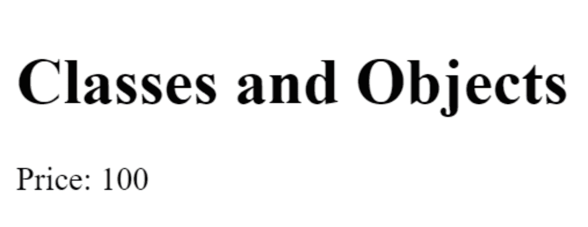 [实时预览](https://phpbootcampdemo.com/php/data-php/objects/ex1/after) [下载练习 2](https://phpbootcampdemo.com/php/data-php/objects/downloads/php-data-php-objects-ex2.zip)

# 练习 2

创建一个 `Calculator` 类，传入两个值并创建 `add` 和 `minus` 函数。

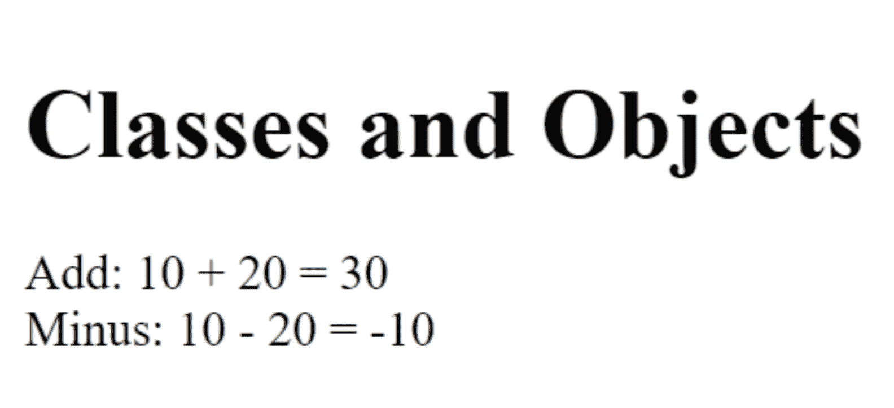 [实时预览](https://phpbootcampdemo.com/php/data-php/objects/ex2/after)

## 2.6 常量

### 常量的用法

常量类似于变量，但一旦你定义了具有固定值的常量，就无法在之后更改它。

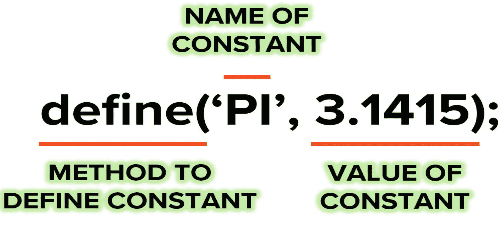

常量变量的值是固定的，此后无法更改。`define()` 是一个用于定义常量的方法。`constant` 不需要 `$` 符号，因为它不像变量。

**示例：**

```php
define('AGE', 20);
echo AGE;
```

访问它时不需要 `$`。通常，常量使用`大写字母`来定义，以易于区分变量和常量。

#### 示例代码

[下载示例](https://phpbootcampdemo.com/php/data-php/constants/downloads/php-data-php-constants-em1.zip)

```html
<!DOCTYPE html>
<html>
<head>
    <meta charset="utf-8">
    <meta name="viewport" content="width=device-width, initial-scale=1.0">
    <meta name="description" content="页面描述">
    <title>常量</title>
    <?php
        //定义一个常量
        define('MESSAGE', "Welcome to PHP!");
        define('AGE', 20);
    ?>
</head>
<body>
    <h1>常量</h1>
    <?php
        echo MESSAGE . ". I am " . AGE . " years old!";
    ?>
</body>
</html>
```

***

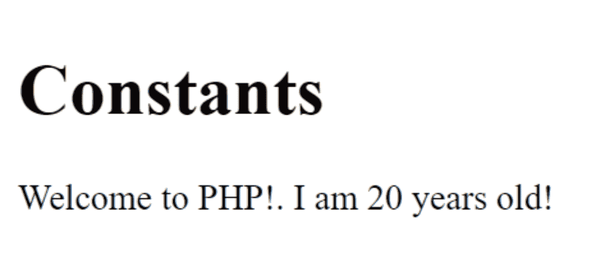 [实时预览](https://phpbootcampdemo.com/php/data-php/constants/em1/after) [下载练习 1](https://phpbootcampdemo.com/php/data-php/constants/downloads/php-data-php-constants-ex1.zip)

# 练习 1

定义字符串、数字和布尔常量并显示它们。

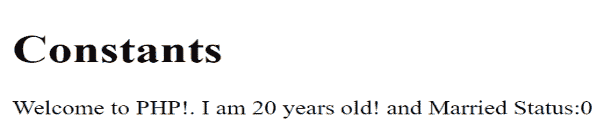 [实时预览](https://phpbootcampdemo.com/php/data-php/constants/ex1/after) [下载练习 2](https://phpbootcampdemo.com/php/data-php/constants/downloads/php-data-php-constants-ex2.zip)

# 练习 2

尝试更改常量的值并观察错误。

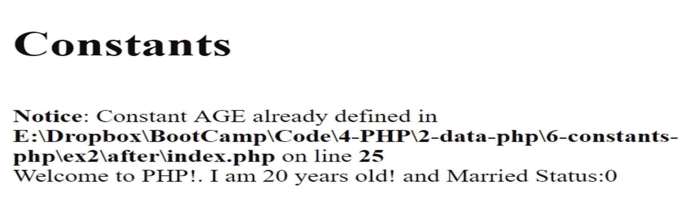 [实时预览](https://phpbootcampdemo.com/php/data-php/constants/ex2/after)

## 2.7 布尔

### 布尔值的用法

布尔变量有助于根据表达式做出决策或存储基于表达式的决策。布尔值可以是 `true`（真）或 `false`（假）。你可以使用布尔变量作为条件来检查值是真是假。

```php
$result = 2 > 1;
$message = ($result) ? "CORRECT": "WRONG";
```

#### 示例代码

[下载示例](https://phpbootcampdemo.com/php/data-php/boolean/downloads/php-data-php-boolean-em1.zip)

```html
<!DOCTYPE html>
<html>
<head>
    <meta charset="utf-8">
    <meta name="viewport" content="width=device-width, initial-scale=1.0">
    <meta name="description" content="页面描述">
    <title>常量</title>
</head>
<body>
    <h1>常量</h1>
    <?php
        $result = 2 > 1;
        $message = ($result) ? "CORRECT" : "INCORRECT";
        echo "Is 2 > 1? $message";
    ?>
</body>
</html>
```

***

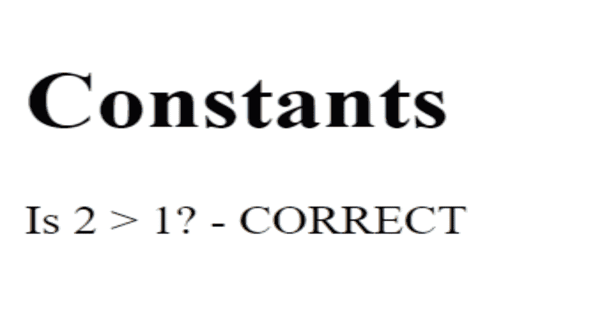 [实时预览](https://phpbootcampdemo.com/php/data-php/boolean/em1/after) [下载练习 1](https://phpbootcampdemo.com/php/data-php/boolean/downloads/php-data-php-boolean-ex1.zip)

# 练习 1

猜测输出结果。

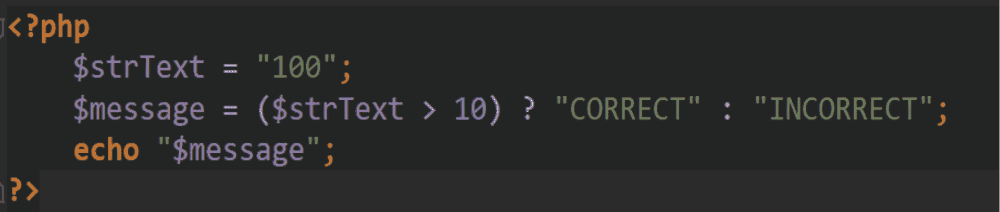  [实时预览](https://phpbootcampdemo.com/php/data-php/boolean/ex1/after) [下载练习 2](https://phpbootcampdemo.com/php/data-php/boolean/downloads/php-data-php-boolean-ex2.zip)

# 练习 2

尝试更改常量的值并观察错误。

## 2.8 日期和时间

### 日期和时间的用法

`date()` 用于格式化日期。`time()` 返回时间戳。

```php
$today = time();
```

#### 示例代码

[下载示例](https://phpbootcampdemo.com/php/data-php/datetime/downloads/php-data-php-datetime-em1.zip)

```html
<!DOCTYPE html>
<html>
<head>
    <meta charset="utf-8">
    <meta name="viewport" content="width=device-width, initial-scale=1.0">
    <meta name="description" content="页面描述">
    <title>常量</title>
</head>
<body>
    <h1>常量</h1>
    <?php
        $today = date("Y-m-d H:i:s");
        echo "Today is: " . $today;
    ?>
</body>
</html>
```

***

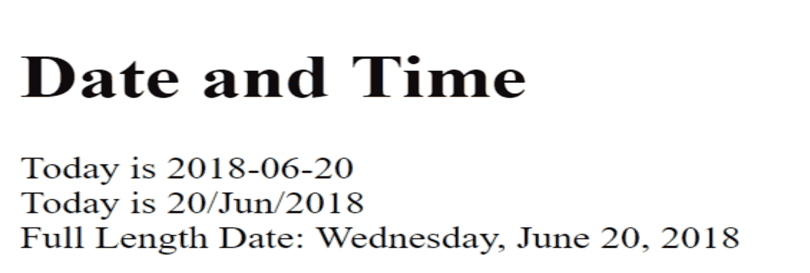 [实时预览](https://phpbootcampdemo.com/php/data-php/datetime/em1/after) [下载练习 1](https://phpbootcampdemo.com/php/data-php/datetime/downloads/php-data-php-datetime-ex1.zip)

# 练习 1

使用 `strtotime()` 获取明天的日期。

```php
$tomorrow = strtotime("tomorrow");
echo $tomorrow;
```

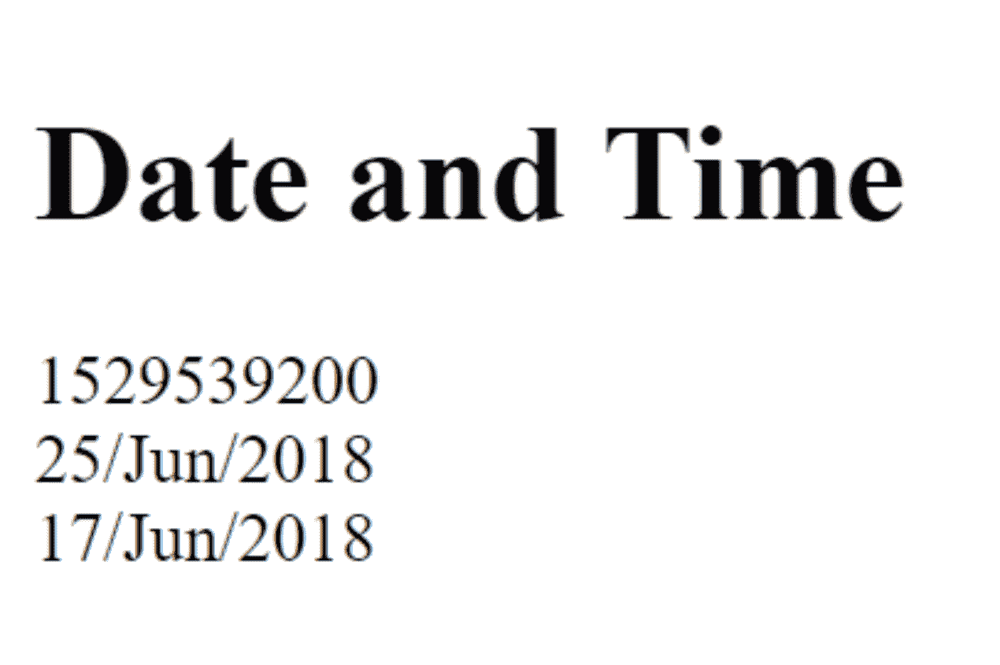 [实时预览](https://phpbootcampdemo.com/php/data-php/datetime/ex1/after) [下载练习 2](https://phpbootcampdemo.com/php/data-php/datetime/downloads/php-data-php-datetime-ex2.zip)

# 练习 2

使用 `strtotime()` 获取下周的日期。

```php
$nextweek = strtotime("next week");
echo $nextweek;
```

## 3.1 赋值

### 赋值

运算符用于对变量执行某些操作，它们通过某些符号表示。表达式被求值后得到结果或最终值。有几种表达式：赋值表达式、算术表达式、比较表达式、逻辑表达式。我们将讨论赋值表达式。

`=` 将值赋值给变量。`message = "something"` 是一个给变量赋值的赋值表达式。

### 复合赋值运算符

复合赋值运算符一次可以完成更多工作。它将两个运算符组合在一起执行操作。复合赋值运算符有：`+=`、`-=`、`*=`、`/=`、`%=`。

```php
$message = 'WP';
$message .= 'Freelancer';

$counter += 1;
$counter = $counter + 1;

$counter -= 10;
$counter = $counter - 10;

$counter *= 1;
$counter = $counter * 1;
```

#### 示例代码

[下载示例](https://phpbootcampdemo.com/php/expressions/assignments/downloads/php-expressions-php-assignments-em1.zip)

```html
<!DOCTYPE html>
<html>
<head>
    <meta charset="utf-8">
    <meta name="viewport" content="width=device-width, initial-scale=1.0">
    <meta name="description" content="页面描述">
    <title>赋值表达式</title>
</head>
<body>
    <h1>赋值表达式</h1>
    <?php
        $firstName = "WP";
        $lastName = "Freelancer";
        $fullName = $firstName . ", " . $lastName;
        echo "Name $fullName <br>";
        $counter = 10;
        echo "Counter: $counter <br>";
        $counter += $counter;
        echo "Counter+=: $counter <br>";
        $counter -= 10;
        echo "Counter-=: $counter <br>";
    ?>
</body>
</html>
```

## 练习 1

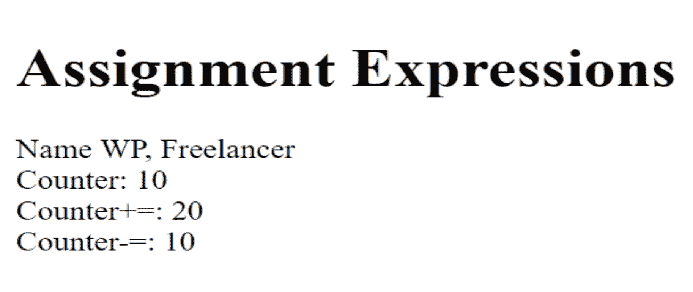 [Live 预览](https://phpbootcampdemo.com/php/expressions-php/assignments/em1/after)

[下载练习 1](https://phpbootcampdemo.com/php/expressions-php/assignments/downloads/php-expressions-php-assignments-ex1.zip)

练习 1：猜测这两个赋值之间的区别。`$counter++` 和 `$counter += counter;`

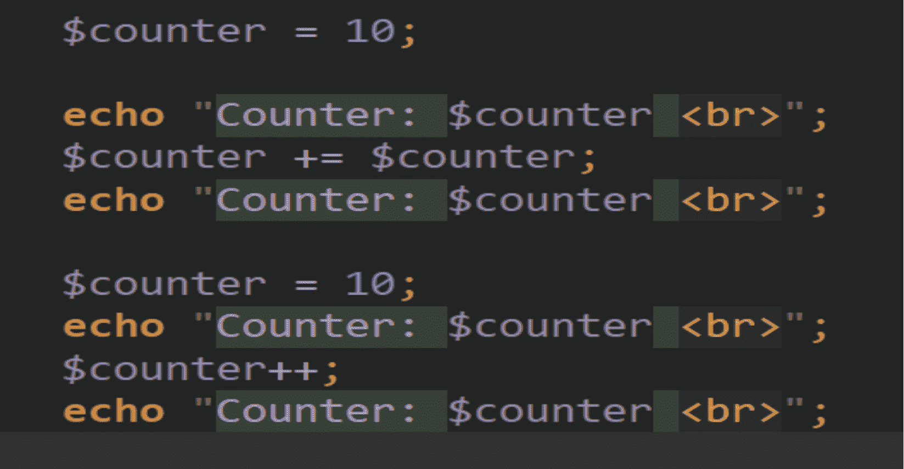  [Live 预览](https://phpbootcampdemo.com/php/expressions-php/assignments/ex1/after)

## 练习 2

[下载练习 2](https://phpbootcampdemo.com/php/expressions-php/assignments/downloads/php-expressions-php-assignments-ex2.zip)

练习 2：当 `$counter = 10;` 时，`$counter -= $counter` 和 `$counter -= 10;` 的结果是什么？

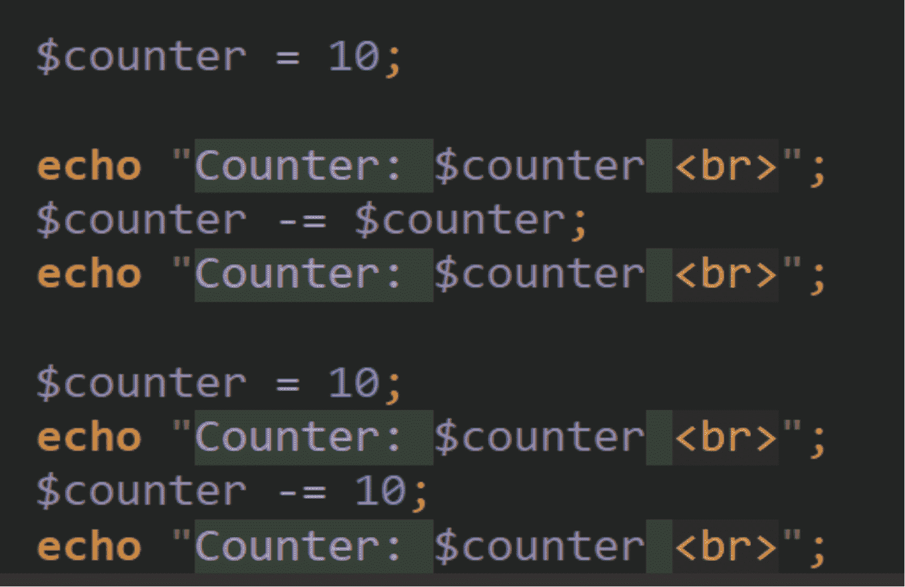  [Live 预览](https://phpbootcampdemo.com/php/expressions-php/assignments/ex2/after)

## 3.2 算术表达式的算术用法

表达式被评估为结果值、最终值或单一值。有几种表达式：

- 赋值表达式
- 算术表达式
- 比较表达式
- 逻辑表达式

我们将在本主题中介绍赋值表达式。表达式使用运算符来执行操作。

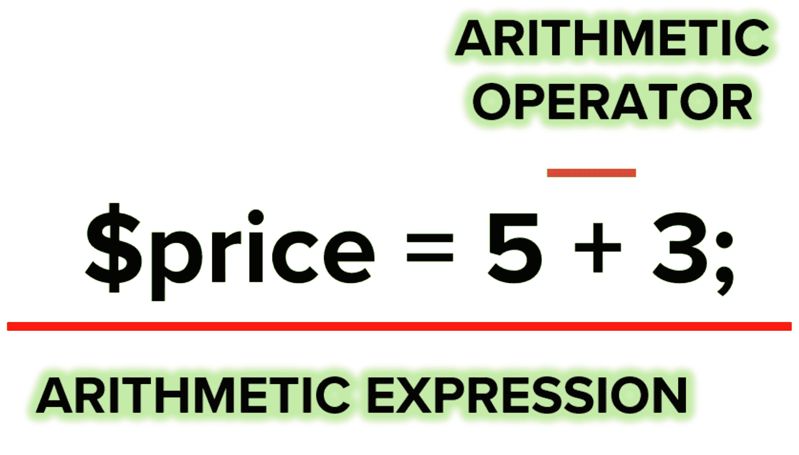 `+` 是用于执行数学计算的算术运算符。算术运算符有：`+`, `–`, `*`, `/`, `%`, `++`, `–`。

### 加 1

```php
$counter++;
$counter = $counter + 1;
```

### 减 1

```php
$counter--;
$counter = $counter – 1;
```

**优先级顺序：**

`++` — `*`, `/`, `%` — `+`, `–`。任何在 `()` 中提到的内容优先级都会高于其他内容。

```php
(5 + 2) * 2; //结果 – 14
```

#### 示例代码

[下载示例](https://phpbootcampdemo.com/php/expressions-php/arithmetic/downloads/php-expressions-php-arithmetic-em1.zip)

```html
<!DOCTYPE html>
<html>
<head>
    <meta charset="utf-8">
    <meta name="viewport" content="width=device-width, initial-scale=1.0">
    <meta name="description" content="Page Description">
    <title>Arithmetic Expressions</title>
</head>
<body>
    <h1>Arithmetic Expressions</h1>
    <?php
    $counter = 10;
    echo "Counter: $counter <br>";
    $counter++;
    echo "Counter++: $counter <br>";
    $counter = 10;
    echo "Counter: $counter <br>";
    $counter--;
    echo "Counter--: $counter <br>";
    $counter = (10 - 5) * 2;
    echo "Result: $counter";
    ?>
</body>
</html>
```

***

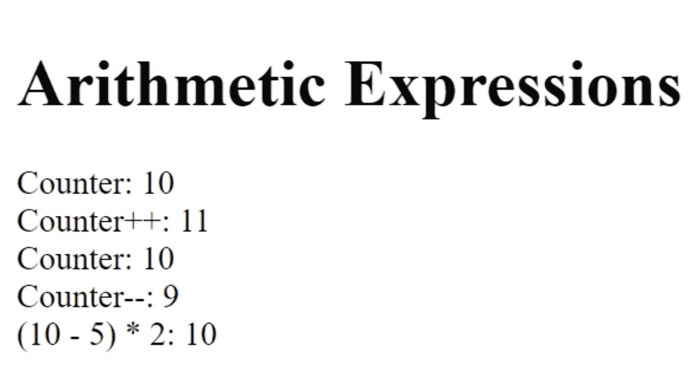 [Live 预览](https://phpbootcampdemo.com/php/expressions-php/arithmetic/em1/after)

[下载练习 1](https://phpbootcampdemo.com/php/expressions-php/arithmetic/downloads/php-expressions-php-arithmetic-ex1.zip)

# 练习 1

使用取模符号（`%`）判断 15 是偶数还是奇数。

```php
$counter = 15 % 2;
```

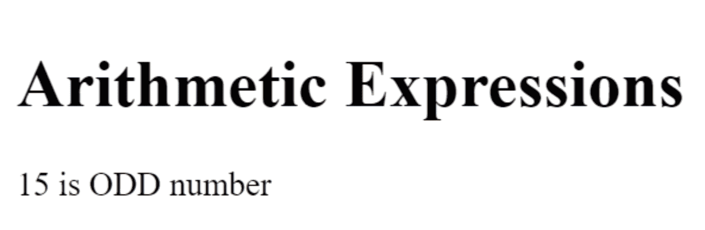 [Live 预览](https://phpbootcampdemo.com/php/expressions-php/arithmetic/ex2/after)

[下载练习 2](https://phpbootcampdemo.com/php/expressions-php/arithmetic/downloads/php-expressions-php-arithmetic-ex2.zip)

# 练习 2

尝试对以下内容应用 `++`：

```php
$message = "Hello";
$message++; // 这不起作用
```

***

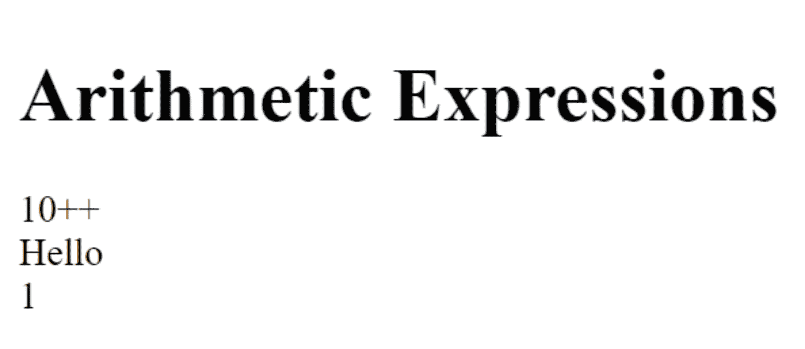 [Live 预览](https://phpbootcampdemo.com/php/expressions-php/arithmetic/ex2/after)

## 3.3 比较表达式的比较用法

表达式被评估为结果值、最终值或单一值。有几种：

- 赋值表达式
- 算术表达式
- 逻辑表达式

我们将在本主题中介绍比较表达式。表达式使用运算符来执行操作。

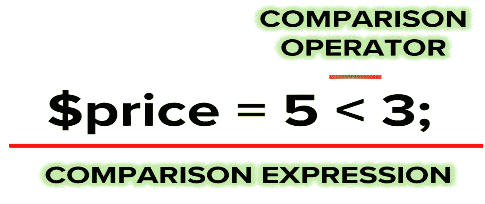 `>` 比较两个值并返回真或假。比较运算符有：

- `<` – 小于
- `>` – 大于
- `==` – 等于
- `===` – 全等
- `!=` – 不等于
- `>=` – 大于
- `<=` – 小于


### 三元运算符

PHP 有一种根据条件赋值的三元运算符。

```php
$result = ($condition <= 10) ? "YES" : "NO";
```

#### 示例代码

```html
<!DOCTYPE html>
<html>
<head>
    <meta charset="utf-8">
    <meta name="viewport" content="width=device-width, initial-scale=1.0">
    <meta name="description" content="Page Description">
    <title>Arithmetic Expressions</title>
</head>
<body>
    <h1>Arithmetic Expressions</h1>
    <?php
    $counter = 10;
    echo "Counter: $counter <br>";
    $result = ($counter == 10) ? "YES" : "NO";
    echo $result;
    ?>
</body>
</html>
```

---

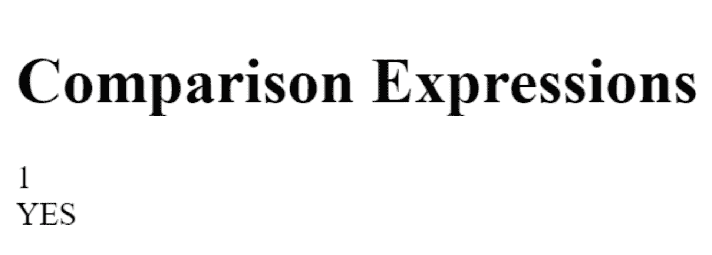 [Live 预览](https://phpbootcampdemo.com/php/expressions-php/comparison/em1/after)

[下载练习 1](https://phpbootcampdemo.com/php/expressions-php/comparison/downloads/php-expressions-php-comparison-ex1.zip)

练习 1：学习使用 `===` 运算符比较 `NULL`。

```php
$var === null;
```

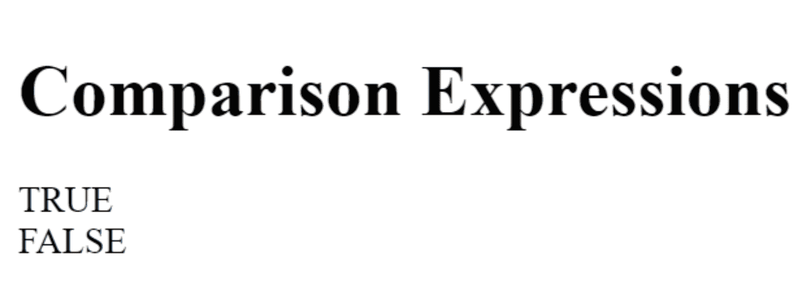 [Live 预览](https://phpbootcampdemo.com/php/expressions-php/comparison/ex2/after)

[下载练习 2](https://phpbootcampdemo.com/php/expressions-php/comparison/downloads/php-expressions-php-comparison-ex2.zip)

练习 2：从字符串中查找空字符串。

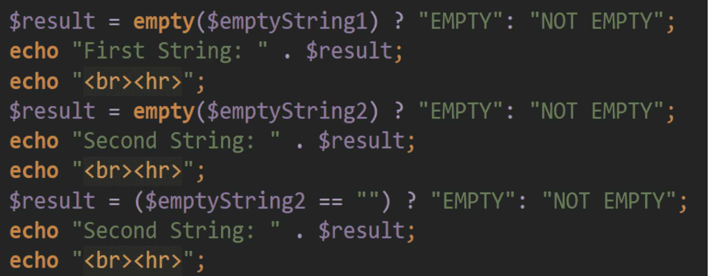 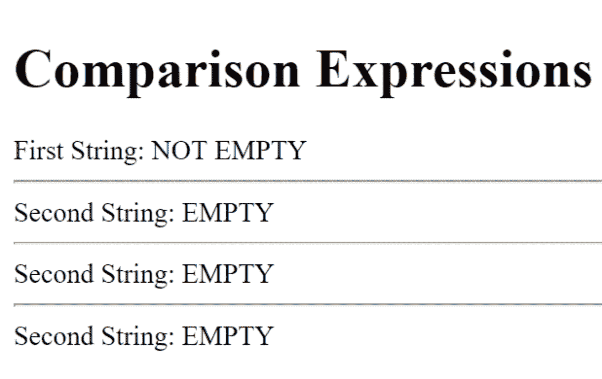 [Live 预览](https://phpbootcampdemo.com/php/expressions-php/comparison/ex2/after)

## 3.4 逻辑表达式的逻辑用法

表达式被评估为结果值、最终值或单一值。有几种：

- 赋值表达式
- 算术表达式
- 比较表达式

我们将在本主题中介绍逻辑表达式。表达式使用运算符根据多个条件判断条件为真或假。

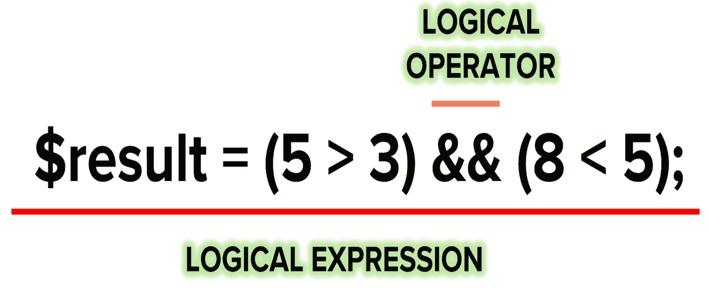 `&&` 检查左侧和右侧并判断条件为真或假。逻辑运算符有：

- `&&` – 与（AND）
- `||` – 或（OR）
- `!` – 非（NOT）

```php
(5 > 3) // true
(8 < 5) // false
true && false // false
```

**优先级顺序：**

优先级决定了先执行。`!` 然后是 `&&` 最后是 `||`。

#### 示例代码

```html
<!DOCTYPE html>
<html>
<head>
    <meta charset="utf-8">
    <meta name="viewport" content="width=device-width, initial-scale=1.0">
    <meta name="description" content="Page Description">
    <title>Logical Expressions</title>
</head>
<body>
    <h1>Logical Expressions</h1>
    <?php
    $input1 = 10;
    $input2 = 20;
    $result = ($input1 < $input2) || ($input1 == $input2);
    echo $input1 . " <= " . $input2 . " is " . $result;
    ?>
</body>
</html>
```

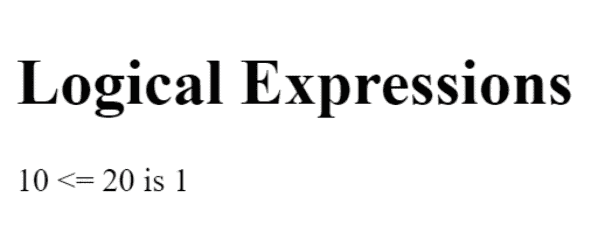 [实时预览](https://phpbootcampdemo.com/php/expressions-php/logical/em1/after)

练习 1 [下载练习 1](https://phpbootcampdemo.com/php/expressions-php/logical/downloads/php-expressions-php-logical-ex1.zip)

练习 1：预测下方代码的输出。

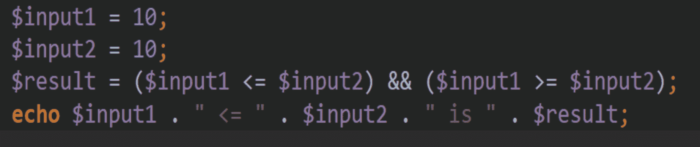 [实时预览](https://phpbootcampdemo.com/php/expressions-php/logical/ex1/after)

练习 2 [下载练习 2](https://phpbootcampdemo.com/php/expressions-php/logical/downloads/php-expressions-php-logical-ex2.zip)

练习 2：预测下方代码的输出。

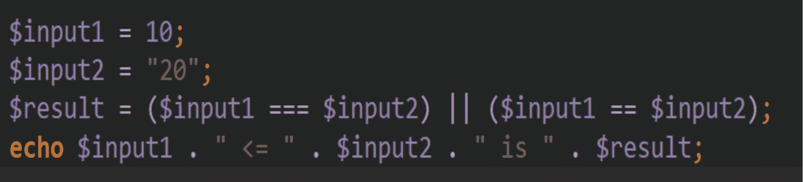 [实时预览](https://phpbootcampdemo.com/php/expressions-php/logical/ex2/after)

 

# 4 语句

## 4.1 if 语句

### if 语句用法

`if` 语句用于检查一个条件并根据条件的结果做出决策。它可以在条件为真时执行某些操作，并在条件为假时执行其他操作。你可以将多个条件嵌套在一起，并根据多个条件决定选择某个操作。

**语法：**

```php
if ( condition1 ){ // 语句 } else if( condition1 || condition2 ){ // 语句 } else { // 语句 }
```

**示例 1：**

```php
if( $marks > 35 ){ 
    echo “Your’re Passed!”; 
}else{ 
    echo “Better Luck Next Time!”; 
}
```

**示例 2：**

```php
if( $marks > 35 && $marks < 60 ){ 
    echo “You are Passed with Grade C”; 
}else if ( $marks > 60 && $marks < 80 ){ 
    echo “You are Passed with Grade B”; 
}else if ( $marks > 80 ){ 
    echo “You are Passed with Grade A”; 
}else{ 
    echo “Try Again!”; 
}
```

[下载示例](https://phpbootcampdemo.com/php/statements-php/if/downloads/php-statements-php-if-em1.zip)

```html
<!DOCTYPE html>
<html>
<head>
    <meta charset="utf-8">
    <meta name="viewport" content="width=device-width, initial-scale=1.0">
    <meta name="description" content="页面描述">
    <title>if 语句</title>
    <?php
        $dayOfWeek = "Wednesday";
        $result = "";
        $dayOfWeek = strtolower($dayOfWeek);
        if( $dayOfWeek == 'monday' || $dayOfWeek == 'mon'){
            $result = "First Day of Week";
        }else if( $dayOfWeek == 'tuesday' || $dayOfWeek == 'tue' ){
            $result = "Second Days of Week";
        }else if( $dayOfWeek == 'wednesday' || $dayOfWeek == 'wed' ){
            $result = "Mid Week";
        }else if( $dayOfWeek == 'thursday' || $dayOfWeek == 'thurs'){
            $result = "Preparing for Weekend";
        }else if( $dayOfWeek == 'friday' || $dayOfWeek == 'fri'){
            $result = "It's Friday!";
        }else if( $dayOfWeek == 'saturday' || $dayOfWeek == 'sat' ){
            $result = "Enjoying Day!";
        }else if( $dayOfWeek == 'sunday' || $dayOfWeek == 'sun'){
            $result = "Resting Day!";
        }else{
            $result = "Cannot find!";
        }
    ?>
</head>
<body>
    <h1>if 语句</h1>
    <?php
        echo "This is: " . $result;
    ?>
</body>
</html>
```

---

## 4.2 switch 语句

### switch 语句用法

`switch` 语句用于根据变量的值执行不同的代码块。

**语法：**

```php
switch ( expression ) {
    case value1: // 语句
    break;
    case value2: // 语句
    break;
    default: // 语句
}
```

**示例 1：**

```php
$color = "red";
switch ( $color ) {
    case "red":
        echo "You picked red!";
        break;
    case "blue":
        echo "You picked blue!";
        break;
    default:
        echo "Color not found";
}
```

## 4.3 while 语句

### while 语句用法

`while` 循环在指定的条件为真时重复执行代码块。

**语法：**

```php
while ( condition ) { // 语句 }
```

**示例 1：**

```php
$i = 1;
while ( $i <= 6 ) {
    echo $i;
    $i++;
}
```

## 练习 1

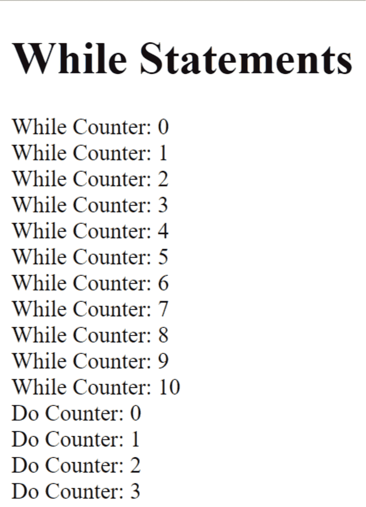 [实时预览](https://phpbootcampdemo.com/php/statements-php/while/em1/after)

练习 1 [下载练习 1](https://phpbootcampdemo.com/php/statements-php/while-ex1.zip)

练习 1：定义常量 `INPUT1` 和 `INPUT2` 并打印它们之间的所有数字。最多打印 10 个数字。`break;` 是一个可以在循环中使用跳出循环的关键字。`continue;` 是一个可以在循环中使用跳过以下语句并继续循环的关键字。

提示：

```php
if(counter >= 10){
    break;
}
```

## 练习 2

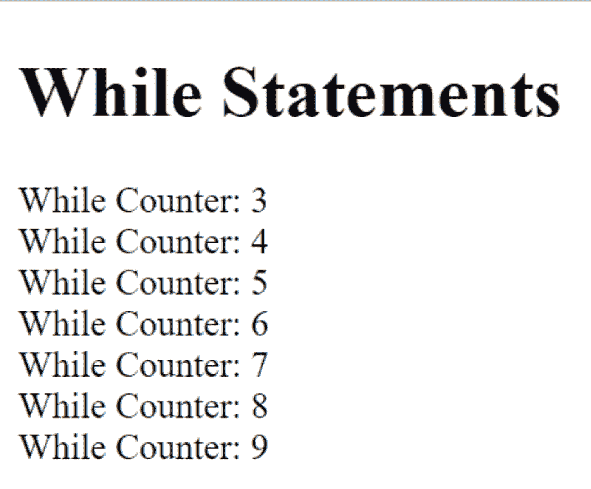 [实时预览](https://phpbootcampdemo.com/php/statements-php/while/ex1/after)

练习 2 [下载练习 2](https://phpbootcampdemo.com/php/statements-php/while-ex2.zip)

练习 2：定义两个带有默认值的常量，并仅打印它们之间的偶数。最多打印 10 个数字。

## 4.4 For 语句

### For 循环的使用

`For Loop` 用于循环一段代码，直到满足条件。在条件满足前运行相同的代码块。

语法：`for( 初始化; 条件; 增量 ) { //语句 }`

示例 1：

```php
for($counter = 0; $counter <= 10; $counter++){ 
    echo $counter; 
}
```

示例 2：

```php
for($counter = 0, $input1 = 10; $counter <= 10; $counter++, $input1++){ 
    echo $input1; 
}
```

[下载示例](https://phpbootcampdemo.com/php/statements-php/for/downloads/php-statements-php-for-em1.zip)

```html
<!DOCTYPE html>
<html>
<head>
    <meta charset="utf-8">
    <meta name="viewport" content="width=device-width, initial-scale=1.0">
    <meta name="description" content="页面描述">
    <title>For 语句</title>
</head>
<body>
    <h1>For 语句</h1>
    <?php
        for($counter=0; $counter<=10; $counter++){
            echo "计数: " . $counter . "<br>" ;
        }
    ?>
</body>
</html>
```

---

## 练习 1

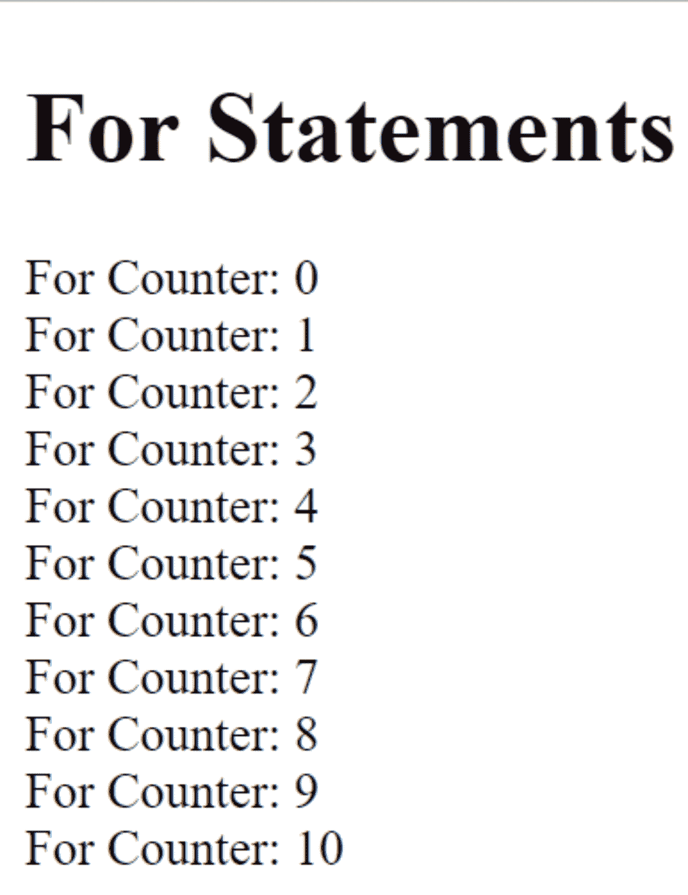 [实时预览](https://phpbootcampdemo.com/php/statements-php/for/em1/after)

练习 1 [下载练习 1](https://phpbootcampdemo.com/php/statements-php/for/downloads/php-statements-php-for-ex1.zip)

练习 1：定义两个带有默认值的常量，并打印它们之间的所有数字。最多打印 10 个数字。`break;` 是一个可以在循环中使用跳出循环的关键字。`continue;` 是一个可以在循环中使用跳过以下语句并继续循环的关键字。

## 练习 2

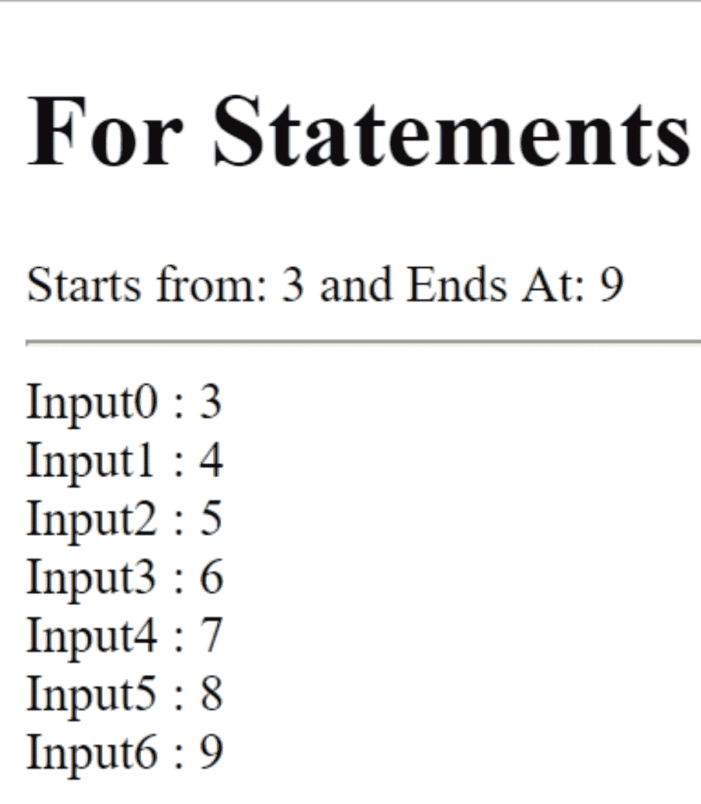 [实时预览](https://phpbootcampdemo.com/php/statements-php/for/ex1/after)

练习 2 [下载练习 2](https://phpbootcampdemo.com/php/statements-php/for/downloads/php-statements-php-for-ex2.zip)

练习 2：定义两个带有默认值的常量，并仅打印它们之间的偶数。最多打印 10 个数字。像所示使用循环：

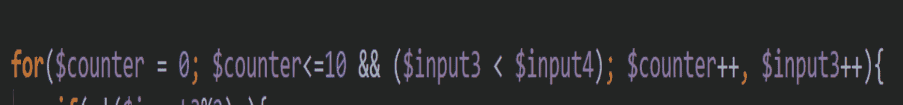 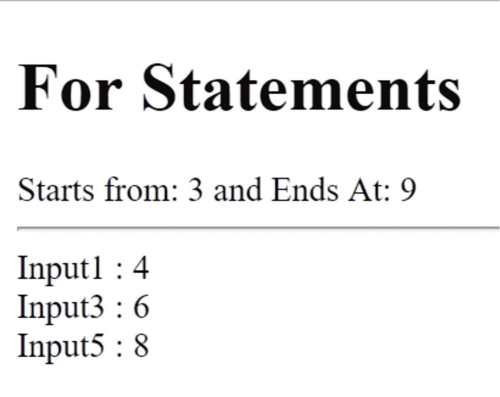 [实时预览](https://phpbootcampdemo.com/php/statements-php/for/ex2/after)  

## 通用

## 5.1 异常


### Try Catch 块的使用

在 PHP 中你可以找到 3 种错误：

1. **语法错误**：是你忘记了遵循 PHP 的规则。在执行程序时会导致错误。
2. **运行时错误**：可能是当程序在运行时，PHP 解释器无法理解如何继续并抛出错误。
3. **逻辑错误**：由于程序指令在逻辑上不正确而导致的逻辑错误。

编程中的异常被称为运行时错误。当发生运行时错误时，有一种方法可以捕获这些错误并将其传递给应用程序，让程序干净退出。这被称为异常处理。

为了处理 PHP 中的运行时错误，我们有 `try-catch` 块。使用这些我们可以捕获错误并决定下一步做什么。

语法：

```php
try{ //语句 }
catch(Exception $exceptionObj) { //语句 }
```

示例：

```php
try {
    $firstName = "";
    if($firstName == "") throw new Exception("名字为空");
} catch (Exception $e){
    echo "消息: " . $e->getMessage();
} finally {
    echo "来自 Finally Block";
}
```

- `try {}` 块：包含所有语句。
- `throw`：是一个从程序抛出错误的关键字。一旦程序抛出错误，它将停止处理后续步骤。它将跳转到 `catch {}` 块。
- `catch {}` 块一旦调用 `throw` 就会执行。程序安全地从 catch 块执行。
- `finally{}` 块：无论是否出错都会执行。它是关闭所有连接的好地方。处理干净退出。

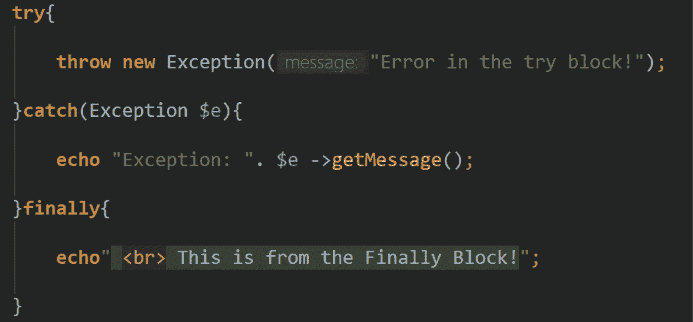[下载示例](https://phpbootcampdemo.com/php/general-php/exceptions/downloads/php-general-php-exceptions-em1.zip)

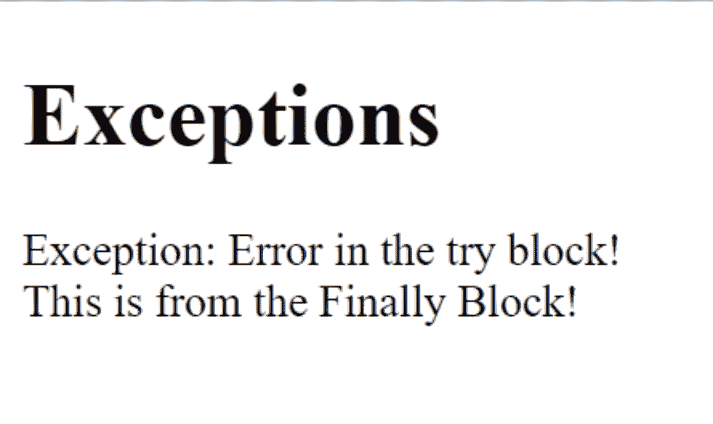[实时预览](https://phpbootcampdemo.com/php/general-php/exceptions/em1/after) 练习 1 [下载练习 1](https://phpbootcampdemo.com/php/general-php/exceptions/downloads/php-general-php-exceptions-ex1.zip)

## 练习 1

定义一个常量数字，如果该数字不是整数则报错。提示：`if( !is_numeric(INPUTVALUE ) )` 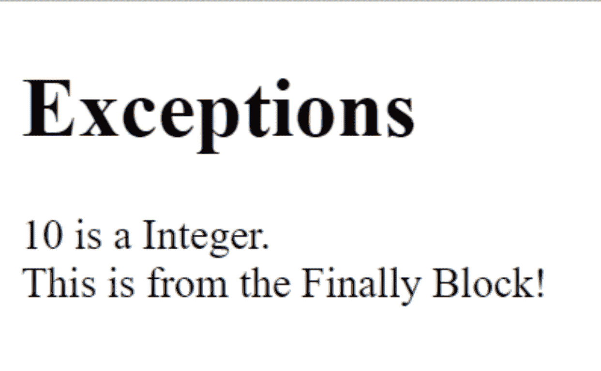[实时预览](https://phpbootcampdemo.com/php/general-php/exceptions/ex1/after) 练习 2 [下载练习 2](https://phpbootcampdemo.com/php/general-php/exceptions/downloads/php-general-php-exceptions-ex2.zip)

## 练习 2

定义一个 1 到 100 之间的数字。在页面上显示以下消息：如果输入在 1 到 100 之间 —— 小于 100。如果输入大于 100 —— 大于 100。如果输入不是数字 —— 出错误 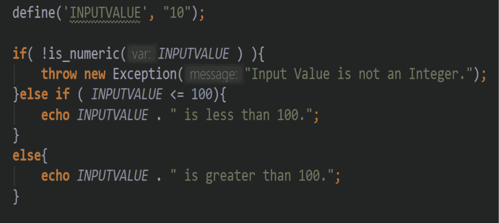[实时预览](https://phpbootcampdemo.com/php/general-php/exceptions/ex2/after)

## 5.2 调试

### 步骤 1：编写带有错误的 PHP 代码

尝试以下错误：

```php
$inputValue = 10;
echo inputValue;
echo "This is a String" + "another String";
```

[下载练习 1](https://phpbootcampdemo.com/php/general-php/debug/downloads/php-general-php-debug-em1.zip)

```html
<!DOCTYPE html>
<html>
<head>
    <meta charset="utf-8">
    <meta name="viewport" content="width=device-width, initial-scale=1.0">
    <meta name="description" content="Page Description">
    <title>Debugging</title>
</head>
<body>
    <h1>Debugging</h1>
    <?php
        $inputValue = 10;
        echo inputValue;
    ?>
</body>
</html>
```

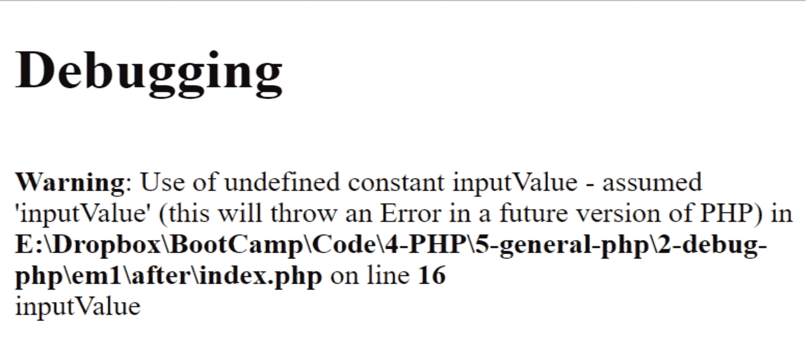[实时预览 1](https://phpbootcampdemo.com/php/general-php/debug/em1/after)

## 练习 1

在 php 文件中添加 `Sum()` 方法但不创建该函数。这将导致程序失败。

## 练习 2

在 `sum()` 方法之前编写 `echo` 语句，并在 `sum()` 方法之后编写 `echo`。通过查看 `echo` 消息找到错误。

### 步骤 2：使用 echo 进行调试

你需要编写追踪日志。查看最后执行的 `echo` 是哪一个。

## 5.3 文件

用法

你可以使用 PHP 库读取服务器上的文件。打开文件时使用的模式：

- `rb` – 以读模式打开文件。
- `wb` – 创建新文件，如果文件已存在则覆盖它。
- `ab` – 创建文件，如果文件已存在则追加数据。
- `xb` – 创建一个新文件，如果文件已存在则不创建。

以下是打开和关闭文件的方法：

- `fopen($path, $mode)`
- `fclose($file)`
- `feof($file)` – 用于检查是否已到达文件末尾。

向文件中读取和写入的方法：

- `fread($file, $length)` – length 用于指定要读取的字节数。
- `fgets($file)` – 读取一行。
- `fwrite($file, $data)` – 将 `$data` 值写入文件。

### 示例

[下载示例](https://phpbootcampdemo.com/php/general-php/files/downloads/php-general-php-files-em1.zip)

```html
<!DOCTYPE html>
<html>
<head>
    <meta charset="utf-8">
    <meta name="viewport" content="width=device-width, initial-scale=1.0">
    <meta name="description" content="Page Description">
    <title>Files</title>
</head>
<body>
    <h1>Files</h1>
    <?php
        // 创建一个本地文件并命名为 "readme.txt"
        /*
        * 读取文件 - rb 模式
        */
        $file = fopen('readme.txt', 'rb');
        $line = "";
        while(!feof($file) ){
            $line = fgets($file);
            echo $line;
        }
        fclose($file);

        /*
        * 写入文件 - wb 模式
        */
        $file = fopen("newfile.txt", "wb");
        fwrite($file, "<br><h1>It is a long established fact that readers will be distracted by the readable content of a page when looking at its layout.</h1>");
        fclose($file);
    ?>
</body>
</html>
```

* * *

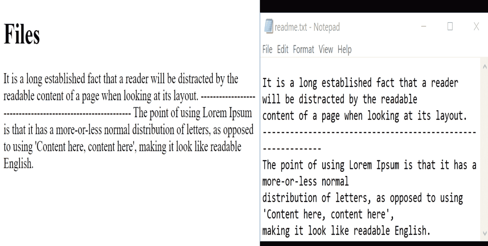(rsrc32G.jpg)[实时预览](https://phpbootcampdemo.com/php/general-php/files/em1/after)

## 练习 1

[下载练习 1](https://phpbootcampdemo.com/php/general-php/files/downloads/php-general-php-files-ex1.zip)

编写一个带有内容的 `newfile.txt` 文件并在浏览器中显示该文件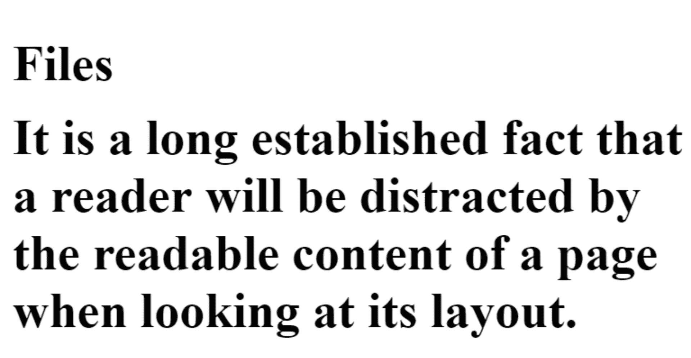[实时预览](https://phpbootcampdemo.com/php/general-php/files/ex1/after)

## 练习 2

[下载练习 2](https://phpbootcampdemo.com/php/general-php/files/downloads/php-general-php-files-ex2.zip)

使用 `ab` 模式向现有文件追加文本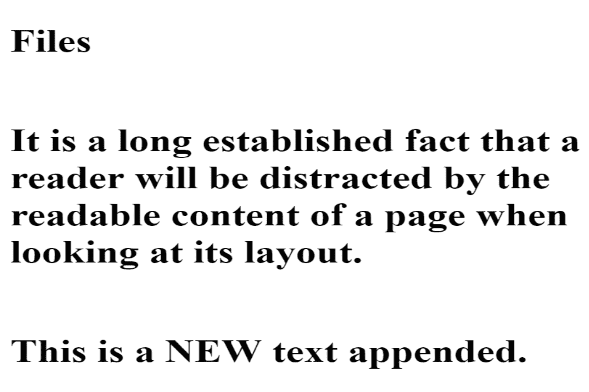[实时预览](https://phpbootcampdemo.com/php/general-php/files/ex2/after)

## 5.4 包含 (Includes)

包含与要求的用法

PHP 允许将代码拆分成部分。这些语句有：

- `include`
- `include_once`
- `require`
- `require_once`

`include` 和 `require` 帮助将代码拆分为文件。如果包含的文件不存在，`include` 会忽略它而 `require` 会停止执行。

### 示例

index.php

```html
<!DOCTYPE html>
<html>
<head>
    <meta charset="utf-8">
    <meta name="viewport" content="width=device-width, initial-scale=1.0">
    <meta name="description" content="Page Description">
    <title>Includes</title>
</head>
<body>
    <h1>Includes</h1>
    <?php
        include 'functions.php';
        echo add(1, 2);
    ?>
</body>
</html>
```

functions.php

```php
<?php
function add($a, $b){
    return $a + $b;
}
?>
```

display.php

```php
<?php
echo '<br><h1>This is included</h1>';
?>
```

* * *

## 练习 1

[下载练习 1](https://phpbootcampdemo.com/php/general-php/includes/downloads/php-general-php-includes-em1.zip)

使用上面的代码并删除 `display.php` 和 `functions.php`。观察错误。警告来自 `include`，致命错误来自 `require`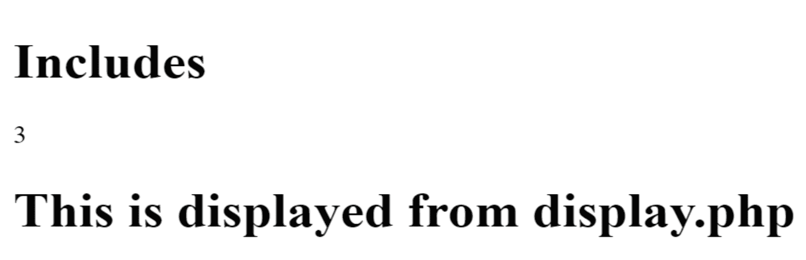[实时预览](https://phpbootcampdemo.com/php/general-php/includes/em1/after)

## 练习 2

[下载练习 2](https://phpbootcampdemo.com/php/general-php/includes/downloads/php-general-php-includes-ex2.zip)

在 `index.html` 中放入 HTML 代码并在 `index.php` 中包含该文件[实时预览](https://phpbootcampdemo.com/php/general-php/includes/ex2/after)

## 练习 1

创建你自己的库并使用它。继续在其他项目中使用它。遵循此练习将项目拆分为小文件并包含它们。

# 表单

## 6.1 GET 方法

### 表单 GET 方法用法

`GET` 是表单用于将表单数据传递到表单 `action` 属性中指定的页面的方法类型。`GET` 方法将数据发送在 `url` 中。

当你定义表单时，这里有一些重要的点：

- `action` 属性 – 定义表单数据需要发送到哪个文件。
- `method` 属性有两种类型 – `GET` 和 `POST`。`GET` 意味着数据在 URL 栏中可见。`POST` 意味着数据是隐藏的。使用 `GET` 我们可以发送有限的数据，使用 `POST` 我们可以发送大量数据。
- `<input>` 类型有一个 `name` 属性，有助于定义元素的名称。这个 `name` 就像一个存储用户输入数据的的。表单元素的 `name` 属性会被提交到下一个页面。
- `<input type="submit">` 会显示提交按钮，点击时表单会将数据提交到文件。此操作由浏览器处理。

### 如何从 URL 读取 GET 变量

如果 URL 类似于如下：`http://site.com/display.php?input_text=hello&input_email=test@test.com`

```php
$text = $_GET['input_text'];
$emailid = $_GET['input_email'];
```

URL 将具有由 `&` 分隔的 `name=value` 对。`$_GET` 是根据 `GET` 参数自动创建的数组，你可以访问它并检查是否存在任何值。`$_GET` 是超全局变量，即使它是空的也是始终可用的。

当你点击提交按钮时，表单数据被传递到 `display.php`，该页面读取参数并显示输出。浏览器也会从 `index.php` 页面跳转到 `display.php` 页面。

### 示例

[下载示例](https://phpbootcampdemo.com/php/forms-php/get/downloads/php-forms-php-get-em1.zip)

```html
<!DOCTYPE html>
<html>
<head>
    <meta charset="utf-8">
    <meta name="viewport" content="width=device-width, initial-scale=1.0">
    <meta name="description" content="Page Description">
    <title>Forms - GET</title>
</head>
<body>
    <h1>Form - GET</h1>
    <form action="display.php" method="get">
        <fieldset>
            <legend>Student Enquiry Form</legend>
            <p>
                <label for="input_text">Text:</label>
                <input name="input_text" type="text" placeholder="Text">
            </p>
            <p>
                <label for="input_email">Email:</label>
                <input name="input_email" type="email" placeholder="test@domain.com">
            </p>
        </fieldset>
        <p>
            <input type="submit">
            <input type="reset">
        </p>
    </form>
</body>
</html>
```

**FileName: display.php**

```html
<!DOCTYPE html>
<html>
<head>
    <meta charset="utf-8">
    <meta name="viewport" content="width=device-width, initial-scale=1.0">
    <meta name="description" content="Page Description">
    <title>Forms - GET</title>
</head>
<body>
    <h1>Form - GET</h1>
    <a href="index.php">Back to Home Page</a><br>
    <?php
    $name = $_GET['input_text'];
    $email = $_GET['input_email'];
    echo "Name: $name and Email: $email";
    ?>
</body>
</html>
```

* * *

## 练习 1


# 练习 1

[下载练习 1](https://phpbootcampdemo.com/php/forms-php/get/downloads/php-forms-php-get-ex1.zip)

练习 1：创建一个接受两个数字的表单，并在另一个页面上显示这两个数字的计算结果。

## 练习 2

[下载练习 2](https://phpbootcampdemo.com/php/forms-php/get/downloads/php-forms-php-get-ex2.zip)

练习 2：在同一页面显示结果并重定向到同一页面。

提示：检查值是否为空

```php
if (!empty($_GET['input_text1']) && !empty($_GET['input_text2'])) { }
```

# 6.2 POST 方法

## 表单 POST 方法用法

`POST` 是表单用于将表单数据传递到表单 `action` 属性中指定的页面的方法类型。`POST` 方法将数据作为附件发送。它在 `URL` 中可见。

当你定义表单时，这里有一些重要的点：

- `action` 属性 – 定义表单数据需要发送到哪个文件。
- `method` 属性有两种类型 – `GET` 和 `POST`。`GET` 意味着数据在 URL 栏中可见。`POST` 意味着数据是隐藏的。使用 `GET` 我们可以发送有限的数据，使用 `POST` 我们可以发送大量数据。
- `<input>` 类型有一个 `name` 属性，有助于定义元素的名称。这个 `name` 就像一个存储用户输入数据的的。表单元素的 `name` 属性会被提交到下一个页面。
- `<input type="submit">` 会显示提交按钮，点击时表单会将数据提交到文件。此操作由浏览器处理。

## 如何从 URL 读取 POST 变量

`POST` 方法不是在 `URL` 中可见。

```php
$text = $_POST['input_text'];
$emailid = $_POST['input_email'];
```

`$_POST` 是根据 `POST` 参数自动创建的数组，你可以访问它并检查是否存在任何值。`$_POST` 是超全局变量，即使它是空的也是始终可用的。

当你点击提交按钮时，表单数据被传递到 `display.php`，该页面读取参数并显示输出。浏览器也会从 `index.php` 页面跳转到 `display.php` 页面。

### 示例

[下载示例](https://phpbootcampdemo.com/php/forms-php/post/downloads/php-forms-php-post-em1.zip)

```html
<!DOCTYPE html>
<html>
<head>
    <meta charset="utf-8">
    <meta name="viewport" content="width=device-width, initial-scale=1.0">
    <meta name="description" content="Page Description">
    <title>Forms - POST</title>
</head>
<body>
    <h1>Form - POST</h1>
    <form action="display.php" method="post">
        <fieldset>
            <legend>Student Enquiry Form</legend>
            <p>
                <label for="input_text">Text:</label>
                <input name="input_text" type="text" placeholder="Text">
            </p>
            <p>
                <label for="input_email">Email:</label>
                <input name="input_email" type="email" placeholder="test@domain.com">
            </p>
        </fieldset>
        <p>
            <input type="submit">
            <input type="reset">
        </p>
    </form>
</body>
</html>
```

**FileName: display.php**

```html
<!DOCTYPE html>
<html>
<head>
    <meta charset="utf-8">
    <meta name="viewport" content="width=device-width, initial-scale=1.0">
    <meta name="description" content="Page Description">
    <title>Forms - POST</title>
</head>
<body>
    <h1>Form - POST</h1>
    <a href="index.php">Back to Home Page</a><br>
    <?php
    $name = $_POST['input_text'];
    $email = $_POST['input_email'];
    echo "Name: $name and Email: $email";
    ?>
</body>
</html>
```

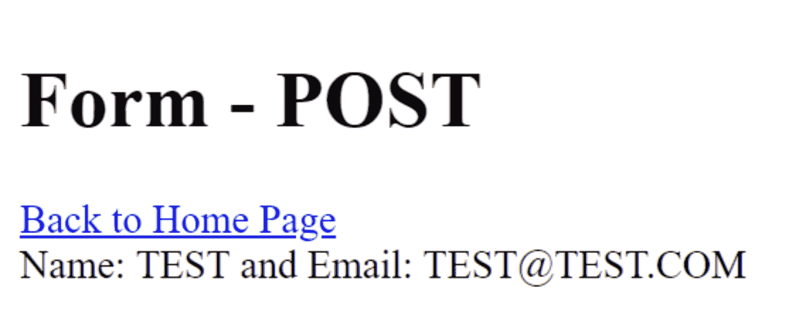 [实时预览](https://phpbootcampdemo.com/php/forms-php/post/em1/after)

## 练习 1

[下载练习 1](https://phpbootcampdemo.com/php/forms-php/post/downloads/php-forms-php-post-ex1.zip)

创建一个表单接收两个数字，并在另一个页面上显示这两个数字的计算结果。使用 `POST` 方法。

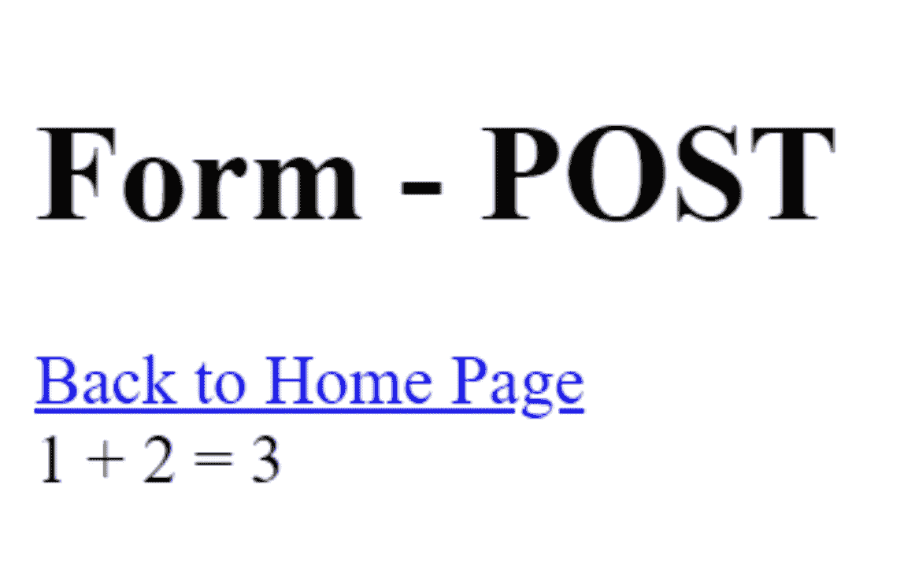 [实时预览](https://phpbootcampdemo.com/php/forms-php/post/ex1/after)

## 练习 2

[下载练习 2](https://phpbootcampdemo.com/php/forms-php/post/downloads/php-forms-php-post-ex2.zip)

在同一页面上显示结果并重定向到页面。使用 `POST` 方法。

**提示：** 检查值是否为空：

```php
if( !empty($_POST['input_text1']) && !empty($_POST['input_text2']) ){
```

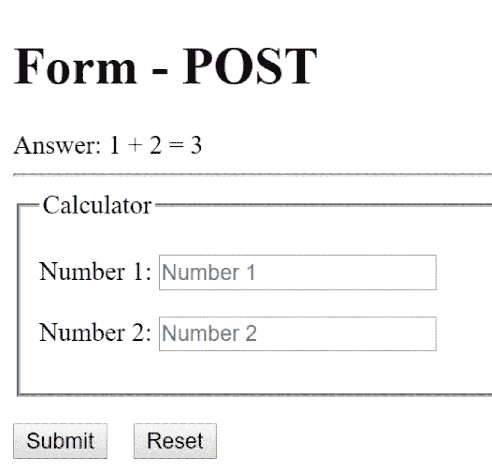 [实时预览](https://phpbootcampdemo.com/php/forms-php/post/ex2/after)

# 6.3 Cookies

## Cookies 的用法

Cookies 是你可以存储在客户端浏览器中的信息。Cookies 以 `name=value` 对的格式存储在客户端系统的文件中。Cookies 有助于跟踪用户在网页上的操作，并将这些信息发送到服务器，以便服务器知道客户端在网页上做了什么。对于每个请求，浏览器都会将 cookies 发送到服务器，如果 cookies 有任何更改，该信息也会发送到服务器。Cookies 帮助存储并捕捉网页上的用户操作。这些信息会被发送到服务器。Cookies 会持续到浏览器关闭。我们也可以手动为任何 cookie 设置过期时间。在某些情况下，浏览器禁用了 cookies，导致其无法工作，用户也可以更改浏览器设置不存储 cookies。Cookies 可以帮助根据用户的操作更改页面视图。

### 如何设置 Cookie

```php
$name = 'WPFreelancer.com';
$value = 20;
$expire = strtotime('+1 year');
$path = '/';
// 这是一个 name=value 对。
setcookie($name, $value, $expire, $path);
```

### 如何获取 Cookie

`$_COOKIE[$cookie_name]`

### 如何删除 Cookie

通过将时间设置为去年前，所有同名的 cookie 都会被删除。

```php
$expire = strtotime('-1 year');
setcookie('WPFreelancer.com', '', $expire, '/');
```

### 示例

[下载示例](https://phpbootcampdemo.com/php/forms-php/cookies/downloads/php-forms-php-cookies-em1.zip)

```html
<!DOCTYPE html>
<html>
<head>
    <meta charset="utf-8">
    <meta name="viewport" content="width=device-width, initial-scale=1.0">
    <meta name="description" content="Page Description">
    <title>Cookies</title>
</head>
<body>
    <h1>Cookies</h1>
    <?php
    $cookie_name = "user";
    $cookie_value = "WPFreelancer";
    setcookie($cookie_name, $cookie_value, time() + (86400 * 30), "/");
    if(!isset($_COOKIE[$cookie_name])) {
        echo "Welcome '" . $cookie_value . "'. Nice to meet you!";
    } else {
        echo "Hey, '" . $cookie_value . "' you are back<br>";
        echo "Value is: " . $_COOKIE[$cookie_name];
    }
    ?>
</body>
</html>
```

---

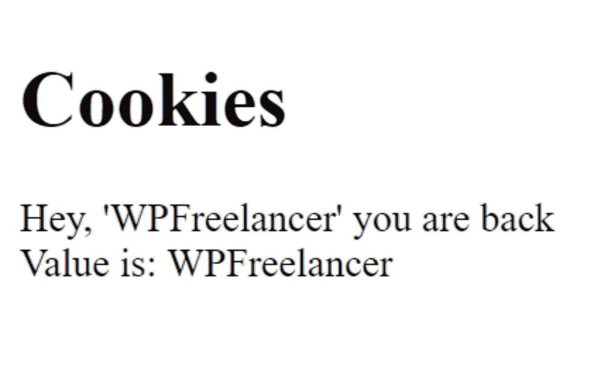 [实时预览](https://phpbootcampdemo.com/php/forms-php/cookies/em1/after)

## 练习 1

[下载练习 1](https://phpbootcampdemo.com/php/forms-php/cookies/downloads/php-forms-php-cookies-ex1.zip)

要求用户在一个页面上输入 cookie 名称，并在另一个页面检查该 cookie 是新的还是旧的。

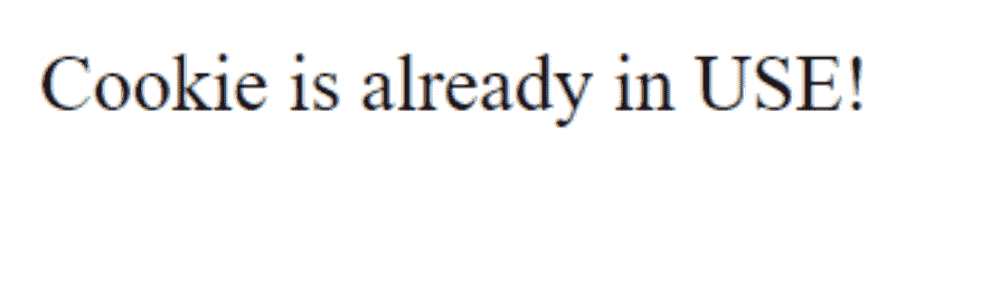 [实时预览](https://phpbootcampdemo.com/php/forms-php/cookies/ex1/after)

## 练习 2

[下载练习 2](https://phpbootcampdemo.com/php/forms-php/cookies/downloads/php-forms-php-cookies-ex2.zip)

在同一页面上添加并检查 cookie。

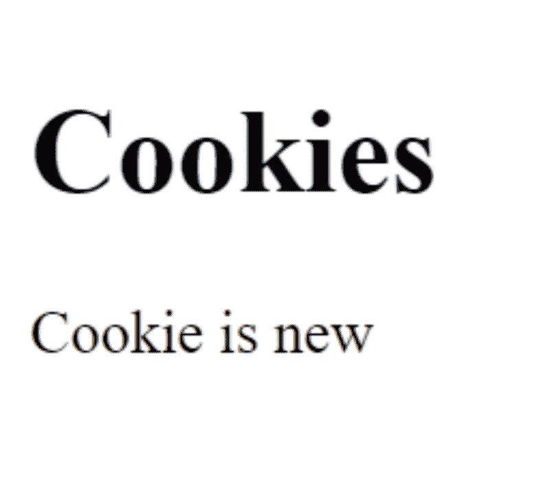 [实时预览](https://phpbootcampdemo.com/php/forms-php/cookies/ex2/after)

# 6.4 Session

## Sessions 的用法

Sessions 是存储在服务器端的一个数组。Sessions id 在用户首次访问网站时生成。Sessions 存储在浏览器中。默认情况下，PHP 使用 cookie 来维护活动会。每当用户发送请求时，浏览器都会将 cookie 传递给服务器。

```php
session_start();
$_SESSION["firstname"] = "WPFreelancer";
if(isset($_SESSION["firstname"])){
    unset($_SESSION["firstname"]);
}
```

### 示例

```html
<!DOCTYPE html>
<html>
<head>
    <meta charset="utf-8">
    <meta name="viewport" content="width=device-width, initial-scale=1.0">
    <meta name="description" content="Page Description">
    <title>Sessions</title>
</head>
<body>
    <h1>Sessions</h1>
    <?php
    session_start();
    $_SESSION["firstname"] = "WPFreelancer";
    echo $_SESSION["firstname"];
    ?>
</body>
</html>
```

---

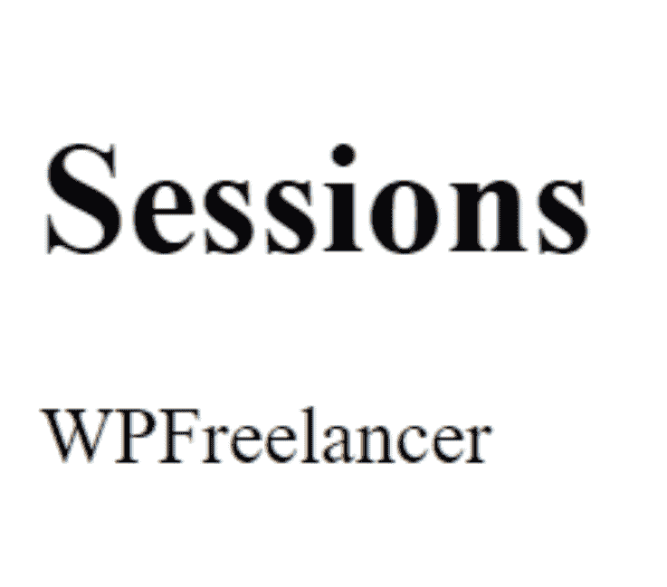 [实时预览](https://phpbootcampdemo.com/php/forms-php/sessions/em1/after)

## 练习 1

[下载练习 1](https://phpbootcampdemo.com/php/forms-php/sessions/downloads/php-forms-php-sessions-ex1.zip)

删除 session 并打印它。

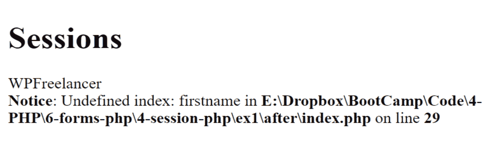 [实时预览](https://phpbootcampdemo.com/php/forms-php/sessions/ex1/after)

## 练习 2

[下载练习 2](https://phpbootcampdemo.com/php/forms-php/sessions/downloads/php-forms-php-sessions-ex2.zip)

创建一个表单并接收 session 值，将其存储并显示。

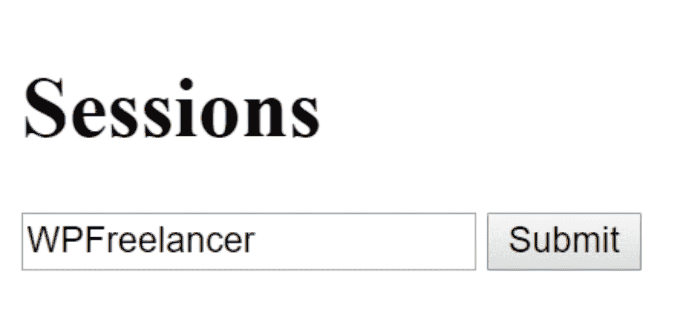 [实时预览](https://phpbootcampdemo.com/php/forms-php/sessions/ex2/after)

# 7 代码片段

## 7.1 Regex

### Regex 的用法

正则表达式是非常强大的搜索模式，用于在文本字符串中搜索匹配。要开始使用正则表达式，我们需要获取斜杠之间的数据，然后对数据使用 `preg_match()` 进行搜索。你创建一个模式，然后使用 `preg_match()` 方法匹配数据。`preg_match()` 方法将返回真或假。

**语法：**

```php
preg_match($pattern, $data)
```

```php
$pattern = '/WP/';
$sitename = "WP Freelancer";
$found = preg_match($pattern, $sitename);
```

**常用模式：**

- `.` – 任意字符
- `\w` – 任意字母、数字或下划线
- `\W` – 任意非字母数字下划线字符
- `\d` – 任意数字
- `\s` – 空白字符
- `\S` – 任意非空白字符

### 示例

[下载示例](https://phpbootcampdemo.com/php/snippets-php/regex/downloads/php-snippets-php-regex-em1.zip)

```html
<!DOCTYPE html>
<html>
<head>
    <meta charset="utf-8">
    <meta name="viewport" content="width=device-width, initial-scale=1.0">
    <meta name="description" content="Page Description">
    <title>Regular Expressions</title>
</head>
<body>
    <h1>Regular Expressions</h1>
    <?php
    $pattern = '/WP/';
    $sitename = "WP Freelancer";
    $found = preg_match($pattern, $sitename);
    echo $found;
    ?>
</body>
</html>
```

 [实时预览](https://phpbootcampdemo.com/php/snippets-php/regex/em1/after)

## 练习 1：针对相同字符串进行区分大小写的搜索。

正则表达式：`$pattern = '/wp/i';`

 [实时预览](https://phpbootcampdemo.com/php/snippets-php/regex/ex1/after)

## 练习 2

[下载练习 2](https://phpbootcampdemo.com/php/snippets-php/regex/downloads/php-snippets-php-regex-ex2.zip)


## 练习 2：在字符串中匹配邮政 `p-104848`

正则表达式：`$pattern = '/p-\\d/';`

 [实时预览](https://phpbootcampdemo.com/php/snippets-php/regex/ex2/after)  

# 项目

## 8.1 保存学生注册表数据到文件

在此项目中，你将编写一个简单的应用程序，用户将输入其详细信息，并在提交后数据将以追加模式保存到文本文件中。

[下载练习 1](https://phpbootcampdemo.com/php/projects-php/project1/downloads/php-projects-php-project1-ex1.zip) 


[实时预览](https://phpbootcampdemo.com/php/projects-php/project1/ex1/after)

**练习 1**：当复选框未被勾选时，上述程序会报错。这是故意设计的。你需要先检查参数是否存在于数组 `$_GET` 中，然后将值赋给变量。在插入之前，使用 `empty()` 方法检查变量是否为空。

**练习 2**：编写一个函数保存内容并将其存在 `functions.php` 中。引入 `functions.php` 文件并调用该函数。

## 8.2 在线测试

在此项目中，你将编写一个包含某些问题的简单在线测试应用程序。用户提供答案后，将立即验证结果。

[下载练习 1](https://phpbootcampdemo.com/php/projects-php/project2/downloads/php-projects-php-project2-ex1.zip) 

[实时预览](https://phpbootcampdemo.com/php/projects-php/project2/ex1/after)

**练习 1**：将 `$_GET` 更改为 `$_POST` 并执行相同的操作。

**练习 2**：在下一个页面显示结果。

## 8.3 在线计算器

在此项目中，你将编写一个简单的计算器应用程序，用户将输入数值，我们的程序将计算各种数学公式。

[下载练习 1](https://phpbootcampdemo.com/php/projects-php/project3/downloads/php-projects-php-project3-ex1.zip) 

[实时预览](https://phpbootcampdemo.com/php/projects-php/project3/ex1/after)

**练习 1**：添加一些数学公式并加入表格中。

**练习 2**：为表格添加一些样式。
