# 区块链学习：深度理解指南

## 什么是区块链

很难想象，一份由神秘人物（或多位人物）编写的 11 页白皮书，对创新世界的影响竟然与互联网的发展相当。但事实确实如此：2008 年 10 月 31 日，一位以中本聪（Satoshi Nakamoto）为笔名的匿名人士发表了一篇名为《比特币：点对点电子现金系统》的白皮书。基于该白皮书中描述理念的产品于 2009 年初开源形式发布。比特币成为了主要的去中心化货币，并开启了加密货币的新纪元。

计算机化的货币世界并没有得到各方的欢迎。企业、立法机构和整个社会将比特币及其每一个子公司贬低为骗局或狂热。从一开始，只有极客本地社区支持比特币，并保持了充足的能量，直到最后，比特币爆发出了无法阻挡的能量，没有任何真实的方法可以阻止它的发展。比特币变成了一种可以比作嘉年华怪胎秀的东西。我记得当我走入一个理性的区域时，被一个宣传着“看世界上最大的马——0.35 美元！”的帐篷所欢迎。我愤愤地对另一半说：“哪个傻瓜会花 0.35 美元去看一匹小马？”但是，种子已经种下了，我脑海中唯一的想法就是：“我不禁在想那只马有多大……？”最终，我花了 10 多美元带着我的爱人离开了那个帐篷。比特币变成了那种“世界上最大的马”。人们冷嘲道：“那又怎样？在地球存在的历史上，从未有过一群完全一无所知或互不信任的神秘成员之间的价值交换，竟然可以在不依赖外部信赖的情况下，通过先进的加密技术获得批准并结算。”随后，人们开始思考……“我不禁在想比特币是如何做到的……？”当人们开始观察比特币帐篷内部时，他们发现了一个被称为“区块链”的想法。顺便一下，`Blockchain` 这个词在中本聪的白皮书中从未被提到。虽然导致 `Blockchain` 卓越的许多特性将在本书后面进行讨论，但其核心组件体下面的定义中：

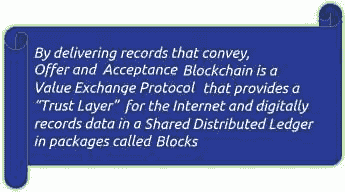*图 1 - 区块链定义

### 定义

这个定义从“什么是区块链”到“区块链如何运作”包含了两个或三个独特的层次。我需要从这个定义中选取一些体现区块链精髓的关键词。第一个词是“提议与确认”。交易和确认是每笔交易的核心部分，它解决了区块链的普遍能力。我需要拆解的下一个术语是“价值交易约定”。创建交易是一回事，但确保该交易的价值和条款在不需要中间人的情况下已知并达成共识，则是另一回事。下一个术语是“网络信任层”。每个人都知道互联网的力量，正如其之上的陷阱。一种能够将信任和确认带到互联网的创新是非常强大的。

现在，定义从“区块链是什么”转向了“区块链如何工作”。在定义的最后部分，我需要剥离的第一个词是“共享账本记录”。代表和结算交易的单调行政中心职能通过 `Blockchain` 实现了机械化。这是区块链获得巨大投资的源泉，也是引发组织好奇心的关键特性之一。最后，我们要观察的最后一个术语简单来说“块（block）”。`Blocks` 是存储交易历史的隔间或容量单元。

在最近描述了区块链是什么之后，通常的反应是“那又怎样？”它真正解决了什么问题？为了回答这个问题，我们不考虑调查一个没有使用 `Blockchain` 技术的普通业务场景，然后我们将 `Blockchain` 引入该场景并记录差异。

图 2 - 没有区块链的业务场景

上面的基本情况显示了许多交易中的典型参与者：代理人、供应商、购买者、银行以及最后的审计员。注意，每个成员都有他们自己的副本记录。当合作开始时，每个成员都有一个框架来跟踪谁做了什么。此外，不同记录的更新方式缺乏一致性，因为毫无疑问，每个成员在更新记录时都使用不同的记账规则。需要审计员作为记录准确的最终确认，然而审计员实际上并没有进入每个成员记录的权限。假设发生了糟糕的情况，会蔓延到整个组织，使每个成员重新验证他们对交易的记账。

现在，如果我们引入一个 `blockchain` 会怎样？以下是类似的业务场景，有类似的常客，只不过这次我们在交易处理过程中嵌入了 `Blockchain`。

图 3 - 带有区块链的业务场景

`Blockchains` 构建了一个包含每个成员的组织，并作为交易和资源所有权的检查系统。交易的唯一副本被存储在一个公共的传输的记录中，该记录在整个组织中复制，因此每个成员几乎在实时拥有完全相同的交易活动副本。从 `Blockchain` 中获得的独特优势是：

1. 共识（Consensus）—— 共识是一种通过 `Blockchain`（而非外部第三方）批准交易的工具。书中有一整部分专门讨论这个主题。
2. 源溯（Provenance）—— 源溯是记录资源的完整历史。这系列经历可以包含特定的质量证明、所有权历史或给定资产的任何其他激励。
3. 不可变性（Immutability）—— 对于所有常用途，一旦区块被添加到 `Blockchain` 中，它就是不可变的。区块链世界中不存在像数据库中那样的更新或删除命令。
4. 无信任（Trustless）—— `Blockchains` 运行在一个“无信任”环境中，参与者在交易中不需要认识或信任对方。

## 区块链的类型

区块链分为两种：公共链和更具私密性的。我们最初应该分析公共区块链的属性。很有可能，你已经了解过 `Bitcoin`，可能还过 `Ethereum`。这两者以及如今商业领域的其他一些项目在使用公共区块链。公共区块链是去中心化的记录。这意味着`ANYONE`都可以加入该组织，你不需要被邀请，也不需要申请加入。公共区块链是匿名的，因此个人不需要揭露身份即可参与其中。此外，公共区块链具有共识机制，这意味着任何人都可以参与批准交易的交互。这为坏法分子尝试更改区块链中的信息打开了大门。这一主题将被广泛介绍。公共区块链是去信任的（trustless）。在开展组织工作时，信任并非至关重要。你不需要认识交易的另一方。而且，公共区块链是我所说的“兴奋的现代生活方式”应用的创造场所。总而言之，公共区块链上的应用是那些以前不存在或不可能存在、但正在被创造的应用——例如加密货币。

现在我们应该平衡一下公共区块链和私有区块链。市场上有一些可以访问的私有区块链。由 `IBM` 支持的 `Hyperledger` 以及围绕货币领域高交易吞吐量中心的 `Ripple` 是两种最广为人知的私有区块链。私有区块链的主要特性是它依赖于许可性记录。谁可以参与该组织以及谁可以批准交易是预先已知的。成员在组织内部应该具有某种程度的信任并欢迎加入。由于私有区块链通常以公司为成员，敏感信息会定期被移至“链外”（off chain），而协议和批准数据将留在区块链内部。例如，两个组织达成协议的方式可以在区块链内获得批准，而协议的真实条款可能被从数据集中移至“链外”。私有区块链用于“重现现有的世界应用”，让旧应用通过区块链技术进行翻新，以获得之前讨论过的处理效率。

## 区块链的优势

总而言之，区块链在任何应用环境中都能提供最高级别的责任归属。区块链通过在多个地点记录交易来确保交易的合法性。首先，交易被记录在主记录中。然后，交易复制到分布式账本系统中。所有组织成员通过共识系统关联，因此在交易被添加到区块之前，会根据交易的价值和条件完成最终结算。区块信息是完成、理想且广泛开放的——这为所有成员提供了信息的视角，从而实现完全透明化。同样，区块链有一种流程，使交易完全按照约定顺序执行，消除了对可信外部者的需求。随后，影响区块链周期绝对是不可能的，而你是在管理一个作为可信外部者的个人时可能会发生这种情况。在任何方面，在区块添加后对其进行更改都是的。这种不可篡改性（Immutability）源于区块的添加方式（附加到区块链的最末端），而不是被修改或删除——任何剩余的信息基础都被视为完整的信息控制。由于去中心化组织没有弱环节，并且能够抵御各种恶意攻击，区块链非常坚固。当最后两个点连接时，其不可篡改性和攻击保护提供了最高水平的信息完整性。

在第一节中，我们讨论了持久性、网络复制以及由信息块组成链等宏大概念。刻画这些思想是一回事，但展示如何实现这些基础原理是另一回事。本节不适合意志薄弱的人。我们将深入区块链内部，从区块级视角来观察区块链如何处理另一个区块的选择，以及区块链如何反对在区块添加后对信息进行非法修改的尝试。所以，穿上泳衣，我们要进去了！

## 什么是哈希

由于区块链在批准交易期间涉及高级密码学，因此了解哈希如何运作至关重要。我们应该通过观察什么是哈希开始讨论。哈希是从一行文本生成的数字。这个数字对于相关的文本字符串是唯一的——可以称之为“高级指纹”。请研究下面的三个模型。

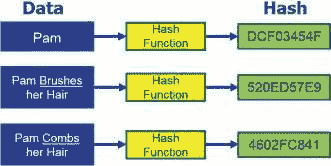

*图 4 - 哈希示例*

每一段信息字符串在经过哈希处理后都会产生一个不规则的键结果。在大多数情况下，生成的哈希值远小于实际文本。在我们第一个示例中，当只有“Pam”文本被哈希时，生成的哈希值比输入的文本大。哈希计算的另一个特性是，生成的哈希始终具有相似的长度，几乎忽略输入哈希文本字符串的大小。由于区块链的原因，哈希结果始终是 32 字节。无论你将美国会图书馆的所有文本通过哈希处理，你都会得到一个 32 字节的哈希结果！

有各种哈希能力可供使用。尽管如此，每个哈希无论其创建它时使用的实际计算，都具有特定的属性。例如，所有哈希在计算上都是高效的，因为确定哈希或确认哈希的合法性都不需要耗费长时间。哈希同样具有抗碰撞性（crash safe），这意味着它们的创建涉及一个方程，使得其他某些文本产生相似哈希的可能性几乎是不可能的。一个 `Hash` 应该隐藏关于创建该哈希的原始文本字符串的信息。总而言之，尽量不要能够通过观察哈希结果中的特征来获取哈希信息的属性。请查看上方图 4 中的第二个和第三个示例。两个字符串之间仅有一个单词的区别——Pam “brushes” 与 “brushes” her hair（梳理头发）。然而，当你分析这两个文本字符串的哈希结果时，生成的哈希之间没有任何关联。而且最后，哈希结果应该给人一种完全随机的印象。假设你分析了两个仅有一个字母区别的字符串生成的哈希，这两个哈希之间将不具有可比性。

## SHA 256

区块链利用的哈希计算之一是 `SHA256`（安全哈希算法）计算。虽然区块链使用了各种哈希能力，但我们在书中模型中将统称为 `SHA-256`。其他哈希计算的总体思路也类似。`256` 指生成的哈希输出中包含的部分数量。显然，`256` 个部分产生一个 32 字节（32 个字符）的结果。请记住，哈希是信息的计算机唯一标记。以下是我将我的姓氏 `T-A-T-R-O` 逐个字母组合时产生的一些真实 `SHA-256` 哈希结果。

请观察每个字符组合时产生的后续哈希：

主哈希仅针对字母 `T`。

接下来的哈希针对两个字母 `TA`，以此类推。

最后，`TATRO` 看起来是这样：

进一步注意，没有任何哈希看起来与之前的哈希有相似之处，也没有易于理解的例子说明哈希结果是如何产生的。同样，假设我再次组合我的名字，我们在通过模型时看到的完全相同的哈希将再次出现，因为这些哈希显著地区分了相关的文本字符串。

## Blocks（区块）

现在我们已经将哈希加入工具箱，我们通过观察存储在区块中的部分数据开始区块链之旅。请参考下图 5：

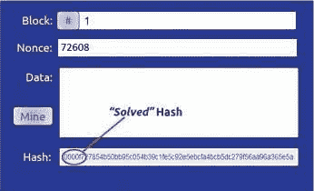*图 5 - 已解决的哈希*

在这个模型区块中，有四个信息字段如下：

1. 区块编号 – 这是一个连续数字，每当向区块链添加另一个区块时就会增加一次。
2. `Nonce` – 用于挖掘系统中的数字，将在几段话中解释。
3. `Data region` – 这是存储区块中交易信息的区域。在我们的模型中，它只包含一些简单数据。
4. `Hash` – 这是包含区块内信息进行 `SHA-256D` 哈希计算的输出结果的信息字段。将与 `nonce` 关联的区块编号、信息区域全部作为字符串参与 `SHA-256` 计算。显示的哈希即结果。

注意哈希的初始 4 个高位字节为 `0000`。这是一种特殊的哈希，表明该区块通过了工作证明（Proof of Work）的关键过程，并交付了一个低于特定难度标准的哈希！在整书中，这种特殊的哈希被称为“已解决”（addressed）哈希。已解决哈希的高位零的数量取决于分配给哈希问题的难度，但已解决的哈希会有一定数量的高位零。

在下方的图 6 中，我在数据字段输入了“Tatro”，有效地更改了该区块代表的数据字符串。

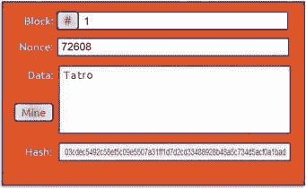*图 6 - 向区块中添加 TATRO*

现在，进入 `SHA-256` 哈希计算的信息字符串包含了区块编号 `1`、`72608` 的 `nonce` 以及名字 `TATRO`（该字符串类似于 `172608TATRO`），以产生另一个哈希。注意，从包含 Tatro 的字符串创建的新哈希通常不是已解决的哈希！为了说明这一点，区块颜色变成了红色。同样，需要注意的是，用于区块工作证明的真实信息与此处显示的信息不同，但哈希函数的总体原理是相同的。

我们如何找回已解决的哈希？这就是 `nonce` 成为可能最重要的因素的地方。如果我在这里继续在 `nonce` 字段中输入数字 `1` [one] 并计算哈希，检查哈希值是否小于难度目标，然后是 `2` [two]，然后 `3` [three]，以此类推……我最终会找到一个 `nonce value`，它在与其他区块数据字段结合提交时将产生一个已解决的哈希。由于我不想物理地重复这一操作，我点击此模型中的 `MINE` 按钮，它将为我完成这个迭代循环。挖掘指的是涉及向组织提区块的方法，这些区块被证明是难以制作的。查看下方的图 7 了解挖掘过程最终发现了什么：

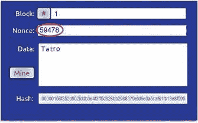*图 7 - 标记的 TATRO*

## 区块是如何形成区块链的？

当区块通过共识后，它们被添加到区块链的末端。注意下方的图 8，区块配置中显示了一个字段。

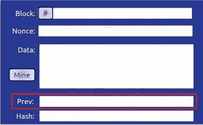*图 8 - 显示过去的哈希信息字段*

新发现的字段是上方红框标出的`过去的哈希信息字段`。`过去的哈希信息字段` 包含了前一个区块在区块链中的证据哈希。这充当了将区块整合到区块链中的连接。考虑下图 9 所示的简单三区块区块链：

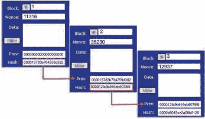*图 9 - 三区块区块链*

首先，注意每个区块的哈希信息字段都有已解决的哈希，因此我们立刻意识到这些区块已被区块链通过。然后，注意前一个区块的哈希被复制到后续区块的过去的哈希信息字段中，有效地将区块连接在一起形成区块链。最后一点是，主区块之前的零证明了它是链中的第一个区块——也被称为“创世纪区块”（genesis block）。

现在将区块链重置为图 9 所示的初始状态。如果在第一个区块的数据字段输入“Hi”，会发生什么？下面的图 11 显示了结果。

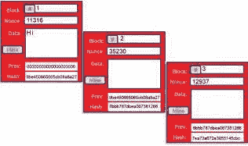 *图 11 - 更改区块链溯源信息引起的链式反应*

哇！这里发生了什么？更改第一个方格触发了跨越区块链的链式反应（意料之中的）！我们应该进行一次缓慢的重放，逐步观察区块链是如何对第一个区块中的信息差异做出响应的。

### 步骤 1：输入“Howdy”改变了方格中的信息，导致哈希重新计算。

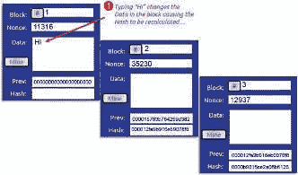 *图 12 - 步骤 1，组合“Hello there”导致区块哈希重新计算*

### 步骤 2：新哈值显然不是匹配该方格的哈希，导致该方格失效。这通过方格变为红色可以看出。

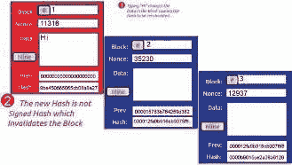 *图 13 - 步骤 2，新哈值完全不是一个匹配哈希*

### 步骤 3：确定的新哈值被刷新到下一个区块的上一个哈希字段中。

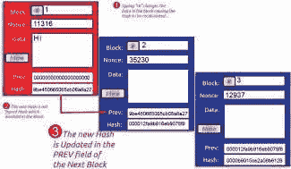 *图 14 - 步骤 3，新哈值刷新到下一个区块的上一个哈希字段中*

### 步骤 4：上一个哈希信息字段的更改改变了区块二的信息，导致方格 2 的哈希重新计算。

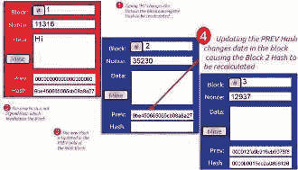 *图 15 - 步骤 4 对上一个哈希的更改导致方格 2 哈希重新计算*

### 步骤 5：区块 2 的新哈值显然不是一个稳定的哈希，导致该区块失效。

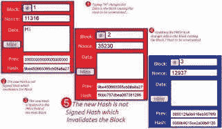 *图 16 - 新方格哈希确定不是一个已解决哈希，使区块失效*

### 步骤 6：对区块 3 重复步骤 3、4 和 5。

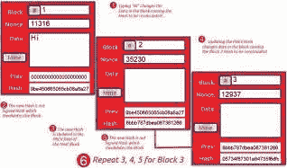 *图 17 - 对区块 3 重复步骤 3、4 和 5*

在看到了如果任何数据元素在事后被更改，区块链将如何崩溃或自我失效的逐步分解后，如果一个聪明的黑客想要更改区块中的某些值，使其在整个区块链中`看起来`有效，会怎样？让我们看看这如何可能实现。

首先，让我们从上一个示例的最终结果开始，如图 17 所示。如果我回到区块 1 并挖掘一个新的随机数（nonce）以获得解决的哈希会怎样？解决的哈希将向前传播到区块 2 的上哈希字段，但会导致区块 2 计算出一个新的哈希。注意，尽管来自区块 1 有一个解决的哈希，但区块 2 新计算的哈希并不是一个解决的哈希。

*图 18 - 在区块一中挖掘匹配哈希*

如图 19 所示，可以对区块 2 和 3 重复挖掘过程，这样所有区块都将被签名并再次看起来有效。搞定！

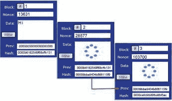 *图 19 - 挖掘方格 2 和 3 以使它们看起来有效*

## 区块链网络的力量

区块链如何工作以确保数据不被篡改？答案在于密码学哈希。区块链中的每个区块都包含上一个区块的哈希，这在区块之间建立了链接。如果区块中的任何数据被更改，它的哈希就会发生变化，从而改变后续区块的哈希。这种效应使得篡改区块链变得非常困难。

此外，区块链是去中心化的，这意味着没有单一权威控制网络。相反，网络分布在许多称为“节点”的计算机上，每个节点都维护区块链的副本。这使得任何单一实体很难控制或操纵网络。

## Token 与梅克尔树

梅克尔树（Merkle tree）是一种用于高效验证数据完整性的数据结构。在区块链上下文中，梅克尔树被用于存储区块中的交易。梅克尔树的每个叶节点都是交易的哈希，然后这些哈希被组合哈希，直到得到单个的根哈希，称为梅克尔根（Merkle root）。

梅克尔根允许用户在无需下载整个区块的情况下验证特定交易是否包含在区块中。这对于移动设备或其他存储和带宽有限的设备特别特别有用。

梅克尔树也被用于共识过程，因为它允许节点快速验证它们是否具有相同版本的区块链。这确保了区块链保持安全和不可篡改。

在这个基础模型中，一个区块中包含四次交易。通常情况下，交易会多得多，但这勾勒了核心思想。发生的主要事件是，每笔交易都会生成一个对应的 `hash`。

然后，每对哈希被合并成另一个`hash`。假设交易数量是奇数，那么在那个点，奇数哈希将与自身合并，从而产生一致的哈希集并生成 Merkle 根（Merkle root）。

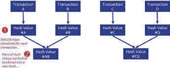

*图 24 - 交易哈希对的处理*

最后一对哈希被合并形成 Merkle 根。

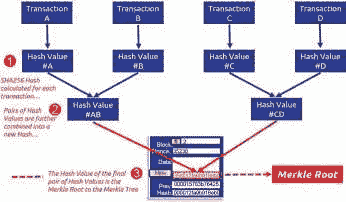

*图 25 - 创建 Merkle 根*

如果没有方块头部中的 Merkle 根，就无法对区块中记录了哪些交易进行密码学确认，也无法验证其内容没有被篡改。

首要任务是，交易本身并不被放入 Merkle 树中，而是交易的哈希。Merkle 树存储了区块中包含哪些交易的密码学确认以及交易的顺序请求。证明“此区块是真实的”的工作量证明（Proof of Work）是基于对所有交易的 Merkle 树输入进行哈希。假设任何交易中的任何一个细节发生了变化，Merkle 根也会随之改变。这包含了对区块中交易请求的任何修改。

最后，Merkle 树提供了几层检查，用于验证单笔交易、确认树结构以及检查区块。

第二章此结束。我们应该继续进入第三章：身份与交易。

# 第三章

# 身份与交易

在第三章中，我们将检查区块链如何识别给定交易中成员的身份。我们还将描述身份是如何产生的以及公钥与私钥之间的关系。

## 什么是数字签名

让我们从定义开始。

关于带有 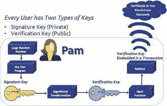

*图 27 - 数字签名创建处理流程*

签名密钥是通过一个极大的数字生成的，该数字通过密钥生成程序处理，并用于数值上推导出确认密钥。关于组织的其他数据以及一个经过哈希处理的更改，创建创建一个组织上不同节点都能看到的位置。你通过你的位置获取到他人发送给你的密码学形式的货币。当进行任何带有检查（“公钥”）密钥的友善交易时，将使用确认密钥来验证客户端。

此时，你可能会问自己：“假设确认密钥是从签名密钥获得的，难道别人不能只创建一个反向密钥生成器，从确认密钥推导出签名密钥吗？”密码学家通过使用确认密钥解决了这个问题，它是一个复杂的数学算法来生成签名密钥；但要“反转”计算以实现逆过程是非常困难的。说实话，世界上最强大的计算机需要超过 40,000,000,000,000,000,000,000,000,000 年才能完成此计算。

签名密钥和确认密钥都是巨大的整数，但由于这些数字如此巨大，它们通常使用钱包导入格式（WIF）进行处理，如下所示的字母和数字：

## 5HueCG8rMjxEXxiP5BDku4MkFq

现在我们明白了数字签名是如何产生的，我们应该观察如何使用数字签名来确认交易。

## 数字签名工作流

让我们检查消息是如何被处理的，以及数字签名何时发挥作用。参考下面的图 28：

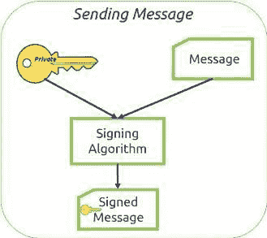

*图 28 - 发送高级消息处理流程*

在消息的发送端，要发送的消息以及源的标记（私钥）密钥用于标记计算。结果是根据消息和签名密钥生成的标记消息。

图 29 显示了消息接收端发生了什么。

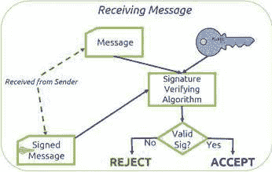

*图 29 - 接收高级消息处理流程*

在消息的接收端，标记消息和原始消息从发送者处发送。它们与在创建消息时植入的确认（公钥）密钥结合。这三个部分共同用于标记检查计算。标记检查结果可能判断标记消息是否真实——它并不会泄露私钥！这样，如果消息是真实的，消息就会被确认。任何情况下，消息会被拒绝。

## 数字签名的优点

计算机签名的优势之一是将标记与实际消息结合，并在循环开始前对消息进行哈希处理。通过将标记密钥限制在消息中，实际消息成为了标记的必经之路。这与传统的转录标记完全不同，后者在不同报告之间从不显示出任何变化的迹象。你每次编写标记时，标记都是非常相似（或相同），并且与你所标记的存档的细微之处丝毫不相干。通过计算机签名，每对消息/签名都是独有的，这使得伪造变得变得困难得多。

在应用标记之前，消息会不断进行哈希处理。请记住，哈希输出始终为 32 字节，这使得消息标记循环更加简单。在应用标记密钥之前先对消息进行哈希，编程系统得到了简化，因为软件工程师意识到他们将永远拥有一个固定长度的 32 字节字符字符串来处理，而不是一个长度不明的可变消息行。

## 区块链身份 (BlockchainID)

区块链身份（或`Blockchain ID`）是一个非排他性术语，指的是区块链上的任何角色。客户端可以根据选择拥有任意数量的区块链身份，并注册这些身份，就像在 LinkedIn 或 Instagram 上注册账户或在互联网上注册空间名称一样。

区块链身份与其他辅助工具记录之间的根本区别在于，基于区块链的框架具有强大的所有权。区块链角色无法被任何服务夺取，因为框架将所有权定义为对公/私密钥对的责任，非常就像对比特币的责任一样。这与 LinkedIn 或 Instagram 用户名直接不同，后者可以随时被特定公司夺取或控制。

## 比特币交易示例

为了看到计算机签名如何在真实交易所中工作，我们将观察比特币交易所并注意高级标记所扮演的角色。在这个模型中，我们有两个成员，Pam 和 Bob。Pam 需要将 500 个比特币转给 Bob（幸运的 Bob）。将此交易所视为一方（在本模型中为 Pam）向另一方（在此情况下为 Bob）移动比特币的精心标记的演示。在交易的双方，你都有 Pam 和 Bob 的公钥和私钥。请看上面的图 30 查看交易设置。

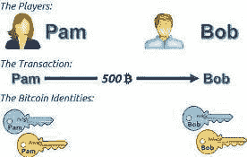 *图 30 - 比特币交易所设置*

现在我们已经知道了参与者是谁以及交易的理想结果是什么，我们应该观察一下其运作机制。

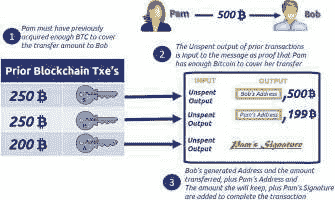 *图 31 - 比特币交易流程图*

请看上面的图 31 查看处理比特币交易的流程。交易所的初始阶段是 Pam 应该最近获得了足够的比特币，以覆盖她需要转给 Bob 的 500 个。注意区块链交易所表，Pam 总共从三个独立个人（通过他们的确认密钥识别）处获得了 700 个比特币。沿着此线，显然 Pam 拥有足够的比特币余额来覆盖向 Bob 交换 500 个比特币。

流程的第 2 步是产生 Pam 现在想要花费的过去交易中未花费“收益”的验证。未花费的结果随后作为证据贡献消息，证明 Pam 有足够的比特币来覆盖她向 Bob 的交易。在比特币交易所中，这些信息应该始终接近交易的结果。因此，在这个模型中，由于 Pam 贡献了 700 个比特币，结果应该以某种方式分若干比特币。消息的结果侧显示 Bob（通过其公确认密钥生成的地址识别）收到了来自 Pam 的 500 个比特币转账。你永远不会直接向公钥发送比特币，而是锁定比特币，以便你发送硬币的地址所标识的公钥允许以后任何时候花费并将其发送到其他地方。同样，199 个比特币正在转回（或由 Pam 保留）。假设你在 199 的基础上增加了 500，你只得到了 699 个比特币。我们明确意识到信息应该接近结果。在我们开始的 700 个比特币中缺少了一个比特币……这个“丢失”的比特币将被确认该区块为交易处理的矿工获得，作为交易处理费用。最后，为了完成交易，Pam 利用她的私标记密钥在消息哈希中创建一个标记，并为该交易记住它。

在交易经过检查并与不同的交易打包成一个区块后，它将被传输到区块链网络上的不同节点，以便每个人都可以刷新他们的区块链传记账本副本。

## 第 4 章

# 获取共识

在这一部分中，我们将描述“什么是共识？”以及哪些考虑驱动了不同的共识算法。此外，并将彻底分析第一个共识算法——工作证明（Proof of Work）。区块链内部这种单一的共识能力是它为处理领域的最卓越能力。在整个记账的历史中，未知成员之间有价值的交换从未能够在不包含受信赖第三方的情况下，使用先进密码学获得批准和结算。区块链中整合的共识系统有效地将结算中的政治问题转化为数学问题。

我们应该从一个定义开始讨论共识： *图 32 - 共识定义*

## 通用共识方法

通常情况下，通过主观信任实现共识的算法很大程度上需要在已知成员集合中进行某种投票。区块链技术已使用了两种通用方法。主要方法是“针对内部故障的拜占庭适应”，随后的方法是通常被称为“中本共识”算法的方法。

通过“针对内部故障的拜占庭适应”方法，需要在成员之间进行多轮投票，直到对区块有效性达到特定的认可水平。

中本共识实际上是针对某些显著对比的非关键故障的功能性拜占庭适应。在中本共识中，通过某种“抽签”选出领导者。例如，在比特币中，第一个有效解决密码谜的成员赢得领导者竞选抽奖。

## 投资

第一个元素是矿工或验证者需要投入的投资水平。潜在的验证者或矿工为了能够处理交易和验证区块需要投入什么？例如，如果使用比特币的`Proof of Work`（工作量证明）方法达成共识（我们将在几页后详细介绍），则需要对专用硬件进行前期投资，并持续投入大量电力来解决由名为`hash`的数学函数组成的谜题。这项任务简单但极其重复，因此计算成本很高。计算机通过竞争来寻找具有特定属性的`hash`。第一个找到答案的矿工——即他们已完成必要工作的证明——将被允许向区块链添加一个新的交易区块。其他共识方法，如`Proof of Stake`（权益证明）或其他`Proof of Work`实现，对处理资源或电力消耗不会产生同样的压力。而且，由于验证者/矿工必须投资才能参与，那么需要什么样的激励来使验证者/矿工的利益与区块链网络的最佳利益保持一致呢？通常，通过交易费、新铸代币或两者来激励验证者/矿工诚实行为。

## 选择领导者

接下来是考虑如何从验证者/矿工池中选择领导者（验证者/矿工）。大多数共识方法涉及某种抽签机制，随机选择矿工或验证者来提交区块并最终添加到区块链中。其他协议策略利用粗略的决策并对选定的成员进行协作选择。有几种不同的方法论需要考虑，我们将在书的后后部分详细描述各种协议计算时，通用地介绍这些方法。

## 证明元素

将使用哪种证明元素？图 33 显示了你可以选择的部分列表。新的验证方法不断提出，因此这在程度上是一个动态目标。我们将在课程的后续章节中详细介绍其中的每一个项。

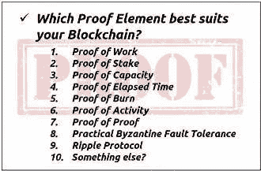

图 33 - 可用验证元素的部分概述

## 信任水平

最后一个组件是你的组织中存在的信任程度。假设你看一眼`TrustO-Meter`（信任计量表），你会发现它显示了一个介于数学和政府问题之间的刻度。按照原则，区块链用数学取代了处理交换的政府问题。该组织将成为一个完全去信任的组织，就像公共区块链的情况吗？如果是这样，你可以完全依赖数学来检查交换。图 34 显示了公共区块链的`Trust-O-Meter`读。注意红球尽可能地位于读数的数学一侧。

图 34 - 公共区块链的 Trust-O-Meter 查看

另一方面，假设该组织是私有的，由信任的成员组成，`TrustO-Meter`可以缩小对所有数学处理的需求，并公平地依赖于组织内部的信任。考虑到所有因素，红球将尽可能偏向`TrustO-Meter`的法律问题一侧。

### 不同共识算法的目标

每种独特的协议技术都有特定的目标，这些目标驱动了协议计算的运行方式以及消耗哪些资产。协议计算还会考虑四个额外目标：

1. 性能

2. 可扩展性

3. 针对潜在外部攻击的威胁防御

4. 失败模型

### 性能

某些利用区块链的应用程序需要更高的吞吐量来处理更大规模的交易。例如，比特币区块链每个周期仅处理六次交换，这对于高量应用来说延迟太大了。其他区块链利用不同的协议计算来实现更好的性能。

### 可扩展性

接下来是通用性，其理念是：取决于应用程序，支持更多数量的并发客户端是选择协议算法的考虑因素。

### 威胁防御

区块链应该考虑各种风险模型，以获得抵御攻击的选择。假设攻击无法被完全阻止，区块链需要使发起攻击的成本高于其作为区块链公平挖矿者/验证者的预期收益。例如，工作量证明机制充分保护了区块链环境免受“51%攻击”。这种观点是，如果一个程序员的处理能力超过了组织总处理能力的一半，他们就可以质疑并提交处理数学伪造的区块，这在他们负责期间可能需要考虑双倍支出或不同的异常。这在当今的比特币领域是一个奢侈的假设，而且考虑到所有因素，是不可能的。

我们在这里注意到的另一个模型是“女巫攻击”（Sybil Attack），即通过在区块链矿工/验证者池中伪造身份来破坏受信任框架。再次，这可能给程序员带来被选为区块验证者的倾斜，并向区块链引入虚假区块。有几种不同的攻击方式且新的攻击不断出现，但破坏此类攻击是每个协议算法的考虑。

### 失败模型

最后，由于区块链跨越组织运行，节点故障可能是组织处理的常见结果（而非由于恶意攻击）。区块链应该能够承受特定数量此类故障。通过对内部故障协议计算的合理拜占庭适应，可以承受高达 33% 的节点故障，同时框架可以继续正常处理区块。

现在我们已经知道了协议计算的考量和目标，我们应该开始对不同方法进行详细评估，并从工作量证明开始，这是 Satoshi Nakamoto 白皮书中的第一个协议计算。

## 工作量证明

再次，我喜欢从定义开始这个主题的讨论。见下图 35：

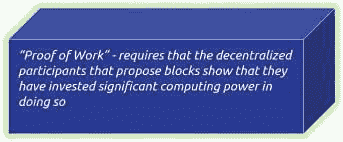

图 35 - 工作量证明定义

工作量证明要求提议区块的去中心化成员证明他们在这样做时投入了巨大的处理能力。你将在第一章中讨论“挖矿”时回顾过“随机数”（`nonce`）的概念。我们应该研究挖矿过程。

## 挖矿工作量证明

挖矿系统的初始阶段是确定目标哈希。目标哈希受框架给出的难度因子影响并用于目标哈希估计。挖掘方法的另一个贡献是区块头信息，它包含 Merkle 根、时间戳、版本、前一个区块哈希、随机数和 nBits 难度，这些共同构成`SHA256D`哈希计算并产生哈希。然后查看这两个哈希：目标哈希和由`SHA256D`产生的哈希。见下图 36 并注意这些步骤。

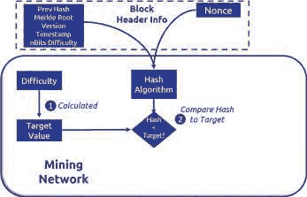

图 36 - 工作量证明挖矿过程的输入

生成的哈希值小于目标哈希值吗？如果答案为`no`，则`nonce`加 1，并将带有新`nonce`值的所有相同数据重新输入哈希算法。只要后续的哈希值评估高于目标哈希值，这种`nonce`递增和另一个哈希值的获取就会循环进行。最后，某个价值的`nonce`值与其他区块信息混合后，当工作量证明难题解决时，将产生一个不完全等于目标值的哈希值，矿工由此获得奖励。图 37 显示了比较`SHA256`哈希与目标哈希值的逻辑循环。

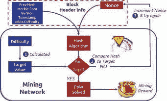*图 37 - 检查创建的哈希值与目标哈希值*

出于交易所稳定性和低休眠性的考虑，该组织尝试定期发布一个区块。因此，每隔 2016 个区块（假设这个十分钟产生一个区块的目标无无执行，则需要两周），每位比特币客户都会查看产生这些区块所需的实际时间与十四天的目标进行比较，并根据速率差异调整难度系数。这使得工作量证明问题变得更加困难或更加容易。为了防止难度的过大调整，单个目标的变化从不会超过四个元素的幅度（无论是向上还是向下）。这是比特币工作量计算验证如何运作的范例。其他工作量证明区块链具有不同的边界和不同的难度算法。

### 工作量证明工作流

由于交易被汇组成区块链上的区块，工作量证明流程如图 38 所示。

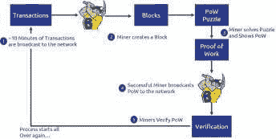*图 38 - 工作量证明流程图*

1. 第一步大约每 10 分钟发生一次，聚合的交易被通信并排序。这并不是一个连续的循环，当矿工开始处理一个交易区块时，每一个交易都要等待 10 分钟以等待下一组交易。不断演变的交易“内存池”（`mempool`）（以及每个节点`h`独一无二的内存池）加载了大量但未确认（尚未放入区块）的交易。矿工利用这些（可能包括来自`h`之前的交易）中符合预设区块大小（目前比特币为 1MB）的交易，并尝试挖掘一个区块。

2. 接下来，矿工制作一个区块，并开始尝试计算出一个不完全等于目标哈值的确认哈希。3. 最终，矿工挖掘出哈希以解决工作量证明难题并展示工作量证明。

4. 第 4 步是有效的矿工将工作量证明通信给包含不同矿工和其他标准用户的整个网络。

5. 在第 5 步，矿工检查交易并通过将区块添加到其区块链副本的最末端来确认工作。然后，循环再次从头开始。

上面的模型展示了工作量证明如何应用于比特币。其他工作量证明执行考虑不同的边界，并因此表现不同。

### 工作量证明真的与共识有关吗？

对于任何分布式框架的正常运行，你应该预期在某种程度上有一半的成员是好意的。问题在于，你完全不知道谁是捣破坏者，谁是英雄。尽管如此，有了区块链，这并不重要，因为无法知道谁将是幸运的矿工，有超过一半的可能性它是一个真实的成员。`然而`，这目前还不是共识。组织是如何决定有效交易和区块的？

让我们来看一个组织如何在区块通过工作量证明通过过程中响应的示例。查看下面的图 39 以了解共识过程是如何运作的。

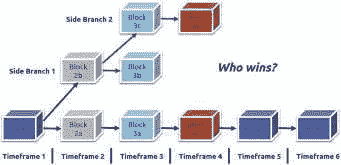*图 39 - 寻找共识最多的区块链*

首先，我们看到区块 1 在第一个时间段被添加到区块链中。然后，区块 2 被添加到区块链，但有多个矿工在相似的时间内处理了工作量证明难题。这导致了“侧链 1”的产生，直到哪个矿工的区块副本获得共识仍然悬而未。注意，在时间段 3 中，三个区块在相似的时间被添加，产生了随后的侧链。在第四个时间段，另一个区块被添加到第一个区块链和随后的侧链。最后，在时间段 5 和 6 中，两个新区块被添加到第一个区块链，使其扩展了六个完整区块。哪个版本的区块链获胜了？下方的图 40 说明了在这个例子中共识如何悬而未。

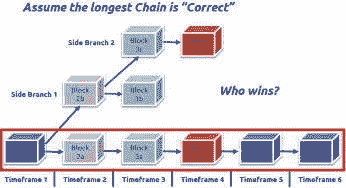*图 40 - 寻找共识最多的区块链*

具有最多工作证据的区块链（或侧链）被认为是正确的区块链！本质上，在向区块链添加区块时，可能会发生两种情况：

1. 区块进一步扩展了主链（Main Branch）。

2. 区块扩展了侧链并可能：

    a. 未增加足够的难度来使侧链成为主链。

    b. 以如此大量的工作确认扩展侧链，使其成为新的主链。

基本上，共识属于包含最多工作量的分支。

这结束了我们对共识和工作量证明共识计算的审核。在第 5 章中，我们将深入探讨非关键故障的实用拜占庭容错细节以及权益证明共识算法。

# 第 5 章：实用拜占庭容错与权益证明

在最近完成了对驱动共识的思想分析以及工作量证明如何运作细节的研究后，第 5 章将详细介绍实用拜占庭容错策略以及一个著名的： Ripple 协议。

# 全球各国能源利用排名

更多信息请访问：https://hothardware.com/news/ethereum-and-bitcoin-energy-utilization-outperform-whole-nations-powerbudgets#OYUxih12izXScRA0.99。

`AS` 的成本以及运行它们的能量需求，是开发工作证明（Proof of Work）替代共识机制的主要因素之一。

## 工作证明的感知问题

正如我们在第 4 章中学到的，工作证明在数量上通过增加随机数（`nonce`）并对哈希进行迭代来提高，以尝试观察到产生价值低于目标价值创建方法的哈希，这些方法就是框架。这种机制的反应是：

1. 这需要持续、不断地使用资源，框架才能正常工作。
2. 解决工作证明难题增加了每笔交易的处理时间。你可能记得，框架试图将区块处理时间精确地保持在十分钟。
3. 无论是否有人干涉，工作都必须完成。工作证明（Proof of Work）并不是为了攻击或类似操作执行的；它是针对每个区块执行的。
4. 有人需要为矿工的工作支付报。矿工报酬通过交易费用和最近打印的代币获得。
5. 无论是否有人攻击区块链，都必须向挖掘者支付报，这似乎是低效的。

这些都是工作证明的明显问题。我要说明的是，这些是在特币中执行的工作证明计算中看到的问题。目前许多不同的组织（如 `Ethereum`）目前使用一种工作证明哈希计算，这种计算在买家的 `CPU`、`GPU` 和 `FPGA` 上应该是可行的。在这些方面，它们消耗的资源明显少得多。因此，尽管工作证明共识策略促成了前所未有的、检查互不信任的双方之间未知交易的能力，但随着方案的不断产生，工作证明极有可能变成“无用证明（Poof of Work）”并从区块链处理中消失。让我们来看一种可选的共识机制，即针对内部故障共识算法的实用拜占庭变体。

## 拜占庭将军问题

实用拜占庭容错算法是处理拜占庭将军问题的一种方法。在拜占庭将军问题中，一群军官（每位负责指挥拜占庭军队的一部分）包围了一座城市。在下方的图 41 中，你可以看到军官们包围了一座宫殿，更具体地说，是一座白色宫殿！这些将军希望为进攻城市制定方案。在最简单的结构中，军官们只需选择进攻还是撤退。一些指挥官可能想进攻，而另一些则想撤退。关键点是每个人的表现必须保持一致，因为少数指挥官的欺骗性进攻将变成一场灾难，结果将比计划好的攻击或有组织的撤退更糟糕。

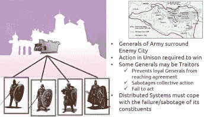

*图 41 - 拜占庭将军问题*

由于少数军官可能是背叛者，可能会选择一个不完美的程序，问题变得更加复杂。或者，叛徒可能在与部分军官交流时投赞成，而在与另一部分交流时投出反对票。例如，如果有九位军官投票，其中四人支持进攻，另外四人支持撤退，那么第 10 位将军可能会向那些撤退的指挥官发送撤退票，向其他人发送进攻票。撤退的人（对攻击者是有有利的）。由于军官们在地理上是孤立的，需要通过信使发送投票，问题变得更加复杂。信使可能会增加额外的困难，因为他们可能会忘记传递投票或可能伪造投票。

为了将拜占庭将军问题应用到全球记录的区块链网络，模型中的“指挥官”是参与分布式区块链组织的节点。信使从第 10 位将军那里获得了一张撤退票，而其余的将进攻（这将导致区块链组织中的连接不一致）。“忠实军官”的总目标是选择承认提交到区块链的交易是否合法，并通过实质性区块扩展区块链。忠实的军官致力于确保区块链的完整性，从而确保正确的数据被认可。而阴险的指挥官则是任何试图在区块链上误造数据的方。这样，框架需要处理意外的节点故障（恶意的信使或未能传达消息的信使）以及类似于阴险将军的成员潜在直接破坏。

## 实用拜占庭容错共识机制

实用拜占庭容错是工作证明的另一种共识选择。实用拜占庭容错计算确保了尽管可能存在少数恶意节点，组织中的大多数诚实节点也会选择相同的策略。实用拜占庭容错可以防止各种风险，例如不同组织节点的随机同步节点故障（一个拜占庭问题）或针对不可信节点的恶意行为。使用这种方法，一个拥有 `N` 个节点的区块链组织可以忍受 `f` 个拜占庭节点（无论是通过欺诈还是节点故障），其中 `f = (N-1)/3`。或者换一种说法，实用拜占庭容错可以承受 33% 的故障并继续正常运行。上述算法的另一个方面是，它确保了至少 67% 的节点在交易的合法性和请求之前达成共识。图 42 显示了使用实用拜占庭容错作为共识机制的区块链处理流程。

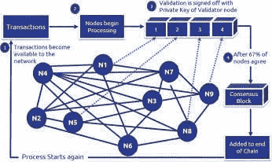

*图 42 - 实用拜占庭容错流程*

1. 首先，交易变得可处理。
2. 节点开始对交易进行验证。
3. 红线显示，当每个节点完成验证过程时，会返回用该节点私钥签署的响应，标记特定节点对区块的认可。
4. 一旦收集到足够的响应（这将来自节点），就会构建一个共识区块并添加到区块链末尾。然后，循环将重新开始。有多种方法可以处理实用拜占庭容错共识策略。我们应该研究 Ripple 协议共识算法并了解它是如何不同的。

## Ripple 协议共识方法

Ripple 协议提供了实用拜占庭容错共识策略的选择类型。Ripple 协议由 Ripple Labs 创建，其目的是在全球范围内无缝且快速地移动货币和支付。Swell Labs 需要发明一种比工作证明更快、更高效的组件，因此他们的目标包括：

- **降低延迟**：通过使用一种名为 `Unique Node Lists`（唯一节点列表）的完全信任网络，Ripple 可以缩短达成共识的时间。回看第 4 章，在建立共识方法时的各种权衡考虑因素。Ripple 协议是专门针对支付系统优化实用拜占庭故障（`BFT`）的示例，以提高交易处理的吞吐量。
- **克服分布式支付框架面临的三大主要困难**：
  - **正确性**：在不与信任的第三方通信的情况下，区分正确的交易和欺诈交易。
  - **共识**：维护一个单一的全局真实的区块链捕获。
  - **实用性**：改进框架的通用性，使交易能够处理得非常快，而不是像传统系统移动资金那样花费几天时间。

## 唯一节点列表（Unique Node Lists）

内部故障的实用拜占庭适应与 Ripple 协议之间的一个重要区别在于存在唯一节点列表（`UNL`）。在 Ripple 协议中，枢节点被汇组成 `Unique Node Lists`。下方的图 43 显示了 Ripple 协议如何将 `Validator`（验证者）节点组拆分为 `UNLs`。

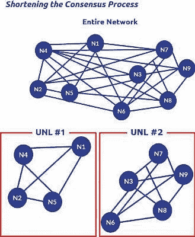

*图 43 - 将枢节点拆分为新的节点列表*

`Unique Node Lists` 具有以下特征：

1. 每个服务器都维护自己的 `Unique Node List`。
2. 只有来自 `Unique Node List` 中不同个体的投票会被考虑达成共识。这是一个非常基础的点。通过减少需要执行共识的枢节点数量，检查交易的时间缩短了！
3. 节点可以在多个 `Unique Node List` 中位置。因此，每当我们向模型添加第三个 `UNL` 时，枢节点 1 和 7 也可以成为该 `UNL` 的成员。
4. 显然，构成 `Unique Node List` 的成员信任不会合谋欺骗网络。

## Ripple 协议流程图

请参考下方的图 44 查看 Ripple 协议共识算法涉及的步骤。

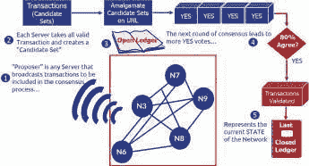

*图 44 - Ripple 协议协议计算流程图*

1. 第一步，测试中的 `Unique Node Lists` 之一 `UNL #2` 通过向网络通信用于共识周期的交易来转变为“提议者”。
2. 接下来，每个服务器都获取每一个合法的交易并创建一个用于处理的“申请者集”（applicant set）。
3. 竞争集在提议者的 `Unique Node List` 上合并。在交易处理共识期间，提议者的 `UNL` 记录被视为“开启”。
4. 提议者 `Unique Node List` 内部的枢节点批准交易，并在候选集的合法性上注册其决议。假设尚未达到基本票数，将继续进行额外的投票，直到获得达成共识所需的最小票数。根据 Ripple 协议，应有 80% 的 `UNL` 批准交易以达成共识。假设 80% 的枢节点没有批准申请集，则需要再进行一轮投票。最终超过了 80% 的阈值，待执行的交易集就会在开放账本中获得批准。
5. 在此周期开始时“开启”的 `UNL` 记录现在已“关闭”。Ripple 网络中最后一个关闭的账本被认为是区块链的当前状态。一些人认为 Ripple 协议是基于 `Proof of Auth` 的，因为特定的节点（`Unique Node List` 的成员节点）被赋予验证交易的权限。注意，Ripple 协议并没有将交易保存到区块中，而是将最后一个关闭的记录作为区块链的当前状态。由于这个原因，某些人认为 Ripple 不是区块链。

非关键故障的实用拜占庭适应和 Ripple 协议是解决拜占庭将领问题的共识方法的两个示例。然后，我们将查看权益证明（Proof of Stake）。

## 权益证明（Proof of Stake）

见图 45 权益证明的定义。

*图 45 - 权益证明定义*

权益证明是工作证明（Proof of Work）共识计算的一种替代方案，在后者中，以确定性的方式选择下一个区块的生成者，取决于生成者对区块链的持有量或利益，也称为“权益”（stake）。权益验证（Verification of Stake）实际上是某些密切相关的共识协议的分类，某些变体将在本书晚些时候详细介绍。正如我们所看到的，权益证明通过要求所有验证者都向其工作的区块链中投入资源，来调整验证者的目标以确保交易的诚实。使用权益证明的区块链实例包括：Peercoin、Neucoin、Blackcoin、OK Cash、Diamond Coin。

## 权益证明与工作证明的区别

由于权益证明和工作证明是两种广为人知的共识策略，因此逐点进行对比并注意两者之间的主要区别至关重要。见图 46 的简要比较。

*图 46 - 工作证明与权益证明的比较*

1. 第一类比较是验证区块时投入的资本投资？在工作证明中作为矿工参与，我们和验证者必须花费多少投资？正如第 4 章中比特币示例所示，工作证明在 PC 和运行此类硬件的电力能力上投入了巨额。据估计，每年仅挖矿网络就花费了超过 4 亿美元。另一方面，权益证明验证者所做的投资是其持有的代币。
2. 下一个想法是“谁完成了工作？”在工作证明中，你有“矿工”通过解决复杂的数学题来被选择将区块添加到区块链。在权益证明中，你有“验证者”来验证要添加的区块。
3. 挖掘者和验证者是如何被选出的？我们在第 3 章中了解到通常存在某种类型的随机选择过程作为共识策略的一部分。在工作证明中，解决数学题的主体被选择将区块添加到区块链。在权益证明中，验证者通常依赖于一种加权的随机选择计算。选择的权重部分来自于你对代币的投资程度——你持有的代币越多，在确定交互中的权重就越大。跨各种权益证明的形式，有不同的指标来确定特定“验证者”的“权重”。
4. 最后一类类别是执行共识策略消耗了多少资源？这里涉及到驱动因素。工作证明消耗了巨大的能量，相比之下，权益证明只消耗少量的电力。

请参考下方的图 47，该图描述了权益证明（Proof of Stake）的流程。

*图 47 - 权益证明流程*

1. 首先，交易将开放以供系统处理。
2. 接下来，必须选择一个验证者来验证交易。这是通过随机抽签实现的。注意，可能的验证者池显示了许多巨大的红色“V”。这个数字是每个合法者根据其对社区代币的兴趣（持有量）决定的权重。接近 1 的 `V` 在验证者抽签中被选中的几率是接近 100 的 `V` 的十倍。将验证者池中的所有 `V` 想象为对于他们贡献的每种用于验证的社区代币都获得一次参与抽签的机会。在图 47 ab 中，贡献了 1000 个代币的验证者是处理此区块的抽签获胜者。
3. 一旦根据不规则的权重抽签选出验证者，该验证者就有一个特定的时间范围来批准交易区块。这由框架指定了长时间。每个验证者都有自己可以挖掘区块的“时间”。例如，一个验证者可能在 `t + 1` 时刻挖掘区块，而另一个验证者直到 2 分钟后才能挖掘。假设第一个验证者断开连接或在任何情况下忽略了挖掘区块，第二个验证者可以在 `t + 2` 分钟时挖掘区块，依此类推。相应的，所有可能的验证者都被推后了，他们应该在尝试挖掘区块之前至少等待该段延迟。
4. 时钟将验证验证者是否在分配的时间内完成了处理。区块是否生成了？如果回答为否，则由另一个验证者开始处理。新的验证者在分配的时间段内确认区块。假设他们完成了确认，区块将被添加到区块链的最远端。然后，循环将从头再次开始，处理下一组交易。

## 权益证明的问题

不同的权益证明框架存在一些问题如下：

1. **主观性（Subjectivity）**——权益证明被视为一种主观性约定，因为不同的节点可能会对区块链的当前状态得出不同的结论，参与其中需要大量的社会信息（即声誉）。相比之下，工作证明（Proof of Work）是*客观的*，因为一个进入网络的新节点除了协议定义、所有区块集和已发布的“重要”消息外，一无所知，也可以独立地与网络其他部分对区块链当前状态得出完全相同的结论。正如我们在当前状态中所采取的那样，状态（或分支）是贡献工作最多的那个。关于微弱主观性的深入讨论已超出了本书的范围。关于此问题的精彩文章，通过与以太坊组织者之一 Vitalik Buterin 的联系，可以在此处找到：

   https://blog.ethereum.org/2014/11/25/proof-stake-learned-lovefeeble-subjectivity//

2. **经济集中化（Economic Concentration）**——货币基础和其他地区的代币积累（类似于交易））对接受或拒绝约定的更新具有控制权。这些拥有集中属性的群体使用他们的“权益”来在区块链上施加意志。
3. **无风险问题（Nothing-At-Stake）**——在权益证明算法中，验证者投票是免费的，因此当面对不同的侧链分叉时，简单地倾向于循环中出现的多个侧链选择而不会受到惩罚。

还有许多其他共识算法和确认检查。我们将在第 6 章中分析其中的几个。

# 第 6 章：其他证明机制

第 6 章将介绍其他证明组件。本节中的确认不像工作证明和权益证明那样被广泛使用，但它们提供了获取共识的各种方式，并对如何培养这种能力提供了一些独特的见解。特别是，将涵盖以下证明机制：

- 耗时证明（Proof of Elapsed Time）
- 活动证明（Proof of Activity）
- 燃烧证明（Proof of Burn）
- 容量证明（Proof of Capacity）

## 耗时证明（POET）

我们将的首要替代确认机制是耗时证明。图 48 给出了耗时证明的定义。

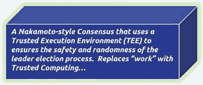

*图 48 - 耗时证明定义*

耗时证明是一种中本式的共识，利用可信执行环境（`TEE`）来确保先驱政治竞争过程的健康和随机性。可行的是，它将“工作”替换为注册的信誉。耗时证明的特点是：

1. 这种证明技术由巨型芯片制造商 Intel 支持，作为其 Sawtooth 区块链驱动参与 Hyperledger 项目联盟的一部分。
2. 耗时证明应该在 `TEE` 中运行。可信执行环境是处理器芯片本身的一个受保护空间。它确保了堆栈其中的代码的分类和可信度。Intel 提供的是软件防护扩展，或 `SGX` 芯片。
3. 耗时证明利用的是验证者，而不是矿工，类似于权益证明。
4. 耗时证明利用的证明是合法者持有预定的时间范围，而不是像工作证明那样解决数学谜题。耗时证明与工作证明相比的一个可能结果是矿工/验证者进行投资的方式发生了变化。

让我们研究耗时证明处理交易的流程。

## 耗时证明流程

系统从交易开放处理开始。应该进行一次抽签以随机选择验证者。在图 49 中，每个验证者都显示为巨大的红色“V”。注意到 `V` 附近是 Intel 的标志，因为每个验证者应该在 Intel `SGX` 处理器的可信执行环境中运行。

*图 49 - 耗时证明抽签机制*

每个验证者都向框架请求随机的等待时间。等待时间需求是 `TEE` 中的“受信工作”。拥有最短等待时间（即特定区块的最佳机会）的验证者被选为先驱。在上面的图 49 中，这是图中最左侧的验证者。

一旦选定验证者，请看下方的图 50 获取耗时证明流程的其余步骤。

*图 50 - 耗时证明流程*

1. “制作时钟”工作为交易区块产生时钟，确保其分配给领导者且已在 `TEE` 内部建立并匹配等待时间。
2. 随后启动“实际查看时钟”工作，验证该时钟确实是在可信执行环境中制作，并验证时钟是否过期。
3. 一旦时钟过期，检查时钟工作将确认验证者在获得领导角色之前确实遵守了分布等待时间。
4. 先驱验证者随后确认区块并将其添加到区块链的最远端。然后，在这一点上，循环将从头再次开始。

等待时间证明（Proof of Elapsed Time）符合合理抽票计算的标准，因为它将政治决策权随机地分散在整个验证者群体中。政治博弈的可能性与所投入的资产成比例（在这种情况下，资产是具有受信执行执行环境的 `SGX` 处理器）。此外，极低的协作成本增加了验证者数量变得巨大的概率，从而增强了共识计算的活力。等待时间证明不可否认的缺陷是，每个人都需要信任 `Intel` 不建立一个反叛的 `SGX` 环境，在那里他们可以通过伪造时钟过期来承担对该组织的责任。

## 活动证明（Proof of Activity）

我们将审计的以下证据是活动证明。请见下图 51 中活动证明的定义。

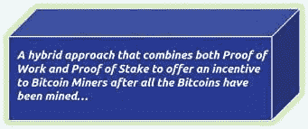

*图 51 - 活动证明定义*

活动证明是一种结合了工作证明（Proof of Work）和权益证明（Proof of Stake）的混合方法。目前，去中心化信用（`Decred`）是利用多种活动证明的主要加密货币。请记住，在第 4 章调查工作证明时，我们发现矿工在有效挖掘出一个区块时，会获得两种类型的分红：

1. 新打印的比特币——截至 2017 年，矿工获得新制造的比特币。在比特币最初创建时，奖励被设置为每个区块 50 个比特币。代码决定每开采 210,000 个区块（大约像时钟一样），新硬币奖励就会减半，直到全部减少到零。

## 2. 交易费用

每个被记录在区块中的交易都包含某种程度的交易费用，作为对有效矿工的补偿。每笔交易的奖励随着客户为矿工提供更多动力而变化，以确保他们的交易能尽可能快地记录在区块中。该章节对比特币交易的审查显示，贡献应该接近结果。在模型中，结果并不正好是 1 个比特币。这些“丢失”的比特币将由有效矿工通过交易获得。

为了避免通货膨胀（当代币泛滥系统时会发生），比特币只会产生硬币。这意味着早晚，比特币区块奖励将消失，比特币矿工将只获得交易费用。一些人估计，区块奖励的拆分可能会导致由于“旅馆不幸”的安全问题，即人们只考虑自己的利益，而不是系统的最佳利益。

活动证明试图解决的另一个问题是普通矿工限制逐渐变为少数矿工。根据`bitcoinworldwide.com`在 2017 年发布的图 52 图表，实际上 55% 的比特币挖掘是由四家公司完成的。

这并不是中本·纳科托编写比特币白皮书时想象的那种“一台电脑一票”协议。因此，创建活动证明作为一种替代共识方法，以缓解比特币矿工激励减少的问题，并允许更多节点成为矿工，而无需投资专用硬件来帮助稀释总挖矿能力的集中。

### 活动证明流程图

请参考下图 53 以跟踪活动证明流程图的第一部分。

1. 与工作证明类似，交易记录被引入网络进行处理。矿工努力解决数学难题。
2. 在矿工解决数学难题后，发送到网络的数据只是一个区块和矿工奖励地址的格式。至关重要的是，区块中还没有交易（暂时！）。可能会出现这样的模板。
3. 通过将哈希的 256 个伪随机部分比作数字，从区块中产生一个不规则的验证者池。`E` 数字与其当前拥有的单一公钥相关。这就是选择 `N` 个任意所有者作为有效的方式。
4. 如果所选的验证者中至少有一个是不可用的（或出于不同的考量进行挖掘），那么将完全为新的框架选择另一个新的“布局”，即另一组签名候选人进行有效性验证，形成一个全新的验证者池。
5. 一旦所有验证者都用他们的公钥签名，然后“模板”就变成了一个包含交易的完整区块。区块奖励分配给有效工作的矿工和不同的验证者之间。然后该过程重新开始。

活动证明带来了额外的通信开销，并激励工作证明和权益证明的矿工为了共同利益而合作。活动验证从根本上关于增加运行的节点数量，并为合作伙伴持有代币提供动力。活动确认相对于工作证明没有提供安全性上的提升。

## 燃烧证明（Proof of Burn）

现在我们应该看看燃烧证明。下图 54 给出了燃烧证明的定义。

通过燃烧证明，与其将资源投入到昂贵的电脑设备，不如通过将硬币发送到无法恢复的位置来“签名”。通过将硬币发送到无效密钥使得硬币实际上被“签名”——从而获得了一种在取决于随机选择过程的网络上进行挖掘的永久优势。

在创建燃烧证明的交互流之前，有几个关于验证的想法必须先理解：

1. 核心思想是，要成为燃烧证明区块链的矿工，你应该首先消耗一些硬币。通过交易发送到一个没有私钥的特殊地址来“消耗”硬币，导致硬币丢失。取决于燃烧证明的实现方式，矿工可能会消耗区块链的本地货币或其他链的货币，如比特币。
2. 被消耗交易的哈希被独立记录，以便在后续操作中识别矿工。
3. 作为矿工在燃烧证明中随机决定交互的一部分，消耗的哈希倍数通过查看自矿工消耗交易产生以来区块链添加的区块数量来确定。该倍数与消耗硬币的总和成反比。这个倍数建立了矿工被选中处理区块的概率。而且，随着矿工消耗硬币后增加了更多区块，倍数会逐渐变小，使得消耗的硬币“腐烂”，减少了矿工被选中的概率。因此，最终矿工将再次消耗更多货币，增加他们在抽奖中被选中的概率。类似于比特币的挖掘周期，你需要持续投入资源到更多的 ASIC 处理硬件以保持。
4. 最后，为整个网络创建一个消耗哈希目标，它取决于此时消耗硬币的数量。该哈希目标被存储在区块中作为“消耗位”（或者说灰烬？）。这个消耗哈希目标是固定的，对于网络中的所有节点都是相同的。

请参考下图 55 以跟踪燃烧证明流程图。

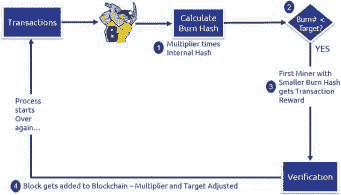

1. 交易被发送到组织。矿工`t`通过其内部哈希`t`消耗交换时间乘以倍数来确定消耗哈希（consume hash）。
2. 然后将后续的燃烧哈希（Burn hash）与框架目标`t`arge 进行对比，如果消耗哈希值不完全符合目标，那么将会考虑另一个矿工。
3. 拥有不完全符合目标`h`的消耗哈希的主要矿工获得交换奖励，处理区块（Block），并发送验证。
4. 在方块通过检查后，它会被添加到区块链的最远端，倍数和框架目标也会随之改变。然后，流程将从头重新开始。

虽然燃烧证明（Proof of Burn）是工作量证明（Proof of Work）的一种迷人的选择，但这种约定实际上通过解决迭代数学难题不必要地浪费了资产。对燃烧证明的另一个分析是，“挖力”本质上流向那些消耗更多硬币的人。

## 存储证明（Proof of Capacity）

请记住，在每次共识计算中，矿工/验证者都需要投入某些东西才能获得处理区块的机会。在存储证明中，投机点在于硬盘空间。下方的图 56 给出了存储证明的定义。

与其将资源投入昂贵的 PC 硬件或消耗硬币，不如在硬盘空间进行投机。你拥有的硬盘空间越大，挖掘下一个方块并获得方块奖励的机会就越大。爆发币（Burst Coin）是目前利用存储证明的主要加密货币。

在挖矿开始之前，矿工应该提交硬盘空间。每个矿工都应该下载一个绘图（Plotter）计算程序，该程序会将图分成若干个 256 KB 的信息块，被称为“勺（scoops）”。请看下图 57 绘图算法的输出描述。

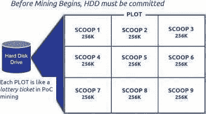

将创建的勺子数量是矿工投入该过程的硬盘空间大小的函数。每个图中的数据通过反复哈希矿工的公钥和有效随机数（nonce）计算得出。然而，并非所有尝试哈希的随机数都会被认为是有效的，然后会尝试一个新的随机数。这种对新随机数的持续检查就是`Proof of Work`（工作量证明），它证明了寻找正确的随机数投入了大量的计算。在存储证明中，矿工在绘图过程中预先完成一次这项工作并保存结果，他们可以在每个区块继续使用这些结果，而不需要不断重复这项工作。这是存储证明和工作量证明之间的关键区别。

分配的硬盘空间越多，矿工拥有的勺就越多，或者换句话说法，每个图都像是一个额外的彩票，，扩大了矿工被选中挖掘方块的几率。现在我们应该查看存储证明的流程图。

## 存储证明流程图

下方的图 58 显示了存储证明的流程图。

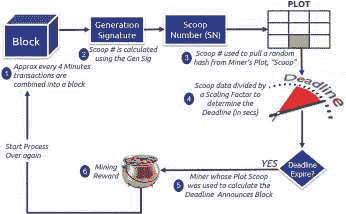

1. 大约按照固定间隔，一组交易被合并成一个区块。
2. 在挖矿期间，矿工利用上一个区块有效标记`m`（已知为之前的区块签名）在密码学上与区块链的增长连接（产生一个网络其他部分可以复制的非规则数字，被称为“勺号（scoop number）”）。
3. 因此，勺号用于从矿图字段中提取一个勺。
4. 根据确定的当前困难全局勺号，每个矿工根据其每个图中 4096 个勺中的一个计算出一个截止时间。随后的数字是一个像闪电一样被测量的截止时间。这个截止时间类似于特定矿工可以收集、签名并向网络提交另一个`b`的开始时间。
5. 一自上一个`b`出现后过了这么多秒而没有报告另一个`b`，矿工利用`address/nonce`混合值创建了该图/勺勺，以声明另一个方块并获得与区块相关的交换。
6. 成功的矿工并获得与方块相关的区块费用。然后，分组将从头重新开始。

下方的图 59 中的图表总结了我们在第 5 章讨论共识时确定的五个共识元素。

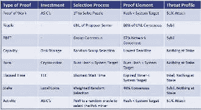

这五个组件中的第一个是证据类型。图 59 显示了本书到目前涵盖的八种证明列表。这绝不是详尽的清单，每天都会尝试新的证据，在第 9 章中，将检查两个额外的验证。

接下来的组件是投机。这指的是矿工或验证者为了参与共识循环应该投入的风险。有时，投机是在强力设备 ASICs 中，在其他情况下，风险是在硬盘存储、加密货币或集中的 SGX 处理器中。

第三个组件是选择交互作用——这指的是不同的确认机制使用的随机非规则循环，用于最终选择矿工或验证者来处理方块并添加到区块链的最远端。这里的想象力是巨大的，但这些选择使它们以相同的方式思考：选择循环必须是真正的随机的。

第四个组件仅仅是验证组件。为了创建一个区块，矿工或验证者在无安排的情况下应该确保做什么？

最后一个组件是威胁模型。特定的证明如何保护网络不受各种恶意攻击？每个威胁模型的详细信息超出了本书的范围，但在网上可以找到大量的背景阅读。

# 第 7 章：存储证明、隔离见与侧链

在第 7 章中，我们将研究三种增加了能力、并由于隔离见增加了区块链能力的改变概念。特别是，将研究存储证明、隔离见和侧链。

## 存储证明（Proof of Proof）

存储证明本身并不是一种证明组件。存储证明允许区块链从其他区块链获取工作量证明的安全性，创建一个生态系统，其中安全性建立在已建立的区块链（如比特币）上并扩展到其他区块链。

## 共识区块链

通过“证明证明”（Proof of Proof），涉及了多个区块链。下方的图 60 描述了参与证明证明的各种区块链。

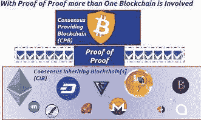

在证明证明的环境中，主要的区块链成员是共识提供区块链（CPB）。这是一个将为其他区块链的周期提供额外安全性的区块链。截至目前，该共识提供区块链是`Bitcoin`区块链。

接下来的区块链成员是能够通过证明证明获得额外安全性优势的区块链。这些被称为共识继承区块链（CIB）。在该模型中，我们展示了几个已知的区块链，但任何区块链都可以成为共识继承区块链。

在此次交互中的最后一种区块链是证明证明区块链，它提供了其他两个区块链之间的关联。

## 证明证明处理

证明证明的基本目标是使一个获取共识的区块链能够获得共识提供区块链的全量工作证明安全性。尽管如此，证明证明的交互不应该：

1. 对共识继承区块链施加任何非微道的障碍。总而言之，利用证明证明优势的区块链不需要更改其环境中处理区块的任何方式。
2. 要求共识提供区块链的区块链矿工以这种方式对其进行授权。另一方面，正如获取共识的区块链不应受到证明证明的影响，共识提供区块链也不应该受到影响。
3. 在共识提供区块链故障时，导致获取共识的区块链无法使用。

此外，获取共识组织的非挖矿客户端不需要与共识提供组织进行交互，也不需要持有共识提供区块链网络的任何本地标记。

## 证明证明处理流程

参考下方的图 61 了解证明证明的处理流程。

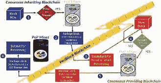

1. 在获取共识区块链环境中建立一个新的区块。证明证明矿工可以根据框架设置和矿工可用性选择是否处理区块。
2. 如果该区块未被处理，将创建另一个区块。如果证明证明矿工决定处理该区块，则当前区块的数据连同证明证明提取器封装的矿工标识被放入`VeriB`交易中，`VeriBlock`区块链将得到更新。在`VeriBlock`区块链中捕获状态信息时，对可以捕获的信息的大小有一个限制。注意，新类型的矿工——证明证明矿工被分配了一个 PDA 图片以显示需求是多么轻量化，而且任何人都可以成为证明证明矿工！
3. 获取共识的区块链的状态信息随后封装到 Bitcoin 交易中，并与其他交易一起提交进行处理。提醒一下，请看下方的图 62，它是我们在模块 5 中作为此交互的组件研究过的工作证明处理流，所有讨论过的挖矿计算和验证最终将在一个包含获取共识区块链状态信息的区块上执行。

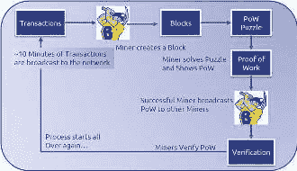

现在，证明证明提取器处于待命状态，查看`Bitcoin`组织上的哪个区块将包含来自获取共识区块链的状态信息。如果共识提供区块链中的最新区块不包含共识继承状态数据，将检查下一个区块。

当共识提供区块链中交付一个包含状态信息的区块时，`Bitcoin`区块的某些组件会被证明证明矿工捕获，并带回`VeriBlock`区块链。

来自`VeriBlock`区块链和共识提供区块链的状态信息被封装并提交到获取共识的区块链中处理。

当被证明证明提取器捕获的状态信息对于获取共识区块链中的某个区块很重要时，它将导致任何需要非法分叉区块链的攻击者需要同步分叉三个区块链：`Bitcoin`区块链、`VeriBlock`区块链和获取共识的区块链。

在下方的图 63 中，描述了一个证明确认的情况，涉及三个区块链：获取共识的区块链（在此模型中标记为 alt 链）、`VeriBlock`区块链以及在该模型中显示为`Bitcoin`的共识提供区块链。

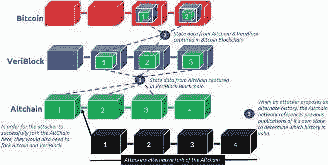

1. 如前所示，来自 alt 获取共识的区块链的某些状态信息被捕获在`VeriB`区块链中。
2. 然后，来自获取共识区块的状态信息以及来自`VeriBlock`区块链的状态信息被更新到`Bitcoin`共识提供区块链中。
3. 当攻击者提出替代历史时，alt 链引用其自身状态信息的过去分布来偏转哪种历史是有效的。

为了让攻击者成功分叉 alt 链，他们还需要同时分叉`Bitcoin`和`VeriBlock`的区块链。这是不可能的。这种针对攻击的额外防御就是 alt 链之所以想要使用证明证明的原因。

## 隔离见证（Segregated Witness）

我们将视角离开共识，转向几个你显然已经学过的议题。第一个是隔离见证（Segregated Witness）。“隔离见证”是 Bitcoin 交易信息结构的一个新更新，它将交易签名部分从数据段隔离开，消除了 Bitcoin 的交易扩展性问题并扩大了 Bitcoin 区块的大小。让我们来看看在引入隔离见证后，Bitcoin 交易结构具体发生了什么变化。

参考图 64 get 隔离见证之前 Bitcoin 交易数据的数据结构图像。

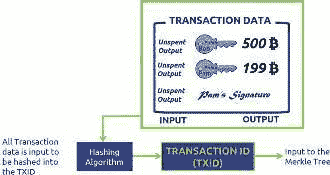

你将从第 3 章了解到，交易信息由此处所示的数据源和结果组成。注意在结果字段中，签名或公钥与移动硬币的个人或人们的签名包含在一起。在验证交易时，会检查公钥以确保它具有正确的哈希（匹配记录），随后检查签名以确保它对交易是有效的，并且是用提供的公钥创建的。从那里开始，位置相关的公钥是公开已知的。这些交易信息随后有助于哈希计算以产生交易 ID。交易 ID 额外贡献于构建梅克尔树。

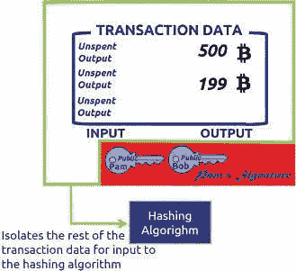

随着隔离见证的引入，所有的签名数据都移动到交易数据块的末尾，如上方图 65 中的红色框所示。

当信息块结束处的标记断开后，框架目前已准备好仅将交易信息纳入`SHA256`哈希计算中，以确定交易 ID。但是，签名数据呢？如果签名对交易 ID 的组成没有影响，那么区块链就不再证明交易已经记录了正确的标记。

为了保证标记在区块链中仍然可以被相应的交易所检测到，隔离见证（Segregated Witness）在循环中增加了一个额外的阶段。在下方的图 66 中，你可以看到隔离见证者采用了一种当时用于处理区块的策略，即通过对隔离见证`[signature]`信息创建梅克尔树（Merkle tree）。梅克尔树是如何构建的在本书的第 2 章末尾已经介绍过。

要构建标记梅克尔树，交易的标记被哈希以传递一个`mark ID`。这些`mark ID`随后成对进行哈希，然后对这些哈希再次进行哈希，直到最终只剩下一个哈希——`mark Merkle root`（标记梅克尔根）。

因此，上方图 65 中的图片需要像下方的图 66 所示进行稍微修改，以显示从签名梅克尔树产生的`Signature Merkle Root`与待输入的交易数据一起输入到`SHA256`哈希算法中以确定`Transaction ID`。

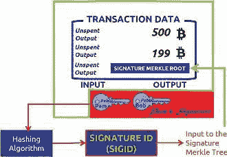

然后区块构建过程结束，与通常一样，`Transaction ID`用于构建区块的梅克尔树。通过在交易信息输出中添加`mark Merkle root`，标记与交易绑定在一起，并进一步影响区块链的外观。

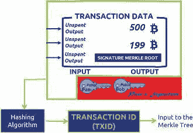

## 隔离见证的优势

隔离见证有两个核心优势：一个是消除交易的可变性，另一个是扩大比特币区块的尺寸。交易可变性是一种受限制的拒绝攻击，它指的是通过修改交易中的`mark hash`来更改交易 ID 的方式。通过这种方式，虽然很罕见，但网络上的节点可以更改已发送的交易，导致`exchange ID hash`失效。

查看下方的图 68 以了解交易可变性如何影响`transaction ID`。这里我们展示了在隔离见证之前，标记是与交易信息一同输入以生成`exchange ID`的。请记住，由于区块链的理念，许多节点也会处理此区块。注意在下一个交易框中，一个节点调整了`Pam`的`mark hash`，该标记是由`Pam`的私钥签名分配的。网络上的任何节点，只要他们决定，可以在传递之前对`mark hash`进行微小的修改来更改`TXID`。请记住，在模块 2 中研究哈希时，对文本字符串的任何更改——即使是最微小的变化——都会导致生成的哈值完全唯一。对`Pam`的更改导致`exchange ID`与原始（真实的）`exchange ID`不一致。

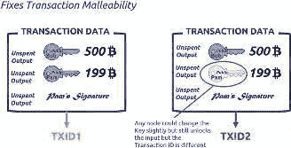

重要的是，这仅仅改变了`exchange ID hash`，交易的结果如如，比特币将发送到预期的受益者。交易 ID 特别重要，因为作为一个全球账本，比特币是围绕这些`exchange IDs`组织的。正如我们在第 3 章中审核的那样，当一个比特币交易流被澄清时，新的交易会回溯过去的`exchange IDs`以证明发送比特币的个人确实拥有权限这样做。拥有某些无效的`exchange ID`将影响该过程。

正如我们之前在隔离见证中看到的，标记信息没有被用于计算`exchange ID`，因此现在不再期望调整它，从而消除了下方图 69 所示的交易可变性问题。

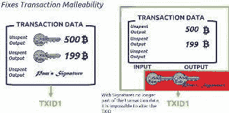
*图 69 - 使用隔离见证消除交易可变性问题*

## 增大比特币区块尺寸

隔离见证的第二个优势是比特币区块尺寸限制的显著扩大。在隔离见证之前，比特币区块是严格的 1,000,000 字节或 1 兆。如左侧图 70 所示，这意味着例如，假设你的每个交易大小为 250 字节，你可以在一个区块中存储 4,000 个这样的交易。

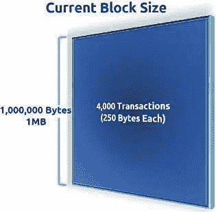
*图 70 - 隔离见证之前的比特币区块大小*

有了隔离见证，比特币区块的尺寸取决于许多人所说的“权重单位”（weight units）。目前，一个比特币区块可以存放 4,000,000 个权重单位。确定权重单位的方法是：对于每个字节交易信息，分配四个权重单位。然而，对于每个字节标记信息，只分配一个权重单位，这本质上使得标记在区块中所占的空间获得了 75% 的折扣——为交易数据留出了更多区块空间。

所以，我们应该采用之前提到的 250 字节的交易大小。假设这 250 字节由 200 字节交易信息和 50 字节标记信息组成认为如何？图 71 显示了确定区块能容纳多少交易的计算方法。

*图 71 - 隔离见证后的区块容量增加*

该交易涉及的权重单位数量为 850 个，即 200 字节交易信息乘以四，加上 50 字节标记信息乘以一。净影响是见证信息在每个区块占据的空间更少。以 850 个权重单位的交易大小，你可以在一个区块中存储 4,705 个交易。因此，在这一模型中，在交易尺寸相同的情况下，实施隔离见证后，区块中可以额外存放 705 个交易。

## 侧链

侧链的可能性已经存在，并在区块链领域中徘徊已很久。侧链`sidechains`的基本思想是将信任的去中心化扩展到其他区块链和其他其他高级资源。从根本上说，侧链是允许令牌从一个区块链（主链）安全地在另一个完全独立的区块链（侧链）内部使用的工具，但`[令牌]`任何都可以移回第一链。侧链也被称为替代区块链或替代绑定（alt-binds），有时被称为替代币（alt-coins）。

`可扩展性 - 这些限制中的第一个是适应性`。目前，比特币每十分钟只能处理六笔交易，这对于许多应用来说太过于缓慢了。这种灵活性问题的一个原因源于矿工处理数学算题所需的时间（10 分钟）。降低矿工需要解决的数学问题的复杂性将允许网络支持更高的交易率，进一步提高适应性，但代价是以增加矿工的工作量为代价。适应额外的责任可能会导致中心化风险，即越来越多的算力逐渐聚集在极少数矿工手中。

`安全性 - 另一个权衡是安全性与成本的平衡`。比特币以类似的不可变性在它的账本中存储每笔交易。这使得维护变得昂贵，且对于低价值或普通交易是不利的。理想情况下，每笔交易都应该有决定如何处理其记录的灵活性，因为交易的价值和风险配置差异巨大。然而，比特币默认情况下只维持一种“一刀切”的方案，这导致人们寻找如侧链之类的选项。

`脚本语言 - 此外`，比特币的实用性在许多方面受到了限制。一个显而易见的限制是比特币的预定义语言——该语言可以扩展为图灵完备，从而考虑创建智能合约的可能性。

`交易不同的资产 - 除了货币和比特币之外，还有许多个人和机构需要在区块链上交易的资源，如土地契约和其他代币资产`。

`对平台实施更改 – 随着任何新创新的进步具有确定性`，随着这一理念的获得认可，比特币推动了许多开创性的想法。然而，比特币工程师之间达成共识，对比特币的更改应该缓慢、谨慎地，并且只有在获得整个比特币社区的明确认可后才能进行。无论是否存在添加新功能的迫切需求，比特币都没有一种安全的重构方式，因为所有成员必须采取一致行动，任何更改才能产生影响。因此，许多人转向侧链以实现比特币最初开发时未预想的功能。

`无数据隐私 - 有时，交易双方不需要将所有的交易细节都存储在公共账本上供任何人查看`。许多人需要隐私交易的可能性，而比特币并没有提供。

在检查了上述列表后，显然，引入侧链的灵感是为了克服这些缺陷的一部分。侧链共享比特币代码库，但对代码进行了修改以解决上述提到的至少一个顾虑。

## 侧链流程图

为了查看侧链是如何交互的，让我们遵循下方图 72 所示的父链与侧链之间的流程。

*图 72 - 侧链流程图*

1. 父链中的特定数量的币被发送到一个特定的比特币地址。该位置经过唯一设计，因此这些币目前超出了比特币所有者的控制范围——超出了任何相同代币的他人的控制范围。这些币被视为“锁定”（如图中的锁形符号所示），直到有人能证明他们对这些币拥有合法的所有权为止。

2. 锁定的币现在应该静静等待一个“确认期”结束。这是硬币在移动到侧链之前必须在父链上锁定的时间范围。设置确认期的原因是为了确保在比特币区块链上做了充分的工作。一个标准的确认期通常为一或两天。

3. 用户随后向侧链发送交易。此笔交易包含了硬币已发送到该特殊比特币地址的证明、硬币现在相应的锁定，并区分了硬币的合法所有者。简化支付验证（SPV）由一个发送组成，该发送是显示工作证明的区块头列表，以及一个显示产出的密码学证据。在侧链上，挑战期（类似于父链上的确认期）应在币被使用之前结束。挑战期是移动的币在侧链上不能被花费的时间范围。设置挑战期的目的是为了防止双花攻击的机会。

4. 一旦挑战期结束，相应数量的币在侧链上可用。更重要的是：硬币锁定在比特币网络上，因此没有新货币被创建或销毁——硬币被成功地“移动”了。

5. 一个重要的特征是，在侧链上的交易遵循侧链的规则，并利用侧链的任何提取元素。币移动到了一个或少数新所有者手中。

6. 从侧链移回父链的逻辑是对称的。同样，任何在侧链上持有币的任何人都可以通过执行步骤 1 到 3，将它们*移回*到父链网络。

7. 最后一步在图 72 中未显示。在父链确认期之后，币将从侧链消失并在比特币网络上再次可用。然而，这些币目前在很大程度上取决于在侧链上拥有它们的人，而不是最初的所有者。

尽管目前存在许多侧链或代币，但它们有自己面临的问题。首先是“框架不连续”的问题。框架不连续的可能性是，由于每个侧链都使用自己的技术方法，努力经常被复制和丢失。创建侧链的组织在特定的空间信息方面可能不足，因此安全性问题经常在侧链之间复制，而相应的修复却没有。这种缺乏标准化的现象导致了混乱。

关于精明协议的想法最早出现于 1994 年左右，当时法律研究人员兼密码学家`Nick Szabo`意识到去中心化的记录可以用于精明协议，这种协议通常被称为自动执行合约、计算机协议或`Blockchain`合同。请参考图 73 获取`Smart Contracts`的定义。

*图 73 - 智能合约定义*

在这种配置下，合同被转换为名为`scripts`的 PC 代码，存储并复制在框架上，并由运行`Blockchain`的 PC 组织引导。这种精明合约的想法在数据时代变得越来越重要，因为它通过确保合同责任符合约定的条款和条件，扩展了企业的一致性能力。

## 纸质合同与代码合约

传统的带有常用“法律术语”的纸质合同与在`Blockchain`中编码的精明协议之间的本质区别。下图 74 显示了差异的概述：

*图 74 - 纸质协议与代码协议的差异*

1. 首先，对于纸质 get，协议的每一个状态都是一张纸，事后墨水干了，合同的细节就开始从记忆中淡化。如果协议中有特定的要求，你需要尝试回忆这些事情以保持与协议的一致性。对于编码协议，一致性是计算机化的，因为只要满足合同中规定的条件，代码就会一致地执行。

2. 一个区别是纸质合同的词义细微差别，这可能留有不同的解释。相比之下，精明合约的执行是可预测的，在每个实例中的运行方式完全相同。

3. 纸质合同存储在工作区域或协议管理系统中，只有在出现问题时才会被引用。那么，精明协议分布在整个`Blockchain`网络中，随着交易的执行（包括精明协议），代码被执行，并且结果实时取决于组织节点的协议。

4. 最后，为了将纸质合同与编码协议连接起来，普通的纸质协议可以包含法律律师熟悉的所有“如果”语句。然后纸质合同中的一个条款指向`Blockchain`上的智能合约，写道：“这是我们双方同意的内容，我们将遵守代码的结果。”由于某种原因结果变得不令人满意，两个参与者应该接受结果，因为他们在合同中批准了代码结果。

## 智能合约的优势

任何需要标记的东西都可以变成精明协议。如下所示，与纸质伙伴相比，智能合约提供了明确的价值：

1. 增加信任 – 因为每个报告都是共享的，对协议的信任程度增加了。

2. 增加备份 – 由于`Blockchain`的概念，数据在`Blockchain`周围被重建。这表明组织成员对跨越`Blockchain`网络的数据达成了一致。

3. 增加节省 – 智能合约导致了节省，因为它们消除了对中介的需求。这还节省了验证物理签名的时间。

4. 增加自主性 – 精明协议增加了他们所需的自主性；他们知道自己需要做什么；没有理由依赖外人、律师或其他去中心化个人。

5. 增加准确性 – 精明合约是计算机化的，它们避免了物理填写表格时的人为错误。

## 预言机 (Oracles)

预言机被认为是为智能合约提供`Blockchain`之外世界状况数据的元素。通过这种方式，外部任何数据都可能是某些协议条款的核心——例如物品价值、汇率、包裹温度、航班起飞数据或其他数据——预言机是连接智能合约与这些真实信息源的接口。这是预言机可能成为最重要的因素的地方。由于`Blockchain`的概念，智能合约无法单独获取存在区块链之外的信息。尽管如此，预言机也有它们自己的挑战安排。

## 预言机面临的挑战

首先，预言机需要一个可靠的信息源。它们应该能够提供准确且密封的数据源。因此，假设一个智能合约提供了针对航班取消的保护，那么确保你获取的航班信息是准确的，并且在从网站获取后没有被篡改至关重要。同样，要遵循组织成员达成的共识协议。这表明`Blockchain`网络对数据网络的准确性达成了一致。

## 预言机实现的类型

预言机通三种类型：基于编程的、基于合约的和基于硬件的。每种的一般特征下图 75 所示：

# 引言

基于软件的预言机（prophets）通过互联网以密集的频率访问信息。当你正在寻找的数据信息在网络上可以获取时，简单的基于编程的预言机就可以提供有效的方案。基于软件的启示器（oracles）可以回答诸这样的问题：“比特币对欧元的价值是多少？”“这架飞机是否延误了 30 分钟以上？”或者“底特律昨天下雨了吗？”。当可靠数据在网上、互联网上可用，并且可以从受信任的源（如公司、航空公司、金融数据聚合器或气候基金会）提取时，那么在那个时刻，基于编程的预言机就是恢复这些数据的机制。尽管如此，应该确认从互联网恢复的信息确实来自所认同的源，并且在获取信息后没有被篡改过。这种确认是通过通过一个名为`TLSNotary`的辅助工具和一个名为`PageSigner`的显式功能实现的。我们将在接下来的几页中详细查看它是如何运作的。

基于共识的预言机（Consensus-based prophets）尝试利用“群体智能”来（Consensus-based prophets attempt to exploit the “intelligence of the group”）。基于共识的预言机（（Consensus-based prophets）尝试利用“群体智能”来（predict data）。基于硬件的预言机（Hardware-based prophets）是最后一种。

## 基于软件的预言机（Software-based Oracles）数据流

基于软件的预言机（Software-based Oracles）数据流。参考图 76 查看其运作方式。

2. 接下来，必须存在一个防止篡改用户设备设置的设备。这种反篡改设备将在外部攻击者出现操纵企图时，通过删除私钥来使设备无法运行。例如，如果传感器连接到另一个物体，或者有东西尝试注入虚假刺激（如对设备进行攻击），则私钥将被擦除，使设备无法进一步处理。

## 智能合约流程图 - 无需预言机

你将看到，在本节之前，我们提到过智能合约的执行条件已转换为被称为脚本（scripts）的 PC 代码。请看下图 80 以了解智能合约如何触发的流程图，以及用于执行智能合约条件的后续逻辑。

*图 80 - 智能合约流程 - 无需预言机*

1. 智能合约脚本被聚合为低级执行代码，并存储在区块链中特定区块的特定位置。任何引用该特定地址的交易都会向区块链发送信号，表明该智能合约应当作为该交易处理的一个特性被调用。

2. 请记住，区块链网络中有许多节点，每个全节点上的虚拟虚拟机都会利用随交易发送的信息来执行内容的活动代码。

3. 随着智能合约的执行，应当确认是否需要预言机。

4. 如果确认智能合约条款所需的预期信息包含在区块链本身中，那么此时将检索相关信息。

5. 利用区块链的历史数据，将检查智能合约的实际条款状态。假设条件满足（或不满足），将采取相应的的操作，无论该操作是资源转移、罚金评估还是费用收取*无论该智能合约被设计用来做什么*。

## 带有预言机的智能合约流程图

图 81 显示了当需要预言机来访问区块链外部世界的信息时，智能合约将采取的流程图。

*图 81 - 带有预言机的智能合约流程*

1. 正如我们在过去发现的智能合约流程图所示，任何引用智能合约代码所在位置的交易都是向区块链发送信号，表明该智能合约应当作为交易处理的一个特性被调用。

2. 区块链网络中的众多节点利用随交易的信息的信息执行脚本活动代码。

3. 随着智能合约的执行，必须确认是否需要预言机。

4. 在智能合约被处理时，需要通过互联网从区块链外部获取尚未结算的数据。取决于智能合约所需的信息类型，将调用合适的预言机来安全地获取数据。

5. 如果所需信息来自通用网站或另一个区块链，则会调用软件预言机，并通过 TLS 公证员函数`PageSigner`提供数据真实性和时间戳证明。如果所需数据来自像`Gnosis`或`Augur`这样的预测网站，则将使用这两个网站所使用的共识方法来确认所提供的群智信息。最后，如果智能合约所需的信息是实时的、公开的、以用户为中心的信息（例如通过专用传感器收集的信息），则将使用硬件预言机。

6. 接下来，利用从预言机获取的信息汇总的数据检查真实合约。假设条件满足（或不满足），将执行相应的活动，无论该活动是资源交换、罚金评估、费用收取，还是智能合约被设计用来做什么。

## 智能合约应用示例

考虑一个商业交易在其生命周期内的组织和大量通信。在通常，业务的 IT 部门几乎会通过建立一个完全受特定实体影响的定位系统，来构建安排中数据驱动部分的组织。

2 区块链充满了多样化的方法。尽管如此，一些区块链增加了智能合约的能力，而这在`Bitcoin`中是不实行的。大红框内的区块链都有助于实现某种类型的智能合约。智能合约是这些第二代和第三代区块链相对于`Bitcoin`带给市场的最优选择。卓越的合约允许这些区块链具有更广泛的用途，而不仅仅局限于货币市场应用。

长期以来，从早期采用者中脱颖而出的区块链是`Ethereum`，我们将立即进行检查。此外，`MultiChain`提供了一个平台，协会可以从此快速构建自己的区块链或扩展`Bitcoin` `Blockchain`。此外，可能像`IBM`、`Linux`和`Intel`这样最大的企业组成了`HyperLedger Foundation`，以构建更适合财富 1000 强企业交流的现代实体化区块链。无论如何，`Ripple`和`Corda`等不同组织遵循了第一个`Bitcoin`的根源，并通过其贡献完全专注于金融业务领域。这两家公司分组在图 82 的绿色框中。金融领域在全球范围内巨大，`Ripple`和`Corda`决定将精力集中在在那里。

区块链的下一个版本——适配 3.0 将于 2017 年 10 月进入商业中心。如果你跟随图 82 中`Bitcoin`标志外的金线，它指向了`EOS`，它承诺成为主要的区块链“操作系统”。`EOS`的策略是专注于提供低级的服务，如基于作业的安全、已发布的数据和高级信息，给那些在`EOS`之上构建应用的工程师。提供这些低级服务允许工程师更多地关注应用程序的功能性，而无需编写用于框架管理的代码。

最后，你会发现`Corda`显示在图 82 的一个黑框中，并带有注释“不是区块链”。在图 82 列出的所有区块链中，只有`Corda`在其自己的标题下走得如此之远，以至于，`Corda`并没有真正使用区块链或分布式账本技术 (`DLT`)。相反，制作`Corda`的组织`R3`选择开发被描述为“共享账本”的平台，其中交易共识仅在交易交易双方之间达成，而不是像区块链那样，账本上的所有交易数据必须广播给账本上的所有其他参与者，且所有成员都应该达成事实一致。`R3`接受在银行和货币世界，这种组织级别的协议提高了安全性和灵活性问题，因此使用了“共享账本”而不是“传输账本”。

虽然有许多可用的区块链且每天都有新的加入，随着本章的进展，我们将调查这一领先区块链列表。

## Bitcoin 总结

沿着区块链的序列，我们先从`Bitcoin`的概述开始如何？下面的图 83 突出了关于`Bitcoin`的相关细节。

*图 83 - Bitcoin 总结*

如前提到的，`Bitcoin` 是 2009 年由一个名为 `Satoshi Nakamoto` 的化名的匿名软件工程师或开发者小组发布的。`Bitcoin` 是一个公共区块链，意味着地球上任何地方的任何人都可以参与 `Bitcoin` 组织。`Bitcoin` 拥有自己的数字货币，以符号“BTC”进行交易。截至 2017 年 9 月，`Bitcoin` 的市值接近 700 亿美元。

## Ethereum 总结

沿着区块链的序列，我们先从 `Bitcoin` 的概述开始如何？下面的图 83 突出了关于 `Bitcoin` 的相关细节。

 *图 83 - Bitcoin 总结*

如前提到的，`Bitcoin` 是 2009 年由一个名为 `Satoshi Nakamoto` 的化名的匿名软件工程师或开发者小组发布的。`Bitcoin` 是一个公共区块链，意味着地球上任何地方的任何人都可以参与 `Bitcoin` 组织。`Bitcoin` 拥有自己的数字货币，以符号“BTC”进行交易。截至 2017 年 9 月，`Bitcoin` 的市值接近 700 亿美元。

以太坊实际上占据了日常普通交易量的 80%。更重要的是，根据 CryptoPortfolio 2017 年 8 月的报告显示，所有非比特币区块链组织的总市值 87% 属于以太坊。而且，正如 CoinMarketCap 所示，以太坊主导了市场，所有交易资产的 79% 基于以太坊区块链；占整体总市值的 87%；交易所上市的公司中有 56% 拥有基于以太坊的区块链。在比特币之外，没有其他区块链在市场采用率上能与以太坊相比。以太坊还维护了去中心化应用（dApps）的概念。去中心化应用类似于具有某些特定特征的智能合约：

1. 分布式应用可以拥有无限数量的成员。在普通的智能合约情况下，任何合约只有少数感兴趣的成员。

2. 其次，这些特定的应用程序不需要是金融应用。去中心化应用可以接触任何类型的应用场景。

3. 而且，而不是为每个特定的应用程序构建一个完全独立的区块链，以太坊允许潜在开发者在同一平台上开发成千上万种不同的应用程序。

就像苹果为 iPhone 提供了 App Store 一样，以太坊推动了分布式应用的开发，并在 `https://dapps.ethercasts.com/` 保持着活跃的网页，你可以在那里看到到为止开发的所有分布式应用。下面的图 86 显示了截至 2017 年 9 月部分可用分布式应用的截图。

 *图 86 - 分布式应用目录*

如果你稍微放大一下，可以认为截至 2017 年 9 月，已经开发了 700 个特定的应用程序。

## Casper 权益证明机制

正如在此之前的以太坊概述对话中所提到的，以太坊正在将其共识策略从工作证明（Proof of Work）改为 Casper 形式的权益证明（Proof of Stake）。下方的图 87 给出了 Casper 权益证明的含义。

 *图 87 - Casper 权益证明定义*

“Casper”是一种基于质押的货币共识协议，其中“固化的验证者”可以押注哪个区块将被记录在区块链上。为了执行 Casper，以太坊利用了其自身的智能合约组件。通过 Casper 智能合约，任何人都可以注册成为区块验证者，对他们认为认为将作为最终区块添加到区块链末端的区块版本进行押注，检查正在进行的合约押注操作，并退出区块验证者身份。节点通过使用 Casper 智能合约存入质押来成为“固化”验证者。这就是验证者所设置的“质押”（stake），正如我们之前在权益证明的对话中学习的那样。如果固化验证者在执行区块确认工作时不诚实，他们可能会丢失全部押金。

在节点固化后，它们可以押注后续哪个区块将被记录在区块链中。对于关于哪个版本的区块最终添加到区块链末端的共识进行押注将带来奖励，而反对共识的押注可能会导致固化验证者的押金损失。

让我们看一看 Casper 如何处理下一个幻灯片的循环图。

## Casper 流程

下方的图 88 显示了 Casper 的流程。

 *图 88 - Casper 权益证明流程*

1. 框架创建一个区块。

2. 参与框架的验证者数量受合约数据的限制。

3. 在分析共识数据后，对哪个区块将成为最终区块进行押注。

4. 如果没有达到 67% 的绝对多数，则合约继续。

5. 一旦对同一个区块进行了足够的押注，该区块就会被批准。

6. 一旦区块添加到区块链末尾，押注该区块的质押验证者将获得挖矿奖励。

7. 然后交互将从下一个区块再次从头开始。

## MultiChain 总结

下方的图 89 总结了关于 MultiChain 的相关事实。

 *图 89 - MultiChain 总结*

MultiChain 由 Coin Sciences 及其创始人 Greenspan 博士于 2015 年建立。MultiChain 是一个用于在组织内部或组织之间创建和发送私有区块链的现成平台。MultiChain 的意义在于提供金融领域所需的保护和控制，来克服金融领域发送区块链创新的重大障碍。

MultiChain 仅支持私有区块链且没有自己的代币。因此，它没有可确定的市值。MultiChain 的目标市场是任何需要构建自己区块链的个人。像埃森哲（Accenture）这样的一些大型咨询公司在他们的区块链实践中使用 MultiChain。

MultiChain 使用工作证明共识算法，该算法通过一种名为“挖矿多样性”的策略进行了调整，该策略限制了在给定时间内同一矿工可以创建的区块数量。在组织并不大的私有区块链中，挖矿多样性确保了共识不会集中在少数几个矿工手中。

MultiChain 不支持智能合约，但通过允许更改控制区块链如何工作的参数（例如区块创建间隔），它可以达到每秒 500 次交易的成交。尽管 MultiChain 代码下载量已超过 850 次，但目前还没有动态区块链使用 MultiChain。

## Hyperledger 总结

下方的图 90 总结了关于 Hyperledger 项目的关键事实：

 *图 90 - Hyperledger 项目总结*

2015 年 12 月，Linux 基金宣布了 Hyperledger 项目的成立。该项目的目标是开发区块链和分布式账本，特别关注这些框架与现有数字货币方案相比的性能和可靠性。该项目的另一个目标是扩展区块链的强度，使其能够满足全球主要组织所需的规模和交易吞吐量。Hyperledger 仅支持私有区块链。

目前没有与 `HyperLedger` 相关的代币，因此没有可量化的市值。`HyperLedger` 的目标市场是全球范围内的机械、货币和库存网络组织，这些组织需要私有区块链。不同的 HyperLedger 项目成员为该项目贡献了不同的区块链方案，因此共识机制在一种具有可配置方式以处理“等待时间证明”（`Proof of Elapsed Time`）的客户端之间进行切换。HyperLedger 衍的区块链支持智能合约。由于有多个 HyperLedger 可选区块链，其交易吞吐量有所不同。目前，HyperLedger 项目已交付了四个区块链。

IBM 交付了一个名为 `Fabric` 的区块链，`IBM` 在其封装了大量的行政服务，如便利化和区块链即服务。Intel 交付了一个名为 `Sawtooth` 的区块链，它利用了 Intel 的 `SGX Trusted Execution Environment` CPU。这两种情况的交易吞吐量均可达到每秒 1,000 次。

`TrustedChain` 是由欧洲信誉服务提供商组成的许可区块链组织，由 `Ifin Sistemi` 设计，它是意大利在政策执行和银行领域信誉管理领域的领先机构。`TrustedChain` 基于 `HyperLedger Burrow` 区块平台。最后一个模型是 `Corda`，其 `Thusurce` 代码已于 2017 年 10 月交给 HyperLedger 项目。`R3`（制作 `Corda` 的组织）履行了将其代码开源的承诺。因此，随着 `Corda` 的扩展，HyperLedger 项目可以提供一种真正的区块链解决方案的共享账本方案。

在图 90 的 `notes` 部分，列出了属于 HyperLedger 项目的五个平台（区块链）。贡献创新的组织显示在括号中。

## Ripple 总结

下图 91 显示了关于 Ripple 相关事实的摘要：

 *图 91 - Ripple 总结*

Ripple 由 `Ryan Fugger` 在 2004 年构想，但直到 `Jed McCalib` 和 `Chris Larsen` 在 2012 年带着他们的数字货币想法找到 Fugger 先生后，它才如预期那样运作。Ripple 通过 `RippleNet` 联合了银行、分期供应商、数字资产交易所和公司，为国际现金汇款提供无缝体验。Ripple 作为一个私有区块链运行。Ripple 拥有自己的数字货币 `XRP`，符号也为 `XRP`。`XRP` 的当前市值为 82 亿美元。Ripple 的目标市场是整个支付和货币转移市场。你将在第 6 章详细回顾 `Ripple 协议共识算法`（`RCPA`）。利用 `RCPA` 通过在 `Unique Node Lists` 内达成 80% 的一致来获得共识。

Ripple 支持智能合约，`RippleNet` 交易吞吐量可以达到每秒 1,500 次。截至 2017 年 9 月，已有 100 多家银行在 85 多处执行中使用 Ripple。Ripple 是仅于 `Bitcoin` 和 `Ethereum` 的第三大数字货币。

## EOS 总结

下图 92 总结了关于 EOS 的要点：

 *来源：https://coinmarketcap.com/ 图 92 - EOS 总结*

EOS 由名为 `Block One` 的组织创建，由丰富的区块链愿景家 `Dan Larimer` 推动。EOS 于 2017 年推出，作为主要的区块链工作框架，重点在于主要的区块链工作框架。EOS 阶段的主要目标预计将于 2017 年底交付。EOS 支持公链和私链。

EOS 拥有自己的数字货币 `EOS`，符号也为 `EOS`。`EOS` 的当前市值为 8 亿美元。EOS 的目标市场是风险区块链。

EOS 不支持智能合约，EOS 的交易吞吐量可以达到每秒 10,000 次。由于 EOS 尚未交付，目前尚无执行在使用它。它是仅于 `Bitcoin` 和 `Ethereum` 的第三大数字货币。

在图 92 的注释字段中，有趣的是，不像 `Ethereum`（消耗 `Ether` 货币），用户可以免费使用 EOS 基础。

## EOS 区块链操作系统特性

EOS 为市场带来的一些独特特性如下：

1. 治理

2. 可扩展性

3. 免费使用

4. 容易更新和错误修复

5. 工业级功能

让我们检查每个功能：

治理 - EOS 拥有一份每个人都签署的宪法。该宪法详细说明了 EOS 环境内部的分布式管理条款，因此每个人都了解情况。此外，它不是自定义的，宪法具有约束力，因为它具有法律约束力，并在出现问题时提供干预工具。宪法还允许 EOS 群体随时投票更改宪法。

可扩展性 - EOS 旨在实现通用性以帮助大量用户。这是一个巨大的案例，但由于 Dan Larimer 创建的另一个区块链 Steem 已经支持大量的并发用户。

免费使用 - EOS 考虑免费使用平台。用户投入 EOS 代币，从而获得 EOS 框架资源，如数据传输、存储和 CPU 周期。这样，假设你拥有 1% 的 EOS 代币，你就可以获得 1% 的框架资源来运行你的应用程序。

容易更新和错误修复 - 可以在不分叉框架的情况下应用升级和修复错误，这在 `Bitcoin` 和 `Ethereum` 中发生过。

– 像一个无尽的圆一样——或者失效，EOS 的区块生产者可能会冻结应用程序，因此没有足够的理由去分叉区块链。此外，框架更新由合作伙伴决定，并且没有足够的理由通过硬分叉（hard fork）区块链来执行这些升级。

### 工业级功能

EOS 计划通过将传播的应用及其运行其上的去中心化 PC 连接，并将两者与一个强大的工作框架相结合，来实现现代实力。下方的图 93 显示了连接分布式计算机与 EOS 应用程序的工业级功能列表。

EOS 工作框架将提供合作伙伴在区块链世界之前通常所预期的许多特性和活力，例如：

- 账户执行器：客户端可以通过普通名称而非密码学密钥来识别其账户。 

- 基于用户的记录许可：个人可以根据其在组织中的职位访问应用程序功能。

- 确定性等等处理：对功能进行评估，以决定它们是可以等等处理还是应该按顺序处理。例如，交易所应该按顺序处理，而字符串分配可以并行处理。

*图 93 - EOS 现代实力功能*

- 数据库和列表。每个客户端将拥有自己的数据集，并且这些数据集可以被记录以获得更快的访问速度。

- 智能合约支持。EOS 将支持智能合约。

- 身份验证以及密钥管理也将由 EOS 提供，以确保身份得到妥善对待。此外，账户恢复已集成到框架中，为客户在密钥被盗用时提供了一种重新获得账户控制权的方法。通过提供这些能力，EOS 有一个真正的机会改变未来区块链市场的发展方向。

## 委托权益证明（DPoS）定义

正如之前提到的，EOS 涉及委托权益证明（Delegated Proof of Stake）作为一种共识算法。参见下方的图 94 的委托权益证明的定义。

委托权益证明是指 EOS 区块链上的代币持有者通过持续批准投票系统选择区块生产者，区块生产者产生的区块数量与其相对于所有其他生产者所获得的总票数成正比。我们应该分析委托权益证明的属性。

*图 94 - 委托权益证明定义*

## 委托权益证明的特性

通过委托权益证明，实际上每个区块生产者轮流工作。在任何时候只有一个区块生产者处理给定的区块，其处是委托权益证明区块链不会像我们在工作量证明（Proof of Work）中看到那样产生分支，因为区块生产者是协作产生区块，而不是竞争。

只要证明他们自己有能力这样做，任何人都可以成为区块生产者。前 20 + 1 名得票获得者成为区块生产者。总批准数排名前 20 的将自动选用于每轮区块生产，最后一个区块生产者（在投票中排名第 21 位）被选为根据其相对于其他区块生产者所收到的票数比例来生产区块。在 EOS 中，验证者与区块生产者是分离的，有助于提高吞吐量。

## 委托权益证明工作流

下方的图 94 显示了委托权益证明流程图。 

*图 95 - 委托权益证明流程*

1. 候选区块生产者由合作伙伴通过持续的民主周期决定。前 20 名得票获得者加上 1 个备用区块生产者形成了区块生产者池。

2. 区块生产者根据区块时间的任意请求顺序排队。

3. 第 21 个区块生产者将根据其与其他区块生产者相比获得的票数数量参与区块创建。在图 93 中，第 21 名得票者是池中剩下的唯一区块生产者。

4. 一组交易变得可供处理。 

5. 处于队列顶端的区块生产者是创建此区块的唯一尝试。所有其他人都在排队，准备准备下一个区块。

6. 区块生产者有三秒钟完成区块的形成。假设区块生产者在三秒窗口内没有完成区块的形成，那么此时队列中的下一个区块生产者将尝试构建区块。

7. 如果该区块生产者在三秒窗口内完成了区块，那么此时该区块将提交审批。然后，过程再次从头开始。

## 演进中的区块链总结

让我们总结一下对区块链商业中心的调查。比特币是该领域主要的区块链，并证明了这一理念。但所有人（包括比特币在内的项目）都试图对原始设计进行改进。这些开发驱动围绕着提高更好的交易吞吐量以及使编程语言变为图灵完备。

由于从根本上扩展了智能合约能力，以太坊在中心具有巨大的吸引力。然而，你需要支付费用以参与以太坊平台，为执行的每行代码支付以太坊。但是，无论如何衡量，以太坊都是最广泛使用的区块链。

Hyperledger 凭借其 IBM、Oracle 和 Intel 等蓝筹成员，希望创建使用 Hyperledger 技术的行业垂直联盟。然而，显然这些蓝筹成员有一个更深层次的目的是，通过提供与其相关的服务和设备来推动 Hyperledger 区块链。

在尝试决定区块链是否是你应用程序的合适平台时，有几点考量。这里将探讨的考量包括：

1. 组织效应

2. 应用需要去中间化吗？

3. 应用是否会从代币化中受益？

4. 应用涉及的数据需要什么程度的机密性？

### 网络效应

在考虑利用区块链构建一个分布式的应用时，应当满足的主要规则是我所称的“组织影响”。如果假设有一个由客户或节点组成的组织参与该应用，那么可能就需要区块链。组织规模越大，区块链的某些特性（如不可篡改性和抗攻击能力）就变得越引人注目。跨越多个节点进行传播的传输记录副本越多，黑入该框架就越困难。为区块链招募一个组织是一项艰巨的任务，特别是对于私有链而言，其所需的成员存在于你的组织之外。努力克服组织影响正是为什么你会看到行业垂直联盟正在被建立，以确保组织足够强大。正如 `Deloitte Consulting` 在 2017 年 8 月份的一项研究报告所示，全球已有跨越六个不同企业的 40 多个联盟成立，以寻求区块链解决方案。因为，在区块链组织中成为主要枢纽，就像成为地球上唯一一个拥有手机的人……你要给谁打电话呢？

### 去中间化

接下来的规则包括提出一个问题：“你的应用需要去中间化吗？”该应用是否使用了第三方验证者，你是否正寻求消除这些第三方？区块链允许多个互不完全信任的多方安全且直接地共享单个分布式账本，而不需要受信赖的中间人。另一个需要检查的要点是，在交易的确认交互中是否需要多个标记。`IBM` 指导的一项关于全球运输的研究显示，货物通过港口进行海外装运需要 17 个标记。这些标记实际上可以通过区块链被消除。

### 代币化（Tokenization）

第三个想法是资源和信息的代币化。资源的代币化是将资源的权利放入区块链上的高级代币中。你的应用需要对资源进行代币化吗？

数据代币化与资产代币化略有不同，数据代币化是将敏感数据替换为唯一符号的过程，这些符号保留了关于数据的所有核心信息，而不直接暴露数据。信息价值支撑的代币体现在方框内，首条信息可以被编码、哈希处理或存储在区块链外部的数据集中。

一旦资源被代币标记，其所有权、开发和来源在组织内部变得更加紧凑且易于共享。例如，医疗服务供应商很快将发行代币，真实确认护理以及患者和供应商所采取的活动。虽然这些代币将作为患者健康历史的证明，但它们不会披露有关患者的敏感健康信息。

### 机密性

最后一个想法是隐私。你的应用能够忍受区块链中的所有成员看到该区块链上发生的每一笔交易吗？无论是否使用特殊的加密技术来隐藏交易的某些部分，由于区块链的去信任理念，区块链披露的数据将永远比集中式数据库多。当你审视应用背后的动机时，组织中的每个成员共享同一个传输记录是可行的吗？还是是否存在公司、安全或其他原因限制了这种信息的公开共享？同样，持续保留应用程序的所有历史背景是需求吗？在特定的时间过去后，拥有完整的历史是否有价值？实际上，区块链解决了一个折中方案：以牺牲机密性为代价消除了对外部信任的依赖。

因此，在决定区块链是否为你下一个应用程序的合适平台之前，务必考虑这四个问题。

## 示例应用场景

当我们分析一些应用场景时，我们首先会注意到传统处理环境中的应用，然后检查区块链对该应用场景可能产生的影响。我们将检查四个应用场景：

1. 金融应用
2. 溯源追踪应用
3. 数据公证应用
4. 物联网与区块链

## 示例金融应用

这里我们有两个需要继续合作完成的成员。他们可能需要转移资金、交换股票、债券或其他货币工具。为了进行这些交易，需要像代理人或经纪人这样的受赖第三方。在模型中，`Participant E` 需要将资金转移给 `Participant A`。请参考下方的 `Figure 96` 查看交易流程。

*图 96 - 示例金融应用流程*

1. 为了启动交易流程，双方通常应先就某种转移所有权的请求达成一致。这些可能是纸质档案或电子结构，每种都需要某种确认标记，并且通常需要某种外部验证。
2. 验证后的请求被发送给受赖第三方，由其确保所有行政工作到位。第三方还将确保要转移的资源由交易资产的成员合法拥有，并且购买资源的成员拥有购买该资产的资金。
3. 一旦受赖第三方确认交易有效，所有权将通过对集中式数据库进行更改来变更。
4. 修改已完成的反馈（如 `Figure 96` 中的实心红箭头所示）被发回交易双方，资产随之转移。
5. 每个成员根据需要更改其本地记录。注意模型中，两个成员正在使用类似的受赖第三方。每个成员使用不同的第三方是完全可以预期的。

注意，假设发生了失误导致资源错误转移，或以不接受的金额转移，这些错误可以通过直接在集中式数据库中创建的记录快速有效地扭转。

## 传统金融应用问题

这种情况看起来很完美，但问题在哪里呢？首先，完成结构、确认标记和获取对方标记的记录非常繁琐。根据交易的类型，可能涉及许多记录。

接下来是控制集中的性问题。在一个地方拥有记录的唯一副本对于组织内部和外部来说都是巨大的安全隐患。在组织内部，员工可以进行更改来调整账户余额，这种攻击很难被识别。更糟糕的是这种这种不利后果……

### 安全概述

攻击者对信任客户的外部人员构成了威胁。从组织外部来看，程序员有一个单一的目标，即他们可以尽力渗透框架。假设这些程序员是有效的，他们可以随心所欲更改记录、夺取资产或完全删除记录。此外，维护核心记录的完整性成本高昂。尽管存在实际安全和信息安全的成本，集中式记录与执行方之间存在着持续、不断的检查和妥协。如果记录在任何时候失去同步，将是一个严重的问题。

## 基于区块链的示例金融应用

现在我们应该观察一个类似的金融应用场景，但这次我们将嵌入区块链。图 97 显示了流程，并捕捉了过程中被消除的部分。

*图 97 - 利用区块链的示例金融应用*

1. 嵌入区块链后发生的主要变化被认为不再需要外部人员。
2. 接下来，集中式记录和成员的单一记录都消失了，因为现在每个成员都共享所传输账本的相同副本。
3. 认证存档消失了，因为成员将使用加密密钥在区块链中进行可识别的证明和验证。
4. 此外，资源可以代币化，以便在区块链内部移动执行资源更加简单。
5. 区块链本身保证了金额和价值交换通过共识算法被成员已知并达成一致。

## 区块链方法的优势

通过区块链，不再有主要的攻击问题，因为每个成员都有自己的记录副本。交易以区块链共享的方式传播，共识计算保证了记录被自然地持续处理，从而在过程中节省了时间和资金。

那么，使用区块链的缺点是什么？隐私。由于区块链维护了所有交易的完整历史，每个参与者（区块链网络中可能有很多两个参与者）都有分布式账本的副本，这意味着任何参与者都可以看到区块链上的任何交易——无论该参与者是否参与了该交易。如果这个概念是一个问题，那么忘记使用区块链吧。

## 其他可能的金融应用

在查看了某种非专属金融指南以展示区块链的预期优势后，这里是可能完全从区块链中受益的潜在金融应用列表：

- 货币兑换
- 支付与汇款
- 清算与结算
- 礼品卡
- 忠诚积分
- 交易
- 众筹
- 审计

在上述案例中，分类通常将不再是一个问题——无论成员是否关注关注在做什么，他们都不会学到很多重大价值。此外，考虑到风险较低，避免建立中间机构的问题和成本是理想的。

在这些应用中被利用的区块链基本属性是：

- 加密账本
- 去中心化网络控制
- 无需信任对方
- 独立共识

我们将调查的下一个模型应用是溯源追踪。

## 溯源追踪应用

在这个示例应用中，制造商需要能够跨库存网络跟踪高价值物品的起点和发展。下面的图 98 显示了应用流程。

*图 98 - 示例溯源追踪应用流程*

1. 因此，当产品制造时，资源的起点和专业属性被捕接到制造商的演示集中。捕捉的数据将包括序列号、质量确认信息以及关于产品的其他数据。
2. 现在，生产者需要将商品发送给零售商，利用运输公司发运货物。当货物装上船只时，一份装货单被完成并获得批准。早晚，这份装货单数据将在制造商的溯源数据集中更新。这可能是实时的，也可能是稍后。
3. 当货物到达后，物品目前需要移动到卡车上。一旦运单获得批准，相关信息就会捕接到溯源数据库中。
4. 最后，物品到达零售商的所在地。包裹的确认和物品的状态被记录，溯源信息库再次更新。
5. 同时，在后台，不同的管理中心（运输公司和零售商）更新各自的记录。

### 传统溯源追踪的问题

主要问题是繁琐的文档工作。装货单、运单以及最后零售商的收据在交易进行时都需要获得批准。另一个问题是数据的不同步进度。交易中的每个成员会在不同的时间、通过不同的传输系统获取更新信息。而且，就像金融模型一样，分组控制和维护核心数据集的成本也是该应用的问题。安全和同步问题在溯源应用中同样存在。

## 基于区块链的溯源追踪

参考下面的图 99 跟踪利用区块链的示例溯源追踪应用的流程。

*图 99 - 利用区块链的示例溯源追踪流程*

1. 加入区块链消除了集中的溯源信息，信息的副本被分发给库存网络中的所有成员。这还消除了每个成员执行的额外记录工作。
2. 当物品制造时，一个代币化的“证书有效性”被捕接到区块链中，以确认产品的源点。令牌有助于防止伪造和篡改，这是供应链中的一个大问题。数字令牌比纸质更难被获取或伪造。令牌的发展如图 99 中的绿色虚线所示。
3. 当物品开始前往零售商的旅程时，船舶数据被捕接到区块链中，证书有效性准确区分了特定的物品。由于装单数据已存储在区块链中，通常不需要运输公司的副本副本。如图 99 中的红色虚线所示，货物被装上船，然后令牌被传输给运输公司。
4. 当物品到达其最终目标时，证书的真实性实际上获得了一个最后一次检查的机会，以确保真正的天才之作没有被掉包，并且零售商数据已在区块链中刷新。在零售商确认物品代币的转移时，零售商可以确认物品的权限链，并尽可能将其追溯到制造商。通过在区块链上跟踪先进的代币，每当物品转移时，区块链都会通过区块链上的交换链明确地反映这种当前的权属的事实。

### 区块链方法的益处

利用区块链的主要优势是完全消除了报告文档。由于货运情况被记录在区块链中，更新通过分发共识得到确认，因此不需要纸质记录。由于库存网络中的每个成员都拥有分发记录的相似副本，所有人都在同时根据相似的信息工作，而且每个成员都需要贡献自己的力量来确保物品到达其最终目标。这些更新目前几乎是持续地向所有成员开放。从实践上，区块链支持了制造商在互动开始并在每位成员之间传播时所拥有的信任。最后，监管链和运输状态每个每位成员都能立即访问，并可以进行持续查看或历史查询。

### 可能的溯源跟踪应用

在查看了区块链可能优势的相当通用指南后，这里列出了可能从区块链中受益的可能溯源应用列表：

- 贵金属
- 奢侈品
- 电子产品
- 零部件
- 药品
- 质量保证

这些应用中利用的区块链基本属性是：

- 加密账本
- 去中心化网络
- 无须信任的对手
- 不可篡改

接下来，将对比一个信息公证应用场景。

## 示例数据公证应用场景

之前的两个示例应用都依赖代币化资源，这些是有价值物品的链上表示。区块链创新可以用于确保信息与资源一样。在这种模型中，需要对合法区域三个机构之间的基本通信进行审计跟踪。由于集合中的任何单一机构都不能委托记录文件，因此需要一个可靠的第三方。图 100 显示了不使用区块链时此类应用的流程图。

*图 100 - 示例信息公证应用流程图*

1. 参与者将各自的交易/数据发送给一个受信任的中间人，以证明数据的真实性。
2. 受信任的第三方应该建立一个公共数据集，其中每条记录都组成，每条记录带有时间戳和起始证明。可能收集此类信息的示例包括消息、信件、记录、通知、其他相关记录。最终，所有参与者必须对文档的内容达成一致，以防止或解决争议。

### 传统的数据公证问题

主要，控制分组问题是首要考虑的问题，还有内部和外部安全问题，这与之前在示例货币应用中描述的原因大致相同。此外，在这种情况下，假设信息被错误地篡改或删除，你还可能对至少一个成员造成潜在的损害。再次，正如我们在其他应用模型中发现的那样，维护它是昂昂的。

### 使用区块链的示例数据公证应用

在示例公证应用场景中，区块链充当所有验证的组件。下面的图 101 显示了使用区块链时引入的流程和变化：

*图 101 - 使用区块链的示例公证应用*

1. 通过引入区块链，可以消除受信任的中间人。
2. 此外，每个成员都将拥有他们自己的、原始哈希值的不可区分副本。此外，区块链的不可变性消除了任何篡改数据的可能性。

### 数据选项

信息在区块链内部存储的方式可以通过三种独特的方式变化。主要选项是解密。上面的图 101 是使用解密信息时应用的准确表示。不加密信息意味着每个成员都可以查阅信息。这种选择提供了最大的便利性，并可以带来更快的目标。然而，这让区块链上的每个人都能看到所有数据。

另一个选项是加密信息。下面的图 102 显示了对数据进行加密后情况如何变化。

*图 102 - 使用加密信息的示例公证应用*

使用加密选项，只有拥有正确解码密钥的主要成员才能查阅信息。这个解码密钥可以交给法院等权威机构，区块链可以用于证明原始信息是在某个时间点添加的。

在区块链上存储信息的最后选择是哈希信息。下面的图 103 显示了应用的细微变化。

*图 103 - 区块链上哈希信息的示例法律公证应用*

正如第 2 章所讨论的，哈希充当用于哈希计算信息的先进唯一标记。哈希的额外优势是始终被处理为 32 字节，而不考虑用于哈希计算的文本字符串的大小。可以在不公开创建哈希的信息的情况下检查哈希。使用图 103 所示的方法，哈希被放在区块链上，原始信息由投资人员存储在链外，在发生争议时他们可以披露原始信息。假设敏感信息中的即使一个部分在链外被更改，并且该信息被用来解决争议，那么当对敏感信息再次进行哈希时产生的哈希将与第一个哈希不匹配，从而标记信息已被篡改。

### 使用区块链数据公证应用的益处

在移动和同步信息时，节省了巨额资金。

核心数据集被一个 `Blockchain` 取代。计算机化的标记和协议保证了信息的真实性，而几乎不考虑使用了何种方法将信息存储在 `Blockchain` 上。同样，`Blockchain` 的仅追加属性保证了信息在稍后无法被更改。`Blockchain` 中没有更新或删除指令。可以使用固性哈希（Solid hashing）在不暴露信息内容的情况下进行信息检查。在这种情况下，信息的隐私并不是问题，因为其整个意图是创建一个公共账本，每个成员在需要时都可以看到——无论某些信息是否经过了加密或哈希处理。

### 可能的数据公证应用

在查看了关于一项介绍 `Blockchain` 潜在优势的相当非他性的指南后，以下是潜在数据公证应用的详细列表，这些应用可以从区块链中受益：

- 医疗记录
- 监控摄像头录像
- 知识产权文件
- 联盟数据存储
- 确保证据的监管链
- 法庭文件

这些应用中利用的 `Blockchain` 基本属性有：

- 加密账本
- 去中心化网络
- 去信任对手
- 不可篡改性
- 仅追加数据

## 区块链与物联网

根据维基百科，物联网是实际设备、车辆、家用设备和其他事物的组织，这些设备安装了硬件、程序、传感器、执行器和网络可用性，使这些物品能够相互连接并交换信息。在过去的相当一段时间里，物联网被推崇为计算领域的下一个大大事。显然，那是在下一个大大事——`Blockchain` 出现之前。这让人不禁思考，“如果这两个接下来的大大事在一个应用中结合会发生什么？会有什么影响？”下面的图 104 显示了草莓从农场运到杂货店终点的示例应用流。

*图 104 - 物联网与区块链应用流*

1. 第一步是这种情况中的每个成员都了智能合约的条款。在这个模型中，智能合约仅关注运输过程中盛放草莓的隔间的温度。成员包括农场、运输公司、物流公司、终端和杂货店。容器温度不能超过华氏度，否则隔间将被打开以调查可能的拒收。
2. 草莓被代币化，这样随着运输的进行，产品的不同控制器就可以确保他们拥有正确的产品，并通过 `Blockchain` 报告运输区域。
3. 草莓被堆叠在智能隔间内。这些隔间配备了特殊的 `BOLOS-center sensor dev` 来监控隔间的温度。在第 8 章中，详细列出了 `BOLOS-center sensors`。这些 `BOLOS-center sensors` 是 `Blockchain` 感知的，并且具有用于设备识别的私钥，以及在设备受到攻击时的独特防篡改能力。代币被刷新，以显示交付方目前拥有草莓的所有权。
4. 因为智能隔间具备网络功能，只要可以访问互联网，产品的当前状态数据就会传输到物联网云，然后在区块链的分布式账本中进行同步。到目前为止，这些隔间显示的温度为 28 华氏度，这在智能合约中指定的允许温度范围内。
5. 货物到达仓库，智能隔间被移到卡车上。由于站点有互联网可用性，智能隔间将状态数据通信到云端。温度为 31 华氏度，仍在智能合约确定的允许温度范围内。代币被刷新，以显示物流公司现在拥有草莓的所有权。
6. 智能隔间到达其位于杂货店的最终。由于那里有互联网可用性，智能隔间传输最新的产品状态信息。现在，智能隔间报告的温度是华氏度。温度超过了智能合约中列出的合适隔间温度。因此，货间应该被打开。

## 区块链为物联网带来了什么

区块链为物联网带来的主要优势围绕着身份。由于物联网所指的“物”是各种电子设备，确保设备具有不可篡改的特性至关重要。这包含了捕捉设备的相关属性，如生产者、固件以及其他任何内容。每个设备分配了一个高级身份和数字签名作为私钥。`BOLOS-center sensors` 可用的属性可以确保设备不被篡改。这涉及到设备的责任。

随着时间的推移，设备将产生一个“声誉历史”，特别是当设备证明是可靠的。而且，正如我们在之前的溯源应用场景中发现的，`Blockchain` 可以保证真实性，并同时为交付的所有物品或产品提供完整的溯源。最终，将区块链与物联网结合，为整个过程中的每个成员提供了验证的策略。与其让物流公司通过纸质记录流来等待确认，`Blockchain` 中近乎实时的更新为过程中的每个成员提供了通过智能合约进行验证的数据。

## 区块链面临的挑战

区块链的接收面临一些挑战，但最大的三个挑战是：

1. 法规的不确定性
2. 组织效应
3. 缺乏标准

### 网络效应——另一个担忧是组织方面的影响

在公有区块链中，这种担忧程度较小，因为任何人都可以选择参与组织。对于私有区块链来说，这可能是区块链被接受的最大障碍。当所需的成员存在于你的组织之外时，为区块链招募一个组织将是一项艰巨的任务。银行业中如 `R3`、保险业务中的 `B3I` 以及健康福祉业务中的 `hashed wellbeing` 等不同商业联盟的成就，确保了这些行业垂直领域中的每个关键组织都有足够的兴趣参与，从而使区块链变得有用。没有了强大的网络，区块链的可行性就会大打折扣。换句话说，网络枢纽越多，区块链就越令人印象深刻。

### 标准——最后

区块链的另一个考验是准则的缺失。无论以何种方式，这都在推动开发，因为销售者正将他们对各种区块链元素和功能的适配引入市场。然而，究竟需要多少种协议策略？是否存在运行智能合约的最理想方式？预计需要多少种编程和预配置语言来为区块链编写实用的扩展程序？这样，尽管区块链是一项令人兴奋的创新，但挑战依然存在。

## 区块链并非万能的

我相信到此时，你对区块链是什么以及不是什么有了合理的理解。然而，尽管区块链创新非常强大，但它并不适用于所有场景。例如，区块链并不适用于需要毫秒级响应时间的高交易交易所。正如我们在第 9 章中发现的，任何现有区块链最注目的交易所吞吐量也是 `Ripple` 的每秒 1,500 笔交易。`EOS` 如果实现了它的保证，可能会超过这一水平，但高交易量类的应用场景并不适合区块链。

对于不需要不同组织或组织内不同成员的应用程序，你也不必费心区块链。区块链是为了去中心化组织设计的，应用程序越大，安全性就越高。如果你的应用程序完全是内部的，那么就不需要区块链。区块链不适合作为任意访问的信息库。由于区块链中没有索引方案，因此需要对数据进行多个索引和视图的应用程序并不适合区块链。在决定使用区块链来构建你的应用程序之前，请务必评估在本章之前讨论过的模型。

## 结论

毫无疑问区块链是计算领域的“下一个大趋势”。它承诺从根本上减少、平滑或消除某些行政中心化功能，为合作伙伴和政府节省巨额资金。通过区块链的组织协议策略，认为不同的中间人可以被消除。因此，完整的历史作为区块链的一种基本功能被保留。使用先进的密码学和数字身份，区块链是不可篡改的。一旦信息存储在区块链中，区块链就会反对更改，且距离越远、组织越大，更改就越困难。

但是，区块链世界仍然面临许多挑战。围绕监管和合规性的不确定性是一个大问题。外部因素和网络效应可能会让潜在的区块链项目永远无法离开蓝图。区块链生效所需的所有参与者会选择参与吗？共识、智能合约、脚本语言、区块大小等多个领域缺乏标准，使得理解区块链变得困惑。这让组织产生了一种不安的感觉，即他们对当前许多区块链方法之一所投入的投资，最终可能像 Betamax 录像机一样结局。它们可以使用，但你只能在局外眼睁睁地看着另一种方法成为整个行业的标准。

当达成更强大的标准时，这只会提高区块链的采用率。最后，区块链需要从它能做什么和不能做什么方面得到更好的理解，这最终将导致更广泛的认可。理想情况下，这本书帮助了你理解区块链。
