# 使用神经网络和全场数据学习塑性本构关系

# 使用神经网络和全场数据学习塑性的本本构关系

Yin Zhangᵃ, Qing-Jie Liᵇ, Ting Zhuᵇ, Lu ⁱᶜ* 麻诸塞理工学院，剑桥，MA 02139

ᵃ麻诸塞理工学院核科学与工程系，剑桥，MA 02139
ᵇ佐治亚理工学院 George W. Woodruff 机械工程学院，亚特兰大，GA 30332
ᶜ麻诸塞理工学院材料科学系，剑桥，MA, 02139

# 文章信息

# 摘要

文章历史
接收：2021年11月10日
接收修改稿：2022年1月10日
接纳：2022年2月1日
在线发布：2022年2月9日

+   关键词：
神经网络
塑性
有限元方法

神经网络已经展现出从大数据中学习本构关系的能力，然而，大多数基于实验的本构模型需要来自大量应力-应变路径的实验数据，而这些数据的收集成本非常高昂。我们开发了一种混合方法 - NN (FEM-NN) 框架，用于从全场数据学习本构关系。此外，具有不均匀性的变形样品中产生的非均匀位移场也可用于训练。全场数据的优势是在单次测试中提供许多不同的应力-应变路径，能够对以速率无关的 $J_2$ 塑性为特征的材料模型进行高效训练。FEM-NN 证明了训练后的神经网络以高精度效率产生塑性的本构关系。

# 1. 引言

塑性的本构关系对于表示材料超越弹性极限的力学行为至关重要。这些关系通常基于现象学模型 [1,2] 或力学模型 [3]。开发一个各向同性 (18)-热力学启发塑性模型需要一个全面且广泛的实验计划，以捕捉许多路径上的应力-应变模式。在开发力学模型（如晶体塑性模型）时，它依赖于微观变形细节的测量，而这些细节很难获得。近年来，一种新方法出现了：通过深度神经网络对本构关系进行数据驱动学习并不一定需要大量的人工输入，并且能够获取从变形样品产生的数据。

基于神经网络的本构关系学习已应用于涉及异质弹性 [9–11]、速率相关塑性 [12–14]、路径依赖塑性 [15–17] 以及各向同性热力学启发塑性 [21–22]。为了训练这些神经网络，研究需要大量应力-应变路径的实验测量，这些数据的收集非常昂贵。在探索高熵合金近乎无限的空间 [23,24] 时，研究多个单元对本构关系的影响会变得高效得多。此外，将狗骨试验数据转换为完整的本构模型需要为这些测试所收集的数据。这种学习模式并没有代表对材料和测试努力的有效利用。在没有足够信息的情况下，仅靠探索的应变路径就限制了本构关系的学习。

最近，开发了一种混合有限元-神经网络 (FEM-NN) 框架，用来自变形部分场场的样本来增强机器学习 [25]，并可以作为离样本 FEM 框架的扩展 [26] 实现。这使得从全场数据的观测中学习本构关系成为可能。通过对全场数据的观测学习本构关系是可能的。FEM-NN 结合变形样本的位场数据来学习塑性的本构关系，这种本构关系是受速率无关的 $J_2$ 塑性约束。

> * 通讯作者：麻诸塞理工学院，剑桥，MA 02139 电子邮件：lju@mit.edu

# 2. 混合有限元-神经网络学习本构关系的框架

 2.1. 基于位移的有限元方法

FEM-NN 框架是基于位移的有限元方法开发的，通过表示应力张量来描述平衡方程。
$$\nabla \cdot \sigma = 0$$
其中 $\sigma$ 是柯西应力，$b$ 是体力。在小应变情况下，应变 $\varepsilon$ 通过位移得到：
$$\varepsilon = \nabla u$$
通过位场数据的位移观测，FEM-NN 学习本构关系。混合 FEM-NN 结合变形样本的全场数据学习塑性的本构关系，这种本构关系是速率无关 $J_2$ 塑性的约束。平衡方程 (3) 在体积上表示为：
$$\int_V \sigma : \delta\varepsilon$$
其中 $\delta\varepsilon$ 是变分。通过有限元法求解位移场。

 2.2. 塑性本构关系

本构关系在速率无关的 $J_2$ 塑性形式下学习。具体来说，应变率分解为弹性应变率 $\varepsilon^e$ 和塑性应变率 $\varepsilon^p$
$$\varepsilon = \varepsilon^e + \varepsilon^p$$
弹性应变率决定了应力率
$$\dot{\sigma} = \lambda\dot{\varepsilon}I + 2\mu\dot{\varepsilon}$$
其中拉梅常数 $\lambda$ 和 $\mu$ 与弹性模量 $E$ 和泊松比 $\nu$ 相关：$\lambda = \frac{E\nu}{(1+\nu)(1-2\nu)}$ 和 $\mu = \frac{E}{2(1+\nu)}$。假设关联塑性，$J_2$ 塑性
$$\sigma^p = 2\mu\dot{\varepsilon}^p$$
其中 $\dot{\varepsilon}^p$ 是等效塑性应变率，$s$ 是偏应力
$$s = \sigma - \frac{1}{3}\sigma I$$
且 $\sigma$ 是米泽斯应力。在速率无关的 $J_2$ 塑性模型中，当 $\sigma$ 满足屈服准则 $\sigma_y$ 时，$\sigma_y$ 是塑性应变的函数 $\varepsilon^p = \int_0^t ||\dot{\varepsilon}^p|| dt$。平衡方程 (4) 在体积 $V$ 上积分得到：
$$\int_V \sigma : \delta\varepsilon$$
其中 $\delta\varepsilon$ 是变分。平衡方程 (3) 离散化，通过有限元法求解位移场。

在这项工作中，使用开源框架 FEniCS [26] 实现该程序。变分问题可以通过特定语言 UFL [31] 求解，使用：
$$F = \int_\Omega \sigma : \delta\varepsilon$$
其中 $F$ 代表变分问题的泛函，$\Omega$ 是区域。由于函数是固定的，依赖于位移场 $u$，可以使用牛顿法求解非线性方程 $F=0$。此类系统的雅比矩阵通过自动微分计算。

 2.3. 积分程序

为了求解加载载荷下的非线性问题，我们将 FEM 模拟分解为 $N$ 个载荷增量，并在每个载荷增量结束时通过时间积分求解。使用牛顿法需要多次迭代才能找到收敛解。本文的方法给出了加载载荷的积分解。

在每个载荷增量处，每个点的应力-应变响应使用标准径向返回算法 [32] 确定。注意 $\varepsilon^p$ 是通过增加计算的。

$\sigma^{ij} = \sigma_{n-1}^{ij} + \lambda\Delta\epsilon_{kk} + 2\mu\Delta\epsilon_{ij}$

(10)

其中 $\sigma_n$ 是节点 $n$ 处的应力张量。那么 $\sigma_n$ 的偏偏定义为 $s_n^{ij} = \sigma_n^{ij} - \frac{1}{3}\sigma_n^{kk}\delta^{ij}$

等效应力为 $\sigma_n = \sqrt{\frac{3}{2}s_n^{ij}s_n^{ij}}$。如果 $\sigma_n$ 是纯弹性的，则塑性应变增量 $\Delta\epsilon_n^p=0$，应力增量仅为弹性。否则，使用后向欧拉法通过求解非线性方程 [30] 来寻找 $\Delta\sigma_n$：

$\Delta\sigma_n = \mathbf{C}(\Delta\epsilon_n - \Delta\epsilon_n^p)$

由于弹性塑性转变涉及应力-应变曲线斜率的突变，这可能导致 $\sigma_n$ 在塑性转变过程中备份失败。为了解决这个问题，我们使用函数 [33] 中定义的过渡函数 $f(\sigma_n)$ 来平滑塑性转变。即，方程 (11) 修改为：

$\Delta\sigma_n = \mathbf{C}(\Delta\epsilon_n - f(\sigma_n)\Delta\epsilon_n)$

(11)

其中指示函数 $f$ 定义为 $f(\sigma_n) = S(\sigma_n - \sigma_y)$。如果 $S$ 足够光滑，该指示函数提供了弹性（$f=0$）和塑性（$f=1$）之间的平滑过渡。为了找到 $\Delta\sigma_n$ 的一阶，我们展开 $\Delta\sigma_n \approx [C - f(\sigma_n)H]\Delta\epsilon_n$，其中 $H$ 是通过 FEniCS 中的自动微分计算的硬化模量 $H$。虽然求解方程 (11) 需要对每个局部增量进行迭代，但方程 (13) 提供了 $\Delta\sigma_n$ 的显式解并消除了迭代需求。迭代方法实现在 [28] 中。在方程 (13) 中，应力增量对所有增量 $n=1...N$ 进行积分。为了最小化损失函数 $L = \sum_{n=1}^{N} \left[ \frac{(\sigma_n - \sigma_n^{NN})^2}{\sigma_{max}^2} + \lambda_1 \frac{(\Delta\epsilon_n - \Delta\epsilon_n^{NN})^2}{\Delta\epsilon_{max}^2} \right] dV + \lambda_2 \dots$

其中 $\|\cdot|$ 是 L2 向量范数。在每次训练期间更新 NN 权重，需要 NN 权重和偏置的梯度。函数 $L$ 对于权重和偏置是可微的，因此我们可以采用反向自动微分通过所选链计算展开的梯度。挑战在于 NN 参数训练的自动化。

(14)

详细步骤如图 1 所示。为了在每次训练期间更新 NN 权重和偏置，需要 NN 权重和偏置的梯度。由于函数 $L$ 对于权重和偏置是可微的，

拉伸测试的模拟如图 2 所示。试样为 $50cm \times 50cm$，圆孔半径为 $5cm$。试样使用通过 Abaqus 脚本生成的八节点四面体单元进行网格划分 [35]，以输入 FEniCS。边界条件如下：在 $x=0$ 和 $y=0$ 处固定位移，在 $x=50$ 处对样品的另一侧（$x=50cm$）应用恒定速度 $v=0.001cm/s$。在图 1 中，图 1a 左模块所示本构关系提供了应用于累积塑性节点的屈服应力输出

## 2.4 从全场数据训练 NN

第 2.3 节中基于 NN 的塑性本构关系可以使用实验可测的全场数据进行训练，例如包含几何异质性的拉伸试样的非均匀位移数据，以及包含五个随机位置颜色节点的简单板试样作为全场数据。

弹性和塑性属性被分别建模。我们从实验测量的计算模型生成本构关系。在这种情况下，材料模型使用具有指定屈服应力 $\sigma_n^{ij}$ 的 $f_j$ 塑性，以及通过 FEniCS 第 2.3 节积分程序计算的相关位移场 $u_n^{NN}$。

训练数据包括所有增量 $n=1...N$ 的场内位移场 $u_n^{NN}$ 和样本级应力 $\sigma_n^{NN}$ 随 $u_n^{NN}$ 的关系。为了获得 FEM 求解，使用所有增量 $n=1...N$ 的位移场 $u_n^{NN}$ 和样本级应力 $\sigma_n^{NN}$ 随 $u_n^{NN}$ 的关系：

$\sigma_n^{NN} = NN(\epsilon_n^{NN})$

(15)

其中 $\sigma_n=10$ MPa 是应力的初始，变形参数 $\kappa=100$ $\sigma^2$ 在本构关系

本文使用的 NN 包含一个隐藏层。隐藏层中的激活函数是以下指数单元 (ELU)：

$ELU(x) = \begin{cases} e^x-1 & x > 0 \\ 0 & x \leq 0 \end{cases}$

(16)

该隐藏层的输出可以表示为

$\sigma_n^{NN} = \sum_{i=1}^{3} w_i ELU(\epsilon_n^{NN}) + b_0$

(17)

其中 $w_{i}$ 和 $b_i$ 代表相应的偏置。它们服从均值为0、方差为1的高斯分布。在方程 (14) 中，参数为 $\lambda_1=1$ 和 $\lambda_2=1$，使得位移和力在训练中具有同等重要性

# 3. 结果与讨论

在本节中，我们关注非线性硬化材料的 FEM-NN 结果，该材料的特征为屈服应力 $\sigma_{yield}^{ref} = 100 + 50tanh(200)$ MPa。将 FEM-NN 结果与基于 $\sigma_{yield}^{ref}$ 的 FEM 方法比较，后者被称为真值。图 2a 显示薄板的有限元网格。在训练过程中，权重梯度在100次迭代后显著降低（图 2）。鉴于使用的 NN 较小，仅通过15次 L-BFGS 迭代就实现了快速收敛。训练良好的 NN 预测试样的响应与真值吻良好，如图 2c 所示。平均绝对百分比误差 (MAPE) 为 0.0830%。我们使用 NN 模拟板上的应力-应变分布，并与参考结果比较（图 2d）。MAPE 为 0.0375%。虽然使用了全数据达到0.2的最大应变水平，但局部应变大得多，且NN训练覆盖了许多大应变范围。此外，当达到屈服应力时，材料-应力关系中的预测结果与参考结果之间存在密切的一致性，水平为0.5%。

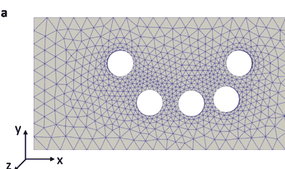

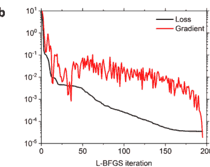

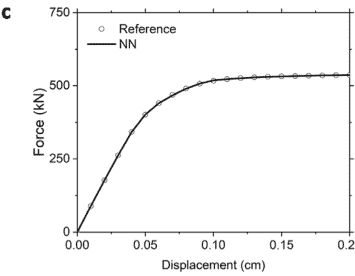

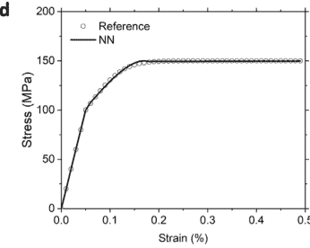

**图 2.** 用于非线性应变硬化材料本构关系的 FEM-NN 结果。(a) 包含随机分布孔的薄板的 FEM 设置。(b) 损失函数及其梯度幅随 L-BFGS 算法训练迭代次数变化的函数图。(c) 样本级力-位移响应的参考结果与 FEM-NN 预测结果的对比。(d) 拉伸应力-应变响应的参考结果与 FEM-NN 预测结果的对比。

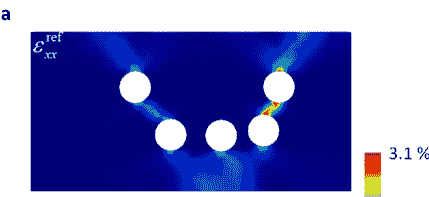

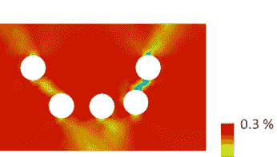

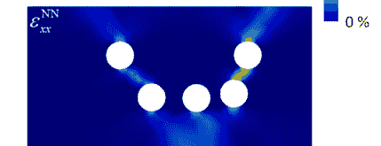

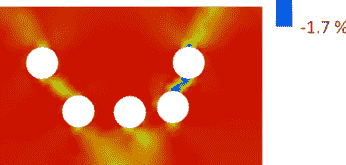

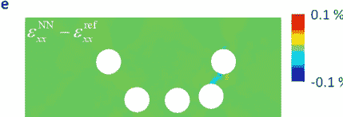

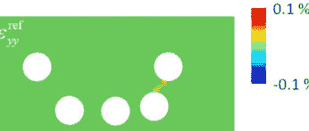

**图 3.** 参考应场与 FEM-NN 预测应场的对比。(a) 沿拉伸加载水平方向的参考应变 $\epsilon_{xy}^{ref}$ 等值线图。(b) 沿横向的参考应变 $\epsilon_{xy}^{ref}$。(c) 预测应变 $\epsilon_{xx}^{NN}$，d) 预测应变 $\epsilon_{yy}^{NN}$，e) (a) 和 (c) 之间的差异 $\epsilon_{xx}^{NN} - \epsilon_{xx}^{ref}$,(b) 和 (d) 之间的差异 $\epsilon_{yy}^{NN} - \epsilon_{yy}^{ref}$。（关于本图例中颜色的解释，请参考本文的网页版）。

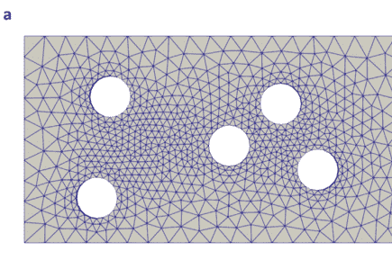

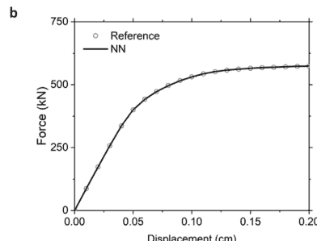

**图 4.** 未包含在训练集中薄板几何结构的 FEM-NN 结果：(a) 孔径与图 2(a) 不同的板中孔 FEM 网格。(b) 样本级力-位移响应的参考结果与 FEM-NN 预测结果的对比。

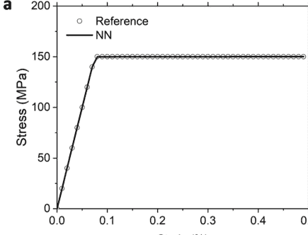

**图 5.** 参考结果与 FEM-NN 预测应力-应变关系的对比，(a) 完全弹性材料，b) 线硬化材料。

虽然位移场可以直接从实验中观察，但空间导数给出了应变场，提供了关于分布更具物理透明度的信息。在图 3 中，我们比较了应变水平 0.2 处的 FEM-NN 预测和参考等值线。所有应变等值线都是使用面内法向应变分量 $\varepsilon_{xx}$ 和 $\varepsilon_{yy}$ 绘制的。从图 3(a) 可以看到，板右端两个孔之间存在应变局部化带，其 $\varepsilon_{xx}$ 值比其他区域高出十倍。图 3(b) 显示了类似的应变分布，其中 $\varepsilon_{yy}$ 升高但低于 $\varepsilon_{xx}$，这主要是由于泊松效应以及沿 x 方向施加拉伸载荷，且值小得多。此外，图 3c 和 3d 中的 FEM-NN 预测应变等值线分别与图 3a 和 3b 中的参考结果高度一致。

