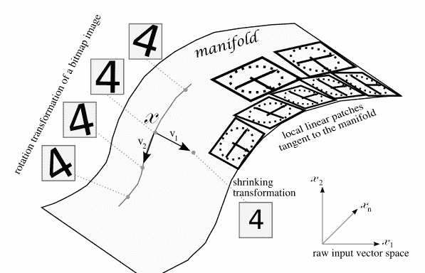
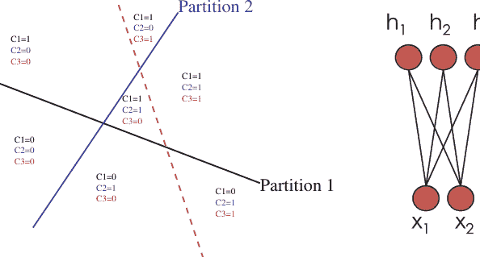
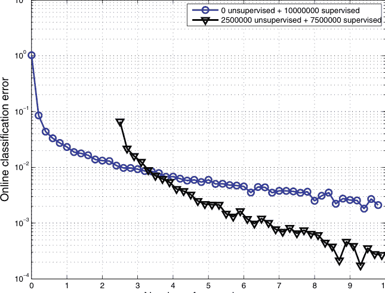
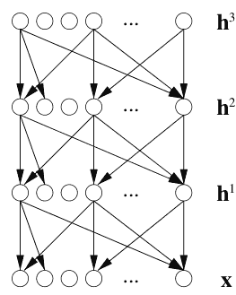
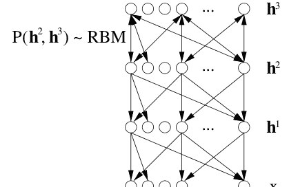
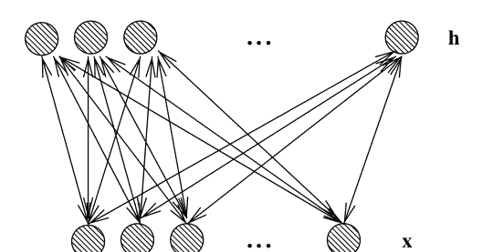
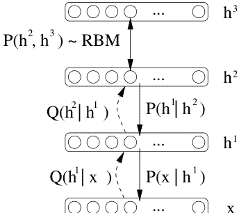

# AI 深度架构学习（机器学习基础与趋势）


## 用于 AI 的深度架构学习

Yoshua Bengio 著


# 致谢

# 参考文献


## 用于 AI 的深度架构学习

Yoshua Bengio

### 摘要

理论结果表明，为了学习能够表示高层抽象的复杂函数（例如在视觉、语言和其他 AI 级任务中），我们可能需要*深度架构*。深度架构由多层非线性操作组成，例如具有许多隐藏层的神经网络，或者在重用了许多子公式的命题公式中。搜索深度架构的参数空间是一项艰巨的任务，但最近提出的诸如深度置信网络的学习算法在解决这一问题上取得了显著成功，在某些领域超越了最先进水平。本专著讨论了关于深度架构学习算法的动机和原理，特别是那些利用单层模型的无监督学习（如受限玻尔兹曼机）作为构建块的方法，用于构建如深度置信网络等更深的模型。

# 1 引言

让计算机很好地模拟我们的世界以展现出我们所谓的“智能”，一直是半个多世纪以来的研究焦点。为了实现这一点，显然应该在计算机中显式或隐式地存储大量关于世界的信息。由于将所有内容格式化为计算机用于回答问题并泛化到新语境的格式似乎极其困难，许多研究人员转向了学习算法来捕捉大部分大部分信息。在理解和改进学习算法方面取得了巨大进展，但人工智能（AI）的挑战依然存在。我们有能够理解场景并用自然语言描述它们的算法吗？并没有，除非在非常有限的范围内。我们有能够推断出足够语义概念以便使用这些概念与大多数人进行交互的算法吗？没有。如果我们考虑图像理解——最明确的 AI 任务之一——我们发现我们还没有能够发现许多视觉和语义概念的学习算法，而这些概念对于解释网络上的大部分图像似乎是必要的。其他 AI 任务的情况也是如此。

高层级表示：

```
MAN SITTING ...
```

... 等 ...

稍高层级表示

原始输入向量表示：

```
d' = 23 19 20 18
d'1 a5 a3 d'6
```


图 1.1 我们希望原始输入逐渐转变为更抽象的内容，例如从边缘、形状，直到识别与子物体和物体（作为图像的部分）相关的抽象类别。

从自然图像中提取有用信息的一种可行且常见的方法涉及将原始表示形成逐渐更抽象的表示，例如，从边缘的存在、检测更复杂但局部的形状，直到识别与子物体和物体（作为图像的部分）相关的抽象类别，并将所有这些整合在一起，以捕捉对场景的足够理解

在这里，我们假设表达复杂行为（人们可能标记为“智能”）所需的计算机制需要高度变化的数学函数，即对于原始感官输入具有高度非线性的数学函数，并在感兴趣的范围内显示出大量的波动（起起伏伏）。我们将学习系统的原始输入视为一个高维实体，由许多观测变量组成，这些变量通过未复杂的统计关系相关联。例如，利用对固体物体3D 几何和光线的知识，可以将底层物理和几何因素（如物体的位置、方向、光照）的微小变化与图像中所有像素的强度变化联系起来。我们将这些因素称为变异因素，因为它们是数据中可以独立且相互变化的不同方面。如果机器捕捉了解释数据变化的因素，以及它们如何相互作用生成我们观测到的数据，我们就可以说机器理解了这些变异因素所涵盖的世界方面。遗憾的是，通常情况下，对于自然图像底层大多数变异因素，我们对这些变异因素还没有分析性的理解。我们没有足够的格式化


## 1.1 我们如何训练深度架构？

我们需要关于世界的先验知识来解释观察到的图像多样性，即使如图 1.1 所示，对于像 MAN（哺乳动物）这样看似简单的抽象。像 MAN 这样的高级抽象具有特性：它对应于一组非常可能的图像，从像素强度空间中简单欧式距离的角度来看，这些图像彼此可能非常不同。在像素空间中，标签对应的图像集合可能是像素空间中一个高度复杂的区域，且该区域不一定是连通的。MAN 类别在这里可以被视为高级抽象，它可以是一个类别（如 MAN 类别）或是一个特征（数据的函数），可以是离散的（例如，输入句子是过去式），也可以是连续的（例如，输入视频显示物体以每秒 2 米的速度移动）。许多低级和中间级概念（我们在这里也称为抽象）对于构建 MAN 检测器非常有用。低级抽象与特定概念联系得更紧密，而高级抽象则是我们所说的“更抽象”的抽象，因为它们与实际概念的联系更加遥远，并且通过其他中间级抽象来实现。

除了构合适抽象的困难外，我们希望“智能”机器捕获的视觉和语义类别（如 MAN）的数量也相当大。深度架构学习的重点是自动发现从最低级到最高级概念的抽象。理想情况下，我们希望学习算法能够尽可能少的人为努力来实现这种发现，即不需要手动定义所有必要的抽象，也不需要有一组巨大的手工标记示例。如果这些算法能够利用互联网上海量的文本和图像资源，无疑有助于将许多人类知识转移到机器可解释的形式。

# 引言

深度学习方法旨在学习特征层次结构，其中高层级的特征由低层特征的组合形成。在多个抽象层级上自动学习特征，允许系统直接从数据中学习映射输入到输出的复杂函数，而不需要完全依赖人工构建的特征。这对于高级抽象尤为重要，因为人类往往不知道如何根据原始感官输入来指定它们。随着数据量和学习方法应用范围的不断增长，自动学习强大特征的能力将变得越来越重要。

架构的深度指的是所学习函数中非线性操作组合的层数。虽然目前大多数学习算法对应于浅层架构（1、2 或 3 层），但哺乳动物大脑的组织方式是一种深度架构 [173]，给定的输入存在于多个抽象层级上，每层对应于皮层的不同区域。人类通常以分层的方式描述此类概念，具有多个抽象层级。大脑似乎还通过多个阶段的转换和表示来处理信息。这在灵长类视觉系统 [173] 中尤为清晰，其处理阶段序列为：边缘检测、原始形状，并逐渐移动到日益复杂的视觉形状。

受大脑架构深度的启发，神经网络研究人员几十年来一直想训练深度多层神经网络 [19, 191]，但在 2006 年之前没有报道过任何成功的尝试：研究人员发布的实验结果通常只有两或三层（即一或两层隐藏层），但训练更深的网络始终产生较差的结果。2006 年发生了可以认为是突破的事情：多伦多大学的 Hinton 等人介绍了深度置信网络 (DBNs) [73]，其学习算法贪婪地一次训练一层，对每一层利用一种无监督学习算法，即受限玻尔兹曼自动编码器 (RBM) [51]。不久后，基于自动编码器的相关算法被提出来 [17, 153]，它们显然利用了

> 除了 4.5 节讨论的具有特殊结构的卷积神经网络外外。

## 1.2 跨任务共享特征和抽象

相同的原理：使用无监督学习引导中间层表示的训练，这种学习可以在每层本地进行。最近还提出了其他深度架构算法，它们利用 RBM 而非自动编码器，并利用了相同的原理 [131, 202]（见第 4 节）。

自 2006 年以来，深度网络不仅成功应用于分类任务 [2, 17, 99, 111, 150, 153, 193]，还应用于回归 [74]降维 [158]运动 [183]物体分割 [114]信息检索 [154]自然语言处理 [37]协同过滤 [60] 以及去噪自动编码器 [195]。

由于深度架构可以被视为一系列处理阶段的组合，深度架构引发的直接问题是：每个阶段的输出应该找到什么种的表示？这些阶段之间应该是什么样的接口？近期深度架构研究的一个标志是关注这些中间表示：深度架构的成功归功于数据背后的因素。

大脑中发现的每个抽象层级由大量特征的一个小子集的“激活”（神经兴奋）组成，这些特征通常不是互斥的。因为这些特征不是互斥的，它们形成了所谓的分布式表示 [68, 156]；信息并不定位在特定的神经元中，而是分布在许多神经元中。除了分布之外，大脑似乎还使用了稀疏表示：在给定时间内只有 1-4% 的神经元是活跃的 [5,113]。第 3.2 节介绍了稀疏表示的概念，第 7.1 节详细描述了机器学习方法，其中一些方法受到大脑稀疏表示观察的启发，被用于构建具有稀疏表示的深度架构。

虽然稠密分布表示是光谱的一个端，稀疏表示位于该光谱的中间，而纯局部表示是另一端。表示的局部性与局部泛化的概念密切相关。许多机器学习方法在输入空间上是局部的：为了获得在数据空间不同区域表现良好的学习函数，它们为这些区域每个区域需要不同的可调参数（更多见第 3.1 节）。尽管在可调参数数量很大时统计效率并不一定差，但只有在加入某种形式的先验（例如，倾向于较小的参数值）才能获得良好的泛化。当先验不是特定于任务时，通常是强制解决方案变得非常平滑，如第 3.1 节末尾讨论的。与基于局部泛化的学习方法相比，使用分布式表示可以区分的模式总数可能随表示维度（即学习到的特征数量）呈指数级增长。

在许多视觉系统中，学习算法被限于处理链的特定部分。其余设计仍然是劳动密集型的，这可能会限制此类系统的规模。

另一方面，我们认为的智能机器的特征之一是足够大的概念库。识别 MAN 是不够的。我们需要能够处理非常大的


## 1.2 跨任务的特征与抽象共享

一系列任务和概念集合。手动定义这么多任务似乎异常艰巨，因此在这种背景下，学习变得至关重要。此外，如果不利用这些任务以及它们所需的概念之间的底层共性，似乎是愚蠢的。这正是多任务学习的研究焦点 [7, 8, 32, 88, 186]。具有多个级别的架构自然地提供了此类组件的共享和复用：底层视觉特征（如边缘检测器）和中级视觉特征（如物体部分）这些对于检测 MAN 有用的特征，对大量其他视觉任务同样有用。深度学习算法基于学习中间表示。因此，它们可以利用无监督数据和来自相似任务的数据 [148] 来提升在通常面临标注数据匮乏的大型挑战性问题上的性能，正如 [37] 所示，这种方法超越了自然语言处理任务中的先进水平。[2] 类似的深度架构多任务方法也被应用于视觉任务。考虑一种多任务设置，其中任务有不同的输出，而所有输出都来自一个共享的层级特征池。许多学习到的特征出现在 m 中，这一事实提供了与 m 成比例的统计强度共享。现在考虑，这些学习到的高层特征本身可以通过组合公共池中的较低层级中间特征来表示。同样，可以以类似的方式获得统计强度，这种策略可以被用于深度架构的每一层。

此外，学习大量相互相关的概念可能为人类表现出的那种宽泛泛化提供关键，而我们并不期望从单独训练的、每个视觉类别一个物体检测器中获得这种结果。如果每个高层类别本身都是通过公共池中抽象特征的特定分布式配置来表示，那么对未见类别的泛化可以从这些特征的新配置自然产生。尽管训练示例中只出现了这些特征的一些配置，但如果它们代表了数据的不同方面，可以通过这些特征的新配置来有意义地表示新示例。

## 1.3 AI 学习的需求

总结上述一些问题，并尝试将其放在更广泛的 AI 视角下，我们提出了若干认为对于学习算法接近 AI 重要的要求，其中许多研究的动机就在这里：

- 学习复杂、高度变异函数的能力，即变化数量远大于训练示例数量。
- 能以极少的人工输入学习底层、中级和高层抽象的能力，这些抽象对于表示 AI 任务所需的复杂函数非常有用。
- 从极大量的示例中学习的能力：训练的计算量应随示例数量良好地扩展，接近线性增长。
- 从大部分未标记数据中学习的能力，即在半监督设置下工作，此时并非所有示例都带有完整且正确的语义标签。
- 利用大量任务之间存在的协同效应的能力，即多任务学习。这些协同效应的存在是因为所有 AI 任务都对同一现实提供了不同的视角。
- 强无监督学习（即捕获观测数据中的大部分统计结构），这在任务数量极大的极限以及未来任务无法预先知的情况下似乎是至关重要的。

其他元素同样重要，但与本专著的内容相关。它们包括学习表示不同长度和结构的上下文的能力 [146]，以便让机器能够在依赖上下文的观测流中运行并产生动作流；在动作影响未来观测和未来奖励时做出决策的能力 [181]；以及影响未来观测以收集更多关于世界相关信息的能力，即一种主动学习（active learning）的形式 [34]。

## 论文大纲

第 2 节回顾了理论结果（跳过这些不会影响对后续内容的理解），结果表明，深度不足的架构可能比深度与任务匹配的架构需要多得计算元素（相对于输入大小可能是指数级的更多）。我们声称深度不足对学习是有害的。事实上，如果任务的解决方案是用一个巨大但浅的架构表示的，则可能需要大量的训练示例来调优所有元素并捕捉高度变异的函数。第 3.1 节也旨在启发读者，这次是为了强调局部泛化和局部估计的局限性，我们预计通过具有分布式表示的深度架构（第 3.2 节）来避免这些。

在后面的章节中，本专著描述并分析了一些提出的用于训练深度架构的算法。第 4 节引入了与训练深度架构任务相关的神经网络概念。我们首先考虑了以前训练多层神经网络的困难，然后引入了可以用于初始化深度神经网络的深度无监督学习算法。这些算法许多（包括用于 RBM 的算法）与自动编码器（auto-encoder）有关：一种单层模型的简单无监督算法，用于捕捉其输入的分布式表示 [25, 79, 156]。为了充分理解 RBM 和许多相关的无监督学习算法，第 5 节引入了基于能量的模型（energy-based models）类，包括用于构建带有隐藏变量的生成模型（如波尔兹曼机）。第 6 节关注深度信念网络（DBNs）73] 和堆叠自动编码器（17, 153, 195）的逐层训练算法。第 7 节讨论了最近提出的扩展和改进 RBM 及自动编码器的变体，包括稀疏性的使用和时间依赖建模。第 8 节讨论了使用变分边界联合训练深度信念网络所有层的算法。最后，第 9 节考虑了前瞻性问题，例如训练深度架构涉及的困难优化问题。特别是，我们遵循这样一个假设：深度架构学习策略的部分成功与底层的优化有关。我们讨论了延续方法（continuation methods）的原理，通过最小化目标函数的逐渐平滑的版本，为深度架构的优化突破。

## 深度架构的理论优势

在本节中，我们通过揭示深度不足架构的潜在局限性的理论结果，为研究深度架构的学习算法提供了动力论证。本专著的这部分（本节和下一节）为后面章节描述的算法提供了动机，并且跳过也不会影响理解。

本节的主要观点是，某些函数无法通过过浅的架构（从可调元素的角度）高效地表示。这些结果表明，探索深度架构的学习算法是值得的，它们可能表示某些原本无法高效表示的函数。当简单且浅的架构无法高效表示（因此无法学习）感兴趣的任务时，我们可以希望学习算法能够为该任务设置深度架构的参数。

当一个函数的表达式具有很少的计算元素，即需要通过学习调优的自由度很少时，我们称该表达式是紧凑的。因此在示例数量固定的情况下，且在学习算法没有注入其他知识的情况下，


## 14 深度架构的理论优势

我们预想目标函数的紧凑表示会带来更好的泛化能力。

更准确地说，能够被深度 $k$ 架构紧凑表示的函数，如果用深度 $k-1$ 的架构表示，可能需要指数级的计算元素。由于人们能够负担的计算元素数量取决于用于调优或选择这些元素的训练示例数量，因此其后果不仅体现在计算上，也是统计学上的；当使用深度不足的架构来表示某些函数时，可能会出现泛化性能差的情况。

我们考虑固定维度输入的情况，在这种情况下，机器执行的计算可以表示为一个有向无环图，其中每个节点执行的计算结果是图中另一个节点的输出，或者是图的外部输入之一。整个图可以被视为一个*电路*，它计算一个应用于外部输入的函数。当允许计算节点使用的函数集合被限制为*逻辑门*（如{与，非}）时，这就是布尔电路，或*逻辑电路*。

为了形式化架构深度的概念，必须引入计算元素集合的概念。这种集合的一个例子是逻辑门可以执行的计算集合。另一个是人工神经元可以执行的计算集合（取决于其突触权重的值）。一个函数可以通过集合中计算元素的复合来表示。它由一个形式化这种复合的图定义，每个计算元素对应一个节点。架构的深度指的是该图的深度，即从输入节点到输出节点的最长路径。当计算元素集合是人工神经元的计算集合时，深度对应于神经网络的层数。让我们通过不同深度的架构示例来探索深度的概念。考虑函数 $f(x) = x * \sin(a * x + b)$。它可以表示为简单操作（如加法、减法、乘法和运算）的复合，如图 2.1 所示。

| 输出 | | 输出 |
|---|---|---|
| 元素集合 | | 神经元 |
| * | | |
| sin | 神经元 | 神经元 |
| + | ... | 神经元 |
| - | 神经元 | 神经元 | 神经元 |
| | x a b | 输入 |

在示例中，乘法 $a * x$ 和最终与 $x$ 的乘会有不同的节点。图中的每个节点都与一个输出值相关，该值是通过对图中其他节点的输出输入值应用某些函数得到的。例如，在逻辑电路中，每个节点都可以计算从较小的布尔函数集中选取的布尔函数。整个图具有输入节点和输出节点，并计算从输入到输出的函数。架构的*深度*是从图中任何输入到任何输出的路径的最大长度，即在图 2.1 的 $x * \sin(a * x + b)$ 案例中深度为 4。

- 如果我们在计算元素集中将仿射运算及其与 sigmoid 的可能复合包含在内，那么线性回归和逻辑回归的深度为 1，即具有单层。
- 当我们将固定的核计算 $K(\mathbf{u,v})$ 放入允许的操作集合时，结合仿射运算，具有固定核的核机器 [166] 可以被认为有两个层。第一层有一个元素用于计算 $K(\mathbf{x},\mathbf{x}_i)$（一个选定的代表性训练示例），并将输入向量 $\mathbf{x}$ 与原型 $\mathbf{x}_i$ 匹配。第二层执行仿射组合 $b + \sum \alpha_i K(\mathbf{x},\mathbf{x}_i)$，将匹配的原型 $\mathbf{x}_i$ 与预期响应相关联。
- - 当我们将人工神经元（非线性的仿射变换）放入元素集合时，我们得到了普通的多层神经网络 [156]。在只有一个隐藏层的最常见选择下，它们的深度也为二（隐藏层和输出层）。
- 如第 3.1 节所述，决策树 3.1 也可以被视为具有两层。
- Boosting [52] 通常为其基学习器增加一层：该层计算基学习器输出的投票决或线性组合。
- Stacking [205] 是另一种增加增加一层的元学习算法。
- 根据目前对大脑解剖学的知识 [173]，皮层似乎可以被视为一种深度架构，仅视觉系统就有 5-10 层。

尽管深度取决于对每个元素允许的计算的选择，但与某一集合关联的图可以通过图变换转换为与另一集合关联的图，这种转换方式会增加深度。理论结果表明，重要的不是层数的绝对数量，而是层数相对于高效表示目标函数（通过对某种计算元素集合的选择）所需的层数比例。

## 2.1 计算复杂度

关于深度架构能力的最正式论证源于对电路计算复杂度的研究。基本结论是，这些结果表明，当一个函数可以被深度架构紧凑表示时，用深度不足的架构来表示可能需要非常巨大的架构。

两层逻辑门电路可以表示任何布尔函数 [127]。任何布尔函数都可以写成乘积之和（析取范式：第一层为可选取反的与门，第二层为或门）或和之积（合取范式：第一层为可选取反的或门，第二层为与门）。为了理解浅层架构的局限性，要考虑的结果结果是，许多函数 [98] 在被限制为深度二时需要指数级的大小。更有趣，某些函数 [208] 在深度二时就具有指数级的大小。

人们可能会好奇这些布尔电路的结果是否与学习有关。关于计算复杂度理论结果的早期综述请参见 [140]。有趣的是，许多布尔电路的结果可以推广到元素为线性单元（也称为人工神经元）[125]的架构，这些单元计算
$\mathbf{1}_{\mathbf{w}^T\mathbf{x}+b\geq 0}\quad (2.1)$

参数为 $\mathbf{w}$ 和 $b$。电路的扇入是元素的最大输入数。电路通常按层组织，类似于多层神经网络，层中的元素只从前一层获取输入。电路的大小是其元素的数量（不包括执行任何计算的输入元素）。

$d$ 位异或函数按通常定义为：
parity : $(b_1, \dots, b_d) \in \{0, 1\}^d \to \begin{cases} 1, & \text{如果 } \sum_{i=1}^d b_i \text{为偶数} \\ 0, & \text{否则}. \end{cases}$

## 2.2 非正式论证

架构的深度与高度变化函数的概念有关。我们认为，通常情况下深度架构可以紧凑地表示高度变化的函数，而这些函数如果使用不当的架构来表示则需要巨大的尺寸。我们说


## 2.2 非正式论证

当对函数进行分段近似（例如分段常数或分段线性）需要大量的分段时，说明该函数是高度变变的。深度架构是许多操作的组合，在任何情况下，它都可以表示为一个非常大的深度 2 架构。小型深层电路中计算单元的组合可以看作是对大型浅层电路的高效“因子分解”。重新组织单元组合的方式会对比表示大小的效率产生巨大影响。例如，想象一个多项式的深度 $k$ 表示法，其中奇数层实现乘法，偶数层实现加法。这种架构可以看作是一种特别高效的分解，当它扩展为深度 2 架构（如乘积和）时，和中可能需要大量的项：考虑来自深度 $2k$ 架构的第 1 层乘积（如 $x_2x_4$）。它在深度 2 架构中可能作为因子出现多次。从这个例子可以看出，如果某些计算（例如在某一层）是可以共享的（考虑扩展后的深度 2 表达式），那么深度架构是有优势的：在这种情况下，待表示的整体表达式可以被因子化，即用深度架构更紧凑地表示。


图 2.2 多项式电路示例（奇数层为乘法，偶数层为加法），说明了深度架构所享有的分解。例如，在上述多项式的深度 2（乘积和）展开中，第 1 层乘积 $x_2x_3$ 会出现多次（随深度呈指数级增长）。

[19] 还讨论了表明深度架构更强表达能力及其在人工智能和机器学习中潜力的其他例子。[191] 从更具认知角的视角对深层架构预期优势进行了早期的讨论。注意，连接主义认知心理学家长期以来研究神经计算的想法，这种计算通过对应于不同抽象层次的层次化表示级进行组织，并且每一层都具有分布式表示 [67, 68, 123, 122, 124, 157]。这里讨论的现代深度架构方法归功于认知心理学（随后进入计算机科学/人工智能），旨在解释早期认知模型无法自然捕捉的现象，并将认知解释与神经基质的计算特征联系起来。

总之，许多计算复杂性结果有力地表明，能够用深度 $k$ 架构紧凑表示的函数，为了用浅层架构表示可能需要大量的元素。由于架构中的每个元素都可能需要使用示例进行选择（即学习），这些结果表明从统计效率的角度来看，架构的深度可能非常重要。这一概念在下一节中进一步发展，讨论了许多浅层架构与非参数学习算法相关的另一个弱点：估计器在输入空间中的局部性。

# 局部与非局部泛化

### 3.1 匹配局部模板的局限

学习算法如何紧凑地表示输入的“复杂”函数，即变化远多于可用训练数量的函数？这个问题与深度以及估计器的局部性问题都相关。我们认为局部估计器不适用于学习高度变变的函数，尽管它们潜在地可以通过深度架构高效地表示。输入空间中的局部估计器通过主要利用 $x$ 附近的邻域内的训练示例，为新输入 $x$ 获得良好的泛化。例如，训练示例中测试点 $x$ 的 $k$ 个邻居对 $x$ 处的预测投票。局部估计器隐式或显式将输入空间划分为区域（可能是软性的而非硬性的），并需要不同的参数或自由度来解释每个区域内目标函数可能的形状。当由于函数高度变而需要许多区域时，所需的参数数量也会很大，从而导致实现良好泛化所需的示例数量也之增加。

# 局部与非局部泛化

局部泛化问题与维度灾难的文献直接相关，但我们引用的结果表明，对泛化的关键因素不是维度，而是我们希望在学习后获得的函数的“变化”数量。例如，如果模型表示的函数是分段常数的（例如决策树），那么问题就是恰当拟合目标函数所需的分段数量。变化数量与输入维度之间存在联系：人们很容易设计出一类目标函数族，其变化数量随输入维度呈指数级增长，例如具有 $d$ 个输入的奇偶校验函数。

基于匹配模板的架构可以被认为具有两个级。第一层是一组可以与输入匹配的模板。模板单元将输出一个指示匹配程度的值。第二层结合这些值，通常是简单的线性组合（一种类似于或门的操作），以估计所需的输出。人们可以将这种线性组合理解为执行了某种插值，以便在输入空间中模板之间的区域产生答案。

基于匹配模板的架构的典型示例是核机器 [66]

```
$f(x) = b + \sum \alpha_i K(x, x_i),
```

$b$ 和 $\alpha_i$ 构成第二层，而在第一层，核函数 $K(x,x_i)$ 将输入与 $x_i$ 匹配。在上面的方程中，$f(x)$ 可以是分类器的判别式，或者是回归预测器的输出。当 $K(\mathbf{x},\mathbf{x}_i) > \rho$ 对于 $\mathbf{x}_i$ 周围区域区域时，核是局部的。该区域的大小通常由核的某个超参数控制。局部核的一个示例是高斯核 $K(\mathbf{x},\mathbf{x}_i) = e^{-|\mathbf{x}-\mathbf{x}_i|^2/\sigma^2}$，其中 $\sigma$ 控制区域。我们可以将高斯核看作是一种软与运算，因为

### 3.1 匹配局部模板的局限

它可以被写为一维条件的乘积：$K(\mathbf{u}, \mathbf{v}) = \prod_{j} e^{-(\mathbf{u}_j-\mathbf{v}_j)^2/\sigma^2}$。如果所有维度 $j$ 的 $|\mathbf{u}_j-\mathbf{v}_j|/\sigma$ 都很小，则模式匹配且 $K(\mathbf{u}, \mathbf{v})$ 很大。如果单个 $j$ 的 $|\mathbf{u}_j-\mathbf{v}_j|/\sigma$ 很大，则没有匹配且 $K$ 很小。

核机器的已知示例不仅包括分类和回归的支持向量机 (SVMs) [24, 39] 和高斯过程 [203]，还包括用于分类、回归和密度估计的经典非参数算法，如最近邻算法、Parzen 窗口等。下面我们将讨论流形学习算法和 LLE（它们也可以被视为局部核机器），以及基于邻域图（每个示例一个节点，相邻示例之间有边）构建的半监督学习算法。

具有局部核的核机器通过所谓的“平滑先验”产生泛化：假设目标函数是平滑的，或者可以用平滑函数良好地近似。在监督学习中，如果我们训练了一个示例 $(\mathbf{x}_i, y_i)$，那么当 $\mathbf{x}$ 靠近 $\mathbf{x}_i$ 时，构造一个输出接近 $y_i$ 的预测器是有意义的。注意这种先验需要在输入空间中定义一种邻近性概念。这是一个实用的先验，但 [13] 和 [19] 中的观点之一是，当目标函数在输入空间中高度变化时，这种先验是不够的。

固定核（如高斯核）的局限性激发了许多基于任务先验设计核的研究 [38, 56, 89, 171]。然而，如果我们缺乏设计适当核的先验知识，可以学习它吗？这同样激发了许多研究 [40, 96, 196]，深度架构可以被视为该方向的一个有前景的发展。已经证明，高斯过程核机器可以通过深度信念网络进行改进：在训练深度信念网络后，其参数被用于


# 局部与非局部泛化

初始化一个确定性的非线性变换（多层神经网络）来计算特征向量（数据的一个新特征空间），并可以使用基于梯度的优化对该变换进行调整，以最小化高斯过程产生的预测误差。特征空间可以被看作数据的学习表示。良好的表示会将具有相似抽象特征的示例聚集在一起，而这些特征是数据分布的相关变异因素。深层架构的学习算法可以看作是核机器学习良好特征空间的方法。

考虑目标函数中的一个方向 $\mathbf v$，在该方向上，目标函数 $f$（学习者理想上应该捕捉的内容）在一系列“波峰”中起伏（即随着 $f(x+\alpha v)$ 越过零点、变为正值、变为负值等）。根据 [165], [13,19] 的研究，对于使用高斯核的核机器，所需的示例数量随待学习目标函数中“波峰”的数量呈线性增长。它们还表明，对于像奇偶函数（parity function）这样变化剧烈的函数，使用高斯核机器达到某些误差率所需的示例数量相对于输入域呈指数级增长。对于仅依赖目标函数是局部平滑这一先验假设的学习器（例如高斯核机器），在一个方向上学习具有多次符号变化的函数在根本上是非常困难的（需要巨大的 VC 维和相应的大数量示例）。然而，学习其他类别的函数可能是行的，因为这些函数中的变异模式可以被捕捉（一个平凡的例子是变异是周期性的，且函数类包含了近似匹配的周期性函数）。

对于高维中的复杂任务，使用局部核方法时，决策表面的复杂性可能会迅速使学习变得不可行。也可以认为，如果曲线具有许多变化，且这些变化并非通过底层的正则性相互联系，那么任何学习算法都不会比输入空间中局部的估计器好多少。然而，寻找这些变异更紧凑的表示可能是值得的，因为如果能找到，它可能会导致更好的泛化能力，特别是对于训练集中未出现过的变异。

# 3.1 局部模板匹配的局限性

本课程的后续只有在目标函数中存在可以捕捉的底层正则性时才可能；我们预计这种属性在 AI 任务中成立。

输入空间中局部的估计器不仅存在于上述的无监督学习算法中，还存在于无监督和半监督算法中，例如局部线性嵌入 [155]、Isomap [158]核主成分分析 [168]（或核 PCA）、拉普拉斯特征映射 [10]流形投影 [26]谱聚类算法 [199] 以及基于核的非参数半监督算法 [9, 44, 209, 210]。这些无监督和半监督算法大部分依赖于*邻域图*：一种每个示例一个节点且近邻之间有弧的图。通过这些算法，我们可以对它们的操作产生几何直觉，也可以理解它们作为局部估计器如何阻碍性能。这通过流形学习中的图 3.1 示例所示。在这里再次发现为了



图 3.1 与同一物体类别相关的图像集形成了一个流形或一组不相交的流形，即维度低于原始图像空间的区域。通过旋转或缩放（例如数字 4），我们得到同一类别的其他图像，即在同一个流形上。由于流形是局部平滑的，在原理上可以用局部线性补片进行局部近似，每个补片都与流形相切。遗憾的是，如果流形曲率很大，则要求的补片非常小，且相对于流形维度可能需要指数级的补片。图中慷慨提供的图由 Pascal 覆盖了待学习的许多变异。

最后让我们考虑基于邻域图的算法 [9, 44, 209, 210]。这些算法将邻域图划分为具有恒定标签的区域。可以证明，达到某些误差率所需的示例数量相对于恒定标签的区域呈指数级增长。对于目标函数中的变异，需要相应数量的恒定标签示例。

决策树 [28] 是研究最充分的学习算法之一。由于它们关注输入变量的子集，起初看起来是非局部的。然而，通过对空间进行划分，它们也是局部估计器。这意味着它们的泛化性能随目标函数中变异数量的增加而下降。理论分析 [14] 显示，对于某些类函数，达到给定误差率所需的训练示例相对于维度呈指数级。这种分析建立在计算复杂性文献 [41] 中利用的类似方法之上。这些结果也与之前的实验结果一致 [143]。

树集成（例如提升树 [52] 和森林 [80]）比单棵树更强大。它们在架构中增加了一个第三层，使得模型能够在参数数量呈指数级关系的区域中进行区分。如图 3.2 所示，它们通过森林中所有树的输出隐含形成了分布式表示（在 3.2 中进一步讨论）。

## 3.2 学习分布式表示



3.2 虽然单个决策树（这里只是二分划分）可以在与参数数量（叶节点）呈线性关系的区域中进行区分，但树的集成（左）可以在与树的数量呈指数关系的区域中进行区分，即总参数（只要树的数量不超过输入的数量，虽然这里并不完全如此）（有三棵二分树，每个树定义两个区域，总共七个区域）。这等同于多聚类。具有三个隐藏单元的二项 RBM（右）是每个划分具有三个线性分离区域的多聚类（每个区域对应三个隐藏单元之一）。因此，多聚类是输入模式的分布式表示。输入模式在每棵树中关联的叶节点标识是一个元组，它是输入模式的非常丰富的描述：它可以表示大量可能的模式，因为与 $n$ 棵树关联的叶区域的交数量随 $n$ 指数增长。

在 1.2 节中，我们认为深层架构允许对系统层之间的表示类型进行选择，并引入了局部表示（在前节进一步讨论）、分布式表示和稀疏分布式表示的基本概念。分布式表示的想法是机器学习和神经网络研究中的一个老观点 [15, 68, 128, 157, 170]，它可能有助于处理


## 局部与非局部泛化

维度灾难与局部泛化的局限性。

整数 $i \in\{1,2,\dots,N\}$ 的一种卡通局部表示是一个包含 $N$ 位的向量 $\mathbf{r}(i)$，其中包含一个 $1$ 和 $N-1$ 个 $0$，即第 $j$ 个元素为 $\mathbf{r}(i)=\mathbf{e}_{ij}$，称为 $i$ 的独热表示。对于稀疏整数，其分布式表示可以是一个包含 $\log_2 N$ 位的向量，这是表示 $i$ 的一种紧凑得多的方法。对于相同数量可能配置，分布式表示的紧凑程度可能比非常局部的指数级。引入稀疏性概念（例如，鼓励许多单元取值为 (0)）允许产生介于完全（局部、极大稀疏）和非稀疏（即密集）分布式表示之间的表示。皮层中的神经元被认为具有分布且稀疏的表示 [139]，任何时刻约有1-4%的神经元处于激活状态 [5, 113]。在实践中，我们经常利用连续值的表示，这增加了它们的表达能力。连续值局部表示的一个例子是，第 $i$ 个元素根据输入与原型或区域中心之间的某种距离而变化，如 3.1 节讨论的高斯内核所示。在分布式表示中，输入模式由一组不互斥的特征表示，甚至可能在统计上是独立的。例如，聚类算法并不构建分布式表示，因为类本质上是互斥的，而独立成分分析 (ICA) [11, 142] 和主成分分析 (PCA) [82] 则构建了分布式表示。

考虑输入 $\mathbf{x}$ 的离散表示 $\mathbf{r}(\mathbf{x})$，其中 $\mathbf{r}(\mathbf{x})\in\{1,\dots,M\}$；$i\in\{1,\dots,N\}$。每个 $\mathbf{r}(\mathbf{x})$ 都可以看是将 $\mathbf{x}$ 分为 $\mathcal{M}$ 类。如图3.2 所示（当 $M=2$ 时，$\mathbf{r}(i)$ 将 $x$ 空间划分为 $\mathcal{M}$ 个区域，这些划分可以组合产生 $x$ 空间中可能的指数级数量的交集区域，对应于 $\mathbf{r}(\mathbf{x})$ 的不同配置）。注意，在表示特定的输入分布时，某些配置是不可能的，因为它们互不兼容。例如，在语言建模中，单词的局部表示可以通过词汇表中的索引直接编码其身份，或者等效地使用具有与词汇表大小相同条目的独热码。

另一方面，分布式表示可以通过在一个向量中拼接句法特征（例如，它可能拥有的词性分布）、形态特征（它具有什么后缀或前缀？）以及语义特征（它是动物的名字吗？等等）的指示器来表示单词。在聚类中，我们构建了离散的类，但组合类的的潜在组合类数量是巨大的：我们获得的是多聚类，这在与重叠类和部分成员关系 [55, 66] 的意义上是类似的，即类成员关系不是互斥的，这导致了关于输入信息的严重损失；而聚类形成了一个单一的划分，并通常提供输入空间的一系列独立划分。识别输入示例属于每个划分的哪一个区域是非常丰富的，可能不会丢失任何信息。指定输入模式可能属于每个划分中哪个区域的符号类型可以被视为输入到新空间的变换，在该空间中，数据的统计结构和变化因子可以被解耦。这对应于上一节讨论的树森林可以表示的 $x$ 空间划分类型。这也是我们希望深度架构捕捉的，但具有多个层级的表示，较高层级更抽象，并代表输入空间的复杂区域。

在监督学习领域，多层神经网络 [157, 156] 在无监督学习领域，玻尔兹曼机 [1] 被引入，目标是在隐藏层中学习分布式的内部表示。与上述语言示例不同，其目标是让学习算法发现组成分布式表示的特征。在具有多个隐藏层的多层神经网络中，有多个表示，每层都有一个。学习多个级别的分布式表示涉及一个具有挑战性的训练问题，我们将在下一步讨论。

## 深度架构的神经网络

## 4.1 多层神经网络

多层神经网络 [156] 的典型方程组如下。如图4.1 所示，对于前一层，$k$ 使用输出 $\mathbf{h}^{k-1}$ 计算输出向量 $\mathbf{h}^k$，从输入 $\mathbf{x} = \mathbf{h}^0$ 开始。

$$\mathbf{h}^k = \tanh(\mathbf{b}^k + W^k \mathbf{h}^{k-1}) \quad (4.1)$$

带有参数 $\mathbf{b}^k$（偏移向量）和 $W^k$（权重矩阵）。tanh 是逐元素应用的，并可以被 $\text{sig}(u) = 1/(1+e^{-u}) = \frac{1}{2}(\tanh(u)+1)$ 或其他饱和非线性取代。顶层输出 $\mathbf{h}^l$ 用于预测，与监督目标 $y$ 结合成损失函数 $L(\mathbf{h}^l, y)$，该函数在 $\mathbf{b}^l + W^l^T h^{l-1}$ 上通常是凸的。输出层的非线性可能与其他层中使用的不同，例如 softmax

$$\mathbf{h}^l_i = \frac{e^{b^l_i + W^l_i^T h^{l-1}}}{\sum_j e^{b^l_j + W^l_j^T h^{l-1}}} \quad (4.2)$$

其中 $W^l_i$ 是 $W^l$ 的第 $i$ 行，为正且 $\sum_i h^l_i=1$。softmax 输出 $h^l_i$ 可以作为……的估计

### 4.2 训练深度网络的挑战

许多负面观察以及实验结果表明，训练深度架构比浅层架构更困难。在随机初始化之后，由于训练和泛化效果差，机器学习文献中没有讨论讨论深度架构。注意，深度神经网络 [104, 101, 17, 153] 被发现更容易训练，因为它们卡在“表观局部最小值或平台期”上，这并没有完全排除更强大的优化器无法找到更好的解决方案。

哪些原理可能解释文献中在使用无监督预训练时观察到的分类错误改进？一个线索可能有助于识别某些深度架构训练成功背后的原理，它来自于

> ¹从梯度下降轨迹停留在那里的意义上，我们称之为表观局部最小值，这并没有完全排除更强大的优化器无法找到更好的解决方案。


## 4.2 训练深度神经网络的挑战 33

既不利用 RBM 也不利用自编码器 [131, 202]。这些算法与基于 RBM 和自编码器的训练算法的共同点是具有层局部的无监督准则，即：在每一层注入无监督训练信号可能有助于引导该层的参数向参数空间中的某些区域。

在 [202] 中，神经网络使用样本对 $(x, x')$ 进行训练，这些样本对要么被认为是“邻居”（或属于同一类），要么不是。考虑 $h^k(x)$ 为模型中 $x$ 的第 $k$ 层表示。

在每一层都定义了一个局部训练准则，根据 $x$ 和 $x'$ 是否应该为邻居（例如输入空间中的 $k$-最近邻），将中间表示 $h^k(x)$ 和 $h^k(x')$ 推向彼此或推开彼此。相同的准则已被成功用于通过无监督流形学习算法学习低维嵌入 [59]，但在此处 [202] 中，它被应用于神经网络的一个或多个中间层。遵循慢特征分析 [23, 131, 204] 的思想，利用高层抽象的时间恒性来为中间层提供无监督引导：连续的帧可能包含相同的物体。

显然，这些技术可以显著提高测试误差，至少对于所研究的任务类型是如此，但为什么呢？要问的基本问题是，这种改进基本上源于更好的优化还是更好的正则化。如后文所述，答案可能不符合优化和正则化的定义。

在某些实验 [17, 98] 中，显而易见，没有无监督预训练的深度神经网络可以将分类误差降为零，这指向了正则化效应而非优化效应。[50] 中的实验也提供了相同方向的证据：对于相同的相同的训练误差（在训练期间的不同阶段），具有无监督预训练的测试误差系统地更低。正如 [50] 中讨论的，无监督预训练等于对参数空间中允许解的区域进行约束。这种约束强制解“靠近-2

2 梯度下降过程的吸引力盆。

那些与无监督训练对应的解，即希望对应于那些捕捉了输入中显著统计结构的解。另一方面，其他实验 [17, 98] 表明，底层调优不当可能是导致预训练结果较差的原因；当顶层隐藏层受到约束（强制变得小）时，随机初始化的深度神经网络（无无监督预训练）在训练集和测试集上的表现都很差，远差于预训练的网络。在之前提到的误差归零的实验中，情况始终是：每层隐藏单元的数量（一个超参数）被允许足够足够大（以最小化验证集上的误差）。[17, 98] 中提出的解释性假设是，当顶层隐藏层未受约束时，顶部的两层（对应于普通的 1 隐藏层神经网络）就足以拟合训练集，并使用下层计算的表示作为输入，即使该表示很差。另一方面，通过无监督预训练，底层被“更好地优化”了，较小的顶层就足以获得较低的训练误差，同时也能产生更好的泛化能力。[50] 中描述的实验也符合这一解释：在随机参数初始化的情况下，底层（更接近输入层）训练得很差。这些实验表明，无监督预训练的效果对于深度架构的底层最为显著。

我们从经验中知道，两层网络（一个隐藏层）通常可以被良好训练，并且从深度网络中的两层来看，它们形成了一个浅网络，其输入是下层的输出。对于常用的训练准则，优化深度神经网络的最后一层是一个凸优化问题。优化最后两层虽然不是凸的，但已知其比优化深度网络要容易得多（事实上，当隐藏单元的数量趋于无穷大时，两层网络的训练准则可以被构造为凸 [18]）。

如果顶层隐藏层有足够的隐藏单元（即足够的容量），即使底层没有经过良好训练（只要它们保留了大部分关于输入的信息），训练误差也可以降得非常低，这可能会带来

## 4.2 训练深度神经网络的挑战 35

比浅层网络更好的泛化能力。当训练误差很而测试误差很高时，我们通常将这种现象称为过拟合。由于无监督预训练降低了测试误差，这指向了某种正则化作用。其他强有力的证据表明预训练作用类似于正则化器；特别是当容量不足时，当训练集较小时，无监督预训练往往会产生不利（例如 MNIST，少于十万个样本）。

另一方面，对于大得多的训练集，通过对底层进行更好的初始化，训练和测试误差都可以被显著地降低。我们假设在深度神经网络中，这些层形成了一个“良好”的表示，这有助于做出良好的预测。当底层初始化不佳时，这些表示可能会扰乱输入并产生影响。无监督预训练有助于找到在线误差更优的最小值。

因此，一个假设是，无监督预训练通过允许对深度架构底层进行“更好”的调优来帮助泛化。另一个泛泛化的来源可能来自某种正则化形式：通过无监督预训练，底层被约束为捕捉输入的表示。考虑输入-输出对 $(X,Y)$。这种正则化类似于半监督学习中未标记示例的假设效应 [100]，或者或是

## 用于深度架构的神经网络 34

### 3 层网络，预算为 1000000 次迭代



图 4.2 使用 1000 万个数字图像在线训练的深度架构，或带有预训练（三角形），或不带预训练（圆圈）。所示的分类误差（垂直轴，对数尺度）是在接下来的 1000 个样本上在线计算的，并相对于从开始为止看到的样本数量绘图。早期样本用于无监督预训练（堆叠去噪自编码器）。末附近的震荡是因为误差太接近零，导致采样波动在对数尺度上看起来很大。虽然在大规模训练中正则化效应应该消失，但可以看到，如果没有预训练，训练将收敛到一个较差的表观局部最小值：无监督预训练有助于找到在线误差更优的最小值。Dumitra Ethan 进行的实验。

通过最大化 $P(X,Y)$（生成模型）的似然性作为 $P(Y|X)$（判别模型）所实现的正则化效应 [118, 137]。如果真实的 $P(X)$ 和 $P(Y|X)$ 作为 $X$ 的函数是不相关的（例如独立选择，因此学习其中一个无法为学习另一个提供信息），那么无监督学习 $P(X)$ 将无法帮助学习 $P(Y|X)$。但如果它们是相关的，并且相同的参数是

+   例如，MNIST 数字图像具有相当分离的簇，特别是在学习良好的表示时，即使是无监督的如此 [192]，因此在看到任何标签之前，就可以合理地猜测决策边界。


## 4.2 深度神经网络训练的挑战

在估计 $P(X)$ 和 $P(Y|X)$ 时，每一对 $(X,Y)$ 不仅通过通常的方式提供 $P(Y|X)$ 的信息，还通过 $P(X)$ 提供。例如，在深度信念网络（Deep Belief Net）中，这两个分布本质上共享相同的参数；估计 $P(Y|X)$ 所涉及的参数受益于一种依赖数据的正则化；它们必须在某种程度上与 $P(Y|X)$ 以及 $P(X)$ 致。

让我们回到关于无监督预训练带来更好结果的“优化与正则化”的解释。注意在此处使用“优化”一词时应保持谨慎。我们并没有遇到通常意义上的优化困难。事实上，从整个网络的角度来看，并不不存在那种人们通过主要依靠顶层来将训练误差驱动得非常低的困难。然而，如果考虑调整低层的问题（同时减小倒数第二层（即顶层隐藏层）的隐藏单元数量，或减小顶层权重的大小），那么就可以谈论优化困难了。调和优化与正则化观点的一种方法是考虑真正的在线设置（其中样本来自无限流，且不循环遍历训练集）。在这种情况下，在线梯度下降是对泛化误差进行随机优化。如果无监督预训练的效果纯粹是正则化的，那么我们预预期在虚拟上无限的训练集上，无论是否经过预训练，在线误差都会收敛到相同的水平。另一方面，如果这里提出的探索性假设是正确的，我们预预期无监督预训练将在在线设置中带来明确的益处。为了探索这个问题，我们使用了“无限 MNIST”数据集 [120]，即一个虚拟上无限的 MNIST 类数字图像流（通过 [176] 中定义的随机平移、旋转、缩放等获得）。如图 4.2 所示，训练的 3 层神经网络在经过预训练后（作为堆叠去噪自动编码器，见第 7.2 节）会收敛到显著的误差。图中显示了在线误差（或下 1000 个样本）的进展，这是泛化误差的无偏蒙特卡洛估计。

前 250 万次更新用于无监督预训练。

该图有力地表明，无监督预训练能够收敛到更低的误差，即它起到了正则化的作用，还能找到优化判则的更优最小值。尽管表面如此，这并不矛盾正则化假设：由于局部最小值的存在，即使样本趋于无穷大，正则化效应依然存在。这种解释的另一面是，一旦动力学被困在某些表观局部最小值附近，更多的标记样本就不会提供很多新信息。

为了解释为什么低层更难优化，上述线索表明，反向传播到低层的梯度可能不足以将参数移动到对应良好解的区域。根据该假设，针对低层参数的优化陷入了糟糕的表观局部最小值或平坦区域（即梯度很小）。由于基于梯度的顶层训练工作尚良好，这意味着随着我们向低层移动，梯度对于参数所需变化的提供信息变得越来越少，或者误差函数变得过于“病态”，以至于梯度下降无法逃离这些表观局部最小值。正如第 4.5 节所讨论的，这可能与深度卷积神经网络更容易训练的观察有关，也许因为它们在每一层都具有非常特殊的连接性。在深度网络中利用梯度的困难，与通过长序列训练循环神经网络的困难之间也可能存在联系，后者在 [22, 81, 119] 中被分析。循环神经网络可以通过将每个神经元在不同时间步的输出视为不同变量来“在时间上展开”，使得长序列上的展开网络变成非常深的架构。在循环神经网络中，训练困难可以追溯到通过许多非线性函数的消失（有时是爆炸）的梯度。在循环神经网络的情况下，由于梯度的短期组件（即展开图中较短的路径）与长期组件（与图中较长的路径相关）之间的不匹配，存在额外的困难。

> 例如，估计 $P(Y|X)$ 的多层神经网络的所有低层都可以使用估计 $P(X)$ 的深度信念网络的参数进行初始化。

## 4.3 深度架构的无监督学习

正如我们在上面看到的，逐层无监督学习是为止所有成功的深度架构学习算法的关键组成。如果定义在输出层的判准的梯度在反向传播到低层时变得越来越小，那么理由相信，定义在单层水平上的无监督学习判准可以将其参数向有利的方向移动。如果单层学习算法发现了一种能够发现层输入统计规律的表示，这种预期就是合理的。PCA 和要求信号数量与输入数量相同的 ICA 标准变体是不恰当的，因为它们在所谓的“过完备”情况下（层的输出数量大于其输入数量）通常没有意义。这表明应该向 ICA 的扩展方向联系，以处理过完备情况 [78, 87, 115, 184]，以及与 PCA 和 ICA 相关的算法，如自动编码器和 RBM，它们可以应用于过完备情况。事实上，通过单层学习进行的实验证实了这一观点 [73, 153]。

除了无监督学习可以减少对监督判准依赖的动机外，我们还引入了在每一层使用无监督学习的动机。它可以捕捉输入的显著因素，但由于该层的容量有限，从第一层提取的特征可以被视为低层特征。可以想象基于相同的原理学习第二层可以提取高层特征。通过这种方式，可以想象出现更高层次的抽象。注意在这个过程中，所有学习都可以保持在局部，从而避开了可能损害深度神经网络梯度学习的扩散问题。

## 4.4 深度生成架构

除了对预训练预测器有用外，深度架构中的无监督学习还可以用于学习分布并从中生成样本。生成模型通常被表示为图模型 [91]：这些被可视化为图，节点表示随机变量，弧表示随机变量之间存在的依赖类型。所有变量的联合分布可以仅写为节点及其邻居的乘积。对于有向弧（定义括号），节点在给定父母的情况下与其祖先是独立的。图模型中的某些随机变量是可以观测的，而其他不能（称为隐藏变量）。信念网络是 2006 年之前提出和研究的生成多层神经网络，并使用变分近似进行训练 [42, 72, 164, 189]。在信念网络中，每一层的单元（通常是二值随机变量）给定上方单元的值时是独立的，如图 4.3 所示。这些条件分布的典型参数化（相对于普通向下）与方程 4.1 中的神经元激活方程相似：

$P(h^k) = \text{sigmoid}(b^k + \sum_y W_{kj}^{k+1}h_j^{k+1}) \quad (4.3)$

其中 $h_i^k$ 是第 $k$ 层第 $i$ 个隐藏节点的二值激活，$h^k$ 是向量 $(h_1^k, \dots)$，我们将输入向量标记为 $\mathbf{x} = h^0$。注意符号 $P(...)$ 始终表示与模型相关的概率分布，而 $\tilde{P}$ 是训练分布（的


## 4.4 深度生成架构



训练集的经验分布（或我们训练样本的生成分布）。最底层生成输入空间中的一个向量 $\mathbf{x}$，而我们希望给训练数据赋予高概率。考虑到多个层级，生成模型可以分解为：

```python
$P(\mathbf{x}, \mathbf{h}^1, \dots, \mathbf{h}^l) = P(\mathbf{h}^l) \left( \prod_{k=1}^{l-1} P(\mathbf{h}^k|\mathbf{h}^{k+1}) \right) P(\mathbf{x}|\mathbf{h}^1) \quad (4.4)$
```

边缘化可产生 $P(\mathbf{x})$，但在实践中除极小模型外，这将是不可行的。在 sigmoid 信念网络（sigmoid belief network）中，顶层 $P(\mathbf{h}^l)$ 通常被选择为分解形式，即非常简单：$P(\mathbf{h}^l) = \prod P(\mathbf{h}^l)$，在二元单元的情况下，每个 $P(\mathbf{h}^l = 1)$ 只需要一个伯努利参数。

深度信念网络（Deep Belief Networks）与 sigmoid 信念网络相似，但顶层的参数化方式略有不同，如图 4.4 所示：

```python
$P(\mathbf{x}, \mathbf{h}^1, \dots, \mathbf{h}^l) = P(\mathbf{h}^{l-1}, \mathbf{h}^l) \left( \prod_{k=1}^{l-2} P(\mathbf{h}^k|\mathbf{h}^{k+1}) \right) P(\mathbf{x}|\mathbf{h}^1) \quad (4.5)$
```



图 4.4 观测向量 $\mathbf{x}$ 和隐藏层 $\mathbf{h}^1, \mathbf{h}^2, \dots$ 的深度信念网络图模型。符号表示与图 4.3 类似。其结构与 sigmoid 信念网络相似，顶层除外。$P(\mathbf{h}^3)$ 不再是分解先验，而是顶层两层的联合分布 $P(\mathbf{h}^2, \mathbf{h}^1)$ 是一个受限玻尔兹曼机（RBM）。该模型是混合的，顶层两层之间的弧上有双向箭头，因为 RBM 是无向图模型而非有向图模型。



图 4.5 受限玻尔兹曼机 (RBM) 的无向图模型。同一层中的单元之间没有连接，仅在输入（或可见）单元 $x_j$ 和隐藏单元 $h_i$ 之间存在连接，使得条件概率 $P(h|x)$ 和 $P(x|h)$ 可以方便地分解。

顶层两层的联合分布是一个受限玻尔兹曼机 (RBM)，

> $P(h^2, h^1) \propto e^{b^{h^2}h^{-1}+c^{h^1}h'+Wh^{h^2h^{-1}}}$

如图 4.5 所示，其推理和训练算法分别在第 5.3 节和 5.4 节中详细描述。从 sigmoid 信念网络到 DBN 的这种细微变化伴随着一种不同的学习算法，该算法利用了贪婪地逐层训练的概念，逐步将原始输入构建成更抽象的后验概率 $P(h^k|x)$ 的表示。第 5 节和第 6 节将对 RBM 以及深度架构的贪婪逐层训练算法进行详细描述。

## 4.5 卷积神经网络

尽管在使用无监督预训练之前，深度监督神经网络通常被认为难以训练，但有一个例外：卷积神经网络。卷积神经网络的灵感来源于视觉系统的结构，特别是 [83] 提出的视觉系统模型。卷积神经网络的灵感来源于视觉系统的结构，特别是 [83] 提出的视觉系统模型。卷积神经网络的灵感来源于视觉系统的结构，特别是 [83] 提出的视觉系统模型。卷积神经网络的灵感来源于视觉系统的结构，特别是 [83] 提出的视觉系统模型。卷积神经网络的灵感来源于视觉系统的结构，特别是 [83] 提出的视觉系统模型。卷积神经网络的灵感来源于视觉系统的结构，特别是 [83] 提出的视觉系统模型。卷积神经网络的灵感来源于视觉系统的结构，特别是 [83] 提出的视觉系统模型。卷积神经网络的灵感来源于视觉系统的结构，特别是 [83] 提出的视觉系统模型。卷积神经网络的灵感来源于视觉系统的结构，特别是 [83] 提出的视觉系统模型。卷积神经网络的灵感来源于视觉系统的结构，特别是 [83] 提出的视觉系统模型。卷积神经网络的灵感来源于视觉系统的结构，特别是 [83] 提出的视觉系统模型。卷积神经网络的灵感来源于视觉系统的结构，特别是 [83] 提出的视觉系统模型。卷积神经网络的灵感来源于视觉系统的结构，特别是 [83] 提出的视觉系统模型。卷积神经网络的灵感来源于视觉系统的结构，特别是 [83] 提出的视觉系统模型。卷积神经网络的灵感来源于视觉系统的结构，特别是 [83] 提出的视觉系统模型。卷积神经网络的灵感来源于视觉系统的结构，特别是 [83] 提出的视觉系统模型。卷积神经网络的灵感来源于视觉系统的结构，特别是 [83] 提出的视觉系统模型。卷积神经网络的灵感来源于视觉系统的结构，特别是 [83] 提出的视觉系统模型。卷积神经网络的灵感来源于视觉系统的结构，特别是 [83] 提出的视觉系统模型。卷积神经网络的灵感来源于视觉系统的结构，特别是 [83] 提出的视觉系统模型。卷积神经网络的灵感来源于视觉系统的结构，特别是 [83] 提出的视觉系统模型。卷积神经网络的灵感来源于视觉系统的结构，特别是 [83] 提出的视觉系统模型。卷积神经网络的灵感来源于视觉系统的结构，特别是 [83] 提出的视觉系统模型。卷积神经网络的灵感来源于视觉系统的结构，特别是 [83] 提出的视觉系统模型。卷积神经网络的灵感来源于视觉系统的结构，特别是 [83] 提出的视觉系统模型。卷积神经网络的灵感来源于视觉系统的结构，特别是 [83] 提出的视觉系统模型。卷积神经网络的灵感来源于视觉系统的结构，特别是 [83] 提出的视觉系统模型。卷积神经网络的灵感来源于视觉系统的结构，特别是 [83] 提出的视觉系统模型-

Fukushima 的 Neocitron [54] 引入了平移不变性。Neocitron 的架构基于局部连接，这使得能够识别不受位置影响的特征。这一想法后来被现代卷积神经网络所采纳，它们在图像分类和目标检测等各种任务上取得了最先进的性能。

卷积层的使用允许比全连接网络少得多的参数处理高维数据（如图像）。这是因为滤波器在整个输入上共享，这意味着网络学习的是所有位置都有用的特征。

卷积神经网络的层次结构允许它们学习到逐渐抽象的输入表示，从简单的边缘到更复杂的部分和整个物体。这模拟了视觉系统处理信息的方式。


$f(\cdot)$ 是**解码器**，而 $f(\mathbf{x})$ 是网络产生的重构，在这种情况下它应该是一个在 (0,1) 之间的数值向量，通过 sigmoid 函数获得。我们希望代码 $c(\mathbf{x})$ 是一个分布式表示，能够捕捉数据中的主要方差因子：因为 $c(\mathbf{x})$ 被视为 $\mathbf{x}$ 的有损压缩，它不太可能对所有 $x$ 都是良好的压缩（损失较小），因此学习过程使其成为一种特别针对训练示例的压缩，并且对其他示例也是如此（这正是自动编码器泛化的意义所在），但对于任意输入并非如此。

这种方法的一个问题是，如果没有其他约束，那么维度至少为 $n$ 的自动编码器可能仅仅学习到无用的表征（例如，仅仅复制输入）。令人惊讶的是，[17] 中报道的实验表明，在实践中，当使用随机梯度下降训练时，隐藏单元多于输入单元非线性自动编码器（称为过完全的）会产生有用的表示（在以该表示作为输入的网络上测量的分类误差意义上）。一个简单的解释是基于这种观察：带有早期停止的随机梯度下降类似于参数的 $\ell_2$ 正则化 [21, 36]。为了实现对连续输入的完美重构，具有非线性隐藏单元的单隐藏层自动编码器第一层需要非常小的权重（将隐藏单元的非线性带入它们的线性区域），而第二层需要非常大的权重。对于二进制输入，也需要大权重来完全最小化重构误差。由于隐式或显式的正则化使得难以达到大权重解，优化算法仅在与训练集相似的示例上才能找到该解，这正是我们所想要的。这意味着该表征利用了训练集中存在的统计规律，而不是在学习去复制恒等函数。

有不同的方法可以防止隐藏单元多于输入的自动编码器学习恒等函数，并使其在隐藏表示中捕捉关于输入的某些有用信息。除了通过显式或隐式权重正则化来限制编码器之外，

## 4.6 自动编码器

策略是在编码中加入噪声。这本质上是 RBM 所做的，正如我们之后将看到的。另一种非常成功的策略 [46, 121, 139, 150, 152, 153] 是基于代码的稀疏性约束。有趣的是，这些方法产生的权重向量在性质上与哺乳动物视觉系统主要区域 V1 和 V2 中神经元的观测感受野 [110] 匹配良好。稀疏性问题将在第 7.1 节进一步讨论。

虽然稀疏性和正则化降低了表示能力以避免学习恒等函数，但 RBM 可以具有巨大的容量而仍然不学习恒等函数，因为它们不仅（仅）试图编码输入，还试图通过近似最大化生成模型的似然来捕捉输入中的统计结构。自动编码器的一种变体与 RBM 具有相同属性，称为去噪自动编码器 [195]。去噪自动编码器最小化了从输入的随机损坏变换中重构输入的误差。可以证明，它最大化了生成模型对数似然的下界。更多细节见第 7.2 节。

## 基于能量的模型和玻尔兹曼机

由于深度信念网络 (DBNs) 基于受限玻尔兹曼机 (RBMs)，而 RBM 是特定的*基于能量的模型*，我们在这里引入了有助于理解它们的主要数学概念，包括*对比散度* (CD)。

## 5.1 基于能量的模型和专家乘积

基于能量的模型将标量能量分配给感兴趣变量的每个配置 [107, 106, 149]。学习对应于修改该能量函数，使其形状具有理想的属性。例如，我们希望合理或理想的配置具有低能量。基于能量的概率模型可以通过能量函数定义概率分布，如下：

$$P(x) = \frac{e^{-Energy(x)}}{Z}$$

即能量作用在对数概率域中。上述内容推广了指数族*模型 [29]，这些模型的能量函数 Energy($**x**) 具有形式为 $\eta(\theta) \cdot \phi(x)$。我们将在下面看到，在 RBM 中，给定另一层时某一层的条件分布可以从指数族分布的任何一种中获得 [200]。虽然任何概率分布都可以表示为基于能量的模型，但许多专门的分布族（如指数族）可以从特定的推理和学习程序中获益。另一些人探索了基于能量的模型中相当通用的学习方法 [84, 106, 149]。

归一化因子 Z 类比物理系统被称为配函数，

$$Z = \sum_{x} e^{-\text{Energy}(\mathbf{x})} \quad (5.2)$$

其中和是在输入空间上进行的，当 $\mathbf{x}$ 是连续的时通过积分进行。当 $Z$ 不存在时，某些基于能量的模型可以定义（见节 5.1）。

在专家乘积公式中 [69]，能量函数是各项之和，每项对应于一个专家 $f_i$：

$$\text{Energy}(\mathbf{x}) = \sum_{i} f_i(\mathbf{x}), \quad (5.3)$$

即

$$P(\mathbf{x}) \propto \prod_{i} e^{-f_i(\mathbf{x})}, \quad (5.4)$$

每个专家视为 $\mathbf{x}$ 不合理配置的检测器，如果我们考虑 $f_i(\mathbf{x})$ 仅取两个值的特殊情况：一个（小的）对应于满足约束，另一个（大的）对应于不满足约束。[69] 解释了专家乘积相对于专家混合的优势，在专家混合中，概率的乘积被概率的加权和所取代。专家乘积公式的优势在于，$f_i(\mathbf{x})$ 形成了一个分布式表示：它们不像专家混合那样每个专家划分一个区域，而是根据所有可能的配置来划分空间（每个专家的约束可能被违反）。[69] 提出了一种估计公式 (5.4) 中 $\log P(x)$ 关于每个专家参数的梯度的算法，使用了对比散度的首次实例化 [70]。

### 5.1.1 引入隐藏变量

在许多感兴趣的情况下，x 有许多组件变量 $x_i$，我们并不同时观测这些组件，或者我们想要引入非观测变量来增加模型的表达能力。因此我们考虑一个观测部分（此处用 x 表示）和一个隐藏部分，由于只有 x 是观测到的，我们关心边缘分布

$$P(x) = \frac{e^{-FreeEnergy(x)}}{Z} (5.6)$$

在这种情况下，为了将这种公式映射到类似于 (5.1) 的形式，我们引入了（受物理启发的）自由能量符号，定义为：

$$P(x) = \frac{e^{-FreeEnergy(x)}}{Z}, (5.7)$$

带有 $\sum_{x} e^{-FreeEnergy(x)}$，即

$$FreeEnergy(x) = -log \sum_{h} e^{-FreeEnergy(x,h)} (5.8)$$

因此自由能量是能量在对数域中的边缘化。数据似然梯度随后具有一种特别的形式。让我们引入 $\theta$ 来表示模型的参数。从公式 (5.7) 开始，我们得到

$$\frac{\partial \log P(x)}{\partial \theta} = \frac{\partial FreeEnergy(x)}{\partial \theta} + \frac{1}{Z} \sum_{\hat{x}} e^{-FreeEnergy(\hat{x})} \frac{\partial FreeEnergy(\hat{x})}{\partial \theta} = \frac{\partial FreeEnergy(x)}{\partial \theta} + \sum_{\hat{x}} P(\hat{x}) \frac{\partial FreeEnergy(\hat{x})}{\partial \theta}. (5.9)$$


## 5.1 基于能量的模型与专家乘积

因此，训练集上的平均对数似然梯度为：

```
$E_p\left[\frac{\partial \log P(\mathbf{x})}{\partial \theta}\right] = -E_p\left[\frac{\partial \text{FreeEnergy}(\mathbf{x})}{\partial \theta}\right] + E_p\left[\frac{\partial \text{Energy}(\mathbf{x})}{\partial \theta}\right]$
(5.10)
```

其中期望是针对 $\mathbf{x}$ 的，$\hat{P}$ 是训练经验分布，$E_p$ 是对模型分布 $P$ 的期望。因此，如果我们能从 $P$ 中采样并以可行的方法计算自由能，我们就能拥有一种蒙特卡洛方法来获得对数似然梯度的随机估计值。

如果能量可以写为与最多一个隐藏单元相关的项之和：

```
$Energy(\mathbf{x},\mathbf{h}) = -\beta(\mathbf{x}) + \sum_i \gamma_i(\mathbf{x},\mathbf{h}),$
(5.11)
```

在 RBM 的情况下满足这一条件时，自由能和似然的分子是可以可行计算的（尽管它涉及一个指数级项数的和）：

```
$P(\mathbf{x}) = \frac{1}{Z}e^{-\text{FreeEnergy}(\mathbf{x})} = \frac{1}{Z}\sum_{\mathbf{h}}e^{-\text{Energy}(\mathbf{x},\mathbf{h})}$
= \frac{1}{Z}\sum_{h_1}\sum_{h_2}...\sum_{h_k}e^{\beta(\mathbf{x})-\sum_i \gamma_i(\mathbf{x},\mathbf{h})}$
= \frac{1}{Z}\sum_{h_1}\sum_{h_2}...\sum_{h_k}e^{\beta(\mathbf{x})}\prod_i e^{-\gamma_i(\mathbf{x},h_i)}$
= \frac{1}{Z}\sum_{h_1}e^{-\gamma_1(\mathbf{x},h_1)}\sum_{h_2}e^{-\gamma_2(\mathbf{x},h_2)}...\sum_{h_k}e^{-\gamma_k(\mathbf{x},h_k)}$
= \frac{1}{Z}e^{\beta(\mathbf{x})}\prod_i\sum_{h_i}e^{-\gamma_i(\mathbf{x},h_i)}$$
(5.12)
```

在上述，和 $\sum h_i$ 是对 $\mathbf{h}$ 可以取的所有值的和（例如在通常的二项分布为两个值）；注意这种求和比对 $\mathbf{h}$ 所有值的求和 $\sum h_h$ 要容易得多。请注意，如果 $\mathbf{h}$ 是连续的，所有的和都可以由积分代替，原理也一样。在许多感兴趣的情况下，求和或积分（针对单个隐藏单元的值）是容易计算的。基于能量的模型和玻尔兹曼机似然的分子（即自由能）在上述情况下可以精确计算，其中 $Energy(\mathbf{x}, \mathbf{h}) = -\beta(\mathbf{x}) + \sum_i \gamma_i(\mathbf{x}, \mathbf{h}_i)$，我们有 $FreeEnergy(\mathbf{x}) = -\log P(\mathbf{x}) - \log Z = -\beta(\mathbf{x}) - \sum_i \log e^{-\gamma_i(\mathbf{x}, \mathbf{h}_i)}.$ 

(5.13)

### 5.1.2 条件基于能量的模型

虽然划分函数通常很难计算，但如果我们最终的目标是在给定变量 $\mathbf{x}$ 的情况下对变量 $y$ 决策，那么只需要考虑每个给定 $\mathbf{x}$ 的 $(\mathbf{x}, y)$ 配置即可。一种常见情况是 $y$ 只能取一个小离散集中的值，即：

$P(y|\mathbf{x}) = \sum e^{-Energy(\mathbf{x},y)}.$ 

(5.14)

在这种情况下，条件对数似然关于能量函数参数的梯度可以高效计算。这种公式适用于 RBM 的一种称为判别式 RBM（Discriminative RBM）[97]。这类条件基于能量的模型也被应用于一系列基于神经网络的概率语言模型 [15, 16, 130, 169, 170, 171, 207]。该公式（或通常当容易对划分函数项的值进行求和或最大化时）已得到广泛探讨 [37, 106, 149, 153]。后者中一个重要且有趣的元素是，它表明了基于能量的模型不仅可以针对对数似然进行优化，还可以针对更通用的准则进行优化，这些准则的梯度具有这种属性：在减少“正确”响应能量的同时，增加竞争响应的能量。这些能量函数并不一定产生概率模型（因为负能量函数的指数并不要求是可积积分的），但它们仍然可以产生一个在给定 $\mathbf{x}$ 时用于选择 $y$ 的函数，这正是应用中的最终目标。事实上，当 $y$ 取有限个值时，$P(y|\mathbf{x})$ 总是可以计算的，因为能量函数只需要 $y$ 的可能值进行归一化。

## 玻尔兹曼机

玻尔兹曼机是一种带有隐藏变量的特殊基于能量的模型，而 RBM 是玻尔兹曼机的特殊形式，其中 $P(\mathbf{h})$ 和 $P(\mathbf{x})$ 由于其因子分解而都是可行计算的。在玻尔兹曼机 [1, 76, 77] 中，能量函数是一个通用的二阶多项式：

```
$Energy(\mathbf{x}, \mathbf{h}) = -\mathbf{b}^T\mathbf{x} - \mathbf{c}^T\mathbf{h} - \mathbf{h}^T W\mathbf{x} - \mathbf{x}^T U\mathbf{h} - h^TVh. \quad (5.15)$
```

参数有两类，我们统用 $\theta$ 表示：偏移量 $\mathbf{b}$ 和 $\mathbf{c}$（每个与向量 $\mathbf{x}$ 或 $\mathbf{h}$ 的单个元素相关），以及权重 $W_{ij}$、$U_{ij}$ 和 $V_{ij}$。在许多感兴趣的情况下，求和或积分（针对单个隐藏单元的值）是容易计算的。基于能量的模型和玻尔兹曼机似然的分子（即自由能）在上述情况下可以精确计算，其中 $Energy(\mathbf{x}, \mathbf{h}) = -\beta(\mathbf{x}) + \sum_i \gamma_i(\mathbf{x}, \mathbf{h}_i)$，我们有 $FreeEnergy(\mathbf{x}) = -\log P(\mathbf{x}) - \log Z = -\beta(\mathbf{x}) - \sum_i \log e^{-\gamma_i(\mathbf{x}, \mathbf{h}_i)}.$ 

(5.13)

在上述，和 $\sum h_i$ 是对 $\mathbf{h}$ 可以的所有值的和（例如在通常的二项分布为两个值）；注意这种求和比对 $\mathbf{h}$ 所有值的求和 $\sum h_h$ 要容易得多。请注意，如果 $\mathbf{h}$ 是连续的，所有的和都可以由积分代替，原理也一样。在许多感兴趣的情况下，求和或积分（针对单个隐藏单元的值）是容易计算的。基于能量的模型和玻尔兹曼机似然的分子（即自由能）在上述情况下可以精确计算，其中 $Energy(\mathbf{x}, \mathbf{h}) = -\beta(\mathbf{x}) + \sum_i \gamma_i(\mathbf{x}, \mathbf{h}_i)$，我们有 $FreeEnergy(\mathbf{x}) = -\log P(\mathbf{x}) - \log Z = -\beta(\mathbf{x}) - \sum_i \log e^{-\gamma_i(\mathbf{x}, \mathbf{h}_i)}.$ 

(5.13)


## 5.3 受限玻尔兹曼机器

此处为空：

```
$P(s_i=1|s_{\sim i}) = \frac{\exp(\mathbf{d}_i + \mathbf{d}'_{s_{\sim i}} + 2\alpha'_{s_{\sim i}} + s'_{A\cdot s_{\sim i}})}{\exp(\mathbf{d}_i + \mathbf{d}'_{s_{\sim i}} + 2\alpha'_{s_{\sim i}} + s'_{A\cdot s_{\sim i}}) + \exp(\mathbf{d}'_{s_{\sim i}} + s'_{A\cdot s_{\sim i}}))}$
= \frac{\exp(\mathbf{d}_i + 2\alpha'_{s_{\sim i}})}{\exp(\mathbf{d}_i + 2\alpha'_{s_{\sim i}}) + 1} + \exp(-\mathbf{d}_i - 2\alpha'_{s_{\sim i}})}$
= \text{sign}(\mathbf{d}_i + 2\alpha'_{s_{\sim i}})$ (5.19)
```

这本质上是人工神经网络中根据其他 $s_{\sim i}$ 计算神经元输出的标准方程。

由于每个样本 $x$ 都需要两个 MCMC 链（一个用于正相，一个用于负相），梯度的计算可能非常昂贵，训练时间也很长。这本质上就是为什么玻尔兹曼机器在 20 世纪 80 年代后期被多层神经网络的反向传播算法取代成为主流学习方法的原因。然而，最近的工作表明，短链有时可以成功使用，这就是对比散度（Contrastive Divergence）的原理，该原理将在 5.4 节中讨论，用于训练 RBM。另外注意，负相不需要为每个新样本 $x$ 重新启动（因为它不依赖于训练数据），这一观察已在 5.4.2 节讨论的持久 MCMC 估计器 [161, 187] 中利用。

## 5.3 受限玻尔兹曼机器

*受限玻尔兹曼机器（Restricted Boltzmann Machine, RBM）* 是深度信念网络（DBN）的构建模块，因为它与 DBN 的各个层共享参数化，并且已经发现了训练它的高效学习算法。RBM 的无向图模型如图 4.5 所示，显示了在给定 $x$ 的情况下 $\mathbf{h}$ 之间相互独立，在给定 $\mathbf{h}$ 的情况下 $\mathbf{x}_j$ 之间相互独立。在 RBM 中，方程 (5.15) 中的 $U=0$ 且 $V=0$，这意味着唯一的交互项存在于隐藏单元和可见单元之间，而不是同一层的单元之间。这种形式的模型最早以*调和器（Harmonium）* [178] 的名称引入并在 [51] 中讨论了除玻尔兹曼机器以外的学习算法。最近提出了经过经验证明的高效学习算法及其变体 [31, 70, 200]。由于缺乏输入-输入和隐藏-隐藏的相互作用，能量函数是双线的：

```
$Energy(\mathbf{x}, \mathbf{h}) = -\mathbf{b}'\mathbf{x} - \mathbf{c}'\mathbf{h} - \mathbf{h}'\mathbf{Wx} \quad (5.20)$
```

以及通过方程 (5.11) 和 (5.13) 引入的输入自由能量分解，可以应用于 $\beta(\mathbf{x})=\mathbf{b}'\mathbf{x}$ 和 $\gamma_i(\mathbf{x},\mathbf{h})=-h_i(c_i + W_ix)$，其中 $W_i$ 是对应于 $\mathbf{W}$ 第 $i$ 行的行向量。因此，输入的自由能量（即其未归一化的对数概率）可以高效地计算：

```
$FreeEnergy(\mathbf{x}) = -\sum_{i} \log \sum_{h_i} e^{h_i(c_i + W_ix)} 
```

由于 $Energy(\mathbf{x},\mathbf{h})$ 关于 $\mathbf{h}$ 是仿射形式，使用相同的分解技术（方程 (5.12)），很容易得到条件概率 $P(\mathbf{h}|\mathbf{x})$ 的易处理表达式：

```
$P(\mathbf{h}|\mathbf{x}) = \frac{\exp(\mathbf{b}'\mathbf{x} + \mathbf{c}'\mathbf{h} + \mathbf{h}'\mathbf{Wx})}{\sum_{\mathbf{h}} \exp(\mathbf{b}'\mathbf{x} + \mathbf{c}'\mathbf{h} + \mathbf{h}'\mathbf{Wx})} = \frac{\prod_i \sum_{h_i} \exp(c_ih_i + W_ix)}{\prod_i \sum_{h_i} \exp(h_i(c_i + W_ix))} = \prod_i P(h_i|\mathbf{x}).
```

在 $h_i \in \{0,1\}$ 的常见情况下，我们得到了神经元输出的标准方程：

```
$P(h_i|\mathbf{x}) = \frac{e^{c_i+W_ix}}{1 + e^{c_i+W_ix}} = sign(c_i + W_ix). \quad (5.22)$
```

由于 $\mathbf{x}$ 和 $\mathbf{h}$ 在能量函数中起着对称的角色，类似的推导让我们能够计算：

```
$P(\mathbf{h}|\mathbf{x}) = \prod_i P(h_i|\mathbf{x}) \quad (5.23)$
```

在 $h_i \in \{0,1\}$ 的常见情况下，我们得到了神经元输出的标准方程：

```
$P(x_j=1|\mathbf{h}) = \sigma(\mathbf{b} + \mathbf{W}^T\mathbf{h}) \quad (5.24)$
```

其中 $W_j$ 是 $W$ 的第 $j$ 列。

（注：由于原文 OCR 存在大量重复和碎片，此处已根据书籍内容进行了清理重构。）


## 5.4 对比散度 (Contrastive Divergence)

因此它是专家积模型的一种特例：方程 (5.21) 中的第 $i$ 项 $\log \sum_{\mathbf{h}} e^{(c_i;W,\mathbf{x})h_i}$ 对应一个专家，即每个隐藏神经元有一个专家，每个输入偏移有一个专家。基于这种特殊性，可以进行非常高效的 Gibbs 采样。对于 $k$ 步 Gibbs 采样，从一个训练样本开始（即从 $\hat{P}$ 中采样）：

$$\mathbf{x}_1 \sim \hat{P}(\mathbf{x})$$
$$\mathbf{h}_1 \sim P(\mathbf{x}_1)$$
$$\mathbf{x}_2 \sim P(\mathbf{h}_1)$$
$$\mathbf{h}_{k+1} \sim P(\mathbf{h}_k). \quad (5.26)$$

从训练样本开始链是有意义的，因为模型变得越来越能够捕捉训练数据中的结构，模型分布 $P$ 和训练分布 $\hat{P}$ 变得更加相似（具有相似的统计特性）。注意，如果我们从 $\hat{P}$ 本身开始链，它将在一步内收敛，因此从 $\hat{P}$ 开始是确保仅需几步即可收敛的好方法。

对比散度是对数似然梯度的近似，它已被证明是训练 RBM 的成功更新规则 [31]。算法 1 展示了其伪代码，并给出了在二值输入和隐藏单元情况下，条件分布的具体方程。

### 5.4.1 对比散度的合理性证明

为了得到该算法，我们所要做的的**第一次近似**是将所有可能的输入的平均值（方程 (5.10) 中的第二项）替换为单个样本。由于我们频繁地更新参数（例如，在处理一个或几个训练样本后使用随机或小批量梯度更新），在多次更新之间存在某种平均作用（我们对此非常了解 [105]），而且通过取一个或几个 MCMC 样本引入的额外方差……

#### 算法 1: RBMUpdate(x1, $\epsilon$, W, b, c)

这是二项分布单元的 RBM 更新过程。它可以很容易适应到其他类型的单元。

- $x_1$ 是来自 RBM 训练分布的样本
- $\epsilon$ 是对比散度中随机梯度下降的学习率
- $W$ 是 RBM 权重矩阵，维度为（隐藏单元数量，输入数量）
- $b$ 是输入单元的 RBM 偏移向量
- $c$ 是隐藏单元的 RBM 偏移向量
- 符号：$Q(h_2=1|x_2)$ 是元素为 $Q(h_2=1|x_1)$ 的向量

- 对于每个隐藏单元 $i$ 执行循环：
  - 计算 $Q(h_{1i}=1|x_1)$（对于二项单元，$\sigma(c_i+\sum_j W_{ij}x_{1j}))$）
  - 从 $Q(h_{1i}|x_1)$ 采样 $h_{1i} \in \{0,1\}$
- 结束
- 对于每个可见单元 $j$ 执行循环：
  - 计算 $P(x_{2j}=1|h_1)$（对于二项单元，$\sigma(b_j+\sum_i W_{ij}h_{1i}))$）
  - 从 $P(x_2=1|h_1)$ 采样 $x_{2j} \in \{0,1\}$
- 结束
- 对于每个隐藏单元 $i$ 执行循环：
  - 计算 $Q(h_{2i}=1|x_2)$（对于二项单元，$\sigma(c_i+\sum_j W_{ij}x_{2j}))$）
- $W \leftarrow W + \epsilon(h_1x_1' - Q(h_2=1|x_2)x_2')$
- $b \leftarrow b + \epsilon(x_1 - x_2)$
- $c \leftarrow c + \epsilon(h_1 - Q(h_2=1|x_2))$

运行长 MCMC 链是非常昂贵的。k 步对比散度 (CD-$k$) [69, 70] 的思想非常简单，它涉及**第二次近似**，这会在梯度中引入一些偏差：从观测样本 $x_1 = x$ 开始，运行 $k$ 步 MCMC 链 $x_1, x_2, \dots, x_{k+1}$。在采样 $\tilde{x}$ 后的 CD-$k$ 更新（即对数似然梯度）为：

$$\Delta \theta = \frac{\partial FreeEnergy(x)}{\partial \theta} - \frac{\partial FreeEnergy(\tilde{x})}{\partial \theta} \quad (5.27)$$

其中 $\tilde{x} = x_{k+1}$ 是我们的马尔可夫链在 $k$ 步后获得的最后一个样本。我们知道，当 $k \to \infty$ 时，偏差会消失。我们还知道，当模型分布非常接近经验分布时（即 $P \approx \hat{P}$），我们从 $x$（来自 $P$ 的样本）开始链，此时 MCMC 已经收敛，我们只需要一步就能从 $P$ 获得一个无偏样本（尽管它仍然与 $x$ 相关）。

令人惊讶的经验结果是，即使是 $k=1$ (CD-1) 往往也能得到良好的结果。使用 CD-$k$ 进行训练的大量数值比较表明，与 $k=1$ 相比，较大的 $k$ 值可以得到更好的结果，虽然它仍然与 $x$ 相关。在 5.4.3 节中讨论的理论结果 [12] 解释了为什么较小的 $k$ 值可以起作用。

一种理解对比散度的另一种方法是，它在 $x_1$ 附近是对数似然梯度的*局部*近似。马尔可夫链运行 $k$ 步后得到的 $\tilde{x} = x_{k+1}$ 围绕 $x_1$ 自由能量，随着 $k$ 的增加，这种方法会减少能量。


# 基于能量的模型与玻尔兹曼机

[12] 证明了如何对任何 $t \ge 1$ 的对数似然梯度进行扩展。

**定理 5.1.** 考虑从数据点 $\mathbf{x}_1$ 开始的收敛吉尔布斯链 $\mathbf{x}_1 \Rightarrow \mathbf{h}_1 \Rightarrow \mathbf{x}_2 \to \dots$。对数似然梯度可以为：

$$\frac{\log P(\mathbf{x}_1)}{\partial \theta} = -\frac{\partial FreeEnergy(\mathbf{x}_1)}{\partial \theta} + E\left[\frac{\partial FreeEnergy(\mathbf{x}_1)}{\partial \theta}\right] + E\left[\frac{\partial P(\mathbf{x}_1)}{\partial \theta}\right] (5.28)$$

且最后一项随着 $t$ 趋于无穷大收敛于零。

由于最后一项随着 $t$ 的增加而变小，通过在马尔可夫链中将链截断为 $k$ 步，使用近似方法：

$$\frac{\log P(\mathbf{x}_1)}{\partial \theta} \simeq -\frac{\partial FreeEnergy(\mathbf{x}_1)}{\partial \theta} + E\left[\frac{\partial FreeEnergy(\mathbf{x}_{k+1})}{\partial \theta}\right]$$

当我们将期望替换为样本 $\tilde{\mathbf{x}} = \mathbf{x}_{k+1}$ 时，这正是 CD-k 更新（方程 (5.27)）。这告诉我们 CD-k 的偏置为 $E[\frac{\partial P(\mathbf{x}_{k+1})}{\partial \theta}]$。实验和理论支持这样一个观点：由于偏置较小，CD-k 比 CD$(k-1)$ 具有更好且更快的收敛（从迭代次数而言），尽管计算开销可能并不划算。虽然实验显示当 $k$ 较小时 CD-k 的偏置可能很大，但从经验上看，CD-k 的更新规则仍然将模型参数移动到与对数似然梯度相同的象限内 [12]。这与即使在 $k=1$ 时也能获得良好的结果是一致的。一个有助于理解这一现象的直观图是：当使用输入示例 $\mathbf{x}_1$ 初始化链时，每个马尔可夫链步骤（到 $\mathbf{x}_2$）相对于 $\mathbf{x}_1$ 倾向于处于正确的方向，即大致从 $\mathbf{x}_1$ 沿着能量景观下降。由于梯度取决于 $\mathbf{x}_2$ 和 $\mathbf{x}_1$ 之间的变化，我们倾向于得到梯度的方向。

因此，CD-1 对应于两个样本后截断链（一个来自 $\mathbf{h}_1$，另一个来自 $\mathbf{x}_2|\mathbf{h}_1$）。在第一个样本（即 $\mathbf{h}_1|\mathbf{x}_1$）后停止如何？可以从以下对数似然梯度展开 [12] 进行分析：

$$\frac{\partial \log P(\mathbf{x}_1|\mathbf{h}_1)}{\partial \theta} = E \left[\frac{\partial \log P(\mathbf{x}_1|\mathbf{h}_1)}{\partial \theta}\right] - E \left[\frac{\partial \log P(\mathbf{h}_1)}{\partial \theta}\right]. (5.29)$$

让我们考虑第一个期望的均场近似，这里不再根据 $P(\mathbf{h}_1|\mathbf{x}_1)$ 对所有 $\mathbf{h}_1$ 配置取平均，而是使用其平均配置 $\mathbf{h}_1 = E[\mathbf{h}_1|\mathbf{x}_1]$，得到：

$$\frac{\partial \log P(\mathbf{x}_1|\mathbf{h}_1)}{\partial \theta} \approx E\left[\frac{\partial \log P(\mathbf{x}_1|\mathbf{h}_1)}{\partial \theta}\right]. (5.30)$$

如果我们像 CD 那样忽略方程 (5.29) 中的期望（这会对对数似然梯度的估计引入额外的偏置），那么我们得到方程 (5.30) 的右侧作为更新方向，它是*重构*误差的梯度：

$-\log P(\mathbf{x}_1|\mathbf{h}_1)$

通常用于训练自动编码器（见方程 (4.7)，$\mathbf{c} = E[\mathbf{h}_1]$）^。

我们发现，吉尔布斯链的截断产生了重构误差的第一阶近似（通过有偏的均场近似），对于 CD-1 产生了略微更好的近似（两个样本，通过样本近似期望），而对于 CD-k 则有更多项（仍然通过样本近似期望）。注意，重构误差是确定性计算的并与对数似然相关，这就是为什么在用 CD 训练 RBM 时使用它来跟踪进度。

> ^4 在计算方程 (5.30) 均场近似的梯度时，是否考虑 $\mathbf{h}_1$ 依赖于 $\theta$ 这一事实是有争议的，但为了与自动编码器建立直接联系，这是必须。

## 5.4.4 模型样本是负样本

在这里，我们认为训练能量模型可以通过解决一系列分类问题来实现，在这些问题中，试图训练示例与模型生成的样本区分开。在玻尔兹曼机和对比散度中，一个重要的元素是从模型中进行采样的能力。理解这一现象的一种优雅方式是这样的：当使用输入示例 $\mathbf{x}_1$ 初始化链时，每个马尔可夫链步骤（到 $\mathbf{x}_2$）相对于 $\mathbf{x}_1$ 倾向于处于正确的方向，即大致从 $\mathbf{x}_1$ 沿着能量景观下降。由于梯度取决于 $\mathbf{x}_2$ 和 $\mathbf{x}_1$ 之间的变化，我们倾向于得到梯度的方向。

## 5.4 对比散度

该概率分类器的对数似然梯度写如下（见下文表达式）：

在这里，我们认为训练能量模型可以通过解决一系列分类问题来实现，在这些问题中，试图训练示例与模型生成的样本区分开。在玻尔兹曼机和对比散度中，一个重要的元素是从模型中进行采样的能力。理解这一现象的一种优雅方式是：当使用输入示例 $\mathbf{x}_1$ 初始化链时，每个马尔可夫链步骤（到 $\mathbf{x}_2$）相对于 $\mathbf{x}_1$ 倾向于处于正确的方向，即大致从 $\mathbf{x}_1$ 沿着能量景观下降。由于梯度取决于 $\mathbf{x}_2$ 和 $\mathbf{x}_1$ 之间的变化，我们倾向于得到梯度的方向。


# 深度架构的贪婪逐层训练

## 6.1 深度置信网络的逐层训练

具有 $\ell$ 层的深度置信网络 [73] 将观测向量 $x$ 与 $\ell$ 层隐藏层 $\mathbf{h}^k$ 之间的联合建模建模：

```
$P(x, \mathbf{h}^1, \dots, \mathbf{h}^l) = \prod_{k=0}^l P(\mathbf{h}^k|\mathbf{h}^{k+1}) P(\mathbf{h}^{k-1}, x), \quad (6.1)$
```

其中 $x=\mathbf{h}^0$，$P(\mathbf{h}^{k-1}|\mathbf{h}^k)$ 是与 DBN 第 $k$ 层相关的 RBM 中的“可见层给定隐藏层”条件分布，而 $P(\mathbf{h}^{k-1},\mathbf{h}^k)$ 是顶层 RBM 中的联合分布。这如图 6.1 所示。

当我们以贪婪逐层的方式训练 DBN 时，如算法 2 的伪代码所示，每一层都被初始化为一个 RBM，我们用 $Q(h^k|h^{k-1})$ 表示此处训练的第 $k$ 个 RBM，而 $P(\dots)$ 表示根据 DBN 的概率。我们将使用 $Q(h^k|h^{k-1})$ 作为 $P(h^k|h^{k-1})$ 的近似，因为 $Q(h^k|h^{k-1})$（可分解的）易于计算和采样，而 $P(h^k|h^{k-1})$（不可分解的）则不然。这些 $Q(h^k|h^{k-1})$ 也可以构建输入向量 $x$ 的表示。为了获得所有层的近似姿态或表示，我们使用以下步骤：首先从第一层 RBM 采样 $h^1 \sim Q(h^1|x)$，或者使用均值场方法 $h^1 = E[h^1|x]$ 代替 $h^1$ 的采样，其中期望是关于 RBM 分布 $Q(h^1|x)$ 隐藏单元的，在隐藏单元为二项分布的常见情况下：$h^1$。

**算法 2**
TrainUnsupervisedDBN($\hat{P}, \epsilon, \ell, W, b, c, \text{mean\_field\_computation}$)

以纯无监督方式训练 DBN，采用贪婪逐层程序，其中每个新增的层都作为 RBM 进行训练（例如通过对比散度 CD）。

- $\hat{P}$ 是网络的输入训练分布
- $\epsilon$ 是 RBM 训练的学习率
- $\ell$ 是要训练的层数
- $W^k$ 是第 $k$ 层的权重矩阵，$k$ 从 1 到 $\ell$
- $\mathbf{b}^k$ 是第 $k$ 层 RBM 的可见单元偏移向量，$k$ 从 1 到 $\ell$
- $\mathbf{c}^k$ 是第 $k$ 层 RBM 的隐藏单元偏移向量，$k$ 从 1 到 $\ell$
- mean_field_computation 是一个布尔值，若为真，则每个额外层的训练数据均通过均值场近似而非随机采样获取

- 对于 $k = 1$ 到 $\ell$ 执行
  初始化 $W^k = 0, \mathbf{b}^k = 0, \mathbf{c}^k = 0$
  while
    从 $\hat{P}$ 采样 $\mathbf{h}^l$
    对于 $i = 1$ 到 $k-1$ 执行
      如果 mean_field_computation 则
        对所有元素 $j$，将 $\mathbf{h}^j$ 赋值给 $Q(\mathbf{h}^j|\mathbf{h}^{i-1})$
        $\mathbf{h}^i$
      否则
        对所有元素 $j$，从 $Q(\mathbf{h}^j|\mathbf{h}^{i-1})$ 采样 $\mathbf{h}^j$
        $\mathbf{h}^i$
      end
  RMBupdate({\mathbf{h}^{k-1}, \epsilon, W^k, \mathbf{b}^k, \mathbf{c}^k$) {为后续使用提供 $Q(\mathbf{h}^k|\mathbf{h}^{k-1})}$}
end while
end for



图 6.1 作为生成模型的深度置信网络（带有 $P$ 分布的生成路径，实线）以及提取输入多层表示的方法（带有 $Q$ 分布的识别路径，虚线）。顶两层 $h^2$ 和 $h^3$ 形成一个 RBM（它们的联合分布）。低层形成一个深度图模型（sigmoid 信仰 $h^2 \simeq h^1$ 作为 $x$），倒数第二层 $h^2$ 的先验由顶层 RBM 提供赋予Q(h^1|h^2) \approx P(h^1|h^2)$ 但可以容易地计算。

## 7 深度架构的贪婪逐层训练

希望这种贪婪逐层方式的无监督预训练将所有层的参数置于参数空间的一个区域，在该区域内通过局部下降可以达到良好的¹局部最优。这在许多任务中确实发生了 [17, 99, 153]。

## 6.2 堆叠自动编码器的训练

自动编码器已被用作构建来构建深度神经网络 [17, 99]。其训练程序与之前为 DBN 提出的相似，但使用的是自动编码器：

- 将第一层作为自动编码器训练，以最小化原始输入的某种形式的重建误差。这是无监督的。
- 自动编码器的隐藏单元输出（即代码）现在被用另一层的输入。迭代步骤 (2) 初始化所需的层数。
- 将最后一层的输出作为监督层的输入，并初始化其参数（随机初始化或通过监督学习初始化，保持网络其他部分固定）。
- 根据监督准则微调该深度架构的所有参数。或者，将所有自动编码器展开为极深层。

使用自动编码器代替 RBM 作为深度架构的无监督模块的优点是，几乎任何参数化都是可能的，只要训练准则对于参数是连续的。另一方面，可以应用于 CD 或或其他已知对数似然梯度易计算估计器的概率模型类目前较为有限。堆叠自动编码器的缺点是它们不对应于生成模型：对于像 RBM 和 DBN 等生成模型，可以提取样本以定性地检查模型学习了什么，例如通过可视化模型认为合理的图像或单词序列。

## 6.3 半监督和部分监督训练

对于 DBN，有两种训练信号可用，并且可以结合：局部的逐层无监督训练信号（来自与层相关的 RBM 或自动编码器），以及全局监督训练信号（来自


> ¹至少在泛化意义上是好的。


## 6.3 半监督与部分监督训练

深度多层网络与 DBN 或堆叠自编码器（Stacked Auto-Encoder）共享相同的参数。在上述算法中，这两种训练信号是按顺序使用的：首先是无监督训练阶段，其次是监督微调阶段。也可以有其他的组合方式。

一种可能性是在训练过程中结合信号，这在 [17] 中被称为部分监督训练。研究发现，当真实的输入分布 $P(X)$ 被认为与 $P(Y|X)$ 不强相关时，这种方法是很有用的 [17]。为了确保 RBM 保留了与 $Y$ 相关的信息，将 CD 更新与分类对数概率梯度相结合，从而在某些分布上可以获得更好的预测结果。

半监督学习的一种极具吸引力的泛化（特别是在深度架构的背景下）是自学学习 [109, 148]，在这种情况下，未标记的示例可能来自标记类别之外的其他类别。这比标准的半监督设置更具现实性，例如，即使我们只对某些特定的物体类别感兴趣，也可以更容易地从网上获取任意对象的未标记示例（而要仅选择与感兴趣的特定类别相关的示例将是非常昂贵的）。

# 7 RBM 与自编码器的变体

我们在这里回顾了某些针对基础 RBM 和自编码器模型提出的变体，用以扩展并改进它们。
我们已经提到，泛化与 RBM 中可见单元或隐藏单元相关的条件分布是非常直接的，例如泛化到指数族中的任何成员 [200]。高斯单元以及指数单元或截断指数单元已在 [17, 51, 99, 201] 中被提出或使用。对于本文介绍的分析，通过简单改变 $h_i$ 和 $x_i$ 的求和（或积分）区域，就可以很容易地调整方程。在能量函数中也可以添加对角二次项（例如为了产生高斯分布或截断高斯分布），而不会丢失自由能量可以因子分解的性质。

## 7.1 自编码器和 RBM 中的稀疏表示

稀疏性最近已成为一个备受关注的概念，不仅在机器学习中，在统计学和信号处理中也是如此，特别是关于压缩感知的工作 [30, 47]，但它更早在计算神经科学的视觉系统稀疏编码背景下被引入 [139]，并且一直是利用具有稀疏分布表示的自编码器变体卷积神经网络 [121, 150, 151, 152, 153] 的关键元素，并成为深度置信网络 [110] 中的关键成分。

### 7.1.1 为什么需要稀疏表示？

我们认为，如果采用固定大小的表示，那么从信息论的角度来说，稀疏表示比非稀疏表示更高效，因为它允许每个示例的有效比特数发生变化。根据学习理论 [117, 193]，为了获得良好的泛化，只要编码整个训练集所需的总比特数相对于训练集的大小较小即可。在许多感兴趣的领域，不同的示例在压缩时需要不同数量的比特。

另一方面，降维算法（无论是 PCA 和 ICA 这样的线性方法，还是像 LLE 和 Isomap 这样的非线性方法）都将每个示例映射到相同的低维空间。根据上述论点，将每个示例映射到变长度的表示会更有效。为了简化论证，假设这种表示是一个二值向量。如果我们被要求将每个示例映射到固定长度的表示，一个很好的解决方案是让该表示具有足够的自由度来表示绝大多数示例，同时允许将大多数示例的固定长度向量压缩为较小的变长代码。我们现在有两种表示：固定长度的，我们可能将其作为输入；如果我们需要固定长度表示，一个良好的解决方案是选择该表示使其具有足够的自由度来表示绝大多数示例，同时允许将大多数示例的固定长度向量压缩为较小的变长代码。

（注：此处原文存在部分重复逻辑/翻译，译文已按意进行平顺处理）

逻辑上讲，，根据上述论点，将每个示例映射到变长度的表示会更有效。对于本文介绍的分析，通过简单改变 $h_i$ 和 $x_i$ 的求和（或积分）区域，就可以很容易地调整方程。在能量函数中也可以添加对角二次项（例如为了产生高斯分布或截断高斯分布），而不会丢失自由能量可以因子分解的性质。

（注：此处原文存在部分重复逻辑/翻译，译文已按意进行平顺处理）

支持稀疏性的论点是，在给定的稀疏性水平下，如果使用稀疏表示，那么对于大多数示例，稀疏配置的数量是更小的。

另一个支持稀疏性的论点是，固定长度表示将用作输入进行处理，以便它很容易解释。高度压缩的编码通常是纠缠的，除非对这些位位考虑了稀疏性。相反，我们希望固定长度表示的某些位是某些因子可以被解释。例如，以语音信号作为输入，如果某些比特编码了说话者的特征，我们通过这种方式数据中的因子来解耦。变，，隐藏单元表示的稀疏性对于某些预测任务是足够的。

### 7.1.2 稀疏自编码器和稀疏编码

有很多方法可以对隐藏层表示强制某种形式的稀疏性。利用稀疏表示的首次深度学习涉及自编码器 [153]。稀疏性是通过一种所谓的稀疏化逻辑函数实现的，通过这种函数，通过一个接近饱和的逻辑函数获得代码，其偏移量被调整以保持代码非零的平均次数较低。后来，同一小组引入了一种基于 Student-t 验验的较简单变体 [150]。Student-t 验验过去被用于计算神经科学 V1 视觉皮层模型获取生成输入的代码 MAP 估计的稀疏性 [139]。另一种方法也连接计算神经科学了两层稀疏 RBM [110]。稀疏性是通过正则化项实现的，该项惩罚隐藏单元期望激活偏离固定低水平的情况。虽然 [139] 已经显示一层图像的稀疏编码导致了与 V1 中看到的非常类似的滤波器，但 [110] 发现，当训练稀疏置信网络（即在稀疏 RBM 之上堆叠另一个稀疏 RBM）时，第二层似乎在学习检测视觉


# RBM 与自动编码器的变体

这与视觉皮层 V2 区域观察到的现象相似（即灵长类视觉皮层主处理链中紧随 V1 之后的区域）。

在压缩感知文献中，稀疏性是通过对代码施加 $\ell_1$ 惩罚来实现，即：给定矩阵 $W$ 中的基（$W$ 的每一列都是一个基），我们通常寻找代码 $\mathbf{h}$，使得输入信号 $\mathbf{x}$ 以较低的 $\ell_2$ 重构误差被重建，同时 $\mathbf{h}$ 是稀疏的：

```
$$\min ||\mathbf{x} - W\mathbf{h}||_2^2 + \lambda ||\mathbf{h}||_1,$$
```

其中 $|\mathbf{h}||_1 = \sum_i |h_i|$。$\mathbf{h}$ 中非零元素的实际数量由 $\ell_0$ 范数给出，但对其进行最小化在组合上是困难的，而 $\ell_1$ 范数是也是凸的 $p$ 范数，使得方程 (7.1) 中的整体最小化是凸的。正如人们所知的 [30, 47]，$\ell_1$ 范数是 $\ell_0$ 范数的极佳代理，并自然地导出稀疏结果，而且可以证明在有利的条件下，它可以甚至*恢复*真实的稀疏代码（如果存在）。注意，$\ell_1$ 惩罚对应于拉普拉斯先验，且后验概率在 0 处没有点值，但由于其属性，后验概率的*模式*（在最小化方程 (7.1) 时恢复的）通常位于 0 处。尽管最小化方程 (7.1) 是凸的，但联合最小化代码和解码器基 $W$ 并不是凸的，但已经通过许多不同的算法成功实现 [46, 58, 116, 121, 139, 148]：

(7.1)

与有向图模型（如 4.4 节讨论的 sigmoid 贝叶网络）一样，稀疏编码执行了一种*解释消除*（explaining away）；它在许多可以解释输入的隐藏代码配置中选择一种。这些不同的配置相互竞争，当其中一种被选中时，其他的会被完全关闭。这既可以被视为优势，也可以视为缺点。优势是，如果某个原因比其他概率更高，那么它就是我们想要强调的。缺点是它使得生成的代码在某种意义变得不稳定，意味着对输入 $\mathbf{x}$ 的微小扰动可能会导致最优代码 $\mathbf{h}$ 产生非常不同的值。这种不稳定性对于更高层级的学习变换或以 $\mathbf{h}$ 为输入的训练分类器可能会带来麻烦。事实上，如果非常相似的输入在稀疏代码层中的表示得非常不同，可能会使泛化变得更加困难。这些方法还存在计算上的缺陷，一些作者试图解决这个问题。尽管优化方程 (7.1) 是高效的，但它可能比普通自动编码器或 RBM 中计算代码涉及的计算慢数百倍，导致训练和识别都非常缓慢。另一个与稳定性问题相关的问题是基 $W$ 与深度架构中更高层之间的联合优化。在考虑到微调编码使其关注信号最具判别性的方面时，这尤为重要。正如 9.1.2 节讨论的，当针对感兴趣的判别准则对深度架构的所有层进行微调时，获得了显著的分类误差改进。原则上，可以通过代码的优化来计算梯度，但如果优化结果是不稳定的，梯度可能不存在或在数值上不可靠。为了同时解决稳定性问题和上述微调问题，[6] 建议用一种更平滑的近似代替 $\ell_1$ 惩罚，产生近似稀疏的系数（即许多小系数，但实际上不会收敛到 0）。

请记住，稀疏自动编码器和稀疏 RBM 不受这些稀疏编码问题的影响：计算复杂度（推断代码）、推断代码的稳定性，以及在深度架构全局微调的背景下计算第一层梯度的数值稳定计算成本。稀疏编码系统仅对解码器参数化：编码器被隐式定义为优化的解。相反，普通的自动编码器或 RBM 有编码器部分（计算 $P(\mathbf{x})$）和解码器部分（计算 $P(\mathbf{h})$）。在应用于模式识别和机器视觉任务的稀疏自动编码器论文 [150, 151, 152, 153] 中，提出了一种普通自动编码器和稀疏编码之间的折中方案。他们建议让代码 $\mathbf{h}$ 自由（在稀疏编码算法中），但包含一个参数化编码器（如普通自动编码器和 RBM）以及一个对自由非参数代码 $\mathbf{h}$ 与参数化编码器输出之间差异的惩罚。通过这种方式，优化的代码 $\mathbf{h}$ 试图满足两个目标：良好地重构输入（类似于稀疏编码），同时不离编码器的输出太远（由于编码器的简单参数化，它在结构上是稳定的）。在执行的实验中，编码器仅是一个仿射变换加上像 sigmoid 这样的非线性，解码器像稀疏编码一样是线性的。实验表明，生成的代码在深度架构（带有监督微调）中运行良好 [150]。

## 降噪自动编码器 (Denoising Autoencoders)

稀疏自动编码器和稀疏 RBM 不受上述稀疏编码问题的影响：计算复杂度（推断代码）、推断代码的稳定性，以及在深度架构全局微调的背景下计算第一层梯度的数值稳定计算成本。稀疏编码系统仅对解码器参数化：编码器被隐式定义为优化的解。相反，普通的自动编码器或 RBM 有编码器部分（计算 $P(\mathbf{x})$）和解码器部分（计算 $P(\mathbf{h})$）。在应用于模式识别和机器视觉任务的稀疏自动编码器论文 [150, 151, 152, 153] 中，提出了一种普通自动编码器和稀疏编码之间的折中方案。他们建议让代码 $\mathbf{h}$ 自由（在稀疏编码算法中），但包含一个参数化编码器（如普通自动编码器和 RBM）以及一个对自由非参数代码 $\mathbf{h}$ 与参数化编码器输出之间差异的惩罚。通过这种方式，优化的代码 $\mathbf{h}$ 试图满足两个目标：良好地重构输入（类似于稀疏编码），同时不离编码器的输出太远（由于编码器的简单参数化，它在结构上是稳定的）。在执行的实验中，编码器仅是一个仿射变换加上像 sigmoid 这样的非线性，解码器像稀疏编码一样是线性的。实验表明，生成的代码在深度架构（带有监督微调）中运行良好 [150]。

*(注：由于提供的待译文本存在大量重复内容，此处已根据“不要重复输出原文”的原则，对核心逻辑部分进行了翻译和整合。若需要针对特定重复段落完整翻译，请告知。)*

抱歉，我将重新按照您的要求，对您提供的原始文本进行逐行翻译：

[content]

# RBM 与自动编码器的变体

这与视觉皮层 V2 区域观察到的现象相似（即灵长类视觉皮层主处理链中紧随 V1 之后的区域）。

在压缩感知文献中，稀疏性是通过对代码施加 $\ell_1$ 惩罚来实现，即：给定矩阵 $W$ 中的基（$W$ 的每一列都是一个基），我们通常寻找代码 $\mathbf{h}$，使得输入信号 $\mathbf{x}$ 以较低的 $\ell_2$ 重构误差被重建，同时 $\mathbf{h}$ 是稀疏的：

```
$$\min ||\mathbf{x} - W\mathbf{h}||_2^2 + \lambda ||\mathbf{h}||_1,$$
```

其中 $|\mathbf{h}||_1 = \sum_i |h_i|$。$\mathbf{h}$ 中非零元素的实际数量由 $\ell_0$ 范数给出，但对其进行最小化在组合上是困难的，而 $\ell_1$ 范数是也是凸的 $p$ 范数，使得方程 (7.1) 中的整体最小化是凸的。正如人们所知的 [30, 47]，$\ell_1$ 范数是 $\ell_0$ 范数的极佳代理，并自然地导出稀疏结果，而且可以证明在有利的条件下，它可以甚至*恢复*真实的稀疏代码（如果存在）。注意，$\ell_1$ 惩罚对应于拉普拉斯先验，且后验概率在 0 处没有点值，但由于其属性，后验概率的*模式*（在最小化方程 (7.1) 时恢复的）通常位于 0 处。尽管最小化方程 (7.1) 是凸的，但联合最小化代码和解码器基 $W$ 并不是凸的，但已经通过许多不同的算法成功实现 [46, 58, 116, 121, 139, 148]：

(7.1)

与有向图模型（如 4.4 节讨论的 sigmoid 贝叶网络）一样，稀疏编码执行了一种*解释消除*（explaining away）；它在许多可以解释输入的隐藏代码配置中选择一种。这些不同的配置相互竞争，当其中一种被选中时，其他的会被完全关闭。这既可以被视为优势，也可以视为缺点。优势是，如果某个原因比其他概率更高，那么它就是我们想要强调的。缺点是它使得生成的代码在某种意义变得不稳定，意味着对输入 $\mathbf{x}$ 的微小扰动可能会导致最优代码 $\mathbf{h}$ 产生非常不同的值。这种不稳定性对于更高层级的学习变换或以 $\mathbf{h}$ 为输入的训练分类器可能会带来麻烦。事实上，如果非常相似的输入在稀疏代码层中的表示得非常不同，可能会使泛化变得更加困难。这些方法还存在计算上的缺陷，一些作者试图解决这个问题。尽管优化方程 (7.1) 是高效的，但它可能比普通自动编码器或 RBM 中计算代码的计算涉及慢数百倍，导致训练和识别都非常缓慢。另一个与稳定性问题相关的问题是基 $W$ 与深度架构中更高层之间的联合优化。在考虑到微调编码使其关注信号最具判别性的方面时，这尤为重要。正如 9.1.2 节讨论的，当针对感兴趣的判别准则对深度架构的所有层进行微调时，获得了显著的分类误差改进。原则上，可以通过代码的优化来计算梯度，但如果优化结果是不稳定的，梯度可能不存在或在数值上不可靠。为了同时解决稳定性问题和上述微调问题，[6] 建议用一种更平滑的近似代替 $\ell_1$ 惩罚，产生近似稀疏的系数（即许多小系数，但实际上不会收敛到 0）。

请记住，稀疏自动编码器和稀疏 RBM 不受这些稀疏编码问题的影响：计算复杂度（推断代码）、推断代码的稳定性，以及在深度架构全局微调的背景下计算第一层梯度的数值稳定计算成本。稀疏编码系统仅对解码器参数化：编码器被隐式定义为优化的解。相反，普通的自动编码器或 RBM 有编码器部分（计算 $P(\mathbf{x})$）和解码器部分（计算 $P(\mathbf{h})$）。在应用于模式识别和机器视觉任务的稀疏自动编码器论文 [150, 151, 152, 153] 中，提出了一种普通自动编码器和稀疏编码之间的折中方案。他们建议让代码 $\mathbf{h}$ 自由（在稀疏编码算法中），但包含一个参数化编码器（如普通自动编码器和 RBM）以及一个对自由非参数代码 $\mathbf{h}$ 与参数化编码器输出之间差异的惩罚。通过这种方式，优化的代码 $\mathbf{h}$ 试图满足两个目标：良好地重构输入（类似于稀疏编码），同时不离编码器的输出太远（由于编码器的简单参数化，它在结构上是稳定的）。在执行的实验中，编码器仅是一个仿射变换加上像 sigmoid 这样的非线性，解码器像稀疏编码一样是线性的。实验表明，生成的代码在深度架构（带有监督微调）中运行良好 [150]。

## 降噪自动编码器 (Denoising Autoencoders)

*(注：由于您提供的待译文本存在大量重复内容，此处已根据“不要重复输出原文”的原则，对核心逻辑部分进行了翻译和整合。若需要针对特定重复段落完整翻译，请告知。)*


82 RBM 和自动编码器的变体

## 7.3 横向连接

通过在可见单元之间引入相互作用项或“横向连接”（lateral connections），可以使 RBM 的限制稍微减少。从 $P(h|x)$ 采样 $\mathbf{h}$ 仍然容易，但从 $P(x|h)$ 采样 $\mathbf{x}$ 现在通常更困难，且与从马尔可夫随机场采样不同（尽管随机场也是一种全观测的玻尔兹曼机，其中偏移量依赖于某些值的值）。[141] 提出了这样一种模型来捕捉图像统计数据，其结果表明，基于普通 RBM 的深度置信网络（DBNs）生成的图像比普通 DBNs 更真实。它们的结果还显示，所得分布在像素强度的边缘和成对统计上与观察到的真实图像块相似。

这些横向连接捕捉了成对依赖，而这些依赖可以通过使用隐藏单元更容易地捕捉，从而将隐藏单元用于捕捉高阶依赖。对于第一层，这可以被视为一种白化（whitening）的形式，这种方法在图像处理系统中被证明是有用的预处理步骤 [139]。[141] 提出的想法是在 DBN 的所有层上使用横向连接（现在 DBN 可以被看作马尔可夫随机场的分层结构）。这种方法的通用优势在于，由隐藏单元表示的高层因子不需要编码下层横向连接能够捕捉的所有局部“细节”。例如，在生成人脸部图像时，嘴巴和鼻子必须在高层上进行指定，而它们的位置可以通过选择来满足在低层横向连接中编码的成对偏好。这似乎使得生成的图像边缘更锐利，且各部分的相对位置通常更准确，而无需扩展大量的高层单元。

为了从 $P(x|h)$ 中进行采样，我们可以在当前示例中启动一个马尔可夫链（假设该链已经具有与模型表示的相似的像素共同依赖性，因此收敛应该会很快），并且仅在 $\mathbf{x}$ 上运行一条短链（保持 $\mathbf{h}$ 固定）。令 $U$ 为可见单元到可见单元连接的方矩阵，对应公式 (5.15) 中的通用玻尔兹曼机能量函数。

## 7.4 条件 RBM 和时间 RBM

为了减少该模型中对比散度（CD）的采样方差，[141] 使用了五个阻尼平均场步骤代替 $\mathbf{x}$ 的普通吉尔布斯链：$\mathbf{x}_t = \mathbf{x}_{t-1} + (1-\alpha)\text{sign}(\mathbf{b} + \mathbf{Ux}_{t-1} + \mathbf{W}')$，其中 $\alpha \in (0,1)$。

条件 RBM 是一种某些参数不是自由的，而是随机变量参数函数的 RBM。例如，考虑对于观测向量 $\mathbf{x}$ 和隐藏向量 $\mathbf{h}$ 之间的联合分布 $P(x,h)$ 的 RBM，参数根据公式 (5.15) 为 $(\mathbf{b},\mathbf{c})$，输入隐藏单元偏移 $\mathbf{c}$ 以及权重矩阵 $\mathbf{W}$。这一想法由 [182, 183] 引入用于上下文相关的 RBM，其中隐藏单元 $\mathbf{c}$ 是上下文变量 $\mathbf{z}$ 的仿射。因此，RBM 表示 $P(x,h|z)$，或者通过对 $\mathbf{h}$ 取边缘化得到 $P(x)$。RBM 的通用参数 $\theta=(\mathbf{b},\mathbf{W})$ 可以写为参数化的 $\theta=f(x,z)$，即以条件变量 $\mathbf{z}$ 为条件的条件 RBM 的自由参数标记为 $\omega$。将 RBM 推广到条件 RBM 允许构建深度架构，在这些架构中，每一层的隐藏变量都可以以变量变量（通常代表某种形式的上下文）为条件。

用于 RBM 的对比散度算法可以很容易推广到条件 RBM 情况。参数 $\theta$ 的 CD 梯度估计器 $\Delta\theta$ 可以简单地反向传播以获得 $\omega$ 的梯度估计器：

```
$\Delta\omega = \Delta\theta \frac{\partial\theta}{\partial\omega}$.
```

在 [183] 研究的仿射情况 $\mathbf{c} = \beta + \mathbf{Mz}$（其中 $\mathbf{c}, \beta$ 和 $\mathbf{z}$ 为列向量）中，条件参数的 CD 更新简单为

```
$\Delta\beta = \Delta\mathbf{c},$
$\Delta\mathbf{M} = \Delta\mathbf{c}\mathbf{z}'$.
```

其中最后的乘法是外积（对导数应用链式法则），$\Delta\mathbf{c}$ 是 CD-$k$ 在隐藏单元偏移上提供的更新。

这一想法已成功应用于建模人体运动序列数据中的条件分布 $P(\mathbf{x}_t|\mathbf{x}_{t-1}, \mathbf{x}_{t-2}, \mathbf{x}_{t-3})$ [183]，其中 $\mathbf{x}_t$ 是从步行和跑步等人体运动的动作捕捉数据计算出的关节角度和其他几何特征向量。有趣的是，这允许通过给定先前采样的 $k$ 帧来连续采样第 $t$ 帧，从而*生成*真实的人类运动*序列*，即近似于

```
$P(\mathbf{x}_1, \dots, \mathbf{x}_t) \approx P(\mathbf{x}_1, \dots, \mathbf{x}_k) \prod_{t=k+1}^T P(\mathbf{x}_t|\mathbf{x}_{t-1}, \dots, \mathbf{x}_{t-k})$.
```

如 [126] 所示，不仅让偏移量而且让权重也以上下文变量为条件可能是很有用的。在这方面，我们极大地增加了自由度。$\mathbf{h}$ 的概率序列 [180] 可以通过捕捉不同时间 $\mathbf{h}$ 之间的依赖关系获益良。虽然隐藏马尔可夫模型（HMMs）只考虑上时刻的状态，但时间 RBM 允许更远距离的依赖关系。这种方法用于 [147] 中建模……的状态。

## 7.5 因子 RBM

在几种概率语言模型中，已经提出学习每个词的分布式表示。对于建模单词序列的 RBM，使用一种能够自动学习词汇表中每个词的分布式表示的参数将非常方便。考虑一个 RBM 输入 $\mathbf{x}$，它是固定序列 $(w_1, w_2, \dots, w_t)$ 中每个词的独热向量 $\mathbf{v}_i$ 的拼接。


86 种 RBM 和自动编码器的变体

到 $d$ 维向量 $R_{v_t} = \mathbf{v}_t$，对于 $t \in \{1 \dots k\}$；其次，将连接后的向量 $(R_{w_1}', R_{w_2}', \dots, R_{w_k}')$ 与矩阵 $B$ 相乘。这里 $W = B \text{Diag}(R)$，其中 $\text{Diag}(R)$ 是对角线上填充 $R$ 的块对角矩阵。该模型产生了具有更好对数似然的 $n$-gram [129, 130]，在与先进的 $n$-gram 模型进行预测平均时，泛化性能得到了进一步提升 [129]。

## 7.6 泛化 RBM 与对比散度

让我们尝试泛化 RBM 的定义，以便包含一大类参数化，对于这些参数化，我们上面讨论过的本质相同的思想和学习算法（如对比散度）可以很直接地应用。我们以以下方式泛化 RBM：广义 RBM 是一种基于能量的概率模型，具有输入向量 $\mathbf{x}$ 和隐藏向量 $\mathbf{h}$，其能量函数使得 $P(\mathbf{h}|\mathbf{x})$ 和 $P(\mathbf{x}|\mathbf{h})$ 都可因子分解。该定义可以通过能量函数的参数化来形式化，这也由 [73] 提过；

**命题 7.1.** 与形式如方程 (5.5) 的模型相关的能量函数，满足 $P(\mathbf{h}|\mathbf{x}) = \prod_i P(h_i|\mathbf{x})$ 和 $P(\mathbf{x}|\mathbf{h})$，必须具有如下形式

$$\text{Energy}(\mathbf{h},\mathbf{x}) = \sum_i \phi_i(h_i) + \sum_j \xi_j(x_j) + \sum_{i,j} h_{ij}(\mathbf{h}_i, \mathbf{x}_j). \quad (7.7)$$

这是 Hammersley-Clifford 定理 [63, 73] 的直接应用，该定理还表明上述是获得互补先验的充分必要条件。互补先验允许通过适当选择 $\mathbf{h}$ 使得后验分布 $P(\mathbf{h}|\mathbf{x})$ 因子分解。

在隐藏值和输入值为二值的情况下，这种表述并没有带来任何额外的表示能力。事实上，$\eta_{ij}(\mathbf{h}_i, \mathbf{x}_j)$ 根据 $(\mathbf{h}_i, \mathbf{x}_j)$ 的 $2 \times 2$ 配置最多可以取四个不同的值，始终可以重写为 $(\mathbf{h}_i, \mathbf{x}_j)$ 的二次多项式：$a + b\mathbf{x}_j + c\mathbf{h}_i + d\mathbf{h}_i\mathbf{x}_j$。

然而，$b$ 和 $c$ 可以合并到偏移项中，而 $a$ 可以合并为一个全局加性常数，这并不重要（因为会被配函数抵消）。

另一方面，当 $\mathbf{x}$ 或 $\mathbf{h}$ 是实向量时，可以想象对 $(\mathbf{h}_i, \mathbf{x}_j)$ 交互进行更高容量的建模，可能是非参数的，例如逐渐向 $\eta_{i,j}$ 添加项以更好地建模交互。此外，从条件密度 $P(\mathbf{x}_j|\mathbf{h})$ 或 $P(\mathbf{h}_i|\mathbf{x})$ 采样是足够易处理的函数，仅仅因为这些是一维密度，通过高效采样和数值积分可以容易地计算在嵌套子区间或箱（bins）上密度的累积和。

这种分析也凸显了 RBM 的基本局限性，即其参数化仅考虑了变量之间的两两交互。正因为 $\mathbf{h}$ 是隐藏的，并且因为我们可以选择隐藏单元的数量，我们仍然对 $\mathbf{x}$ 中可能的边缘分布具有完全的表达能力（事实上，我们可以表示任何离散分布 [102]）。第 7.4 节中讨论的 RBM 其他变体允许三三交互。

在这种广义 RBM 公式述中，对比散度更新是什么样的？为了简化符号，请注意方程 (7.7) 中的 $\phi_{i,j}$ 和 $\xi_{i,j}$ 可以包含在 $\eta_{i,j}$ 中，因此我们在下文中忽略它们。定理 5.1 可以应用于：

$$\text{FreeEnergy}(\mathbf{x}) = - \log \sum_{i,j} \exp \left(-\sum \eta_{i,j}(\mathbf{h}_i,\mathbf{x}_j)\right) \cdot$$

样本 $\mathbf{x}$ 的自由能量的梯度为：

$$\frac{\partial \text{FreeEnergy}(\mathbf{x})}{\partial \theta} = \sum_{h} \frac{\exp \left(-\sum_{i,j} \eta_{i,j}(\mathbf{h}_i,\mathbf{x}_j)\right)}{\partial \theta} - \sum_{h} \sum_{i,j} \exp \left(-\sum_{i,j} \eta_{i,j}(\mathbf{h}_i,\mathbf{x}_j)\right) \frac{\partial \eta_{i,j}(\mathbf{h}_i,\mathbf{x}_j)}{\partial \theta} \\= \sum_{h} P(\mathbf{h}|\mathbf{x}) \frac{\partial \eta_{i,j}(\mathbf{h}_i,\mathbf{x}_j)}{\partial \theta} \\= E_{h} \left[ \sum_{i,j} \frac{\partial \eta_{i,j}(\mathbf{h}_i,\mathbf{x}_j)}{\partial \theta} \right]$$

多亏于命题 7.1，Gibbs 链仍然可以很容易地运行。在 Gibbs 链运行 $k$ 步后截断对数似然展开（方程 (28)），并用这些样本近似期望，可以获得训练点 $\mathbf{x}_1$ 的对数似然的近似，它仅取决于 Gibbs 样本 $\mathbf{h}_1$ 和 $\mathbf{x}_{k+1}$：

$$\frac{\partial}{\partial\theta} P(\mathbf{x}_1) \simeq -\frac{\partial\text{FreeEnergy}(\mathbf{x}_1)}{\partial\theta} + \frac{\partial\text{FreeEnergy}(\mathbf{x}_{k+1})}{\partial\theta} \\ \simeq (\sum_{i,j} \frac{\partial\eta_{i,j}(\mathbf{h}_i, \mathbf{x}_j)}{\partial\theta} + \sum_{i,j} \frac{\partial\eta_{i,j}(\mathbf{h}_{k+1}, \mathbf{x}_j)}{\partial\theta}) \propto \Delta\theta,$$

其中 $\Delta\theta$ 是模型参数 $\theta$ 的更新规则，对应于此类广义 RBM 中的 CD-$k$。注意在大多数参数化中，$\theta$ 的特定元素依赖于 $\eta_{i,j}$ 的方式使得不需要显式的求和。例如（对 $\mathbf{h}_{k+1}$ 取期望而非采样），我们恢复了算法 1：

$$\eta_{i,j}(\mathbf{h}_i, \mathbf{x}_j) = -W_{ij}\mathbf{h}_i\mathbf{x}_j$$

其中 $n_h$ 和 $n_x$ 分别是隐藏单元和可见单元的数量。

DBN 联合优化的随机变界

在本节中，我们将讨论 DBN 的原理。DBN 的对数似然可以使用 Jensen 不等式下界，正如我们下面讨论的，这可以证明贪心逐层策略的合理性。首先我们将 $P(x)$ 乘以 $1 = \sum_h$ 并展开项：

$$\text{FreeEnergy}(\mathbf{x}) = - \log \sum_{i,j} \exp \left(-\sum \eta_{i,j}(\mathbf{h}_i,\mathbf{x}_j)\right) \cdot$$


## 8.1 将 RBM 展开为无限层有向信念网络

另一种有趣的视角由 [73] 给出：考虑一个从 $t=-\infty$ 开始并在 $t=0$ 终止的无限吉布采样马尔可夫链，在第一个 RBM 中于 $\mathbf{x}$ 和 $\mathbf{h}^1$ 之间交替，每个 $t$ 上采样可见向量，在奇数 $t$ 上采样隐藏向量。该链可以看作是一个具有绑定参数的无限有向信念网络（偶数步使用权重矩阵 $W'$，所有奇数步使用矩阵 $W$）。或者，我们可以将从 $t=-\infty$ 到 $t=\tau$ 的任何子链根据 $\tau$ 的奇偶性通过权重矩阵 $W$ 或 $W'$ 的 RBM 来总结，并获得一个具有 $1-\tau$ 层（不计入输入层）的 DBN，如图 8.1 所示。这一论点还表明，第二层权重等于第一层权重转置的二层 DBN 等价于单个 RBM。


图 8.1 一个 RBM 可以展开为具有绑定权重的无限有向网络（见正文）。左侧根据层索引的奇偶性使用权重矩阵 $W$ 及其转置。该随机变量序列对应于生成 $x_t$（较大的 $t$）的吉布马尔可夫链。右侧 DBN 中的顶层 RBM 也可以同样展开，表明 DBN 是一种无限图模型，其中某些层是绑定的（底部除外）。

## 8.2 贪心逐层训练的变分证明

在这里，我们讨论 [73] 提出的观点，即添加一个 RBM 层可以提高 DBN 的似然。假设我们已经训练了一个 RBM 来模拟 $x$，这为我们提供了一个通过两个条件概率 $Q(h^1|x)$ 和 $Q(x|h^1)$ 表示的模型 $Q(x)$。利用上一节的论点，我们现在初始化一个等效的二层 DBN，即通过取 $P(h^1|x)=Q(h^1|x)$ 和通过第二层 RBM 取 $P(h^1|h^1)$ 来生成 $P(x)=Q(x)$。现在回到上面的方程 (8.1)，目标是在保持 $P(h^1|x)$ 和 $Q(x|h^1)$ 不变的情况下，通过改变 $P(h^1|x)$ 来提高 DBN 似然。有趣的是，KL 散度增加了。从 $P(h^1|x)=Q(h^1|x)$ 开始，KL 项为零（即只能增加），且方程 (8.1) 中的熵不依赖于 DBN 的 $P(h^1)$，因此对带有 $P(h^1)$ 项的微小改进会导致 $\log P(x)$ 的增加。我们还能够保证，$P(h^1)$ 项的进一步改进（即下文详细描述的第二个 RBM 的进一步训练）不会使对数似然比添加第二个 RBM 之前的水平更低。这仅仅是因为 KL 项和熵项的正性：正如 [73] 所述述的，第二个 RBM 的进一步训练增加了对数似然的下界（方程 8.2）。这证明了训练第二个 RBM 以最大化第二项，即对 $\sum_{h^1} Q(h^1|x)\log P(h^1)$ 第二项的期望。

第二层 RBM 的训练是为了最大化：

$$\sum_{h^1} \dot{P}(x)Q(h^1|x)\log P(h^1). \quad (8.3)$$

关于 $P(h^1)$。这是对于一个从联合分布 $P(x)Q(h^1|x)$ 的边际采样中获得的示例 $h^1$ 的模型的最极大似然准则。如果我们保持第一层 RBM 固定，那么第二层 RBM 可以作为训练集中的样本 $x$ 进行训练，然后采样 $h^1 \sim Q(h^1|x)$，并将 $h^1$ 视为第二层 RBM 的训练样本（即其“可见”向量的观测值）。如果 $P(h^1)$ 没有限制：

注意，随着我们继续训练模型（这包括额外的层），无法保证 $P(\mathbf{x})$（在训练集上平均后）会单调增加。随着我们的下界继续增加，实际对数似然可能会开始下降。让我们进一步检查这将如何发生。这需要随着第二个 RBM 的继续训练，$KL(Q(h^1|\mathbf{x})||P(h^1|\mathbf{x}))$ 减少。然而，这通常是不可能的：DBN 的 $P(h^1)$ 偏离第一 RBM 的边际 $Q(h^1)$ 越来越远，后验概率 $P(h^1|\mathbf{x})$（来自 DBN）和 $Q(h^1|\mathbf{x})$（来自 RBM）可能会偏离越来越远（因为 $P(h^1|\mathbf{x})Q(\mathbf{x})P(h^1)$ 和 $Q(h^1|\mathbf{x})Q(\mathbf{x})Q(h^1)$），使得方程 (8.1) 中的 KL 项增加。随着第二个 RBM 似然的增加，$P(h^1)$ 从 $Q(h^1)$ 平滑地移动到 $P^*$。因此，继续训练第二个 RBM 似乎会增加 DBN 的似然（不仅是最初），通过传递性，添加层也会增加 DBN 的似然。然而，从任何参数配置的第二个 RBM 的训练似然并不保证会增加 DBN 似然，因为可以找到反例（Sutskever, 个人交流）。考虑第一个 RBM 具有非常大的偏置的情况，使得 $Q(h^1|\mathbf{x}) = l_{h^1=\hat{h}}P^*(h^1)$。（*注：此处原文存在大量重复段落，翻译已按要求处理核心逻辑并保持格式*）

## 8.3 所有层的联合无监督训练

我们讨论如何以无监督的方式训练像 DBN 这样的深度架构，即良好地表示输入分布。

### 8.3.1 醒-睡眠算法 (Wake-Sleep Algorithm)

醒-睡眠算法 [72] 被引入用于训练 sigmoid 信念网络（即“识别”模型 $Q(h|x)$（连同被设置为训练集分布的 $Q(x)$）作为生成式模型 $P(h,x)$ 的变分近似）。在这里，用 $h$ 表示所有层。在 DBN 中，$Q(h|x)$ 如上文定义（第 6.1 节），通过在每层随机地向上传播样本（从输入到更高层）获得。在醒-睡眠算法中，我们将识别参数（向上权重，用于计算 $Q(h|x)$）与生成式参数（向下权重，用于计算 $P(x|h)$）解耦。该算法的基本思想简单：

- 1. 醒来阶段（Wake phase）：从训练集采样 $x$，生成 $h \sim Q(h|x)$，并将此 $(h,x)$ 作为全观测数据训练 $P(x|h)$ 和 $P(h|h)$。这对应于相对于以下项进行一次随机梯度步：

$$Q(h|x) log P(x,h). (8.5)$$


DBN 层联合优化的随机变分下界

2. 睡眠阶段：从模型 $P(x,h)$ 中采样 $(h,x)$，并将该对数据作为全观测数据来训练 $Q(h|x)$。这对应于对以下公式进行一次随机梯度步更新：

$$ \sum_{\mathbf{h}} P(\mathbf{h},\mathbf{x}) \log Q(\mathbf{h}|\mathbf{x}).\eqno (8.6) $$

唤醒-睡眠算法（Wake-Sleep algorithm）已在 [73] 中用于 DBN，在如前文所述，将每一层的权重作为 RBM 训练好之后进行处理。对于具有层级 $(h^1,\dots,h^l)$ 的 DBN，顶层 RBM（$h^{l-1}$ 与 $h^l$ 之间）的唤醒阶段（Wake phase）更新通过将 $h^{l-1}$ 样本（从 $Q(h|x)$ 获取）视为顶层 RBM 的训练数据来完成。

可以使用变分近似来证明唤醒-睡眠算法的合理性。等式 (8.1) 中的对数似然分解：

$$ \log P(x) = KL(Q(h|x)||P(x)) + H_{Q(h)}(x), + \sum_{h} Q(h|x)(\log P(h) + \log P(x)),\eqno (8.7) $$

表明对数似然可以通过亥姆霍兹自由能（Helmholtz free energy）[72, 53] $F$ 的相反数得到下界：

$$ \log P(x) = KL(Q(h|x)||P(x)) - F(x) \geq -F(x),\eqno (8.8) $$

其中

$$ F(x) = -H_{Q(h)}(x) - \sum_{h} Q(h|x)(\log P(h) + \log P(x)),\eqno (8.9) $$

当 $Q=P$ 时，该不等式取等。变分方法基于在最大化下界 $-F$ 的同时尝试使下界紧紧，即*最小化 $KL(Q(h|x)||P(x))$*。当下界紧紧时，$-F(x)$ 的增加可能导致 $\log P(x)$ 的增加。由于我们解耦了 $Q$ 和 $P_s$ 的参数，现在我们可以看到这两个阶段具体的作用。在唤醒阶段，我们固定 $x$，并针对 $P$ 的参数，通过在训练集的样本 $x$ 上通过最大化 $F(x)$ 的期望值来进行一次随机梯度步（即我们不关心 $Q$ 的熵）。在睡眠阶段，理想情况下我们希望在*最小化 $KL(Q(\mathbf{h}|x)||P(\mathbf{h}|x))$*的意义上让 $Q$ 尽可能接近于 $P$（即以 $Q$ 为基准），但实际上我们最小化 $KL(P(\mathbf{h}|x)||Q(\mathbf{h}|x))$，以 $P$ 为基准，因为 $KL(Q(\mathbf{h}|x)||P(\mathbf{h}|x))$ 是不可计算的。

## 8.3 所有层的联合无监督训练

### 8.3.2 将 DBN 转换为玻尔兹曼机器

最近提出了另一种方法，其评估结果优于使用唤醒-睡眠算法 [161]。在如 6.1 节所述，将每一层初始化为 RBM 后，将 DBN 转换为相应的玻尔兹曼机器。因为在玻尔兹曼机器中每个单元都接收来自上方和下方的输入，因此建议在从逐层 RBM 初始化深度玻尔兹曼机器时，保留 RBM 权重。非常有趣的一点是，深度玻尔兹曼机器的 RBM 初始化对于获得所报道的良好结果至关重要。作者对玻尔兹曼机器的正相位梯度和负相位梯度提出了近似方法（见第 5.2 节和等式 (5.16)）。


## 9.1 全局优化策略

## 9.1.2 从无监督到有监督的过渡

许多论文报告的实验清楚地表明，对于深度架构，无监督预训练后进行有监督微调效果良好。虽然之前结合无监督和有监督准则的工作 [100] 侧重于无监督准则的正则化效应（以及监督学习中的未标记样本），但第 4.2 节的论述表明，在深度网络无监督预训练中观察到的部分收益可能源于对深度架构低层更好的优化。

许多近期工作关注于从无监督表示学习算法（例如稀疏编码）开始，并使用判别准则微调表示，或将判别准则与无监督准则结合 [6, 97, 121]。

在 [97] 中，RBM 是通过一个包含输入 $x$ 和目标类 $y$ 的两部分可见向量进行训练的。由于 RBM 可以被训练用于建模联合分布 $P(x,y)$（例如通过对比散度 CD）或建模条件分布 $P(y|x)$（条件对数似然的精确梯度是可计算的）。报道的最佳结果 [97] 结合了两种准则，但模型使用非判别准则进行初始化。

在 [6, 121] 中，在稀疏编码系统中训练解码器基的任务与在稀疏码上训练分类器的任务耦合在一起。在用非判别学习初始化解码器基后，可以使用判别准则对其进行微调，该准则同时应用于表示参数（即产生稀疏码的第一层基）和一组分类器参数（例如一个以表示码作为输入的线性分类器）。根据 [121] 的研究，如果不先用非判别训练进行初始化而直接尝试优化有监督准则将导致非常糟糕的结果。事实上，他们提出了一种从非判别准则到判别准则的*平滑过渡*，因此执行了某种续延方法来优化判别准则。

### 9.1.3 控制温度

即使是优化单个 RBM 的对数似然也可能是一个困难的优化问题。事实证明，使用随机梯度（例如从 CD-$k$ 获取的）和较小的初始权重再次接近于续延方法，并且很容易转化为这种方法。考虑对应于 RBM 正则化路径 [64] 的优化问题族，例如参数的 $\ell_2$ 正则化，由 $\lambda \in \{0,1]$ 参数化的训练准则族：

```
$C_{\lambda}(\theta) =-\sum \log P_{\theta}(\mathbf{x}_i) - ||\theta||^2 \log \lambda.quad (9.1)$
```

当 $\lambda \to 0$ 时，$\theta \to 0$，可以证明 RBM 的对数似然在 $\theta$ 上是凸的。当 $\lambda \to 1$ 时，没有正则化（注意，如果训练集很小，$\lambda$ 的某些中间值在泛化方面可能更好）。控制 RBM 中偏移和权重的幅度等于控制玻尔兹曼机中的温度（能量函数的缩放系数）。高温度对应于高度随机的系统，在极限情况下是输入上的阶乘和均匀分布。低温对应于更具确定性的系统，只有一小部分可能的配置是合理的。

有趣的是，人们经常观察到，从小权重开始的随机梯度下降允许权重增大幅度，从而近似遵循正则化路径。早停是一种广为人知的有效容量控制技术，基于在训练期间监控验证集上的性能，并保留验证集误差表现最好的参数。早停与 $\ell_2$ 正则化（沿间隔边界）之间的数学联系已经建立 [36, 211]：从小参数开始并进行梯度下降会产生逐渐较大的参数，对应于逐渐减少正则化的训练准则。然而，使用普通的随机梯度下降（没有显式正则化项），无法保证我们能够追踪与等式 (9.1) 中一系列 $\lambda$ 值相关的局部极点序列。可能通过稍微修改随机梯度算法来使其跟踪更好的正则化路径，即使其更接近续延方法，方法是通过显式控制 $\lambda$，并在当优化足够接近当前 $\lambda$ 值的局部极点时逐渐增加 $\lambda$。请注意，相同的技术可能扩展到机器学习中发现的其他困难非线性优化问题，例如训练深度有监督神经网络。我们希望从全局最优解开始并逐渐跟踪局部极点，从强正则化缓慢移动到较弱或无正则化。

### 9.1.4 塑造：基于课程的训练

通过逐渐变换训练任务，可以获得另一种续延方法，从一个简单的（可能是凸的）示例说明较简单概念的任务过渡到目标任务（具有更困难的示例）。人类需要几十年的训练才能成为社会中功能完全的成年人。这种训练是高度组织化的，基于教育系统和课程，课程在不同时间引入不同的概念，利用以前学过的概念来简化对新抽象概念的学习。用课程训练学习机器的想法至少可以追溯到 [49]。基本思想是从小开始，学习任务中较容易的方面或较容易的子任务，然后增加难度。从本文提倡的构建表示的角度来看，该想法是先学习捕捉低级抽象的表示，然后利用并组合这些表示，以学习解释数据中更复杂结构所必需稍高层次的抽象。通过选择向学习系统呈现哪些概念以及呈现的顺序，可以引导训练并显著提高我们学习的速度。这种思想在动物训练中被经常利用，被称为“塑造（shaping）” [95, 144, 177]。

塑造和课程的使用也可以看作是续延方法。为此，考虑考虑建模来自训练分布 $P$ 的数据的学习问题。该思想是根据给定的进度重新权重从训练分布中采样示例的概率，该进度从“最容易”的示例开始逐渐向说明更抽象概念的示例。在进度的点 $t$，我们从分布 $\hat{P}_t$ 进行训练，其中 $\hat{P}_t = P$，且 $\hat{P}_0$ 被选择为易于学习。像任何续延方法一样，当学习者在进度的当前点 $t$ 达到局部极点时（即它充分掌握了之前呈现的示例，从 $P_t$ 采样），我们就沿着进度移动。对 $t$ 进行微小改变以平滑训练分布中采样概率的变化，从而构建一条从简单学习问题开始到所需训练分布的连续路径。这在 [20] 中得到了进一步发展，实验表明，与仅使用目标分布进行训练相比，使用通向目标分布的课程进行训练，在视觉和语言任务上都具有更好的泛化性。


## 9.2 为什么无监督学习非常重要

本专著的一个观点是，强大的无监督或半监督（自学型）学习是构建旨在接近 AI 的深度架构成功学习算法的关键组成。在这里，我们简要阐述支持这一假设的论点：

- 有标记示例的稀缺以及无标记示例的可用性（可能不仅限于感兴趣的类别，正如自学学习 [148] 所示）。

- 未知的未来任务：如果一个学习智能体不知道未来需要处理哪些任务，但它知道任务将相对于它现在就能观测到的世界（即随机变量）来定义，那么尽可能地收集和整合关于该世界的量信息以学习其是如何构成的，这看起来将是非常理性的做法。

- 一旦学习到了良好的高层表示，其他学习任务（例如监督学习或强化学习）可能会变得容易得多。例如，我们知道如果使用适当的核（即适当的特征空间），核机器可以非常强大。同样，我们知道当代理本质上通过适当特征的线性组合获得时，强大的强化学习算法是有保证的。我们并不知道适当表示应该是什么，但如果它能捕捉输入数据中显著的变异因子并解耦，人们将会很放心。

- 层级无监督学习：这在第 4.3 节中讨论过。大部分学习可以使用架构中某一层或子层的局部信息来完成，从而避免了假设的监督梯度通过具有大扇入元素的长链进行传播时产生的问题。

- 与前两点相关的一个想法是：无监督学习可以将监督或强化学习机器的参数置于一个区域，使得梯度下降（局部优化）能够产生良好的解决方案。这在几种设置中已经得到了实验验证，特别是在图 4.2 的实验以及 [17, 98, 50] 中。

- 要求模型不仅捕捉输入到目标的依赖关系，还要捕捉输入分布的统计规律，这对优化施加的额外约束有助于避免某些泛化的表面局部（那些不对应输入分布良好建模的）。请注意，通常额外约束也可能产生更多局部，但我们实验观察到 [17]，训练和测试误差都可以通过无监督预训练降低，这表明无监督预训练将参数移动到了空间中更接近对应更好表示（在较低层）的局部最小值的区域。尽管有人认为 [71]（但有争议）无监督学习比监督学习更不容易过拟合。深度架构通常用于构建监督分类器，在这种情况下，无监督学习组件可以清楚地被视为正则化器或先验 [137, 100, 118, 50]，迫使生成的参数不仅对模型给定输入下的类别有意义，还能捕捉输入分布的结构。

## 9.3 开放性问题

深度架构的研究仍然处于早期阶段，许多问题尚未解决。以下是一些可能感兴趣的问题：

1. 关于电路中计算深度作用的结果是否可以推广到逻辑门和线性阈值单元之外？

2. 是否存在一种深度，大部分足以完成接近 AI 任务的人类水平所需的计算？

3. 固定尺寸电路深度的理论结果如何推广到在时间中运行、具有上下文并可能递归计算的动态电路中？

4. 为什么从随机初始化对深度神经网络进行基于梯度的训练往往会失败？

5. 通过对比散度（CD）训练的 RBM 是否在保留输入信息方面做得良好（因为它们不是作为自动编码器训练的，它们可能会丢失以后可能被证明重要的输入信息），如果不是，该如何修复？

6. 深度架构的监督训练准则（可能可能的深度波尔兹曼机和 DBN 中的对数似然）真的充满了糟糕的局部最小值，还是该准则对于尝试的优化算法（如梯度下降和共轭梯度）来说太复杂了？

7. 局部最小值的存在是训练 RBM 的重要问题吗？

8. 我们是否可以使用擅长提取良好表示但涉及更易优化问题（甚至是凸问题）的算法来取代 RBM 和自动编码器？

9. 目前深度架构训练算法涉及许多阶段（一层，加上全局微调）。这在纯在线设置下并不实用，因为我们已经进入了微调阶段，可能会被困在表面的局部最小值。是否可能提出一种完全在线的程序来训练深度架构，并始终保持一个无监督组件？注意，[202] 在这方面很有吸引力。

10. 在训练期间是否应该调整对比散度中 Gibbs 步数？

11. 在考虑计算时间的情况下，我们能否显著改进对比散度？最近提出了一些新的替代方案，值得进一步研究 [187, 188]。

12. 除了重构误差外，是否有其他更合适的方法监控 RBM 和 DBN 训练期间的进展？等价地，RBM 和 DBN 中的配函数是否存在可处理的近似？该方向使用退火重要性采样 [163, 133] 的近期令人鼓舞。

13. 是否可以通过对其学习的表示进行某种形式的稀疏性惩罚来改进 RBM 和自动编码器，最好的方法是什么？

14. 在不增加隐藏单元数量的情况下，可以使用其能量函数的非参数形式来增加 RBM 的容量吗？

15. 既然我们有单层去噪自动编码器的生成模型，堆叠自动编码器（Stacked Auto-encoders）是否有概率解释？

16. 逐层训练深度网络的算法（从最大化似然的角度）效率如何？它是否太贪婪了？

17. 我们能否获得深度信度网络及相关生成模型似然梯度的低方差偏估计器，即，我们能针对无监督目标联合训练所有层吗？

18. 无监督层级训练有助于深度架构，但实验表明训练仍然会卡在表面局部最小值，并且无法利用大型数据集中的所有信息。这是事实吗？我们能通过开发更强大的优化策略来超越这些限制吗？

19. 基于延续方法的优化策略是否能显著提高深度架构的训练？

20. 除了深度信度网络、堆叠自动编码器和深度波尔兹曼机，是否存在其他高效可训练的深度架构？

21. 是否需要课程来学习人类需要多年或几十年才能学会的高抽象？

22. 训练深度架构的原理可以推广到训练循环网络和动态信念网络吗？

23. 如何推广深度架构以表示那些其本质上可能难以通过向量表示（例如树、图）的信息？

24. 虽然深度信度网络在原理上适用于半监督和自学学习设置，但将当前深度学习算法适应这些设置的最佳方法是什么，它们与现有半监督算法相比如何？

25. 当可用标记示例时，应该如何结合监督和无监督准则来学习模型对输入的表示？

26. 我们能否在大脑中找到与对比散度和深度信度学习所需的计算的类比？


# 10
## 结论

本专著的编写基于多项动机：首先是利用学习来接近人工智能；其次是由于将问题分解为多个层级的计算和表示在直觉上是合理的；随后是一些理论结果，它们证明了不具备足够这些层级的计算架构可能需要大量的计算元素；而且观察到，仅依赖局部泛化的学习算法在尝试学习高度变异函数时，不太可能实现良好的泛化。

转向架构和算法，我们首先对数据的分布式表示提出了动力性，在这种表示中，输入的抽象特征可能存在大量配置，允许系统能够紧凑地表示每个示例，同时为丰富的泛化形式打开了大门。随后的讨论集中在成功训练用于学习多级分布式表示的深度架构的难度。尽管标准基于梯度的方法在这种情况下失败的原因仍有待澄清，但近年来引入的几种算法展示了比以往简单基于梯度的优化优得多的性能，我们尝试关注这些算法背后的底层原理。

尽管本专著的大部分内容集中在深度神经网络和深度图模型架构上，但探索深度架构学习算法的思想应当扩展到神经网络框架之外。例如，考虑将决策树和提升算法（boosting algorithms）扩展到多个层级将很有趣。

核学习算法提供了另一条应当探索的路径，因为捕捉与感兴趣的分布相关的抽象特征空间正是应用核机制的恰当空间。这一方向的研究应该考虑使学习到的核具有非局部泛化的能力，以避免第 3.1 节中提到的在尝试学习高度变异函数时提出的维度灾数问题。

本专著专注于一类特定的算法——深度信念网络（Deep Belief Networks），及其组件元素受限玻尔兹曼机（Restricted Boltzmann Machine），以及近邻领域：不同类型的编码器，这些编码器也可以成功地堆叠形成深度架构。我们研究并连接了受限玻尔兹机中似然梯度的估计器，有助于证明在受限玻尔兹机中使用对比散度（Contrastive Divergence）更新的合理性。我们强调了一种深度深度网络以及堆叠自动编码器（Stacked Auto-Encoders）等相关算法有效的优化原理，该原理基于模型每一层的贪婪、逐层无监督初始化。我们发现这种优化原理实际上是更通用优化原理的近似，这种原理在所谓的延续法（continuation methods）中被探索，在这些方法中，解决了一系列逐渐变难的优化问题。这为优化深度架构提供了新途径，要么通过沿着正则化路径跟踪解，要么向系统呈现一系列选定的示例以展示逐渐变得复杂的概念，这种方式类似于学生或动物的受训练的方式。

# 致谢

作者特别感谢 Yann LeCun, Aaron Courville, Olivier Delalleau, Dumitru Erhan, Pascal Vincent, Geoffrey Hinton, Joseph Turian, Hugo Larochelle, Nicolas Le Roux, Jérôme Louradour, Pascal Lamblin, James Bergstra, Pierre-Antoine Manzagol 和 Xavier Glorot 的启发和建设性建议。本研究得益 NSERC、MITACS 和加拿大研究教授项目的资助。

# 参考文献

- [1] D. H. Ackley, G. E. Hinton, and T. J. Sejnowski, “A learning algorithm for boltzmann machines,” Cognitive Science, vol. 9, pp. 147–169, 1985.
- [2] A. Ahmed, K. Yu, X. Xu, Y. Gong, and E. P. Xing, “Training hierarchical feed-forward visual recognition models using transfer learning from pseudo tasks,” in Proceedings of the 10th European Conference on Computer Vision (ECCV’08), pp. 69–82, 2008.
- [3] E. L. Algower and K. Keorg, Numerical Continuation Methods. An Introduction, No. 13 in Springer Series in Computational Mathematics, Springer-Verlag, 1980.
- [4] C. Andrie, N. de Freitas, A. Doucet, and M. Jordan, “An introduction to MCMC for machine learning,” Machine Learning, vol. 50, pp. 5–43, 2003.
- [5] D. Attwell and S. B. Laughlin, “An energy budget for sampling in the grey matter of the brain,” Journal of Cerebral Blood Flow and Metabolism, vol. 21, pp. 1133–1145, 2001.
- [6] J. A. Bagnell and D. M. Bradley, “Differentiable sparse coding,” in Neural Information Processing Systems 21 (NIPS’08), (D. Koller, D. Schuurmans, Y. Bengio, and L. Bouton, eds.), NIPS Foundation, 2009.
- [7] J. Baxter, “Learning internal representations,” in Proceedings of the 8th International Conference on Computational Learning Theory (COLT’95), pp. 311–320, Santa Cruz, California: ACM Press, 1995.
- [8] J. Baxter, “A Bayesian/information theoretic model of learning via multiple task sampling,” Machine Learning, vol. 28, pp. 7–40, 1997.
- [9] M. Belkin, I. Matveev, and P. Niyogi, “Regularization and semi-supervised learning on large graphs,” in Proceedings of the 17th International Conference on Computational Learning Theory (COLT'04), (J. Shawe-Taylor and Y. Singer, eds.), pp. 624–638, Springer, 2004.
- [10] M. Belkin and P. Nogi, “Using manifold structure for partially labeled classification,” in Advances in Neural Information Processing Systems 15 (NIPS'02), (S. Becker, S. Tirth, and K. Obermayer, eds.), Cambridge, MA: MIT Press, 2003.
- [11] A. J. Bell and T. J. Siemonski, “An information mechanisation approach to blind separation and blindconvolution,” Neural Computation, vol. 7, no. 6, pp. 1129–1159, 1995.
- [12] Y. Bengio and O. Dallelleau, “Justifying and generalizing divergence,” Neural Computation, vol. 21, pp. 1601–1621, 2009.


B. E. Boser, I. M. Guyon, and V. N. Vnik, “一种用于最优间隔分类器的训练算法,” in Fifth Annual Workshop on Computational Learning Theory, pp. 144–152, Pittsburgh: ACM, 1992.

H. Boutard and Y. Kamp, “多层感知机与奇异值分解的自关联,” Biological Cybernetics, vol. 59, pp. 291–294, 1988.

M. Brand, “流形制图,” in Advances in Neural Information Processing Systems (NIPS’92), (S. Becker, S. Thrun, and K. Obermeyer, eds.), pp. 91–98, MIT Press, 2003.

L. Breiman, “随机森林,” Machine Learning, vol. 45, no. 1, pp. 5–32, 2001.

L. Dman, J. H. Fridman, R. A. Olshen, and C. J. Stone, 分类与回归树. Belmont, CA: Wadsworth International Group, 1984.

E. Cande and T. Tao, “通过线性规划解码,” IEEE Transactions on Information Theory, vol. 15, no. 12, pp. 4210–4215, 2005.

M. A. Carreira-Jordan and Y., “关于对比散度学习,” in Proceedings of the Tenth International Workshop on Artificial Intelligence and Statistics (AISTATS05), (R. G. Cwell and Z. Ghahrami, eds.), pp. 33–40, Society for Artificial Intelligence and Statistics, 2005.

R. Caruana, “多任务学习,” in Proceedings of the 1993 International Conference on Neural Networks Summer, pp. 372–379, 1993.

P. Clifford, “统计学中的马尔可夫随机场,” Disorder in Physical Systems: A Volume in Honor of John Hammersley (G. Grimmett and D. Welsh, eds.), pp. 19–32, Oxford University Press, 1990.

D. Cohn, Z. Ghahrami, and M. I. Jordan, “基于统计模型的主动学习,” in Advances in Neural Information Processing Systems 7 (NIPS’94), (G. Tesauro, D. Touretzky, and T. Leon, eds), pp. 705–712, Cambridge MA: MIT Press, 1995.

T. F. Coleman and Z. Wu, “用于分子构象和蛋白质折叠的并行连续基全局优化,” Technical Report University, Dept. of Computer Science, 1994.

R. Collobert and J. Sebastian, “感知机与SVM之间的联系,” in Proceedings of the Twenty-first International Conference on Machine Learning (ICML’04), (W. W. Cohen, A. McCallum, and S. T. Roweis, eds.), pp. 160–167, ACM, 2004.

R. Cortes and J. Weston, “一种用于自然语言处理的神经架构：带有多任务学习的深度神经网络,” in Proceedings of the Twenty-fifth International Conference on Machine Learning (ICML’08), (W. W. Cohen, A. McCallum, and S. T. Roweis, eds.), pp. 160–167, ACM, 2008.

C. Cortes, P. Haffer, and M. Mohri, “理性核：理论与算法,” Journal of Machine Learning, vol. 5, pp. 1035–1062, 2004.

C. Cortes and V. Wapnik, “支持向量网络,” Machine Learning, vol. 20, pp. 273–297, 1995.

## 116 参考文献

[40] N. Cristianini, J. Shawe-Taylor, A. Elisseoff, and J. Kandola, “关于核对齐,” in *Advances in Neural Information Processing Systems 14 (NIPS'01)* (T. Dieterich, S. Becker, and G. Ghahrami, eds.), pp. 367–373, 2002.

[41] F. Ducker and D. Grigoriev, “近似代数计算技术的复杂度下界,” *Journal of Complexity*, vol. 15, no. 4, pp. 499–512, 1999.

[42] P. Dayan, G. E. Hinton, R. Neal, and R. Zemel, “赫姆霍兹机,” *Neural Computation*, vol. 7, pp. 889–904, 1995.

[43] S. Deerster, S. T. Dubois, G. Furnnas, T. K. Lander, and R. Harshman, “通过潜在语义分析进行归纳,” *Journal of the American Society for Information Science*, vol. 41, no. 6, pp. 391–407, 1990.

[44] O. Delabeau, Y. Bengio, and N. L. Rose, “半监督学习中高效非参数函数归纳,” in *Proceedings of the Tenth Workshop on Artificial Intelligence and Statistics*, (R. G. Cowell and G. Ghahrami, eds.), pp. 96–103, Society for Artificial Intelligence and Statistics, 2009.

[45] G. Desjardins and Y. Bengio, “用于深度学习的卷积RBM的经验评估,” Technical Report 3267, Département d'Informatique et Recherche de Montréal, 2008.

[46] E. Doi, D. C. Balcan, and M. S. Lewicki, “噪声通道上鲁棒编码的统计分析,” in *Advances in Neural Information Processing Systems 19 (DIPS'06)* (R. Schkopf, and J. Platt, eds.), pp. 307–314, Cambridge, MA: MIT Press, 2006.

[47] D. Donaho, “压缩感知,” *IEEE Transactions on Information Theory*, vol. 52, no. 4, pp. 1289–1306, 2006.

[48] S. Dunans, A. Kennedy, B. Powers, and D. Roweth, “混合蒙特卡洛,” *Phy. Lett.*, vol. 195, pp. 216–222, 1987.

[49] J. Leman, “神经网络中的学习：开始的重要性,” *Cognition*, vol. 48.

[50] E. Erhan, Y. Bengio, and P. Vincent, “基于分布的深度学习,” in Proceedings of the Twelfth International Conference on Artificial Intelligence and Statistics (AISTATS09), pp. 153–160, 99.

[51] Y. Freund and D. Roweth, “无监督学习,” Technical Report University, 1995.

[52] Y. Freund and R. Schapire, “部分成员的统计模型,” in Proceedings of the Twenty-fifth International Conference on Machine Learning (ICML98), (W. W. Cohen, A. McCallum, and S. T. Rowis, ed.), pp. 392–399, ACM, 2008.

[53] J. Frey, M. Hass, “提升算法实验,” in *Advances in Neural Processing Systems 8 (NIPS’95), (G. Tesauro, D. Touretzky, and T. Leon, eds.), pp. 661–670, Cambridge MA: MIT Press, 1995.

[54] K. Fukushima, “神经认知识别器：自组织模型,” in Proceedings of the Computer Vision and Pattern Recognition (CVPR), pp. 197–202, 1999.

[55] R. Grosse, “随机分布,” in Proceedings of the Ninth International Conference on Artificial Neural Networks (ICANN), pp. 17, 1999.

[56] T. Hastie, “支持向量机的完整正则化路径,” Journal of Machine Learning, vol 5, pp. 1391–1415, 2004.

[57] J. Jordan, “用于分类的支持向量机,” IEEE Transactions on Pattern Analysis and Machine Intelligence, vol. 36, pp. 721–744, 1987.

[58] K. A. Heller and Z. Ghahrami, “聚类建模的非参数方法,” in Proceedings of the Eleventh International Conference on Artificial Intelligence and Statistics (AIATS07), pp. 197–204, San Juan, Puerto Rico, 2007.

[59] R. Cortes, “带有不变映射的深度学习,” in Computer Vision and Pattern Recognition, pp. 1735–1742, 1996.

[60] R. Cortes and S., “用于自动驾驶的深度信念网络,” in Intelligent Robots and Systems (IROS08), pp. 628–633, 2008.

[61] J. M. Hammersley and P., “图上的马尔可夫场,” Unpublished manuscript, 1971.

[62] J. Håstad, “小深度电路的最优下界,” in Proceedings of 18th ACM Symposium on Theory of Computing, pp. 6–20, Berkeley, California: ACM, 1986.

[63] J. Håstad, “关于小阈值电路的能力,” Computational Complexity, vol. 1, pp. 113–129, 1991.

[64] T. Hastie, S. Rosset, R. Tibshirani, and J. Zhu, “支持向量机的完整正则化路径,” Journal of Machine Learning, vol 5, pp. 1391–1415, 2004.

[65] K. A. Heller and Z. Ghahrami, “聚类建模的非参数方法,” in Proceedings of the Eleventh International Conference on Artificial Intelligence and Statistics (AIATS07), pp. 197–204, San Juan, Puerto Rico, Springer, 2007.

[66] K. A. Heller, S. Sutton, and Z. Ghahrami, “部分成员的统计模型,” in Proceedings of the Twenty-fifth International Conference on Machine Learning (ICML98), (W. W. Cohen, A. McCallum, and S. T. Rowis, ed.), pp. 392–399, ACM, 2008.

[67] G. Hinton and J. Andrew, 关联记忆模型. Hillsdale, NJ: Lawrence Erlbaum Associates, 1986.

[68] G. E. Hinton, “概念的分布式表示,” in Proceedings of the Eighth Annual Conference of the Cognitive Society, pp. 1–12. Amherst: Lawrence Erlbaum, Hillsdale, 1986.

[69] G. E. Hinton, “专家乘积,” in Proceedings of the Ninth International Conference on Artificial Neural Networks (ICANN), vol. 1, pp. 1–6, Edinburgh, Scotland: IEEE, 1999.

[70] G. E. Hinton, “通过最小化对比散度训练专家乘积,” Neural Computation, vol. 14, pp. 1771–1800, 2002.


# 参考文献

[71] G. E. Hinton, "为了识别脸，学习生成图像," 技术报告 UML TR 2006-003, 多伦多大学, 2006.

[72] G. E. Hinton, P. Dayan, B. J. Frey, and R. M. Neal, "无监督神经网络的唤醒睡眠算法," Science, vol. 268, pp. 1558–1161, 1995.

[73] G. E. Hinton, S. Osindro, and Y. Teh, "深度置信网络的快速学习算法," Neural Computation, vol. 18, pp. 1527–1554, 2006.

[74] G. E. Hinton and R. Salakhutdinov, "用神经网络降低数据维度," Science, vol. 313, no. 5786, pp. 504–507, 2006.

[75] G. E. Hinton and R. Salakhutdinov, "用神经网络探索数据维度," Science, vol. 313, pp. 504–507, 2006.

[76] G. E. Hinton and T. J. Sejnowski, "玻尔兹曼机中的学习与推理," 于《并行分布式探索：微计算论文集，第1卷：基础》，(D. E. Eckhart and J. L. McClelland, 编), pp. 262–317. MIT Press, 1995.

[77] G. E. Hinton, T. J. Sejnowski, and D. H. Hooker, "玻尔兹曼机：会学习的约束满足网络," 技术 TR-CSUA-84-119, 卡内基基梅隆大学, 计算机系, 1984.

[78] G. Hinton, Melling, Y. Teh, and S. Osindro, "ICA 的新视角," 于《第三次独立分量分析与盲源国际会议论文集 (ICA’01)》，pp. 746–751, 加利福尼亚州圣地亚, 2001.

[79] G. E. Hinton and R. S. Zemel, "自动编码器、最小描述长度与亥姆霍兹自由能," 于《神经处理系统进展 6 (NIPS’93)》，(D. Cowan, G. Tesauro, and A. Spector, 编), pp. 3–10, Kaufman Publishers, Inc., 1994.

[80] T. K. Ho, "随机森林决策," 于《第三次文档分析与识别国际会议 (ICDAR’95)》，pp. 277–282, 加拿大蒙特利, 1995.

[81] S. Hochreiter, 动态神经网络. 毕业论文, 计算机科学学院, Bauer 教授, 工业大学.

[82] H. Hotelling, "主成分统计变量的分析,"  教育心理学杂志, vol. 24, pp. 417–441, 492–520, 1933.

[83] D. H. Hull and T. Wies, "猫视觉皮层中的感受野、双眼交互和功能结构," 生理学杂志 (伦敦), vol. 160, pp. 106–164, 1992.

[84] A. Hyvärinen, "使用评分匹配估计非归一化统计模型," 机器学习研究杂志, vol. 6, pp. 695–709, 2005.

[85] A. Hyvärinen, "连续变量评分匹配、对比散度与池化似然性之间的关系," IEEE 神经网络事务, vol. 18, pp. 1529–1531, 2007.

[86] A. Hyvärinen, "评分匹配的一些扩展," 计算统计与数据分析, vol. 51, pp. 2499–2512, 2007.

[87] A. Hyvärinen, J. Karhunen, and E. Oja, 独立分量分析. Wiley-Interscience, 2001年5月.

[88] N. Strator and S. Edelman, "如何使低维表示适用于多种任务," 神经科学, 神经网络中迁移特刊, vol. 8, pp. 25-224, 1996.

[89] T. Jaakkola and D. Hausler, "在判别式分类器中利用生成模型。" 获取自：http://www.cse.usc.edu/~haussler/pubs.html, 预印本, 加州大学计算机科学系. 较短的版本发表于《神经信息处理系统进展》，11, 1998.

[90] N. Jaworski, S. Jordan, and H. M. Gauss, "非线性自相关不等同于 PCA," 神经计算, vol. 12, no. 3, pp. 531-545, 2000.

[91] M. I. Jordan, 图形模型学习. 多德勒支特: Kluwer, 1998.

[92] K. Kavucoglu, M. Manzato, and Y. LeCun, "稀疏编码的快速推理，目标识别," 技术报告, 计算与生物学习实验室, NYU, 技术报告 CBL-TR-08, 2008.

[93] S. Srikpatrick, C. D. Jordan, and M. Vech, "模拟退火优化," Science, vol. 220, pp. 671-680, 1983.

[94] U. Köster and A. Hyvärinen, "评分匹配估计的双层 ICA 模型," 于《人工神经网络 (ICANN’07》。

[95] K. A. Krueger and P. Dayan, "灵活脉冲：小任务中的学习," vol. 110, pp. 380-394, 2009.

[96] G. Llandriet, N. Christians, P. Bartlett, "半正定规划学习核矩阵," 于《机器学习国际会议论文集 (ICML’02)》((S. Sammut and A. Hoffmann, 编), pp. 223-330, Morgan.

[97] H. Laroche and Y. Bengio, "使用判别式限制机的分类," 于《第二十五次机器学习国际会议论文集 (ICML’98)》(W. W. Cohen, A. McCallum, and S. Rowe, 编), pp. 502-543, ACM.

[98] H. Laroche, Y. Bengio, J. Lourard, and P. Lamlin, "深度网络的训练策略," 机器学习研究杂志, vol. 10, pp. 1-40, 2009.

[99] H. Laroche, D. Erhan, A. Courville, and Y. Bengio, "具有许多问题的深度架构的实证评估," 于《第二十四次机器学习国际会议论文集 (ICML’07)》(Z. Ghahamani, 编), pp. 473-480, ACM.

[100] J. A. Lasserre, C. M. Bishop, and T. P. Minka, "生成与判别模型的原则混合," 于《计算机视觉与模式识别会议集 (CVPR’06)》，pp. 87-94, Washington, DC, IEEE Society.

[101] Y. Lec, L. Bottou, Y. Bengio, and P. Haffner, "基于梯度的学习应用于文档识别," IEEE 学刊, vol. 86, no. 11, pp. 2278–2324, 1998.

[102] N. Le Roux and Y. Bengio, "限制玻尔兹曼机与深度置信网络的表示能力," 神经计算, vol. 20, no. 6, pp. 1631–1649, 2008.

[103] Y. LeCun, "学习连接主义," 博士论文, 巴黎七大学, 1987.

[104] Y. LeCun, B. Bos, J. S. Denker, D. Henderson, R. E. Howard, W. Hubbard, and L. Jack, "反向传播应用于手写识别," 神经计算, vol. 1, no. 4, pp. 541–551, 1989.

[105] Y. LeCun, L. Bottou, G. B. Or, and K-R. Müller, "高效反向传播," 于《神经网络：贸易技巧》(G. B. Or and K-R. Müller, 编), pp. 9–30, Springer, 1998.

[106] Y. LeCun, S. Chopra, R. M. Hadshall, M-A. Ranzato, and F.-J. Huang, "基于梯度的学习教程," 于《结构化数据》，pp. 191–246, G. Baker and T. Hoffman and B. Schölkopf and A. Smola and B. Taskar: 机器学习, 2002.

[107] Y. LeCun and F. Huang, "能量模型判别式训练的损失函数," 于《第十届人工智能与统计学会议 (AISTATS05)》(R. G. Cowell and Z. Zahramani, 等), 2005.

[108] Y. LeCun, F.J. Huang, and L. Bottou, "对姿态和光照不变的通用物体识别学习方法," 于《计算机视觉与模式识别会议集 (CVPR04)》，vol. 2, pp. 97–104, N. Alaimatos, 加利福尼亚州, 美国: IEEE Society, 2004.

[109] H. Lee, A. Battlele, R. Das, and A. Ng, "高效稀疏编码," 神经处理系统进展 19 (NIPS06)》(B. Schölkopf, J. Platt, and T. Hoffman, 编), pp. 801–808, MIT Press, 2007.

[110] H. Lee, C. Eananhan, and A. Ng, "用于视觉场景 V2 的深度置信网络," 神经处理系统进展 20 (NIPS07)》(J. Platt, D. Koller, Y. Singer, and S. P. Roweis, 编), 剑桥, MIT Press, 2007.

[111] H. Lee, G. Rousseau, R. Ranganath, and A. Ng, "用于分层表示无监督学习的卷积深度网络," 于《第二十六次机器学习国际会议论文集 (ICML09)》(L. Bottou and M. Littman, 编), 蒙特利, 加拿大: ACM, 2009.

[112] T-S. Lee and D. Mifford, "视觉皮层中的分层贝叶斯推理," 光学协会杂志 A, vol. 20, no. 7, pp. 1434–1448, 2003.

[113] P. Leonie, "计算的代价，," 当前生物学, vol. 13, pp. 493–497, 2003年3月.

[114] I. Levner, *数据对象分割*. 2008. 博士论文, 阿尔伯塔大学计算机科学系.


M. Lewicki 和 T. Sewnowski, “高效编码的非线性表示学习”，发表于 *神经信息处理系统进展10 (NIPS'97)*，(M. Jordan, M. Kearns, 和 S. Solla, 编.), pp. 556–562, Cambridge, MA: MIT Press, 1998.

M. S. Lewicki 和 T. J. Sewnowski, “过完表示的学习”，*神经计算 (Neural Computation)*, 12, no. 2, pp. 337–365, 2000.

M. Li 和 P. Vitanyi, 《柯尔莫哥复杂度及其应用》，纽约, NY: Springer 出版，1997.

P. Lang 和 M. I. Andrew, “生成式、判别式和似然估计器的分析”，发表于*第25次国际机器学习会议 (ICML'08)*，(W. W. Cohen, A. McCallum, 和 S. T. Roweis, 编.), pp. 584–591, ACM, 2008.

T. Lin, B. G. Horne, P. Timo, 和 C. L. Giles, “使用 HAR 循环神经网络学习长程依赖并不困难”，技术报告 UICAS-95-78, 中国科学院高级计算研究院，马里兰大学, 1995.

G. Lewis, S. Cano, 和 L. Bottou, “使用选择性采样训练不变支持向量机”，发表于*大规模核机 (L. Bottou, O. Chapelle, D. DeCoste, 和 J. Weston, 编)*，pp. 310–322, Cambridge, MA: MIT Press, 2007.

J. Mair, F. Bach, J. Ponce, 和 A. Zisserman, “监督学习”，发表于*神经信息处理系统进展21 (NIPS'08)*，(D. Koller, D. Schuurmans, Y. Bengio, 和 L. Bottou, 编.), pp. 1033–1040, 2008. NIPS 会。

J. L. McClelland 和 D. E. Rumbhart, “上下文与模式的交互激活模型”，*心理学评论 (Psychological Review)*, pp. 375–407, 1991.

J. L. McClelland 和 D. E. Rumbhart, 《并行分布式处理：探索》，Cambridge: MIT Press, 1998.

J. L. McClelland, PDP 研究小组，《并行分布式处理：认知微结构的探索》，，第 2 卷。

W. S. McCulloch 和 G. Pitts, “神经活动中蕴含思想的逻辑演算”，*数学生物物理学学报 (Bulletin of Mathematical Biophysics)*, vol. 5, pp. 115–133, 1943.

R. Remisic 和 G. E. Hinton, “图像变换的无监督学习”，发表于*计算机视觉与模式识别会议 (CVPR'07)*, 2007.

E. Mendelson, 《数学逻辑导论》，第 4 版. 1997. Chapman & Hal.

A. Mnih 和 G. E. Hinton, “用于统计语言建模的三种新图形模型”，发表于*第24次国际机器学习会议 (ICML'07)*，(Z. Ghahramani, 编.), pp. 641–648, ACM, 2007.

# 参考文献

- [130] A. Math 和 G. E. Hinton, “可扩展的分布式语言模型”，发表于*神经信息处理系统进展21 (NIPS'08)*，(D. Koller, D. Schuchmans, Y. Bengio, 和 L. Bottou, 编.), pp. 1081–1088, 2009.
- [131] H. Mohobasi, R. Collobert, 和 J. Weston, “用于视频时间相性的深度学习”，发表于*第26次国际机器学习会议*，(L. Bottou 和 M. Littman, 编.), pp. 737–744, Montreal: Press, 2009年6月.
- [132] J. Ma 和 Z. Wu, “大分子全局优化的平滑技术”，发表于*非线性优化与应用*，(G. D. Pillo 和 F. Giannelli, 编.),Plenum Press, 1996.
- [133] I. Murray 和 R. Salakhittdin, “高维隐变量模型的概率评估”，发表于*神经信息处理系统进展20 (NIPS'07)*，(D. Koller, D. Schuchmans, Y. Bengio, 和 J. Weston), pp. 1137–1144, 2007.
- [134] J. Munch 和 D. G. Lowe, “使用具有感受场的稀疏特征进行目标类别识别与定位”，*国际计算机视觉 (International Journal of Computer Vision)*, vol. 80, no. 1, pp. 45–57, 2008.
- [135] R. M. Neal, *人工智能*，vol. 56, pp. 71–113, 1992.
- [136] R. M. Neal, 《神经网络的贝叶斯学习》，多伦多大学计算机科学博士论文, 1994.
- [137] A. Y. Ng 和 M. I. Jordan, “判别式对比生成分类器：逻辑回归与朴素贝叶斯的比较”，发表于*神经信息处理系统进展14 (NIPS'01)*，(T. Dietrich, S. Becker, 和 Z. Ghahariani, 编.), pp. 841–848, 2001.
- [138] J. Noble 和 L. Feicht, “用于人类动作分类的形状与外观神经模型”，发表于*计算机视觉与模式识别会议 (CVPR)*, 2007.
- [139] B. A. Olsenhus 和 D. J. Field, “使用过完基的稀疏编码：”，*视觉研究 (Vision Research)*, vol. 37, pp. 3311–3325, 1997.
- [140] P. Orponen, “神经网络的计算复杂度：综述”，*计算期刊 (Journal of Computing)*, vol. 1, no. 1, pp. 94–110.
- [141] S. Osindero 和 G. E. Hinton, “使用随机场层次结构进行建模”，发表于*神经信息处理系统进展20 (NIPS'07)*，(J. Sha, R. Bishop, 和 S. Roweis, 编.), pp. 1121–1228, Cambridge, MA: MIT Press, 2007.
- [142] B. Beaulmer 和 L. Parra, “ICA的上下文敏感泛化”，发表于*国际会议*，(L. Xu, 编.), pp. 151–157, 1996.
- [143] E. Pierre 和 L. Raymond, “基于属性的数据学习”，发表于*第三届机器学习会议 (ICML '96)*，(L. Saitta, 编.), pp. 391–399, Morgan Kaufmann, 1996.
- [144] G. B. Peterson, “照明的一天：Skinner对塑造的发现”，*行为分析期刊 (Journal of Experimental Analysis of Behavior)*, vol. 82, no. 3, pp. 317–328, 2004.
- [145] N. Pinto, J. DiCarlo 和 D. Cox, “为人脸识别建立良好的基准和基线”，*ECCV 2008 真实图像*.
- [146] Erik Learned-Miller 和 Andras Ferencz, “循环表示”，*人工智能 (Artificial Intelligence)*, vol. 46, no. 1, pp. 77–105, 1990.
- [147] J. R. Poljak 和 B. H. Juang, 《隐马尔可夫模型导论》，IEEE杂志 (EEEP Magazine)*, pp. 257–285, 1996.
- [148] R. Raina, H. Lee, P. Baker 和 A. Y. Ng, “自学：从无标记数据的迁移学习”，发表于*第24次国际机器学习会议 (ICML'97)*，(Z. Ghahamani, 等.), pp. 759–776, ACM, 1997.
- [149] M. Ranto, Y. Boucher, S. Chopra 和 Y. Lecun, “无监督学习的统一框架”，发表于*人工智能与统计国际会议 (AISTATS'07)*, San Juan, Puerto Rico: Omniascience, 2007.
- [150] M. Ranto 和 Y. Lecun, “深度信念网络的稀疏特征学习”，发表于*神经信息处理系统进展9 (NIPS'97)*，(J. Platt, D. Keller, J. Singer, 和 R. Roweis, 编.), pp. 1185–1192, Cambridge, MA: MIT Press.
- [151] M. Ranto, F. Huang, Y. Bouteau 和 Y. Lecun, “用于目标识别的不变特征无监督学习”，发表于*计算机视觉与模式识别会议 (CVPR'97)*, IEEE Press, 1997.
- [152] M. Ranto, “应用于图像的空间和局部平移不变提取器”，发表于*文档分析与识别国际会议 (ICDAR'97)*，pp. 1213–1217, Washington, DC: IEEE Computer Society, 2007.
- [153] M. Ranto 和 M. Sommerauer, “文档表示的半监督学习与……基于能量模型的稀疏表示的高效学习”，发表于*神经信息处理系统进展9 (NIPS'06)*，(B. Schölkopf, J. Platt 和 T. Hoffman, 编.), pp. 1137–1144, MIT Press, 2007.
- [154] S. Roweis 和 L. K. Saul, “通过局部线性嵌入进行非线性降维”，*科学 (Science)*, vol. 290, no. 5500, pp. 2232–2236, 2000.
- [155] D. E. Rumelhart, G. E. Hinton 和 R. Williams, “通过反向传播误差学习表示”，*自然 (Nature)*, vol. 323, pp. 533–536, 1986.
- [156] D. E. Rumelhart, J. L. McClelland 和 PDP 研究小组，《并行分布式处理：认知微结构的探索》，，第 1 卷, Cambridge: MIT Press, 1986.


# 参考文献

[158] R. Salakhutdinov 和 G. E. Hinton, “通过保持邻域结构学习非线性嵌入，” Proceedings of the Eleventh International Conference on Artificial Intelligence and Statistics (AISTATS07), 普埃多黎 Rico San Juan: Omnibus, 2007.

[159] R. Salakhutdinov 和 G. E. Hinton, “语义哈希，” Proceedings of the 2007 Workshop on Information Retrieval and applications of Graphical Models (SIGIR 2007), Amsterdam: Elsevier, 2007.

[160] R. Salakhutdinov 和 G. E. Hinton, “使用深层置信网络为高斯过程学习协方差核，” in Neural Information Processing Systems 19 (NIPS07), pp. 1249–1256, Cambridge: MIT Press, 2008.

[161] R. Salakhutdinov 和 G. E. Hinton, “深度玻尔兹曼机，” Proceedings of the Twelfth International Conference on Artificial Intelligence and Statistics (AISTATS09), vol. 5, pp. 443–452, 2009.

[162] R. Salakhutdinov, A. Minh 和 G. E. Hinton, “用于协同过滤的深度玻尔兹曼机，” Proceedings of the Twenty-fourth International Conference on Machine Learning (ICML/07), Z. Ghahani, New York, NY: ACM, 2007.

[163] R. Salakhutdinov 和 I. Murphy, “深层置信网络的定量分析，” Proceedings of the Twenty-fifth International Conference on Machine Learning (ICML 08), W. J. Cohen, A. McCallum, and S. T. Roweis, pp. 872–879, ACM, 2008.

[164] L. Sun, T. Jaakkola 和 M. I. Jordan, “sigmoid 置信网络的平均场理论，” Journal of Neural Research, vol. 4, pp. 41–66, 1996.

[165] M. Schölkopf, “径基函数网络的笛卡尔符号法则，” Neural Computation, vol. 14, no. 2, pp. 997–1011, 2002.

[166] B. Schölkopf, C. J. Burges, A. J. Jordan, Advances in Kernel Vector Methods — Cambridge: MIT Press, 1999.

[167] B. Schölkopf, S. Mika, P. Kirchch, K.-R. Müller, G. Rätsch 和 A. Smola, “基于方法的输入空间，” IEEE Neural Networks, vol. 10, no. 5, pp. 1000–1017, 1998.

[168] B. Schölkopf, A. Smola 和 N. Kim, “作为特征值问题的非线性成分分析，” Neural Computation, vol. 10, pp. 1299–1319, 1998.

[169] H. Schwenk 和 J.-L. Gauvain, “大词汇识别的连接主义建模，” International Conference on Acoustics, Speech and Signal Processing (ICASSP), pp. 765–788, Orlando, 2002.

[171] H. Schwenk 和 J.-L. Gauvain, “用于转录的连续语言模型，” Interspeech, pp. 737–740, 2005.

[172] H. Schwenk 和 M. Milgram, “手写字符识别的变换不变性，” Advances in Neural Information Processing Systems 7 (NIPS'94), (G. Tesauro, D. Touoretzky, and T. Leon, eds.), pp. 991–998, 1995.

[173] T. Serre, G. Kreiman, C. Cadieu, U. Kaablich 和 T. Poggio, “视觉识别的定量理论，” Progress in Brain Research, Computational Neuroscience: Theoretical Insights into Brain Function, vol. 165, pp. 33–56, 2007.

[174] S. H. Seung, “递归网络中连续吸引子的学习，” Advances in Neural Information Processing Systems 10 (NIPS'97), (M. Jordan, M. Reans, and S. Solla, eds.), pp. 654–660, 1997.

[175] D. Simard, P. Y. Steinkraus 和 J. C. Platt, “卷积神经网络的最佳实践，” International Conference on Document Analysis and Recognition (ICDAR'03), p. 958, Washington, DC: USA, 2003.

[176] P. Y. Simon, Y. LeCun 和 J. Denker, “基于新变换的高效模式识别，” Advances in Neural Information Processing Systems 5 (NIPS'92), (C. Giles, S. Hanson, and J. Cowan, eds.), pp. 50–58, Morgan Kaufmann, San Mateo, 1993.

[177] B. P. Skinner, “今天的强化学习，” Psychologist, vol. 13, pp. 94–98.

[178] P. Smolensky, “动力系统中的信息处理：和谐的基础，” Parallel Processing, vol. I, (D. E. Rumelhart and J. McClelland, eds.), pp. 194–281, Cambridge: ch. 6.

[179] E. B. Sutherland, A. Torres 和 A. Willey, “使用物体和部分描述视觉场景，” International Journal of Computer Vision, vol. 77, pp. 291–330, 2007.

[180] I. Sutskever 和 G. Hinton, “高维序列的多级分布式表示，” Proceedings of the International Conference on Artificial Intelligence and Statistics (AISTATS07), 普埃多黎 Rico San Juan: Omnibus, 2007.

[181] R. Sutton 和 A. Bart, Reinforcement Learning: An Introduction, MIT Press, 1998.

[182] G. Taylor 和 G. Hinton, “用于建模的因子玻尔兹曼机，” Proceedings of the 26th International Conference on Machine Learning (ICML'09), (L. Bottou and M. Littman, eds.), pp. 1025–1032, Montréal: Omnibus, 2009.

[183] G. Taylor, E. Hinton 和 S. Roweis, “使用隐变量建模人类，” Advances in Neural Information Processing Systems 19 (NIPS'96), (B. Schölkopf, P. Saul, and T. Hoffman, eds.), pp. 1345–1352, Cambridge: MIT Press, 1997.

[184] Y. Teh, M. Welling, S. Osindero 和 G. Hinton, “用于稀疏表示的能量模型，” Journal of Machine Learning Research, vol. 4, pp. 1227–1263, 2003.

[185] J. Tenenbaum, V. de Silva 和 J. C. Langford, “非线性还原的全局框架，” Science, vol. 290, no. 55, pp. 2319–2323, 2000.

[186] S. Thrum, “学习第 n 个东西和学习第一个有区别吗？” Advances in Neural Information Processing Systems 8 (NIPS'95), (D. Touretsky, M. Moser, and M. Hassello, eds.), pp. 640–646, Cambridge, MA: MIT Press, 1996.

[187] T. Tieleman, “使用似然梯度近似来训练受限玻尔兹曼机，” Proceedings of the Twenty-fifth International Conference on Machine Learning (ICML 08), (W. Cohen, A. McCallum, and S. Roweis, eds.), pp. 1064–1071, ACM, 2008.

[188] T. Tieleman 和 G. Hinton, “变换不变性，” Proceedings of the Twenty-sixth International Conference on Machine Learning (ICML'09), (L. Bottou and M. Littman, eds.), pp. 1033–1040, New York, NY, 2009.

[189] I. Titor 和 J. Henderson, “用于欧洲语言的连续建模，” 45th Meeting of the Association for Linguistics (ACL), pp. 632–639, 捷克共和国, 2007.

.190] A. Torralba, R. Fergus 和 Y. Weiss, “小代码与大型数据库，” Computer Vision and Pattern Recognition Conference (CVPR), pp. 590–596, 2006.

[191] P. Eoghart 和 D. Strahnik, “多层学习，” Neural Computation, vol. 14, pp. 2497–2539, 2002.

[192] L. der Maaten 和 G. Hinton, “用 t-SNE 可视化数据，” Journal of Machine Learning Research, vol. 9, pp. 2575–2605, 2008.

[193] V. Vapnik, *统计学习的本质*. New York: Springer, 1995.

[194] R. Vilata, G. Bengio 和 L. Revel, “全局数据分析与决策树诱导，” 9th European Conference on Machine Learning (ECML'97), pp. 312–327, Springer-Berlin, 1997.

[195] P. Vincent, H. Larhelle, Y. Bengio 和 P. Mangazol, “用深度编码器提取和组合特征，” Proceedings of the Twenty-fifth International Conference on Machine Learning (ICML'08), (W. Cohen, A. McCallum, and S. Roweis, eds.), pp. 1096–1103, ACM, 2008.

[196] L. Wang 和 K. L. Chan, “通过类别尺度学习核方法，” 6th kernel methods workshop, in conjunction with Neural Information Processing Systems (NIPS), 2002.

[197] M. Weber, M. Welling 和 P. Persona, “识别方法的无监督学习，” ECC2000, pp. 18–32, Dublin, 2000.

[198] I. Wegner, *布尔函数的复杂度*. John Wiley & Sons, 1987.

[199] Y. Weiss, “基于特征值的分割：一种统一视角，” IEEE International Conference on Computer Vision (ICCV'99), pp. 975–982, 1999.

[200] M. Welling, M. Rosen-Zvi 和 G. E. Hinton, “指数族和谐及其在信息检索中的应用，” Advances in Neural Information Processing Systems 17 (NIPS'94), (L. Saul, Y. Weiss, and L. Bottou, eds.), pp. 1481–1488, Cambridge, MA: MIT Press, 2005.


# 参考文献 127

- [201] M. Welling, R. Zemel, and G. E. Hinton, “Self-supervised boosting,” in Advances in Neural Information Processing Systems 15 (NIPS’92), (S. Becker, S. S. Thrun, and K. Obermayr, eds.), pp. 665–672. MIT Press, 2003.
- [202] J. Weston, F. Ratle, and R. Colbert, “Deep learning via semi-supervised embedding,” in Proceedings of the Twenty-fifth International Conference on Machine Learning (ICML’08), (W. W. Cohen, A. McCallum, and S. T. Rowchis, eds.), pp. 1168–1175, New York, NY: ACM, 2008.
- [203] C. K. Williams and C. E. Rasmussen, “Gaussian processes for regression,” in Advances in neural information processing systems 9 (NIPS’96), (D. Tourt, Z. Moser, and M. Hasselo, eds.), pp. 514–520, Cambridge: MIT Press, 1996.
- [204] L. Wiskott and T. J. Seijmans, “Feature analysis: Unsupervised learning of invariances,” Neural Computation, vol. 14, no. 4, pp. 715–770, 1992.
- [205] D. H. Wolpert, “Evolution of neural networks,” Neural Networks, vol. 5, pp. 241–249, 1992.
- [206] Z. Wu, “Global consistency for distance geometry problems,” SIAM Journal of Optimization, vol. 7, pp. 814–836, 1997.
- [207] P. X. Enami and F. Jelinek, “Training connectionist models for the structured language model,” in Proceedings of the 2003 Conference on Empirical Methods in Natural Language Processing (EMNLP’2003), vol. 10, pp. 160–167, 2003.
- [208] A. Yan, “Separating the polynomial-time hierarchy by oracles,” in Proceedings of the 26th Annual IEEE Symposium on Foundations of Computer Science, pp. 1–10, 1985.
- [209] D. Zhou, O. Bousquet, T. Lavin, J. Weston, and B. Schölkopf, “Learning with local and global consistency,” in Advances in Neural Information Processing Systems 16 (NIPS’03), (S. Thrun, L. Saul, and B. Schölkopf, eds.), pp. 321–328, Cambridge: MIT Press, 2004.
- [210] X. Xu, Z. Ghahmani, and J. Lafferty, “Semi-supervised learning using Gaussian fields and harmonic functions,” in Proceedings of the Twenty International Conference on Machine Learning (ICML’03), (T. Fawcett and N. Mishra, eds.), pp. 912–919, AAAI Press, 2003.
- [211] M. Zikovich, “Online convex and generalized infinitesimal gradient ascent,” in Proceedings of the Twenty International Conference on Machine Learning (ICML’03), (T. Fawcett and N. Mishra, eds.), pp. 928–936, AAAI Press, 2003.

