# Go 语言学习：使用 Golang 构建可扩展下一代 Web 应用（英文版）

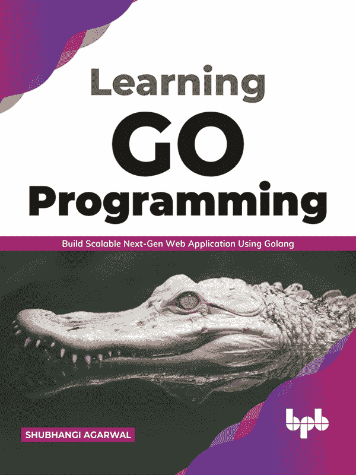


# 献给

我的父亲 - Dinesh Chandra Agarwal

&

我的母亲 - Pushpa Agarwal

他们一直在我身边，给予爱、支持、照顾并解决所有问题。

# 关于作者

**Shubhangi Agarwal** 是一位丰富的软件工程师，在过去的 4 年里一直在信息行业工作。2017 年，Shubhangi 在市场研究行业开始职业生涯，加入了 `IBM India pvt. Ltd.`，目前在 `Tata Consultancy Services Ltd` 担任高级软件工程师。在职业生涯中，Shubhangi 接触过多种技术，如 `Python`、`Golang` 以及各种后端开发活动。她还担任自由职业者，帮助机构进行项目，并为他人提供同样的机会。

2018 年，Shubhangi 通过她的博客发现了对写作的兴趣。她分享了对多种编程语言的观点、常见技术问题及其解决方案，并制作技术内容的视频。Shubhangi 热衷于研究新技术，并通过她的网站分享技术洞察。

工作之余，Shubhangi 喜欢博客、摄影、旅行、大以及与家人朋友共度时光。

如果你想查看她的博客，请访问她的网站：[`momentmate.com/technical/`](http://momentmate.com/technical/)

# 关于评审员

**Deepak Sharma** 是一位软件开发人员，在信息技术和服务行业拥有丰富的工作经验。他拥有 `Dev Bhoomi Institute of Technology` 的计算机应用硕士专业学位。在担任数据分析师之后，他现在使用 `C`、`C++` 开发多个 Windows 应用程序，并在数据与网络加密、`HTTP`、`HTTPS` 及基于 socket 的应用程序做出了贡献。他很幸能评审此书。在不编程时，他喜欢看电影和旅行。

**Bhawana Bhatt** 是一位方案导向型软件工程师，在 `Motherson Sumi Systems Limited` 有四年的工作经验。她处理基于 `.Net` 框架、`JavaScript`、`jQuery`、`MVC`、`AngularJs` 的各种项目，并为其客户提供安全、扩展且经过测试的解决方案。她拥有 `Gurukula Kangri Vishwavidyalaya` 的计算机应用硕士学位。她非常高兴能作为技术评审员参与此书。她总是欢迎机会和技术挑战。她喜欢烹饪、园艺、手工艺和绘画。

# 致谢

我最想感谢的是，因为没有上帝，我无法完成这一切。

有几个人我想感谢他们，他们在撰写本书期间向我提供的持续和不断的支持。首先，我要感谢我的父母和我的姐姐 Shuchi 和 Chanchal，她们在每一次奋斗和成功中都一直支持我。没有她们的支持，我永远无法完成这本书。

诚心感谢本书的几位朋友/读者，他们每次都鼓励和激励我，证明他们一直在我身边。这种关系是“质量胜过数量”的完美典范。

如果没有 `BPB Publications` 内容编辑的支持，这本书就不可能出版。我感谢 `BPB Publications` 的编辑和出版专业人员对本书出版的浓厚兴趣和支持。

最后，我要感谢 `BPB Publications` 的 Manish Jain，他给了我为他们撰写第一本书的机会。

# 前言

`Golang` 由 Robert Griesemer、Rob Pike 和 Ken Thompson 于 2007 年在 Google 开发，并于 2009 年 11 月作为开源项目发布。`Golang` 经历了许多更改和增强。目前我们有在 2020 年 8 月发布的 `Go1.15` 版本。每个主要的 `Go` 版本将一直支持直到有两个新的主版本发布。`Go` 被应用于 LinkedIn、Twitter、IBM、Firefox、Docker、YouTube、Alibaba 等许多组织的后端开发。

这本书面向初学者以及渴望学习 Go 语言的专业人士。本书重点介绍了你进行 Go 编程需要学习的基本概念。在书中，通过图表示来澄清概念，并在必要时提供了截图来描述过程。为了成为一名合格的 Go 程序员，读者必须通过运行书中的程序进行实战学习。这些程序不仅运行正确，而且易于编写和理解。程序中包含了详细的注释，说明特定语句/块的作用。详细给出了程序的输出结果，以便人们在运行代码后进行验证。每个章节都包含一个目标，说明该章节对读者有什么帮助。在每章的最后，结论部分简要回顾或强调章节内容，并建立与下一章的联系。

这本书将帮助那些没有编程经验的人。书中提供了具体的指令来编写和运行第一个 Go 程序。每个概念都提供了良好的示例。在获取了所需的 `Golang` 知识后，我们将使用 Go 创建一个小型应用程序。所有必要的代码都在示例程序中进行了描述，这些程序可以在所有现代浏览器中实现。如果读者学习了书中提到的概念，他将走向成为 Go 程序员的道路，了解 Go 语言的特性、工作原理、使用方法以及通过整合 `Golang` 的前后端技术构建应用程序。

这本书的主要目标是提供学习 Go 语言所需的信息和技能。本书包含了大量的示例和插图，将展示如何安装和运行 Go 程序，以及如何将 Golang 与前端集成以构建应用程序。在本书的 20 个章节中，你将学习以下内容：

# 第一章 介绍了 Go 语言的评估、其成功之处、特性和应用。它解释了 Go 语言的需求，以及使其与其他编程语言不同的类比。

## 下载代码

包和彩色图片：

请点击链接下载

## 错误说明

如果您在书中遇到任何错误，如果您能告诉我们我们将不胜感激。请在 `bpbonline.com` 提供您的反馈。

## 如果您兴趣成为作者

如果您在任何主题方面拥有专业知识并对写作感兴趣，请访问 `www.bonline.com`。

## 评论

请留下评论。在您阅读并使用此书后，为什么不在您购买书籍的网站上留评呢？潜在的读者就可以看到并参考您的中偏意见，我们 BPB 也可以您对我们产品的看法。

## 盗版

如果您在任何形式下遇到我们作品的非法盗版，如果您能告诉我们位置或网站名称，我们将不胜感激。

## Golang 的演进及其成功

通过观察软件开发中的问题，人们决定随着网络和多核计算的兴起，语言必须支持某种并发与并行性、垃圾回收，并实现内存管理的自动化。所有这些都汇成了一系列讨论、一系列观点、合理的策略，并形成了一项伟大的开发。通过 Golang，使用一种语言即可实现高效的编译、执行和易于编程。

`Go language` 由 Google 赞助，由 Robert Griesemer、Rob Pike 和 Ken Thompson 创建，他们描绘了 Golang 的目标。它最终于 2009 年 11 月 10 日发布。它是一种开源语言。Go 语言的创建者和社区构建了许多语言原生支持的工具，这些工具在大多数情况下不需要任何第三方库。例如，Go 语言原生支持 `HTTP`、`JSON`、`HTML` 模板等，它可以在无需考虑在 GitHub 上寻找库的情况下构建出非常复杂的 API 服务。现在，有数百万程序员正在使用 Go，并且未来会有更多人加入。


**图 1.1:** 2018 年 4 月的 Logo

## Go 的特性

Go 是一种静态且快速编译的语言，专为多核架构设计，以实现高效的内存利用。以下是 Golang 的特性：

* **自动垃圾回收**

  有了这一特性，程序员不需要担心内存的全局管理。目前，Go 使用“标记-清除”收集器。它跟踪所有创建的对象。每当需要时，它会首先暂停运行进程，处理垃圾对象，然后释放进程重新运行。它还支持并发。

* **并发**

  同时运行多个任务被称为并发。Golang 提供了一种不同的方法来同时执行多个函数。这通过 `Goroutines` 和 `channels` 实现。在 Go 中，`Goroutines` 可以被看作与其他函数并行执行的函数。另一方面，`channel` 提供了多个 `Goroutines` 之间进行通信的功能。

* **静态**

  Golang 被构建为编译语言，Google 的开发者在此工作非常出色。通过静态链接，它根据操作系统类型和架构将所有依赖库和模块合并为一个单一二进制文件，这意味着在编译后端应用程序时，只需将编译后的二进制文件上传到服务器即可运行，无需在上面安装任何依赖项。

* **易于测试**

  Go 语言提供了支持自动化测试的丰富库。有一个名为 `testing` 的包，它可以帮助运行 `go test` 命令，从而使任何测试函数的执行成为可能。还有一些基准测试（bench）。有许多由 `go test` 命令执行的测试函数形式。

* **标准库**

  良好编程的重要部分是`代码复用性`。Go 语言的标准库包含了许多为 Go 应用提供强大功能的包。它提供了如 `OS`、`runtime`、`HTTP`、`XML` 和 `JSON` 等包，这些包与操作系统连接并提供运行时支持。

* **跨平台**

  Go 是一种跨平台语言，可以在 Linux、Mac、Free BSD、Windows、iOS、Android 等平台上运行。

* **文档**

  Golang 有一个命令 `Godoc`，专注于包文档并以 HTML 或纯文本形式提供。通过这些文档的帮助，程序员可以从说明引导到任何函数的实现。它定义了包的函数、常量、变量，甚至是 Go 支持的类型。

## 面向对象的本质

面向语言的标准定义并不适用于 Go，但它以其他方式提供了相同的功能。它有一个定义的数据结构 `struct`，集成了字段和方法。Golang 没有继承，但它有不同的方法来建立 struct 之间的关系。对象组合建立了“是”（IS-A）关系，而接口则被用于形成“包含”（Has-A）关系。

此外，Go 语言中的方法更加透明。它们没有与 struct 绑定。Go 不支持重载功能。通过这种方式，Go 语言让事情变得更简单方便。

# 与其他语言的类比

在 C++、Java 以及其他面向对象的语言中，继承、重载和泛型是关键特性。在这里，Go 团队专注于并发、垃圾回收和快速编译，以便与并行系统良好协作。让我们来看看这门编程语言的一些细节：

* **类型安全**

  这指的是防止“类型` 错误的特性。就像 C、C++、Java 和 Python 一样，Go 也是一种类型安全的语言。Go 编译器在编译时满足特定水平的有效性检查。它确保如果存在 `+` 运算符，那么两个操作数都是数值类型。

* **面向对象**

  Go 可以被看作是一种轻量级的面向对象语言。然而，它支持为任何类型的数据定义类型和方法，但没有类和继承。这里并不是所有东西都关联对象。Go 的语法类似于 C 语言。它是静态类型，并且可以扩展到像 C++ 和 Java 更大的系统。

* **继承**

  Go 不是一种面向对象的语言。它不支持继承，但具有组合和接口特性。通过组合，可以将多个 struct 嵌入在一起。接口中可以添加多个方法，因此它有增长的空间。这种新概念比基于类的继承更强大。

* **重载**

  与 C++ 和 Java 不同，Go 没有方法重载的概念。仅通过名称识别方法消除了复杂性，并使编码变得简单。

* **异常处理**

  与 C++ 和 Java 不同，Go 中没有 `try-catch-finally` 模式。它有一些内置函数来信号和恢复异常情况。Go 函数将错误作为最后一个值返回。这里有一个简单的机制：将最后一个值与 `nil` 进行比较。如果是，则没有错误；否则就会出错。

* **并发**

  在 Java 中，有线程选项用于并发编程。Java 有许多工具来管理这些线程，但它们仍然被认为相当昂贵且难以理解。为了简单化，Go 提供了一种带有 Go routines 和 channels 特性的简单并发技术。Go routines 是轻量级线程，channel 帮助 Go routines 之间进行通信。

* **垃圾回收**

  通常，内存管理有两种方式。一种是自动引用计数，另一种是垃圾回收。像 C# 和 Java 一样，Go 也有垃圾回收器。Objective-C 和 Swift 使用引用计数技术管理资源。Go 使用当前的“标记-清除”GC。它运行在独立的 CPU 上，与主程序并行，因此有助于多核架构。

## Go 语言的痛点

尽管有很多特性，Golang 也有一些缺点。Go 语言的局限性如下：

* **泛型编程**

  Go 没有编译时泛型，导致根据需要产生重复代码或进行类型转换。虽然有一等函数，但我们无法对不同类型的集合复用相同的函数。这在某种程度上也影响了效率和生产力。

* **繁琐的错误处理**

  Go 语言中的错误处理并不完美。编译器没有执行相应的操作来处理错误。这取决于程序员如何使用函数在每次错误发生时返回错误。

## Golang 的应用

Go 自 2009 年首次发布以来一直变得越来越受欢迎。包括 IBM、Twitter、Facebook、YouTube、Apple、BBC、Google 在内的许多公司都在使用或正对 Go 语言进行开发工作。没人能预测未来，但 Golang 有多个理由不断成长。

以下是使用 Go 语言开发的应用：

*   **Docker**

    它是一组用于创建、部署和运行分布式应用程序的工具集。

    它是一个开源平台，允许根据需要扩展其功能。

*   **OpenShift**

    它是 Red Hat 提供的作为服务的开源云计算平台。

    它提供基于容器的软件部署和管理服务。

*   **Kubernetes**

    它是一个可扩展的开源容器集群管理系统，促进了无缝的自动化部署流程。

*   **Dropbox**

    Dropbox 从 Python 迁移到 Go 语言，以便更高效的方式扩展其系统，并支持更好的并发和快速的执行。

*   **InfluxDB**

    它是一个用于获取时间序列数据的开源时间序列数据库。

    它支持物联网传感器数据、应用矩阵和实时分析。

## 结论

在本章中，你学习了软件开发的痛点以及 Go 语言的演进是如何解决这些问题的。这种开源编程语言让软件开发变得简单、高效且可靠。我们看到了一些不同组织使用 Go 语言开发的应用程序。我们讨论了在编写 Golang 时需要记住的 Go 语言的一些缺点。这些就是我们需要了解的所有理论知识。让我们在下一章开始安装 Go 语言吧。

## 问题

1. 谁开发了 Go 语言？

2. Go 语言中的垃圾回收是如何工作的？

3. 哪个命令可以显示 Go 语言文档？

4. Go 语言与其他编程语言相比之处何？

5. 字段和方法是如何整合到 Golang 中的？

6. Go 是一种“并发语言”。这意味着什么？

# 第 2 章

## 环境搭建

了解 Go 语言之后，让我们进入 Golang 的系统要求和安装过程。本章定义了安装 Golang 的系统要求、编写 Golang 程序的文本编辑器，以及关于各种操作系统的安装和卸载过程的所有内容。安装 Go 之后，将演示一个检查安装是否正确的第一个 Golang 程序。

## 结构

在本章中，我们将讨论以下主题：

* Go 语言的系统要求
* 适合文本编辑器
* 如何在你的系统上安装/卸载 Go
* 如何在 Go 中编写第一个测试程序

## 目标

学习完本章后，你将能够：

* 为 Go 语言获取合适的文本编辑器
* 在你的系统上安装 Golang
* 在任何文本编辑器上编写测试程序
* 运行一个简单的 Go 程序
* 在出现任何问题时卸载 Go

### 系统要求

Go 针对多个平台，如 Linux、Mac、FreeBSD、32 位和 64 位 x86 处理器架构的 Windows。对于任何其他操作系统，可以使用 Go 语言的编译器 `gccgo`。

`Go1.15` 是 Go 的最新版本，于 2020 年发布。它最初需要 OpenBSD 6.2，随后是 Mac OS 10.10 Yosemite，然后是 Windows 7。对这些操作系统较旧版本的支持已被移除。

运行一个简单的 Go 程序需要文本编辑器和 Go 编译器。这些如下：

*   **文本编辑器**

    Go 支持多种编辑器插件和 IDE，以使 Go 开发更高效、更无缝。大多数著名的文本编辑器都可以直接提供支持，或者通过某些插件支持。文本编辑器会根据不同的操作系统而异。

    是一些文本编辑器：

    1.  **Atom**

        `Atom` 是一个适用于 Windows、Linux 和 macOS 的免费开源文本编辑器。

        它是来自 GitHub 的跨平台、面向 JavaScript 的桌面应用程序。

    2.  **BBedit**

        `BBedit` 是一个为 macOS 开发的商业文本编辑器。

        `Go-bbpackage` 带有剪贴板、ctags 标准库完成、更好的语法高亮和工具。

    3.  **Eclipse IDE**

        `Eclipse IDE` 是最广泛使用的开源跨平台 IDE。

        `GoClipse` 是 Eclipse 扩展，为 Go 语言添加了 IDE 功能。

    4.  **Emacs**

        `Emacs` 是一个由多个可扩展和自定义文本编辑器加载的免费编辑器。

        代码自动补全、代码分析和重构、错误检查、播放场和代码片段是 Emacs 的附加功能。

    5.  **Gedit**

        `Gedit` 是 GNOME 桌面的默认文本编辑器。

        `Go-gedit-plugin` 是用于 gedit 编辑器的 Go 编程插件。

    6.  **Goland**

        `Goland` 是 JetBrains 开发的商业跨平台 IDE。

        该 IDE 可以分析代码、符号之间的关系、快速导航、错误分析和格式化。

    7.  **Notepad++**


# 编辑器、IDE、编译器与安装

## 文本编辑器与 IDE

### 1. Notepad++

`Notepad++` 是适用于 Microsoft Windows 的分布式源码编辑器。

`Gopp` 插件提供代码补全、函数提示、Go 导入和快捷键。

### 2. Sublime Text

`Sublime Text` 是一个免费的跨平台源码编辑器，支持自动保存、自定义按键绑定、宏等许多功能。

`GoSublime` 是一个 Golang 插件集，提供从代码补全代码、自动添加/删除包导入。

### 3. Vim

`Vim`（VI 改进版）是一个适用于 Unix 的免费开源文本编辑器。

它设计为既可以从命令行界面使用，也可以作为图形用户界面中的独立应用程序使用。

### 4. Visual Studio

`Visual Studio` 是一个用于 Windows 的商业 IDE，用于开发网站、Web 应用、Web 服务和移动应用。

通过 Visual Studio，Go 扩展支持多种功能，如 IntelliSense 代码自动补全、悬停信息、签名帮助、片段。

## 云端 IDE

云端 IDE 的开发是软件行业的一大创新。在这些 IDE 中，开发者的原子服务（如语法分析、构建、运行和调试）在独立的水平可扩展微服务上运行。以下是一些云端 IDE：

### 1. Cloud9

`Cloud9` 是一个在线开源多语言云端 IDE。

它与 GitHub、Bitbucket 和 Google 云平台仓库连接。

它拥有 MySQL 和其他数据库；以及终端和即时窗口。

### 2. CodeEnv

`CodeEnv` 也是一个开源多语言云端 IDE。

它是一个浏览器编辑器，具有编辑、构建、运行和调试项目的功能。

### 3. Wide

`Wide` 是一个基于 Web 的 Go 语言 IDE。

它使用基于 Code Mirror 的主题化编程编辑器，带有 Gocode 辅助的语法高亮、自动补全和实时协作功能。

### 4. Micro

`Micro` 是一个云原生开发的工具包。

它提供了一个带有插件化架构的应用程序开发框架。

## 编译器

有几种适用于 Go 语言的编译器，可以帮助设置 Go 环境。Go 编译器的两个主要实现领域：

### 1. Gc

`Gc` 是一个带有递归下降解析器的默认编译器，它使用了自定义的加载器。它支持如 x86 (32/64bit) 和 ARM 等流行的处理器。

### 2. Gccgo

`Gccgo` 是 GCC 的一部分，GCC 是 GNU 编译器集合，它支持前端。它支持 GCC 支持的所有处理器。`Gccgo` 比 `Gc` 慢，但支持更多的处理器，并具有更强大的优化功能，因此由 `gccgo` 构建的 CPU 密集型程序运行速度很快。

还存在第三种 Go 编译器称为 `GopherJS`。它将 Go 代码编译为 JavaScript 代码，使 Go 能够用于所有浏览器运行的前端开发。

## 如何安装

以下步骤准备了在各种平台上安装 Go 的环境。

### Windows 安装

以下是在 Windows 机器上安装 Go 的步骤。

1. 可以访问 `golang.org` 上的 Go 页面并下载 Go。

   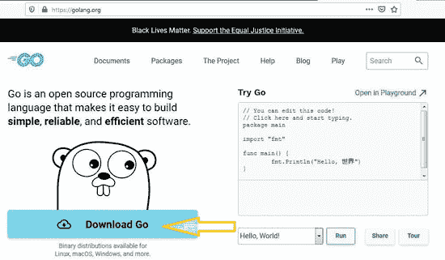

   **图 2.1：** ‘golang.org’首页

2. 根据系统要求下载 MSI 或 zip 文件。

   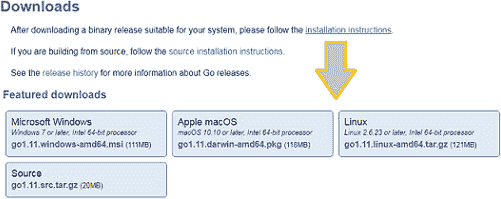

   **图 2.2：** 多操作系统的 Go

3. 下列出了 Golang 的各个版本：

   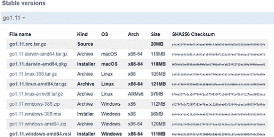

   **图 2.3：** 根据您的系统配置选择

4. 按照提示操作：`Run | Next`

   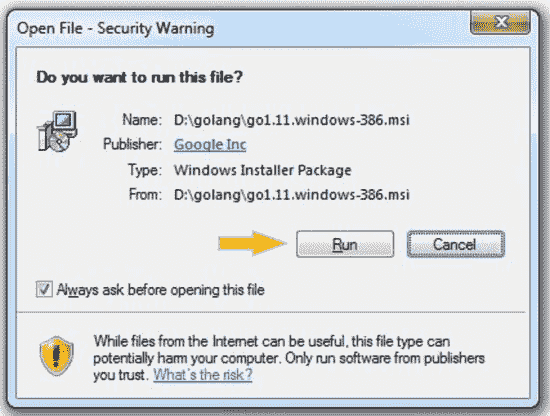

   **图 2.4：** 运行文件

5. 这里是安装 Golang 需要接受的一些许可协议。

   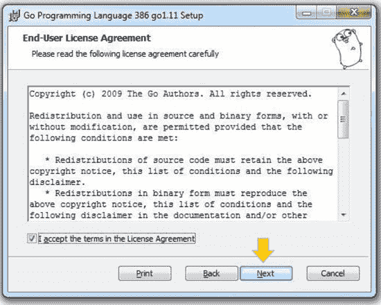

   **图 2.5：** 接受许可协议

6. 保持 C 盘中的目录不变并点击下一步。

   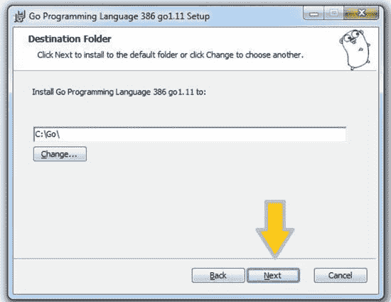

   **图 2.6：** 检查目录

7. 或者按如下所示目录：

   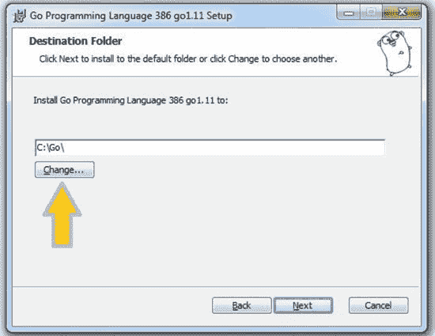

   **图 2.7：** 点击更改按钮

   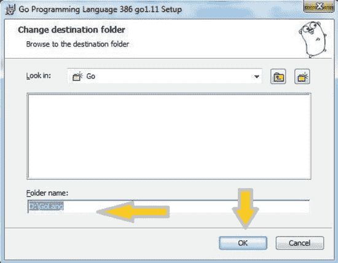

   **图 2.8：** 设置所需的目录路径

8. 准备好安装

   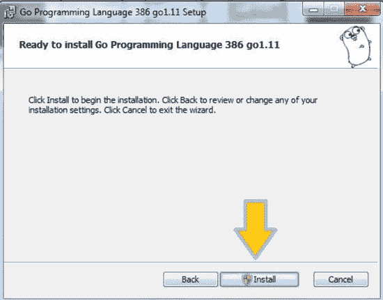

   **图 2.9：** 安装

9. 安装完成后，选定目录下将创建 Go 文件夹，如下：

   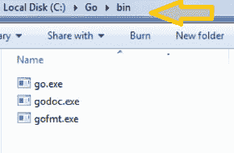

   **图 2.10：** 安装后的 Go 默认目录

10. 如果我们在安装时更改了目录路径，它将是：

    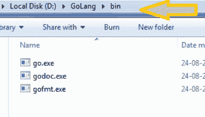

    **图 2.11：** Go 目录（取决于给定路径）

11. 现在，导航到 Go 的 bin 文件夹并将其设置为系统路径变量。导航如下：

    `Control Panel | System and Security | Advance system settings | Environment Variables`

    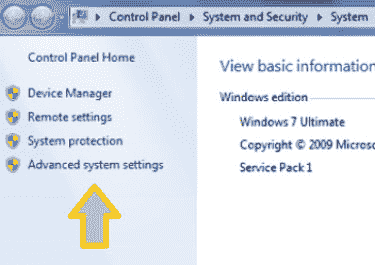

    **图 2.12：** 控制面板

    

    **图 2.13：** 高级系统设置

12. 在 path 末尾添加 bin 路径。

    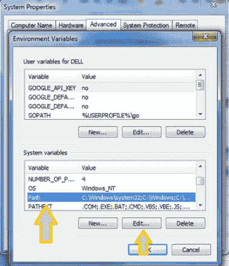

    **图 2.14：** 环境变量

    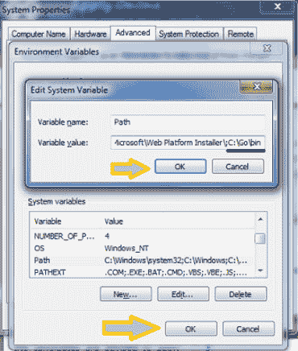

    **图 2.15：** 设置路径

13. 路径已设置好。现在创建并运行示例程序。为此，为 Go 项目创建一个工作空间。它可以位于相同目录，但文件夹必须与 Go 文件夹不同。

14. 安装 sublime 或任何文本编辑器，并按所示编写您的第一个 Go 程序：

    ```
    package main
    import "fmt"
    func main(){
        fmt.Printf("hello, world\n")
    }
    ```

    注意：该程序的解释将在下一章介绍。在工作空间中以 `file_name.go` 扩展名保存此文件。准备好运行第一个 Go 程序了吗？打开命令行界面并导航到创建的工作空间。运行命令：

    ```
    go run file_name.go
    ```

    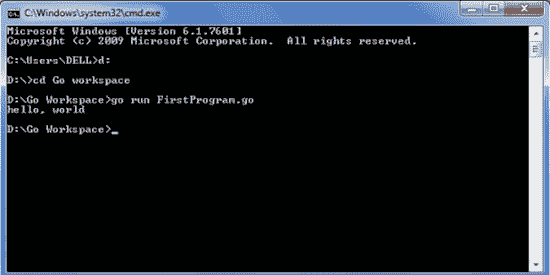

    **图 2.16：** Linux/ MacOS 和 FreeBSD 安装从上述相同源下载包文件并按照提示安装 Go 工具。Go 安装在 `/usr/local/go` 中。现在将 bin 路径添加到系统环境变量。之后，您就可以好运行 Go 程序了。

### 卸载 Go

要从系统中删除现有的 Go 安装，请删除 Go 目录。在 Linux 或 macOS 中通常位于 `/usr/local/go`，在 Windows 中位于 `c:\Go`。

## 结论

在本章中，我们看到 Go 可适用于 FreeBSD、macOS、Windows 的 32 位和 64 位架构等各种平台。我们可以检查系统配置并安装合适的 Go 版本。要安装任何升级版本，需要先卸载现有的版本。本章讨论了多种文本编辑器和 IDE，每个工具都有自己的特性。最后，我们可以通过在 Go 上运行测试程序来检查安装是否成功。在下一章中，我们将深入讨论 Go 程序的基本结构。

## 问题

1. Go 语言支持哪些平台？
2. 哪个编译器适用于 Go 语言？
3. 指定 Go 语言中的默认编译器。
4. 使用什么文件扩展名来编写 Go 程序？
5. 指定运行 Go 程序的命令。

---

# 第 3 章 Go 程序的基本结构

### 图 3.1: 非主包错误

如果在 Go 程序中没有将其声明为主函数，将显示以下错误。

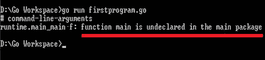

### 图 3.2: 未定义的函数错误

如上一章所述，我们可以使用以下命令在命令提示符上运行此程序：

```bash
go run file_name.go
```

1. 在下一行，我们将根据需要声明变量。由于 Go 是一种静态类型语言，变量不允许在运行时更改类型。我们可以将变量定义为 `name := "Jitendra"`。它将通过值来识别变量的类型。

2. `"Printf"` 是 `fmt` 包中定义的函数。所有导出的名称都应该以大字母开头。

    Go 中的函数是家族的根。程序的执行始于函数调用；它可以被赋值给变量，也可以作为参数传递。Go 编译器从 `main` 包开始执行。它获取适当的文件，进行编译，将其转换为临时可执行形式，并运行程序。它完全遵循 `main` 包中的 `main` 函数。

## 关键字

关键字是特定编程语言的预定义保留词，对编译器具有特殊含义。关键字不能用作变量或标识符。Golang 支持 25 个关键字，如下：

*   `import`：此关键字用于在 Go 程序中导入包。
*   `type`：用于根据需求创建新类型。
*   `const`：指定字符、数值、布尔或字符串值。
*   `var`：此关键字用于声明一个包含特定名称和值的变量。
*   `func`：此关键字用于声明具有特定名称、参数、结果类型和主体的函数。
*   `package`：定义 Go 程序中的包，这些包包含变量、常量和函数。
*   `map`：此关键字用于在 Go 程序中声明 `map` 类型的数据。
*   `chan`：`chan` 关键字用于在 Go 程序中定义通道（channel）。
*   `struct`：使用此关键字声明用户定义的类型 `"struct"`。
*   `interface`：此关键字用于在 Golang 中定义自定义数据类型 `"interface"`。
*   `if`：如果关键字指定“if 语句”，它需要评估给定的条件。
*   `else`：如果块中给定的条件为假，则 `else` 关键字执行语句。
*   `for`：此关键字执行 `for` 语句，重复执行代码块。
*   `range`：此关键字与 `for` 循环配合使用，用于遍历特定的数据。
*   `break`：在循环内部定义 `break` 语句，以终止当前循环执行并恢复循环后续的程序控制。
*   `continue`：在循环内部定义 `continue` 语句，将程序控制跳转到下一次迭代。
*   `goto`：执行 `goto` 语句并将程序控制转移到标记语句。
*   `return`：通过向调用者返回结果来执行 `return` 语句。
*   `switch`：在 Go 程序中定义 `switch` 语句。
*   `case`：在 `switch` 语句中定义各种情况（cases）。
*   `select`：此关键字定义 `select` 语句。

## 标识符

标识符是类、函数、语句标签、常量、包名或变量名称，用于唯一标识一个对象。它是 Unicode 字母、数字和下划线的融合。标识符的首字母必须是字母或下划线。在 Go 语言中，标识符的大小写敏感。我们不能使用保留词作为标识符。Go 提供了一种特殊的标识符类型称为“空白标识符”，用 `_` 表示。**空白标识符**作为一个具有任何值的占位符，但我们无法在程序中读取它。首字母为大字母的标识符称为导出标识符。这些标识符应该在包块中声明，因为它们可以在其他包访问。相反，首字母不是大写的标识符称为非导出标识符。

以下是一些有效和无效的标识符：

### 有效

*   `_ = 12`
*   `var Version = 4.0`
*   `var name = "Ansh"`
*   `var _12 = "hello world"`

### 无效

*   `var 12 = "hello world"`
*   `var count$ = 23`
*   `var default = 5.0`

## 结论

在本章中，我们看到了 Go 程序的的基本结构和组件。编写和运行简单的 Go 程序是 Go 编程的第一步。我们讨论了 Go 语言支持的关键字。通过标识符，我们了解了包、类、函数或变量的命名规范。让我们在下一章继续学习 Golang 变量和数据类型。

## 问题

1. Go 语言中 `fmt` 包的作用是什么？
2. 在 Go 语言中如何对行进行注释？
3. Go 程序必须包含哪些包和函数？
4. 定义 Go 语言中 `fallthrough` 关键字的？
5. 什么是空白标识符（blank identifier）？
6. 区分 Go 语言中的导出（exported）和非导出（non-exported）标识符？

---

# 第 4 章 变量、数据类型和常量

`Data` 是编程所处理的基本内容。我们可以改变某些值，而另一些不能。在相同的概念下，变量和常量在编程语言中起作用，我们将在本章中详细介绍。在日常生活中，我们看到多种类型的值，例如以数字形式表示的年龄、作为字符组合的名字、作为小数表示的金额等。编程数据也是如此；它可以是任何类型，如整数、字符串、浮点数等。在本章中，我们将学习 Golang 支持的数据类型。

## 章节结构

在本章中，我们将讨论以下主题：

*   变量
*   数据类型
*   常量
*   格式化符号

## 目标

学习本章后，你将能够：

*   在 Go 程序中使用变量
*   深入理解变量的命名规范
*   理解 Go 语言中的各种数据类型
*   理解常量在 Go 中如何工作
*   使用格式化符号

## 变量

`Variable` 是存储在内存特定位置的特定类型的名称。声明变量简单来说是在内存中获取一些空间，并告诉编译器该值的名称和类型。由于 Go 是一种静态类型语言，我们不能在运行时更改变量的类型。然而，变量的值可以根据我们需要改变相同的数据类型。在 Go 语言中，每个变量都必须定义。在声明变量时，如果我们不同时赋值，就需要声明其类型。默认情况下，Go 编译器对数值类型取零值，字符串类型取为空，布尔类型数据取 false。Go 提供了多种声明和初始化变量的方法。

*   `var name_of_variable type_of_variable`
*   `var name_of_variable = value_of_variable` // 通过其值识别变量的类型
*   `name_of_variable := value_of_variable`
*   `name_of_firstVariable, name_of_secondVariable := value_of_firstVariable, value_of_secondVariable` // 同时多声明
*   `var name_of_firstVariable, name_of_secondVariable type_of_variable` // 如果所有变量都是相同类型
*   `var (`
    `name_of_firstVariable type_of_variable`
    `name_of_secondVariable type_of_variable`
    `)`

当需要声明变量但在程序中未使用该变量时，Go 也有一个空白标识符。我们简单地用下划线（`_`）代替变量名来处理此类问题。

**示例：**


```
var variable1 int //声明 int 类型变量 "variable1"
fmt.Println(variable1) //打印值 0
var variable2 string
fmt.Println(variable2) //打印 ""
variable1 = 123
variable2 = "hello world"
fmt.Println(variable1, variable2) //打印 123 hello world
var variable3 = 123.45
fmt.Println(variable3) //打印 123.45
variable4 := false
fmt.Println(variable4) //打印 false
variable5, variable6 := "multiple", 2
fmt.Println(variable5, variable6) //打印 multiple 2
var variable7, variable8, variable9 int //声明多个相同类型的变量
variable7, variable8, variable9 = 123, 456, 789
fmt.Println(variable7, variable8, variable9) //打印 123 456 789
var(
variable10 int
variable11 string
variable12 bool
) //在同一类型下声明不同类型的变量
fmt.Println(variable10, variable11, variable12) //打印 0 false
variable10, variable11, variable12 = 123, "multiple", true
fmt.Println(variable10, variable11, variable12) //打印 123 multiple true
variable13, variable14 := 123, 456
fmt.Println(variable13) //error "variable14 declared and not used"
variable15, _:= 123, 456 //使用 "空白标识符"
fmt.Println(variable15) //打印 123
```

### 数据类型

`data type` 是数据的一种属性，定义了可以存储的数据类型。有许多不同的变量和函数。数据类型告诉编译器特定变量在存储中占据的空间。`Go` 是一种静态类型语言，变量的类型在编译时声明，之后无法更改。通过这种方式，许多小错误可以被快速发现，从而防止数据类型错误。

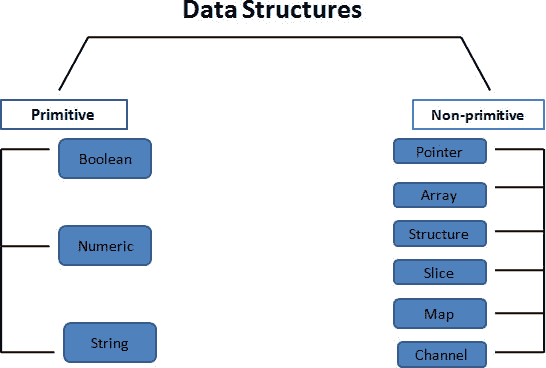

**图 4.1:** 数据结构

数据有两种类型：基础类型。

#### 1. 基础数据类型

`Primitive data types` 用编程语言构建，并且只有一个值。它们不能被分为子类型。布尔、数值和字符串在 Go 语言中属于基础数据类型。让我们详细讨论它们。

##### 布尔

只有两个值（`true` 或 `false`）的数据类型是布尔数据类型。它可以用 `1` 表示 `true`，`0` 表示 `false`。

**示例：**

```go
var is_Red bool = true
fmt.Printf("%v\n", is_Red)
```

##### 数值

我们可以进行算术和逻辑操作的数据类型称为数值。

**示例：**

```go
var is_Red bool = true
fmt.Printf("%v\n", is_Red)
```

（注：原文中数值部分存在大量重复和错误，此处已根据要求保留核心结构翻译。）

- `complex64`：`complex64` 具有 `float32` 实部和虚部。
- `complex128`：`complex128` 具有 `float64` 实部和虚部。
- `Error`：用于存储错误值的数据类型。

**注意：我们将在“错误处理”章节中讨论它。**

##### String

数值类型定义了数字的集合，而字符串数据类型代表了字符的集合。它们可以是字母、数字或任何特殊字符。在 Go 语言中，字符串是 UTF-8 编码字符串，其中 UTF 代表“Unicode 转换格式”，它支持任何 Unicode 字符（任何语言），而 8 则规定每个字符都使用 8 位定义。在 Go 中，字符串是不可变的，因此它们会消耗更多空间。

**示例：**

```go
var strval string = "Grow with Golang"
var strcopied string = strval
fmt.Println("original string is:", strval)
fmt.Println("copied string is:", strcopied) // prints "copied string is: Grow with Golang"
fmt.Println("Address of strval:", &strval)
fmt.Println("Address of strcopied:", &strcopied) // above two lines prints the different memory address of variables
```

#### 2. 非原始数据类型

可以存储批量值的数据类型被称为非原始数据类型。它们也被称为衍生数据类型。原始数据类型是非原始数据类型的一种特定来源。它们也被称为引用数据类型，因为它们包含了内存中动态创建对象的地址。在 Go 语言中，我们有以下非原始数据类型。

##### Pointer

存储在内存中的每个变量都有一个特定的位置/地址。指针是一个存储内存中任何值地址的对象。指针的类型取决于指针所存储的元素类型。它允许直接访问内存，从而减少程序的存储空间。指针使用两个操作符：“取地址运算符”和“间接运算符”。

以下是声明指针的简单方法：

```go
var name_of_pointer *type_of_pointer
```

**示例：**

```go
var int valint = 12
var pval = &intval
fmt.Println(pval) // prints address of intval
fmt.Println(*pval) // print value of intval
*pval = 78 // change the value of intval through pointer
fmt.Println(intval) // print 78
```

##### Array

数组是一种存储相同类型数据元素的数据结构，可以通过它们的索引号访问。在数组中，索引号从 0 开始，因此最大索引比数组长度减一。数组的类型和数组占据的空间取决于数组的元素，无论是整数、字符串还是其他。在 Go 语言中，我们不能在一个数组中放入不同类型的元素。在这里，数组的行为像一个值。如果我们将数组赋值给变量，它将所有元素复制到另一个数组中。同样，在将数组传递给函数时，接收的是数组的值而不是数组的引用。在 Go 中，在声明时我们需要定义数组的大小以及可以存储多少元素。

它的声明方式为：

```go
var name_of_array[size_of_array] type_of_array_elements
// 或者
name_of_array :=[size_of_array] type_of_array_elements{elements_of_array}
```

**示例：**

```go
var arrval[3] string
arrval = ["abc","def","ghi"] // error "syntax error"
arrval[0] = "abc"
arrval[1] = "def"
arrval[2] = "ghi" //will assign the values by accessing it's index
fmt.Println(arrval) //print [abcdefghi]
arrval2 := [3]string{"abc","def","ghi"}
fmt.Println(arrval2) //print [abcdefghi]
```

##### Structures

这种复合数据类型类似于数据库，可以存储指向实实体的相关项。它将不同类型的数据组合创建一个类型结构。类（class）也定义任何对象的不同数据类型，但它们之间的主要区别是，默认情况下类是私有的。同时，结构（struct）是公开的且易于访问。在结构中，我们只能声明字段而不能同时对其进行初始化。结构变量可以使用结构声明声明，也可以像声明其他数据类型一样。

声明结构的简单方法如下：

```go
type StructName struct{
field1 fieldType1
field2 fieldType2
}
```

在给定的示例中，`StructName` 是结构名称，`field1` 和 `field2` 分别是类型 `fieldType1` 和 `fieldType2`。在这里，字段的访问方式为：

`StructName.field1`

**示例：**

```go
type company struct{
company string
id string
no_of_employees int16
}

var comp company //creating variable of type company
var comp2 company
comp.no_of_employees = 90 //accessing members of structure
comp2 = company{"abcpvt. ltd.","SYRP302",0} // initializing structure
fmt.Println(comp.no_of_employees) //print 90
fmt.Println(comp2) //print 0
```

##### Slice

类似于数组，切片（slice）也存储相同类型的数据集合。然而，对于切片，我们不受长度限制。切片充当序列的强接口。与数组不同，我们可以使用 `append` 函数扩展切片的长度。在将切片传递给函数时，它创建一个数组的引用而不是创建一个新的副本。这就是为什么切片也是引用类型。`make` 函数用于声明切片。当数组的一部分赋值给切片时，切片拥有值，此时我们可以说切片正在引用一个数组。

在 Go 中，切片的声明方式为：

```go
name_of_slice := make([] type_of_slice_elements, length_of_slice, capacity_of_slice)
```

**示例：**

```go
slice1 := make([]int,0)
fmt.Println(slice1) //print []

slice2 := make([]int, 3)
slice2[0] = 123
slice2[1] = 456
slice2[2] = 789
fmt.Println(slice2) //print [123 456 789]

slice3 := []string{"abc","def","ghi"}
fmt.Println(slice3) //print [abcdefghi]
slice3 = append(slice3, "jkl")
fmt.Println(slice3) //print [abcdefghijkl]

slice4 := make([]string,5)
copy(slice4, slice3)
fmt.Println(slice4) //print [abcdefghijkl]

slice2D := make([][]string, 2,3)
fmt.Println(slice2D) //prints [[] []]
slice2D[0] = []string{"a","b","c"}
slice2D[1] = []string{"d", "e"}
fmt.Println(slice2D) // print [[a b c] [d e]]
```

##### Map

`Maps` 可以由两个元素定义——键（keys）和值（values），其中键是一个单一元素，而值可以是整数、字符串、数组、结构体或任何其他 map。map 类似于字典，不允许具有相同的键。尽管如此，键是对大小写敏感的，如果需要，我们可以保留相同名称但大小不同的键。在 map 中，每个元素都用逗号（`,`）分隔，每个键值对之间用冒号（`:`）分隔。map 很容易扩展，因为在声明时不需要定义它们的大小。通过 map，我们可以使用键来访问任何记录。这就是为什么它也被称为快速键查找数据结构。在声明 map 时，我们必须指定键和值的数据类型。像数组一样，如果没有初始化，map 将为为 nil。在 Go 中，我们有一个名为 `make` 的函数，用于分配和初始化切片、map 和通道（channels）。

我们可以这样声明 map：

```go
var name_of_variable = make(map[type_of_keys] type_of_values)
```

或者

```go
name_of_variable := make(map[type_of_keys] type_of_values)
```

**示例：**

```go
var mapval2 = make(map[int]string)
mapval2[1] = "WORLD"
mapval2[2] = "INDIA"
fmt.Println(mapval2) //打印 map[1:WORLD2:INDIA]

mapval := make(map[string]int)
mapval["first"] = 16
mapval["second"] = 32
fmt.Println(mapval) //打印 map[first:16second:32]
```

### 通道 (Channels)

Go 是一种多内核语言，支持并发和并行。通过使用通道，我们可以同时向多个 Goroutine（函数）发送数据，从而避免竞态条件、资源共享问题以及许多其他难以调试的问题。它允许多个 Goroutine 并发执行，我们可以通过通道将值传递给一个 Goroutine 并从另一个 Goroutine 再次获取它。像 map 一样，通道也是使用 `make` 函数创建的。我们还可以对通道进行缓冲和迭代。我们使用通道运算符将值从通道传输到变量。

```go
Channel_name := make(chan type_of_channel)
```

**示例：**

```go
var channelval chan int
fmt.Println(channelval) //打印未定义的通道为 <nil>

channelval2 := make(chan string)
gofunc() {channelval2<- "DONE"}() //通过通道将值传递给函数

msg := <-channelval2 //读取通道
fmt.Println(msg) //打印 DONE
```

## 常量 (Constants)

常量用于程序运行过程中保持不变的值。我们不能用另一个值重新赋值常量。常量所拥的值被称为字面量（literal）。在 Go 中，要求在编译时具有常量值。任何尝试分配函数调用返回值的行为都会导致错误，因为函数调用会导致编译器无法在编译时获取常量的值，因此会抛出错误。我们使用关键字 `const` 来声明常量。像变量一样，常量也有多种声明和初始化值的方法。区别在于，我们不能直接使用 `=` 语法来声明常量。

- `const name_of_constant = value_of_constant` //无类型常量
- `const name_of_constant type_of_constant = value_of_constant` //有类型常量
- `const name_of_firstConstant name_of_secondConstant = value_of_firstConstant, value_of_secondConstant`
- ```go
const (
    name_of_firstConstant = value_of_firstConstant
    name_of_firstConstant = value_of_secondConstant
)
```
- ```go
const (
    name_of_firstConstant type_of_ firstConstant = value_of_firstConstant
    name_of_secondConstant type_of_secConstant = value_of_secConstant
)
```

### 数值常量 (Numeric constant)

`numeric constant` 可以是整数、浮点数、复数和 rune。整数常量表示十进制、八进制或十六进制值。它们可以是 32 位或 64 位的。浮点常量具有整数部分、小数部分和指数。复数常量是实部和虚部的组合。rune 意味着无类型的 32 位整数。它们包含 Unicode 形式或字符形式的值。Rune 为每个字符提供一个整数值，该整数值被称为字符的 Unicode 编码点。这里有一个解释所有数值常量的示例。

**示例：**


```go
const untypedConstInt = 123 //无类型整数常量
const untypedConstFLoat = 3.97 //无类型浮点数常量
const typedConstFloat float64 = 4.87 //有类型浮点数常量
const untypedConstComplex = 56+2i //无类型复数常量
const typedConstComplex complex64 = 56+2i //有类型复数常量
const typedConstComplex1 complex64 = untypedConstInt //有类型复数常量
fmt.Println(typedConstComplex1)

const untypedConst = 'G' //无类型整数常量
fmt.Println(untypedConst) //打印 1

const untypedConst1 = rune //无类型整数
fmt.Println(untypedConst1) //打印 123
```

### 字符串

任何在双引号内并用 `const` 关键字声明的值都是字符串。不允许混合类型。

**示例：**

```go
const untypedString = "Golang is a great language" //无类型字符串常量
const typedString string = "Golang is a great language" //有类型字符串常量
type myString // 创建新类型
const customName myString = untypedString //赋值数据
```

### 布尔常量

布尔常量有两个值：`true` 或 `false`。像字符串常量一样，我们不能混合类型。

**示例：**

```go
const untypedBoolean = true //无类型布尔常量
const typedBoolean bool = false //有类型布尔常量
type myBool // 创建新类型
const customName myBool = untypedBoolean 
```

### Iota

Go 支持随 `const` 声明递增的 `iota` 标识符。当编译器遇到 `const` 块时，`iota` 会重置为零，并在每个非空行增加一。

**示例：**

```go
const // iota 重置为零
(
    C0 = iota // 在这里 iota 为零，离开此行后增加一
    _ // 增加一，iota 为 1
    C1 = iota // iota 为 2
)
fmt.Println("C0:", C0) // 打印 0
fmt.Println("C1:", C1) // 打印 2

const // iota 重置为零
(
    //注释 // 不考虑此行，因此 iota 保持不变
    C2 = iota
)
fmt.Println("C2:", C2) // 打印 0
```

## 格式占位符

格式占位符表示输入输出过程中变量包含的数据格式。格式占位符与 `Printf`、`Scanf` 以及其他类似函数配合运算符，用于特定数据类型。使用不同的格式占位符指定不同的数据类型。每个类型的格式占位符都以百分号（`%`）开头，跟着一个定义与输入输出函数相关数据类型的字符。

| 通用 | |
| :--- | :--- |
| `%v` | 以默认格式打印变量的值 |
| `%#v` | 以 Go 语法形式打印变量的值 |
| `%T` | 告知值的类型 |
| `%%` | 决定 `%` 符号 |

| **布尔** |
| `%t` | 打印变量的布尔值 |

| **整数** |
| `%b` | 表示 2 进制整数值 |
| `%c` | 对应于整数值的字符 |
| `%d` | 表示 10 进制整数值 |
| `%o` | 表示 8 进制整数值 |
| `%O` | 表示带有前缀 O 的 8 进制整数值 |
| `%q` | 表示 Go 语法中对应于整数值的字符 |
| `%x` | 表示 16 进制的小写值 |
| `%X` | 表示 16 进制的大写值 |
| `%U` | 表示值的 Unicode 格式 |

| **浮点数** |
| `%b` | 带有二进制幂指数的无小数浮点值 |
| `%e` | 值的科学计数法 |
| `%E` | 值的科学计数法 |
| `%f` | 不带指数的小数点 |
| `%F` | 与 `%f` 相同 |
| `%g` | 对于大指数时使用 `%e` |
| `%G` | 对于大指数，使用 `%E` |
| `%x` | 带有两个指数的十六进制值 |
| `%X` | 大写的十六进制值 |

| **字符串** |
| `%s` | 表示字符串变量的值 |
| `%q` | 表示 Go 语法中带有双引号的值 |
| `%x` | 表示 16 进制的小写字符串值 |
| `%X` | 表示 16 进制的大写字符串值 |

| **指针** |
| `%p` | 表示指针类型的值 |

这里是一个很好地解释格式占符的示例：

```go
package main

import "fmt"

func main() {
    var str = "hello"
    var intval = 78
    var floatval = 56.8789
    var complexval = 67+6i
    var boolval = true
    var pointerval = &str
    fmt.Printf("example of %%v, value is: %v \n", intval)
    fmt.Printf("example of %%#v, value is: %#v \n", str)
    fmt.Printf("example of %%T, value is: %T \n", intval)
    fmt.Printf("example of %%, used to print %%\n\n")
    fmt.Printf("example of %%t, value is: %t\n\n", boolval)
    fmt.Printf("example of %%b, value is: %b\n", intval)
    fmt.Printf("example of %%c, value is: %c\n", intval)
    fmt.Printf("example of %%d, value is: %d\n", intval)
    fmt.Printf("example of %%o, value is: %o\n", intval)
    fmt.Printf("example of %%O, value is: %O\n", intval)
    fmt.Printf("example of %%q, value is: %q\n", intval)
    fmt.Printf("example of %%x, value is: %x\n", intval)
    fmt.Printf("example of %%X, value is: %X\n", intval)
    fmt.Printf("example of %%U, value is: %U\n\n", intval)
    fmt.Printf("example of %%b, value is: %b\n", floatval)
    fmt.Printf("example of %%e, value is: %e\n", floatval)
    fmt.Printf("example of %%E, value is: %E\n", complexval)
    fmt.Printf("example of %%f, value is: %f\n", floatval)
    fmt.Printf("example of %%F, value is: %F\n", floatval)
    fmt.Printf("example of %%g, value is: %g\n", floatval)
    fmt.Printf("example of %%G, value is: %G\n", floatval)
    fmt.Printf("example of %%x, value is: %x\n", floatval)
    fmt.Printf("example of %%X, value is: %X\n\n", floatval)
    fmt.Printf("example of %%s, value is: %s\n", str)
    fmt.Printf("example of %%q, value is: %q\n", str)
    fmt.Printf("example of %%x, value is: %x\n", str)
    fmt.Printf("example of %%X, value is: %X\n\n", str)
    fmt.Printf("example of %%p, value is: %p \n", pointerval)
}
```

**输出：**

```text
example of %v, value is: 78
example of %#v, value is: "hello"
example of %T, value is: int
example of %, used to print %
example of %t, value is: true
example of %b, value is: 1001110
example of %c, value is: N
example of %d, value is: 78
example of %o, value is: 116
example of %O, value is: %!O(int=78)
example of %q, value is: 'N'
example of %x, value is: 4e
example of %X, value is: 4E
example of %U, value is: U+004E
example of %b, value is: 8004993526413866p-47
example of %e, value is: 5.687890e+01
example of %E, value is: (6.700000E+01+6.000000E+00i)
example of %f, value is: 56.878900
example of %F, value is: 56.878900
example of %g, value is: 56.8789
example of %G, value is: 56.8789
example of %x, value is: %!x(float64=56.8789)
example of %X, value is: %!X(float64=56.8789)
example of %s, value is: hello
example of %q, value is: "hello"
example of %x, value is: 68656c6c6f
example of %X, value is: 68656C6C6F
example of %p, value is: 0x11806108
```

### 总结

在本章中，我们学习了如何命名特定值、声明变量并将其存储在内存中。我们学习了各种数据类型如何在 Go 语言中工作。每种数据类型在 Go 中都有其重要性。某些数据类型是语言内置的，而某些是引用类型。我们将在后续章节中详细讨论数据类型。在这里，我们学习了如何使用格式占符进行变量的操作。在后续章节中，我们将看到各种运算符对特定类型执行多种操作。

## 问题

1. 什么是运算符？
2. 什么是基本类型和引用类型？
3. 如何初始化变量？
4. 数组（`array`）和切片（`slice`）有什么区别？
5. Go 中的 `map` 是如何运作的？
6. 什么是通道（`channels`）？
7. 什么是格式占符？

## 目标

学习本章后，你将能够：

* 使用各种运算符
* 预测哪些运算符作用于单操作数
* 根据需要使用这些运算符计算结果

```go
fmt.Println("ex. of '/' operator:", a/b) // print “ex. of '/' operator: 4”
fmt.Println("ex. of '%' operator:", a%b) // print “ex. of '%' operator: 0”
a++
fmt.Println("ex. of '++' operator:", a) // print “ex. of '++' operator: 13”
b--
fmt.Println("ex. of '--' operator:", b) // print “ex. of '--' operator: 2”
```

## 关系运算符

`关系运算符` 用于稳定两个实体之间的关系，根据相等或不不等关系进行分类。关系运算符始终在两个操作数之间工作。这些运算符主要用作提供布尔结果的条件。以下是 Go 语言中关系运算符的一些类型。

| 运算符 | 说明 |
| --- | --- |
| `==` | `如果两个操作数的值相等，则返回 true.` |
| `!=` | `如果两个操作数的值不同，则返回 true.` |
| `<` | `如果第一个操作数的值小于第二个操作数的值，则返回 true.` |
| `>` | `如果第一个操作数的值大于第二个操作数的值，则返回 true.` |
| `<=` | `如果第一个操作数的值小于或等于第二个操作数的值，则返回 true.` |
| `>=` | `如果第一个操作数的值大于或等于第二个操作数的值，则返回 true.` |

**示例：**

```go
var a int = 12
var b int = 3
fmt.Println("ex. of '==' operator:", a==b) // print ex. of '==' operator: false
fmt.Println("ex. of '!=' operator:", a!=b) // print ex. of '!=' operator: true
fmt.Println("ex. of '<' operator:", a<b) // print ex. of '<' operator: false
fmt.Println("ex. of '>' operator:", a>b) // print ex. of '>' operator: true
fmt.Println("ex. of '<=' operator:", a<=b) // print ex. of '<=' operator: false
fmt.Println("ex. of '>=' operator:", a>=b) // print ex. of '>=' operator: true
```

## 逻辑运算符

`逻辑运算符` 用于两个或多个布尔操作数之间，通过返回布尔结果来做出适当决策。如果返回 `true`，则进行后续处理；否则，将跳过该特定过程并继续。我们在 Go 语言中有三种类型的逻辑运算符。如下：

| 运算符 | 说明 |
| --- | --- |
| `&&` (逻辑与) | `如果两个值都为 true，则返回 true，否则返回 false.` |
| `||` (逻辑或) | `如果任何一个操作数为 true，则返回 true，否则返回 false.` |
| `!` (逻辑非) | `作用于单个操作数。如果操作数的值为 false，则返回 true；如果操作数的值为 true，则返回 false。它简单地反转操作数的值。` |

**示例：**

```go
var a int = 12
var b int = 3
fmt.Println("ex. of '&&' operator:", a<b && a>b) //print ex. of '&&' operator: false
fmt.Println("ex. of '&&' operator:", a<b && a<=b) //print ex. of '&&' operator: false
fmt.Println("ex. of '||' operator:", a<b || a>b) // print ex. of '||' operator: true
fmt.Println("ex. of '||' operator:", a<b || a>b) // print ex. of '||' operator: true
fmt.Println("ex. of '!' operator:", !(a<b && a>b)) // print ex. of '!' operator: true
```

## 位运算符

`位运算符`的工作方式类似于逻辑运算符。其关键区别在于，逻辑运算符作用于布尔值，而位运算符作用于位（即任何值的二进制表示）。在处理位运算符时，操作数首先被转换为二进制形式，然后执行特定的位操作。这些运算符作用于操作数的每一个位。以下是位运算符的类型：

| 运算符 | 说明 |
| --- | --- |
| `&` (位与) | `对两个操作数的每一位进行 AND 运算，如果两者都相同则返回 true，如果两个操作数的位均为 0 则返回 0，反之亦然。` |


## 位运算符

| 运算符 | 说明 |
| --- | --- |
| `|` (位或) | 对两个操作数的每一位进行 OR 运算，如果两个位中有一个为 1 则返回 true。如果其中一个操作数位 1 则返回 1。 |
| `^` (位异或) | 对两个操作数的每一位进行 XOR 运算，如果两个位不同则返回 true。如果一个操作数的位为 0 而另一个位为 1 则返回 1，否则返回 false。 |
| `<<` (左移) | 第一个操作数的位向左移动 n 次。 |
| `>>` (右移) | 第一个操作数的位向右移动 n 次，其中 n 是第二个操作数的值。 |

**示例：**

```go
var a int = 50
var b int = 6
fmt.Println("a&b:", a&b) // a&b: 2
fmt.Println("a|b:", a|b) // a|b: 54
fmt.Println("a^b:", a^b) // a^b: 52
fmt.Println("a<<b:", a<<b) // a<<b: 24
fmt.Println("a>>b:", a>>b) // a>>b: 1
```

## 赋值运算符

`赋值运算符`用于设置或重置变量的值。它们可以用于给变量赋值，或通过评估任何特定表达式来改变变量的值。Go 语言中有多个赋值运算符。如下：

| 运算符 | 说明 |
| --- | --- |
| `=` | 将右侧的值赋值给左侧变量。 |
| `+=` | 左侧变量的值加上右侧计算的值，并将最终结果赋值给左侧。 |
| `-=` | 从左侧变量的值减去右侧计算的值，并将最终结果赋值给左侧。 |
| `*=` | 左侧变量乘以右侧计算的值。 |
| `/=` | 左侧变量的值除以右侧计算的值。 |
| `%=` | 对上述除法运算取模，并将最终结果赋值给左侧。 |
| `<<=` | 将左侧的值根据右侧的值向左移，并将最终结果赋值给左侧。 |
| `>>=` | 将左侧的值根据右侧的值向右移，并将最终结果赋值给左侧。 |
| `&=` | 对左侧变量的值和右侧计算的值进行位与，并将最终结果赋值给左侧。 |
| `^=` | 对左侧变量的值和右侧计算的值进行位异或，并将最终结果赋值给左侧。 |
| `|=` | 对左侧变量的值和右侧计算的值进行位或，并将最终结果赋值给左侧。 |
| `:=` | 将右侧的值赋值给之前定义的左侧变量。 |

**示例：**

```go
var a int = 50 //简单赋值
var b int = 5
a += b
fmt.Println("ex. of '+=' operator:", a) //prints ex. of '+=' operator: 55
a -= b
fmt.Println("ex. of '-=' operator:", a) //prints ex. of '-=' operator: 50
a *= 3
fmt.Println("ex. of '*=' operator:", a) //prints ex. of '*=' operator: 150
a /= b
fmt.Println("ex. of '/=' operator:", a) //prints ex. of '/=' operator: 30
a %= 7
fmt.Println("ex. of '%=' operator:", a) //prints ex. of '%=' operator: 2
b <<= 2
fmt.Println("ex. of '<<=' operator:", b) //prints ex. of '<<=' operator: 20
b >>= 2
fmt.Println("ex. of '>>=' operator:", b) //prints ex. of '>>=' operator: 5
a &= 10
fmt.Println("ex. of '&=' operator:", a) //prints ex. of '&=' operator: 2
a ^= 10
fmt.Println("ex. of '^=' operator:", a) //prints ex. of '^=' operator: 8
a |= 10
fmt.Println("ex. of '|=' operator:", a) //prints ex. of '|=' operator: 10
c := "hello world"
fmt.Println("ex. of ':=' operator:", c) //prints ex. of ':=' operator: hello world
```

## 杂运算符

Go 提供了其他特定语言的运算符。它们如下：

| 运算符 | 描述 |
| --- | --- |
| `Sizeof` | 该运算符用于获取任何类型任何变量的大小。我们有两个包，“reflect”和“unsafe”，它们提供了 `sizeof` 函数。 |
| `&` (地址运算符) | 地址运算符是一个一元运算符，它提供内存中存储指定变量的地址。 |
| `*` (指针/解引用运算符) | 这也是一个一元运算符，它提供存储在内存中操作数指定地址的变量的值。 |
| `<-` (接收运算符) | `<-ch` 是从通道 `ch` 接收到的值。 |

**示例：**

```go
package main
import (
    "fmt"
    "unsafe"
    "reflect"
)
func main(){
    var a int64 = 100
    fmt.Println("size of variable a:", unsafe.Sizeof(a)) //prints 8
    fmt.Println("size of variable a:", reflect.TypeOf(a).Size()) //prints 8
    fmt.Println("address of variable a:", &a) //prints Address of variable a: 0x1184e068
    fmt.Println("value of a at specified address:", *(&a)) //prints Address of variable a: 100
}
```

## 运算符优先级

**运算符优先级**决定了每个运算符的执行顺序，以便表达式能够正确求值。在计算表达式时，高优先级的运算符先求值。当我们有两个或多个表达式具有相同运算符或相同优先级的运算符时，就会涉及结合性。在这种情况下，表达式根据结合性规则从左到右或从右到左求值。

下表详细描述了每个运算符的结合性。

| 类别 | 运算符 | 结合性 |
| --- | --- | --- |
| `后缀 (Postfix)` | `() [] -> . ++ --` | `从左到右` |
| `一元 (Unary)` | `+ - ! ~ ++ -- (type)* & sizeof` | `从右到左` |
| `乘法 (Multiplicative)` | `* / %` | `从左到右` |
| `加法 (Additive)` | `+ -` | `从左到右` |
| `移位 (Shift)` | `<< >>` | `从左到右` |
| `关系 (Relational)` | `< <= > >=` | `从左到右` |
| `相等 (Equality)` | `== !=` | `从左到右` |
| `按位与 (Bitwise AND)` | `&` | `从左到右` |
| `按位异或 (Bitwise XOR)` | `^` | `从左到右` |
| `按位或 (Bitwise OR)` | `|` | `从左到右` |
| `逻辑与 (Logical AND)` | `&&` | `从左到右` |
| `逻辑或 (Logical OR)` | `||` | `从左到右` |
| `赋值 (Assignment)` | `= += -= *= /= %= >>= <<= &= ^= |=` | `从右到左` |

## 结论

在本章中，我们学习了关系、逻辑、位运算、赋值和杂类运算符。我们观察了运算符优先级是如何工作的。在学习完本章后，你需要：

## 问题

1. 运算符是什么意思？
2. 一元运算符是做什么的？
3. 什么是相等？
4. 什么是移位运算符？
5. 通道（channel）是如何工作的？
6. 什么是地址？
7. 什么是运算符？
8. 什么是移位？

# 第 6 章

## 控制结构

在 Go 语言中，我们有决策结构。这些是分支语句。

## 分支语句

### If/Else

`if` 语句有一个特定的条件。如果 `if` 内部给定条件为真，则执行 `if` 语句块；否则执行 `else` 语句。Go 程序可以包含多个 if-else 语句。

**示例：**

```go
package main
import "fmt"
func main() {
    var a int = 100
    var b int = 20
    if a==b{
        fmt.Println("a is equal to b")
    }else if a%b==0{
        fmt.Println("a is divisible by b")
    }else{
        fmt.Println("no match")
    }
}
```

**输出：**

```
a is divisible by b
```

### Switch

`switch` 语句类似于多个 `if-else` 语句，其中多个 `case` 替换了这些多个条件。我们需要比较的条件表达式放在 `switch` 语句中，并将求值结果与每个 `case` 值进行比较。与求值表达式匹配的 `case` 块将被编译器进一步执行。这里有一个可选的 `default` case，当没有 `case` 值与条件表达式匹配时将执行它。

**示例：**

```go
package main
import "fmt"
func main() {
    var a int = 100
    switch a{
    case 20:
        fmt.Println("value of a is 20")
    case 50:
        fmt.Println("value of a is 50")
    case 100:
        fmt.Println("value of a is 100")
    default:
        fmt.Println("switch loop processed")
    }
}
```

**输出：**

```
value of a is 100
```

## 循环语句

**循环语句**用于根据特定条件重复特定的代码块。循环条件决定了该特定代码块重复的次数。

### for

`for` 循环用于在有限次数内迭代特定的代码块。`for` 循环由三部分组成：变量的初始化、定义迭代次数的条件，以及在每次迭代后执行的后语句。首先，变量被初始化，然后检查条件。如果条件为真，则执行 `for` 循环内的代码块，然后执行后语句。该语句会改变变量的值，在下一次迭代中将通过给定的条件再次进行检查。如果发现条件为假，则停止迭代。此处的 `for` 循环不需要括号。为了定义代码块，始终使用大括号 `{}`。

**示例：**

```go
package main

import "fmt"

func main() {
    result := 1
    for i := 1; i < 10; i++ {
        result *= i
    }
    fmt.Println(result)
}
```

**输出：**

```
362880
```

## 跳转语句

`跳转语句`用于跳过程序中的特定代码或跳转到特定的代码块。

### `break`

`break` 语句用于在满足特定条件下立即终止循环。`break` 语句用于 `for` 循环或 `switch` 语句。在嵌套循环中，`break` 语句在给定条件下停止执行并跳转到循环外的下一条语句。

**示例：**

```go
package main

import "fmt"

func main() {
    var a int = 0
    for a < 20 {
        fmt.Printf("value of a: %d\n", a);
        a++;
        if a==5 {
            /* 使用 break 语句终止循环 */
            break;
        }
    }
}
```

**输出：**

```
value of a: 0
value of a: 1
value of a: 2
value of a: 3
value of a: 4
```

### `continue`

`continue` 语句与 `break` 语句类似。它不是终止循环，而是跳过当前迭代并跳转到下一次迭代。`continue` 语句也用于循环内的特定条件。

**示例：**

```go
package main

import "fmt"

func main() {
    var a int = 0
    for a < 5 {
        if a == 3 {
            /* 跳过迭代 */
            a = a + 1;
            continue;
        }
        fmt.Printf("value of a: %d\n", a);
        a++;
    }
}
```

**输出：**

```
value of a: 0
value of a: 1
value of a: 2
value of a: 4
```

### `exit`

`exit` 语句用于通过强制返回操作系统来终止程序执行。

**示例：**

```go
package main

import "fmt"
import "os"

func main() {
    var a string = "hello"
    fmt.Println("string value is: ", a)
    os.Exit(0)
    a = a+" world"
    fmt.Println("updated string value is: ", a)
}
```

**输出：**

```
string value is: hello
```

## 结论

在本章中，我们讨论了各种将控制流转移到特定代码块的控制语句。这些控制结构与机器无关且易于维护。它们提供了根据需要控制语句的灵活性。通过循环语句，我们学习了如何重复运行特定的代码块。在下一章中，我们将看到如何使用函数对多个值执行特定的代码块。

## 问题

1. Go 语言中的分支语句是什么？
2. `switch` 和嵌套的 `if-else` 语句之间有什么区别？
3. `switch` 语句中的默认情况是什么？
4. 循环语句是指什么意思？
5. `break` 语句的作用是什么？
6. 使用哪种语句可以跳过循环中针对特定值的代码块的执行？

# 第 7 章

## 函数

在编程过程中，可能需要对多个值重复执行特定任务，例如计算 100 个数字的阶乘。在这种情况下，我们可以定义一个执行该特定任务的代码块，并为每 100 个值调用一次该块。在编程语言中，这样的块被称为函数。让我们在本章中了解一下函数。

## 结构

在本章中，我们将讨论以下主题：

* 函数简介
* 函数声明
* 函数参数和返回值
* 函数调用
* 值传递
* 引用传递
* 命名值
* 匿名函数
* 递归函数
* Defer 关键字
* 可变参数函数

## 目标

学习本章后，你将能够：

* 使用单个块执行重复性任务
* 使用函数降低复杂性
* 传递多个值
* 从函数返回所需的类型

## 简介

函数在任何语言中都起着至关重要的作用。将程序分成多个函数可以降低复杂性、程序体积，并使源代码易于理解。函数是执行任务并产生输出的语句组。在 Go 语言中，有一个 `main` 函数，它是任何可执行程序的入口。`main` 函数既不接受参数也不返回任何值。`main` 函数的初始化是由 `init` 函数完成的。

**示例：**

```go
package main

import "fmt"

func init(){
    fmt.Println("initialization of main function")
}

func main() {
    fmt.Println("Program begins")
}
```

**输出：**

```
initialization of main function
Program begins
```

## 函数声明

函数声明的第一行提供了函数的基本信息。它被称为函数的签名。它包含 `func` 关键字、函数名称、可选的逗号分隔的输入值列表（称为参数），以及带有特定类型的返回值。然后是一对大括号，指定了执行特定任务的函数体。

**语法：**

```go
func [function_name] (optional_inputval1 type, optional_inputval2 type..) (optional_returnval1 type, optional_returnval2 type){
    //函数体
}
```

**示例：**

```go
func first_function(){
    fmt.Println("Hi….I am introducing a function")
}
```

## 函数参数和返回值

在 Go 语言中，我们可以向函数传递零个或许多个参数。同样，函数也可以返回零个或多个值。在调用函数时，传递给函数的参数被称为**实际参数**，而在函数声明中由函数接收的值被称为**形式参数**。根据上述的签名，让我们创建一个处理两个整数的函数。这里有一个示例，它接受两个整数输入值并返回它们的和，和也是一个整数值。


## 示例

```go
package main

import "fmt"

func sum(a int, b int) int {
	sum_value := a + b
	return sum_value
}
```

```go
fmt.Println("sum is:", sum_value)
return sum_value
}

func main() {
	a := 90
	b := 30
	sum(a, b)
}
```

**输出：**

`sum is: 120`

如果我们有多个相同类型的参数，可以在最后一个参数值后面写参数类型，以避免重复。可以如下所示实现：

```go
func sum(a, b int) int {
	sum_value := a + b
	fmt.Println("sum is:", sum_value)
	return sum_value
}
```

或者

```go
func sum(a, b int, c string) int {
	sum_value := a + b
	fmt.Println("sum is:", sum_value)
	fmt.Println("value of c is:", c)
	return sum_value
}
```

Go 函数具有返回多个值的能力。所有可能的返回类型都可以在括号内并用逗号分隔。在 Go 语言中还可以返回错误类型的值。这将在后续章节中讨论。

```go
func sum(a, b int, c string) (int, string) {
	sum_value := a + b
	fmt.Println("sum is:", sum_value)
	fmt.Println("value of c is:", c)
	return sum_value, c
}
```

## 调用函数

到目前为止我们已经声明了函数。要在程序中使用函数，我们在 `main` 函数中通过所需的参数来调用它们。在调用函数时，控制权从 `main` 函数转移到指定的**被调用函数**。被调用函数执行内部定义的语句，并在遇到右大括号或函数中的任何立即终止语句时返回到 `main`。其函数名后跟所需的参数即可调用函数。我们可以将函数返回的值赋值给变量。

**示例：**

```go
package main
import "fmt"

func sum(a, b int, c string) (int, string) {
	sum_value := a + b
	return sum_value, c
}

func main() {
	a := 90
	b := 30
	var c string
	result, c := sum(a, b, "Hello Go")
	fmt.Println("Values returned from the function are: ", result, c)
}
```

**输出：**

`Values returned from the function are: 120 Hello Go`

在 Go 语言中，参数可以通过两种方式传递给函数：值传递和引用传递。

## 值传递

在这种方法中，变量的实际值被传递给函数。这些值被复制到由函数签名定义的**形参**中。因此，在形参中进行的更改不会反映实际参数/变量的值。

**示例：**

```go
package main
import "fmt"

func call_by_value(x int, y int) {
	x = x - 20
	y = y - 30
	fmt.Printf("In function, value of a : %d\n", x) // 打印 80
	fmt.Printf("In function, value of b : %d\n", y) // 打印 170
}

func main() {
	var a int = 100
	var b int = 200
	fmt.Printf("Before calling function, value of a : %d\n", a) // 打印 100
	fmt.Printf("Before calling function, value of b : %d\n", b) // 打印 200
	call_by_value(a, b)
	fmt.Printf("After calling function, value of a : %d\n", a) // 打印 100
	fmt.Printf("After calling function, value of b : %d\n", b) // 打印 200
}
```

**输出：**

`Before calling function, value of a : 100`

`Before calling function, value of b : 200`

`In function, value of a : 80`

`In function, value of b : 170`

`After calling function, value of a : 100`

`After calling function, value of b : 200`

## 引用传递

在这种方法中，调用函数时将变量的地址作为参数传递。在这种情况下，形参是变量的地址而不是值。当函数内部发生任何更改时，该地址处的更改就会反映出来。通过这种方式，实际参数也会发生更改。

**示例：**

```go
package main
import "fmt"

func call_by_reference(x *int, y *int) {
	*x = *x - 20
	*y = *y - 30
}

func main() {
	var a int = 100
	var b int = 200
	fmt.Printf("Before calling function, value of a : %d\n", a) // 打印 100
	fmt.Printf("Before calling function, value of b : %d\n", b) // 打印 200
	call_by_reference(&a, &b)
	fmt.Printf("After calling function, value of a : %d\n", a) // 打印 80
	fmt.Printf("After calling function, value of b : %d\n", b) // 打印 170
}
```

*(注：原文文本存在大量重复和错乱，以上译文已根据 Go 语法逻辑进行了修正)*

```go
func return_anon() func(string) { // declare type of return value as function
	return func(message string) {
		fmt.Println(message)
	}
}

func main() {
	return_anon_variable := return_anon()
	fmt.Println(return_anon_variable) // prints the address of function returned by 'return_anon' function
	return_anon_variable("Hello")
}
```

**输出：**

```
0x47d880
Hello
```

在这里，我们有一个函数 `return_anon`，它返回一个 `function` 类型的值。在函数体中，我们返回了一个匿名函数，该函数打印传入参数的值。现在在 `main` 函数中，我们捕获了 `return_anon` 函数返回的类型为 `function` 的值。`return_anon_variable` 代表一个函数。这就是为什么我们可以使用变量 `return_anon_variable` 来调用函数并传递所需的参数。

## 闭包 (Closures)

闭包是一个引用了体外变量的函数或函数值。这些函数可以访问并赋值定义在函数体外某处的变量。这些函数与被引用的变量绑定。

**示例：**

```go
package main

import "fmt"

func return_anon() func() int {
	count := 0
	return func() int {
		count++
		return count
	}
}

func main() {
	return_anon_variable := return_anon()
	fmt.Println("value returned by 'return_anon' is:", return_anon_variable) // prints '0x47da70'
	fmt.Println("count is:", return_anon_variable()) // prints "count is 1"
	fmt.Println("count is:", return_anon_variable()) // prints "count is 2"
	return_anon_variable2 := return_anon() // new instance
	fmt.Println("count is:", return_anon_variable2()) // prints "count is 1"
}
```

**输出：**

```
value returned by 'return_anon' is: 0x47da70
count is: 1
count is: 2
count is: 1
```

在前面的示例中，函数 `return_anon` 返回的值是一个闭包。在这里，匿名函数能够访问变量 `count`。这个匿名函数保留了 `count` 变量的值，从而记录了函数被调用的次数。在 `main` 函数中，`return_anon_variable` 的值是由函数返回的，它也是一个函数。这就是为什么当我们打印它的值时，显示的是该函数的地址。每当我们调用函数 `return_anon_variable` 时，`count` 变量的值会被匿名函数修改。在这里，`return_anon_variable2` 作为该函数的新实例工作。这就是为什么通过此变量调用时，它返回了 `count` 的新值。引用体外变量是闭包的关键。

## 递归函数 (Recursive functions)

`递归函数`可以定义为在有限次数直接或间接调用自身的函数，直到递归条件变为假。递归函数在某个阶段应该终止。

```go
func recursive_function() {
	recursive_function()
}
```

上面的示例是无限递归。没有任何条件会停止循环并终止程序。必须有一个条件语句来跳出这种无限递归以继续执行。

**示例：**

```go
package main

import "fmt"

func factorial(num int) int {
	if num > 1 {
		return num * factorial(num-1)
	} else {
		return 1
	}
}

func main() {
	num := 10
	result := factorial(num)
	fmt.Println("Factorial result is:", result)
}
```

**输出：**

```
Factorial result is: 3628800
```

## defer 关键字

`defer` 关键字用于在执行完 `main` 函数中指定的所有语句后，最后执行一个函数。当编译器获取 `defer` 关键字时，函数内部传递的参数值会在 `defer` 关键字执行时进行求值。当控制权从 `main` 函数返回时，所有延迟函数将按照“后入先出”（Last In First Out）顺序执行。

**示例：**

```go
package main

import "fmt"

func defer_fun() {
	fmt.Println("Hi I am introducing deferred function")
}

func main() {
	fmt.Println("Before defer statement")
	defer defer_fun()
	fmt.Println("After defer statement")
}
```

**输出：**

```
Before defer statement
After defer statement
Hi I am introducing deferred function
```

## 可变参数函数 (Variadic function)

`可变参数函数`在传递参数时非常灵活。这些函数可以接受任意数量的参数。必须指定最后一个参数的类型。符号 `...` 指定该函数可以接受任意数量的参数，无论是零还是多个。

**示例：**

```go
func add(args ...int) int {
	total := 0
	for _, v := range args {
		total += v
	}
	return total
}

func main() {
	fmt.Println(add(1, 2, 3))
}
```

**输出：**

```
6
```

### 总结

在本章中，我们了解到如何减少代码。“空标识符”、“闭包”和“命名返回值”等概念是语言中的特性。我们看到通过使用 `defer` 关键字可以执行某些任务。通过使用可变参数函数，我们在参数传递上具有灵活性。在本章中，我们将代码封装到了块中。让我们在下一章学习包绑定。

## 习题

1. 函数在 Go 语言中有什么用？
2. `main` 函数的性质是什么？
3. 值传递和引用传递的区别是什么？
4. 你如何理解函数的命名返回值？
5. 空标识符在什么情况下可以使用？
6. 什么函数用于传递任意数量的参数？
7. 如何在 Go 语言中创建函数类型？
8. 哪个关键字用于在 `main` 函数结束时调用函数？
9. 匿名函数在 Go 语言中有什么用？

# 第 8 章 包

上一章讨论了提供代码可维护性和重用性的函数。包提供了相同的功能。包是函数或变量的集合，可以通过导入特定的包被任何程序访问。包控制着函数的定义和可见性。某些函数可以在包外访问，而某些则不能。让我们了解 Go 语言中的包。

## 结构

在本章中，我们将讨论以下主题：

* 包的介绍
* `main` 包
* `fmt` 包
* 导入包
* 创建自定义包
* 嵌套包
* 安装第三方包
* 循环导入
* 顶级 Go 库

`package` 简单来说就是一个组织多个 `.go` 文件的目录/文件夹。这些 Go 文件/源代码可以在多个 Go 应用中重用。由于包代表一个目录，因此包的命名规范与系统目录相同。对于包含测试代码或绑定到特定平台的文件，命名规范中使用下划线 `_`。每个包都有其独特的名称。包是任何 Go 程序的起点。当我们安装 Go 时，系统目录中会预留一个用于 Go 应用程序的工作空间。这个工作空间被分为多个子目录和文件。`src`、`pkg` 和 `bin` 目录是其根目录下的部分。在 `src` 目录中，我们创建组织成包的 Go 程序。因此很清楚，每个 Go 程序都是包的一部分。`bin` 目录包含可执行的 Go 程序。`pkg` 目录包含 Go 包对象。在 `pkg` 目录中，我们有一个 Go 语言的标准包，用于真实世界的应用。

## main 包

正如我们所讨论的，每个 Go 程序都是包的一部分，因此每个程序都声明在 `main` 包中，以使程序变为可执行。每个作为 `main` 包部分的程序都会创建一个可执行的二进制文件，该文件调用程序的 `main` 函数。`main` 函数是任何 Go 程序的关键。`main` 包告诉编译器该源代码是一个可执行程序，而不应被视为共享库。在创建共享库时，不会有 `main` 包或 `main` 函数。对于可执行程序，`package main` 是第一语句，因此也是入口点。

## fmt 包

`fmt` 是 `format`（格式化）的缩写。`fmt` 包通过各种函数实现了格式化的 I/O。`fmt` 包可以轻松地向控制台显示数据。`fmt` 目录包含各种用于扫描或显示数据到控制台的 Go 文件。其核心概念与 C 语言的 `printf/scanf` 函数相同。在 Go 中，我们使用符号 `%`，后跟一个字母来指示占位符，例如 `%v` 是通用占位符，而 `%s` 表示字符串。

## 导入包

`import` 关键字的声明告诉编译器，在运行的源代码中需要导入定义的包。包的路径被定义为 import 语句中的一个字符串字面量，称为 `import path`。Go 首先在 `GOROOT/src` 中搜索导入路径，如果不在 `GOROOT/src` 中找到，则会查找 `GOPATH/src`。导入的包可以在文件中的任何地方访问，但不能在定义源代码的包中到处使用。在 Golang 中，可以从其他包导入包、函数或变量。在同一源代码中导入多个包有两种方法。

```
import "fmt"
```

```
import "math"
```

或者

```go
import (
	"fmt"
	"math"
	"github.com/mlowicki/package_name" // 导入自定义包
)
```

导入的包只能引用来自导入包的导出的标识符。未导出的标识符无法被访问，因为它们是包的私有成员。标识符需要遵循两个基本规则才能成为导出标识符。规则如下：

* 标识符的第一个字母应该是大写。
* 标识符应该定义在包块中（函数外部），或者它可以是任何函数或字段名称。

让我们从一个定义在 `src` 目录下的简单可执行 Go 程序开始。首先，在 `src` 中创建一个目录，例如 `first`。创建一个文件 `first.go`。没有必要保持文件名与目录名相同；它们可以不同。


```go
// first.go
package main // 代表该文件属于 main 包
import "fmt" // 导入一个名为 fmt 的包含 `println` 方法的包
func main() {
    fmt.Println("This is Go Program")
}
```

通过 `go build first.go` 编译程序。同一目录下将创建一个源代码的可执行文件。要运行源代码，我们也可以通过 `first.exe` 运行其可执行文件。

在导入路径较长的情况下，我们可以通过标识符覆盖导入路径以访问包的导出的标识符。这被称为包的别名。

**示例：**

```go
package main
import (
    "fmt"
    m "math"
)
func main() {
    fmt.Println(m.Pow(6, 2))
}
```

我们可以使用 `_` 来引用一个包。正如我们在之前的章节中讨论的，`_` 充当空容器，因此我们可以通过下划线引用一个包，但不能使用它。如果我们声明了一个包但在程序未使用它，编译器会抛出错误。在这种情况下，我们可以通过下划线引用它。

```go
import _ "math"
```

使用点 (`.`) 作为包的别名允许在不使用任何限定符的情况下访问所有导出的标识符。我们可以在程序中直接访问导出的标识符。这种导入语句在 Go 语言中被称为点导入（dot import）。

**示例：**

```go
package main
import (
    "fmt"
    . "math"
)
func main() {
    r := Pow(-6, 2)
    fmt.Println("example of dot import:", r)
}
```

## 创建自定义包

我们已经讨论了如何以及为什么要使用包。除了标准库之外，我们可以根据需要创建自己的包。考虑一个我们需要其中创建斐波那契数列和数字阶乘的程序。与其在一个程序中执行它们，我们将创建一个包含这两者的包。

Go 语言中有两个环境变量：`GOROOT` 和 `$GOPATH`。

* **GOROOT**：安装 Go 时，`GOROOT` 是所有安装 Go 文件的默认路径。Go 工具使用它查找编译器和标准库。`GOROOT` 类似于 Java 中的 `JAVA_HOME` 变量。当我们从源码编译 Go 时，`GOROOT` 变量的值会被嵌入 Go 工具中。我们可以根据自己的意愿设置 `GOROOT` 变量的值，但不建议这样做，因为这样会覆盖 Go 工具中的值。

* **GOPATH**：在 `$GOROOT` 之外，`GOPATH` 变量用于指定所有 Go 项目或第三方库的工作目录。默认情况下，`GOPATH` 设置为用户的家目录。我们可以为 `$GOPATH` 变量设置多个路径。在 Unix 中，`GOPATH` 变量的值用冒号分隔，而在 Windows 中，这些值用分号分隔。

因此，首先要记住的是自定义包应该创建在 Go 的 `src` 目录下。我们可以在那里创建嵌套目录。

让我们在 `src` 中创建一个名为 `custom_package` 的目录。创建一个名为 `factFib` 的包。在这个包中，我们将创建两个 Go 文件，一个用于阶乘，另一个用于斐波那契数列。

```go
// fact.go
package factFib
func Factorial(num int) int {
    if num > 1 {
        return num * Factorial(num - 1)
    } else {
        return 1
    }
}
```

这里是斐波那契数列的代码：

```go
// fib.go
package factFib
import "fmt"
func Fibonacci(num int) {
    f1 := 0
    f2 := 1
    nextnum := 0
    for i := 1; i <= num; i++ {
        fmt.Println(f1)
        nextnum = f1 + f2
        f1 = f2
        f2 = nextnum
    }
}
```

现在我们创建一个可执行的 Go 程序以便在我们的工作区中使用该包。让我们创建一个名为 `myprogram.go` 的文件。

```go
// myprogram.go
package main // 表示这是一个可执行文件
import "fmt"
import "custom_package/factFib" // 导入自定义包 `factFib`
func main() {
    number := 10
    fmt.Println(factFib.Factorial(number)) // 调用导出的函数 `Factorial`
    fmt.Println("Fibonacci series is:")
    factFib.Fibonacci(10) // 调用导出的函数 `Fibonacci`
}
```

在这里，在导入包 `factFib` 时，工具将查找两个目录：对于 `$GOROOT` 的 `default_path_of_GOROOT/src/custom_package/factFib` 或者对于 `$GOPATH` 的 `default_path_of_GOPATH/src/custom_package/factFib`。让我们执行程序并查看输出。

**输出：**

```
3628800
Fibonacci series is:
0
1
1
2
3
5
8
13
21
34
```

## 嵌套包

在 Go 语言中，我们可以在包内部创建一个包。通过嵌套包，我们可以在导入路径的地方提供包的相对路径。

让我们从在之前创建的 `factFib` 包中创建一个名为 `nested_package` 的嵌套包开始。在 `nested_package` 内部，创建一个 `nestedfile.go` 文件。

```go
// nestedfile.go
package nested_package
import "fmt"
func Nested_function() {
    fmt.Println("Here is the example of nested package")
}
```

如下所示，在 Go 程序中使用该包：

```go
// myprogram.go
package main
import "custom_package/factFib/nested_package"
func main() {
    nested_package.Nested_function() // 打印 `Here is the example of nested package`
}
```

## 安装第三方包

Go 方便在 Go 的 `src` 包目录中克隆远程代码。我们可以从 GitHub 或其他地方获取任何包并直接在我们的程序中使用它。如果我们使用来自 GitHub 的包，则需要将第三方包的导入路径指定为 GitHub。

当有人在 GitHub 上发布代码/包时，他们必须提供两项内容：用户名和仓库，或者说包路径。要在我们的代码中使用该包，我们可以从 `http://github.com/user_name/repo_name` 导入文件并将其保存到 `src/github.com/user_name/repo_name` 目录。我们也可以通过链接 `github.com/user_name/repo_name` 导入包（`import github.com/user_name/repo_name`）。在这里，`repo_name` 是我们要在程序中运行的包。

## 循环导入

`循环导入` 是指导入两个或多个模块相互依赖的包。Go 语言不允许循环导入。如果编译器检测到任何导入循环，它将抛出编译时错误。

让我们考虑一个循环导入的案例。假设我们有一个包正在访问另一个包 `two` 的导出成员。在 `two` 包中，我们正在导入并访问包一的导出成员。在这里，两个包都是相互依赖的。

```go
// one/one.go
package one
import (
    "fmt"
    "custom_package/circular_import/two"
)
func One_function() {
    One_val := "Variable of package one"
    fmt.Println(One_val)
    two.Two_function()
}
```

这里是包 `two` 的代码。

```go
// two/two.go
package two
import (
    "fmt"
    "custom_package/circular_import/one"
)
func Two_function() {
    Two_val := "Variable of package two"
    fmt.Println(Two_val)
}
```

现在创建一个可执行的 Go 文件来使用包一。在该文件中，我们正在调用包一的导出的方法。

```go
// circularimport.go
package main
import (
    "custom_package/circular_import/one"
)
func main() {
    one.One_function()
}
```

执行此程序时，Go 编译器将显示以下错误：

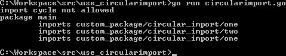

**图 8.1：** 循环导入

在 `circularimport.go` 中，导入包一时，它找到了导入包二的语句。在导入包二时，它再次找到了导入包一的语句。通过这种方式，这里存在循环依赖。

对循环依赖的分析得出结论：任何 Go 程序中都不需要这些依赖。我们可以创建多或或少的包来避免此类情况。

为了解决这类问题，我们可以创建一个新包作为接口，并定义包一所访问的所有包二成员。通过这样做，我们可以在包一中导入该新包，而不是包二。然而，在某些情况下，这并不是完美的解决方案。为了完全避免导入依赖，我们可以将两个包合并为一个包。在这种情况下，所有成员都可以被轻松访问，且不会有循环依赖。在这里，我们如下所示将两个包合并为一个：

```go
// one/one.go
package one
import (
    "fmt"
)
func One_function() {
    One_val := "Variable of package one"
    fmt.Println(One_val)
    Two_function()
}
func Two_function() {
    Two_val := "Variable of package two"
    fmt.Println(Two_val)
}
```

这是执行 `circularimport.go` 时的输出。

**输出：**

```
Variable of package one
Variable of package two
```

## 顶级库

Go 拥有丰富的库集合。以下是我们拥有的一些顶级库列表：

- **Go kit**: 针对系统可观测性、基础设施集成、程序设计等方面的 Go 相关微服务的解决方案。构建可靠、易于维护的微服务。

- **GORM**: Golang 最好的 ORM 库。在不兼容类型系统之间转换数据。处理关系型数据库。具有回调、事务、日志、关联、复合主键等许多功能。

- **cli**: 数据平面包 (DPDK) 的一部分。帮助构建 Go 命令行应用程序。轻松创建标志、bash 补全、例程、甚至是帮助文本。支持颜色和光标移动。具有添加和删除命令、文件和目录的能力。

- **Vegeta**: 一种多功能的负载测试工具和库。也可以作为命令行实用工具。

- **Fuzzy**: 此包包含模糊匹配算法。以毫秒级提供高质量匹配。它甚至是感知 Unicode 的。

- **Kubernetes**: 一个用于应用程序部署、伸缩和管理的开源容器编排系统。具有自动生成的客户端。包含 Kubernetes API 的最小客户端。

- **Testify**: 用于测试代码的多个包的集合。其中的 `assert` 包提供了测试的断言函数。`http` 包检查 HTTP 活动。`mock` 包使得对对象进行 mock 并验证调用变得可能。`suite` 包提供了结构体作为测试套件的基本结构。

- **gocheck**: 帮助具有正确错误报告的错误捕捉逻辑。提供对预期失败的支持。管理临时目录。为失败报告周围的注释提供便利。

- **glog**: 方便在命令行使用标志。实现了类似于 Google 内部 C++ INFO/ERROR/V 设置的日志。提供了警告、错误、致命、信息等函数。

- **color**: 为 Go 应用程序提供多种颜色选项。支持颜色混合。
    * 支持背景颜色、字体样式如**粗体**、**斜体**等多种样式。

### 总结

在本章中，我们学习了 Go 程序中包（packages）的使用。我们看到了如何在包中声明公共和私有成员，以及如何在包外部代码访问它们。在每个 Go 程序中，首先导入的是 `main` 包。在这里，我们理解了 `main` 包的必要性。我们还掌握了 Go 中嵌套包和循环导入（包依赖）的概念。在本章中我们学习了关于包的所有知识。在接下来的几个章节中，我们将深入讨论数据类型。

## 问题

1. Go 中 `main` 包的重要性是什么？
2. Go 中 `fmt` 包的用途是什么？
3. Go 编译器在导入包时搜索的是哪个路径？
4. 我们如何在包中声明私有成员？
5. Go 中的“点导入”（dot import）是指什么？
6. 如何在 Go 中创建自定义包？请举例说明。

# 第 9 章

## 数组与切片

在讨论 Go 语言的数据类型时，我们有两种类型的数据：原生类型和非原生类型。原生类型是 Go 的内置数据类型，而非原生类型派生自原生数据。数组（Array）和切片（Slice）是包含一组相同类型元素的非原生数据类型。让我们通过本章来理解数组和切片的必要性。

## 结构

在本章中，我们将讨论以下内容：

* 数组简介
* 声明数组
* 初始化数组
* 多维数组
* 数组的功能
* 切片简介
* 声明切片
* 初始化切片
* 数组的切片
* 切片的切片
* 使用 `make` 创建切片
* 二维切片
* 函数

## 目标

学习本章后，你将能够：

* 以高效的方式组织并处理大型数据。
* 通过单一引用处理大量同类型数据。
* 理解切片如何解决使用数组带来的问题。
* 使用各种内置函数。

## 简介

数组和切片是 Go 语言中的两种集合类型。数组是一组可以通过索引访问的相同类型元素。数组的索引始终从 0 开始。在 Go 语言中，数组是固定长度的。数组是值类型。当将数组赋值给变量或传递给函数时，拷贝的是整个数组而非它的引用。

### 声明数组

类型为 `T` 的数组按照如下方式声明具有 `n` 个值：

`var name_of_array[n]T`

或

`var a [3]int`

声明一个拥有 3 个值的数组。默认情况下，如果元素类型为整数，则所有数组元素都将初始化为零。如果声明一个字符串类型的数组，它将被初始化为空字符串。

**示例：**

```go
package main
import "fmt"

func main() {
    var array_int [10]int
    var array_float [10]float32
    var array_string [10]string
    var array_complex [10]complex128
    fmt.Println("Int type array:", array_int)
    fmt.Println("Float type array:", array_float)
    fmt.Println("String type array:", array_string)
    fmt.Println("Complex type array:", array_complex)
}
```

**输出：**

```
Int type array: [0 0 0 0 0 0 0 0 0 0]
Float type array: [0 0 0 0 0 0 0 0 0 0]
String type array: [         ]
Complex type array: [(0+0i) (0+0i) (0+0i) (0+0i) (0+0i) (0+0i) (0+0i) (0+0i) (0+0i) (0+0i)]
```

### 初始化数组

给数组赋值称为数组初始化。在声明数组后，我们可以通过访问索引来初始化预定义值：

```go
var arr [5]int = [5]int{1, 2, 3, 4, 5}
```

或者

```go
var arr [5]int
arr[0] = 1
arr[1] = 2
arr[2] = 3
arr[3] = 4
arr[4] = 5
```

我们可以同时声明并初始化数组：

```go
name_of_array := [5]int{1, 2, 3, 4, 5}
```

在 Go 中，我们可以使用省略号 `...` 让编译器为我们计算元素个数：

```go
arr := [...]int{1, 2, 3, 4, 5}
```

注意，数组的大小在计数后仍然是固定的。

```go
arr := [...]int{1, 2, 3, 4, 5}
fmt.Println(len(arr)) // 5
```

在 Go 中，数组是值类型。当你将数组传递给函数时，会创建数组的拷贝。

```go
func update(a [3]int) {
    a[0] = 100
}

func main() {
    arr := [3]int{1, 2, 3}
    update(arr)
    fmt.Println(arr) // [1 2 3]
}
```

为了避免拷贝大型数组，你可以传递数组的指针：


```go
func update(a *[3]int) {
    a[0] = 100
}

func main() {
    arr := [3]int{1, 2, 3}
    update(&arr)
    fmt.Println(arr) // [100 2 3]
}
```

在 Go 中，我们可以使用 `range` 遍历数组：

```go
arr := [3]int{1, 2, 3}
for i, v := range arr {
    fmt.Printf("Index: %d, Value: %d\n", i, v)
}
```

在 Go 中，我们还可以拥有多维数组：

```go
arr := [2][3]int{
    {1, 2, 3},
    {4, 5, 6},
}
fmt.Println(arr[0][1]) // 2
```

## 数组的需求

当元素数量固定时，数组非常有用。但在许多情况下，我们需要动态的大小。这就是切片派上用场。

切片是数组元素的一个灵活视图。与数组不同，切片没有固定大小。

```go
arr := [5]int{1, 2, 3, 4, 5}
slice := arr[1:4]
fmt.Println(slice) // [2 3 4]
```

切片的语法为 `[low:high]`，其中 `low` 是起始索引（包含），`high` 是结束索引（不包含）。

```go
slice := arr[1:] // [2 3 4 5]
slice := arr[:3] // [1 2 3]
slice := arr[:]  // [1 2 3 4 5]
```

切片指向底层数组。如果你更改切片中的元素，会改变底层数组。

```go
arr := [5]int{1, 2, 3, 4, 5}
slice := arr[1:4]
slice[0] = 10
fmt.Println(arr) // [10 2 3 4 5]
```

切片有三个组成部分：底层数组的指针、长度（`length`）和容量（`capacity`）。

```go
arr := [5]int{1, 2, 3, 4, 5}
slice := arr[1:4]
fmt.Println(len(slice)) // 3
fmt.Println(cap(slice)) // 4
```

要向切片添加元素，我们使用 `append` 函数：

```go
slice := []int{1, 2, 3}
slice = append(slice, 4, 5)
fmt.Println(slice) // [1 2 3 4 5]
```

如果 `append` 超过了容量，Go 会创建一个更大的底层数组并拷贝元素过去。

```go
slice := []int{1, 2, 3}
slice = append(slice, 4, 5)
```

我们也可以使用 `make` 函数来创建切片：

```go
slice := make([]int, 3, 5) // 长度 3，容量 5
```

切片在 Go 中比数组更常见，因为它们的灵活性更高。

## 多维数组

到为止，我们讨论了单维数组。多维数组可以定义为数组的数组。多维数组可以被分解为多个单维数组。在这种数组中，数据以表格形式存储（行优先顺序）。

这些数组的声明如下：

`Name_of_array := [dim1][dim2]type_of_array{values_of_array}`

方括号的数量指定数组的维度。

```go
arr := [3][2]int{
    {1, 2},
    {4, 5},
    {7, 8},
}
fmt.Println(arr) // [[1 2] [4 5] [7 8]]
```

上述是一个 3x2 的二维数组。数组的声明表示它包含了三个长度为二的单维数组。和 1D 数组一样，没有必要初始化所有元素。未初始化的数组将取默认值。

```go
arr := [3][2]int{
    {1, 2},
    {7},
}
fmt.Println(arr) // [[1 2] [7 0] [0 0]]
```

我们也可以另一种方式初始化多维数组：

```go
var arr [3][3]int
arr[0] = [3]int{1, 2, 3}
arr[1] = [3]int{4, 5, 6}
arr[2] = [3]int{7, 8, 9}
fmt.Println(arr) // [[1 2 3] [4 5 6] [7 8 9]]
```

```go
arr1D := [...]int{1, 4, 7, 2}
arr2D := [3][2]int{
    {1, 2},
    {7},
}
fmt.Println("Length of 1D array", len(arr1D))
fmt.Println("Length of 2D array", len(arr2D)) // 告诉它它可以包含多少行。
}
```

**输出：**

```
Length of 1D array 4
Length of 2D array 3
```

## 数组的比较

如果两个数组具有相同的类型和大小，具有相同的元素，并且所有元素在两个数组中的顺序也相同，则认为它们是相等。比较操作符定义为 `==`。如果两个数组相等，它返回布尔结果 `true`，否则返回 `false`。它首先检查两个数组的数据类型，然后通过索引匹配值。

**示例：**

```go
func main() {
    arr1 := [4]int{1, 4, 7, 2}
    arr2 := [4]int{1, 4, 7}
    arr3 := [3][2]int{
        {1, 2},
        {7},
    }
    arr4 := [3][2]int{
        {1, 1},
        {7},
    }
    arr5 := [4]int{1, 4, 7, 0}
    fmt.Println("arr1 and arr2", arr1 == arr2)
    fmt.Println("arr3 and arr4", arr3 == arr4)
    fmt.Println("arr2 and arr5", arr2 == arr5)
}
```

**输出：**

```
arr1 and arr2 false
arr3 and arr4 false
arr2 and arr5 true
```

`arr1` 和 `arr2` 的大小相同，但 `arr2` 在最后一个索引处取了默认值 `0`。因此，结果为 `false`。

`arr3` 和 `arr4` 的大小相同，但元素不同。因此，结果为 `false`。

`arr2` 和 `arr5` 具有相同的大小和元素。因此，`arr2` 和 `arr5` 是相等的，结果为 `true`。

## 复制数组

**复制数组**仅仅是将一个数组赋值给另一个数组。因为在 Golang 中，数组的行为像是一个值而不是引用，所以更改一个数组的任何值都不会对另一个产生任何影响。

**示例：**

```go
func main() {
    arr1 := [4]int{1, 4, 7, 2}
    arr2 := arr1
    arr2[2] = 90
    fmt.Println("arr1 is", arr1) // [1 4 7 2]
    fmt.Println("arr2 is", arr2) // [1 4 90 2]
}
```

## 将数组传递给函数

数组可以作为参数传递给任何函数。在函数声明中，参数应该定义为数组，告诉编译器正在将数组作为参数传递给函数调用。

**示例：**

```go
func main() {
    arrval := [4]int{1, 4, 7, 2}
    fmt.Println("sum of array elements is:", sum(arrval))
}

func sum(arr [4]int) int {
    sum := 0
    for i := 0; i < len(arr); i++ {
        sum = sum + arr[i]
    }
    return sum
}
```

**输出：**

```
sum of array elements is: 14
```

## 数组的迭代

在创建应用程序时，可能会有很多情况我们需要对数组进行迭代。例如，为了找到数组所有元素的和，我们必须访问数组的每一个元素。我们可以很容易地使用 `for` 循环来迭代数组，如下所示：

**示例：**

```go
func main() {
    arr := [...]int{1, 4, 7, 2, 7, 9, 3, 5}
    sum := 0
    for i := 0; i < len(arr); i++ {
        sum = sum + arr[i]
    }
    fmt.Println("sum of values:", sum)
}
```

在这里，`len` 函数用于获取数组的长度。我们可以使用 `range` 函数代替上面的操作，如下所示：

**示例：**

```go
func main() {
    arr := [...]int{1, 4, 7, 2}
    sum := 0
    for index, value := range arr {
        fmt.Println("index is:", index)
        fmt.Println("value is:", value)
        sum = sum + value
    }
    fmt.Println("sum of values:", sum)
}
```

**输出：**

```
index is: 0
value is: 1
index is: 1
value is: 4
index is: 2
value is: 7
index is: 3
value is: 2
sum of values: 14
```

在这里，`range arr` 总是返回两个值：索引和该索引处的值。在左侧编写这两个变量是强制性的。如果我们写 `value := range arr`，默认情况下它将返回索引而不是值。如果我们的程序中不需要索引，我们可以将其赋值给空白标识符，否则编译器会报错。

```go
var arrayval [10]int = [10]int{1, 2, 3, 4, 5, 6, 7, 8, 9, 10}
slice1 := arrayval[1:8]
slice2 := slice1[:6]
fmt.Println("slice from array:", slice1)
fmt.Println("slice from existing slice", slice2)
```

**输出：**

```
slice from array: [2 3 4 5 6 7 8]
slice from existing slice [2 3 4 5 6 7]
```

这里是一个示例，展示了切片仅仅是数组的引用。

```go
func main() {
    var arrayval [10]int = [10]int{1, 2, 3, 4, 5, 6, 7, 8, 9, 10}
    slice1 := arrayval[1:8]
    slice2 := slice1[:6]
    fmt.Println("slice from array:", slice1)
    fmt.Println("slice from existing slice", slice2)
    arrayval[2] = 90
    fmt.Println("slice from array after modifying an array:", slice1)
    fmt.Println("slice from existing slice after modifying an array", slice2)
}
```

**输出：**

```
slice from array: [2 3 4 5 6 7 8]
slice from existing slice [2 3 4 5 6 7]
slice from array after modifying an array: [2 90 4 5 6 7 8]
slice from existing slice after modifying an array [2 90 4 5 6 7]
```

## 来自结构体的切片

`struct` 是一组不同类型字段的集合。我们稍后会深入讨论。和数组一样，切片也可以用结构体初始化。这些是 `struct` 切片。

**示例：**

```go
func main() {
    record := []struct {
        roll_no int
        name    string
        present bool
    }{
        {1, "Rahul", true},
        {3, "Akansha", false},
        {5, "Ram", true},
    }
    fmt.Println("structs type slice is:", record) // structs type slice is: [{1 Rahul true} {3 Akansha false} {5 Ram true}]
}
```

## 切片的内部原理

通常，切片由一个指向数组段的指针组成。数组段的长度以及切片可以扩展的最大长度。

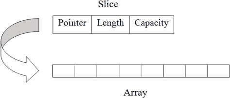

**图 9.3：** 切片结构

### 指针

我们已经讨论过切片不存储任何数据；它们只引用一个数组或底层数组的一个部分。从数组初始化切片并修改数组元素也会改变切片的值。我们已经见过一个这样的示例。同样，更改切片的元素值也会反映在所引用的数组上。

**示例：**

```go
func main() {
    var arrayval [10]int = [10]int{1, 2, 3, 4, 5, 6, 7, 8, 9, 10}
    slice1 := arrayval[1:8]
    slice2 := slice1[:6]
    fmt.Println("original array", arrayval)
    fmt.Println("slice from array:", slice1)
    fmt.Println("slice from existing slice", slice2)
    slice1[0] = 178
    fmt.Println("array after modifying slice", arrayval)
    fmt.Println("slice from array after modifying slice:", slice1)
    fmt.Println("slice from existing slice after modifying slice", slice2)
}
```

**输出：**

```
original array [1 2 3 4 5 6 7 8 9 10]
slice from array: [2 3 4 5 6 7 8]
slice from existing slice [2 3 4 5 6 7]
array after modifying slice [1 178 3 4 5 6 7 8 9 10]
slice from array after modifying slice: [178 3 4 5 6 7 8]
slice from existing slice after modifying slice [178 3 4 5 6 7 8]
```

### 长度

`Length` 是切片引用的元素个数。和数组一样，我们使用 `len` 函数来获取切片的长度。它返回切片包含的元素总数。

**示例：**

```go
func main() {
    var arrayval [10]int = [10]int{1, 2, 3, 4, 5, 6, 7, 8, 9, 10}
    slice1 := arrayval[2:5]
    fmt.Println("length of slice", len(slice1)) // 3
}
```

### 容量

对于同一个切片，长度和容量可以相同，也可以不同。长度与切片相关，而容量与数组相关。切片的 `capacity` 是切片可以扩展的大小。

在给出的示例中，切片包含从索引 2 到 4 的元素（3 个元素）。因此切片的长度为 3。切片可以扩展到数组的最大索引，这里是 9。因此切片的容量是从索引 2 到 9 的元素数量，这里是 8。

切片不能扩展到超过其容量范围。此外，切片不能在零以下进行切分。

**示例：**

```go
func main() {
    var arrayval [10]int = [10]int{1, 2, 3, 4, 5, 6, 7, 8, 9, 10}
    slice1 := arrayval[2:5]
    fmt.Println("length of slice", len(slice1)) // 3
    fmt.Println("capacity of slice", cap(slice1)) // 8
}
```

## 使用 make 函数创建切片

Go 提供了一个内置函数 `make`，用于创建空切片。空切片引用一个空数组。创建此类切片时，需要在声明切片时定义其大小。创建一个非零长度的空切片，我们如下所示声明切片：

`name_of_slice := make([], type_of_slice, length_of_slice, capacity_of_slice)`

`make` 函数创建一个指定类型的数组并将其引用分配给切片。在这里，切片的容量是可选的。默认情况下，考虑的切片大小是其容量。

`s := make([]int, 5, 10)`

这创建一个大小为 10 的整数类型数组，并将前 5 个索引的引用分配给切片 `s`。

**示例：**

```go
func main() {
    slice1 := make([]int, 2, 4)
    fmt.Println("length of slice", len(slice1)) // 切片长度为 2
    fmt.Println("capacity of slice", cap(slice1)) // 切片容量为 4
}
```

在创建了切片后，是时候以各种方式使用切片了。切片比数组更丰富，因为我们可以对切片执行多种类型的操作。以下是一些函数：

### 使用 copy 函数复制切片


# 使用切片

在创建了切片后，是时候以各种方式使用切片了。切片比数组更丰富，因为我们可以对切片执行多种类型的操作。以下是一些函数：

## 使用 `copy()` 函数复制切片

`copy()` 函数将元素从一个切片复制到另一个切片。`copy` 函数遵循以下签名：

```
func copy(destination, source [] T) int
```

该函数接受两个参数：我们想要复制的源切片（`source`），以及我们要将元素复制的目标切片（`destination`）。它始终返回一个整数类型的值，表示复制元素总数。返回值始终是源切片和目标切片长度的最小值。

### 示例

```go
func main() {
    slice1 := []int{23, 56, 47, 58}
    slice2 := []int{90, 107, 0, 67, 28, 89}
    // if(len(des_slice)>len(src_slice))
    fmt.Println("destination slice if it's length is greater than source slice>>>>>>>>>>>>>")
    fmt.Println("destination slice before copying elements:", slice2)
    n := copy(slice2, slice1)
    fmt.Println("destination slice after copying elements:", slice2)
    fmt.Println("length of destination slice after copying elements:", len(slice2))
    fmt.Println("Numnber of copied elements after copying elements:", n)
    // if(len(des_slice) = len(src_slice))
    slice3 := []int{34, 20, 1, 91}
    fmt.Println("destination slice if it's length is equal to source slice>>>>>>>>>>>>>")
    fmt.Println("destination slice before copying elements:", slice3)
    n = copy(slice3, slice1)
    fmt.Println("destination slice after copying elements:", slice3)
    fmt.Println("length of destination slice after copying elements:", len(slice3))
    fmt.Println("Numnber of copied elements after copying elements:", n)
    // if(len(des_slice)<len(src_slice))
    slice4 := []int{34, 20}
    fmt.Println("destination slice if it's length is less than source slice>>>>>>>>>>>>>")
    fmt.Println("destination slice before copying elements:", slice4)
    n = copy(slice4, slice1)
    fmt.Println("destination slice after copying elements:", slice4)
    fmt.Println("length of destination slice after copying elements:", len(slice4))
    fmt.Println("Numnber of copied elements after copying elements:", n)
    // copying in nil slice
    slice5 := []int{}
    fmt.Println("On copying elements to nil slice >>>>>>>>>>>>>")
    fmt.Println("destination slice before copying elements:", slice5)
    n = copy(slice5, slice1)
    fmt.Println("destination slice after copying elements:", slice5)
    fmt.Println("length of destination slice after copying elements:", len(slice5))
    fmt.Println("Numnber of copied elements after copying elements:", n)
}
```

### 输出

```
destination slice if it's length is greater than source slice>>>>>>>>>>>>>
destination slice before copying elements: [90 107 0 67 28 89]
destination slice after copying elements: [23 56 47 58 28 89]
length of destination slice after copying elements: 6
Numnber of copied elements after copying elements: 4
destination slice if it's length is equal to source slice>>>>>>>>>>>>>
destination slice before copying elements: [34 20 1 91]
destination slice after copying elements: [23 56 47 58]
length of destination slice after copying elements: 4
Numnber of copied elements after copying elements: 4
destination slice if it's length is less than source slice>>>>>>>>>>>>>
destination slice before copying elements: [34 20]
destination slice after copying elements: [23 56]
length of destination slice after copying elements: 2
Numnber of copied elements after copying elements: 2
On copying elements to nil slice >>>>>>>>>>>>>
destination slice before copying elements: []
destination slice after copying elements: []
length of destination slice after copying elements: 0
Numnber of copied elements after copying elements: 0
```

从这个示例可以明显看出，`copy` 函数并没有向目标切片添加任何新值。

## 排序切片

在 Goang 中，`sort` 包提供了对 `int`、`float64` 或 `string` 类型切片进行排序的方法。这些方法按升序对切片进行排序。

### 示例

```go
package main

import (
    "fmt"
    "sort"
)

func main() {
    slice1 := []int{23, 56, 47, 58}
    slice2 := []int{90, 107, 0, 67, 28, 89}
    // ... (省略部分以保持逻辑一致)
}
```


在创建了切片后，是时候以各种方式使用切片了。切片比数组更丰富，因为我们可以对切片执行多种类型的操作。以下是一些函数：

### 使用 copy 函数复制切片

`copy()` 函数将元素从一个切片复制到另一个切片。`copy` 函数遵循以下签名：

`func copy(destination, source [] T) int`

该函数接受两个参数：我们想要复制的源切片（source），以及我们要将元素复制的目标切片（destination）。它始终返回一个整数类型的值，表示复制元素总数。返回值始终是源切片和目标切片长度的最小值。

**示例：**

```go
func main() {
    slice1 := [] int{23, 56, 47, 58}
    slice2 := [] int{90, 107, 0, 67, 28, 89}
    // if(len(des_slice)>len(src_slice))
    fmt.Println("destination slice if it's length is greater than source slice>>>>>>>>>>>>>")
    fmt.Println("destination slice before copying elements:", slice2)
    n := copy(slice2, slice1)
    fmt.Println("destination slice after copying elements:", slice2)
    fmt.Println("length of destination slice after copying elements:", len(slice2))
    fmt.Println("Numnber of copied elements after copying elements:", n)
    // if(len(des_slice) = len(src_slice))
    slice3 := [] int{34, 20, 1, 91}
    fmt.Println("destination slice if it's length is equal to source slice>>>>>>>>>>>>>")
    fmt.Println("destination slice before copying elements:", slice3)
    n = copy(slice3, slice1)
    fmt.Println("destination slice after copying elements:", slice3)
    fmt.Println("length of destination slice after copying elements:", len(slice3))
    fmt.Println("Numnber of copied elements after copying elements:", n)
    // if(len(des_slice)<len(src_slice))
    slice4 := [] int{34, 20}
    fmt.Println("destination slice if it's length is less than source slice>>>>>>>>>>>>>")
    fmt.Println("destination slice before copying elements:", slice4)
    n = copy(slice4, slice1)
    fmt.Println("destination slice after copying elements:", slice4)
    fmt.Println("length of destination slice after copying elements:", len(slice4))
    fmt.Println("Numnber of copied elements after copying elements:", n)
    // copying in nil slice
    slice5 := []int{}
    fmt.Println("On copying elements to nil slice >>>>>>>>>>>>>")
    fmt.Println("destination slice before copying elements:", slice5)
    n = copy(slice5, slice1)
    fmt.Println("destination slice after copying elements:", slice5)
    fmt.Println("length of destination slice after copying elements:", len(slice5))
    fmt.Println("Numnber of copied elements after copying elements:", n)
}
```

**输出：**

```
destination slice if it's length is greater than source slice>>>>>>>>>>>>>
destination slice before copying elements: [90 107 0 67 28 89]
destination slice after copying elements: [23 56 47 58 28 89]
length of destination slice after copying elements: 6
Numnber of copied elements after copying elements: 4
destination slice if it's length is equal to source slice>>>>>>>>>>>>>
destination slice before copying elements: [34 20 1 91]
destination slice after copying elements: [23 56 47 58]
length of destination slice after copying elements: 4
Numnber of copied elements after copying elements: 4
destination slice if it's length is less than source slice>>>>>>>>>>>>>
destination slice before copying elements: [34 20]
destination slice after copying elements: [23 56]
length of destination slice after copying elements: 2
Numnber of copied elements after copying elements: 2
On copying elements to nil slice >>>>>>>>>>>>>
destination slice before copying elements: []
destination slice after copying elements: []
length of destination slice after copying elements: 0
Numnber of copied elements after copying elements: 0
```

从这个示例可以明显看出，`copy` 函数并没有向目标切片添加任何新值。

### 排序切片

在 Goang 中，`sort` 包提供了对 `int`、`float64` 或 `string` 类型切片进行排序的方法。这些方法按升序对切片进行排序。

**示例：**

```go
package main

import (
    "fmt"
    "sort"
)

func main() {
    slice1 := []int{23, 56, 47, 58}
    slice2 := []int{90, 107, 0, 67, 28, 89}
    // ...
}
```


# 切片操作

在创建了切片后，是时候以各种方式使用切片了。切片比数组更丰富，因为我们可以对切片执行多种类型的操作。以下是一些函数：

## 使用 `copy` 函数复制切片

`copy()` 函数将元素从一个切片复制到另一个切片。`copy` 函数遵循以下签名：

```go
func copy(destination, source []T) int
```

该函数接受两个参数：我们想要复制的源切片（`source`），以及我们要将元素复制到的目标切片（`destination`）。它始终返回一个整数类型的值，表示复制的元素总数。返回值始终是源切片和目标切片长度的最小值。

### 示例

```go
func main() {
    slice1 := []int{23, 56, 47, 58}
    slice2 := []int{90, 107, 0, 67, 28, 89}
    // if(len(des_slice)>len(src_slice))
    fmt.Println("destination slice if it's length is greater than source slice>>>>>>>>>>>>>")
    fmt.Println("destination slice before copying elements:", slice2)
    n := copy(slice2, slice1)
    fmt.Println("destination slice after copying elements:", slice2)
    fmt.Println("length of destination slice after copying elements:", len(slice2))
    fmt.Println("Numnber of copied elements after copying elements:", n)
    // if(len(des_slice) = len(src_slice))
    slice3 := []int{34, 20, 1, 91}
    fmt.Println("destination slice if it's length is equal to source slice>>>>>>>>>>>>>")
    fmt.Println("destination slice before copying elements:", slice3)
    n = copy(slice3, slice1)
    fmt.Println("destination slice after copying elements:", slice3)
    fmt.Println("length of destination slice after copying elements:", len(slice3))
    fmt.Println("Numnber of copied elements after copying elements:", n)
    // if(len(des_slice)<len(src_slice))
    slice4 := []int{34, 20}
    fmt.Println("destination slice if it's length is less than source slice>>>>>>>>>>>>>")
    fmt.Println("destination slice before copying elements:", slice4)
    n = copy(slice4, slice1)
    fmt.Println("destination slice after copying elements:", slice4)
    fmt.Println("length of destination slice after copying elements:", len(slice4))
    fmt.Println("Numnber of copied elements after copying elements:", n)
    // copying in nil slice
    slice5 := []int{}
    fmt.Println("On copying elements to nil slice >>>>>>>>>>>>>")
    fmt.Println("destination slice before copying elements:", slice5)
    n = copy(slice5, slice1)
    fmt.Println("destination slice after copying elements:", slice5)
    fmt.Println("length of destination slice after copying elements:", len(slice5))
    fmt.Println("Numnber of copied elements after copying elements:", n)
}
```

### 输出

```
destination slice if it's length is greater than source slice>>>>>>>>>>>>>
destination slice before copying elements: [90 107 0 67 28 89]
destination slice after copying elements: [23 56 47 58 28 89]
length of destination slice after copying elements: 6
Numnber of copied elements after copying elements: 4
destination slice if it's length is equal to source slice>>>>>>>>>>>>>
destination slice before copying elements: [34 20 1 91]
destination slice after copying elements: [23 56 47 58]
length of destination slice after copying elements: 4
Numnber of copied elements after copying elements: 4
destination slice if it's length is less than source slice>>>>>>>>>>>>>
destination slice before copying elements: [34 20]
destination slice after copying elements: [23 56]
length of destination slice after copying elements: 2
Numnber of copied elements after copying elements: 2
On copying elements to nil slice >>>>>>>>>>>>>
destination slice before copying elements: []
destination slice after copying elements: []
length of destination slice after copying elements: 0
Numnber of copied elements after copying elements: 0
```

从这个示例可以明显看出，`copy` 函数并没有向目标切片添加任何新值。

## 排序切片

在 Go 语言中，`sort` 包提供了对 `int`、`float64` 或 `string` 类型切片进行排序的方法。这些方法按升序对切片进行排序。

### 示例

```go
package main

import (
    "fmt"
    "sort"
)

func main() {
    slice1 := []int{23, 56, 47, 58}
    slice2 := []int{90, 107, 0, 67, 28, 89}
    // ...
}
```


```go
package main

import (
    "fmt"
    "sort"
)

func main() {
    slice1 := []int{23, 56, 47, 58}
    slice2 := []int{90, 107, 0, 67, 28, 89}
    // ...
}
```

### 在切片中搜索

在 Go 中，我们可以搜索特定元素是否存在于切片中。Go 提供了一个搜索函数可以查找元素并返回其在切片中的位置。该函数与排序后的切片配合得良好。

**示例：**

```go
package main

import (
    "fmt"
    "sort"
)

func main() {
    slice1 := []int{0, 9, 16, 105, 345}
    slice2 := []string{"Akansha", "Mayang", "Ram"}
    slice3 := []float64{0, 0.001, 5.7}

    fmt.Println(sort.SearchInts(slice1, 105)) // 3
    fmt.Println(sort.SearchInts(slice1, 78))  // 3
    fmt.Println(sort.SearchInts(slice1, 0))   // 0

    fmt.Println(sort.SearchStrings(slice2, "Ram"))   // 2
    fmt.Println(sort.SearchStrings(slice2, "ram")) // 3

    fmt.Println(sort.SearchFloat64s(slice3, 0.000)) // 0
    fmt.Println(sort.SearchFloat64s(slice3, 5.7))   // 2
}
```

### 反转切片

`reverse` 函数按反转/降序顺序返回切片。它与已排序或未排序的切片配合得良好。

**示例：**

```go
package main

import (
    "fmt"
    "sort"
)

func main() {
    slice1 := []int{0, 888, 9, 16, 105, 345}
    slice2 := []string{"Soni", "Akansha", "Charu", "Mayang", "Ram"}

    sort.Sort(sort.Reverse(sort.IntSlice(slice1)))
    fmt.Println("reverse of slice1:", slice1)
    sort.Sort(sort.Reverse(sort.StringSlice(slice2)))
    fmt.Println("reverse of slice2:", slice2)
}
```

**输出：**

```
reverse of slice1: [888 345 105 16 9 0]
reverse of slice2: [Soni Ram Mayank Charu Akansha]
```

### 追加切片元素

`append` 函数在切片的末尾添加新元素。我们可以在切片的末尾追加多个数字。如果切片的容量小于我们要追加的项数，则会分配一个容量更大的新切片，并将所有元素复制并追加到新切片中。

**示例：**

```go
func main() {
    slice1 := []int{0, 888, 9, 16, 105, 345}
    slice1 = append(slice1, 345, 646, 0)
    fmt.Println("slice1 after appending few elements:", slice1)
    slice3 := make([]int, 2)
    slice3 = append(slice3, 56, 67, 48, 90, 46, 26, 57)
    fmt.Println("slice3 after appending elements more than its capacity:", slice3)
    slice4 := []int{}
    slice4 = append(slice4, 45, 67)
    fmt.Println("slice4 after appending elements in nil slice:", slice4)
}
```

**输出：**

```
slice1 after appending few elements: [0 888 9 16 105 345 345 646 0]
slice3 after appending elements more than its capacity: [56 67 48 90 46 26 57]
slice4 after appending elements in nil slice: [45  67]
```

我们可以使用 `...` 运算符将一个切片追加到相同类型的切片中。该运算符有助于将切片的容量增加到追加切片的长度。

**示例：**

```go
func main() {
    slice1 := []int{0, 888, 9, 16, 105, 345}
    slice2 := []int{78, 34, 9, 57}
    slice1 = append(slice1, slice2...)
    fmt.Println("slice1 after appending slice2", slice1)
}
```

**输出：**

```
slice1 after appending slice2: [0 888 9 16 105 345 78 34 9 57]
```

### 总结

在本章中，我们学习了数组的声明和初始化。我们学习了各种函数，如 `len`、`copy` 以及对数组进行迭代。在这里，我们理解了使用数组以及切片的必要性。我们看到了一些从数组、切片或结构体中获取切片的函数。为了连续理解 Go 中的数据类型，我们将在下一章中讨论另一种名为 `string` 的数据类型。

### 习题

1. 如何在 Go 中声明数组？
2. 如何初始化多维数组？
3. 切片相对于数组的优势是什么？
4. 如何在切片中添加元素？
5. 如何在函数中传递数组？
6. 如何根据特定值从数组获取切片？
7. 如何在 Go 中比较两个切片？

## 字符串

在本章中，我们将讨论另一种用于表示文本（字符集、数字等）的非原始数据类型。它展示了我们在 Go 语言中可以对字符串执行的各种操作。

### 结构

在本章中，我们将讨论内容：

* 字符串简介
* 字符串相关函数
* `rune` 数据类型
* 遍历字符串
* 多行字符串
* `rune` 到字符串的转换
* 字节切片到字符串的转换
* 不变性
* `strings` 包
* 使用 `strings` 包的函数

### 目标

学习本章后，你将能够：

* 理解 `string` 在 Go 程序中如何工作
* 在程序中直接使用各种内置函数，以节省时间并降低复杂度
* 理解字符串的不可变行为
* 从其他数据类型获取字符串并根据需要使用
* 熟悉 Golang 提供的 `strings` 库

### 简介

`string` 是 Golang 数据类型的重要类别之一。在 Go 中，字符串与其他语言非常不同。在其他编程语言中，字符串被定义为字符数组，但在这里，字符串是字节切片。在 JavaScript、Python 或任何语言中，我们可以用单引号定义字符串，但 Golang 不允许在单引号内定义多个字符或字符串。我们可以用单引号定义字符（`'...'`），但字符串始终用双引号定义（`"..."`）。

默认情况下，Go 语言中的字符串是 UTF-8 编码的。这是 Go `string` 数据类型的关键因素。许多语言都支持 UTF-8，因此便于与其他语言进行交互。在创建网页时，我们需要显示 Unicode 内容；在这里，字符串与 Go 语言配合得很好。UTF-8 使用 8 位块来表示一个字符。块的数量从 1 到 4 不等。Unicode 字符集将每个字符映射到一个称为代码点的唯一数字。它能够编码 1,112,064 个代码点。

这是一个基础示例，用于解释字符串的声明和初始化。

**示例：**

```go
func main() {
    var str string
    fmt.Printf("By default strings are:%q\n", str)
    str = "Hello Go"
    fmt.Println("After assigning a value string is:", str)
    str_new := "Hello world"
    fmt.Printf("After shorthand declaration, double quoted value of str_new is:%q\n", str_new)
    fmt.Printf("Uninterpreted bytes of str_new is:%s\n", str_new)
    fmt.Printf("base16 notation of str=%x", str)
}
```

**输出：**

```
By default strings are:""
After assigning a value string is: Hello Go
After shorthand declaration, double quoted value of str_new is:"Hello world"
Uninterpreted bytes of str_new is:Hello world
base16 notation of str=48656c6c6f
```

上面的示例告诉我们，默认情况下，字符串是空的。

### 字符串函数

以下是一些在 Go 中处理字符串的函数。

* **字符串长度**：Golang 提供了 `len` 函数来查找字符串的长度或其包含的字符数。该函数对字符串并返回每个字符占用的总字节数。

**示例：**

```go
func main() {
    var str string
    str = "Hello Go"
    fmt.Println("Length of string 'str' is:", len(str))
    str_new := "Hello 世"
    fmt.Println("Length of string 'str_new' is:", len(str_new))
}
```

**输出：**

```
Length of string 'str' is: 8
Length of string 'str_new' is: 14
```

* **遍历字符串**：由于字符串是字节切片，我们可以单独访问每个字节。获取它们的 Unicode UTF-8 编码值。在迭代时，它覆盖的是每个字节而不是字符。

**示例：**

```go
func main() {
    var str string
    str = "Hello Go"
    fmt.Println("characters of str")
    for itr := 0; itr < len(str); itr++ {
        fmt.Printf("%c ", str[itr])
    }
    fmt.Println("\nUTF-8 encoded values of str")
    for itr := 0; itr < len(str); itr++ {
        fmt.Printf("%x ", str[itr])
    }
    str_new := "世 Hello 世"
    fmt.Println("\ncharacters of str_new")
    for itr := 0; itr < len(str_new); itr++ {
        fmt.Printf("%c ", str_new[itr])
    }
    fmt.Println("\nUTF-8 encoded values of str_new")
    for itr := 0; itr < len(str_new); itr++ {
        fmt.Printf("%x ", str_new[itr])
    }
}
```

**输出：**

```
characters of str
H e l l o   G o
UTF-8 encoded values of str
48 65 6c 6c 6f 20 47 6f
characters of str_new
� H e l l o   G o �
UTF-8 encoded values of str_new
e4 b8 96 48 65 6c 6c 6f 20 47 6f e4 b8 96
```

在上述示例中，一切运行正常，但在获取字符串 `str_new` 的字符时，它打印的字符是不正确的。当字符 `世` 被编码时，它占用了 `3` 个字节。让我们分析一下获取字符串 UTF-8 编码值的输出。

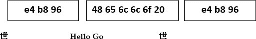

在这里，我们可以清楚地看到 `世` 占用三个字节 `e4`、`b8` 和 `96`。在打印字符时，我们假设它只占用一个字节。在这里就会出现问题。为了解决此类问题，Golang 提供了 `rune` 数据类型。

## rune 数据类型

Rune 是 Go 语言中的内置数据类型。正如我们所看到的，它是 `int32` 的别名，因为 Unicode UTF-8 将字符编码为一个唯一的数字或码点。`rune` 在 Go 中表示这些 Unicode 码点。它不受字符所占用字节数的限制。

在上一个示例中，我们遍历了字符串，由于字符串是字节切片，它会遍历每个字节，但这导致了意外的结果。为了避免这种情况，我们将通过将切片转换为 rune 切片来遍历切片。

**示例：**

```go
func main() {
    str_new := "世 Hello Go 世"
    rune_slice := []rune(str_new)
    fmt.Println("\ncharacters of str_new")
    for itr := 0; itr < len(rune_slice); itr++ {
        fmt.Printf("%c ", rune_slice[itr])
    }
    fmt.Println("\nUTF-8 encoded values of str_new")
    for itr := 0; itr < len(str_new); itr++ {
        fmt.Printf("%x ", str_new[itr])
    }
}
```

**输出：**

```
characters of str_new
世 H e l l o   G o 世
UTF-8 encoded values of str_new
e4 b8 96 48 65 6c 6c 6f 20 47 6f e4 b8 96
```

## 使用 range 关键字迭代

除了使用 `for` 循环或 rune，我们可以使用 `range` 关键字来遍历切片或数组的项。它返回一个整数索引和该索引上的项。`for` 循环覆盖每个字节，而 `range` 则单独覆盖每个索引。因此，我们在 `for` 循环出现的问题在使用 `range` 关键字时永远不会发生。

```go
for index, item := range name_of_string {
    // body
}
```

在左侧写一个变量时，它只返回索引而不返回该索引处的项。如果我们只需要项而不需要索引，可以在索引变量的位置使用 `_`。

**示例：**

```go
func main() {
    str_new := "世 Hello Go 世"
    fmt.Println("\nCharacters of str_new")
    for _, item := range str_new {
        fmt.Printf("%c ", item)
    }
}
```

**输出：**

```
Characters of str_new
世 H e l l o   G o 世
```

## 多行字符串

另一种定义字符串的方法是使用反引号（`` ` ``）。使用双引号时，我们需要定义换行符（`\n`）来换行，但使用反引号，我们可以根据需要直接提供换行。在反引号字符串中放置换行时，它被视为 `\n` 字符。反引号不需要指定转义字符，因为它将其解释为普通字符并随字符串打印。

**示例：**

```go
str := "Hello
Go"
fmt.Printf("string with double quotes:%s\n", str) // error
```

**示例：**

```go
func main() {
    str := "Hello\n Go"
    fmt.Printf("String with double quotes:%s\n", str)
    str_new := `Hello\n Go`
    fmt.Printf("String with backtick:%s\n", str_new) // 将 \n 视为普通字符
    str_new = `Hello
Go`
    fmt.Printf("Linebreak in string with backtick:%s\n", str_new)
}
```

**输出：**


```
String with double quotes:Hello
Go
String with backtick: Hello\n Go
Linebreak in string with backtick: Hello
Go
```

## 将 rune 切片转换为字符串

我们已经理解了如何将字符串转换为 rune。在 Go 中，我们也可以将 rune 切片转换为字符串。在下方的示例中，`rune` 包含几个码点，我们正将其转换为字符串。

**示例：**

```go
func main() {
    rune := []rune{0x4e16, 0x0048, 0x0065, 0x006c, 0x006c}
    str := string(rune)
    fmt.Println("string from rune:", str)
}
```

**输出：**

```
string from rune: 世 Hello
```

## 将字节切片转换为字符串

在下方的示例中，`b` 包含了几个字节，我们正将其转换为字符串。

**示例：**

```go
func main() {
    b := []byte{0xe4, 0xb8, 0x96, 0x48, 0x65, 0x6c, 0x6c, 0x6f, 0x20, 0x47, 0x6f, 0xe4, 0xb8, 0x96}
    str := string(b)
    fmt.Println("string from rune:", str)
}
```

**输出：**

```
string from rune: 世 Hello
```

## 字符串的不可变性

在 Go 中，字符串是不可变的。一旦定义，无法更改其值。它们是只读的。在 Go 语言中，无法更改已定义字符串的值。

**示例：**

```go
func main() {
    str := "Hello Go"
    str[0] = 'h' // error
}
```

## strings 包

在 Golang 中，我们有标准库 `strings` 提供了处理 UTF-8 编码字符串的多个函数。`strings` 包位于 Go 的 `src` ，包含多个 Go 文件。该包提供了多种修改和操作字符串的功能。

要在程序中使用包，首先需要导入它。导入包后，我们可以使用点运算符访问其导出函数。下述部分描述了 `strings` 包提供的大部分函数。为了避免反复访问 `Println` 方法，我们将其赋值给变量 `fp` 并在程序中使用。

## strings 包函数

### 转换字符串的大写和小写

`ToUpper` 函数将字符串中的每个字符转换为大写，而 `ToLower` 函数用于将字符串中的每个字符转换为小写。这两个函数都会对每个字符进行转换，无论它是小写还是大写。如果某个字符已经是大写的并应用了 `ToUpper` 函数，它将保持大写，反之亦然。

**示例：**

```go
package main

import (
    "fmt"
    "strings"
)

func main() {
    fp := fmt.Println
    str := "Hello Go"
    fp("string in uppercase:", strings.ToUpper(str)) // string in uppercase: HELLO GO
    fp("string in lowercase:", strings.ToLower(str)) // string in lowercase: hello go
}
```

### 搜索字符串前缀/后缀

`strings` 包提供了一个名为 `HasPrefix` 的函数，用于检查一个字符串是否以指定的字符串开头。同样，`HasSuffix` 函数检查一个字符串是否以指定的字符串结尾。调用这些函数时会传入两个参数：第一个是要检查前缀/后缀的字符串，第二个是我们要查找的字符串。

**示例：**

```go
func main() {
    fp := fmt.Println
    str := "Hello Go"
    fp("has prefix He", strings.HasPrefix(str, "He")) // has prefix He true
    fp("has prefix he", strings.HasPrefix(str, "he")) // has prefix he false
    fp("has suffix go", strings.HasSuffix(str, "go")) // has suffix go false
    fp("has suffix Go", strings.HasSuffix(str, "Go")) // has suffix Go true
}
```

### 搜索特定文本

我们有一个名为 `Contains` 的函数，用于检查一个字符串是否存在于另一个字符串中。另一方面，我们还有 `ContainsAny` 函数，如果字符串中的任何一个字符存在于另一个字符串中，它将返回 true。

**示例：**

```go
func main() {
    fp := fmt.Println
    str := "Hello Go"
    fp("contains ellO", strings.Contains(str, "ellO")) // contains ellO false
    fp("contains o G:", strings.Contains(str, "o G")) // contains o G: true
    fp("containsany welcome:", strings.ContainsAny(str, "welcome")) // containsany welcome: true
    fp("containsany shubh:", strings.ContainsAny(str, "shubh")) // containsany shubh: false
}
```

### 字符串中出现的次数

我们有一个函数可以检查一个特定字符串是否存在于另一个字符串中。`Count` 函数告诉我们特定字符串在另一个字符串中出现的次数。如果指定的字符串不在另一个字符串中，则返回 0。

**示例：**

```go
func main() {
    fp := fmt.Println
    str := "Grow And Grow With Golang"
    fp("occurences of Gr:", strings.Count(str, "Gr")) // occurences of Gr: 2
    fp("occurences of welcome:", strings.Count(str, "welcome")) // occurences of welcome: 0
}
```

### 查找字符串的位置

在 `strings` 包中，`Index` 函数用于获取指定字符串在另一个字符串中首次出现的索引。如果指定的字符串不在另一个字符串中，则返回 -1。

**示例：**

```go
func main() {
    fp := fmt.Println
    str := "Grow And Grow With Golang"
    fp("position of Gr:", strings.Index(str, "Gr")) // position of Gr: 0
    fp("position of welcome:", strings.Index(str, "welcome")) // position of welcome: -1
}
```

### 查找任意 Unicode 编码点的位置

`IndexAny` 函数在另一个字符串中搜索指定字符串的 Unicode 编码点（字符），并返回第一个出现的 Unicode 编码点的第一个索引。如果另一个字符串中没有出现任何 Unicode 编码点，则返回 -1。

**示例：**

```go
func main() {
    fp := fmt.Println
    str := "Grow And Grow With Golang"
    fp("position of first appearing Unicode codepoint in Ground:", strings.IndexAny(str, "Ground")) // position of first appearing Unicode codepoint in Ground: 0
    fp("position of first appearing Unicode codepoint in sub:", strings.IndexAny(str, "sub")) // position of first appearing Unicode codepoint in sub: -1
}
```

### 从后往左查找字符串的位置

由于 `Index` 函数检查的是第一次出现，因此 `LastIndex` 函数检查的是字符串在另一个字符串中最后一次出现的位置。

**示例：**

```go
func main() {
    fp := fmt.Println
    str := "Grow And Grow With Golang"
    fp("last position of Gr:", strings.LastIndex(str, "Gr")) // last position of Gr: 9
    fp("last position of welcome:", strings.LastIndex(str, "welcome")) // last position of welcome: -1
}
```

### 从后往左查找任意 Unicode 编码点的位置

`LastIndexAny` 函数的工作原理与 `IndexAny` 相同。区别在于 `IndexAny` 返回第一次出现的位置，而 `LastIndexAny` 如果 Unicode 编码点存在于另一个字符串中，则返回最后一次出现的位置。该函数找到在另一个字符串中最后出现的编码点，然后返回其最后一次出现的索引。如果另一个字符串中不存在 Unicode 编码点，则返回 -1。

**示例：**

```go
func main() {
    fp := fmt.Println
    str := "Grow And Grow With Golang"
    fp("position of last appearing Unicode codepoint in Ground:", strings.LastIndexAny(str, "Ground")) // position of last appearing Unicode codepoint in Ground: 23
    fp("position of last appearing Unicode codepoint in sub:", strings.LastIndexAny(str, "sub")) // position of last appearing Unicode codepoint in sub: -1
}
```

### 替换字符串

`Replace` 函数用于将字符串中的旧子串替换为新子串。它接受四个参数：原字符串、旧子串、新子串和替换次数。如果替换次数为 -1，则替换所有匹配项。

**示例：**

```go
func main() {
    fp := fmt.Println
    str := "Grow And Grow With Golang"
    fp("replace Gr with Pr:", strings.Replace(str, "Gr", "Pr", 1)) // replace Gr with Pr: Prow And Grow With Golang
    fp("replace all Gr with Pr:", strings.Replace(str, "Gr", "Pr", -1)) // replace all Gr with Pr: Prow And Prow With Polang
}
```

### 分割字符串

`Split` 函数根据分隔符将字符串分割为子串切片。`SplitN` 函数类似，但限制分割的子串数量。`SplitAfter` 和 `SplitAfterN` 在分隔符后分割。

**示例：**

```go
func main() {
    fp := fmt.Println
    str := "Grow-And-Grow-With-Golang"
    fp("split by -:", strings.Split(str, "-")) // split by -: [Grow And Grow With Golang]
    fp("split by - n=2:", strings.SplitN(str, "-", 2)) // split by - n=2: [Grow And-Grow-With-Golang]
}
```

### 连接字符串

`Join` 函数将字符串切片连接为单个字符串，使用指定的分隔符。

**示例：**

```go
func main() {
    fp := fmt.Println
    strSlice := []string{"Grow", "And", "Grow", "With", "Golang"}
    fp("join with -:", strings.Join(strSlice, "-")) // join with -: Grow-And-Grow-With-Golang
}
```

### 重复字符串

`Repeat` 函数将字符串重复指定次数。

**示例：**

```go
func main() {
    fp := fmt.Println
    str := "Go"
    fp("repeat 3 times:", strings.Repeat(str, 3)) // repeat 3 times: GoGoGo
}
```

### 修剪字符串

`Trim` 函数移除字符串首尾指定的字符。`TrimLeft` 和 `TrimRight` 分别移除左侧和右侧的字符。`TrimSpace` 移除首尾的空白字符。`TrimPrefix` 和 `TrimSuffix` 移除指定的前缀和后缀。`TrimFunc`、`TrimLeftFunc` 和 `TrimRightFunc` 使用函数判断是否移除字符。

**示例：**

```go
func main() {
    fp := fmt.Println
    str := "-my-name-is-rahul-"
    fp(strings.Trim(str, "-")) // my-name-is-rahul
    fp(strings.TrimLeft(str, "-")) // my-name-is-rahul-
    fp(strings.TrimRight(str, "-")) // -my-name-is-rahul
    fp(strings.TrimFunc(str, func(c rune) bool {
        return c >= 23 && c <= 50
    })) // my-name-is-rahul
    fp(strings.TrimLeftFunc(str, func(c rune) bool {
        return c >= 23 && c <= 50
    })) // my-name-is-rahul-
    fp(strings.TrimRightFunc(str, func(c rune) bool {
        return c >= 23 && c <= 50
    })) // -my-name-is-rahul
    fp(strings.TrimPrefix(str, "-my-")) // name-is-rahul-
    fp(strings.TrimSuffix(str, "-rahul-")) // -my-name-is
    fp(strings.TrimSuffix(str, "welcome")) // -my-name-is-rahul- (未改变)

    str = " -my-name-is-rahul- "
    fp(strings.TrimSpace(str)) // -my-name-is-rahul-
}
```

## 结论

在本章中，我们了解字符串在 Go 中是如何作为代码点运行的。Golang 提供了各种函数来分析和修改字符串。我们已经看到了多种从其他数据类型获取字符串的方法。`rune` 数据类型在 Golang 中是一个新概念。Golang 提供了丰富的库，而 `strings` 包就是其中之一，它为字符串提供了许多功能。在下一章中，我们将深入讨论另一种名为 `pointer`（指针）的数据类型。

## 问题

1. Go 语言字符串声明与其他语言有何不同？

2. Go 中的 `rune` 是什么？

3. 我们如何从 `rune` 获取字符串？

4. 使用哪个函数可以找到一个字符串在另一个字符串中的索引？

5. 如何在 Go 中访问 `strings` 包的导出函数？

6. Go 中的字符串是如何实现不可变的？

# 第 11 章：指针

在本章中，我们将讨论 `pointers`（指针）数据类型，它在提高程序运行速度和减少内存占用方面起着重要作用。`pointer` 允许数据共享，并使变量的默认值（空或零值）与未定义值之间产生区别。让我们来看并理解 Go 中的指针概念。

## 结构

在本章中，我们将讨论以下主题：

* 指针简介
* 指针的必要性
* 声明指针
* 初始化指针
* 指针解引用
* 操作指针
* 使用 `new` 创建指针
* 嵌套指针
* 指针数组
* 将指针传递给函数

## 目标

学习本章后，你将能够：

* 优化你的代码
* 在 Go 程序中使用动态内存分配
* 获取内存中变量的地址
* 通过指针对变量进行许多操作
* 构建复杂的数据结构

## 引言

`pointers`（指针）是 Go 语言中的核心概念。指针是派生数据类型之一。当我们声明变量时，Go 编译器会根据变量的类型在系统内存中分配一些空间。该内存空间有一个唯一的地址来识别该变量。该地址由十六进制值表示。指针通过存储系统内存中任何变量的地址来引用数据。它通过直接从内存访问数据，使得数据处理任务变得简单。指针的类型与其存储的地址的变量类型相同。因此，整数类型的指针持有整数类型变量的地址。通过访问值来引用指针，这被称为指针解引用。

## 指针的必要性

指针是一个存储另一个变量地址的变量。现在的问题是，我们为什么要使用它？虽然在大型应用程序中我们可以通过名称访问变量，但这个过程会在系统内存中占用额外的空间。如果我们需要通过函数传递大量数据，那么我们可以只传递它的地址而不是传递完整数据。指针用于分配和释放内存空间。因此，指针可以极大地利用内存。此外，使用指针的执行速度更快，因为通过内存位置直接访问数据。因此，我们可以得出以下点作为指针的优点：

* 更快的执行速度
* 内存利用
* 易于变量变量
* 动态内存分配

由于 Go 是一种并发语言，我们可以借助 `Goroutine` 和 `channels` 同时运行多个任务。在使用指针时，多个进程读取数据是容易的，但使用地址修改数据是非常危险的。Go 提供了指针支持，但指针的使用完全掌握在我们手中。对于 Go 语言来说，明智地使用指针是必要的。

## 声明指针

由于指针是一个变量，声明指针的方法与其他变量相同。在这里，星号（`*`）是区别所在。它告诉编译器该变量是一个指针。要声明指针，我们在指针变量的类型之前使用 `*`。

**语法：**

`var name_of_pointer *type_of_pointer`

**示例：**

```go
func main() {
    var pointerv *int
    fmt.Println("Default value of pointer is:", pointerv) // 指针的默认值是: <nil>
}
```

这里没有给指针赋值。因此，其默认值是整数类型指针的 `nil`。任何未初始化的指针都有一个零值，在这里是 `nil`。

## 初始化指针

`Initializing pointers`（初始化指针）意味着将变量的地址赋值给指针。在这里，地址由 `&` 运算符表示。我们将使用两个操作符：`*` 用于声明指针或访问特定地址的值，`&` 用于获取特定变量的地址。

**语法：**

`name_of_pointer = &name_of_variable`

**示例：**

```go
func main() {
    a := 10
    var pointerv *int
    pointerv = &a
    // 1
    fmt.Println(pointerv)  // 0x1184e068
    // 2
    fmt.Println(&pointerv) // 0x1183e0f
}
```

在上面的示例中，`statement1` 显示变量的地址，`statement2` 显示内存中指针的地址。

## 指针解引用

获取指针所指向的地址中存储的值被称为指针解引用。这使用 `*` 运算符。

**示例：**

```go
func main() {
    a := 10
    var pointerv *int
    pointerv = &a
    fmt.Println(pointerv)  // 0x1184e068
    fmt.Println(*pointerv) // 10
}
```

## 操作指针


我们可以使用间接操作符操作指针。我们可以使用指针访问数据，并根据需要使用它。特定内存位置的值也可以通过指针进行更改。

**示例：**

```go
func main() {
    a := 10
    var pointerv *int
    pointerv = &a
    fmt.Println(*pointerv) // 10
    *pointerv = 30
    fmt.Println("Afer assigning new value")
    fmt.Println(*pointerv) // 30
}
```

## 使用 `new` 创建指针

Go 提供了一个名为 `new` 的内置函数，用于在运行时分配内存空间。该函数根据传递的数据类型分配内存，并将其地址返回给指针。`new` 函数的语法如下：

**语法：**

`func new(Type) *Type`

参数类型表示我们需要在内存中分配空间的数据类型。`new` 函数返回该地址的指针，可以赋值给任何指针变量。

**示例：**

```go
func main() {
    var a int
    pointerv := &a
    fmt.Println(pointerv) // 0x1184e068
    pointerv = new(int)
    fmt.Println(pointerv) // 0x1184e09c
    fmt.Println(*pointerv) // 0
    *pointerv = 10
    fmt.Println(*pointerv) // 10
}
```

在上述示例中，`pointerv` 最初包含变量 "a" 的地址，该地址为 `0x1184e068`。然后，我们为整数变量分配了运行时内存空间，并将地址赋值给 `pointerv`。现在，`pointerv` 有了由 `new` 函数创建的整数类型数据的地址，地址为 `0x1184e09c`。之后，我们获取 `pointerv` 所指向的值。由于该地址没有被赋过任何值，因此默认值为零。现在，我们对指针进行解引用并为其赋值一个值，即 10。

# 嵌套指针

通过使用 `new` 函数可以明显看出，指针不仅持有变量的地址，简单地持有任何在内存中分配的内容的地址。当我们声明指针时，编译器也会根据指针的类型为指针分配内存空间。因此，我们可以轻松地将一个指针的地址赋值给另一个指针。我们可以将其称为“指向指针的指针”。以下是一个嵌套指针的示例：

```go
func main() {
    var a int
    pointerv := &a
    fmt.Println("value of pointerv:", pointerv) // value of pointerv: 0x1184e068
    fmt.Println("Address of pointerv:", &pointerv) // Address of pointerv: 0x1183e0f8
    pointerv1 := &pointerv
    fmt.Println("value of pointerv1:", pointerv1) // value of pointerv1: 0x1183e0f8
    fmt.Println("Address of pointerv1:", &pointerv1) // Address of pointerv1: 0x1183e108
    pointerv2 := &pointerv1
    fmt.Println("value of pointerv2:", pointerv2) // value of pointerv2: 0x1183e108
    fmt.Println("Address of pointerv2:", &pointerv2) // Address of pointerv2: 0x1183e110
}
```

在上述示例中，`pointerv1` 和 `pointerv2` 充当了“指向指针的指针”。它们都持有一个持有另一个变量地址的变量的地址。

# 指针数组

在 Go 语言中，我们可以创建一个指针数组，存放多个相同类型变量的地址。

**示例：**

```go
func main() {
    var a, b int
    var pointerv [4]*int
    pointerv[0] = &a
    pointerv[3] = &b
    fmt.Println(pointerv) // [0x11810088 <nil> <nil> 0x1181008c]
}
```

# 将指针传递给函数

在之前的章节中，我们讨论了函数、向函数传递参数等。在使用函数时，我们可以将指针作为参数传递；或者说，与其传递值，不如传递引用。让我们了解为什么需要传递引用以及我们如何做到。在下方的示例中，我们需要更改变量 "a" 的值。

**示例：**

```go
// 按值传递
func main() {
    a := "Welcome world"
    pointerv := &a
    fmt.Println("value of a is:", *pointerv)
    changeVal(a)
    fmt.Println("After modification, value of a is:", *pointerv)
}

func changeVal(y string) {
    y = "Hello Go!"
    fmt.Println("changed value is:", y)
}
```

**输出：**

```
value of a is: Welcome world
changed value is: Hello Go!
After modification, value of a is: Welcome world
```

在这里，很明显在 `changeVal` 函数中更改了值，但在 `main` 函数中并没有反映出来。内存中的值保持不变。现在，我们将传递 "a" 的引用。

**示例：**

```go
func main() {
    a := "Welcome world"
    pointerv := &a
    fmt.Println("Value of a is:", *pointerv)
    changeVal(pointerv)
    fmt.Println("After modification, value of a is:", *pointerv)
}

func changeVal(y *string) {
    *y = "Hello Go!"
    fmt.Println("Changed value is:", *y)
}
```

**输出：**

```
Value of a is: Welcome world
Changed value is: Hello Go!
After modification, value of a is: Hello Go!
```

在上述示例中，我们正在传递 `pointerv` 持有的 "a" 的地址。在 `changeVal` 函数中，我们直接修改该变量地址的值。在这里，指针运行良好。

**注意：** 如果有人熟悉 C 或 C++，他们会对指针操作、增或减非常熟悉。Go 语言不支持指针算术。在执行此类操作时，Go 编译器将给出错误（`invalid operation`）。

# 结构体

在这里，我们学习了衍生数据类型之一。

```go
type student struct {
    name, city string
    rollno int
}

var student_var student

fmt.Println(student_var) // {0}

var student1 struct {
    name, city string
    rollno int
}
fmt.Println(student1) // {0}
```

在上面的示例中，我们创建了一个类型为 `student` 的变量 `student_var`。默认情况下，它的每个字段都有默认值：整数类型变量为 0，字符串类型变量为空。匿名结构体 `student1` 也是如此。

## 初始化结构体

使用结构体字面量，我们可以初始化结构体变量。在初始化结构体时，字段值应该与它们在特定结构体中的声明顺序相同。此外，值的数量应该与结构体中声明的字段数量相同。

**示例：**

```go
func main() {
    type student struct {
        name, city string
        rollno int
    }
    var student_var student
    student_var = student{"rahul", "jaipur", 67}
    fmt.Println(student_var) // {rahul jaipur 67}
}
```

在上面的示例中，值是按照声明顺序传递的。如果我们不按照相同的顺序传递值，编译器将报错。为了避免此类问题，我们可以通过字段名来传递值。通过字段名传递值时，我们可以跳过任何字段的值。在这种情况下，该字段将采用默认值。

**示例：**

```go
func main() {
    type student struct {
        name, city string
        rollno int
    }
    var student_var student
    student_var = student{rollno: 67, city: "jaipur"} // {jaipur 67}
    fmt.Println(student_var)
    // 匿名结构体
    student1 := struct {
        name string
        city string
        rollno int
    }{
        name: "rahul",
        rollno: 67,
    }
    fmt.Println(student1) // {rahul 67}
}
```

## 访问结构体字段

我们可以使用点运算符访问结构体的特定字段。通过访问字段，我们可以修改它们的值，因此结构体是可变的。使用点运算符初始化匿名结构体还有另一种方法。这里是使用点运算符的示例。

**示例：**

```go
func main() {
    var student struct {
        name, city string
        rollno int
    }
    student.city = "jaipur"
    student.rollno = 67
    fmt.Println(student) // {jaipur 67}
    type student1 struct {
        name, city string
        rollno int
    }
    var student_var student1
    student_var.name = "rahul"
    student_var.rollno = 67
    fmt.Println(student_var) // {rahul 67}
}
```

## 结构体指针

我们可以像使用普通变量一样对结构体使用指针。指针有两种方式可以引用结构体：要么是先创建一个结构体，然后将其地址赋值给指针；或者直接创建一个指向结构体的指针。第二种方法跳过了创建变量结构体类型的步骤，并且占用的内存更少。通过指针，我们可以使用点运算符访问结构体的字段。以下示例解释了指针与结构体的使用：

**示例：**

```go
func main() {
    type student struct {
        name, city string
        rollno int
    }
    student_var := student{"rahul", "jaipur", 67}
    p1 := &student_var
    fmt.Println(p1) // &{rahul jaipur 67}
    fmt.Println(*p1) // {rahul jaipur 67}
    fmt.Println((*p1).city) // jaipur
    fmt.Println(p1.city) // jaipur
    // 直接创建指针
    p2 := &student{"rahul", "jaipur", 67}
    fmt.Println(p2) // &{rahul jaipur 67}
    fmt.Println(*p2) // {rahul jaipur 67}
    fmt.Println((*p2).city) // jaipur
    fmt.Println(p2.city) // jaipur
    // 匿名结构体的指针
    var student1 struct {
        name, city string
        rollno int
    }
    annony_point := &student1
    annony_point.name = "rahul"
    annony_point.rollno = 67
    fmt.Println(annony_point) // &{rahul 67}
    fmt.Println(*annony_point) // {rahul 67}
}
```

## 带有 `new` 函数的结构体

也可以用 `new` 函数创建结构体。该函数根据结构体字段的大小分配内存空间并返回其指针。初始情况下，如果没有给出值，所有字段都具有它们的默认值。

**示例：**

```go
func main() {
    type student struct {
        name, city string
        rollno int
    }
    p1 := new(student)
    fmt.Println(*p1) // {0}
    p1.city = "jaipur"
    p1.rollno = 67
    fmt.Println(*p1) // {jaipur 67}
    // 使用 new 创建的匿名结构体
    annony_point := new(struct {
        name, city string
        rollno int
    })
    fmt.Println(*annony_point) // {0}
    annony_point.name = "rahul"
    fmt.Println(*annony_point) // {rahul 0}
}
```

## 匿名结构体字段

在 Go 语言中，没有必要定义结构体的名称。如果我们只提到字段，它将认为类型就是名称。如果我们有两个或多个相同数据类型的字段，可以使用其中一个字段作为匿名字段。对于其他字段，我们必须给出字段名。否则，编译器将像下面一样报错（重复字段）：

**示例：**

```go
func main() {
    type student struct {
        string
        int
    }
    a := student{"rahul", 67}
    fmt.Println(a) // {rahul 67}
}
```

**错误示例：**

```go
func main() {
    type student struct {
        string
        string
    }
    a := student{"rahul", "67"}
    fmt.Println(a) // {rahul 67}
}
```

**输出：**

`Error: duplicate field string`

## 嵌套结构体

结构体可以包含另一个结构体作为字段。通过这种方式，我们在 Go 语言中创建嵌套结构体。

**示例：**

```go
func main() {
    type student struct {
        name, city string
        rollno int
    }
    var a struct {
        s student
    }
    a.s = student{"rahul", "jaipur", 67}
    fmt.Println(a) // {{rahul jaipur 67}}
}
```

```go
func main() {
    type student struct {
        name, city string
        rollno int
    }
    student3 := student{"rahul", "jaipur", 67}
    student4 := student{"rahul", "jaipur", 67}
    fmt.Println(student3 == student4) // true
}
```

## 结论

从上面的示例中，我们学习了如何声明、初始化以及对结构执行各种操作。如果说面向对象编程，结构的概念与类非常相似。由于 `class` 支持继承，因此 `structure` 支持组合。让我们在下一章中理解组合。

## 问题

1. 如何在 Go 中声明和初始化一个结构体？
2. 在 `struct` 中 `new` 关键字的作用是什么？
3. 如何在 Go 中比较两个结构体？
4. Go 中使用哪个操作符来访问结构体字段？
5. 你对结构中的匿名字段有什么理解？
6. 如何在 Go 函数中传递结构体？

# 第 13 章：组合

如果你了解 `C++`、`Java` 等编程语言，那么你一定熟悉类和继承。Go 语言不支持继承。在 Go 语言中，`struct` 的行为类似于 `classes`，而组合的作用相当于继承。简单来说，组合意味着事物的集合或将某些东西放在一起。在本章中，我们将介绍组合的概念。

## 结构

在本章中，我们将讨论以下主题：

* 组合简介
* 嵌入指针
* 嵌入结构体切片

## 目标

学习本章后，你将能够：

* 通过组合复用代码
* 嵌入多个结构体、结构体切片以及结构体指针
* 通过合并多个较小的部分构建大型且高效的 API

## 引言


# Go 语言中的组合与接口

## 组合

在 Go 语言中，`composition` 是结构体的嵌入和数据结构的构建。组合通过合并多个单一用途的类型或方法帮助创建一个大型应用程序。它为 Go 应用程序提供了可读性和灵活性。让我们创建一个简单的程序来解释组合。

### 示例

```go
package main

import "fmt"

type websiteinfo struct {
    name        string
    url         string
    ageinyear   int
}

func main() {
    type youtube struct {
        websiteinfo
        ytFirstVideo  string
        ytlongestvideo string
    }
    type amazon struct {
        websiteinfo
        departments string
        can_sell    bool
    }
    youtube_var := youtube{websiteinfo{"Youtube", "www.youtube.com", 14}, "me at the zoo", "571 hours, 1 minute and 41 seconds"}
    amazon_var := amazon{websiteinfo{"Amazon", "www.amazon.com", 25}, "Automotive, computers, electronics etc", true}
    fmt.Println(youtube_var, amazon_var)
    fmt.Println("youtube first video:", youtube_var.ytFirstVideo)
    fmt.Println("youtube url:", youtube_var.websiteinfo.url)
    fmt.Println("youtube url:", youtube_var.url)
    fmt.Println("can we sell on amazon:", amazon_var.can_sell)
    fmt.Println("Amazon url:", amazon_var.websiteinfo.url)
    fmt.Println("Amazon url:", amazon_var.url)
}
```

### 输出

```
{{Youtube www.youtube.com 14} me at the zoo 571 hours, 1 minute and 41 seconds} {{Amazon www.amazon.com 25} Automotive, computers, electronics etc true}
youtube first video: me at the zoo
youtube url: www.youtube.com
youtube url: www.youtube.com
can we sell on amazon: true
Amazon url: www.amazon.com
Amazon url: www.amazon.com
```

在上面的示例中，我们创建了一个具有三个字段的结构体 `websiteinfo`。该结构体规定了任何网站的基本信息。另一个是具有三个字段的 `youtube` 结构体。`websiteinfo` 结构体代表 YouTube 的基本信息，另外两个字段代表 YouTube 上的第一个和最长视频。`amazon` 结构体也有三个字段。其中一个是一个像 `youtube` 结构体那样的匿名字段 `websiteinfo`。在这里，结构体 `websiteinfo` 被嵌入到另外两个结构体中。这意味着结构体 `youtube` 和 `amazon` 是由 `websiteinfo` 组成的。

我们正在创建一个类型为 `youtube` 的字面量 `youtube_var`。它是一个复合字面量，是两个字面量 `websiteinfo` 和 `youtube` 的组合。字面量 `amazon_var` 也是如此。由于 `websiteinfo` 被定义为 `struct youtube` 和 `amazon` 中的一个字段，结构体 `youtube` 和 `amazon` 拥有访问 `struct websiteinfo` 所有字段和方法的完全权限。

我们可以通过两种方式访问 `websiteinfo` 的字段。首先，我们可以通过结构体字面量（`youtube_var` 或 `amazon_var`）访问 `struct websiteinfo`，然后使用点运算符访问其字段。其次，我们可以直接使用点运算符通过结构体字面量访问 `websiteinfo` 的字段。

现在，使用上面的程序为 `websiteinfo` 结构体创建一个方法。

```go
func (webinfo websiteinfo) basicInfo() {
    fmt.Println("Name of website:", webinfo.name)
    fmt.Println("Url of website:", webinfo.url)
    fmt.Println("How old is this website:", webinfo.ageinyear)
}
```

方法 `basicInfo` 以 `websiteinfo` 为接收类型，提供任何网站的基本信息。我们可以通过复合字面量 `youtube_var` 和 `amazon_var` 使用点运算符访问此类方法。访问此方法有两种方式：要么先访问 `struct websiteinfo` 然后访问方法 `basicInfo`；要么直接通过复合字面量访问方法 `basicInfo`。

```go
youtube_var.websiteinfo.basicInfo()
amazon_var.basicInfo()
```

由于结构体 `youtube` 和 `amazon` 拥有 `struct websiteinfo` 的所有字段和方法，我们可以为 `youtube` 结构体定义一个方法，如下：

```go
func (yt youtube) youtubeInfo() {
    fmt.Println("Name of website:", yt.name)
    fmt.Println("Url of website:", yt.websiteinfo.url)
    fmt.Println("How old is this website:", yt.ageinyear)
    fmt.Println("First video on youtube:", yt.ytFirstVideo)
    fmt.Println("Longest video on youtube:", yt.ytlongestvideo)
}
```

我们可以通过 `youtube` 字面量使用点运算符访问此方法。

```go
youtube_var.youtubeInfo()
```

如果需要，我们可以如下定义 `amazon` 结构体方法：

```go
func (azn amazon) amazonInfo() {
    azn.basicInfo()
    fmt.Println("Departments of amazon:", azn.departments)
    fmt.Println("Can we sell on amazon:", azn.can_sell)
}
```

```go
amazon_var.amazonInfo()
```

在上面的方法中，我们通过嵌入的 `websiteinfo` 访问 `basicInfo` 方法。

```go
fmt.Println("Amazon url:", amazon_var.url)
youtube_var.websiteinfo.basicInfo()
amazon_var.basicInfo()
youtube_var.youtubeInfo()
amazon_var.amazonInfo()
```

### 输出

```
{{Youtube www.youtube.com 14} me at the zoo 571 hours, 1 minute and 41 seconds} {{Amazon www.amazon.com 25} Automotive, computers, electronics etc true}
youtube first video: me at the zoo
youtube url: www.youtube.com
youtube url: www.youtube.com
can we sell on amazon: true
Amazon url: www.amazon.com
Amazon url: www.amazon.com
Name of website: Youtube
Url of website: www.youtube.com
How old is this website: 14
Name of website: Amazon
Url of website: www.amazon.com
How old is this website: 25
Name of website: Youtube
Url of website: www.youtube.com
How old is this website: 14
First video on youtube: me at the zoo
Longest video on youtube: 571 hours, 1 minute and 41 seconds
Name of website: Amazon
Url of website: www.amazon.com
How old is this website: 25
Departments of amazon: Automotive, computers, electronics etc
Can we sell on amazon: true
```

## 嵌入指针

到目前，我们一直使用结构体值进行嵌入。我们可以使用结构体引用来嵌入或创建方法。在接下来的示例中，我们将 `struct websiteinfo` 的引用传递给方法 `basicInfo`。

### 示例

```go
package main

import "fmt"

type websiteinfo struct {
    name        string
    url         string
    ageinyear   int
}

type youtube struct {
    websiteinfo
    ytFirstVideo  string
    ytlongestvideo string
}

func basicInfo(webinfo *websiteinfo) {
    fmt.Println("Name of website:", webinfo.name)
    fmt.Println("Url of website:", webinfo.url)
    fmt.Println("How old is this website:", webinfo.ageinyear)
}

func youtubeInfo(yt *youtube) {
    fmt.Println("Name of website:", yt.name)
    fmt.Println("Url of website:", yt.websiteinfo.url)
    fmt.Println("How old is this website:", yt.ageinyear)
    fmt.Println("First video on youtube:", yt.ytFirstVideo)
    fmt.Println("Longest video on youtube:", yt.ytlongestvideo)
}

func main() {
    webinfo := websiteinfo{"Youtube", "www.youtube.com", 14}
    youtube_var := youtube{webinfo, "me at the zoo", "571 hours, 1 minute and 41 seconds"}
    basicInfo(&webinfo)
    youtubeInfo(&youtube_var)
}
```

### 输出

```
Name of website: Youtube
Url of website: www.youtube.com
How old is this website: 14
Name of website: Youtube
Url of website: www.youtube.com
How old is this website: 14
First video on youtube: me at the zoo
Longest video on youtube: 571 hours, 1 minute and 41 seconds
```

## 嵌入结构体切片

在 Golang 中，结构体切片可以被嵌入另一个结构体。以下是一个嵌入结构体与切片的示例。在这里，我们创建了一个类型为 `sites`（`site1`, `site2`, `site3`）的结构体切片，并将其嵌入 `struct struct_slice` 中。在嵌入结构体切片时，不能将其定义为匿名字段；必须为此类字段命名。在嵌入结构体切片后，我们访问方法 `sitesInfo`，该方法会打印切片中的每一个元素。

### 示例

```go
package main

import "fmt"

type websiteinfo struct {
    name        string
    url         string
    ageinyear   int
}

type sites struct {
    websiteinfo
    ytFirstVideo  string
    ytlongestvideo string
}

type struct_slice struct {
    sites_struct_slice []sites
}

func sitesInfo(siteinfo *struct_slice) {
    fmt.Println("Information of website:")
    for _, v := range siteinfo.sites_struct_slice {
        fmt.Println(v)
    }
}

func sitesName(siteinfo *struct_slice) {
    fmt.Println("Name of website:")
    for _, v := range siteinfo.sites_struct_slice {
        fmt.Println(v.name)
    }
}

func main() {
    site1 := sites{websiteinfo{"Youtube", "www.youtube.com", 14}, "youtube first video", "571 hours, 1 minute and 41 seconds"}
    site2 := sites{websiteinfo{"Facebook", "www.facebook.com", 14}, "youtube first video", "571 hours, 1 minute and 41 seconds"}
}
```

## 接口

在上面的示例中，我们创建了一个类型为接口（interface）的变量 `AirthOperation`。该接口定义了三个方法。`add` 方法可能接受也可能不参数，但它返回一个 `float` 类型的值。`subtract` 方法接受两个 `float` 类型的值并返回一个 `float` 类型的值。`multiply` 方法接受两个整数类型参数并返回一个整数类型的值。

像结构体（structs）一样，我们可以创建任何接口类型的变量。在这里，我们可以像下面一样创建一个类型为 `AirthOperation` 的变量：

```go
var interface_var AirthOperation
```

### 示例

```go
func main() {
    type AirthOperation interface {
        Add() float32
        Subtract(float32, float32) float32
        Multiply(int, int) int
    }
    var interface_var AirthOperation
    fmt.Println(interface_var) // <nil>
}
```

这种类型的接口没有任何值；它是 `nil`，因为我们无法识别是谁实现了这个接口。这种只创建了接口值变量的情况被称为接口的**静态值**（static value）。接口的**动态值**则通过使用类型来实现接口来获取。

### 实现接口

接口可以通过定义接口提供的函数来实现。我们可以像下面一样使用结构体来实现一个接口：

#### 示例


```go
package main

import "fmt"

// 步骤 1
type AirthOperation interface{
    Add() float32
    Subtract(float32, float32) float32
    Multiply(int, int) int
}

// 步骤 2
type Operandset1 struct{
    op1 float32
    op2 float32
}

// 步骤 3
func (operandset1_var Operandset1) Add() float32 {
    return operandset1_var.op1 + operandset1_var.op2
}

// 步骤 6
type Operandset2 struct{
    op1 int
    op2 int
}

// 步骤 7
func (operandset2_var Operandset2) Add(a int, b int) float32 {
    return float32(a + b)
}

func main() {
    // 步骤 4
    operandset1_var := Operandset1{3.6, 6.9}
    // 步骤 8
    operandset2_var := Operandset2{45, 67}
    // 步骤 5
    fmt.Println(operandset1_var.Add())
    // 步骤 9
    fmt.Println(operandset2_var.Add(operandset2_var.op1, operandset2_var.op2))
}
```

在上面的示例中，我们创建了 `Operandset1` 和 `Operandset2`。我们根据需要实现了 `AirthOperation` 接口的各种方法。

*   **步骤 1**：创建 `AirthOperation` 接口。
*   **步骤 2**：创建 `Operandset1` 结构体。
*   **步骤 3**：为 `Operandset1` 实现了 `Add` 方法。
*   **步骤 4**：创建 `operandset1_var` 变量。
*   **步骤 5**：打印 `operandset1_var.Add()` 的结果。
*   **步骤 6**：创建 `Operandset2` 结构体。
*   **步骤 7**：为 `Operandset2` 实现了 `Add` 方法。
*   **步骤 8**：创建 `operandset2_var` 变量。
*   **步骤 9**：调用 `operandset2_var.Add` 并打印结果。

在普通语言中，断言（assert）意味着 `claim something`（声明某物）。类型断言是对某种类型的声明。它提供了访问接口值的底层具体值的权限。在 Go 语言中，类型断言用于检查接口值是否持有特定类型。如果接口值持有该特定类型，它返回 `true` 以及该特定类型的值；否则，它返回 `false` 和零值作为结果。

### 语法

```go
t, ok := i.(T)
```

上述语句检查接口 `i` 是否具有类型 `T` 的具体值。类型断言返回两个值，`ok` 和 `t`。如果接口包含类型为 `T` 的值，它会向 `ok` 返回 `true`，并将类型为 `T` 的值赋值给左侧的变量 `t`。如果接口不包含任何类型为 `T` 的值，则 `ok` 将为 `false`，零值将赋值给变量 `t`。

### 示例

```go
package main

import "fmt"

type AirthOperation interface{
    Add() float32
}

type Operandset1 struct{
    op1 float32
    op2 float32
}

type Operandset2 struct{
    op1 float32
    op2 float32
}

func (operandset1_var Operandset1) Add() float32 {
    return operandset1_var.op1 + operandset1_var.op2
}

func main() {
    var interface_var AirthOperation
    interface_var = Operandset1{3.6, 6.9}
    t, ok := interface_var.(Operandset1)
    fmt.Println(t, ok) // {3.6 6.9} true
}
```

在上面的示例中，我们正在检查接口 `AirthOperation` 是否被特定类型实现。我们创建了一个接口变量 `interface_var`。在这里，类型断言检查该接口是否由类型 `Operandset1` 实现。在上面的示例中，我们可以清楚地看到 `struct Operandset1` 实现了接口的 `Add` 方法。因此，类型断言向 `ok` 返回 `true` 并将结构体值赋值给 `t`。如果我们检查下面的内容，它会触发 panic，因为 `struct Operandset2` 没有在接口 `AirthOperation` 上实现。

```go
t, ok = a.(Operandset2)
fmt.Println(t, ok) // error: impossible type assertion
```

## 类型 Switch

类型 `switch` 允许在一系列中使用多次类型断言。它类似于 `switch` 语句。`switch` 语句用于比较值和类型；`switch` 比较类型。它运行 case 分支以查看接口值是否持有 case 语句中指定的类型。需要记住的是，“nil”接口的类型始终为 `nil`。

### 语法

```go
switch v := i.(type){
    case T1:
        // v 的类型为 T1
    case T2:
        // v 的类型为 T2
    default:
        // 没有匹配的 case
}
```

在上述语法中，`i` 是一个我们在类型断言中使用的接口。类型断言中的关键字 `T` 在这里被替换为 `type`，但目的相同。在左侧，值 `v` 是接口对应类型的值。`switch` 语句检查 `v` 的类型是否为 `T1` 或 `T2` 并执行相应的特定 case。如果没有找到任何匹配的 case，它将执行 `default`。

### 示例

```go
package main

import "fmt"

type AirthOperation interface{
    Add() float32
}

type Operandset1 struct{
    op1 float32
    op2 float32
}

type Operandset2 struct{
    op1 int
    op2 int
}

type Operandset3 struct{
    op1 string
    op2 string
}

func main() {
    check(Operandset1{3.7, 6.7})
    check(Operandset2{37, 67})
    check(Operandset3{"abc", "def"})
}

func check(i interface{}) {
    switch v := i.(type) {
        case Operandset1:
            fmt.Println("接口拥有类型为 Operandset1 的值，该值为", v)
        case Operandset2:
            fmt.Println("接口拥有类型为 Operandset2 的值，该值为", v)
        default:
            fmt.Println("默认情况，接口没有类型为", v, "的值")
    }
}
```

### 输出

```text
接口拥有类型为 Operandset1 的值，该值为 {3.7 6.7}
接口拥有类型为 Operandset2 的值，该值为 {37 67}
默认情况，接口没有类型为 {abc def} 的值
```

## 接口嵌入

Go 语言不支持继承，但它允许接口嵌入。接口可以嵌入多个接口或接口的任何特定方法签名。在接口方法中进行的任何更改也会反映在嵌入的接口中。这在某种程度上起了继承，因为我们从另一个接口获取了方法实现。

以下是接口嵌入的示例：

```go
package main

import "fmt"

type AirthOperation interface{
    Add() float32
}

type CompareOperation interface{
    Compare() bool
}

type Operation interface{
    AirthOperation
    CompareOperation
}

type Operandset1 struct {
    op1 float32
    op2 float32
}

func (operandset1_var Operandset1) Add() float32 {
    return operandset1_var.op1 + operandset1_var.op2
}

func (operandset1_var Operandset1) Compare() bool {
    return operandset1_var.op1 > 0
}

func main() {
    var op Operation
    op = Operandset1{3.6, 6.9}
    fmt.Println(op.Add())
    fmt.Println(op.Compare())
}
```

## Map

在本章中，我们将讨论以下主题：

*   map 简介
*   声明 map
*   初始化 map
*   map 操作
*   作为引用类型的 map

## 目标

学习完本章后，你将能够：

*   理解 map 的概念
*   通过键访问值
*   添加、获取、更新和删除键值对
*   遍历 map

## 简介

`map` 是一种数据结构，它以键值对的形式存储值。键与数据值关联，值可以根据需要进行更改。map 包含唯一且不可更改的键。键的类型可以是任何可比较的类型。可以在 map 数据结构中删除或添加键。在 map 中，通过使用相应的键来访问值，类似于我们访问数组中的索引。在通用编程语言中，map 也被称为哈希（hashes）或 `dict`。

## map 的用途

map 可用于以下目的：

*   快速查找和检索值
*   通过键方便地访问值
*   根据键删除数据
*   实现哈希表

## 声明 map

map 的声明方式与数组相同。在声明 map 时，还需要声明键的类型。以下是声明 map 的语法：

`var name_of_map map [type_of_keys] type_of_values`

**示例：**

```go
func main() {
    var phone_dict map [string] int64
    fmt.Println(phone_dict) // map[]
}
```

在上面的示例中，变量 `phone_dict` 是一个 map，它定义了 string 类型的键和 int64 类型的值。默认情况下，map 包含零值或 `nil`。这里，`phone_dict` 是 nil，因为它没有包含任何键，因此也没有值。

## 初始化 map

在声明 map 之后，它的默认值为 `nil`。读取一个没有任何键的 nil map 会返回一个空 map，但在向 nil map 写入时，编译器会显示错误。像切片（slices）一样，map 是引用类型。我们需要将它们赋值给变量来初始化它们。

**示例：**

```go
phone_dict1 := map [string] int64{}
fmt.Println(phone_dict1) // map[]
phone_dict2 := map [string] int64{
    "Rahul" : 9876543201,
    "Swati" : 9123456789,
}
phone_dict2["aayush"] = 9823165748
fmt.Println(phone_dict2) // map[Rahul:9876543201 Swati:9123456789 aayush:9823165748]
```

`phone_dict1` 表示一个空 map，而 `phone_dict2` 有两个键，`Rahul` 和 `Swati`。我们可以通过访问关联的键获取它们的号码。

在 Go 语言中，`make` 函数也用于初始化 map。`make` 函数分配内存并初始化 map 数据结构，允许在 map 中添加元素。它返回一个指向该 map 的 map 值。

**示例：**

```go
phone_dict3 := make(map [string] int64)
phone_dict3["Rahul"] = 9876543201
phone_dict3["Swati"] = 9123456789
fmt.Println(phone_dict3) // map[Rahul:9876543201 Swati:9123456789]
```

对于数组，如果我们访问一个“超出数组限制”的索引，编译器会报错。相反，如果访问一个不属于该 map 的键，它不会产生任何错误。在这种情况下，它将返回指定类型的默认值。以下是初始化 map 的完整示例：

**示例：**

```go
package main
import "fmt"
func main() {
    phone_dict1 := map [string] int64{}
    phone_dict1["Rahul"] = 9876543201
    fmt.Println(phone_dict1)
    phone_dict2 := map [string] int64{
        "Rahul": 9876543201,
        "Swati": 9123456789,
    }
    phone_dict2["aayush"] = 9823165748
    fmt.Println(phone_dict2["Swati"])
    phone_dict3 := make(map [string] int64)
    fmt.Println(phone_dict3) // map[]
    phone_dict3["Rahul"] = 9876543201
    phone_dict3["Swati"] = 9123456789
    fmt.Println(phone_dict3)
    fmt.Println(phone_dict3["aayush"])
}
```

**输出：**

```
map[Rahul:9876543201]
9123456789
map[Rahul:9876543201 Swati:9123456789]
0
```

## map 操作

在 Go 中可以对 map 执行各种操作。

### map 的长度

map 的长度由 map 包含的键的数量决定的。在 Go 语言中，我们使用 `len` 函数来获取 map 的长度。

**示例：**

```go
func main() {
    phone_dict3 := make(map [string] int64)
    phone_dict3["Rahul"] = 9876543201
    phone_dict3["Swati"] = 9123456789
    fmt.Println(phone_dict3)
    fmt.Println("length of phone_dict3:", len(phone_dict3))
}
```

**输出：**

```
map[Rahul:9876543201 Swati:9123456789]
length of phone_dict3: 2
```

### 检查键

在 Go 语言中，我们有几个函数可以获取 map 的所有键，或者检查特定键是否存在于 map 中。通过双值赋值来检查 map 中的键。测试键是否存在于 map 中的语法所示如下：

`i, ok := map_name[key]`

如果键存在于 map 中，`ok` 为 `true`；如果不存在，则 `ok` 为 `false`，`i` 为该键对应的值（或类型的默认值）。

**示例：**

```go
package main
import (
    "fmt"
    "reflect"
)
func main() {
    phone_dict3 := map [string] int64{
        "Rahul": 9876543201,
        "Swati": 9123456789,
    }
    fmt.Println(phone_dict3)
    val, ok := phone_dict3["Rahul"]
    fmt.Println("Rahul exists:", ok, val)
    val, ok = phone_dict3["NonExistent"]
    fmt.Println("NonExistent exists:", ok, val)
}
```

**输出：**

```
map[Rahul:9876543201 Swati:9123456789]
Rahul exists: true 9876543201
NonExistent exists: false 0
```

### 遍历 map

我们可以使用 `range` 关键字遍历 map。但是，map 的遍历顺序是不确定的。如果你需要按照顺序遍历，可以先对键进行排序。

**示例：**


```go
package main
import (
    "fmt"
    "sort"
)
func main() {
    phone_dict3 := map[string]int64{
        "Rahul": 9876543201,
        "Swati": 9123456789,
    }
    var keys []string
    for k := range phone_dict3 {
        keys = append(keys, k)
    }
    sort.Strings(keys)
    for _, k := range keys {
        fmt.Printf("Key: %s, Value: %d\n", k, phone_dict3[k])
    }
}
```

**输出：**

```
Key: Rahul, Value: 9876543201
Key: Swati, Value: 9123456789
```

### 删除 map 中的元素

我们有 Go 内置函数 `delete` 用于从 map 中删除特定的键。`delete` 函数删除指定的键但不返回任何内容。如果指定的键不在 map 中，也不会产生任何影响，它不会报错。

**语法：**

`delete(map_name, key_to_be_deleted)`

**示例：**

```go
func main() {
    phone_dict3 := make(map[string]int64)
    phone_dict3["Rahul"] = 9876543201
    phone_dict3["Swati"] = 9123456789
    fmt.Println("Before deleting a key:", phone_dict3)
    delete(phone_dict3, "Swati")
    fmt.Println("After deleting a key:", phone_dict3)
}
```

**输出：**

```
Before deleting a key: map[Rahul:9876543201 Swati:9123456789]
After deleting a key: map[Rahul:9876543201]
```

`删除键值前: map[Deepak:8765453678 Mayank:9342516789 Rahul:9876543201 Suman:9675463768 Swati:9123456789]`

`删除键值后: map[Deepak:8765453678 Mayank:9342516789 Rahul:9876543201 Swati:9123456789]`

## map 的比较

在 Go 语言中，map 有两种方式进行比较。第一种是检查 map 是否为 nil。第二种是通过区分每个 map 的元素来比较两个 map。

我们可以使用运算符 `==` 来检查 map 是否为 nil。

若要逐个比较两个 map，Go 在 `reflect` 包中提供了 `DeepEqual` 函数。如果两个 map 具有相同的键以及相同键关联的值，则返回 `true`，否则返回 `false`。

### 示例：

```go
package main

import (
    "fmt"
    "reflect"
)

func main() {
    phone_dict := make(map[string]int64)
    phone_dict["Rahul"] = 9876543201
    phone_dict["Swati"] = 9123456789
    phone_dict1 := make(map[string]int64)
    phone_dict1["Rahul"] = 9876543201
    phone_dict1["Swati"] = 9123456789
    fmt.Println(phone_dict == nil)
    fmt.Println(reflect.DeepEqual(phone_dict, phone_dict1))
    phone_dict1["Swati"] = 1987654321
    fmt.Println(reflect.DeepEqual(phone_dict, phone_dict1))
}
```

### 输出：

```
false
true
false
```

## 作为引用类型的 map

像 slice 一样，map 也是引用类型数据结构。当我们初始化一个 map 并将其赋值给变量时，它指向 map 的内部结构。在 map 中进行的任何更改都会反映在它的内存中。当将 map 变量赋值给另一个变量时，它们都引用 map 的同一个数据结构。在其中变量上进行的任何更改也会反映在另一个变量上，因为它们指向同一个内存位置。

在下面的示例中，我们把 map 变量 `phone_dict` 赋值给 `phone_dict1`。当我们更改 `phone_dict1` 中键 `Mayank` 的值时，它也会反映在 `phone_dict` 中。

### 示例：

```go
func main() {
    phone_dict := make(map[string]int64)
    phone_dict["Rahul"] = 9876543201
    phone_dict["Swati"] = 9123456789
    phone_dict["Suman"] = 9675463768
    phone_dict["Mayank"] = 9342516789
    phone_dict["Deepak"] = 8765453678
    fmt.Println(phone_dict["Mayank"])
    phone_dict1 := phone_dict
    phone_dict1["Mayank"] = 1234567890
    fmt.Println(phone_dict["Mayank"])
}
```

### 输出：

```
9342516789
1234567890
```

当我们将 map 作为参数传递给函数时，情况也是一样的。如下所示的示例：

### 示例：

```go
package main

import "fmt"

func change_value(phone_dict1 map[string]int64) {
    phone_dict1["Mayank"] = 1234567890
}

func main() {
    phone_dict := make(map[string]int64)
    phone_dict["Rahul"] = 9876543201
    phone_dict["Swati"] = 9123456789
    phone_dict["Suman"] = 9675463768
    phone_dict["Mayank"] = 9342516789
    phone_dict["Deepak"] = 8765453678
    fmt.Println("Before calling function, value of key 'Mayank' is:", phone_dict["Mayank"])
    change_value(phone_dict)
    fmt.Println("After calling function, value of key 'Mayank' is:", phone_dict["Mayank"])
}
```

### 输出：

```
Before calling function, value of key 'Mayank' is: 9342516789
After calling function, value of key 'Mayank' is: 1234567890
```

## 结论

因此，我们可以说 Go 中的 map 是引用类型，并将键连接到值。为了快速查找和检索值，可以使用 map。在这里，我们学习了 map 的声明、初始化以及可以在 map 上执行的各种操作。在对 Golang 数据类型有了了解后，需要理解 Golang 的核心概念之一，即并发。让我们在下一章中了解它吧。

## 问题

1. 请举例说明 Go 中 map 的声明和初始化。
2. 我们如何在 Go 中将 map 作为引用？
3. map 的默认值是什么？
4. Go 中用哪个函数来获取 map 的长度？
5. 你对 Go 中的 map 比较如何理解？
6. 如何检查特定键是否存在于 map 中？

# 第 16 章：Go 并发编程

**并发** 是 Go 的一个极其重要的特性，它允许同时执行多个任务。在 Go 中，Goroutines 和通道使得并发成为可能。让我们开始这一章吧。

## 结构

在本章中，我们将讨论以下主题：

* 并发简介
* 并行性与并发的区别
* 线程
* Goroutines

## 目标

学习本章后，你将能够：

* 理解并发的核心概念
* 编写高效代码
* 理解死锁
* 理解配合通道的 `select` 关键字概念
* 通过 `mutex` 理解 Golang 的锁/解锁概念

## 引言

**并发** 是 Go 的一个极其重要的特性，它允许同时执行多个任务。在 Go 中，Goroutines 和通道使得并发成为可能。让我们开始这一章吧。

## 并行性与并发的区别

同时并行运行多个事情被称为**并行性**。多核处理器使得并行成为可能。多核 CPU 同时运行多个进程。而在并发中，我们运行多个进程但并非同时运行。CPU 时间被分配给需要运行的进程。在单核处理器上，并发通过切换实现。

## 线程

**线程** 是进程的一个子任务。一个进程可以分为多个线程，它们共享相同的地址空间并独立执行。线程有自己的寄存器组和栈来执行各种操作。线程允许充分利用 CPU，从而提高 CPU 的性能。线程属于同一个进程，内存中的数据可以被所有线程共享。线程是并发的来源。在单核处理器上，每个子任务表现像线程，并发通过切换线程实现。

## Goroutines

Goroutines 是具有额外功能的普通方法或函数。Goroutines 可以与其他方法并发执行。在 Go 语言中，每个并发执行的方法或函数都称为 Goroutine。Goroutine 被称为轻量级线程，因为它们存在于 Go 运行时虚拟空间中。每个 Go 程序至少包含一个 Goroutine。由于每个 Go 程序都包含 `main` 方法，它本身就是一个独立的根 Goroutine，所有其他 Goroutine 都在 `main` 中执行。一旦编译器到达 `main` 函数的结尾，它将终止所有创建的 Goroutine。像线程一样，在任何 Go 程序中，所有 Goroutine 都在相同的地址空间内运行。

Golang 有特定的关键字 `go` 来将函数声明为 Goroutine。

`go name_of_function()`

在下面的示例中，我们创建了一个函数 `show_value`，它会打印特定范围内的值。在调用该函数后，我们显示一条消息，表示已经调用了该函数。

**示例：**

```go
func show_value(i int) {
    for i < 10 {
        fmt.Println(i)
        i = i + 1
    }
}
func main() {
    show_value(0)
    fmt.Println("We have called the function")
}
```

**输出：**

```
0
1
2
3
4
5
6
7
8
9
We have called the function
```

在这里，我们看到它在函数返回时会显示一条消息。假设我们不想这样做，而是需要尽早显示消息，以便用户理解函数正在被调用。我们可以将该函数作为 Goroutine 运行。在这种情况下，它不会等待 `show_value` 函数返回，而是执行下一条语句，随后执行一个 Goroutine。

**示例：**

```go
package main
import "fmt"
func show_value(i int) {
    for i < 10 {
        fmt.Println(i)
        i = i + 1
    }
}
func main() {
    go show_value(0)
    fmt.Println("We have called the function")
}
```

**输出：**

```
We have called the function
```

现在我们可以看到，我们在输出中得到的只有消息，而没有我们尝试在函数内部显示的值。函数执行良好，但由于我们在上面的示例中使用了 Goroutine，它会调用 Goroutine 然后开始执行 Goroutine 之后定义的下一条语句。因此，在调用 Goroutine 后，它会打印一条消息，然后进入 `main` 函数的结束块。当 `main` 函数终止时，所有的 Goroutine 都会终止，因此 `show_value` 的执行也会终止。在这里，为了解决这个问题，我们可以使用 `Scanln` 函数来等待输入值。在此期间，Goroutine 的执行将会持续。

**示例：**

```go
package main
import "fmt"
func show_value(i int) {
    for i < 10 {
        fmt.Println(i)
        i = i + 1
    }
}
func main() {
    go show_value(0)
    fmt.Println("We have called the function")
    fmt.Scanln()
}
```

**输出：**

```
We have called the function
0
1
2
3
4
5
6
7
8
9
```

我们可以将函数作为 Goroutine 运行，也可以在单程序中通常运行。这取决于函数调用的方式。在下面的示例中，我们以 Goroutine 的方式调用了 `show_value` 方法，然后调用标准方法。输出解释了执行是如何完成的。

**示例：**

```go
package main
import (
    "fmt"
    "time"
)
func show_value(i int) {
    for i < 10 {
        fmt.Println(i)
        time.Sleep(200 * time.Millisecond)
        i = i + 1
    }
}
func main() {
    go show_value(0)
    fmt.Println("We have called a goroutine")
    show_value(0)
    fmt.Println("We have called a function")
}
```

**输出：**

```
We have called a goroutine
0
0
1
1
2
2
3
3
4
4
5
5
6
6
7
7
8
8
9
9
We have called a function
```

## 多 Goroutine

我们可以在单个程序中执行多个 Goroutine，而不会影响任何其他 Goroutine。以下是在程序中运行多个 Goroutine 的示例：

**示例：**

```go
package main
import (
    "fmt"
    "time"
)
func show_value(i int) {
    for i < 10 {
        fmt.Println(i)
        time.Sleep(200 * time.Millisecond)
        i = i + 1
    }
}
func show_value1(c int) {
    for c < 110 {
        fmt.Println(c)
        time.Sleep(200 * time.Millisecond)
        c = c + 1
    }
}
func main() {
    go show_value(0)
    fmt.Println("We have called a goroutine show_value")
    go show_value1(100)
    fmt.Println("We have called a goroutine show_value1")
    fmt.Scanln()
}
```

**输出：**

```
We have called a goroutine show_value
We have called a goroutine show_value1
100
0
1
101
2
102
3
103
104
4
105
5
6
106
107
7
8
108
9
109
```

## 多核心上的 Goroutines

在 Go 语言中，我们可以固定 CPU 核心数来在程序中运行 Goroutine。在系统的多个核心上运行 Goroutine 有多种方法。Go 提供了一个环境变量 `GOMAXPROCS`，用于定义程序中使用的核心数。该变量在 Go 程序的运行时进行控制。在 Go1.5 中，该变量的默认值为核心数。系统在启动时会根据运行的操作系统进行检测。

## 等待 Goroutine 完成

在上一个示例中，我们看到 Goroutine 因为到达函数结束而终止。`WaitGroup` 是一个用于等待一组 Goroutine 完成的结构体。它提供了三个方法：`Add`、`Done` 和 `Wait`。

* `Add` 增加 `WaitGroup` 的计数器。
* `Done` 减少计数器（通常在 Goroutine 完成时调用）。
* `Wait` 阻塞执行，直到计数器为零。

**示例：**

```go
package main
import (
    "fmt"
    "sync"
)
func show_value(i int, wg *sync.WaitGroup) {
    defer wg.Done()
    for i < 10 {
        fmt.Println(i)
        i = i + 1
    }
}
func main() {
    var wg sync.WaitGroup
    wg.Add(1)
    go show_value(0, &wg)
    fmt.Println("We have called a goroutine")
    wg.Wait()
    fmt.Println("Goroutine finished")
}
```

**输出：**

```
We have called a goroutine
0
1
2
3
4
5
6
7
8
9
Goroutine finished
```

## 声明通道


在 Go 语言中，我们可以通过两种方式声明通道：使用 `var` 或 `make` 方法。`var` 关键字为指定类型的命名变量预留内存，并用该类型的默认值对其进行初始化。如果我们使用 `var` 关键字声明通道变量，它将创建一个空指针通道（nil channel）。使用 `make` 方法声明通道也会在存储器中预留空间、初始化内存并创建一个特定类型的底层头部。

## 语法

```go
var name_of_channel chan type_of_channel
```

或者

```go
Name_of_channel := make(chan type_of_channel)
```

## 示例

```go
func main(){
    var ch1 chan int
    fmt.Println("channel with 'var' keyword:", ch1)
    ch2 := make(chan string)
    fmt.Println("channel with 'make' method:", ch2)
}
```

## 输出

```text
channel with 'var' keyword: <nil>
channel with 'make' method: 0x1180e180
```

在上面的示例中，通道 `ch1` 和 `ch2` 在之间传输整数和字符串类型的数据。`ch1` 使用 `var` 关键字声明，其初始化为默认值 `nil`。我们无法使用空通道传输数据。因此，在 Go 语言中，通道通常使用 `make` 方法声明。`make` 方法提供了易于使用的通道并返回指定类型的类型值。默认情况下，通道是指针，但不需要对它们进行解引用来访问数据。

## 通道操作

Golang 提供了下所示的各种通道操作：

### 通道的发送操作

发送操作将指定类型的数据发送到通道变量。在没有通道准备好接收数据之前，发送操作会阻塞通道。在发送数据时，它会首先检查是否有准备好接收数据的通道。

#### 示例

```go
func main(){
    ch := make(chan int)
    ch<- 8
    fmt.Println(ch)
}
```

上面的示例将显示一个错误。语句 `ch<- 8` 会阻塞通道，因为没有通道准备好接收数据。

### 通道中的接收操作

通过执行接收操作，我们可以从通道获取数据到变量中。在从通道接收数据时，我们会得到两个值。第一个是通道发送的数据，另一个表示操作是否成功的状态。第二个值的惯用表示法是 `ok`。如果从通道成功接收到数据，则 `ok` 变量值为 `true`；如果通道关闭或为空，则为 `false`。

#### 示例

```go
package main
import "fmt"
func show_value(c chan int){
    c <- 8
}
func main(){
    c := make(chan int)
    go show_value(c)
    a, ok := <-c
    fmt.Println("value received from channel:", a)
    fmt.Println("status of operation is:", ok)
}
```

#### 输出

```text
value received from channel: 8
status of operation is: true
```

在上面的示例中，我们使用了 Goroutine `show_value`，它向通道发送一个值。调用该 Goroutine 后，通道正在发送数据，在下一行，主函数中的通道准备好接收数据了。由于操作成功，`true` 被赋值给 `ok` 变量。发送和接收的通道应该是相同类型，否则编译器将显示错误。

如果我们使用 `var` 关键字声明通道并执行相同的程序，将会产生错误。

#### 示例

```go
func show_value(c chan int){
    c <- 8
}
func main(){
    var c chan int
    go show_value(c) // 注意：此处原文逻辑可能有误或未提供完整代码，按原文结构翻译
} 
```

（注：此处原文示例代码片段不完整，已按原文意图翻译）

### 无缓冲通道

默认情况下，通道是指针，但不需要对它们进行解引用来访问数据。（注：此处原文为上文内容）。“无缓冲通道”部分描述了阻塞行为。

### 缓冲通道

缓冲通道可以将值存储在缓冲区并返回给接收者。

#### 语法

```go
name_of_channel := make(chan type_of_channel)
```

#### 示例

```go
func main(){
    ch := make(chan int, 2)
    ch<- 8
    a := <-ch
    fmt.Println(a)
}
```

#### 输出

```text
0x1183c0 8
```

在上面的示例中，通道的容量为 2。我们可以在等待接收者的情况下发送第二个值。

### 查找通道容量

Golang 提供了 `cap` 函数来获取通道的容量。以下示例说明了 `cap` 函数的使用。

#### 示例

```go
func main(){
    ch := make(chan int, 2)
    cap_ch := cap(ch)
    fmt.Println("Capacity of channel is:", cap_ch)
    for itr := 1; itr<=cap_ch; itr++{
        ch<- itr*2
        fmt.Println("value received from channel is:", <-ch)
    }
}
```

#### 输出

```text
Capacity of channel is: 2
value received from channel is: 2
value received from channel is: 4
```

## 死锁

在之前的示例中，我们看到在发送数据时，它会等待准备好接收数据的通道。如果找不到任何接收通道，它会阻塞该 Goroutine 并控制权交给其他 Goroutine 运行。当它在另一个 Goroutine 中找到接收通道时，它会取消发送阻塞并运行该 Goroutine。

在这种情况下，如果我们不在另一个 Goroutine 中获取任何接收通道，或者程序中没有可用的 Goroutine，编译器将认为所有的 Goroutine 都处于睡眠状态。这种状态被称为死锁。

死锁根据被阻塞的操作以两种方式发生。

向通道发送数据时，它会阻塞当前的 Goroutine 并调度其他 Goroutine，以期获得一个接收端通道。在这里，“发送操作正在被阻塞”。当从通道中接收数据时，它会检查通道中是否存在已有的值。如果通道中没有任何值，它将阻塞接收操作，直到该通道中不再有任何值为止。因此，这里“接收操作正在被阻塞”。在 Go 语言中，如果程序中至少有一个被阻塞的操作，且没有其他可供调度的 Goroutine，就会发生死锁。在这种情况下，程序会崩溃，编译器会显示错误。以下示例解释了死锁。

### 示例

```go
package main

import "fmt"

func show(){
    fmt.Println("Hello")
}

func main(){
    str_ch := make(chan string)
    go show()
    str_ch<- "Hello world"
    fmt.Println("Send operation is getting blocked")
}
```

#### 输出

```text
Hello
fatal error: all goroutines are asleep – deadlock!
goroutine 1 [chan send]
```

在上面的示例中，我们调用了 Goroutine 然后尝试向通道发送一个值。由于没有其他通道来接收数据，发送操作被阻塞了。在阻塞了主 Goroutine 之后，没有其他 Goroutine 可供调度。因此，发生了死锁。

### 示例

```go
package main

import "fmt"

func show(){
    fmt.Println("Hello world")
}

func main(){
    str_ch := make(chan string)
    go show()
    a := <- str_ch
    fmt.Println("Receive operation is getting blocked", a)
}
```

#### 输出

```text
Hello
fatal error: all goroutines are asleep – deadlock!
goroutine 1 [chan receive]
```

在上面的示例中，在调用 `showGoroutine` 后，我们尝试从通道 `str_ch` 接收一个值，但到目前为止还没有值被分配给通道。因此，它阻塞了当前的主 Goroutine。随着执行继续，它发现没有其他可调度的 Goroutine。在这种情况下，会发生死锁，编译器会给出致命错误。

### 使用多个 Goroutine

一个 Go 程序可以有多个共享值的 Goroutine。Go 定义了这一概念：“不要通过共享内存来通信，而要通过通信来共享内存。”

#### 示例

```go
package main

import "fmt"

func square(num_ch chan int){
    value := <-num_ch
    sqr_val := value*value
    num_ch<- sqr_val
}

func cube(num_ch chan int){
    value := <-num_ch
    cube_val := value*value*value
    num_ch<- cube_val
}

func main(){
    num := make(chan int) // 1
    go square(num) // 2
    num<- 3 // 3
    sqr_val := <-num // 4
    go cube(num) // 5
    num<- 3 // 6
    cube_val := <-num // 7
    fmt.Println("Square of value:", sqr_val) // 8
    fmt.Println("Cube of value:", cube_val) // 9
}
```

#### 输出

```text
Square of value: 9
Cube of value: 27
```

*   首先，我们创建了一个名为 `num` 的通道，用于传递整数类型的值。
*   在第二行，我们调用了 `square` Goroutine。在这个 Goroutine 中，我们尝试从通道中获取值。但由于到目前为止还没有值被分配给通道，它阻塞了接收操作，并将控制权交给了 `main` Goroutine。
*   在第三行，我们将 `3` 传递给通道，该通道进一步在 `square` Goroutine 中执行接收操作。然后，最终的值被传递到 Goroutine 中名为 `num_ch` 的通道中。
*   在第四行，通道准备好接收由 `square` Goroutine 发送的值。因此，我们得到了 3 的平方。
*   同样地，我们在第 5、6 和 7 行中得到了该值的立方。

### 关闭通道

在编程过程中，可能会出现这样一种情况：在创建通道后，我们不想在 Go 程序中继续使用它。在这种情况下，Go 提供了一种关闭通道的方法，表示将不再有值通过该通道发送。使用 `close` 函数来关闭通道。

在从通道接收值时，我们可以获取通道的状态。如果通道是打开的且接收操作成功，它将返回 true；否则，如果通道已关闭，它将返回 false。

```go
fmt.Println("defining send only goroutine")

val := <- receive_ch

send_ch<- val

}

func main(){
send_ch := make(chan int, 1)

receive_ch := make(chan int,1)

receive(receive_ch, 6)

square(receive_ch, send_ch)

fmt.Println(<-send_ch)

}
```

**Output:**

```
defining send only Goroutine
6
```

## select 关键字

`select` 用于网络通信或等待多个通道操作。`select` 语句类似于一个带有多个 `case` 的 `switch`。在 `select` 语句中，`case` 指的是通道的发送/接收操作。`select` 会等待特定的 `case`，直到该 `case` 语句指定的执行准备就绪。如果 `select` 语句中没有定义任何 `case`，它将导致死锁，因为没有获取到任何用于通道通信的 `case`。如果没有 `case` 语句准备好执行，`select` 语句将会被阻塞。在阻塞的情况下，它会等待准备就绪执行通道操作的 `case`。为了避免 `select` 阻塞，它可以像 `switch` 语句一样拥有一个 `default` case。如果没有 `case` 语句准备好进行通信，它将执行 `default` case。如果 `select` 语句有多个 `case` 均准备好执行指定的通道操作，它将随机选择任意一个 `case` 语句并执行它。

`select` 语句的语法与 `switch` 语句相同，除了 `case` 语句。在这里，`case` 语句定义了一个通道操作。

### 语法

```go
select{
case send_receive_operation1:
// case statement 1 的体
case send_receive_operation2:
// case statement 2 的体
……
……
}
```

下面提供了描述如何以不同方式使用 `select` 语句的多个示例。

### 示例

```go
package main

import ("fmt"
"time"
)

func square(num_ch chan int){
value := <-num_ch
sqr_val := value*value
time.Sleep(5*time.Second)
num_ch<- sqr_val
}

func cube(num_ch chan int){
value := <-num_ch
cube_val := value*value*value
time.Sleep(10*time.Second)
num_ch<- cube_val
}

func main(){
sqr_ch := make(chan int)
go square(sqr_ch)
sqr_ch<- 3
cube_ch := make(chan int)
go cube(cube_ch)
cube_ch<- 5
select{
case sqr_val := <-sqr_ch:
fmt.Println("square of a value is:", sqr_val)
case cube_val := <-cube_ch:
fmt.Println("Cube of a value is:", cube_val)
}
}
```

**Output:**

```
square of a value is: 9
```

在上面的示例中，我们有两个 Goroutine，`square` 和 `cube`。我们通过从主 Goroutine 传递通道值来调用它们中的每一个。`select` 语句有两个 `case`。在第一个 `case` 中，从由 `square` goroutine 发送的通道 `sqr_ch` 接收值。在第二个 `case` 中，我们从由 `cube` goroutine 发送的通道 `cube_ch` 接收值。在 `square` goroutine 中，我们设置了 5 秒的睡眠时间，在 `cube` goroutine 中设置了 10 秒，以便 `square` goroutine 将先完成执行。当 `square` Goroutine 完成执行时，它会将值发送到通道，`case1` 将在 `select` 语句中准备好执行。`select` 语句执行该 `case` 并退出阻塞。

在上面的示例中，我们看到只有一个 `case` 准备好执行。下面是两个 `case` 同时准备好执行的示例。

### 示例

```go
package main

import ("fmt"
"time"
)

func square(num_ch chan int){
value := <-num_ch
sqr_val := value*value
time.Sleep(5*time.Second)
num_ch<- sqr_val
}

func cube(num_ch chan int){
value := <-num_ch
cube_val := value*value
time.Sleep(5*time.Second)
num_ch<- cube_val
}

func main(){
sqr_ch := make(chan int)
go square(sqr_ch)
sqr_ch<- 3
cube_ch := make(chan int)
go cube(cube_ch)
cube_ch<- 5
select{
case sqr_val := <-sqr_ch:
fmt.Println("square of a value is:", sqr_val)
case cube_val := <-cube_ch:
fmt.Println("Cube of a value is:", cube_val)
}
}
```

**Output:**


```
square of a value is: 9
Cube of a value is: 25
```

在这里，两个 Goroutines 的睡眠时间相同（1 秒）。所以两个 `case` 都会准备好执行。在这种情况下，`select` 语句会随机选择一个 `case` 并执行。该程序的输出会反复变化。现在，可能 `select` 语句没有找到任何可以执行的 `case` 语句。

### 示例

```go
package main

import (
	"fmt"
	"time"
)

func square(num_ch chan int) {
	_ = <-num_ch
	time.Sleep(1 * time.Second)
}

func cube(num_ch chan int) {
	_ = <-num_ch
	time.Sleep(1 * time.Second)
}

func main() {
	sqr_ch := make(chan int)
	go square(sqr_ch)
	sqr_ch <- 3
	cube_ch := make(chan int)
	go cube(cube_ch)
	cube_ch <- 5
	select {
	case sqr_val := <-sqr_ch:
		fmt.Println("square of a value is:", sqr_val)
	case cube_val := <-cube_ch:
		fmt.Println("Cube of a value is:", cube_val)
	default:
		fmt.Println("No case statement is ready to execute!")
	}
}
```

**Output:**

```
No case statement is ready to execute!
```

这是一个 `select` 语句没有用于通道通信的 `case` 的示例。

### 示例

```go
func main() {
	select {}
}
```

**Output:**

```
Fatal error: all goroutines are asleep – deadlock!
goroutine 1 [select <no cases>]
```

使用这个空的 `select` 语句，编译器将给出致命错误并导致死锁。我们看到 `select` 语句一次最多执行一个 `case`。我们可以反复检查 `case` 是否准备好执行来执行多个 `case`。

### 示例

```go
package main

import (
	"fmt"
	"time"
)

func square(num_ch chan int) {
	value := <-num_ch
	sqr_val := value * value
	time.Sleep(5 * time.Second)
	num_ch <- sqr_val
}

func cube(num_ch chan int) {
	value := <-num_ch
	cube_val := value * value * value
	time.Sleep(10 * time.Second)
	num_ch <- cube_val
}

func main() {
	sqr_ch := make(chan int)
	go square(sqr_ch)
	sqr_ch <- 3
	cube_ch := make(chan int)
	go cube(cube_ch)
	cube_ch <- 5
	for itr := 1; itr <= 2; itr++ {
		select {
		case sqr_val := <-sqr_ch:
			fmt.Println("square of a value is:", sqr_val)
		case cube_val := <-cube_ch:
			fmt.Println("Cube of a value is:", cube_val)
		}
	}
}
```

在这里，我们执行了两次 `select` 语句，因为在 `select` 语句中有两种情况。由于正方形 Goroutine 的睡眠时间较短，它会先完成执行，此时 `case1` 准备就绪执行。因此，`select` 语句首先执行 `case1`。在第二次执行时，它找到了已就绪执行的 `case2`。通过这种方式，`select` 语句会等待 Goroutine 完成执行并继续处理指定的 case。

Golang 提供了构建并发程序的功能，这有时会导致意料之外的行为。并发伴随着许多非常难以调试的 bug。以下定义了一些可能出现的意外情况，以及检测和解决它们的方法。

## Go 中的数据竞态 (Data race)

**数据竞态**（Data race）可以定义为两个或多个线程并发访问同一个内存位置，并执行至少一次写操作的情况。它发生在多线程编程的执行过程中。以下示例定义了 Go 语言中的数据竞态。

**示例：**

```go
package main

import "fmt"

var value = 45

func update_value() {
	if value == 45 {
		value++
	}
	fmt.Println(value)
}

func main() {
	go update_value() //gr1
	go update_value() //gr2
}
```

在上面的示例中，我们有两个 Goroutine（`gr1` 和 `gr2`），它们都访问同一个变量 `value` 来更新其值。该程序可能会出现三种情况，这取决于 Goroutine `gr1` 和 `gr2` 的执行顺序。

**情况 1：** `gr1` 先读取数据，然后根据特定条件更新值。在 `gr1` 执行后，`gr2` 读取数据、检查条件并更新数据。在这里，Goroutine 的执行顺序是同步的。这里没有并发进程在运行；程序将提供准确的结果。

| `Read_gr1` | `Write_gr1` | `Read_gr2` | `Write_gr2` |
| --- | --- | --- | --- |

**情况 2：** 在这里，`gr1` 先读取数据，然后 `gr2` 读取数据。因此，在这种情况下两个 Goroutine 都会读取值 45。之后，由于两个 Goroutine 都满足条件，`gr1` 和 `gr2` 都会写入值。在这里，执行出错并得到了意想不到的结果。

| `Read_gr1` | `Read_gr2` | `Write_gr1` | `Write_gr2` |
| --- | --- | --- | --- |

**情况 3：** 在这里，`gr1` 先读取数据，然后 `gr2` 读取数据。因此，在这种情况下两个 Goroutine 都会读取值 45。之后，由于两个 Goroutine 都满足条件，`gr2` 和 `gr1` 写入值。在这里，执行出错并出现了意外的结果。

| `Read_gr1` | `Read_gr2` | `Write_gr2` | `Write_gr1` |
| --- | --- | --- | --- |

## 竞态条件 (Race condition)

**竞态条件**（Race condition）是程序或系统的一种可能导致意外结果的特性。当程序或系统在同时执行两个或多个操作时，就会发生竞态条件。由于操作的时机或顺序不正确，它会导致程序崩溃。竞态条件与数据竞态不同。如果一个程序存在竞态条件，并不一定就是由数据竞态引起的。程序可以有竞态条件但没有数据竞态。

以下是一个不存在数据竞态但定义了竞态条件的示例。

**示例：**

```
Thread 1          Thread2
lock(1)           lock(1)
value = 1         value = 2
unlock(1)         unlock(1)
```

在上述程序中，我们创建了一个名为 `initial_amount` 的结构，它包含两个字段 `amount` 和 `Mutex`。`amount` 变量在两个 Goroutine `withdraw_amount` 和 `deposit_amount` 之间共享。在这里，`Mutex` 被定义为结构字段，用于锁定和解锁对 `amount` 变量的访问。`withdraw_amount` 提取一个金额并更新 `amount` 变量。同样，`deposit_amount` 按照指定存入金额并更新同一个 `amount` 变量。这两个 Goroutine 都是从主 Goroutine 启动的；它们将并发运行。在 `deposit_amount` goroutine 中，在更新 `amount` 变量的值之前，我们使用 `Lock` 方法，这样任何其他 goroutine 都无法同时访问 `amount` 变量。当 `deposit_amount` 更新值时，它会释放资源供其他 Goroutine 使用。通过这种方式，对 `amount` 变量的访问就实现了同步化。

当我们使用竞态检测器（race detector）运行上述程序时，它会打印带有 `data race` 警告的输出信息，表明上述程序存在数据竞态。在 `get_balance` 方法中，我们访问同一个共享变量 `amount` 来读取其值。在访问该变量时，锁正在被 `deposit_amount` 或 `withdraw_amount` 方法获取。我们可以通过在 `get_balance` 方法中读取值之前获取锁来防止这种警告。

```go
func (ia *initial_amount) get_balance() int {
	ia.Lock()
	val := ia.amount
	ia.Unlock()
	return val
}
```

现在用相同的竞态检测工具运行程序。

**输出：**

`Final balance is: 3800`

这一次，结果非常不同，因为它会等待一段时间来获取共享变量的锁。

此外，这里没有再收到任何数据竞态警告。现在的问题是在于没有得到正确的结果。

`get_balance` 方法在所有 Goroutine 终止之前被调用，因此它返回了变量的中间值。我们可以像下面所示使用 `WaitGroup` 来解决这个问题：

**示例：**

```go
package main

import (
	"fmt"
	"sync"
)

var wg sync.WaitGroup

type initial_amount struct {
	amount int
	sync.Mutex
}

func (ia *initial_amount) withdraw_amount(withdraw_val int) {
	ia.Lock()
	ia.amount = ia.amount - withdraw_val
	ia.Unlock()
	wg.Done()
}

func (ia *initial_amount) deposit_amount(deposit_val int) {
	ia.Lock()
	ia.amount = ia.amount + deposit_val
	ia.Unlock()
	wg.Done()
}

func (ia *initial_amount) get_balance() int {
	ia.Lock()
	val := ia.amount
	ia.Unlock()
	return val
}

func main() {
	ia := initial_amount{amount: 2000}
	for itr := 1; itr <= 10; itr++ {
		wg.Add(1)
		go ia.deposit_amount(500)
		wg.Add(1)
		go ia.withdraw_amount(300)
	}
	wg.Wait()
	final_amount := ia.get_balance()
	fmt.Println("final balance is:", final_amount)
}
```

**输出：**

`final balance is: 4000`

## RWMutex

任何线程要么读取数据要么修改数据。在执行写操作时，不允许多个 Goroutine 共享数据，而在执行读操作时，多个 Goroutine 可以无问题地从同一个内存空间读取数据。基于这多种操作，Golang 提供了一种特定的读写互斥锁（reader/writer Mutex），多个读取和写入者可以持有。像 `Mutex` 一样，`RWMutex` 也可用于 `sync` 包。`RWMutex` 是一个包含各种字段的结构，用于跟踪多个线程的内存访问。`RWMutex` 实现了多个提供特定类型锁定/解锁服务的方法。

*   `RLock()`

    用于为了读取获取锁。同一个程序中的多个读取者可以获取此锁。`RLock` 不绑定到特定线程。

*   `RUnlock()`

    该方法释放单个 `RLock` 调用获取的锁，不会影响另一个运行中的读操作。在 Go 语言中，一个线程可以 `RLock` 另一个线程并释放它。

*   `Lock()`

    为了写入目的锁定锁。这种类型的锁一次仅由一个线程获取。如果另一个线程获取了用于读取/写的锁，`Lock` 将阻塞直到该锁可获取。

*   `Unlock()`

    该方法解除锁状态，使其供另一个写入线程可用。在未获取锁的情况下执行 `Unlock`，编译器将在运行时给出错误。

有一点需要记住，即我们不能在同一个程序中同时包含 `Mutex` 和 `RWMutex` 作为结构字段。在这种情况下，编译器会给出“ambiguous selector（选择器模糊）”错误。以下示例使用 `RWMutex` 定义了线程安全的 map。

**示例：**

```go
package main

import (
	"fmt"
	"sync"
	"time"
)

type Map_struct struct {
	map_val map[int]int
	sync.RWMutex
}

func (map_data *Map_struct) update_map(keyval int) {
	map_data.Lock()
	map_data.map_val[keyval] = keyval * 10
	map_data.Unlock()
}

func (map_data *Map_struct) read_map() {
	map_data.RLock()
	val := map_data.map_val
	map_data.RUnlock()
	fmt.Println(val)
}

func main() {
	ia := Map_struct{map_val: make(map[int]int)}
	for itr := 1; itr < 10; itr++ {
		go ia.update_map(itr)
		go ia.read_map()
	}
	time.Sleep(5 * time.Second)
}
```

**输出：**

`map[1:10 2:20 3:30 4:40 5:50 6:60 7:70 8:80 9:90]`

错误处理是检测和处理可能导致程序崩溃的错误情况。编译时错误发生在程序编译过程中。在程序执行期间发生的错误称为运行时错误。打开目录中不存在的文件是运行时错误的一个典型示例。错误处理可以检测此类运行时错误，并按照规范对其进行表示和处理。

## 结构

在本章中，我们将讨论以下主题：

*   Golang 错误简介
*   错误类型
*   `errors` 包
*   `defer` 语句
*   `panic`
*   recovery（恢复）

## 目标

在学习本章后，你应该能够：

*   识别代码中的异常情况
*   通过 `error` 数据类型管理可能的错误
*   在 Go 中处理错误
*   使用 `errors` 包执行错误包装、解包和格式化

## 简介

Go 语言内置了 `error` 类型来表示异常情况。错误类型的使用方式与其他数据类型类似——将它们存储在内存中、将其传递给任何函数以及等等。在其他语言中，我们使用 `try-catch` 或 `try-except` 进行错误处理，但 Go 语言没有异常机制，因此没有类似的机制。在 Go 中，错误通过多个返回值或 `panic` 来处理。以下是一个尝试打开一个不存在的文件的示例，这将产生一个运行时错误。

我们可以使用以下语法在 Go 语言中打开文件：

`func Open(name string) (file *File, err error)`

**示例：**

```go
package main

import (
	"fmt"
	"os"
)

func main() {
	file, err := os.Open("./example.json")
	fmt.Println("file status:", file)
	fmt.Println("error status:", err)
}
```

**输出：**

```
file status: <nil>
error status: open ./example.json: The system cannot find the file specified.
```

在上面的示例中，由于当前不存在不存在文件，它返回 `nil` 而不是文件句柄，并返回打开文件时发生的错误信息。让我们在当前目录下创建一个名为 `example.json` 的文件并重新运行程序。在这种情况下，它找到了文件并返回文件句柄并将 `nil` 给 err。以下是创建指定文件后的更新输出：

```
file status: &{0x1185c420}
error status: <nil>
```

为了处理错误，我们可以比较最后一个返回值 `err` 到 `nil`。如果 `err` 的值不为 `nil`，则存在错误。如果 `err` 为 `nil`，则操作成功完成。

## 错误类型

`error` 是一个接口类型，包含一个返回类型为 `string` 的方法 `Error`。错误类型的默认值是 `nil`。错误类型的定义如下：

```go
type error interface {
	Error() string
}
```

任何实现了 `error` 接口的类型都被视为错误。


**示例：**

```go
package main
import "fmt"
type My_error struct{}
func (error_object *My_error) Error() string{
    return "Unexpected outcome"
}
func main(){
    fmt.Println(&My_error{})
}
```

**输出：**

```
Unexpected outcome
```

在上面的程序中，我们创建了一个没有任何字段的 `struct My_error`。使用 `struct My_error` 用于实现 `Error` 方法，该方法返回 `string` 类型的错误消息。我们可以在发生任何错误时直接调用 `Error` 方法来查找其输出。

**示例：**

```go
package main
import "fmt"
type My_error struct{}
func (error_object *My_error) Error() string{
    return "Unexpected outcome"
}
func main(){
    obj := My_error{}
    fmt.Println(obj.Error())
}
```

## errors 包

Go 在 `src` 目录下有一个名为 `errors` 的内置包。它实现了各种用于处理错误的函数。它有一个名为 `New` 的函数，用于返回指定格式的错误。

**示例：**

```go
package main
import ("fmt"
"os"
"errors"
)
func main(){
    file, err := os.Open("./example.json")
    if(err!=nil){
        error_msg := errors.New("file operation failed")
        fmt.Println(error_msg)
    }
    if(err==nil){
        fmt.Println("file opened successfully", file)
    }
}
```

**输出：**

```
file operation failed
```

在上面的程序中，在发生错误的情况下，我们通过传递错误消息调用了 `New` 函数。该函数接受 `string` 类型的错误消息并作为 `error` 类型值返回。在这里，`error_msg` 的类型是 `errors.errorString`，它指向 `errors.errorString`。`errorString` 是 `errors` 包中一个具有 `string` 类型类型字段的结构体类型。该结构体类型 `errorString` 实现了 `Error` 方法并返回一个 `string` 类型的值。为了更好地理解，你必须查看 `errors` 包。

## defer 语句

`defer` 关键字会延迟函数调用的执行，直到周围的函数返回。这对于清理资源（如关闭文件或数据库连接）特别有用。当使用多个 `defer` 语句时，它们将按照后进先出（LIFO）的顺序执行。

以下是 `defer` 工作原理示例：

```go
package main
import "fmt"

func main() {
    fmt.Println("Start")
    defer fmt.Println("First defer")
    defer fmt.Println("Second defer")
    fmt.Println("End")
}
```

**输出：**

```
Start
End
Second defer
First defer
```

你也可以在循环内部 `defer`，但要小心，因为调用直到周围函数返回时才会执行，而不是在循环迭代结束时执行。如果循环运行多次，可能会导致资源耗尽。

`Panic` 是另一种错误处理方式。它用于检查程序运行过程中出现的意外错误。它与异常某些相似，因为它也发生在运行时。如果函数返回了显示出意外行为的错误，它将跳过该函数的执行。每当在任何函数中调用 `Panic` 函数时，它会停止该函数的执行，执行提供的用于处理该 panic 的 `defer` 语句，返回调用者语句，并继续后续执行。

在 Go 中，某些情况下，运行时错误也会导致 panic，例如越界访问、除以零等等。

### 语法

`Panic (interface {})`

`Panic` 接受任何值作为参数，因为空接口可以接受任何类型的值。

### 示例

```go
package main

import "fmt"

var result int

func op(a, b int) int {
    result = a / b
    return result
}

func main(){
    result = op(10, 0)
    fmt.Println("Completed")
}
```

### 输出

```
panic: runtime error: integer divide by zero
```

执行上述示例时，会产生一个由数字除以零引起的运行时错误导致的 panic。当 panic 发生时，程序会立即终止。当程序显示出意外行为时，我们可以在特定情况下调用 `panic` 函数并按设置错误消息。

### 示例

```go
package main

import "fmt"

var result int

func op(a, b int) int {
    if(b==0){
        panic("Can't divide a number by zero!")
    }
    result = a/b
    return result
}

func main(){
    result = op(10, 0)
    fmt.Println("Completed")
}
```

### 输出

```
panic: Can't divide a number by zero!
```

在这里，一切保持不变，但它显示了所需的错误消息。同样，可以通过调用 `panic` 函数处理任何可能显示意外行为的条件或状况来启动 panic。

### 示例

```go
package main

import "fmt"

func show_value(max int){
    for itr:=1; itr<=max; itr++{
        if(itr==5){
            panic("Not acceptable")
        }
        fmt.Println(itr)
    }
}

func main(){
    show_value(10)
    fmt.Println("Completed")
}
```

### 输出

```
1
2
3
4
panic: Not acceptable
```

在上面提供的程序中，我们不想显示大于 4 的值。如果传递的参数大于 4，它会打印到 4 的值；而当遇到 5 时，它会显示 panic 并停止后续执行。在某些情况下，可以在程序终止之前执行某些清理或必要操作。可以通过使用 `defer` 函数在 panic 发生后执行来实现这一点。

### 示例

```go
package main

import "fmt"

var result int

func op_defer(){
    fmt.Println("op defer executed")
}

func main_defer(){
    fmt.Println("main defer executed")
}

func op(a, b int) int {
    defer op_defer()
    if(b==0){
        panic("Can't divide a number by zero!")
    }
    result = a/b
    return result
}

func main(){
    defer main_defer()
    result = op(10, 0)
    fmt.Println("Completed")
}
```

### 输出

```
op defer executed
main defer executed
panic: Can't divide a number by zero!
```

## 恢复

Go 提供了一个名为 `Recover` 的内置函数来控制 panic 情况。在 Go 语言中，错误处理是通过使用 `recover` 函数完成的，就像其他语言使用 `try-catch`、`try-except` 或其他方法一样。在上面的示例中，我们看到当 panic 发生时程序执行终止。`Recover` 函数用在 `defer` 函数内部，因为只有 `defer` 语句会在 panic 之后执行。传递给 panic 的值由 `recover` 函数返回。如果程序中没有 panic，`recover` 函数返回 `nil`。

### 示例

```go
package main

import "fmt"

var result int

func op_defer(){
    fmt.Println("op defer executed")
}

func main_defer(){
    fmt.Println("main defer executed")
}

func op(a, b int) int {
    defer func() {
        if r := recover(); r != nil {
            fmt.Println("Panic recovered", r)
        }
        op_defer()
    }()
    if(b==0){
        panic("Can't divide a number by zero!")
    }
    result = a/b
    return result
}

func main(){
    defer main_defer()
    result = op(10, 0)
    fmt.Println("Completed")
}
```

### 输出

```
main defer executed
Panic recovered Can't divide a number by zero!
op defer executed
```

在上面的程序中，当 panic 发生时程序执行终止。然而，在终止之前，它执行了 `defer` 调用。在执行 `defer` 函数时，`recover` 函数接管了 panic 并返回传递给 panic 的非空值。在这里，执行 `op_defer` 后，它返回调用者语句并继续执行。

## 结论

可以得出，我们可以通过 `error` 类型的多个返回值来识别错误。Go 提供了 `errors` 包，提供了各种函数来处理和分析错误。所有最后执行的操作都可以通过 `defer` 语句完成。内置函数 `panic` 控制程序的流并启动 panic。这种 panic 状态由 `recover` 函数控制。让我们在下一章讨论 Go 的另一个特性：反射。

## 问题

1. 用示例解释 Go 中的错误处理。

2. `defer` 语句的目的是什么？

3. "New" 函数在错误处理中的用途是什么？

4. Go 中 `defer` 语句的执行顺序是怎样的？

5. `panic` 在错误处理中的作用是什么？

6. 如何使用 `recover` 函数捕获 panic？

# 第 19 章 反射

## 结构

在本章中，我们将讨论：

* 反射简介
* `reflect` 包
* 反射法则

## 目标

学习本章后，你能够：

* 在运行时检查变量的类型
* 创建并修改变量和函数
* 分析结构字段

## 引言

反射是编程语言的一项关键特性，可以定义为在运行时对程序执行进行检查和修改。反射在面向对象的编程语言中起着重要作用。

反射允许在运行时探索任何数据，而无需在编译时知道其名称。通过反射，我们可以检查任何方法、接口、结构体或任何数据的行为。

Go 语言提供了一个名为 `reflect` 的内置包，它提供了运行时反射的功能。我们可以在 `src` 目录中找到 `reflect` 包。`reflect` 包包含了一些变量和方法，用于操作各种类型的对象。它被用于返回具有静态类型或接口类型的变量的动态类型。由于空接口可以接受任何值，我们可以使用 `reflect` 包获取接口所接受的具体类型。`reflect` 包主要用于获取变量的类型、值和种类（kind）。

## 类型 (Type)

`reflect` 包提供了 `TypeOf` 方法来获取变量的类型。该函数返回 `reflect.Type` 类型的值。该类型有多种方法可以定义该类型的属性。该函数的签名如下：

`func TypeOf(i interface{}) type`

该函数接受一个接口作为参数。任何值都会被接口接受，然后由 `TypeOf` 函数进行分析。

### 语法

`variable_type := reflect.TypeOf(variable)`

### 示例

```go
package main

import ("fmt"
"reflect")
func main(){
    type student struct{
        name string
        age int
    }
    stu := student{"Akansha", 17}
    fmt.Println(stu)
    stu_type := reflect.TypeOf(stu)
    fmt.Println("type of 'stu' variable:", stu_type)
    fmt.Println("type of 'stu_type' variable:", reflect.TypeOf(stu_type))
    fmt.Println("name of 'stu' variable type:", stu_type.Name())
}
```

### 输出

```
{Akansha 17}
type of 'stu' variable: main.student
type of 'stu_type' variable: *reflect.rtype
name of 'stu' variable type: student
```

## 值 (Value)

`reflect` 包有一个方法可以评估变量的值。

### 语法

`value := reflect.ValueOf(variable)`

### 示例

```go
package main

import ("fmt"
"reflect")
func main(){
    type student struct{
        name string
        age int
    }
    stu := student{"Akansha", 17}
    fmt.Println(stu)
    stu_type := reflect.TypeOf(stu)
    fmt.Println("value of 'stu' variable:", reflect.ValueOf(stu))
    fmt.Println("value of 'stu_type' variable:", reflect.ValueOf(stu_type))
}
```

### 输出

```
{Akansha 17}
value of 'stu' variable: {Akansha 17}
value of 'stu_type' variable: main.student
```

## 种类 (Kind)

Kind 是 `reflect` 包中一个非常不同的方法。类型定义了变量的类型，而“kind”定义了变量类型的源类型。该函数与类型配合使用以获取源，而不是与变量。

### 示例

```go
package main

import ("fmt"
"reflect")
func main(){
    type student struct{
        name string
        age int
    }
    stu := student{"Akansha", 17}
    fmt.Println(stu)
    stu_type := reflect.TypeOf(stu)
    stu_kind := stu_type.Kind()
    fmt.Println("type of 'stu' variable:", stu_type.Name())
    fmt.Println("kind of 'stu_type' variable:", stu_kind)
}
```

### 输出

```
{Akansha 17}
type of 'stu' variable: student
kind of 'stu_type' variable: struct
```

在这里，我们可以看到 student 是 struct 的一种类型。因此，`student` 类型的源类型是 struct。

## NumField()

此方法用于获取结构体包含的字段数量。该方法在 `reflect` 包中定义，适用于结构体或 `reflect.Type`。

### 示例


```go
package main

import (
	"fmt"
	"reflect"
)

func main() {
	type student struct {
		name string
		age  int
	}
	stu := student{"Akansha", 17}
	fmt.Println(stu)
	stu_type := reflect.TypeOf(stu)
	stu_value := reflect.ValueOf(stu)
	fmt.Println("number of fields in 'stu':", stu_value.NumField())
}
```

### 输出

```
{Akansha 17}
number of fields in 'stu': 2
```

## 字段 (Field)

该方法用于获取结构体的值。它在 `reflect` 包中定义，适用于 `reflect.Value`。

### 示例

```go
package main

import (
	"fmt"
	"reflect"
)

func main() {
	type student struct {
		name string
		age  int
	}
	stu := student{"Akansha", 17}
	fmt.Println(stu)
	stu_value := reflect.ValueOf(stu)
	fmt.Println("value of field 'name':", stu_value.Field(0).String())
	fmt.Println("value of field 'age':", stu_value.Field(1).Int())
}
```

### 输出

```
{Akansha 17}
value of field 'name': Akansha
value of field 'age': 17
```

## 索引 (Index)

该方法用于获取数组或切片的值。它在 `reflect` 包中定义，适用于 `reflect.Value`。

### 示例

```go
package main

import (
	"fmt"
	"reflect"
)

func main() {
	stu := []interface{}{"Akansha", 17}
	stu_value := reflect.ValueOf(stu)
	fmt.Println("element at index 0:", stu_value.Index(0).Interface())
}
```

### 输出

```
element at index 0: Akansha
```

## 长度 (Len)

该方法用于获取数组或切片的长度。它在 `reflect` 包中定义，适用于 `reflect.Value`。

### 示例

```go
package main

import (
	"fmt"
	"reflect"
)

func main() {
	stu := []interface{}{"Akansha", 17}
	stu_value := reflect.ValueOf(stu)
	fmt.Println("length of slice:", stu_value.Len())
}
```

### 输出

```
length of slice: 2
```

## 设置 (Set)

该方法用于设置数组或切片的值。它在 `reflect` 包中定义，适用于 `reflect.Value`。

### 示例

```go
package main

import (
	"fmt"
	"reflect"
)

func main() {
	stu := map[string]int{"age": 17, "score": 90}
	stu_value := reflect.ValueOf(&stu)
	stu_value.Elem().MapIndex(reflect.ValueOf("score")).SetInt(reflect.Int(95))
	fmt.Println(stu)
}
```

### 输出

```
map[age:17 score:95]
```

```go
package main

import (
	"fmt"
	"reflect"
)

func show_value(interface_val interface{}) {
	fmt.Println("Interface value is:", interface_val)
	fmt.Println("Interface value type is:", reflect.TypeOf(interface_val).Kind())
}

func main() {
	type student struct {
		name   string
		age    int
		income float32
	}
	stu := student{"Akansha", 17, 40000.565}
	show_value(stu)
}
```

### 输出

```
reflect.Value
*reflect.rtype
Interface value is: {Akansha 17 40000.566}
Interface value type is: struct
```

### 3. 要修改反射对象，其值必须是可设置的 (settable)

在使用 `ValueOf` 函数获取变量的值时，它返回一个类型为 `reflect.Value` 的值。第三法则规定要给 `reflect.Value` 类型的变量赋值，该值也必须是 `reflect.Value` 类型。如果类型不匹配，将触发 panic（恐慌）。

**示例：**

```go
package main

import (
	"fmt"
	"reflect"
)

func main() {
	var str string = "Hello"
	val := reflect.ValueOf(str)
	fmt.Println(val)
	val.SetString("World ") // 将抛出 panic
}
```

### 输出

```
panic: reflect: reflect.Value.SetString using unaddressable value.
```

在上面的示例中，我们无法为 `reflect.Value` 类型设置 `World`，因为该值是不可地址（unaddressable）。为了解决这类问题，我们可以先使用 `CanSet` 函数检查变量是否是可设置的。

**示例：**

```go
package main

import (
	"fmt"
	"reflect"
)

func main() {
	var str string = "Hello"
	val := reflect.ValueOf(str)
	fmt.Println(val)
	fmt.Println(val.CanSet())
}
```

### 输出

```
Hello
false
```

## 结论

反射是一种在运行时检查 Go 程序的方法。它允许获取任何变量、函数或结构体的类型、值和种类（kind）。通过 Golang 中提供的 `reflect` 包，可以轻松探索函数和结构体。它提供了各种函数来检查反射对象的行为。Golang 提供了三条反射法则，总结了反射技术以及它们如何与变量、函数和结构工作。在下一章中，让我们用 Go 语言构建一个 Web 应用。

## 问题

1. 什么是 Go 中的反射？
2. 如何获取任何变量的类型？
3. 使用什么函数获取结构体中的多个字段？
4. 我们如何更改反射对象的类型？
5. 你如何理解反射对象的“kind”（种类）属性？
6. 在 Go 中如何获取结构体字段的值？
7. Go 中的反射法则是什么？

# 第 20 章：构建 Web 应用

到为止，我们已经深入理解了变量、常量、数据类型、操作符、控制结构、函数、包以及 Go 语言的许多其他特性。现在是整合所有特性并向前迈一步构建应用程序了。

## 结构

在本章中，我们将讨论以下主题：

* Web 开发简介
* HTML
* JavaScript
* CSS
* Gopher
* 构建应用程序

## 目标

学习本章后，你将能够：

* 理解 HTML 的概念
* 在 HTML 中使用任何类型的 CSS
* 在 HTML 中添加 JS 代码
* 在 Gopher 上工作
* 为任何项目使用数据库

### Web 开发简介

`Web 开发` 指创建网页、开发网站并通过互联网托管它们。网站可以是一个单页，也可以是通过特定域名访问的具有多个页的大应用程序。HTML（超文本标记语言）是用于网页设计的标准标记语言。今天，我们有许多客户端脚本语言可以嵌入 HTML 中，并用于格式化和验证。客户端脚本指的是由浏览器执行并显示在客户端屏幕上的程序代码。

**图 20.1：** Web 结构 网站指定了互联网上的一个位置。在技术术语中，网站是客户端和服务端共同的结果。

## HTML

`HTML` 代表超文本标记语言（Hypertext Markup Language）。`超文本`是一种通过链接连接多个文本/文档的方法。任何使用标签来格式化文档中元素的语言都称为标记语言。网页包含各种元素。HTML 元素有两个主要属性：`id` 和 `class`，有助于唯一地标识元素。在 HTML 中，这些元素是通过标签创建的。根据内容，一个元素可以包含各种标签。

* **容器元素：** 包含任何文本段、HTML 元素或文档的元素被称为容器元素。这类元素由起始标签和结束标签包围。一个完整的 HTML 文档包含在 `HTML` 标签之间。每个容器元素都在起始和结束标签之间。如果缺少结束标签，则内容被包含在同一个标签内。以下是 HTML 中的一些容器标签示例：

```html
<html>
<head>
. . . . . .
</head>
<body>
. . . . . .
</body>
</html>
```

在 HTML 中，表格是在 `<table>` 标签内设计的。由于表格由多个行、列、表头和标题组成，因此 `<table>` 标签内部包含了多个标签来定义这些内容。`<caption>`、`<th>`、`<tr>` 和 `<td>` 标签分别用于指定表格标题、任意行或列的表头文本、行数据以及列数据。

```html
<table>
  <caption> Caption of Table </caption>
  <tr><th> . . . . </th></tr>
  <tr><td> . . . . </td></tr>
</table>
```

### `<textarea>`

`<textarea>` 标签指定了一个名为 `textarea`（多行文本框）的输入控件，该控件允许输入多行文本。默认情况下，`textarea` 可以包含无限数量的字符。在 HTML 中，我们可以设置它能容纳的字符限制以及 `textarea` 的尺寸。

```html
<textarea rows="no_of_rows" cols="no_of_columns"> . . . . </textarea>
```

### `<a>`

`<a>` 标签定义了一个用于从一个页面跳转到另一个页面的超链接。`href` 属性在该标签中持有目标页面的路径。

```html
<a href="destination_page_link"> . . . . </a>
```

### `<i>`

包含在 `<i>` 和 `</i>` 之间的文本在浏览器中以*斜体*形式显示。

```html
<i> ITALIC text </i>
```

### `<u>`

包含在 `<u>` 和 `</u>` 之间的文本在浏览器中显示为下划线。然而，我们可以通过添加任何类（class）或 CSS 来更改此标签的属性。

```html
<u> UNDERLINED text </u>
```

### `<b>`

包含在 `<b>` 和 `</b>` 之间的文本在浏览器中以**粗体**形式显示。

```html
<b> BOLD text </b>
```

### `<p>`

该标签指定一个段落，并在段落之前和之后添加一些外边距（margin）。通过使用外边距属性，我们可以修改段落周围的空间。

```html
<p> Content of Paragraph </p>
```

### `<sup>`

包含在 `<sup>` 和 `</sup>` 之间的文本将以较小的字体显示，位于基线上半个字符的位置。

```html
<sup> any text </sup>
```

### `<sub>`

包含在 `<sub>` 和 `</sub>` 之间的文本将以较小的字体显示，位于基线下方半个字符的位置。

```html
<sub> any text </sub>
```

### `<ol>`

有序列表由 `<ol>` 标签定义。在这样的列表中，项目按字母顺序或数字顺序排列，以保持序列。

```html
<ol type="type_of_list">
  <li> list item </li>
  <li> list item </li>
  . . . . 
</ol>
```

### `<ul>`

无序列表由 `<ul>` 标签定义。在这样的列表中，项目被收集在一组，没有数字或字母顺序，并用项目符号（bullets）显示。

```html
<ul>
  <li> list item </li>
  <li> list item </li>
  . . . . 
</ul>
```

### 空元素

这些元素不包含任何数据。它们也被称为空元素（void elements）或自闭合元素（self-closing elements）。一些空元素如下：

##### `<input>`

使用 `<input>` 标签显示输入字段。根据此标签的 `type` 属性，它可以是文本、电子邮件、电话号码或其他。该标签有许多属性用于定义输入字段的各种属性。

```html
<input type="type_of_input" name="name_of_input">
```

##### `<base>`

该标签是 `<head>` 标签的一部分，用于定义网页中所有相对 URL 的基础目标。一个文档最多可以有一个 `<base>` 标签。

```html
<base href="target_link">
```

##### `<meta>`

该标签用于 `<head>` 标签内，为网页分配结构化的元数据（metadata）。简单来说，元数据是与数据相关的信息。它有两个主要属性：`name` 和 `content`。`name` 属性指定元数据的名称，`content` 指定内容。

##### `<br>`

`<br>` 标签仅用于添加换行。

##### `<hr>`

`<hr>` 标签表示水平线。

##### ``

`` 标签用于在网页中嵌入图像。它使用 `src` 属性来指定图片的路径。

##### `<li>`

`<li>` 标签用于定义有序列表或无序列表中的项目。

##### `<caption>`

`<caption>` 标签用于定义表格的标题。

##### `<td>`

`<td>` 标签用于定义表格中的数据单元。

##### `<th>`

`<th>` 标签用于定义表格中的表头单元。

##### `<table>`

`<table>` 标签用于在 HTML 中创建表格。

##### `<tr>`

`<tr>` 标签用于定义表格中的行。

HTML 标签、`id` 或类名用于访问 HTML 元素。CSS 提供了各种属性，可以更改网页的视觉效果。以下是一些可以用于 CSS 声明的属性。

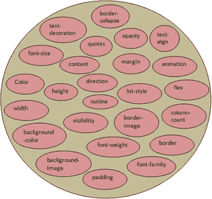

**图 20.5：** CSS 属性

CSS 可以嵌入在 HTML 元素中（封装在 `<style>` 标签之间），也可以写在单独的文件中。根据 CSS 代码的位置，它可以分为三种类型。如下：

## 内联 CSS (Inline CSS)

通过内联 CSS 可以轻松地对特定的 HTML 元素进行更改。`内联 CSS` 声明在 HTML 中声明元素时使用。

**示例：**

```html
<!DOCTYPE html>
<html>
<body>
<p style="color: red; text-align: center; font-size: 50px ;"> At the time of Go’s initiation, complexity was the major concern in Software Development. Usually the development used to be done with C++ or Java but there were some challenges with them like security, memory utilization, speed, efficiency, debugging etc. Software should have the power to function correctly against some potential risk produced by malicious attacks. </p>
</body>
</html>
```

**输出：**


**图 20.6：** 内联 CSS 的输出

## 内部 CSS (Internal CSS)

`内部 CSS` 定义在 HTML 的 `<head>` 部分的 `<style>` 标签内。它影响所有被定义为选择器的元素。当需要在多个元素上应用相同的 CSS 时，它是非常有用的。在指定选择器时，用逗号分隔 HTML 元素。

**示例：**


```html
<!DOCTYPE html>
<html>
<head>
<style>
p, div
{
color: red;
text-align: center;
font-size: 50px;
}
</style>
</head>
<body>
<p>At the time of Go's initiation, complexity was the major concern in Software Development.</p>
<div>
Usually the development used to be done with C++ or Java but there were some challenges with them like security, memory utilization, speed, efficiency, debugging etc.
</div>
<span>
Software should have the power to function correctly against some potential risk produced by malicious attacks.
</span>
</body>
</html>
```

**输出：**

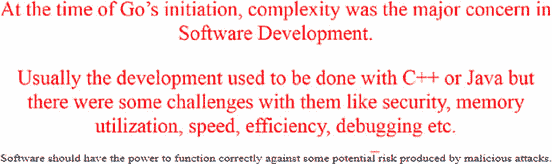

**图 20.7：** 内部 CSS 的输出

## 外部 CSS (External CSS)

CSS 代码定义在扩展名为 `.css` 的单独文件中，外部 CSS 文件的路径使用 HTML 中的 `<link>` 标签进行定义。

**示例：**

HTML 文件：

```html
<!DOCTYPE html>
<html>
<head>
<link rel="stylesheet" type="text/css" href="mycss.css">
</head>
<body>
<p>At the time of Go's initiation, complexity was the major concern in Software Development.</p>
<div>
Usually the development used to be done with C++ or Java but there were some challenges with them like security, memory utilization, speed, efficiency, debugging etc.
</div>
<span>
Software should have the power to function correctly against some potential risk produced by malicious attacks.
</span>
</body>
</html>
```

CSS 文件：

```css
p, div
{
color: red;
text-align: center;
font-size: 50px;
}
span
{
color: blue;
text-align: center;
font-size: 50px;
}
```

**输出：**

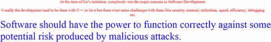

**图 20.8：** 外部 CSS 的输出

GopherJS 也提供了 `jquery` 绑定。`jquery` 是一个 JavaScript 库，将 JavaScript 代码封装在各种方法中以便使用。要使用 GopherJS 的 `jquery` 包，首先下载 `jquery`，它仅仅是一个 JS 文件。我们在 HTML 的 `<head>` 部分的 `<script>` 标签中使用 `jquery` 文件的引用。让我们了解如何使用 Go 使用 `jquery` 包。创建一个如下的 HTML 文件：

```html
<!doctype html>
<html lang="en">
<head>
<script src="path_of_downloaded_jquery_file"></script>
</head>
<body bgcolor="orange">
<button id="btn">Show / Hide</button>
<div id="msg"> Hello Go</div>
<script src="myjquery.js"></script>
</body>
</html>
```

现在创建一个 Go 文件，例如 `gopherjs_jquery.go`，并包含以下代码：

```go
package main

import "github.com/gopherjs/jquery"

var jQuery = jquery.NewJQuery

const (
	btn = "button#btn"
	msg_ele = "div#msg"
)

func main() {
	jQuery(btn).On(jquery.CLICK, func(e jquery.Event) {
		jQuery(msg_ele).Toggle()
	})
}
```

现在按照如下所示编译上述代码：

```bash
gopherjs build gopherjs_jquery.go -o myjquery.js
```

**输出：**

上面的示例在点击按钮时会在显示和隐藏之间切换。

## 数据库

我们以更好的方式学习了前端技术。在 Web 开发中，数据起着重要作用。每当需要时应该有一个安全的地方来存储和获取数据。对于相关数据，数据库起着关键作用。`database` 无非是电子且组织的数据集合，可以通过多种方式进行访问、更新和操作。数据库非常复杂，但它们让数据变得易访问。

管理数据库的软件/系统被称为数据库管理系统（DBMS）。它定义了数据库中的数据格式、字段名、记录和文件结构。通过使用在数据库上运行的各种查询，它使管理、插入、修改、检索和删除变得简单。我们的技术世界中有许多 DBMS。

Oracle Database、`MySQL`、`SQLite`、`Microsoft Access` 和 `PostgreSQL` 是我们技术世界中一些 DBMS 的示例。

在这里，我们将继续学习 `MySQL`。

### MySQL

`MySQL` 是一个免费的开源关系型数据库管理系统，使用结构化查询语言 (`SQL`)。`MySQL` 以表格的形式存储数据，并建立表与数据之间的关系。由于其灵活性，它是一个广泛使用的数据库。数据安全、工作流控制、高性能、事务支持和按需扩展性是 `MySQL` 的关键特性。我们可以从其官方网站下载 `MySQL`：[`dev.mysql.com/`](https://dev.mysql.com/)。

### SQL

`SQL` 代表结构化查询语言。它是一种用于关系型数据库管理系统中数据库通信的领域语言。`SQL` 可以与 `MySQL`、`MS Access`、`Oracle`、`Sybase` 等许多数据库配合使用。我们可以在 `SQL` 中执行各种查询来执行不同操作，如数据库/记录创建、数据插入/更新、数据检索、为表、视图或存储过程设置权限等。`SQL` 查询由许多语句组成，分为以下几类：

### 数据定义语言 (DDL)

DDL 语言用于通过创建/更新表、视图、函数等数据库对象来定义数据库结构。`DDL` 是 `SQL` 的子集。它也被称为数据描述语言。一些 DDL 语句如下：

- `CREATE`
- `ALTER`
- `DROP`
- `TRUNCATE`
- `COMMENT`
- `GRANT`
- `REVOKE`
- `RENAME`
- `PURGE`

### 数据操作语言 (DML)

`DML` 是一种用于数据库数据插入、修改和删除的数据特定语言。它用于操作存储在数据库中的数据。一些 DML 语句如下：

- `SELECT`
- `INSERT`
- `UPDATE`
- `DELETE`
- `CALL`
- `MERGE`

### 事务控制语言 (TCL)

`TCL` 处理事务。一些 TCL 命令有：

- `COMMIT`
- `ROLLBACK`
- `SAVEPOINT`

在这里，`http` 包中的 `HandleFunc` 函数使用 `Signup` 处理器处理发往 Web 根目录（`/`）的请求。处理函数接收两个参数：`http.ResponseWriter` 用于从服务器收集响应数据并将其发送到 HTTP 客户端，`http.Request` 代表 HTTP 客户端请求，它是所请求 URL 的组成部分。在处理函数中，`ParseFiles` 函数用于解析一个 HTML 文件并执行它。创建一个我们正在这里解析的 HTML 文件来处理根目录请求。

### `signup.html`

```html
<!DOCTYPE html>
<html style="background-image: url('signup.jpg');background-size: cover;">
<head>
<style type="text/css">
.data_form{
margin-top: 15%;
margin-left: 29%;
}
.label{
font-size: 25px;
font-weight: 25px;
display: inline-block;
min-width: 22%;
}
.in_field{
width: 27%;
display: inline-block;
}
.goforlogin{
margin-left: 39%;
}
div{
margin-bottom: 1.5%;
}
</style>
</head>
<body>
<form action="/AddUser" method="post" class="data_form">
<div><span class="label">First Name:</span><span><input class="in_field" type="text" name="first_name" required/></span></div>
<div><span class="label">Last Name:</span><span><input class="in_field" type="text" name="last_name"/></span></div>
<div><span class="label">Email Id:</span><span><input class="in_field" type="Email" name="email" required /></span></div>
<div><span class="label">Password:</span><span><input class="in_field" type="password" name="password" required /></span></div>
<div><span class="label">Phone Number:</span><span><input class="in_field" type="tel" name="phone" pattern="[0-9]{10}" required /></span></div>
<input type="submit" style="width: 14%;font-size: 20px;margin: 4% 0% 0% 13%;" value="Confirm"/>
</form>
<a class="goforlogin" href="login.html">Already registered</a>
</body>
</html>
```

访问服务器 `http://localhost:8080`。

**输出：**


**图 20.17:** 上述代码的输出

如所示，用户可以通过填写所有必要字段进行注册。通过提交按钮，我们将用户重定向到 `AddUser` 页面。为了处理此请求，我们需要在服务器文件中添加一个处理器及其对应的函数。在下方所示的代码中，我们正在创建处理器 `AddUser` 用来处理此请求。

### `server.go`

```go
package main

import (
	"log"
	"html/template"
	"net/http"
	"database/sql"
	"fmt"
	_ "github.com/go-sql-driver/mysql"
)

func AddUser(w http.ResponseWriter, r *http.Request) {
	if err := r.ParseForm(); err != nil {
		fmt.Fprintf(w, "ParseForm() err: %v", err)
	}
	fName := r.FormValue("first_name")
	lName := r.FormValue("last_name")
	emailId := r.FormValue("email")
	phoneNo := r.FormValue("phone")
	password := r.FormValue("password")
	// 创建数据库连接
	db, err := sql.Open("mysql", "root:@/go_web")
	if err != nil {
		panic(err.Error())
	}
	// 插入数据
	stmtIns, err := db.Query("INSERT INTO user_info VALUES(?,?,?,?,?)", fName, lName, emailId, phoneNo, password)
	if err != nil {
		panic(err.Error()) // 在应用中应使用适当错误处理而非 panic
	}
	defer stmtIns.Close()
	t, err := template.ParseFiles("registrationConfirm.html")
	if err != nil {
		log.Print("template parsing error: ", err)
	}
	err = t.Execute(w, nil)
}

func main() {
	http.HandleFunc("/", Signup)
	http.HandleFunc("/AddUser", AddUser)
	http.ListenAndServe(":8080", nil)
}
```

在上述处理器 `AddUser` 中，我们创建了到 MySQL 服务器的连接并在数据库中插入了用户数据。在插入数据后，我们将用户重定向到 `registrationConfirm` 页面。以下是 `registrationConfirm.html` 的代码。

### `registrationConfirm.html`

```html
<html>
<body style="background-color:yellow;">
您已成功注册。
<a href="/login">点击此处登录</a>
</body>
</html>
```

这里是注册用户时给出的输出。

**图 20.18:** 上述代码的输出

如果用户已经注册，可以通过点击上述内容进行登录。在提供的代码中，我们将用户重定向到 `login` 页面。在服务器文件中添加一个处理器来处理此请求。

```go
package main

import (
	"log"
	"html/template"
	"net/http"
	"database/sql"
	"fmt"
	_ "github.com/go-sql-driver/mysql"
)

func Login(w http.ResponseWriter, r *http.Request) {
	t, err := template.ParseFiles("login.html")
	// 如果发生错误
	if err != nil {
		log.Print("template parsing error: ", err)
	}
	err = t.Execute(w, nil)
	if err != nil {
		log.Print("template executing error: ", err)
	}
}

func main() {
	http.HandleFunc("/", Signup)
	http.HandleFunc("/AddUser", AddUser)
	http.HandleFunc("/login", Login)
	http.ListenAndServe(":8080", nil)
}
```

`login` 处理器解析 `login.html` 的内容并显示在网页上。

**图 20.19:** 上述代码的输出

### `login.html`


```html
<!DOCTYPE html>
<html style="background-image: url('signup.jpg');background-size: cover;">
<head>
<style type="text/css">
.data_form{
margin-top: 15%;
margin-left: 29%;
}
.label{
font-size: 25px;
font-weight: 25px;
display: inline-block;
min-width: 22%;
}
.in_field{
width: 27%;
display: inline-block;
}
.goforlogin{
margin-left: 39%;
}
div{
margin-bottom: 1.5%;
}
</style>
</head>
<body>
<form action="/AddUser" method="post" class="data_form">
<div><span class="label">First Name:</span><span ><input class="in_field" type="text" name ="first_name" required/></span></div>
<div><span class="label">Last Name:</span><span><input class="in_field" type="text" name ="last_name"/></span></div>
<div><span class="label">Email Id:</span><span><input class="in_field" type="Email" name ="email" required /></span></div>
<div><span class="label">Password:</span><span><input class="in_field" type="password" name ="password" required /></span></div>
<div><span class="label">Phone Number:</span><span><input class="in_field" type="tel" name ="phone" pattern="[0-9]{10}" required /></span></div>
<input type="submit" style="width: 14%;font-size: 20px;margin: 4% 0% 0% 13%;" value="Confirm"/>
</form>
<a class="goforlogin" href="login.html">Already registered</a>
<div id="msg"></div>
<script type="text/javascript">
var vars = {};
var parts = window.location.href.replace(/[?&]+)=([^&)/gi, function(m,key,value) {vars[key] = value;});
if (vars["msg"]!==undefined){
document.getElementById("msg").innerHTML = decodeURI(vars["msg"])
}
</script>
</body>
</html>
```

在提交表单后，我们将流程引导到主页（`/home`）。再次，如下所示创建一个处理器来处理此请求：

### `server.go`

```go
package main

import (
	"log"
	"strings"
	"html/template"
	"net/http"
	"database/sql"
	"fmt"
	_ "github.com/go-sql-driver/mysql"
)

func Home(w http.ResponseWriter, r *http.Request) {
	if err := r.ParseForm(); err != nil {
		fmt.Fprintf(w, "ParseForm() err: %v", err)
	}
	user_email := r.FormValue("email")
	user_password := r.FormValue("password")
	// 创建数据库连接
	db, err := sql.Open("mysql", "root:@/go_web")
	fmt.Println(db,err)
	if err != nil {
		panic(err.Error())
	}
	type UserInfo struct {
		First_name, Last_name, Email, Password string
		Contact int64
	}
	var info UserInfo
	// 从数据库获取数据
	quer := "SELECT* FROM user_info WHERE email=?"
	errr := db.QueryRow(quer,user_email).Scan(&info.First_name, &info.Last_name, &info.Email, &info.Contact, &info.Password)
	if errr != nil {
		fmt.Println(errr.Error())
		// 不存在此 Email
		if strings.Contains(errr.Error(), "no rows") {
			http.Redirect(w, r, "http://localhost:8080/login?msg=Invalid Email", 301)
		}
	}
	db.Close() //关闭数据库连接
	// 检查用户密码
	if user_password==info.Password{
		t, err := template.ParseFiles("home.html")
		if err != nil {
			log.Print("template parsing error: ", err)
		}
		err = t.Execute(w, info)
		// 如果发生错误
		if err != nil {
			log.Print("template executing error: ", err)
		}
	} else {
		// 在密码错误的情况下
	}
}
```

```go
http.Redirect(w, r, "http://localhost:8080/login?msg=Invalid Password", 301)
}
}

func main() {
    http.HandleFunc("/", Signup)
    http.HandleFunc("/AddUser", AddUser)
    http.HandleFunc("/login", Login)
    http.HandleFunc("/home", Home)
    http.ListenAndServe(":8080", nil)
}
```

在登录处理函数中，我们可以看到用户尝试登录的 `Email Id`（邮箱 ID）和 `Password`（密码）。检查数据库中是否存在该邮箱 ID。如果邮箱存在（用户已注册），则检查密码是否正确。如果发生任何不匹配，程序将带有错误消息并重定向用户。如果邮箱 ID 和密码都正确，用户将将重定向到首页。


**图 20.20:** 无效邮箱的输出


**图 20.21:** 无效密码的输出

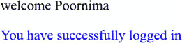

**图 20.22:** 上述代码的输出

以下是所示的完整的服务器代码：

`server.go`

```go
package main

import (
    "log"
    "strings"
    "html/template"
    "net/http"
    "database/sql"
    "fmt"
    _ "github.com/go-sql-driver/mysql"
)

func Signup(w http.ResponseWriter, r *http.Request){
    t, err := template.ParseFiles("signup.html")
    if err != nil {
        log.Print("template parsing error: ", err)
    }
    err = t.Execute(w, nil)
    if err != nil {
        log.Print("template executing error: ", err)
    }
}

func AddUser(w http.ResponseWriter, r *http.Request) {
    if err := r.ParseForm(); err != nil {
        fmt.Fprintf(w, "ParseForm() err: %v", err)
    }
    fName := r.FormValue("first_name")
    lName := r.FormValue("last_name")
    emailId := r.FormValue("email")
    phoneNo := r.FormValue("phone")
    password := r.FormValue("password")
    // Create Database connection
    db, err := sql.Open("mysql", "root:@/go_web")
    if err != nil {
        panic(err.Error())
    }
    // insert data
    stmtIns, err := db.Query("INSERT INTO user_info VALUES(?,?,?,?,?)", fName, lName, emailId, phoneNo, password)
    if err != nil {
        panic(err.Error()) // proper error handling instead of panic in your app
    }
    defer stmtIns.Close()
    t, err := template.ParseFiles("registrationConfirm.html")
    if err != nil {
        log.Print("template parsing error: ", err)
    }
    err = t.Execute(w, nil)
}

func Login(w http.ResponseWriter, r *http.Request){
    t, err := template.ParseFiles("login.html")
    if err != nil {// if there is an error
        log.Print("template parsing error: ", err)
    }
    err = t.Execute(w, nil)
    if err != nil {
        log.Print("template executing error: ", err)
    }
}

func Home(w http.ResponseWriter, r *http.Request){
    if err := r.ParseForm(); err != nil {
        fmt.Fprintf(w, "ParseForm() err: %v", err)
    }
    user_email := r.FormValue("email")
    user_password := r.FormValue("password")
    // Create Database connection
    db, err := sql.Open("mysql", "root:@/go_web")
    fmt.Println(db,err)
    if err != nil {
        panic(err.Error())
    }

    type UserInfruct {
        First_name, Last_name, Email, Password string
        Contact int64
    }
    var info UserInfo
    // Getting data from Database
    quer := "SELECT* FROM user_info WHERE email=?"
    errr := db.QueryRow(quer,user_email).Scan(&info.First_name, &info.Last_name, &info.Email, &info.Contact, &info.Password)
    if errr != nil {
        fmt.Println(errr.Error())
        // No such Email exists
        if strings.Contains(errr.Error(), "no rows") {
            fmt.Println("no rows here")
            http.Redirect(w, r, "http://127.0.0.1:8080/ login?msg=Invalid Email", 301)
        }
    }
    db.Close() //Close database connection
    // Check user password
    if user_password==info.Password{
        fmt.Println("come",info.First_name)
        t, err := template.ParseFiles("home.html")
        if err != nil {
            log.Print("template parsing error: ", err)
        }
        err = t.Execute(w, info)
        if err != nil {// if there is an error
            log.Print("template executing error: ", err)
        }
    } else {
        //in case of incorrect password
        http.Redirect(w, r, "http://127.0.0.1:8080/login?msg=Invalid Password", 301)
    }
}
}

func main() {
    http.HandleFunc("/", Signup)
    http.HandleFunc("/AddUser", AddUser)
    http.HandleFunc("/login", Login)
    http.HandleFunc("/home", Home)
    http.ListenAndServe(":8080", nil)
}
```

通过这种方式，我们使用 Go 语言创建了一个简单的 Web 应用程序。实现一次有助于更好地理解。

## 结论

在本章中，我们理解了...（注：提供的文本在结论标题处戛然而止）。

# 发送操作 203

# 无缓冲通道 204

# 循环导入 90-92

# 闭包函数 77, 78

# 云端 IDE 11, 12

# 代码复用性 4

# 编译器 12

# 组合 158-160

# 并发

## 关于 192

## 与并行的区别 192

# 常数

## 关于 41

## 布尔常量 43

## iota 标识符 43

## 数值常量 42

## 字符串常量 42

# 容器标签

- `<a>` 标签 263
- `<b>` 263
- `<body>` 262
- `<div>` 262
- `<head>` 261
- `<html>` 261
- `<i>` 263
- `<ol>` 264
- `<p>` 264
- `<span>` 262
- `<sub>` 264
- `<sup>` 264
- `<table>` 263
- `<textarea>` 263
- `<title>` 262
- `<u>` 263
- `<ul>` 264

# continue 语句 63

## 控制结构

## 定义 60

# 自定义包

## 创建 87-89

# D

## 数据库 277
## 数据库管理系统 277
## 数据定义语言 (DDL) 277
## 数据操纵语言 (DML) 278

# 数据竞态

## 检查 223, 224
## 在 Go 语言中 222, 223

### 数据类型

## 关于 33
## 非基本数据类型 37
## 原始数据类型 34

## 死锁

## 关于 206-208
## 多个 Goroutine，使用 208, 209

# defer 关键字 79

## defer 语句

## 关于 237-239
## 工作原理 237

# 解引用运算符 140

# 点导入 86

# E

## else 语句 60

### 空元素

## 关于 265

- `<base>` 265


- `<br>` 265
- `<col>` 265
- `<hr>` 265
- `` 265
- `<input>` 265
- `<meta>` 265

# 空接口 173

# 错误处理 6

# 错误包 236, 237

# 错误类型 234, 235

# exit 语句 64

# CSS 271, 272

# JavaScript 267

# F

## 斐波那契数列 87

## for 循环 62

## 形式参数 69

## format (fmt) 84

## format 包 84

## 格式化符 44, 46

## 类型 44, 45

## 函数参数 69, 70

## 函数调用语句 244

## 函数 24, 68

### 调用 71

### 声明 69

## 函数类型 75

# G

## 泛型编程 6

## Go 语言

### 关于 2

### 应用 6

### 特性 3

### 数据竞态 222, 223

### 演进 2

### 安装 13

### 在 Windows 上 13-20

### 限制 6

### 系统要求 10

### 卸载 21

## Go 语言特性

### 自动垃圾回收 3

### 并发 3

### 跨平台 4

### 文档 4

### 易于测试 4

### 标准库 4

### 静态 3

# Go 语言库

## 关于 92

## cli 93

## 颜色 94

## 模糊 93

## glog 94

## gocheck 94

## Go kit 93

## GORM 93

## Kubernetes 93

## testify 93

## vegeta 93

## GopherJS 编译器 273-276

## Go 程序 24, 25

## Goroutines

### 关于 192-195

### 方法 198

### 多核 198

### 多个 Goroutine 196

### WaitGroup 198

# H

## HTML 元素 261

## HTML 文本 261

## HTML 标记语言 261

# I

## 标识符 30

## 基础规则 85

## if 语句 60

## 不变字符串 128

## 导入 85

## 解引用运算符 140

## 外部 CSS 269

## 接口 168

## 多态 179

## 嵌入 168, 169

## 实现 171

## 内部 CSS 270

## iota 43

# J

## JavaScript 266

## 外部 JavaScript 267

## 内部 JavaScript 266

# K

## 关键字 25-27

# L

## lambda 函数 76

## 跳出语句 62

## break 语句 62

## exit 语句 64

# M

## 循环语句 62

## for 循环 62

## main 函数 68

## main 包 84

## map 40, 182

## map 操作 184

### 比较 187, 188

### 删除函数 187

### 迭代函数 186

### keys 函数 185

### map 长度函数 184

## 杂项运算符 55

## 类型 55

## 多维数组 99, 100

## 多个 Goroutine 196

## 多路接口

### 实现 174

## Mutex 224-227

## 互斥锁 224

# MySQL

## 关于 277, 279-281

## URL 277

# N

## 命名返回值值 73

## 命名结构体 147

## 嵌套包 89, 90

## 嵌套指针 141, 142

## 嵌套结构体 153

## 新函数

### 关于 141

### 用于创建指针 141

### 用于创建结构体 151

## 非原始数据类型

### 关于 37

### 数组 37

### 通道 41

### map 40

### 指针 37

### 切片 39

### 结构体 38

## 数值常量 42

## 数值数据类型

### 关于 34

### 浮点数 36

### 整数 35

# O

## 面向对象语言 4

## 运算符优先级 56, 57

## 运算符 50

## 运算符，类型

### 关于 50

### 算术运算符 50

### 赋值运算符 53

### 位运算符 52

### 逻辑运算符 52

### 杂运算符 55

### 关系运算符 51

# P

## 包

### 关于 84

### 导入 85, 86

## `panic` 函数 240-242

## 并行

### 关于 192

### 对比并发 192

## 指针

### 关于 37, 138

### 优势 138

### 使用新函数创建 141

### 声明 139

### 解引用 140

### 嵌入 163

### 初始化 139

### 操作 140

### 需要 138

## 指针函数 142-144

## 原始数据类型

### 关于 34

### 布尔值 34

### 数值 34

### 字符串 36

## 编程语言

### 类比 4

### 并发 5

### 异常处理 5

### 垃圾回收 5

### 继承 5

### 面向对象语言 5

### 重载 5

### 类型安全 5

# R

## 竞态条件 223

## `recover` 函数 243, 244

## 递归函数 78, 79

## 反映

### 关于 248

### 规则 254-257

## reflect 包

### 关于 248

### 字段 252

### `float()` 253

### `int()` 253

### 种类 250, 251

### `NumField()` 251

### `string()` 253

### 类型 248, 249

### 值 249

## 关系运算符

### 关于 51

### 类型 51

## 返回 69, 70

## rune 数据类型

### 关于 125

### 不可变字符串 128, 129

### 使用 range 关键字迭代 126

### 多行字符串 127

### 字节切片转换为字符串 128

### rune 切片转换为字符串 127

## RWMutex 228, 230

## RWMutex，方法

### `Lock()` 228

### `RLock()` 228

### `RUnlock()` 228

### `Unlock()` 229

# S

## `select` 关键字 214-221

## 切片函数

### 关于 112

### `append` 函数 118, 119

### 比较函数 116

### copy 函数 112, 115

### 反转函数 118

### 搜索函数 117 115

## 结构体切片

### 嵌入 163

## 切片

### 关于 39, 96, 105

### 声明 105

### 扩展 111

### 从数组扩展 105

### 从结构体扩展 105

### 初始化 105

### `make` 函数 110

### 切片操作 106, 107

### 二维切片 111, 112

## 切片结构

### 关于 38

### 容量 109

### 长度 109

## SQL 查询

### DDL 277

### DML 278

### TCL 278

## 字符串

### 前缀 122

### 常量 36

### 数据类型 34

### 函数 123, 124

### 迭代 125, 126

### 长度 23

## 包 130

### 关于 130

### 计数 132

### 索引 132, 133

### Join 133

### 替换 134

### 分割 135

### 后缀 131

### ToLower 130

### ToUpper 130

### trim 135

## 结构体

### 关于 107, 146

### 匿名字段 152

### 比较 155

### 使用新函数创建 141

### 声明 146, 147

### 字段访问 149

### 初始化 148

### 指针 150

### 结构体函数 154

## 结构化查询语言 (SQL) 277

## 结构体 38

## switch 语句 61

# T

## 文本编辑器 10, 11

## 第三方包

### 安装 90

## 线程 192

## 二维切片 111, 112

# U

## 无缓冲通道 204

# V

## 变量 32

## 变变函数 80

# W

## Web 应用

### 构建 282, 283, 285-290, 292, 296

### 包 282

## Web 开发 260
