# Google Cloud Vertex AI 学习指南：Vertex AI 机器学习模型构建、部署与管理实战

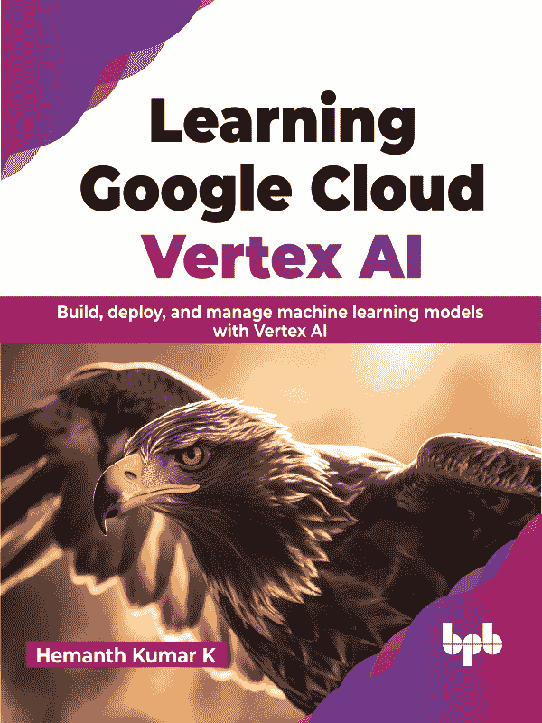

## 作者简介

**Hemanth Kumar K** 在企业行业拥有十余年经验，职业生涯始于电信领域，曾在全球范围内参与多个项目和客户工作，负责规划和优化移动网络。因对数据与机器学习着迷，转变了关注点和职业路径，投身数据科学与分析领域。他参与过许多数据分析项目，解决保险、电信、媒体、医疗、工程分析等各个领域的业务问题。除了 `GCP`，他还在 `Azure` 平台上积累了经验。

## 审阅者简介

*   ❖ **Dr. Muthu Kumaraswamy B** 是 `Searce` 的副总监，领导着一个由 100 多名机器学习工程师组成的团队，并交付定制化的机器学习解决方案。他在 IT 行业拥有 15 年以上经验，涉足软件开发、云计算和人工智能等领域的多种项目。他拥有马德拉斯大学博士学位。

    Dr. Muthu Kumaraswamy 精通多种编程语言，包括 `JavaScript`、`Python` 和 `C++`。他还精通多种云计算平台，包括 `Google Cloud Platform` 和 `Amazon Web Services`。他大力主张利用人工智能解决现实问题，并为客户开发了多款 AI 驱动的解决方案。

    Dr. Muthu Kumaraswamy 是行业会议和活动的常邀演讲者。他也是技术博客和出版物的定期撰稿人。他热衷于与他人分享知识和专长，并时刻寻找帮助人们学习和成长的新途径。

    以下是他的部分显著成就：

    *   开发了一款基于云的 AI 解决方案，帮助一家大型制造公司将生产效率提高了 15%。
    *   领导工程师团队开发了一个新的机器学习平台，该平台被一家金融服务公司用于实现风险管理流程的自动化。
    *   在技术期刊和杂志上发表多篇文章，主题涵盖软件开发、云计算和人工智能。
    *   在多个行业会议上就利用 AI 解决现实问题进行演讲。
    *   Dr. Muthu Kumaraswamy 是一位技术精湛、经验丰富的机器学习工程师，拥有为客户交付高质量解决方案的卓越记录。他将成为任何团队的宝贵资产，也是贵公司的绝佳人选。

*   ❖ **Abdul Hannan Siddiqui** 是一位充满激情且富有创新精神的机器学习工程师，在 `MLOps`、时间序列、预测建模、计算机视觉和自然语言处理方面拥有 5 年以上经验。他是 `Google Certified Machine Learning Engineer`（Google 认证机器学习工程师），拥有多项 `Google Cloud Platform` 认证，专长是使用 `Python` 进行数据工程、`ETL`，有效处理大规模云迁移流程，以及在 `Google BigQuery` 上进行数据分析。

    Abdul Hannan Siddiqui 目前在 `Argility` 担任高级机器学习工程师。此前，他曾在 `Quantiphi` 担任机器学习工程师，在 `Accenture` 担任数据工程师。他的专长在于 `MLOps`、时间序列、预测建模、计算机视觉和自然语言处理，并熟练使用 `Python` 进行数据工程和 `ETL` 流程。凭借丰富的经验和 `Google Cloud Platform` 认证，Abdul Hannan Siddiqui 致力于发挥其技能，推动机器学习和数据科学项目的成功，为客户或组织确保最佳成果。

## 致谢

我要衷心感谢我的家人和朋友，在撰写本书期间给予我持续的支持和启发。

我还要感谢 `BPB Publications` 在帮助我完成本书过程中提供的建议和专业知识。本书经历了漫长的修订过程，极大地受益于编辑、技术专家和审阅者的参与与合作。

在企业行业的这些年里，我也想感谢我的同事和伙伴们做出的重要贡献，他们教会了我许多知识，并对我的工作提出了宝贵的批评意见。

最后，我要向所有对我的作品表现出兴趣和支持的读者表达谢意。你们的支持之言一直是我前行的动力。

## 前言

在当今世界，数据爱好者需要具备一项或多项云平台的专业知识。在云端通过数据解决业务问题，不仅需要全面理解算法，还需要全面了解云平台及其组件。

本书旨在通过实际案例帮助您理解 `Google Cloud Platform (GCP)` 的 `Vertex AI` 组件。在深入探讨 `Vertex AI` 之前，本书将让您对 Google Cloud Platform 及其组件有一定了解，以及 `Vertex AI` 的定位。本书所有示例的模型训练数据均上传至 `google cloud storage (GCS)` 或 `big query`，因此我们将从 `GCS`、`big query` 以及 `Identity access and management (IAM)`（身份与访问管理）开始介绍。`Vertex AI` 拥有众多组件，涵盖数据集、`Workbench`、`Pipelines`、训练、实验、模型、端点和特征等。本书的主要目标是通过实际用例学习这些 `Vertex AI` 概念功能。

## 代码包和彩色图片

请访问以下链接下载本书的 **代码包** 和 **彩色图片**：

[`rebrand.ly/of74aa7`](https://rebrand.ly/of74aa7)

本书的代码包也托管在 GitHub 上：**[`github.com/bpbpublications/Learning-Google-Cloud-Vertex-AI`](https://github.com/bpbpublications/Learning-Google-Cloud-Vertex-AI)**。如果代码有更新，将在现有的 GitHub 仓库中更新。

我们在 **[`github.com/bpbpublications`](https://github.com/bpbpublications)** 上拥有丰富图书和视频目录的代码包。欢迎查看！

## 勘误表

我们在 BPB Publications 为我们的工作感到无比自豪，并遵循最佳实践以确保内容的准确性，为订阅者提供沉浸式的阅读体验。我们的读者是我们的镜子，我们利用他们的反馈来反思和改进出版过程中可能发生的人为错误。为了让我们保持质量并帮助我们联系到可能因不可预见的错误而遇到困难的读者，请写信给我们：

**errata@bpbonline.com**

BPB Publications 全家高度赞赏您的支持、建议和反馈。

## 加入我们的 Discord 社区

加入本书的 Discord 工作区，获取最新动态、优惠、全球科技资讯、新版本发布和作者见面会：

**[`discord.bpbonline.com`](https://discord.bpbonline.com)**


# 第 1 章 Google Cloud Platform 基础

## 简介

本章将介绍 Google Cloud Platform、其优势及其在当今数字化革命中的作用。内容涵盖云计算基础知识，包括云服务模型、GCP 账号创建、覆盖范围、服务范围和 GCP 层级结构。本章还将介绍几项关键的 GCP 服务，包括存储、计算、Google BigQuery 和身份与访问管理。

## 结构

本章将涵盖以下主题：

*   云平台简介和基础知识
*   云的优势
*   云对数据科学家的重要性
*   云的类型
*   Google Cloud Platform 简介
*   Google Cloud 的覆盖范围
*   云服务模型
*   GCP 服务
*   GCP 层级结构
*   与 GCP 服务交互
*   GCP 中的存储
*   GCP 中的计算
*   BigQuery
*   身份与访问管理

## 目标

在深入了解 Google Cloud Platform 的 Vertex AI 之前，掌握云平台的几个重要原则和关键服务至关重要。读完本章后，用户将对 GCP 组件和服务有扎实的理解。书中包含使用 GCP 存储、计算和 BigQuery 服务的详细说明。

## 云简介

**云** 一词描述的是运行在可通过互联网访问的服务器上的应用程序和数据库。全球各地的数据中心托管着云服务器。组织可以通过使用云计算，避免管理物理服务器或在自己的计算机上运行软件。因为计算和存储发生在数据中心的服务器上，而不是用户设备本地，所以云使用户能够从几乎任何设备访问相同的文件和应用程序。

对于企业而言，转向云计算可以消除一些 IT 成本和开销：例如，它们不再需要更新和维护自己的服务器，因为所使用的云供应商会负责这些工作。

## 云的优势

云的各种优势如图 1.1 所示，具体如下：

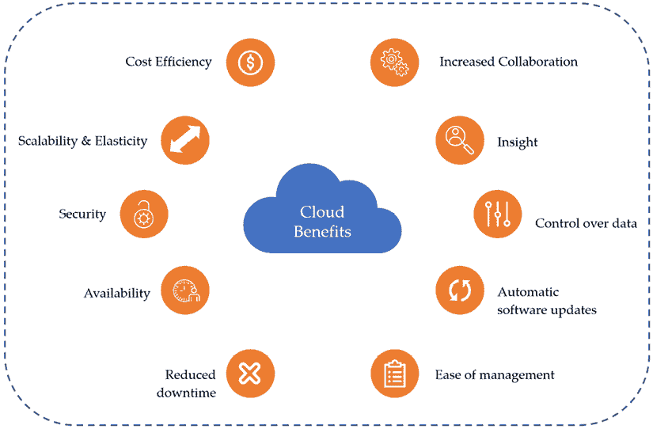

图 1.1：云平台的优势

*   **成本效益**：在 IT 基础设施管理方面，云计算无疑是最具成本效益的选择。得益于各种即用即付和其他可扩展选项，各种规模的组织从本地硬件迁移到云都非常经济实惠。使用云资源代替购买昂贵的服务器设备和 PC，后者需要大量时间进行设置和维护（如漫长的设置和维护工时）。云还有助于减少在计算、存储、网络、运营和升级方面的支出。

*   **可扩展性和弹性**：总体而言，云托管比本地机器托管更灵活。如果您需要更多带宽，无需对 IT 基础设施进行昂贵（且耗时）的升级。这种更高的自由度和适应性可能对生产力产生重大影响。

    弹性仅在短时间内用于应对工作负载的快速变化。这是一种用于满足需求高峰的短期策略，无论这些高峰是意外的还是季节性的。静态工作负载的增加通过可扩展性来满足。为了应对预期的需求增长，会采用长期的可扩展性策略。

### 云计算的优势

*   **安全性**：云平台提供多种尖端安全措施，确保数据的安全存储和管理。使用联合角色的细粒度权限和访问控制是有助于将敏感数据的访问权限仅限于真正需要的工作人员的两个功能示例。这有助于减少敌对行为者可利用的攻击面。身份验证、访问控制和加密是云存储提供商为保护其平台及其上处理的数据而实施的一些基本防护措施。在此基础上，用户可以实施自己的额外安全措施，以进一步加强云数据保护并限制对云中存储的敏感信息的访问。

*   **可用性**：绝大多数云服务提供商在服务提供方面非常可靠；事实上，绝大多数都保持 99.9% 的正常运行时间。迁移到云旨在实现高可用性。目标是让公司的产品、服务和工具随时随地通过任何可连接互联网的设备为客户和员工所用。

*   **减少停机时间**：基于云的解决方案提供直接从云端操作关键系统和数据或将其恢复到任意位置的能力。在涉及信息技术的灾难性事件期间，它们使您更容易让这些系统重新上线，减少了传统恢复技术所需的手动工作量。

*   **增强协作**：开发人员、QA、运维、安全和产品架构师在云环境中都暴露于相同的基础设施，并可同时工作而不会互相干扰。为最大限度减少争议和误解，云角色和权限提供了对谁在何时做了什么的更多可见性和监控。出于专门目的，可创建不同的云环境，如暂存、QA、演示和预生产。云使透明协作更简单并推广了它。

*   **洞察**：云平台提供的集成云分析还提供了数据的鸟瞰视角。当数据保存在云中时，实施监控系统并创建个性化报告以在整个组织范围内进行信息分析要容易得多。您将能够根据这些洞察提高效率并制定行动计划，从而使组织实现其目标。

*   **数据控制**：云为您提供对数据的完全可见性和控制权。您可以完全控制授予哪些用户访问哪些级别的指定数据。这不仅赋予您控制权，还通过确保员工了解分配给他们的任务来帮助简化工作。此外，它将使协作变得更加简单。因为多个用户可以同时编辑同一份文档副本，所以无需分发多份文档副本。

*   **自动软件更新**：没有什么比被迫等待系统升级安装更繁琐的了，尤其是对于已经有很多事情要做的人来说。托管在云中的应用程序会即时刷新和更新自己，无需 IT 人员为整个组织执行手动更新。这节省了本应花费在外部咨询上的关键时间和金钱。

*   **易于管理**：通过 SLA 支持的协议、集中式资源管理和托管基础设施，云的使用可以简化并改进 IT 维护和管理能力。用户可以利用简单的用户界面，而无需担心安装任何东西。此外，还为用户提供 IT 服务的管理、维护和交付。

### 云对数据科学家的重要性

自上个十年初以来，数据的扩展遵循指数级模式，预计这一趋势将持续。数据的安全存储应成为每家公司的首要任务之一。鉴于上述所有优势，云通常是存储和处理海量数据的首选。因此，当今的数据科学家除了统计学、机器学习算法等领域的专业知识外，还需要具备云计算经验。

然而，由于其 CPU 处理能力低，他们无法及时履行这些职责，假设他们甚至根本无法做到。此外，机器的内存通常因大小原因无法存储海量数据集。这决定了任务执行的速度和整体完成质量。得益于云，数据科学家现在能够在不受本地工作站能力限制的情况下探索更广泛的数据集。利用云可能会降低基础设施成本，因为它消除了对物理服务器的需求。此外，依赖云进行数据存储可以降低基础设施成本。除了提供数据存储服务外，包括 `Google Cloud Platform` 在内的许多云平台还提供面向数据摄取、数据处理、分析、AI 和数据可视化的其他服务。

## 云的类型

根据不同能力，云分为三种类型：

*   公有云
*   私有云
*   混合云

### 公有云

公有云是海量的现成计算资源集合，包括网络、内存、处理单元和存储。用户可以租用这些资源（它们驻留在公有云供应商全球分布的全托管数据中心中）来创建您的 IT 架构。使用 Web 浏览器，用户可以访问这种形式云中的资源。`Google Cloud Platform` 是公有云的一个例子。

公有云的一个主要优势是底层硬件和逻辑由各供应商托管、拥有和维护。客户无需购买或维护构成其公有云 IT 解决方案的物理组件。此外，服务级别协议（`SLA`）将每个提供商绑定到符合法规的月度正常运行时间百分比和安全保证。

### 私有云

与公有云不同，私有云仅由单个组织拥有和运营。它们通常驻留在公司的数据中心，并在组织自己的设备上运行。然而，组织可以使用第三方供应商在其设备上托管私有云。即使资源驻留在远程托管的数据中心，这种情况下私有云也与公有云具有某些特征。它们可能提供某些管理服务，但无法提供全范围的公有云服务。

如果私有云驻留在您自己的数据中心，组织将对整个系统拥有完全控制权。自托管私有云有助于遵守某些更严格的安全和合规法规。

### 混合云

正如这种云计算形式的名称所示，这种云计算是公有云和私有云的混合与集成。通过这种方式，它能够为您提供与多种云类型相关的优势，就云计算而言。它在数据传输方面提供了更大程度的灵活性，并扩展了企业可用的采用选择。这在确保高度控制和轻松过渡的同时，以更具经济性的费率提供一切。

## Google Cloud Platform 简介

Google Cloud Platform 是行业内的超大规模基础设施提供商之一。它是 Google 提供的一系列云计算服务的集合。这些服务运行在 Google 为其最终用户产品（包括 YouTube、Gmail 和许多其他产品）所采用的同一基础设施之上。Google Cloud Platform 提供广泛的服务，例如计算、存储和网络等。

Google Cloud Platform 于 2008 年首次推出，截至目前，它是使用最广泛的第三大云平台。此外，对托管在云端的平台的需求也在不断增长。

Google Cloud 不仅为部署提供标准平台和数据分析（无论其物理位置在哪里），还为我们提供了所有环境的以服务为中心的视角。利用 Google Cloud 提供的高级分析和机器学习功能，我们可以从数据中提取最有用的见解。在 Google 无服务器数据分析和机器学习平台的支持下，用户将能够自动化流程、生成预测，并简化管理和运营。Google Cloud 提供的服务会对静态数据、传输中数据和使用中数据进行加密。先进的安全机制保护数据隐私。

## Google Cloud Platform 账号创建

用户可以通过链接 <https://cloud.google.com/free> 创建免费 GCP 账号。

免费账号提供 90 天内有效的 300 美元赠金。

创建免费账号的步骤如下：

1.  打开 <https://cloud.google.com/free>。
2.  点击 **Get started for free**（免费开始使用）。

    打开的屏幕如图 1.2 所示：

    

    图 1.2：GCP 账号创建

3.  使用您的 Gmail 凭据登录，如果没有则创建一个。这可以在图 1.3 中看到：

    

    图 1.3：GCP 账号创建 输入有效邮箱地址

4.  选择国家/地区和需求：

    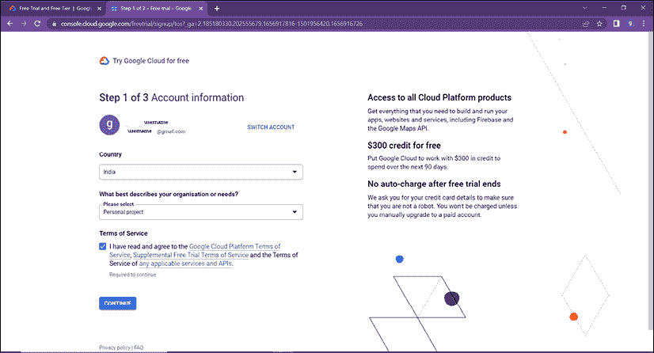

    图 1.4：GCP 账号创建 国家/地区选择

5.  选择国家/地区和项目。勾选服务条款并点击 **CONTINUE**（继续）。
6.  提供电话号码进行身份验证，如图 1.5 所示：

    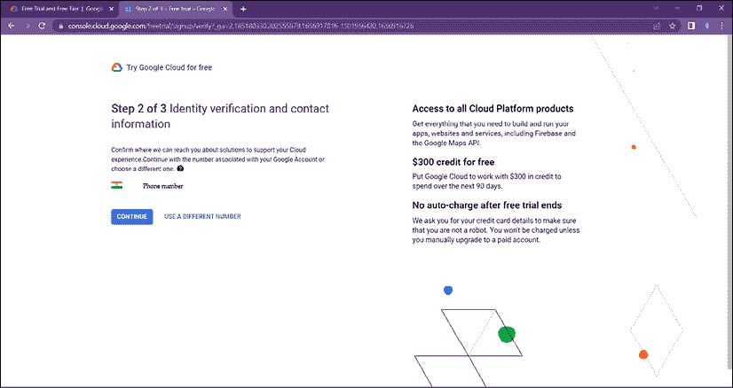

    图 1.5：GCP 账号创建 输入电话号码

7.  免费账号需要信用卡。验证费用为 2 卢比。必须提供地址。在此页面点击 **START MY FREE TRIAL**（开始我的免费试用）：

    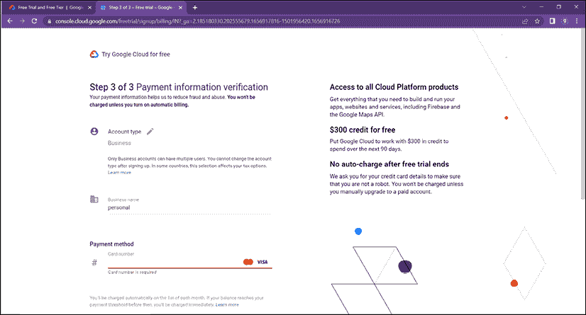

    图 1.6：GCP 账号创建 输入有效信用卡详情

8.  免费试用开始后，用户将进入此页面。欢迎页面见图 1.7：

    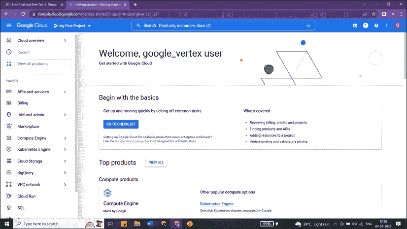

    图 1.7：GCP 登录页

## Google Cloud Platform 的覆盖范围

独立的地理区域称为**区域**，而**可用区**构成了区域。可用区和区域是对分布在世界各地一个或多个数据中心中物理资源的逻辑抽象。在一个区域内，Google Cloud 资源被部署到称为可用区的特定位置。重要的是要将可用区视为区域内的单一故障域。图 1.8 展示了 GCP 的覆盖范围：


图 1.8：GCP 覆盖范围


本书撰写时，共有约 34 个区域、103 个可用区和 147 个网络边缘节点，分布在 200 多个国家和地区。GCP 正在不断扩大其全球覆盖范围，请查看下面提到的链接以获取最新数据。

图片来源：<https://cloud.google.com/about/locations>

Google Cloud 提供的服务和资源可以在可用区级别或区域级别进行管理，也可以由 Google 跨多个区域集中管理：

* **可用区资源**：可用区中的资源仅在该可用区内工作。当一个可用区宕机时，该可用区中的部分或全部资源可能会受到影响。
* **区域资源**：它们分布在一个区域内的多个可用区中，以确保始终可用。
* **多区域资源**：Google 管理许多 Google Cloud 服务，使其具有冗余性并分布在区域内部和区域之间。这些服务提高了资源效率、性能和可用性。
* **全球资源**：同一项目中的任何资源都可以从任何可用区访问全球资源。创建全球资源时无需指定范围。

网络边缘节点有利于托管深受托管服务用户群喜爱的静态内容。内容会暂时缓存在这些边缘节点上，使用户能够从离他们近得多的位置获取信息。这将使用户获得更积极的体验。

GCP 的区域和可用区有几个优势。在确保高可用性、高冗余性和高可靠性方面，区域和可用区的概念很有帮助。遵守政府制定的法律法规。数据法规在不同国家之间可能差异巨大。

## 云服务模型

云平台提供多种服务，所有这些服务大致可归入三个不同的类别：

* **基础设施即服务 (IaaS)**
* **平台即服务 (PaaS)**
* **软件即服务 (SaaS)**

云服务模型之间的区别如图 1.9 所示：

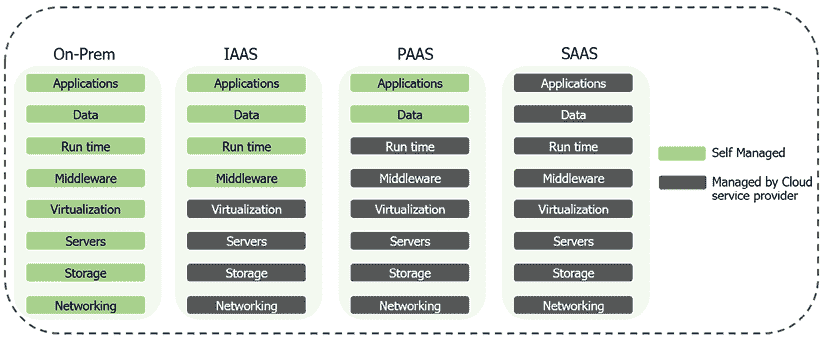

图 1.9：云服务模型

让我们设想一下，我们正在开发一个应用程序，同时将其托管在我们本地的服务器上。在这种情况下，我们有责任拥有并维护相应的基础设施、相应的平台，当然还有我们的应用程序。

* **基础设施即服务**：在 IaaS 模式下，提供必要的基础设施（可能包括虚拟机、网络和存储设备）将成为云的责任。我们仍然负责确保拥有用于开发和部署的适当平台。我们除了使用它之外，无法控制底层基础设施。Google 提供的 `Compute Engine` 和 `Kubernetes Engine` 就是基础设施即服务的一个例子。
* **平台即服务**：在 PaaS 模式下，云服务提供商有责任提供用于开发和部署的适当平台，例如操作系统和编程语言环境所用的工具，这除了提供基础设施的责任之外还存在。`Google App Engine` 就是一个 PaaS 平台的例子。

## 服务模式

### Software as a Service (SaaS)

在 SaaS 模式下，云服务提供商将其运行在自有基础设施上的应用程序出租给客户。除了平台和底层基础设施外，软件应用程序的维护也由云服务提供商负责。我们可以通过 Web 浏览器、应用浏览器等方式，在任意设备上访问这些软件程序。电子邮件（`Gmail`）和云存储（`Google Drive`）是 SaaS 的两个典型例子。

### Data as a Service (DaaS)

与已流行十余年的上述三种服务模式不同，DaaS 是一种刚开始广泛应用的服务。这部分原因是通用云计算服务最初并非为管理海量数据工作负载而构建；它们主要面向应用托管和基础数据存储需求（而非数据集成、分析和处理）。

SaaS 消除了在本地计算机上安装和管理软件的必要性。同样，Data-as-a-Service 方法论的核心是利用应用程序编程接口（`API`）按需从多个来源交付数据。其旨在简化数据访问，并提供可供以多种形式使用的精选数据集或数据流。这些格式通常通过数据虚拟化进行统一。事实上，DaaS 架构可能包含多种数据管理技术，如数据虚拟化、数据服务、自助式分析。

从最基本的形式来看，DaaS 使组织能够访问其可用的、日益增长的数据源数量和复杂度，从而为消费者提供最相关的洞察。数据民主化是每家想要从数据中获取实际价值的公司的绝对必要条件。它通过采用更以数据为中心的运营和程序方法，为将组织数据货币化并获得竞争优势提供了巨大潜力。

## GCP 提供的服务

用户可以使用 Google Cloud Platform 提供的全面服务选择。每一项服务都可归入图 1.10 所示的类别之一：

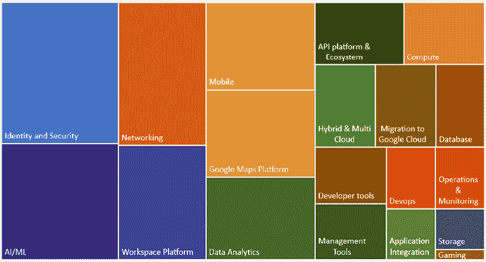

**图 1.10：GCP 的服务**

* **存储**：Google 提供用于存储非结构化项目的 `Cloud Storage`、用于以传统方式共享文件的 `Filestore`，以及用于虚拟机的 `persistent disk`。
* **计算**：`Compute Engine`、`App Engine`、`Cloud Run`、`Kubernetes Engine` 和 `Cloud Functions` 是 GCP 提供的核心计算服务。
* **关系型数据库**：`Cloud SQL` 支持 `MySQL`、`PostgreSQL` 和 `Microsoft SQL Server`；`Cloud Spanner` 是一个能够在全球范围内运行的大规模可扩展数据库。
* **NoSQL 数据库**：`Bigtable`、`Firestore`、`Memorystore` 和 `Firebase Realtime Database` 是 Google 提供的不同 NoSQL 服务。
    * 处理海量分析工作时，`Bigtable` 是最高效的解决方案。
    * `Firestore` 非常适合用于构建客户端 Web 和移动应用。
    * `Firebase Realtime Database` 适合用户间的实时数据同步，如协作式应用开发所需。
    * `Memorystore` 是一种完全在内存中运行的数据存储，通常用于缓存频繁访问的数据以加速应用性能。
* **数据仓库**：`BigQuery` 是 Google 提供的数据仓库服务。
* **网络**：虚拟私有云（`VPC`）是 GCP 上的本地网络。通过 `VPC Network Peering`，虚拟私有云可相互连接。用户可利用基于互联网的 `Cloud VPN` 在 VPC 和本地网络之间建立受保护连接；或者通过 `Cloud Interconnect` 或 `Peering` 建立专用私有连接。为便于将应用和数据集迁移到其平台，GCP 提供了多样化的选项。`Anthos` 作为混合云部署的替代方案。
* **数据分析**：Google 在数据分析领域表现卓越。
    * `Pub/Sub` 用作缓冲，服务于无法应对数据激增的服务。
    * `Dataproc` 是由 Dataproc 托管的 `Hadoop` 和 `Spark` 实现。
    * `Dataflow` 是基于 `Apache Beam` 的托管实现。
    * `Dataprep` 允许不懂代码的用户进行数据处理，其底层利用 `Dataflow`。
    * 用户可使用 `Google Looker Studio` 通过图表、图形等可视化数据。
* **AI 与 ML**：平台为不同客户群提供 AI 和 ML 服务。`Vertex AI` 为新手提供 `AutoML` 选项；为经验丰富的用户提供通过 API 进行预测的训练模型；为高级 AI 从业者提供各种选项。
* **CI/CD 与开发工具**：
    * `Cloud Build` 支持开发持续集成/持续部署（CI/CD）流水线。
    * 托管在 GCP 上的私有 Git 仓库称为 `Cloud Source Repositories`。
    * `Artifact Registry` 扩展了 `Container Registry` 的功能，是 Google Cloud 推荐的容器注册表。它为存储和管理语言包及 Docker 容器镜像提供了单一位置。
* **安全与身份管理**：
    * `IAM`（Identity and Access Management，身份和访问管理）允许为用户和应用分配角色。
    * 存储在 GCP 中的所有内容默认均已加密。`Cloud Key Management` 让公司能够控制其加密密钥。
    * `Secret Manager` 可安全存储 API 密钥、密码、证书及其他敏感信息。
* **运维套件**：`Cloud Operations` 套件包含 Monitoring、Logging、Error Reporting、Trace、Debugger 和 Profiler 功能。
* **安全命令中心**：`Security Command Center` 向您展示活跃的安全威胁和漏洞，以及合规性违规情况。
* **基础设施即代码**：`Cloud Deployment Manager` 可帮助自动化 Google Cloud Platform 资源的创建和管理。

## GCP 的层级结构

**资源** 是指在 Google Cloud Platform 上投入使用的任何事物。Google Cloud 中的所有内容都具有清晰的层级结构，类似于父子关系。GCP 遵循的层级结构如图 1.11 所示：

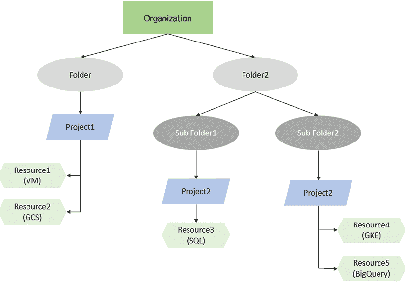

**图 1.11：GCP 的层级结构**

`Organization` 节点是 GCP 层级的起点，可代表一个组织或公司。组织是文件夹和项目及其各自资源的祖先。应用于组织的访问控制策略适用于其所有关联的项目和资源。

但是，如果像上一节那样使用个人邮箱 ID 创建账号，将无法看到组织。相反，如果使用 Google Workspace 账号登录并创建项目，组织将自动提供。此外，没有组织的情况下，仅有少量的资源管理器功能可用。

## 组织下的文件夹

借助文件夹，我们可以使用一种额外的分组机制，并可将其概念化为包含在大型组织内部的子组织层级结构。文件夹中可以包含额外的子文件夹。您可以根据具体的文件夹，选择完全或部分地授予访问项目及其所有资源的权限。

### 项目

项目是存在于最基本层级的实体。可以在组织和文件夹中嵌套多个项目。为了使用 GCP 资源，项目是绝对必要的，它是使用云服务、管理 API 和启用结算功能的基础。一个项目有两个不同的 ID 与之关联。第一个是项目 ID，它是项目的唯一标识。第二个是项目编号，它在创建项目时自动生成，我们无法以任何方式对其进行修改。

### 资源

资源一词指构成 Google Cloud Platform 的组件。资源包括云存储、数据库、虚拟机等。每当我们创建一个云存储桶或部署一台虚拟机时，都会将这些资源关联到相应的项目。

### 创建新项目

Google Cloud 项目是创建、启用和使用所有 Google Cloud 服务的基础，例如管理 API、启用结算、添加和删除协作者以及管理 Google Cloud 资源的权限。

可以通过在 Web 控制台中执行以下步骤来创建项目：

1. 从 **IAM 和管理 | 管理资源** 导航。顺序可见图 1.12：

    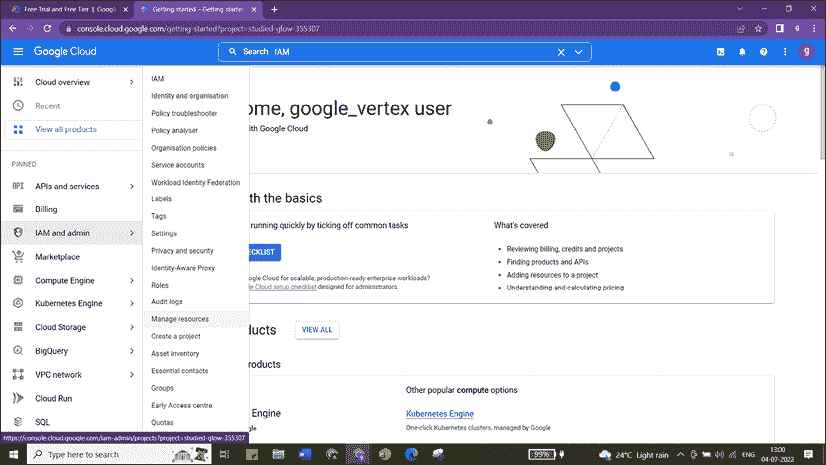

    图 1.12：项目创建

2. 点击创建项目。

    项目创建过程可见下图：

    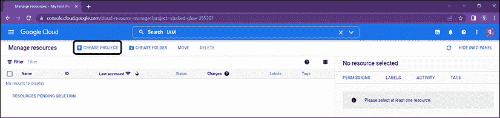

    图 1.13：项目创建

3. 用户为项目提供名称，按图 1.14 所示步骤操作：

    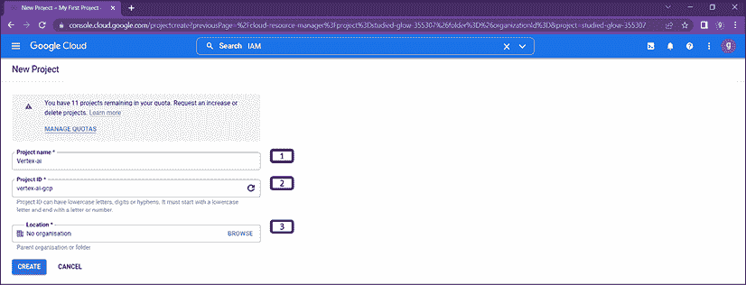

    图 1.14：项目创建

    1. 提供项目名称。
    2. 项目 ID 将自动填充，用户可在创建项目时对其进行编辑。如果用户需要通过 SDK 或 API 访问项目下的资源，则需要项目 ID。项目创建后，用户无法更改项目 ID。
    3. 如果用户在组织下创建项目，请选择该组织。使用免费账号的用户无法创建组织或文件夹。所有项目将在“无组织”下创建。

> **注意**：使用免费账号访问的用户将获得有限的项目创建额度。

### 删除项目

要删除处于活动状态的项目：

1. 选择需要删除的项目。
2. 点击删除，系统将提示用户确认。

    此过程如图 1.15 所示：

    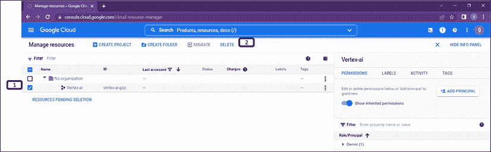

    图 1.15：项目删除

一旦用户确认删除项目，该项目将被标记为待删除状态，并保持该状态 30 天。用户可在 30 天内恢复项目，超过该期限后，该项目及其关联的资源将被永久删除，无法恢复。此外，标记为待删除的项目不可用。

## 与 GCP 服务交互

提到资源时，让我们讨论如何使用它们。GCP 提供了三种与服务和资源交互的基本方式：

### Google Cloud Platform 控制台

在使用 Google Cloud 时，控制台或 Web 用户界面是最常用的交互方式。同时，它为刚开始使用 GCP 的用户提供了丰富的功能和易用的界面。

可通过链接 [`console.cloud.google.com`](https://console.cloud.google.com) 访问 Cloud 控制台。

Google Cloud 控制台的登录页面如图 1.16 所示：

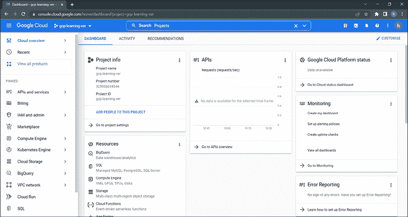

图 1.16：GCP 控制台

### 命令行界面

如果您是开发者，可以使用 Google Cloud SDK 提供的 `gcloud` 命令行工具来控制开发流程和 GCP 资源。要获得对 Google Cloud 计算资源的命令行访问权限，可以使用 Cloud Shell。Cloud Shell 拥有 5 GB 的主目录，是一个基于 Debian 的虚拟机，您可以从中轻松管理 GCP 项目和资源。Cloud Shell 预装了 `gcloud` 命令行工具和其他必要工具，让您能快速上手。要使用 Cloud Shell，请按以下步骤操作：

按图 1.17 所示激活 Cloud Shell：

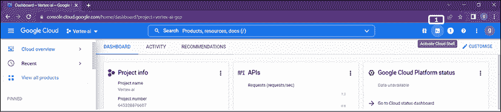

图 1.17：GCP CLI

点击激活 Cloud Shell。打开 Cloud Shell 命令窗口需要几分钟时间。

Cloud Shell 激活后，屏幕底部会出现用于输入命令的黑色区域，如图 1.18 所示：

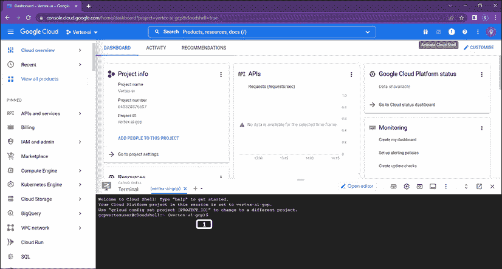

图 1.18：GCP CLI

1. 输入命令：

```
gcloud projects create project_id – 用于创建项目
gcloud projects delete project_id – 用于删除项目
```

### API

应用程序通常通过软件开发工具包（SDK）与 Google Cloud 通信。Google Cloud SDK 支持多种编程语言，包括 Go、Python 和 Node.js 等。

> **注意**：在从已部署的模型获取预测时，我们将使用此方法。

## 存储

存储与计算、网络一起，被视为基本构建组件之一。应用程序受益于存储服务提供的更高级别的持久性和耐用性。这些服务位于平台深处，是 Google Cloud 大多数服务以及您在其之上构建的系统的基础。它们是平台的核心支柱。

Google Cloud 提供三种存储选项：

* 永久磁盘
* Filestore
* Cloud Storage (GCS)

具体说明如下：

* **永久磁盘**：Google Cloud 永久磁盘提供块存储，供 Google Cloud 上托管的虚拟机（Google Cloud Compute Engine）使用。将这些永久磁盘想象成简单的 USB 记忆棒，这将比任何其他方法都更有助于您理解它们。它们可以连接到虚拟机，也可以从虚拟机分离。无论虚拟机是启动、暂停还是终止，它们都允许您为服务构建数据持久性。这些永久磁盘不仅用于为 Google Cloud Compute Engine 上托管的虚拟机提供动力，还用于 Google Kubernetes Engine 服务。

    Google Cloud 永久磁盘的运作方式类似于本地 PC 上的虚拟磁盘。永久磁盘可以是 HDD 或 SSD，后者提供卓越的 I/O 性能。此外，还可以选择其放置位置以及所需的可用性类型，可以是区域级、区域级或本地级。

    Google Cloud 永久磁盘还有其他鲜为人知但非常有用的功能，包括自动加密、在使用过程中调整磁盘大小的能力，以及可用于数据备份和创建虚拟机镜像的快照功能。可以为多个虚拟机配置读写访问权限。一个虚拟机可以拥有写入权限，而所有其他虚拟机对同一永久磁盘拥有只读权限。

### Filestore

Filestore 是 Google Cloud 提供的一种网络文件存储服务。网络文件存储的概念已经存在相当长一段时间了，与块存储类似，它也可以在大多数企业使用的本地数据中心中找到。如果你习惯于处理 NAS（即网络附属存储），你应该对这个概念很熟悉。为了回应兼容网络附属存储 (NAS) 的服务短缺这一问题，Google 扩展了其产品线，推出了云文件存储服务。

顾名思义，Persistent Disk 与网络文件存储的主要区别在于，网络文件存储通过网络提供磁盘存储。这使得创建包含许多并行服务的系统成为可能，这些服务能够从通过网络挂载的同一磁盘存储中读取和写入文件。借助此功能，可以开发此类系统。

以下是 Filestore 的一些用例示例：

* 大多数本地应用程序需要文件系统接口，Filestore 使得将此类企业应用程序迁移到云端变得容易
* 它用于媒体渲染，以减少延迟。

### Cloud Storage

Google Cloud 提供的对象存储服务称为 Google Cloud Storage。它提供许多预装的极具吸引力的功能，例如对象版本控制和细粒度权限（按对象或存储桶），这两者都有可能简化开发流程并减少运维开销。Google Cloud Storage 平台被用作各种不同服务的基础。


在普通的本地系统中，拥有这种存储并不常见，后者通常具有受限的容量，以及快速且独占的连接。另一方面，对象存储在其工作方式方面拥有非常用户友好的接口。用通俗的话说，其价值主张在于：你可以使用 `REST API` 获取和上传任何你想要的文件；此外，这可以无限扩展，每个对象最高可扩展到 TB 级别；最后，其价值主张还在于可以存储任意数量的数据。存储桶是 Cloud Storage 中用于组织所存储众多对象的命名空间。虽然一个存储桶可以容纳多个对象，但每个单独的对象只能属于一个存储桶。

这种存储类型低廉的成本（每 GB 几美分），加上其无服务器模式和易用性，促使其在云原生系统架构中得到广泛采用。随后，云服务提供商负责处理数据复制、可用性、完整性检查、容量规划等繁重任务。`API` 使应用程序能够保存和检索对象。

基于成本、可用性和访问频率等因素，云存储有四种不同的存储类别。它们分别是标准存储、近线存储、冷线存储和归档存储，如图 1.19 所示：

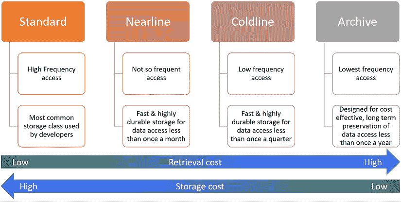

**图 1.19：GCP 存储**

### 标准存储类别

此存储类别允许高频访问，是软件开发人员最常使用的存储类型。

### 近线存储类别

此类别用于不经常访问的数据，通常指一个月内访问不超过一次的数据。一般来说，近线存储用于存放数据。

### 冷线存储类别

此类别用于通常每三个月访问不超过一次的记录。

### 归档存储类别

此类别用于访问频率最低的数据，常用于数据的长期保存。

## 使用 Google Cloud Storage

本书涵盖的大多数练习都从云存储输入数据，因此让我们看看如何创建云存储桶并将文件上传到存储桶中。

### 步骤 1：打开云存储

按照图 1.20 中描述的步骤打开云存储：

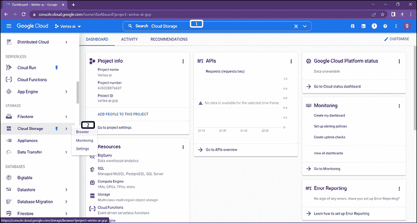

**图 1.20：云存储创建**

1. 用户可以在搜索框中输入 `cloud storage`。
2. 或者，用户可以在 `STORAGE` 下导航至 `Cloud Storage | Browser`。

### 步骤 2：创建存储桶

用户在创建存储桶后，可以将文件或文件夹上传到云存储。按照图 1.21 所示启动存储桶创建流程：

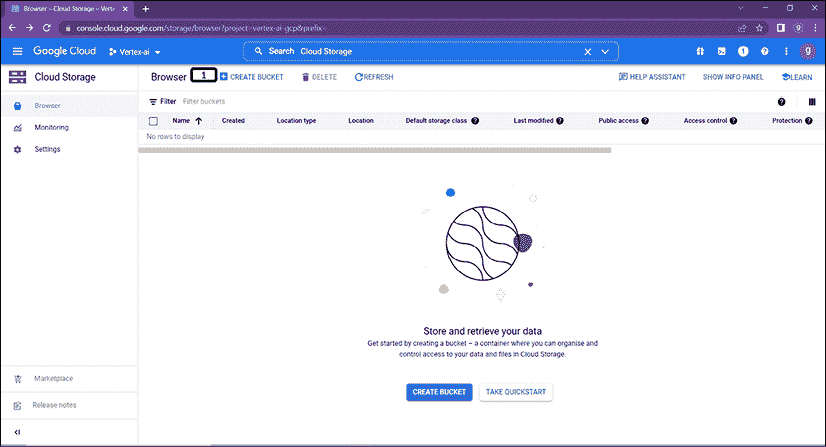

**图 1.21：新建存储桶**

1. 点击 `CREATE BUCKET`（创建存储桶）。

### 步骤 3：为存储桶提供名称

按照图 1.22 所示步骤为存储桶添加名称、标签：

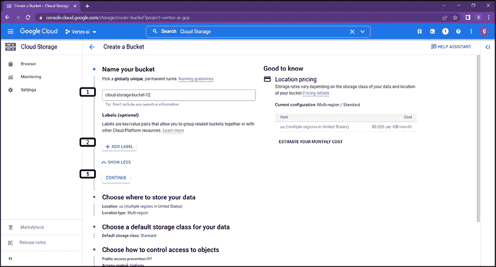

**图 1.22：存储桶名称**

1. 用户需要为存储桶提供全局唯一的名称。
2. 标签是可选的，它提供键值对以将存储桶（甚至服务）归类在一起。
3. 点击 `Continue`（继续）。

### 步骤 4：选择存储桶的位置

按照图 1.23 中的步骤选择存储桶的位置：

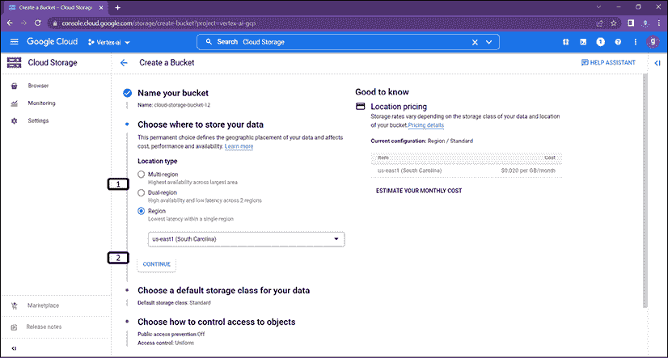

**图 1.23：存储桶的位置**

1. 用户可以选择位置类型。多区域提供选择美洲、欧洲或亚洲多个区域的选项。双区域提供选择属于同一大陆（美洲、欧洲和亚太地区）的两个区域的选项。区域提供下拉列表供选择单个区域。对于本书涵盖的大多数练习，我们将数据上传到属于单个区域的存储桶中。
2. 点击 `Continue`（继续）。

### 步骤 5：选择存储类别

按照图 1.24 所示步骤选择存储类别：

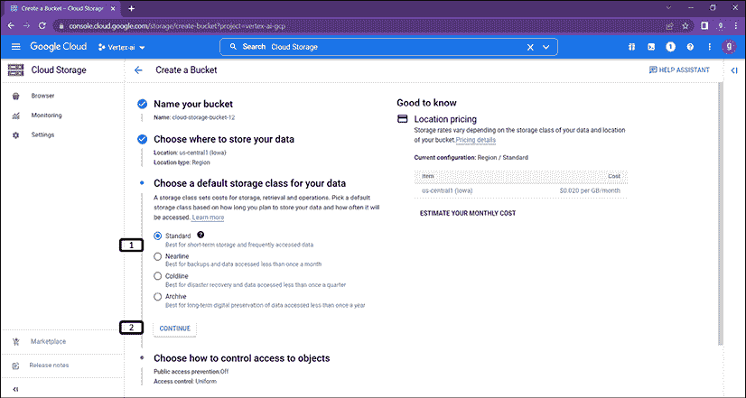

**图 1.24：存储桶的存储类别**

1. 选择 `Standard`（标准存储）（本书涵盖的练习将创建标准存储桶）。
2. 点击 `Continue`（继续）。

> **注意：** 尝试为位置和存储类别提供不同的选项，并观察价格预估的变化。

### 步骤 6：存储桶的访问控制

按照图 1.25 中描述的步骤配置存储桶的访问控制：

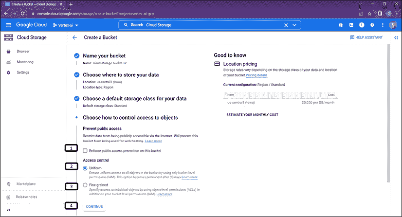

**图 1.25：存储桶的访问控制**

1. 勾选该框可防止来自互联网的公共访问，如果选择此选项，将无法通过 `IAM` 政策提供公共访问权限。
2. 统一访问控制对属于该存储桶的所有文件夹和文件应用相同的 `IAM` 政策（选择 Uniform/统一）。
3. 与统一访问控制相反，细粒度访问控制为单个文件和文件夹指定政策。
4. 点击 `Continue`（继续）。

### 步骤 7：存储桶中的数据保护

按照图 1.26 中描述的步骤进行数据保护：

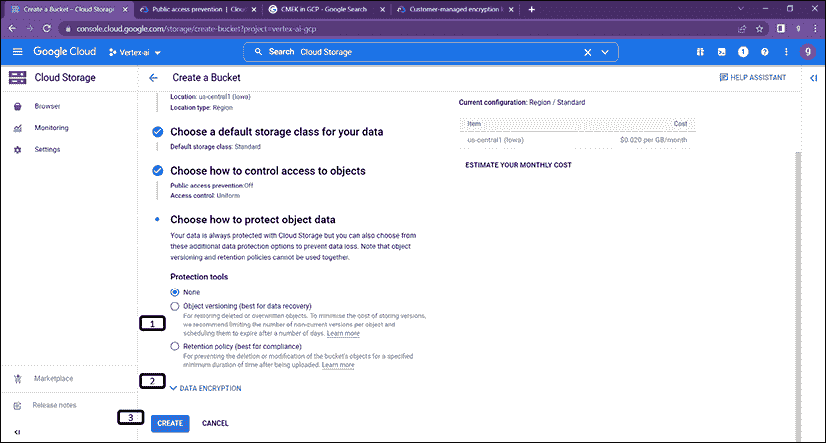

**图 1.26：存储桶的数据保护**

1. GCP 为数据保护提供了额外选项，对象版本控制帮助用户进行数据恢复，保留政策有助于合规性（数据上传后在最短时间内无法删除）。
2. 上传到 GCP 的所有数据都将由 Google 管理的加密密钥加密，如果用户需要更多控制权，可以选择客户管理的加密密钥 (`CMEK`)。
3. 点击 `Create`（创建）。

### 步骤 8：将文件上传到存储桶

按照图 1.27 中描述的步骤将文件上传到云存储：

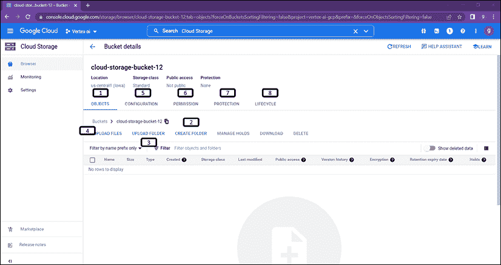

**图 1.27：文件上传到存储桶**

1. `OBJECTS`（对象）为用户提供上传数据的选项。
2. 在存储桶内 `CREATE FOLDER`（创建文件夹）。
3. 直接从本地系统 `UPLOAD FOLDER`（上传文件夹）。
4. 上传文件。
5. 用户在存储桶创建过程中选择的所有选项将列在 `Configuration`（配置）下。

### 权限

`PERMISSIONS` 提供选项以启用防止公共访问，或更改统一访问/细粒度访问。此外，它还提供添加用户以访问存储桶的选项。

### 保护

`PROTECTION` 选项卡提供启用或禁用对象版本控制和保留策略的选项。

### 生命周期

当满足特定条件时，`LIFECYCLE` 规则允许您对存储桶中的项目执行操作。

### 存储桶的删除

按照图 1.28 中描述的步骤删除存储桶：

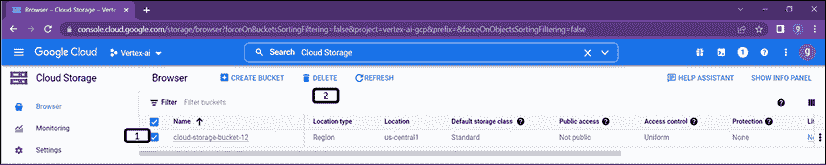

**图 1.28：存储桶删除**

1. 选择需要删除的存储桶。
2. 点击 `DELETE`，将弹出一个提示框，要求用户输入 `delete`。

## 计算

计算服务的提供是任何云服务产品的基本组成部分。Google 为希望在云端托管其应用程序的公司提供的最重要的产品之一称为 Google Compute Services。“计算”这一统称涵盖了各种专业服务、配置选择和产品，所有这些均可供您使用。

用户可以访问 Google Cloud 提供的计算和托管设施，并可从以下可用选项中进行选择：

### Compute Engine

用户可通过使用 Google Compute Engine（一种 `IaaS` 平台）在云中构建和使用虚拟机作为服务器资源。用户无需采购或管理物理服务器硬件。虚拟机是托管在云中的服务器，将在 Google 的数据中心运行。它们为中央处理器 (`CPU`) 和图形处理器 (`GPU`)、内存和存储提供可配置选项，此外还提供多种操作系统选项。访问虚拟机时，既可使用命令行界面 (`CLI`)，也可使用 Web 控制台。当计算引擎被退役时，所有数据将被擦除。因此，可通过使用传统硬盘驱动器或固态硬盘来确保数据持久性。

`Hypervisor` 是运行虚拟机的组件。`Hypervisor` 是安装在宿主操作系统上的一种软件，负责创建和运行多个虚拟机。宿主计算机上的 `Hypervisor` 通过允许虚拟机共享宿主资源，使得运行多个虚拟机成为可能。图 1.29 展示了虚拟机、`Hypervisor` 和物理基础设施之间的关系。

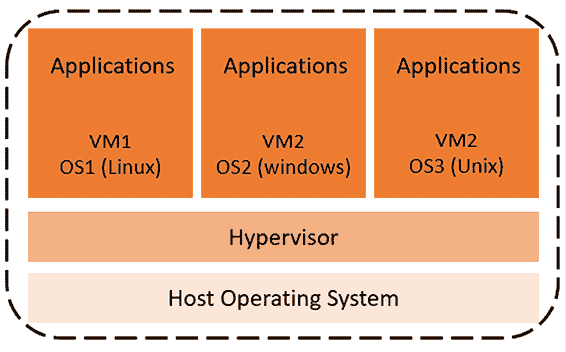

**图 1.29：Compute Engine**

在定价、稳定性、备份、可扩展性和安全性方面，使用 Google Compute Engine 是一个不错的选择。它是一种具有成本效益的解决方案，因为用户只需为其使用资源的时长付费。它支持将虚拟机从一台宿主机实时迁移到另一台，这有助于保证系统的可靠性。此外，它还拥有可靠、内置且冗余的备份机制。它通过预留资源，帮助并保证应用程序在扩展时拥有所需的容量。计算引擎将为运行在其上的应用程序提供额外的安全性。

Compute Engine 适用于迁移成熟系统，或对操作系统及其他运维特性进行细粒度管理。

### Kubernetes Engine

Google Kubernetes Engine（简称 `GKE`）是 GCP 的容器即服务产品。在部署容器化应用时，通过开源的 Kubernetes 集群管理系统来管理集群。`Kubernetes` 为用户提供与容器集群交互所需的功能。`Kubernetes` 系统包含控制平面和工作节点两个组件。工作节点作为计算引擎提供算力。

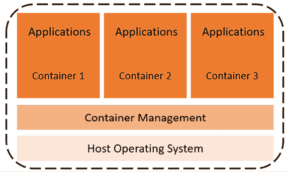

**图 1.30：Kubernetes Engine**

虚拟机运行在客户操作系统和 `Hypervisor` 上；而使用 Kubernetes Engine 时，计算资源被隔离在容器中，由容器管理器和宿主操作系统共同管理。

独特功能包括自动升级、节点自动维护和自动扩缩容（当应用程序承受压力时，Kubernetes Engine 将分配额外资源）。

* 用户将获得高级集群管理功能作为额外福利，例如负载均衡、节点池、日志记录和监控。
* `Compute Engine` 实例提供负载均衡和分发。
* 在集群内，节点池用于标识节点子集，以提供更大的灵活性。
* 结合 `Cloud Monitoring` 的日志记录和监控功能，使您能够洞察集群内部情况。

### Google App Engine

GCP 为开发和部署可扩展应用提供的平台即服务称为 Google App Engine。它是一种无服务器计算形式，使用户能够在无需设置虚拟机或 Kubernetes 集群的计算环境中运行代码。

它兼容多种编程语言，包括 `Java`、`Python`、`Node.js` 和 `Go`。用户可选择任意受支持的语言开发应用。Google App Engine 配备多种 `API` 和服务，使开发者能够创建功能强大且特性丰富的应用程序。这些特性包括：

* 访问应用日志
* `Blobstore`，用于服务大型数据对象

其他重要特性包括按量付费策略，即仅为所用资源付费。当使用应用的用户数量激增时，App Engine 会立即增加可用资源，反之亦然。

高效的诊断服务包括 `Cloud Monitoring` 和 `Cloud Logging`，协助运行应用扫描以定位应用故障。应用报告文档帮助开发者立即修复发现的任何故障。

作为 A/B 测试的一个组成部分，流量拆分功能允许 App Engine 自动将不同版本的传入流量导向不同的应用迭代版本。用户可根据哪个软件版本运行最有效，规划后续的迭代增量。

App Engine 分为两种不同类型：

* **Standard App Engine**：应用完全独立于服务器的操作系统以及可能同时在该服务器上运行的任何其他应用。除了应用代码外，无需安装任何操作系统软件包或其他预构建软件。
* **Flexible App Engine**：用户在 App Engine 环境中运行 `Docker` 容器。此外，为运行应用代码，还需安装库或其他第三方软件。

### Google Cloud Functions

Google Cloud Function 是一种用于事件驱动处理的轻量级无服务器计算解决方案。它是 GCP 的函数即服务 (`FaaS`) 产品。通过使用 Cloud Functions，可消除维护服务器、设置软件、升级框架和修补操作系统等耗时任务。

## Cloud Functions

用户必须为 Cloud Functions 提供代码，以便在事件发生时开始运行，因为 GCP 完全管理软件和基础设施。云事件是指在云计算环境中发生的事件，例如数据库中存储的数据发生变化、存储系统中添加了新文件，甚至新虚拟机的创建都是此类操作的实例。触发器是指您对某个特定事件或一组事件感兴趣的声明。将函数绑定到触发器可让用户捕获事件并对其采取行动。事件数据是在事件触发器导致函数执行时传递给 Cloud Function 的数据：

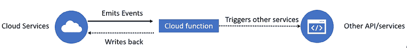

**图 1.31：Cloud Function**

## GCP 计算服务摘要

GCP 计算服务的摘要可见于图 1.32：

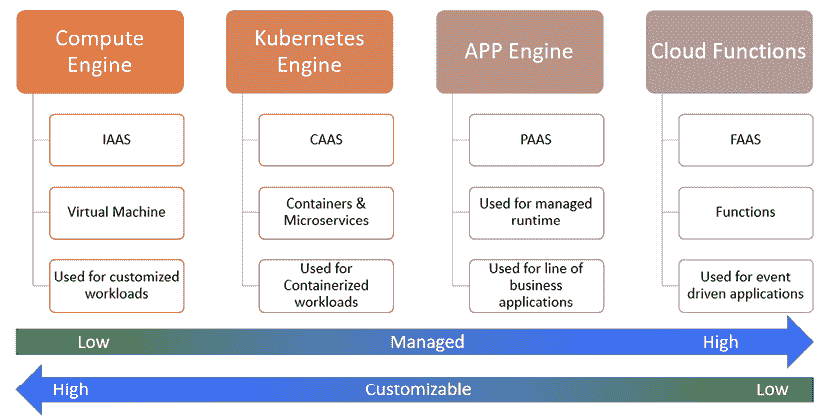

**图 1.32：计算服务摘要**

## Compute Engine 创建（VM 实例）

Compute Engine 实例可运行 Google 的公共 Linux 和 Windows Server 镜像以及私有自定义镜像。`Docker` 容器也可部署在 Container-Optimized OS 公共镜像实例上。用户在创建时需要指定区域、操作系统和机器配置类型（虚拟 `CPU` 数量和 `RAM`）。每个 Compute Engine 实例都有一个包含操作系统的小型持久启动磁盘，且可添加更多存储空间。VM 实例默认时间为协调世界时 (`UTC`)。请按以下步骤创建虚拟机实例：

### 步骤 1：打开 Compute Engine

按图 1.33 所述步骤打开平台的 Compute Engine：

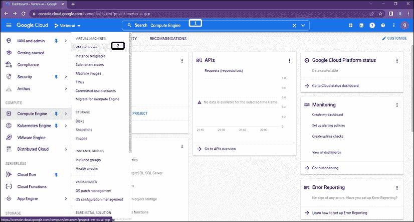

**图 1.33：VM 创建**

1. 用户可在搜索框中输入 `Compute Engine`。
2. 或者，用户可在 `Compute` -> `Compute Engine` | `VM instances` 下导航。

### 步骤 2：启用 Compute Engine API

当首次访问资源时，系统会提示用户启用 API，如图 1.34 所示：

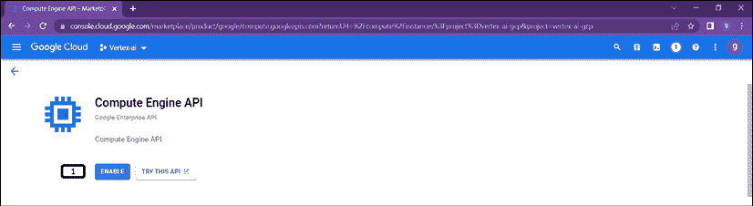

**图 1.34：VM 创建 API 启用**

1. 如果提示启用 API，请启用该 API。

### 步骤 3：VM 实例选择

按图 1.35 所述步骤选择 VM：

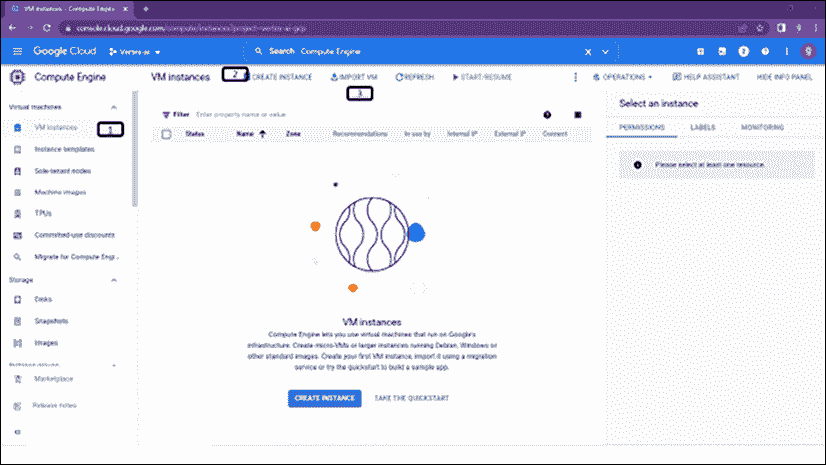

**图 1.35：VM 创建**

1. 选择 `VM instances`。
2. 点击 `CREATE INSTANCE` 开始创建过程。
3. GCP 提供 `IMPORT VM` 选项用于 Compute Engine 迁移。

### 步骤 4：VM 实例创建

按图 1.36 所述步骤为 VM 实例选择位置和机器类型：

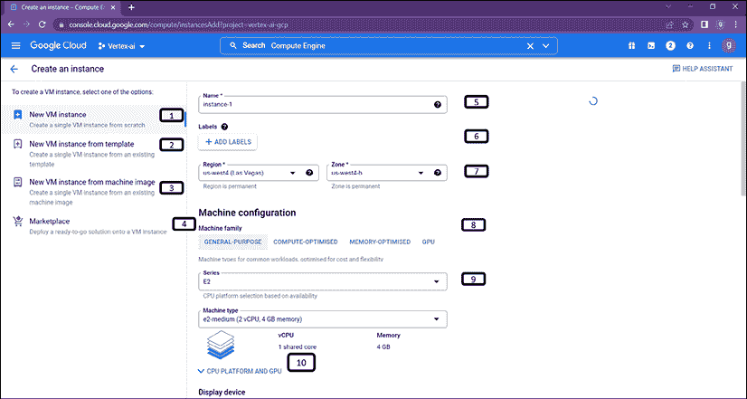

**图 1.36：VM 实例的位置和机器选择**

1. GCP 提供多种 VM 创建选项，第一种是从头创建 VM。我们将创建一个 `New VM instance`。
2. VM 可从模板创建。用户可创建模板以供将来使用。
3. VM 可从机器镜像创建，机器镜像是存储配置、元数据及其他创建 VM 所需信息的资源。
4. GCP 还提供将现成解决方案部署到 VM 实例的选项。
5. 实例名称由用户指定。
6. 标签为可选项，它们提供键值对以将 VM 分组。
7. 选择区域和可用区。
8. GCP 在机器配置方面提供广泛选项，从 `GENERAL-PURPOSE`、`COMPUTE-OPTIMIZED`、`MEMORY-OPTIMIZED` 到基于 `GPU` 的机型。
9. 在每个机器系列配置下，GCP 提供几个系列机型和机器类型（用于在 `CPU` 和内存之间选择）。
10. 用户可选择 `CPU` 平台和 `GPU`，如果想选择 vCPU 与核心比率及可见核心数。

> **注意：** 尝试选择不同的机器配置并观察预估价格的变化。

### 步骤 5：VM 实例磁盘和容器选择

按图 1.37 所述步骤为实例选择启动磁盘：

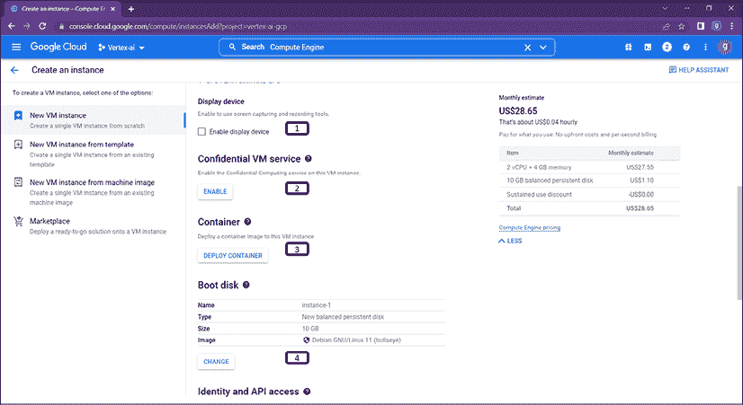

**图 1.37：VM 实例的启动磁盘选择**

1. 启用显示工具，启用屏幕录制工具的使用。
2. 通过保持此 VM 内存加密来保护使用中的数据。
3. `Deploy Container` 选项在需要使用容器优化的 OS 镜像将容器部署到 VM 实例时非常有用。
4. 用户可通过点击 `change` 更改操作系统、硬盘大小和类型 (`HDD`/`SSD`)。

### 步骤 6：VM 实例创建访问设置

按图 1.38 所述步骤配置访问权限：

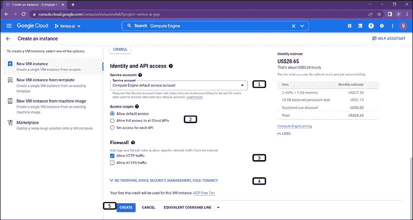

**图 1.38：VM 实例的访问控制**

1. 选择设置与 VM 实例关联的默认服务账号，或用户可创建服务账号并将其用于 Compute Engine。
2. 用户需选择 VM 的访问方式，可选择 `allow default access`，或 `allow all the APIs` 或仅允许特定 API 访问 VM。
3. 默认情况下，所有互联网流量均被阻断，我们需要启用它们。
4. `networking`、`disks`、`security` 和 `management` 下提供了磁盘保护、预留、网络标签、更改主机名、实例删除时删除或保留启动磁盘等附加选项。
5. 点击 `Create`。

## 访问 VM 实例

虚拟机创建后，将列在 `VM instances` 下，如图 1.39 所示：

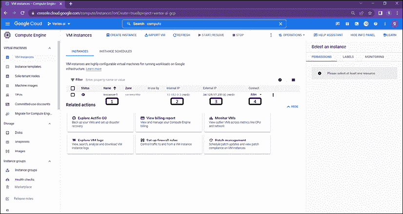

**图 1.39：VM 实例已创建并列在 VM 实例下**

1. 点击实例类型查看 VM 详情（包括 VM 的区域、可用区、机器配置、`CPU` 利用率、内存利用率的负载监控等）。
2. `Internal IP address` 为子网 IP 地址。
3. `External IP address` 用于与外部设备通信。
4. `SSH` 用于连接到 VM。

### 步骤 1：访问 VM

按图 1.40 和图 1.41 所述步骤访问创建的 VM 实例：

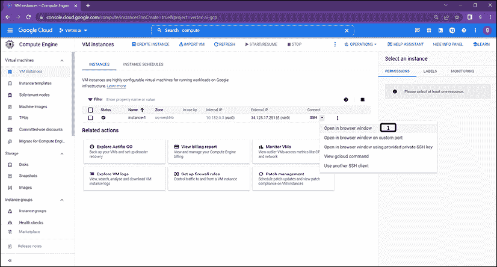

**图 1.40：访问 VM**

1. 点击 `SSH` 选项并选择 `open in browser window`。

新窗口将打开，`SSH` 密钥将被传输并建立连接，如图 1.41 所示：

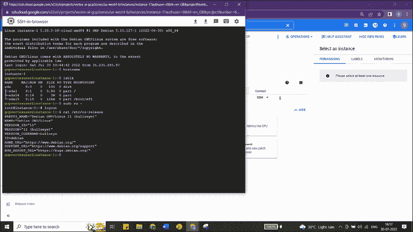

**图 1.41：访问 VM**

在窗口中尝试以下命令：

a. `Hostname`（获取 VM 实例名称）
b. `Lsblk`（获取磁盘信息）
c. `Sudo su –`（检查 root 权限）


d. `Logout`（退出 root 权限）

e. `Cat /etc/os-release`（查看操作系统详情）

f. `Logout`（关闭连接）

## 删除 VM 实例

按图 1.42 所述步骤删除 VM 实例：

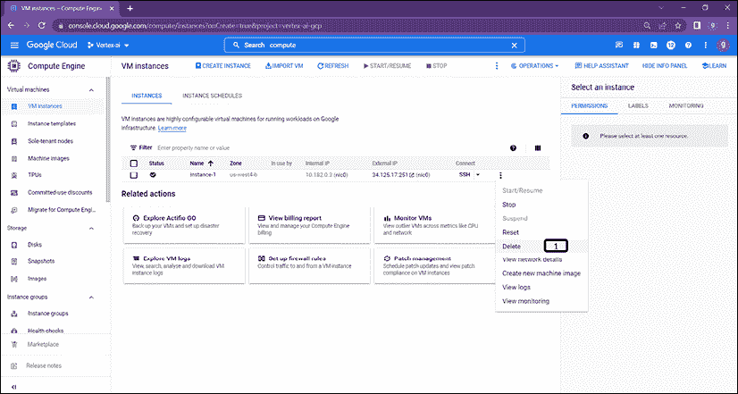

**图 1.42：VM 的删除**

1. 点击三个点并选择 `Delete`。

2. 弹出窗口将请求确认。

> **注意：** 所有计算资源在任何平台上都很昂贵，使用后请务必释放它们。

## BigQuery

任何人都可以使用 BigQuery 在几秒钟内分析 TB 级数据，BigQuery 是 Google Cloud Platform 提供的全托管无服务器数据仓库解决方案。它通过机器学习、地理空间分析和商业智能等内置功能，简化了数据的管理和分析。BigQuery 的无服务器架构利用 SQL 查询为组织提供最紧迫问题的答案，且无需管理底层基础设施。

## Google BigQuery 架构

Google BigQuery 架构建立在 `Dremel` 之上，Dremel 是 Google 设计的一种分布式系统，用于查询海量数据库。在 Dremel 中，查询的执行被分解为 `槽位`，即使众多用户并发搜索数据库，也能保证公平性。在底层，Dremel 使用 `Jupiter`（Google 的内部数据中心网络）来访问分布式文件系统（昵称为 `Colossus`）上的数据存储。Jupiter 也是 Google Cloud Storage 的骨干网络。数据复制、数据恢复和数据分发管理均由 Colossus 处理。BigQuery 对其数据采用 `列式存储结构`，从而实现了高压缩比和高扫描吞吐量。另一方面，您也可以将 BigQuery 与存储在其他 Google Cloud 服务中的数据配合使用，例如 `Bigtable`、`Cloud Storage`、`Cloud SQL` 和 `Google Drive`。

得益于专为处理海量数据而设计的架构，当 BigQuery 获取数 PB 信息进行评估时，性能达到峰值。BigQuery 最适合人们需要对只读数据集进行交互式临时查询的用例。在大多数情况下，针对关系数据库的复杂分析查询需要运行数秒。这正是使用 BigQuery 的理想场景，这也是为什么它常被用在大数据 ETL 流水线的末端、处理过的数据之上。由于自带缓存，BigQuery 在数据不发生频繁变更的情况下表现非常出色。

由于它是一项完全托管的服务，无需安装、设置或维护任何底层基础设施即可正常运行。客户仅为其存储的数据量和对数据库运行的查询次数付费。

## 使用 BigQuery

### 步骤 1：打开 BigQuery

按照图 1.43 中描述的步骤打开 BigQuery：

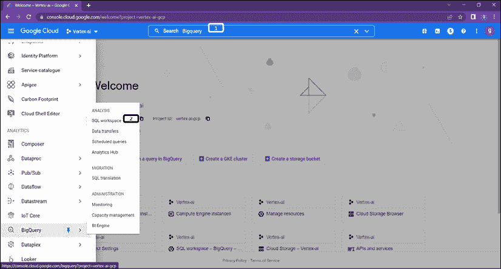

**图 1.43：BigQuery**

1. 用户可在搜索框中输入 `BigQuery`。

2. 或者，他们可以在 **Analytics** 下导航至 `BigQuery | SQL workspace`。

### 步骤 2：BigQuery 登录页面

BigQuery 的登录页面如图 1.44 所示：

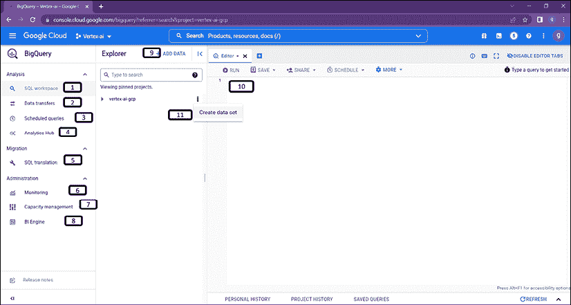

**图 1.44：BigQuery 登录页面**

1. 点击 **SQL workspace** 以创建和运行查询、处理表以及查看作业历史。

2. **BigQuery Data Transfers Service** 可将数据按计划、受控地自动传输到 BigQuery 中。

3. **Scheduled queries** 选项用于定期运行查询。查询需采用标准 SQL 编写。

4. **Analytics Hub** 有助于跨组织高效、安全地传输数据资产。

5. **SQL translation** 帮助用户将 SQL 方言转换为 BigQuery 标准 SQL 查询。

6. BigQuery 的 **Performance monitoring** 信息和日志数据可在 **Monitoring** 部分下获取。

7. **Capacity management** 基于历史利用率信息协助进行容量规划。

8. **BI Engine** 是一项内存分析服务。

9. **ADD DATA** 提供从各种来源导入数据的选项，包括公共和私有数据集。

10. **Editor window** 用于编写查询以获取数据。

11. 列出已创建的 **Projects**（显示 Project ID 而非项目名称）。点击三个点并选择 **Create data set**。

### 步骤 3：BigQuery 数据集创建

我们使用的是 Kaggle 上列在公共领域许可下的数据集。您可以将数据以 csv 格式下载到本地机器。

[`www.kaggle.com/datasets/jimschacko/airlines-dataset-to-predict-a-delay`](https://www.kaggle.com/datasets/jimschacko/airlines-dataset-to-predict-a-delay)

按照图 1.45 中描述的步骤在 BigQuery 中创建数据集：

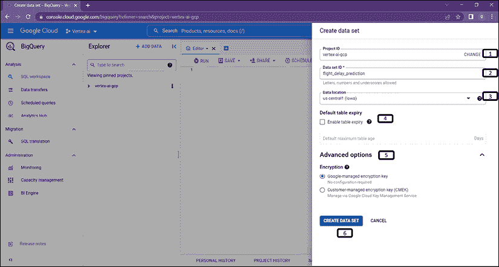

**图 1.45：BigQuery 数据集创建**

1. 选择项目。数据集将在所选项目下创建。

2. **Data set ID**：数据集的名称。

3. **Data location**：选择位置。

4. **Enable table expiry**：如果选中此选项，则创建的任何表将在用户在框中指定的天数后被删除。

5. **Advanced options**：用于加密，以在 Google 托管或客户托管加密之间进行选择。

6. 点击 **CREATE DATA SET**。

### 步骤 4：表创建

按照图 1.46 中描述的步骤在数据集下创建表：

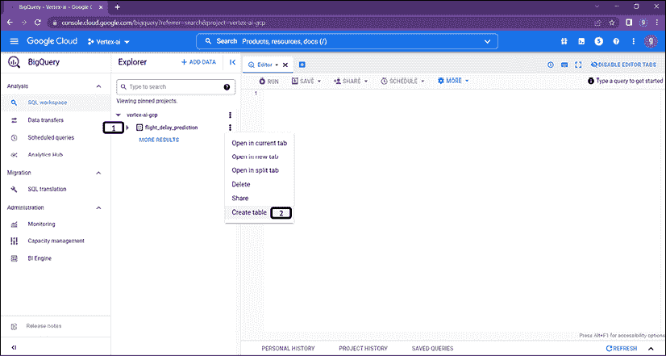

**图 1.46：数据集中的表创建**

1. 创建的数据集将列在所选项目下。

2. 选择 **Create table** 以导入数据。

### 步骤 5：表的数据选择

按照图 1.47 中描述的步骤将数据上传到 BigQuery：

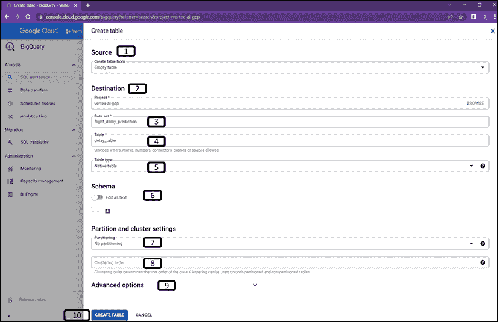

**图 1.47：将数据上传到 BigQuery 表**

1. 可通过从本地机器、**Google Cloud Storage**、**Google Drive**、**Google Bigtable**、**Amazon S3 bucket**、**Azure blob storage** 上传数据来创建表。

    本示例中，数据已下载到本地机器，选择从本地机器上传的选项。选中上传选项后，BigQuery 提供选择文件及文件格式（csv）的选项。

2. **Project**：创建数据集所在的项目。

3. **Dataset Name**：需在其下创建表的数据集。

4. 输入需创建的表的名称。

5. **Table type**：Native type 是唯一选项；原生表是由原生 BigQuery 存储支持的表。

6. **Edit schema**：用户可启用此选项以手动输入数据的架构。（选中数据后，自动检测选项将被启用）。

7. **Partition**：分区将表划分为更小的段。将创建分区列，可对分区列使用过滤条件以减少扫描数据所需的时间。

8. **Clustering** 根据架构中指定列的内容组织数据。

9. **Encryption** 选项在 **Advanced options** 下提供。

10. 点击 **create Table**。

### 步骤 6：在 BigQuery 表上运行查询

按照图 1.48 中描述的步骤在上传的数据上运行 SQL 查询：

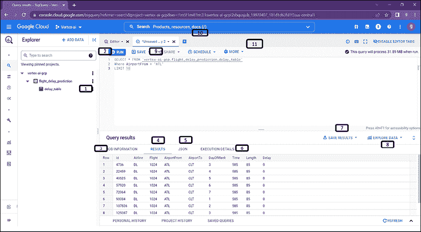

**图 1.48：用于获取数据的 SQL 查询**

1. 创建的表名将显示在所选数据集下。

2. 在 **SQL editor** 中，用户可编写查询并点击 **Run** 执行。示例使用的查询如下：

```
Select * from `vertex-ai-gcp.flight_delay_prediction.delay_table`
Where AirpottFrom = "ATL"
LIMIT 10
```

`vertex-ai-gcp` 是项目名称，`flight_delay_prediction` 是数据集名称，`delay_table` 是表名称。

3. 查询结果显示在 **Query results** 部分。**JOB INFORMATION** 提供关于作业 ID、耗时、位置等信息。

4. 查询结果以表结构显示在 **RESULTS** 部分。

5. 查询结果以 JSON 结构显示。

6. **Execution details** 包含处理的数据量、执行消耗的槽位时间等信息。

7. **SAVE RESULTS** 提供将结果保存为 CSV、JSON 或 BigQuery 表的选项。

8. **EXPLORE DATA** 提供使用数据工作室（可视化工具）探索数据的选项。

9. **SAVE** 选项提供保存查询以供后续使用的选项。

10. **Schedule** 提供安排查询的选项。

11. **MORE** 提供格式化查询、SQL 翻译等选项。

### 步骤 7：数据集删除

按照图 1.49 中描述的步骤删除数据集：

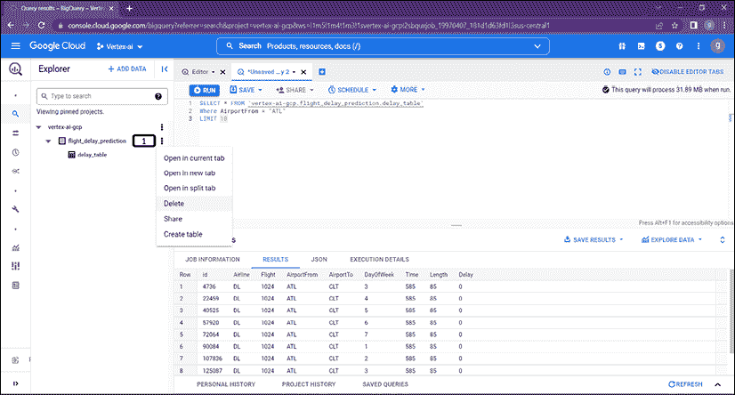

**图 1.49：BigQuery 数据集删除**

1. 点击三个点并选择 **Delete**。弹出窗口将要求确认。

## 身份和访问管理

想象一下，你刚加入一个组织。他们为你提供了一张工牌和一张门禁卡。凭借这张门禁卡，你将被允许进入一定数量的地点，包括你的工作场所、停车场和食堂等。如果你想查看实验室或存放机密信息的文档区等区域的信息，你需要寻求特别授权才能进入。以类似 Google Cloud Platform (GCP) 的方式，我们有一个叫做身份与访问管理的概念，简称 IAM。

### 身份与访问管理

身份与访问管理 (IAM) 是在 Google Cloud Platform (GCP) 等云计算环境中确保数据安全所能采取的最至关重要的预防措施之一。执行的每一个操作，例如资源的添加或删除，或平台不同服务之间的通信，都是通过 API 进行的。因此，必须密切关注那些允许访问资源的权限，并确保仅提供执行业务流程所绝对必需的最少权限。IAM 基于最小权限原则开发，即默认情况下用户将被拒绝访问。必须为用户显式开放访问权限。

为了分配权限，GCP 使用一种称为基于角色的访问控制 (RBAC) 的系统。RBAC 表示根据与身份相关联的任务或职责来分配权限的做法。

#### 角色

`ROLE`（角色）是一组指定的权限，用于确定个人是否有权在资源上执行特定活动。在 IAM 中，我们无法直接向用户授予权限。我们不是给他们权限，而是给他们角色，角色是一项或多项权限的集合。`service.resource.verb`（服务.资源.动词）格式用于表示权限。一个例子是 `compute.instances.list` 权限。资源上可执行的活动种类由其权限确定。当角色授予成员时，该成员将获得与该职位关联的所有权限。

Google Cloud IAM 中有三种类型的角色：

*   **基本角色**

    *   包含 Owner（所有者）、Editor（编辑者）和 Viewer（查看者）角色

    *   提供广泛级别的权限，**不推荐**使用

*   **预定义角色**

    *   Google 根据需要创建和更新角色，例如当 Google Cloud 推出新功能或服务时。

    *   示例：`roles/notebooks.admin`；`roles/ml.modelUser`

*   **自定义角色**

    *   根据用户定义的权限列表提供细粒度访问权限

    *   我们可以创建一个包含一项或多项权限的自定义 IAM 角色，然后将该自定义角色授予用户或群组。

    *   当新权限、功能或服务引入平台时，GCP **不会**更新自定义角色

#### 成员（身份）

在 GCP 中，成员或用户也被称为 `IDENTITY`（身份）。身份可以是以下形式：

*   **用户账号**：拥有 GCP 访问权限的用户将被视为用户账号，有时也称为 Google 账号。

*   **服务账号**：它不与特定用户关联，而是用于 GCP 资源之间的通信。我们可以创建服务账号，但不能直接从服务账号访问资源。服务账号分为两类。

    *   **默认服务账号**：当你激活或使用某些 Google Cloud 服务时，这些服务允许服务启动任务以访问其他 Google Cloud 资源，Google Cloud 会建立用户管理的服务账号。

    *   **用户管理的服务账号**：使用 IAM API、Cloud Console 或 `gcloud` 命令行工具来建立用户管理的服务账号。创建者负责管理和保护账号。我们将在下一章创建一个。

*   **Google 群组**：群组有助于大规模管理用户。这是将角色附加给具有相同工作职能的用户的简单方法。Google 群组的每个成员都会继承授予该群组的 IAM 角色。一个用户可以属于多个群组。

*   **G Suite 网域**：它是整个组织的用户账号。

*   **Cloud Identity 网域**：如果组织未使用 G Suite 网域，但想使用 Google Cloud IAM，则使用 Cloud Identity 网域。不过，Cloud Identity 网域用户无法访问属于 Google Workspace 的应用程序和功能。

*   **别名**：也称为特殊标识符。下面列出了两个特殊标识符。

    *   `allauthenticatedUsers`：是一个特殊标识符，代表所有服务账号以及所有在互联网上通过 Google 账号进行身份验证的用户。

    *   `allusers`：是一个特殊标识符，代表互联网上的任何人，包括已认证和未认证的用户。

#### 策略

*   **策略**针对角色和成员强制执行。此策略与资源相关，并指定和控制哪些成员被赋予特定职责。资源的策略概述了谁（成员）拥有什么样的访问权限（角色）。

*   IAM 策略可以在资源层级的任何级别进行配置，包括组织、文件夹、项目和资源级别。由于 IAM 策略继承具有传递性，资源会继承其所有父资源的策略。当经过身份验证的成员尝试访问资源时，IAM 会根据资源的策略判断该活动是否被授权。图 1.50 展示了 IAM 中角色、成员、资源和策略的关系。

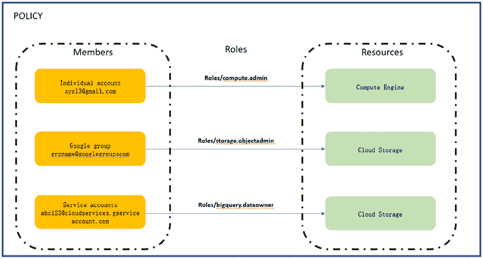

## 结论

在本章中，我们了解了什么是云、使用云的好处、为什么当今的数据科学家需要了解云平台，以及云平台遵循的多种服务模型类型。我们还发现了其遵循的层级结构（组织、文件夹和项目）。除此之外，我们还重点关注了存储、计算和 BigQuery 等更多实操层面的内容，以及为什么平台需要身份与访问管理。

在下一章中，我们将开始使用 Vertex AI。

## 问题

1. 什么是云？

2. 描述云提供的各种安全措施。

3. 如果我们的某个项目被意外删除，我们有哪些选项？

4. 什么是 Google BigQuery？BigQuery 有哪些优势？

## 加入我们书籍的 Discord 空间

加入书籍的 Discord 工作区，获取最新动态、优惠、全球科技动态、新版本发布和作者见面会：

[`discord.bpbonline.com`](https://discord.bpbonline.com)


# 第 2 章：Vertex AI 和 AutoML Tabular 简介

## 简介

在上一章中，我们了解了 Google Cloud Platform。本章介绍 GCP 的 Vertex AI 组件。Vertex AI 的主要特性以及 Vertex AI 预测的新功能。Vertex AI 的 AutoML 部分及其类型。随后是 AutoML 表格数据的分步说明。

## 结构

在本章中，我们将涵盖以下主题：

*   Vertex AI 简介
*   关键特性
*   Vertex AI 预测服务
*   使用 Vertex AI
*   Vertex AI AutoML
*   表格数据集创建
*   模型训练
*   模型评估
*   批量预测
*   模型部署以进行在线预测
*   服务账号创建
*   提供在线预测服务
*   模型取消部署和端点删除
*   模型删除
*   数据集删除

## 目标

在本章结束时，你将能够为表格数据创建 AutoML 数据集，启动训练，评估模型，并将训练好的模型推向部署，从已部署模型获取预测结果，以及从部署中移除模型。

## Vertex AI 简介

Google 于 2021 年中旬宣布推出 Vertex AI。Vertex AI 是一个用于人工智能的集成平台，将 Google 所有的云服务汇聚在同一个平台之下。利用 Vertex AI 提供的预训练模型和自定义模型构建工具，客户能够构建机器学习模型，或仅部署和扩展此类模型。在 Vertex AI 上创建机器学习解决方案的用户，可以利用 AutoML 和其他复杂的机器学习组件，显著提升其生产力和可扩展性。此外，Google 非常重视让 Vertex AI 平台对新手友好、对资深专业人士高效。因此，训练模型变得简单，且所需代码行数比其他方法减少了 80%。Vertex AI 将演变为与 GCP 相关的所有 AI 事务的一站式商店。

鉴于所有这些因素，实施 MLOps 现在变得更加简单，也更容易被机器学习团队所采用。这意味着用户无需死记 GCP 的架构，即可找到分散在 GCP Console 中的所有 MLOps 工具。


尽管许多 GCP 服务构建于开源框架之上，但它们均由平台全托管；例如，`Vertex Pipelines` 构建于 `Kubeflow Pipelines` 和 `TensorFlow Extended` 之上，而 `Vertex Metadata` 构建于 `ML Metadata` 之上。Vertex 各组件之间存在高度的交叉通信，这正是其对数据科学团队如此有价值的原因。

## 核心功能

Vertex AI 通过提供视频、视觉等预训练 API，使视频、翻译和自然语言处理与现有应用的集成变得简单。工程师现在能够以最小的工作量和知识要求，训练符合其公司特定需求的定制模型。

Vertex AI 提供了全流程的 AI 与数据集成，通过 `Vertex AI Workbench` 原生集成了 `Dataproc`、`Dataflow` 和 `BigQuery`。您既可以在 `BigQuery` 中开发和运行机器学习模型，也可以将数据从 `BigQuery` 导出到 `Vertex AI Workbench` 并在那里运行 ML 模型。这两种选项均可用。

Vertex AI 为所有与 AI 相关的 Google Cloud 服务提供了一个统一的用户界面和 API，将整个机器学习流程汇聚在同一个平台之下。例如，您可以在 Vertex AI 中利用 `AutoML` 来训练和比较模型，然后将它们全部保存在一个集中式的模型存储库中。

Vertex AI 集成了广泛使用的开源框架，如 `PyTorch` 和 `TensorFlow`。此外，它还通过自定义容器支持替代工具，并与所有开源框架集成。

其他新功能如下：

### 训练缩减服务器

**AI 训练缩减服务器**是 Vertex 的一项新功能。据 Google 称，该程序可提升在 Nvidia GPU 上的多系统分布式训练效率。“分布式训练”是指跨多台计算机、GPU、CPU 或专用芯片训练系统的做法，以节省时间和资源。

这缩短了 BERT 等大语言工作负载的训练时间，并使不同方法在成本上达到平价。缩短训练周期后，数据科学家可在部署时间范围内提升模型的预测性能。这对关键任务操作非常有帮助。数据科学家无需具备基础设施工程或运维工程方面的专业知识。

### 表格工作流

**表格工作流**包含一个透明盒和一个受管的 AutoML 流水线，允许用户观察和理解模型的生成与部署。数据科学家现在可以在不损失准确性的情况下，在 1 TB 数据集上训练模型。用户可选择将哪些流程环节自动化，哪些进行手动工程化。

表格工作流可集成到 `Vertex AI Pipelines` 中。Google 引入了额外的管理算法 `TabNet`、模型特征选择和模型蒸馏，用于高级研究模型。

### 无服务器 Spark

除了与 `Neo4j` 和 `Labelbox` 合作外，Google 还推出了**无服务器 Spark**工具，以加快机器学习模型投入生产的部署，并更好地将数据建模能力直接集成到数据科学环境中。这些合作将帮助 ML 模型开发者处理非结构化、结构化和图数据。这将帮助 Google 加快机器学习模型投入生产的部署。数据科学家将能够在其笔记本上启动无服务器 Spark 会话，并使用 Google 无服务器 Spark 以交互方式编写结构化数据代码。

## Vertex AI 预测服务

当用户准备好开始响应来自机器学习模型的请求时，模型即被投入使用。为确保安全性和可扩展性，建立完全无缝的体验至关重要。Vertex AI 作为一项全托管服务，具有较低的总拥有成本。由于平滑的自动扩缩容，避免了硬件的过度预配。

开发者可借助 `Prediction Service`（预测服务）以及多种虚拟机和 GPU 类型，为给定模型选择最具性价比的硬件。与开源方案不同，它还拥有多项专有后端升级，可进一步降低成本。`Stackdriver` 开箱即用的日志记录功能包含用于 `BigQuery` 中请求-响应日志记录的预构建组件，支持从流水线常规部署模型。

**内置合规性与安全性**：用户可利用自己的安全边界部署模型。您的端点可通过 GCP 的 `PCSA`（闭包前安全分析）集成控制工具访问，您的数据始终安全。

## 使用 Vertex AI

在对 Vertex AI 及其核心功能有了良好的理论理解后，现在让我们看看 Vertex AI 在平台上的样子，并进行 AutoML 实操。

请按照以下步骤在平台上打开 Vertex AI：

### 步骤 1

1.  Vertex AI 位于**人工智能**下。导航至 `Vertex AI` → `Dashboard`（仪表盘）。

2.  或者，用户可以像图 2.1 所示，在搜索框中输入 `Vertex AI`：

    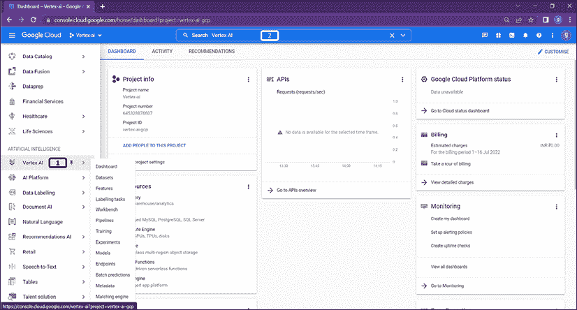

    **图 2.1**：打开 Vertex AI

### 步骤 2：Vertex AI 登陆页

Vertex AI 登陆页上的组件可见于图 2.2：

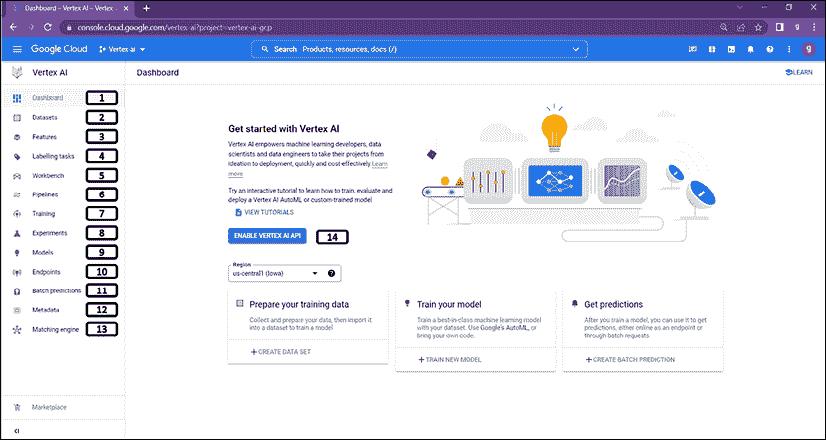

**图 2.2**：Vertex AI 登陆页

Vertex AI 登陆页上各组件的简要说明如下：

1.  **Vertex AI 仪表盘**：Vertex AI 的登陆页。

2.  **数据集**：数据集可以是有组织的（结构化），也可以是无组织的（非结构化）。它具有受管元数据，如标注（目前仅支持 `Cloud Storage` 和 `BigQuery`）。

3.  **特征存储**：特征存储将提供一个用于组织、存储和提供 ML 特征的中央存储库。这解决了特征重复开发和高质量特征利用不足的问题。中央存储库明确了谁负责创建、存储和调用特征。特征存储提供高吞吐量的批量请求和低延迟的在线请求。

4.  **标签**：标记数据将是机器学习开发生命周期的第一阶段。人工标注员将协助完成此标注任务。

5.  **Workbench**：`Vertex AI Workbench` 是整个数据科学流程的单一开发平台。`Vertex AI Workbench` 提供托管笔记本（Google 托管环境，便于运维）和用户托管笔记本（供需要完全控制其环境的用户使用）。

6.  **流水线**

    Vertex AI 流水线通过以无服务器方式协调您的机器学习流程，并利用 Vertex ML Metadata 保留工作流的工件，使您能够自动化、监控和管理您的 ML 系统。

7.  **训练**

    Vertex AI 的主要模型训练方法由训练流水线组成。

8.  **实验**

    在为某个问题创建模型时，确定哪个模型适合该特定用例至关重要。Vertex AI Experiments 赋予您跨多种 ML 框架和训练设置（包括 TensorFlow、PyTorch 和 scikit-learn）监控、分析、比较和搜索的能力。

9.  **模型**

    ML 模型包含直接加载或通过训练流水线创建的信息。被称为模型的机器学习解决方案充当版本（即模型的实际实现）的容器。

10. **端点**

    通过将训练好的模型部署到端点来提供预测服务。根据请求进行消歧，端点可能包含一个或多个模型及其变体。

11. **批量预测**

    对于数据量过大、使用在线预测方法处理时间过长的情况，Vertex AI 批量预测提供了一种替代方案。它为异步响应提供了一种高效、无服务器且可扩展的解决方案。用户无需将模型部署到端点，即可从模型资源获取批量预测。

12. **元数据**

    您可以查询元数据，以帮助评估、调试和审核机器学习系统的性能及其生成的工件。元数据还允许您记录 ML 系统创建的元数据和工件。

13. **匹配引擎**

    Matching Engine 提供市场上最先进的向量相似度匹配（也称为近似最近邻）服务，以及用于训练语义嵌入以用于相似度匹配用例的市场领先技术。

### 1. 启用 Vertex AI API 以继续工作

本书通过实际示例涵盖了 Vertex AI 的各种实体。我们将从 Vertex AI 的 AutoML 开始。

## Vertex AI AutoML

作为一组机器学习解决方案，AutoML 使机器学习经验较少的软件开发者能够训练专门针对其公司需求定制的高质量模型。Google 开发的迁移学习和神经架构搜索技术对于该系统的运行至关重要。

此环境是完全托管的，这意味着所有操作程序、基础设施和模型管理都由系统负责。用户可以使用简单的图形用户界面，快速训练、测试和部署机器学习模型，以解决涉及表格数据、视觉、翻译和自然语言的问题。这些任务最快可在几分钟内完成。Vertex AI 无疑是目前市场上最全面的自动化机器学习解决方案。

数据集是机器学习生命周期的第一步，要开始您需要数据。Vertex AI 目前支持四种数据类型的托管数据集——表格、图像、文本和视频。下面列出了 AutoML 针对每种数据类型支持的任务：

*   **表格数据：**
    *   分类
    *   回归
    *   预测
*   **图像数据：**
    *   分类（单标签和多标签）
    *   图像分割
    *   图像目标检测
*   **文本数据：**
    *   分类（单标签和多标签）
    *   文本实体提取
    *   文本情感分析
*   **视频数据：**
    *   动作识别
    *   分类
    *   目标跟踪

### 数据集的优势

*   在中心位置管理您的数据集。
*   轻松创建标签和其他注释集。
*   维护迭代开发和治理框架的历史记录。
*   通过利用相同的数据集训练 AutoML 和自定义模型，让用户能够比较模型性能。
*   创建数据可视化和统计信息。
*   自动将数据划分为训练集、测试集和验证集。

让我们从表格数据开始。

## 表格数据集的创建

使用来自 Kaggle 的个人心脏病关键指标数据，这是一个分类任务。数据可从以下链接下载。

[`www.kaggle.com/datasets/kamilpytlak/personal-key-indicators-of-heart-disease`](https://www.kaggle.com/datasets/kamilpytlak/personal-key-indicators-of-heart-disease)

如图 2.3 所示，在 `us-centra1`（单区域）下创建了 `automl_tabular` 存储桶。数据包含 300K+ 条记录，但我们的实操仅使用 10K 条。`Train_data.csv` 用于训练，`test_data.csv` 将用于批量预测（包含 5 条排除目标列的随机记录）。

让我们从高层了解数据。数据包含约 18 列。`HeartDisease` 列是目标列（二分类），包含 Yes 和 No 值。

**分类列：** `Smoking`、`alcoholdrinking`、`stroke`、`diffwalking`、`sex`、`agecategory`、`race`、`diabetic`、`physicalactivity`、`genhealth`、`asthma`、`kidneydisease`、`skincancer`

**连续列：** `BMI`、`PhysicalHealth`、`MentalHealth`、`SleepTime`

图 2.3 显示了上传到云存储存储桶的数据：


**图 2.3**：数据上传到云存储存储桶

请按照以下步骤创建数据集：

### 步骤 1：选择数据集标签页

可以在图 2.4 中看到数据集标签页：


**图 2.4**：数据集标签页的选择

### 步骤 2：创建数据集：点击创建

数据集的着陆页如图 2.5 所示：


**图 2.5**：数据集创建

#### 1. 数据集创建的详细信息

详细信息可见于图 2.6：


**图 2.6**：表格数据集

1.  为数据集提供名称。
2.  在选项中选择 `Tabular`（表格）。
3.  选择分类（因为数据集中的目标变量是分类的）。
4.  选择区域为 `us-central1`。
5.  高级选项 - 用于加密。
6.  点击创建。

### 步骤 3：为创建的数据集选择数据

数据集创建后，将自动显示图 2.7 中的屏幕：


**图 2.7**：数据集创建的数据选择

1.  从云存储选择 CSV 文件（选择 `train.csv`，数据集也可以直接从本地机器或从 BigQuery 上传）。
2.  点击浏览（用户可以添加多个文件）。
3.  选择需要上传到数据集的文件。
4.  点击选择。
5.  点击继续。
6.  统计信息生成

### 步骤 3：统计信息生成

数据集创建后，用户将被带到分析页面，如图 2.8 所示：


**图 2.8**：数据的统计信息生成

1.  点击生成统计信息（生成统计信息有助于 AutoML 在模型训练期间决定对数据应用的转换）。

### 步骤 3：生成统计信息的结果

生成统计信息会填充所有列的缺失值详情和唯一值，如图 2.9 所示：


**图 2.9**：生成的统计信息

1.  此外，用户可以通过点击列来查看所有列的分布。

## 模型训练

数据集创建完成后，我们可以启动模型训练。如果模型训练使用 AutoML，用户无需担心算法选择。请按照以下步骤开始模型训练：

### 步骤 1：模型训练准备

核对完数据统计信息后，用户可点击“完成”，如图 2.9 所示，以导航至训练阶段，如图 2.10 所示：


**图 2.10**：表格 AutoML 模型训练启动

1.  点击“训练新模型”。

### 步骤 2：训练方法选择

模型训练的第一步是选择数据集和目标，如图 2.11 所示：


**图 2.11**：训练方法选择

1.  选择已创建的数据集。
2.  选择目标为分类（因为目标列是分类型的）。
3.  选择 AutoML。
4.  点击“继续”。

### 步骤 3：模型详情选择

模型详情允许用户在训练新模型或已训练模型的新版本之间进行选择，如图 2.12 所示：


**图 2.12**：模型选择详情

1.  选择“训练新模型”。
2.  如果模型已训练，且用户因数据变更想要重新训练模型，则此选项允许他们使用新版本训练模型。
3.  为模型提供名称。
4.  为模型提供描述。
5.  选择目标列。
6.  如果选中该选项，数据集的测试拆分可导出到 BigQuery。
7.  点击“高级选项”可让用户选择数据拆分方式。

### 步骤 4：训练数据拆分

点击高级选项将提供有关数据拆分的更多选项，如图 2.13 所示：


**图 2.13**：模型选择详情（数据拆分）

1.  80% 的数据用于训练，10% 分别用于验证和测试。此拆分是随机进行的。
2.  用户也可提供一个额外的列，指明数据集中每条记录的拆分情况。
3.  如果选择按时间顺序分配，前 80% 的数据将用于训练，接下来的 10% 用于验证，最后 10% 的数据用于测试。
4.  高级选项 - 用于加密。
5.  点击“继续”。

### 步骤 5：训练选项

为用户提供转换选项，如图 2.14 所示：


**图 2.14**：训练选项（数据转换）

1.  已分配目标列。
2.  AutoML 并不总是选择要应用的正确转换。最好手动检查并更改转换类型。点击箭头以更改转换类型。
3.  如果需要从训练中排除任何列，则需选择该列。
4.  选中列后，点击"`-`"。
    （在我们的用例中，我们考虑所有列进行训练，因此无需执行步骤 3 和 4）。
5.  点击“高级选项”。

### 步骤 6：选择优化目标

将为用户提供额外的训练设置选项，如图 2.15 所示：


**图 2.15**：训练选项（优化目标）

1.  默认情况下，AutoML 认为所有列同等重要，但用户可选择为所需列增加更多重要性。
2.  根据用例，为用户提供选择优化目标的选项。
3.  点击“继续”。

### 步骤 7：计算资源和定价

模型训练的最后一步如图 2.16 所示：


**图 2.16**：训练启动

1.  用户可指定训练的最大节点小时数，表格数据集的最小值为 1。节点小时数代表虚拟机用于训练模型的时间。
2.  可启用早停，如果模型无法进一步训练，则停止训练。
3.  点击“开始训练”。

### AutoML 推荐的表格数据结构（分类和回归）

*   数据必须不超过 100 GB
*   列数必须大于 2 且不超过 1000
*   行数必须大于 1000 且小于 100000000

## 模型评估

我们衡量模型预测质量的方法称为模型评估。为此，AutoML 会在数据集的测试拆分上评估训练模型的性能，10% 的训练数据将用于评估（参考图 2.13）。

### 步骤 1：检查模型训练

训练状态可在图 2.17 中查看：


**图 2.17**：训练完成

1.  模型训练完成后，将以绿色勾号高亮显示。
2.  模型训练也将列在 Vertex AI 的训练部分中（点击它）。

### 步骤 2：模型训练结果

训练作业将列在训练部分下，如图 2.18 所示：


**图 2.18**：训练作业下列出的训练作业

1.  训练流水线将列出 AutoML 的训练作业。
2.  自定义作业将列出自定义模型的训练作业。
3.  超参数调优作业将列出带有超参数调优的自定义模型的训练作业。
4.  前面步骤中训练的 AutoML 模型（点击它）。训练好的模型也将列在 Vertex AI 的模型部分下。

### 步骤 3：模型评估

点击模型将导航至模型部分，如图 2.19 所示：


**图 2.19**：训练模型评估


## 模型训练与评估

模型训练完成后，它将成为模型的第一个版本。当训练多个模型时，它提供选择特定模型版本的选项。

训练好的模型可导出为 TensorFlow 软件包，且模型可导出到 Cloud Storage。

“评估”提供关于目标变量类别信息的详情。用户可选择任意特定类别，分别查看每个类别的评估指标。

列出不同的评估指标，并附带部分指标的可视化信息。可调整置信度阈值，以在不同置信度水平下检查图表。

评估指标的图形表示（随置信度阈值变化而变化）。

“批量预测”提供批量预测选项。

“部署和测试”提供在线预测选项。

“版本详情”提供模型版本的各种详情（点击“版本详情”）。

### 步骤 4：混淆矩阵和特征重要性

向下滚动将显示有关其他指标的信息，如图 2.20 所示：


**图 2.20：训练模型评估**

1.  混淆矩阵，点击项目计数以获取实际计数的矩阵。
2.  变量重要性信息（变量重要性使用采样 Shapley 方法计算）。

### 步骤 5：模型版本详情

将显示有关模型的更多详情，如图 2.21 所示：


**图 2.21：训练模型详情**

*   列出模型的各种详情。
*   模型和试验中的详细日志消息可用。

## 批量预测

批量预测请求是异步的。旨在单个任务中管理大量实例并执行更复杂的模型。每个请求可处理一个或多个实例。预测结果将写入您在 Cloud Storage 中选择位置的输出文件中。请按以下步骤进行批量预测：

### 步骤 1：创建批量预测

创建批量预测时，用户需输入所有详情，如图 2.22 所示：


**图 2.22：模型的批量预测**

1.  点击“创建批量预测”。
2.  为预测提供名称。
3.  选择用于预测的模型。
4.  用于预测的数据可从 Cloud Storage 存储桶或 BigQuery 获取。
5.  由于我们选择了云存储，请从存储桶中选择文件。
6.  选择输出格式。输出可以直接转储到 BigQuery 表中，或以 `csv`/`jsonl`/`TFrecord` 格式存储在云存储中。
7.  提供输出位置。
8.  点击**创建**。

批量预测可能需要几分钟到几小时，具体取决于记录数量。重要的是，用户无需部署模型即可进行批量预测。

### 步骤 2：批量预测的输出

批量预测完成后，输出将存储到云存储中，如图 2.23 所示：


**图 2.23：批量预测输出**

每条记录将创建一个 CSV 文件（`prediction_results.csv`）。`Prediction.csv` 包含输入记录的信息以及不同类别的概率得分。如果预测过程中遇到任何错误，`Error_stats.csv` 将为用户提供相关信息。

## 在线预测的模型部署

我们将打包成 Docker 镜像进行部署的模型包，包含执行模型所需的所有部分，包括运行环境、ML 框架、存储的模型文件和支持的后端微服务。另一方面，端点是计算资源所在的位置，您的模型在那里真正处理预测查询。对于自动扩缩，用户可以选择机器类型和其他因素。

模型必须部署在端点上，才能接受基于它的预测。请按照以下步骤部署模型。

### 步骤 1：模型部署

可以在**部署和测试**下发起模型部署，如图 2.24 所示：


**图 2.24：模型部署**

1.  转到**部署和测试**标签页。
2.  选择**部署到端点**。

### 步骤 2：端点定义

端点定义涉及的步骤可见于图 2.25：


**图 2.25：端点创建**

1.  选择**创建新端点**。如果模型需要部署到现有端点，将提供**添加到现有端点**选项。
2.  为端点提供名称。
3.  除非用于私有访问，否则访问权限可以是标准的。
4.  点击**继续**。

### 步骤 3：模型设置

可以选择用于预测的流量分配和硬件，如图 2.26 所示：


**图 2.26：部署的模型设置**

1.  如果模型部署在多个端点中，可以在它们之间进行流量分配。如果模型仅部署在一个端点中，则必须设置为 100%。
2.  预测所需的节点数量。
3.  选择机器类型（如果模型非常复杂，建议选择配置良好的机器）。

向下滚动以选择日志记录选项，然后点击**继续**。

### 步骤 4：模型监控

按照图 2.27 所示步骤，在生产环境中启用模型监控：


**图 2.27：模型监控**

1.  用户可以为已部署的模型启用模型监控（模型也可以在不启用监控的情况下部署）。
2.  为监控作业提供名称。
3.  监控将由多个作业完成。需要提供作业的时间长度。如果预期负载较高，则建议设置较低的数值，反之亦然。
4.  用于接收警报的邮箱地址。
5.  可在监控窗口内选择请求的百分比进行采样。

输入架构对于 AutoML 模型是可选的，可以忽略。向下滚动并点击**继续**。

### 步骤 5：监控目标

模型性能会随时间下降。按照图 2.28 所示步骤选择模型监控目标：


**图 2.28：监控目标**

1.  预测请求记录在同一项目的 BigQuery 表中。然后分析记录请求中包含的输入特征值，以检测偏差或漂移（这需要训练数据进行比较）。
2.  模型监控跟踪特征对模型预测贡献随时间的变化（不需要训练数据）。
3.  由于我们选择了偏差检测，用户需要提供训练数据选项。
4.  选择用于训练 AutoML 模型的数据集。
5.  提供目标列名称。
6.  点击**部署**。

将模型部署到端点需要几分钟时间。

### 步骤 6：测试已部署的模型

按照图 2.29 所示步骤，在进行在线预测之前，在平台上测试已部署的模型：


**图 2.29：在线预测测试**

1.  模型部署成功。
2.  ID 是已部署模型的模型 ID。（一个端点可以部署多个模型）。相同的 ID 用于在线预测。
3.  即使在用户获得在线预测之前，用户也可以通过填充列值并点击屏幕底部的**预测**，在平台上测试模型输出。
4.  输出预测将填充概率得分。

## 服务账号创建

已部署的模型已准备好为预测请求提供服务。在发送数据和模型详细信息进行预测时，用户也应经过身份验证。在这些场景中，不能使用用户 GCP 账号详细信息进行身份验证；需要服务账号。请按照以下步骤创建服务账号。打开 **IAM 和管理** 并按照图 2.30 所示步骤操作：

### 步骤 1：服务账号创建


**图 2.30：服务账号**

1.  在 **IAM 和管理** 部分下选择**服务账号**。
2.  点击**创建服务账号**。

### 步骤 2：服务账号详细信息

按照图 2.31 所示步骤添加账号详细信息：


**图 2.31：服务账号详细信息**

1.  为服务账号提供名称。
2.  提供服务账号 ID。
3.  为服务账号提供描述。
4.  点击**创建并继续**。

更改服务账号的访问权限对此练习不是必需的。

### 步骤 3：为服务账号分配角色

在服务账号创建过程中，我们也授予该服务账号所需的某些角色访问权限。授予这些角色很重要，因为我们将使用同一个服务账号进行自定义模型构建、流水线等操作。按照图 2.32 所示步骤授予角色。（这是可选步骤，也可根据需要随时完成）。


**图 2.32：授予服务账号 AI Platform 访问权限**

1.  点击**选择角色**。
2.  在操作下选择 **AI Platform**。
3.  选择 **AI Platform 管理员**。

同样，添加图 2.33 中显示的属于 Cloud Storage 和 Vertex AI 的其他一些角色：


**图 2.33：授予服务账号其他访问权限**

### 步骤 4：服务账号管理密钥

创建服务账号后，用户需要创建密钥。按照图 2.34 和图 2.35 所示步骤创建密钥：


**图 2.34：服务账号管理密钥**

1.  服务账号现已创建。
2.  点击已创建服务账号的操作，然后点击**管理密钥**。

### 步骤 5：服务账号添加密钥


**图 2.35：服务账号密钥创建**

1.  点击**添加密钥**并选择**创建新密钥**。

弹出窗口将提供以 `json`/`P12` 格式创建密钥的选项。选择 `json` 格式，将下载一个 `.json` 文件。

> **注意：** 用户需要在 Python 代码中提供 `json` 文件的完整路径以进行身份验证。我们可以在下一章中使用相同的密钥。

## 提供在线预测

模型已部署到 GCP 端点。用户可以在本地机器上使用 Python 从已部署的模型获取预测结果。

通过以下命令安装 `google-cloud-aiplatform` Python 包：

```
pip install google-cloud-aiplatform
```

更多关于该包的信息可从以下链接获取：

<https://pypi.org/project/google-cloud-aiplatform/>

### 用于预测的 Python 代码

```
### 安装 google-cloud-aiplatform

from google.cloud import aiplatform

from google.protobuf import json_format

from google.protobuf.struct_pb2 import Value

import os

def online_pred_tabular(project, model_id, instance_dict, location, api_endpoint):

    client_options = {"api_endpoint": api_endpoint}

    client = aiplatform.gapic.PredictionServiceClient(client_options=client_options)

    instance = json_format.ParseDict(instance_dict, Value())

    instances = [instance]

    parameters_dict = {}

    parameters = json_format.ParseDict(parameters_dict, Value())

    endpoint = client.endpoint_path(project=project, location=location, endpoint_id=model_id)

    response = client.predict(endpoint=endpoint, instances=instances, parameters=parameters)

    predictions = response.predictions

    for prediction in predictions:
        print(" prediction:", dict(prediction))

### 用于 GCP 认证。提供 json 文件的完整路径

os.environ['GOOGLE_APPLICATION_CREDENTIALS'] = ""

project_id = "vertex-ai-gcp"  # project_ID 可从 GCP 仪表板获取（参考图 2.35）

model_id = "2047967950081622016"  # Model_ID 参考图 2.29

location = "us-central1"  # Location 参考图 2.25

api_endpoint = "us-central1-aiplatform.googleapis.com"

### 采用 Json 格式的输入

inputs = {"BMI": "16.6", "Smoking": "Yes", "AlcoholDrinking": "No", "Stroke": "No", "PhysicalHealth": "3", "MentalHealth": "30", "DiffWalking": "No", "Sex": "Female", "AgeCategory": "55-59", "Race": "White", "Diabetic": "Yes", "PhysicalActivity": "Yes", "GenHealth": "Very good", "SleepTime": "5", "Asthma": "Yes", "KidneyDisease": "No", "SkinCancer": "Yes"}

### 调用函数

online_pred_tabular(project_id, model_id, inputs, location, api_endpoint)
```

### Python 代码的输出

Python 代码的输出可见于图 2.36：


**图 2.36：Python 代码输出**

输出包含每个类别的概率得分。

注意：存在多种认证方式，代码中使用的是最简单的一种。

`Project_ID` 可从 GCP 仪表板（平台着陆页）获取，如下截图所示：


**图 2.37：仪表板中的 Project_ID**

## 模型取消部署与删除端点

在所有模型都从部署中移除之前，无法删除端点。

### 步骤 1：选择端点

已部署的模型将列在端点下，如图 2.38 所示：


**图 2.38：模型部署所在的端点**

1.  导航至端点。
2.  点击需要删除的端点。

### 步骤 2：从部署中移除模型


**图 2.39：从部署中移除模型**

1.  选择要移除的模型，然后点击从端点取消部署模型。
2.  一个弹出窗口将请求确认。

### 步骤 3：删除端点


**图 2.40：删除端点**

1.  选择要删除的端点，然后点击移除端点。

注意：部署模型会产生费用，请确保将模型从部署中删除。

## 模型删除

在使用表格数据进行 AutoML 的整个过程中，我们创建了数据集和模型。

请按照图 2.41 中提到的步骤删除训练好的模型：


**图 2.41：删除训练好的模型**

1.  导航至模型。
2.  选择要删除的训练模型。

## 数据集删除

请按照图 2.42 中描述的步骤删除创建的数据集：


**图 2.42：数据集删除**

1.  导航至数据集。
2.  选择数据集并点击删除数据集。

注意：批量预测输出存储在云存储中，请删除这些文件以完成清理工作。

## 结论

在本章中，我们了解了 Vertex AI 及其主要功能。我们使用了 AutoML 表格，创建了数据集，训练了模型，并将其部署用于预测。在下一章中，我们将使用 AutoML 处理图像和文本数据。

## 问题

1.  用户能否在不创建托管数据集的情况下训练 AutoML 模型？
2.  能否将多个模型部署到同一个端点？
3.  为什么获取在线预测需要服务账号？
4.  AutoML 可以处理表格数据的哪些不同任务？

## 加入我们书籍的 Discord 空间

加入书籍的 Discord 工作区，获取最新动态、优惠、全球科技资讯、新版本发布及作者见面会：

<https://discord.bpbonline.com>


# 第 3 章 AutoML 图像、文本和预构建模型

## 简介

在上一章中，我们开始使用 AutoML 处理表格数据。本章继续介绍 AutoML 处理图像和文本数据的部分，并提供针对图像和文本数据的分步说明。GCP 还提供预构建模型，本章将简要介绍它们。本章还将简要讨论 AutoML 的优势和局限性。

## 结构

在本章中，我们将讨论以下主题：

*   Vertex AI AutoML 处理图像数据
*   图像数据集创建
*   图像模型训练
*   图像模型评估
*   图像批量预测
*   图像在线预测的模型部署
*   图像在线预测服务
*   Vertex AI AutoML 处理文本数据
*   文本数据集创建
*   文本模型训练
*   文本模型评估
*   文本批量预测
*   文本在线预测的模型部署
*   文本在线预测服务
*   GCP 中的预构建模型
*   AutoML 的优势
*   AutoML 的局限性

## 目标

在本章结束时，您将能够为图像和文本数据创建数据集、训练 AutoML 模型、获取批量预测，并部署模型用于在线预测。此外，您还将了解 GCP 的预构建模型。

## Vertex AI AutoML 处理图像数据

AutoML 处理图像可执行单标签分类、多标签分类、目标检测和图像分割任务。对于 AutoML 图像单标签分类的实操练习，我们使用船只分类图像数据，可从以下链接下载：

<https://www.kaggle.com/datasets/imsparsh/dockship-boat-type-classification>


该数据集采用 CC0：公共领域许可，包含属于九个类别的图像。对于我们的练习，我们考虑属于游轮、渡轮和皮划艇的图像（从每个类别中随机选择 50 张图像）。

在 `us-centra1`（单一区域）下创建了 `AutoML_image_data` 存储桶，并上传了包含属于三个类别图像的三个文件夹。在存储桶中创建了一个名为 `Data_for_batch_pred` 的额外文件夹，其中包含一张随机选择的用于批量预测的图像。云存储的快照如图 3.1 所示：


图 3.1：上传至云存储的图像数据

## AutoML 图像数据工作流

处理 AutoML 图像数据的步骤与 AutoML 表格数据类似，但在创建数据集和模型训练时略有不同。对于表格数据，我们可以直接使用上传到云存储的 `.csv` 文件创建数据集；但对于图像数据，用户需要创建一个 CSV 文件，其中包含图像所属的训练/验证/测试集信息、图像的完整路径以及其所属的类别。

虽然我们这里只处理属于三个类别的 150 张图像，手动创建包含所需信息的 CSV 很容易。但如果处理大量图像，手动创建 CSV 就不是可行的方案了。不过，在 Cloud Shell 中运行几行命令就能轻松搞定。

```
for f in $(gsutil ls gs://AutoML_image_data/Cruise_ships/); do echo UNASSIGNED,$f,Cruise_ships;done>>class_labels.csv
```

```
for f in $(gsutil ls gs://AutoML_image_data/Ferry_boat/); do echo UNASSIGNED,$f,Ferry_boat;done>>class_labels.csv
```

```
for f in $(gsutil ls gs://AutoML_image_data/Kayak/); do echo UNASSIGNED,$f,Kayak;done>>class_labels.csv
```

这些命令将创建一个包含三列的 CSV 文件：

*   设置图像用于训练/验证/测试。在本例中我们使用了 `UNASSIGNED`；平台将自动选择用于训练、验证和测试的图像。
*   图像的完整路径。
*   图像所属的类别。

使用以下命令将 CSV 文件推送到云存储桶：

```
gsutil cp class_labels.csv gs://AutoML_image_data/class_labels.csv
```

打开命令 Shell 并输入如图 3.2 所示的命令：


**图 3.2：** 用于 CSV 创建的 gs 命令（图像数据）

1.  点击图标打开 Cloud Shell。
2.  输入命令（输入一条命令后按回车键）。
3.  新的 CSV 文件已创建并可在云存储中使用。

创建的 CSV 文件快照如图 3.3 所示：


**图 3.3：** 创建的 CSV 快照（图像数据）

## 图像数据集创建

只有创建数据集后，才能启动 AutoML 模型训练。请按照以下步骤创建用于图像分类的图像数据集：

### 步骤 1：创建数据集

导航至 Vertex AI 的数据集模块，如图 3.4 所示：


**图 3.4：** 数据集着陆页

1.  点击**创建**。

### 步骤 2：选择目标

数据集创建标签页将出现，如图 3.5 所示：


**图 3.5：** 图像数据集选择

1.  选择**图像**标签页。
2.  选择**图像分类（单标签）**。
3.  为数据集提供名称。
4.  点击**创建**。

### 步骤 3：选择数据

数据可从云存储或本地系统中选择。按照图 3.6 中提到的步骤从云存储上传图像：


**图 3.6：** 图像数据集的数据选择

1.  标签存储在与模型目标关联的标注集中，将自动填充。
2.  选择从云存储导入文件。
3.  点击**浏览**。
4.  选择创建的 CSV 文件（参考图 3.6）。
5.  点击**选择**。
6.  点击**继续**。

### 步骤 4：数据导入完成

数据导入完成后，数据（图像）将如图 3.7 所示显示：


**图 3.7：** 图像数据集数据导入完成

1.  导航至**浏览**标签页。
2.  上传的图像根据输入的 CSV 文件进行分类。
3.  点击**训练新模型**以开始模型训练。

数据集创建后，将列在 Vertex AI 的数据集模块中，如图 3.8 所示：


**图 3.8：** Vertex AI 数据集下创建的图像数据集

> **注意：**
>
> *   GCP 建议每个标签至少拥有 1000 张图像（每个标签最少 10 张）。
> *   最大文件大小为 30MB。

## 图像模型训练

数据集创建完成且数据上传到数据集后，我们可以开始训练 AutoML 模型。请按照以下步骤启动模型训练：

### 步骤 1：模型训练方法

点击**训练新模型**后，用户将导航至如图 3.9 所示的页面：


**图 3.9：** 图像训练方法选择

1.  创建的数据集将自动填充。
2.  标注集也将自动选中。
3.  创建数据集时选择的目标会自动选中。
4.  选择 **AutoML** 进行训练。
5.  点击**继续**。

### 步骤 2：模型详情

模型训练的第二步是用户提供模型详情。请按照图 3.10 所示步骤操作：


**图 3.10：** 图像模型训练的模型详情

1.  选择**训练新模型**（如果要训练现有模型的新版本，请选择下方选项）。
2.  提供模型名称。
3.  提供模型描述。
4.  选择**随机分配**（因为我们在创建 CSV 文件时指定了 unassigned）。
5.  默认情况下，80% 的数据用于训练，10% 用于验证，10% 用于测试。不过，用户可根据需求进行更改。
6.  点击**继续**。

### 步骤 3：可解释性

模型可解释性是用户可选择的选项；目前我们不选择该选项。可解释性将在本书后面详细讨论。用户可跳过选择并点击**继续**，如图 3.11 所示：


**图 3.11：** 图像模型可解释性

1.  点击**继续**。

### 步骤 4：计算和定价

填写训练的计算时长，如图 3.12 所示：


**图 3.12：** 图像模型训练的计算和定价详情

1.  指定模型训练时长（图像数据最少训练时长为 8 节点小时）。
2.  启用提前停止（如果观察到无进一步改进则停止训练）。
3.  点击**开始训练**。

### 步骤 5：模型训练完成

模型训练完成后，数据集页面将更新，如图 3.13 所示：


**图 3.13：** 数据集页面上的图像模型训练状态

1.  绿色对勾表示模型训练完成。
2.  点击**模型注册表**。

### 步骤 6：模型注册表

训练好的模型将列在模型注册表中，如图 3.14 所示：


**图 3.14：** 模型注册表中列出的训练好的图像模型

1.  训练好的模型以用户提供的模型名称列出。点击模型名称。
2.  **模型 ID**，即模型的唯一 ID，将用于在线预测。

### 步骤 7：模型版本选择

模型版本列在模型注册表下，如图 3.15 所示：


**图 3.15：** 模型注册表上的图像模型版本

1.  选择模型版本（因为我们训练了一个新模型，所以有一个版本可用）。点击**1**。

> **注意：** 训练好的模型也将作为训练流水线列在 Vertex AI 的训练模块下。

## 图像模型评估

与 AutoML 表格模型类似，AutoML 图像训练模型在继续进行批量/在线预测之前需要进行评估。

### 步骤 1：模型性能

在测试数据上训练好的模型性能如图 3.16 所示：


**图 3.16：** 在图像数据集上训练的模型评估

## 模型版本与评估

1.  当模型训练完成时，它将成为该模型的第一个版本。当训练多个模型时，系统提供选项以选择特定的模型版本。
2.  **EVALUATE** 提供关于目标变量类别信息的详细情况，用户可以选择任意特定类别，分别查看每个类别的评估指标。
3.  列出了不同的评估指标，并附带部分指标的可视化信息。置信度阈值可调整，以便在不同置信度水平下检查图表。
4.  评估指标的图形化表示（随置信度阈值变化而变化）。
5.  **BATCH PREDICT** 提供批量预测选项。
6.  **DEPLOY AND TEST** 提供在线预测选项。
7.  **VERSION DETAILS** 提供模型版本的各种详细信息。

### 步骤 2：混淆矩阵

向下滚动以获取混淆矩阵，如图 3.17 所示：


**图 3.17：** 训练模型的混淆矩阵

1.  混淆矩阵。
2.  **VERSION DETAILS**（训练时间、训练和测试项目详情可在版本详情下查看）。

## 批量预测

无需将模型部署到部署环境即可发起异步预测请求。

### 步骤 1：准备批量预测的输入

需要按照图 3.18 所示的格式准备用于批量预测的图像详情和图像完整路径。该文件需采用 JSONL 格式。


**图 3.18：** 包含用于批量预测的图像数据的 JSONL 文件

如图 3.19 所示，JSONL 文件连同用于批量预测的图像一起上传到同一存储桶下的 `Data_for_batch_pred` 文件夹中：


**图 3.19：** 上传到云存储的 JSONL 文件

### 步骤 2：初始化批量预测

按照图 3.20 所示步骤开始批量预测：


**图 3.20：** 图像数据的批量预测

1.  点击 **CREATE BATCH PREDICTION**。
2.  为预测任务提供名称。
3.  选择用于预测的模型。
4.  选择 JSONL 文件。
5.  选择输出格式为 JSONL。
6.  选择用于存储批量预测输出的 Cloud Storage 存储桶。
7.  点击 **CREATE**。

批量预测可能需要几分钟到几小时不等，具体取决于图像数量。重要的是，用户无需部署模型即可进行批量预测。

### 步骤 3：批量预测的输出

批量预测的输出将在 Cloud Storage 中可用，如图 3.21 所示：


**图 3.21：** 存储回云存储的批量预测输出

1.  包含 JSONL 文件的文件夹将在 Cloud Storage 存储桶下创建。

可使用记事本访问 JSONL 输出，其中包含关于输入文件的信息以及每个类别的预测置信度分数，如下所示。每行包含输入文件信息、类别名称和概率分数：

```
{"instance":{"content":"gs://AutoML_image_data/Data_for_batch_pred/FB.jpg","mimeType":"image/jpeg"},"prediction":{"ids":["4888950415359475712","2583107406145781760","7194793424573169664"],"displayNames":["Ferry_boat","Kayak","Cruise_ships"],"confidences":[0.9992281,7.1564014E-4,5.6237353E-5]}}
```

```
{"instance":{"content":"gs://AutoML_image_data/Data_for_batch_pred/kayak.jpg","mimeType":"image/jpeg"},"prediction":{"ids":["2583107406145781760","4888950415359475712","7194793424573169664"],"displayNames":["Kayak","Ferry_boat","Cruise_ships"],"confidences":[0.9999988,1.2133818E-6,5.55904E-9]}}
```

```
{"instance":{"content":"gs://AutoML_image_data/Data_for_batch_pred/CS.jpg","mimeType":"image/jpeg"},"prediction":{"ids":["4888950415359475712","7194793424573169664","2583107406145781760"],"displayNames":["Ferry_boat","Cruise_ships","Kayak"],"confidences":[0.9019485,0.09799572,5.580726E-5]}}
```

## 模型部署与在线预测

与 AutoML 表格模型非常相似，AutoML 图像模型也可以部署到端点以提供在线预测服务。请按照以下步骤进行在线预测：

### 步骤 1：模型部署

模型部署的着陆页如图 3.22 所示：


**图 3.22：** 模型部署页面

1.  转到 **DEPLOY AND TEST** 标签页。
2.  选择 **DEPLOY TO ENDPOINT**。

### 步骤 2：端点定义

按照图 3.23 所示步骤创建端点：


**图 3.23：** 图像分类模型部署的端点创建

1.  如果模型需要部署在现有端点上，选择 **Create new endpoint**，用户可选择 **Add to existing endpoints**。
2.  点击 **CONTINUE**。

### 步骤 3：模型设置

继续进行模型设置以完成模型部署，如图 3.24 所示：


**图 3.24：** 部署设置

1.  在 **Traffic Split** 中填入 `100`，因为我们将仅在 1 个节点上部署模型。
2.  预测所需的节点数量 – 填入 `1`。
3.  为端点启用日志记录。
4.  点击 **DONE**。

向下滚动以选择日志记录选项，然后点击 **CONTINUE**。

### 步骤 4：测试已部署的模型

按照以下步骤在进行在线预测前检查已部署的模型：


**图 3.25：** 图像分类模型部署完成

1.  端点创建完成后，将在 Model Registry 中列出，状态为 active。
2.  用户可上传图像以测试输出。上传的图像将连同每个类别的概率分数一起显示，如图 3.26 所示：


**图 3.26：** 测试图像分类模型的在线预测

## 在线预测服务

模型已部署到 GCP 端点。用户可以使用 Python 本地机器从已部署的模型获取预测。使用上一章中创建的相同服务账号和密钥。

通过以下命令安装 `google-cloud-aiplatform` Python 包：

```
pip install google-cloud-aiplatform
```

更多关于该包的信息可从以下链接获取：

<https://pypi.org/project/google-cloud-aiplatform/>

### 用于预测的 Python 代码


### 安装 google-cloud-aiplatform

```python
import base64
from google.cloud import aiplatform
from google.cloud.aiplatform.gapic.schema import predict
import os

os.environ['GOOGLE_APPLICATION_CREDENTIALS'] = r"E:\service_account_json\vertex-ai-gcp-0a71505b3eae.json"

project_ID = "vertex-ai-gcp"
model_ID = "4810468924636266496"
filename = r"E:\Publication\CHAPTERS\CHAPTER 3\DATA\Batch Pred\FB.jpg"
location = "us-central1"
api_endpoint = "us-central1-aiplatform.googleapis.com"

def predict_image_classification(
    project_ID=project_ID,
    model_ID=model_ID,
    filename=filename,
    location=location,
    api_endpoint=api_endpoint):

    client_options = {"api_endpoint": api_endpoint}
    client = aiplatform.gapic.PredictionServiceClient(client_options=client_options)

    with open(filename, "rb") as f:
        file_content = f.read()

    content_encoded = base64.b64encode(file_content).decode("utf-8")
    instance = predict.instance.ImageClassificationPredictionInstance(content=content_encoded).to_value()
    instances = [instance]
    params = predict.params.ImageClassificationPredictionParams(confidence_threshold=0.5, max_predictions=1).to_value()
    endpoint = client.endpoint_path(project=project_ID, location=location, endpoint=model_ID)
```

```python
response = client.predict(endpoint=endpoint, instances=instances, parameters=params)

predictions = response.predictions

for prediction in predictions:
    print("prediction:", dict(prediction))
```

### 调用函数

```python
predict_image_classification(project_ID, model_ID, filename, location, api_endpoint)
```

Python 代码的输出：

输出可在图 3.27 中查看：


图 3.27：图像分类模型 Python 代码输出

输出包含每个类别的概率得分。

注意：

*   项目 ID 和其他详细信息可从平台获取，具体请参阅第 2 章。
*   部署模型会产生费用，请确保从部署中删除该模型。
*   用户可按第 2 章“Vertex AI 和 AutoML 结构简介”中所述删除模型和数据集。

## 用于文本数据的 Vertex AI AutoML

文本 AutoML 可处理单标签、多标签分类、文本实体提取和文本情感分析任务。对于实际示例，我们使用情感分析数据，可从以下链接下载：

[`www.kaggle.com/datasets/revanthrex/stanford-imdb-sentiment-analysis`](https://www.kaggle.com/datasets/revanthrex/stanford-imdb-sentiment-analysis)

该数据集遵循 CC0：公共领域许可，包含约 25K 条电影评论。评论分为正面和负面评论。

在 `us-centra1`（单一区域）下创建了 `AutoML_text_sentiment_analysis` 存储桶，并上传了两个分别包含 50 条正面和负面评论的文件夹。在存储桶中创建了一个名为 `Batch_prediction` 的额外文件夹，其中包含随机选取的文本评论。云存储的快照如图 3.28 所示：


图 3.28：上传至云存储的文本数据

与图像数据集创建非常相似，即使对于情感分析数据集，我们也需要创建一个 CSV 文件，其中包含有关文本属于训练/验证/测试集的信息、文本的完整路径以及其所属的类别：

```bash
for f in $(gsutil ls gs://AutoML_text_sentiment_analysis/Positive/); do echo UNASSIGNED,$f,1,1;done>>text_sentiment_label.csv

for f in $(gsutil ls gs://AutoML_text_sentiment_analysis/Negative/); do echo UNASSIGNED,$f,0,1;done>>text_sentiment_label.csv
```

这些命令将创建一个包含三列的 CSV 文件：

*   设置文本文件用于训练/验证/测试。在本例中，我们使用了 `UNASSIGNED`，由平台选择用于训练、验证和测试的图像。
*   文本文件的完整路径。
*   其所属的类别。

使用以下命令将 CSV 文件推送到云存储存储桶。

```bash
gsutil cp text_sentiment_label.csv gs://AutoML_text_sentiment_analysis/text_sentiment_label.csv
```

打开命令 Shell 并输入图 3.29 中所示的命令：


图 3.29：CSV 创建的 gs 命令（文本数据）

1.  点击图标以打开 Cloud Shell。
2.  输入命令（输入一条命令并按 Enter 键）。
3.  新的 CSV 文件已创建并可在云存储中使用。

创建的 CSV 文件快照如图 3.30 所示：


图 3.30：创建的 CSV 快照（用于文本数据）

C 列包含值 0 或 1。1 表示正面情感，0 表示负面情感。在 AutoML 的情感分析中，C 列可以是 0 到 10 之间的整数值（最大情感值由用户选择，在本例中 1 为最大值）。如果用户想要捕捉更细粒度的情感，例如 10 个层级，用户可以将文档标记为从 0（最负面）到 9（最正面）。

## 文本数据集创建

只有创建数据集后，才能启动情感分析的 AutoML 模型训练。请按照以下步骤为图像分类创建图像数据集：

### 步骤 1：数据集创建

导航至 Vertex AI 的数据集模块，如图 3.31 所示：


图 3.31：数据集着陆页

1.  点击创建。

### 步骤 2：目标选择

数据集创建标签页将显示，如图 3.32 所示：


图 3.32：文本数据集选择

1.  选择文本标签页。
2.  选择情感分析。
3.  为数据集提供名称。
4.  点击创建。

### 步骤 3：数据选择

数据可从云存储或本地系统中选择。按照图 3.33 中提到的步骤从云存储上传图像：


图 3.33：文本数据的数据选择

1.  标签存储在与模型目标关联的注释集中，将自动填充。
2.  选择从云存储导入文件。
3.  点击浏览。
4.  选择创建的 CSV 文件（参考图 3.29）。
5.  点击选择。
6.  点击继续。

### 步骤 4：数据导入完成

数据导入完成后，数据（图像）将显示如图 3.34 所示：


图 3.34：文本数据集数据导入完成

1.  导航至浏览标签页。
2.  上传的图像根据输入的 CSV 文件进行分类。
3.  点击训练新模型以开始模型训练。

数据集创建完成后，将列在 Vertex AI 的数据集模块中。

注意：

*   至少需要提供 10 个且不超过 100,000 个训练文档总数。建议每个情感值至少有 100 个文档。
*   情感得分值必须是从零开始的连续整数。
*   每个情感得分的文档比例相等

## 文本模型训练

数据集创建完成且数据上传到数据集后，我们可以开始训练 AutoML 模型。请按照以下步骤启动模型训练：

### 步骤 1：模型训练方法

点击训练新模型后，用户将导航至如图 3.35 所示的页面：


图 3.35：文本数据集的训练方法选择

1.  创建的数据集将自动填充。
2.  注释集也将自动选择。
3.  创建数据集时选择的目标将自动选择。
4.  选择 AutoML 进行训练。
5.  点击继续。

### 步骤 2：模型详情

模型训练的下一步是用户提供模型详情，请按照图 3.36 所示步骤操作：


图 3.36：文本数据模型训练的模型详情

1.  选择训练新模型（如果要训练现有模型的新版本，请选择下面的选项）。
2.  提供模型名称。
3.  提供模型描述。
4.  选择随机分配（因为我们在创建 CSV 文件时给出了 unassigned）。默认情况下，80% 的数据将用于训练，10% 分别用于验证和测试。但是，用户可以根据要求进行更改。
5.  点击开始训练。

### 步骤 3：模型训练完成

模型训练完成后，数据集页面将更新，如图 3.37 所示：


图 3.37：数据集页面上的模型训练状态

1.  绿色对勾表示模型训练完成。
2.  点击模型注册表。

### 步骤 4：模型注册表

训练好的模型将列在模型注册表中，如图 3.38 所示：


图 3.38：模型注册表中列出的训练模型

1.  训练好的模型以用户提供的模型名称列出。点击模型名称。

## 2. 模型 ID

`Model ID`，模型的唯一标识符（将用于在线预测）。

### 步骤 7：模型版本选择

模型版本列在模型注册表下，如图 3.39 所示：


图 3.39：模型注册表上的模型版本

1.  选择模型版本（因为我们训练了一个新模型，所以有一个可用版本）。点击 `1`。

> **注意：** 训练好的模型也会在 Vertex AI 的训练模块下作为训练流水线列出。

## 模型评估

任何训练好的模型在进行预测之前都需要经过评估。请按照以下步骤评估模型：

### 步骤 1：训练模型在测试数据上的性能

训练模型在测试数据上的性能如图 3.40 所示：


图 3.40：基于文本数据集训练的模型评估

1.  模型训练完成后，将成为该模型的第一个版本。当训练多个模型时，提供选择特定模型版本的选项。
2.  `EVALUATE` 提供关于情感值类别信息的详情，用户可以选择特定值以分别查看每个类别的评估指标。
3.  列出了不同的评估指标，并提供了部分指标的可视化信息。可以调整置信度阈值，以在不同置信度水平下检查图表。
4.  `DEPLOY AND TEST` 提供在线预测选项。
5.  `BATCH PREDICT` 提供批量预测选项。
6.  `VERSION DETAILS` 提供模型版本的各种详细信息。

> **注意：** 对比文本、图像和表格数据的评估，查看评估指标的差异。

## 批量预测

与表格和图像的训练模型非常相似，文本模型也可以在不部署的情况下用于批量预测。请按照以下步骤进行批量预测：

### 步骤 1：准备批量预测的输入

需要按照图 3.41 所示的格式，准备用于批量预测的图像详细信息和图像的完整路径。文件需采用 `JSONL` 格式。


图 3.41：包含用于批量预测的文本数据的 JSONL 文件

`JSONL` 文件中的每一行代表一个待预测的文件。`JSONL` 文件连同用于批量预测的文本文件一起上传到同一存储桶下的 `Batch_prediction` 文件夹中，如图 3.42 所示：


图 3.42：上传到云存储的 JSONL 文件

### 步骤 2：初始化批量预测

按照图 3.43 所示步骤启动批量预测：


图 3.43：文本数据的批量预测

1.  点击 `CREATE BATCH PREDICTION`。
2.  为预测任务提供名称。
3.  选择用于预测的模型。
4.  选择 `JSONL` 文件。
5.  选择输出格式为 `JSONL`。
6.  选择用于存储批量预测输出的云存储存储桶。
7.  点击 `CREATE`。

批量预测可能需要几分钟到几小时，具体取决于文本文件的数量（以及文本文件的大小）。

### 步骤 3：批量预测的输出

批量预测的输出将在云存储上可用，如图 3.44 所示：


图 3.44：存储回云存储的批量预测输出

1.  包含 `JSONL` 文件的文件夹将在云存储存储桶下创建。

可以使用记事本访问 `JSONL` 输出，它包含关于输入文件的信息以及每个类别的预测置信度分数，如下所示：

```
{"instance":{"content":"gs://AutoML_text_sentiment_analysis/Batch_prediction/228_1.txt","mimeType":"text/plain"},"prediction":{"sentiment":1}}
{"instance":{"content":"gs://AutoML_text_sentiment_analysis/Batch_prediction/227_1.txt","mimeType":"text/plain"},"prediction":{"sentiment":1}}
{"instance":{"content":"gs://AutoML_text_sentiment_analysis/Batch_prediction/182_10.txt","mimeType":"text/plain"},"prediction":{"sentiment":1}}
{"instance":{"content":"gs://AutoML_text_sentiment_analysis/Batch_prediction/180_9.txt","mimeType":"text/plain"},"prediction":{"sentiment":0}}
```

> **注意：** 与图像分类不同，在情感分析的情况下，概率分数将不包含在输出中。

## 用于在线预测的模型部署

部署模型以获取在线预测。请按照以下步骤将模型部署到端点。

### 步骤 1：模型部署

模型部署的着陆页如图 3.45 所示：


图 3.45：文本模型的模型部署页面

1.  转到 `DEPLOY AND TEST` 标签页。
2.  选择 `DEPLOY TO ENDPOINT`。

### 步骤 2：端点定义

按照图 3.46 所示步骤创建端点：


图 3.46：情感模型部署的端点创建

1.  选择 `Create new endpoint`，如果模型需要部署到现有端点，则提供 `Add to existing endpoints` 选项。
2.  点击 `CONTINUE`。

### 步骤 3：模型设置

继续进行模型设置以完成模型部署，如图 3.47 所示：


图 3.47：部署设置

1.  在流量分配中填入 `100`，因为我们将仅在 1 个节点上部署模型。
2.  为端点启用日志记录。
3.  点击 `DONE`。
4.  点击 `DEPLOY`。

### 步骤 4：测试已部署的模型

按照图 3.48 中的以下步骤检查已部署的模型，然后再进行在线预测：


图 3.48：情感分析模型部署完成

1.  模型部署后，状态将变为 `active`。
2.  在框中输入文本以检查预测。
3.  点击 `PREDICT`。
4.  将显示预测分数。

## 提供在线预测服务

模型已部署到 GCP 端点。用户可以使用本地机器上的 Python 从已部署的模型获取预测。使用上一章中创建的相同服务账号和密钥。

通过以下命令安装 `google-cloud-aiplatform` Python 包：

```
pip install google-cloud-aiplatform
```

更多关于该包的信息可从以下链接获取：


[`pypi.org/project/google-cloud-aiplatform/`](https://pypi.org/project/google-cloud-aiplatform/)

### 用于预测的 Python 代码

```python
import base64
from google.cloud import aiplatform
from google.cloud.aiplatform.gapic.schema import predict
from google.protobuf import json_format
from google.protobuf.struct_pb2 import Value
import os

os.environ['GOOGLE_APPLICATION_CREDENTIALS'] = r""  # Full path of the service account key (Json file)
project_ID = "vertex-ai-gcp"
endpoint_id = "5207489379286646784"
content_path = r"E:\Publication\CHAPTERS\CHAPTER 3\DATA\Sentiment analysis\Test"
location = "us-central1"
api_endpoint = "us-central1-aiplatform.googleapis.com"

def predict_text_sentiment_analysis_sample(
    project_ID: str,
    endpoint_id: str,
    content_path: str,
    location: str = "us-central1",
    api_endpoint: str = "us-central1-aiplatform.googleapis.com"
):
    client_options = {"api_endpoint": api_endpoint}
    client = aiplatform.gapic.PredictionServiceClient(client_options=client_options)
    for path in os.listdir(content_path):
        with open(os.path.join(content_path, path)) as f:
            content1 = f.readlines()
        instance = predict.instance.TextSentimentPredictionInstance(content=str(content1[0])).to_value()
        instances = [instance]
        parameters_dict = {}
        parameters = json_format.ParseDict(parameters_dict, Value())

        endpoint = client.endpoint_path(project=project_ID, location=location, endpoint=endpoint_id)

        response = client.predict(endpoint=endpoint, instances=instances, parameters=parameters)

        predictions = response.predictions

        for prediction in predictions:
            print(" prediction:", dict(prediction))
```

### 调用函数进行情感预测

```python
predict_text_sentiment_analysis_sample(project_ID, endpoint_id, content_path)
```

### Python 代码的输出

输出可在图 3.49 中查看：


图 3.49：情感分析模型 Python 代码输出

输出包含文本文件所属的情感类别。

注意：项目 ID 和其他详细信息可按第 2 章所述从平台获取。

部署模型会产生费用，请确保从部署中删除模型。

用户可按第 2 章所述删除模型和数据集。

## GCP 中的预构建模型

除了云平台的 AutoML 功能外，GCP 还提供预训练模型。可用的预训练模型涵盖自然语言、视觉、视频、翻译等领域。预训练模型的预测结果可通过现成的 API 获取（无需用户部署模型）。

在导航菜单的“人工智能”部分，这些功能列示如图 3.50 所示：


图 3.50：GCP 导航菜单中的“人工智能”部分

1. 自然语言预构建模型。
2. 图像预构建模型。
3. 视频预构建模型。
4. 翻译预构建模型。

点击“自然语言”将导航至图 3.51 所示页面：


图 3.51：自然语言着陆页

1. 自然语言预训练模型：
    1. 可用于情感分析、实体分析、实体情感分析、内容分类和语法分析等各种任务。
2. 医疗保健自然语言 API 可用于从医疗文本中获取洞见。

点击“视觉”将导航至图 3.52 所示页面：


图 3.52：视觉着陆页

1. 视觉预训练模型：
    1. 可用于图像标注、人脸和地标检测、光学字符识别等。
2. 零售商可使用 `Vision API Product Search`，借助从多个角度单独直观展示产品的参考照片来设计产品。

查看 API 文档可获取 Python、Java、Go 及其他语言的示例代码，可直接用于从这些预训练模型获取预测结果。示例代码不包含用户身份验证的代码片段。用户可添加在从 AutoML 模型获取预测时用于身份验证的同一行代码。

注意：

* 用户需为自然语言模型安装 `google-cloud-language`，为视觉模型安装 `google-cloud-vision`。
* 预训练模型使用通用数据训练，可能无法针对特定业务问题给出准确预测。
* 预训练模型中显示的图表也包含 AutoML 部分，这是因为在 Vertex AI 推出前，AutoML 是 GCP 中的一个单独部分。

## AutoML 的优势

AutoML 的优势如下：

* **效率提升**：大幅提高的生产力是支持使用 AutoML 工具的最有力论据之一。你利用机器学习时间的效率越高，节省的资金就越多。
* **大规模 ML**：你无需将所有时间花在重复性的建模活动上，而是可以使用 AutoML 专注于扩展机器学习应用。这使你能够迅速有效地解决整个公司面临的问题。
* **弥补技能差距**：这给了你填补组织技能空白的机会。考虑到这一点，外包 AI 解决方案并一次性投资 AutoML 工具，在财务和逻辑上往往比维持一个内部数据科学家团队更合理。
* **推广 AI**：AutoML 解决方案帮助业务分析师和主题专家构建有护栏保障的安全模型。这些角色不再需要构建模型的数据科学家。AutoML 可让数据科学更易上手，并有助于普及 AI。
* **缩短上市时间**：自动化特定的模型开发流程可提高效率并缩短上市时间。AutoML 模型不如手动定制的模型优秀，但不比基础 ML 模型差。在面临激烈竞争时，迅速果断地站稳脚跟也至关重要。

## AutoML 的局限性

AutoML 存在一些局限性：

* **灵活性**：AutoML 框架能处理大多数数据集，但这种泛化可能会遗漏非典型数据集。自动化机器学习在大多数情况下效果良好，但对于其他挑战，其准确性和持久性可能不如人工方法。
* **业务挑战**：当前 AutoML 系统优化的目标是固定的。现实挑战往往包含多重目标，例如在成本与决策之间做出细微权衡的需求。在结果出来前，人们几乎没有机会充分评估这种多目标研究。
* **处理能力**：AutoML 在选择最佳方法前会测试几乎每一种模型。此过程消耗大量计算资源。在手动模式下，数据科学家会先排除不正确的算法。

## 结论

本章详细介绍了 GCP 针对图像和文本数据的 AutoML 部分。我们还讨论了 AutoML 的优势和局限性。在下一章中，我们将开始处理自定义模型。

## 问题

1. 在 AutoML 中，模型训练能否有多个目标？
2. GCP 的预构建模型能否用于所有业务用例？
3. 何时选择 AutoML 而非自定义模型？

## 加入我们书籍的 Discord 空间

加入书籍的 Discord 工作区，获取最新动态、优惠、全球科技资讯、新版本发布及作者专场活动：

[`discord.bpbonline.com`](https://discord.bpbonline.com)


# 第 4 章：Vertex AI Workbench 与自定义模型训练

## 简介

在前两章中，我们针对表格、图像和文本数据使用了 AutoML。在本章中，我们将开始处理自定义模型训练。与 AutoML 不同，自定义模型为数据科学家在训练模型时提供了更大的灵活性。本章从在 Vertex AI 上创建 Workbench 开始，随后提供分步说明来处理自定义模型。

## 结构

本章将讨论以下主题：

* Vertex AI Workbench
* Vertex AI Workbench 的创建与使用
* 构建自定义模型的数据
* `Dockerfile` 的创建
* 模型构建
* 镜像创建
* 将镜像推送到容器注册表
* 提交自定义模型训练作业
* 自定义模型训练作业完成
* 资源删除

## 目标

读完本章后，你将能够创建 Workbench、编写自定义模型训练的 Python 代码、创建 `Dockerfile`、将镜像推送到容器注册表并启动自定义训练作业。

### Vertex AI Workbench

借助 Vertex AI Workbench，用户可以在单一开发环境中完成完整的数据科学流程。用户可以利用 Vertex AI Workbench 提供的基于笔记本的环境来执行诸如查询和探索数据、开发和训练模型，以及将代码作为流水线的一部分运行等任务。Vertex AI Workbench 提供托管笔记本和用户管理的笔记本。

在 Vertex AI Workbench 的托管笔记本选项的帮助下，用户可以构建一个端到端的基于笔记本的生产环境，该选项为了方便用户内置了多种集成。对于需要完全掌控其工作环境的用户，Vertex AI Workbench 中提供了用户管理的笔记本选项。

这两种可用的笔记本替代方案均预配置了 `JupyterLab`，并拥有一整套深度学习软件包，包括对 `TensorFlow` 和 `PyTorch` 框架的支持。用户可以选择使用配备 CPU 或 GPU 的实例。Vertex AI Workbench 提供的笔记本实例现已与 `GitHub` 交互，允许用户将笔记本与托管在 `GitHub` 上的代码库同步。

如果用户想要使用笔记本进行数据探索、分析或建模，或者想要将笔记本作为端到端数据科学流程的一部分，托管笔记本通常是一个值得考虑的绝佳选项。用户可以使用托管笔记本实例执行面向工作流的操作，而无需离开 `JupyterLab` 界面。此外，它们还提供了各种连接器和工具，用于实现数据科学流程的自动化。

当用户创建用户管理的笔记本实例时，系统会提示用户对将要使用的虚拟机 (VM) 进行一些选择。例如，当用户创建用户管理的笔记本实例时，系统会提示用户选择机器类型和将要使用的框架。用户可以在实例创建后更改其机器类型；但这样做需要重启实例。用户可以在正在使用的用户管理的笔记本实例上进行手动更改，例如更改软件和软件包版本。更改实例上使用的框架是一个需要额外工作量的过程。

## Vertex AI Workbench 的创建与使用

请按照以下步骤创建 Vertex AI Workbench：

### 步骤 1：Vertex AI 的登录页面

如图 4.1 所示，Workbench 将列在 Vertex AI 的登录页面中：


图 4.1：GCP Vertex AI 的登录页面

1. 点击 **Workbench**。

### 步骤 2：Workbench 的登录页面

Workbench 的登录页面如图 4.2 所示：


图 4.2：Vertex AI Workbench 的登录页面

1. 点击 **ENABLE NOTEBOOKS API**（每个项目只需启用一次笔记本 API。笔记本 API 也可以从 GCP 的 API 和服务中启用）。
2. 创建 **Managed Notebooks**（托管笔记本）的选项。
3. 创建 **User-Managed Notebooks**（用户管理的笔记本）的选项，点击它（我们将在大多数练习中使用用户管理的笔记本）。
4. 创建 **New Instance**（新实例）的选项。

### 步骤 3：新笔记本选择

用户将获得创建实例的选项，如图 4.3 所示：


图 4.3：新笔记本选择（用户管理）

1. 点击 **NEW NOTEBOOK**。
2. 选择 **Tensorflow Enterprise**。
3. 选择 **Tensorflow Enterprise 2.6**（我们将使用 TensorFlow 2.6 开发模型）。
4. 选择 **Without GPUs**（无 GPU）。

### 步骤 4：TensorFlow 笔记本创建

选择 TensorFlow 后，将显示新建笔记本弹出窗口，如图 4.4 所示：


图 4.4：笔记本创建

1. 提供 **Notebook Name**（笔记本名称）。
2. 选择 **US-central** 作为 Region（区域）。
3. 选择 **us-central1-a** 作为 Zone（可用区）。
4. **ADVANCED OPTIONS**（高级选项）为用户提供选择机器类型、磁盘大小以及网络选项的选择（在我们的示例中可以忽略）。
5. 点击 **CREATE**（创建）。

### 步骤 5：笔记本创建完成

完成笔记本和 `Jupyter lab` 实例的创建需要几分钟时间。创建完成后，笔记本将列在 Workbench 的用户管理的笔记本部分下，如图 4.5 所示：


图 4.5：列在 Workbench 下的笔记本

1. 列出已创建的笔记本。
2. 点击 **OPEN JUPYTERLAB**。

### 步骤 6：打开 JupyterLab

点击 `JupyterLab` 后，将在新标签页中打开一个会话，如图 4.6 所示：


图 4.6：JupyterLab 的登录页面

1. 打开启动器的按钮（图中右侧窗口）。
2. 创建文件夹的选项。
3. 从本地系统上传文件的选项。
4. 刷新选项。
5. 克隆 Git 代码库的选项。
6. 查看 Kernels（内核）和 Terminals（终端）的选项。
7. 连接到 Git 代码库的更多选项。
8. 可用于创建新文件的启动器。
9. 创建 Python 笔记本的选项。
10. 启动 Python 笔记本控制台的选项。
11. 启动终端的选项。
12. 创建文本文件的选项。
13. 创建 Markdown 文件（`.md` 文件）的选项。
14. 创建 Python 文件（`.py` 文件）的选项。
15. 显示上下文帮助的选项。

## 构建自定义模型的数据

对于本练习，数据是从 Kaggle 下载的（链接如下），该数据集列在 CC0：公共领域许可下。数据包含数据中心的电力价格及可能影响价格的因素。

[`www.kaggle.com/datasets/salilchoubey/electrity-prices`](https://www.kaggle.com/datasets/salilchoubey/electrity-prices)

`custom_model_ele_prices` 存储桶在 `us-centra1`（单一区域）下创建，并将 `.csv` 文件上传到该存储桶，如图 4.7 所示：


图 4.7：CSV 数据上传到 Cloud Storage

自定义模型构建活动分多个步骤完成：

1. 创建 `Dockerfile`。
2. 构建用于 ML 模型构建的 Python 代码。
3. 使用 `Dockerfile` 创建 docker 并将 Python 代码推送到 docker 中。
4. 在 Workbench 环境中测试 docker。
5. 将 docker 推送到注册表。
6. 使用创建的 docker 提交训练作业。

## 容器和 Docker 简介

容器虚拟化主机操作系统（或内核），并将应用程序的需求与其他容器隔离开来。在容器出现之前，在同一虚拟机上运行许多应用程序有时会产生异常行为，因此“每个虚拟机运行一个应用程序”曾很常见。每个虚拟机运行一个应用程序解决了依赖冲突隔离问题，但会浪费资源（CPU 和内存）。虚拟机运行您的程序和一个完整的操作系统，导致您的应用程序可用资源减少。

容器通过使用容器引擎和容器镜像（即应用程序的依赖项）来解决此问题。容器引擎通过在容器中执行应用程序来隔离它们。这消除了为每个应用程序运行单独操作系统的需求，提高了资源利用率并降低了成本。


# Docker 与自定义模型训练

Docker 于 2013 年发布，通过允许用户快速构建程序的容器镜像，彻底改变了容器技术。Docker 是一款开源虚拟化软件，旨在帮助开发人员。它是一款 PaaS 软件，可隔离虚拟环境，以部署、创建和测试与当前操作系统不兼容的应用程序。

## Docker 的组件

* **Dockerfile**：`Dockerfile` 是每个容器的起点。此文本文件包含构建 Docker 镜像的说明，包括操作系统、语言、环境变量、文件位置、网络端口和其他组件。
* **Docker image**：Docker 镜像是一种可移植的、只读的可执行文件，提供了构建容器的说明以及将执行哪些软件组件。
* **Docker run**：Docker 中的 `run` 命令运行一个容器。同一镜像的多个实例可以在容器中运行。
* **DockerHub**：Docker Hub 是容器镜像的存储库。它是 Docker 面向容器的 GitHub。

## Dockerfile 的创建

Dockerfile 是一个文本文件，由 Docker 从上到下读取。它包含一系列指令，指示 Docker 如何构建 Docker 镜像。Dockerfile 是创建 Docker 镜像的配方，执行单独的构建命令即可根据该配方生成 Docker 镜像。

在构建 Docker 镜像之前，我们需要启用容器注册表和 Artifact Registry 的 API。请按照以下步骤启用它们。

### 步骤 1：API 和服务

平台的所有 API 都可以通过“API 和服务”启用或停用。可以通过导航菜单打开“API 和服务”，如图 4.8 所示：


**图 4.8**：打开平台的 API 和服务

1. 打开导航菜单并选择 **API 和服务**。
   或者，用户可以在搜索框中搜索 **API 和服务**。
2. 点击 **已启用的 API 和服务**。

### 步骤 2：API 和服务的登录页面

API 和服务的登录页面如图 4.9 所示：


**图 4.9**：GCP 的 API 和服务

1. 在搜索框中搜索 **container registry**（容器注册表）。

### 步骤 3：容器注册表搜索结果

容器注册表的搜索结果如图 4.10 所示：


**图 4.10**：API 的搜索结果

1. 右键点击以启用 **Google Container Registry API**。
2. 右键点击以启用 **Artifact Registry API**。

### 步骤 4：容器注册表 API 启用

容器注册表是一个中心化位置，团队可在其中维护 Docker 镜像、执行漏洞分析并实施细粒度的访问控制。按照图 4.11 中的步骤启用容器注册表 API：


**图 4.11**：容器注册表 API

1. 点击 **启用**。

### 步骤 5：Artifact Registry API 启用

Artifact Registry 支持容器镜像和非容器制品。Artifact Registry 增强并扩展了容器注册表的功能，例如客户管理的加密密钥、VPC-SC 支持、Pub/Sub 通知，提供了重要的安全性、可扩展性和控制方面的进步等。

按照图 4.12 所示操作以启用 Artifact Registry API：


**图 4.12**：Artifact Registry API

1. 为 Artifact Registry API 点击 **启用**。

启用这两个 API 后，返回工作台并启动终端（参考下图，双击 **Terminal**）。

### 步骤 6：目录创建

启动终端（参考图 4.6，第 11 点），并按照图 4.13 中描述的步骤在工作台中创建目录：


**图 4.13**：终端中的目录创建

1. 在终端窗口中依次输入以下命令。

   我们创建一个名为 `price_pred` 的新目录，并在 `price_pred` 目录内创建一个 `Dockerfile`：

   ```bash
   mkdir price_pred
   cd price_pred
   touch Dockerfile
   ```

2. `Dockerfile` 将在 `price_pred` 文件夹内创建（文件将没有内容；双击文件以打开它）。

### 步骤 7：编辑 Dockerfile

在 `Dockerfile` 中输入命令，如图 4.14 所示：


**图 4.14**：编辑 Dockerfile

1. 输入以下命令：

   ```dockerfile
   FROM gcr.io/deeplearning-platform-release/tf2-cpu.2-6
   WORKDIR /
   COPY trainer /trainer
   ENTRYPOINT ["python","-m","trainer.train"]
   ```

命令说明如下：

* Docker 镜像将使用 `gcr.io` 中可用的容器镜像构建（详情请参阅图示）。
* 设置工作目录。
* 它将把 `trainer` 文件夹复制到工作目录（`trainer` 文件夹尚未在 JupyterLab 中创建；`trainer` 文件夹包含用于模型训练的 `train.py` 文件）。
* `ENTRYPOINT` 指向容器启动时执行的可执行文件。

保存 `Dockerfile`（`Ctrl` + `S`）并关闭文件。

GCP 的容器注册表提供深度学习容器的存储库。深度学习容器是提供数据科学框架、库和工具的 Docker 容器。这些经过性能优化的容器使用户能够快速进行实验和部署流程。它们托管在不同的数据中心。

* `gcr.io` 在美国数据中心托管镜像；不过，位置可能会有所不同。
* `us.gcr.io` 在欧盟地区托管容器镜像。
* `eu.gcr.io` 在美国地区托管容器镜像。
* `asia.gcr.io` 在亚洲地区托管容器镜像。

图 4.15 显示了 `gcr.io` 的存储库：


**图 4.15**：gcr.io 的容器注册表

## 模型构建

创建 `Dockerfile` 后，我们需要着手编写用于模型构建的 Python 代码。任务是构建一个回归模型来预测电价。Python 代码将被复制到容器中并提交为训练作业。

让我们回到工作台的终端，并按照以下步骤创建用于模型构建的 Python 代码：

### 步骤 1：创建 trainer 文件夹

在终端中输入命令，如图 4.16 所示：


**图 4.16**：终端中的 trainer 文件夹创建

```bash
PROJECT_ID=vertex-ai-gcp
mkdir trainer
```

在第一条命令中，一个名为 `PROJECT_ID` 的变量被设置为项目 ID（使用项目 ID，而非项目名称）；我们将在创建 Docker 镜像时使用此命令。在第二行命令中，我们将创建一个名为 `trainer` 的新文件夹。打开 `trainer` 文件夹。

### 步骤 2：创建 Python 文件

按照图 4.17 中提到的步骤创建 Python 文件：


**图 4.17**：工作台上的 Python 文件创建

1. 点击 **新建启动器**。
2. 双击 **Python 文件**。

### 步骤 3：Python 代码

一个 Python 文件将在 `trainer` 文件夹内创建。在 `.py` 文件中编写如下 Python 代码，如图 4.18 所示：

```python
import numpy as np
import pandas as pd
import pathlib
import tensorflow as tf

#### Importing tensorflow 2.6
from tensorflow import keras
from tensorflow.keras import layers

def main():
    # Reading data from the gcs bucket
    dataset = pd.read_csv(r"gs://custom_model_ele_prices/electricity_prices.csv", low_memory=False)
    dataset.tail()
    BUCKET = 'gs://custom_model_ele_prices'
    dataset.isna().sum()
    dataset = dataset.dropna()
    dataset.drop(['DateTime', 'Holiday'], axis=1, inplace=True)
    cols = list(dataset.columns[dataset.dtypes.eq('object')])
    dataset[cols] = dataset[cols].apply(pd.to_numeric, errors='coerce', axis=1)
    train_dataset = dataset.sample(frac=0.8, random_state=0)
    test_dataset = dataset.drop(train_dataset.index)
    train_stats = train_dataset.describe()
    train_stats.pop("SMPEP2")
    train_stats = train_stats.transpose()
    train_labels = train_dataset.pop('SMPEP2')
    test_labels = test_dataset.pop('SMPEP2')
    normed_train_data = (train_dataset - train_dataset.mean()) / train_dataset.std()
    normed_test_data = (test_dataset - train_dataset.mean()) / train_dataset.std()

    def tf_build_model_reg():
        # model building function
        model = keras.Sequential([
            layers.Dense(64, activation='relu', input_shape=[len(train_dataset.keys())]),
            layers.Dense(64, activation='relu'),
            layers.Dense(128, activation='relu'),
            layers.Dense(32, activation='relu'),
            layers.Dense(1)
        ])

        optimizer = tf.keras.optimizers.Adagrad(0.001)

        model.compile(loss='mse', optimizer=optimizer, metrics=['mae', 'mse'])

        return model

    model = tf_build_model_reg()

    epochs = 10

    early_stop = keras.callbacks.EarlyStopping(monitor='val_loss', patience=5)

    early_history = model.fit(normed_train_data, train_labels, epochs=epochs, validation_split=0.2, callbacks=[early_stop])

    model.save(BUCKET + '/model')

if __name__ == "__main__":
    main()
```


**图 4.18**：模型训练的 Python 代码

1. 输入 Python 代码。
2. 右键单击并将 Python 文件名重命名为 `train.py`。
3. 保存 Python 文件 (`Ctrl + S`) 并关闭文件。

Python 代码包含导入所需包的代码。主函数从云存储存储桶读取 `.csv` 文件，应用一些数据转换，并拆分数据用于训练和测试。`tf_build_model_reg` 函数包含 TensorFlow 模型的框架（模型将使用 TensorFlow 2.6 构建）。最后，训练好的模型将被推送到云存储存储桶。

> **注意**：我们将 Epochs 设置为 10。请根据您的需求进行增加。

本练习使用的代码并不十分详细，因为它仅用于说明目的。用户可以使用更复杂的代码进行模型训练。

## 镜像创建

现在我们已经完成了用于模型构建的 Dockerfile 和 Python 代码的创建。我们可以继续进行镜像创建。

### 步骤 1：使用 docker build 创建镜像

按照图 4.19 所示输入以下命令以创建镜像：

```bash
IMAGE_URL="gcr.io/$PROJECT_ID/price:v1"
docker build ./ -t $IMAGE_URL
```


**图 4.19**：镜像创建过程

1. 在终端中输入命令。

从 Dockerfile 构建镜像将需要几分钟时间。构建完成后，终端中将显示成功消息，如图 4.20 所示：


**图 4.20**：镜像创建完成

1. 镜像创建完成后显示的成功消息。

### 步骤 2：检查 Docker 镜像

创建镜像后，让我们检查一下是否可以从创建的镜像运行 Python 代码。按照图 4.21 所示输入以下命令：

```bash
docker run $IMAGE_URL
```


**图 4.21**：容器上 Python 代码的测试运行

1. 输入命令。

Python 代码已成功运行，如下图所示：


**图 4.22**：代码成功运行

## 将镜像推送到容器注册表

现在我们已经创建了镜像，并测试了代码是否能以正确的输出运行，我们现在可以将镜像推送到容器注册表。

### 步骤 1：镜像推送命令

按照图 4.23 所示在终端中输入以下命令：

```bash
docker push $IMAGE_URL
```


**图 4.23**：镜像推送到项目容器注册表

1. 输入命令。
2. 镜像成功推送到容器注册表。

### 步骤 2：检查容器注册表

从平台导航菜单打开容器注册表（它将列在 CI/CD 下）。或者，在平台的搜索框中输入 container registry 以打开它。容器注册表的着陆页如图 4.24 所示：


**图 4.24**：容器注册表中创建的 price 文件夹

1. 容器注册表中将创建一个名为 `price` 的文件夹（请参阅镜像创建部分，我们在那里指定 `price` 为名称，`v1` 为标签）。点击 `price`。


**图 4.25**：推送到容器注册表的创建镜像

1. 镜像将在文件夹内且标签 `v1` 下可用。

## 提交自定义模型训练作业

为了让模型得到训练，它会从上传到云存储存储桶的 `.csv` 文件中获取数据。默认情况下，Workbench 资源将拥有对云存储的读写访问权限。然而，当我们提交训练作业时，训练代码将在一个或多个由 Google Cloud 管理的虚拟机实例上执行。这些虚拟机将无法访问云存储存储桶，因此我们将使用服务账号。请按照以下步骤提交训练作业：

### 步骤 1：Vertex AI 的训练模块

按照图 4.26 所示打开 Vertex AI 的训练模块：


**图 4.26**：训练模块

1. 选择训练模块。
2. 选择自定义作业。
3. 点击创建。

### 步骤 2：选择训练方法

将出现“训练新模型”页面，如图 4.27 所示。按照图中提到的步骤配置训练方法：


**图 4.27**：自定义模型的训练方法选择

1. 选择训练方法。
2. 在数据集选择下选择**非托管数据集**。
3. 选择自定义训练。
4. 点击继续。

### 步骤 3：模型详情

按照图 4.28 所示选择模型详情以训练模型：


**图 4.28**：自定义模型的模型详情

1. 选择训练方法后，我们必须输入模型详情。
2. 选择训练新模型。
3. 为模型提供名称。
4. 提供模型描述。
5. 必须为模型训练选择服务账号。点击浏览。
6. 由于代码将被推送到 Google Cloud 虚拟机实例，因此需要服务账号来从云存储访问数据并将模型存回云存储。
7. 选择与计算关联的服务账号（用户也可以选择我们在第 2 章 中创建的服务账号，但需要添加访问云存储的角色）。
8. 点击选择。
9. 点击继续。

### 步骤 4：训练容器详情


按照图 4.29 中提到的步骤配置训练容器：


Figure 4.29: 自定义模型的容器详情

1. 选择模型详情后，我们必须输入训练容器详情。
2. 选择自定义容器。
3. 点击浏览以选择上一节中创建的镜像。
4. 选择创建的镜像。
5. 点击选择。
6. 选择用于存储模型工件的云存储存储桶（因为我们已经在代码中选择了存储桶，此处可以留空）。
7. 点击继续。

### 步骤 5：超参数调优

下一步是超参数。超参数将在后续章节中详细介绍。按照图 4.30 所示的步骤暂时跳过此步骤：


Figure 4.30: 超参数调优 – 可选

1. 选择训练容器后，可选设置超参数可以被配置。
2. 点击继续（不要启用超参数调优）。

### 步骤 6：计算和定价

下一步是提供计算和定价详情。按照图 4.31 所示的步骤选择用于训练的机器类型：


Figure 4.31: 自定义模型的计算和定价

1. 选择计算和定价。
2. 选择模型训练发生的区域。
3. 选择用于模型训练的机器类型（根据模型训练的复杂程度选择机器类型）。
4. 加速器类型是可选的，可为复杂的模型训练选择。
5. 磁盘类型可在标准和 SSD 之间选择。
6. 必须输入虚拟机的磁盘大小。
7. 如果模型复杂，可以为模型训练添加更多工作节点。
8. 点击继续。

### 步骤 7：预测容器

启动自定义模型训练作业的最后一步是选择预测容器，这是可选的。按照图中的步骤开始模型训练：


## 图 4.32：预测容器详情 – 可选

1. 选择**预测容器**。
2. 选择**无预测容器**（这不会将模型部署到端点；不过，用户稍后也可以部署模型）。
3. 点击**开始训练**。

### 自定义模型训练作业的完成

根据模型的复杂程度，模型训练可能需要几分钟到几小时不等。模型训练完成后，它将列在训练部分下，并且模型也将在模型部分中可用。

训练作业将列在 Vertex AI 的训练部分下，如图 4.33 所示：


**图 4.33：包含训练作业的训练模块**

1. 在 Vertex AI 下选择**训练模块**。
2. 训练作业将列在模型类型下，类型为自定义。

训练好的模型将列在 Vertex AI 的模型注册表中，如图 4.34 所示：


**图 4.34：包含训练模型的模型注册表**

1. 选择 Vertex AI 的**模型注册表**。
2. 训练好的模型将列在自定义训练类型下。

模型将连同工件一起导出到 Cloud Storage 存储桶中，如图 4.35 所示（存储桶详情在 Python 代码中提及）：


**图 4.35：包含训练模型和工件的 Cloud Storage**

### 资源的删除

所有计算资源都很昂贵。按照图 4.36 所示步骤删除笔记本实例。按照上一章中的步骤从模型注册表、训练流水线以及 Cloud Storage 中存储的模型中删除模型：


**图 4.36：笔记本实例的删除**

1. 选择笔记本名称。
2. 点击**删除**（将弹出一个窗口供用户确认）。

## 结论

在本章中，我们详细了解了 Workbench 及其各个组件。我们介绍了如何在 Workbench 中创建 Python 文件，如何使用 `Dockerfile` 创建镜像，以及如何使用 GCP 的 Vertex AI 提交自定义模型训练。

在下一章中，我们将开始了解如何为自定义模型执行超参数调优。

## 问题

1. 托管笔记本和用户管理的笔记本有什么区别？
2. 为什么在提交自定义训练作业时需要服务账号？
3. 用户能否将自定义训练的模型用于部署？

## 加入我们书籍的 Discord 空间

加入书籍的 Discord 工作区，获取最新动态、优惠、全球科技资讯、新版本发布以及与作者的交流会：

[`discord.bpbonline.com`](https://discord.bpbonline.com)


# 第 5 章：Vertex AI 自定义模型超参数与部署

## 简介

在上一章中，我们开始使用 Vertex AI 组件在 Google Cloud Platform (GCP) 上进行自定义模型构建。在本章中，我们将了解如何创建带有超参数调优的自定义作业，以及如何使用 Python 代码启动训练作业。

## 结构

在本章中，我们将涵盖以下主题：

* 机器学习中的超参数
* 超参数调优的工作原理
* Vertex AI Vizier
* 用于构建自定义模型的数据
* Workbench 的创建
* `Dockerfile` 的创建
* 模型构建代码
* 镜像创建
* 提交自定义模型训练作业
* 自定义模型训练作业的完成
* 模型导入
* 模型部署与预测
* 使用 Python SDK 提交训练作业
* 资源的删除

## 目标

在本章结束时，用户将能够使用图形用户界面 (GUI) 和 Python SDK 创建带有超参数调优的自定义作业。

## 机器学习中的超参数

超参数的值控制学习过程，同时也决定了学习算法最终学到的模型参数的值。学习过程及其产生的模型参数均受超参数（即高层参数）控制。

在机器学习模型训练甚至开始之前，数据科学家必须首先选择并配置学习算法将使用的超参数值。这是作为机器学习模型训练过程一部分完成的。在此背景下，超参数被认为存在于模型之外，因为模型的值在学习或训练过程中无法被改变。

学习算法在学习过程中使用超参数，但它们不包含在作为学习结果产生的模型中。在学习过程结束时，我们将拥有训练好的模型参数，从实际意义上讲，这就是我们谈论模型时所指的内容。模型不包含整个训练过程中调整的超参数。我们只知道学到的模型参数；例如，我们无法仅根据模型本身确定训练该模型所使用的超参数值。

超参数的示例包括 `learning rate`（学习率）、神经网络中的 `number of hidden layers`（隐藏层数量），以及树基算法的 `n_estimators`、`max depth` 和 `max features`。

另一方面，参数是特定于模型的。当算法尝试将输入特征映射到标签或目标时，它们仅从训练数据中学习或推断得出。

模型训练从初始化参数开始（随机值或设为零）。在训练/学习期间，优化算法更新初始值（例如 `gradient descent`，梯度下降）。随着学习的进行，学习算法更新参数值，但不更新超参数。

参数的示例包括神经网络的 `weights`（权重）和 `biases`（偏置），以及聚类中的 `cluster centroids`（聚类中心）。

## 超参数调优的工作原理

超参数调优的工作方式是：在您定义的范围内，使用不同的超参数值多次运行您的训练应用。Vertex AI 会记住之前试验的结果，并利用这些信息来提高新试验的性能。任务完成后，用户将获得所有试验的摘要以及基于您设定的标准得出的最佳值配置。

要调优超参数，Vertex AI 必须与训练程序直接联系。训练应用指定模型所需的所有信息。用户需要提供优化过程中需考虑的所有超参数，以及希望优化的结果指标，如 `accuracy`（准确率）、`r2score` 等。

名为 `cloudml-hypertune` 的 Python 包有助于将指标传递给 Vertex AI。有关 `cloudml-hypertune` 包的更多信息，请访问以下链接：

[`pypi.org/project/cloudml-hypertune/`](https://pypi.org/project/cloudml-hypertune/)

### Vertex AI Vizier

您可以借助 Vertex AI Vizier（一种黑盒优化工具）来微调复杂机器学习模型中的超参数。当 ML 模型包含多个不同的超参数时，手动调整它们可能既具挑战性又耗时。Vertex AI Vizier 通过调整超参数来最大化模型的输出。

用户需要为 Vizier 提供研究配置，以优化机器学习模型。研究配置包括需要优化的指标（如 `accuracy`、`r2 score` 等）和将影响指标的 AI 超参数。

### 学习配置与试验

学习配置实现后即称为学习。试验采用学习的目标（指标）和输入值（超参数或参数）。试验是一组输入的集合，可产生称为测量值的可量化输出。学习将持续到达到特定数量的试验或被停止。重要的是，Vertex AI Vizier 提出试验输入，但不运行它们。

[自定义训练的超参数调优](https://cloud.google.com/vertex-ai/docs/training/hyperparameter-tuning-overview)是一项内置功能，它使用 Vertex AI Vizier 进行训练作业。

## 构建自定义模型的数据

在本练习中，数据从 Kaggle 下载（链接在下文提供），数据集列在 CC0：公共领域许可证下。数据包含来自 EEG 的各种测量值，眼睛状态通过摄像头捕获。`1` 表示闭眼，`0` 表示睁眼。

[`www.kaggle.com/datasets/robikscube/eye-state-classification-eeg-dataset`](https://www.kaggle.com/datasets/robikscube/eye-state-classification-eeg-dataset)

`hpo_vertex-ai` 存储桶在 `us-central1`（单一区域）下创建，`.CSV` 文件上传到存储桶中，如图 5.1 所示：


图 5.1：数据上传至云存储

带有超参数调优活动的自定义模型构建分多个步骤完成（与上一章的练习非常相似，只是增加了几个额外步骤）。我们将使用 Sklearn 包开发随机森林分类器。

## Workbench 的创建

按照上一章中 Workbench 创建的步骤操作，但在创建时不选择 TensorFlow Enterprise 机器，而是选择 Python3 机器。

### 步骤 1：Workbench 的登录页面

Workbench 的登录页面如图 5.2 所示：


图 5.2：Workbench 的创建

现在遵循以下要点：

1. 点击 **New Notebook**（新建笔记本）。
2. 选择 **Python 3**。
3. 在下一个弹出窗口中，为 Workbench 提供名称，选择区域为 `us-central1`，然后点击 **Create**（创建）。

### 步骤 2：笔记本创建完成

完成笔记本和 JupyterLab 实例的创建需要几分钟。加载完成后，我们将看到图 5.3 所示的屏幕。

1. 点击 **OPEN JUPYTERLAB**：

    

    图 5.3：Workbench 成功创建

## Dockerfile 的创建

启动终端（参阅上一章图 4.6，第 11 点）。

### 步骤 1：目录创建

图 5.4 展示了在 Workbench 中创建目录：


图 5.4：终端中的目录创建

遵循以下要点：

1. 在终端窗口中依次输入以下命令。我们创建一个名为 `eye` 的新目录，并在 `eye` 目录内创建 `Dockerfile`：

```
mkdir eye
cd eye
touch Dockerfile
```

2. `Dockerfile` 将在 `eye` 文件夹内创建。该文件将没有内容；双击文件以打开它。

### 步骤 2：编辑 Dockerfile

要编辑 `Dockerfile`，请遵循以下步骤：

1. 在 `Dockerfile` 中输入以下命令，如图 5.5 所示：

```
FROM gcr.io/deeplearning-platform-release/sklearn-cpu
WORKDIR /
RUN pip install cloudml-hypertune
COPY trainer /trainer
ENTRYPOINT ["python","-m","trainer.task"]
```


图 5.5：编辑 Dockerfile

2. `cloudml-hypertune` 包不可用，因此在创建 Docker 镜像时需要安装它；前面代码的第 3 行在创建时安装该包。
3. 保存 `Dockerfile` 并关闭文件。

## 模型构建代码

创建 `Dockerfile` 后，我们需要编写用于模型构建的 Python 代码。任务是构建一个分类模型。Python 代码将被复制到容器中并提交为训练作业。

让我们回到 Workbench 的终端，按照给定步骤创建用于模型构建的 Python 代码。

### 步骤 1：创建 Trainer 文件夹

1. 在终端中输入命令，如图 5.6 所示：

    

    图 5.6：终端中的 Trainer 文件夹创建

2. 然后在终端中输入以下命令以创建目录：

```
mkdir trainer
```

该命令将创建一个名为 `trainer` 的新文件夹。打开此文件夹。

### 步骤 2：创建 Python 文件

遵循给定步骤并参考图 5.7 创建 Python 文件（在 `trainer` 文件夹内创建 Python 文件）：

1. 点击 **New launcher**（新建启动器），即 `+` 按钮。
2. 双击 **Python file**（Python 文件）。

    

    图 5.7：Workbench 上为模型构建创建 Python 文件

### 步骤 3：Python 代码

一个 Python 文件将在 `trainer` 文件夹内创建。在 py 文件中编写以下给定的 Python 代码：


```python
import pandas as pd
import numpy as np
from sklearn.ensemble import RandomForestClassifier
from sklearn.model_selection import train_test_split
from sklearn.metrics import accuracy_score
import pathlib
import pickle
import argparse
import hypertune
import sklearn
from google.cloud import storage
import datetime

def get_args():
    # Parses args function, include hyperparameters which needs to be tuned.
    parser = argparse.ArgumentParser()
    parser.add_argument('--n_estimators', required=True, type=int, help='n_estimators')
    parser.add_argument('--max_depth', required=True, type=int, help='max_depth')
    parser.add_argument('--min_samples_split', required=True, type=int, help='min_samples_split')
    parser.add_argument('--min_samples_leaf', required=True, type=int, help='min_samples_leaf')
    parser.add_argument('--max_features', required=True, type=str, help='max_features')
    args = parser.parse_args()
    return args

def preprocess_data():
    # To read the csv from the cloud storage, and standardize
    data = pd.read_csv("gs://hpo_vertex-ai/EEG_Eye_State_Classification.csv")
    X = data.drop(['eyeDetection'], axis=1)
    y = data['eyeDetection']
    for column in X.columns:
        X[column] = X[column] / X[column].abs().max()
    training, testing, training_labels, testing_labels = train_test_split(X, y, test_size=.25, random_state=42)
    return training, testing, training_labels, testing_labels

def main():
    args = get_args()
    training, testing, training_labels, testing_labels = preprocess_data()
    model_classifier = RandomForestClassifier(
        n_estimators=args.n_estimators,
        max_depth=args.max_depth,
        min_samples_split=args.min_samples_split,
        min_samples_leaf=args.min_samples_leaf,
        max_features=args.max_features
    )
    model_classifier.fit(training, training_labels)
    y_pred = model_classifier.predict(testing)
    acc = accuracy_score(testing_labels, y_pred)
    hpt = hypertune.HyperTune()
    hpt.report_hyperparameter_tuning_metric(
        hyperparameter_metric_tag='accuracy',
        metric_value=acc
    )
    artifact_filename = "model.pkl"
    pickle.dump(model_classifier, open(artifact_filename, "wb"))
    BUCKET = 'hpo_vertex-ai'
    gcs = storage.Client(project="Vertex-ai")
    buck = gcs.bucket(BUCKET)
    blob = buck.blob(artifact_filename)
    blob.upload_from_filename(artifact_filename)

if __name__ == "__main__":
    main()
```

参考以下图 5.8：


图 5.8：模型构建的 Python 代码

遵循以下要点：

1. 输入 Python 代码。
2. 右键点击并将 Python 文件名重命名为 `task.py`。
3. 保存 Python 文件并关闭文件。

Python 代码由导入所需包的代码组成。函数 `get_args` 包含需要调优的超参数，超参数将作为参数传递。在本练习中，我们考虑五个用于调优的超参数；它们是：

* `n_estimators`
* `max_depth`
* `min_samples_split`
* `min_samples_leaf`
* `max_features`

`max_features` 接受字符串值作为输入，而所有其他超参数接受整数值。

函数 `preprocess_data` 读取文件，应用基本转换，并返回拆分后的数据。主函数构建模型，启动模型的超参数调优，并将模型保存到云存储。

## 镜像创建

现在我们已经完成了用于模型构建的 Dockerfile 和 Python 代码的创建，可以继续进行镜像创建。请按照给定的步骤操作。

### 步骤 1：使用 docker build 创建镜像

在终端中输入以下命令，如图 5.9 所示，以创建镜像：

```
PROJECT_ID=vertex-ai-gcp-1
IMAGE_URL="gcr.io/$PROJECT_ID/eye:v1"
docker build ./ -t $IMAGE_URL
```


图 5.9：镜像创建过程

从 Dockerfile 构建镜像将需要几分钟。构建完成后，终端中将显示成功消息，如图 5.10 所示（要点 1）。

### 步骤 2：将 Docker 镜像推送到容器注册表

镜像创建完成后（可以在图 5.10 中看到镜像创建的成功消息），输入以下命令将镜像推送到容器注册表：

```
docker push $IMAGE_URL
```

请参考下图：


图 5.10：镜像推送到项目容器注册表

该镜像将在项目的容器注册表中可用（要检查，请遵循上一章中描述的步骤）。

## 提交自定义模型训练作业

带有超参数调优的自定义模型训练步骤与上一章描述的步骤非常相似，不同之处在于我们将启用超参数调优选项。请按照给定的步骤提交训练作业。

### 步骤 1：Vertex AI 的训练模块

打开 Vertex AI 的训练模块，如图 5.11 所示：


图 5.11：Vertex AI 的训练模块

1. 选择训练模块。
2. 选择 **HYPERPARAMETER TUNING JOBS**（超参数调优作业）。
3. 点击 **CREATE**（创建）。

### 步骤 2：选择训练方法

将出现“训练新模型”页面，如图 5.12 所示：


图 5.12：自定义模型的训练方法选择

按照相应的要点配置训练方法：

1. 选择训练方法。
2. 在数据集选择下选择 **No managed dataset**（无托管数据集）。
3. 选择 **Custom Training**（自定义训练）。
4. 点击 **Continue**（继续）。

### 步骤 3：模型详情

选择模型详情以训练模型，如图 5.13 所示：


图 5.13：自定义模型的模型详情

按照相应的要点操作：

1. 选择训练方法后，我们需要输入模型详情。
2. 选择 **Train new model**（训练新模型）。
3. 为模型提供名称。
4. 选择与计算关联的服务账号（用户也可以选择我们在第 2 章《Vertex AI 和 AutoML 表格简介》中创建的服务账号，但需要添加访问云存储的角色）。
5. 向下滚动并点击 **Continue**（继续）。

### 步骤 4：训练容器详情

按照图 5.14 中的数字及其相应要点配置训练容器：


图 5.14：自定义模型的容器详情

按照相应的要点操作：

1. 选择模型详情后，我们需要输入训练容器详情。
2. 选择 **Custom container**（自定义容器）。
3. 浏览已推送到容器注册表的容器镜像。
4. 选择用于存储模型工件的云存储存储桶（因为我们已经在代码中选择了存储桶，此处可以留空）。
5. 点击 **Continue**（继续）。

### 步骤 5：超参数调优

下一步是配置超参数。按照相应步骤为模型训练启用并配置超参数调优，如图 5.15 所示：


图 5.15：配置超参数调优

按照相应的要点操作：

1. 选择训练容器后，可以在超参数中配置可选设置。
2. 选择 **Enable hyperparameter tuning**（启用超参数调优）选项。
3. 提供参数名称（需要将我们在代码中包含的 5 个参数单独添加）。
4. 选择为超参数提供的输入类型。支持的超参数类型有 categorical（分类）、discrete（离散）、double（双精度）和 integer（整数）。为 `n_estimators` 选择 **integer**（整数）。
5. 提供值，如图 5.15 所示（此选项随类型变化）。
6. 选择 **No scaling**（无缩放）选项（支持 linear、log 和 reverse log 缩放）。
7. 点击 **Done**（完成）（五个超参数中的一个已添加）。
8. 点击 **Add new parameter**（添加新参数）以添加其他参数的详情。

请参考表 5.1 并添加其余四个参数的详情：

| 参数名称 | 类型 | 值 | 缩放 |
| :--- | :--- | :--- | :--- |
| `max_depth` | Discrete（离散） | 5,10,15,20 | No scaling（无缩放） |
| `min_samples_split` | Discrete（离散） | 5,10 | No scaling（无缩放） |
| `min_samples_leaf` | Discrete（离散） | 5,10 | No scaling（无缩放） |
| `max_features` | Categorical（分类） | auto, sqrt | N/A |

表 5.1：超参数列表

如有需要，将 `max_depth`、`min_samples_split` 和 `min_samples_leaf` 的类型更改为 integer（整数）以查看其他选项。请参考图 5.16：


图 5.16：配置超参数调优的其他参数

请参考相应步骤完成超参数配置：

1. 所有添加的参数将被列出。
2. 在代码中我们优化的是准确率指标（最大化），输入 **accuracy**（准确率）。
3. 目标是最大化准确率。
4. 最大试验次数保持为低至 2 次，因为模型非常简单。
5. 最大并行试验次数保持为 1，原因相同。
6. 在 Algorithm（算法）下，选择 **Default**（默认）（也可以选择 random search 或 grid search）。不同算法的解释如下：
    * **Random search**（随机搜索）：对可实现区域进行直接的随机搜索。
    * **Unspecified algorithm**（未指定算法）：不指定算法。Vertex AI 会在高斯过程带状搜索、线性组合搜索或其变体之间进行选择。
    * **Grid search**（网格搜索）：一种可行的网格搜索。如果用户希望指定的试验次数多于可行点，这一点很重要。如果未指定网格搜索，Vertex AI 可能会创建重复选项。
7. 点击 **CONTINUE**（继续）。

> **注意**：GCP 限制了免费账号的训练 CPU。请尽量将最大试验次数和并行试验次数保持较低。如果遇到配额指标超限等错误，请尝试降低这两个参数的值。

### 步骤 6：计算和定价

下一步是提供计算和定价详情。请参考图 5.17：


图 5.17：自定义模型的计算和定价

按照相应步骤选择用于训练的机器类型：

1. 选择 **Compute and pricing**（计算和定价）。
2. 选择模型训练发生的 Region（区域）。
3. 选择用于模型训练的 Machine type（机器类型）（根据模型训练的复杂程度选择机器类型）。
4. Acceleration type（加速器类型）为可选，可用于复杂的模型训练。
5. 点击 **START TRAINING**（开始训练），以最终启动训练。

## 自定义模型训练作业的完成

根据模型的复杂程度，模型训练可能需要几分钟到几小时不等。模型训练完成后，它将列在训练部分下，如图 5.18 所示：


**图 5.18：** Vertex AI 训练模块下列出的自定义作业

训练作业将连同状态列在超参数调优作业下（点击它）。

状态、训练日志的更多详细信息也将可用，如图 5.19 所示：


**图 5.19：** 训练作业的作业详细信息和日志信息

请遵循相应的步骤：

1. 训练状态、用时及所有其他详细信息均已填充。
2. 点击 `VIEW HYPERPARAMETER TUNING JOB INPUTS IN JSON`，以查看训练作业的超参数和其他详细信息。
3. 各次试验的准确率填充在超参数调优试验部分下，连同每次试验的详细日志。

训练好的模型将保存在 Cloud Storage 存储桶中，如图 5.20 所示：


**图 5.20：** 训练好的模型存储在 Cloud Storage 中

1. 训练好的模型作为 `pkl` 文件导出到 Cloud Storage。

## 模型导入

通常，自定义训练的模型不会列在模型注册表中。请遵循给定步骤将模型导入模型注册表。

### 步骤 1：选择模型注册表

在 Vertex AI 上选择模型注册表。请参阅图 5.21：


**图 5.21：** Vertex AI 的模型注册表

请遵循相应的要点：

1. 选择模型注册表。
2. 点击 `IMPORT`（导入）。

### 步骤 2：为模型选择名称和区域

请参阅图 5.22：


**图 5.22：** 导入训练模型的名称和区域信息

请遵循相应的要点：

1. 选择名称和区域。
2. 选择 `Import as new model`（作为新模型导入）。
3. 为模型提供名称。
4. 提供模型的描述。
5. 选择保存模型的区域。
6. 点击 `CONTINUE`（继续）。

### 步骤 3：选择模型设置

请参阅图 5.23：


**图 5.23：** 导入训练模型的模型设置

请遵循相应的要点以配置要导入的模型：

1. 选择模型设置。
2. 选择 `Import model artifacts into a new pre-built container`（将模型工件导入新的预构建容器）（预构建容器仅可用于使用 TensorFlow、sklearn 和 XGBoost 训练的模型）。如果模型是使用任何其他包训练的，请选择 `Import an existing custom container`（导入现有自定义容器）选项。
3. 选择模型训练所基于的框架。
4. 选择包的版本（`sklearn`）。
5. 选择包含导出模型的存储桶。
6. 点击 `CONTINUE`。

### 步骤 4：可解释性（可选）

请参阅以下图 5.24：


**图 5.24：** 设置模型的可解释性

请遵循相应的要点以配置要导入的模型：

1. 启用模型的可解释性是可选的；我们将在本章中忽略它。
2. 点击 `IMPORT`。

### 步骤 5：模型已导入模型注册表


导入的模型将列在模型注册表下，如图 5.25 所示：


**图 5.25：** 模型成功导入并列在模型注册表下

请遵循下一节中描述的步骤，将模型部署到端点并获取在线或批量预测。

## 模型部署和预测

点击导入的模型以查看模型的版本（同一模型下可导入多个版本）。在我们的示例中，版本 1 将是该模型的唯一版本，并且将作为默认版本，如图 5.26 所示，并遵循提到的步骤：

### 步骤 1：选择用于模型部署的版本


**图 5.26：** 选择用于模型部署的模型版本

请遵循相应的步骤以创建端点并部署模型。

1.  点击 `Deploy to endpoint`（部署到端点）。

### 步骤 2：创建端点

请参阅图 5.27 和相应的步骤以启动端点创建：


**图 5.27：** 端点创建

请遵循相应的要点以创建端点：

1.  选择 `Create new endpoint`（创建新端点）

2.  提供端点名称

3.  点击 `CONTINUE`。

### 步骤 3：部署的模型设置

请参阅图 5.28 和相应的步骤以完成模型设置：


**图 5.28：** 部署的模型设置

请遵循相应的要点以配置部署的模型设置：

1.  将流量分配选择为 100。

2.  将最小计算节点数设为 1。

3.  将最大计算节点数设为 1。

4.  选择机器类型 `n1-standard-16`（也可选择配置较低的机器，因为这不是大型模型）。

5.  选择服务账号。

6.  向下滚动并点击 `CONTINUE`。

### 步骤 4：部署后的模型监控

请参阅图 5.29 和相应的步骤以完成监控设置：


**图 5.29：** 模型监控

请遵循相应的要点以禁用模型监控：

1.  为端点禁用模型监控。

2.  点击 `DEPLOY`（部署）。

### 步骤 5：已创建端点的状态

请参阅图 5.30 以检查已部署模型的状态。状态需为 Active（活跃）才能获取预测，且需在 Python 代码中提供端点 ID。


**图 5.30：** 模型成功部署到端点

请检查以下要点：

1.  端点的状态需为 Active。

2.  需将 ID 作为输入提供在 Python 代码中以获取预测。

### 步骤 6：来自 Python 的在线预测

模型已部署到 GCP 端点。用户可使用本地机器上的 Python 从已部署模型获取预测。（在我们的示例中，我们使用 PyCharm IDE 获取预测，预测可从任何 IDE 获取，或可在工作台上使用相同代码进行预测）。

代码需要服务账号的完整路径、端点 ID、端点位置和 `api_endpoint` 以获取预测。（下方代码包含所有详细信息，执行代码前请确保根据需要更改输入）。代码输出如图 5.31 所示。

通过以下命令安装 `google-cloud-aiplatform` Python 包：

```
pip install google-cloud-aiplatform
```

可从以下链接获取有关该包的更多信息。

<https://pypi.org/project/google-cloud-aiplatform/>

### 用于预测的 Python 代码

```python
# Install google-cloud-aiplatform

import os

from google.cloud import aiplatform

from google.protobuf import json_format

from google.protobuf.struct_pb2 import Value

# Working code for hyperparameters

def online_custom_models(project, endpoint_id, instance_dict, location, api_endpoint):
    client_options = {"api_endpoint": api_endpoint}
    client = aiplatform.gapic.PredictionServiceClient(client_options=client_options)
    instance = json_format.ParseDict(instance_dict, Value())
    instances = [instance]
    parameters_dict = {}
    parameters = json_format.ParseDict(parameters_dict, Value())
    endpoint = client.endpoint_path(project=project, location=location, endpoint=endpoint_id)
    print(endpoint)
    response = client.predict(endpoint=endpoint, instances=instances)
    predictions = response.predictions
    print(predictions)

# For GCP authentication.
```

```python
os.environ['GOOGLE_APPLICATION_CREDENTIALS'] = r"E:\service_account_json\vertex-ai-gcp-1-a3973ca6a1fe.json"

project_ID = "vertex-ai-gcp-1"

endpoint_ID = "5530565477945835520"

location = "us-central1"

api_endpoint = "us-central1-aiplatform.googleapis.com"
```

### 调用函数

```python
inputs = [4287.69, 3997.44, 4260, 4121.03, 4333.33, 4616.41, 4088.72, 4638.46, 4212.31, 4226.67, 4167.69, 4274.36, 4597.95, 4350.77]

online_custom_models(project_ID, endpoint_ID, inputs, location, api_endpoint)
```

输出：


**图 5.31：** 已部署模型的预测

## 使用 Python SDK 提交训练作业

在前几章涵盖的所有练习中，我们主要在平台的图形用户界面上工作。现在让我们看看如何使用 Python 代码提交训练作业。

### 步骤 1：在 Jupyter Lab 上创建新的 Python 笔记本

按照以下步骤创建一个新的 Python 笔记本文件，如下图所示：


**图 5.32：** Python 笔记本的创建

遵循对应的要点：

1.  点击新启动器，即 `+` 号。

2.  点击 Python 笔记本以创建一个。

### 步骤 2：用于启动训练作业的 Python 代码

#### 单元格 1

```bash
!pip3 install google-cloud-aiplatform --upgrade --user
```

```python
from google.cloud import aiplatform
from google.cloud.aiplatform import hyperparameter_tuning as hpt
```

#### 单元格 2

```python
worker_pool_details = [{
    "machine_spec": {
        "machine_type": "n1-standard-4"
    },
    "replica_count": 1,
    "container_spec": {
        "image_url": "gcr.io/vertex-ai-gcp-1/eye:v1"
    }
}]

metric_spec = {'accuracy': 'maximize'}  # 待优化的指标

#### 需要优化的超参数
parameter_spec_list = {
    "n_estimators": hpt.DiscreteParameterSpec(values=[100, 125], scale=None),
    "max_depth": hpt.DiscreteParameterSpec(values=[5, 10, 15, 20], scale=None),
    "min_samples_split": hpt.DiscreteParameterSpec(values=[5, 10], scale=None),
    "min_samples_leaf": hpt.DiscreteParameterSpec(values=[5, 10], scale=None),
    "max_features": hpt.CategoricalParameterSpec(values=["auto", "sqrt"])
}
```

#### 单元格 3

```python
my_custom_job = aiplatform.CustomJob(
    display_name='eye_classification-sdk-job',
    worker_pool_specs=worker_pool_details,
    staging_bucket='gs://hpo_vertex-ai'
)
```

#### 单元格 4

```python
job_hyperparameter = aiplatform.HyperparameterTuningJob(
    display_name='eye_classification-sdk-job',
    custom_job=my_custom_job,
    metric_spec=metric_spec,
    parameter_spec=parameter_spec_list,
    max_trial_count=2,
    parallel_trial_count=1
)

job_hyperparameter.run()  # 启动超参数调优作业
```

在不同的单元格中输入前面给出的代码，如图 5.33 所示：


**图 5.33：** 用于提交训练作业的 Python 代码

请参考对应的要点，以更好地理解每个单元格中代码的作用：

1.  安装并导入所需的包。即使我们在 GCP 上使用笔记本，`google-cloud-aiplatform` 也不会预装。

2.  定义硬件配置、待优化的指标和超参数列表。

3.  使用显示名称和其他详细信息定义自定义作业（如果需要在没有超参数优化的情况下启动自定义作业，则添加 `my_custom_job.run()` 以启动自定义模型训练）。

4.  将超参数步骤添加到上一步中定义的自定义作业训练中。

5.  点击链接。它将转到训练页面，如图 5.34 所示：

    

    **图 5.34：** 训练成功完成

## 资源删除

所有计算资源都很昂贵。请遵循第 2 章“模型取消部署和删除端点”下提到的步骤，以取消部署模型和删除端点。请遵循第 2 章“模型删除”下提到的步骤，从注册表中删除模型。请遵循第 4 章“资源删除”下提到的步骤，删除 Workbench 实例。

## 结论

在本章中，我们详细了解了自定义模型以及超参数调优。我们还介绍了如何使用 GUI 和 SDK 方法提交自定义模型进行训练，以及如何将训练好的模型导入模型注册表。

在下一章中，我们将开始使用 GCP 的管道。

## 问题

1.  如何在自定义作业中传递用于调优的参数？

2.  从 Python SDK 启动包含超参数调优的训练作业时，为什么需要定义自定义训练作业？

3.  如果我们使用 PyTorch 包训练模型，可以使用预构建容器进行训练吗？

## 加入我们书籍的 Discord 空间

加入书籍的 Discord 工作区，获取最新动态、优惠、全球科技动态、新版本发布和作者专场：

[`discord.bpbonline.com`](https://discord.bpbonline.com)


# 第 6 章：管道和 Kubeflow 简介

## 简介

在前几章中，我们使用 Vertex AI 的 Workbench 通过 Vizer 训练了包含超参数调优的自定义模型。在本章中，我们将开始使用 Vertex AI 的管道。我们将了解什么是管道、什么是 Kubeflow、管道的组成部分，以及如何使用 Kubeflow 配置和运行 Vertex AI 管道。

## 结构

在本章中，我们将讨论以下主题：

*   什么是机器学习管道
*   机器学习管道的优势
*   Kubeflow 简介
*   Kubeflow 的组件
*   Kubeflow 的任务
*   模型训练数据
*   API 启用和额外权限
*   管道代码演练
*   Vertex AI 管道
*   资源删除

## 目标

在本章结束时，您将对机器学习 (ML) 管道、Kubeflow 及其组件有很好的理解。读者还将学习如何在 Vertex AI 上使用 Kubeflow 构建管道。

## 什么是机器学习管道

机器学习管道是一个用于管理 ML 模型（或多个模型集合）输入和输出的综合框架。它包含原始数据、特征和输出作为输入，以及机器学习模型及其参数和预测作为输出。

理解 ML 管道的另一种方式是：将大型机器学习操作分解为较小的、可重用的模块，这些模块可用于管道中以生成模型，这也是一种 ML 管道。通过消除不必要的步骤，ML 管道加快并简化了模型构建过程。

## Vertex AI 管道

Vertex AI 管道通过以无服务器方式编排 ML 工作流，并将该过程的工件存储在 Vertex ML Metadata 中，使自动化、监控和管理 ML 系统变得更加容易。通过在 Vertex ML Metadata 中跟踪 ML 工作流的输出，用户可以追溯制作每个工件（如 ML 模型的训练数据、超参数和代码）所经历的步骤。

管道用于应用 MLOps 方法来简化并跟踪您最常执行的任务。通过尝试超参数、训练步骤、迭代等的各种配置，试验您的机器学习过程。重用管道组件或整个管道来训练新模型。使用 Kubeflow SDK 或 TensorFlow Extended 构建的管道可以使用 Vertex AI 管道执行。

## 机器学习管道的优势

机器学习管道有多种优势：

### 执行

该管道赋予用户以可靠且无人值守的方式并行编程多个阶段的能力。这意味着用户可以在数据建模和准备过程进行的同时，专注于其他事务。由于 ML 管道流程的每个阶段都作为独立组件运行，程序可以运行得更快，并提供高效且高质量的结果。

### 模型版本控制与追踪

我们可以利用管道来清晰地标识和版本化数据源、输入和输出，而无需手动跟踪每次迭代的数据和输出。

### 故障排查

管道方法将每个作业拆分为各个组件（例如数据预处理和模型训练的不同组件）。因此，调试整段代码并定位某个特定组件内的问题变得容易得多。

### 资源利用

现在可以使用多个管道，它们在物理上分离但配置相似的计算机系统和存储设施间成功协调。它通过根据每个步骤的计算复杂度，将管道阶段分发到多台机器（`CPUs`、`GPUs`、`Data Science VMs` 等）上，从而实现硬件的有效利用。

## Kubeflow 简介

`Kubeflow` 项目的目标是简化 ML 工作流在 `Kubernetes` 上的部署，同时使其具有可移植性和可扩展性。`Kubeflow` 旨在简化将开源 ML 系统部署到各种基础设施的过程。任何运行 `Kubernetes` 的环境也应支持 `Kubeflow` 的使用。`Kubeflow Pipelines SDK` 为用户提供了一组 Python 包，可用于定义和执行 ML 工作流。

## Kubeflow 组件

在 `Kubeflow Pipelines (KFP)` 中，任何处理机制最基本的构建块称为组件。组件是一个命名模板，它通过使用镜像、命令和若干参数来指定如何操作容器。由于组件也可以包含输入和输出，因此可以将其视为计算模板，就像函数一样。动态数据（称为组件输入）用于容器指令或参数中。组件的输出可能是可序列化的 ML 制品。

有三种不同的方式来编写具有这三个特征的组件：

*   **轻量级基于 Python 函数的组件**：轻量级基于 Python 函数的组件最易于编写（也称为轻量级组件）。轻量级组件创建的组件在执行期间会在容器中运行单个 Python 函数。

*   **容器化 Python 组件**：容器化 Python 组件允许用户将基于 Python 函数的组件打包在容器中。容器化 Python 组件允许作者利用组件 Python 函数描述之外的额外源代码，包括多个文件。这是发布需要比单个函数所能容纳的更多源代码的 Python 组件，或在多个组件中重用源代码的理想方式。

*   **自定义容器组件**：您可以通过使用自定义容器组件提供一个容器作为您的组件来执行。使用镜像、命令和参数，您可以使用 `KFP` 的 `ContainerSpec` 对象来指定容器。

## Kubeflow 任务

由输入驱动的作业执行一个组件，称为任务。它是组件模板的实例化。管道由可能共享数据也可能不共享数据的作业组成。一个管道组件可以实例化多个作业。使用循环、条件和退出处理程序，可以动态地生成和运行任务。因为任务代表组件的运行时执行，您可以配置环境变量、硬件资源需求和其他任务级参数。

有三种类型的任务依赖关系：


## 任务依赖类型

*   **独立任务**：视情况而定，任务之间可能相互依赖，也可能不相互依赖。如果某作业不依赖于另一作业的结果，反之亦然，则我们说这两个任务完全解耦。在管道运行时，如果两个作业是独立的，它们可以同时运行。

*   **隐式依赖任务**：当一个作业的结果作为另一个作业的输入时，就会在任务之间创建隐式依赖关系。在这种情况下，上游作业将先于下游作业运行，后者将获得前者的结果。

*   **显式依赖任务**：在不共享数据的情况下控制两个活动的运行顺序可能很有用。如果是这种情况，可以通过调用后续作业来执行（需要提及 `.after()` 以在任务之间创建执行序列）。

## 模型训练数据

对于本练习，数据从 Kaggle 下载（链接如下），该数据集列在 CC0：公共领域许可证下（与我们用于图像数据 AutoML 的数据集相同）。对于本练习，我们选取了属于游轮、渡轮和皮划艇的图像（从每个类别中随机选择 50 张图像）。

<https://www.kaggle.com/datasets/imsparsh/dockship-boat-type-classification>

在 `us-central1`（单区域）下创建了 `pipeline_automl` 存储桶，并上传了包含三个类别图像的三个文件夹。创建了 CSV 文件并上传到同一存储桶，其中包含图像文件的完整路径及其所属类别的信息，如图 6.1 所示（请参阅第 6 章 AutoML 图像、文本和预构建模型部分的 Vertex AI AutoML 图像数据章节以创建 csv 文件）：


图 6.1：数据和 csv 上传至云存储存储桶

在本章中，我们将使用 `Kubeflow SDK` 在 GCP 的 Vertex AI 组件上创建管道。在管道中，我们将使用 GCP 的 AutoML 组件进行模型训练。

## API 启用

我们在各章节中按需启用 API。要使用 Vertex AI 管道，除了 Compute Engine、Container Registry、aiplatform（我们在前几章中已启用）之外，还需要启用 Cloud Functions、Cloud Build 等 API。

在前几章中，我们通过 GCP 的 APIs 和服务组件下的用户界面启用了 API。让我们看看如何通过 Cloud Shell 一次性启用多个 API。步骤如下：

### 步骤 1：设置项目

按照图 6.2 中提到的步骤激活 Cloud Shell 并设置项目：


图 6.2：Cloud Shell 激活和项目设置

1.  点击激活 Cloud Shell。
2.  输入以下命令：
    1.  设置项目 - `gcloud config set project vertex-ai-gcp-1`
    2.  检查是否选择了所需项目 - `echo $GOOGLE_CLOUD_PROJECT`

### 步骤 2：启用 API

按照图 6.3 中提到的步骤通过 Cloud Shell 启用 GCP 的多个 API：


图 6.3：API 启用

1.  输入以下命令以启用 API：

```
gcloud services enable compute.googleapis.com \
containerregistry.googleapis.com \
aiplatform.googleapis.com \
cloudbuild.googleapis.com \
cloudfunctions.googleapis.com
```

API 启用后将显示状态消息。

## Compute Engine 的额外权限

## GCP 权限配置与 Vertex AI Pipeline 构建

除了启用 API，我们还需要授予与 GCP Compute Engine 关联的服务账号额外的 Storage Admin 权限，以便从 Cloud Storage 访问源文件（默认情况下 Notebook 具有 Cloud Storage 访问权限，但在 Pipeline 场景下，数据获取和模型训练代码并不在 Notebook 上执行，因此需要额外权限。Notebook 仅用于定义 Pipeline 组件和执行 Pipeline）。请按以下步骤授予权限：

### 步骤 1：打开 IAM 和管理部分

按照 Figure 6.4 所述步骤，为与 GCP Compute Engine 关联的服务账号添加角色：


Figure 6.4: IAM of GCP

1.  点击 **IAM**。
2.  点击 **Edit principal** 按钮。

### 步骤 2：添加额外角色

按照 Figure 6.5、Figure 6.6 和 Figure 6.7 所述步骤，编辑 Compute Engine 服务账号的角色：


Figure 6.5: Edit roles of the service account

1.  点击 **ADD ANOTHER ROLE**：

    

    Figure 6.6: Adding storage object admin role

2.  在 Cloud Storage 筛选器下选择 **Storage Object Admin** 角色。
3.  点击 **Save**。如 Figure 6.7 所示，新角色将添加到服务账号：

    

    Figure 6.7: New role added to service account is visible in the IAM

4.  新角色将显示在与 Compute Engine 关联的服务账号下。

## Pipeline 代码演练

需要创建 Workbench 来运行 Pipeline 代码。请按照 Chapter 4 "Vertex AI Workbench and custom model training" 中 "Vertex AI Workbench creation" 部分的步骤创建 Workbench（选择 Python 3 机器）：

### 步骤 1：创建 Python Notebook 文件

Workbench 创建完成后，打开 JupyterLab，按照 Figure 6.8 所述步骤创建 Python Notebook 文件：


Figure 6.8: New launcher window

1.  点击 **New launcher**。
2.  双击 **Python 3 notebook** 文件以创建一个。

### 步骤 2：安装依赖包

在后续步骤中，在独立的单元格中运行给定代码。

运行以下命令安装 Kubeflow、Google Cloud Pipeline 和 Google Cloud AI Platform 包（安装需要几分钟）：

```python
USER_FLAG = "--user"

!pip3 install {USER_FLAG} google-cloud-aiplatform==1.18.0 --upgrade

!pip3 install {USER_FLAG} kfp==1.8.10 google-cloud-pipeline-components==1.0
```

### 步骤 3：重启 Kernel

在下一个单元格中输入以下命令以重启 Kernel（用户也可通过 GUI 重启 Kernel）：

```python
import os

if not os.getenv("IS_TESTING"):
    import IPython
    app = IPython.Application.instance()
    app.kernel.do_shutdown(True)
```

### 步骤 4：导入包

在新单元格中运行以下代码行以导入所需包：

```python
import kfp
from kfp.v2 import compiler, dsl
from kfp.v2.dsl import component, pipeline, Artifact, ClassificationMetrics, Input, Output, Model, Metrics
from typing import NamedTuple
from google_cloud_pipeline_components import aiplatform as gcc_aip
from google.cloud import aiplatform
```

使用 Vertex AI Pipeline，我们将从 Cloud Storage 中的可用数据创建 AutoML Image 数据集，训练 AutoML 图像分类模型，并根据阈值评估模型。如果模型性能高于阈值，则创建 Endpoint 并将训练好的模型部署到该 Endpoint。下图展示了 Pipeline 执行步骤的流程图（Pipeline 的不同组件）。除模型评估组件外，所有其他组件均可在 `google_cloud_pipeline_components` 包中找到：


Figure 6.9: Components of pipeline

### 步骤 5：Pipeline 的 Artifact 存储 Bucket

运行以下代码设置 Artifact 存储位置。Bucket 将在 Pipeline 运行期间创建：

```python
PROJECT_ID = "vertex-ai-gcp-1"
bucket_name_arti = "gs://" + PROJECT_ID + "-pipeline-automl-artifacts"
PATH = %env PATH
%env PATH={PATH}:/home/jupyter/.local/bin
REGION = "us-central1"
pipeline_folder = f"{bucket_name_arti}/pipeline_automl/"
print(pipeline_folder)
```

### 步骤 6：Pipeline 的模型评估组件

运行以下代码定义用于模型评估和阈值比较的自定义组件，该组件将包含在 Pipeline 中。以下代码的重要要点：

*   使用 `@component` 装饰器将此函数定义为 Pipeline 的组件。
*   组件的输入为训练好的模型（及其 Artifacts），将从 `Input[Artifact]` 收集。
*   `fetch_eval_info` 函数从训练好的模型获取评估数据，解析评估数据并传递给 `metrics_log_check` 函数，检查模型性能是否高于阈值，返回 `true`（性能优于阈值）或 `false`（否则）。

```python
@component(
    base_image="gcr.io/deeplearning-platform-release/tf2-cpu.2-5:latest",
    output_component_file="model_eval_component.yaml",
    packages_to_install=["google-cloud-aiplatform"]
)
def image_classification_model_eval_metrics(
    project: str,
    location: str,
    api_endpoint: str,
    thresholds_dict_str: str,
    model: Input[Artifact],
    metrics: Output[Metrics],
    metrics_classification: Output[ClassificationMetrics],
) -> NamedTuple("Outputs", [("dep_decision", str)]):

    import json
    import logging
    from google.cloud import aiplatform as aip

    # fetch_eval_info 函数从训练好的模型获取评估信息。
    def fetch_eval_info(client_name, model_name):
        # Refer the repository for code block of the function
        return (model_eval.name, metrics_list_value, metrics_list_string)

    def metrics_log_check(metrics_list_value, metrics_classification, thresholds_dict_str):
        # Refer the repository for code block of the function
        return True

    logging.getLogger().setLevel(logging.INFO)
    aip.init(project=project)

    # 从输入的 Model Artifact 中提取模型资源名称
    model_resource_path = model.metadata["resourceName"]
    logging.info("model path: %s", model_resource_path)

    client_options = {"api_endpoint": api_endpoint}

    # 初始化用于创建和发送请求的客户端
    client = aip.gapic.ModelServiceClient(client_options=client_options)

    # 获取特定模型的评估信息
    eval_name, metrics_list_value, metrics_str_list = fetch_eval_info(client, model_resource_path)
    logging.info("got evaluation name: %s", eval_name)
    logging.info("got metrics list: %s", metrics_list_value)

    deploy = metrics_log_check(metrics_list_value, metrics_classification, thresholds_dict_str)

    if deploy:
        _decision = "true"
    else:
        _decision = "false"

    logging.info("deployment decision is %s", dep_decision)
    return (dep_decision,)
```

### 步骤 7：Pipeline 构建

运行以下代码定义包含自定义组件和其他 GCP 组件的 Pipeline。以下代码的重要要点：

*   使用 `@kfp.dsl.pipeline` 装饰器将此函数定义为 Pipeline。
*   组件的输入为训练好的模型（及其 Artifacts），将从 `Input[Artifacts]` 收集。

### 函数 `fetch_eval_info`

函数 `fetch_eval_info` 将从训练好的模型工件中获取评估数据，这些数据将被传递给 `metrics_log_check` 函数，以检查模型性能是否高于阈值，并返回值为 `true`（如果模型性能优于阈值）或 `false`（否则）。


```python
DISPLAY_NAME = 'image_boat_classification'

@kfp.dsl.pipeline(name="image-classification", pipeline_root=pipeline_folder)
def pipeline(
    gcs_source: str = "gs://pipeline_automl/class_labels.csv",
    display_name: str = DISPLAY_NAME,
    project: str = PROJECT_ID,
    gcp_region: str = "us-central1",
    api_endpoint: str = "us-central1-aiplatform.googleapis.com",
    thresholds_dict_str: str = '{"auPrc": 0.60}',
):
    # 第一个组件
    dataset_create_op = gcc_aip.ImageDatasetCreateOp(
        project=project,
        display_name=display_name,
        gcs_source=gcs_source,
        import_schema_uri=aiplatform.schema.dataset.ioformat.image.single_label_classification
    )

    # 第二个组件
    training_op = gcc_aip.AutoMLImageTrainingJobRunOp(
        project=project,
        display_name=display_name,
        prediction_type="classification",
        budget_milli_node_hours=8000,
        dataset=dataset_create_op.outputs["dataset"],
    )

    # 第三个组件
    model_eval_task = image_classification_model_eval_metrics(
        project,
        gcp_region,
        api_endpoint,
        thresholds_dict_str,
        training_op.outputs["model"],
    )

    with dsl.Condition(
        model_eval_task.outputs["dep_decision"] == "true",
        name="deploy_decision",
    ):
        # 仅当满足条件时执行第四个组件：创建端点
        endpoint_op = gcc_aip.EndpointCreateOp(
            project=project,
            location=gcp_region,
            display_name="train-automl-vision",
        )

        # 管道的第五个组件：将模型部署到创建的端点上。
        gcc_aip.ModelDeployOp(
            model=training_op.outputs["model"],
            endpoint=endpoint_op.outputs["endpoint"],
            automatic_resources_min_replica_count=1,
            automatic_resources_max_replica_count=1
        )
```

### 步骤 7：使用 Kubeflow 编译

运行以下代码以编译管道代码。Kubeflow Pipelines SDK v2 编译器会验证管道中正确的数据类型用法，以及避免将来自参数的输入用作来自工件的输出，反之亦然：

```python
compiler.Compiler().compile(pipeline_func=pipeline, package_path="image_classif_pipeline.json")
```

代码执行后，将创建一个名为 `image_classif_pipeline.json` 的 JSON 文件，如图 6.10 所示：


**图 6.10：** 为自定义模型评估组件创建的 JSON 文件

1.  打开 JSON 文件：

    

    **图 6.11：** JSON 文件内容

该 JSON 将包含有关管道组件、每个组件的参数、运行时配置、参数等的所有详细信息。

除模型评估组件外，所有其他组件都将在 ML-pipeline 组件上执行。只有模型评估组件将在深度学习包上执行（这在代码中已提及）。

### 步骤 8：创建管道

运行以下代码以创建管道：

```python
ml_pipeline_job = aiplatform.PipelineJob(
    display_name="automl-image-training",
    template_path="image_classif_pipeline.json",
    pipeline_root=pipeline_folder,
    parameter_values={"project": PROJECT_ID, "display_name": DISPLAY_NAME},
    enable_caching=True
)
```

### 步骤 9：提交管道作业

运行以下代码以提交管道作业。代码执行后将提供管道链接，如图 6.12 所示：

```python
ml_pipeline_job.submit()
```


**图 6.12：** 笔记本文件中的管道链接

1.  提交管道作业后，将提供一个链接以检查管道的状态。点击它。

### 管道执行

提交作业执行后，管道将显示在 Vertex AI 的管道部分下。将显示每个组件的状态（尚未开始、成功、失败）。请按照以下步骤检查已提交管道的状态。

#### 步骤 1：图像分类管道

打开如图 6.13 所示的链接，导航至 Vertex AI 的管道。管道将开始执行，此练习将耗时约 90 到 120 分钟。练习中的所有五个任务将按顺序执行。管道完全执行完毕后，您将看到所有组件上都有绿色的勾号，如图 6.13 所示：


**图 6.13：** 创建的管道

1.  表示管道中的所有步骤均已成功执行。

2.  点击管道的 **Summary（摘要）** 部分。

3.  **Basic info（基本信息）** 提供管道运行、区域、查看日志的链接等信息。

4.  **Run parameter（运行参数）** 提供管道所用参数的相关信息。向下滚动以在 **Summary（摘要）** 部分获取运行指标。

5.  点击切换按钮以展开工件。

### 步骤 2：展开工件

工件将在管道中展开，如图 6.14 所示：


**图 6.14：** 管道的组件和工件

1.  管道中的第一个组件是从云存储中的 csv 和图像文件创建数据集。

2.  点击 **Node Info（节点信息）** 以获取第一个组件的基本信息、输入参数和输出参数。

3.  **View logs（查看日志）** 会在底部区域填充该组件的日志。

4.  创建的数据集的工件。点击节点信息中的工件组件；将提供指向已创建数据集的链接。请参阅图 6.15。

5.  训练模型的工件。点击节点信息中的工件组件；将提供指向已保存训练模型的链接。请参阅图 6.16。

6.  点击 **metrics（指标）** 以 JSON 格式获取混淆矩阵和其他模型评估指标。

7.  点击 **metrics（指标）** 以图像格式获取混淆矩阵。

> **注意：** 如果管道因任何组件中的错误而失败，用户可以排查该组件并重新运行管道。在这种情况下，已成功执行的组件将不会再次执行，结果将从缓存中获取。

Vertex AI 数据集模块下可用的已创建数据集如图 6.15 所示：


**图 6.15：** Vertex AI 的数据集部分

训练好的模型将可在 Vertex AI 的模型部分下找到，如图 6.16 所示：


**图 6.16：** Vertex AI 模型注册表下列出的 AutoML 分类模型

#### 步骤 3：模型部署

在本练习中，由于模型性能高于阈值，因此创建了一个端点，并将模型部署到该端点，如图 6.17 所示：


**图 6.17：** 模型部署到端点

#### 步骤 4：存储在云存储中的管道工件

管道工件存储在云存储中，如图 6.18 所示：


**图 6.18：** 存储在云存储中的管道工件

## 删除资源

我们使用了 Workbench、云存储来存储图像，模型已训练并部署到端点。您需要确保删除 Workbench、清除云存储中存储的数据、删除创建的数据集、从端点移除模型并删除端点。

## 结论

## 章节总结

在本章中，我们学习了流水线、Kubeflow 及其组件。我们介绍了如何使用 Kubeflow SDK 构建流水线，以及如何使用 GCP 的 AutoML 组件进行模型训练。我们还介绍了如何提交流水线以供运行，并通过可视化方式理解流水线和检查结果。

在下一章中，我们将使用 Kubeflow SDK 为自定义模型训练构建流水线。

## 问题

1.  基于什么构建的流水线可以在 Vertex AI 上执行？

2.  为什么代码中仅在自定义模型评估函数中提到了基础镜像信息？

3.  为什么我们需要在提交流水线之前对其进行编译？

4.  如果在排查错误后执行流水线，所有组件是否都将从头开始执行？

## 加入我们书籍的 Discord 空间

加入书籍的 Discord 工作区，获取最新动态、优惠、全球科技动态、新版本发布以及与作者的交流会议：

[`discord.bpbonline.com`](https://discord.bpbonline.com)


# 第 7 章：使用 Kubeflow 针对自定义模型的流水线

## 简介

在上一章中，我们使用 Kubeflow 处理了 GCP 的流水线。我们使用平台的 AutoML 构建了第一个用于模型训练的流水线。在本章中，我们将了解如何为自定义模型构建流水线并比较不同流水线的结果。我们还将了解 Vertex AI 流水线和 Kubeflow 流水线之间的一些差异。

## 结构

在本章中，我们将涵盖以下主题：

*   模型训练数据
*   额外权限
*   使用 Cloud Shell 创建 Workbench
*   流水线代码演练
*   流水线
*   流水线比较
*   资源删除

## 目标

在本章结束时，用户将能够使用 Kubeflow 为自定义模型构建流水线并比较不同流水线的结果。

## 模型训练数据

对于本练习，数据从 Kaggle 下载（链接如下），该数据集列在 CC0：公共领域许可下。在前几章中，我们使用 Cloud Storage 上传数据以训练模型；在本章中，数据被上传到 GCP 的 BigQuery，机器学习模型在其上进行训练。

[`www.kaggle.com/datasets/arashnic/hr-ana`](https://www.kaggle.com/datasets/arashnic/hr-ana)

请参阅第 1 章 *Google Cloud Platform 基础* 中的 BigQuery 部分以上传数据。图 1.43 至 1.47 将帮助您将数据上传到 BigQuery。请参阅图 1.48 运行一个小查询以检查数据上传是否成功。

要将数据上传到 BigQuery，请创建一个名为 `employee_data` 的数据集。在该数据集下，创建一个名为 `employee_promotion_data` 的表。在查询部分，使用查询 `select * from 'vertex-ai-gcp-1.employee_data.employee_promotion_data' limit 10` 来检查数据上传。图 7.1 显示了上传到 BigQuery 的数据：


在本章中，我们将使用 Kubeflow SDK 在 GCP 的 Vertex AI 组件上创建流水线。在流水线中，我们将使用 GCP 的 AutoML 组件进行模型训练。

## 额外权限

由于我们要从 BigQuery 获取数据，因此还需要向与 GCP Compute Engine 关联的服务账户授予额外权限。请按照以下步骤授予所需权限。

### 步骤 1：打开 IAM 和管理部分

按照图 7.2 中提到的步骤，向与 GCP Compute Engine 关联的服务账户添加角色：


1.  点击 **IAM**。
2.  选择与项目关联的服务账户。
3.  点击 **修改主体**。

### 步骤 2：额外角色

按照图 7.3、7.4 和 7.5 中提到的步骤，编辑 Compute Engine 服务账户的角色：


1.  点击 **+ 添加其他角色** 并按照图 7.4 中提到的步骤操作：

    

2.  在 BigQuery 产品/服务下选择 **BigQuery 管理员** 角色。
3.  点击 **保存**。新角色将添加到服务账户，如下图所示：

    

4.  与 Compute Engine 关联的服务账户将显示新角色。

## 创建 Workbench

在之前的所有章节中，我们都在 Workbench 上工作。《Vertex AI Workbench》和《自定义模型训练》指导了使用 GUI 方法创建 Workbench。请按照以下步骤从 Cloud Shell 创建 Vertex AI Workbench：

### 步骤 1：激活 Cloud Shell

按照图 7.6 中所示的步骤激活 Cloud Shell 并输入以下命令：


1.  点击 **Cloud Shell** 以激活它。
2.  在 Cloud Shell 中输入以下命令以创建 Workbench：

```bash
gcloud notebooks instances create kubeflow-custom-ml \
  --vm-image-project=deeplearning-platform-release \
  --vm-image-family=common-cpu-notebooks \
  --machine-type=n1-standard-4 \
  --location=us-central1-a
```

### 步骤 2：创建的 Workbench

创建的 Workbench 将列在 Vertex AI 的 Workbench 部分下，如图 7.7 所示：


1.  新创建的 Workbench。
2.  点击 **打开 JUPYTERLAB**。

## 流水线代码演练

我们将使用 Python 3 笔记本文件来输入命令、创建流水线、编译和运行它。请按照以下步骤创建 Python 文件并输入本节给出的 Python 代码。

### 步骤 1：创建 Python 笔记本文件

Workbench 创建完成后，打开 JupyterLab 并按照图 7.8 中提到的步骤创建 Python 笔记本文件：


1.  点击 **新启动器**。
2.  双击 **Python 3** 笔记本文件以创建一个。

从步骤 2 开始，在单独的单元格中运行给定的代码。

### 步骤 2：软件包安装

运行以下命令以安装 Kubeflow、Google Cloud Pipeline 和 Google Cloud AI Platform 软件包。（安装软件包需要几分钟）：

```bash
USER_FLAG = "--user"

!pip3 install {USER_FLAG} google-cloud-aiplatform==1.3.0 --upgrade
!pip3 install {USER_FLAG} kfp --upgrade
!pip install google_cloud_pipeline_components
```

### 步骤 3：内核重启

在下一个单元格中输入以下命令以重启内核。（用户也可以从 GUI 重启内核）：

```python
import os

if not os.getenv("IS_TESTING"):
    import IPython
    app = IPython.Application.instance()
    app.kernel.do_shutdown(True)
```

### 步骤 4：启用 API


运行以下代码行以启用 API。我们过去常从 Cloud Shell 启用 API。这是从 Python 笔记本启用 API 的另一种方式（除 Cloud Resource Manager 外，所有其他 API 在前几章中已启用）：

```
!gcloud services enable compute.googleapis.com \
  containerregistry.googleapis.com \
  aiplatform.googleapis.com \
  cloudbuild.googleapis.com \
  cloudfunctions.googleapis.com \
  cloudresourcemanager.googleapis.com
```

如果所有 API 都成功启用，将打印成功消息，如图 7.9 所示：


### 图 7.9：API 成功启用

## 步骤 5：导入包

在新单元格中运行以下代码行以导入所需的包：

```
from typing import NamedTuple

from kfp.v2 import dsl

from kfp.v2.dsl import (Artifact, Dataset, Input, Model, Output, Metrics, ClassificationMetrics, component, OutputPath, InputPath)

from kfp.v2 import compiler

from google.cloud import BigQuery

from google.cloud import aiplatform

from google.cloud.aiplatform import pipeline_jobs

from datetime import datetime
```

使用 Vertex AI 流水线，我们将从 BigQuery 中可用的数据创建数据集，应用最少的数据转换，并拆分数据用于训练和测试目的。然后我们使用训练数据集训练模型，并在测试数据集上评估模型性能。我们在流水线的每个阶段将工件（或中间输出）保存到 Cloud Storage。

## 步骤 6：用于存储流水线工件的存储桶

运行以下代码行以设置存储工件的位置。存储桶将在流水线运行期间创建：

```
USER_FLAG = "--user"

REGION = "us-central1"

### 设置环境路径
PATH = %env PATH

%env PATH={PATH}:/home/jupyter/.local/bin

### 获取项目名称
shell_output = !gcloud config get-value project 2> /dev/null

PROJECT_ID = shell_output[0]

### 设置存储桶名称以存储工件
BUCKET_NAME = "gs://" + PROJECT_ID + "-bucket-employee"

PIPELINE_ROOT = f"{BUCKET_NAME}/pipeline_root_employee/"

PIPELINE_ROOT
```

## 步骤 7：流水线的第一个组件（从 BigQuery 获取数据）

运行下述代码以定义将包含在流水线中的模型评估和阈值比较的自定义组件。关于代码的重要要点：

*   `@component` 装饰器用于将此函数定义为流水线的一个组件。
*   组件的输入将是需要从中获取数据的 BigQuery 表的位置：

```
#### 流水线中的第一个组件，用于从 big query 获取数据。

@component(
    packages_to_install=["google-cloud-bigquery==2.34.1", "pandas", "pyarrow", "db-dtypes", "scikit-learn"],
    base_image="python:3.7",
    output_component_file="data_fetch_bigquery.yaml"
)
def get_data(bq_table: str, output_data_path: Output[Dataset]):
    from google.cloud import bigquery
    import pandas as pd

    bqclient = bigquery.Client()
    table = bigquery.TableReference.from_string(bq_table)
    rows = bqclient.list_rows(table)
    dataframe = rows.to_dataframe(create_bqstorage_client=True)
    dataframe.to_csv(output_data_path.path + ".csv", index=False, encoding='utf-8-sig')
```

## 步骤 8：流水线的第二个组件（数据转换）

运行以下代码以定义流水线的第二个组件。它将应用数据转换并将数据拆分为训练样本和测试样本。此组件的输入将是来自前一个组件的数据集，输出将是两个单独的数据集。

```
#### 流水线中的第二个组件，用于应用数据转换和拆分数据

@component(
    packages_to_install=["scikit-learn", "pandas"],
    base_image="python:3.7",
    output_component_file="data_transformation.yaml",
)
def data_transformation(
    dataset: Input[Dataset],
    dataset_train: Output[Dataset],
    dataset_test: Output[Dataset]
):
    from sklearn.metrics import roc_curve
    from sklearn.model_selection import train_test_split
    from joblib import dump
    from sklearn.metrics import confusion_matrix
    from sklearn.tree import DecisionTreeClassifier
    from sklearn.ensemble import RandomForestClassifier
    import pandas as pd

    data = pd.read_csv(dataset.path + ".csv")
    data = data.copy()
    data = data.drop(['region', 'employee_id'], axis=1)
    data = data.dropna(axis=0)
    data['gender'] = data['gender'].replace({'f': 0, 'm': 1})
    dummies = pd.get_dummies(data['department'])
    data = pd.concat([data, dummies], axis=1)
    data = data.drop('department', axis=1)

    edu_ranking = {"Master's & above": 1, "Bachelor's": 2, "Below Secondary": 3}
    recruit_ranking = {'sourcing': 1, 'other': 2, 'referred': 3}

    data['education'] = data['education'].map(edu_ranking)
    data['recruitment_channel'] = data['recruitment_channel'].map(recruit_ranking)

    train, test = train_test_split(data, test_size=0.3)

    train.to_csv(dataset_train.path + ".csv", index=False, encoding='utf-8-sig')
    test.to_csv(dataset_test.path + ".csv", index=False, encoding='utf-8-sig')
```

## 步骤 9：流水线的第三个组件（模型训练）

运行以下代码以定义流水线的第三个组件。它将在训练数据集上训练模型（随机森林分类器）。此组件的输入将是来自第二个组件的训练数据集，输出将是训练好的模型：

```
#### 第三个组件 模型训练

@component(
    packages_to_install=[
        "pandas",
        "scikit-learn",
    ],
    base_image="python:3.9",
)
def emp_promotion_training(
    dataset: Input[Dataset],
    model: Output[Model],
):
    from sklearn.ensemble import RandomForestClassifier
    import pandas as pd
    import pickle

    data = pd.read_csv(dataset.path + ".csv")
    model_rf = RandomForestClassifier(n_estimators=10)
    model_rf.fit(
        data.drop(columns=["is_promoted"]),
        data.is_promoted,
    )
    model.metadata["framework"] = "random forest"
    file_name = model.path + ".pkl"
    with open(file_name, 'wb') as file:
        pickle.dump(model_rf, file)
```

## 步骤 10：流水线的第四个组件（模型评估）

运行以下代码以定义流水线的第四个组件。它将从第三个组件导入训练好的模型，并从第二个组件导入测试数据集。它在测试数据集上检查模型性能并记录模型指标：

```
#### 第四个组件 模型评估

@component(
    packages_to_install=[
        "pandas",
        "scikit-learn"
    ],
    base_image="python:3.9",
)
def model_evaluation(
    test_set: Input[Dataset],
    trained_model: Input[Model],
    metrics: Output[ClassificationMetrics],
    kpi: Output[Metrics]
):
    from sklearn.ensemble import RandomForestClassifier
    import pandas as pd
    import logging
    import pickle
    from sklearn.metrics import roc_curve, confusion_matrix, accuracy_score, recall_score, precision_score
    import json
    import typing

    data = pd.read_csv(test_set.path + ".csv")
    model = RandomForestClassifier()
    file_name = trained_model.path + ".pkl"
    with open(file_name, 'rb') as file:
        model = pickle.load(file)

    y_test = data.drop(columns=["is_promoted"])
    y_target = data.is_promoted
    y_pred = model.predict(y_test)
    y_scores = model.predict_proba(data.drop(columns=["is_promoted"]))[:, 1]

    fpr, tpr, thresholds = roc_curve(
        y_true=data.is_promoted.to_numpy(), y_score=y_scores, pos_label=True
    )

    metrics.log_roc_curve(fpr.tolist(), tpr.tolist(), thresholds.tolist())

    metrics.log_confusion_matrix(
        ["False", "True"],
        confusion_matrix(
            data.is_promoted, y_pred
        ).tolist(),
    )

    accuracy = accuracy_score(data.is_promoted, y_pred.round())
    recall = recall_score(data.is_promoted, y_pred.round(), pos_label=1)
    precision = precision_score(data.is_promoted, y_pred.round(), pos_label=1)

    trained_model.metadata["accuracy"] = float(accuracy)
    trained_model.metadata["recall"] = float(recall)
    trained_model.metadata["precision"] = float(precision)

    kpi.log_metric("accuracy", float(accuracy))
    kpi.log_metric("recall", float(recall))
    kpi.log_metric("precision", float(precision))
```

## 步骤 11：流水线构建

运行以下代码以使用自定义组件定义流水线：

*   `@kfp.dsl.pipeline` 装饰器用于将此函数定义为流水线。
*   组件的输入将是训练好的模型（和工件），这些将从 `Input[Artifacts]` 收集。

### 函数 `fetch_eval_info`

函数 `fetch_eval_info` 将从训练好的模型工件中获取评估数据，这些数据将被传递给 `metrics_log_check` 函数，以检查模型性能是否高于阈值，并返回值为 `true`（如果模型性能优于阈值）或 `false`（否则）。

```python
@dsl.pipeline(
    # 默认流水线根目录。提交流水线时可覆盖它。
    pipeline_root=PIPELINE_ROOT,
    # 流水线的名称。用于确定流水线上下文。
    name="employee-pipeline-rf",
)
def pipeline(
    bq_table: str = "vertex-ai-gcp-1.employee_data.employee_promotion_data",
    project: str = PROJECT_ID,
    region: str = REGION,
    display_name: str = 'pipeline-employeepromotion-rf-job{}'.format(datetime.now().strftime("%Y%m%d%H%M%S")),
):
    data = get_data(bq_table)
    data_transformed = data_transformation(data.outputs["output_data_path"])
    train_model = emp_promotion_training(data_transformed.outputs["dataset_train"])
    model_evaluation_op = model_evaluation(
        test_set=data_transformed.outputs["dataset_test"],
        trained_model=train_model.outputs["model"],
    )
```

## 步骤 12：使用 Kubeflow 编译

运行以下代码以编译流水线代码。Kubeflow Pipelines SDK v2 编译器会验证流水线中正确的数据类型用法，以及避免将来自参数的输入用作来自工件的输出，反之亦然：

```python
compiler.Compiler().compile(pipeline_func=pipeline, package_path='employee_promotion_prediction_rf.json')
```

## 步骤 13：创建流水线

运行以下代码以创建流水线：


```python
pipeline_run_rf = pipeline_jobs.PipelineJob(
    display_name="employee_promotion_ml_pipeline_rf",
    template_path="employee_promotion_prediction_rf.json",
    enable_caching=True,
    location=REGION,
)
```

### 步骤 14：提交流水线作业

运行以下代码以提交流水线作业。代码执行后将提供链接，用于查看流水线，如图 7.10 所示：

```python
pipeline_run_rf.run()
```


**图 7.10：** 笔记本文件中的流水线链接

1. 提交流水线作业后，将提供一个链接以检查流水线的状态。点击它。

## 流水线

请遵循以下步骤来分析流水线作业、工件、谱系和输出的状态：

### 步骤 1：自定义模型的流水线

打开图 7.10 中所示的链接，导航至 Vertex AI 的流水线。流水线将开始执行，大约需要 5 到 10 分钟。练习中的所有四个任务将按顺序执行。流水线完全执行完毕后，您将看到所有组件上都有绿色的勾号，如图 7.11 所示：


**图 7.11：** 流水线创建并成功执行

1. 表示流水线中的所有步骤均已成功执行。

2. 点击流水线的 `SUMMARY（摘要）` 部分。

3. 基本信息提供流水线运行、区域、查看日志的链接等信息。

4. 运行参数提供流水线所用参数的相关信息。向下滚动可在摘要部分获取运行指标。

5. 点击切换按钮以展开工件。

### 步骤 2：展开工件

工件将在流水线中展开，如图 7.12 所示：


**图 7.12：** 流水线的组件和工件

1. 带有勾号的方框表示流水线的组件。其他的则是流水线的工件。点击它们。

2. 点击 `NODE INFO（节点信息）`。

3. 存储工件的云存储位置。

4. 点击 `VIEW LINEAGE（查看谱系）`。

### 步骤 3：流水线的谱系

当您使用 Vertex AI Pipelines 执行流水线时，流水线运行的工件和参数会记录在 Vertex ML Metadata 中。Vertex ML Metadata 通过免除用户维护流水线信息的负担，便于分析项目的来源。制作工件所用的一切，以及任何衍生对象或信息，都是其谱系的一部分。

流水线的谱系将在单独的标签页中打开，如图 7.13 所示：


**图 7.13：** 流水线的谱系

### 步骤 4：流水线中记录的指标和 KPI

训练模型的指标将在工件中提供，如图 7.14 所示：


**图 7.14：** 模型的指标

1. 点击流水线的指标工件。

2. 在流水线的最后一个组件中，我们记录了混淆矩阵和 ROC 曲线（向下滚动查看）。

训练模型的 KPI 将在工件中提供，如图 7.15 所示：


**图 7.15：** 模型的 KPI

1. 点击流水线的 KPI 工件。

2. 在流水线的最后一个组件中，我们记录了模型的准确率和其他 KPI，这些指标将显示出来。

### 步骤 5：存储在云存储中的流水线工件

流水线工件存储在云存储中，如下图所示。为流水线不同组件的工件创建了单独的文件夹：


**图 7.16：** 存储在云存储中的工件

## 流水线对比

用户可能会使用不同的模型或不同的数据样本运行多个流水线。GCP 为用户提供了对比不同流水线性能的选项。

在本练习中，我们构建了一个用于训练随机森林分类器模型的流水线。将随机森林更改为您选择的任何其他模型并运行流水线（决策树分类器可用于此场景，只需对代码进行最少的更改）。导入所需的包并在代码中进行必要的更改（流水线的第三和第四个组件）。更改 JSON 文件的名称和流水线名称。编译并提交流水线作业以执行。

流水线成功执行后，请遵循以下步骤对比流水线。

### 步骤 1：Vertex AI 的流水线模块

所有执行过的流水线都将列在流水线部分下，如图 7.17 所示：


**图 7.17：** Vertex AI 的流水线模块

1. 转到 Vertex AI 的流水线模块。

2. 选择要对比的流水线。

3. 点击 `COMPARE（对比）`。

### 步骤 2：流水线对比

使用流水线对比，用户可以对比所用的流水线参数、流水线的输出指标和 KPI，如图 7.18 所示：


**图 7.18：** 流水线对比

## 资源删除

我们使用了 Workbench、BigQuery 来存储数据，以及云存储来存储流水线的工件。请确保删除 Workbench，清除云存储和 BigQuery 中存储的数据。

## Vertex AI 与 Kubeflow 流水线的区别

下面列出了 Vertex AI 流水线与 Kubeflow 流水线之间的一些重要区别：

*   **领域特定语言 (DSL) 版本：** 使用 TFX v0.30.0 或更高版本以及 `Kubeflow Pipelines SDK v2` 领域特定语言 (DSL) 创建的流水线可以在 Vertex AI 流水线上执行。只有 `Kubeflow Pipelines SDK` 可用于 Kubeflow 流水线执行。

*   **存储：** Kubeflow Pipelines 可以使用持久卷声明等 Kubernetes 资源，而 Vertex AI 使用云存储进行数据存储（使用 Cloud Storage FUSE 挂载到组件）。

*   **递归：** Vertex AI 不支持递归调用的流水线组件，而 Kubeflow 支持。

## 结论

## 章节总结

我们学习了如何使用 Kubeflow SDK 构建使用自定义模型的流水线，编译并提交流水线作业。本章还涵盖了流水线中谱系的使用、不同流水线的对比及其用途。

在下一章中，我们将使用 TensorFlow Extended (TFX) 为自定义模型训练构建流水线。

## 问题

1. 如果我们必须使用 xgboost/pytorch/TensorFlow 来执行流水线，需要做哪些更改？

2. 为什么流水线对比很有帮助？

3. 流水线的工件和参数是如何被追踪的？

## 加入我们书籍的 Discord 空间

加入书籍的 Discord 工作区，获取最新动态、优惠、全球科技动态、新版本发布以及与作者的交流会议：

[`discord.bpbonline.com`](https://discord.bpbonline.com)

---

# 第 8 章：使用 TensorFlow Extended 的流水线

## 简介

在上一章中，我们使用 Kubeflow 处理了 GCP 的流水线，并为自定义模型训练构建了第一条流水线。在本章中，我们将开始了解 TFX 及其组件，以及如何使用这些组件进行自定义模型训练。

## 结构

在本章中，我们将讨论以下主题：

*   什么是 TensorFlow Extended (TFX)
*   TFX 流水线
*   TFX 的组件
*   用于构建流水线的数据
*   流水线代码演示
*   资源的删除

## 目标

在本章结束时，用户将能够使用标准组件构建 TFX 流水线，并使用 Kubeflow 执行流水线。

## 什么是 TensorFlow Extended

毫无疑问，将机器学习和深度学习模型投入生产极具挑战性。即使它为企业创造了额外价值，但相比建模本身，它更加耗时且容易失败。模型部署后必须进行维护。我们必须评估其功能、新生成数据的质量以及支持基础设施的适用性。必须根据需要对模型进行重新训练。为了长期可行，整个过程必须尽可能减少人工干预并实现自动化。此外，我们必须确保所使用的模型是可靠的、一致的、安全的，并且可能具备可扩展性。Google 于 2019 年初正式推出了其内部平台 TensorFlow Extended，以帮助企业实施工业级的端到端生产系统。

TFX 旨在成为一个强大且通用的端到端机器学习平台。它构建在 TensorFlow (TF) 包之上，这些包允许 Python 程序员创建自定义函数。TFX 封装了整个 TensorFlow 生态系统（从 Keras 到数据验证再到服务），使用户能够构建和运行可扩展且高效的机器学习流水线，而不仅仅是允许他们以高性能方式服务模型。它被构建为一系列可调整的组件，要求用户编写更少的代码。

## TFX 流水线

TFX 流水线是机器学习过程的一种实现，具有可移植性，可以在各种编排器上运行，例如 `Kubeflow Pipelines`、`Apache Beam` 和 `Apache Airflow`。流水线的构建块称为组件和输入参数。

组件实例的输出是工件，而组件实例的输入通常由上游组件实例生成的工件组成。有向无环图 (DAG) 是使用工件创建的，它决定了流水线的执行顺序。

## TFX 的组件

流水线将机器学习工作流分解为一系列组件，每个组件负责机器学习过程中的某个特定阶段。TFX 将标准组件和自定义组件作为单独的类别提供。用户也可以仅使用少数标准组件来构建流水线。

借助自定义组件，机器学习过程可以得到扩展。构建组件是根据用户需求定制的，例如从闭源系统吸收数据、应用数据增强、采样、将用 Python 以外语言开发的工具集成到您的机器学习过程中（如使用 R 进行数据分析）等。

TFX 中的组件由组件规范和执行器类组成，两者都包含在组件接口类中。组件的规范定义了组件的输入和输出契约。该契约概述了组件的输入和输出工件，以及执行组件过程中应用的参数。组件的执行器类负责实现组件负责执行的任务。规范和执行器被组合到一个接口类中，以便在 TFX 流水线中使用该组件。

组件的执行分三个步骤进行：

1.  **驱动程序**：根据元数据决定需要做什么，并协调作业执行
2.  **执行器**：执行完成用户贡献的当前项目作业代码的实际工作
3.  **发布器**：负责收集执行器的结果并更新元数据库。

如果只需要标准功能，则无需更改构成驱动程序或发布器的代码。我们只需扩展执行器，即可在保持相同输入、输出和执行属性的前提下修改执行器。也可以编写一个完全定制的执行器，以实现完全不同的一组功能。

## 自定义组件的类型

有三种自定义组件：基于 Python 函数、基于容器，以及完全自定义的组件：

*   **Python 函数**：构建基于函数的 Python 组件比构建基于容器的组件或从头构建的组件更容易。类型注解显示参数是输入工件、输出工件还是参数。这些注解位于 Python 函数的参数中。

*   **基于容器**：基于容器的组件允许您将用任何语言编写的代码添加到流水线中，只要该代码可以在 Docker 容器中运行。

*   **完全自定义**：您可以通过定义组件规范、组件执行器和组件接口的类来构建完全自定义的组件。

TFX 中有库和流水线组件。下图展示了 TFX 库和流水线组件之间的关系：


**图 8.1：** TFX 的库和组件 1

1 图片来源：[`www.tensorflow.org/tfx/guide`](https://www.tensorflow.org/tfx/guide)

## 自定义组件的功能

让我们了解这些组件的功能。

*   **ExampleGen**：TFX 流水线组件 `ExampleGen` 作为入口点并摄取数据。当作为输入使用时，`ExampleGen` 会自动扫描并使用外部数据源，包括 CSV、TF Records、Avro 和 Parquet。`ExampleGen` 生成 TF 示例（也称为 TF 序列示例）作为输出。这些示例在执行数据集表示方面特别有效，并且可以被后续组件可靠地读取。

*   **StatisticsGen**：其他流水线组件可以使用 `StatisticsGen` TFX 流水线组件生成的统计信息。这些统计信息可以针对训练数据和服务数据生成。

## TFX 组件概述

### SchemaGen

`SchemaGen` 使用数据描述（称为 Schema，即 `schema.proto` 类的实例）来供 TFX 组件使用。它可以指定特征值的数据类型、可接受值的范围、特征是否必须存在于所有样本中以及其他特性。此外，`SchemaGen` 流水线组件会通过从训练数据推断类型、类别和范围来自动构建 Schema。

### ExampleValidator

`ExampleValidator` 是流水线组件，用于查找用于训练和服务的数据中的异常。它可以识别数据中的几类异常。此外，它还可以：

- 通过将数据统计信息与详述用户期望的 Schema 进行比较，执行有效性检查。
- 对比训练数据和服务数据，以查找两者之间的任何差异。
- 检查数据系列，以识别任何数据漂移实例。

### Transform

`ExampleGen` 组件负责输出数据工件，而 `Transform` TFX 流水线组件负责对这些工件执行特征工程。`Transform` 组件从外部来源导入数据 Schema 工件，或使用由 `SchemaGen` 生成的数据 Schema 工件。

### Trainer

`Trainer` TFX 是流水线组件，负责训练 TensorFlow 模型。`Trainer` 组件为推理生成至少一个模型，并以兼容 TensorFlow SavedModel 的格式存储。一个可信的模型将包含完整的 TensorFlow 程序，包括所有权重和计算。

### Tuner

`Tuner` 组件负责微调模型的超参数。`Tuner` 是 TFX 组件家族中最新加入的成员，严重依赖 Python Keras Tuner API 来调整超参数。转换后的数据以 Transform 图工件的形式提供，供 `Tuner` 组件作为输入，`Tuner` 组件输出超参数工件。

### Evaluator

由 `Trainer` 开发的模型将被 `Evaluator` 组件使用，该组件将使用原始输入数据工件。此外，它将利用 TensorFlow Model Analysis 库进行综合分析。

### InfraValidator

在将模型发送到生产环境之前，作为 TFX 组件的 `InfraValidator` 作为早期预警层，用于捕获任何潜在问题。模型验证发生在实际为模型提供服务的基础设施中，因此得名 `InfraValidator`。如果 `Evaluator` 保证模型将按预期执行，则 `InfraValidator` 也将保证模型不会有任何机械问题。

### Pusher

在模型训练或重新训练过程中，`Pusher` 组件用于将已验证的模型发送到部署目标。

## 流水线构建数据

对于此练习，数据从 Kaggle 下载（链接如下），数据集列在 CC0：公共领域许可证下。数据包含来自 EEG 的各种测量值，眼睛状态通过摄像头捕获。1 表示闭眼，0 表示睁眼。

[`www.kaggle.com/datasets/robikscube/eye-state-classification-eeg-dataset`](https://www.kaggle.com/datasets/robikscube/eye-state-classification-eeg-dataset)

在 us-centra1（单区域）下创建了 `tfx_pipeline_input_data` 存储桶，并将 csv 文件上传到该存储桶，如图 8.2 所示：


**图 8.2：** 用于流水线构建的 GCS 中的数据

## 流水线代码演练

需要创建 Workbench 来运行流水线代码。请按照章节 "Vertex AI workbench & custom model training" 中提到的步骤创建 Workbench（选择 TensorFlow enterprise | TensorFlow Enterprise 2.9 | Without GPUs，参考图 8.3。所有其他步骤将与 Vertex AI workbench 和自定义模型训练中提到的相同）。


**图 8.3：** 使用 TensorFlow Enterprise 创建 Workbench

### 步骤 1：创建 Python Notebook 文件

创建 Workbench 后，打开 JupyterLab 并按照图 8.4 中提到的步骤创建 Python Notebook 文件：


**图 8.4：** 新启动器窗口

1. 点击 New launcher。
2. 双击 Python3 Notebook 文件以创建一个。

### 步骤 2：包安装

运行以下命令安装 Kubeflow、Google Cloud Pipeline 和 Google Cloud AI Platform 包（安装包需要几分钟）：

```bash
USER_FLAG = "--user"

!pip install {USER_FLAG} --upgrade "tfx[kfp]<2"

!pip install {USER_FLAG} apache-beam[interactive]

!pip install python-snappy
```

### 步骤 3：内核重启

在下一个单元格中输入以下命令以重启内核（用户也可以从 GUI 重启内核）：

```python
import os
import IPython

if not os.getenv(""):
    IPython.Application.instance().kernel.do_shutdown(True)
```

### 步骤 4：验证包是否安装

运行以下代码行以检查包是否已安装（如果包安装正确，请尝试在安装 tfx 和 kfp 包之前升级 pip 包）：


```python
import snappy
import warnings

warnings.filterwarnings('ignore')

import tensorflow as tf
from tfx import v1 as tfx
import kfp

print('TensorFlow version:', tf.__version__)
print('TFX version: ', tfx.__version__)
print('KFP version: ', kfp.__version__)
```

如果包安装正确，您应该会看到 TensorFlow、TensorFlow Extended 和 Kubeflow 包版本，如图 8.5 所示：


**图 8.5：包安装成功**

### 步骤 5：设置项目和其他变量

在新单元格中运行以下代码行以将项目设置为当前项目，并定义变量以存储多用途路径：

```python
PROJECT_ID = "vertex-ai-gcp-1"

!gcloud config set project {PROJECT_ID}

BUCKET_NAME = "tfx_pipeline_demo"
NAME_PIPELINE = "tfx-pipeline"
ROOT_PIPELINE = f'gs://{BUCKET_NAME}/root/{NAME_PIPELINE}'
MODULE_FOLDER = f'gs://{BUCKET_NAME}/module/{NAME_PIPELINE}'
OUTPUT_MODEL_DIR = f'gs://{BUCKET_NAME}/output_model/{NAME_PIPELINE}'
INPUT_DATA_DIR = 'gs://tfx_pipeline_input_data'
```

`ROOT_PIPELINE` 用于存储流水线的工件，`MODULE_FOLDER` 用于存储 `Trainer` 组件的 `.py` 文件，`OUTPUT_MODEL_DIR` 用于存储训练好的模型，`INPUT_DATA_DIR` 是输入数据所在的 GCS 位置。

### 步骤 6：导入包

运行以下代码行以导入所需包：

```python
import tensorflow as tf
import tensorflow_transform as tft
from tensorflow import keras
from tensorflow_transform.tf_metadata import schema_utils
from tfx import v1 as tfx
from tfx_bsl.public import tfxio
from tfx.components.base import executor_spec
from tfx.orchestration.experimental.interactive.interactive_context import InteractiveContext
from tensorflow_metadata.proto.v0 import schema_pb2
import os
from typing import List
```

### 步骤 7：从代码理解一些 TFX 组件

在跳入流水线创建和执行之前，让我们尝试了解如何单独使用一些 TFX 组件并分析这些组件的输出。让我们从数据 `ExampleGen` 组件开始。

#### ExampleGen

在新单元格中运行以下代码：

```python
context_in = InteractiveContext()
example_gen_csv = tfx.components.CsvExampleGen(input_base=INPUT_DATA_DIR)
context_in.run(example_gen_csv)
```

`ExampleGen` 组件可以从各种来源和数据类型（如 CSV 文件、TFRecord 记录和 BigQuery）读取数据。运行完成后，将显示一个展示 ExampleGen 结果的交互式控件，如图 8.6 所示。ExampleGen 通常生成两种类型的工件，称为训练样本和评估样本。默认情况下，ExampleGen 会将数据分为三分之二用于训练集，三分之一用于评估集。这些工件的存储位置也可以查看，如下所示：


**图 8.6：`example_gen` 组件的输出**

#### StatisticsGen

在新单元格中运行以下代码：

```python
gen_statistics = tfx.components.StatisticsGen(examples=example_gen_csv.outputs['examples'])
context_in.run(gen_statistics)
context_in.show(gen_statistics.outputs['statistics'])
```

`StatisticsGen` 组件用于计算数据集的统计信息。这些统计信息可快速概览您的数据，包括形状、特征和值分布等详细信息。您将使用 ExampleGen 的输出作为输入来计算关于数据的统计信息。运行完成后，将显示一个分别展示训练集和评估集统计信息的交互式控件，如图 8.7 所示：


**图 8.7：`statistics_gen` 组件的输出**

#### SchemaGen

在新单元格中运行以下代码：

```python
gen_schema = tfx.components.SchemaGen(statistics=gen_statistics.outputs['statistics'])
context_in.run(gen_schema)
context_in.show(gen_schema.outputs['schema'])
```

根据统计信息，`SchemaGen` 组件将为您的数据生成模式。模式就是数据定义。它定义了数据特征的类型、预期属性、边界等。SchemaGen 的输出如图 8.8 所示：


**图 8.8：`schema_gen` 组件的输出**

#### ExampleValidator

在新单元格中运行以下代码：

```python
stats_validate = tfx.components.ExampleValidator(statistics=gen_statistics.outputs['statistics'], schema=gen_schema.outputs['schema'])
context_in.run(stats_validate)
context_in.show(stats_validate.outputs['anomalies'])
```

基于定义的模式，该组件验证您的数据并检测异常。在生产环境中，这可用于验证进入流水线的任何新数据。它可以检测新数据中的漂移、变化和偏差、意外的类型、模式中不存在的新列。ExampleValidator 的输出如图 8.9 所示：


**图 8.9：示例验证器组件的输出**

#### Transform

我们将创建 `file_transform.py`，其中将包含关于数据标签和特征工程步骤的信息：

1. 在新单元格中运行以下代码以声明包含文件名的变量：

   ```python
   TRANSFORM_MODULE_PATH = 'file_transform.py'
   ```

2. 在新单元格中运行以下代码以创建 `file_transform.py` 文件。预处理函数（`preprocessing_fn`）是实际改变数据集的地方。它接收并返回一个张量字典，其中张量指的是 `Tensor` 或 `SparseTensor`。在我们的示例中，我们不应用任何转换，代码只是映射到输出字典。（`%%writefile` 命令将创建包含以下代码的 `.py` 文件。）：

   ```python
   %%writefile {TRANSFORM_MODULE_PATH}
   import tensorflow as tf
   import tensorflow_transform as tft

   NAMES = ['AF3','F7','F3','FC5','T7','P7','O1','O2','P8','T8','FC6','F4','F8','AF4']
   LABEL = 'eyeDetection'

   def preprocessing_fn(raw_inputs):
       processed_data = dict()
       for items in NAMES:
           processed_data[items] = raw_inputs[items]
       processed_data[LABEL] = raw_inputs[LABEL]
       return processed_data
   ```

3. 文件需要复制到 GCS 存储桶中，运行以下代码行进行复制：

   ```bash
   !gsutil cp file_transform.py {MODULE_FOLDER}/
   ```

4. 在新单元格中运行以下代码行以配置 Transform 组件。Transform 组件从 `example_gen` 和 `schema_gen` 获取输入：

   ```python
   transform_data = tfx.components.Transform(
       examples=example_gen_csv.outputs['examples'],
       schema=gen_schema.outputs['schema'],
       module_file=os.path.join(MODULE_FOLDER, TRANSFORM_MODULE_PATH))
   context_in.run(transform_data, enable_cache=False)
   ```

Transform 组件的输出如图 8.10 所示。Transform 图是 Transform 组件生成的工件之一，将用于 Trainer 模块。


**图 8.10：Transform 组件的输出**

运行以下代码以检查转换后数据的几条记录（构建流水线时不需要此代码）：

```python
train_sam = os.path.join(transform_data.outputs['transformed_examples'].get()[0].uri, 'Split-train')
filenames_tfr = [os.path.join(train_sam, name) for name in os.listdir(train_sam)]
dataset = tf.data.TFRecordDataset(filenames_tfr, compression_type='GZIP')

for record in dataset.take(1):
    sample = tf.train.Example()
    sample.ParseFromString(record.numpy())
    print(sample)
```

1 条记录的输出将如图 8.11 所示：


**图 8.11：转换后的数据示例**

#### Trainer

Trainer 组件负责准备输入数据和训练模型。它需要 ExampleGen 样本、Transform 组件和训练代码。训练代码中可以使用 TensorFlow Estimators、Keras 模型或自定义训练循环。与其他组件相比，Trainer 需要对代码进行更多修改：

1. 在新单元格中运行以下代码，它将生成 `trainer.py` 文件（完整代码可在代码库中获取）。`trainer.py`（训练代码）文件将作为 Trainer 模块的输入。Trainer 组件生成两个工件：model（训练好的模型本身）和 modelrun（可用于存储日志），这可以在图 8.12 中看到。`trainer.py` 文件包含四个函数；这些函数的高层描述如下：

   * `run_fn` 将作为执行训练过程的入口点
   * `_input_fn` 生成用于训练的特征和标签
   * `_get_serve_tf_examples_fn` 返回一个解析序列化 tf.example 的函数
   * `_make_keras_model` 创建并返回用于分类的模型

   ```python
   %%writefile trainer.py
   from typing import List
   from absl import logging
   import tensorflow as tf
   import tensorflow_transform as tft
   from tensorflow import keras
   from tensorflow_transform.tf_metadata import schema_utils
   from tfx import v1 as tfx
   from tfx_bsl.public import tfxio
   from tensorflow_metadata.proto.v0 import schema_pb2

   COL_NAMES = ['AF3','F7','F3','FC5','T7','P7','O1','O2','P8','T8','FC6','F4','F8','AF4']
   LABEL = "eyeDetection"
   BATCH_SIZE_TRAIN = 40
   BATCH_SIZE_EVAL = 20

   def _input_fn(files, accessor, transform_output, size) -> tf.data.Dataset:
       # Creates datasets and apply transformations on them and return. Refer the repository for code block of the function
       return dataset.map(apply_transform_fn).repeat()

   def _get_serve_tf_examples_fn(model, transform_output):
       # To parse the serialized examples and return. Refer the repository for code block of the function
       return serve_tf_examples_fn

   def _make_keras_model() -> tf.keras.Model:
       # Create model with layers, loss functions to be used and return. Refer the repository for code block of the function
       return model_classification

   def run_fn(fn_args: tfx.components.FnArgs):
       tf_transform = tft.TFTransformOutput(fn_args.transform_output)

       train_samples = _input_fn(fn_args.train_files, fn_args.data_accessor, tf_transform, BATCH_SIZE_TRAIN)

       eval_samples = _input_fn(fn_args.eval_files, fn_args.data_accessor, tf_transform, BATCH_SIZE_EVAL)

       model_classification = _make_keras_model()

       model_classification.fit(
           train_samples,
           steps_per_epoch=fn_args.train_steps,
           validation_data=eval_samples,
           validation_steps=fn_args.eval_steps
       )

       sign = {
           "serving_default": _get_serve_tf_examples_fn(model_classification, tf_transform),
       }

       model_classification.save(fn_args.serving_model_dir, save_format='tf', signatures=sign)
   ```

2. 运行以下代码将 `trainer.py` 复制到 GCS 存储中：

   ```bash
   !gsutil cp trainer.py {MODULE_FOLDER}/
   ```

3. 运行以下代码启动训练器组件。`trainer_file="trainer.py"`：


```python
trainer_file_path = os.path.join(MODULE_FOLDER, trainer_file)

model_trainer = tfx.components.Trainer(
    examples=example_gen_csv.outputs["examples"],
    transform_graph=transform_data.outputs["transform_graph"],
    train_args=tfx.proto.TrainArgs(num_steps=200),
    eval_args=tfx.proto.EvalArgs(num_steps=10),
    module_file=trainer_file_path,
)

context_in.run(model_trainer, enable_cache=False)
```

训练器组件的输出如下图所示：


**图 8.12：训练器组件的输出**

### 步骤 6：创建管道

到目前为止，我们已经理解并执行了 TFX 管道的某些组件（并非所有组件都用于管道构建）。让我们开始使用 `example_gen`、`statistics_gen`、`schema_gen`、`transform`、`trainer` 和 `pusher` 组件构建管道（Pusher 组件用于将训练好的模型推送到某个位置，在本例中，训练好的模型将被推送到云存储）：

* 定义一个函数（`_create_pipeline`），包含管道中需要包含的所有步骤/组件，并返回 TFX 管道。在新单元格中运行下面的代码以定义管道函数：

```python
def _create_pipeline(pl_name, pipeline_root_folder, data_root,
                     module_file_transform, module_file_train, model_dir_save,
                     ) -> tfx.dsl.Pipeline:

    example_gen_csv = tfx.components.CsvExampleGen(input_base=data_root)
    gen_statistics = tfx.components.StatisticsGen(examples=example_gen_csv.outputs['examples'])
    gen_schema = tfx.components.SchemaGen(statistics=gen_statistics.outputs['statistics'])
    transform_data = tfx.components.Transform(
        examples=example_gen_csv.outputs['examples'],
        schema=gen_schema.outputs['schema'],
        module_file=os.path.join(MODULE_FOLDER, TRANSFORM_MODULE_PATH)
    )
    model_trainer = tfx.components.Trainer(
        module_file=module_file_train,
        examples=example_gen_csv.outputs['examples'],
        transform_graph=transform_data.outputs['transform_graph'],
        schema=gen_schema.outputs['schema'],
        train_args=tfx.proto.TrainArgs(num_steps=200),
        eval_args=tfx.proto.EvalArgs(num_steps=10)
    )
    pusher = tfx.components.Pusher(
        model=model_trainer.outputs['model'],
        push_destination=tfx.proto.PushDestination(
            filesystem=tfx.proto.PushDestination.Filesystem(
                base_directory=model_dir_save
            )
        )
    )
    return tfx.dsl.Pipeline(
        pipeline_name=pl_name,
        pipeline_root=pipeline_root_folder,
        components=[example_gen_csv, gen_statistics, gen_schema, transform_data, model_trainer, pusher]
    )
```

### 步骤 8：定义运行器

正如理论部分所述，TFX 可跨环境和编排框架移植。TFX 支持 Airflow、Beam 和 Kubeflow。它还为开发者提供了灵活性以添加他们自己的编排器。编排器必须继承 `TfxRunner`。TFX 编排器基于 DAG 依赖关系，使用包含管道参数、组件和 DAG 的逻辑管道对象来调度管道组件。在本例中，我们将结合使用 Vertex Pipelines 和 Kubeflow V2 dag 运行器。在代码中，我们使用 Kubeflow V2 dag 创建运行器，并通过传递所有管道参数来运行它。

运行以下代码以定义运行器：

```python
trainer_file = "trainer.py"
file_transform = os.path.join(MODULE_FOLDER, TRANSFORM_MODULE_PATH)
file_train = os.path.join(MODULE_FOLDER, trainer_file)
pl_def_file = NAME_PIPELINE + '.json'

pl_runner = tfx.orchestration.experimental.KubeflowV2DagRunner(
    config=tfx.orchestration.experimental.KubeflowV2DagRunnerConfig(),
    output_filename=pl_def_file
)

_ = pl_runner.run(
    _create_pipeline(
        pl_name=NAME_PIPELINE,
        pipeline_root_folder=ROOT_PIPELINE,
        data_root=INPUT_DATA_DIR,
        module_file_transform=file_transform,
        module_file_train=file_train,
        model_dir_save=OUTPUT_MODEL_DIR
    )
)
```

### 步骤 9：管道执行

作为最后一步，我们需要执行管道。在新单元格中运行以下代码以启动管道执行：

```python
import google.cloud

google.cloud.aiplatform.init(project=PROJECT_ID, location="us-central1")

job = google.cloud.aiplatform.pipeline_jobs.PipelineJob(
    template_path=pl_def_file,
    display_name=NAME_PIPELINE
)

job.run(sync=False)
```

管道启动后，将为用户提供链接以查看状态，如 图 8.13 所示：


**图 8.13：管道链接**

1. 点击链接查看管道状态，如下截图所示：


**图 8.14：管道执行成功**

管道将花费几分钟完成训练并将训练好的模型推送到云存储。如果管道是使用 TFX 或 Kubeflow 构建的，GCP 中管道的用户界面将保持如 图 8.14 所示。花些时间详细了解每个组件及其工件，如前一章所述。

### 步骤 10：存储在云存储中的管道工件

管道工件存储在云存储中，如 图 8.15 所示：

* **Module folder（模块文件夹）** 包含我们在创建 transform 和 trainer 组件时推送的 Python 文件。
* **Output_model（输出模型）** 包含训练好的分类模型。
* **Root folder（根文件夹）** 包含管道中每个组件的工件：


**图 8.15：存储在云存储中的管道工件**

## 删除资源

我们使用了 Workbench、云存储来存储数据和管道工件。对于资源删除，请确保删除 Workbench，清除云存储中存储的数据。

## 总结

我们了解了 TFX、它的几个组件，并使用一些标准组件构建了管道。此外，我们还理解了如何在 Vertex AI 上使用 Kubeflow 编排 TFX 管道。

在下一章中，我们将开始理解和使用 Vertex AI 的特征存储。

## 问题

1. Transform 组件的哪些工件用于管道的训练组件？
2. TFX 支持哪些不同的编排选项？
3. 尝试在 trainer 和 pusher 组件之间使用 evaluator 组件并重新构建管道。（使用 evaluator 组件评估模型性能，仅在性能良好时才推送）。

## 加入我们书籍的 Discord 空间

加入书籍的 Discord 工作区，获取最新动态、优惠、全球科技动态、新版本发布和作者见面会：

[`discord.bpbonline.com`](https://discord.bpbonline.com)


# 第 9 章：Vertex AI Feature Store

## 简介

了解了平台的流水线之后，我们将转向 GCP 的特征存储。在本章中，我们将从理解特征存储及其优势开始，随后进行特征存储的实操练习。

## 结构

在本章中，我们将涵盖以下主题：

* 了解 Vertex AI 特征存储
* 特征存储的层级结构
* 特征存储的优势
* 特征存储的劣势
* 使用 GUI 操作特征存储
* 使用 Python 操作特征存储
* 删除资源
* 特征存储的最佳实践

## 目标

读完本章后，读者将对特征存储有很好的理解，知道何时使用它，以及如何通过 GCP 的 Web 控制台和 Python 来使用它。

## 了解 Vertex AI 特征存储

Vertex AI 特征存储是一个用于管理和提供机器学习特征的中央化存储库。为了加快创建和交付高质量 ML 应用的过程，许多组织正转向中央化特征存储，以便大规模地促进 ML 特征的共享、发现和复用。

存储和处理能力以及后端基础设施的其他组件均由 Vertex AI 特征存储负责处理，这使其成为一个全托管解决方案。因此，数据科学家可以忽略将特征投入生产相关的困难，转而专注于特征计算逻辑。

Vertex AI 中的特征存储是整个系统不可或缺的一部分。您可以单独使用 Vertex AI 特征存储，也可以将其纳入现有的 Vertex AI 工作流中。例如，可以查询 Vertex AI 特征存储以获取用于训练自定义模型或 AutoML 模型的信息。

## 特征存储的层级结构

某一实体时间点的实体集合存储在特征存储中。每种实体类型都定义了实体 ID、时间戳以及一系列属性（如特征 1、特征 2 等）等字段。特征存储的层级结构如图 9.1 所示：


**图 9.1：特征存储的层级结构**

* **特征存储**：实体类型、特征及其值的顶层容器。
* **实体类型**：语义相关特征（真实或虚拟）的集合。
* **实体**：实体类型的一个实例。
* **特征**：实体类型的可度量属性或特性。
* **特征值**：包含特定时间点特征的值。

## 特征存储的优势

特征存储的优势如下：

* **全公司范围扩展特征**：特征存储让您能轻松共享特征以用于训练或服务。不同的项目和用例无需重复进行特征工程。从中央存储库管理和提供特征，以保持整个业务的一致性并防止重复劳动，这对于高价值特征尤为重要。

    Vertex AI 特征存储允许人们通过搜索和过滤来查找和复用特征。查看特征元数据以评估质量和使用情况。例如，您可以检查特征覆盖率和特征值分布。

* **大规模服务**：在线预测需要低延迟的特征服务，Vertex AI 特征存储可对其进行管理。Vertex AI 特征存储会自动构建和扩展低延迟数据服务基础设施。您创建特征，但将提供特征的工作外包出去。通过这种管理，数据科学家可以创建新特征，而无需担心部署问题。

* **减少训练-服务偏差**：当生产环境中的特征数据分布与训练模型时使用的分布不同时，就会发生训练-服务偏差。这种偏差会导致模型在训练和生产环境中的性能差异。Vertex AI 特征存储可通过以下示例处理训练-服务偏差：

    * Vertex AI 特征存储保证特征值仅被摄取一次，并同时复用于训练和服务。如果没有特征存储，训练和服务特征可能会使用不同的代码路径。训练和服务的特征值可能会有所不同。
    * Vertex AI 特征存储为训练提供历史数据回溯。通过收集预测前的特征值，这些回溯可减少数据泄露。

* **识别漂移**：Vertex AI 特征存储可检测特征数据分布中的漂移。Vertex AI 特征存储监控特征值分散情况。随着特征漂移的增加，使用受影响特征重新训练模型。

* **保留**：Vertex AI 特征存储会在分配的时间量内保留特征值。此上限由特征值的时间戳决定，而非值导入的日期和时间。Vertex AI 特征存储会安排删除时间戳超出限制的值。

## 特征存储的劣势

特征存储存在开销，这可能会使数据科学变得更加复杂，尤其是对于较小的项目。如果企业拥有众多小型数据集，特征存储可能会使事情复杂化。当数据极其多样以至于没有标准建模方法能提供帮助时，特征存储将失效。在单独的数据源和元数据上创建的特征难以复用。此外，当特征不依赖时间，或仅需要批量预测特征时，特征存储可能不是理想选择。

## 特征存储练习的数据

对于本练习，数据从 Kaggle 下载（链接如下），数据集列在 CC0 公共领域许可证下。数据包含有关员工晋升的信息。由于我们不从数据构建任何模型，因此仅考虑 5 个属性（员工 ID、教育程度、性别、培训次数和年龄），且仅考虑 50 个样本。

[`www.kaggle.com/datasets/arashnic/hr-ana`](https://www.kaggle.com/datasets/arashnic/hr-ana)

`feature_store_input` 存储桶在 `us-centra1`（单一区域）下创建，CSV 文件从存储桶上传，如图 9.2 所示：


**图 9.2：存储在云存储中的数据**

## 使用 GUI 操作特征存储

在将数据摄取到特征存储或特征之前，我们需要创建特征存储、实体和特征。特征存储的资源可以使用 GUI 或 Python 代码创建。请遵循以下步骤使用 GUI 创建特征存储资源：

### 步骤 1：打开特征存储

Vertex AI 的登录页面如图 9.3 所示：


**图 9.3：Vertex AI 的登录页面**

1. 点击“Feature Store”（特征存储）以打开。

### 步骤 2：特征存储的登录页面

特征存储具有区域特定性；登录页面提供特定区域下特征存储的信息，如图 9.4 所示：


**图 9.4：特征存储的登录页面**

1. 点击“CREATE FEATURESTORE”（创建特征存储）。

在此步骤中需要选择区域（此步骤后无法更改区域）。

### 步骤 3：创建特征存储

按照图 9.5 中提到的步骤创建特征存储：


**图 9.5：创建特征存储**

1. 为特征存储提供名称。
2. 如果特征需要可用于低延迟在线服务，请启用“Online Serving”（在线服务）。
3. 由于数据量较小，请选择“Fixed Nodes”（固定节点）并提供值 1。
4. 点击“CREATE”（创建）。

### 步骤 4：特征存储创建成功

特征存储创建后，将显示在登录页面上，如图 9.6 所示：


**图 9.6：特征存储已创建并列在登录页面上**

### 新建特征存储

1. 点击**创建实体类型**以进行创建。

### 步骤 5：创建实体类型

按照图 9.7 所示步骤创建实体类型：


**图 9.7：创建实体类型**

1. 选择创建特征存储所在的**区域**。
2. 该区域下的所有特征存储将被列出；选择新建的**特征存储**。
3. 提供**实体类型名称**。
4. 为实体类型编写**描述**。
5. **特征监控**（如果需要监控特征则启用）。
   1. 它启用对特征存储和特征的监控。特征存储监控 CPU 利用率、存储和延迟。特征监控有助于监控特征值分布的变化。
6. 点击**创建**。

### 步骤 6：实体类型创建成功

实体类型已成功创建，如图 9.8 所示，显示在所选特征存储下：


**图 9.8：实体类型已创建并列在登陆页面上**

1. 点击新建的**实体类型**。


### 步骤 7：创建特征

实体类型创建完成后，需在导入值之前先创建特征。按照图 9.9 所述步骤创建特征：


**图 9.9：创建特征**

1. 点击`添加特征`。

   一个新的侧边标签页将弹出以输入特征，如图 9.10 所示；按以下步骤创建特征：

   

   **图 9.10：添加用户输入以创建特征**

2. 输入`特征名称`。

3. 输入该特征存储的`值类型`。

4. 为特征输入`描述`。

5. 点击`添加另一个特征`以添加新特征。

6. 所有特征添加完毕后，点击`保存`。

### 步骤 8：特征创建成功

特征成功创建后，将显示在实体类型页面上，如图 9.11 所示：


**图 9.11：实体类型下列出的特征**

1. 新建特征以表格格式显示。

2. 点击`导入值`以添加特征值。

### 步骤 9：导入特征值

按照图 9.12 所述步骤启动特征值导入：


**图 9.12：将数据导入特征**

1. 数据可从 Cloud Storage 或 BigQuery 导入。选择 `Cloud Storage CSV 文件`。

2. 点击`浏览`从 Cloud Storage 中选择 CSV 文件。

3. 点击`继续`并按照图 9.13 所述步骤操作：

选择数据源后，我们需要将数据源的列映射到特征。按照图 9.13 所述步骤映射特征：


**图 9.13：将列映射到特征**

1. 添加`员工 ID`，因为该列包含唯一值。

2. 选择手动输入`时间戳`。如果数据包含时间戳值，可在此使用同一列。

3. 选择日期和时间。

4. 将 CSV 文件中的列名映射到特征。

5. 点击`导入`以启动导入作业。

### 步骤 10：导入作业成功

特征值成功导入后，导入作业状态将更新，如图 9.14 所示：


**图 9.14：特征存储的导入作业**

1. 导入作业成功完成。

### 步骤 11：创建后的特征存储登陆页面

特征存储的登陆页面如图 9.15 所示；实体类型和特征存储下的所有特征均以表格格式列出并显示：


**图 9.15：创建特征后的特征存储登陆页面**

1. 点击`age`特征。窗口将导航至该特征的属性页面，如图 9.16 所示：


**图 9.16：特征的属性**

1. 所有特征均显示包含基本信息和统计数据的`特征属性`。

2. 如果为特征存储和该特定特征启用了监控功能，则会填充指标。

## 使用 Python 操作特征存储

在上一节中，我们通过 GUI 方式在特征存储上进行了创建和上传特征值的操作。在本节中，我们将创建另一个特征存储、导入值，并从特征存储中获取值。

我们将使用 Python 3 笔记本文件输入命令来操作特征存储。请按照以下步骤创建 Python 文件并输入本节提供的 Python 代码。

### 步骤 1：创建 Python 笔记本文件

工作台创建完成后，打开 JupyterLab，按照图 9.17 所述步骤创建 Python 笔记本文件：


**图 9.17：笔记本的新启动器窗口**

1. 点击`新建启动器`。

2. 双击 `Python 3` 笔记本文件以创建一个。

### 步骤 2：安装软件包

运行以下命令安装 Google Cloud AI Platform 软件包。（安装软件包需要几分钟）：

```bash
USER="--user"
!pip install {USER} google-cloud-aiplatform
```

### 步骤 3：重启内核

在下一个单元格中输入以下命令以重启内核（用户也可以通过 GUI 重启内核）：

```python
import os
import IPython

if not os.getenv(""):
    IPython.Application.instance().kernel.do_shutdown(True)
```

### 步骤 4：导入已安装的软件包

在新单元格中运行以下代码以导入所需软件包：

```python
import google.cloud.aiplatform_v1
from google.cloud.aiplatform_v1.types import featurestore_service as fs_s
from google.cloud.aiplatform_v1.types import featurestore as fs
from google.cloud.aiplatform_v1.types import feature
from google.cloud.aiplatform_v1.types import entity_type
from google.cloud.aiplatform_v1.types import io
from google.protobuf.timestamp_pb2 import Timestamp
from google.cloud.aiplatform_v1.types.featurestore_service import ImportFeatureValuesRequest
from google.cloud.aiplatform_v1.types import FeatureSelector, IdMatcher
from google.cloud.aiplatform_v1.types import featurestore_online_service
import datetime
```

### 步骤 5：设置项目和其他变量

在新单元格中运行以下代码行以将项目设置为当前项目，并定义变量以存储用于多种用途的路径：

```python
Project_id = "vertex-ai-gcp-1"
featurestore_name = "employee_fs_pysdk"
Entity_name = "emp_entity_pysdk"
location = "us-central1"
endpoint = "us-central1-aiplatform.googleapis.com"
```

### 步骤 6：连接到特征存储

连接到特征存储是操作特征存储的第一步。我们通过服务客户端创建到特征存储的连接，以使用 `FeaturestoreServiceClient` 创建并导入值。

`FeaturestoreOnlineServingServiceClient` 用于从特征存储获取特征值。运行以下代码行以完成连接：

```python
client_admin = google.cloud.aiplatform_v1.FeaturestoreServiceClient(client_options={"api_endpoint": endpoint})
client_data = google.cloud.aiplatform_v1.FeaturestoreOnlineServingServiceClient(client_options={"api_endpoint": endpoint})
fs_resource_path = client_admin.common_location_path(Project_id, location)
```

### 步骤 7：创建特征存储

## 特征存储的创建与管理

我们将创建一个新的特征存储，而不是使用通过 GUI 方法创建的特征存储。特征存储的名称、位置和项目信息已在步骤 5（设置项目和其他变量）中定义。运行以下代码以创建特征存储。特征存储的状态将显示在结果中，如图 9.18 所示。特征存储的创建过程是一项长时间运行的操作；它们是异步作业。除 PI 调用（如更新或删除特征存储）遵循相同的过程外。

```python
create_fs = client_admin.create_featurestore(
    fs_s.CreateFeaturestoreRequest(
        parent=fs_resource_path,
        featurestore_id=featurestore_name,
        featurestore=fs.Featurestore(
            online_serving_config=fs.Featurestore.OnlineServingConfig(
                fixed_node_count=1
            ),
        ),
    )
)

print(create_fs.result())

client_admin.get_featurestore(name=client_admin.featurestore_path(Project_id, location, featurestore_name))
```


**图 9.18：** 使用 Python 创建特征存储

### 步骤 8：实体类型的创建

实体类型将在新创建的特征存储下使用 `create_entity_type` 方法创建。在新单元格中运行以下代码以创建实体类型。代码最后一行的输出提供了所创建实体类型的路径。查看特征存储登录页面；新创建的特征存储和实体类型将显示出来：

```python
entity_creation = client_admin.create_entity_type(
    fs_s.CreateEntityTypeRequest(
        parent=client_admin.featurestore_path(Project_id, location, featurestore_name),
        entity_type_id=Entity_name,
        entity_type=entity_type.EntityType(
            description="employee entity",
        ),
    )
)

print(entity_creation.result())
```

### 步骤 9：特征的创建

一旦创建了特征存储和实体类型，就需要在摄入特征值之前创建特征。为每个特征提供了特征 ID、类型和描述的信息。在新单元格中运行以下代码以添加特征：

```python
client_admin.batch_create_features(
    parent=client_admin.entity_type_path(Project_id, location, featurestore_name, Entity_name),
    requests=[
        fs_s.CreateFeatureRequest(
            feature=feature.Feature(
                value_type=feature.Feature.ValueType.INT64,
                description="employee id",
            ),
            feature_id="employee_id",
        ),
        fs_s.CreateFeatureRequest(
            feature=feature.Feature(
                value_type=feature.Feature.ValueType.STRING,
                description="education",
            ),
            feature_id="education",
        ),
        fs_s.CreateFeatureRequest(
            feature=feature.Feature(
                value_type=feature.Feature.ValueType.STRING,
                description="gender",
            ),
            feature_id="gender",
        ),
        fs_s.CreateFeatureRequest(
            feature=feature.Feature(
                value_type=feature.Feature.ValueType.INT64,
                description="no_of_trainings",
            ),
            feature_id="no_of_trainings",
        ),
        fs_s.CreateFeatureRequest(
            feature=feature.Feature(
                value_type=feature.Feature.ValueType.INT64,
                description="age",
            ),
            feature_id="age",
        ),
    ],
).result()
```

特征创建完成后，它们将显示在单元格的输出中，如图 9.19 所示：


**图 9.19：** 使用 Python 向特征存储添加特征

### 步骤 10：定义摄入作业

正如在 Web 控制台中所见，特征值可以从 Cloud Storage 或 BigQuery 中摄入。我们将使用已上传到 Cloud Storage 的同一个 CSV 文件。重要的是，在摄入值时我们还应提供时间戳信息。时间戳可以在代码中提供，或者数据中可以有一个单独的列包含时间戳信息。时间戳信息必须采用 `google.protobuf.Timestamp` 格式。在新单元格中运行以下代码以定义摄入作业：

```python
seconds = int(datetime.datetime.now().timestamp())
timestamp_input = Timestamp(seconds=seconds)

ingest_data_csv = fs_s.ImportFeatureValuesRequest(
    entity_type=client_admin.entity_type_path(
        Project_id, location, featurestore_name, Entity_name
    ),
    csv_source=io.CsvSource(
        gcs_source=io.GcsSource(
            uris=[
                "gs://feature_store_input/employee_promotion_data_fs.csv"
            ]
        )
    ),
    entity_id_field="employee_id",
    feature_specs=[
        ImportFeatureValuesRequest.FeatureSpec(id="employee_id"),
        ImportFeatureValuesRequest.FeatureSpec(id="education"),
        ImportFeatureValuesRequest.FeatureSpec(id="gender"),
        ImportFeatureValuesRequest.FeatureSpec(id="no_of_trainings"),
        ImportFeatureValuesRequest.FeatureSpec(id="age"),
    ],
    feature_time=timestamp_input,
    worker_count=1,
)
```

> **注意：** 如果所有特征值都是在同一时间生成的，则无需拥有时间戳列。用户可以将时间戳作为摄入请求的一部分进行指定。

### 步骤 11：启动摄入作业

定义摄入作业后，需要启动它。运行以下代码行以开始摄入过程：

```python
ingest_data = client_admin.import_feature_values(ingest_data_csv)
ingest_data.result()
```

摄入完成后，它将提供有关摄入的特征值数量的信息，如图 9.20 所示：


**图 9.20：** 使用 Python 摄入特征值

### 步骤 12：获取特征值

可以借助在步骤 7（特征存储的创建）中创建的在线服务客户端从特征存储中提取特征值。运行以下代码行以获取特定员工 ID 的特征数据：


```python
resp_data = client_data.streaming_read_feature_values(
    featurestore_online_service.StreamingReadFeatureValuesRequest(
        entity_type=client_admin.entity_type_path(
            Project_id, location, featurestore_name, Entity_name
        ),
        entity_ids=["65438"],
        feature_selector=FeatureSelector(id_matcher=IdMatcher(ids=["employee_id", "education", "gender", "no_of_trainings", "age"])),
    )
)

print(resp_data)
```

输出将存储在 `resp_data` 变量中，它是一个迭代器。运行以下代码行以从迭代器中提取和解析数据：

```python
names_col = []

for resp in resp_data:
    if resp.header.feature_descriptors != "":
        for head in resp.header.feature_descriptors:
            names_col.append(head.id)
    try:
        values = []
        for items in resp.entity_view.data:
            if items.value.string_value != "":
                values.append(items.value.string_value)
            elif items.value.int64_value != "":
                values.append(items.value.int64_value)
    except:
        pass

print("Feature Names", names_col)
print("Feature Values", values)
```

单元格的输出如图 9.21 所示：


**图 9.21：** 从特征存储中提取的数据

## 删除资源

我们利用 Cloud Storage 存储数据，请手动从 Cloud Storage 中删除 CSV 文件。特征存储是 GCP 上的计费资源；请确保删除它们。此外，特征存储无法从 Web 控制台或 GUI 中删除；我们需要通过编程方式删除它。运行以下代码行以删除特征存储（通过 GUI 和 Python 创建的两个特征存储）。运行代码后检查特征存储的登录页面以确保其已删除（登录页面应如图 9.4 所示）：

```python
client_admin.delete_featurestore(
    request=fs_s.DeleteFeaturestoreRequest(
        name=client_admin.featurestore_path(Project_id, location, featurestore_name),
        force=True,
    )
).result()

featurestore_name = employee_fs_gui

client_admin.delete_featurestore(
    request=fs_s.DeleteFeaturestoreRequest(
        name=client_admin.featurestore_path(Project_id, location, featurestore_name),
        force=True,
    )
).result()
```

## 特征存储的最佳实践

### 使用 Vertex AI Feature Store 的最佳实践

以下列出了使用 Vertex AI Feature Store 的一些最佳实践：

1.  **将特征建模到多个实体**：某些特征可能被多个实体使用（如用户层面的每个产品的点击量）。在这类场景中，最好创建一个单独的实体来对共享特征进行分组。

2.  **多团队的访问控制**：数据科学家、机器学习研究人员、DevOps 等多个团队可能需要访问同一个 Feature Store，但需要不同级别的权限。可以使用资源级 IAM 策略来限制对 Feature Store 或特定实体类型的访问。

3.  **摄入历史数据（回填）**：建议在摄入历史数据时停止在线服务，以防止对在线存储进行任何更改。

4.  **成本优化**：

    *   **自动扩缩**：自动扩缩允许 Vertex AI Feature Store 分析流量模式，并根据 CPU 消耗自动增加或减少节点数量，而无需维持高节点数量，这也更有利于成本优化。

    *   建议在 `batchReadFeatureValues` 或 `exportFeatureValues` 请求中提供 `startTime`，以在批量服务和批量导出期间优化离线存储成本。

## 总结

在本章中，我们了解了 Vertex AI 的 Feature Store，并通过 Web 控制台和 Python 实践了 Feature Store、实体类型的创建、添加特征以及摄入特征值。

在下一章中，我们将开始了解可解释 AI，以及可解释 AI 在 Vertex AI 上的工作原理。

## 问题

1.  数据可以从哪些不同的输入源摄入到 Feature Store 中？

2.  Feature Store 可以有多个实体类型吗？

3.  在哪些场景下使用 Feature Store 能带来价值？

## 加入我们书籍的 Discord 空间

加入书籍的 Discord 工作区，获取最新动态、优惠、全球科技动态、新版本发布以及与作者的交流会议：

[`discord.bpbonline.com`](https://discord.bpbonline.com)


# 第 10 章：可解释 AI

## 简介

本书的最后一章涵盖了可解释 AI。我们将首先了解什么是可解释 AI、它的必要性、可解释 AI 在 Vertex AI 上如何工作（针对图像和表格数据），以及如何从已部署的模型获取解释。

## 结构

在本章中，我们将讨论以下主题：

*   什么是可解释 AI
*   可解释 AI 的必要性
*   Vertex AI 上的 XAI
*   可解释 AI 练习的数据
*   图像数据的模型训练
*   图像分类模型部署
*   图像分类的解释
*   表格分类模型部署
*   表格数据的解释
*   资源删除
*   可解释 AI 的局限性

## 目标

读完本章后，您将对可解释 AI 有很好的了解，并知道如何在 Vertex AI 中从已部署的模型获取解释。

## 什么是可解释 AI

可解释 AI (XAI) 是人工智能 (AI) 的一个子领域，专注于开发方法和策略，以一种让 AI 解决方案的结果对人类专家可理解的方式来使用 AI。XAI 的使命是确保 AI 系统不仅对其执行的功能，而且对其服务的目的保持公开和诚实。可解释性是 AI 下更广泛的统称，其中包含可解释 AI 作为其子类别之一。得益于模型的可解释性，用户可以掌握模型正在学习什么、它必须提供哪些额外信息，以及关于我们试图解决的现实世界中存在的问题的判断背后的推理。

可解释 AI 是定义对 AI 系统信任的核心理念之一（与问责制、可复现性、无机器偏见和弹性并列）。数据科学家和机器学习技术人员共同的目标和雄心是开发可解释的 AI。

## 可解释 AI 的必要性

人工智能具有自动化判断的能力，此类决策的结果可能对企业产生积极和消极的双重影响。了解 AI 如何得出结论至关重要，正如了解招聘决策如何为企业做出一样重要。许多公司有兴趣使用 AI，但由于尚不信任模型，因此不愿将决策权移交给模型或 AI。在这方面，可解释性很有帮助，因为它提供了对模型决策过程的洞察。可解释 AI 是将伦理应用于商业 AI 使用过程中的关键组成部分。可解释 AI 基于这样一个概念：基于 AI 的应用程序和技术不应是普通人无法理解的不透明“黑箱”模型。图 10.1 展示了 AI 和可解释 AI 之间的区别：


在大多数场景中，开发复杂模型比说服利益相关者相信模型能够产生优于人类的决策要容易得多。做出更好的判断并不等同于拥有更高的准确率分数或更低的 RMSE。通过提供准确的数据作为输入，可以得出正确的结论。在许多情况下，做决定的人需要理解这个决定。为了让他们放心地将决策权移交给模型，他们需要了解模型是如何得出结论的。

可解释 AI 对于负责任 AI 的开发至关重要，因为它为复杂 AI 系统做出的选择提供了足够的透明度和问责制。当人工智能系统对人们的生活产生重大影响时，这一点至关重要。

### Vertex AI 上的 XAI

Vertex AI 的可解释 AI 提供基于特征或基于示例的解释，以便更好地理解模型如何做决策。任何构建或使用机器学习的人，如果了解模型的行为方式及其受训练数据集的影响，都将获得新的能力。这些新能力将使用户能够改进模型、增加对预测的信心，并了解事物何时以及为何起作用。

### 基于示例的解释

在基于示例的解释中，Vertex AI 使用最近邻搜索来生成一个与输入最相似的实例列表（通常取自训练集）。这些示例允许用户调查和阐明模型的行为，因为用户可以合理地预期相似的输入会产生相似的预测。

考虑以下场景：用户有一个分析照片以判断其描绘的是鸟类还是飞机的模型；然而，该模型错误地将某些鸟类识别为飞机。为了弄清楚发生了什么，我们可以从训练集中提取其他与我们正在查看的照片相似的照片，并利用基于示例的解释来说明正在发生的事情。当我们查看那些实例时，我们发现许多被错误识别的鸟类以及与它们相似的训练示例都是深色剪影，并且训练集中发现的大多数深色剪影飞机都是飞机。这表明用户可以通过在训练集中加入更多深色剪影鸟类来潜在地提高模型质量。

基于示例的解释也可能有助于识别令人困惑的输入，这些输入可能通过人工标注得到改进。支持为输入变量提供嵌入或潜在表示的模型。对于输入不提供嵌入的基于树的模型，不支持基于示例的解释。

### 基于特征的解释

基于特征的解释是基于特征解释模型输出的另一种方式。特征归因显示了模型中每个特征对特定实例预测的贡献程度。当用户发出预测请求时，他们将获得适合所用模型的预期值。当用户请求解释时，将提供特征归因信息。

特征归因适用于图像和表格数据。它们支持 AutoML 和自定义训练模型（图像数据仅限分类模型，表格数据支持分类/回归模型）。

### 特征归因方法

每种特征归因方法都基于 Shapley 值，这是一种源自合作博弈论的算法，它将给定结果的功劳分配给游戏中的每个参与者。将此概念应用于机器学习模型时，意味着将每个模型特征视为游戏中的“玩家”。Vertex Explainable AI 根据每个特征在整体预测中的权重，给予每个单独特征一定的信用：

*   **Sampled Shapley 方法**：Sampled Shapley 技术通过采样提供实际 Shapley 值的估计。使用 AutoML 创建的表格模型使用 Sampled Shapley 方法来确定特征相关性。对于这些作为树和神经网络结构的元集成的模型，Sampled Shapley 方法表现得相当好。

*   **Integrated gradients 方法**：Integrated gradients 方法沿积分路径计算预测输出关于输入特征的梯度，以获得准确结果。梯度计算在缩放参数的不同时间间隔进行。利用高斯求积规则可以计算每个间隔的大小（处理图像数据时，可将此缩放选项视为将图像所有像素设置为黑色值的“滑块”）。梯度的积分按如下方式完成：

    *   可通过加权平均找到积分的近似值。
    *   计算原始输入与平均梯度的逐元素乘积。

*   **XRAI 方法**：XRAI 方法结合 Integrated gradients 方法和一些额外阶段，以发现对特定类别预测贡献最大的图片部分。

    *   **像素级归因**：XRAI 可对输入图片进行像素级归因。在此阶段，XRAI 将 Integrated gradients 方法同时应用于黑色和白色基线。
    *   **过度分割**：XRAI 通过过度分割在图片上生成微小补丁，这独立于像素级归因。为了构建图片片段，XRAI 利用 Felzenswalb 基于图的技术。
    *   **区域选择**：XRAI 汇总每个片段内包含的像素级归因，以计算该片段的归因密度。XRAI 根据这些值对每个片段进行排名，并将片段从最正面到最不正面排列。这确定了图片中哪些部分对特定类别预测贡献最强，以及图像中哪些部分最显著。

所有类型的模型都支持基于特征的解释。AutoML 图像支持分类模型，AutoML 表格模型支持分类和回归模型。

## Explainable AI 练习数据

在本练习中，我们将尝试理解如何使用 Explainable AI 通过图像数据和表格数据（借助 Vertex AI 的 AutoML）来理解模型预测。用于 AutoML 表格和图像的数据也将用于本练习（请参阅“Vertex AI 简介”、“AutoML Tabular”以及“AutoML Image、文本和预建模型”章节）。

`AutoML_image_data_exai` 存储桶在 `us-centra1`（单区域）下创建。

上传了三个包含图像数据的文件夹（`Cise_ships`、`Ferry_boat` 和 `Kayak`），并创建了 CSV 文件（`class_labels.csv`），如第 3 章“AutoML Image、文本和预建模型”所示（请参阅图 3.1 和图 3.2 了解 CSV 创建过程）。`heart_2020_train_data.csv` 上传到同一文件夹，将用于 AutoML 表格。图 10.2 显示了上传到云存储的数据：


**图 10.2：上传到云存储的数据**

## 图像数据的模型训练

图像数据的数据集创建初始步骤没有变化。请参阅第 3 章“AutoML Image、文本和预建模型”中的图像数据集创建，并遵循以下步骤进行 AutoML 模型训练。

### 步骤 1：训练新模型

新创建的数据集将列在 Vertex AI 的数据集下。按照以下步骤启动模型训练，如以下屏幕截图所示：


**图 10.3：Vertex AI 上创建的图像数据集**

1.  点击 Vertex AI 的 Datasets 部分（打开新创建的图像数据集）。
2.  点击 `TRAIN NEW MODEL`。

### 步骤 2：训练方法选择

训练方法步骤与第 3 章“AutoML Image、文本和预建模型”中提到的没有区别。请按照以下步骤设置训练方法：


**图 10.4：训练方法选择**

1.  选择 `AutoML`。
2.  选择 `Cloud`（我们将部署模型以获取预测和解释）。
3.  点击 `CONTINUE`。

### 步骤 3：模型详情

请按照以下步骤设置模型详情：


**图 10.5：图像分类模型详情**

1.  选择 `Train new model`。
2.  提供模型的 `Name`。
3.  提供模型的 `Description`。
4.  在 `Data split` 下选择 `Randomly assigned`。
5.  点击 `CONTINUE`。

### 步骤 4：训练选项

请按照以下步骤设置训练选项：


**图 10.6：图像分类训练选项**

1.  选择 `Default training method`。
2.  点击 `CONTINUE`（我们不需要为 Explainable AI 启用增量训练）。

### 步骤 5：可解释性

在处理 AutoML 图像时，可解释性需要在两个地方设置：模型训练阶段和部署模型时。请按照以下步骤配置模型训练阶段的可解释性。

以下步骤展示的是 Integrated gradients 解释方法，如以下屏幕截图所示：


**图 10.7：图像分类模型的可解释性**

1.  启用 `Generate explainable bitmaps`。
2.  `Visualization type` 设置为 `Outlines`（`pixels` 是另一个选项，用于了解哪些像素对预测起重要作用）。
3.  `Color map` 选择 `Pink/Green`（使用粉色/绿色突出显示图像上的区域）。
4.  `Clip below` 和 `Clip above` 参数用于减少噪声。`Clip below` 输入 70，`Clip above` 输入 99.9。
5.  在 `Overlay type` 下选择 `Original`（像素将在原始图像上高亮显示）。

### 步骤 6：设置积分步数

输入 `50` 作为积分步数（增加此参数将减少近似误差）。

向下滚动并按照以下步骤设置 XRAI 方法的参数：


**图 10.8：图像分类模型的可解释性 (XRAI)**

1.  选择颜色映射。
2.  `Clip below` 和 `Clip above` 参数用于减少噪声。分别输入 `70` 和 `99.9` 作为 `Clip below` 和 `Clip above` 的值。
3.  在 `Overlay type` 下选择 `Original`（像素将在原始图像上高亮显示）。


## 4. 输入 `50` 作为积分步数（增加此参数将减少近似误差）。

5. 点击 `CONTINUE`。

### Step 6: 计算与定价

按照以下步骤配置模型训练的预算：


**图 10.9：图像分类模型的计算与训练**

1.  将最小节点小时数设置为 `8`（这是图像数据的最小值）。

2.  点击 `START TRAINING`。

训练图像分类模型需要几个小时。训练完成后可获得预测结果及其解释。

## 图像分类模型部署

模型训练完成后，需将其部署到端点以进行在线预测。同时需创建一个 Workbench 以获取预测结果（Python Workbench 即可）。请参考“Vertex AI Workbench 与自定义模型训练”一章创建 Workbench（Python Workbench 即可）。按照以下步骤部署模型。

### Step 1: 模型注册表中的已训练模型

按照以下步骤部署已训练的模型：


**图 10.10：模型注册表**

1.  点击已训练的模型，然后点击该模型的 `version 1`。

### Step 2: 部署到端点

选中模型（及版本）后，用户将获得评估模型、部署和测试模型等选项。按照以下步骤部署模型：


**图 10.11：图像分类模型部署**

1.  点击 `DEPLOY AND TEST`。

2.  点击 `DEPLOY TO ENDPOINT`。

### Step 3: 定义端点

按照以下步骤定义端点：


**图 10.12：图像分类端点定义**

1.  选择 `Create new endpoint`。

2.  提供 `Endpoint name`。

3.  点击 `CONTINUE`。

### Step 4: 模型设置

按照以下步骤启用模型的可解释性：


**图 10.13：图像分类启用可解释性**

1.  将 `Traffic split` 设置为 `100`。

2.  将 `Number of compute nodes for predictions` 设置为 `1`。

3.  启用 `Explainability options`。

4.  点击 `EDIT`。

### Step 5: 特征归因方法选择

按照以下步骤设置特征归因方法选择。本示例使用 Integrated gradients 方法进行解释：


**图 10.14：图像分类可解释性配置**

1.  在 `Feature attribution method` 中选择 `Integrated gradients` 方法（保持所有参数值与训练阶段设置的一致）。

2.  点击 `DONE`。

3.  点击 `DEPLOY`。

检查模型是否部署成功，然后继续执行 Python 代码以获取预测和解释。

## 图像分类的解释

模型成功部署后，从创建的 Workbench 打开 JupyterLab，并输入以下步骤中的 Python 代码：

### Step 1: 安装所需包

输入以下 Python 代码安装所需包：

```
!pip install tensorflow
!pip install google-cloud-aiplatform==1.12.1
```

### Step 2: 内核重启

在下一个单元格中输入以下命令以重启内核（用户也可以通过 GUI 重启内核）：

```
import os
import IPython

if not os.getenv(""):
    IPython.Application.instance().kernel.do_shutdown(True)
```

### Step 3: 导入所需包

内核重启后，运行以下代码导入包：

```
import base64
import tensorflow as tf
import google.cloud.aiplatform as gcai
import explainable_ai_sdk
import io
import matplotlib.image as mpimg
import matplotlib.pyplot as plt
```

### Step 4: 预测和解释的输入

从训练集中选择任意图像（存储在 Cloud Storage 中用于预测），并在以下代码中提供所选图像的完整路径。运行单元格以读取图像并将其转换为所需格式：

```
img_input = tf.io.read_file("gs://AutoML_image_data_exai/Kayak/adventure-clear-water-exercise-1836601.jpg")
b64str = base64.b64encode(img_input.numpy()).decode("utf-8")
instances_image = [{"content": b64str}]
```

### Step 5: 端点选择

运行以下代码选择模型部署所在的端点。此处使用端点的显示名称（而非端点 ID）。`Image_ex` 是部署模型的端点名称。输出中将显示端点的完整路径（包含端点 ID）：

```
endpoint = gcai.Endpoint(gcai.Endpoint.list(
    filter=f'display_name={"image_ex"}',
    order_by='update_time')[-1].gca_resource.name)
print(endpoint)
```

### Step 6: 图像预测

运行以下代码从已部署模型获取预测：

```
prediction = endpoint.predict(instances=instances_image)
print(prediction)
```

预测结果将显示类别的显示名称及其概率，如下图所示：


**图 10.15：图像分类预测结果**

> **注意：** 由于我们使用 Vertex AI Workbench 运行此代码，因此未使用服务账户进行身份验证。

### Step 7: 解释

运行以下代码获取输入图像的解释：

```
response = endpoint.explain(instances=instances_image)
for explanation in response.explanations:
    attributions = dict(explanation.attributions[0].feature_attributions)
    image_ex = io.BytesIO(base64.b64decode(attributions["image"]["b64_jpeg"]))
    plt.imshow(mpimg.imread(image_ex, format="JPG"), interpolation="nearest")
    plt.show()
```

解释输出如图所示。绿色高亮区域表示对图像预测起重要作用的区域/像素：


**图 10.16：图像分类模型解释**

## 表格分类模型部署

对于图像数据，用户需在训练和部署阶段配置可解释 AI；而对于表格数据，仅需在部署阶段配置可解释 AI（AutoML 默认会在表格数据的训练阶段启用可解释 AI）。请参考第 2 章“Vertex AI 与 AutoML 表格简介”进行表格数据集创建和表格 AutoML 模型训练。按照以下步骤部署已训练模型。

### Step 1: 模型注册表中的已训练模型

已训练模型将列在模型注册表中，如下图所示：


**图 10.17：模型注册表（表格分类模型）**

1.  点击使用 AutoML 训练的 `tabular_classification` 模型及其版本。

### Step 2: 部署到端点

选中模型（及版本）后，用户将获得评估模型、部署和测试模型等选项。按照以下步骤部署模型：


**图 10.18：已训练的表格分类模型**

1.  选择 `DEPLOY AND TEST` 标签页。

2.  点击 `DEPLOY TO ENDPOINT`。

### Step 3: 端点定义

按照以下步骤定义端点：


**图 10.19：端点定义表格分类模型**

1. 提供端点名称。

2. 点击 `CONTINUE`。

### Step 4: 模型设置

按照以下步骤配置模型设置并启用可解释性选项：


**图 10.20：模型设置（启用可解释性）**

1. 将流量分配设置为 `100`。

2. 将最小计算节点数设置为 `1`。

3. 将最大计算节点数设置为 `1`。

4. 在机器类型中选择 `n1-standard-8`。

5. 启用可解释性选项。

6. 点击 `EDIT`。

### Step 5: 设置可解释性选项

您可以按照下图所示的步骤设置可解释性选项：


**图 10.21：采样 Shapley 路径计数**

1. 选择采样 Shapley 方法。

2. 将路径计数设置为 `7`（随机选择）。

3. 点击 `DONE`。

### Step 6: 模型监控

按照以下步骤禁用模型监控（因为解释不需要它）：


**图 10.22：模型监控**

1. 禁用模型监控选项。

2. 点击 `DEPLOY`。

## 表格数据的解释（分类）

模型成功部署后，从创建的工作台打开 Jupyter Lab，并输入下面步骤中给出的 Python 代码。

### Step 1: 预测和解释的输入

从数据中选择任意一条记录。按下面提到的格式修改并运行单元格：

```
instances_tabular=[{"BMI":"16.6","Smoking":"Yes","AlcoholDrinking":"No","Stroke":"No","PhysicalHealth":"3","MentalHealth":"30","DiffWalking":"No","Sex":"Female","AgeCategory":"55-59","Race":"White","Diabetic":"Yes","PhysicalActivity":"Yes","GenHealth":"Very good","SleepTime":"5","Asthma":"Yes","KidneyDisease":"No","SkinCancer":"Yes"}]
```

### Step 2: 端点选择

运行下面的代码行以选择部署模型的端点。在此方法中，我们使用端点的显示名称（而不是端点 ID）。`tabu` 是部署模型的端点名称。端点的完整路径（连同端点 ID）将显示在输出中：

```
endpoint_tabular = gcai.Endpoint(gcai.Endpoint.list(
 filter=f'display_name={"tabu"}',
 order_by='update_time')[-1].gca_resource.name)
print(endpoint_tabular)
```

### Step 3: 预测

运行以下代码行以从已部署的模型获取预测：

```
tab_endpoint = gcai.Endpoint(endpoint_name)
tab_explain_response = tab_endpoint.explain(instances=instances_tabular)
print(tab_explain_response)
```

预测结果将显示如下图所示，其中包含类别及其概率：


**图 10.23：已部署表格分类模型的预测结果**

### Step 4: 解释

运行以下代码行以获取输入记录的解释：

```
key_attributes = tables_explain_response.explanations[0].attributions[0].feature_attributions.items()
explanations = {key: value for key, value in sorted(key_attributes, key=lambda items: items[1])}
plt.rcParams["figure.figsize"] = [5,5]
fix, ax = plt.subplots()
ax.barh(list(explanations.keys()), list(explanations.values()))
plt.show()
```

每个特征的 Shapley 值在解释中提供，并可视化如下图所示：


**图 10.24：已部署表格分类模型的解释**

## 资源删除

我们使用了云存储来存储数据，请手动从云存储中删除文件。为图像数据和表格数据创建了数据集，请手动删除它们。图像和表格的分类模型已部署到端点以获取预测和解释，请确保从端点取消部署模型并删除端点（参阅第 2 章“Vertex AI 和 AutoML 表格简介”以及第 3 章“AutoML 图像、文本和预构建模型”）。预测是通过工作台获得的，请确保删除工作台实例。

## 可解释 AI 的局限性

以下是 Vertex AI 中可解释 AI 的一些局限性：

* 每个归因仅显示该属性对该案例预测的影响程度。单个归因可能无法代表模型行为。首选对数据集进行聚合归因，以了解大致的模型行为。

* 模型和数据决定归因。它们只能显示模型的数据模式，而不能显示任何潜在联系。目标与特征的关联不取决于其强归因。归因表明模型是否使用该特征进行预测。

* 仅凭归因无法确定模型质量；建议考虑训练数据的评估和模型的评估指标。

* 集成梯度法适用于可微模型（TensorFlow 图中所有操作的导数均可计算）。Shapley 方法用于不可微模型（TensorFlow 网络中的不可微操作，如舍入操作和解码）。

## 结论

在本书中，我们首先了解了云平台、云的几个重要组件以及云平台的优势。我们开始通过 Vertex AI AutoML 针对表格、文本和图像数据开发机器学习模型，并将训练好的模型部署到端点以进行在线预测。甚至在进入自定义模型构建的复杂性之前，我们就致力于了解如何利用平台的预构建模型来获取预测。对于自定义模型，我们利用工作台进行代码开发以训练模型，并利用 Docker 镜像提交训练作业，还使用 Vizier 进行超参数调优以进一步提升模型性能。我们研究了平台的流水线组件来训练、评估模型，并使用 Kubeflow 和 TFX 将模型部署用于在线预测。我们利用 Vertex AI 的特征存储创建了一个用于特征的中心化存储库。这是本书的最后一章，我们在其中了解了可解释 AI 及其必要性。我们为图像和表格数据训练了 AutoML 分类模型以获取解释，并使用 Python 代码获得了解释。GCP 正在添加大量新组件和功能以增强其能力，请定期查看平台（平台文档）以保持更新。

## 问题

1. 为什么可解释 AI 很重要？

2. Vertex AI 支持哪些不同类型的解释？

3. 基于示例的解释和基于特征的解释有什么区别？

## 加入我们书籍的 Discord 空间

加入书籍的 Discord 工作区，获取最新动态、优惠、全球科技动态、新版本发布和作者见面会：

[`discord.bpbonline.com`](https://discord.bpbonline.com)


## 索引

### A

- **Apache Beam** 16
- **应用程序编程接口 (API)** 14
- **Artifact Registry** 151
- **AutoML**
  - 优势 138
  - 局限性 138, 139

### B

- **批量预测** 80
  - 创建 80, 81
  - 输出 81
- **批量预测 文本** 128–130
- **BigQuery** 15, 47
  - 数据选择，用于表 51–53
  - 数据集创建 50, 51
  - 数据集删除 54
  - 登录页面 48–50
  - 查询，在表上运行 53, 54
  - 表创建 51
  - 使用 48
- **Bigtable** 15

### C

- **中央处理器 (CPU)** 34
- **云** 2
  - 优势 3–5
  - 混合云 7
  - 私有云 6, 7
  - 公有云 6
  - 意义，对数据科学家 5, 6
- **云服务模型** 12
  - **数据即服务** 14
  - **基础设施即服务** 13
  - **平台即服务** 13
  - **软件即服务** 13
- **命令行界面** 34
- **组件，Kuberflow**
  - 特征 206
  - **容器化 Python 组件** 206
  - **自定义容器组件** 206
  - **轻量级基于 Python 函数的组件** 206
- **组件，TFX** 253
- **Compute Engine**
  - API，启用 39
  - 创建 38
  - 打开 39
  - 虚拟机实例创建 40, 41
  - 虚拟机实例创建访问设置 43
  - 虚拟机实例磁盘和容器选择 42
  - 虚拟机实例选择 40
- **计算服务** 34, 38
- **容器注册表** 150
  - 镜像，推送到 161, 162
- **容器** 148
- **协调世界时** 38
- **自定义组件，TFX**
  - **基于容器的组件** 254
  - **完全自定义组件** 254


## 索引

### A
- **Cloud Identity 域** 56
- **默认服务账号** 56
- **Google 群组** 56
- **G Suite 域** 56
- **服务账号** 56
- **用户账号** 56
- **用户管理的服务账号** 56

### B
- **图像数据集创建** 101
- **数据导入** 103, 104
- **数据选择** 102, 103
- **目标选择** 102

### C
- **基础设施即服务** 13
- **InfraValidator TFX 组件** 256

### D
- **数据分析**
  - **Dataflow** 16
  - **Dataproc** 16
  - **Pub/Sub** 16
- **数据即服务** 14
- **数据库删除** 94
- **Dataflow** 16
- **Dataprep** 16
- **Dataproc** 16
- **数据集** 65
- **有向无环图** 252
- **Docker** 148
  - 组件 148
  - **Dockerfile** 148
    - 创建 149–152
    - 编辑 152, 153
  - **Docker Hub** 149
  - **Docker 镜像** 148
  - **Docker 运行** 149
- **领域专用语言** 249

### E
- **评估器组件** 256
- **ExampleGen TFX 流水线组件** 254
- **ExampleValidator TFX 流水线组件** 255
- **可解释 AI** 299, 300
  - 在 Vertex AI 上 302
  - 目的 300, 301

### F
- **特征归因方法，XAI**
  - **积分梯度法** 303
  - **采样 Shapley 方法** 303
  - **XRAI 方法** 304
- **Filestore** 25
- **Firebase 实时数据库** 15
- **Firestore** 15
- **函数即服务** 37
- 图像数据 98–101
- 文本数据 119–121

### G
- **GCP CLI** 22, 23
- **GCP 层级结构** 17, 18
  - 项目创建 18–20
  - 项目删除 20, 21
- **GCP 服务** 14
  - **AI 和机器学习服务** 16
  - **API** 23
  - **BigQuery** 15
  - **Cloud Build** 16
  - **Cloud Operations 套件** 16
  - **Cloud SQL** 15
  - **Cloud Storage** 15
  - **命令行界面** 22, 23
  - **数据分析** 16
  - **Google Cloud Platform 控制台** 21, 22
  - **身份和访问管理** 16
  - 交互 21
  - **NoSQL 服务** 15
  - **虚拟私有云** 16
- **Google App Engine** 36
  - **灵活 App Engine** 37
  - **标准 App Engine** 37
- **Google BigQuery**
  - 架构 47
- **Google Cloud Functions** 37, 38
- **Google Cloud Persistent Disk** 24
- **Google Cloud Platform 控制台** 21
- **Google Cloud Platform (GCP)** 1, 7
  - 账号，创建 8–10
  - 计算服务 38
  - 覆盖范围 11, 12
  - 全球资源 12
  - 层级结构 17, 18
  - 身份 56
  - 多区域资源 12
  - 预构建模型 135–137
  - 区域资源 12
  - 服务 14, 15
  - 单区资源 12

### H
- **混合云** 7
- **超参数**
  - 在机器学习中 172, 173
- **超参数调优**
  - 工作原理 173
- **Hypervisor** 34

### I
- **IAM 政策** 57
- **身份和访问管理** 16, 55
  - 基本角色 55
  - 自定义角色 56
  - 预定义角色 56
- **身份，GCP** 56
  - **别名** 57

### K
- **Kubeflow** 205
  - **组件** 206
  - **任务** 206, 207
- **Kubeflow Pipelines (KFP)** 206, 249

### L
- **登录页面组件, Vertex AI**
  - **批量预测** 64
  - **数据集** 64
  - **端点** 64
  - **实验** 64
  - **特征存储** 64
  - **标签** 64
  - **匹配引擎** 65
  - **元数据** 65
  - **模型** 64
  - **流水线** 64
  - **训练** 64
  - **Vertex AI 信息中心** 64
  - **Workbench** 64

### M
- **机器学习流水线** 204
  - **优势** 205
  - **执行** 205
  - **模型版本控制和跟踪** 205
  - **资源利用率** 205
  - **故障排查** 205
- **Memorystore** 15
- **模型删除** 94
- **模型部署**
  - **端点定义** 82, 83
  - **用于在线预测** 81, 82
  - **模型监控** 83, 84
  - **模型监控目标** 84, 85
  - **模型设置** 83
  - **测试** 85, 86
- **模型评估** 76
  - **混淆矩阵和特征重要性** 78, 79
  - **模型训练, 检查** 76, 77
  - **模型训练结果** 77
  - **模型版本详情** 79
  - **执行** 77, 78
- **模型评估图像** 109
  - **混淆矩阵** 110
  - **模型性能** 109, 110
- **模型评估文本** 127, 128
- **模型训练** 71
  - **计算和定价** 75, 76
  - **数据拆分** 73
  - **方法选择, 训练** 72
  - **模型详情选择** 72, 73
  - **优化目标, 选择** 74, 75
  - **准备** 71
  - **训练选项** 74
- **模型训练图像** 105
  - **完成** 108
  - **计算和定价** 107
  - **可解释性** 106
  - **模型详情** 105, 106
  - **模型注册表** 108, 109
  - **模型训练方法** 105
  - **模型版本选择** 109
- **模型训练文本** 124–127
- **模型取消部署**
  - **端点检测** 93, 94
  - **选择端点** 92, 93
  - **移除模型** 93

### N
- **网络附加存储 (NAS)** 25

### O
- **在线预测**
  - **模型部署** 81–86
  - **Python 代码输出** 92
  - **服务** 90
- **在线预测图像**
  - **模型部署** 114–116
  - **服务** 116–118
- **在线预测文本**
  - **模型部署** 131–133
  - **服务** 133, 135

### P
- **永久磁盘** 24
- **使用 Kubeflow 的自定义模型流水线**
  - **授予额外权限** 229–231
  - **代码演示** 232–243
  - **数据, 用于模型训练** 228
  - **流水线对比** 247, 248
  - **流水线作业, 分析** 243–247
  - **删除资源** 249
  - **创建 Workbench** 231, 232
- **平台即服务** 13
- **预构建模型**
  - **在 GCP 中** 135–137
- **私有云** 6, 7
- **公有云** 6
- **Pub/Sub** 16
- **Pusher TFX 组件** 256

### R
- **区域** 11
- **角色** 55
- **基于角色的访问控制 (RBAC)** 55

### S
- **采样 Shapley 技术** 303
- **SchemaGen TFX 流水线组件** 255
- **无服务器 Spark 工具** 62
- **服务账号创建** 86–88
  - **添加密钥** 90
  - **管理密钥** 89
  - **分配角色** 88
- **服务等级协议 (SLA)** 6
- **软件即服务** 13
- **软件开发工具包 (SDK)** 23
- **StatisticsGen TFX 流水线组件** 255
- **存储** 24
- **存储选项, Google Cloud**
  - **Cloud Storage** 25, 26
  - **Filestore** 25
  - **永久磁盘** 24

### T
- **表格数据集**
  - **创建** 66–69
  - **生成统计信息** 70
  - **统计信息生成结果** 70, 71
- **表格工作流** 61
- **任务** 206
- **任务, Kubeflow** 206
  - **显式依赖任务** 207
  - **隐式依赖任务** 207
  - **独立任务** 207
- **TensorFlow Extended** 252
- **文本数据集创建** 121–124
- **TFX 流水线** 252
  - **代码演示** 257–272
  - **组件** 253
  - **自定义组件** 254–256
  - **用于构建流水线的数据** 256
  - **删除资源** 272
- **流量拆分** 37
- **Trainer TFX 组件** 255
- **训练缩减服务器** 61
- **Transform TFX 流水线组件** 255
- **Tuner TFX 组件** 255

### V
- **Vertex AI** 60
  - **主要功能** 61
  - **登录页面** 63–65
  - **预测服务** 62
  - **使用** 62, 63
- **Vertex AI AutoML** 65
  - **数据集, 优势** 66
  - **数据类型** 65, 66
- **Vertex AI Feature Store**
  - 276
  - 优势 277, 278
  - 最佳实践 297, 298
  - 数据，用于练习 279
  - 劣势 278
  - 历史 276, 277
  - **Vertex AI Feature Store，使用 GUI**
    - 创建 281
    - 实体类型，创建 282, 283
    - 特征，创建 283, 284
    - 特征值导入 285–287
    - 登录页面 280
    - 操作 279, 280
  - **Vertex AI Feature Store，使用 Python**
    - 连接 289
    - 创建 290
    - 实体类型，创建 291
    - 特征，创建 292, 293
    - 特征值导入 294, 295
    - 特征值，获取 295, 296
    - 导入已安装的包 288
    - 内核重启 288
    - 包安装 288
    - 项目，设置 289
    - Python 笔记本文件，创建 287
    - 资源，删除 297
    - 操作 287
- **Vertex AI Pipelines**
  - 204, 249
  - API 启用 208–210
  - 代码演练 212–220
  - 数据，用于模型训练 207, 208
  - 执行 221–224
  - 权限，用于 Compute Engine 210–212
  - 资源，删除 225
- **Vertex AI Vizier**
  - 173, 174
  - **自定义模型训练作业**
    - 完成 189, 190
    - 提交 183–188
    - 数据，用于构建自定义模型 174
    - Dockerfile，创建 176, 177
    - 镜像创建 182, 183
    - 模型构建代码 177–181
    - 模型部署 193–195
    - 模型导入 190–193
    - 在线预测 196
    - 资源，删除 201
    - 训练作业，使用 Python SDK 提交 198–200
    - Workbench，创建 175
- **Vertex AI Workbench**
  - 142, 143
  - 创建 143–147
  - **自定义模型训练作业**
    - 完成 167, 168
    - 提交 162–167
    - 数据，用于构建自定义模型 147, 148
    - Dockerfile，创建 149–153
    - 镜像创建，使用 docker build 158–160
    - 镜像，推送到容器注册表 161, 162
    - 模型构建 154–158
    - 资源，删除 168
- **虚拟私有云 (VPC)** 16
- **虚拟机实例**
  - 38
  - 访问 44–46
  - 创建 38
  - 删除 46

### X
- **Vertex AI 上的 XAI**
  - 302
  - 数据，用于练习 304
  - 基于示例的解释 302
  - 特征归因方法 303
  - 基于特征的解释 303
  - 图像分类模型部署 310–315
  - 局限性 321
  - 模型训练，用于图像数据 305–309
  - 区域选择 304
  - 表格分类模型部署 315–320
  - **XRAI 方法**
    - 过度分割 304
    - 像素级归因 304
