## 服务端脚本学习：PHP-MySQL 实现指南

### 简介

早期的网站仅由静态网页组成，即网页内容对每个用户显示的都完全相同。对动态网页的需求开始增长，即页面针对不同用户显示不同内容。为了使网页能为不同用户显示动态内容，我们需要一种脚本语言配合 HTML 在网页中使用。`PHP` 就是其中一种脚本语言。

HTML 负责呈现网页设计；而 `PHP` 负责处理网页内部的内容。`PHP` 不仅有助于向页面传递动态内容，还能帮助与数据库交互以操作存储的数据。

本书将学习与应用开发相结合：

*   学习服务端脚本语言 - `PHP`
*   使用 `PHP` 和 `MySQL` 关系型数据库开发 Web 应用程序

**阅读并实践本书，您将获得什么？**

*   了解脚本语言的必要性
*   在您的系统中安装 `PHP`
*   使用 `PHP` 语法并在浏览器中查看结果
*   理解条件判断、循环、文件等编程结构，并在脚本中加以使用
*   理解表单和 Web 相关概念的用途
*   设计 Web 应用程序
*   搭建工作环境和 `MySQL` 数据库
*   为应用程序设计相关表单
*   使用 `PHP-MySQL` 将表单与数据库连接
*   将各项工作整合为一个 Web 应用程序

我假设阅读本书的读者已具备 `HTML` 和 `SQL` 的基础知识。

本书将帮助您从零开始，使用 `PHP` 和 `MySQL` 设计和开发 Web 应用程序。

您可以将本书视为自学指导材料，让您的学习过程更加轻松。

让我们开始学习吧！

#### 1.1 Web 应用程序简介

我们首先来了解网站和 Web 应用程序的区别。

网站是网页的集合。网站托管在 Web 服务器上，可通过浏览器访问。

*Web 应用程序是托管在服务器上的软件或程序，可通过任何 Web 浏览器访问。*

**网站与 Web 应用程序的区别：**

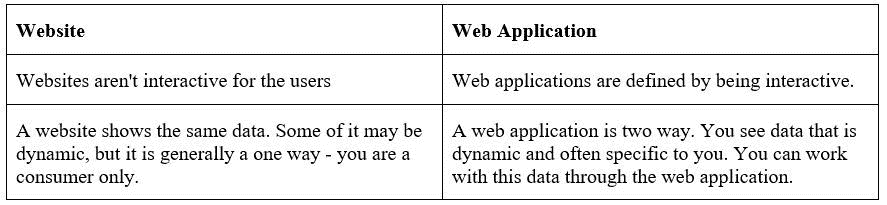

Web 应用程序可以通过网站（即网页）提供服务。

所有网站都运行在三个组件上：服务器、数据库和客户端。

*   服务器位于世界任何远程位置，运行网站的后端架构，处理请求，并将页面发送到浏览器。
*   数据库驻留在服务器上。
*   客户端是您的用户查看网站的任何地方：移动设备、笔记本电脑或台式计算机。

**服务端脚本由 Web 服务器执行**，而客户端脚本由浏览器执行。

当我们谈论服务器时，Web 应用程序中确实涉及两台服务器。

*   Web 服务器
*   应用服务器

网站只需 Web 服务器即可，而 Web 应用程序则需要 Web 服务器和应用服务器。

**Web 服务器与应用服务器：**

*   Web 服务器接受并满足客户端对静态内容的请求（即 `HTML` 页面、文件、图片、视频）。Web 服务器仅处理 `HTTP` 请求和响应。
*   应用服务器生成动态内容。它是一个软件框架，通过转换数据来提供应用程序的功能。应用服务器增强了网站的交互部分，使页面能根据请求为不同用户呈现不同内容。

请查看下图以获取详细视图：

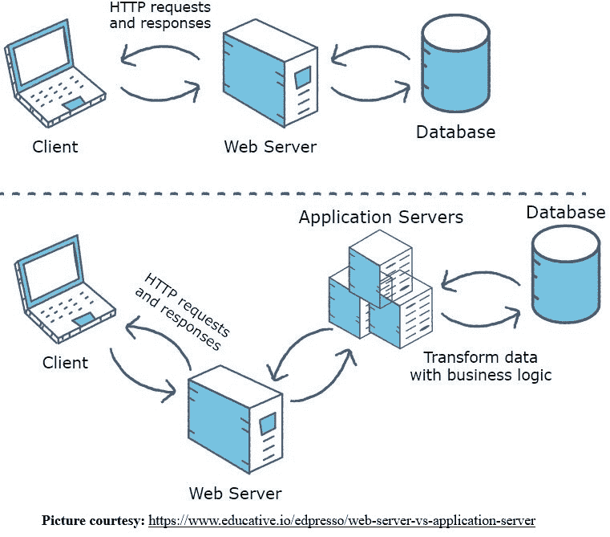

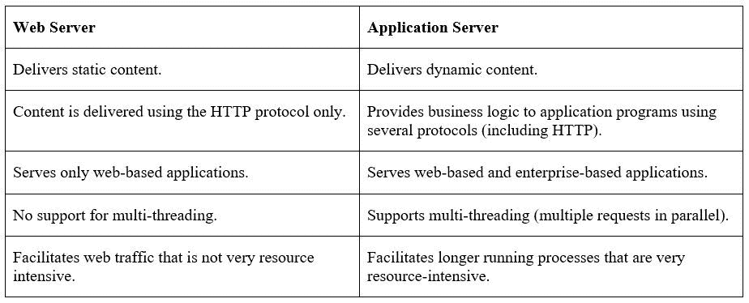

希望您已通过上述解释清楚地了解了服务器的概念。

#### 1.2 服务端脚本的作用

在计算术语中，“客户端”和“服务端”均指用于不同目的的计算机。

我们首先讨论客户端脚本/编程与服务端脚本/编程的区别。

**客户端编程：**

客户端是一种计算机应用程序（如 Web 浏览器），运行在用户的本地计算机或工作站上，并连接到服务器。

它是在客户端机器（浏览器）上运行的程序，处理用户界面/显示以及可在客户端机器上进行的任何其他处理。

**客户端编程的特点**包括：

1) 与临时存储交互
2) 制作交互式网页
3) 向服务器发送请求
4) 作为服务器与用户之间的接口

**客户端编程语言**有：

1) `JavaScript`
2) `VBScript`
3) `HTML`
4) `CSS`
5) `AJAX`

**服务端编程：**

服务器是一种大容量计算机，可存储各种文件，如应用程序文件和数据文件。

它是在服务器上运行的程序，负责生成网页内容。

**服务端编程的特点**包括：

1) 查询数据库
2) 数据库操作
3) 在服务器上访问/写入文件。
4) 与其他服务器交互。
5) 构建 Web 应用程序结构。
6) 处理用户输入。
   [例如，如果用户输入是搜索框中的文本，则在服务器上存储的数据上运行搜索算法并发送结果]

**服务端编程语言**有：

1) `PHP`
2) `C++`
3) `Java` 和 `JSP`
4) `Python`
5) `Ruby on Rails`

我们现在已了解了一些关于客户端和服务端编程的信息。

让我们再学习两个术语：前端和后端。

**前端与后端：**

前端开发涉及用户所见和交互的所有内容，使 Web 设计和用户体验成为关键关注点。后端开发涵盖服务器和数据库。

在实践中，前端开发通常专注于利用 `HTML`、`CSS` 和 `JavaScript` 的客户端技术，而服务端脚本则更多与后端开发人员相关。

总体而言，本书基于后端开发，我们将在其中引入服务端脚本。

**服务端脚本的作用：**

下图概括了服务端脚本扮演的各种角色。

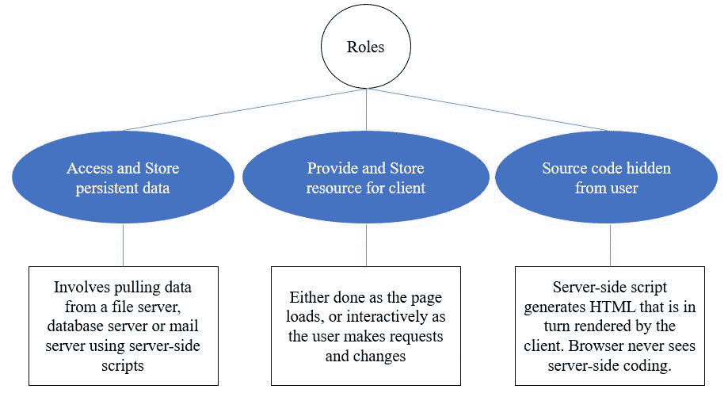

让我们通过表格来看一下服务端脚本的优缺点：

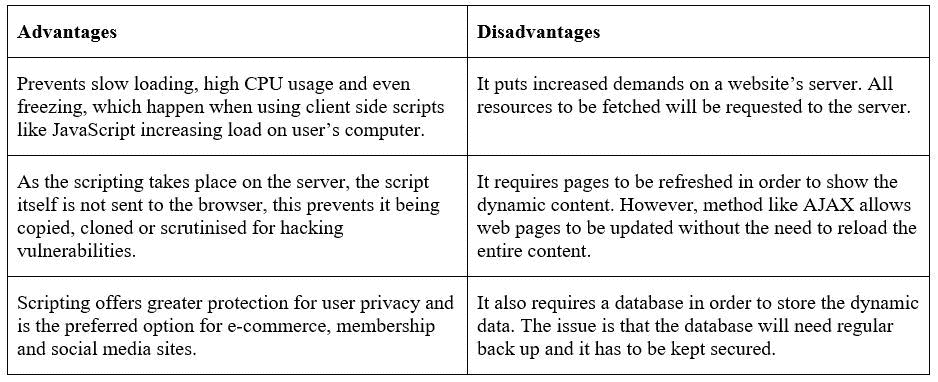

如今，大多数网站都使用动态内容，其中大部分是通过服务端脚本管理的。没有服务端脚本，互联网的功能（就我们今天所知）将不复存在。

在本书中，我们将学习服务端脚本语言 - `PHP`。

#### 1.3 PHP 简介

*`PHP（超文本预处理器）` 是一种编程语言，允许 Web 开发人员创建与数据库交互的动态内容。*

*   `PHP` 是一种广泛使用的开源服务端脚本语言，是制作动态和交互式 Web 页面的强大工具。
*   `PHP` 主要用于开发基于 Web 的软件应用程序。
*   `PHP` 代码在服务器上执行。

如果您是学习服务端语言的初学者，那么 `PHP` 将是正确且最容易上手的选择。


PHP 最初是一个小型的开源项目，随着越来越多的人发现它的实用性而不断发展。Rasmus Lerdorf 早在 1994 年就发布了 PHP 的第一个版本。

**选择 PHP 的理由：**

*   它可在各种平台上运行（Windows、Linux、Unix、Mac OS X 等）
*   它兼容当今几乎所有使用的服务器（Apache、IIS 等）
*   它在服务器端高效运行
*   它支持广泛的数据库
*   它是免费的。可从官方 PHP 资源下载：[www.php.net](https://www.php.net)
*   PHP 支持大量主流协议，如 POP3、IMAP 和 LDAP。PHP4 增加了对 Java 和分布式对象架构（COM 和 CORBA）的支持，使得 n 层开发首次成为可能。
*   PHP 语法类 C 风格。

学习一门开源（免费）技术总是更好的。主要原因是你可以从头到尾深入探究该技术。当你接触付费技术时，你的学习仅限于你所付费的内容。

**PHP 的特性**

五个重要特性使 PHP 的实用性成为可能：

*   简洁性
*   高效性
*   安全性
*   灵活性
*   熟悉性

**PHP 的应用**

*   它执行系统文件功能，即在系统上，它可以创建、打开、读取、写入和关闭文件。
*   它可以处理表单，即从文件收集数据、将数据保存到文件、通过电子邮件发送数据、向用户返回数据。
*   你可以通过 PHP 在数据库中添加、删除、修改元素。
*   你可以设置和访问 Cookie 变量。
*   你可以使用 PHP 限制用户访问你网站的某些页面。
*   它可以加密数据。

**关于 PHP 页面的说明：**

*   PHP 页面/文件可以包含 HTML、CSS、JavaScript 和 PHP 代码。
*   PHP 文件使用扩展名 `.php` 保存
*   代码经服务器执行后，结果将作为纯 HTML 返回给浏览器。
*   输出不限于 HTML。你可以输出图像、PDF 文件，甚至 Flash 影片。你也可以输出任何文本，如 XHTML 和 XML。

**关于 PHP 7（本电子书使用版本）的说明：**

*   PHP 7 比之前流行的稳定版本（PHP 5.6）快得多
*   PHP 7 改进了错误处理
*   PHP 7 支持对函数参数进行更严格的类型声明
*   PHP 7 支持新运算符（如太空船运算符：`<=>`）

希望你对 PHP 有了一些了解。

---

#### 1.4 PHP 的安装

---

如果你想安装 PHP，还需要在你的系统中安装一个服务器。原因在于，该服务器将充当 Web 服务器来执行 PHP 编写的脚本。

我们需要什么？

1.  PHP
2.  Web 服务器（我们将使用 Apache 服务器——它也充当应用服务器）
3.  MySQL 数据库

我们将使用 XAMPP 集成包进行快速安装。我们不单独安装 PHP、Apache 和 MySQL，而是安装 XAMPP，它会依次安装所有必需组件。

注意：请确保你的系统中没有预先安装任何 PHP / Apache / MySQL。如果已安装某个版本，请在继续之前卸载它们。

**安装说明：**

1.  访问 XAMPP 下载页面 - [`www.apachefriends.org/download.html`](https://www.apachefriends.org/download.html)
2.  下载适合你系统操作系统的安装程序

    在本书出版时，稳定版本是 7.4。

    我在演示安装 XAMPP 时使用的是 7.3 版本。

3.  安装步骤

    *   双击 XAMPP 安装程序
    *   点击 Next（下一步）

        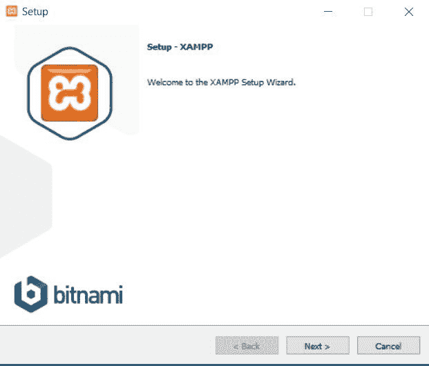

    *   选择所有组件并点击 Next。

        Apache、MySQL、PHP、phpMyAdmin 为必选项。

        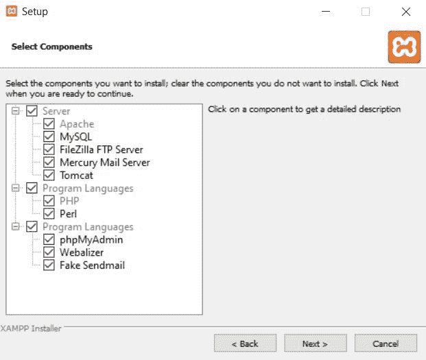

    *   选择安装 XAMPP 的文件夹（路径）

        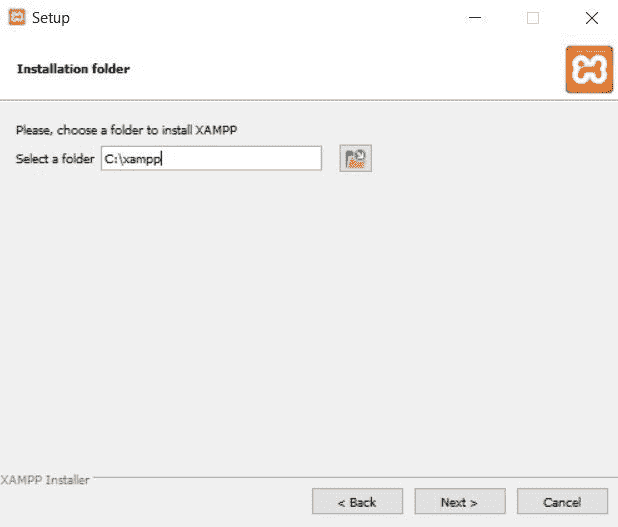

    *   取消勾选复选框并点击 Next

        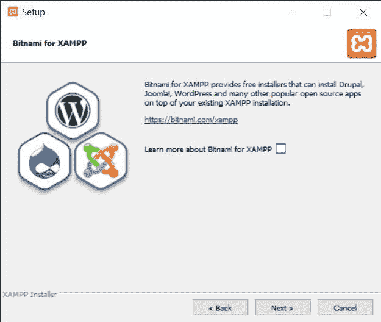

    *   点击 Next

        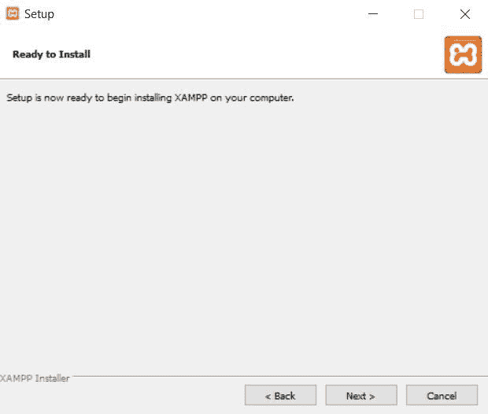

    *   安装过程

        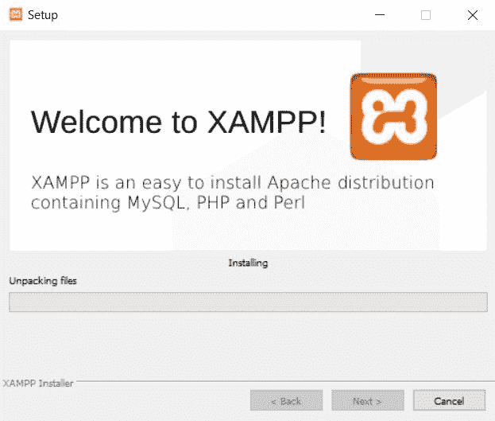

    *   点击 Finish（完成）（勾选复选框以启动控制面板）

        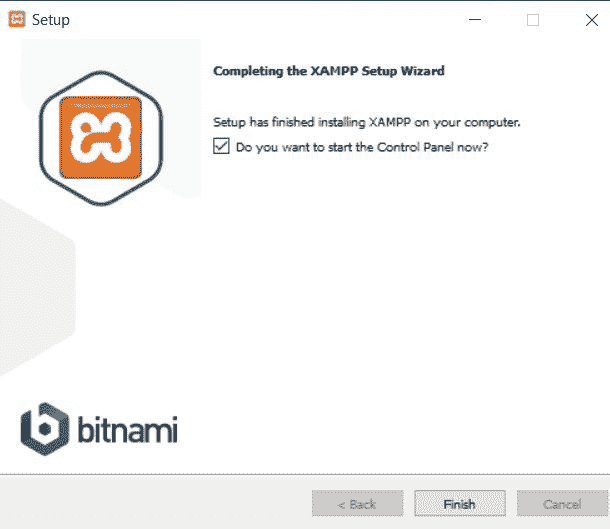

    *   这是 XAMPP 控制面板

        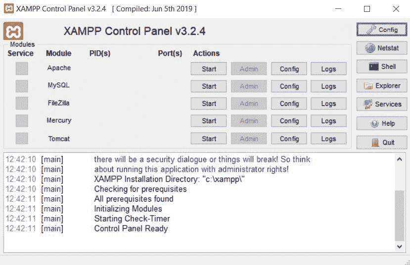

    *   启动 Apache 服务器和 MySQL 以检查它们是否正常工作

        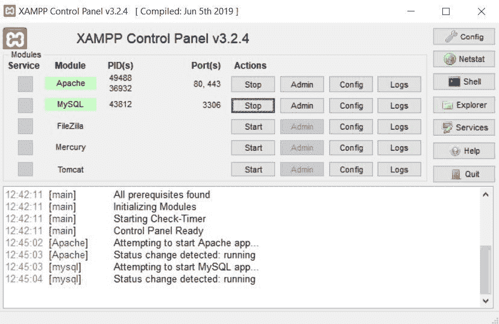

    *   如果 PHP 成功安装，你可以看到 localhost 的仪表盘页面！
    *   点击 Apache 旁边的 Admin 按钮，你将进入 `localhost/dashboard`

        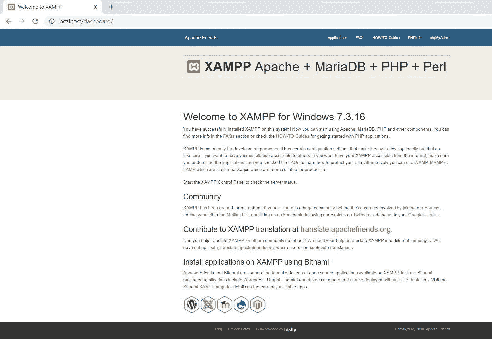

    *   点击 MySQL 旁边的 Admin 按钮，你将进入 `localhost/phpmyadmin`

        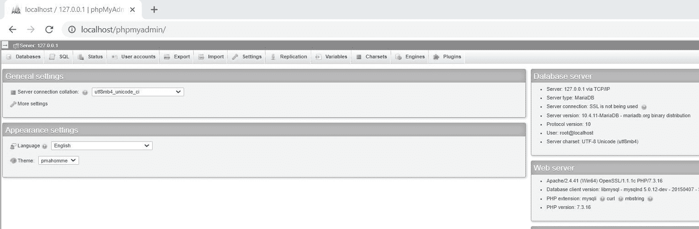

4.  安装完成后，暂时启动 Apache 即可。MySQL 将在第 6 章用到，届时再启动即可。

---

#### 1.5 开始编写 PHP 代码

---

**在哪里编写代码？**

PHP 需要文本编辑器来编写脚本。你可以使用任何文本编辑器，如 Notepad、Notepad++ 等。你可以自由使用 Visual Studio Code 或类似的编辑器，甚至 IDE 来编写脚本。但我建议你不要使用任何 IDE 或代码生成器。代码生成器会协助你编码，但你的学习曲线将不正确。

所以，请使用 Notepad++ 或类似的简单文本编辑器！我推荐使用 Notepad++，因为它有语法高亮功能（PHP 语法会以彩色高亮显示）

**开始编写 PHP 代码：**

让我们以一个单行 PHP 脚本为例。

1.  打开文本编辑器
2.  输入以下内容：

```
<?php
echo "Testing PHP code";
?>
```

3.  在位置 `C:/xampp/htdocs` 下创建一个名为 `PracticePHP` 的文件夹。`htdocs` 是通过 localhost 提供网页服务的文件夹。此路径 `C:/xampp/htdocs/PracticePHP` 将是你的文件保存路径。
4.  将文件保存为 `test.php`，保存路径为 - `C:/xampp/htdocs/PracticePHP`
5.  确保 XAMPP 中 Apache 已启动
6.  打开浏览器并输入：`localhost/PracticePHP/test.php`

希望你能看到如下输出：

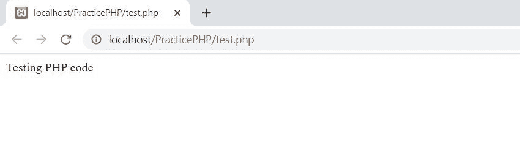

如果你能看到输出，说明你的安装和保存位置都完美。既然这是第一个脚本，我已连同页面 URL 一起展示。只有这个测试页面正常工作，才意味着你的系统在运行 PHP。否则，我们需要检查哪里出错了！

最常见的错误之一是 - 网站无法访问。当你发现“无法访问该网站”消息时，意味着你没有启动 Apache！（Apache 的 80 端口可能不可用）

**注意：**

当你尝试通过双击打开 php 页面（像打开 html 文件一样）时，它不会在浏览器中打开。PHP 文件/页面必须始终通过服务器访问。始终从 localhost 执行 PHP 页面！

假设你尝试从浏览器使用文件路径（像 html 文件一样）执行它们，如下所示，你只能看到代码。

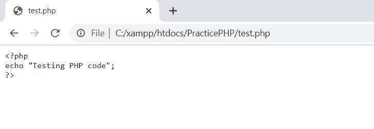

要处理 PHP 脚本，我们需要一个服务器（在我们的例子中是 Apache)。永远不要忘记这一点！

在本书的其余部分中，

*   当我提到**保存**文件时，请确保将其保存在路径 - `C:/xampp/htdocs/PracticePHP` 中
*   当我提到**执行**脚本/文件时，意味着你必须使用浏览器，通过 URL - `http://localhost/PracticePHP` 来访问它

至此，我想你已经了解了什么是 PHP、如何使用 XAMPP 安装 PHP 以及如何测试代码！从这里开始，你将学习 PHP 中的编程结构。尝试执行所有代码片段以确保动手经验！

祝学习愉快，编码愉快！！！

---

#### 2.1 基础

---

PHP 脚本在服务器上执行，纯 HTML 结果被发送回浏览器。脚本可以放置在文档的任何位置。

**语法：**

```php
<?php
// PHP 代码放这里
?>
```

*   PHP 脚本以 `<?php` 开始，以 `?>` 结束。
*   PHP 语句以分号 (`;`) 结尾。
*   在 PHP 中，**没有**关键字（例如 `if`、`else`、`while`、`echo` 等）、类、函数和用户定义函数是**大小写敏感**的。然而，**所有变量名都是大小写敏感的**！但是，PHP 在输出时也是大小写敏感的。
*   PHP 文件的默认扩展名是 `.php`。
*   PHP 文件通常包含 HTML 标签和一些 PHP 脚本代码。

**如何区分 PHP 代码？**

PHP 解析引擎需要一种方法来将 PHP 代码与页面中的其他元素区分开来。这种机制被称为“转义到 PHP”。有 4 种方法：

**标准 PHP 标签** - `<?php...?>`

如果你使用这种风格，可以确信你的标签总会被正确解释。

**短标签（SGML 风格）** - `<?...?>`

短标签是让 PHP 识别标签的最短选项。

*   在构建 PHP 时选择 `--enable-short-tags` 配置选项。
*   在 `php.ini` 文件中将 `short_open_tag` 设置设为 on。
*   解析 XML 时必须禁用此选项，因为 XML 标签使用相同的语法。

**ASP 风格标签** - `<%...%>`

ASP 风格标签模仿 Active Server Pages 用于描述代码块的标签。ASP 风格标签如下所示。

要使用 ASP 风格标签，你需要在 `php.ini` 文件中设置配置选项。

**HTML 脚本标签**

HTML 脚本标签如下所示：

```html
<script language = "PHP">...</script>
```

**注意：** 我们将在整个课程中坚持使用标准 PHP 标签。

**注释：**

注释是仅供人类阅读的程序部分。

PHP 代码中的注释是不作为程序一部分执行的行。PHP 中有两种注释格式：

**单行注释**：`//`

**多行注释**：`/* */`

**为什么要使用注释？**

它有助于为代码块提供简短的解释。让他人理解你的代码。有时，它们能提醒你编写代码时的思路。

**PHP 中的空白符：**

PHP 对空白符不敏感。

空白符包括空格、制表符和回车符（行尾字符）。

PHP 几乎不在乎你连续有多少空白字符。一个空白字符等同于多个此类字符。

---

**PHP 中的语句：**

PHP 中的语句是指任何后跟分号 (`;`) 的表达式。

由 PHP 标签包围的一系列有效 PHP 语句构成一个有效的 PHP 程序。

**Echo 和 Print 语句：**

有两种基本的输出方式：`echo` 和 `print`。

`echo` 和 `print` 都用于向屏幕输出数据。`echo` 比 `print` 稍快。

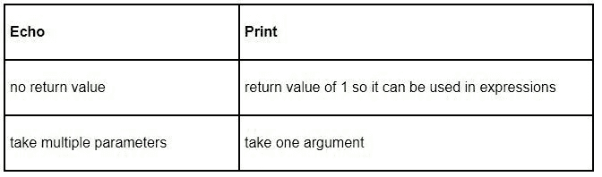

**echo 语句：**

`echo` 语句可以带括号也可以不带括号使用。

**语法：**

```
echo or echo()
```

**练习：**

在编辑器中打开一个新文件并将其保存为 `section2.php`。

```php
<?php

//normal echo statement
echo "Hello!";

//echo statement with html tags inside
echo "<h2>Hello</h2>";

//multiple parameters
echo "This ", "is ", "an ", "example ";

?>
```

**执行：**

在浏览器中执行脚本：

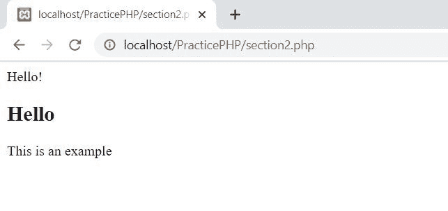

**print 语句**

`print` 语句可以带括号也可以不带括号使用。

**语法：**

```
print or print()
```

**练习：**

```php
<?php
print "Normal statement";
print "<h4>HTML tag usage</h4>";
//try multiple parameters
print "Trying ","parameters";
?>
```

**执行：**

你将收到如下错误，因为 `print` 只接受单个参数。

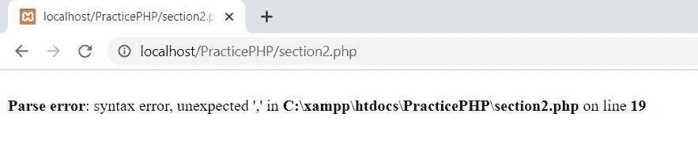

现在注释或删除最后一条语句。暂时让我注释掉！

```php
<?php
print "Normal statement";
print "<h4>HTML tag usage</h4>";
//try multiple parameters
//print "Trying ","parameters";
?>
```

现在看输出：

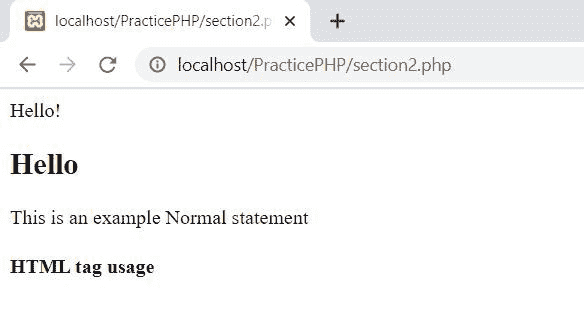

你注意到了吗？`echo` 的最后一条语句和 `print` 的第一条语句连在了一起，而不是打印在下一行。原因是这两条语句之间没有提及换行。

我们现在在第一条 `print` 语句中插入一个 `<br>` 标签：

```php
<?php
print "<br>Normal statement";
print "<h4>HTML tag usage</h4>";
//try multiple parameters
//print "Trying ","parameters";
?>
```

你可以在下面的输出中发现差异：

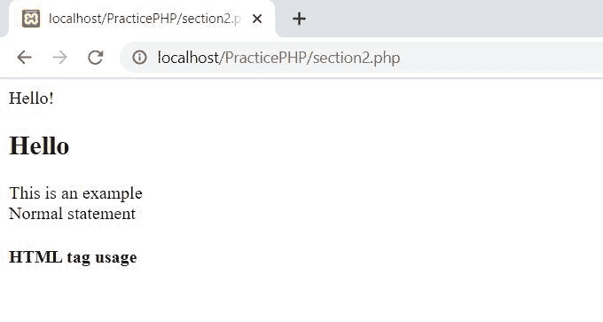

在单词之间使用空白符，检查屏幕上打印了多少空格。

**示例：**

```php
<?php
echo "checking...              ... for spaces";
?>
```

将只打印单个空格！

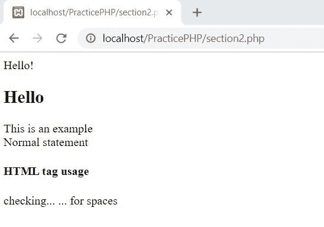

希望你现在清楚 `echo` 和 `print` 语句的作用！它们只是打印到屏幕上！

**注意-1：**

为了演示 `echo`、`print`、空白符，我们多次使用了 `<?php ?>` 标签。实际上这不是必须的！

让我把代码改成下面这样：

```php
<?php

//normal echo statement
echo "Hello!";

//echo statement with html tags inside
echo "<h2>Hello</h2>";

//multiple parameters
echo "This ", "is ", "an ", "example ";

print "<br>Normal statement";
print "<h4>HTML tag usage</h4>";
//try multiple parameters
//print "Trying ","parameters";

echo "checking...              ... for spaces";

?>
```

从下一节开始，我将只演示脚本本身。请确保添加 PHP 的开始和结束标签。

如果不加会怎样？我们也试试！

从上面的代码片段中移除 `<?php` 和 `?>`。输出如下：

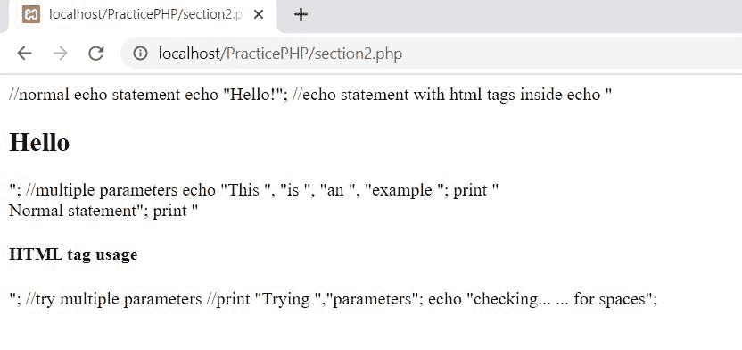

只有 HTML 标签会被打印出来！所以不要忘记给每个 PHP 文件添加 PHP 标签！

**注意-2：**

我们查看一下页面源代码，了解服务器端脚本发生了什么？

考虑这个代码片段：

```php
<?php
//normal echo statement
echo "Hello!";

//echo statement with html tags inside
echo "<h2>Hello</h2>";

//multiple parameters
echo "This ", "is ", "an ", "example ";

print "<br>Normal statement";
print "<h4>HTML tag usage</h4>";
//try multiple parameters
//print "Trying ","parameters";

echo "checking...              ... for spaces";
?>
```

执行脚本！

在浏览器上右键点击并选择“查看页面源代码”！（或直接按 `Ctrl + U`）

你可以清晰地看到编写的 HTML 标签！在 PHP 的情况下，只显示输出，不显示脚本！

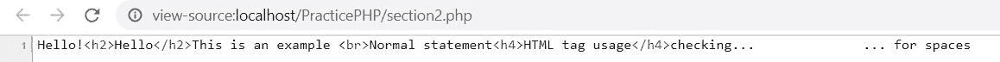

这就是服务器端将 HTML 部分渲染给浏览器的方式！也就是说，浏览器无法查看服务器端脚本代码！

尝试执行更多代码以理解 HTML 是如何渲染的。

---

#### 2.2 变量

---

变量用于在 PHP 程序中存储信息。

**如何使用变量？**

*   变量使用 `=` 运算符赋值，变量在左侧，待求值的表达式在右侧。
*   变量的值是其最近一次赋值的值。

**PHP 变量的特性：**

*   变量可以在脚本的任何位置声明/赋值。
*   变量可以（但不必）在赋值前声明。
*   变量事先不知道它将用于存储数字还是字符串。
*   变量在赋值前使用时具有默认值。
*   PHP 根据变量的值自动为其关联数据类型。
*   PHP 在必要时能很好地自动将类型从一种转换为另一种。

**变量命名规则**

*   变量以 `$` 符号开始，后跟变量名。
*   变量名必须以字母或下划线字符开头。
*   变量名不能以数字开头。
*   变量名只能包含字母数字字符和下划线（`a-z`、`A-Z`、`0-9` 和 `_`）。


* 变量名不能包含 `+`、`-`、`%`、`(`、`)`、`.`、`&` 等字符
* 变量名**区分大小写**（`$var` 和 `$VAR` 是不同的）

**练习：**

你可以使用上一节的同一个 PHP 文件，也可以根据需要创建一个新文件。

请始终记住：

* 打开 XAMPP - 启动 Apache 服务器
* 将文件以 `.php` 扩展名保存
* 代码需放在 PHP 标签 `<?php ?>` 内部

现在让我们创建/声明变量：

```php
/* Variables */

// 存储字符串的变量
$var1 = 'Hello';
$var2 = "Hello World";

// 存储数字的变量
$x = 5; $y = 10;
$z = $x + $y;

echo "Single quote String - ".$var1;
echo '<br>Double quote String - '.$var2;
echo "<br>Sum of x and y = ".$z;
```

**执行：**

执行页面时，将获得如下输出：

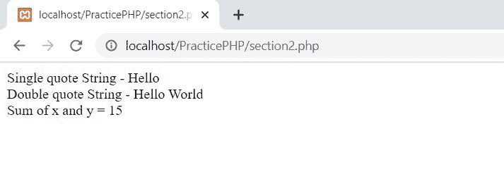

* 存储字符串/文本时必须使用单引号或双引号
* 可以将表达式赋值给变量以存储结果

**变量作用域：**

变量的作用域是指 PHP 脚本中可以引用或使用该变量的部分。

PHP 有三种不同的变量作用域：

* 局部
* 全局
* 静态

目前理解变量作用域可能有难度。我们将在讨论 PHP 函数时详细探讨它们。

***

#### 2.3 数据类型

***

变量可以存储不同类型的数据，不同的数据类型可以执行不同的操作。

PHP 支持以下数据类型：

* String（字符串）
* Integer（整数）
* Double（双精度浮点数）
* Boolean（布尔值）
* NULL（空值）
* Array（数组）
* Object（对象）
* Resource（资源）

我们将简要了解所有类型：

* **Strings（字符串）** —— 字符序列，如 `'PHP supports string operations.'`
* **Integers（整数）** —— 不带小数点的整数，如 `4195`
* **Doubles（双精度浮点数）** —— 浮点数，如 `3.14159` 或 `3.1`
* **Booleans（布尔值）** —— 只有两个可能的值：`true` 或 `false`
* **NULL（空值）** —— 一种特殊类型，只有一个值：`NULL`
* **Arrays（数组）** —— 命名并索引的其他值的集合
* **Objects（对象）** —— 程序员定义的类的实例，可以封装特定于该类的值和函数
* **Resources（资源）** —— 特殊变量，保存对 PHP 外部资源的引用（如数据库连接）

***

**字符串：**

字符串是字符序列。字符串可以是引号内的任何文本。可以使用单引号或双引号。

* 以反斜杠 (`\\`) 开头的某些字符序列会被替换为特殊字符
* 变量名（以 `$` 开头）会被替换为其值的字符串表示形式

转义序列替换：

* `\\n` 替换为换行符
* `\\r` 替换为回车符
* `\\t` 替换为制表符
* `\\$` 替换为美元符号本身 (`$`)
* `\\"` 替换为单个双引号 (`"`)
* `\\\\` 替换为单个反斜杠 (`\\`)

**练习：**

```php
/*Data Types */
// Strings
$string1 = "Hello, This is a single line string";
$string2 = "<br>This is printed in new first line <br> This is the second line<br>";
$string3 = "";   // Empty String
$string4 = "<br>Using \" quotes \" inside string";
echo $string1;
echo $string2;
echo $string3;
echo $string4;
```

**执行：**

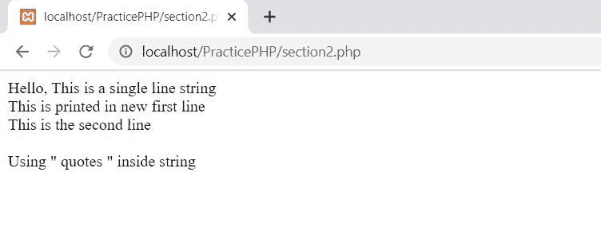

* 由于 `$string2` 以 `<br>` 标签结尾，光标移至新行
* `$string3` 是空变量，因此不打印任何内容
* `$string4` 以 `<br>` 标签开头。这是 `$string2` 和 `$string4` 变量之间出现间隙的原因
* 尝试移除和添加 `<br>` 标签，观察会发生什么

**整数：**

整数数据类型是介于 `-2,147,483,648` 和 `2,147,483,647` 之间的非十进制数字。

整数规则：

* 整数必须至少有一位数字
* 整数不能有小数点
* 整数可以是正数或负数
* 整数可以用以下方式指定：十进制（基数 10）、十六进制（基数 16）、八进制（基数 8）或二进制（基数 2）表示法

**双精度浮点数：**

双精度浮点数或浮点数是带有小数点的数字，或以指数形式表示的数字。

**练习：**

```php
// Integers
$x = 5691;
$y = -5691;
echo "<br>Sum of Integers = ".($x + $y);
// Floats
$a = 56.940;
$b = -56.910;
echo "<br>Sum of Floats = ".($a + $b);
```

**执行：**

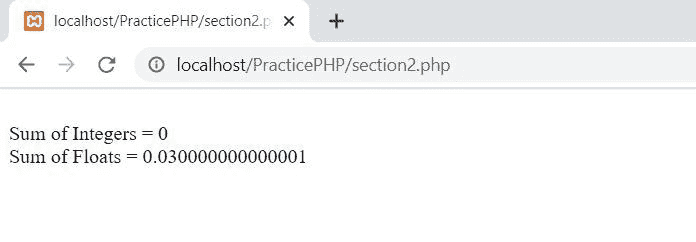

在代码中，如果移除表达式周围的 `()`，将触发警告。

例如：将整数部分的 echo 语句更改为：

```php
echo "<br>Sum of Integers = ".$x + $y;
```

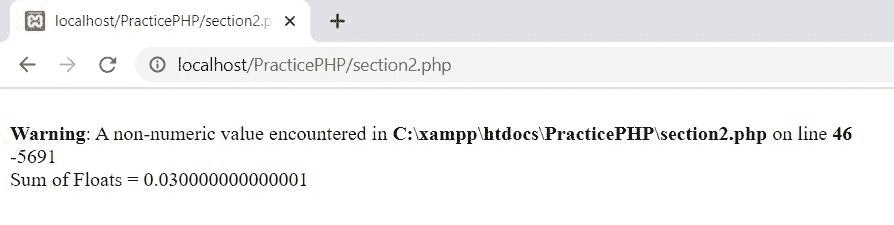

这意味着，echo 语句在 `$x` 处是正确的。因此表达式必须用括号括起来。

此外，使用下面的代码，只会打印 `$x` 和 `$y` 变量的值，而不是计算它们。

```php
echo "<br>Sum of Integers = ".$x."+".$y;
```

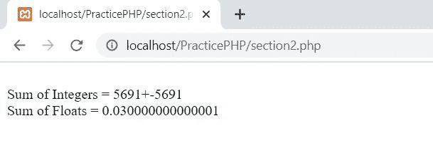

希望你理解 `echo` 对引号用法的反应。

**布尔值：**

布尔值表示两种可能的状态：`TRUE` 或 `FALSE`。布尔值主要用于条件判断和循环（将在下一章讨论）。

**空值：**

`Null` 是一种特殊数据类型，只能有一个值：`NULL`。数据类型为 `NULL` 的变量是未分配值的变量。

如果创建变量时未赋值，它将自动被赋值为 `NULL`。也可以通过将值设置为 `NULL` 来清空变量。在布尔上下文中，它评估为 `FALSE`。

**练习：**

```php
// Boolean
$t = TRUE;
$f = FALSE;
echo "<br>True - ".$t;
echo "<br>False - ".$f;
// Null
$var = NULL;
echo "<br>Printing NULL - ".$var;
$var_new = "Hello";
echo "<br> Testing var_new - ".$var_new;
$var_new = NULL;
echo "<br> Testing var_new - ".$var_new;
```

**执行：**

`FALSE` 和 `NULL` 不打印任何内容。

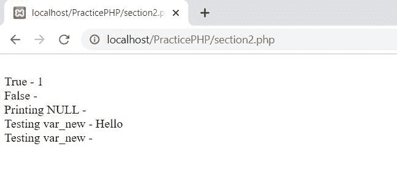

**如何根据赋值查找数据类型？**

让我们看以下代码集：

```php
// checking data type
$d1 = 91;
$d2 = 9.1;
$d3 = "hello";
$d4 = TRUE;
$d5 = NULL;
var_dump($d1);
echo "<br>";
var_dump($d2);
echo "<br>";
var_dump($d3);
echo "<br>";
var_dump($d4);
echo "<br>";
var_dump($d5);
```

当你想知道变量的数据类型时，可以使用 `var_dump()` 函数。

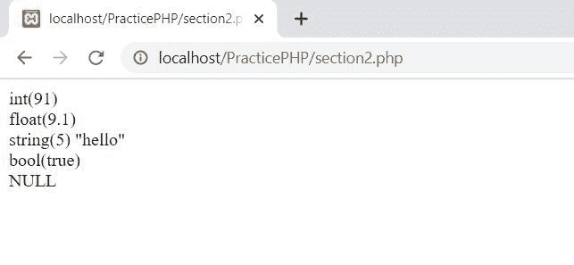

**如何检查变量是否不为空？**

我们可以检查变量是否持有值。如果变量不持有任何值，我们称之为 `NULL`。

请看下面的代码：

```php
// check for NULL
$n1 = NULL;
$n2 = 10;
echo "checking n1 = ".isset($n1);
echo "<br>checking n2 = ".isset($n2);
```

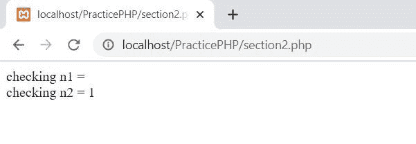

`isset($n1)` 将返回 `false`，因为 `$n1` 不持有任何值。

`isset($n2)` 将返回 `true`（`1`），因为 `$n2` 持有整数值。

**对象：**

从类实例化对象属于面向对象编程。你可以查看下面的示例：

```php
/* $myCar is an object */
<?php
class Car {
  public $color;
  public $model;
}
$myCar = new Car();
?>
```

执行此代码不会有任何输出。我们没有在代码中显示任何内容。我们创建了一个具有两个属性的类，并从该类创建了一个对象。

我们将在本章的另一节中讨论数组。

资源的示例将在第 4 章讨论。

***

#### 2.4 内置函数

***

PHP 拥有内置函数，可以直接从脚本中调用以执行特定任务。

我们有用于处理数据类型的内置函数：字符串、数字等。我们将在以下类别中讨论其中的一些函数：

* 数值函数
* 数学函数
* 字符串函数
* 日期/时间函数

PHP 提供自动数据类型转换。我们将在处理示例时探讨这种转换。

***

**数值函数：**

这里将讨论与整数和浮点数相关的函数。

PHP 具有以下函数来检查变量类型是否为整数：

* `is_int()`
* `is_integer()`
* `is_long()`


##### PHP 类型检查函数

###### 浮点数类型检查

PHP 拥有以下函数来检查变量的类型是否为浮点数：

*   `is_float()`
*   `is_double()`

###### 有限/无限值检查

PHP 拥有以下函数来检查数值是有限还是无限。大于 `PHP_FLOAT_MAX` 的数值被视为无限。

*   `is_finite()`
*   `is_infinite()`

###### NaN 检查

PHP 拥有函数来检查值是否**非**数字。NaN 代表 Not a Number（非数字）。NaN 用于不可能的数学运算。

*   `is_nan()`

###### 数字检查

PHP 函数使用以下函数来判断变量是否为数字。如果变量是数字或数字字符串，该函数返回 true。否则返回 false。

*   `is_numeric()`

从 PHP 7.0 开始，该函数将对十六进制形式的数字字符串（例如 `0xf4c3b00c`）返回 FALSE，因为它们不再被视为数字字符串。

###### 整数转换

有时你需要将数值转换为另一种数据类型。以下函数常用于将值转换为整数。

`(int)`、`(integer)` 或 `intval()`

---

###### 练习：数字函数

虽然不是全部，但我已尽力包含尽可能多的函数：

```php
// Numeric Functions

$x = 56;
$y = 56.7905;
$z = acos(8);
echo "<br>x is an integer? ";
var_dump(is_int($x));
echo "<br>y is an integer? ";
var_dump(is_int($y));
echo "<br>y is a float? ";
var_dump(is_float($y));
echo "<br>z is a ";
var_dump($z);
echo "<br> z is not a number? ";
var_dump(is_nan($z));


$m = 1.9e501;
$n = 1.8e45;
echo "<br> m is finite? ";
var_dump(is_finite($m));
echo "<br> n is finite? ";
var_dump(is_finite($n));
echo "<br> m is infinite? ";
var_dump(is_infinite($m));


$s = "5679";
echo "<br> s is numeric? ";
var_dump(is_numeric($s));
$t = "56.79" + 10;
echo "<br> t is numeric? ";
var_dump(is_numeric($t));
$r = "Hello";
echo "<br> r is numeric? ";
var_dump(is_numeric($r));
```

##### 执行

由于变量 `$s` 完全是一个数字，PHP 会自动将字符串转换为数字。变量 `$t` 中也会发生类似的自动转换。

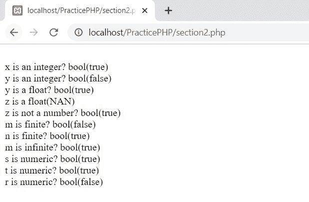

尝试将变量 `$r` 的表达式更改为：

```php
$r = 10 + "Hello";
```

将会生成一个关于使用字符串（非数字）的警告，但最终 `$r` 将是一个数字。

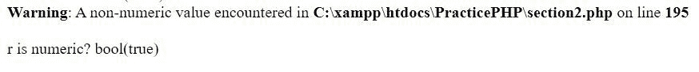

PHP 尝试将字符串转换为数字，当无法转换时，它会直接忽略，并在上述表达式中仅计算 10，因此 `is_numeric()` 返回 true。另一方面，PHP 会触发警告，指明它在数值表达式中遇到了非数字值！

---

##### 数学函数

PHP 拥有一组数学函数，允许你对数字执行数学任务。我们将在此讨论其中几个：

*   `pi()` - 返回圆周率的值
*   `min()` - 返回参数列表中的最小值
*   `max()` - 返回参数列表中的最大值
*   `abs()` - 返回数字的绝对（正）值
*   `sqrt()` - 返回数字的平方根
*   `round()` - 将浮点数四舍五入到最接近的整数
*   `rand()` - 生成一个随机数

###### 练习：数学函数

我们将逐一查看每个函数！

我们将以两种方式检查四舍五入到最接近的整数。同样，我们将检查在最小和最大限制之间生成随机数！

```php
// Mathematical Functions

echo "<br>Value of pi = ".pi();
echo "<br>Highest of 12 25 9 = ".max(12,25,9);
echo "<br>Lowest of 12 25 9 = ".min(12,25,9);
echo "<br>Absolute value of -5.97 = ".abs(-5.97);
echo "<br>Square root of 625 = ".sqrt(625);
echo "<br>Rounding to nearest 7.58 = ".round(7.58);
echo "<br>Rounding to nearest 7.08 = ".round(7.08);
echo "<br>Generate a random number = ".rand();
echo "<br>Generate a random number between 30 and 60 = ".rand(30,60);
```

##### 执行

希望每个函数都显示了预期的结果！

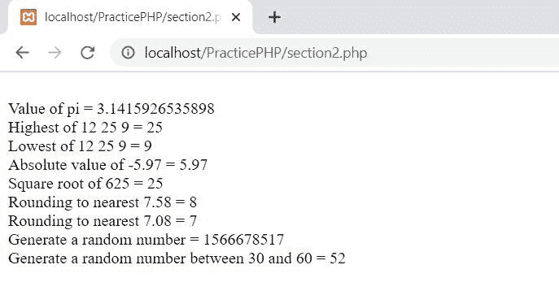

测试更多示例以加深理解！

---

##### 字符串函数

在深入函数之前，我们将首先了解**字符串连接运算符**，称为点号 (`.`)。你可能在之前的示例的 echo 语句中见过这个运算符。连接运算符的作用是连接或合并两个字符串！

我们将查看一些用于操作字符串的常用函数。

###### 字符串长度

*   `strlen(string)` 函数返回字符串的长度。
*   字符串的长度常用于循环或其他函数中，当需要知道字符串何时结束时非常重要。

###### 单词计数

*   `str_word_count(string)` 函数计算字符串中的单词数量。

###### 字符串反转

*   `strrev(string)` 函数反转字符串。

###### 字符串搜索

*   `strpos(string, search)` 函数用于在字符串中搜索特定的字符串或字符。
*   如果在字符串中找到匹配项，该函数将返回第一个匹配项的位置。
*   如果未找到匹配项，它将返回 FALSE。
*   位置从 0 开始，而不是 1。

###### 字符串替换

*   `str_replace(find, replace, string, count)` 函数用另一些字符替换字符串中的一些字符。
*   `count`（可选参数）是一个计算替换次数的变量。

###### 练习：字符串函数

我们将查看上述所有函数。

```php
// String Functions
$str = "Welcome to PHP";
echo "<br>Example String: ".$str;
echo "<br>Length of string = ".strlen($str);
echo "<br>Number of words in string = ".str_word_count($str);
echo "<br>Reverse of string = ".strrev($str);
echo "<br>Search P position in string = ".strpos($str,"P");
echo "<br>Replace PHP with PHP Course = ".str_replace("PHP","PHP Course",$str);
```

##### 执行

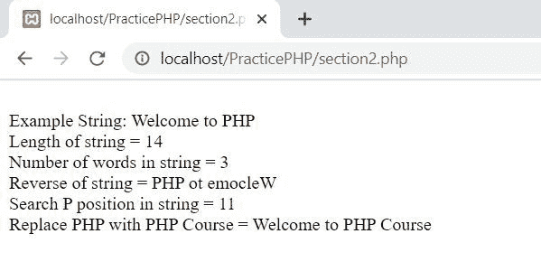

长度包含空格字符。也就是说，空格也被计为一个字符。Welcome to PHP 中 P 的位置是 11，意味着字符串从 0 开始计数。

---

##### 日期/时间函数

虽然关于此主题有很多可讨论的内容，但我们将学习在 PHP 中处理日期/时间。

`date()` 函数用于格式化日期和/或时间。

此函数将时间戳格式化为更易读的日期和时间。时间戳是一串字符，表示某一事件发生的日期和/或时间。

###### 语法

```php
date(format, timestamp)
```

有 2 个参数：

*   **format** - 这是一个必需参数。它指定时间戳的格式
*   **timestamp** - 这是一个可选参数，用于指定时间戳。默认为当前日期和时间

###### 如何获取日期？

以下是日期常用的一些字符：

*   `d` - 表示月份中的第几天（01 到 31）
*   `m` - 表示月份（01 到 12）
*   `Y` - 表示年份（四位数字）
*   `l`（小写 'L'） - 表示星期几

其他字符，如 `/`、`.` 或 `-` 也可以插入字符之间以增加额外的格式。

###### 如何获取时间？

以下是时间常用的一些字符：

*   `H` - 小时的 24 小时制格式（00 到 23）
*   `h` - 带前导零的 12 小时制格式（01 到 12）
*   `i` - 带前导零的分钟（00 到 59）
*   `s` - 带前导零的秒（00 到 59）
*   `a` - 小写的上午和下午（am 或 pm）

###### 如何指定时区？

PHP `date()` 函数将返回服务器的当前日期/时间！服务器的时区是 UTC。

因为我身处印度，我将使用 IST 时区！

要指定时区，我们必须包含以下行：

```php
date_default_timezone_set("Asia/Kolkata");
```

####### 参考

通过从下面的链接选择您的大陆，查看各个国家的时区：

<https://www.php.net/manual/en/timezones.php>

###### 练习：日期/时间函数

我们将以各种格式显示今天的日期。


##### 日期/时间函数

```php
/* 日期/时间函数 */

// 按服务器时间显示日期/时间
echo "<br>dd-mm-yyyy 格式的日期: " . date("d-m-Y");
echo "<br>带星期的 dd-mm-yyyy 格式日期: " . date("l, M d, Y");
echo "<br>带时间的默认日期格式: " . date("Y-m-d h:i:s a");
echo "<br>24 小时制日期格式: " . date("d/m/y H:i:s");

// 按 IST 时区显示日期/时间
date_default_timezone_set("Asia/Kolkata");
echo "<br>按 IST 时区的时间!";
echo "<br>带时间的默认日期格式: " . date("Y-m-d h:i:s a");
echo "<br>24 小时制日期格式: " . date("d/m/y H:i:s");
```

##### 执行

首先，我们将按服务器的时间戳显示日期/时间。随后，我们将按 IST 时区显示，以检查时间差异！

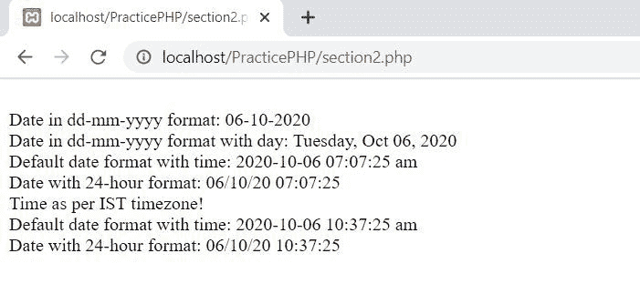

####### 如何使用可选参数创建时间？

`date()` 函数有一个可选参数。利用它，我们可以创建一个日期/时间并按指定格式显示。让我们学习如何操作：

###### 语法

```php
mktime(小时, 分钟, 秒, 月, 日, 年);
```

##### 实践

```php
// 创建一个日期
$createdate = mktime(10, 54, 06, 11, 23, 2020);
echo "创建的日期是 23-11-2020 10:54:06 am: " . date("M d, Y H:i:s", $createdate);
```

##### 执行

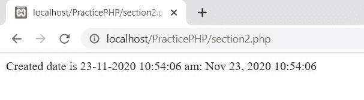

####### 如何从字符串创建日期？

我们可以使用 `strtotime()` 函数从字符串创建日期。该函数用于将人类可读的日期字符串转换为 Unix 时间戳（自 1970 年 1 月 1 日 00:00:00 GMT 以来的秒数）。

###### 语法

```php
strtotime(时间, 现在)
```

##### 实践

我们将通过各种示例来了解如何使用 `strtotime()` 函数。这将让你了解该函数的用途。

```php
// 使用 strtotime() 函数（代码执行于 2020 年）
date_default_timezone_set("Asia/Kolkata");
$today = strtotime("now");
echo "<br>字符串格式的今天日期: " . $today;
echo "<br>今天日期: " . date("l, M d Y, h:i:s A", $today);
echo "<br>从现在起 +5 小时: " . date("M d Y, h:i:s A", strtotime("+5 hours", $today));
echo "<br>从现在起 +1 周: " . date("M d Y, h:i:s A", strtotime("+1 week", $today));
echo "<br>下个周一: " . date("M d Y, h:i:s A", strtotime("next Monday", $today));
```

##### 执行

我们已使用 `strtotime()` 函数来处理日期相关查询。如果不使用时区，所有时间将采用 UTC 格式。只有获取系统时区时，你才能理解该函数的工作原理。

如果不使用 `date()` 函数格式化日期，`strtotime()` 的返回值将不可读。这就是为什么我们在每行代码中都包含了日期格式。为了展示日期/时间字符串的样子，我们仅以字符串格式打印了它（输出的第一行）。当字符串使用 `date()` 显示时，它将呈现为可读的日期。

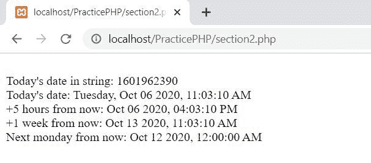

##### 注意

以下是日期可采用的格式列表：

*   `d` - 月份中的第几天（01 到 31）
*   `D` - 星期几的文本表示（三个字母）
*   `j` - 不带前导零的月份中的第几天（1 到 31）
*   `l`（小写 'L'） - 星期几的完整文本表示
*   `N` - 星期几的 ISO-8601 数字表示（1 代表周一，7 代表周日）
*   `S` - 月份中日期的英文序数后缀（2 个字符：st, nd, rd 或 th。配合 `j` 使用效果佳）
*   `w` - 星期几的数字表示（0 代表周日，6 代表周六）
*   `z` - 年份中的第几天（0 到 365）
*   `W` - 年份的 ISO-8601 周数（周以周一开始）
*   `F` - 月份的完整文本表示（January 到 December）
*   `m` - 月份的数字表示（01 到 12）
*   `M` - 月份的简短文本表示（三个字母）
*   `n` - 不带前导零的月份数字表示（1 到 12）
*   `t` - 给定月份的天数
*   `L` - 是否为闰年（1 表示是闰年，0 表示否）
*   `W` - ISO-8601 年份数
*   `Y` - 年份的四位数字表示
*   `y` - 年份的两位数字表示
*   `a` - 小写的 am 或 pm
*   `A` - 大写的 AM 或 PM
*   `B` - Swatch Internet Time（000 到 999）
*   `g` - 12 小时制的小时（1 到 12）
*   `G` - 24 小时制的小时（0 到 23）
*   `h` - 12 小时制的小时（01 到 12）
*   `H` - 24 小时制的小时（00 到 23）
*   `i` - 带前导零的分钟（00 到 59）
*   `s` - 秒，带前导零（00 到 59）
*   `u` - 微秒（PHP 5.2.2 新增）
*   `e` - 时区标识符（示例：UTC, GMT, Atlantic/Azores）
*   `I`（大写 i） - 日期是否处于夏令时（1 表示夏令时，0 表示否）
*   `O` - 与格林威治时间 (GMT) 的差值（小时）（示例：+0100）
*   `P` - 与格林威治时间 (GMT) 的差值（小时:分钟）（PHP 5.1.3 新增）
*   `T` - 时区缩写（示例：EST, MDT）
*   `Z` - 时区偏移量（秒）。UTC 以西时区的偏移量为负（-43200 到 50400）
*   `c` - ISO-8601 日期（例如：2013-05-05T16:34:42+00:00）
*   `r` - RFC 2822 格式的日期（例如：Fri, 12 Apr 2013 12:01:05 +0200）
*   `U` - 自 Unix 纪元（1970 年 1 月 1 日 00:00:00 GMT）以来的秒数

以下预定义常量也可使用（自 PHP 5.1.0 起可用）：

*   `DATE_ATOM` - Atom（示例：2013-04-12T15:52:01+00:00）
*   `DATE_COOKIE` - HTTP Cookies（示例：Friday, 12-Apr-13 15:52:01 UTC）
*   `DATE_ISO8601` - ISO-8601（示例：2013-04-12T15:52:01+0000）
*   `DATE_RFC822` - RFC 822（示例：Fri, 12 Apr 13 15:52:01 +0000）
*   `DATE_RFC850` - RFC 850（示例：Friday, 12-Apr-13 15:52:01 UTC）
*   `DATE_RFC1036` - RFC 1036（示例：Fri, 12 Apr 13 15:52:01 +0000）
*   `DATE_RFC1123` - RFC 1123（示例：Fri, 12 Apr 2013 15:52:01 +0000）
*   `DATE_RFC2822` - RFC 2822（Fri, 12 Apr 2013 15:52:01 +0000）
*   `DATE_RFC3339` - 同 `DATE_ATOM`（自 PHP 5.1.3 起）
*   `DATE_RSS` - RSS（Fri, 12 Aug 2013 15:52:01 +0000）
*   `DATE_W3C` - 万维网联盟（示例：2013-04-12T15:52:01+00:00）

至此，这场漫长的讨论告一段落！

---

#### 2.5 数组

---

数组是一种变量，可同时存放多个值。数组可在单一名称下存放多个值，你可以通过引用索引编号来访问这些值。

##### 数组类型

在 PHP 中，有三种类型的数组：

*   **索引数组** - 带有数字索引的数组
*   **关联数组** - 带有字符串索引的数组（称为键）
*   **多维数组** - 包含一个或多个数组的数组，通过多个索引访问

##### 示例

假设，一名学生完成了 5 次测试并获得了分数。

我们创建一个名为 `$scores` 的变量。要存储 5 次测试的分数，我们将它们分别存放在 `$scores[0]`、`$scores[1]`、`$scores[2]`、`$scores[3]` 和 `$scores[4]` 中。

方括号内的数字称为索引。索引通常从 0 开始，直到数组大小减 1 为止。也就是说，如果你有 5 次测试，索引将从 0 到 4，总共计 5 个。

这是一个索引数组的示例。

假设，该学生进行了 10 次测试。我们仅计算其中 5 次选定测试的分数。我们不知道这些测试的索引编号。在这种情况下，我们使用如下数组：

`$scores['test1']`、`$scores['test4']`、`$scores['test5']`、`$scores['test7']` 和 `$scores['test10']`

数量仍然是 5 个测试分数。这里，索引是字符串。`$scores` 的索引为 test1、test4、test5、test7、test10。

这是一个关联数组的示例。

假设，每次测试有 3 次尝试，索引为 0、1、2。0 表示第一次尝试，1 表示第二次尝试，2 表示第三次尝试。我们有一个如下数组：

`$scores['test1'][0]`、`$scores['test1'][1]`、`$scores['test1'][2]`
`$scores['test4'][0]`、`$scores['test4'][1]`、`$scores['test4'][2]`
`$scores['test5'][0]`、`$scores['test5'][1]`、`$scores['test5'][2]`
`$scores['test7'][0]`、`$scores['test7'][1]`、`$scores['test7'][2]`
`$scores['test10'][0]`、`$scores['test10'][1]`、`$scores['test10'][2]`


计数为 `5*3 => 5 个测试 * 每个测试 3 次尝试 = 15`

这是一个多维数组的示例。

索引可以是数字或字符串。我们对第一维使用了字符串索引，对第二维使用了数字索引。因为我们只用了两个维度，所以也可以称之为二维数组。

###### 语法

`array()` 函数用于创建数组。

##### 实践

现在我们将根据上述示例编写代码来创建所有三种类型的数组。

我们将创建三个变量 `$scores1`、`$scores2`、`$scores3` 来表示这三种类型。

```php
//Arrays

//声明稍后使用的数组
$scores = array();

//索引数组
$scores1 = array(56, 57, 59, 65, 74);
echo "Printing indexed array: &emsp;";
echo $scores1[0]."&nbsp;";
echo $scores1[1]."&nbsp;";
echo $scores1[2]."&nbsp;";
echo $scores1[3]."&nbsp;";
echo $scores1[4]."&nbsp;";
echo "<br>";

//关联数组
$scores2 = array("test1"=>56, "test4"=>57, "test5"=>59);
$scores2['test7'] = 65;
$scores2['test10'] = 74;
echo "Printing associative array: &emsp;";
echo $scores2['test1']."&nbsp;";
echo $scores2['test4']."&nbsp;";
echo $scores2['test5']."&nbsp;";
echo $scores2['test7']."&nbsp;";
echo $scores2['test10']."&nbsp;";
echo "<br>";

//多维数组
$scores3 = array("test1" => array(53,54,56), "test4" => array(51,56,57));
$scores3['test5'][0] = 45;
$scores3['test5'][1] = 55;
$scores3['test5'][2] = 59;
$scores3['test7'] = array(61,63,65);
$scores3['test10'] = array(71,72,74);
echo "Printing 2-D array: <br>";
echo "Test 1 - All Attempts =".$scores3['test1'][0]."&emsp;".$scores3['test1'][1]."&emsp;".$scores3['test1'][2];
echo "<br>Test 1 Attempt 1 = ".$scores3['test1'][0];
echo "<br>Test 1 Attempt 3 = ".$scores3['test1'][2];
```

##### 执行

你可以尝试打印二维数组的不同索引以获得更清晰的认识！

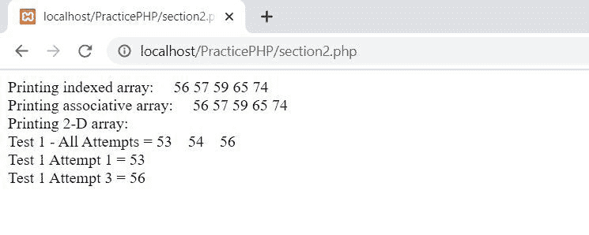

你可能会觉得这种遍历数组的方式很困难。在下一章讨论循环时，我们将再次使用数组。在那里，我们将使用循环遍历数组，你会发现它们好用得多。

##### 数组的内置函数

我们将在此讨论数组的两个内置函数：

###### 数组的长度

`count()` 函数用于返回数组的长度（元素的数量）。

##### 实践

```php
//声明数组
$scores = array();
$scores1 = array(56, 57, 59, 65, 74);
$scores2 = array("test1" => 56, "test4" => 57, "test5" => 59, "test7" => 65, "test10" => 74);
$scores3 = array("test1" => array(53,54,56), "test4" => array(51,56,57), "test5" => array(45,55,59), "test7" => array(61,63,65), "test10" => array(71,72,74));

//数组长度/大小
echo "<br>Size of $scores = ".count($scores);
echo "<br>Size of $scores1 = ".count($scores1);
echo "<br>Size of $scores2 = ".count($scores2);
echo "<br>Size of $scores3 = ".count($scores3);
echo "<br> Size of $scores3 test1's attempts - ".count($scores3['test1']);
```

##### 执行

我们在一个地方声明了上述示例集中的所有数组。我们在所有 4 个数组上执行 `count` 函数。

*   空数组 `$scores` 返回 0。
*   `$scores1`、`$scores2`、`$scores3` 返回 5。
*   在 `$scores3` 中，仅计算了数组第一维的大小。要获取第二维索引的计数，我们需要在 `count` 函数中指定第一维索引。

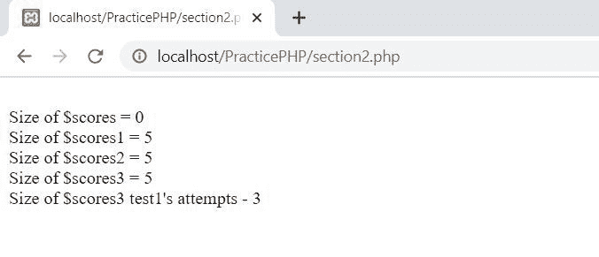

###### 数组排序

数组中的元素可以按字母顺序或数字顺序、降序或升序进行排序。

在 PHP 中，我们有以下排序函数：

*   `sort()` - 以升序对数组排序
*   `rsort()` - 以降序对数组排序
*   `asort()` - 根据值以升序对关联数组排序
*   `ksort()` - 根据键以升序对关联数组排序
*   `arsort()` - 根据值以降序对关联数组排序
*   `krsort()` - 根据键以降序对关联数组排序

##### 实践

我们的所有值已经是升序了，这里我们只能尝试降序！

```php
//声明数组
$scores = array();
$scores1 = array(56, 57, 59, 65, 74);
$scores2 = array("test1"=>56, "test4"=>57, "test5"=>59, "test7" => 65, "test10" => 74);

//对索引数组排序
echo "<br>Printing $scores1 - ".$scores1[0]."&nbsp;".$scores1[1]."&nbsp;".$scores1[2]."&nbsp;".$scores1[3]."&nbsp;".$scores1[4];
rsort($scores1);
echo "<br>Printing after sorting $scores1 - ".$scores1[0]."&nbsp;".$scores1[1]."&nbsp;".$scores1[2]."&nbsp;".$scores1[3]."&nbsp;".$scores1[4];

echo "<br><br>Printing $scores2 <br>";
var_dump($scores2);

//按值对关联数组排序
arsort($scores2);
echo "<br><br>Printing $scores2 after sorting by values: <br>";
var_dump($scores2);

//按键对关联数组排序
krsort($scores2);
echo "<br><br>Printing $scores2 after sorting by keys: <br>";
var_dump($scores2);
```

##### 执行

我们使用 `var_dump()` 函数来获取排序后数组的值，

在对 `$scores2` 排序时，

*   使用 `arsort()` 函数时，数组按值的降序排序。
*   使用 `krsort()` 函数时，数组按键的降序排序。

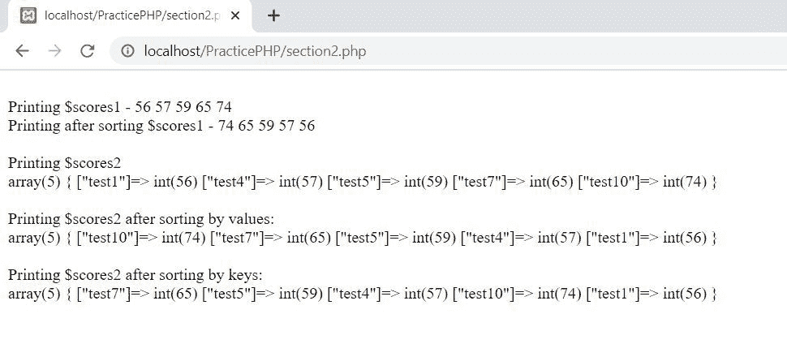

至此，关于数组的讨论结束！

---

#### 2.6 用户自定义函数 - I

---

除了 PHP 内置函数外，还可以创建自己的函数。

*   函数是一组语句块，可以在程序中重复使用。
*   页面加载时，函数不会自动执行。
*   函数通过调用函数来执行。

##### 如何创建（用户自定义）函数？

用户自定义函数使用关键字 `function` 声明。

###### 语法

```php
function function_name(){
   code to be executed;
}
```

函数名必须以字母或下划线开头。函数名**不**区分大小写。务必选择一个能反映函数功能的名称！名称应切合用途！

##### 函数参数

信息可以通过参数传递给函数。参数就像一个变量。

参数在函数名后的括号内指定。你可以添加任意数量的参数，只需用逗号分隔即可。

##### 实践

我们现在将看两个函数：

```php
//用户自定义函数

function print_message(){
 echo "<p>Message printed from the function</p>";
}

function print_message_string($str){
 echo $str;
}

print_message();
print_message_string("Printing from arguments");
```

##### 执行

我们打印了两条语句。第一条语句由 `print_message()` 函数打印。第二条语句作为参数传递给 `print_message_string($string)` 函数。

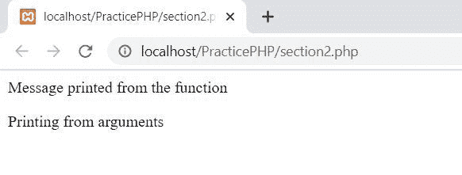

在上面的示例集中，我们不必告诉 PHP 变量是什么数据类型。PHP 会根据变量的值自动关联数据类型。由于数据类型不是严格意义上设定的，你可以做一些像将字符串添加到整数中而不引起错误的事情。

##### 类型声明

在 PHP 7 中，添加了类型声明。这给了我们一个选项，在声明函数时指定预期的数据类型，并且通过添加严格声明，如果数据类型不匹配，将抛出“致命错误”。

要指定严格模式，我们需要设置：

```php
declare(strict_types=1);
```

它必须指定在文件的**第一行**。

现在尝试此代码片段：

```php
declare(strict_types=1);
function print_message_string(int $str){
 echo $str;
}
print_message_string("Hello");
```

你将收到如下致命错误：

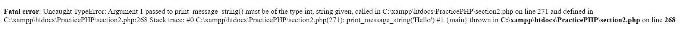

尝试将函数调用替换为：

```php
print_message_string(10);
```

输出将打印 10。

希望你能理解限制参数数据类型！

参数和形参意思相同。

##### 何时应使用“参数”和“实参”术语？

*   **形参**：函数定义
*   **实参**：函数调用


##### 参数的默认值

你也可以指定参数的默认值。

当函数调用时未传递参数，将使用默认值。如果传递了参数，则使用传递的值。

请看下面的运行示例：

```php
declare(strict_types=1);
function print_message_string(int $str = 10){
 echo "<br>".$str;
}
print_message_string();
print_message_string(50);
```

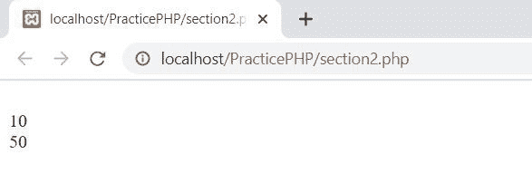

未传递参数时，输出 10。传递 50 时，输出 50。

##### 返回值

函数在执行结束时也可以返回一个值。我们需要使用 `return` 语句。

PHP 7 也支持 `return` 语句的类型声明。类似于函数参数的类型声明，启用严格模式后，类型不匹配将抛出“致命错误”。

要为函数返回值声明类型，在声明函数时，在右大括号（`{`）之前添加冒号（`:`）和类型。

我们将通过一组示例来演示！

```php
declare(strict_types=1);
function sum_number(float $a, float $b){
 return ($a + $b);
}
function sum_number2(float $a, float $b) : float{
 return ($a + $b);
}
function sum_number3(float $a, float $b) : int{
 return ($a + $b);
}
echo "<br> Return value = ".sum_number(5,10);
echo "<br> Return strict value = ".sum_number2(5,10);
```

我们将只调用前两个函数：

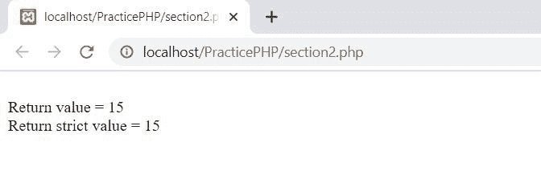

现在，调用第三个函数：

```php
echo sum_number3(5,10);
```

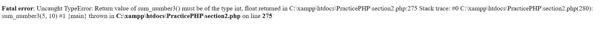

将抛出致命错误，因为两个浮点数相加的结果应为浮点数，而非整数。无论你如何传递参数，返回类型必须匹配！

##### 按引用传递参数

在 PHP 中，参数通常按值传递，这意味着函数内部使用的是值的副本，传入函数的变量无法被修改。

当函数参数按引用传递时，对参数的修改也会改变传入变量的值。要将函数参数变为引用，需使用 `&` 操作符。

让我们通过一个示例来看看区别：

```php
function sum_number($a, $b){
 $a = $a + $b;
 return $a;
}
function sum_number_ref(&$a, $b){
 $a = $a + $b;
 return $a;
}

$a = 5;
$b = 10;
echo "<br>Passing by Value: <br>";
echo "<br>Before Sum: $a = ".$a." $b = ".$b. " Sum = ".sum_number($a,$b);
echo "<br> After Sum:  $a = ".$a." $b = ".$b;
echo "<br><br>Passing by Reference: <br>";
echo "<br>Before Sum: $a = ".$a." $b = ".$b. " Sum = ".sum_number_ref($a,$b);
echo "<br> After Sum:  $a = ".$a." $b = ".$b;
```

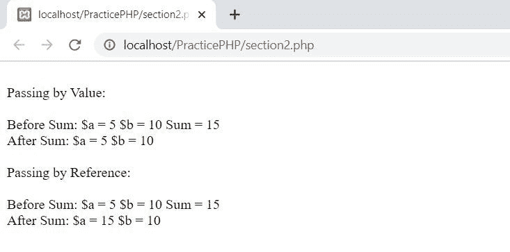

在第二个函数 `sum_number_ref()` 中，参数 `$a` 按引用传递，用 `&$a` 表示。这意味着，一旦 `$a` 被更新，即使函数执行结束，它仍保留该值。

而在函数 `sum_number()` 中，参数仅按值传递，无论内部发生什么计算，都只属于函数内部，函数结束后即销毁！

---

#### 2.7 用户定义函数 - II

---

这是讨论变量作用域的合适语境。让我提醒一下各作用域：

**全局** - 在函数外部声明的变量具有**全局作用域**，只能在函数外部访问。

**局部** - 在函数内部声明的变量具有**局部作用域**，只能在该函数内部访问。

**静态** - 函数执行结束后不会被删除的局部变量。

让我们看一个例子！

考虑以下代码片段：

```php
$x = 10;
function print_x(){
 echo "<br>Printing from function - ".$x;
}
print_x();
echo "<br>Printing outside function - ".$x;
```

这里，变量 `$x` 定义在全局。因此，它可以在函数外部访问。


##### 全局

`global` 关键字用于在函数内部访问全局变量。

PHP 还将所有全局变量存储在一个名为 `$GLOBALS[index]` 的数组中。索引保存变量的名称。该数组也可以在函数内部访问，并可用于直接更新全局变量。

##### 局部

你可以在不同的函数中拥有同名的局部变量，因为局部变量只能被声明它们的函数识别。

##### 静态

通常，当函数完成/执行后，其所有变量都会被删除。然而，有时我们希望局部变量**不**被删除。我们需要它留待后用。

这样，每次调用函数时，该变量仍将保留上次函数调用时包含的信息。但该变量仍然是函数的局部变量。

现在，我们将看一个包含所有三种作用域的示例！

###### 练习

```php
//Scopes of variables - global, local, static
$x = 5;
$y = 10;

function add_num(){
  global $x, $y;
  $z = $x + $y;
  return $z;
}

function add_static(){
  static $m;
  $m = $m + ($GLOBALS['x'] + $GLOBALS['y']);
  return $m;
}

echo "<br> Sum using global x,y = ".add_num();
echo "<br> Sum using global index = ".add_nums();
echo "<br> Accessing local variable z: ".$z;
echo "<br> Addition 1 - ".add_static();
echo "<br> Addition 2 - ".add_static();
echo "<br> Addition 3 - ".add_static();
```

##### 执行

我们尝试了使用 `global` 关键字和 `$GLOBALS[index]` 访问全局变量。同时，当在函数外部访问局部变量 `$z` 时，PHP 会发出一个提示。

如果考虑静态变量 `$m`，`$m` 的值会被保留，并在函数再次调用时累加。我们调用了该函数三次！

*   首次调用将 `$m` 设为 `0` 并赋值为 15。
*   第二次调用将保留之前的值 15 并将其加到 `$m`（此时为 15）上，使其变为 30。
*   第三次调用将 15 加到已为 30 的 `$m` 上，使其变为 45。

让我演算一下：

**第一次调用：**

`$m = 0;`

`$m = 0 + (5+10) = 15`

**第二次调用：**

`$m = 15;`

`$m = 15 + (5 + 10) = 30`

**第三次调用：**

`$m = 30;`

`$m = 30 + (5 + 10) = 45;`


##### 回调函数

回调函数是作为参数传递给另一个函数的函数。

任何现有函数都可以用作回调函数。要使用函数作为回调函数，将包含函数名称的字符串作为参数传递给另一个函数。

从版本 7 开始，PHP 可以将匿名函数作为回调函数传递。匿名函数是未预先声明或定义的函数！

考虑以下代码片段：

```php
//Callbacks
function get_size($str){
 return strlen($str);
}
$str_array = ["PHP","Server-side","Scripting"];
$str_size = array_map("get_size",$str_array);
print_r($str_size);

//anonymous function
$str_size2 = array_map(function($str) { return strlen($str); },$str_array);
echo "<p>Using anonymous function</p>";
print_r($str_size);
```

这些函数的功能相同，但展示了不同的使用方式。


##### 如何在用户定义函数中使用回调？

用户定义的函数和方法也可以接受回调函数作为参数。要在用户定义的函数或方法内部使用回调函数，通过给变量添加括号来调用它，并像普通函数一样传递参数。

让我们通过一个例子来理解！

```php
//Callbacks

function purpose($str){
 return $str."is used to design web pages!<br>";
}
function explain($str){
 return $str."is a server-side scripting language!<br>";
}
function what_is_php($str,$callfunction){
 echo $callfunction($str);
}

what_is_php("PHP ", "explain");
what_is_php("PHP ","purpose");
```

让我先解释一下这个例子！

我们定义了两个函数 - `purpose` 和 `explain` 来显示一些消息。我们定义了第三个函数 `what_is_php` 将上述两个函数中的任意一个作为其参数传入。

`purpose($str)` => `$str` 是参数

`explain($str)` => `$str` 是参数


what\_is\_php(`$str`, `$callfunction`) => `$str` 是传递给函数的参数，`$callfunction` 是接收该参数的函数名称！

请看输出结果！


PHP 是通过 `$str` 变量提供给 `explain` 和 `purpose` 函数的参数！还请记住，前两个函数只是返回字符串，而第三个函数才是真正包含 `echo` 语句、用于打印前两个函数返回字符串的函数。

***

我们有东西要讨论！通常函数不必放在同一个 PHP 文件中。它们可以写在另一个 php 文件中，然后包含在你实际想要使用的页面中！

明白我的意思了吗？函数可以单独定义，并在需要的地方/时间包含进来！

我们现在将讨论两个用于此目的的语句！

**Include / Require（包含/引入）：**

**include** 或 **require** 语句会获取指定文件中存在的所有文本/代码/标记，并将其复制到使用 include 语句的文件中。

当你想在网站的多个页面上包含相同的 PHP、HTML 或文本时，包含文件非常有用。

可以使用 **include** 或 **require** 语句将一个 PHP 文件的内容插入到另一个 PHP 文件中（在服务器执行之前）。

这两个语句完全相同，除了失败时的表现不同：

*   **require** 会产生一个致命错误（`E_COMPILE_ERROR`）并停止脚本执行
*   **include** 只会产生一个警告（`E_WARNING`），脚本将继续执行

因此，如果你希望即使包含的文件丢失，执行仍能继续并向用户显示输出，请使用 include 语句。对于执行流程所需的关键文件，请始终使用 require 语句。这有助于避免应用程序的安全性和完整性受到损害，以防某个关键文件意外丢失。

**语法：**

```
include 'filename';
or
require 'filename';
```

**实践：**

现在创建 2 个 php 文件：`file1.php` 和 `file2.php`

`file1.php` 的内容：

```
<?php
function print_name($name){
 echo "Name of the course: ".$name;
}
?>
```

`file2.php` 的内容：

```
<?php
echo "Try accessing function ";
print_name("PHP Scripting");
?>
```

**执行：**

尝试执行 `file2.php`：

会报致命错误，提示函数名未定义


**修改代码：file2.php**

确保 `file1.php` 和 `file2.php` 在同一位置！再次保存 `file2.php`！

```
<?php
include('file1.php');
echo "<br>Try accessing function after include";
print_name("PHP Scripting");
?>
```

尝试执行 `file2.php`：


你也可以尝试使用 require 语句执行。

**提示：**

*   当文件是应用程序所需时，使用 require。
*   当文件不是必需的，且即使找不到文件应用程序也应继续运行时，使用 include。

开发应用程序时，你可以将所有用户定义的函数放在一个 php 文件中，然后在需要调用其中任何函数的页面中使用它。

***

#### 2.8 Constants（常量）

***

常量是一个简单值的标识符（名称）。该值在脚本执行期间不能被改变。

*   默认情况下，常量区分大小写。
*   按照惯例，常量标识符总是大写。
*   常量名称以字母或下划线开头，后面跟任意数量的字母、数字或下划线。
*   如果你已定义一个常量，它就永远不能被更改或取消定义。
*   与变量不同，常量在整个脚本中自动是全局的。
*   常量只能包含标量数据（布尔值、整数、浮点数和字符串）。

**常量与变量的区别：**

*   常量前不需要写美元符号（`$`），而变量必须写美元符号。
*   常量不能通过简单赋值定义，只能使用 `define()` 函数定义。
*   常量可以在任何地方定义和访问，无需考虑变量作用域规则。
*   一旦常量被设置，就不能被重新定义或取消定义。

**语法**

要创建常量，请使用 `define()` 函数。

```
define(name, value, case-insensitive);
```

参数：

*   name：指定常量的名称
*   value：指定常量的值
*   case-insensitive：指定常量名称是否不区分大小写。默认为 false

**实践：**

现在，回到你一直在编码的 `section2.php`！关闭 `file1.php` 和 `file2.php`！

```
//Constants
define("PHPMARK",75);
define("SQLMARK",70,true);
define("courses",["PHP","SQL"]);
echo "<br>PHP Mark - ".PHPMARK;
echo "<br>SQL Mark - ".SQLMARK;
echo "<br>SQL Mark (case insensitive is true) - ".sqlmark;
echo "<br>PHP Mark (case insensitive is false) - ".phpmark;
echo "<br>Current Course - ".courses[0];
```

**执行：**

输出包含由 phpmark 用法触发的警告。

实际上在创建 SQLMARK 时，我们将第三个参数设为 true，这意味着该常量可以大写或小写引用，因为 case-insensitive 设置为 true！

但 PHPMARK 的第三个参数默认设为 false！


**PHP 魔术常量：**

PHP 为其运行的任何脚本提供了大量预定义常量。

有五个魔术常量会根据使用位置的不同而改变。例如，`__LINE__` 的值取决于它在脚本中的行号。这些特殊常量不区分大小写，如下所示：


我们将用 2 个常量为例来看看它们的作用：

```
//Magic Constants
 echo "<p>Example for __FILE__</p>";    
 //print full path of file with .php extension    
 echo __FILE__ ; 
 echo "<p>Example for __LINE__</p>";    
 //print full path of file with .php extension    
 echo "You are at Line number: ".__LINE__;  
```


我的行号是 374，因为我注释掉了所有代码并将此片段放在最后！

**请记住**：常量类似于变量，不同之处在于一旦定义，就不能更改或取消定义。

***

### Chapter 3: Conditionals and Loops（第 3 章：条件语句和循环）

***

*   3.1 Operators
*   3.2 Conditional Statements
*   3.3 Loops
*   3.4 Regular Expressions
*   3.5 Exceptions

***

#### 3.1 Operators（运算符）

***

运算符用于对变量和值执行操作。

PHP 具有以下分类：

*   算术运算符
*   赋值运算符
*   比较运算符
*   自增/自减运算符
*   逻辑运算符
*   字符串运算符
*   数组运算符
*   条件赋值运算符

我们需要了解运算符，以便在条件语句和循环语句中使用它们！

**Arithmetic Operators（算术运算符）：**

算术运算符用于数值，执行常见的算术运算。


**Assignment Operators（赋值运算符）：**

赋值运算符用于数值，将值写入变量。PHP 中基本的赋值运算符是 `=`。这意味着左操作数被赋予右侧赋值表达式的值。


**Comparison Operators（比较运算符）：**

比较运算符用于比较两个值（数字或字符串）。


**Increment / Decrement Operators（自增/自减运算符）：**

自增运算符用于增加变量的值，而自减运算符用于减少变量的值。运算符放在变量之前/之后决定了是返回增加/减少后的值，还是先返回值再增加/减少值。


**Practice（实践）：**


我们现在将练习这些运算符！希望你已经打开了一个名为 `section3.php` 的新文件。

```php
//Operators
$x = 10;
$y = 20;
echo "<br>Values of $x = ".$x." and $y = ".$y;

echo "<br>Arithmetic Operators ";
echo "<br>Addition: $x + $y = ".($x + $y);
echo "<br>Division: $y / $x = ".($y / $x);
echo "<br>Modulus: $y % $x = ".($y % $x);

echo "<br><br>Assignment Operators ";
$x += $y;
echo "Value of $x after $x += $y = ".$x;

echo "<br><br>Comparison Operators ";
echo "<br>Values of $x = ".$x." and $y = ".$y;
echo "<br> $x is greater than $y? ".($x > $y);
echo "<br> Spaceship operator: $x<=>$y ".($x <=> $y);
$z1 = 55;
$z2 = "55";
echo "<br> $z1 is integer 55 and $z2 is string 55";
echo "<br> Checking $z1 == $z2 Answer: ".($z1 == $z2);
echo "<br> Checking $z1 === $z2 Answer: ".($z1 === $z2);

echo "<br><br>Increment/Decrement Operators";
echo "<br> $x Value: ".$x;
echo "<br>Pre-increment ++$x = ".++$x;
echo "<br>Post-increment $x++ = ".$x++;
echo "<br> $x after post-increment: ".$x;
```

**执行：**

后置递增运算符返回变量 `$x` 的值，然后将其加一。这就是为什么 `$x` 的值保持为 31，随后的语句打印 `$x` 为 32 的原因。


##### 逻辑运算符

逻辑运算符用于组合条件语句。


##### 字符串运算符

专门有 2 个用于字符串的运算符。我们在 echo 语句中已经见过其中一个了。


##### 数组运算符

它们用于比较数组。某些运算符与比较运算符类似。


##### 条件赋值运算符

它们用于根据条件设置值。


###### 练习

我们将练习下一组运算符。运算符的实际用法可以在本章即将到来的章节中找到。

```php
//Operators:
$x = 5;
$y = 10;
echo "<br>Values of $x = ".$x." and $y = ".$y;

echo "<br>Logical Operators ";
$z1 = $x > $y;
$z2 = $x < $y;
echo "<br> Either of z1 or z2 is true - ".($z1 or $z2);

$test = ($x > $y) ? '$x is greater' : '$y is greater';
echo "<br><br>Ternary Operator: ".$test;

echo "<br><br>String Operators ";
$str1 = "Hello";
$str2 = "World";
echo "<br> str1 - ".$str1." str2 = ".$str2;
echo "<br> Concatenation = ".$str1." ".$str2;
$str1 .= $str2;
echo "<br> Concatenation assigned to str1 - ".$str1;

$a = array(10,12,15);
$b = array(15,10,12);
echo "<br><br>Array Operators:";
echo "<br>Checking $a == $b - ".($a == $b);
```

**执行：**

数组运算符将返回 false，因为数组 `$a` 和 `$b` 没有相同的索引（键），只有值相同！

也就是说，`$a[0]` = 10，`$a[1]` = 12，`$a[2]` = 15 而 `$b[0]` = 15，`$b[1]` = 10，`$b[2]` = 12。

这意味着，`$a[0]` != `$b[0]`，`$a[1]` != `$b[1]`，`$a[2]` != `$b[2]`。


我想你已经对运算符有了一些了解。下一节是关于条件语句的。我们将在这些语句中使用运算符！

---

#### 3.2 条件语句

---

有时，你可能只希望在满足某个条件时才执行一组代码（代码块）。你可以在代码中使用条件语句来实现这一目的。

**条件语句用于根据指定的条件执行操作。**

在 PHP 中，我们有以下条件语句：

*   `if` 语句
*   `if...else` 语句
*   `if...elseif...else` 语句
*   `switch` 语句

我们将先看这些语句的语法，然后进入实践环节。

##### if 语句

如果条件为真，则执行一个代码块。

**语法**

```php
if (condition) {
  code to be executed if condition is true;
}
```

##### if...else 语句

如果条件为真则执行一个代码块，如果条件为假则执行另一个代码块。

**语法**

```php
if (condition) {
  code to be executed if condition is true;
} else {
  code to be executed if condition is false;
}
```

##### if...elseif...else 语句

为每个指定的条件执行不同的代码块。

**语法**

```php
if (condition) {
  code to be executed if this condition is true;
} elseif (condition) {
  code to be executed if first condition is false and this condition is true;
} else {
  code to be executed if all conditions are false;
}
```

###### 练习

条件只不过是表达式罢了。

```php
//Conditionals
$x = 10;
$y = 15;
$z = 5;
if($x > $y){
 echo "x is greater than y";
 }
 elseif ($x > $z) {
  echo "x is greater than z";
 }
 else {
  echo "x is the least value";
}
```

**执行：**

在上面的示例代码片段中，`$x` 不大于 `$y`，所以我们检查 `elseif` 条件，结果为真。因此，`elseif` 块内的语句被执行。

尝试使用不同的 `$x` 值执行相同的代码，这样你就能清楚地理解条件是如何被满足的，以及相关的代码块是如何被执行的。


##### switch 语句

我们使用 `switch` 语句来**从多个代码块中选择一个来执行**。实际上，它类似于 `if...elseif...else` 语句的执行，不同之处在于我们不是检查条件，而是检查表达式的结果。

**语法**

```php
switch (n) {
  case label1:
    code to be executed if n=label1;
    break;
  case label2:
    code to be executed if n=label2;
    break;
  case label3:
    code to be executed if n=label3;
    break;
    ...
  default:
    code to be executed if n is different from all labels;
}
```

让我解释一下它的工作原理：

*   我们有一个单一的表达式 `n`（通常是一个变量），它只被求值一次。
*   然后将表达式的值与结构中每个 case 的值进行比较。
*   如果匹配，则执行与该 case 关联的代码块。
*   使用 `break` 可防止代码自动运行到下一个 case。
*   如果你漏掉了 `break` 语句，匹配项之后的 case 将会被执行。
*   如果未找到匹配项，则使用 `default` 语句。

###### 练习

```php
$n = 80;
switch($n){
  case $n > 90: echo "Distinction"; break;
  case $n > 80: echo "First Class"; break;
  case $n > 70: echo "Second Class"; break;
  case $n < 40: echo "Not completed";break;
  default: echo "Completed Course";
}
```

**执行：**

我们将按原样执行代码！


移除 `break` 语句如下所示并执行：

```php
case $n > 70: echo "Second Class";
```


你能理解 `break` 语句的必要性吗？如果你不指定它，匹配的 case 之后的 case 将继续执行。当没有 case 匹配时会发生什么？`default` case 会被执行！

尝试将 `n` 的值改为 50，因为存在 `n > 70` 和 `n < 40` 的 case。

```php
n = 50;
```


希望你已经清楚条件语句了。我们也称它们为分支语句，因为条件就像分支一样。当条件满足时，仅执行与该条件关联的分支代码。

---

#### 3.3 循环语句

---

有时你希望同一代码块运行特定次数。你可以使用循环，而不是多次重复代码行。

**只要指定的条件为真，循环就会反复执行同一代码块。**

在 PHP 中，我们有以下循环类型：

*   `while`
*   `do...while`
*   `for`
*   `foreach`

我们将查看每种循环的语法并进行练习。

##### while 循环

`while` 循环只要指定条件为真，就会执行一个代码块。

**语法**

```php
while (condition is true) {
  code to be executed;
}
```

一旦 `while` 中的条件求值为真，大括号之间的代码就会被执行。如果条件求值为假，则不会执行代码块。

###### 练习

我们将计算 5 次测试成绩的总和！

*   5 次测试的成绩存储在 `$marks` 数组中。


数组的大小存储在变量 `$n` 中。

对于测试的计数，我们使用变量 `$i`。

我们还将初始化一个变量 `$sum` 来计算 5 次测试成绩的总和。

```php
//while 循环
$i = 0;
$marks = array(50,70,74,83,65);
$n = count($marks);
$sum = 0;
echo "Marks: ";
var_dump($marks);
while($i < $n){
 $sum = $sum + $marks[$i];
 echo "<br> Value of i = ".$i;
 echo " marks[$i] = ".$marks[$i];
 echo " Sum = ".$sum;
 $i++;
}
```

**执行：**

代码有什么作用？

*   我们声明一个数组 `$marks[]`
*   我们初始化循环计数变量 `$i = 0`、数组大小变量 `$n = count($marks)`、求和变量 `$sum = 0`
*   While 循环测试条件 `$i < $n`
    *   我们打印 `$i`、`$marks[$i]` 和 `$sum` 的值
    *   每次迭代将 `$i` 增加 1。
    *   循环执行直到 `$i < $n`。一旦 `$i = $n`，循环停止执行。

这是输出结果：


##### do...while 循环

do...while 循环将始终执行一次代码块，然后它将检查条件，并在指定条件为真时重复循环。在这里，条件是在循环内的语句执行**之后**测试的。这意味着即使条件为假，循环也至少会执行一次其语句。

###### 语法

```php
do {	
  要执行的代码;
} while (条件为真);
```

#### 练习：

我们现在将使用此循环重写相同的代码片段：

```php
//do while 循环
$i = 0;
$marks = array(50,70,74,83,65);
$n = count($marks);
$sum = 0;
echo "Marks: ";
var_dump($marks);
do{
 $sum = $sum + $marks[$i];
 echo "<br> Value of i = ".$i;
 echo " marks[$i] = ".$marks[$i];
 echo " Sum = ".$sum;
 $i++;
}while($i < $n);
```

执行上述代码时，您将获得与 while 循环相同的输出。我们重写相同代码的原因是为了告诉您执行是如何发生的以及条件是在哪里被检查的！

##### for 循环

当您预先知道脚本应该运行多少次时，使用 for 循环。它的工作方式与其他两种循环类似，但我们如何指定增量计数器以及在哪里检查条件很重要！

###### 语法

```php
for (初始化; 检查条件; 增量/减量) {
  每次迭代要执行的代码;
}
```

参数：

*   初始化循环计数器值
*   检查每次循环迭代要评估的条件。如果评估为 TRUE，循环继续。如果评估为 FALSE，循环结束。
*   增加或减少循环计数器值

#### 练习：

不是为了让您厌烦，而是为了告诉您此循环如何工作，我们再次采用相同的示例！

```php
//for 循环
$marks = array(50,70,74,83,65);
$n = count($marks);
$sum = 0;
echo "Marks: ";
var_dump($marks);
for($i = 0; $i < $n; $i++){
 $sum = $sum + $marks[$i];
 echo "<br> Value of i = ".$i;
 echo " marks[$i] = ".$marks[$i];
 echo " Sum = ".$sum;
}
```

有一个小小的不同！我们不是在循环的代码块内部增加变量 `$i`，而是将其与初始化和测试条件一起增加。执行相同的代码，您将再次发现相同的输出！

##### foreach 循环

foreach 循环仅适用于数组，用于遍历数组中的每个键/值对。

###### 语法

```php
foreach ($array as $value) {
  要执行的代码;
}
```

对于每次循环迭代，当前数组元素的值被赋给 `$value`，并且数组指针向后移动一位，直到到达最后一个数组元素。

#### 练习：

同样，我们将采用相同的示例编码。这一次，我们不使用计数变量 `$i`，而是使用键/值对进行循环。请查看下面的代码：

```php
//for each 循环
$marks = array(50,70,74,83,65);
$sum = 0;
$i = 0;
echo "Marks: ";
var_dump($marks);
foreach($marks as $mark){
 $sum = $sum + $mark;
 echo "<br> Value of i = ".$i++;
 echo " marks[$i] = ".$mark;
 echo " Sum = ".$sum;
}
```

当您执行时，您将获得相同的输出。但是，您能看到遍历数组是多么容易吗？

您不需要计数器，不需要增加/减少值，您只需将 `$marks` 数组的每个数组元素作为一个名为 `$mark` 的单一值传递！在上面的代码中使用 `$i` 的目的是描述 `$mark` 变量如何从 `$marks` 数组中逐个获取值！当我们使用 foreach 循环时，根本不需要计数器变量！

这就是为什么我从循环开始就尝试使用数组的原因。为了了解不同循环如何工作，我们需要使用相同的示例！通过为不同的循环执行相同的示例代码来学习，将使您更清楚地了解每个循环如何工作及其要求！

我们现在将看看在循环内部使用的两个语句：`break` 和 `continue`

我将再次为这些语句选取相同的示例！

##### Break

您已经见过 `break` 语句，它用于退出 switch 语句。同样，我们可以使用 `break` 语句跳出循环。

#### 练习：

我们有 `$marks` 数组。我们将找到第一个高于 80 的成绩。一旦找到，我们将退出循环。好吗？

```php
//break
$marks = array(50,70,74,83,65);
$sum = 0;
echo "Marks: ";
var_dump($marks);
foreach($marks as $mark){
 if($mark > 80) break;
 echo "<br> Mark Value: ".$mark;
 $sum = $sum + $mark; 
 echo " Sum = ".$sum;
}
```

**执行：**

当您尝试执行上述代码块时，成绩将累加到 74。一旦 `$mark > 80`，`break` 语句将退出循环。


如果您将 `break` 语句放在循环内代码块的末尾，83 也将被累加，只剩下 65 被排除。

##### Continue

如果发生指定条件，`continue` 语句将中断循环中的**一次**迭代，并继续循环中的下一次迭代。

#### 练习：

我们有值为 50,70,74,83,65 的 `$marks` 数组。我们将计算高于 60 的值的总和。为了排除 50，我们将使用 `continue` 语句。

```php
//continue
$marks = array(50,70,74,83,65);
$sum = 0;
echo "Marks: ";
var_dump($marks);
foreach($marks as $mark){
 if($mark < 60) continue;
 echo "<br> Mark Value: ".$mark;
 $sum = $sum + $mark; 
 echo " Sum = ".$sum;
}
```

**执行：**

当 `$mark < 60` 时，我们提到了 `continue`，这意味着循环应该继续下一次迭代。


现在您能理解 `break` 和 `continue` 之间的区别吗？

`continue` 语句继续循环迭代，跳过当前迭代，而 `break` 语句则彻底退出循环！

---

#### 3.4 正则表达式

---

正则表达式是形成搜索模式的字符序列。正则表达式可以是单个字符，也可以是更复杂的模式。正则表达式可用于执行所有类型的文本搜索和文本替换操作。

在 PHP 中，正则表达式是由以下部分组成的字符串：

*   定界符，
*   模式和
*   可选修饰符。

#### 定界符：

定界符可以是任何非字母、数字、反斜杠或空格的字符。最常用的定界符是正斜杠 (`/`)，但当您的模式包含正斜杠时，选择其他定界符（如 `#` 或 `~`）会更方便。

#### 模式：

模式或搜索模式是我们用于搜索的字符序列。方括号用于查找字符范围：


**注意：**

如果您的表达式需要搜索特殊字符之一，可以使用反斜杠 (`\\`) 进行转义。

#### 修饰符：

修饰符可以更改搜索的执行方式。


我们还可以在正则表达式中提及一些元字符和量词。

##### 元字符

元字符是具有特殊含义的字符。它们可以包含在搜索模式中。


##### 量词

量词定义数量。这告诉搜索字符或搜索模式的出现次数。


##### 分组


##### 正则表达式函数

您可以使用圆括号 `()` 将量词应用于整个模式。它们也可用于选择模式的部分内容以用作匹配。

我们将在何处以及如何使用这些正则表达式？我们有相应的函数来实现这一目的。我们将在这些函数中使用这些表达式。我们将在表达式中应用修饰符、量词，并将其作为函数参数使用。

让我直接向您展示一些函数，然后我们将进入实践环节。

PHP 提供了多种函数，允许您使用正则表达式。


##### 实践

我们将在此查看一些最常用的函数。我们将在示例中使用定界符、修饰符、量词！

```php
//正则表达式
$str_array = array("Hello World","New World","Welcome to New Course", "This is a new course","Hello is the first word tested");

//区分大小写的搜索
$pattern1 = "/New/";
echo "<br>区分大小写的搜索模式: ".$pattern1;
foreach ($str_array as $str){
  echo "<br>字符串: ".$str." | 搜索结果 - ".preg_match($pattern1,$str);
}

//不区分大小写的搜索
$pattern2 = "/New/i";
echo "<br><br>不区分大小写的搜索模式: ".$pattern2;
foreach ($str_array as $str){
  echo "<br>字符串: ".$str." | 搜索结果 - ".preg_match($pattern2,$str);
}

$pattern3 = "/is/i";
echo "<br><br>不区分大小写的搜索所有模式: ".$pattern3;
foreach ($str_array as $str){
  echo "<br>字符串: ".$str." | 搜索结果 - ".preg_match_all($pattern3,$str);
}

$pattern4 = "/world/i";
echo "<br><br>不区分大小写的替换模式: ".$pattern4;
foreach ($str_array as $str){
  echo "<br>字符串: ".$str." | 搜索结果 - ".preg_replace($pattern4,'universe',$str);
}

//使用量词
$pattern5 = "/(l){2}/";
echo "<br><br>区分大小写的搜索所有模式: ".$pattern5;
foreach ($str_array as $str){
  echo "<br>字符串: ".$str." | 搜索结果 - ".preg_match($pattern5,$str);
}
```

在此示例代码片段中，我们使用了 5 个模式：

*   `$pattern1 = "/New/";`
*   `$pattern2 = "/New/i";`
*   `$pattern3 = "/is/i";`
*   `$pattern4 = "/world/i";`
*   `$pattern5 = "/(l){2}/";`

让我们分析一下上述模式！

*   此处使用的定界符是 `/`。这意味着定界符指定了模式字符串的开始和结束。
*   在末尾定界符旁边使用修饰符 `i` 将表明模式搜索应**不区分大小写**，这与默认的区分大小写搜索相反。
*   最后一个模式使用量词指定字符 `l` 应出现两次。

##### 执行

执行代码，尝试检查模式搜索的输出是否与您猜测的相同。


---

#### 3.5 异常

异常是一个描述 PHP 脚本错误或意外行为的对象。

许多 PHP 内置函数/类以及用户定义的函数/类都会抛出异常。当函数遇到无法处理的数据时，异常是停止函数执行的一种好方法。

代码中可能存在某些位置，我们认为错误的输入可能会导致错误。对于普通用户来说，他们可能不知道如何处理输入。因此，当他们提供错误输入时，异常可以给出关于出了什么问题的适当提示。

由于本书不涵盖面向对象编程，我们将仅讨论与函数相关的异常。

##### 异常对象

异常对象包含有关函数遇到的错误或意外行为的信息。虽然这部分使用了对象，但我们将学习它以便在函数中使用。

我们有两个与异常相关的操作：

*   **抛出异常** - 抛出信息表明发生了某些错误
*   **捕获异常** - 说明异常是什么（提示发生了哪种错误）

###### 语法

```php
new Exception(message, code, previous)
```

**参数：**

所有参数均为可选。

*   `message` - 描述抛出异常原因的字符串
*   `code` - 一个整数，可用于轻松区分此异常与其他同类型异常
*   `previous` - 如果此异常是在另一个异常的 catch 块中抛出的，建议将该异常传递给此参数

##### 抛出异常

`throw` 语句允许用户定义的函数或方法抛出异常。当抛出异常时，其后的代码将不会被执行。

如果异常未被捕获，将发生致命错误，并显示 "Uncaught Exception"（未捕获的异常）消息。

##### 实践

我们现在将看一个使用异常的示例。这是一个使用异常的通用示例，以便每个人都能清楚地理解。

我们将查看不抛出异常的代码片段：

```php
//异常
function divide($dividend,$divisor){
	return ($dividend / $divisor);
}

echo "<br>除法 10/5 = ".divide(10,5);
echo "<br>除法 10/0 = ".divide(10,0);
```


您看到了吗？`10/0` 给出了 infinity（无穷大）。

现在，我们将在代码中加入异常：

```php
//异常
function divide($dividend,$divisor){
 if($divisor == 0){
	throw new Exception("Division by zero");
 }
 return ($dividend / $divisor);
}

echo "<br>除法 10/5 = ".divide(10,5);
echo "<br>除法 10/0 = ".divide(10,0);
```

现在，输出将是：


当该异常发现变量 `$divisor` 的值为 0 时，它不允许函数返回任何值，从而也阻止了相关的 `echo` 语句被打印。

对于使用您网页的普通用户来说，`INF` 可能不清楚，但错误消息将意味着他们的输入无效。这可能是一个小示例，因此不使用异常显示 `INF` 影响不大。此外，`INF` 值不会被进一步使用。但当您开发实时应用程序时，当一个输出被转发到程序的其他部分时，这就会变成大问题，有时会导致不受控制的循环。所以让我们练习使用异常。

现在，我们将看看 `catch` 语句。

##### try...catch 语句

为了避免上述示例中的错误，我们可以使用 `try...catch` 语句来捕获异常并继续执行过程。

###### 语法

```php
try {
  可能抛出异常的代码
} catch(Exception $ex) {
  捕获异常时运行的代码
}
```

`catch` 块指明应捕获哪种类型的异常以及可用于访问该异常的变量名。在上面的示例中，异常类型是 `Exception`，变量名是 `$ex`。

##### 实践

```php
//异常
function divide($dividend,$divisor){
 if($divisor == 0){
	throw new Exception("Division by zero");
 }
 return ($dividend / $divisor);
}

echo "<br>除法 10/5 = ".divide(10,5);
echo "<br>除法 10/0 = ";
try{
  echo divide(10,0);
}catch (Exception $ex){
  echo "Unable to divide";
}
```

##### 执行


##### try...catch...finally 语句

`try...catch...finally` 语句可用于捕获异常。无论是否捕获到异常，`finally` 块中的代码都将始终运行。如果存在 `finally`，则 `catch` 块是可选的。

###### 语法

```php
try {
  可能抛出异常的代码
} catch(Exception $e) {
  捕获异常时运行的代码
} finally {
  无论是否捕获异常始终运行的代码
}
```

##### 实践

我们将使用 `finally` 重写相同的示例：

```php
//异常
function divide($dividend,$divisor){
 if($divisor == 0){
	throw new Exception("Division by zero");
 }
 return ($dividend / $divisor);
}

echo "<br>除法 10/5 = ".divide(10,5);
echo "<br>除法 10/0 = ";
try{
  echo divide(10,0);
}catch (Exception $ex){
  echo "Unable to divide";
}finally{
echo "<br> End of Program";
}
```

##### 执行

现在，我们将获得包含 `finally` 块中 echo 语句的输出。


##### 方法


捕获异常时，下表展示了一些可用于获取异常信息的方法：


**练习：**

我们将结合上述讨论的方法，查看相同的编码示例。

希望你会产生一个疑问：如果 `try` 块被执行会发生什么？这个问题也将得到解答。

```php
//Exception
function divide($dividend,$divisor){
 if($divisor == 0){
	throw new Exception("Division by zero");
 }
 return ($dividend / $divisor);
}

try{
  echo "<br>Division 10/5 = ".divide(10,5);
}catch(Exception $ex){
  echo "No error in input";
}

echo "<br>Division 10/0 = ";
try{
  echo divide(10,0);
}catch (Exception $ex){
  $code = $ex->getCode();
  $message = $ex->getMessage();
  $file = $ex->getFile();
  $line = $ex->getLine();
  echo "Exception thrown in $file on line $line: [Code $code] $message";
}
```

**执行：**

当 `try` 块被执行时，`catch` 块不会被执行。这类似于 `if...else` 语句的执行。两个块中只会有一个被执行！

希望你能理解：

*   `$ex->getCode()` - 返回异常代码
*   `$ex->getMessage()` - 从函数内部的 `Exception()` 对象中获取消息
*   `$ex->getFile()` - 获取抛出异常的完整文件路径
*   `$ex->getLine()` - 获取抛出异常的行号（`Exception()` 对象）


如果你是新手程序员，你可能会觉得为什么要去处理这些异常。在学习和练习的语境下，你或许是对的。但在开发过程中，优秀的程序员应该定义好代码中所有可能的块，以便为最终用户避免不必要且不明确的错误。

希望当你开始从事实时应用开发时，会开始使用异常。

---

### 第 4 章：文件与表单

---

*   [](#part0025.xhtml)
    #### 4.1 文件处理
*   [](#part0026.xhtml)
    #### 4.2 超全局变量
*   [](#part0027.xhtml)
    #### 4.3 表单操作
*   [](#part0028.xhtml)
    #### 4.4 表单验证
*   [](#part0029.xhtml)
    #### 4.5 文件上传

---

#### 4.1 文件处理

---

文件处理是 Web 应用程序的一个重要方面。本节介绍如何在服务器上操作文件。

PHP 拥有多个用于创建、打开、读取、上传和编辑文件的函数。

**创建 / 打开文件：**

在 PHP 中，要打开文件或将文件写入服务器，我们需要创建该文件。所有这些任务均由单个函数完成。这意味着：

*   当你创建时，需要打开；一旦打开，就需要将其写入服务器
*   当你想将文件写入服务器时，显然必须打开它
*   当你想打开一个文件时，它必须是已创建的或已存在的。

**函数：`fopen()`**

如果对不存在的文件使用 `fopen()`，它将创建该文件，前提是该文件以写入 (`w`) 或追加 (`a`) 模式打开。写入意味着开始写入内容，而追加意味着向现有内容添加更多内容。

参数：

`fopen(文件名, 打开模式);`

我们来看看可用的各种模式：


创建新文件时，需要使用 `w`。

**练习：**

希望你的新文件 `section4.php` 已创建并打开以供编辑。我们首先创建一个文件用于写入：

```php
$testfile = fopen("test.txt", "w");
```

执行后，你将在 `section4.php` 所在的位置发现一个已创建的文本文件。

创建了一个大小为 0 字节的新文件。该文本文档将没有内容。


**注意：** 如果尝试运行此代码时出现错误，请检查是否已授予 PHP 文件向硬盘写入信息的访问权限。

*   要授予访问权限，右键点击文件夹 `PracticePHP` => 属性 => 取消勾选“只读”
*   转到“安全”选项卡 => 检查相应用户所需的权限

你还记得第 2 节中的**资源数据类型**吗？

`$testfile` 属于资源数据类型——虽然不是实际类型，但它在此处持有一个资源，如文件。

**向文件写入内容：**

有一个函数 `fwrite()` 可将内容写入文件。

理解：

*   当你打开一个文件时，该文件会被写入服务器
*   但当你使用 `fwrite()` 写入时，意味着你正在向文件添加内容

希望你理解这两种“写入”的区别。当你打开文件时，你以写入模式打开，并将其指定为 `w`。而函数 `fwrite()` 则用于写入内容。

有 2 个参数：

`fwrite(文件名, 要添加的内容);`

**练习：**

我们将向文件添加几个字符串字符：继续在同一个 `section4.php` 中编码：

```php
$texttoadd = "First Line of Text followed by new line character! ";
fwrite($testfile,$texttoadd);
$texttoadd = "Second Line of Text followed by new line character! ";
fwrite($testfile,$texttoadd);
```

暂不要执行，我们将关闭文件后再执行。

**关闭文件：**

写入完成后，我们必须关闭文件。这就像打开文件后必须关闭它一样。

函数 `fclose()` 负责关闭文件。

**练习：**

在上述代码中添加以下行：

```php
fclose($testfile);
```

在完成文件操作后关闭所有文件是一个良好的编程习惯。打开的文件会占用资源。

现在，执行该 PHP 文件，然后前往 `text.txt` 所在的路径。打开 `text.txt`，你将看到以下几行：


**向现有文件写入内容：**

**当你关闭文件，然后再次以写入模式打开它时会发生什么？**

文件 `testfile.txt` 已经包含一些数据，对吧？现在，如果你以写入模式打开一个现有文件，所有现有数据将被清除，我们必须像从头创建一样，从空文件重新开始。

现在，让我们在 `section4.php` 中编写以下代码：

```php
$testfile = fopen("test.txt", "w");
$texttoadd = "New first Line! ";
fwrite($testfile,$texttoadd);
$texttoadd = "New Second Line! ";
fwrite($testfile,$texttoadd);
fclose($testfile);
```

现在执行文件时，内容不会被追加，而是从头覆盖原有内容。


那么，要继续写入内容，即在不擦除现有内容的情况下追加内容，该怎么办？使用追加模式：注释掉所有之前的代码，仅保留这 4 行。

```php
$testfile = fopen("test.txt", "a");
$texttoadd = "Third Line to existing 2 lines! ";
fwrite($testfile,$texttoadd);
fclose($testfile);
```

执行 PHP 文件，现在打开 `test.txt`，你将看到以下内容：


**你无法刷新一个打开的文本文档！请关闭后重新打开以查看！**

现在我们完成了向文件写入内容。下一个任务是从文件读取内容。为此我们有许多函数。

**读取文件：**

我们可以通过以下方式打开文件以进行读取：

*   使用 `readfile()` 函数
*   使用 `fread()` 函数

我们将逐一介绍：

要执行读取文件的代码，请尝试注释掉所有写入相关的代码，仅使用读取相关的代码，以检查它们如何从现有文本文档中检索内容！

**使用 `readfile()` 函数：**

它读取文件并将其写入输出缓冲区。成功时返回读取的字节数。如果你只想打开一个文件并读取其内容，`readfile()` 函数非常有用。

我们已经创建了一个名为 `test.txt` 的文件。让我们尝试读取同一个文件。

```php
echo readfile("test.txt");
```


注释掉 echo 语句，尝试下一个函数。

**使用 `fread()` 函数：**

`fread()` 函数从打开的文件中读取。

参数：

`fread(打开的文件名, 要读取的最大字节数);`


##### 文件处理与超全局变量

###### 代码示例：读取文件内容

```php
$filecontent = fopen("test.txt","r");
echo fread($filecontent,filesize("test.txt"));
```

执行后输出：


*   `filesize(file)` 是一个返回文件字节数的函数。

###### 读取函数

我们将介绍几个读取函数：

*   读取单行：`fgets()`
*   读取单字符：`fgetc()`
*   检查文件结束：`feof()`

####### `fgets()` 函数

`fgets()` 函数用于从文件中读取单行。

练习代码：

```php
$filecontent = fopen("test.txt","r");
echo fgets($filecontent);
fclose($filecontent);
```

每当调用一次 `fgets()` 函数，指针就会移动到下一行。由于只有一个 `fgets()` 函数，因此只读取了一行。


####### `fgetc()` 函数

`fgetc()` 函数用于从文件中读取单个字符。

练习代码：

```php
$filecontent = fopen("test.txt","r");
echo fgetc($filecontent);
fclose($filecontent);
```

调用 `fgetc()` 函数后，文件指针移动到下一个字符。由于 `fgetc()` 只被调用一次，因此只读取了一个字符！


####### 如何读取文件直到末尾？

####### `feof()` 函数

`feof()` 函数检查是否已到达“文件结束”（EOF）。它对于遍历未知长度的数据非常有用。

练习代码：

```php
$filecontent = fopen("test.txt","r");
echo "<p>Printing character by character </p>";
while(!feof($filecontent)){
    echo fgetc($filecontent);
}
fclose($filecontent);

$filecontent = fopen("test.txt","r");
echo "<p>Printing line by line </p>";
while(!feof($filecontent)){
    echo "<p>".fgets($filecontent). "</p>";
}
fclose($filecontent);
```

我们在 `fgets()` 之后关闭文件并再次打开。为什么？因为第一个 `while` 循环到达文件末尾后，指针无法指回开头。所以我们关闭并再次打开文件以便在 `while` 循环中执行 `fgetc()`。

执行结果：


希望你理解为什么要在 `while` 循环中检查 `feof()`。原因是为了读取所有行（使用 `fgets()`）和所有字符（使用 `fgetc()`），我们在 `while` 中使用 `!feof()` 作为条件，指示循环持续到文件结束。

###### 注意事项

####### 打开不存在的文件会发生什么？

我们来试一下：

```php
$newfile = fopen("newtest.txt","r");
```

输出是什么？


有一种方法可以告知用户文件不存在：

```php
$newfile = fopen("newtest.txt","r") or die("Unable to open file!");
```


当以下情况发生时，`die` 语句会被执行：

*   文件不存在
*   文件未被授予打开权限

它会立即终止脚本。

至此，文件处理部分结束！

---

#### 4.2 超全局变量

---

PHP 中存在一些预定义变量，它们始终可访问，无论作用域如何——你可以从任何函数、类或文件中访问它们，而无需做任何特殊操作。这些变量称为超全局变量，或简称为超全局。

PHP 超全局变量包括：

*   `$GLOBALS`
*   `$_SERVER`
*   `$_REQUEST`
*   `$_POST`
*   `$_GET`
*   `$_FILES`
*   `$_ENV`
*   `$_COOKIE`
*   `$_SESSION`

**超全局变量是始终在所有作用域中可用的内置变量。**

本章不会详细讨论每个变量。将对所有变量进行简要介绍，实际用法将在本章和下一章中处理。

##### `$GLOBALS`

`$GLOBALS` 用于在 PHP 脚本的任何位置访问全局变量。我们在讨论函数中的变量作用域时使用过这些变量。希望你还记得！

##### `$_SERVER`

`$_SERVER` 保存关于头信息、路径和脚本位置的信息。`$_SERVER` 超全局变量有许多元素用于获取关于服务器和服务器相关实体的描述。

以下是可与 `$_SERVER` 一起使用的元素列表：


我们将在实践环节测试几个元素：

```php
echo "Server Address: ".$_SERVER['SERVER_ADDR'];
echo "<br>Server Name: ".$_SERVER['SERVER_NAME'];
```


有 3 个超全局变量用于收集和传递表单数据。我们现在只简单了解一行，将在下一节深入探讨。

##### `$_REQUEST`

`$_REQUEST` 用于在提交 HTML 表单后收集数据。

##### `$_POST`

`$_POST` 用于在使用 `method="post"` 提交 HTML 表单后收集表单数据。

##### `$_GET`

`$_GET` 用于在使用 `method="get"` 提交 HTML 表单后收集表单数据。

##### `$_ENV`

`$_ENV` 用于从 Web 服务器返回环境变量。为了学习，我们通过一个示例演示：

```php
echo 'Username: ' .$_ENV['USER'];
```


这是一个错误！没问题！

让我们调试该错误！`Undefined index`：意味着我们必须定义一个 `USER` 索引！

我们现在修改代码如下：

```php
$_ENV['USER'] = $_SERVER['SERVER_NAME'];

echo 'Username: ' .$_ENV['USER'];
```


就这些！

我们将在本章后面讨论 `$_FILES`。将在下一章讨论 `$_COOKIE` 和 `$_SESSION`。

让我们进入下一节！

---

#### 4.3 使用表单

---

我们将使用第 6 章的一个项目标题来开发一个 Web 应用程序。因此，我们现在将为该应用程序设计一些表单，并通过它们学习如何使用 PHP 处理表单。明白了吗？让我们开始吧！

我将简要介绍该项目的内容。

**项目：** 我们将采用 **在线课程** Web 应用程序。

在这个在线课程应用程序中，我们将有教授课程的讲师和学习这些内容的学习者。

基本上，我们有 2 种用户：讲师和学习者。同样，我们有 2 个主要实体：课程及其内容。

我们将简单地设计表单并使用它们来学习上一节讨论的某些超全局变量。

请记住，我们不验证表单中的任何数据，我们只是在学习如何发送和检索表单数据。

##### 设计表单

让我们为讲师注册设计一个表单（讲师的注册）：

从这里开始，我们将为该项目创建一个文件夹并在此基础上工作！

###### 操作步骤

*   在 `C:/xampp/htdocs` 中创建一个名为 `onlinecourse` 的文件夹
*   创建一个名为 `instructor_signup.php` 的新 PHP 文件

**注意：** 即使你设计的表单仅包含 HTML 元素，为了处理表单数据，你也需要 PHP。因此，请使用 `.php` 扩展名保存文件。

如果你准备好了，在 XAMPP 中启动 Apache 服务器，并在浏览器中运行 `onlinecourse` 项目，如下所示：


以下是 HTML 编码片段：

###### `instructor_signup.php` 文件中的设计代码


<!DOCTYPE html>
<html>
<head>
<title>讲师注册</title>
</head>
<body>
<h2>讲师注册</h2>
<form method="get" action="" name="form1">
<table>
<tr>
<th style='text-align:left;'><label>电子邮箱地址</label></th>
<td>:&emsp;</td>
<td><input type="email" name="txtemail" size="30" placeholder="您的电子邮箱地址"></td>
</tr>
<tr>
<th style='text-align:left;'><label>姓名</label></th>
<td>:&emsp;</td>
<td><input type="text" name="txtname" size="30" placeholder="您的姓名"></td>
</tr>
<tr>
<th style='text-align:left;'><label>资质</label></th>
<td>:&emsp;</td>
<td><input type="text" name="txtqualification" size="30" placeholder="您的资质"></td>
</tr>
<tr>
<th style='text-align:left;'><label>国家</label></th>
<td>:&emsp;</td>
<td><select name="txtcountry">
<option value="">从列表中选择一个国家</option>
<option value="India">印度</option>
<option value="France">法国</option>
<option value="Japan">日本</option>
<option value="Canada">加拿大</option>
</select></td>
</tr>
<tr></tr>
<tr>
<th></th><td></td><td><p><input type="submit" name="signup" value="注册"></p></td>
</tr>
</table>
</form>
<hr></body>
</html>

我假设您对 HTML 表单有一定的想法/理解。

我只是随机使用了一些国家名称！

让我解释一下代码片段的内容：

我们有 4 个字段——讲师邮箱 ID、讲师姓名、讲师资质、讲师国家。我们尝试使用这 4 个字段获取输入。如果表单的 action 为空，所有数据都将提交到同一页面。目前，我们不会在任何地方保存这些数据。我们只是传递数据并使用超全局变量在同一页面打印它们。

执行后，您应该会看到如下效果（如果您按上述方式编码）：


您可以按喜好设计表单。但为了学习目的，**请勿更改任何元素的名称**。我们在该表单中有以下名称：`form1`、`txtemail`、`txtname`、`txtqualification`、`txtcountry`、`signup`。请确保拼写正确。因为这些名称将发挥重要作用。

由于我们在此使用的方法是 get，我们可以使用 `$_REQUEST` 或 `$_GET` 变量来收集这些数据！

在 `instructor_signup.php` 文件开头编写以下代码：

```php
<?php
if(isset($_GET['signup'])){
  echo "<br>您已点击注册";
}
?>
```

我们将检查表单是否已提交。该怎么做？

*   将此代码添加到 php 文件中。
*   执行该文件
*   点击页面中的注册按钮


如果在顶部显示此消息，则表示您的表单已提交。

`if(isset($_GET['signup']))` 解释：

*   如果名为 `signup` 的按钮被点击，`$_GET['signup']` 将获取值 1。
*   `isset()` 将检查 `$_GET['signup']` 是否有值。如果按钮未被点击，`$_GET['signup']` 将没有值，导致 `isset()` 为 false。点击时，`isset()` 返回 true。
*   当您将 `isset($_GET['signup'])` 传入 `if()` 语句时，条件评估为 true 并执行语句块。如果条件评估为 false，则不执行语句块。

示例：当您执行页面时，不会收到消息，只有当您点击按钮时，才会收到此消息。

您能看到 URL 吗？当您使用 `$_GET` 方法时，所有值都会连同名称参数显式地显示在 URL 中。

现在我们只需将所有这些值获取到变量中并打印出来。

在开头添加此代码：（不仅是 echo 语句，我们还添加了几行）。

```php
<?php
if(isset($_GET['signup'])){
   echo "<br>您已点击注册";
   $email = $_REQUEST['txtemail'];
   $name = $_GET['txtname'];
   $qualification = $_GET["txtqualification"];
   $country = $_GET['txtcountry'];
}
?>
```

除非必要，我们可以使用单引号或双引号。

我们将在表单下方打印详细信息。查看您的表单在何处以 `</form>` 结束。将代码片段放在 `<hr>` 标签下方：

```php
<?php
if(isset($email)){
  echo "<br>邮箱 - ".$email;
}
if(isset($name)){
  echo "<br>姓名 - ".$name;
}
if(isset($qualification)){
  echo "<br>资质 - ".$qualification;
}
if(isset($country)){
  echo "<br>国家 - ".$country;
}
?>
```

对每个 php 变量使用 `isset()` 的原因很简单——如果您不使用，执行时 php 会搜索这些变量，如果未找到则显示错误。想检查一下吗？您可以试试！

添加代码后，请确保不要刷新带有参数的 URL。

执行 `http://localhost/onlinecourse/instructor_signup.php`

执行后，在这些字段中输入一些内容并点击注册按钮：


您能理解它的作用吗？另外，请注意 URL 参数！

您希望您的表单数据安全吗？

非常简单，您只需做 2 件事：

*   将表单 method 改为 "post"
*   将所有 `$_GET[]` 改为 `$_POST[]` 变量。您可以更改/保留 `$_REQUEST[]`

让我给出代码：

```php
<?php
if(isset($_POST['signup'])){
    echo "<br>您已点击注册";
    $email = $_REQUEST['txtemail'];
    $name = $_POST['txtname'];
    $qualification = $_POST["txtqualification"];
    $country = $_POST['txtcountry'];
}
?>

<form method="post" action="" name="form1">
```

执行 `http://localhost/onlinecourse/instructor_signup.php`


看看您的 URL 有多干净！

当您不确定表单是通过 get 还是 post 方法发送时，可以使用 `$_REQUEST` 检索表单变量！

让我们了解一下 **GET 与 POST：**

GET 和 POST 都会创建一个类似这样的数组：array( key1 => value1, key2 => value2, key3 => value3, ...)。该数组保存键/值对，其中键是表单控件的名称，值是来自用户的输入数据。

您可以从任何函数、类或文件访问它们，而无需做任何特殊操作。它们在全局范围内均可访问。

*   `$_GET` 是通过 URL 参数传递给当前脚本的变量数组。
*   `$_POST` 是通过 HTTP POST 方法传递给当前脚本的变量数组。

###### 何时使用 GET？

使用 GET 方法从表单发送的信息对所有人可见（所有变量名和值都显示在 URL 中）。

*   GET 对发送信息的量有限制。
*   限制约为 2000 个字符。
*   然而，因为变量显示在 URL 中，所以可以将页面加入书签。这在某些情况下很有用。
*   GET 可用于发送非敏感数据。
*   GET **绝不应** 用于发送密码或其他敏感信息！

###### 何时使用 POST？

使用 POST 方法从表单发送的信息对其他人不可见（所有名称/值嵌入在 HTTP 请求的主体中）

*   对发送信息的量没有限制。
*   此外 POST 支持高级功能，例如在向服务器上传文件时支持多部分二进制输入。
*   然而，因为变量不显示在 URL 中，所以无法将页面加入书签。
*   开发人员倾向于使用 POST 发送表单数据。

---

#### 4.4 表单验证

---

在本节中，我们将学习如何安全地处理表单。正确验证表单数据对于保护您的数据免受黑客和垃圾邮件发送者的侵害非常重要！

验证示例：

这 2 条验证规则依据我们的讲师注册表单。

*   如果您在文本字段中提供姓名，它应包含字母和空格。
*   如果您在邮箱字段中提供电子邮箱地址，它必须包含 @ 和域名才有效。
*   我们也可以使用 html input 元素中的 required 属性将字段指定为必填或选填。

**如何验证上一节设计的表单？**

我们将遵循以下步骤：


##### 表单验证最佳实践

*   使用 `htmlspecialchars()` 函数处理所有变量。使用此函数的原因是防止不必要的脚本代码被传递到姓名、邮箱等文本字段中。
*   使用 PHP `trim()` 函数从用户输入数据中去除不必要的字符（多余空格、制表符、换行符）。
*   使用 PHP `stripslashes()` 函数从用户输入数据中移除反斜杠（`\\`）。
*   当提到 `mandatory` 属性时，检查字段是否为空。
*   将每个验证逻辑放在单独的函数中，以避免为每个表单重复编写相同代码。
*   为每个字段生成适当的错误消息，以便用户了解其输入哪里出错。

以上是通用的几个步骤。我还提示了一些函数以方便你的工作。

对于我们的注册表单，我们可以尝试验证邮箱、姓名和国家字段。我们可能不会用到上述所有函数，而是会使用一些其他函数来实现我们的目的！

我们开始验证表单吧？

*   在 `C:/xampp/htdocs/onlinecourse` 目录下创建一个名为 `validate_form.php` 的文件
*   在 `instructor_signup.php` 文件中包含 `validate_form.php` 文件

让我展示一下要放在 `instructor_signup.php` 开头的包含语句：

```
include('validate_form.php');
```

再次提醒一下字段：

*   `txtemail` - 用于邮箱地址
*   `txtname` - 用于姓名
*   `txtqualification` - 用于学历
*   `txtcountry` - 用于国家

在这 4 个字段中，`txtcountry` 是从给定列表中选择的字段。但我们仍有一个要求：必须选择某个值，使该字段成为必填项！

这没有固定的验证规则。只要规则合适，你可以自由选择适合你字段的验证规则。

我们将练习每个验证的代码片段。

一旦所有验证片段准备就绪，我们将在最后更新 `instructor_signup.php` 文件！

###### 验证邮箱地址

如果你在输入元素中使用 `type="email"` (HTML5) 并在最新浏览器中检查，该字段将由浏览器自动验证。我们将为旧版浏览器和旧版 HTML 提供解决方案。

我们将使用 `filter_var()` 函数来检查邮箱地址是否格式正确。

我们在 `$email` 变量中获取邮箱地址：

```
$email = $_REQUEST['txtemail'];
```

现在让我们在 `validate_form.php` 中编写一个函数：

```
function check_email($email){
  if (!filter_var($email, FILTER_VALIDATE_EMAIL)) {
	return "Invalid email address";
  }
}
```

代码解释：

*   将变量 `$email` 作为参数传递给函数 `check_email($email)`
*   使用 `filter_var()` 函数验证邮箱地址格式
*   如果格式错误，则返回错误消息

###### 验证姓名

我们将使用正则表达式函数 `preg_match()` 来检查姓名字段是否仅包含字母、连字符、撇号和空白字符。

我们在 `$name` 变量中获取姓名字段：

```
$name = $_POST['txtname'];
```

现在让我们在 `validate_form.php` 中编写一个函数：

```
function check_name($name){
  if (!preg_match("/^[a-zA-Z-' ]*$/",$name)) {
    return "Name must contain letters and whitespaces!";
  }
}
```

代码解释：

*   将变量 `$name` 作为参数传递给函数 `check_name($name)`
*   使用 `preg_match()` 检查姓名是否包含字母、空白字符、连字符
*   如果格式错误，则返回错误消息

###### 注册页面需要修改什么？

希望你已在 `validate_form.php` 中添加了 2 个函数。现在，我们将更新 `instructor_signup.php` 文件中的代码：

共有两组 PHP 代码标签。一组出现在顶部。

我们已包含 `validate_form.php` 文件：

```
<?php
include('validate_form.php');
if(isset($_POST['signup'])){
  echo "<br>You have clicked Sign up";
  $email = $_REQUEST['txtemail'];
  $name = $_POST['txtname'];
  $qualification = $_POST["txtqualification"];
  $country = $_POST['txtcountry'];
}
?>
```

第二组 PHP 代码出现在底部附近：

我们将在这里应用验证：

```
<?php
$display = true;
if(isset($email) and isset($name) and isset($qualification) and isset($country)){
  //check field validation
  $email_status = check_email($email);
  $name_status = check_name($name);
  if($email_status <> NULL){
    echo "<p style='text-color:red;'>".$email_status."</p>";
    $display = false;
  }
  if($name_status <> NULL){
    echo "<p style='text-color:red;'>".$name_status."</p>";
    $display = false;
  }
  if(empty($country)){
    echo "<p style='text-color:red;'>No country chosen</p>";
    $display = false;
  }
  //display fields if no errors found
  if($display){
    echo "<br>Email - ".$email;
    echo "<br>Name - ".$name;
    echo "<br>Qualification - ".$qualification;
    echo "<br>Country - ".$country;
  }
}
?>
```

代码解释：

*   我们设置变量 `$display` 为 `true`
*   我们检查所有变量是否都有值，如果是，则继续
    *   验证邮箱字段，如果邮箱字段无效，显示消息
    *   验证姓名字段，如果姓名字段无效，显示消息
    *   检查是否选择了国家，否则显示消息
    *   如果上述三个验证中的任何一个失败，则将 `$display = false`，这将不打印任何详细信息
    *   如果验证后 `$display = true`，则打印字段

让我们使用有效/无效输入数据执行。

无效输入数据和输出：


有效输入数据和输出：


> **注意：**
>
> 在 HTML5 中，我们有邮箱、URL、数字、搜索等文本字段，它们会在提交表单前自动验证。如果你希望使用 `type="text"`，你必须对它们进行验证。即使你使用了邮箱、URL 类型，强制实施验证规则也是一种好习惯，这样使用旧版浏览器的用户的输入数据也能得到验证。

###### 验证 URL

仅供参考，让我给出验证 URL 字段的代码。

假设我们将网站的 URL 存储在 `$url` 变量中，验证代码如下：

```
if (!preg_match("/\b(?:(?:https?|ftp):\/\/|www\.)[-a-z0-9+&@#\/%?=~_|!:,.;]*[-a-z0-9+&@#\/%=~_|]/i",$url))
{
  return "Invalid URL";
}
```

本节的目的是让你了解如何使用 PHP（及 PHP 函数）进行表单验证。希望你理解了如何在 PHP 中验证表单字段。下一节将介绍如何使用表单上传文件并验证文件。

---

#### 4.5 文件上传

---

在我们的 `onlinecourse` 项目中，我们有一个获取课程内容的表单。假设我们有这本电子书的内容作为 PHP 课程。内容的格式是什么？

*   内容类型：pdf / ppt / doc / video
*   内容文件：通过浏览器上传文件

我们在本节要做什么？

*   启用文件上传
*   设计表单并上传文件
*   对上传的文件施加规则
*   验证这些规则

##### 启用文件上传

通常，服务器会启用此功能。但在本地，我们可以检查一次。

*   在路径 `C:/xampp/php` 中找到你的 `php.ini` 文件
*   使用任意文本编辑器打开该文件
*   搜索 `file_uploads`（大约在第 830 行）并检查 `file_uploads = on` 是否已设置
*   如果未启用，按上述方式启用它。

##### 设计课程内容表单

在路径 `C:/xampp/htdocs/onlinecourse` 下创建一个名为 `upload_content.php` 的新 PHP 文件。

我们按如下方式创建表单：

*   表单必须使用 `post` 方法提交。
*   我们应在表单元素中包含属性：`enctype="multipart/form-data"`。这指定了提交表单时应使用的内容类型。
*   在输入元素的 `type` 属性中使用 `file` 将提供一个“浏览”按钮。

请记住，必须应用上述规则才能使文件上传工作。

以下是表单代码：


```html
<!DOCTYPE html>
<html>
<head>
<title>Upload Content</title>
</head>
<body>
<h2>Upload Course Content</h2>
<form method="post" action="" name="form2" enctype="multipart/form-data">
<p>Choose File Type:
<select name='txtfiletype'>
<option value='docx'>DOCX</option>
<option value='pptx'>PPT</option>
<option value='pdf'>PDF</option>
<option value='mp4'>MP4 Video</option>
</select>
</p>
<p>Choose File: <input type="file" name="txtfileupload"></p>
<p><input type="submit" name="upload" value="Upload File"></p>
</form>
</body>
</html>
```

请看一下这个表单：


我们仅提供了 4 种文件类型 - docx、pptx、pdf 和 mp4 扩展名。

**选中文件的上传脚本：**

现在，表单已经准备好了。我们需要选择文件类型并选择要上传的文件。完成后，我们需要点击“Upload File”按钮。

下面的脚本将把文件上传到服务器。我们将首先查看代码，随后是代码解释。

```php
<?php
if(isset($_POST['upload'])){
 echo "<br>You have clicked Upload File button...";

 //fetching uploaded file details
  $file_name = $_FILES['txtfileupload']['name'];
  $file_tmp =$_FILES['txtfileupload']['tmp_name'];
  $file_type = $_POST['txtfiletype'];
  $file_string = explode('.',$_FILES['txtfileupload']['name']);
  $file_ext= strtolower(end($file_string));

 //check if uploaded file extension is from the selected type
 echo "<br>File name = ".$file_name;
 echo "<br>File Temp = ".$file_tmp;
 echo "<br>File Type = ".$file_type;
 echo "<br>File Ext of file = ".$file_ext;

 if($file_type == $file_ext){
  //uploaded file moved to current folder
  move_uploaded_file($file_tmp,$file_name); 
  echo "<br>File Uploaded successfully!";
  }
  else{
   echo "<br>File extension not matching!";
  }

}
?>
```

让我来解释一下：

*   我们使用 `$_FILES[]` 超全局变量从上传的文件中检索文件名和文件的临时位置。

    ```php
    $file_name = $_FILES['txtfileupload']['name'];
    $file_tmp =$_FILES['txtfileupload']['tmp_name'];
    ```

*   我们从表单中选定的下拉列表获取文件类型。

    ```php
    $file_type = $_POST['txtfiletype'];
    ```

*   我们分 2 步查找上传文件的扩展名：

    ```php
    $file_string = explode('.',$_FILES['txtfileupload']['name']);
    $file_ext= strtolower(end($file_string));
    ```

    *   使用 `explode()` 函数，我们使用分隔符或分割字符 '.' 来分割字符串。也就是说，`explode()` 将文件名 `xxxx.docx` 分割为 2 个字符串，即 `xxxx` 和 `docx`。

    *   使用 `end()` 函数，我们查找末尾的字符串。也就是说，在两个字符串 `xxxx`、`docx` 中，`end()` 选取最后一个字符串 - `docx`。

*   我们打印上述所有获取的详细信息

    ```php
    echo "<br>File name = ".$file_name;
    echo "<br>File Temp = ".$file_tmp;
    echo "<br>File Type = ".$file_type;
    echo "<br>File Ext of file = ".$file_ext;
    ```

*   我们将表单选定的类型存储在 `$file_type` 中，将上传文件的扩展名存储在 `$file_ext` 中。

*   我们比较 `$file_type` 和 `$file_ext` 变量

    ```php
    if($file_type == $file_ext)
    ```

*   如果扩展名匹配，我们将文件从临时位置移动到我们正在工作的文件夹中

    ```php
    move_uploaded_file($file_tmp,$file_name); 
    echo "<br>File Uploaded successfully!";
    ```

*   如果扩展名不匹配，我们只打印一条消息而不移动文件。

    ```php
    echo "<br>File extension not matching!";
    ```

你也可以将文件移动到不同的文件夹。为了保持简单，我们将文件上传到我们当前正在工作的同一文件夹 `onlinecourse` 中。

我们现在执行一下吗？

浏览 `http://localhost/onlinecourse/upload_content.php`

在我这里，我从系统中选择了一个名为 `Content.docx` 的文件：


你能找到临时位置吗？这是实际的上传，但是一个临时存储的地方！

*   一旦我们将文件移动到目标位置，我们会打印文件上传成功的消息。
*   检查 `onlinecourse` 文件夹以查看您上传的文件！

**为什么我们要移动文件？**

因为你无法从临时位置访问该文件！一旦程序停止执行，临时文件就会消失！你需要一个永久的位置来保存上传的文件！

尝试选择像 docx 这样的文件类型并尝试上传图片文件：


你能看到上传已经发生在临时位置，但文件没有被移动到我们的位置，只是打印了一条消息，提示文件扩展名不匹配。

检查 `onlinecourse` 文件夹，你找不到上传的图片。你甚至可以检查临时路径，也找不到临时文件。


这就是关于文件上传脚本的全部内容。

现在我们有一些上传文件时可以施加的规则，我们将快速浏览一下！

假设 `$file_uploaded` 是保存文件的变量！对应的表单元素是 `$_FILES['txtfileupload']`。

**检查文件是否已存在：**

我们使用 `file_exists()` 函数来执行此操作。

```php
// Check if file already exists
if (file_exists($file_uploaded)) {
  echo "File already exists.";
}
```

**限制文件大小：**

我们使用字节值检查文件大小。

```php
// Check file size
if ($_FILES["txtfileupload"]["size"] > 500000) {
  echo "File is too large.";
}
```

**限制文件类型：**

我们也可以在上传脚本中使用 `if()` 条件来限制文件类型。假设我们有一个变量 `$file_type`。

你可以设置如下条件：

```php
// Allow certain file formats
if(($file_type != "docx") && ($file_type != "pptx") && ($file_type != "pdf" ) && ($file_type != "mp4" )){
  echo "Only docx, pptx, pdf and mp4 files are allowed.";
}
```

这些条件检查上传的文件类型不是 docx、不是 pptx、不是 pdf 也不是 mp4 - 如果这 4 个扩展名都不存在，则意味着存在其他扩展名，从而向用户抛出一条消息。

我们将在代码片段中包含限制文件大小：

我们将文件限制为 2MB。2 MB = 2097152 字节。

```php
<?php
if(isset($_POST['upload'])){
  echo "<br>You have clicked Upload File button...";

  //fetching uploaded file details
  $file_name = $_FILES['txtfileupload']['name'];
  $file_tmp =$_FILES['txtfileupload']['tmp_name'];
  $file_size =$_FILES['txtfileupload']['size'];
  $file_type = $_POST['txtfiletype'];
  $file_string = explode('.',$_FILES['txtfileupload']['name']);
  $file_ext= strtolower(end($file_string));

  //check if uploaded file extension is from the selected type
  echo "<br>File name = ".$file_name;
  echo "<br>File Temp = ".$file_tmp;
  echo "<br>File Type = ".$file_type;
  echo "<br>File Ext of file = ".$file_ext;

  if($file_type == $file_ext){
    if($file_size > 2097152){
       echo "<br>Cannot Upload! File > 2MB";
    }
    else{
       move_uploaded_file($file_tmp,$file_name); 
       echo "<br>File Uploaded successfully!";
    }
  }
  else{
    echo "<br>File extension not matching!";
  }
}
```

尝试上传一个大于 2 MB 的文件。它将给出一条消息，而不是将其上传到 `onlinecourse` 文件夹！

我尝试上传一个 > 5MB 的 mp4 视频


根据您的需要施加限制！我们到此完成文件上传！

我想你已经清楚如何使用表单并在 PHP 中上传文件了。

至此，本章结束！

---

### 第 5 章：Web 中的 PHP

---

*   [](#part0031.xhtml)

    #### 5.1 会话

*   [](#part0032.xhtml)

    #### 5.2 Cookie

*   [](#part0033.xhtml)

    #### 5.3 过滤器

*   [](#part0034.xhtml)

    #### 5.4 处理 JSON 数据

---

#### 5.1 会话

---

会话是一种在多个页面间存储信息（在变量中）以供使用的方式。

**什么是会话？**

让我们以我们在浏览器中的冲浪活动为例。我们打开一个浏览器，我们在网络上不断浏览内容。浏览器会话是在打开和关闭浏览器之间。


##### PHP 会话与 Cookie

###### Web 环境下的会话

假设你在一个 Web 应用程序中工作。你登录账户，进行一些更改，然后注销。这正是一个会话。会话会保留你的某些身份信息，以便服务器在整个会话期间知道你是谁。

在 PHP 中，我们使用会话变量来实现这一会话概念。会话变量通过存储用户信息以供多个页面使用来解决此问题。默认情况下，会话变量持续到用户关闭浏览器或用户注销为止。

会话变量保存关于单个用户的信息，并使其可供该用户在应用程序中访问的所有页面使用。每当用户登录时，该用户的会话即开始。如果有 3 个用户——`user1`、`user2`、`user3`——同时登录 Web 应用程序，将创建一个会话变量，并存储 3 个值——例如用户的 `userid`。基于 `userid`，它将识别哪个用户在应用程序中做了什么修改。

####### 如何启动会话？

我们有用于启动会话的 `session_start()` 函数。

你还记得超全局变量 `$_SESSION` 吗？`$_SESSION` 全局变量用于设置会话变量。

我们要不要通过 `onlinecourse` 项目来实践一下？

##### 实践

我们将在一个页面中创建会话变量，并在另一个页面中检索会话变量的值。

现在，你必须在 `C:/xampp/htdocs/onlinecourse` 路径下创建 2 个 PHP 文件：`page1.php` 和 `page2.php`。

######## 在 `page1.php` 中我们将做什么？

*   设计一个表单以获取姓名字段
*   设置会话变量并存储姓名

######## 在 `page2.php` 中我们将做什么？

*   从会话变量中检索存储的姓名
*   打印检索到的姓名

####### `page1.php` 中的代码

我将首先展示设计代码，然后我们将添加 PHP 代码，以便你理解如何设置会话变量。

这是设计代码：

```html
<!DOCTYPE html>
<html>
<head>
<title>Page 1 </title>
</head>
<body>
<h3> Page 1 - Get Name </h3>
<form method="post" name="form3">
<p><input type="text" name="txtname" placeholder="Enter your name"></p>
<p><input type="submit" name="submit" value="Submit"></p>
</form>
</body>
</html>
```

现在，我们将在页面开头添加 PHP 代码：

```php
<?php
session_start();
if(isset($_POST['submit'])){
  $_SESSION['name'] = $_POST['txtname'];
  echo "<br> Session variable is set: ".$_SESSION['name'];
}
?>
```

让我解释一下 PHP 代码：

*   我们使用 `session_start()` 启动一个新会话
*   我们将姓名字段的值设置给 `$_SESSION['name']` 全局变量。
*   我们打印存储的变量

从浏览器执行 `page1.php` 并提供姓名作为输入然后按提交。以下提供了参考截图：


下一项工作是从 `page2.php` 文件中检索此姓名。

####### `page2.php` 中的代码

这里没有什么可设计的。我们将直接进入 PHP 代码。

```php
<?php
session_start();
if(isset($_SESSION['name'])){
  echo $_SESSION['name'];
}
else{
  echo "Nothing is stored in session variable";
}
?>
```

会话变量不会像 `$_GET` 和 `$_POST` 那样单独传递给每个页面。它们是从页面开头放置的会话变量（`$_SESSION[]`）中检索的。

######## 我们如何获取会话变量的值？

*   我们使用 `session_start()` 打开会话
*   我们检查 `$_SESSION['name']` 变量是否已设置值
*   如果已设置，我们打印该值，否则我们打印一条消息提示未存储任何内容

直接从浏览器执行 `page2.php` 文件：


故事讲完了！我们在 `page2.php` 中没有提供任何输入，却检索到了姓名。怎么做到的？

这就是会话变量的威力！不仅是登录详情，我们可以在会话变量中保留任何值！为了举例，我使用了登录过程。

##### 注意

请确保在同一个浏览器会话中执行页面：`page1.php` 和 `page2.php`。这意味着，你不应关闭并重新打开浏览器。保持浏览器存活并执行这两个页面。

####### 如何更改会话变量的值？

这非常简单，只需在需要修改的地方将新值赋给会话变量即可。

####### 如何销毁会话？

要移除所有全局设置的会话变量，我们使用 `session_unset()` 函数。

要销毁会话，我们使用 `session_destroy()` 函数。

现在我们要不要向 `page2.php` 添加一些代码并测试一下？

让我按如下方式修改 `page2.php` 中的代码：

```php
<?php
session_start();
echo "<p>Session Set</p>";
if(isset($_SESSION['name'])){
 echo $_SESSION['name'];
}
else{
 echo "Nothing is stored in session variable";
}

//unset session variables
echo "<p>Session Unset</p>";
session_unset();
if(isset($_SESSION['name'])){
 echo $_SESSION['name'];
}
else{
 echo "Nothing is stored in session variable";
}
?>
```

执行 `page2.php` 现在将显示：


希望你能理解 `session_unset()` 之后发生了什么。

现在，会话变量已被取消设置，因此单独执行 `page2.php` 时没有任何值。

在浏览器中执行：`http://localhost/onlinecourse/page2.php`


既然你已经取消设置了会话变量，此页面不再保存 `$_SESSION['name']` 的值。显然未存储任何内容！所以消息被打印了两次（一次用于 Session Set，一次用于 Session Unset）！

---

#### 5.2 Cookie

---

Cookie 是服务器嵌入在用户计算机上的一个小文件。每当同一台计算机通过浏览器请求页面时，它也会发送 Cookie。

Cookie 用于识别用户。你可以在 PHP 中创建和检索 Cookie。

##### 创建 Cookie

我们可以使用 `setcookie()` 函数创建 Cookie。`setcookie()` 函数必须出现在 `<html>` 标签**之前**。

###### 语法

```php
setcookie(name, value, expire, path, domain, secure, httponly);
```

###### 参数


##### 注意

发送 Cookie 时，Cookie 的值会自动进行 URL 编码，接收时会自动解码。

为了防止 URL 编码，我们必须使用 `setrawcookie()`。

##### 检索 Cookie

我们可以使用超全局变量 `$_COOKIE` 检索 Cookie。

##### 修改 Cookie 值

我们只需使用 `setcookie()` 函数将新值赋给 Cookie 即可。

##### 删除 Cookie

要删除 Cookie，请使用 `setcookie()` 函数并将过期日期设为过去的时间。推荐的做法是在创建 Cookie 时设置过期日期，这样你就不需要销毁它。Cookie 过期后会自动删除。

##### 如何检查 Cookie 是否启用？

我们将只对 `$_COOKIE` 变量执行计数。`$_COOKIE` 将值存储在数组中。因此，执行计数并结果为零将表明没有 Cookie。我们将在实践环节中直接编写代码实现。

##### 实践

我们将通过一个示例来演示。使用那 2 个文件 `page1.php` 和 `page2.php`。

*   我们将在 `page1.php` 中设置 Cookie
*   我们将在 `page2.php` 中检索 Cookie

让我们一起为两个页面编写代码并执行它们，因为我们将 Cookie 的过期时间设为 60 秒。60 秒后，当我们尝试加载 `page2.php` 时，它应该提示 Cookie 已被删除。

##### `page1.php` 的代码

我们将仅用 `setcookie()` 函数替换 PHP 代码，而不是 `$_SESSION`。`page1.php` 中的设计代码（HTML 部分）保持不变。

```php
<?php
if(isset($_POST['submit'])){
setcookie('cookiename',$_POST['txtname'],time() + 60);
}
?>
<!DOCTYPE html>
<html>
<head>
<title>Page 1 </title>
</head>
<body>
<h3> Page 1 - Get Name </h3>
<form method="post" name="form3">
<p><input type="text" name="txtname" placeholder="Enter your name"></p>
<p><input type="submit" name="submit" value="Submit"></p>
</form>
</body>
</html>
```


希望你理解 PHP 代码部分。我们只是设置了一个名为 `cookiename`、值为 `$_POST['txtname']` 的 Cookie，该值即我们在文本字段中输入的内容。该 Cookie 的过期时间被设为 60 秒。

请暂勿执行。由于 Cookie 将在 60 秒后过期，你无法在 `page2.php` 中获取它。

**`page2.php` 的代码：**

对于此文件，我们将完全替换代码为：

```php
<?php
if(isset($_COOKIE['cookiename'])){
  echo $_COOKIE['cookiename'];
}
else{
  echo "Cookie has been expired";
}
echo "<p>Counting Cookies : ".count($_COOKIE); 
?>
```

两个页面都准备好了吗？

按顺序执行：

`localhost/onlinecourse/page1.php`

输入名称并按下提交。立即执行：

`localhost/onlinecourse/page2.php`

让我展示两个页面的截图：

我们在 `page1.php` 提交后没有打印任何内容。所以这是输入界面：


点击提交后，我们再次看到表单。现在执行 `page2.php` 后，我们得到：


我的浏览器正在运行一个 Cookie，计数为 1，guest cookie 计数为 2。

希望在你执行 `page2.php` 后已经过了 60 秒！

再次执行：`localhost/onlinecourse/page2.php`


我浏览器的 Cookie 单独计数为 1。guest cookie 已过期。也就是说，Cookie 在 60 秒后会被自动删除。

在使用应用程序时我们可能需要用到 Cookie。

事实上，当你浏览某些网站时，它们会公开询问你：“我们网站使用 Cookie，这会用到你的信息，你接受还是拒绝？”你遇到过这种情况吗？如果你至今未曾留意，以后请留意观察！

---

#### 5.3 过滤器

---

过滤器用于验证和清理用户的输入。验证数据是判断数据是否符合正确的形式。清理数据是从数据中移除任何非法字符。

在使用表单时，我们已经讨论过用户输入的验证。

PHP 过滤器扩展拥有检查用户输入所需的许多函数，旨在使数据验证更轻松、更快捷。

**为什么我们需要过滤器？**

许多 Web 应用程序接收外部输入。外部输入/数据可以是：

*   来自表单的用户输入
*   Cookie
*   服务器变量
*   数据库查询结果
*   Web 服务数据

强烈建议始终验证外部数据！无效的提交数据可能导致安全问题并破坏你的网页！通过充分利用 PHP 过滤器，你可以确保应用程序获得正确的输入！

有用于验证和清理数据的过滤器。我们来看看列表！

**验证过滤器：**


**清理过滤器：**


**参考：** [`www.php.net/manual/en/filter.filters.php`](https://www.php.net/manual/en/filter.filters.php)

**我们将在哪里使用这些过滤器？**

如果你还记得表单中邮箱地址的验证，我们使用了一个带有 2 个参数的 `filter_var()` 函数。这些过滤器 ID 将在该函数内部使用。我们现在将通过充分的示例来讨论 `filter_var()` 函数。

**`filter_var()` 函数：**

`filter_var()` 函数用于验证和清理数据。它使用指定的过滤器来过滤单个变量。它接受两个数据：你要检查的变量，以及要用于该变量的检查类型（过滤器 ID）。

我们将从上面的列表中查看几个 ID：

*   清理字符串 - 它从字符串中移除所有 HTML 标签
*   验证整数 - 它检查变量是否为整数（0 不属于整数的一部分，因此可能返回 false，我们将在实践环节中探讨解决方案）
*   验证 IP 地址 - 它检查变量是否为有效的 IP 地址
*   清理和验证 URL - 它将先清理 URL，然后再验证它

**实践：**

创建一个名为 `filter.php` 的新页面（或任何你想要的文件名）。在新页面中编写此代码！

```php
<?php
$str = "<h3>Hello World!</h3>";
$int = 0;
$float = 100.09;
$ip = "127.0.0.1";
$url1 = "www.google.com";
$url2 = "https://www.google.com";

echo "<p>Before Sanitizing and Validating: </p>";
echo "<p> str = ".$str."</p>";
echo "<p> int = ".$int."</p>";
echo "<p> float = ".$float."</p>";
echo "<p> ip = ".$ip."</p>";
echo "<p> url1 = ".$url1."</p>";
echo "<p> url2 = ".$url2."</p>";

echo "<p>Applying Sanitizing and Validating Filters: </p>";
$str = filter_var($str,FILTER_SANITIZE_STRING);
echo "<p> str = ". $str . "</p>";
if(filter_var($int, FILTER_VALIDATE_INT) === 0){
  echo "<p> int = ".filter_var($int, FILTER_VALIDATE_INT)."</p>";
}
if(!filter_var($float, FILTER_VALIDATE_INT)){
  echo "<p>float is not an integer</p>";
}
if(filter_var($ip, FILTER_VALIDATE_IP)){
  echo "<p>ip - Valid IP address</p>";
}
$url1 = filter_var($url1,FILTER_SANITIZE_URL);
echo "<p> url after sanitizing = ".$url1."</p>";
$url1 = filter_var($url1,FILTER_VALIDATE_URL);
echo "<p> url after validating = ".$url1."</p>";
$url2 = filter_var($url2,FILTER_SANITIZE_URL);
echo "<p> url after sanitizing = ".$url2."</p>";
$url2 = filter_var($url2,FILTER_VALIDATE_URL);
echo "<p> url after validating = ".$url2."</p>";
?>
```

执行后，我们得到如下输出：


*   当我们带 HTML 标签打印 `$str` 时，HTML 会在打印时被应用。当我们清理字符串时，它会移除 HTML 标签并仅打印字符串。
*   当我们检查值为 0 的整数时，我们必须使用 if 条件来处理。同样，我们使用相同的过滤器通过浮点数输入来验证整数。
*   `$url1` 和 `$url2` 对用户来说是相同的 URL。但只有 `$url2` 通过验证并被打印。虽然我们这里没有清理 URL，但我们可以看到对 `$url1` 和 `$url2` 进行验证的差异。

我们将看一个在特定范围内验证整数的示例。

```php
<?php
$int1 = 50;
$int2 = 150;
echo "<p> int1 = ".$int1." int2 = ".$int2."</p>";

if (filter_var($int1, FILTER_VALIDATE_INT, array("options" => array("min_range"=>1, "max_range"=>100))) ) {
   echo "<p>int1 value is within 1-100</p>";
} 
else {
   echo "<p>int1 value is not within 1-100</p>";
}

if (filter_var($int2, FILTER_VALIDATE_INT, array("options" => array("min_range"=>1, "max_range"=>100))) ) {
   echo "<p>int2 value is within 1-100</p>";
} 
else {
   echo "<p>int2 value is not within 1-100</p>";
}
?>
```


同样，我们应该善用这些过滤器来清理和验证用户数据。

---

#### 5.4 处理 JSON 数据

---

JSON 代表 JavaScript Object Notation（JavaScript 对象表示法）。它是一种用于存储和交换数据的语法。

由于 JSON 格式是基于文本的格式，它可以轻松地发送给服务器并从服务器接收，且可被任何编程语言用作数据格式。

因此，我们将在本节中学习如何使用 PHP 处理 JSON 数据。

我们有 2 个内置函数来处理 JSON。

*   `json_encode()` - 将值编码为 JSON 格式
*   `json_decode()` - 将 JSON 对象解码为 PHP 对象或关联数组。

既然你们中许多人可能对 JSON 不熟悉，我们将这样做：

*   练习一个将关联数组转换为 JSON 格式的示例
*   使用输出的 JSON 数据并将其解码回数组

**实践：**

**将数组转换为 JSON：**

```php
<?php
$array = array("Test1" => 75, "Test2" => 80, "Test3" => 60);
echo "Array: ";
var_dump($array);
echo "<p>JSON format: </p>";
echo json_encode($array);
?>
```


**将 JSON 转换为数组：**

```php
<?php
$json = '{"Test1":75,"Test2":80,"Test3":60}';
echo "<p> JSON format: ".$json."</p>";
echo "<p>JSON Decode: </p>";
var_dump(json_decode($json));
echo "<p>JSON Decode To Array: </p>";
var_dump(json_decode($json,true));
?>
```


`json_decode()`函数默认返回一个对象。`json_decode()`函数有一个第二个参数，当设置为`true`时，JSON 对象会被解码为关联数组。


你还记得第 2 章的 Object 数据类型吗？你可以将这个结果对象视为对象数据类型。

由于解码返回的是一个对象，我们可以单独访问解码后的值。

我们可以通过 2 种方式访问：对象和数组。让我们通过一个代码片段示例来看看：

```php
<?php
$json = '{"Test1":75,"Test2":80,"Test3":60}';
echo "<p> JSON format: ".$json."</p>";
echo "<p>JSON Decode: </p>";
var_dump(json_decode($json));
echo "<p>JSON Decode To Array: </p>";
var_dump(json_decode($json,true));

$array = json_decode($json,true);
$object = json_decode($json);

echo "<p>Accessing via Array: </p>";
echo "Test1 = ".$array["Test1"];
echo "<p>Accessing via Object: </p>";
echo "Test2 = ".$object->Test2;

echo "<p>Using Loops</p>";
foreach ($array as $key => $value) {
  echo $key." - ".$value."<br>";
}
?>
```

我只是在之前的代码片段中添加了检索行。


至此，本章结束！

PHP 的学习和实践环节将为你提供实操经验。

电子书的其余部分是关于使用 Web 应用程序实现这些概念。

***

### 第 6 章：设计 Web 应用程序

***

#### 6.1 项目大纲

#### 6.2 数据库设计

#### 6.3 环境搭建

#### 6.4 设置数据库表

#### 6.5 Web 应用程序模板

***

#### 6.1 项目大纲

***

在接下来的章节中，我们将开发一个小型 Web 应用程序。通过开发该应用程序，我们将学习如何将应用程序连接到数据库并为用户生成动态内容。

我们将该项目称为**在线课程系统**！

**什么是在线课程系统？**

在在线课程系统中，将有来自各种主题的课程，由讲师编写并上传到网站。学习者必须注册网站并报名课程才能访问内容。学习者的学习进度将自动记录并作为报告提供给讲师。

我们将尽可能简单地实现，而不使任何事情复杂化。原因是，我们正在学习如何将 PHP 页面作为应用程序进行开发，并将它们连接到数据库以进行数据处理。

**该应用程序需要哪些流程？**

我们大致有 2 类用户——讲师和学习者：


以上是主要任务/流程的大纲。这并不意味着你仅限于这些任务。你可以根据需要扩展并包含任意数量的任务。本书将只涉及这些任务。

**项目流程：**

菜单中有 3 个页面：首页、课程和登录

*   在**首页**，我们将展示项目信息、列出课程及报名人数以及注册讲师列表。

*   在**课程页面**，我们将提供搜索功能以查找课程。

    *   从搜索课程得到的搜索结果页面

    *   从搜索结果链接进入的课程详情页面

*   在**登录页面**，我们将提供登录表单和一个注册网站的链接。

    *   从登录页面链接进入的注册页面

    *   登录后的用户仪表盘页面

    *   修改个人资料链接

    *   讲师创建课程和内容

    *   学习者报名和访问课程

    *   讲师查看学习者进度报告

作为讲师：

*   你需要注册
*   你需要登录
*   你需要创建课程并提供详情
*   你需要上传文件作为课程内容
*   你可以查看报名学习者列表及其进度
*   你可以修改你的个人资料

作为学习者：

*   你需要搜索课程
*   你的搜索结果将是一个课程主题链接列表
*   你将浏览链接并找到课程详情，如资格要求和成果
*   你需要报名
*   你需要浏览课程内容，这些学习活动将被记录
*   进度条将通知你完成了多少
*   你可以修改你的个人资料

希望从这里开始，将是完整的实操，少学多练！

祝学习和编码愉快！

***

#### 6.2 数据库设计

***

在本节中，我将为你提供我们即将用于此项目的数据库的数据字典。

**数据字典：**


这是最简单的数据库设计！一个好的数据库应该只保存强制性的详细信息。如果可能的话，从现有字段派生得出的详细信息通常不放在数据库内部。

***

#### 6.3 环境搭建

***

此 Web 应用程序所需的要求：

*   Apache 服务器
*   PHP
*   MySQL

我们已经为此安装了 XAMPP 栈！

让我提醒一下：

XAMPP 安装在`C:/xampp/htdocs`

**检查清单：**

*   确保 Apache 可通过端口 80 访问。如果你更改了端口，你需要以`http://localhost:port`的形式执行页面，其中`port`是新更改的端口。
*   确保`php.ini`文件中启用了`File_uploads`
*   通过 phpMyAdmin 创建数据库

让我们根据数据字典创建所需的数据库。

**访问 phpMyAdmin：**

*   在 XAMPP 中，启动 Apache 和 MySQL 服务。希望 MySQL 将在端口 3306 上运行。
*   转到 phpMyAdmin，即浏览`http://localhost/`并从顶部菜单选择 phpMyAdmin。
    
    或者
    
    在 XAMPP 控制面板中点击 MySQL 服务旁边的 Admin 按钮。

一旦成功访问 phpMyAdmin，你将看到如下界面：


我只展示了屏幕的一部分。

在左侧面板，你将看到数据库列表。在上图右侧，你将找到数据库服务器详情。确保你能看到这个页面！

**注意：**

如果你没有启动 MySQL 服务，你将看到如下界面：


每当我说“转到数据库”或“访问 phpMyAdmin”时，你需要浏览`http://localhost/phpmyadmin`。

**创建数据库的步骤：**

1.  在下图中，点击**New**：
    
    
    
2.  你将得到如下屏幕：
    
    
    
3.  输入数据库名称为`onlinecourse`
    
    
    
4.  创建过程成功后，你将被带到下一个屏幕，如下所示：
    
    
    

因此，数据库已创建。我们将在下一节创建表。

***

#### 6.4 设置数据库表

***

我们将逐个创建 7 个表。我将详细解释如何创建第一个表。

创建数据库后，你将自动进入创建表选项。如果你不小心关闭了 phpMyAdmin，请浏览`http://localhost/phpmyadmin/`并从左侧面板点击`onlinecourse`。

1.  输入表名为：
    
    
    
2.  在右侧，点击**Go**
    
    
    
3.  点击 Go 后，你将被带到：
    
    
    
4.  根据数据字典，我们在此输入字段，如下所示：
    
    
    
5.  当你在 Index 字段选择**Primary**时，会出现如下弹窗。只需点击**Go**继续。
    
    
    
6.  字段录入完成后，点击**Save**。


7. 就这样，第一张表准备好了！

**表-1：** `instructors`


你可以继续从此界面创建第二张表，或者通过点击左侧面板 `onlinecourse` 下的 **新建** 来创建。

8. 点击表名 `instructors`：


点击“浏览”标签旁边的 **结构** 标签


这将显示表的完整结构。因此，从这里开始，我将分享每个表的输入字段截图和上述结构。请务必遵循步骤，成功创建表！

**表-2：** `courses`

当你在左侧面板 `onlinecourse` 数据库下点击 **新建** 时，将直接进入此页面：


你可以添加列数并点击 **执行**（如标记所示）来增加列。

*   当你将某字段标记为 `A_I`（自动增长）时，它会自动将该字段设为主键。
*   当你在 **索引** 列将某字段标记为 **唯一** 时，会显示一个类似于主键的弹窗。只需像处理主键弹窗那样进行相同操作即可。


当你保存表时，它会自动带你进入结构标签页，如下所示：


**表-3：** `contents`

*   我们将只在数据库中存储内容的路径。内容文件将单独存储。
*   这里无需显式提及外键。当我们在此表中插入记录时，我们的应用程序会处理该操作。


**表-4：** `learners`


**表-5：** `enroll`

*   对于此表，我们将为 `learn_start` 字段包含一个名为 `CURRENT_TIMESTAMP` 的默认值，这将在插入新记录时自动插入当前日期。
*   当你在服务器上执行此操作时，请检查服务器时区，因为 MySQL 会以服务器时区插入日期/时间！


**表-6：** `record`

此表没有主键。如果你愿意，可以创建一个单独的字段，但在插入记录时要小心，你必须包含三个值。我在这里避免使用主键，因为当学习者不断完成内容时，会插入一条记录。在检索时，我们会通过 `learn_mail` 字段和 `content_id` 字段提取详细信息，以了解哪位学习者完成了什么内容。


由于未定义主键，因此未创建索引！

**表-7：** `userlogin`


我们将存储密码的哈希值，因此我们给该字段分配了更大的长度。


最后，点击左侧面板中的 `onlinecourse`：


因此，应用程序所需的所有表均已创建！

---

#### 6.5 Web 应用程序模板

---

**什么是模板？**

它是一个现成的网页，包含布局、字体、图像和其他待包含的元素。当你准备好模板后，可以确保整个应用程序（所有网页）具有统一的设计。

**为什么要使用模板？**

很简单，它为所有页面提供统一的设计！

**你应该将此模板放在哪里？**

请记住，我们正在使用 `xampp` 服务器。

希望你已经在 `C:/xampp/htdocs` 中创建了一个名为 **onlinecourse** 的文件夹。

*   如果你尚未创建，请在 `C:/xampp/htdocs` 路径下创建一个名为 `onlinecourse` 的文件夹。这是我们的项目文件夹。
*   在 `onlinecourse` 文件夹内创建一个新文件 `index.php`
*   在 `onlinecourse` 文件夹内创建一个名为 `css` 的新文件夹
*   在 `css` 文件夹内创建一个新文件 `style.css`

**包含的文件：**

*   `index.php`
*   `css` 文件夹 - `style.css`


**初始代码：**

你可以将下面的代码片段放入 `index.php` 文件中

```html
<!-- index.php -->
<!DOCTYPE html>
<html>
<head>
<title> Template </title>
<link rel="stylesheet" href="css/style.css">
<meta name="viewport" content="width=device-width, initial-scale=1.0"> 
<script src="https://ajax.googleapis.com/ajax/libs/jquery/3.4.1/jquery.min.js"></script>
<script>
$(document).ready(function(){
  if($(window).width() > 600)
     $("ul").show();
	 else
	 $("ul").hide();
  $("button").click(function(){
    $("ul").slideToggle();
  });
});
</script>
</head>
<body>
<header>
<h1> Online Course Project </h1>
</header>
<nav>
<button> Click for Menu </button>
<ul>
	<li><a href="index.php" title="Home">Home</a></li>
	<li><a href="courses.php" title="About">Courses</a></li>
	<li><a href="login.php" title="Contact">Login</a></li>
</ul>
</nav>

<main>
<section>
<h3>Welcome to Online Course System!</h3>
<p style='text-align:left;'>In this web application, we will develop user-friendly application to enroll to courses. We primarily have 2 major users for this application: </p>
<ul  style='text-align:left;'>
<li>Instructor - the one who develops course materials </li>
<li>Learner - the one who studies those developed course materials </li>
</ul>
<p style='text-align:left;'>
The instructors develop course materials and upload the same in this website. Once the course is published, they appear in the search list. The learners browse through the course list and sneek into every detail. nce they are 
comfortable with a course, they enroll into it. Once they enroll, they can view the course materials. A progress track will be there to specify how far they have completed the course. When progress reaches 100%, it marks the course to be completed.
</p>
<p>
For this application, we keep all courses free of cost!
</p>
</section>
<article class="artclass">
<div>
<h3>Courses with enrollments</h3>
<p>Course Name 1      Enrollment Nos</p> 
<p>Course Name 2      Enrollment Nos</p> 
<p>Course Name 3      Enrollment Nos</p> 
</div>
<div>
<h3>Instructors List</h3>
<p>Instructor 1</p> 
<p>Instructor 2</p> 
<p>Instructor 3</p> 
</div>
</article>
</main>

<footer>
<h4>Copyright &copy; 2020</h4>
</footer>
</body>
</html>
```

你可以将下面的代码片段放入 `style.css` 文件中


```
/* style.css - CSS 编码 */
body {
  margin: auto;
  width: 80%;
}
header {
  display: block;
  background-color: #DAF7A6;
  padding: 30px;
  text-align: center;
}
footer {
  display: block;
  background-color: #DAF7A6;
  padding: 10px;
  text-align: center;
}

/* 导航 */
nav ul {
  list-style: none;
  background-color: #8b9e68;
  text-align: center;
  padding: 0;
  margin: 0;
}
nav li {
  font-family: 'Oswald', sans-serif;
  font-size: 1.2em;
  line-height: 40px;
  height: 40px;
  border-bottom: 1px solid #888;
  padding: 0 20px;
}
nav a {
  text-decoration: none;
  color: #fff;
}
nav a:hover {
  color: #000;
}
button {
  width: 100%;
  margin: auto;
  display: block;
  background-color: #8b9e68;
  font-family: 'Oswald', sans-serif;
  font-size: 1.2em;
  line-height: 40px;
  height: 40px;
  border-bottom: 1px solid #888;
  padding: 0 20px;
}

/* 主要内容 */
section {
  padding: 20px 0;
  text-align: center;
  border-bottom: 1px solid #8b9e68;
}
.imgclass {
  display: inline-block;
  border: 1px solid #000;
  width: 150px;
  height: 150px;
}
article {
  padding: 10px 0;
}
input, select, textarea {
  width: 90%;
  display: block;
  margin: 0 auto;
}
.frmbtn {
  background-color: #8b9e68;
  cursor: pointer;
  color: white;
}
.frmbtn:hover {
  color: black;
}

/* 响应式设计 */
@media screen and (min-width: 600px) {
  .artclass div {
    display: inline-block;
    text-align: left;
    width: 48%;
  }
  nav li {
    width: 120px;
    border-bottom: none;
    height: 50px;
    line-height: 50px;
    font-size: 1.4em;
    display: inline-block;
  }
  button {
    display: none;
  }
  form {
    display: inline-block;
  }
  input, select, textarea {
    padding: 10px 20px;
    margin: 8px 0;
    display: inline-block;
    border: 1px solid #ccc;
    border-radius: 4px;
    box-sizing: border-box;
  }
}
```

让我们检查一下模板！

浏览 `http://localhost/onlinecourse/` 应该会自动打开 `index.php` 文件的内容。


请记住，我们没有为该项目包含任何图片。

如何自行引入模板？

您不必拘泥于此模板。您可以使用诸如“免费网页模板”、“免费 HTML 模板”、“免费 PHP 模板”等关键词进行搜索。

一旦找到模板，就可以像我们在这里做的那样开始工作。如果您有一个带有 `index.html` 文件的 HTML 模板，只需将文件重命名为 `index.php` 并继续工作即可。

希望主页已准备就绪。请确保在项目的其余部分中继续沿用此模板。

我们将不会单独设计表单并单独引入 PHP 代码，而是采用组合工作的方式，以便您能更清楚地了解：“哪个表单执行什么工作”。

---

### 第 7 章：与 MySQL 数据库交互

---

#### 7.1 连接数据库

---

有三种使用 PHP 和 MySQL 数据库协作的方式：

*   `MySQLi`（过程式）
*   `MySQLi`（面向对象）
*   `PDO`

`MySQLi` 方式适用于 MySQL 数据库系统，而 `PDO` 适用于 12 种数据库系统。

在本书中，我们将采用 `MySQLi` 过程式方法。这将是出于学习目的的最合适方法。

从根本上说，要操作数据库，您需要建立连接。因此，我们在这里要学习的第一件事就是建立连接。

**语法：**

```
mysqli_connect($servername, $username, $password, $database);
```

*   `$servername` 是主机名
*   `$username` - 连接数据库的用户名
*   `$password` - 连接数据库的密码
*   `$database` - 要连接的数据库名称

让我们看看是否已具备这些参数的值：

*   `$servername` 是主机名。目前我们是从本地服务器运行应用程序。主机名是 `localhost`。因此，`$servername` 的值 = `localhost`。
*   `$database` 的值为 `onlinecourse`（在 phpMyAdmin 中创建的数据库）

通常，当安装 `xampp` 时，用户名为 `root` 且无密码。

我们不能原样使用它。为了保护服务器上的数据库安全，我们必须遵循为 `onlinecourse` 数据库专门创建用户名和密码的程序。

**如何为数据库创建用户名和密码？**

让我们回到 phpMyAdmin。

1.  在浏览器中访问 phpMyAdmin（`http://localhost/phpmyadmin`）
2.  转到“用户账户”选项卡


3.  已经为 `root` 用户创建了用户账户。点击“添加用户账户”


4.  在下一个屏幕中提供以下详细信息：

    *   用户名：`ocuser`
    *   主机名：`localhost`
    *   密码和重新输入：`Pass@OC20`


5.  点击右下角的“执行”。您将看到下面的屏幕：


6.  接下来转到“全局权限”旁边的“数据库”选项卡


7.  从列表中选择 `onlinecourse`。您将被带到：


8.  勾选所有权限。点击“执行”，您将被带到：


用户账户（用户名和密码）已创建并映射到 `onlinecourse` 数据库。执行每条命令时都会生成相应的 SQL 语法。

**检查权限是否已授予：**

*   点击左侧面板的“主页”图标 -> 转到“用户账户”
*   检查 `ocuser` 对应的“授权”字段是否为“Yes”。


*   如果“授权”字段为“No”，只需点击“编辑权限”，勾选所有权限，然后点击“执行”。返回此处检查，它应该会变为“Yes”。

**注意：** 如果“授权”未变为“Yes”，您将无法从应用程序建立与数据库的连接。

现在，回到连接语法：

因此，我们现在拥有了所有 4 个参数。

在 `onlinecourse` 文件夹（`C:/xampp/htdocs/onlinecourse`）中创建一个名为 `connect.php` 的新文件。使用以下代码：

```
<?php
$host = "localhost";
$username = "ocuser";
$password = "Pass@OC20";
$database = "onlinecourse";
$con = mysqli_connect($host, $username, $password, $database);
if (!$con) {
  die("Connection failed: " . mysqli_connect_error());
}
else {
  echo "Database connected";
}
?>
```

**解释：**

我们创建了 4 个变量来保存那 4 个参数值。我们通过 `mysqli_connect()` 内置函数传递它们，并将连接结果存储在 `$con` 变量中。`$con` 是一个资源类型变量。

如果数据库未连接，将显示 if 语句。如果已连接，将显示 else 语句。

为什么我在 if-else 中反转了条件？

原因是：我们在任何地方都不需要 else 部分。仅为了检查目的，我们在 else 部分使用了 echo 语句。

使用 `http://localhost/onlinecourse/connect.php` 执行该页面


可能的错误：

1.  如果您的密码与 phpMyAdmin 中输入的不匹配，可能会被拒绝连接
2.  检查所有拼写错误

现在，是时候移除连接代码的 else 部分了。让我们保留如下代码：

```
connect.php
<?php
$host = "localhost";
$username = "ocuser";
$password = "Pass@OC20";
$database = "onlinecourse";
$con = mysqli_connect($host, $username, $password, $database);
if (!$con) {
  die("Connection failed: " . mysqli_connect_error());
}
?>
```

此后，仅当建立连接时出现错误，才会产生错误消息。

**关闭连接：**

脚本结束时连接会自动关闭。如果您确实想手动关闭数据库连接，只需使用：

```
mysqli_close($con);
```


##### 查询的执行

在使用数据库时，首要步骤是建立连接。连接成功后，我们可以在 MySQLi 过程式函数中使用 SQL 命令。

执行查询有一种通用语法：

```
mysqli_query($database_connection, $query_string);
```

共有 2 个参数：

*   `$database_connection` 是资源变量 `$con`（即我们用于连接数据库的那个变量）
*   `$query_string` 是包含 SQL 语句的字符串

要在字符串中构建查询，我们应遵循以下规则：

*   SQL 查询在 PHP 中必须加引号
*   SQL 查询内部的字符串值必须加引号
*   数值不得加引号
*   单词 `NULL` 不得加引号

这意味着，如果我们使用双引号来括起 SQL 字符串，对于字符串值，我们将使用单引号。在实践环节编写代码时，我们将清楚地理解这一点。

在后续章节中，我们将学习操作数据——在应用程序专用表单中插入 / 查询 / 更新 / 删除数据。

---

#### 7.2 插入数据 - I

有 3 种表单用于从用户处插入数据：

1.  注册（讲师 / 学习者）
2.  新课程
3.  上传内容

在注册中，我们将获取用户的输入。在新课程和上传内容中，讲师为字段提供值。这 3 个表单现在将被设计并用于学习插入数据语句。

首先，让我们从注册表单开始。我们将使用单个注册表单，并提供适当的字段来确定用户是讲师还是学习者。

##### 实践

1.  如果你在文本编辑器中打开了 `index.php`，选择**另存为**选项，并将其另存为 `onlinecourse` 文件夹内的 `register.php`。
2.  保存后，你的 `onlinecourse` 文件夹应包含 2 个文件：`index.php` 和 `register.php`。

**替代方案：**

如果你对上述过程感到不适应，则：

*   在 `onlinecourse` 文件夹内创建一个名为 `register.php` 的新文件。
*   将 `index.php` 的内容复制到 `register.php` 并保存。

##### 表单设计：register.php

1.  将 title 标签的内容更改为 **User Registration**（用户注册）。
2.  删除 `main` 标签之间的内容。
3.  替换为以下代码：

```html
<main>
  <section>
    <h3> User Registration </h3>
    <p>
      <form method="post" name="frmregister">
        <p><select name="txtusercategory">
            <option value="">Who are you?</option>
            <option value="learner">Learner</option>
            <option value="instructor">Instructor</option>
          </select></p>
        <p><input type="email" name="txtmail" size="40" placeholder="Enter your Email Address" required></p>
        <p><input type="password" name="txtpwd" size="40" placeholder="Enter your Password 8-15 characters" required></p>
        <p><input type="text" name="txtname" size="40" placeholder="Enter your Full Name" required></p>
        <p><textarea name="txtdetails" cols="40" placeholder="Enter your details" required></textarea></p>
        <p><input type="submit" name="register" value="Register" class="frmbtn"></p>
      </form>
    </p>
  </section>
</main>
```

4.  执行 `http://localhost/onlinecourse/register.php`


##### 插入数据：register.php

在文件开头，HTML 声明行之前，我们将包含插入代码：

```php
<?php
require('connect.php');

if (isset($_POST['register'])) {
  $category = $_POST['txtusercategory'];
  $usermail = $_POST['txtmail'];
  $userpwd = $_POST['txtpwd'];
  $name = $_POST['txtname'];
  $details = $_POST['txtdetails'];

  if ((strlen($userpwd) > 7) && (strlen($userpwd) < 16)) {
    $userpwd = password_hash($userpwd, PASSWORD_DEFAULT);
    $insert1 = "INSERT INTO userlogin VALUES ('$usermail','$userpwd','$category')";
    if ($category == 'learner') {
      $insert2 = "INSERT INTO learners VALUES ('$usermail','$name','$details')";
    }
    if ($category == 'instructor') {
      $insert2 = "INSERT INTO instructors VALUES ('$usermail','$name','$details')";
    }
    $check_insert1 = mysqli_query($con, $insert1);
    $check_insert2 = mysqli_query($con, $insert2);
    if ($check_insert1 && $check_insert2) {
      echo "<script>alert('Registration successful!');</script>";
    } else {
      echo "<script>alert('Sorry! Try again!');</script>";
    }
  } else {
    echo "<script>alert('Password should be between 8-15 characters');</script>";
  }
}
?>
```

让我逐行解释：

```php
require('connect.php');
```

我们在 `connect.php` 文件中连接数据库。因此我们在此页面包含该连接文件。

```php
if (isset($_POST['register'])) { }
```

完整的 PHP 代码仅在按下注册按钮时才会执行。

```php
$category = $_POST['txtusercategory'];
$usermail = $_POST['txtmail'];
$userpwd = $_POST['txtpwd'];
$name = $_POST['txtname'];
$details = $_POST['txtdetails'];
```

我们将表单提交的值复制到变量中。

```php
if ((strlen($userpwd) > 7) && (strlen($userpwd) < 16)) {
}
else {
  echo "<script>alert('Password should be between 8-15 characters');</script>";
}
```

这里，我们通过施加两个条件来检查密码是否在 8 到 15 个字符之间：检查长度是否大于 7 且小于 16。如果长度不在 8 到 15 之间，它会打印一条消息并跳过注册。如果长度在 8-15 之间，则进入 `if` 代码块继续执行。

```php
$userpwd = password_hash($userpwd, PASSWORD_DEFAULT);
```

在数据库中明文存储密码是大忌。因此，我们使用 `password_hash()` 函数创建哈希值。

```php
$insert1 = "INSERT INTO userlogin VALUES ('$usermail','$userpwd','$category')";
if ($category == 'learner') {
  $insert2 = "INSERT INTO learners VALUES ('$usermail','$name','$details')";
}
if ($category == 'instructor') {
  $insert2 = "INSERT INTO instructors VALUES ('$usermail','$name','$details')";
}
```

注册期间，我们必须向 2 个表插入数据。一个表是 `instructor` 或 `learner`（根据上下文从 "login" 修正而来），另一个表是 `userlogin`，它存储登录详情和用户类别数据。

`$insert1` 语句包含 `userlogin` 表的查询字符串。

根据类别，将使用 `$insert2` 语句。希望你能看到双引号如何用于查询字符串，单引号如何用于字符串值。

```php
$check_insert1 = mysqli_query($con, $insert1);
$check_insert2 = mysqli_query($con, $insert2);
if ($check_insert1 && $check_insert2) {
  echo "<script>alert('Registration successful!');</script>";
}
else {
  echo "<script>alert('Sorry! Try again!');</script>";
}
```

这里，我们对 2 条插入语句执行 `mysqli_query()` 函数。希望你还记得上一节中执行查询的语法。

`$check_insert1` 和 `$check_insert2` 将分别保存 `true`（如果查询执行成功）或 `false`（如果查询执行失败）。如果两条语句都执行成功且值均为 `true`，我们将打印注册成功的消息。如果任一失败，我们将提示用户重试。

```html
<script>alert();</script>
```

`script` 标签包含在 `echo` 语句中。这意味着 `script` 标签内的内容是 JavaScript 代码。JS 中的 `alert()` 函数将显示一个带有消息的弹窗。我们尝试通过弹窗而不是在页面上打印消息来告知用户发生了什么操作。

还有一件事！这不是执行插入过程的唯一方法。不变的是 `mysqli_query()` 函数。实现方式可以有很多种差异，例如：

*   我们可以先向 `instructor` / `learner` 表插入数据；如果成功，再向 `userlogin` 表插入数据。
*   如果一个表的数据插入成功而另一个失败，我们可以发出删除命令来撤销已插入的数据。
*   不仅密码，所有其他字段在插入数据前也可以进行验证。

所有这些因素取决于开发应用程序的人，而条件取决于开发什么样的应用程序。


这里我的意图是教大家如何插入数据以及如何通过该语句实现注册流程。我没有验证所有其他字段，因为我在 HTML 代码中已经相应地提供了 `required` 属性和 `type` 属性。

好的，我们来执行这个页面吗？让我以讲师身份注册！

执行 `http://localhost/register.php` 并输入以下详细信息：

*   类别：讲师
*   邮箱：`instructor1@onlinecourse.com`
*   密码：password
*   姓名：讲师 1
*   详情：我希望开发编程课程

当你点击注册时，你将获得如下弹窗：


按确定并关闭弹窗，你将看到页面保持原样！注册后该去哪里？这项工作将在下一章完成！

万一你遇到一些错误：

*   进入 phpmyadmin 检查表 `instructor` 或 `userlogin` 中是否有记录条目。
*   如果有，删除它们，修正错误并再次执行！
*   如果没有，修正错误并再次执行！
*   因为我们在 localhost 中执行，错误会自动列在页面顶部。

**查看 MySQL：**

进入 phpmyadmin 并从 `onlinecourse` 数据库中选择 `instructors` 表：


现在，选择 `userlogin` 表并查看密码哈希是如何形成的：


希望你清楚如何将数据插入表中！

---

#### 7.3 插入数据 - II

---

我们要继续设计章节开头讨论的其他表单吗？

创建一个名为 `newcourse.php` 的文件，或在 `index.php` 上使用“另存为”并将其保存为 `newcourse.php`。我们现在将创建

**表单设计：newcourse.php**

将 title 标签内容更改为 New Course，并替换 main 元素为：

```html
<main>
<section>
<h3> 新课程详情 </h3>
<p>
<form method="post" name="frmnewcourse">
<p><input type="text" name="txtcourse" size="60" placeholder="输入课程标题" required></p>
<input type='hidden' name='txtinstruct' value='instructor1@onlinecourse.com'>
<p><textarea name="txtdesc" cols="60" placeholder="输入课程描述详情" required></textarea></p>
<p><textarea name="txtoutcome" cols="60" placeholder="输入课程成果，用逗号分隔" required></textarea></p>
<p><textarea name="txteligible" cols="60" placeholder="输入资格详情，用逗号分隔" required></textarea></p>
<p><input type="submit" name="newcourse" value="创建课程" class="frmbtn"></p>
</form>
</p>
</section>
</main>
```


我们放置了一个隐藏字段用于讲师 ID。目前我们只有一位讲师，所以直接指定了该值。当在应用程序中绑定这些表单时，该值将从上一页获取。这些细节稍后处理。

**插入数据：newcourse.php**

这次，我们将插入带有名为 `course_code` 的自增字段的数据。因为它是自增字段，每当插入一条记录，计数就会增加。如果我们提供 `NULL` 作为值，它将自动计算现有记录数并在计数上加一。假设是第一条记录，第一门课程将为 1，当是第二门课程时，第二门课程的课程代码将为 2。

```php
<?php
require('connect.php');
if(isset($_POST['newcourse'])){
 $title = $_POST['txtcourse'];
 $instruct = $_POST['txtinstruct'];
 $outcome = $_POST['txtoutcome'];
 $eligible = $_POST['txteligible'];
 $insert = mysqli_query($con,"INSERT INTO courses VALUES (NULL,'$title','$instruct','$describe','$outcome','$eligible')"); if($insert){
 echo "<script>alert('新课程创建成功！');</script>";
}
else {
 echo "<script>alert('抱歉，请重试！');</script>";
}
?>
```

我不想用和上一节相同类型的解释让你感到厌烦。

让我简要说明一下代码的作用。尝试像之前处理表单那样学习它。

*   我们将提交的值传递给变量
*   我们没有将查询赋值给变量，而是直接将查询放在 `mysqli_query()` 函数中。
*   照常，插入成功时打印成功消息，否则打印要求重试的消息。

我选择解释注册表单的原因是为了提及如何放置验证、如何打印失败条件消息、如何创建哈希密码等。这个表单非常直观，可以像它看起来那样简单地执行插入操作。

执行 `http://localhost/onlinecourse/newcourse.php` 给出以下输入：


你将收到如下弹窗：


我们去数据库检查一下吗？访问 phpmyadmin 并选择 `courses` 表：


希望这个表单也搞定了！

---

我们现在将着手设计上传内容表单。

创建一个名为 `uploadcontent.php` 的新文件，或使用“另存为”选项将之前的文件保存为这个名称。

**表单设计：uploadcontent.php**

将 title 标签内容更改为 Upload Content，并替换 main 元素为：

```html
<main>
<section>
<h3> 向课程添加内容 </h3>
<p>
<form method="post" name="frmnewcontent" enctype="multipart/form-data">
<p><input type="text" name="txtcontent" size="60" placeholder="输入内容标题" required></p>
<input type='hidden' name='txtcourse' value='1'>
<p>允许的扩展名：txt, rtf, doc, docx, pdf, ppt, pptx, mp4
<input type="file" name="txtfile" id="txtfile" required></p>
<p><input type="submit" name="upload" value="上传" class="frmbtn"></p>
</form>
</p>
</section>
</main>
```


我们有一个隐藏字段用于传递课程代码详情。目前我们已插入一门课程，课程代码为 1。所以我们直接通过该表单提供该值。

**插入数据：uploadcontent.php**

我们将包含 `$_FILES[]` 变量用于上传过程。我们不会将文件存储在数据库中，而是将文件存储在服务器上（在我们的例子中是 `onlinecourse` 文件夹），仅将文件路径存储在数据库中。

```php
<?php
require('connect.php');
if(isset($_POST['upload'])){
 $title = $_POST['txtcontent'];
 $course = $_POST['txtcourse']’
 $filename = $_FILES['txtfile']['name'];
 $filetmp =$_FILES['txtfile']['tmp_name'];
 $filestring = explode('.',$_FILES['txtfile']['name']);
 $file_ext= strtolower(end($filestring));
 $exts = array('txt','rtf','doc','docx','pdf','ppt','pptx','mp4');
 if(in_array($file_ext,$exts)===false){
   echo "<script>alert('你只能上传 txt, rtf, doc, docx, pdf, ppt, pptx, mp4 文件');</script>";
 }
 else{
   $newpath = 'uploads/';
   if (!is_dir($newpath)) {
      mkdir($newpath, 0777, true);
   }
   $filepath = $newpath.strtotime("now").'.'.$file_ext;
   move_uploaded_file($filetmp,$filepath); 
   $insert = mysqli_query($con,"INSERT INTO contents VALUES (NULL,  '$title', $course, '$filepath')");
   if($insert){
      echo "<script>alert('内容上传成功！');</script>";
   }
   else{
      echo "<script>alert('出了点问题，请重试！');</script>";
   }
  } 
}
?>
`

让我解释一下文件上传部分：

```php
$filename = $_FILES['txtfile']['name'];
$filetmp =$_FILES['txtfile']['tmp_name'];
```

这些行将提取上传文件的文件名及其存储的临时位置。

```php
$filestring = explode('.',$_FILES['txtfile']['name']);
$file_ext= strtolower(end($filestring));
```

我们用字符串“点”分割文件名并找到文件的扩展名。

```php
$exts = array('txt','rtf','doc','docx','pdf','ppt','pptx','mp4');
if(in_array($file_ext,$exts)===false){ 
	echo "<script>alert('你只能上传 txt, rtf, doc, docx, pdf, ppt, pptx, mp4 文件');</script>";
}
else{ }
```


我们定义了一个数组变量 `$exts` 来存放允许的扩展名。我们使用 `in_array()` 函数将提取的扩展名与数组中的元素（扩展名）进行比较。如果扩展名不被允许，我们将以弹窗形式打印一条消息。如果扩展名被允许，则执行 `else` 部分。

```
$newpath = 'uploads/';
if (!is_dir($newpath)) {
  mkdir($newpath, 0777, true);
}
```

我们将文件存储在 `onlinecourse` 文件夹内的 `uploads` 文件夹中。但是我们有这个文件夹吗？没有！所以我们使用 `is_dir()` 函数检查该文件夹是否存在。如果不存在，它将创建一个名为 `uploads` 的文件夹，并赋予放置内容的权限。

```
$filepath = $newpath . strtotime("now") . '.' . $file_ext;
move_uploaded_file($filetmp, $filepath);
```

在这里，我们尝试将文件重命名为上传时间的字符串。这可以避免同名文件被覆盖。我们获取当前时间的字符串值，并加上来自 `$file_ext` 变量的适当扩展名。新文件路径将是 `uploads/时间字符串格式.扩展名`。我们将文件从临时位置移动到新路径。

```
$insert = mysqli_query($con, "INSERT INTO contents VALUES (NULL, '$title', $course, '$filepath')");
if ($insert) {
  echo "<script>alert('Content Uploaded successfully!');</script>";
} else {
  echo "<script>alert('Something went wrong, Try again!');</script>";
}
```

我们将文件路径插入数据库。插入语句的第三个值是 `1`，这是一个整数。所以，我们没有加引号。

在执行此文件之前，我们需要：

*   创建一些扩展名为 `txt`、`rtf`、`doc`、`docx`、`pdf`、`ppt`、`pptx` 和 `mp4` 的文件。
*   不要将文件放在 `htdocs` 中。将其放在其他地方（如桌面）。

执行后，您可以：

*   尝试上传其中一个文件
*   尝试上传一些图片，因为它们的扩展名不被允许，检查是否显示带有消息的弹窗
*   转到 `C:/xampp/htdocs/onlinecourse` 检查是否创建了 `uploads` 文件夹
*   还要检查上传的文件是否存在且内容是否仍然相同

**注意：** 一次只能上传一个文件

执行 `localhost/onlinecourse/uploadcontent.php`


我上传了 `file1.txt` 和 `file2.docx`。现在让我展示一下 `uploads` 文件夹：


你能看到那些文件的名字吗？它们被完美地重命名了！我们要检查一下数据库吗？


**注意：**

我们使用了第 4.5 章（文件上传）的相同代码，并根据应用程序进行了一些修改。

我想我们已经完成了插入语句。我们将继续下一节。

---

#### 7.4 检索数据 - I

---

无论我们插入什么内容，以某种方式，我们都必须检索它们。我们将在菜单的课程页面上显示课程。

您可以将 `index.php` 另存为 `courses.php`，或者创建一个同名文件并复制内容。将 `title` 标签的内容更改为 Courses。

我们将做什么？

1.  **显示课程**（本节任务）
    *   从 `courses` 表中选择所有记录
    *   以整齐的方式显示它们
2.  **搜索课程**（下一节任务）
    *   提供一个搜索框和搜索按钮进行搜索
    *   根据搜索短语筛选记录

我们开始吧？

#### 显示课程：

从这里开始，我们的 PHP 代码出现在 HTML 标签之间，所以请确保正确放置代码片段。

用下面的代码替换 `head` 标签元素：

```
<head>
<title> Courses </title>
<link rel="stylesheet" href="css/style.css">
<meta name="viewport" content="width=device-width, initial-scale=1.0">
<style>
.cl{
margin: 5px;
display: inline-block;
vertical-align: top;
width: 300px;
height: 150px;border: 1px solid #ccc;
}
</style>
<script src="https://ajax.googleapis.com/ajax/libs/jquery/3.4.1/jquery.min.js"></script>
<script>
$(document).ready(function(){
 if($(window).width() > 600)
  $("ul").show();
  else
  $("ul").hide();
 $("button").click(function(){
  $("ul").slideToggle();
 });
});
</script>
</head>
```

我们包含了一个 `style` 标签，为课程的显示提供适当的空间。`style` 标签指定类元素 `cl` 将具有 `300px` 宽度、`150px` 高度的边框，并在较宽的屏幕上连续显示。

用下面的代码替换 `main` 标签元素：

```
<main>
<section>
<h3>Courses</h3>
<?php
require('connect.php');
$query = "SELECT * FROM courses";
$select_courses = mysqli_query($con, $query);
while ($selected = mysqli_fetch_row($select_courses)) {
 echo "<div class='cl'>";
 echo "<h4><a href='details.php?search=$selected[0]'>".$selected[1]."<a/></h4>";
 echo "<p>".$selected[3]."</p>";
 echo "</div>";
}
?>
</section>
</main>
```

让我解释一下检索过程：

```
$query = "SELECT * FROM courses";
$select_courses = mysqli_query($con, $query);
```

`$select_courses` 是一个资源类型变量，将保存表数据。

```
while ($selected = mysqli_fetch_row($select_courses)) { }
```

此 `while` 循环用于遍历表中的行。`mysqli_fetch_row()` 将从包含所有记录的 `$select_courses` 变量中逐行（即逐条记录）地将数据传递给 `$selected` 变量。

```
echo "<div class='cl'>";
echo "<h4><a href='details.php?search=$selected[0]'>".$selected[1]."<a/></h4>";
echo "<p>".$selected[3]."</p>";
echo "</div>";
```

`$select_courses` 变量保存所有检索到的记录。`$selected` 变量一次保存一条记录的字段数组。每个字段可以通过索引号访问。

*   `course_code` 字段索引为 `0`，`course_title` 字段索引为 `1`。因此，在 `$selected[1]` 中，我们有课程标题。我们以标题 `h4` 格式显示标题。
*   `$selected[3]` 保存 `course_description` 字段。所以，我们在段落中显示它。
*   我们将这 2 条语句包含在一个名为 `cl` 的类的 `div` 标签内。这个 `cl` 类是在 `style` 标签中定义的。这意味着，课程标题和课程描述这 2 个字段被显示在带有 `cl` 样式的 `div` 标签内供用户查看。

```
<a href='details.php?search=$selected[0]'>".$selected[1]."<a/>
```

我们必须具体理解这一行。课程标题作为一个链接提供。语句 `search=$selected[0]` 是通过此页面传递的参数。此参数可以通过 2 种方式访问：

*   `$_GET['search']`
*   `$_REQUEST['search']`

这将在没有表单的情况下传递所显示课程标题的课程代码值。执行后，尝试将鼠标悬停在标题上，你可以找到带有搜索值的链接。

在执行之前，让我们再创建一门课程，以便了解 `cl` 样式的 `div` 标签是如何工作的。

*   转到 `localhost/onlinecourse/newcourse.php`
*   在字段中填入值：
    *   标题：Course 2
    *   描述：Description for course 2 is provided here. This course will be useful to enable search and find feature in the courses page.
    *   成果：Helps finding courses, Helps searching courses, Helps filtering courses
    *   资格：Anyone can search, Only registered can enrol.

现在，执行课程页面。您可以通过 2 种方式执行：

*   转到 `localhost/onlinecourse` 并点击 Courses 菜单
*   或直接访问 `localhost/onlinecourse/courses.php`


现在，你可以看到这两个 `div` 标签是如何被创建和放置的。将鼠标悬停（不要点击）在课程标题上。左下角你会找到带有搜索值的 URL。

*   当悬停在 Course Name 1 上时，URL 将为 `localhost/onlinecourse/display.php?search=1`
*   当悬停在 Course 2 上时，URL 将为 `localhost/onlinecourse/display.php?search=2`


我们还有一项任务：当你点击链接时，必须显示详细信息。我们将在点击链接时在同一页面显示详细信息。

我们要添加一些代码吗？

使用**另存为**或创建一个名为 `details.php` 的文件。和往常一样，用以下代码替换 `main` 元素：

```html
<main>
<section style="text-align:left;padding: 0 30px;">
<h3>课程详情</h3>
<?php
require('connect.php');
if(isset($_REQUEST['search'])){
 $search = $_REQUEST['search'];
}
$query = "SELECT * FROM courses WHERE course_code = $search";
$select_courses = mysqli_query($con,$query);
if($selected = mysqli_fetch_row($select_courses)){
 echo "<h4>".$selected[1]."</h4>";
 echo "<h5> 讲师: ";
 $find_instructor = mysqli_query($con,"SELECT instruct_name FROM instructors WHERE instruct_mail = '$selected[2]'");
 $found = mysqli_fetch_array($find_instructor);
 echo $found['instruct_name'];
 echo "</h5>";
 echo "<h5>描述:</h5>";
 echo "<p>".$selected[3]."</p>";
 echo "<h5>学习成果:</h5>";
 $temp = explode(",",$selected[4]);
 echo "<ul>";
 foreach($temp as $t){
   echo "<li>".$t."</li>";
 } 
 echo "</ul>"; 
 echo "<h5>入学资格:</h5>";
 $temp = explode(",",$selected[5]);
 echo "<ul>";
 foreach($temp as $t){
   echo "<li>".$t."</li>";
 } 
 echo "</ul>";
 echo "</div>";
}
?>
</section>
</main>
```

让我解释一下，然后你可以执行：

```php
if(isset($_REQUEST['search'])){
  $search = $_REQUEST['search'];
}
```

这部分用于从上一页 `<a>` 标签的引用（`search=$selected[0]`）中检索搜索值（课程代码）。

```php
$query = "SELECT * FROM courses WHERE course_code = $search";
$select_courses = mysqli_query($con,$query);
if($selected = mysqli_fetch_row($select_courses)){
	echo "<h4>".$selected[1]."</h4>";
```

我们使用 `course_code = $search` 条件过滤查询。因此，只会选中一条记录。由于只显示一条记录，我们将使用 `if()` 语句而不是 `while` 循环。

```php
echo "<h5> 讲师: ";
$find_instructor = mysqli_query($con,"SELECT instruct_name FROM instructors WHERE instruct_mail = '$selected[2]'");
$found = mysqli_fetch_array($find_instructor);
echo $found['instruct_name'];
echo "</h5>";
```

我们在这里显示了课程的讲师。讲师 ID 存储在课程表中。因此，我们构建一个查询，使用存储讲师 ID 的 `$selected[2]` 数组元素来获取讲师姓名。这次，我们使用 `mysqli_fetch_array()` 以数组形式获取详细信息。我们将其视为关联数组，并使用键（表中的字段名）检索字段。

```php
echo "<h5>学习成果:</h5>";
$temp = explode(",",$selected[4]);
echo "<ul>";
foreach($temp as $t){
  echo "<li>".$t."</li>";
}
echo "</ul>";
```

这部分对我们来说是新的，所以我们将在这里介绍。

*   `explode` 将使用分隔符把字符串转换为字符串数组。我们在上传文件提取文件扩展名时已经用过它。
*   我们在学习成果和入学资格中有用逗号分隔的语句。因此，使用逗号作为分隔符，我们将单个字符串转换为字符串数组。
*   由于 `$temp` 是一个数组，我们使用 `foreach` 循环打印数组元素。我们以无序列表的形式打印它们，以获得整洁的外观。

我们使用相同的策略来显示入学资格。

**现在如何执行？**

转到 `http://localhost/onlinecourse/courses.php` 并点击课程名称 1：


同样，当你点击课程 2 时，将获得该课程的详细信息。

我们已经完成了检索过程中的显示课程部分。我们还需要在课程页面中包含搜索功能。让我们继续下一节。

---

#### 7.6 更新数据

---

对于更新数据，我们将再次使用带有 SQL `UPDATE` 语句的 `mysqli_query()` 函数。

我们有 2 类用户（讲师和学习者）的个人资料和课程详情，它们的字段都可以更新。

对于编辑个人资料，我们必须根据用户类别选择个人资料以更新相关的表。在本节中，我们将选择更新课程详情。

希望你有 `newcourse.php` 文件。对该文件执行**另存为**，并将其命名为 `editcourse.php`。

我们将对 `course_code = 1` 进行数据更新。原因是，当你将页面作为应用程序绑定时，`course_code` 值将通过变量发送到此页面。在这里，我们单独处理此页面，所以暂时我们将使用第一门课程。

现在，我们将在这里做 2 项编辑工作：

*   更改表单设计以包含所选课程的详细信息
*   更改 PHP 片段以检索课程详细信息并进行更新

我们将分 3 个阶段执行此过程：

*   PHP 中检索课程详细信息
*   更新字段的表单设计
*   PHP 中字段的更新语句

##### 阶段 1：PHP 中的检索代码

首先，我们将更新顶部的 PHP 片段：

```php
<?php
require('connect.php');
$course = 1;
$instructor = 'instructor1@onlinecourse.com';
$get_details = mysqli_query($con,"SELECT * FROM courses WHERE course_code = $course");
if($details = mysqli_fetch_row($get_details)){
 $titleval = $details[1];
 $describeval = $details[3]; 
 $outcomeval = $details[4];
 $eligibleval = $details[5]; 
}
```

这段代码检索特定课程的课程详情。这里课程代码是 1。所以它检索第一门课程的详情。`$course` 和 `$instructor` 变量的值在实际应用中从上一页传递过来。目前，我们只分配值。在下一章中，我们将相应地修改代码。

##### 阶段 2：设计修改

用下面的代码替换 `main` 标签元素：

```html
<main>
<section>
<h3> 编辑课程详情 </h3>
<p>
<form method="post" name="frmeditcourse">
<input type="hidden" name="txtcourse" value="<?php echo $course; ?>">
<input type="hidden" name="txtinstruct" value="<?php echo $instructor; ?>">
<p><input type="text" name="txtcourse" size="60" value="<?php echo $titleval; ?>"></p>
<p><textarea name="txtdesc" cols="60"><?php echo $describeval; ?></textarea></p>
<p><textarea name="txtoutcome" cols="60"><?php echo $outcomeval; ?></textarea></p>
<p><textarea name="txteligible" cols="60"><?php echo $eligibleval; ?></textarea></p>
<p><input type="submit" name="editcourse" value="更新课程" class="frmbtn"></p>
</form>
</p>
</section>
</main>
```

对变量的值做了一点小修改。我们将从数据库检索到的值放入表单中。我们可以修改现有值并点击更新。

执行：`http://localhost/onlinecourse/editcourse.php`


现在不要做任何更改或点击更新。我们到目前为止还没有添加更新代码。

##### 阶段 3：PHP 中更新字段

我们在顶部有一个 PHP 片段，对吧？将这些行添加到该片段中。为了清晰起见，我将发布完整代码。


##### PHP 课程更新与搜索功能实现

###### 更新课程信息

```php
<?php
require('connect.php');
$course = 1;
$instructor = 'instructor1@onlinecourse.com';
$get_details = mysqli_query($con, "SELECT * FROM courses WHERE course_code = $course");
if ($details = mysqli_fetch_row($get_details)) {
    $titleval = $details[1];
    $describeval = $details[3];
    $outcomeval = $details[4];
    $eligibleval = $details[5];
}

// update part
if (isset($_POST['editcourse'])) {
    $course = $_POST['txtcourse'];
    $instructor = $_POST['txtinstruct'];
    $title = $_POST['txttitle'];
    $describe = $_POST['txtdesc'];
    $outcome = $_POST['txtoutcome'];
    $eligible = $_POST['txteligible'];
    $update = false;
    if ($title != $titleval) {
        $update1 = mysqli_query($con, "UPDATE courses SET course_title = '$title' WHERE course_code = $course");
        $titleval = $title;
        $update = true;
    }
    if ($describe != $describeval) {
        $update2 = mysqli_query($con, "UPDATE courses SET course_description = '$describe' WHERE course_code = $course");
        $describeval = $describe;
        $update = true;
    }
    if ($outcome != $outcomeval) {
        $update3 = mysqli_query($con, "UPDATE courses SET course_outcome = '$outcome' WHERE course_code = $course");
        $outcomeval = $outcome;
        $update = true;
    }
    if ($eligible != $eligibleval) {
        $update4 = mysqli_query($con, "UPDATE courses SET course_eligible = '$eligible' WHERE course_code = $course");
        $eligibleval = $eligible;
        $update = true;
    }
    if ($update) {
        echo "<script>alert('Course Updated!');</script>";
    }
}
?>
```

####### 代码逻辑说明

我们定义了 `$titleval`、`$describeval`、`$outcomeval`、`$eligibleval` 变量来保存从数据库查询到的值，这些值用于填充表单中的 HTML 元素。

```php
if (isset($_POST['editcourse'])) {
    $title = $_POST['txtcourse'];
    $describe = $_POST['txtdesc'];
    $outcome = $_POST['txtoutcome'];
    $eligible = $_POST['txteligible'];
```

这 4 个变量用于保存更新时通过表单提交的值。

```php
if ($title != $titleval) {
    $update1 = mysqli_query($con, "UPDATE courses SET course_title = '$title' WHERE course_code = $course");
    $titleval = $title;
}
if ($describe != $describeval) {
    $update2 = mysqli_query($con, "UPDATE courses SET course_description = '$describe' WHERE course_code = $course");
    $describeval = $describe;
}
if ($outcome != $outcomeval) {
    $update3 = mysqli_query($con, "UPDATE courses SET course_outcome = '$outcome' WHERE course_code = $course");
    $outcomeval = $outcome;
}
if ($eligible != $eligibleval) {
    $update4 = mysqli_query($con, "UPDATE courses SET course_eligible = '$eligible' WHERE course_code = $course");
    $eligibleval = $eligible;
}
```

我们设置了 4 个条件判断：

*   如果数据库中的课程标题值与表单字段值不匹配，则对课程标题字段执行更新操作
*   如果数据库中的课程描述值与表单字段值不匹配，则对课程描述字段执行更新操作
*   如果数据库中的课程成果值与表单字段值不匹配，则对课程成果字段执行更新操作
*   如果数据库中的课程资格值与表单字段值不匹配，则对课程资格字段执行更新操作
*   我们将提交的字段值赋给 `$titleval`、`$describeval`、`$outcomeval`、`$eligibleval`，因为这些变量将保存字段中更新后的值。

####### 为什么要逐个字段检查而不是使用 4 条更新语句？

每一次数据库更新操作都是昂贵的。这意味着你需要检索字段、执行编辑并将其更新回数据库。为了最小化数据库复杂度并优化服务器资源，我们逐个字段进行检查。实际上，我们从不每次都修改所有字段。我们仅在字段需要修改时才更新。因此，作为开发人员遵循这种方法是一种良好的实践。

```php
if ($update) {
    echo "<script>alert('Course Updated!');</script>";
}
```

我们定义了一个布尔变量 `$update` 并初始化为 `false`。每当发生更新操作时，它会变为 `true`。如果为 `true`，则提示用户已执行更新。

显示错误相关消息并非总是必要。在开发阶段错误消息可能有帮助，但上线（实时环境）时，除非必要，否则尽量减少它们是良好的推荐做法。

####### 操作演示

你已经在浏览器中打开了表单。

修改最后一个字段——资格：

> Anyone can enroll to this course, You should know English language to learn this


点击 **Update Course** 按钮。


当你按下确定后，页面将显示更新后的值。

至此，本节结束！下一节我们将学习删除数据。

---

#### 7.5 检索数据 - II

---

现在我们将学习如何为课程页面提供搜索功能。

##### 搜索课程

正如讨论的那样，我们将提供一个搜索框和一个提交按钮。我们将使用 SQL 运算符来筛选结果。

我们将继续操作 `courses.php` 文件。

*   在 `<main>` 标签内部，`<h3>` 标签下方，我们将放置一个包含搜索框的 `<div>`
*   我们将放置一个按钮以启用搜索
*   添加相应的 PHP 代码片段

用以下代码替换 `<main>` 标签元素：

```html
<main>
<?php
$pattern = '';
$patternexist = false;
if (isset($_POST['searchcourse'])) {
    $pattern = $_POST['txtsearch'];
    $patternexist = true;
}
?>
<section>
<h3>Courses</h3>
<div>
<form method="post" name="frmsearch">
<p><input type="search" name="txtsearch" size="60" value="<?php if ($patternexist) { echo $pattern; } ?>"></p>
<p><input type="submit" name="searchcourse" class="frmbtn" value="Search Courses"></p>
</form>
</div>
<?php
require('connect.php');
$query = "SELECT * FROM courses";
if ($patternexist) {
    $query = "SELECT * FROM courses WHERE course_title LIKE '%$pattern%' OR course_description LIKE '%$pattern%'";
}
$select_courses = mysqli_query($con, $query);
while ($selected = mysqli_fetch_row($select_courses)) {
    echo "<div class='cl'>";
    echo "<h4><a href='details.php?search=$selected[0]'>" . $selected[1] . "<a/></h4>";
    echo "<p>" . $selected[3] . "</p>";
    echo "</div>";
}
?>
</section>
</main>
```

###### 新增代码段解释

```php
<?php
$pattern = '';
$patternexist = false;
if (isset($_POST['searchcourse'])) {
    $pattern = $_POST['txtsearch'];
    $patternexist = true;
}
?>
```

我们初始化两个变量：`$pattern` 用于存储搜索短语，一个布尔值 `$patternexist` 用于检查搜索短语是否存在。我们对搜索按钮使用 `isset()` 检查按钮是否被点击。如果被点击，将短语赋值给变量 `$pattern` 并将 `$patternexist` 设为 `true`，表示存在搜索短语。

```html
<div>
<form method="post" name="frmsearch">
<p><input type="search" name="txtsearch" size="60" value="<?php if ($patternexist) { echo $pattern; } ?>"></p>
<p><input type="submit" name="searchcourse" class="frmbtn" value="Search Courses"></p>
</form>
</div>
```

这是搜索框的设计部分。`value` 属性中包含一段 PHP 代码。该部分逻辑为：如果搜索短语存在（`$patternexist = true`），则在搜索框中显示该短语。如果不存在搜索短语，则搜索框为空。

```php
$query = "SELECT * FROM courses";
if ($patternexist) {
    $query = "SELECT * FROM courses WHERE course_title LIKE '%$pattern%' OR course_description LIKE '%$pattern%'";
}
```

该查询用于从 `courses` 表中选择所有记录。

*   如果搜索框中存在搜索模式，我们使用 SQL 语法中的 `LIKE` 运算符，选择 `course_title` 或 `course_description` 字段包含搜索短语的记录。


无论是第一个查询还是这个查询将会被执行，while 循环的工作方式与之前相同。

它将显示所有课程或仅显示包含该模式的选定课程。

##### 进入执行部分

1. 访问 `http://localhost/onlinecourse/courses.php` 并提供搜索词：`feature`


从上图可以看到，单词 feature 出现在第二门课程的描述中。因此，点击搜索按钮时将显示一门课程。

2. 点击搜索按钮


所以，我们的 PHP 代码和 SQL 查询工作正常！

3. 点击课程 2 链接，显示课程详情。


你可以在 URL 中找到参数 `search=2`，因为我们点击了第二门课程。

我们已为应用程序提供了搜索课程和获取课程详情功能。

你对 SQL 语法越熟悉，将这些功能应用到应用程序中就越容易。

---

#### 7.7 删除数据

---

目前在应用程序中，我们不提供删除用户账户、删除课程的功能。但我们将为应用程序提供删除内容功能。

如果我们提供内容编辑功能，则必须删除上传的文件或更改内容标题。我们不这样做，而是给讲师一个选项来删除内容（包括标题和文件）并上传新内容。

我们将要处理的页面显然是 `uploadcontent.php`。

##### 本节将做什么？

*   我们将首先在该页面检索上传的内容
*   我们将提供删除链接以删除特定内容
*   如果尝试删除，我们必须同时删除数据库条目和上传的文件

好的，让我们回到文件中。

#### 检索上传的内容：

在页面顶部，require 语句下方添加以下代码：

```
require('connect.php');
$course = 1;
```

`$course` 变量将保存从应用程序中上一页传递的参数。目前，我们将其初始化为课程代码 1（第一门课程）。

在 main 标签元素中，section 元素结束后，我们将包含另一个 section。

添加以下代码：

```
<section>
<h3> Uploaded Contents </h3>
<?php
$fetch_contents = mysqli_query($con,"SELECT * FROM contents WHERE course_code = $course");
$fetch_num = mysqli_num_rows($fetch_contents);
if($fetch_num == 0){
 echo "No contents uploaded in this course!";
}
else{
 echo "<table style='margin: 0 10px; text-align:left;'>";
 echo "<tr>";
 echo "<th style='width: 50%'> Content Title </th>";
 echo "<th style='width: 40%'> Content File Path </th>";
 echo "<th style='width: 10%'> Delete Content </th>";
 echo "</tr>";
} 
while($fetched = mysqli_fetch_row($fetch_contents)){
 echo "<tr>";
 echo "<td>".$fetched[1]."</td>";
 echo "<td>".$fetched[3]."</td>";
 echo "<td><a href='uploadcontent.php?delete=$fetched[0]'>Delete</a></td>";
 echo "</tr>";
}
echo "</table>";
?>
</section>
```

这次我们以表格形式显示记录。我们在第三列放置了一个带有 delete 参数变量的链接。delete 变量将保存内容 ID 的值。

让我解释一下代码片段的新部分：

```
$fetch_contents = mysqli_query($con,"SELECT * FROM contents WHERE course_code = $course");
$fetch_num = mysqli_num_rows($fetch_contents);
if($fetch_num == 0){
 echo "No contents uploaded in this course!";
}
else{
 echo "<table style='margin: 0 10px; text-align:left;'>";
 echo "<tr>";
 echo "<th style='width: 50%'> Content Title </th>";
 echo "<th style='width: 40%'> Content File Path </th>";
 echo "<th style='width: 10%'> Delete Content </th>";
 echo "</tr>";
} 
```

`mysqli_num_rows()` 将获取查询检索到的记录数。如果记录数为零，我们将显示一条消息，表明该课程没有上传内容。如果至少有一条记录，将从 else 块显示表格格式。

执行 `http://localhost/onlinecourse/uploadcontent.php`


现在，我们将进行下一部分工作——删除过程！

#### 删除内容：

我们将在现有 PHP 代码片段的开头添加几行代码。

不要替换任何内容，必须在 `if(isset($_POST['upload'])) {}` 块之前添加此代码

```
require('connect.php');
$course = 1;
if(isset($_REQUEST['delete']))
{
  $id = $_REQUEST['delete'];
  $url = '';
  $getpath = mysqli_query($con,"SELECT * FROM contents WHERE content_id = $id");
  if($path = mysqli_fetch_row($getpath)){
    $url = $path[3];
  }
  $delete1 = mysqli_query($con, "DELETE FROM contents WHERE content_id = $id");
  $delete2 = unlink($url);
  if($delete1 and $delete2){
    echo "<script>alert('Content deleted!');</script>";
  }
}
```

让我解释这部分：

我们首先使用 `content_id` 获取内容的路径

```
$delete1 = mysqli_query($con, "DELETE FROM contents WHERE content_id = $id");
```

我们从数据库中删除内容记录

```
$delete2 = unlink($url);
```

我们从服务器（`onlinecoourse/uploads` 文件夹）删除文件。`$url` 保存文件的路径。

当 `$delete1` 和 `$delete2` 都成功时，我们通过弹窗向用户显示一条消息。

执行：`http://localhost/onlinecourse/uploadcontent.php`

让我们上传一个名为 `file3.ppt` 的新文件


让我们也检查一下 uploads 文件夹：


现在，我们将删除名为 Content 3 的内容，点击 Content 3 所在行的 Delete 链接。


让我们再次检查 uploads 文件夹：


希望你喜欢这种通过应用程序操作数据的方法。

至此，本章结束！下一章将把所有这些部分整合成一个连贯且可工作的应用程序。

---

### 第 8 章：使用应用程序

---

*   8.1 注册和登录
*   8.2 用户仪表板
*   8.3 修改个人资料
*   8.4 管理课程和内容
*   8.5 报名和课程访问
*   8.6 主页
*   8.7 应用程序演示

---

#### 8.1 注册和登录

---

使用任何应用程序的第一步是注册。创建账户后，你将能够登录。每当你想要访问时，都需要登录。

本节将指导你完成注册和登录流程。

我们已经完成了用户详细信息的注册。我们尚未完成登录表单。让我为你描述一下流程：

注册 -> 登录 -> 用户仪表板

完成注册后，你将被带到登录页面。当你成功登录时，你将被带到相应的用户仪表板页面。仪表板是你可以从中访问用户相关页面的地方。我们显然会有 2 种类型的仪表板：一种供讲师使用，另一种供学习者使用。

我们需要 3 个页面：

*   `register.php`
*   `login.php`
*   `dashboard.php`

我们必须从注册页面重定向到登录页面，同样从登录页面重定向到仪表板页面。在登录页面，我们将创建一个指向注册页面的链接。我们将逐个完成。在此之前，先创建另外 2 个页面 `login.php` 和 `dashboard.php`。

让我再次提醒你，要么创建文件并复制内容，要么使用“另存为”选项来创建这 2 个文件。只有创建文件后，我们才能从 `register.php` 重定向到 `login.php`。如果没有名为 `login.php` 的页面，重定向时将会遇到 404 页面未找到错误。


##### 注册与登录流程

###### 注册 - 重定向到登录

希望你已准备好文件。我们现在将包含代码。完成登录流程后我们将进行测试。

在顶部的 PHP 代码段中有一个 `if` 代码块：

```php
if($check_insert1 and $check_insert2){
  echo "<script>alert('Registration successful!');</script>";
}
```

我们将在此 `echo` 语句中通过 JavaScript 发出重定向命令。为什么要这样做？因为我们通过此 `alert()` 获取成功消息，所以必须在此消息之后触发重定向。如果我们在 PHP 中编写重定向代码，这条警报消息将会被错过。为了稳妥起见，我们将使用 JS 编写。

将代码更改为：

```php
if($check_insert1 and $check_insert2){
  echo "<script>alert('Registration successful!');
  window.location.replace('login.php');</script>";
}
```

这段代码表示当前页面必须替换为参数中的 URL。

###### 登录流程

我们将设计一个登录表单，然后像往常一样包含 PHP 代码。登录成功后，我们将重定向到 `dashboard.php`。让我们开始吧。

####### 设计表单：login.php

将 `title` 标签的内容更改为 "User Login"，并用以下代码替换 `main` 标签元素：

```html
<main>
  <section>
    <h3> User Login </h3>
    <p>
      <form method="post" name="frmlogin">
        <p><input type="email" name="txtuser" size="40" placeholder="Enter your email"></p>
        <p><input type="password" name="txtpwd" size="40" placeholder="Enter your password"></p>
        <p><input type="submit" name="login" value="Login" class="frmbtn"></p>
      </form>
    </p>
  </section>
</main>
```

不要输入任何详细信息！仅执行以查看页面： <http://localhost/onlinecourse/login.php>


####### 认证代码：login.php

我们将像往常一样在页面顶部包含认证部分。

```php
<?php
session_start();
require('connect.php');
$auth = true;
$hashedpwd = '';
if(isset($_POST['login'])){
  $username = $_POST['txtmail'];
  $password = $_POST['txtpwd'];
  $select_user = mysqli_query($con,"SELECT * FROM userlogin WHERE user_mail='$username'");
  if($user = mysqli_fetch_row($select_user)){
    $hashedpwd = $user[1];
  }
  else{
    $auth = false;
  }
  if(!password_verify($password,$hashedpwd)){
    $auth = false;
  }
  if($auth){
    $_SESSION['usersession'] = $username;
    echo "<script>window.location.replace('dashboard.php')</script>";
  }
  else{
    echo "<script>alert('Invalid username or password!')</script>";
  } 
}
?>
```

我们来看看解释：

```php
session_start();
```

我们将为此认证使用 `session_start()`，因为我们必须将用户名存储为会话变量。这意味着，直到用户注销/关闭会话，会话变量将保持活跃。

```php
$auth = true;
$hashedpwd = '';
```

我们初始化两个变量。如果用户名和密码与数据库记录匹配，`$auth` 将保持 `true` 直到代码结束。如果 `$auth` 在某处变为 `false`，则意味着用户名或密码不匹配，即认证失败。`$hashedpwd` 稍后将保存用户名匹配时的密码字段。

```php
$select_user = mysqli_query($con,"SELECT * FROM userlogin WHERE user_mail='$username'");
if($user = mysqli_fetch_row($select_user)){
  $hashedpwd = $user[1];
}
else{
  $auth = false;
}
```

我们搜索 `userlogin` 表中与用户名匹配的记录。

*   如果存在该用户名的用户，则将密码字段赋值给 `$hashedpwd` 变量。
*   如果不存在该用户名的用户，则将 `$auth` 变量设置为 `false`。

```php
if(!password_verify($password,$hashedpwd)){
  $auth = false;
}
```

我们将表单中输入的密码与表中存储的哈希密码进行比较。我们使用专门为此目的设计的 `password_verify()` 函数。如果密码不匹配，`$auth` 将变为 `false`。

```php
if($auth){
  $_SESSION['usersession'] = $username;
  echo "<script>window.location.replace('dashboard.php')</script>";
}
else{
  echo "<script>alert('Invalid username or password!')</script>";
}
```

如果 `$auth` 在所有这些检查下都保持 `true`，我们将 `$username` 的值赋给会话变量 `$_SESSION['usersession']`。在此之后，我们重定向到仪表板页面。如果 `$auth` 在任何检查中变为 `false`，我们将打印无效登录消息。

####### $auth 何时变为 false？

*   当用户名不存在时
*   当输入的密码与表中已存储的哈希密码值不匹配时（通过 `password_verify()` 函数检查）

登录部分到此结束。我们将对 `dashboard.php` 进行一些更改，以便在此页面显示从登录页面传来的会话变量值。

##### 会话变量：dashboard.php

将 `title` 标签的内容更改为 "User Dashboard"。

将以下代码行放在页面顶部：

```php
<?php
session_start();
require('connect.php');
?>
```

建议将 `session_start()` 放在页面开头。

像往常一样，用以下代码替换 `main` 标签内容：

```php
<main>
  <section>
    <h3> User Dashboard </h3>
    <p>
      <?php 
      $usersession = '';
      if(isset($_SESSION['usersession'])){
        $usersession = $_SESSION['usersession'];
      }
      echo "<p>Hello ".$usersession."</p>";
      ?>
    </p>
  </section>
</main>
```

我们只是将会话变量的值赋给变量 `$usersession` 并将其打印出来。

##### 执行

现在我们来检查一下完整流程吧？

这次，我们将：

*   注册一名学习者
*   登录该学习者
*   在仪表板页面查看学习者的用户名

我们必须将其作为一个应用程序来执行。所以我们将从主页跳转到注册页面。

*   访问 <http://localhost/onlinecourse/>
*   点击 Login
*   点击 Register here 链接。

让我以学习者身份注册/报名：

要输入的详细信息：

*   Who are you? Learner（你是谁？ 学习者）
*   Email - learner1@onlinecourse.com
*   Password - password
*   Full Name - Learner 1
*   Details - First learner of this platform

让我展示这个过程。

*这是一个 GIF 图片。请确保您的设备支持 GIF。*


希望你也拥有相同的应用流程，中间没有任何 Bug。

别忘了检查 phpMyAdmin - `learners` 和 `userlogin` 表！


##### 如果会话正在运行，如何重定向到仪表板？

我们还有一项任务要做。万一你不知不觉关闭了浏览器标签页，但你的会话仍未过期，我们必须将登录页面重定向到仪表板，而无需再次询问登录详细信息。

因此，我们将在 **login.php** 文件开头添加此代码：

```php
session_start();
if(isset($_SESSION['usersession'])){
  echo "<script>window.location.replace('dashboard.php')</script>";
}
require('connect.php');
```

*   在浏览器的 2 个标签页中执行 <http://localhost/onlinecourse/>。
*   尝试在浏览器的一个标签页中登录。
*   在浏览器的另一个标签页中点击 Login。你将被重定向到 `dashboard.php`。

我们还必须对仪表板页面进行更多更改。我们将在下一节中进行。

#### 8.2 用户仪表板

仪表板是你可以从中访问所有必要链接的地方。

在讲师的仪表板中，我们可以放置创建课程、编辑课程、上传/删除内容、查看已注册学习者进度报告、更改个人资料和注销的链接。

在学习者的仪表板中，我们可以放置已注册课程、访问课程、更改个人资料和注销的链接。

无论我们创建哪个页面，我们有两个选择：

*   在每个页面中放置所有链接
*   在单个页面（仪表板）中放置所有链接，并在每个页面中放置仪表板链接


我们将采用第二种方案。我们将创建一个仪表盘页面，将所有链接放在此处，然后在需要的页面中链接该仪表盘。原因在于，当你想要扩展项目的功能/设施时，可以轻松地将它们添加到仪表盘中以供链接。

对于每个仪表盘链接，我们都必须进行几项检查！

*   检查用户是否已登录
*   检查用户类别 - 讲师或学习者

**页面 - 检查与登出：**

*   我们将创建一个名为 `check.php` 的新 PHP 页面，其中将包含上述所有检查。对于每个链接到仪表盘的页面，我们将引入 `check.php` 文件，并根据用户类别显示相应的仪表盘。
*   我们将创建一个名为 `logout.php` 的新 PHP 页面。如果学习者试图访问讲师的页面，反之亦然，我们将强制其登出。此外，我们还需要提供一个登出链接。

***

**登出会话：**

只需创建一个名为 `logout.php` 的空白文件，并放入以下代码：

```php
<?php
session_start();
if(isset($_SESSION['usersession'])){
 unset($_SESSION['usersession']);
}
header('Location: login.php');
?>
```

在取消设置会话变量后，我们重定向到 `login.php` 页面。`header()` 是一个用于重定向的 PHP 函数。到目前为止，我们使用 JavaScript 是因为我们需要向用户显示弹出消息。由于此处没有显示消息，我们使用了 PHP 函数来实现此目的。

执行 `http://localhost/onlinecourse/logout.php` 将带你进入 `login.php` 页面。

***

**检查会话与类别：**

我们将执行以下操作：

*   检查用户是否已登录
*   使用函数查找用户类别（讲师/学习者）
*   使用函数查找用户姓名

只需创建一个名为 `check.php` 的空白文件，并放入以下代码：

```php
<?php
session_start();
require('connect.php');
//functions
function get_category($con,$id){
 $get_cat = mysqli_query($con,"SELECT * FROM userlogin WHERE user_mail = '$id'");
 if($cat = mysqli_fetch_row($get_cat)){
 return $cat[2];
 } 
}
function get_name($con,$id,$cat){
 $str = '';
 if($cat == 'instructor'){
  $str = "SELECT * FROM instructors WHERE instruct_mail = '$id'";
 }
 if($cat == 'learner'){
  $str = "SELECT * FROM learners WHERE learn_mail = '$id'";
 }
 $get_fname = mysqli_query($con,$str);
 if($name = mysqli_fetch_row($get_fname)){
   return $name[1];
 }  
}
//checking session
$usersession = '';
$category = '';
$name = '';
if(isset($_SESSION['usersession'])){
 $usersession = $_SESSION['usersession'];
 $category = get_category($con,$usersession);
 $name = get_name($con,$usersession,$category);
}
else{
 echo "<script>window.location.replace('login.php');</script>";
} 
?>
```

我们将首先查看这些函数：

```php
function get_category($con,$id){
  $get_cat = mysqli_query($con,"SELECT * FROM userlogin WHERE user_mail = '$id'");
  if($cat = mysqli_fetch_row($get_cat)){
	return $cat[2];
  }
}
```

我们向该函数传递 2 个参数——数据库连接资源和用户的邮箱 ID。使用该邮箱 ID，我们查找用户的类别并返回。

```php
function get_name($con,$id,$cat){
   $str = '';
   if($cat == 'instructor'){
	  $str = "SELECT * FROM instructors WHERE instruct_mail = '$id'";
   } 
   if($cat == 'learner'){
	  $str = "SELECT * FROM learners WHERE learn_mail = '$id'";
   }
   $get_fname = mysqli_query($con,$str);
   if($name = mysqli_fetch_row($get_fname)){
	  return $name[1];
   }  
}
```

我们向该函数传递 3 个参数——数据库连接资源、邮箱 ID 和用户类别。使用类别，我们查询相应的表。我们执行查询并返回用户姓名。

我们现在来看会话代码：

```php
//checking session
$usersession = '';
$category = '';
$name = '';
if(isset($_SESSION['usersession'])){
  $usersession = $_SESSION['usersession'];
  $category = get_category($con,$usersession);
  $name = get_name($con,$usersession,$category);
}
else{
  echo "<script>window.location.replace('login.php');</script>";
}
```

我们检查会话变量是否已设置。如果已设置，我们将其值复制到 `$usersession` 变量中。由于 `$usersession` 是一个邮箱地址（讲师表和学习者表的主键），我们将其作为参数发送给 `get_category()` 函数，并将返回值赋给 `$category` 变量。同样，我们将 `$category` 作为第三个参数发送给 `get_name()`，并将返回值赋给 `$name` 变量。

如果会话变量未设置，用户将被送回 `login.php`。

重定向的目的：只有已登录用户才能访问此页面！

因此，包含 `check.php` 文件的任何页面都将有三个可用变量：

*   `$usersession` - 邮箱 ID / 主键
*   `$category` - 讲师 / 学习者
*   `$name` - 用户全名

我们要设计仪表盘了吗？

***

**讲师仪表盘：**

我们将从讲师开始。

讲师需要哪些菜单？

*   课程 - 创建课程 / 编辑课程 / 上传内容 / 查看学习者进度报告
*   个人资料 - 修改密码 / 修改个人资料
*   登出 - 退出仪表盘

**学习者仪表盘：**

我们现在来看学习者。

学习者需要哪些菜单？

*   报名 - 已报名课程列表 / 访问课程
*   个人资料 - 修改密码 / 修改个人资料
*   登出 - 退出仪表盘

从上述两个列表中，我们可以理解，我们必须为个人资料修改设计一个单独的页面。登出将只是一个指向 `logout.php` 的链接。个人资料设计将在下一节处理。

我们现在将设计仪表盘。我们需要修改上一节中临时提供的代码片段。

将顶部 PHP 代码段替换为：

```php
<?php
include ('check.php');
?>
<!DOCTYPE html>
...
</html>
```

同样，对于 main 标签内容，只保留那一行并删除其余代码，如下所示：

```html
<main>
<section>
<h3> User Dashboard </h3>
<p>
<?php 
echo "<p>Hello ".$usersession."</p>";
?>
</p>
</section>
</main>
```

以学习者/讲师身份登录，检查是否收到 Hello <email> 消息。如果像上一节那样正确获取，你的代码到目前为止很完美！

我们将首先对 head 元素进行必要的修改：

希望你知道在哪里引入 style 标签。在 `</head>` 之前引入 style 标签代码：

```css
<style>
.cl{
 margin: 5px;
 display: inline-block;
 vertical-align: top;
 width: 300px;
 height: 100px;
 border: 1px solid #ccc;
}
</style>
```

此内容与我们用于列出课程的内容相同。

将 main 标签内容替换为：

```php
<main>
<section>
<?php 
echo "<h3>Hello ".$name."</h3>";
echo "<p><a href='logout.php'>Logout</a></p>";
echo "<div class='cl'>";
if($category == 'instructor'){
 echo "<h3><a href='clist.php'>Courses<a/></h3>";
 echo "<p>Manage Courses, Content and Reports</p>";
}
if($category == 'learner'){
 echo "<h3><a href='elist.php'>Enrolments<a/></h3>";
 echo "<p>Enrolled Courses and Content Access</p>";
}
echo "</div>";
echo "<div class='cl'>";
echo "<h3><a href='profile.php'>Profile<a/></h3>";
echo "<p>Change password and Profile</p>";
echo "</div>";
?>
</section>
</main>
```

对于讲师，我们添加了课程链接。对于学习者，我们添加了报名链接。我们将个人资料链接到两类用户的同一页面。登出链接位于用户名下方。

以学习者身份登录，


以学习者身份登出并以讲师身份登录，


希望你理解了接下来的工作！那将是 `clist.php`、`elist.php` 和 `profile.php`。我们将从 `profile.php` 开始。

***

#### 8.3 修改个人资料

***

我们首先列出本章要完成的任务：

*   设计相关表单
    *   提供两种修改 - 一种用于密码，一种用于个人资料
    *   禁止修改邮箱地址！
*   添加适当的 PHP 代码片段以完成任务


##### 表单设计：profile.php

我们将从表单设计开始！像往常一样，使用“另存为”选项或创建一个新文件并粘贴内容。文件名为 `profile.php`。

在文件开头，不要忘记包含下面这行代码：

```php
<?php
include ('check.php');
?>
```

这次在设计中，我们将包含一些 PHP 代码，目的是显示来自数据库的详细信息。

按如下方式替换 `<main>` 标签的内容：

```php
<main>
<section>
<?php 
echo "<h3>Hello ".$name."</h3>";
echo "<p><a href='dashboard.php'>Dashboard</a>&emsp;<a href='logout.php'>Logout</a></p>";
$str = '';
$details = '';
if($category == 'instructor'){
 $str = "SELECT * FROM instructors WHERE instruct_mail = '$usersession'";
}
if($category == 'learner'){
 $str = "SELECT * FROM learners WHERE learn_mail = '$usersession'";
}
$fetch_details = mysqli_query($con,$str);
if($fetch = mysqli_fetch_row($fetch_details)){
  $details = $fetch[2];
}
?>
<form method="post" name="frmpwd">
<p><input type="password" name="txtoldpwd" size="40" placeholder="Enter your old Password" required></p>
<p><input type="password" name="txtnewpwd" size="40" placeholder="Enter your new Password 8-15 characters" required></p>
<p><input type="submit" name="changepwd" value="Change Password" class="frmbtn"></p>
</form>
<p><hr></p>
<form method="post" name="frmprofile">
<p><input type="text" name="txtname" size="40" value="<?php echo $name; ?>" required></p>
<p><textarea name="txtdetails" cols="40" required><?php echo $details; ?></textarea></p>
<p><input type="submit" name="changeprofile" value="Update Profile" class="frmbtn"></p>
</form>
</section>
</main>
```

我们根据用户类别选择表。根据选择，从相应的表中检索详细信息。由于 `instructors` 和 `learners` 表中具有相同的字段集，我们使用 `$details[2]` 元素来获取详细信息。

您可以执行个人资料页面并查看设计效果：


根据设计代码，我们执行两次更新：一次用于更改密码，另一次用于更改个人资料详情。我们必须为这两次提交分别包含两个 `if(isset())` 代码块。

##### 更新个人资料：profile.php

###### 1. 将此代码片段添加到 PHP 文件开头（用于更改密码）

```php
<?php
include ('check.php');
if(isset($_POST['changepwd'])){
  $oldpassword = $_POST['txtoldpwd'];
  $newpassword = $_POST['txtnewpwd'];
  $get_password = mysqli_query($con,"SELECT * FROM userlogin WHERE user_mail = '$usersession'");
  $pwd = mysqli_fetch_array($get_password);
  //verifying if old password = new password
  if(password_verify($oldpassword,$pwd['user_pwd'])){ 
    if((strlen($newpassword) > 7) and (strlen($newpassword) < 21)){
      $hashed = password_hash($newpassword,PASSWORD_DEFAULT);
      $updatepwd = "UPDATE userlogin SET user_pwd = '$hashed' WHERE user_mail = '$usersession'";     
      if(mysqli_query($con,$updatepwd)){
         echo "<script>alert('Password changed! Login with new password!');
         window.location.replace('logout.php');</script>";
      }
    }
    else{
      echo "<script>alert('Password length must be between 8-15 characters!');</script>";
    } 
  }
  else{
    echo "<script>alert('Old password is wrong!');</script>";
  }
}
?>
```

具体工作从使用 `password_verify()` 函数检查旧密码开始。

*   我们从表中检索了哈希密码，并通过 `$pwd['user_pwd']` 访问它。
*   我们使用 `password_verify()` 来比较 `$pwd['user_pwd']` 和表单中输入的 `$oldpassword`。
*   如果密码不匹配，我们打印“Old password is wrong.”
*   如果密码匹配，我们再对新密码的长度进行一次检查。
    *   如果新密码长度在 8 到 15 个字符之间，则更新新密码的哈希值并向用户显示消息。
    *   如果长度不匹配，我们打印一条消息，要求用户提供长度在 8 到 15 个字符之间的密码。

###### 2. 将以下个人资料更改提交代码追加到前面的 PHP 片段之后

```php
if(isset($_POST['changeprofile'])){
 $newname = $_POST['txtname'];
 $newdetails = $_POST['txtdetails'];
 if($category == 'instructor'){
   $updateprofile1 = "UPDATE instructors SET instruct_name = '$newname' WHERE instruct_mail = '$usersession'";
   $updateprofile2 = "UPDATE instructors SET instruct_details = '$newdetails' WHERE instruct_mail = '$usersession'";
 }
 if($category == 'learner'){
   $updateprofile1 = "UPDATE learners SET learn_name = '$newname' WHERE learn_mail = '$usersession'";
   $updateprofile2 = "UPDATE learners SET learn_details = '$newdetails' WHERE learn_mail = '$usersession'";
 }
 if(mysqli_query($con,$updateprofile1) and mysqli_query($con,$updateprofile2)){
   echo "<script>alert('Profile Updated!');</script>";
 }
}
```

这一次，无论在何处进行更改，我们都更新了这两个字段。这只是为了向您展示两种方式都是正确的。这完全取决于开发人员。

希望更新过程已清楚。

执行 `localhost/onlinecourse`

以讲师/学习者身份登录并更新个人资料。

*这是一个 GIF 图像。请确保您的设备支持 GIF。*


在下一节中，我们将着手讲师的仪表板。

---

#### 8.4 管理课程和内容

---

现在，我们进入讲师类别的核心部分！

讲师应该能够：

*   创建新课程
*   查看现有课程
*   编辑课程详情
*   向课程上传内容
*   查看已注册学习者及其进度

我们有新建课程、编辑课程和上传内容的页面。对于我们在仪表板部分设计的这个页面，文件名是 `clist.php`。

可以对 `dashboard.php` 页面使用“另存为”，或者创建一个新文件 `clist.php` 并从 `dashboard.php` 复制内容。

**此页面包含什么内容？**

*   一个创建新课程的链接
*   已创建的课程将以表格形式显示
*   编辑课程的链接
*   上传内容的链接
*   查看学习者进度的链接

我们将为讲师准备好所有页面。关于进度页面，我们将设计并使其就绪。一旦完成下一节的内容，我们将从那里执行此进度页面的工作。

我们开始吧？

##### 显示现有课程

我们将显示由讲师创建的课程：讲师 1。

希望页面 `clist.php` 已经在页面开头包含了 `check.php` 文件。如果没有，请按如下方式包含它，并添加一行：

```php
<?php include('check.php');
if($category == 'learner'){
  header('logout.php');
}
?>
```

我们在这里还将添加一个条件：万一学习者已登录并以某种方式检索到此页面，我们可以自动将他们重定向到注销。

要测试这一点，以学习者身份登录并在 URL 中访问 `clist.php`；您将被注销并转到 `login.php`。

##### clist.php


##### 课程管理页面实现

###### 主页面结构

```php
<main>
<section>
<?php 
echo "<h3>Hello ".$name."</h3>";
echo "<p><a href='dashboard.php'>Dashboard</a>&emsp;<a href='logout.php'>Logout<a/></p>";
echo "<h4><a href='newcourse.php'>Add New Course</a></h4>";
$fetch_courses = mysqli_query($con,"SELECT * FROM courses WHERE course_instruct = '$usersession'");
if(mysqli_num_rows($fetch_courses) == 0){
 echo "No courses created so far!";
}
else{
 echo "<table style='margin:0 10%;width:80%;;text-align:left;'>";
 echo "<tr>";
 echo "<th style='width:40%;'> Course Title </th>";
 echo "<th style='width:10%;'> Edit Details </th>";
 echo "<th style='width:10%;'> Manage Content </th>";
 echo "<th style='width:20%;'> Learners Count </th>";
 echo "</tr>";
} 
while($fetched = mysqli_fetch_row($fetch_courses)){
 echo "<tr>";
 echo "<td>".$fetched[1]."</td>";
 echo "<td><a href='editcourse.php?cid=$fetched[0]'>Edit</td>";
 echo "<td><a href='uploadcontent.php?cid=$fetched[0]'>Add</td>";
 $get_enrols = mysqli_query($con,"SELECT * FROM enroll WHERE course_code=$fetched[0]");
 echo "<td>";
 echo mysqli_num_rows($get_enrols);
 if (mysqli_num_rows($get_enrols) > 0){
  echo "&emsp;<a href='reports.php?cid=$fetched[0]'>View";
 }
 echo "</td>"; 
 echo "</tr>";
}
echo "</table>";
?>
</section>
</main>
```

###### 功能说明

- 我们以表格形式显示课程详情，仅显示标题字段。
- 我们提供了创建新课程的链接。
- 为了编辑课程，我们提供了带有参数 `cid = coursecode` 的链接。
- 为了上传内容，我们提供了带有参数 `cid` 的链接。
- 为了查看学习者列表和进度，我们使用了相同的参数 `cid`。

以讲师身份登录，点击仪表盘中的 Courses：


我们传递了携带课程代码值的参数 `cid`。接下来的任务是：在 3 个页面中检索该参数——`editcourse.php`、`uploadcontent.php` 和 `reports.php`。

我们现在进行适当的更改：

---

###### newcourse.php

我们在此不传递任何参数，但必须指示 PHP 使用 `$usersession` 值作为讲师 ID。

从表单中移除以下行：

```html
<input type='hidden' name='txtinstruct' value='instructor1@onlinecourse.com'>
```

将 PHP 片段修改为：

```php
<?php
include('check.php');
if(isset($_POST['newcourse'])){
 $title = $_POST['txtcourse'];
 $describe = $_POST['txtdesc'];
 $instruct = $usersession;
 $outcome = $_POST['txtoutcome'];
 $eligible = $_POST['txteligible'];
 $insert = mysqli_query($con,"INSERT INTO courses VALUES (NULL,'$title','$instruct','$describe','$outcome','$eligible')");
 if($insert){
 echo "<script>alert('New Course created!');window.location.replace('clist.php');</script>";
 }
 else {
 echo "<script>alert('Sorry, try again!');</script>";
 }
}
?>
```

我们做了三项更改：

- 将 `connect.php` 替换为 `check.php`。
- 将 `$instruct` 变量赋值为 `$usersession`，而非表单提交的值。
- 显示“新课程创建成功”弹窗后，重定向页面至 `clist.php` 以显示课程列表。

请逐项进行更改，以便更好地理解！

---

###### editcourse.php

下一个要处理的文件是 `editcourse.php`，需包含参数 `cid`。

####### 表单设计调整

在表单设计中，移除以下行：

```html
<input type="hidden" name="txtinstruct" value="<?php echo $instructor;?> ">
```

由于代码片段较大，此处仅给出需替换的部分：

**替换前：**

```php
require('connect.php');  
$course = 1;  
$instructor = 'instructor1@onlinecourse.com';
```

**替换后：**

```php
include('check.php');
$course = '';
$instructor = $usersession;
if(isset($_REQUEST['cid'])){
  $course = $_REQUEST['cid'];
}
```

我们做了 4 项更改：

- 引入 `check.php` 文件。
- 将 `$course` 初始化为空字符串。
- 将请求参数 `cid`（课程代码）的值赋给 `$course` 变量。
- 将 `$usersession` 的值赋给 `$instructor` 变量。

请尝试逐项更改！这将让你更清晰地了解修改内容！

由于讲师已登录，我们将从 `$usersession` 变量检索值，在 `if(isset($_POST['editcourse'])){}` 中移除一行：

```php
$instructor = $_POST['txtinstruct'];
```

同样，再做一项更改。更新后，必须重定向页面至 `clist.php`：

在 PHP 片段中，找到打印课程更新消息的 `if($update)` 块并替换为：

```php
if($update){
  echo "<script>alert('Course Updated!');window.location.replace('clist.php');</script>";
 }
```

我们仅在此处包含重定向代码及弹窗显示。至此，编辑课程功能完成。

---

###### uploadcontent.php

下一个要处理的文件是 `uploadcontent.php`，共有 4 项更改。

####### Change 1 - 修改代码开头部分

**替换前：**

```php
require('connect.php');  
$course = 1;
```

**替换后：**

```php
include('check.php');
$course = '';
if(isset($_REQUEST['cid'])){
  $course = $_REQUEST['cid'];
}
```

我们做了相同的更改。必须添加返回课程列表的链接。因为在该页面我们添加和删除内容，重定向到课程页面将体验极佳！

####### Change 2 - 在主标签内容中添加返回链接

在第一个 `section` 元素内的 `h3` 标签下方添加链接：

```html
<h3> Add Content to Course </h3>
<p><a href='clist.php'>Back to Courses</a></p>
```

这将在添加/移除内容后显式提供返回 Courses 页面的链接。

####### Change 3 - 修改课程隐藏字段

在表单设计中修改两项内容，第一项是课程隐藏字段。

**替换前：**

```html
<input type='hidden' name='txtcourse' value='1'>
```

**替换后：**

```html
<input type="hidden" name="txtcourse" value="<?php echo $course; ?>">
```

否则，无论添加什么内容，都会被添加到课程 1。

####### Change 4 - 在删除链接中添加额外参数

第二项修改是在删除链接中添加额外参数。

实际上我们通过 `delete` 参数发送内容 ID：

```php
echo "<td><a href='uploadcontent.php?delete=$fetched[0]'>Delete</a></td>";
```

修改该行为：

```php
echo "<td><a href='uploadcontent.php?delete=$fetched[0]&&course=$course'>Delete</a></td>";
```

因为课程值必须在内容的添加/删除过程中保持不变。

相应地，修改 `if(isset($_REQUEST['delete']))` 为：

**替换前：**

```php
if(isset($_REQUEST['delete']))
{
  $id = $_REQUEST['delete'];
  $url = '';
```

**替换后：**

```php
if(isset($_REQUEST['delete']))
{
  $id = $_REQUEST['delete'];
  $course = $_REQUEST['course'];
  $url = '';
```

---

###### reports.php

最后要处理的页面是 `reports.php`。

在仪表盘/任意页面使用“另存为”选项创建 `reports.php`。

该文件也需要 PHP 片段的开头代码：

创建 `reports.php` 文件后，确保在文件开头放置以下代码：

```php
<?php
include('check.php');
$course = 0;
if(isset($_REQUEST['cid'])){
  $course = $_REQUEST['cid'];
}
?>
```

你可以直接将此代码保存到文件中。下一节注册课程后，我们可以检查该页面的显示效果！

替换主标签内容为：


<main>
<section>
<?php 
echo "<h3>Hello ".$name."</h3>";
echo "<p><a href='clist.php'>Back to Courses<a/></p>";
$fetch_enrols = mysqli_query($con,"SELECT * FROM enroll WHERE course_code = $course");
if(mysqli_num_rows($fetch_enrols) == 0){
 echo "No learners enrolled so far!";
}
else{
 echo "<table style='margin:0 10%;width:80%;;text-align:left;'>";
 echo "<tr>";
 echo "<th style='width:30%;'> Learner Name </th>";
 echo "<th style='width:30%;'> Learner Email </th>";
 echo "<th style='width:20%;'> Progress </th>";
  echo "</tr>";
} 
while($enrols = mysqli_fetch_row($fetch_enrols)){
  echo "<tr>";
 echo "<td>".get_name($con,$enrols[1],'learner')."</td>";
 echo "<td>".$enrols[1]."</td>";
  echo "<td><progress id='progress' value='".get_progress($con,$enrols[0])."' max='100'></progress> ".get_progress($con,$enrols[0])."%</td>"; 
 echo "</tr>";
}
echo "</table>";
?>
</section>
</main>

我们以表格形式检索并显示了详细信息：

*   我们从 `enroll` 表中检索了学习者的 ID
*   使用 `check.php` 中的 `get_name()` 函数，我们显示学习者的姓名
*   我们使用另一个函数 `get_progress()`，通过传递 `enroll_id` 作为参数来获取学习者的进度（我们尚未定义此函数），并使用进度条显示

我们之所以使用 `get_progress()` 函数，是因为不仅讲师需要，学习者在学习过程中也需要这个进度计数。因此，我们不重复计算两次进度，而是使用一个函数。

---

在 `check.php` 中，我们必须定义一个 `get_progress()` 函数

应该将此函数放在哪里？老实说，你想放哪里都行！为了统一，我们将把这个函数放在其他两个函数的下方，如下所示：

```
function get_category() { }
function get_name() { }
function get_progress() { }
```

让我们遵循这个顺序，好吗？

####### check.php

现在，让我们看看 `get_progress()` 函数的定义。将此代码片段适当地放在页面中。

```
function get_progress($con,$id){
 $get_enrols = mysqli_query($con,"SELECT * FROM enroll WHERE enroll_id = $id");
 $progress = 0;
 if($enrol = mysqli_fetch_row($get_enrols)){
  $enrolid = $enrol[0];
  $course = $enrol[2];
  $completed = 0;
  $contents = mysqli_query($con,"SELECT * FROM contents WHERE course_code = $course");
  $total = mysqli_num_rows($contents);
  while($content = mysqli_fetch_row($contents)){
     $contentid = $content[0];
     $records = mysqli_query($con,"SELECT * FROM record WHERE enroll_id = $enrolid AND content_id = $contentid");
     if(mysqli_num_rows($records) == 1){
       $completed = $completed + 1;
     }
  }
  $progress = round(($completed / $total) * 100);
 }
 return $progress;
}
```

初看时这段代码有点复杂。但它只是基于逻辑。所以，让我向你解释所用的逻辑：

*   使用注册 ID，我们找到学习者 ID 和课程代码。
*   使用课程代码，我们检索与之关联的所有内容。
*   我们将内容计数赋值给 `$total`，并将学习者的完成数 `$completed` 初始化为零。
*   对于每个内容 ID，我们通过询问 `record` 表中是否存在具有该注册 ID 和内容 ID 的记录，来查找是否有条目。
*   如果有条目，我们将 `$completed` 变量的值加 1。
*   对于进度计算，我们使用简单的数学公式（`completed / total * 100`），对值进行四舍五入并返回。
*   如果学习者尚未开始学习，我们将返回 `$progress` 变量的初始值，即零。

现在，你可以将查询的每一行与这个逻辑进行对比。

```
$contents = mysqli_query($con,"SELECT * FROM contents WHERE course_code = $course");
$total = mysqli_num_rows($contents);
```

这将查找该特定课程的内容数量

```
while($content = mysqli_fetch_row($contents)){
  $contentid = $content[0];
  $records = mysqli_query($con,"SELECT * FROM record WHERE learn_mail = '$learner' AND content_id = $contentid");
  if(mysqli_num_rows($records) == 1){
	  $completed = $completed + 1;
  }
}
```

对于每个内容 ID，我们在 `record` 表中寻找匹配学习者 ID 和内容 ID 的条目。如果找到条目，`$completed` 计数加 1。

```
$progress = round(($completed / $total) * 100);
```

进度计算部分在这里完成。

让我向你展示如何创建新课程、编辑课程和上传内容。记住，目前还无法查看报表！

*这是一个 GIF 图片。请确保您的设备支持 GIF 格式。*


---

#### 8.5 注册与课程访问

---

我们现在将着手处理学习者仪表板页面。与讲师类似，学习者也有一组任务要做。我们在此列出这些任务：

*   注册课程
*   访问课程 - 查看课程内容
*   查看进度

听起来很简单对吧？我们已经定义了一个函数来获取学习者在课程中的进度。

**此页面包含什么内容？**

*   已注册课程列表及详情
*   查看课程内容的链接

学习者应该从哪里注册？从 `courses.php` 页面。

我们将首先修改：`courses.php`。稍后，我们将创建两个页面 - `elist.php` 和 `contents.php`

---

**注册流程：**

让我们首先在 `courses.php` 中创建一个注册按钮

**创建注册按钮：courses.php**

让我们增加课程列表框的高度：更改 `style` 标签中的高度。

```
<style>
.cl{
 margin: 5px;
 display: inline-block;
 vertical-align: top;
 width: 300px;
 height: 200px;
 border: 1px solid #ccc;
}
</style>
```

我们将高度从 150px 改为了 200px。我们将创建一个高度为 40px 的表单按钮。该表单将放置在 while 循环的 div 元素内部。

替换主标签内容中的 while 循环为：

```
while($selected = mysqli_fetch_row($select_courses)){
 echo "<div class='cl'>";
 echo "<h4><a href='details.php?search=$selected[0]'>".$selected[1]."<a/></h4>";
 echo "<p style='height:70px';>".$selected[3]."</p>";
 echo "<form method='post'>";
 echo "<input type='hidden' name='txtcourse' value='$selected[0]'>";
 echo "<input type='submit' name='enroll' value = 'Enroll' class='frmbtn'>";
 echo "</form>";
 echo "</div>"; 
}
```

检查 `courses.php` 页面。


**注册代码：courses.php**

将以下代码片段添加到文件开头：

```
<?php
session_start();
require('connect.php');
if(isset($_POST['enroll'])){
  if(isset($_SESSION['usersession'])){
  $usersession = $_SESSION['usersession'];
  $course = $_POST['txtcourse'];
  $get_enrol = mysqli_query($con,"SELECT * FROM enroll WHERE learn_mail = '$usersession' AND course_code = $course");
  if(mysqli_num_rows($get_enrol) == 0){
    $enrol = "INSERT INTO enroll VALUES (NULL,'$usersession',$course,DEFAULT,NULL)";
    if(mysqli_query($con,$enrol)){
      echo "<script>alert('You are enrolled!');window.location.replace('elist.php');</script>";
    }
  }
  else{
    echo "<script>alert('You are already enrolled!');window.location.replace('elist.php');</script>";
  }
 }
 else{
   echo "<script>alert('Please login and enroll!');</script>";
 }
}
?>
```

我们在这里进行两项检查：

*   如果用户已登录网站（第一项检查），
    *   我们检查用户是否已注册该课程（第二项检查）。如果是，我们显示已注册消息。
    *   如果用户尚未注册，我们向 `enroll` 表插入一条记录并通过消息确认注册。
    *   在这两种情况下，弹窗显示后我们都会跳转到 `elist.php`。
*   如果用户未登录，我们提示登录并注册

这一次，我们没有包含 `check.php`，因为该文件用于确保用户已登录才能访问那些页面。但 `courses.php` 是一个通用页面，即使未登录网站也应能访问。所以这次我们包含了 `connect.php` 文件。


请勿立即检查运行情况！我们没有名为 `elist.php` 的文件，这将导致 404 文件未找到错误。

我们将创建一个包含注册列表的文件，然后执行注册流程。此页面或多或少将类似于 `clist.php`。

##### 列出注册信息

使用“另存为”选项创建 `elist.php`。将 `title` 标签内容更改为 Enrollments。

在文件开头包含以下代码：

```php
<?php
include ('check.php');
if($category == 'instructor'){
  header('logout.php');
}
?>
```

此处，我们检查讲师是否误通过 URL 进入此页面，并重定向到 `logout.php` 页面。只有学习者可以访问此页面。

替换 `main` 标签内容为：

```php
<main>
<section>
<?php 
echo "<h3>Hello ".$name."</h3>";
echo "<p><a href='logout.php'>Logout<a/></p>";
$fetch_enrolls = mysqli_query($con,"SELECT * FROM enroll WHERE learn_mail = '$usersession'");
if(mysqli_num_rows($fetch_enrolls) == 0){
 echo "No enrollments so far!";
}
else{
 echo "<table style='margin: 0 5%;text-align:left;'>";
 echo "<tr>";
 echo "<th style='width:30%;'> Course Title </th>";
 echo "<th style='width:15%;'> Start Date </th>";
 echo "<th style='width:15%;'> Completion Date </th>";
 echo "<th style='width:15%;'> Access Content </th>";
 echo "<th style='width:15%;'> Progress </th>";
  echo "</tr>";
} 
while($fetched = mysqli_fetch_row($fetch_enrolls)){
 echo "<tr>";
 $get_coursetitle = mysqli_query($con,"SELECT * FROM courses WHERE course_code = $fetched[0]");
 $coursetitle = mysqli_fetch_array($get_coursetitle);
  echo "<td>".$coursetitle['course_title']."</td>";
 echo "<td>".$fetched[3]."</td>";
 if($fetched[4] == NULL){
   echo "<td>Not completed</td>";
 }
 else{
   echo "<td>".$fetched[4]."</td>";
 }
 echo "<td>";
 echo "<form method='post' action='contents.php'><input type='hidden' name='txtcourse' value='$fetched[2]'>";
 echo "<input type='submit' name='access' value='View' class='frmbtn'></form>";
  echo "</td>"; 
 echo "<td><progress id='progress' value='".get_progress($con,$fetched[0])."' max='100'></progress> ".get_progress($con,$fetched[0])."%</td>";
 echo "</tr>";
}
echo "</table>";
?>
</section>
</main>
```

*   我们在显示检索字段时进行了一项检查。

    我们检查 `$fetched[4] = NULL`（即完成日期为 NULL）。

    如果为 null，意味着课程正在进行中，因此显示“not completed”消息。

    如果不为 null，则显示课程完成日期。

*   我们通过表单的 POST 方法提供内容访问权限。只要课程是免费的，这不是问题。但涉及付费课程学习时，这会成为一个问题。所以，为了安全起见，我们使用 POST 方法表单。

*   我们还在表单中提供了 `action` 属性。因此，`contents.php` 将处理通过此表单提交的值。

现在，让我以学习者身份登录，然后注册其中一门课程。

*这是一个 GIF 图像。请确保您的设备支持 GIF。*


下一项工作是查看课程内容！

---

##### 访问课程内容

我们必须设计一个页面来查看课程内容——即讲师上传的文件。

*   我们将使用下拉选择框显示内容标题。根据标题选择，将显示相应的内容文件。

*   由于我们有不同的文件类型，我们将使用 `iframe` 标签来显示它们。

首先，使用“另存为”并将文件命名为 **contents.php**。

没有特定的设计要求。所以，像往常一样，让我们从页面开头要放置的 PHP 片段开始。

```php
<?php
include ('check.php');
$course = 0;
$contents = 0;
if(isset($_POST['access'])){
  $course = $_POST['txtcourse'];
}
?>
```

我们还有一些内容要添加。我们将在完成 `main` 标签片段后添加。`$course` 将在整个学习过程中保存课程代码。`$contents` 将保存要显示的内容 ID。

替换 `main` 标签内容为：

```php
<main>
<section>
<?php 
echo "<h3>Hello ".$name."</h3>";
echo "<p><a href='elist.php'>Back to Enrollments</a></p>";
echo "<p>";
echo "<form method='post'>";
echo "<input type='hidden' name='txtcourse' value='$course'>";
echo "<select name='txtcontent'>";
echo "<option value='999'>Choose the content title</option>";
$fetch_contents = mysqli_query($con,"SELECT * FROM contents WHERE course_code = $course");
while($fetched = mysqli_fetch_row($fetch_contents)){
 echo "<option value='$fetched[0]'>".$fetched[1]."</option>";
}
echo "</select>";
echo "<input type='submit' name='getcontent' value='Go' class='frmbtn'>";
echo "</form>";
echo "</p>";
?>
</section>
</main>
```

如果未选择内容标题，我们将提交表单，其中“Choose the content title”选项的值为 999。我们将在后面部分使用这一点。

转到 `elist.php` 并点击 View（课程名称 1 的 View 链接）


您可以在下拉列表中找到课程的内容标题。根据此选择，我们将在 `iframe` 标签中显示内容。

在文件开头添加几行代码：

```php
<?php
include ('check.php');
$course = 0;
$contents = 0;
if(isset($_POST['access'])){
  $course = $_POST['txtcourse'];
}
if(isset($_POST['getcontent'])){
  $course = $_POST['txtcourse'];
  $contents = $_POST['txtcontent'];
}
?>
```

我们在表单提交时将课程代码赋值给 `$course`，将内容 ID 赋值给 `$contents` 变量。

我们将在表单下方显示内容文件。我们将向 `main` 标签元素添加另一个 `section` 元素。已经有一个 `section` 元素。将其放置在 `</section>` 和 `</main>` 之间：

```php
<section>
<?php
if(($contents == 999) || ($contents == 0)){
 echo "Please choose a content title!";
}
else{
 $fetch_content = mysqli_query($con,"SELECT * FROM contents WHERE content_id = $contents");
 if($fetch = mysqli_fetch_row($fetch_content)){
   echo "<h4>".$fetch[1]."</h4>";
   $filestring = explode('.',$fetch[3]);
   $file_ext= strtolower(end($filestring));
   $exts = array('doc','docx','ppt','pptx');
   if(in_array($file_ext,$exts)){
     echo "<p>The content will be downloaded!</p>";
   }
   echo "<p><iframe src='$fetch[3]' height='auto' width='80%' height='500px' frameborder='0'></iframe></p>";
  }
}
?>
</section>
```

此处，我们检查 `$contents` 值是否等于 0 或 999，然后显示“Please choose a content title!”消息。这意味着，每当未选择内容标题时，将显示此消息。

像往常一样，我们查找文件的扩展名，如果它是 doc、docx、ppt、pptx 之一，则无法在 HTML 文件中显示。因此，我们打印一条消息，提示文件将被下载，当 `iframe` 标签加载时下载将开始。如果文件扩展名是 pdf、mp4、txt、rtf 之一，则通过 `iframe` 标签显示。

尝试选择一个内容，查看相应文件是显示还是下载。

现在，还有一项待办任务！

##### 记录学习者进度

此进度也将在同一页面中记录。

我们需要在 `iframe` 标签下方包含插入记录表的代码：

替换上面的 if 代码块：


```php
if ($fetch = mysqli_fetch_row($fetch_content)) {
    echo "<h4>" . $fetch[1] . "</h4>";
    $filestring = explode('.', $fetch[3]);
    $file_ext = strtolower(end($filestring));
    $exts = array('doc', 'docx', 'ppt', 'pptx');
    if (in_array($file_ext, $exts)) {
        echo "<p>The content will be downloaded!</p>";
    }
    echo "<p><iframe src='$fetch[3]' height='auto' width='80%' height='500px' frameborder='0'></iframe></p>";
    $get_enrolid = mysqli_query($con, "SELECT * FROM enroll WHERE learn_mail = '$usersession' AND course_code = $course");
    $enrolid = mysqli_fetch_array($get_enrolid);
    $eid = $enrolid['enroll_id'];
    $check_records = mysqli_query($con, "SELECT * FROM record WHERE enroll_id = $eid AND content_id = $contents");
    if (mysqli_num_rows($check_records) == 0) {
        mysqli_query($con, "INSERT INTO record VALUES ($eid, $contents)");
    }
    if (get_progress($con, $eid) == 100) {
        mysqli_query($con, "UPDATE enroll SET learn_end = NOW() WHERE enroll_id = $eid");
    }
}
```

*   我们使用 `$usersession` 变量和 `$course` 变量查找 `enroll_id`。
*   我们检查 `content_id` 和 `$enroll_id` 是否已插入 `record` 表中。
*   如果未插入，我们将数据插入 `record` 表。
*   当进度达到 100 时，我们将当前日期设为课程的完成日期。

让我展示访问课程名称 1 的内容。

*这是一张 GIF 图片。请确保您的设备支持 GIF 格式。*


我们将查看 record 表的 phpmyadmin 截图。


我们要从讲师仪表板查看学习者的进度吗？

退出学习者身份并以讲师身份登录：

您将看到“已注册学习者数量”旁边有一个链接：


点击“View”查看学习者的进度：


我想，应用程序的开发到此几乎结束了！我们涵盖了第 6.1 章项目大纲中指定的所有内容。

我们只剩下一个页面——应用程序的主页。我们将在下一节中完成它。

---

#### 8.6 主页

---

我们要做的唯一事情就是完成主页任务：

*   显示课程及每门课程的注册学习者数量。
*   显示讲师的详细信息。

它们都是简单的检索过程！

打开 `index.php` 页面。

将 title 标签内容更改为 **Online Course Home**。

替换 article 标签内容为：

```php
<article class="artclass">
<div>
<h3>Courses with enrollments</h3>
<?php
require('connect.php');
$get_courses = mysqli_query($con, "SELECT * FROM courses");
while ($courses = mysqli_fetch_row($get_courses)) {
    $enrols = mysqli_query($con, "SELECT * FROM enroll WHERE course_code = $courses[0]");
    echo "<p>" . $courses[1] . " &emsp; - &emsp; " . mysqli_num_rows($enrols) . "</p>";
}
?>
</div>
<div style='vertical-align:top;'>
<h3>Instructors List</h3>
<?php
$get_instr = mysqli_query($con, "SELECT * FROM instructors");
while ($instr = mysqli_fetch_row($get_instr)) {
    echo "<p>" . $instr[1] . " - " . $instr[2] . "</p>";
}
?>
</div>
</article>
```

我们已完成简单的检索，以根据模板显示相关信息。

```php
$get_courses = mysqli_query($con, "SELECT * FROM courses");
while ($courses = mysqli_fetch_row($get_courses)) {
    $enrols = mysqli_query($con, "SELECT * FROM enroll WHERE course_code = $courses[0]");
    echo "<p>" . $courses[1] . " &emsp; - &emsp; " . mysqli_num_rows($enrols) . "</p>";
}
```

我们获取所有课程。在 while 循环中，针对每门课程，我们获取该特定课程的注册情况。`mysqli_num_rows($enrols)` 保存着该课程的注册人数。

```php
$get_instr = mysqli_query($con, "SELECT * FROM instructors");
while ($instr = mysqli_fetch_row($get_instr)) {
    echo "<p>" . $instr[1] . " - " . $instr[2] . "</p>";
}
```

我们获取所有讲师并显示他们的两项详细信息：讲师姓名和讲师详情。

让我给出截图：


---

#### 8.7 应用程序演示

---

让我展示一个工作应用程序的演示视频！

我将创建另一个学习者、另一个讲师、另一门课程，并为新课程上传内容。我们将把新学习者注册到新课程中，并查看每个阶段的进度。

这是演示！

*这是一张 GIF 图片。请确保您的设备支持 GIF 格式。*


**注意：**

出于调试原因和代码替换问题，让我逐页提供代码。

点击文件名查看代码。

**代码菜单：**

1.  数据库连接 - connect.php
2.  主页 - index.php
3.  登录页 - login.php
4.  登出页 - logout.php
5.  函数 - check.php
6.  注册 - register.php
7.  仪表板页 - dashboard.php
8.  个人资料页 - profile.php
9.  课程页 - courses.php
10. 课程详情页 - details.php
11. 学习者课程注册 - elist.php
12. 课程内容 - contents.php
13. 管理课程 - clist.php
14. 添加新课程 - newcourse.php
15. 编辑现有课程 - editcourse.php
16. 上传课程内容 - uploadcontent.php
17. 学习者报表 - reports.php

---

**数据库连接 - connect.php**

```php
<?php
$host = "localhost";
$username = "ocuser";
$password = "Pass@OC20";
$database = "onlinecourse";
$con = mysqli_connect($host, $username, $password, $database);
if (!$con) {
    die("Connection failed: " . mysqli_connect_error());
}
?>
```

转到代码菜单

---

**主页 - index.php**


### 在线课程系统 - 代码文件

#### 首页 - index.php

```html
<!DOCTYPE html>
<html>
<head>
<title> 在线课程首页 </title>
<link rel="stylesheet" href="css/style.css">
<meta name="viewport" content="width=device-width, initial-scale=1.0"> 
<script src="https://ajax.googleapis.com/ajax/libs/jquery/3.4.1/jquery.min.js"></script>
<script>
$(document).ready(function(){
  if($(window).width() > 600)
     $("ul").show();
  else
     $("ul").hide();
  $("button").click(function(){
    $("ul").slideToggle();
  });
});
</script>
</head>
<body>
<header>
<h1> 在线课程项目 </h1>
</header>
<nav>
<button> 点击查看菜单 </button>
<ul>
  <li><a href="index.php" title="Home">首页</a></li>
  <li><a href="courses.php" title="About">课程</a></li>
  <li><a href="login.php" title="Contact">登录</a></li>
</ul>
</nav>
<main>
<section>
<h3>欢迎来到在线课程系统！</h3>
<p style='text-align:left;'>在本 Web 应用中，我们将开发一个用户友好的应用程序用于课程注册。我们主要有 2 类主要用户：</p>
<ul style='text-align:left;'>
<li>讲师 - 开发课程材料的人员 </li>
<li>学习者 - 学习这些开发好的课程材料的人员 </li>
</ul>
<p style='text-align:left;'>
讲师开发课程材料并上传至本网站。课程发布后，将出现在搜索列表中。学习者浏览课程列表并深入了解每个细节。一旦他们对某门课程满意，即可注册。注册后，他们可以查看课程材料。系统将提供进度跟踪以显示完成程度。当进度达到 100% 时，标记课程为已完成。
</p>
<p>
本应用中，所有课程均免费！
</p>
</section>
<article class="artclass">
<div>
<h3>有注册人数的课程</h3>
<?php
require('connect.php');
$get_courses = mysqli_query($con,"SELECT * FROM courses");
while($courses = mysqli_fetch_row($get_courses)){
    $enrols = mysqli_query($con,"SELECT * FROM enroll WHERE course_code = $courses[0]");
    echo "<p>".$courses[1]."  -  ".mysqli_num_rows($enrols)."</p>";
}
?>
</div>
<div style='vertical-align:top;'>
<h3>讲师列表</h3>
<?php
$get_instr= mysqli_query($con,"SELECT * FROM instructors");
while($instr = mysqli_fetch_row($get_instr)){
    echo "<p>".$instr[1]." - ".$instr[2]."</p>";
}
?>
</div>
</article>
</main>
<footer>
<h4>版权所有 &copy; 2020</h4>
</footer>
</body>
</html>
```

#### 登录页面 - login.php

```php
<?php
session_start();
if(isset($_SESSION['usersession'])){
    echo "<script>window.location.replace('dashboard.php')</script>";
}
require('connect.php');
$auth = true;
$hashedpwd = '';
if(isset($_POST['login'])){
    $username = $_POST['txtuser'];
    $password = $_POST['txtpwd'];
    $select_user = mysqli_query($con,"SELECT * FROM userlogin WHERE user_mail='$username'");
    if($user = mysqli_fetch_row($select_user)){
        $hashedpwd = $user[1];
    }
    else{
        $auth = false;
    }
    if(!(password_verify($password,$hashedpwd))){
        $auth = false;
    }
    if($auth){
        $_SESSION['usersession'] = $username;
        echo "<script>window.location.replace('dashboard.php')</script>";
    }
    else{
        echo "<script>alert('用户名或密码无效！')</script>";
    }  
}
?>

<!DOCTYPE html>
<html>
<head>
<title> 用户登录 </title>
<link rel="stylesheet" href="css/style.css">
<meta name="viewport" content="width=device-width, initial-scale=1.0"> 
<script src="https://ajax.googleapis.com/ajax/libs/jquery/3.4.1/jquery.min.js"></script>
<script>
$(document).ready(function(){
  if($(window).width() > 600)
     $("ul").show();
  else
     $("ul").hide();
  $("button").click(function(){
    $("ul").slideToggle();
  });
});
</script>
</head>
<body>
<header>
<h1> 在线课程项目 </h1>
</header>
<nav>
<button> 点击查看菜单 </button>
<ul>
  <li><a href="index.php" title="Home">首页</a></li>
  <li><a href="courses.php" title="About">课程</a></li>
  <li><a href="login.php" title="Contact">登录</a></li>
</ul>
</nav>
<main>
<section>
<h3> 用户登录 </h3>
<p>
<form method="post" name="frmlogin">
<p><input type="email" name="txtuser" size="40" placeholder="请输入您的邮箱"></p>
<p><input type="password" name="txtpwd" size="40" placeholder="请输入您的密码"></p>
<p><input type="submit" name="login" value="登录" class="frmbtn"></p>
</form>
</p>
<p>新学习者或讲师？ <a href="register.php">点此注册</a> </p>
</section>
</main>
<footer>
<h4>版权所有 &copy; 2020</h4>
</footer>
</body>
</html>
```

#### 登出页面 - logout.php

```php
<?php
session_start();
if(isset($_SESSION['usersession'])){
    unset($_SESSION['usersession']);
}
header('Location: login.php');
?>
```

#### 功能函数 - check.php

```php
<?php
session_start();
require('connect.php');

// 函数
function get_category($con, $id){
    $get_cat = mysqli_query($con,"SELECT * FROM userlogin WHERE user_mail = '$id'");
    if($cat = mysqli_fetch_row($get_cat)){
        return $cat[2]; 
    }	
}

function get_name($con, $id, $cat){
    $str = '';
    if($cat == 'instructor'){
        $str = "SELECT * FROM instructors WHERE instruct_mail = '$id'";
    }
    if($cat == 'learner'){
        $str = "SELECT * FROM learners WHERE learn_mail = '$id'";
    }
    $get_fname = mysqli_query($con, $str);
    if($name = mysqli_fetch_row($get_fname)){
        return $name[1];
    }	  
}

function get_progress($con, $id){
    $get_enrols = mysqli_query($con,"SELECT * FROM enroll WHERE enroll_id = $id");
    $progress = 0;
    if($enrol = mysqli_fetch_row($get_enrols)){
        $enrolid = $enrol[0];
        $course = $enrol[2];
        $completed = 0;
        $contents = mysqli_query($con,"SELECT * FROM contents WHERE course_code = $course");
        $total = mysqli_num_rows($contents);
        while($content = mysqli_fetch_row($contents)){
            $contentid = $content[0];
            $records = mysqli_query($con,"SELECT * FROM record WHERE enroll_id = $enrolid AND content_id = $contentid");
            if(mysqli_num_rows($records) == 1){
                $completed = $completed + 1;
            }
        }
        $progress = round(($completed / $total) * 100);
    }
    return $progress;
}

// 检查会话
$usersession = '';
$category = '';
$name = '';
if(isset($_SESSION['usersession'])){
    $usersession = $_SESSION['usersession'];
    $category = get_category($con, $usersession);
    $name = get_name($con, $usersession, $category);
}
else{
    echo "<script>window.location.replace('login.php');</script>";
}  
?>
```

#### 注册页面 - register.php

前往代码菜单


#### 用户注册页面 - register.php

```php
<?php
require('connect.php');
if (isset($_POST['register'])) {
    $category = $_POST['txtusercategory'];
    $usermail = $_POST['txtmail'];
    $userpwd = $_POST['txtpwd'];
    $name = $_POST['txtname'];
    $details = $_POST['txtdetails'];

    if ((strlen($userpwd) > 7) && strlen($userpwd < 21)) {
        $userpwd = password_hash($userpwd, PASSWORD_DEFAULT);
        $insert1 = "INSERT INTO userlogin VALUES ('$usermail','$userpwd','$category')";
        if ($category == 'learner') {
            $insert2 = "INSERT INTO learners VALUES ('$usermail','$name','$details')";
        }
        if ($category == 'instructor') {
            $insert2 = "INSERT INTO instructors VALUES ('$usermail','$name','$details')";
        }
        $check_insert1 = mysqli_query($con, $insert1);
        $check_insert2 = mysqli_query($con, $insert2);
        if ($check_insert1 and $check_insert2) {
            echo "<script>alert('Registration successful!');window.location.replace('login.php');</script>";
        } else {
            echo "<script>alert('Sorry! Try again!');</script>";
        }
    } else {
        echo "<script>alert('Password should be between 8-15 characters');</script>";
    }
}
?>
```

```html
<!DOCTYPE html>
<html>
<head>
    <title> 用户注册 </title>
    <link rel="stylesheet" href="css/style.css">
    <meta name="viewport" content="width=device-width, initial-scale=1.0">
    <script src="https://ajax.googleapis.com/ajax/libs/jquery/3.4.1/jquery.min.js"></script>
    <script>
    $(document).ready(function(){
        if($(window).width() > 600)
            $("ul").show();
        else
            $("ul").hide();
        $("button").click(function(){
            $("ul").slideToggle();
        });
    });
    </script>
</head>
<body>
<header>
    <h1> 在线课程项目 </h1>
</header>
<nav>
    <button> 点击查看菜单 </button>
    <ul>
        <li><a href="index.php" title="Home">首页</a></li>
        <li><a href="courses.php" title="About">课程</a></li>
        <li><a href="login.php" title="Contact">登录</a></li>
    </ul>
</nav>
<main>
    <section>
        <h3> 用户注册 </h3>
        <form method="post" name="frmregister">
            <p><select name="txtusercategory">
                <option value="">您是谁？</option>
                <option value="learner">学习者</option>
                <option value="instructor">讲师</option>
            </select></p>
            <p><input type="email" name="txtmail" size="40" placeholder="请输入您的邮箱地址" required></p>
            <p><input type="password" name="txtpwd" size="40" placeholder="请输入您的密码 8-15 位字符" required></p>
            <p><input type="text" name="txtname" size="40" placeholder="请输入您的全名" required></p>
            <p><textarea name="txtdetails" cols="40" placeholder="请输入您的详细信息" required></textarea></p>
            <p><input type="submit" name="register" value="注册" class="frmbtn"></p>
        </form>
    </section>
</main>
<footer>
    <h4>版权所有 &copy; 2020</h4>
</footer>
</body>
</html>
```

前往代码菜单

---

#### 仪表盘页面 - dashboard.php

```php
<?php
include ('check.php');
?>
```

```html
<!DOCTYPE html>
<html>
<head>
    <title> 用户仪表盘 </title>
    <link rel="stylesheet" href="css/style.css">
    <meta name="viewport" content="width=device-width, initial-scale=1.0">
    <style>
    .cl {
        margin: 5px;
        display: inline-block;
        vertical-align: top;
        width: 300px;
        height: 100px;
        border: 1px solid #ccc;
    }
    </style>
    <script src="https://ajax.googleapis.com/ajax/libs/jquery/3.4.1/jquery.min.js"></script>
    <script>
    $(document).ready(function(){
        if($(window).width() > 600)
            $("ul").show();
        else
            $("ul").hide();
        $("button").click(function(){
            $("ul").slideToggle();
        });
    });
    </script>
</head>
<body>
<header>
    <h1> 在线课程项目 </h1>
</header>
<nav>
    <button> 点击查看菜单 </button>
    <ul>
        <li><a href="index.php" title="Home">首页</a></li>
        <li><a href="courses.php" title="About">课程</a></li>
        <li><a href="login.php" title="Contact">登录</a></li>
    </ul>
</nav>
<main>
    <section>
        <?php
        echo "<h3>你好 " . $name . "</h3>";
        echo "<p><a href='logout.php'>退出登录<a/></p>";
        echo "<div class='cl'>";
        if ($category == 'instructor') {
            echo "<h3><a href='clist.php'>课程<a/></h3>";
            echo "<p>管理课程、内容和报告</p>";
        }
        if ($category == 'learner') {
            echo "<h3><a href='elist.php'>报名记录<a/></h3>";
            echo "<p>已报名课程和内容访问</p>";
        }
        echo "</div>";
        echo "<div class='cl'>";
        echo "<h3><a href='profile.php'>个人资料<a/></h3>";
        echo "<p>修改密码和个人资料</p>";
        echo "</div>";
        ?>
    </section>
</main>
<footer>
    <h4>版权所有 &copy; 2020</h4>
</footer>
</body>
</html>
```

前往代码菜单

---

#### 个人资料页面 - profile.php


#### 用户仪表盘页面

```php
<?php
include ('check.php');
if (isset($_POST['changepwd'])) {
    $oldpassword = $_POST['txtoldpwd'];
    $newpassword = $_POST['txtnewpwd'];
    $get_password = mysqli_query($con, "SELECT * FROM userlogin WHERE user_mail = '$usersession'");
    $pwd = mysqli_fetch_array($get_password);
    if (password_verify($oldpassword, $pwd['user_pwd'])) {
        if ((strlen($newpassword) > 7) and (strlen($newpassword) < 21)) {
            $hashed = password_hash($newpassword, PASSWORD_DEFAULT);
            $updatepwd = "UPDATE userlogin SET user_pwd = '$hashed' WHERE user_mail = '$usersession'";
            if (mysqli_query($con, $updatepwd)) {
                echo "<script>alert('密码已更改！请使用新密码登录！');window.location.replace('logout.php');</script>";
            }
        } else {
            echo "<script>alert('密码长度必须在 8-15 个字符之间！');</script>";
        }
    } else {
        echo "<script>alert('旧密码错误！');</script>";
    }
}
if (isset($_POST['changeprofile'])) {
    $newname = $_POST['txtname'];
    $newdetails = $_POST['txtdetails'];
    if ($category == 'instructor') {
        $updateprofile1 = "UPDATE instructors SET instruct_name = '$newname' WHERE instruct_mail = '$usersession'";
        $updateprofile2 = "UPDATE instructors SET instruct_details = '$newdetails' WHERE instruct_mail = '$usersession'";
    }
    if ($category == 'learner') {
        $updateprofile1 = "UPDATE learners SET learn_name = '$newname' WHERE learn_mail = '$usersession'";
        $updateprofile2 = "UPDATE learners SET learn_details = '$newdetails' WHERE learn_mail = '$usersession'";
    }
    if (mysqli_query($con, $updateprofile1) and mysqli_query($con, $updateprofile2)) {
        echo "<script>alert('个人资料已更新！');</script>";
    }
}
?>
```

```html
<!DOCTYPE html>
<html>
<head>
    <title> 用户仪表盘 </title>
    <link rel="stylesheet" href="css/style.css">
    <meta name="viewport" content="width=device-width, initial-scale=1.0"> 
    <style>
        .cl {
            margin: 5px;
            display: inline-block;
            vertical-align: top;
            width: 300px;
            height: 100px;
            border: 1px solid #ccc;
        }
    </style>
    <script src="https://ajax.googleapis.com/ajax/libs/jquery/3.4.1/jquery.min.js"></script>
    <script>
        $(document).ready(function(){
            if ($(window).width() > 600)
                $("ul").show();
            else
                $("ul").hide();
            $("button").click(function(){
                $("ul").slideToggle();
            });
        });
    </script>
</head>
<body>
    <header>
        <h1> 在线课程项目 </h1>
    </header>
    <nav>
        <button> 点击查看菜单 </button>
        <ul>
            <li><a href="index.php" title="首页">首页</a></li>
            <li><a href="courses.php" title="关于">课程</a></li>
            <li><a href="login.php" title="联系">登录</a></li>
        </ul>
    </nav>
    <main>
        <section>
            <?php  
            echo "<h3>你好 " . $name . "</h3>";
            echo "<p><a href='dashboard.php'>仪表盘</a>    <a href='logout.php'>登出</a></p>";
            $str = '';
            $details = '';
            if ($category == 'instructor') {
                $str = "SELECT * FROM instructors WHERE instruct_mail = '$usersession'";
            }
            if ($category == 'learner') {
                $str = "SELECT * FROM learners WHERE learn_mail = '$usersession'";
            }
            $fetch_details = mysqli_query($con, $str);
            if ($fetch = mysqli_fetch_row($fetch_details)) {
                $details = $fetch[2];
            } 
            ?>
            <form method="post" name="frmpwd">
                <p><input type="password" name="txtoldpwd" size="40" placeholder="请输入旧密码" required></p>
                <p><input type="password" name="txtnewpwd" size="40" placeholder="请输入新密码 8-15 个字符" required></p>
                <p><input type="submit" name="changepwd" value="修改密码" class="frmbtn"></p>
            </form>
            <p><hr></p>
            <form method="post" name="frmprofile">
                <p><input type="text" name="txtname" size="40" value="<?php echo $name; ?>" required></p>
                <p><textarea name="txtdetails" cols="40" required><?php echo $details; ?></textarea></p>
                <p><input type="submit" name="changeprofile" value="更新个人资料" class="frmbtn"></p>
            </form>
        </section>
    </main>
    <footer>
        <h4>版权所有 &copy; 2020</h4>
    </footer>
</body>
</html>
```

前往代码菜单

---

#### 课程页面 - courses.php

```php
<?php
session_start();
require('connect.php');
if (isset($_POST['enroll'])) {
    if (isset($_SESSION['usersession'])) {
        $usersession = $_SESSION['usersession'];
        $course = $_POST['txtcourse'];
        $get_enrol = mysqli_query($con, "SELECT * FROM enroll WHERE learn_mail = '$usersession' AND course_code = $course");
        if (mysqli_num_rows($get_enrol) == 0) {
            $enrol = "INSERT INTO enroll VALUES (NULL, '$usersession', $course, DEFAULT, NULL)";
            if (mysqli_query($con, $enrol)) {
                echo "<script>alert('您已成功报名！');window.location.replace('elist.php');</script>";
            }
        } else {
            echo "<script>alert('您已经报名过了！');window.location.replace('elist.php');</script>";
        }
    } else {
        echo "<script>alert('请先登录再报名！');</script>";
    }
}
?>
```

```html
<!DOCTYPE html>
<html>
<head>
    <title> 课程 </title>
    <link rel="stylesheet" href="css/style.css">
    <meta name="viewport" content="width=device-width, initial-scale=1.0"> 
    <style>
        .cl {
            margin: 5px;
            display: inline-block;
            vertical-align: top;
            width: 300px;
            height: 200px;
            border: 1px solid #ccc;
        }
    </style>
    <script src="https://ajax.googleapis.com/ajax/libs/jquery/3.4.1/jquery.min.js"></script>
    <script>
        $(document).ready(function(){
            if ($(window).width() > 600)
                $("ul").show();
            else
                $("ul").hide();
            $("button").click(function(){
                $("ul").slideToggle();
            });
        });
    </script>
</head>
<body>
    <header>
        <h1> 在线课程项目 </h1>
    </header>
    <nav>
        <button> 点击查看菜单 </button>
        <ul>
            <li><a href="index.php" title="首页">首页</a></li>
            <li><a href="courses.php" title="关于">课程</a></li>
            <li><a href="login.php" title="联系">登录</a></li>
        </ul>
    </nav>
    <main>
        <?php
        $pattern = '';
        $patternexist = false;
        if (isset($_POST['searchcourse'])) {
            $pattern = $_POST['txtsearch'];
            $patternexist = true;
        }
        ?>
        <section>
            <h3>课程</h3>
            <div>
                <form method="post" name="frmsearch">
                    <p><input type="search" name="txtsearch" size="60" value="<?php if ($patternexist) { echo $pattern; } ?>"></p>
                    <p><input type="submit" name="searchcourse" class="frmbtn" value="搜索课程"></p>
                </form>
            </div>
            <?php
            require('connect.php');
            $query = "SELECT * FROM courses";
            if ($patternexist) {
                $query = "SELECT * FROM courses WHERE course_title LIKE '%$pattern%' OR course_description LIKE '%$pattern%'";
            }
            $select_courses = mysqli_query($con, $query);
            while ($selected = mysqli_fetch_row($select_courses)) {
                echo "<div class='cl'>";
                echo "<h4><a href='details.php?search=$selected[0]'>" . $selected[1] . "</a></h4>";
                echo "<p style='height:70px';>" . $selected[3] . "</p>";
                echo "<form method='post'>";
                echo "<input type='hidden' name='txtcourse' value='$selected[0]'>";
                echo "<input type='submit' name='enroll' value = '报名' class='frmbtn'>";
                echo "</form>";
                echo "</div>";   
            }
            ?>
        </section>
    </main>
    <footer>
        <h4>版权所有 &copy; 2020</h4>
    </footer>
</body>
</html>
```

前往代码菜单

---

#### 课程详情页面 - details.php


#### 课程详情页面

```html
<!DOCTYPE html>
<html>
<head>
<title> Courses </title>
<link rel="stylesheet" href="css/style.css">
<meta name="viewport" content="width=device-width, initial-scale=1.0"> 
<style>
.cl{
margin: 5px;
display: inline-block;
vertical-align: top;
width: 300px;
height: 150px;
border: 1px solid #ccc;
}
</style>
<script src="https://ajax.googleapis.com/ajax/libs/jquery/3.4.1/jquery.min.js"></script>
<script>
$(document).ready(function(){
  if($(window).width() > 600)
     $("ul").show();
  else
     $("ul").hide();
  $("button").click(function(){
    $("ul").slideToggle();
  });
});
</script>
</head>
<body>
<header>
<h1> 在线课程项目 </h1>
</header>
<nav>
<button> 点击查看菜单 </button>
<ul>
  <li><a href="index.php" title="Home">首页</a></li>
  <li><a href="courses.php" title="About">课程</a></li>
  <li><a href="login.php" title="Contact">登录</a></li>
</ul>
</nav>
<main>
<section style="text-align:left;padding: 0 30px;">
<h3>课程详情</h3>
<?php
require('connect.php');
if(isset($_REQUEST['search'])){
  $search = $_REQUEST['search'];
}
$query = "SELECT * FROM courses WHERE course_code = $search";
$select_courses = mysqli_query($con,$query);
if($selected = mysqli_fetch_row($select_courses)){
   echo "<h4>".$selected[1]."</h4>";
   echo "<h5> 讲师: ";
   $find_instructor = mysqli_query($con,"SELECT instruct_name FROM instructors WHERE instruct_mail = '$selected[2]'");
   $found = mysqli_fetch_array($find_instructor);
   echo $found['instruct_name'];
   echo "</h5>";
   echo "<h5>描述:</h5>";
   echo "<p>".$selected[3]."</p>";
   echo "<h5>学习成果:</h5>";
   $temp = explode(",",$selected[4]);
   echo "<ul>";
   foreach($temp as $t){
     echo "<li>".$t."</li>";
   } 
   echo "</ul>";   
   echo "<h5>适用人群:</h5>";
   $temp = explode(",",$selected[5]);
   echo "<ul>";
   foreach($temp as $t){
     echo "<li>".$t."</li>";
   } 
   echo "</ul>"; 
   echo "</div>";
}
?>
</section>
</main>
<footer>
<h4>Copyright &copy; 2020</h4>
</footer>
</body>
</html>
```

前往代码菜单

---

#### 学习者课程注册情况 - elist.php

```php
<?php
include ('check.php');
if($category == 'instructor'){
  header('logout.php');
}
?>
<!DOCTYPE html>
<html>
<head>
<title> 注册情况 </title>
<link rel="stylesheet" href="css/style.css">
<meta name="viewport" content="width=device-width, initial-scale=1.0"> 
<style>
.cl{
margin: 5px;
display: inline-block;
vertical-align: top;
width: 300px;
height: 100px;
border: 1px solid #ccc;
}
</style>
<script src="https://ajax.googleapis.com/ajax/libs/jquery/3.4.1/jquery.min.js"></script>
<script>
$(document).ready(function(){
  if($(window).width() > 600)
     $("ul").show();
  else
     $("ul").hide();
  $("button").click(function(){
    $("ul").slideToggle();
  });
});
</script>
</head>
<body>
<header>
<h1> 在线课程项目 </h1>
</header>
<nav>
<button> 点击查看菜单 </button>
<ul>
  <li><a href="index.php" title="Home">首页</a></li>
  <li><a href="courses.php" title="About">课程</a></li>
  <li><a href="login.php" title="Contact">登录</a></li>
</ul>
</nav>
<main>
<section>
<?php  
echo "<h3>你好 ".$name."</h3>";
echo "<p><a href='logout.php'>登出<a/></p>";
$fetch_enrolls = mysqli_query($con,"SELECT * FROM enroll WHERE learn_mail = '$usersession'");
if(mysqli_num_rows($fetch_enrolls) == 0){
  echo "暂无注册记录！";
}
else{
  echo "<table style='margin: 0 5%;text-align:left;'>";
  echo "<tr>";
  echo "<th style='width:30%;'> 课程标题 </th>";
  echo "<th style='width:15%;'> 开始日期 </th>";
  echo "<th style='width:15%;'> 完成日期 </th>";
  echo "<th style='width:15%;'> 访问内容 </th>";
  echo "<th style='width:15%;'> 进度 </th>";
  echo "</tr>";
} 
while($fetched = mysqli_fetch_row($fetch_enrolls)){
  echo "<tr>";
  $get_coursetitle = mysqli_query($con,"SELECT * FROM courses WHERE course_code = $fetched[0]");
  $coursetitle = mysqli_fetch_array($get_coursetitle);
  echo "<td>".$coursetitle['course_title']."</td>";
  echo "<td>".$fetched[3]."</td>";
  if($fetched[4] == NULL){
    echo "<td>未完成</td>";
  }
  else{
    echo "<td>".$fetched[4]."</td>";
  }
  echo "<td>";
  echo "<form method='post' action='contents.php'><input type='hidden' name='txtcourse' value='$fetched[2]'>";
  echo "<input type='submit' name='access' value='查看' class='frmbtn'></form>";
  echo "</td>"; 
  echo "<td><progress id='progress' value='".get_progress($con,$fetched[0])."' max='100'></progress> ".get_progress($con,$fetched[0])."%</td>";
  echo "</tr>";
}
echo "</table>";
?> 
</section>
</main>
<footer>
<h4>Copyright &copy; 2020</h4>
</footer>
</body>
</html>
```

前往代码菜单

---

#### 课程内容 - contents.php

```php
<?php
include ('check.php');
$course = 0;
$contents = 0;
if(isset($_POST['access'])){
  $course = $_POST['txtcourse'];
}
if(isset($_POST['getcontent'])){
  $course = $_POST['txtcourse'];
  $contents = $_POST['txtcontent'];
}
?>
<!DOCTYPE html>
<html>
<head>
<title> 注册情况 </title>
<link rel="stylesheet" href="css/style.css">
<meta name="viewport" content="width=device-width, initial-scale=1.0"> 
<style>
.cl{
margin: 5px;
display: inline-block;
vertical-align: top;
width: 300px;
height: 100px;
border: 1px solid #ccc;
}
</style>
<script src="https://ajax.googleapis.com/ajax/libs/jquery/3.4.1/jquery.min.js"></script>
<script>
$(document).ready(function(){
  if($(window).width() > 600)
     $("ul").show();
  else
     $("ul").hide();
  $("button").click(function(){
    $("ul").slideToggle();
  });
});
</script>
</head>
<body>
<header>
<h1> 在线课程项目 </h1>
</header>
<nav>
<button> 点击查看菜单 </button>
<ul>
  <li><a href="index.php" title="Home">首页</a></li>
  <li><a href="courses.php" title="About">课程</a></li>
  <li><a href="login.php" title="Contact">登录</a></li>
</ul>
</nav>
<main>
<section>
<?php  
echo "<h3>你好 ".$name."</h3>";
echo "<p><a href='elist.php'>返回注册列表</a></p>";
echo "<p>";
echo "<form method='post'>";
echo "<input type='hidden' name='txtcourse' value='$course'>";
echo "<select name='txtcontent'>";
echo "<option value='999'>选择内容标题</option>";
$fetch_contents = mysqli_query($con,"SELECT * FROM contents WHERE course_code = $course");
while($fetched = mysqli_fetch_row($fetch_contents)){
  echo "<option value='$fetched[0]'>".$fetched[1]."</option>";
}
echo "</select>";
echo "<input type='submit' name='getcontent' value='前往' class='frmbtn'>";
echo "</form>";
echo "</p>";
?> 
</section>
<section>
<?php
if(($contents == 999) || ($contents == 0)){
  echo "请选择一个内容标题！";
}
else{
  $fetch_content = mysqli_query($con,"SELECT * FROM contents WHERE content_id = $contents");
  if($fetch = mysqli_fetch_row($fetch_content)){
    echo "<h4>".$fetch[1]."</h4>";
    $filestring = explode('.',$fetch[3]); 
    $file_ext=  strtolower(end($filestring));
    $exts = array('doc','docx','ppt','pptx');
    if(in_array($file_ext,$exts)){
      echo "<p>内容将被下载！</p>";
    }
    echo "<p><iframe src='$fetch[3]' height='auto' width='80%' height='500px' frameborder='0'></iframe></p>";
    $get_enrolid = mysqli_query($con,"SELECT * FROM enroll WHERE learn_mail = '$usersession' AND course_code = $course");
    $enrolid = mysqli_fetch_array($get_enrolid);
    $eid = $enrolid['enroll_id'];
    $check_records = mysqli_query($con,"SELECT * FROM record WHERE enroll_id = $eid AND content_id = $contents");
    if(mysqli_num_rows($check_records) == 0){
      mysqli_query($con,"INSERT INTO record VALUES ($eid,$contents)");
    }
    if(get_progress($con,$eid) == 100){
      mysqli_query($con,"UPDATE enroll SET learn_end = NOW() WHERE enroll_id = $eid");
    } 
  }
}
?>
</section>
</main>
<footer>
<h4>Copyright &copy; 2020</h4>
</footer>
</body>
</html>
```

前往代码菜单

---

#### 管理课程 - clist.php


#### 在线课程项目 - 代码文件

##### 用户仪表板 - `clist.php`

```php
<?php
include ('check.php');
if($category == 'learner'){
    header('logout.php');
}
?>
<!DOCTYPE html>
<html>
<head>
    <title> 用户仪表板 </title>
    <link rel="stylesheet" href="css/style.css">
    <meta name="viewport" content="width=device-width, initial-scale=1.0"> 
    <style>
        .cl{
            margin: 5px;
            display: inline-block;
            vertical-align: top;
            width: 300px;
            height: 100px;
            border: 1px solid #ccc;
        }
    </style>
    <script src="https://ajax.googleapis.com/ajax/libs/jquery/3.4.1/jquery.min.js"></script>
    <script>
        $(document).ready(function(){
            if($(window).width() > 600)
                $("ul").show();
            else
                $("ul").hide();
            $("button").click(function(){
                $("ul").slideToggle();
            });
        });
    </script>
</head>
<body>
    <header>
        <h1> 在线课程项目 </h1>
    </header>
    <nav>
        <button> 点击查看菜单 </button>
        <ul>
            <li><a href="index.php" title="主页">主页</a></li>
            <li><a href="courses.php" title="关于">课程</a></li>
            <li><a href="login.php" title="联系">登录</a></li>
        </ul>
    </nav>
    <main>
        <section>
            <?php  
            echo "<h3>你好 ".$name."</h3>";
            echo "<p><a href='dashboard.php'>仪表板</a>    <a href='logout.php'>退出登录<a/></p>";
            echo "<h4><a href='newcourse.php'>添加新课程</a></h4>";
            $fetch_courses = mysqli_query($con,"SELECT * FROM courses WHERE course_instruct = '$usersession'");
            if(mysqli_num_rows($fetch_courses) == 0){
                echo "暂无已创建的课程！";
            }
            else{
                echo "<table style='margin:0 10%;width:80%;;text-align:left;'>";
                echo "<tr>";
                echo "<th style='width:40%;'> 课程标题 </th>";
                echo "<th style='width:10%;'> 编辑详情 </th>";
                echo "<th style='width:10%;'> 管理内容 </th>";
                echo "<th style='width:20%;'> 学习者数量 </th>";
                echo "</tr>";
            }	
            while($fetched = mysqli_fetch_row($fetch_courses)){
                echo "<tr>";
                echo "<td>".$fetched[1]."</td>";
                echo "<td><a href='editcourse.php?cid=$fetched[0]'>编辑</td>";
                echo "<td><a href='uploadcontent.php?cid=$fetched[0]'>添加</td>";
                $get_enrols = mysqli_query($con,"SELECT * FROM enroll WHERE course_code=$fetched[0]");
                echo "<td>";
                echo mysqli_num_rows($get_enrols);
                if (mysqli_num_rows($get_enrols) > 0){
                    echo "    <a href='reports.php?cid=$fetched[0]'>查看";
                }
                echo "</td>";	
                echo "</tr>";
            }
            echo "</table>";
            ?> 
        </section>
    </main>
    <footer>
        <h4>版权所有 &copy; 2020</h4>
    </footer>
</body>
</html>
```

---

##### 添加新课程 - `newcourse.php`

```php
<?php
include('check.php');
if(isset($_POST['newcourse'])){
    $title = $_POST['txtcourse'];
    $describe = $_POST['txtdesc'];
    $instruct = $usersession;
    $outcome = $_POST['txtoutcome'];
    $eligible = $_POST['txteligible'];
    $insert = mysqli_query($con,"INSERT INTO courses VALUES (NULL,'$title','$instruct','$describe','$outcome','$eligible')");
    if($insert){
        echo "<script>alert('新课程创建成功！');window.location.replace('clist.php');</script>";
    }
    else {
        echo "<script>alert('抱歉，请重试！');</script>";
    }
}
?>
<!DOCTYPE html>
<html>
<head>
    <title> 新课程 </title>
    <link rel="stylesheet" href="css/style.css">
    <meta name="viewport" content="width=device-width, initial-scale=1.0"> 
    <script src="https://ajax.googleapis.com/ajax/libs/jquery/3.4.1/jquery.min.js"></script>
    <script>
        $(document).ready(function(){
            if($(window).width() > 600)
                $("ul").show();
            else
                $("ul").hide();
            $("button").click(function(){
                $("ul").slideToggle();
            });
        });
    </script>
</head>
<body>
    <header>
        <h1> 在线课程项目 </h1>
    </header>
    <nav>
        <button> 点击查看菜单 </button>
        <ul>
            <li><a href="index.php" title="主页">主页</a></li>
            <li><a href="courses.php" title="关于">课程</a></li>
            <li><a href="login.php" title="联系">登录</a></li>
        </ul>
    </nav>
    <main>
        <section>
            <h3> 新课程详情 </h3>
            <p>
                <form method="post" name="frmnewcourse">
                    <p><input type="text" name="txtcourse" size="60" placeholder="请输入课程标题" required></p>
                    <p><textarea name="txtdesc" cols="60" placeholder="请输入课程描述详情" required></textarea></p>
                    <p><textarea name="txtoutcome" cols="60" placeholder="请输入课程目标，用逗号分隔" required></textarea></p>
                    <p><textarea name="txteligible" cols="60" placeholder="请输入资格要求详情，用逗号分隔" required></textarea></p>
                    <p><input type="submit" name="newcourse" value="创建课程" class="frmbtn"></p>
                </form>
            </p>
        </section>
    </main>
    <footer>
        <h4>版权所有 &copy; 2020</h4>
    </footer>
</body>
</html>
```

---

##### 编辑现有课程 - `editcourse.php`

```php
<?php
include('check.php');
$course = '';
$instructor = $usersession;
if(isset($_REQUEST['cid'])){
    $course = $_REQUEST['cid'];
} 

$get_details = mysqli_query($con,"SELECT * FROM courses WHERE course_code = $course");
if($details = mysqli_fetch_row($get_details)){
    $titleval = $details[1];
    $describeval = $details[3];   
    $outcomeval = $details[4];
    $eligibleval = $details[5];  
}
if(isset($_POST['editcourse'])){
    $course = $_POST['txtcourse'];
    $title = $_POST['txttitle'];
    $describe = $_POST['txtdesc'];
    $outcome = $_POST['txtoutcome'];
    $eligible = $_POST['txteligible'];
    $update = false;
    if($title != $titleval){
        $update1 = mysqli_query($con,"UPDATE courses SET course_title = '$title' WHERE course_code = $course");
        $titleval = $title;
        $update = true;
    }
    if($describe != $describeval){
        $update2 = mysqli_query($con,"UPDATE courses SET course_description = '$describe' WHERE course_code = $course");
        $describeval = $describe;
        $update = true;
    }
    if($outcome != $outcomeval){
        $update3 = mysqli_query($con,"UPDATE courses SET course_outcome = '$outcome' WHERE course_code = $course");
        $outcomeval = $outcome;
        $update = true;
    }
    if($eligible != $eligibleval){
        $update4 = mysqli_query($con,"UPDATE courses SET course_eligibility = '$eligible' WHERE course_code = $course");
        $eligibleval = $eligible;
        $update = true;
    }
    if($update){
        echo "<script>alert('课程已更新！');window.location.replace('clist.php');</script>";
    }
}
?>
<!DOCTYPE html>
<html>
<head>
    <title> 编辑课程详情 </title>
    <link rel="stylesheet" href="css/style.css">
    <meta name="viewport" content="width=device-width, initial-scale=1.0"> 
    <script src="https://ajax.googleapis.com/ajax/libs/jquery/3.4.1/jquery.min.js"></script>
    <script>
        $(document).ready(function(){
            if($(window).width() > 600)
                $("ul").show();
            else
                $("ul").hide();
            $("button").click(function(){
                $("ul").slideToggle();
            });
        });
    </script>
</head>
<body>
    <header>
        <h1> 在线课程项目 </h1>
    </header>
    <nav>
        <button> 点击查看菜单 </button>
        <ul>
            <li><a href="index.php" title="主页">主页</a></li>
            <li><a href="courses.php" title="关于">课程</a></li>
            <li><a href="login.php" title="联系">登录</a></li>
        </ul>
    </nav>
    <main>
        <section>
            <h3> 编辑课程详情 </h3>
            <p>
                <form method="post" name="frmeditcourse">
                    <input type="hidden" name="txtcourse" value="<?php echo $course; ?>"> 
                    <p><input type="text" name="txttitle" size="60" value="<?php echo $titleval; ?>"></p>
                    <p><textarea name="txtdesc" cols="60"><?php echo $describeval; ?></textarea></p>
                    <p><textarea name="txtoutcome" cols="60"><?php echo $outcomeval; ?></textarea></p>
                    <p><textarea name="txteligible" cols="60"><?php echo $eligibleval; ?></textarea></p>
                    <p><input type="submit" name="editcourse" value="更新课程" class="frmbtn"></p>
                </form>
            </p>
        </section>
    </main>
    <footer>
        <h4>版权所有 &copy; 2020</h4>
    </footer>
</body>
</html>
```

---

##### 为课程上传内容 - `uploadcontent.php`

前往代码菜单


### PHP 代码片段：内容上传与学习者报告

#### uploadcontent.php - 内容上传管理

```php
<?php
include('check.php');
$course = '';
if(isset($_REQUEST['cid'])){
    $course = $_REQUEST['cid'];
} 

if(isset($_REQUEST['delete']))
{
    $id = $_REQUEST['delete'];
    $course = $_REQUEST['course'];
    $url = '';
    $getpath = mysqli_query($con,"SELECT * FROM contents WHERE content_id = $id");
    if($path = mysqli_fetch_row($getpath)){
        $url = $path[3];
    }
    $delete1 = mysqli_query($con, "DELETE FROM contents WHERE content_id = $id");
    $delete2 = unlink($url);
    if($delete1 and $delete2){
        echo "<script>alert('Content deleted!');</script>";
    }
}

if(isset($_POST['upload'])){
    $title = $_POST['txtcontent'];
    $course = $_POST['txtcourse'];
    $filename = $_FILES['txtfile']['name'];
    $filetmp = $_FILES['txtfile']['tmp_name'];
    $filestring = explode('.',$_FILES['txtfile']['name']); 
    $file_ext=  strtolower(end($filestring));
    $exts = array('txt','rtf','doc','docx','pdf','ppt','pptx','mp4');
    if(in_array($file_ext,$exts)===false){ 
        echo "<script>alert('You can upload only txt, rtf, doc, docx, pdf, ppt, pptx, mp4 files');</script>";
    }
    else{
        $newpath = 'uploads/';
        if (!is_dir($newpath)) {
            mkdir($newpath, 0777, true);
        }
        $filepath = $newpath.strtotime("now").'.'.$file_ext;
        move_uploaded_file($filetmp,$filepath);
        $insert = mysqli_query($con,"INSERT INTO contents VALUES (NULL, '$title', $course, '$filepath')");
        if($insert){
            echo "<script>alert('Content Uploaded successfully!');</script>";
        }
        else{
            echo "<script>alert('Something went wrong, Try again!');</script>";
        }	 
    }  
}
?>
<!DOCTYPE html>
<html>
<head>
<title> Upload Content </title>
<link rel="stylesheet" href="css/style.css">
<meta name="viewport" content="width=device-width, initial-scale=1.0"> 
<script src="https://ajax.googleapis.com/ajax/libs/jquery/3.4.1/jquery.min.js"></script>
<script>
$(document).ready(function(){
    if($(window).width() > 600)
        $("ul").show();
    else
        $("ul").hide();
    $("button").click(function(){
        $("ul").slideToggle();
    });
});
</script>
</head>
<body>
<header>
<h1> Online Course Project </h1>
</header>
<nav>
<button> Click for Menu </button>
<ul>
    <li><a href="index.php" title="Home">Home</a></li>
    <li><a href="courses.php" title="About">Courses</a></li>
    <li><a href="login.php" title="Contact">Login</a></li>
</ul>
</nav>
<main>
<section>
<h3> Add Content to Course </h3>
<p><a href='clist.php'>Back to Courses</a></p>
<form method="post" name="frmnewcontent" enctype="multipart/form-data">
    <p><input type="text" name="txtcontent" size="60" placeholder="Enter Content Title" required></p>
    <input type="hidden" name="txtcourse" value="<?php echo $course; ?>">
    <p>Allowed extensions: txt, rtf, doc, docx, pdf, ppt, pptx, mp4 
    <input type="file" name="txtfile" id="txtfile" required></p>
    <p><input type="submit" name="upload" value="Upload" class="frmbtn"></p>
</form>
</section>
<section>
<h3> Uploaded Contents </h3>
<?php
$fetch_contents = mysqli_query($con,"SELECT * FROM contents WHERE course_code = $course");
$fetch_num = mysqli_num_rows($fetch_contents);
if($fetch_num == 0){
    echo "No contents uploaded in this course!";
}
else{
    echo "<table style='margin: 0 10px; text-align:left;'>";
    echo "<tr>";
    echo "<th style='width: 50%'> Content Title </th>";
    echo "<th style='width: 40%'> Content File Path </th>";
    echo "<th style='width: 10%'> Delete Content </th>";
    echo "</tr>";
}  
while($fetched = mysqli_fetch_row($fetch_contents)){
    echo "<tr>";
    echo "<td>".$fetched[1]."</td>";
    echo "<td>".$fetched[3]."</td>";
    echo "<td><a href='uploadcontent.php?delete=$fetched[0]&&course=$course'>Delete</a></td>";
    echo "</tr>";
}
echo "</table>";
?>
</section>
</main>
<footer>
<h4>Copyright &copy; 2020</h4>
</footer>
</body>
</html>
```

#### reports.php - 学习者报告

```php
<?php
include('check.php');
$course = 0;
if(isset($_REQUEST['cid'])){
    $course = $_REQUEST['cid'];
}
?>
<!DOCTYPE html>
<html>
<head>
<title> User Dashboard </title>
<link rel="stylesheet" href="css/style.css">
<meta name="viewport" content="width=device-width, initial-scale=1.0"> 
<style>
.cl{
    margin: 5px;
    display: inline-block;
    vertical-align: top;
    width: 300px;
    height: 100px;
    border: 1px solid #ccc;
}
</style>
<script src="https://ajax.googleapis.com/ajax/libs/jquery/3.4.1/jquery.min.js"></script>
<script>
$(document).ready(function(){
    if($(window).width() > 600)
        $("ul").show();
    else
        $("ul").hide();
    $("button").click(function(){
        $("ul").slideToggle();
    });
});
</script>
</head>
<body>
<header>
<h1> Online Course Project </h1>
</header>
<nav>
<button> Click for Menu </button>
<ul>
    <li><a href="index.php" title="Home">Home</a></li>
    <li><a href="courses.php" title="About">Courses</a></li>
    <li><a href="login.php" title="Contact">Login</a></li>
</ul>
</nav>
<main>
<section>
<?php  
echo "<h3>Hello ".$name."</h3>";
echo "<p><a href='clist.php'>Back to Courses<a/></p>";
$fetch_enrols = mysqli_query($con,"SELECT * FROM enroll WHERE course_code = $course");
if(mysqli_num_rows($fetch_enrols) == 0){
    echo "No learners enrolled so far!";
}
else{
    echo "<table style='margin:0 10%;width:80%;;text-align:left;'>";
    echo "<tr>";
    echo "<th style='width:30%;'> Learner Name </th>";
    echo "<th style='width:30%;'> Learner Email </th>";
    echo "<th style='width:20%;'> Progress </th>";
    echo "</tr>";
}	
while($enrols = mysqli_fetch_row($fetch_enrols)){
    echo "<tr>";
    echo "<td>".get_name($con,$enrols[1],'learner')."</td>";
    echo "<td>".$enrols[1]."</td>";
    echo "<td><progress id='progress' value='".get_progress($con,$enrols[0])."' max='100'></progress> ".get_progress($con,$enrols[0])."%</td>";	
    echo "</tr>";
}
echo "</table>";
?> 
</section>
</main>
<footer>
<h4>Copyright &copy; 2020</h4>
</footer>
</body>
</html>
```

---

希望这些代码片段能帮助你轻松构建应用程序！

如果你一直跟着我编码，仅将这些片段作为参考，你将获得最佳的实战体验！

至此，我们已到达这本电子书的末尾！

### 结语

---

本书实现了：学习 PHP 核心编程概念，并使用 PHP-MySQL 开发 Web 应用程序。

坚持学习 PHP 的理由很简单——PHP 如今几乎统治着 Web。虽然有许多新兴技术，但目前大多数网站都在使用 PHP。即使不从事开发，未来你也有机会在不更换技术的前提下维护、监控或修改这些网站。

为未来做准备固然好，但征服当下更重要！

#### 后续步骤

你可以自信地认为已经掌握了 PHP 的编程结构。你也获得了从零开始设计和开发 Web 应用程序的经验。从这里起，你将准备好投入实际项目工作。

PHP 为你提供了最舒适的学习和工作区！

希望这本电子书引人入胜，并让你获得 PHP 和 MySQL 实战经验。

**谢谢！！！**

---

