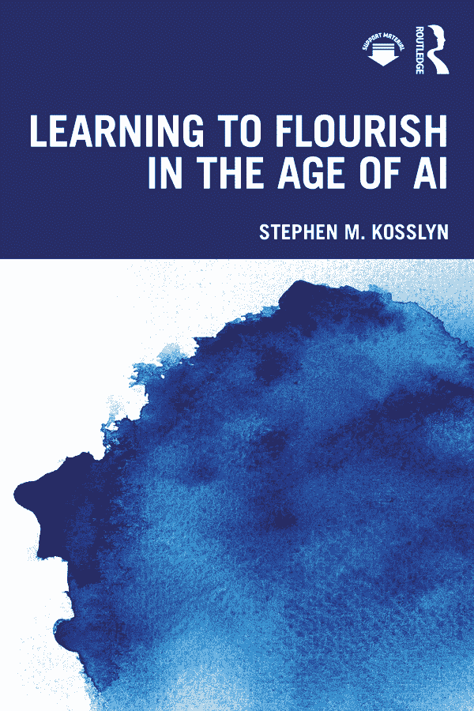
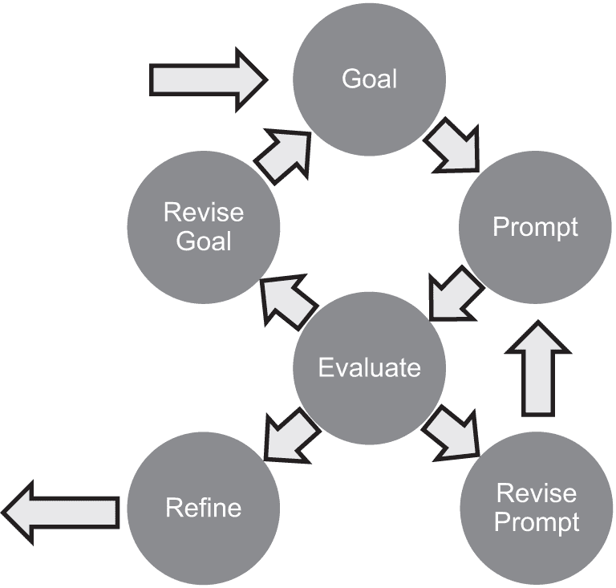

# AI 时代的繁荣指南

献给 Dr. Robin S. Rosenberg，是她让我的生活成为可能。

# 前言

本书探讨的是我们人类为了在 AI 时代**繁荣发展**需要学习什么。我的核心主张是：我们需要学习那些能与 AI 擅长领域**互补**的技能与知识，以及那些能让我们**高效、有效且负责任地**与 AI 互动的技能与知识。

我不可能面面俱到地涵盖我们需要学习的一切。但我可以让读者领略不同主题的要点，并提供我所引用的资源（包括每章末尾引用的许多免费 YouTube 教程），以便读者决定是否深入探究。本书可以帮助读者规划一套全面的自学计划，这将在很大程度上为未来的挑战做好准备。为了方便使用提示词和表格，读者可在以下网址复制粘贴使用：[www.routledge.com/9781032686653](http://www.routledge.com/9781032686653)。

我之前关于应用主题的著作涵盖了从如何设计可视化显示、如何设计幻灯片演示、如何为在线课程设计主动学习练习，到如何利用 AI 设计、实施和评估主动学习等内容。在所有情况下，我都专注于方法和技巧，而非具体内容。本书则不同：它聚焦于我们为了在 AI 时代**繁荣发展**所必须掌握的**具体技能和知识**。

我刻意使用了“繁荣发展（flourish）”一词。我的目标不仅是提供一份生存指南，也不仅是提供实用提示和最佳实践。相反，我开发了一套系统性的、生成性的方法：它应当能让你与 AI 协作，实现自己的目标。我旨在帮助你——读者——通过使用 AI 获得更美好的生活。

考虑到本书的主题和建议，如果我拒绝使用 AI 来协助写作，那将是虚伪的。事实上，我经常采用第 2 章所述的“认知放大循环”。我发现 AI 在提出例子和类比、润色编辑、提供主题概述和关键贡献者姓名方面特别有帮助。我**没有**用 AI 来勾勒或构建本书的任何部分结构，也**从未**让它拥有“最终决定权”：在每种情况下，我都对 AI 的建议进行了编辑和修改——我践行了第 2 章所宣扬的原则。唯一的例外是当我提供与 AI 的对话记录时，那些是实际发生情况的逐字记录。

话虽如此，AI 对本书的贡献与许多朋友、同事和家人的贡献相比显得微不足道：一如既往，我的妻子 Dr. Robin Rosenberg 提供了睿智的建议、深刻的批评和详细的编辑建议。我的孩子们 Justin、David 和 Neil 都抽出时间与我辩论、指正我的技术观点——他们三人从事的工作都需要深度掌握 AI，我从他们的专业知识中受益良多，程度远超他们可能意识到的。我还要感谢 Dr. Anne Marie Ward 和 Heyu Huang，他们对早期草稿提出了深刻的意见，帮助塑造了最终成果。我还必须再次感谢我的好友、Active Learning Sciences 的同事 Dr. Beth Callaghan，她阅读了草稿并有效地扮演了“反方辩手”的角色。她建设性且富有创见的批评让本书大幅改进。Dr. Kacey Warren 对早期版本提出了极其敏锐和详细的批评，帮助我聚焦并更清晰地表达。她发挥了强大的“哲学家视角”，逼我深思自己在说什么——这（除其他外）导致我删掉了整整一章。不过我必须指出，任何错误或疏漏完全由我独自承担。我还要感谢 Niki Gallagher Garcia 提供的研究协助和校对。当然，也要感谢 Routledge 的 Tori Sharpe 和 Alison Macfarlane 以及责任编辑 Tom Bedford，他们始终耐心且乐于助人。

# 第 1 章 在 AI 时代做人

DOI: [10.4324/9781032686653-1](http://doi.org/10.4324/9781032686653-1)

硅谷初创公司 OpenAI 于 2022 年 11 月 30 日发布了其开创性的`ChatGPT`软件。这种新型人工智能（AI）立即引发了震惊、敬畏、兴奋，以及——我认为公平地说——恐惧和忧虑的复杂情绪。两个月内，活跃用户超过 1 亿，创下了新技术采用速度的纪录。¹ 人们热烈拥抱这项新型 AI 有充分理由：它能在广泛主题上写出极高质量的文本，其后继者——来自 Anthropic、Google、Meta 和 OpenAI 等公司——能做的事情更是无所不包：从为商学院课程创建合理的教学大纲，到撰写像样的布道词，根据几条剧情要点为电影构思巧妙标题，分析职位描述以推断先决能力，写诗、综合观点、撰写可发表的各类主题文章。此外，这些 AI 很擅长听指挥：如果我们不满意初稿，可以要求它们改进。例如，我们可以要求它们调整语气更正式、提供更多例子、更聚焦某个特定方面、改变深度水平等。即使是`ChatGPT`的初始版本，也能做到这一切且表现卓越。²

## 怪物的本质

总体而言，这些新型 AI 擅长通过建立在先前知识之上来分析、评估、综合并创造新事物。事实上，我们可以给它们一份评分标准，并要求它们用该标准给学习者的文章评分，它们给出的分数与人类教师给出的分数相似。³ 新型 AI 还能解读和生成图像。我们可以上传一张打开的冰箱门的照片，让 AI 根据现有食材推荐食谱，它会欣然照办。我们可以让它们展示不同种类猫咪的图片，它们立马就能生成。实际上，我们甚至可以要求生成一张不存在的、半猫半狗的动物图像，它也能轻松创建出这种混合体。几乎每周都会有关于 AI 新奇能力的公告发布，从检测癌症、预测痴呆症，到能将描述转换为精美的信息图表或逼真的视频。⁴

这些新型 AI 是*生成式人工智能*的例子。它们基于海量相关数据的训练，生成全新的内容。在本书中，我们将重点关注此类生成式 AI，从现在起我将统称其为“AI”。自 ChatGPT 发布以来，该领域的进展令人震惊。AI 公司推出创新的速度如此之快，以至于许多人感觉喘不过气来。确实，在 ChatGPT 发布不到六个月后，超过 1000 名 AI 研究人员和相关领域的从业者签署了一份请愿书，要求暂停所有更大规模、更强能力的 AI 模型研究六个月，以便让研究人员——以及整个社会——有机会反思我们将如何控制这项技术。⁵ 人们担心的事情范围很广，从 AI 消除工作岗位，到它们进入“全天网终结者模式”接管世界并灭绝人类。考虑到参战 AI 公司之间的残酷竞争，这份请愿书从一开始就注定无疾而终，但它确实反映了新型 AI 多么具有开创性和潜在的颠覆性——以及许多人对它们变得多么焦虑。随后，各国政府纷纷出台了管控 AI 开发和使用的法规，⁶ 未来必将有更多此类法规出台。

鉴于这种快速进展，撰写一本关于 AI 的书的一个危险在于它很快就会过时。这就是为什么我关注的不是 AI 本身，而是它们的人类用户。本书关注的是人类需要学习什么，才能在一个注入了 AI 的世界中蓬勃发展。

### 生成式 AI 与传统程序的区别

为了在一个注入了 AI 的世界中蓬勃发展，我们需要对生成式 AI 的工作原理有基本的了解。这种知识能让我们发挥它们的优势，并减轻它们的局限性。因此，我们首先快速浏览一下这些新型 AI 的基本特征。

AI 的许多特征源于软件系统本身的设计。为了看清这一点，让我们首先将新型 AI 与我们熟知的传统计算机程序进行对比，例如 Adobe Acrobat、Apple Mail、Microsoft Excel 和 Microsoft Word。想象一张纸和一支铅笔。纸张存储表征，如文字和图画；铅笔根据特定规则（如文本的语法、图像的透视法）创建和修改这些表征。传统计算机程序与此类似：它们将数据存储在计算机内存的特定位置，然后根据特定规则操作这些数据。例如，标准电子表格程序（如 Microsoft Excel 或 Google Sheets）操作存储的数字，并可将同一组规则（如加法和乘法）应用于任何一组数字。如果它存储了 `20212` 和 `1640`，它可以对它们进行加法或乘法运算，`175` 和 `11` 也是如此，以此类推。这些数字是什么并不重要；只要它们是数字，机器就能对它们应用算术规则。而且程序能以极高的精度可靠地应用这些规则，无论执行多少次，对相同数字进行相同运算都能得到相同结果。

相比之下，新型 AI 是另一种类型的计算机系统，它们没有单独的符号表征数据库（如数字和单词），也不根据存储的规则（如算术和语法规则）来创建和处理这些表征。相反，这些 AI 基于人工神经网络，后者大致模仿了大脑的工作方式。这些人工网络包含一组单元——“人工神经元”，通常有数百万个。这些人工神经元排列成层，每个单元都与相邻层中的许多其他单元相连。这些连接可以是正向的，也可以是负向的。如果一个单元与另一个单元有正向连接，激活第一个单元会促使它尝试激活第二个单元。相反，如果一个单元与另一个单元有负向连接，激活第一个单元会促使它尝试阻止第二个单元被激活。人工神经元之间存在许多、许多、许多这样的连接。此外，这些连接的强度各不相同：连接越强，一个单元激活或抑制另一个单元的力度就越大，具体取决于连接是正向还是负向。

### 神经网络中的信息表征

在神经网络中，任何特定的信息片段都对应于许多单元之间连接强度的一种特定模式。信息不像在传统计算机程序中那样被局部化。相反，信息分布在许多连接中。确实，任何给定的连接可能都是存储不同信息片段的多个模式的一部分——这有点像填字游戏中，某个字母可以是不止一个单词的一部分。此外，神经网络的运作方式与标准计算机程序不同。神经网络作为一个整体，充当一种巨大的过滤器：一组“输入单元”受到外部刺激（例如当我们向 AI 提问时），根据连接的性质激活或抑制相连的单元。激活波向前流动，有时向后回流，渗透通过网络，最终产生特定的输出。特定输入产生的特定输出，取决于单元间连接的性质和强度。

### 训练的作用

是什么决定了连接的强度？用一个词概括：训练。当 AI 接受语言处理训练时，网络最初会被输入海量文本，并尝试预测连续的“Token”，即网络处理的最小文本单元（如短单词、词的一部分或符号）。模型依赖前面的 Token 来预测下一个。这种预测是自动进行的，因为网络被输入了完整的单词和句子，它可以检查自己猜得是否正确，并调整相关连接的强度以纠正错误。一旦网络在预测方面变得非常擅长，就会用更具体的材料对网络进行训练以进行“微调”。随后，人类介入进行最后一轮训练。这些人类训练师进行“基于人类反馈的强化学习”，以鼓励某些输出并抑制其他输出。如果人类训练师喜欢某个回答，他们会让网络加强导致该回答的连接；如果不喜欢，他们会让网络削弱正向连接并加强负向连接。这就是“护栏”的来源，旨在防止网络提供危险信息或建议，例如帮助用户制造炸弹或犯罪。

## 这些新的人工智能通常具有“GPT 架构”。

“G”代表“生成式”；该模型并非像 Google 那样，或像文字处理程序中的“查找”功能那样，仅仅检索先前存储的信息，而是依靠连接模式来生成新颖的回复。“P”代表“预训练”；该模型经过预先训练，通常涵盖互联网上几乎所有内容，并常由其他来源补充。“T”代表“Transformer”；就语言而言，网络解析标记并关注两个（或更多）标记在句子中的出现位置，将输入转化为关于特定标记含义及其在句子中关系的规范。这一转换过程使网络产生“理解”输入的假象。

这是对一个复杂主题的极快速概览，但足以满足当前目的。许多知识渊博的研究人员已提供关于神经网络和 GPT 架构的详细教程（例如，⁷、⁸、⁹）。

尽管创建和解读图像的生成式 AI 系统依赖于与我们迄今讨论的大语言模型（LLM）相同的底层原理，但我们重点关注 LLM，因为这些 AI 最有可能从根本上改变我们的生活和工作方式。

## 生活与工作在 AI 融合的世界中

我们已经可以利用互联网获取世界上大部分——如果不是全部——知识，这些知识积累了人类全部历史。对于大多数目的而言，“云”可以作为我们大脑的扩展记忆存储；它保留信息，这样我们就不需要自己记住。此外，AI 在各种需要处理信息的认知技能上，已经至少不输于大多数人类，例如批判性

我们可以对 AI 提出同样的论点：它们没有身体、没有激素、不会体验疲劳的影响，等等。因此，它们无法完全理解身为人类是什么感受。它们可以基于训练集模拟此类知识，并在该集合内进行插值，但无法轻易外推到那些需要考虑语境的开放式情境。此外，即使我们人类都是同一物种的成员，我们也并非完全相同——这些差异导致我们每个人看待事物的方式至少都与他人略有不同。因此，AI 不会完全像任何特定人类那样划分世界，并且在试图理解我们每个人时，会在需要考虑语境的开放式情境中跌跌撞撞。

我请 `GPT-4` 提供语境很重要的开放式情境示例。以下是它生成的内容：

无辅助的 AI 不太可能很好地执行这类任务。因此，我们人类学习执行这些任务所需的技能和知识是合理的——包括如何利用 AI 来帮助我们完成这些任务。但请注意，我们人类的认知和情感局限——包括偏见——可能会妨碍我们完成上述任何任务。因此，我们不仅需要学习特定的技能和知识，还需要认识并管理我们的局限性，正如本书后面所讨论的那样。

哪些特定的技能和知识与执行此类任务相关？我接下来请 `GPT-4` 指出贯穿上述各项任务的底层技能和知识。我在一个新的聊天会话中提交了上述列表，它回复如下：

正如我在下一章中所论证的，我们不应将 AI 的此类回答视为福音，而应视为一个起点。在这种情况下，如果我们利用寻找开放式且需要考虑语境的情境这一简单标准，我们得到的结论与 AI 的建议大致相同。鉴于这些技能和知识建立在人类擅长而当代 AI 不擅长的能力之上，AI 在可预见的未来不太可能在这些方面取代我们人类。

## 在 AI 时代蓬勃发展

究竟我们在本书中追求什么？在 AI 时代“蓬勃发展”意味着什么？我们需要学习的许多东西在 AI 兴起之前就已经很重要，但随着其他人开始依赖 AI，以及整个文化将其融入日常生活，这些东西将变得越来越重要。

各种思想家指出，蓬勃发展要求我们实现许多目标（例如，²⁵^,²⁶^,²⁷^,²⁸^,²⁹）。这些目标包括获得自主感和掌控感、拥有充实的人际关系、在工作中感到满意、拥有足够的金钱以及拥有良好的工作与生活平衡。此外，蓬勃发展还需要个人成长以及发展我们的能力和才干。除了仅仅感到满意之外，我们还需要赋予我们使命感和意义感的人生目标。

AI 如何融入实现这些目标的过程？我们需要考虑两类因素：一方面，我们必须找出 AI 可以帮助我们实现这些目的的途径；另一方面，我们需要找出避免 AI 破坏这些目标的途径。

让我们依次考虑每个目标。在下文中，我们仅用最宽泛的笔触进行阐述，为后续章节的内容铺垫基础。

### 自主感和掌控感

要想蓬勃发展，我们需要拥有自主感和掌控感。展望未来，实现这一点的一个关键方面是构建技能和知识，使我们能够与 AI 有效互动。我们需要知道如何以及何时发起此类互动，如何解读 AI 的主张、产出和建议，以及如何引导 AI 朝我们期望的方向发展。显然，成为强有力的批判性思考者和创造性问题解决者是关键。此外，我们还需要知道如何管理我们的认知和情感局限，例如各种偏见所施加的局限。

我们还需要知道如何运用这些技能来应对 AI 将带来的问题和挑战，以免我们感到无助或被其影响所摆布。例如，`Meta` 和 `Google` 等大型科技公司正在努力探索监管虚假信息和错误信息的方法。不幸的是，这是一场无法取胜的军备竞赛：随着公司开发算法来识别此类误导性信息，制造者也变得更擅长伪装他们的作品。事实上，“深度伪造”技术已经好到许多专家认为很快将几乎无法识别它们。³⁰^,³¹^,³² 这些问题的唯一解决方案是认识到，试图完全监管源头就像把手指插在堤坝的漏洞里，希望我们不必余生都站在那里——并希望漏洞保持在方便手指堵塞的大小，且不会冒出太多其他漏洞。堵住某些漏洞或许是必要的，但审视等式的另一面也很重要：与其只关注源头，不如也考虑接收端。与其只试图堵堤坝上的漏洞，我们不妨也学会游泳。

### 充实的人际关系

也许具有讽刺意味的是，在 AI 时代，我们可能会越来越重视个人关系。我们将把许多事情委托给 AI，而剩下的事情对我们将变得越来越重要。因此，比以往任何时候都更需要与他人有效互动的技能和知识。这要求发展我们的领导力、追随力、协作和沟通技能。为了有效做到这一点，我们需要推断他人的认知、情感和动机。我们必须掌握人格特质差异的方式、它们如何影响行为，以及文化如何影响我们。基于所有这些及其他因素，我们必须发展并运用情商。

我们还需要警惕可能破坏这些目标的诱惑。特别是，我们需要避免成为 AI 成瘾者，把所有时间都粘在屏幕前。我们必须珍视与他人互动能为我们带来的价值，这要求我们珍视什么赋予了我们生活意义和目的。

### 在工作中感到满意

AI 可能会消除或改变许多不同形式的工作，范围涵盖从体力劳动到脑力劳动。³³^,³⁴ AI 很快将驱动移动机器人，这可能会取代园丁、仓库工人、餐厅厨房帮工，甚至可能是军队中的士兵。AI 也将取代专业人士，如医学和法律领域的从业者。例如，AI 已经能比人类医生更好地诊断许多疾病，³⁵^,³⁶ AI 可以起草合同、分析法律案件，并执行法律助理和律师的许多职能。³⁷^,³⁸ 此类发展可能会加速。

为了在一个充斥着 AI 的世界中保持相关性，我们需要发挥人类在需要考虑语境的开放式情境中发挥作用的能力。我们可能需要从关注工作的*数量*转向关注工作的*质量*。如果我们知道如何修订和完善 AI 的产出和建议，我们可以在工作中获得相当大的满足感。通过提供高质量的判断和决策，特别是在对 AI 具有挑战性的那些开放式情境中，我们也可以在工作中获得满足感。

此外，我们需要这样做，因为世界正在迅速变化。要实现这一目标，我们必须知道如何识别何时需要学习，并且必须能够有效且高效地获取技能和知识，因为工作正在被转型或取代。事实上，有人声称即便在当下——在 AI 深度渗透职场之前——“技能的平均半衰期现在不到五年，在某些技术领域甚至低至两年半。”³⁹ 学习应成为一种生活方式，这将是应对瞬息万变时刻的必要之举。

## 工作与生活的平衡

AI 将承担人类目前从事的许多工作，尤其是那些高度结构化的工作。从积极的角度来看，人类将拥有更多空闲时间。至少对某些人而言，额外的空闲时间可能颇具挑战：我们需要发现对我们作为个体而言什么才是重要的，这要求我们理解如何设定个人生活目标并为之努力。

## 拥有足够的钱

如果我们在工作上投入的工时减少，这是否意味着我们赚的钱会变少？不一定。随着 AI 自动化程度越来越高的工作，我们人类能贡献的高质量工作可能变得越来越有价值——因而报酬也会更高。此外，如果我们学会有效且高效地部署 AI，我们就能从同等付出中获得更多收入。

另一方面，有一点日益清晰：如果我们不掌握与 AI 有效交互所需的技能和知识，如果我们不磨练那些将日益受到重视的人类能力，我们就不太可能赚到更多钱。

## 个人成长与能力才干的开发

AI 还能帮助我们实现个人成长。AI 可以在一定范围内充当私人教练和导师，并能对多种类型的教学进行个性化定制。⁴⁰ 我们可以利用这一点来帮助我们开发能力和才干。

然而，要充分发挥我们人类认知优势，我们需要学会识别和管理我们的认知局限与情绪。正如我们在后续章节将看到的，AI 可以帮助我们做到这一点。我们还需要留意自己的偏见以及驱动我们动机的深层因素，并以批判的眼光审视它们。AI 可以提供个性化指导，帮助我们在这些方面成长。

## 生活的目的与意义

最后，我们必须制定清晰有力的个人生活目标，并以战略性的方式去实现它们。要让这些目标成为真正的北极星，赋予我们生活目的和意义，我们需要做出符合伦理连贯性且与个人价值观一致的决策。在 AI 时代，制定清晰连贯的生活目标尤为重要，因为虽然 AI 可以处理信息，但人类有责任确保行动是价值驱动的。本书的所有内容旨在帮助我们反思此类目标，我们将在最后一章对此进行探讨。

除了我们刚才考虑的因素，我们还需要承认，更广泛的社会情境条件也会影响我们能否蓬勃发展。虽然这些是重要的考量因素，但我们在此的关注点更为聚焦。在本书中，我们专注于那些——至少在很大程度上——直接受我们控制的因素。我们想要确定我们可以学习什么，从而在 AI 时代蓬勃发展。

以下章节分为三个部分组成。第一部分包含第 2 章、第 3 章、第 4 章和第 5 章。在第 2 章中，我们将开发一种与 AI 交互的方法，随后的章节将对其进行延伸。这种方法在很大程度上满足了我们对自主权和掌控感的需求，并能帮助我们在工作中表现得更好。我们将在本书的其余部分始终依赖这一方法。第二部分包含第 6 章、第 7 章、第 8 章和第 9 章。在本书的这一部分，我们将探讨如何利用我们与 AI 交互的方法来帮助改善人际关系。我们将看到，与 AI 有效交互所需的那些能力，在我们需要驾驭一个融合了 AI 的社会世界时，同样大有裨益。我们可以利用 AI 帮助我们与其他人类更有效地互动，而他们自己也在规划通过这个世界的道路。最后，第三部分包含第 10 章和第 11 章。我们将建立在前几章材料的基础上，帮助我们在世界变化中适应和成长，不仅要学习，还要定义和调整我们的生活目标。

## 深度探索

对于想要深入钻研主题的读者，他们当然可以查阅文中专门引用的文章、书籍和视频。然而，其中大部分材料具有技术性，面向专业人士。因此，每章末尾都设有“深度探索”部分。该部分包含一些通俗易懂的视频示例，对本章回顾的材料的某些方面提供了更深入的阐述。此外，由于互联网上的视频来去无常，且读者可能想钻研得更深，我还提供了搜索词，以帮助读者找到关于该主题的新视频。

2 分钟了解生成式 AI：[`www.youtube.com/watch?v=rwF-X5STYks`](https://www.youtube.com/watch?v=rwF-X5STYks)

AI 将如何改变世界？[`www.youtube.com/watch?v=RzkD_rTEBYs`](https://www.youtube.com/watch?v=RzkD_rTEBYs)

*   “生成式 AI 解释”
*   “ChatGPT 对社会的影响”
*   “改变行业的 AI 语言模型”
*   “先进 AI 的伦理担忧”
*   “AI 发展的政府监管”

深度神经网络如何工作——初学者全程课程：[`www.youtube.com/watch?v=dPWYUELwIdM`](https://www.youtube.com/watch?v=dPWYUELwIdM)

5 分钟了解神经网络 | 什么是神经网络？| 神经网络如何工作 | Simplilearn：[`www.youtube.com/watch?v=bfmFfD2RIcg`](https://www.youtube.com/watch?v=bfmFfD2RIcg)

*   “传统编程与 AI 的区别”
*   “人工神经网络如何工作”
*   “神经网络中的人工神经元与连接”
*   “符号 AI 与神经网络”
*   “神经网络中连接的强度”

AI 如何赋能任何企业 | Andrew Ng | TED：[`www.youtube.com/watch?v=reUZRyXxUs4`](https://www.youtube.com/watch?v=reUZRyXxUs4)

如何利用 AI 实现个人成长：[`www.youtube.com/watch?v=S4kSR-pB83c`](https://www.youtube.com/watch?v=S4kSR-pB83c)

社会困境：[www.netflix.com/title/81254224](http://www.netflix.com/title/81254224)

*   “在 AI 时代培养批判性思维技能”
*   “AI 时代人际关系的重要性”
*   “AI 时代的工作满意度与工作性质的变化”
*   “在 AI 时代实现工作与生活的平衡”
*   “在 AI 协助下实现个人成长与发展”
*   “在 AI 时代寻找意义与目标”
*   “伦理决策与 AI”
*   “在 AI 时代培养情商”
*   “持续学习并适应 AI 驱动的变化”
*   “利用 AI 实现个人成长与才干开发”

AI 和 ChatGPT 的局限性：常识问题：[`www.youtube.com/watch?v=w9MSsnoTSJs`](https://www.youtube.com/watch?v=w9MSsnoTSJs)

*   “人类智能相对于人工智能的优势”
*   “AI 在理解语境方面的局限性”
*   “AI 无法取代的人类技能”
*   “人类与 AI 在情境感知与适应性方面的对比”
*   “高压下的决策：人类与 AI”
*   “文化胜任力与 AI 的局限性”
*   “AI 时代的有效沟通技巧”

## 参考文献

## 参考文献

1.  Hu, K. (2023, February 2). ChatGPT sets record for fastest-growing user base—analysis note. *Reuters*. [www.reuters.com/technology/chatgpt-sets-record-fastest-growing-user-base-analyst-note-2023-02-01/](http://www.reuters.com/technology/chatgpt-sets-record-fastest-growing-user-base-analyst-note-2023-02-01/)

2.  Zsolnai-Feher, K. (2023). OpenAI ChatGPT: The future is here! [`www.youtube.com/watch?v=V2RoqUr0qDU&t=1s`](https://www.youtube.com/watch?v=V2RoqUr0qDU&t=1s)

3.  Kosslyn, S. M. (2023). *Active learning with AI: A practical guide*. Alinea Learning.

4.  Mollick, E. (2024). *One useful thing*. Substack. [www.oneusefulthing.org/](http://www.oneusefulthing.org/)

5.  Associated Press. (2023, March 29). Tech leaders urge a pause in the “out-of-control” artificial intelligence race. *NPR*. [www.npr.org/2023/03/29/1166896809/tech-leaders-urge-a-pause-in-the-out-of-control-artificial-intelligence-race](http://www.npr.org/2023/03/29/1166896809/tech-leaders-urge-a-pause-in-the-out-of-control-artificial-intelligence-race)

6.  Shein, E. (2024, March 15). Governments setting limits on AI. *Communications of the ACM*. [`cacm.acm.org/news/governments-setting-limits-on-ai/`](https://cacm.acm.org/news/governments-setting-limits-on-ai/)

7.  Karpathy, A. (2023). *Let’s build GPT: From scratch, in code, spelled out*. [www.youtube.com/watch?v=kCc8FmEb1nY](http://www.youtube.com/watch?v=kCc8FmEb1nY)

8.  Twarog, A. (2022). *ChatGPT tutorial—A crash course on ChatGPT for beginners*. [www.youtube.com/watch?v=JTxsNm9IdYU](http://www.youtube.com/watch?v=JTxsNm9IdYU)

9.  Wolfram, S. (2023, February 14). *What is ChatGPT doing… and why does it work?* Stephen Wolfram Writings. [`writings.stephenwolfram.com/2023/02/what-is-chatgpt-doing-and-why-does-it-work/`](https://writings.stephenwolfram.com/2023/02/what-is-chatgpt-doing-and-why-does-it-work/)

10. Evans, J. S. B. T. (2002). Logic and human reasoning: An assessment of the deduction paradigm. *Psychological Bulletin*, **128**, 978–996.

11. Holyoak, K. J., & Cheng, P. W. (2011). Causal learning and inference as a rational process: The new synthesis. *Annual Review of Psychology*, **62**, 135–163.

12. Sarathy, V. (2018). Real world problem-solving. *Frontiers in Human Neuroscience*, **12**, 261. doi:[10.3389/fnhum.2018.00261](http://dx.doi.org/10.3389/fnhum.2018.00261).

13. Acar, O. A. AI prompt engineering isn’t the future. *Harvard Business Review*. [`hbr.org/2023/06/ai-prompt-engineering-isnt-the-future`](https://hbr.org/2023/06/ai-prompt-engineering-isnt-the-future)

14. Aboze, B. J. (2024, March 25). How to measure LLM performance. *deepchecks*. [`deepchecks.com/how-to-measure-llm-performance/`](https://deepchecks.com/how-to-measure-llm-performance/)

15. Wei, F., Chen, X., & Luo, L. (2004). Rethinking generative large language model evaluation for semantic comprehension. [`ar5iv.labs.arxiv.org/html/2403.07872v1`](https://ar5iv.labs.arxiv.org/html/2403.07872v1)

16. Zaphir, L., & Lodge, J. M. (2023, June 27). Is critical thinking the answer to generative AI? *Times Higher Education*. [www.timeshighereducation.com/campus/critical-thinking-answer-generative-ai](http://www.timeshighereducation.com/campus/critical-thinking-answer-generative-ai)

17. Bechara, A., & Damasio, H. (2002). Decision-making and addiction (Part 1): Impaired activation of somatic state in substance dependent individuals when pondering decisions with negative future consequences. *Neuropsychologia*, **40**, 1675–1689.

18. Bechara, A., Damasio, A. R., Damasio, H., & Anderson, S. W. (1994). Insensitivity to future consequences following damage to human prefrontal cortex. *Cognition*, **50**, 7–15.

19. Bechara, A., Damasio, H., & Damasio, A. R. (2000). Emotion, decision making and the orbitofrontal cortex. *Cerebral Cortex*, **10**, 295–307.

20. Bechara, A., Damasio, H., Tranel, D., & Damasio, A. R. (1997). Deciding advantageously before knowing the advantageous strategy. *Science*, **275**, 1293–1295.

21. Bechara, A., Tranel, D., & Damasio, H. (2000). Characterization of the decision-making deficit of patients with ventromedial prefrontal cortex lesions. *Brain*, **123**, 2189–2202.

22. Bechara, A., Tranel, D., Damasio, H., & Damasio, A. R. (1996). Failure to respond autonomically to anticipated future outcomes following damage to prefrontal cortex. *Cerebral Cortex*, **6**, 215–225.

23. Damasio, A. R. (1994). *Descartes’ error: Emotion, reason, and the human brain*. G.P. Putnam.

24. Wittgenstein, L. (1953). *Philosophical investigations* (G. E. M. Anscombe, Trans.). Basil Blackwell.

25. Ben-Shahar, T. (2009). *The pursuit of perfect: How to stop chasing perfection and start living a richer, happier life*. McGraw-Hill.

26. Nussbaum, M. C. (2011). *Creating capabilities: The human development approach*. Harvard University Press.

27. Sen, A. (1999). *Development as freedom*. Oxford University Press.

28. Layard, R. (2011). *Happiness: Lessons from a new science* (2nd ed.). Penguin Books.

29. VanderWeele, T. J. (2020). Activities for flourishing: An evidence-based guide. *Journal of Positive Psychology and Wellbeing*, **4**, 79–91.

30. Miller, E. J., Steward, B. A., Witkower, Z., Sutherland, C. A. M., Krumhuber, E. G., & Dawel, A. (2023). AI hyperrealism: Why AI faces are perceived as more real than human ones. *Psychological Science*, **34**, 1390–1403. [`doi.org/10.1177/09567976231207095`](https://doi.org/10.1177/09567976231207095)

31. Verdoliva, L. (2020). Media forensics and deepfakes: An overview. *IEEE Journal of Selected Topics in Signal Processing*, **14**, 910–932.

32. Westerlund, M. (2019). The emergence of deepfake technology: A review. *Technology Innovation Management Review*, **9**, 39–52.

33. Eloundou, T., Manning, S., Mishkin, P., & Rock, D. (2023). GPTs are GPTs: An early look at the labor market impact potential of large language models. Cornell University: arXiv:2303.10130 \[econ.GN\].

34. Georgieva, K. (2024, January 14). AI will transform the global economy. Let’s make sure it benefits humanity. *IMF blog*. [www.imf.org/en/Blogs/Articles/2024/01/14/ai-will-transform-the-global-economy-lets-make-sure-it-benefits-humanity](http://www.imf.org/en/Blogs/Articles/2024/01/14/ai-will-transform-the-global-economy-lets-make-sure-it-benefits-humanity)

*   35Kita, J. (2024, April 12). Are you ready for AI to be a better doctor than you? *Medscape*. [www.medscape.com/viewarticle/are-you-ready-ai-be-better-doctor-than-you-2024a100070q?form=fpf](http://www.medscape.com/viewarticle/are-you-ready-ai-be-better-doctor-than-you-2024a100070q?form=fpf)

*   36Tu, T., Palepu, A., Schaekermann, M., Saab, K., Freyberg, J., Tanno, R., et al. (2024). Towards conversational diagnostic AI. *Cornell University: arXiv:2401.05654* \[cs.AI\].

*   37Barton, R. E. (2023, August 23). How will leveraging AI change the future of legal services? *Reuters*. [www.reuters.com/legal/legalindustry/how-will-leveraging-ai-change-future-legal-services-2023-08-23/](http://www.reuters.com/legal/legalindustry/how-will-leveraging-ai-change-future-legal-services-2023-08-23/)

*   38Hatzius, J., Briggs, J., Kodnani, D., & Pierdomenico, G. (2023, March 26). The potentially large effects of artificial intelligence on economic growth. *Goldman Sachs, Global Economics Analyst*. [www.ansa.it/documents/1680080409454\_ert.pdf](http://www.ansa.it/documents/1680080409454_ert.pdf)

*   39Tamayo, J., Doumi, L., Goel, S., Kovacs-Ondrejkovic, O., & Sadun, R. (2023, September–October). Reskilling in the Age of AI. *Harvard Business Review*. [`hbr.org/2023/09/reskilling-in-the-age-of-ai`](https://hbr.org/2023/09/reskilling-in-the-age-of-ai)

*   40Kosslyn, S. M. (2023). Active learning with AI: A practical guide. *Alinea Learning*.

# 第一部分：与 AI 互动

# 第 2 章：利用认知放大循环

DOI: [10.4324/9781032686653-3](http://doi.org/10.4324/9781032686653-3)

未来，我们中的许多人——如果不是大多数的话——都将在日常生活中咨询并与 AI 互动。我们应将 AI 视为伙伴、协作者、工具，还是副驾驶？依我之见，这些描述均未抓住 AI 的本质：伙伴分担责任，这需要意图，而 AI 并不具备；协作者拥有意志和能动性，而 AI 目前不具备；工具通常是被动的，仅按明确指令响应——这或许适用于微小、功能极其有限的 AI，但无法刻画我们此处关注的大型、强大的大语言模型（LLM）。同样，将 AI 视为“副驾驶”也存在问题，因为它们并非能主动作为的真正协作者。相反，依我之见，AI 最好被视为*认知放大器*。认知放大器是一种与人协作、以*增强其心智优势并弥补其心智局限*的技术。例如，我们的心智优势包括发现模式和创造故事的能力，而心智局限包括无法同时关注多件事以及推理时受诸多偏见干扰。AI 可助我们发挥优势、规避局限。

通过考量一种早期、功能更为有限的认知放大器——电子计算器，我们能洞察 AI 可能扮演的角色。计算器刚问世时，有人持怀疑态度，认为它鼓励作弊——这当然也在学校使用 ChatGPT 的反应中得到呼应。¹ 但实际上，电子计算器让学习者能更专注于数学背后的概念，而非死记硬背式的计算。例如，计算器让学习者得以聚焦于某个数学运算（如开平方）的作用、为何有用，以及何时适用。此外，计算器还促使学习者建立结果的“数量级”概念。例如，若结果本应在 50 到 150 之间却算出 1,500，他们应立即意识到出错了。这种对底层概念的关注，比单纯记忆并执行一系列步骤需要更深层的数学理解。如果考核学习者运用数学背后概念的能力，且他们知晓即将进行此类考核，他们就会努力掌握这些材料。即便他们依赖计算器进行实际计算，此理依然成立。

AI 可充当计算器的认知类比，但用户无需理解数学函数，而是需掌握一系列心智技能，诸如如何评估主张、如何识别不一致性、以及如何分析和构建论证。

AI 作为认知放大器的威力不容小觑。例如，请看麻省理工学院经济学家大卫·奥特的这段话：²

> AI 给劳动力市场提供的独特机遇，在于延伸人类专业知识的相关性、覆盖面和价值。鉴于 AI 能将信息、规则与习得经验编织在一起以辅助决策，它可用于让更多拥有互补知识的工人，承担目前由精英专家垄断的高风险决策任务，例如：医疗护理由医生主导、文书制作由律师主导、软件编码由计算机工程师主导、本科教育由教授主导。我的论点非预测，而是关于可能性的论证：若善用 AI，可助力恢复因自动化和全球化而空心化的美国中技能、中产阶级劳动力市场核心。

正如奥特所言，AI 用处诸多。且不仅限于“医疗护理由医生主导、文书制作由律师主导、软件编码由计算机工程师主导、本科教育由教授主导”。AI 可用于几乎任何工作，卸下常规部分，让我们人类专注于 AI 不太擅长处理的开放性、情境依赖性任务（见第 1 章）。此外，正如我们将在后文讨论，AI 可助我们各人“及时”学习所需技能和知识。

关键在于上述引言最后一句中的从句：“AI，若善用，……”。啊，但这正是棘手之处。何为善用 AI？人们如何学会善用？以下开始回答这些问题。

## 认知放大循环

若我们遵循一组特定步骤，便能从作为认知放大器的 AI 中获得巨大收益。我将此过程描述为*认知放大循环*（CAL），如图 2.1 所示。

图 2.1 认知放大循环。

### 步骤 1：明确目标

伊始，我们需明确当下的*目标*，即我们向 AI 输入内容的缘由。我们希望 AI 回答特定问题，或执行特定任务。

开启 CAL 时，我们应自问以下问题：

*   我们想回答的实际问题，或想解决的问题是什么？它是否清晰具体？是否应将其拆解为一组更精确的问题或请求？若我们不确定问题或难题为何——或许因初涉某学科、定位不清——我们需退一步，将*此*设为待解之题。此时，需将目标指定为：尝试提炼我们难以定义的问题或疑问。

*   我们能为手头问题或议题的性质所作的假设辩护吗？我们是否在寻求非黑即白的选择，而事实上存在模糊地带？我们的假设中是否有站不住脚者？

* 我们的目标符合伦理吗？我们需要暂停并考虑潜在解决方案的即时和长期伦理后果，同时考虑期望的结果和任何可能的意外副作用。

例如，假设我们阅读了早期的“经典”AI 程序，如 IBM 的 Watson。³ 2011 年，该程序赢得了测试常识的电视游戏节目《危险边缘》（*Jeopardy!*）。这类计算机程序仅在定义明确、范围有限的情况下才有用。我们可能想知道新的生成式 AI 有何不同。因此，我们的目标可能是让 AI“简要总结生成式 AI 与经典 AI 的异同。”这是一个要求 AI 生成特定类型总结的请求，非常具体。我们假设存在一些共同特征和一些不同特征；这些假设是站得住脚的。这里没有明显的伦理问题。这是一个非常简单的目标，将帮助我们掌握 CAL 的关键特征。我们稍后将考虑的许多目标更为复杂和微妙。

### 步骤 2：创建提示词

目标引导我们构思一个具体的*提示词*，这要么是 AI 应回答的问题，要么是 AI 为生成特定产品而应遵循的指令。表 2.1 中概述的指南有助于创建有效的提示词。

表 2.1 创建有效提示词的指南。

| **指南** | **摘要** | **良好示例** | **不良示例** |
| --- | --- | --- | --- |
| 适配 | 通过替换术语来调整现有提示词，通过最小化迭代更改来节省时间。 | 使用之前的活动总结提示词，并用新的活动详情更新它。 | 不加修改地将科学研究总结提示词用于体育赛事。 |
| 拆解 | 将复杂目标拆解为不同部分，对其编号或使用标题，并使用“思维链”连接步骤。 | “1. 分析数据。2. 总结结果。3. 从结果中提出推断建议。” | “分析数据并生成洞见。” |
| 歧义 | 避免模糊、抽象或歧义的术语。要字面化，预期 AI 按词面含义理解。 | “根据当前流失率、预期增长和预算，计算所需新员工的精确数量。” | “算算我们还需要多少人。” |
| 假设 | 在提示词中明确假设；不要指望 AI 推断它们。 | “假设年通胀率为 10%，计算未来成本。” | “计算未来成本。” |
| 背景 | 不要假设 AI 拥有相关背景信息；要明确并加载必要文档。 | “使用提供的 2021 年纽约市经济数据，分析消费支出趋势。” | “分析 2021 年纽约市的消费支出趋势。” |
| 示例 | 提供一个或多个所需内容的示例。 | 如果目标是让 AI 提供可能导致冲突的医疗场景，则提供一个或多个此类场景的示例。 | 仅注明场景类型，不提供具体说明。 |
| 聚焦 | 通过解释示例的重要方面、澄清潜在困惑（说明做什么和不做什么），使指令具体且无歧义。 | “列出化学反应的步骤，重点关注温度和压力变化。不要包含方程式。” | “解释化学反应。” |

表 2.1 的几个方面值得强调。首先，如果我们依赖“思维链”策略，即指示 AI 经历一个逻辑的、分步的过程，我们甚至可以创建非常长且复杂的提示词。⁴ 我们将在后续页面看到该策略的大量示例。此外，尽管 AI 是在海量材料上训练的，但我们无法确定它是否会恰好强调与特定情况相关的那些方面。因此，拿不准时，我们应倾向于过于明确。加载相关文档并告诉 AI 利用它们来回答问题或执行请求，通常很有帮助。此外，为了使我们的指令非常具体且无歧义，我们不仅应给 AI 示例，还应解释示例中哪些重要方面值得关注。⁵ 最后，如果存在任何困惑的可能，我们除了告诉 AI 做什么，还应告诉它*不*做什么。

例如，针对上述目标“简要总结生成式 AI 与经典 AI 的异同”，我们的提示词可以是：

这个提示词是否遵守了我们考虑的指南列表？表 2.1 中的指南有点多，不易轻松记忆。这种情况正是 CAL 大显身手之时，让 AI 替我们减轻记住所有这些内容的认知负担。因此，我将上述草稿提交给 GPT-4，并附上此提示词：

AI 的回复如下：

当我提交修订后的提示词时，结果比初始提示词更详细、更完整。然而，我们需要明确实际目标，以决定是否真的想要大量细节。在本例中，对我来说有点大材小用。

但如果我们定位不清，在试图明确问题或指令时四处碰壁，该怎么办？在这种情况下，我们退一步，现在请 AI 生成问题或指令的候选方案。我们给它尽可能多的信息，然后将结果作为灵感——假设我们能认出我们想要的东西，即使一开始无法清晰地陈述它。例如：

AI 确实照做了。如果您有兴趣查看结果，或想尝试本书中的任何其他提示词，可以在以下网站找到它们，这些内容采用易于复制粘贴并提交给 AI 的形式：[www.routledge.com/9781032686660](http://www.routledge.com/9781032686660)。除非另有说明，本书中与 AI 的所有交互均使用 OpenAI 的 GPT-4，截至撰写时，它是最优秀的 LLM 之一，与 Anthropic 的 Claude 3.5 Sonnet 和 Google 的 Gemini 1.5 Pro 齐名。

### 步骤 3：评估结果

一旦 AI 对提示词做出回应，我们就要*评估*它生成的内容。在 CAL 的这一阶段，我们需要决定结果是否达成了我们的目标。评估过程要求我们运用批判性思维，如下一章所总结。在评估结果后，会发生以下三种情况之一。我们决定：

1.  产品足够好，可供使用，因此我们*保留*它并“手动”调优，例如编辑文档或修饰图形。

2.  产品接近我们想要的，但不完全正确，因此我们返回步骤 2 并*优化*提示词，然后提交新版本。一旦 AI 对该编辑后的提示词做出回应，我们评估新产品，并再次考虑它是否足够好以保留，或是否需要继续优化提示词。

3.  产品与我们想要的相去甚远，因此我们用一个新目标*修订*目标并返回步骤 1。

除少数例外，本书呈现的提示词均非首次尝试。在几乎所有情况下，我都不得不循环执行 CAL 并修订提示词以获得预期结果。这通常反映在我最终告诉 AI 在提示词中*不*做什么，例如不要对陈述采取行动而要对其进行评估。

## 使用 CAL

我们可以将 CAL 用于更复杂的 AI 应用，例如设计“Custom GPTs”（为特定用途设计的专用 AI）或代理。实际上，我们可以指示 AI 编写计算机代码来执行许多不同类型的任务，范围从设计网站到分析数据。虽然在这里探讨 CAL 的这些用法很诱人，但我没有这样做，主要有两个原因：第一，这是一个移动的目标。在撰写本书时，AI 的范围和能力几乎每周都在增加，不可能列出我们可以或能够使用它的所有方式。第二，随着 AI 的改进，它们将在不需要明确指令的情况下完成越来越多的此类任务。我们不需要调用 OpenAI 的“Advanced Data Analytics”（以前称为“Code Interpreter”）来分析数据；我们只需要提出要求，AI 就会处理细节。我们不需要描述我们想要 AI 编写的代码；我们只需要仔细指定目标，AI 就会为我们解决代码问题。以此类推。

在所有当前和未来的情况下，CAL 都将为我们提供良好的服务。CAL 中概述的流程比从一个定义不清的目标开始、不设计合适的提示词来解决目标、不在目标背景下刻意评估 AI 的产出等要高效得多。使用 CAL 流程可以帮助我们比随意的、纯粹的试错方法更有效、更高效地实现目标。

然而，我们需要意识到使用 CAL 的一个潜在问题：我们可能会陷入其中，最终花费过多的时间在持续的改进中循环（或感觉像是在改进）。这归因于“部分强化效应”。也就是说，人们倾向于重复导致期望结果的行为。这种结果被称为该行为的“正强化”。当强化不是每次都发生时，人们特别容易坚持该行为。如果强化只在一定百分比的时间发生，我们倾向于继续努力，寻求那种强化。因此，如果每几个 CAL 周期就能产生甚至部分有用的结果，让我们更接近目标，我们通常会坚持尝试——甚至（就个人经验而言）持续到深夜。我们需要意识到这一点，并准备好在合理的时间后强制暂停我们的努力。事实上，暂停可能导致“孵化效应”，我们的潜意识在处理问题，并可能产生我们之前未曾考虑的解决方案。

### 我们需要人在回路中吗？

考虑到 AI 在分析、评估和创建文本及图像方面表现得如此出色，人们可能会质疑为什么人类需要评估 AI 的结果。为什么不让 AI 自身进行必要的批判性思考？或者，我们或许可以运行两个系统实例，让一个评估另一个的产出。请考虑人类必须在回路中的四个原因。

首先，即使是非常先进的 AI 也不太可能是完美的，部分原因在于其神经网络设计（如前一章所述），也因为它们永远不会在完美的数据集上训练。它们的缺陷不仅影响它们对提示词的初始响应，还影响它们所做的一切。如果我们让一个 AI 评估另一个 AI 的结果，我们将需要第三个 AI 来评估第二个 AI 的评估结果，接着需要第四个 AI 评估第三个，以此类推，陷入无限倒退。我们人类当然也不完美，但我们的错误通常不会长期违背我们的利益。相比之下，AI 的错误可能是随机的，或以未知方式存在偏见，这意味着至少有时它们可能违背我们的利益。我们需要人类在回路中充当把关人，这类似于学者为期刊把关：他们依靠已有知识来评估产品质量。我们将在下一章探讨如何做到这一点。

其次，AI 在被提示之前是惰性的。每个单独的人类用户设定目标，进而指导提示词、评估和最终结果的编辑。确实，我们甚至可以要求当今的 AI 制定目标，并且——如上所述——我们可以要求它们根据这些目标开发提示词。但这不是重点。如果 AI 从零开始设定目标，那将不是*我们的*目标。如果人类将 AI 作为认知放大器使用，根据定义，人类将需要参与设定其目标、设计提示词、评估结果和完善最终产品。

第三，因为 AI 永远无法了解每个用户的绝对一切，它永远无法确定用户在任何特定时刻实际在寻求什么。因此，它无法为我们每个人制定最优目标。正如上一章所述，部分问题在于 AI 永远无法完全了解围绕任何个人的语境。AI 无法被信任为我们自主做决策。

第四，人类必须发展自己的目标，部分原因在于他们往往可能无法预先有意识地知道其确切目标是什么。美国最高法院大法官波特·斯图尔特于 1964 年曾著名地拒绝定义色情制品，而只是断言他“一看就知”。当时人们嘲笑他，这在法律语境下讲得通：淫秽标准应当是客观的，因为人们应当遵守它们。但这种反应在我们与 AI 协作开发目标的语境下实际上是合理的。我们的识别能力通常超越我们的回忆或生成能力。例如，大多数熟悉第二语言的人能听懂的比能说的多，这凸显了识别输入与能够产出内容之间的区别。CAL 的使用者可能会生成他们能做出的最佳目标近似值，并迭代直到他们“一看就知”地识别出所寻求的产品。由于不了解任何特定人类的一切，AI 无法做到这一点。

简而言之，人类用户无法被 AI 取代。AI 是一种认知放大器，需要人类输入来激发其活力。因此，人类需要学会有效、高效且合乎道德地部署 AI。

## 通过 CAL 实现繁荣发展

在上一章中，我们指出，学会与 AI 有效互动是在 AI 时代蓬勃发展的一项关键技能。掌握这项技能能产生自主感和掌控感。它还能让我们在工作中更有成就感，尤其是当我们学会如何利用 AI 提高生产力，并学会如何与其协作产出高质量产品时。培养此类技能还有助于我们保持工作稳定性，因为我们能更积极主动，从而成为受重视的员工。

要精通与 AI 协作，我们需要知道如何以及何时发起与它们的互动，如何解读 AI 的主张、产出和建议，以及如何引导 AI 按照我们期望的方向发展。`CAL` 正是为了回应这些需求而生，它为与 AI 互动提供了一个结构。如果我们掌握了 `CAL`，就能满足在新兴世界中蓬勃发展的一项关键要求。

要有效使用 `CAL`，我们需要进行批判性思维。事实上，`CAL` 既能直接帮助我们，又能训练我们变得更擅长此类思考，从而引领我们成为更好的批判性思考者。在 AI 时代，批判性思维绝对至关重要，不仅是为了使用 `CAL`，也是为了在其他人利用 `CAL` 制造错误信息和虚假信息时，能从中筛选出糠秕。我们永远无法阻止所有此类材料，因此学会如何利用 AI 帮助我们识别它们并做出适当反应非常重要。我们将在下一章探讨批判性思维。

## 深度探究

对于希望深入钻研主题的读者，以下是一些视频示例，它们对本章回顾的材料各个方面提供了通俗易懂、更深入的阐述。此外，我还列入了一些搜索词，可帮助读者找到该主题的新视频。

What is Cognitive AI? Cognitive Computing vs Artificial Intelligence | AI Tutorial | Edureka: [`www.youtube.com/watch?v=Zsl7ttA9Kcg`](https://www.youtube.com/watch?v=Zsl7ttA9Kcg)

Prompt Engineering Course. How To Effectively Use ChatGPT & Other AI Language Models: [`www.youtube.com/playlist?list=PLYio3GBcDKsPP2_zuxEp8eCulgFjI5a3g`](https://www.youtube.com/playlist?list=PLYio3GBcDKsPP2_zuxEp8eCulgFjI5a3g)

AI in a Minute: Prompt Engineering: [`www.youtube.com/watch?v=vGdyePbGNaE`](https://www.youtube.com/watch?v=vGdyePbGNaE)

*   “增强智能与人机协作”
*   “利用 AI 增强人类认知优势”
*   “AI 弥补人类认知劣势”
*   “利用 AI 进行决策支持”
*   “AI 作为延伸人类能力的工具”
*   “设计清晰简洁的 AI 提示词”
*   “评估 AI 生成的输出”
*   “AI 提示词的迭代优化”
*   “针对相似任务调整 AI 提示词”

Don’t fear intelligent machines. Work with them | Garry Kasparov: [`www.youtube.com/watch?v=NP8xt8o4_5Q`](https://www.youtube.com/watch?v=NP8xt8o4_5Q)

The limits of AI and ChatGPT: The common sense problem: [`www.youtube.com/watch?v=w9MSsnoTSJs`](https://www.youtube.com/watch?v=w9MSsnoTSJs)

*   “人在回路 AI”
*   “人类监督在 AI 决策中的重要性”
*   “AI 在理解人类目标和语境方面的局限性”
*   “人机协作设定目标”
*   “AI 偏见与人类评估的必要性”
*   “在 AI 协助下迭代优化目标”
*   “人机交互中的伦理考量”
*   “建立高效的人机伙伴关系”
*   “人类认知局限与 AI 放大”

## 参考文献

*   1Mitchell, A. (2022, December 26). Professor catches student cheating with ChatGPT: “I feel abject terror.” New York Post. [`nypost.com/2022/12/26/students-using-chatgpt-to-cheat-professor-warns/`](https://nypost.com/2022/12/26/students-using-chatgpt-to-cheat-professor-warns/)
*   2Autor, D. (2024). Applying AI to rebuild middle class jobs. National Bureau of Economic Research Working paper 32140.
*   3Walsh, B. (2021, February 13). Looking back at Watson’s 2011 “Jeopardy win.” Axios Technology. [www.axios.com/2021/02/13/ibm-watson-jeopardy-win-language-processing](http://www.axios.com/2021/02/13/ibm-watson-jeopardy-win-language-processing)
*   4Kojima, T., Gu, S. S., Reid, M., Matsuo, Y, & Iwasawa, Y. (2023, January 29). Large language models are zero-shot reasoners. Cornell University. [`arxiv.org/abs/2205.11916`](https://arxiv.org/abs/2205.11916)
*   5Mollick, E. (2023, August 13). Automating creativity. [www.oneusefulthing.org/p/automating-creativity](http://www.oneusefulthing.org/p/automating-creativity)
*   6Mollick, E. (2024, May 14). What OpenAI did: A new model opens up new possibilities. [www.oneusefulthing.org/p/what-openai-did](http://www.oneusefulthing.org/p/what-openai-did)
*   7Hochman, G., & Erev, I. (2013). The partial-reinforcement extinction effect and the contingent-sampling hypothesis. Psychonomic Bulletin and Review, *20*, 1336–1342. doi:[10.3758/s13423-013-0432-1](http://dx.doi.org/10.3758/s13423-013-0432-1).
*   8Kosslyn, S. M., and Rosenberg, R. S. (2019). Introducing psychology: Brain, person, group (5th ed.). Flatworld.
*   9Mellgren, R. L. (2012). Partial reinforcement effect. In N. M. Seel (Ed.), Encyclopedia of the sciences of learning. Springer. [`doi.org/10.1007/978-1-4419-1428-6_276`](https://doi.org/10.1007/978-1-4419-1428-6_276)
*   10Baird, B., Smallwood, J., Mrazek, M., Kam, J. W., Franklin, M. S., & Schooler, J. W. (2012). Inspired by distraction: Mind wandering facilitates creative incubation. Psychological Science, *23*, 1117–1122. [`doi.org/10.1177/0956797612446024`](https://doi.org/10.1177/0956797612446024).
*   11Talandron-Felipe, M. M. P., & Rodrigo, M. M. T. (2021). The incubation effect among students playing an educational game for physics. Research and Practice in Technology Enhanced Learning, *16*. [`doi.org/10.1186/s41039-021-00171-x`](https://doi.org/10.1186/s41039-021-00171-x)
*   12Koos, R., Lee, M., Raheja, V., Park, J. I., Kim, Z. M., & Kang, D. (2023). Benchmarking cognitive biases in large language models as evaluators. Cornell University. [`arxiv.org/abs/2309.17012`](https://arxiv.org/abs/2309.17012)

# 第 3 章 提升批判性思维

DOI: [10.4324/9781032686653-4](http://doi.org/10.4324/9781032686653-4)

批判性思维的核心在于分析和评估，最终形成判断或决策。我们需要在认知放大器循环（`CAL`）的每一步都进行批判性思维，批判性思维还能在许多其他以人为本的情境中帮助我们。毫无疑问，为了在 AI 时代蓬勃发展，我们必须成为成熟的批判性思考者。

关于批判性思维的一个关键洞见是，它并非“单一事物”。相反，它有许多侧面，这一点从该术语定义的以下摘录中显而易见。¹

> 至关重要的是，它指明了采用了表 3.1 中的哪些技术。但这其实是一个特性，而非缺陷：要求 AI 说明它是如何借鉴表 3.1 中的技术的，其副作用是我们会随着时间的推移熟悉各种批判性思维形式，并在某个时刻可以去掉“辅助轮”——我们将不再总需要依赖 AI。让 AI 反复强调其使用的技术将有助于我们学习这些技术。

确实，通过要求 AI 指明其运用的批判性思维类型，我们可以解决学习科学中最棘手的问题，即迁移问题：我们不会自动将在一种情境下学到的知识应用到其他情境中。²³⁴ 解决该问题最有效的方法是考虑应用某一原则的多种多样的例子，并确保我们深刻理解这些例子的共同点。仅仅接触不同类型的批判性思维是不够的；我们需要学会如何在多种情境中应用它们。

## 面向 CAL 的批判性思维

我们刚才探讨了如何利用 CAL 帮助我们人类进行批判性思维。这种批判性思维在 CAL 的每一步都至关重要。

重申一下，CAL 包含以下步骤：

1.  设定目标
2.  创建提示词
3.  评估结果
4.  可选循环：返回步骤 1（修订目标）或步骤 2（优化提示词）
5.  保留并编辑结果

让我们逐一考察每个步骤，了解批判性思维如何帮助我们使用 CAL，以及 AI 如何运用批判性思维协助我们高效、有效地使用 CAL。

### 设定目标

我们之前提到，在与 AI 交互时，我们有时对想要寻求的内容略显模糊。在这种情况下，我们可以利用 CAL 来明确目标。事实上，我们并不总能意识到自己的目标是否模糊。例如，我们可能决定“想多锻炼”，却没意识到这个目标有多模糊。AI 可以通过部署 SMART 标准来锐化我们的目标。⁵⁶ SMART 目标具备五个特征：*Specific*（具体）、*Measurable*（可衡量）、*Achievable*（可达成）、*Relevant*（相关）、*Time-bound*（有时限）：

*   **Specific（具体）**。目标应清晰详细。如前所述，我们需要明确陈述想要完成的内容。
*   **Measurable（可衡量）**。我们需要制定具体标准来衡量达成目标的进度，否则无法知道何时真正实现了目标。
*   **Achievable（可达成）**。目标应在现有资源范围内切合实际。我们不应为自己设定失败的陷阱。
*   **Relevant（相关）**。输入 CAL 的短期目标应与我们更宏大、更长远的目标和优先事项保持一致并予以支持。
*   **Time-bound（有时限）**。我们需要明确达成目标所需的时间，并努力满足这一自设的截止日期。

下面是一个提示词，可用于请求 AI 部署 SMART 标准评估目标，将 AI 作为认知放大器：

这是根据 SMART 标准优化我目标的循环过程：

请 AI 对目标进行批判性思考很有帮助。它合理地应用了 SMART 标准，并督促我使目标更具体、更具体化。不过，我决定无需指定学习者的性质或时间范围。我想广泛撒网，且以往类似项目的经验让我能快速轻松地评估该项目的可行性。

总之，当我们初次构思启动 CAL 的目标时，通过进行批判性思维——并让 AI 协助我们这样做——可以节省时间。这种方法有助于我们避免错误的开端、钻牛角尖和大量困惑。

### 创建提示词

下一步是创建针对目标的提示词。同样，AI 可以运用批判性思维来优化这一过程。例如，让我们追求目标“找出生成式 AI 至少 6 种帮助任何人学会有效使用 AI 的方式”。以下是针对该目标的初稿提示词：

我们现在可以请 AI 参考表 3.1 和表 2.1（其中规定了有效提示词的标准）来优化初稿提示词：

以下是 GPT-4 的回复：

我对该回复不满意，因为它没有充分借鉴表 3.1 中总结的各类批判性思维，因此决定进行迭代。在同一线程中，我输入了以下内容：

提交修订后的提示词后，AI 确实生成了更充实、更深思熟虑、更细致的回复。以下是输出样本（为节省空间予以截断）：

显然，AI 可以帮助我们开发提示词。如图所示，我们可以迭代地运行 CAL，让 AI 运用批判性思维来优化提示词。

### 评估结果

上一节结束时的结果比提交原始提示词时获得的结果更好。它更完整、更“深思熟虑”。然而，这只是主观判断。我们可以通过将 AI 作为认知放大器来做得更好。我们可以诱导 AI 在 CAL 的“评估”阶段运用多种批判性思维。例如，下面是一个用于评估 AI 输出的提示词。因为粘贴的提示词包含总体目标，所以我们无需在此重述——但请记住，我们需要在该目标的背景下评估结果。

以下是 GPT-4 的回复样本：

毫无疑问，我们可以招募 AI 协助我们进行批判性思维，这反过来又能帮助我们在部署 CAL 时评估结果。

### 优化结果

此时，我们需要结合我们正在做的事情的总体背景，通读 AI 的结果并决定它们是否达成了我们的目标。在某些情况下，我们可能希望跟进并请 AI 详细阐述某一点。例如，在本例中，我注意到 AI 没有针对“仿真与建模工具”考虑“不当假设”。如果这一遗漏损害了目标的实现，我们可以轻松返回并请 AI 补充此内容。

基于此类考量，CAL 的下一步要求我们做出决策。正如上一章所述，此时我们需要决定采取以下后续步骤之一：

1.  产品足够好，可以直接使用，因此我们**保留**它。现在我们专注于“手动”微调，例如编辑文档或修饰图形。
2.  产品接近我们的要求，但不完全正确，因此我们**优化提示词**。我们对其进行编辑，然后提交新版本，请 AI 改进先前的结果。我在上面就是这样做的，当时我请 AI 更多地借鉴批判性思维标准。一旦 AI 对修订后的提示词做出回复，我们评估新产品，并再次考虑它是否足够好以保留和微调，或者是否需要继续优化提示词。
3.  产品与我们的要求相去甚远，因此我们**修订目标**并返回步骤 1。

此前所有的批判性思维都为这一决策奠定了基础。我们需要根据批判性思维揭示的当前结果的局限性，决定这三个选项中哪个最合适。在本例中，考虑到我的目标，我对结果相当满意。

决定走哪条路后，如何实际实施下一步？在所有三种情况下，我们需要的不仅仅是批判性思维。我们现在需要解决一个问题：我们需要弄清楚如何编辑和微调结果、优化提示词或修订目标。在下一章中，我们将探讨如何确切应对这类问题解决挑战。

## 通过 CAL 实现卓越

# AI 时代的批判性思维

如果我们想在 AI 时代蓬勃发展，就需要学会运用各种类型的批判性思维。正如我们在本章所见，批判性思维是与 AI 协作良好的关键——而与 AI 协作良好对于获得自主感和掌控感至关重要。此外，高效且有效地与 AI 协作能帮助我们在工作中表现更出色。这不仅应有助于提升工作满意度，还能帮助我们拥有稳定的工作。而且，批判性思维还指引着我们与他人及整个社会的关系。在虚假信息、错误信息泛滥、不良行为者手段日益狡猾的时代，批判性思维绝对必不可少。

但不仅如此，批判性思维还影响我们关于个人成长的选择，以及我们发展才能的方向。确实，任何决策——无论大小——的第一步都必须是分析决策的内容是什么以及有哪些选择。我们将看到，各种形式的批判性思维贯穿于本书剩余部分讨论的大多数活动中。

批判性思维在创造性问题解决中扮演着特殊角色，我们往往需要将这两项技能结合起来，才能在 AI 时代蓬勃发展。我们将在下一章详细探讨如何将这两项技能结合使用。

## 深度探索

为了更深入地探讨主题，以下是一些视频示例，它们对本章回顾的材料的各个方面提供了更深入的阐述。此外，以下搜索词可以帮助读者找到该主题的新视频。

*   **提升批判性思维的 5 个技巧——Samantha Agoos**：[`www.youtube.com/watch?v=dItUGF8GdTw`](https://www.youtube.com/watch?v=dItUGF8GdTw)
*   **AI 时代的创造力与批判性思维**：[`www.youtube.com/watch?v=XhJN3gRCm8k`](https://www.youtube.com/watch?v=XhJN3gRCm8k)

搜索词：
*   “21 世纪批判性思维技能”
*   “在 AI 时代培养批判性思维”
*   “为批判性分析分解复杂问题”
*   “识别论证中的假设”
*   “评估决策的伦理影响”
*   “评估信息来源可信度以进行批判性思维”
*   “评估证据与相关性”
*   “论证中的逻辑一致性”
*   “区分相关性与因果性”
*   “决策制定与批判性思维”
*   “批判性思维中的可行性分析”

*   **运用批判性思维工具进行有效决策**：[`www.youtube.com/watch?v=REW3uV18YTw`](https://www.youtube.com/watch?v=REW3uV18YTw)
*   **Edward Burger 与 Michael Starbird 的《高效思维的 5 个要素》**：[`www.youtube.com/watch?v=2fSf-AmR9_A`](https://www.youtube.com/watch?v=2fSf-AmR9_A)

搜索词：
*   “AI 辅助决策中的批判性思维”
*   “将批判性思维应用于 AI 提示词”
*   “用批判性思维评估 AI 输出”
*   “AI 交互中的迭代式批判性思维”
*   “用于优化 AI 生成内容的批判性思维”
*   “批判性思维中的人机协作”
*   “借助 AI 发展批判性思维技能”
*   “AI 辅助批判性思维中的伦理考量”

*   **批判性思维技能与 AI 的交汇：有效使用的策略**：[`www.youtube.com/watch?v=7r1z-h-Ifd4`](https://www.youtube.com/watch?v=7r1z-h-Ifd4)
*   **人工智能与批判性思维**：[`www.youtube.com/playlist?list=PLqXQ0rOd491Kc4ElL8viVk-IfTrW1j41r`](https://www.youtube.com/playlist?list=PLqXQ0rOd491Kc4ElL8viVk-IfTrW1j41r)

搜索词：
*   “AI 辅助批判性思维技能发展”
*   “利用 AI 学习批判性思维”
*   “用于批判性思维练习的 AI 生成场景”
*   “利用 AI 进行个性化批判性思维学习”
*   “从 AI 交互中迁移批判性思维技能”
*   “为批判性思维发展设计 AI 提示词”
*   “利用 AI 评估批判性思维进度”
*   “利用 AI 进行协作式批判性思维学习”

## 参考文献

*   [1] Scriven, M., & Paul, R. (1987). Critical thinking as defined by the National Council for Excellence in Critical Thinking, 1987. *8th Annual International Conference on Critical Thinking and Education Reform*. [www.criticalthinking.org/pages/defining-critical-thinking/766](http://www.criticalthinking.org/pages/defining-critical-thinking/766)
*   [2] Barnett, S. M., & Ceci, S. J. (2002). When and where do we apply what we learn? A taxonomy for far transfer. *Psychological Bulletin*, 128, 612–637.
*   [3] Haskell, R. E. (2004). Transfer of learning. In C. D. Spielberger (Ed.), *Encyclopedia of applied psychology*. Academic Press, pp. 575–586.
*   [4] Hempenstall, K. (2019, September 25). Near and far transfer in cognitive training. *National Institute for Direct Instruction*. [www.nifdi.org/resources/hempenstall-blog/758-near-and-far-transfer-in-cognitive-training.html](http://www.nifdi.org/resources/hempenstall-blog/758-near-and-far-transfer-in-cognitive-training.html)
*   [5] Herrity, J. (2024, April 9). How to write SMART goals in 5 steps (with examples). *Indeed Career Guide*. [www.indeed.com/career-advice/career-development/how-to-write-smart-goals](http://www.indeed.com/career-advice/career-development/how-to-write-smart-goals)
*   [6] Leonard, K., & Watts, R. (2024, July 9). The ultimate guide to SMART goals. *Forbes Advisor*. [www.forbes.com/advisor/business/smart-goals/](http://www.forbes.com/advisor/business/smart-goals/)

# 第 4 章：提升创造性问题解决能力

DOI：[10.4324/9781032686653-5](http://doi.org/10.4324/9781032686653-5)

2018 年 7 月，暴雨淹没了泰国的一个山洞，将“野猪”足球队困在距洞口一英里多的地方。英国潜水员在失踪九天后发现了他们，并报告了一个特别棘手的问题：山洞大部分被淹，队员们身体虚弱，且 12 名年龄 11 至 15 岁的男孩中，大多数不会游泳。

来自世界各地的潜水员、救援专家和医疗专业人员从多个角度研判了这一问题。救援行动本身需要洞穴潜水员、军事人员、医生和其他志愿者通力合作。救援人员最终决定通过远程指导教会男孩们基本的潜水技能，然后给他们服用镇静剂，逐个将他们转移通过山洞中被淹没的区域。这一策略前所未有，救援人员必须持续监测男孩们的健康状况、洞内水位和天气——并随形势变化调整计划。他们最终成功营救了全队队员。¹

这次救援行动很好地诠释了人类解决开放性问题、并将情境纳入考量的能力。此类例子不胜枚举。²,³ 正如我们在此使用该术语的语境，“问题”发生在我们面对谜题或挑战、只能靠独创性思维来解决时。如果我们不需要依赖独创性思维，而是仅凭记忆调取以往遭遇的解决方案，那对我们来说就不是真正的“问题”。在某些情境下，挑战是必须克服或规避的障碍；在另一些情境下，挑战仅仅是按一系列明确定义的步骤操作（如常见的数学题），并验证它们是否能解决问题；而在又一些情境下，挑战是在没有清晰路径的情况下达成目标。

## 利用 AI 放大进行创造性问题解决

我们人类擅长解决问题，包括那些难以被 AI 处理的开放性和依赖语境的问题（例如，⁴^,⁵^,⁶）。然而，我们仍然受限于知识和大脑的局限性——例如我们有限的持续注意力能力。因此，即使面对开放性、依赖语境的问题，我们也可以从将 AI 用作认知放大器中获益。

本章重点关注*创造性*问题解决。这种问题解决依赖于旨在实现特定目标的创造性思维。并非所有问题解决都需要创造性思维。我们可以通过遵循一套成熟的步骤来解决某些问题，例如常见的数学问题。这不属于创造性思维。相比之下，其他问题要求我们想出新东西，发挥创造力——正如营救被困洪水洞穴中的男孩们所需要的那样。我们在此关注这第二类问题。

创造性问题解决可能发生在非常广泛的情境中，例如当我们陷入交通拥堵需要设计新路线时，当打印机没墨了但我们需要制作硬拷贝时，或者当我们必须制定新商业计划时。创造性问题解决依赖于创造性思维，即能产生新颖且有用事物的思维。正如我们将看到的，我们可以部署**认知放大器循环（CAL）**来帮助我们进行创造性问题解决。

与批判性思维一样，创造性问题解决借鉴了一组独特的技术。这些技术分两个阶段使用：发散思维和聚合思维。⁷^,⁸^,⁹ *发散思维*要求我们为问题的候选解决方案生成大量想法，而*聚合思维*要求我们提炼并缩小这些想法，以找到最有希望的一个。发散思维在前，聚合思维在后，但一轮聚合思维可能引发另一轮发散思维，以此类推。创造性问题解决的过程既非线性，也非步调一致。

### 发散思维

当我们进行发散思维时，应保持自发性，并同时关注新颖性和数量。我们不应考虑候选解决方案的优劣。即使是坏主意也可能有用，例如通过触发一个好主意，或稍后与一个好主意结合产生出更好的东西。因此，在这个阶段我们不必担心想法好坏——我们只需尽可能多地为解决方案产生新颖的想法。一旦我们有了一大堆候选解决方案，随后将运用大量批判性思维将其筛选精简——但在我们生成尽可能多的新颖候选解决方案之前，应暂缓这一过程。

为了说明，假设我们在如何营救本章开头所述被洪水困在矿井中的男孩们这一问题上陷入僵局。也许我们知道需要派人进入帮助那些不会游泳的孩子，但不确定具体如何操作。我们知道看到方案时能认出它，但不确定如何产生候选方案。那么，现在该怎么办？

#### SCAMPER 与 AFREETA 方法

**SCAMPER** 方法是一种开发替代想法的行之有效的途径，我们可以用它来生成一组问题的可能解决方案。¹⁰^,¹¹^,¹² 该方法包含七种技术；首字母缩写代表替代、组合、适应、修改、挪作他用、消除和重排。表 4.1 在设计新解决方案的语境下总结了该方法，并给出了解决营救被困洪水矿井人员这一问题的不同可能方案示例。在该表中，我将一个候选方案视为目标；在表 4.1 的前四行中，我本可以同样用“候选方案”替换“目标”。

**表 4.1** SCAMPER 方法。

| **方法** | **描述** | **示例** |
| --- | --- | --- |
| 替代 | 我们能否用新元素替代目标的某一部分？ | 使用无人机运送物资，而不是派遣潜水员。 |
| 组合 | 我们能否组合原目标的各部分？ | 结合使用水泵和堵漏来控制水位。 |
| 适应 | 我们能否适应不同目标以产生新目标？ | 将潜水救援技术适应矿井条件。 |
| 修改 | 我们能否修改原目标以产生新目标？ | 修改设备以承受更高水压。 |
| 挪作他用 | 我们能否将现有概念挪作他用？ | 使用采矿设备钻探额外逃生路线。 |
| 消除 | 我们能否消除某个特性或约束？ | 消除非必要救援装备以加快行动。 |
| 重排 | 我们能否重排组件、视角或角色？ | 重排救援小组轮班以维持全天候作业。 |

我们需要做大量工作来运用 SCAMPER。为了体会使用此方法为何繁琐，让我们以第一个技术“替代”为例进行说明。该技术要求我们思考可以用什么来替代一个或多个现有元素。要在发散思维中部署此技术，我们需遵循以下步骤：

首先，我们需要从识别候选方案的组件开始。按理说，这属于批判性思维范畴——但批判性思维与创造性思维紧密相连，这确实是发散思维的一个必要第一步。其次，我们现在评估每个组件的重要性、功能和替代潜力。我们需要牢记总体目标；偏离轨道毫无意义，以免候选方案变得无关或不当。第三，我们需要研究替代方案。我们寻找方法、概念、物体或任何其他可作为潜在替代品的事物。

显而易见，这一过程繁琐且往往乏味。此类情况正是**CAL**大显身手之时。

事实上，情况比看起来更糟，因为 SCAMPER 方法并非详尽无遗的技术集合。特别是，基于实证研究和最佳实践，部署七种额外技术（由首字母缩写 **AFREETA** 概括）是值得的：类比、强制关联、重构障碍、边缘情况、精化联想、权衡对立面和增加约束。表 4.2 总结了这些技术。

**表 4.2** AFREETA 方法。

| **方法** | **描述** | **示例** |
| --- | --- | --- |
| 类比 | 我们能否利用类比创造新的可能解决方案？ | 利用蚂蚁筑巢隧道的类比，启发钻探逃生路线的新方法。 |
| 强制关联 | 我们能强制建立什么关联？ | 将现有水泵与改装空气泵连接，创建双用途系统。 |
| 重构障碍 | 我们能否重构障碍，使其成为机遇？ | 将水视为运输介质而非障碍，并使用船只或漂浮装置。 |
| 边缘情况 | 我们能否通过设想非寻常或极端条件下的场景，或关注超出常规的罕见或非典型案例，来创建新目标？ | 考虑洞穴完全被淹没的场景，并规划水下逃生路线。 |
| 精化联想 | 鉴于已存在的联想，我们如何对其进行扩展？ | 扩展通讯线路的用途，使其同时传递物资和指令。 |

| 权衡对立面 | | 我们能否反转术语的含义并产生有用的结果？ | | 不要专注于阻挡水进入，而是寻找管理和利用来水的方法。 |
|---|---|---|---|---|
| 增加约束 | | 我们能否通过增加约束（如施加资源限制）来创造新目标？ | | 施加时间约束，迫使团队开发更快、更高效的救援方法。 |

同样，这需要大量工作。仅以这些技术中的第一个为例，我们询问：*我们能否利用类比来创造新的可能解决方案？* 类比要求我们利用一个物体、情境或现象的特征来解释另一个。类比能促进创造性问题解决，因为它们允许我们从一个领域获取已知的解决方案或概念，并将其应用到另一个领域，往往能带来突破性的想法。

要使用类比技术，我们需要经历与使用 SCAMPER 技术相同的三个步骤。首先，我们必须运用批判性思维来分析组成部分，但现在我们需要特别关注这些组成部分之间的关系——这对任何类比都至关重要。¹³^,¹⁴ 例如，如果我们试图弄清楚如何对抗一种杀死植物的疾病，我们可能会思考植物细胞的组成部分及其相互关系。我们会识别出提供结构和保护的细胞壁；通过光合作用产生能量的叶绿体；控制细胞活动的细胞核；以及储存养分和废物的液泡。其次，我们会识别潜在的平行领域。例如，我们可能会选择一个城市，它可以有城墙或边界、发电厂、市政厅或政府，以及废物管理和储存设施。第三，我们指定关系，记录两个领域之间点对点的对应关系，例如细胞壁/城墙或边界、叶绿体/发电厂、细胞核/市政厅或政府、液泡/废物管理和储存设施。这种类比可能会引导我们思考消防员和警察在火灾中如何协作，进而考虑细胞中可能存在的相应功能，这些功能可被调动来对抗疾病。

我们现在已经探讨了 14 种不同的发散性思维技术。根据手头的问题，有些比其他的更相关。但即便如此，要记住的技术太多，要尝试的技术也太多。

面对人类的局限性，例如我们无法同时在脑海中保持许多事物，我们应该立即将 AI 视为认知放大器。下面是一个提示词，用于让 AI 对另一个救援问题示例进行发散性思维，随后是它的回应。

其中一些建议显然比其他的好，但令人惊讶的是，有那么多值得考虑。我们完全可以要求 AI 为每种技术给出五个示例。显然，CAL 可以帮助我们进行发散性思维。

### 收敛性思维

一旦我们部署 CAL 生成了问题的许多候选解决方案，我们就需要从中进行选择。发散性思维打开了可能性的空间，而收敛性思维则缩小这些选项。收敛性思维是系统且合乎逻辑的。因此，收敛性思维调用批判性思维来评估可能的解决方案，并找出最有希望的一个。我们可以善用我们在第 3 章中回顾的许多批判性思维类型。此外，研究人员和实践者还专门开发了用于此目的的具体技术。一旦我们考虑了此类技术的关键示例，就能看到我们如何利用 AI 来帮助我们在各种可能性中进行筛选，就像我们可以利用它来帮助我们首先产生这些可能性一样。

除了表 3.1 中总结的通用批判性思维技术外，有三种具体技术在帮助我们筛选候选解决方案方面特别有用。即，我们可以询问：*相对的优势、劣势、机会和威胁是什么？成本与收益相比如何？哪些偏见在起作用，它们的影响是什么，我们如何对抗它们？*

#### SWOT 分析

首先，考虑“SWOT 分析”，它评估任何拟议行动方案的*优势*、*劣势*、*机会*和*威胁*（例如，¹⁵^,¹⁶）。为了演示该方法，让我们仅考虑刚才提到的滑雪队救援问题的两个解决方案，看看 SWOT 分析如何帮助我们决定优先考虑哪一个。

这种分析可以带来洞见，但我们究竟该如何根据它采取行动？一种方法是为 SWOT 分析的每个方面分配一个数值评分。我们可以将优势和机会评为 0–5 分，将劣势和威胁评为 0 到 -5 分。然后我们可以将这四个评分相加，从而了解每个拟议解决方案的整体效用。例如，在上述示例中，对于无人机方案，我们可能将优势评为 4 分，机会评为 4 分，而将劣势评为 -3 分，威胁评为 -1 分。总分将为 4 分。相比之下，对于庇护所和热源方案，我们可能将优势评为 3 分，机会评为 4 分，而将劣势评为 -4 分，威胁评为 -4 分。总分将为 -1 分。对比两者，我们会倾向于无人机方案。

理想情况下，我们应该有明确的标准来进行这些评分，并应对发散性思维阶段产生的每个候选解决方案进行此类分析。如果候选方案只有几个，这可能行得通，但如果有很多候选方案，很快就会变得难以应付。这个问题呼唤 CAL。我们可以轻松创建一个定义明确评价标准的评分量表，并提示 AI 在做出判断时参考它（参见 ¹⁷）。

#### 成本-收益分析

评估选项间权衡的另一种方法是*成本-收益分析*，它通过比较实施某想法的预期成本与预期收益，揭示该想法的经济价值。¹⁸^,¹⁹ 同样，这也是 CAL 的一个好用例，利用 AI 减轻认知负担，让我们专注于我们特别擅长的事情——在这种情况下，就是将提案置于具体情境中。我只是请 GPT-4 对刚才考虑的两个解决方案进行成本-收益分析，以下是它的回应：

有趣的是，AI 自行提出了一种混合方法，试图取两个方案之长。当我们能为各种成本和收益分配数字时，成本-收益分析特别有效。但正如此处考虑的问题那样，在许多情况下，一些价值是难以估量的。例如，我们无法为挽救一条人命分配特定的美元价值。尽管如此，即使是这种定性方法也很有用。一般来说，我们需要将这些 AI 输出视为建议，然后根据我们的判断进行修改。它们显然是激发创造灵感的有效方式！

#### 识别和对抗偏见

还有一种技术可以帮助我们进行收敛性思维过程。我们现在询问：*哪些偏见在起作用，它们的影响是什么，我们如何对抗它们？*

多种类型的偏见可能会影响我们的决策。²⁰^,²¹^,²²^,²³ 然而，这并不总是坏事。例如，如果一个备选方案唤起积极的情绪，这可能是一件好事。尽管如此，我们应该意识到这些偏见及其对我们的影响，并准备好在它们扭曲我们的判断时加以对抗。表 4.3 总结了可能影响创造性问题解决收敛阶段的偏见，以及试图抵消这些偏见影响的常见方法。想象一下试图将所有这些都记在脑子里！

表 4.3 可能影响收敛性思维的偏见。

| **偏见** | **描述** | **缓解措施** | **示例** |
| --- | --- | --- | --- |
| 确认偏误 | 寻找、解释和/或记住确认我们先入为主观念的信息。 | 积极寻找并考虑与我们信念相矛盾的证据。 | 基于乐观的天气报告假设风暴很快就会消散，而忽略了更保守的预测。 |
| 锚定偏误 | 在做决策时过度依赖遇到的第一条信息。 | 在做决策前收集更多信息，并批判性地思考初始信息。 | 过分强调风暴延长三天的初始报告，忽略了表明可能持续更久的更新信息。 |
| 可得性启发式 | 高估容易获得或近期信息的重要性。 | 寻找客观数据和统计资料，而非仅依赖个人经验或轶事证据。 | 优先考虑近期类似情况的成功营救案例，而未考虑当前场景的独特挑战。 |
| 过度自信偏误 | 对自身能力或观点的自信程度超过客观合理范围。 | 寻求反馈，考虑不同观点，并回顾过往决策结果以校准自信水平。 | 尽管条件恶化，仍高估团队无需外部帮助即可生存的能力。 |
| 沉没成本谬误 | 因过去的投入（时间、金钱、资源）而继续执行某行动，而不顾当前前景。 | 基于未来的收益和成本做决策，而非过去的投入。 | 尽管有证据表明无人机能更快投送物资，仍坚持等待传统救援队。 |
| 现状偏误 | 倾向于维持现状，通过不作为或坚持先前的决定来实现。 | 定期审视并质疑现有选择，在必要时乐于接受改变。 | 尽管条件变化出现更好的选项，仍坚持最初的生存策略。 |
| 群体思维 | 顺从群体内的主流观点，导致批判性评估减少。 | 鼓励群体内的公开对话、异议和独立思考。 | 团队一致决定等待救援，而未考虑替代生存战术。 |
| 框架效应 | 基于信息的呈现方式而非信息本身做决策。 | 尝试以多种方式重构信息，以观察框架是否以及如何影响你的决策。 | 因无人机投送被框架为“实验性”而非“创新性”而被劝阻不予使用。 |
| 事后诸葛亮偏误 | 事件发生后，认为我们本会预测或预期到该结果。 | 保留预测记录并将其与实际结果进行比较。 | 认为风暴的严重性从一开始就显而易见，导致对未来预测过度自信。 |
| 邓宁-克鲁格效应 | 知识或技能越匮乏的个体，越倾向于高估自己的能力。 | 追求持续学习和自我提升，并向胜任来源寻求反馈。 | 受过有限生存训练的团队成员断言无需外部帮助即可应对局面。 |
| 乐观/悲观偏误 | 对结果过度乐观或悲观。 | 寻求平衡的视角，同等考虑积极和消极方面。 | 对救援前景过度悲观导致不作为，或过度乐观导致准备不足。 |
| 从众效应 | 因许多人做或信某事，自己也跟着做或信。 | 基于证据和分析做决策，而非盲目跟随大众。 | 因某生存技术流行而决定使用，未考虑其对当前情况的适用性。 |
| 选择支持性偏误 | 记忆中的选择比实际情况更好。 | 保留客观的结果记录，定期复盘决策以评估其实际有效性。 | 回忆中最初的生存策略比实际更有效，导致抗拒改变战术。 |
| 基本归因错误 | 将他人行为归因于其性格或人格，而将自身行为归因于情境因素。 | 考虑可能影响他人行为的情境因素，避免草率下结论推测其动机。 | 将救援延误归因于无能，忽略了阻碍救援行动的极端天气条件。 |
| 投射偏误 | 假设他人分享我们的信念、价值观或偏好。 | 积极寻求理解他人视角，认识到他们的观点和经历可能不同。 | 将个人生存策略投射到团队身上，假设每个人具备相同的能力和偏好。 |
| 承诺升级 | 尽管出现负面信息或结果，仍增加对某决策的投入，常为证明先前承诺合理。 | 结合新信息定期重评进行中的项目或决策，必要时愿意调整方向。 | 尽管条件恶化且有证据表明必须立即行动，仍继续等待救援。 |

请注意，表 4.3 中的不同偏见可能会将我们拉向不同的方向。例如，某些偏见——如确认偏误、乐观/悲观偏误、沉没成本谬误和承诺升级——可能倾向于让我们只看到我们想看到的东西。相比之下，其他偏见——如现状偏误和从众效应——可能会让我们对别人的想法和行为过于敏感。

偏见种类和类型的极度复杂性促使我们利用 AI 作为认知放大器。AI 可以帮助我们识别并规避这些偏见。然而，我们在编写提示词时需要小心消除偏见。例如，我们在编写提示词的方式上可能会无意中陷入乐观/悲观偏误。因此，在起草提示词后，我们可以将其提交给 AI，询问该提示词是否包含上述任何偏见。提示词可以像下面这样简单：

#### 使用 CAL 收敛于解决方案

有时我们不确定哪几个候选解决方案最有希望，因此想要对所有方案进行排序，而不仅仅是比较几个顶尖竞争者。在这种情况下，我们可以提示 AI 提供此类排序。继续以营救被困在山顶的滑雪队为例，我们可以部署如下提示词，帮助我们对使用 SCAMPER 和 AFREETA 技术创建的备选解决方案进行排序。为了提供相关背景信息，我将表 3.1 和表 4.3 粘贴到 Word 文档中，并在提交下方提示词时将其上传至 AI。为了清晰地说明这种方法，我让 AI 仅使用这两个表中的标准，但我们也可以让它采用专门技术。AI 的回复如下：

我认为这个排名很合理。但请注意，AI 在第三个候选方案后停止提供多重偏见。我们完全可以通过第二个提示词进行跟进，要求它充实可能影响排名前三之外的解决方案的其他偏见。然而，即使存在这个怪异之处，该输出也极大地简化了问题，并让我们能够发挥所长。如前所述，对我们人类而言，识别某事物比回忆它容易得多，而这种方法正好利用了这一优势。

### 人工润色

在我们决定接受 AI 的某个特定结果后，通常希望对其进行编辑，以尽可能贴近我们的目标。我们为了清晰度、风格和效果而编辑结果。我们可以将这些标准中的每一个视为另一轮解决问题的主题。在我们提出营救滑雪队方法的例子中，我们可以利用 AI 来帮助撰写报告或制作赛后 PowerPoint 演示文稿。我们可以让 AI 生成初稿，但随后需要按如下方式对其进行编辑。

#### 编辑以求清晰

为了编辑以求清晰，我们需要知道该添加什么、删除什么和修改什么。这种解决问题是批判性思维与创造性思维相互作用的一个好例子。

#### 编辑以求风格

为了编辑以求风格，我们需要知道如何调整语气、词汇和句式，以适应受众和目的。这需要我们对语言有敏锐的感知力，并能根据具体语境做出恰当的选择。

#### 编辑以求效果

为了编辑以求效果，我们需要考虑如何最大化作品对受众的影响力，例如让受众对无所作为的后果感到焦虑，还是对迅速行动拯救局面感到喜悦和满足。又如，在撰写演讲稿时，我们会量身定制内容以吸引听众，运用修辞手法和极具感染力的语言来打动听众。同样，在创作短篇小说时，我们希望通过编辑来最大化其趣味性和情感冲击力。

简而言之，AI 可以帮助我们部署创造性解决问题的技巧，但我们人类需要在这个过程中发挥关键作用。

我们以一个许多人都问过的问题来结束本节：使用 CAL 来帮助我们解决问题算不算“作弊”或“剽窃”？让 AI 帮我们写东西又算不算？为了回应这一顾虑，让我先讲个轶事：至少在 2000 年代初期，在法国巴黎，如果你受邀去别人家里吃晚餐，主人通常期望你带一瓶酒或一份甜点。如果你带了甜点，你获得的“赞誉”不是因为你亲手做的，而是因为你知道去哪里能买到好甜点——知道哪家面包店做的蛋糕、馅饼之类特别美味。同样，我们可以因一件产品获得赞誉，不是因为我们完全靠自己创造了它，而是因为我们识别出何时诱导 AI 产出了有价值的东西，并对其进行了改进。也就是说，AI 输出的最终质量取决于我们用户定义目标、编写提示词、评估结果、迭代，以及最终修订和润色输出的有效程度。在每一步中，人类用户都至关重要——没有人类输入，AI 就不会以那种方式解决问题或撰写文档。例如，我用 CAL 起草了本书表格中的大多数示例，但最终成果反映了我的知识、技能和品味。如果按此处所述方式使用，AI 真的是一种认知放大器，被放大的是用户的认知。

因此，只要我们承认使用了 CAL，用户作为关键贡献者理应获得最终产品的赞誉。话虽如此，正如谎称美味的面包店买来的蛋糕是自己做的一样不诚实，否认 AI 在最终产品中的作用，并隐性或显性地声称所有工作都是自己完成的，也是不诚实的。只要我们没有被禁止为特定目的使用 AI，依我之见，我们理应因懂得如何善用它而获得赞誉。

## 认知放大器的概念对 AI 如何帮助我们克服心智和大脑本质所施加的局限性具有直接意义。接下来我们将探讨这些局限性，并考虑这些局限性如何会损害我们有效使用 CAL，以及我们如何利用 CAL 来帮助管理这些约束。

## 利用 CAL 蓬勃发展

如果我们想在 AI 时代蓬勃发展，就需要擅长创造性问题解决。如前所述，学会与 AI 高效协作将是未来几年拥有自主感和掌控感的必要基础。此外，许多不同类型的工作都将需要此类技能，掌握这些技能既有助于提升工作满意度，也能帮助我们成为受重视的职场贡献者。另外，我们可以跨领域应用创造性问题解决，这有助于改善我们与他人的关系。事实上，正如我们稍后在本书中将探讨的，创造性问题解决能帮助我们实现个人成长，并在帮助我们发现人生目标和意义方面发挥重要作用。

## 深入探究

为了更深入地探讨主题，以下是一些涵盖本章回顾内容的视频示例。此外，以下搜索词可帮助读者查找该主题的新视频。

创造性思维：如何增加可连接的点：[`www.youtube.com/watch?v=cYhgIlTy4yY`](https://www.youtube.com/watch?v=cYhgIlTy4yY)

*   “创造性问题解决技巧”
*   “定向创造性思维策略”
*   “利用 AI 增强创造性问题解决”
*   “创造性问题解决中的认知过程”
*   “克服问题解决中的认知局限”
*   “AI 辅助问题解决的创意生成”
*   “利用 AI 评估创造性解决方案”
*   “与 AI 协作解决问题”
*   “情境依赖的问题解决策略”
*   “通过创造性思维优化 AI 生成的解决方案”
*   “问题解决中的发散思维与聚敛思维”
*   “根据变化情境调整问题解决策略”

SCAMPER 创造性思维技巧：[`www.youtube.com/watch?v=G8w0rJhztJ4`](https://youtu.be/G8w0rJhztJ4?si=j54-ZpxK2ezMaoRA)

聚敛思维与发散思维：[`www.youtube.com/watch?v=cmBf1fBRXms`](https://youtu.be/cmBf1fBRXms?si=Hzm1PzltZ72MrmcF)

*   “发散思维技巧”
*   “用于创造性问题解决的 SCAMPER 方法”
*   “通过发散思维生成替代想法”
*   “利用 AI 增强发散思维”
*   “创造性问题解决中的替代技巧”
*   “利用类比进行创造性创意生成”
*   “在问题解决中将障碍重构为机遇”
*   “边缘情况与创造性思维”
*   “精细化联想以促进发散思维”
*   “增加约束以激发创造性思维”

什么是聚敛思维 | 2 分钟解析：[`www.youtube.com/watch?v=6a3rF3m9ea4`](https://www.youtube.com/watch?v=6a3rF3m9ea4)

SWOT 分析——什么是 SWOT？定义、示例及操作方法：[`www.youtube.com/watch?v=JXXHqM6RzZQ`](https://www.youtube.com/watch?v=JXXHqM6RzZQ)

*   “聚敛思维技巧”
*   “通过聚敛思维评估替代方案”
*   “用于决策的 SWOT 分析”
*   “问题解决中的成本-收益分析”
*   “识别和减轻决策中的偏见”
*   “聚敛思维中的认知偏见”
*   “选择最佳解决方案的策略”
*   “决策中的情感因素”
*   “将批判性思维融入聚敛思维”
*   “AI 辅助聚敛思维”
*   “在问题解决中结合发散思维与聚敛思维”

## 参考文献

*   1Gutman, M. (2018). The boys in the cave: Deep inside the impossible rescue in Thailand. William Morrow.
*   2Cass S. (2005, April 1). Apollo 13, we have a solution. IEEE Spectrum Online, *4*, 1. [`spectrum.ieee.org/tech-history/space-age/apollo-13-we-have-a-solution`](https://spectrum.ieee.org/tech-history/space-age/apollo-13-we-have-a-solution)
*   3Sarathy, V. (2018). Real world problem-solving. Frontiers in Human Neuroscience, *12*, 261. doi:[10.3389/fnhum.2018.00261](http://dx.doi.org/10.3389/fnhum.2018.00261).
*   4Aboze, B. J. (2024, March 25). How to measure LLM performance. deepchecks. [`deepchecks.com/how-to-measure-llm-performance/`](https://deepchecks.com/how-to-measure-llm-performance/)
*   5Wei, F., Chen, X., & Luo, L. (2024). Rethinking generative large language model evaluation for semantic comprehension. [`ar5iv.labs.arxiv.org/html/2403.07872v1`](https://ar5iv.labs.arxiv.org/html/2403.07872v1)
*   6Zaphir, L., & Lodge, J. M. (2023, June 27). Is critical thinking the answer to generative AI? Times Higher Education. [www.timeshighereducation.com/campus/critical-thinking-answer-generative-ai](http://www.timeshighereducation.com/campus/critical-thinking-answer-generative-ai)
*   7Baer, J. (2016). Creativity and divergent thinking: A task-specific approach. Psychology Press.
*   8Bingölbali, E. & Bingölbali, F. (2020). Divergent thinking and convergent thinking: Are they promoted in mathematics textbooks? International Journal of Contemporary Educational Research, *7*, 240–252. [`doi.org/10.33200/ijcer.689555`](https://doi.org/10.33200/ijcer.689555)
*   9Nielsen, D. (2017). The divergent and convergent thinking book: Notebook for creative thinking. Lawrence King Publishing.
*   10Dam, R. F., & Siang, T. Y. (2024, January 25). SCAMPER: How to use the best ideation methods. Interaction Design Foundation. [www.interaction-design.org/literature/article/learn-how-to-use-the-best-ideation-methods-scamper](http://www.interaction-design.org/literature/article/learn-how-to-use-the-best-ideation-methods-scamper)
*   11Elmansy, R. (2015, April 10). A guide to the SCAMPER technique for design thinking. *Designorate*. [www.designorate.com/a-guide-to-the-scamper-technique-for-creative-thinking/](http://www.designorate.com/a-guide-to-the-scamper-technique-for-creative-thinking/)
*   12Serrat, O. (2017). Knowledge solutions: Tools, methods, and approaches to drive organizational performance. Springer. [`doi.org/10.1007/978-981-10-0983-9_33`](https://doi.org/10.1007/978-981-10-0983-9_33)
*   13Gentner, D., & Hoyos, C. (2017). Analogy and abstraction. TopiCS: Topics in Cognitive Science, *9*, 672–693.
*   14Holyoak, K. J. (2005). Analogy. In K. J. Holyoak & R. G. Morrison (Eds.), The Cambridge handbook of thinking and reasoning. Cambridge University Press, pp. 117–142.
*   15Schooley, S. (2024, January 3). What is a SWOT analysis? (And when to use it). Business News Daily. [www.businessnewsdaily.com/4245-swot-analysis.html](http://www.businessnewsdaily.com/4245-swot-analysis.html)
*   16Teoli, D., Sanvictores, T., & An, J. (2024). SWOT analysis. In: StatPearls. StatPearls Publishing. [www.ncbi.nlm.nih.gov/books/NBK537302/](http://www.ncbi.nlm.nih.gov/books/NBK537302/)
*   17Kosslyn, S. M. (2023). Active learning with AI: A practical guide. Alinea Learning.

## 参考文献

*   18 **Landau, P.** (2023, June 21). Cost–benefit analysis: A quick guide with examples and templates. *ProjectManager*. [www.projectmanager.com/blog/cost-benefit-analysis-for-projects-a-step-by-step-guide](http://www.projectmanager.com/blog/cost-benefit-analysis-for-projects-a-step-by-step-guide)

*   19 **Stobierski, T.** (2019, September 5). How to do a cost–benefit analysis & why it’s important. *Harvard Business School Online*. [`online.hbs.edu/blog/post/cost-benefit-analysis`](https://online.hbs.edu/blog/post/cost-benefit-analysis)

*   20 **Acciarini, C.**, Brunetta, F., & Boccardelli, P. (2021). Cognitive biases and decision-making strategies in times of change: A systematic literature review. *Management Decision*, *59*, 638–652. [`doi.org/10.1108/MD-07-2019-1006`](https://doi.org/10.1108/MD-07-2019-1006)

*   21 **Azzopardi, L.** (2021). Cognitive biases in search: A review and reflection of cognitive biases in information retrieval. *Association for Computing Machinery*.

*   22 **Caputo, A.** (2013). A literature review of cognitive biases in negotiation processes. *International Journal of Conflict Management*, *24*, 374–398. [`doi.org/10.1108/IJCMA-08-2012-0064`](https://doi.org/10.1108/IJCMA-08-2012-0064)

*   23 **Ehrlinger, J.**, Readinger, W. O., & Kim, B. (2016). Decision-making and cognitive biases. *Encyclopedia of Mental Health*. doi:[10.1016/B978-0-12-397045-9.00206-8](http://dx.doi.org/10.1016/B978-0-12-397045-9.00206-8).

*   24 **Rizzolatti, G.**, & Craighero, L. (2004). The mirror-neuron system. *Annual Review of Neuroscience*, *27*, 169–192.

*   25 **Wellman, H. M.**, Cross, D., & Watson, J. (2001). Meta-analysis of theory-of-mind development: The truth about false belief. *Child Development*, *72*, 655–684.

*   26 **Saxe, R.**, & Kanwisher, N. (2003). People thinking about thinking people: The role of the temporo-parietal junction in “theory of mind.” *NeuroImage*, *19*, 1835–1842.

# 第 5 章：管理认知与情绪约束

DOI: [10.4324/9781032686653-6](http://doi.org/10.4324/9781032686653-6)

前几章的重点在于如何通过参与认知放大循环（CAL）将 AI 用作认知放大器。要有效部署 CAL，我们不仅需要批判性思维和创造性解决问题的能力，还需要管理那些干扰我们有效使用 CAL 的认知和情绪局限。

在本章中，我们将重点关注由大脑运作方式导致的思维关键局限。我们将探讨多种利用 CAL 来帮助我们管理这些局限的方法，让 CAL 承担那些会消耗我们自身认知能力的任务。

## 系统 1 与系统 2

管理认知局限的一种思路源于丹尼尔·卡尼曼关于大脑运作方式的极具影响力的概念。¹ 他令人信服地论证了大脑依赖两个系统（有时称为“加工类型”；例如 ²）：“系统 1”执行进化上较古老的心理加工类型；它是无意识且自动的、速度极快，且许多过程同时发生。例如，如果我们想站起来离开房间，系统 1 会引导我们朝门口走去并避免撞到东西。同样，当我们开车看到红灯时，脚会自动离开油门并踩下刹车——我们无需思考，而是毫不费力地完成这一动作。

相比之下，“系统 2”执行进化上较新的心理加工类型；它涉及有意识的评估或操作，费力、缓慢，并进行逐步思考。例如，如果我们提回几袋杂货，努力将物品塞进冰箱，我们可能会在脑海中模拟移动冰箱里原有的物品（如一加仑牛奶、一颗生菜、一袋橙子）的各种方式，以想出如何为新物品腾出空间。又或者，如果朋友告诉我们一些听起来可疑的事，我们可能会调动批判性思维技能来弄清楚哪里似乎“不对劲”。系统 2 的心理加工通常依赖逻辑、类比和其他形式的逐步有意识推理。

一般来说，当自动常规无法让我们应对某种情况时，系统 2 就会介入。例如，如果我们反复开同一条路线，也许是去上班或拜访好友、亲戚，最终我们可以依靠系统 1 导航这条路线。事实上，到达时我们可能完全没有旅途的记忆——系统 1 就像倒多米诺骨牌一样，一次一个转弯，完全自动且无意识地运作。现在设想一下，如果一个篮球突然弹到车前，伴随着孩子的尖叫声。此时我们的常规操作会被打断，系统 2 就会启动。系统 2 让我们能够推理下一步该怎么做——是猛踩刹车、向路边打方向盘、狂按喇叭，还是做其他什么？系统 1 的一个特别重要的功能是识别何时自动常规不再足够，并在必要时召唤系统 2 接管。

系统 1 和系统 2 加工之间一个核心且关键的区别在于，系统 2 依赖`工作记忆`，而系统 1 不依赖。`工作记忆`是我们有意识地解释和操作信息的“心理工作空间”。³^,⁴ 当我们进行有意识的逐步推理时，我们就在依赖`工作记忆`。这一点很重要，因为我们同一时间只能在`工作记忆`中保持约四个不同的信息片段。⁵ 例如，我们可以保持约四个独立的数字、字母、单词或短语。请注意，什么构成“不同的信息片段”至关重要：如果我们将字母组合成一个单词，该单词就成为一个整体、一个独立的实体，我们可以将其作为单个单元存储。将单词组合成短语同理。但在所有情况下，无论我们组织的单元性质如何，我们同一时间只能在`工作记忆`中保持约四个此类单元在“心尖指尖”上。

`工作记忆`的容量有限，这解释了为什么我们不应该试图与一个刚学开车的人交谈。起初，新手司机依赖系统 2。经过足够的练习，最初费力的系统 2 工作会转移到系统 1，在那里它不再依赖`工作记忆`。但一开始，新手司机被困在系统 2 的逐步有意识思考中。因为他们大部分`工作记忆`都被驾驶时的跟踪任务填满了，所以留给处理对话的“空间”更少。如果他们确实决定处理对话，就会失去一些驾驶所需的`工作记忆`容量。将信息加工转移到系统 1 可以减轻`工作记忆`的负担，因为系统 1 不会调用它（参见 ⁶^,⁷）。

`工作记忆`的局限性影响我们在 CAL 每一步的使用能力。然而，我们可以利用 CAL 本身来帮助应对这一问题。在下一节中，我们将探讨一种实现此目的的方法。

## 利用 CAL 减轻工作记忆负荷

### CAL 与工作记忆负荷

CAL 可以帮助我们应对系统 2 中的工作记忆负荷，这些负荷 (a) 具有“效价”，范围从积极（如喜悦）到消极（如绝望）；(b) 具有强度（喜悦和狂喜都是积极的，但后者更强烈）；(c) 通常与身体状态相关（如心率加快和手心出汗）；(d) 通常会导致行为改变（使我们接近或回避情绪的焦点）。我问 `GPT-4` 了以下问题：“你能感受情绪吗？”它回答：“我没有情绪或意识。我根据训练数据中的模式和信息处理并生成文本。我的回答是基于学习到的信息和查询中给出的具体指令生成的，没有任何个人经历或情感理解。”如果我们问人类同样的问题，他们可能会看起来很困惑，不知道为什么我们要问这么愚蠢的问题。当然人类会感受情绪！

我们的情绪以多种方式影响我们的认知和行为。其中一些方式可以帮助我们，一些会损害我们，但所有方式都会影响我们彼此互动的方式——毫无疑问也会影响我们在与 AI 互动时使用 CAL 的方式。

## 情绪对认知的负面影响

情绪会损害认知的许多方面，尤其是那些依赖系统 2 处理的方面。下面我们简要探讨可能被情绪削弱的关键认知功能。然后我们将探讨管理情绪的方法，以便减少这些不幸的影响。

### 注意力

情绪的一些有害影响是其影响我们注意力的后果。当我们感到强烈的负面情绪时，我们的注意力会变窄，专注于单一事物，而几乎排除其他一切。⁹ 例如，如果持枪歹徒对你拔枪，你可能会专注于枪，而不会注意到其他任何东西——包括歹徒的脸。这会导致稍后难以回忆他们长什么样。一般来说，情绪状态会改变我们倾向于注意的对象或事件。例如，如果我们感到悲伤，我们更有可能注意到负面的对象或事件；但如果我们感到快乐，我们更有可能注意到正面的对象或事件。¹⁰

### 记忆

情绪也会对记忆产生深远影响。情绪化事件通常比非情绪化事件记得更牢。我们特别容易记住唤起负面情绪的事件，部分原因可能是因为它们在事件发生时吸引了我们的注意力。除此之外，我们的大脑似乎会优先存储此类信息。¹¹ 部分这种效应可能是由情绪体验相关的唤醒产生的：当我们更兴奋时，这会增强记忆的生动性。我们倾向于记住情绪强烈的事件。¹²

### 推理与决策

任何强烈的情绪都会干扰我们的推理和决策。例如，如果你发现自己中了彩票，你认为在得到这个好消息后立刻就能清楚地推理如何花这笔钱吗？研究人员发现，负面情绪内容尤其会干扰我们评估逻辑论证的能力。¹³ 然而，我们跌跌撞撞的具体方式可能取决于特定的情绪。例如，恐惧可能会让我们不太愿意冒险，而愤怒可能会让我们更愿意冒险。¹⁴

此外，情绪还会通过助长 表 4.3 中总结的许多偏见来破坏推理和决策。事实上，情绪会加剧对支持我们已有信念或愿望相信的信息或解释的搜寻，从而增加确认偏误。¹⁵ 同样，情感投入会加剧沉没成本谬误，即我们因为过去在某事上的投入而继续该行动方案。我们也容易受到“情绪框架效应”影响，即我们的决策受到信息情感表达方式的影响，而不仅仅是内容。¹⁶ 我们通常偏好积极框架的选项。

情绪的这种影响会扭曲创造性问题解决过程中的聚合思维。此外，我们可能会对特定的候选解决方案产生强烈的情感依恋，而不管其可能的功效如何。这可能会导致我们选择一个非最优解，因为我们对它产生了情感依恋。

### 威胁反应

*战斗、逃跑或冻结反应*是情绪如何影响认知和行为的另一个例子（例如，¹⁷^,¹⁸）。这种反应是对感知到的威胁的身体反应，包含一系列激素变化和生理反应。这种反应让身体做好准备，要么采取快速行动——当我们面对或逃离感知到的威胁时——要么原地冻结。例如，如果我们遭遇抢劫犯并想要反抗或逃跑，我们会迅速经历一系列生理效应。最显著的是，我们通常会更加警觉，从而缩短反应时间；心率会增加，向重要器官和肌肉泵送更多血液；呼吸会变得更急促和浅短，从而增加氧气摄入；瞳孔会放大，让更多光线进入眼睛，从而改善视力。相反，如果我们对威胁表现出冻结反应，心率会下降，肌肉紧绷但我们不动。我们变得非常静止，并高度关注周围发生的事情。显然，这些战斗、逃跑或冻结反应是我们祖先的关键生存机制，使他们能够对危及生命的情况做出快速反应。

在当今世界，非致命的压力源，如工作压力或财务担忧，也能触发战斗、逃跑或冻结反应。这种不必要的反应可能导致慢性压力——进而引发健康问题¹⁹^,²⁰。此外，压力反应还可能导致反刍和担忧，这会干扰工作记忆，从而削弱系统 2 的加工过程²¹^,²²。高压情境可能导致由情绪驱动的快速决策，而非谨慎、理性的深思熟虑。压力可能导致冲动选择，或狭隘地关注短期收益而非长期利益。

简而言之，为了在 AI 时代蓬勃发展，我们有必要管理好自己的情绪。研究表明，我们并非情绪的奴隶，可以通过多种方式来缓解情绪。接下来我们将探讨如何部署 AI 来帮助我们管理情绪。

## 通过冥想管理负面情绪

应对负面情绪的一种方法是依赖正念减压法冥想（MBSR²³）。MBSR 是一种循证训练项目，依靠正念冥想帮助人们管理压力、焦虑、抑郁和疼痛——在此过程中，也能提高他们管理工作记忆的能力。它通常是一个为期八周的项目，包括每周的团体课程和在家进行的每日正念练习。请看 MBSR 的这些组成部分：

1.  **身体扫描冥想。** 参与者躺下，将注意力一次集中在身体的各个部位上，从脚趾开始向上移动。

2.  **坐式冥想。** 参与者安静地坐着，专注于呼吸、咒语或身体感觉。当注意力游离时，他们会察觉到它去了哪里，并温和地将其引回冥想的焦点。

3.  **行走冥想。** 专注于脚底接触地面的感觉进行行走，有助于提高专注力和觉察力。

参加 MBSR 项目确实能增强注意力和工作记忆。确实，一项研究中的参与者在仅进行四天 MBSR 后，注意力广度就得到了改善²⁴。这种简短的训练也提高了工作记忆容量，这可能是减少干扰性思维数量的副产品。确实，这种冥想训练可以帮助人们更长时间地维持注意力²⁵。这种能力增强的一个结果是，人们可以更高效地处理信息，从而更快地切换到下一个任务。与这些行为发现一致的是，仅参加八周 MBSR 项目后，MRI 扫描显示，与学习和记忆、情绪调节、自我参照加工和视角采择相关的大脑区域灰质增加了²⁶。

我们可以利用 AI 来支持和增强 MBSR 的练习。与现有应用程序不同，AI 可以动态响应我们的需求和意愿，因此可以根据我们的情况和心理状态，以不同的方式定制程序的传递。例如，我们可以让它根据我们可用的时间安排冥想，可以让它加快或放慢节奏，还可以让它专注于程序的某些特定方面而非其他方面。使用 AI 让我们能快速轻松地做出此类调整，以适应我们当前的情况和心情。

例如，我让 GPT-4 帮我创建了以下提示词，我们可以用它来引导冥想——最好开启语音选项。也就是说，设置你的 LLM 朗读文本，这样你就可以闭上眼睛聆听。并设置为接收语音指令，这样你就不需要向设备输入文字。选择一个你觉得舒缓的声音，这可能不是别人喜欢的声音。将以下提示词加载到 AI 中，每当它请求你确认准备好进入下一步时，回答“准备好了”、“好的”、“开始”或类似词语。这里的“你”指的是 LLM：

源自 MBSR 的正念练习可以通过将某些任务从费力的、分步的系统 2 过程转变为更自动的、无意识的系统 1 过程，来影响我们的认知过程。接下来我们将探讨这种转变是如何起作用的。

## 重构认知以重塑情绪

许多管理破坏性情绪的方法依赖于“重构”。我们可以刻意改变对某种情境的解释，以积极的方式修正我们的情绪反应。例如，我们可以通过将堵车的情境重新解释为收听喜爱播客的机会，来应对愤怒，从而减轻愤怒情绪。

“认知重构”是一种行之有效的方法，帮助人们重新评估令人困扰的情绪成因（例如，²⁷^,²⁸）。这种方法让人们能够重新解释情境，从而用更平衡、更现实的想法取代消极或非理性的想法——这能减轻最初想法造成的情绪痛苦。该过程的关键步骤包括：

*   **识别问题。** 第一步是识别产生情绪痛苦的想法。

*   **审视并质疑证据。** 接下来我们需要质疑这些想法是否准确和有用。

*   **替换不准确的想法。** 最后，我们需要用更准确或更积极的想法取代消极或非理性的想法。

研究表明，这种方法确实能帮助人们重塑情绪和行为，减轻负面情绪的影响（例如，²⁹）。我们可以利用 AI 来教授这种方法，但这需要大量工作。然而，在某些情况下，我们可以让 AI 为我们完成部分工作，这有可能帮助我们对令人不安的情境进行认知重构。确实，研究人员报告称，GPT-4 在重新评估负面情境方面往往比人类做得更好³⁰。

请尝试以下提示词：

这是我试用时的情况，重点关注一个低情绪、相当无害的个人问题：

请注意，AI 并不总是逐字采用提示词中提供的特定措辞，而是有时会提炼其潜在意图并用不同的方式表达出来。如果我们希望 AI 始终使用提示词中的确切措辞，我们可以修改提示词以强调这一要求，并明确告知其不要改写或即兴发挥。如果你尝试这个提示词，可能会惊讶于 AI 表现得多么建设性和富有同理心。确实，生成式 AI 在提供心理治疗方面似乎大有可为（例如，³¹、³²、³³）。AI 不会评判人，似乎乐于接受我们想说的任何内容。但请记住，AI 只是在预测哪些词会跟在哪些词之后——它并不真正“理解”我们写的内容。话虽如此，作为一种认知放大器，它可以帮助我们管理认知和情感局限，在本例中是指我们的盲点，以及无法退一步从更客观的角度审视自身处境的无能为力。一如既往，不过，我们应该对 AI 的建议持保留态度，不能全盘照单全收。

## 管理情绪

“情绪”是一种暂时的、低强度的情感状态——例如感到阴郁或宁静。即使是这种相对微弱的情绪也会影响我们的判断。例如，当我们心情愉快时，更倾向于做出乐观的判断和评价；而当我们心情糟糕时，更倾向于做出悲观的判断和评价。³⁴ 情绪影响的不仅仅是我们的判断。戈登·鲍尔及其同事证明，我们的记忆既受我们初次接触物体或事件时的情绪影响，也受我们后来回忆时的情绪影响。我们更有可能回忆起与当前情绪一致的信息。例如，如果我们快乐，就更容易记住积极的事件；而如果我们悲伤，就更容易记住消极的事件。³⁵

情绪每天都在影响我们，有时激励我们冲锋在前，有时将我们拖入低谷。鉴于这一事实，对情绪拥有一定的控制力是很有用的。`情绪诱导程序` (MIPs) 是唤起特定情绪的方法。其中一些方法很平常，例如聆听特定类型的音乐、想象特定情境、观看特定影片，或阅读特定的情感描写。其他方法则更深奥，例如通过催眠引导人们产生特定情绪。研究人员通过证明诱导的情绪会影响浮现脑海的记忆类型（符合上述一致性效应），从而验证了这些程序的有效性。

让我们考虑如何利用心理意象来影响情绪（例如，³⁶、³⁷、³⁸）。我请求 GPT-4 提供一个基于意象的脚本，作为诱导平静放松情绪的 MIP，它生成了以下内容。我们会要求 AI 利用文本转语音功能朗读此脚本，并根据需要让它加快或放慢语速。在做出此类指示后，我们闭上眼睛，聆听，并在脑海中构建它所描述场景的心理意象。

如果你不是“海滩控”怎么办？也许一想到置身于辽阔的大海边就让你不安。如果我们使用预先录制的磁带来引导，这会是个问题，但对于 AI 来说不是问题：我们只需要求它使用另一个情境即可。事实上，我们可以让 AI 给出一系列供选择的情境，比如躺在潺潺溪流旁的草地上、在两棵树之间的吊床上放松、或伸展四肢躺在乡间小路尽头一座宏伟维多利亚式房屋门廊的沙发上。AI 可以轻松调整内容以适应我们的偏好。确实，如果其中一种情境效果不佳，我们可以即时要求它切换到另一种。

除了使用 MIP，我们还可以让 AI 协助我们进行正念冥想，以此影响情绪。研究人员报告称，经常练习正念冥想的人焦虑和抑郁水平降低，而这两者都会产生负面情绪（例如，³⁹、⁴⁰）。这种冥想能带来情绪的积极变化，进而减少浮现脑海的负面记忆数量。

## 窥探潜意识

情绪会产生有用的“直觉”⁴¹（见第 1 章讨论），并能总体上促进我们的推理和决策。例如，情绪可以帮助我们在推理时确定什么最重要。如果某个事件唤起强烈情绪，我们可能会打断手头的事并将注意力重新集中到该事件上。例如，如果我们看到他人处于困境，可能会产生共情关怀，从而激励我们提供帮助。

情绪的这些作用很大程度上源于它对我们潜意识的影响。我们可以通过让情绪反应“沉淀”下来、“睡一觉再想”，来增强情绪对推理和决策的这种贡献。这样做给大脑一个机会，将我们的短期反应整合到一个广阔的语境中。确实，等到睡个好觉后再做回应，给了大脑一个执行这种整合的机会（例如，⁴²、⁴³）。

因为情绪的这些作用是潜意识的，所以根据定义，在它们影响我们之前，我们无法察觉它们。然而，我们有时想预测自己的反应，以便做好准备或考虑改变主意。在这种情况下，我们有必要预先了解自己对某个特定决定会有何种感受。有一个简单的方法可以挖掘影响我们推理和决策的那套已被潜意识消化吸收的信息。让我用一个例子来说明，即需要在两份工作中做选择。我们考虑各自的不同侧面，对一些做出积极反应，对另一些做出消极反应。权衡利弊令人烦恼，我们在床上辗转反侧。我显然想去伦敦，而在求助于 AI 之前，这对我并不那么显而易见。

## 与 CAL 共同繁荣

在本章中，我们看到可以部署 CAL 来应对我们的认知和情感局限，方法是将认知负担卸载给 AI，例如让它帮助我们推演财务决策，或帮助我们重构令人困扰的情境。以这种方式使用 CAL 显然能增强我们的自主感和掌控感。同样，解决此类局限也能让我们在工作中更高效——其他条件相同的情况下，这应当能提高我们的工作满意度。确实，通过帮助我们管理局限，CAL 使我们能够作为个体成长，并有望帮助我们开发能力和才干。

此外，驾驭我们的情绪能提供洞见，从而促进我们的人际关系。下一章开启本书的第二部分，重点探讨如何利用我们迄今为止所考虑的一切来改善我们与他人的互动。首先，我们需要认识到不同的人在同一情境下往往会有不同的行为表现。在许多情况下，这种独特的反应会创造出一种独特的情境，需要创造性地解决问题，而不能仅仅退回到陈旧的应对方式上。人们反应不同的一个原因是他们拥有不同的个性。我们将在下一章探讨这一主题，这将为我们理解如何在广泛的社会情境中运用 CAL（认知-情感-语言）体系奠定基础，帮助我们在变化的世界中蓬勃发展。

## 深入探究

要深入了解本章的主题，请参考下面列出的视频类型。此外，搜索词可以帮助读者找到该主题的新视频。

**《思考，快与慢》 | 丹尼尔·卡尼曼 | Google 谈座**: [`www.youtube.com/watch?v=CjVQJdIrDJ0`](https://www.youtube.com/watch?v=CjVQJdIrDJ0)

**丹尼尔·卡尼曼：快思考与慢思考、深度学习与 AI | Lex Fridman 播客 #65**: [`www.youtube.com/watch?v=UwwBG-MbniY`](https://www.youtube.com/watch?v=UwwBG-MbniY)

*   “卡尼曼的系统 1 与系统 2”
*   “情绪调节的神经科学”
*   “沙赫特-辛格情绪理论”
*   “拉扎勒斯情绪认知评价理论”

**认知与情绪导论**: [`www.youtube.com/watch?v=wIgYPPpuRVk`](https://www.youtube.com/watch?v=wIgYPPpuRVk)

**理性 vs. 情绪：两个系统在交战？**: [`www.youtube.com/watch?v=qGMg3w_FC3c`](https://www.youtube.com/watch?v=qGMg3w_FC3c)

*   “情绪与注意”
*   “情绪一致性知觉”
*   “情绪唤醒与记忆增强”
*   “情绪与推理策略”
*   “恐惧、愤怒与风险评估”
*   “情绪强度与决策制定”
*   “情绪作为决策中的向导”
*   “推理中的情绪优先化”
*   “情绪直觉与决策制定”
*   “决策制定中的情绪整合”
*   “腹内侧前额叶皮层与情绪加工”
*   “无意识情绪加工与决策制定”

**什么是认知扭曲？**: [`www.youtube.com/watch?v=otFrNM7PnME`](https://www.youtube.com/watch?v=otFrNM7PnME)

**什么是认知重构？**: [`www.youtube.com/watch?v=nRI1TQWrSHw`](https://www.youtube.com/watch?v=nRI1TQWrSHw)

*   “认知重构技术”
*   “重构消极思维与情绪”
*   “识别与挑战认知扭曲”
*   “审视消极思维的证据”
*   “用平衡视角替代消极思维”
*   “AI 辅助认知重构”
*   “聊天机器人引导的情绪重评”
*   “用于情绪调节的认知行为疗法”
*   “用于认知重构的思维记录”
*   “认知重构中的苏格拉底式提问”
*   “认知重评策略”
*   “情绪困扰与认知重构”

**认知扭曲：情绪一致性记忆偏差**: [`www.youtube.com/watch?v=OGc7FdCoy1Y`](https://www.youtube.com/watch?v=OGc7FdCoy1Y)

**冥想的科学力量**: [`www.youtube.com/watch?v=Aw71zanwMnY`](https://www.youtube.com/watch?v=Aw71zanwMnY)

*   “情绪与判断”
*   “情绪一致性对记忆的影响”
*   “情绪诱导程序 (MIPs)”
*   “心理意象与情绪诱导”
*   “引导式意象放松”
*   “正念冥想与情绪调节”
*   “正念与情绪健康”
*   “基于正念的减压法”
*   “情绪与认知表现”
*   “情绪调节策略”
*   “情绪与决策制定”
*   “情绪与信息加工”

**冥想的科学力量**: [`www.youtube.com/watch?v=Aw71zanwMnY`](https://www.youtube.com/watch?v=Aw71zanwMnY)

**利用人工智能改善正念与评估实践**: [`www.youtube.com/watch?v=aK2kfJZHpy4`](https://www.youtube.com/watch?v=aK2kfJZHpy4)

*   “人类注意力的局限性”
*   “多任务处理与认知表现”
*   “用于注意力和工作记忆的脑力训练游戏”
*   “脑力训练中的学习迁移”
*   “基于正念的减压法 (MBSR) 的益处”
*   “MBSR 与注意力改善”
*   “正念冥想与工作记忆容量”
*   “神经可塑性与正念训练”
*   “AI 辅助正念练习”
*   “AI 引导的身体扫描冥想”
*   “AI 自动化正念指导”

## 参考文献

*   1 **Kahneman, D**. (2011). *Thinking, fast and slow*. Farrar, Straus and Giroux.
*   2 **Evans, J. S. B. T.**, & **Stanovich, K. E.** (2013). Dual-process theories of higher cognition: Advancing the debate. *Perspectives on Psychological Science*, *8*, 223–241.
*   3 **Baddeley, A. D.** (2007). *Working memory, thought and action*. Oxford University Press.
*   4 **Baddeley, A. D.** (2010). Working memory. *Current Biology*, *20*, R136–R140.
*   5 **Cowan, N.** (2001). The magical number 4 in short-term memory: A reconsideration of mental storage capacity. *Behavioral and Brain Sciences*, *24*, 87–114.
*   6 **Sweller, J.** (1988). Cognitive load during problem solving: Effects on learning. *Cognitive Science*, *12*, 257–285.

## 参考文献

*   7 Sweller, J. (1999). *技术领域的教学设计*。澳大利亚教育研究委员会。

*   8 Kosslyn, S. M. (2023). *AI 赋能主动学习：实用指南*。Alinea Learning。

*   9 van Steenbergen, H., Band, G. P. H., & Hommel, B. (2011). 威胁而非唤醒会缩窄注意：来自瞳孔放大和扫视控制的证据。《心理学前沿》，《2》，281。doi:[10.3389/fpsyg.2011.00281](http://dx.doi.org/10.3389/fpsyg.2011.00281)。

*   10 Phelps, E. A., Ling, S., & Carrasco, M. (2006). 情绪促进感知并增强注意的感知益处。《心理科学》，《17》，292–299。

*   11 LaBar, K. S., & Cabeza, R. (2006). 情绪记忆的认知神经科学。《自然评论·神经科学》，《7》，54–64。

*   12 Talmi, D., Anderson, A. K., Riggs, L., Caplan, J. B., & Moscovitch, M. (2008). 情绪对图片注意影响的即时记忆后果。《学习与记忆》，《15》，172–182。[`doi.org/10.1101/lm.722908`](https://doi.org/10.1101/lm.722908)

*   13 Blanchette, I., & Richards, A. (2010). 情感对高级认知的影响：关于解释、判断、决策和推理研究的综述。《认知与情绪》，《24》，561–595。doi:[10.1080/02699930903132496](http://dx.doi.org/10.1080/02699930903132496)。

*   14 Lerner, J. S., & Keltner, D. (2000). 超越效价：迈向判断和选择中情绪特异性影响的模型。《认知与情绪》，《14》，473–493。[`doi.org/10.1080/026999300402763`](https://doi.org/10.1080/026999300402763)

*   15 Priedols, M., & Dimdins, G. (2022). 确证偏误，分析性？*MedicalNewsToday*。[www.medicalnewstoday.com/articles/fight-flight-or-freeze-response](http://www.medicalnewstoday.com/articles/fight-flight-or-freeze-response)

*   19 Salleh, M. R. (2008). 生活事件、压力与疾病。《马来西亚医学科学杂志》，《15》(4)，9–18。

*   20 美国心理学会。 (2023, 3 月 8 日)。 压力对身体的影响。《心理学专题》。[www.apa.org/topics/stress/body](http://www.apa.org/topics/stress/body)

*   21 Klein, G. (1996). 急性应激源对决策的影响。载于 J. E. Driskell & E. Salas (Eds.)，《压力与人类表现》（第 49–88 页）。Psychology Press。

*   22 McLaughlin, K. A., Borkovec, T. D., & Sibrava, N. J. (2007). 担忧和反刍对情绪状态和认知活动的影响。《行为治疗》，《38》，23–38。[`doi.org/10.1016/j.beth.2006.03.003`](https://doi.org/10.1016/j.beth.2006.03.003)

*   23 Kabat-Zinn, J. (2003). 基于正念的压力缓解 (MBSR)。《人文科学建构主义》，《8》，73–107。

*   24 Zeidan, F., Johnson, S. K., Diamond, B. J., David, Z., & Goolkasian, P. (2010). 正念冥想改善认知：简短心理训练的证据。《意识与认知》，《19》，597–605。

*   25 MacLean, K. A., Ferrer, E., Aichele, S. R., Bridwell, D. A., Zanesco, A. P., Jacobs, T. L., King, B. G., Rosenberg, E. L., Sahdra, B. K., Shaver, P. R., Wallace, B. A., Mangun, G. R., & Saron, C. D. (2010). 密集冥想训练改善知觉辨别和持续注意。《心理科学》，《21》，829–839。[`doi.org/10.1177/0956797610371339`](https://doi.org/10.1177/0956797610371339)

*   26 Hölzel, B. K., Carmody, J., Vangel, M., Congleton, C., Yerramsetti, S. M., Gard, T., & Lazar, S. W. (2011). 正念练习导致大脑区域灰质密度增加。《精神病学研究：神经成像》，《191》，36–43。[`doi.org/10.1016/j.pscychresns.2010.08.006`](https://doi.org/10.1016/j.pscychresns.2010.08.006)

*   27 Purdon, C. (2021). 认知重构。载于 A. Wenzel (Ed.)，《认知行为疗法手册：概述与方法》（第 207–234 页）。美国心理学会。[`doi.org/10.1037/0000218-008`](https://doi.org/10.1037/0000218-008)

*   28 Traeger, L. (2013). 认知重构。载于 M. D. Gellman & J. R. Turner (Eds.)，《行为医学百科全书》。Springer。[`doi.org/10.1007/978-1-4419-1005-9_166`](https://doi.org/10.1007/978-1-4419-1005-9_166)

*   29 Ezawa, I. D., & Hollon, S. D. (2023). 认知重构与心理治疗结局：一项荟萃分析综述。《心理治疗》，《60》，396–406。[`doi.org/10.1037/pst0000474`](https://doi.org/10.1037/pst0000474)

*   30 Li, J. Z., Herderich, A., & Goldenberg, A. (2024, 4 月 19 日). 技能而非努力驱动 GPT 在负面情境认知重评中超越人类表现。《PsyArXiv 预印本》。[`osf.io/preprints/psyarxiv/fzvd8`](https://osf.io/preprints/psyarxiv/fzvd8)

*   31 Eliot, L. (2024, 5 月 3 日). 生成式 AI 与单次疗程治疗在心理健康领域的巨大前景。《Forbes Newsletters》。[www.forbes.com/sites/lanceeliot/2024/05/03/generative-ai-and-the-great-promise-of-single-session-therapy-for-mental-health/?sh=682d80552ec6](http://www.forbes.com/sites/lanceeliot/2024/05/03/generative-ai-and-the-great-promise-of-single-session-therapy-for-mental-health/?sh=682d80552ec6)

*   32 Loboda, K. (2023, 8 月 3 日). 革新心理健康：生成式 AI 在治疗中的应用。《Productive/Edge》。[www.productiveedge.com/blog/revolutionizing-mental-health-generative-ai-and-therapy](http://www.productiveedge.com/blog/revolutionizing-mental-health-generative-ai-and-therapy)

*   33 Torous, J., & Blease, C. (2024). 生成式人工智能在心理健康护理中：潜在益处与当前挑战。《世界精神病学》，《23》，1–2。doi:[10.1002/wps.21148](http://dx.doi.org/10.1002/wps.21148)。

*   34 Schwarz, N., & Clore, G. L. (1983). 情绪、错误归因与幸福感判断：情感状态的信息功能和指导功能。《人格与社会心理学杂志》，《45》，513–523。[`doi.org/10.1037/0022-3514.45.3.513`](https://doi.org/10.1037/0022-3514.45.3.513)

*   35 Bower, G. H. (1981). 情绪与记忆。《美国心理学家》，《36》，129–148。[`doi.org/10.1037/0003-066X.36.2.129`](https://doi.org/10.1037/0003-066X.36.2.129)

*   36Rigoni, D., Demanet, J., & Sartori, G. (2015). Happiness in action: The impact of positive affect on the time of the conscious intention to act. *Frontiers in Psychology*, *6*. [www.frontiersin.org/journals/psychology/articles/10.3389/fpsyg.2015.01307](http://www.frontiersin.org/journals/psychology/articles/10.3389/fpsyg.2015.01307)

*   37Renner, F., Schwarz, P., Peters, M. L., & Huibers, M. J. H. (2014). Effects of a best-possible-self mental imagery exercise on mood and dysfunctional attitudes. *Psychiatry Research*, *215*, 105–110. [`doi:10.1016/j.psychres.2013.10.033`](https://doi.org/10.1016/j.psychres.2013.10.033) (截至 [2024/10/24] 无法访问)

*   38O’Donnell, C., Di Simplicio, M., Brown, R., Holmes, E. A., & Heyes, S. B. (2018). The role of mental imagery in mood amplification: An investigation across subclinical features of bipolar disorders. *Cortex*, *105*, 104–117.

*   39Garland, E. L., Farb, N. A., Goldin, P. R., & Fredrickson, B. L. (2015). Mindfulness broadens awareness and builds eudaimonic meaning: A process model of mindful positive emotion regulation. *Psychological Inquiry*, *26*, 293–314. doi:[10.1080/1047840X.2015.1064294](http://dx.doi.org/10.1080/1047840X.2015.1064294).

*   40Zeidan, F., Johnson, S. K., Diamond, B. J., David, Z., & Goolkasian, P. (2010). Mindfulness meditation improves cognition: Evidence of brief mental training. *Consciousness and Cognition: An International Journal*, *19*, 597–605. [`doi.org/10.1016/j.concog.2010.03.014`](https://doi.org/10.1016/j.concog.2010.03.014)

*   41Damasio, A. (2005). *Descartes’ error: Emotion, reason, and the human brain*. Penguin.

*   42Beijamini, F., Valentin, A., Jäger, R., Born, J., & Diekelmann, S. (2021). Sleep facilitates problem solving with no additional gain through targeted memory reactivation. *Frontiers in Behavioral Neuroscience*, *15*, 645110. doi:[10.3389/fnbeh.2021.645110](http://dx.doi.org/10.3389/fnbeh.2021.645110).

*   43Sio, U. N., Monaghan, P., & Ormerod, T. (2013). Sleep on it, but only if it is difficult: Effects of sleep on problem solving. *Memory and Cognition*, *41*, 159–166. doi:[10.3758/s13421-012-0256-7](http://dx.doi.org/10.3758/s13421-012-0256-7).

# 第二部分：在 AI 时代与人类互动

# 第 6 章：驾驭人类个性

DOI: [10.4324/9781032686653-8](http://doi.org/10.4324/9781032686653-8)

我们在前几章中探讨的技能和知识，仅仅是我们在 AI 渗透我们的世界时所需学习内容的一小部分。在本章中，我们将探讨在 AI 出现之前我们就已需要、但在 AI 时代将变得日益重要的技能和知识。具体而言，要在 AI 时代蓬勃发展，我们需要善于与他人互动。随着机器承担更多工作，我们将拥有更多时间与他人互动。许多此类互动的关键，可能在于与他人紧密合作，做那些我们人类比 AI 做得更好的事——在需要考虑语境的开放性情境中做出反应。

与他人互动具有挑战性的原因之一，在于我们需要懂得如何与不同个性的人共事。“个性”由一个人的行为个人模式和情绪反应组成。这些倾向受个人气质和经历的影响。人与人存在差异，而这些差异会影响他们在特定情境下的反应。

研究人员开发了许多评估个性的不同方法。这些方法大多侧重于测量个性*特质*，即个性中随时间和地点相对稳定的特定方面。然而，正如我们将看到的，每种特质的表现方式可能各不相同，这既取决于我们拥有的其他特质，也取决于特定情境。但在探讨这些要素如何相互作用之前，我们首先需要弄清基础知识。

## “大五”人格特质

当研究人员关联来自多种人格测试的结果时，他们发现这些测试都基于相同的五个潜在特质。这五个特质是广泛的类别，也被称为“因素”或“维度”。这些所谓的“大五”人格特质在心理学家中广为认可。这五个因素分别是：开放性、尽责性、外向性、宜人性和神经质。你可以用首字母缩写词 OCEAN 来记忆它们。¹^,²^,³

让我们依次考察每个因素。为了定义和说明这些维度，我们侧重于高分与低分的含义，但请记住，人们的得分可能处于中间水平。

### 对经验的开放性

在开放性特质上得分高的人，往往富有想象力、好奇心、思想开放、喜欢冒险，并对美敏感。相反，在这一因素上得分低的人，倾向于偏好熟悉的常规事务、对理论或抽象概念不感兴趣，并偏好传统的做事方式。研究人员发现，评估这一维度的测试分数能预测人们在需要创造性思维的任务中的表现。特别是，在这一因素上得分高的人，在从事发散性思维（正如我们在第 4 章所讨论的）时效率更高。研究还证实，在这一因素上得分高的人倾向于参与艺术和文化活动。⁴^,⁵^,⁶

但在该维度上得分高也有其负面影响。⁷ 例如，高分者可能难以应对常规任务、目标不稳定、有时会“过度思考”情境而变得优柔寡断、冒不必要的风险、冲动行事、难以坚持一份职业——甚至一段伴侣关系——并可能倾向于尝试违禁物质。

尽管该因素经常从人格测试分数分析中浮现，但由于它涵盖了如此多不同类型的行为和偏好，因此难以严格准确地评估。这一因素通常通过让人们填写问卷来测量，因此分数可能反映出一个人自我认知中的偏见和不准确性。分数也可能反映出受测者希望给人留下积极印象的愿望。此外，“开放性”的概念与智力和创造力并不完全截然不同，因此很难将这一人格特质的影响与其他心理因素的贡献区分开来。

### 尽责性

在尽责性上得分高的人，往往条理分明、值得信赖，且拥有很强的自律性。在这一因素上得分低的人，可能更随性、不注重细节、且不太以目标为导向。尽责性测试的分数能预测一个人是否会坚持执行计划、做事仔细勤勉以及遵守规则。该因素测量得分还能预测广泛领域的工作绩效。此外，该因素的测量得分还能预测人们的寿命长短，这可能仅仅反映了这些分数能预测规律锻炼、健康饮食和遵医嘱等行为。⁸^,⁹^,¹⁰ 事实上，童年时期的尽责性测量指标能预测成年后的职业成就和社会关系质量。尽责性还与坚持性相关，这可能解释了其中一些效应。

高度尽责的潜在缺点包括缺乏灵活性、沉迷工作而忽视生活其他方面，以及容易产生工作相关压力。高度尽责的人对新机遇的反应也可能较慢。但请记住，一个人既可以高尽责，又可以高开放，这会勾勒出一幅更复杂的个性图景。

### 外向性

这一维度的一端是“外向性”，另一端是“内向性”。外向性是指为人外向、喜欢与他人交谈和社交、善于表达情绪、果断自信，且总体上以他人为导向。相反，内向性是指善于内省、喜欢独处、偏好安静的活动，且总体上倾向于一次只与一两个人互动。外向者从与他人的互动中获得能量，而内向者则从独处中获得能量。¹¹^,¹²^,¹³

在这一维度上得分较高的人（即偏向外向性一极）通常对生活持更积极的态度，并表示经常体验到积极情绪。他们也倾向于在需要频繁与他人互动的工作中取得成功。领导者通常是外向的。另一方面，得分偏向内向性一极的人能更深度地专注、擅长独立工作、善于倾听、观察敏锐——所有这些特质往往使他们成为优秀的决策者。

不同文化对这一维度两极的重视程度各异。一些文化（如美国）主要重视外向、善社交的外向者，而另一些文化（如亚洲许多国家）则主要重视深思熟虑、内敛含蓄的内向者。此外，即使在美国等文化中，某些人也可能被视为“过于外向”，从事冲动行为和冒险——这可能导致事故或药物滥用。

### 宜人性

宜人性因素反映了一个人友善、富有同情心和合作的程度。¹⁴^,¹⁵^,¹⁶^,¹⁷ 在这一维度上得分较高的人倾向于重视与他人相处融洽，通常被认为心地善良、乐于助人且值得信赖。相反，得分较低的人可能更具竞争性、更果断自信，且不太倾向于与他人合作。该因素的高分可预测亲社会行为和积极的社会结果，如同伴接纳和稳定的人际关系。高分还预示着较低水平的犯罪行为和药物滥用。此外，高分预示着更好的冲突解决技巧和较少的人际冲突。

尽管如此，在某些情境下，该因素得分高可能是把双刃剑。首先，得分高的人在必须进行艰难谈判时可能表现不佳。其次，高分者合作和信任的天性可能使他们容易被他人操纵。

### 神经质

神经质因素关注“情绪反应性”。在这一因素上得分较高的人倾向于情绪不稳定，可能会经历极端的负面情绪——如焦虑、愤怒或抑郁——尤其是在压力下。得分较低的人倾向于情绪稳定、有韧性，且通常沉着冷静。该因素的高分可预测一个人患情绪障碍或焦虑障碍的可能性，以及健康状况较差的可能性。在这一维度上得分高的人也容易陷入适应不良的思维过程，例如执着地思考潜在问题、沉溺于恐惧、不恰当地将小事灾难化、即便灾难不太可能发生也能预见到灾难。这些思维过程反过来会放大压力的影响，并引发其他心理健康问题。¹⁸^,¹⁹^,²⁰

有人批评这一维度，因为它常被完全负面地描述，但高神经质的某些方面（如警惕性和审慎）在高风险情境下可能具有适应性。

为了使这一切更具体，你可以尝试以下提示词——或者参加一个广泛使用的免费测试，网址为 [`bigfive-test.com/`](https://bigfive-test.com/)；快速在 Google 上搜索会发现许多可能性。以下提示词无法产生科学有效的评估，而只是旨在让你更好地了解这些因素的本质。你可以为自己回答，也可以为你足够了解其内心体验的人回答。在下文中，我是基于对一位挚友的了解来回答的。

正如这类练习所清楚表明的，个性是多维的，我们每个人都有不同的倾向，这些倾向可能在不同情境下凸显出来。

## 大五人格的启示

大量研究支持这五大人格因素的存在和重要性。例如，尽管存在细微差异，研究人员通常会在许多不同文化中发现非常相似的结果。²¹^,²²^,²³ 此外，如前所述，大五特质测量得分能预测人们在生活许多方面的成功程度，范围涵盖工作表现、人际关系满意度到健康状况。²⁴^,²⁵ 另外，当研究人员考察同卵双胞胎与异卵双胞胎（分别共享 100% 和 50% 的基因）时，他们始终发现同卵双胞胎在大五得分上有更大的相似性。²⁶^,²⁷ 这一发现表明基因影响这些因素。事实上，研究人员估计，个性有 40% 到 60% 由基因决定。与基因在个性中发挥作用一致，研究也表明大五特质随时间相对稳定。²⁸^,²⁹^,³⁰ 虽然随着年龄增长可能会发生变化——因为我们经历了强烈的体验或努力尝试改变——但总体而言，我们的个性随时间是稳定的。³¹

### 情境中的特质

某一特质的影响通常既取决于我们的其他特质，也取决于具体情境。例如，特定的因素组合影响某人与特定工作环境的契合度。完全相同的特质组合可能有助于或阻碍表现，取决于情境。例如：

*   **高开放性 + 高尽责性**。具有这一特定特质组合的人在鼓励创新的环境中（如科技初创公司）应当表现良好。他们不仅贡献新想法，而且自律性足以将其实施。但在某些工作中是美德的特质，在其他工作中可能成为缺点。例如，同一个人在高度官僚的公司或组织中可能感到窒息，并因在坚守既定规则和程序的同时仍对新想法保持开放而体验压力。

*   **高外向性 + 低宜人性**。具有这一特质组合的人可能在竞争性销售或领导角色中如鱼得水。这些角色通常要求果断自信和厚脸皮（抗挫折）。但同样，这种类型的人在团队合作与和谐至上的工作环境中（如某些非政府组织）会遇到问题。

同样，不同特质组合对一个人在不同教育环境中的表现有着明确的影响。例如：

*   **高尽责性 + 低开放性**。具有这种特质组合的人在传统教育环境中表现良好，这种环境有明确的规则、期望和反馈。然而，这些人在结构较松散的教育项目中会更吃力，例如那些强调创造性研究或取决于提出好问题的项目。

*   **低尽责性 + 高外向性**。这些人在强调团队合作和公开演讲价值的项目中会表现良好。然而，他们可能不适应那些取决于个人工作、且需要长时间专注和勤奋的长期项目。

同理，不同特质组合也影响人们在特定社交情境中的互动方式。例如：

*   **高神经质 + 高宜人性**。具有这种特定特质组合的人在亲密关系中往往是敏感且善于回应的伴侣。然而，他们也可能有很多焦虑，并可能变得令人厌烦且不真诚。

*   **高外向性 + 低神经质**。这类人在大多数社交场合都能游刃有余。他们通常对社交挫折（如被拒绝）有韧性，不会把负面反馈往自己身上揽。然而，这类人可能难以维持一段需要情感回应和展现脆弱性的亲密谈话。

这些例子说明，如果我们想了解人格差异对工作和生活的影响，仅知道一个人在五大因素各自上的得分是不够的。组合很重要。但不仅如此，特定组合的效应还取决于具体情境。

值得注意的是，AI 很难应对不同情境下人格特质之间复杂的相互作用，尤其是在开放式情境中，不可预测的因素可能会发挥作用（参见第 1 章）。之所以如此，是因为特质与情境的组合数量是开放式的（近乎无限？），AI 无法提前针对所有组合进行训练。我们也无法确定 AI 是否已从训练材料中抽象出了相关的潜在维度，而这大概能让它们至少泛化到一些新情境。在处理情境中人格的细微差别时，我们人类比 AI 更有优势，在可预见的未来很可能继续保持这一优势。

## 超越大五人格

我们一直聚焦于宏观层面，考察大五人格因素中的每一个。然而，这些因素实际上都是一个宽泛的类别，包含了许多更具体的特质。现在让我们深入探究，仔细看看这些更具体的特质。这很有必要，因为这些更具体的特质通常比宽泛类别本身更能预测行为。³²^,³³^,³⁴

### 识别核心特质

表 6.1 总结了大五因素中每一个的十个构成特质。尽管列表很长，但这只是研究人员已识别出的大量此类特质的一个样本。这些特质之所以是强有力的行为预测指标，部分原因在于对于任何特定个体而言，只有其中一些是相关的。³⁵ 我们的**核心特质**是那些通常处于前台、影响我们在广泛情境下的思想、情感和行为的特质，而更外围的特质可能只在特定情境下才重要。例如，“自我效能感”是尽责性因素下的一个构成特质，可能是 Sally 的一个决定性特征，但对 John 来说根本不重要——因此它会被视为她的核心特质，但不是他的。在这种情况下，Sally 在自我效能感测量上的得分可能预测她的行为，但 John 的得分可能无法预测。

表 6.1 大五人格构成特质示例。

| **大五因素** | **个别特质** | **特质解释** | **特质示例** |
| --- | --- | --- | --- |
| **开放性** | 想象力 | 倾向于思考和探索抽象概念与想法。 | 构想一个从未发生过第一次世界大战的替代历史。 |
| | 审美兴趣 | 对自然和文化中的艺术与美的欣赏。 | 喜欢参观美术馆和博物馆。 |
| | 情绪性 | 对自己感受的觉察与表达。 | 容易被电影中的感人故事打动。 |
| | 探险精神 | 尝试新活动、体验新事物的意愿。 | 尝试异国美食、探索陌生地方。 |
| | 智力 | 参与新思想、热爱学习。 | 喜欢解谜、阅读新科学发现。 |
| | 自由主义 | 挑战权威、惯例和传统价值观的意愿。 | 在社会中倡导进步政策。 |
| | 好奇心 | 了解或知晓任何事物的强烈渴望。 | 详细询问事物如何运作。 |
| | 创造力 | 产生新颖解决方案或产品的能力。 | 想出一个独特的产品设计。 |
| | 非传统性 | 偏好独特和非传统的审美或行为。 | 穿着别具一格、引人注目的衣服。 |
| | 情绪开放性 | 接纳复杂多面情绪体验的意愿。 | 深刻反思多样的情绪状态。 |
| **尽责性** | 自我效能感 | 对自己完成任务、达成目标能力的信念。 | 设定并实现具有挑战性的职业目标。 |
| | 条理性 | 偏好组织、常规和结构化的生活方式。 | 保持详细的计划表和整洁的工作空间。 |
| | 义务感 | 道德和契约承诺的责任感与义务感。 | 始终信守承诺、按时完成任务。 |
| | 成就追求 | 为设定和完成具有挑战性的目标所付出的努力。 | 加班工作以在事业上出类拔萃。 |
| | 自律 | 尽管有干扰或厌倦，仍能开始任务并坚持完成的能力。 | 坚持健身计划。 |
| | 谨慎 | 行动或说话前倾向于深思熟虑可能性。 | 做决定前评估所有潜在结果。 |
| | 审慎 | 基于远见和实用性做出明智决策。 | 避免高风险投资、为未来做规划。 |
| | 完美主义 | 追求完美、设定高绩效标准的渴望。 | 反复核对工作以确保万无一失。 |
| | 责任感 | 对自己的行为负责、值得信赖。 | 在关键时刻作为可靠的联系人。 |
| | 坚持性 | 尽管困难或成功延迟，仍坚定不移地做某事。 | 继续钻研难题直到解决。 |
| **外向性** | 友善 | 外向善交、喜欢与人相处的行为。 | 总是热情打招呼、主动开启话题。 |
| | 群居性 | 偏好与他人相处而非独处。 | 举办派对和社交聚会。 |
| | 自信 | 倾向于掌控局面、指导他人活动。 | 自信地领导小组项目或会议。 |
| | 活动水平 | 喜欢保持忙碌和投入。 | 参与多项爱好和运动。 |

| | | 寻求刺激 | 在他人陪伴下或活动中寻求刺激。 | 去蹦极或享受热闹的社交活动。 |
| | | 愉快 | 积极情绪的存在及对生活的看法。 | 经常微笑并保持积极的态度。 |
| | | 温暖 | 平易近人且容易与他人建立融洽关系。 | 让新认识的人感到自在。 |
| | | 积极 | 倾向于看到事物好的一面并预期良好的结果。 | 总是谈论事物光明的一面。 |
| | | 精力 | 高度的热情和活力。 | 总是精力充沛，随时准备迎接新的冒险。 |
| | | 健谈 | 倾向于参与交谈。 | 在社交聚会中主导谈话。 |
| | **宜人性** | 信任 | 相信他人的真诚和善意。 | 假设人们怀有最好的意图。 |
| | | 道德 | 坦率、真诚、诚实的朴素。 | 直率诚实，不耍心机。 |
| | | 利他 | 乐于助人；无私。 | 定期在当地收容所做志愿者。 |
| | | 合作 | 不喜欢对抗。偏好与他人相处融洽。 | 避免争吵并寻求妥协。 |
| | | 谦逊 | 倾向于淡化自己的成就或能力。 | 很少吹嘘个人成就。 |
| | | 同情 | 对处于困境中的人感到怜悯。 | 为朋友的问题感到难过并试图提供帮助。 |
| | | 善良 | 友好、慷慨、体贴。 | 在没被要求的情况下帮助邻居做日常家务。 |
| | | 温和 | 举止温和、性情平静。 | 语气柔和，待人细心。 |
| | | 灵活 | 面对不同意见时愿意适应或妥协。 | 改变计划以适应他人的需求。 |
| | | 耐心 | 能够接受或忍受延迟、问题或痛苦而不恼怒。 | 冷静地等待轮到自己而不抱怨。 |
| | **神经质** | 焦虑 | 倾向于紧张或容易感到压力。 | 为小事和未来的可能性担忧。 |
| | | 愤怒 | 愤怒和挫败感的频率和强度。 | 因小麻烦而恼火。 |
| | | 抑郁 | 倾向于感到悲伤、沮丧和灰心。 | 遭遇挫折后情绪低落且难以恢复。 |
| | | 自我意识 | 对他人如何看待自己敏感。 | 经常琢磨他人如何看待自己。 |
| | | 无节制 | 倾向于产生强烈的渴望和冲动。 | 难以抗拒过度沉溺于喜爱的食物。 |
| | | 脆弱 | 难以应对压力。 | 在高压情境下感到不堪重负。 |
| | | 敏感 | 对细微变化、信号或影响反应迅速。 | 容易受情绪或语气细微变化的影响。 |
| | | 情绪波动 | 情感急剧、强烈且无法控制地起伏。 | 对日常挫折反应强烈。 |
| | | 悲观 | 预期最坏的情况会发生。 | 即使胜算很大也怀疑结果。 |
| | | 不安全感 | 缺乏对自己能力或价值的信心。 | 因自我怀疑而犹豫是否接受新挑战。 |

鉴于核心特质的预测力，我们有必要对构成大五因素的具体特质变得敏感。表 6.1 令人望而生畏，这通常预示着一个机会，可以启动 `认知放大循环 (CAL)` 来卸下试图记忆并学习如何应用所有这些信息的认知负担。然而，在这种情况下，我们需要承认，当考虑情境因素时，AI 并不适合诊断特质之间的相互作用。尽管如此，`CAL` 可以帮助我们识别一个人可能正在表达的核心特质，因为这些特质通常在不同情境中都很明显。

要了解一个人在特定情境下所表达的核心特质，请尝试以下提示词：

这是回复：

AI 的观察和假设是开始思考社会互动的有益方式。然而，我们需要记住，构成特质可能会以复杂的方式与情境相互作用，因此 AI 的解读可能过于简单化。但即便如此，这种回复也能指引我们朝潜在有趣的方向探索。

### 另一种特质类型

我们专注于大五模型及其构成特质，因为这是分析人类人格最被接受和验证的方法。然而，这并非唯一的方法。简要了解另一种广泛使用的方法，即 `迈尔斯-布里格斯类型指标 (MBTI)`，是值得的。

首先，什么是 `MBTI`？它是一份旨在评估人格四个关键方面的问卷。³⁶^,³⁷ 凯瑟琳·库克·布里格斯及其女儿伊莎贝尔·布里格斯·迈尔斯开发了这种方法，基于瑞士精神分析学家卡尔·荣格发表的理论的某些方面。荣格假设，当我们人类与世界互动时，依赖四种功能，即感觉、直觉、情感和思维。`MBTI` 以这些功能为跳板，开发出四个二分量表，并根据在这些维度上的得分组合，将每个人归类为 16 种人格类型之一。这四个二分维度如下：

*   **外向 (E) 对 内向 (I)**：该维度试图捕捉一个人如何获取或聚焦精力，是通过与人互动和参与社交活动，还是通过反思和独处活动。这与大五模型的外向性因素相同。
*   **实感 (S) 对 直觉 (N)**：该维度试图捕捉一个人如何收集信息，是通过感官（实感），还是通过注意即时数据之外的模式和意义（直觉）。
*   **思维 (T) 对 情感 (F)**：该维度试图捕捉一个人如何做决定，是依赖客观事实和原则（思维），还是依赖价值观和情感影响（情感）。
*   **判断 (J) 对 感知 (P)**：该维度试图捕捉一个人如何与外部世界联系，是偏好计划和结构（判断），还是偏好开放、适应性强和灵活（感知）。

这四种偏好的组合产生 16 种人格类型，每种类型由一个四字母代码指定（例如 `ENTP`、`ISTP`）。

尽管 `MBTI` 对许多人具有直觉吸引力，但科学研究反复未能支持它。³⁸^,³⁹ 事实上，多达 50% 的参加测试者在五周后再次测试时，至少在一个维度上会得到不同的结果。这是非常差的信度。⁴⁰^,⁴¹ 不仅如此，该测试无法预测工作表现、人际关系或个人满意度方面的行为。⁴² 也许一个更深层的问题是，只有 16 个类别，但人格差异更加多样和细微——正如表 6.1 所证明的那样。最后，`MBTI` 如有任何效用，似乎源于其与特定大五因素的相关性。特别是，外向对内向量表和实感对直觉量表分别与外向性和宜人性量表高度相关。⁴³

## 改变特质，改变行为

### 我们的性格特质随时间相对稳定，但并非绝对固定

研究人员发现，各种类型的干预措施都可以改变特质。作为一个显著的例子，让我们只看“大五”人格因素中的一个——**尽责性**。研究人员早就知道，尽责性和智力的测量指标是预测工作和生活成功的优秀指标。⁴⁴^,⁴⁵^,⁴⁶ 确实，这些指标能预测离婚、职业成就，甚至某人能活多久等各种各样的生活结果。因此，深入研究这一因素很有价值。

各种事件都可能改变这一特质（例如⁴⁷^,⁴⁸）。此类事件包括：

*   **生活经历。** 我们个人处境发生的某些重大变化，如结婚或生育子女，可能会提高尽责性。
*   **衰老。** 随着时间推移，人们通常会变得更有尽责性，这可能反映了大脑成熟变化与积累的生活经历共同作用的结果。
*   **努力。** 我们也可以刻意提高自己的尽责性，部分方法是设定目标并确保我们坚持执行。这反过来又能形成新习惯，使我们变得更有尽责性。
*   **环境。** 转到一份高度结构化的新工作能让我们更有尽责性。例如，管理一家快餐店，其固定的日常任务能让我们养成注重细节和结构的习惯。

尽管我们可以在一定程度上改变自己的性格，但这通常需要付出大量努力。另一种策略不是试图改变自己，而是接受自己的性格，并想办法调整自己的*行为*以适应特定情境。要开始这一过程，可以参加一项评估你在“大五”人格特质上具体表现的测试（如前文引用的那项）。随后，你可以向值得信赖的朋友、家人或同事寻求反馈，了解你被分配的特质是否准确。这种反馈可能会令人惊讶。我们可能不会密切关注自己的行为如何反映我们的思想和感受，也可能没有意识到他人在不同情境下如何感知这些行为。通过这一练习，我们可以很好地了解自己在五大因素上的得分，以及它们在特定情境中的表现。

一旦我们对这些人格因素有了很好的了解，接下来就需要对那些特质在助力我们、还是制造摩擦和压力的情境保持敏感。如果人格特质在助力我们，我们就应顺其自然。但如果我们的性格阻碍了我们，最好调整行为来规避问题。也就是说，即使我们无法轻易改变特质本身，我们也可以——通过一些努力——改变自己的行为。要更擅长做到这一点，我们可以使用 CAL。

例如，我们可以指示 AI 开发角色扮演练习，帮助我们为那些需要抑制自然冲动的情境做准备。例如，如果我们性格内向——也许如表 6.1 所述，我们在健谈性和自信方面的核心特质得分较低——且即将参加一个社交拓展活动，我们可以按如下方式与 AI 互动。

AI 提供的此类建议属于应对策略。我们也可以制定更通用的应对策略。例如，即使我们在外向性和/或宜人性上得分很高，因此通常在与人相处时游刃有余、得心应手，我们仍可改善在特定情境下与人的互动方式。特别是，我们都可以提升沟通技巧。为此，我们可以提示 AI 帮助我们学会更善于接收他人传递的信息，并更充分、清晰地表达自己（例如⁴⁹）。此外，AI 还能帮助我们培养时间管理技能。这对尽责性得分较低的人特别有用。

我们还可以利用 AI 帮助我们选择合适的环境。例如，我们可以请 AI 推荐与我们特质相匹配的工作角色，这不仅能帮助我们更高效、压力更小，还能通过让我们发挥优势，帮助我们的雇主、同事和组织。AI 可以促进这一常规过程：随着时间的推移，人们倾向于选择与其思想、感受和行为相一致的环境。⁵⁰^,⁵¹^,⁵² 例如，内向者可能会选择安静的环境在闲暇时阅读，而外向者可能会参加刺激的俱乐部与他人互动。我们有时也可以改造环境，使其与我们的人格特质相匹配。这种改造可能只是简单地移动桌子位置以避免干扰。

## 通过 CAL 实现繁荣

总之，我们应该了解人类性格，主要有两个原因，这两点都将帮助我们在 AI 时代蓬勃发展。一是帮助我们更好地了解自己，从而能预先预测自己对特定情境的反应——进而知道该请 AI 帮我们完成什么。这种协助能让我们变得更自主、更有掌控力。此外，只要我们能发现与自己性格契合的工作，就会提高工作满意度，推测也能提升绩效。

了解人类性格的另一个原因是解读他人的行为和反应，这能促进我们的人际关系——并帮助我们更有效地完成各类任务。

我们对性格的理解是一种影响我们与他人互动的智力类型的关键要素。在下一章中，我们将探讨所谓的“情商”，它是什么，为什么重要，以及我们如何训练它。

## 深度探索

以下是一些通俗易懂的视频示例，它们对本章回顾材料的关键方面提供了更深入的阐述。此外，以下搜索词可帮助读者找到该主题的新视频。

The Big 5 OCEAN Traits Explained—Personality Quizzes: [`www.youtube.com/watch?v=KCwHV9HCxH0`](https://www.youtube.com/watch?v=KCwHV9HCxH0)

Trait Theory—History of Personality Psychology: [`www.youtube.com/watch?v=oUgCIvKxbAE`](https://www.youtube.com/watch?v=oUgCIvKxbAE)

*   “Big Five personality traits”（大五人格特质）
*   “OCEAN model of personality”（人格 OCEAN 模型）
*   “Trait theory in personality psychology”（人格心理学中的特质理论）
*   “Personality differences in human interactions”（人际互动中的性格差异）
*   “Navigating different personality types”（应对不同人格类型）
*   “Understanding personality for effective communication”（理解性格以实现有效沟通）
*   “Personality and situational context”（性格与情境背景）
*   “Personality assessment tools”（性格评估工具）
*   “Genetics and experience in personality development”（性格发展中的遗传与经验）
*   “Personality and cognitive, emotional, and behavioral dispositions”（性格与认知、情感、行为倾向）
*   “Leveraging personality research for self-understanding”（利用人格研究增进自我理解）
*   “AI and personality analysis”（AI 与人格分析）

Jordan Peterson | Big 5 Personality Traits: [`www.youtube.com/watch?v=PgIErTULONc`](https://www.youtube.com/watch?v=PgIErTULONc)

What Causes Our Personality? Genetics vs. Environment: [`www.youtube.com/watch?v=aew2WRAOk9M`](https://www.youtube.com/watch?v=aew2WRAOk9M)

*   “Cross-cultural validity of the Big Five personality traits”（大五人格特质的跨文化效度）
*   “Big Five personality traits and life outcomes”（大五人格特质与生活结果）
*   “Genetic and environmental influences on personality”（遗传与环境对性格的影响）
*   “Stability of personality traits over time”（人格特质随时间的稳定性）
*   “Interaction between personality traits and context”（人格特质与情境的互动）
*   “Combinations of Big Five traits and work performance”（大五特质组合与工作绩效）
*   “Personality trait combinations and educational success”（人格特质组合与教育成功）
*   “Big Five traits and relationship dynamics”（大五特质与关系动态）
*   “Context-dependent expression of personality traits”（人格特质的情境依赖性表达）
*   “Personality psychology research on trait interactions”（人格心理学中的特质互动研究）

## 资源与参考文献

### 视频资源

#### Big Five 模型应用
*   “在现实环境中应用 Big Five 模型”

#### MBTI 相关
*   Myers Briggs (MBTI) 详解——性格测试：[`www.youtube.com/watch?v=2ZF4OM6mrrI`](https://www.youtube.com/watch?v=2ZF4OM6mrrI)
*   迈尔斯-布里格斯类型指标 (MBTI) 的问题：[`www.youtube.com/watch?v=tPgKQO-WX28`](https://www.youtube.com/watch?v=tPgKQO-WX28)
*   “迈尔斯-布里格斯类型指标 (MBTI) 详解”
*   “MBTI 的科学批判”
*   “MBTI 的信度与效度问题”
*   “MBTI 与 Big Five 人格特质的关系”
*   “人格研究中相关证据的局限性”

#### 性格改变与发展
*   你能改变你的性格吗？[`www.youtube.com/watch?v=Dy1i-u_2rQ8`](https://youtu.be/Dy1i-u_2rQ8?si=V-JFuxlrgfx-_VdK)
*   如何破解人际网络 \| David Burkus \| TEDx University of Nevada：[`www.youtube.com/watch?v=xFrqZjIDE44`](https://www.youtube.com/watch?v=xFrqZjIDE44)
*   “通过干预改变人格特质”
*   “生活经历与人格发展”
*   “人格特质的年龄相关变化”
*   “刻意努力与人格改变”
*   “环境对人格的影响”
*   “根据特定情境调整行为”
*   “针对人格类型的压力管理技巧”
*   “基于人格发展沟通技巧”
*   “针对不同人格特质的时间管理策略”
*   “修改环境以契合人格”
*   “拓展舒适区与个人成长”
*   “理解人格以实现自我调节与人际互动”

## 参考文献

1.  Costa, P., & McCrae, R. R. (2002). Personality in adulthood: A Five-Factor Theory perspective. *Management Information Systems Quarterly—MISQ*. doi:[10.4324/9780203428412](http://dx.doi.org/10.4324/9780203428412).
2.  Goldberg, L. R. (1993). The structure of phenotypic personality traits. *American Psychologist*, 48, 26–34. [`doi.org/10.1037/0003-066X.48.1.26`](https://doi.org/10.1037/0003-066X.48.1.26)
3.  McCrae, R. R., & John, O. P. (1992). An introduction to the Five-Factor model and its applications. *Journal of Personality*, 60, 175–215. doi:[10.1111/j.1467-6494.1992.tb00970.x](http://dx.doi.org/10.1111/j.1467-6494.1992.tb00970.x).
4.  Kaufman, S. B., Quilty, L. C., Grazioplene, R. G., Hirsh, J. B., Gray, J. R., Peterson, J. B., & DeYoung, C. G. (2016). Openness to experience and intellect differentially predict creative achievement in the arts and sciences. *Journal of Personality*, 84, 248–258. doi:[10.1111/jopy.12156](http://dx.doi.org/10.1111/jopy).
5.  McCrae, R. R., & Sutin, A. R. (2009). Openness to experience. In M. R. Leary & R. H. Hoyle (Eds.), *Handbook of individual differences in social behavior*. The Guilford Press, pp. 257–273.
6.  Schretlen, D. J., van der Hulst, E. J., Pearlson, G. D., & Gordon, B. (2010). A neuropsychological study of personality: Trait openness in relation to intelligence, fluency, and executive functioning. *Journal of Clinical and Experimental Neuropsychology*, 32, 1068–1073. doi:[10.1080/13803391003689770](http://dx.doi.org/10.1080/13803391003689770).
7.  Piedmont, R. L., Sherman, M. F., & Sherman, N. C. (2012). Maladaptively high and low openness: The case for experiential permeability. *Journal of Personality*, 80, 1641–1668. doi:[10.1111/j.1467-6494.2012.00777](http://dx.doi.org/10.1111/j.1467-6494.2012.00777).
8.  Bogg, T., & Roberts, B. W. (2013). The case for conscientiousness: Evidence and implications for a personality trait marker of health and longevity. *Annals of Behavioral Medicine*, 45, 278–288. doi:[10.1007/s12160-012-9454-6](http://dx.doi.org/10.1007/s12160-012-9454-6).
9.  Jackson, J. J., Wood, D., Bogg, T., Walton, K. E., Harms, P. D., & Roberts, B. W. (2010). What do conscientious people do? Development and validation of the Behavioral Indicators of Conscientiousness (BIC). *Journal of Research in Personality*, 44, 501–511. doi:[10.1016/j.jrp.2010.06.005](http://dx.doi.org/10.1016/j.jrp.2010.06.005).
10. Roberts, B. W., Jackson, J. J., Fayard, J. V., Edmonds, G., & Meints, J. (2009). Conscientiousness. In M. R. Leary & R. H. Hoyle (Eds.), *Handbook of individual differences in social behavior*. The Guilford Press, pp. 369–381.
11. Haddock, A. D., & Rutkowski, A. P. (Eds.). (2014). *The psychology of extraversion*. Nova Science Publishers.
12. Lucas, R. E., & Diener, E. (2001). Extraversion. In N. J. Smelser & P. B. Baltes (Eds.), *International encyclopedia of the social & behavioral sciences*. Pergamon, pp. 5202–5205.
13. McCabe, K. O., & Fleeson W. (2012). What is extraversion for? Integrating trait and motivational perspectives and identifying the purpose of extraversion. *Psychological Science*, 23, 1498–1505. doi:[10.1177/0956797612444904](http://dx.doi.org/10.1177/0956797612444904).
14. Furnham, A. (2017). Agreeableness. In V. Zeigler-Hill & T. Shackelford (Eds.), *Encyclopedia of personality and individual differences*. Springer, pp. 1–11. [`doi.org/10.1007/978-3-319-28099-8_1200-1`](https://doi.org/10.1007/978-3-319-28099-8_1200-1)
15. Furnham, A., & Cheng, H. (2015). Early indicators of adult trait agreeableness. *Personality and Individual Differences*, 73, 67–71. [`doi.org/10.1016/j.paid.2014.09.025`](https://doi.org/10.1016/j.paid.2014.09.025)
16. Graziano, W. G., Habashi, M. M., Sheese, B. E., & Tobin, R. M. (2007). Agreeableness, empathy, and helping: A person x situation perspective. *Journal of Personality and Social Psychology*, 93, 583–599. doi:[10.1037/0022-3514.93.4.583](http://dx.doi.org/10.1037/0022-3514.93.4.583).
17. Sheese, B. E., & Graziano, W. G. (2004). Agreeableness. In C. Spielberger (Ed.), *Encyclopedia of applied psychology*. Academic Press, pp. 117–122.
18. Luo, J., Zhang, B., Cao, M., & Roberts, B. W. (2023). The stressful personality: A meta-analytical review of the relation between personality and stress. *Personality and Social Psychology Review*, 27, 128–194. doi:[10.1177/10888683221104002](http://dx.doi.org/10.1177/10888683221104002).
19. Perkins, A. M., Arnone, D., Smallwood, J., & Mobbs, D. (2015). Thinking too much: Self-generated thought as the engine of neuroticism. *Trends in Cognitive Sciences*, 19, 492–498.
20. Widiger, T. A., & Oltmanns, J. R. (2017). Neuroticism is a fundamental domain of personality with enormous public health implications. *World Psychiatry*, 16, 144–145. doi:[10.1002/wps.20411](http://dx.doi.org/10.1002/wps.20411).
21. De Raad, B., Perugini, M., Hrebícková, M., & Szarota, P. (1998). Lingua franca of personality: Taxonomies and structures based on the psycholexical approach. *Journal of Cross-Cultural Psychology*, 29, 212–232. [`doi.org/10.1177/0022022198291011`](https://doi.org/10.1177/0022022198291011)

## 参考文献

*   22 McCrae, R. R., Terracciano, A., & Members of the Personality Profiles of Cultures Project. (2005). Personality profiles of cultures: Aggregate personality traits. *Journal of Personality and Social Psychology*, *89*, 407–425. doi:[10.1037/0022-3514.89.3.407](http://dx.doi.org/10.1037/0022-3514.89.3.407).

*   23 Schmitt, D. P., Allik, J., McCrae, R. R., & Benet-Martínez, V. (2007). The geographic distribution of Big Five personality traits: Patterns and profiles of human self-description across 56 nations. *Journal of Cross-Cultural Psychology*, *38*, 173–212. doi:[10.1177/0022022106297299](http://dx.doi.org/10.1177/0022022106297299).

*   24 Barrick, M. R., & Mount, M. K. (1991). The Big Five personality dimensions and job performance: A meta-analysis. *Personnel Psychology*, *44*, 1–26. [`doi.org/10.1111/j.1744-6570.1991.tb00688.x`](https://doi.org/10.1111/j.1744-6570.1991.tb00688.x)

*   25 Roberts, B. W., Kuncel, N. R., Shiner, R., Caspi, A., & Goldberg, L. R. (2007). The power of personality: The comparative validity of personality traits, socioeconomic status, and cognitive ability for predicting important life outcomes. *Perspectives on Psychological Science*, *2*, 313–345. doi:[10.1111/j.1745-6916.2007.00047.x](http://dx.doi.org/10.1111/j.1745-6916.2007.00047.x).

*   26 Jang, K. L., Livesley, W. J., & Vernon, P. A. (1996). Heritability of the Big Five personality dimensions and their facets: A twin study. *Journal of Personality*, *64*, 577-591. doi:[10.1111/j.1467-6494.1996.tb00522.x](http://dx.doi.org/10.1111/j.1467-6494.1996.tb00522.x).

*   27 Loehlin, J. C., & Nichols, R. C. (1976). *Heredity, environment, and personality: A study of 850 sets of twins*. University of Texas Press.

*   28 Cobb-Clark, D. A., & Schurer, S. (2012). The stability of big-five personality traits. *Economics Letters*, *115*, 11–15. [`doi.org/10.1016/j.econlet.2011.11.015`](https://doi.org/10.1016/j.econlet.2011.11.015)

*   29 Roberts, B. W., & DelVecchio, W. F. (2000). The rank-order consistency of personality traits from childhood to old age: A quantitative review of longitudinal studies. *Psychological Bulletin*, *126*, 3–25. doi:[10.1037/0033-2909.126.1.3](http://dx.doi.org/10.1037/0033-2909.126.1.3).

*   30 Soldz, S., & Vaillant, G. E. (1999). The Big Five personality traits and the life course: A 45-year longitudinal study. *Journal of Research in Personality*, *33*, 208–232. doi:[10.1006/jrpe.1999.2243](http://dx.doi.org/10.1006/jrpe.1999.2243).

*   31 Briley, D. A., & Tucker-Drob, E. M. (2014). Genetic and environmental continuity in personality development: A meta-analysis. *Psychological Bulletin*, *140*, 1303–1331. [`doi.org/10.1037/a0037091`](https://doi.org/10.1037/a0037091)

*   32 Mershon, B., & Gorsuch, R. L. (1988). Number of factors in the personality sphere: Does increase in factors increase predictability of real-life criteria? *Journal of Personality and Social Psychology*, *55*, 675–680. doi:[10.1037/0022-3514.55.4.675](http://dx.doi.org/10.1037/0022-3514.55.4.675).

*   33 Paunonen, S. V., & Ashton, M. C. (2001). Big Five factors and facets and the prediction of behavior. *Journal of Personality & Social Psychology*, *81*, 524–539. doi:[10.1037/0022-3514.81.3.524](http://dx.doi.org/10.1037/0022-3514.81.3.524).

*   34 Postigo, Á., Cuesta, M., García-Cueto, E., Prieto-Díez, F., & Muñiz, J. (2021). General versus specific personality traits for predicting entrepreneurship. *Personality and Individual Differences*, *182*, Article 111094. [`doi.org/10.1016/j.paid.2021.111094`](https://doi.org/10.1016/j.paid.2021.111094)

*   35 Allport, G. W. (1937). *Personality: A psychological interpretation*. Henry Holt.

*   36 Myers, I. B., & McCaulley, M. H. (1985). *Manual: A guide to the development and use of the Myers-Briggs Type Indicator*. Consulting Psychologists Press.

*   37 Myers, I. B., McCaulley, M. H., Quenk, N. L., & Hammer, A. L. (1998). *MBTI Manual: A guide to the development and use of the Myers-Briggs Type Indicator* (3rd ed.). Consulting Psychologists Press.

*   38 Boyle, G. J. (1995). Myers-Briggs Type Indicator (MBTI): Some psychometric limitations. *Australian Psychologist*, *30*, 71–74. doi:[10.1111/j.1742-9544.1995.tb01750.x](http://dx.doi.org/10.1111/j.1742-9544.1995.tb01750.x).

*   39 Bradford, V. (2018, October 2). MBTI facts & common criticisms. *The Myers-Briggs Company*. [www.themyersbriggs.com/en-US/Connect-With-Us/Blog/2018/October/MBTI-Facts--Common-Criticisms](http://www.themyersbriggs.com/en-US/Connect-With-Us/Blog/2018/October/MBTI-Facts--Common-Criticisms)

*   40 Howes, R. J., & Carskadon, T. G. (1979). Test-retest reliabilities of the Myers-Briggs Type Indicator as a function of mood changes. *Research in Psychological Type*, *2*, 67–72.

*   41 Pittenger, D. J. (1993). Measuring the MBTI… and coming up short. *Journal of Career Planning and Placement*, *54*, 48–52.

*   42 Nowack, K. (1996). Is the Myers Briggs Type Indicator the right tool to use? *Performance in Practice*, 6. American Society of Training and Development.

*   43 McCrae, R. R., & Costa Jr., P. T. (1989). Reinterpreting the Myers-Briggs Type Indicator from the perspective of the Five-Factor Model of Personality. *Journal of Personality*, *57*, 17–40. doi:[10.1111/j.1467-6494.1989.tb00759.x](http://dx.doi.org/10.1111/j.1467-6494.1989.tb00759.x).

*   44 Barrick, M. R., & Mount, M. K. (1991). The Big Five personality dimensions and job performance: A meta-analysis. *Personnel Psychology*, *44*, 1–26. [`doi.org/10.1111/j.1744-6570.1991.tb00688.x`](https://doi.org/10.1111/j.1744-6570.1991.tb00688.x)

*   45 Roberts, B. W., Kuncel, N. R., Shiner, R., Caspi, A., & Goldberg, L. R. (2007). The power of personality: The comparative validity of personality traits, socioeconomic status, and cognitive ability for predicting important life outcomes. *Perspectives on Psychological Science*, *2*, 313–345. doi:[10.1111/j.1745-6916.2007.00047.x](http://dx.doi.org/10.1111/j.1745-6916.2007.00047.x).

*   46 Schmidt, F. L., & Hunter, J. E. (1998). The validity and utility of selection methods in personnel psychology: Practical and theoretical implications of 85 years of research findings. *Psychological Bulletin*, *124*, 262–274. doi:[10.1037/0033-2909.124.2.262](http://dx.doi.org/10.1037/0033-2909.124.2.262).

*   47 Lüdtke, O., Roberts, B. W., Trautwein, U., & Nagy, G. (2011). A random walk down university avenue: Life paths, life events, and personality trait change at the transition to university life. *Journal of Personality and Social Psychology*, *101*, 620–637. doi:[10.1037/a0023743](http://dx.doi.org/10.1037/a0023743).

# 第 7 章：开启情商

DOI: `10.4324/9781032686653-9`

你是否曾注意到，你认识的某个人——配偶、朋友或同事——比你更“懂人情世故”？你会发现，他们更擅长应对棘手局面，更能驾驭自己的情绪，更能洞察他人的心理状态，或许也更懂得该信任谁、该提防谁？这些能力都是拥有高*情商*（EI）的标志。情商是指觉察并调节自身情绪、识别并妥善回应他人情绪的能力。情商对于建立深度、令人满意的人际关系至关重要——这是当下及未来岁月里实现繁荣的关键之一。

我之前提到过，随着 AI 接管越来越多的工作，我们人类将拥有更多时间与他人相处，因此将越来越关注人际互动。如果是这样，在 AI 时代，情商将变得更加重要。此外，AI 在可预见的未来不太可能发展出高情商；它们不擅长领会推断出的心理状态与需要结合语境考量的开放式情境之间的联系。因此，学习开发和提升情商大有裨益。

情商建立在两大核心能力之上：首先，它要求能够识别、理解和管理自己的情绪。其次，它要求能够识别、理解和影响他人的情绪。在这两种情况下，情商都取决于：对情绪本质的觉察、情绪如何塑造思想和行为，以及如何调节情绪。情商是个人和职业成功的关键因素，部分原因在于它能增强沟通、解决问题和关系管理的能力。

在接下来的内容中，我们将首先回顾情商的主要理论，然后探讨情商重要性的证据，最后讨论如何利用 CAL（认知放大循环）来提升情商。

## 什么是情商？

不同的理论家以不同方式刻画情商，汇总见表 7.1。

表 7.1 情商主要理论。

| **模型名称** | **模型摘要** | **主要批评** |
| --- | --- | --- |
| 四分支模型 | 该模型假设情商由四种能力组成：1）知觉情绪；2）利用情绪促进认知过程；3）理解情绪；4）管理情绪。它强调情商在增强认知活动、学业表现和人际互动中的作用。 | 批评者认为该模型与人格和一般智力有重叠，质疑其是否触及一种独特的能力。 |
| 戈尔曼情商模型 | 戈尔曼的模型在梅耶和萨洛维的框架基础上引入了情商的五个主要领域：1）自我觉察；2）自我调节；3）内在动机；4）同理心；5）社交技能。该模型特别关注领导力和组织情境，表明较高的情商能带来更好的领导效能和团队管理。 | 批评包括将情商与人格特质混为一谈，以及在区分认知智力和情商方面缺乏特异性。 |
| 特质情商模型 | 该模型将情商刻画为一组人格特质，包括适应性、压力管理、情绪调节和社会觉察。它基于自我感知能力，通过自我报告问卷进行评估。该模型将较高的特质情商与更好的应对策略、生活满意度和关系管理联系起来。 | 批评集中在与传统人格特质（如外向性和神经质）的重叠，以及对自我报告偏差的担忧。 |
| 巴昂混合模型 | 巴昂的模型将情绪和社交技能结合成一个更广泛的情商模型，将其定义为一系列影响我们应对环境要求和压力能力的胜任力和技能。关键组成部分包括自我尊重、冲动控制和同理心，并由乐观和快乐等特质强化。 | 该模型范围过广，导致批评者指出其与许多人格维度重叠，且依赖可能存在偏差的自我报告。 |

研究结果支持这些模型中的每一个，这表明它们都触及了情商的某些层面。因此，值得将它们全部纳入考量。首先，情商四分支模型或许是应用最广、获得支持最多的模型。¹²³ 研究表明，该模型的情商测量指标能预测个人和职业关系的各个方面（例如，⁴）。例如，在这类情商测量中得分较高的人，往往是更好的领导者，⁵⁶ 工作表现也优于得分较低者，⁷ 尤其是在需要高度人际互动的工作中。⁸

也就是说，聚焦戈尔曼模型的研究表明，按该模型定义、拥有较高情商的领导者通常更有效、更善于管理团队。⁹¹⁰¹¹ 此外，针对戈尔曼五大情商领域所依托的胜任力进行培训，已被证实与员工绩效和生产力的提升相关。¹²

同样，特质情商问卷的较高得分与更好的应对策略、更高的生活满意度、更好的人际关系和更好的压力管理呈相关。¹³¹⁴¹⁵¹⁶

最后，研究者报告称，基于巴昂混合模型的情商测量指标与心理健康结果、压力管理、团队动力学和领导力结果相关。¹⁷¹⁸¹⁹²⁰

## 参考文献

*   48 Specht, J., Egloff, B., & Schmukle, S. C. (2011). Stability and change of personality across the life course: The impact of age and major life events on mean-level and rank-order stability of the Big Five. *Journal of Personality and Social Psychology*, *101*, 862–882. doi:`10.1037/a0024950`。
*   49 Kosslyn, S. M. (2023). *Active learning with AI: A practical guide*. Alinea Learning。
*   50 Briley, D. A., & Tucker-Drob, E. M. (2014). Genetic and environmental continuity in personality development: A meta-analysis. *Psychological Bulletin*, *140*, 1303–1331. `https://doi.org/10.1037/a0037091`
*   51 Kendler, K. S., & Baker, J. H. (2007). Genetic influences on measures of the environment: A systematic review. *Psychological Medicine*, *37*, 615–626. doi:`10.1017/S0033291706009524`。
*   52 Plomin, R., DeFries, J. C., & Loehlin, J. C. (1977). Genotype-environment interaction and correlation in the analysis of human behavior. *Psychological Bulletin*, *84*, 309–322. doi:`10.1037/0033-2909.84.2.309`。

尽管这些模型在一定程度上有重叠，但它们往往关注不同的现象。例如，四分支模型关注的是能力本身，而特质模型关注的则类似于大五人格特质。我将表 7.1 输入`GPT-4`，并请它找出贯穿这些模型的共同主线。以下是它的回复：

关键结论是……“在情绪感知、情绪管理的核心组成部分，以及情绪在增强认知和社会功能方面的实用作用这三点上，存在强烈的共识。”

我第一次运行这个提示词时，每个主题的结果似乎都采用了不同的风格——这让我担心`GPT-4`可能是在发送其训练材料的片段给我。因此，我要求如果它引用其他来源则提供引用。这个简单的提示词补充导致了截然不同的结果。但是，即使应用了一点批判性思维。但即便如此，AI 随后回复我：“你正确识别了关键情绪：挫败感：你的同事正在表达他们对项目进展的不满……”我根本没提过挫败感！这个故障凸显了不应盲目相信 AI 回复的必要性。我们需要将它们视为我们最终通过修改和润色 AI 给出的结果而创造出的成果的基础（参见第 2 章）。事实上，我将其每一次回复都视为一个机会，用来衡量我的情绪反应，正如第 5 章所述——并关注这些反应，作为让我对 AI 建议更加敏感的主要方式。

## 利用 CAL 提升 EI 的组成部分

目前的 AI 不太可能将 `EI` 训练到基础水平之上，但即使是基础水平有时也可能有帮助。不过，与其笼统地训练 `EI`，AI 可能更适合用于训练这一复杂能力的各个单独组成部分。

例如，尽管识别情绪只是情商（EI）的一小部分，但它至关重要。如果我们无法正确识别和解读情绪，就无法可靠地运用情商的其他方面。而 AI 可以被训练来识面部表情，这是识别情绪的一个方面。事实上，有几家公司推销解读面部表情的 AI 产品，旨在为人类用户提供提示。⁴¹ Affectiva 提供了一个现有产品的良好范例，该公司开发了可实时自动解读面部表情和面部动作的软件。该软件可以帮助人们解读会议期间团队成员的感受。这是 AI 如何减轻人类用户负担的一个例子。例如，可以提示 AI 标记团队成员何时显得焦虑，这反过来可以帮助领导者知道何时放慢节奏并澄清沟通内容——甚至暂停向听众提问，以确定担忧的来源。无论其当前存在何种局限，此类软件都是未来趋势的信号。

这是 AI 如何帮助我们处理情商一个组成部分的第二个例子：我们可以利用 AI 在社交互动中就我们如何“读取”他人情绪提供反馈，即使我们必须对其评论持保留态度（持怀疑态度）。此类反馈主要应用于激发反思，帮助我们从不同角度看待事物。在这种情况下，我们可以请 AI 给出对他人在社交互动中情绪反应的解读，并看看什么似乎符合实际。以下是我提交给 `GPT-4o` 的提示词，其回复如下：

这并非一次深刻的互动，但它确实提醒我在未来此类互动中应注意什么，并确实给了我一些可采用的有用策略。因此，这次与 AI 的交流是有帮助的。

## 在 CAL 时代蓬勃发展

情商可以在多个方面帮助我们在 AI 时代蓬勃发展。首先，因为它可以帮助我们成功驾驭社交场合，从而培养自主感和掌控感。此外，它显然在拥有充实的人际关系中发挥着作用。事实上，没有情商很难想象能拥有这种关系。如果 AI 确实能减轻我们的工作量并给我们更多空闲时间，那么拥有充实的人际关系将变得何等重要，我们再怎么强调都不为过。如果这成真，我们将花费更多时间与他人互动，而这种互动在我们生活中可能会扮演越来越核心的角色。

我们已经暗示过，情商之所以如此重要，原因之一是因为它构成了有效人际沟通的大部分基础。当我们与他人沟通时，我们需要了解自己的心理和情绪状态。此外，为了与他人有效沟通，我们需要采取他人的视角。在下一章中，我们将看到情商、批判性思维、创造性思维、管理认知和情绪约束以及应对不同个性，是如何在我们彼此沟通时汇聚在一起的。

## 深度探索

下面列出的视频对情商的不同方面提供了通俗易懂、更深入的阐述。此外，您可能想尝试使用搜索词来查找该主题的新视频。

Daniel Goleman 的《情商》 ► 动画书摘：[`www.youtube.com/watch?v=n6MRsGwyMuQ`](https://www.youtube.com/watch?v=n6MRsGwyMuQ)

情商在 AI 时代的重要性：[`www.youtube.com/watch?v=pO6m44oFqvQ`](https://www.youtube.com/watch?v=pO6m44oFqvQ)

*   “情商模型”
*   “Mayer 和 Salovey 的情商四分支模型”
*   “Daniel Goleman 的情商模型”
*   “Petrides 和 Furnham 的情商特质模型”
*   “Bar-On 的情商混合模型”
*   “情商与工作绩效”
*   “情商与领导效能”
*   “情商与压力管理”
*   “情商技能训练”
*   “基于 AI 的情商训练游戏”
*   “用 AI 训练情商面临的挑战”

情商：从理论到日常实践：[`www.youtube.com/watch?v=e8JMWtwdLQ4`](https://www.youtube.com/watch?v=e8JMWtwdLQ4)

情商：它是什么以及为什么重要：[`www.youtube.com/watch?v=tN6mKvlxeBg`](https://www.youtube.com/watch?v=tN6mKvlxeBg)

*   “情绪与认知过程”
*   “情绪对决策的影响”
*   “情绪调节策略”
*   “情商与人际关系”
*   “AI 辅助情绪调节技术”
*   “正念与情绪调节”
*   “认知行为疗法在情绪管理中的应用”

## 参考文献

*   1Mayer, J. D., and Salovey, P. (1993). The intelligence of emotional intelligence. Intelligence, *17*, 433–442. [`doi.org/10.1016/0160-2896(93)90010-3`](https://doi.org/10.1016/0160-2896\(93\)90010-3)
*   2Mayer, J. D., & Salovey, P. (1997). What is emotional intelligence? In P. Salovey & D. J. Sluyter (Eds.), Emotional development and emotional intelligence: Educational implications. Basic Books, pp. 3–31.
*   3Mayer J. D., Salovey P., & Caruso D. R. (2004). Emotional intelligence: Theory, findings, and implications. Psychological Inquiry, *15*, 197–215. [`doi.org/10.1207/s15327965pli1503\_02`](https://doi.org/10.1207/s15327965pli1503_02)
*   4Lopes, P. N., Brackett, M. A., Nezlek, J. B., Schütz, A., Sellin, I., & Salovey, P. (2004). Emotional intelligence and social interaction. Personality and Social Psychology Bulletin, *30*, 1018–1034. [`doi.org/10.1177/01461 67204264762`](https://doi.org/10.1177/0146167204264762)(Not accessible as of \[2024/10/24\])
*   5Rosete, D., & Ciarrochi, J. (2005). Emotional intelligence and its relationship to workplace performance outcomes of leadership effectiveness. Leadership & Organization Development Journal, *26*, 388–399. [`doi.org/10.1108/01437730510607871`](https://doi.org/10.1108/01437730510607871)
*   6Kerr, R., Garvin, J., Heaton, N., & Boyle, E. (2006). Emotional intelligence and leadership effectiveness. Leadership & Organization Development Journal, *27*, 265–279. [`doi.org/10.1108/01437730610666028`](https://doi.org/10.1108/01437730610666028)
*   7O’Boyle Jr., E. H., Humphrey, R. H., Pollack, J. M., Hawver, T. H., & Story, P. A. (2011). The relation between emotional intelligence and job performance: A meta-analysis. Journal of Organizational Behavior, *32*, 788–818. [`doi.org/10.1002/job.714`](https://doi.org/10.1002/job.714)
*   8Joseph, D. L., & Newman, D. A. (2010). Emotional intelligence: An integrative meta-analysis and cascading model. Journal of Applied Psychology, *95*, 54–78. [`doi.org/10.1037/a0017286`](https://doi.org/10.1037/a0017286)
*   9Goleman, D. (1996). Emotional intelligence: Why it can matter more than IQ. Learning, *24*, 49–50.
*   10Goleman, D., Boyatzis, R., & McKee, A. (2013). Primal leadership: Realizing the power of emotional intelligence. Harvard Business School Press.

## 参考文献

*   11 Boyatzis, R. E., & Saatcioglu, A. (2008). A 20-year view of trying to develop emotional, social and cognitive intelligence competencies in graduate management education. *Journal of Management Development*, *27*, 92–108. [`doi.org/10.1108/02621710810840785`](https://doi.org/10.1108/02621710810840785)

*   12 Goleman, D. (1998). *Working with emotional intelligence*. Bantam Books.

*   13 Petrides, K. V., & Furnham, A. (2001). Trait emotional intelligence: Psychometric investigation with reference to established trait taxonomies. *European Journal of Personality*, *15*, 425–448. [`doi.org/10.1002/per.416`](https://doi.org/10.1002/per.416) (截至 [2024/10/24] 无法访问)

*   14 Petrides, K. V., Pita, R., & Kokkinaki, F. (2007). The location of trait emotional intelligence in personality factor space. *British Journal of Psychology*, *98* (Pt 2), 273–289. doi: [10.1348/000712606X120618](http://dx.doi.org/10.1348/000712606X120618).

*   15 Gugliandolo, M. C., Costa, S., Cuzzocrea, F., Larcan, R., & Petrides, K. V. (2015). Trait emotional intelligence and behavioral problems among adolescents: A cross-informant design. *Personality and Individual Differences*, *74*, 16–21. [`doi.org/10.1016/j.paid.2014.09.032`](https://doi.org/10.1016/j.paid.2014.09.032)

*   16 Mavroveli, S., Petrides, K. V., Rieffe, C., & Bakker, F. (2007). Trait emotional intelligence, psychological well-being and peer-rated social competence in adolescence. *British Journal of Developmental Psychology*, *25*, 263–275. [`doi.org/10.1348/026151006X118577`](https://doi.org/10.1348/026151006X118577) (截至 [2024/10/24] 无法访问)

*   17 Bar-On, R. (1997). *The emotional quotient inventory (EQ-i): A test of emotional intelligence*. Multi-Health Systems.

*   18 Bar-On, R. (2000). Emotional and social intelligence: Insights from the Emotional Quotient Inventory (EQ-i). In R. Bar-On & J. D. A. Parker (Eds.), *The handbook of emotional intelligence: Theory, development, assessment, and application at home, school, and in the workplace* (pp. 363–388). Jossey-Bass/Wiley.

*   19 Bar-On, R. (2006). The Bar-On model of emotional-social intelligence (ESI). *Psicothema*, *18*, 13–25. [`www.psicothema.com/pdf/3271.pdf`](https://www.psicothema.com/pdf/3271.pdf)

*   20 Dawda, D., & Hart, S. D. (2000). Assessing emotional intelligence: Reliability and validity of the Bar-On Emotional Quotient Inventory (EQ-i) in university students. *Personality and Individual Differences*, *28*, 797–812. [`doi.org/10.1016/S0191-8869(99)00139-7`](https://doi.org/10.1016/S0191-8869(99)00139-7)

*   21 Brasseur, S., Gregoire, J., Bourdu, R., & Mikolajczak, M. (2013). The Profile of Emotional Competence (PEC): Development and validation of a self-reported measure that fits dimensions of emotional competence theory. *PLoS ONE*, *8*(5), e62635. [`doi.org/10.1371/journal.pone.0062635`](https://doi.org/10.1371/journal.pone.0062635)

*   22 Joseph, D. L., & Newman, D. A. (2010). Emotional intelligence: An integrative meta-analysis and cascading model. *Journal of Applied Psychology*, *95*, 54–78. [`doi.org/10.1037/a0017286`](https://doi.org/10.1037/a0017286)

*   23 Dries, N., & Pepermans, R. (2008). “Real” high-potential careers: An empirical study into the perspectives of organisations and high potentials. *Personnel Review*, *37*, 85–108. [`doi.org/10.1108/00483480810839987`](https://doi.org/10.1108/00483480810839987)

*   24 Costa, A., & Faria, L. (2015). The impact of emotional intelligence on academic achievement: A longitudinal study in Portuguese secondary school. *Learning and Individual Differences*, *37*, 38–47. [`doi.org/10.1016/j.lindif.2014.11.011`](https://doi.org/10.1016/j.lindif.2014.11.011)

*   25 Parker, J. D. A., Summerfeldt, L. J., Hogan, M. J., & Majeski, S. A. (2004). Emotional intelligence and academic success: Examining the transition from high school to university. *Personality and Individual Differences*, *36*, 163–172. [`doi.org/10.1016/S0191-8869(03)00076-X`](https://doi.org/10.1016/S0191-8869(03)00076-X)

*   26 Sánchez-Álvarez, N., Berrios, M. P. B., & Extremera, N. (2020). A meta-analysis of the relationship between emotional intelligence and academic performance in secondary education: A multi-stream comparison. *Frontiers in Psychology*, *11*. [www.frontiersin.org/journals/psychology/articles/10.3389/fpsyg.2020.01517](http://www.frontiersin.org/journals/psychology/articles/10.3389/fpsyg.2020.01517)

*   27 Jordan, P. J., & Troth, A. C. (2004). Managing emotions during team problem solving: Emotional intelligence and conflict resolution. *Human Performance*, *17*, 195–218. [`doi.org/10.1207/s15327043hup1702_4`](https://doi.org/10.1207/s15327043hup1702_4).

*   28 Druskat, V. U., & Wolff, S. B. (2001). Building the emotional intelligence of groups. *Harvard Business Review*, *79*, 80–90.

*   29 Wolff, S. B., Pescosolido, A. T., & Druskat, V. U. (2002). Emotional intelligence as the basis of leadership emergence in self-managing teams. *The Leadership Quarterly*, *13*, 505–522. doi: [10.1016/S1048-9843(02)00141-8](http://dx.doi.org/10.1016/S1048-9843(02)00141-8).

*   30 Doğru, C. (2022). A meta-analysis of the relationships between emotional intelligence and employee outcomes. *Frontiers in Psychology*, *13*. [www.frontiersin.org/journals/psychology/articles/10.3389/fpsyg.2022.611348](http://www.frontiersin.org/journals/psychology/articles/10.3389/fpsyg.2022.611348)

*   31 Mikolajczak, M., Roy, E., Luminet, O., Fillée, C., & de Timary, P. (2007). The moderating impact of emotional intelligence on free cortisol responses to stress. *Psychoneuroendocrinology*, *32*, 1000–1012. doi: [10.1016/j.psyneuen.2007.07.009](http://dx.doi.org/10.1016/j.psyneuen.2007.07.009).

*   32 Schutte, N. S., Malouff, J. M., Simunek, M., McKenley, J., & Hollander, S. (2002). Characteristic emotional intelligence and emotional well-being. *Cognition and Emotion*, *16*, 769–785. doi: [10.1080/02699930143000482](http://dx.doi.org/10.1080/02699930143000482).

*   33 Fernández-Berrocal, P., & Extremera, N. (2006). Emotional intelligence and emotional reactivity and recovery in laboratory context. *Psicothema*, *18*(Suppl), 72–78.

*   34 Boyatzis, R. E., Goleman, D., & Rhee, K. S. (2000). Clustering competence in emotional intelligence: Insights from the Emotional Competence Inventory. In R. Bar-On & J. D. A. Parker (Eds.), *The handbook of emotional intelligence: Theory, development, assessment, and application at home, school, and in the workplace* (pp. 343–362). Jossey-Bass/Wiley.

*   35 Clarke, N. (2010). Developing emotional intelligence abilities through team-based learning. *Human Resource Development Quarterly*, *21*, 119–138. [`doi.org/10.1002/hrdq.20036`](https://doi.org/10.1002/hrdq.20036)

# 第 8 章：增强人类沟通

DOI: [10.4324/9781032686653-10](http://doi.org/10.4324/9781032686653-10)

LinkedIn 的研究人员分析了超过 10 亿会员的数据，以发现哪些技能最受欢迎。榜首当属：沟通技巧。我们需要懂得如何针对不同受众、出于不同目的、通过不同媒介进行有效沟通。撰写清晰且引人入胜的沟通内容并非易事，部分原因在于我们必须在不同语境的开放式情境中完成此任务，面对的是需求和背景各异的人群。因此，LinkedIn 指出：“随着组织逐渐领会 AI *能* 做什么的全貌，它们也在接受 AI *不能* 做什么的现实——那些需要所有企业都需要的独特人类技能的任务。这是 LinkedIn 最新发布的全球专业人士最紧缺技能盘点得出的震撼结论。”¹ 这一结论与本书的核心主题高度契合，即：1) 我们人类应加倍努力学习部署所需技能，以应对那些需要顾及语境的开放式情境，2) 我们应利用认知放大循环（CAL）来助力达成此目标。

我们的人际互动关键取决于沟通，而支撑有效沟通的技巧是可以教授和习得的。情商是其中一部分，但不是唯一部分。要学会成为更有效的沟通者，我们首先必须留意人类从事的各种沟通类型，然后考虑管控沟通的原则以及如何在不同语境中利用这些原则。

## 沟通的类型

我们人类通过多种方式进行沟通，每种方式都适用于特定目的，而不适用于其他目的。我们可以基于五个潜在维度来描述人类沟通的各种方法。这些维度帮助我们理解每种方法最适用的特定语境和目的，以及其内在的优势和局限。这些维度如下：

*   **正式程度。** 沟通方式范围涵盖从正式（如正式教学、网络研讨会、演示）到非正式（如交谈、短信）。
*   **同步与异步。** 沟通可以是实时的同步沟通（如交谈、戏剧演出、正式教学），也可以是异步沟通（如电子邮件、博客、文献）。
*   **目的与内容。** 沟通可以旨在传递信息（如图表、图形、正式教学），也可以旨在说服、娱乐或表达情感（如歌曲、戏剧演出、艺术作品）。
*   **传递模式。** 沟通在传递模式上有所不同。我们可以将此维度细分为三个更细粒度的维度：
    1.  语言沟通（如交谈、戏剧演出、播客）与非语言沟通（如肢体语言、标识、符号）。
    2.  视觉方法（如视频、图表、图形、图解、艺术作品）与听觉方法（如音乐、播客）。
    3.  书面方法（如电子邮件、文献、博客）与口语方法（如正式教学、网络研讨会）。
    
    在某些情况下，两种或多种模式可能会结合使用（例如，视频通常同时传递视觉和语言信息）。
*   **复杂性与可及性。** 最后，沟通可以是简单且易于获取的（如短信、标识、流行音乐），也可以是复杂的，需要专业知识或技能（如技术学科讲座、艺术作品、交响乐）。

表 8.1 总结了人类沟通的主要方法。每种沟通方法都依赖于这五个维度上独特的数值组合，这使其适用于特定的受众和目的。选择合适的方法可能很棘手，特别是因为 表 8.1 仅提供了一个顶层概览。该表未列出每种类型的众多变体——例如，书面沟通还包括信件和杂志。此外，我们可以区分这些类别的各种版本，它们有时会相互渗透，形成混合体。

### 表 8.1：人类沟通的主要方法

| **类型** | **方法** | **摘要** | **目的** | **优势** | **局限** |
| --- | --- | --- | --- | --- | --- |
| 书面沟通 | 电子邮件 | 以电子方式传递的书面语言。 | 文档记录、广泛触达、异步沟通。 | 留存互动记录、投递迅速、可在多种设备上访问。 | 缺乏即时性、可能缺乏人情味、信息过载。 |
| | 短信 | 以电子方式交换的简短书面信息。 | 快速便捷。 | 非正式、即时、可在多种设备上访问。 | 易被误解、肤浅、过度依赖。 |
| | 文献/文学作品 | 书面作品，如小说和诗歌，运用语言传达思想和故事。 | 知识传播、娱乐、文化传承。 | 通过“演示而非讲述”传递内容。 | 创作和阅读耗时、需要读写能力。 |
| | 博客 | 分享信息或个人观点的在线书面内容。 | 个人表达、信息分享。 | 触达面广、可通过多种设备访问、制作廉价且容易。 | 需要写作技巧、信息过载、可信度问题。 |
| 视觉沟通 | 图表和图形 | 数据的图形化表示。 | 简洁概览数据模式。 | 高效总结信息、视觉冲击力强。 | 可能被误解、失真、过度简化、需要图形素养。 |

| | | 图表 | 元素间关系的视觉呈现。 | 清晰传达流程，辅助教学。 | 视觉清晰度。 | 可能需要技术理解，可能过度简化或过于复杂。 |
| | | 标识与符号 | 传达特定信息的视觉符号或标志。 | 高度结构化的指引。 | 高效传达简单信息，适用于多种场景。 | 缺乏语境时可能不被普遍理解，将复杂信息过度简化。 |
| 口头/语言沟通 | 对话 | 人与人之间直接的语言互动。 | 个人互动、建立关系、传达近期信息。 | 易于产生即时反馈。 | 可能被误解，要求双方同时在场，可能效率低下、转瞬即逝。 |
| | 演示 | 口头沟通，通常辅以视觉辅助工具以告知或说服受众。 | 教育、说服。 | 高度结构化，可触达大量受众。 | 需要公开演讲技巧，互动性通常较低，准备工作密集。 |
| | 播客 | 以数字形式提供的口语内容。 | 个人表达、信息分享、娱乐。 | 触达面广，可通过多种设备访问，制作廉价且容易。 | 仅限音频，需要引人入胜的内容以维持兴趣，无视觉辅助。 |
| | 戏剧 | 演员表演的有剧本口语表演。 | 娱乐、文化与道德反思、情感共鸣。 | 通过“演示而非讲述”传达内容。 | 仅限剧本内容，制作和呈现成本高昂，可能要求受众具备一定欣赏水平。 |
| | 网络研讨会与在线会议 | 涉及口头演示和讨论的在线活动。 | 教育、互动。 | 无地理限制，触达面广。 | 依赖技术，个人互动极少，潜在技术问题。 |
| | 正规教学 | 通过口语传递信息的教育课程。 | 深度知识分享、结构化学习。 | 脚手架式教学、指导、辅导、激励支持。 | 可能僵化，受限于课程，可能无法照顾到学习者的适当水平。 |
| 非语言沟通 | 肢体语言 | 通过身体行为传达感受和意图。 | 情感和态度的微妙表达、非语言线索。 | 传达难以用语言表达的情感信息。 | 可能被误解，依赖文化，通常是潜意识的。 |
| | 艺术作品（绘画、雕塑、音乐、舞蹈） | 通过视觉和/或听觉体验传达意义。 | 情感表达、间接内容。 | 文化与社会影响、审美享受。 | 解读主观，欣赏需要艺术素养。 |

我们需要投入大量精力，才能掌握人类沟通的所有方式、所有潜在目的，以及它们的优势与局限。再一次，我们可以利用 CAL 来减轻负担。如果我们不确定哪种沟通方式最合适，可以尝试使用以下提示词——它能在 表 8.1 方法的基础上进行构建，并生成适合我们需求的新方法。在本例中，我使用了 `Claude 3 Opus`：

显而易见，AI 确实能帮助我们设计出有趣且潜在有效的方式来传达特定信息。请注意它的创造性；它并没有简单地照搬 表 8.1 中的条目，而是在其基础上进行了构建。此外，我们可以轻松追问，让 AI 帮我们创作梗图、脚本、朗朗上口的标签，甚至（有时）还算过得去的笑话。

## 清晰且引人入胜的沟通原则

所有类型的人类沟通都必须尊重这样一个事实：人类是信息的最终接收者。这意味着沟通必须尊重人类的认知局限性，不能一次性提供过多信息导致工作记忆超载，也不能要求多任务处理从而超出我们的注意力容量（参见 第 5 章）。

研究者们记录了许多原则，可指导我们创建清晰、引人入胜且令人难忘的沟通。我们在此聚焦于旨在传递信息的沟通，这在我们需要与他人协作时尤为重要。许多指导我们在协作中如何沟通的原则，被*沟通七大原则*²所概括。这七大原则是：清晰、简洁、具体、正确、连贯、完整和礼貌。我们可以将这些准则用作清单，以确保沟通有效。这种检查几乎总是有用的，尤其是在专业和商务场合。请逐一考量每项原则：

*   **清晰。** 传递信息的沟通应尽可能直截了当且条理清晰。为此，它们通常应依赖精准、具体且无歧义的词汇或符号。

*   **简洁。** 爱因斯坦据说曾说：“事物应尽可能简单，但不能过于简单。”这绝对适用于沟通。我们应使用必要的最少词汇或符号，避免不必要的冗余。这不仅尊重接收者的时间，也有助于维持注意力、防止信息过载。

*   **具体。** 传递信息的沟通应具体详尽，运用事实、数据和现实案例来阐明观点。

*   **正确。** 信息应事实准确，不包含语法、格式或拼写错误。在专业场合，此项实践尤为重要。

*   **连贯。** 沟通应合乎逻辑且前后一致。沟通的所有部分应相互关联，且与主题相关。

*   **完整。** 我们应提供所有必要信息，不包含无关信息。

*   **礼貌。** 我们应保持尊重、得体和体贴。这要求不咄咄逼人，不使用冒犯性语言或符号。

### 尊重语境

沟通七大原则清单很有用，但其应用方式取决于沟通的具体语境。例如，哲学家 H. P. Grice 提出了一套四条“准则”来描述人们在日常对话中应如何沟通³。其中一些准则与七大原则有重叠，但可能有助于进一步聚焦。Grice 的四条准则如下：

*   **数量准则。** 我们应提供所需的信息量，不多不少。该准则强调在不因过度详细、无关信息而使接收者超载的前提下，解决问题或回应议题。例如，如果有人问我们几点了，我们应告诉他们时和分，但不必报秒——这对大多数用途而言过于详细且无关紧要。

*   **质量准则。** 我们应努力提供准确信息，避免提供虚假或缺乏证据支持的信息。例如，如果我们不知道某个问题的答案，承认不知情总比编造答案要好。鉴于 AI 爱产生幻觉，它们有时会违反这一准则。

*   **相关性准则。** 我们应只提供相关信息。该准则表明，对话中的贡献应与正在讨论的主题相关。例如，如果我们在讨论气候变化，突然谈论起孩子学校的行为问题，就违反了这一准则。

### 举止准则

我们应避免歧义、模糊或晦涩难懂。该准则要求我们尽可能清晰、直截了当，这需要我们组织好思想，使其连贯有序。例如，如果我们指路，应分步骤提供，且易于遵循。

如果我们违反这些准则，接收者可能会感到困惑，或试图寻找隐含的意义或意图，利用语境来推断发生了什么。例如，如果我们突然转换话题，违反了关联准则，接收者可能会怀疑我们对谈话的走向感到厌烦或紧张。

尽管格赖斯准则具有直观的吸引力，并得到了一些实证研究的支持，⁴ 但批评者指出，有必要以各种方式对其进行修订（例如，⁵^,⁶）。例如，讽刺或隐喻等间接和非字面的言语形式可能会违反这些准则，但接收者仍然知道如何领会要点。尽管存在这些批评，格赖斯准则仍然是理解社交互动中直截了当沟通的基本原则框架。

### 礼貌

现在让我们考虑另一个取决于社交互动语境的因素：礼貌。礼貌是一种社交润滑剂；它是让我们人类能够相处融洽的机制之一。但不仅如此，它也是一种沟通润滑剂。礼貌能让人们更乐于接受我们想要传达的信息。事实上，甚至有证据表明，当提示词礼貌时，AI 的响应会更好，且这在多种语言中均成立。⁷

佩内洛普·布朗和斯蒂芬·列文森提出了一套关于如何将礼貌融入沟通的详细理论。⁸^,⁹ 该理论植根于“面子”概念，即我们每个人都想向公众展示的形象。该理论衍生出维护和尊重接收者面子的沟通策略。这些策略旨在最大限度地减少潜在冲突，促进更顺畅的社交互动。

该理论提出，每个人都有两种基本的面子需求或愿望。“正面子”意味着每个人都希望受到他人的欣赏、认可和重视。支持接收者正面子的沟通包括赞美、赞同，以及对对方需求和目标的认可。“负面子”意味着每个人都渴望自主，并希望自己的个人空间受到尊重。支持这些需求的沟通会认可并支持接收者自由行动和自主决策的权利。

为了礼貌待人，沟通应避免威胁说话者或听者的正面子或负面子。布朗和列文森识别出各种“威胁面子行为”，例如提出要求他人付出努力的请求、发号施令、批评，甚至是在给予赞美或接受道谢时侵犯了对方的自主权。他们提出了具体策略来缓解或避免这些面子威胁。一种策略是表现出友善、关心，或唤起归属感，通常通过给予适当的赞美或表达关切来实现。此外，委婉、正式或道歉意味着我们知道自己正在给对方造成不便。

布朗和列文森指出，礼貌在不同语境中的重要程度各异。例如，说话者与接收者之间的社会距离越大，越有必要依赖礼貌策略。与此相关，当我们与比自己权力更大的人沟通时，应使用礼貌策略。而当我们请求某事需要付出巨大努力时，也应使用此类策略。

该理论的主要批评之一是，它反映了西方的规范和假设，可能不适用于其他文化。¹⁰^,¹¹^,¹² 该理论也因专注于事务性沟通而受到批评，未涉及更自发的互动，或相互了解甚深、共同历史丰富的人际互动。再次强调，语境至关重要。

### 赢得认同

本章迄今讨论的所有内容也有助于我们说服他人。然而，在这种情况下，我们需要借助的不仅仅是通用的沟通技巧，即使结合了批判性思维和创造性解决问题的技巧——我们还必须依赖情商。例如，在 AI 时代，一种至关重要的说服类型将是说服人们不被情感上极具诱惑力的虚假信息和错误信息所迷惑。显然，仅仅提供扭曲或捏造的证据，不足以动摇人们的观点或信念。¹³ 仅仅告诉甚至展示给人们他们的错误是不够的。

相反，要劝阻人们相信情感上极具诱惑力的虚假信息和错误信息，我们需要依赖同理心、心智理论，以及源于情商的那种人文关怀。研究结果表明，要揭穿此类捏造，我们必须仔细倾听，并找出使某人易于接受虚假信息的潜在担忧。然后我们应承认那些使此类信息具有诱惑力的“真实成分”。¹⁴ 此外，我们需要让对方参与进来，使他们不仅感到被倾听，还感到自己在解读相关主张的过程中发挥了作用。研究人员提供了证据，表明当人们积极参与构建叙事时，最有可能被说服。¹⁵^,¹⁶ 他们需要在情感上投入其中。

### 沟通促进者与编辑

我们可以利用 AI 协助撰写各类沟通内容，范围涵盖电子邮件、营销材料、歌词、睡前故事等。我们可以或多或少地将刚才回顾的沟通准则应用于所有这些模式。然而，即使是“七大原则”和格赖斯准则，要轻松牢记也颇多，这再次引出了将 AI 用作认知放大器的想法。

## 面向特定受众

我们不会以相同的方式向所有受众提供相同的信息。相反，我们需要调整沟通内容以适应语境。例如，请考虑以下场景：

> 一对夫妇刚因财务问题吵了一架。丈夫在一套高尔夫球杆上花了大笔钱，考虑到他们的预算，妻子觉得这很不妥。更糟的是，丈夫刚拒绝妻子购买一幅心仪的画作，理由是太贵。更令人恼火的是，丈夫试图隐瞒球杆的价格，但妻子在床头柜上无意发现了一张粗心遗留的收据，从而得知了真相。随后的争吵尖酸刻薄，充满了愤怒的指责。妻子摔门而出。
>
> 有三个人听到了闷闷的喊声，并目睹了妻子气冲冲地离开。丈夫走出屋子，在接下来的一个小时里，三个人分别问他发生了什么事：一位邻居、邻居的年幼女儿，和一名路过的执法人员。
>
> 如果你是丈夫，你会如何向他们每个人解释这件事？

我向 GPT-4 提交了以下提示词。

GPT-4 的回复如下：

AI 确实或多或少地恰当调节了信息，并借鉴了“七大原则”和格赖斯准则——即使我没有上传这些材料的摘要。在许多情况下，我们不需要上传材料作为指导，而是可以依赖创建 AI 时所用的训练数据。如果材料非常具体、明确，且在众多来源中以一致的方式呈现，那么这些训练数据可能就足够了。“七大原则”和格赖斯准则都符合这一条件。为了检查训练数据是否准确，我只是请 GPT-4 给我快速总结一下“七大原则”和格赖斯准则——它做得很好。因此，我在编写上述提示词时很放心，只需提及关键考量因素，而无需上传相应的表格。

然而，像往常一样，我们需要编辑这些草稿。例如，取决于幼女的年龄，提到“玩具”可能并不合适。此外，我们应该为礼貌性进行编辑，这可能既微妙又细致。

一般来说，AI 可以帮助我们为不同的受众或接收者起草多种类型的信息。例如，它会为 CEO 和员工助理采用不同的措辞方式。我们还可以利用 CAL 来帮助起草私人通信，例如写给保险公司、医生、家人的信等。

## 跨文化沟通

要不仅描述文化如何影响沟通，还要描述另一种文化中的沟通方式与我们自身有何不同，这绝非易事。为了应对这些挑战，Erin Meyer 出版了一本开创性的著作，名为《文化地图：突破全球商业的无形界限》。¹⁷ Meyer 定义了八个维度来描述不同文化中的人如何思考和沟通，每个维度都源于先前的理论和研究。这些维度包括：沟通¹⁸、评价¹⁹、说服²⁰^,²¹、领导²²、决策²³、建立信任²⁴、处理分歧²⁵^,²⁶和时间观念²⁷。这些维度总结在表 8.2 中。我们可以利用这些维度创建一张“地图”，以指示两种文化在具体方面的相似与不同。CAL 可以帮助我们尊重这些差异。

表 8.2 Meyer 的文化差异八大维度。

| **维度** | **描述** | **示例** |
| --- | --- | --- |
| 沟通 | 高语境 vs. 低语境：高语境沟通依赖隐性语境和共享知识，通常含糊且间接。低语境沟通明确且直接。 | 高语境：日本、阿拉伯国家；低语境：美国、德国。 |
| 评价 | 直接负面反馈 vs. 间接批评：直接反馈明确坦率，而间接批评微妙，往往将负面反馈嵌入正面语境中。 | 直接：美国；间接：日本。 |
| 说服 | 原则优先 vs. 应用优先：原则优先文化采用演绎推理，从理论出发。应用优先文化采用归纳推理，从具体细节出发。然而，亚洲文化可能不适用此维度，因为它们整体性地看待情境，而非从组成部分间的关系入手。 | 原则优先：法国、意大利；应用优先：美国、盎格鲁-撒克逊国家。 |
| 领导 | 平等主义 vs. 层级制：平等主义文化结构扁平，人人贡献力量；层级制文化指挥链清晰，决策自上而下。 | 平等主义：斯堪的纳维亚国家；层级制：中国、日本。 |
| 决策 | 共识制 vs. 自上而下：共识决策涉及利益相关者并寻求一致，而自上而下决策由领导驱动，鲜有协商。 | 共识制：日本、荷兰；自上而下：中国、尼日利亚。 |
| 建立信任 | 任务型 vs. 关系型：任务型信任通过绩效和结果赢得，而关系型信任通过人际关系和共同经历建立。 | 任务型：美国、德国；关系型：中国、巴西。 |
| 处理分歧 | 对抗 vs. 回避：对抗文化公开辩论并直面问题，而回避文化寻求和谐并间接处理分歧。 | 对抗：以色列、德国；回避：日本、瑞典。 |
| 时间观念 | 线性时间 vs. 弹性时间：线性时间文化遵守严格的日程和截止日期，而弹性时间文化重关系轻日程，视时间为流动的。 | 线性时间：瑞士、美国；弹性时间：印度、沙特阿拉伯。 |

但首先，有句忠告：像所有概括一样，任何特定文化内部都存在例外。维度中提到的总体倾向不仅因文化而异，也可能因处于不同语境的个体而异。例如，一个在美资公司工作的印度人对待时间的方式，可能与他们与其他印度人共事时截然不同。因此，AI 在帮助我们尊重文化差异方面只能走这么远。

话虽如此，特定的倾向和偏好通常确实能刻画不同文化，AI 可以尊重这些特征，帮助我们与不同文化背景的受众沟通。我们可以通过上传表 8.2 并要求 AI 起草备忘录或文档时参考它，来让 AI 以这种方式协助我们。例如，请考虑以下情况：

这些草稿有点生硬，肯定需要人工润色——但 AI 显然可以帮助我们在起草面向不同文化成员的文档时尊重文化差异。

## 个人编辑

我们还可以利用 AI 来编写我们的内容。例如，我们可以提交一个简单的提示词，如下所示：

当我提交这个提示词连同本章的早期草稿时，GPT-4 提供了宝贵的建议，不仅涉及句子结构的细节，还涉及副标题、示例的使用以及其他旨在改善行文流畅度的指点。我并不赞同所有建议，但觉得它们合理且发人深省。

我们可以利用 AI 编辑各种书面沟通，范围涵盖备忘录、信函、论文、剧本等。在高度结构化且语境清晰的情况下，AI 表现良好。然而，在情境开放、语境影响复杂或微妙的情况下，我们需要在上述提示词的一般性要求之外，提供具体指导。例如，我们不希望 AI 以编辑悲剧剧本的方式来编辑喜剧剧本。在这类情况下，我们需要提供关于材料的背景信息，并经常应提供适当编辑的示例——以及不该做什么的示例（例如，从喜剧中移除幽默感！）。

我们可以使用类似的提示词来编辑插图。正如我们在表 8.1 中所见，写作并非我们沟通的唯一方式。事实上，`GPT-4o`、`MidJourney`、`Stable Diffusion` 以及其他各类生成式 AI 都能帮助我们制作多种类型的插图和图形。确实，各种软件系统——例如 `Invideo.io`、`快手可灵`、`Narakeet` 和 `OpenAI 的 Sora`——允许用户基于语言提示词创建高质量视频。与使用库存照片或视频（例如 `Pixabay` 上的素材）相比，这些程序的一个优点是它们生成的内容具有独特性。此外，当我们使用 AI 时，可以设计视频以精准阐释特定观点。虽然使用 AI 创建视频通常需要多次迭代 `CAL`，但如果我们耐心且坚持不懈，这些模型能产出的成果令人惊叹。

## 通过 CAL 实现繁荣

成为一名更优秀的沟通者是当下及未来几年实现繁荣许多层面的关键。显然，更强的沟通能力能增强我们的自主感和掌控感，尤其是在社交场合中。这些能力对于建立充实的人际关系以及在大多数工作中取得成功至关重要。但不仅如此，学会良好沟通对于个人成长和能力才干的发展必不可少。此外，这些技能将帮助我们制定合适的人生目标，赋予我们使命感或生命意义。

我们此处主要聚焦于需要一次性传达信息的情境，而非动态沟通循环的情境。尽管如此，相同的原则在这类情境中依然适用。确实，正如我们在下一章将看到的，这些相同的原则适用于领导者与追随者之间的沟通，以及普遍适用于为达成共同目标而协作的人们之间的沟通。

## 深度探索

以下视频对本章讨论材料的不同方面提供了更深入的阐释。一如既往，搜索词有助于定位该主题的新视频。

Think Fast, Talk Smart: Communication Techniques: [`www.youtube.com/watch?v=HAnw168huqA`](https://www.youtube.com/watch?v=HAnw168huqA)

Communication Skills—How to Improve Communication Skills—7 Unique Tips! [`www.youtube.com/watch?v=mPRUNGGORDo`](https://www.youtube.com/watch?v=mPRUNGGORDo)

*   “专业人士最需求的技能”
*   “职场沟通技巧的重要性”
*   “人类沟通方式的类型”
*   “正式与非正式沟通”
*   “同步与异步沟通”
*   “沟通的目的与内容”
*   “沟通传递的模式”
*   “语言与非语言沟通”
*   “视觉与听觉沟通方法”
*   “书面与口头沟通”
*   “沟通方法的复杂性与可及性”
*   “根据语境选择合适的沟通方式”

The 7 Cs of Communication: [`www.youtube.com/watch?v=sYBw9-8eCuM`](https://www.youtube.com/watch?v=sYBw9-8eCuM)

Grice’s Maxims: [`www.youtube.com/watch?v=HcR9KYLuIGA`](https://www.youtube.com/watch?v=HcR9KYLuIGA)

*   “高效沟通的原则”
*   “沟通的七个 C”
*   “格赖斯会话准则”
*   “数量、质量、关联与方式准则”
*   “布朗和列文森的礼貌理论”
*   “沟通中的威胁面子行为”
*   “不同文化中的礼貌策略”
*   “语境依赖的沟通策略”
*   “认知局限与有效沟通”

The Culture Map: The Future of Management: [`www.youtube.com/watch?v=qf1ZI-O_9tU`](https://youtu.be/qf1ZI-O_9tU?si=pMRxXxmYBMTBOmnD)

Cross cultural communication | Pellegrino Riccardi | TEDxBergen: [`www.youtube.com/watch?v=YMyofREc5Jk`](https://www.youtube.com/watch?v=YMyofREc5Jk)

*   “艾琳·梅耶的文化地图”
*   “高语境与低语境沟通文化”
*   “直接负面反馈与间接批评文化”
*   “原则优先与应用优先文化”
*   “平等主义与等级制文化”
*   “共识决策与自上而下决策文化”
*   “任务型与关系型信任文化”
*   “对抗型与避免冲突文化”
*   “线性时间与弹性时间文化”
*   “驾驭沟通中的文化差异”
*   “跨文化适应沟通风格”
*   “跨文化沟通的挑战与策略”

## 参考文献

*   1Brodnitz, D. (2024, February 8). The most in-demand skills for 2024. *LinkedIn Talent Blog*. [www.linkedin.com/business/talent/blog/talent-strategy/linkedin-most-in-demand-hard-and-soft-skills](http://www.linkedin.com/business/talent/blog/talent-strategy/linkedin-most-in-demand-hard-and-soft-skills)
*   2Baird, J., & Stull, J. (1992). The seven C’s of communication. Prentice Hall.
*   3Grice, H. P. (1975). Logic and conversation. In D. Davidson & G. Harman (Eds.), *The logic of grammar*. Dickenson, pp. 64–75.
*   4Davies, C. & Katsos, N. (2013). Are speakers and listeners “only moderately Gricean”? An empirical response to Engelhardt et al. (2006). *Journal of Pragmatics*, *49*, 78–106.
*   5Hossain, M. M. (2021). The application of Grice Maxims in conversation: A pragmatic study. *Journal of English Language Teaching and Applied Linguistics*, *3*, 32–40. doi:[10.32996/jeltal.2021.3.10.4](http://dx.doi.org/10.32996/jeltal.2021.3.10.4).
*   6Kleinke, S. (2010). Speaker activity and Grice’s maxims of conversation at the interface of pragmatics and cognitive linguistics. *Journal of Pragmatics*, *42*, 3345–3366. [`doi.org/10.1016/j.pragma.2010.05.008`](https://doi.org/10.1016/j.pragma.2010.05.008)
*   7Yin, Z., Wang, H., Horio, K., Kawahara, D., & Sekine, S. (2024). Should we respect LLMs? A cross-lingual study on the influence of prompt politeness on LLM performance. *Cornell University*. *arXiv*:2402.14531v1.
*   8Brown, P., & Levinson, S. C. (1978). Universals in language usage: Politeness phenomena. In E. N. Goody (Ed.), *Question and politeness: Strategies in social interaction*. Cambridge University Press, pp. 56–310.
*   9Brown, P. & Levinson, S. C. (1987). *Politeness: Some universals in language usage*. Cambridge University Press.
*   10Armaşu, V.-D. (2012). Modern approaches to Politeness Theory: A cultural context. *Lingua. Language and Culture*, *1*, 9–19.
*   11Goldsmith, D. J. (2007). Brown and Levinson’s Politeness Theory. In B. B. Whaley & W. Samter (Eds.), *Explaining communication: Contemporary theories and exemplars*. Lawrence Erlbaum Associates, pp. 243–262.
*   12Mao, L. R. (1994). Beyond Politeness Theory: “Face” revisited and renewed. *Journal of Pragmatics*, *21*, 451–486. doi:[10.1016/0378-2166(94)90025-6](http://dx.doi.org/10.1016/0378-2166(94)90025-6).
*   13Venkataraman, B. (2024, May 30). What’s the best way to fight viral disinformation? Look to South Florida. *The Washington Post*. [www.washingtonpost.com/opinions/2024/05/30/misinformation-spanish-latinos-south-florida/](http://www.washingtonpost.com/opinions/2024/05/30/misinformation-spanish-latinos-south-florida/)
*   14Cialdini, R. (2021). *Influence, new and expanded: The psychology of persuasion*. Harper Business.

*   15 信息未来实验室 (2024). *信息项目：快速响应试点*. [`bpb-us-w2.wpmucdn.com/sites.brown.edu/dist/4/371/files/2024/01/Brown-IFL-Rapid-Reponse-Pilot-v3-5a656cc41c42028a.pdf`](https://bpb-us-w2.wpmucdn.com/sites.brown.edu/dist/4/371/files/2024/01/Brown-IFL-Rapid-Reponse-Pilot-v3-5a656cc41c42028a.pdf)

*   16 Starbird, K., Arif, A., & Wilson, T. (2024). 错误信息作为协作工作：揭示战略信息行动的参与性质。华盛顿大学预印本。[`faculty.washington.edu/kstarbi/Disinformation-as-Collaborative-Work-Authors-Version.pdf?utm_source=pocket_saves`](https://faculty.washington.edu/kstarbi/Disinformation-as-Collaborative-Work-Authors-Version.pdf?utm_source=pocket_saves)

*   17 Meyer, E. (2014). *文化地图：突破全球商业的无形界限*. PublicAffairs/Hatchette.

*   18 Hall, E. T. (1976). *超越文化*. Anchor Books/Doubleday.

*   19 Hofstede, G. (1980). *文化的后果：工作相关价值观的国际差异*. Sage Publications.

*   20 Trompenaars, F., & Hampden-Turner, C. (2012). *驾驭文化浪潮：理解全球商业中的多样性* (第 3 版). McGraw-Hill.

*   21 Nisbett, R. E. (2004). *思维版图：亚洲人和西方人为何思维不同*. Free Press.

*   22 Hofstede, G. (1980). *文化的后果：工作相关价值观的国际差异*. Sage Publications.

*   23 Follett, M. P. (1941/2003). 在 H. C. Metcalf & L. Urwick (Eds.) 中, *动态管理：玛丽·帕克·福莱特文集*. Routledge.

*   24 Hooker, J. (2012). 商业沟通中的文化差异。在 C. B. Paulston, S. F. Kiesling, & E. S. Rangel (Eds.) 中, *跨文化话语与沟通手册*. Wiley, pp. 389–407.

*   25 Hammer, M. R. (2005). 跨文化冲突风格量表：跨文化冲突解决方法的概念框架与测量。 *国际跨文化关系期刊*, *29*, 675–695. [`doi.org/10.1016/j.ijintrel.2005.08.010`](https://doi.org/10.1016/j.ijintrel.2005.08.010) (截至 [2024/10/24] 无法访问)

*   26 Rahim, M. A. (1983). 处理人际冲突风格的测量。 *管理学院期刊*, *26*, 368–376.

*   27 Hall, E. T. (1976). *超越文化*. Anchor Books/Doubleday.

# 第 9 章：领导、追随与协作

DOI: [10.4324/9781032686653-11](http://doi.org/10.4324/9781032686653-11)

团队成员共同努力以实现共同目标。团队合作通常涉及三种角色：领导、追随和协作（即在领导者带领下与其他团队成员共同工作）。我们的角色可能随情境而变化。事实上，管理者既是领导者也是追随者——领导自己的团队，但追随高出一级或多级的上级。

在任何特定时刻，我们大多数人可能都不是领导者，甚至可能不是协作者。尽管如此，我们仍需了解其他角色的人试图完成什么，以便我们能为团队工作贡献自己的一份力量。鉴于团队往往必须应对需要考虑情境的开放式情境，AI 不太可能接管这些角色。因此，我们所有人类理解领导力、追随力和人类协作至关重要。

## 领导力

领导力对任何组织都至关重要——无论大小、国家或地方、营利或非营利。任何没有领导者的团队都有变得像没有指挥的管弦乐队一样的风险，很快就会变得不协调，美妙的音乐变成刺耳的噪音。许多研究者研究了领导者做什么以及是什么让他们成功，我们将在以下章节中探讨这些问题。

### 领导者做什么

为了有效领导，领导者必须从事广泛的活动并做好它们。领导者必须制定一个定义其目标的愿景，并提供令人信服的理由说明这些目标为何值得实现。一旦目标确立，领导者必须制定一个实现目标的合理策略。如果领导者在企业工作，这可能要求他们评估市场趋势、竞争格局和内部能力，以制定使其组织占据优势的策略。但即使是非营利组织、社区团体等的领导者，也必须为实现其目标制定合理的策略。制定策略后，领导者必须定义实施策略的具体战术。这一过程的一部分要求制定详细议程，定义具体任务并设定优先级。领导者必须指定并排序行动项，以制定一个有望实现目标的详细计划。随后，领导者必须激励团队启动计划，必须熟练授权，并需要分配资源，以便每个团队成员能够执行其任务。

启动计划后，领导者不能只是坐视事态发展。相反，他们必须在计划实施过程中高效管理资源——包括人力、财务和实物资产。领导者需要随着计划推进调整战术。作为其中一部分，领导者必须分析形势、考虑他人意见、权衡不同决策的利弊，然后做出明智选择，有时甚至是在巨大压力下。此外，他们往往必须解决问题，或将此责任委托给他人。简而言之，领导者需要进行批判性和创造性思考，需要管理情绪、运用情商，并需要有效沟通——正如我们在前几章回顾的那样。

而且，随着时间的推移，领导者必须管理组织内部的变革。他们必须确保组织有效适应新的挑战和机遇。始终，领导者是组织文化、道德和价值观的主要守护者。他们为诚信和道德行为树立标准，并确保组织的行动与其声明的价值观保持一致。

甚至不仅如此，领导者必须定期激励追随者继续与他们同行。仅在启动计划时激励他们是不够的——领导者需要激励追随者在漫长的过程中坚持下去。为此，领导者必须以一种能捕捉追随者想象力并使其与组织的使命、愿景、价值观和当前目标保持一致的方式阐述愿景。为了持续激励追随者，领导者必须了解个人和团队动态，并需要知道如何认可和奖励贡献，而不引起其他团队成员的怨恨。他们还必须帮助团队成员正确看待日常工作，看到它如何推进更大的目标。领导者通常依赖各种激励技巧来鼓励、挑战和支持团队成员（例如 ¹, ², ³, ⁴, ⁵）。

领导者需要了解如何帮助团队成员在任务中取得成功。此外，在许多组织中，领导者应帮助团队成员在职业生涯中成长和进步。领导者可能需要识别每位团队成员的潜力，担任导师，提供培训机会，并给予建设性反馈，以促进个人和职业成长。

处于组织顶层的领导者往往也是组织的“门面”。他们在公开论坛、谈判和其他外部活动中代表组织的利益。他们既推广组织，又寻找合资和合作的机会。领导者经常进行社交网络建设，并发展有利于组织的关系。

### 高效领导力

许多研究者研究过领导者，并提出了关于如何成为一名高效领导者的理论。⁶ 表 9.1 总结了最具影响力的领导力理论，即特质理论、⁷⁸⁹ 行为理论、¹⁰ 应变理论、¹¹¹² 交易理论、¹³¹⁴ 变革理论、¹⁵¹⁶ 和仆人理论。¹⁷¹⁸ 正如刚才回顾的那样，不同的理论往往强调领导者必须做的不同方面。因此，当我们考虑各种理论以及它们如何相互补充时，高效领导力的完整图景便会浮现。

表 9.1 领导力主要理论。

| **理论** | **理论摘要** | **主要批评** |
| --- | --- | --- |
| 特质理论 | 该理论认为，有些人天生具备或在早期生活中发展出某些特质，使他们成为伟大的领导者，如智力、果断和外向。 | 该理论忽视了情境背景和与追随者互动等外部因素；并非所有拥有已识别特质的人都是成功的领导者。 |
| 行为理论 | 该理论关注领导者的行为，将其分类为任务导向型或人际导向型，并强调平衡这些行为的重要性。 | 它忽视了外部环境和情境因素的作用。 |
| 应变理论 | 根据该理论，领导力的成功取决于将领导风格适应特定情境，如任务类型和与团队成员的关系。 | 该理论在实践中难以应用；缺乏关于如何适应各种情境因素的明确指导。 |
| 交易理论 | 该理论强调领导者应设定明确的目标和期望；领导者应根据追随者的成就给予奖励或惩罚。这在稳定的环境中是有效的。 | 如果目标不一致或出现意外情况，这种方法可能会抑制创新并导致挫败感。 |
| 变革理论 | 该理论建议领导者通过转变追随者的价值观和信念来激励和鼓舞他们，旨在促使他们超越以往的期望。 | 这种方法可能会削弱主动性，并忽视健全管理的基本方面。 |
| 仆人理论 | 该理论强调领导者作为服务组织整体利益、支持成长和培养团队成员的角色。 | 遵循此建议有沦为“跟随式领导”的风险，缺乏长期战略或目标驱动的决策。 |

根据我们试图解决的问题，每种领导力理论提供的指导或多或少都有用。一般来说，高效领导力要求我们对具体情境保持敏感，并调整混合方法来达成目标。这正是人类比 AI 更有优势的情况，因为情境是开放式的（例如，新因素不断涌现），我们必须考虑上下文，并实时适应不断演变的局势。

尽管 AI 不太可能以自身权利成为高效领导者，但它们可以帮助人类领导者磨练技能。下面是一个提示词，可解决两个目标：首先，该提示词可以帮助我们学习不同的理论。起初，我们可能经常是在猜测，但有了适当的反馈，随着时间的推移，我们将能够识别出每种理论的关键方面。其次，该提示词要求我们解决困难的部分：弄清楚如何在适当的时候结合不同理论的要素。虽然 AI 可能不擅长结合方法并预先调整行为以适应情境，但它可以在事后提供一些有用的反馈。

首先请注意，只要对话线程保持开启，我稍后就能接着之前的地方继续。我决定继续，因为我想为第二个场景提供一个平庸的回答，看看 AI 会怎么做。AI 可能有点过于宽容了。我的方法笨拙且极可能适得其反。正如第 1 章所讨论的，这种情况正进入 AI 不擅长的领域。然而，即便如此，这种练习也说明了 AI 如何让我们熟悉这些理论，并提供关于我们如何应用它们的反馈。如果我们以恰当的方式审视，我们可以把反馈并不总是完全正确这一事实视为一种优势：我们不应盲目接受此类反馈，而应将其视为深入思考材料的动力。正如我们将在下一章看到的，思考材料是学习的关键部分。再一次，AI 充当了激发我们反思和学习的火花。

此外，我们可以更广泛地使用“AI 作为倾诉对象”的方法。如果我们面临棘手的领导决策，可以向 AI 解释，并请其根据不同的领导力理论提供建议。或者，我们可以告诉它我们的计划，并请它根据领导力理论评析我们的计划。

是的，这需要时间——但许多领导者已经抽出时间阅读“商业书籍”，因为他们认识到，要保持最佳状态，就需要持续学习。AI 提供了一种新的学习方式，可以根据我们每个人的个人需求和偏好进行个性化定制。

## 追随者力

我们大多数人，在大多数时候，都不会是领导者。相反，我们将是*追随者*（例如，¹⁹²⁰）。即使是在某一情境下担任领导者的人，在另一情境下也可能是追随者。虽然领导者往往处于前台，但追随者同样重要。没有追随者，什么也做不成。高效的追随者具备某些特征，我们可以学习并磨练这些特征。同样，我们从基础开始：追随者做什么？

### 追随者做什么

追随者执行领导者的战略和战术，并提供反馈以帮助团队实现目标。追随者不仅要支持他们的领导者，还要在实现团队目标的整体努力中补充领导者的工作。追随者应投身于团队的使命，并通过出色履行自己的角色来做出贡献。追随者还需要与其他团队成员良好合作。追随者应在工作情境下与所有团队成员保持积极的关系，搁置与手头工作无关的个人分歧——如政治观点。

## 有效的追随者素质

此外，追随者应当可靠：他们不仅需要对分配的任务负责，还应恪守承诺、尊重截止日期。但这还不够，追随者应当积极主动。他们应当超前一步思考，并进行批判性和创造性思考。这种思考应促使他们提出问题，并建议实现团队目标的替代方案。同时，追随者应当灵活适应。他们应当察觉环境变化，即使战术或战略发生改变，也能保持对团队目标的专注。

为实现这些目标，追随者需要清晰沟通并运用情商。特别是，他们应当善于倾听，准确把握局势，并乐于分享相关信息与顾虑。追随者还应以团队最佳利益为念，在决策做出后给予支持。他们还需要诚信，维护团队的价值观与目标。

最后，追随者应当自我驱动、重视个人成长、有效管理时间——或许可借助 AI 协助。理想情况下，追随者应以有益于组织的方式提升个人与职业成长。例如，参与增强批判性思维和创造性解决问题的活动，能为承担组织中的新挑战和创新角色打下坚实基础。

### 有效的追随力

众多理论和模型阐述了追随者如何发挥最大效能。表 9.2 总结了主要理论、模型及其关键批评。这些理论包括：五型理论²¹^,²²^,²³^、勇敢追随者模型²⁴^,²⁵^、独立追随力理论²⁶^,²⁷^、社会交换理论²⁸^,²⁹^,³⁰^,³¹^,³²^、特质理论³³^,³⁴^ 以及行为理论³⁵^,³⁶^,³⁷^。

表 9.2 追随力关键理论。

| **理论** | **理论摘要** | **关键批评** |
| --- | --- | --- |
| 五型理论 | 该理论沿“批判性思维”和“积极投入”两个维度对追随者分类。基于这两个维度数值的不同组合，定义了五种追随者类型：明星型、顺从型、被动型、疏离型和务实生存型。该理论强调了个性与技能如何影响追随者的效能。 | 批评者认为该理论过度简化了个性与技能对追随者效能的影响，未能考虑个性特征的复杂性及其情境效应。 |
| 勇敢追随者模型 | 该模型强调勇气对有效追随力的重要性，勇气既用于支持领导者，也用于挑战领导者。它强调在追随与质疑权威之间寻找平衡的必要性。 | 该理论被批评为理想化；它假设了一种许多员工可能不具备或在文化上不一致的道德确定性和个人冒险水平。 |
| 独立追随力理论 | 该理论主张追随者应被授权在无强力领导的情况下独立运作，类似于弦乐四重奏在无指挥家的情况下运作。 | 该理论被批评低估了领导力的重要性（尤其是在复杂任务中），并高估了追随者自我组织的能力。 |
| 社会交换理论 | 该理论提出有效追随力建立在互惠、充满信任且使各方受益的关系基础上。它与协同追随力模型相关，后者强调领导者与追随者优势的相互增强。 | 批评者认为该理论可能过分强调关系的交易属性，并对团队可达成的协作程度持过度乐观态度。 |
| 特质理论 | 根据该理论，特定人格特质（如高尽责性、高开放性、高宜人性、低神经质）造就优秀追随者。研究表明这些特质确实与有效团队合作相关。 | 研究者认为该理论过度简化了人类行为，忽视了互动的动态本质及影响群体动力学的情境因素（如任务性质、资源）。 |
| 行为理论 | 该理论聚焦于有效沟通、认真倾听和适应性等具体行为，视其为有效追随力的关键。研究将这些行为与团队成功联系起来，支持了该理论。 | 批评者指出该理论未解释人们为何表现出这些行为，也未分析潜在特质或情境因素（如组织文化或团队动力学）。 |

每种理论和模型都突出了成为有效追随者的不同侧面。这些理论再次聚焦于需要考量情境的开放式人际互动，这类互动极可能难倒当前的 AI。尽管如此，我发现让 GPT-4 结合 表 9.2 提炼各理论的核心要义颇有裨益。我提出了以下请求（附上了 表 9.2），它作出了如下回应：

AI 在整合理论方面颇具创造力，且方式潜在有用。然而，其提出的理论模糊且抽象。不清楚该理论将如何充实，其潜在效用取决于这些细节。缺乏细节时，它更像是一种方法——正如它有时所言——而非实质理论。显然，成为优秀追随者取决于驾驭需要考量情境的开放式局面。同样，AI 在应对此类互动时只能提供有限帮助。尽管如此，我们可以沿用处理领导力时的方法，让 AI 创建活动和练习，帮助我们学习底层技能的关键要素。

## 协作

成为高效团队成员不仅仅依赖于追随领导者：我们还必须与同事紧密配合。“协作”发生在两名或更多团队成员、或团队为实现共同目标而共同工作时。并非所有团队合作都需要协作。某些情况下，团队合作仅要求成员在整体任务的独立组件上单独工作。相比之下，协作要求团队成员在工作过程中进行互动。

### 协作者做什么？

在团队中协作的人员会从事有助于实现团队目标的联合活动。首要的是，协作者必须相互沟通，并与团队领导者沟通。此类沟通通过多种模式进行，包括会议中的演示与讨论（线下和虚拟）、电子邮件、短信，以及通过专业项目管理工具（如 `Asana` 或 `Slack`）。协作者不仅讨论进度与计划，还提供绩效反馈、识别挑战、提出推进建议。此外，在某些团队中，成员必须做出战术决策，并需与利益相关者沟通以确保他们参与决策。

此外，协作要求团队成员设计共同工作的方式，以完成其特定任务。例如，他们必须协调——有时还要协商——他们的日程安排和角色。团队成员还必须协调为达成目标必须完成的各种其他任务，例如撰写进度报告，这可能需要使用共享文档或平台来提供反馈和共享编辑。

### 高效协作

要协作良好，团队成员必须相互信任。信任是随着时间建立起来的，当团队成员意识到他们可以指望彼此履行承诺、出色完成工作、值得信赖并有效沟通时。信任需要一定程度的风险。³⁸^,³⁹ 一方必须愿意在另一方面前表现出脆弱性，期望对方能按预期履行职责。

成功协作的另一个特征源于信任，即团队成员进行有效沟通。这要求在适当的时候自由分享信息、仔细倾听，并努力确保所有各方相互理解。团队成员必须向彼此提供准确且可执行的反馈，这要求他们对非语言线索保持敏感。⁴⁰ 一个细微的苦相或一丝微笑往往胜过千言万语。

相互尊重是高效协作者的另一个特征。尊重要求熟悉他人的优势，并了解这些优势如何帮助实现共同目标。这些优势可以集中在一个人的品格、技能和/或能力上。“品格”包括工作道德和人格特质等属性，如尽责性。“技能”既包括通用技能，如支撑批判性思维和创造性解决问题的技能，也包括与手头任务相关的特定技能。而“能力”包括一般智力和特定的“天生倾向”，如机械能力。

成功协作的另一个关键因素是拥有健康的组织文化。例如，组织文化应允许团队成员承认错误，并在寻求帮助时不必担心遭到报复。只要深思熟虑且认真对待，没人应该为尝试新事物但未成功而感到尴尬。组织文化不必杂乱无章地发展。在创建团队时，互动的初始阶段可以通过关注“行事规则”，提供清晰的指导方针和期望——每个人都同意遵守——来建立一种文化（参见 ⁴¹）。

我们可以采用 `Cognitive Amplifier Loop (CAL)` 来熟悉并应用协作技能。事实上，我们只需调整之前用于熟悉领导力技能的提示词即可。但同样，考虑到协作通常发生在需要考虑语境的开放式情境中，AI 只能帮我们走这么远。尽管如此，熟悉上述基本要素仍然很有用，因此值得花时间和精力调整之前的提示词，以帮助人们学习协作技能。

此外，让我们考虑一项对于高效协作至关重要的特定技能，即解决冲突的能力。即使在最高效的团队中，领导者、追随者和团队成员也不会总是意见一致。研究人员和实践者已经制定了许多高效冲突解决的原则（例如 ⁴²^,⁴³^,⁴⁴）。由于原则众多，要全部记住非常困难，更不用说掌握如何恰当应用它们了。AI 可以帮助我们学习这些原则并学会应用它们。

在接下来的内容中，AI 让用户参与一个角色扮演游戏，旨在帮助他们熟悉冲突解决原则并学习如何最好地应用它们。本练习中采用的特定原则源自上述引用的参考文献，但我们可以替换为与特定情境相关的具体原则。

显然，`CAL` 可以帮助人们学会应用这类原则。但请注意，虽然 AI 可以有效地教授这些原则，但 AI 对人类互动提供反馈的质量是有限的。如果情境涉及取决于特定语境的细微差别，AI 可能无法将其纳入考量。尽管如此，我们仍可以通过使用 AI 协助基础培训取得相当大的进展。一如既往，AI 提供即时、个性化的反馈，这在传统教育环境中难以获得——也不可能通过阅读书籍获得。

## 通过 CAL 蓬勃发展

领导、追随和协作是人类活动。因为 AI 没有自己的目标或动机，它们无法真正承担这些角色。然而，正如我们在这里所见，`CAL` 实际上可以帮助我们磨练这些领域的技能和知识，发挥优势并帮助我们克服局限。学会与他人良好合作是工作满意度的关键方面，这可以带来足够的收入和良好的工作与生活平衡。此外，建立这些技能需要个人成长和发展我们的能力与才干，无论是作为领导者、追随者和/或协作者。与他人合作以实现有价值的共同目标，也能提供人生的目标感或意义。

我们接下来转向本书的第三部分，探讨我们所有人都需要掌握的基本技能和知识，以便适应即将到来的变革。我们现在面临的巨变不是一次性事件，也不会很快结束。我们现在生活在一个滚滚 AI 春雷的时代，我们需要拥抱它，欣赏它带来的好处，但也要警惕它可能带来的问题。应对这些挑战不仅要求学会如何高效、有效地学习，还要求采用终身学习的心态。此外，我们中的许多人可能需要重新考虑或调整赋予我们生活意义的宏观目标和视角。

## 深度探索

以下视频对本章讨论的材料的不同方面提供了通俗易懂、深入的阐述。一如既往，搜索词可以帮助定位该主题的新视频。

Simon Sinek：激励他人做非凡之事：[`www.youtube.com/watch?v=C5vqyKRJzEI`](https://www.youtube.com/watch?v=C5vqyKRJzEI)

动机的谜题 | Dan Pink | TED：[`www.youtube.com/watch?v=rrkrvAUbU9Y`](https://www.youtube.com/watch?v=rrkrvAUbU9Y)

*   “领导角色与职责”
*   “作为领导者设定目标与制定战略”
*   “激励与鼓舞追随者”
*   “管理资源与授权委派”
*   “作为领导者适应变革”
*   “推广组织文化与价值观”
*   “培养与指导团队成员”
*   “作为领导者代表组织”
*   “领导力中的批判性思维与问题解决”
*   “领导力中的情商”
*   “领导者的高效沟通策略”
*   “作为领导者的协作与人脉拓展”

领导力理论：[`www.youtube.com/watch?v=Ifd6jxpVx6k`](https://www.youtube.com/watch?v=Ifd6jxpVx6k)

服务型领导力：[`www.youtube.com/watch?v=H8rdRFVG0rE`](https://www.youtube.com/watch?v=H8rdRFVG0rE)

*   “领导力特质理论”
*   “领导力行为理论”
*   “领导权变理论”
*   “领导力交易理论”
*   “领导力变革理论”
*   “服务型领导理论”
*   “领导力理论比较”
*   “领导有效性中的情境因素”
*   “根据情境调整领导风格”

## 领导力与追随力资源列表

### 视频资源

#### 领导力培训
- “AI-assisted leadership training”
- “Scenario-based leadership development”
- “Applying leadership theories in practice”

#### 追随力的艺术
**追随力在领导力中的艺术**：[`www.youtube.com/watch?v=XBL6oTaGu-w`](https://www.youtube.com/watch?v=XBL6oTaGu-w)

**成为一名高效的追随者**：[`www.youtube.com/watch?v=wddfzAO--VQ`](https://www.youtube.com/watch?v=wddfzAO--VQ)

#### 高效追随者特征
- “高效追随者的特征”
- “追随力在组织中的重要性”
- “作为追随者支持领导者”
- “积极主动的追随策略”
- “追随力中的灵活性与适应性”
- “高效追随者的沟通技巧”
- “追随力中的忠诚与正直”
- “作为追随者维护积极的团队关系”
- “追随力中的自我管理与个人成长”
- “作为追随者增强批判性思维与解决问题的能力”
- “追随力与组织成功”
- “平衡追随者与领导者角色”

#### 专家网络研讨会
**领导力视角网络研讨会——与 Barbara Kellerman 探讨追随力**：[`www.youtube.com/watch?v=31YChjPoPn8`](https://www.youtube.com/watch?v=31YChjPoPn8)

#### 追随者类型理论
**追随者类型**：[`www.youtube.com/watch?v=AtbnTNld-LM`](https://www.youtube.com/watch?v=AtbnTNld-LM)

- “Robert Kelley 的追随力五型理论”
- “Ira Chaleff 的勇敢追随者模型”
- “Abraham Zaleznik 的独立追随理论”
- “追随力中的社会交换理论”
- “协同追随力模型”
- “高效追随力的特质理论”
- “高效追随力的行为理论”
- “追随力理论的批评”
- “追随力有效性中的情境因素”
- “人格特质与高效追随力”
- “高效追随者的行为”
- “追随力理论与模型的整合”

#### 团队建设与冲突解决
**Shane Snow 助我们打造梦之队**：[`www.youtube.com/watch?v=FVNC2Nd18xk`](https://www.youtube.com/watch?v=FVNC2Nd18xk)

**冲突解决培训：如何在 6 分钟内管理团队冲突！**：[`www.youtube.com/watch?v=PHJ8eybXJdw`](https://www.youtube.com/watch?v=PHJ8eybXJdw)

#### 协作与冲突解决主题
- “高效协作的特征”
- “在团队协作中建立信任”
- “协作的高效沟通策略”
- “在团队中培养协作文化”
- “相互尊重与协作”
- “AI 辅助冲突解决培训”
- “高效冲突解决的原则”
- “冲突解决中的降级技巧”
- “冲突解决中的伦理与法律考量”
- “冲突解决的角色扮演练习”
- “终身学习与协作技能”

## 参考文献

1.  Deci, E. L., & Ryan, R. M. (1985). *Intrinsic motivation and self-determination in human behavior*. Plenum.
2.  Deci, E. L., & Ryan, R. M. (2000). The “what” and “why” of goal pursuits: Human needs and the self-determination of behavior. *Psychological Inquiry*, 11, 227–268. [`doi.org/10.1207/S15327965PLI1104_01`](https://doi.org/10.1207/S15327965PLI1104_01)
3.  Ryan, R. M., & Deci, E. L. (2000). Self-determination theory and the facilitation of intrinsic motivation, social development, and well-being. *American Psychologist*, 55, 68–78. [`doi.org/10.1037/0003-066X.55.1.68`](https://doi.org/10.1037/0003-066X.55.1.68)
4.  Vroom, V. H. (1964). *Work and motivation*. Wiley.
5.  Vroom, V. H. (2005). On the origins of expectancy theory. In K. G. Smith & M. A. Hitt (Eds.), *Great minds in management* (pp. 239–258). Oxford University Press. [`doi.org/10.1093/oso/9780199276813.003.0012`](https://doi.org/10.1093/oso/9780199276813.003.0012)
6.  Northouse, P. G. (2021). *Leadership: Theory and practice* (9th ed.). Sage.
7.  Colbert, A. E., Judge, T. A., Choi, D., & Wang, G. (2012). Assessing the trait theory of leadership using self and observer ratings of personality: The mediating role of contributions to group success. *The Leadership Quarterly*, 23, 670–685. [`doi.org/10.1016/j.leaqua.2012.03.004`](https://doi.org/10.1016/j.leaqua.2012.03.004)
8.  Judge, T. A., Bono, J. E., Ilies, R., & Gerhardt, M. W. (2002). Personality and leadership: A qualitative and quantitative review. *Journal of Applied Psychology*, 87, 765–780. [`doi.org/10.1037/0021-9010.87.4.765`](https://doi.org/10.1037/0021-9010.87.4.765)
9.  Zhang, J., Yin, K., & Li, S. (2022). Leader extraversion and team performance: A moderated mediation model. *PLoS One*, 17(12), e0278769. [`doi.org/10.1371/journal.pone.0278769`](https://doi.org/10.1371/journal.pone.0278769)
10. Humphrey, R. H. (2013). *Effective leadership: Theory, cases, and applications*. Sage Publications.
11. Deckard, G. J. (2009). Contingency theories of leadership. *Organizational behavior in health care*, 2, 191–208.
12. Hughes, R. L., Ginnett, R. C., & Curphy, G. J. (2022). *Leadership: Enhancing the lessons of experience* (10th ed.). McGraw-Hill.
13. Aga, D. A. (2016). Transactional leadership and project success: The moderating role of goal clarity. *Procedia Computer Science*, 100, 517–525.
14. Tavanti, M. (2008). Transactional leadership. In A. Marturano & J. Gosling (Eds.), *Leadership: The key concepts* (pp. 166–170). Routledge.
15. Bass, B. M., & Riggio, R. E. (2006). *Transformational leadership* (2nd ed.). Lawrence Erlbaum Associates.
16. Hay, I. (2006). Transformational leadership: Characteristics and criticisms. *E-Journal of Organizational Learning and Leadership*, 5(2). [`www.academia.edu/9121644/Transformational_leadership_characteristics_and_criticisms`](http://www.academia.edu/9121644/Transformational_leadership_characteristics_and_criticisms)
17. Berger, T. A. (2014). Servant leadership 2.0: A call for strong theory. *Sociological Viewpoints*, 30, 146–167.
18. Van Dierendonck, D., & Patterson, K. (2010). Servant leadership: An introduction. In D. van Dierendonck & K. Patterson (Eds.), *Servant leadership: Developments in theory and research* (pp. 3–10). Palgrave Macmillan UK.
19. Matshoba-Ramuedzisi, T., de Jongh, D., & Fourie, W. (2022). Followership: A review of current and emerging research. *Leadership & Organization Development Journal*, 43, 653–668. [`doi.org/10.1108/LODJ-10-2021-0473`](https://doi.org/10.1108/LODJ-10-2021-0473) (截至[2024/10/24]不可访问)
20. Uhl-Bien, M., Riggio, R. E., Lowe, K. B., & Carsten, M. K. (2014). Followership theory: A review and research agenda. *The Leadership Quarterly*, 25, 83–104. [`doi.org/10.1016/j.leaqua.2013.11.007`](https://doi.org/10.1016/j.leaqua.2013.11.007)
21. Kelley, R. (1992). *The power of followership*. Doubleday Business.
22. Kelley, R. (2008). Rethinking followership. In R. Riggio, I. Chaleff, & J. Lipman-Blument (Eds.), *The art of followership: How great followers create great leaders and organizations* (pp. 5–17). Wiley.

# 第三部分：AI 时代的拓展视野

# 第 10 章：适应与成长

DOI：[10.4324/9781032686653-13](http://doi.org/10.4324/9781032686653-13)

专家们一致认为，AI 将在我们的生活和工作场所引发重大变革。事实上，目前的估计是，到 2034 年，AI 将取代或改变当今约 60% 的工作。¹ 实际上，正如第 1 章所述，在某些技术领域，相关技能的“平均半衰期”可能不足三年。² 我们都必须快速且良好地适应，才能在 AI 时代蓬勃发展。

适应需要学习，学习是获取新技能或知识的过程。当我们适应时，我们学会在变化的环境中发挥作用。而学习需要记忆。事实上，学习和记忆实际上只是同一枚硬币的两面：我们通过学习获取信息，通过记忆保留信息。没有学习，我们就无法对某事物形成记忆——而如果我们对某事物没有记忆，此时就不能说我们已经学会了它。当我们成功学会一项技能或某些知识时，我们就将其存储在记忆中。

许多成年人似乎把学习视为类似于坐在牙医椅子上接受治疗的经历，或许仅比接受眼科手术好那么一两个档次。但学习不必痛苦——甚至不必非常费力。试想那种让我们能够概括总结当天早些时候读过的新闻文章，或详细描述几天前看过的电影，或复述一周前发生的对话的学习方式。在绝大多数这类情况下，我们在事件发生时并未试图将其记忆下来。即使不刻意尝试，我们也捕捉并存储了此类信息在记忆中。我们人类通过个人经历、观察和阅读学习了大量知识——甚至无意识地学习。³^,⁴ 正如我们在本章将看到的，我们可以利用支撑此类学习的心理过程来帮助我们适应。

## 参考文献

*   23 Ligon, K. V., Stoltz, K. B., Rowell, R. K., & Lewis, V. J. (2019). An empirical investigation of the Kelley Followership Questionnaire Revised. *Journal of Leadership Education*, *18*, 97–112.

*   24 Chaleff, I. (2009). *The courageous follower: Standing up to and for our leaders* (3rd ed.). Berrett-Koehler Publishers.

*   25 Yuankun, C., Qing, Z., Shanshi, L., & Zhenbing, Z. (2019). The courageous followership behavior: A literature review and prospects. *Foreign Economics & Management*, *41*, 47–60.

*   26 Zaleznik, A. (1965). The dynamics of subordinacy. *Harvard Business Review*.

*   27 Kellerman, B. (2016). Leadership—it’s a *system*, not a person! *Daedalus*, *145*, 83–94. [www.amacad.org/publication/leadership-its-system-not-person](http://www.amacad.org/publication/leadership-its-system-not-person)

*   28 Baker, S. D. (2007). Followership: The theoretical foundation of a contemporary construct. *Journal of Leadership & Organizational Studies*, *14*, 50–60. [`psycnet.apa.org/doi/10.1177/0002831207304343`](https://psycnet.apa.org/doi/10.1177/0002831207304343)

*   29 Losada, M., & Heaphy, E. (2004). The role of positivity and connectivity in the performance of business teams: A nonlinear dynamics model. *American Behavioral Scientist*, *47*, 740–765. [`doi.org/10.1177/0002764203260208`](https://doi.org/10.1177/0002764203260208)

*   30 Zou, W. C., Tian, Q., & Liu, J. (2015). Servant leadership, social exchange relationships, and follower’s helping behavior: Positive reciprocity belief matters. *International Journal of Hospitality Management*, *51*, 147–156. [`doi.org/10.1016/j.ijhm.2015.08.012`](https://doi.org/10.1016/j.ijhm.2015.08.012)

*   31 Cropanzano, R., Anthony, E. L., Daniels, S. R., & Hall, A. V. (2016). Social Exchange Theory: A critical review with theoretical remedies. *The Academy of Management Annals*, *11*, 1–38. [`doi.org/10.5465/annals.2015.0099`](https://doi.org/10.5465/annals.2015.0099)

*   32 Zafirovski, M. (2005). Social Exchange Theory under scrutiny: A positive critique of its economic-behaviorist formulations. *Electronic Journal of Sociology*. [`epe.lac-bac.gc.ca/100/202/300/ejofsociology/2006/11/content/2005/tier2/SETheory.pdf`](https://epe.lac-bac.gc.ca/100/202/300/ejofsociology/2006/11/content/2005/tier2/SETheory.pdf)

*   33 Kudek, D. R., Winston, B., & Wood, J. A. (2020). Followership and the relationship between Kelley’s followership styles and the Big Five factor model of personality. *Journal of Organizational Psychology*, *20*, 102–117. [`doi.org/10.33423/jop.v20i3.2943`](https://doi.org/10.33423/jop.v20i3.2943)

*   34 Utomo, T., Handoyo, S., & Fajrianthi, F. (2022). Understanding followership: A literature review. *Vol. 3: Proceedings of International Conference on Psychological Studies (ICPSYCHE)*. [`proceeding.internationaljournallabs.com/index.php/picis/article/view/93`](https://proceeding.internationaljournallabs.com/index.php/picis/article/view/93)

*   35 Carsten, M. K. (2017). Followership development: A behavioral approach. In M. G. Clark & C. W. Gruber (Eds.), *Leader development deconstructed*. Springer, pp. 143–161.

*   36 Schindler, J. H. (2014). *Followership: What it takes to lead*. Business Expert Press.

*   37 Kellerman, B. (2008). *Followership: How followers are creating change and changing leaders*. Harvard Business School Press.

*   38 Mayer, R. C., Davis, J. H., & Schoorman, F. D. (1995). An integrative model of organizational trust. *Academy of Management Review*, *20*, 709–734. [`doi.org/10.2307/258792`](https://doi.org/10.2307/258792)

*   39 Schoorman, F. D., Mayer, R. C., & Davis, J. H. (2007). An integrative model of organizational trust: Past, present, and future. *Academy of Management Review*, *32*, 344–354.

*   40 Hattie, J., & Timperley, H. (2007). The power of feedback. *Review of Educational Research*, *77*, 81–112. [`doi.org/10.3102/003465430298487`](https://doi.org/10.3102/003465430298487) (截至 [2024/10/24] 无法访问)

*   41 Tuckman, B. W. (1965). Developmental sequence in small groups. *Psychological Bulletin*, *63*, 384–399. [`doi.org/10.1037/h0022100`](https://doi.org/10.1037/h0022100)

*   42 Bercovitch, J., & Jackson, R. D. W. (2009). *Conflict resolution in the 21st century: Principles, methods and approaches*. University of Michigan Press.

*   43 Caspersen, D. (2015). *Changing the conversation: The 17 principles of conflict resolution*. Penguin Books.

*   44 Ramsbotham, O., Woodhouse, T., & Miall, H. (2011). *Contemporary conflict resolution: The prevention, management and transformation of deadly conflicts* (3rd ed.). Wiley.

然而，适应不仅仅需要学习。为了适应，我们需要三种技能：首先，我们需要注意到我们当前的做法不再奏效。其次，我们需要规划一条替代的前进道路。第三，我们需要获取、保持并应用遵循这条新道路所需的技能和知识。我们依次探讨这些主题。

## 识别不断变化的现实

适应变化的第一步是识别发生了什么变化，并意识到我们当前的做法不再适合我们。这一初始阶段确实需要付出努力——我们必须主动观察并认识到我们预期与实际发生情况之间的差距。为此，我们需要运用元认知和特定的认知技能。

### 元认知

`Metacognition`（元认知）是关于认知的认知。如果你曾经连续清醒超过一天，你可能会注意到自己不像平时那样敏锐——这种察觉就是元认知的一个例子。注意到喝完第一杯早咖啡或茶后你能更好地集中注意力，也是元认知。另一个例子是当你注意到你目前的学习方式帮助不大时。

元认知需要系统的观察。只有在我们注意到当前的做法不再奏效后，我们才会决定适应不断变化的环境。由于这个过程确实需要付出努力——而我们可能经常试图规避或轻视它——认知放大器循环（`CAL`）可以在帮助我们学会更频繁、更有效地运用元认知方面发挥特殊作用。请考虑以下内容：

元认知很复杂，AI 正确地指出我们应该使用多种技术来应对它。确实，它推荐的技术已获得可靠的实证支持。例如，James Pennebaker 及其同事记录了日记对于自我洞察以及应对令人困扰的情绪和记忆的价值。⁵ 同样，大量研究表明，正念冥想可以促进我们进行元认知的能力（例如，⁶）。而社会支持的一部分涉及寻求反馈，如果反馈在事件发生后相对较快地提供，且具有建设性和非威胁性，则特别有帮助。⁷^,⁸

### 认知技能

我们还需要培养特定的认知技能，以帮助我们识别何时需要适应。其中一项技能是模式识别，它既作用于我们感知的内容，也作用于我们构想的内容。`Perceptual`（知觉）模式识别技能让我们能够识别感官感知到的模式，例如我们所见、所闻或所触摸到的内容。此类过程使我们能够识别橄榄球战术、音乐旋律，甚至在云层中看到人脸。`Conceptual`（概念）模式识别技能让我们能够发现数据、事件、想法和行为中的模式。概念模式识别依赖于归纳推理，即我们从一组个别案例中得出概括。例如，如果我们吃一个青苹果发现里面有籽，吃一个黄苹果也发现有籽，然后在另一个苹果中发现同样的情况，我们可能会通过归纳推理得出结论：苹果通常都有籽。这种推理不仅让我们能够组织信息，还能预测潜在的未来结果。我们可以捕捉到大量环境事件中的模式，这些模式预示着需要改变。此类事件包括技术进步（如 AI！）、市场变迁和社会变革——以及人们行为方式的持续性转变。

当模式识别作为我们批判性思维的素材时，它对于学习新技能或知识尤为重要。如果我们确实意识到需要适应，那么我们就进入适应过程的下一阶段：规划路径。

## 规划路径

一旦我们意识到需要学习新东西，下一步就是决定需要学习哪些具体的技能或知识。在这种情况下，我们首先需要确立目标。在许多情况下，这个目标聚焦于我们的工作：我们只是想继续做目前的工作，或者它演变成的任何样子，还是想做其他工作？我们可以运用创造性问题解决来帮助我们选择合适的目标（第 4 章）。我们可以使用发散思维来广泛罗列备选方案，然后用聚合思维在其中做出选择。

一旦我们心中有了目标，就可以利用 AI 来帮助我们识别为实现该目标所需掌握的技能和知识。当我们在考虑一份新工作时，最初的提示词非常简单：我们只需询问 AI 从事该工作需要哪些技能和知识。随后，我们可以向 AI 描述我们目前相关的技能和知识，并请它评估我们获取该新工作所需的额外技能和知识有多难。如果差距很大而时间很短，我们可能会决定重新考虑，并进行另一轮 `CAL`。在这种情况下，我们会寻找更适合我们现有技能和知识的替代目标。一如既往，参与 `CAL` 是一个迭代过程。

一旦我们决定需要学习哪些特定技能或知识，我们就需要识别阻碍我们学习它们的潜在障碍。例如，也许我们需要全职工作以维持生计，因此无法投入大量时间学习。又或者我们过去在学习某些技能时遇到困难，需要考虑新的方法来应对它们。

然后我们需要制定一个计划，其中包含消除障碍或绕过障碍的方法。这个过程借鉴了我们在第 4 章中讨论的创造性问题解决技能。此外，明智的做法是制定一个备选计划——以防万一。

`CAL` 可以在每一步提供帮助。例如，如果我们在创建新目标时陷入困境，`CAL` 可以在发散思维过程中帮助我们构思许多不同的候选方案。当我们进入聚合思维阶段、需要从候选方案中做出选择时，它也能帮助我们获得清晰度。我们在第 4 章中考虑的同类提示词可以轻松修改以服务于这些目的。

## 获取新知识和技能

前两个阶段——认识到学习的必要性和规划前进的道路——对于适应变化至关重要，但它们只是序曲。这些活动为我们实际学习新技能和知识的工作奠定了基础。适应的核心是学习。

我们通过阅读或观察来获取大量所学内容。如果我们在学习技能，还需要实际执行该活动，例如开车、演讲或唱歌。但即使在这里，我们在真正开始执行技能之前也能学到很多。想想看，如果我们在真正握住方向盘之前无法学到很多关于如何开车的知识，道路会变成什么样。幸运的是，并非所有学习都是通过试错进行的。我们可以阅读交通规则，观察他人如何驾驶，并通过这样做学到大量知识。

### 学习的两种方式

我们通过两种学习方式来适应环境。**偶然学习** 是对信息进行心理加工的副产品——例如仔细观察他人的行为。在这种情况下，我们无需刻意努力去学习。相比之下，**有意学习** 发生在我们主动努力获取技能或知识时。当我们遇到大量新事物，尤其是复杂的内容时，可能需要付出努力才能掌握。我们在许多场合都会面临这一挑战，例如备考、准备会议、吸收档案内容，或学习大量新规则和法规。有意学习是生活的常态，我们几乎都必须不时参与其中。因此，值得停下来思考如何高效地进行有意学习。如果我们利用两个基本原则（此前称为“准则”⁹），就能相对轻松地吸收大量信息。

#### 原则 1：专注并深度思考

首先，**专注于你想学的内容，并深度思考其含义**。大量学习仅仅是思考某事的副产品。一般来说，如果我们深刻领会其含义，大概率会记住它——即使我们不刻意尝试去记。¹⁰ 这一原则解释了为什么我们事后仍能回忆起一场扣人心弦的对话，或总结一部让我们沉浸其中的电影。¹¹ 虽然这一原则是许多偶然学习的基础，但也能促进有意学习。以下是一些有效技巧，可诱导我们专注并深度思考想学的材料：

**提炼。** 识别最重要的要点，并记录它们之间的联系。为达成此目的，我们可以编写要点列表，或创建图表、思维导图。例如，阅读生物教科书中关于光合作用的章节后，我们可能会写下以下要点：

*   叶绿素呈绿色并吸收阳光。
*   水分解为氧气和氢气。
*   CO² 转化为葡萄糖。

再举一个不同领域的例子：假设伴侣说我们“太情绪化”，我们想记住导致该印象的行为。要点列表可能如下：

*   我似乎会为小事感到不安。
*   我似乎会因微不足道的事而恼怒，反应过度。
*   我总追问是否出了什么问题。

**提问。** 针对材料提出问题。为此，我们借鉴第 3 章回顾的批判性思维类型，询问来源、逻辑、替代性解释等。例如，读完一篇关于 AI 伦理的文章后，我们可能自问：“AI 训练数据中存在什么偏见？”“这些偏见将如何影响 AI 的回复？”“作者用什么论据支持其关于 AI 伦理的主张？”“这些论据在逻辑上站得住脚吗？”“还能从什么其他角度审视 AI 伦理？”

**提取。** 回忆信息。单纯的回忆行为就能强化记忆。这与“测试效应”有关，即人们在参加测试后学习效果更好——即使他们未收到关于准确性的反馈。¹² 例如，遇到外语新词后，我们可以隔几天特意回忆一次，从而将其巩固在记忆中。

**教授。** 准备向他人讲解材料。教学要求我们决定什么置于前台、什么置于后台。例如，讲授音乐节奏时，我们可能将“拍子”、切分音、重音、音符与休止符的划分等概念置于前台。因对节奏感兴趣，我们可能将音高置于后台，全程仅使用单一音高（例如¹³）。

**关联。** 明确新信息如何关乎特定感兴趣的情境。例如，学习“智慧城市”时，我们可以逐一梳理交通、食品生产等各项创新将如何影响我们的日常生活。

**应用。** 思考运用新技能或知识的途径。例如，学习如何为 AI 编写提示词时，我们可以思考如何在工作中使用特定提示词。

在所有这些情况下，我们都能诱导自己专注并深度思考材料，这将帮助我们理解、习得并保留知识。

#### 原则 2：寻找联系

现在考虑学习科学中的第二个基本原则：**在新材料与已有知识之间寻找联系**。我们应将材料组织成易于掌握的群体，并找到方法将其与过往所学关联起来。通过建立此类联系，我们能将新材料整合进记忆，这不仅有助于材料“扎根”，还能让我们日后轻松定位并提取。¹⁴ 以下技巧有助于达成此目标：

**联想。** 将新信息与已知事物关联。许多记忆辅助工具（“记忆术”）依赖于建立此类联想。¹⁵ 例如，学习新认识的人的名字时，我们可以回忆已知的同名者，并想象两人握手。建立这种联想有助于记住新名字。

**类比。** 在新事物与已知事物之间寻找类比。例如，学习电路时，可将其类比为水流经管道。

**比较与对比。** 找出新信息与已知事物的异同。例如，学习交易型领导力且已熟悉变革型领导力时，可思考二者的相似与差异。

**个性化。** 将新材料与个人关心的事物关联。例如，学习历史事件时，可将其与自家家族史关联。

**重构。** 将新信息纳入熟悉的框架。例如，我们可以用理解家庭成员互动的同类框架，来理解国家互动的诸多理论，考量过去哪些行为受到奖励或惩罚等因素。

**情境化。** 考量信息适用的多重情境。例如，学习经济学中的供需原理时，可将其关联到在线约会、全国不同路边柠檬水摊的定价、或演唱会门票价格。

### 学习风格？

我们聚焦于有助于所有人高效学习的技巧。但这真的是正确方法吗？或许不同人有不同的“学习风格”，如言语型 vs. 视觉型。若按 Sally 或 John 的个人风格施教，或许他们学得比不尊重这些差异时更好。适合 Sally 的技巧未必适合 John，反之亦然。这一观点称为“匹配假设”，即当材料呈现方式与个人学习风格兼容——即相匹配时，人们学得更好。

这一匹配假设直觉上很吸引人，但研究并未支持它。事实上，不存在令人信服的证据证明学习风格真实存在。¹⁶^,¹⁷^,¹⁸

然而，有一个细节让我在完全摒弃“学习风格”这一观点之前不得不停下来斟酌。人们确实对不同的学习方式有着*偏好*。我们喜欢、享受并倾向于以特定方式呈现的材料进行互动。即使研究结果表明，我们所有人基本以相同的方式学习，实际上并不存在独特的“学习风格”这一说法是正确的，但如果呈现的形式符合我们的心意，我们学习的*动力*可能会更强。如果材料以偏好的方式呈现，我们可能更有可能在第一时间投入其中，并持续保持投入。我的文献检索未发现直接在真实情境下探讨这一可能性的研究。

这些考量引导我们关注动机，并思考是什么激励我们去学习。

## 激励自己学习与适应

我们最重要的元认知技能之一，能让我们保持投入、不拖延——这对偶然学习和有意学习都至关重要。我们需要学会如何让自己保持动力，以适应并成长。为此，我们可以利用源自人类主要动机理论的技巧。让我们来探讨最重要的几个理论。

### 动机理论

表 10.1 主要动机理论。

| **理论** | **理论摘要** | **主要批评** |
| --- | --- | --- |
| 自我决定理论 (SDT) | SDT 关注内在动机——由内在满足感而非外部奖励驱动的动机。它确定了三种内在需求：自主性、胜任感和社会关联性，这些被认为对心理健康和幸福感至关重要。SDT 是一个包含子理论的框架，其中涉及内在动机与外在的、奖励驱动动机之间的关系。 | 批评者认为 SDT 可能过度简化了内在与外在动机的相互作用，且未充分探讨这些动机如何受更广泛文化背景的影响。 |
| 期望理论 | 该理论将动机解释为一个过程：个体以他们预期会导致特定结果的方式行事。该理论基于三个要素：期望（相信努力能带来绩效）、工具性（相信绩效能带来特定结果）和效价（与结果相关的价值）。 | 批评集中在该理论有时未充分考虑情绪和无意识因素对导致特定行为决策的影响。批评者还指出，期望计算可能高度主观，并受个人认知影响。 |
| 本能理论/进化心理学 | 该理论假设人类行为主要由本能驱动，而本能是自然选择进化的结果。这些本能包括基本生存需求和增强“遗传适应度”（即繁殖成功率）的社会行为。根据该理论，我们天生倾向于以在我们物种进化历史上有利的方式去感知、思考和行动。 | 该理论的主要批评是它可能过度简化人类行为，将复杂行为归因于基本本能，而未考虑社会、环境和认知因素的作用。它也可能无法解释不同文化和情境下人类行为的差异性。 |
| 马斯洛需求层次理论 | 该理论提出了一个层级，将需求从基本生理需求排序到高层心理需求，如自我实现。该理论假设必须先满足低层需求，高层需求才会影响行为。 | 批评者认为马斯洛理论过于强调序列性，不能准确反映人类动机的复杂性。研究表明，需求不一定遵循所提议的严格层级，人们可能同时追求多种需求。 |
| ARCS 模型 (注意、相关性、自信、满意) | 专为教育场景设计，ARCS 模型关注激励学习者的四个要素：注意、相关性、自信和满意。它认为学习动机源于激发学习者兴趣、展示相关性、通过搭建任务建立自信，以及通过成就确保满意。 | 尽管 ARCS 模型因其在教育中的实际应用而备受推崇，但它因未完全整合可能影响学习的更广泛社会和情感背景（如文化背景或以往教育经历）而受到批评。 |

表 10.1 总结了主要动机理论，即自我决定理论 (SDT)、¹⁹^,²⁰^,²¹ 期望理论、²²^,²³^,²⁴ 本能理论²⁵ 及其“进化心理学”分支、²⁶^,²⁷^,²⁸ 马斯洛理论、²⁹^,³⁰^,³¹ 以及 ARCS 模型。³²^,³³

了解动机理论及各理论确定的因素，有助于我们设置能激励自己的情境。第一步是留意哪些因素对我们个人具有激励作用。我们可以借助 `CAL` 来实现。例如，我最初提交的提示词版本仅要求 GPT-4 参考 表 10.1。结果让我觉得过于肤浅。于是我去 Google 搜索了关于动机科学文献的综述文章，找到了不少（如 ³⁴^,³⁵^,³⁶^,³⁷）。我下载了 Valarmathie Gopalan 及其同事的综述，并在提交以下提示词时将其作为附件。我获得了以下结果，在呈现足以传达核心观点的内容后进行了截断：

我们可以使用 第 5 章 中讨论的一种技术来评估 AI 的判断。即，我们可以让 AI 生成一个评估，然后通过考量我们对它的感受来获取潜意识偏好。我们可以判断 AI 的判断是否符合实际。这一过程能带来关于什么因素激励我们的个人洞见。如果没有 AI，这种个性化评估难以实施且成本高昂。

一旦我们洞察了是什么激励我们，就可以选择包含这些因素的情境，或努力创造它们。例如，如果自主性对我们很重要，我们可以请求被分配到那些获得大致授权、但不被上级微观管理的团队中。此外，如果我们知道这种情境对我们极具激励作用，我们可以为之辩护，提出合理的论据说明为何此类团队更敏捷、更有可能做出创新。³⁸ 确实，`CAL` 可以帮助我们构思并提出此类论据。

总的来说，AI 可以通过提供基于场景的练习、即时反馈，以及针对我们觉得最困难部分的聚焦练习，来帮助我们学习和适应。它还能帮助我们管理工作记忆负荷，³⁹^,⁴⁰ 并提供种类繁多的主动学习类型。⁴¹ 在所有情况下，我们都可以使用 `CAL` 引导 AI 为我们提供不仅难度适合（考虑到我们的相关背景），而且包含我们觉得引人入胜的例子和插图的材料。

## 与 CAL 共同繁荣

清晰地学习新技能和知识能带来自主感和掌控感，因为学习赋予了我们驾驭环境的工具。新技能和知识甚至能指引我们在寻找新工作——或在现有工作中寻找新任务——时找到合适的匹配。提升学习能力能增强工作满意度，并让我们在组织中晋升，进而提供更强的财务保障。此外，我们前面提到过，要想蓬勃发展，我们需要作为个体不断成长，开发我们的能力和天赋。学习是实现这些目标的关键。

我们所有的适应与成长，都发生在我们宏观人生目标（无论显性还是隐性）的背景下。这些目标推动我们前行，并最终构成了我们意义感和目标感的基础。要想蓬勃发展，我们需要确立此类目标，并在实现它们的道路上取得进展。本书的最后一章将探讨我们如何在 AI 时代调整人生目标，并借助 AI 助力达成这些目标。

## 深度探索

一如既往，我们在章节末尾提供视频推荐，这些视频通俗易懂，能对本章讨论的内容进行更深入的阐述；同时也提供搜索词，帮助您查找该主题的最新视频。

元认知：促进高阶学习的技能：[`www.youtube.com/watch?v=elZFL4FLVLE`](https://www.youtube.com/watch?v=elZFL4FLVLE)

归纳与演绎推理导论（含活动）：[`www.youtube.com/watch?v=G4icPtEY8f8`](https://www.youtube.com/watch?v=G4icPtEY8f8)

*   “元认知与个人成长”
*   “用于自我反思与学习的日记写作”
*   “用于元认知的冥想与正念”
*   “为个人发展寻求反馈”
*   “用于自我提升的批判性思维练习”
*   “决策制定中的模式识别”
*   “归纳推理与适应变化”
*   “适应不断变化的职业版图”
*   “AI 时代的终身学习”

如何实现你最宏大的目标 | Stephen Duneier：[`www.youtube.com/watch?v=TQMbvJNRpLE`](https://www.youtube.com/watch?v=TQMbvJNRpLE)

学习的科学：如何将信息转化为智慧 | Barbara Oakley | Big Think：[`www.youtube.com/watch?v=1FvYJhpNvHY`](https://www.youtube.com/watch?v=1FvYJhpNvHY)

遇见一位变革者：Art Markman：[`www.youtube.com/watch?v=ep15Om07pyA`](https://www.youtube.com/watch?v=ep15Om07pyA)

*   “成人高效学习技巧”
*   “将新信息与既有知识建立联系”
*   “提取练习与学习”
*   “分散练习与间隔重复”
*   “精细化提问与自我解释”
*   “交叉练习与学习”
*   “利用 AI 支持学习与技能习得”
*   “AI 赋能的个性化学习”
*   “揭穿学习风格迷思”
*   “学习策略与学习风格”
*   “学习中的动机与投入”
*   “通过持续学习适应变化”

动机的谜题 | Dan Pink | TED：[`www.youtube.com/watch?v=rrkrvAUbU9Y`](https://www.youtube.com/watch?v=rrkrvAUbU9Y)

ARCS：与 John Keller 的对话：[`www.youtube.com/watch?v=E1ugbX2EKN0`](https://www.youtube.com/watch?v=E1ugbX2EKN0)

*   “自我决定理论与动机”
*   “内在动机与外在动机”
*   “动机中的自主性、胜任感与归属感”
*   “动机的期望理论”
*   “本能理论与进化心理学”
*   “马斯洛需求层次理论”
*   “教育中的 ARCS 动机模型”
*   “利用 AI 识别个人激励因素”
*   “情境式学习与动机”
*   “即时反馈与动机”
*   “学习中的认知负荷管理”
*   “主动学习策略与动机”

## 参考文献

*   1Georgieva, K. (2024, January 14). AI will transform the global economy. Let’s make sure it benefits humanity. IMF blog. [www.imf.org/en/Blogs/Articles/2024/01/14/ai-will-transform-the-global-economy-lets-make-sure-it-benefits-humanity](http://www.imf.org/en/Blogs/Articles/2024/01/14/ai-will-transform-the-global-economy-lets-make-sure-it-benefits-humanity)
*   2Tamayo, J., Doumi, L., Goel, S., Kovacs-Ondrejkovic, O., & Sadun, R. (2023, September–October). Reskilling in the Age of AI. Harvard Business Review. [`hbr.org/2023/09/reskilling-in-the-age-of-ai`](https://hbr.org/2023/09/reskilling-in-the-age-of-ai)
*   3Brown, P. C., Roediger, H. L. III, & McDaniel, M. A. (2014). Make it stick: The science of successful learning. Belknap Press/Harvard University Press.
*   4Kosslyn, S. M. (2023). Active learning with AI: A practical guide. Alinea Learning.
*   5Pennebaker, J. W. (2004). Writing to heal: A guided journal for recovering from trauma & emotional upheaval. New Harbinger Publications; Distributed in Canada by Raincoast Books.
*   6Creswell, J. D. (2017). Mindfulness interventions. Annual Review of Psychology, *68*, 491–516. [`doi.org/10.1146/annurev-psych-042716-051139`](https://doi.org/10.1146/annurev-psych-042716-051139)
*   7Hattie, J., & Clarke, S. (2018). Visible learning: Feedback. Routledge. doi:[10.4324/9780429485480](http://dx.doi.org/10.4324/9780429485480)
*   8Wiśniewski, B., Zierer, K., & Hattie, J. (2020). The power of feedback revisited: A meta-analysis of educational feedback research. Frontiers in Psychology: Section on Educational Psychology, *10*. [www.frontiersin.org/journals/psychology/articles/10.3389/fpsyg.2019.03087/full](http://www.frontiersin.org/journals/psychology/articles/10.3389/fpsyg.2019.03087/full)
*   9Kosslyn, S. M. (2017). The science of learning. In S. M. Kosslyn & B. Nelson (Eds.), Building the intentional university: Minerva and the future of higher education. MIT Press, pp. 149–164.
*   10Willingham, D. T. (2023). Outsmart your brain: Why learning is hard and how you can make it easy. Gallery Books.
*   11Kosslyn, S. M. (2020). Active learning online: Five principles that make online courses come alive. Alinea Learning.
*   12Roediger, H. L., & Karpicke, J. D. (2006). Test-enhanced learning: Taking memory tests improves long-term retention. Psychological Science, *17*, 249–255. [`doi.org/10.1111/j.1467-9280.2006.01693.x`](https://doi.org/10.1111/j.1467-9280.2006.01693.x) (Not accessible as of [2024/10/24])
*   13Bellson, L. (1985). Modern reading text in 4/4 for all instruments. Alfred Music.
*   14Kosslyn, S. M. (2023). Active learning with AI: A practical guide. Alinea Learning.
*   15Foer, J. (2011). Moonwalking with Einstein: The art and science of remembering everything. Penguin Press.
*   16Cuevas J. (2015). Is learning styles-based instruction effective? A comprehensive analysis of recent research on learning styles. Theory and Research in Education, *13*, 308–333. doi:[10.1177/1477878515606621](http://dx.doi.org/10.1177/1477878515606621)

## 参考文献

*   17 Pashler, H., McDaniel, M., Rohrer, D., & Bjork, R. (2008). Learning styles: Concepts and evidence. *Psychological Science in the Public Interest*, *9*, 105–119. [`doi.org/10.1111/j.1539-6053.2009.01038.x`](https://doi.org/10.1111/j.1539-6053.2009.01038.x) （截至[2024/10/24]无法访问）。

*   18 Willingham, D. T., Hughes, E. M., & Dobolyi, D. G. (2015). The scientific status of learning styles theories. *Teaching of Psychology*, *42*, 266–271. [`doi.org/10.1177/0098628315589505`](https://doi.org/10.1177/0098628315589505)。

*   19 Deci, E. L., & Ryan, R. M. (2012). Motivation, personality, and development within embedded social contexts: An overview of self-determination theory. In R. M. Ryan (Ed.), *Oxford handbook of human motivation*. Oxford University Press, pp. 85–107。

*   20 Ryan, R. M., & Deci, E. L. (2000). Self-determination theory and the facilitation of intrinsic motivation, social development, and well-being. *American Psychologist*, *55*, 68–78. doi:[10.1037/0003-066X.55.1.68](http://dx.doi.org/10.1037/0003-066X.55.1.68)。

*   21 Ryan, R. M. & Deci, E. L. (2017). *Self-determination theory: Basic psychological needs in motivation, development, and wellness*. The Guilford Press. [`doi.org/10.1521/978.14625/28806`](https://doi.org/10.1521/978.14625/28806)。

*   22 Vroom, V. H. (1964). *Work and motivation*. Wiley。

*   23 Vroom, V. H. (2005). On the origins of expectancy theory. In K. G. Smith & M. A. Hitt (Eds.), *Great minds in management*. Oxford University Press, pp. 239–258. [`doi.org/10.1093/oso/9780199276813.003.0012`](https://doi.org/10.1093/oso/9780199276813.003.0012)。

*   24 Montana, P. J., & Charnov, B. H. (2008). *Management* (4th ed.). Barron’s Educational Series。

*   25 McDougall, W. (1932). *The energies of men: A study of the fundamentals of dynamic psychology*. Methuen & Co。

*   26 Bernard, L. C., Mills, M., Swenson, L., & Walsh, R. P. (2005). An evolutionary theory of human motivation. *Genetic, Social, and General Psychology Monographs*, *131*, 129–84. doi:[10.3200/MONO.131.2.129-184](http://dx.doi.org/10.3200/MONO.131.2.129-184)。

*   27 Cosmides, L., & Tooby, J. (2013). Evolutionary psychology: New perspectives on cognition and motivation. *Annual Review of Psychology*, *64*, 201–229. doi:[10.1146/annurev.psych.121208.131628](http://dx.doi.org/10.1146/annurev.psych.121208.131628)。

*   28 Pinker, S. (2007). *The language instinct: How the mind creates language*. Harper Perennial Modern Classics。

*   29 Maslow, A. (1943). A theory of human motivation. *Psychological Review*, *50*, 370–396. [`doi.org/10.1037/h0054346`](https://doi.org/10.1037/h0054346)。

*   30 Tay, L., & Diener, E. (2011). Needs and subjective well-being around the world. *Journal of Personality and Social Psychology*, *101*, 354–365. doi:[10.1037/a0023779](http://dx.doi.org/10.1037/a0023779)。

*   31 Wahba, M. A., & Bridwell, L. G. (1976). Maslow reconsidered: A review of research on the need hierarchy theory. *Organizational Behavior and Human Performance*, *15*, 212–240. doi:[10.1016/0030-5073(76)90038-6](http://dx.doi.org/10.1016/0030-5073(76)90038-6)。

*   32 Keller, J. M. (1979). Motivation and instructional design: A theoretical perspective. *Journal of Instructional Development*, *2*, 26–34。

*   33 Keller, J. M. (1987). Development and use of the ARCS model of instructional design. *Journal of Instructional Development*, *10*, 2–10。

*   34 Filgona, J., Sakiyo, J., Gwany, D. M., & Okoronka, A. U. (2020). Motivation in learning. *Asian Journal of Education and Social Studies*, *10*, 16–37. [`doi.org/10.9734/ajess/2020/v10i43027`](https://doi.org/10.9734/ajess/2020/v10i43027) （截至[2024/10/24]无法访问）。

*   35 Gopalan, V., Bakar, J. A. A., Zulkifli, A. N., Alwi, A., & Mat, R. C. (2017). A review of the motivation theories of learning. *AIP Conference Proceedings*, 1891, 020043. [`doi.org/10.1063/1.5005376`](https://doi.org/10.1063/1.5005376)。

*   36 Graham, S., & Weiner, B. (2012). Motivation: Past, present, and future. In K. R. Harris, S. Graham, T. Urdan, C. B. McCormick, G. M. Sinatra, & J. Sweller (Eds.), *APA educational psychology handbook, Vol. 1: Theories, constructs, and critical issues*. American Psychological Association, pp. 367–397. [`doi.org/10.1037/13273-013`](https://doi.org/10.1037/13273-013)。

*   37 Lai, E. R. (2011). *Motivation: A literature review*. [www.johnnietfeld.com/uploads/2/2/6/0/22606800/motivation_review_final.pdf](http://www.johnnietfeld.com/uploads/2/2/6/0/22606800/motivation_review_final.pdf)。

*   38 Christensen, C. M. (2016). *The innovator’s dilemma: When new technologies cause great firms to fail*. Harvard Business Review Press。

*   39 Clark, R. C., Nguyen, F., & Sweller, J. (2005). *Efficiency in learning: Evidence-based guidelines to manage cognitive load*. Wiley。

*   40 Sweller, J. (1988). Cognitive load during problem solving: Effects on learning. *Cognitive Science*, *12*, 257–285. doi:[10.1207/s15516709cog1202_4](http://dx.doi.org/10.1207/s15516709cog1202_4)。

*   41 Kosslyn, S. M. (2023). *Active learning with AI: A practical guide*. Alinea Learning。

# 第 11 章：策划人生目标

DOI: [10.4324/9781032686653-14](http://doi.org/10.4324/9781032686653-14)

我们之所以启动**认知放大循环（CAL）**，是因为我们有一个需要解决的问题或一个想要回答的问题。这类目标往往源于工作要求或完成特定任务的需要。这类短期目标与我们为人生设定的长期目标截然不同，后者往往更宏大、更个人化，且比促使我们启动**CAL**的目标更不易改变。尽管如此，我们的人生目标——无论显性还是隐性——都会影响我们日常生活的许多方面，包括我们如何以及何时与 AI 互动。

我们都在创建和更新人生目标。尽管高中生和 40 岁职场人士面临的任务看似截然不同，但它们有许多共同之处。在所有情况下，我们都需要弄清有哪些可能性，什么激励着我们，什么对我们来说似乎可行，以及我们能想象自己做什么。

我们需要区分人生目标的两个方面：一方面，我们的*人生目标（human goals）*驱动着我们的个人生活。这些目标关注我们想成为什么样的人，深植于我们的价值观、人际关系和世界观中。另一方面，我们的*职业目标（professional goals）*主导着我们日常的工作生活，植根于我们在工作中运用的实用技能和知识。这两类目标相互交织，共同赋予我们的生活目的和意义。

无论我们是制定最初的、试探性的人类与职业目标，还是修订成熟的目标以使其更令人满意，我们都需要学习的不仅仅是我们在工作中使用的实用技能和知识。特别是，我们许多人类目标可能受到那些乍看之下似乎没有用处的技能和知识的影响。在下一节中，我们将探讨这一观点。

## 人文学科在设定人类目标中的作用

人文学科通常被认为是对普通人没有用处的知识领域。人文学科涉及艺术、经典、戏剧艺术、历史、文学、音乐和哲学等学科。是的，研究人文学科的学者和从事该领域的实践者认为这些知识很有用——但对我们其他人来说，我们在人文学科中学到的东西往往只是躺在我们大脑的后屋里，积攒着“神经灰尘”。但这不一定非得如此：正如它们名字的相似性所暗示的，“人类”目标与“人文学科”之间的联系可能很深。

### 定义人类目标的范围

人文学科的知识如何能为我们的人类目标提供参考？要将人文学科用于此目的，我们可能需要采用一种新的思维方式来看待它们。请耐心听我花几分钟探讨一个基于我个人经历的类比：当我发现我的大学将历史学归类为社会科学时，我感到很惊讶。我意识到我对历史学这门正式学科其实知之甚少，于是我安排了一系列午餐会，与该系的资深教员单独交谈，探讨历史学研究的真谛。我被所了解到的内容弄得晕头转向：首先，我交谈的学者中没有人认同乔治·桑塔亚那的著名格言：“不能记住过去的人注定要重蹈覆辙”（第 284 页）¹。我交谈的教员强调，每个历史事件都是独特的，是特定环境和因素组合相互作用的结果，这种相互作用方式永远不会被精确复制。因此，我被告知，了解过去不会直接适用于现在或未来。此外，这些历史学家告诉我，他们并不试图发现支配事件随时间展开的一般规律。其中一位令人难忘地告诉我，就他而言，“17 世纪可能是印度海岸外的一个岛屿”。

我对这类断言以及伴随它们的各种轶事和观察感到震惊。例如，一位历史学家指出，没有任何历史学家预测到了柏林墙的倒塌——或任何其他重大历史事件。我思考了几周，得出了一个假设：在我看来，这些历史学家实际上是在研究心理学，但不是心理学系通常研究的那种心理学。听完这些学者的谈话，我强烈感觉到他们真正感兴趣的是人性，以及人性如何被不同的环境所塑造，例如纳粹德国与美国边疆所处的环境。这些历史学家似乎在分析这种不同的大规模背景如何塑造“成为人”的意义。

诚然，我咨询的样本非常小，可能无法代表整个领域。但即使其他历史学家诉诸“从过去吸取教训以避免当下问题”的观点，他们诉诸的也是人性的侧面²。也就是说，他们不是在制定“历史规律”，而是在描述我们人类在特定先前情境下的行为表现——然后预测我们在随后的类似情境中会有类似的表现。

至少一些历史学家想要理解环境如何塑造人性这一观点，可能与遗传学中的“反应范围”概念（有时也称为“反应规范”）相呼应³⁴。核心思想是：我们的基因规定了某种可能特征的范围，而环境将每个人设定在该范围内。例如，考虑身高：人们不会长到 2 英尺或 10 英尺高，我们每个人都有基因设定在这个跨度内的一个特定的、更窄的范围。但我们最终处于该范围的何处取决于环境。例如，如今日本男性的平均身高比他们的曾祖父高出近 4 英寸。基因没有变；相反，如今的日本人拥有更好的营养、可能更少的整体严重压力，并经历其他环境差异。

现在让我闭环回到我们如何思考人类目标。首先，我们已经考虑过历史学特别是可以帮助定义“成为人”的方式的范围。经典、戏剧艺术、文学和哲学也做同样的事情。这类似于确定遗传学中“反应范围”的上下限。通过研究这些领域，我们可以了解我们每个人成为人的多种方式——我们可以成为什么样的人，拥有什么价值观和什么样的世界观。

一旦我们对可能的人类目标空间有了一些了解，我们就可以根据从人文学科中学到的知识，在该空间中前进。特别是，人文学科的许多方面让我们能够“站在他人的角度”，从而从他们的经历中受益。确实，我们无法完全采纳另一个人的视角，但仅仅因为我们都是人类，我们就拥有某些共同点。例如，我们都生活在一个行动会有后果的世界里。在上一章中，我们指出如果我们能观察他人行为的后果，就不需要进行试错学习——这种方法不仅适用于直接观察，也适用于人文学科许多作品提供的“二手”观察。文学、戏剧艺术、历史、经典和哲学充满了此类“案例研究”。例如，当我们读小说时，我们将自己代入主角和其他角色的视角。阅读时，我们可以反思什么让我们感到舒适，什么让我们不那么自在，什么让我们惊讶，什么让我们停下来思考，等等。我们可以像亲身经历一样吸收这些体验。事实上，我们可以根据文学作品诱发此类真实体验的程度来定义一种“好”文学。

人文学科还提供直接和间接的经验来源，帮助我们了解自己，这对于规划我们的前进道路至关重要。正如希腊哲学家柏拉图引用其老师苏格拉底所说：“未经审视的人生是不值得过的。”⁵ 有些人文学科可以通过让我们进入特定的心境，产生关于我们自己和我们世界的洞见。艺术和音乐常常做到这一点，戏剧也是如此。这些心理状态可以帮助我们体会我们如何看待世界，以及我们如何看待世界中的自己。同样，我们可以将哲学视为一种审视应指导我们人生目标的信仰和伦理基础的方式。

简而言之，学习人文学科可以帮助我们在 AI 渗透社会各个方面、脚下的地貌发生变化时，制定和更新我们的人类目标。要从这个角度汲取人文学科的养分，我们可能不会以传统方式学习它们，即作为“为了知识而知识”。相反，我们会利用这些材料来塑造我们可以瞄准的长期目标。要做好这一点，我们可以基于 Russell Ackoff 描述的四个分析层次来考虑这些材料⁶：

我们首先考虑材料所依赖的——无论是显性还是隐性的——*数据*。数据是定性观察或定量测量的未经解释的结果。它们可以用数字、字符、词语或图像来传达。我们需要确定小说、戏剧或其他人文作品是否建立在可靠的观察之上。

接下来，我们应该考虑作品作者是如何解读数据的。当我们解读或分析数据时，它就变成了*信息*。虽然信息基于数据，但它源于所提供或生成的解读，例如当作者做出推论或得出结论时。这些解读是否连贯？

接着，我们需要将信息置于语境中，从而产生*知识*。要拥有知识，我们需要将信息与我们已知的其他事物联系起来。我们需要对其进行关联和整合。我们需要判断从人文某个方面获得的知识在特定语境下是否讲得通。这需要运用我们之前讨论的许多内容。例如，我们需要考虑我们的偏见、情绪反应等。

最后，当我们将知识置于透视中时，我们可以获得*智慧*。智慧让我们知道如何最好地运用我们的知识。这听起来很崇高，但我们应该退一步，从最广阔的视角审视我们从人文学科中汲取的东西——并确保这有助于我们实现人类目标。

要在 AI 时代蓬勃发展，我们需要将指引我们人类目标的人文方面凸显出来，理想情况下这将带来一定程度的智慧。这并不是说我们应该只研究这些领域的某些部分，因为那可能会堵死未来的某些选项。相反，其理念是突出那些能指引我们人生旅程的人文方面。这种方法让这些材料变得鲜活，使其不再仅仅是“惰性观念”，正如阿尔弗雷德·诺斯·怀特海爵士所担忧的那样。⁷

## 运用 CAL 思考人类目标

人类目标有时可能显得模糊和抽象，但它们体现在我们如何度过日常生活中。我们想成为什么样的人，往往转化为我们想在特定的人类语境中如何行事。为了帮助我们思考人类目标的备选空间、我们当前的位置以及我们想要去往的方向，我们可以利用以下提示词：

同样，在这种情况下，AI 的主要价值在于促使我们深度思考，注意到什么听起来真实、什么感觉“不对劲”。正如我们在前几章所见，AI 可以帮助我们思考得更清晰、更广阔，但它无法替代我们自己的反应和结论。

## 规划职业目标

我们的人生目标必须包含职业目标。工作是我们生活的很大一部分。我们最初应问的一个问题是：“哪些现有工作会保留下来，哪些会消失，哪些会为适应 AI 时代的新现实而发生根本性变化？”虽然没人能确定地回答，但通过考虑“人类在需要考虑语境的开放性情境中应对得比当前 AI 更好”这一观点的含义，我们可以相当深入地分析。为了了解哪些现有工作可能会保留下来，我向 GPT-4 提出了以下问题，并在该提示词下方呈现其回答：

此列表涵盖范围广泛，随着时间的推移，新类型的工作无疑会涌现。值得注意的是，许多可能保留下来的工作很可能会让人感到充实并提供个人满足感。然而，令人清醒的是，AI 可能过于保守了：AI 已经在至少一些它预期几乎不受 AI 影响的工作中做得过得去，比如心理治疗。

当我们每个人展望未来、规划职业抱负时，最初可能会形成模棱两可、抽象或模糊的目标。我们可以通过将其分解为一组更具体、更明确的目标，使它们更加具体和易于处理。例如，假设我们想成为人力资源（HR）部门的经理，这正是上文提到的可能保留下来的工作之一。我们可以利用 CAL 来帮助完善计划。与进行谷歌搜索等不同，AI 可以个性化其回答，根据我们特定的需求和偏好进行定制。例如，假设我们是一名市场专员，目标是争取 HR 部门的管理职位。我们可以向 AI 提出以下问题（这是提问给 Claude 3 Opus 的）：

请注意，AI 标记的大多数胜任力都借鉴了我们在本章和前几章中探讨的材料。例外通常是与特定工作相关的技能和知识。但辅导和社交技能呢？我们之前没有考虑过它们。在循环的第二次迭代中，我们可以请 AI 深入探讨其中一个目标。例如，在同一线程中，我请求 AI：

这些建议大多关乎如何让我们置身于可以进行社交的情境中，而非关乎如何真正获得成功社交的技能。这是一个使用 CAL 的好例子：我需要迭代，通过更新提示词进行另一个循环。我在下面的同一线程中这样做了。

我发现这个回答很有帮助。我本可以继续请 AI 创建一个角色扮演游戏来帮助我练习那些技能。这再次强调了 CAL 的迭代性质。我们人类用户需要积极投入，牢记与 AI 互动的初衷，并据此评估结果。

我们可以利用 CAL 来帮助我们对职业规划进行彻底的可行性分析，这能确保我们的雄心不仅仅是梦想，而是建立在当前现实格局基础之上的。人类和职业成长必须发生在周围的社会语境中。毫无疑问，AI 将对该语境产生巨大影响。即使以当前的 AI 水平，这已经显而易见。考虑到 AI 公司之间高度竞争的氛围，我们可以确信这些系统只会变得越来越强大和复杂。

## 与 CAL 共同蓬勃发展

在本章中，我们聚焦于在 AI 时代真正蓬勃发展的一项基本要求：制定我们的人生目标，并以赋予生活意义和目的的方式去追求它们。我们已经看到，即使在这项最具人类特质的事业中，AI 也能提供帮助。

在前几页中，我主张我们人类需要加倍努力掌握 AI 在不久的将来不易掌握的技能和知识。我声称，基于其神经网络设计和训练方式，AI 不擅长在需要考虑语境的开放性情境中做出反应。这一观察促使我提出了一系列我们在 AI 时代蓬勃发展所需的关键胜任力。在大多数情况下，我们可以利用 CAL 来帮助我们有效且高效地部署这些胜任力。我们可以将这些胜任力分为两大类：基础技能和核心知识。

### 基础技能

我们所有人都应该熟练驾驭以下技能，无论是配合 CAL 还是独立操作，不仅是为了与 AI 互动，也是为了与其他人类互动。

**批判性思维。** 正如第 3 章所讨论的，批判性思维不是“单一事物”，我们需要在各种各样的语境中依赖不同类型的批判性思维。要深入掌握表 3.1 中的方法，我们需要具备统计思维，这需要一些基础数学。此类学习应侧重于概念，以便我们培养直觉，帮助我们驾驭日益复杂的环境。

### 核心人类技能

#### 创造性问题解决
正如第 4 章所述，许多类型的问题需要创造性方法，且往往需要在开放式情境中进行“跳出框架”的思考，此时必须考量上下文。我们需要为创造性问题解决的发散思维阶段和聚合思维阶段采用多种启发式方法。要善于进行批判性思考或创造性问题解决，我们需要了解人类的认知优势与局限，并学会如何应对后者（第 5 章）。

#### 情商
我们不仅能培养识别和管理自身情绪的能力（第 6 章），还能领会自身行为对他人的影响。此外，我们还需理解他人的情绪及其如何影响行为。他人的反应方式部分取决于他们的个性（第 7 章），而情商能帮助我们解读并应对这些个性差异（第 8 章）。这项技能结合良好的沟通技巧，将极大地促进人际和谐。

#### 人际沟通
第 9 章讨论了另一项关键技能：清晰且得体地沟通的能力。我们需要知道如何针对特定受众、出于特定目的，最好地传达不同类型的信息。如前所述，AI 时代的一项关键沟通技巧是知道如何揭穿虚假信息和错误信息。沟通技巧结合批判性思维、创造性问题解决和情商，是确保真相与透明度占据主导地位的关键——并帮助整个社会适应一个渗透着 AI 的世界。

#### 领导、追随与协作
在第 10 章中，我们探讨了人类作为领导者、追随者和协作者进行集体工作的底层技能。随着我们人类越来越专注于与其他人类的互动，这些技能在 AI 时代将变得愈发重要。

#### 适应与学习
考虑到世界变化的速度之快，且随着技术进步这种变化还将持续，我们人类将需要在一生中不断适应和学习。人们需要学会如何高效、有效地做到这一点（第 10 章）。

我们可以利用 CAL 来锻炼这些技能中的每一项，及/或帮助我们学习它们。事实上，在许多情况下，利用 CAL 来辅助我们将——作为副产品——最终帮助我们掌握这些技能。

### 必备知识

如果我们人类想要发挥我们比当前 AI 更擅长的优势，我们就需要学会如何评估并适应事件展开的上下文。要做好这一点，我们需要了解多个领域的知识。此外，我们将需要终身学习，因为总会有新的相关发现和发展。我们需要涉足的领域包括：

#### 人文学科
正如本章前文所述，人文学科能以多种方式照亮我们的生活。它们能帮助我们识别和评估可能的人生道路，通过替代性经验学习，理解周围的世界，并开拓新的视野供我们考量。

#### 人类个性
通过了解关于个性本质的最新认识，我们不仅获得了自我认知，还使自己能够掌握如何最好地与他人互动（第 7 章）。

#### 社会科学
社会科学提供了丰富的实用知识。我通过借鉴心理学的各个侧面（如它对学习本质、情绪管理、个性刻画和情商的阐述），在全书中对此进行了阐释。此外，经济学能帮助我们决定如何优先分配时间、金钱等资源。通过学习经济学，我们可以深入了解特定人类目标和职业目标的财务与物质后果。同样，社会学引导我们考量可能影响我们选择的社会因素，以及我们行为对社会的影响。此外，人类学引导我们采取文化敏感的世界观。采纳这种视角能帮助我们识别并应对自身的文化盲区，从而看到以前不明显的可能性。总的来说，社会科学中的理论、概念和发现能帮助我们构想和评估可能的人类目标和职业目标。

#### STEM 领域
当我们掌握批判性思维和创造性问题解决时，将被引导去学习科学、技术、工程和数学（STEM）材料的许多方面。例如，当我们考量人类判断和决策时，需要了解大脑的基本知识。当然，为了跟上 AI 的发展，我们需要精通计算机科学的各个方面。但除此之外，我们还需要对 STEM 领域有总体认识，因为这些领域的进步将震撼我们的世界。这种进步已经令人惊叹，而 AI 只会加速这一进程⁸⁹。例如，AI 将加速寻找疾病治疗方法、延长人类寿命、创造新建筑材料和提供廉价能源。我们至少需要掌握 STEM 领域的基础知识，以免感觉自己被人类无法控制的、看似神奇的力量所摆布。

#### 应对日常情境
最后，考虑我们所有人都在其中生活的日常情境。只要我们了解这些情境的基本原理，在面对开放式情境时就能更好地对其进行推理。具体而言，我们应该了解：
1.  **法律体系**：从被警察拦截时的权利等琐碎事实，到律师工作的基本事实，再到法院系统的运作方式；
2.  **医疗体系**：从不同类型医疗服务提供者的职责，到知道如何与他们互动，再到理解医疗报告；
3.  **金融体系**：从个人理财、税收，到股市基础知识；
4.  **日常物理基础设施**：如家庭管道系统、房屋维护、家庭能源使用，以及如何寻找和评估维修人员。

学习这些材料能让我们获得关于日常生活重要方面的丰富知识，这反过来应该会让我们在环境中更自在，并对生活有更多掌控感。在每种情况下，AI 都将产生严重影响，我们需要预判这将如何改变我们的生活并适应这些变化。

在本书中，我强调了两个主要主题。第一，我们人类应专注于需要对开放式情境做出回应、且必须考量上下文的任务和情境。当代 AI 在这类情境下表现不佳，我们有理由相信它们在不久的将来无法克服这些局限。第二，AI 可以作为认知放大器，帮助我们比现在更好地完成此类任务。我们应该学会如何与 AI 互动以充分利用它们，在新兴的 AI 时代开拓前行。AI 是生活的事实，我们应该学会利用它们来推进我们的目标，帮助我们在这个新时代蓬勃发展。

## 深度探索

我们再次以视频推荐作为结尾，这些视频对本章内容提供了通俗易懂、更深入的阐述。我们还提供了搜索词以帮助查找该主题的新视频。

- **Fareed Zakaria—The Importance of the Liberal Arts**: [`www.youtube.com/watch?v=g-Kbfu_XOi0`](https://www.youtube.com/watch?v=g-Kbfu_XOi0)
- **How to know your life purpose in 5 minutes | Adam Leipzig | TEDxMalibu**: [`www.youtube.com/watch?v=vVsXO9brK7M`](https://www.youtube.com/watch?v=vVsXO9brK7M)

## 课程主题与资源

### 核心主题

*   “在 AI 时代策划人生目标”
*   “通识教育在个人发展中的作用”
*   “人文学科与自我理解”
*   “个人成长中的批判性思维与创造性解决问题”
*   “运用文学与艺术反思生活经历”
*   “人生目标的哲学与伦理基础”
*   “认识论与知识主张的评估”
*   “数据、信息、知识与智慧的层级”
*   “AI 辅助的人生教练与目标设定”

### 视频资源

*   **机器的崛起——为何自动化这次不一样了**: [`www.youtube.com/watch?v=WSKi8HfcxEk`](https://www.youtube.com/watch?v=WSKi8HfcxEk)
*   **1 亿个工作岗位因 AI 消失：我们该何去何从？**: [`www.youtube.com/watch?v=xbNDNEBuTgs`](https://www.youtube.com/watch?v=xbNDNEBuTgs)
*   **AI 与工作的未来**: [`www.youtube.com/watch?v=h1PXTqdS9T0`](https://www.youtube.com/watch?v=h1PXTqdS9T0)

### AI 与就业市场

*   “AI 对就业市场的影响”
*   “最可能被 AI 取代的工作”
*   “将需要与 AI 协作的工作”
*   “最不可能受 AI 影响的工作”

### 管理与领导力技能

*   “管理岗位的必备技能”
*   “领导力技能培训”
*   “商业中的战略思维”
*   “管理者的有效沟通”
*   “职业发展的社交网络策略”
*   “利用社交媒体进行专业社交”
*   “导师制与职业成长”

## 参考文献

### References

*   [1] **Santayana, G**. (1905). *The life of reason*. Prometheus Books.
*   [2] **Harper, T. A**. (2024, January 26). The 100 year extinction panic is back, right on schedule. *New York Times*. [www.nytimes.com/2024/01/26/opinion/polycrisis-doom-extinction-humanity.html](http://www.nytimes.com/2024/01/26/opinion/polycrisis-doom-extinction-humanity.html)
*   [3] **Futuyma, D. J**. (2013). *Evolution* (3rd ed.). Sinauer Associates/Oxford University Press.
*   [4] **Griffiths, A. J. F**., Wessler, S. R., Carroll, S. B., & Doebley, J. (2015). *Introduction to genetic analysis* (11th ed.). W. H. Freeman and Company.
*   [5] **Plato**. (B. Jowett, Trans.). (2014). *Apology*. CreateSpace Independent Publishing Platform.
*   [6] **Ackoff, R. L**. (1989). From data to wisdom. *Journal of Applied Systems Analysis*, *16*, 3–9.
*   [7] **Whitehead, A. N**. (1929). *The aims of education and other essays*. Macmillan.
*   [8] **Frueh, S**. (2023, November 6). How AI is shaping scientific discovery. *National Academies*. [www.nationalacademies.org/news/2023/11/how-ai-is-shaping-scientific-discovery](http://www.nationalacademies.org/news/2023/11/how-ai-is-shaping-scientific-discovery)
*   [9] **Steimer, S.** (2023, July 14). UChicago study explores how AI can predict discoveries and who will make them. *UChicago News*. [`news.uchicago.edu/story/human-aware-ai-helps-accelerate-scientific-discoveries-new-research-shows`](https://news.uchicago.edu/story/human-aware-ai-helps-accelerate-scientific-discoveries-new-research-shows)

# 索引

## Index

*   **问责制**  [34–35]
*   **认证与资质认定的区别** [50]
*   **追求成就（特质）** [146]
*   **Ackoff, Russell** [267]
*   **活动水平（特质）** [147]
*   **适应 AI 时代：规划路径**  [248–249];
    *   **认知技能** [248];
    *   **元认知**  [244–247];
    *   **概述**  [243–244];
    *   **认识不断变化的现实**  [244–248]; *另见* **技能/知识**
*   **冒险精神（特质）** [145]
*   **Affectiva 软件**  [174–175]
*   **AFREETA 方法**  [73–74],  [76–77]
*   **宜人性（特质）**  [137–138], [143],  [147–148]
*   **AI：特征**  [2–4];
    *   **传统 AI 与生成式 AI** [24],  [26–37];
    *   **呼吁暂停开发的请愿书** [2];
    *   **管控开发/使用的法规** [2], [36];
    *   **训练**  [3–4]
*   **AI 输出示例**：
    *   **关于所需新技能/知识的建议**  [274–279];
    *   **大五人格核心特质**  [149–151];
    *   **大五人格测试**  [139–142];
    *   **身体扫描冥想**  [112–115];
    *   **传统 AI 与生成式 AI 对比**  [26–37];
    *   **认知重构**  [116–120];
    *   **尊重文化差异的沟通**  [200–202];
    *   **冲突解决**  [226–234];
    *   **情境驱动型场景**  [7–9];
    *   **成本效益分析**  [82–84];
    *   **批判性思维**  [48–52];
    *   **可能存续的现有工作**  [271–274];
    *   **不同的领导方式**  [212–217];
    *   **家庭纠纷解释**  [197–198];
    *   **情商模型**  [165–167];
    *   **情商培训**  [169–174];
    *   **AI 输出评估**  [64–66];
    *   **财务决策**  [104–109];
    *   **追随者理论**  [220–224];
    *   **人类目标**  [268–271];
    *   **乱扔垃圾宣传语**  [189–192];
    *   **元认知发展**  [244–247];
    *   **情绪诱导程序 (MIPs)**  [121–123];
    *   **动机理论评估**  [255–258];
    *   **开放式情境**  [7–9];
    *   **提示词创建**  [57–63];
    *   **提示词评估**  [26–29];
    *   **AI 方案排序**  [88–94];
    *   **角色扮演练习**  [153–156];
    *   **SCAMPER 与 AFREETA 技巧**  [74–77];
    *   **SMART 目标**  [54–57];
    *   **社交互动解读**  [175–178];
    *   **SWOT 分析**  [78–81];
    *   **智慧顾问** [124]
*   **利他主义（特质）** [147]
*   **模糊性** [45], [59]
*   **分析（四个层面）** [267]
*   **锚定效应** [85], [91]
*   **愤怒（特质）** [148]
*   **人类学** [282]
*   **焦虑（特质）** [148]
*   **ARCS（注意、相关性、自信、满意度）模型** [255]
*   **人工神经网络** [3]
*   **艺术兴趣（特质）** [144]
*   **自信/坚定（特质）** [146]
*   **假设与证据** [45], [50], [51], [52], [59]
*   **注意力（与情绪）** [109]
*   **自主感**  [10–11]
*   **Autor, David** [22]
*   **易得性启发式** [85], [91]
*   **从众效应** [87], [92]
*   **Bar-On 混合情商模型** [164], [165]
*   **追随者行为理论** [219], [221]

# 索引

*   **领导力行为理论** 211
*   **偏见**：影响聚合思维 48–52
    *   要求 AI 指定类型 53
    *   定义 43
    *   利用偏见增强提示词 60–63
    *   评估 AI 结果 63–66
    *   目标设定 53–57
    *   重要性 280
    *   与 AI 协作的关键 67
    *   用于提示词创建 57–63
    *   优化 AI 结果 66
    *   类型 44–47
    *   利用 AI 增强 44–53
*   **沟通中的文化差异** 199–202
*   **好奇心**（特质） 145
*   **达马西奥，安东尼奥** 5
*   **决策** 文化差异维度 199
*   **决策制定**（与情绪） 109
*   **分解复杂问题** 45, 59
*   **深度伪造** 11
*   **抑郁**（特质） 148
*   **图表** 187
*   **二分法**，误导性的 45, 51, 52
*   **表达分歧** 文化差异维度 199
*   **虚假/错误信息** 196
*   **发散思维**：
    *   AFREETA 方法 73–74, 76–77
    *   使用 SCAMPER 和 AFREETA 技术的 AI 输出 74–77
    *   概述 71–74
    *   SCAMPER 方法 72–73, 75–76; *另见* 创造性问题解决
*   **戏剧** 188
*   **抽牌研究** 6
*   **邓宁-克鲁格效应** 86, 93
*   **尽责**（特质） 146
*   **编辑**：
    *   AI 作为个人编辑 203
    *   为清晰度而编辑 95
    *   为效果而编辑 96–97
    *   为风格而编辑 96
*   **效果**，为效果而编辑 96–97
*   **情绪的影响** 47
*   **电子邮件沟通** 186
*   **情绪框架效应** 110
*   **情商**：
    *   AI 关于模型共同点的分析 165–167
    *   巴昂混合模型 164, 165
    *   与虚假/错误信息 196
    *   面部表情识别 174–175

*   **四分支模型** 164, 165
*   **戈尔曼模型** 164, 165
*   重要性 280
*   主要理论 164, 165
*   概述 163, 165
*   与职业成功 167–168
*   培训项目 168
*   **特质模型** 164, 165
*   利用 AI 提升组成部分 174–178
*   利用 AI 进行训练 169–174

*   情绪性（特质） 145
*   情绪波动性（特质） 148
*   情绪：对认知的影响 109–110
    *   GPT-4 关于……的回答 108
    *   与“直觉” 123–124
    *   通过冥想进行管理 111–115
    *   **情绪诱导程序** 121–123
    *   概述 108–109
    *   重构认知以重塑 115–120
    *   110

*   精力（特质） 147
*   承诺升级 87, 92
*   伦理：偏见与 34
    *   经典 AI 与生成式 AI 的启示 30–37
*   评估文化差异维度 199
*   评估 AI 结果 29–37, 63–66
*   **进化心理学** 254
*   寻求刺激（特质） 147
*   **期望理论** 254
*   可解释性 34
*   外推与内插 5, 7
*   外向性（特质） 137, 143, 144, 146–147
*   “面子”（理论） 195
*   面部表情识别 174–175
*   公平性 34
*   战斗、逃跑或冻结反应 110
*   财务约束（批判性思考） 47
*   财务决策（AI 输出） 104–109
*   **追随者五型理论** 219, 220
*   灵活性（特质） 148
*   繁荣：定义 10
    *   充实的人际关系 11
    *   有足够的钱 12
    *   个人成长 13
    *   生活目标 13
    *   自主感与控制感 10–11
    *   工作与生活的平衡 12
    *   工作满意度 11–12
*   追随者角色：关于理论的 AI 输出 220–224
    *   有效的 220
    *   关键理论 219
    *   任务 218–219
*   **情商四分支模型** 164, 165
*   四个分析层次 267
*   框架效应 86, 91
*   友善性（特质） 146
*   基本归因错误 87, 93
*   **生成式人工智能**（定义） 2
*   温和（特质） 148
*   目标：适应 AI 时代 248–249
    *   定义 23–24
    *   运用批判性思维设定 53–57
    *   **SMART** 53–55；*另见* 人类目标；职业目标
*   **戈尔曼情商模型** 164, 165
*   **GPT 架构** 4
*   图形 203
*   图表/图形 186
*   好交际（特质） 146
*   **格赖斯沟通准则** 194
*   群体迷思 86, 91
*   “护栏” 4
*   事后偏见 86, 93
*   历史研究 265–266
*   人类目标：定义范围 265–268
    *   利用 AI 考量 268–271
*   人文学科（角色） 265–268
*   认知放大器循环中的人間 38–39
*   直觉 6, 123
*   **IBM Watson** 24
*   插图 203
*   想象力（特质） 144
*   过度 148
*   不安全感 148
*   **本能理论** 254
*   智力/理智（特质） 145
*   预期与非预期后果 45, 51, 52
*   内插与外推 5, 7
*   内向性 137
*   善良（特质） 148
*   知识 *见* 技能/知识
*   领导力：不同方法的 AI 输出 212–217
    *   有效的 210–211
    *   主要理论 211
    *   任务 208–210
*   领导维度的文化差异 199
*   学习：从人文学科 266–268
    *   风格 252–253
    *   技巧 250–252；*另见* 技能/知识
*   列文森，斯蒂芬 195
*   自由主义（特质） 145
*   **LIME（局部可解释模型无关解释）** 34
*   文学 186
*   乱扔垃圾信息（AI 创建） 189–192
*   逻辑一致性 46
*   归类或分类 46
*   **马斯洛需求层次理论** 255
*   生活意义 13
*   医学诊断 12
*   记忆：情绪与 109；*另见* 工作记忆
*   元认知 244–247
*   **梅耶文化差异八维度** 199–202
*   **基于正念的减压冥想（MBSR）** 111–115
*   错误信息 196
*   误导性二分法 45, 51, 52
*   缺失对照条件 47
*   谦逊（特质） 147
*   **情绪诱导程序（MIPs）** 121–123
*   道德性（特质） 147
*   动机：AI 对因素的判断 255–258
    *   理论 253–255
*   多重原因 47
*   **迈尔斯-布里格斯类型指标（MBTI）** 151–152
*   **神经网络**（人工） 3
*   神经质（特质） 138, 143, 144, 148
*   非语言沟通 188
*   **反应规范** 266
*   在线会议 188
*   **OpenAI** 1
*   开放式情境 5, 7–10
*   对情绪的开放性（特质） 145

# 索引

*   **对经验的开放性（特质）** 136, 143, 145
*   **运营约束** 47
*   **乐观/悲观偏见** 86, 91, 92
*   **口头/语言沟通** 187–188
*   **有序性（特质）** 145
*   **过度自信偏见** 85, 91, 93
*   **部分强化效应** 37–38
*   **耐心（特质）** 148
*   **模式识别** 248
*   **完美主义（特质）** 146
*   **坚持性（特质）** 146
*   **人格：迈尔斯-布里格斯类型指标 (MBTI)** 151–152
    *   **角色扮演练习（AI 开发）** 153–156
    *   **随时间稳定** 152–153
    *   *另见* **大五人格特质** 22.xhtml#term1-035
*   **文化差异的说服维度** 199
*   **悲观主义** 148
*   **悲观/乐观偏见** 86, 92
*   **要求暂停 AI 发展的请愿书** 2
*   **“剽窃”（使用 AI）** 96–97
*   **柏拉图** 267
*   **播客** 187
*   **礼貌** 195
*   **积极性（特质）** 147
*   **演示** 187
*   **隐私** 35
*   **解决问题** *见* **聚合性** 110
*   **权衡** 47
*   **训练 AI** 3–4
*   **情商特质模型** 164, 165
*   **特质** *见* **大五人格特质** 22.xhtml#term1-035; **人格** 22.xhtml#term1-202
*   **追随者特质理论** 219, 221
*   **领导力特质理论** 211
*   **领导力交易理论** 211, 214
*   **领导力变革理论** 211, 213–214, 216
*   **透明度** 34, 35–36
*   **真前提** 46
*   **文化差异的信任维度** 199
*   **信任（特质）** 147
*   **潜意识（挖掘）** 123–124
*   **非传统性（特质）** 145
*   **模糊性** 45
*   **腹内侧前额叶皮层** 6
*   **语言沟通** 187–188
*   **视频** 203
*   **视觉沟通** 186–187, 203
*   **脆弱性（特质）** 148
*   **温暖（特质）** 147
*   **Watson (IBM)** 24
*   **网络研讨会** 188
*   **智慧顾问（AI 作为）** 124
*   **维特根斯坦, 路德维希** 6
*   **工作：当前可能存续的工作** 271–274

*   职业置换 11–12
*   情商与 167–168
*   \-生活平衡 12
*   卸载常规任务 22
*   职业目标 271–279
*   取代当今工作 243
*   满意度 11–12；*另见* 职业目标

*   工作记忆：概述 102–103
    *   利用 AI 减轻其负荷 103–108

*   艺术作品 188

*   书面沟通 186
