# Go 入门指南 (v 1.23.1)


本书的理念是帮助你 _在实践中学习_。我们将一起从头到尾构建一个 Web 应用程序——从构建工作区，到会话管理、用户身份验证、服务器安全和测试你的应用程序。

以这种方式构建完整的 Web 应用程序有多方面的好处。它能帮助你将所学内容置于具体语境中，展示代码库不同部分之间是如何关联的，并迫使我们解决在现实生活中编写软件时会遇到的边界情况和难点。本质上，你学到的知识将比仅阅读 Go（出色的）文档或独立博客文章更多。

读完本书，你将拥有使用 Go 构建自己生产级 Web 应用程序的理解——以及信心。

虽然你可以通读全书，但本书专门设计为让你可以亲自跟着项目构建一起学习。

打开你的文本编辑器，祝编码愉快！

— 亚历克斯

## 简介
在本书中，我们将构建一个名为 Snippetbox 的 Web 应用程序，它允许用户粘贴和共享文本片段——有点像 Pastebin 或 GitHub 的 Gists。构建接近尾声时，它看起来会有点像这样：

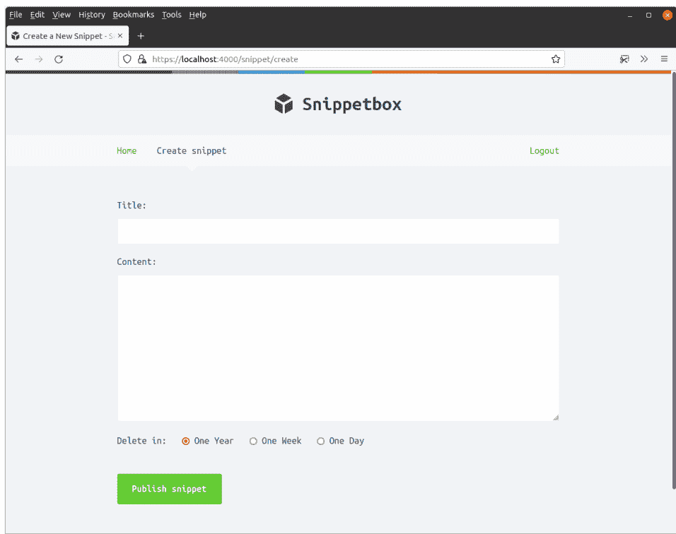

我们的应用程序将从非常简单的单个网页开始。随后，随着每一章的推进，我们将一步步构建，直到用户可以通过应用程序保存和查看片段。这将带我们了解如何构建项目、路由请求、使用数据库、处理表单以及安全地显示动态数据等主题。

随后，本书后面部分将添加用户账户，并限制应用程序，使只有注册用户才能创建片段。这将带我们了解配置 HTTPS 服务器、会话管理、用户身份验证和中间件等更高级的主题。

## 约定
本书中的代码块以银色背景显示，如下示例所示。如果代码块特别长，不相关的部分可能会被省略号替换。为了方便跟随，大多数代码块顶部还有一个标题栏，指示代码所在的文件名。如下所示：

```
File: hello.go

package main

... // Indicates that some existing code has been omitted.

func sayHello() {
	fmt.Println("Hello world!")
}
```

终端（命令行）指令以黑色背景显示，并以美元符号开头。这些命令应适用于任何基于 Unix 的操作系统，包括 Mac OSX 和 Linux。示例输出以银色显示在命令下方，如下所示：

```
$ echo "Hello world!"
Hello world!
```

如果你使用 Windows，应将命令替换为 DOS 等效命令，或通过常规 Windows GUI 执行操作。

请注意，屏幕截图和命令示例输出中显示的日期和时间戳仅用于示例。它们不一定相互对齐，也不会在全书中按时间顺序推进。

本书的一些章节结尾包含附加信息部分。这些部分包含与我们的应用程序构建无关，但仍然重要（或有时只是有趣）的信息。如果你是 Go 新手，可能想先跳过这些部分，以后再回头查看。

提示：如果你正在跟着应用程序构建进行学习，我建议使用本书的 HTML 版本，而不是 PDF 或 EPUB。HTML 版本在所有浏览器中都可用，如果你想直接从本书复制粘贴代码，代码块的正确格式将被保留。

使用 HTML 版本时，还可以使用键盘上的左右箭头键在章节之间导航。

## 关于作者
嗨，我是亚历克斯·爱德华兹，一名全栈 Web 开发人员和作家。我住在奥地利因斯布鲁克附近。

我使用 Go 超过 10 年，为自己和商业客户构建生产级应用程序，并帮助世界各地的人提高 Go 技能。

你可以在 [我的博客](where I publish detailed tutorials) 上查看更多我的文章，在 GitHub 上查看我的一些开源作品，也可以在 Instagram 和 Twitter 上关注我。

## 前提条件

## 背景知识

本书面向 Go 新手编写，但如果你事先对 Go 的语法有大致了解，阅读起来可能会更愉快。如果你在语法上感到困难，Karl Seguin 编写的《Go 之小书》是一个极好的教程；如果你想要更具互动性的内容，我建议你通读《Go 之旅》。

我还假设你对 HTML/CSS 和 SQL 有（非常）基本的了解，并且熟悉使用终端（Windows 用户则是命令行）。如果你之前用过任何其他语言（无论是 Ruby、Python、PHP 还是 C#）构建过 Web 应用程序，那么这本书应该非常适合你。

## Go 1.23

本书中的信息适用于 Go 的最新主要版本（版本 1.23），如果你想跟着构建应用程序进行代码实践，应该安装这个版本。

如果你已经安装了 Go，可以在终端中使用 `go version` 命令检查版本号。输出应该类似于这样：

```
$ go version
go version go1.23.0 linux/amd64
```

如果你需要升级 Go 版本——或者从零开始安装 Go——请现在就去做。不同操作系统的详细说明可以在此处找到：

- 删除旧版本的 Go
- 在 Mac OS X 上安装 Go
- 在 Windows 上安装 Go
- 在 Linux 上安装 Go

## 其他软件

如果你想完整地跟进，还需要确保计算机上可用的其他一些软件。它们是：

- curl 工具，用于在终端中处理 HTTP 请求和响应。在 MacOS 和 Linux 机器上，它通常是预安装的或可在软件仓库中获得。否则，你可以从此处下载最新版本。
- 功能完善的 Web 浏览器，配备良好的开发者工具。本书中我将使用 Firefox，但 Chromium、Chrome 或 Microsoft Edge 也可以。
- 你喜欢的文本编辑器 🙂

## 基础

好了，让我们开始吧！在本书的第一部分，我们将为项目打下基础，并解释你在后续应用程序构建中需要知道的主要原则。

你将学习如何：

- 设置符合 Go 规范的项目目录。
- 启动 Web 服务器并监听传入的 HTTP 请求。
- 根据请求路径和方法将请求路由到不同的处理程序。
- 在路由模式中使用通配符段。
- 向用户发送不同的 HTTP 响应、标头和状态码。
- 以合理且可扩展的方式构建你的项目。
- 渲染 HTML 页面并使用模板继承，使 HTML 标记摆脱重复的样板代码。
- 从应用程序提供静态文件，如图片、CSS 和 JavaScript。

## 项目设置与创建模块

在编写任何代码之前，你需要在计算机上创建一个 `snippetbox` 目录，作为本项目的顶级“主目录”。本书中编写的所有 Go 代码都将位于此目录中，同时还包含 HTML 模板和 CSS 文件等其他特定于项目的资源。

因此，如果你在跟进，请打开终端，在计算机上的任意位置创建一个名为 `snippetbox` 的新项目目录。我打算将我的项目目录放在 `$HOME/code` 下，但如果你愿意，可以选择不同的位置。

```
$ mkdir -p $HOME/code/snippetbox
```

## 创建模块

接下来你需要做的是决定项目的模块路径。

如果你还不熟悉 Go 模块，可以将模块路径视为项目的规范名称或标识符。

你可以选取 **几乎任何字符串** 作为模块路径，但需要关注的重要一点是 *唯一性*。为了避免将来与他人项目或标准库出现潜在的导入冲突，你需要选取一个全局唯一且不太可能被其他任何事物使用的模块路径。在 Go 社区中，一个常见的惯例是将模块路径基于你拥有的 URL。

在我这本书中，一个清晰、简洁且 *不太可能被其他任何事物使用* 的模块路径示例是 `snippetbox.alexedwards.net`，我将在本书剩余部分使用此路径。如果可能，你应该将其替换为你自己的唯一标识。

一旦你决定了唯一的模块路径，接下来需要做的是将项目目录转换为模块。

确保你位于项目目录的根目录下，然后运行 `go mod init` 命令——将你选定的模块路径作为参数传入，如下所示：

```
$ cd $HOME/code/snippetbox
$ go mod init snippetbox.alexedwards.net
go: creating new go.mod: module snippetbox.alexedwards.net
```

此时，你的项目目录应该类似于下面的截图。注意已创建的 go.mod 文件吗？

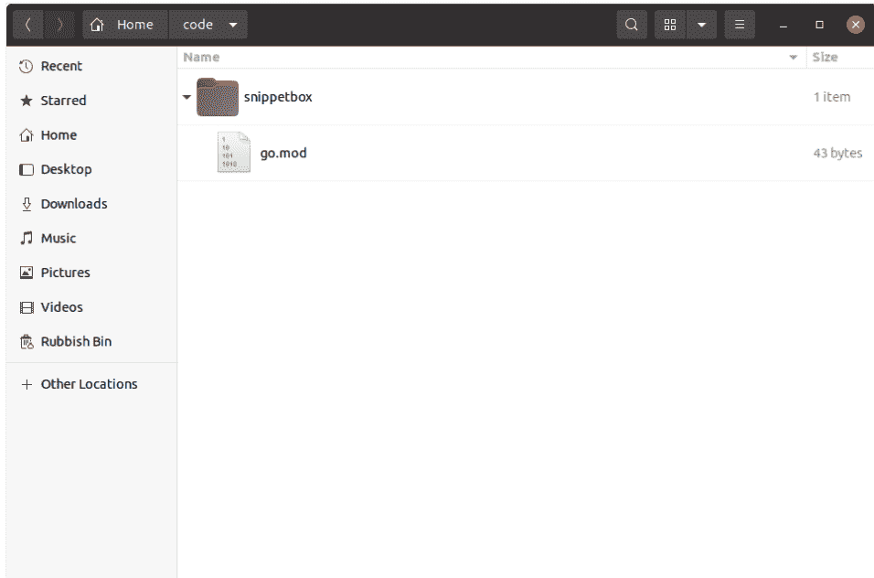

目前这个文件里没有太多内容，如果你在文本编辑器中打开它，它应该如下所示（但最好使用你自己的唯一模块路径）：

```
File: go.mod

module snippetbox.alexedwards.net

go 1.23.0
```

我们将在本书后面更详细地讨论模块，但目前只需要知道：当你的项目目录根目录下存在有效的 go.mod 文件时，你的项目就是一个模块。将项目设置为模块有很多优势——包括更容易管理第三方依赖项、避免供应链攻击，并确保将来可以可复现地构建你的应用程序。

## 你好，世界！

在继续之前，让我们快速检查一切是否设置正确。请在项目目录中创建一个新的 main.go 文件，包含以下代码：

```
$ touch main.go
```

```
File: main.go

package main

import "fmt"

func main() {
	fmt.Println("Hello world!")
}
```

保存此文件，然后在终端中使用 `go run .` 命令编译并执行当前目录中的代码。如果一切顺利，你将看到以下输出：

```
$ go run .
Hello world!
```

## 附加信息

## 可下载包的模块路径

如果你要创建一个可以被其他人和程序下载使用的项目，最好让模块路径等于代码可供下载的位置。

例如，如果你的包托管在 https://github.com/foo/bar，那么项目的模块路径应为 github.com/foo/bar。

## Web 应用基础

既然一切设置正确，让我们来制作 Web 应用程序的第一个版本。我们将从三个绝对必要的要素开始：

- 首先需要的是一个处理程序。如果你之前使用过 MVC 模式构建 Web 应用程序，可以将处理程序视为有点像控制器。它们负责执行应用程序逻辑，并编写 HTTP 响应标头和正文。
- 第二个组件是路由器（在 Go 术语中称为 servemux）。它存储应用程序的 URL 路由模式与相应处理程序之间的映射。通常，你的应用程序只有一个包含所有路由的 servemux。
- 最后需要的是一个 Web 服务器。Go 的一个优点是，你可以在应用程序本身中建立 Web 服务器并监听传入的请求。你不需要像 Nginx、Apache 或 Caddy 这样的外部第三方服务器。

让我们将这些组件放在 `main.go` 文件中，构建一个可运行的应用程序。

```
File: main.go

package main

import (
	"log"
	"net/http"
)

// Define a home handler function which writes a byte slice containing
// "Hello from Snippetbox" as the response body.
func home(w http.ResponseWriter, r *http.Request) {
	w.Write([]byte("Hello from Snippetbox"))
}

func main() {
	// Use the http.NewServeMux() function to initialize a new servemux, then
	// register the home function as the handler for the "/" URL pattern.
	mux := http.NewServeMux()
	mux.HandleFunc("/", home)

	// Print a log message to say that the server is starting.
	log.Print("starting server on :4000")

	// Use the http.ListenAndServe() function to start a new web server. We pass in
	// two parameters: the TCP network address to listen on (in this case ":4000")
	// and the servemux we just created. If http.ListenAndServe() returns an error
	// we use the log.Fatal() function to log the error message and exit. Note
	// that any error returned by http.ListenAndServe() is always non-nil.
	err := http.ListenAndServe(":4000", mux)
	log.Fatal(err)
}
```

> 注意：`home` 处理程序函数只是一个带有两个参数的常规 Go 函数。`http.ResponseWriter` 参数提供用于组装 HTTP 响应并将其发送给用户的方法，而 `*http.Request` 参数是指向包含当前请求信息（例如 HTTP 方法和正在请求的 URL）的结构体的指针。随着本书的推进，我们将更多地讨论这些参数，并演示如何使用它们。

当你运行此代码时，它将在本地计算机的 4000 端口上启动 Web 服务器。每次服务器收到新的 HTTP 请求时，它会将请求传递给 servemux，进而 servemux 会检查 URL 路径并将请求调度到匹配的处理程序。

让我们试试看。保存 `main.go` 文件，然后尝试在终端中使用 `go run` 命令运行它。

```
$ cd $HOME/code/snippetbox
$ go run .
2024/03/18 11:29:23 starting server on :4000
```


当服务器运行时，打开 Web 浏览器并尝试访问 http://localhost:4000。如果一切顺利，你应该会看到一个看起来类似下图的页面：

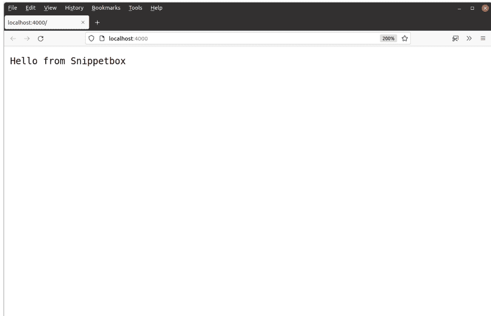

> Important: 在继续之前，我应该说明 Go 的 servemux 将路由模式 "/" 视为兜底。因此，目前所有发往我们服务器的 HTTP 请求都将由 home 函数处理，无论其 URL 路径如何。例如，你可以访问不同的 URL 路径，如 http://localhost:4000/foo/bar，你会收到完全相同的响应。

如果你返回终端窗口，可以按键盘上的 Ctrl+C 停止服务器。

## 其他信息

### 网络地址

你传递给 http.ListenAndServe() 的 TCP 网络地址应采用 "host:port" 格式。如果你省略主机（如我们使用的 ":4000"），则服务器将监听计算机上所有可用的网络接口。通常，只有当计算机有多个网络接口且只想监听其中一个时，才需要在地址中指定主机。

在其他 Go 项目或文档中，你有时会看到网络地址使用命名端口（如 ":http" 或 ":http-alt"）而不是数字。如果你使用命名端口，则 http.ListenAndServe() 函数在启动服务器时会尝试从你的 /etc/services 文件中查找相关端口号；如果找不到匹配项，则会返回错误。

## 使用 go run

开发期间，go run 命令是试运行代码的便捷方式。它本质上是一个快捷方式，用于编译代码、在 /tmp 目录中创建可执行二进制文件，然后一步运行该二进制文件。

它接受以空格分隔的 .go 文件列表、特定包的路径（其中 . 字符表示当前目录），或完整的模块路径。目前，对于我们的应用程序，以下三个命令均等价：

```
$ go run .
$ go run main.go
$ go run snippetbox.alexedwards.net
```

## 路由请求

只有一个路由的 Web 应用程序并不怎么有趣……也不太有用！让我们再添加几个路由，这样应用程序就会开始成形，如下所示：

| 路由模式 | 处理程序 | 操作 |
| :--- | :--- | :--- |
| / | home | 显示主页 |
| /snippet/view | snippetView | 显示特定代码片段 |
| /snippet/create | snippetCreate | 显示创建新代码片段的表单 |

重新打开 main.go 文件并按以下方式更新：

```
File: main.go

package main

import (
	"log"
	"net/http"
)

func home(w http.ResponseWriter, r *http.Request) {
	w.Write([]byte("Hello from Snippetbox"))
}

// Add a snippetView handler function.
func snippetView(w http.ResponseWriter, r *http.Request) {
	w.Write([]byte("Display a specific snippet..."))
}

// Add a snippetCreate handler function.
func snippetCreate(w http.ResponseWriter, r *http.Request) {
	w.Write([]byte("Display a form for creating a new snippet..."))
}

func main() {
	// Register the two new handler functions and corresponding route patterns with
	// the servemux, in exactly the same way that we did before.
	mux := http.NewServeMux()
	mux.HandleFunc("/", home)
	mux.HandleFunc("/snippet/view", snippetView)
	mux.HandleFunc("/snippet/create", snippetCreate)

	log.Print("starting server on :4000")

	err := http.ListenAndServe(":4000", mux)
	log.Fatal(err)
}
```

确保保存这些更改，然后重新启动 Web 应用程序：

```
$ cd $HOME/code/snippetbox
$ go run .
2024/03/18 11:29:23 starting server on :4000
```

如果你在 Web 浏览器中访问以下链接，现在应该为每个路由获得相应的响应：

- http://localhost:4000/snippet/view

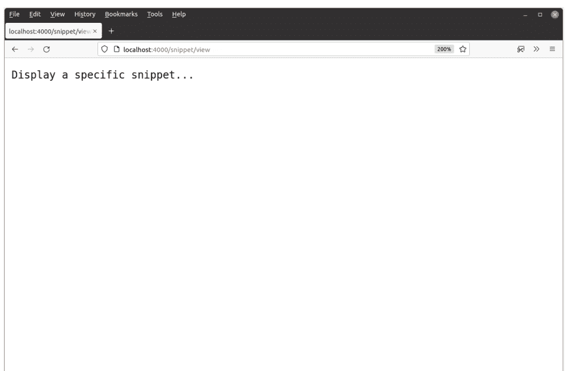

- http://localhost:4000/snippet/create

显示创建新代码片段的表单...

## 路由模式中的尾部斜杠

现在两个新路由已正常运行，让我们讨论一些理论。

需要知道的是，Go 的 servemux 根据路由模式是否以尾部斜杠结尾而有不同的匹配规则。

我们的两个新路由模式 — "/snippet/view" 和 "/snippet/create" — 都不以尾部斜杠结尾。当模式没有尾部斜杠时，只有在请求 URL 路径完全匹配模式时，才会匹配（并调用相应的处理程序）。

当路由模式以尾部斜杠结尾 — 如 "/" 或 "/static/" — 时，它被称为 *子树路径模式*。子树路径模式会在请求 URL 路径的 *开头* 匹配子树路径时被匹配（并调用相应的处理程序）。如果有助于你的理解，可以把子树路径想象成末尾带有通配符，如 "/*" 或 "/static/**"。

这也有助于解释为什么 "/" 路由模式表现得像个兜底。该模式本质上意味着 *匹配一个斜杠，后面不再跟任何其他内容*。

## 限制子树路径

为了防止子树路径模式表现得像末尾带有通配符，你可以将特殊字符序列 {$} 附加到模式末尾 — 如 "/{$}" 或 "/static/{$}"。

因此，如果你有路由模式 "/{$}"，它实际上意味着 *匹配一个斜杠，后面不再跟任何其他内容。* 它只会匹配 URL 路径恰好为 / 的请求。

让我们在应用程序中使用此方法，防止 home 处理程序充当兜底，如下所示：

```
File: main.go

package main

...

func main() {
	mux := http.NewServeMux()
	mux.HandleFunc("/{$}", home) // Restrict this route to exact matches on / only.
	mux.HandleFunc("/snippet/view", snippetView)
	mux.HandleFunc("/snippet/create", snippetCreate)

	log.Print("starting server on :4000")

	err := http.ListenAndServe(":4000", mux)
	log.Fatal(err)
}
```

> **注意：** 只允许在子树路径模式末尾（即以尾部斜杠结尾的模式）使用 {$}。不带尾部斜杠的路由模式本身就需要匹配整个请求路径，因此在末尾包含 {$} 没有意义，尝试这样做会导致运行时恐慌。

做出该更改后，重新启动服务器，并对未注册的 URL 路径（如 http://localhost:4000/foo/bar）发出请求。你现在应该得到一个看起来类似下图的 404 响应：

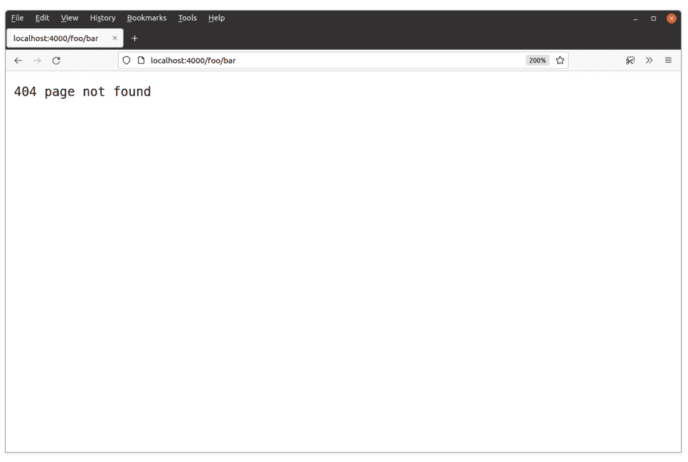

## 其他信息

## 其他 servemux 特性

有几个其他值得指出的 servemux 特性：

- 请求 URL 路径会自动清理。如果请求路径包含任何 . 或 .. 元素或重复斜杠，用户会自动重定向到等效的清洁 URL。例如，如果用户请求 /foo/bar/../baz，他们会自动收到一个 301 永久重定向到 /foo/baz，而不是原路径。
- 如果已注册子树路径，并且收到没有尾部斜杠的该子树路径请求，则用户会自动收到一个 301 永久重定向，将斜杠添加到子树路径。例如，如果你注册了子树路径 /foo/，则任何对 /foo 的请求都会被重定向到 /foo/。

## 主机名匹配

你可以在路由模式中包含主机名。当你想将所有 HTTP 请求重定向到标准 URL，或者你的应用程序作为多个站点或服务的后端时，这很有用。例如：

```
mux := http.NewServeMux()
mux.HandleFunc("foo.example.org/", fooHandler)
mux.HandleFunc("bar.example.org/", barHandler)
mux.HandleFunc("/baz", bazHandler)
```

在模式匹配方面，任何特定于主机的模式都会先被检查，如果匹配成功，请求将被分发到相应的处理程序。只有在找不到特定于主机的匹配时，才会检查非特定于主机的模式。

## 默认 servemux

如果你使用 Go 已经有一段时间，可能遇到过 http.Handle() 和 http.HandleFunc() 函数。它们允许你在不显式声明 servemux 的情况下注册路由，如下所示：

```
func main() {
	http.HandleFunc("/", home)
	http.HandleFunc("/snippet/view", snippetView)
	http.HandleFunc("/snippet/create", snippetCreate)

	log.Print("starting server on :4000")

	err := http.ListenAndServe(":4000", nil)
	log.Fatal(err)
}
```

在幕后，这些函数将路由注册到所谓的默认 servemux 中。这只是一个像我们一直在使用的常规 servemux，但由 Go 自动初始化并存储在 http.DefaultServeMux 全局变量中。

如果你将 nil 作为第二个参数传递给 http.ListenAndServe()，服务器将使用 http.DefaultServeMux 进行路由。

虽然这种方法可以使代码稍微短一些，但我不建议这样做，原因有二：

- 它不够显式，感觉比声明和使用自己作用域内的 servemux 更“神奇”。
- 因为 http.DefaultServeMux 是标准库中的全局变量，这意味着你项目中的任何 Go 代码都可以访问它并潜在地注册路由。如果你有一个庞大的项目代码库（尤其是由多人协作的项目），这可能会


使得很难确保你的应用程序的所有路由声明都能在一个中心位置轻松发现。

这也意味着你的应用程序导入的任何第三方包都可以与 http.DefaultServeMux 一起注册路由。如果其中任何一个第三方包被攻破，它们可能会利用 http.DefaultServeMux 将恶意处理程序暴露到 Web 上。只需不使用 http.DefaultServeMux，就可以简单地避免这个风险。

因此，为了清晰性、可维护性和安全性，通常最好避免使用 http.DefaultServeMux 及其对应的辅助函数。相反，请使用你自己的局部作用域 servemux，就像我们迄今在这个项目中所做的那样。

## 通配符路由模式

还可以定义包含通配符段的路由模式。你可以使用这些来创建更灵活的路由规则，并通过请求 URL 向你的 Go 应用程序传递变量。如果你之前使用其他语言的框架构建过 Web 应用程序，本章中的概念可能会让你感到很熟悉。

让我们暂时放下应用程序的构建，来解释一下它的工作原理。

路由模式中的通配符段用 {} 括号内的通配符标识符表示。例如：

```
mux.HandleFunc("/products/{category}/item/{itemID}", exampleHandler)
```

在这个示例中，路由模式包含两个通配符段。第一个段的标识符是 category，第二个段的标识符是 itemID。

包含通配符段的路由模式的匹配规则与我们在上一章中看到的相同，附加规则是请求路径可以为通配符段包含任何非空值。例如，以下请求都将与我们上面定义的路由匹配：

```
/products/hammocks/item/sku123456789
/products/seasonal-plants/item/pdt-1234-wxyz
/products/experimental_foods/item/quantum%20bananas
```

重要：定义路由模式时，每个路径段（正斜杠字符之间的部分）只能包含一个通配符，并且通配符需要填满整个路径段。诸如 `"/products/c_{category}"`、`/date/{y}-{m}-{d}` 或 `/{slug}.html` 之类的模式都是无效的。

在你的处理程序中，你可以使用其标识符和 r.PathValue() 方法来检索通配符段的相应值。例如：

```
func exampleHandler(w http.ResponseWriter, r *http.Request) {
	category := r.PathValue("category")
	itemID := r.PathValue("itemID")

	...
}
```

r.PathValue() 方法始终返回一个字符串值，重要的是要记住，这可以是用户在 URL 中包含的*任何值*——因此在对该值执行任何重要操作之前，你应该对其进行验证或合理性检查。

## 在实践中使用通配符段

好的，让我们回到我们的应用程序，并将其更新为在 /snippet/view 路由中包含一个新的 {id} 通配符段，这样我们的路由看起来就像这样：

| 路由模式 | 处理程序 | 操作 |
| :--- | :--- | :--- |
| `/{$}` | home | 显示主页 |
| `/snippet/view/{id}` | snippetView | 显示特定代码片段 |
| `/snippet/create` | snippetCreate | 显示创建新代码片段的表单 |

打开你的 main.go 文件，并进行如下更改：

```
File: main.go

package main

...

func main() {
	mux := http.NewServeMux()
	mux.HandleFunc("/{$}", home)
	mux.HandleFunc("/snippet/view/{id}", snippetView) // Add the {id} wildcard segment
	mux.HandleFunc("/snippet/create", snippetCreate)

	log.Print("starting server on :4000")

	err := http.ListenAndServe(":4000", mux)
	log.Fatal(err)
}
```

现在让我们前往 snippetView 处理程序，并将其更新为从请求 URL 路径中检索 id 值。本书稍后，我们将使用此 id 值从数据库中选择特定代码片段，但目前我们将只是将 id 作为 HTTP 响应的一部分回显给用户。

因为 `id` 值是不可信的用户输入，我们应该在使用它之前对其进行验证，以确保它是合理且明智的。就我们的应用程序而言，我们想要检查 `id` 值是否包含正整数，我们可以通过尝试使用 `strconv.Atoi()` 函数将字符串值转换为整数，然后检查该值是否大于零来完成。

具体做法如下：

```
File: main.go

package main

import (
	"fmt" // New import
	"log"
	"net/http"
	"strconv" // New import
)

...

func snippetView(w http.ResponseWriter, r *http.Request) {
	// Extract the value of the id wildcard from the request using r.PathValue()
	// and try to convert it to an integer using the strconv.Atoi() function. If
	// it can't be converted to an integer, or the value is less than 1, we
	// return a 404 page not found response.
	id, err := strconv.Atoi(r.PathValue("id"))
	if err != nil || id < 1 {
		http.NotFound(w, r)
		return
	}

	// Use the fmt.Sprintf() function to interpolate the id value with a
	// message, then write it as the HTTP response.
	msg := fmt.Sprintf("Display a specific snippet with ID %d...", id)
	w.Write([]byte(msg))
}

...
```

保存你的更改，重新启动应用程序，然后打开浏览器并尝试访问 http://localhost:4000/snippet/view/123 这样的 URL。你应该会看到包含来自请求 URL 的回显 `id` 通配符值的响应，类似于这样：

显示带有 ID 123 的特定代码片段...

你可能还想尝试访问一些 id 通配符值无效或根本没有通配符值的 URL。例如：

- http://localhost:4000/snippet/view/
- http://localhost:4000/snippet/view/-1
- http://localhost:4000/snippet/view/foo

对于所有这些请求，你都应该收到 404 页面未找到响应。

## 附加信息

## 优先级和冲突

定义包含通配符段的路由模式时，你的某些模式可能会“重叠”。例如，如果你使用 `"/post/edit"` 和 `/post/{id}` 模式定义路由，它们会重叠，因为路径为 /post/edit 的传入 HTTP 请求是两个模式的有效匹配。

当路由模式重叠时，Go 的 servemux 需要决定哪个模式优先，以便将请求分发给相应的处理程序。

这条规则非常简洁明了：*最具体的路由模式获胜*。从形式上讲，Go 定义如果一个模式仅匹配另一个模式所匹配请求的子集，则该模式比另一个模式更具体。

继续以上面的示例为例，路由模式 `"/post/edit"` *仅*匹配路径为 /post/edit 的请求，而模式 `/post/{id}` 匹配路径为 /post/edit、/post/123、/post/abc 等更多请求的请求。因此 `"/post/edit"` 是更具体的路由模式，将优先匹配。

顺便说一句，还有几件事值得一提：

- *最具体模式优先*规则的一个好副作用是，你可以以任何顺序注册模式，*这不会改变 servemux 的行为*。
- 有一种潜在的边缘情况，即你有两个重叠的路由模式，但其中任何一个都不明显比另一个更具体。例如，模式 `"/post/new/{id}"` 和 `"/post/{author}/latest"` 重叠，因为它们都匹配请求路径 /post/new/latest，但不清楚哪个应该优先。在这种情况下，Go 的 servemux 认为这些模式*冲突*，并在初始化路由时在运行时发生 panic。
- 仅仅因为 Go 的 servemux 支持重叠路由，并不意味着你应该使用它们！拥有重叠的路由模式会增加应用程序中出现错误和意外行为的风险，如果你有自由设计应用程序的 URL 结构，通常最好将重叠减少到最少或完全避免重叠。

## 带通配符的子树路径模式

重要的是要理解，即使在使用通配符段时，我们在上一章中描述的路由规则仍然适用。特别是，如果你的路由模式以尾随斜杠结尾且结尾没有 `{$}`，则它被视为*子树路径模式*，并且只需要请求 URL 路径的*开头*匹配。

所以，如果你的路由中有一个类似 `"/user/{id}/"` 的子树路径模式（注意尾随斜杠），则该模式将匹配 /user/1/、/user/2/a、/user/2/a/b/c 等请求。

同样，如果你不想要这种行为，就在末尾加上 `{$}` —— 例如 `"/user/{id}/{$}"`。

## 剩余通配符

路由模式中的通配符通常匹配请求的一个单一、非空段。


仅限路径。但有一种特殊情况。

如果路由模式以通配符结尾，并且此最终通配符标识符以 ... 结尾，则该通配符将匹配请求路径中的任何和所有剩余段。

例如，如果你声明类似 "/post/{path...}" 的路由模式，它将匹配 /post/a、/post/a/b、/post/a/b/c 等请求 —— 这非常类似于子树路径模式的行为。但区别在于，你可以在处理程序中通过 r.PathValue() 方法访问整个通配符部分。在此示例中，你可以通过调用 r.PathValue("path") 来获取 {path...} 的通配符值。

## 基于方法的路由

接下来，让我们遵循 HTTP 最佳实践，限制我们的应用程序，使其仅响应带有适当 HTTP 方法的请求。

随着我们应用程序构建的推进，我们的 `home`、`snippetView` 和 `snippetCreate` 处理程序将仅检索信息并向用户显示页面，因此将这些处理程序限制为仅处理 `GET` 请求是合理的。

要将路由限制为特定 HTTP 方法，可以在声明路由模式时在其前加上所需的 HTTP 方法，如下所示：

```
File: main.go

package main

...

func main() {
	mux := http.NewServeMux()
	// Prefix the route patterns with the required HTTP method (for now, we will
	// restrict all three routes to acting on GET requests).
	mux.HandleFunc("GET /{$}", home)
	mux.HandleFunc("GET /snippet/view/{id}", snippetView)
	mux.HandleFunc("GET /snippet/create", snippetCreate)

	log.Print("starting server on :4000")

	err := http.ListenAndServe(":4000", mux)
	log.Fatal(err)
}
```

> 注意：路由模式中的 HTTP 方法区分大小写，且应始终大写，后面至少跟一个空格字符（空格和制表符均可）。每个路由模式中只能包含一个 HTTP 方法。

还值得一提的是，当你注册使用 `GET` 方法的路由模式时，它将同时匹配 `GET` 和 `HEAD` 请求。所有其他方法（如 `POST`、`PUT` 和 `DELETE`）都需要精确匹配。

让我们使用 curl 向我们的应用程序发送一些请求来测试此更改。如果你在跟随操作，首先对 `http://localhost:4000/` 发送一个常规 `GET` 请求，如下所示：

```
$ curl -i localhost:4000/
HTTP/1.1 200 OK
Date: Wed, 18 Mar 2024 11:29:23 GMT
Content-Length: 21
Content-Type: text/plain; charset=utf-8

Hello from Snippetbox
```

此处的响应看起来不错。我们可以看到路由仍然有效，并且我们得到了一个 `200 OK` 状态和一个 `Hello from Snippetbox` 响应体，与之前一样。

你也可以继续尝试对同一 URL 发出 `HEAD` 请求。你会发现这也能正常工作，仅返回 *HTTP 响应头*，没有响应体。

```
$ curl --head localhost:4000/
HTTP/1.1 200 OK
Date: Wed, 18 Mar 2024 11:29:23 GMT
Content-Length: 21
Content-Type: text/plain; charset=utf-8
```

相比之下，让我们尝试向 `http://localhost:4000/` 发出 `POST` 请求。`POST` 方法不支持此路由，因此你应该会收到类似这样的错误响应：

```
$ curl -i -d "" localhost:4000/
HTTP/1.1 405 Method Not Allowed
Allow: GET, HEAD
Content-Type: text/plain; charset=utf-8
X-Content-Type-Options: nosniff
Date: Wed, 18 Mar 2024 11:29:23 GMT
Content-Length: 19

Method Not Allowed
```

> 注意：curl 的 `-d` 标志用于声明你想要包含在请求体中的任何 HTTP `POST` 数据。在上述命令中，我们使用 `-d ""`，这意味着请求体将为空，但请求仍将使用 HTTP 方法 `POST` 发送（而不是默认方法 `GET`）。

这一切看起来非常好。我们可以看到 Go 的 servemux 已经自动为我们发送了一个 `405 Method Not Allowed` 响应，其中包含一个 `Allow` 头，列出了请求 URL *支持* 的 HTTP 方法。

## 添加仅限 POST 的路由和处理程序

我们还要向代码库中添加一个新的 `snippetCreatePost` 处理程序，稍后将用它在数据库中创建和保存新代码片段。因为创建和保存代码片段是一个非幂等操作，会更改服务器的状态，所以我们要确保此处理程序仅处理 `POST` 请求。

总而言之，我们希望第四个处理程序和路由如下所示：

| 路由模式 | 处理程序 | 动作 |
| --- | --- | --- |
| `GET /{$}` | home | 显示主页 |
| `GET /snippet/view/{id}` | snippetView | 显示特定代码片段 |
| `GET /snippet/create` | snippetCreate | 显示创建新代码片段的表单 |
| `POST /snippet/create` | snippetCreatePost | 保存新代码片段 |

让我们继续将必要代码添加到我们的 `main.go` 文件中，如下所示：

```
File: main.go

package main

...

// Add a snippetCreatePost handler function.
func snippetCreatePost(w http.ResponseWriter, r *http.Request) {
  w.Write([]byte("Save a new snippet..."))
}

func main() {
  mux := http.NewServeMux()
  mux.HandleFunc("GET /{$}", home)
  mux.HandleFunc("GET /snippet/view/{id}", snippetView)
  mux.HandleFunc("GET /snippet/create", snippetCreate)

  // Create the new route, which is restricted to POST requests only.
  mux.HandleFunc("POST /snippet/create", snippetCreatePost)

  log.Print("starting server on :4000")

  err := http.ListenAndServe(":4000", mux)
  log.Fatal(err)
}
```

请注意，声明两个（或更多）具有不同 HTTP 方法但否则具有相同模式的独立路由完全没问题，就像我们在这里对 "`GET /snippet/create`" 和 "`POST /snippet/create`" 所做的那样。

如果你重启应用程序并尝试使用 URL 路径 `/snippet/create` 发出一些请求，你现在应该会根据所使用的请求方法看到不同的响应。

```
$ curl -i localhost:4000/snippet/create
HTTP/1.1 200 OK
Date: Wed, 18 Mar 2024 11:29:23 GMT
Content-Length: 50
Content-Type: text/plain; charset=utf-8

Display a form for creating a new snippet...

$ curl -i -d "" localhost:4000/snippet/create
HTTP/1.1 200 OK
Date: Wed, 18 Mar 2024 11:29:23 GMT
Content-Length: 21
Content-Type: text/plain; charset=utf-8

Save a new snippet...

$ curl -i -X DELETE localhost:4000/snippet/create
HTTP/1.1 405 Method Not Allowed
Allow: GET, HEAD, POST
Content-Type: text/plain; charset=utf-8
X-Content-Type-Options: nosniff
Date: Wed, 18 Mar 2024 11:29:23 GMT
Content-Length: 19

Method Not Allowed
```

## 其他信息

### 方法优先级

如果由于 HTTP 方法而导致路由模式重叠，*最具体的模式优先*规则也同样适用。

重要的是要意识到，不包含方法的路由模式（例如 "/article/{id}"）将匹配 *任何方法* 的传入 HTTP 请求。相比之下，像 "POST /article/{id}" 这样的路由只会匹配具有 POST 方法的请求。因此，如果你在应用程序中声明重叠的路由 "/article/{id}" 和 "POST /article/{id}"，那么 "POST /article/{id}" 路由将优先。

### 处理程序命名

我还想强调，在 Go 中为处理程序命名没有对错之分。

在这个项目中，我们将遵循一种约定：为任何处理 POST 请求的处理程序名称加上后缀 'Post'。如下所示：

| 路由模式 | 处理程序 | 动作 |
|---|---|---|
| GET /snippet/create | snippetCreate | 显示创建新代码片段的表单 |
| POST /snippet/create | snippetCreatePost | 创建新代码片段 |

但在你自己的工作中，没有必要遵循此模式。例如，你可以改为用 'get' 和 'post' 等词作为处理程序名称的前缀，如下所示：

| 路由模式 | 处理程序 | 动作 |
|---|---|---|
| GET /snippet/create | getSnippetCreate | 显示创建新代码片段的表单 |
| POST /snippet/create | postSnippetCreate | 创建新代码片段 |

甚至可以给处理程序完全不同的名称。例如：

| 路由模式 | 处理程序 | 动作 |
|---|---|---|
| GET /snippet/create | newSnippetForm | 显示创建新代码片段的表单 |
| POST /snippet/create | createSnippet | 创建新代码片段 |

基本上，在 Go 中，你有自由为你的处理程序选择适合你且符合你思维习惯的命名约定。

## 第三方路由器

我们在过去两章中一直在使用的通配符和基于方法的路由功能在 Go 中相对较新——它直到 Go 1.22 才成为标准库的一部分。虽然这是对语言非常受欢迎的补充，也是一项重大改进，但你可能会发现，标准库的路由功能有时仍然无法提供你所需的一切。

例如，目前不支持以下内容：

- 向用户发送自定义 404 Not Found 和 405 Method Not Allowed 响应（尽管对此有一个开放的提案）。
- 在路由模式或通配符中使用正则表达式。
- 在单个路由声明中匹配多个 HTTP 方法。
- 自动支持 OPTIONS 请求。


- 根据不寻常的条件（例如 HTTP 请求标头）将请求路由到处理程序。

如果您的应用程序需要这些功能，则需要使用第三方路由器包。我推荐的有 httprouter、chi、flow 和 gorilla/mux，您可以在这篇博客文章中找到它们的比较以及关于使用哪一个的指导。

## 自定义响应

默认情况下，您的处理程序发送的每个响应都带有 HTTP 状态码 200 OK（这表示用户的请求已接收并成功处理），此外还有三个自动生成的系统标头：一个 Date 标头，以及响应正文的 Content-Length 和 Content-Type。例如：

```
$ curl -i localhost:4000/
HTTP/1.1 200 OK
Date: Wed, 18 Mar 2024 11:29:23 GMT
Content-Length: 21
Content-Type: text/plain; charset=utf-8

Hello from Snippetbox
```

在本章中，我们将深入探讨如何自定义处理程序发送的响应标头，还将介绍向用户发送纯文本响应的其他几种方式。

## HTTP 状态码

首先，让我们更新 snippetCreatePost 处理程序，使其发送 201 Created 状态码，而不是 200 OK。为此，您可以在处理程序中使用 w.WriteHeader() 方法，如下所示：

```
File: main.go

package main

...

func snippetCreatePost(w http.ResponseWriter, r *http.Request) {
    // Use the w.WriteHeader() method to send a 201 status code.
    w.WriteHeader(201)

    // Then w.Write() method to write the response body as normal.
    w.Write([]byte("Save a new snippet..."))
}

...
```

（是的，这有点傻，因为处理程序目前实际上还没有创建任何东西！但它很好地说明了设置自定义状态码的模式。）

虽然这个变化看起来很简单，但有几个细微差别我应该说明：

- 每个响应只能调用一次 w.WriteHeader()，并且在状态码写入后无法更改。如果您尝试第二次调用 w.WriteHeader()，Go 会记录一条警告消息。
- 如果您不显式调用 w.WriteHeader()，那么对 w.Write() 的第一次调用会自动向用户发送 200 状态码。因此，如果您想发送非 200 状态码，必须在任何对 w.Write() 的调用之前调用 w.WriteHeader()。

重启服务器，然后使用 curl 再次向 http://localhost:4000/snippet/create 发送 POST 请求。您应该看到 HTTP 响应现在带有类似于以下内容的 201 Created 状态码：

```
$ curl -i -d "" http://localhost:4000/snippet/create
HTTP/1.1 201 Created
Date: Wed, 18 Mar 2024 11:29:23 GMT
Content-Length: 21
Content-Type: text/plain; charset=utf-8

Save a new snippet...
```

## 状态码常量

net/http 包提供了 HTTP 状态码常量，我们可以使用这些常量，而不是亲自编写状态码数字。使用这些常量是良好做法，因为它有助于防止因拼写错误而导致的错误，并且还可以帮助使代码更清晰、自文档化——尤其是在处理不常用的状态码时。

让我们更新 snippetCreatePost 处理程序，使用常量 http.StatusCreated 代替整数 201，如下所示：

```
File: main.go

package main

...

func snippetCreatePost(w http.ResponseWriter, r *http.Request) {
	w.WriteHeader(http.StatusCreated)

	w.Write([]byte("Save a new snippet..."))
}

...
```

## 自定义标头

您还可以通过更改*响应标头映射*来自定义发送给用户的 HTTP 标头。您可能最希望做的事情是在映射中包含一个附加标头，您可以使用 `w.Header().Add()` 方法来实现。

为了演示这一点，让我们向 `home` 处理程序发送的响应添加一个 `Server: Go` 标头。如果您在跟随操作，请继续更新处理程序代码，如下所示：

```
File: main.go

package main

...

func home(w http.ResponseWriter, r *http.Request) {
	// Use the Header().Add() method to add a 'Server: Go' header to the
	// response header map. The first parameter is the header name, and
	// the second parameter is the header value.
	w.Header().Add("Server", "Go")

	w.Write([]byte("Hello from Snippetbox"))
}

...
```

> **重要：** 您必须确保响应标头映射中包含您想要的所有标头，*在* 调用 `w.WriteHeader()` 或 `w.Write()` *之前*。在调用 `w.WriteHeader()` 或 `w.Write()` 之后对响应标头映射所做的任何更改，都不会对用户收到的标头产生任何影响。

让我们尝试使用 curl 向 `http://localhost:4000/` 发送另一个请求。这一次，您应该看到响应现在包含一个新的 `Server: Go` 标头，如下所示：

```
$ curl -i http://localhost:4000

HTTP/1.1 200 OK
Server: Go
Date: Wed, 18 Mar 2024 11:29:23 GMT
Content-Length: 21
Content-Type: text/plain; charset=utf-8

Hello from Snippetbox
```

## 写入响应体

迄今为止，在本书中我们一直使用 w.Write() 向用户发送特定的 HTTP 响应体。虽然这是发送响应最简单、最基本的方式，但在实践中，将 http.ResponseWriter 值传递给另一个由其编写响应的函数要常见得多。

事实上，有很多函数可用于编写响应！

关键在于理解这一点……由于您处理程序中的 http.ResponseWriter 值具有一个 Write() 方法，它满足 io.Writer 接口。

如果您是 Go 新手，那么接口的概念可能有点令人困惑，我现在也不想太过纠结于此。但在实际层面上，这意味着任何您看到带有 io.Writer 参数的函数，您都可以传入 http.ResponseWriter 值，而任何被写入的内容随后都将作为 HTTP 响应的正文发送。

这意味着您可以使用标准库函数，例如 io.WriteString() 和 fmt.Fprint*() 家族（它们都接受 io.Writer 参数）来编写纯文本响应体。

```go
// Instead of this...
w.Write([]byte("Hello world"))

// You can do this...
io.WriteString(w, "Hello world")
fmt.Fprint(w, "Hello world")
```

让我们利用这一点，并更新 snippetView 处理程序中的代码，以使用 fmt.Fprintf() 函数。这将使我们能够在响应正文消息中插值通配符 id 值，并用一行代码写入响应，如下所示：

```go
File: main.go

package main

...

func snippetView(w http.ResponseWriter, r *http.Request) {
  id, err := strconv.Atoi(r.PathValue("id"))
  if err != nil || id < 1 {
    http.NotFound(w, r)
    return
  }

  fmt.Fprintf(w, "Display a specific snippet with ID %d...", id)
}

...
```

## 附加信息

## 内容嗅探

为了自动设置 `Content-Type` 标头，Go 使用 `http.DetectContentType()` 函数对响应正文进行内容嗅探。如果该函数无法猜测内容类型，Go 将回退到设置标头 `Content-Type: application/octet-stream`。

`http.DetectContentType()` 函数通常工作得相当不错，但 Web 开发者常遇到的一个问题是，它无法区分 JSON 和纯文本。因此，默认情况下，JSON 响应将使用 `Content-Type: text/plain; charset=utf-8` 标头发送。您可以通过在处理程序中手动设置正确的标头来防止这种情况发生，如下所示：

```
w.Header().Set("Content-Type", "application/json")
w.Write([]byte(`{"name":"Alex"}`))
```

## 操作标头映射

在本章中，我们使用 `w.Header().Add()` 向响应标头映射添加了一个新标头。但您还可以使用 `Set()`、`Del()`、`Get()` 和 `Values()` 方法来操作和读取标头映射。

```
// Set a new cache-control header. If an existing "Cache-Control" header exists
// it will be overwritten.
w.Header().Set("Cache-Control", "public, max-age=31536000")

// In contrast, the Add() method appends a new "Cache-Control" header and can
// be called multiple times.
w.Header().Add("Cache-Control", "public")
w.Header().Add("Cache-Control", "max-age=31536000")

// Delete all values for the "Cache-Control" header.
w.Header().Del("Cache-Control")

// Retrieve the first value for the "Cache-Control" header.
w.Header().Get("Cache-Control")

// Retrieve a slice of all values for the "Cache-Control" header.
w.Header().Values("Cache-Control")
```

## 标头规范化

当您在标头映射上使用 `Set()`、`Add()`、`Del()`、`Get()` 和 `Values()` 方法时，标头名称将始终使用 `textproto.CanonicalMIMEHeaderKey()` 函数进行规范化。这将首字母和任何字母


跟在连字符后的字母转为大写，其余字母转为小写。这在实际调用这些方法时意味着头部名称不区分大小写。

如果你需要避免这种规范化行为，可以直接编辑底层的头部映射。其底层类型为 `map[string][]string`。例如：

```
w.Header()["X-XSS-Protection"] = []string{"1; mode=block"}
```

> **注意：** 如果正在使用 HTTP/2 连接，Go 会在写入响应时 *始终* 自动为你将头部名称和值转换为小写，这符合 HTTP/2 规范。

## 项目结构与组织

在向 `main.go` 文件添加更多代码之前，现在是时候思考如何组织和构建这个项目了。

事先说明很重要：在 Go 中构建 Web 应用程序并没有唯一的“正确”方式，甚至没有推荐的方式。这既有好处也有坏处。这意味着你在组织代码方面拥有自由和灵活性，但在尝试决定最佳结构时，也很容易陷入不确定性的兔子洞。

随着你对 Go 的经验越来越丰富，你会对哪些模式在不同情况下效果良好有所感觉。但作为起点，我能给你的最佳建议是：不要过度复杂化事物。只有在明确需要时，才努力添加结构和复杂性。

对于这个项目，我们将实现一个遵循流行且经过验证的方法的大纲结构。这是一个坚实的起点，你应该能够在多种项目中重用这种通用结构。

如果你在跟随学习，请确保你在项目仓库的根目录下，并运行以下命令：

```
$ cd $HOME/code/snippetbox
$ rm main.go
$ mkdir -p cmd/web internal ui/html ui/static
$ touch cmd/web/main.go
$ touch cmd/web/handlers.go
```

你的项目仓库结构现在应该如下所示：

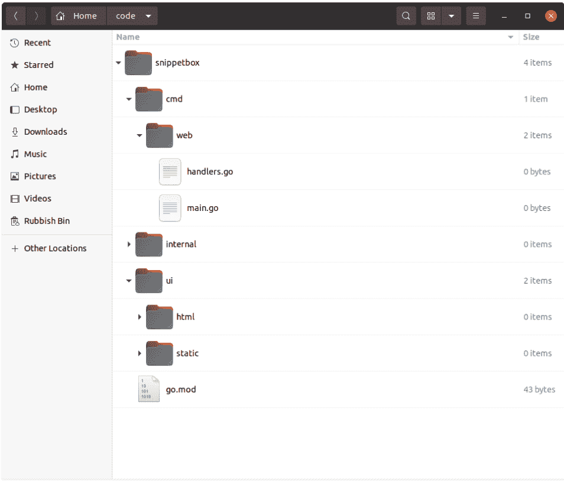

让我们花点时间讨论一下这些目录各自的用途。

- **cmd** 目录将包含项目中可执行应用程序的 *特定于应用程序* 的代码。目前，我们的项目只有一个可执行应用程序——Web 应用程序——它位于 **cmd/web** 目录下。

- **internal** 目录将包含项目中使用的辅助 *非特定于应用程序* 的代码。我们将用它来存储可能可重用的代码，例如验证助手和项目的 SQL 数据库模型。

- **ui** 目录将包含 Web 应用程序使用的 *用户界面资源*。具体来说，**ui/html** 目录将包含 HTML 模板，**ui/static** 目录将包含静态文件（如 CSS 和图像）。

那么，为什么我们使用这种结构呢？

这种结构有两大好处：

- 1. 它在 Go 资产和非 Go 资产之间提供了清晰的分离。我们编写的所有 Go 代码都将专门位于 `cmd` 和 `internal` 目录下，从而使项目根目录可以存储非 Go 资产，如 UI 文件、makefile 和模块定义（包括我们的 `go.mod` 文件）。

- 2. 如果你想向项目添加另一个可执行应用程序，这种结构扩展起来非常方便。例如，你未来可能想要添加一个 CLI（命令行界面）来自动化一些管理任务。使用这种结构，你可以在 `cmd/cli` 下创建此 CLI 应用程序，它将能够导入并重用你在 `internal` 目录下编写的所有代码。

### 重构现有代码

让我们快速将已经编写的代码移植到这个新结构中。

```
File: cmd/web/main.go

package main

import (
	"log"
	"net/http"
)

func main() {
	mux := http.NewServeMux()
	mux.HandleFunc("GET /{$}", home)
	mux.HandleFunc("GET /snippet/view/{id}", snippetView)
	mux.HandleFunc("GET /snippet/create", snippetCreate)
	mux.HandleFunc("POST /snippet/create", snippetCreatePost)

	log.Print("starting server on :4000")

	err := http.ListenAndServe(":4000", mux)
	log.Fatal(err)
}
```

```
File: cmd/web/handlers.go

package main

import (
	"fmt"
	"net/http"
	"strconv"
)

func home(w http.ResponseWriter, r *http.Request) {
	w.Header().Add("Server", "Go")
	w.Write([]byte("Hello from Snippetbox"))
}

func snippetView(w http.ResponseWriter, r *http.Request) {
	id, err := strconv.Atoi(r.PathValue("id"))
	if err != nil || id < 1 {
		http.NotFound(w, r)
		return
	}

	fmt.Fprintf(w, "Display a specific snippet with ID %d...", id)
}

func snippetCreate(w http.ResponseWriter, r *http.Request) {
	w.Write([]byte("Display a form for creating a new snippet..."))
}

func snippetCreatePost(w http.ResponseWriter, r *http.Request) {
	w.WriteHeader(http.StatusCreated)
	w.Write([]byte("Save a new snippet..."))
}
```

现在，我们的 Web 应用程序由 `cmd/web` 目录下的多个 `.go` 文件组成。要运行它们，可以使用 `go run` 命令，如下所示：

```
$ cd $HOME/code/snippetbox
$ go run ./cmd/web
2024/03/18 11:29:23 starting server on :4000
```

## 其他信息

### internal 目录

值得指出的是，在 Go 中，目录名 `internal` 具有特殊的含义和行为：任何位于该目录下的包只能被 `internal` 目录父目录内的代码导入。在我们的情况中，这意味着位于 `internal` 的任何包只能被 `snippetbox` 项目目录内的代码导入。

或者换个角度看，这意味着 *internal* 下的任何包都不能被 *我们项目外部的代码* 导入。

这很有用，因为它防止其他代码库导入并依赖我们 *internal* 目录中（可能未版本化且不受支持）的包——即使项目代码公开可用于类似 GitHub 的地方。

## HTML 模板与继承

让我们为项目注入一些活力，为我们的 Snippetbox Web 应用程序开发一个合适的主页。在接下来的几章中，我们将致力于创建一个如下所示的页面：

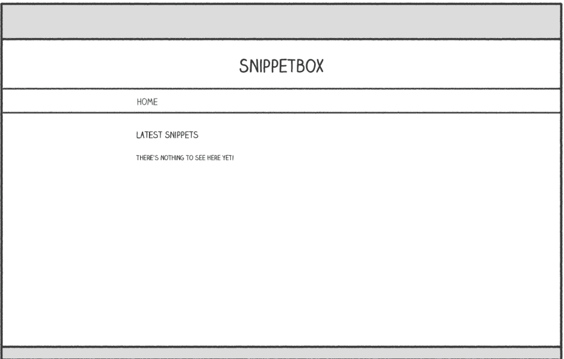

让我们从在 `ui/html/pages/home.tmpl` 创建一个模板文件开始，用于包含主页的 HTML 内容。如下所示：

```
$ mkdir ui/html/pages
$ touch ui/html/pages/home.tmpl
```

并添加以下 HTML 标记：

```
File: ui/html/pages/home.tmpl

<!DOCTYPE html>
<html lang='en'>
	<head>
		<meta charset='utf-8'>
		<title>Home - Snippetbox</title>
	</head>
	<body>
		<header>
			<h1><a href='/'>Snippetbox</a></h1>
		</header>
		<main>
			<h2>Latest Snippets</h2>
			<p>There's nothing to see here yet!</p>
		</main>
		<footer>Powered by <a href='https://golang.org/'>Go</a></footer>
	</body>
</html>
```

**注意：** 此处 `.tmpl` 扩展名不传达任何特殊含义或行为。我只是选择这个扩展名，因为当你浏览文件列表时，这是一种清楚表明文件包含 Go 模板的好方法。但是，如果你愿意，可以改用 `.html` 扩展名（这可能会让你的文本编辑器将文件识别为 HTML，以便进行语法高亮或自动补全）——或者你甚至可以使用“双扩展名”，如 `.tmpl.html`。选择权在你，但在这本书中，我们将继续对模板使用 `.tmpl`。

现在我们已经创建了包含主页 HTML 标记的模板文件，接下来的问题是如何让我们的主处理程序渲染它？

为此，我们需要使用 Go 的 `html/template` 包，它提供了一组用于安全解析和渲染 HTML 模板的函数。我们可以使用该包中的函数解析模板文件，然后执行模板。

我来演示一下。打开 `cmd/web/handlers.go` 文件并添加以下代码：

```
File: cmd/web/handlers.go

package main

import (
	"fmt"
	"html/template" // New import
	"log" // New import
	"net/http"
	"strconv"
)

func home(w http.ResponseWriter, r *http.Request) {
	w.Header().Add("Server", "Go")

	// Use the template.ParseFiles() function to read the template file into a
	// template set. If there's an error, we log the detailed error message, use
	// the http.Error() function to send an Internal Server Error response to the
	// user, and then return from the handler so no subsequent code is executed.
	ts, err := template.ParseFiles("./ui/html/pages/home.tpl")
	if err != nil {
		log.Print(err.Error())
		http.Error(w, "Internal Server Error", http.StatusInternalServerError)
		return
	}

	// Then we use the Execute() method on the template set to write the
	// template content as the response body. The last parameter to Execute()
	// represents any dynamic data that we want to pass in, which for now we'll
	// leave as nil.
	err = ts.Execute(w, nil)
	if err != nil {
		log.Print(err.Error())
		http.Error(w, "Internal Server Error", http.StatusInternalServerError)
	}
}
...
```

关于这段代码有几点重要的事情需要指出：

- 你传递给 `template.ParseFiles()` 函数的文件路径必须是相对于当前工作目录的路径，或者是绝对路径。在上面的代码中，我已将路径设为相对于项目目录根目录的路径。

- 如果 `template.ParseFiles()` 或 `ts.Execute()` 函数返回错误，我们会记录详细错误消息，然后使用 `http.Error()` 函数向用户发送响应。`http.Error()` 是一个轻量级的辅助函数，它向用户发送纯文本错误消息和特定的 HTTP 状态码（在我们的代码中，我们发送消息 "Internal Server Error" 和状态码 500，由常量 `http.StatusInternalServerError` 表示）。实际上，这意味着如果发生错误，用户在浏览器中会看到消息 Internal Server Error，但详细错误消息会记录在应用程序日志消息中。


既然如此，请确保您位于项目目录的根目录下，并重启应用程序：

```
$ cd $HOME/code/snippetbox
$ go run ./cmd/web
2024/03/18 11:29:23 starting server on :4000
```

然后在网页浏览器中打开 http://localhost:4000。您应该会发现 HTML 主页已经相当不错了。

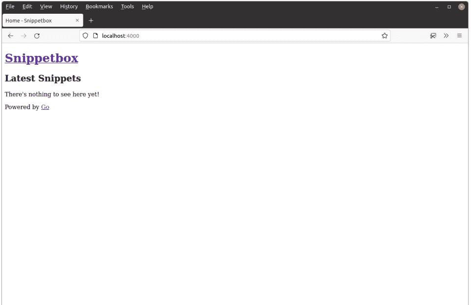

## 模板组成

随着我们向 Web 应用程序添加更多页面，会有一些希望包含在每个页面中的共享样板 HTML 标记——例如 <head> HTML 元素内的标题、导航和元数据。

为防止重复并节省输入，创建一个包含此共享内容的 _基础_（或 _主_）模板是个好主意，然后我们可以将其与单个页面的特定标记组合起来。

请先创建一个新的 `ui/html/base.tmpl` 文件...

```
$ touch ui/html/base.tmpl
```

然后添加以下标记（我们希望它出现在每个页面中）：

```
File: ui/html/base.tmpl

{{define "base"}}
<!doctype html>
<html lang='en'>
  <head>
    <meta charset='utf-8'>
    <title>{{template "title" .}} - Snippetbox</title>
  </head>
  <body>
    <header>
      <h1><a href='/'>Snippetbox</a></h1>
    </header>
    <main>
      {{template "main" .}}
    </main>
    <footer>Powered by <a href='https://golang.org/'>Go</a></footer>
  </body>
</html>
{{end}}
```

如果您之前在其他语言中使用过模板，希望这会让您觉得熟悉。这本质上只是带有双花括号中一些额外操作的常规 HTML。

我们使用 {{define "base"}}...{{end}} 操作作为包装器来定义一个名为 base 的独立命名模板，其中包含我们希望出现在每个页面上的内容。

在此中，我们使用 {{template "title" .}} 和 {{template "main" .}} 操作来表示我们希望在 HTML 的特定位置调用其他命名模板（名为 title 和 main）。

> **注意：** 如果您在想，{{template "title" .}} 操作末尾的点表示您想要传递给所调用模板的任何动态数据。我们将在本书稍后详细讨论这一点。

现在让我们回到 ui/html/pages/home.tmpl 文件，并更新它以定义包含主页特定内容的 title 和 main 命名模板。

```
File: ui/html/pages/home.tmpl

{{define "title"}}Home{{end}}

{{define "main"}}
<h2>Latest Snippets</h2>

<p>There's nothing to see here yet!</p>
{{end}}
```

完成后，下一步是更新 home 处理程序中的代码，使其解析两个模板文件，如下所示：

```
File: cmd/web/handlers.go

package main

...

func home(w http.ResponseWriter, r *http.Request) {
	w.Header().Add("Server", "Go")

	// Initialize a slice containing the paths to the two files. It's important
	// to note that the file containing our base template must be the *first*
	// file in the slice.
	files := []string{
		"./ui/html/base.tmpl",
		"./ui/html/pages/home.tmpl",
	}

	// Use the template.ParseFiles() function to read the files and store the
	// templates in a template set. Notice that we use ... to pass the contents
	// of the files slice as variadic arguments.
	ts, err := template.ParseFiles(files...)
	if err != nil {
		log.Print(err.Error())
		http.Error(w, "Internal Server Error", http.StatusInternalServerError)
		return
	}

	// Use the ExecuteTemplate() method to write the content of the "base"
	// template as the response body.
	err = ts.ExecuteTemplate(w, "base", nil)
	if err != nil {
		log.Print(err.Error())
		http.Error(w, "Internal Server Error", http.StatusInternalServerError)
	}
}
...
```

现在，我们的模板集不再直接包含 HTML，而是包含 3 个命名模板——base、title 和 main。我们使用 ExecuteTemplate() 方法告诉 Go，我们希望专门使用 base 模板的内容来响应（而 base 模板会进而调用我们的 title 和 main 模板）。

随意重启服务器并尝试一下。您应该会发现它渲染的输出与之前相同（尽管在操作所在的 HTML 源代码中会有一些额外的空白）。

## 嵌入部分模板

对于某些应用程序，您可能希望将某些 HTML 片段拆分为可在不同页面或布局中重复使用的部分模板。为示例，让我们创建一个包含 Web 应用程序主导航栏的部分模板。

创建一个名为 "nav" 的命名模板的新 ui/html/partials/nav.tmpl 文件，如下所示：

```
$ mkdir ui/html/partials
$ touch ui/html/partials/nav.tmpl
```

```
File: ui/html/partials/nav.tmpl

{{define "nav"}}
<nav>
<a href="/">Home</a>
</nav>
{{end}}
```

然后更新基础模板，使其使用 {{template "nav" .}} 操作调用导航部分模板：

```
File: ui/html/base.tmpl

{{define "base"}}
<!doctype html>
<html lang='en'>
<head>
    <meta charset='utf-8'>
    <title>{{template "title" .}} - Snippetbox</title>
</head>
<body>
    <header>
        <h1><a href='/'>Snippetbox</a></h1>
    </header>
    <!-- Invoke the navigation template -->
    {{template "nav" .}}
    <main>
        {{template "main" .}}
    </main>
    <footer>Powered by <a href='https://golang.org/'>Go</a></footer>
</body>
</html>
{{end}}
```

最后，我们需要更新 home 处理程序，以在解析模板文件时包含新的 ui/html/partials/nav.tmpl 文件：

```
File: cmd/web/handlers.go

package main

...

func home(w http.ResponseWriter, r *http.Request) {
    w.Header().Add("Server", "Go")

    // Include the navigation partial in the template files.
    files := []string{
        "./ui/html/base.tmpl",
        "./ui/html/partials/nav.tmpl",
        "./ui/html/pages/home.tmpl",
    }

    ts, err := template.ParseFiles(files...)
    if err != nil {
        log.Print(err.Error())
        http.Error(w, "Internal Server Error", http.StatusInternalServerError)
        return
    }

    err = ts.ExecuteTemplate(w, "base", nil)
    if err != nil {
        log.Print(err.Error())
        http.Error(w, "Internal Server Error", http.StatusInternalServerError)
    }
}

...
```

重启服务器后，基础模板现在应该会调用 nav 模板，您的主页应该如下所示：

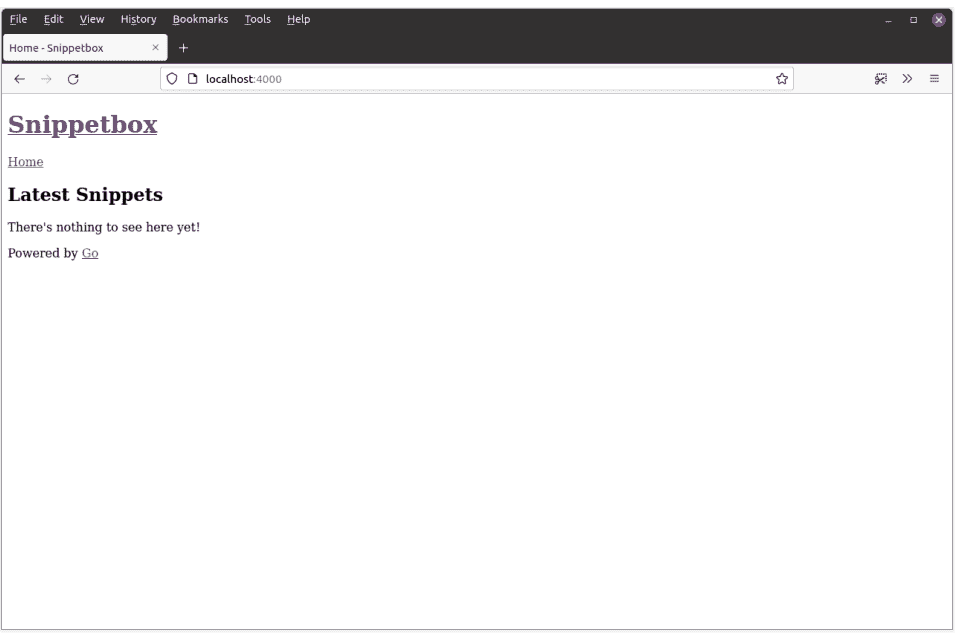

## 附加信息

## block 操作

在上面的代码中，我们使用了 {{template}} 操作从一个模板调用另一个模板。但 Go 还提供了 {{block}}...{{end}} 操作，您可以改用它。它的作用类似于 {{template}} 操作，区别在于它允许您在被调用的模板不存在于当前模板集中时指定一些默认内容。

在 Web 应用程序的上下文中，当您希望提供一些默认内容（例如侧边栏）且单个页面可以根据需要逐个覆盖时，这很有用。

在语法上，您可以这样使用它：

```
{{define "base"}}
<h1>An example template</h1>
{{block "sidebar" .}}
<p>My default sidebar content</p>
{{end}}
{{end}}
```

但是——如果您愿意——不需要在 {{block}} 和 {{end}} 操作之间包含任何默认内容。在这种情况下，被调用的模板表现得像是‘可选’的。如果模板存在于模板集中，则会渲染它。但如果不存在，则不会显示任何内容。

## 提供静态文件

现在让我们通过向项目添加一些静态 CSS 和图像文件，以及一小段用于突出显示活动导航项的 JavaScript 来改善主页的外观和感觉。

如果您在跟进，可以使用以下命令获取所需文件并将其解压到我们之前创建的 ui/static 文件夹中：

```
$ cd $HOME/code/snippetbox
$ curl https://www.alexedwards.net/static/sb-v2.tar.gz | tar -xvz -C ./ui/static/
```

您的 ui/static 目录的内容现在应该如下所示：

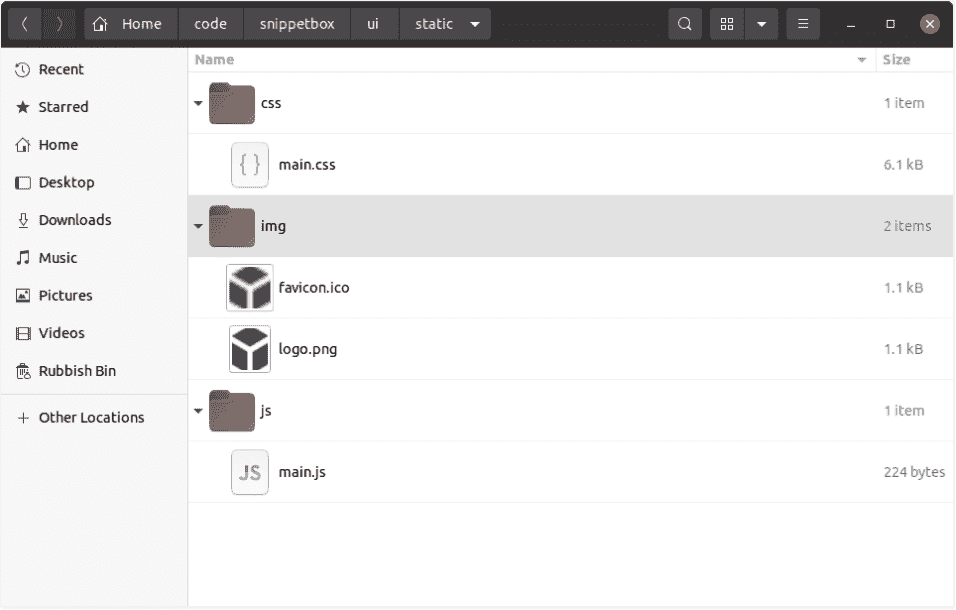

## http.FileServer 处理程序

Go 的 net/http 包附带了内置的 http.FileServer 处理程序，您可以使用它从特定目录通过 HTTP 提供文件。让我们向应用程序添加一个新路由，以便所有以 "/static/" 开头的 GET 请求都使用此处理程序，如下所示：


| 路由模式 | 处理器 | 动作 |
| :--- | :--- | :--- |
| GET / | home | 显示主页 |
| GET /snippet/view/{id} | snippetView | 显示特定代码片段 |
| GET /snippet/create | snippetCreate | 显示创建新代码片段的表单 |
| POST /snippet/create | snippetCreatePost | 保存新代码片段 |
| GET /static/ | http.FileServer | 提供特定静态文件 |

> **记住:** 模式 "GET /static/" 是一个子树路径模式，所以它的行为有点像末尾有一个通配符。

要创建一个新的 http.FileServer 处理器，我们需要像这样使用 http.FileServer() 函数：

```
fileServer := http.FileServer(http.Dir("./ui/static/"))
```

当此处理器接收到文件请求时，它将从请求 URL 路径中删除前导斜杠，然后在 ./ui/static 目录中搜索相应的文件并发送给用户。

因此，为了使其正确工作，我们必须在将 URL 路径传递给 http.FileServer 之前删除前导 "/static"。否则，它将查找不存在的文件，用户将收到 404 页面未找到响应。幸运的是，Go 包含一个专门用于此任务的 http.StripPrefix() 辅助函数。

打开 main.go 文件并添加以下代码，使文件最终如下所示：

```
File: cmd/web/main.go

package main

import (
	"log"
	"net/http"
)

func main() {
	mux := http.NewServeMux()

	// Create a file server which serves files out of the "./ui/static" directory.
	// Note that the path given to the http.Dir function is relative to the project
	// directory root.
	fileServer := http.FileServer(http.Dir("./ui/static"))

	// Use the mux.Handle() function to register the file server as the handler for
	// all URL paths that start with "/static/". For matching paths, we strip the
	// "/static" prefix before the request reaches the file server.
	mux.Handle("GET /static/", http.StripPrefix("/static", fileServer))

	// Register the other application routes as normal..
	mux.HandleFunc("GET /{$}", home)
	mux.HandleFunc("GET /snippet/view/{id}", snippetView)
	mux.HandleFunc("GET /snippet/create", snippetCreate)
	mux.HandleFunc("POST /snippet/create", snippetCreatePost)

	log.Print("starting server on :4000")

	err := http.ListenAndServe(":4000", mux)
	log.Fatal(err)
}
```

完成后，重新启动应用程序并在浏览器中打开 http://localhost:4000/static/。您应该能看到 ui/static 文件夹的可导航目录列表，如下所示：

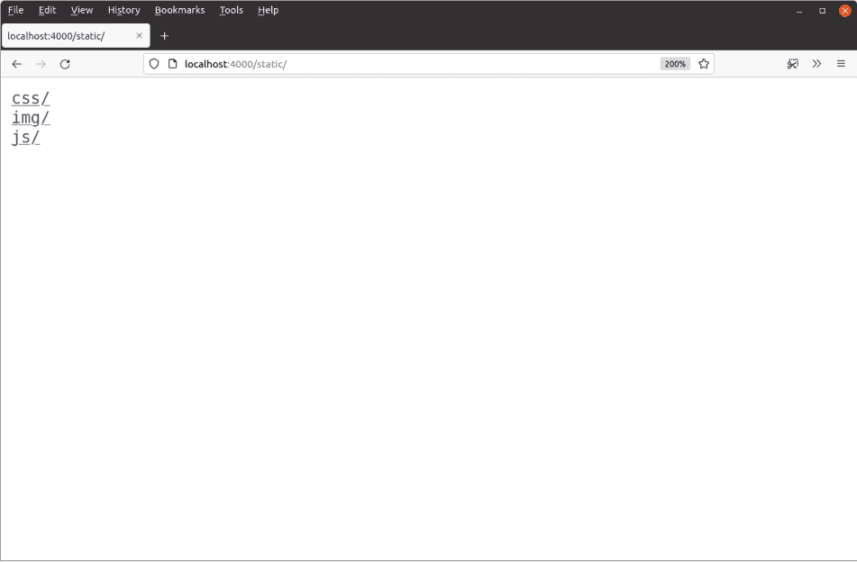

请随意浏览目录列表以查看各个文件。例如，如果您导航到 [http://localhost:4000/static/css/main.css](http://localhost:4000/static/css/main.css)，您应该会在浏览器中看到 CSS 文件如下所示：

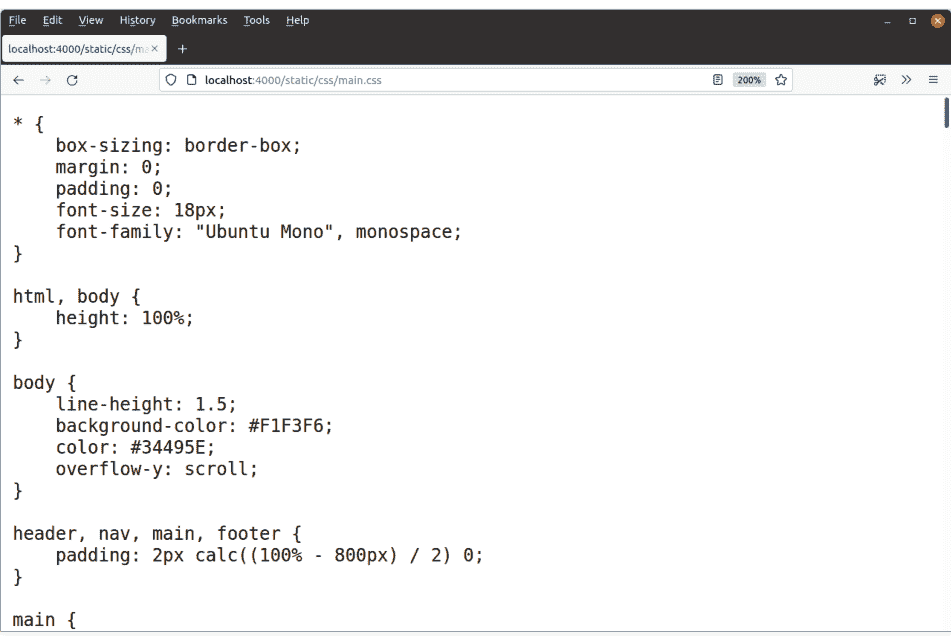

## 使用静态文件

既然文件服务器工作正常，我们现在可以更新 ui/html/base.tmpl 文件以使用静态文件：

```
File: ui/html/base.tmpl

{{define "base"}}
<!doctype html>
<html lang='en'>
<head>
    <meta charset='utf-8'>
    <title>{{template "title" .}} - Snippetbox</title>
    <!-- Link to the CSS stylesheet and favicon -->
    <link rel='stylesheet' href='/static/css/main.css'>
    <link rel='shortcut icon' href='/static/img/favicon.ico' type='image/x-icon'>
    <!-- Also link to some fonts hosted by Google -->
    <link rel='stylesheet' href='https://fonts.googleapis.com/css?family=Ubuntu+Mono:400,700'>
</head>
<body>
    <header>
        <h1><a href='/'>Snippetbox</a></h1>
    </header>
    {{template "nav" .}}
    <main>
        {{template "main" .}}
    </main>
    <footer>Powered by <a href='https://golang.org/'>Go</a></footer>
    <!-- And include the JavaScript file -->
    <script src='/static/js/main.js' type='text/javascript'></script>
</body>
</html>
{{end}}
```

确保保存更改，然后重新启动服务器并访问 http://localhost:4000。

您的主页现在应该如下所示：

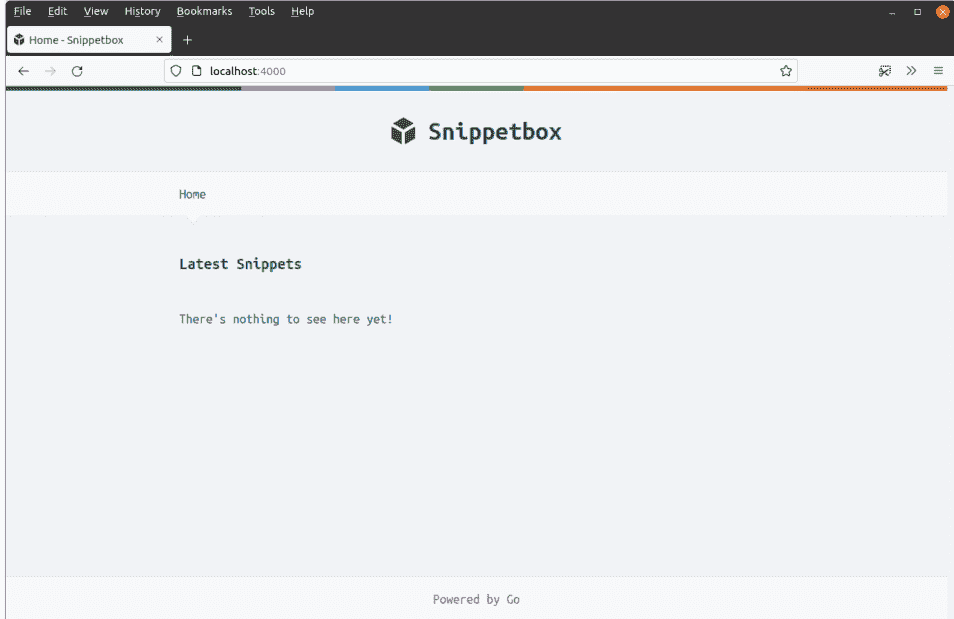

## 其他信息

## 文件服务器的功能和特性

Go 的 http.FileServer 处理器有几个非常不错的功能值得提及：

- 它通过 `path.Clean()` 函数对所有请求路径进行清理，然后再查找文件。这会从 URL 路径中删除任何 `.` 和 `..` 元素，有助于防止目录遍历攻击。如果您将文件服务器与不自动清理 URL 路径的路由器配合使用，此功能特别有用。
- 完全支持范围请求。如果您的应用程序提供大文件并且希望支持可续传下载，这非常有用。您可以使用 curl 请求 `logo.png` 文件的字节 100-199 来查看此功能的实际效果，如下所示：

```
$ curl -i -H "Range: bytes=100-199" --output - http://localhost:4000/static/img/logo.png
HTTP/1.1 206 Partial Content
Accept-Ranges: bytes
Content-Length: 100
Content-Range: bytes 100-199/1075
Content-Type: image/png
Last-Modified: Wed, 18 Mar 2024 11:29:23 GMT
Date: Wed, 18 Mar 2024 11:29:23 GMT
[binary data]
```

- Last-Modified 和 If-Modified-Since 头部透明支持。如果文件自用户上次请求以来未更改，则 http.FileServer 将发送 304 Not Modified 状态代码，而不是文件本身。这有助于减少客户端和服务器的延迟和处理开销。
- Content-Type 会根据文件扩展名使用 mime.TypeByExtension() 函数自动设置。如果需要，可以使用 mime.AddExtensionType() 函数添加自定义扩展名和内容类型。

## 性能

在本章中，我们设置了文件服务器，以便从硬盘上的 ./ui/static 目录提供文件。

但需要注意的是，一旦应用程序运行起来，http.FileServer 可能不会从磁盘读取这些文件。Windows 和基于 Unix 的操作系统都会将最近使用的文件缓存在 RAM 中，因此（至少对于经常提供的文件而言），http.FileServer 很可能会从 RAM 中提供它们，而不是进行相对缓慢的硬盘往返访问。

## 提供单个文件

有时您可能希望从处理器中提供单个文件。为此，有 http.ServeFile() 函数，您可以像这样使用：

```
func downloadHandler(w http.ResponseWriter, r *http.Request) {
http.ServeFile(w, r, "./ui/static/file.zip")
}
```

> **警告:** http.ServeFile() 不会自动清理文件路径。如果您正在从不受信任的用户输入构建文件路径，为了避免目录遍历攻击，您 **必须** 在使用之前使用 filepath.Clean() 对输入进行清理。

## 禁用目录列表

如果要禁用目录列表，可以采用几种不同的方法。

最简单的方法？在要禁用列表的特定目录中添加一个空白 index.html 文件。然后将提供该文件而不是目录列表，用户将收到没有正文的 200 OK 响应。如果要对 ./ui/static 下的所有目录这样做，可以使用以下命令：

```
$ find ./ui/static -type d -exec touch {}/Index.html \;
```

更复杂（但或许更好的）解决方案是创建 http.FileSystem 的自定义实现，并让它对任何目录都返回 os.ErrNotExist 错误。完整的解释和示例代码可以在这篇博客文章中找到。

## http.Handler 接口

在深入之前，我们需要介绍一些理论。这有点复杂，所以如果您觉得本章难以理解，请不要担心。继续构建应用程序，并在对 Go 更熟悉后再回过头来学习。

在之前的章节中，我一直随意使用“处理器”一词，而没有解释它的真正含义。严格来说，我们所说的处理器是满足 `http.Handler` 接口的对象：

```
type Handler interface {
    ServeHTTP(ResponseWriter, *Request)
}
```

简单来说，这基本上意味着要成为一个处理器，对象 *必须* 具有签名完全匹配的 `ServeHTTP()` 方法：

```
ServeHTTP(http.ResponseWriter, *http.Request)
```

因此，在最简单的形式下，处理器可能看起来像这样：

```
type home struct {}

func (h *home) ServeHTTP(w http.ResponseWriter, r *http.Request) {
    w.Write([]byte("This is my home page"))
}
```

这里我们有一个对象（在此示例中它是一个空的 `home` 结构体，但也可以是字符串、函数或其他任何东西），并且我们在其上实现了签名为 `ServeHTTP(http.ResponseWriter, *http.Request)` 的方法。这就是创建处理器所需的全部内容。

然后您可以使用 `Handle` 方法将其注册到服务多路复用器中，如下所示：

```
mux := http.NewServeMux()
mux.Handle("/", &home{})
```

当此服务多路复用器收到对 "/" 的 HTTP 请求时，它将调用 `ServeHTTP()`。


home 结构体的方法——进而写入 HTTP 响应。

## 处理器函数

现在，仅为在对象上实现 ServeHTTP() 方法而创建一个对象，这种做法既啰嗦又令人困惑。因此，在实际中，将处理器编写为普通函数要常见得多（就像本书目前为止所做的那样）。例如：

```
func home(w http.ResponseWriter, r *http.Request) {
	w.Write([]byte("This is my home page"))
}
```

但这个 home 函数只是一个普通函数；它没有 ServeHTTP() 方法。因此它本身并不是一个处理器。

相反，我们可以使用 http.HandlerFunc() 适配器将其转换为处理器，具体如下：

```
mux := http.NewServeMux()
mux.Handle("/", http.HandlerFunc(home))
```

http.HandlerFunc() 适配器的工作原理是自动向 home 函数添加一个 ServeHTTP() 方法。执行时，该 ServeHTTP() 方法只需调用原始 home 函数中的代码即可。这是一种绕道而行但很方便的方法，用于将普通函数转换为满足 http.Handler 接口的形式。

迄今为止，我们在本书中一直使用 HandleFunc() 方法将处理器函数注册到 servemux 中。这只是一些语法糖，可以将函数转换为处理器并在一步内完成注册，而无需手动操作。紧接其后的示例在功能上等同于以下代码：

```
mux := http.NewServeMux()
mux.HandleFunc("/", home)
```

## 处理器链

```
func ListenAndServe(addr string, handler Handler) error
```

……但我们传入的是 servemux。

之所以能够这样做，是因为 servemux 也有 ServeHTTP() 方法，这意味着它也满足 http.Handler 接口。

对我而言，将 servemux 视为一种特殊的处理器可以简化事情：它本身不提供响应，而是将请求传递给第二个处理器。这种转变听起来可能比实际更困难。在 Go 中，将处理器串联在一起是一种非常常见的惯用法，我们在本书后面部分还会大量使用。

事实上，实际发生的情况是这样的：当服务器收到新的 HTTP 请求时，它会调用 servemux 的 ServeHTTP() 方法。该方法会根据请求方法和 URL 路径查找相关处理器，进而调用该处理器的 ServeHTTP() 方法。你可以将 Go Web 应用程序视为一系列先后调用的 ServeHTTP() 方法链。

## 请求并发处理

还有另一点非常重要，需要指出：所有传入的 HTTP 请求都在各自的 goroutine 中处理。对于繁忙的服务器来说，这意味着处理器中或由处理器调用的代码极有可能并发运行。尽管这有助于让 Go 运行得极快，但缺点是，当从处理器访问共享资源时，你需要注意（并防范）竞态条件。

### 配置与错误处理

在本书这一节中，我们将进行一些清理工作。我们不会为应用程序添加太多新功能，而是专注于使开发和管理更加轻松的改进。

你将学习如何：

- 使用命令行标志以简单且符合 Go 惯用法的方式在运行时传递应用程序的配置设置。
- 创建自定义日志记录器用于写入结构化和分级的日志条目，并在整个应用程序中使用它。
- 以可扩展、类型安全且在编写测试时不会妨碍的方式，向处理器提供依赖项。
- 集中处理错误处理，以便在编写代码时无需重复自己。

## 管理配置设置

我们 Web 应用程序的 main.go 文件目前包含几个硬编码的配置设置：

- 服务器监听的网络地址（当前为 ":4000"）
- 静态文件目录的文件路径（当前为 "./ui/static"）

将这些设置硬编码并不理想。我们的配置设置与代码之间没有分离，而且无法在运行时更改设置（如果你需要为开发、测试和生产环境使用不同的设置，这一点很重要）。

在本章中，我们将开始改进这一点，首先要让服务器的网络地址在运行时可配置。

## 命令行标志

在 Go 中，管理配置设置的一种常见且符合惯用法的方式是在启动应用程序时使用命令行标志。例如：

```
$ go run ./cmd/web -addr=":80"
```

在应用程序中接受并解析命令行标志的最简单方法是使用如下一行代码：

```
addr := flag.String("addr", ":4000", "HTTP network address")
```

这基本上定义了一个名为 `addr`、默认值为 ":4000" 并带有简短帮助文本的命令行标志，说明该标志控制的内容。标志的值将在运行时存储在 `addr` 变量中。

让我们在应用程序中使用此方式，用命令行标志替换硬编码的网络地址：

```
File: cmd/web/main.go

package main

import (
  "flag" // New import
  "log"
  "net/http"
)

func main() {
  // Define a new command-line flag with the name 'addr', a default value of ":4000"
  // and some short help text explaining what the flag controls. The value of the
  // flag will be stored in the addr variable at runtime.
  addr := flag.String("addr", ":4000", "HTTP network address")

  // Importantly, we use the flag.Parse() function to parse the command-line flag.
  // This reads in the command-line flag value and assigns it to the addr
  // variable. You need to call this "*before" you use the addr variable
  // otherwise it will always contain the default value of ":4000". If any errors are
  // encountered during parsing the application will be terminated.
  flag.Parse()

  mux := http.NewServeMux()

  fileServer := http.FileServer(http.Dir("./ui/static/"))
  mux.Handle("GET /static/", http.StripPrefix("/static", fileServer))

  mux.HandleFunc("GET /{$}", home)
  mux.HandleFunc("GET /snippet/view/{id}", snippetView)
  mux.HandleFunc("GET /snippet/create", snippetCreate)
  mux.HandleFunc("POST /snippet/create", snippetCreatePost)

  // The value returned from the flag.String() function is a pointer to the flag
  // value, not the value itself. So in this code, that means the addr variable
  // is actually a pointer, and we need to dereference it (i.e. prefix it with
  // the * symbol) before using it. Note that we're using the log.Printf()
  // function to interpolate the address with the log message.
  log.Printf("starting server on %s", *addr)

  // And we pass the dereferenced addr pointer to http.ListenAndServe() too.
  err := http.ListenAndServe(*addr, mux)
  log.Fatal(err)
}
```

保存此文件，并在启动应用程序时尝试使用 -addr 标志。你会发现服务器现在会监听你指定的任何地址，例如：

```
$ go run ./cmd/web -addr=":9999"
2024/03/18 11:29:23 starting server on :9999
```

注意：0-1023 端口受限，通常只有具有 root 权限的服务才能使用。如果尝试使用这些端口之一，启动时应会出现 bind: permission denied 错误消息。

## 默认值

命令行标志完全是可选的。例如，如果不带 -addr 标志运行应用程序，服务器将回退到监听地址 ":4000"（即我们指定的默认值）。

```
$ go run ./cmd/web
2024/03/18 11:29:23 starting server on :4000
```

关于命令行标志的默认值使用什么，没有任何规则。我喜欢使用对我的开发环境有意义的默认值，因为在构建应用程序时这能节省时间和输入。但每个人的情况不同。你可能更倾向于为生产环境设置默认值，这种做法更稳妥。

## 类型转换

在上面的代码中，我们使用了 flag.String() 函数来定义命令行标志。这的好处是将用户在运行时提供的任何值都转换为字符串类型。如果该值无法转换为字符串，应用程序将打印错误消息并退出。

Go 还提供了其他一系列用于定义标志的函数，包括 flag.Int()、flag.Bool()、flag.Float64() 和 flag.Duration()。它们的工作方式与 flag.String() 完全相同，只不过会自动将命令行标志值转换为相应的类型。

## 自动帮助

另一个很棒的功能是，你可以使用 -help 标志列出应用程序的所有可用命令行标志及其相关帮助文本。试一下：

```
$ go run ./cmd/web -help
Usage of /tmp/go-build3672328037/b001/exe/web:
  -addr string
    HTTP network address (default ":4000")
```

总而言之，这看起来非常不错了。我们引入了一种在运行时管理应用程序配置设置的惯用方式，并且得益于 -help 标志，我们还获得了应用程序与其


操作配置。

## 补充信息

### 环境变量

如果你以前构建和部署过 Web 应用程序，那么你可能在想环境变量的事呢？当然，将配置设置存储在那里是很好的做法？

如果需要，你可以将配置设置存储在环境变量中，并通过使用 `os.Getenv()` 函数直接从应用程序访问它们，如下所示：

```
addr := os.Getenv("SNIPPETBOX_ADDR")
```

与使用命令行标志相比，这样做有一些缺点。你无法指定默认设置（如果环境变量不存在，`os.Getenv()` 的返回值是空字符串），你也无法获得与命令行标志一起使用的 `-help` 功能，而且 `os.Getenv()` 的返回值 *始终* 是字符串——你无法获得像使用 `flag.Int()`、`flag.Bool()` 和其他命令行标志函数那样的自动类型转换。

相反，你可以在启动应用程序时将环境变量作为命令行标志传递，从而兼得两者之便。例如：

```
$ export SNIPPETBOX_ADDR=":9999"
$ go run ./cmd/web -addr=$SNIPPETBOX_ADDR
2024/03/18 11:29:23 starting server on :9999
```

### 布尔标志

对于使用 `flag.Bool()` 定义的标志，启动应用程序时省略值等同于写入 `-flag=true`。以下两个命令等效：

```
$ go run ./example -flag=true
$ go run ./example -flag
```

如果要将布尔标志值设置为 false，必须显式使用 `-flag=false`。

### 预先存在的变量

可以使用 flag.StringVar()、flag.IntVar()、flag.BoolVar() 以及其他类型的类似函数，将命令行标志值解析到预先存在的变量的内存地址中。

如果你想将所有配置设置存储在一个结构体中，这些函数特别有用。粗略示例如下：

```
type config struct {
        addr         string
        staticDir    string
}

...

var cfg config

flag.StringVar(&cfg.addr, "addr", ":4000", "HTTP network address")
flag.StringVar(&cfg.staticDir, "static-dir", "./ui/static", "Path to static assets")

flag.Parse()
```

## 结构化日志记录

目前，我们使用 `log.Printf()` 和 `log.Fatal()` 函数从代码中输出日志条目。一个很好的示例是我们在服务器启动前打印的“starting server...”日志条目：

```
go
log.Printf("starting server on %s", *addr)
```

`log.Printf()` 和 `log.Fatal()` 两个函数都使用 `log` 包中的 Go 标准日志记录器输出日志条目，默认情况下，该记录器会在消息前加上本地日期和时间，并写入到标准错误流中（这应该会显示在您的终端窗口中）。

对于许多应用程序来说，使用标准日志记录器已经 *足够好了*，无需做更复杂的事情。

但对于日志量较大的应用程序，你可能希望让日志条目更易于筛选和处理。例如，你可能想要区分不同 *严重级别* 的日志条目（例如信息条目和错误条目），或者强制日志条目采用一致的结构，以便外部程序或服务易于解析。

为了支持这一点，Go 标准库包含 `log/slog` 包，该包允许你创建自定义结构化日志记录器，以固定格式输出日志条目。每个日志条目包含以下内容：

- 带有毫秒精度的时间戳。
- 日志条目的严重级别（Debug、Info、Warn 或 Error）。
- 日志消息（任意 `string` 值）。
- 可选地，任意数量的键值对（称为 *属性*），包含其他信息。

### 创建结构化日志记录器

使用 `log/slog` 包创建结构化日志记录器的代码初次看到时可能有点令人困惑。

关键是要明白，所有结构化日志记录器都有一个关联的 *结构化日志处理程序*（不要与 HTTP 处理程序混淆），实际上正是这个处理程序控制着日志条目的格式化方式和写入位置。

创建日志记录器的代码如下：

```
loggerHandler := slog.NewTextHandler(os.Stdout, &slog.HandlerOptions{...})
logger := slog.New(loggerHandler)
```

在第一行代码中，我们首先使用 `slog.NewTextHandler()` 函数创建结构化日志处理程序。该函数接受两个参数：

- 第一个参数是日志条目的写入目标。在上面的示例中，我们将其设置为 `os.Stdout`，这意味着它将把日志条目写入标准输出流。
- 第二个参数是指向 `slog.HandlerOptions` 结构体的指针，你可以使用它来自定义处理程序的行为。我们将在本章末尾查看一些可用的自定义选项。如果你对默认值满意且不想更改任何内容，可以改为将 `nil` 作为第二个参数传递。

然后在第二行代码中，我们通过将处理程序传递给 `slog.New()` 函数来实际创建结构化日志记录器。

在实际中，通常会在一行代码中完成所有这些操作：

```
logger := slog.New(slog.NewTextHandler(os.Stdout, &slog.HandlerOptions{...}))
```

### 使用结构化日志记录器

创建结构化日志记录器后，你可以通过在日志记录器上调用 `Debug()`、`Info()`、`Warn()` 或 `Error()` 方法来写入特定严重级别的日志条目。例如，以下代码行：

```
logger.Info("request received")
```

会生成如下所示的日志条目：

```
time=2024-03-18T11:29:23.000+00:00 level=INFO msg="request received"
```

`Debug()`、`Info()`、`Warn()` 或 `Error()` 方法是可变参数方法，接受任意数量的额外属性（键值对）。例如：

```
logger.Info("request received", "method", "GET", "path", "/")
```

在此示例中，我们向日志条目添加了两个额外属性：键 "method" 和值 "GET"，以及键 "path" 和值 "/"。属性键必须始终是字符串，但值可以是任何类型。在此示例中，日志条目将如下所示：

```
time=2024-03-18T11:29:23.000+00:00 level=INFO msg="request received" method=GET path=/
```

> **注意：** 如果你的属性键、值或日志消息包含 `"` 或 `=` 字符或任何空白字符，它们将在日志输出中用双引号括起来。我们可以在上面的示例中看到这种行为，其中日志消息 `msg="request received"` 被加了引号。

## 将结构化日志记录添加到我们的应用程序

好了，让我们继续并更新我们的 `main.go` 文件，以使用结构化日志记录器而不是 Go 的标准日志记录器。如下所示：

```
File: cmd/web/main.go

package main

import (
	"flag"
	"log/slog" // New import
	"net/http"
	"os" // New import
)

func main() {
	addr := flag.String("addr", ":4000", "HTTP network address")
	flag.Parse()

	// Use the slog.New() function to initialize a new structured logger, which
	// writes to the standard out stream and uses the default settings.
	logger := slog.New(slog.NewTextHandler(os.Stdout, nil))

	mux := http.NewServeMux()

	fileServer := http.FileServer(http.Dir("./ui/static/"))
	mux.Handle("GET /static/", http.StripPrefix("/static", fileServer))

	mux.HandleFunc("GET /{$}", home)
	mux.HandleFunc("GET /snippet/view/{id}", snippetView)
	mux.HandleFunc("GET /snippet/create", snippetCreate)
	mux.HandleFunc("POST /snippet/create", snippetCreatePost)

	// Use the Info() method to log the starting server message at Info severity
	// (along with the listen address as an attribute).
	logger.Info("starting server", "addr", *addr)

	err := http.ListenAndServe(*addr, mux)
	// And we also use the Error() method to log any error message returned by
	// http.ListenAndServe() at Error severity (with no additional attributes),
	// and then call os.Exit(1) to terminate the application with exit code 1.
	logger.Error(err.Error())
	os.Exit(1)
}
```

> **重要：** 没有结构化日志记录等效于 `log.Fatal()` 函数，我们可以使用它来处理由 `http.ListenAndServe()` 返回的错误。相反，最接近的做法是在 **Error** 严重级别记录一条消息，然后手动调用 `os.Exit(1)` 以退出代码 1 终止应用程序，就像上面代码中所做的那样。

好了……让我们试试！

运行应用程序，然后打开 *另一个* 终端窗口并尝试第二次运行它。这应该会生成一个错误，因为我们的服务器想要监听的网络地址 (`":4000"`) 已经被占用。

你在第二个终端中看到的日志输出应该类似于此：


```
$ go run ./cmd/web
time=2024-03-18T11:29:23.000+00:00 level=INFO msg="starting server" addr=:4000
time=2024-03-18T11:29:23.000+00:00 level=ERROR msg="listen tcp :4000: bind: address already in use"
exit status 1
```

这看起来不错。我们可以看到两条日志条目包含不同的信息，但格式大体相同。

第一条日志条目的严重级别为 level=INFO，消息为 msg="starting server"，还带有额外的 addr=:4000 属性。相比之下，第二条日志条目的严重级别为 level=ERROR，msg 值包含错误消息的内容，且没有其他属性。

## 其他信息

### 更安全的属性

假设你不小心写了一段代码，忘记包含属性的键或值。例如：

```
logger.Info("starting server", "addr") // Oops, the value for "addr" is missing
```

发生这种情况时，日志条目仍会被写入，但该属性的键将是 !BADKEY，如下所示：

```
time=2024-03-18T11:29:23.000+00:00 level=INFO msg="starting server" !BADKEY=addr
```

为避免这种情况并在编译时捕获问题，你可以改用 slog.Any() 函数来创建属性对：

```
logger.Info("starting server", slog.Any("addr", ":4000"))
```

你还可以更进一步，使用 slog.String()、slog.Int()、slog.Bool()、slog.Time() 和 slog.Duration() 函数来创建具有特定值类型的属性，从而引入更多的类型安全。

```
logger.Info("starting server", slog.String("addr", ":4000"))
```

是否使用这些函数取决于你。log/slog 包在 Go 中相对较新（在 Go 1.21 中引入），目前围绕其使用尚未形成太多成熟的最佳实践或惯例。但权衡是明确的……使用 slog.String() 等函数创建属性更为冗长，但更安全，因为它降低了应用程序中出现错误的风险。

## JSON 格式的日志

本章中我们使用的 slog.NewTextHandler() 函数会创建一个写入纯文本日志条目的处理程序。但也可以使用 slog.NewJSONHandler() 函数创建一个以 JSON 对象形式写入日志条目的处理程序，如下所示：

```
logger := slog.New(slog.NewJSONHandler(os.Stdout, nil))
```

使用 JSON 处理程序时，日志输出将类似于：

```
{"time":"2024-03-18T11:29:23.000000000+00:00","level":"INFO","msg":"starting server","addr":":4000"}
{"time":"2024-03-18T11:29:23.000000000+00:00","level":"ERROR","msg":"listen tcp :4000: bind: address already in use"}
```

## 最小日志级别

如我们之前多次提到，log/slog 包支持四个严重级别，按顺序为：Debug、Info、Warn 和 Error。Debug 是最不严重的级别，Error 是最严重的级别。

默认情况下，结构化日志记录器的最小日志级别为 Info。这意味着任何严重程度低于 Info（即 Debug 级别条目）的日志条目都会被静默丢弃。

如果需要，你可以使用 slog.HandlerOptions 结构体来覆盖此设置，并将最小级别设置为 Debug（或任何其他级别）：

```
logger := slog.New(slog.NewTextHandler(os.Stdout, &slog.HandlerOptions{
Level: slog.LevelDebug,
}))
```

## 调用者位置

你还可以自定义处理程序，使其在日志条目中包含调用源代码的文件名和行号，如下所示：

```
logger := slog.New(slog.NewTextHandler(os.Stdout, &slog.HandlerOptions{
AddSource: true,
}))
```

日志条目将类似于这样，调用者位置记录在 source 键下：

```
time=2024-03-18T11:29:23.000+00:00 level=INFO source=/home/alex/code/snippetbox/cmd/web/main.go:32 msg="starting server" addr
```

## 解耦的日志记录

本章中，我们将结构化日志记录器设置为向 os.Stdout（标准输出流）写入条目。

将日志条目写入 os.Stdout 的最大好处是，你的应用程序与日志记录是解耦的。应用程序本身不关心日志的路由或存储，这使得可以根据环境以不同方式管理日志变得更加容易。

开发期间，标准输出流在终端中显示，因此很容易查看日志输出。

在预发布或生产环境中，你可以将流重定向到用于查看和归档的最终目标。该目标可以是磁盘上的文件，或者是 Splunk 等日志服务。无论如何，日志的最终目标都可以由执行环境独立于应用程序来管理。

例如，我们可以在启动应用程序时将标准输出流重定向到磁盘上的文件，如下所示：

```
$ go run ./cmd/web >> /tmp/web.log
```

> 注意：使用双箭头 >> 会将内容追加到现有文件，而不是在启动应用程序时将其截断。

## 并发日志记录

由 slog.New() 创建的自定义日志记录器是并发安全的。你可以共享一个日志记录器，并在多个 goroutine 和 HTTP 处理程序中使用它，而无需担心竞态条件。

话虽如此，如果你有 *多个* 向同一目标写入的结构化日志记录器，则需要小心，并确保目标的底层 `Write()` 方法也支持并发使用。

## 依赖注入

如果打开 handlers.go 文件，你会发现 home 处理程序函数仍在使用 Go 的标准日志记录器写入错误消息，而不是我们现在想要使用的结构化日志记录器。

```go
func home(w http.ResponseWriter, r *http.Request) {
	...

ts, err := template.ParseFiles(files...)
if err != nil {
	log.Print(err.Error()) // This isn't using our new structured logger.
	http.Error(w, "Internal Server Error", http.StatusInternalServerError)
	return
}

err = ts.ExecuteTemplate(w, "base", nil)
if err != nil {
	log.Print(err.Error()) // This isn't using our new structured logger.
	http.Error(w, "Internal Server Error", http.StatusInternalServerError)
}
}
```

这引发了一个好问题：我们如何从 main() 将新的结构化日志记录器提供给 home 函数？

这个问题还可以进一步推广。大多数 Web 应用程序都有多个处理程序需要访问的依赖项，例如数据库连接池、集中式错误处理程序和模板缓存。我们真正想回答的是：如何将任何依赖项提供给我们的处理程序？

实现这一点有几种不同的方法，最简单的就是将依赖项放在全局变量中。但一般来说，将依赖项注入到处理程序中是一种良好的做法。与使用全局变量相比，这能让你的代码更明确、更不易出错，也更易于进行单元测试。

对于像我们这样所有处理程序都在同一个包中的应用程序，一种整洁的依赖注入方式是将它们放入一个自定义的 application 结构体中，然后将处理程序函数定义为 application 的方法。

我来演示一下。

首先打开 main.go 文件，创建一个新的 application 结构体，如下所示：

```go
File: cmd/web/main.go

package main

import (
	"flag"
	"log/slog"
	"net/http"
	"os"
)

// Define an application struct to hold the application-wide dependencies for the
// web application. For now we'll only include the structured logger, but we'll
// add more to this as the build progresses.
type application struct {
	logger *slog.Logger
}

func main() {
	...
}
```

然后在 handlers.go 文件中，我们希望更新处理程序函数，使其成为 *application 结构体的方法*，并使用其中包含的结构化日志记录器。

```go
File: cmd/web/handlers.go

package main

import (
	"fmt"
	"html/template"
	"net/http"
	"strconv"
)

// Change the signature of the home handler so it is defined as a method against
// *application.
func (app *application) home(w http.ResponseWriter, r *http.Request) {
	w.Header().Add("Server", "Go")

	files := []string{
		"./ui/html/base.tmpl",
		"./ui/html/partials/nav.tmpl",
		"./ui/html/pages/home.tmpl",
	}

ts, err := template.ParseFiles(files...)
	if err != nil {
		// Because the home handler is now a method against the application
		// struct it can access its fields, including the structured logger. We'll
		// use this to create a log entry at Error level containing the error
		// message, also including the request method and URI as attributes to
		// assist with debugging.
		app.logger.Error(err.Error(), "method", r.Method, "uri", r.URL.RequestURI())
		http.Error(w, "Internal Server Error", http.StatusInternalServerError)
		return
	}
}
```


err = ts.ExecuteTemplate(w, "base", nil)
if err != nil {
  // And we also need to update the code here to use the structured logger
  // too.
  app.logger.Error(err.Error(), "method", r.Method, "uri", r.URL.RequestURI())
  http.Error(w, "Internal Server Error", http.StatusInternalServerError)
}

// Change the signature of the snippetView handler so it is defined as a method
// against *application.
func (app *application) snippetView(w http.ResponseWriter, r *http.Request) {
  id, err := strconv.Atoi(r.PathValue("id"))
  if err != nil || id < 1 {
    http.NotFound(w, r)
    return
  }

  fmt.Fprintf(w, "Display a specific snippet with ID %d...", id)
}

// Change the signature of the snippetCreate handler so it is defined as a method
// against *application.
func (app *application) snippetCreate(w http.ResponseWriter, r *http.Request) {
  w.Write([]byte("Display a form for creating a new snippet..."))
}

// Change the signature of the snippetCreatePost handler so it is defined as a method
// against *application.
func (app *application) snippetCreatePost(w http.ResponseWriter, r *http.Request) {
  w.WriteHeader(http.StatusCreated)
  w.Write([]byte("Save a new snippet..."))
}

And finally let's wire things together in our main.go file:

```go
File: cmd/web/main.go

package main

import (
	"flag"
	"log/slog"
	"net/http"
	"os"
)

type application struct {
	logger *slog.Logger
}

func main() {
	addr := flag.String("addr", ":4000", "HTTP network address")
	flag.Parse()

	logger := slog.New(slog.NewTextHandler(os.Stdout, nil))

	// Initialize a new instance of our application struct, containing the
	// dependencies (for now, just the structured logger).
	app := &application{
		logger: logger,
	}

	mux := http.NewServeMux()

	fileServer := http.FileServer(http.Dir("./ui/static/"))
	mux.Handle("GET /static/", http.StripPrefix("/static", fileServer))

	// Swap the route declarations to use the application struct's methods as the
	// handler functions.
	mux.HandleFunc("GET /{$}", app.home)
	mux.HandleFunc("GET /snippet/view/{id}", app.snippetView)
	mux.HandleFunc("GET /snippet/create", app.snippetCreate)
	mux.HandleFunc("POST /snippet/create", app.snippetCreatePost)

	logger.Info("starting server", "addr", *addr)

	err := http.ListenAndServe(*addr, mux)
	logger.Error(err.Error())
	os.Exit(1)
}
```

I understand that this approach might feel a bit complicated and convoluted, especially when an alternative is to simply make logger a global variable. But stick with me. As the application grows, and our handlers start to need more dependencies, this pattern will begin to show its worth.

## Adding a deliberate error

Let's try this out by quickly adding a deliberate error to our application.

Open your terminal and rename the ui/html/pages/home.tmpl to ui/html/pages/home.bak. When we run our application and make a request for the home page, this now should result in an error because the ui/html/pages/home.tmpl file no longer exists.

Go ahead and make the change:

```
$ cd $HOME/code/snippetbox
$ mv ui/html/pages/home.tmpl ui/html/pages/home.bak
```

Then run the application and make a request to http://localhost:4000. You should get an Internal Server Error HTTP response in your browser, and see a corresponding log entry at Error level in your terminal similar to this:

```
$ go run ./cmd/web
time=2024-03-18T11:29:23.000+00:00 level=INFO msg="starting server" addr=:4000
time=2024-03-18T11:29:23.000+00:00 level=ERROR msg="open ./ui/html/pages/home.tmpl: no such file or directory" method=GET uri
```

This demonstrates nicely that our structured logger is now being passed through to our home handler as a dependency, and is working as expected.

Leave the deliberate error in place for now; we'll need it again in the next chapter.

## Additional information

## Closures for dependency injection

The pattern that we're using to inject dependencies won't work if your handlers are spread across multiple packages. In that case, an alternative approach is to create a standalone config package which exports an Application struct, and have your handler functions close over this to form a closure. Very roughly:

```go
// package config

type Application struct {
    Logger *slog.Logger
}
```

```go
// package foo

func ExampleHandler(app *config.Application) http.HandlerFunc {
    return func(w http.ResponseWriter, r *http.Request) {
        ...
        ts, err := template.ParseFiles(files...)
        if err != nil {
            app.Logger.Error(err.Error(), "method", r.Method, "uri", r.URL.RequestURI())
            http.Error(w, "Internal Server Error", http.StatusInternalServerError)
            return
        }
        ...
    }
}
```

```go
// package main

func main() {
    app := &config.Application{
        Logger: slog.New(slog.NewTextHandler(os.Stdout, nil)),
    }
    ...
    mux.Handle("/", foo.ExampleHandler(app))
    ...
}
```

You can find a complete and more concrete example of how to use the closure pattern in this Gist.

## Centralized error handling

Let's neaten up our application by moving some of the error handling code into helper methods. This will help separate our concerns and stop us repeating code as we progress through the build.

Go ahead and add a new helpers.go file under the cmd/web directory:

```
$ touch cmd/web/helpers.go
```

And add the following code:

```go
File: cmd/web/helpers.go

package main

import (
	"net/http"
)

// The serverError helper writes a log entry at Error level (including the request
// method and URI as attributes), then sends a generic 500 Internal Server Error
// response to the user.
func (app *application) serverError(w http.ResponseWriter, r *http.Request, err error) {
	var (
		method = r.Method
		uri    = r.URL.RequestURI()
	)

	app.logger.Error(err.Error(), "method", method, "uri", uri)

	http.Error(w, http.StatusText(http.StatusInternalServerError), http.StatusInternalServerError)
}

// The clientError helper sends a specific status code and corresponding description
// to the user. We'll use this later in the book to send responses like 400 "Bad
// Request" when there's a problem with the request that the user sent.
func (app *application) clientError(w http.ResponseWriter, status int) {
	http.Error(w, http.StatusText(status), status)
}
```

In this code we've also introduced one other new thing: the http.StatusText() function. This returns a human-friendly text representation of a given HTTP status code — for example http.StatusText(400) will return the string "Bad Request", and http.StatusText(500) will return the string "Internal Server Error".

Now that's done, head back to your handlers.go file and update it to use the new serverError() helper:

```go
File: cmd/web/handlers.go

package main

import (
	"fmt"
	"html/template"
	"net/http"
	"strconv"
)

func (app *application) home(w http.ResponseWriter, r *http.Request) {
	w.Header().Add("Server", "Go")

	files := []string{
		"./ui/html/base.tmpl",
		"./ui/html/partials/nav.tmpl",
		"./ui/html/pages/home.tmpl",
	}

	ts, err := template.ParseFiles(files...)
	if err != nil {
		app.serverError(w, r, err) // Use the serverError() helper.
		return
	}

	err = ts.ExecuteTemplate(w, "base", nil)
	if err != nil {
		app.serverError(w, r, err) // Use the serverError() helper.
	}
}

...
```

When that's updated, restart your application and make a request to http://localhost:4000 in your browser.

Again, this should result in our (deliberate) error being raised and you should see the corresponding log entry in your terminal, including the request method and URI as attributes.

```
$ go run ./cmd/web
time=2024-03-18T11:29:23.000+00:00 level=INFO msg="starting server" addr=:4000
time=2024-03-18T11:29:23.000+00:00 level=ERROR msg="open ./ui/html/pages/home.tmpl: no such file or directory" method=GET uri
```

### Revert the deliberate error

At this point we don't need the deliberate error anymore, so go ahead and fix it like so:

```
$ mv ui/html/pages/home.bak ui/html/pages/home.tmpl
```


## 附加信息

## 堆栈跟踪

你可以使用 `debug.Stack()` 函数获取一个 *堆栈跟踪*，它概述了应用程序中 *当前 goroutine* 的执行路径。将其作为日志条目的属性包含在内，有助于调试错误。

如果你愿意，可以更新 `serverError()` 方法，使其在日志条目中包含堆栈跟踪，如下所示：

```
package main

import (
	"net/http"
	"runtime/debug"
)

func (app *application) serverError(w http.ResponseWriter, r *http.Request, err error) {
	var (
		method = r.Method
		uri    = r.URL.RequestURI()
		// Use debug.Stack() to get the stack trace. This returns a byte slice, which
		// we need to convert to a string so that it's readable in the log entry.
		trace = string(debug.Stack())
	)

	// Include the trace in the log entry.
	app.logger.Error(err.Error(), "method", method, "uri", uri, "trace", trace)

	http.Error(w, http.StatusText(http.StatusInternalServerError), http.StatusInternalServerError)
}
```

日志条目输出则类似这样（为便于阅读，已添加换行）：

```
time=2024-03-18T11:29:23.000+00:00 level=ERROR msg="open . /ui/html/pages/home.tmpl:
no such file or directory" method=GET uri=/ trace="goroutine 6 [running]:\nruntime/debug.Stack()\n\t/usr/local/go/src/runtime/debug/stack.go:24 +0x5e\nmain.(*application).serverError(0xc00006c048, {0x8221b0, 0xc0000f40e0}, 0x37,\n{0x820600, 0xc0000ab\n5c0})\n\t/home/alex/code/snippetbox/cmd/web/handlers.go:14 +0x74\nmain.(*application)
.home(0x107, {0x8221b02}, {0xc0000f40e0}, 0xc0000fe000)\n\t/home/alex/code/snippetbo
x/cmd/web/handlers.go:24 +0x16a\nnet/http.HandlerFunc.ServeHTTP(0x4459e0?, {0x8221b\n0?, 0xc0000f40e0?}, 0xc65c7a?)\n\t/usr/local/go/src/net/http/server.go:2136 +0x29\n\nnet/http.(*ServeMux).ServeHTTP(0xa74fde0, {0x8221b0, 0xc0000f40e0}, 0xc0000fe000)\n\n\t/usr/local/go/src/net/http/server.go:2514 +0x142\nnet/http.serverHandler.ServeHTT
P({0xc0000aaf00?}, {0x8221b02}, {0xc0000f40e0?}, 0x6?)\n\t/usr/local/go/src/net/http/
server.go:2938 +0x8be\nnet/http.(*conn).serve(0xc0000c0120, {0xc00029e0, 0xc0000aae10}
)\n\t/usr/local/go/src/net/http/server.go:2009 +0x5f4\ncreated by net/http.(*Server).
Serve in goroutine 1\n\t/usr/local/go/src/net/http/server.go:3086 +0x5cb\n"
```

## 隔离应用程序路由

在重构代码时，还有一项更改值得进行。

我们的 main() 函数开始变得有些拥挤，为了保持清晰和专注，我想将应用程序的路由声明移动到一个独立的 routes.go 文件中，如下所示：

```
$ touch cmd/web/routes.go
```

```
File: cmd/web/routes.go

package main

import "net/http"

// The routes() method returns a servemux containing our application routes.
func (app *application) routes() *http.ServeMux {
	mux := http.NewServeMux()

	fileServer := http.FileServer(http.Dir("./ui/static/"))
	mux.Handle("GET /static/", http.StripPrefix("/static", fileServer))

	mux.HandleFunc("GET /{$}", app.home)
	mux.HandleFunc("GET /snippet/view/{id}", app.snippetView)
	mux.HandleFunc("GET /snippet/create", app.snippetCreate)
	mux.HandleFunc("POST /snippet/create", app.snippetCreatePost)

	return mux
}
```

然后我们可以更新 main.go 文件以使用这个：

```
File: cmd/web/main.go

package main

...

func main() {
	addr := flag.String("addr", ":4000", "HTTP network address")
	flag.Parse()

	logger := slog.New(slog.NewTextHandler(os.Stdout, nil))

	app := &application{
		logger: logger,
	}

	logger.Info("starting server", "addr", *addr)

	// Call the new app.routes() method to get the servemux containing our routes,
	// and pass that to http.ListenAndServe().
	err := http.ListenAndServe(*addr, app.routes())
	logger.Error(err.Error())
	os.Exit(1)
}
```

这样要整洁得多。我们应用程序的路由现在已被隔离并封装在 app.routes() 方法中，而我们的 main() 函数的职责仅限于：

- 解析应用程序的运行时配置设置；
- 为处理程序建立依赖项；以及
- 运行 HTTP 服务器。

## 数据库驱动的响应

为了让我们的 Snippetbox Web 应用程序真正有用，我们需要一个存储（或持久化）用户输入数据的地方，并能在运行时动态查询此数据存储。

我们可以为应用程序使用许多不同的数据存储——每种都有不同的优缺点——但我们将选择流行的关系型数据库 MySQL。

> 注意：本书此部分中的所有通用代码模式也适用于 PostgreSQL 或 SQLite 等其他数据库。如果你正在跟进并更愿意使用替代数据库，可以使用，但我建议现在先使用 MySQL 来了解一切如何运作，并在读完本书后将数据库更换作为练习练习。

在本节中你将学习如何：

- 安装数据库驱动程序，作为 MySQL 和你的 Go 应用程序之间的“中间人”。
- 从你的 Web 应用程序连接到 MySQL（具体来说，你将学习如何建立可重用连接池）。
- 创建一个独立的 models 包，以便你的数据库逻辑可重用并与 Web 应用程序解耦。
- 使用 Go 的 database/sql 包中的相应函数执行不同类型的 SQL 语句，以及如何避免可能导致服务器资源耗尽的常见错误。
- 通过正确使用占位符参数防止 SQL 注入攻击。
- 使用事务，以便你可以在一个原子操作中执行多个 SQL 语句。

## 设置 MySQL

如果你正在跟进，现在需要在计算机上安装 MySQL。官方 MySQL 文档包含所有操作系统的全面安装说明，但如果你使用 Mac OS，应该能够使用以下命令安装：

```bash
$ brew install mysql
```

或者如果你使用支持 apt 的 Linux 发行版（如 Debian 和 Ubuntu），可以使用以下命令安装：

```bash
$ sudo apt install mysql-server
```

在安装 MySQL 期间，你可能会被要求为 root 用户设置密码。如果设置了，请记得记住它；下一步会用到它。

## 脚手架数据库

安装 MySQL 后，你应该能够在终端中以 root 用户身份连接到它。执行此操作的命令取决于你安装的 MySQL 版本。对于 MySQL 5.7 及更高版本，你可以通过键入以下内容来连接：

```bash
$ sudo mysql
mysql>
```

但如果不起作用，请尝试以下命令，输入安装期间设置的密码。

```bash
$ mysql -u root -p
Enter password:
mysql>
```

连接后，我们首先需要在 MySQL 中建立一个数据库来存储项目的所有数据。将以下命令复制并粘贴到 mysql 提示符中，以使用 UTF8 编码创建一个新的 snippetsbox 数据库。

```
-- Create a new UTF-8 `snippetbox` database.
CREATE DATABASE snippetbox CHARACTER SET utf8mb4 COLLATE utf8mb4_unicode_ci;
-- Switch to using the `snippetbox` database.
USE snippetbox;
```

然后复制并粘贴以下 SQL 语句，创建一个新的 `snippets` 表来存储我们应用程序的文本片段：

```
-- Create a `snippets` table.
CREATE TABLE snippets (
 id INTEGER NOT NULL PRIMARY KEY AUTO_INCREMENT,
 title VARCHAR(100) NOT NULL,
 content TEXT NOT NULL,
 created DATETIME NOT NULL,
 expires DATETIME NOT NULL
);
-- Add an index on the created column.
CREATE INDEX idx_snippets_created ON snippets(created);
```

此表中的每条记录都将有一个整型 `id` 字段，它将作为文本片段的唯一标识符。它还将有一个短文本 `title`，而片段内容本身将存储在 `content` 字段中。我们还将保留关于片段 `created` 和 `expires` 时间的一些元数据。

我们还可以向 `snippets` 表中添加一些占位符条目（我们将在接下来的几章中使用）。我将使用一些短俳句作为文本片段的内容，但它们包含什么并不重要。

```
-- Add some dummy records (which we'll use in the next couple of chapters).
INSERT INTO snippets (title, content, created, expires) VALUES (
 'An old silent pond',
 'An old silent pond...\nA frog jumps into the pond,\nSplash! Silence again.\n\n– Matsuo Bashō',
 UTC_TIMESTAMP(),
 DATE_ADD(UTC_TIMESTAMP(), INTERVAL 365 DAY)
);
INSERT INTO snippets (title, content, created, expires) VALUES (
 'Over the wintry forest',
 'Over the wintry\nforest, winds howl in rage\nwith no leaves to blow.\n\n– Natsume Soseki',
 UTC_TIMESTAMP(),
 DATE_ADD(UTC_TIMESTAMP(), INTERVAL 365 DAY)
);
INSERT INTO snippets (title, content, created, expires) VALUES (
 'First autumn morning',
 'First autumn morning\n\nthe mirror I stare into\nshows my father''s face.\n\n– Murakami Kijo',
 UTC_TIMESTAMP(),
 DATE_ADD(UTC_TIMESTAMP(), INTERVAL 7 DAY)
);
```


## 创建新用户

从安全角度来看，从 Web 应用程序以 root 用户身份连接到 MySQL 并不是个好主意。相反，最好创建一个对数据库具有受限权限的数据库用户。

因此，当你仍然连接到 MySQL 提示符时，运行以下命令来创建一个新 Web 用户，该用户仅对数据库具有 SELECT、INSERT、UPDATE 和 DELETE 权限。

```
CREATE USER 'web'@'localhost';
GRANT SELECT, INSERT, UPDATE, DELETE ON snippetbox.* TO 'web'@'localhost';
-- Important: Make sure to swap 'pass' with a password of your own choosing.
ALTER USER 'web'@'localhost' IDENTIFIED BY 'pass';
```

完成后，键入 exit 退出 MySQL 提示符。

## 测试新用户

你现在应该能够使用以下命令以 web 用户身份连接到 snippetbox 数据库。出现提示时，输入你刚刚设置的密码。

```
$ mysql -D snippetbox -u web -p
Enter password:
mysql>
```

如果权限正常工作，你会发现你能够正确地在数据库上执行 SELECT 和 INSERT 操作，但其他命令（如 DROP TABLE 和 GRANT）将失败。

```
mysql> SELECT id, title, expires FROM snippets;
+----+----------------------+---------------------+
| id | title                | expires             |
+----+----------------------+---------------------+
|  1 | An old silent pond   | 2025-03-18 10:00:26 |
|  2 | Over the wintry forest | 2025-03-18 10:00:26 |
|  3 | First autumn morning | 2024-03-25 10:00:26 |
+----+----------------------+---------------------+
3 rows in set (0.00 sec)

mysql> DROP TABLE snippets;
ERROR 1142 (42000): DROP command denied to user 'web'@'localhost' for table 'snippets'
```

## 安装数据库驱动程序

要在我们的 Go Web 应用程序中使用 MySQL，我们需要安装一个数据库驱动程序。这本质上充当中间人，在 Go 和 MySQL 数据库本身之间翻译命令。

你可以在 Go wiki 上找到可用驱动程序的综合列表，但对于我们的应用程序，我们将使用流行的 go-sql-driver/mysql 驱动程序。

要下载它，请转到你的项目目录并运行 `go get` 命令，如下所示：

```
$ cd $HOME/code/snippetbox
$ go get github.com/go-sql-driver/mysql@v1
go: added filippo.io/edwards25519 v1.1.0
go: added github.com/go-sql-driver/mysql v1.8.1
```

> **注意：** `go get` 命令将递归下载软件包的任何依赖项。在此例中，`github.com/go-sql-driver/mysql` 软件包本身使用 `filippo.io/edwards25519` 软件包，因此这也会被下载。

请注意，我们将 `@v1` 追加到包路径后面，以表示我们要下载主版本号为 1 的 github.com/go-sql-driver/mysql 的最新可用版本。

撰写时，最新版本是 v1.8.1，但你下载的版本可能是 v1.8.2、v1.9.0 或类似版本——这没关系。因为 go-sql-driver/mysql 软件包为其版本使用语义化版本控制，任何 v1.x.x 版本都应该与此书中其余代码兼容。

顺便提一下，如果你想下载最新版本，而不考虑版本号，可以简单地省略 `@version` 后缀，如下所示：

```
$ go get github.com/go-sql-driver/mysql
```

或者，如果你想下载软件包的特定版本，可以使用完整版本号。例如：

```
$ go get github.com/go-sql-driver/mysql@v1.0.3
```

## 模块和可复现构建

既然 MySQL 驱动程序已安装，让我们来看看 `go.mod` 文件（我们在书的开头就创建了它）。你应该看到一个 `require` 块，包含两行，分别包含你下载的软件包的路径和确切版本号：

```
File: go.mod

module snippetbox.alexedwards.net

go 1.23.0

require (
    filippo.io/edwards25519 v1.1.0 // indirect
    github.com/go-sql-driver/mysql v1.8.1 // indirect
)
```

这些 `go.mod` 中的行基本上告诉 Go 命令，当你从项目目录运行 `go run`、`go test` 或 `go build` 命令时，应该使用哪个版本的软件包。

这使得在同一台机器上拥有多个项目变得容易，其中使用了*同一软件包的不同版本*。例如，此项目使用 MySQL 驱动程序 v1.8.1，但你可能在计算机上有另一个使用 v1.5.0 的代码库，这完全没问题。

> **注意：** `// indirect` 注释表示软件包没有直接出现在你代码库的任何 `import` 语句中。目前，我们还没有编写任何实际使用 `github.com/go-sql-driver/mysql` 或 `filippo.io/edwards25519` 软件包的代码，这就是为什么它们都被标记为间接依赖项。我们将在下一章中修复这一点。

你还会看到，在项目目录根目录下创建了一个名为 `go.sum` 的新文件。

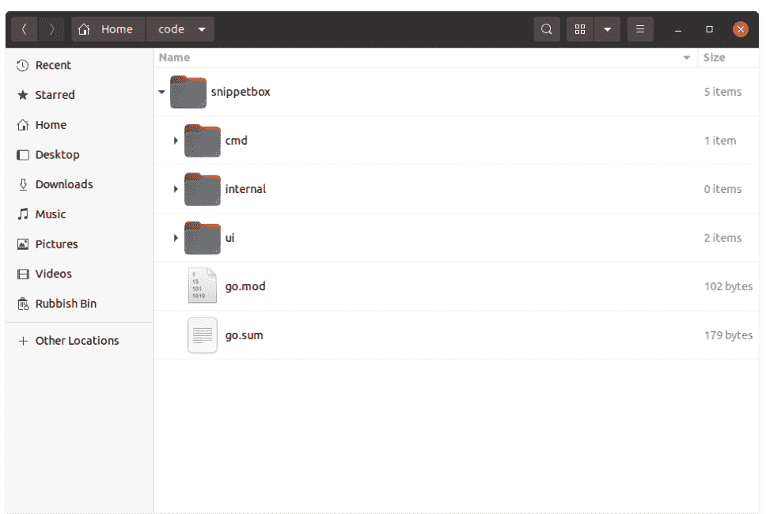

这个 go.sum 文件包含代表必需软件包内容的加密校验和。如果你打开它，你应该会看到类似这样的内容：

```
File: go.sum

filippo.io/edwards25519 v1.1.0 h1:FNf4tywRc1HmFuKwSxopWipgJgKJI5JV0Cq0oCJWdA=
filippo.io/edwards25519 v1.1.0/go.mod h1:BxyFTGWdlcka3PhytdK4V28TEsGfRvrvv7RtEA4VDT4=
github.com/go-sql-driver/mysql v1.8.1 h1:LedoUTu/evegddH59quFC1EFSa8bU+p1zjSRpvNJ1Y=
github.com/go-sql-driver/mysql v1.8.1/go.mod h1:wBSxKgM//2ZFj3y+qMnISvGmvNkLquwVSjsCm7DZg=
```

go.sum 文件不是设计为人工可编辑的，通常你不需要打开它。但它有两个有用的功能：

- 如果你从终端运行 `go mod verify` 命令，这将验证你机器上下载的软件包的校验和是否与 `go.sum` 中的条目匹配，因此你可以确信它们未被篡改。

```
$ go mod verify
all modules verified
```

- 如果其他人需要下载项目的所有依赖项——他们可以通过运行 `go mod download` 来做到这一点——如果他们下载的软件包与文件中的校验和有任何不匹配，他们会收到错误。

所以，总结一下：

- 你（或未来的其他人）可以运行 `go mod download` 来下载项目所需的所有软件包的确切版本。
- 你可以运行 `go mod verify` 以确保这些下载的软件包中没有任何内容被意外更改。
- 每当你运行 `go run`、`go test` 或 `go build` 时，`go.mod` 中列出的确切软件包版本都将始终被使用。

这些事情合在一起，使得可靠地创建 Go 应用程序的 `reproducible builds` 变得容易得多。

## 其他信息

## 升级软件包

一旦软件包被下载并添加到你的 `go.mod` 文件中，软件包和版本就“固定”了。但将来有很多原因你可能想要升级到较新版本的软件包。

要升级到软件包的最新可用 _次要或补丁版本_，你可以简单地运行带有 `-u` 标志的 `go get` 命令，如下所示：

```
$ go get -u github.com/foo/bar
```

或者，如果你想升级到特定版本，则应该运行相同的命令，但带有相应的 `@version` 后缀。例如：

```
$ go get -u github.com/foo/bar@v2.0.0
```

## 删除未使用的软件包

有时你可能 `go get` 一个软件包，只是后来才意识到你不再需要它了。当这种情况发生时，你有两个选择。

你可以运行 `go get` 并将软件包路径追加 `@none`，如下所示：

```
$ go get github.com/foo/bar@none
```

或者，如果你已经从代码中删除了对软件包的所有引用，可以运行 `go mod tidy`，它将自动从你的 `go.mod` 和 `go.sum` 文件中删除任何未使用的软件包。

```
$ go mod tidy
```

## 创建数据库连接池

既然 MySQL 数据库已全部设置完毕，并且我们已安装驱动程序，自然而言的下一步是从我们的 Web 应用程序连接到数据库。

为此，我们需要 Go 的 `sql.Open()` 函数，你可以有点像这样使用它：

```
// The sql.Open() function initializes a new sql.DB object, which is essentially a
// pool of database connections.
db, err := sql.Open("mysql", "web:pass@/snippetbox?parseTime=true")
if err != nil {
    ...
}
```

关于这段代码有几点需要解释和强调：

- `sql.Open()` 的第一个参数是驱动程序名称，第二个参数是数据源名称（有时也称为连接字符串或 DSN），它描述了如何连接到你的数据库。
- 数据源名称的格式将取决于你使用的数据库和驱动程序。通常，你可以在特定驱动程序的文档中找到信息和示例。对于我们使用的驱动程序，你可以在这里找到该文档。
- 上面 DSN 中的 `parseTime=true` 部分是特定于驱动程序的参数，它指示我们的驱动程序将 SQL TIME 和 DATE 字段转换为 Go `time.Time` 对象。
- `sql.Open()` 函数返回一个 `sql.DB` 对象。这不是数据库连接——它是许多连接的池。这是一个需要理解的重要区别。Go 根据需要管理此池中的连接，通过驱动程序自动打开和关闭到数据库的连接。
- 连接池支持并发访问，因此你可以安全地从 Web 应用程序处理程序中使用它。
- 连接池旨在长期存在。在 Web 应用程序中，通常在 `main()` 函数中初始化连接池，然后将池传递给处理程序。你不应该在短生命周期的 HTTP 处理程序本身中调用 `sql.Open()` —— 这将是内存和网络资源的浪费。


## 在我们的 Web 应用程序中使用它

让我们看看如何在实践中使用 `sql.Open()`。打开你的 `main.go` 文件并添加以下代码：

文件：cmd/web/main.go

```go
package main

import (
	"database/sql" // New import
	"flag"
	"log/slog"
	"net/http"
	"os"

	"github.com/go-sql-driver/mysql" // New import
)

...

func main() {
	addr := flag.String("addr", ":4000", "HTTP network address")

	// Define a new command-line flag for the MySQL DSN string.
	dsn := flag.String("dsn", "web:pass@/snippetbox?parseTime=true", "MySQL data source name")
	flag.Parse()

	logger := slog.New(slog.NewTextHandler(os.Stdout, nil))

	// To keep the main() function tidy I've put the code for creating a connection
	// pool into the separate openDB() function below. We pass openDB() the DSN
	// from the command-line flag.
	db, err := openDB(*dsn)
	if err != nil {
		logger.Error(err.Error())
		os.Exit(1)
	}

	// We also defer a call to db.Close(), so that the connection pool is closed
	// before the main() function exits.
	defer db.Close()

	app := &application{
		logger: logger,
	}

	logger.Info("starting server", "addr", *addr)

	// Because the err variable is now already declared in the code above, we need
	// to use the assignment operator = here, instead of the := 'declare and assign'
	// operator.
	err = http.ListenAndServe(*addr, app.routes())
	logger.Error(err.Error())
	os.Exit(1)
}

// The openDB() function wraps sql.Open() and returns a sql.DB connection pool
// for a given DSN.
func openDB(dsn string) (*sql.DB, error) {
	db, err := sql.Open("mysql", dsn)
	if err != nil {
		return nil, err
	}
	err = db.Ping()
	if err != nil {
		db.Close()
		return nil, err
	}

	return db, nil
}
```

关于这段代码，有几点很有趣：

- 注意我们驱动程序的导入路径前缀带有一个下划线？这是因为我们的 `main.go` 文件实际上并没有使用 `mysql` 包中的任何内容。所以如果我们尝试正常导入它，Go 编译器会报错。然而，我们需要驱动程序的 `init()` 函数运行，以便它可以向 `database/sql` 包注册自身。绕过这一点的技巧是将包名别名设为空白标识符，就像我们在这里所做的那样。这是大多数 Go SQL 驱动程序的标准做法。

- `sql.Open()` 函数并不会实际创建任何连接，它所做的只是为将来的使用初始化连接池。与数据库的实际连接是在需要时延迟建立的，即第一次使用时才建立。因此，为了验证一切设置正确，我们需要使用 `db.Ping()` 方法来创建连接并检查是否有错误。如果有错误，我们会调用 `db.Close()` 关闭连接池并返回错误。

- 回到 `main()` 函数，目前调用 `defer db.Close()` 有点多余。我们的应用程序只会通过信号中断（即 `Ctrl+C`）或 `os.Exit(1)` 终止。在这两种情况下，程序会立即退出，延迟函数永远不会运行。但确保始终关闭连接池是个好习惯，如果你未来为应用程序添加优雅关机功能，这可能会有所帮助。

## 测试连接

确保文件已保存，然后尝试运行应用程序。如果一切按计划进行，连接池应该已建立，并且 `db.Ping()` 方法应该能够在没有任何错误的情况下创建连接。如果一切顺利，你应该会看到类似下面的正常 `starting server` 日志消息：

```
$ go run ./cmd/web
time=2024-03-18T11:29:23.0000+00:00 level=INFO msg="starting server" addr=:4000
```

如果应用程序无法启动，并且出现类似下面的 "Access denied..." 错误消息，那么问题很可能出在你的 DSN 上。请仔细检查用户名和密码是否正确，你的数据库用户是否拥有正确的权限，以及你的 MySQL 实例是否使用标准设置。

```
$ go run ./cmd/web
time=2024-03-18T11:29:23.000+00:00 level=ERROR msg="Error 1045 (28000): Access denied for user 'web'@'localhost' (using passw...
exit status 1
```

## 整理 go.mod 文件

既然我们的代码现在实际上正在导入 github.com/go-sql-driver/mysql 驱动程序，你可以运行 go mod tidy 命令来整理你的 go.mod 文件并删除任何不必要的 // indirect 注释。

```
$ go mod tidy
```

完成后，你的 go.mod 文件现在应该如下所示——github.com/go-sql-driver/mysql 被列为直接依赖项，而 filippo.io/edwards25519 继续作为间接依赖项。

文件：go.mod

```
module snippetbox.alexedwards.net

go 1.23.0

require github.com/go-sql-driver/mysql v1.8.1

require filippo.io/edwards25519 v1.1.0 // indirect
```

## 设计数据库模型

在本章中，我们将为我们的项目勾勒出一个数据库模型。

如果你不喜欢 _模型_ 这个术语，你可以把它看作 _服务层_ 或 _数据访问层_。无论你喜欢怎么称呼它，其理念是我们将用于操作 MySQL 的代码封装在与应用程序其余部分分离的包中。

目前，我们将创建一个骨架数据库模型并让它返回一些模拟数据。它功能不多，但我希望在深入探讨 SQL 查询的细节之前先解释一下这种模式。

没问题？那么让我们继续创建一个包含 `snippets.go` 文件的新 `internal/models` 目录：

```
$ mkdir -p internal/models
$ touch internal/models/snippets.go
```

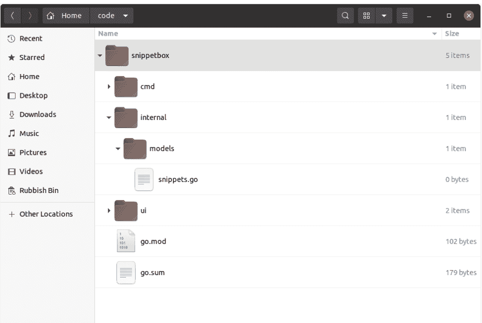

> **记住：** *内部* 目录被用来存放辅助性的非应用程序特定代码，这些代码可能会被重用。一个未来可能被其他应用程序使用的数据库模型（例如 *命令行界面应用程序* ）非常符合这里的要求。

让我们打开 `internal/models/snippets.go` 文件，添加一个新的 `Snippet` 结构体来表示单个代码片段的数据，以及一个带有方法的 `SnippetModel` 类型，用于访问和操作数据库中的代码片段。如下所示：

文件：internal/models/snippets.go

```go
package models

import (
	"database/sql"
	"time"
)

// Define a Snippet type to hold the data for an individual snippet. Notice how
// the fields of the struct correspond to the fields in our MySQL snippets
// table?
type Snippet struct {
	ID      int
	Title   string
	Content string
	Created time.Time
	Expires time.Time
}

// Define a SnippetModel type which wraps a sql.DB connection pool.
type SnippetModel struct {
	DB *sql.DB
}

// This will insert a new snippet into the database.
func (m *SnippetModel) Insert(title string, content string, expires int) (int, error) {
	return 0, nil
}

// This will return a specific snippet based on its id.
func (m *SnippetModel) Get(id int) (Snippet, error) {
	return Snippet{}, nil
}

// This will return the 10 most recently created snippets.
func (m *SnippetModel) Latest() ([]Snippet, error) {
	return nil, nil
}
```

## 使用 SnippetModel

要在处理程序中使用这个模型，我们需要在 main() 函数中建立一个新的 `SnippetModel` 结构体，然后通过 application 结构体将其作为依赖项注入——就像我们处理其他依赖项一样。

具体做法如下：

文件：cmd/web/main.go

```go
package main

import (
	"database/sql"
	"flag"
	"log/slog"
	"net/http"
	"os"

	// Import the models package that we just created. You need to prefix this with
	// whatever module path you set up back in chapter 02.01 (Project Setup and Creating
	// a Module) so that the import statement looks like this:
	// "(your-module-path)/internal/models". If you can't remember what module path you
	// used, you can find it at the top of the go.mod file.
	"snippetbox.alexedwards.net/internal/models"

	_ "github.com/go-sql-driver/mysql"
)

// Add a snippets field to the application struct. This will allow us to
// make the SnippetModel object available to our handlers.
type application struct {
	logger      *slog.Logger
	snippets    *models.SnippetModel
}

func main() {
	addr := flag.String("addr", ":4000", "HTTP network address")
	dsn := flag.String("dsn", "web:pass@/snippetbox?parseTime=true", "MySQL data source name")
	flag.Parse()

	logger := slog.New(slog.NewTextHandler(os.Stdout, nil))

	db, err := openDB(*dsn)
	if err != nil {
		logger.Error(err.Error())
		os.Exit(1)
	}

	defer db.Close()

	// Initialize a models.SnippetModel instance containing the connection pool
	// and add it to the application dependencies.
	app := &application{
		logger:     logger,
		snippets:   &models.SnippetModel{DB: db},
	}

	logger.Info("starting server", "addr", *addr)

	err = http.ListenAndServe(*addr, app.routes())
	logger.Error(err.Error())
	os.Exit(1)
}

...
```


## 其他信息

### 这种结构的优势

如果你退后一步，或许能看到以这种方式设置项目的几个好处：

- 关注点清晰分离。我们的数据库逻辑不会与处理程序绑定，这意味着处理程序的职责仅限于 HTTP 相关事务（即验证请求和写入响应）。这将使未来更容易编写紧凑、专注的单元测试。

- 通过创建自定义 **SnippetModel** 类型并在其上实现方法，我们将模型变成了一个单一且封装良好的对象，可以轻松初始化，然后作为依赖项传递给处理程序。同样，这使得代码更易于维护和测试。

- 因为模型操作被定义为对象上的方法——在本例中是 **SnippetModel** —— 所以有机会创建一个 *接口* 并对其进行模拟，以用于单元测试。

- 最后，我们可以通过使用 **`-dsn`** 命令行标志，完全控制运行时使用哪个数据库。

## 执行 SQL 语句

现在让我们更新刚刚创建的 SnippetModel.Insert() 方法，使其在 snippets 表中创建一条新记录，然后返回新记录的整数 ID。

为此，我们需要在数据库上执行以下 SQL 查询：

```
INSERT INTO snippets (title, content, created, expires)
VALUES(?, ?, UTC_TIMESTAMP(), DATE_ADD(UTC_TIMESTAMP(), INTERVAL ? DAY))
```

请注意，在此查询中我们使用 ? 字符来指示要插入数据库的数据的占位符参数？由于我们将使用的数据最终来自表单的不可信用户输入，因此使用占位符参数而不是在 SQL 查询中插入数据是良好的做法。

## 执行查询

Go 提供了三种不同的方法来执行数据库查询：

- DB.Query() 用于返回多行的 SELECT 查询。
- DB.QueryRow() 用于返回单行的 SELECT 查询。
- DB.Exec() 用于不返回行的语句（如 INSERT 和 DELETE）。

因此，在本例中，最合适的工具是 DB.Exec()。让我们直接深入并演示如何在 SnippetModel.Insert() 方法中使用它。我们稍后再讨论细节。

打开 internal/models/snippets.go 文件，并按如下进行更新：

```
File: internal/models/snippets.go

package models

...

type SnippetModel struct {
  DB *sql.DB
}

func (m *SnippetModel) Insert(title string, content string, expires int) (int, error) {
  // Write the SQL statement we want to execute. I've split it over two lines
  // for readability (which is why it's surrounded with backquotes instead
  // of normal double quotes).
  stmt := `INSERT INTO snippets (title, content, created, expires)
  VALUES(?, ?, UTC_TIMESTAMP(), DATE_ADD(UTC_TIMESTAMP(), INTERVAL ? DAY))`

  // Use the Exec() method on the embedded connection pool to execute the
  // statement. The first parameter is the SQL statement, followed by the
  // values for the placeholder parameters: title, content and expiry in
  // that order. This method returns a sql.Result type, which contains some
  // basic information about what happened when the statement was executed.
  result, err := m.DB.Exec(stmt, title, content, expires)
  if err != nil {
    return 0, err
  }

  // Use the LastInsertId() method on the result to get the ID of our
  // newly inserted record in the snippets table.
  id, err := result.LastInsertId()
  if err != nil {
    return 0, err
  }

  // The ID returned has the type int64, so we convert it to an int type
  // before returning.
  return int(id), nil
}

...
```

让我们快速讨论一下 `DB.Exec()` 返回的 `sql.Result` 类型。它提供了两个方法：

- LastInsertId() —— 返回数据库响应命令生成的整数（`int64`）。通常，这来自插入新行时的“自增”列，这正是我们正在做的事情。
- RowsAffected() —— 返回语句影响的行数（`int64`）。

重要：并非所有驱动程序和数据库都支持 LastInsertId() 和 RowsAffected() 方法。例如，PostgreSQL 不支持 LastInsertId()。因此，如果您打算使用这些方法，首先查看特定驱动程序的文档非常重要。

另外，如果不需要，忽略 sql.Result 返回值也是完全可以接受的（而且很常见）。如下所示：

```
_, err := m.DB.Exec("INSERT INTO ...", ...)
```

## 在处理程序中使用模型

让我们回到更具体的示例，演示如何从处理程序调用这段新代码。打开 cmd/web/handlers.go 文件，并按如下更新 snippetCreatePost 处理程序：

```
File: cmd/web/handlers.go

package main

...

func (app *application) snippetCreatePost(w http.ResponseWriter, r *http.Request) {
  // Create some variables holding dummy data. We'll remove these later on
  // during the build.
  title := "O snail"
  content := "O snail\nClimb Mount Fuji,\nBut slowly, slowly!\n\n- Kobayashi Issa"
  expires := 7

  // Pass the data to the SnippetModel.Insert() method, receiving the
  // ID of the new record back.
  id, err := app.snippets.Insert(title, content, expires)
  if err != nil {
    app.serverError(w, r, err)
    return
  }

  // Redirect the user to the relevant page for the snippet.
  http.Redirect(w, r, fmt.Sprintf("/snippet/view/%d", id), http.StatusSeeOther)
}
```

启动应用程序，然后打开第二个终端窗口并使用 curl 发送 POST /snippet/create 请求，如下所示（注意 -L 标志指示 curl 自动跟随重定向）：

```
$ curl -iL -d "" http://localhost:4000/snippet/create
HTTP/1.1 303 See Other
Location: /snippet/view/4
Date: Wed, 18 Mar 2024 11:29:23 GMT
Content-Length: 0

HTTP/1.1 200 OK
Date: Wed, 18 Mar 2024 11:29:23 GMT
Content-Length: 39
Content-Type: text/plain; charset=utf-8

Display a specific snippet with ID 4...
```

这样工作得相当不错。我们刚刚发送了一个 HTTP 请求，触发了 snippetCreatePost 处理程序，进而调用了 SnippetModel.Insert() 方法。这在数据库中插入了一条新记录并返回了该新记录的 ID。然后我们的处理程序将包含该 ID 的另一个 URL 发送了重定向。

请随时查看 MySQL 数据库中的 snippets 表。您应该能看到类似下面的 ID 为 4 的新记录：

mysql> SELECT id, title, expires FROM snippets;

| id | title | expires |
|---|---|---|
| 1 | An old silent pond | 2025-03-18 10:00:26 |
| 2 | Over the wintry forest | 2025-03-18 10:00:26 |
| 3 | First autumn morning | 2024-03-25 10:00:26 |
| 4 | O snail | 2024-03-25 10:13:04 |

4 rows in set (0.00 sec)

## 其他信息

### 占位符参数

在上面的代码中，我们使用占位符参数构建了 SQL 语句，其中 ? 作为我们要插入的数据的占位符。

使用占位符参数构建查询（而不是字符串插值）的原因是为了帮助避免来自任何不可信用户提供输入的 SQL 注入攻击。

在幕后，DB.Exec() 方法分三步工作：

1. 它使用提供的 SQL 语句在数据库上创建一个新的预处理语句。数据库解析并编译该语句，然后将其存储以备执行。

2. 在第二个独立步骤中，DB.Exec() 将参数值传递给数据库。然后数据库使用这些参数执行预处理语句。因为参数是在语句编译后才传输的，数据库将它们视为纯数据。它们无法更改语句的意图。只要原始语句不是源自不可信数据，注入就不会发生。

3. 然后它关闭（或释放）数据库上的预处理语句。

占位符参数语法取决于您的数据库。MySQL、SQL Server 和 SQLite 使用 ? 表示法，但 PostgreSQL 使用 $N 表示法。例如，如果您使用 PostgreSQL，则会写成：

```
_, err := m.DB.Exec("INSERT INTO ... VALUES ($1, $2, $3)", ...)
```


## 单条记录的 SQL 查询

从数据库检索单条记录的 SELECT 语句执行模式稍微复杂一些。让我们通过更新 `SnippetModel.Get()` 方法来说明如何实现，使其根据 ID 返回单个特定的代码片段。

为此，我们需要在数据库上运行以下 SQL 查询：

```
SELECT id, title, content, created, expires FROM snippets
WHERE expires > UTC_TIMESTAMP() AND id = ?
```

因为我们的 `snippets` 表使用 `id` 列作为主键，此查询只会返回恰好一行数据库记录（或者一行都不返回）。查询中还包含对过期时间的检查，因此不会返回任何已过期的代码片段。

请注意，我们再次为 `id` 值使用了占位符参数？

打开 `internal/models/snippets.go` 文件并添加以下代码：

```
File: internal/models/snippets.go

package models

import (
	"database/sql"
	"errors" // New import
	"time"
)

...

func (m *SnippetModel) Get(id int) (Snippet, error) {
	// Write the SQL statement we want to execute. Again, I've split it over two
	// lines for readability.
	stmt := `SELECT id, title, content, created, expires FROM snippets
	WHERE expires > UTC_TIMESTAMP() AND id = ?`

	// Use the QueryRow() method on the connection pool to execute our
	// SQL statement, passing in the untrusted id variable as the value for the
	// placeholder parameter. This returns a pointer to a sql.Row object which
	// holds the result from the database.
	row := m.DB.QueryRow(stmt, id)

	// Initialize a new zeroed Snippet struct.
	var s Snippet

	// Use row.Scan() to copy the values from each field in sql.Row to the
	// corresponding field in the Snippet struct. Notice that the arguments
	// to row.Scan are *pointers* to the place you want to copy the data into,
	// and the number of arguments must be exactly the same as the number of
	// columns returned by your statement.
	err := row.Scan(&s.ID, &s.Title, &s.Content, &s.Created, &s.Expires)
	if err == nil {
		// If the query returns no rows, then row.Scan() will return a
		// sql.ErrNoRows error. We use the errors.Is() function check for that
		// error specifically, and return our own ErrNoRecord error
		// instead (we'll create this in a moment).
		if errors.Is(err, sql.ErrNoRows) {
			return Snippet{}, ErrNoRecord
		} else {
			return Snippet{}, err
		}
	}

	// If everything went OK, then return the filled Snippet struct.
	return s, nil
}

...
```

在 `row.Scan()` 的幕后，你的驱动程序会自动将 SQL 数据库的原始输出转换为所需的原生 Go 类型。只要你在 SQL 和 Go 之间映射类型时比较谨慎，这些转换通常就能正常工作。通常：

- CHAR、VARCHAR 和 TEXT 映射到 string。
- BOOLEAN 映射到 bool。
- INT 映射到 int；BIGINT 映射到 int64。
- DECIMAL 和 NUMERIC 映射到 float。
- TIME、DATE 和 TIMESTAMP 映射到 time.Time。

> **注意:** 我们的 MySQL 驱动程序的一个特性是，我们需要在 DSN 中使用 `parseTime=true` 参数来强制其将 `TIME` 和 `DATE` 字段转换为 `time.Time`。否则，它会将这些字段作为 `[]byte` 对象返回。这是它提供的许多特定于驱动程序的参数之一。

如果你此时尝试运行应用程序，应该会得到一个编译时错误，指出 `ErrNoRecord` 值未定义：

```
$ go run . ./cmd/web/
## snippetbox.alexedwards.net/internal/models
internal/models/snippets.go:82:25: undefined: ErrNoRecord
```

让我们现在在一个新的 `internal/models/errors.go` 文件中创建它。如下所示：

```
$ touch internal/models/errors.go
```

```
File: internal/models/errors.go

package models

import (
	"errors"
)

var ErrNoRecord = errors.New("models: no matching record found")
```

顺便说一句，你可能会好奇，为什么我们要从 `SnippetModel.Get()` 方法返回 `ErrNoRecord` 错误，而不是直接返回 `sql.ErrNoRows`。原因是为了帮助完全封装模型，以便我们的处理器不需要关心底层数据存储，也不依赖于特定于数据存储的错误（例如 `sql.ErrNoRows`）来决定其行为。

## 在处理器中使用模型

好了，让我们将 `SnippetModel.Get()` 方法投入使用。

```
File: cmd/web/handlers.go

package main

import (
	"errors" // New import
	"fmt"
	"html/template"
	"net/http"
	"strconv"

	"snippetbox.alexedwards.net/internal/models" // New import
)

...

func (app *application) snippetView(w http.ResponseWriter, r *http.Request) {
	id, err := strconv.Atoi(r.PathValue("id"))
	if err != nil || id < 1 {
		http.NotFound(w, r)
		return
	}

	// Use the SnippetModel's Get() method to retrieve the data for a
	// specific record based on its ID. If no matching record is found,
	// return a 404 Not Found response.
	snippet, err := app.snippets.Get(id)
	if err != nil {
		if errors.Is(err, models.ErrNoRecord) {
			http.NotFound(w, r)
		} else {
			app.serverError(w, r, err)
		}
		return
	}

	// Write the snippet data as a plain-text HTTP response body.
	fmt.Fprintf(w, "%+v", snippet)
}

...
```

让我们试一下。重启应用程序，然后打开网络浏览器并访问 http://localhost:4000/snippet/view/1。你应该会看到类似于以下内容的 HTTP 响应：

```
&{ID:1 Title:An old silent pond Content:An old silent pond...
A frog jumps into the pond,
splash! Silence again.

– Matsuo Bashō Created:2022-04-05 07:20:05 +0000 UTC Expires:2023-04-05 07:20:05 +0000 UTC}
```

你可能还想尝试为其他已过期或尚不存在的代码片段发出一些请求（例如 ID 值为 99），以验证它们是否返回 404 页面未找到响应：

404 页面未找到

## 其他信息

### 检查特定错误

在本章中，我们几次使用了 `errors.Is()` 函数来检查错误是否与特定值匹配。如下所示：

```
if errors.Is(err, models.ErrNoRecord) {
	http.NotFound(w, r)
} else {
	app.serverError(w, r, err)
}
```

在非常旧版本的 Go（1.13 之前）中，比较错误的惯用方式是使用相等运算符 `==`，如下所示：

```
if err == models.ErrNoRecord {
	http.NotFound(w, r)
} else {
	app.serverError(w, r, err)
}
```

但是，尽管这段代码仍然可以编译，但使用 `errors.Is()` 函数更安全，也是最佳实践。

这是因为 Go 1.13 引入了通过包装错误来向错误添加附加信息的功能。如果错误被包装，就会创建一个完全新的错误值——这意味着无法使用常规的 `==` 相等运算符来检查原始底层错误的值。

`errors.Is()` 函数通过在检查匹配项之前根据需要解包错误来工作。

还有另一个函数 `errors.As()`，你可以使用它来检查（可能被包装的）错误是否具有特定类型。我们将在本书后面使用它。

### 单条记录查询的简写

我故意让 `SnippetModel.Get()` 中的代码稍微冗长一些，以帮助澄清和强调代码幕后发生的情况。

在实际操作中，你可以稍微缩短代码，利用 `DB.QueryRow()` 来自错误会被推迟到 `Scan()` 被调用时的事实。这没有功能上的区别，但如果你愿意，完全可以将代码重写为如下所示：

```
func (m *SnippetModel) Get(id int) (Snippet, error) {
    var s Snippet

    err := m.DB.QueryRow(`SELECT ...`, id).Scan(&s.ID, &s.Title, &s.Content, &s.Created, &s.Expires)
    if err != nil {
        if errors.Is(err, sql.ErrNoRows) {
            return Snippet{}, ErrNoRecord
        } else {
            return Snippet{}, err
        }
    }

    return s, nil
}
```

## 多条记录的 SQL 查询

最后，让我们看看执行返回多行的 SQL 语句的模式。我将通过更新 `SnippetModel.Latest()` 方法来演示这一点，该方法将使用以下 SQL 查询返回最近创建的十个代码片段（前提是它们尚未过期）：

```
SELECT id, title, content, created, expires FROM snippets
WHERE expires > UTC_TIMESTAMP() ORDER BY id DESC LIMIT 10
```

打开 `internal/models/snippets.go` 文件并添加以下代码：


```go
File: internal/models/snippets.go

package models

...

func (m *SnippetModel) Latest() ([]Snippet, error) {
	// Write the SQL statement we want to execute.
	stmt := `SELECT id, title, content, created, expires FROM snippets
	WHERE expires > UTC_TIMESTAMP() ORDER BY id DESC LIMIT 10`

	// Use the Query() method on the connection pool to execute our
	// SQL statement. This returns a sql.Rows resultset containing the result of
	// our query.
	rows, err := m.DB.Query(stmt)
	if err != nil {
		return nil, err
	}

	// We defer rows.Close() to ensure the sql.Rows resultset is
	// always properly closed before the Latest() method returns. This defer
	// statement should come *after* you check for an error from the Query()
	// method. Otherwise, if Query() returns an error, you'll get a panic
	// trying to close a nil resultset.
	defer rows.Close()

	// Initialize an empty slice to hold the Snippet structs.
	var snippets []Snippet

	// Use rows.Next to iterate through the rows in the resultset. This
	// prepares the first (and then each subsequent) row to be acted on by the
	// rows.Scan() method. If iteration over all the rows completes then the
	// resultset automatically closes itself and frees-up the underlying
	// database connection.
	for rows.Next() {
		// Create a new zeroed Snippet struct.
		var s Snippet

		// Use rows.Scan() to copy the values from each field in the row to the
		// new Snippet object that we created. Again, the arguments to row.Scan()
		// must be pointers to the place you want to copy the data into, and the
		// number of arguments must be exactly the same as the number of
		// columns returned by your statement.
		err = rows.Scan(&s.ID, &s.Title, &s.Content, &s.Created, &s.Expires)
		if err != nil {
			return nil, err
		}

		// Append it to the slice of snippets.
		snippets = append(snippets, s)
	}

	// When the rows.Next() loop has finished we call rows.Err() to retrieve any
	// error that was encountered during the iteration. It's important to
	// call this - don't assume that a successful iteration was completed
	// over the whole resultset.
	if err = rows.Err(); err != nil {
		return nil, err
	}

	// If everything went OK then return the Snippets slice.
	return snippets, nil
}
```

> **重要:** 在上述代码中，使用 `defer rows.Close()` 关闭结果集至关重要。
> 只要结果集保持打开，它就会保持底层数据库连接打开...
> 因此，如果此方法中出现问题且结果集未关闭，可能会迅速
> 导致连接池中的所有连接被耗尽。

## 在我们的处理程序中使用模型

返回到你的 `cmd/web/handlers.go` 文件，更新 `home` 处理程序以使用
`SnippetModel.Latest()` 方法，将代码片段内容输出到 HTTP 响应中。暂时
只需注释掉与模板渲染相关的代码，如下所示：

```go
File: cmd/web/handlers.go

package main

import (
	"errors"
	"fmt"
	"html/template"
	"net/http"
	"strconv"

	"snippetbox.alexedwards.net/internal/models"
)

func (app *application) home(w http.ResponseWriter, r *http.Request) {
	w.Header().Add("Server", "Go")

	snippets, err := app.snippets.Latest()
	if err != nil {
		app.serverError(w, r, err)
		return
	}

	for _, snippet := range snippets {
		fmt.Fprintf(w, "%+v\n", snippet)
	}

	// files := []string{
	//     "./ui/html/base.tmpl",
	//     "./ui/html/partials/nav.tmpl",
	//     "./ui/html/pages/home.tmpl",
	// }

	// ts, err := template.ParseFiles(files...)
	// if err != nil {
	//     app.serverError(w, r, err)
	//     return
	// }

	// err = ts.ExecuteTemplate(w, "base", nil)
	// if err != nil {
	//     app.serverError(w, r, err)
	// }
}
```

如果你现在运行应用程序并在浏览器中访问 http://localhost:4000，你应该会得到类似于此的响应：

```
&{ID:4 Title:O snail Content:O snail
Climb Mount Fuji,
But slowly, slowly!

- Kobayashi Issa Created:2022-04-05 07:32:45 +0000 UTC Expires:2022-04-12 07:32:45 +0000 UTC}
&{ID:1 Title:An old silent pond Content:An old silent pond...
A frog jumps into the pond,
splash! Silence again.

- Matsuo Bashō Created:2022-04-05 07:20:05 +0000 UTC Expires:2023-04-05 07:20:05 +0000 UTC}
&{ID:2 Title:Over the wintry forest Content:Over the wintry
forest, winds howl in rage
with no leaves to blow.

- Natsume Soseki Created:2022-04-05 07:20:05 +0000 UTC Expires:2023-04-05 07:20:05 +0000 UTC}
&{ID:3 Title:First autumn morning Content:First autumn morning
the mirror I stare into
shows my father's face.

- Murakami Kijo Created:2022-04-05 07:20:05 +0000 UTC Expires:2022-04-12 07:20:05
+0000 UTC}
```

## 事务和其他细节

### database/sql 包

你可能已经开始意识到，database/sql 包本质上在你的 Go 应用程序和 SQL 数据库世界之间提供了一个标准接口。

只要你使用 database/sql 包，编写的 Go 代码通常具有可移植性，并可与任何类型的 SQL 数据库一起使用——无论是 MySQL、PostgreSQL、SQLite 还是其他数据库。这意味着你的应用程序与当前使用的数据库没有紧密耦合，理论上你可以在未来更换数据库而无需重写所有代码（驱动程序特有的特性和 SQL 实现除外）。

需要注意的是，虽然 database/sql 通常能很好地提供用于处理 SQL 数据库的标准接口，但不同驱动程序和数据库的操作方式存在一些特性。在开始使用新驱动程序之前，通读其文档以了解任何特性和边缘情况始终是个好主意。

### 冗长度

如果你是从 Ruby、Python 或 PHP 过来的，查询 SQL 数据库的代码可能会感觉有点冗长，尤其是当你习惯于使用抽象层或 ORM 时。

但这种冗长的好处在于我们的代码是非魔法的；我们可以准确理解和控制正在发生的事情。过一段时间后，你会发现编写 SQL 查询的模式变得熟悉，可以从之前的工作中复制粘贴，或者使用 GitHub Copilot 等开发者工具为你编写代码的初稿。

如果这种冗长真的开始让你感到恼火，你可以考虑尝试 jmoiron/sqlx 包。它设计良好，并提供了一些有用的扩展，使处理 SQL 查询更快、更简单。另一个你可以考虑的较新选项是 blockloop/scan 包。

### 管理 NULL 值

Go 处理得不太好的一件事是管理数据库记录中的 `NULL` 值。

假设我们的 `snippets` 表中的 `title` 列在某一行包含一个 `NULL` 值。如果我们查询该行，`rows.Scan()` 会返回以下错误，因为它无法将 `NULL` 转换为字符串：

```
sql: Scan error on column index 1: unsupported Scan, storing driver.Value type <nil> into type *string
```

大致来说，修复方法是将要扫描的字段从 `string` 类型更改为 `sql.NullString` 类型。查看这个 gist 以获取可运行的示例。

但作为一条规则，最简单的做法是彻底避免 `NULL` 值。在所有数据库列上设置 `NOT NULL` 约束，就像我们在本书中所做的那样，并在必要时设置合理的 `DEFAULT` 值。

### 使用事务

重要的是要认识到，对 `Exec()`、`Query()` 和 `QueryRow()` 的调用可以使用 `sql.DB` 池中的任何连接。即使你的代码中有两个紧挨着的 `Exec()` 调用，也不能保证它们会使用同一个数据库连接。

有时这是不可接受的。例如，如果你使用 MySQL 的 `LOCK TABLES` 命令锁定表，则必须在完全相同的连接上调用 `UNLOCK TABLES` 以避免死锁。

为了保证使用同一个连接，你可以将多个语句包装在一个事务中。以下是基本模式：


type ExampleModel struct {
	DB *sql.DB
}

func (m *ExampleModel) ExampleTransaction() error {
	// Calling the Begin() method on the connection pool creates a new sql.Tx
	// object, which represents the in-progress database transaction.
	tx, err := m.DB.Begin()
	if err != nil {
		return err
	}

	// Defer a call to tx.Rollback() to ensure it is always called before the
	// function returns. If the transaction succeeds it will be already be
	// committed by the time tx.Rollback() is called, making tx.Rollback() a
	// no-op. Otherwise, in the event of an error, tx.Rollback() will rollback
	// the changes before the function returns.
	defer tx.Rollback()

	// Call Exec() on the transaction, passing in your statement and any
	// parameters. It's important to notice that tx.Exec() is called on the
	// transaction object just created, NOT the connection pool. Although we're
	// using tx.Exec() here you can also use tx.Query() and tx.QueryRow() in
	// exactly the same way.
	_, err = tx.Exec("INSERT INTO ...")
	if err != nil {
		return err
	}

	// Carry out another transaction in exactly the same way.
	_, err = tx.Exec("UPDATE ...")
	if err != nil {
		return err
	}

	// If there are no errors, the statements in the transaction can be committed
	// to the database with the tx.Commit() method.
	err = tx.Commit()
	return err
}
```

**重要：** 你必须 _始终_ 在函数返回前调用 `Rollback()` 或 `Commit()` 之一。如果不这样做，连接将保持打开状态且不会被返回到连接池。这可能导致达到最大连接数限制/资源耗尽。避免此问题的最简单方法是在上面的示例中使用 `defer tx.Rollback()`。

如果你想将多个 SQL 语句作为一个 _单个原子操作_ 来执行，事务也非常有用。只要在发生任何错误时使用 `tx.Rollback()` 方法，事务就确保：

- 所有语句都成功执行；或
- 没有语句被执行，数据库保持不变。

## 预处理语句

如前所述，Exec()、Query() 和 QueryRow() 方法在幕后都使用预处理语句来帮助防止 SQL 注入攻击。它们在数据库连接上设置一个预处理语句，使用提供的参数运行它，然后关闭预处理语句。

这可能感觉相当低效，因为我们每次都在创建和重新创建相同的预处理语句。

从理论上讲，更好的方法可能是使用 DB.Prepare() 方法创建我们自己的预处理语句一次，然后重复使用它。这对于复杂的 SQL 语句（例如包含多个 JOIN 的语句）*并且* 重复非常频繁（例如批量插入数万条记录）的情况尤其适用。在这些情况下，重新准备语句的成本可能对运行时间产生明显影响。

以下是在 Web 应用程序中使用自己的预处理语句的基本模式：

```
// We need somewhere to store the prepared statement for the lifetime of our
// web application. A neat way is to embed it in the model alongside the
// connection pool.
type ExampleModel struct {
	DB     *sql.DB
	InsertStmt *sql.Stmt
}

// Create a constructor for the model, in which we set up the prepared
// statement.
func NewExampleModel(db *sql.DB) (*ExampleModel, error) {
	// Use the Prepare method to create a new prepared statement for the
	// current connection pool. This returns a sql.Stmt object which represents
	// the prepared statement.
	insertStmt, err := db.Prepare("INSERT INTO ...")
	if err != nil {
		return nil, err
	}

	// Store it in our ExampleModel struct, alongside the connection pool.
	return &ExampleModel{DB: db, InsertStmt: insertStmt}, nil
}

// Any methods implemented against the ExampleModel struct will have access to
// the prepared statement.
func (m *ExampleModel) Insert(args...) error {
	// We then need to call Exec directly against the prepared statement, rather
	// than against the connection pool. Prepared statements also support the
	// Query and QueryRow methods.
	_, err := m.InsertStmt.Exec(args...)
	return err
}

// In the web application's main function we will need to initialize a new
// ExampleModel struct using the constructor function.
func main() {
	db, err := sql.Open(...)
	if err != nil {
		logger.Error(err.Error())
		os.Exit(1)
	}
	defer db.Close()

	// Use the constructor function to create a new ExampleModel struct.
	exampleModel, err := NewExampleModel(db)
	if err != nil {
		logger.Error(err.Error())
		os.Exit(1)
	}

	// Defer a call to Close() on the prepared statement to ensure that it is
	// properly closed before our main function terminates.
	defer exampleModel.InsertStmt.Close()
}
```

不过，有几个需要注意的地方。

预处理语句存在于数据库连接上。因此，因为 Go 使用许多数据库连接的连接池，实际发生的情况是：第一次使用预处理语句（即 sql.Stmt 对象）时，它会在某个特定的数据库连接上创建。sql.Stmt 对象随后会记住连接池中使用的是哪个连接。下次时，sql.Stmt 对象会尝试再次使用同一个数据库连接。如果该连接已关闭或正在使用中（即非空闲），该语句将在另一个连接上重新准备。

在高负载下，有可能会在多个连接上创建大量预处理语句。这可能导致语句被准备和重新准备的次数比你预期的要多——甚至可能遇到服务器端对语句数量的限制（在 MySQL 中，默认最大值为 16,382 个预处理语句）。

与不使用预处理语句相比，代码也更加复杂。

因此，在性能和复杂性之间需要权衡。和任何事情一样，你应该衡量实现自己的预处理语句所带来的实际性能收益，以确定是否值得这样做。在大多数情况下，我建议使用常规的 Query()、QueryRow() 和 Exec() 方法——而不自己准备语句——作为一个合理的起点。

## 动态 HTML 模板

在本书的这一部分，我们将重点介绍如何在合适的 HTML 页面中显示 MySQL 数据库中的动态数据。

你将学习如何：

- 以简单、可扩展且类型安全的方式将动态数据传递给 HTML 模板。
- 使用 Go 的 html/template 包中的各种操作和函数来控制动态数据的显示。
- 创建模板缓存，以便模板不会针对每个 HTTP 请求从磁盘读取和解析。
- 在运行时优雅地处理模板呈现错误。
- 实现一种模式，以在不重复代码的情况下将常见动态数据传递给 Web 页面。
- 创建自己的自定义函数，以在 HTML 模板中格式化和显示数据。

### 显示动态数据

目前，我们的 snippetView 处理函数会从数据库中获取一个 models.Snippet 对象，然后以纯文本 HTTP 响应的形式输出其内容。

在本章中，我们将改进这一点，使数据显示在一个合适的 HTML 网页中，大致如下所示：

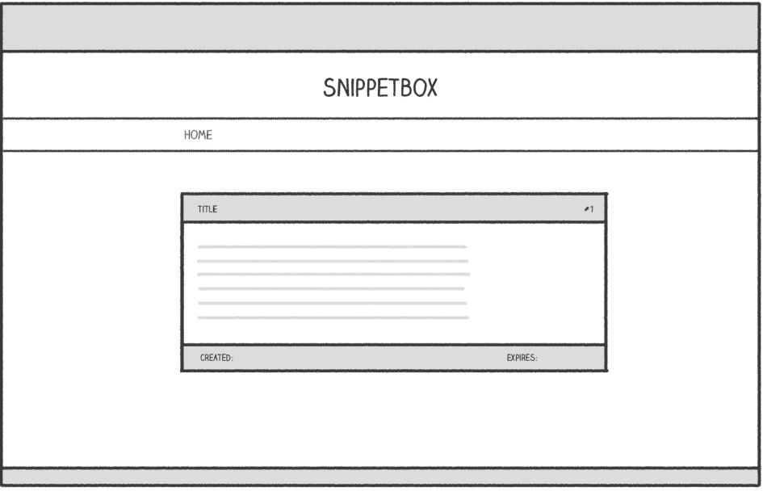

让我们从 snippetView 处理函数开始，添加一些代码来呈现一个新的 view.tmpl 模板文件（我们稍后将创建它）。希望这对你来说应该很熟悉，在书的前面部分见过。

```
File: cmd/web/handlers.go

package main

import (
	"errors"
	"fmt"
	"html/template" // Uncomment import
	"net/http"
	"strconv"

	"snippetbox.alexedwards.net/internal/models"
)

...

func (app *application) snippetView(w http.ResponseWriter, r *http.Request) {
	id, err := strconv.Atoi(r.PathValue("id"))
	if err != nil || id < 1 {
		http.NotFound(w, r)
		return
	}

	snippet, err := app.snippets.Get(id)
	if err != nil {
		if errors.Is(err, models.ErrNoRecord) {
			http.NotFound(w, r)
		} else {
			app.serverError(w, r, err)
		}
		return
	}

	// Initialize a slice containing the paths to the view.tmpl file,
	// plus the base layout and navigation partial that we made earlier.
	files := []string{
		"./ui/html/base.tmpl",
		"./ui/html/partials/nav.tmpl",
		"./ui/html/pages/view.tmpl",
	}

	// Parse the template files...
	ts, err := template.ParseFiles(files...)
	if err != nil {
		app.serverError(w, r, err)
		return
	}

	// And then execute them. Notice how we are passing in the snippet
	// data (a models.Snippet struct) as the final parameter?
	err = ts.ExecuteTemplate(w, "base", snippet)
	if err != nil {
		app.serverError(w, r, err)
	}
}

...
```

接下来，我们需要创建包含页面 HTML 标记的 `view.tmpl` 文件。但在此之前，我需要先解释一些理论知识...


你作为最后一个参数传递给 ts.ExecuteTemplate() 的任何数据，在 HTML 模板中都由 . 字符表示（称为 dot）。

在这种情况下，dot 的底层类型将是 models.Snippet 结构体。当 dot 的底层类型是结构体时，你可以通过在模板中将字段名附加到 dot 后面来渲染（或输出）任何导出字段的值。因此，因为我们的 models.Snippet 结构体有一个 Title 字段，我们可以通过在模板中写入 {{.Title}} 来输出片段标题。

我来演示。在 ui/html/pages/view.tmpl 处创建一个新文件，并添加以下标记：

```
$ touch ui/html/pages/view.tmpl
```

```
File: ui/html/pages/view.tmpl

{{define "title"}}Snippet #{{.ID}}{{end}}

{{define "main"}}
<div class='snippet'>
    <div class='metadata'>
        <strong>{{.Title}}</strong>
        <span>#{{.ID}}</span>
    </div>
    <pre><code>{{.Content}}</code></pre>
    <div class='metadata'>
        <time>Created: {{.Created}}</time>
        <time>Expires: {{.Expires}}</time>
    </div>
</div>
{{end}}
```

如果你重启应用程序并在浏览器中访问 http://localhost:4000/snippet/view/1，你应该发现相关片段已从数据库获取，传递到模板，并且内容已正确渲染。

## 渲染多个数据项

需要说明的重要一点是，Go 的 html/template 包在渲染模板时允许传入一个——且仅有一个——动态数据项。但在实际应用中，通常有多个动态数据项需要在同一页面上显示。

实现这一目标的一种轻量级且类型安全的方法是将动态数据包装在一个结构体中，该结构体充当数据的单一“容器结构”。

让我们创建一个新的 cmd/web/templates.go 文件，其中包含一个 templateData 结构体来恰好做到这一点。

```
$ touch cmd/web/templates.go
```

```
File: cmd/web/templates.go

package main

import "snippetbox.alexedwards.net/internal/models"

// Define a templateData type to act as the holding structure for
// any dynamic data that we want to pass to our HTML templates.
// At the moment it only contains one field, but we'll add more
// to it as the build progresses.
type templateData struct {
    Snippet models.Snippet
}
```

然后让我们更新 `snippetView` 处理程序，以在执行模板时使用这个新结构：

```
File: cmd/web/handlers.go

package main

...

func (app *application) snippetView(w http.ResponseWriter, r *http.Request) {
    id, err := strconv.Atoi(r.PathValue("id"))
    if err != nil || id < 1 {
        http.NotFound(w, r)
        return
    }

    snippet, err := app.snippets.Get(id)
    if err != nil {
        if errors.Is(err, models.ErrNoRecord) {
            http.NotFound(w, r)
        } else {
            app.serverError(w, r, err)
        }
        return
    }

    files := []string{
        "./ui/html/base.tmpl",
        "./ui/html/partials/nav.tmpl",
        "./ui/html/pages/view.tmpl",
    }

    ts, err := template.ParseFiles(files...)
    if err != nil {
        app.serverError(w, r, err)
        return
    }

    // Create an instance of a templateData struct holding the snippet data.
    data := templateData{
        Snippet: snippet,
    }

    // Pass in the templateData struct when executing the template.
    err = ts.ExecuteTemplate(w, "base", data)
    if err != nil {
        app.serverError(w, r, err)
    }
}

...
```

现在，我们的片段数据包含在 templateData 结构体中的 models.Snippet 结构体内。要输出数据，我们需要像这样将适当的字段名链接在一起：

```
File: ui/html/pages/view.tmpl

{{define "title"}}Snippet #{{.Snippet.ID}}{{end}}

{{define "main"}}
<div class='snippet'>
    <div class='metadata'>
        <strong>{{.Snippet.Title}}</strong>
        <span>#{{.Snippet.ID}}</span>
    </div>
    <div>
    <pre><code>{{.Snippet.Content}}</code></pre>
    <div class='metadata'>
        <time>Created: {{.Snippet.Created}}</time>
        <time>Expires: {{.Snippet.Expires}}</time>
    </div>
</div>
{{end}}
```

随时可以重启应用程序并再次访问 http://localhost:4000/snippet/view/1。你应该在浏览器中看到与之前相同的渲染页面。

## 其他信息

### 动态内容转义

html/template 包会自动转义 {{ }} 标签之间输出的任何数据。这种行为在避免跨站脚本（XSS）攻击方面非常有帮助，也是你应该使用 html/template 包而不是 Go 提供的更通用的 text/template 包的原因。

作为转义的示例，如果你想要输出的动态数据是：

```
<span>{{"<script>alert('xss attack')</script>"}}</span>
```

它将被无害地渲染为：

```
<span>&lt;script&gt;alert(&#39;xss attack&#39;)&lt;/script&gt;</span>
```

html/template 包还足够智能，可以根据上下文进行转义。它将根据数据在页面中是位于包含 HTML、CSS、Javascript 或 URL 的部分渲染而使用适当的转义序列。

### 嵌套模板

需要注意的是，当你从一个模板中调用另一个模板时，dot 需要显式地传递或 _管道化_ 到被调用的模板。你可以通过在每个 {{template}} 或 {{block}} 动作的末尾包含它来实现，如下所示：

```
{{template "main" .}}
{{block "sidebar" .}}{{end}}
```

作为一般规则，我的建议是，每当使用 {{template}} 或 {{block}} 动作调用模板时，都要养成始终管道化 dot 的习惯，除非你有充分的理由不这样做。

### 调用方法

如果你在 {{ }} 标签之间输出的类型有定义的方法，你可以调用这些方法（前提是它们是导出的，并且只返回一个值——或一个值和一个错误）。

例如，我们的 .Snippet.Created 结构体字段的底层类型是 time.Time，这意味着你可以通过调用其 Weekday() 方法来渲染星期几的名称，如下所示：

```
<span>{{.Snippet.Created.Weekday}}</span>
```

你也可以向方法传递参数。例如，你可以使用 AddDate() 方法向时间添加六个月，如下所示：

```
<span>{{.Snippet.Created.AddDate 0 6 0}}</span>
```

请注意，这与在 Go 中调用函数的语法不同——参数 _不_ 用括号包围，而是由单个空格字符分隔，而不是逗号。

### HTML 注释

最后，html/template 包会始终剥离模板中包含的任何 HTML 注释，包括任何条件注释。

这样做是为了在渲染动态内容时帮助避免 XSS 攻击。允许条件注释意味着 Go 并不总是能够预测浏览器将如何解释页面中的标记，因此不一定能够适当地转义所有内容。为了解决这个问题，Go 简单地剥离所有 HTML 注释。

## 模板动作和函数

在本节中，我们将研究 Go 提供的模板动作和函数。

我们已经讨论过一些动作——{{define}}、{{template}} 和 {{block}}——但还有三个可用于控制动态数据显示的动作——{{if}}、{{with}} 和 {{range}}。

| 动作 | 描述 |
|---|---|
| {{if .Foo}} C1 {{else}} C2 {{end}} | 如果 .Foo 不为空，则渲染内容 C1，否则渲染内容 C2。 |
| {{with .Foo}} C1 {{else}} C2 {{end}} | 如果 .Foo 不为空，则将 dot 设置为 .Foo 的值并渲染内容 C1，否则渲染内容 C2。 |
| {{range .Foo}} C1 {{else}} C2 {{end}} | 如果 .Foo 的长度大于零，则遍历每个元素，将 dot 设置为每个元素的值并渲染内容 C1。如果 .Foo 的长度为零，则渲染内容 C2。.Foo 的底层类型必须是数组、切片、映射或通道。 |

关于这些动作有几点需要说明：

- 对于所有三个动作，{{else}} 子句都是可选的。例如，如果你不想渲染任何 C2 内容，可以编写 {{if .Foo}} C1 {{end}}。
- 空值包括 false、0、任何 nil 指针或接口值，以及任何长度为零的数组、切片、映射或字符串。
- 重要的是要理解，with 和 range 动作会改变 dot 的值。一旦开始使用它们，dot 所代表的内容可能会因你在模板中的位置和正在执行的操作而有所不同。

html/template 包还提供了一些模板函数，你可以使用它们向模板添加额外逻辑并控制运行时渲染的内容。你可以在此处找到函数的完整列表，但最重要的函数是：


| 函数 | 描述 |
| :--- | :--- |
| `{{eq .Foo .Bar}}` | 如果 .Foo 等于 .Bar 则产生 true |
| `{{ne .Foo .Bar}}` | 如果 .Foo 不等于 .Bar 则产生 true |
| `{{not .Foo}}` | 产生 .Foo 的布尔取反值 |
| `{{or .Foo .Bar}}` | 如果 .Foo 不为空则产生 .Foo；否则产生 .Bar |
| `{{index .Foo i}}` | 产生 .Foo 在索引 i 处的值。.Foo 的底层类型必须是 map、slice 或 array，且 i 必须是整数值。 |
| `{{printf "%s-%s" .Foo .Bar}}` | 产生包含 .Foo 和 .Bar 值的格式化字符串。与 fmt.Sprintf() 的工作方式相同。 |
| `{{len .Foo}}` | 产生 .Foo 的长度（整数）。 |
| `{{$bar := len .Foo}}` | 将 .Foo 的长度赋给模板变量 $bar |

最后一行是声明模板变量的示例。如果您想存储函数的结果并在模板中的多个位置使用它，模板变量会非常有用。变量名称必须以美元符号开头，并且只能包含字母数字字符。

## 使用 with 操作

使用 {{with}} 操作的一个好机会是我们在上一章中创建的 view.tmpl 文件。请按如下更新它：

```
File: ui/html/pages/view.tmpl

{{define "title"}}Snippet #({{.Snippet.ID}}){{end}}

{{define "main"}}
    {{with .Snippet}}
    <div class='snippet'>
        <div class="metadata">
            <strong>{{.Title}}</strong>
            <span>#{.ID}</span>
        </div>
        <pre><code>{{.Content}}</code></pre>
        <div class="metadata">
            <time>Created: {{.Created}}</time>
            <time>Expires: {{.Expires}}</time>
        </div>
    </div>
    {{end}}
{{end}}
```

现在，在 {{with .Snippet}} 和相应的 {{end}} 标记之间，点的值被设置为 .Snippet。点基本上变成了 models.Snippet 结构体，而不是父级 templateData 结构体。

## 使用 if 和 range 操作

让我们也在具体示例中使用 {{if}} 和 {{range}} 操作，并更新我们的主页以显示最新代码片段的表格，大致如下：

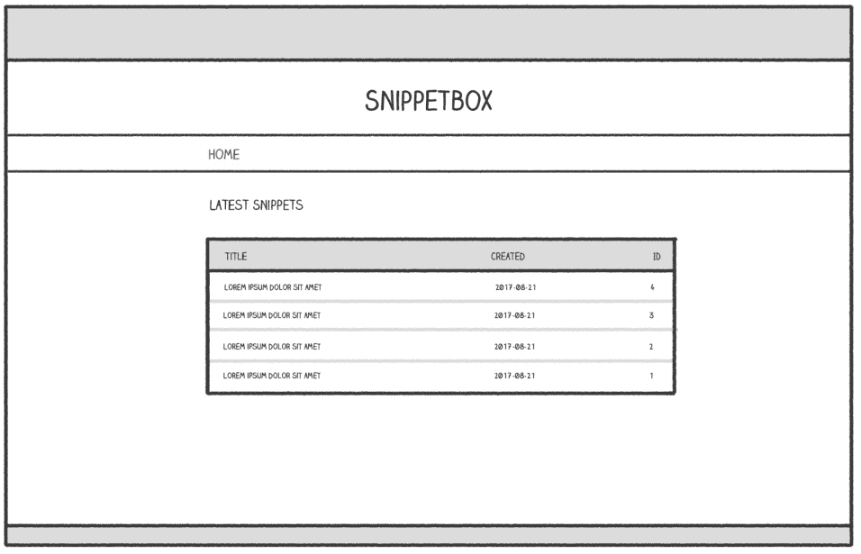

首先更新 `templateData` 结构体，使其包含用于保存代码片段切片的 `Snippets` 字段，如下所示：

```
File: cmd/web/templates.go

package main

import "snippetbox.alexedwards.net/internal/models"

// Include a Snippets field in the templateData struct.
type templateData struct {
        Snippet      models.Snippet
        Snippets []models.Snippet
}
```

然后更新 `home` 处理函数，使其从我们的数据库模型中获取最新代码片段并将其传递给 `home.tmpl` 模板：

```
File: cmd/web/handlers.go

package main

...

func (app *application) home(w http.ResponseWriter, r *http.Request) {
	w.Header().Add("Server", "Go")

	snippets, err := app.snippets.Latest()
	if err != nil {
		app.serverError(w, r, err)
		return
	}

	files := []string{
		"./ui/html/base.tmpl",
		"./ui/html/partials/nav.tmpl",
		"./ui/html/pages/home.tmpl",
	}

	ts, err := template.ParseFiles(files...)
	if err != nil {
		app.serverError(w, r, err)
		return
	}

	// Create an instance of a templateData struct holding the slice of
	// snippets.
	data := &templateData{
		Snippets: snippets,
	}

	// Pass in the templateData struct when executing the template.
	err = ts.ExecuteTemplate(w, "base", data)
	if err != nil {
		app.serverError(w, r, err)
	}
}

...
```

现在让我们转到 ui/html/pages/home.tmpl 文件，并使用 {{if}} 和 {{range}} 操作将其更新为以表格形式显示这些代码片段。具体来说：

- 我们希望使用 {{if}} 操作来检查代码片段切片是否为空。如果为空，我们希望显示 "There's nothing to see here yet!" 消息。否则，我们希望渲染包含代码片段信息的表格。

- 我们希望使用 {{range}} 操作遍历切片中的所有代码片段，将每个代码片段的内容渲染在表格行中。

以下是标记：

```
File: ui/html/pages/home.tmpl

{{define "title"}}Home{{end}}

{{define "main"}}
<h2>Latest Snippets</h2>
{{if .Snippets}}
<table>
<tr>
<th>Title</th>
<th>Created</th>
<th>ID</th>
</tr>
{{range .Snippets}}
<tr>
<td><a href='/snippet/view/{{.ID}}'>{{.Title}}</a></td>
<td>{{.Created}}</td>
<td>{{.ID}}</td>
</tr>
{{end}}
</table>
{{else}}
<p>There's nothing to see here... yet!</p>
{{end}}
{{end}}
```

确保所有文件都已保存，重新启动应用程序，并在 Web 浏览器中访问 http://localhost:4000。如果一切按计划进行，您应该会看到一个看起来有点像这样的页面：

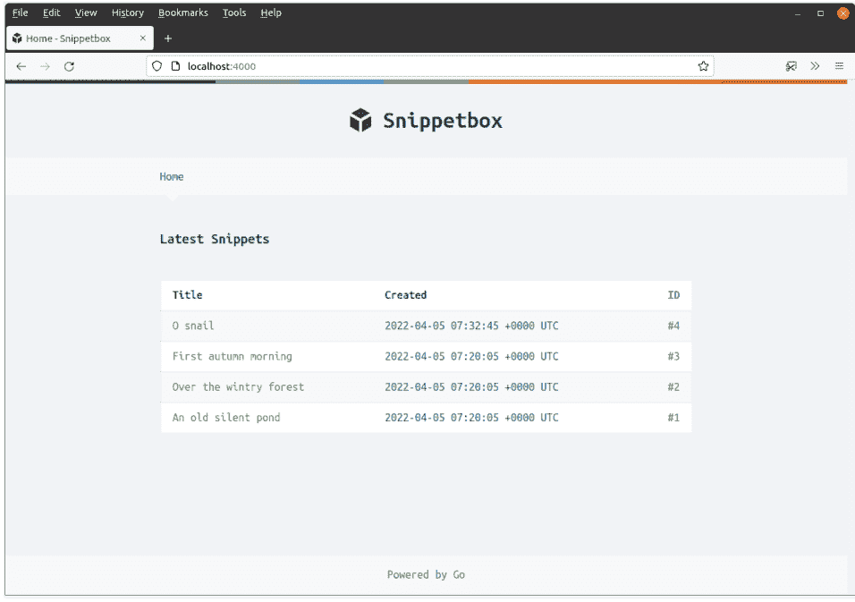

## 其他信息

## 组合函数

可以在模板标签中组合多个函数，根据需要使用括号 () 来包围函数及其参数。

例如，以下标签将在 Foo 的长度大于 99 时呈现内容 C1：

```
{{if (gt (len .Foo) 99)}} C1 {{end}}
```

或者作为另一个示例，以下标签将在 .Foo 等于 1 *且* .Bar 小于或等于 20 时呈现内容 C1：

```
{{if (and (eq .Foo 1) (le .Bar 20))}} C1 {{end}}
```

## 控制循环行为

在 {{range}} 操作中，您可以使用 {{break}} 命令提前结束循环，并使用 {{continue}} 立即开始下一次循环迭代。

```
{{range .Foo}}
// Skip this iteration if the .ID value equals 99.
{{if eq .ID 99}}
    {{continue}}
{{end}}
// ...
{{end}}
```

```
{{range .Foo}}
// End the loop if the .ID value equals 99.
{{if eq .ID 99}}
    {{break}}
{{end}}
// ...
{{end}}
```

## 缓存模板

在向 HTML 模板添加更多功能之前，现在是对代码库进行一些优化的好时机。目前主要有两个问题：

- 1. 每次渲染网页时，我们的应用程序都会使用 template.ParseFiles() 函数读取并解析相关模板文件。我们可以在启动应用程序时只解析一次文件，并将解析后的模板存储在内存缓存中，从而避免这种重复工作。

- 2. home 和 snippetView 处理函数中存在重复代码，我们可以通过创建辅助函数来减少这种重复。

让我们先解决第一点，并创建一个类型为 map[string]*template.Template 的内存映射来缓存解析后的模板。打开 cmd/web/templates.go 文件并添加以下代码：

```
File: cmd/web/templates.go

package main

import (
	"html/template" // New import
	"path/filepath" // New import

	"snippetbox.alexedwards.net/internal/models"
)

...

func newTemplateCache() (map[string]*template.Template, error) {
	// Initialize a new map to act as the cache.
	cache := map[string]*template.Template{}

	// Use the filepath.Glob() function to get a slice of all filepaths that
	// match the pattern "./ui/html/pages/*.tmpl". This will essentially gives
	// us a slice of all the filepaths for our application 'page' templates
	// like: [./ui/html/pages/home.tmpl ./ui/html/pages/view.tmpl]
	pages, err := filepath.Glob("./ui/html/pages/*.tmpl")
	if err != nil {
		return nil, err
	}

	// Loop through the page filepaths one-by-one.
	for _, page := range pages {
		// Extract the file name (like 'home.tmpl') from the full filepath
		// and assign it to the name variable.
		name := filepath.Base(page)

		// Create a slice containing the filepaths for our base template, any
		// partials and the page.
		files := []string{
			"./ui/html/base.tmpl",
			"./ui/html/partials/nav.tmpl",
			page,
		}

		// Parse the files into a template set.
		ts, err := template.ParseFiles(files...)
		if err != nil {
			return nil, err
		}

		// Add the template set to the map, using the name of the page
		// (like 'home.tmpl') as the key.
		cache[name] = ts
	}

	// Return the map.
	return cache, nil
}
```

下一步是在 `main()` 函数中初始化此缓存，并通过 `application` 结构体将其作为依赖项提供给我们的处理函数，如下所示：


```go
File: cmd/web/main.go

package main

import (
	"database/sql"
	"flag"
	"html/template" // New import
	"log/slog"
	"net/http"
	"os"

	"snippetbox.alexedwards.net/internal/models"

	_ "github.com/go-sql-driver/mysql"
)

// Add a templateCache field to the application struct.
type application struct {
	logger      *slog.Logger
	snippets    *models.SnippetModel
	templateCache map[string]*template.Template
}

func main() {
	addr := flag.String("addr", ":4000", "HTTP network address")
	dsn := flag.String("dsn", "web:pass@/snippetbox?parseTime=true", "MySQL data source name")
	flag.Parse()

	logger := slog.New(slog.NewTextHandler(os.Stdout, nil))

	db, err := openDB(*dsn)
	if err != nil {
		logger.Error(err.Error())
		os.Exit(1)
	}

	defer db.Close()

	// Initialize a new template cache...
	templateCache, err := newTemplateCache()
	if err != nil {
		logger.Error(err.Error())
		os.Exit(1)
	}

	// And add it to the application dependencies.
	app := &application{
		logger:      logger,
		snippets:    &models.SnippetModel{DB: db},
		templateCache: templateCache,
	}

	logger.Info("starting server", "addr", *addr)

	err = http.ListenAndServe(*addr, app.routes())
	logger.Error(err.Error())
	os.Exit(1)
}
...
```

此时，我们已经为每个页面建立了相关模板集的内存缓存，处理器可以通过应用程序结构体访问这个缓存。

现在让我们解决第二个重复代码问题，创建一个辅助方法，以便我们可以轻松地从缓存中渲染模板。

打开 cmd/web/helpers.go 文件，添加以下 render() 方法：

```go
File: cmd/web/helpers.go

package main

import (
	"fmt" // New import
	"net/http"
)

...

func (app *application) render(w http.ResponseWriter, r *http.Request, status int, page string, data templateData) {
	// Retrieve the appropriate template set from the cache based on the page
	// name (like 'home.tmpl'). If no entry exists in the cache with the
	// provided name, then create a new error and call the serverError() helper
	// method that we made earlier and return.
	ts, ok := app.templateCache[page]
	if !ok {
		err := fmt.Errorf("the template %s does not exist", page)
		app.serverError(w, r, err)
		return
	}

	// Write out the provided HTTP status code ('200 OK', '400 Bad Request' etc).
	w.WriteHeader(status)

	// Execute the template set and write the response body. Again, if there
	// is any error we call the serverError() helper.
	err := ts.ExecuteTemplate(w, "base", data)
	if err != nil {
		app.serverError(w, r, err)
	}
}
```

完成这些之后，我们现在可以看到这些变化带来的好处，并能大幅简化处理器中的代码：

```go
File: cmd/web/handlers.go

package main

import (
	"errors"
	"fmt"
	"net/http"
	"strconv"

	"snippetbox.alexedwards.net/internal/models"
)

func (app *application) home(w http.ResponseWriter, r *http.Request) {
	w.Header().Add("Server", "Go")

	snippets, err := app.snippets.Latest()
	if err != nil {
		app.serverError(w, r, err)
		return
	}

	// Use the new render helper.
	app.render(w, r, http.StatusOK, "home.tmpl", templateData{
		Snippets: snippets,
	})
}

func (app *application) snippetView(w http.ResponseWriter, r *http.Request) {
	id, err := strconv.Atoi(r.PathValue("id"))
	if err != nil || id < 1 {
		http.NotFound(w, r)
		return
	}

	snippet, err := app.snippets.Get(id)
	if err != nil {
		if errors.Is(err, models.ErrNoRecord) {
			http.NotFound(w, r)
		} else {
			app.serverError(w, r, err)
		}
		return
	}

	// Use the new render helper.
	app.render(w, r, http.StatusOK, "view.tmpl", templateData{
		Snippet: snippet,
	})
}
...
```

如果您重新启动应用程序，再次访问 http://localhost:4000 和 http://localhost:4000/snippet/view/1，您应该看到页面的渲染方式与之前完全相同。

## 最新代码片段

| 标题 | 创建时间 | ID |
| :--- | :--- | :--- |
| 0 只蜗牛 | 2022-04-05 07:32:45 +0000 UTC | #4 |
| 初秋的早晨 | 2022-04-05 07:20:05 +0000 UTC | #3 |
| 越过冬日的森林 | 2022-04-05 07:20:05 +0000 UTC | #2 |
| 古寂的池塘 | 2022-04-05 07:20:05 +0000 UTC | #1 |

## 古寂的池塘 #1

> 古寂的池塘...
> 一只青蛙跳进池塘，
> 扑通！又恢复了寂静。
> 
> – 松尾芭蕉

创建时间：2022-04-05 07:20:05 +0000 UTC 过期时间：2023-04-05 07:20:05 +0000 UTC

## 自动解析局部模板

在继续之前，让我们让 newTemplateCache() 函数更灵活一些，以便它能自动解析 ui/html/partials 文件夹中的所有模板，而不仅仅是我们的 nav.tmpl 文件。

如果将来想要添加更多局部模板，这将节省我们的时间、输入量，并避免潜在的错误。

```go
package main

...

func newTemplateCache() (map[string]*template.Template, error) {
	cache := map[string]*template.Template{}

	pages, err := filepath.Glob("./ui/html/pages/*.tmpl")
	if err != nil {
		return nil, err
	}

	for _, page := range pages {
		name := filepath.Base(page)

		// Parse the base template file into a template set.
		ts, err := template.ParseFiles("./ui/html/base.tmpl")
		if err != nil {
			return nil, err
		}

		// Call ParseGlob() *on this template set* to add any partials.
		ts, err = ts.ParseGlob("./ui/html/partials/*.tmpl")
		if err != nil {
			return nil, err
		}

		// Call ParseFiles() *on this template set* to add the page template.
		ts, err = ts.ParseFiles(page)
		if err != nil {
			return nil, err
		}

		// Add the template set to the map as normal...
		cache[name] = ts
	}

	return cache, nil
}
```

## 捕获运行时错误

一旦我们开始为 HTML 模板添加动态行为，就有可能遇到运行时错误。

让我们故意在 view.tmpl 模板中添加一个错误，看看会发生什么：

```html
File: ui/html/pages/view.tmpl

{{define "title"}}Snippet #{{.Snippet.ID}}{{end}}

{{define "main"}}
{{with .Snippet}}
<div class="snippet">
<div class="metadata">
<strong>{{.Title}}</strong>
<span>#{{.ID}}</span>
</div>
{{len nil}} {{!-- Deliberate error --}}
<pre><code>{{.Content}}</code></pre>
<div class="metadata">
<time>Created: {{.Created}}</time>
<time>Expires: {{.Expires}}</time>
</div>
</div>
{{end}}
{{end}}
```

在上面的标记中，我们添加了 {{len nil}} 这一行，它应该在运行时生成错误，因为在 Go 语言中 nil 值没有长度。

现在尝试运行应用程序。你会发现一切仍然可以正常编译：

```
$ go run ./cmd/web
time=2024-03-18T11:29:23.000Z+00:00 level=INFO msg="starting server" addr=:4000
```

但如果你使用 curl 向 http://localhost:4000/snippet/view/1 发起请求，你会得到一个看起来类似这样的响应：

```
$ curl -i http://localhost:4000/snippet/view/1
HTTP/1.1 200 OK
Date: Wed, 18 Mar 2024 11:29:23 GMT
Content-Length: 734
Content-Type: text/html; charset=utf-8

<!doctype html>
<html lang="en">
<head>
    <meta charset="utf-8">
    <title>Snippet #1 - Snippetbox</title>
    <link rel="stylesheet" href="/static/css/main.css">
    <link rel="shortcut icon" href="/static/img/favicon.ico" type="image/x-icon">
    <link rel="stylesheet" href='https://fonts.googleapis.com/css?family=Ubuntu+Mono:400,700'>
</head>
<body>
    <header>
        <h1><a href='/'>Snippetbox</a></h1>
    </header>

    <nav>
        <a href='/'>Home</a>
    </nav>

    <main>

        <div class="snippet">
            <div class="metadata">
                <strong>An old silent pond;</strong>
                <span>#1</span>
            </div>
Internal Server Error
```

这非常糟糕。我们的应用程序抛出了一个错误，但用户却错误地收到了 200 OK 响应。更糟糕的是，他们收到了一个不完整的 HTML 页面。

要修复这个问题，我们需要让模板渲染成为两阶段过程。首先，我们应该通过将模板写入缓冲区来进行“试用”渲染。如果失败，我们可以向用户返回错误消息。但如果成功，我们就可以将缓冲区的内容写入 http.ResponseWriter。

让我们更新 render() 辅助方法，改用这种方法：


```
File: cmd/web/helpers.go

package main

import (
	"bytes" // New import
	"fmt"
	"net/http"
)

...

func (app *application) render(w http.ResponseWriter, r *http.Request, status int, page string, data templateData) {
	ts, ok := app.templateCache[page]
	if !ok {
		err := fmt.Errorf("the template %s does not exist", page)
		app.serverError(w, r, err)
		return
	}

	// Initialize a new buffer.
	buf := new(bytes.Buffer)

	// Write the template to the buffer, instead of straight to the
	// http.ResponseWriter. If there's an error, call our serverError() helper
	// and then return.
	err := ts.ExecuteTemplate(buf, "base", data)
	if err != nil {
		app.serverError(w, r, err)
		return
	}

	// If the template is written to the buffer without any errors, we are safe
	// to go ahead and write the HTTP status code to http.ResponseWriter.
	w.WriteHeader(status)

	// Write the contents of the buffer to the http.ResponseWriter. Note: this
	// is another time where we pass our http.ResponseWriter to a function that
	// takes an io.Writer.
	buf.WriteTo(w)
}
```

重启应用程序，尝试再次发出相同的请求。你现在应该能看到正确的错误消息和 500 Internal Server Error 响应。

```
$ curl -i http://localhost:4000/snippet/view/1
HTTP/1.1 500 Internal Server Error
Content-Type: text/plain; charset=utf-8
X-Content-Type-Options: nosniff
Date: Wed, 18 Mar 2024 11:29:23 GMT
Content-Length: 22

Internal Server Error
```

太棒了。现在看起来好多了。

在进入下一章之前，请返回 view.tmpl 文件并删除故意引入的错误：

```
File: ui/html/pages/view.tmpl

{{define "title"}}Snippet #{{.Snippet.ID}}{{end}}

{{define "main"}}
{{with .Snippet}}
<div class='snippet'>
    <div class='metadata'>
        <strong>{{.Title}}</strong>
        <span>#{{.ID}}</span>
    </div>
    <pre><code>{{.Content}}</code></pre>
    <div class='metadata'>
        <time>Created: {{.Created}}</time>
        <time>Expires: {{.Expires}}</time>
    </div>
</div>
{{end}}
{{end}}
```

## 常见动态数据

在某些 Web 应用程序中，你可能希望在多个（甚至每一个）网页中包含相同的动态数据。例如，你可能希望在所有带有表单的页面中包含当前用户的名称和头像，或者 CSRF 令牌。

在我们的例子中，先从简单的开始，假设我们希望在每个页面的页脚中包含当前年份。

为此，我们首先要在 templateData 结构体中添加一个新的 CurrentYear 字段，如下所示：

```
File: cmd/web/templates.go

package main

...

// Add a CurrentYear field to the templateData struct.
type templateData struct {
	CurrentYear int
	Snippet       models.Snippet
	Snippets      []models.Snippet
}

...
```

下一步是向我们的应用程序添加一个 newTemplateData() 辅助方法，该方法将返回一个用当前年份初始化的 templateData 结构体。

我来演示一下：

```
File: cmd/web/helpers.go

package main

import (
	"bytes"
	"fmt"
	"net/http"
	"time" // New import
)

...

// Create an newTemplateData() helper, which returns a templateData struct
// initialized with the current year. Note that we're not using the *http.Request
// parameter here at the moment, but we will do later in the book.
func (app *application) newTemplateData(r *http.Request) templateData {
	return templateData{
		CurrentYear: time.Now().Year(),
	}
}

...
```

然后让我们更新 `home` 和 `snippetView` 处理程序，以使用 `newTemplateData()` 辅助方法，如下所示：

```
File: cmd/web/handlers.go

package main

...

func (app *application) home(w http.ResponseWriter, r *http.Request) {
	w.Header().Add("Server", "Go")

	snippets, err := app.snippets.Latest()
	if err != nil {
		app.serverError(w, r, err)
		return
	}

	// Call the newTemplateData() helper to get a templateData struct containing
	// the 'default' data (which for now is just the current year), and add the
	// snippets slice to it.
	data := app.newTemplateData(r)
	data.Snippets = snippets

	// Pass the data to the render() helper as normal.
	app.render(w, r, http.StatusOK, "home.tmpl", data)
}

func (app *application) snippetView(w http.ResponseWriter, r *http.Request) {
	id, err := strconv.Atoi(r.PathValue("id"))
	if err != nil || id < 1 {
		http.NotFound(w, r)
		return
	}

	snippet, err := app.snippets.Get(id)
	if err != nil {
		if errors.Is(err, models.ErrNoRecord) {
			http.NotFound(w, r)
		} else {
			app.serverError(w, r, err)
		}
		return
	}

	// And do the same thing again here...
	data := app.newTemplateData(r)
	data.Snippet = snippet

	app.render(w, r, http.StatusOK, "view.tmpl", data)
}

...
```

然后我们需要做的最后一件事是更新 ui/html/base.tmpl 文件，在页脚中显示年份，如下所示：

```
File: ui/html/base.tmpl

{{define "base"}}
<!doctype html>
<html lang='en'>
<head>
    <meta charset='utf-8'>
    <title>{{template "title" .}} - Snippetbox</title>
    <link rel='stylesheet' href='/static/css/main.css'>
    <link rel='shortcut icon' href='/static/img/favicon.ico' type='image/x-icon'>
    <link rel='stylesheet' href='https://fonts.googleapis.com/css?family=Ubuntu+Mono:400,700'>
</head>
<body>
    <header>
        <h1><a href='/'/>Snippetbox</a></h1>
    </header>
    {{template "nav" .}}
    <main>
        {{template "main" .}}
    </main>
    <footer>
        <!-- Update the footer to include the current year -->
        Powered by <a href='https://golang.org/'>Go</a> in {{.CurrentYear}}
    </footer>
    <script src='/static/js/main.js' type='text/javascript'></script>
</body>
</html>
{{end}}
```

如果你重启应用程序并访问 http://localhost:4000 的主页，现在应该能在页脚中看到当前年份。如下所示：

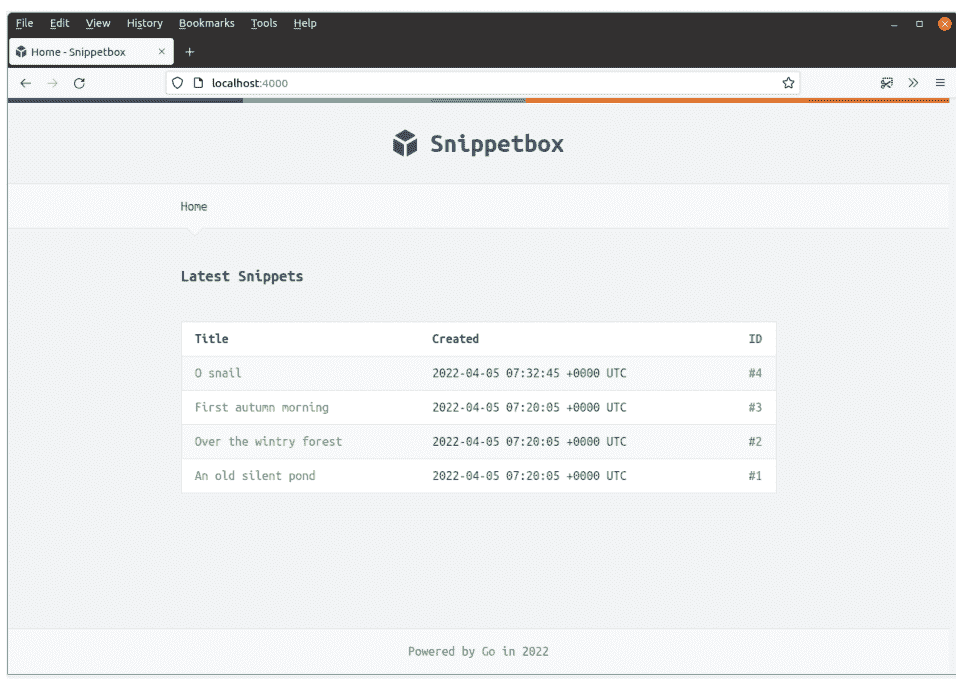

## 自定义模板函数

在本节关于模板和动态数据的最后部分，我想解释如何创建可在 Go 模板中使用的自定义函数。

为说明这一点，让我们创建一个自定义 humanDate() 函数，它以友好的人性化格式输出日期时间，例如 1 Jan 2024 at 10:47 或 18 Mar 2024 at 15:04，而不是像我们目前这样以 YYYY-MM-DD HH:MM:SS +0000 UTC 的默认格式输出日期。

做这件事主要有两个步骤：

- 1. 我们需要创建一个包含自定义 humanDate() 函数的 template.FuncMap 对象。
- 2. 我们需要在解析模板之前使用 template.Funcs() 方法注册此对象。

请将以下代码添加到你的 templates.go 文件中：

```
File: cmd/web/templates.go

package main

import (
	"html/template"
	"path/filepath"
	"time" // New import

	"snippetbox.alexedwards.net/internal/models"
)

...

// Create a humanDate function which returns a nicely formatted string
// representation of a time.Time object.
func humanDate(t time.Time) string {
	return t.Format("02 Jan 2006 at 15:04")
}

// Initialize a template.FuncMap object and store it in a global variable. This is
// essentially a string-keyed map which acts as a lookup between the names of our
// custom template functions and the functions themselves.
var functions = template.FuncMap{
	"humanDate": humanDate,
}

func newTemplateCache() (map[string]*template.Template, error) {
	cache := map[string]*template.Template{}

	pages, err := filepath.Glob("./ui/html/pages/*.tmpl")
	if err != nil {
		return nil, err
	}

	for _, page := range pages {
		name := filepath.Base(page)

		// The template.FuncMap must be registered with the template set before you
		// call the ParseFiles() method. This means we have to use template.New() to
		// create an empty template set, use the Funcs() method to register the
		// template.FuncMap, and then parse the file as normal.
		ts, err := template.New(name).Funcs(functions).ParseFiles("./ui/html/base.tmpl")
		if err != nil {
			return nil, err
		}

		ts, err = ts.ParseGlob("./ui/html/partials/*.tmpl")
		if err != nil {
			return nil, err
		}

		ts, err = ts.ParseFiles(page)
		if err != nil {
			return nil, err
		}

		cache[name] = ts
	}

	return cache, nil
}
```


在继续之前，我应该说明：自定义模板函数（例如我们的 humanDate() 函数）可以接受尽可能多的参数，但它们 *必须* 只返回一个值。唯一的例外是，如果你想将错误作为第二个值返回，那也是可以的。

现在，我们可以像使用内置模板函数一样使用我们的 humanDate() 函数：

```
File: ui/html/pages/home.tmpl

{{define "title"}}Home{{end}}

{{define "main"}}
<h2>Latest Snippets</h2>
{{if .Snippets}}
<table>
<tr>
<th>Title</th>
<th>Created</th>
<th>ID</th>
</tr>
{{range .Snippets}}
<tr>
<td><a href='/snippet/view/{{.ID}}'>{{.Title}}</a></td>
<!-- Use the new template function here -->
<td>{{humanDate .Created}}</td>
<td>#{{.ID}}</td>
</tr>
{{end}}
</table>
{{else}}
<p>There's nothing to see here... yet!</p>
{{end}}
{{end}}
```

```
File: ui/html/pages/view.tmpl

{{define "title"}}Snippet #{{.Snippet.ID}}{{end}}

{{define "main"}}
{{with .Snippet}}
<div class='snippet'>
<div class='metadata'>
<strong>{{.Title}}</strong>
<span>#{{.ID}}</span>
</div>
<pre><code>{{.Content}}</code></pre>
<div class='metadata'>
<!-- Use the new template function here -->
<time>Created: {{humanDate .Created}}</time>
<time>Expires: {{humanDate .Expires}}</time>
</div>
</div>
{{end}}
{{end}}
```

做完这些之后，重启应用程序。如果你在浏览器中访问 http://localhost:4000 和 http://localhost:4000/snippet/view/1，你应该能看到使用了新的、格式良好的日期。

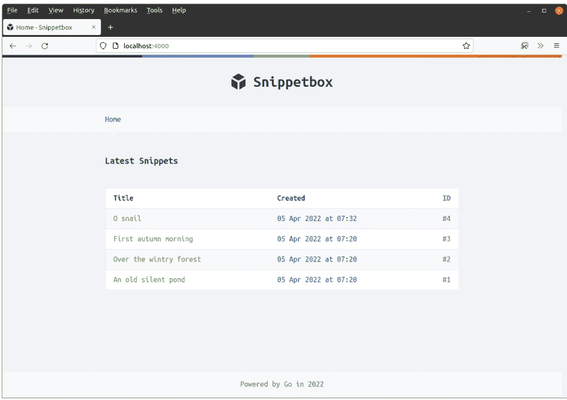

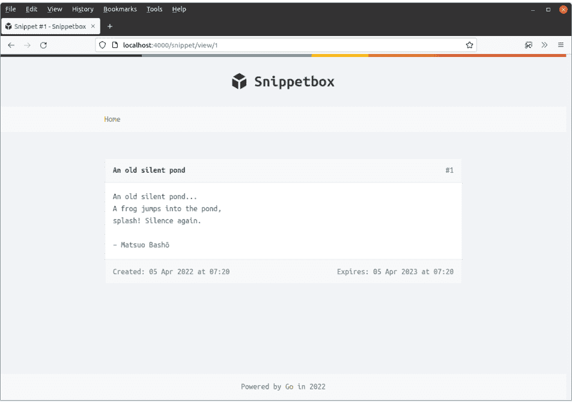

## 补充信息

## 管道化

在上面的代码中，我们是这样调用自定义模板函数的：

```
<time>Created: {{humanDate .Created}}</time>
```

另一种方法是使用 | 字符将值管道化到函数中。这有点像在 Unix 终端中将一个命令的输出管道化到另一个命令。我们可以将上面的代码重写为：

```
<time>Created: {{.Created | humanDate}}</time>
```

管道化的一个好处是，你可以创建任意长的模板函数链，每个函数的输出作为下一个函数的输入。例如，我们可以将 humanDate 函数的输出管道化到内置的 printf 函数，如下所示：

```
<time>{{.Created | humanDate | printf "Created: %s"}}</time>
```

## 中间件

在构建 Web 应用程序时，你可能希望为许多（甚至所有）HTTP 请求使用某些共享功能。例如，你可能希望记录每个请求、压缩每个响应，或在将请求传递给处理程序之前检查缓存。

组织这些共享功能的常见方法是将其设置为中间件。这本质上是一些自包含的代码，它在正常的应用程序处理程序之前或之后独立处理请求。

在本书的这一部分中，你将学习：

- 一种用于构建和使用自定义中间件的惯用模式，该模式与 net/http 及许多第三方包兼容。
- 如何创建在每个 HTTP 响应上设置常见 HTTP 标头的中间件。
- 如何创建记录应用程序接收到的请求的中间件。
- 如何创建恢复 panic 的中间件，以便由你的应用程序优雅地处理。
- 如何创建和使用可组合的中间件链，以帮助管理和组织你的中间件。

### 中间件的工作原理

在本书前面，我说过一段话，我想在本章中对其进行展开：

> “你可以把 Go Web 应用程序看作是一个接一个地被调用的 ServeHTTP() 方法链。”

目前，在我们的应用程序中，当服务器收到新的 HTTP 请求时，它会调用 servemux 的 ServeHTTP() 方法。该方法根据请求方法和 URL 路径查找相关处理程序，并反过来调用该处理程序的 ServeHTTP() 方法。

中间件的基本思想是将另一个处理程序插入到这个链中。中间件处理程序执行一些逻辑，例如记录请求，然后调用链中下一个处理程序的 ServeHTTP() 方法。

事实上，我们的应用程序中实际上已经在使用一些中间件了——即来自提供静态文件的 http.StripPrefix() 函数，它在将请求传递给文件服务器之前，从请求的 URL 路径中删除特定前缀。

### 模式

创建自己的中间件的标准模式如下：

```go
func myMiddleware(next http.Handler) http.Handler {
    fn := func(w http.ResponseWriter, r *http.Request) {
        // TODO: Execute our middleware logic here...
        next.ServeHTTP(w, r)
    }
    return http.HandlerFunc(fn)
}
```

代码本身相当简洁，但其中有很多内容需要理解。

- myMiddleware() 函数本质上是对下一个处理程序的包装器，我们将其作为参数传递给它。
- 它建立了一个函数 fn，该函数对下一个处理程序形成闭包。当 fn 运行时，它执行我们的中间件逻辑，然后通过调用其 ServeHTTP() 方法将控制权转移给下一个处理程序。

- 无论你对闭包做什么，它始终可以访问其创建所在作用域中的局部变量——在此例中，这意味着 fn 始终可以访问 next 变量。
- 在代码的最后一行，我们将此闭包转换为 http.Handler，并使用 http.HandlerFunc() 适配器返回它。

如果这让你感到困惑，可以简单地这样理解：myMiddleware() 是一个接受链中下一个处理程序作为参数的函数。它返回一个处理程序，该处理程序执行一些逻辑，然后调用下一个处理程序。

### 简化中间件

对这一模式的一种改进是在 myMiddleware() 中间件内部使用匿名函数，如下所示：

```go
func myMiddleware(next http.Handler) http.Handler {
	return http.HandlerFunc(func(w http.ResponseWriter, r *http.Request) {
		// TODO: Execute our middleware logic here...
		next.ServeHTTP(w, r)
	})
}
```

这种模式在实际开发中非常常见，如果你阅读其他应用程序或第三方包的源代码，可能会最常看到这种模式。

### 中间件的位置

重要的是要说明，中间件在处理程序链中的位置会影响应用程序的行为。

如果在链中将中间件放在 servemux 之前，那么它将作用于应用程序接收到的每个请求。

```
myMiddleware -> servemux -> application handler
```

一个很好的例子是请求日志中间件——因为通常你希望对所有请求都执行此操作。

或者，你可以通过包装特定的应用程序处理程序，将中间件放在链中 servemux 之后。这将导致你的中间件仅针对特定路由执行。

```
servemux → myMiddleware → application handler
```

这的一个示例是授权中间件，你可能只希望在特定路由上运行它。

随着我们深入本书，我们将演示如何在实践中实现这两种方法。

### 设置常见标头

让我们使用上一章学到的模式，创建一些中间件，它会自动向每个响应添加我们的 Server: Go 标头，以及以下 HTTP 安全标头（符合当前 OWASP 指南）。

```
Content-Security-Policy: default-src 'self'; style-src 'self' fonts.googleapis.com; font-src fonts.gstatic.com
Referrer-Policy: origin-when-cross-origin
X-Content-Type-Options: nosniff
X-Frame-Options: deny
X-XSS-Protection: 0
```

如果你不熟悉这些标头，我将简要说明它们的作用。

- Content-Security-Policy（通常缩写为 CSP）标头用于限制网页资源（例如 JavaScript、图像、字体等）的加载来源。设置严格的 CSP 策略有助于防止各种跨站点脚本、点击劫持和其他代码注入攻击。

CSP 标头及其工作原理是一个庞大的主题，如果你之前没有接触过它们，我建议阅读这个入门指南。但是，在我们的例子中，该标头告诉浏览器可以从 fonts.gstatic.com 加载字体，从 fonts.googleapis.com 和 self（我们自己的来源）加载样式表，然后其他所有内容仅从 self 加载。内联 JavaScript 默认被阻止。

- Referrer-Policy 用于控制当用户从你的网页导航离开时，Referer 标头中包含哪些信息。在我们的例子中，我们将值设置为 origin-when-cross-origin，这意味着对于同源请求将包含完整的 URL，但对于所有其他请求，诸如 URL 路径和查询字符串值等信息将被剥离。

- X-Content-Type-Options: nosniff 指示浏览器不要对响应的内容类型进行 MIME 类型嗅探，从而有助于防止内容嗅探攻击。

- X-Frame-Options: deny 用于帮助防止旧版浏览器中的点击劫持攻击，这些浏览器不支持 CSP 标头。

- X-XSS-Protection: 0 用于禁用跨站点脚本攻击的阻止。以前，将此标头设置为 X-XSS-Protection: 1; mode=block 是良好做法，但当你使用像我们这样的 CSP 标头时，建议禁用此设置。


功能已彻底移除。

好了，让我们回到我们的 Go 代码，先创建一个新的 `middleware.go` 文件。我们将使用这个文件来存放本书中编写的所有自定义中间件。

```
$ touch cmd/web/middleware.go
```

然后打开它，添加一个 `commonHeaders()` 函数，使用我们在上一章中介绍的模式：

文件：cmd/web/middleware.go

```
package main

import (
	"net/http"
)

func commonHeaders(next http.Handler) http.Handler {
	return http.HandlerFunc(func(w http.ResponseWriter, r *http.Request) {
		// Note: This is split across multiple lines for readability. You don't
		// need to do this in your own code.
		w.Header().Set("Content-Security-Policy",
			"default-src 'self'; style-src 'self' fonts.googleapis.com; font-src fonts.gstatic.com")
		w.Header().Set("Referrer-Policy", "origin-when-cross-origin")
		w.Header().Set("X-Content-Type-Options", "nosniff")
		w.Header().Set("X-Frame-Options", "deny")
		w.Header().Set("X-XSS-Protection", "0")

		w.Header().Set("Server", "Go")

		next.ServeHTTP(w, r)
	})
}
```

因为我们希望这个中间件作用于每个接收到的请求，因此需要在请求到达我们的 servemux 之前执行它。我们希望应用程序中的控制流如下所示：

```
commonHeaders → servemux → application handler
```

为此，我们需要 `commonHeaders` 中间件函数来 *包装我们的 servemux*。让我们更新 `routes.go` 文件以实现这一点：

文件：cmd/web/routes.go

```
package main

import "net/http"

// Update the signature for the routes() method so that it returns a
// http.Handler instead of *http.ServeMux.
func (app *application) routes() http.Handler {
    mux := http.NewServeMux()

    fileServer := http.FileServer(http.Dir("./ui/static/"))
    mux.Handle("GET /static/", http.StripPrefix("/static", fileServer))

    mux.HandleFunc("GET /{$}", app.home)
    mux.HandleFunc("GET /snippet/view/{id}", app.snippetView)
    mux.HandleFunc("GET /snippet/create", app.snippetCreate)
    mux.HandleFunc("POST /snippet/create", app.snippetCreatePost)

    // Pass the servemux as the 'next' parameter to the commonHeaders middleware.
    // Because commonHeaders is just a function, and the function returns a
    // http.Handler we don't need to do anything else.
    return commonHeaders(mux)
}
```

**重要：** 请确保在此处更新 routes() 方法的签名，使其返回一个 http.Handler，否则会导致编译错误。

我们还需要快速更新主页处理器代码，删除 `w.Header().Add("Server", "Go")` 这一行，否则主页响应中会重复添加该标头。

文件：cmd/web/handlers.go

```
package main

...

func (app *application) home(w http.ResponseWriter, r *http.Request) {
    snippets, err := app.snippets.Latest()
    if err != nil {
        app.serverError(w, r, err)
        return
    }

    data := app.newTemplateData(r)
    data.Snippets = snippets

    app.render(w, r, http.StatusOK, "home.html", data)
}

...
```

大胆尝试一下。运行应用程序，打开一个终端窗口，尝试使用 curl 发送一些请求。你应该会看到安全标头现在包含在每个响应中。

```
$ curl --head http://localhost:4000/
HTTP/1.1 200 OK
Content-Security-Policy: default-src 'self'; style-src 'self' fonts.googleapis.com; font-src fonts.gstatic.com
Referrer-Policy: origin-when-cross-origin
Server: Go
X-Content-Type-Options: nosniff
X-Frame-Options: deny
X-XSS-Protection: 0
Date: Wed, 18 Mar 2024 11:29:23 GMT
Content-Length: 1700
Content-Type: text/html; charset=utf-8
```

## 其他信息

## 控制流

需要知道的是，当链中的最后一个处理器返回时，控制会以反向传递回链的上层。因此，在执行我们的代码时，控制流实际上如下所示：

commonHeaders → servemux → 应用程序处理器 → servemux → commonHeaders

在任何中间件处理器中，位于 `next.ServeHTTP()` 之前的代码会在向下通过链时执行，而 `next.ServeHTTP()` 之后——或在延迟函数中——的任何代码都会在向回传递时执行。

```
func myMiddleware(next http.Handler) http.Handler {
	return http.HandlerFunc(func(w http.ResponseWriter, r *http.Request) {
		// Any code here will execute on the way down the chain.
		next.ServeHTTP(w, r)
		// Any code here will execute on the way back up the chain.
	})
}
```

## 尽早返回

还需要提到的是，如果在调用 `next.ServeHTTP()` 之前在中间件函数中调用 return，那么链将停止执行，控制会向上游返回。

例如，尽早返回的常见用例是身份验证中间件，只有在通过特定检查时才允许继续执行链。例如：

```
func myMiddleware(next http.Handler) http.Handler {
	return http.HandlerFunc(func(w http.ResponseWriter, r *http.Request) {
		// If the user isn't authorized, send a 403 Forbidden status and
		// return to stop executing the chain.
		if !isAuthorized(r) {
			w.WriteHeader(http.StatusForbidden)
			return
		}

		// Otherwise, call the next handler in the chain.
		next.ServeHTTP(w, r)
	})
}
```

我们将在本书后面使用这种‘尽早返回’模式来限制对应用程序某些部分的访问。

## 调试 CSP 问题

CSP 标头非常出色，你绝对应该使用它们。值得说的是，我曾花费许多小时调试问题，最终才意识到某个关键资源或脚本被我自己的 CSP 规则阻止了。

如果你正在使用 CSP 标头的项目（就像这个项目一样），我建议随时准备好网页浏览器开发者工具，并在遇到任何意外问题时尽早养成检查日志的习惯。在 Firefox 中，任何被阻止的资源都会显示为控制台日志中的错误——类似于这样：

内容安全策略：页面的设置阻止了加载 https://fonts.googleapis.com/css?family=Ubuntu+Mono:400,700 ("style-src") 处的资源。

>>

## 请求日志

让我们继续沿用同样的思路，添加一些中间件来记录 HTTP 请求。具体来说，我们将使用之前创建的结构化日志记录器来记录用户的 IP 地址，以及请求的方法、URI 和 HTTP 版本。

打开你的 middleware.go 文件，使用标准中间件模式创建一个 logRequest() 方法，如下所示：

文件：cmd/web/middleware.go

```
package main

...

func (app *application) logRequest(next http.Handler) http.Handler {
	return http.HandlerFunc(func(w http.ResponseWriter, r *http.Request) {
		var (
			ip     = r.RemoteAddr
			proto  = r.Proto
			method = r.Method
			uri    = r.URL.RequestURI()
		)

		app.logger.Info("received request", "ip", ip, "proto", proto, "method", method, "uri", uri)

		next.ServeHTTP(w, r)
	})
}
```

请注意，这次我们将中间件实现为 application 上的方法？

这样做完全有效。我们的中间件方法与之前具有相同的签名，但由于它是 application 上的方法，因此它还可以访问处理器依赖项，包括结构化日志记录器。

现在让我们更新 routes.go 文件，以便 logRequest 中间件首先对所有请求执行，这样控制流（从左到右阅读）将如下所示：

```
logRequest ↔ commonHeaders ↔ servemux ↔ application handler
```

文件：cmd/web/routes.go

```
package main

import "net/http"

func (app *application) routes() http.Handler {
    mux := http.NewServeMux()

    fileServer := http.FileServer(http.Dir("./ui/static/"))
    mux.Handle("GET /static/", http.StripPrefix("/static", fileServer))

    mux.HandleFunc("GET /{$}", app.home)
    mux.HandleFunc("GET /snippet/view/{id}", app.snippetView)
    mux.HandleFunc("GET /snippet/create", app.snippetCreate)
    mux.HandleFunc("POST /snippet/create", app.snippetCreatePost)

    // Wrap the existing chain with the logRequest middleware.
    return app.logRequest(commonHeaders(mux))
}
```

好了... 让我们试一下！

重启你的应用程序，浏览一下，然后检查你的终端窗口。你应该会看到类似这样的日志输出：

```
$ go run ./cmd/web
time=2024-03-18T11:29:23.0000+00:00 level=INFO msg="starting server" addr=:4000
time=2024-03-18T11:29:23.0000+00:00 level=INFO msg="received request" ip=127.0.0.1:56536 proto=HTTP/1.1 method=GET uri=/
time=2024-03-18T11:29:23.0000+00:00 level=INFO msg="received request" ip=127.0.0.1:56536 proto=HTTP/1.1 method=GET uri=/static
time=2024-03-18T11:29:23.0000+00:00 level=INFO msg="received request" ip=127.0.0.1:56546 proto=HTTP/1.1 method=GET uri=/static
time=2024-03-18T11:29:23.0000+00:00 level=INFO msg="received request" ip=127.0.0.1:56536 proto=HTTP/1.1 method=GET uri=/static
time=2024-03-18T11:29:23.0000+00:00 level=INFO msg="received request" ip=127.0.0.1:56536 proto=HTTP/1.1 method=GET uri=/static
time=2024-03-18T11:29:23.0000+00:00 level=INFO msg="received request" ip=127.0.0.1:56536 proto=HTTP/1.1 method=GET uri="/snipp
```

> **注意：** 取决于你的浏览器如何缓存静态文件，你可能需要执行强制刷新（或打开一个新的无痕/私密浏览标签页）才能看到静态文件的任何请求。


## 恐慌恢复

在简单的 Go 应用程序中，当你的代码发生 panic 时，它会导致应用程序立即终止。

但我们的 Web 应用程序要复杂一些。Go 的 HTTP 服务器假设任何 panic 的影响都仅限于处理活跃 HTTP 请求的 goroutine（请记住，每个请求都在其自身的 goroutine 中处理）。

具体来说，panic 发生后，我们的服务器会将堆栈跟踪记录到服务器错误日志中（我们将在本书后面讨论），解除受影响 goroutine 的堆栈（在此过程中调用任何延迟函数），并关闭底层 HTTP 连接。但它不会终止应用程序，因此重要的是，处理程序中的任何 panic 都不会导致服务器崩溃。

但如果在其中一个处理程序中发生 panic，用户会看到什么呢？

让我们来看看，并在 home 处理程序中引入一个故意的 panic。

```
File: cmd/web/handlers.go

package main

...

func (app *application) home(w http.ResponseWriter, r *http.Request) {
    panic("oops! something went wrong") // Deliberate panic

    snippets, err := app.snippets.Latest()
    if err != nil {
        app.serverError(w, r, err)
        return
    }

    data := app.newTemplateData(r)
    data.Snippets = snippets

    app.render(w, r, http.StatusOK, "home.tmpl", data)
}

...
```

重启你的应用程序...

```
$ go run ./cmd/web
time=2024-03-18T11:29:23.000+00:00 level=INFO msg="starting server" addr=:4000
```

... 并从第二个终端窗口对主页发出 HTTP 请求：

```
$ curl -i http://localhost:4000
curl: (52) Empty reply from server
```

不幸的是，由于 Go 在 panic 后关闭了底层 HTTP 连接，我们只收到了一个空响应。

这对用户来说不是一种很好的体验。与其这样，不如向他们发送一个带有 500 Internal Server Error 状态的适当 HTTP 响应，会更合适且更有意义。

一种整洁的方法是创建一些中间件来恢复 panic 并调用我们的 `app.serverError()` 辅助方法。为此，我们可以利用这样一个事实：在发生 panic 并解除堆栈时，延迟函数始终会被调用。

打开你的 *middleware.go* 文件并添加以下代码：

```
File: cmd/web/middleware.go

package main

import (
	"fmt" // New import
	"net/http"
)

...

func (app *application) recoverPanic(next http.Handler) http.Handler {
	return http.HandlerFunc(func(w http.ResponseWriter, r *http.Request) {
		// Create a deferred function (which will always be run in the event
		// of a panic as Go unwinds the stack).
		defer func() {
			// Use the builtin recover function to check if there has been a
			// panic or not. If there has...
			if err := recover(); err != nil {
				// Set a "Connection: close" header on the response.
				w.Header().Set("Connection", "close")
				// Call the app.serverError helper method to return a 500
				// Internal Server response.
				app.serverError(w, r, fmt.Errorf("%s", err))
			}
		}()

		next.ServeHTTP(w, r)
	})
}
```

这里有两个细节值得解释：

- 将响应上的 `Connection: Close` 标头设置为触发器，以便在发送响应后让 Go 的 HTTP 服务器自动关闭当前连接。它还通知用户连接将被关闭。注意：如果使用的协议是 HTTP/2，Go 会自动从响应中删除 `Connection: Close` 标头（因此格式正确）并发送一个 `GOAWAY` 帧。

- 内置 `recover()` 函数返回的值的类型为 `any`，其底层类型可能是 `string`、`error` 或其他东西——取决于传递给 `panic()` 的参数是什么。在我们的例子中，它是字符串 "oops! something went wrong"。在上述代码中，我们通过使用 `fmt.Errorf()` 函数来规范化它为 `error`，以创建一个包含 `any` 值默认文本表示形式的新 `error` 对象，然后将此 `error` 传递给 `app.serverError()` 辅助方法。

现在让我们在 `routes.go` 文件中使用它，使其成为链中*首先执行*的内容（这样它就涵盖了后续所有中间件和处理程序中的 panic）。

```
File: cmd/web/routes.go

package main

import "net/http"

func (app *application) routes() http.Handler {
    mux := http.NewServeMux()

    fileServer := http.FileServer(http.Dir("./ui/static/"))
    mux.Handle("GET /static/", http.StripPrefix("/static", fileServer))

    mux.HandleFunc("GET /{$}", app.home)
    mux.HandleFunc("GET /snippet/view/{id}", app.snippetView)
    mux.HandleFunc("GET /snippet/create", app.snippetCreate)
    mux.HandleFunc("POST /snippet/create", app.snippetCreatePost)

    // Wrap the existing chain with the recoverPanic middleware.
    return app.recoverPanic(app.logRequest(commonHeaders(mux)))
}
```

如果你现在重启应用程序并对主页发出请求，在发生 panic 后，你应该会看到一个格式良好的 500 Internal Server Error 响应，其中包括我们讨论过的 `Connection: close` 标头。

```
$ go run ./cmd/web
time=2024-03-18T11:29:23.000+00:00 level=INFO msg="starting server" addr=:4000
```

```
$ curl -i http://localhost:4000
HTTP/1.1 500 Internal Server Error
Connection: close
Content-Security-Policy: default-src 'self'; style-src 'self' fonts.googleapis.com; font-src fonts.gstatic.com
Content-Type: text/plain; charset=utf-8
Referrer-Policy: origin-when-cross-origin
Server: Go
X-Content-Type-Options: nosniff
X-Frame-Options: deny
X-Xss-Protection: 0
Date: Wed, 18 Mar 2024 11:29:23 GMT
Content-Length: 22

Internal Server Error
```

在继续之前，请返回你的 home 处理程序并从代码中删除故意的 panic。

```
File: cmd/web/handlers.go

package main

...

func (app *application) home(w http.ResponseWriter, r *http.Request) {
	snippets, err := app.snippets.Latest()
	if err != nil {
		app.serverError(w, r, err)
		return
	}

	data := app.newTemplateData(r)
	data.Snippets = snippets

	app.render(w, r, http.StatusOK, "home.tmpl", data)
}

...
```

## 其他信息

### 后台 goroutine 中的恐慌恢复

重要的是要认识到，我们的中间件只会恢复在执行 recoverPanic() 中间件的同一 goroutine 中发生的 panic。

例如，如果你有一个处理程序启动了另一个 goroutine（例如，用于执行后台处理），那么第二个 goroutine 中发生的任何 panic 都不会被恢复——既不会由 recoverPanic() 中间件恢复，也不会由 Go HTTP 服务器内置的恐慌恢复机制恢复。它们会导致你的应用程序退出并使服务器崩溃。

因此，如果你从 Web 应用程序中启动了额外的 goroutine，并且存在 panic 的可能性，你必须确保也从这些 goroutine 内部恢复任何 panic。例如：

```
func (app *application) myHandler(w http.ResponseWriter, r *http.Request) {
	// ...

	// Spin up a new goroutine to do some background processing.
	go func() {
		defer func() {
			if err := recover(); err != nil {
				app.logger.Error(fmt.Sprint(err))
			}
		}()

		doSomeBackgroundProcessing()
	}()

	w.Write([]byte("OK"))
}
```

## 可组合的中间件链

在本章中，我想介绍 justinas/alice 包，以帮助我们管理中间件/处理程序链。

你不需要使用这个包，但我推荐它的原因是它使创建可组合、可重用的中间件链变得容易——随着应用程序的增长和路由变得更加复杂，这将是一个很大的帮助。该包本身也很小且轻量，代码清晰且编写良好。

为了在一个示例中展示其功能，它允许你将处理程序链从这样重写：

```
return myMiddleware1(myMiddleware2(myMiddleware3(myHandler)))
```

重写为这样，一目了然，更容易理解：

```
return alice.New(myMiddleware1, myMiddleware2, myMiddleware3).Then(myHandler)
```

但真正的威力在于，你可以使用它来创建可以分配给变量、追加和重用的中间件链。例如：

```
myChain := alice.New(myMiddlewareOne, myMiddlewareTwo)
myOtherChain := myChain.Append(myMiddleware3)
return myOtherChain.Then(myHandler)
```

如果你在跟随学习，请使用 go get 安装 justinas/alice 包：

```
$ go get github.com/justinas/alice@v1
go: downloading github.com/justinas/alice v1.2.0
```

如果你打开项目的 go.mod 文件，应该会看到一个新的对应 require 语句，如下所示：


文件：go.mod

module snippetbox.alexedwards.net

go 1.23.0

require github.com/go-sql-driver/mysql v1.8.1

require (
	filippo.io/edwards25519 v1.1.0 // indirect
	github.com/justinas/alice v1.2.0 // indirect
)

再次说明，当前列为间接依赖，因为我们尚未在代码中实际导入和使用它。

现在让我们这样做，更新 routes.go 文件以使用 justinas/alice 包，如下所示：

文件：cmd/web/routes.go

package main

import (
	"net/http"

	"github.com/justinas/alice" // New import
)

func (app *application) routes() http.Handler {
	mux := http.NewServeMux()

	fileServer := http.FileServer(http.Dir("./ui/static/"))
	mux.Handle("GET /static/", http.StripPrefix("/static", fileServer))

	mux.HandleFunc("GET /{$}", app.home)
	mux.HandleFunc("GET /snippet/view/{id}", app.snippetView)
	mux.HandleFunc("GET /snippet/create", app.snippetCreate)
	mux.HandleFunc("POST /snippet/create", app.snippetCreatePost)

	// Create a middleware chain containing our 'standard' middleware
	// which will be used for every request our application receives.
	standard := alice.New(app.recoverPanic, app.logRequest, commonHeaders)

	// Return the 'standard' middleware chain followed by the servemux.
	return standard.Then(mux)
}

如果愿意，可以随时在此处重新启动应用程序。你应该会发现一切都能正确编译，且应用程序的运行方式与之前相同。你也可以再次运行 go mod tidy，以从 go.mod 文件中移除 // indirect 注释。

## 处理表单

在本书的这一章中，我们将重点介绍如何添加一个用于创建新代码片段的 HTML 表单。该表单大致如下：

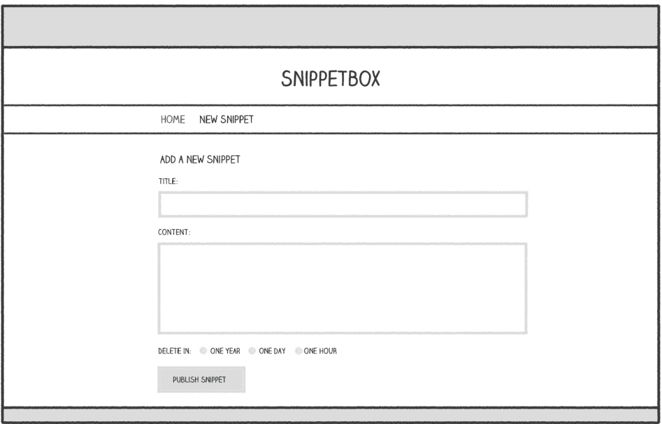

处理此表单的高级流程将遵循标准的 Post-Redirect-Get 模式，其工作方式如下：

- 1. 当用户对 /snippet/create 发起 GET 请求时，会看到空白表单。
- 2. 用户填写表单，并通过向 /snippet/create 发送 POST 请求提交表单。
- 3. 表单数据将由我们的 snippetCreatePost 处理程序进行验证。如果存在任何验证失败，表单将重新显示并突出显示相应的表单字段。如果通过验证检查，新代码片段的数据将被添加到数据库中，然后我们会将用户重定向到 GET /snippet/view/{id}。

在本章中，你将学到：

- 如何解析并访问 POST 请求中发送的表单数据。
- 对表单数据执行常见验证检查的一些技巧。
- 一种用户友好的模式，用于向用户发出验证失败警报，并使用先前提交的数据重新填充表单字段。
- 如何通过使用表单处理和验证的辅助函数来保持处理程序的整洁。

## 设置 HTML 表单

让我们首先创建一个新的 ui/html/pages/create.tmpl 文件来保存表单的 HTML：

```
$ touch ui/html/pages/create.tmpl
```

……然后添加以下标记，使用本书前面使用的相同模板模式。

文件：ui/html/pages/create.tmpl

{{define "title"}}Create a New Snippet{{end}}

{{define "main"}}
<form action='/snippet/create' method='POST'>
	<div>
		<label>Title:</label>
		<input type='text' name='title'>
	</div>
	<div>
		<label>Content:</label>
		<textarea name='content'></textarea>
	</div>
	<div>
		<label>Delete in:</label>
		<input type='radio' name='expires' value='365' checked> One Year
		<input type='radio' name='expires' value='7'> One Week
		<input type='radio' name='expires' value='1'> One Day
	</div>
	<div>
		<input type='submit' value='Publish snippet'>
	</div>
</form>
{{end}}
```

到目前为止，这里没有什么特别之处。我们的主模板包含一个标准 HTML 表单，用于发送三个表单值：title、content 和 expires（代码片段应过期的天数）。真正需要指出的是表单的 action 和 method 属性——我们已经设置好，以便在提交表单时将数据 POST 到 URL /snippet/create。

现在让我们为应用程序的导航栏添加一个新的“创建代码片段”链接，以便单击它将带用户访问此新表单。

文件：ui/html/partials/nav.tmpl

{{define "nav"}}
<nav>
  <a href="/">Home</a>
  <!-- Add a link to the new form -->
  <a href="/snippet/create">Create snippet</a>
</nav>
{{end}}
```

最后，我们需要更新 snippetCreate 处理程序，以便它呈现我们的新页面，如下所示：

文件：cmd/web/handlers.go

package main

...

func (app *application) snippetCreate(w http.ResponseWriter, r *http.Request) {
  data := app.newTemplateData(r)

  app.render(w, r, http.StatusOK, "create.tmpl", data)
}

...
```

此时，你可以启动应用程序并在浏览器中访问 http://localhost:4000/snippet/create。你应该会看到一个如下所示的表单：


- 主页
- 创建代码片段

标题：

内容：

过期时间：

- 一年
- 一周
- 一天

发布代码片段

## 解析表单数据

多亏了我们之前在基础章节中完成的工作，任何对 POST /snippets/create 的请求都已经被分发到我们的 snippetCreatePost 处理程序。我们现在将更新此处理程序，以在提交时处理和使用表单数据。

从高层次来看，我们可以将其分解为两个不同的步骤。

- 首先，我们需要使用 r.ParseForm() 方法来解析请求体。这会检查请求体是否格式正确，然后将表单数据存储到请求的 r.PostForm 映射中。如果在解析主体时遇到任何错误（例如没有主体，或主体太大无法处理），则会返回错误。r.ParseForm() 方法也是幂等的；可以在同一请求上多次安全调用，而不会产生任何副作用。

- 然后，我们可以通过使用 r.PostForm.Get() 方法来获取 r.PostForm 中包含的表单数据。例如，我们可以使用 r.PostForm.Get("title") 检索 title 字段的值。如果表单中没有匹配的字段名，则会返回空字符串 ""。

打开你的 cmd/web/handlers.go 文件，并更新它以包含以下代码：

文件：cmd/web/handlers.go

package main

...

func (app *application) snippetCreatePost(w http.ResponseWriter, r *http.Request) {
	// First we call r.ParseForm() which adds any data in POST request bodies
	// to the r.PostForm map. This also works in the same way for PUT and PATCH
	// requests. If there are any errors, we use our app.ClientError() helper to
	// send a 400 Bad Request response to the user.
	err := r.ParseForm()
	if err != nil {
		app.clientError(w, http.StatusBadRequest)
		return
	}

	// Use the r.PostForm.Get() method to retrieve the title and content
	// from the r.PostForm map.
	title := r.PostForm.Get("title")
	content := r.PostForm.Get("content")

	// The r.PostForm.Get() method always returns the form data as a *string*.
	// However, we're expecting our expires value to be a number, and want to
	// represent it in our Go code as an integer. So we need to manually convert
	// the form data to an integer using strconv.Atoi(), and we send a 400 Bad
	// Request response if the conversion fails.
	expires, err := strconv.Atoi(r.PostForm.Get("expires"))
	if err != nil {
		app.clientError(w, http.StatusBadRequest)
		return
	}

	id, err := app.snippets.Insert(title, content, expires)
	if err != nil {
		app.serverError(w, r, err)
		return
	}

	http.Redirect(w, r, fmt.Sprintf("/snippet/view/%d", id), http.StatusSeeOther)
}
```

好了，让我们试一下！重新启动应用程序，并尝试使用代码片段的标题和内容填写表单，大致如下：

## 代码片段盒

主页 创建代码片段

标题：

时不时

内容：

时不时
云朵让赏月者
得以休息。
- 松尾芭蕉

过期时间：

- 一年
- 一周
- 一天

发布代码片段

然后提交表单。如果一切正常，你应该会被重定向到一个显示新代码片段的页面，如下所示：


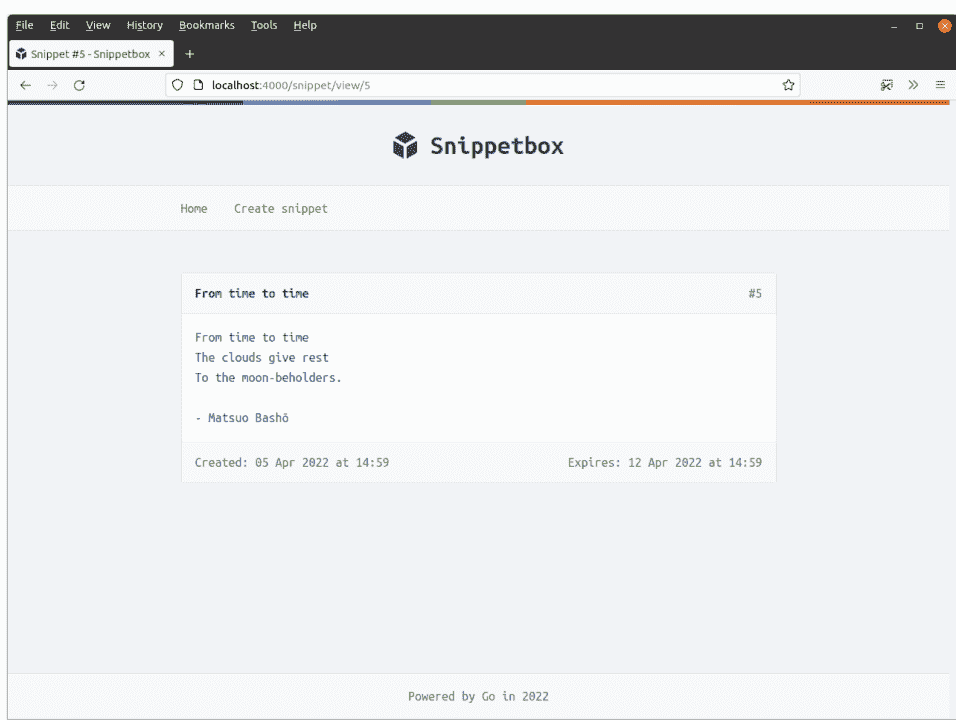

## 其他信息

### PostFormValue 方法

`net/http` 包还提供了 `r.PostFormValue()` 方法，这本质上是一个快捷函数，它会为你调用 `r.ParseForm()`，然后从 `r.PostForm` 中获取相应的字段值。

我建议避免使用这个快捷方式，因为它会静默忽略 `r.ParseForm()` 返回的任何错误。如果使用它，解析步骤可能会遇到错误并导致用户请求失败，但没有反馈机制来让他们（或你）知道问题。

### 多值字段

严格来说，本章使用的 `r.PostForm.Get()` 方法只返回特定表单字段的第一个值。这意味着你无法将其用于可能发送多个值的表单字段，例如一组复选框。

```
<input type="checkbox" name="items" value="foo"> Foo
<input type="checkbox" name="items" value="bar"> Bar
<input type="checkbox" name="items" value="baz"> Baz
```

在这种情况下，你需要直接操作 `r.PostForm` 映射。`r.PostForm` 映射的底层类型是 `url.Values`，而 `url.Values` 的底层类型又是 `map[string][]string`。因此，对于具有多个值的字段，你可以遍历底层映射来访问它们，如下所示：

```
for i, item := range r.PostForm["items"] {
	fmt.Fprintf(w, "%d: Item %s\n", i, item)
}
```

## 限制表单大小

默认情况下，使用 POST 方法提交的表单数据大小限制为 10MB。例外情况是，如果表单具有 enctype="multipart/form-data" 属性且正在发送多部分数据，则没有默认限制。

如果要更改 10MB 限制，可以像这样使用 `http.MaxBytesReader()` 函数：

```
// Limit the request body size to 4096 bytes
r.Body = http.MaxBytesReader(w, r.Body, 4096)

err := r.ParseForm()
if err != nil {
	http.Error(w, "Bad Request", http.StatusBadRequest)
	return
}
```

使用这段代码，在 r.ParseForm() 期间只会读取请求体的前 4096 字节。尝试读取超出此限制会导致 MaxBytesReader 返回错误，随后会由 r.ParseForm() 抛出。

此外——如果达到限制——MaxBytesReader 会在 http.ResponseWriter 上设置一个标志，指示服务器关闭底层 TCP 连接。

## 查询字符串参数

如果你有一个使用 HTTP GET 方法（而非 POST）提交数据的表单，则表单数据将作为 URL 查询字符串参数包含在内。例如，如果你有一个如下所示的 HTML 表单：

```
<form action='/foo/bar' method='GET'>
<input type='text' name='title'>
<input type='text' name='content'>
<input type='submit' value='Submit'>
</form>
```

提交表单时，它将发送一个 URL 如下所示的 GET 请求：
/foo/bar?title=value&content=value.

你可以在处理程序中通过 `r.URL.Query().Get()` 方法获取查询字符串参数的值。这将始终返回参数的字符串值，如果不存在匹配参数，则返回空字符串 ""。例如：

```
func exampleHandler(w http.ResponseWriter, r *http.Request) {
title := r.URL.Query().Get("title")
content := r.URL.Query().Get("content")
...
}
```

### r.Form 映射

访问查询字符串参数的另一种方式是通过 `r.Form` 映射。这与本章使用的 `r.PostForm` 映射类似，不同之处在于它包含任何 POST 请求正文和任何查询字符串参数中的表单数据。

假设你的处理程序中有如下所示的代码：

```
err := r.ParseForm()
if err != nil {
http.Error(w, "Bad Request", http.StatusBadRequest)
return
}

title := r.Form.Get("title")
```

在这段代码中，`r.Form.Get("title")` 行将从 POST 请求正文或名为 title 的查询字符串参数中返回 title 值。如果发生冲突，请求正文的值将优先于查询字符串参数。

如果希望你的应用程序不关心数据值是如何传递给它的，使用 `r.Form` 会非常有帮助。但在该场景之外，`r.Form` 没有任何优势，通过 `r.PostForm` 从 POST 请求正文读取数据或通过 `r.URL.Query().Get()` 从查询字符串参数读取数据，读起来更清晰、更明确。

## 验证表单数据

目前我们的代码有一个明显的问题：我们根本没有以任何方式验证来自表单的（不可信）用户输入。我们应该这样做，以确保表单数据存在、类型正确，并符合我们的任何业务规则。

具体来说，对于这个表单我们希望：

- 检查 title 和 content 字段不为空。
- 检查 title 字段长度不超过 100 个字符。
- 检查 expires 值是否完全匹配我们允许的值之一（1、7 或 365 天）。

使用一些 if 语句以及 Go 的 strings 和 unicode/utf8 包中的各种函数，实现所有这些检查都相当简单。

打开 handlers.go 文件，并更新 snippetCreatePost 处理程序以包含相应的验证规则，如下所示：

```
File: cmd/web/handlers.go

package main

import (
	"errors"
	"fmt"
	"net/http"
	"strconv"
	"strings" // New import
	"unicode/utf8" // New import

	"snippetbox.alexedwards.net/internal/models"
)

...

func (app *application) snippetCreatePost(w http.ResponseWriter, r *http.Request) {
	err := r.ParseForm()
	if err != nil {
		app.clientError(w, http.StatusBadRequest)
		return
	}

	title := r.PostForm.Get("title")
	content := r.PostForm.Get("content")

	expires, err := strconv.Atoi(r.PostForm.Get("expires"))
	if err != nil {
		app.clientError(w, http.StatusBadRequest)
		return
	}

// Initialize a map to hold any validation errors for the form fields.
fieldErrors := make(map[string]string)

// Check that the title value is not blank and is not more than 100
// characters long. If it fails either of those checks, add a message to the
// errors map using the field name as the key.
if strings.TrimSpace(title) == "" {
    fieldErrors["title"] = "This field cannot be blank"
} else if utf8.RuneCountInString(title) > 100 {
    fieldErrors["title"] = "This field cannot be more than 100 characters long"
}

// Check that the Content value isn't blank.
if strings.TrimSpace(content) == "" {
    fieldErrors["content"] = "This field cannot be blank"
}

// Check the expires value matches one of the permitted values (1, 7 or
// 365).
if expires != 1 && expires != 7 && expires != 365 {
    fieldErrors["expires"] = "This field must equal 1, 7 or 365"
}

// If there are any errors, dump them in a plain text HTTP response and
// return from the handler.
if len(fieldErrors) > 0 {
    fmt.Fprint(w, fieldErrors)
    return
}

id, err := app.snippets.Insert(title, content, expires)
if err != nil {
    app.serverError(w, r, err)
    return
}

http.Redirect(w, r, fmt.Sprintf("/snippet/view/%d", id), http.StatusSeeOther)
}
```

**注意：** 在检查 `title` 字段长度时，我们使用的是 `utf8.RuneCountInString()` 函数，而不是 Go 的 `len()` 函数。这将统计 title 中 *Unicode 代码点* 的数量，而不是字节数。为了说明区别，字符串 "Zoë" 包含 3 个 Unicode 代码点，但由于带变音符号的 ë 字符，占用 4 个字节。

好了，让我们试一下！重启应用程序，尝试提交带有过长的代码片段标题和空白内容字段的表单，大致如下...

## Snippetbox

首页 创建代码片段

标题：

Lorem ipsum dolor sit amet, consectetur adipiscing elit. Donec malesuada pretium orci

内容：

- 删除时间：一年 一周 一天

发布代码片段

你应该会看到类似下面的适当验证失败消息转储：

map[content:This field cannot be blank title:This field cannot be more than 100 characters long]

提示：你可以在这篇博文中找到大量处理和验证不同类型输入的代码模式。


## 显示错误并重新填充字段

现在 snippetCreate 处理程序正在验证数据，下一步是优雅地管理这些验证错误。

如果存在任何验证错误，我们希望重新显示 HTML 表单，突出显示验证失败的字段，并自动重新填充之前提交的任何数据（这样用户就不需要再次输入了）。

要做到这一点，让我们先向 templateData 结构体添加一个新的 Form 字段：

File: cmd/web/templates.go

```go
package main

import (
	"html/template"
	"path/filepath"
	"time"

	"snippetbox.alexedwards.net/internal/models"
)

// Add a Form field with the type "any".
type templateData struct {
	CurrentYear int
	Snippet     models.Snippet
	Snippets    []models.Snippet
	Form        any
}

...
```

我们将使用此 Form 字段在重新显示表单时将验证错误和之前提交的数据传回模板。

接下来，让我们回到 cmd/web/handlers.go 文件，定义一个新的 snippetCreateForm 结构体来保存表单数据和任何验证错误，并更新 snippetCreatePost 处理程序以使用它。

如下所示：

File: cmd/web/handlers.go

```go
package main

...

// Define a snippetCreateForm struct to represent the form data and validation
// errors for the form fields. Note that all the struct fields are deliberately
// exported (i.e. start with a capital letter). This is because struct fields
// must be exported in order to be read by the html/template package when
// rendering the template.
type snippetCreateForm struct {
	Title   string
	Content string
	Expires int
	FieldErrors map[string]string
}

func (app *application) snippetCreatePost(w http.ResponseWriter, r *http.Request) {
	err := r.ParseForm()
	if err != nil {
		app.clientError(w, http.StatusBadRequest)
		return
	}

	// Get the expires value from the form as normal.
	expires, err := strconv.Atoi(r.PostForm.Get("expires"))
	if err != nil {
		app.clientError(w, http.StatusBadRequest)
		return
	}

	// Create an instance of the snippetCreateForm struct containing the values
	// from the form and an empty map for any validation errors.
	form := snippetCreateForm{
		Title:   r.PostForm.Get("title"),
		Content: r.PostForm.Get("content"),
		Expires: expires,
		FieldErrors: map[string]string{},
	}

	// Update the validation checks so that they operate on the snippetCreateForm
	// instance.
	if strings.TrimSpace(form.Title) == "" {
		form.FieldErrors["title"] = "This field cannot be blank"
	} else if utf8.RuneCountInString(form.Title) > 100 {
		form.FieldErrors["title"] = "This field cannot be more than 100 characters long"
	}

	if strings.TrimSpace(form.Content) == "" {
		form.FieldErrors["content"] = "This field cannot be blank"
	}

	if form.Expires != 1 && form.Expires != 7 && form.Expires != 365 {
		form.FieldErrors["expires"] = "This field must equal 1, 7 or 365"
	}

	// If there are any validation errors, then re-display the create.tmpl template,
	// passing in the snippetCreateForm instance as dynamic data in the Form
	// field. Note that we use the HTTP status code 422 Unprocessable Entity
	// when sending the response to indicate that there was a validation error.
	if len(form.FieldErrors) > 0 {
		data := app.newTemplateData(r)
		data.Form = form
		app.render(w, r, http.StatusUnprocessableEntity, "create.tmpl", data)
		return
	}

	// We also need to update this line to pass the data from the
	// snippetCreateForm instance to our Insert() method.
	id, err := app.snippets.Insert(form.Title, form.Content, form.Expires)
	if err != nil {
		app.serverError(w, r, err)
		return
	}

	http.Redirect(w, r, fmt.Sprintf("/snippet/view/%d", id), http.StatusSeeOther)
}
```

好的，现在当存在任何验证错误时，我们会通过模板数据的 Form 字段，以 snippetCreateForm 结构体的形式将之前的数据和验证错误传入 create.tmpl 模板并重新显示它。

如果愿意，你现在应该能够运行应用程序，代码应该可以无任何错误地编译。

## 更新 HTML 模板

下一步我们需要做的是更新 create.tmpl 模板，以显示验证错误并重新填充任何之前的数据。

重新填充表单数据相当简单——我们应该能够使用 {{.Form.Title}} 和 {{.Form.Content}} 之类的标签在模板中渲染它们，就像我们之前在书中显示代码片段数据时那样。

对于验证错误，我们的 FieldErrors 字段的底层类型是 map[string]string，它使用表单字段名称作为键。对于映射，可以通过简单地链接键名来访问给定键的值。例如，要在模板中渲染 title 字段的验证错误，可以使用标签 {{.Form.FieldErrors.title}}。

> 注意：与结构体字段不同，映射键名不必大写才能从模板中访问它们。

有了这一点，让我们更新 create.tmpl 文件以重新填充数据，并在字段存在时显示每个字段的错误消息。

File: ui/html/pages/create.tmpl

```html
{{define "title"}}Create a New Snippet{{end}}

{{define "main"}}
<form action='/snippet/create' method='POST'>
<div>
<label>Title:</label>
<!-- Use the 'with' action to render the value of .Form.FieldErrors.title
if it is not empty. -->
{{with .Form.FieldErrors.title}}
<label class="error">{{.}}</label>
{{end}}
<!-- Re-populate the title data by setting the 'value' attribute. -->
<input type='text' name='title' value='{{.Form.Title}}'>
</div>
<div>
<label>Content:</label>
<!-- Likewise render the value of .Form.FieldErrors.content if it is
empty. -->
{{with .Form.FieldErrors.content}}
<label class="error">{{.}}</label>
{{end}}
<!-- Re-populate the content data as the inner HTML of the textarea. -->
<textarea name='content'>{{.Form.Content}}</textarea>
</div>
<div>
<label>Expires in:</label>
<!-- And render the value of .Form.FieldErrors.expires if it is not empty. -->
{{with .Form.FieldErrors.expires}}
<label class="error">{{.}}</label>
{{end}}
<!-- Here we use the 'if' action to check if the value of the re-populated
expires field equals 365. If it does, then we render the 'checked'
attribute so that the radio input is re-selected. -->
<input type='radio' name='expires' value='365' {{if (eq .Form.Expires 365)}}checked{{end}}> One Year
<!-- And we do the same for the other possible values too... -->
<input type='radio' name='expires' value='7' {{if (eq .Form.Expires 7)}}checked{{end}}> One Week
<input type='radio' name='expires' value='1' {{if (eq .Form.Expires 1)}}checked{{end}}> One Day
</div>
<div>
<input type='submit' value='Publish snippet'>
</div>
</form>
{{end}}
```

希望这些标记和我们对 Go 模板动作的使用通常是清晰的——它只是使用我们之前在书中见过和讨论过的技术。

我们还需要做最后一件事。如果现在尝试运行应用程序，当我们首次访问 http://localhost:4000/snippet/create 处的表单时，会出现 500 Internal Server Error。这是因为我们的 snippetCreate 处理程序当前未为 templateData.Form 字段设置值，这意味着当 Go 尝试评估类似 {{with .Form.FieldErrors.title}} 的模板标签时，会因为 Form 为 nil 而导致错误。

让我们通过更新 snippetCreate 处理程序来修复它，使其初始化一个新的 snippetCreateForm 实例并将其传递给模板，如下所示：

File: cmd/web/handlers.go

```go
package main

...

func (app *application) snippetCreate(w http.ResponseWriter, r *http.Request) {
    data := app.newTemplateData(r)

    // Initialize a new snippetCreateForm instance and pass it to the template.
    // Notice how this is also a great opportunity to set any default or
    // 'initial' values for the form --- here we set the initial value for the
    // snippet expiry to 365 days.
    data.Form = snippetCreateForm{
        Expires: 365,
    }

    app.render(w, r, http.StatusOK, "create.tmpl", data)
}

...
```

现在完成了，请重新启动应用程序并在浏览器中访问 http://localhost:4000/snippet/create。您应该会发现页面正确渲染且没有任何错误。

然后尝试添加一些内容并更改默认过期时间，但保持标题字段为空，如下所示：


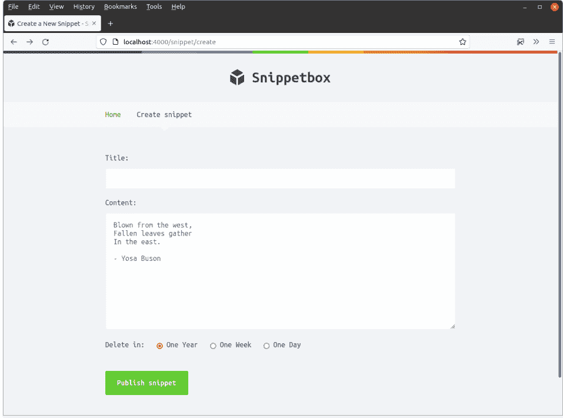

提交后，您现在应该会看到表单重新显示，其中包含正确重新填充的代码片段内容和过期选项，并且标题字段旁边会有一条“此字段不能为空”的错误消息：

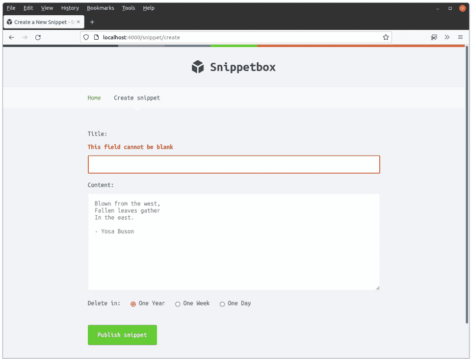

在继续之前，请随意花些时间摆弄表单和验证规则，直到您确信一切都按预期工作为止。

## 其他信息

## RESTful 路由

如果您有 Ruby on Rails、Laravel 或类似框架的背景，可能会好奇，为什么我们没有将路由和处理程序结构化得更“RESTful”，并如下所示：

| 路由模式 | 处理程序 | 操作 |
|---|---|---|
| GET /snippets | snippetIndex | 显示主页 |
| GET /snippets/{id} | snippetView | 显示特定代码片段 |
| GET /snippets/create | snippetCreate | 显示创建新代码片段的表单 |
| POST /snippets | snippetCreatePost | 保存新代码片段 |

原因有两个。

第一个原因是路由重叠——对 /snippets/create 的 HTTP 请求可能同时匹配 GET /snippets/{id} 和 GET /snippets/create 路由。在我们的应用中，代码片段 ID 始终是数字，因此这两条路由之间永远不会存在“真正的”重叠——但请设想，如果代码片段 ID 是用户生成的，或者是随机的 6 个字符的字符串，希望您能看出其中可能的问题。一般来说，重叠路由可能是应用程序中错误和意外行为的根源，如果可以，最好避免它们——如果不能，那么请谨慎小心地使用。

第二个原因是，/snippets/create 上呈现的 HTML 表单在提交时需要发送到 /snippets。这意味着，当我们重新渲染 HTML 表单以显示任何验证错误时，用户浏览器中的 URL 也会变更为 /snippets。这一点是否构成问题，见仁见智（YMMV）——大多数用户不会查看 URL，但我认为在用户体验方面这有点笨拙且令人困惑……尤其是如果对 /snippets 的 GET 请求通常呈现其他内容（例如所有代码片段的列表）时。

## 创建验证辅助函数

好吧，现在我们的应用程序正在根据业务规则验证表单数据，并优雅地处理任何验证错误。这很好，但要做到这一点花费了相当多的工作。

而且，虽然我们采用的方法作为一次性方案是可行的，但如果您的应用程序有_大量表单_，那么您的代码和验证规则中可能会出现大量重复。更不用说，编写表单验证代码并非消磨时间最令人兴奋的方式。

为了在本项目余下的部分中为验证提供帮助，我们将创建自己的小型 internal/validator 包，以抽象部分行为并减少处理程序中的样板代码。这不会改变应用程序对用户的运作方式；它实际上只是对代码库的重构。

## 添加验证器包

如果您正在跟着代码实践，请在自己的机器上创建以下目录和文件：

```
$ mkdir internal/validator
$ touch internal/validator/validator.go
```

然后在这个新的 internal/validator/validator.go 文件中添加以下代码：

```
File: internal/validator/validator.go

package validator

import (
	"slices"
	"strings"
	"unicode/utf8"
)

// Define a new Validator struct which contains a map of validation error messages
// for our form fields.
type Validator struct {
	FieldErrors map[string]string
}

// Valid() returns true if the FieldErrors map doesn't contain any entries.
func (v *Validator) Valid() bool {
	return len(v.FieldErrors) == 0
}

// AddFieldError() adds an error message to the FieldErrors map (so long as no
// entry already exists for the given key).
func (v *Validator) AddFieldError(key, message string) {
	// Note: We need to initialize the map first, if it isn't already
	// initialized.
	if v.FieldErrors == nil {
		v.FieldErrors = make(map[string]string)
	}

	if _, exists := v.FieldErrors[key]; !exists {
		v.FieldErrors[key] = message
	}
}

// CheckField() adds an error message to the FieldErrors map only if a
// validation check is not 'ok'.
func (v *Validator) CheckField(ok bool, key, message string) {
	if !ok {
		v.AddFieldError(key, message)
	}
}

// NotBlank() returns true if a value is not an empty string.
func NotBlank(value string) bool {
	return strings.TrimSpace(value) != ""
}

// MaxChars() returns true if a value contains no more than n characters.
func MaxChars(value string, n int) bool {
	return utf8.RuneCountInString(value) <= n
}

// PermittedValue() returns true if a value is in a list of specific permitted
// values.
func PermittedValue[T comparable](value T, permittedValues ...T) bool {
	return slices.Contains(permittedValues, value)
}

```

总结一下：

在上面的代码中，我们定义了一个包含错误消息映射的 Validator 结构体类型。Validator 类型提供了一个 CheckField() 方法，用于有条件地向映射中添加错误，还提供了一个 Valid() 方法，用于返回错误映射是否为空。我们还添加了 NotBlank()、MaxChars() 和 PermittedValue() 函数，以帮助我们执行某些特定的验证检查

> **注意：** PermittedValue() 函数是一个*泛型函数*，它适用于不同类型的值。我们将在本章末尾更详细地讨论泛型。

从概念上讲，这个 Validator 类型相当基础，但这并非坏事。正如我们在本书中将看到的，它在实践中出人意料地强大，并让我们对验证检查及其执行方式有很大的灵活性和控制力。

## 使用辅助函数

好了，让我们开始使用 Validator 类型吧！

我们将返回 cmd/web/handlers.go 文件，在 snippetCreateForm 结构体中*嵌入*一个 Validator 结构体，然后使用它来对表单数据执行必要的验证检查。

> **提示：** 如果您不熟悉 Go 中结构体嵌入的概念，Eli Bendersky 在这篇文章中写了一篇不错的入门介绍，我建议您在继续之前快速阅读一下。

如下所示：

```
File: cmd/web/handlers.go

package main

import (
	"errors"
	"fmt"
	"net/http"
	"strconv"

	"snippetbox.alexedwards.net/internal/models"
	"snippetbox.alexedwards.net/internal/validator" // New import
)

...

// Remove the explicit FieldErrors struct field and instead embed the Validator
// struct. Embedding this means that our snippetCreateForm "inherits" all the
// fields and methods of our Validator struct (including the FieldErrors field).
type snippetCreateForm struct {
	Title		 string
	Content		 string
	Expires		 int
	validator.Validator
}

func (app *application) snippetCreatePost(w http.ResponseWriter, r *http.Request) {
	err := r.ParseForm()
	if err != nil {
		app.clientError(w, http.StatusBadRequest)
		return
	}

	expires, err := strconv.Atoi(r.PostForm.Get("expires"))
	if err != nil {
		app.clientError(w, http.StatusBadRequest)
		return
	}

	form := snippetCreateForm{
		Title:  r.PostForm.Get("title"),
		Content: r.PostForm.Get("content"),
		Expires: expires,
	}
	// Remove the FieldErrors assignment from here.

	// Because the Validator struct is embedded by the snippetCreateForm struct,
	// we can call CheckField() directly on it to execute our validation checks.
	// CheckField() will add the provided key and error message to the
	// FieldErrors map if the check does not evaluate to true. For example, in
	// the first line here we "check that the form.Title field is not blank". In
	// the second, we "check that the form.Title field has a maximum character
	// length of 100" and so on.
	form.CheckField(validator.NotBlank(form.Title), "title", "This field cannot be blank")
	form.CheckField(validator.MaxChars(form.Title, 100), "title", "This field cannot be more than 100 characters long")
	form.CheckField(validator.NotBlank(form.Content), "content", "This field cannot be blank")
	form.CheckField(validator.PermittedValue(form.Expires, 1, 7, 365), "expires", "This field must equal 1, 7 or 365")

	// Use the Valid() method to see if any of the checks failed. If they did,
	// then re-render the template passing in the form in the same way as
	// before.
	if !form.Valid() {
		data := app.newTemplateData(r)
		data.Form = form
		app.render(w, r, http.StatusUnprocessableEntity, "create.tmpl", data)
		return
	}

	id, err := app.snippets.Insert(form.Title, form.Content, form.Expires)
	if err != nil {
		app.serverError(w, r, err)
		return
	}

	http.Redirect(w, r, fmt.Sprintf("/snippet/view/%d", id), http.StatusSeeOther)
}
```

这样做效果非常好。

我们现在拥有一个 internal/validator 包，其中包含可跨应用程序复用的验证规则和逻辑，并且可以轻松扩展以包含其他规则


未来。表单数据和错误都被整齐地封装在一个 snippetCreateForm 结构体中——我们可以轻松地将其传递给模板——并且在模板中显示错误消息和重新填充数据的语法简单且一致。

如果你愿意，现在可以重新运行应用程序。如果一切正常，你应该发现表单和验证规则工作正确，并且方式与之前完全相同。

## 补充信息

## 泛型

Go 1.18 是语言中第一个支持泛型的版本——泛型也被称为更技术性的名称：参数多态。广义上讲，泛型允许你编写适用于不同具体类型的代码。

例如，在 Go 的旧版本中，如果你想统计某个特定值在 []string 切片和 []int 切片中出现的次数，你需要编写两个独立的函数——一个用于 []string 类型，另一个用于 []int 类型。大致如下：

```
// Count how many times the value v appears in the slice s.
func countString(v string, s []string) int {
	count := 0
	for _, vs := range s {
		if v == vs {
			count++
		}
	}
	return count
}

func countInt(v int, s []int) int {
	count := 0
	for _, vs := range s {
		if v == vs {
			count++
		}
	}
	return count
}
```

现在，借助泛型，可以编写一个单一的 count() 函数，它适用于 []string、[]int 或任何其他可比较类型的切片。代码如下所示：

```go
func count[T comparable](v T, s []T) int {
	count := 0
	for _, vs := range s {
		if v == vs {
			count++
		}
	}
	return count
}
```

如果你不熟悉 Go 中泛型代码的语法，网上有很多优秀的资料可以解释泛型的工作原理，并引导你了解编写泛型代码的语法。

为了快速上手，我强烈建议阅读 **官方 Go 泛型教程**，并观看 **此视频** 的前 15 分钟，以帮助巩固你所学的内容。

与在此重复相同的信息不同，我希望简要讨论一个不太常见（但同样重要！）的话题：*何时* 使用泛型。

至少目前，你应当审慎且谨慎地使用泛型。

我知道这听起来可能有点枯燥，但泛型是一个相对较新的语言特性，围绕编写泛型代码的最佳实践仍在建立之中。如果你在团队中工作，或在公开编写代码，也值得牢记：并非所有其他 Go 开发者都一定熟悉泛型代码的工作原理。

你不 *需要* 使用泛型，不使用也没关系。

但即使有这些注意事项，在某些场景下编写泛型代码也非常有用。非常大致地说，你可能需要考虑：

- 当你发现自己为不同数据类型编写重复的样板代码时。例如，对切片、映射或通道执行常见操作，或者用于对不同数据类型执行验证检查或测试断言的辅助函数。

- 当你在编写代码时发现自己想使用 `any`（空 `interface{}`）类型时。例如，当你创建一个需要对不同类型进行操作的数据结构（如队列、缓存或链表）时。

相比之下，你可能不想使用泛型：

- 如果这会让你的代码更难理解或不够清晰。

- 如果你需要处理的所有类型都具有一组共同的方法——在这种情况下，最好定义并使用普通的 `interface` 类型。

- 仅仅 *因为你可以*。最好默认编写非泛型代码，只有在实际需要时才切换到泛型版本。

## 自动表单解析

我们可以通过使用 `go-playground/form` 或 `gorilla/schema` 等第三方包，将表单数据自动解码到 `snippetCreateForm` 结构体中，从而进一步简化 `snippetCreatePost` 处理程序。使用自动解码器是 *完全可选的*，但它可以帮助你节省时间和输入——特别是当你的应用程序有大量表单，或者需要处理非常大的表单时。

在本章中，我们将探讨如何使用 `go-playground/form` 包。如果你在跟随学习，请继续安装它，如下所示：

```
$ go get github.com/go-playground/form/v4@v4
go get: added github.com/go-playground/form/v4 v4.2.1
```

### 使用表单解码器

要使其工作，我们需要做的第一件事是在 `main.go` 文件中初始化一个新的 `*form.Decoder` 实例，并将其作为依赖项提供给处理程序。如下所示：

文件：cmd/web/main.go

```go
package main

import (
	"database/sql"
	"flag"
	"html/template"
	"log/slog"
	"net/http"
	"os"

	"snippetbox.aledwards.net/internal/models"

	"github.com/go-playground/form/v4" // New import
	_ "github.com/go-sql-driver/mysql"
)

// Add a formDecoder field to hold a pointer to a form.Decoder instance.
type application struct {
	logger      *slog.Logger
	snippets    *models.SnippetModel
	templateCache map[string]*template.Template
	formDecoder *form.Decoder
}

func main() {
	addr := flag.String("addr", ":4000", "HTTP network address")
	dsn := flag.String("dsn", "web:pass@/snippetbox?parseTime=true", "MySQL data source name")
	flag.Parse()

	logger := slog.New(slog.NewTextHandler(os.Stdout, nil))

	db, err := openDB(*dsn)
	if err != nil {
		logger.Error(err.Error())
		os.Exit(1)
	}

	defer db.Close()

	templateCache, err := newTemplateCache()
	if err != nil {
		logger.Error(err.Error())
		os.Exit(1)
	}

	// Initialize a decoder instance...
	formDecoder := form.NewDecoder()

	// And add it to the application dependencies.
	app := &application{
		logger:      logger,
		snippets:    &models.SnippetModel{DB: db},
		templateCache: templateCache,
		formDecoder: formDecoder,
	}

	logger.Info("starting server", "addr", *addr)

	err = http.ListenAndServe(*addr, app.routes())
	logger.Error(err.Error())
	os.Exit(1)
}
...
```

接下来，让我们转到 cmd/web/handlers.go 文件并更新它以使用这个新解码器，如下所示：

文件：cmd/web/handlers.go

```go
package main

...

// Update our snippetCreateForm struct to include struct tags which tell the
// decoder how to map HTML form values into the different struct fields. So, for
// example, here we're telling the decoder to store the value from the HTML form
// input with the name "title" in the Title field. The struct tag `form:"-"`
// tells the decoder to completely ignore a field during decoding.
type snippetCreateForm struct {
	Title             string `form:"title"`
	Content           string `form:"content"`
	Expires           int    `form:"expires"`
	validator.Validator `form:"-"`
}

func (app *application) snippetCreatePost(w http.ResponseWriter, r *http.Request) {
	err := r.ParseForm()
	if err != nil {
		app.clientError(w, http.StatusBadRequest)
		return
	}

	// Declare a new empty instance of the snippetCreateForm struct.
	var form snippetCreateForm

	// Call the Decode() method of the form decoder, passing in the current
	// request and *a pointer* to our snippetCreateForm struct. This will
	// essentially fill our struct with the relevant values from the HTML form.
	// If there is a problem, we return a 400 Bad Request response to the client.
	err = app.formDecoder.Decode(&form, r.PostForm)
	if err != nil {
		app.clientError(w, http.StatusBadRequest)
		return
	}

	// Then validate and use the data as normal...
	form.CheckField(validator.NotBlank(form.Title), "title", "This field cannot be blank")
	form.CheckField(validator.MaxChars(form.Title, 100), "title", "This field cannot be more than 100 characters long")
	form.CheckField(validator.NotBlank(form.Content), "content", "This field cannot be blank")
	form.CheckField(validator.PermittedValue(form.Expires, 1, 7, 365), "expires", "This field must equal 1, 7 or 365")

	if !form.Valid() {
		data := app.newTemplateData(r)
		data.Form = form
		app.render(w, r, http.StatusUnprocessableEntity, "create.tmpl", data)
		return
	}

	id, err := app.snippets.Insert(form.Title, form.Content, form.Expires)
	if err != nil {
		app.serverError(w, r, err)
		return
	}

	http.Redirect(w, r, fmt.Sprintf("/snippet/view/%d", id), http.StatusSeeOther)
}
```

希望你能看到这种模式的好处。我们可以使用简单的结构体标签来定义 HTML 表单与“目标”结构体字段之间的映射，并解包


将表单数据发送到目标现在只需我们编写几行代码即可——无论表单有多大。

重要的是，类型转换也会自动处理。我们可以在上面的代码中看到这一点，其中 expires 值会自动映射到 int 数据类型。

这很好。但有一个问题。

当我们调用 app.formDecoder.Decode() 时，它需要一个非空指针作为目标解码目标。如果我们尝试传入一个不是非空指针的内容，则 Decode() 会返回一个 form.InvalidDecoderError 错误。

如果这种情况发生，这表明我们的应用程序代码中存在关键问题（而非由不良输入引起的客户端错误）。因此，我们需要专门检查此错误并将其作为特例处理，而不仅仅是返回一个 400 Bad Request 响应。

## 创建 decodePostForm 辅助函数

为了协助此操作，让我们创建一个新的 decodePostForm() 辅助函数，它执行三件事：

- 对当前请求调用 r.ParseForm()。
- 调用 app.formDecoder.Decode() 将 HTML 表单数据解包到目标目标。
- 检查 form.InvalidDecoderError 错误，如果看到此错误则触发 panic。

如果你在跟随学习，请将此添加到你的 cmd/web/helpers.go 文件中，如下所示：

```
File: cmd/web/helpers.go

package main

import (
	"bytes"
	"errors" // New import
	"fmt"
	"net/http"
	"time"

	"github.com/go-playground/form/v4" // New import
)

...

// Create a new decodePostForm() helper method. The second parameter here, dst,
// is the target destination that we want to decode the form data into.
func (app *application) decodePostForm(r *http.Request, dst any) error {
	// Call ParseForm() on the request, in the same way that we did in our
	// snippetCreatePost handler.
	err := r.ParseForm()
	if err != nil {
		return err
	}

	// Call Decode() on our decoder instance, passing the target destination as
	// the first parameter.
	err = app.formDecoder.Decode(dst, r.PostForm)
	if err != nil {
		// If we try to use an invalid target destination, the Decode() method
		// will return an error with the type *form.InvalidDecoderError. We use
		// errors.As() to check for this and raise a panic rather than returning
		// the error.
		var invalidDecoderError *form.InvalidDecoderError

		if errors.As(err, &invalidDecoderError) {
			panic(err)
		}

		// For all other errors, we return them as normal.
		return err
	}

	return nil
}
```

完成此操作后，我们可以对 snippetCreatePost 处理程序进行最后的简化。请继续更新它以使用 decodePostForm() 辅助函数并删除 r.ParseForm() 调用，使代码如下所示：

```
File: cmd/web/handlers.go

package main

...

func (app *application) snippetCreatePost(w http.ResponseWriter, r *http.Request) {
	var form snippetCreateForm

	err := app.decodePostForm(r, &form)
	if err != nil {
		app.clientError(w, http.StatusBadRequest)

		return
	}

	form.CheckField(validator.NotBlank(form.Title), "title", "This field cannot be blank")
	form.CheckField(validator.MaxChars(form.Title, 100), "title", "This field cannot be more than 100 characters long")
	form.CheckField(validator.NotBlank(form.Content), "content", "This field cannot be blank")
	form.CheckField(validator.PermittedValue(form.Expires, 1, 7, 365), "expires", "This field must equal 1, 7 or 365")

	if !form.Valid() {
		data := app.newTemplateData(r)
		data.Form = form
		app.render(w, r, http.StatusUnprocessableEntity, "create.tmpl", data)
		return
	}

	id, err := app.snippets.Insert(form.Title, form.Content, form.Expires)
	if err != nil {
		app.serverError(w, r, err)
		return
	}

	http.Redirect(w, r, fmt.Sprintf("/snippet/view/%d", id), http.StatusSeeOther)
}
```

这看起来非常好。

我们的处理程序代码现在简洁明了，但在其行为和所做的事情方面仍然非常清晰。而且，我们已建立了表单处理和验证的通用模式，可以轻松地在项目中的其他表单上重复使用——例如我们即将构建的用户注册和登录表单。

## 有状态 HTTP

改善用户体验的一个好方法是在用户添加新代码片段后显示一次性确认消息。如下所示：

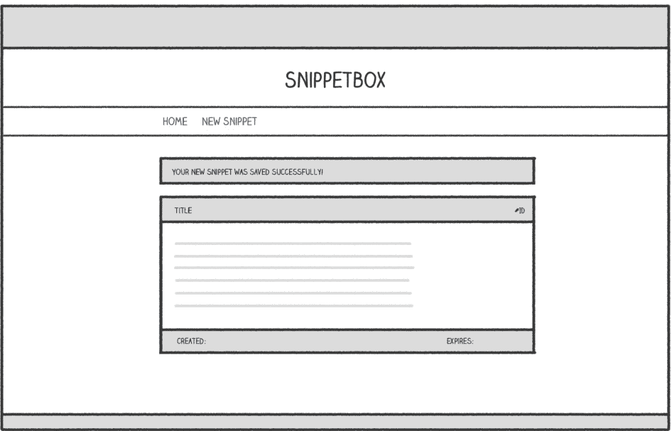

此类确认消息应该只对用户显示一次（在创建代码片段后立即显示），其他用户都不应看到该消息。如果你已经编程有一段时间了，你可能知道这种功能称为闪现消息或提示消息。

要实现此功能，我们需要在同一用户的 HTTP 请求之间开始共享数据（或状态）。最常见的方法是为用户实现会话。

在本节中，你将学习：

- 有哪些可用的会话管理器可以帮助我们在 Go 中实现会话。
- 如何使用会话安全可靠地在特定用户的请求之间共享数据。
- 如何根据应用程序的需求自定义会话行为（包括超时和 Cookie 设置）。

### 选择会话管理器

在使用会话时，有很多安全考虑因素，正确的实现并非易事。除非你真的需要自己实现，否则在这里使用现成的、经过充分测试的第三方包是个好主意。

我建议根据你的项目需求，使用 gorilla/sessions 或 alexedwards/scs 中的一个。

- gorilla/sessions 是 Go 中最成熟、最著名的会话管理包。它具有简单易用的 API，并允许你将会话数据存储在客户端（在签名和加密的 Cookie 中）或服务器端（在 MySQL、PostgreSQL 或 Redis 等数据库中）。

但是——重要的是——它不提供更新会话 ID 的机制（如果你使用服务器端会话存储，这是降低与会话固定攻击相关风险所必需的）。

- alexedwards/scs 只允许将会话数据存储在服务器端。它通过中间件支持会话数据的自动加载和保存，具有用于类型安全数据操作的良好接口，并且确实允许更新会话 ID。与 gorilla/sessions 类似，它也支持多种数据库（包括 MySQL、PostgreSQL 和 Redis）。

总之，如果你想将会话数据存储在 Cookie 中的客户端，那么 gorilla/sessions 是一个不错的选择，但否则 alexedwards/scs 通常是更好的选择，因为它支持更新会话 ID。

对于这个项目，我们已经设置好了 MySQL 数据库，因此我们将选择使用 alexedwards/scs 并将会话数据存储在服务器端的 MySQL 中。

如果你在跟随学习，请确保你在项目目录中，并按如下所示安装必要的包：

```
$ go get github.com/alexedwards/scs/v2@v2
go: downloading github.com/alexedwards/scs/v2 v2.8.0
go get: added github.com/alexedwards/scs/v2 v2.8.0

$ go get github.com/alexedwards/scs/mysqlstore/latest
go: downloading github.com/alexedwards/scs/mysqlstore v0.0.0-20240316133359-d7ab9d9831ec
go get: added github.com/alexedwards/scs/mysqlstore v0.0.0-20240316133359-d7ab9d9831ec
```

### 设置会话管理器

在本章中，我将介绍设置和使用 **alexedwards/scs** 包的基础知识，但如果你打算在生产应用程序中使用它，我建议阅读文档和 API 参考，以熟悉完整的功能范围。

我们需要做的第一件事是在 MySQL 数据库中创建一个 **sessions** 表，以保存用户的会话数据。首先以 **root** 用户身份从终端窗口连接到 MySQL，并执行以下 SQL 语句来设置 **sessions** 表：

```
USE snippetbox;

CREATE TABLE sessions (
    token CHAR(43) PRIMARY KEY,
    data BLOB NOT NULL,
    expiry TIMESTAMP(6) NOT NULL
);

CREATE INDEX sessions_expiry_idx ON sessions (expiry);
```

在这个表中：

- **token** 字段将为每个会话包含一个唯一的、随机生成的标识符。
- **data** 字段将包含你想要在 HTTP 请求之间共享的实际会话数据。这作为二进制数据存储在 **BLOB**（二进制大对象）类型中。
- **expiry** 字段将包含会话的过期时间。**scs** 包会自动从 **sessions** 表中删除过期的会话，以防止其过大。

接下来我们需要做的是在 **main.go** 文件中建立一个会话管理器，并通过 **application** 结构体将其提供给我们的处理程序。会话管理器保存我们会话的配置设置，还提供一些中间件和辅助方法来处理会话数据的加载和保存。

打开你的 **main.go** 文件并按如下所示更新它：

```
File: cmd/web/main.go

package main
import (
```


```go
"database/sql"
"flag"
"html/template"
"log/slog"
"net/http"
"os"
"time" // New import

"snippetbox.alexedwards.net/internal/models"

"github.com/alexedwards/scs/mysqlstore" // New import
"github.com/alexedwards/scs/v2"       // New import
"github.com/go-playground/form/v4"
    _ "github.com/go-sql-driver/mysql"
)

// Add a new sessionManager field to the application struct.
type application struct {
    logger            *slog.Logger
    snippets          *models.SnippetModel
    templateCache     map[string]*template.Template
    formDecoder       *form.Decoder
    sessionManager    *scs.SessionManager
}

func main() {
    addr := flag.String("addr", ":4000", "HTTP network address")
    dsn := flag.String("dsn", "web:pass@/snippetbox?parseTime=true", "MySQL data source name")
    flag.Parse()

    logger := slog.New(slog.NewTextHandler(os.Stdout, nil))

    db, err := openDB(*dsn)
    if err != nil {
        logger.Error(err.Error())
        os.Exit(1)
    }

    defer db.Close()

    templateCache, err := newTemplateCache()
    if err != nil {
        logger.Error(err.Error())
        os.Exit(1)
    }

    formDecoder := form.NewDecoder()

    // Use the scs.New() function to initialize a new session manager. Then we
    // configure it to use our MySQL database as the session store, and set a
    // lifetime of 12 hours (so that sessions automatically expire 12 hours
    // after first being created).
    sessionManager := scs.New()
    sessionManager.Store = mysqlstore.New(db)
    sessionManager.Lifetime = 12 * time.Hour

    // And add the session manager to our application dependencies.
    app := &application{
        logger:        logger,
        snippets:      &models.SnippetModel{DB: db},
        templateCache: templateCache,
        formDecoder:   formDecoder,
        sessionManager: sessionManager,
    }

    logger.Info("starting server", "addr", *addr)

    err = http.ListenAndServe(*addr, app.routes())
logger.Error(err.Error())
os.Exit(1)
}
...
```

**注意：** `scs.New()` 函数返回一个指向 `SessionManager` 结构体的指针，该结构体包含会话的配置设置。在上面的代码中，我们设置了该结构体的 `Store` 和 `Lifetime` 字段，但还有其他一些字段，你可以并应该根据应用程序的需求进行配置。

为了让会话正常工作，我们还需要使用 `SessionManager.LoadAndSave()` 方法提供的中间件来包装应用程序路由。这个中间件会在每次 HTTP 请求和响应时自动加载和保存会话数据。

重要的是要注意，我们不需要让这个中间件作用于 *所有* 应用程序路由。具体来说，我们不需要在 GET /static/ 路由上使用它，因为该路由仅提供静态文件服务，不需要任何有状态行为。

因此，将会话中间件添加到现有的标准中间件链中是没有意义的。

相反，让我们创建一个新的动态中间件链，仅包含适用于动态应用程序路由的中间件。

打开 routes.go 文件，按如下方式更新：

```
File: cmd/web/routes.go

package main

import (
	"net/http"

	"github.com/justinas/alice"
)

func (app *application) routes() http.Handler {
	mux := http.NewServeMux()

	// Leave the static files route unchanged.
	fileServer := http.FileServer(http.Dir("./ui/static/"))
	mux.Handle("GET /static/", http.StripPrefix("/static", fileServer))

	// Create a new middleware chain containing the middleware specific to our
	// dynamic application routes. For now, this chain will only contain the
	// LoadAndSave session middleware but we'll add more to it later.
	dynamic := alice.New(app.sessionManager.LoadAndSave)

	// Update these routes to use the new dynamic middleware chain followed by
	// the appropriate handler function. Note that because the alice ThenFunc()
	// method returns a http.Handler (rather than a http.HandlerFunc) we also
	// need to switch to registering the route using the mux.Handle() method.
	mux.Handle("GET /", dynamic.ThenFunc(app.home))
	mux.Handle("GET /snippet/view/{id}", dynamic.ThenFunc(app.snippetView))
	mux.Handle("GET /snippet/create", dynamic.ThenFunc(app.snippetCreate))
	mux.Handle("POST /snippet/create", dynamic.ThenFunc(app.snippetCreatePost))

	standard := alice.New(app.recoverPanic, app.logRequest, commonHeaders)

	return standard.Then(mux)
}
```

如果你现在运行应用程序，应该会发现它可以正常编译，并且你的应用程序路照常工作。

## 其他信息

## 不使用 alice

如果你不使用 justinas/alice 包来帮助管理中间件链，那么你需要使用 `http.HandlerFunc()` 适配器将 `app.home` 之类的处理函数转换为 `http.Handler`，然后使用会话中间件对其进行包装，如下所示：

```
mux := http.NewServeMux()
mux.Handle("GET /", app.sessionManager.LoadAndSave(http.HandlerFunc(app.home)))
mux.Handle("GET /snippet/view/:id", app.sessionManager.LoadAndSave(http.HandlerFunc(app.snippetView)))
// ... etc
```

## 使用会话数据

在本章中，让我们将会话功能投入使用，并利用它在我们之前讨论过的 HTTP 请求之间持久化确认闪存消息。

我们将从 `cmd/web/handlers.go` 文件入手，更新 `snippetCreatePost` 方法，以便仅在代码段成功创建时才向用户的会话数据中添加一条闪存消息。如下所示：

```
File: cmd/web/handlers.go

package main

...

func (app *application) snippetCreatePost(w http.ResponseWriter, r *http.Request) {
	var form snippetCreateForm

	err := app.decodePostForm(r, &form)
	if err != nil {
		app.clientError(w, http.StatusBadRequest)
		return
	}

	form.CheckField(validator.NotBlank(form.Title), "title", "This field cannot be blank")
	form.CheckField(validator.MaxChars(form.Title, 100), "title", "This field cannot be more than 100 characters long")
	form.CheckField(validator.NotBlank(form.Content), "content", "This field cannot be blank")
	form.CheckField(validator.PermittedValue(form.Expires, 1, 7, 365), "expires", "This field must equal 1, 7 or 365")

	if !form.Valid() {
		data := app.newTemplateData(r)
		data.Form = form
		app.render(w, r, http.StatusUnprocessableEntity, "create.tmpl", data)
		return
	}

	id, err := app.snippets.Insert(form.Title, form.Content, form.Expires)
	if err != nil {
		app.serverError(w, r, err)
		return
	}

	// Use the Put() method to add a string value ("Snippet successfully
	// created!") and the corresponding key ("flash") to the session data.
	app.sessionManager.Put(r.Context(), "flash", "Snippet successfully created!")

	http.Redirect(w, r, fmt.Sprintf("/snippet/view/%d", id), http.StatusSeeOther)
}
```

这很好且简单，但有几点需要说明：

- 我们传递给 `app.sessionManager.Put()` 的第一个参数是当前请求上下文。我们将在本书后面详细讨论请求上下文是什么以及如何使用它，但目前你可以将其视为会话管理器在处理程序处理请求时临时存储信息的地方。
- 第二个参数（在本例中是字符串 "flash"）是我们要添加到会话数据中的特定消息的键。我们之后也将使用这个键从会话数据中检索该消息。
- 如果当前用户没有现有会话（或者会话已过期），则会话中间件会自动为他们创建一个新的空会话。

接下来，我们希望 `snippetView` 处理程序检索闪存消息（如果当前用户的会话中存在该消息），并将其传递给 HTML 模板以供后续显示。

因为我们只想显示一次闪存消息，所以我们实际上想要从会话数据中检索并删除该消息。我们可以通过使用 `PopString()` 方法同时完成这两个操作。

我来演示：


File: cmd/web/handlers.go

package main

...

func (app *application) snippetView(w http.ResponseWriter, r *http.Request) {
	id, err := strconv.Atoi(r.PathValue("id"))
	if err != nil || id < 1 {
		http.NotFound(w, r)
		return
	}

	snippet, err := app.snippets.Get(id)
	if err != nil {
		if errors.Is(err, models.ErrNoRecord) {
			http.NotFound(w, r)
		} else {
			app.serverError(w, r, err)
		}
		return
	}

	// 使用 PopString() 方法检索 "flash" 键的值。
	// PopString() 还会从会话数据中删除键和值，因此它
	// 充当一次性获取。如果会话数据中没有匹配的键，
	// 这将返回空字符串。
	flash := app.sessionManager.PopString(r.Context(), "flash")

	data := app.newTemplateData(r)
	data.Snippet = snippet

	// 将 Flash 消息传递给模板。
	data.Flash = flash

	app.render(w, r, http.StatusOK, "view.tmpl", data)
}

...

> **信息:** 如果你只想从会话数据中检索值（并保留它），可以改用 `GetString()` 方法。`scs` 包还提供检索其他常见数据类型的方法，包括 `GetInt()`、`GetBool()`、`GetBytes()` 和 `GetTime()`。

如果你现在尝试运行应用程序，编译器会（很有道理地）抱怨 `Flash` 字段未在我们的 `templateData` 结构体中定义。请继续按以下方式添加它：

File: cmd/web/templates.go

package main

import (
	"html/template"
	"path/filepath"
	"time"

	"snippetbox.alexedwards.net/internal/models"
)

type templateData struct {
	CurrentYear int
	Snippet     models.Snippet
	Snippets    []models.Snippet
	Form        any
	Flash       string // 向 templateData 结构体添加 Flash 字段。
}

...

现在，我们可以更新 base.tmpl 文件以显示 Flash 消息（如果存在）。

File: ui/html/base.tmpl

{{define "base"}}
<!doctype html>
<html lang='en'>
	<head>
		<meta charset='utf-8'>
		<title>{{template "title" .}} - Snippetbox</title>
		<link rel='stylesheet' href='/static/css/main.css'>
		<link rel='shortcut icon' href='/static/img/favicon.ico' type='image/x-icon'>
		<link rel='stylesheet' href='https://fonts.googleapis.com/css?family=Ubuntu+Mono:400,700'>
	</head>
	<body>
		<header>
			<h1><a href='/'>Snippetbox</a></h1>
		</header>
		{{template "nav" .}}
		<main>
			<!-- 如果存在，则显示 Flash 消息 -->
			{{with .Flash}}
				<div class='flash'>{{.}}</div>
			{{end}}
			{{template "main" .}}
		</main>
		<footer>
			由 <a href='https://golang.org/'>Go 语言</a> 在 {{.CurrentYear}} 提供支持
		</footer>
		<script src='/static/js/main.js' type='text/javascript'></script>
	</body>
</html>
{{end}}

请记住，{{with .Flash}} 块仅在 .Flash 的值不是空字符串时才会执行。因此，如果当前用户的会话中没有 "flash" 键，结果就是新增的标记片段根本不会显示。

完成后，保存所有文件并重启应用程序。尝试按以下方式添加一个新代码段...

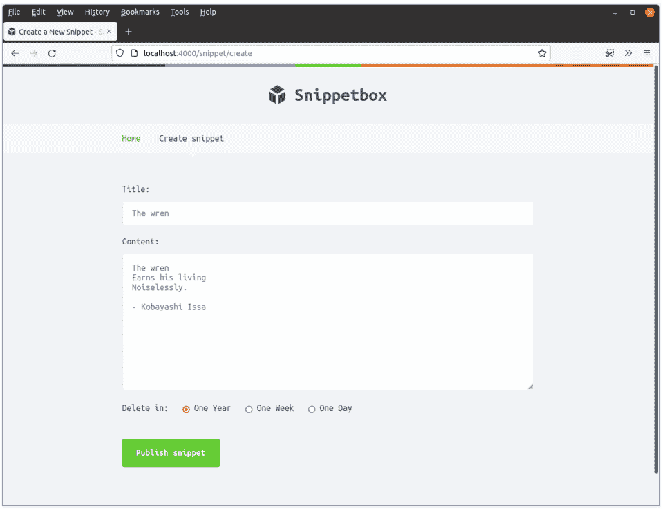

重定向后，你现在应该能看到 Flash 消息显示出来：

## 代码段创建成功！

## 鹪鹩

鹪鹩
悄无声息地
谋生。

- 小林一茂

创建时间：2022 年 4 月 5 日 16:21 到期时间：2023 年 4 月 5 日 16:21

如果你尝试刷新页面，可以确认 Flash 消息不再显示——它是在用户创建代码段后立即针对当前用户的一次性消息。

## 自动显示 Flash 消息

我们可以做的一项小改进（这将在项目后期节省一些工作）是自动化 Flash 消息的显示，以便任何消息在下次渲染任何页面时都自动包含在内。

我们可以通过使用之前制作的 newTemplateData() 辅助方法，将任何 Flash 消息添加到模板数据中来实现，如下所示：

File: cmd/web/helpers.go

package main

...

func (app *application) newTemplateData(r *http.Request) templateData {
	return templateData{
		CurrentYear: time.Now().Year(),
		// 如果存在，则将 Flash 消息添加到模板数据中。
		Flash: app.sessionManager.PopString(r.Context(), "flash"),
	}
}

...

做出此更改意味着我们不再需要在 `snippetView` 处理程序中检查 Flash 消息，代码可以恢复为如下所示：

File: cmd/web/handlers.go

package main

...

func (app *application) snippetView(w http.ResponseWriter, r *http.Request) {
	id, err := strconv.Atoi(r.PathValue("id"))
	if err != nil || id < 1 {
		http.NotFound(w, r)
		return
	}

	snippet, err := app.snippets.Get(id)
	if err != nil {
		if errors.Is(err, models.ErrNoRecord) {
			http.NotFound(w, r)
		} else {
			app.serverError(w, r, err)
		}
		return
	}

	data := app.newTemplateData(r)
	data.Snippet = snippet

	app.render(w, r, http.StatusOK, "view.tmpl", data)
}

...

请随意再次尝试运行应用程序并创建另一个代码段。你会发现 Flash 消息功能仍然按预期工作。

## 附加信息

## 会话管理幕后

我想花点时间来拆解会话管理背后的一些“魔法”，并解释它在幕后是如何工作的。

如果你愿意，可以打开网页浏览器的开发者工具，查看页面的 cookie 数据。你应该在请求数据中看到一个名为 session 的 cookie，类似于这样：

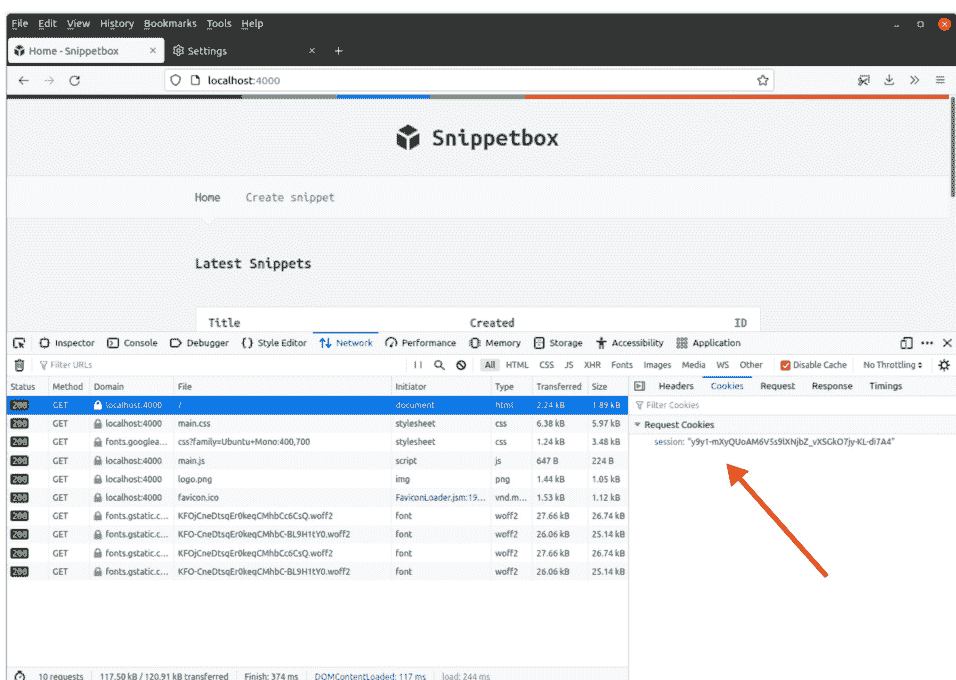

这是会话 cookie，你的浏览器发出的每个请求都会将其发送回 Snippetbox 应用程序。

会话 cookie 包含会话令牌——有时也称为会话 ID。会话令牌是一个高熵随机字符串，在我的例子中是 y9y1-mXyQUoAM6V5s9LXNjbZ_vXSGk07jy-KL-di7A4（你的会不同）。

重要的是要强调，会话令牌只是一个随机字符串。它本身不携带或传达任何会话数据（比如本章中我们设置的 Flash 消息）。

接下来，你或许可以打开一个终端连接 MySQL，并在 sessions 表上运行 SELECT 查询来查找浏览器中看到的会话令牌。如下所示：

```
mysql> SELECT * FROM sessions WHERE token = 'y9y1-mXyQUoAM6V5s9LXNjbZ_vXSGk07jy-KL-di7A4';
```

| token | data |
|-------|------|
| y9y1-mXyQUoAM6V5s9LXNjbZ_vXSGk07jy-KL-di7A4 | 0x26FFB1030102FF8200010201080446561646C696E67A4F00010656616C7565737401FF860000 |

1 row in set (0.00 sec)

这应该返回一条记录。这里的 data 值才是实际包含用户会话数据的东西。具体来说，我们看到的是一个 MySQL BLOB（二进制大对象），其中包含 gob 编码的会话数据表示形式。

每次我们更改会话数据时，此 data 值都会更新以反映更改。

最后，数据库中的最后一列是过期时间，之后会话将不再被视为有效。

所以，在我们的应用程序中，发生的情况是 LoadAndSave() 中间件检查每个传入请求是否有会话 cookie。如果存在会话 cookie，它会从 cookie 中读取会话令牌，并从数据库中检索相应的会话数据（同时检查会话是否已过期）。然后它将会话数据添加到请求上下文中，以便在你的处理程序中使用。

你在处理程序中对会话数据所做的任何更改都会更新到请求上下文中，然后 LoadAndSave() 中间件在返回前会将会话数据的任何更改更新到数据库中。


## 服务器与安全性改进

在本书的这一部分，我们将重点介绍如何改进我们应用程序的 HTTP 服务器。您将学习：

- 如何使用 http.Server 类型自定义服务器设置。
- 服务器错误日志是什么，以及如何将其配置为使用您的结构化日志记录器。
- 如何仅使用 Go 快速轻松地创建自签名 TLS 证书。
- 设置应用程序的基础知识，以便所有请求和响应均通过 HTTPS 安全传输。
- 对默认 TLS 设置进行一些合理的调整，以帮助保护用户信息安全并保持服务器运行良好。
- 如何设置连接超时以减轻慢客户端攻击的影响。

### http.Server 结构体

迄今为止，本书一直使用 http.ListenAndServe() 快捷函数来启动我们的服务器。

虽然 http.ListenAndServe() 在简短的示例和教程中非常有用，但在实际应用程序中，更常见的是手动创建并使用 http.Server 结构体。这样做可以自定义服务器的行为，这正是我们将在本书这一部分中做的事情。

为此，让我们快速更新 main.go 文件，停止使用 http.ListenAndServe() 快捷方式，而是手动创建并使用 http.Server 结构体。

```
File: cmd/web/main.go

package main

...

func main() {
  addr := flag.String("addr", ":4000", "HTTP network address")
  dsn := flag.String("dsn", "web:pass@/snippetbox?parseTime=true", "MySQL data source name")
  flag.Parse()

  logger := slog.New(slog.NewTextHandler(os.Stdout, nil))

  db, err := openDB(*dsn)
  if err != nil {
    logger.Error(err.Error())
    os.Exit(1)
  }
  defer db.Close()

  templateCache, err := newTemplateCache()
  if err != nil {
    logger.Error(err.Error())
    os.Exit(1)
  }

  formDecoder := form.NewDecoder()

  sessionManager := scs.New()
  sessionManager.Store = mysqlstore.New(db)
  sessionManager.Lifetime = 12 * time.Hour

  app := &application{
    logger:      logger,
    snippets:    &models.SnippetModel{DB: db},
    templateCache: templateCache,
    formDecoder:   formDecoder,
    sessionManager: sessionManager,
  }

  // Initialize a new http.Server struct. We set the Addr and Handler fields so
  // that the server uses the same network address and routes as before.
  srv := &http.Server{
    Addr:     *addr,
    Handler:  app.routes(),
  }

  logger.Info("starting server", "addr", srv.Addr)

  // Call the ListenAndServe() method on our new http.Server struct to start
  // the server.
  err = srv.ListenAndServe()
  logger.Error(err.Error())
  os.Exit(1)
}

...
```

这是一个小改动，目前不会影响我们的应用程序行为，但它为接下来的工作做好了铺垫。

### 服务器错误日志

重要的是要意识到，Go 的 http.Server 可能会编写与未捕获的 panic 或接受/写入 HTTP 连接时出现的问题相关的日志条目。

默认情况下，它使用标准日志记录器写入这些条目——这意味着它们将写入标准错误流（而不是像我们其他日志条目那样写入标准输出），并且它们的格式与其余结构化日志条目的格式不同。

为了演示这一点，让我们向应用程序添加一个故意错误，并在响应中设置一个无效值的 Content-Length 标头。请继续更新 render() 辅助函数，如下所示：

```
File: cmd/web/helpers.go

package main

...

func (app *application) render(w http.ResponseWriter, r *http.Request, status int, page string, data templateData) {
	ts, ok := app.templateCache[page]
	if !ok {
		err := fmt.Errorf("the template %s does not exist", page)
		app.serverError(w, r, err)
		return
	}

	buf := new(bytes.Buffer)

	err := ts.ExecuteTemplate(buf, "base", data)
	if err != nil {
		app.serverError(w, r, err)
		return
	}

	// Deliberate error: set a Content-Length header with an invalid (non-integer)
	// value.
	w.Header().Set("Content-Length", "this isn't an integer!")

	w.WriteHeader(status)

	buf.WriteTo(w)
}

...
```

然后运行应用程序，向 http://localhost:4000 发出请求，并检查应用程序日志。您应该会看到它类似于这样：

```
$ go run ./cmd/web/
time=2024-03-18T11:29:23.000Z+00:00 level=INFO msg="starting server" addr=:4000
time=2024-03-18T11:29:23.000Z+00:00 level=INFO msg="received request" ip=127.0.0.1:60824 proto=HTTP/1.1 method=GET uri=/
2024/03/18 11:29:23 http: invalid Content-Length of "this isn't an integer!"
time=2024-03-18T11:29:23.000Z+00:00 level=INFO msg="received request" ip=127.0.0.1:60824 proto=HTTP/1.1 method=GET uri=/static
time=2024-03-18T11:29:23.000Z+00:00 level=INFO msg="received request" ip=127.0.0.1:60830 proto=HTTP/1.1 method=GET uri=/static
```

我们可以看到，这里的第三条日志条目（它告知我们 `Content-Length` 问题）的格式与其他条目截然不同。这不是好事，特别是如果您想过滤日志以查找错误，或使用外部服务来监控它们并向您发送警报。

不幸的是，无法直接配置 `http.Server` 以使用我们的新结构化日志记录器。相反，我们必须将结构化日志记录器 `handler` 转换为 `*log.Logger`，它以特定固定级别写入日志条目，然后将其注册到 `http.Server`。我们可以使用 `slog.NewLogLogger()` 函数进行此转换，如下所示：

```
File: cmd/web/main.go

package main

...

func main() {
	addr := flag.String("addr", ":4000", "HTTP network address")
	dsn := flag.String("dsn", "web:pass@snippetbox?parseTime=true", "MySQL data source name")
	flag.Parse()

	logger := slog.New(slog.NewTextHandler(os.Stdout, nil))

	...

	srv := &http.Server{
		Addr:     *addr,
		Handler:  app.routes(),
		// Create a *log.Logger from our structured logger handler, which writes
		// log entries at Error level, and assign it to the ErrorLog field. If
		// you would prefer to log the server errors at Warn level instead, you
		// could pass slog.LevelWarn as the final parameter.
		ErrorLog: slog.NewLogLogger(logger.Handler(), slog.LevelError),
	}

	logger.Info("starting server", "addr", srv.Addr)

	err = srv.ListenAndServe()
	logger.Error(err.Error())
	os.Exit(1)
}

...
```

配置此设置后，`http.Server` 自动写入的任何日志消息都将使用我们的结构化日志记录器以 `Error` 级别写入。如果您重新启动应用程序并再次向 `http://localhost:4000` 发出请求，您应该会看到日志条目现在如下所示：

```
$ go run ./cmd/web/
time=2024-03-18T11:29:23.0000+00:00 level=INFO msg="starting server" addr=:4000
time=2024-03-18T11:29:23.0000+00:00 level=INFO msg="received request" ip=127.0.0.1:40854 proto=HTTP/1.1 method=GET uri=/
time=2024-03-18T11:29:23.0000+00:00 level=ERROR msg="http: invalid Content-Length of \"this isn't an integer!\""
```

在继续之前，请返回 cmd/web/helpers.go 文件并从 render() 方法中删除故意错误：

```
File: cmd/web/helpers.go

package main

...

func (app *application) render(w http.ResponseWriter, r *http.Request, status int, page string, data templateData) {
    ts, ok := app.templateCache[page]
    if !ok {
        err := fmt.Errorf("the template %s does not exist", page)
        app.serverError(w, r, err)
        return
    }

    buf := new(bytes.Buffer)

    err := ts.ExecuteTemplate(buf, "base", data)
    if err != nil {
        app.serverError(w, r, err)
        return
    }

    w.WriteHeader(status)

    buf.WriteTo(w)
}

...
```

### 生成自签名 TLS 证书

让我们将注意力转移到为所有请求和响应使用 HTTPS（而非明文 HTTP）。

HTTPS 本质上是通过 TLS（传输层安全协议）连接发送的 HTTP。这样做的优势在于，HTTPS 流量经过加密和签名，有助于确保其在传输过程中的隐私性和完整性。

> **注意：** 如果您不熟悉这个术语，TLS 本质上是 SSL（安全套接层）的现代版本。由于安全问题，SSL 已被正式弃用，但该名称仍然存活在公众意识中，并且常与 TLS 互换使用。为了清晰和准确，本书将始终使用 TLS 术语。

在我们的服务器开始使用 HTTPS 之前，我们需要生成一个 _TLS 证书_。

对于生产服务器，我建议使用 Let's Encrypt 创建 TLS 证书，但对于开发目的来说，最简单的方法是生成您自己的 _自签名证书_。

自签名证书与普通 TLS 证书相同，只不过它不是由可信证书颁发机构加密签名的。这意味着您的 Web 浏览器在首次使用时会发出警告，但它仍然会正确加密 HTTPS 流量，并且非常适合开发和测试用途。

幸运的是，Go 标准库中的 `crypto/tls` 包包含一个 `generate_cert.go` 工具，我们可以使用它轻松创建自己的自签名证书。

如果您在跟进，请首先在项目仓库的根目录下创建一个新的 `tls` 目录来保存证书，然后切换到该目录：

```
$ cd $HOME/code/snippetbox
$ mkdir tls
$ cd tls
```


要运行 generate_cert.go 工具，你需要知道计算机上 Go 标准库源代码安装的位置。如果你使用的是 Linux、macOS 或 FreeBSD，并且按照官方安装说明操作，那么 generate_cert.go 文件应该位于 /usr/local/go/src/crypto/tls 下。

如果你使用 macOS 并通过 Homebrew 安装了 Go，该文件可能位于 /usr/local/Cellar/go/<version>/libexec/src/crypto/tls/generate_cert.go 或类似路径。

知道文件位置后，你可以这样运行 generate_cert.go 工具：

```
$ go run /usr/local/go/src/crypto/tls/generate_cert.go --rsa-bits=2048 --host=localhost
2024/03/18 11:29:23 wrote cert.pem
2024/03/18 11:29:23 wrote key.pem
```

在幕后，这个 generate_cert.go 命令分两个阶段工作：

- 1. 首先生成一个 2048 位的 RSA 密钥对，这是一个加密安全的公钥和私钥。
- 2. 然后它将私钥存储在 key.pem 文件中，并为主机 localhost 生成一个包含公钥的自签名 TLS 证书——并将其存储在 cert.pem 文件中。私钥和证书都采用 PEM 编码，这是大多数 TLS 实现使用的标准格式。

你的项目仓库现在应该如下所示：

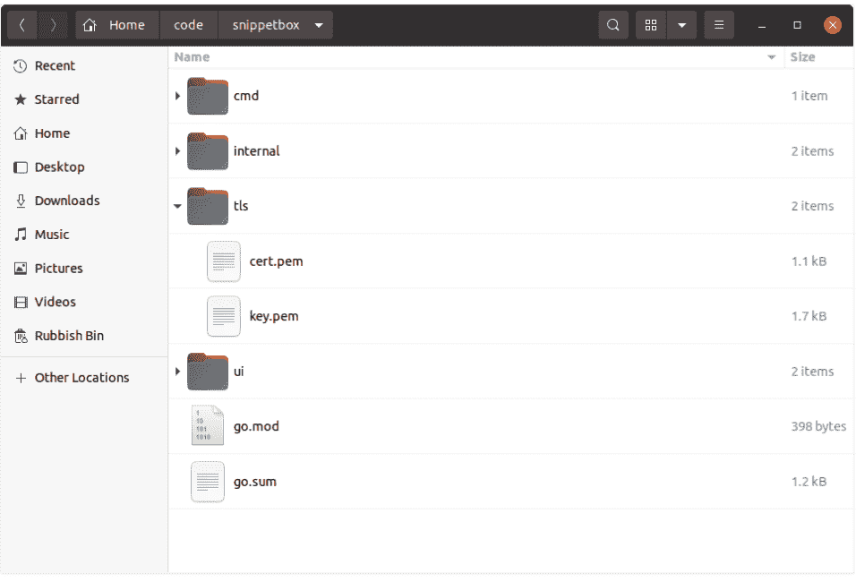

就这样！我们现在已经有了一个可在开发期间使用的自签名 TLS 证书（及其对应的私钥）。

## 其他信息

## mkcert 工具

作为 generate_cert.go 工具的替代方案，你可以考虑使用 mkcert 来生成 TLS 证书。虽然这需要一些额外的设置，但其优势在于生成的证书是本地受信任的——这意味着你可以用于测试和开发，而不会在 Web 浏览器中收到安全警告。

## 运行 HTTPS 服务器

既然我们有了自签名 TLS 证书和相应的私钥，启动 HTTPS Web 服务器就变得简单而轻松——我们只需打开 `main.go` 文件，将 `srv.ListenAndServe()` 方法替换为 `srv.ListenAndServeTLS()` 即可。

修改你的 `main.go` 文件以匹配以下代码：

```
package main

...

func main() {
	addr := flag.String("addr", ":4000", "HTTP network address")
	dsn := flag.String("dsn", "web:pass@/snippetbox?parseTime=true", "MySQL data source name")
	flag.Parse()

	logger := slog.New(slog.NewTextHandler(os.Stderr, nil))

	db, err := openDB(*dsn)
	if err != nil {
		logger.Error(err.Error())
		os.Exit(1)
	}

	defer db.Close()

	templateCache, err := newTemplateCache()
	if err != nil {
		logger.Error(err.Error())
		os.Exit(1)
	}

	formDecoder := form.NewDecoder()

	sessionManager := scs.New()
	sessionManager.Store = mysqlstore.New(db)
	sessionManager.Lifetime = 12 * time.Hour
	// Make sure that the Secure attribute is set on our session cookies.
	// Setting this means that the cookie will only be sent by a user's web
	// browser when a HTTPS connection is being used (and won't be sent over an
	// insecure HTTP connection).
	sessionManager.Cookie.Secure = true

	app := &application{
		logger:      logger,
		snippets:    &models.SnippetModel{DB: db},
		templateCache: templateCache,
		formDecoder: formDecoder,
		sessionManager: sessionManager,
	}

	srv := &http.Server{
		Addr:     *addr,
		Handler:  app.routes(),
		ErrorLog: slog.NewLogLogger(logger.Handler(), slog.LevelError),
	}

	logger.Info("starting server", "addr", srv.Addr)

	// Use the ListenAndServeTLS() method to start the HTTPS server. We
	// pass in the paths to the TLS certificate and corresponding private key as
	// the two parameters.
	err = srv.ListenAndServeTLS("./tls/cert.pem", "./tls/key.pem")
	logger.Error(err.Error())
	os.Exit(1)
}

...
```

运行此代码后，我们的服务器仍将监听 4000 端口——唯一的区别是它现在将使用 HTTPS 而不是 HTTP 进行通信。

照常运行它：

```
$ cd $HOME/code/snippetbox
$ go run ./cmd/web
time=2024-03-18T11:29:23.000+00:00 level=INFO msg="starting server" addr=:4000
```

如果你在 Web 浏览器中打开 https://localhost:4000/，你很可能会收到浏览器警告，因为 TLS 证书是自签名的，类似于下面的截图。

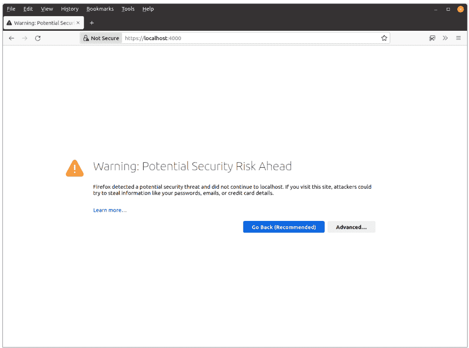

- 如果你和我一样使用 Firefox，请点击“高级”，然后点击“接受风险并继续”。

- 如果你使用 Chrome 或 Chromium，请点击“高级”，然后点击“继续访问 localhost（不安全）”链接。

之后，应用程序主页应该会出现（尽管 URL 栏中仍然会显示警告）。

在 Firefox 中，它看起来应该大致如下：

## Snippetbox

## 最新代码片段

| 标题 | 创建时间 | ID |
| :--- | :--- | :--- |
| 鹪鹩 | 2022 年 4 月 5 日 16:21 | #6 |
| 时不时 | 2022 年 4 月 5 日 14:59 | #5 |
| 0 只蜗牛 | 2022 年 4 月 5 日 07:32 | #4 |
| 初秋的早晨 | 2022 年 4 月 5 日 07:20 | #3 |
| 越过冬日森林 | 2022 年 4 月 5 日 07:20 | #2 |
| 古老的静谧池塘 | 2022 年 4 月 5 日 07:20 | #1 |

如果你使用 Firefox，我建议按 Ctrl+I 来检查主页的页面信息：

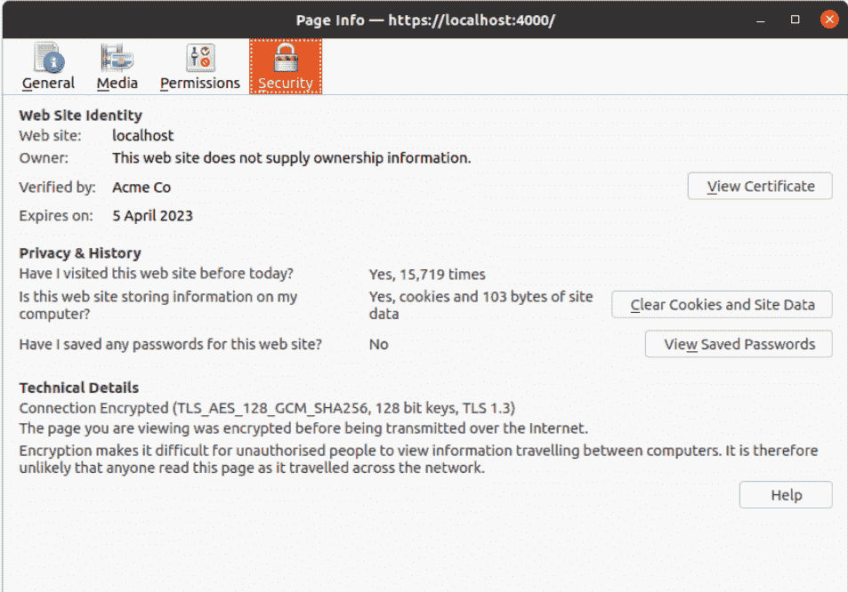

此处的“安全 > 技术详情”部分确认我们的连接已加密并按预期工作。

就我而言，可以看到正在使用 TLS 版本 1.3，我的 HTTPS 连接使用的加密套件是 TLS_AES_128_GCM_SHA256。我们将在下一章详细讨论加密套件。

> **旁注：** 如果你想知道上面的截图中“网站身份”部分的“Acme Co”是谁或是什么，那只是 `generate_cert.go` 工具使用的一个硬编码占位符名称。

## 其他信息

## HTTP 请求

需要注意的是，我们的 HTTPS 服务器 *仅支持 HTTPS*。如果你尝试向其发送常规 HTTP 请求，服务器会向用户返回 400 Bad Request 状态和消息

"Client sent an HTTP request to an HTTPS server"。不会记录任何日志。

```
$ curl -i http://localhost:4000/
HTTP/1.0 400 Bad Request

Client sent an HTTP request to an HTTPS server.
```

## HTTP/2 连接

使用 HTTPS 的一个巨大优点是，如果客户端支持，Go 会自动将连接升级为 HTTP/2。

这是件好事，因为这意味着最终我们的页面对用户来说加载会更快。如果你不熟悉 HTTP/2，可以观看 Brad Fitzpatrick 在 GoSF 聚会上的演讲，了解基础知识以及 HTTP/2 在 Go 内部的实现方式。

如果你使用的是最新版本的 Firefox，应该能看到这一点。按 Ctrl+Shift+E 打开开发者工具，查看主页的响应头时，你应该能看到所使用的协议是 HTTP/2。

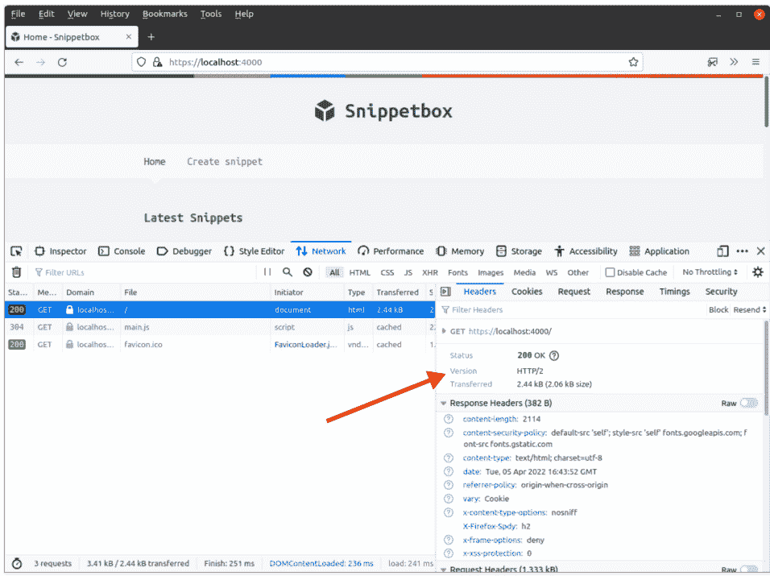

## 证书权限

需要注意的是，运行 Go 应用程序的用户必须对 cert.pem 和 key.pem 文件都有读取权限，否则 ListenAndServeTLS() 将返回权限被拒绝错误。

默认情况下，generate_cert.go 工具会为 cert.pem 文件授予所有用户的读取权限，但只为 key.pem 文件的所有者授予读取权限。就我而言，权限如下：

```
$ cd $HOME/code/snippetbox/tls
$ ls -l
total 8
-rw-rw-r-- 1 alex alex 1090 Mar 18 16:24 cert.pem
-rw------- 1 alex alex 1704 Mar 18 16:24 key.pem
```

一般来说，最好将私钥的权限设置得尽可能严格，仅允许所有者或特定组读取。

## 版本控制

如果你使用版本控制系统（如 Git 或 Mercurial），可能需要添加忽略规则，以免不小心提交 tls 目录的内容。以 Git 为例：

```
$ cd $HOME/code/snippetbox
$ echo 'tls/' >> .gitignore
```

## 配置 HTTPS 设置

Go 为其 HTTPS 服务器提供了良好的默认设置，但仍可以优化和自定义服务器的行为。

一个几乎总是值得做的更改是限制 TLS 握手期间可能使用的 *椭圆曲线*。Go 支持一些椭圆曲线，但截至 Go 1.23，只有 `tls.CurveP256` 和 `tls.X25519` 有汇编实现。其他曲线非常耗 CPU，因此省略它们有助于确保服务器在高负载下保持高性能。

要进行此调整，我们可以创建一个包含非默认 TLS 设置的 `tls.Config` 结构体，并在启动服务器之前将其添加到 `http.Server` 结构体中。

我来演示：


文件：cmd/web/main.go

package main

import (
	"crypto/tls" // New import
	"database/sql"
	"flag"
	"html/template"
	"log/slog"
	"net/http"
	"os"
	"time"

	"snippetbox.alexedwards.net/internal/models"

	"github.com/alexedwards/scs/mysqlstore"
	"github.com/alexedwards/scs/v2"
	"github.com/go-playground/form/v4"
	_ "github.com/go-sql-driver/mysql"
)

...

func main() {
	...

	app := &application{
		logger:      logger,
		snippets:    &models.SnippetModel{DB: db},
		templateCache: templateCache,
		formDecoder: formDecoder,
		sessionManager: sessionManager,
	}

	// Initialize a tls.Config struct to hold the non-default TLS settings we
	// want the server to use. In this case the only thing that we're changing
	// is the curve preferences value, so that only elliptic curves with
	// assembly implementations are used.
	tlsConfig := &tls.Config{
		CurvePreferences: []tls.CurveID{tls.X25519, tls.CurveP256},
	}

	// Set the server's TLSConfig field to use the tlsConfig variable we just
	// created.
	srv := &http.Server{
		Addr:      *addr,
		Handler:   app.routes(),
		ErrorLog:  slog.NewLogLogger(logger.Handler(), slog.LevelError),
		TLSConfig: tlsConfig,
	}

	logger.Info("starting server", "addr", srv.Addr)

	err = srv.ListenAndServeTLS("./tls/cert.pem", "./tls/key.pem")
	logger.Error(err.Error())
	os.Exit(1)
}

...

## 其他信息

## TLS 版本

默认情况下，Go 的 HTTPS 服务器配置为支持 TLS 1.2 和 1.3。您可以使用 `tls.Config.MinVersion` 和 `MaxVersion` 字段以及 `crypto/tls` 包中的 TLS 版本常量来自定义此设置并更改最小和最大 TLS 版本。

例如，如果您希望服务器仅支持 TLS 1.0 到 1.2 版本，可以使用如下配置：

```
tlsConfig := &tls.Config{
  MinVersion: tls.VersionTLS10,
  MaxVersion: tls.VersionTLS12,
}
```

## 密码套件

Go 支持的密码套件也定义在 `crypto/tls` 包的常量中。

但是，其中一些密码套件（具体来说，不支持完美前向保密，或使用 RC4、3DES 或 CBC_SHA256 的密码套件）被认为是弱密码套件，且默认情况下不会被 Go 的 HTTPS 服务器使用。从 Go 1.23 开始，Go 的 HTTPS 服务器默认使用的密码套件如下：

| 密码套件 | 备注 |
| :--- | :--- |
| TLS_AES_128_GCM_SHA256 | // 仅 TLS 1.3 连接 |
| TLS_AES_256_GCM_SHA384 | // 仅 TLS 1.3 连接 |
| TLS_CHACHA20_POLY1305_SHA256 | // 仅 TLS 1.3 连接 |
| TLS_ECDHE_ECDSA_WITH_AES_128_GCM_SHA256 | // 仅 TLS 1.2 连接 |
| TLS_ECDHE_ECDSA_WITH_AES_256_GCM_SHA384 | // 仅 TLS 1.2 连接 |
| TLS_ECDHE_RSA_WITH_AES_128_GCM_SHA256 | // 仅 TLS 1.2 连接 |
| TLS_ECDHE_RSA_WITH_AES_256_GCM_SHA384 | // 仅 TLS 1.2 连接 |
| TLS_ECDHE_RSA_WITH_CHACHA20_POLY1305_SHA256 | // 仅 TLS 1.2 连接 |
| TLS_ECDHE_ECDSA_WITH_CHACHA20_POLY1305_SHA256 | // 仅 TLS 1.2 连接 |
| TLS_ECDHE_ECDSA_WITH_AES_128_CBC_SHA | // TLS 1.0、1.1 和 1.2 连接 |
| TLS_ECDHE_ECDSA_WITH_AES_256_CBC_SHA | // TLS 1.0、1.1 和 1.2 连接 |
| TLS_ECDHE_RSA_WITH_AES_128_CBC_SHA | // TLS 1.0、1.1 和 1.2 连接 |
| TLS_ECDHE_RSA_WITH_AES_256_CBC_SHA | // TLS 1.0、1.1 和 1.2 连接 |

重要：出于客户端兼容性原因，此默认列表包括一些易受 Lucky Thirteen 定时攻击影响的 CBC 密码。Go 对这些密码的实现已打补丁，以提供针对潜在攻击的部分（但非完全）缓解措施。

如果要更改 Go HTTPS 服务器使用的密码套件——无论是包含默认未使用的弱密码套件，还是移除默认使用的某些密码——都可以通过 `tls.Config.CipherSuites` 字段来实现。

例如，如果您想使用默认密码列表但 *省略 CBC 密码*，可以这样配置您的 `tls.Config`：

```
tlsConfig := &tls.Config{
    CipherSuites: []uint16{
        tls.TLS_AES_128_GCM_SHA256,
        tls.TLS_AES_256_GCM_SHA384,
        tls.TLS_CHACHA20_POLY1305_SHA256,
        tls.TLS_ECDHE_ECDSA_WITH_AES_128_GCM_SHA256,
        tls.TLS_ECDHE_ECDSA_WITH_AES_256_GCM_SHA384,
        tls.TLS_ECDHE_RSA_WITH_AES_128_GCM_SHA256,
        tls.TLS_ECDHE_RSA_WITH_AES_256_GCM_SHA384,
        tls.TLS_ECDHE_RSA_WITH_CHACHA20_POLY1305_SHA256,
        tls.TLS_ECDHE_ECDSA_WITH_CHACHA20_POLY1305_SHA256,
    },
}
```

Go 将在运行时根据密码安全性、性能以及客户端/服务器硬件支持，自动选择实际使用的这些密码套件中的 *哪些*。

还需要注意（这也很有趣）的是，如果协商了 TLS 1.3 连接，则会忽略 `tls.Config.CipherSuites`。原因是 Go 支持用于 TLS 1.3 连接的所有密码套件都被认为是 *安全* 的，因此提供配置机制的意义不大。

基本上，使用 `tls.Config.CipherSuites` 设置自定义支持的密码套件列表仅会影响 TLS 1.0-1.2 连接。因此，在上述示例中，其实没有必要包含 TLS 1.3 特定的密码套件，可以将其简化为：

```
tlsConfig := &tls.Config{
	CipherSuites: []uint16{
		tls.TLS_ECDHE_ECDSA_WITH_AES_128_GCM_SHA256,
		tls.TLS_ECDHE_ECDSA_WITH_AES_256_GCM_SHA384,
		tls.TLS_ECDHE_RSA_WITH_AES_128_GCM_SHA256,
		tls.TLS_ECDHE_RSA_WITH_AES_256_GCM_SHA384,
		tls.TLS_ECDHE_RSA_WITH_CHACHA20_POLY1305_SHA256,
		tls.TLS_ECDHE_RSA_WITH_CHACHA20_POLY1305_SHA256,
	},
}
```

**重要：** 限制支持的密码套件可能意味着使用某些旧版浏览器的用户将无法访问您的网站。安全性与向后兼容性之间需要取得平衡，正确的决策将取决于您的用户群通常使用的技术。Mozilla 针对现代、中级和旧版浏览器推荐的配置可能会帮助您在此做出决策。

## 连接超时

让我们花点时间通过添加一些超时设置来提高服务器的恢复能力，如下所示：

```
File: cmd/web/main.go

package main

...

func main() {
    ...

    tlsConfig := &tls.Config{
        CurvePreferences: []tls.CurveID{tls.X25519, tls.CurveP256},
    }

    srv := &http.Server{
        Addr:         *addr,
        Handler:      app.routes(),
        ErrorLog:     slog.NewLogLogger(logger.Handler(), slog.LevelError),
        TLSConfig:    tlsConfig,

        // Add Idle, Read and Write timeouts to the server.
        IdleTimeout:  time.Minute,
        ReadTimeout:  5 * time.Second,
        WriteTimeout: 10 * time.Second,
    }

    logger.Info("starting server", "addr", srv.Addr)

    err = srv.ListenAndServeTLS("./tls/cert.pem", "./tls/key.pem")
    logger.Error(err.Error())
    os.Exit(1)
}

...
```

所有这三个超时设置 — *空闲超时*、*读取超时* 和 *写入超时* — 都是服务器范围的设置，作用于底层连接，并适用于所有请求，不论其处理程序或 URL 如何。

## IdleTimeout 设置

默认情况下，Go 在所有已接受的连接上启用保持连接（keep-alive）。这有助于减少延迟（尤其是 HTTPS 连接），因为客户端可以重用同一连接发送多个请求，而无需重复 TLS 握手。

默认情况下，保持连接的连接会在几分钟后自动关闭（确切时间取决于您的操作系统）。这有助于清理用户意外断开的连接——例如，由于客户端断电。

无法 *增加* 此默认值（除非您自己实现 `net.Listener`），但可以通过 `IdleTimeout` 设置将其 *减少*。在我们的示例中，我们将 `IdleTimeout` 设置为 1 分钟，这意味着所有保持连接的连接将在 1 分钟无活动后自动关闭。

## ReadTimeout 设置

在我们的代码中，我们还将 `ReadTimeout` 设置为 5 秒。这意味着，如果请求首次被接受后 5 秒钟仍在读取请求头或请求体，Go 将关闭底层连接。由于这是对连接的“硬”关闭，用户不会收到任何 HTTP(S) 响应。

设置较短的 `ReadTimeout` 时期有助于缓解来自慢客户端攻击（例如 Slowloris）的风险，否则此类攻击可能通过发送部分、不完整的 HTTP(S) 请求无限期保持连接打开。

> **重要：** 如果设置了 `ReadTimeout` 但未设置 `IdleTimeout`，则 `IdleTimeout` 将默认使用与 `ReadTimeout` 相同的设置。例如，如果将 `ReadTimeout` 设置为 3 秒，则副作用是所有保持连接的连接也将在 3 秒无活动后关闭。通常，我的建议是避免任何歧义，并始终为服务器设置显式的 `IdleTimeout` 值。

## WriteTimeout 设置

`WriteTimeout` 设置将在经过给定时间段（在我们的代码中为 10 秒）后尝试向连接写入数据时关闭底层连接。但其行为会略有不同，具体取决于所使用的协议。

- 对于 HTTP 连接，如果在 *读取请求头* 完成后 10 秒钟才向连接写入数据，Go 将关闭底层连接，而不是写入数据。
- 对于 HTTPS 连接，如果在请求 *首次被接受* 后 10 秒钟才向连接写入数据，Go 将关闭底层连接，而不是


写入数据。这意味着如果你使用 HTTPS（就像我们这样做），将 `WriteTimeout` 设置为大于 `ReadTimeout` 的值是明智的。

请牢记，处理程序所做的写入会被缓冲，并在处理程序返回时一次性写入连接。因此，`WriteTimeout` 的一般理念 *并非* 防止长时间运行的处理程序，而是防止处理程序返回的数据写入耗时过长。

## 附加信息

### `ReadHeaderTimeout` 设置

`http.Server` 还提供了一个 `ReadHeaderTimeout` 设置，我们在应用程序中尚未使用它。它的工作方式与 `ReadTimeout` 类似，只不过它仅应用于 HTTP(S) 标头的读取。因此，如果将 `ReadHeaderTimeout` 设置为 3 秒，则如果请求被接受后的 3 秒钟内仍在读取请求标头，连接将被关闭。但是，即使过了 3 秒钟，读取请求体仍可以继续进行，而连接不会被关闭。

如果你想对读取请求标头应用服务器范围的限制，但在读取请求体方面希望在不同路由上实现不同的超时（可能使用 `http.TimeoutHandler()` 中间件），这会很有用。

对于我们的 Snippetbox Web 应用程序，没有任何操作需要为每个路由设置读取超时——读取所有路由的请求标头和请求体都应该能在 5 秒钟内舒适地完成，因此我们将继续使用 `ReadTimeout`。

### `MaxHeaderBytes` 设置

`http.Server` 包含一个 `MaxHeaderBytes` 字段，你可以使用它来控制服务器解析请求标头时将读取的最大字节数。默认情况下，Go 允许的最大标头长度为 1MB。

例如，如果你想将最大标头长度限制为 0.5MB，则会编写：

```
srv := &http.Server{
    Addr:      *addr,
    MaxHeaderBytes: 524288,
    ...
}
```

如果超过了 MaxHeaderBytes，则用户将自动收到 431 Request Header Fields Too Large 响应。

这里需要指出一个陷阱：Go 会始终在你设置的数值上额外添加 4096 字节的余量。如果你需要 MaxHeaderBytes 是一个精确的或非常低的数值，则需要将此因素考虑在内。

## 用户身份验证

在本书的这一部分，我们将向应用程序添加一些用户身份验证功能，以便只有已注册并登录的用户才能创建新代码片段。未登录的用户仍然可以查看代码片段，并且还可以注册一个帐户。

工作流程将如下所示：

- 1. 用户将通过访问 /user/signup 处的表单并输入其姓名、电子邮件地址和密码来注册。我们将把这些信息存储在一个新的 users 数据库表中（我们稍后将创建该表）。
- 2. 用户将通过访问 /user/login 处的表单并输入其电子邮件地址和密码来登录。
- 3. 然后我们将检查数据库，看他们输入的电子邮件和密码是否与 users 表中的某个用户匹配。如果匹配，则用户已成功通过身份验证，我们将使用键 "authenticatedUserID" 将相关的用户 id 值添加到其会话数据中。
- 4. 当收到任何后续请求时，我们可以检查用户的会话数据中是否存在 "authenticatedUserID" 值。如果存在，则我们知道用户已成功登录。我们可以一直检查此项，直到会话过期，届时用户将需要再次登录。如果会话中不存在 "authenticatedUserID"，则我们知道用户未登录。

从很多方面来说，本部分的大量内容只是以不同的方式将我们已学习的内容组合在一起。因此，这既是对你理解程度的一次良好试金石，也是对一些关键概念的提醒。

你将学习：

- 如何为用户实现基本的注册、登录和登出功能。
- 在数据库中加密和存储用户密码的安全方法。
- 使用中间件和会话验证用户是否已登录的稳健且简单直接的方法。
- 如何防止跨站点请求伪造（CSRF）攻击。

## 路由设置

让我们先通过向应用程序添加五条新路由来开始本部分，使其如下所示：

| 路由模式 | 处理程序 | 操作 |
| :--- | :--- | :--- |
| GET /{$} | home | 显示主页 |
| GET /snippet/view/{id} | snippetView | 显示特定代码片段 |
| GET /snippet/create | snippetCreate | 显示创建新代码片段的表单 |
| POST /snippet/create | snippetCreatePost | 创建新代码片段 |
| GET /user/signup | userSignup | 显示注册新用户的表单 |
| POST /user/signup | userSignupPost | 创建新用户 |
| GET /user/login | userLogin | 显示用户登录表单 |
| POST /user/login | userLoginPost | 对用户进行身份验证并登录 |
| POST /user/logout | userLogoutPost | 注销用户 |
| GET /static/ | http.FileServer | 提供特定静态文件 |

请注意，新的有状态更改的处理程序 — userSignupPost、userLoginPost 和 userLogoutPost — 都使用 POST 请求，而不是 GET。

如果你在跟随操作，请打开 handlers.go 文件，并按如下方式为五个新处理程序函数添加占位符：

```
File: cmd/web/handlers.go

package main

...

func (app *application) userSignup(w http.ResponseWriter, r *http.Request) {
	fmt.Fprintln(w, "Display a form for signing up a new user...")
}

func (app *application) userSignupPost(w http.ResponseWriter, r *http.Request) {
	fmt.Fprintln(w, "Create a new user...")
}

func (app *application) userLogin(w http.ResponseWriter, r *http.Request) {
	fmt.Fprintln(w, "Display a form for logging in a user...")
}

func (app *application) userLoginPost(w http.ResponseWriter, r *http.Request) {
	fmt.Fprintln(w, "Authenticate and login the user...")
}

func (app *application) userLogoutPost(w http.ResponseWriter, r *http.Request) {
	fmt.Fprintln(w, "Logout the user...")
}
```

完成后，让我们在 `routes.go` 文件中创建相应的路由：

```
File: cmd/web/routes.go

package main

...

func (app *application) routes() http.Handler {
	mux := http.NewServeMux()

	fileServer := http.FileServer(http.Dir("./ui/static/"))
	mux.Handle("GET /static/", http.StripPrefix("/static", fileServer))

	dynamic := alice.New(app.sessionManager.LoadAndSave)

	mux.Handle("GET /{$}", dynamic.ThenFunc(app.home))
	mux.Handle("GET /snippet/view/{id}", dynamic.ThenFunc(app.snippetView))
	mux.Handle("GET /snippet/create", dynamic.ThenFunc(app.snippetCreate))
	mux.Handle("POST /snippet/create", dynamic.ThenFunc(app.snippetCreatePost))

	// Add the five new routes, all of which use our 'dynamic' middleware chain.
	mux.Handle("GET /user/signup", dynamic.ThenFunc(app.userSignup))
	mux.Handle("POST /user/signup", dynamic.ThenFunc(app.userSignupPost))
	mux.Handle("GET /user/login", dynamic.ThenFunc(app.userLogin))
	mux.Handle("POST /user/login", dynamic.ThenFunc(app.userLoginPost))
	mux.Handle("POST /user/logout", dynamic.ThenFunc(app.userLogoutPost))

	standard := alice.New(app.recoverPanic, app.logRequest, commonHeaders)

	return standard.Then(mux)
}
```

最后，我们还需要更新 `nav.tmpl` 部分以包含新页面的导航项：

```
File: ui/html/partials/nav.tmpl

{{define "nav"}}
<nav>
  <div>
    <a href='/'>Home</a>
    <a href='/snippet/create'>Create snippet</a>
  </div>
  <div>
    <a href='/user/signup'>Signup</a>
    <a href='/user/login'>Login</a>
    <form action='/user/logout' method='POST'>
      <button>Logout</button>
    </form>
  </div>
</nav>
{{end}}
```

如果你愿意，此时可以运行应用程序，你应该会在导航栏中看到类似这样的新项目：

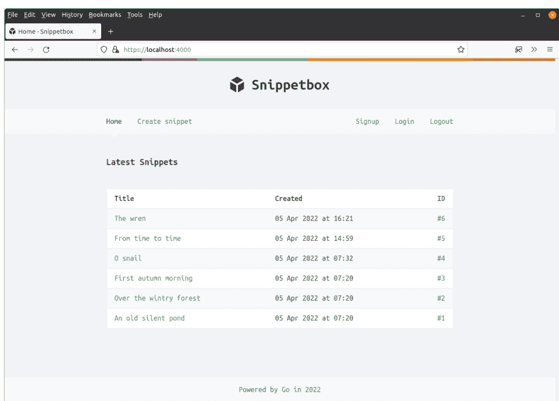

如果你点击新链接，它们应该会以相关的占位符纯文本响应进行回复。例如，如果你点击 'Signup' 链接，你应该会看到类似这样的响应：


Display a form for signing up a new user...

## Creating a users model

Now that the routes are set up, we need to create a new users database table and a database model to access it.

Start by connecting to MySQL from your terminal window as the root user and execute the following SQL statement to setup the users table:

```
USE snippetbox;

CREATE TABLE users (
 id INTEGER NOT NULL PRIMARY KEY AUTO_INCREMENT,
 name VARCHAR(255) NOT NULL,
 email VARCHAR(255) NOT NULL,
 hashed_password CHAR(60) NOT NULL,
 created DATETIME NOT NULL
);

ALTER TABLE users ADD CONSTRAINT users_uc_email UNIQUE (email);
```

There's a couple of things worth pointing out about this table:

- The **id** field is an autoincrementing integer field and the primary key for the table. This means that the user ID values are guaranteed to be unique positive integers (1, 2, 3... etc).

- The type of the **hashed_password** field is CHAR(60). This is because we'll be storing bcrypt hashes of the user passwords in the database — not the passwords themselves — and the hashes are always exactly 60 characters long.

- We've also added a **UNIQUE** constraint on the **email** column and named it users_uc_email. This constraint ensures that we won't end up with two users who have the same email address. If we try to insert a record in this table with a duplicate email, MySQL will throw an ERROR 1062: ER_DUP_ENTRY error.

### Building the model in Go

Next let's setup a model so that we can easily work with the new users table. We'll follow the same pattern that we used earlier in the book for modeling access to the snippets table, so hopefully this should feel familiar and straightforward.

First, open up the `internal/models/errors.go` file that you created earlier and define a couple of new error types:

```
File: internal/models/errors.go

package models

import (
	"errors"
)

var (
	ErrNoRecord = errors.New("models: no matching record found")

	// Add a new ErrInvalidCredentials error. We'll use this later if a user
	// tries to login with an incorrect email address or password.
	ErrInvalidCredentials = errors.New("models: invalid credentials")

	// Add a new ErrDuplicateEmail error. We'll use this later if a user
	// tries to signup with an email address that's already in use.
	ErrDuplicateEmail = errors.New("models: duplicate email")
)
```

Then create a new file at `internal/models/users.go`:

```
$ touch internal/models/users.go
```

...and define a new `User` struct (to hold the data for a specific user) and a `UserModel` struct (with some placeholder methods for interacting with our database). Like so:

```
File: internal/models/users.go

package models

import (
	"database/sql"
	"time"
)

// Define a new User struct. Notice how the field names and types align
// with the columns in the database "users" table?
type User struct {
	ID			int
	Name		string
	Email		string
	HashedPassword []byte
	Created		time.Time
}

// Define a new UserModel struct which wraps a database connection pool.
type UserModel struct {
	DB *sql.DB
}

// We'll use the Insert method to add a new record to the "users" table.
func (m *UserModel) Insert(name, email, password string) error {
	return nil
}

// We'll use the Authenticate method to verify whether a user exists with
// the provided email address and password. This will return the relevant
// user ID if they do.
func (m *UserModel) Authenticate(email, password string) (int, error) {
	return 0, nil
}

// We'll use the Exists method to check if a user exists with a specific ID.
func (m *UserModel) Exists(id int) (bool, error) {
	return false, nil
}
```

The final stage is to add a new field to our application struct so that we can make this model available to our handlers. Update the main.go file as follows:

```
File: cmd/web/main.go

package main

...

// Add a new users field to the application struct.
type application struct {
	logger      *slog.Logger
	snippets    *models.SnippetModel
	users       *models.UserModel
	templateCache map[string]*template.Template
	formDecoder *form.Decoder
	sessionManager *scs.SessionManager
}

func main() {
	...

	// Initialize a models.UserModel instance and add it to the application
	// dependencies.
	app := &application{
		logger:     logger,
		snippets:   &models.SnippetModel{DB: db},
		users:      &models.UserModel{DB: db},
		templateCache: templateCache,
		formDecoder: formDecoder,
		sessionManager: sessionManager,
	}

	tlsConfig := &tls.Config{
		CurvePreferences: []tls.CurveID{tls.X25519, tls.CurveP256},
	}

	srv := &http.Server{
		Addr:         *addr,
		Handler:      app.routes(),
		ErrorLog:     slog.NewLogLogger(logger.Handler(), slog.LevelError),
		TLSConfig:    tlsConfig,
		IdleTimeout:  time.Minute,
		ReadTimeout:  5 * time.Second,
		WriteTimeout: 10 * time.Second,
	}

	logger.Info("starting server", "addr", srv.Addr)

	err = srv.ListenAndServeTLS("./tls/cert.pem", "./tls/key.pem")
	logger.Error(err.Error())
	os.Exit(1)
}

...
```

Make sure that all the files are all saved, then go ahead and try to run the application. At this stage you should find that it compiles correctly without any problems.

## User signup and password encryption

Before we can log in any users to our Snippetbox application, we need a way for them to sign up for an account. We'll cover how to do that in this chapter.

Go ahead and create a new ui/html/pages/signup.tmpl file containing the following markup for the signup form.

```
$ touch ui/html/pages/signup.tmpl
```

```
File: ui/html/pages/signup.tmpl

{{define "title"}}Signup{{end}}

{{define "main"}}
<form action='/user/signup' method='POST' novalidate>
<div>
<label>Name:</label>
{{with .Form.FieldErrors.name}}
<label class='error'>{{.}}</label>
{{end}}
<input type='text' name='name' value='{{.Form.Name}}'>
</div>
<div>
<label>Email:</label>
{{with .Form.FieldErrors.email}}
<label class='error'>{{.}}</label>
{{end}}
<input type='email' name='email' value='{{.Form.Email}}'>
</div>
<div>
<label>Password:</label>
{{with .Form.FieldErrors.password}}
<label class='error'>{{.}}</label>
{{end}}
<input type='password' name='password'>
</div>
<div>
<input type='submit' value='Signup'>
</div>
</form>
{{end}}
```

Hopefully this should feel familiar so far. For the signup form we're using exactly the same form structure that we used earlier in the book, with three fields: name, email and password (which use the relevant HTML5 input types).

> **Important:** Notice here that we’re not re-displaying the password if the form fails validation. This is because we don’t want there to be any risk of the browser (or other intermediary) caching the plain-text password entered by the user.

Then let’s update our cmd/web/handlers.go file to include a new userSignupForm struct (which will represent and hold the form data), and hook it up to the userSignup handler.

Like so:

```
File: cmd/web/handlers.go

package main

...

// Create a new userSignupForm struct.
type userSignupForm struct {
    Name    string `form:"name"`
    Email   string `form:"email"`
    Password string `form:"password"`
    validator.Validator `form:"-"`
}

// Update the handler so it displays the signup page.
func (app *application) userSignup(w http.ResponseWriter, r *http.Request) {
    data := app.newTemplateData(r)
    data.Form = userSignupForm{}
    app.render(w, r, http.StatusOK, "signup.tmpl", data)
}

...
```

If you run the application and visit https://localhost:4000/user/signup, you should now see a page which looks like this:

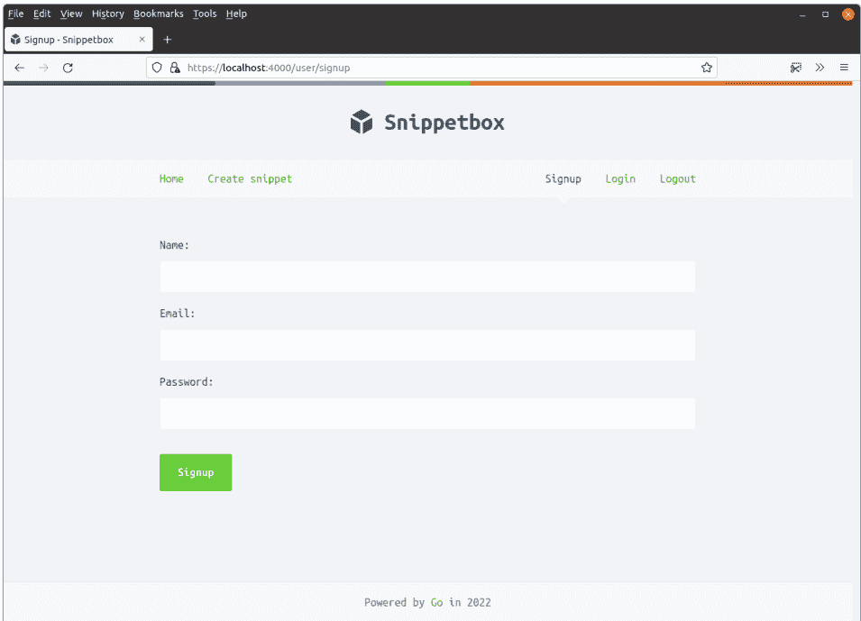

## Validating the user input

When this form is submitted the data will end up being posted to the `userSignupPost` handler that we made earlier.

The first task of this handler will be to validate the data to make sure that it is sane and sensible before we insert it into the database. Specifically, we want to do four things:

- 1. Check that the provided name, email address and password are not blank.
- 2. Sanity check the format of the email address.
- 3. Ensure that the password is at least 8 characters long.
- 4. Make sure that the email address isn't already in use.

We can cover the first three checks by heading back to our `internal/validator/validator.go` file and creating two helper new methods — `MinChars()` and `Matches()` — along with a regular expression for sanity checking an email address.

Like this:


文件: internal/validator/validator.go

package validator

import (
	"regexp" // New import
	"slices"
	"strings"
	"unicode/utf8"
)

// 使用 regexp.MustCompile() 函数解析正则表达式模式
// 用于检查电子邮件地址格式的正确性。这会返回一个指向
// 已编译的 regexp.Regexp 类型的指针，或在出错时 panic。在启动时
// 只解析一次此模式并将编译后的 *regexp.Regexp 存储在变量中，
// 比每次需要时重新解析模式性能更好。
var EmailRX = regexp.MustCompile("^[a-zA-Z0-9.!#$%&'*+/=?^_`{|}~-]+@[a-zA-Z0-9](?:[a-zA-Z0-9-]{0,61}[a-zA-Z0-9])?(?:\\.[a-zA-Z0-9](?:\\.[a-zA-Z0-9-]{0,61}[a-zA-Z0-9])?)*$

...

// MinChars() 如果值包含至少 n 个字符，则返回 true。
func MinChars(value string, n int) bool {
	return utf8.RuneCountInString(value) >= n
}

// Matches() 如果值与提供的已编译正则表达式模式匹配，则返回 true。
func Matches(value string, rx *regexp.Regexp) bool {
	return rx.MatchString(value)
}

关于 EmailRX 正则表达式模式，有几点我想快速说明：

- 我们使用的模式是 W3C 和 Web 超文本应用技术工作组目前推荐用于验证电子邮件地址的模式。有关此模式的更多信息，请参见这里。如果您以 PDF 格式或在窄型设备上阅读此书，且无法查看整行，则此处将其拆分为多行：

```
"^[a-zA-Z0-9.!#$%&'*+/=?^_`{|}~-]+@[a-zA-Z0-9](?:[a-zA-Z0-9-]{0,61}[a-zA-Z0-9])?(?:\.[a-zA-Z0-9](?:[a-zA-Z0-9-]{0,61}[a-zA-Z0-9])?)*
(?:\.[a-zA-Z0-9](?:[a-zA-Z0-9-]{0,61}[a-zA-Z0-9])?)*"
```

在代码中，此正则表达式模式应全部写在一行上，且不得包含空白字符。如果您有更偏好用于电子邮件地址合理性检查的替代模式，请随时将其替换进去。

- 由于 EmailRX 正则表达式模式是作为解释型字符串字面量编写的，我们需要使用 \\ 对正则中的特殊字符进行双重转义，以便其正确工作（我们无法使用原始字符串字面量，因为模式中包含反引号字符）。如果您不熟悉字符串字面量形式之间的区别，那么阅读 Go 规范中的这一部分会很有价值。

不过，我跑题了。让我们回到手头的任务。

打开您的 handlers.go 文件，添加一些代码来处理表单并运行验证检查，如下所示：

```
File: cmd/web/handlers.go

package main

...

func (app *application) userSignupPost(w http.ResponseWriter, r *http.Request) {
    // Declare a zero-valued instance of our userSignupForm struct.
    var form userSignupForm

    // Parse the form data into the userSignupForm struct.
    err := app.decodePostForm(r, &form)
    if err != nil {
        app.clientError(w, http.StatusBadRequest)
        return
    }

    // Validate the form contents using our helper functions.
    form.CheckField(validator.NotBlank(form.Name), "name", "This field cannot be blank")
    form.CheckField(validator.NotBlank(form.Email), "email", "This field cannot be blank")
    form.CheckField(validator.Matches(form.Email, validator.EmailRX), "email", "This field must be a valid email address")
    form.CheckField(validator.NotBlank(form.Password), "password", "This field cannot be blank")
    form.CheckField(validator.MinChars(form.Password, 8), "password", "This field must be at least 8 characters long")

    // If there are any errors, redisplay the signup form along with a 422
    // status code.
    if !form.Valid() {
        data := app.newTemplateData(r)
        data.Form = form
        app.render(w, r, http.StatusUnprocessableEntity, "signup.tmpl", data)
        return
    }

    // Otherwise send the placeholder response (for now!).
    fmt.FPrintln(w, "Create a new user...")
}

...
```

现在尝试运行应用程序，并向注册表单中输入一些无效数据，如下所示：

## Snippetbox

Home Create snippet Signup Login Logout

Name:
Email:
bob@example.
Password:
....
Signup

如果您尝试提交，应该会看到类似下面的相应验证失败：

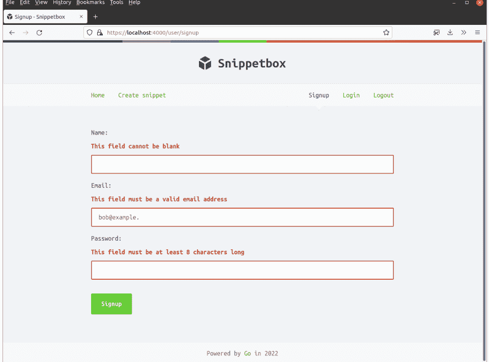

现在只剩下第四项验证检查：确保电子邮件地址未被占用。这处理起来稍微棘手一些。

因为我们在 users 表的 email 字段上设置了 UNIQUE 约束，所以已经保证数据库中不会出现两个拥有相同电子邮件地址的用户。因此，从业务逻辑和数据完整性角度来看，我们已经没问题了。但如何将电子邮件已被占用的问题传达给用户，这一点仍需解决。我们将在本章末尾处理此问题。

## bcrypt 简介

如果数据库遭到攻击者入侵，确保其中不包含用户密码的纯文本版本至关重要。

将密码的单向哈希存储起来是一种良好做法——实际上是必不可少的——该哈希是使用计算开销较大的密钥派生函数（如 Argon2、scrypt 或 bcrypt）生成的。Go 在 golang.org/x/crypto 包中提供了这三种算法的实现。

不过，bcrypt 实现的一个优点是，它包含专门用于哈希和验证密码的辅助函数，而我们将在此处使用这些函数。

如果您在跟随学习，请先下载 golang.org/x/crypto/bcrypt 包的最新版本：

```
$ go get golang.org/x/crypto/bcrypt@latest
go: downloading golang.org/x/crypto v0.26.0
go get: added golang.org/x/crypto v0.26.0
```

在本书中，我们将使用两个函数。第一个是 bcrypt.GenerateFromPassword() 函数，它允许我们为给定的纯文本密码生成哈希，如下所示：

```
hash, err := bcrypt.GenerateFromPassword([]byte("my plain text password"), 12)
```

此函数将返回一个 60 字符长的哈希，大致如下所示：

```
$2a$12$NuTjWXm3KNktReFwBVyHyuf/to.HEwTy.eS206TNfKgFr6GzGJSWG
```

我们传递给 bcrypt.GenerateFromPassword() 的第二个参数表示成本，其值为 4 到 31 之间的整数。上述示例使用的成本为 12，这意味着将使用 4096（2^12）次 bcrypt 迭代来生成密码哈希。

成本越高，攻击者破解哈希所需的开销就越大（这是一件好事）。但较高的成本也意味着当用户注册时，我们的应用程序需要做更多工作来生成密码哈希——这意味着应用程序资源占用增加，并给最终用户带来额外的延迟。因此，选择合适的成本值是一项平衡工作。12 是一个合理的最小值，但如果可能，您应该进行负载测试，如果可以在不显著影响用户体验的前提下提高成本，那么就应该提高。

另一方面，我们可以使用 bcrypt.CompareHashAndPassword() 函数来检查纯文本密码是否与特定哈希匹配，如下所示：

```
hash := []byte("$2a$12$NuTjWXm3KNktReFwBVyHyuf/to.HEwTy.eS206TNfKgFr6GzGJSWG")
err := bcrypt.CompareHashAndPassword(hash, []byte("my plain text password"))
```

如果纯文本密码与特定哈希匹配，bcrypt.CompareHashAndPassword() 函数将返回 nil；如果不匹配，则返回错误。

### 存储用户详细信息

构建的下一阶段是更新 UserModel.Insert() 方法，使其在 users 表中创建一条新记录，包含验证后的姓名、电子邮件和哈希密码。

这将很有趣，原因有二：首先，我们要存储密码的 bcrypt 哈希（而不是密码本身）；其次，我们还需要处理因重复电子邮件违反我们为表添加的 UNIQUE 约束而可能导致的错误。

MySQL 返回的所有错误都有特定的代码，我们可以使用该代码来排查错误原因（完整的 MySQL 错误代码和描述列表可在此处查找）。在重复电子邮件的情况下，使用的错误代码将是 1062 (ER_DUP_ENTRY)。

打开 internal/models/users.go 文件，并使用以下代码对其进行更新：


```go
File: internal/models/users.go

package models

import (
	"database/sql"
	"errors" // New import
	"strings" // New import
	"time"

	"github.com/go-sql-driver/mysql" // New import
	"golang.org/x/crypto/bcrypt" // New import
)

...

type UserModel struct {
	DB *sql.DB
}

func (m *UserModel) Insert(name, email, password string) error {
	// Create a bcrypt hash of the plain-text password.
	hashedPassword, err := bcrypt.GenerateFromPassword([]byte(password), 12)
	if err != nil {
		return err
	}

	stmt := `INSERT INTO users (name, email, hashed_password, created)
	VALUES(?, ?, ?, UTC_TIMESTAMP())`

	// Use the Exec() method to insert the user details and hashed password
	// into the users table.
	_, err = m.DB.Exec(stmt, name, email, string(hashedPassword))
	if err != nil {
		// If this returns an error, we use the errors.As() function to check
		// whether the error has the type *mysql.MySQLError. If it does, the
		// error will be assigned to the mySQLError variable. We can then check
		// whether or not the error relates to our users_uc_email key by
		// checking if the error code equals 1062 and the contents of the error
		// message string. If it does, we return an ErrDuplicateEmail error.
		var mySQLError *mysql.MySQLError
		if errors.As(err, &mySQLError) {
			if mySQLError.Number == 1062 && strings.Contains(mySQLError.Message, "users_uc_email") {
				return ErrDuplicateEmail
			}
		}
		return err
	}

	return nil
}

...
```

我们可以通过更新 userSignup 处理程序来完成所有工作，如下所示：

```go
File: cmd/web/handlers.go

package main

...

func (app *application) userSignupPost(w http.ResponseWriter, r *http.Request) {
    var form userSignupForm

    err := app.decodePostForm(r, &form)
    if err != nil {
        app.clientError(w, http.StatusBadRequest)
        return
    }

    form.CheckField(validator.NotBlank(form.Name), "name", "This field cannot be blank")
    form.CheckField(validator.NotBlank(form.Email), "email", "This field cannot be blank")
    form.CheckField(validator.Matches(form.Email, validator.EmailRX), "email", "This field must be a valid email address")
    form.CheckField(validator.NotBlank(form.Password), "password", "This field cannot be blank")
    form.CheckField(validator.MinChars(form.Password, 8), "password", "This field must be at least 8 characters long")

    if !form.Valid() {
        data := app.newTemplateData(r)
        data.Form = form
        app.render(w, r, http.StatusUnprocessableEntity, "signup.tmpl", data)
        return
    }

    // Try to create a new user record in the database. If the email already
    // exists then add an error message to the form and re-display it.
    err = app.users.Insert(form.Name, form.Email, form.Password)
    if err != nil {
        if errors.Is(err, models.ErrDuplicateEmail) {
            form.AddFieldError("email", "Email address is already in use")

            data := app.newTemplateData(r)
            data.Form = form
            app.render(w, r, http.StatusUnprocessableEntity, "signup.tmpl", data)
        } else {
            app.serverError(w, r, err)
        }

        return
    }

    // Otherwise add a confirmation flash message to the session confirming that
    // their signup worked.
    app.sessionManager.Put(r.Context(), "flash", "Your signup was successful. Please log in.")

    // And redirect the user to the login page.
    http.Redirect(w, r, "/user/login", http.StatusSeeOther)
}

...
```

保存文件，重启应用程序，然后尝试注册一个账户。请务必记住你使用的电子邮件地址和密码……你将在下一章中用到它们！

## Snippetbox

首页 创建代码片段 注册 登录 退出

姓名：Bob Jones
电子邮件：bob@example.com
密码：********
注册

如果一切正常，提交表单后，你应该发现浏览器会将你重定向到 https://localhost:4000/user/login。

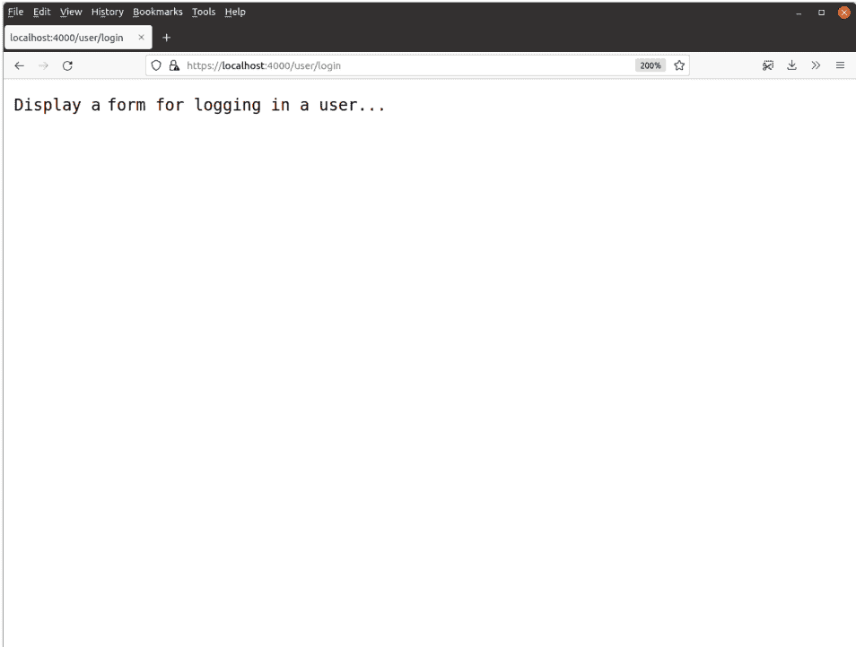

此时，打开 MySQL 数据库并查看 users 表的内容是值得的。你应该看到一条新记录，包含你刚才注册时使用的详细信息以及密码的 bcrypt 哈希值。

mysql> SELECT * FROM users;

| ID | 姓名 | 电子邮件 | 哈希密码 | 创建时间 |
|---|---|---|---|---|
| 1 | Bob Jones | bob@example.com | $2a$12$NxXQr0wVIp/TqAzCCcyDoyegtpV40EXwrzVLnBHpFpKldvnmoIZ.Q. | 2024-03-18 11:29:23 |

1 行记录，耗时 0.01 秒

如果愿意，尝试返回注册表单并使用相同的电子邮件地址添加另一个账户。你应该会看到类似下面的验证失败：

## 其他信息

### 使用数据库 bcrypt 实现

有些数据库提供内置函数，可用于密码哈希和验证，而无需像上面的代码中那样在 Go 中自行实现。

但出于两个原因，最好避免使用这些函数：

- 它们往往容易受到侧信道定时攻击，因为字符串比较时间不恒定，至少在 PostgreSQL 和 MySQL 中是这样。
- 除非你非常小心，否则将明文密码发送到数据库可能会导致密码意外记录在数据库日志中。密码意外记录在日志中的几个高调案例是 2018 年的 GitHub 和 Twitter 事件。

### 检查电子邮件重复的替代方案

我理解我们 `UserModel.Insert()` 方法中的代码并不优雅，而且检查 MySQL 返回的错误感觉有点不可靠。如果未来版本的 MySQL 更改了它们的错误编号怎么办？或者更改了错误消息的格式呢？

一个替代方案（但也不完美）是在我们的模型中添加一个 `UserModel.EmailTaken()` 方法，用于检查具有特定电子邮件的用户是否已存在。我们可以在尝试插入新记录*之前*调用此方法，并根据需要向表单添加验证错误消息。

然而，这将为我们的应用程序引入竞态条件。如果两个用户在*完全*相同的时间尝试使用相同的电子邮件地址注册，两个提交都会通过验证检查，但最终只有一个 `INSERT` 操作会在 MySQL 数据库中成功。另一个将违反我们的 `UNIQUE` 约束，用户最终会收到 `500 Internal Server Error` 响应。

这种特定竞态条件的后果相对无害，有些人会建议你根本不必担心。但对应用程序逻辑进行批判性思考并编写避免竞态条件的代码是一个值得养成的好习惯，并且在有可行替代方案时（就像本例中一样），最好避免将已知竞态条件交付到代码库中。

## 用户登录

在本章中，我们将重点放在为我们的应用程序创建用户登录页面上。

在深入主要工作之前，让我们快速重新审视一下我们之前制作的 `internal/validator` 包，并将其更新为支持不与特定表单字段关联的验证错误。

我们将在本章后面使用此功能，当登录失败时向用户显示一条通用的“您的电子邮件地址或密码不正确”消息，因为这比明确指示登录失败原因更安全。

请继续按照如下方式更新你的 `internal/validator/validator.go` 文件：

```go
File: internal/validator/validator.go

package validator

...

// Add a new NonFieldErrors []string field to the struct, which we will use to
// hold any validation errors which are not related to a specific form field.
type Validator struct {
	NonFieldErrors []string
	FieldErrors    map[string]string
}

// Update the Valid() method to also check that the NonFieldErrors slice is
// empty.
func (v *Validator) Valid() bool {
	return len(v.FieldErrors) == 0 && len(v.NonFieldErrors) == 0
}

// Create an AddNonFieldError() helper for adding error messages to the new
// NonFieldErrors slice.
func (v *Validator) AddNonFieldError(message string) {
	v.NonFieldErrors = append(v.NonFieldErrors, message)
}

...
```

接下来，让我们创建一个新的 `ui/html/pages/login.tmpl` 模板，包含登录页面的标记。我们将遵循与用于注册页面相同的模式来显示验证错误和重新显示数据。

```
$ touch ui/html/pages/login.tmpl
```


然后让我们前往我们的 `cmd/web/handlers.go` 文件，创建一个新的 `userLoginForm` 结构体（用于表示和保存表单数据），并调整我们的 `userLogin` 处理程序以渲染登录页面。

比如：

```
File: cmd/web/handlers.go

package main

...

// Create a new userLoginForm struct.
type userLoginForm struct {
    Email             string `form:"email"`
    Password          string `form:"password"`
    validator.Validator `form:"-"`
}

// Update the handler so it displays the login page.
func (app *application) userLogin(w http.ResponseWriter, r *http.Request) {
    data := app.newTemplateData(r)
    data.Form = userLoginForm{}
    app.render(w, r, http.StatusOK, "login.tmpl", data)
}

...
```

如果您运行应用程序并访问 https://localhost:4000/user/login，现在应该会看到登录页面如下所示：

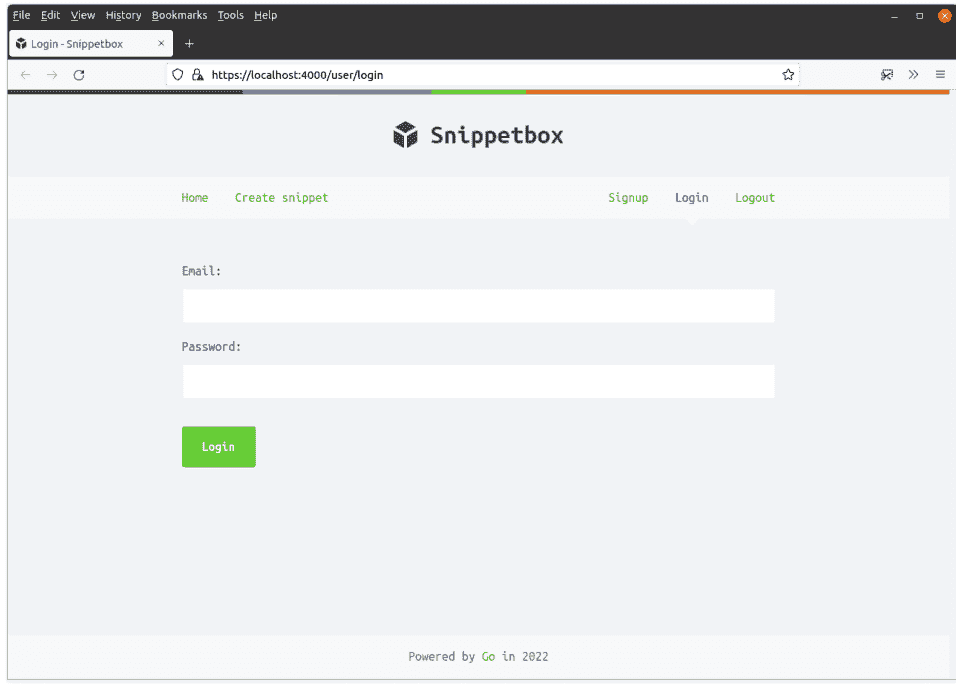

## 验证用户详细信息

下一步是有趣的部分：我们如何验证用户提交的电子邮件和密码是否正确？

此验证逻辑的核心部分将在我们的用户模型的 UserModel.Authenticate() 方法中进行。具体来说，我们需要它做两件事：

- 首先，它应该从我们的 MySQL users 表中检索与电子邮件地址关联的哈希密码。如果电子邮件不存在于数据库中，我们将返回我们之前创建的 ErrInvalidCredentials 错误。
- 否则，我们希望将 users 表中的哈希密码与用户登录时提供的明文密码进行比较。如果它们不匹配，我们希望再次返回 ErrInvalidCredentials 错误。但如果它们匹配，我们希望从数据库中返回用户的 id 值。

那就照做吧。请将以下代码添加到您的

## internal/models/users.go 文件：

```
File: internal/models/users.go

package models

...

func (m *UserModel) Authenticate(email, password string) (int, error) {
    // Retrieve the id and hashed password associated with the given email. If
    // no matching email exists we return the ErrInvalidCredentials error.
    var id int
    var hashedPassword []byte

    stmt := "SELECT id, hashed_password FROM users WHERE email = ?"

    err := m.DB.QueryRow(stmt, email).Scan(&id, &hashedPassword)
    if err != nil {
        if errors.Is(err, sql.ErrNoRows) {
            return 0, ErrInvalidCredentials
        } else {
            return 0, err
        }
    }

    // Check whether the hashed password and plain-text password provided match.
    // If they don't, we return the ErrInvalidCredentials error.
    err = bcrypt.CompareHashAndPassword(hashedPassword, []byte(password))
    if err != nil {
        if errors.Is(err, bcrypt.ErrMismatchedHashAndPassword) {
            return 0, ErrInvalidCredentials
        } else {
            return 0, err
        }
    }

    // Otherwise, the password is correct. Return the user ID.
    return id, nil
}
```

我们的下一步涉及更新 userLoginPost 处理程序，以便它解析提交的登录表单数据并调用此 UserModel.Authenticate() 方法。

如果登录详细信息有效，我们然后想将用户的 id 添加到他们的会话数据中，以便—对于将来的请求—我们知道他们已成功验证身份以及是哪个用户。

前往您的 handlers.go 文件，并按如下更新它：

```
File: cmd/web/handlers.go

package main

...

func (app *application) userLoginPost(w http.ResponseWriter, r *http.Request) {
    // Decode the form data into the userLoginForm struct.
    var form userLoginForm

    err := app.decodePostForm(r, &form)
    if err != nil {
        app.clientError(w, http.StatusBadRequest)
        return
    }

    // Do some validation checks on the form. We check that both email and
    // password are provided, and also check the format of the email address as
    // a UX-nicety (in case the user makes a typo).
    form.CheckField(validator.NotBlank(form.Email), "email", "This field cannot be blank")
    form.CheckField(validator.Matches(form.Email, validator.EmailRX), "email", "This field must be a valid email address")
    form.CheckField(validator.NotBlank(form.Password), "password", "This field cannot be blank")

    if !form.Valid() {
        data := app.newTemplateData(r)
        data.Form = form
        app.render(w, r, http.StatusUnprocessableEntity, "login.tmpl", data)
        return
    }

    // Check whether the credentials are valid. If they're not, add a generic
    // non-field error message and re-display the login page.
    id, err := app.users.Authenticate(form.Email, form.Password)
    if err != nil {
        if errors.Is(err, models.ErrInvalidCredentials) {
            form.AddNonFieldError("Email or password is incorrect")

            data := app.newTemplateData(r)
            data.Form = form
            app.render(w, r, http.StatusUnprocessableEntity, "login.tmpl", data)
        } else {
            app.serverError(w, r, err)
        }
        return
    }

    // Use the RenewToken() method on the current session to change the session
    // ID. It's good practice to generate a new session ID when the
    // authentication state or privilege levels changes for the user (e.g. login
    // and logout operations).
    err = app.sessionManager.RenewToken(r.Context())
    if err != nil {
        app.serverError(w, r, err)
        return
    }

    // Add the ID of the current user to the session, so that they are now
    // 'logged in'.
    app.sessionManager.Put(r.Context(), "authenticatedUserID", id)

    // Redirect the user to the create snippet page.
    http.Redirect(w, r, "/snippet/create", http.StatusSeeOther)
}
...
```

> 注意：我们在上面的代码中使用的 SessionManager.RenewToken() 方法将更改当前用户会话的 ID，但保留与会话关联的任何数据。在登录前执行此操作是良好的做法，以减轻会话固定攻击的风险。有关此的更多背景和信息，请参阅 OWASP 会话管理备忘单。

好了，让我们试一下！

重新启动应用程序并尝试提交一些无效的用户凭据...

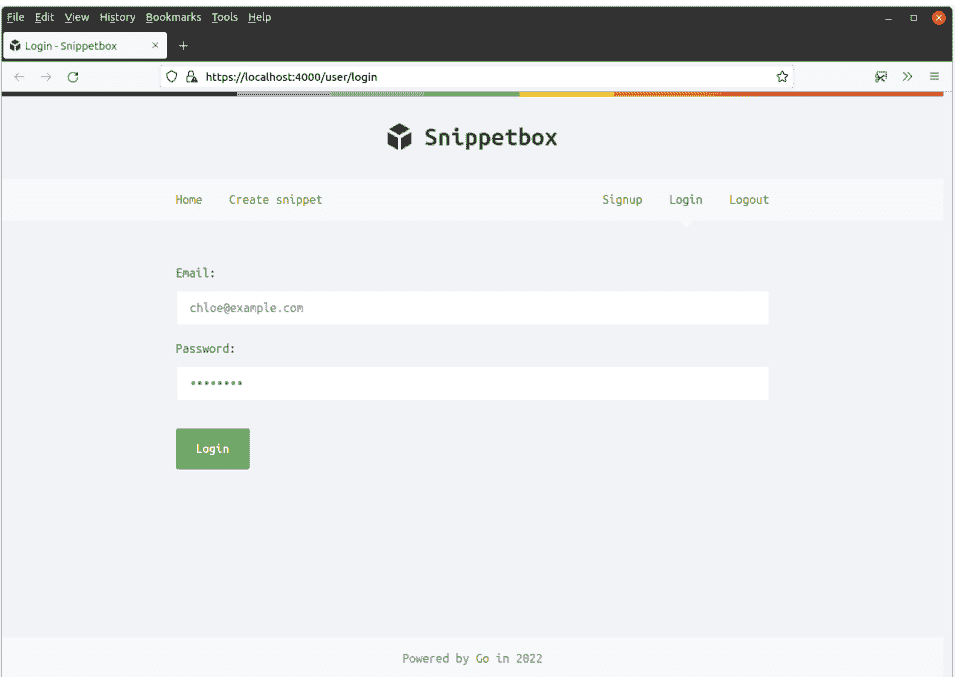

您应该会收到一个看起来像这样的非字段验证错误消息：

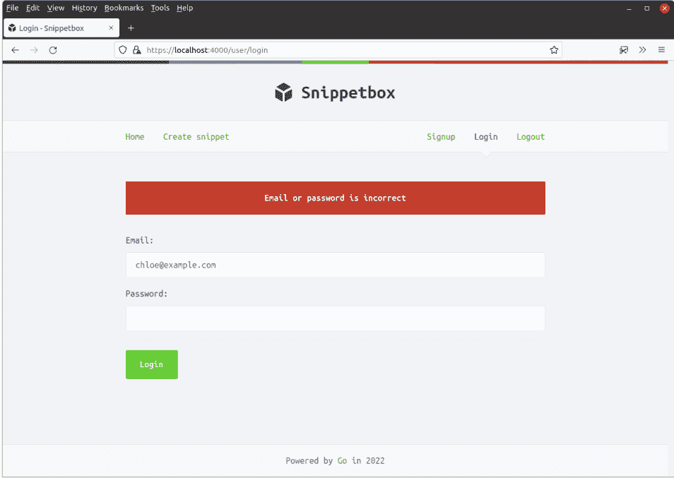

但是当您输入一些正确的凭据（使用您在上一章中创建的用户的电子邮件地址和密码）时，应用程序应该将您登录并将您重定向到创建代码片段页面，如下所示：

Snippetbox
主页 创建代码片段 注册 登录 登出

电子邮件或密码不正确

电子邮件：
bob@example.com

密码：
********

登录

由 Go 在 2022 年提供支持

Snippetbox
主页 创建代码片段 注册 登录 登出

标题：

内容：

删除时间：一年 一周 一天

发布代码片段

在过去两章中，我们涵盖了大量内容，让我们快速盘点一下当前的进展。

- 用户现在可以使用 GET /user/signup 表单在网站上注册。我们将注册用户的详细信息（包括其密码的哈希版本）存储在数据库的 users 表中。
- 注册用户随后可以使用 GET /user/login 表单提供他们的电子邮件地址和密码进行身份验证。如果这些信息与注册用户的详细信息匹配，我们就认为他们已成功验证身份，并将相关的 "authenticatedUserID" 值添加到他们的会话数据中。


## 用户注销

这自然带我们来到了注销用户。与注册和登录相比，实现用户注销非常简单——我们基本上只需要从会话中删除 "authenticatedUserID" 值。

同时，最好再次更新会话 ID，我们还会向会话数据中添加一条闪现消息，以向用户确认他们已注销。

让我们更新 `userLogoutPost` 处理程序，以实现上述功能。

```
File: cmd/web/handlers.go

package main

...

func (app *application) userLogoutPost(w http.ResponseWriter, r *http.Request) {
    // Use the RenewToken() method on the current session to change the session
    // ID again.
    err := app.sessionManager.RenewToken(r.Context())
    if err != nil {
        app.serverError(w, r, err)
        return
    }

    // Remove the authenticatedUserID from the session data so that the user is
    // 'logged out'.
    app.sessionManager.Remove(r.Context(), "authenticatedUserID")

    // Add a flash message to the session to confirm to the user that they've been
    // logged out.
    app.sessionManager.Put(r.Context(), "flash", "You've been logged out successfully!")

    // Redirect the user to the application home page.
    http.Redirect(w, r, "/", http.StatusSeeOther)
}
```

保存文件并重启应用程序。如果您现在点击导航栏中的‘注销’链接，您应该会被注销并重定向到主页，如下所示：

您已成功注销！

## 最新代码片段

| 标题 | 创建时间 | ID |
| :--- | :--- | :--- |
| 鹪鹩 | 05 Apr 2022 at 16:21 | #6 |
| 时不时 | 05 Apr 2022 at 14:59 | #5 |
| 哦，蜗牛 | 05 Apr 2022 at 07:32 | #4 |
| 初秋的早晨 | 05 Apr 2022 at 07:20 | #3 |
| 越过冬日森林 | 05 Apr 2022 at 07:20 | #2 |
| 一座古旧寂静的池塘 | 05 Apr 2022 at 07:20 | #1 |

## 用户授权

能够对应用程序的用户进行身份验证固然很好，但现在我们需要对这些信息做些有用的事情。在本章中，我们将引入一些授权检查，以便：

- 只有经过身份验证（即已登录）的用户才能创建新代码片段；以及
- 导航栏的内容会根据用户是否经过身份验证（已登录）而变化。具体而言：
  - 已验证的用户应看到‘主页’、‘创建代码片段’和‘注销’链接。
  - 未验证的用户应看到‘主页’、‘注册’和‘登录’链接。

正如我在前一章中简要提到的，我们可以通过检查会话数据中是否存在 "authenticatedUserID" 值来判断请求是否来自经过身份验证的用户。

那么，让我们开始吧。打开 cmd/web/helpers.go 文件，添加一个 isAuthenticated() 辅助函数来返回身份验证状态，如下所示：

```
File: cmd/web/helpers.go

package main

...

// Return true if the current request is from an authenticated user, otherwise
// return false.
func (app *application) isAuthenticated(r *http.Request) bool {
	return app.sessionManager.Exists(r.Context(), "authenticatedUserID")
}
```

这样一来，我们现在可以通过简单地调用这个 isAuthenticated() 辅助函数来检查请求是否来自经过身份验证（已登录）的用户。

下一步是找到一种方法将这些信息传递给我们的 HTML 模板，以便我们可以根据需要切换导航栏的内容。

这分为两个部分。首先，我们需要向 templateData 结构体添加一个新的 IsAuthenticated 字段：

```
File: cmd/web/templates.go

package main

import (
	"html/template"
	"path/filepath"
	"time"

	"snippetbox.alexedwards.net/internal/models"
)

type templateData struct {
	CurrentYear int
	Snippet	models.Snippet
	Snippets	[]models.Snippet
	Form		any
	Flash		string
	IsAuthenticated	bool // Add an IsAuthenticated field to the templateData struct.
}

...
```

第二步是更新我们的 `newTemplateData()` 辅助函数，以便每次渲染模板时，这些信息都会自动添加到 `templateData` 结构体中。如下所示：

```
File: cmd/web/helpers.go

package main

...

func (app *application) newTemplateData(r *http.Request) templateData {
	return templateData{
		CurrentYear: time.Now().Year(),
		Flash: app.sessionManager.PopString(r.Context(), "flash"),
		// Add the authentication status to the template data.
		IsAuthenticated: app.isAuthenticated(r),
	}
}

...
```

完成后，我们可以更新 `ui/html/partials/nav.tmpl` 文件，使用 `{{if .IsAuthenticated}}` 动作来切换导航链接，如下所示：

```
File: ui/html/partials/nav.tmpl

{{define "nav"}}
<nav>
    <div>
        <a href='/'>Home</a>
        {{-- Toggle the link based on authentication status --}}
        {{if .IsAuthenticated}}
            <a href='/snippet/create'>Create snippet</a>
        {{end}}
    </div>
    <div>
        {{-- Toggle the links based on authentication status --}}
        {{if .IsAuthenticated}}
            <form action='/user/logout' method='POST'>
                <button>Logout</button>
            </form>
        {{else}}
            <a href='/user/signup'>Signup</a>
            <a href='/user/login'>Login</a>
        {{end}}
    </div>
</nav>
{{end}}
```

保存所有文件，现在尝试运行应用程序。如果您当前未登录，您的应用程序主页应该如下所示：

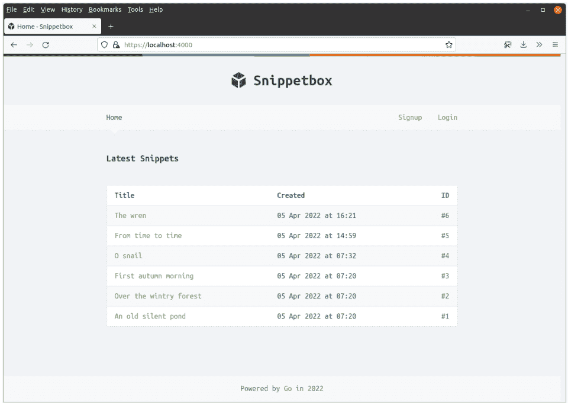

否则——如果您已登录——您的主页应该如下所示：

## 最新代码片段

| 标题 | 创建时间 | ID |
| :--- | :--- | :--- |
| 鹪鹩 | 05 Apr 2022 at 16:21 | #6 |
| 时不时 | 05 Apr 2022 at 14:59 | #5 |
| 哦，蜗牛 | 05 Apr 2022 at 07:32 | #4 |
| 初秋的早晨 | 05 Apr 2022 at 07:20 | #3 |
| 越过冬日森林 | 05 Apr 2022 at 07:20 | #2 |
| 一座古旧寂静的池塘 | 05 Apr 2022 at 07:20 | #1 |

随意尝试一下，尝试登录和登出，直到您确信导航栏的变化符合您的预期。

## 限制访问

就目前而言，我们对任何未登录的用户隐藏了‘创建代码片段’导航链接。但是，未验证的用户仍然可以通过直接访问 https://localhost:4000/snippet/create 页面来创建新代码片段。

让我们修复这个问题，这样如果未验证的用户尝试访问 URL 路径为 /snippet/create 的任何路由，他们将被重定向到 /user/login。

最简单的方法是通过一些中间件。打开 cmd/web/middleware.go 文件，创建一个新的 requireAuthentication() 中间件函数，遵循本书前面使用的相同模式：

```
File: cmd/web/middleware.go

package main

...

func (app *application) requireAuthentication(next http.Handler) http.Handler {
    return http.HandlerFunc(func(w http.ResponseWriter, r *http.Request) {
        // If the user is not authenticated, redirect them to the login page and
        // return from the middleware chain so that no subsequent handlers in
        // the chain are executed.
        if !app.isAuthenticated(r) {
            http.Redirect(w, r, "/user/login", http.StatusSeeOther)
            return
        }

        // Otherwise set the "Cache-Control: no-store" header so that pages
        // require authentication are not stored in the users browser cache (or
        // other intermediary cache).
        w.Header().Add("Cache-Control", "no-store")

        // And call the next handler in the chain.
        next.ServeHTTP(w, r)
    })
}
```

我们现在可以将这个中间件添加到我们的 `cmd/web/routes.go` 文件中，以保护特定路由。

在我们的例子中，我们将想要保护 GET /snippet/create 和 POST /snippet/create 路由。对未登录的用户进行注销也没有多大意义，因此在 POST /user/logout 路由上使用它也是合理的。

为了帮助实现这一点，让我们将应用程序路由重新排列为两个‘组’。

第一个组将包含我们的‘未受保护’路由并使用我们现有的动态中间件链。第二个组将包含我们的‘受保护’路由，并将使用一个新的受保护中间件链——由动态中间件链加上我们的新 requireAuthentication() 中间件组成。

像这样：


```
File: cmd/web/routes.go

package main

...

func (app *application) routes() http.Handler {
    mux := http.NewServeMux()

    fileServer := http.FileServer(http.Dir("./ui/static/"))
    mux.Handle("GET /static/", http.StripPrefix("/static", fileServer))

    // Unprotected application routes using the "dynamic" middleware chain.
    dynamic := alice.New(app.sessionManager.LoadAndSave)

    mux.Handle("GET /{$}", dynamic.ThenFunc(app.home))
    mux.Handle("GET /snippet/view/{id}", dynamic.ThenFunc(app.snippetView))
    mux.Handle("GET /user/signup", dynamic.ThenFunc(app.userSignup))
    mux.Handle("POST /user/signup", dynamic.ThenFunc(app.userSignupPost))
    mux.Handle("GET /user/login", dynamic.ThenFunc(app.userLogin))
    mux.Handle("POST /user/login", dynamic.ThenFunc(app.userLoginPost))

    // Protected (authenticated-only) application routes, using a new "protected"
    // middleware chain which includes the requireAuthentication middleware.
    protected := dynamic.Append(app.requireAuthentication)

    mux.Handle("GET /snippet/create", protected.ThenFunc(app.snippetCreate))
    mux.Handle("POST /snippet/create", protected.ThenFunc(app.snippetCreatePost))
    mux.Handle("POST /user/logout", protected.ThenFunc(app.userLogoutPost))

    standard := alice.New(app.recoverPanic, app.logRequest, commonHeaders)

    return standard.Then(mux)
}
```

保存文件，重启应用程序，并确保您已注销。

然后尝试在浏览器中直接访问 https://localhost:4000/snippet/create。您会发现取而代之的是立即被重定向到登录表单。

如果您愿意，也可以使用 curl 确认未经身份验证的用户在访问 POST /snippet/create 路由时也会被重定向：

```
$ curl -ki -d "" https://localhost:4000/snippet/create
HTTP/2 303
content-security-policy: default-src 'self'; style-src 'self' fonts.googleapis.com; font-src fonts.gstatic.com
location: /user/login
referrer-policy: origin-when-cross-origin
server: Go
vary: Cookie
x-content-type-options: nosniff
x-frame-options: deny
x-xss-protection: 0
content-length: 0
date: Wed, 18 Mar 2024 11:29:23 GMT
```

## 其他信息

### 不使用 alice

如果您没有使用 `justinas/alice` 包来管理中间件，这也没问题——您可以改为手动包装处理程序，如下所示：

```
mux.Handle("POST /snippet/create", app.sessionManager.LoadAndSave(app.requireAuthentication(http.HandlerFunc(app.snippetCreat
```

## CSRF 防护

在本章中，我们将探讨如何保护我们的应用程序免受跨站请求伪造（CSRF）攻击。

如果您不熟悉 CSRF 的原理，它是一种攻击类型，其中恶意的第三方网站向您的网站发送更改状态的 HTTP 请求。关于基本 CSRF 攻击的精彩解释可以在此处找到。

在我们的应用程序中，主要风险如下：

- 用户登录到我们的应用程序。我们的会话 cookie 设置为持续 12 小时，因此即使他们离开应用程序，也会保持登录状态。

- 用户随后访问另一个网站，该网站包含一些恶意代码，会向我们的 POST /snippet/create 端点发送跨站请求，以将新片段添加到我们的数据库中。用户的应用程序会话 cookie 会随此请求一起发送。

- 因为请求包含会话 cookie，我们的应用程序会将请求解释为来自已登录用户，并以该用户的权限处理请求。因此，用户完全不知情，一个新片段将被添加到我们的数据库中。

除了像上面那样的“传统”CSRF 攻击之外（请求以已登录用户的权限处理），您的应用程序还可能面临登录和注销 CSRF 攻击的风险。

### SameSite cookie

我们可以采取的一种缓解措施是，确保在会话 cookie 上适当设置 SameSite 属性。

默认情况下，我们使用的 alexedwards/scs 包会在会话 cookie 上始终设置 SameSite=Lax。这意味着，对于使用 POST、PUT 或 DELETE 等 HTTP 方法的任何跨站请求，用户的浏览器都不会发送会话 cookie。

只要我们的应用程序对任何更改状态的 HTTP 请求都使用 POST 方法（就像我们对登录、注册、注销和创建片段表单提交所做的那样），这意味着如果这些请求来自另一个网站，就不会发送会话 cookie——从而防止 CSRF 攻击。

然而，SameSite 属性仍然相对较新，并且全球只有 96% 的浏览器完全支持。因此，尽管它是我们可以（也应该）用作防御措施的东西，但我们不能对所有用户都依赖它。

### 基于令牌的缓解

为了缓解所有用户的 CSRF 风险，我们还需要实施某种形式的令牌检查。就像会话管理和密码哈希一样，在这方面有很多可能出错的地方……因此，使用经过验证的第三方包可能比自行实现更安全。

用于在 Go Web 应用程序中防止 CSRF 攻击的两个最流行的包是 gorilla/csrf 和 justinas/nosurf。它们的工作原理大致相同，都使用双提交 cookie 模式来防止攻击。在这种模式中，会生成一个随机 CSRF 令牌，并通过 CSRF cookie 发送给用户。然后将此 CSRF 令牌添加到每个可能易受 CSRF 攻击的 HTML 表单的隐藏字段中。当表单提交时，两个包都会使用某些中间件来检查隐藏字段值和 cookie 值是否匹配。

在这两个包中，我们将在本书中选择使用 justinas/nosurf。我主要偏爱它，因为它是自包含的且没有任何额外依赖。如果您在跟进，可以像这样安装最新版本：

```
$ go get github.com/justinas/nosurf@v1
go: downloading github.com/justinas/nosurf v1.1.1
go get: added github.com/justinas/nosurf v1.1.1
```

### 使用 nosurf 包

要使用 justinas/nosurf，请打开 cmd/web/middleware.go 文件，并像这样创建一个新的 noSurf() 中间件函数：

```
File: cmd/web/middleware.go

package main

import (
	"fmt"
	"net/http"

	"github.com/justinas/nosurf" // New import
)

...

// Create a NoSurf middleware function which uses a customized CSRF cookie with
// the Secure, Path and HttpOnly attributes set.
func noSurf(next http.Handler) http.Handler {
	csrfHandler := nosurf.New(next)
	csrfHandler.SetBaseCookie(http.Cookie{
		HttpOnly: true,
		Path:     "/",
		Secure:   true,
	})

	return csrfHandler
}
```

我们需要保护免受 CSRF 攻击的表单之一是我们的注销表单，它包含在我们的 `nav.tmpl` 片段中，并可能出现在应用程序的任何页面上。因此，出于这个原因，我们需要在 _所有_ 应用程序路由上使用我们的 `noSurf()` 中间件（除了 `GET /static/`）。

因此，让我们更新 `cmd/web/routes.go` 文件，将此 `noSurf()` 中间件添加到我们先前创建的动态中间件链中：

```
File: cmd/web/routes.go

package main

...

func (app *application) routes() http.Handler {
	mux := http.NewServeMux()

	fileServer := http.FileServer(http.Dir("./ui/static/"))
	mux.Handle("GET /static/", http.StripPrefix("/static", fileServer))

	// Use the nosurf middleware on all our 'dynamic' routes.
	dynamic := alice.New(app.sessionManager.LoadAndSave, noSurf)

	mux.Handle("GET /{$}", dynamic.ThenFunc(app.home))
	mux.Handle("GET /snippet/view/{id}", dynamic.ThenFunc(app.snippetView))
	mux.Handle("GET /user/signup", dynamic.ThenFunc(app.userSignup))
	mux.Handle("POST /user/signup", dynamic.ThenFunc(app.userSignupPost))
	mux.Handle("GET /user/login", dynamic.ThenFunc(app.userLogin))
	mux.Handle("POST /user/login", dynamic.ThenFunc(app.userLoginPost))

	protected := dynamic.Append(app.requireAuthentication)

	mux.Handle("GET /snippet/create", protected.ThenFunc(app.snippetCreate))
	mux.Handle("POST /snippet/create", protected.ThenFunc(app.snippetCreatePost))
	mux.Handle("POST /user/logout", protected.ThenFunc(app.userLogoutPost))

	standard := alice.New(app.recoverPanic, app.logRequest, commonHeaders)

	return standard.Then(mux)
}
```

此时，您可能想要启动应用程序并尝试提交其中一个表单。当您这样做时，请求应被 `noSurf()` 中间件拦截，您应该会收到 400 Bad Request 响应。


## 错误请求

要使表单提交正常工作，我们需要使用 `nosurf.Token()` 函数获取 CSRF 令牌，并将其添加到每个表单中的隐藏 `csrf_token` 字段。因此，下一步是向我们的 `templateData` 结构体添加一个新的 `CSRFToken` 字段：

```
File: cmd/web/templates.go

package main

import (
	"html/template"
	"path/filepath"
	"time"

	"snippetbox.alexedwards.net/internal/models"
)

type templateData struct {
	CurrentYear	 int
	Snippet		 models.Snippet
	Snippets	 []models.Snippet
	Form		 any
	Flash		 string
	IsAuthenticated bool
	CSRFToken	 string // Add a CSRFToken field.
}

...
```

由于注销表单可能出现在每个页面上，因此通过我们的 `newTemplateData()` 辅助函数自动将 CSRF 令牌添加到模板数据中是合理的。这意味着每次渲染页面时，它都将可用于我们的模板。

请继续按照以下方式更新 `cmd/web/helpers.go` 文件：

```
File: cmd/web/helpers.go

package main

import (
	"bytes"
	"errors"
	"fmt"
	"net/http"
	"time"

	"github.com/go-playground/form/v4"
	"github.com/justinas/nosurf" // New import
)

...

func (app *application) newTemplateData(r *http.Request) templateData {
	return templateData{
		CurrentYear: time.Now().Year(),
		Flash: app.sessionManager.PopString(r.Context(), "flash"),
		IsAuthenticated: app.isAuthenticated(r),
		CSRFToken: nosurf.Token(r), // Add the CSRF token.
	}
}

...
```

最后，我们需要更新应用程序中的所有表单，以在隐藏字段中包含此 CSRF 令牌。

如下所示：

```
File: ui/html/pages/create.tpl

{{define "title"}}Create a New Snippet{{end}}

{{define "main"}}
<form action='/snippet/create' method='POST'>
    <!-- Include the CSRF token -->
    <input type='hidden' name='csrf_token' value='{{.CSRFToken}}'>
    <div>
        <label>Title:</label>
        {{with .Form.FieldErrors.title}}
            <label class='error'>{{.}}</label>
        {{end}}
        <input type='text' name='title' value='{{.Form.Title}}'>
    </div>
    <div>
        <label>Content:</label>
        {{with .Form.FieldErrors.content}}
            <label class='error'>{{.}}</label>
        {{end}}
        <textarea name='content'>{{.Form.Content}}</textarea>
    </div>
    <div>
        <label>Delete in:</label>
        {{with .Form.FieldErrors.expires}}
            <label class='error'>{{.}}</label>
        {{end}}
        <input type='radio' name='expires' value='365' {{if (eq .Form.Expires 365)}}checked{{end}}> One Year
        <input type='radio' name='expires' value='7' {{if (eq .Form.Expires 7)}}checked{{end}}> One Week
        <input type='radio' name='expires' value='1' {{if (eq .Form.Expires 1)}}checked{{end}}> One Day
    </div>
    <div>
        <input type='submit' value='Publish snippet'>
    </div>
</form>
{{end}}
```

```
File: ui/html/pages/login.tmpl

{{define "title"}}login{{end}}

{{define "main"}}
<form action='/user/login' method='POST' novalidate>
<!-- Include the CSRF token -->
<input type='hidden' name='csrf_token' value='{{.CSRFToken}}'>
{{range .Form.NonFieldErrors}}
<div class='error'>{{.}}</div>
{{end}}
<div>
<label>Email:</label>
{{with .Form.FieldErrors.email}}
<label class='error'>{{.}}</label>
{{end}}
<input type='email' name='email' value='{{.Form.Email}}'>
</div>
<div>
<label>Password:</label>
{{with .Form.FieldErrors.password}}
<label class='error'>{{.}}</label>
{{end}}
<input type='password' name='password'>
</div>
<div>
<input type='submit' value='Login'>
</div>
</form>
{{end}}
```

```
File: ui/html/pages/signup.tmpl

{{define "title"}}Signup{{end}}

{{define "main"}}
<form action='/user/signup' method='POST' novalidate>
    <!-- Include the CSRF token -->
    <input type='hidden' name='csrf_token' value='{{.CSRFToken}}'>
    <div>
        <label>Name:</label>
        {{with .Form.FieldErrors.name}}
            <label class='error'>{{.}}</label>
        {{end}}
        <input type='text' name='name' value='{{.Form.Name}}'>
    </div>
    <div>
        <label>Email:</label>
        {{with .Form.FieldErrors.email}}
            <label class='error'>{{.}}</label>
        {{end}}
        <input type='email' name='email' value='{{.Form.Email}}'>
    </div>
    <div>
        <label>Password:</label>
        {{with .Form.FieldErrors.password}}
            <label class='error'>{{.}}</label>
        {{end}}
        <input type='password' name='password'>
    </div>
    <div>
        <input type='submit' value='Signup'>
    </div>
</form>
{{end}}
```

```
File: ui/html/partials/nav.tmpl

{{define "nav"}}
<nav>
    <div>
        <a href='/'>Home</a>
        {{if .IsAuthenticated}}
            <a href='/snippet/create'>Create snippet</a>
        {{end}}
    </div>
    <div>
        {{if .IsAuthenticated}}
            <form action='/user/logout' method='POST'>
                <!-- Include the CSRF token -->
                <input type='hidden' name='csrf_token' value='{{.CSRFToken}}'>
                <button>Logout</button>
            </form>
        {{else}}
            <a href='/user/signup'>Signup</a>
            <a href='/user/login'>Login</a>
        {{end}}
    </div>
</nav>
{{end}}
```

请再次运行应用程序，然后查看其中一个表单的源代码。你应该看到它现在在隐藏字段中包含了一个 CSRF 令牌，如下所示。

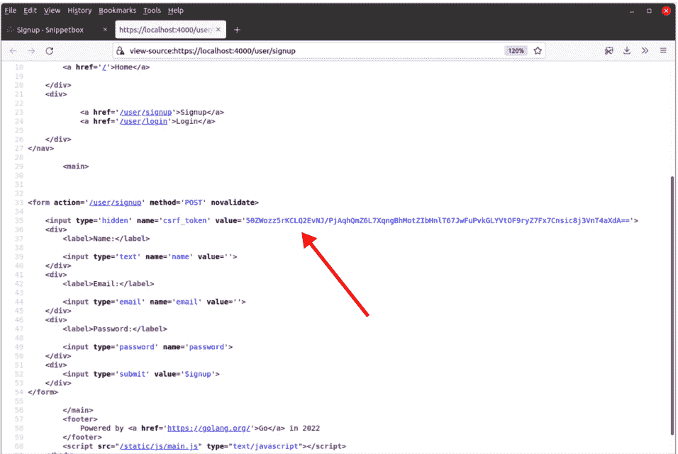

如果你尝试提交表单，现在应该可以正确运行了。

## 其他信息

## SameSite 'Strict' 设置

如果需要，你可以将会话 Cookie 改为使用 `SameSite=Strict` 设置，而不是（默认的）`SameSite=Lax`。如下所示：

```
sessionManager := scs.New()
sessionManager.Cookie.SameSite = http.SameSiteStrictMode
```

但需要注意的是，使用 `SameSite=Strict` 会阻止用户浏览器为所有跨站点用途发送会话 Cookie——包括使用 GET 和 HEAD 等 HTTP 方法的安全请求。

虽然这听起来更安全（确实如此！），但缺点是，当用户从另一个网站点击链接进入你的应用程序时，不会发送会话 Cookie。这意味着，即使他们拥有包含 "authenticatedUserID" 值的活跃会话，你的应用程序也会最初将用户视为“未登录”。

因此，如果你的应用程序可能会有其他网站链接到它（或通过电子邮件或私人消息服务共享指向它的链接），那么 `SameSite=Lax` 通常是更合适的设置。

## SameSite Cookie 和 TLS 1.3

本章前面我曾说过，我们不能完全依赖 SameSite Cookie 属性来防止 CSRF 攻击，因为并非所有浏览器都完全支持它。

但这条规则有一个例外，原因是不存在既支持 TLS 1.3 又不支持 SameSite Cookie 的浏览器。

换句话说，如果你将 TLS 1.3 设置为服务器 TLS 配置中的最低支持版本，那么所有能够使用你的应用程序的浏览器都将支持 SameSite Cookie。

```
tlsConfig := &tls.Config{
	MinVersion: tls.VersionTLS13,
}
```

只要你只允许向应用程序发送 HTTPS 请求，并强制将 TLS 1.3 作为最低 TLS 版本，你就不需要采取任何额外的 CSRF 攻击缓解措施（例如使用 `justinas/nosurf` 包）。只需确保你始终：

- 将 `SameSite=Lax` 或 `SameSite=Strict` 设置在会话 Cookie 上；以及
- 对于任何更改状态的请求，使用 POST、PUT 或 DELETE HTTP 方法。

## 使用请求上下文

目前，我们对用户进行身份验证的逻辑只是简单地检查其会话数据中是否存在 `authenticatedUserID` 值，如下所示：

```
func (app *application) isAuthenticated(r *http.Request) bool {
	return app.sessionManager.Exists(r.Context(), "authenticatedUserID")
}
```

我们可以通过查询用户数据库表来使此检查更加可靠，以确保 `authenticatedUserID` 值是真实且有效的（即，我们在用户上次登录后没有删除其账户）。

但是，执行此额外的数据库检查有一个小问题。

我们的 `isAuthenticated()` 辅助函数在每个请求周期中可能会被多次调用。目前我们使用了两次——一次在 `requireAuthentication()` 中间件中，另一次在 `newTemplateData()` 辅助函数中。因此，如果我们直接从 `isAuthenticated()` 辅助函数中查询数据库，每个请求都会进行重复的数据库往返。这效率不高。

更好的方法是在某个中间件中执行此检查，以确定当前请求是否来自已验证的用户，然后将该信息传递给链中所有后续处理程序。

那么我们该怎么做呢？请求上下文登场了。

在本节中，你将学习：

- 什么是请求上下文，如何使用它，以及何时适合使用它。
- 如何在实践中使用请求上下文在处理程序之间传递有关当前用户的信息。


## 请求上下文如何工作

我们中间件和处理程序处理的每个http.Request都嵌入了一个context.Context对象，我们可以使用它在请求生命周期内存储信息。

如我已经暗示过的，在Web应用程序中，这的一个常见用例是在中间件和其他处理程序之间传递信息。

在我们的情况中，我们想使用它在某个中间件中检查用户是否已通过身份验证，如果已验证，则将此信息提供给所有其他中间件和处理程序。

让我们先从一些理论开始，并解释使用请求上下文的语法。然后，在下一章中，我们将再次具体一些，并演示如何在我们的应用程序中实际使用它。

## 请求上下文语法

向请求上下文添加信息的基本代码如下：

```go
// Where r is a *http.Request...
ctx := r.Context()
ctx = context.WithValue(ctx, "isAuthenticated", true)
r = r.WithContext(ctx)
```

让我们逐行了解这段代码。

- 首先，我们使用`r.Context()`方法从请求中检索*现有*上下文，并将其分配给`ctx`变量。
- 然后我们使用`context.WithValue()`方法创建现有上下文的*新副本*，包含键"isAuthenticated"和值`true`。
- 最后我们使用`r.WithContext()`方法创建包含我们新上下文的请求*副本*。

> **重要：** 请注意，我们并没有直接更新请求的上下文。
> 我们所做的是*创建*http.Request对象的*新副本*，其中包含我们的新上下文。

我还应该指出，为了清晰起见，我将那个代码片段写得比需要的更冗长一些。更典型的写法是这样的：

```go
ctx = context.WithValue(r.Context(), "isAuthenticated", true)
r = r.WithContext(ctx)
```

这就是如何将数据添加到请求上下文中。但是如何再次检索呢？

需要解释的重要一点是，在幕后，请求上下文值的存储类型为any。这意味着，从上下文中检索它们之后，在使用前需要将它们断言为原始类型。

要检索值，我们需要使用r.Context().Value()方法，如下所示：

```go
isAuthenticated, ok := r.Context().Value("isAuthenticated").(bool)
if !ok {
	return errors.New("could not convert value to bool")
}
```

### 避免键冲突

在上面的代码示例中，我使用字符串"isAuthenticated"作为存储和检索请求上下文中数据的键。但这不推荐，因为存在这样的风险：您的应用程序使用的其他第三方包也可能想要使用键"isAuthenticated"来存储数据——这会导致命名冲突。

为了避免这种情况，良好的做法是创建您自己的自定义类型，用于您的上下文键。扩展我们的示例代码，这样做要好得多：

```go
// Declare a custom "contextKey" type for your context keys.
type contextKey string

// Create a constant with the type contextKey that we can use.
const isAuthenticatedContextKey = contextKey("isAuthenticated")

...

// Set the value in the request context, using our isAuthenticatedContextKey
// constant as the key.
ctx := r.Context()
ctx = context.WithValue(ctx, isAuthenticatedContextKey, true)
r = r.WithContext(ctx)

...

// Retrieve the value from the request context using our constant as the key.
isAuthenticated, ok := r.Context().Value(isAuthenticatedContextKey).(bool)
if !ok {
	return errors.New("could not convert value to bool")
}
```

## 身份验证/授权的请求上下文

好了，有了那些解释之后，让我们开始在我们的应用程序中使用请求上下文功能。

我们将从`internal/models/users.go`文件开始，完善`UserModel.Exists()`方法，以便如果`users`表中存在具有特定ID的用户则返回`true`，否则返回`false`。如下所示：

```go
File: internal/models/users.go

package models

...

func (m *UserModel) Exists(id int) (bool, error) {
    var exists bool

    stmt := "SELECT EXISTS(SELECT true FROM users WHERE id = ?)"

    err := m.DB.QueryRow(stmt, id).Scan(&exists)
    return exists, err
}
```

然后让我们创建一个新的`cmd/web/context.go`文件。在这个文件中，我们将定义一个自定义`contextKey`类型和一个`isAuthenticatedContextKey`变量，这样我们就有一个唯一的键可以用来存储和检索请求上下文中的身份验证状态（而没有命名冲突的风险）。

```
$ touch cmd/web/context.go
```

```go
File: cmd/web/context.go

package main

type contextKey string

const isAuthenticatedContextKey = contextKey("isAuthenticated")
```

现在进入令人兴奋的部分。让我们创建一个新的`authenticate()`中间件方法，它：

- 1. 从会话数据中检索用户的ID。
- 2. 使用UserModel.Exists()方法检查数据库，看该ID是否对应有效用户。
- 3. 更新请求上下文以包含值为true的isAuthenticatedContextKey键。

这是代码：

```go
File: cmd/web/middleware.go

package main

import (
	"context" // New import
	"fmt"
	"net/http"

	"github.com/justinas/nosurf"
)

...

func (app *application) authenticate(next http.Handler) http.Handler {
	return http.HandlerFunc(func(w http.ResponseWriter, r *http.Request) {
		// Retrieve the authenticatedUserID value from the session using the
		// GetInt() method. This will return the zero value for an int (0) if no
		// "authenticatedUserID" value is in the session -- in which case we
		// call the next handler in the chain as normal and return.
		id := app.sessionManager.GetInt(r.Context(), "authenticatedUserID")
		if id == 0 {
			next.ServeHTTP(w, r)
			return
		}

		// Otherwise, we check to see if a user with that ID exists in our
		// database.
		exists, err := app.users.Exists(id)
		if err != nil {
			app.serverError(w, r, err)
			return
		}

		// If a matching user is found, we know that the request is
		// coming from an authenticated user who exists in our database. We
		// create a new copy of the request (with an isAuthenticatedContextKey
		// value of true in the request context) and assign it to r.
		if exists {
			ctx := context.WithValue(r.Context(), isAuthenticatedContextKey, true)
			r = r.WithContext(ctx)
		}

		// Call the next handler in the chain.
		next.ServeHTTP(w, r)
	})
}
```

这里需要强调的重要点是以下区别：

- 当我们*没有*有效的已验证用户时，我们将原始且未更改的*http.Request*传递给链中的下一个处理程序。
- 当我们*有*有效的已验证用户时，我们会创建请求的副本，其中请求上下文中存储了一个*isAuthenticatedContextKey*键和*true*值。然后我们将此*http.Request*的副本传递给链中的下一个处理程序。

好了，让我们更新*cmd/web/routes.go*文件，将*authenticate()*中间件包含在我们的*动态*中间件链中：

```go
File: cmd/web/routes.go

package main

...

func (app *application) routes() http.Handler {
    mux := http.NewServeMux()

    fileServer := http.FileServer(http.Dir("./ui/static/"))
    mux.Handle("GET /static/", http.StripPrefix("/static", fileServer))

    // Add the authenticate() middleware to the chain.
    dynamic := alice.New(app.sessionManager.LoadAndSave, noSurf, app.authenticate)

    mux.Handle("GET /{$}", dynamic.ThenFunc(app.home))
    mux.Handle("GET /snippet/view/{id}", dynamic.ThenFunc(app.snippetView))
    mux.Handle("GET /user/signup", dynamic.ThenFunc(app.userSignup))
    mux.Handle("POST /user/signup", dynamic.ThenFunc(app.userSignupPost))
    mux.Handle("GET /user/login", dynamic.ThenFunc(app.userLogin))
    mux.Handle("POST /user/login", dynamic.ThenFunc(app.userLoginPost))

    protected := dynamic.Append(app.requireAuthentication)

    mux.Handle("GET /snippet/create", protected.ThenFunc(app.snippetCreate))
    mux.Handle("POST /snippet/create", protected.ThenFunc(app.snippetCreatePost))
    mux.Handle("POST /user/logout", protected.ThenFunc(app.userLogoutPost))

    standard := alice.New(app.recoverPanic, app.logRequest, commonHeaders)

    return standard.Then(mux)
}
```

我们需要做的最后一件事是更新我们的*isAuthenticated()*帮助函数，使其不再检查会话数据，而是检查请求上下文以确定用户是否已通过身份验证。

我们可以这样做：


```go
File: cmd/web/helpers.go

package main

...

func (app *application) isAuthenticated(r *http.Request) bool {
	isAuthenticated, ok := r.Context().Value(isAuthenticatedContextKey).(bool)
	if !ok {
		return false
	}

	return isAuthenticated
}
```

这里需要指出的是，如果请求上下文中没有带有 `isAuthenticatedContextKey` 键的值，或者底层值不是 bool 类型，那么此类型断言将失败。在这种情况下，我们采用“安全”的回退并返回 false（即我们假设用户未经过身份验证）。

如果愿意，可以再次运行应用程序。它应该能正确编译，如果以某个用户身份登录并浏览应用程序，应用程序应该与之前完全一样地工作。

然后，如果愿意，打开 MySQL 并从数据库中删除您登录用户的记录。例如：

```
mysql> USE snippetbox;
mysql> DELETE FROM users WHERE email = 'bob@example.com';
```

当您返回浏览器并刷新页面时，应用程序现在足够智能，能够识别用户已被删除，您会发现自己被视为未经过身份验证（已注销）的用户。

## 其他信息

### 滥用请求上下文

需要强调的是，请求上下文只应用于存储与特定请求生命周期相关的信息。`context.Context` 的 Go 文档警告说：

> 仅将 context 值用于跨进程和 API 传递的请求范围数据。

这意味着您不应该使用它来传递存在于请求生命周期之外的依赖项——例如日志记录器、模板缓存和数据库连接池——到您的中间件和处理程序中。

出于类型安全和代码清晰度的考虑，几乎总是最好将这些依赖项显式地提供给您的处理程序，方法是将您的处理程序作为应用程序结构体的方法（就像本书中所做的那样），或者在闭包中传递它们（就像在这个 Gist 中一样）。

## 文件嵌入

Go 标准库包含一个 `embed` 包，可以将外部文件嵌入到您的 Go 程序本身中。

使用 `embed` 包为创建自包含的 Go 程序打开了机会，这些程序拥有运行所需的一切，作为编译后的二进制可执行文件的一部分。反过来，这使得部署或分发您的 Web 应用程序变得更加容易。

在本书的这一部分中，我们将更新应用程序，以便它嵌入我们 `ui` 目录中的文件——从静态 CSS、JavaScript 和图像文件开始，然后转到 HTML 模板。

让我们直接开始并解释如何使用它。

### 嵌入静态文件

如果您在跟进，首先要做的是创建一个新的 `ui/efs.go` 文件：

```
$ touch ui/efs.go
```

然后添加以下代码：

```
File: ui/efs.go

package ui

import (
	"embed"
)

//go:embed "static"
var Files embed.FS
```

这里的重要行是 `//go:embed "static"`。

这看起来像是一个注释，但实际上是一个特殊的注释指令。当我们的应用程序被编译时（作为 `go build` 或 `go run` 的一部分），此注释指令指示 Go 将我们 `ui/static` 文件夹中的文件存储在由全局变量 `Files` 引用的嵌入式文件系统中。

关于这一点，有几个重要细节需要解释。

- 注释指令必须放置在您想要存储嵌入文件的变量 *立即上方*。
- 指令的格式为 `go:embed "<path>"`。路径相对于包含该指令的 `.go` 文件，因此——在我们的情况中——`go:embed "static"` 嵌入了我们项目中的 `ui/static` 目录。
- 您只能在包级别的全局变量上使用 `go:embed` 指令，而不能在函数或方法中使用。如果您尝试在函数或方法中使用它，编译时会收到错误 `"go:embed cannot apply to var inside func"`。
- 路径不能包含 `.` 或 `..` 元素，也不能以 `/` 开头或结尾。这基本上将您限制为只能嵌入与包含 `go:embed` 指令的 `.go` 文件位于同一目录中的文件或目录。
- 嵌入式文件系统 *始终* 以包含 `go:embed` 指令的目录为根。因此，在上面的示例中，我们的 `Files` 变量包含一个 `embed.FS` 嵌入式文件系统，该文件系统的根是我们的 `ui` 目录。

### 使用嵌入的静态文件

现在让我们修改应用程序，使其从嵌入式文件系统提供我们的静态 CSS、JavaScript 和图像文件——而不是在运行时从磁盘读取它们。

打开您的 `cmd/web/routes.go` 文件并按如下更新它：

```
File: cmd/web/routes.go

package main

import (
	"net/http"

	"snippetbox.alexedwards.net/ui" // New import
	"github.com/justinas/alice"
)

func (app *application) routes() http.Handler {
	mux := http.NewServeMux()

	// Use the http.FileServerFS() function to create a HTTP handler which
	// serves the embedded files in ui.Files. It's important to note that our
	// static files are contained in the "static" folder of the ui.Files
	// embedded filesystem. So, for example, our CSS stylesheet is located at
	// "static/css/main.css". This means that we no longer need to strip the
	// prefix from the request URL -- any requests that start with /static/ can
	// just be passed directly to the file server and the corresponding static
	// file will be served (so long as it exists).
	mux.Handle("GET /static/", http.FileServerFS(ui.Files))

	dynamic := alice.New(app.sessionManager.LoadAndSave, noSurf, app.authenticate)

	mux.Handle("GET /{$}", dynamic.ThenFunc(app.home))
	mux.Handle("GET /snippet/view/{id}", dynamic.ThenFunc(app.snippetView))
	mux.Handle("GET /user/signup", dynamic.ThenFunc(app.userSignup))
	mux.Handle("POST /user/signup", dynamic.ThenFunc(app.userSignupPost))
	mux.Handle("GET /user/login", dynamic.ThenFunc(app.userLogin))
	mux.Handle("POST /user/login", dynamic.ThenFunc(app.userLoginPost))

	protected := dynamic.Append(app.requireAuthentication)

	mux.Handle("GET /snippet/create", protected.ThenFunc(app.snippetCreate))
	mux.Handle("POST /snippet/create", protected.ThenFunc(app.snippetCreatePost))
	mux.Handle("POST /user/logout", protected.ThenFunc(app.userLogoutPost))

	standard := alice.New(app.recoverPanic, app.logRequest, commonHeaders)

	return standard.Then(mux)
}
```

如果您保存这些更改并重新启动应用程序，应该会发现一切都能正确编译和运行。当您在浏览器中访问 https://localhost:4000 时，静态文件应该从嵌入式文件系统提供，一切看起来都应该正常。

### 最新代码片段

| 标题 | 创建时间 | ID |
| :--- | :--- | :--- |
| 鹪鹩 | 2022 年 4 月 5 日 16:21 | #6 |
| 时不时 | 2022 年 4 月 5 日 14:59 | #5 |
| 哦，蜗牛 | 2022 年 4 月 5 日 07:32 | #4 |
| 初秋的早晨 | 2022 年 4 月 5 日 07:20 | #3 |
| 冬日森林之上 | 2022 年 4 月 5 日 07:20 | #2 |
| 古老寂静的池塘 | 2022 年 4 月 5 日 07:20 | #1 |

如果您愿意，也可以直接导航到静态文件以检查它们是否仍然可用。例如，访问 [https://localhost:4000/static/css/main.css](https://localhost:4000/static/css/main.css) 应该显示来自嵌入式文件系统的网页 CSS 样式表。

```
* {
  box-sizing: border-box;
  margin: 0;
  padding: 0;
  font-size: 18px;
  font-family: "Ubuntu Mono", monospace;
}

html, body {
  height: 100%;
}

body {
  line-height: 1.5;
  background-color: #F1F3F6;
  color: #34495E;
  overflow-y: scroll;
}

header, nav, main, footer {
  padding: 2px calc((100% - 800px) / 2) 0;
}

main {
  margin-top: 54px;
  margin-bottom: 54px;
  min-height: calc(100vh - 345px);
}
```

### 其他信息

### 多个路径

在一个嵌入指令中指定多个路径是完全可以的。例如，我们可以单独嵌入 `ui/static/css`、`ui/static/img` 和 `ui/static/js` 目录，如下所示：

```
//go:embed "static/css" "static/img" "static/js"
var Files embed.FS
```

> **重要：** 嵌入路径模式中的路径分隔符应始终为正斜杠 `/`，即使在 Windows 计算机上也是如此。

### 嵌入特定文件


我在本章开头提到过这一点，但 embed 路径有可能指向 *特定文件*。嵌入不仅仅局限于目录。

例如，假设我们的 `ui/static/css` 目录包含一些我们不想要嵌入的附加资源，比如 Sass 或 Less 文件。在这种情况下，我们可以只嵌入 `ui/static/css/main.css` 文件，如下所示：

```
//go:embed "static/css/main.css" "static/img" "static/js"
var Files embed.FS
```

## 通配符路径

* 字符可以在 embed 路径中用作“通配符”。延续上面的示例，我们可以重写 embed 指令，使其仅嵌入 `ui/static/css` 下的 .css 文件：

```
//go:embed "static/css/*.css" "static/img" "static/js"
var Files embed.FS
```

相关地，如果你使用不带任何限定符的通配符路径 "*"，如下所示：

```
//go:embed "*"
var Files embed.FS
```

... 那么它将嵌入当前目录中的所有内容，包括包含 embed 指令本身的 .go 文件！大多数时候你不希望这样，因此更常见的做法是明确嵌入特定的子目录或文件。

## all 前缀

最后，如果路径指向一个目录，那么该目录中的所有文件都会被递归嵌入——但名称以 . 或 _ 字符开头的文件除外。如果你也想包含这些文件，则应在路径开头使用 `all:` 前缀。

```
//go:embed "all:static"
var Files embed.FS
```

## 嵌入 HTML 模板

接下来，让我们更新应用程序，使模板缓存使用嵌入的 HTML 模板文件，而不是在运行时从硬盘读取它们。

返回 ui/efs.go 文件，并对其进行更新，使 ui.Files 也嵌入 ui/html 目录（包含我们的模板）的内容。如下所示：

```
File: ui/efs.go

package ui

import (
    "embed"
)

//go:embed "html" "static"
var Files embed.FS
```

然后，我们需要更新 cmd/web/templates.go 中的 newTemplateCache() 函数，使其从 ui.Files 读取模板。为此，我们需要利用 Go 提供的几个用于处理嵌入式文件系统的特殊功能：

- fs.Glob() 函数返回与 glob 模式匹配的文件路径切片。它实际上与我们在本书前面使用过的 filepath.Glob() 函数相同，只不过它作用于嵌入式文件系统。
- Template.ParseFS() 方法可用于将嵌入式文件系统中的 HTML 模板解析为模板集。这实际上可以替代我们之前使用的 Template.ParseFiles() 和 Template.ParseGlob() 方法。Template.ParseFiles() 也是一个变参函数，允许你在一次 ParseFiles() 调用中解析多个模板。

让我们在 cmd/web/templates.go 文件中使用这些功能：

```
File: cmd/web/templates.go

package main

import (
	"html/template"
	"io/fs" // New import
	"path/filepath"
	"time"

	"snippetbox.alexedwards.net/internal/models"
	"snippetbox.alexedwards.net/ui" // New import
)

...

func newTemplateCache() (map[string]*template.Template, error) {
	cache := map[string]*template.Template{}

	// Use fs.Glob() to get a slice of all filepaths in the ui.Files embedded
	// filesystem which match the pattern 'html/pages/*.tmpl'. This essentially
	// gives us a slice of all the 'page' templates for the application, just
	// like before.
	pages, err := fs.Glob(ui.Files, "html/pages/*.tmpl")
	if err != nil {
		return nil, err
	}

	for _, page := range pages {
		name := filepath.Base(page)

		// Create a slice containing the filepath patterns for the templates we
		// want to parse.
		patterns := []string{
			"html/base.tmpl",
			"html/partials/*.tmpl",
			page,
		}

		// Use ParseFS() instead of ParseFiles() to parse the template files
		// from the ui.Files embedded filesystem.
		ts, err := template.New(name).Funcs(functions).ParseFS(ui.Files, patterns...)
		if err != nil {
			return nil, err
		}

		cache[name] = ts
	}

	return cache, nil
}
```

完成此操作后，当我们的应用程序构建为二进制文件时，它将包含运行所需的所有 UI 文件。

你可以在 /tmp 目录中构建一个可执行二进制文件，复制 TLS 证书，然后运行该二进制文件，快速尝试此操作。如下所示：

```
$ go build -o /tmp/web .//cmd/web/
$ cp -r .tls /tmp/
$ cd /tmp/
$ ./web
time=2024-03-18T11:29:23.000+08:00 level=INFO msg="starting server" addr=:4000
```

同样，你应该能够在浏览器中访问 https://localhost:4000，一切都能正常工作——尽管二进制文件位于无法访问磁盘上原始 UI 文件的位置。

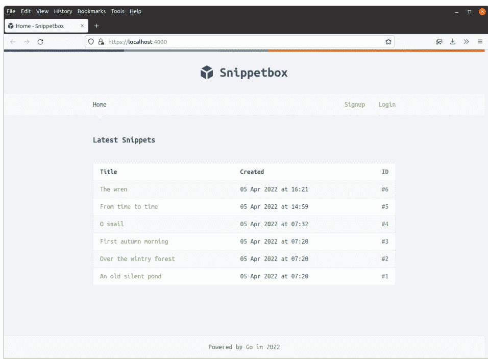

> **注意:** 如果你想了解关于构建二进制文件和部署应用程序的更多信息，Let's Go Further 中提供了大量信息和详细说明。

## 测试

因此，我们终于来到了测试这个话题。

与构建和组织应用程序代码一样，在 Go 中构建和组织测试也没有单一的“正确”方法。但你可以遵循一些约定、模式和最佳实践。

在本节中，我们将为应用程序中的部分代码添加测试，目的是展示创建测试的一般语法，并说明一些可在各种应用程序中重复使用的模式。

你将学习：

- 如何在 Go 中创建和运行表驱动的单元测试和子测试。
- 如何对 HTTP 处理程序和中间件进行单元测试。
- 如何对 Web 应用程序的路由、中间件和处理程序进行“端到端”测试。
- 如何创建数据库模型的模拟对象并在单元测试中使用它们。
- 测试受 CSRF 保护的 HTML 表单提交的模式。
- 如何使用测试 MySQL 实例执行集成测试。
- 如何轻松计算和分析测试的代码覆盖率。

### 单元测试和子测试

在本章中，我们将创建一个单元测试，以确保我们的 humanDate() 函数（我们在自定义模板函数章节中创建的）输出的 time.Time 值符合我们想要的精确格式。

如果你不记得了，humanDate() 函数的样子如下：

```
File: cmd/web/templates.go

package main

...

func humanDate(t time.Time) string {
	return t.Format("02 Jan 2006 at 15:04")
}

...
```

我之所以想先测试这个，是因为它是一个简单的函数。我们可以在不过分纠结于正在测试的功能的情况下，探索编写测试的基本语法和模式。

### 创建单元测试

让我们直接开始，为这个函数创建一个单元测试。

在 Go 中，标准做法是在 *_test.go 文件中编写测试，这些文件与正在测试的代码直接位于同一位置。因此，在这种情况下，我们要做的第一件事是创建一个新的 cmd/web/templates_test.go 文件来保存测试：

```
$ touch cmd/web/templates_test.go
```

然后，我们可以像下面这样为 humanDate 函数创建一个新的单元测试：

```
File: cmd/web/templates_test.go
package main
import (
	"testing"
	"time"
)
func TestHumanDate(t *testing.T) {
	// Initialize a new time.Time object and pass it to the humanDate function.
	tm := time.Date(2024, 3, 17, 10, 15, 0, 0, time.UTC)
	hd := humanDate(tm)

	// Check that the output from the humanDate function is in the format we
	// expect. If it isn't what we expect, use the t.Errorf() function to
	// indicate that the test has failed and log the expected and actual
	// values.
	if hd != "17 Mar 2024 at 10:15" {
		t.Errorf("got %q; want %q", hd, "17 Mar 2024 at 10:15")
	}
}
```

这种模式是你在 Go 中编写的几乎所有测试都会使用的基本模式。需要记住的重要事项是：

- 测试只是普通的 Go 代码，它调用 humanDate() 函数并检查结果是否与预期一致。
- 你的单元测试包含在签名为 func(*testing.T) 的普通 Go 函数中。
- 要成为有效的单元测试，此函数的名称必须以单词 Test 开头。通常，之后会跟随你正在测试的函数、方法或类型的名称，以便一目了然地知道正在测试什么。
- 你可以使用 t.Errorf() 函数将测试标记为失败，并记录关于失败的描述性消息。需要注意的是，调用 t.Errorf() 并不会停止测试的执行——调用它后，Go 将继续正常执行任何剩余的测试代码。

让我们试一下。保存文件，然后使用 go test 命令运行 cmd/web 包中的所有测试，如下所示：

```
$ go test ./cmd/web
ok snippetbox.alexedwards.net/cmd/web 0.005s
```

好了，这很不错。输出中的 ok 表示该包中的所有测试（目前只有我们的 TestHumanDate() 测试）都已通过，没有任何问题。


如果您想了解更多详细信息，可以使用 `-v` 标志获取详细输出，从而查看正在运行的确切测试：

```
$ go test -v ./cmd/web
=== RUN   TestHumanDate
--- PASS: TestHumanDate (0.00s)
PASS
ok   snippetbox.alexedwards.net/cmd/web   0.007s
```

## 表驱动测试

现在让我们扩展 TestHumanDate() 函数，以涵盖一些其他测试用例。具体来说，我们将对其进行更新，以便还检查：

- 1. 如果 humanDate() 的输入是零时间，则返回空字符串 ""。
- 2. humanDate() 函数的输出始终使用 UTC 时区。

在 Go 中，运行多个测试用例的一种惯用方法是使用表驱动测试。

基本上，表驱动测试背后的思想是创建一个包含输入和预期输出的测试用例“表”，然后遍历这些用例，在子测试中运行每个测试用例。设置此功能的方法有几种，但一种常见的方法是将测试用例定义为匿名结构体切片。

我来演示：

```
File: cmd/web/templates_test.go

package main

import (
	"testing"
	"time"
)

func TestHumanDate(t *testing.T) {
	// Create a slice of anonymous structs containing the test case name,
	// input to our humanDate() function (the tm field), and expected output
	// (the want field).
	tests := []struct {
		name string
		tm   time.Time
		want string
	}{
		{
			name: "UTC",
			tm:   time.Date(2024, 3, 17, 10, 15, 0, 0, time.UTC),
			want: "17 Mar 2024 at 10:15",
		},
		{
			name: "Empty",
			tm:   time.Time{},
			want: "",
		},
		{
			name: "CET",
			tm:   time.Date(2024, 3, 17, 10, 15, 0, 0, time.FixedZone("CET", 1*60*60)),
			want: "17 Mar 2024 at 09:15",
		},
	}

	// Loop over the test cases.
	for _, tt := range tests {
		// Use the t.Run() function to run a sub-test for each test case. The
		// first parameter to this is the name of the test (which is used to
		// identify the sub-test in any log output) and the second parameter is
		// an anonymous function containing the actual test for each case.
		t.Run(tt.name, func(t *testing.T) {
			hd := humanDate(tt.tm)

			if hd != tt.want {
				t.Errorf("got %q; want %q", hd, tt.want)
			}
		})
	}
}
```

> **注意：** 在第三个测试用例中，我们使用 CET（中欧时间）作为时区，它比 UTC 快一小时。因此，我们希望 `humanDate()`（应为 UTC 时间）的输出为 **17 Mar 2024 at 09:15**，而非 **17 Mar 2024 at 10:15**。

好的，让我们运行一下看看会发生什么：

```
$ go test -v ./cmd/web
=== RUN   TestHumanDate
--- RUN   TestHumanDate/UTC
--- RUN   TestHumanDate/Empty
--- RUN   TestHumanDate/CET
templates_test.go:44: got '01 Jan 0001 at 00:00'; want ""
--- RUN   TestHumanDate/CET
templates_test.go:44: got '17 Mar 2024 at 10:15'; want '17 Mar 2024 at 09:15'
--- FAIL: TestHumanDate (0.00s)
    --- PASS: TestHumanDate/UTC (0.00s)
    --- FAIL: TestHumanDate/Empty (0.00s)
    --- FAIL: TestHumanDate/CET (0.00s)
FAIL
FAIL
FAIL	 snippetbox.alexedwards.net/cmd/web   0.003s
FAIL
```

在这里，我们可以看到每个子测试的单独输出。正如您可能猜到的那样，我们的第一个测试用例通过了，但 Empty 和 CET 测试都失败了。请注意——对于失败的测试用例——我们在输出中得到了相关的失败消息、文件名和行号。

让我们回到 humanDate() 函数并对其进行更新，以修复这两个问题：

```
File: cmd/web/templates.go

package main

...

func humanDate(t time.Time) string {
	// Return the empty string if time has the zero value.
	if t.IsZero() {
		return ""
	}

	// Convert the time to UTC before formatting it.
	return t.UTC().Format("02 Jan 2006 at 15:04")
}

...
```

当您重新运行测试时，现在所有测试都应该通过。

```
$ go test -v ./cmd/web
=== RUN   TestHumanDate
=== RUN   TestHumanDate/UTC
=== RUN   TestHumanDate/Empty
=== RUN   TestHumanDate/CET
--- PASS: TestHumanDate (0.00s)
    --- PASS: TestHumanDate/UTC (0.00s)
    --- PASS: TestHumanDate/Empty (0.00s)
    --- PASS: TestHumanDate/CET (0.00s)
PASS
ok	 snippetbox.alexedwards.net/cmd/web   0.003s
```

## 测试断言辅助函数

正如我 earlier 在本书中简要提到的，在接下来的几章中，我们将编写许多遵循此模式变体的测试断言：

```
if actualValue != expectedValue {
	t.Errorf("got %v; want %v", actualValue, expectedValue)
}
```

让我们快速将这段代码抽象为一个辅助函数。

如果您在跟随学习，请创建一个新的 `internal/assert` 包：

```
$ mkdir internal/assert
$ touch internal/assert/assert.go
```

然后添加以下代码：

```
File: internal/assert/assert.go

package assert

import (
	"testing"
)

func Equal[T comparable](t *testing.T, actual, expected T) {
	t.Helper()

	if actual != expected {
		t.Errorf("got: %v; want: %v", actual, expected)
	}
}
```

注意 `Equal()` 是一个 *泛型函数* 吗？这意味着无论 `actual` 和 `expected` 值的类型是什么，我们都可以使用它。只要 `actual` 和 `expected` 具有 *相同类型*，并且可以使用 `!=` 运算符进行比较（例如，它们都是 `string` 值，或都是 `int` 值），当我们调用 `Equal()` 时，测试代码就应该能够正常编译和工作。

> **注意：** 我们在上面代码中使用的 `t.Helper()` 函数向 Go 测试运行器表明我们的 `Equal()` 函数是一个测试辅助函数。这意味着，当从我们的 `Equal()` 函数中调用 `t.Errorf()` 时，Go 测试运行器将在输出中报告调用我们的 `Equal()` 函数的代码的文件名和行号。

做好这些之后，我们可以这样简化 TestHumanDate() 测试：

```
File: cmd/web/templates_test.go

package main

import (
	"testing"
	"time"

	"snippetbox.alexedwards.net/internal/assert" // New import
)

func TestHumanDate(t *testing.T) {
	tests := []struct {
		name string
		tm   time.Time
		want string
	}{
		{
			name: "UTC",
			tm:   time.Date(2024, 3, 17, 10, 15, 0, 0, time.UTC),
			want: "17 Mar 2024 at 10:15",
		},
		{
			name: "Empty",
			tm:   time.Time{},
			want: "",
		},
		{
			name: "CET",
			tm:   time.Date(2024, 3, 17, 10, 15, 0, 0, time.FixedZone("CET", 1*60*60)),
			want: "17 Mar 2024 at 09:15",
		},
	}

	for _, tt := range tests {
		t.Run(tt.name, func(t *testing.T) {
			hd := humanDate(tt.tm)

			// Use the new assert.Equal() helper to compare the expected and
			// actual values.
			assert.Equal(t, hd, tt.want)
		})
	}
}
```

## 附加信息

## 没有测试用例表的子测试

重要的是要指出，您不需要将子测试与表驱动测试结合使用（就像我们本章迄今所做的那样）。在测试函数中连续调用 t.Run() 来执行子测试也是完全有效的，类似于这样：

```go
func TestExample(t *testing.T) {
	t.Run("Example sub-test 1", func(t *testing.T) {
		// Do a test.
	})

	t.Run("Example sub-test 2", func(t *testing.T) {
		// Do another test.
	})

	t.Run("Example sub-test 3", func(t *testing.T) {
		// And another...
	})
}
```

## 测试 HTTP 处理程序和中间件

让我们继续讨论一些用于单元测试 HTTP 处理程序的具体技术。

目前为止我们为本项目编写的所有处理程序测试起来都有点复杂，为了引入主题，我更愿意从更简单的内容开始。

因此，如果您在跟随学习，请转到 handlers.go 文件并创建一个新的 ping 处理程序函数，它返回 200 OK 状态码和 "OK" 响应主体。这是您可能希望为服务器状态检查或正常运行时间监控实现的处理程序类型。

```
File: cmd/web/handlers.go

package main

...

func ping(w http.ResponseWriter, r *http.Request) {
    w.Write([]byte("OK"))
}
```

在本章中，我们将创建一个新的 TestPing 单元测试，它：

- 检查 ping 处理程序写入的响应状态码是 200。
- 检查 ping 处理程序写入的响应主体是 "OK"。

Go 在 net/http/httptest 包中提供了一堆有用的工具来帮助您测试 HTTP 处理程序。

这些工具之一是 httptest.ResponseRecorder 类型。这本质上是 http.ResponseWriter 的一个实现，它记录响应状态码、头部和主体，而不是将它们实际写入 HTTP 连接。

单元测试处理程序的一个简单方法是创建一个新的 httptest.ResponseRecorder，将其传递给处理程序函数，然后在处理程序返回后再次检查它。


让我们尝试确切地这样做来测试 ping 处理函数。

首先，遵循 Go 规范，创建一个新的 handlers_test.go 文件来保存测试...

```
$ touch cmd/web/handlers_test.go
```

然后添加以下代码:

```
File: cmd/web/handlers_test.go

package main

import (
	"bytes"
	"io"
	"net/http"
	"net/http/httptest"
	"testing"

	"snippetbox.alexedwards.net/internal/assert"
)

func TestPing(t *testing.T) {
	// Initialize a new httptest.ResponseRecorder.
	rr := httptest.NewRecorder()

	// Initialize a new dummy http.Request.
	r, err := http.NewRequest(http.MethodGet, "/", nil)
	if err != nil {
		t.Fatal(err)
	}

	// Call the ping handler function, passing in the
	// httptest.ResponseRecorder and http.Request.
	ping(rr, r)

	// Call the Result() method on the http.ResponseRecorder to get the
	// http.Response generated by the ping handler.
	rs := rr.Result()

	// Check that the status code written by the ping handler was 200.
	assert.Equal(t, rs.StatusCode, http.StatusOK)

	// And we can check that the response body written by the ping handler
	// equals "OK".
	defer rs.Body.Close()
	body, err := io.ReadAll(rs.Body)
	if err != nil {
		t.Fatal(err)
	}

	body = bytes.TrimSpace(body)

	assert.Equal(t, string(body), "OK")
}
```

注意：在上面的代码中，我们在几个地方使用了 t.Fatal() 函数来处理测试代码中出现意外错误的情况。调用时，t.Fatal() 会将测试标记为失败，记录错误，然后完全停止当前测试（或子测试）的执行。

通常，您应该在不适合继续当前测试的情况下调用 t.Fatal()，例如设置步骤出错，或者 Go 标准库函数返回意外错误导致无法继续测试时。

好的，保存文件，然后再次尝试运行 go test 并设置 verbose 标志。如下所示:

```
$ go test -v ./cmd/web/
=== RUN   TestPing
--- PASS: TestPing (0.00s)
=== RUN   TestHumanDate
=== RUN   TestHumanDate/UTC
=== RUN   TestHumanDate/Empty
=== RUN   TestHumanDate/CET
--- PASS: TestHumanDate (0.00s)
    --- PASS: TestHumanDate/UTC (0.00s)
    --- PASS: TestHumanDate/Empty (0.00s)
    --- PASS: TestHumanDate/CET (0.00s)
PASS
ok      snippetbox.alexedwards.net/cmd/web        0.003s
```

看起来不错。我们可以看到新的 TestPing 测试正在运行且没有任何问题。

## 测试中间件

也可以使用相同的一般模式来单元测试您的中间件。

我们将通过为前面在本书中创建的 commonHeaders() 中间件创建一个新的 TestCommonHeaders 测试来演示这一点。作为测试的一部分，我们希望检查：

- commonHeaders() 中间件会在 HTTP 响应上设置所有预期的标头。
- commonHeaders() 中间件会正确调用链中的下一个处理程序。

首先，您需要创建一个 cmd/web/middleware_test.go 文件来保存测试:

```
$ touch cmd/web/middleware_test.go
```

然后添加以下代码:

```
File: cmd/web/middleware_test.go

package main

import (
	"bytes"
	"io"
	"net/http"
	"net/http/httptest"
	"testing"

	"snippetbox.alexedwards.net/internal/assert"
)

func TestCommonHeaders(t *testing.T) {
	// Initialize a new httptest.ResponseRecorder and dummy http.Request.
	rr := httptest.NewRecorder()

	r, err := http.NewRequest(http.MethodGet, "/", nil)
	if err != nil {
		t.Fatal(err)
	}

	// Create a mock HTTP handler that we can pass to our commonHeaders
	// middleware, which writes a 200 status code and an "OK" response body.
	next := http.HandlerFunc(func(w http.ResponseWriter, r *http.Request) {
		w.Write([]byte("OK"))
	})

	// Pass the mock HTTP handler to our commonHeaders middleware. Because
	// commonHeaders *returns* a http.Handler we can call its ServeHTTP()
	// method, passing in the http.ResponseRecorder and dummy http.Request to
	// execute it.
	commonHeaders(next).ServeHTTP(rr, r)

	// Call the Result() method on the http.ResponseRecorder to get the results
	// of the test.
	rs := rr.Result()

	// Check that the middleware has correctly set the Content-Security-Policy
	// header on the response.
	expectedValue := "default-src 'self'; style-src 'self' fonts.googleapis.com; font-src fonts.gstatic.com"
	assert.Equal(t, rs.Header.Get("Content-Security-Policy"), expectedValue)

	// Check that the middleware has correctly set the Referrer-Policy
	// header on the response.
	expectedValue = "origin-when-cross-origin"
	assert.Equal(t, rs.Header.Get("Referrer-Policy"), expectedValue)

	// Check that the middleware has correctly set the X-Content-Type-Options
	// header on the response.
	expectedValue = "nosniff"
	assert.Equal(t, rs.Header.Get("X-Content-Type-Options"), expectedValue)

	// Check that the middleware has correctly set the X-Frame-Options header
	// on the response.
	expectedValue = "deny"
	assert.Equal(t, rs.Header.Get("X-Frame-Options"), expectedValue)

	// Check that the middleware has correctly set the X-XSS-Protection header
	// on the response
	expectedValue = "0"
	assert.Equal(t, rs.Header.Get("X-XSS-Protection"), expectedValue)

	// Check that the middleware has correctly set the Server header on the
	// response.
	expectedValue = "Go"
	assert.Equal(t, rs.Header.Get("Server"), expectedValue)

	// Check that the middleware has correctly called the next handler in line
	// and the response status code and body are as expected.
	assert.Equal(t, rs.StatusCode, http.StatusOK)

	defer rs.Body.Close()
	body, err := io.ReadAll(rs.Body)
	if err != nil {
		t.Fatal(err)
	}

	body = bytes.TrimSpace(body)

	assert.Equal(t, string(body), "OK")
}
```

如果您现在运行测试，应该会看到 TestCommonHeaders 测试没有任何问题地通过。

```
$ go test -v ./cmd/web/
=== RUN   TestPing
--- PASS: TestPing (0.00s)
=== RUN   TestCommonHeaders
--- PASS: TestCommonHeaders (0.00s)
=== RUN   TestHumanDate
=== RUN   TestHumanDate/UTC
=== RUN   TestHumanDate/Empty
=== RUN   TestHumanDate/CET
--- PASS: TestHumanDate (0.00s)
    --- PASS: TestHumanDate/UTC (0.00s)
    --- PASS: TestHumanDate/Empty (0.00s)
    --- PASS: TestHumanDate/CET (0.00s)
PASS
ok      snippetbox.alexedwards.net/cmd/web        0.003s
```

总之，单元测试 HTTP 处理程序和中间件的一种快速简便方法是使用 httptest.ResponseRecorder 类型直接调用它们。然后，您可以检查记录响应的状态代码、标头和响应正文，以确保它们按预期工作。

## 端到端测试

在上一章中，我们介绍了如何在隔离状态下单元测试 HTTP 处理程序的一般模式。

但是——大多数时候——您的 HTTP 处理程序并不是 *实际使用* 用于隔离状态。因此，在本章中，我们将介绍如何对 Web 应用程序运行端到端测试，涵盖路由、中间件和处理程序。在大多数情况下，端到端测试应该比隔离状态下的单元测试让您更有信心应用程序正常工作。

为了说明这一点，我们将调整 `TestPing` 函数，以便在代码上运行端到端测试。具体来说，我们希望测试确保向应用程序发出的 `GET /ping` 请求会调用 `ping` 处理程序函数，并产生 200 OK 状态代码和 "OK" 响应正文。

本质上，我们想要测试我们的应用程序是否有这样的路由：

| 路由模式 | 处理程序 | 操作 |
| --- | --- | --- |
| ... | ... | ... |
| GET /ping | ping | 返回 200 OK 响应 |

### 使用 httptest.Server

端到端测试我们的应用程序的关键是 `httptest.NewTLSServer()` 函数，它会启动一个 `httptest.Server` 实例，我们可以向其发出 HTTPS 请求。

整个模式有点复杂，无法预先详细解释，因此最好是先通过编写代码来演示，之后再讨论细节。

肯定这一点，请返回到您的 `handlers_test.go` 文件并更新 `TestPing` 测试，使其如下所示:


```
File: cmd/web/handlers_test.go

package main

import (
	"bytes"
	"io"
	"log/slog" // New import
	"net/http"
	"net/http/httptest"
	"testing"

	"snippetbox.alexedwards.net/internal/assert"
)

func TestPing(t *testing.T) {
	// Create a new instance of our application struct. For now, this just
	// contains a structured logger (which discards anything written to it).
	app := &application{
		logger: slog.New(slog.NewTextHandler(io.Discard, nil)),
	}

	// We then use the httptest.NewTLSServer() function to create a new test
	// server, passing in the value returned from our app.routes() method as
	// the handler for the server. This starts up a HTTP server which listens on a
	// randomly-chosen port of your local machine for the duration of the test.
	// Notice that we defer a call to ts.Close() so that the server is shutdown
	// when the test finishes.
	ts := httptest.NewTLSServer(app.routes())
	defer ts.Close()

	// The network address that the test server is listening on is contained in
	// the ts.URL field. We can use this along with the ts.Client().Get() method
	// to make a GET /ping request against the test server. This returns a
	// http.Response struct containing the response.
	rs, err := ts.Client().Get(ts.URL + "/ping")
	if err != nil {
		t.Fatal(err)
	}

	// We can then check the value of the response status code and body using
	// the same pattern as before.
	assert.Equal(t, rs.StatusCode, http.StatusOK)

	defer rs.Body.Close()
	body, err := io.ReadAll(rs.Body)
	if err != nil {
		t.Fatal(err)
	}
	body = bytes.TrimSpace(body)

	assert.Equal(t, string(body), "OK")
}
```

关于这段代码，有几点需要指出和讨论。

- 当我们调用 `httptest.NewTLSServer()` 初始化测试服务器时，需要将 `http.Handler` 作为参数传入——该处理程序会在测试服务器收到每个 HTTPS 请求时被调用。在我们的情况中，我们传入的是 `app.routes()` 方法的返回值，这意味着对测试服务器的请求将使用我们所有的真实应用程序路由、中间件和处理程序。

这是本书前面工作的一大好处，当时我们将所有应用程序路由都隔离在 `app.routes()` 方法中。

- 如果您测试的是 HTTP（而非 HTTPS）服务器，则应改用 `httptest.NewServer()` 函数创建测试服务器。

- `ts.Client()` 方法返回测试服务器客户端（类型为 `http.Client`），我们应始终使用此客户端向测试服务器发送请求。可以配置客户端来调整其行为，我们将在本章末尾说明如何操作。

- 您可能会好奇，为什么我们只设置了应用程序结构体的 `logger` 字段，而没有设置其他字段。原因是 `logRequest` 和 `recoverPanic` 中间件需要记录器，而我们的应用程序在每个路由上都会使用这两个中间件。如果不设置这两个依赖项就尝试运行此测试，会导致 panic。

不管怎样，让我们试一下这个新测试：

```
$ go test ./cmd/web/
--- FAIL: TestPing (0.00s)
    handlers_test.go:41: got 404; want 200
    handlers_test.go:51: got: Not Found; want: OK
FAIL
FAIL    snippetbox.alexedwards.net/cmd/web    0.007s
```

如果您一直在跟进，到这一步应该会得到失败。

从测试输出可以看出，我们的 GET /ping 请求返回的状态码是 404，而不是我们期望的 200。这是因为我们尚未在路由器上注册 GET /ping 路由。

现在来修复这个问题：

```
File: cmd/web/routes.go

package main

...

func (app *application) routes() http.Handler {
    mux := http.NewServeMux()

    mux.Handle("GET /static/", http.FileServerFS(ui.Files))

    // Add a new GET /ping route.
    mux.HandleFunc("GET /ping", ping)

    dynamic := alice.New(app.sessionManager.LoadAndSave, noSurf, app.authenticate)

    mux.Handle("GET /{$}", dynamic.ThenFunc(app.home))
    mux.Handle("GET /snippet/view/{id}", dynamic.ThenFunc(app.snippetView))
    mux.Handle("GET /user/signup", dynamic.ThenFunc(app.userSignup))
    mux.Handle("POST /user/signup", dynamic.ThenFunc(app.userSignupPost))
    mux.Handle("GET /user/login", dynamic.ThenFunc(app.userLogin))
    mux.Handle("POST /user/login", dynamic.ThenFunc(app.userLoginPost))

    protected := dynamic.Append(app.requireAuthentication)

    mux.Handle("GET /snippet/create", protected.ThenFunc(app.snippetCreate))
    mux.Handle("POST /snippet/create", protected.ThenFunc(app.snippetCreatePost))
    mux.Handle("POST /user/logout", protected.ThenFunc(app.userLogoutPost))

    standard := alice.New(app.recoverPanic, app.logRequest, commonHeaders)

    return standard.Then(mux)
}
```

如果您再次运行测试，一切现在都应该能够通过。

```
$ go test ./cmd/web/
ok  snippetbox.alexedwards.net/cmd/web  0.008s
```

## 使用测试辅助函数

我们的 TestPing 测试现在运行良好。但将其中一些代码拆分为辅助函数是个不错的机会，这样随着我们向项目添加更多端到端测试，就可以重复使用这些函数了。

关于测试辅助方法放在哪里，并没有绝对的规定。如果某个辅助函数仅在特定的 `*_test.go` 文件中使用，那么将其内联在该文件的测试旁边可能更合理。在另一个极端，如果您计划在多个包的测试中使用某个辅助函数，则可能希望将其放入名为 `internal/testutils`（或类似名称）的可重用包中，以便测试文件导入。

在我们的情况中，辅助函数将用于测试整个 `cmd/web` 包中的代码，而不会用于其他地方，因此将它们放在新的 `cmd/web/testutils_test.go` 文件中似乎是合理的。

如果您一直在跟进，请现在创建这个文件...

`$ touch cmd/web/testutils_test.go`

然后添加以下代码：

```
File: cmd/web/testutils_test.go

package main

import (
	"bytes"
	"io"
	"log/slog"
	"net/http"
	"net/http/httptest"
	"testing"
)

// Create a newTestApplication helper which returns an instance of our
// application struct containing mocked dependencies.
func newTestApplication(t *testing.T) *application {
	return &application{
		logger: slog.New(slog.NewTextHandler(io.Discard, nil)),
	}
}

// Define a custom testServer type which embeds a httptest.Server instance.
type testServer struct {
	*httptest.Server
}

// Create a newTestServer helper which initializes and returns a new instance
// of our custom testServer type.
func newTestServer(t *testing.T, h http.Handler) *testServer {
	ts := httptest.NewTLSServer(h)
	return &testServer{ts}
}

// Implement a get() method on our custom testServer type. This makes a GET
// request to a given url path using the test server client, and returns the
// response status code, headers and body.
func (ts *testServer) get(t *testing.T, urlPath string) (int, http.Header, string) {
	rs, err := ts.Client().Get(ts.URL + urlPath)
	if err != nil {
		t.Fatal(err)
	}

	defer rs.Body.Close()
	body, err := io.ReadAll(rs.Body)
	if err != nil {
		t.Fatal(err)
	}

	body = bytes.TrimSpace(body)

	return rs.StatusCode, rs.Header, string(body)
}
```

基本上，这只是对本章中已编写的启动测试服务器并向其发送 GET 请求的代码进行了泛化。

让我们回到 TestPing 处理程序，利用这些新辅助函数：

```
File: cmd/web/handlers_test.go

package main

import (
	"net/http"
	"testing"

	"snippetbox.alexedwards.net/internal/assert"
)

func TestPing(t *testing.T) {
	app := newTestApplication(t)

	ts := newTestServer(t, app.routes())
	defer ts.Close()

	code, _, body := ts.get(t, "/ping")

	assert.Equal(t, code, http.StatusOK)
	assert.Equal(t, body, "OK")
}
```

同样，如果您再次运行测试，一切仍然应该能够通过。

```
$ go test ./cmd/web/
ok   snippetbox.alexedwards.net/cmd/web   0.013s
```

现在这已经非常不错了。我们已经有了一个整洁的模式来启动测试服务器并向其发送请求，在端到端测试中涵盖了我们的路由、中间件和处理程序。我们还将部分代码拆分为辅助函数，这将使编写未来的测试更快、更容易。

## Cookie 和重定向

到目前为止，本章中我们一直使用测试服务器客户端的默认设置。但我希望做一些更改，使其更适合测试我们的 Web 应用程序。具体来说：

- 我们希望客户端能够自动存储 HTTPS 响应中发送的任何 Cookie，以便在适当时将其包含在后续发送回测试服务器的请求中。在本书后面，当我们需要 Cookie 支持多个请求来测试抗 CSRF 措施时，这将很有用。

- 我们不希望客户端自动跟随重定向。相反，我们希望它返回服务器发送的第一个 HTTPS 响应，以便我们可以针对该特定请求测试响应。


要进行这些更改，让我们回到刚刚创建的 testutils_test.go 文件，并按如下方式更新 newTestServer() 函数：

```
File: cmd/web/testutils_test.go

package main

import (
	"bytes"
	"io"
	"log/slog"
	"net/http"
	"net/http/cookiejar" // New import
	"net/http/httptest"
	"testing"
)

...

func newTestServer(t *testing.T, h http.Handler) *testServer {
	// Initialize the test server as normal.
	ts := httptest.NewTLSServer(h)

	// Initialize a new cookie jar.
	jar, err := cookiejar.New(nil)
	if err != nil {
		t.Fatal(err)
	}

	// Add the cookie jar to the test server client. Any response cookies will
	// now be stored and sent with subsequent requests when using this client.
	ts.Client().Jar = jar

	// Disable redirect-following for the test server client by setting a custom
	// CheckRedirect function. This function will be called whenever a 3xx
	// response is received by the client, and by always returning a
	// http.ErrUseLastResponse error it forces the client to immediately return
	// the received response.
	ts.Client().CheckRedirect = func(req *http.Request, via []*http.Request) error {
		return http.ErrUseLastResponse
	}

	return &testServer{ts}
}

...
```

## 自定义测试运行方式

在继续为我们的应用程序添加更多测试之前，我想简单停下来，讨论一下可用于自定义测试运行方式的几个有用标志和选项。

## 控制运行哪些测试

迄今为止，在本书中，我们一直是这样运行特定包（cmd/web 包）中的测试的：

```
$ go test ./cmd/web
```

但也可以使用 ./... 通配符模式运行当前项目中的所有测试。在我们的例子中，我们可以像这样使用它来运行项目中的所有测试：

```
$ go test ./...
ok   snippetbox.alexedwards.net/cmd/web   0.007s
?   snippetbox.alexedwards.net/internal/models   [no test files]
?   snippetbox.alexedwards.net/internal/validator   [no test files]
?   snippetbox.alexedwards.net/ui   [no test files]
```

或者，也可以使用 -run 标志仅运行特定的测试。这允许你指定一个正则表达式——只有名称与该正则表达式匹配的测试才会运行。

例如，我们可以选择只运行 TestPing 测试，如下所示：

```
$ go test -v -run="TestPing$" ./cmd/web/
=== RUN   TestPing
--- PASS: TestPing (0.00s)
PASS
ok   snippetbox.alexedwards.net/cmd/web   0.008s
```

你甚至可以使用 -run 标志，采用 {test regexp}/{sub-test regexp} 的格式将测试限制在某些特定的子测试中。例如，要运行我们 TestHumanDate 测试的 UTC 子测试，可以这样做：

```
$ go test -v -run="^TestHumanDate$^/UTC$" ./cmd/web
=== RUN   TestHumanDate
=== RUN   TestHumanDate/UTC
--- PASS: TestHumanDate (0.00s)
--- PASS: TestHumanDate/UTC (0.00s)
PASS
ok      snippetbox.alexedwards.net/cmd/web        0.003s
```

相反，你可以使用 `-skip` 标志来阻止特定测试运行。与我们刚才看过的 `-run` 标志类似，这允许你指定一个正则表达式，任何名称与该正则表达式匹配的测试 *不会* 运行。例如，要跳过 `TestHumanDate` 测试：

```
$ go test -v -skip="^TestHumanDate$" ./cmd/web/
=== RUN   TestPing
--- PASS: TestPing (0.00s)
=== RUN   TestCommonHeaders
--- PASS: TestCommonHeaders (0.00s)
PASS
ok      snippetbox.alexedwards.net/cmd/web        0.006s
```

## 测试缓存

你可能已经注意到，如果你运行完全相同的测试两次——而不对正在测试的包做任何更改——则会显示测试结果的 *缓存* 版本（在包名称旁边标有 `(cached)` 注释）。

```
$ go test ./cmd/web
ok      snippetbox.alexedwards.net/cmd/web        (cached)
```

在大多数情况下，缓存测试结果非常有用（尤其是对于大型代码库），因为它有助于减少总的测试运行时间。但是，如果你想强制测试完全运行（并避免缓存），可以使用 `-count=1` 标志：

```
$ go test -count=1 ./cmd/web
```

> **注意：** `count` 标志用于告诉 `go test` 你希望执行每个测试多少次。它是一个 *不可缓存* 的标志，这意味着每当你使用它时，`go test` 既不会读取测试结果，也不会将测试结果写入缓存。因此，使用 `count=1` 是一个避免缓存的小技巧，而不会以其他方式影响测试运行。

或者，你可以使用 `go clean` 命令清除所有测试的缓存结果：

```
$ go clean -testcache
```

## 快速失败

如我几章前简要提到的，当你使用 `t.Errorf()` 函数将测试标记为失败时，它不会导致 `go test` 立即退出。在失败后，你的所有其他测试（和子测试）将继续运行。

如果你希望在首次失败后立即终止测试，可以使用 `-failfast` 标志：

```
$ go test -failfast ./cmd/web
```

需要注意的是，`-failfast` 标志仅停止 *发生失败的包中* 的测试。如果你正在运行多个包中的测试（例如使用 `go test ./...`），则其他包中的测试将继续运行。

## 并行测试

默认情况下，`go test` 命令以串行方式执行所有测试，一个接一个。当你只有少量测试（如我们这样的）且运行时间非常快时，这完全没问题。

但如果你有成百上千个测试，总运行时间可能会累积到相当可观的程度。在这种情况下，你可以通过并行运行测试来节省一些时间。

你可以通过在测试开始时调用 `t.Parallel()` 函数，表示允许该测试与其他测试并发运行。例如：

```
func TestPing(t *testing.T) {
	t.Parallel()

	...
}
```

这里需要注意的是：

- 使用 t.Parallel() 标记的测试将与其他并行测试一起运行——且仅与其他并行测试一起运行。
- 默认情况下，同时运行的最大测试数是 GOMAXPROCS 的当前值。你可以通过 -parallel 标志设置特定值来覆盖此值。例如：

```
$ go test -parallel=4 ./...
```

- 并非所有测试都适合并行运行。例如，如果你有一个集成测试，它要求数据库表处于特定的已知状态，那么你就不希望它与操作同一数据库表的其他测试并行运行。

## 启用竞争检测器

`go test` 命令包含一个 -race 标志，用于在运行测试时启用 Go 的竞争检测器。

如果你正在测试的代码使用了并发，或者你正在并行运行测试，启用此功能可能是个好主意，有助于标记出应用程序中存在的竞争条件。你可以这样使用它：

```
$ go test -race ./cmd/web/
```

你应该意识到，竞争检测器的有用性是有限的……它只是一个工具，在测试过程中运行时识别到竞争条件时会标记出数据竞争。它不会对你的代码库进行静态分析，且运行通过并不能确保你的代码没有竞争条件。

启用竞争检测器还会增加测试的总运行时间。因此，如果你作为 TDD 工作流的一部分非常频繁地运行测试，你可能更倾向于仅在预提交测试运行时使用 -race 标志。

## 模拟依赖

现在我们已经介绍了测试 Web 应用程序的一些一般模式，在本章中，我们将更深入地编写针对 GET /snippet/view/{id} 路由的一些测试。

但首先，让我们谈谈依赖项。

在整个项目中，我们都通过 application 结构体将依赖项注入到处理程序中，它目前如下所示：

```go
type application struct {
	logger			*slog.Logger
	snippets		*models.SnippetModel
	users			*models.UserModel
	templateCache	map[string]*template.Template
	formDecoder		*form.Decoder
	sessionManager	*scs.SessionManager
}
```

在测试时，有时模拟这些依赖项比使用与生产应用程序完全相同的依赖项更合理。

例如，在上一章中，我们使用一个将消息写入 io.Discard 的记录器来模拟记录器依赖项，而不是像在生产应用程序中那样使用 os.Stdout 和流：

```go
func newTestApplication(t *testing.T) *application {
	return &application{
		logger: slog.New(slog.NewTextHandler(io.Discard, nil)),
	}
}
```

模拟此记录器并写入 io.Discard 的原因是为了避免在运行 `go test -v`（启用详细模式）时，用不必要的日志消息堵塞我们的测试输出。


> 注：根据您的背景和编程经验，您可能不会将此日志记录器视为模拟对象。您可能会将其称为假对象、存根或其他完全不同的东西。但名称并不重要——不同的人对它们有不同的称呼。重要的是，我们使用的东西暴露了与生产对象相同的接口，用于测试目的。

另两个值得我们模拟的依赖是 models.SnippetModel 和 models.UserModel 数据库模型。通过为这些创建模拟对象，我们可以在不需要设置完整的 MySQL 数据库测试实例的情况下，测试我们处理程序的行为。

## 模拟数据库模型

如果您在跟随本教程，请创建一个新的 internal/models/mocks 包，其中包含 snippets.go 和 user.go 文件，用于存放数据库模型模拟对象，如下所示：

```
$ mkdir internal/models/mocks
$ touch internal/models/mocks/snippets.go
$ touch internal/models/mocks/users.go
```

让我们首先创建 models.SnippetModel 的模拟对象。为此，我们将创建一个简单的结构体，它实现与生产 models.SnippetModel 相同的方法，但这些方法将返回一些固定的虚拟数据，而不是实际数据。

```
File: internal/models/mocks/snippets.go

package mocks

import (
	"time"

	"snippetbox.alexedwards.net/internal/models"
)

var mockSnippet = models.Snippet{
	ID:      1,
	Title:   "An old silent pond",
	Content: "An old silent pond...",
	Created: time.Now(),
	Expires: time.Now(),
}

type SnippetModel struct{}

func (m *SnippetModel) Insert(title string, content string, expires int) (int, error) {
	return 2, nil
}

func (m *SnippetModel) Get(id int) (models.Snippet, error) {
	switch id {
	case 1:
		return mockSnippet, nil
	default:
		return models.Snippet{}, models.ErrNoRecord
	}
}

func (m *SnippetModel) Latest() ([]models.Snippet, error) {
	return []models.Snippet{mockSnippet}, nil
}
```

让我们对我们的 `models.UserModel` 也做同样的操作，如下所示：

```
File: internal/models/mocks/users.go

package mocks

import (
	"snippetbox.alexedwards.net/internal/models"
)

type UserModel struct{}

func (m *UserModel) Insert(name, email, password string) error {
	switch email {
	case "dupe@example.com":
		return models.ErrDuplicateEmail
	default:
		return nil
	}
}

func (m *UserModel) Authenticate(email, password string) (int, error) {
	if email == "alice@example.com" && password == "pa$word" {
		return 1, nil
	}

	return 0, models.ErrInvalidCredentials
}

func (m *UserModel) Exists(id int) (bool, error) {
	switch id {
	case 1:
		return true, nil
	default:
		return false, nil
	}
}

```

## 初始化模拟对象

在构建的下一步中，让我们回到 `testutils_test.go` 文件，更新 `newTestApplication()` 函数，以便它创建一个带有测试所需所有依赖项的 `application` 结构体。

```
File: cmd/web/testutils_test.go

package main

import (
	"bytes"
	"io"
	"log/slog"
	"net/http"
	"net/http/cookiejar"
	"net/http/httptest"
	"testing"
	"time" // New import

	"snippetbox.alexedwards.net/internal/models/mocks" // New import

	"github.com/alexedwards/scs/v2" // New import
	"github.com/go-playground/form/v4" // New import
)

func newTestApplication(t *testing.T) *application {
	// Create an instance of the template cache.
	templateCache, err := newTemplateCache()
	if err != nil {
		t.Fatal(err)
	}

	// And a form decoder.
	formDecoder := form.NewDecoder()

	// And a session manager instance. Note that we use the same settings as
	// production, except that we don't set a Store for the session manager.
	// If no store is set, the SCS package will default to using a transient
	// in-memory store, which is ideal for testing purposes.
	sessionManager := scs.New()
	sessionManager.Lifetime = 12 * time.Hour
	sessionManager.Cookie.Secure = true

	return &application{
		logger:  slog.New(slog.NewTextHandler(io.Discard, nil)),
		snippets: &mocks.SnippetModel{}, // Use the mock.
		users:   &mocks.UserModel{},     // Use the mock.
		templateCache: templateCache,
		formDecoder:   formDecoder,
		sessionManager: sessionManager,
	}
}
...
```

如果您现在尝试运行测试，编译将失败并出现以下错误：

```
$ go test ./cmd/web
## snippetbox.alexedwards.net/cmd/web [snippetbox.alexedwards.net/cmd/web.test]
cmd/web/testutils_test.go:40:19: cannot use &mocks.SnippetModel{} (value of type *mocks.SnippetModel) as type *models.Snippet
cmd/web/testutils_test.go:41:19: cannot use &mocks.UserModel{} (value of type *mocks.UserModel) as type *models.UserModel in
FAIL	snippetbox.alexedwards.net/cmd/web [build failed]
FAIL
```

发生这种情况是因为我们的 application 结构体期望指向 models.SnippetModel 和 models.UserModel 实例的指针，但我们却试图使用指向 mocks.SnippetModel 和 mocks.UserModel 实例的指针。

惯用的修复方法是更改我们的 application 结构体，使其使用由模拟对象和生产数据库模型都满足的接口。

> 提示：如果您不熟悉 Go 中接口的概念，那么我推荐阅读这篇博客文章中的介绍。

为此，让我们回到我们的 internal/models/snippets.go 文件，创建一个新的 SnippetModelInterface 接口类型，用于描述我们实际 SnippetModel 结构体所拥有的方法。

```
File: internal/models/snippets.go

package models

import (
	"database/sql"
	"errors"
	"time"
)

type SnippetModelInterface interface {
	Insert(title string, content string, expires int) (int, error)
	Get(id int) (Snippet, error)
	Latest() ([]Snippet, error)
}

...
```

让我们也对我们的 UserModel 结构体做同样的操作：

```
File: internal/models/users.go

package models

import (
    "database/sql"
    "errors"
    "strings"
    "time"

    "github.com/go-sql-driver/mysql"
    "golang.org/x/crypto/bcrypt"
)

type UserModelInterface interface {
    Insert(name, email, password string) error
    Authenticate(email, password string) (int, error)
    Exists(id int) (bool, error)
}

...
```

现在我们已经定义了这些接口类型，让我们更新 application 结构体，使用它们而不是具体的 SnippetModel 和 UserModel 类型。如下所示：

```
File: cmd/web/main.go

package main

import (
    "crypto/tls"
    "database/sql"
    "flag"
    "html/template"
    "log/slog"
    "net/http"
    "os"
    "time"

    "snippetbox.alexedwards.net/internal/models"

    "github.com/alexedwards/scs/mysqlstore"
    "github.com/alexedwards/scs/v2"
    "github.com/go-playground/form/v4"
    _ "github.com/go-sql-driver/mysql"
)

type application struct {
    logger      *slog.Logger
    snippets    models.SnippetModelInterface // Use our new interface type.
    users       models.UserModelInterface    // Use our new interface type.
    templateCache map[string]*template.Template
    formDecoder *form.Decoder
    sessionManager *scs.SessionManager
}

...
```

如果您现在再次尝试运行测试，一切应该都能正常工作。

```
$ go test ./cmd/web/
ok   snippetbox.alexedwards.net/cmd/web   0.008s
```

让我们花一点时间停下来，回顾一下我们刚刚所做的事情。

我们更新了 application 结构体，使 snippets 和 users 字段不再具有具体的 *models.SnippetModel 和 *models.UserModel 类型，而是使用接口。

只要某个类型具有满足接口所需的方法，我们就可以在 application 结构体中使用它们。我们的“真实”数据库模型（如 models.SnippetModel）和模拟数据库模型（如 mocks.SnippetModel）都满足这些接口，因此我们现在可以互换使用它们。

## 测试 snippetView 处理程序

一切准备就绪后，让我们开始为我们的 snippetView 处理程序编写端到端测试，该处理程序使用这些模拟依赖项。

作为这项测试的一部分，我们的 snippetView 处理程序中的代码将调用 mock.SnippetModel.Get() 方法。为了提醒您，除非 snippet ID 为 1，否则此模拟模型方法会返回 models.ErrNoRecord —— 当 ID 为 1 时，它将返回以下模拟 snippet：

```
var mockSnippet = models.Snippet{
  ID:      1,
  Title:   "An old silent pond",
  Content: "An old silent pond...",
  Created: time.Now(),
  Expires: time.Now(),
}
```

具体来说，我们想要测试：

- 1. 对于请求 GET /snippet/view/1，我们收到 200 OK 响应，且相关模拟 snippet 包含在 HTML 响应体中。

- 2. 对于所有其他 GET /snippet/view/* 请求，我们应该收到 404 Not Found 响应。

对于第一部分，我们想要检查请求体是否包含一些特定的

content，而不是完全等于它。让我们快速为 assert 包添加一个新的 StringContains() 函数来帮助实现这一点：

```
File: internal/assert/assert.go

package assert

import (
	"strings" // New import
	"testing"
)

...

func StringContains(t *testing.T, actual, expectedSubstring string) {
	t.Helper()

	if !strings.Contains(actual, expectedSubstring) {
		t.Errorf("got: %q; expected to contain: %q", actual, expectedSubstring)
	}
}
```

然后打开 cmd/web/handlers_test.go 文件，像这样创建一个新的 TestSnippetView 测试：

```
File: cmd/web/handlers_test.go

package main

...

func TestSnippetView(t *testing.T) {
	// Create a new instance of our application struct which uses the mocked
	// dependencies.
	app := newTestApplication(t)

	// Establish a new test server for running end-to-end tests.
	ts := newTestServer(t, app.routes())
	defer ts.Close()

	// Set up some table-driven tests to check the responses sent by our
	// application for different URLs.
	tests := []struct {
		name      string
		urlPath   string
		wantCode  int
		wantBody  string
	}{
		{
			name:   "Valid ID",
			urlPath: "/snippet/view/1",
			wantCode: http.StatusOK,
			wantBody: "An old silent pond...",
		},
		{
			name:   "Non-existent ID",
			urlPath: "/snippet/view/2",
			wantCode: http.StatusNotFound,
		},
		{
			name: "Negative ID",
			urlPath: "/snippet/view/-1",
			wantCode: http.StatusNotFound,
		},
		{
			name: "Decimal ID",
			urlPath: "/snippet/view/1.23",
			wantCode: http.StatusNotFound,
		},
		{
			name: "String ID",
			urlPath: "/snippet/view/foo",
			wantCode: http.StatusNotFound,
		},
		{
			name: "Empty ID",
			urlPath: "/snippet/view/",
			wantCode: http.StatusNotFound,
		},
	]

	for _, tt := range tests {
		t.Run(tt.name, func(t *testing.T) {
			code, _, body := ts.get(t, tt.urlPath)

			assert.Equal(t, code, tt.wantCode)

			if tt.wantBody != "" {
				assert.StringContains(t, body, tt.wantBody)
			}
		})
	}
}
```

如果再次启用 `-v` 标志运行测试，现在应该在输出中看到新的通过的 TestSnippetView 子测试：

```
$ go test -v ./cmd/web/
=== RUN   TestPing
--- PASS: TestPing (0.00s)
=== RUN   TestSnippetView
=== RUN   TestSnippetView/Valid_ID
=== RUN   TestSnippetView/Non-existent_ID
=== RUN   TestSnippetView/Negative_ID
=== RUN   TestSnippetView/Decimal_ID
=== RUN   TestSnippetView/String_ID
=== RUN   TestSnippetView/Empty_ID
--- PASS: TestSnippetView (0.01s)
    --- PASS: TestSnippetView/Valid_ID (0.00s)
    --- PASS: TestSnippetView/Non-existent_ID (0.00s)
    --- PASS: TestSnippetView/Negative_ID (0.00s)
    --- PASS: TestSnippetView/Decimal_ID (0.00s)
    --- PASS: TestSnippetView/String_ID (0.00s)
    --- PASS: TestSnippetView/Empty_ID (0.00s)
=== RUN   TestCommonHeaders
--- PASS: TestCommonHeaders (0.00s)
=== RUN   TestHumanDate
=== RUN   TestHumanDate/UTC
=== RUN   TestHumanDate/Empty
=== RUN   TestHumanDate/CET
--- PASS: TestHumanDate (0.00s)
    --- PASS: TestHumanDate/UTC (0.00s)
    --- PASS: TestHumanDate/Empty (0.00s)
    --- PASS: TestHumanDate/CET (0.00s)
PASS
ok   snippetbox.alexedwards.net/cmd/web   0.015s
```

顺便说一句，注意子测试名称是如何被规范化的吗？Go 会在测试输出中自动将子测试名称中的空格替换为下划线（任何不可打印字符也会被转义）。

## 测试 HTML 表单

在本章中，我们将为 POST /user/signup 路由添加一个端到端测试，该路由由我们的 userSignupPost 处理程序处理。

由于我们的应用程序执行反 CSRF 检查，测试此路由变得稍微复杂一些。除非请求包含有效的 CSRF 令牌和 Cookie，否则我们对 POST /user/signup 发出的任何请求都将始终收到 400 Bad Request 响应。为了绕过这个问题，我们需要在测试中模拟真实用户的工作流程，如下所示：

- 1. 发起 GET /user/signup 请求。这将返回一个响应，该响应在响应头中包含 CSRF Cookie，在响应体中包含注册页面的 CSRF 令牌。
- 2. 从 HTML 响应体中提取 CSRF 令牌。
- 3. 发起 POST /user/signup 请求，使用与步骤 1 中相同的 http.Client（这样它会自动在 POST 请求中携带 CSRF Cookie），并将 CSRF 令牌与我们要测试的其他 POST 数据一起包含在内。

让我们先向 cmd/web/testutils_test.go 文件添加一个新的辅助函数，用于从 HTML 响应体中提取 CSRF 令牌（如果存在）：

```
File: cmd/web/testutils_test.go

package main

import (
	"bytes"
	"html" // New import
	"io"
	"log/slog"
	"net/http"
	"net/http/cookiejar"
	"net/http/httptest"
	"regexp" // New import
	"testing"
	"time"

	"snippetbox.alexedwards.net/internal/models/mocks"

	"github.com/alexedwards/scs/v2"
	"github.com/go-playground/form/v4"
)

// Define a regular expression which captures the CSRF token value from the
// HTML for our user signup page.
var csrfTokenRX = regexp.MustCompile(`<input type='hidden' name='csrf_token' value='(.+)' />`)

func extractCSRFToken(t *testing.T, body string) string {
	// Use the FindStringSubmatch method to extract the token from the HTML body.
	// Note that this returns an array with the entire matched pattern in the
	// first position, and the values of any captured data in the subsequent
	// positions.
	matches := csrfTokenRX.FindStringSubmatch(body)
	if len(matches) < 2 {
		t.Fatal("no csrf token found in body")
	}

	return html.UnescapeString(matches[1])
}
...
```

> **注意：** 你可能会好奇，为什么在返回 CSRF 令牌之前要使用 `html.UnescapeString()` 函数。原因是 Go 的 `html/template` 包会自动转义所有动态渲染的数据……包括我们的 CSRF 令牌。由于 CSRF 令牌是一个 base64 编码的字符串，它可能包含 `+` 字符，这将被转义为 `&#43;`。因此，从 HTML 中提取令牌后，我们需要通过 `html.UnescapeString()` 来获取原始令牌值。

现在已经就位了，让我们回到 `cmd/web/handlers_test.go` 文件并创建一个新的 `TestUserSignup` 测试。

首先，我们将让它发起一个 `GET` `/user/signup` 请求，然后从 HTML 响应体中提取并打印出 CSRF 令牌。如下所示：

```
File: cmd/web/handlers_test.go

package main

...

func TestUserSignup(t *testing.T) {
	// Create the application struct containing our mocked dependencies and set
	// up the test server for running an end-to-end test.
	app := newTestApplication(t)
	ts := newTestServer(t, app.routes())
	defer ts.Close()

	// Make a GET /user/signup request and then extract the CSRF token from the
	// response body.
	_, body := ts.get(t, "/user/signup")
	csrfToken := extractCSRFToken(t, body)

	// Log the CSRF token value in our test output using the t.Logf() function.
	// The t.Logf() function works in the same way as fmt.Printf(), but writes
	// the provided message to the test output.
	t.Logf("CSRF token is: %q", csrfToken)
}
```

重要的是，必须使用 `-v` 标志（以启用详细输出）运行测试，才能看到来自 `t.Logf()` 函数的任何输出。

现在就去做：

```
$ go test -v -run="TestUserSignup" ./cmd/web/
=== RUN   TestUserSignup
--- handlers_test.go:81: CSRF token is: "C92tcpQpLn6aiUaf8XAonwy+YjcVnyaAa0vfkdL6vJqoNSbgaTtdBRC61PfMoGP2ojv+sZI8dSUikah3mFR
=== PASS: TestUserSignup (0.01s)
PASS
ok      snippetbox.alexedwards.net/cmd/web        0.010s
```

好的，看起来运行正常。测试正在顺利运行，并打印出我们从响应体 HTML 中提取的 CSRF 令牌。

> **注意：** 如果你在稍后立即再次运行此测试，而不更改 `cmd/web` 包中的任何内容，你将在测试输出中得到相同的 CSRF 令牌，_因为测试结果已被缓存_。

## 测试 POST 请求

现在让我们回到我们的 `cmd/web/testutils_test.go` 文件，并在我们的 `testServer` 类型上创建一个新的 `postForm()` 方法，我们可以使用它向测试服务器发送 `POST` 请求。


with specific form data in the request body.

Go ahead and add the following code (which follows the same general pattern that we used for the get() method earlier in the book):

```go
File: cmd/web/testutils_test.go

package main

import (
	"bytes"
	"html"
	"io"
	"log/slog"
	"net/http"
	"net/http/cookiejar"
	"net/http/httptest"
	"net/url" // New import
	"regexp"
	"testing"
	"time"

	"snippetbox.alexedwards.net/internal/models/mocks"

	"github.com/alexedwards/scs/v2"
	"github.com/go-playground/form/v4"
)

...

// Create a postForm method for sending POST requests to the test server. The
// final parameter to this method is a url.Values object which can contain any
// form data that you want to send in the request body.
func (ts *testServer) postForm(t *testing.T, urlPath string, form url.Values) (int, http.Header, string) {
	rs, err := ts.Client().PostForm(ts.URL+urlPath, form)
	if err != nil {
		t.Fatal(err)
	}

	// Read the response body from the test server.
	defer rs.Body.Close()
	body, err := io.ReadAll(rs.Body)
	if err != nil {
		t.Fatal(err)
	}
	body = bytes.TrimSpace(body)

	// Return the response status, headers and body.
	return rs.StatusCode, rs.Header, string(body)
}
```

And now, at last, we’re ready to add some table-driven sub-tests to test the behavior of our application’s POST /user/signup route. Specifically, we want to test that:

- A valid signup results in a 303 See Other response.
- A form submission without a valid CSRF token results in a 400 Bad Request response.
- A invalid form submission results in a 422 Unprocessable Entity response and the signup form is redisplayed. This should happen when:
  - The name, email or password fields are empty.
  - The email is not in a valid format.
  - The password is less than 8 characters long.
  - The email address is already in use.

Go ahead and update the TestUserSignup function to carry out these tests like so:

```go
File: cmd/web/handlers_test.go

package main

import (
	"net/http"
	"net/url" // New import
	"testing"

	"snippetbox.alexedwards.net/internal/assert"
)

...

func TestUserSignup(t *testing.T) {
	app := newTestApplication(t)
	ts := newTestServer(t, app.routes())
	defer ts.Close()

	_, _, body := ts.get(t, "/user/signup")
	validCSRFToken := extractCSRFToken(t, body)

	const (
		validName     = "Bob"
		validPassword = "validPa$sw0rd"
		validEmail    = "bob@example.com"
		formTag       = "<form action='/user/signup' method='POST' novalidate>"
	)

	tests := []struct {
		name         string
		userName     string
		userEmail    string
		userPassword string
		csrfToken    string
		wantCode     int
		wantFormTag  string
	}{
		{
			name:       "Valid submission",
			userName:   validName,
			userEmail:  validEmail,
			userPassword: validPassword,
			csrfToken:  validCSRFToken,
			wantCode:   http.StatusSeeOther,
		},
		{
			name:       "Invalid CSRF Token",
			userName:   validName,
			userEmail:  validEmail,
			userPassword: validPassword,
			csrfToken:  "wrongToken",
			wantCode:   http.StatusBadRequest,
		},
		{
			name:        "Empty name",
			userName:    "",
			userEmail:   validEmail,
			userPassword: validPassword,
			csrfToken:   validCSRFToken,
			wantCode:    http.StatusUnprocessableEntity,
			wantFormTag: formTag,
		},
		{
			name:        "Empty email",
			userName:    validName,
			userEmail:   "",
			userPassword: validPassword,
			csrfToken:   validCSRFToken,
			wantCode:    http.StatusUnprocessableEntity,
			wantFormTag: formTag,
		},
		{
			name:        "Empty password",
			userName:    validName,
			userEmail:   validEmail,
			userPassword: "",
			csrfToken:   validCSRFToken,
			wantCode:    http.StatusUnprocessableEntity,
			wantFormTag: formTag,
		},
		{
			name:        "Invalid email",
			userName:    validName,
			userEmail:   "bob@example.",
			userPassword: validPassword,
			csrfToken:   validCSRFToken,
			wantCode:    http.StatusUnprocessableEntity,
			wantFormTag: formTag,
		},
		{
			name:        "Short password",
			userName:    validName,
			userEmail:   validEmail,
			userPassword: "pa$$",
			csrfToken:   validCSRFToken,
			wantCode:    http.StatusUnprocessableEntity,
			wantFormTag: formTag,
		},
		{
			name:        "Duplicate email",
			userName:    validName,
			userEmail:   "dupe@example.com",
			userPassword: validPassword,
			csrfToken:   validCSRFToken,
			wantCode:    http.StatusUnprocessableEntity,
			wantFormTag: formTag,
		},
	}

	for _, tt := range tests {
		t.Run(tt.name, func(t *testing.T) {
			form := url.Values{}
			form.Add("name", tt.userName)
			form.Add("email", tt.userEmail)
			form.Add("password", tt.userPassword)
			form.Add("csrf_token", tt.csrfToken)

			code, _, body := ts.postForm(t, "/user/signup", form)

			assert.Equal(t, code, tt.wantCode)

			if tt.wantFormTag != "" {
				assert.StringContains(t, body, tt.wantFormTag)
			}
		})
	}
}
```

If you run the test, you should see that all the sub-tests run and pass successfully — similar to this:

```
$ go test -v -run="TestUserSignup" ./cmd/web/
=== RUN   TestUserSignup
=== RUN   TestUserSignup/Valid_submission
=== RUN   TestUserSignup/Invalid_CSRF_Token
=== RUN   TestUserSignup/Empty_name
=== RUN   TestUserSignup/Empty_email
=== RUN   TestUserSignup/Empty_password
=== RUN   TestUserSignup/Invalid_email
=== RUN   TestUserSignup/Short_password
=== RUN   TestUserSignup/Long_password
=== RUN   TestUserSignup/Duplicate_email
--- PASS: TestUserSignup (0.01s)
    --- PASS: TestUserSignup/Valid_submission (0.00s)
    --- PASS: TestUserSignup/Invalid_CSRF_Token (0.00s)
    --- PASS: TestUserSignup/Empty_name (0.00s)
    --- PASS: TestUserSignup/Empty_email (0.00s)
    --- PASS: TestUserSignup/Empty_password (0.00s)
    --- PASS: TestUserSignup/Invalid_email (0.00s)
    --- PASS: TestUserSignup/Short_password (0.00s)
    --- PASS: TestUserSignup/Long_password (0.00s)
    --- PASS: TestUserSignup/Duplicate_email (0.00s)
PASS
ok      snippetbox.alexedwards.net/cmd/web        0.016s
```

## Integration testing

Running end-to-end tests with mocked dependencies is a good thing to do, but we could improve confidence in our application even more if we also verify that our real MySQL database models are working as expected.

To do this we can run integration tests against a test version our MySQL database, which mimics our production database but exists for testing purposes only.

As a demonstration, in this chapter we'll setup an integration test to ensure that our `models.UserModel.Exists()` method is working correctly.

### Test database setup and teardown

The first step is to create the test version of our MySQL database.

If you're following along, connect to MySQL from your terminal window as the `root` user and execute the following SQL statements to create a new `test_snippetbox` database and `test_web` user:

```
CREATE DATABASE test_snippetbox CHARACTER SET utf8mb4 COLLATE utf8mb4_unicode_ci;
```

```
CREATE USER 'test_web'@'localhost';
GRANT CREATE, DROP, ALTER, INDEX, SELECT, INSERT, UPDATE, DELETE ON test_snippetbox.* TO 'test_web'@'localhost';
ALTER USER 'test_web'@'localhost' IDENTIFIED BY 'pass';
```

Once that's done, let's make two SQL scripts:

- A setup script to create the database tables (so that they mimic our production database) and insert a known set of test data that we can work with in our tests.
- A teardown script which drops the database tables and data.

The idea is that we'll call these scripts at the start and end of each integration test, so that the test database is fully reset each time. This helps ensure that any changes we make during one test are not 'leaking' and affecting the results of another test.

Let's go ahead and create these scripts in a new `internal/models/testdata` directory like

So:

```
$ mkdir internal/models/testdata
$ touch internal/models/testdata/setup.sql
$ touch internal/models/testdata/teardown.sql
```

```
File: internal/models/testdata/setup.sql

CREATE TABLE snippets (
    id INTEGER NOT NULL PRIMARY KEY AUTO_INCREMENT,
    title VARCHAR(100) NOT NULL,
    content TEXT NOT NULL,
    created DATETIME NOT NULL,
    expires DATETIME NOT NULL
);

CREATE INDEX idx_snippets_created ON snippets(created);

CREATE TABLE users (
    id INTEGER NOT NULL PRIMARY KEY AUTO_INCREMENT,
    name VARCHAR(255) NOT NULL,
    email VARCHAR(255) NOT NULL,
    hashed_password CHAR(60) NOT NULL,
    created DATETIME NOT NULL
);

ALTER TABLE users ADD CONSTRAINT users_uc_email UNIQUE (email);

INSERT INTO users (name, email, hashed_password, created) VALUES (
    'Alice Jones',
    'alice@example.com',
    '$2a$12$NuTjWXm3KKntReFQwBVHyuf/to.HEwTy.eS206TnFKfG6rhZcJSWG',
    '2022-01-01 09:18:24'
);
```

```
File: internal/models/testdata/teardown.sql

DROP TABLE users;
DROP TABLE snippets;
```

> **Note:** The Go tool ignores any directories called testdata, so these scripts will be ignored when compiling your application. As an aside, it also ignores any directories or files which have names that begin with an _ or . character too.

Alright, now that we’ve got the scripts in place, let’s make a new file to hold some helper functions for our integration tests:

```
$ touch internal/models/testutils_test.go
```


在本文件中，让我们创建一个 newTestDB() 辅助函数，它：

- 为测试数据库创建一个新的 `sql.DB` 连接池；
- 执行 `setup.sql` 脚本以创建数据库表和虚拟数据；
- 注册一个 `cleanup` 函数，该函数执行 `teardown.sql` 脚本并关闭连接池。

```go
File: internal/models/testutils_test.go

package models

import (
	"database/sql"
	"os"
	"testing"
)

func newTestDB(t *testing.T) *sql.DB {
	// Establish a sql.DB connection pool for our test database. Because our
	// setup and teardown scripts contains multiple SQL statements, we need
	// to use the "multiStatements=true" parameter in our DSN. This instructs
	// our MySQL database driver to support executing multiple SQL statements
	// in one db.Exec() call.
	db, err := sql.Open("mysql", "test_web:pass@/test_snippetbox?parseTime=true&multiStatements=true")
	if err != nil {
		t.Fatal(err)
	}

	// Read the setup SQL script from the file and execute the statements, closing
	// the connection pool and calling t.Fatal() in the event of an error.
	script, err := os.ReadFile("./testdata/setup.sql")
	if err != nil {
		db.Close()
		t.Fatal(err)
	}

	_, err = db.Exec(string(script))
	if err != nil {
		db.Close()
		t.Fatal(err)
	}

	// Use t.Cleanup() to register a function *which will automatically be
	// called by Go when the current test (or sub-test) which calls newTestDB()
	// has finished*. In this function we read and execute the teardown script,
	// and close the database connection pool.
	t.Cleanup(func() {
		defer db.Close()

		script, err := os.ReadFile("./testdata/teardown.sql")
		if err != nil {
			t.Fatal(err)
		}

		_, err = db.Exec(string(script))
		if err != nil {
			t.Fatal(err)
		}
	})

	// Return the database connection pool.
	return db
}
```

## 这里需要记住的重要一点是：

*只要我们在测试（或子测试）中调用这个 `newTestDB()` 函数，它就会针对测试数据库运行设置脚本。当测试或子测试完成时，清理函数将自动执行，并运行拆卸脚本。*

## 测试 UserModel.Exists 方法

现在准备工作已完成，我们可以实际为 models.UserModel.Exists() 方法编写集成测试了。

我们知道 setup.sql 脚本创建了一个包含一条记录的 users 表（该记录应具有用户 ID 1 和电子邮件地址 alice@example.com）。因此我们要测试：

- 调用 models.UserModel.Exists(1) 返回 true 布尔值和 nil 错误值。
- 使用任何其他用户 ID 调用 models.UserModel.Exists() 返回 false 布尔值和 nil 错误值。

首先，让我们进入 internal/assert 包并创建一个新的 NilError() 断言，我们将使用它来检查错误值是否为 nil。如下所示：

```go
File: internal/assert/assert.go

package assert

...

func NilError(t *testing.T, actual error) {
	t.Helper()

	if actual != nil {
		t.Errorf("got: %v; expected: nil", actual)
	}
}
```

然后，让我们遵循 Go 约定，为我们的测试创建一个新的 users_test.go 文件，直接放在被测试代码旁边：

```
$ touch internal/models/users_test.go
```

然后添加一个包含以下代码的 TestUserModelExists 测试：

```go
File: internal/models/users_test.go

package models

import (
	"testing"

	"snippetbox.alexedwards.net/internal/assert"
)

func TestUserModelExists(t *testing.T) {
	// Set up a suite of table-driven tests and expected results.
	tests := []struct {
		name  string
		userID int
		want  bool
	}{
		{
			name:   "Valid ID",
			userID: 1,
			want:   true,
		},
		{
			name:   "Zero ID",
			userID: 0,
			want:   false,
		},
		{
			name:   "Non-existent ID",
			userID: 2,
			want:   false,
		},
	}

	for _, tt := range tests {
		t.Run(tt.name, func(t *testing.T) {
			// Call the newTestDB() helper function to get a connection pool to
			// our test database. Calling this here -- inside t.Run() -- means
			// that fresh database tables and data will be set up and torn down
			// for each sub-test.
			db := newTestDB(t)

			// Create a new instance of the UserModel.
			m := UserModel{db}

			// Call the UserModel.Exists() method and check that the return
			// value and error match the expected values for the sub-test.
			exists, err := m.Exists(tt.userID)

			assert.Equal(t, exists, tt.want)
			assert.NilError(t, err)
		})
	}
}
```

如果运行此测试，一切都应该顺利通过，不会出现任何问题。

```
$ go test -v ./internal/models
=== RUN   TestUserModelExists
--- RUN: TestUserModelExists/Valid_ID
--- RUN: TestUserModelExists/Zero_ID
--- RUN: TestUserModelExists/Non-existent_ID
    --- PASS: TestUserModelExists (1.02s)
    --- PASS: TestUserModelExists/Valid_ID (0.33s)
    --- PASS: TestUserModelExists/Zero_ID (0.29s)
    --- PASS: TestUserModelExists/Non-existent_ID (0.40s)
PASS
ok   snippetbox.alexedwards.net/internal/models   1.023s
```

此处测试输出的最后一行值得一提。此测试的总运行时间（在我这里为 1.023 秒）远长于我们之前的测试——那些测试都只需几毫秒即可完成。运行时间大幅增加主要是由于测试期间需要执行大量的数据库操作。

虽然单独运行此测试时等待 1 秒是完全可以接受的，但如果你要针对数据库运行数百个不同的集成测试，你可能会发现自己需要等待几分钟——而不是几秒钟——才能完成测试。

## 跳过长时间运行的测试

当你的测试运行时间较长时，你可能决定在特定情况下跳过某些长时间运行的测试。例如，你可能决定仅在提交更改前运行集成测试，而不是在开发期间更频繁地运行。

跳过长时间运行测试的一种常见且符合惯例的方法是使用 `testing.Short()` 函数来检查 `go test` 命令中是否存在 `-short` 标志，然后如果存在该标志，调用 `t.Skip()` 方法来跳过测试。

让我们快速更新 `TestUserModelExists` 以在运行实际测试*之前*执行此操作，如下所示：

```go
File: internal/models/users_test.go

package models

import (
	"testing"

	"snippetbox.alexedwards.net/internal/assert"
)

func TestUserModelExists(t *testing.T) {
	// Skip the test if the "-short" flag is provided when running the test.
	if testing.Short() {
		t.Skip("models: skipping integration test")
	}

	...
}
```

然后你可以尝试启用 `-short` 标志运行项目的所有测试。输出应类似于以下内容：

```
$ go test -v -short ./...
=== RUN   TestPing
--- PASS: TestPing (0.00s)
=== RUN   TestSnippetView
=== RUN   TestSnippetView/Valid_ID
=== RUN   TestSnippetView/Non-existent_ID
=== RUN   TestSnippetView/Negative_ID
=== RUN   TestSnippetView/Decimal_ID
=== RUN   TestSnippetView/String_ID
=== RUN   TestSnippetView/Empty_ID
--- PASS: TestSnippetView (0.01s)
    --- PASS: TestSnippetView/Valid_ID (0.00s)
    --- PASS: TestSnippetView/Non-existent_ID (0.00s)
    --- PASS: TestSnippetView/Negative_ID (0.00s)
    --- PASS: TestSnippetView/Decimal_ID (0.00s)
    --- PASS: TestSnippetView/String_ID (0.00s)
    --- PASS: TestSnippetView/Empty_ID (0.00s)
=== RUN   TestUserSignup
=== RUN   TestUserSignup/Valid_submission
=== RUN   TestUserSignup/Invalid_CSRF_Token
=== RUN   TestUserSignup/Empty_name
=== RUN   TestUserSignup/Empty_email
=== RUN   TestUserSignup/Empty_password
=== RUN   TestUserSignup/Invalid_email
=== RUN   TestUserSignup/Short_password
=== RUN   TestUserSignup/Long_password
=== RUN   TestUserSignup/Duplicate_email
--- PASS: TestUserSignup (0.01s)
    --- PASS: TestUserSignup/Valid_submission (0.00s)
    --- PASS: TestUserSignup/Invalid_CSRF_Token (0.00s)
    --- PASS: TestUserSignup/Empty_name (0.00s)
    --- PASS: TestUserSignup/Empty_email (0.00s)
    --- PASS: TestUserSignup/Empty_password (0.00s)
    --- PASS: TestUserSignup/Invalid_email (0.00s)
    --- PASS: TestUserSignup/Short_password (0.00s)
    --- PASS: TestUserSignup/Long_password (0.00s)
    --- PASS: TestUserSignup/Duplicate_email (0.00s)
=== RUN   TestCommonHeaders
--- PASS: TestCommonHeaders (0.00s)
=== RUN   TestHumanDate
=== RUN   TestHumanDate/UTC
=== RUN   TestHumanDate/Empty
=== RUN   TestHumanDate/CET
--- PASS: TestHumanDate (0.00s)
    --- PASS: TestHumanDate/UTC (0.00s)
    --- PASS: TestHumanDate/Empty (0.00s)
    --- PASS: TestHumanDate/CET (0.00s)
PASS
ok   snippetbox.alexedwards.net/cmd/web   0.023s
=== RUN   TestUserModelExists
users_test.go:10: models: skipping integration test
--- SKIP: TestUserModelExists (0.00s)
PASS
ok   snippetbox.alexedwards.net/internal/models   0.003s
?    snippetbox.alexedwards.net/internal/models/mocks   [no test files]
?    snippetbox.alexedwards.net/internal/validator   [no test files]
?    snippetbox.alexedwards.net/ui   [no test files]
```

注意上面输出中的 SKIP 标注吗？这证实了 Go 在此次运行中跳过了我们的 TestUserModelExists 测试。

如果你愿意，可以随意在不带 -short 标志的情况下再次运行，你应该会看到


TestUserModelExists 测试正常执行。

## 测试覆盖率分析

go test 工具的一大特色是其为测试覆盖率提供的指标和可视化功能。

请在我们的项目中尝试使用 -cover 标志运行测试，方法如下：

```
$ go test -cover ./...
?
snippetbox.alexedwards.net/ui [no test files]
ok	snippetbox.alexedwards.net/cmd/web	0.013s	coverage: 45.7% of statements
snippetbox.alexedwards.net/internal/models/mocks	coverage: 0.0% of statements
snippetbox.alexedwards.net/internal/validator	coverage: 0.0% of statements
snippetbox.alexedwards.net/internal/assert	coverage: 0.0% of statements
ok	snippetbox.alexedwards.net/internal/models	0.128s	coverage: 11.3% of statements
```

从这里的结果可以看出，我们 cmd/web 包中 46.9% 的语句在测试期间被执行，而 internal/models 包的比例为 11.3%。

> 注：你的数字可能会略有不同，具体取决于你阅读的书籍的精确版本，或者你在跟随学习过程中对代码所做的任何调整。

我们可以使用 -coverprofile 标志获取按方法和函数划分的更详细的测试覆盖率明细，方法如下：

```
$ go test -coverprofile=/tmp/profile.out ./...
```

这将正常执行你的测试，并且——如果所有测试都通过——它将把覆盖率配置文件写入特定位置。在上面的示例中，我们已指示它将配置文件写入 /tmp/profile.out。

然后你可以使用 go tool cover 命令查看覆盖率配置文件，方法如下：

```
$ go tool cover -func=/tmp/profile.out
snippetbox.alexedwards.net/cmd/web/handlers.go:15: home 0.0%
snippetbox.alexedwards.net/cmd/web/handlers.go:31: snippetView 92.9%
snippetbox.alexedwards.net/cmd/web/handlers.go:62: snippetCreate 0.0%
snippetbox.alexedwards.net/cmd/web/handlers.go:88: snippetCreatePost 0.0%
snippetbox.alexedwards.net/cmd/web/handlers.go:131: userSignup 100.0%
snippetbox.alexedwards.net/cmd/web/handlers.go:137: userSignupPost 88.5%
snippetbox.alexedwards.net/cmd/web/handlers.go:192: userLogin 0.0%
snippetbox.alexedwards.net/cmd/web/handlers.go:198: userLoginPost 0.0%
snippetbox.alexedwards.net/cmd/web/handlers.go:256: userLogoutPost 0.0%
snippetbox.alexedwards.net/cmd/web/handlers.go:277: ping 100.0%
snippetbox.alexedwards.net/cmd/web/helpers.go:17: serverError 0.0%
snippetbox.alexedwards.net/cmd/web/helpers.go:30: clientError 100.0%
snippetbox.alexedwards.net/cmd/web/helpers.go:37: notFound 100.0%
snippetbox.alexedwards.net/cmd/web/helpers.go:41: render 58.3%
snippetbox.alexedwards.net/cmd/web/helpers.go:62: newTemplateData 100.0%
snippetbox.alexedwards.net/cmd/web/helpers.go:73: decodePostForm 50.0%
snippetbox.alexedwards.net/cmd/web/helpers.go:102: isAuthenticated 75.0%
snippetbox.alexedwards.net/cmd/web/main.go:35: main 0.0%
snippetbox.alexedwards.net/cmd/web/main.go:100: openDB 0.0%
snippetbox.alexedwards.net/cmd/web/middleware.go:11: commonHeaders 100.0%
snippetbox.alexedwards.net/cmd/web/middleware.go:26: logRequest 100.0%
snippetbox.alexedwards.net/cmd/web/middleware.go:41: recoverPanic 66.7%
snippetbox.alexedwards.net/cmd/web/middleware.go:61: requireAuthentication 16.7%
snippetbox.alexedwards.net/cmd/web/middleware.go:83: noSurf 100.0%
snippetbox.alexedwards.net/cmd/web/middleware.go:94: authenticate 38.5%
snippetbox.alexedwards.net/cmd/web/routes.go:12: routes 100.0%
snippetbox.alexedwards.net/cmd/web/templates.go:23: humanDate 100.0%
snippetbox.alexedwards.net/cmd/web/templates.go:40: newTemplateCache 83.3%
snippetbox.alexedwards.net/internal/models/snippets.go:31: Insert 0.0%
snippetbox.alexedwards.net/internal/models/snippets.go:60: Get 0.0%
snippetbox.alexedwards.net/internal/models/snippets.go:97: Latest 0.0%
snippetbox.alexedwards.net/internal/models/users.go:34: Insert 0.0%
snippetbox.alexedwards.net/internal/models/users.go:66: Authenticate 0.0%
snippetbox.alexedwards.net/internal/models/users.go:98: Exists 100.0%
total: (statements) 38.1%
```

查看覆盖率配置文件的另一种更直观的方法是使用 `-html` 标志，而不是 `-func`。

```
$ go tool cover -html=/tmp/profile.out
```

这将打开一个浏览器窗口，显示你代码的可导航和高亮表示，类似于这样：

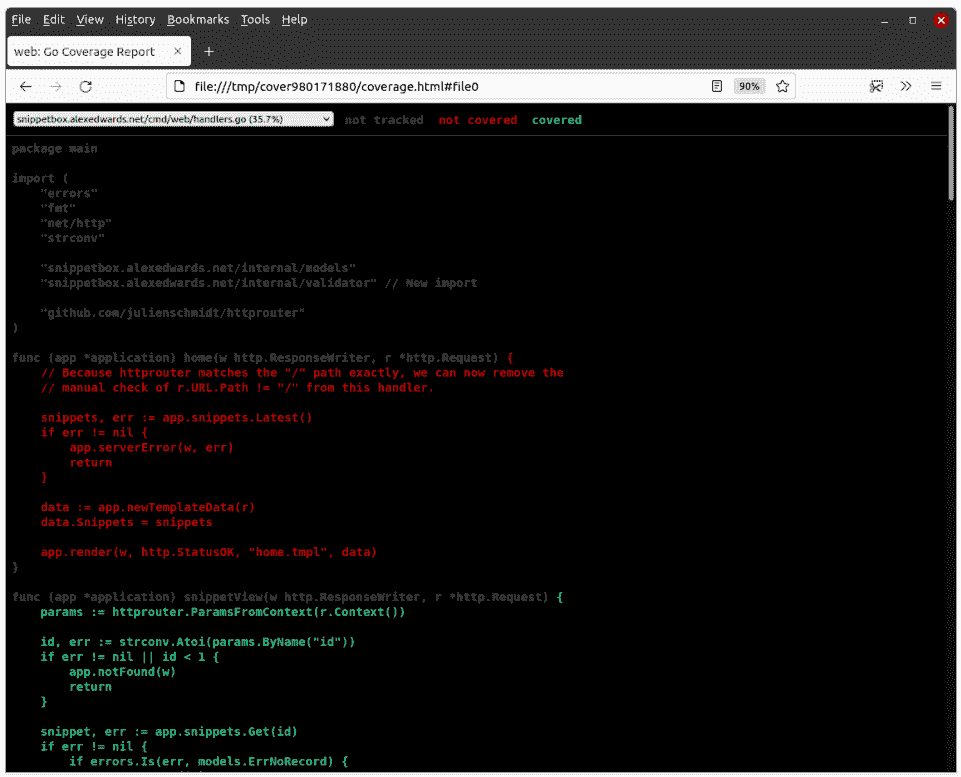

测试期间被执行的语句显示为绿色，未被执行的语句显示为红色。这样可以轻松查看测试当前覆盖了哪些代码（除非你有红绿色盲）。

你可以进一步使用 `-covermode=count` 选项运行 `go test`，方法如下：

```
$ go test -covermode=count -coverprofile=/tmp/profile.out ./...
$ go tool cover -html=/tmp/profile.out
```

使用 `-covermode=count` 不仅会以绿色和红色高亮显示语句，还会让覆盖率配置文件记录测试期间每条语句被执行的确切 *次数*。

在浏览器中查看时，执行频率更高的语句会显示为更深更饱和的绿色，类似于这样：

```
package main

import (
	"errors"
	"fmt"
	"net/http"
	"strconv"

	"snippetbox.alexedwards.net/internal/models"
	"snippetbox.alexedwards.net/internal/validator" // New import

	"github.com/julienschmidt/httprouter"
)

func (app *application) home(w http.ResponseWriter, r *http.Request) {
	// Because httprouter matches the "/" path exactly, we can now remove the
	// manual check of r.URL.Path != "/" from this handler.

	snippets, err := app.snippets.Latest()
	if err != nil {
		app.serverError(w, err)
		return
	}

	data := app.newTemplateData(r)
	data.Snippets = snippets

	app.render(w, http.StatusOK, "home.tmpl", data)
}

func (app *application) snippetView(w http.ResponseWriter, r *http.Request) {
	params := httprouter.ParamsFromContext(r.Context())

	id, err := strconv.Atoi(params.ByName("id"))
	if err != nil || id < 1 {
		app.notFound(w)
		return
	}

	snippet, err := app.snippets.Get(id)
	if err != nil {
		if errors.Is(err, models.ErrNoRecord) {
```

注：如果你并行运行部分测试，应使用 -covermode=atomic 标志（而非 -covermode=count）以确保计数准确。

## 结语

在本书的学习过程中，我们明确介绍了许多主题，包括路由、模板、数据库操作、身份验证/授权、使用 HTTPS、使用 Go 的测试包等。

但还有其他一些更隐含的经验教训。我们用来实现功能的模式——以及项目代码的组织方式和相互关联的方式——是你应该能够在未来工作中借鉴和应用的东西。

重要的是，我也希望本书传达：*你不需要框架就能在 Go 中构建 Web 应用程序*。Go 的标准库包含了你需要的几乎所有工具……即使是中等复杂度的应用程序也是如此。在你需要处理特定任务（如会话管理、CSRF 防护或密码哈希）时，有一些轻量且专注的第三方包可供使用。

如果你一直跟着本书编写代码，我建议花些时间回顾到目前为止写的代码。在阅读过程中，请务必清楚每部分代码库的作用，以及它如何融入整个项目。

你可能还想回到最初觉得难以理解的书中部分内容。例如，现在你对 Go 更加熟悉，`http.Handler` 接口章节可能更容易理解。或者，既然你已经了解了我们应用程序中如何处理测试，那么我们在 *设计数据库模型* 章节所做的决定可能也会豁然开朗。

如果你购买了本书的 *Professional Package* 版本，我强烈建议你完成第 16 章（本书末尾，结语之后）中的指导练习。这些练习应该有助于巩固你所学的内容——半独立地完成它们，将让你在自己项目中再次使用本书中的模式和技术之前，获得额外的练习。


## 继续深入

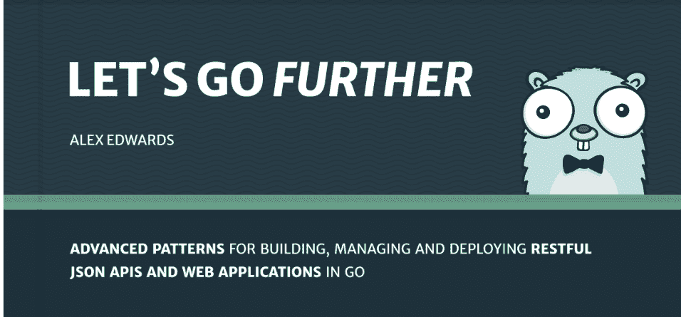

如果你想继续深入学习，那么你可能想查阅《继续深入》。它是本书的后续读物，涵盖了开发、管理和部署 API 及 Web 应用程序的更高级模式。

它将引导你完成 RESTful JSON API 的从头到尾构建与部署，并包含以下主题：

- 发送和接收 JSON
- 使用 SQL 迁移
- 管理后台任务
- 执行部分更新并使用乐观锁
- 基于权限的授权
- 控制 CORS 请求
- 优雅关闭
- 暴露应用程序指标
- 自动化构建和部署步骤

你可以查看本书样章，并获取更多信息和常见问题解答，网址为 https://lets-go-further.alexedwards.net。

> 作为赠送给 “Let's Go” 读者的小礼品，你也可以在结账时使用折扣代码 FURTHER15，享受原定售价 15% 的折扣。

## 进一步阅读和有用链接

### 编码与风格指南

- 高效 Go
- “清晰胜过聪明” [视频] — Dave Cheney 在 GopherCon 新加坡 2019 的演示
- Go 代码审查注释 — 风格指南及需避免的常见错误。
- 实用 Go — 编写可维护 Go 程序的实用建议。
- “名称包含什么？” — Go 中命名事物的准则。
- Go 谚语 — 编写惯用 Go 代码的简洁准则集合。

### 推荐教程

- 不要畏惧指针
- 接口详解
- 数据竞争与竞态条件
- 理解互斥锁
- Go 1.11 模块
- 错误值常见问题解答
- Go 工具链概览
- 新手 Golang 开发者的陷阱、坑点与常见错误
- Go 国际化与本地化分步指南
- 通过插图学习 Go 并发
- 如何在 Go 中编写基准测试

### 第三方包列表

- Awesome Go
- Go Projects

## 指导练习

本节包含六个指导练习，供你完成，它们都扩展了我们已创建的 Snippetbox 应用程序，增加了一些额外功能。

这些练习利用了本书中已介绍的代码模式和技术，但应用于略有不同的场景。因此，完成它们是测试你对所学内容理解程度的良好机会，并可以练习将其付诸实践。

每个练习分为几个较小的步骤。对于每个步骤，我都链接到了一个包含一些“建议代码”的答案，如果你卡住了，或许希望查看。你也可能会发现，将建议代码与你的代码进行对比很有趣——无论是在练习结束时，还是在进行过程中。如果你的代码略有不同，别担心。实现同一目标的方法不止一种。

在开始前最后说明：本节中有几个练习是互相基于的，因此我建议按顺序完成。

## 为应用程序添加“关于”页面

本练习的目标是为应用程序添加一个新的“关于”页面。它应映射到 GET /about 路由，对已通过身份验证和未通过身份验证的用户均可用，且外观应类似于这样：

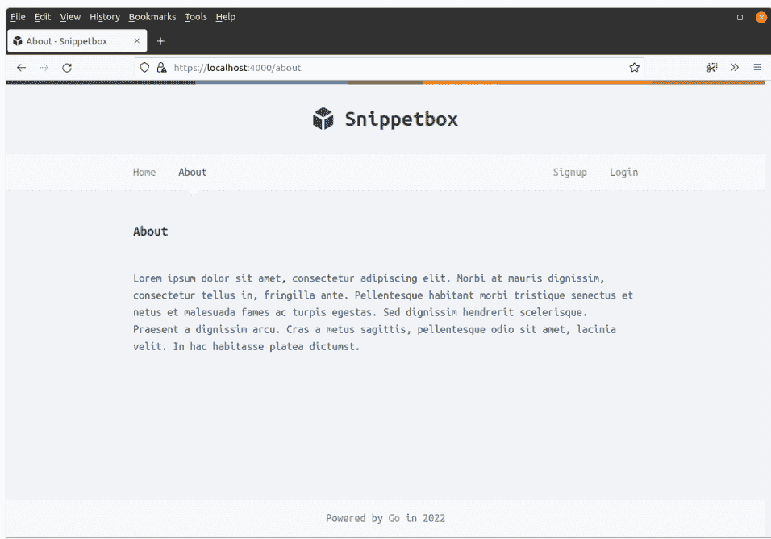

### 步骤 1

创建一个 GET /about 路由，将其映射到新的 about 处理程序。考虑该路由应使用哪个中间件堆栈。

查看建议代码

### 步骤 2

创建一个新的 ui/html/pages/about.tmpl 文件，遵循我们为应用程序其他页面所用的相同模板模式。为“关于”页面包含标题、标题行和一些占位符文本。

查看建议代码

### 步骤 3

更新应用程序的主导航栏，添加指向新“关于”页面的链接（该链接应对所有用户可见，无论其是否已登录）。

查看建议代码

### 步骤 4

更新 about 处理程序，使其渲染你刚刚创建的 about.tmpl 文件。然后通过在浏览器中访问 https://localhost:4000/about 来检查新页面和导航是否正常工作。

查看建议代码

### 建议代码

### 步骤 1 的建议代码

```
File: cmd/web/handlers.go

package main

...

func (app *application) about(w http.ResponseWriter, r *http.Request) {
    // Some code will go here later...
}
```

```
File: cmd/web/routes.go

package main

...

func (app *application) routes() http.Handler {
  mux := http.NewServeMux()

  mux.Handle("GET /static/", http.FileServerFS(ui.Files))

  mux.HandleFunc("GET /ping", ping)

  dynamic := alice.New(app.sessionManager.LoadAndSave, noSurf, app.authenticate)

  mux.Handle("GET /{$}", dynamic.ThenFunc(app.home))
  // Add the about route.
  mux.Handle("GET /about", dynamic.ThenFunc(app.about))
  mux.Handle("GET /snippet/view/{id}", dynamic.ThenFunc(app.snippetView))
  mux.Handle("GET /user/signup", dynamic.ThenFunc(app.userSignup))
  mux.Handle("POST /user/signup", dynamic.ThenFunc(app.userSignupPost))
  mux.Handle("GET /user/login", dynamic.ThenFunc(app.userLogin))
  mux.Handle("POST /user/Login", dynamic.ThenFunc(app.userLoginPost))

  protected := dynamic.Append(app.requireAuthentication)

  mux.Handle("GET /snippet/create", protected.ThenFunc(app.snippetCreate))
  mux.Handle("POST /snippet/create", protected.ThenFunc(app.snippetCreatePost))
  mux.Handle("POST /user/logout", protected.ThenFunc(app.userLogoutPost))

  standard := alice.New(app.recoverPanic, app.logRequest, commonHeaders)

  return standard.Then(mux)
}

```

### 步骤 2 的建议代码

```
File: ui/html/pages/about.tmpl

{{define "title"}}About{{end}}

{{define "main"}}
<h2>About<h2>
<p>Lorem ipsum dolor sit amet, consectetur adipiscing elit. Morbi at mauris dignissim,
consectetur tellus in, fringilla ante. Pellentesque habitant morbi tristique senectus
et netus et malesuada fames ac turpis egestas. Sed dignissim hendrerit scelerisque.</p>
<p>Praesent a dignissim arcu. Cras a metus sagittis, pellentesque odio sit amet,
lacinia velit. In hac habitasse platea dictumst. </p>
{{end}}

```

### 步骤 3 的建议代码

```
File: ui/html/partials/nav.tmpl

{{define "nav"}}
<nav>
  <div>
    <a href='/'/>Home</a>
    <!-- Include a new link, visible to all users -->
    <a href='/about'>About</a>
    {{if .IsAuthenticated}}
      <a href='/snippet/create'>Create snippet</a>
    {{end}}
  </div>
  <div>
    {{if .IsAuthenticated}}
      <form action='/user/logout' method='POST'>
        <input type='hidden' name='csrf_token' value='{{.CSRFToken}}'>
        <button>Logout</button>
      </form>
    {{else}}
      <a href='/user/signup'>Signup</a>
      <a href='/user/login'>Login</a>
    {{end}}
  </div>
</nav>
{{end}}
```

### 步骤 4 的建议代码

```
File: cmd/web/handlers.go

package main

...

func (app *application) about(w http.ResponseWriter, r *http.Request) {
	tdata := app.newTemplateData(r)
	app.render(w, r, http.StatusOK, "about.tmpl", data)
}
```

## 添加调试模式

如果你使用过其他语言的 Web 框架（如 Django 或 Laravel），那么你可能熟悉“调试模式”的概念：在该模式下，详细错误会在 HTTP 响应中显示给用户，而不是显示通用的“内部服务器错误”消息。

本练习的目标是为我们的应用程序设置类似的“调试模式”，可通过使用 -debug 标志启用，如下所示：

```
$ go run ./cmd/web -debug
```

在调试模式下运行时，任何详细错误和堆栈跟踪应在浏览器中显示，类似于这样：

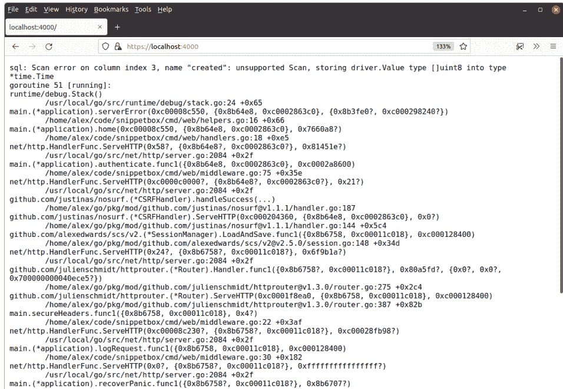

### 步骤 1

创建一个名为 debug、默认值为 false 的新命令行标志。然后通过应用程序结构体将此命令行标志的值提供给你的处理程序。

提示：flag.Bool() 函数最适合此任务。

查看建议代码

### 步骤 2

转到 `cmd/web/helpers.go` 文件并更新 `serverError()` 辅助函数，使其仅在设置了 `debug` 标志时才在 HTTP 响应中渲染详细错误消息和堆栈跟踪。否则正常发送通用错误消息。你可以使用 `debug.Stack()` 函数获取堆栈跟踪。

查看建议代码

### 步骤 3

试用此更改。运行应用程序，并使用 *不带* `parseTime=true` 参数的 DSN 强制发生运行时错误：

```
$ go run ./cmd/web/ -debug -dsn=web:pass@/snippetbox
```

在浏览器中访问 https://localhost:4000/ 应会产生类似这样的响应：


sql: 扫描列索引 3 时出错，名称为 "created"：不支持的扫描，将驱动值类型 []uint8 存储到类型 *time.Time 中

goroutine 51 [运行]:
runtime/debug.Stack()
	/usr/local/go/src/runtime/debug/stack.go:24 +0x65
main.(*application).serverError(/src/web/cmd/web/server.go:60 +0x68
main.(*application).snippetbox(/cmd/web/cmd/web/helpers.go:16 +0x66
main.(*application).home(/cmd/web/cmd/web.go:50 +0x84
net/http.HandlerFunc.ServeHTTP(/x/b64e8...

再次运行应用程序且不带 -debug 标志应该会产生一条通用的 "Internal Server Error" 消息。

## 建议代码

### 步骤 1 的建议代码

文件：cmd/web/main.go

```
package main

type application struct {
	debug       bool // Add a new debug field.
	logger      *slog.Logger
	snippets    models.SnippetModelInterface
	users       models.UserModelInterface
	templateCache map[string]*template.Template
	formDecoder  *form.Decoder
	sessionManager *scs.SessionManager
}

func main() {
	addr := flag.String("addr", ":4000", "HTTP network address")
	dsn := flag.String("dsn", "web:pass@/snippetbox?parseTime=true", "MySQL data source name")
	// Create a new debug flag with the default value of false.
	debug := flag.Bool("debug", false, "Enable debug mode")

	flag.Parse()

	logger := slog.New(slog.NewTextHandler(os.Stdout, nil))

	db, err := openDB(*dsn)
	if err != nil {
		logger.Error(err.Error())
		os.Exit(1)
	}

	defer db.Close()

	templateCache, err := newTemplateCache()
	if err != nil {
		logger.Error(err.Error())
		os.Exit(1)
	}

	formDecoder := form.NewDecoder()

	sessionManager := scs.New()
	sessionManager.Store = mysqlstore.New(db)
	sessionManager.Lifetime = 12 * time.Hour
	sessionManager.Cookie.Secure = true

	app := &application{
		debug:      *debug, // Add the debug flag value to the application struct.
		logger:     logger,
		snippets:   &models.SnippetModel{DB: db},
		users:      &models.UserModel{DB: db},
		templateCache: templateCache,
		formDecoder:   formDecoder,
		sessionManager: sessionManager,
	}

	tlsConfig := &tls.Config{
		CurvePreferences: []tls.CurveID{tls.X25519, tls.CurveP256},
	}

	srv := &http.Server{
		Addr:         *addr,
		Handler:      app.routes(),
		ErrorLog:     slog.NewLogLogger(logger.Handler(), slog.LevelError),
		TLSConfig:    tlsConfig,
		IdleTimeout:  time.Minute,
		ReadTimeout:  5 * time.Second,
		WriteTimeout: 10 * time.Second,
	}

	logger.Info("starting server", "addr", srv.Addr)

	err = srv.ListenAndServeTLS("./tls/cert.pem", "./tls/key.pem")
	logger.Error(err.Error())
	os.Exit(1)
}
...
```

### 步骤 2 的建议代码

文件：cmd/web/helpers.go

...

```
func (app *application) serverError(w http.ResponseWriter, r *http.Request, err error) {
	var (
		method = r.Method
		uri    = r.URL.RequestURI()
		trace  = string(debug.Stack())
	)

	app.logger.Error(err.Error(), "method", method, "uri", uri)

	if app.debug {
		body := fmt.Sprintf("%s\n%s", err, trace)
		http.Error(w, body, http.StatusInternalServerError)
		return
	}

	http.Error(w, http.StatusText(http.StatusInternalServerError), http.StatusInternalServerError)
}

...
```

## 测试 snippetCreate 处理程序

本练习的目标是为 `GET /snippet/create` 路由创建一个端到端测试。具体来说，你想要测试：

- 未经过身份验证的用户会被重定向到登录表单。
- 经过身份验证的用户会看到创建新代码段的表单。

### 步骤 1

在 `cmd/web/handlers_test.go` 文件中创建一个新的 `TestSnippetCreate` 测试。在此测试中，使用端到端测试章节中的模式和辅助函数，使用应用程序路由和模拟依赖项初始化一个新的测试服务器。

显示建议代码

### 步骤 2

创建一个名为 "Unauthenticated" 的子测试。在此子测试中，以未经过身份验证的用户身份向测试服务器发出 `GET /snippet/create` 请求。验证响应的状态码为 303 并带有 `Location: /user/login` 标头。同样，重复使用我们在端到端测试章节中制作的辅助函数。

显示建议代码

### 步骤 3

创建另一个名为 "Authenticated" 的子测试。在此子测试中，模拟用户登录以进行身份验证的工作流。具体来说，你需要发出 `GET /user/login` 请求，从响应正文中提取 CSRF 令牌，然后使用模拟用户模型中的凭据（电子邮件为 "alice@example.com"，密码为 "pa$$word"）发出 `POST /user/login` 请求。

然后，身份验证完成后，发出 `GET /snippet/create` 请求，并验证你收到的状态码为 200 且 HTML 正文包含文本 `<form action='/snippet/create' method='POST'>`。

显示建议代码

## 建议代码

### 步骤 1 的建议代码

文件：cmd/web/handlers_test.go

...

```
func TestSnippetCreate(t *testing.T) {
	app := newTestApplication(t)
	ts := newTestServer(t, app.routes())
	defer ts.Close()
}
```

### 步骤 2 的建议代码

文件：cmd/web/handlers_test.go

...

```
func TestSnippetCreate(t *testing.T) {
	app := newTestApplication(t)
	ts := newTestServer(t, app.routes())
	defer ts.Close()

	t.Run("Unauthenticated", func(t *testing.T) {
		code, headers, _ := ts.get(t, "/snippet/create")

		assert.Equal(t, code, http.StatusSeeOther)
		assert.Equal(t, headers.Get("Location"), "/user/login")
	})
}
```

```shell
$ go test -v -run=TestSnippetCreate ./cmd/web/
=== RUN   TestSnippetCreate
=== RUN   TestSnippetCreate/Unauthenticated
--- PASS: TestSnippetCreate (0.01s)
    --- PASS: TestSnippetCreate/Unauthenticated (0.00s)
PASS
ok      snippetbox.alexedwards.net/cmd/web        0.010s
```

### 步骤 3 的建议代码

```go
File: cmd/web/handlers_test.go

...

func TestSnippetCreate(t *testing.T) {
	app := newTestApplication(t)

	ts := newTestServer(t, app.routes())
	defer ts.Close()

	t.Run("Unauthenticated", func(t *testing.T) {
		code, headers, _ := ts.get(t, "/snippet/create")

		assert.Equal(t, code, http.StatusSeeOther)
		assert.Equal(t, headers.Get("Location"), "/user/login")
	})

	t.Run("Authenticated", func(t *testing.T) {
		// Make a GET /user/login request and extract the CSRF token from the
		// response.
		_, _, body := ts.get(t, "/user/login")
		csrfToken := extractCSRFToken(t, body)

		// Make a POST /user/login request using the extracted CSRF token and
		// credentials from our mock user model.
		form := url.Values{}
		form.Add("email", "alice@example.com")
		form.Add("password", "pa$$word")
		form.Add("csrf_token", csrfToken)
		ts.postForm(t, "/user/login", form)

		// Then check that the authenticated user is shown the create snippet
		// form.
		code, _, body := ts.get(t, "/snippet/create")

		assert.Equal(t, code, http.StatusOK)
		assert.StringContains(t, body, "<form action='/snippet/create' method='POST'>")
	})
}
```

```shell
$ go test -v -run=TestSnippetCreate ./cmd/web/
=== RUN   TestSnippetCreate
=== RUN   TestSnippetCreate/Unauthenticated
=== RUN   TestSnippetCreate/Authenticated
--- PASS: TestSnippetCreate (0.01s)
    --- PASS: TestSnippetCreate/Unauthenticated (0.00s)
    --- PASS: TestSnippetCreate/Authenticated (0.00s)
PASS
ok      snippetbox.alexedwards.net/cmd/web  0.012s
```

## 为应用程序添加一个“账户”页面

本练习的目标是向应用程序添加一个新的“你的账户”页面。它应映射到新的 GET /account/view 路由，并显示当前经过身份验证的用户的姓名、电子邮件地址和注册日期，类似于这样：

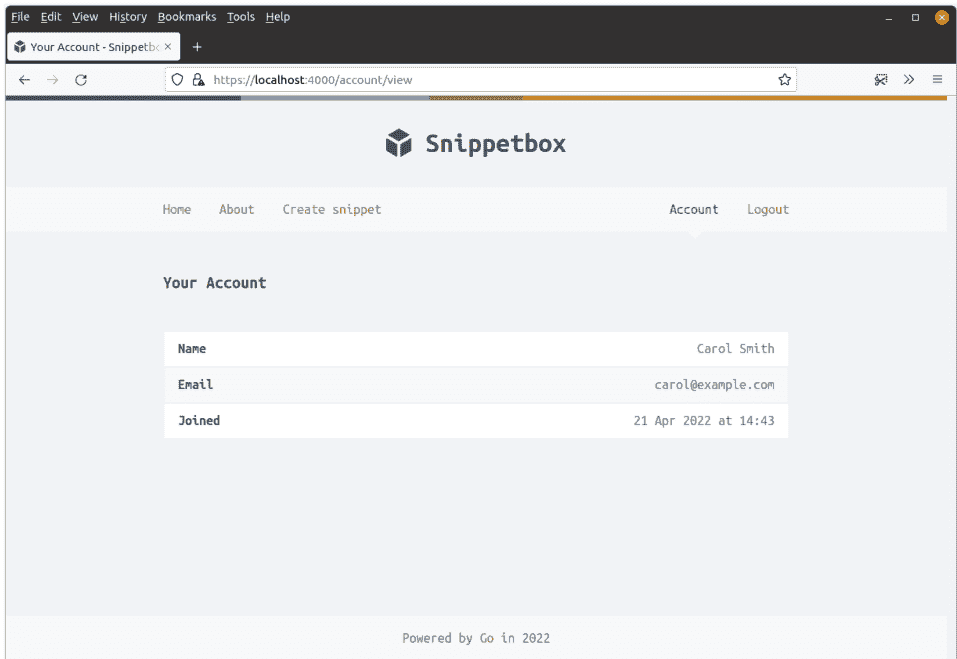

### 步骤 1

在 internal/models/users.go 文件中创建一个新的 UserModel.Get() 方法。该方法应接受用户 ID 作为参数，并返回一个包含该用户所有信息的 User 结构体（除了不需要的散列密码）。如果未找到具有该 ID 的用户，则应返回 ErrNoRecord 错误。

同时，更新 UserModelInterface 类型以包含此新的 Get() 方法，并为我们的模拟 mocks.UserModel 添加相应的方法，以便其继续满足该接口。


显示建议代码

### 步骤 2

创建一个 GET /account/view 路由，将其映射到新的 accountView 处理程序。该路由应仅限经过身份验证的用户访问。

显示建议代码

### 步骤 3

更新 accountView 处理程序，从会话中获取 "authenticatedUserID"，从数据库中获取相关用户的详细信息（使用新的 UserModel.Get() 方法），并将其作为纯文本 HTTP 响应输出。如果找不到与会话中的 "authenticatedUserID" 匹配的用户，则将客户端重定向到 GET /user/login 以强制重新身份验证。

作为经过身份验证的用户在浏览器中访问 https://localhost:4000/account/view 时，您应该得到类似于此的响应：

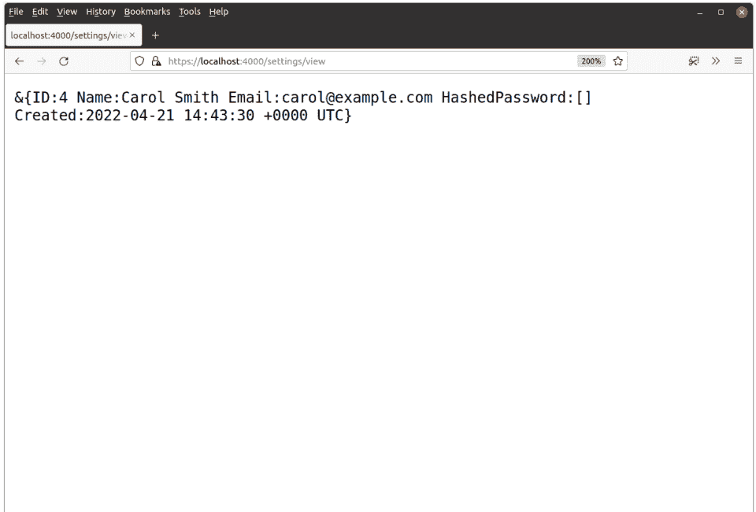

显示建议代码

### 步骤 4

创建一个新的 ui/html/pages/account.tmpl 文件，以表格形式显示用户信息。然后更新 accountView 处理程序以渲染这个新模板，通过 templateData 结构体传递用户的详细信息。

显示建议代码

### 步骤 5

此外，更新网站的主导航栏，添加指向查看账户页面的链接（仅对经过身份验证的用户可见）。然后在已登录状态下在浏览器中访问 https://localhost:4000/account/view，检查新页面和导航是否按预期工作。

显示建议代码

### 建议代码

### 步骤 1 的建议代码

```
File: internal/models/users.go

package models

...

type UserModelInterface interface {
	Insert(name, email, password string) error
	Authenticate(email, password string) (int, error)
	Exists(id int) (bool, error)
	Get(id int) (User, error)
}

...

func (m *UserModel) Get(id int) (User, error) {
	var user User

	stmt := 'SELECT id, name, email, created FROM users WHERE id = ?'

	err := m.DB.QueryRow(stmt, id).Scan(&user.ID, &user.Name, &user.Email, &user.Created)
	if err != nil {
		if errors.Is(err, sql.ErrNoRows) {
			return User{}, ErrNoRecord
		} else {
			return User{}, err
		}
	}

	return user, nil
}
```

```
File: internal/models/mocks/users.go

package mocks

import (
	"time" // New import

	"snippetbox.alexedwards.net/internal/models"
)

...

func (m *UserModel) Get(id int) (models.User, error) {
	if id == 1 {
		u := models.User{
			ID:    1,
			Name:  "Alice",
			Email: "alice@example.com",
			Created: time.Now(),
		}

		return u, nil
	}

	return models.User{}, models.ErrNoRecord
}
```

### 步骤 2 的建议代码

```
File: cmd/web/handlers.go

...

func (app *application) accountView(w http.ResponseWriter, r *http.Request) {
    // Some code will go here later...
}
```

```
File: cmd/web/routes.go

package main

...

func (app *application) routes() http.Handler {
    mux := http.NewServeMux()

    mux.Handle("GET /static/", http.FileServerFS(ui.Files))

    mux.HandleFunc("GET /ping", ping)

    dynamic := alice.New(app.sessionManager.LoadAndSave, noSurf, app.authenticate)

    mux.Handle("GET /{$}", dynamic.ThenFunc(app.home))
    mux.Handle("GET /about", dynamic.ThenFunc(app.about))
    mux.Handle("GET /snippet/view/{id}", dynamic.ThenFunc(app.snippetView))
    mux.Handle("GET /user/signup", dynamic.ThenFunc(app.userSignup))
    mux.Handle("POST /user/signup", dynamic.ThenFunc(app.userSignupPost))
    mux.Handle("GET /user/login", dynamic.ThenFunc(app.userLogin))
    mux.Handle("POST /user/login", dynamic.ThenFunc(app.userLoginPost))

    protected := dynamic.Append(app.requireAuthentication)

    mux.Handle("GET /snippet/create", protected.ThenFunc(app.snippetCreate))
    mux.Handle("POST /snippet/create", protected.ThenFunc(app.snippetCreatePost))

    // Add the view account route, using the protected middleware chain.
    mux.Handle("GET /account/view", protected.ThenFunc(app.accountView))
    mux.Handle("POST /user/logout", protected.ThenFunc(app.userLogoutPost))

    standard := alice.New(app.recoverPanic, app.logRequest, commonHeaders)

    return standard.Then(mux)
}
```

### 步骤 3 的建议代码

```
File: cmd/web/handlers.go

...

func (app *application) accountView(w http.ResponseWriter, r *http.Request) {
userID := app.sessionManager.GetInt(r.Context(), "authenticatedUserID")

user, err := app.users.Get(userID)
if err != nil {
    if errors.Is(err, models.ErrNoRecord) {
        http.Redirect(w, r, "/user/login", http.StatusSeeOther)
    } else {
        app.serverError(w, r, err)
    }
    return
}

fmt.Fprintf(w, "%+v", user)
}
```

### 步骤 4 的建议代码

```
File: cmd/web/templates.go

...

type templateData struct {
    CurrentYear   int
    Snippet       models.Snippet
    Snippets      []models.Snippet
    Form          any
    Flash         string
    IsAuthenticated bool
    CSRFToken     string
    User          models.User
}

...
```

```
File: ui/html/pages/account.tmpl

{{define "title"}}Your Account{{end}}

{{define "main"}}
<h2>Your Account</h2>
{{with .User}}
<table>
<tr>
<th>Name</th>
<td>{{.Name}}</td>
</tr>
<tr>
<th>Email</th>
<td>{{.Email}}</td>
</tr>
<tr>
<th>Joined</th>
<td>{{humanDate .Created}}</td>
</tr>
</table>
{{end}}
{{end}}
```

```
File: cmd/web/handlers.go

...

func (app *application) accountView(w http.ResponseWriter, r *http.Request) {
userid := app.sessionManager.GetInt(r.Context(), "authenticatedUserID")

user, err := app.users.Get(userID)
if err != nil {
if errors.Is(err, models.ErrNoRecord) {
http.Redirect(w, r, "/user/login", http.StatusSeeOther)
} else {
app.serverError(w, r, err)
}
return
}

data := app.newTemplateData(r)
data.User = user

app.render(w, r, http.StatusOK, "account.tmpl", data)
}
```

### 步骤 5 的建议代码

```
File: ui/html/partials/nav.tmpl

{{define "nav"}}
<nav>
<div>
  <a href='/'>Home</a>
  <a href='/about'>About</a>
  {{if .IsAuthenticated}}
    <a href='/snippet/create'>Create snippet</a>
  {{end}}
</div>
<div>
  {{if .IsAuthenticated}}
    <!--- Add the view account link for authenticated users --->
    <a href='/account/view'>Account</a>
    <form action='/user/logout' method='POST'>
      <input type='hidden' name='csrf_token' value='{{.CSRFToken}}'>
      <button>Logout</button>
    </form>
  {{else}}
    <a href='/user/signup'>Signup</a>
    <a href='/user/login'>Login</a>
  {{end}}
</div>
</nav>
{{end}}
```

## 登录后适当重定向用户

如果未经过身份验证的用户尝试访问 GET /account/view，他们将被重定向到登录页面。然后在成功登录后，他们将被重定向到 GET /snippet/create 表单。这对用户来说很尴尬且令人困惑，因为他们最终到达的页面与他们原本想去的页面不同。

本练习的目标是更新应用程序，使用户在登录后被重定向到他们原本尝试访问的页面。

### 步骤 1

更新 requireAuthentication() 中间件，以便在将未经过身份验证的用户重定向到登录页面之前，将他们尝试访问的 URL 路径添加到他们的会话数据中。

显示建议代码

### 步骤 2

更新 userLogin 处理程序，以便在用户成功登录后检查其会话中的 URL 路径。如果存在，则从会话数据中删除它并将用户重定向到该 URL 路径。否则，默认将用户重定向到 /snippet/create。

显示建议代码

### 建议代码

### 步骤 1 的建议代码

```
File: cmd/web/middleware.go

package main

...

func (app *application) requireAuthentication(next http.Handler) http.Handler {
    return http.HandlerFunc(func(w http.ResponseWriter, r *http.Request) {
        if !app.isAuthenticated(r) {
            // Add the path that the user is trying to access to their session
            // data.
            app.sessionManager.Put(r.Context(), "redirectPathAfterLogin", r.URL.Path)
            http.Redirect(w, r, "/user/login", http.StatusSeeOther)
            return
        }

        w.Header().Add("Cache-Control", "no-store")

        next.ServeHTTP(w, r)
    })
}

...
```

### 步骤 2 的建议代码


package main

...

func (app *application) userLoginPost(w http.ResponseWriter, r *http.Request) {
	var form userLoginForm
	err := app.decodePostForm(r, &form)
	if err != nil {
		app.clientError(w, http.StatusBadRequest)
		return
	}

	form.CheckField(validator.NotBlank(form.Email), "email", "This field cannot be blank")
	form.CheckField(validator.Matches(form.Email, validator.EmailRX), "email", "This field must be a valid email address")
	form.CheckField(validator.NotBlank(form.Password), "password", "This field cannot be blank")

	if !form.Valid() {
		data := app.newTemplateData(r)
		data.Form = form

		app.render(w, r, http.StatusUnprocessableEntity, "login.tmpl", data)
		return
	}

	id

## 实现“更改密码”功能

在这个练习中，你的目标是添加一个功能，让经过身份验证的用户可以使用类似于此的表单来更改他们的密码：

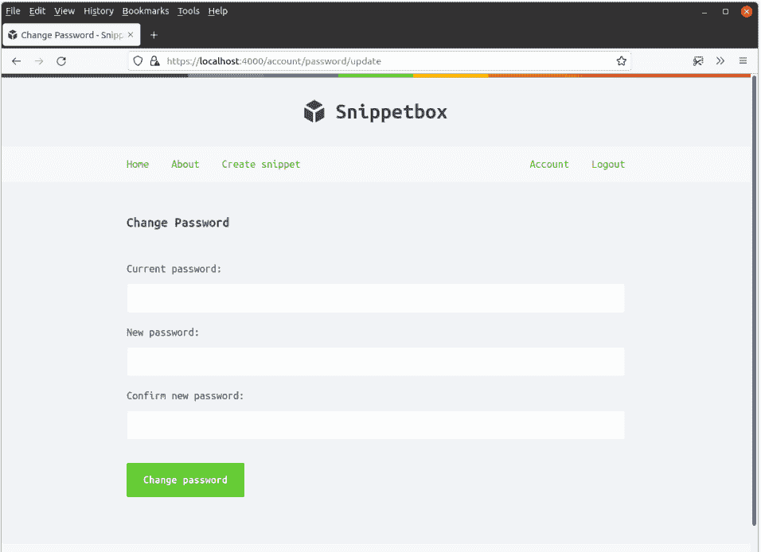

在此练习中，请确保：

- 要求用户输入当前密码，并验证它是否与 users 表中的哈希密码匹配（以确认发出请求的确实是本人）。
- 在更新 users 表之前，先对他们的新密码进行哈希处理。

### 步骤 1

创建两个新路由和处理程序：

- GET /account/password/update 映射到新的 accountPasswordUpdate 处理程序。
- POST /account/password/update 映射到新的 accountPasswordUpdatePost 处理程序。

这两条路由都应仅限经过身份验证的用户访问。

显示建议代码

### 步骤 2

创建一个新的 ui/html/pages/password.tmpl 文件，其中包含更改密码表单。此表单应：

- 包含三个字段：currentPassword、newPassword 和 newPasswordConfirmation。
- 提交时将表单数据 POST 到 /account/password/update。
- 发生验证错误时，为每个字段显示错误。
- 发生验证错误时，不重新显示密码。

提示：你可能希望参考我们在用户注册表单上所做的工作，将其作为这里的指南。

然后更新 cmd/web/handlers.go 文件，添加一个新的 accountPasswordUpdateForm 结构体，用于将表单数据解析其中，并更新 accountPasswordUpdate 处理程序以显示此空表单。

作为经过身份验证的用户访问 https://localhost:4000/account/password/update 时，它应该看起来类似于此：

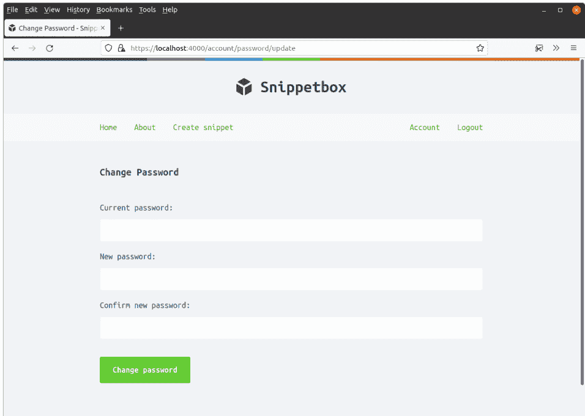

显示建议代码

### 步骤 3

更新 accountPasswordUpdatePost 处理程序，以执行以下表单验证检查，并在出现任何失败时重新显示表单及相关错误消息。

- 所有三个字段均为必填项。
- newPassword 值必须至少为 8 个字符长。
- newPassword 和 newPasswordConfirmation 值必须匹配。


显示建议代码

### 步骤 4

在你的 `internal/models/users.go` 文件中创建一个新的 `UserModel.PasswordUpdate()` 方法，其签名如下：

```
func (m *UserModel) PasswordUpdate(id int, currentPassword, newPassword string) error
```

在此方法中：

- 从数据库中检索由 `id` 参数给定的 ID 的用户的用户详细信息。
- 检查 `currentPassword` 值是否与该用户的哈希密码匹配。如果不匹配，返回 `ErrInvalidCredentials` 错误。
- 否则，对 `newPassword` 值进行哈希处理，并更新 `users` 表中相关用户的 `hashed_password` 列。

同时更新 UserModelInterface 接口类型，以包含你刚刚创建的 PasswordUpdate() 方法。

[显示建议代码]

### 步骤 5

更新 accountPasswordUpdatePost 处理程序，以便在表单有效时调用 UserModel.PasswordUpdate() 方法（请记住，用户的 ID 应该在会话数据中）。

在发生 models.ErrInvalidCredentials 错误时，通知用户在 currentPassword 表单字段中输入了错误的值。否则，向用户会话添加一条闪现消息，说明他们的密码已成功更改，并将他们重定向到其账户页面。

[显示建议代码]

### 步骤 6

更新账户页面以包含指向更改密码表单的链接，类似于此：


显示建议代码

### 步骤 7

尝试运行应用程序的测试。你应该会得到一个失败，因为 mocks.UserModel 类型不再满足 models.UserModelInterface 结构体中指定的接口。通过向模拟对象添加适当的 PasswordUpdate() 方法来修复此问题，并确保测试通过。

显示建议代码

### 建议代码

### 建议代码

### 步骤 1 的建议代码

```
File: cmd/web/handlers.go

package main

...

func (app *application) accountPasswordUpdate(w http.ResponseWriter, r *http.Request) {
    // Some code will go here later...
}

func (app *application) accountPasswordUpdatePost(w http.ResponseWriter, r *http.Request) {
    // Some code will go here later...
}
```

```
File: cmd/web/routes.go

package main

...

func (app *application) routes() http.Handler {
	mux := http.NewServeMux()

	mux.Handle("GET /static/", http.FileServerFS(ui.Files))

	mux.HandleFunc("GET /ping", ping)

	dynamic := alice.New(app.sessionManager.LoadAndSave, noSurf, app.authenticate)

	mux.Handle("GET /{$}", dynamic.ThenFunc(app.home))
	mux.Handle("GET /about", dynamic.ThenFunc(app.about))
	mux.Handle("GET /snippet/view/{id}", dynamic.ThenFunc(app.snippetView))
	mux.Handle("GET /user/signup", dynamic.ThenFunc(app.userSignup))
	mux.Handle("POST /user/signup", dynamic.ThenFunc(app.userSignupPost))
	mux.Handle("GET /user/login", dynamic.ThenFunc(app.userLogin))
	mux.Handle("POST /user/login", dynamic.ThenFunc(app.userLoginPost))

	protected := dynamic.Append(app.requireAuthentication)

	mux.Handle("GET /snippet/create", protected.ThenFunc(app.snippetCreate))
	mux.Handle("POST /snippet/create", protected.ThenFunc(app.snippetCreatePost))
	mux.Handle("GET /account/view", protected.ThenFunc(app.accountView))

	// Add the two new routes, restricted to authenticated users only.
	mux.Handle("GET /account/password/update", protected.ThenFunc(app.accountPasswordUpdate))
	mux.Handle("POST /account/password/update", protected.ThenFunc(app.accountPasswordUpdatePost))
	mux.Handle("POST /user/logout", protected.ThenFunc(app.userLogoutPost))

	standard := alice.New(app.recoverPanic, app.logRequest, commonHeaders)

	return standard.Then(mux)
}
```

### 步骤 2 的建议代码

```
File: ui/html/pages/password.tmpl

{{define "title"}}Change Password{{end}}

{{define "main"}}
<h2>Change Password</h2>
<form action='/account/password/update' method='POST' novalidate>
    <input type='hidden' name='csrf_token' value='{{.CSRFToken}}'>
    <div>
        <label>Current password:</label>
        {{with .Form.FieldErrors.currentPassword}}
        <label class='error'>{{.}}</label>
        {{end}}
        <input type='password' name='currentPassword'>
    </div>
    <div>
        <label>New password:</label>
        {{with .Form.FieldErrors.newPassword}}
        <label class='error'>{{.}}</label>
        {{end}}
        <input type='password' name='newPassword'>
    </div>
    <div>
        <label>Confirm new password:</label>
        {{with .Form.FieldErrors.newPasswordConfirmation}}
        <label class='error'>{{.}}</label>
        {{end}}
        <input type='password' name='newPasswordConfirmation'>
    </div>
    <div>
        <input type='submit' value='Change password'>
    </div>
</form>
{{end}}
```

```
File: cmd/web/handlers.go

package main

...

type accountPasswordUpdateForm struct {
    CurrentPassword         string `form:"currentPassword"`
    NewPassword             string `form:"newPassword"`
    NewPasswordConfirmation string `form:"newPasswordConfirmation"`
    validator.Validator     `form:"-"`
}

func (app *application) accountPasswordUpdate(w http.ResponseWriter, r *http.Request) {
    data := app.newTemplateData(r)
    data.Form = accountPasswordUpdateForm{}

    app.render(w, r, http.StatusOK, "password.tmpl", data)
}

...
```

### 步骤 3 的建议代码


```go
File: cmd/web/handlers.go

package main

...

func (app *application) accountPasswordUpdatePost(w http.ResponseWriter, r *http.Request) {
	var form accountPasswordUpdateForm

	err := app.decodePostForm(r, &form)
	if err != nil {
		app.clientError(w, http.StatusBadRequest)
		return
	}

	form.CheckField(validator.NotBlank(form.CurrentPassword), "currentPassword", "This field cannot be blank")
	form.CheckField(validator.NotBlank(form.NewPassword), "newPassword", "This field cannot be blank")
	form.CheckField(validator.MinChars(form.NewPassword, 8), "newPassword", "This field must be at least 8 characters long")
	form.CheckField(validator.NotBlank(form.NewPasswordConfirmation), "newPasswordConfirmation", "This field cannot be blank")
	form.CheckField(form.NewPassword == form.NewPasswordConfirmation, "newPasswordConfirmation", "Passwords do not match")

	if !form.Valid() {
		data := app.newTemplateData(r)
		data.Form = form

		app.render(w, r, http.StatusUnprocessableEntity, "password.tmpl", data)
		return
	}
}
```

## 步骤 4 的建议代码

```go
File: internal/models/users.go

package models

...

type UserModelInterface interface {
	Insert(name, email, password string) error
	Authenticate(email, password string) (int, error)
	Exists(id int) (bool, error)
	Get(id int) (User, error)
	PasswordUpdate(id int, currentPassword, newPassword string) error
}

...

func (m *UserModel) PasswordUpdate(id int, currentPassword, newPassword string) error {
	var currentHashedPassword []byte

	stmt := "SELECT hashed_password FROM users WHERE id = ?"

	err := m.DB.QueryRow(stmt, id).Scan(&currentHashedPassword)
	if err != nil {
		return err
	}

	err = bcrypt.CompareHashAndPassword(currentHashedPassword, []byte(currentPassword))
	if err != nil {
		if errors.Is(err, bcrypt.ErrMismatchedHashAndPassword) {
			return ErrInvalidCredentials
		} else {
			return err
		}
	}

	newHashedPassword, err := bcrypt.GenerateFromPassword([]byte(newPassword), 12)
	if err != nil {
		return err
	}

	stmt = "UPDATE users SET hashed_password = ? WHERE id = ?"

	_, err = m.DB.Exec(stmt, string(newHashedPassword), id)
	return err
}
```

## 步骤 5 的建议代码

```go
File: cmd/web/handlers.go

package main

...

func (app *application) accountPasswordUpdatePost(w http.ResponseWriter, r *http.Request) {
    var form accountPasswordUpdateForm

    err := app.decodePostForm(r, &form)
    if err != nil {
        app.clientError(w, http.StatusBadRequest)
        return
    }

    form.CheckField(validator.NotBlank(form.CurrentPassword), "currentPassword", "This field cannot be blank")
    form.CheckField(validator.NotBlank(form.NewPassword), "newPassword", "This field cannot be blank")
    form.CheckField(validator.MinChars(form.NewPassword, 8), "newPassword", "This field must be at least 8 characters long")
    form.CheckField(validator.NotBlank(form.NewPasswordConfirmation), "newPasswordConfirmation", "This field cannot be blank")
    form.CheckField(form.NewPassword == form.NewPasswordConfirmation, "newPasswordConfirmation", "Passwords do not match")

    if !form.Valid() {
        data := app.newTemplateData(r)
        data.Form = form

        app.render(w, r, http.StatusUnprocessableEntity, "password.tmpl", data)
        return
    }

    userID := app.sessionManager.GetInt(r.Context(), "authenticatedUserID")

    err = app.users.PasswordUpdate(userID, form.CurrentPassword, form.NewPassword)
    if err != nil {
        if errors.Is(err, models.ErrInvalidCredentials) {
            form.AddFieldError("currentPassword", "Current password is incorrect")

            data := app.newTemplateData(r)
            data.Form = form

            app.render(w, r, http.StatusUnprocessableEntity, "password.tmpl", data)
        } else {
            app.serverError(w, r, err)
        }
        return
    }

    app.sessionManager.Put(r.Context(), "flash", "Your password has been updated!")

    http.Redirect(w, r, "/account/view", http.StatusSeeOther)
}
```

## 步骤 6 的建议代码

```html
File: ui/html/pages/account.tmpl

{{define "title"}}Your Account{{end}}

{{define "main"}}
<h2>Your Account</h2>
{{with .User}}
<table>
<tr>
<th>Name</th>
<td>{{.Name}}</td>
</tr>
<tr>
<th>Email</th>
<td>{{.Email}}</td>
</tr>
<tr>
<th>Joined</th>
<td>{{humanDate .Created}}</td>
</tr>
<!-- Add a link to the change password form -->
<tr>
<th>Password</th>
<td><a href="/account/password/update">Change password</a></td>
</tr>
</table>
{{end}}
{{end}}
```

## 步骤 7 的建议代码

```
$ go test ./...
## snippetbox.alexedwards.net/cmd/web [snippetbox.alexedwards.net/cmd/web.test]
cmd/web/testutils_test.go:48:19: cannot use &mocks.UserModel{} (value of type *mocks.UserModel) as type models.UserModelInterface
*mocks.UserModel does not implement models.UserModelInterface (missing PasswordUpdate method)
FAIL	snippetbox.alexedwards.net/cmd/web [build failed]
ok	snippetbox.alexedwards.net/internal/models	1.099s
?	snippetbox.alexedwards.net/internal/models/mocks	[no test files]
?	snippetbox.alexedwards.net/internal/validator	[no test files]
?	snippetbox.alexedwards.net/ui	[no test files]
FAIL
```

```go
File: internal/models/mock/users.go

package mocks

...

func (m *UserModel) PasswordUpdate(id int, currentPassword, newPassword string) error {
	if id == 1 {
		if currentPassword != "pa$word" {
			return models.ErrInvalidCredentials
		}

		return nil
	}

	return models.ErrNoRecord
}
```

```
$ go test ./...
ok  snippetbox.alexedwards.net/cmd/web     0.026s
ok  snippetbox.alexedwards.net/internal/models  (cached)
?   snippetbox.alexedwards.net/internal/models/mocks  [no test files]
?   snippetbox.alexedwards.net/internal/validator	[no test files]
?   snippetbox.alexedwards.net/ui	[no test files]
```


