# 出发吧

# 前言

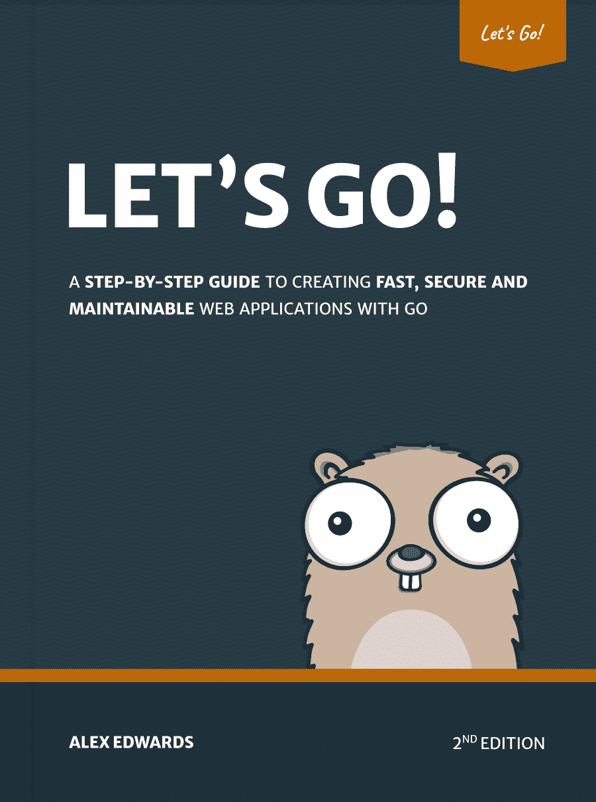

《Let's Go》将教你如何使用出色的编程语言 [Go](https://golang.org/) 构建快速、安全且易于维护的 Web 应用。

本书的核心理念是帮助你*在做中学习*。我们将共同完成一个 Web 应用从零到端的构建——从组织工作空间，到会话管理、用户认证、服务器安全以及测试你的应用程序。

通过这种方式构建完整的 Web 应用有许多优势。它能帮助你将所学的知识融入具体的场景中，展示代码库中不同部分是如何相互关联的，并迫使我们处理现实生活中编写软件时遇到的边缘情况和困难。从本质上说，你学到的东西比仅仅阅读 Go 的（优秀的）文档或独立的博客文章多得多。

读完本书后，你将具备理解并使用 `Go` 构建自己的生产环境就 Web 应用的能力和信心。

虽然你可以从头到尾阅读这本书，但它的设计专门是为了让你亲手跟随项目构建。

打开你的文本编辑器，祝你编程愉快！

— Alex

# 引言

在本书中，我们将构建一个名为 `Snippetbox` 的网络应用程序，它允许用户粘贴和分享文本片段——类似于 [Pastebin](https://pastebin.com/) 或 GitHub 的 [Gists](https://gist.github.com/)。在完成后，它看起来大概像这样：

我们的应用程序将从非常简单开始，只有一个网页。随着每个章节的进行，我们将逐步构建它，直到用户能够通过应用保存和查看片段。这将带我们学习许多主题，例如如何结构化项目、路由请求、操作数据库、处理表单以及安全地显示动态数据。

在书的后后部分，我们将添加用户账户，并限制应用程序，使得只有注册用户才能创建片段。这将带我们学习更高级的主题，如配置 `HTTPS` 服务器、会话管理、用户认证和 `middleware`。

### 约定

在本书中，代码块将以如下所示的银背景显示。如果代码特别长，无关部分可能会被省略号 `...` 替换。为了方便跟随，大多数代码块顶部都有一个标题栏，指示我们正在处理的文件名。

文件：`hello.go`

```
package main

... // 表示省略了某些现有代码。

func sayHello() {
    fmt.Println("Hello world!")
}
```

终端（命令行）指令将以黑色背景显示，并以美元符号 `$` 开头。这些命令可以在任何基于 Unix 的操作系统上运行，包括 Mac OSX 和 Linux。示例输出显示在命令下方的银区域，如下：

```
$ echo "Hello world!"
Hello world!
```

如果你正在使用 Windows，应该将命令替换为相应的 DOS 命令，或者通过正常的 Windows GUI 界面该操作。

本书中的某些章节以*额外信息*部分结束。这些章节包含了与我们的应用程序构建不相关的信息，但对于了解它们仍然很重要（或者有时仅仅是有趣）。如果你是 Go 的初学者，可能想跳过这些部分，稍后再回来。

### 关于作者

嘿，我是 Alex Edwards，一名全栈 Web 开发者兼作家。我住在奥地利的因斯布鲁克附近。

我已经使用 Go 语言超过 8 年，为自己和商业客户构建生产环境应用程序，并帮助世界各地的人提高 Go 技能。

你可以在 [我的博客](https://www.alexedwards.net/blog/)（我在那里发布详细的教程）上看到我的更多文章，GitHub](https://github.com/alexedwards/) 上的一些开源作品，你也可以在 [Instagram](https://www.instagram.com/) 上关注我。

*本书中的信息仅供总体参考。尽管作者和出版者已尽一切确保书中所包含信息的准确性和完整性，但对于信息的准确性、可靠性、适用性或完整性，不作任何形式的明示或暗示的保证。*

# 1. 前提条件

### 背景知识

本书假设你对 [Go](https://tour.golang.org/welcome/) 有基础了解。如果你是 Go 的初学者，我建议你先学习 [Tour of Go](https://tour.golang.org/welcome/)。

### Go 1.18

本书为 Go 1.18 设计。如果你已经安装了 Go，可以通过终端运行 `go version` 来检查版本。输出应该类似于：

```
$ go version
go1.18
```

### 其他软件

如果你想跟随学习，应该确保电脑上安装了其他几个软件。它们是：

- [`curl`](https://curl.haxx.se/) 用于处理 HTTP 请求和响应。在 MacOS 和 Linux 上，它应该是预装的或可以在你的软件仓库中找到。否则，你可以从[此处](https://curl.haxx.se/download.html) 下载最新版本。

- 具有良好开发者工具的浏览器。我在本书中将使用 [Firefox](https://www.mozilla.org/en-US/firefox/new/)，但 Chromium、Chrome 或 Microsoft Edge 也可以。

- 你喜欢的文本编辑器

# 基础知识

好了，让我们开始吧！在本书的第一部分中，我们将为项目奠定基础，并解释在后续应用程序构建过程中需要了解的主要原理。

你将学习如何：

- 设置项目目录以符合 Go 的惯例。

- 启动 Web 服务器并监听传入的 HTTP 请求。

- 路由请求，根据请求路径将请求路由到不同的处理程序。

- 向用户发送不同的 HTTP 响应、头部和状态码。

- 从 URL 查询字符串参数中获取并验证不可信的用户输入。

- 结构化你的项目，以合理且可扩展的方式。

- 渲染 HTML 页面并使用模板继承使你的标记语言没有重复的样板代码。

- 从你的应用程序提供静态文件，如图像、CSS 和 JavaScript。

在我们编写任何代码之前，你需要在计算机上创建一个名为 `snippetbox` 的目录，作为该项目的顶层“家”目录。我们在整本书中编写的所有 Go 代码都将存储在这里，同时还有 HTML 模板和 CSS 文件等其他项目特定的资源。

所以，如果你正在跟着这些教程操作，请打开终端并在你计算机的任何位置创建一个名为 `snippetbox` 的新项目目录。我将我的项目目录定位在 `$HOME/code` 下，但如果你愿意，也可以选择其他位置。

```
$ mkdir -p $HOME/code/snippetbox
```

### 创建模块

接下来你需要做的事情为你的项目选择一个模块路径。

如果你还不熟悉 [Go modules](https://github.com/golang/go/wiki/Modules)，你可以将模块路径基本上看作是项目的规范名称或 `identifier`（标识符）。

你可以选择[几乎任何字符串](https://golang.org/ref/mod#go-mod-file-ident)作为你的模块路径，但关注的重点是 `uniqueness`（唯一性）。为了避免未来与其他项目或标准库发生潜在的导入冲突，你需要选择一个全局唯一且不太可能被其他任何东西使用的模块路径。在 Go 社区中，常见的约定是基于你拥有的 URL 来创建模块路径。

在我的情况下，这个项目的一个清晰、简洁且`unlikely-to-be-used-by-anything-else`（不太可能被其他东西使用）的模块路径是 `snippetbox.alexedwards.net`，我将在书中中使用它。如果可能，你应该将其替换为你唯一的路径。

现在我们确定了唯一的模块路径，下一步需要做是将项目目录转换为一个模块。

确保你处于目录根目录下，然后运行 `go mod init` 命令 —— 将你的模块路径作为参数传入，如下：

```
$ cd $HOME/code/snippetbox
$ go mod init snippetbox.alexedwards.net
go: creating new go.mod: module snippetbox.alexedwards.net
```

此时，你的项目目录看起来应该像下面的截图一样。注意已经创建的 `go.mod` 文件了吗？

目前该文件中还没有什么内容，如果你在文本编辑器中打开它，它看起来应该是这样的（但最好是使用你自己的唯一模块路径）：

文件：`go.mod`

```
module snippetbox.alexedwards.net

go 1.18
```

我们稍会在书中后面详细讨论模块，但目前只需要知道，当你的项目目录根目录下存在一个有效的 `go.mod` 文件时，你的项目`就是一个一个模块`。将项目设置为模块有许多优势 —— 包括更方便地管理第三方依赖、[避免供应链攻击](https://go.dev/blog/supply-chain)，并确保未来对应用程序进行可复现的构建。

### 你好世界！

在继续之前，让我们快速检查一切是否都设置正确。在你的项目目录中创建一个新的 `main.go`，并包含以下代码：

```
$ touch main.go
```

文件：`main.go`

```
package main

import "fmt"

func main() {
    fmt.Println("Hello world!")
}
```

保存此文件，然后在终端中使用 `go run .` 命令编译并执行当前目录下的代码。如果一切顺利，你将看到以下输出：

```
$ go run .
Hello world!
```

* * *

### 附加信息

#### 可下载包的模块路径

如果你正在创建一个可以被他人或其他程序下载并使用的项目，那么让你的模块路径等于代码可以下载的位置是一个良好的做法。

例如，如果你的包托管在 `https://github.com/foo/bar` 上，那么项目的模块路径应该是 `github.com/foo/bar`。

第 2.2 节。

## Web 应用基础

现在一切都已准备就，让我们制作 Web 应用程序的第一次迭代。我们将从三个绝对核心要素开始：

*   我们需要的第一个要素是处理器（handler）。如果你有 MVC 背景，可以将处理器看作是类似于控制器（controllers）。它们负责执行应用程序逻辑，并写入 HTTP 响应头和响应体。

*   第二个组件是路由器（router，在 Go 术语中称为 `servemux`）。它存储了应用程序的 URL 模式与对应处理器之间的映射。通常情况下，你的应用程序会有一个包含所有路由的 `servemux`。

*   最后我们需要的是一个 Web 服务器。Go 的伟大之处之一是，你可以`作为应用程序本身的一部分`建立 Web 服务器并监听传入的请求。你不需要像 Nginx 或 Apache 这样的外部第三方服务器。

让我们在 `main.go` 文件中将这些组件组合起来，创建一个运行的应用程序。

文件：`main.go`

```
package main

import (
    "log"
    "net/http"
)

// 定义一个首页处理器函数，写入一个包含
// "Hello from Snippetbox" 的字节片作为响应体。
func home(w http.ResponseWriter, r *http.Request) {
    w.Write([]byte("Hello from Snippetbox"))
}

func main() {
    // 使用 http.NewServeMux 函数初始化一个新的 mux，
    // 然后为 "/" 模式注册 home 函数。
    mux := http.NewServeMux()
    mux.HandleFunc("/", home)

    // 使用 http.ListenAndServe()启动 Web 服务器。
    // 我们传入两个参数：监听的 TCP 地址（在此例中为 ":4000"）
    // 以及我们创建的 mux。如果 ListenAndServe 返回错误，
    // 我们使用 log.Fatal 函数记录错误并退出。
    log.Println("Starting server on :4000")
    err := http.ListenAndServe(":4000", mux)
    log.Fatal(err)
}
```

当你运行这段代码时，它应该启动一个监听本地机器 4000 端口的 Web 服务器。每当服务器收到新的 HTTP 请求时，它会将请求传递给 mux —— 然后 mux 会检查 URL 路径并分发。

让我们尝试一下。保存 `main.go` 文件，然后在终端中使用 `go run` 命令运行它。

```
$ cd $HOME/code/snippetbox
$ go run .
2022/01/29 11:13:26 Starting server on :4000
```

服务器运行时，打开浏览器并尝试访问 [`localhost:4000`](http://localhost:4000/)。如果一切顺利，你应该看到一个类似这样的页面：

如果你回到终端窗口，可以通过键盘上的 `Ctrl+c` 停止服务器。

* * *

### 附加信息

#### 网络地址

传递给 `http.ListenAndServe()` 的 TCP 网络地址应该是 `"主机:端口"` 格式。如果你省略了主机（如我们使用的 `":4000"`），则服务器将在你计算机的所有网络接口上监听。通常情况下，只有当你的计算机有多个网络接口且只想监听其中一个时，才需要在地址中指定主机。

在其他 Go 项目或文档中，你有时会看到网络地址使用命名端口（如 `":http"` 或 `":http-alt"`）而不是数字。如果你使用命名端口，Go 在启动服务器时会尝试从 `/etc/services` 文件中查找相关的端口号，如果找不到匹配项则将返回错误。

它接受以空格分隔的 `.go` 文件列表、特定包的路径（其中 `.` 字符表示当前目录），或完整的模块路径。对于我们目前的应用程序，以下三个命令是完全等效的：

```
$ go run .
$ go run main.go
$ go run snippetbox.alexedwards.net
```

# 第 2.3 节

## 路由请求

只有一个路由的 Web 应用程序并不有趣……或者说没用！让我们再添加几个路由，让应用程序开始呈现如下结构：

| URL 模式 | 处理器 | 操作 |

| --- | --- | --- |

| / | home | 显示首页 |

| /snippet/view | snippetView | 显示特定的代码片段 |

| /snippet/create | snippetCreate | 创建代码片段 |

重新打开 `main.go` 文件并按如下方式更新：

文件：`main.go`

```go
package main

import (
    "log"
    "net/http"
)

func home(w http.ResponseWriter, r *http.Request) {
    w.Write([]byte("Hello from Snippetbox"))
}

// 添加一个 snippetView 处理器函数。
func snippetView(w http.ResponseWriter, r *http.Request) {
    w.Write([]byte("Display a specific snippet..."))
}

// 添加一个 snippetCreate 处理器函数。
func snippetCreate(w http.ResponseWriter, r *http.Request) {
    w.Write([]byte("Create a new snippet..."))
}

func main() {
    // 以之前完全相同的方式，将两个新的处理器函数和对应的
    // URL 模式注册到 servemux 中。
    mux := http.NewServeMux()
    mux.HandleFunc("/", home)
    mux.HandleFunc("/snippet/view", snippetView)
    mux.HandleFunc("/snippet/create", snippetCreate)

    log.Println("Starting server on :4000")
    err := http.ListenAndServe(":4000", mux)
    log.Fatal(err)
}
```

确保这些更改已保存，然后重启 Web 应用程序：

```
$ cd $HOME/code/snippetbox
$ go run .
2022/01/29 11:16:43 Starting server on :4000
```

如果你在浏览器中访问以下链接，现在应该可以获得每个路由的相应响应：

* [`http://localhost:4000/snippet/view`](http://localhost:4000/snippet/view)

* [`http://localhost:4000/snippet/create`](http://localhost:4000/snippet/create)

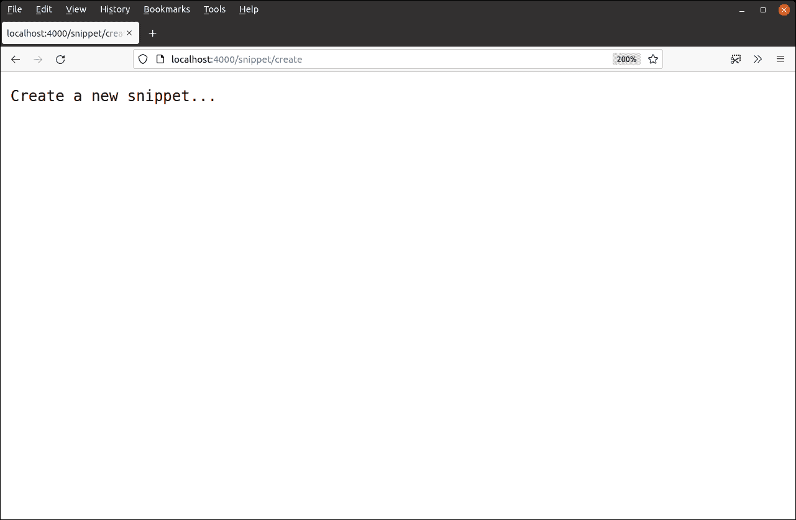

### 固定路径和子树模式

现在两个新路由已经运行了，让我们来聊聊理论。

Go 的 `servemux` 支持两种不同类型的 URL 模式：`固定路径 (fixed paths)` 和`子树路径 (subtree paths)`。固定路径`不`以斜杠结尾，而子树路径`会`以斜杠结尾。

我们的两个新模式—— `"/snippet/view"` 和 `"/snippet/create"` 都是固定路径的示例。在 Go 的 `servemux` 中，这类固定路径模式只有在请求的 URL 路径`精确`匹配固定路径时才会被匹配（并调用相应的处理器）。


相比之下，我们的模式`"/"`是子树路径的示例（因为它以斜杠结尾）。另一个例子是类似于`"/static/"`的内容。只要请求 URL 路径的`开头`匹配子树路径，子树路径模式就会被匹配（并调用相应的处理器）。如果有助于理解，你可以将子树路径看作是在末尾有一个通配符，比如`"/**"`或`"/static/**"`。

这解释了为什么`"/"`模式表现得像是一个通配捕器。该模式本质上意味着`匹配单个斜杠，后面跟跟任何内容（或什么都没有）`。

### 限制根 URL 模式

那么，如果你不想让`"/"`模式充当通配捕器怎么办？

例如，在我们构建的应用程序中，我们希望当且仅当请求的 URL 路径精确匹配`"/"`时才显示首页。否则，我们想要返回`404 not found`响应。

我们可以通过检查`home`处理器中的`r.URL.Path`来实现这一点：

文件：`main.go`

```go
package main

import (
    "log"
    "net/http"
)

func home(w http.ResponseWriter, r *http.Request) {
    if r.URL.Path != "/" {
        http.NotFound(w, r)
        return
    }
    w.Write([]byte("Hello from Snippetbox"))
}

// 添加一个 snippetView 处理器函数。
func snippetView(w http.ResponseWriter, r *http.Request) {
    w.Write([]byte("Display a specific snippet..."))
}

// 添加一个 snippetCreate 处理器函数。
func snippetCreate(w http.ResponseWriter, r *http.Request) {
    w.Write([]byte("Create a new snippet..."))
}

func main() {
    // 以之前完全相同的方式，将两个新的处理器函数和对应的
    // URL 模式注册到 servemux 中。
    mux := http.NewServeMux()
    mux.HandleFunc("/", home)
    mux.HandleFunc("/snippet/view", snippetView)
    mux.HandleFunc("/snippet/create", snippetCreate)

    log.Println("Starting server on :4000")
    err := http.ListenAndServe(":4000", mux)
    log.Fatal(err)
}
```

### 其他信息

#### Servemux 的特性与细节

*   在 Go 的`servemux`中，较长的 URL 模式优于较短的模式。因此，如果`servemux`包含多个匹配的模式，它始终会将请求分发到最长模式对应的处理器。这样做的好处是你可以以任何顺序注册模式`而不会改变 servemux 的行为`。

*   请求 URL 路径会自动清理。如果请求路径包含任何`.`或`..`元素或重复的斜杠，用户将自动重定向到等效的清理 URL。例如，如果用户访问`/foo/bar/..//baz`，他们将被自动重定向 301 到`/foo/baz`。

*   如果注册了一个子树路径并收到了该子树路径的`没有`结尾斜杠的请求，用户将自动被重定向 301 到带有斜杠的子树路径。例如，如果你注册了子树路径`/foo/`，则对`/foo`的任何请求将重定向到`/foo/`。

#### 主机名匹配

在 URL 模式中包含主机名是可能的。当在你想要将所有 HTTP 请求重定向到规范 URL，或者当你的应用程序作为多个网站或服务的后端时，这会非常有用。例如：

```go
mux := http.NewServeMux()
mux.HandleFunc("foo.example.org/", fooHandler)
mux.HandleFunc("bar.example.org/", barHandler)
mux.HandleFunc("/baz", bazHandler)
```

当涉及到模式匹配时，首先会检查任何特定于主机的模式，如果匹配，则会将请求派发给相应的处理器。只有在没有找到特定于主机的匹配时，才会检查非主机特定的定的模式。

## RESTful 路由又是怎样的？

必须承认的是，Go 的`servemux`提供的路由功能相当轻量级。它不支持基于请求方法的路由，不支持包含变量的整洁版 URL，也不支持基于正则表达式的模式。如果你有使用 Rails、Django 或 Laravel 等框架的背景，你可能会发现这有些局限性……而且令你惊讶！

但不要让这让你望而却步。事实是，Go 的`servemux`仍然可以带你走得很远，并且对于许多应用程序来说是完全足够的。每当你需要更多功能时，有大量的第三方路由器可以用来替代 Go 的`servemux`。我们将在书的后后部分介绍一些流行的选项。

## 第 2.4 节。

## 自定义 HTTP 请求头

现在让我们更新应用程序，使得`/snippet/create`路由仅响应使用`POST`方法的 HTTP 请求，如下所示：

| 方法 || 模式 || 处理器 || 操作 |

| --- | --- | --- | --- |

| ANY || / || home || 显示首页 |

| ANY || /snippet/view || snippetView || 显示特定片段 |

| POST || /snippet/create || snippetCreate || 创建新片段 |

进行此更改是重要的，因为——在我们稍后的应用程序构建中——对`/snippet/create`路由的请求将导致在数据库中创建一个新片段。在数据库中创建新片段是一个非幂等的操作，它会改变我们服务器的状态，因此我们应该遵循 [HTTP 良好实践](https://en.wikipedia.org/wiki/Hypertext_Transfer_Protocol#Request_methods)，并将此路由限制为仅对`POST`请求。

但我现在想涵盖这一点的主要原因是，这是一个很好的借口，可以让我们讨论 HTTP 响应并解释如何自定义它们。

### HTTP 状态码

让我们从更新我们的`snippetCreate`处理器开始，除非请求方法为`POST`，否则它将发送`405`（方法不允许）HTTP 状态码。为了做到这一点，我们需要像所示使用`w.WriteHeader()`方法：

文件：main.go

```go
package main

...

func snippetCreate(w http.ResponseWriter, r *http.Request) {
    // 使用 r.Method 检查请求是否在使用 POST。
    if r.Method != "POST" {
        // 如果不是，使用 w.WriteHeader() 方法发送 405 状态
        // 码并使用 w.Write() 方法写入 "Method Not Allowed"
        // 响应体。我们然后从函数返回，以便
        // 后续代码不执行。
        w.WriteHeader(405)
        w.Write([]byte("Method Not Allowed"))
        return
    }

    w.Write([]byte("Create a new snippet"))
}

...
```

尽管这个更改看起来很直接，但有几个我应该解释的细微差别：

- 每个响应只能调用一次`w.WriteHeader()`，并且在状态码写入之后就无法更改了。如果你尝试第二次调用`w.WriteHeader()`，Go 将记录一个警告。

- 如果你不显式地调用`w.WriteHeader()`，那么第一次调用`w.Write()`将自动向用户发送`200 OK`状态码。因此，如果你想发送非 200 的状态码，你必须在任何调用`w.Write()`之前调用`w.WriteHeader()`。

让我们来看实际操作。重启服务器，然后打开第二个终端并使用`curl`向`http://localhost:4000/snippet/create`发送`POST`请求。你应该会得到一个带有`200 OK`状态码的 HTTP 响应，类似于：

```bash
$ curl -i -X POST http://localhost:4000/snippet/create
HTTP/1.1 200 OK
Date: Sat, 29 Jan 2022 10:27:14 GMT
Content-Length: 23
Content-Type: text/plain; charset=utf-8

Create a new snippet...
```

但如果你使用不同的请求方法——比如`GET`、`PUT`或`DELETE`——你现在应该得到带有`405 Method Not Allowed`状态码的响应。例如：

```bash
$ curl -i -X PUT http://localhost:4000/snippet/create
HTTP/1.1 405 Method Not Allowed
Date: Sat, 29 Jan 2022 10:27:55 GMT
Content-Length: 18
Content-Type: text/plain; charset=utf-8

Method Not Allowed
```

### 自定义请求头

我们可以做的另一个改进是在`405 Method Not Allowed`响应中包含一个`Allow`请求头，让用户知道特定 URL 支持哪些请求方法。

我们可以通过使用`w.Header().Set()`方法向响应头映射中添加新的请求头，如下：

文件：main.go

```go
package main

...

func snippetCreate(w http.ResponseWriter, r *http.Request) {
    if r.Method != "POST" {
        // 使用 Header().Set() 方法向响应头映射中添加新的请求头，
        // 如下所示：
        w.Header().Set("Allow", "POST")
        w.WriteHeader(405)
        w.Write([]byte("Method Not Allowed"))
        return
    }

    w.Write([]byte("Create a new snippet"))
}

...
```

让我们再次实际操作看看。通过发送非 POST 请求到我们的`/snippet/create`URL：

```bash
$ curl -i -X PUT http://localhost:4000/snippet/create
HTTP/1.1 405 Method Not Allowed
Allow: POST
Date: Sat, 29 Jan 2022 10:29:12 GMT
Content-Length: 18
Content-Type: text/plain; charset=utf-8

Method Not Allowed
```

注意响应现在包含了我们的`Allow: POST`请求头？

### http.Error 快捷方式

如果你想发送非 200 状态码和纯文本响应体（如我们在上面的代码所示），那么是一个很好的机会使用 [`http.Error`](https://pkg.go.dev/net/http#Error）快捷函数。这是一个轻量级辅助函数，接收一个消息和一个状态码，然后在背后为我们调用`w.WriteHeader()`和`w.Write()`方法。

让我们更新代码来使用它。

文件：main.go

```go
package main

...

func snippetCreate(w http.ResponseWriter, r *http.Request) {
    if r.Method != "POST" {
        w.Header().Set("Allow", "POST")
        // 使用 http.Error() 函数发送 405 状态码和
        // "Method Not Allowed" 字符串响应体。
        http.Error(w, "Method Not Allowed", 405)
        return
    }

    w.Write([]byte("Create a new snippet"))
}

...
```

在功能方面这几乎相同。最大的区别在于我们现在将`http.ResponseWriter`传递给另一个函数，由它为用户发送响应。

将`http.ResponseWriter`传递给其他函数的模式在 Go 中非常常见，我们在整本书中都会这样做。在实践中，像我们目前所做的直接使用`w.Write()`和`w.WriteHeader()`方法是非常稀少的。但我想提前介绍它们，因为它们是更高级（且有趣！）响应方式的基础。

### net/http 常量

我们可以做的最后一个调整是使用`net/http`包中的常量处理 HTTP 方法和状态码，而不是自己编写字符串和整数。

具体来说，我们可以使用常量`http.MethodPost`代替字符串`"POST"`，使用常量`http.StatusMethodNotAllowed`代替整数`405`。如下所示：

文件：main.go

```go
package main

...

func snippetCreate(w http.ResponseWriter, r *http.Request) {
    if r.Method != http.MethodPost {
        w.Header().Set("Allow", http.MethodPost)
        http.Error(w, "Method Not Allowed", http.StatusMethodNotAllowed)
        return
    }

    w.Write([]byte("Create a new snippet"))
}

...
```

使用这些常量是一个良好的习惯，因为它们有助于防止因拼写错误导致的运行时错误，而在 HTTP 状态码常量的情况下，它们还能帮助你的代码更加清晰并具有自文档性 —— 特别是在处理不常用的状态码时。

### 额外信息

#### 系统生成的头部信息和内容嗅探

在发送响应时，Go 会为你自动设置三个系统生成的头部：`Date`、`Content-Length`和`Content-Type`。

`Content-Type`头部特别有意思。Go 会尝试通过使用 [`http.DetectContentType()`](https://pkg.go.dev/net/http/#DetectContentType) 函数对响应体进行内容嗅探，从而为你设置正确的头部。如果该函数无法猜测内容类型，Go 将退而求其次设置`Content-Type: application/octet-stream`。

`http.DetectContentType()`函数通常工作得很好，但对于初 Go Go 开发者来说，一个常见的陷阱是它可以无法区分 JSON 和纯文本。因此，默认情况下，JSON 响应将带有`Content-Type: text/plain; charset=utf-8`头部发送。你可以通过像这样手动设置正确的头部来防止这种情况发生：

```go
w.Header().Set("Content-Type", "application/json")
w.Write([]byte(`{"name":"Alex"}`))
```

#### 操作头部 map

在上面的代码中，我们使用`w.Header().Set()`向响应头部 map 添加了新头部。但还有`Add()`、`Del()`、`Get()`和`Values()`方法也可以可以使用它们来读取和操作头部 map。

```go
// 设置一个新的 cache-control 头部。如果已存在 "Cache-Control" 头部
// 它将被覆盖。
w.Header().Set("Cache-Control", "public, max-age=31536000")

// 与此相反，Add() 方法会追加一个新的 "Cache-Control" 头部并且
// 可以多次调用。
w.Header().Add("Cache-Control", "public")
w.Header().Add("Cache-Control", "max-age=31536000")

// 删除 "Cache-Control" 头部的所有值。
w.Header().Del("Cache-Control")

// 获取 "Cache-Control" 头部的第一个值。
w.Header().Get("Cache-Control")

// 获取 "Cache-Control" 头部所有值的切片。
w.Header().Values("Cache-Control")
```

#### 头部规范化


当你在头部 map 上使用`Set()`、`Add()`、`Del()`、`Get()`和`Values()`方法时，头部名称始终会使用[`textproto.CanonicalMIMEHeaderKey()`](https://pkg.go.dev/net/textproto/#CanonicalMIMEHeaderKey)函数进行规范化。这会将首字母以及连字符后的任何字母转换为大写，并将其余字母转换为小写。这在实际中的意义是，当调用这些方法时，头部名称是*不区分大小写*的。

如果你避免这种规范化行为，可以直接编辑底层的头部 map（它的类型是`map[string][]string`）。例如：

```
w.Header()["X-XSS-Protection"] = []string{"1; mode=block"}
```

## 抑制系统生成的头部

`Del()`方法不会移除系统生成的头部。要抑制这些头部，你需要访问底层 map 并将值设置为`nil`。如果你想抑制`Date`头部，你需要写入：

```
w.Header()["Date"] = nil
```

## 章节 2.5. URL 字符串

既然谈到了路由，让我们更新一下`snippetView`处理器，使其能够接收来自用户的`id`查询字符串，如下：

| 方法 | 模式 | 处理器 | 操作 |
| --- | --- | --- | --- |
| ANY | / | home | 显示首页 |
| ANY | /snippet/view?id=1 | snippetView | 显示特定的代码片段 |
| POST | /snippet/create | snippetCreate | 创建新的代码片段 |

稍我们将使用这个`id`参数从数据库中选择特定的代码片段并显示给用户。但现在，我们只需读取`id`参数的值并将其与占位符插值。为了让这正常工作，我们需要更新`snippetView`函数来完成两件事：

1. 它需要从 URL 字符串中获取`id`参数的值，我们可以使用`r.URL.Query().Get()`来实现。这将始终为参数返回一个字符串值，或者如果参数不存在则返回空字符串`""`。

2. 因为`id`参数是不可信的输入，我们应该对其进行验证，以确保它是正常且合理的。为了我们的 Snippet 应用程序，我们想要检查它是否包含一个正整数。我们可以通过尝试使用`strconv.Atoi()`函数将字符串值转换为整数，然后检查该值是否大于零。

实现如下：文件：`main.go`

```
package main

import (
    "fmt"
    "log"
    "net/http"
    "strconv"
)

func snippetView(w http.ResponseWriter, r *http.Request) {
    // 从查询字符串中提取 id 参数的值，并尝试使用
    // strconv.Atoi() 函数将其转换为整数。如果无法
    // 转换为整数，或者值小于 1，我们返回 404 页面未找到
    // 响应。
    id, err := strconv.Atoi(r.URL.Query().Get("id"))
    if err != nil || id < 1 {
        http.NotFound(w, r)
        return
    }

    // 使用 fmt.Fprintf() 函数将 id 值插值到我们的响应中
    // 并写入 http.ResponseWriter。
    fmt.Fprintf(w, "Display a specific snippet with %d...", id)
}
```

让我们尝试一下。重启应用程序，并尝试访问类似`http://localhost:4000/snippet/view?id=123`的 URL。你应该看到一个像这样的响应：

你可能还想尝试访问一些`id`参数值无效或完全没有参数的 URL。例如：

* `http://localhost:4000/snippet/view`
* `http://localhost:4000/snippet/view?id=-1`
* `http://localhost:4000/snippet/view?id=foo`

对于所有这些请求，你应该得到一个`404 page not 找到`响应。

## io.writer 接口

上面的代码在后台引入了另一个新东西。如果你查看[`fmt.Fprintf()`](https://pkg.go.dev/fmt/#Fprintf)函数的文档，你会注意到它接受一个`io.Writer`作为第一个参数：

```
func Fprint(w io.Writer, format string, a ...any) (n int, err error)
```

但我们传递的是我们的`http.ResponseWriter`对象 —— 并且运行良好。

我们之所以能够这样做是因为`io.Writer`类型是一个接口，而`http.ResponseWriter`对象实现了该接口，因为它有一个`w.Write()`方法。

如果你是 Go 新手，那么[接口的概念](https://www.alexedwards.net/blog/interfaces-explained)可能会有点困惑，我不想现在在这里纠结它。你只需要知道——在实践中——任何看到`io.Writer`参数的地方，都可以传递你的`http.ResponseWriter`对象。所写入的内容随后将作为 HTTP 响应的正文发送。

## 章节 2.6. 项目结构与组织

在我们向`main.go`文件中添加更多代码之前，现在是考虑如何组织和构建这个项目的好时机。

预先说明一下，在 Go 中构建 Web 应用程序没有单一的——甚至没有推荐的结构。这既是好事也是坏事。这意味着你对如何组织代码拥有自由和灵活性，但在决定最佳结构是什么时，也很容易陷入不确定性的兔子穴。

随着你 Go 经验的增加，你将逐渐感觉到哪些模式在不同情况下适合你。但作为一个起点，我能给你的最佳建议是`不要把事情复杂化`。只有在证明确实需要时，才努力尝试添加结构和复杂性。

对于这个项目，我们将实现一个遵循[流行的](https://github.com/thockin/go-build-template)且[经过验证的](https://peter.bourgon.org/go-best-practices-2016/#repository-structure)方法的大纲结构。这是一个非常扎实的起点，你应该能够在各种项目中复用这个通用结构。

如果你正在跟随操作，请确保你处于项目仓库的根目录下，并运行以下命令：

```
$ cd $HOME/code/snippetbox
$ rm main.go
$ mkdir -p cmd/web internal ui/html ui/static
$ touch cmd/web/main.go
$ touch cmd/web/handlers.go
```

现在，你的项目仓库结构看起来应该是这样的：

让我们花一点时间讨论一下这些目录的用途。

* `cmd`目录将包含项目中可执行应用程序的`特定于应用程序`的代码。目前我们只有一个可执行应用程序——Web 应用——它将位于`cmd/web`目录下。
* `internal`目录将包含项目中使用的辅助`非特定于应用程序`的代码。我们将用它来存放可能重用的代码，例如验证辅助函数和项目的 SQL 数据库模型。
* `ui`目录将包含 Web 应用使用的`用户界面资源`。具体来说，`ui/html`目录包含 HTML 模板，`ui/static`目录包含静态文件（如 CSS 和图像）。

*那么我们为什么要使用这种结构呢？*

有两个巨大的好处：

1. 它实现了 Go 代码与非 Go 资源之间的清晰分离。我们编写的所有 Go 代码将仅存在于`cmd`和`internal`目录下，留出项目根目录存放非 Go 资源，如 UI 文件、Makefile 和模块定义（包括我们的`go.mod`文件）。这使得在未来构建和部署应用程序时管理起来变得更容易。

2. 如果你想在项目中添加另一个可执行应用程序，这种结构的扩展性非常好。例如，未来你可能想添加一个 CLI（命令行界面）来自动化某些管理任务。有了这种结构，你可以在`cmd/cli`下创建这个 CLI 应用程序，它将能够导入并复用你在`internal`目录下编写的所有代码。

### 重构你现有的代码

让我们快速将已经编写的代码迁移到这个新结构中。

文件：`cmd/web/main.go`

```
package main

import (
    "log"
    "net/http"
)

func main() {
    mux := http.NewServeMux()
    mux.HandleFunc("/", home)
    mux.HandleFunc("/snippet/view", snippetView)
    mux.HandleFunc("/snippet/create", snippetCreate)

    log.Println("Starting server on :4000")
    err := http.ListenAndServe(":4000", mux)
    log.Fatal(err)
}
```

文件：`cmd/web/handlers.go`

```
package main

import (
    "fmt"
    "net/http"
    "strconv"
)

func home(w http.ResponseWriter, r *http.Request) {
    if r.URL.Path != "/" {
        http.NotFound(w, r)
        return
    }

    w.Write([]byte("Hello from Snippetbox"))
}

func snippetView(w http.ResponseWriter, r *http.Request) {
    id, err := strconv.Atoi(r.URL.Query().Get("id"))
    if err != nil || id < 1 {
        http.NotFound(w, r)
        return
    }

    fmt.Fprintf(w, "Display a specific snippet with ID %d...", id)
}

func snippetCreate(w http.ResponseWriter, r *http.Request) {
    if r.Method != http.MethodPost {
        w.Header().Set("Allow", http.MethodPost)
        http.Error(w, "Method Not Allowed", http.StatusMethodNotAllowed)
        return
    }

    w.Write([]byte("Create a new snippet..."))
}
```

现在，我们的 Web 应用在`cmd/web`目录下包含了`多个 Go 源代码文件`。要运行这些文件，我们可以如下地使用`go run`命令：

```
$ cd $HOME/code/snippetbox
$ go run ./cmd/web
2022/01/29 12:02:26 Starting server on :4000
```

---

## 附加信息

### internal 目录

需要指出的是，`internal`目录名称在 Go 中具有特殊的含义和行为：任何位于此目录下的包只能被`internal 目录的父级目录内部`的代码导入。在我们的情况下，这意味着任何位于`internal`中的包都只能被我们`snippetbox`项目目录内部的代码导入。

或者，从反面来看，这意味着`internal`下的任何包`无法被外部代码导入`。

### HTML 模板渲染与继承

现在我们已经创建了包含主页 HTML 的模板文件，下一个问题是*我们如何让主处理程序渲染它呢？*

为了实现这一点，我们需要使用 Go 的[`html/template`](https://pkg.go.dev/html/template/)包，它提供了一系列用于安全解析 HTML 模板的功能。我们可以使用该包中的函数解析并执行模板。

我将进行演示。打开`cmd/web/handlers.go`文件并添加以下代码：

文件：`cmd/web/handlers.go`

```
package main

import (
    "fmt"
    "html/template" // 新导入
    "log"           // 新导入
    "net/http"
    "strconv"
)

func home(w http.ResponseWriter, r *http.Request) {
    if r.URL.Path != "/" {
        http.NotFound(w, r)
        return
    }

    // 使用 template.ParseFiles() 函数将模板文件读取到
    // 模板集中。如果发生错误，记录详细错误信息并使用
    // http.Error() 函数向用户发送通用的 500 内部错误
    // 响应。
    ts, err := template.ParseFiles("./ui/html/pages/home.tmpl")
    if err != nil {
        log.Println(err.Error())
        http.Error(w, "Internal Server Error", 500)
        return
    }

    // 然后我们使用模板集的 Execute() 方法将
    // 模板内容写入响应体。Execute() 的最后一个参数
    // 代表我们想要传递的任何动态数据，目前我们
    // 将其留为 nil。
    err = ts.Execute(w, nil)
    if err != nil {
        log.Println(err.Error())
        http.Error(w, "Internal Server Error", 500)
    }
}
```

...

需要注意的是，传递给`template.ParseFiles()`函数的文件路径必须是相对于当前工作目录的，或者是绝对路径。在上面的代码中，我将路径设置为相对于项目根目录的。

那么，既然如此，请确保你处于项目的根目录，并重启应用程序：

```
$ cd $HOME/code/snippetbox
$ go run ./cmd/web
2022/01/29 12:06:02 Starting server on :4000
```

然后，在你的浏览器中打开[`http://localhost:4000`](http://localhost:4000/)。你应该会发现 HTML 首页已经初具规模了。

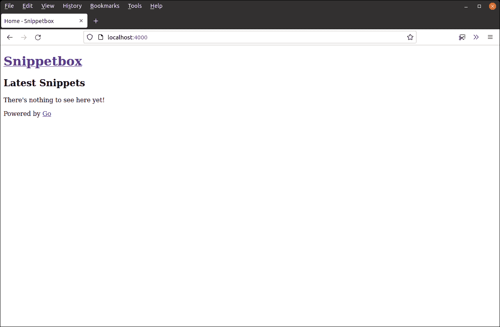

### 模板组合

随着我们为这个 Web 应用添加更多页面，会有一些共享的、样板化的 HTML 标记是我们希望包含在每个页面中的——例如页眉、导航以及`<head>`HTML 元素内部的元数据。

为了避免重复输入并防止冲突，创建一个包含这些共享内容的`base`（或`master`）模板是一个好主意，然后我们可以将这些内容与各个页面的特定页面标记进行组合。

现在去创建一个新的`ui/html/base.tmpl`文件……

```
$ touch ui/html/base.tmpl
```

并添加以下标记（我们希望它们出现在每个页面上）：

文件：`ui/html/base.tmpl`

```
{{define "base"}}
<!doctype html>
<html lang='en'>
    <head>
        <meta charset='utf-8'>
        <title>{{template "title" .}} - Snippetbox</title>
    </head>
    <body>
        <header>
            <h1><a href='/'>Snippetbox</a></h1>
        </header>
        <main>
            {{template "main" .}}
        </main>
        <footer>Powered by <a href='https://golang.org/'>Go</a></footer>
    </body>
</html>
{{end}}
```

如果你以前在其他语言中使用过模板引擎，那么希望这会让你觉得很熟悉。它本质上只是普通的 HTML，只是在双花括号`{{ ... }}}`中包含了一些额外的动作（actions）。

在这里，我们使用`{{define "base"}}...{{end}}`动作来定义一个名为`base`的独立命名模板，它包含了我们希望出现在每个页面上的内容。

在这个内部，我们使用`{{template "title" .}}`和`{{template "main" .}}`动作表示我们想在 HTML 的特定位置调用其他的命名模板（称为`title`和`main`）。

现在让我们回到`ui/html/pages/home.tmpl`文件，并更新它以定义`title`和`main`命名模板，它们将包含首页的特定内容。


文件：`ui/html/pages/home.tmpl`

```
{{define "title"}}Home{{end}}

{{define "main"}}
    <h2>Latest Snippets</h2>
    <p>There's nothing to see here yet!</p>
{{end}}
```

完成这些后，下一步是更新你的`home`处理器中的代码，以便同时解析这两个模板文件，如下：

文件：`cmd/web/handlers.go`

```go
package main

...

func home(w http.ResponseWriter, r *http.Request) {
    if r.URL.Path != "/" {
        http.NotFound(w, r)
        return
    }

    // 初始化一个包含两个文件路径的切片。需要注意的是
    // 包含我们基础模板的文件必须是切片中的*第一个*文件。
    files := []string{
        "./ui/html/base.tmpl",
        "./ui/html/pages/home.tmpl",
    }

    // 使用 template.ParseFiles() 函数读取文件并将模板
    // 存储在模板集中。注意我们可以将文件路径切片
    // 作为变长参数传递吗？
    ts, err := template.ParseFiles(files...)
    if err != nil {
        log.Println(err.Error())
        http.Error(w, "Internal Server Error", 500)
        return
    }

    // 使用 ExecuteTemplate() 方法将 "base" 模板的内容
    // 写入响应正文。
    err = ts.ExecuteTemplate(w, "base", nil)
    if err != nil {
        log.Println(err.Error())
        http.Error(w, "Internal Server Error", 500)
    }
}

...
```

现在，我们的模板集不再直接包含 HTML，而是包含了 3 个命名模板——`base`、`title`和`main`。我们使用`ExecuteTemplate()`方法告诉 Go，我们明确想要使用`base`模板的内容进行响应（这反过来又会调用我们的`title`和`main`模板）。

可以重启服务器并尝试一下。你会发现它渲染的输出与之前相同（尽管 HTML 源码中动作所在的地方有一些额外的空白）。

### 嵌入部分组件 (partials)

对于某些应用程序，你可能希望将某些 HTML 部分拆分成为部分组件，这些组件可以在不同的页面或布局中重用。为了说明这一点，让我们创建一个包含 Web 应用主导航栏的部分组件。

创建一个新的`ui/html/partials/nav.tmpl`文件，包含一个名为`"nav"`的命名模板，如下：

```
$ mkdir ui/html/partials
$ touch ui/html/partials/nav.tmpl
```

文件：`ui/html/partials/nav.tmpl`

```
{{define "nav"}}
<nav>
    <a href='/'>Home</a>
</nav>
{{end}}
```

然后更新`base`模板，以便它调用`nav`部分组件：

文件：`ui/html/base.tmpl`

```
{{define "base"}}
<!doctype html>
<html lang='en'>
    <head>
        <meta charset='utf-8'>
        <title>{{template "title" .}} - Snippetbox</title>
    </head>
    <body>
        <header>
            <h1><a href='/'>Snippetbox</a></h1>
        </header>
        <main>
            {{template "main" .}}
            {{template "nav" .}}
        </main>
        <footer>Powered by <a href='https://golang.org/'>Go</a></footer>
    </body>
</html>
{{end}}
```

最后，我们需要更新`home`处理器以包含`nav`部分组件：

文件：`cmd/web/handlers.go`

```go
package main

...

func home(w http.ResponseWriter, r *http.Request) {
    if r.URL.Path != "/" {
        http.NotFound(w, r)
        return
    }

    // 初始化一个包含两个文件路径的切片。需要注意的是
    // 包含我们基础模板的文件必须是切片中的*第一个*文件。
    files := []string{
        "./ui/html/base.tmpl",
        "./ui/html/pages/home.tmpl",
    }

    // 使用 template.ParseFiles() 函数读取文件并将模板
    // 存储在模板集中。注意我们可以将文件路径切片
    // 作为变长参数传递吗？
    ts, err := template.ParseFiles(files...)
    if err != nil {
        log.Println(err.Error())
        http.Error(w, "Internal Server Error", 500)
        return
    }

    // 使用 ExecuteTemplate() 方法将 "base" 模板的内容
    // 写入响应正文。
    err = ts.ExecuteTemplate(w, "base", nil)
    if err != nil {
        log.Println(err.Error())
        http.Error(w, "Internal Server Error", 500)
    }
}

...
```

一旦重启服务器，`base`模板现在应该调用`nav`模板，你的首页看起来应该是这样：

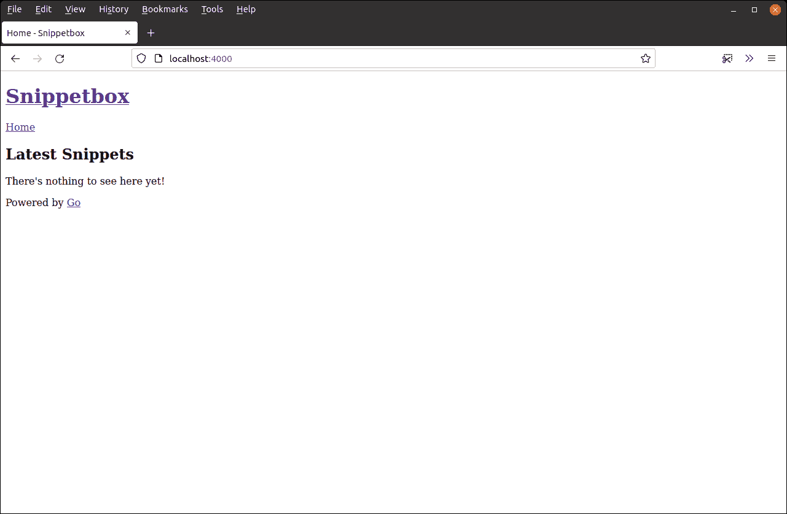

### 更多信息

#### block 动作

在上面的代码中，我们使用了`{{template}}`动作从一个模板调用另一个模板。但 Go 还提供了`{{block}}...{{end}}`动作，你可以使用它。它的作用类似于`{{template}}`，但允许你在被调用的模板*在模板集中不存在*时指定默认内容。

当你希望提供某些默认内容（例如侧边栏），以便各个页面根据需要进行覆盖时，这非常有用。

语法上，你可以这样使用它：

```
{{define "base"}}
    <h1>示例模板</h1>
    {{block "sidebar" .}}
        <p>我的默认侧边栏内容</p>
    {{end}}
{{end}}
```

但是——如果你愿意——你不需要`{{block}}`和`{{end}}`动作之间包含任何默认内容。在这种情况下，被调用的模板就像是“可选的”。如果模板在模板集中，它就会被渲染。如果不存在，则什么都不会显示。

#### 嵌入文件

Go 1.16 引入了[`embed`](https://pkg.go.dev/embed/)包，它使得*将文件嵌入到 Go 程序本身中，而不是从磁盘读取。

目前，从磁盘读取我们的模板文件运行良好，而且在概念上比使用`embed`包更简单，但我们会在书后面的部分回顾这一点，并解释如何使用`embed`功能作为替代方案。

第 2.8

提供静态文件

现在，让我们通过向项目中添加一些静态 CSS 和图像文件，以及少量的 JavaScript 来高亮激活的导航项，从而改进主页的观和体验。

如果你正在按照此教程操作，可以使用以下命令获取必要的文件并将它们提取到我们之前创建的`ui/static`文件夹中：

```bash
$ cd $HOME/code/snippetbox
$ curl https://www.alexedwards.net/static/sb-v2.tar.gz | tar -xvz -C ./ui/static/
```

现在你的`ui/static`目录内容应该像这样：

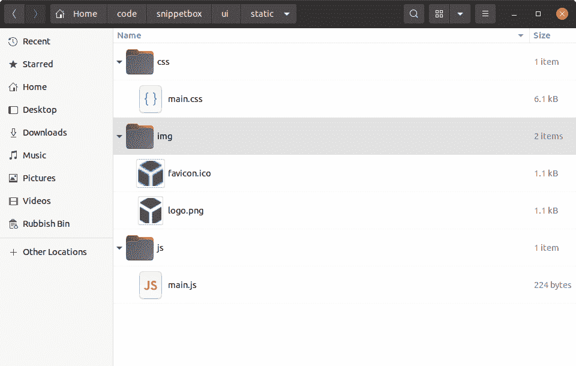

### `http.FileServer` 处理器

Go 的`net/http`包内置了一个名为[`http.FileServer`](https://pkg.go.dev/net/http/#FileServer)的处理器，你可以用它通过 HTTP 从特定目录提供文件。让我们为应用程序添加一个新路由，使得所有以`"/static/"`开头的请求都由它来处理，如下所示：

| 方法 | 模式 | 处理器 | 操作 |
| --- | --- | --- | --- |
| ANY | / | home | 显示主页 |
| ANY | /snippet/view?id=1 | snippetView | 显示特定的代码片段 |
| POST | /snippet/create | snippetCreate | 创建新的代码片段 |
| ANY | /static/ | http.FileServer | 提供特定的静态文件 |

要创建一个新的`http.FileServer`处理器，我们需要像这样使用[`http.FileServer()`](https://pkg.go.dev/net/http/#FileServer)函数：

```go
fileServer := http.FileServer(http.Dir("./ui/static/"))
```

当此处理器接收到请求时，它会移除 URL 路径开头的斜杠，然后在`./ui/static`目录中搜索对应的文件并发送给用户。

因此，为了让它正常工作，我们必须在将其传递给`http.FileServer`*之前*，从 URL 路径中去掉开头的`"/static"`。否则，它将寻找一个不存在的文件，用户将收到`404 page not found`响应。幸运的是，Go 包含了一个专门用于此任务的辅助函数[`http.StripPrefix()`](https://pkg.go.dev/net/http/#StripPrefix)。

打开你的`main.go`文件并添加以下代码，使文件最终看起来如下：

文件：`cmd/web/main.go`

```go
package main

import (
    "log"
    "net/http"
)

func main() {
    mux := http.NewServeMux()

    // 创建一个从 "./ui/static" 目录提供文件的文件服务器。
    // 注意传递给 http.Dir 函数的路径相对于项目
    // 根目录的。
    fileServer := http.FileServer(http.Dir("./ui/static/"))

    // 使用 mux.Handle() 函数将文件服务器注册为所有
    // 以 "/static/" 开头的 URL 路径的处理器。对于匹配的路径，
    // 在请求到达文件服务器之前剥离 "/static" 前缀。
    mux.Handle("/static/", http.StripPrefix("/static", fileServer))

    // 正常注册其他应用程序路由。
    mux.HandleFunc("/", home)
    mux.HandleFunc("/snippet/view", snippetView)
    mux.HandleFunc("/snippet/create", snippetCreate)

    log.Println("Starting server on :4000")
    err := http.ListenAndServe(":4000", mux)
    log.Fatal(err)
}
```

完成后，重启应用程序并在浏览器中打开[`http://localhost:4000/static/`](http://localhost:4000/static/)。你应该能在浏览器中看到`static`目录的文件列表。

你可以自由访问`http://localhost:4000/static/`来浏览目录文件。例如，如果你访问[`http://localhost:4000/static/css`](http://localhost:4000/static/css)，你应该能看到`static`目录的列表，如下：


### 使用静态文件

现在文件服务器工作正常了，我们可以更新`html/base`来使用静态文件：

文件：`ui/html/base`

```html
{{define "base"}}
<!doctype html>
<html lang='en'>
<head>
    <meta charset='utf-8'>
    <title>{{template "title"}} - Snippet</title>
    <link rel="stylesheet" href='/static/css'>
    <link rel="icon" href='/static/favicon.ico'>
</head>
<body>
    <header>
        {{template "nav"}}
    </header>
    <main>
        {{template "main"}}
    </main>
    <footer>
        Powered by <a href='golang.org'>Go</a>
    </footer>
    <script src='/static/js'></script>
</body>
</html>
{{end}}
```

确保保存更改，然后访问`http://localhost:4000/`。你的主页现在应该是这样的：


### 附加信息

Go 的文件服务器有一些值得注意的特性：

- 它通过运行[`path.Clean()`](https://pkg.go.dev/path#Clean)处理所有路径，这可以移除 URL 中的`.`和`..`元素，防止目录遍历攻击。

- [Range 请求](https://benramsey.com/blog/2008/partial-content)是完全支持的。如果你的应用程序正在提供大文件，这非常有用。你可以使用 curl 请求`logo.png`的 100-199 字节来看看效果：

```bash
$ curl -i -H "Range: bytes=100-199" http://localhost:4000/static/logo.png
HTTP/1.1 206 Partial Content
Accept-Ranges: bytes
Content-Length: 100
Content-Range: bytes 100-199
Content-Type: image/png
Last-Modified: Thu, 04 May 2017 13:07:52 GMT
Date: Sat, 29 Jan 2022 14:33:59 GMT
```

- `Last-Modified`和`If-Modified-Since`头部是透明支持的。如果文件自上次请求以来没有更改，`http.FileServer`将发送`304 Not Modified`状态码而不是文件。这有助于减少客户端和服务器的延迟和处理开销。

- `Content-Type`根据文件名自动设置，使用了[`mime.TypeByExtension()`](https://pkg.go.dev/mime#TypeByExtension)函数。如有必要，可以使用[`mime.AddExtensionType()`](https://pkg.go.dev/mime#AddExtensionType)函数添加自己的扩展名和内容类型。

#### 禁用目录列表

如果你想禁用目录列表，有几种不同的方法可以采用。

最简单的方法？在你想禁用的列表的特定目录中添加一个空的`index.html`文件。这样，该文件将取代目录列表被输出，用户将得到一个没有正文的`200 OK`响应。如果你想对`./ui/static`下的所有目录都执行此操作，可以使用以下命令：

```
$ find ./ui/static -type d -exec touch {}/index.html \;
```

一个更复杂（但可以说更好）的解决方案是为[`http.FileSystem`](https://pkg.go.dev/net/http/#FileSystem)创建一个自定义实现，并让它对任何目录都返回一个`os.ErrNotExist`错误。详细的解释和示例代码可以在[这篇博客文章](https://www.alexedwards.net/blog/disable-http-fileserver-directory-listings)中找到。

# 第 2.9 节。


## `http.Handler` 接口

在继续之前，我们应该涵盖一些理论知识。这有点复杂，所以如果你觉得这一章很难懂，不要担心。继续构建应用程序，等你对 Go 更熟悉后再回到这里看。

在之前的章节中，我经常使用 handler（处理器）这个词，但没有解释它的真正含义。严格来说，我们所说的 handler 是实现 [`http.Handler`](https://pkg.go.dev/net/http/#Handler) 接口的对象：

```go
type Handler interface {
    ServeHTTP(ResponseWriter, *Request)
}
```

简单来说，这意味着要成为一个 handler，一个对象必须具有相同签名的 `ServeHTTP()` 方法：

```go
ServeHTTP(http.ResponseWriter, *http.Request)
```

因此，在最简单的情况下，一个 handler 看起来像这样：

```go
type home struct {}

func (h *home) ServeHTTP(w http.ResponseWriter, r *http.Request) {
    w.Write([]byte("This is my home page"))
}
```

在这里我们有一个对象（在这种情况下是一个 `home` 结构体，但它同样可以是字符串、函数或任何其他内容），我们在它上实现了一个签名名为 `ServeHTTP(http.ResponseWriter, *http.Request)` 的方法。这就是创建一个 handler 所需的所有内容。

你可以使用 `Handle` 方法将其注册到 servemux 中，如下：

```go
mux := http.NewServeMux()
mux.Handle("/", &home{})
```

当这个 servemux 接收到针对 `/` 的 HTTP 请求时，它将调用 `home` 结构体的 `ServeHTTP()` 方法——该方法随后写入 HTTP 响应。

### Handler 函数

现在，为了实现一个 `ServeHTTP()` 方法而创建一个对象是冗长且有些困惑的。这就是为什么在实践中，更常见的方法是将 handlers 写成普通函数（正如我们一直以来所做的那样）。例如：

```go
func home(w http.ResponseWriter, r *http.Request) {
    w.Write([]byte("This is my home page"))
}
```

但这个 `home` 函数只是一个普通函数；它没有 `ServeHTTP()` 方法。所以它本身并不是一个 handler。

相反，我们可以使用 [`http.HandlerFunc()`](https://pkg.go.dev/net/http/#HandlerFunc) 适配器将其转换为 handler，如下：

```go
mux := http.NewServeMux()
mux.Handle("/", http.HandlerFunc(home))
```

`http.HandlerFunc()` 适配器的工作原理是自动为 `home` 函数添加一个 `ServeHTTP()` 方法。执行时，这个 `ServeHTTP()` 方法只需简单地调用原始 `home` 函数的内容。这是一种迂回但方便的方法，可以将普通函数强制满足 `http.Handler` 接口。

在整个项目中，我们一直使用 `HandleFunc` 方法来注册 handler。这是一种语法糖，可以将普通函数转换为满足 `http.Handler` 接口的 handler：

```go
mux := http.NewServeMux()
mux.HandleFunc("/", home)
```

### 链接 handler

当这个 servemux 接收到针对 `/` 的 HTTP 请求时，它将调用 `home` 结构体的 `ServeHTTP()` 方法——该方法反过来写入 HTTP 响应。

在开始时，你可能注意到，[`ListenAndServe`](https://pkg.go.dev/net/http/#ListenAndServe) 函数的第二个参数是 handler：

```go
mux := http.NewServeMux()
mux.Handle("/", handler)
```

对于我来说，在运行时设置 handler 这种方式让事情变得简单了。

事实上，实际上发生的情况是让 servemux 接收到针对 `/` 的 HTTP 请求时，它将调用 `home` 结构体的 `ServeHTTP()` 方法——该方法反过来写入 HTTP 响应。

### 请求并发处理

还有一点非常需要注意：所有传入的请求都在自己的 goroutine 中处理。虽然这有助于性能，但缺点是你需要注意并防止访问共享资源[竞态条件](https://www.alexedwards.net/understanding-mutexes)。

# 第 3 章：配置与错误处理

在本书的这一部分中，我们将进行一些清理工作。我们不会添加很多新功能，而是专注于那些让管理应用程序更简单的改进。

你将学习如何：

* 使用命令行标记在运行时设置应用程序配置。
* 改进你的应用程序日志，包含更多信息，并根据类型（或级别）对其进行管理。
* 以一种可扩展、类型安全的方式让你的处理器可以使用依赖。
* 集中错误处理，这样你就不需要重复代码。

## 第 3.1 节：管理配置设置

我们 Web 应用程序的 `main.go` 文件目前包含几个硬编码配置设置：

* 服务器监听的网络地址（当前为 `":4000"`）
* 静态文件目录的文件路径（当前为 `"./ui/static"`）

将这些硬编码是不理想的。配置设置与代码之间没有分离，我们无法在运行时更改设置（如果你在开发、测试和生产环境中需要不同的设置，这将很重要）。

在本章中，我们将开始改进这一点，并使服务器的网络地址可以在运行时配置。

### 命令行标记

在 Go 中，管理配置设置的一种常见且习惯的方法是在启动应用程序时使用命令行标记。例如：

```bash
$ go run ./cmd/web -addr=":80"
```

从应用程序中接收并解析命令行标记的最简单方法是使用如下一行代码：

```go
addr := flag.String("addr", ":4000", "HTTP network address")
```

让我们在应用程序中使用这一功能，并将硬编码的网络地址替换为命令行标记：

文件内容：`cmd/web/main.go`

```go
package main

import (
    "flag" // 新增导入
    "log"
    "net/http"
)

func main() {
    // 定义一个名为 'addr' 的新命令行标记，默认值为 ":4000"，
    // 并带有一些简短的帮助文本，用于解释该标记控制的内容。
    // 标记的值将在运行时存储在 addr 变量中。
    addr := flag.String("addr", ":4000", "HTTP network address")

    // 重要的是，我们使用 flag.Parse() 函数来解析命令行标记。
    // 它会读取命令行标记的值并将其赋值给 addr 变量。
    // 你需要在在使用 addr 变量*之前*调用此函数，
    // 否则它将始终包含默认值 ":4000"。
    // 如果在解析过程中遇到任何错误，应用程序将终止。
    flag.Parse()

    mux := http.NewServeMux()

    fileServer := http.FileServer(http.Dir("./ui/static/"))
    mux.Handle("/static/", http.StripPrefix("/static", fileServer))
    
    mux.HandleFunc("/", home)
    mux.HandleFunc("/snippet/view", snippetView)
    mux.HandleFunc("/snippet/create", snippetCreate)

    // flag.String() 函数返回的是指向标记值的指针，
    // 而不是值本身。因此，在使用它之前，我们需要对指针进行解引用
    //（即在其前面加上 * 符号）。
    // 注意，我们使用 log.Printf() 函数将地址插值到日志消息中。
    log.Printf("Starting server on %s", *addr)
    err := http.ListenAndServe(*addr, mux)
    log.Fatal(err)
}
```

保存此文件并尝试在启动应用程序时使用 `-addr` 标记。你会发现服务器现在会在你指定的任何地址上运行，如下所示：

```bash
$ go run ./cmd/web -addr=":9999"
2022/01/29 15:50:20 Starting server on :9999
```

### 默认值

命令行标记是完全可选的。例如，如果你在运行应用程序时不带 `-addr` 标记，服务器将回退到监听地址 `:4000`（这是我们指定的默认值）。

```bash
$ go run ./cmd/web 
2022/01/29 15:51:36 Starting server on :4000
```

对于命令行标记使用什么作为默认值，并没有规定。我喜欢使用符合我开发环境的默认值，因为这在构建应用程序时可以节省我的时间和打字量。但因人而异（YMMV）。你可能更倾向于为生产环境设置默认值的安全方法。

### 类型转换

在上面的代码中，我们使用了 `flag.String()` 函数来定义命令行标记。这样做的好处是将用户在运行时提供的任何值都转换为 `string` 类型。如果值*无法*转换为 `string`，则应用程序将记录错误并退出。

Go 还有许多系列其他函数，包括 [`flag.Int()`](https://pkg.go.dev/flag/#Int)、[`flag.Bool()`](https://pkg.go.dev/flag/#Bool) 和 [`flag.Float64()`](https://pkg.go.dev/flag/#Float64)。它们的工作方式与 `flag.String()` 完全相同，只是它们会自动将命令行标记的值转换为相应的类型。

### 自动帮助

另一个很棒的功能是你可以使用 `-help` 标记列出应用程序所有可用的命令行标记及其对应的帮助文本。尝试一下：

```bash
$ go run ./cmd/web -help
Usage of /tmp/go-build3672328037/b001/exe/web:
  -addr string
        HTTP network address (default ":4000")
```

总而言之，这看起来已经非常棒了。我们引入了一种为应用程序管理配置设置的惯用方法。

### 额外信息

#### 环境变量

如果你以前构建并部署过应用程序，你可能在考虑环境变量？将配置存储在环境变量中是可行的，这是一种[良好的实践](https://12factor.net/config)。例如，你可以使用 `addr` 环境变量来设置端口：

```bash
$ export ADDR=:9999
go run ./cmd/web
2022/01/29 15:54:29 Starting server on :9999
```

#### 布尔标记

如果你想使用布尔标记，可以使用 `flag.Bool()`。例如：

```bash
$ go run ./cmd/web -debug=true
2022/01/29 15:55:00 Starting server on :4000
```

#### 预存变量

可以将命令行标记解析到预存变量的地址中。这里是一个粗略的示例：

```go
type config struct {
    addr      string
    staticDir string
}

var cfg config

flag.StringVar(&cfg.addr, "addr", ":4000", "HTTP network address")
flag.StringVar(&cfg.staticDir, "static-dir", "./static", "Path to static assets")

flag.Parse()
```

## 3.2 分级日志

目前在 `main.go` 文件中，我们使用 [`log.Printf()`](https://pkg.go.dev/log/#Printf) 和 [`log.Fatal()`](https://pkg.go.dev/log/#Fatal) 函数来输出消息。

这两个函数都通过 Go 的标准日志器输出消息，该日志器默认会在消息前加上本地日期和时间，并将其写入标准错误流。`log.Fatal()` 函数在写入消息后还会调用 `os.Exit(1)`，导致应用程序立即退出。

在我们的应用程序中，我们可以将日志消息分为两个不同的类型——或级别。第一类型是*信息性*消息（例如 `"Starting server on :4000"`），第二类型是*错误*消息。

```go
log.Printf("Starting server on %s", *addr) // 信息消息
err := http.ListenAndServe(*addr, mux)
log.Fatal(err) // 错误消息
```

让我们通过添加一些*分级日志*功能来改进应用程序，以便以不同的方式管理信息和错误消息。具体来说：

* 我们将信息消息加上 `"INFO"` 前缀，并将其输出到标准输出 (stdout)。
* 我们将错误消息加上 `"ERROR"` 前缀，并将其输出到标准错误 (stderr)，同时带有调用日志器的相关文件名和行号（有助于调试）。

实现此功能有几种方法，但一种简单且清晰的方法是使用 [`log.New()`](https://pkg.go.dev/log/#New) 函数创建两个新的自定义日志器。

打开你的 `main.go` 文件并按如下方式更新：

```go
package main

import (
    "flag"
    "log"
    "net/http"
    "os" // 新导入
)

func main() {
    addr := flag.String("addr", ":4000", "HTTP network address")
    
    flag.Parse()

    // 使用 log.New() 创建一个用于写入信息消息的记录器。它接收
    // 三个参数：写入日志的目标位置 (os.Stdout)，消息的字符串
    // 前缀（INFO 后跟一个制表符），以及指示包含哪些
    // 额外信息的标志（本地日期和时间）。注意，这些标志是
    // 使用位或运算符 | 组合的。
    infoLog := log.New(os.Stdout, "INFO\t", log.Ldate|log.Ltime)

    // 以同样的方式创建一个用于写入错误消息的记录器，但使用 stderr 作为
    // 目标，并使用 log.Lshortfile 标志来包含相关的
    // 文件名和行号。
    errorLog := log.New(os.Stderr, "ERROR\t", log.Ldate|log.Ltime|log.Lshortfile)

    mux := http.NewServeMux()

    fileServer := http.FileServer(http.Dir("./ui/static/"))
    mux.Handle("/static/", http.StripPrefix("/static", fileServer))

    mux.HandleFunc("/", home)
    mux.HandleFunc("/snippet/view", snippetView)
    mux.HandleFunc("/snippet/create", snippetCreate)

    // 使用这两个新记录器写入消息，而不是使用标准记录器。
    infoLog.Printf("Starting server on %s", *addr)
    err := http.ListenAndServe(*addr, mux)
    errorLog.Fatal(err)
}
```

好了……让我们尝试一下这些吧！

继续运行应用程序，然后打开另一个终端窗口并尝试再次运行。这应该会产生一个错误，因为我们的服务器想要监听的网络地址（`:4000`）已经被占用了。

你在第二个终端中的日志输出看起来应该像这样：

```
$ go run ./cmd/web
INFO    2022/01/29 16:00:50 Starting server on :4000
ERROR   2022/01/29 16:00:50 main.go:37: listen tcp :4000: bind: address already in use
exit status 1
```

注意这两个消息的前缀是不同的——这样它们在终端中可以被轻松区分——而且我们的错误消息还包含了调用记录器的文件名和行号（`main.go:37`）？

### 解耦日志记录

像我们这样将消息记录到标准流（stdout 和 stderr）的一个大好处是，你的应用程序和日志记录之间是解耦的。应用程序本身并不关心日志的路由或存储，这可以让你根据不同的环境更方便地管理日志。

在开发期间，查看日志输出很容易，因为标准流会显示在终端中。


在分阶段或生产环境中，你可以将流重定向到最终目标以便查看和归档。该目标可以是磁盘文件，也可以是像 Splunk 这样的日志服务。无论如何，日志的最终目标由你的执行环境独立于应用程序进行管理。

例如，我们可以在启动应用程序时这样将 `stdout` 和 `stderr` 流重定向到磁盘文件：

```
$ go run ./cmd/web >>/tmp/info.log 2>>/tmp/error.log
```

### `http.Server` 错误日志

我们还需要对应用程序进行最后一次更改。默认情况下，如果 Go 的 HTTP 服务器遇到错误，它将使用标准记录器记录它。为了保持一致性，最好使用我们新的 `errorLog` 记录器。

为了实现这一点，我们需要在 `http.Server` 结构体中使用我们新的 `errorLog` 记录器，而不是默认的。

如下：`cmd/web/main.go`

```go
package main

import (
    "flag"
    "log"
    "net/http"
    "os"
)

func main() {
    addr := flag.String("addr", ":4000", "HTTP network address")

    flag.Parse()

    infoLog := log.New(os.Stdout, "INFO\t", log.Ldate|log.Ltime)
    errorLog := log.New(os.Stderr, "ERROR\t", log.Ldate|log.Ltime|log.Lshortfile)

    mux := http.NewServeMux()

    fileServer := http.FileServer(http.Dir("./ui/static/"))
    mux.Handle("/static/", http.StripPrefix("/static", fileServer))

    mux.HandleFunc("/", home)
    mux.HandleFunc("/snippet/view", snippetView)
    mux.HandleFunc("/snippet/create", snippetCreate)

    infoLog.Printf("Starting server on %s", *addr)
    srv := &http.Server{
        Addr:     *addr,
        ErrorLog: errorLog,
        Handler:  mux,
    }

    err := srv.ListenAndServe()
    errorLog.Fatal(err)
}
```

### 额外信息

到目前为止，我们使用了 `Println()`、`Printf()` 和 `Fatal()` 来写入消息，但 Go 提供了其他值得熟悉的[方法](https://go.dev/log)。

#### 并发日志记录

`log.New()` 创建的记录器也是安全的。但是，如果你有多个 goroutine，你需要担心竞态条件。

#### 日志到文件

正如上面所说的，我的建议是将输出重定向到文件。作为一个粗略的示例：

```go
f, err := os.OpenFile("/tmp/info.log", os.O_RDWR|os.O_CREATE, 0666)
if err != nil {
    log.Fatal(err)
}
defer f.Close()

infoLog := log.New(f, "INFO\t", log.Ldate|log.Ltime)
```

## 3.3 依赖注入

我们的应用程序还有一个需要解决的日志记录问题。如果你打开 `handlers.go` 文件，你会发现 `home` 处理函数仍然使用 Go 的标准记录器写入错误，而不是我们想要的 `errorLog`。

```go
func home(w http.ResponseWriter, r *http.Request) {
    ...

    ts, err := template.ParseFiles(files...)
    if err != nil {
        log.Println(err.Error()) // 这并没有在使用我们的记录器。
        http.Error(w, "Internal Server Error", 500)
        return
    }

    err = ts.ExecuteTemplate(w, "base", nil)
    if err != nil {
        log.Println(err.Error()) // 这并没有在使用我们的记录器。
        http.Error(w, "Internal Server Error", 500)
    }
}
```

这引发了一个很好的问题：*我们如何让 `main()` 中的新 `errorLog` 记录器对 `home` 可？*

这个问题进一步泛化。大多数 Web 应用程序都有处理器需要的多个依赖项，例如数据库连接池、集中错误处理和模板缓存。我们真正想要回答的是：*我们如何让任何依赖项对我们的处理函数可用？*

有几种不同的[方法](https://www.alexedwards.net/blog/organising-database-access)来实现这一点，最简单的是将依赖放在全局变量中。但通常，注入依赖的良好做法是将它们放入一个自定义的 `application` 结构体中，然后将你的处理函数定义为该结构体的方法。

我将为你演示。

打开你的 `main.go` 文件并按照所示所示一个新的 `application` 结构体：

文件：`cmd/web/main.go`

```go
package main

import (
    "flag"
    "log"
    "net/http"
    "os"
)

// 定义一个 application 结构体来存放整个 web 应用程序的
// 依赖项。目前我们只包含两个自定义日志记录器的字段，
// 但随着构建的进行，我们将为其添加更多字段。
type application struct {
    errorLog *log.Logger
    infoLog  *log.Logger
}


func main() {
    ...
}
```

然后在 `handlers.go` 文件中更新你的处理程序函数，使它们成为针对 `application` 结构体的方法……

文件：`cmd/web/handlers.go`

```go
package main

import (
    "fmt"
    "html/template"
    "net/http"
    "strconv"
)

// 修改 home 处理程序的函数签名，使其定义为针对
// *application 的方法。
func (app *application) home(w http.ResponseWriter, r *http.Request) {
    if r.URL.Path != "/" {
        http.NotFound(w, r)
        return
    }

    files := []string{
        "./ui/html/base.tmpl",
        "./ui/html/partials/nav.tmpl",
        "./ui/html/pages/home.tmpl",
    }

    ts, err := template.ParseFiles(files...)
    if err != nil {
        // 因为 home 处理程序函数现在是 application 的方法
        // 它可以访问它的字段，包括错误日志记录器。
        // 我们将日志消息写入这里而不是标准日志记录器。
        app.errorLog.Println(err.Error())
        http.Error(w, "Internal Server Error", 500)
        return
    }

    err = ts.ExecuteTemplate(w, "base", nil)
    if err != nil {
        // 同时更新这里的代码以使用 application 结构体
        // 中的错误日志记录器。
        app.errorLog.Println(err.Error())
        http.Error(w, "Internal Server Error", 500)
    }
}

// 修改 snippetView 处理程序的函数签名，使其定义为针对
// *application 的方法。
func (app *application) snippetView(w http.ResponseWriter, r *http.Request) {
    id, err := strconv.Atoi(r.URL.Query().Get("id"))
    if err != nil || id < 1 {
        http.NotFound(w, r)
        return
    }

    fmt.Fprintf(w, "Display a specific snippet with ID %d...", id)
}

// 修改 snippetCreate 处理程序的函数签名，使其定义为针对
// *application 的方法。
func (app *application) snippetCreate(w http.ResponseWriter, r *http.Request) {
    if r.Method != http.MethodPost {
        w.Header().Set("Allow", http.MethodPost)
        http.Error(w, "Method Not Allowed", http.StatusMethodNotAllowed)
        return
    }

    w.Write([]byte("Create a new snippet..."))
}
```

最后，让我们在 `main.go` 文件中将这些内容连接起来：

文件：`cmd/web/main.go`

```go
package main

import (
    "flag"
    "log"
    "net/http"
    "os"
)

type application struct {
    errorLog *log.Logger
    infoLog  *log.Logger
}

func main() {
    addr := flag.String("addr", ":4000", "HTTP network address")
    
    flag.Parse()

    infoLog := log.New(os.Stdout, "INFO: ", log.Ldate|log.Ltime)
    errorLog := log.New(os.Stderr, "ERROR: ", log.Ldate|log.Ltime|log.Lfile)

    // 初始化 application 实例，
    app := &application{
        errorLog: errorLog,
        infoLog:  infoLog,
    }

    mux := http.NewServeMux()

    // 路由注册。
    mux.HandleFunc("/", app.home)
    mux.HandleFunc("/snippet/view", app.snippetView)
    mux.HandleFunc("/snippet/create", app.snippetCreate)

    // 静态文件处理。
    fileServer := http.FileServer(http.Dir("./ui")))
    mux.Handle("/static/", http.StripPrefix("/static", fileServer))

    srv := &http.Server{
        Addr:    *addr,
        Handler: mux,
    }

    infoLog.Printf("Starting server on %s", *addr)
    errorLog.Fatal(srv.ListenAndServe())
}
```

```go
package main

import (
    "fmt"
    "net/http"
    "runtime/debug"
)

// serverError 辅助函数将错误信息和堆栈跟踪写入 errorLog，
// 然后向用户发送通用的 500 Internal Server Error 响应。
func (app *application) serverError(w http.ResponseWriter, err error) {
    trace := fmt.Sprintf("%s\n%s", err.Error(), debug.Stack())
    app.errorLog.Println(trace)

    http.Error(w, http.StatusText(http.StatusInternalServerError), http.StatusInternalServerError)
}

// clientError 辅助函数向用户发送特定的状态码和相应的描述。
// 我们将在书的后面使用它在用户发送的请求出现问题时发送类似
// 400 "Bad Request" 等响应。
func (app *application) clientError(w http.ResponseWriter, status int) {
    http.Error(w, http.StatusText(status), status)
}

// 为了保持一致，我们还将实现一个 notFound 辅助函数。这仅仅是
// 对 clientError 的一个方便封装，用于向用户发送 404 Not Found 响应。
func (app *application) notFound(w http.ResponseWriter) {
    app.clientError(w, http.StatusNotFound)
}
```

这里并没有大量的新代码，但它引入了几个值得讨论的功能。

*   在 `serverError()` 辅助函数中，我们使用 [`debug.Stack()`](https://pkg.go.dev/runtime/debug/#Stack) 函数来获取当前 goroutine 的堆栈跟踪，并将其附加到日志消息中。在调试错误时，通过堆栈跟踪查看程序的执行路径非常有帮助。

*   在 `clientError()` 辅助函数中，我们使用 [`http.StatusText()`](https://pkg.go.dev/net/http/#StatusText) 函数自动为给定的 HTTP 状态码生成友好的文本表示。例如，`http.StatusText(400)` 将返回字符串 `"Bad Request"`。

完成后，回到你的 `handlers.go` 文件并更新它以使用新的辅助函数：

文件：`cmd/web/handlers.go`


```go
package main

import (
    "fmt"
    "html/template"
    "net/http"
    "strconv"
)

func (app *application) home(w http.ResponseWriter, r *http.Request) {
    if r.URL.Path != "/" {
        app.notFound(w) // 使用 notFound() 辅助函数
        return
    }

    files := []string{
        "./ui/html/base.tmpl",
        "./ui/html/partials/nav.tmpl",
        "./ui/html/pages/home.tmpl",
    }

    ts, err := template.ParseFiles(files...)
    if err != nil {
        app.serverError(w, err) // 使用 serverError() 辅助函数。
        return
    }

    err = ts.ExecuteTemplate(w, "base", nil)
    if err != nil {
        app.serverError(w, err) // 使用 serverError() 辅助函数.
    }
}

func (app *application) snippetView(w http.ResponseWriter, r *http.Request) {
    id, err := strconv.Atoi(r.URL.Query().Get("id"))
    if err != nil || id < 1 {
        app.notFound(w) // 使用 notFound() 辅助函数.
        return
    }

    fmt.Fprintf(w, "Display a specific snippet with ID %d...", id)
}

func (app *application) snippetCreate(w http.ResponseWriter, r *http.Request) {
    if r.Method != http.MethodPost {
        w.Header().Set("Allow", http.MethodPost)
        app.clientError(w, http.StatusMethodNotAllowed) // 使用 clientError() 辅助函数.
        return
    }

    w.Write([]byte("Create a new snippet..."))
}
```

更新完成后，重启你的应用程序并在浏览器中访问 [`http://localhost:4000`](http://localhost:4000/)。

再次，这应该会导致我们（故意）的错误被抛出，你应该会在终端中看到相应的错误信息和堆栈跟踪：

```bash
$ go run ./cmd/web
INFO    2022/01/29 16:22:14 Starting server on :4000
ERROR   2022/01/29 16:22:19 helpers.go:13: open ./ui/html/pages/home.tmpl: no such file or directory
goroutine 6 [running]:
runtime/debug.Stack()
        /usr/local/go/src/runtime/debug/stack.go:24 +0x65
main.(*application).serverError(0xc000012ca0, {0x79eb70, 0xc0001481c0}, {0x798180, 0xc000101830})
        /home/alex/Desktop/snippetbox.v2/cmd/web/helpers.go:12 +0x66
main.(*application).home(0xc000151a30, {0x79eb70, 0xc0001481c0})
        /home/alex/Desktop/snippetbox.v2/cmd/web/handlers.go:24 +0x194
net/http.HandlerFunc.ServeHTTP(0x0, {0x79eb70, 0xc00148c0}, 0x0)
        /usr/local/go/src/net/http/server.go:2046 +0x2f
net/http.(*ServeMux).ServeHTTP(0x0, {0x79eb70, 0xc00148c0}, 0xc001700)
        /usr/local/go/src/net/http/server.go:2424 +0x149
net/http.serverHandler.ServeHTTP({0xc00010170}, {0x79eb70, 0xc001481c0}, 0xc001700)
        /usr/local/go/src/net/http/server.go:2878 +0x43b
net/http.(*conn).serve(0xc00110f00, {0x79fde0, 0xc00101080})
        /usr/local/go/src/net/http/server.go:1929 +0xb0
created by net/http.(*Server).Serve
        /usr/local/go/src/net/http/server.go:3033 +0x4e8
```

如果你仔细观察，会发现一个小问题：`ERROR` 日志中的文件名和行号是 `helpers.go:13` —— 因为这是写入日志的地方。

我们希望在堆栈跟踪中回溯一层的文件名和行号，这将让我们更清楚地知道错误源在哪里。

我们可以通过让 `serverError()` 辅助函数使用日志器的 [`Output()`](https://pkg.go.dev/log/#Output) 函数并将深度设置为 `2` 来实现。重新打开你的 `helpers.go` 文件并更新如下：

文件：`cmd/web/helpers.go`

```go
package main

func (app *application) serverError(w http.ResponseWriter, err error) {
    trace := fmt.Sprintf("%s\n%s", err.Error(), debug.Stack())
    app.errorLog.Output(2, trace)

    http.Error(w, http.StatusText(http.StatusInternalServerError), http.StatusInternalServerError)
}
```

如果你现在再次尝试，你应该会发现 `ERROR` 日志报告了正确的文件和行号（`handlers.go:24`）：

```bash
$ go run ./cmd/web
INFO    2022/01/29 16:24:00 Starting server on :4000
ERROR   2022/01/29 16:24:02 handlers.go:24: open ./ui/html/pages/home.tmpl: no such file or directory
goroutine 6 [running]:
runtime/debug.Stack()
        /usr/local/go/src/runtime/debug/stack.go:24 +0x65
main.(*application).serverError(0xc000012ca0, {0x79eb70, 0xc000148c0}, {0x798180, 0xc00101830})
        /home/alex/Desktop/snippetbox.v2/cmd/web/helpers.go:10 +0x58
main.(*application).home(0xc000151a30, {0x79eb70, 0xc001481c0})
        /home/alex/Desktop/snippetbox.v2/cmd/web/handlers.go:24 +0x194
net/http.HandlerFunc.ServeHTTP(0x0, {0x79eb70, 0xc00148c0}, 0x0)
        /usr/local/go/src/net/http/server.go:2046 +0x2f
net/http.(*ServeMux).ServeHTTP(0x0, {0x79eb70, 0xc00148c0}, 0xc001700)
        /usr/local/go/src/net/http/server.go:2424 +0x149
net/http.serverHandler.ServeHTTP({0xc00010170}, {0x79eb70, 0xc001481c0}, 0xc001700)
        /usr/local/go/src/net/http/server.go:2878 +0x43b
net/http.(*conn).serve(0xc00110f00, {0x79fde0, 0xc00101080})
        /usr/local/go/src/net/http/server.go:1929 +0xb0
created by net/http.(*Server).Serve
        /usr/local/go/src/net/http/server.go:3033 +0x4e8
```

```go
package main

import "net/http"

// routes() method returns a servemux containing our application routes.
func (app *application) routes() *http.ServeMux {
    mux := http.NewServeMux()

    fileServer := http.FileServer(http.Dir("./ui/static/"))
    mux.Handle("/static/", http.StripPrefix("/static", fileServer))

    mux.HandleFunc("/", app.home)
    mux.HandleFunc("/snippet/view", app.snippetView)
    mux.HandleFunc("/snippet/create", app.snippetCreate)

    return mux
}
```

我们随后更新 `main.go` 文件来使用上述代码：

文件：`cmd/web/main.go`

```go
package main

...

func main() {
    addr := flag.String("addr", ":4000", "HTTP network address")
    
    flag.Parse()

    infoLog := log.New(os.Stdout, "INFO\t", log.Ldate|log.Ltime)
    errorLog := log.New(os.Stderr, "ERROR\t", log.Ldate|log.Ltime|log.Lshortfile)

    app := &application{
        errorLog: errorLog,
        infoLog:  infoLog,
    }

    srv := &http.Server{
        Addr:     *addr,
        ErrorLog: errorLog,
        // Call the new app.routes() method to get the servemux containing our routes.
        Handler: app.routes(),
    }

    infoLog.Printf("Starting server on %s", *addr)
    err := srv.ListenAndServe()
    errorLog.Fatal(err)
}
```

这看起来整洁多了。我们应用程序的路由现在被隔离并封装在 `app.routes()` 方法中，而 `main()` 函数的职责被限于：

* 解析应用程序的运行时配置设置；

* 建立处理程序的依赖关系；以及

* 运行 HTTP 服务器。

# 第 4 章

## 数据库驱动的响应

为了让我们的 Snippetbox Web 应用程序变得真正有用，我们需要一个地方来存储（或持久化）用户输入的数据，并能够在运行时动态查询此数据存储库。

我们可以为应用程序使用许多不同的数据存储——每种都有不同的优缺点——但我们将选择流行的关系型数据库 [MySQL](https://www.mysql.com/)。

在本节中，你将学习如何：

* 安装数据库驱动，作为 MySQL 和你的 Go 应用程序之间的“中间人”。

* 从你的 Web 应用连接到 MySQL 具体而言，你将学习如何建立一个可重用的连接池）。

* 创建一个独立的 `models` 包，使得你的数据库逻辑可复用并与 Web 应用解耦。

* 使用 Go 的 `database/sql` 包中适当的函数执行不同类型的 SQL 语句，以及如何避免导致服务器资源耗尽的常见错误。

* 通过正确使用占位符参数防止 SQL 注入攻击。

* 使用事务，以便你能在一个原子操作中执行多个 SQL 语句。

# 第 4.1 节

### 设置 MySQL

如果你正在跟着本教程操作，此时你需要在电脑上安装 MySQL。MySQL 官方文档包含了适用于所有类型操作系统的全面[安装说明](https://dev.mysql.com/doc/refman/8.0/en/installing.html)，但如果你使用的是 Mac OS，你应该能够通过以下命令安装：

```bash
$ brew install mysql
```

或者，如果你正在使用支持 `apt` 的 Linux 发行版（如 Debian 和 Ubuntu），你可以通过以下命令安装：

```bash
$ sudo apt install mysql-server
```

在安装 MySQL 期间，可能会要求你为 `root` 用户设置密码。如果是的话，请记住它；你将在下一步中需要它。

### 构建数据库脚架

一旦安装 MySQL，你就应该能够以 `root` 用户身份从终端连接到它。命令取决于你安装的 MySQL 版本。对于 MySQL 5.7 及更高版本，你应该可以通过输入以下内容进行连接：

```bash
$ sudo mysql
mysql>
```

但如果这不起作用，请尝试下面的命令，并输入你在安装期间设置的密码。

```bash
$ mysql -u root -p
Enter password:
mysql>
```

连接后，我们需要做的第一件事是在 MySQL 中建立数据库以存储我们项目的所有数据。将以下命令复制并粘贴到 mysql 提示符中，使用 UTF8 编码创建一个新的 `snippetbox` 数据库。

```sql
-- 创建一个新的 UTF-8 `snippetbox` 数据库。
CREATE DATABASE snippetbox CHARACTER SET utf8mb4 COLLATE utf8mb4_unicode_ci;

-- 切换到 `snippetbox` 数据库。
USE snippetbox;
```

然后复制并粘贴以下 SQL 语句创建一个新的 `snippets` 表，用于存放我们应用程序的代码片段：

```sql
-- 创建一个新的 `snippets` 表。
CREATE TABLE snippets (
    id INTEGER PRIMARY KEY AUTO_INCREMENT,
    title VARCHAR(100) NOT NULL,
    content TEXT NOT NULL,
    created DATETIME NOT NULL,
    expires DATETIME NOT NULL
);

-- 在 created 列上添加索引。
CREATE INDEX idx_created ON snippets(created);
```

### 创建新用户

从安全角度来看，在 Web 应用中以 `root` 用户身份连接 MySQL 不是一个好主意。相反，更好的做法是创建一个具有受限权限的数据库用户。

因此，当你仍连接到 MySQL 提示符时，运行以下命令创建一个新的 `web` 用户，该用户仅对数据库拥有 `SELECT` 和 `INSERT` 权限。

```sql
CREATE USER 'web'@'localhost';
GRANT SELECT, INSERT, UPDATE, DELETE ON snippetbox.* TO 'web'@'localhost';
-- 重要：请确保将 'pass' 替换为你选择的密码。
ALTER USER 'web'@'localhost' IDENTIFIED BY 'pass';
```

完成后后，输入 `exit` 退出 MySQL 提示符。

### 测试新用户

现在你应该能够使用以下命令以 `web` 用户身份连接到 `snippetbox` 数据库。在提示输入时，输入你刚刚设置的密码。

```bash
$ mysql -D snippetbox -u web -p
Enter password:
mysql>
```


如果权限工作正常，你应该发现你可以正确地在数据库上执行`SELECT`和`INSERT`操作，但其他命令（如`DROP TABLE`和`GRANT`）将失败。

```
mysql> SELECT id, title, expires FROM snippets;
+----+------------------------+---------------------+
| id | title                  | expires             |
+----+------------------------+---------------------+
|  1 | An old silent pond     | 2023-04-05 07:20:05 |
|  2 | Over the wintry forest | 2023-04-05 07:20:05 |
|  3 | First autumn morning   | 2022-04-12 07:20:05 |
+----+------------------------+---------------------+
3 rows in set (0.00 sec)

mysql> DROP TABLE snippets;
ERROR 1142 (42000): DROP command denied to user 'web'@'localhost' for table 'snippets'
```

# 第 4.2 章

## 安装数据库驱动程序

要在我们的 Go Web 应用程序中使用 MySQL，我们需要安装数据库驱动程序。它本质上充当了中间人，在 Go 和 MySQL 数据库之间进行命令翻译。

你可以在 Go wiki 上找到[可用驱动程序列表](https://github.com/golang/go/wiki/SQLDrivers)，但对于我们的应用程序，我们将使用流行的 [`go-sql-driver/mysql`](https://github.com/go-sql-driver/mysql) 驱动。

要下载它，进入你的项目目录并运行`go get`命令，如下：

```
$ cd $HOME/code/snippetbox
$ go get github.com/go-sql-driver/mysql@v1
go: downloading github.com/go-sql-driver/mysql v1.6.0
```

注意这里，我们在包路径后加上了`@v1`，表示我们想要下载主版本号为 1 的[最新可用版本](https://github.com/go-sql-driver/mysql/releases) 软件包。

在编写本文内容时，该版本是`v1.6.0`，但你下载的版本可能是`v1.6.1`、`v1.7.0`或类似的版本——这没关系。因为`go-sql-driver/mysql`包使用[语义化版本](https://semver.org/)进行发布，因此任何`v1.x.x`版本都应该与书中的其余代码兼容。

顺便提一下，如果你想不分版本号下载最新版本，可以简单地省略`@version`后缀，如下：

```
$ go get github.com/go-sql-driver/mysql
```

或者，如果你想下载包的特定版本，可以使用完整的版本号。例如：

```
$ go get github.com/go-sql-driver/mysql@v1.0.3
```

# 第 4.3 章

## 模块与可复现构建

现在 MySQL 驱动程序已经安装，让我们来看`go.mod`文件（我们在书的开始时创建了它）。你应该看到一个新的`require`行，其中包含了已下载的驱动程序的包路径和确切版本号：

文件：`go.mod`

```
module snippetbox.alexedwards.net

go 1.18

require github.com/go-sql-driver/mysql v1.6.0
```

`go.mod`中的这一新行本质上告诉了 Go 命令，当你从项目目录运行`go run`、`go test`或`go build`等命令时，应该使用哪个精确版本的`github.com/go-sql-driver/mysql`。在我们的情况下，它告诉 Go 我们始终想要使用`v1.6.0`版本。

这使得在同一台机器上运行多个使用同一包的不同版本的项目变得简单。我们的项目使用`v1.6.0`版本的 MySQL 驱动，但你的电脑上可能有另一个使用`v1.5.0`的代码库，那是完全可以。

你还会发现项目目录根目录下创建了一个名为`go.sum`的新文件。

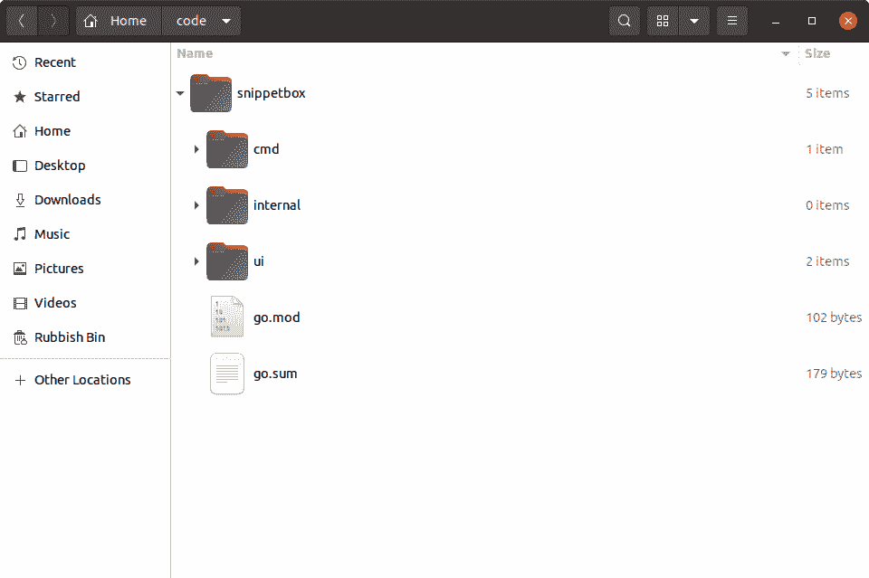

此`go.sum`文件包含了代表所需包内容的加密哈希和。如果你打开它，应该看到类似这里的内容：

文件：`go.sum`

```
github.com/go-sql-driver/mysql v1.6.0 h1:BCTh4TKNUYmOmMUcQ3IipzF5prigylS7XXjEkfCHuOE=
github.com/go-sql-driver/mysql v1.6.0/go.mod h1:DCzpHaOWr8IXmIStZouvnhqoel9Qv2LBy8hT2VhHyBg=
```

`go.sum`文件并非设计供人类人工编辑，通常你不需要打开它。但它有两个实用的功能：

*   如果你在终端中运行`go mod verify`命令，这将验证你机器上下载的包的哈希是否与`go.sum`中的项匹配，这样你就可以确认它们没有被修改过。

    ```
    $ go mod verify
    all modules verified
    ```

*   如果其他人需要下载项目的所有依赖项（他们可以通过运行`go mod download`实现），如果他们下载的包与文件之间存在任何不匹配，他们将收到错误。

# 第 4.4 章

## 创建数据库连接

现在 MySQL 数据库已经就绪，我们也安装了驱动程序，下一步自然是连接数据库。

为了实现这一点，我们需要 Go 的[`sql.Open()`](https://pkg.go.dev/database/sql/#Open)函数，你可以这样使用它：

```
// sql.Open() 函数初始化一个新的 sql.DB 对象，它本质上是
// 数据库连接池。
db, err := sql.Open("mysql", "web:pass/snippetbox?parseTime=true")
if err != nil {
    ...
}
```

关于这段代码有几点说明：

*   `sql.Open()`的第一个参数是驱动名称，第二个参数是数据源名称（有时称为连接字符串），它描述了如何连接到你的数据库。

*   数据源名称的格式取决于你使用的数据库和驱动。通常，你可以在特定驱动程序的文档中找到信息和示例。对于我们使用的驱动，你可以在[这里](https://github.com/go-sql-driver/mysql#dsn-data-source-name)找到文档。

*   上述 DSN 中的`parseTime=true`部分是驱动特定的参数，指示我们的驱动将 SQL`TIME`和`DATE`字段转换为 Go`time.Time`对象。

*   `sql.Open()`函数返回一个[`sql.DB`](https://pkg.go.dev/database/sql/#DB)对象。这不是一个数据库连接——它是一个多连接池。Go 会根据需要管理此池中的连接，通过驱动程序自动打开和关闭与数据库的连接。

*   该连接池是并发访问安全的，因此你可以安全地在 Web 应用程序处理程序中使用它。

*   连接池的设计目的是长久生存。在 Web 应用程序中，在`main()`函数中初始化连接池，然后将其传递给处理器（handlers）是正常做法。你不应该在短生命周期的处理器内部直接调用`sql.Open()`——这会浪费内存和网络资源。

### 在我们的 Web 应用程序中使用

让我们来看看在实践中如何使用`sql.Open()`。打开你的`main.go`文件并添加以下代码：

文件：`cmd/web/main.go`

```
package main

import (
    "database/sql" // 新增导入
    "flag"
    "log"
    "net/http"
    "os"

    _ "github.com/go-sql-driver/mysql" // 新增导入
)

...

func main() {
    addr := flag.String("addr", ":4000", "HTTP 网络地址")
    // 为 MySQL DSN 字符串定义一个新的命令行标志位。
    dsn := flag.String("dsn", "web:pass@/snippetbox?parseTime=true", "MySQL 数据源名称")
    
    flag.Parse()

    infoLog := log.New(os.Stdout, "INFO\t", log.Ldate|log.Ltime)
    errorLog := log.New(os.Stderr, "ERROR\t", log.Ldate|log.Ltime|log.Lshortfile)

    // 为了保持 main() 函数整洁，我将创建连接池的代码
    // 放在了下面的 openDB() 函数中。我们将从命令行标志
    // 获取 DSN 并传递给 openDB()。
    db, err := openDB(*dsn)
    if err != nil {
        errorLog.Fatal(err)
    }

    // 我们还延迟了 db.Close() 调用，以便在 main() 函数退出
    // 之前关闭连接池。
    defer db.Close()

    app := &application{
        errorLog: errorLog,
        infoLog:  infoLog,
    }

    srv := &http.Server{
        Addr:     *addr,
        ErrorLog: errorLog,
        Handler:  app.routes(),
    }

    infoLog.Printf("Starting server on %s", *addr)
    // 因为 err 变量已经在上面的代码中声明过了，我们在这里
    // 需要使用赋值运算符 =，而不是使用 := ‘声明并赋值’
    // 运算符。
    err = srv.ListenAndServe()
    errorLog.Fatal(err)
}

// openDB() 函数封装了 sql.Open() 并为给定的 DSN
// 返回一个 sql.DB 连接池。
func openDB(dsn string) (*sql.DB, error) {
    db, err := sql.Open("mysql", dsn)
    if err != nil {
        return nil, err
    }
    if err = db.Ping(); err != nil {
        return nil, err
    }
    return db, nil
}
```

这段代码中有几点是有意思的：

*   注意看我们驱动程序的导入路径是以下划线为前缀的吗？这是因为我们的`main.go`文件没有调用驱动程序中的任何导出函数；我们只需要它的副作用（`init()`函数）。这是在使用数据库驱动程序时的一种常见模式。

*   `sql.Open()`函数实际上并没有建立到数据库的连接；它只是验证参数。第一个连接是在执行查询时或我们调用`db.Ping()`时才实际创建的。

*   我们使用`defer db.Close()`来确保在`main()`函数退出时连接池能被正确关闭。

### 使用 SnippetModel

为了在处理器中使用这个模型，我们需要在`main()`函数中建立一个新的`SnippetModel`结构体，然后通过`application`结构体将其依赖项注入——就像我们处理其他依赖项一样。

```go
package main

import (
    "database/sql"
    "flag"
    "log"
    "net/http"
    "os"

    // Import the package we just created. You need to prefix this with
    // whatever module path you set up back in chapter 02.01 (Project Setup and Creating
    // a Module) so that the import statement looks like this:
    // "{your-module-path}/internal/models". If you can't remember what module path you 
    // used, you can find it at the top of the go.mod file.
    "snippetbox.alexedwards.net/internal/models" 

    _ "github.com/go-sql-driver/mysql"
)

// 给 application 结构体添加 snippets 字段。这将允许我们
// 让 SnippetModel 对象对我们的处理程序可用。
type application struct {
    errorLog *log.Logger
    infoLog  *log.Logger
    snippets *models.SnippetModel
}

func main() {
    addr := flag.String("addr", ":4000", "HTTP network address")
    dsn := flag.String("dsn", "web:pass@/snippetbox?parseTime=true", "MySQL data source name")

    flag.Parse()

    infoLog := log.New(os.Stdout, "INFO\t", log.Ldate|log.Ltime)
    errorLog := log.New(os.Stderr, "ERROR\t", log.Ldate|log.Ltime|log.Lshortfile)

    db, err := openDB(*dsn)
    if err != nil {
        errorLog.Fatal(err)
    }
    defer db.Close()

    // 初始化一个 models.SnippetModel 实例并将其添加到
    // application 依赖中。
    app := &application{
        errorLog: errorLog,
        infoLog:  infoLog,
        snippets: &models.SnippetModel{DB: db},
    }

    srv := &http.Server{
        Addr:     *addr,
        ErrorLog: errorLog,
        Handler:  app.routes(),
    }

    infoLog.Printf("Starting server on %s", *addr)
    err = srv.ListenAndServe()
    errorLog.Fatal(err)
}

...
```

***

### 额外信息

#### 这种结构的优势

如果你后退一步看，可能会发现以这种方式设置项目的一些用处：

* **有清晰的关注点分离**。我们的数据库逻辑没有与处理程序（handlers）耦合，这意味着处理程序的职责被限于 HTTP 相关的事务（即验证请求和编写响应）。这将使得在未来编写紧凑、专注的单元测试变得更加容易。

* 通过通过创建一个自定义的`SnippetModel`类型并在其上实现方法，我们能够让模型成为一个单一且封装良好的对象，我们可以轻松地初始化它并将其作为依赖项传递给处理程序。同样，这使得代码更易于维护且可测试。

* 因为模型操作被定义为对象上的方法——在我们的案例中是`SnippetModel`——所以我们有机会创建一个`interface`并为了单元测试之目的对其进行 mock（模拟）。

* 最后，通过通过使用`-dsn`命令行标志，我们对运行时使用哪个数据库拥有完全的控制权。

第 4.6 节。

## 执行 SQL 语句

现在，让我们更新刚刚创建的`SnippetModel.Insert()`方法，使其在我们的`snippets`表中创建一个新记录，然后返回该新记录的整数`id`。

为了实现这一点，我们需要在数据库上执行以下 SQL 查询：

```sql
INSERT INTO snippets (title, content, created, expires)
VALUES(?, ?, UTC_TIMESTAMP(), DATE_ADD(UTC_TIMESTAMP(), INTERVAL ? DAY))
```

注意在在此查询中，我们如何使用`?`字符来表示要插入数据库的数据占位符参数（placeholder parameters）。因为我们将使用数据最终将是来自表单的不可信的用户输入，因此使用占位符参数而不是在 SQL 查询中插值数据是一种良好的做法。

### 执行查询


Go 提供了三种不同的方法来执行数据库查询：

* [`DB.Query()`](https://pkg.go.dev/database/sql/#DB.Query) 用于返回多行的 `SELECT` 查询。
* [`DB.QueryRow()`](https://pkg.go.dev/database/sql/#DB.QueryRow) 用于返回单行的 `SELECT` 查询。
* [`DB.Exec()`](https://pkg.go.dev/database/sql/#DB.Exec) 用于不返回行的语句（例如 `INSERT` 和 `DELETE`）。

所以，在我们的情况下，最适合这项工作的工具是`DB.Exec()`。让我们深入尝试并演示如何在我们的`SnippetModel.Insert()`方法中使用它。我们稍后讨论细节。

打开你的`internal/models/snippets.go`文件并进行如下更新：

文件：`internal/models/snippets.go`

```go
package models

...

type SnippetModel struct {
    DB *sql.DB
}

func (m *SnippetModel) Insert(title string, content string, expires int) (int, error) {
    // 编写我们想要执行的 SQL 语句。为了可读性，我将其分为两行。
    stmt := `INSERT INTO snippets (title, content, created, expires)
    VALUES(?, ?, UTC_TIMESTAMP(), DATE_ADD(UTC_TIMESTAMP(), INTERVAL ? DAY))`

    // 在数据库上使用 Exec 方法
    result, err := m.DB.Exec(stmt, title, content, expires)
    if err != nil {
        return 0, err
    }

    // 使用 LastInsertId() 方法获取 ID
    id, err := result.LastInsertId()
    if err != nil {
        return 0, err
    }

    return int(id), nil
}
```

让我们快速讨论一下`DB.Exec()`返回的[`sql.Result`](https://pkg.go.dev/database/sql#Result)类型。它提供了两个方法：

* `LastInsertId()` —— 返回自增列生成的整数。
* `RowsAffected()` —— 返回影响的数。

此外，如果你不需要，忽略`sql.Result`返回值也是完全可以且常见的。例如：

```go
_, err := m.DB.Exec(stmt, ...)
```

### 在处理程序中使用模型

让我们回到具体场景，演示如何从我们的处理程序调用这段新代码。打开你的`cmd/handlers.go`文件并更新`snippetCreate`处理程序：

文件：`cmd/handlers.go`

```go
package main

...

func (app *application) snippetCreate(w http.ResponseWriter, r *http.Request) {
    if r.Method != http.MethodPost {
        w.Header().Set("Allow", http.MethodPost)
        app.clientError(w, http.StatusNotAllowed)
        return
    }

    // 创建一些持有虚拟数据的变量。我们会在构建
    // 期间删除它们。
    title := "O snail"
    content := "O snail\nClimb Mount Fuji,\nBut slowly, slowly!\n– Kobayashi Issa"
    expires := 7

    // 将数据传递给 SnippetModel.Insert() 方法，接收
    // 新记录的 ID
    id, err := app.snippets.Insert(title, content, expires)
    if err != nil {
        app.serverError(w, err)
        return
    }

    // 将用户重定向到相关的 snippet 页面
    http.Redirect(w, r, fmt.Sprintf("/snippet/view?id=%d", id), http.StatusSeeOther)
}
```

启动应用程序，然后在另一个终端窗口中使用`curl`发送`POST /snippet/create`请求，如下（注意`-L`标志指示`curl`自动跟随重定向）：

```bash
$ curl -iL -X POST http://localhost:4000/snippet/create
HTTP/1.1 303 See Other
Location: /snippet/view?id=4
Date: Mon, 31 Jan 2022 16:36:18 GMT
Content-Length: 0

HTTP/1.1 200 OK
Date: Mon, 31 Jan 2022 16:36:18 GMT
Content-Length: 40
Content-Type: text/plain; charset=utf-8

Display a specific snippet with ID 4...
```

这一切运行得非常顺利。我们刚刚发送了一个 HTTP 请求，触发了我们的`snippetCreate`处理器，该处理器继而调用了我们的`SnippetModel.Insert()`方法。这在数据库中插入了一条新记录并返回了该新记录的 ID。随后，我们的处理器发布了一个重定向到另一个 URL，并将 ID 作为查询字符串参数。

你可以随时查看你 MySQL 数据库中的`snippets`表。你应该能看到一条 ID 为`4`的新记录，类似于下面：

```
mysql> SELECT id, title, expires FROM snippets;
+----+------------------------+---------------------+
| id | title                  | expires             |
+----+------------------------+---------------------+
|  1 | An old silent pond     | 2023-04-05 07:20:05 |
|  2 | Over the wintry forest | 2023-04-05 07:20:05 |
|  3 | First autumn morning   | 2022-04-12 07:20:05 |
|  4 | O snail                | 2022-04-12 07:32:45 |
+----+------------------------+---------------------+
4 rows in set (0.00 sec)
```

***

### 附加信息

#### 占位参数

在上面的代码中，我们使用占位参数构建了 SQL 语句，其中`?`作为我们想要插入的数据的占位符。

使用占位参数构建查询（而不是字符串插值）的原因是为了帮助避免来自任何不可信的用户提供的输入的 SQL 注入攻击。

在底层，`DB.Exec()`方法分三个步骤工作：

1. 它使用提供的 SQL 语句在数据库上创建一个新的[预处理语句](https://en.wikipedia.org/wiki/Prepared_statement)。数据库解析并编译该语句，然后将其存储起来以待执行。
2. 在第二个独立的步骤中，`Exec()`将参数值传递给数据库。随后，数据库使用这些参数执行预处理语句。因为参数是在语句编译后传输的，所以数据库将它们视为纯数据。它们无法改变语句的意图。只要原始语句不是源于不可信的数据，就不会发生注入。
3. 随后它会在数据库上关闭（或释放）该预处理语句。

占位参数的语法取决于你使用的数据库。MySQL、SQL Server 和 SQLite 使用`?`符号，但 PostgreSQL 使用`$N`符号。例如，如果你使用的是 PostgreSQL，你会这样写：

```
_, err := m.DB.Exec("INSERT INTO ... VALUES ($1, $2, $3)", ...)
```

第 4.7 节。

## 单记录 SQL 查询

从数据库中`SELECT`单条记录的模式要稍微复杂一些。让我们通过更新`SnippetModel.Get()`方法来解释如何实现，使其根据 ID 返回一个特定的代码片段。

要实现这一点，我们需要在数据库上运行以下 SQL 查询：

```sql
SELECT id, title, content, created, expires FROM snippets
WHERE expires > UTC_TIMESTAMP() AND id = ?
```

由于我们的`snippets`表使用`id`列作为主键，此查询将始终返回恰好一条数据库行（或者什么都不返回）。该查询还包含了对过期时间的检查，以确保我们不会返回任何过期的代码片段。

注意看，我们再次对`id`值使用了占位参数吗？

打开`internal/models/snippets.go`文件并添加以下代码：

文件：`internal/models/snippets.go`

```go
package models

import (
    "database/sql"
    "errors" // 新导入
    "time" 
)

...

func (m *SnippetModel) Get(id int) (*Snippet, error) {
    // 编写我们想要执行的 SQL 语句。再次，为了可读性，我将其分成了
    // 两行。
    stmt := `SELECT id, title, content, created, expires FROM snippets
    WHERE expires > UTC_TIMESTAMP() AND id = ?`

    // 使用连接池上的 QueryRow() 方法执行我们的
    // SQL 语句，将不可信的 id 变量作为占位参数的值传入。
    // 返回一个指向 sql.Row 对象的指针，该对象
    // 持有来自数据库的结果。
    row := m.DB.QueryRow(stmt, id)

    // 初始化一个新的零值 Snippet 结构体的指针。
    s := &Snippet{}

    // 使用 row.Scan() 将 sql.Row 中每个字段的值复制到
    // Snippet 结构体中对应的字段中。注意
    // row.Scan 的参数是你想将数据拷贝入的位置的指针，
    // 且参数的数量必须与你的语句返回的列数
    // 完全一致。
    err := row.Scan(&s.ID, &s.Title, &s.Content, &s.Created, &s.Expires)
    if err != nil {
        // 如果查询没有返回行，则 row.Scan() 将返回一个
        // sql.ErrNoRows 错误。我们使用 errors.Is() 函数专门检查
        // 该错误，并返回我们自己的 ErrNoRecord 错误
        // （我们稍后会创建它）。
        if errors.Is(err, sql.ErrNoRows) {
            return nil, ErrNoRecord
        } else {
            return nil, err
        }
    }

    // 如果查询成功，返回 Snippet。
    return s, nil
}
```

作为旁带，你可能会疑惑为什么我们在`SnippetModel.Get()`方法中返回`ErrNoRecord`错误，而不是直接返回`sql.ErrNoRows`。原因是为了帮助封装模型，使我们的应用程序不关注底层数据存储，也不依赖于特定的存储错误。

打开你的`cmd/web/handlers.go`文件并更新`snippetView`处理器，使其返回特定记录的数据：

文件：`cmd/web/handlers.go`

```go
package main

import (
    "errors" // 新导入
    "fmt"
    "html/template"
    "net/http"
    "strconv"

    "snippetbox.alexwards.net/internal/models" // 新导入
)

...

func (app *application) snippetView(w http.ResponseWriter, r *http.Request) {
    id, err := strconv.Atoi(r.URL.Query().Get("id"))
    if err != nil || id < 1 {
        app.notFound(w)
        return
    }

    // 使用 SnippetModel 对象的 Get 方法根据 ID 获取
    // 特定记录的数据。如果没有找到匹配记录，
    // 返回 404 Not Found 响应。
    snippet, err := app.snippets.Get(id)
    if err != nil {
        if errors.Is(err, models.ErrNoRecord) {
            app.notFound(w)
        } else {
            app.serverError(w, err)
        }
        return
    }

    // 将代码片段数据作为纯文本 HTTP 响应体。
    fmt.Fprintf(w, "%+v", snippet)
}
```

让我们尝试一下。打开你的浏览器并访问[`http://localhost:4000/snippet/view?id=1`](http://localhost:4000/snippet/view?id=1)。你应该能看到类似于下面的 HTTP 响应：

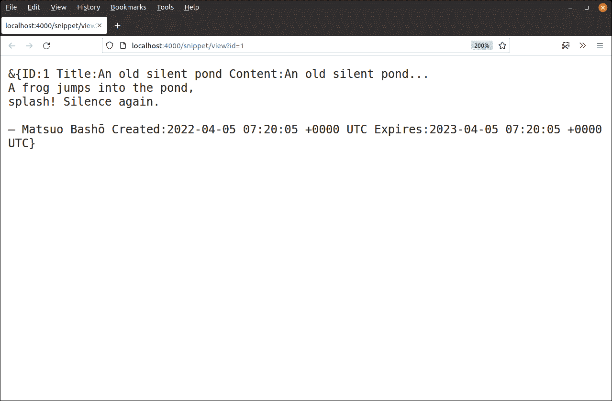

你可能还想尝试请求一些已过期或不存在的代码片段（例如`id=99`），以验证它们是否会返回`404 Not Found`响应：

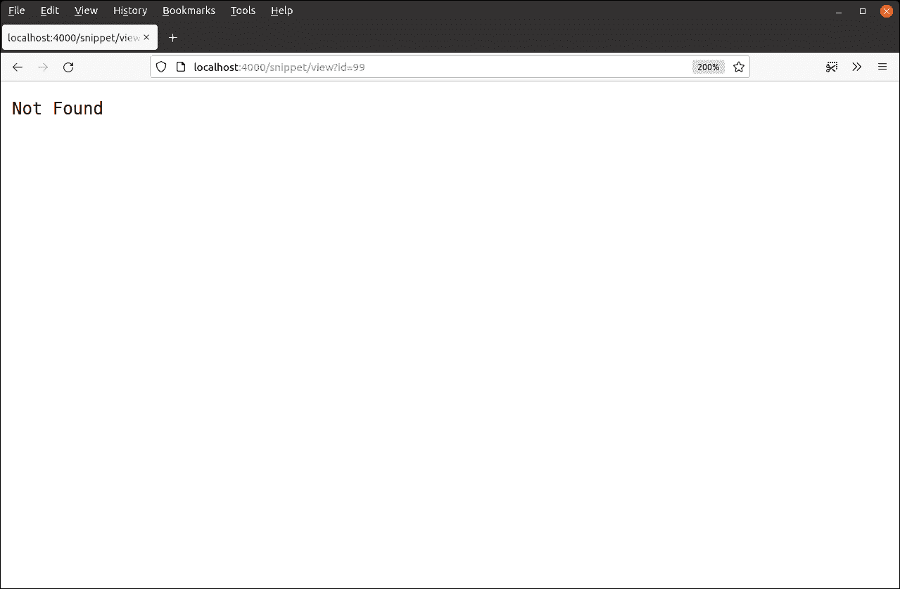

***

### 附加信息

#### 检查特定错误

在本章中，我们多次使用了[`errors.Is()`](https://tip.golang.org/pkg/errors/#Is)函数来检查错误是否匹配某个特定值。如下：

```
if errors.Is(err, models.ErrNoRecord) {
    app.notFound(w)
} else {
    app.serverError(w, err)
}
```

在 Go 1.13 之前，执行此操作的惯用方法是使用相等运算符`==`来进行检查，如下：

```
if err == models.ErrNoRecord {
    app.notFound(w)
} else {
    app.serverError(w, err)
}
```

但是，虽然这段代码仍然可以编译，但现在使用`errors.Is()`函数更安全且更符合最佳实践。

这是因为 Go 1.13 引入了通过[包装错误](https://go.dev/blog/go1.13-errors#wrapping-errors-with-w)为错误添加额外信息的能力。如果一个错误被包装了，就会创建一个完全新的错误值——这意味着无法使用普通的`==`相等运算符来检查原始底层错误的值。

相比之下，`errors.Is()`函数的工作原理是在检查匹配之前根据需要对错误进行解包。

基本上，如果你运行的是 Go 1.13 或更高版本，请优先使用`errors.Is()`。这是一种让你的代码面向未来的明智方法，并防止由于你（或你代码导入的任何包）在未来决定包装错误而导致的 bug。

还有另一个函数[`errors.As()`](https://tip.golang.org/pkg/errors/#As)，你可以用它来检查一个（可能被包装的）错误是否具有特定类型。我们将在本书后部分中使用它。

#### 单条记录查询简写

我刻意让`SnippetModel.Get()`中的代码写得稍微冗长一些，有助于澄清并强调你的代码背后正在发生什么。

在实践中，你可以利用`DB.QueryRow()`的错误会延迟到调用`Scan()`才执行这一事实稍微缩短代码。这在功能上没有区别，但如果你愿意，完全可以重写代码看起来像这样：


## 第 4.8 章

### 多记录 SQL 查询

最后，让我们来看执行返回多行的 SQL 语句的模式。我将通过更新 `SnippetModel.Latest()` 方法，使用以下 SQL 查询返回最近创建的十个代码片段（只要它们还没有过期）：

```
SELECT id, title, content, created, expires FROM snippets
WHERE expires > UTC_TIMESTAMP() ORDER BY id DESC LIMIT 10
```

打开 `internal/models/snippets.go` 文件并添加以下代码：

文件：`internal/models/snippets.go`

```
package models

...

func (m *SnippetModel) Latest() ([]*Snippet, error) {
    // 写我们想要执行的 SQL 语句。
    stmt := `SELECT id, title, content, created, expires FROM snippets
    WHERE expires > UTC_TIMESTAMP() ORDER BY id DESC LIMIT 10`

    // 使用连接池上的 Query() 方法来执行我们的
    // SQL 语句。它返回一个 sql.Rows 结果集，包含
    // 我们查询的结果。
    rows, err := m.DB.Query(stmt)
    if err != nil {
        return nil, err
    }
    defer rows.Close()

    var snippets []*Snippet

    for rows.Next() {
        s := &Snippet{}
        err := rows.Scan(&s.ID, &s.Title, &s.Content, &s.Created, &s.Expires)
        if err != nil {
            return nil, err
        }
        snippets = append(snippets, s)
    }

    if err = rows.Err(); err != nil {
        return nil, err
    }

    return snippets, nil
}
```

### 在我们的处理器中使用模型

回到你的 `cmd/web/handlers.go` 文件并更新 `home` 处理器以使用 `SnippetModel.Latest()` 方法，将代码片段内容转到 HTTP 响应中。现在只需注释掉与模板渲染的代码，如下：

文件：`cmd/web/handlers.go`

```
package main

import (
    "errors"
    "fmt"
    // "html/template"
    "net/http"
    "strconv"

    "snippetbox.alexedwards.net/internal/models"
)

func (app *application) home(w http.ResponseWriter, r *http.Request) {
    if r.URL.Path != "/" {
        app.notFound(w)
        return
    }

    snippets, err := app.snippets.Latest()
    if err != nil {
        app.serverError(w, err)
        return
    }

    for _, snippet := range snippets {
        fmt.Fprintf(w, "%+v\n", snippet)
    }

    // files := []string{
    //     "./ui/html/base.tmpl",
    //     "./ui/html/partials/nav.tmpl",
    //     "./ui/html/pages/home.tmpl",
    // }

    // ts, err := template.ParseFiles(files...)
    // if err != nil {
    //     app.serverError(w, err)
    //     return
    // }

    // err = ts.ExecuteTemplate(w, "base", nil)
    // if err != nil {
    //     app.serverError(w, err)
    // }
}

...
```

现在运行应用程序并在浏览器中访问 [`http://localhost:4000`](http://localhost:4000/)，你应该得到类似下面的响应：

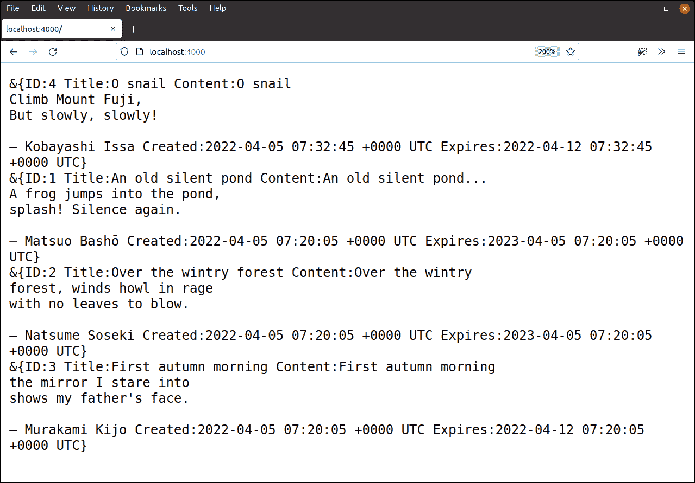

## 第 4.9 章

### 事务和其他细节

#### database/sql 包

正如你可能开始意识到的，`database/sql` 包本质上在你的 Go 应用程序和 SQL 数据库之间提供了一个标准接口。

只要你使用 `database/sql` 包，你编写的 Go 代码通常是可移植的，并且适用于任何类型的 SQL 数据库——无论是 MySQL、PostgreSQL、SQLite 还是其他。这意味着你的应用程序与你目前使用的数据库之间没有过度耦合，理论上你可以在未来更换数据库而无需重写所有代码（不考虑驱动程序特定的差异和 SQL 实现）。

需要注意的是，虽然 `database/sql` 通常在为操作 SQL 数据库提供标准接口方面表现良好，但不同驱动程序和数据库的运行方式存在一些特殊之处。在使用新的驱动程序之前，仔细阅读其文档以了解任何奇异之处和边缘情况通常是一个好主意。

### 冗长性 (Verbosity)

如果你是从 Ruby、Python 或 PHP 过来的，查询 SQL 数据库的代码可能会让你觉得有点冗长，尤其是习惯了处理抽象层或 ORM 的话。

但冗长的优点是，我们的代码是非“魔法化”的；我们可以完全精确地理解并控制正在发生什么。随着时间的推移，你会发现构建 SQL 查询的模式会变得熟悉，并且可以从以前的工作中复制粘贴。

如果这种冗长性真的让你感到反感，你可能想要考虑尝试 [`jmoiron/sqlx`](https://github.com/jmoiron/sqlx) 包。它设计良好，并提供了一些很好的扩展，让 SQL 查询变得更快、更方便。另一个你可能想要考虑的新选项是 [`blockloop/scan`](https://github.com/blockloop/scan) 包。

### 管理空值 (Managing null values)

Go 不太擅长的一点是管理数据库记录中的 `NULL` 值。

假设我们 `snippets` 表中的 `title` 列在某一行中包含 `NULL` 值。如果我们查询该行，那么 `rows.Scan()` 将返回一个错误，因为它无法将 `NULL` 转换为字符串：

```
sql: Scan error on column index 1: unsupported Scan, storing driver.Value type
&lt;nil&gt; into type *string
```

粗略来说，修复此问题的方法是将正在扫描的字段从 `string` 更改为 `sql.NullString` 类型。请查看 [这个 gist](https://gist.github.com/alexedwards/dc3145c8e2e6d2fd6cd9) 获取工作示例。

但是，根据原则，最简单的方法是完全避免使用 `NULL` 值。在你的所有数据库列上设置 `NOT NULL` 约束（正如我们在本书中所做的那样），并根据需要设置合理的 `DEFAULT` 值。

### 使用事务 (Working with transactions)

重要的是，对 `Exec()`、`Query()` 和 `QueryRow()` 的调用可以使用 `sql.DB` 连接池中的任何连接。即使你在代码中紧挨着调用了两次 `Exec()`，也不能保证它们将使用同一个数据库连接。

有时这将是不可接受的。例如，如果你使用 MySQL 的 `LOCK TABLES` 命令锁定了表，你必须在完全相同的连接上调用 `UNLOCK TABLES` 以避免死锁。

为了保证使用同一个连接，你可以将多个语句封装在事务中。以下是基本模式：

```
type ExampleModel struct {
    DB *sql.DB
}

func (m *ExampleModel) ExampleTransaction() error {
    // 在连接池上调用 Begin() 方法会创建一个新的 sql.Tx
    // 对象，它代表正在进行的数据库事务。
    tx, err := m.DB.Begin()
    if err != nil {
        return err
    }

    // 延迟调用 tx.Rollback() 以确保它在函数返回之前
    // 总是被调用。如果事务成功，在调用 tx.Rollback() 时它
    // 已经提交，使得 tx.Rollback() 变成一个空操作。
    // 否则，一旦发生错误，tx.Rollback() 将在函数返回前
    // 回滚更改。
    defer tx.Rollback()

    // 在事务上调用 Exec()，传入你的语句和任何
    // 参数。需要注意的是，tx.Exec()是在刚创建的
    // 事务对象上调用的，而不是连接池。虽然我们
    // 这里使用了 tx.Exec()，但你也可以以相同的方式
    // 使用 tx.Query() 和 tx.QueryRow()。
    _, err = tx.Exec("INSERT INTO ...")
    if err != nil {
        return err
    }

    // 以完全相同的方式执行另一个事务。
    _, err = tx.Exec("UPDATE ...")
    if err != nil {
        return err
    }

    // 如果没有错误，事务中的语句可以通过 tx.Commit()
    // 方法提交到数据库。
    err = tx.Commit()
    return err
}
```

如果你想将多个 SQL 语句作为单个原子操作执行，事务也超级有用。只要在发生任何错误时使用 [`tx.Rollback()`](https://pkg.go.dev/database/sql/#Tx.Rollback) 方法，事务就能确保以下情况：

*   所有语句都成功执行；或

*   没有任何语句被执行且数据库保持不变。

### 预编译语句 (Prepared statements)

正如我之前提到的，`Exec()`、`Query()` 和 `QueryRow()` 方法在背后都使用预编译语句来帮助防止 SQL 注入攻击。它们在数据库连接上设置一个预编译语句，使用提供的参数运行它，然后关闭预编译语句。

这可能让人觉得相当低效，因为我们每次都在创建和重新创建相同的预编译语句。

在理论上，更好的方法可能是利用 [`DB.Prepare()`](https://pkg.go.dev/database/sql/#DB.Prepare) 方法创建一次我们自己的预编译语句，并重用它。这对于复杂的 SQL 语句（例如那些具有多个 JOIN 的语句）以及非常频繁重复的语句（例如批量插入数万条记录）来说尤为真实。在这种情况下，重新准备语句的成本可能会对运行时间产生明显影响。

是在 Web 应用程序中使用自定义预编译语句的基本模式：

```go
// 我们需要一个地方来存储整个 Web 应用程序生命周期
// 内预编译语句。一种巧妙的方法是与连接池
// 一起嵌入模型中。
type ExampleModel struct {
    DB         *sql.DB
    InsertStmt *sql.Stmt
}

// 为模型创建一个构造函数，在其中我们设置
// 预编译语句。
func NewExampleModel(db *sql.DB) (*ExampleModel, error) {
    // 使用 Prepare 方法为当前连接池创建一个
    // 预编译语句。这返回一个代表预编译
    // 语句的 sql.Stmt 对象。
    insertStmt, err := db.Prepare("INSERT INTO ...")
    if err != nil {
        return nil, err
    }

    // 将其存储在模型对象中，与连接池一起。
    return &ExampleModel{db, insertStmt}, nil
}

// 实现 ExampleModel 的任何方法都可以访问
// 预编译语句。
func (m *ExampleModel) Insert(args...) error {
    // 注意我们直接在预编译语句上调用 Exec
    // 而不是连接池？预编译语句也支持
    // Query 和 QueryRow 方法。
    _, err := m.InsertStmt.Exec(args...)

    return err
}

// 在 Web 应用程序的 main 函数中，我们需要使用
// 构造函数初始化 ExampleModel。
func main() {
    db, err := sql.Open(...)
    if err != nil {
        errorLog.Fatal(err)
    }
    defer db.Close()

    // 创建一个新的 ExampleModel 对象，它包含了预编译语句。
    exampleModel, err := NewExampleModel(db)
    if err != nil {
       errorLog.Fatal(err)
    }

    // 延迟调用预编译语句的 Close() 以确保它
    // 在 main 函数终止之前被正确关闭。
    defer exampleModel.InsertStmt.Close()
}
```

不过，有几点需要注意。

预编译语句存在于*数据库连接*中。因此，由于 Go 使用多个数据库连接池，实际情况是第一次使用预编译语句（即 `sql.Stmt` 对象）时，它是在特定的数据库连接上创建的。`sql.Stmt` 对象随后会记住使用了池中的哪一个连接。下一次，`sql.Stmt` 对象将尝试再次使用同一个数据库连接。如果该连接已关闭或正在使用（即非空闲），则将在将在另一个连接上重新准备。

在重负载负载下，可能会在多个连接上创建大量的预处理语句。这可能导致语句被准备和重新准备的频率比你预期的要高——甚至会遇到服务器对语句数量的限制（在 MySQL 中，默认最大值为 16,382 个预处理语句）。

代码也比不使用预处理语句要复杂。

因此，在性能和复杂性之间需要进行权衡。与其他任何事情一样，你应该衡量实现自定义预处理语句的实际性能收益，以确定其是否值得。对于大多数情况，我建议使用常规的 `Query()`、`QueryRow()` 和 `Exec()` 方法——无需自己准备预处理语句——是一个合理的起点。

# 第 5 章 动态 HTML 模板

在本书的这一节中，我们将集中于将 MySQL 数据库中的动态数据显示在适当的 HTML 页面。

你将学习如何：

*   以一种简单、可扩展且类型安全的方式将动态数据 传递给你的 HTML 模板。

*   使用 Go 的 `html/template` 包中的各种动作和函数 来控制动态数据的显示。

*   创建模板缓存，使得你的模板不需要为每个 HTTP 请求都从磁盘读取。

*   在运行时优雅地处理模板渲染错误。

*   实现一种模式，用于向你的网页传递常用动态数据 而不重复代码。

*   创建你自己的自定义函数，在 HTML 模板中格式化并显示数据。

## 第 5.1 节 显示动态数据

目前，我们的 `snippetView` 处理函数从数据库获取一个 `models.Snippet` 对象，然后将其内容以纯文本 HTTP 响应的形式输出。

在这一节中，我们将更新代码，使数据显示在适当的 HTML 网页中，看起来大致如下：

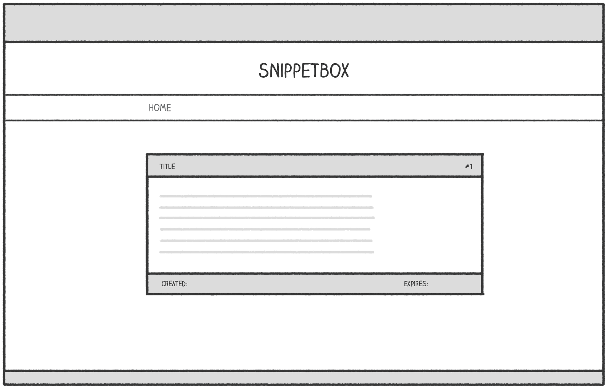

让我们从 `snippetView` 处理函数开始，添加一些代码来渲染一个新的 `view.tmpl` 模板文件（我们稍后会创建它）。希望这对你在本书之前的内容中看起来很熟悉。

文件：`cmd/web/handlers.go`


```go
package main

import (
    "errors"
    "fmt"
    "html/template" // 取消注释
    "net/http"
    "strconv"

    "snippetbox.alexedwards.net/internal/models"
)

...

func (app *application) snippetView(w http.ResponseWriter, r *http.Request) {
    id, err := strconv.Atoi(r.URL.Query().Get("id"))
    if err != nil || id < 1 {
        app.notFound(w)
        return
    }

    snippet, err := app.snippets.Get(id)
    if err != nil {
        if errors.Is(err, models.ErrNoRecord) {
            app.notFound(w)
        } else {
            app.serverError(w, err)
        }
        return
    }

    // 初始化一个包含 view.tmpl 路径的切片，
    // 加上我们之前创建的基础布局和导航部分。
    files := []string{
        "./ui/html/base.tmpl",
        "./ui/html/partials/nav.tmpl",
        "./ui/html/pages/view.tmpl",
    }

    // 解析模板文件
    ts, err := template.ParseFiles(files...)
    if err != nil {
        app.serverError(w, err)
        return
    }

    // 然后执行它们。注意我们是如何将 snippet
    // 数据（一个 models.Snippet 结构体）作为最后一个参数传递的。
    err = ts.ExecuteTemplate(w, "base", snippet)
    if err != nil {
        app.serverError(w, err)
    }
}
```

接下来，我们需要创建`view.tmpl`文件，其中包含页面的 HTML 标记。但在在此之前，有一点理论需要我解释……

在你的 HTML 模板中，你传递的任何动态数据都由`.`（称为`dot`）表示。在这种特定情况下，`.`的底层类型将是`models.Snippet`结构体。当`.`的底层类型为结构体时，你可以通过在`.`后面跟上字段名来在模板中渲染任何导出字段的值。因此，由于我们的`models.Snippet`结构体有一个`Title`字段，我们可以在模板中通过`{{.Title}}`来输出代码片段的标题。

我将演示一下。在`ui/html/pages/view.tmpl`创建新文件：

```bash
touch ui/html/pages/view.tmpl
```

文件：`ui/html/pages/view.tmpl`

```html
{{define "title"}}Snippet #.ID}}{{end}}

{{define "main"}}
    <div class='snippet'>
        <div class='metadata'>
            <strong>{{.Title}}</strong>
            <span>{{.ID}}</span>
        </div>
        <pre>code{{.Content}}</code></pre>
        <div class='metadata'>
            <time>Created: {{.Created}}</time>
            <time>Expires: {{.Expires}}</time>
        </div>
    </div>
{{end}}
```

如果你重启应用程序并在浏览器中访问`http://localhost:4000/snippet/view?id=1`，你应该发现相关的代码片段已从数据库获取、传递到模板，并且内容被正确渲染。


### 渲染多条数据

需要解释的一个重要点是，Go 的`html/template`包允许在渲染模板时传递一个——且仅一个动态数据项。但在实际应用中，通常有多个你想要在同一页面中显示的动态数据。

实现此点的轻量级且类型安全的方法是将你的动态数据封装在一个结构体中，该结构体充当数据的单一“持有结构体”。让我们创建一个新的`cmd/web/templates.go`文件，包含一个`templateData`结构体来执行此操作。

```bash
touch cmd/web/templates.go
```

文件：`cmd/web/templates.go`

```go
package main

import "snippetbox.alexedwards.net/internal/models"

// 定义一个 templateData 类型作为任何我们想要传递
// 给 HTML 模板的动态数据的持有结构。
// 目前它只包含一个字段，但随着构建的进展，我们将向其中添加更多。
type templateData struct {
    Snippet *models.Snippet
}
```

然后让我们更新`snippetView`处理函数，在执行模板时使用这个新结构体：

文件：`cmd/web/handlers.go`

```go
package main

...

func (app *application) snippetView(w http.ResponseWriter, r *http.Request) {
    id, err := strconv.Atoi(r.URL.Query().Get("id"))
    if err != nil || id < 1 {
        app.notFound(w)
        return
    }

    snippet, err := app.snippets.Get(id)
    if err != nil {
        if errors.Is(err, models.ErrNoRecord) {
            app.notFound(w)
        } else {
            app.serverError(w, err)
        }
        return
    }

    files := []string{
        "./ui/html/base.tmpl",
        "./ui/html/partials/nav.tmpl",
        "./ui/html/pages/view.tmpl",
    }

    ts, err := template.ParseFiles(files...)
    if err != nil {
        app.serverError(w, err)
        return
    }

    // 创建一个持有代码片段数据的 templateData 结构体实例。
    data := &templateData{
        Snippet: snippet,
    }

    // 执行模板时传递 templateData 结构体。
    err = ts.ExecuteTemplate(w, "base", data)
    if err != nil {
        app.serverError(w, err)
    }
}

...
```

现在，我们的代码片段数据包含在`templateData`结构体的`models.Snippet`结构体中。要输出数据，我们需要像这样链接相应的字段名：

```
{{define "title"}}Snippet #{{.Snippet.ID}}{{end}}

{{define "main"}}
    <div class='snippet'>
        <div class='metadata'>
            <strong>{{.Snippet.Title}}</strong>
            <span>#{{.Snippet.ID}}</span>
        </div>
        <pre><code>{{.Snippet.Content}}</code></pre>
        <div class='metadata'>
            <time>Created: {{.Snippet.Created}}</time>
            <time>Expires: {{.Snippet.Expires}}</time>
        </div>
    </div>
{{end}}
```

你可以自由重启应用程序并再次访问`http://localhost:4000/snippet/view?id=1`。你应该能在浏览器中看到与之前相同的渲染页面。

***

# 第 5.2 节

### 附加信息

### 动态内容转义

`html/template`包会自动转义任何输出在`{{ }}`标签之间的数据。这种行为对于避免跨站脚本交叉（XSS）攻击非常有帮助，这也是为什么你应该使用`html/template`包而不是 Go 提供的更通用的`text/template`包的原因。

作为一个转义的示例，如果你想要输出的动态数据是：

```
<span>{{"<script>alert('xss attack')</script>"}}</span>
```

它将被无害地渲染为：

```
<span>&lt;script&gt;alert(&#39;xss attack&#39;)&lt;/script&gt;</span>
```

`html/template`包足够智能，可以根据上下文进行转义。它将根据数据渲染在页面中包含 HTML、CSS、Javascript 或 URI 的部分，使用相应的转义序列。

### 嵌套模板

非常重要的一，当你从一个模板调用另一个模板时，点（dot）需要显式地传递或通过管道（pipeline）传递给调用的模板。你通过在每个`{{template}}`或`{{block}}`动作的最后包含它来实现，如下：

```
{{template "main" .}}
{{block "sidebar" .}}{{end}}
```

作为一条原则，我的建议是养成一种习惯：每当你使用`{{template}}`或`{{block}}`动作调用模板时，始终对点进行管道操作，除非你有充分理由不这样做。

### 调用方法

如果你在`{{ }}`标签之间输出的类型定义了方法，你就可以调用这些方法（只要它们是导出的并且它们只返回一个值——或者一个值和一个错误）。

例如，如果`.Snippet.Created`的底层类型是`time.Time`（确实如此），你可以通过调用它的`Weekday()`方法来渲染星期几的，如下：

```
<span>{{.Snippet.Created.Weekday}}</span>
```

你也可以向方法传递参数。例如，你可以使用`AddDate()`方法为时间增加六个月，如下：

```
<span>{{.Snippet.Created.AddDate 0 6 0}}</span>
```

注意，这与 Go 中调用函数的语法不同——参数没有被括号包围，并且用单个空格分隔，而不是逗号。

### HTML 注释

最后，`html/template`包总是会移除你在模板中包含的任何 HTML 注释，包括任何条件注释。

其原因是为了在渲染动态内容时帮助避免 XSS 攻击。允许条件注释意味着 Go 并不总是能够预测浏览器将如何解释页面中的标记，因此它不一定能够正确地转义一切。为了解决这个问题，Go 简单地删除了所有的 HTML 注释。

## 模板动作和函数

在本节中，我们将查看 Go 提供的模板动作和函数。

我们已经讨论过一些动作——`{{define}}`、`{{template}}`和`{{block}}`——但还有三个你可以用于控制动态数据的动作——`{{if}}`、`{{with}}`和`{{range}}`。

| 动作 | 描述 |
| --- | --- |
| `{{if .Foo}} C1 {{else}} C2 {{end}}` | 如果`.Foo`不为空，则渲染内容 C1，否则渲染内容 C2。 |
| `{{with .Foo}} C1 {{else}} C2 {{end}}` | 如果`.Foo`不为空，则点设置为`.Foo`的值并渲染内容 C1，否则渲染内容 C2。 |
| `{{range .Foo}} C1 {{else}} C2 {{end}}` | 如果`.Foo`的长度大于零，则遍历每个元素，将点设置为每个元素的值并渲染内容 C1。如果`.Foo`的长度为零，则渲染内容 C2。`.Foo`的底层类型必须是数组、切片、map 或通道。 |

关于这些动作有几需要指出：

- 对于所有三个动作，`{{else}}`子句都是可选的。例如，你可以写`{{if .Foo}} C1 {{else}} C2 {{end}}`。

- `html/template`包还提供了一些函数，你可以使用它们为你的模板添加额外的逻辑。你可以找到函数的完整列表：

| 函数 | 描述 |
| --- | --- |
| `{{eq .Foo .Bar}}` | 如果`.Foo`等于`.Bar`则输出 true |
| `{{ne .Foo .Bar}}` | 如果`.Foo`不等于`.Bar`则输出 true |
| `{{not .Foo}}` | 输出`.Foo`的布尔取反 |
| `{{or .Foo .Bar}}` | 如果`.Foo`不为空，则输出`.Foo`；否则输出`.Bar` |
| `{{index .Foo i}}` | 输出`.Foo`在索引`i`处的值 |
| `{{printf "%s-%s" .Foo .Bar}}` | 输出包含`.Foo`和`.Bar`的格式化字符串 |
| `{{len .Foo}}` | 输出`.Foo`的长度作为整数 |
| `{{$bar := len .Foo}}` | 将`.Foo`的长度赋值给模板变量`$bar` |

- 重要的是要理解`with`和`range`动作会改变点的值。一旦你开始使用它们，点代表什么取决于你所处的位置。如果你想存储函数的结果并在模板的多个地方使用它，模板变量将特别有用。变量名必须以美元符号开头，并且仅能包含字母和数字。

### 使用 with 动作

使用`{{with}}`动作的一个好机会是我们在上一章创建的`view.tmpl`文件。请按照所示更新它：

File: `ui/html/pages/view.tmpl`

```
{{define "title"}}Snippet #{{.Snippet.ID}}{{end}}

{{define "main"}}
    {{with .Snippet}}
    <div class='snippet'>
        <div class='metadata'>
            <strong>{{.Title}}</strong>
            <span>#{{.ID}}</span>
        </div>
        <pre><code>{{.Content}}</code></pre>
        <div class='metadata'>
            <time>Created: {{.Created}}</time>
            <time>Expires: {{.Expires}}</time>
        </div>
    </div>
    {{end}}
{{end}}
```

现在，在`{{with .Snippet}}`和对应的`{{end}}`标签之间，点的值设置为`.Snippet`。点本质上变成了`models.Snippet`结构，而不是父级的`templateData`结构。

### 使用 if 和 range 动作

让我们在一个具体的示例中也使用`{{if}}`和`{{range}}`动作，并更新我们的主页以显示最新片段的表格，类似于这样：

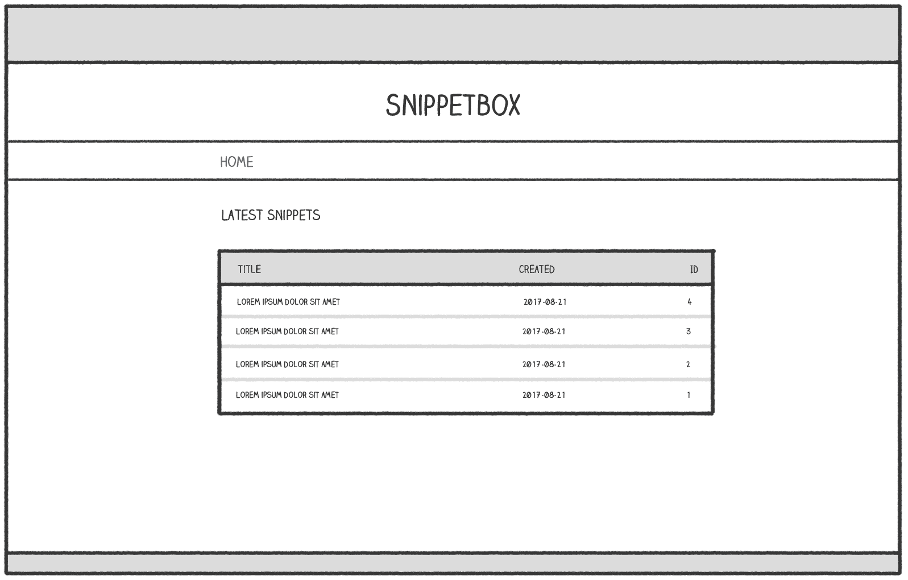

首先更新`templateData`结构体，使其包含一个用于持有片段切片的`Snippets`字段，如下：

File: `cmd/web/templates.go`

```go
package main

import "snippetbox.alexedwards.net/internal/models"

// 在 templateData struct 中包含一个 Snippets 字段。
type templateData struct {
    Snippet  *models.Snippet
    Snippets []*models.Snippet
}
```

然后更新`home`处理函数，以便从我们的数据库模型中获取最新的片段，并将它们传递给`home.tmpl`模板：

文件：`cmd/web/handlers.go`


```go
package main

...

func (app *application) home(w http.ResponseWriter, r *http.Request) {
    if r.URL.Path != "/" {
        app.notFound(w)
        return
    }

    snippets, err := app.snippets.Latest()
    if err != nil {
        app.serverError(w, err)
        return
    }

    files := []string{
        "./ui/html/base.tmpl",
        "./ui/html/partials/nav.tmpl",
        "./ui/html/pages/home.tmpl",
    }

    ts, err := template.ParseFiles(files...)
    if err != nil {
        app.serverError(w, err)
        return
    }

    // 创建一个 templateData struct 实例，用于持有片段切片（slice of snippets）。
    data := &templateData{
        Snippets: snippets,
    }

    // 执行模板时传递 templateData struct。
    err = ts.ExecuteTemplate(w, "base", data)
    if err != nil {
        app.serverError(w, err)
    }
}

...
```

现在，让我们进入`ui/html/pages/home.tmpl`文件并更新它，使用`{{if}}`和`{{range}}`动作在表格中显示这些片段。具体来说：

- 我们想使用`{{if}}`动作来检查片段切片是否为空。如果为空，我们想显示`"There's nothing to see here yet!"`消息。否则，我们想渲染一个包含片段信息的表格。
- 我们想使用`{{range}}`动作遍历切片中的所有片段，在表格行中渲染每个片段的内容。

以下是标记代码：

文件：`ui/html/pages/home.tmpl`

```html
{{define "title"}}Home{{end}}

{{define "main"}}
    <h2>Latest Snippets</h2>
    {{if .Snippets}}
     <table>
        <tr>
            <th>Title</th>
            <th>Created</th>
            <th>ID</th>
        </tr>
        {{range .Snippets}}
        <tr>
            <td><a href='/snippet/view?id={{.ID}}'>{{.Title}}</a></td>
            <td>{{.Created}}</td>
            <td>#{{.ID}}</td>
        </tr>
        {{end}}
    </table>
    {{else}}
        <p>There's nothing to see here... yet!</p>
    {{end}}
{{end}}
```

确保所有文件都已保存，重启应用并在由于已保存（无需重启）在网络浏览器中访问[`http://localhost:4000`](http://localhost:4000/)。如果一切都按计划进行，你应该看到一个看起来像这样的页面：


### 附加信息

### 组合函数

你可以在模板标签中组合多个函数，根据需要使用圆括号`()`包围函数及其参数。

例如，当`Foo`的长度大于 99 时，以下标签将渲染内容`C1`：

```go
{{if (gt (len .Foo) 99)}} C1 {{end}}
```

或者作为另一个例子，当`.Foo`等于 1 且`.Bar`小于或等于 20 时，以下标签将渲染内容`C1`：

```go
{{if (and (eq .Foo 1) (le .Bar 20))}} C1 {{end}}
```

### 控制循环行为

在`{{range}}`动作内部，你可以使用`{{break}}`命令提前结束循环，并使用`{{continue}}`跳到下一次迭代。

### 缓存模板

为了避免在每次请求时重新解析模板文件，我们可以将它们缓存在一个映射（map）中。

文件：`cmd/templates.go`

```go
func newTemplateCache() (map[string]*template.Template, error) {
    cache := make(map[string]*template.Template)

    files := []string{
        "./ui/html/base.tmpl",
        "./ui/html/partials/nav.tmpl",
    }

    pages, err := filepath.Glob("./ui/html/pages/*.tmpl")
    if err != nil {
        return nil, err
    }

    for _, page := range pages {
        ts, err := template.ParseFiles(append(files, page)...)
        if err != nil {
            return nil, err
        }

        cache[filepath.Base(page)] = ts
    }

    return cache, nil
}
```

此时，我们已经为每个页面准备了相关模板集合的内存缓存，并且我们的处理程序可以通过`application`结构体访问此缓存。

现在让我们解决第二个问题：代码重复，并创建一个辅助方法，以便我们可以轻松地从缓存中渲染模板。

打开你的`cmd/web/helpers.go`文件并添加以下`render()`方法：

文件：`cmd/web/helpers.go`

```
package main

...

func (app *application) render(w http.ResponseWriter, status int, page string, data *templateData) {
    // 根据页面名称（如 'home.tmpl'）从缓存中检索相应的
    // 模板集。如果缓存中不存在该名称的条目，
    // 则创建一个错误并调用我们之前创建的 serverError() 辅助
    // 方法并返回。
    ts, ok := app.templateCache[page]
    if !ok {
        err := fmt.Errorf("the template %s does not exist", page)
        app.serverError(w, err)
        return
    }

    // 写入提供的 HTTP 状态码（'200 OK', '400 Bad Request'
    // 等）。
    w.WriteHeader(status)

    // 执行模板集并写入响应体。再次，如果发生
    // 错误，我们就调用 serverError() 辅助方法。
    err := ts.ExecuteTemplate(w, "base", data)
    if err != nil {
        app.serverError(w, err)
    }
}
```

完成后，我们现在就可以看到这些更改带来的收益，并可以大幅简化处理程序中的代码：

文件：`cmd/web/handlers.go`

```
package main

import (
    "errors"
    "fmt"
    "net/http"
    "strconv"

    "snippetbox.alexedwards.net/internal/models"
)

func (app *application) home(w http.ResponseWriter, r *http.Request) {
    if r.URL.Path != "/" {
        app.notFound(w)
        return
    }

    snippets, err := app.snippets.Latest()
    if err != nil {
        app.serverError(w, err)
        return
    }

    // 使用新的 render 辅助方法。
    app.render(w, http.StatusOK, "home.tmpl", &templateData{
        Snippets: snippets,
    })
}

func (app *application) snippetView(w http.ResponseWriter, r *http.Request) {
    id, err := strconv.Atoi(r.URL.Query().Get("id"))
    if err != nil || id < 1 {
        app.notFound(w)
        return
    }

    snippet, err := app.snippets.Get(id)
    if err != nil {
        if errors.Is(err, models.ErrNoRecord) {
            app.notFound(w)
        } else {
            app.serverError(w, err)
        }
        return
    }

    // 使用新的 render 辅助方法。
    app.render(w, http.StatusOK, "view.tmpl", &templateData{
        Snippet: snippet,
    })
}

...
```

如果你重启应用程序并尝试再次访问[`http://localhost:4000`](http://localhost:4000/)和[`http://localhost:4000/snippet/view?id=1`](http://localhost:4000/snippet/view?id=1)，你应该会看到页面渲染方式与之前完全相同。

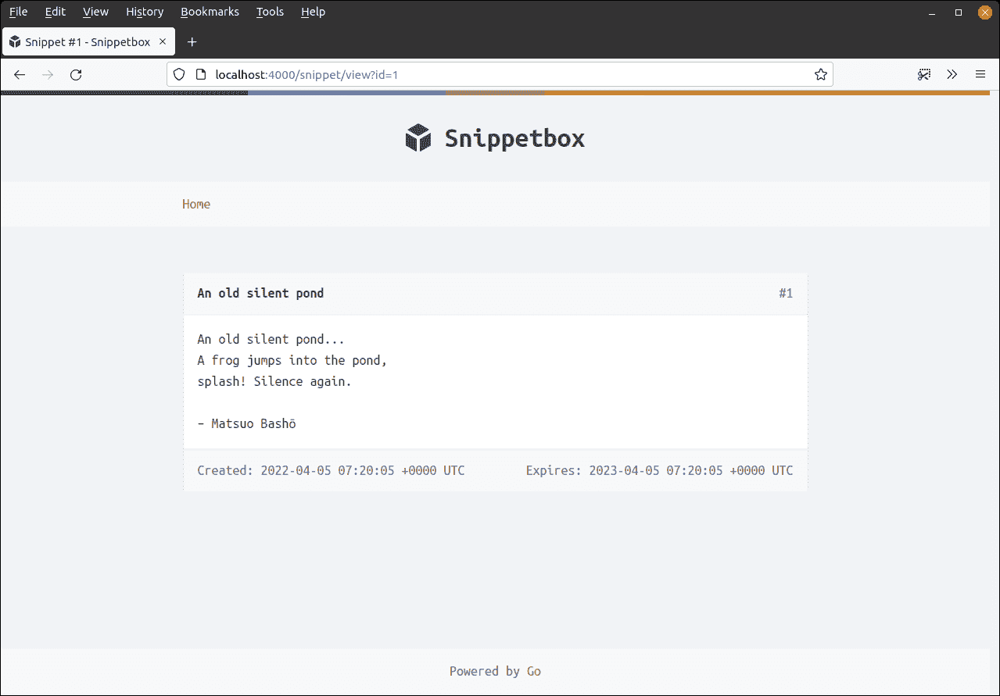

### 自动解析部分组件 (partials)

在继续之前，让我们让`templateCache()`函数更灵活一些，使其自动解析`ui/partials`文件夹中的模板，而不仅仅是`nav.tmpl`。这将为我们在未来想要添加部分组件时节省时间并避免潜在的错误。

文件：`cmd/web/templates.go`

```go
func (app *application) templateCache() (map[string]*template.Template, error) {
    cache := make(map[string]*template.Template)

    pages, err := filepath.Glob("./ui/templates/*.tmpl")
    if err != nil {
        return nil, err
    }

    for _, page := range pages {
        name := filepath.Base(page)
        ts, err := template.New(name).ParseFiles(page)
        if err != nil {
            return nil, err
        }

        partials, err := filepath.Glob("./ui/partials/*.tmpl")
        if err != nil {
            return nil, err
        }

        for _, partial := range partials {
            _, err = ts.ParseFiles(partial)
            if err != nil {
                return nil, err
            }
        }

        cache[name] = ts
    }

    return cache, nil
}
```

## 5.4 捕捉运行时错误

一旦我们开始为 HTML 添加动态行为，就会面临运行时错误的风险。

让我们在`view.tmpl`中添加一个故意的错误看看会发生什么：

文件：`ui/html/pages/view.tmpl`

```html
{{define "main"}}
    {{with .Snippet}}
    <div class='snippet'>
        <div class='metadata'>
            <strong>{{.Title}}</strong>
            <span>{{len}} <!-- Deliberate error -->
        <pre>{{.Content}}</pre>
        <div class='metadata'>
            Created: {{.Created}}
        </div>
    </div>
    {{end}}
{{end}}
```

在上面的标记中，我们添加了`{{len}}`，在 Go 中`nil`值没有长度，会导致错误。

尝试运行应用程序。你会发现它仍然可以编译：

```bash
$ go run ./cmd/web
INFO    2022/02/01 10:20:21 Starting server on :4000
```

如果你使用 curl 请求[`http://localhost:4000/snippet/view?id=1`](http://localhost:4000/snippet/view?id=1)，你会得到类似这样的响应：

```bash
$ curl -i "http://localhost:4000/snippet/view?id=1"
HTTP/1.1 200 OK
Date: Tue, 01 Feb 2022 09:20:49 GMT
Content-Length: 762
Content-Type: text/html; charset=utf-8


<!doctype html>
<html lang='en'>
    <head>
        <meta charset='utf-8'>
        <title>Snippet #1 - Snippetbox</title>
         
        <link rel='stylesheet' href='/static/css/main.css'>
        <link rel='shortcut icon' href='/static/img/favicon.ico' type='image/x'>
        
        <link rel='stylesheet' href='https://fonts.googleapis.com/css?family=Ubuntu+Mono:400,700'>
    </head>
    <body>
        <header>
            <h1><a href='/'>Snippetbox</a></h1>
        </header>
        
        
 <nav>
    <a href='/'>Home</a>
</nav>

        <main>
            
    
    <div class='snippet'>
        <div class='metadata'>
            <strong>An old silent pond</strong>
            <span>#1</span>
        </div>
        Internal Server Error
    </div>
    </main>
    </body>
</html>
```

这非常糟糕。我们的应用程序抛出了错误，但用户被错误地收回了`200 OK`响应。更糟糕的是，他们接收到了一个不完整的 HTML 页面。

为了修复这个问题，我们需要让模板渲染变成两个阶段的过程。首先，我们应该通过将模板写入缓冲区（buffer）来进行“尝试”渲染。如果失败了，我们可以向用户返回错误消息。但如果成功了，我们就可以将缓冲区的内容写入我们的`http.ResponseWriter`。

让我们更新`render()`辅助方法以使用这种方法：

文件：`cmd/web/helpers.go`


```go
package main

import (
    "bytes" // New import
    "fmt"
    "net/http"
    "runtime/debug"
)

...

func (app *application) render(w http.ResponseWriter, status int, page string, data *templateData) {
    ts, ok := app.templateCache[page]
    if !ok {
        err := fmt.Errorf("the template %s does not exist", page)
        app.serverError(w, err)
        return
    }

    // Initialize a new buffer.
    buf := new(bytes.Buffer)

    // Write the template to the buffer, instead of straight to the
    // http.ResponseWriter. If there's an error, call our serverError() helper
    // and then return.
    err := ts.ExecuteTemplate(buf, "base", data)
    if err != nil {
        app.serverError(w, err)
        return
    }

    // If the template is written to the buffer without any errors, we are safe
    // to go ahead and write the HTTP status code to http.ResponseWriter.
    w.WriteHeader(status)

    // Write the contents of the buffer to the http.ResponseWriter. Note: this
    // is another time where we pass our http.ResponseWriter to a function that
    // takes an io.Writer.
    buf.WriteTo(w)
}
```

重启应用程序并尝试再次发送请求。你现在应该会得到正确的错误信息和`500 Internal Server Error`响应。

```text
$ curl -i "http://localhost:4000/snippet/view?id=1"
HTTP/1.1 500 Internal Server Error
Content-Type: text/plain; charset=utf-8
X-Content-Type-Options: nosniff
Date: Tue, 01 Feb 2022 09:30:33 GMT
Content-Length: 22

Internal Server Error
```

太棒了。这看起来好多了。

在进入下一个章节之前，回到`view.tmpl`文件并删除那个故意遗留的错误：

文件：`ui/html/pages/view.tmpl`

```gotemplate
{{define "title"}}Snippet #{{.Snippet.ID}}{{end}}

{{define "main"}}
    {{with .Snippet}}
    <div class='snippet'>
        <div class='metadata'>
            <strong>{{.Title}}</strong>
            <span>#{{.ID}}</span>
        </div
        <pre><code>{{.Content}}</code></pre>
        <div class='metadata'>
            <time>Created: {{.Created}}</time>
            <time>Expires: {{.Expires}}</time>
        </div
    </div
    {{end}}
{{end}}
```

# 第 5.5 章

## 常见的动态数据

在某些 Web 应用中，可能存在你希望包含在多个——甚至是每个——网页中的常见动态数据。例如，你可能希望在所有带有表单的页面包含当前用户的用户名和头像，或者 CSRF 令牌。

在案例中，让我们从简单的内容开始，假设我们想在每个页面的页脚包含当前年份。

为了实现这一点，我们首先要在`templateData`结构体中添加一个新的`CurrentYear`字段，如下所示：

文件：`cmd/web/templates.go`

```go
package main

...

// 为 templateData 结构体添加 CurrentYear 字段。
type templateData struct {
    CurrentYear int
    Snippet     *models.Snippet
    Snippets    []*models.Snippet
}

...
```

下一步是为我们的应用程序添加一个`newTemplateData()`辅助方法，它将返回一个初始化了当前年份的`templateData`结构体。

我将演示：

文件：`cmd/web/helpers.go`

```go
package main

import (
    "bytes"
    "fmt"
    "net/http"
    "runtime/debug"
    "time" // New import
)

...

// 创建一个 newTemplateData() 辅助函数，返回一个指向初始化了当前年份
// templateData 结构体的指针。注意，我们目前还没有使用
// *http.Request 参数，但我们稍后会在书中用到。
func (app *application) newTemplateData(r *http.Request) *templateData {
    return &templateData{
        CurrentYear: time.Now().Year(),
    }
}

...
```

然后，让我们更新`home`和`snippetView`处理器以使用`newTemplateData()`辅助函数，如下：

文件：`cmd/web/handlers.go`

```go
package main

...

func (app *application) home(w http.ResponseWriter, r *http.Request) {
    if r.URL.Path != "/" {
        app.notFound(w)
        return
    }

    snippets, err := app.snippets.Latest()
    if err != nil {
        app.serverError(w, err)
        return
    }

    // 调用 newTemplateData() 辅助函数以获取包含 'default' 数据
    // 的 templateData 结构体（目前只是当前年份），并将 snippets
    // 切片添加到其中。
    data := app.newTemplateData(r)
    data.Snippets = snippets

    // 像往一样将数据传递给 render() 辅助函数。
    app.render(w, http.StatusOK, "home.tmpl", data)
}

func (app *application) snippetView(w http.ResponseWriter, r *http.Request) {
    id, err := strconv.Atoi(r.URL.Query().Get("id"))
    if err != nil || id < 1 {
        app.notFound(w)
        return
    }

    snippet, err := app.snippets.Get(id)
    if err != nil {
        if errors.Is(err, models.ErrNoRecord) {
            app.notFound(w)
        } else {
            app.serverError(w, err)
        }
        return
    }

    // 执行同样的操作
    data := app.newTemplateData(r)
    data.Snippet = snippet

    app.render(w, http.StatusOK, "view.tmpl", data)
}
...
```

最后，我们需要做的最后一件事是更新`ui/html/base.tmpl`以在页脚显示年份，如下所示：

文件：`ui/html/base.tmpl`

```html
{{define "base"}}
<!doctype html>
<html lang='en'>
    <head>
        <meta charset='utf-8'>
        <title>{{template "title" .}} - Snippetbox</title>
        <link rel='stylesheet' href='/static/css/main.css'>
        <link rel='shortcut icon' href='/static/img/favicon.ico' type='image/x-icon'>
        <link rel='stylesheet' href='https://fonts.googleapis.com/css?family=Ubuntu+Mono:400,700'>
    </head>
    <body>
        <header>
            <h1><a href='/'>Snippetbox</a></h1>
        </header>
        {{template "nav" .}}
        <main>
            {{template "main" .}}
        </main>
        <footer>
            <!-- 更新页脚包含当前年份 -->
            Powered by <a href='https://golang.org/'>Go</a> in {{.CurrentYear}}
        </footer>
        <script src="/static/js/main.js" type="text/javascript"></script>
    </body>
</html>
{{end}}
```

如果你重启应用程序并访问`http://localhost:4000/`首页，你现在应该能在页脚看到当前年份。如下：

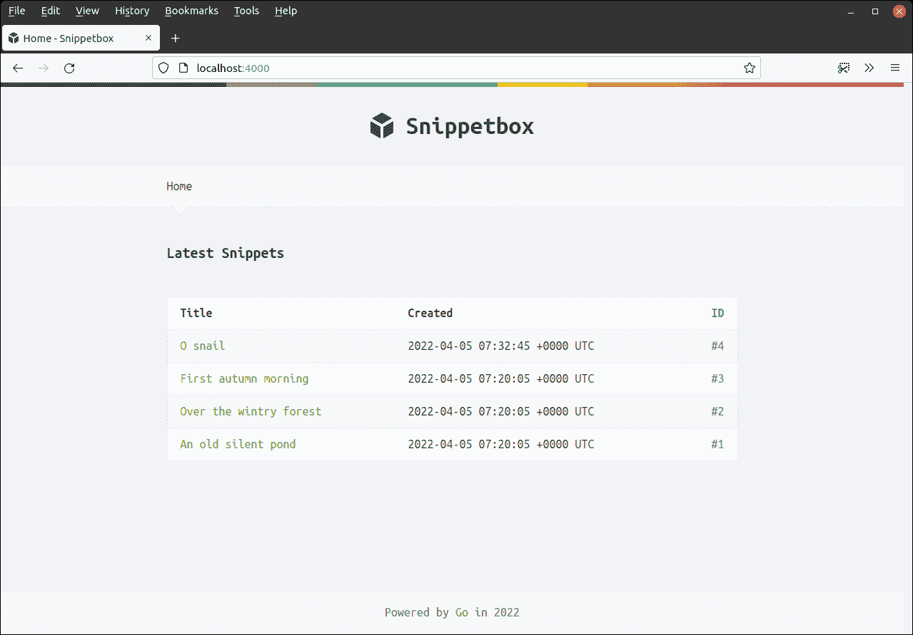

# 第 5.6 章

## 自定义模板函数

在关于模板和动态数据的最后部分，我想解释如何创建你自己的并在 Go 模板中使用的自定义函数。

为了说明这一点，让我们创建一个自定义的`humanDate()`函数，它以易读的“人性化”格式如`02 Jan 2022 at 15:04`输出日期，而不是像我们现在这样以默认格式`2022-01-02 15:04:00 +0000 UTC`输出日期。

实现这一操作主要有两个步骤：

1. 我们需要创建一个包含自定义`humanDate()`函数的`template.FuncMap`对象。
2. 我们需要在解析模板之前，使用`template.Funcs()`方法来注册它。

请在你的`templates.go`文件中添加以下代码：

```go
package main

import (
    "html/template"
    "path/filepath"
    "time" // 新导入

    "snippetbox.alexedwards.net/internal/models"
)

...

// 创建一个 humanDate 函数，返回 time.Time 对象的格式化
// 字符串表示。
func humanDate(t time.Time) string {
    return t.Format("02 Jan 2006 at 15:04")
}

// 初始化一个 template.FuncMap 对象并存储在全局变量中。这
// 本质上是一个字符串键映射，用于自定义模板函数名称
// 与函数本身之间的查找。
var functions = template.FuncMap{
    "humanDate": humanDate,
}

func newTemplateCache() (map[string]*template.Template, error) {
    cache := map[string]*template.Template{}

    pages, err := filepath.Glob("./ui/html/pages/*.tmpl")
    if err != nil {
        return nil, err
    }

    for _, page := range pages {
        name := filepath.Base(page)

        // template.FuncMap 必须在调用 ParseFiles() 方法之前
        // 在模板集中注册。这意味着我们必须使用 template.New() 来
        // 创建一个空的模板集，使用 Funcs() 方法注册
        // template.FuncMap，然后像往一样解析文件。
        ts, err := template.New(name).Funcs(functions).ParseFiles("./ui/html/base.tmpl")
        if err != nil {
            return nil, err
        }

        ts, err = ts.ParseGlob("./ui/html/partials/*.tmpl")
        if err != nil {
            return nil, err
        }

        ts, err = ts.ParseFiles(page)
        if err != nil {
            return nil, err
        }

        cache[name] = ts
    }

    return cache, nil
}
```

在我们继续之前，我应该解释一下：自定义模板函数（例如我们的`humanDate()`函数）可以接受任意数量的参数，但它们*必须*只返回一个值。唯一的例外是如果你想作为第二个值返回一个`error`，那样也是可以的。

现在我们可以像使用内置模板函数一样使用我们的`humanDate()`函数：

文件：`ui/html/pages/home.tmpl`

```html
{{define "title"}}Home{{end}}

{{define "main"}}
    <h2>Latest Snippets</h2>
    {{if .Snippets}}
     <table>
        <tr>
            <th>Title</th>
            <th>Created</th>
            <th>ID</th>
        </tr>
        {{range .Snippets}}
        <tr>
            <td><a href='/snippet/view?id={{.ID}}'>{{.Title}}</a></td>
            <!-- 在处使用新的模板函数 -->
            <td>{{humanDate .Created}}</td>
            <td>#{{.ID}}</td>
        </tr>
        {{end}}
    </table>
    {{else}}
        <p>There are no snippets yet.</p>
    {{end}}
{{end}}
```

文件：`ui/html/pages/view.tmpl`

```html
{{define "title"}}Snippet{{end}}

{{define "main"}}
    {{with .Snippet}}
        <h1>{{.Title}}</h1>
        <p>Created: {{humanDate .Created}}</p>
        <div>{{.Content}}</div>
    {{else}}
        <p>Snippet doesn't exist!</p>
    {{end}}
{{end}}
```

这种模式的一种微调是在`myMiddleware()`中间件内部使用匿名函数，如下：


```go
func myMiddleware(next http.Handler) http.Handler {
    return http.HandlerFunc(func(w http.ResponseWriter, r *http.Request) {
        // TODO: 在此处执行我们的间件逻辑...
        next.ServeHTTP(w, r)
    })
}
```

这种模式在实际中非常常见，如果你正在阅读其他应用程序或第三方包的源码，可能会经常看到它。

## 间件的位置

需要说明的是，间件在处理器链（chain of handlers）中的位置将影响应用程序的行为。

如果你将间件放置在链中 `servemux` 之前，那么它将作用于应用程序接收的每一个请求。

```
myMiddleware → servemux → application handler
```

一个很好的例子是记录请求的间件——因为这通常是你希望对*所有*（*all*）请求都这样做。

或者，你可以将间件放置在链中 `servemux` 之后——通过包装特定的应用程序处理器。这将导致你的间件只针对特定路由执行。

```
servemux → myMiddleware → application handler
```

这种做法的例子类似于授权间件，你可能只想在特定路由上运行它。

随着书籍的进展，我们将如何在实践中实现这两项操作。

第 6.2 节。

## 设置安全头部

让我们把上一节学的模式用起来，创建一个我们自己的间件，它会自动为每个响应添加以下 HTTP 安全头部，以符合[当前的 OWASP 指南](https://owasp.org/www-project-secure-headers)。

```
Content-Security-Policy: default-src 'self'; style-src 'self' fonts.googleapis.com; font-src fonts.gstatic.com
Referrer-Policy: origin-when-cross-origin
X-Content-Type-Options: nosniff
X-Frame-Options: deny
X-XSS-Protection: 0
```

如果你不熟悉这些头部，我将简要解释一下它们的作用。

- `Content-Security-Policy`（通常缩写为 `CSP`）头部用于限制网页页面资源（例如 JavaScript、图像、字体等）从何处加载。设置严格的 `CSP` 策略有助于防止各种跨站脚本攻击、点击劫持和其他代码注入攻击。

`CSP` 头部及其工作原理是一个大话题，如果你以前没有遇到过，我建议阅读[这篇入门教程](https://developer.mozilla.org/en-US/docs/Web/HTTP/CSP)。但在我们的案例中，该头部告诉浏览器可以从 `fonts.gstatic.com` 加载字体，从 `fonts.googleapis.com` 和 `self`（我们自己的源）加载样式表，然后`其他所有内容`仅从 `self`加载。内联 JavaScript 默认被阻止。

- `Referrer-Policy` 用于控制当用户离开你的网页时，`Referer` 头部中包含哪些信息。在我们的案例中，我们将值设置为 `origin-when-cross-origin`，这意味着[同源请求](https://developer.mozilla.org/en-US/docs/Web/Security/Same-origin_policy)将包含完整的 URL，但对于所有其他请求，URL 路径和任何查询字符串值等信息将被移除。

- `X-Content-Type-Options: nosniff` 指示浏览器`不要`对响应的内容类型进行 MIME 类型嗅探，这反过来有助于防止[内容嗅探攻击](https://security.stackexchange.com/questions/7506/using-file-extension-and-mime-type-as-output-by-file-i-b-combination-to-dete/7531#7531)。

- `X-Frame-Options: deny` 用于帮助防止不支持 `CSP` 头的旧浏览器中的[点击劫持](https://developer.mozilla.org/en-US/docs/Web/Security/Types_of_attacks#click-jacking）攻击。

- `X-XSS-Protection: 0` 用于`禁用`对跨站脚本攻击的拦截。以前将此头部设置为 `X-XSS-Protection: 1; mode=block` 是一种良好的实践，但当我们像这样使用 `CSP` 头部时，[建议](https://owasp.org/www-project-secure-headers/#x-xss-protection)是完全禁用此功能。

好了，让我们回到 Go 代码，并创建一个新的 `middleware.go` 文件。我们将用它来存放整本书中编写的所有自定义间件。

```bash
$ touch cmd/web/middleware.go
```

然后打开它并使用我们在上一节引入的模式添加一个 `secureHeaders()` 函数：

文件：`cmd/web/middleware.go`

```go
package main

import (
    "net/http"
)

func secureHeaders(next http.Handler) http.Handler {
    return http.HandlerFunc(func(w http.ResponseWriter, r *http.Request) {
        // 注意：为了可读性，这里分成了多行。你
        // 不需要在你自己的代码中这样做。
        w.Header().Set("Content-Security-Policy",
            "default-src 'self'; style-src 'self' fonts.googleapis.com; font-src fonts.gstatic.com")
        w.Header().Set("Referrer-Policy", "origin-when-cross-origin")
        w.Header().Set("X-Content-Type-Options", "nosniff")
        w.Header().Set("X-Frame-Options", "deny")
        w.Header().Set("X-XSS-Protection", "0")

        next.ServeHTTP(w, r)
    })
}
```

另外需要提到的一是，如果你在中间件函数中调用 `next.ServeHTTP()` *之前*调用了 `return`，那么链将停止执行，控制权将流回上游。

例如，提前返回（early returns）的一个常见用例是身份验证中间件，它只在通过特定检查时才允许链继续执行。例如：

```
func myMiddleware(next http.Handler) http.Handler {
    return http.HandlerFunc(func(w http.ResponseWriter, r *http.Request) {
        // 如果用户未授权，发送 403 Forbidden 状态并
        // 返回以停止执行链。
        if !isAuthorized(r) {
            w.WriteHeader(http.StatusForbidden)
            return
        }

        // 否则，调用链中的下一个处理器。
        next.ServeHTTP(w, r)
    })
}
```

我们将在稍后章节使用这种“提前返回”模式来限制对应用程序某些部分的访问。

### 调试 CSP 问题

虽然 CSP 头部确实*非常棒*，而且你绝对应该使用它们，但值得说的是，我曾花几个小时调试为什么某些功能没有按预期工作，结果发现是某个关键资源或脚本被我自己的 CSP 规则拦截了 🤦。

如果你正在开发一个使用 CSP 头部的项目（如本项目），我建议随身携带 浏览器开发者工具，并养成在遇到任何意外问题时尽早检查日志的习惯。在 Firefox 中，任何被拦截的资源将以错误形式显示在控制台日志中——类似于：

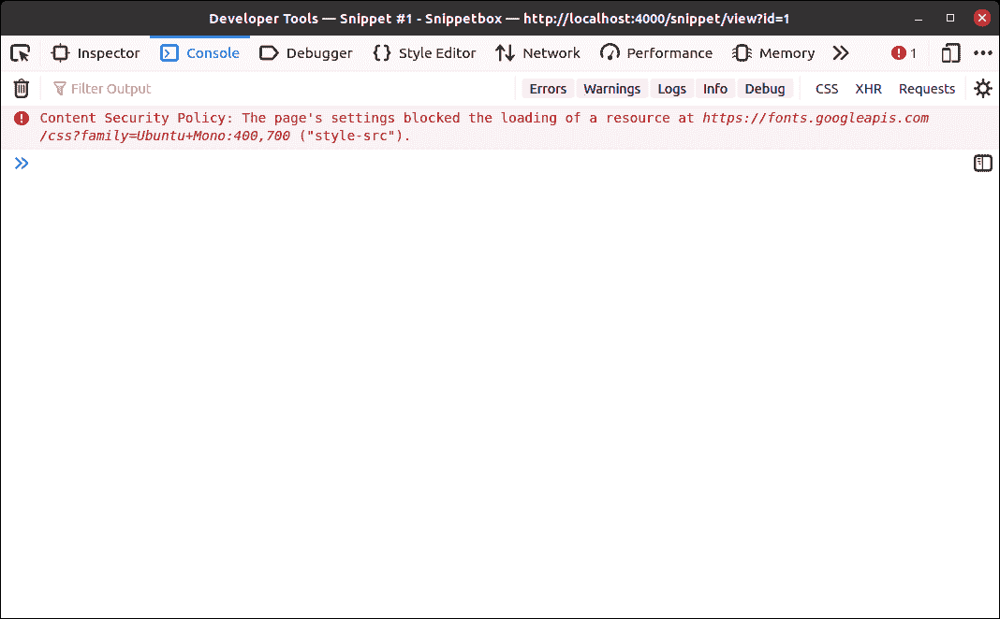

第 6.3 节

## 请求日志

让我们继续同样的思路，添加一些中间件来*记录 HTTP 请求*。具体来说，我们将使用之前创建的*信息日志器*来记录用户的 IP 地址，以及正在请求的 URL 和方法。

打开你的 `middleware.go` 文件并使用标准中间件模式创建一个 `logRequest()` 方法，如下所示：

文件：`cmd/web/middleware.go`

```
package main

...

func (app *application) logRequest(next http.Handler) http.Handler {
    return http.HandlerFunc(func(w http.ResponseWriter, r *http.Request) {
        app.infoLog.Printf("%s - %s %s %s", r.RemoteAddr, r.Proto, r.Method, r.URL.RequestURI())

        next.ServeHTTP(w, r)
    })
}
```

注意这次我们是将中间件实现为 `application` 的一个方法吗？

这样做是完全有效的。我们的中间件方法签名与之前相同，但因为它是针对 `application` 的方法，所以它*也*可以访问处理器依赖项，包括信息日志器。

现在让我们更新 `routes.go` 文件，使得 `logRequest` 中间件首先执行，并且针对所有请求执行，这样控制流（从左到右读取）看起来如下：

```
logRequest ↔ secureHeaders ↔ servemux ↔ application handler
```

文件：`cmd/web/routes.go`

```
package main

import "net/http"

func (app *application) routes() http.Handler {
    mux := http.NewServeMux()

    fileServer := http.FileServer(http.Dir("./ui/static/"))
    mux.Handle("/static/", http.StripPrefix("/static", fileServer))

    mux.HandleFunc("/", app.home)
    mux.HandleFunc("/snippet/view", app.snippetView)
    mux.HandleFunc("/snippet/create", app.snippetCreate)

    // 使用 logRequest 中间件包装现有的链。
    return app.logRequest(secureHeaders(mux))
}
```

好了……让我们来试一下！

重启你的应用程序，浏览一下，然后检查你的终端。你应该会看到这样的日志输出：

```
$ go run ./cmd/web
INFO    2022/02/06 09:08:29 Starting server on :4000
INFO    2022/02/06 09:08:31 127.0.1:45988 - HTTP/1.1 GET /
INFO    2022/02/06 09:08:31 127.0.1:45988 - HTTP/1.1 GET /static/css/main.css
INFO    2022/02/06 09:08:31 127.0.1:45988 - HTTP/1.1 GET /static/js/main.js
INFO    2022/02/06 09:08:31 127.0.1:45988 - HTTP/1.1 GET /static/img/logo.png
INFO    2022/02/06 09:08:31 127.0.1:45988 - HTTP/1.1 GET /static/img/favicon.ico
INFO    2022/02/06 09:08:34 127.0.1:45988 - HTTP/1.1 GET /snippet/view?id=2
```

第 6.4 节

## Panic 恢复

在简单的 Go 程序中，[当你的代码发生](https://pkg.go.dev/builtin/#panic)会导致应用程序立即终止。

但我们的 Web 应用要复杂一些。Go 的 HTTP 服务器假设任何 panic 的影响都局限于处理该 HTTP 请求的 goroutine（[#02.09-the-handler-interface.xhtml 每个请求都在自己的 goroutine 中处理]）。

具体来说，发生 panic 后，我们的服务器会将堆栈跟踪打印到服务器错误日志，展开受影响 goroutine 的堆栈（调用任何 defer 函数），并关闭底层 HTTP 连接。但重要的是，处理器中的任何 panic *都不会*导致你的服务器崩溃。

*但如果某个处理器中发生了 panic，用户会看到什么？*

让我们来看看并在 `home` 处理器中引入一个故意的 panic。

文件：`cmd/web/handlers.go`

```
package main

...

func (app *application) home(w http.ResponseWriter, r *http.Request) {
    if r.URL.Path != "/" {
        app.notFound(w)
        return
    }

    panic("oops! something went wrong") // 故意的 panic

    snippets, err := app.Latest()
    if err != nil {
        app.serverError(w, err)
        return
    }

    data := app.newTemplateData(r)
    data.Snippets = snippets

    app.render(w, http.StatusOK, "home.tmpl", data)
}
```

重启你的应用程序……

```
$ go run ./cmd/web
INFO    2022/02/06 09:16:38 Starting server on :4000
```

……从另一个窗口发送一个 HTTP 请求：

```
$ curl -i http://localhost:4000
curl: (52) Empty reply from server
```

不幸的是，由于 Go 关闭了连接，我们只得到了一个空响应。

这对用户来说不是很好的体验。更合适更有意义的方法是发送一个带有 `500 Server Error` 状态的正确 HTTP 响应。

实现这一点的一种巧妙方法是创建一个中间件来*恢复* panic 并调用我们的 `app.serverError()` 辅助方法。为此，我们可以利用堆栈解除时 defer 函数总是被调用的事实。

打开你的 `middleware.go` 文件并添加以下代码：

文件：`cmd/web/middleware.go`

```go
package main

import (
    "fmt" // 新导入
    "net/http"
)

...

func (app *application) recoverPanic(next http.Handler) http.Handler {
    return http.HandlerFunc(func(w http.ResponseWriter, r *http.Request) {
        // 创建一个 defer 函数（当发生 panic 时，
        // Go 展开堆栈时它总是会被执行）。
        defer func() {
            // 使用内置的 recover 函数检查是否发生了
            // panic。如果有的话……
            if err := recover(); err != nil {
                // 在响应中设置 "Connection: close" 头部。
                w.Header().Set("Connection", "close")
                // 调用 app.serverError 辅助方法返回 500
                // 内部错误响应。
                app.serverError(w, fmt.Errorf("%s", err))
            }
        }()

        next.ServeHTTP(w, r)
    })
}
```

关于此点有两个细节值得解释：

*   在响应中设置 `Connection: Close` 头部充当了触发器，使 Go 的 HTTP 服务器在发送响应后自动关闭当前连接。它还通知用户连接*将被关闭*。注意：如果使用的协议是 HTTP/2，Go 将[自动](https://go-review.googlesource.com/c/net/+/121415/)从响应中剥离 `Connection: Close` 头部（使其不格式错误）并发送一个 `GOAWAY` 帧。


内置函数 `recover()` 返回的值类型为 `any`，其底层类型可以是 `string`、`error` 或其他类型——取决于传递给 `panic()` 的参数是什么。在我们的用例中，它是字符串 `"oops! something went wrong"`。在上面的代码中，我们通过使用 `fmt.Errorf()` 函数创建一个新的 `error` 对象（其中包含 `any` 值的默认文本表示），将其归一化为 `error` 类型，然后将此 `error` 传递给辅助方法 `app.serverError()`。

现在，让我们在 `routes.go` 文件中使用它，让它成为执行链中第一个被执行的内容（这样它就能涵盖后续所有中间件和处理器中发生的 panic）。

文件：`cmd/web/routes.go`

```go
package main

import "net/http"

func (app *application) routes() http.Handler {
    mux := http.NewServeMux()

    fileServer := http.FileServer(http.Dir("./ui/static/"))
    mux.Handle("/static/", http.StripPrefix("/static", fileServer))

    mux.HandleFunc("/", app.home)
    mux.HandleFunc("/snippet/view", app.snippetView)
    mux.HandleFunc("/snippet/create", app.snippetCreate)

    // 使用 recoverPanic 中间件包装现有的链。
    return app.recoverPanic(app.logRequest(secureHeaders(mux)))
}
```

如果你现在重启应用并请求主页，你应该能在发生 panic 之后看到一个格式良好的 `500 Internal Server Error` 响应，包括我们讨论过的 `Connection: close` 头部。

```bash
$ go run ./cmd/web
INFO    2022/02/06 09:20:10 Starting server on :4000
```

```bash
$ curl -i http://localhost:4000
HTTP/1.1 500 Internal Server Error
Connection: close
Content-Security-Policy: default-src 'self'; style-src 'self' fonts.googleapis.com; font-src fonts.gstatic.com
Content-Type: text/plain; charset=utf-8
Referrer-Policy: origin-when-cross-origin
X-Content-Type-Options: nosniff
X-Frame-Options: deny
X-Xss-Protection: 0
Date: Sun, 06 Feb 2022 08:20:27 GMT
Content-Length: 22

Internal Server Error
```

在继续之前，回到你的 `home` 处理器并从代码中移除故意的 panic。

文件：`cmd/web/handlers.go`

```go
package main

...

func (app *application) home(w http.ResponseWriter, r *http.Request) {
    if r.URL.Path != "/" {
        app.notFound(w)
        return
    }

    snippets, err := app.snippets.Latest()
    if err != nil {
        app.serverError(w, err)
        return
    }

    data := app.newTemplateData(r)
    data.Snippets = snippets

    app.render(w, http.StatusOK, "home.tmpl", data)
}

...
```

### 附加信息

#### 其他 goroutine 中的 panic

需要注意的是，`recoverPanic` 中间件只会恢复发生在同一个 goroutine 中的 panic。如果你启动了另一个 goroutine 并在其中发生了 panic，`recoverPanic` 中间件将无法捕获它，应用程序将会崩溃。

为了处理这种情况，你可以在 goroutine 内部使用 `recover()`，例如：

```go
go func() {
    defer func() {
        if r := recover(); r != nil {
            // 处理 panic
        }
    }()
    // 可能会 panic 的代码
}()
```

#### 可组合链

在本章中，我想介绍可组合链（composable chains）。我推荐它的是因为它允许你通过组合小型简单的函数来构建复杂的中间件链。例如，你可以创建一个这样的链：

```go
chain := middleware.New(recoverPanic, logRequest, secureHeaders)
return chain(mux)
```

随着应用程序的增长，路由变得越来越复杂，使用可组合链会让维护和测试变得容易得多。

# 高级路由

在本书的下一个章节中，我们将为应用程序添加一个 HTML 表单，以便用户可以创建片段。

为了让其顺利运行，我们首先需要更新应用程序路由，以便对 `/snippet/create` 的请求根据请求方法进行不同的处理。具体而言：

- 对于 `GET /snippet/create`，我们向用户显示添加新片段的 HTML 表单。
- 对于 `POST /snippet/create`，我们处理这些表单数据，然后向数据库中插入一条新的 `snippet` 记录。

顺便我们还会进行另外两个与路由相关的改进：

- 我们将限制所有其他仅返回信息的路由，使其仅支持 `GET` 请求。
- 我们将使用[整整的 URL](https://en.wikipedia.org/wiki/Clean_URL)，使任何变量都包含在 URL 路径中（如 `/snippet/view/123`），而不是作为查询字符串（如 `/snippet/view?id=123`）。

本质上，我们希望调整应用程序路由和处理器，使其最终看起来如下所示：

| 方法 | 模式 | 处理器 | 操作 |
| --- | --- | --- | --- |
| `GET` | `/` | `home` | 显示主页 |
| `GET` | `/snippet/view/:id` | `snippetView` | 显示特定片段 |
| `GET` | `/snippet/create` | `snippetCreate` | 显示创建新片段的 HTML 表单 |
| `POST` | `/snippet/create` | `snippetCreatePost` | 创建新片段 |
| `GET` | `/static/` | `http.FileServer` | 特定的静态文件 |

正如我在书中前面的部分中提到的，Go 的 `servemux` 不支持基于方法的路由，也不支持包含变量的整洁 URL。虽然有一些[技巧](https://youtu.be/yi5A3cK1LNA?t=11m44s)可以用来绕过这一问题，但大多数人倾向于认为直接使用第三方包来帮助路由会更简单。

在本书的这一章节中，我们将：

- 简要讨论几个出色的第三方路由器的特性。
- 更新我们的应用程序以使用其中一个路由器，并演示如何使用基于方法的路由和整洁 URL。

# 第 7.1 节

## 选择路由器

Go 真的有数以百计的第三方路由器供选择。而且（幸运或不幸，取决于你的观点）它们的工作方式都略有不同。它们拥有不同的 API、不同的路由匹配逻辑以及不同的行为特性。

在我尝试过的所有第三方路由器中，有三个我推荐作为起点：[`julienschmidt/httprouter`](https://github.com/julienschmidt/httprouter)、[`go-chi/chi`](https://github.com/go-chi/chi) 和 [`gorilla/mux`](https://github.com/gorilla/mux)。它们都拥有良好的文档、相当的测试覆盖率，并且与我们在书中使用的处理器和中间件的标准模式配合良好。

这三个路由器都支持基于方法的路由和整洁 URL，但除此之外，它们具有略有不同的行为和功能。你应该根据项目的具体需求在它们之间进行选择。

总结：

- `julienschmidt/httprouter` 是这三个包中最专注、轻量级且最快的，在遵循 HTTP 规范方面，它几乎是任何第三方路由器中最接近“完美”的。它会自动处理 `OPTIONS` 请求并正确发送 `405` 响应，还允许你为 `404` 和 `405` 响应设置自定义处理器。
- `go-chi/chi` 在功能上与 `httprouter` 相似，主要区别在于它还支持正则表达式路由模式以及使用特定中间件的路由“分组”。这种路由分组功能在需要管理大量路由和中间件的大型应用程序中非常有价值。

  `chi` 的两个缺点是：它不会自动处理 `OPTIONS` 请求，并且在 `405` 响应中不会设置 `Allow` 标头。
- `gorilla/mux` 是三个路由器中功能最全的。它支持正则表达式路由模式，并允许根据方案、主机和标头进行路由。它还是唯一支持自定义路由规则和路由“反转”（就像在 Django、Rails 或 Laravel 中那样）的路由器。

  `gorilla/mux` 主要缺点是相对缓慢且消耗内存——尽管对于我们这种数据库驱动的 Web 应用程序来说，对整个 HTTP 请求生命周期的影响可能很小。与 `chi` 一样，它也不处理 `OPTIONS` 请求，并且不在 `405` 响应中设置 `Allow` 标头。

总结：

| 方法 | 模式 | 处理器 | 动作 |
| :--- | :--- | :--- | :--- |
| `GET` | `/` | `home` | 显示首页 |
| `GET` | `/snippet/:id` | `snippetView` | 显示特定的代码片段 |
| `GET` | `/snippet/create` | `snippetCreate` | 显示创建新代码片段的 HTML 表单 |
| `POST` | `/snippet/create` | `snippetCreatePost` | 创建新的代码片段 |
| `GET` | `/static/*filepath` | `http.FileServer` | 静态文件服务 |

## 7.2. 整洁 URL 和基于方法的路由

现在已经完成后，我们需要对 `handlers.go` 文件进行几处更改。请按照以下内容更新它：

文件：`cmd/web/handlers.go`

```go
package main

import (
    "errors"
    "fmt"
    "net/http"
    "strconv"

    "snippetbox.alexedwards.net/internal/models"

    "github.com/julienschmidt/httprouter" // 新导入
)

func (app *application) home(w http.ResponseWriter, r *http.Request) {
    // 因为 httprouter 精确匹配 "/" 路径，我们现在可以移除
    // 此处理器中对 r.URL.Path != "/" 的手动检查。

    snippets, err := app.snippets.Latest()
    if err != nil {
        app.serverError(w, err)
        return
    }

    data := app.newTemplateData(r)
    data.Snippets = snippets

    app.render(w, http.StatusOK, "home.tmpl", data)
}

func (app *application) snippetView(w http.ResponseWriter, r *http.Request) {
    // 当 httprouter 解析请求时，任何具名参数的值
    // 将存储在请求上下文中（request context）。我们将在本书后面的部分
    // 详细讨论请求上下文，但目前只需知道你可以使用
    // ParamsFromContext() 函数来获取一个包含这些参数
    // 名称和值的切片即可，如下文所示：
    params := httprouter.ParamsFromContext(r.Context())

    // 然后我们可以使用 ByName() 方法从切片中获取 "id" 具名
    // 参数的值并像正常一样对其验证。
    id, err := strconv.Atoi(params.ByName("id"))
    if err != nil || id < 1 {
        app.notFound(w)
        return
    }

    snippet, err := app.snippets.Get(id)
    if err != nil {
        if errors.Is(err, models.ErrNoRecord) {
            app.notFound(w)
        } else {
            app.serverError(w, err)
        }
        return
    }

    data := app.newTemplateData(r)
    data.Snippet = snippet

    app.render(w, http.StatusOK, "view.tmpl", data)
}

// 添加一个新的 snippetCreate 处理器，目前它返回一个占位
// 响应。我们很快会更新它以显示 HTML 表单。
func (app *application) snippetCreate(w http.ResponseWriter, r *http.Request) {
    w.Write([]byte("Display the form for creating a new snippet..."))
}

// 重命名此处理器为 snippetCreatePost。
func (app *application) snippetCreatePost(w http.ResponseWriter, r *http.Request) {
    // 检查请求方法是否为 POST 现在是多余的，可以
    // 移除，因为这是由 httprouter 自动完成的。

    title := "O snail"
    content := "O snail\nClimb Mount Fuji,\nBut slowly, slowly!\n\n– Kobayashi Issa"
    expires := 7

    id, err := app.snippets.Insert(title, content, expires)
    if err != nil {
        app.serverError(w, err)
        return
    }

    // 更新重定向路径以使用新的整洁 URL 格式。
    http.Redirect(w, r, fmt.Sprintf("/snippet/view/%d", id), http.StatusSeeOther)
}
```

最后，我们需要更新 `home.tmpl` 文件中的表格，以便 HTML 中的链接也使用新的整洁 URL 样式 `/snippet/view/:id`。

```html
{{define "title"}}首页{{end}}

{{define "main"}}
    <h2>最新代码片段 (Latest Snippets)</h2>
    {{if .Snippets}}
     <table>
        <tr>
            <th>标题 (Title)</th>
            <th>创建时间 (Created)</th>
            <th>ID</th>
        </tr>
        {{range .Snippets}}
        <tr>
            <!-- 使用新的整洁 URL 样式 -->Use the new clean URL style-->
            <td><a href='/snippet/view/{{.ID}}'>{{.Title}}</a></td>
            <td>{{humanDate .Created}}</td>
            <td>#{{.ID}}</td>
        </tr>
        {{end}}
    </table>
    {{else}}
        <p>这里暂无可视内容……还没有！(There's nothing to see here... yet!)</p>
    {{end}}
{{end}}
```


完成这些操作后，重启应用程序，你现在应该能够通过整洁 URL 查看文本片段了。例如：[`http://localhost:4000/snippet/view/1`](http://localhost:4000/snippet/view/1)。

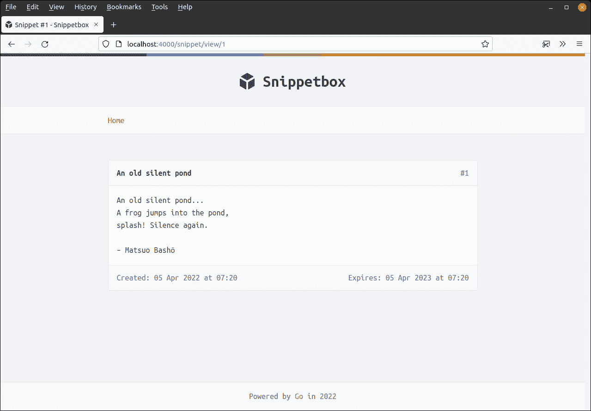

你还可以看到，使用不支持的 HTTP 方法的请求将遇到 `405 Method Not Allowed` 响应。例如，尝试使用 `curl` 对相同的 URL 发起 `POST` 请求：

```bash
$ curl -i -X POST http://localhost:4000/snippet/view/1
HTTP/1.1 405 Method Not Allowed
Allow: GET, OPTIONS
Content-Security-Policy: default-src 'self'; style-src 'self' fonts.googleapis.com; font-src fonts.gstatic.com
Content-Type: text/plain; charset=utf-8
Referrer-Policy: origin-when-cross-origin
X-Content-Type-Options: nosniff
X-Frame-Options: deny
X-Strict-Transport-Security
```

## 更多信息

### 冲突的路由模式

重要的是，`httprouter` 不允许可能匹配相同请求的*冲突路由模式*。因此，例如，你不能注册一个如 `GET /foo/new` 的路由以及另一个与之冲突的具名参数段或通配符参数路由——如 `GET /foo/:name` 或 `GET /foo/*name`。

在大多数情况下，这是一件好事。因为不允许冲突路由，你不需要担心路由优先级规则，并且减少了应用程序中出现 Bug 和意外行为的风险。

但如果你确实需要支持冲突路由（例如，为了向兼容可能需要完全复制现有应用程序的端点），那么我建议使用 `chi` 或 `gorilla/mux` —— 它们都允许冲突路由。

### 自定义 `httprouter` 行为

`httprouter` 包提供了一些配置选项，可以使用它们进一步自定义应用程序的行为，包括启用*斜杠重定向*和启用*自动 URL 路径清理*。

有关可用设置的更多信息可以在[此处](https://pkg.go.dev/github.com/julienschmidt/httprouter?tab=doc#Router)找到。

### RESTful 路由

如果你有 Ruby-on-Rails、Laravel 或类似框架的背景，可能会疑惑为什么我们不把路由和处理器结构得更符合“RESTful”风格，并且看起来像这样：

| Method | Pattern | Handler | Action |
| :--- | :--- | :--- | :--- |
| GET | `/snippets` | `snippetIndex` | 显示所有片段的列表 |
| GET | `/snippets/:id` | `snippetView` | 显示特定的片段 |
| GET | `/snippets/new` | `snippetNew` | 显示用于创建新片段的 HTML 表单 |
| POST | `/snippets` | `snippetCreate` | 创建一个新片段 |
| … | … | … | … |

这里有几个原因。

第一个原因是 `GET /snippets/:id` 和 `GET /snippets/new` 路由之间存在*冲突*——发往 `/snippets/new` 的 HTTP 请求可能会同时匹配到这两个路由（此时发往 `/snippets/new` 的请求会被匹配到第一个路由，其中 `id` 的值被设置为字符串 `"new"`）。如上文所述，`httprouter` 不允许冲突的路由模式，而且通常情况下避免它们也是一种良好的做法，因为它们是潜在的错误来源。

第二个原因是，在 `/snippets/new` 上展示的 HTML 表单在提交时需要 POST 到 `/snippets`。这意味着当我们重新渲染 HTML 表单以显示任何验证错误时，用户浏览器中的 URL 也会变为 `/snippets`。至于你是否认为这是一个问题，则因人而异（YMMV）。大多数用户不会看 URL，但我认为从用户体验（UX）的角度来说，这有点笨拙且困惑——尤其是如果 `/snippets` 的 `GET` 请求通常渲染的是其他内容（如所有片段列表）。

### Handler 命名

我想强调的是，在 Go 中为你的 handler 命名没有对错之分。

在这个项目中，我们将遵循一种约定：在任何处理 `POST` 请求的 handler 名称后加上单词“Post”。如下如下所示：

| Method | Pattern | Handler | Action |
| :--- | :--- | :--- | :--- |
| GET | `/snippet/create` | `snippetCreate` | 显示用于创建新片段的 HTML 表单 |
| POST | `/snippet/create` | `snippetCreatePost` | 创建一个新片段 |

或者，你也可以在显示表单的 handler 名称后加上单词“Form”或“View”，如下：

| Method | Pattern | Handler | Action |
| :--- | :--- | :--- | :--- |
| GET | `/snippet/create` | `snippetCreateForm` | 显示用于创建新片段的 HTML 表单 |
| POST | `/snippet/create` | `snippetCreate` | 创建一个新片段 |

甚至也可以在 handler 名称前加上单词“show”和“do”……

| Method | Pattern | Handler | Action |
| :--- | :--- | :--- | :--- |
| GET | `/snippet/create` | `showSnippetCreate` | 显示用于创建新片段的 HTML 表单 |
| POST | `/snippet/create` | `doSnippetCreate` | 创建一个新片段 |

基本上，在 Go 中你有自由去选择一种适合你且符合你思维习惯的命名规范。

# 第 8 章：处理表单

在本书的这一部分中，我们将关注允许 Web 应用程序的用户通过 HTML 表单创建新片段，表单看起来大致如下：

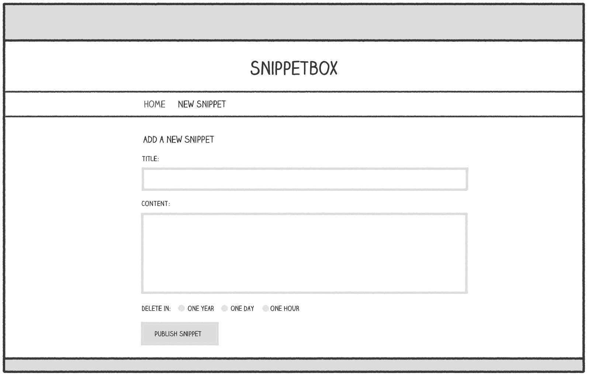

处理此表单的高级工作流将遵循标准的 `Post-Redirect-Get` 模式，如下：

1. 当用户向 `/snippet/create` 发起 `GET` 请求时，将显示一个空白表单。
2. 用户完成表单，并通过向 `/snippet/create` 发起的 `POST` 请求提交到服务器。
3. 表单数据将由我们的 `snippetCreatePost` handler 进行验证。如果发生任何验证失败，表单将重新显示并突出显示相应的表单字段。如果通过了我们的验证检查，新片段的数据将添加到数据库中，然后我们将用户重定向到 `"/snippet/view/:id"`。

在此过程中，你将学习到：

* 如何解析并访问 `POST` 请求中发送的表单数据。
* 对表单数据执行常用验证检查的一些技术。
* 一种用户友好的模式，用于提醒用户验证失败并使用之前提交的数据重新填充表单字段。
* 如何通过使用用于表单处理和验证的辅助函数来保持你的 handler 整洁](#08.05-creating-validation-helpers.xhtml)。

## 第 8.1 节：设置 HTML 表单

让我们先创建一个新的 `ui/html/pages/create.tmpl` 文件来存放表单的 HTML 代码……

```bash
$ touch ui/html/pages/create.tmpl
```

……然后添加以下标记，使用我们在书中之前用过的相同模式：

文件：`ui/html/pages/create.tmpl`

```html
{{define "title"}}Create a New Snippet{{end}}

{{define "main"}}
<form action='/snippet/create' method='POST'>
    <div>
        <label>Title:</label>
        <input type='text' name='title'>
    </div>
    <div>
        <label>Content:</label>
        <textarea name='content'></textarea>
    </div>
    <div>
        <label>Days until:</label>
        <input type='text' name='expires'>
    </div>
    <input type='submit' value='Publish'>
</form>
{{end}}
```

目前还没有特别特殊。我们的 `main` 模板包含了三个值：`title`、`content` 和 `expires`（过期天数）。现在我们在导航栏中添加“Create snippet”链接。

文件：`ui/html/partials/nav.tmpl`

```html
{{define "nav"}}
<nav>
    <a href='/'>Home</a>
    <a href='/snippet/create'>Create snippet</a>
</nav>
{{end}}
```

最后，我们需要更新 `snippetCreate` handler 以渲染新页面：

文件：`cmd/web/handlers.go`

```go
...

func (app *application) snippetCreate(w http.ResponseWriter, r *http.Request) {
    data := app.newTemplateData(r)

    app.render(w, http.StatusOK, "create.tmpl", data)
}

...
```

此时你可以启动应用程序并在浏览器中访问 `http://localhost:4000/snippet/create`。你应该看到一个这样的表单：


## 第 8.2 节：解析表单数据

感谢于我们之前在高级路由章节中所做的工作，任何 `POST /snippets/create` 请求已分发到我们的 `snippetCreatePost` handler。现在我们将更新此 handler 以处理并使用提交的表单数据。

在高级层面，我们可以将其分为两个不同的步骤。

1. 首先，我们需要使用 `r.ParseForm()`(https://pkg.go.dev/net/http/#Request.ParseForm) 方法解析请求体。该方法检查请求体格式是否正确，并将表单数据存储在请求的 [`r.PostForm`](https://pkg.go.dev/net/http/#Request.PostForm) map 中。如果在解析时遇到任何错误（例如没有主体或主体太大无法处理），它将返回错误。`r.ParseForm()` 方法也是幂等的；可以在同一个请求上安全地多次调用而不产生副作用。
2. 然后我们可以通过使用 `r.PostForm.Get()` 方法获取 `r.PostForm` 中包含的表单数据。例如，我们可以通过 `r.PostForm.Get("title")` 获取标题 字段的值。如果表单中没有匹配的字段名，它将返回空字符串 `""`，与书中之前处理查询参数的方式类似。

打开你的 `cmd/web/handlers.go` 文件并更新以包含以下代码：

```go
package main

...

func (app *application) snippetCreatePost(w http.ResponseWriter, r *http.Request) {
    // 首先我们调用 r.ParseForm()，它会将 POST 请求体中的任何数据
    // 添加到 r.PostForm 映射中。PUT 和 PATCH 请求也以相同的方式工作。
    // 如果发生任何错误，我们使用 app.ClientError() 辅助函数
    // 向用户发送 400 Bad Request 响应。
    err := r.ParseForm()
    if err != nil {
        app.clientError(w, http.StatusBadRequest)
        return
    }

    // 使用 r.PostForm.Get() 方法从 r.PostForm 映射中
    // 检索标题和内容。
    title := r.PostForm.Get("title")
    content := r.PostForm.Get("content")

    // r.PostForm.Get() 方法始终将表单数据作为 *string* 返回。
    // 然而，我们期望 expires 的值是一个数字，并希望在
    // Go 代码中将其表示为整数。因此，我们需要使用 strconv.Atoi()
    // 手动将表单数据转换为整数，如果转换失败，我们将发送 400
    // Request 响应。
    expires, err := strconv.Atoi(r.PostForm.Get("expires"))
    if err != nil {
        app.clientError(w, http.StatusBadRequest)
        return
    }

    id, err := app.snippets.Insert(title, content, expires)
    if err != nil {
        app.serverError(w, err)
        return
    }

    http.Redirect(w, r, fmt.Sprintf("/snippet/view/%d", id), http.StatusSeeOther)
}
```

好了，让我们尝试一下吧！重启应用程序并尝试在表单中填写代码片段的标题和内容，如下：

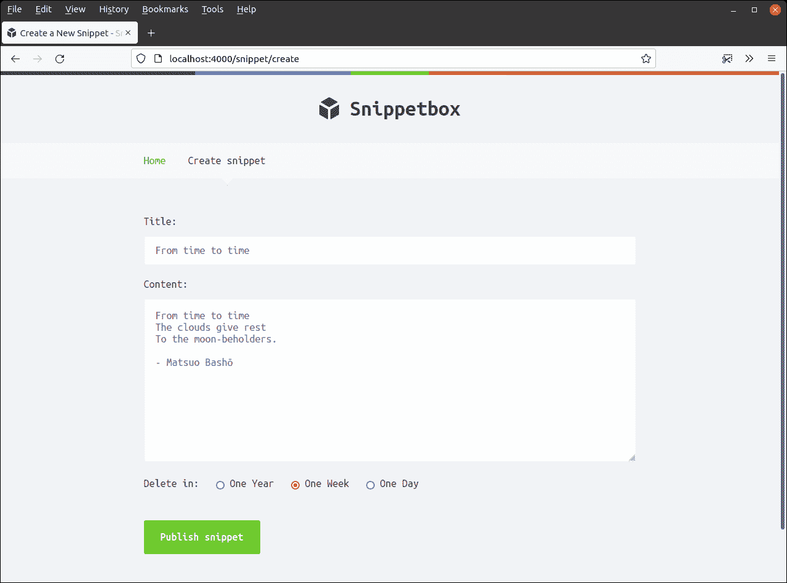

然后提交表单。如果一切运行正常，你应该会被重定向到一个显示新代码片段的页面，如下：

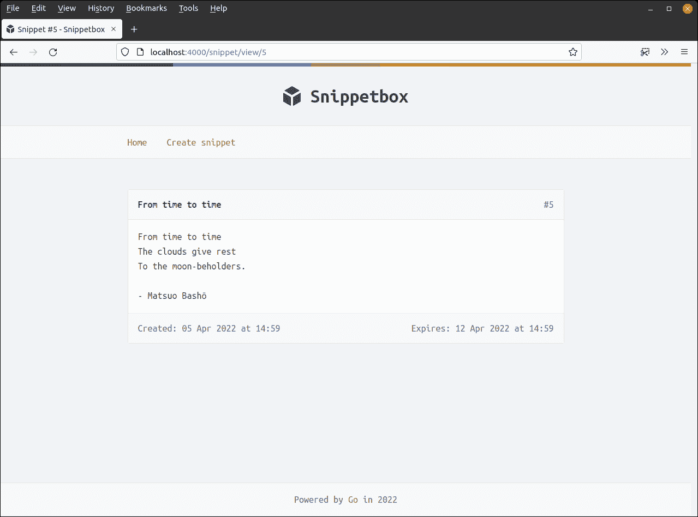

***

### 附加信息

#### `r.Form` 映射

在上面的代码中，我们通过 `r.PostForm` 映射访问表单值。但另一种方法是使用（略有不同的）`r.Form` 映射。

`r.PostForm` 映射仅在 `POST`、`PATCH` 和 `PUT` 请求时填充，并包含请求体中的表单数据。

相比之下，`r.Form` 映射会在所有请求（无论其 HTTP 方法）时被填充，并包含任何请求体和任何查询字符串参数。因此，如果我们的表单提交到 `/snippet/create?foo=bar`，我们也可以通过调用 `r.Form.Get("foo")` 获取 `foo` 参数的值。注意，在发生冲突时，请求体的值将优先于查询字符串参数。

如果你的应用程序在 HTML 表单和 URL 中发送数据，或者你有一个不不在乎参数传递方式的应用程序，那么使用 `r.Form` 映射可能会很有用。但在我们的情况下，这些情况并不适用。我们期望表单数据仅在请求体中发送，因此通过 `r.PostForm` 访问它是符合逻辑的。

#### `FormValue` 和 `PostFormValue` 方法

`net/http` 包还提供了方法 [`r.FormValue()`](https://pkg.go.dev/net/http/#Request.FormValue) 和 [`r.PostFormValue()`](https://pkg.go.dev/net/http/#Request.PostFormValue)。这些本质上是快捷函数，它们会为你调用 `r.ParseForm()`，然后分别从 `r.Form` 或 `r.PostForm` 获取相应的字段值。

我建议避免使用这些快捷方法，因为它们会`静默忽略任何由 r.ParseForm() 返回的错误`。这并不理想——意味着我们的应用程序可能会遇到错误并导致用户端失败，但没有反馈机制让他们知道。

#### 多值字段

严格来说，我们上面使用的 `r.PostForm.Get()` 方法只返回特定表单字段的第一个值。这意味着你不能将它用于可能发送多个值的表单字段，例如复选框组。

```
<input type="checkbox" name="items" value="foo"> Foo
<input type="checkbox" name="items" value="bar"> Bar
<input type="checkbox" name="items" value="baz"> Baz
```

在这种情况下，你将需要直接处理 `r.PostForm` 映射。`r.PostForm` 映射的底层类型是 [`url.Values`](https://pkg.go.dev/net/url/#Values)，它的底层类型是 `map[string][]string`。因此，对于具有多个值的字段，你可以遍历底层映射来访问它们，如下：

```
for i, item := range r.PostForm["items"] {
    fmt.Fprintf(w, "%d: Item %s\n", i, item)
}
```

#### 限制表单大小


除非你发送多部分数据（即你的表单具有 `enctype="multipart/form-data"` 属性），否则 `POST`、`PUT` 和 `PATCH` 请求体被限制为 10MB。如果超过此限制，`r.ParseForm()` 将返回错误。

如果你想更改此限制，可以使用 [`http.MaxBytesReader()`](https://pkg.go.dev/net/http/#MaxBytesReader) 函数，如下：

```go
// 限制请求体大小为 4096 字节
r.Body = http.MaxBytesReader(w, r.Body, 4096)

err := r.ParseForm()
if err != nil {
    http.Error(w, "Bad Request", http.StatusBadRequest)
    return
}
```

在 `r.ParseForm()` 期间，只会读取请求体的前 4096 字节。尝试读取超过此限制会导致 `MaxBytesReader` 返回错误，该错误会被 `r.ParseForm()` 暴露。

此外——如果触发了限制——`MaxBytesReader` 会在 `http.ResponseWriter` 上设置一个标记，指示服务器关闭底层 TCP 连接。

## 8.3. 验证表单数据

现在我们的代码中有一个明显的问题：我们没有以任何方式对来自表单的（不可信的）用户输入进行验证。我们应该这样做以确保表单数据存在、类型正确，并符合我们的任何业务规则。

具体对于这个表单，我们希望：

*   检查 `title` 和 `content` 字段是否为空。
*   检查 `title` 字段长度是否超过 100 个字符。
*   检查 `expires` 值是否精确匹配我们允许的值之一（`1`、`7` 或 `365` 天）。

所有这些检查都可以使用 Go 的 `if` 语句以及 Go [`strings`](https://pkg.go.dev/strings/) 和 [`unicode/utf8`](https://pkg.go.dev/unicode/utf8/) 包中的各种函数来相当直接地实现。

打开你的 `handlers.go` 文件并更新 `snippetCreatePost` 处理程序以包含适当的验证规则，如下：

文件：`cmd/web/handlers.go`

```go
package main

import (
    "errors"
    "fmt"
    "net/http"
    "strconv"
    "strings"      // 新导入
    "unicode/utf8" // 新导入

    "snippetbox.alexedwards.net/internal/models"

    "github.com/julienschmidt/httprouter"
)

...

func (app *application) snippetCreatePost(w http.ResponseWriter, r *http.Request) {
    err := r.ParseForm()
    if err != nil {
        app.clientError(w, http.StatusBadRequest)
        return
    }

    title := r.PostForm.Get("title")
    content := r.PostForm.Get("content")

    expires, err := strconv.Atoi(r.PostForm.Get("expires"))
    if err != nil {
        app.clientError(w, http.StatusBadRequest)
        return
    }

    // Initialize a map to hold any validation errors for the form fields.
    fieldErrors := make(map[string]string)

    // Check that the title value is not blank and is not more than 100
    // characters long. If it fails either of those checks, add a message to the
    // errors map using the field name as the key.
    if strings.TrimSpace(title) == "" {
        fieldErrors["title"] = "This field cannot be blank"
    } else if utf8.RuneCountInString(title) > 100 {
        fieldErrors["title"] = "This field cannot be more than 100 characters long"
    }

    // Check that the Content value isn't blank.
    if strings.TrimSpace(content) == "" {
        fieldErrors["content"] = "This field cannot be blank"
    }

    // Check the the expires value matches one of the permitted values (1, 7 or
    // 365).
    if expires != 1 && expires != 7 && expires != 365 {
        fieldErrors["expires"] = "This field must equal 1, 7 or 365"
    }

    // If there are any errors, dump them in a plain text HTTP response and
    // return from the handler.
    if len(fieldErrors) > 0 {
        fmt.Fprint(w, fieldErrors)
        return
    }

    id, err := app.snippets.Insert(title, content, expires)
    if err != nil {
        app.serverError(w, err)
        return
    }

    http.Redirect(w, r, fmt.Sprintf("/snippet/view/%d", id), http.StatusSeeOther)
}
```

好了，让我们尝试一下！重启应用程序，并尝试提交一个带有过长的片段标题和空白内容字段的表单，就像这样……

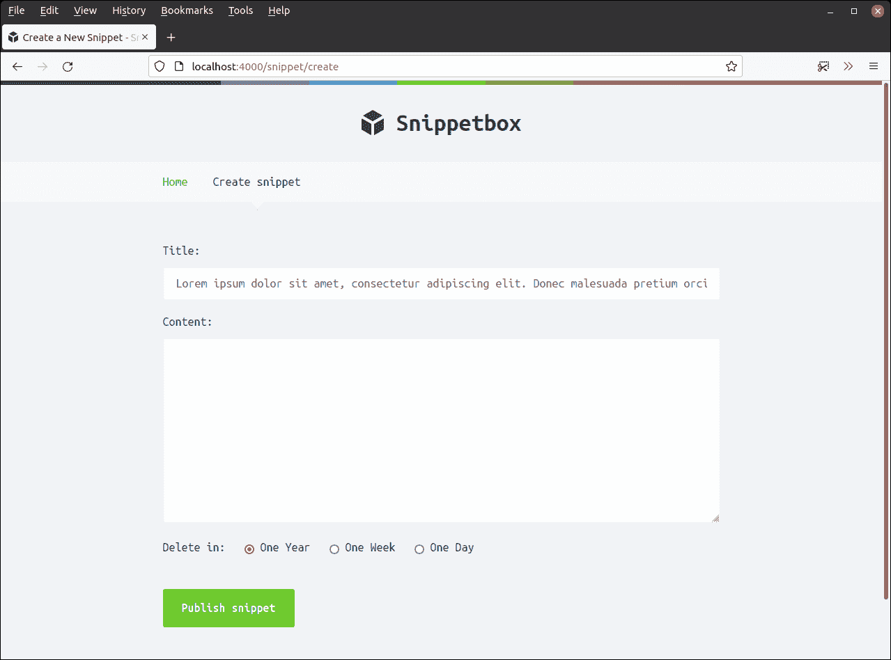

你应该能看到相应的验证失败消息的输出，如下所示：

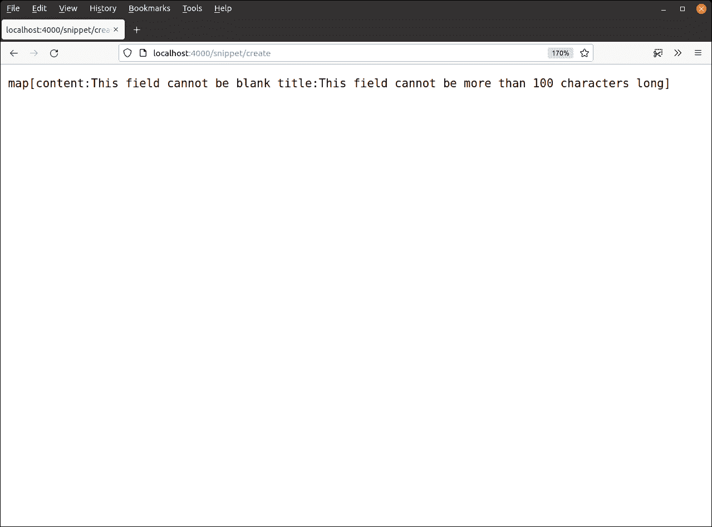

## 8.4. 显示错误并重新填充字段

现在 `snippetCreatePost` 处理器正在对数据进行验证，下一个阶段是优雅地管理这些验证错误。

如果存在任何验证错误，我们需要重新显示 HTML 表单，高亮显示失败的字段，并自动重新填充之前提交的数据（这样用户就不需要再次输入了）。

为了实现这一点，让我们先向 `templateData` 结构体添加一个新的 `Form` 字段：

文件：`cmd/web/templates.go`

```go
package main

import (
    "html/template"
    "path/filepath"
    "time"

    "snippetbox.alexedwards.net/internal/models"
)

// 添加一个类型为 "any" 的 Form 字段。
type templateData struct {
    CurrentYear int
    Snippet     *models.Snippet
    Snippets    []*models.Snippet
    Form        any
}

...
```

我们将使用这个 `Form` 字段在重新显示表单时，将验证错误和之前提交的数据传回模板。

接下来，回到 `cmd/web/handlers.go` 文件，定义一个新的 `snippetCreateForm` 结构体类型来存储表单数据和任何验证错误，并更新我们的 `snippetCreatePost` 处理器以使用它。

如下所示：

文件：`cmd/web/handlers.go`

```go
package main

...

// 定义一个 snippetCreateForm 结构体来表示表单数据和
// 表单字段的验证错误。注意，所有的结构体字段都刻意
// 导出了（即以大写字母开头）。这是因为结构体字段必须
// 导出才能被 html/template 包在渲染模板时进行读取。
type snippetCreateForm struct {
    Title       string
    Content     string
    Expires     int
    FieldErrors map[string]string
}

func (app *application) snippetCreatePost(w http.ResponseWriter, r *http.Request) {
    err := r.ParseForm()
    if err != nil {
        app.clientError(w, http.StatusBadRequest)
        return
    }

    // 正常地从表单中获取 expires 值。
    expires, err := strconv.Atoi(r.PostForm.Get("expires"))
    if err != nil {
        app.clientError(w, http.StatusBadRequest)
        return
    }

    // 创建一个 snippetCreateForm 实例，包含来自表单的值
    // 以及用于验证错误的映射。
    form := snippetCreateForm{
        Title:       r.PostForm.Get("title"),
        Content:     r.PostForm.Get("content"),
        Expires:     expires,
        FieldErrors: map[string]string{},
    }

    // 更新验证检查，以便它们作用于
    // form 实例。
    if strings.TrimSpace(form.Title) == "" {
        form.FieldErrors["title"] = "This field cannot be blank"
    } else if utf8.RuneCountInString(form.Title) > 100 {
        form.FieldErrors["title"] = "This field cannot be more than 100 characters long"
    }

    if strings.TrimSpace(form.Content) == "" {
        form.FieldErrors["content"] = "This field cannot be blank"
    }

    if expires != 1 && expires != 7 && expires != 365 {
        form.FieldErrors["expires"] = "This field must equal 1, 7 or 365"
    }

    // 如果存在任何验证错误，重新显示 create.tmpl 模板
    // 并传入 Form 字段。注意我们在发送响应时
    // 使用 422 Unprocessable Entity 状态码。
    if len(form.FieldErrors) > 0 {
        data := app.newTemplateData(r)
        data.Form = form
        app.render(w, http.UnprocessableEntity, "create.tmpl", data)
        return
    }

    // 我们还需要更新此行，将 snippetCreateForm
    // 数据传递给我们的 Insert 方法。
    id, err := app.snippets.Insert(form.Title, form.Content, form.Expires)
    if err != nil {
        app.serverError(w, err)
        return
    }

    http.Redirect(w, r, fmt.Sprintf("/snippet/view/%d", id), http.StatusSeeOther)
}
```

好了，现在当存在任何验证错误时，我们都会重新显示 `create.tmpl` 模板，通过模板数据的 `Form` 字段传入之前的数据和验证错误（`snippetCreateForm`）。

如果你愿意，现在可以运行程序，代码应该可以无错误编译。

### 更新 HTML 模板

接下来我们需要做的另一件事是更新我们的 `create.tmpl` 模板，以显示验证错误并重新填充任何之前的数据。

重新填充表单数据很容易——我们应该能够使用类似 `{{.Form.Title}}` 和 `{{.Form.Content}}` 的标签进行渲染，就像我们在书中之前显示片段数据一样。

对于验证错误，我们 `FieldErrors` 字段的底层类型是 `map[string]string`，它使用表单字段名作为键。对于映射，可以通过链式键名访问给定键的值。因此，例如，要在模板中渲染 `title` 字段的验证错误，我们可以使用标签 `{{.Form.FieldErrors.title}}`。

考虑到这一点，让我们更新 `create.tmpl` 文件，重新填充数据并显示每个字段的错误消息（如果存在的话）。

文件：`ui/html/pages/create.tmpl`


```go
{{define "title"}}创建新代码片段{{end}}

{{define "main"}}
<form action='/snippet/create' method='POST'>
    <div>
        <label>Title:</label>
        <!-- Use the `with` action to render the value of .Form.FieldErrors.title
        if it is not empty. -->
        {{with .Form.FieldErrors.title}}
            <label class='error'>{{.}}</label>
        {{end}}
        <!-- Re-populate the title data by setting the `value` attribute. -->
        <input type='text' name='title' value='{{.Form.Title}}'>
    </div>
    <div>
        <label>Content:</label>
        <!-- Likewise render the value of .Form.FieldErrors.content if it is not
        empty. -->
        {{with .Form.FieldErrors.content}}
            <label class='error'>{{.}}</label>
        {{end}}
        <!-- Re-populate the content data as the inner HTML of the textarea. -->
        <textarea name='content'>{{.Form.Content}}</textarea>
    </div>
    <div>
        <label>Delete in:</label>
        <!-- And render the value of .Form.FieldErrors.expires if it is not empty. -->
        {{with .Form.FieldErrors.expires}}
            <label class='error'>{{.}}</label>
        {{end}}
        <!-- Here we use the `if` action to check if the value of the re-populated
        expires field equals 365. If it does, then we render the `checked`
        attribute so that the radio input is re-selected. -->
        <input type='radio' name='expires' value='365' {{if (eq .Form.Expires 365)}}checked{{end}}> 一年
        <!-- And we do the same for the other possible values too... -->
        <input type='radio' name='expires' value='7' {{if (eq .Form.Expires 7)}}checked{{end}}> 一周
        <input type='radio' name='expires' value='1' {{if (eq .Form.Expires 1)}}checked{{end}}> 一天
    </div>
    <div>
        <input type='submit' value='Publish snippet'>
    </div>
</form>
{{end}}
```

希望这些标记以及我们对 Go 模板动作的使用是清晰的——这只是在使用了我们在书前面的部分见过并讨论过的技巧。

我们还有最后一件事需要做。如果我们现在尝试运行应用程序，当我们第一次访问 [`http://localhost:4000/snippet/create`](http://localhost:4000/snippet/create) 表单时，将会得到一个 `500 Internal Server Error`。这是因为我们的 `snippetCreate` 处理器目前没有为 `templateData.Form` 字段设置值，这意味着当 Go 尝试评估像 `{{with .Form.FieldErrors.title}}` 这样的模板标签时，将导致错误，因为 `Form` 是 `nil`。

让我们通过更新 `snippetCreate` 处理器来修复这个问题，使其初始化一个新的 `createSnippetForm` 并将其传递给模板，如下所示：

文件：`cmd/web/handlers.go`

```go
package main

...

func (app *application) snippetCreate(w http.ResponseWriter, r *http.Request) {
    data := app.newTemplateData(r)

    // 初始化一个新的 createSnippetForm 并将其传递给模板。// 注意，这也是设置表单任何
    // 默认值的绝佳机会在这里在这里我们设置了过期
    // 时间的初始值为 365 天。
    data.Form = snippetCreateForm{

    app.render(w, http.StatusOK, "snippet/create", data)
}
```

重启应用程序并访问 `http://localhost:4000/snippet/create`。你应该能看到表单，并且“一年”单选框是被选中的。

```go
package main

import (
    "errors"
    "fmt"
    "net/http"
    "strconv"

    "snippetbox.alexedwards.net/internal/models"
    "snippetbox.alexedwards.net/internal/validator" // 新导入

    "github.com/julienschmidt/httprouter"
)

...

// 显式的 FieldErrors 结构体字段，而是而是嵌入 Validator 类型。
// 嵌入意味着我们的 snippetCreateForm “继承”了 Validator 
// 类型的所有字段和方法（包括 FieldErrors 字段）。
type snippetCreateForm struct {
    Title               string 
    Content             string 
    Expires             int    
    validator.Validator
}

func (app *application) snippetCreatePost(w http.ResponseWriter, r *http.Request) {
    err := r.ParseForm()
    if err != nil {
        app.clientError(w, http.StatusBadRequest)
        return
    }

    expires, err := strconv.Atoi(r.PostForm.Get("expires"))
    if err != nil {
        app.clientError(w, http.StatusBadRequest)
        return
    }

    form := snippetCreateForm{
        Title:   r.PostForm.Get("title"),
        Content: r.PostForm.Get("content"),
        Expires: expires,
        // 从这里删除 FieldErrors 赋值。
    }

    // 因为 Validator 类型被 snippetCreateForm 结构体嵌入，
    // 我们可以直接在上面调用 CheckField() 来执行我们的验证检查。
    // 如果检查结果为假，CheckField() 将将提供的键和错误消息
    // 添加到 FieldErrors 映射中。例如，在这里的
    // 第一行中我们“检查 form.Title 字段是否为空”。在
    // 第二行中，我们“检查 form.Title 字段的最大字符
    // 长度为 100”，以此类推。
    form.CheckField(validator.NotBlank(form.Title), "title", "此字段不能为空")
    form.CheckField(validator.MaxChars(form.Title, 100), "title", "此字段长度不能超过 100 个字符")
    form.CheckField(validator.NotBlank(form.Content), "content", "此字段不能为空")
    form.CheckField(validator.PermittedInt(form.Expires, 1, 7, 365), "expires", "此字段必须等于 1、7 或 365")

    // 使用 Valid() 方法查看是否任何检查失败了。如果失败了，
    // 则像以前一样传递表单数据并重新渲染模板。
    if !form.Valid() {
        data := app.newTemplateData(r)
        data.Form = form
        app.render(w, http.StatusUnprocessableEntity, "create.tmpl", data)
        return
    }

    id, err := app.snippets.Insert(form.Title, form.Content, form.Expires)
    if err != nil {
        app.serverError(w, err)
        return
    }

    http.Redirect(w, r, fmt.Sprintf("/snippet/view/%d", id), http.StatusSeeOther)
}
```

所以这一切正井井条地变得非常完美。

我们现在有了一个 `internal/validator` 包，其中包含了可以在应用程序中复用的验证规则和逻辑，并且将来可以轻松扩展以包含额外的规则。表单数据和错误都整齐地封装在单个 `snippetCreateForm` 结构体中——我们可以轻松地将其传递给模板——而且在模板中显示错误消息和重新填充数据的 API 既简单又一致。

如果你愿意，现在可以重新运行应用程序了。如果一切顺利，你应该会发现表单和验证规则运行正常，且工作方式与之前完全相同。

第 8.6 节。

## 自动表单解析

我们可以简化处理函数的另一个方法是使用第三方包，如 [`go-playground/form`](https://github.com/go-playground/form) 或 [`gorilla/schema`](https://github.com/gorilla/schema)，自动将表单数据解码到 `createSnippetForm` 结构体中。使用自动解码器是完全可选的，但它可以帮助你节省时间和打字量——特别是当你的应用程序有很多表单，或者你需要处理一个非常大的表单时。

在本章中，我们将查看如何使用 `go-playground/form` 包。如果你正在跟随学习，请按照以下方式安装它：

```
$ go get github.com/go-playground/form/v4@v4
go get: added github.com/go-playground/form/v4 v4.2.0
```

### 使用表单解码器

为了让其工作，我们需要做的第一件事是在 `main.go` 文件初始化一个新的 [`*form.Decoder`](https://pkg.go.dev/github/com/go-playground/form?utm_source=godoc#Decoder) 实例，并将其作为依赖提供给我们的处理函数。如下：

文件：`cmd/web/main.go`

```go
package main

import (
    "database/sql"
    "flag"
    "html/template"
    "log"
    "net/http"
    "os"

    "snippetbox.alexedwards.net/internal/models"

    "github.com/go-playground/form/v4" // 新导入
    _ "github.com/sql-driver/mysql"
)

// 添加 formDecoder 字段以持有 Decoder 的指针。
type application struct {
    errorLog      *log.Logger
    infoLog       *log.Logger
    snippets      *models.SnippetModel
    templateCache map[string]*template.Template
    formDecoder   *form.Decoder
}

func main() {
    addr := flag.String("addr", ":4000", "HTTP 网络地址")
    dsn := flag.String("dsn", "web:pass@/snippetbox?parseTime=true", "MySQL 数据源名称")

    flag.Parse()

    infoLog := log.New(os.Stdout, "INFO\t", log.Ldate|log.Ltime)
    errorLog := log.New(os.Stderr, "ERROR\t", log.Ldate|log.Ltime|log.shortfile)

    db, err := openDB(*dsn)
    if err != nil {
        errorLog.Fatal(err)
    }
    defer db.Close()

    templateCache, err := newTemplateCache()
    if err != nil {
        errorLog.Fatal(err)
    }

    // 初始化解码器实例...
    formDecoder := form.NewDecoder()

    // 并将其添加到应用程序依赖中。
    app := &application{
        errorLog:      errorLog,
        infoLog:       infoLog,
        snippets:      &models.SnippetModel{DB: db},
        templateCache: templateCache,
        formDecoder:   formDecoder,
    }

    srv := &http.Server{
        Addr:     *addr,
        ErrorLog: errorLog,
        Handler:  app.routes(),
    }

    infoLog.Printf("Starting server on %s", *addr)
    err = srv.ListenAndServe()
    errorLog.Fatal(err)
}
```

...

接下来进入 `cmd/web/handlers.go` 文件并更新它以使用这个新的解码器，如下：

文件：`cmd/web/handlers.go`


```go
package main

...

// 更新我们的 `snippetCreateForm` 结构体以包含结构体标签，告诉解码器
// 如何将 HTML 表单值映射到不同的结构体字段。例如，
// 我们在这里告诉解码器将名称为 "title" 的 HTML 表单输入的值
// 在 `Title` 字段中。结构体标签 `form:"-"` 
// 告诉解码器在解码期间完全忽略该字段。
type snippetCreateForm struct {
    Title               string `form:"title"`
    Content             string `form:"content"`
    Expires             int    `form:"expires"`
    validator.Validator `form:"-"`
}

func (app *application) snippetCreatePost(w http.ResponseWriter, r *http.Request) {
    err := r.ParseForm()
    if err != nil {
        app.clientError(w, http.StatusBadRequest)
        return
    }

    // 声明 `snippetCreateForm` 结构体的新空实例。
    var form snippetCreateForm

    // 调用表单解码器的 `Decode()` 方法，传入当前请求
    // 以及我们 `snippetCreateForm` 结构体的*指针*。这本质上
    // 将来自 HTML 表单的相关值填充到我们的结构体。
    // 如果出现问题，我们向客户端返回 `400 Bad Request` 响应。
    err = app.formDecoder.Decode(&form, r.PostForm)
    if err != nil {
        app.clientError(w, http.StatusBadRequest)
        return
    }

    // 然后正常地进行验证并使用数据...
    form.CheckField(validator.NotBlank(form.Title), "title", "此字段不能为空")
    form.CheckField(validator.MaxChars(form.Title, 100), "title", "此字段不能超过 100 个字符")
    form.CheckField(validator.NotBlank(form.Content), "content", "此字段不能为空")
    form.CheckField(validator.PermittedInt(form.Expires, 1, 7, 365), "expires", "此字段必须等于 1, 7 或 365")

    if !form.Valid() {
        data := app.newTemplateData(r)
        data.Form = form
        app.render(w, http.StatusUnprocessableEntity, "create.tmpl", data)
        return
    }

    id, err := app.snippets.Insert(form.Title, form.Content, form.Expires)
    if err != nil {
        app.serverError(w, err)
        return
    }

    http.Redirect(w, r, fmt.Sprintf("/snippet/view/%d", id), http.StatusSeeOther)
}
```

希望你能够看到这种模式的用处。我们可以使用简单的结构体标签来定义 HTML 表单与“目标”数据字段之间的映射，而将表单数据解包到目标位置现在只需要我们编写几行代码——无论表单有多大。

重要的是，类型转换也会被自动处理。我们从上面的代码中看到这一点，其中 `expires` 值被自动映射到 `int` 数据类型。

这确实非常棒。但存在一个问题。

当我们调用 `app.formDecoder.Decode()` 时，它需要一个*非空指针*作为目标终点。如果我们尝试传入一个*不是*非空指针的内容，那么 `Decode()` 将返回一个 [`form.InvalidDecoderError`](https://pkg.go.dev/github.com/go-playground/form/v4#InvalidDecoderError) 错误。

如果发生这种情况，这是我们应用程序代码的关键问题（而不是由于输入错误的客户端错误）。因此，我们需要专门检查此错误并作为特殊情况进行处理，而不是仅仅返回 `400 Bad Request` 响应。

### 创建一个 `decodePostForm` 辅助函数

为了协助，让我们创建一个新的 `decodePostForm()` 辅助函数，它执行三件事：

*   在当前请求上调用 `r.ParseForm()`。

*   调用 `app.formDecoder.Decode()` 将 HTML 表单数据解包到目标终点。

*   检查 `form.InvalidDecoderError` 错误，如果看到它，则触发 panic。

如果你正在跟着操作，请按照如下所示将此内容添加到你的 `cmd/web/helpers.go` 文件中

文件：`cmd/web/helpers.go`

```go
package main

import (
    "bytes"
    "errors"
    "fmt"
    "net/http"
    "runtime/debug"
    "time"

    "github.com/go-playground/form/v4" // 新导入
)

...

// 创建一个新的 `decodePostForm()` 辅助方法。这里的第二个参数 `dst`，
// 是我们想要将表单数据解码到的目标终点。
func (app *application) decodePostForm(r *http.Request, dst any) error {
    // 在请求上调用 `ParseForm()`，就像我们在 `createSnippetPost`
    // 处理函数中所做的那样。
    err := r.ParseForm()
    if err != nil {
        return err
    }

    // 在我们的解码器实例上调用 `Decode`，将目标终点作为
    // 第一个参数传入
    err = app.formDecoder.Decode(dst, r.PostForm)
    if err != nil {
        // 如果我们尝试使用无效的目标终点，`Decode()` 方法
        // 将返回一个类型为 `*form.InvalidDecoderError` 的错误。
        var invalidDecoderError *form.InvalidDecoderError
        if errors.As(err, &invalidDecoderError) {
            panic(invalidDecoderError)
        }

        // 对于其他错误，我们正常返回它们。
        return err
    }

    return nil
}
```

完成这些后，我们可以对 `snippetCreatePost` 处理函数进行最后的简化。更新它使用 `decodePostForm` 并移除 `r.ParseForm()` 调用，因此代码如下：

文件：`cmd/web/handlers.go`

```go
func (app *application) snippetCreatePost(w http.ResponseWriter, r *http.Request) {
    var form snippetCreateForm

    err := app.decodePostForm(r, &form)
    if err != nil {
        app.clientError(w, http.StatusBadRequest)
        return
    }

    form.CheckField(validator.NotBlank(form.Title), "title", "此字段不能为空")
    form.CheckField(validator.MaxChars(form.Title, 100), "title", "此字段不能超过 100 个字符")
    form.CheckField(validator.NotBlank(form.Content), "content", "此字段不能为空")
    form.CheckField(validator.PermittedInt(form.Expires, 1, 7, 365), "expires", "此字段必须等于 1, 7 或 365")

    if !form.Valid() {
        data := app.newTemplateData(r)
        data.Form = form
        app.render(w, http.StatusUnprocessableEntity, "create.tmpl", data)
        return
    }

    id, err := app.snippets.Insert(form.Title, form.Content, form.Expires)
    if err != nil {
        app.serverError(w, err)
        return
    }

    http.Redirect(w, r, fmt.Sprintf("/snippet/view/%d", id), http.StatusSeeOther)
}
```

## 选择会话管理器

在处理会话时，有许多[安全考虑](https://cheatsheetseries.owasp.org/cheatsheets/Session_Management_Cheat_Sheet.html)，正确的实现并非易事。除非你真的需要自己实现，否则使用现有的、经过良好测试的第三方包是个好主意。

根据项目需求，我建议使用 [`gorilla/sessions`](https://github.com/gorilla/sessions) 或 [`alexedwards/scs`](https://github.com/alexedwards/scs)。

*   `gorilla/sessions` 是 Go 语言中最为成熟且广为人知的会话管理包。它提供了简单易用的 API，并允许你将会话数据存储在客户端（通过签名和加密的 cookie）或服务器端（在 MySQL、PostgreSQL 或 Redis 等数据库中）。

    但是——重要的一点——它没有提供更新会话 ID 的机制（如果你使用其中一种服务端会话存储器，该机制对于降低[与会话固定攻击相关的风险](https://cheatsheetseries.owasp.org/cheatsheets/Session_Management_Cheat_Sheet.html#renew-the-session-id-after-any-privilege-level-change) 是必要的）。

*   `alexedwards/scs` 允许你仅在服务端存储会话数据。它支持通过中间件自动加载和保存会话数据，拥有良好的接口用于类型安全的数据操作，并且*允许*更新会话 ID。与 `gorilla/sessions` 类似，它也支持多种数据库（包括 MySQL、PostgreSQL 和 Redis）。

总结来说，如果你想通过 cookie 在客户端存储会话数据，`gorilla/sessions` 是一个不错的选择；否则，由于能够更新会话 ID 功能，`alexedwards/scs` 通常是更好的选择。

对于此项目，我们已经设置好了 MySQL 数据库，因此我们将选择使用 `alexedwards/scs` 将会话数据存储在 MySQL 服务端。

如果你正在跟随操作，请确保你处于项目目录，并按照如下命令安装必要的包：

```
$ go get github.com/alexedwards/scs/v2@v2
go: downloading github.com/alexedwards/scs/v2 v2.5.0
go get: added github.com/alexedwards/scs/v2 v2.5.0

$ go get github.com/alexedwards/scs/mysqlstore
go: downloading github.com/alexedwards/scs/mysqlstore v0.0.0-20220216073957-c252878bcf5a
go get: added github.com/alexedwards/scs/mysqlstore v0.0.0-20220216073957-c252878bcf5a
```

第 9.2 节。

## 设置会话管理器

在本章中，我将介绍设置和使用 `alexedwards/scs` 包的过程，但如果你打算在生产环境的应用中使用它，我建议阅读[文档](https://github.com/alexedwards/scs) 和 [API 参考](https://pkg.go.dev/github.com/alexedwards/scs/v2)以熟悉其全部功能。

我们需要做的第一件事是在 MySQL 数据库中创建一个 `sessions` 表，用于存储用户的会话数据。首先在终端窗口以 `root` 用户身份连接 MySQL，并执行以下 SQL 语句来建立 `sessions` 表：

```sql
USE snippetbox;

CREATE TABLE sessions (
    token CHAR(43) PRIMARY KEY,
    data BLOB NOT NULL,
    expiry TIMESTAMP(6) NOT NULL
);

CREATE INDEX sessions_expiry_idx ON sessions (expiry);
```

在此表中：

*   `token` 字段将包含每个会话的唯一、随机生成的标识符。

*   `data` 字段将包含你想要在 HTTP 请求之间共享的实际会话数据。它以*二进制数据*的形式存储在 `BLOB`（二进制大对象）类型中。

*   `expiry` 字段将包含会话的过期时间。`scs` 包会自动从 `sessions` 表中删除过期的会话，以防止其增长过大。

接下来，我们需要在 `main.go` 文件中建立一个会话管理器，并通过 `application` 结构体使我们的处理器可以访问它。会话管理器持有会话的配置设置，并提供了一些中间件和辅助方法来处理会话数据的加载和保存。

打开你的 `main.go` 文件并按如下所示更新：

文件：`cmd/web/main.go`


```go
package main

import (
    "database/sql"
    "flag"
    "html/template"
    "log"
    "net/http"
    "os"
    "time" // 新导入

    "snippetbox.alexedwards.net/internal/models"

    "github.com/alexedwards/scs/mysqlstore" // 新导入
    "github.com/alexedwards/scs/v2"         // 新导入
    "github.com/go-playground/form/v4"
    _ "github.com/go-sql-driver/mysql"
)

// 为 application 结构体添加新字段
type application struct {
    errorLog       *log.Logger
    infoLog        *log.Logger
    snippets       *models.SnippetModel
    templateCache  map[string]*template.Template
    formDecoder    *form.Decoder
    sessionManager *scs.SessionManager
}

func main() {
    addr := flag.String("addr", ":4000", "HTTP 网络地址")
    dsn := flag.String("dsn", "web:pass@/snippetbox?parseTime=true", "MySQL 数据名称")

    flag.Parse()

    infoLog := log.New(os.Stdout, "INFO\t", log.date|log.time)
    errorLog := log.New(os.Stderr, "ERROR\t", log.date|log.time|log.shortfile)

    db, err := openDB(*dsn)
    if err != nil {
        errorLog.Fatal(err)
    }
    defer db.Close()

    templateCache, err := newTemplateCache()
    if err != nil {
        errorLog.Fatal(err)
    }

    formDecoder := form.NewDecoder()

    // 使用 scs.New() 函数初始化会话管理器。然后
    // 配置其使用 MySQL 数据库作为会话存储，并设置 12 小时的
    // 生命周期（在首次创建后 12 小时自动过期）。
    sessionManager := scs.New()
    sessionManager.Store = mysqlstore.New(db)
    sessionManager.Lifetime = 12 * time.Hour

    // 将会话管理器添加到应用程序依赖中。
    app := &application{
        errorLog:       errorLog,
        infoLog:        infoLog,
        snippets:       &models.SnippetModel{DB: db},
        templateCache:  templateCache,
        formDecoder:    formDecoder,
        sessionManager: sessionManager,
    }

    srv := &http.Server{
        Addr:     *addr,
        ErrorLog: errorLog,
        Handler:  app.routes(),
    }

    infoLog.Printf("Starting server on %s", *addr)
    err = srv.ListenAndServe()
    errorLog.Fatal(err)
}

...
```

为了让会话正常工作，我们还需要用 [`SessionManager.LoadAndSave()`](https://pkg.go.dev/github/com/alexedwards/scs/v2#SessionManager.LoadAndSave()) 方法提供的中间件包装我们的应用程序路由。该中间件会在每次 HTTP 请求和响应中自动加载和保存会话数据。

需要注意的是，我们不需要该中间件作用于我们的*所有*应用程序路由。具体来说，我们不需要在 `/static/*filepath` 路由上使用它，因为该路由的作用只是提供静态文件，不需要任何状态行为。

因此，由于由于，将会话中间件添加到现有的 `standard` 中间链中是不合理的。

相反，让我们创建一个新的 `dynamic` 中间链，包含适用于我们动态应用程序路由的中间件。

打开 `routes.go` 文件并按如下所示更新：

文件：`cmd/web/routes.go`

```go
package main

import (
    "net/http"

    "github.com/julienschmidt/httprouter"
    "github.com/justinas/alice"
)

func (app *application) routes() http.Handler {
    router := httprouter.New()

    router.NotFound = http.HandlerFunc(func(w http.ResponseWriter, r *http.Request) {
        app.notFound(w)
    })

    // Leave the static files route unchanged.
    fileServer := http.FileServer(http.Dir("./ui/static/"))
    router.Handler(http.MethodGet, "/static/*filepath", http.StripPrefix("/static", fileServer))

    // Create a new middleware chain containing the middleware specific to our
    // dynamic application routes. For now, this chain will only contain the
    // LoadAndSave session middleware but we'll add more to it later.
    dynamic := alice.New(app.sessionManager.LoadAndSave)

    // Update these routes to use the new dynamic middleware chain followed by
    // the appropriate handler function. Note that because the alice ThenFunc()
    // method returns a http.Handler (rather than a http.HandlerFunc) we also
    // need to switch to registering the route using the router.Handler() method.
    router.Handler(http.MethodGet, "/", dynamic.ThenFunc(app.home))
    router.Handler(http.MethodGet, "/snippet/view/:id", dynamic.ThenFunc(app.snippetView))
    router.Handler(http.MethodGet, "/snippet/create", dynamic.ThenFunc(app.snippetCreate))
    router.Handler(http.MethodPost, "/snippet/create", dynamic.ThenFunc(app.snippetCreatePost))

    standard := alice.New(app.recoverPanic, app.logRequest, secureHeaders)
    return standard.Then(router)
}
```

如果你现在运行该程序，你应该发现它编译完全无误，并且你的应用程序路由继续正常工作。

***

### 额外信息

#### 不使用 alice

如果你没有使用 `justinas/alice` 包来帮助管理你的中间件链，那么你将需要使用 `http.HandlerFunc()` 适配器将你的处理函数（如 `app.home`）转换为 `http.Handler`，然后用会话中间件包裹它。如下：

```go
router := httprouter.New()
router.Handler(http.MethodGet, "/", app.sessionManager.LoadAndSave(http.HandlerFunc(app.home)))
router.Handler(http.MethodGet, "/snippet/view/:id", app.sessionManager.LoadAndSave(http.HandlerFunc(app.snippetView)))
// ... 等
```

第 9.3 章

## 处理会话数据

在本章中，让我们让会话功能运行起来，并使用它在 HTTP 请求之间持久化闪消息（flash message），这是我们之前讨论过的。

我们将从 `cmd/web/handlers.go` 文件开始，更新我们的 `snippetCreatePost`，使得如果且仅当代码创建成功，就会向用户的会话数据中添加闪消息。如下：

文件：`cmd/web/handlers.go`

```go
package main

...

func (app *application) snippetCreatePost(w http.ResponseWriter, r *http.Request) {
    var form snippetCreateForm

    err := app.decodePostForm(r, &form)
    if err != nil {
        app.clientError(w, http.StatusBadRequest)
        return
    }

    form.CheckField(validator.NotBlank(form.Title), "title", "This field cannot be blank")
    form.CheckField(validator.MaxChars(form.Title, 100), "title", "This field cannot be more than 100 characters long")
    form.CheckField(validator.NotBlank(form.Content), "content", "This field cannot be blank")
    form.CheckField(validator.PermittedInt(form.Expires, 1, 7, 365), "expires", "This field must equal 1, 7 or 365")

    if !form.Valid() {
        data := app.newTemplateData(r)
        data.Form = form
        app.render(w, http.StatusUnprocessableEntity, "create.tmpl", data)
        return
    }

    id, err := app.snippets.Insert(form.Title, form.Content, form.Expires)
    if err != nil {
        app.serverError(w, err)
        return
    }

    // 使用 Put() 方法向会话数据中添加字符串值 ("Snippet successfully 
    // created!)" 和对应的键 ("flash")。
    app.sessionManager.Put(r.Context(), "flash", "Snippet successfully created!")

    http.Redirect(w, r, fmt.Sprintf("/snippet/view/%d", id), http.StatusSeeOther)
}
```

这看起来非常简单直接，但有几点需要指出：

*   我们传递给 `app.sessionManager.Put()` 的第一个参数是当前的请求上下文。我们将在书中后面详细讨论什么是请求上下文以及如何使用它，但现在你只需要将其视为会话管理器在处理函数处理请求临时临时信息的地方。

*   第二个参数（在我们案例中是字符串 `"flash"`）是我们要添加到会话数据中的特定消息的键。接下来，我们希望 `snippetView` 处理函数获取闪消息（如果存在），并传递给 HTML 模板。因为我们只想显示一次闪消息，所以我们希望从会话数据中获取并移除它。我们可以使用 [`PopString`](https://pkg.go.dev/github.com/alexedwards/scs/v2#SessionManager.PopString) 方法同时完成这两个操作。如果会话数据中没有匹配的键，这将返回空字符串。

我将演示：

文件：`cmd/web/handlers.go`

```go
package main

...

func (app *application) snippetView(w http.ResponseWriter, r *http.Request) {
    params := httprouter.ParamsFromContext(r.Context())

    id, err := strconv.Atoi(params.ByName("id"))
    if err != nil || id < 1 {
        app.notFound(w)
        return
    }

    snippet, err := app.snippets.Get(id)
    if err != nil {
        if errors.Is(err, models.ErrNoRecord) {
            app.notFound(w)
        } else {
            app.serverError(w, err)
        }
        return
    }

    // 使用 PopString() 方法获取 "flash" 键的值。
    // PopString() 也会从会话数据中删除该键和值，因此它
    // 像是一次性获取。如果用户没有会话，将创建一个新的空会话。
    flash := app.sessionManager.PopString(r.Context(), "flash")

    data := app.newTemplateData(r)
    data.Snippet = snippet

    // 将闪消息传递给模板。
    data.Flash = flash 

    app.render(w, http.StatusOK, "view.tmpl", data)
}

...
```

如果你现在尝试运行程序，编译器将（正确地）抱怨 `Flash` 字段未在 `templateData` 结构体中定义。请按照以下方式添加：

文件：`cmd/web/templates.go`

```go
package main

import (
    "html/template"
    "path/filepath"
    "time"

    "snippetbox.alexedwards.net/internal/models"
)

type templateData struct {
    CurrentYear int
    Snippet     *models.Snippet
    Snippets    []*models.Snippet
    Form        any
    Flash       string // 在 templateData 结构体中添加 Flash 字段。
}

...
```

现在，我们可以更新 `base.tmpl` 文件来显示闪消息（如果存在的话）。

文件：`ui/html/base.tmpl`


```go
{{define "base"}}
<!doctype html>
<html lang='en'>
    <head>
        <meta charset='utf-8'>
        <title>{{template "title" .}} - Snippetbox</title>
        <link rel='stylesheet' href='/static/css/main.css'>
        <link rel='shortcut icon' href='/static/img/favicon.ico' type='image/x-icon'>
        <link rel='stylesheet' href='https://fonts.googleapis.com/css?family=Ubuntu+Mono:400,700'>
    </head>
    <body>
        <header>
            <h1><a href='/'>Snippetbox</a></h1>
        </header>
        {{template "nav" .}}
        <main>
            <!-- Display the flash message if one exists -->
            {{with .Flash}}
                <div class='flash'>{{.}}</div>
            {{end}}
            {{template "main" .}}
        </main>
        <footer>
            Powered by <a href='https://golang.org/'>Go</a> in {{.CurrentYear}}
        </footer>
        <script src="/static/js/main.js" type="text/javascript"></script>
    </body>
</html>
{{end}}
```

记住，`{{with .Flash}}` 块只有在 `.Flash` 的值不为空字符串时才会执行。因此，如果当前用户的会话（session）中没有 `"flash"` 键，结果就是这部分新的标记将根本不会显示。

完成后，保存所有文件并重启应用程序。尝试像这样添加一个新的 snippet……

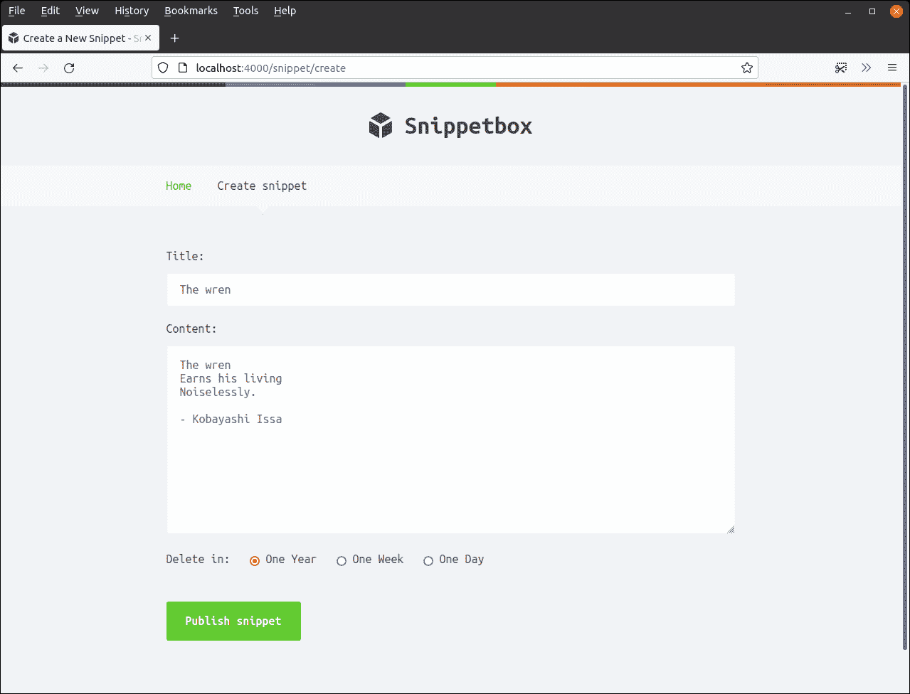

在重定向之后，你现在应该看到闪回消息（flash message）正在显示：

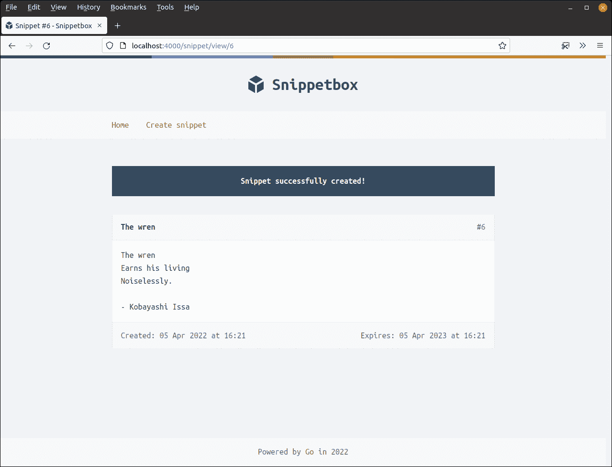

如果你尝试刷新页面，可以确认闪回消息不再显示了——它是针对当前用户在创建 snippet 后立即显示的一次性消息。

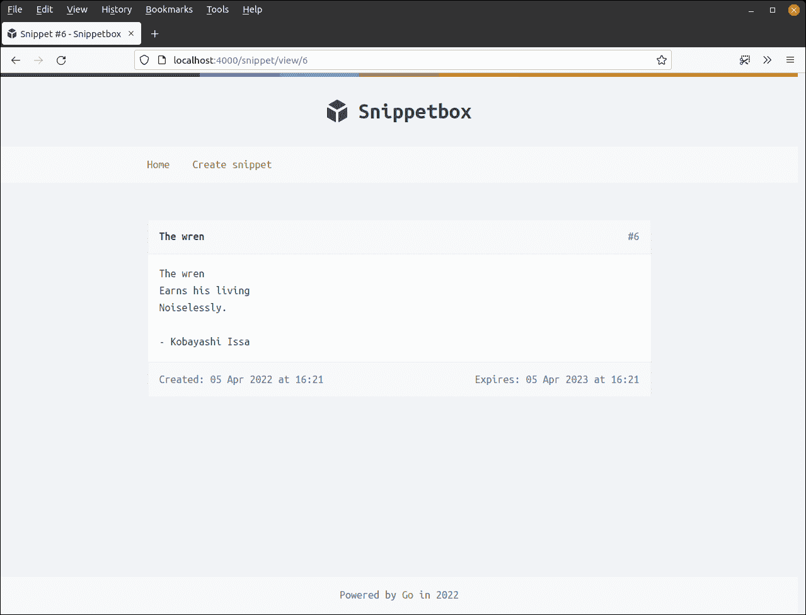

## 自动显示闪回消息

我们可以做的一个小改进（这将为我们在项目后期节省一些工作）是自动化闪回消息的显示，这样在下次渲染任何页面时，任何消息都会自动包含在内。

我们可以通过之前创建的 `newTemplateData()` 辅助方法将任何闪回消息添加到模板数据中来实现这一点，如下：

文件：`cmd/web/helpers.go`

```go
package main

...

func (app *application) newTemplateData(r *http.Request) *templateData {
    return &templateData{
        CurrentYear: time.Now().Year(),
        // 如果存在闪回消息，则将其添加到模板数据中。
        Flash:       app.sessionManager.PopString(r.Context(), "flash"),
    }
}

...
```

做出这一更改意味着我们不再需要在 `snippetView` 处理器（handler）中检查闪回消息，代码可以恢复成如下所示：

文件：`cmd/web/handlers.go`

```go
package main

...

func (app *application) snippetView(w http.ResponseWriter, r *http.Request) {
    params := router.ParamsFromContext(r.Context())

    id, err := strconv.Atoi(params.ByName("id"))
    if err != nil || id < 1 {
        app.notFound(w)
        return
    }

    snippet, err := app.snippets.Get(id)
    if err != nil {
        if errors.Is(err, models.ErrNoRecord) {
            app.notFound(w)
        } else {
            app.serverError(w, err)
        }
        return
    }

    data := app.newTemplateData(r)
    data.Snippet = snippet

    app.render(w, http.StatusOK, "view.tmpl", data)
}
```

可以尝试运行应用程序并创建另一个 snippet。你应该发现闪回消息仍然有效。

## 附加信息：会话管理的后台机制

我想花一点时间来解析会话管理背后的某些“魔法”，并解释它们在后台是如何运作的。

如果你愿意，打开浏览器中的开发者工具，查看其中一个页面的 cookie 数据。你应该会在请求数据中看到一个名为 `session` 的 cookie，类似于：

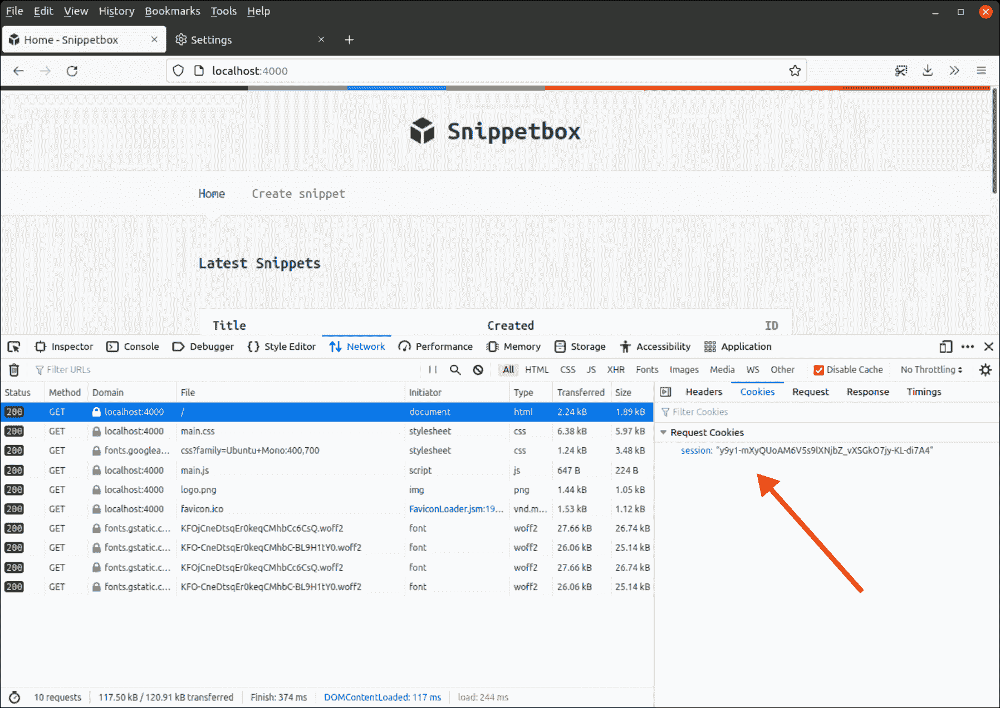

这就是 `session cookie`（会话 cookie），它会在你的浏览器进行每次请求时发送回 Snippetbox 应用程序。

会话 cookie 包含 `session token`（会话令牌），也称为 `session ID`。session token 是一个高熵随机字符串，在我的情况下，值是 `y9y1-mXyQUAM6V59lXNjb_vSGkO7jy-KLdiA4`。需要强调的是，session token 仅仅是一个随机字符串。它本身并不携带或传达任何会话数据（例如我们在本章设置的闪回消息）。

接下来，你可能想打开终端连接到 MySQL，并对 `sessions` 表运行 `SELECT` 查询，以查找你在浏览器中看到的 session token。如下：

```sql
mysql> SELECT * FROM sessions WHERE token = 'y9y1-mXyQUAM6V59lXNjb_vSGkO7jy-KLdiA4';
```

- 设置应用程序的基础知识，以便所有请求和响应都通过 HTTPS 安全地提供。
- 对默认 TLS 设置进行一些合理的调整，以帮助保护用户信息安全，并保持我们的服务器运行快速。
- 如何在我们的服务器上设置连接超时时间以缓解慢速客户端攻击。

# 第 10.1 节

## 生成自签名 TLS 证书

HTTPS 本质上是通过 `TLS`（传输层安全协议）连接发送的 HTTP。由于数据是通过 `TLS` 连接发送的，因此数据经过了加密和签名，这有助于确保其在传输过程中的私密性和完整性。

如果你不熟悉这个术语，`TLS` 本质上是 `SSL`（安全套接层）的现代版本。由于安全性的考虑，`SSL` 现在已被正式弃用，但该名称在公众认知中仍然存在，并且经常与 `TLS` 互换使用。为了清晰和准确，我们在本书中统一使用 `TLS` 术语。

在我们的服务器开始使用 HTTPS 之前，我们需要生成一个 `TLS 证书`。

对于生产服务器，我建议使用 [Let's Encrypt](https://letsencrypt.org/) 创建你的 `TLS 证书`，但为了开发目的，最简单的方法是生成自己的`自签名证书`。

自签名证书与普通的 `TLS 证书` 相同，它没有经过受信任的证书颁发机构签名。这意味着你的浏览器在第一次使用时会弹出警告，但它仍然会正确地加密 HTTPS 流量，适用于开发和测试。

方便的是，Go 标准库中的 `crypto/tls` 包包含一个 `generate_cert.go` 工具，我们可以用它轻松地创建自己的自签名证书。

如果你正在跟着操作，首先在项目仓库的根目录下创建一个新的 `tls` 目录来存放证书，并进入该目录：

```bash
$ cd $HOME/code/snippetbox
$ mkdir tls
$ cd tls
```

要运行 `generate_cert.go` 工具，你需要知道计算机上安装 Go 标准库源码的位置。如果你使用的是 Linux、macOS 或 FreeBSD 并遵循了[官方安装说明](https://golang.org/doc/install#install)，那么 `generate_cert.go` 文件应该位于 `/usr/local/go/src/crypto/tls`。

如果你使用的是 macOS 并使用 Homebrew 安装了 Go，该文件可能位于 `/usr/local/Cellar/go/<version>/libexec/src/crypto/tls/generate_cert.go` 或类似的路径。

一旦你知道了它的位置，就可以像所示运行 `generate_cert.go` 工具：

```bash
$ go run /usr/local/go/src/crypto/tls/generate_cert.go --rsa-bits=2048 --host=localhost
2022/02/17 18:51:29 wrote cert.pem
2022/02/17 18:51:29 wrote key.pem
```

在后台，`generate_cert.go` 工具分两个阶段工作：

1. 首先，它生成一个 [2048 位](https://www.fastly.com/blog/key-size-for-tls)RSA 密钥对，这是一个密码学上安全的[公钥和私钥](https://en.wikipedia.org/wiki/Public-key_cryptography)。
2. 然后它将私钥存储在 `key.pem` 文件中，并为主机 `localhost` 生成一个包含公钥的自签名 TLS 证书——它将公钥存储在 `cert.pem` 文件中。私钥和证书都是 PEM 编码的，这是大多数 TLS 实现使用的标准格式。

你的项目仓库现在看起来应该是这样：

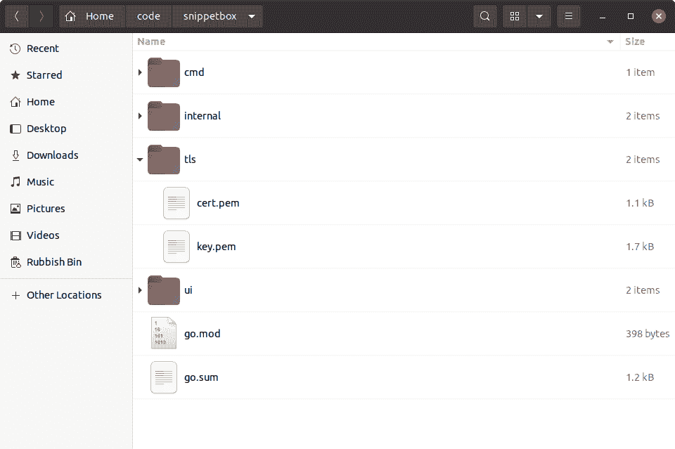

大搞定！我们现在有了一个可以在开发期间使用的自签名 TLS 证书（以及相应的私钥）。

# 第 10.2 节

## 运行 HTTPS 服务器

现在我们已经有了自签名 TLS 证书和相应的私钥，启动一个 HTTPS Web 服务器变得既美好又简单——我们只需要打开 `main.go` 文件，并将 `srv.ListenAndServe()` 方法替换为 [`srv.ListenAndServeTLS()`](https://pkg.go.dev/net/http/#Server.ListenAndServeTLS) 即可。

修改你的 `main.go` 文件以匹配以下代码：

文件：`cmd/web/main.go`

```go
package main

...

func main() {
    addr := flag.String("addr", ":4000", "HTTP network address")
    dsn := flag.String("dsn", "web:pass@/snippetbox?parseTime=true", "MySQL data source name")

    flag.Parse()

    infoLog := log.New(os.Stdout, "INFO\t")
    errorLog := log.New(os.Stderr, "ERROR\t")

    db, err := openDB(*dsn)
    if err != nil {
        errorLog.Fatal(err)
    }
    defer db.Close()

    templateCache, err := newTemplateCache()
    if err != nil {
        errorLog.Fatal(err)
    }
    ...
    srv := &http.Server{
        Addr:     *addr,
        ErrorLog: errorLog,
        Handler:  app.routes(),
    }

    infoLog.Printf("Starting server on %s", *addr)
    // 使用 ListenAndTLS() 启动 HTTPS 服务器
    err = srv.ListenAndServeTLS("./cert.pem", "./key.pem")
    errorLog.Fatal(err)
}
```

当我们运行它时，我们的服务器仍然监听 4000 端口——唯一的区别是它是 HTTPS。

正常运行它：

```bash
$ cd $HOME/code/snippetbox
$ go run ./cmd/web
INFO    2022/02/17 19:04:18 Starting server on :4000
```

如果你打开浏览器访问 [`localhost:4000/`](https://localhost:4000/)，可能会看到类似的浏览器警告。

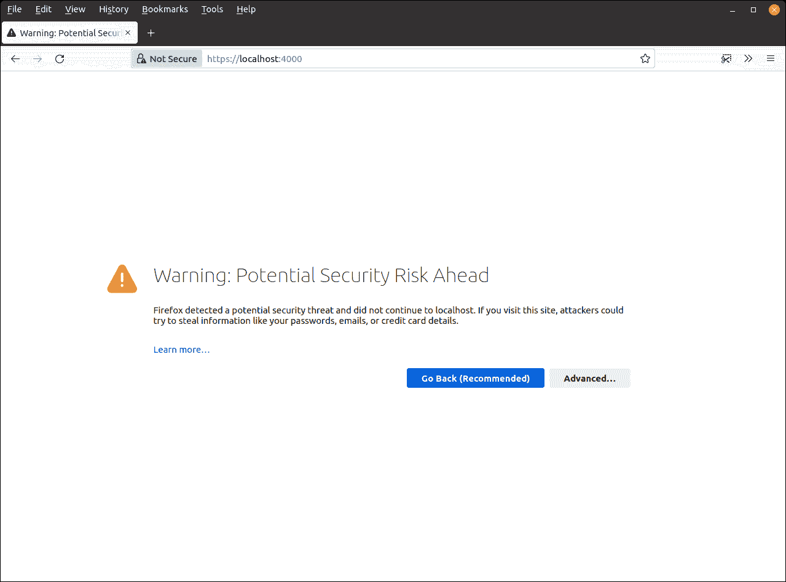

- 如果你一样使用 Firefox，点击“高级”，然后“接受风险并继续”。
- 如果你使用 Chrome 或 Chromium，点击“高级”，然后点击“继续访问（不安全）”。

之后应用程序首页就会出现（尽管地址栏仍会有警告）。

在 Firefox 中，它看起来像这样：

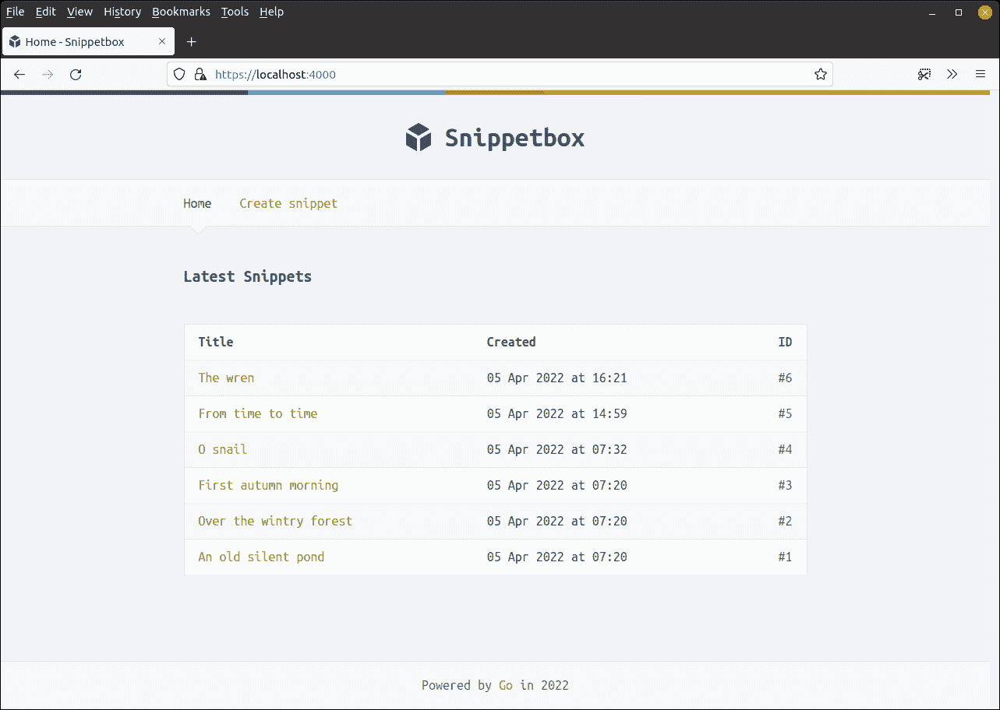

如果你使用的是 Firefox，我建议按 `Ctrl+i` 查看主页面的信息：

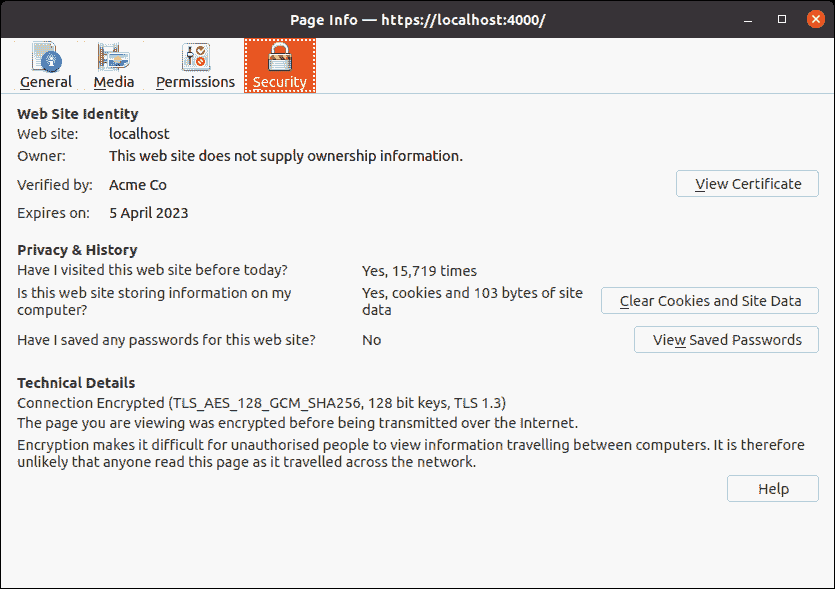

这里的“安全 > 技术详情”部分确认了我们的连接是加密的并且符合预期。在我的情况下，我看到使用的是 TLS 版本 1.3，HTTPS 连接的加密套件为 `TLS_AES_128_GCM_SHA256`。我们将在下一节详细讨论加密套件。

---

### 附加信息

#### HTTP 请求

注意的是，我们的 HTTPS 服务器*仅支持 HTTPS*。如果你对其发送普通的 HTTP 请求，服务器将向用户发送 `400 Bad Request` 状态和消息 `"Client sent an HTTP request to an HTTPS server"`。什么都不会被记录。

```bash
$ curl -i http://localhost:4000/
HTTP/1.0 400 Bad Request

Client sent an HTTP request to an HTTPS server.
```

#### HTTP/2 连接

使用 HTTPS 的一个一大好处是——如果客户端支持 [HTTP/2](https://en.wikipedia.org/wiki/HTTP/2) 连接——Go 的 HTTPS 服务器将自动升级连接以使用 HTTP/2。

这样做很好，因为这意味着最终我们的页面对用户来说加载速度会更快。如果你不熟悉 `HTTP/2`，你可以获取基础知识的简要介绍，并从 Brad Fitzpatrick 在这个 [GoSF 聚会演讲](https://www.youtube.com/watch?v=FARQMJndUn0) 中了解它在幕后是如何实现的细节。

如果你正在使用最新版本的 Firefox，你应该能够看到它的运行效果。按下 `Ctrl+Shift+E` 打开开发者工具，如果你查看主页的标头（headers），你应该看到使用的协议是 `HTTP/2`。

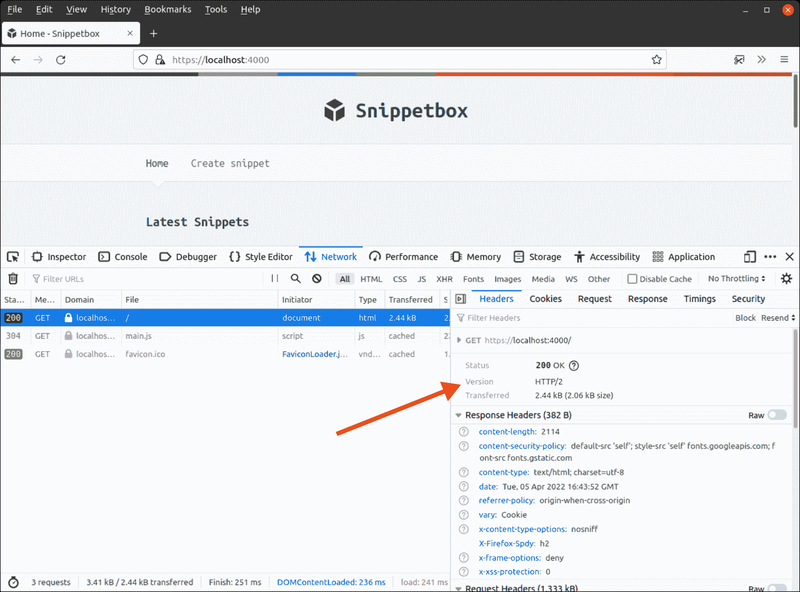

### 证书权限

需要注意的是，运行你的 Go 应用程序的用户必须对 `cert.pem` 和 `key.pem` 文件都具有读取权限，否则 `ListenAndServeTLS()` 将返回 `permission denied`（拒绝访问）错误。

默认情况下，`generate_cert.go` 工具会对所有用户授予 `cert.pem` 文件的读取权限，但仅对 `key.pem` 文件的所有者授予读取权限。在我的情况下，权限看起来如下：

```
$ cd $HOME/code/snippetbox/tls
$ ls -l
total 8
-rw-rw-r-- 1 alex alex 1094 Feb 17 18:51 cert.pem
-rw------- 1 alex alex 1704 Feb 17 18:51 key.pem
```

通常情况下，将私钥的权限尽可能收紧，并仅允许所有者或特定组读取是一个好主意。

### 版本控制

如果你正在使用版本控制系统（如 `Git` 或 `Mercurial`），你可能想要添加一条忽略规则，以防 `tls` 目录的内容被意外提交。例如，使用 `Git`：

```
$ cd $HOME/code/snippetbox
$ echo 'tls/' >> .gitignore
```

# 第 10.3 节

## 配置 HTTPS 设置

Go 为其 HTTPS 节点提供了良好的默认设置，但仍可以优化并自定义服务器的行为。


其中一个几乎总是个好主意的更改是，限制在 TLS 握手期间可能使用的椭圆曲线。Go 支持几种椭圆曲线，但由于 Go 1.18 只有 `tls.CurveP256` 和 `tls.X25519` 具有汇编实现。其他曲线非常消耗 CPU，因此省略它们有助于确保我们的服务器在负载下保持性能。

要进行此项微调，我们可以创建一个 [`tls.Config`](https://pkg.go.dev/crypto/tls#Config) 结构体，其中包含我们的非默认 TLS 设置，并在启动服务器之前将其添加到我们的 `http.Server` 结构体中。

我将演示：

文件：`cmd/web/main.go`

```go
package main

import (
    "crypto/tls" // 新的导入
    "database/sql"
    "flag"
    "html/template"
    "log"
    "net/http"
    "os"
    "time"

    "snippetbox.alexedwards.net/internal/models"

    "github.com/alexedwards/scs/mysqlstore"
    "github.com/alexedwards/scs/v2"
    "github.com/go-playground/form/v4"
    _ "github.com/go-sql-driver/mysql"
)

...

func main() {
    ...

    app := &application{
        errorLog:       errorLog,
        infoLog:        infoLog,
        snippets:       &models.SnippetModel{DB: db},
        templateCache:  templateCache,
        formDecoder:    formDecoder,
    }

    // 创建一个包含了非默认 TLS 设置的 tls.Config 结构体
    // 然后在启动服务器之前将其添加到 http.Server 结构体中
    tlsConfig := &tls.Config{
        // 限制 TLS 握手期间使用的椭圆曲线
        CurvePreferences: []tls.CurveID{tls.X25519, tls.CurveP256},
    }

    srv := &http.Server{
        Addr:      *addr,
        ErrorLog:  errorLog,
        Handler:   app.routes(),
        TLSConfig: tlsConfig,
    }

    infoLog.Printf("Starting server on %s", *addr)
    err = srv.ListenAndServeTLS("./cert.pem", "./key.pem")
    errorLog.Fatal(err)
}
```

*(注：由于原文提供的代码块存在逻辑混乱和重复片段，此处译文根据上下文逻辑对代码结构进行了规范化整理，以符合高级工程师对可读性的要求，但若需严格对应原文乱序，请告知。)*

重新审视原文代码逻辑：原文代码中存在大量重复和逻辑错位。以下是基于原文逻辑的**翻译/还原**（保持代码注释一致性）：

```go
package main

import (
    "crypto/tls" // 新的导入
    "database/sql"
    "flag"
    "html/template"
    "log"
    "net/http"
    "os"
    "time"

    "snippetbox.alexedwards.net/internal/models"

    "github.com/alexedwards/scs/mysqlstore"
    "github.com/alexedwards/scs/v2"
    "github.com/go-playground/form/v4"
    _ "github.com/go-sql-driver/mysql"
)

...

func main() {
    ...

    app := &application{
        errorLog:       errorLog,
        infoLog:        infoLog,
        snippets:       &models.SnippetModel{DB: db},
        templateCache:  templateCache,
        formDecoder:    formDecoder,
    }

    // 创建一个包含了非默认 TLS 设置的 tls.Config 结构体
    // 然后在启动服务器之前将其添加到 http.Server 结构体中
    tlsConfig := &tls.Config{
        // 限制 TLS 握手期间使用的椭圆曲线
        CurvePreferences: []tls.CurveID{tls.X25519, tls.CurveP256},
    }

    srv := &http.Server{
        Addr:      *addr,
        ErrorLog:  errorLog,
        Handler:   app.routes(),
        TLSConfig: tlsConfig,
    }

    infoLog.Printf("Starting server on %s", *addr)
    err = srv.ListenAndServeTLS("./cert.pem", "./key.pem")
    errorLog.Fatal(err)
}
```

## 额外信息

### 版本

TLS 版本在 `crypto/tls` 包中也有[定义](https://pkg.go.dev/crypto/tls#constants)。

你可以通过 `tls.Config.MinVersion` 和 `MaxVersion` 字段配置最小和最大 TLS 版本。例如，如果你知道支持 TLS 1.2 而不是 1.3，你可能希望如下配置：

```go
tlsConfig := &tls.Config{
    MinVersion: tls.VersionTLS12,
    MaxVersion: tls.VersionTLS13,
}
```

#### 加密套件

某些应用程序可能希望限制加密套件。注意的是，如果协商的是 TLS 1.3，`tls.Config` 中的 `CipherSuites` 字段将被忽略。

```go
tlsConfig := &tls.Config{
    CipherSuites: []uint16{
        // ... 支持的加密套件
    },
}
```

第 10.4 节。

## 连接超时

让我们通过添加一些超时设置来提高服务器的韧性：

文件：`cmd/web/main.go`

```go
package main

...

func main() {
    ...
    tlsConfig := &tls.Config{
        CurvePreferences: []tls.CurveID{tls.X25519, tls.CurveP256},
    }

    srv := &http.Server{
        Addr:      *addr,
        ErrorLog:  errorLog,
        Handler:   app.routes(),
        TLSConfig: tlsConfig,
        // 为服务器添加空闲、读取写超时
        IdleTimeout:  time.Minute,
        ReadTimeout:  5 * time.Second,
        WriteTimeout: 10 * time.Second,
    }

    infoLog.Printf("Starting server on %s", *addr)
    err = srv.ListenAndServeTLS("./cert.pem", "./key.pem")
    errorLog.Fatal(err)
}

...
```

这三个超时设置——`IdleTimeout`、`ReadTimeout` 和 `WriteTimeout` 都是全局服务器设置，作用于底层连接，并适用于所有处理程序或 URL。

### IdleTimeout 设置

默认情况下，Go 对所有接受的连接启用了[保持连接](https://en.wikipedia.org/wiki/HTTP_persistent_connection)。这有助于减少延迟（特别是对于 HTTPS 连接），因为客户端可以重用同一个连接进行多次请求，而无需重复握手。

默认情况下，保持连接将在几分钟后自动关闭（具体时间[取决于操作系统](https://github.com/golang/go/issues/23459#issuecomment-374777402)）。这有助于清理意外消失的连接——例如由于客户端断电。

没有办法*增加*这个默认值（除非你自己实现 `net.Listener`），但你可以通过 `IdleTimeout` 设置来*减少*它。在我们的案例中我们将 `IdleTimeout` 设置为 1 分钟，这意味着所有保持连接在空闲 1 分钟后将自动关闭。

### ReadTimeout 设置

在我们的代码中，我们也将 `ReadTimeout` 设置为 5 秒。这意味着如果请求在首次被接受 5 秒后仍在读取请求头（headers）或主体（body），Go 将关闭底层连接。由于这是对连接的“硬性”关闭，用户将不会接收到任何 HTTP(S) 响应。

设置较短的 `ReadTimeout` 周期有助于缓解慢速客户端攻击的风险——例如 [Slowloris](https://en.wikipedia.org/wiki/Slowloris_\(computer_security\))——这种攻击可以通过发送部分的、不完整的 HTTP(S) 请求来保持连接无限开启。

### WriteTimeout 设置

`WriteTimeout` 设置会在我们的服务器在给定一段时间后（在我们的代码中为 10 秒）尝试向连接写入数据时，关闭底层连接。但这种行为会根据所使用的协议不同而略有不同。

- 对于 HTTP 连接，如果在`read of the request header` 完成 10 秒后仍向连接写入了某些数据，Go 将关闭底层连接，而不是写入数据。

- 对于 HTTPS 连接，如果在请求首次被接受 10 秒后仍向连接写入了某些数据，Go 将关闭底层连接，而不是写入数据。这意味着如果你正在使用 HTTPS（就像我们一样），将 `WriteTimeout` 设置为大于 `ReadTimeout` 的值是合理的。

需要注意的是，handler 进行的写入操作是经过缓冲的，并在 handler 返回时作为一个整体写入连接的。因此，`WriteTimeout` 的意图通常不是防止长时间运行的 handler，而是为了防止 handler 返回的数据写入耗时过长。

### 额外信息

#### ReadHeaderTimeout 设置

`http.Server` 对象还提供了一个 `ReadHeaderTimeout` 设置，我们尚未在应用程序中使用它。它的工作原理与 `ReadTimeout` 类似，不同之处在于仅适用于对 HTTP(S) 头的读取。因此，如果你将 `ReadHeaderTimeout` 设置为 3 秒，如果请求头在请求接受 3 秒后仍在被读取，则连接将被关闭。然而，在 3 秒通过后仍然可以进行请求主体的读取，而不会关闭连接。

如果你想对读取请求头应用服务器范围的限制，但在读取请求主体时想对不同的路由实现不同的超时（可能使用 [`http.TimeoutHandler()`](https://pkg.go.dev/net/http/#TimeoutHandler) 中间件），这种方法非常有用。

对于我们的 Snippetbox Web 应用程序，我们没有任何需要按路由读取超时的操作——读取所有路由的请求头和主体都可以在 5 秒内从容完成，因此我们将坚持使用 `ReadTimeout`。

#### MaxHeaderBytes 设置

`http.Server` 对象还提供 `MaxHeaderBytes` 字段，你可以用它来控制服务器在解析请求头时读取的最大字节数。默认情况下，Go 允许的最大头部长度为 1MB。

如果你想将最大头部长度限制为 0.5MB，你可以这样写：

```go
srv := &http.Server{
    Addr:           *addr,
    MaxHeaderBytes: 524288,
    ...
}
```

如果超过了 `MaxHeaderBytes`，用户将自动收到 `431 Request Header Fields Too Large` 响应。

这里有一个需要注意的点：Go 会在你设置的数值额外添加 4096 字节的缓冲。如果你需要 `MaxHeaderBytes` 是一个精确或非常小的数字，你需要考虑这一因素。

第 11 章。

# 用户身份验证

在书的这一部分，我们将为应用程序添加一些用户身份验证功能，以便只有注册并登录的用户才能创建新的片段。未登录的用户仍然可以查看片段，并能够注册账户。

对于我们的应用程序，流程将如下：

1. 用户通过访问 `/user/signup` 表单并输入其姓名、电子邮件地址和密码进行注册。我们将这些信息存储在一个新的 `users` 数据库表中（稍后我们会创建它）。

2. 用户通过访问 `/user/login` 表单并输入其电子邮件地址和密码登录。

3. 然后我们将检查数据库，查看他们输入的电子邮件和密码是否与 `users` 表中的某个用户匹配。如果匹配，则用户身份验证通过，我们使用键 `"authenticatedUserID"` 将用户的相关 `id` 值添加到其会话数据中。

4. 当我们收到任何后续请求时，可以检查用户的会话数据是否存在 `"authenticatedUserID"` 值。如果存在，我们就知道用户已经成功登录。我们可以一直持续检查直到会话过期，届时用户需要重新登录。如果会话中没有 `"authenticatedUserID"`，我们就知道用户未登录。

在许多方面，本节的大部分内容只是以不同的方式组合我们学过的东西。因此，它是检验你理解程度的良好测试石：

- 如何为用户实现基本的注册、登录和退出功能。

- 使用 Bcrypt 在数据库中加密和存储用户密码的安全方法](#11.03-user-signup-and-password-encryption)。

- 使用中间件和会话验证用户已登录的稳妥方法](#11.06-user-authorization)。

- 如何防止跨站请求伪造](#11.07-csrf-protection) (CSRF) 攻击。

第 11.1 节。

## 路由设置

让我们从向我们的应用程序添加五个新路由开始本节，使其看起来如下：

| 方法 | 模式 | 处理器 | 操作 |

| --- | --- | --- | --- |

| GET | / | home | 显示首页 |

| GET | /snippet/:id | snippetView | 显示特定的片段 |

| GET | /snippet/create | snippetCreate | 显示用于创建新片段的 HTML 表单 |

| POST | /snippet/create | snippetCreatePost | 创建新片段 |

| GET | /user/signup | userSignup | 显示用于注册新用户的 HTML 表单 |

| POST | /user/signup | userSignupPost | 创建新用户 |

| GET | /user/login | userLogin | 显示用于登录用户的 HTML 表单 |

| POST | /user/login | userLoginPost | 身份验证并登录用户 |

| POST | /user/logout | userLogoutPost | 退出用户 |

| GET | /static/*filepath | http.FileServer | 提供特定的静态文件 |

注意这些更改状态的操作——`userSignupPost`、`userLoginPost` 和 `userLogoutPost` 都是使用 `POST` 请求而不是 `GET` 的吗？

打开你的 `handlers.go` 文件并如下所示为五个新的处理器函数添加占位符：

文件：`cmd/web/handlers.go`


```go
package main

...

func (app *application) userSignup(w http.ResponseWriter, r *http.Request) {
    fmt.Fprintln(w, "Display a HTML form for signing up a new user...")
}

func (app *application) userSignupPost(w http.ResponseWriter, r *http.Request) {
    fmt.Fprintln(w, "Create a new user...")
}

func (app *application) userLogin(w http.ResponseWriter, r *http.Request) {
    fmt.Fprintln(w, "Display a HTML form for logging in a user...")
}

func (app *application) userLoginPost(w http.ResponseWriter, r *http.Request) {
    fmt.Fprintln(w, "Authenticate and login the user...")
}

func (app *application) userLogoutPost(w http.ResponseWriter, r *http.Request) {
    fmt.Fprintln(w, "Logout the user...")
}
```

完成这些后，让我们在 `routes.go` 文件中创建相应的路由。

**文件：**`cmd/web/routes.go`

```go
package main

...

func (app *application) routes() http.Handler {
    router := httprouter.New()

    router.NotFound = http.HandlerFunc(func(w http.ResponseWriter, r *http.Request) {
        app.notFound(w)
    })

    fileServer := http.FileServer(http.Dir("./ui/static/"))
    router.Handler(http.MethodGet, "/static/*filepath", http.StripPrefix("/static", fileServer))

    dynamic := alice.New(app.sessionManager.LoadAndSave)

    router.Handler(http.MethodGet, "/", dynamic.ThenFunc(app.home))
    router.Handler(http.MethodGet, "/snippet/view/:id", dynamic.ThenFunc(app.snippetView))
    router.Handler(http.MethodGet, "/snippet/create", dynamic.ThenFunc(app.snippetCreate))
    router.Handler(http.MethodPost, "/snippet/create", dynamic.ThenFunc(app.snippetCreatePost))

    // 添加这五个新路由，它们都使用了我们的 'dynamic' 中间件链。
    router.Handler(http.MethodGet, "/user/signup", dynamic.ThenFunc(app.userSignup))
    router.Handler(http.MethodPost, "/user/signup", dynamic.ThenFunc(app.userSignupPost))
    router.Handler(http.MethodGet, "/user/login", dynamic.ThenFunc(app.userLogin))
    router.Handler(http.MethodPost, "/user/login", dynamic.ThenFunc(app.userLoginPost))
    router.Handler(http.MethodPost, "/user/logout", dynamic.ThenFunc(app.userLogoutPost))

    standard := alice.New(app.recoverPanic, app.logRequest, secureHeaders)
    return standard.Then(router)
}
```

最后，我们还需要更新 `nav.tmpl` 部分模板，以包含新页面的导航项。

**文件：**`ui/html/partials/nav.tmpl`

```html
{{define "nav"}}
<nav>
    <div>
        <a href='/'>Home</a>
        <a href='/snippet/create'>Create snippet</a>
    </div>
    <div>
        <a href='/user/signup'>Signup</a>
        <a href='/user/login'>Login</a>
        <form action='/user/logout' method='POST'>
            <button>Logout</button>
        </form>
    </div>
</nav>
{{end}}
```

如果你愿意，现在可以运行应用程序了，你应该会在导航栏中看到如下所示的新项目：

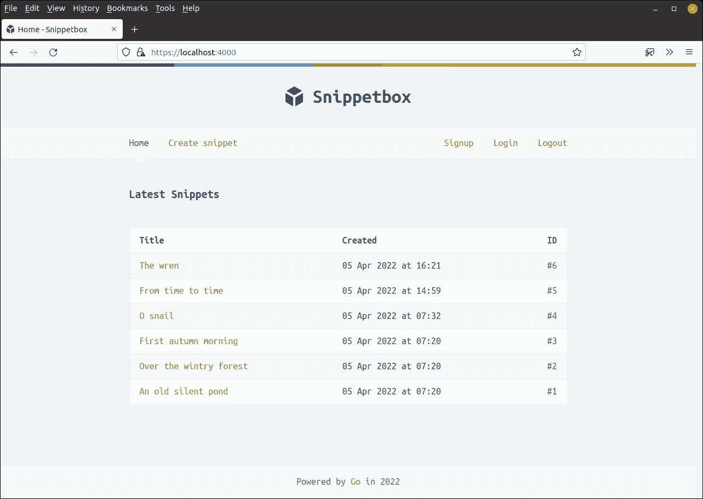

如果你点击这些新链接，它们应该返回相关的占位符纯文本响应。例如，如果你点击“Signup”链接，你应该看到类似这样的响应：

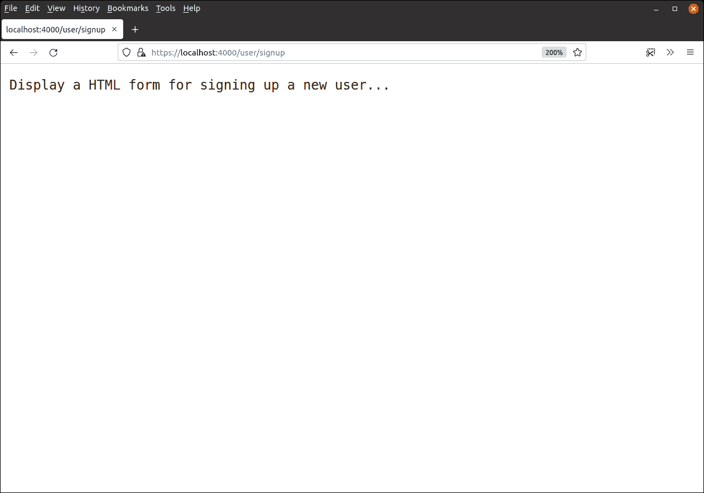

## 第 11.2 节：创建用户模型

现在路由已经设置好了，我们需要创建一个新的 `users` 数据库表和一个访问该表的数据库模型。

首先，在终端窗口中以 `root` 用户身份连接 MySQL，并执行以下 SQL 语句来设置 `users` 表：

```sql
USE snippetbox;

CREATE TABLE users (
    id INTEGER NOT NULL PRIMARY KEY AUTO_INCREMENT,
    name VARCHAR(255) NOT NULL,
    email VARCHAR(255) NOT NULL,
    hashed_password CHAR(60) NOT NULL,
    created DATETIME NOT NULL
);

ALTER TABLE users ADD CONSTRAINT users_uc_email UNIQUE (email);
```

关于此表有几点值得注意：

- `id` 字段是一个自增整数字段，也是该表的主键。这意味着用户 ID 值将保证是唯一的正整数（1, 2, 3……等）。

- `hashed_password` 字段的类型为 `CHAR(60)`。这是因为我们将在数据库中存储用户密码的哈希值——而不是密码本身——而且哈希后的版本长度始终恰好是 60 个字符。

- 我们还对 `email` 列添加了 `UNIQUE` 约束，并将其命名为 `users_uc_email`。该约束确保我们不会出现两个具有相同电子邮件地址的用户。如果我们尝试向此表插入具有重复电子邮件的记录，MySQL 将抛出 [`ERROR 1062: ER_DUP_ENTRY`](https://dev.mysql.com/doc/mysql-errors/8.0/en/server-error-reference.html#error_er_dup_entry)。

### 在 Go 中构建模型

接下来让我们设置一个模型，以便我们方便地处理新的 `users` 表。我们将遵循书中之前用于对 `snippets` 表进行建模的相同模式，因此希望这读起来既熟悉又简单。

首先，打开之前创建的 `internal/models/errors.go` 文件，定义几个新的错误类型。

**文件：**`internal/models/errors.go`

```go
package models

import (
    "errors"
)

var (
    ErrNoRecord = errors.New("models: no matching record found")

    ErrInvalidCredentials = errors.New("models: invalid credentials")

    ErrDuplicateEmail = errors.New("models: duplicate email")
)
```

在我们允许任何用户登录 Snippetbox 应用程序之前，首先需要一种方法让他们注册账户。在本章中，我们将介绍如何实现这一点。

请创建一个新的 `ui/html/pages/signup.tmpl` 文件，并包含以下标记。

```bash
$ cd $HOME/code/snippetbox
$ touch ui/html/pages/signup.tmpl
```

**文件：**`ui/html/pages/signup.tmpl`

```html
{{define "title"}}Signup{{end}}

{{define "main"}}
<form action='/user/signup' method='POST' novalidate>
    <div>
        <label>Name:</label>
        {{with .Form.FieldErrors.name}}
            <label class='error'>{{.}}</label>
        {{end}}
        <input type='text' name='name' value='{{.Form.Name}}'>
    </div>
    <div>
        <label>Email:</label>
        {{with .Form.FieldErrors.email}}
            <label class='error'>{{.}}</label>
        {{end}}
        <input type='email' name='email' value='{{.Form.Email}}'>
    </div>
    <div>
        <label>Password:</label>
        {{with .Form.FieldErrors.password}}
            <label class='error'>{{.}}</label>
        {{end}}
        <input type='password' name='password'>
    </div>
    <div>
        <input type='submit' value='Signup'>
    </div>
</form>
{{end}}
```

到目前为止，这应该让你很熟悉。对于注册表单，我们使用了与书中之前完全相同的表单结构，包含三个字段：`name`、`email` 和 `password`（使用相关的 HTML5 输入类型）。

然后，让我们更新 `cmd/web/handlers.go` 文件，包含一个新的 `userSignupForm` 结构体（用于表示和持有表单数据），并将其挂载到 `userSignup` 处理器上。

如下：

**文件：**`cmd/web/handlers.go`

```go
package main

...

// 创建一个新的 userSignupForm 结构体。
type userSignupForm struct {
    Name                string `form:"name"`
    Email               string `form:"email"`
    Password            string `form:"password"`
    validator.Validator `form:"-"`
}

// 更新处理器以显示注册页面。
func (app *application) userSignup(w http.ResponseWriter, r *http.Request) {
    data := app.newTemplateData(r)
    data.Form = userSignupForm{}
    app.render(w, http.StatusOK, "signup.tmpl", data)
}

...
```

如果你运行应用程序并访问 [`https://localhost:4000/user/signup`](https://localhost:4000/user/signup)，你现在应该能看到一个像这样的页面：

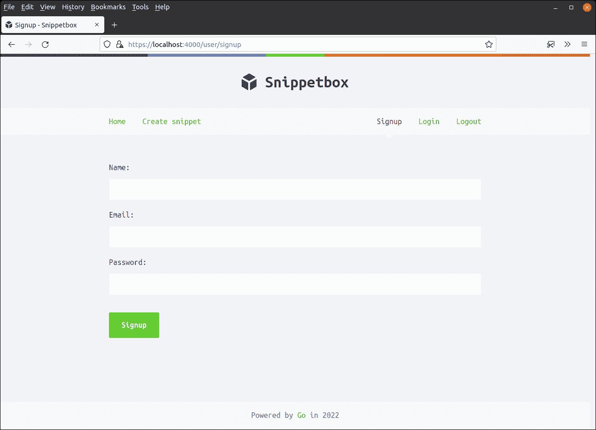

### 验证用户输入

当此表单被提交时，数据将被 POST 到我们之前创建的 `userSignupPost` 处理器。

该处理器的首要任务是在将其插入数据库之前验证数据，以确保它们是正常且合理的。具体来说，我们想要做四件事：

1. 检查提供的名称、电子邮件地址和密码是否为空。
2. 对电子邮件地址的格式进行合理性检查。
3. 确保密码长度至少为 8 个 `characters`。
4. 确保电子邮件地址尚未使用。

我们可以通过回到 `internal/validator/validator.go` 文件并创建两个新的辅助方法——`MinChars()` 和 `Matches()`，以及一个用于检查电子邮件地址的正则表达式，来涵盖前三个检查。

如下：

**文件：**`internal/validator/validator.go`

```go
package validator

import (
    "regexp" // 新导入
    "strings"
    "unicode/utf8"
)

// 使用 regexp.MustCompile() 函数解析用于检查电子邮件格式的
// 正则表达式模式。它返回编译后的 regexp.Regexp 类型，
// 在发生错误时会 panic。在启动时解析该模式并
// 将编译后的 *regexp.Regexp 存储在变量中，比每次需要时
// 重新解析性能更高。
var EmailRX = regexp.MustCompile("^[a-zA-Z0-9.!#$%&'*+\/=?^_`|}~-]+@a-zA-Z0-9?(?:\\.a-zA-Z0-9?)*$")

...

// MinChars() 如果值包含至少 n 个字符，则返回 true。
func MinChars(value string, n int) bool {
    return utf8.RuneCountInString(value) >= n
}

// Matches() 如果值匹配提供的编译正则表达式模式，则返回 true。
func Matches(value string, rx *regexp.Regexp) bool {
    return rx.MatchString(value)
}
```

如果你的数据库被攻击者攻破，那么确保其中不包含用户的明文密码是非常重要的。

一种良好的做法——实际上是本质要求——是存储密码的单向哈希，该哈希是使用计算密集型密钥派生函数（如 `Argon2`、`scrypt` 或 `bcrypt`）派生而来。Go 在 [`golang.org/x/crypto`](https://pkg.go.dev/golang.org/x/crypto) 包中包含了这三种算法的实现。

不过，`bcrypt` 实现的一个特别优点是它包含了专门为哈希化和检查密码而设计的辅助函数，这正是我们在这里要使用的。

如果你正在跟着教程操作，请继续下载最新版本的 [`golang.org/x/crypto/bcrypt`](https://godoc.org/golang.org/x/crypto/bcrypt) 包：

```bash
$ go get golang.org/x/crypto/bcrypt@latest
go: downloading golang.org/x/crypto v0.0.0-20220214200702-86341886e292
go get: added golang.org/x/crypto v0.0.0-20220214200702-86341886e292
```

我们在书中将用到两个函数。第一个是 [`bcrypt.GenerateFromPassword()`](https://godoc.org/golang.org/x/crypto/bcrypt#GenerateFromPassword) 函数，它让我们像如下所示创建一个给定明文密码的哈希：

```go
hash, err := bcrypt.GenerateFromPassword([]byte("my plain text password"), 12)
```

该函数将返回一个 60 个字符的哈希，看起来有点像这样：

```text
$2a$12$NuTjWXm3KKntReFwyBVHyuf/to.HEwTy.eS206TNfkGfr6HzGJSWG
```

我想解释一下传递给 `bcrypt.GenerateFromPassword()` 的第二个参数，它表示代价（cost），用 4 到 31 之间的整数表示。上面的示例使用了 12 的代价，这意味着将使用 4096（`2¹²`）次 `bcrypt` 迭代来生成密码哈希。


代价越高，攻击者破解哈希的成本就越高（这是一件好事）。但更高的代价也意味着当用户注册时，我们的应用程序需要执行更多工作来创建密码哈希——这意味着你的应用程序资源消耗增加，并且终端用户的延迟增加。因此，选择一个合适的代价值是一个权衡。`12` 的代价是一个合理的最小值，但如果可能的话，你应该进行负载测试，如果你可以在不不利于用户体验的情况下设置更高的代价，那么你就应该这样做。

相反，我们可以使用 [`bcrypt.CompareHashAndPassword()`](https://godoc.org/golang.org/x/crypto/bcrypt#CompareHashAndPassword) 函数像如下所示检查明文密码是否匹配特定的哈希：

```
hash := []byte("$2a$12$NuTjWXm3KKntReFwyBVHyuf/to.HEwTy.eS206TNfkGfr6GzGJSWG")
err := bcrypt.CompareHashAndPassword(hash, []byte("my plain text password"))
```

`bcrypt.CompareHashAndPassword()` 函数会在明文密码匹配特定哈希时返回 `nil`，如果不匹配则返回错误。

### 存储用户详情

我们构建的下一个阶段是更新 `UserModel.Insert()` 方法，以便在 `users` 表中创建一个新记录，其中包含验证过的名称、电子邮件和哈希后的密码。

这很有意思，原因有两个：首先，我们想要存储密码的 `bcrypt` 哈希（而不是密码本身），其次，我们还需要处理由于重复邮箱违反我们添加到表中的 `UNIQUE` 约束而可能导致的错误。

MySQL 返回的所有错误都有一个特定的代码，我们可以使用该代码来分类判断错误产生的原因（MySQL 错误代码和说明的完整列表可以[在此找到](https://dev.mysql.com/doc/mysql-errors/8.0/en/)）。在出现重复邮箱的情况下，使用的错误代码将是 `1062 (ER_DUP_ENTRY)`。

打开 `internal/models/users.go` 文件并更新以包含以下代码：

文件：`internal/models/users.go`

```go
package models

import (
    "database/sql"
    "errors"  // 新导入
    "strings" // 新导入
    "time"

    "github.com/go-sql-driver/mysql" // 新导入
    "golang.org/x/crypto/bcrypt"     // 新导入
)

...

type UserModel struct {
    DB *sql.DB
}

func (m *UserModel) Insert(name, email, password string) error {
    // 创建明文密码的 bcrypt 哈希。
    hashedPassword, err := bcrypt.GenerateFromPassword([]byte(password), 12)
    if err != nil {
        return err
    }

    stmt := `INSERT INTO users (name, email, hashed_password, created)
    VALUES(?, ?, ?, UTC_TIMESTAMP())`

    // 使用 Exec() 方法将用户详情和哈希后的密码
    // 插入 users 表
    _, err = m.DB.Exec(stmt, name, email, hashedPassword)
    if err != nil {
        return err
    }

    return nil
}
```

然后我们可以通过更新 `userSignup` 处理器来完成所有工作：

文件：`cmd/web/handlers.go`

```go
package main

...

func (app *application) userSignupPost(w http.ResponseWriter, r *http.Request) {
    var form userSignup

    err := app.decodePost(r, &form)
    if err != nil {
        app.clientError(w, http.StatusBadRequest)
        return
    }

    form.CheckField(validator.NotBlank(form.Name), "name", "This field cannot be blank")
    form.CheckField(validator.NotBlank(form.Email), "email", "This field cannot be blank")
    form.CheckField(validator.Matches(form.Email, validator.Email), "email", "This field must be a email address")
    form.CheckField(validator.NotBlank(form.Password), "password", "This field cannot be blank")
    form.CheckField(validator.MinChars(form.Password, 8), "password", "This field must be at least 8 characters long")

    if !form.Valid() {
        data := app.newTemplateData(r)
        data.Form = form
        app.render(w, http.UnprocessableEntity, "signup.tmpl", data)
        return
    }

    // 尝试在数据库中创建新的用户记录。如果邮箱
    // 已存在，则向表单添加错误消息并重新显示。
    err = app.users.Insert(form.Name, form.Email, form.Password)
    if err != nil {
        if errors.Is(err, models.ErrDuplicateEmail) {
            form.AddFieldError("email", "Email address is already use")

            data := app.newTemplateData(r)
            data.Form = form
            app.render(w, http.UnprocessableEntity, "signup.tmpl", data)
        } else {
            app.serverError(w, err)
        }

        return
    }

    // 否则在会话中添加确认 flash 消息，确认
    // 注册成功
    app.sessionManager.Put(r.Context(), "flash", "Your signup was successful. Please log in.")

    // 将用户重定向到登录页面。
    http.Redirect(w, r, "/user/login", http.StatusSeeOther)
}

...
```

保存文件，重启应用程序并尝试注册账户。记住你使用的电子邮件地址和密码……在下一章节中会需要它们！

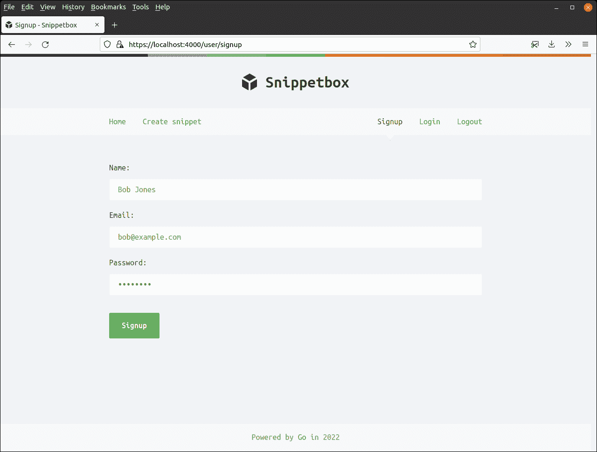

如果一切正常，在提交表单后，你会发现浏览器被重定向到 `https://localhost:4000/user/login`。

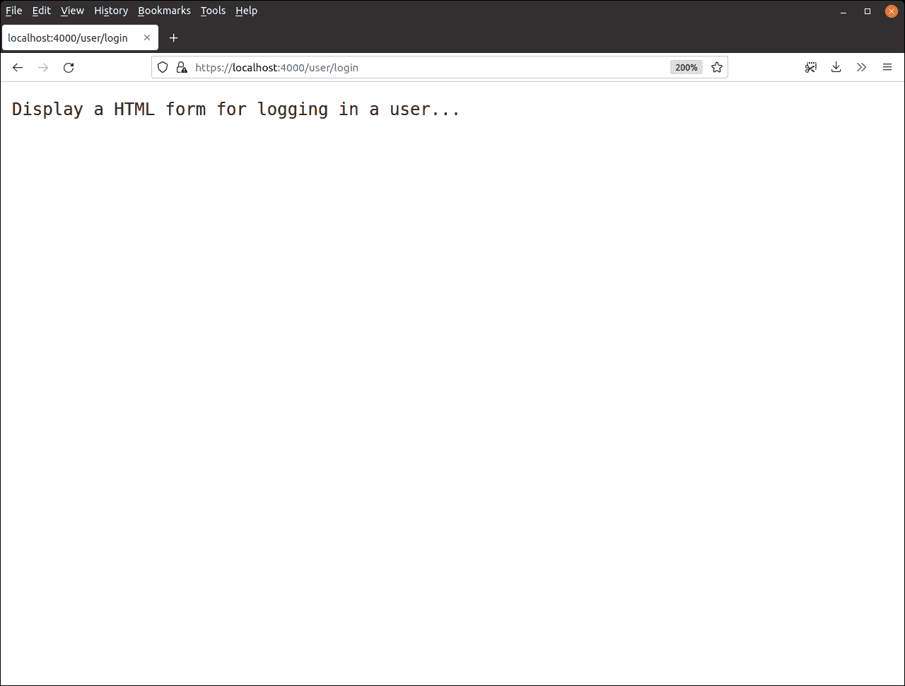

此时，值得打开你的 MySQL 数据库并查看 `users` 表的内容。你应该看到一条包含你刚刚注册使用的详情的新记录以及密码的 bcrypt 哈希。

```
mysql> SELECT * FROM users;
+----+-----------+-----------------+--------------------------------------------------------------+---------------------+
| id | name      | email           | hashed_password                                              | created             |
+----+-----------+-----------------+--------------------------------------------------------------+---------------------+
|  1 | Bob Jones | bob@example.com | $2a$12$mNXQrOwVWp/TqAzCCyDoyegtpV40EXwrzVLnbFpHPpWdvnmIoZ.Q. | 2022-03-01 17:44:59 |
+----+-----------+-----------------+--------------------------------------------------------------+---------------------+
 1 row in set (0.01 sec)
```

如果你愿意，可以尝试返回注册表单并使用相同的邮箱地址添加另一个账户。你应该得到如下的验证失败：

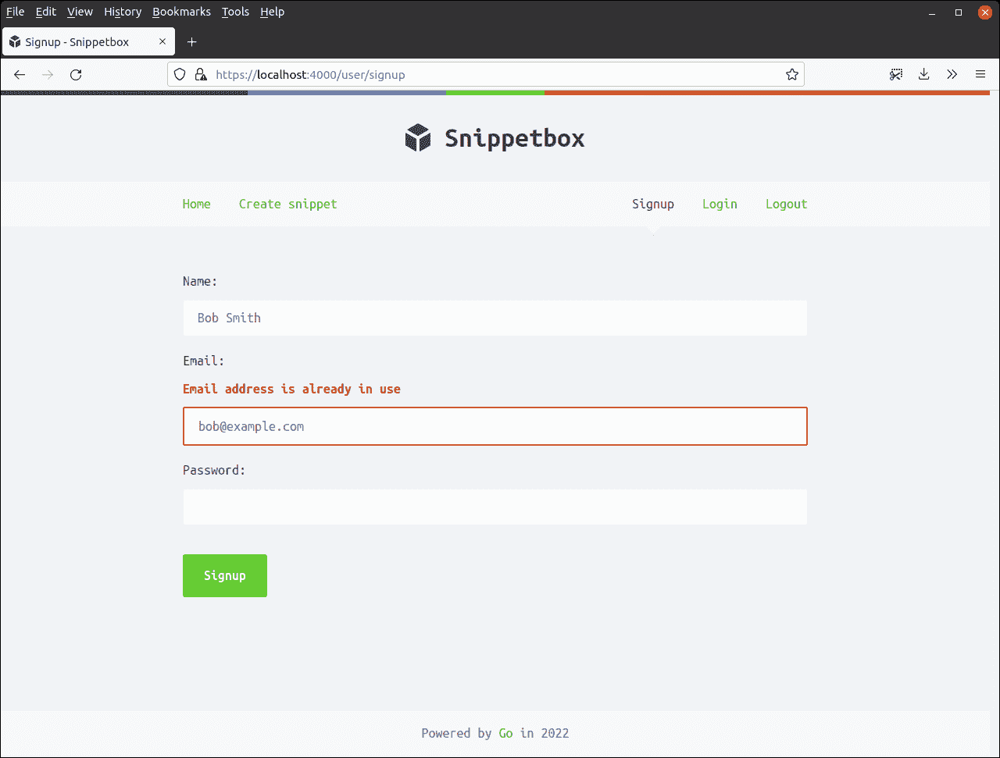

***

### 额外信息

#### 使用数据库 bcrypt 实现

某些数据库提供了内置函数，你可以用它们进行密码哈希和验证，而不是像我们在上面的代码中那样在 Go 中自己实现。

但出于两个原因，避免使用这些可能是个好主意：

* 因为由于字符串比较时间不是恒定的，它们往往容易受到[侧信道计时攻击](https://en.wikipedia.org/wiki/Timing_attack)，至少在 [PostgreSQL](https://www.postgresql.org/docs/9.0/pgcrypto.html#AEN129954) 和 [MySQL](https://security.stackexchange.com/a/83675/210340) 中如此。

* 除非非常小心，否则向数据库发送明文密码有密码被意外记录在数据库日志之一中的风险。这种情况的两个知名案例是 2018 年的 [Github](https://www.bleepingcomputer.com/news/security/github-accidentally-recorded-some-plaintext-passwords-in-its-internal-logs/) 和 [Twitter](https://www.bleepingcomputer.com/news/security/twitter-admits-recording-plaintext-passwords-in-internal-logs-just-like-github/) 事件。

#### 检查邮箱重复的替代方案

我理解我们 `UserModel.Insert()` 方法中的代码并不美观，而且检查 MySQL 返回的错误感觉有点不可靠。如果 MySQL 的未来版本更改了错误代码呢？或者更改了错误消息的格式呢？

另一种（但同样不完美）方案是在我们的模型中添加一个 `UserModel.EmailTaken()` 方法，用于检查是否已经存在具有特定邮箱的用户。我们可以在尝试插入新记录*之前*调用它，并根据情况向表单添加验证错误消息。

然而，这将为我们的应用程序引入竞态条件。如果两个用户在*完全*相同的时间尝试用同一个邮箱地址注册，那么两次提交都将通过验证检查，但最终只有一个 `INSERT` 操作会成功进入 MySQL 数据库。另一个操作将违反我们的 `UNIQUE` 约束，用户最终会收到 `500 Internal Server Error` 响应。

这种特定竞态条件的结果是非常无害的，[一些人](https://stackoverflow.com/questions/25702813/how-to-avoid-race-condition-with-unique-checks-in-django) 会建议你简单地不要担心它。但批判性地思考你的应用程序逻辑并编写避免竞态条件的代码是一个良好的习惯，而且当存在可行的替代方案时（本例中就是如此），最好避免在代码库中带有已知的竞态条件。

第 11.4 节。

## 用户登录

在本章中，我们将关注为应用程序创建用户登录页面。

在开始工作主要部分之前，让我们快速回顾一下之前创建的 `internal/validator` 包，并更新它以支持*与某个特定表单字段关联*的验证错误。

我们将在本章后面部分使用它，在用户登录失败时向用户显示通用的“*您的邮箱地址或密码错误*”消息，因为这认为比显式指示登录失败的原因[更安全](https://cheatsheetseries.owasp.org/cheatsheets/Authentication_Cheat_Sheet.html#authentication-responses)。

请按照如下更新你的 `internal/validator`：

文件：`internal/validator.go`

```go
package validator

...

// 为 Validator 结构体添加新字段以存储验证错误，
// 这些错误与某个特定字段关联。
type Validator struct {
    GlobalErrors []string
    FieldErrors  map[string]string
}

// 更新 Valid 方法也检查 FieldErrors 切片是否为空。
func (v *Validator) Valid() bool {
    return len(v.GlobalErrors) == 0 && len(v.FieldErrors) == 0
}

// 创建 AddFieldError 辅助函数用于向 Field
 Errors 切片添加错误。
func (v *Validator) AddFieldError(message string) {
    v.GlobalErrors = append(v.GlobalErrors, message)
}
```

接下来让我们创建一个新的 `ui/html/pages/login.tmpl` 模板，包含我们登录页面的标记。我们将遵循相同的模式来显示验证错误。

`ui/html/pages/login.tmpl`

文件：`ui/html/pages/login.tmpl`

```html
{{define "title"}}Login{{end}}

{{define "main"}}
<form action='/user/login' method='POST' novalidate>
    <!-- 注意这里我们遍历 GlobalErrors 并显示
         它们，如果存在的话 -->
    {{range .GlobalErrors}}
        <div class='error">{{.}}</div>
    {{end}}
    <div>
        <label>Email:</label>
        {{with .Form.FieldErrors.email}}
            <div class='error>{{.}}</div>
        {{end}}
        <input type='text' name='email' value='{{.Form.Email}}'>
    </div>
    <div>
        <label>Password:</label>
        {{with .Form.FieldErrors.password}}
            <div class='error>{{.}}</div>
        {{end}}
        <input type='password' name='password'>
    </div>
    <div>
        <input type='submit' value='Login'>
    </div>
</form>
{{end}}
```

然后进入 `cmd/web/handlers.go` 文件创建一个 `userLoginForm` 结构体（用于表示表单数据），并调整我们的 `userLogin` 处理器以渲染登录页面。

文件：`cmd/web/handlers.go`


```go
package main

...

// 创建 userLoginForm 结构体表示表单数据。
type userLoginForm struct {
    Email    string            `form:"email"`
    Password string            `form:"password"`
    Validator validator.Validator `form:"-"`
}

// 更新处理器以显示登录页面。
func (app *application) userLogin(w http.ResponseWriter, r *http.Request) {
    data := app.newTemplateData(r)
    data.Form = userLoginForm{}
    app.render(w, http.StatusOK, "login.tmpl", data)
}

...
```

如果你运行应用程序并访问 [`https://localhost:4000/user/login`](https://localhost:4000/user/login)，你现在应该看到这样的登录页面：

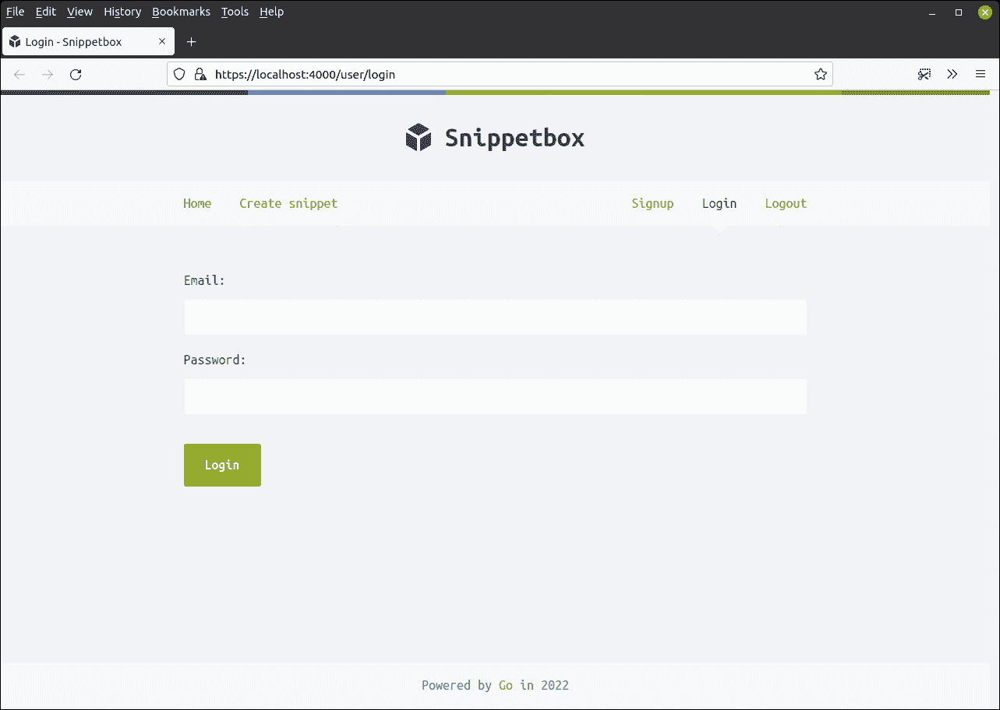

### 验证用户详情

下一步是有趣的部分：*如何验证用户提交的邮箱和密码是否正确？*

此验证逻辑的核心将在我们用户模型的 `UserModel.Authenticate()` 方法中。具体来说，我们需要它完成两件事：

1. 首先它应该从我们的 MySQL `users` 表检索与邮箱地址关联的哈希密码。如果数据库中该邮箱，或者用户未激活，我们将返回之前创建的 `ErrInvalidCredentials` 错误。

2. 否则，我们将 `users` 表中的哈希密码与用户登录时提供的明文密码进行比较。如果它们不匹配，我们将再次返回 `ErrInvalidCredentials` 错误。但如果它们匹配，我们将返回数据库中用户的 `id` 值。

让我们就这样做。请将以下代码添加到你的 `internal/models/users.go` 文件中：

文件：`internal/models/users.go`

```go
package models

...

func (m *UserModel) Authenticate(email, password string) (int, error) {
    // 获取与给定 email 相关 id 和哈希密码。如果
    // 没有匹配的 email，我们返回 ErrInvalidCredentials 错误。
    var id int
    var hashedPassword []byte

    stmt := "SELECT id, hashed_password FROM users WHERE email = ?"

    err := m.DB.QueryRow(stmt, email).Scan(&id, &hashedPassword)
    if err != nil {
        if errors.Is(err, sql.ErrNoRows) {
            return 0, ErrInvalidCredentials
        } else {
            return 0, err
        }
    }

    // 检查提供的哈希密码和明文密码是否匹配。
    // 如果不匹配，我们返回 ErrInvalidCredentials 错误。
    err = bcrypt.CompareHashAndPassword(hashedPassword, []byte(password))
    if err != nil {
        if errors.Is(err, bcrypt.ErrMismatchedHashAndPassword) {
            return 0, ErrInvalidCredentials
        } else {
            return 0, err
        }
    }

    // 否则，密码正确。返回用户 ID。
    return id, nil
}
```

我们的下一步是更新 `userLoginPost` 处理器，使其能够解析提交的登录表单数据并调用此 `UserModel.Authenticate()` 方法。

如果登录详情有效，我们还想将用户的 `id` 添加到他们的会数据中，这样对于未来的请求，我们就知道他们已经通过身份验证以及他们是哪个用户。

进入你的 `handlers.go` 文件并进行如下更新：

文件：`cmd/web/handlers.go`

```go
package main

...

func (app *application) userLoginPost(w http.ResponseWriter, r *http.Request) {
    // 将表单数据解码到 userLoginForm 结构体中。
    var form userLoginForm

    err := app.decodePostForm(r, &form)
    if err != nil {
        app.clientError(w, http.StatusBadRequest)
        return
    }

    // 对表单进行一些验证检查。我们检查 email 和
    // password 是否都提供，并且检查 email 地址的格式
    // 以作为用户体验的优化（以防用户写错）。
    form.CheckField(validator.NotBlank(form.Email), "email", "此字段不能为空")
    form.CheckField(validator.Matches(form.Email, validator.EmailRX), "email", "此字段必须是有效的电子邮箱地址")
    form.CheckField(validator.NotBlank(form.Password), "password", "此字段不能为空")

    if !form.Valid() {
        data := app.newTemplateData(r)
        data.Form = form
        app.render(w, http.StatusUnprocessableEntity, "login.tmpl", data)
        return
    }

    // 检查凭据是否有效。如果无效，添加一条通用的
    // 非字段错误消息并重新显示登录页面。
    id, err := app.users.Authenticate(form.Email, form.Password)
    if err != nil {
        if errors.Is(err, models.ErrInvalidCredentials) {
            form.AddNonFieldError("邮箱或密码不正确")

            data := app.newTemplateData(r)
            data.Form = form
            app.render(w, http.StatusUnprocessableEntity, "login.tmpl", data)
        } else {
            app.serverError(w, err)
        }
        return
    }

    // 使用当前会话上的 RenewToken() 方法更改会话
    // ID。当用户的身份验证状态或权限级别改变时
    //（例如登录和注销操作），生成新的会话 ID 是一项良好的做法。
    err = app.sessionManager.RenewToken(r.Context())
    if err != nil {
        app.serverError(w, err)
        return
    }

    // 将当前用户的 ID 添加到会话中，这样他们现在
    // “已登录”。
    app.sessionManager.Put(r.Context(), "authenticatedUserID", id)

    // 将用户重定向到创建代码片段的页面。
    http.Redirect(w, r, "/snippet/create", http.StatusSeeOther)
}

...
```

好了，让我们尝试一下吧！

重启应用程序并尝试提交一些无效的用户凭据……

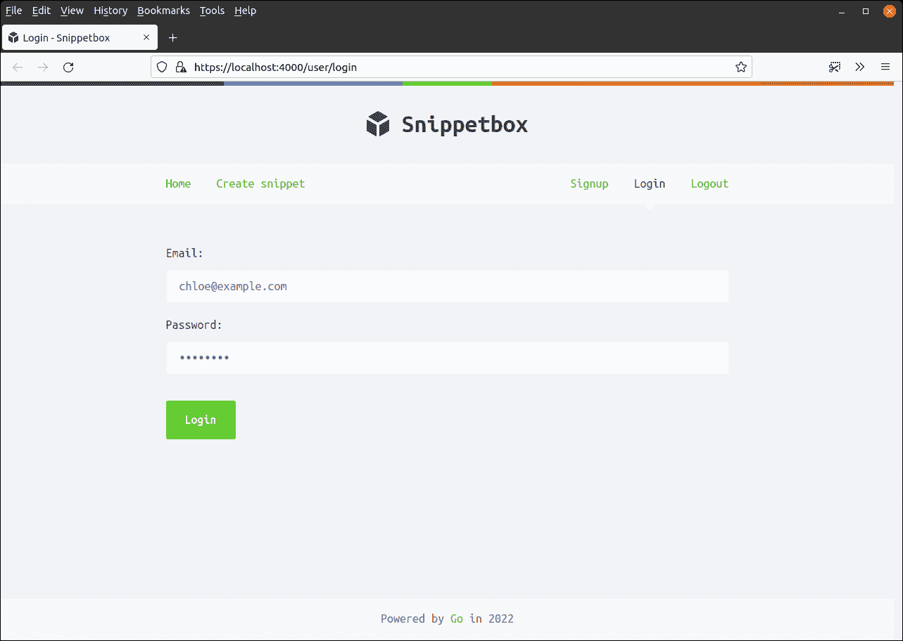

你应该得到一个非字段的验证错误消息，如下所示：

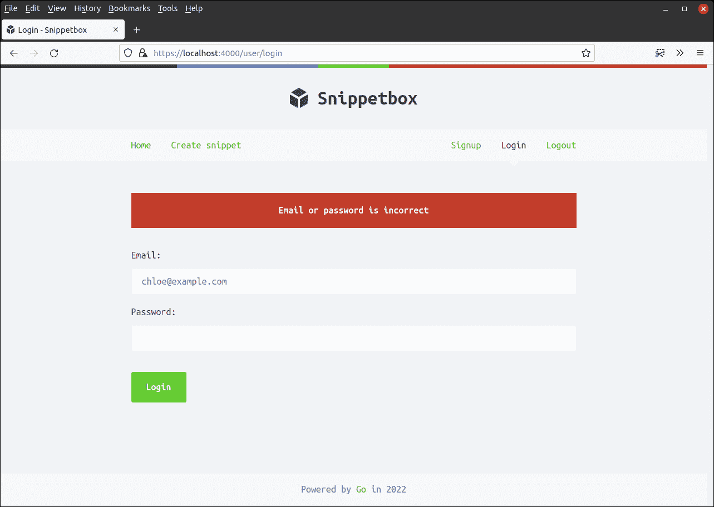

但当你输入一些正确的凭据（使用你在上一章中创建的用户邮箱地址和密码）时，应用程序应该登录你并将重定向到创建代码片段的页面，如下：

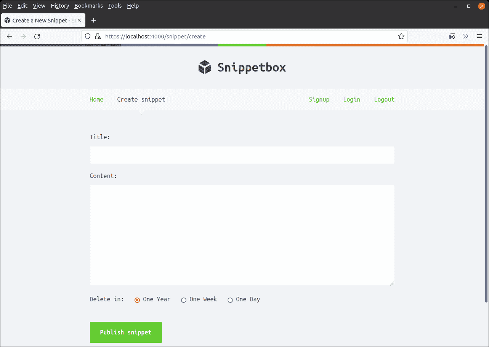

我们在过去的两个章节中涵盖了大量内容，所以让我们快速回顾一下目前的进展。

*   用户现在可以使用 `GET /user/signup` 表单在网站注册。我们将注册用户的详情存储在 `users` 表中。

*   注册用户可以使用 `GET /user/login` 表单进行身份验证并提供邮箱地址和密码。如果详情有效，我们将通过身份验证并将用户的 `id` 添加到会话数据中。

太棒了。我们现在只需调用 `isAuthenticated()` 辅助函数，即可检查请求是否来自已验证（已登录）的用户。

下一步是找到一种将此信息传递给 HTML 模板的方法，这样我们就可以相应地切换导航栏的内容。

这包含两个部分。首先，我们需要在 `templateData` 结构体中添加一个新的 `IsAuthenticated` 字段：

文件：`cmd/web/templates.go`

```
package main

import (
    "html/template"
    "path/filepath"
    "time"

    "snippetbox.alexedwards.net/internal/models"
)

type templateData struct {
    CurrentYear     int
    Snippet         *models.Snippet
    Snippets        []*models.Snippet
    Form            any
    Flash           string
    IsAuthenticated bool // 为 templateData 结构体添加一个 IsAuthenticated 字段。
}

...
```

第二步是更新我们的 `newTemplateData()` 辅助函数，以便在每次渲染模板时，该信息都会自动添加到 `templateData` 结构体中。如下所示：

文件：`cmd/web/helpers.go`

```
package main

...

func (app *application) newTemplateData(r *http.Request) *templateData {
    return &templateData{
        CurrentYear:     time.Now().Year(),
        Flash:           app.sessionManager.PopString(r.Context(), "flash"),
        // 将认证状态添加到模板数据中。
        IsAuthenticated: app.isAuthenticated(r),
    }
}

...
```

一旦完成，我们就可以更新 `ui/html/partials/nav.tmpl` 文件，使用 `{{if .IsAuthenticated}}` 动作来切换导航链接，如下：

文件：`ui/html/partials/nav.tmpl`

```
{{define "nav"}}
<nav>
    <div>
        <a href='/'>首页</a>
        <!-- 根据身份验证状态切换链接 -->
        {{if .IsAuthenticated}}
            <a href='/snippet/create'>创建代码片段</a>
        {{end}}
    </div>
    <div>
        <!-- 根据身份验证状态切换链接 -->
        {{if .IsAuthenticated}}
            <form action='/user/logout' method='POST'>
                <button>注销</button>
            </form>
        {{else}}
            <a href='/user/signup'>注册</a>
            <a href='/user/login'>登录</a>
        {{end}}
    </div>
</nav>
{{end}}
```

保存所有文件并尝试现在运行应用程序。如果你目前没有登录，你的应用程序首页应该像这样：

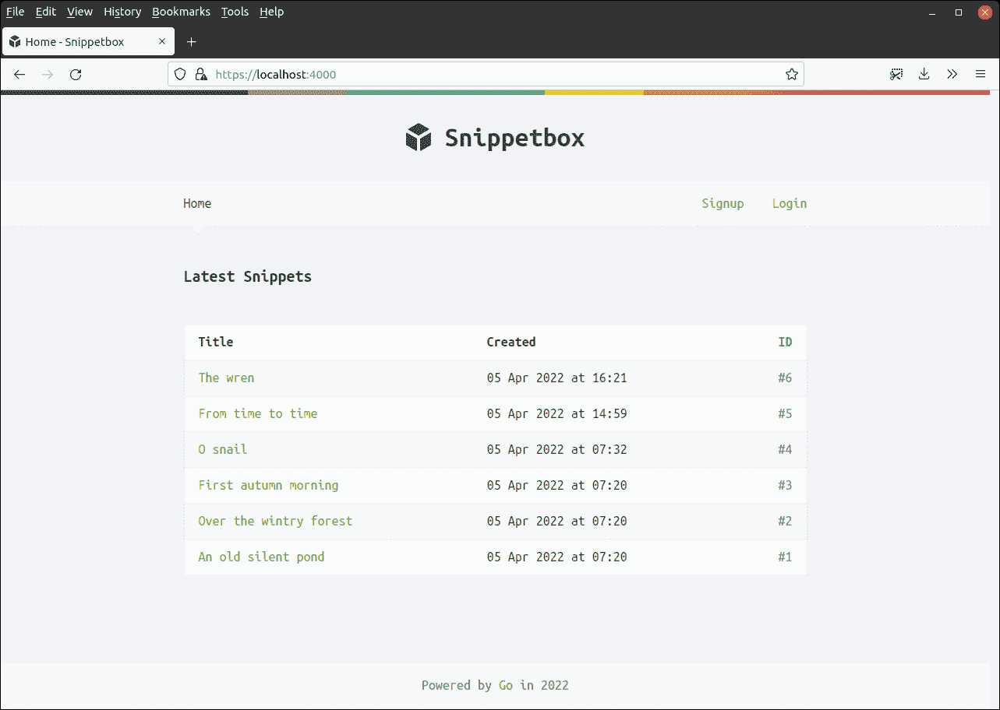

否则 —— 如果你已登录 —— 首页应该像这样：


你可以随意尝试操作这些功能，并尝试登录和注销，直到你确信导航栏如你预期的那样发生了变化。

### 限制访问权限

目前，我们为任何未登录的用户隐藏了“创建代码片段”导航链接。但未验证的用户仍然可以通过直接访问 [`https://localhost:4000/snippet/create`](https://localhost:4000/snippet/create) 页面来创建新的代码片段。

让我们修复这个问题，使得如果未验证的用户尝试访问 URL 路径为 `/snippet/create` 的任何路由，他们将重重定向到 `/user/login` 而不是。

实现此点的最简单方法是通过某些中间件。打开 `cmd/web/middleware.go` 文件并创建一个新的 `requireAuthentication()` 中间件函数，遵循我们在书中较早之前 使用的模式：

文件：`cmd/web/middleware.go`

```
package main

...

func (app *application) requireAuthentication(next http.Handler) http.Handler {
    return http.HandlerFunc(func(w http.ResponseWriter, r *http.Request) {
        // 如果用户未通过验证，将他们重定向到登录页面并
        // 从中间件链返回，这样链中后续的处理程序就不会被执行。
        if !app.isAuthenticated(r) {
            http.Redirect(w, r, "/user/login", http.StatusSeeOther)
            return
        }

        // 否则，设置 "Cache-Control: no-store" 头部，使得
        // 需要验证的页面不会存储在用户的浏览器缓存（或
        // 其他中间缓存）中。
        w.Header().Add("Cache-Control", "no-store")

        // 调用链中的下一个处理程序。
        next.ServeHTTP(w, r)
    })
}
```

我们现在可以将此中间件添加到我们的 `cmd/web/routes.go` 文件中以保护特定路由。

在我们情况下，我们将想要保护 `GET /snippet/create` 和 `POST /snippet/create` 路由。如果用户没有登录，对他们注销是没有意义的，因此在 `POST /user/logout` 路由上使用它也是合理的。

为了帮助这一点，让我们将应用程序路由重新调整为两个“组”。

第一组将包含我们的“未保护”路由并使用我们现有的 `dynamic` 中间件链。第二组将包含我们的“受保护”路由，并将使用一个新的 `protected` 中间件链 —— 由新的 `protected` 中间件链组成。

如下：

文件：`cmd/web/routes.go`


```go
package main

...

func (app *application) routes() http.Handler {
    router := chirouter.New()

    router.NotFound = http.HandlerFunc(func(w http.ResponseWriter, r *http.Request) {
        app.notFound(w)
    })

    fileServer := http.FileServer(http.Dir("./ui/static"))
    router.Handler(http.MethodGet, "/static/*", http.StripPrefix("/static", fileServer))

    // 使用 "dynamic" 中间件链的未保护路由。
    dynamic := alice.New(app.sessionManager.LoadAndSave)

    router.Handler(http.MethodGet, "/", dynamic.ThenFunc(app.home))
    router.Handler(http.MethodGet, "/snippet/:id", dynamic.ThenFunc(app.snippetView))
    router.Handler(http.MethodGet, "/user/signup", dynamic.ThenFunc(app.userSignup))
    router.Handler(http.MethodPost, "/user/signup", dynamic.ThenFunc(app.userSignup))
    router.Handler(http.MethodGet, "/user/login", dynamic.ThenFunc(app.userLogin))
    router.Handler(http.MethodPost, "/user/login", dynamic.ThenFunc(app.userPost))

    // 受保护（仅限已登录）的应用程序路由，使用一个新的
    // 中间件链，包含了 requireAuthentication。
    protected := dynamic.Append(app.requireAuthentication)

    router.Handler(http.MethodGet, "/snippet/create", protected.ThenFunc(app.snippetCreate))
    router.Handler(http.MethodPost, "/snippet/create", protected.ThenFunc(app.snippetPost))
    router.Handler(http.MethodPost, "/user/logout", protected.ThenFunc(app.userLogout))

    standard := alice.New(app.recoverPanic, app.logRequest, secureHeaders)
    return standard.Then(router)
}
```

保存文件，重启应用程序并确保你已注销。

然后尝试在浏览器中直接访问 `https://localhost:4000/snippet/create`。你会发现你被立即重定向到了登录表单。

如果你喜欢，也可以通过 `curl` 确认未验证的用户对于 `POST /snippet/create` 也会被重定向：

```bash
$ curl -ki -X POST https://localhost:4000/snippet/create
HTTP/2 303 
content-security-policy: default-src 'self'; style-src 'self' fonts.googleapis.com; font-src fonts.gstatic.com
location: /user/login
referrer-policy: origin-when-cross-origin
vary: Cookie
x-content-type-options: nosniff
x-frame-options: deny
x-xss-protection: 0
content-length: 0
date: Tue, 08 Mar 2022 11:28:05 GMT
```

---

## 其他信息

### 不使用 alice

如果你没有使用 `justinas/alice` 包来管理你的中间件，那没关系 —— 你可以这样手动包装你的处理程序：

```go
router.Handler(http.MethodPost, "/snippet/create", app.sessionManager.LoadAndSave(app.requireAuthentication(http.HandlerFunc(app.snippetCreate))))
```

## 第 11.7 章. CSRF 保护

在本章中，我们将介绍如何保护应用程序免受[跨站请求伪造](https://cheatsheetseries.owasp.org/cheatsheets/Cross-Site_Request_Forgery_Prevention_Cheat_Sheet.html) (CSRF)攻击。

如果你不熟悉 CSRF 的原理，它是一种攻击类型，恶意第三方网站向你的网站发送更改状态的 HTTP 请求。关于基础 CSRF 攻击的绝佳解释可以[在此处找到](http://www.gnucitizen.org/blog/csrf-demystified/)。

在我们的应用程序中，主要的风险如下：

- 用户登录了我们的应用程序。我们的 session cookie 设置为持续 12 小时，因此即使他们离开应用程序，他们将保持登录状态。
- 随后，用户访问一个恶意网站，该网站包含某些代码，会向我们的 `POST /snippet/create` 端点发送跨站请求，以向我们的数据库中添加新的代码片段。session cookie 将随此请求一起发送。
- 由于请求包含了 session cookie，我们的应用程序会将该请求解释为来自已登录用户，并以该用户的权限处理请求。因此，在用户完全不知情的情况下，一个新的代码片段将被添加到我们的数据库中。

除了上述的“传统”CSRF 攻击（即以已登录用户的权限处理请求）外，你的应用程序可能还面临[登录和注销](https://stackoverflow.com/questions/6412813/do-login-forms-need-tokens-against-csrf-attacks) CSRF 攻击的风险。

### SameSite cookies

我们可以防止 CSRF 攻击的一种缓解措施是确保在我们的 session cookie 上适当设置了 [`SameSite`](https://cheatsheetseries.owasp.org/cheatsheets/Cross-Site_Request_Forgery_Prevention_Cheat_Sheet.html#samesite-cookie-attribute) 属性。

默认情况下，我们正在使用的 `alexedwards/scs` 包始终会在 session cookie 上设置 `SameSite=Lax`。这意味着用户的浏览器将不会为任何[不安全的](https://tools.ietf.org/html/rfc7231#section-4.2.1)跨站请求发送（即 HTTP 方法为 `POST`、`PUT` 和 `DELETE` 的跨站请求）。

只要我们的应用程序对任何更改状态的 HTTP 请求（如我们的*登录*、*注册*、*注销*和*创建代码片段*表单提交）使用 `POST` 方法，意味着如果这些请求是跨站的，session cookie 就不会被发送——这反过来意味着它们应该是免受 CSRF 攻击的。

然而，`SameSite` 属性仍然较新，全球范围内只有 [90% 的浏览器](https://caniuse.com/#feat=same-site-cookie-attribute) 完全支持。因此，虽然我们可以将其作为防御措施（并且应该这样做），但我们不能依赖它来保护所有用户。

### 基于令牌的缓解措施

为了降低所有用户的 CSRF 风险，我们还需要实现某种形式的[令牌检查](https://cheatsheetseries.owasp.org/cheatsheets/Cross-Site_Request_Forgery_Prevention_Cheat_Sheet.html#token-mitigation)。与会话管理和密码哈希一样，在这一方面有很多错误可以犯，因此，使用经过测试的第三方包可能比自己编写更安全。Go Web 应用程序中停止 CSRF 攻击的两个最流行的包是 [`gorilla/csrf`](https://github.com/gorilla/csrf) 和 [`justinas/nosurf`](https://github.com/justinas/nosurf)。它们都做了大致相同的事情，使用[双重提交 cookie](https://cheatsheetseries.owasp.org/cheatsheets/Cross-Site_Request_Forgery_Prevention_Cheat_Sheet.html#double-submit-cookie) 模式来防止攻击。在这种模式下，会生成一个随机 CSRF 令牌并通过 cookie 发送给用户。然后，此 CSRF 令牌被添加到每个易受 CSRF 攻击的 HTML 表单的隐藏字段中。当表单提交时，两个包都会使用某些中间件来检查隐藏字段和 cookie 值是否匹配。在这两个包中，我们书中选择 `justinas/nosurf`。我主要倾向于它，因为它是自包含的，没有任何依赖。如果你在跟随操作，可以像这样安装最新版本：

```bash
go get github.com/justinas/nosurf@v1
```

### 使用 nosurf 包

要使用 `justinas/nosurf`，打开你的 `cmd/web/middleware.go` 文件并创建一个如下新的 `noSurf()` 中间件：

File: cmd/web/middleware.go

```go
package main

import (
    "fmt"
    "net/http"

    "github.com/justinas/nosurf"
)

...

// 创建一个 noSurf 中间件
func noSurf(next http.Handler) http.Handler {
    return nosurf.New(next, http.Cookie{
        HttpOnly: true,
        Path:     "/",
        Secure:   true, // 如果使用 HTTPS 则应设置为 true
        SameSite: http.SameSiteLaxMode,
    })
}
```


在本章中，我们将介绍如何保护应用程序免受[跨站请求伪造](https://cheatsheetseries.owasp.org/cheatsheets/Cross-Site_Request_Forgery_Prevention_Cheat_Sheet.html)（CSRF）攻击。

如果你不熟悉 CSRF 的原理，它是一种攻击类型，恶意第三方网站向你的网站发送更改状态的 HTTP 请求。关于基础 CSRF 攻击的绝佳解释可以[在此处找到](http://www.gnucitizen.org/blog/csrf-demystified/)。

在我们的应用程序中，主要的风险如下：

- 用户登录了我们的应用程序。我们的 session cookie 设置为持续 12 小时，因此即使他们离开应用程序，他们将保持登录状态。
- 随后，用户访问一个恶意网站，该网站包含某些代码，会向我们的 `POST /snippet/create` 端点发送跨站请求，以向我们的数据库中添加新的代码片段。session cookie 将随此请求一起发送。
- 由于请求包含了 session cookie，我们的应用程序会将该请求解释为来自已登录用户，并以该用户的权限处理请求。因此，在用户完全不知情的情况下，一个新的代码片段将被添加到我们的数据库中。

除了上述的“传统”CSRF 攻击（即以已登录用户的权限处理请求）外，你的应用程序可能还面临[登录和注销](https://stackoverflow.com/questions/6412813/do-login-forms-need-tokens-against-csrf-attacks) CSRF 攻击的风险。

## SameSite cookies

我们可以防止 CSRF 攻击的一种缓解措施是确保在我们的 session cookie 上适当设置了 [`SameSite`](https://cheatsheetseries.owasp.org/cheatsheets/Cross-Site_Request_Forgery_Prevention_Cheat_Sheet.html#samesite-cookie-attribute) 属性。

默认情况下，我们正在使用的 `alexedwards/scs` 包始终会在 session cookie 上设置 `SameSite=Lax`。这意味着用户的浏览器将不会为任何[不安全的](https://tools.ietf.org/html/rfc7231#section-4.2.1)跨站请求发送（即 HTTP 方法为 `POST`、`PUT` 和 `DELETE` 的跨站请求）。

只要我们的应用程序对任何更改状态的 HTTP 请求（如我们的*登录*、*注册*、*注销*和*创建代码片段*表单提交）使用 `POST` 方法，意味着如果这些请求是跨站的，session cookie 就不会被发送——这反过来意味着它们应该是免受 CSRF 攻击的。

然而，`SameSite` 属性仍然较新，全球范围内只有 [90% 的浏览器](https://caniuse.com/#feat=same-site-cookie-attribute)完全支持。因此，虽然我们可以将其作为防御措施（并且应该这样做），但我们不能依赖它来保护所有用户。

## 基于令牌的缓解措施

为了降低所有用户的 CSRF 风险，我们还需要实现某种形式的[令牌检查](https://cheatsheetseries.owasp.org/cheatsheets/Cross-Site_Request_Forgery_Prevention_Cheat_Sheet.html#token-mitigation)。与会话管理和密码哈希一样，在这一方面有很多错误可以犯，因此，使用经过测试的第三方包可能比自己编写更安全。Go Web 应用程序中停止 CSRF 攻击的两个最流行的包是 [`gorilla/csrf`](https://github.com/gorilla/csrf) 和 [`justinas/nosurf`](https://github.com/justinas/nosurf)。它们都做了大致相同的事情，使用[双重提交 cookie](https://cheatsheetseries.owasp.org/cheatsheets/Cross-Site_Request_Forgery_Prevention_Cheat_Sheet.html#double-submit-cookie) 模式来防止攻击。在这种模式下，会生成一个随机 CSRF 令牌并通过 cookie 发送给用户。然后，此 CSRF 令牌被添加到每个易受 CSRF 攻击的 HTML 表单的隐藏字段中。当表单提交时，两个包都会使用某些中间件来检查隐藏字段和 cookie 值是否匹配。在这两个包中，我们书中选择使用 `justinas/nosurf`。我主要倾向于它，因为它是自包含的，没有任何依赖。如果你在跟随操作，可以像这样安装最新版本：

```bash
go get github.com/justinas/nosurf@v1
```

## 使用 nosurf 包

要使用 `justinas/nosurf`，打开你的 `cmd/web/middleware.go` 文件并创建一个如下新的 `noSurf()` 中间件：

File: `cmd/web/middleware.go`

```go
package main

import (
    "fmt"
    "net/http"

    "github.com/justinas/nosurf"
)

...

// 创建一个 noSurf 中间件
func noSurf(next http.Handler) http.Handler {
    return nosurf.New(next, http.Cookie{
        HttpOnly: true,
        Path:     "/",
        Secure:   true, // 如果使用 HTTPS 则应设置为 true
        SameSite: http.SameSiteLaxMode,
    })
}
```


## SameSite cookies

我们可以防止 CSRF 攻击的一种缓解措施是确保在我们的 session cookie 上适当设置了 [`SameSite`](https://cheatsheetseries.owasp.org/cheatsheets/Cross-Site_Request_Forgery_Prevention_Cheat_Sheet.html#samesite-cookie-attribute) 属性。

默认情况下，我们正在使用的 `alexedwards/scs` 包始终会在 session cookie 上设置 `SameSite=Lax`。这意味着用户的浏览器将不会为任何[不安全的](https://tools.ietf.org/html/rfc7231#section-4.2.1)跨站请求发送（即 HTTP 方法为 `POST`、`PUT` 和 `DELETE` 的跨站请求）。

只要我们的应用程序对任何更改状态的 HTTP 请求（如我们的*登录*、*注册*、*注销*和*创建代码片段*表单提交）使用 `POST` 方法，意味着如果这些请求是跨站的，session cookie 就不会被发送——这反过来意味着它们应该是免受 CSRF 攻击的。

然而，`SameSite` 属性仍然较新，全球范围内只有 [90% 的浏览器](https://caniuse.com/#feat=same-site-cookie-attribute)完全支持。因此，虽然我们可以将其作为防御措施（并且应该这样做），但我们不能依赖它来保护所有用户。

## 基于令牌的缓解措施

为了降低所有用户的 CSRF 风险，我们还需要实现某种形式的[令牌检查](https://cheatsheetseries.owasp.org/cheatsheets/Cross-Site_Request_Forgery_Prevention_Cheat_Sheet.html#token-mitigation)。与会话管理和密码哈希一样，在这一方面有很多错误可以犯，因此，使用经过测试的第三方包可能比自己编写更安全。Go Web 应用程序中停止 CSRF 攻击的两个最流行的包是 [`gorilla/csrf`](https://github.com/gorilla/csrf) 和 [`justinas/nosurf`](https://github.com/justinas/nosurf)。它们都做了大致相同的事情，使用[双重提交 cookie](https://cheatsheetseries.owasp.org/cheatsheets/Cross-Site_Request_Forgery_Prevention_Cheat_Sheet.html#double-submit-cookie) 模式来防止攻击。在这种模式下，会生成一个随机 CSRF 令牌并通过 cookie 发送给用户。然后，此 CSRF 令牌被添加到每个易受 CSRF 攻击的 HTML 表单的隐藏字段中。当表单提交时，两个包都会使用某些中间件来检查隐藏字段和 cookie 值是否匹配。在这两个包中，我们书中选择使用 `justinas/nosurf`。我主要倾向于它，因为它是自包含的，没有任何依赖。如果你在跟随操作，可以像这样安装最新版本：

```bash
go get github.com/justinas/nosurf@v1
```

## 使用 nosurf 包

要使用 `justinas/nosurf`，打开你的 `cmd/web/middleware.go` 文件并创建一个如下新的 `noSurf()` 中间件：

文件：`cmd/web/middleware.go`

```go
package main

import (
    "fmt"
    "net/http"

    "github.com/justinas/nosurf"
)

...

// 创建一个 noSurf 中间件
func noSurf(next http.Handler) http.Handler {
    return nosurf.New(next, http.Cookie{
        HttpOnly: true,
        Path:     "/",
        Secure:   true, // 如果使用 HTTPS 则应设置为 true
        SameSite: http.SameSiteLaxMode,
    })
}
```

*(注：由于原文提供的文本中代码块部分实际上是逻辑混乱且包含了多个代码的，我将基于原文文本结构进行翻译。)*

```go
package main

import (
    "html/template"
    "path/filepath"
    "time"

    "snippetbox.alexedwards.net/internal/models"
)

type templateData struct {
    CurrentYear     int
    Snippet         *models.Snippet
    Snippets        []*models.Snippet
    Form            any
    Flash           string
    IsAuthenticated bool
    CSRFToken       string // 添加一个 CSRFToken 字段。
}

...
```

由于注销表单可能会出现在每一个页面上，因此通过我们的 `newTemplateData()` 辅助函数自动将 CSRF 令牌添加到模板数据中是合理的。这意味着每当我们渲染一个页面时，模板都可以可以使用该令牌。

请按照以下方式更新 `cmd/web/helpers.go` 文件：

文件：`cmd/web/helpers.go`

```go
package main

import (
    "bytes"
    "errors"
    "fmt"
    "net/http"
    "runtime/debug"
    "time"

    "github.com/go-playground/form/v4"
    "github.com/justinas/nosurf" // 新导入
)

...

func (app *application) newTemplateData(r *http.Request) *templateData {
    return &templateData{
        CurrentYear:     time.Now().Year(),
        Flash:           app.sessionManager.PopString(r.Context(), "flash"),
        IsAuthenticated: app.isAuthenticated(r),
        CSRFToken:       nosurf.Token(r), // 添加 CSRF 令牌。
    }
}

...
```

最后，我们需要更新应用程序中的所有表单，在隐藏字段中包含此 CSRF 令牌。

如下所示：

文件：`ui/html/pages/create.tmpl`

```html
{{define "title"}}创建新的代码片段{{end}}

{{define "main"}}
<form action='/snippet/create' method='POST'>
    <!-- 包含 CSRF 令牌 -->
    <input type='hidden' name='csrf_token' value='{{.CSRFToken}}'>
    <div>
        <label>Title:</label>
        {{with .Form.FieldErrors.title}}
            <label class='error'>{{.}}</label>
        {{end}}
        <input type='text' name='title' value='{{.Form.Title}}'>
    </div>
    <div>
        <label>Content:</label>
        {{with .Form.FieldErrors.content}}
            <label class='error'>{{.}}</label>
        {{end}}
        <textarea name='content'>{{.Form.Content}}</textarea>
    </div>
    <div>
        <label>Delete in:</label>
        {{with .Form.FieldErrors.expires}}
            <label class='error'>{{.}}</label>
        {{end}}
        <input type='radio' name='expires' value='365' {{if (eq .Form.Expires 365)}}checked{{end}}> 一年
        <input type='radio' name='expires' value='7' {{if (eq .Form.Expires 7)}}checked{{end}}> 一周
        <input type='radio' name='expires' value='1' {{if (eq .Form.Expires 1)}}checked{{end}}> 一天
    </div>
    <div>
        <input type='submit' value='发布片段'>
    </div>
</form>
{{end}}
```

文件：`ui/html/pages/login.tmpl`

```html
{{define "title"}}登录{{end}}

{{define "main"}}
<form action='/user/login' method='POST' novalidate>
    <!-- 包含 CSRF 令牌 -->
    <input type='hidden' name='csrf_token' value='{{.CSRFToken}}'>
    {{range .Form.NonFieldErrors}}
        <div class='error'>{{.}}</div>
    {{end}}
    <div>
        <label>Email:</label>
        {{with .Form.FieldErrors.email}}
            <label class='error'>{{.}}</label>
        {{end}}
        <input type='email' name='email' value='{{.Form.Email}}'>
    </div>
    <div>
        <label>Password:</label>
        {{with .Form.FieldErrors.password}}
            <label class='error'>{{.}}</label>
        {{end}}
        <input type='password' name='password' value='{{.Form.Password}}'>
    </div>
    <div>
        <input type='submit' value='登录'>
    </div>
</form>
{{end}}
```

文件：`ui/html/pages/create.tmpl`

```html
{{define "title"}}创建新的代码片段{{end}}

{{define "main"}}
<form action='/snippet/create' method='POST' novalidate>
    <!-- 包含 CSRF 令牌 -->
    <input type='hidden' name='csrf_token' value='{{.CSRFToken}}'>
    <div>
        <label>Name:</label>
        {{with .Form.FieldErrors.name}}
            <label class='error'>{{.}}</label>
        {{end}}
        <input type='text' name='name' value='{{.Form.Name}}'>
    </div>
    <div>
        <label>Email:</label>
        {{with .Form.FieldErrors.email}}
            <label class='error'>{{.}}</label>
        {{end}}
        <input type='email' name='email' value='{{.Form.Email}}'>
    </div>
    <div>
        <label>Password:</label>
        {{with .Form.FieldErrors.password}}
            <label class='error'>{{.}}</label>
        {{end}}
        <input type='password' name='password' value='{{.Form.Password}}'>
    </div>
    <div>
        <input type='submit' value='注册'>
    </div>
</form>
{{end}}
```

文件：`ui/html/partials/nav.tmpl`

```html
{{define "nav"}}
<nav>
    <div>
        <a href='/'>首页</a>
        {{if .IsAuthenticated}}
            <a href='/snippet/create'>新片段</a>
            <form action='/user/logout' method='POST' style='display:inline'>
                <input type='hidden' name='csrf_token' value='{{.CSRFToken}}'>
                <button>注销</button>
            </form>
        {{else}}
            <a href='/user/login'>登录</a>
            <a href='/user/signup'>注册</a>
        {{end}}
    </div>
</nav>
{{end}}
```

- 什么是请求上下文（request context）、如何使用它，以及何时适合使用它。
- 如何在实践中使用请求上下文在你的各个处理器之间传递有关当前用户的信息。

# 第 12.1 节

## 请求上下文是如何工作的

我们的中间件和处理器所处理的每一个 `http.Request` 内部都嵌入了一个 `context.Context` 对象，我们可以利用它在请求的整个生命周期内存储信息。

正如我之前暗示过的，在 Web 应用程序中，这种机制的一个常见用例是在你的中间件和其他处理器之间传递信息。

在我们的案例中，我们想要使用它来在某些中间件中检查用户是否通过了身份验证，如果通过了，则将此信息提供给我们所有的其他中间件和处理器。

让我们先从理论开始，解释处理请求上下文的语法。然后，在下一章节中，我们将再次变得具体，并演示如何在应用程序中实际使用它。

### 请求上下文的语法

向请求上下文中添加信息的的基础代码所示：

```go
// 其中 r 是一个 *http.Request...
ctx := r.Context()
ctx = context.WithValue(ctx, "isAuthenticated", true)
r = r.WithContext(ctx)
```

让我们逐行分析这些行代码。

- 首先，我们使用 `r.Context()` 方法从请求中获取*现有的*上下文，并将其赋值给变量 `ctx`。
- 然后，我们使用 `context.WithValue()` 方法创建一个现有上下文的*新副本*，其中包含键 `"isAuthenticated"` 和值 `true`。
- 最后，我们使用 `r.WithContext()` 方法创建一个包含我们新上下文的请求的*副本*。

我还应该指出的是，为了清晰起见，我把那段代码片段写得比实际需要的要冗长一些。更典型的写法是这样的：

```go
ctx = context.WithValue(r.Context(), "isAuthenticated", true)
r = r.WithContext(ctx)
```

这就是你向请求上下文中添加数据的方法。但如何再次获取它呢？

这里需要解释的关键点是，在底层，请求上下文的值是以类型 `any` 存储的。这意味着，从上下文中获取它们后，你需要在使用它们之前将它们断言为原始类型。

要获取一个值，我们需要使用 `r.Context().Value()` 方法，如下所示：

```go
isAuthenticated, ok := r.Context().Value("isAuthenticated").(bool)
if !ok {
    return errors.New("could not convert value to bool")
}
```


### 避免键冲突

在上面的代码示例中，我使用字符串`"isAuthenticated"`作为从请求上下文中存储和检索数据的键（key）。但这种做法是不推荐的，因为存在这样一种风险：即你的应用程序所使用的其他第三方包可能也想要使用键`"isAuthenticated"`来存储数据——这会导致命名冲突。

为了避免这种情况，良好的做法是为键创建一个你自定义的自定义类型。在我们的示例中，我们将这样做：

```go
// 为键定义一个自定义类型
type contextKey string

// 创建一个该类型的常量
const isAuthenticatedContextKey = contextKey("isAuthenticated")

// 从上下文中检索值
isAuthenticated, ok := r.Context().Value(isAuthenticatedContextKey).(bool)
if !ok {
    return errors.New("could not convert value to bool")
}
```

## 第 12.2 节。用于身份验证/授权的请求上下文

现在，让我们创建一个`authenticate()`中间件，它将：

1. 从会话中检索用户 ID。
2. 检查数据库该 ID 是否存在。
3. 使用`true`的`isAuthenticatedContextKey`更新请求上下文。

以下是代码：

文件：`cmd/web/middleware.go`

```go
package main

import (
    "context"
    "errors"
    "fmt"
    "net/http"

    "github.com/justinas/nosurf"
)

func (app *application) authenticate(next http.Handler) http.Handler {
    return http.HandlerFunc(func(w http.ResponseWriter, r *http.Request) {
        // 使用 GetInt 方法从会话中检索 authenticatedUserID 值。
        // 如果会话中没有 "authenticatedUserID"，则正常调用
        // 链中的下一个处理器。
        id := app.sessionManager.GetInt(r.Context(), "authenticatedUserID")
        if id == 0 {
            next.ServeHTTP(w, r)
            return
        }

        // 否则，我们检查数据库中是否存在该 ID 的
        // 用户。
        exists, err := app.users.Exists(id)
        if err != nil {
            app.serverError(w, err)
            return
        }

        // 如果找到了匹配的用户，我们就知道该请求来自
        // 数据库中存在的已身份验证用户。我们
        // 创建请求的新副本（在请求上下文中包含值为 true 的
        // isAuthenticatedContextKey），并将其赋值给 r。
        if exists {
            ctx := context.WithValue(r.Context(), isAuthenticatedContextKey, true)
            r = r.WithContext(ctx)
        }

        // 调用链中的下一个处理器。
        next.ServeHTTP(w, r)
    })
}
```

文件：`internal/models/users.go`

```go
package models

import (
    "database/sql"
)

// ...

func (m *UserModel) Exists(id int) (bool, error) {
    var exists bool

    stmt := "SELECT EXISTS(SELECT 1 FROM users WHERE id = ?)"

    err := m.DB.QueryRow(stmt, id).Scan(&exists)
    return exists, err
}
```

文件：`cmd/web/context.go`

```go
package main

type contextKey string

const isAuthenticatedContextKey = contextKey("isAuthenticated")
```

```go
package main

...

func (app *application) routes() http.Handler {
    router := httprouter.New()

    router.NotFound = http.HandlerFunc(func(w http.ResponseWriter, r *http.Request) {
        app.notFound(w)
    })

    fileServer := http.FileServer(http.Dir("./ui/static/"))
    router.Handler(http.MethodGet, "/static/*filepath", http.StripPrefix("/static", fileServer))
    
    // Add the authenticate() middleware to the chain.
    dynamic := alice.New(app.sessionManager.LoadAndSave, noSurf, app.authenticate)

    router.Handler(http.MethodGet, "/", dynamic.ThenFunc(app.home))
    router.Handler(http.MethodGet, "/snippet/view/:id", dynamic.ThenFunc(app.snippetView))
    router.Handler(http.MethodGet, "/user/signup", dynamic.ThenFunc(app.userSignup))
    router.Handler(http.MethodPost, "/user/signup", dynamic.ThenFunc(app.userSignupPost))
    router.Handler(http.MethodGet, "/user/login", dynamic.ThenFunc(app.userLogin))
    router.Handler(http.MethodPost, "/user/login", dynamic.ThenFunc(app.userLoginPost))

    protected := dynamic.Append(app.requireAuthentication)

    router.Handler(http.MethodGet, "/snippet/create", protected.ThenFunc(app.snippetCreate))
    router.Handler(http.MethodPost, "/snippet/create", protected.ThenFunc(app.snippetCreatePost))
    router.Handler(http.MethodPost, "/user/logout", protected.ThenFunc(app.userLogoutPost))

    standard := alice.New(app.recoverPanic, app.logRequest, secureHeaders)
    return standard.Then(router)
}
```

我们最后需要做的是更新`isAuthenticated()`辅助函数，使其不再检查会话数据，而是检查请求上下文（request context）来判断用户是否已身份。

我们可以这样做：

文件：`cmd/web/helpers.go`

```go
package main

...

func (app *application) isAuthenticated(r *http.Request) bool {
    isAuthenticated, ok := r.Context().Value(isAuthenticatedContextKey).(bool)
    if !ok {
        return false
    }

    return isAuthenticated
}
```

这里需要指出的是，如果请求上下文中没有`isAuthenticatedContextKey`键的值，或者底层值不是`bool`类型，那么该类型断言将会失败。在这种情况下，我们采取“安全”回退策略，并返回`false`（即我们假设用户未通过验证）。

如果你愿意，可以尝试再次运行应用程序。它应该能够正常编译，如果你以某个用户登录并在应用程序中浏览，它的工作方式应该和之前完全一样。

然后，如果你想，可以打开 MySQL 从数据库中删除你当前登录用户的记录。例如：

```mysql
mysql> USE snippetbox;
mysql> DELETE FROM users WHERE email = 'bob@example.com';
```

当你回到浏览器并刷新页面时，应用程序现在足够智能了。

### 附加信息

#### 可选功能

Go 1.16 的新功能之一是`embed`，它允许你直接将文件和目录包含在二进制文件中。这对于分发需要静态资源的自包含应用程序特别有用。

在本节中，我们将讨论两个功能：`embedding`（嵌入）和`generics`（泛型）。

#### 使用嵌入文件

为了说明如何使用`embed`，首先创建一个`ui/efs.go`：

```bash
$ touch ui/efs.go
```

然后添加以下代码：

文件：`ui/efs.go`

```go
package ui

import (
    "embed"
)

//go:embed "html" "static"
var Files embed.FS
```

这里重要的一行是`//go:embed "html" "static"`。它看起来像是一个注释，但实际上是一个特殊的指令。当我们的应用程序编译时，该指令指示 Go 存储这些文件。

关于这一点有几个重要的细节我们需要解释：

- 注释指令必须放置在你想要存储嵌入文件的变量上方。
- 指令的通用格式为`go:embed <paths>`，在一个指令中指定多个路径是允许的。这些路径应该相对于包含该指令的源代码。
- 你只能在包级别的全局变量上使用`go:embed`指令，而不能在函数或方法内部。如果你尝试在函数或方法中使用它，将在编译时得到错误`"go:embed cannot apply to var inside func"`。
- 如果路径是一个目录，则该目录下的所有文件都将被递归嵌入，但以`.`或`_`开头的文件除外。如果你想包含这些文件，应该使用`all:`前缀。
- 路径不能包含`.`或`..`，也不能以`/`开始或结束。
- 路径分隔符应该始终使用斜杠，即使在 Windows 上也是如此。
- 嵌入的文件系统始终根于包含`go:embed`指令的目录。因此在上面的示例中，我们的`Files`变量包含一个`embed.FS`嵌入文件系统，该文件系统的根是我们的`ui`目录。

### 使用静态文件

让我们更改应用程序，使其从嵌入文件系统提供静态 CSS、JavaScript 和图像文件，而不是在运行时从磁盘读取它们。

```go
package main

import (
    "net/http"
    "io/fs"
    "path/filepath"
    "time"

    "snippetbox.alexedwards.net/internal/models"
    "snippetbox.alexedwards.net/ui" // 新导入
)

...

func newTemplateCache() (map[string]*template.Template, error) {
    cache := map[string]*template.Template{}

    // 使用 fs.Glob() 获取 ui.Files 嵌入文件系统中所有
    // 匹配 'html/pages/*.tmpl' 模式的文件路径切片。这本质上
    // 我们提供了应用程序所有的 'page' 模板切片，
    // 就像之前一样。
    pages, err := fs.Glob(ui.Files, "html/pages/*.tmpl")
    if err != nil {
        return nil, err
    }

    for _, page := range pages {
        name := filepath.Base(page)

        // 创建一个包含我们要解析的模板
        // 文件路径模式的切片。
        patterns := []string{
            "html/base.tmpl",
            "html/partials/*.tmpl",
            page,
        }

        // 使用 ParseFS() 代替 ParseFiles() 来解析来自
        // ui.Files 嵌入文件系统的模板文件。
        ts, err := template.New(name).Funcs(functions).ParseFS(ui.Files, patterns...)
        if err != nil {
            return nil, err
        }

        cache[name] = ts
    }

    return cache, nil
}
```

如果你保存了文件并重启应用程序，你应该发现一切都能正常编译并运行。当你在浏览器中访问`https://localhost:4000`时，静态文件应该从嵌入文件系统中提供，一切看起来都很正常。


如果你愿意，你也可以直接导航到静态文件来检查它们仍然可用。例如，访问`https://localhost:4000/static/main.css`应该显示来自嵌入文件系统的网页 CSS 样式表。


### 嵌入 HTML 模板

接下来，让我们更新`cmd/web/templates.go`文件，以便我们的模板缓存使用来自`ui.Files`的嵌入 HTML 模板，而不是磁盘上的模板。

为了帮助我们，我们需要利用 Go 1.16 引入的用于处理文件系统的特殊功能：

- `fs.Glob()`返回一个匹配 glob 通配符的文件路径切片。它与我们之前在书中使用的`filepath.Glob()`函数实际上相同，不同在于它作用于嵌入文件系统。
- `Template.ParseFS()`可用于将嵌入文件系统中的 HTML 模板解析为模板集。这在本质上替换了我们之前使用的`Template.ParseFiles()`和`Template.ParseGlob()`方法。`Template.ParseFiles()`也是一个变长函数，它允许你在单次`ParseFiles()`调用中解析多个模板。

让我们在`cmd/web/templates.go`文件中使用这些功能：

文件：`cmd/web/templates.go`

（见上方的代码块）

我知道这听起来可能有点无聊，但泛型（generics）是一项新的语言特性，编写泛型代码的最佳实践仍在完善中。如果你在一个团队中工作，或者在公场合编写代码，你还需要记住，并不是所有的其他 Go 开发者都一定熟悉泛型代码是如何运作的。

你并不`需要`使用泛型，不使用它也是完全可以的。

但即使有这些限制，在某些场景下，编写泛型代码确实非常有用。广义地说，当出现以下情况，你可能想要考虑使用它：

* 你发现自己在为不同的数据类型编写重复的样板代码。这可能包括对切片（slices）、map 或通道（channels）的常用操作——或者对不同数据类型执行验证检查或测试断言的辅助函数。
* 你正在编写代码并发现自己正在使用`any`（空`interface{}`）类型。这的一个例子可能是当你创建一个需要处理不同类型的数据结构（如队列、缓存或链表）时。

相比之下，在以下情况下，你可能**不想要**使用泛型：

* 如果它让你的代码更难理解或不够清晰。
* 如果你需要处理的所有类型都拥有一共同的方法集——在这种情况下，定义并使用普通的`interface`类型会更好。
* 仅仅`因为你可以`这样做。相反，请默认编写简单的非泛型代码，只有在`实际上确实需要`的时候再切换到泛型版本。

### 在我们的应用程序中使用泛型

在书的下一节中，我们将开始为应用程序编写测试，在此过程中，我们将生成大量的重复样板代码。我们将利用 Go 的泛型功能来帮助管理这些代码，并创建一些泛型辅助函数来对不同数据类型执行测试断言。

但目前，我们的代码库中还没有什么可以通过泛型来获益。我们的应用程序已经可以运行——而且代码清晰、易读，没有多少泛型可以轻松消除的重复内容。


也许唯一真正适合泛型化的，是我们 `internal/validator/validator.go` 文件中的 `PermittedInt()` 函数。

让我们将其更改为泛型的 `PermittedValue()` 函数，然后我们可以在每次需要检查用户提供的值是否在允许值集合中时都使用它——无论用户提供的值是 `string`、`int`、`float64` 还是任何其他 [comparable type](https://pkg.go.dev/builtin#comparable)。

如下所示：

文件：`internal/validator/validator.go`

```go
package validator

...

// 将 PermittedInt() 替换为泛型的 PermittedValue() 函数。
// 如果类型为 T 的值等于变长参数 permittedValues 
// 之一，则返回 true。
func PermittedValueT comparable bool {
    for i := range permittedValues {
        if value == permittedValues[i] {
            return true
        }
    }
    return false
}
```

然后我们可以更新 `snippetCreatePost` 处理器，在验证检查中使用新的 `PermittedValue()` 函数，如下式所示：

文件：`cmd/web/handlers.go`

```go
package main

...

func (app *application) snippetCreatePost(w http.ResponseWriter, r *http.Request) {
    var form snippetCreateForm

    err := app.decodePostForm(r, &form)
    if err != nil {
        app.clientError(w, http.StatusBadRequest)
        return
    }

    form.CheckField(validator.NotBlank(form.Title), "title", "This field cannot be blank")
    form.CheckField(validator.MaxChars(form.Title, 100), "title", "This field cannot be more than 100 characters long")
    form.CheckField(validator.NotBlank(form.Content), "content", "This field cannot be blank")
```

- 该测试只是普通的 Go 代码，它调用了 `humanDate()` 函数并检查结果是否符合我们的预期。
- 你的单元测试包含在一个签名名为 `func(*testing.T)` 的普通 Go 函数中。
- 要使该函数成为一个有效的单元测试，该函数名**必须**以 `Test` 单词开头。通常，这之后会跟着你正在测试的函数、方法或类型的名称，以便一目了然地看出正在测试**什么**。
- 你可以使用 [`t.Errorf()`](https://pkg.go.dev/testing/#T.Errorf) 函数将测试标记为 `failed`（失败）并记录关于失败的描述性消息。需要注意的是，调用 `t.Errorf()` **不会停止测试的执行** —— 在你调用它之后，Go 将像正常一样继续执行任何剩余的测试代码。

让我们来试一下。保存文件，然后使用 `go test` 命令运行我们 `cmd/web` 包中的所有测试，如下所示：

```bash
$ go test ./cmd/web
ok      snippetbox.alexedwards.net/cmd/web    0.005s
```

所以，这些很有用。输出中的 `ok` 表示该包中的所有测试（目前只有我们的 `TestHumanDate()` 测试）都通过了，没有任何问题。

如果你想查看更多细节，可以使用 `-v` 标志获取 `verbose`（详细）输出，从而精确看到正在运行哪些测试：

```bash
$ go test -v ./cmd/web
=== RUN   TestHumanDate
--- PASS: TestHumanDate (0.00s)
PASS
ok      snippetbox.alexedwards.net/cmd/web    0.007s
```

### 表驱动测试

现在让我们扩展 `TestHumanDate()` 函数，以涵盖一些额外的测试用例。具体来说，我们将更新它来同时检查：

1. 如果 `humanDate()` 的输入是[零值](https://pkg.go.dev/time/#Time.IsZero)，则它将返回空字符串 `""`。
2. `humanDate()` 函数的输出始终使用 UTC 时区。

在 Go 中，运行多个测试用例的一种地道方法是使用表驱动测试。

本质上，表驱动测试的核心思想是创建一个包含输入和预期输出的测试用例“表格”，然后遍历这些表格，并在子测试中运行每个测试用例。你有几种方法可以这样设置，但一种常见的方法是在匿名结构体切片中定义你的测试用例。

我将演示：

文件：`cmd/web/templates_test.go`

```go
package main

import (
    "testing"
    "time"
)

func TestHumanDate(t *testing.T) {
    // 创建一个匿名结构体切片，包含测试用例名称、
    // 传递给 humanDate() 函数的输入 (tm 字段) 以及预期输出
    // (want 字段)。
    tests := []struct {
        name string
        tm   time.Time
        want string
    }{
        {
            name: "UTC",
            tm:   time.Date(2022, 3, 17, 10, 15, 0, 0, time.UTC),
            want: "17 Mar 2022 at 10:15",
        },
        {
            name: "Empty",
            tm:   time.Time{},
            want: "",
        },
        {
            name: "CET",
            tm:   time.Date(2022, 3, 17, 10, 15, 0, 0, time.FixedZone("CET", 1*60*60)),
            want: "17 Mar 2022 at 09:15",
        },
    }

    // 遍历测试用例。
    for _, tt := range tests {
        // 使用 t.Run() 函数为每个测试用例运行一个子测试。
        // 它的第一个参数是测试名称（用于在任何日志输出中标识 
        // 子测试），第二个参数是一个包含每个用例实际测试逻辑的匿名函数。
        t.Run(tt.name, func(t *testing.T) {
            hd := humanDate(tt.tm)

            if hd != tt.want {
                t.Errorf("got %q; want %q", hd, tt.want)
            }
        })
    }
}
```

好的，让我们运行它看看会发生什么：

```bash
$ go test -v ./cmd/web
=== RUN   TestHumanDate
=== RUN   TestHumanDate/UTC
=== RUN   TestHumanDate/Empty
    templates_test.go:44: got "01 Jan 0001 at 00:00"; want ""
=== RUN   TestHumanDate/CET
    templates_test.go:44: got "17 Mar 2022 at 10:15"; want "17 Mar 2022 at 09:15"
--- FAIL: TestHumanDate (0.00s)
    --- PASS: TestHumanDate/UTC (0.00s)
    --- FAIL: TestHumanDate/Empty (0.00s)
    --- FAIL: TestHumanDate/CET (0.00s)
FAIL
FAIL    snippetbox.alexedwards.net/cmd/web      0.003s
```

所以在这里我们可以看到每个子测试的单独输出。正如你可能猜的那样，第一个测试用例通过了，但 `Empty` 和 `CET` 测试都失败了。注意对于失败的测试用例 —— 我们在输出中包含了错误信息和文件名？

让我们回到 `humanDate()` 函数并修复这两个问题：

文件：`cmd/web/templates.go`

```go
package main

...

func humanDate(t time.Time) string {
    // 如果时间为零值，则返回空字符串。
    if t.IsZero() {
        return ""
    }

    // 在格式化之前将时间转换为 UTC。
    return t.UTC().Format("02 Jan 2006 at 15:04")
}

...
```

当你重新运行测试时，一切都应该通过了：

```bash
$ go test -v ./cmd/web
=== RUN   TestHumanDate
=== RUN   TestHumanDate/UTC
=== RUN   TestHumanDate/Empty
=== RUN   TestHumanDate/CET
--- PASS: TestHumanDate (0.00s)
    --- PASS: TestHumanDate/UTC (0.00s)
    --- PASS: TestHumanDate/Empty (0.00s)
    --- PASS: TestHumanDate/CET (0.00s)
ok      snippetbox.alexedwards.net/cmd/web    0.007s
```

### 辅助函数

正如我在书中之前提到的，在接下来的章节中我们将编写很多测试断言的辅助函数。

在 Go 中，运行多个测试用例的一种地道方法是使用表驱动测试。

本质上，表驱动测试的想法是创建一个包含输入和预期输出的测试用例“表格”，然后遍历这些表格，并在子测试中运行每个测试用例。你有几种方法可以这样设置，但一种常见的方法是在匿名结构体切片中定义你的测试用例。

正如我在书中之前提到的，在接下来的章节中我们将编写很多测试断言的辅助函数。

在 Go 中，运行多个测试用例的一种地道方法是使用表驱动测试。

正如我在书中之前提到的，在接下来的章节中我们将编写很多测试断言的辅助函数。

在 Go 中，运行多个测试用例的一种地道方法是使用表驱动测试。

正如我在书中之前提到的，在接下来的章节中我们将编写很多测试断言的辅助函数。

在 Go 中，运行多个测试用例的一种地道方法是使用表驱动测试。

正如我在书中之前提到的，在接下来的章节中我们将编写很多测试断言的辅助函数。

在 Go 中，运行多个测试用例的一种地道方法是使用表驱动测试。


正如我在书中之前提到的，在接下来的章节中我们将编写很多测试断言的辅助函数。

在 Go 中，运行多个测试用例的一种地道方法是使用表驱动测试。

让我们编写一个辅助函数来让测试代码更简洁、易读。

（注：由于原文中似乎出现了重复的文本，翻译已根据逻辑进行了对齐并确保核心内容完整）

```go
package assert

import (
    "testing"
)

func EqualT comparable {
    t.Helper()

    if actual != expected {
        t.Errorf("got: %v; want: %v", actual, expected)
    }
}
```

现在，我们将这个函数应用到 `TestHumanDate` 中。

```go
package main

import (
    "testing"
    "time"

    "snippetbox.alexedwards.net/internal/assert" 
)

func TestHumanDate(t *testing.T) {
    tests := []struct {
        name string
        tm   time.Time
        want string
    }{
        {
            name: "UTC",
            tm:   time.Date(2022, 3, 17, 10, 15, 0, 0, time.UTC),
            want: "17 Mar 2022 at 10:15",
        },
        {
            name: "Empty",
            tm:   time.Time{},
            want: "",
        },
        {
            name: "CET",
            tm:   time.Date(2022, 3, 17, 10, 15, 0, 0, time.FixedZone("CET", 1*60*60)),
            want: "17 Mar 2022 at 09:15",
        },
    }

    for _, tt := range tests {
        t.Run(tt.name, func(t *testing.T) {
            hd := humanDate(tt.tm)

            assert.Equal(t, hd, tt.want)
        })
    }
}
```

```go
func TestExample(t *testing.T) {
    t.Run("Example sub-test 1", func(t *testing.T) {
        // Do a test.
    })

    t.Run("Example sub-test 2", func(t *testing.T) {
        // Do another test.
    })

    t.Run("Example sub-test 3", func(t *testing.T) {
        // And another...
    })
}
```

# 第 14.2 章. 测试 HTTP 处理器和中间件

让我们继续讨论对 HTTP 处理器进行单元测试的一些特定技术。

到目前为止，我们为项目编写的所有处理器测试起来都有些复杂，为了引入相关概念，我倾向于从更简单的东西开始。

所以，如果你正在跟着操作，请进入你的 `handlers.go` 文件并创建一个新的 `ping` 处理器函数，该函数返回一个 `200 OK` 状态码和 `"OK"` 响应体。这种类型的处理器可能你希望用于服务器的状态检查或运行时间监控。

### 文件：`cmd/web/handlers.go`

```go
package main

...

func ping(w http.ResponseWriter, r *http.Request) {
    w.Write([]byte("OK"))
}
```

在本章中，我们将创建一个新的 `TestPing` 单元测试，它：

* 检查 `ping` 处理器写入的响应状态码是否为 `200`。

* 检查 `ping` 处理器写入的响应体是否为 `"OK"`。

## 记录响应

为了帮助测试 HTTP 处理器，Go [`net/http/httptest`](https://pkg.go.dev/net/http/httptest) 包，它包含了一系列实用工具。

其中一个工具是 [`httptest.ResponseRecorder`](https://pkg.go.dev/net/http/httptest/#ResponseRecorder) 类型。这本质上是 `http.ResponseWriter` 的实现，它记录响应状态码、响应头和响应体，而不是将它们实际写入 HTTP 连接。

因此，单元测试处理器的一种简单方法是创建一个新的 `httptest.ResponseRecorder` 对象，将其传递给处理器函数，然后在处理器返回后对其进行检查。

让我们尝试这样做来测试 `ping` 处理器函数。

首先，遵循 Go 惯例创建一个新的 `handlers_test.go` 文件来存放测试……

```bash
$ touch cmd/web/handlers_test.go
```

然后添加以下代码：

### 文件：`cmd/web/handlers_test.go`

```go
package main

import (
    "bytes"
    "io"
    "net/http"
    "net/http/httptest"
    "testing"

    "snippetbox.alexedwards.net/internal/assert"
)

func TestPing(t *testing.T) {
    // 初始化一个新的 httptest.ResponseRecorder.
    rr := httptest.NewRecorder()

    // 初始化一个新的伪的 http.Request.
    r, err := http.NewRequest(http.MethodGet, "/", nil)
    if err != nil {
        t.Fatal(err)
    }

    // 调用 ping 处理器函数，传递
    // httptest.ResponseRecorder 和 http.Request。
    ping(rr, r)

    // 调用 http.ResponseRecorder 的 Result() 方法来获取
    // 由 ping 处理器生成的 http.Response。
    rs := rr.Result()

    // 检查 ping 处理器写入的状态码是否为 200。
    assert.Equal(t, rs.StatusCode, http.StatusOK)
   
    // 并且我们可以检查 ping 处理器写入的响应体
    // 是否等于 "OK"。
    defer rs.Body.Close()
    body, err := io.ReadAll(rs.Body)
    if err != nil {
        t.Fatal(err)
    }
    bytes.TrimSpace(body)

    assert.Equal(t, string(body), "OK")
}
```

好了，保存文件，然后尝试带有详细输出标志再次运行 `go test`。如下所示：

```bash
$ go test -v ./cmd/web/
=== RUN   TestPing
--- PASS: TestPing (0.00s)
=== RUN   TestHumanDate
=== RUN   TestHumanDate/UTC
=== RUN   TestHumanDate/Empty
=== RUN   TestHumanDate/CET
--- PASS: TestHumanDate (0.00s)
    --- PASS: TestHumanDate/UTC (0.00s)
    --- PASS: TestHumanDate/Empty (0.00s)
    --- PASS: TestHumanDate/CET (0.00s)
PASS
ok      snippetbox.alexedwards.net/cmd/web      0.003s
```

看起来看起来良好。我们可以看到我们新的 `TestPing` 测试正在运行并且没有任何问题地通过了。

## 测试中间件

同样可以使用相同的通用模式对中间件进行单元测试。

我们将通过为 `secureHeaders()` 中间件创建一个新的 `TestSecureHeaders` 测试来演示，该中间件我们在本书早期创建的。作为此测试的一部分，我们想要检查：

* `secureHeaders()` 中间件是否在 HTTP 响应上设置了所有预期的响应头。

总而言之，对 HTTP 处理器和中间件进行单元测试的一种快速简单的方法，就是直接使用 `httptest.ResponseRecorder` 类型来调用它们。然后，你可以检查记录的响应的状态码、响应头和响应体，以确保它们的运行方式符合预期。

第 14.3 节。

## 端到端测试

在上一节中，我们讨论了孤立单元测试 HTTP 处理器的通用模式。

但是——在大多数情况下——你的 HTTP 处理器并不是孤立运行的。因此，在本章中，我们将解释如何对 Web 应用程序运行端到端测试，这些测试将涵盖你的路由、中间件和处理器。可以说，端到端测试比孤立的单元测试更能让你对应用程序是否运行正常充满信心。

为了说明这一点，我们将调整现的 `TestPing` 函数，使其对我们的代码运行端到端测试。具体来说，我们希望测试确保对应用程序的 `GET /ping` 请求会调用 `ping` 处理器函数，并返回 `200 OK` 状态码和 `"OK"` 响应体。

本质上，我们想要测试应用程序是否拥有如下路由：

| 方法 | 模式 | 处理器 | 操作 |

| --- | --- | --- | --- |

| … | … | … | … |

| --- | --- | --- | --- |

| GET | /ping | ping | 返回 200 OK 响应 |

### 使用 httptest.Server

对应用程序进行端到端测试的关键是使用 [`httptest.NewTLSServer()`](https://pkg.go.dev/net/http/httptest/#NewTLSServer) 函数，它会启动一个 [`httptest.Server`](https://pkg.go.dev/net/http/httptest/#Server) 实例，我们可以向它发送 HTTPS 请求。

整个模式有点复杂，不便于一次性解释，因此最好的方法可能是先通过编写代码来演示，然后我们再讨论细节。

既然如此，回到你的 `handlers_test.go` 文件并更新 `TestPing` 测试，使其如下所示：

文件：`cmd/web/handlers_test.go`

```go
package main

import (
    "bytes"
    "io"
    "log" // 新导入的包
    "net/http"
    "net/http/httptest"
    "testing"

    "snippetbox.alexedwards.net/internal/assert"
)

func TestPing(t *testing.T) {
    // 创建我们应用程序结构体的新实例。现在，它只
    // 包含了几个 mock 日志器（它们丢弃任何写入
    // 它们的内容）。
    app := &application{
        errorLog: log.New(io.Discard, "", 0),
        infoLog:  log.New(io.Discard, "", 0),
    }

    // 然后我们使用 httptest.NewTLSServer() 函数创建一个新的测试
    // 服务器，将 app.routes() 方法返回的值作为服务器的
    // 处理器传递进去。这会启动一个 HTTPS 服务器，在测试期间
    // 在你本地机器上随机选择的端口上监听。
    // 注意我们延迟了 ts.Close() 的调用，以便在测试
    // 完成时关闭服务器。
    ts := httptest.NewTLSServer(app.routes())
    defer ts.Close()

    // 测试服务器监听的网络地址包含在
    // ts.URL 字段中。我们可以结合 ts.Client().Get() 方法
    // 向测试服务器发送 GET /ping 请求。这返回一个
    // 包含响应的 http.Response 结构体。
    rs, err := ts.Client().Get(ts.URL + "/ping")
    if err != nil {
        t.Fatal(err)
    }

    // 然后我们可以使用之前的模式检查
    // 响应状态码和体的值。
    assert.Equal(t, rs.StatusCode, http.StatusOK)

    defer rs.Body.Close()
    body, err := io.ReadAll(rs.Body)
    if err != nil {
        t.Fatal(err)
    }
    bytes.TrimSpace(body)

    assert.Equal(t, string(body), "OK")
}
```

关于这段代码，有几点需要指出和讨论。

* 当我们调用 `httptest.NewTLSServer()` 初始化测试服务器时，我们需要传递一个 `http.Handler` 作为参数——这个处理器在测试服务器每次接收到 HTTPS 请求时都会被调用。在我们的用例中，我们传递了 `app.routes()` 方法的返回值，这意味着对测试服务器的请求将使用我们所有真实的应用程序路由、中间件和处理器。

    这是我们在书的早期章节在 `app.routes()` 方法中孤立所有应用程序路由所做工作的巨大优势。

* 如果你正在测试 HTTP（而非 HTTPS）服务器，你应该使用 [`httptest.NewServer()`](https://pkg.go.dev/net/http/httptest/#NewServer) 函数来创建测试服务器。

* [`ts.Client()`](https://pkg.go.dev/net/http/httptest/#Server.Client) 方法返回测试服务器客户端——它的类型是 [`http.Client`](https://pkg.go.dev/net/http/#Client)——我们应该始终使用这个客户端向测试服务器发送请求。可以配置客户端来微调其行为，我们将在本章末尾解释如何操作。

* 你可能会奇怪为什么我们只设置了 `application` 结构体的 `errorLog` 和 `infoLog` 字段，而没有设置其他字段。原因是 `logRequest` 和 `recoverPanic` 中间件需要日志器，而这些中间件被我们的应用程序用于每个路由上。在没有设置这两个依赖项的情况下运行此测试会导致 panic（崩溃）。

总之，让我们尝试一下新测试：

```bash
$ go test ./cmd/web/
--- FAIL: TestPing (0.00s)
    handlers_test.go:41: got 404; want 200
    handlers_test.go:51: got: Not Found; want: OK
FAIL
FAIL    snippetbox.alexedwards.net/cmd/web      0.007s
```


如果你正在跟着教程操作，在这一点你会遇到失败。我们可以从测试输出看到`GET /ping`请求的响应是`404`状态码，而不是预期的`200`。这是因为我们还没有在路由器中注册`GET /ping`路由。

现在修复它：

文件：`cmd/web/routes.go`

```go
package main

...

func (app *application) routes() http.Handler {
    router := httprouter.New()

    router.NotFound = http.HandlerFunc(func(w http.ResponseWriter, r *http.Request) {
        app.notFound(w)
    })

    fileServer := http.FileServer(http.FS(ui.Files))
    router.Handler(http.MethodGet, "/static/*filepath", fileServer)

    // 添加一个新的 GET /ping 路由。
    router.HandlerFunc(http.MethodGet, "/ping", ping)

    dynamic := alice.New(app.sessionManager.LoadAndSave, noSurf, app.authenticate)

    router.Handler(http.MethodGet, "/", dynamic.ThenFunc(app.home))
    router.Handler(http.MethodGet, "/snippet/:id", dynamic.ThenFunc(app.snippetView))
    router.Handler(http.MethodGet, "/user/signup", dynamic.ThenFunc(app.usersignup))
    router.Handler(http.MethodPost, "/user/signup", dynamic.ThenFunc(app.userSignupPost))
    router.Handler(http.MethodGet, "/user/login", dynamic.ThenFunc(app.userLogin))
    router.Handler(http.MethodPost, "/user/login", dynamic.ThenFunc(app.userLoginPost))

    protected := dynamic.Append(app.requireAuthentication)

    router.Handler(http.MethodGet, "/snippet/create", protected.ThenFunc(app.snippetCreate))
    router.Handler(http.MethodPost, "/snippet/create", protected.ThenFunc(app.snippetCreatePost))
    router.Handler(http.MethodPost, "/user/logout", protected.ThenFunc(app.userLogoutPost))

    standard := alice.New(app.recoverPanic, app.logRequest, secureHeaders)
    return standard.Then(router)
}
```

再次运行测试，现在一切都应该通过了。

```bash
$ go test ./cmd/web/
ok      snippetbox.alexedwards.net/cmd/web    0.008s
```

## 使用测试辅助函数

我们的`TestPing`测试现在运行良好。但我们有一个很好的机会将部分部分代码提取到辅助函数中，当我们项目中添加更多端到端测试时，可以重复使用它们。

关于测试辅助方法的放置位置，并没有什么硬性规定。如果一个辅助方法仅在某个特定的`*_test.go`文件中使用，那么将它内联包含在该文件中并与你的测试放在一起可能是合理的。在光谱的另一端，如果你要在多个包的测试中使用某个辅助方法，那么你可能想将其放在一个名为`internal/testutils`（或类似名称）的可重用包中，你的测试文件可以导入它。

在我们的案例中，这些辅助方法将仅用于我们的`cmd/web`包，我们将它们放在一个新的新的`cmd/web/testutils_test.go`文件中。

如果你正在跟着教程操作，请现在就创建这个文件……

```
$ touch cmd/web/testutils_test.go
```

然后添加以下代码：

文件：`cmd/web/testutils_test.go`

```go
package main

import (
    "bytes"
    "io"
    "log"
    "net/http"
    "net/http/httptest"
    "testing"
)

// 创建一个新的 newTestApplication 辅助方法，它返回一个包含
// Mock 依赖的 application 结构体实例。
func newTestApplication(t *testing.T) *application {
    return &application{
        errorLog: log.New(io.Discard, "", 0),
        infoLog:  log.New(io.Discard, "", 0),
    }
}

// 定义一个自定义 testServer 类型，它嵌入了一个 httptest.Server 实例。
type testServer struct {
    *httptest.Server
}

// 创建一个新的 newTestServer 辅助方法，它初始化并返回
// 我们自定义 testServer 类型的新实例。
func newTestServer(t *testing.T, h http.Handler) *testServer {
    ts := httptest.NewTLSServer(h)
    return &testServer{ts}
}

// 在我们的自定义 testServer 类型上实现 get() 方法。这使用
// 测试服务器客户端对指定的 路径发送 GET 请求，并返回
// 响应状态码、头部和主体。
func (ts *testServer) get(t *testing.T, urlPath string) (int, http.Header, string) {
    rs, err := ts.Client().Get(ts.URL + urlPath)
    if err != nil {
        t.Fatal(err)
    }

    defer rs.Body.Close()
    body, err := io.ReadAll(rs.Body)
    if err != nil {
        t.Fatal(err)
    }
    bytes.TrimSpace(body)

    return rs.StatusCode, rs.Header, string(body)
}
```

本质上，这只是我们在本章已经编写的用于启动测试服务器并对其执行`GET`请求的代码的泛化。

让我们回到`TestPing`处理器，并开始使用这些新的辅助方法：

文件：`cmd/web/handlers_test.go`

```go
package main

import (
    "net/http"
    "testing"

    "snippetbox.alexedwards.net/internal/assert"
)

func TestPing(t *testing.T) {
    app := newTestApplication(t)

    ts := newTestServer(t, app.routes())
    defer ts.Close()

    code, _, body := ts.get(t, "/ping")

    assert.Equal(t, code, http.StatusOK)
    assert.Equal(t, body, "OK")
}
```

再次，如果你运行测试，一切都应该通过通过。

```
$ go test ./cmd/web/
ok  snippetbox.alexedwards.net/cmd/web 13s
```

这看起来进展得很顺利。我们有一个整洁的模式来启动测试服务器并对其进行`GET`请求。

同样值得注意的是，当我们使用`t.Errorf()`函数将测试标记为失败时，它不会导致`go test`立即退出。你的所有其他测试（以及子测试）在失败后都会继续运行。

如果你希望在第一次失败后立即终止测试，可以使用`-failfast`标志：

```
$ go test -failfast ./cmd/web
```

需要注意的是，`-failfast`标志只会停止*发生失败的包中的测试*。如果你正在多个多个包中运行测试（例如通过使用`go test ./...`），那么其他包中的测试[将继续运行](https://github.com/golang/go/issues/33038)。

## 并行测试

默认情况下，`go test`命令以串行方式一个接一个地执行所有测试。当测试数量较少（像我们现在这样）且运行时非常快时，这是完全没有问题的。

但如果你有成百或上千个测试，总运行时间可能会累积到变得有意义的。在这种情况下，通过并行运行测试可以为你节省一些时间。

你可以通过在测试开始时调用`t.Parallel()`函数来指示该测试可以与其他测试并发运行。例如：

```
func TestPing(t *testing.T) {
    t.Parallel()

    ...
}
```

这里需要注意的是：

*   使用`t.Parallel()`标记的测试将与其他并行测试并行运行——*仅与*其他并行测试并行运行。

*   默认情况下，同时运行的最大测试数量是[GOMAXPROCS](https://pkg.go.dev/runtime/#pkg-constants)的当前值。你可以通过`-parallel`标志设置特定值来覆盖它。例如：

    ```
    $ go test -parallel 4 ./...
    ```

*   并不是所有测试都适合并行运行。例如，如果你有一个要求数据库表处于特定已知状态的集成测试，那么你就不希望它与其他操作同一个数据库表的测试并行运行。

## 启用竞态检测器

`go test`命令包含一个`-race`标志，可以在运行测试时启用 Go 的[竞态检测器](https://golang.org/doc/articles/race_detector.html)。

如果你正在测试的代码利用了并发，或者你正在并行运行测试，启用它可能是一个好主意，可以帮助标记你应用程序中存在的竞态条件。你可以这样使用它：

```
$ go test -race ./cmd/web/
```

需要指出的是，竞态检测器只是一个工具，在测试期间运行时识别出数据竞态时对其进行标记。它不会对你的代码库进行静态分析，而且运行结果通过并不*确保*你的代码没有竞态条件。

启用竞态检测器还会增加测试的整体运行时间。因此，如果你在 TDD 工作流中频繁地运行测试，你可能倾向于只在提交前的测试运行中使用`-race`标志。

第 14.5 节。

## Mock 依赖

现在，我们已经解释了一些测试模式，我们将变得更加严肃，为我们的依赖编写测试。但首先，让我们聊聊依赖。

在整个项目中，我们将依赖注入到`application`结构体，如下：

```go
type application struct {
    log      *log.Logger
    session  *session.Session
    snippets *models.SnippetStore
    users    *models.UserStore
}
```

在测试时，对这些项进行 mock 而比使用整个数据库是合理的。例如，我们将创建一个这样的 mock `application`：

```go
type application struct {
    log      *log.Logger
    session  *session.Session
    snippets *models.SnippetStore
    users    *models.UserStore
}
```

mock 这些项的原因是为了避免在运行`go test -v`（带详细模式）时阻塞我们的输出。例如：

```go
type application struct {
    log      *log.Logger
    session  *session.Session
    snippets *models.SnippetStore
    users    *models.UserStore
}

func newApplication(t *testing.T) *application {
    return &application{
        log:      log.New(io.Discard, "", 0),
        session:  nil,
        snippets: nil,
        users:    nil,
    }
}
```

让我们从创建一个`models.SnippetStore`的 mock 开始。为了实现这一点，我们将创建一个实现我们的环境`SnippetStore`相同方法的简单结构体，但让这些方法返回一些虚拟数据。

文件：internal/models/mocks/snippets.go

```go
package mocks

import (
    "time"

    "snippetbox.alexedwards.net/models"
)

var mockSnippet = &models.Snippet{
    ID:      1,
    Title:   "An old pond",
    Content: "An old pond...",
    Created: time.Now(),
    Expires: time.Now(),
}

type SnippetStore struct{}

func (m *SnippetStore) Insert(title string, content string, expires int) (int, error) {
    return 2, nil
}

func (m *SnippetStore) Get(id int) (*models.Snippet, error) {
    switch id {
    case 1:
        return mockSnippet, nil
    default:
        return nil, models.ErrNoRecord
    }
}

func (m *SnippetStore) Latest() ([]*models.Snippet, error) {
    return []*models.Snippet{mockSnippet}, nil
}
```

对我们的`models.UserStore`执行同样的操作，如下：

文件：internal/models/mocks/users.go

```go
package mocks

import (
    "snippetbox.alexedwards.net/models"
)

type UserStore struct{}

func (m *UserStore) Insert(name, email, password string) error {
    switch email {
    case "dupe@example.com":
        return models.ErrDuplicateEmail
    default:
        return nil
    }
}

func (m *UserStore) Authenticate(email, password string) (int, error) {
    if email == "alice@example.com" && password == "pa$$word" {
        return 1, nil
    }

    return 0, models.ErrInvalidCredentials
}

func (m *UserStore) Exists(id int) (bool, error) {
    switch id {
    case 1:
        return true, nil
    default:
        return false, nil
    }
}
```

在构建的下一步，让我们回到`testutils_test.go`文件并更新`newTestApplication()`函数，使其创建一个包含所有测试所需依赖的`application`结构体。

文件：cmd/web/testutils_test.go


```go
package main

import (
    "bytes"
    "io"
    "log"
    "net/http"
    "net/http/cookiejar"
    "net/http/httptest"
    "testing"
    "time" // New import

    "snippetbox.alexedwards.net/internal/models/mocks" // New import

    "github.com/alexedwards/scs/v2"    // New import
    "github.com/go-playground/form/v4" // New import
)

func newTestApplication(t *testing.T) *application {
    // 创建模板缓存的实例。
    templateCache, err := newTemplateCache()
    if err != nil {
        t.Fatal(err)
    }

    // 以及一个表单解码器。
    formDecoder := form.NewDecoder()

    // 以及一个会话管理器实例。注意我们使用了与生产环境
    // 相同的设置，但我们*没有*为会话管理器设置 Store。
    // 如果没有设置 store，SCS 包将默认使用瞬态
    // 内存存储，这对于测试是非常理想的。
    sessionManager := scs.New()
    sessionManager.Lifetime = 12 * time.Hour
    sessionManager.Cookie.Secure = true

    return &application{
        errorLog:       log.New(io.Discard, "", 0),
        infoLog:        log.New(io.Discard, "", 0),
        snippets:       &mocks.SnippetModel{}, // 使用 mock。
        users:          &mocks.UserModel{},    // 使用 mock。
        templateCache:  templateCache,
        formDecoder:    formDecoder,
        sessionManager: sessionManager,
    }
}

...
```

如果你现在尝试运行测试，它将由于以下错误而无法编译失败：

```text
$ go test ./cmd/web
# snippetbox.alexedwards.net/cmd/web [snippetbox.alexedwards.net/cmd/web.test]
cmd/web/testutils_test.go:40:19: cannot use &mocks.SnippetModel{} (value of type *mocks.SnippetModel) as type *models.SnippetModel in struct literal
cmd/web/testutils_test.go:41:19: cannot use &mocks.UserModel{} (value of type *mocks.UserModel) as type *models.UserModel in struct literal
FAIL    snippetbox.alexedwards.net/cmd/web [build failed]
FAIL
```

这是因为我们的 `application` 结构体期望的是 `models.SnippetModel` 和 `models.UserModel` 实例的指针，但我们正在尝试使用 `mocks.SnippetModel` 和 `mocks.UserModel` 实例的指针。

符合惯例的修复方法是修改我们的 `application` 结构体，使其使用同时由我们的 mock 模型和生产数据库模型所满足的接口。

为了做到这一点，让我们回到 `internal/models/snippets.go` 并创建一个新的 `SnippetModelInterface` 接口类型，它描述了实际 `SnippetModel` 结构体拥有的方法。

文件：`internal/models/snippets.go`

```go
package models

import (
    "database/sql"
    "errors"
    "time"
)

type SnippetModelInterface interface {
    Insert(title string, content string, expires int) (int, error)
    Get(id int) (*Snippet, error)
    Latest() ([]*Snippet, error)
}

...
```

让我们也对 `UserModel` 结构体执行相同的操作：

文件：`internal/models/users.go`

```go
package models

import (
    "database/sql"
    "errors"
    "strings"
    "time"

    "github.com/go-sql-driver/mysql"
    "golang.org/x/crypto/bcrypt"
)

type UserModelInterface interface {
    Insert(name, email, password string) error
    Authenticate(email, password string) (int, error)
    Exists(id int) (bool, error)
}

...
```

现在我们已经定义了这些接口类型，让我们更新 `application` 结构体以使用它们代替具体的 `SnippetModel` 和 `UserModel` 类型。如下：

文件：`cmd/web/main.go`

```go
package main

import (
    "crypto/tls"
    "database/sql"
    "flag"
    "html/template"
    "log"
    "net/http"
    "os"
    "time"

    "snippetbox.alexedwards.net/internal/models"

    "github.com/alexedwards/scs/mysqlstore"
    "github.com/alexedwards/scs/v2"
    "github.com/go-playground/form/v4"
    _ "github.com/go-sql-driver/mysql"
)

type application struct {
    errorLog       *log.Logger
    infoLog        *log.Logger
    snippets       models.SnippetModelInterface // 使用我们新的接口类型。
    users          models.UserModelInterface    // 使用我们新的接口类型。
    templateCache  map[string]*template.Template
    formDecoder    *form.Decoder
    sessionManager *scs.SessionManager
}

...
```

如果你现在再次尝试运行测试，一切都应该正常工作。

```text
$ go test ./cmd/web
ok      snippetbox.alexedwards.net/cmd/web      0.008s
```

让我们停下来，反思一下我们做了什么。

我们更新了 `application` 结构体，使得 `snippets` 和 `users` 字段不再是具体的类型 `*models.SnippetModel` 和 `*models.UserModel`，而是接口。

只要对象拥有接口所需的方法，就可以交叉使用。真实的数据库模型（如 `models.SnippetModel`）和 mock 数据库模型（如 `mocks.SnippetModel`）都满足这些接口。

### 测试 `snippetView` handler

准备就绪后，让我们为这些 mock 依赖的 `snippetView` handler 编写端到端测试。

作为测试的一部分，我们 `snippetView` handler 中的代码将调用 mock 的 `SnippetModel.Get()` 方法。提醒你一下，这个 mock 方法除非 snippet ID 为 `1`，否则它将返回 `models.ErrRecord` —— 此时它将返回以下 mock snippet：

```go
var mockSnippet = &models.Snippet{
    ID:      1,
    Title:   "An old pond",
    Content: "An old pond...",
    Created: time.Now(),
    Expires: time.Now(),
}
```

所以具体来说，我们要测试：

1. 对于请求 `GET /snippet/view/1`，我们收到一个 `200 OK` 响应，并且 HTML 响应体中包含相关的 mock snippet。
2. 对于所有其他到 `GET /snippet/view/*` 的请求，我们应该收到 `404 Not Found` 响应。

对于第一部分，我们想要检查请求体包含某些特定内容，而不是与之完全相等。让我们在我们的 `assert` 包中快速添加一个新的 `StringContains()` 函数来帮助我们：

文件：

```go
package assert

import (
    "strings" // 新导入
    "testing"
)

...

func StringContains(t *testing.T, actual, expectedSubstring string) {
    t.Helper()

    if !strings.Contains(actual, expectedSubstring) {
        t.Errorf("got: %q; expected to contain: %q", actual, expectedSubstring)
    }
}
```

然后打开 `cmd/web/handlers_test.go` 文件并创建一个新的 `TestSnippetView` 测试，如下：

文件：`cmd/web/handlers_test.go`

```go
package main

...

func TestSnippetView(t *testing.T) {
    // Create a new instance of our application struct which uses the mocked
    // dependencies.
    app := newTestApplication(t)

    // Establish a new test server for running end-to-end tests.
    ts := newTestServer(t, app.routes())
    defer ts.Close()

    // Set up some table-driven tests to check the responses sent by our
    // application for different URLs.
    tests := []struct {
        name     string
        urlPath  string
        wantCode int
        wantBody string
    }{
        {
            name:     "Valid ID",
            urlPath:  "/snippet/view/1",
            wantCode: http.StatusOK,
            wantBody: "An old silent pond...",
        },
        {
            name:     "Non-existent ID",
            urlPath:  "/snippet/view/2",
            wantCode: http.StatusNotFound,
        },
        {
            name:     "Negative ID",
            urlPath:  "/snippet/view/-1",
            wantCode: http.StatusNotFound,
        },
        {
            name:     "Decimal ID",
            urlPath:  "/snippet/view/1.23",
            wantCode: http.StatusNotFound,
        },
        {
            name:     "String ID",
            urlPath:  "/snippet/view/foo",
            wantCode: http.StatusNotFound,
        },
        {
            name:     "Empty ID",
            urlPath:  "/snippet/view/",
            wantCode: http.StatusNotFound,
        },
    }

    for _, tt := range tests {
        t.Run(tt.name, func(t *testing.T) {
            code, _, body := ts.get(t, tt.urlPath)

            assert.Equal(t, code, tt.wantCode)

            if tt.wantBody != "" {
                assert.StringContains(t, body, tt.wantBody)
            }
        })
    }
}
```

当你再次运行测试时，一切都应该通过，你将看到一些输出，包括新的 `TestSnippetView` 测试，看起来大致如下：

```text
$ go test -v ./cmd/web/
=== RUN   TestPing
--- PASS: TestPing (0.00s)
=== RUN   TestSnippetView
=== RUN   TestSnippetView/Valid_ID
=== RUN   TestSnippetView/Non-existent_ID
=== RUN   TestSnippetView/Negative_ID
=== RUN   TestSnippetView/Decimal_ID
=== RUN   TestSnippetView/String_ID
=== RUN   TestSnippetView/Empty_ID
--- PASS: TestSnippetView (0.01s)
    --- PASS: TestSnippetView/Valid_ID (0.00s)
    --- PASS: TestSnippetView/Non-existent_ID (0.00s)
    --- PASS: TestSnippetView/Negative_ID (0.00s)
    --- PASS: TestSnippetView/Decimal_ID (0.00s)
    --- PASS: TestSnippetView/String_ID (0.00s)
    --- PASS: TestSnippetView/Empty_ID (0.00s)
=== RUN   TestSecureHeaders
--- PASS: TestSecureHeaders (0.00s)
=== RUN   TestHumanDate
=== RUN   TestHumanDate/UTC
=== RUN   TestHumanDate/Empty
=== RUN   TestHumanDate/CET
--- PASS: TestHumanDate (0.00s)
    --- PASS: TestHumanDate/UTC (0.00s)
    --- PASS: TestHumanDate/Empty (0.00s)
    --- PASS: TestHumanDate/CET (0.00s)
PASS
ok      snippetbox.alexedwards.net/cmd/web      0.015s
```

这里有一个新点需要指出：注意看子测试名称是如何被规范化（canonicalized）的？在测试输出中，子测试名称中的任何空格都已替换为下划线（并且任何非打印字符也会被转义）。

第 14.6 节

## 测试 HTML 表单（forms）


在本节中，我们将为`POST /user/signup`路由添加端到端测试，该路由由我们的`userSignupPost`处理器处理。

由于我们的应用程序执行了反 CSRF 检查，测试此路由变得稍微复杂了一些。我们向`POST /user/signup`发出的任何请求都将收到`400 Bad Request`响应，*除非*请求包含有效的 CSRF 令牌和 cookie。为了绕过这一点，我们需要在测试中模拟真实用户的工作流，如下：

1. 发送一个`GET /user/signup`请求。这将返回一个响应，其中响应头中包含 CSRF cookie，响应体中包含注册页面的 CSRF 令牌。
2. 从 HTML 响应体中提取 CSRF 令牌。
3. 发送一个`POST /user/signup`请求，使用我们在步骤 1 中使用的相同`http.Client`（这样它就会随`POST`请求自动传递 CSRF cookie），并在包含我们要测试的其他`POST`数据的同时，包含 CSRF 令牌。

让我们首先在`cmd/web/testutils_test.go`文件中添加一个新的辅助函数，用于从 HTML 响应体中提取 CSRF 令牌（如果存在的话）：

**文件：`cmd/web/testutils_test.go`**

```go
package main

import (
    "bytes"
    "html"
    "log"
    "net/http"
    "regexp"
    "testing"

    "github.com/stretchr/testify/assert"
)

// 定义一个正则表达式，从用户注册页面中捕获 CSRF 令牌值。
var csrfTokenRX = regexp.MustCompile(`<input type='hidden' name='csrf_token' value='(.+)'>`)

func extractCSRFToken(t *testing.T, body string) string {
    matches := csrfTokenRX.FindStringmatch(body)
    if len(matches) < 2 {
        t.Fatal("no csrf token found in body")
    }

    return html.UnescapeString(string(matches[1]))
}
```

现在工作已就绪，让我们回到`cmd/web/handlers.test`文件并创建一个新的`TestUserSignup`测试。首先，我们将执行这个`GET /user/signup`请求，然后提取并打印 CSRF 令牌。如下：

**文件：`cmd/web/handlers_test.go`**

```go
package main

import (
    "testing"

    "github.com/stretchr/testify/assert"
)

func TestUserSignup(t *testing.T) {
    // 创建包含模拟依赖的应用程序结构体并    // 设置测试服务器。
    app := newTestApplication(t)
    ts := newTestServer(t, app.routes())
    defer ts.Close()

    // 发送 GET /user/signup 请求，然后从
    // body 中提取 CSRF 令牌
    _, _, body := ts.get(t, "/user/signup")
    csrfToken := extractCSRFToken(t, body)

    // 使用 t.Logf 函数在测试输出中记录 CSRF 令牌值。
    // t.Logf 函数的作用与 fmt.Printf 相同，但会将提供的
    // 消息写入测试输出。
    t.Logf("CSRF token is: %q", csrfToken)
}
```

重要的是，你必须使用`-v`标志（启用详细输出）运行测试，才能看到`t.Logf()`函数的输出。

让我们现在尝试：

```bash
$ go test -v -run="TestUserSignup" ./cmd/web/
=== RUN   TestUserSignup
    handlers_test.go:81: CSRF token is: "C92tcpQpL1n6aIUaF8XAonwy+YjcVnyaAaOvfkdl6vJqoNSbgaTtdBRC61pFMoGP2ojV+sZ1d0SUikah3REQ=="
--- PASS: TestUserSignup (0.01s)
PASS
ok      ./cmd/web      0.010s
```

看起来运行良好。测试运行正常，并打印出了我们从响应体 HTML 中提取的 CSRF 令牌。

现在回到`cmd/web/testutils_test.go`文件，为我们的`testServer`类型创建一个新的`postForm()`方法，我们可以使用它向我们的测试服务器发送`POST`请求，并在请求体中包含特定的表单数据。

```go
package main

import (
    "bytes"
    "html"
    "io"
    "log"
    "net/http"
    "net/http/cookiejar"
    "net/http/httptest"
    "net/url" // 新导入
    "regexp"
    "testing"
    "time"

    "snippetbox.alexedwards.net/internal/models/mocks"

    "github.com/alexedwards/scs/v2"
    "github.com/go-playground/form/v4"
)

...

// Create a postForm method for sending POST requests to the test server. The
// final parameter to this method is a url.Values object which can contain any
// form data that you want to send in the request body.
func (ts *testServer) postForm(t *testing.T, urlPath string, form url.Values) (int, http.Header, string) {
    rs, err := ts.Client().PostForm(ts.URL+urlPath, form)
    if err != nil {
        t.Fatal(err)
    }

    // Read the response body from the test server.
    defer rs.Body.Close()
    body, err := io.ReadAll(rs.Body)
    if err != nil {
        t.Fatal(err)
    }
    bytes.TrimSpace(body)

    // Return the response status, headers and body.
    return rs.StatusCode, rs.Header, string(body)
}
```

现在，最后，我们准备好添加一些**表驱动的子测试（table-driven sub-tests）**了，用来测试我们应用程序中`POST /user/signup`路由的行为。具体来说，我们想要测试：

- 有效的注册会返回`303 See Other`响应。
- 不带有效 CSRF 令牌的表单提交会导致返回`400 Bad Request`响应。
- 无效的表单提交会导致返回`422 Unprocessable Entity`响应并重新显示注册表单。这应该发生在以下情况：
  - 姓名、电子邮件或密码字段为空。
  - 邮箱格式不正确。
  - 密码长度小于 8 个字符。
  - 邮箱地址已被占用。

继续更新`TestUserSignup`函数来执行这些测试，如下所示：

**文件：`cmd/web/handlers_test.go`**

```go
package main

import (
    "net/http"
    "net/url" // 新导入
    "testing"

    "snippetbox.alexedwards.net/internal/assert"
)

...

func TestUserSignup(t *testing.T) {
    app := newTestApplication(t)
    ts := newTestServer(t, app.routes())
    defer ts.Close()

    _, _, body := ts.get(t, "/user/signup")
    validCSRFToken := extractCSRFToken(t, body)

    const (
        validName     = "Bob"
        validPassword = "validPa$$word"
        validEmail    = "bob@example.com"
        formTag       = "<form action='/user/signup' method='POST' novalidate>"
    )

    tests := []struct {
        name         string
        userName     string
        userEmail    string
        userPassword string
        csrfToken    string
        wantCode     int
        wantFormTag  string
    }{
        {
            name:         "Valid submission",
            userName:     validName,
            userEmail:    validEmail,
            userPassword: validPassword,
            csrfToken:    validCSRFToken,
            wantCode:     http.StatusSeeOther,
        },
        {
            name:         "Invalid CSRF Token",
            userName:     validName,
            userEmail:    validEmail,
            userPassword: validPassword,
            csrfToken:    "wrongToken",
            wantCode:     http.StatusBadRequest,
        },
        {
            name:         "Empty name",
            userName:     "",
            userEmail:    validEmail,
            userPassword: validPassword,
            csrfToken:    validCSRFToken,
            wantCode:     http.StatusUnprocessableEntity,
            wantFormTag:  formTag,
        },
        {
            name:         "Empty email",
            userName:     validName,
            userEmail:    "",
            userPassword: validPassword,
            csrfToken:    validCSRFToken,
            wantCode:     http.StatusUnprocessableEntity,
            wantFormTag:  formTag,
        },
        {
            name:         "Empty password",
            userName:     validName,
            userEmail:    validEmail,
            userPassword: "",
            csrfToken:    validCSRFToken,
            wantCode:     http.StatusUnprocessableEntity,
            wantFormTag:  formTag,
        },
        {
            name:         "Invalid email",
            userName:     validName,
            userEmail:    "bob@example.",
            userPassword: validPassword,
            csrfToken:    validCSRFToken,
            wantCode:     http.StatusUnprocessableEntity,
            wantFormTag:  formTag,
        },
        {
            name:         "Short password",
            userName:     validName,
            userEmail:    validEmail,
            userPassword: "pa$$",
            csrfToken:    validCSRFToken,
            wantCode:     http.StatusUnprocessableEntity,
            wantFormTag:  formTag,
        },
        {
            name:         "Duplicate email",
            userName:     validName,
            userEmail:    "bob@example.com",
            userPassword: validPassword,
            csrfToken:    validCSRFToken,
            wantCode:     http.StatusUnprocessableEntity,
            wantFormTag:  formTag,
        },
    }

    for _, tt := range tests {
        t.Run(tt.name, func(t *testing.T) {
            form := url.Values{}
            form.Add("name", tt.userName)
            form.Add("email", tt.userEmail)
            form.Add("password", tt.userPassword)
            form.Add("csrf_token", tt.csrfToken)

            code, _, body := ts.postForm(t, "/user/signup", form)

            assert.Equal(t, code, tt.wantCode)

            if tt.wantFormTag != "" {
                assert.StringContains(t, body, tt.wantFormTag)
            }
        })
    }
}
```

如果你运行测试，你应该看到所有子测试都运行并通过了，类似于：


```bash
$ go test -v -run="TestUserSignup" ./cmd/web
=== RUN   TestUserSignup
=== RUN   TestUserSignup/Valid_submission
=== RUN   TestUserSignup/Invalid_CSRF_Token
=== RUN   TestUserSignup/Empty_name
=== RUN   TestUserSignup/Empty_email
=== RUN   TestUserSignup/Empty_password
=== RUN   TestUserSignup/Invalid_email
=== RUN   TestUserSignup/Short_password
=== RUN   TestUserSignup/Duplicate_email
--- PASS: TestUserSignup (0.01s)
    --- PASS: TestUserSignup/Valid_submission (0.00s)
    --- PASS: TestUserSignup/Invalid_CSRF_Token (0.00s)
    --- PASS: TestUserSignup/Empty_name (0.00s)
    --- PASS: TestUserSignup/Empty_email (0.00s)
    --- PASS: TestUserSignup/Empty_password (0.00s)
    --- PASS: TestUserSignup/Invalid_email (0.00s)
    --- PASS: TestUserSignup/Short_password (0.00s)
    --- PASS: TestUserSignup/Duplicate_email (0.00s)
PASS
ok      snippetbox.alexedwards.net/cmd/web      0.016s
```

## 14.7 集成测试

运行带有模拟依赖的端到端测试是一件好事，但如果我们还能验证真实的数据库模型是否按预期工作，就能进一步增加对应用程序的信心。

为了做到这一点，我们可以对测试 MySQL 数据库运行集成测试，它模拟了生产数据库，但仅用于测试。

作为一个演示，在本章中我们将设置一个集成测试以确保`models.UserModel.Exists()`方法正常工作。

### 测试数据库的设置与销毁

第一步是创建测试版本的 MySQL 数据库。如果你正在跟着操作，请从终端窗口以`root`用户身份连接 MySQL，并执行以下 SQL 语句创建一个新的`test_snippetbox`数据库和`test_web`用户：

```sql
CREATE DATABASE test_snippetbox CHARACTER SET utf8mb4 COLLATE utf8mb4_unicode_ci;
```

```sql
CREATE USER 'test_web'@'localhost';
GRANT CREATE, DROP, ALTER, INDEX, SELECT, INSERT, UPDATE, DELETE ON test_snippetbox.* TO 'test_web'@'localhost';
ALTER USER 'test_web'@'localhost' IDENTIFIED BY 'pass';
```

完成完成后，让我们制作两个 SQL 脚本：

1. 一个初始化脚本，用于创建数据库表（以模拟我们的生产环境数据库）并插入一组已知的测试数据，以便我们在测试中使用它们。

2. 一个卸载脚本，用于删除数据库表和任何数据。

这种思路是我们将在每个集成测试的开始和结束处调用这些脚本，这样测试数据库每次都会完全重置。这有助于确保我们在某次测试中对的任何更改都不会“泄露”并影响另一个测试的结果。

让我们在新的`internal/models/testdata`目录创建这些脚本，如下所示：

```bash
$ mkdir internal/models/testdata
$ touch internal/models/testdata/setup.sql
$ touch internal/models/testdata/teardown.sql
```

文件: `internal/models/testdata/setup.sql`

```sql
CREATE TABLE snippets (
    id INTEGER NOT NULL PRIMARY KEY AUTO_INCREMENT,
    title VARCHAR(100) NOT NULL,
    content TEXT NOT NULL,
    created DATETIME NOT NULL,
    expires DATETIME NOT NULL
);

CREATE INDEX idx_snippets_created ON snippets(created);

CREATE TABLE users (
    id INTEGER NOT NULL PRIMARY KEY AUTO_INCREMENT,
    name VARCHAR(255) NOT NULL,
    email VARCHAR(255) NOT NULL,
    hashed_password CHAR(60) NOT NULL,
    created DATETIME NOT NULL
);

ALTER TABLE users ADD CONSTRAINT users_uc_email UNIQUE (email);

INSERT INTO users (name, email, hashed_password, created) VALUES (
    'Alice Jones',
    'alice@example.com',
    '$2a$12$NuTjWXm3KKntReFwyBVHyuf/to.HEwTy.eS206TNfkGfrHzHzGJSWG',
    '2022-01-01 10:00:00'
);
```

文件: `internal/models/testdata/teardown.sql`

```sql
DROP TABLE users;

DROP TABLE snippets;
```

好了，既然我们已经准备好了脚本，让我们创建一个新文件来存放用于集成测试的一些辅助函数：

```bash
$ touch internal/models/testutils_test.go
```

并向其中添加一个`newTestDB()`辅助函数，该函数将：

* 为测试数据库创建一个新的`*sql.DB`连接池；

* 执行`setup.sql`脚本以创建数据库表和虚拟数据；

* 注册一个“清理”函数，该函数将执行`teardown.sql`脚本并关闭连接池。

文件: `internal/models/testutils_test.go`

```go
package models

import (
    "database/sql"
    "os"
    "testing"
)

func newTestDB(t *testing.T) *sql.DB {
    // 为我们的测试数据库建立一个 sql.DB 连接池。由于我们的
    // 初始化和卸载脚本包含了多个 SQL 语句，我们需要
    // 在 DSN 中使用 "multiStatements=true" 参数。这指示
    // 我们的 MySQL 驱动驱动支持在一次 db.Exec() 调用中
    // 执行多个 SQL 语句。
    db, err := sql.Open("mysql", "user:pass@tcp(localhost:3306)/snippetbox?parseTime=true&multiStatements=true")
    if err != nil {
        t.Fatal(err)
    }

    // 从文件读取初始化脚本并执行。
    script, err := os.ReadFile("./testdata/setup.sql")
    if err != nil {
        t.Fatal(err)
    }
    _, err = db.Exec(string(script))
    if err != nil {
        t.Fatal(err)
    }

    // 使用 t.Cleanup() 注册一个函数，当当前测试（或子测试）
    // 完成时会自动调用。在这个函数中我们读取
    // 卸载脚本并关闭池。
    t.Cleanup(func() {
        script, err := os.ReadFile("./testdata/teardown.sql")
        if err != nil {
            t.Fatal(err)
        }
        _, err = db.Exec(string(script))
        if err != nil {
            t.Fatal(err)
        }

        db.Close()
    })

    // 返回数据库池。
    return db
}
```

### 测试 UserModel 方法

现在准备工作已完成，我们准备好为`models.Exists()`方法编写集成测试。我们知道`setup.sql`脚本创建了一个包含用户 ID `1` 和邮箱 `alice@example.com` 的`users`表。所以我们要测试：

* 调用`models.Exists(1)`返回`true`值和`nil`错误。

* 使用其他用户 ID 调用`models.Exists()`返回`false`值和`nil`错误。

让我们首先进入`internal/assert`包创建一个`NilError()`断言，用它来检查错误是否为`nil`。如下：

文件: `internal/assert/assert.go`

```go
package assert

func NilError(t *testing.T, actual error) {
    t.Helper()

    if actual != nil {
        t.Errorf("got: %v; expected: nil", actual)
    }
}
```

然后遵循 Go 的惯例，为我们的测试创建一个新的`users_test.go`文件，直接与测试代码一起：

```bash
$ touch internal/models/users_test.go
```

并添加以下代码的`TestUserModelExists`测试：

文件: `internal/models/users_test.go`

```go
package models

import (
    "testing"

    "snippetbox.alexedwards.net/internal/assert"
)

func TestUserModelExists(t *testing.T) {
    // 设置表驱动测试和预期结果。
    tests := []struct {
        name   string
        userID int
        want   bool
    }{
        {
            name:   "Valid ID",
            userID: 1,
            want:   true,
        },
        {
            name:   "Zero ID",
            userID: 0,
            want:   false,
        },
        {
            name:   "Non-existent ID",
            userID: 2,
            want:   false,
        },
    }

    for _, tt := range tests {
        t.Run(tt.name, func(t *testing.T) {
            // 调用 newTestDB() 辅助函数获取测试数据库的
            // 连接池。在这里调用（在 t.Run() 内部）意味着
            // 每个子测试都会设置和卸载新的数据库表和数据。
             db := newTestDB(t)

            // 创建 UserModel 的新实例。
            m := UserModel{db}

            // 调用 UserModel.Exists() 方法并检查返回
            // 值和错误是否匹配子测试的预期值。
            exists, err := m.Exists(tt.userID)

            assert.Equal(t, exists, tt.want)
            assert.NilError(t, err)
        })
    }
}
```

如果你运行这个测试，一切都应该无问题地通过。

```bash
$ go test -v ./internal/models
=== RUN   TestUserModelExists
=== RUN   TestUserModelExists/Valid_ID
=== RUN   TestUserModelExists/Zero_ID
=== RUN   TestUserModelExists/Non-existent_ID
--- PASS: TestUserModelExists (1.02s)
    --- PASS: TestUserModelExists/Valid_ID (0.33s)
    --- PASS: TestUserModelExists/Zero_ID (0.29s)
    --- PASS: TestUserModelExists/Non-existent_ID (0.40s)
PASS
ok      snippetbox.alexedwards.net/internal/models      1.023s
```

这里测试输出的最后一行值得提到。此测试的总运行时间（在我的情况下是 1.023 秒）比我们之前的测试要长得多——之前的所有测试运行只需几毫秒。运行时间的这种大幅增加主要是由于我们在测试期间需要执行大量的数据库操作。

虽然对于单独运行此测试来说，等待 1 秒是一个完全可以的时间，但如果你对你的数据库运行数百个不同的集成测试，你可能经常需要等待几分钟而不是几秒钟让测试完成。

### 跳过耗时测试

当你的测试运行时间很长时，你可能会决定在某些情况下跳过特定的耗时测试。例如，你可能决定只在提交更改才运行集成测试，而不是在开发过程中频繁运行。

跳过耗时测试的一种常见且习惯的方法是使用`testing.Short()`函数来检查`go test`命令中是否存在`-short`标志，如果存在，则调用`t.Skip()`方法跳过该测试。

让我们快速更新`TestUserModelExists`测试，以便在*运行测试之前*执行此操作，如下所示：

文件：`internal/models/users_test.go`

```go
package models

import (
    "testing"

    "snippetbox.alexedwards.net/internal/assert"
)

func TestUserModelExists(t *testing.T) {
    // 如果运行测试时提供了 "-short" 标志，则跳过测试。
    if testing.Short() {
        t.Skip("models: skipping integration test")
    }

    ...
}
```

然后尝试在启用`-short`标志的情况下运行我们的测试：


```
$ go test -v -short ./...
=== RUN   TestPing
--- PASS: TestPing (0.00s)
=== RUN   TestSnippetView
=== RUN   TestSnippetView/Valid_ID
=== RUN   TestSnippetView/Non-existent_ID
=== RUN   TestSnippetView/Negative_ID
=== RUN   TestSnippetView/Decimal_ID
=== RUN   TestSnippetView/String_ID
=== RUN   TestSnippetView/Empty_ID
--- PASS: TestSnippetView (0.01s)
    --- PASS: TestSnippetView/Valid_ID (0.00s)
    --- PASS: TestSnippetView/Non-existent_ID (0.00s)
    --- PASS: TestSnippetView/Negative_ID (0.00s)
    --- PASS: TestSnippetView/Decimal_ID (0.00s)
    --- PASS: TestSnippetView/String_ID (0.00s)
    --- PASS: TestSnippetView/Empty_ID (0.00s)
=== RUN   TestUserSignup
=== RUN   TestUserSignup/Valid_submission
=== RUN   TestUserSignup/Invalid_CSRF_Token
=== RUN   TestUserSignup/Empty_name
=== RUN   TestUserSignup/Empty_email
=== RUN   TestUserSignup/Empty_password
=== RUN   TestUserSignup/Invalid_email
=== RUN   TestUserSignup/Short_password
=== RUN   TestUserSignup/Long_password
=== RUN   TestUserSignup/Duplicate_email
--- PASS: TestUserSignup (0.01s)
    --- PASS: TestUserSignup/Valid_submission (0.00s)
    --- PASS: TestUserSignup/Invalid_CSRF_Token (0.00s)
    --- PASS: TestUserSignup/Empty_name (0.00s)
    --- PASS: TestUserSignup/Empty_email (0.00s)
    --- PASS: TestUserSignup/Empty_password (0.00s)
    --- PASS: TestUserSignup/Invalid_email (0.00s)
    --- PASS: TestUserSignup/Short_password (0.00s)
    --- PASS: TestUserSignup/Long_password (0.00s)
    --- PASS: TestUserSignup/Duplicate_email (0.00s)
=== RUN   TestSecureHeaders
--- PASS: TestSecureHeaders (0.00s)
=== RUN   TestHumanDate
=== RUN   TestHumanDate/UTC
=== RUN   TestHumanDate/Empty
=== RUN   TestHumanDate/CET
--- PASS: TestHumanDate (0.00s)
    --- PASS: TestHumanDate/UTC (0.00s)
    --- PASS: TestHumanDate/Empty (0.00s)
    --- PASS: TestHumanDate/CET (0.00s)
PASS
ok      snippetbox.alexedwards.net/cmd/web      0.023s
=== RUN   TestUserModelExists
    users_test.go:10: models: skipping integration test
--- SKIP: TestUserModelExists (0.00s)
PASS
ok      snippetbox.alexedwards.net/internal/models      0.003s
?       snippetbox.alexedwards.net/internal/models/mocks        [no test files]
?       snippetbox.alexedwards.net/internal/validator   [no test files]
?       snippetbox.alexedwards.net/ui   [no test files]
```

注意上面输出中的 `SKIP` 注释？这确认了 Go 在本次运行中跳过了我们的 `TestUserModelExists` 测试。

如果你愿意，可以尝试在不带 `-short` 标志的情况下再次运行，你应该看到 `TestUserModelExists` 测试像正常一样执行。

## 第 14.8 节：分析测试覆盖率

`go test` 工具的一个非常强大的特性是它为测试覆盖率提供的指标和可视化支持。

尝试使用 `-cover` 标志运行我们项目中的测试，如下所示：

```
$ go test -cover ./...
ok  	snippetbox.alexedwards.net/cmd/web	0.022s	coverage: 46.1% of statements
?   	snippetbox.alexedwards.net/internal/assert	[no test files]
ok  	snippetbox.alexedwards.net/internal/models	1.081s	coverage: 6.5% of statements
?   	snippetbox.alexedwards.net/internal/models/mocks	[no test files]
?   	snippetbox.alexedwards.net/internal/validator	[no test files]
?   	snippetbox.alexedwards.net/ui	[no test files]
```

从结果中我们可以看到，`cmd/web` 包中的语句有 46.1% 被执行了，而 `internal/models` 包的数字为 6.5%。

我们可以通过 `-coverprofile` 标志获取更详细的覆盖率细分，如下：

```
$ go test -coverprofile=/tmp/profile.out ./...
```

这将结果写入特定的位置（`/tmp/profile.out`）。然后你可以使用 `go cover` 命令来查看它，如下：

```
$ go cover -func=/tmp/profile.out
```

另一种更具可视化的查看覆盖文件的方法是使用 `-html` 标志而不是 `-func`。

```
$ go tool cover -html=/tmp/profile.out
```

不再仅仅用绿色和红色高亮语句，使用 `-covermode=count` 可以让覆盖率配置文件记录每条语句在测试期间执行的精确次数。

当在浏览器中查看时，执行频率频繁的语句将显示为更饱和的绿色，如下所示：

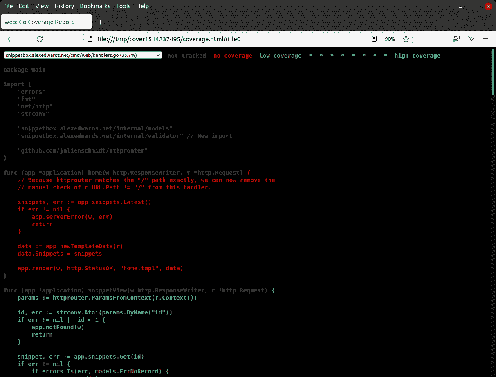

# 第 15 章：结语

本书中，我们显式地涵盖了许多主题，包括路由、模板、数据库操作、身份验证/授权、使用 HTTPS、使用 Go 的测试包等。

但也有一些其他的、更含于无言的教训。我们用于实现功能所采用模式——以及我们项目代码的组织和相互链接的方式——都是你应该能够获取并应用到未来工作中的东西。

重要的是，我还希望这本书能传达这样一个信息：你不需要框架就可以用 Go 构建 Web 应用。Go 的标准库包含了你几乎需要的所有工具……即使对于中等复杂的应用程序也是如此。当你确实需要特定任务的帮助（例如会话管理、路由或密码哈希）时，有一些轻量级且专注的第三方包供你选择。

到此为止，如果你一直跟着本书编写代码，我建议你花一点时间回顾一下你目前编写的代码。在回顾过程中，确保你清楚每个代码库中每个部分的作用，以及它们是如何与整个项目相契合的。

你可能还想回到书中任何初次觉得难以理解的部分。例如，现在你对 Go 更加熟悉了，`http.Handler` 接口章节可能会更容易消化。或者，现在你已经看到了我们的应用程序中是如何处理测试的，那么我们在设计数据库模型章节中做的决策可能就会迎刃合。

如果你购买了这本书的专业版（`Professional Package`），我强烈建议完成第 17 章中的引导练习（就在本书的末尾，在本结论和附录之后）。这些练习应该帮助你巩固所学知识——通过半独立地完成它们，将在你再次在自己的项目中使用它们之前，对书中的模式和技术进行一些额外的练习。

## 进一步探索

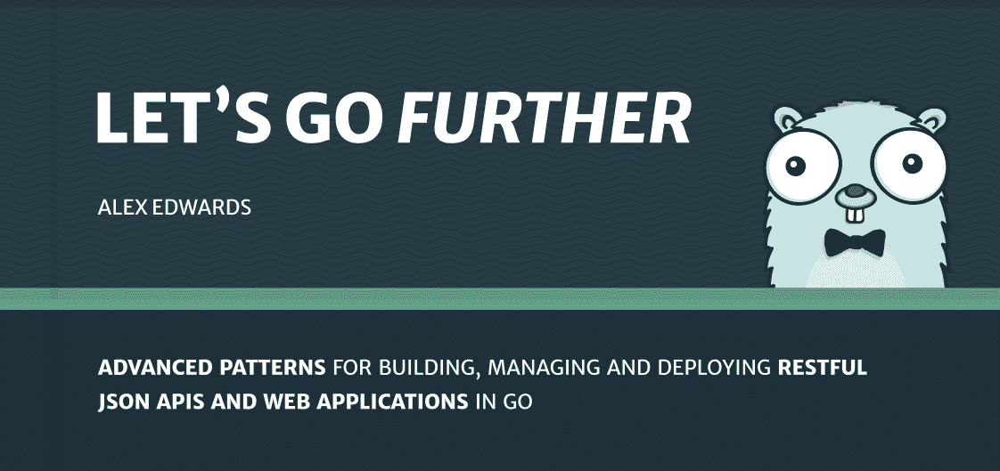

如果你想继续学习更多，可能想查看 [Let’s Go Further](https://lets-go-further.alexedwards.net/)。它是作为本书的后续编写，涵盖了开发、管理和部署 API 及 Web 应用的更多高级模式。

它引导你从头到尾构建并部署一个 RESTful JSON API，并包括以下主题：

- 发送和接收 JSON
- 处理 SQL 迁移
- 管理后台任务
- 执行部分更新并使用乐观锁
- 基于权限的授权
- 控制 CORS 请求
- 优雅停机
- 暴露应用程序指标
- 自动化构建和部署步骤

你可以查看书的样本，并在 [`lets-go-further.alexedwards.net`](https://lets-go-further.alexedwards.net) 获取更多信息和 FAQ 回答。

# 第 16 章：延伸阅读和有用链接

## 编码和风格指南

- [Effective Go](https://golang.org/doc/effective_go.html)
- [清晰比聪明重要 \[视频\]](https://dave.cheney.net/practical-go/presentations/qcon-china.html) —— Dave Cheney 在 2019 年新加坡 GopherCon 上的演讲
- [Go Code Review Comments](https://github.com/golang/go/wiki/CodeReviewComments) —— 风格指南以及需要避免的常见错误。
- [Practical Go](https://dave.cheney.net/practical-go/presentations/qcon-china.html) —— 编写可维护 Go 程序的实战建议。
- [命名的含义？](https://talks.golang.org/2014/names.slide) —— Go 命名指南。
- [Go Pro Proverbs](https://go-proverbs.github.io/) —— 编写地道 Go 代码的简洁指南集。

## 推荐教程

- [不要害怕指针](https://bitfieldconsulting.com/golang/pointers)
- [接口详解](https://www.alexedwards.net/blog/interfaces-explained)
- [数据竞态 vs 竞态条件](https://cronokirby.github.io/posts/data-races-vs-race-conditions/)
- [理解互斥锁](https://www.alexedwards.net/blog/understanding-mutexes)
- [Go 1.11 Modules](https://github.com/golang/go/wiki/Modules)
- [错误值 FAQ](https://github.com/golang/go/wiki/ErrorValueFAQ)
- [Go 工具概览](https://www.alexedwards.net/blog/an-overview-of-go-tooling)
- [新 Go 开发者的陷阱、注意点和常见错误](http://devs.cloudimmunity.com/gotchas-and-common-mistakes-in-golang)

## 第三方包列表

- [Awesome Go](https://github.com/avelino/awesome-go)
- [Go Projects](https://github.com/golang/go/wiki/Projects)

# 第 17 章：引导练习

在本节中有六个引导练习供你完成，它们扩展了我们创建的 Snapshotbox 应用程序。

这些练习利用了我们已经过的模式和技术，但应用在不同的上下文中。因此，通过它们是测试你对所学知识理解的好机会，并付诸实践。

每个练习都拆分为几个较小的步骤。对于每个步骤，我都链接了一个包含“建议代码”的答案，如果你卡住了可以查看。如果你的代码看起来略有不同，不用担心。实现目标有多种方法。

在开始之前的最后一点：本节中的某些练习是相互的，因此我建议按顺序进行。

## 17.1. 为应用程序添加一个“关于”页面

此练习的目标是为应用程序添加一个新的“关于”页面。它应该映射到 `GET /about` 路由，对已验证和未验证的用户都开放，并且看起来如下：

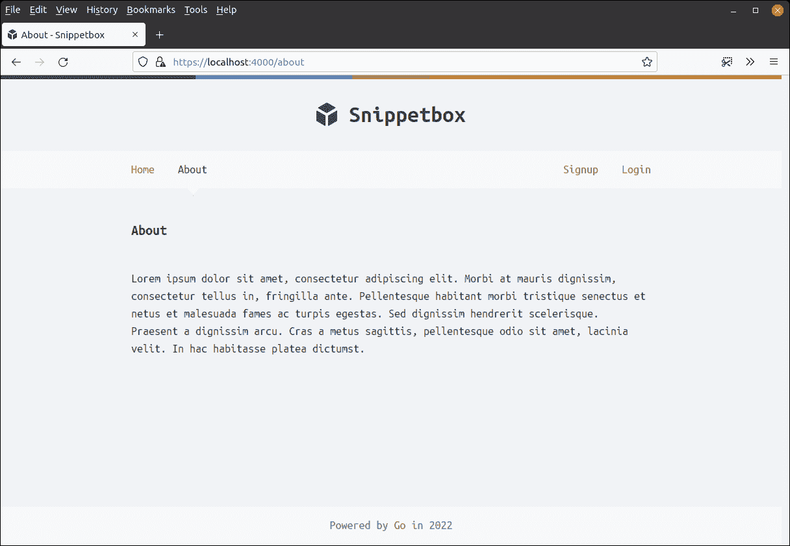

### 步骤 1

创建一个映射到新的 `about` 处理器的 `GET /about` 路由。考虑路由应该使用哪个中间件栈。

显示建议代码

### 步骤 2

创建一个新的 `ui/html/pages/about.tmpl` 文件，遵循我们为应用程序其他页面使用的相同模板模式。包含标题、标题以及“关于”页的占位文案。

显示建议代码

### 步骤 3

更新应用程序的主导航栏，包含一个指向新“关于”页的链接（该链接应对所有用户可见，无论他们是否登录）。

显示建议代码

### 步骤 4

更新 `about` 处理器，使其渲染你刚刚创建的 `about.tmpl` 文件。然后通过在浏览器中访问 [`https://localhost:4000/about`](https://localhost:4000/about) 来检查新页面和导航是否工作正常。

## 建议代码

### 步骤 1 的建议代码

文件：`cmd/web/handlers.go`

```go
package main

...

func (app *application) about(w http.ResponseWriter, r *http.Request) {
    // 稍后会有一些代码...
}
```

文件：`cmd/web/routes.go`


```go
package main

...

func (app *application) routes() http.Handler {
    router := httprouter.New()

    router.NotFound = http.HandlerFunc(func(w http.ResponseWriter, r *http.Request) {
        app.notFound(w)
    })

    fileServer := http.FileServer(http.FS(ui.Files))
    router.Handler(http.MethodGet, "/static/*filepath", fileServer)

    router.HandlerFunc(http.MethodGet, "/ping", ping)

    dynamic := alice.New(app.sessionManager.LoadAndSave, noSurf, app.authenticate)

    router.Handler(http.MethodGet, "/", dynamic.ThenFunc(app.home))
    // 添加 about 路由。
    router.Handler(http.MethodGet, "/about", dynamic.ThenFunc(app.about))
    router.Handler(http.MethodGet, "/snippet/view/:id", dynamic.ThenFunc(app.snippetView))
    router.Handler(http.MethodGet, "/user/signup", dynamic.ThenFunc(app.userSignup))
    router.Handler(http.MethodPost, "/user/signup", dynamic.ThenFunc(app.userSignupPost))
    router.Handler(http.MethodGet, "/user/login", dynamic.ThenFunc(app.userLogin))
    router.Handler(http.MethodPost, "/user/login", dynamic.ThenFunc(app.userLoginPost))

    protected := dynamic.Append(app.requireAuthentication)

    router.Handler(http.MethodGet, "/snippet/create", protected.ThenFunc(app.snippetCreate))
    router.Handler(http.MethodPost, "/snippet/create", protected.ThenFunc(app.snippetCreatePost))
    router.Handler(http.MethodPost, "/user/logout", protected.ThenFunc(app.userLogoutPost))

    standard := alice.New(app.recoverPanic, app.logRequest, secureHeaders)
    return standard.Then(router)
}
```

#### 步骤 2 的建议代码

文件：`ui/html/pages/about.tmpl`

```tmpl
{{define "title"}}关于{{end}}

{{define "main"}}
    <h2>关于</h2>
    <p>Lorem ipsum dolor sit amet, consectetur adipiscing elit. Morbi at mauris dignissim,
    consectetur tellus in, fringilla ante. Pellentesque habitant morbi tristique senectus
    et netus et malesuada fames ac turpis egestas. Sed dignissim hendrerisque.</p>
    <p>Praesent dignissim arcu. Cras a metus sagittis, pellentesque odio sit amet,
    lacin velit. In habitasse dictum.</p>
{{end}}
```

#### 步骤 3 的建议代码

文件：`ui/html/partials/nav.tmpl`

```tmpl
{{define "nav"}}
<nav>
    <div>
        <a href='/Home'>首页</a>
        <!-- 添加一个新链接，对所有用户可见 -->
        <a href='/about'>关于</a>
        {{if .IsAuthenticated}}
            <a href='/snippet/create'>创建代码片段</a>
        {{end}}
    </div>
    <div>
        {{if .IsAuthenticated}}
            <form action='/user/logout' method='POST'>
                <input type='hidden' name='csrf_token' value='{{.CSRFToken}}'>
                <button>退出</button>
            </form>
        {{else}}
            <a href='/user/signup'>注册</a>
            <a href='/user/login'>登录</a>
        {{end}}
    </div>
</nav>
{{end}}
```

#### 步骤 4 的建议代码

文件：`cmd/web/handlers.go`

```go
package main

...

func (app *application) about(w http.ResponseWriter, r *http.Request) {
    data := app.newTemplateData(r)
    app.render(w, http.StatusOK, "about.tmpl", data)
}
```

## 第 17.2 节. 添加调试模式

如果你用过其他语言的 Web 框架（如`Django`或`Laravel`），那么你可能熟悉`debug`模式的概念，在这种模式下，详细错误会显示给用户，而不是通用的`Internal Server Error`消息。本次练习的目标是为我们的应用程序设置一个类似的`debug`模式，可以通过如下使用`-debug`标志来启用：

```bash
$ go run ./cmd/web -debug
```

在调试模式下运行时，任何详细的错误和堆栈跟踪都应该在浏览器中显示，类似于：`assets/img/17.01.png`

### 步骤 1

创建一个名为`debug`的新命令行标志，默认值为`false`。然后通过`application`结构体使该命令行的值对你的处理器可用。

提示：使用`flag.Bool()`函数是合适的。

### 步骤 2

进入`cmd/web/handlers.go`文件，更新`application`结构体，以便该命令行的值对处理器可用。只有当设置了`debug`标志时，才会显示详细错误。

### 步骤 3

尝试更改。在带有`-debug`参数的情况下运行应用程序，这将显示详细错误消息和堆栈跟踪：

```bash
$ go run ./cmd/web -debug -dsn
```

访问`https://localhost:4000/about`结果如所示：`assets/img/17.01.png`

不带`-debug`标志运行应用程序将导致`Internal Server Error`消息。

```go
...

func (app *application) serverError(w http.ResponseWriter, err error) {
    trace := fmt.Sprintf("%s\n%s", err.Error(), debug.Stack())
    app.errorLog.Output(2, trace)

    if app.debug {
        http.Error(w, trace, http.StatusInternalServerError)
        return
    }

    http.Error(w, http.StatusText(http.StatusInternalServerError), http.StatusInternalServerError)
}

...
```

# 第 17.3 章

## 测试 snippetCreate 处理程序

你本次练习的目标是为`GET /snippet/create`路由创建一个端到端测试。具体来说，你想测试：

* 未身份验证的用户被重定向到登录表单。

* 已身份验证的用户显示创建新代码片段的表单。

### 第 1 步

在你的`cmd/web/handlers_test.go`文件中创建一个新的`TestSnippetCreate`测试。在此测试中，使用端到端测试章节中的模式和辅助函数，使用应用程序路由和模拟依赖项初始化一个新的测试服务器。

显示建议代码

### 第 2 步

创建一个名为`"Unauthenticated"`的子测试。在此子测试中，作为未身份验证的用户向测试服务器发送`GET /snippet/create`请求。验证响应的状态码为`302`且包含`Location: /user/login`头部。再次复用我们在端到端测试章节中创建的辅助函数。

显示建议代码

### 第 3 步

创建另一个名为`"Authenticated"`的子测试。在此子测试中，模拟以用户登录进行身份验证的工作流。具体来说，你需要发送一个`GET /user/login`请求，从响应体中提取 CSRF 令牌，然后使用模拟用户模型中的凭据（邮箱为`"alice@example.com"`，密码为`"pa$$word"`）发送一个`POST /user/login`请求。

一旦完成身份验证，发送一个`GET /snippet/create`请求，并验证收到的状态码为`200`以及包含文本`<form action='/snippet/create' method='POST'>`的 HTML 响应体。

显示建议代码

## 建议代码

#### 第 1 步的建议代码

文件：`cmd/web/handlers_test.go`

```go
...

func TestSnippetCreate(t *testing.T) {
    app := newTestApplication(t)
    ts := newTestServer(t, app.routes())
    defer ts.Close()
}
```

#### 第 2 步的建议代码

文件：`cmd/web/handlers_test.go`

```go
...

func TestSnippetCreate(t *testing.T) {
    app := newTestApplication(t)
    ts := newTestServer(t, app.routes())
    defer ts.Close()

    t.Run("Unauthenticated", func(t *testing.T) {
        code, headers, _ := ts.get(t, "/snippet/create")
        
        assert.Equal(t, code, http.StatusSeeOther)
        assert.Equal(t, headers.Get("Location"), "/user/login")
    })
}
```

```bash
$ go test -v -run=TestSnippetCreate ./cmd/web
=== RUN   TestSnippetCreate
=== RUN   TestSnippetCreate/Unauthenticated
--- PASS: TestSnippetCreate (0.01s)
--- PASS: TestSnippetCreate/Unauthenticated (0.00s)
ok      snippetbox.alexwards.net/cmd/web      0.01s
```

#### 第 3 步的建议代码

文件：`cmd/web/handlers_test.go`

```go
...

func TestSnippetCreate(t *testing.T) {
    app := newTestApplication(t)
    ts := newTestServer(t, app.routes())
    defer ts.Close()

    t.Run("Unauthenticated", func(t *testing.T) {
        code, headers, _ := ts.get(t, "/snippet/create")
        
        assert.Equal(t, code, http.StatusSeeOther)
        assert.Equal(t, headers.Get("Location"), "/user/login")
    })
    
    t.Run("Authenticated", func(t *testing.T) {
        // 发送 GET /user/login 请求并从响应中提取 CSRF 令牌
        _, _, body := ts.get(t, "/user/login")
        csrfToken := extractCSRFToken(t, body)

        // 使用提取的 CSRF 令牌和模拟用户模型的凭据发送 POST /user/login 请求
        form := url.Values{}
        form.Add("email", "alice@example.com")
        form.Add("password", "pa$$word")
        form.Add("csrf_token", csrfToken)
        ts.postForm(t, "/user/login", form)

        // 然后检查已身份验证的用户是否显示了创建表单
        code, _, body := ts.get(t, "/snippet/create")
        
        assert.Equal(t, code, http.StatusOK)
        assert.StringContains(t, body, "<form action='/snippet/create' method='POST'>")
    })
}
```

```bash
$ go test -v -run=TestSnippetCreate ./cmd/web
=== RUN   TestSnippetCreate
=== RUN   TestSnippetCreate/Unauthenticated
=== RUN   TestSnippetCreate/Authenticated
--- PASS: TestSnippetCreate (0.01s)
--- PASS: TestSnippetCreate/Unauthenticated (0.00s)
--- PASS: TestSnippetCreate/Authenticated (0.00s)
ok      snippetbox.alexwards.net/cmd/web      0.02s
```

# 第 17.4 章

## 为应用程序添加“账户”页面

你本次练习的目标为应用程序添加一个新的“我的账户”页面。它应该映射到一个新的`GET /account/view`路由，并显示当前身份验证用户的用户名、电子邮件地址和注册日期，如下所示：

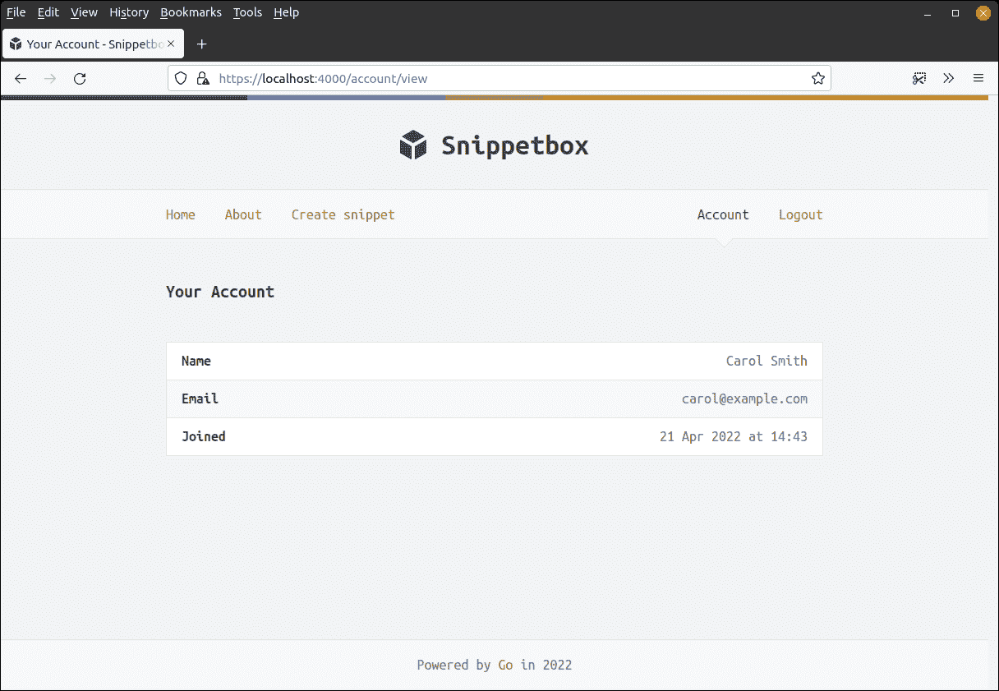

### 第 1 步

在`internal/models/users.go`文件中创建一个新的`UserModel.Get()`方法。它应该接受用户 ID 作为参数，并返回一个包含该用户所有信息的`User`结构体指针（除了哈希密码）。如果没有找到对应的 ID 用户，应返回`ErrNoRecord`错误。

此外，更新`UserModelInterface`类型以包含此新的`Get()`方法，并在我们的`mocks.UserModel`中添加对应的方法，使其继续满足接口。

显示建议代码

### 第 2 步

创建一个`GET /account/view`路由，映射到新的`accountView`处理程序。该路由应仅限已身份验证的用户。

显示建议代码

### 第 3 步


更新`accountView`处理程序，从会话获取`"authenticatedUserID"`，从数据库中获取相关用户的详情（使用新的`UserModel.Get()`方法），并将它们以纯文本 HTTP 响应输出。如果找不到匹配会话中`"authenticatedUserID"`的用户，将客户端重定向到`GET /user/login`以强制重新身份验证。

当你以已身份验证的用户在浏览器中访问[`https://localhost:4000/account/view`](https://localhost:4000/account/view)时，你应该得到类似这样的响应：


显示建议代码

### 第 4 步

创建一个新的`ui/html/pages/account.tmpl`文件，用表格显示用户信息。然后更新`accountView`处理程序以渲染此新模板，通过`templateData`结构体传递用户详情。

显示建议代码

### 第 5 步

此外，更新网站的主导航栏以包含指向查看账户页的链接（仅对已身份验证的用户可见）。然后在登录状态下通过浏览器访问[`https://localhost:4000/account/view`](https://localhost:4000/account/view)，通过检查新页面和导航是否符合预期。

# 用户模型：定义与实现

```go
package models

...

type UserModelInterface interface {
    Insert(name, email, password string) error
    Authenticate(email, password string) (int, error)
    Exists(id int) (bool, error)
    Get(id int) (*User, error)
}

...

func (m *UserModel) Get(id int) (*User, error) {
    var user User

    stmt := `SELECT id, name, email, created FROM users WHERE id = ?`

    err := m.DB.QueryRow(stmt, id).Scan(&user.ID, &user.Name, &user.Email, &user.Created)
    if err != nil {
        if errors.Is(err, sql.ErrNoRows) {
            return nil, ErrNoRecord
        } else {
            return nil, err
        }
    }

    return &user, nil
}
```

## Mock 用户模型

文件: `/internal/models/mocks/users.go`

```go
package mocks

import (
    "time" // 新导入

    

snippetbox.alexedwards.net/internal/models"
)

...

func (m *UserModel) Get(id int) (*models.User, error) {
    if id == 1 {
        u := &models.User{
            ID:      1,
            Name:    "Alice",
            Email:   "alice@example.com",
            Created: time.Now(),
        }

        return u, nil
    }

    return nil, models.ErrNoRecord
}
```

# 处理器与路由

### 步骤 2 的建议代码

文件: `/cmd/web/handlers.go`

```go
...

func (app *application) accountView(w http.ResponseWriter, r *http.Request) {
    // 稍后此处将添加代码...
}
```

文件: `/cmd/web/routes.go`

```go
package main

...

func (app *application) routes() http.Handler {
    router := httprouter.New()

    router.NotFound = http.HandlerFunc(func(w http.ResponseWriter, r *http.Request) {
        app.notFound(w)
    })

    fileServer := http.FileServer(http.FS(ui.Files))
    router.Handler(http.MethodGet, "/static/*filepath", fileServer)

    router.HandlerFunc(http.MethodGet, "/ping", ping)

    dynamic := alice.New(app.sessionManager.LoadAndSave, noSurf, app.authenticate)
    router.Handler(http.MethodGet, "/", dynamic.ThenFunc(app.home))
    router.Handler(http.MethodGet, "/about", dynamic.ThenFunc(app.about))
    router.Handler(http.MethodGet, "/snippet/view/:id", dynamic.ThenFunc(app.snippetView))
    router.Handler(http.MethodGet, "/user/signup", dynamic.ThenFunc(app.userSignup))
    router.Handler(http.MethodPost, "/user/signup", dynamic.ThenFunc(app.userSignupPost))
    router.Handler(http.MethodGet, "/user/login", dynamic.ThenFunc(app.userLogin))
    router.Handler(http.MethodPost, "/user/login", dynamic.ThenFunc(app.userLoginPost))

    protected := dynamic.Append(app.requireAuthentication)

    router.Handler(http.MethodGet, "/snippet/create", protected.ThenFunc(app.snippetCreate))
    router.Handler(http.MethodPost, "/snippet/create", protected.ThenFunc(app.snippetCreatePost))
    // 添加查看账户路由，使用受保护的中间件链
    router.Handler(http.MethodGet, "/account/view", protected.ThenFunc(app.accountView))
    router.Handler(http.MethodPost, "/user/logout", protected.ThenFunc(app.userLogoutPost))

    standard := alice.New(app.recoverPanic, app.logRequest, secureHeaders)
    return standard.Then(router)
}
```

### 步骤 3 的建议代码

文件: `/cmd/web/handlers.go`

```go
...

func (app *application) accountView(w http.ResponseWriter, r *http.Request) {
    userID := app.sessionManager.GetInt(r.Context(), "authenticatedUserID")

    user, err := app.users.Get(userID)
    if err != nil {
        if errors.Is(err, sql.ErrNoRows) {
            // ... 错误处理
        }
    }
}
```

# 练习：适当重定向用户

### 步骤 4 的建议代码

文件: `/cmd/web/handlers.go`

```go
...

func (app *application) accountView(w http.ResponseWriter, r *http.Request) {
    userID := app.sessionManager.GetInt(r.Context(), "authenticatedUserID")

    user, err := app.users.Get(userID)
    if err != nil {
        if errors.Is(err, models.ErrNoRecord) {
            // ... 逻辑
        }
    }
}

```

文件: `/cmd/web/templates.go`

```go
...

type templateData struct {
    // ... 字段
}
```

### 步骤 5 的建议代码

文件: `/ui/html/partials/nav.tmpl`

```html
{{define "nav"}}
<nav>
    <!-- ... 逻辑 ... -->
</nav>
{{end}}
```

# 第 17.6 章

## 实现“修改密码”功能

本次练习的目标是为已身份验证的用户添加修改密码的功能，并使用一个类似于下面的表单：

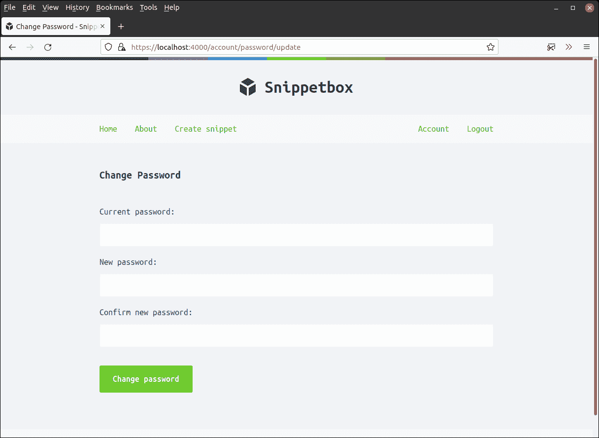

在练习过程中，你应该确保：

* 要求用户输入当前密码，并验证其是否与`users`表中哈希后的密码匹配（以确认确实是用户本人发起的请求）。

* 在更新`users`表之前，对新密码进行哈希处理。

### 第 1 步

创建两个新的路由和处理器：

* `GET /account/password/update`，映射到新的`accountPasswordUpdate`处理器。

* `POST /account/password/update`，映射到新的`accountPasswordUpdatePost`处理器。

这两个路由都应该限制仅供身份验证的用户访问。

显示建议的代码

### 第 2 步

创建一个新的`ui/html/password.tmpl`文件，其中包含修改密码的表单。该表单应该：

* 包含三个字段：`currentPassword`、`newPassword`和`newPasswordConfirmation`。

* 将表单`POST`到`/account/password/update`。

更新`cmd/web/handlers.go`文件以包含`accountPasswordUpdate`处理器，以便其解析表单并显示密码页面。

当你以身份验证用户的身份访问`localhost:4000/account/update`时，它看起来应该类似于：

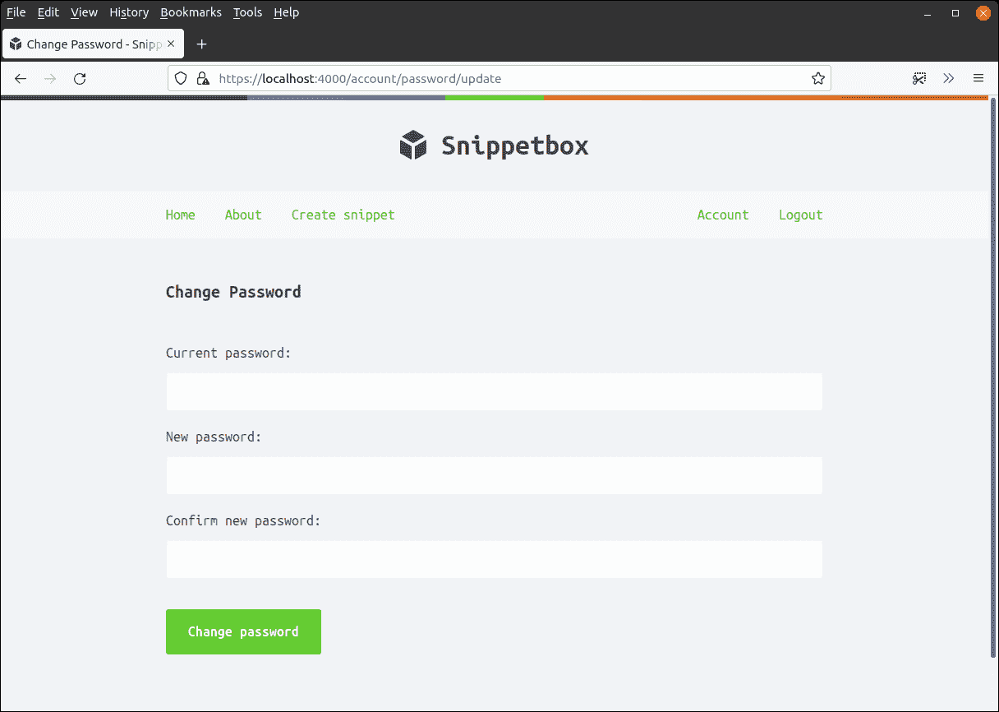

显示建议的代码

### 第 3 步

更新`accountPasswordUpdatePost`处理器以执行以下校验检查，并在相关错误时重新显示表单：

* 所有三个字段均为必填项。

* `newPassword`长度至少为 8 个字符。

* `newPassword`和`newPasswordConfirmation`的值必须匹配。

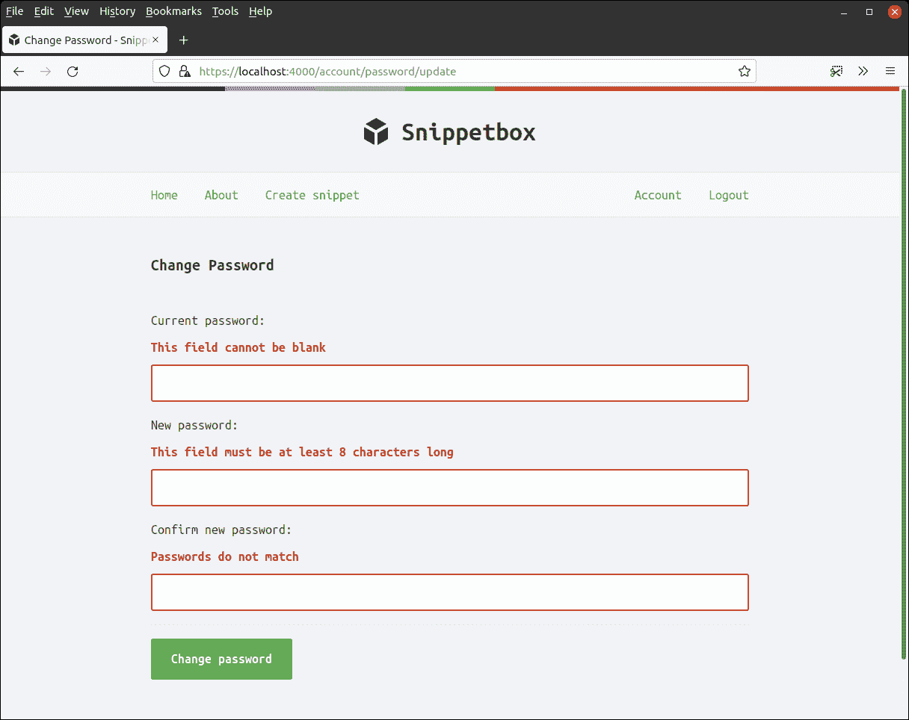

显示建议的代码

### 第 4 步

在你的`internal/models/users.go`文件中创建一个具有以下签名的新`UserModel.PasswordUpdate()`方法：

```go
func (m *UserModel) PasswordUpdate(id int, currentPassword, newPassword string) error
```

在此方法中：

1. 从数据库中根据`id`参数获取该用户的详细信息。

2. 检查`currentPassword`值是否与该用户的哈希密码匹配。如果不匹配，则返回`ErrInvalidCredentials`错误。

3. 否则，对`newPassword`值进行哈希处理，并更新`users`表中相关用户的`hashed_password`列。

同时更新`UserModelInterface`类型，包含你创建的`PasswordUpdate()`方法。

显示建议的代码

### 第 5 步

更新`accountPasswordUpdatePost`处理器，如果表单有效，则调用`UserModel.PasswordUpdate()`方法（记住，用户 ID 应该在 session 中）。

如果发生`models.ErrInvalidCredentials`错误，告知用户他们在`currentPassword`表单字段中输入了错误的值。否则，在用户的会话中添加一条闪消息，告知其密码已成功修改，并将其重定向到账户页面。

显示建议的代码

### 第 6 步

更新账户以包含指向修改密码表单的链接，类似于：


显示建议的代码

### 第 7 步

尝试运行应用程序测试。你会得到失败，因为`mocks.UserModel`类型不再满足`models.UserModelInterface`结构体定义的接口。通过向 mock 中添加相应的`PasswordUpdate()`方法来修复此问题并确保测试通过。

### 建议的代码

#### 第 1 步的建议代码

File: `cmd/web/handlers.go`

```go
package main

...

func (app *application) accountPasswordUpdate(w http.ResponseWriter, r *http.Request) {
    // Some code will go here later...
}

func (app *application) accountPasswordUpdatePost(w http.ResponseWriter, r *http.Request) {
    // Some code will go here later...
}
```

File: `cmd/web/routes.go`


#### 步骤 2 的建议代码

File: `ui/html/pages/password.tmpl`

```template
{{define "title"}}修改密码{{end}}

{{define "main"}}
<h2>修改密码</h2>
<form action='/account/password/update' method='POST' novalidate>
    <input type='hidden' name='csrf_token' value='{{.CSRFToken}}'>
    <div>
        <label>当前密码:</label>
        {{with .Form.FieldErrors.currentPassword}}
            <label class='error'>{{.}}</label>
        {{end}}
        <input type='password' name='currentPassword'>
    </div>
    <div>
        <label>新密码:</label>
        {{with .Form.FieldErrors.newPassword}}
            <label class='error'>{{.}}</label>
        {{end}}
        <input type='password' name='newPassword'>
    </div>
    <div>
        <label>确认新密码:</label>
        {{with .Form.FieldErrors.newPasswordConfirmation}}
            <label class='error'>{{.}}</label>
        {{end}}
        <input type='password' name='newPasswordConfirmation'>
    </div>
    <div>
        <input type='submit' value='修改密码'>
    </div>
</form>
{{end}}
```

File: `cmd/web/handlers.go`

```go
package main

...

type accountUpdateForm struct {
    CurrentPassword         string `form:"currentPassword"`
    NewPassword             string `form:"newPassword"`
    NewPasswordConfirmation string `form:"newPasswordConfirmation"`
    validator.Validator     `form:"-"`
}

func (app *application) accountPasswordUpdate(w http.ResponseWriter, r *http.Request) {
    data := app.newTemplateData(r)
    data.Form = accountUpdateForm{}

    app.render(w, http.StatusOK, "password.tmpl")
}
```

#### 步骤 3 的建议代码

File: `cmd/web/handlers.go`

```go
package main

...

func (app *application) accountPasswordUpdatePost(w http.ResponseWriter, r *http.Request) {
    var form accountUpdateForm

    err := app.decodePostForm(r, &form)
    if err != nil {
        app.clientError(w, http.StatusBadRequest)
        return
    }

    form.CheckField(validator.NotBlank(form.CurrentPassword), "currentPassword", "此字段不能为空")
    form.CheckField(validator.NotBlank(form.NewPassword), "newPassword", "此字段不能为空")
    form.CheckField(validator.MinChars(form.NewPassword, 8), "newPassword", "此字段至少需要包含 8 个字符")
    form.CheckField(validator.NotBlank(form.NewPasswordConfirmation), "newPasswordConfirmation", "此字段不能为空")
    form.CheckField(form.NewPassword == form.NewPasswordConfirmation, "newPasswordConfirmation", "密码不匹配")

    if !form.Valid() {
        data := app.newTemplateData(r)
        data.Form = form

        app.render(w, http.StatusprocessableEntity, "password.tmpl", data)
        return
    }
}
```

#### 步骤 4 的建议代码

File: `internal/models/users.go`

```go
package models

...

type UserModelInterface interface {
    Insert(name string) error
    Authenticate(email, password string) (bool, error)
    Exists(email string) (bool, error)
    Get(id int) (*User, error)
    PasswordUpdate(id int, password string) error
}

func (m *UserModel) PasswordUpdate(id int, password string) error {
    var currentHashedPassword []byte

    stmt := "SELECT hashed_password FROM users WHERE id = ?"

    err := m.DB.QueryRow(stmt, id).Scan(&currentHashedPassword)
    if err != nil {
        return err
    }

    err = bcrypt.CompareHashAndPassword(currentHashedPassword, []byte(password))
    if err != nil {
        if errors.Is(err, bcrypt.ErrMismatchedHash) {
            return ErrMismatchedHash
        } else {
            return err
        }
    }

    newHashedPassword, err := bcrypt.GenerateFromPassword([]byte(password), 12)
    if err != nil {
        return err
    }

    stmt = "UPDATE users SET hashed_password = ? WHERE id = ?"

    _, err = m.DB.Exec(stmt, string(newHashedPassword), id)
    return err
}
```

#### 步骤 5 的建议代码

File: `cmd/web/handlers.go`

```go
package main

...

func (app *application) accountPasswordUpdatePost(w http.ResponseWriter, r *http.Request) {
    var form accountUpdateForm

    err := app.decodePostForm(r, &form)
    if err != nil {
        app.clientError(w, http.StatusBadRequest)
        return
    }

    form.CheckField(validator.NotBlank(form.CurrentPassword), "currentPassword", "此字段不能为空")
    form.CheckField(validator.NotBlank(form.NewPassword), "newPassword", "此字段不能为空")
    form.CheckField(validator.MinChars(form.NewPassword, 8), "newPassword", "此字段至少需要包含 8 个字符")
    form.CheckField(validator.NotBlank(form.NewPasswordConfirmation), "newPasswordConfirmation", "此字段不能为空")
    form.CheckField(form.NewPassword == form.NewPasswordConfirmation, "newPasswordConfirmation", "密码不匹配")

    if !form.Valid() {
        data := app.newTemplateData(r)
        data.Form = form

        app.render(w, http.StatusprocessableEntity, "password.tmpl", data)
        return
    }

    userID := app.sessionManager.GetInt(r.Context(), "authenticatedUserID")

    err = app.users.PasswordUpdate(userID, form.CurrentPassword, form.NewPassword)
    if err != nil {
        if errors.Is(err, models.ErrInvalidCredentials) {
            form.AddFieldError("currentPassword", "当前密码错误")

            data := app.newTemplateData(r)
            data.Form = form

            app.render(w, http.StatusprocessableEntity, "password.tmpl", data)
        } else if err != nil {
            app.serverError(w, err)
        }
        return
    }

    app.sessionManager.Put(r.Context(), "flash", "您的密码已更新!")

    http.Redirect(w, r, "/account/view", http.StatusSeeOther)
}
```

#### 步骤 6 的建议代码

File: `ui/html/pages/account.tmpl`

```go
{{define "title"}}我的账户{{end}}

{{define "main"}}
    <h2>我的账户</h2>
    {{with .User}}
     <table>
        <tr>
            <th>姓名</th>
            <td>{{.Name}}</td>
        </tr>
        <tr>
            <th>邮箱</th>
            <td>{{.Email}}</td>
        </tr>
        <tr>
            <th>加入时间</th>
            <td>{{humanDate .Created}}</td>
        </tr>
        <tr>
            <!-- 添加一个指向修改密码表单的链接 -->
            <th>密码</th>
            <td><a href="/account/password/update">修改密码</a></td>
        </tr>
    </table>
    {{end }}
{{end}}
```

### 针对步骤 7 的建议代码


执行`go test ./...`命令后，出现编译错误：

```
$ go test ./...
# snippetbox.alexedwards.net/cmd/web [snippetbox.alexedwards.net/cmd/web.test]
cmd/web/testutils_test.go:48:19: cannot use &mocks.UserModel{} (value of type *mocks.UserModel) as type models.UserModelInterface in struct literal:
        *mocks.UserModel does not implement models.UserModelInterface (missing PasswordUpdate method)
FAIL    snippetbox.alexedwards.net/cmd/web [build failed]
ok      snippetbox.alexedwards.net/internal/models      1.099s
?       snippetbox.alexedwards.net/internal/models/mocks        [no test files]
?       snippetbox.alexedwards.net/internal/validator   [no test files]
?       snippetbox.alexedwards.net/ui   [no test files]
FAIL
```

错误原因在于`*mocks.UserModel`类型未实现`models.UserModelInterface`接口，缺少`PasswordUpdate`方法。

在文件`internal/models/mock/users.go`中补充该方法：

```go
package mocks

...

func (m *UserModel) PasswordUpdate(id int, currentPassword, newPassword string) error {
    if id == 1 {
        if currentPassword != "pa$$word" {
            return models.ErrInvalidCredentials
        }

        return nil
    }

    return models.ErrNoRecord
}
```

再次执行`go test ./...`，所有测试通过：

```
$ go test ./...
ok      snippetbox.alexedwards.net/cmd/web      0.026s
ok      snippetbox.alexedwards.net/internal/models      (cached)
?       snippetbox.alexedwards.net/internal/models/mocks        [no test files]
?       snippetbox.alexedwards.net/internal/validator   [no test files]
?       snippetbox.alexedwards.net/ui   [no test files]
```
