# 放下文字束缚：高效Web内容写作（交互式技术）

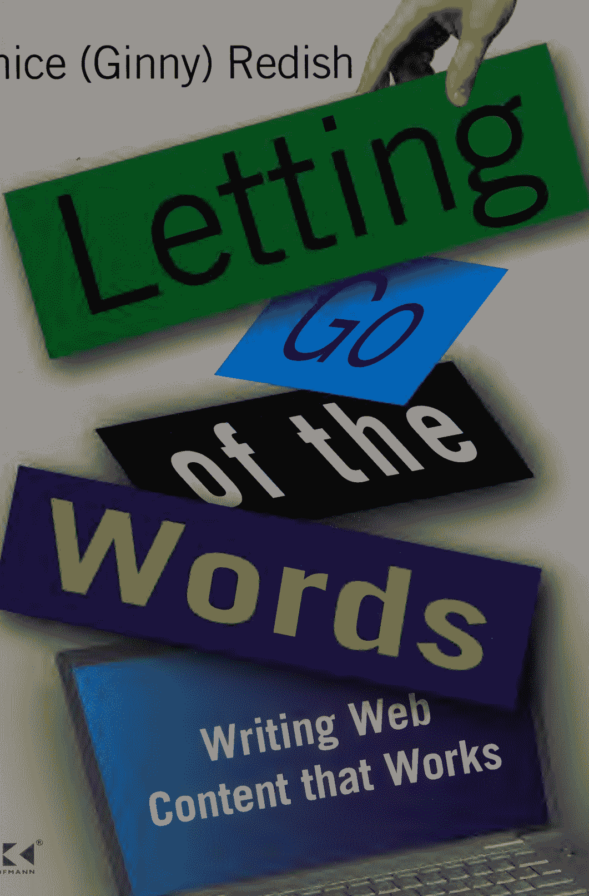


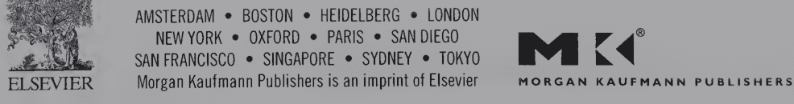

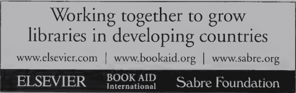

> 献给 Edward F. Redish，他一直被称为 Joe，满怀爱与感激

前言 xv

致谢 xvii

# 1 内容！内容！内容！

人们访问网站是为了内容 1

Web 用户会快速扫读和扫描 2

Web 用户会阅读，但是 . . . 2

他们不再多读是因为 . . . . 3

什么让 Web 写作写得好？ 4

良好的 Web 写作像是一种对话 4

良好的写作回答人们的问题 5

良好的写作让人们能够“随拿随用” 5

介绍《放下文字》 6

它是关于写作和设计的，而不是技术 6

它充满了示例 7

它是基于以用户为中心的设计 7

你可以从多个地方开始 7

你可以跳跃式阅读书籍 8

你可以加入社区 8

# 2 人！人！人！

人们在阅读时会进行解读 11

成功的作者关注他们的受众 12

理解受众的七步 12

1. 列出主要受众 13

2. 收集受众信息 14

3. 列出每个受众的特征 15

关键短语或引用 15

经验 16

价值观 17

技术 17

社会和文化环境 18

人口统计数据 18

4. 收集受众的问题、任务和故事 19

5. 使用信息创建用户画像 19

画像包含哪些信息？20

用户画像如何与团队工作？22

6. 包含画像的目标和任务 24

7. 使用你的信息为你的网站编写场景 24

场景告诉我们人们想要开始的对话 24

场景帮助你理解所有类型的用户 24

网站上的所有内容应该符合一个场景 24

场景可以帮助你写出好的内容 24

## 良好的开始：首页

首页 —— 10 分钟微之旅 24

识别网站，建立品牌 24

设定网站的基调和个性 24

- 有用的首页让人们清楚网站是关于什么的 24
- 有用的首页主要是链接和简短描述 24
- 让人们立即开始关键任务 24
- 将表单直接放在首页上 24
- 将搜索框放在顶部 —— 访问预期的地方 24
- 不要让人们填写他们不想的表单 24
- 以正确、高效的方式引导每个人进入正确的路径 24
- 使用访问者的词汇 24
- 不要让人们纠结点击哪个链接 24

综合以上考虑：一个案例研究 24

从内容向上构建网站——而不仅仅是从页面向下 24

## 编写信息，而不是文档

拆分大型文档 24

- 思考“主题”，而不是“书籍” 24

决定一个网页上放置多少内容 24

- 人们在一次访问中想看多少？关联性有多大？ 24

我是否给你的网站访客造成了负担？网页有多长？ 24

下载时间是多少？ 24

人们想打印吗？他们想打印的程度如何？ 24

PDF —— 是还是否？ 24

你应该为网页内容依赖 PDF 文件吗？ 24

什么时候使用 PDF 文件是合适的？ 24

什么时候使用 PDF 文件是不合适的？ 24

当可访问性成为问题时 24

不使用 PDF 的另外三个原因 24

在某些情况下，同时提供两个版本 24

# 第 6 章 聚焦你的核心信息

聚焦你核心信息的六项准则 24

1. 只给人们他们需要的内容 24

2. 删减！删减！删减！再删减一次！ 24

3. 从要点开始。采用倒金字塔风格写作 24

4. 打破文字墙 24

5. 通过提供有用信息进行营销 24

- 所有网站都在销售——无论是产品还是推销其本身 24
- 网页主要是一项“拉式”技术；营销则侧重于“推式” 24
- 利用“营销动作”——在访客至少满意后再进行营销 24

6. 对信息分层以帮助网页用户 24

- 从描述到全文进行分层 24
- 从信息页到其他网页详细内容进行分层 24
- 从页面局部到简短说明进行分层 24
- 以创新的方式进行分层 24

# 第 7 章 设计易于使用的网页

有益于设计的十四项准则 24

1. 使用模式和对齐让页面元素一目易见 24

2. 在规划设计时考虑整个网站 24

- 一个电子商务示例 24
- 一个信息网站示例 24
- 为整个网站规划一致的设计 24
- 理解从页面创建到上线的流程 24
- 从开始就整合内容与设计 24

3. 使用模板工作 24

4. 有效利用空间。在内容中保持活跃空间 24

- 理解被动空间和活跃空间 24
- 针对你的网页内容，关注活跃空间 24

5. 警惕“虚假底部”（false bottoms） 24

6. 不要让标题悬浮 24

7. 不要让文本居中对齐 24

8. 设置无衬线字体为默认字体 144

关于纸的旧研究 145

关于网页的新研究——衬线字体在阅读上没有胜者 145

或者在理解上，但人们更偏好无衬线字体 146

选择易读的无衬线字体 146

9. 在设置字体大小时，广泛考虑用户及其环境 146

为你的网站访客设置足够大的默认字体 147

调整你的内容，以便使用足够大的字体并将 148

- 信息放入你拥的空间内 148

让人们选择自己的文本大小 149

让所有文本都调整，而不只是主内容区域 149

10. 使用中等行宽作为默认的流式布局 150

11. 不要全大写写作 151

12. 除链接外，不要对任何内容加下划线。谨慎使用斜体 152

13. 提供文本与背景之间良好的对比度 152

- 保持背景清晰以便文字可读 152
- 保持背景浅色、文字深色 152
- 谨慎在深色背景上使用浅色 154

14. 在选择颜色时考虑所有的访客 155

考虑颜色的文化含义 155

检查你的颜色以避免给色盲用户带来问题 156

总结以上：案例研究 156

## 间歇：新闻稿的新生命 163

新闻稿旧的——持续的生命 163

发生了什么变化？163

人们在网页上是如何使用新闻稿的？164

故事 1：作为摘要的新闻稿 164

故事 2：作为事实表的新闻稿 165

故事 3：作为基础信息的新闻稿 165

故事 4：提升 165

我们应该做什么？166

这会产生差异吗？166

差异会是什么样的？168

# 第 8 章 调整你的句子 171

调整网站的十项准则。使用“你” 172

1. 与你的访客交谈 172

- 保持一致；在谈论他人时不要混用名词和“你” 173
- 使用适当的名词来谈论他人 173
- 使用祈使句 175
- 使用“你”而不是“他或她” 175

2. 展示你是一个个人和一个组织 177

- 包含人们 177
- 如果你在写博客，使用“我”是可以的 177
- 如果你在写自己的文章，使用“我”是可以的 178
- 如果你为组织写作，使用“我们” 178
- 有时，谈论组织可以使用“我们” 180
- 对于问答，针对访客使用“我”和“你”，针对组织使用“我们” 180

3. 使用主动语态写作（大多数时候）181

4. 编写简单、简短、直接的句子 185

- 极短的句子也可以的 185
- 片句也可以的 185

## 有效使用插图 273

插图具有不同的用途 273

- 确切物品的照片 274
- 用于说明概念或过程的图片 280
- 图表、数据图、地图 284
- 氛围图 287

### 有效使用插图的九项准则 290

- 1. 不要让人们疑惑是什么或为什么 291
- 2. 选择合适尺寸 291
- 3. 确保小图片清晰可见 291
- 4. 不要让图片占用过多空间，导致关键内容被挤到后面或旁边 292
- 5. 使用插图来支持而非隐藏内容 292
- 6. 在人物照片中，展示多样性 294
- 7. 代表你的组织时，展示多样性，但要真实 294
- 8. 代表你的网站访问者时，要宽泛思考 295
- 9. 不要让内容看起来像广告 296
- 10. 不要用闪烁、滚动、挥动和游离的文字或图片骚扰人们 296
- 11. 不要让其滚动 297
- 12. 当我们留在页面上时不要更改内容 298
- 13. 不要让动画动物、鸟类、蝴蝶等在页面上游荡 299
- 14. 仔细权衡动画的利弊 299
- 15. 在有帮助的地方使用动画——而不仅仅是为了展示 299
- 16. 不要让人们等待启动页（splash）或 Flash 加 300
- 17. 启动页通过过度欢迎人们而浪费时间 301
- 18. 人们想要控制自己的在线体验 302
- 19. 开头的视频视频对某些人来说是障碍 302
- 20. 让插图具有可访问性 304
- 21. 让替代文本（alt text）具有意义 304
- 22. 对于纯装饰性图形，使用空替代文本 305

## 编写有意义的链接 307

编写有意义链接的十二项准则 308

- 1. 不要单独让新的程序和产品名称成为链接 308
- 2. 重新考虑变成链接的文档标题和章节标题 310
- 3. 提前考虑。链接和页面标题 312
- 4. 在现有空间内尽可能明确——如果需要就留更多空间 314
- 5. 为操作链接使用动词短语 315
- 6. 少用单个名词；较长、更具描述性的链接通常更好 316
- 7. 如果人们需要，添加短描述——或者重写链接 317
- 8. 让链接具有意义——不要用“点击这里”，不要只用“更多” 318
- 9. “点击这里”永远没有必要 318
- 10. “更多”是不够的 320
- 11. 当你有多个相似的链接时要进行协调 322
- 12. 如果你想留在自己的信息中，不要嵌入链接 323

如果人们只是在浏览，嵌入可能是可以的 323。但如果你不想让他们在中间离开，请将链接放在末尾、下方或主正文旁边 326。

- 13. 如果你使用带有链接的符号列表，也让它们变为活动状态 326
- 14. 让未访问和已访问的链接都清晰可见 326

仅将你的未访问链接颜色用于链接 327。通过更改颜色显示已访问的链接 327

## 13 从草稿到最终网页 329

- 将写作看作修订草稿 330
- 检查并编辑你自己的作品 330
- 读读你写的内容 330
- 检查你的链接 331
- 检查你的事实 331
- 把你的网页草稿收起来；先不要发布它 332
- 大声读出来一遍 333
- 使用字典、手册和样式指南 333
- 运行拼写检查，但不要依赖它 334
- 请同事和他人阅读并提供意见 335
- 问几个人你的核心信息是什么 335
- 让别人大声读给你听 335
- 分享部分草稿 336
- 在线获取反馈 336
- 注意这些反馈 337
- 与同事合作获得统一的风格和语调 337
- 愉快地把你的自尊收进抽屉 337
- 与写作专家或编辑合作 338
- 让所有人和你一起关注大局 338
- 让人为你进行校对 339
- 让评审对你和你的网页产生作用 339
- 让你访问你的网页 339
- 做好评审 340
- 进行有效的评审 341

## 间歇：创建样式指南 345

- 使用样式指南保持一致性 345
- 不要重新发明 347
- 让作者 348
- 让易于找到并使用 348
- 索引 349

## 前言 353

使用样式指南保持一致性 353

- 不要重新发明 355
- 让作者 358
- 让易于找到并使用 358
- 索引 359

# 致谢

- 感谢 Suzanne Kastner 及其 Graphic World 团队提供的细致校对和制作支持
- 感谢 Elsevier 的 Marilyn Rash 及其团队在设计和制作方面的配合
- 感谢我所有的客户、同事和研讨会参与者，帮助我完善我的核心信息，以便我能清晰、简洁地与你们分享
- 感谢 Edward (Joe) Redish 一直以来对我的支持

# 内容！内容！内容！

昨天，当我在浏览网页时，我：

- 下载了一个文件
- 订购了一本书
- 为我正在考虑购买的新相机对比了价格
- 读了几篇我喜欢的博客
- 检查了维基百科上关于可用性的条目
- 为我年迈姨妈查找了某个健康话题的信息

> 你昨天在网上做了些什么？你是在无目的地随机漫游，还是在寻找特定的东西？

大多数人说是“寻找特定的东西”。他们想送一份婴儿礼物或安排一次旅行。他们需要重新订购他们喜欢的特种食品或下载软件更新。他们对公司政策有疑问，或者要检查假期账户的余额。他们的某个设备出了问题，认为可能可以在网上找到帮助。或者他们想看看博主们对最新政治动荡的看法。当他们上网时，心中是有目标的。

# 人们访问网站是为了内容

人们访问网站是为了他们认为（或希望）那里有的内容。他们想要的信息是：


# 第 1 章 · 内容！内容！内容！

- 回答问题或帮助他们完成任务
- 易于寻找且易于理解
- 准确、最新且可靠

在一项针对职场人士的调查中，95% 的人表示“他们工作所需的信息在网上易于获取、最新且易于找到是非常非常或极其重要的。” www.enterpulse.com/news-051502.html#

信息 = 内容。在这本书中，我将同时使用“信息”和“内容”这两个词——来讨论你和你的团队发布在网站上的文字和图片。

## 网络用户会扫读和扫描

你上一次上网时，想读多少内容？你想多快地跳过进入的网站首页？

你搜索过吗？你阅读了搜索结果的多少？你导航过吗？在获取你寻找的信息所必须经过的路径（菜单）页面上，你想读多少内容？

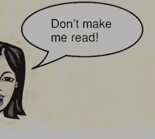

当你到达你认为信息所在的页面时，你做了什么？你是直接开始阅读了吗？还是先进行了扫读和扫描？

大多数人在网上都会进行大量的扫读和扫描。他们匆忙浏览所有的导航，想要尽快到达他们目的页面。即使在最终的（目的地、信息）页面上，大多数网络用户在阅读之前也会先扫读和扫描。

根据一项显示大多数人都会扫描网页的研究（参见 Morse and Nielsen, 1998, 以及 Nielsen, 2000）。

大多数网络用户都是非常忙碌的人，他们只想读足够满足他们上网目标所需的内容。

在另一项研究中，人们在每个网页上平均花费了 27 秒（Nielsen and Loranger, 2006）。

## 网络用户在阅读，但是……

人们会在网上阅读吗？是的，当然会。他们读链接、简短描述和搜索结果——但他们想要（想要）……

## 他们不读更多是因为……

他们非常快地读完这些内容。他们读新闻。他们读博客。他们读感兴趣的话题。

然而，请注意这些阅读中很大一部分是“功能性的”。在这本书中，我讨论的不是网络上的小说和诗歌。我讨论的是信息类网站、电子商务网站、试图提供信息的博客，以及网络应用程序和电子学习程序中的信息部分。

大多数用户来上网并不是为了流连于文字。网络大部分是为了收集信息或完成任务，而不是为了阅读的乐趣。如果你忙碌的用户失去了兴趣，或者没有发现相关信息，他们就会停止阅读。如果他们不能快速找到所需内容，他们就会离开你的网站去他处。

在 Nielsen 和 Loranger 报告的研究中，网络用户在决定放弃一个网站之前平均花费不到 2 分钟。

如果人们认为你的网站没有用，他们很可能不再回来。第 2 页边注中的 Enterprise 研究发现，“66% 的[研究中的专业人士]一旦有过糟糕的体验，就很少——甚至不再返回某个网站。”

## 他们不读更多是因为……

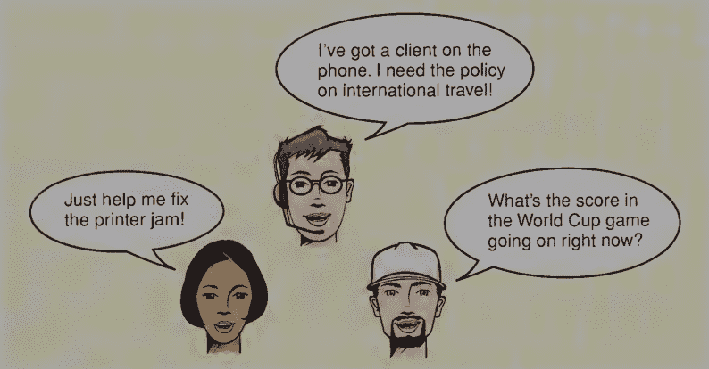

- 他们太忙了。
- 他们发现的内容与其需求不相关。
- 他们正试图回答问题。他们想直接得到答案，只读回答问题所需的内容。
- 他们正试图完成一项任务。他们只想读所需的内容。

# 第 1 章 · 内容！内容！

- 他们被信息过载所轰炸。
- 正如 Nielsen 和 Loranger (2006) 所说，“如果人们在线，他们永远不会退出。”

## 什么是让网络写作良好的？

良好的网络写作

- 像对话一样
- 回答问题
- 让人们随取随用

## 良好的网络写作像是一种对话

将你的网络内容视为对话的一部分——不是漫谈，而是有针对性的对话

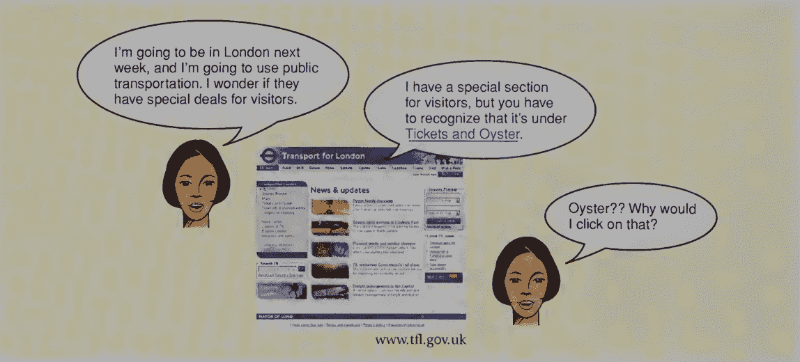

人们来你的网站提问：我如何……我哪里能找到……

Caroline Jarrett 的三层模型对于网站同样适用。

在很多情况下，网站正在取代电话。在很多情况下，网络内容的重点是人们自己获取信息而不是打电话。

## 什么是让网络写作有效的？

当访问者带着问题来时，你需要提供答案。当访问者为了任务时，你需要引导他们完成任务。但由于你不在现场引导他们、提供答案或指导步骤，你必须将你的对话构建到网站中。

## 良好的网络写作回答问题

正如我们在后面的章节中看到的，如果你将网络视为对话，你会意识到你的大部分内容是为了回答人们带来的问题。你不希望整个网站都在一个“常见问题”部分。你希望思考人们想知道什么，以及如何尽可能简洁清晰地提供这些信息。

## 良好的网络写作让他们随取随用

在网上，将信息拆分为针对不同用户、不同话题、不同问题和需求的内容，有助于用户获取他们需要的，然后去处理下一个问题、下一个任务、做决定、回到工作或他们随后发生的任何事情。在这本书中，我们将研究几种写作方法，以便忙碌的用户能够随取随用。图 1-1 和 1-2 展示了我们如何将传统写作转换为良好的网络写作的示例。

新机场


# 新机场或直升机机场

## 我必须提交什么？

| 机场类型 | 需要的文件 |
| :--- | :--- |
| 机场 | - 降落区建议通知<br>- FAA 7480-1 表格<br>- 降落区草图<br>- 在复制的 7 1/2 分 USGS 四分形图局部上标注位置 |
| 直升机机场 | - 降落区建议通知<br>- FAA 7480-1 表格<br>- 显示直升机停机场与医院建筑、停车场及周围结构之间关系的草图或计划<br>- 在复制的 7 1/2 分 USGS 四分形图局部上标注位置 |

## 我必须何时提交这些文件？

在工作开始前至少 90 天。

---

**图 1-1** 段落式使得快速获取信息非常困难。

**图 1-2** 我建议的修订让不同的用户能够快速获取他们需要的信息。

---

我在书中的目标是为你的网站访问者提供高质量、易于找到且易于理解的内容。《放下文字》是关于规划、选择、组织、编写、插图、评审和测试符合人们的内容——带给他们成功且满意的网络体验。

让我们聊聊这本书是什么、它不是什么，以及你可能如何运用《放下文字》这本书。

## 它是关于写作和设计，而不是技术

《放下文字》关于策略和战术，而不是工具。我将帮助你思考访问你网站的人，以及你的写作方式，以便让他们获得成功的网络体验，让你拥有一个成功的网站。技术变化太快了，无法作为书的主要部分——而且优秀的网页写作的原则超越了你所使用的技术。

## 它充满了示例

我知道你想要示例，我包含了许多截图。（获取示例是明智的；如果你既能看到又能读到某一点，理解它会变得更容易。）

在很多情况下，我还展示了我是如何修改网页的。在咨询项目中，当然，我会与领域专家密切合作，以确保最终的文字是准确的，并与网站的个性和风格一致。在这里，我展示了我可能采取的做法，因为我没有与书中展示的每一个网站合作过。

此外，网站会发生变化。在某些情况下，网站在我写书期间发生了变化，我包含了两个网站来说明变化这一点。当你去查看它们时，书中的许多网站可能已经改变了。这并不会使我展示的内容失效。即使是旧示例也可以提供极佳学习机会。如果你能从书中任何示例中看到改进你网站写作的方法，这些示例将证明你工作的价值。

## 它基于以用户为中心的设计流程

以用户为中心的设计是一个创建对其用户良好的产品的过程。当你实践以用户为中心的设计时，你关注的是人：他们的目标、需求、工作方式和环境。以用户为中心的设计意味着你正在利用技术帮助人们以适合他们的方式实现目标。

以用户为中心的设计的概念和流程贯穿本书。我的目标是帮助为你的受众开发一个极佳且实用的网站。在与其他人交流时，可能会听到“易用性”（`usability`）和“通俗语言”（`plain language`）。对我来说，这些都是我们努力追求的目标。它们都是同一个想法的一部分；都是以用户为中心的设计的不同方面。

## 如果你可以从几个地方开始这一流程

如果你正在修订一个现有网站，你可能想从了解它对你想要使用的人如何运作开始。发现网站好坏的最佳技术是易用性测试：观察并听代表性用户尝试通过网站寻找特定信息或完成特定任务的过程。

你不应该等到项目结束才进行易用性测试。事实上，易用性测试是启动你项目的最佳方法。尽早测试；经常测试；小规模迭代。

我将许多关于易用性测试的信息放在书的网站 `www.redish.net/writingtheweb`。

其他资源还有 `www.usability.gov` 以及 Barnum (2002)、Dumas 和 Redish (1999) 以及 Rubin (1994) 的著作。

## 你可以在书中跳读

书必须是线性的，但你不必那样使用它。我在书中设置的路径是一种逻辑方式：从用户到场景，从首页到路径页到目标页——然后通过整体设计、写作、列表和表格、标题、插图和链接——最后从初稿到最终网页。

这对于你或你的项目来说可能不是最有逻辑的路径。尽管自由在书中跳读。先快速读一遍，当你有特定问题或需求时再次回来。

## 你可以加入我们的网络社区

我希望你从《放下文字》中学习，它能回答你的大部分问题。我也想继续我在书中开始的对话。在网站 `www.redish.net/writingtheweb` 加入我们，提问，发表意见，分享关于易用性测试和其他主题的信息，并分享你的示例。

## 第一章总结

以下是第一章的核心信息：

- 人们访问网站是为了实现目标、完成任务、获取答案。
- 他们为了信息、为了内容而来。
- 他们读不多，特别是在到达他们想要的信息的页面之前。
- 即使在信息页面上，他们在开始阅读之前也会进行扫视和扫描。
- 他们只想读足够满足他们需求的内容。
- 将网络看作由忙碌用户发起的对话。
- 回答人们的问题——贯穿你的网页内容，而不是在“常见问题”部分。
- 写作时让忙碌的人能够获取他们需要的信息，并继续他们需要做的任何事情。
- 从易用性测试开始。尽早测试；经常测试；小规模迭代。

# 人！人！人！

为了创建一个交流良好的网站，你必须考虑你正在交流的人。了解你的受众和他们的需求对于决定写什么、写多少、使用什么词汇以及如何组织你网站上的内容至关重要。

## 我们在阅读时都在解读

人们不只是作者倾倒信息的被动容器。我们根据自己的经验和预期不断解读屏幕上看到的内容。即使我们认为使用的是相同的语言，事实也并非如此。我们可能对相同的词汇有不同的含义。

> 蚝（Oyster）？？我会点击那里来寻找访问者的特别优惠。
>
> 我需要在我的卡片上放更多钱。啊，这是指向 Oyster 的链接。


## 2. 收集你的受众的信息

另一种方法是问：“访问网站的哪些特征帮助我了解网站需要什么内容，以及如何编写这些内容？”这可能会让你列出你的受众：

- 经验丰富的游客、偶尔旅行的游客
- 当地居民、来到城市的游客
- 观望者、预订者
- 购物者、浏览者

注意，当我列出这些用户群体时，我指的都是人——人类。不要陷入将部门、机构或建筑视为你网站用户的误区。

不要说你是在为“财务部”写作。“财务部”可能是一个包含许多人的部门，他们的工作不同、知识不同，对网站的需求也各不相同。

不要说你是在为“银行”写作。银行是一栋建筑，建筑是不使用网站的。你是在为银行高管写作吗？分行经理？柜台员？银行的客户？这些都是不同的受众，而且在网站上的差异可能至关重要。他们可能在网上寻找不同的内容。他们可能知道或不知道你想要使用的特定术汇。

## 2. 收集你的受众的信息

你可以通过思考你的受众来开始了解他们。但这些还不够。要真正理解他们是谁、他们为什么来、需要什么，以及如何为他们编写网页内容，你必须了解他们以及他们的现实。

如果你只根据你认为受众是什么样子的来编写网页内容，那么你是在基于假设进行写作。如果你的假设是错误的，你的内容将无法发挥作用。

以下是寻找受众的几个建议。尝试所有的方法，最后那些方法——实际上观察、倾听并与你的网站用户及潜在用户交谈——是最实用的。

## 第 2 章 · 人！人！人！

- 思考你的使命。你应该为谁服务？你应该帮助他们完成什么？
- 阅读通过“联系我们”和其他反馈渠道收到的邮件。是谁在写信？他们在问什么？
- 与营销部门交流。他们的目标群体是谁？
- 与客户服务部门交流。谁在打电话提问？那些问题是什么？
- 让来到网站的人填写一份简短的问卷。问他们几个关于自己的问题，他们为什么来网站，以及他们是否成功找到了他们想要的东西。
- 观察并倾听人们。
- 如果你的网站对应于实体业务（电子商务、银行和其他金融机构、旅游等），请花时间在物理地点观察并倾听客户。
- 如果你是一个政府网站，要意识到政府机构通常有相应的“实体”机构。花时间在机构的当地办公室观察并倾听任何与你的网页内容相关的内容。这可能意味着观察人们来换领执照、获取许可证、申请福利或填写税务表格。
- 如果你正在创建一个内网，请花时间观察和倾听来自不同领域、不同职位的员工。

> 有关了解你网站用户的多种技巧的信息，请参 Courage and Baxter, 2004。
>
> 设计一份好的调查问卷并非易事。关于调查设计的优秀书籍请参 Dillon, 2007。
>
> 关于在工作场所观察、倾听和与人们交流的建议，请参 Hackos and Redish, 1998。

- 访问使用或可能使用你网站的人。使用这些技术：
  - 情境访谈（在人们工作时你对其进行观察和倾听）
  - 关键事件访谈（让人们讲述使用网站的具体时刻；有时，他们也可以向你展示他们的操作）

> 有关情境访谈的信息，请参 Holtzblatt, Wendell, and Wood, 2005。
>
> 有关事件技术的信息，请参该主题的维基百科条目。

- 对当前内容进行可用性测试。观察并倾听使用你网站的可用性测试参与者。询问他们自己、需求以及他们在使用什么功能。

## 3. 为每个受众列出主要特征

在发现来到（或应该来到）你网站的人之后，为每个用户群体列出相关特征。以下是需要涵盖的类别。

- 关键短语或引言
- 经验、专业知识
- 情感
- 价值观
- 技术
- 社会和文化环境
- 人口统计特征（年龄、能力等）

### 关键短语或引言

如果你问你的网站用户，在你为他们写作时他们希望你记住什么，他们会说什么？

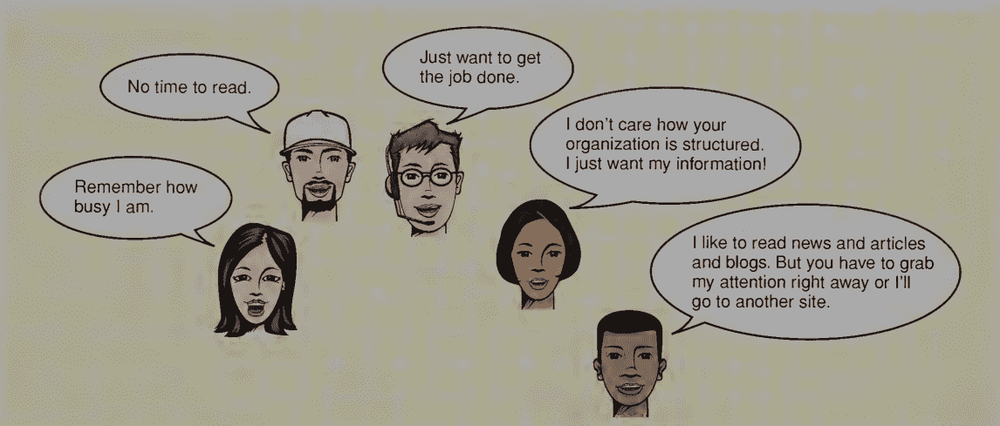

### 经验、专业知识

考虑网站访问者在主题领域和网络使用方面的经验和专业知识。对于不同的用户群体，你在这里方面可能存在差异。（在一个用户群体内部也可能存在不同程度的经验或专业知识；也请注意。）

例如，对于一个旅游网站：

| 经验丰富的游客 | 偶尔旅行的游客 |
| :--- | :--- |
| 可能熟悉其他旅游网站；可能知道电子票如何运作；可能知道他们经常去的地点的机场代码；希望有快速操作的方法——每一步可能不需要什么解释 | 可能不熟悉旅游网站；可能不知道电子票如何运作；可能不知道机场代码；可能每一步都需要解释 |

例如，对于一个健康网站：

| 研究人员和健康专业人士 | 患者 |
| :--- | :--- |
| 可能了解医学术语 | 可能不了解医学术语 |
| 有人可能想在不学习术语的情况下获取信息 | 有人可能想学习术语以便与交流 |

### 情感

在某些情况下，人们的情绪是重要的特征。你的用户可能是：

- 追求快乐的
- 紧张的
- 激情的
- 焦虑的
- 感兴趣的
- 挫败的
- 怀疑的
- 不耐烦的
- 压力巨大的
- 愤怒的
- 期限紧迫的

在第 6 章中，我们将考虑为正在检查赔偿索的受伤工人写作。关于他们的情绪状态你会怎么说？你会说：焦虑、紧张、怀疑机构是否想帮助他们？

如果记者是你的受众之一，你会为他们写什么？你会说：期限紧迫、不耐烦？

对于寻求产品问题帮助（如打印机卡纸）的人又是怎样的？你会说：愤怒、挫败、焦虑？

如果网站过度关注营销信息，导致客户服务信息难以找到，这只会让这些用户更加沮丧吗？如果你关于问题的内容是晦涩的技术术语，是否只会让他们更愤怒？如果网页内容没有帮助，他们会做什么？打电话让公司损失更多钱？在“买什么好”的网站上写恶毒评论？下次买别人的产品？

针对愤怒、挫败、焦虑或压力巨大的用户的网页内容必须特别清晰简单。

### 价值观

了解网站访问者重视什么可能帮助你决定包含哪些内容，以及在内容中重点或强调什么。了解他们的价值观可能帮助你理解为什么他们不想读太多，放弃复杂的词汇并使用清晰、对话式的风格更符合他们的需求。

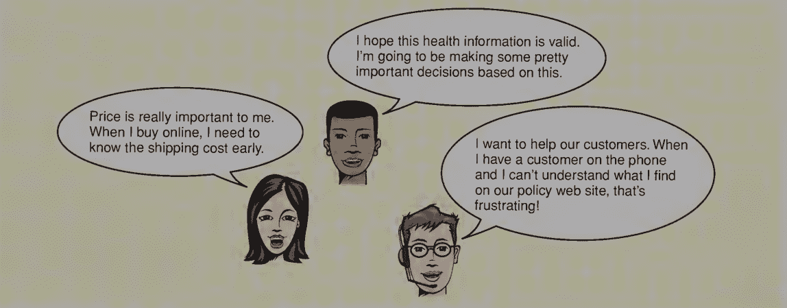

### 技术

你的网站访问者的分辨率是多少？他们以什么速度连接？连接稳定吗？他们是按上网时长付费吗？是否有人在小屏幕上获取你的网页内容——在个人数字助理（PDA）或手机上？在你做出网页内容决策时，你需要了解这些。

尽管宽带增长巨大，但尚未普及。在许多地方，人们按连接分钟付费——他们没有按月费获得无限访问权限。许多用户在使用缓慢的连接。

以及缓慢的电脑，包括许多家庭用户、老年人，甚至是无法定期更新电脑的大型公司和机构中的用户。

技术变化如此迅速，以至于我放入书中的任何统计数据都会很快过时。与其使用数字，这里有一些你可以查看的网站，用以跟踪宽带和其他技术问题的增长情况：

- `www.clickz.com/stats/`
- `www.oecd.org`（并搜索宽带统计数据）
- `www.upsdell.com/BrowserNews/stat-trends.htm`

## 社会与文化环境

你应该了解人们在何时何地访问你的网页内容。

- 他们可能是一个人待着，还是和其他人在一起？
- 他们可能是在办公室隔间、家里还是在公共图书馆？
- 他们是否每天都会在像你这样的网站上进行长时间的研究？
- 当他们处理你的信息工作时，是否可能被中断？
- 他们是否在为别人回答问题，所以当他们试图从你的网页中获取答案时，电话里可能正有人在等答案？

在决定说什么以及怎么说时，考虑所有这些特征都可能对你很重要。

## 人口统计

年龄对你的网站是至关重要。如果你是为特定的年龄组编写内容——例如，为小儿童或青少年——这将影响你的写作风格以及网站的设计。

关于更多老年人和网络方面的信息，请参阅 `aarp.org/olderwiserwired` 的文章。

但人口统计并不仅仅是年龄。事实上，最近对老年人的研究显示，50 岁以上甚至 65 岁以上的观众是一个多样化的群体。即使在老年群体内部，你也必须考虑计算机和网络专业知识（天赋）、对网络的感觉（态度）以及能力（视觉和其他问题）的差异。


视觉或其他问题并不局限于老年人。在美国，所有联邦政府网站和任何用政府资金支付的网站必须对所有人可用。许多其他国家也要求注意让网页对每个人都有效。

不同国家的无障碍访问列表，请参阅 `www.w3.org/WAI/Policy/`

## 5. 收集你受众的问题、任务和故事

从所有来源收集人们期望网站回答的问题列表、他们需要网站支持的任务，以及他们讲述的关于你的网站、网站以及相关非情境体验的故事。

在收集他们的问题、任务和故事时，不要翻译！保留用户的原话。从你的受众那里收集信息最重要的部分之一，是理解他们描述自己想要和需要时使用的词汇。你将在你的网页内容可以使用这些词汇。

## 5. 使用你的信息创建人物画像（Personas）

如果你已经完成了本章的前四步，你就有了许多关于访问或应该访问你网站的人的事实。但你可能很难在你收集的事实中想象出真实的人。这些事实看起来很枯燥吗？它们是否缺乏“人性”——即你的网页内容所代表的*人*的真实感？

Alan Cooper 在设计中普及了人物画像。Cooper 的书籍列在参考文献中。

让你的网页用户为你团队“活”起来的好方法是创建人物画像。

更多人物画像，请参见 Pruitt 和 Adlin 的 *The Persona Lifecycle*, 2006。

人物画像是一个拥有名字、图片以及特定人口统计和其他特征的个体。人物画像不是某个特定的真人；人物画像是许多真实人物特征的综合。

人物画像在一个例子中汇集了你通过思考，甚至更好是通过观察和倾听访问你网站的人而收集的事实。你的人物画像不需要很花哨。你不需要花费大量的时间和金钱创建精美的演示。你确实需要忠于你拥有的数据，以确保画像代表的是你的网页用户——而不是你。

## Matthew（马修）

图 2-1 和 2-2 向你介绍了 Matthew 和 Edith，这是 AARP 专注于规划和编写其网站的八个人画像中的两个。


- 54 岁
- 律师
- 住在纽约市
- 已婚
- 妻子全职工作
- 无孩子

> “网络是一个完成任务的工具。要快。”Matthew 和他的妻子全职工作。他们的年入是六位数，但他们付出了所需的时间。他们没有孩子，但他们喜欢有侄女和侄子来拜访——有时在学校期间待一个星期。如果某个不好用，他们就换一个。我没时间去搞清楚。”Matthew 使用电子邮件，但在上班时不上网。他的网页使用主要是私人的，在家里。这并不意味着他有时间浪费。他在家里也很不耐烦。时间对 Matthew 和他的妻子来说非常宝贵。

典型任务：

- 读新闻
- 检查网站
- 为周末买东西
- 看完医生后检查信息

Matthew 仍然感觉良好，尽管医生说他需要更多运动。他的眼睛不像他年轻时那样了。他讨厌字体很小的网页；这些网页让他觉得自己很老。当该续订他的 AARP 会员时，他会尝试在线办理以省去麻烦。


视觉或其他问题并不局限于老年人。在美国，所有联邦政府网站和任何用政府资金支付的网站必须对所有人可用。许多其他国家也要求注意让网页对每个人都有效。

不同国家的无障碍访问列表，请参阅 `www.w3.org/WAI/Policy/`

## 5. 收集你受众的问题、任务和故事

从所有来源收集人们期望网站回答的问题列表、他们需要网站支持的任务，以及他们讲述的关于你的网站、网站以及相关非情境的故事。

在收集他们的问题、任务和故事时，不要翻译！保留用户的原话。从你的受众那里收集信息最重要的部分之一，是理解他们描述自己想要和需要时使用的词汇。你将在你的网页内容中使用这些词汇可以使用。

## 5. 使用你的信息创建人物画像（Personas）

如果你已经完成了本章的前四步，你就有了许多关于访问或应该访问你网站的人的事实。但你可能很难在你收集的事实中想象出真实的人。这些事实看起来很枯燥吗？它们是否缺乏“人性”——即你的网页内容所代表的*人*的真实感？

Alan Cooper 在设计中普及了人物画像。Cooper 的书籍列在参考文献中。

让你你的网页用户为你团队“活”起来的好方法是创建人物画像。

更多人物画像，请参见 Pruitt 和 Adlin 的 *The Persona Lifecycle*, 2006。

人物画像是一个拥有名字、图片以及特定人口统计和其他特征的个体。人物画像不是某个特定的真人；人物画像是许多真实人物特征的综合。

人物画像在一个例子中汇集了你通过思考，甚至更好是通过观察和倾听访问你网站的人而收集的事实。你的人物画像不需要很花哨。你不需要花费大量的时间和金钱创建精美的演示。你确实需要忠于你拥有的数据，以确保画像代表的是你的网页用户——而不是你。

## Matthew（马修）

2-1 和 2-2 向你介绍了 Matthew 和 Edith，这是 AARP 专注于规划和编写其网站的八个人画像中的两个。


- 54 岁
- 律师
- 住在纽约市
- 已婚
- 妻子全职工作
- 无孩子

> “网络是一个完成任务的工具。要快。”Matthew 和他的妻子全职工作。他们的年入是六位数，但他们付出了所需的时间。他们没有孩子，但他们喜欢有侄女和侄子来拜访——有时在学校期间待一个星期。如果某个不好用，他们就换一个。我没时间去搞清楚。”Matthew 使用电子邮件但不在工作时不上网。他的网页使用主要是私人的，在家里。这并不意味着他有时间浪费。他在家里也很不耐烦。时间对 Matthew 和他的妻子来说非常宝贵。

典型任务：

- 读新闻
- 检查网站
- 为周末买东西
- 看完医生后检查信息

Matthew 仍然感觉良好，尽管医生说他需要更多运动。他的眼睛不像他年轻时那样了。他讨厌字体很小的网页；这些网页让他觉得自己很老。当该续订他的 AARP 会员时，他会尝试在线办理以省去麻烦。Matthew 使用电子邮件但不在工作时不上网。他的网页使用主要是私人的，在家里。这并不意味着他有时间浪费。他在家里也很不耐烦。时间对 Matthew 和他的妻子来说非常宝贵。

（此处重复翻译内容）

你应该了解人们在何时何地访问你的网页内容。

- 他们可能是一个人待着，还是和其他人在一起？
- 他们可能是在办公室隔间、家里还是在公共图书馆？
- 他们是否每天都会在像你这样的网站上进行长时间的研究？
- 当他们处理你的信息工作时，是否可能被中断？
- 他们是否在为别人回答问题，所以当他们试图从你的网页中获取答案时，电话里可能正有人在等答案？

## 5. 利用你的信息创建用户画像

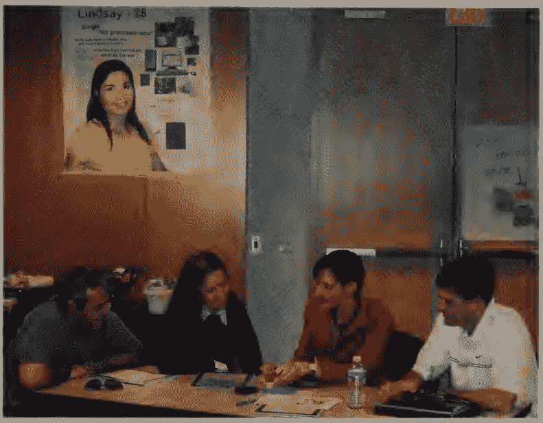

Marie Tahir（穿红色上衫者）和她在 Intuit 的同事们在规划和开发产品时，Lindsay 也和他们在一起。经许可使用。

- Kristin 会就这个主题问什么问题？
- 当 Sanjay 访问这个网站时，他会进行搜索还是导航？
- 他会使用哪些搜索词来找到我正在编写的内容？

用户画像（Personas）有几种方式成为网站团队的成员：

- 他们会以等身纸板立牌的形式参加团队会议。
- 他们的照片和信息挂在团队工作区域墙上。
- 他们的照片和信息被印在餐垫或鼠标垫上，这样它们就会出现在会议桌和团队成员的工作空间里。
- 来自他们的邮件以及关于他们的邮件在团队中流传。

## “用户 (Users)”是与否？——关于词汇的说明

Pruitt 和 Adlin 在他们关于用户画像的书中，主张从你的词汇中删除“用户”一词。他们说不要泛泛地谈论“用户”——而是始终通过名称关注你具体的用户画像。对于特定的网站或特定的内容来说，这是一个极棒的主意。

然而，在书中，我需要更多分类。你——我的观众——（我希望）如此多样，以至于你正在为许多类型的人处理许多不同的网站内容。你的网站内容的用户画像与其他网站内容的用户画像是不同的。我应该用哪些通用词汇？

你会注意到我使用了“人 (people)”、“网页用户 (web users)”、“网站访客 (site visitors)”和“观众 (audience)”。我希望这些词对你都有效。

将“网页用户”简化为“用户”会让某些人困扰，所以我大多数时候都避免这样做。然而，在大多数网页内容的讨论中，我倾向于使用“用户”而不是“读者”，因为人们来网站并不是为了阅读的乐趣。他们是为了收集信息。他们“使用”网站；他们“使用”网页内容。

“用户”强调了人们带着目标、任务和问题而来。“用户”帮助我们关注网页内容的功能属性，以及帮助人们快速扫读、扫描、抓取并离开的需求。“用户”并不是一个贬义词；它是对与网页内容交互的人的准确描述。我希望你在书中使用“用户”这个词时，是带着友好的意涵来阅读的：“一个来到我的网站提问、执行任务或查看我想表达什么的人”。

## 6. 包含用户画像的目标和任务

用户对你网站的主要目标和任务是用户画像描述的重要部分。图 2-4 为你提供了一个网站团队开发的五个画像之一的示例，该团队负责研究和报告农业和食品生产中的问题。

## 7. 利用你的信息为你的网站编写场景

场景（Scenarios）是短故事，能让你对访问你网站的人有良好的感受，了解他们的生活状况，以及他们想在你的网站做什么。场景赋予了目标和任务生命，就像用户画像赋予了关于网页用户的大量数据生命一样。

要了解故事化场景在开发有用且易用的网站方面有多大用，请阅读 Pruitt 和 Adlin 书中 Whitney Queensberry 编写的章节。

- 信息目标
  - 用于市场分析和处理公司市场细分的话题
  - 想要摘要、趋势和价值分析，而非原始数据
  - 跟进当前的法律和法规
  - 寻求关于其他公司正在做什么的比较信息
  - 寻求及时且可靠的信息

**图 2-4** 用户画像的目标部分——Curtis，负责为一家大型超市连锁购买产品的副总裁

## 场景告诉你是人们想要开始的对话

人们的故事是他们与你对话的开始。场景可以短如下面思想气泡中的两个句子，也可以像接下来几页关于 Mark 和 Mariella 的故事一样长。

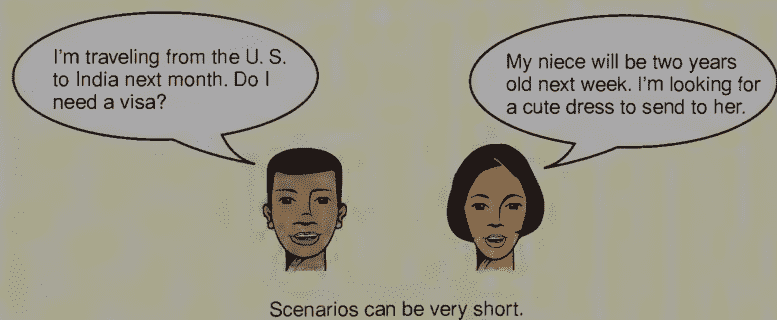

如果你已经为你的网站开发了一个或多个主要的用户画像，你应该为每一个画像都准备好几个场景。

## 第 2 章 • 人！人！人！

- 这些内容可以将你用户画像海报上的目标和任务扩展成更完整的故事，使用户画像对你网站的使用对团队来说更加真实。
- 你可能想为比原始用户画像海报上容纳更多的目标和任务添加场景。

## 场景帮助你理解所有类型的用户

你可能还想为几个次要用户画像准备场景。例如，如果你的主要画像是频繁购物者和休闲购物者，但你也有投资者和报业人员访问网站，你可能想为他们制作“微型画像”以及他们的场景。

图 2-5 和 2-6 中带有场景的微型画像让你对这些人以及他们的生活有所感。这些信息对你有用吗？

Mark 是公司某个部门的销售协调员。他的工作涉及内部网。他整天忙碌。今天电话打断了他。他正在为内网整理一些方案。他需要知道内网是否允许他为客户提供折扣。为了提供折扣，他需要从内网中寻找方案。他希望内网能为客户提供正确的信息。

图 2-5 开发内网网站的场景。

## 7. 利用你的信息为你的网站编写场景

Don 和 Mariella 生了第二个孩子，所以他们需要一辆大车。Mariella 在家里，担心钱。

- 他们想要一个划算的选择。
- 他们不是财务专家；他们不了解某些网站使用的术语。

**图 2-6** 开发银行或信用社网站的场景。

## 你网站上的所有内容都应该符合场景

你网站上的所有内容都应该与用户访问你网站的一个场景相关。（你不需要为每项内容都编写场景，但应该有一个合理的场景。）如果没有人需要或想要这些信息——如果该内容没有场景——为什么要把它放在网站上？它只是占用了服务器空间，并可能在搜索结果中干扰了人们真正需要的东西。

## 场景帮助你编写良好的网页内容

如果你的场景是基于对人们的观察、倾听和交流，它们可以帮助你

- 关注对他们重要的内容
- 用他们的语言写作
- 意识到大多数用户的目标

当你规划网页内容时，始终问：谁会使用？关于我应该记住什么？什么样的故事会带来我的网页内容？

## 总结第 2 章

以下是第 2 章的核心信息：

- 我们在阅读时都会解读。
- 成功的作家关注他们的受众。
- 列出你的主要受众。
- 从多个来源收集有关受众的信息。
- 如果你通过*思考*你的受众来开发网站，你就是在根据*假设*工作。如果你的假设错了，你的内容将不起作用。
- 列出每个受众的主要特征，包括
  - 关键短语或引用
  - 经验、知识
  - 情感
  - 价值观
  - 技术
  - 社会文化环境
  - 人口统计数据
- 收集受众的问题、任务和故事。
- 利用你的信息创建用户画像。
- 包含用户画像的目标和任务。
- 利用你的信息为你的网站编写场景。

## 良好开始：首页

你以及所有那些你想过、访问过、观察过、听过并为此创建过场景的人——都希望你的网站能够成功。

要在网站上获得成功的体验，人们必须：

- 找到他们需要的内容
- 理解他们找到的内容
- 采取相应的行动

并且他们能够在他们认为值得投入的精力内完成这一切。

本书的大部分内容关于“理解他们找到的内容”。它主要是关于首页之外的目标（信息）页，以及人们可能需要通过其到达他们想要内容的导航（菜单）页。

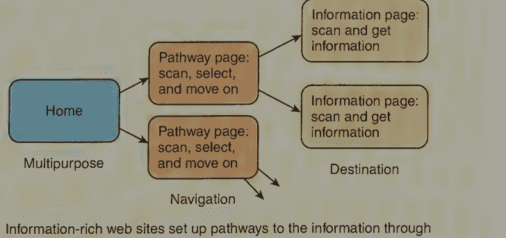

虽然书中后面会重点介绍页面，但所有页面都有内容。首页有内容，导航页也有内容。

在首页和导航页上减少文字尤为重要。在深入讨论网站的页面之前，让我们在本章中简单回顾首页和导航页。

## 首页 —— 10分钟快速浏览

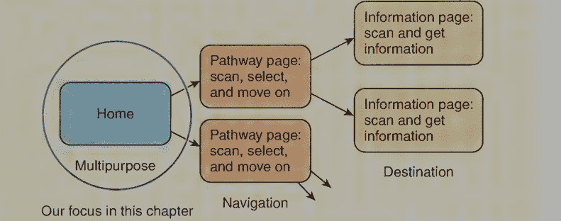

大多数人在首页上阅读得非常少。他们想要获取他们需要的内容并离开，因为他们从网站获取的内容始终位于首页。首页可以内容丰富，但绝不能冗长。

许多访问通过 Google 等搜索引擎直接进入特定的信息页，从而跳过了首页和导航页。

在本章的剩余部分，我们将讨论首页的五个主要功能：

尽管如此，你必须为那些从首页开始或通过搜索引擎进入首页的人设置网站：

- 识别网站，建立品牌
- 设定网站的基调和个性
- 帮助人们了解网站关于什么
- 让人们立即开始任务
- 正确且高效地引导每个人

我们将看到如何在不需要人们阅读太多的情况下完成这一切。

关于许多首页的分析，请参考 Nielsen 和 Tahir 的《可用性》（2001）。

我们将通过一个门户网站首页的简要案例研究结束本章，并简述设定网站基调和个性的重要性（从首页一直到信息页）。

## 识别网站，建立品牌

网站的标志、名称和标语定义了它。不要使用长段落来解释网站。不要在首页上放置长篇大论的任务声明。大多数人不会阅读它们。

关于标语以及首页、导航页的其他方面，请参考 Krug 的《不要让我思考！》（2005）。

相反，用一句令人记忆的标语来概括公司或组织的使命——一句告诉人们如何看待网站的短语。

考虑图 3-1，Aspen Square Hotel 的首页。少量文字的效果很好，因为来到网站的人知道这是一个酒店，并认出它是科罗拉多州著名的度假胜地。


**图 3-1** 即使你听说过 Aspen Square Hotel，通过标志/名称和标语，你可能立即理解它是什么以及它位于何处。

## 设定网站的基调和个性

记住，你的网站是对话的一部分。通过与访问者分享网站的个性，你设定了对话的基调。事实上，不同的网站有不同的个性——体现在网站的视觉风格、颜色、图形、字体风格和文字中。

关于网站个性的有趣论文，请参考 Coney 和 Steehouder 的（2000）。

几年前，美国国税局（IRS，税务征收者）有一个看起来像报纸的首页（图 3-2）。

# 第 3 章 · 良好开始。首页

| 印刷 |
| :--- |
| 每日以及 |
| 免费！ |
| 财政部 |
| 呈献， |
| 国税局 |
| 全球税务出版物 |
| 以及你 |
| 不需要 |
| 回收？ |

## 数字每日报

**比拨号式 1040-EZ 还快！2001年2月26日（距离4月15日还有48天）。**

你准时收到了它，以便你提交 2000 年的税表；现在是 2001 年4 月16 日。

> 报纸对于税务征收者的网站来说有正确的个性吗？

[纯文本版本]

## 青少年 Tanya Taylor

尝试处理税务

培训中……互动式

## 本期内容

## 令人兴奋的税务信息

获取关于

ExSTARS 程序的详情

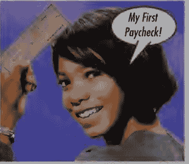

## IRS 正在招聘数百人！

> 这个首页让你觉得该网站是可靠且值得信赖的吗？

## 自选 PIN 电子申报

最后……

一种无纸化的

提交税表方式！

## 常见问题解答

德克萨斯州泰勒。高二学生 Tanya Taylor 今天拿到了她暑期工的第一份工资，她是对工资内容并不感到惊讶的新聘兼职员工之一。“我的很多朋友以为他们能拿到所有的工资，”Tanya 惊讶地说道，“天哪，他们被所有的司法管辖正式手续给震惊了，我的老板提前预告了我会遇到什么。”

“泰勒是世界玫瑰之之都，”Tanya 的雇主、Tanya's Rose 的所有者 Rosa Rosario 豪豪地说，“但如果我们不照顾我们的玫瑰和员工，这里（泰勒）就不会是这样了。教我们暑期工了解税务是如何运作的是其中重要的一部分，所以我……”

FIRSTGOV

你通往美国政府的一步

图 3-2 2001 年美国国税局的网站。

IRS 首页给你什么印象？你会用哪些形容词来描述这个页面？这些形容词符合网站的预期吗？IRS 网站应该什么样的个性？图 3-3 是 IRS 的首页（2005）。

## 设定网站的基调和个性

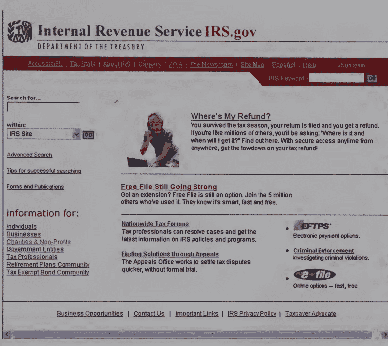

## 谁决定网站的个性？

如果你拥有该网站（它是你的公司），你决定你希望网站具有什么样的基调。然而，如果你是一个大机构的一部分，这并不是你一个人的决定。事实上，机构的另一个部门（例如营销或企业公关）可能会规定网站的方面——颜色、模板。不要随意拒绝这些决定；对于访问者来说，大型网站内部个性和风格的统一是有价值的。始终将你的网站与大型网站的首页（以及其他部分）联系起来，这样通过你的部分进入该机构的人就能获得对这个大机构的价值感。

如果你想影响机构在网站上使用的基调和个性，请参与进来。向上级和跨部门沟通。加入网站工作组（如果你的机构有的话）。在考虑网站的基调和个性时，要泛泛考虑机构的所有受众，而不仅仅是你所在部分的特定受众。网站是整个机构面向世界的脸面。

## 帮助人们了解网站的基本内容

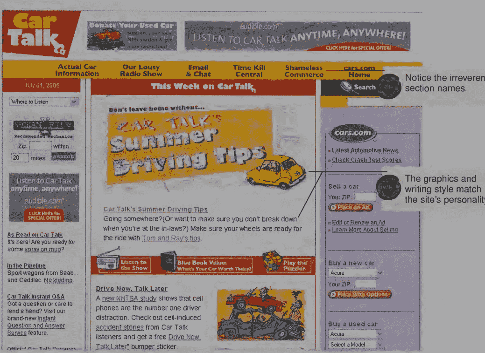

图 3-5 该网站的语调与其基于的美国来电电台节目那种无关紧要的语气相一致。其他公司不会通过将自己标记为“无耻的商业”来提升自己的形象。

你如何用极少的词汇来设定基调和个性呢？

即使你想说“我们是一个友好的网站；我们很高兴你的到来”，也应该在不使用整段文字的情况下完成，因为大多数人不会读那段话。

## 帮助人们了解网站的基本内容

许多第一次访问你网站的人会想知道：

- 这是谁的网站？（我来到我想去的地方了吗？）
- 这些人是谁？（如果我还不不知道的话）
- 这个网站是关于什么的？（他们有什么？我在这里可以做什么？）

但他们想快速获取这些信息，因为他们还想知道：

- 我该如何继续完成带我这里的问题或任务？

回访客通常只是快速检查一下，以确保他们所在的正确的网站，也许看看是否有什么新颖、有趣的内容让他们进一步深入探索网站。

信息过少或过量都会让人们无法理解网站所提供的服务。

## 一个实用的首页能让人一眼看清网站的主题

看图 3-6，SBC 2005 年的首页。能一眼看清他们的业务是什么吗？

网站必须服务于那些已经了解公司的人以及不了解的人。公司内部的经理和员工通常对公司的历史和业务非常熟悉，以至于忘记了其他人并不了解。如果一个网站要帮助公司成功进行营销，它必须向那些不了解公司的人说话。

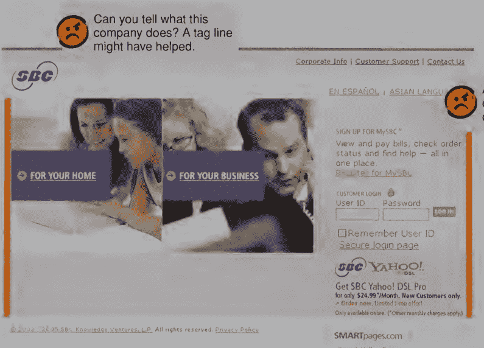

**图 3-6** SBC 2005 年的网站对于那些还不知道 SBC 是什么的人来说，信息太少，导致他们很难一眼发现。

## 帮助人们了解网站的基本内容 37

SBC 在 2005 年底与 AT&T 合并。正如图 3-7 所示，新网站在让人一眼看出公司所属的业务领域及其提供的服务方面做得好得多。

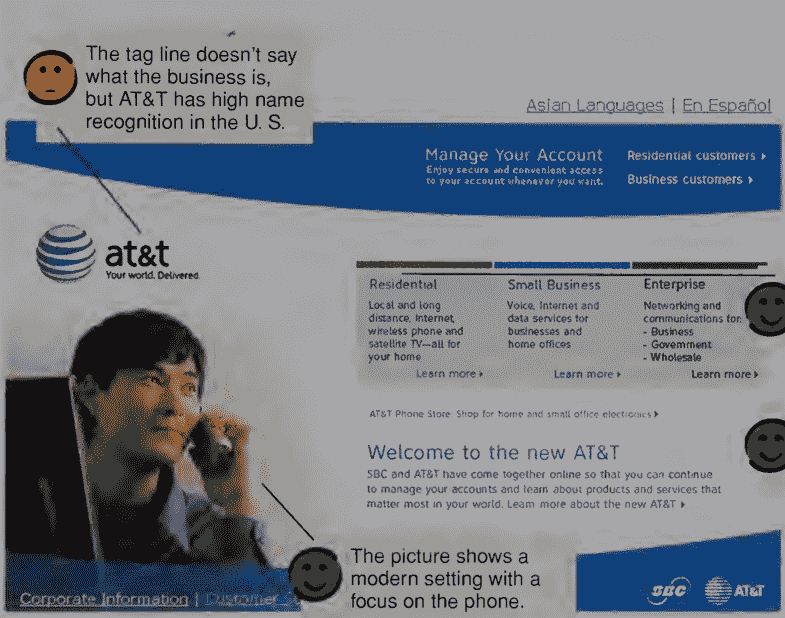


# 第 3 章 · 良好开始：首页

## 3-7 2006 年的 SBC/AT&T 网站

www.att.sbc.com

SBC 在 2005 年底与 AT&T 合并。正如图 3-7 所示，新网站在让人一眼看出公司所属的业务领域及其提供的服务方面做得好得多。


## 一个实用的首页主要是链接和简短描述

对于新老和回访客来说，一个实用的首页几乎全是链接，仅带有少量简短描述，以帮助人们快速理解网站的主题，并知道应该选择哪个链接继续。

看图 3-8，它展示了更多 Aspen Square 首页的内容。

你的视线落在哪里？你是先看了图片并扫描了图片说明吗？你读了多少文本？

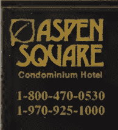
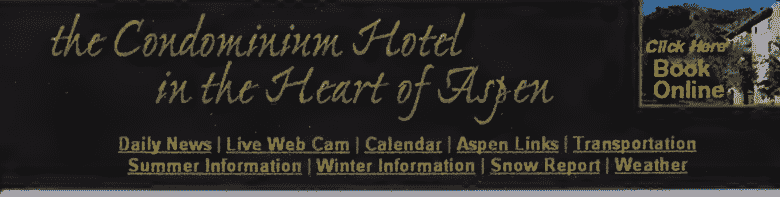


- 在线预订
- 住宿
- 特惠
- 团体
- 联系我们
- 媒体中心
- Aspen Square 的奥林匹赛车


科罗拉多州阿彭斯的夏季已经到了，现在是计划访问 Aspen Square 酒店并看看温暖月份都有好玩的时机了！当积雪消失后，阿彭斯有很多可以做和可以看的。查看我们的每日新闻、网络摄像头、我们的 Aspen 住宿优惠以及最新信息。

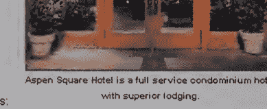

关于住宿，无需再寻找其他科罗拉多州最方便的公寓酒店，那里提供过夜住宿的公寓。Aspen Square 酒店位于这个著名山地度假胜地的中心，距离许多出色的科罗拉多州餐厅、独特的商店和画廊仅几步之遥。甚至银女王缆车（Silver Queen Gondola）就在阿彭斯山脚下的街对面！


The Aspen Hotel 的住宿提供舒适的壁炉套房，以及供过夜租赁的一室和双室公寓。每间公寓都配有齐全的厨房、燃木壁炉、舒适的客厅和私人阳台。住宿设施包括全方位礼宾服务、加热泳池和按摩缸、健康设施。

图 3-8 页面更多内容。Aspen Square 酒店位于这个著名山地度假胜地的中心，距离许多出色的科罗拉多州餐厅、独特的商店和画廊仅几步之遥。甚至银女王缆车就在阿彭斯山脚下的街对面！

## 让人们立即开始关键任务

当人们访问网站执行任务时，他们通常想立即开始该任务。许多任务涉及表单，多年来，观察越来越多的表单出现在网站首页是一件很有趣的事。如果人们需要表单，将表单放在首页是一个很好的策略。

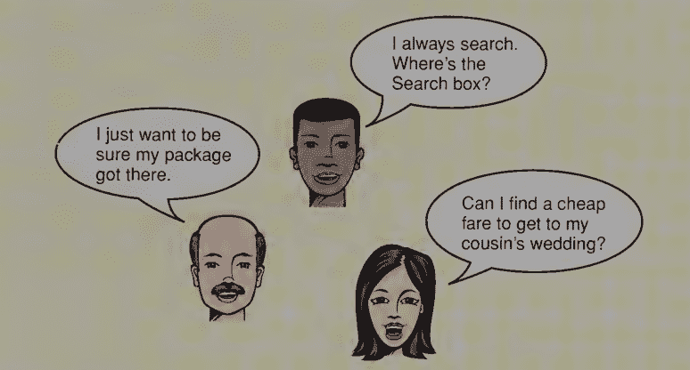

### 将人们急需的表单放在首页

例如，在旅游网站上，人们最想做的是安排行程。这就是为什么大多数旅游网站让人们直接从首页就可以开始预订。图 3-11（斯堪的纳维亚航空的网站）就是一个例子。

### 确保表单位于页面较高位置

如果你在首页上有表单，请确保它们易于找到——在首页上的位置足够高，以便立即看到。许多网站在网页上使用的大图片会将关键任务和关键信息推到页面下方。这些大图片阻碍了人们快速地找到关键信息或关键字段。参见图 3-12 中的 FedEx 示例。

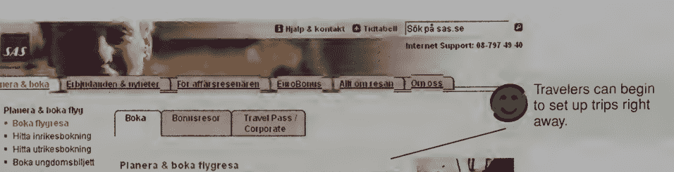

| 计划并预订机票 | 预订 | 住宿 | 旅游通行证/企业优惠 |
|---|---|---|---|
| 预订机票 | | | |
| 查找预订 | | | |
| 查找退房 | | | |
| 预订可用性 | | | |
| 入机 | | | |
| 预订酒店与租车 | | | |
| 重新预订机票 | | | |
| 入机 - 票 | | | |
| 概览 - 低价机票 | | | |
| 电子票 - 行程 | | | |
| 期间不在家 | | | |
| 团体游 | | | |
| 机加+住宿（机票行程） | | | |
| 邮件优惠 | | | | |

游客可以立即开始安排行程。

计划并预订机票

时间 | 瑞典 | 瑞典
|---|---|---|
| 2005年5月 | 01:00 | 2005年6月 |
| 1 2 3 4 5 6 7 8 9 10 11 12 13 14 15 16 17 18 19 20 21 22 23 24 25 26 27 28 29 30 31 | 1 2 3 4 5 6 7 8 9 10 11 12 13 14 15 16 17 18 19 20 21 22 23 24 25 26 27 28 29 30 31 |

现在还没有通过自动进行入机

从 | 到
瑞典 | 瑞典

查找 | 法语

包机游览 - 一家公司

SAS 新国内线航空

```
snowflake
```

7 月和 8 月有一些行程

多项计划

| 1 周 | 开放 12-15 周 | 开放 2-21 周 | 3 周 |
|---|---|---|---|

未收到订单确认？如果未更改搜索日期，请查看我们的用户条款。

SAS 航班网站，SAS 让游客能够立即描述他们的计划。其他旅游网站的用户即使不会说瑞典语，也知道该做什么。

图 3-11。来源：www.sas.com

### 不要假设高分辨率下是全屏

某些用户仍使用小屏幕或在低分辨率下工作。我们中许多人在高分辨率的大屏幕上工作——我正在一台 24 英寸显示器上输入，屏幕分辨率为 1900 × 1200——往往会忘记大多数使用我们开发产品的人并没有在该环境下工作。你网站的大多数游客可能在 1024 × 768 的分辨率下工作，但仍相当比例的人在使用 800 × 600。（2006 年夏季：约 20% 的网络用户仍在使用 800 × 600。）关于大多数人使用的屏幕分辨率的最新信息，请参见第 2 章第 18 页的网站。

此外，即使是老练的商务人士和科学家并不是在大屏幕上都使用小字体。在一项针对员工的实地研究中，每个人的显示器都能显示 1024 × 768，客户惊讶地发现许多员工将显示更改为较低的分辨率或大字体。他们在屏幕上看到的比我们假设的少得多。许多用户打开多个窗口并丢失了这些窗口；这些窗口只是你网页的一部分。这些现实都是将网页上半部分用于具有情感吸引力的大图片的充分理由。应该将该空间用于人们访问你的网站获取最重要的表单或信息。

## 将搜索放在顶部——访问者预期的地方


| 美国整合中心 | 客户支持 | 网站地图 |
|---|---|---|
| 包裹/信封服务 | 办公室/打印服务 | 货运服务 | 预期服务 |
| 寄送 | 追踪 | 管理我的账户 | 国际工具 欢迎客户 登录 | 新客户 学习如何使用 FedEx 并今天开设账户 交付选项 发现各种货运服务并查看示例价格 服务查找器 选择适合你的最佳服务。选择目的地、日期和重量 立即申请 - 节省 10% 今天在 FedEx 开户并获得免费邮运 尝试首次，尝试 FedEx！通过与 FedEx 集成的在线软件，你可以在第一批货物上节省 50%。通过你的会计系统直接寄送以节省时间。了解你可以依靠 FedEx 快速可靠地交付你的货物。地区和国际交付 |
| 追踪 | 轻松组合最多 18 天 | FedEx 追踪（仅限一个号码） |
| 新闻 购买货物信息 更多新闻... |


大多数包裹追踪在 800 x 600 下不可见——或者那些没有完全打开窗口的人。

| 首页 | 网站地图 | 关于 FedEx | 条款和条件 | 使用条款 | 隐私政策 |

本网站受美国和国际法律版权和商标法的保护。保留所有权利 ©1998-2005 FedEx。

图 3-2 如果包裹追踪框位于页面更靠上的位置，人们会更容易找到它。www.fedex.com

始终将搜索放在页面顶部。如果你的网站具有搜索功能（任何大型网站都应该具备），搜索（而不只是指向另一个页面的链接）应该位于网站每个页面的相同位置。

> 网页的“折线以上”（Above the fold）是指访问者页面首次打开时看到的内容——无论他们使用的是什么分辨率或窗口大小。

人们已经习惯搜索框位于右上角或左侧导航列的顶部。这些都是好地方。

“折线以下”的信息只有在用户向下滚动页面时才可见。

如果网站会吸引小显示器、低分辨率或不最大化窗口的访问者，将搜索框放在底部不是好主意。如果搜索框在折线以下，许多人会假设网站没有搜索功能。他们不会滚动寻找它。

“折线以上”一词源于印刷报纸，当报纸送到门口或在自动售卖机时，你只能看到折线以上的内容。

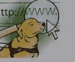

报编辑知道他们必须在折线以上放置最重要和有趣的信息以吸引人们的注意力。

盲用户喜欢在网页非常顶部的地方找到搜索框。屏幕阅读器从页面顶部开始读取。如果搜索位于其他内容之前，盲网络用户可以快速找到他们需要的内容。

## 不要让人们填写他们不想写的表单

在首页让人们开始他们想要的表单是好的。然而，强迫人们填写他们不想写的表单——或者在他们准备好为你提供信息之前——可能会适得其反。

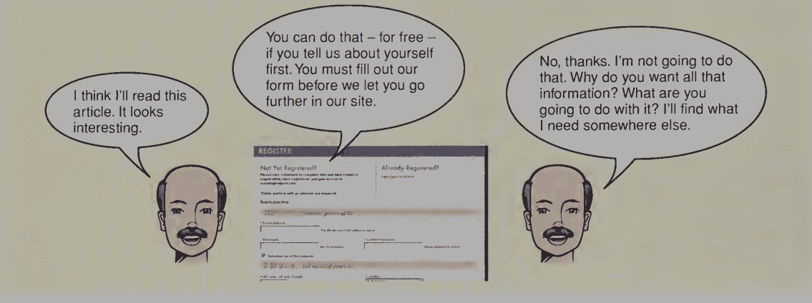

## 使用网站访客的话

当人们访问你的网站与你开启对话时，他们心中已经有一个主题或问题。他们正在寻找脑海中的词汇——这些词汇让他们确信只要点击那里，就能更接近他们正在寻找的信息。

为了让你的访客的需求与你提供的内容建立联系，你必须使用他们自己的语言，而不是那些他们不熟悉的、看似可爱的虚构名称。如果这些名称不能帮助访客知道该点击哪里，那么“可爱”就毫无用处。

利用第 2 章中讨论的关于网络用户的所有信息来源来获取他们的词汇。

## 不要让人们猜该点击哪个链接

访客想要思考的是他们的主题和需求——而不是思考你是如何组织网站的。如果人们不确信你正在帮助他们获得所需的内容，他们可能就不会认为你的信息是可靠的，也不会认为你是一家值得信赖的公司。


# 图 3-13 网络用户不想费力寻找信息

图 3-13 所示的网站可能会访问的人不确定是否要继续浏览。许多其他网站也提供汽车贷款和投资方式。忙碌的网用户只会去其他地方，而不是试图弄清楚这个网站的什么在哪里。

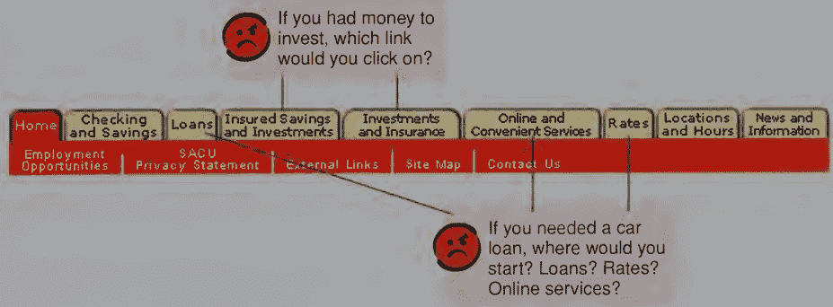

**图 3-13** 网络用户不想费力寻找他们需要的信息放在了哪里。他们希望在浏览网站时感到舒适和自信。

# 综合运用：案例研究

让我们看看这五点在一个特定案例中是如何运作的。这个案例研究是修订门户网站，涵盖美国卫生和人类服务部下所有机构的信息。

## 案例研究 3-1 修订门户首页

拥有 12 个主要机构、300 多个计划、65,000 多名员工以及超过 5000 亿美元的年度预算，美国卫生和人类服务部（HHS）的规模大于许多全球大公司。其机构包括疾病控制与预防中心（CDC）、医疗和医疗保险服务中心（CMS）、食品药品管理局（FDA）以及国立卫生研究院（NIH）——这些都是全球范围内健康安全信息以及老年人和贫困美国人福利信息的来源。

每个 HHS 机构都有网站（以及子站点及其二级）。www.hhs.gov 的主页必须作为通往所有机构网站所有主题的门户——同时向访客展示 HHS 工作的“大局观”。

一个由 HHS 主题专家、网页设计师和可用性专家组成的团队——在我担任可用性顾问的帮助下——于 2002 年修订了该网站。我们的初步步骤之一是对现有网站进行可用性测试，既是为了获得日后对比修订网站的基线数据，也是为了识别修订网站时需要解决的问题。

以下是旧的 HHS 主页以及我们在观察和倾听人们尝试使用它时学到的东西：

- 搜索是一个按钮，许多人没有看到。
- 有些人尝试将搜索请求输入主题框。那是页面上唯一的表单。
- 网站没有使用标语。访客无法判断该部门是做什么的。

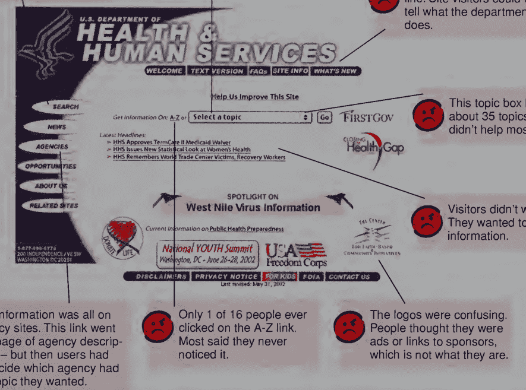

- 这个主题框仅包含约 35 个主题，因此对大多数访客没有帮助。
- 访客不想看新闻。他们想要基于主题的信息。
- 网站内容全在机构站点上。该链接指向机构描述页面——但随后用户必须决定哪个机构包含他们想要的主题。
- 16 人中只有 1 人点击过 A-Z 链接。大多数人表示从未注意到它。
- Logo 令人困惑：人们认为它们是广告或赞助商的链接，但事实并非如此。

## 该网站在五个功能上的表现如何？

该网站在本章中讨论的所有五个功能上都失败了：

- **识别网站，建立品牌：** 人们能从页面顶部看出部门名称，但他们对它没有直观感受。
- **设定基调和个性：** 网站感觉不像 HHS。
- **帮助人们获得他们需要的：** 网站并没有让这变得简单。
- **让人们从他们想要开始：** 网站没有提供清晰的选项。
- **将人们引导到正确的地方：** 网站没有有效地引导他们。

## 总结第 3 章

内容清单/内容分析是通过列出你目前在网站上拥有的所有内容来完成的。你可以使用电子表格来跟踪主题、当前 URL、负责人等信息。你可能还会设置一列，用来指示该页面应该被删除、修订还是保持原样。你还可以对需要编写的内容添加注释。

欲了解进行内容清单/内容分析，请参阅 www.usability.gov/design/inventory.html。

然后你可以使用卡片分类来了解你的网页用户是如何组织内容的。对于卡片分类研究，你创建 50 到 60 张卡片来代表你的内容，每张卡片代表一个主题。代表性用户会将卡片分成对他们来说逻辑合理的组。在“开放式分类”中，用户还会为他们创建的组贴上标签。这可以为你提供用户对主页的标签。在“封闭式卡片分类”中，你告诉用户你计划使用的标签，并告诉他们希望在每个标签下看到哪些主题。

关于卡片分类的细节，请参阅 www.usability.gov/design/cardsort.html。另请参阅 Courage and Baxter, 2005, 第 10 章。

你可以寻求专业信息架构师的帮助来组织网站的内容。

关于信息架构的更多信息，请参阅 Rosenfeld and Morville, 2006。

## 第 3 章核心信息

以下是第 3 章的核心信息：

- 不要期望人们在主页上阅读太多内容。
- 你可以用极少的文字让网站的身份和品牌变得清晰可见。
- 很少有人会阅读你主页上长长的使命声明。
- 你通过对视觉风格、颜色、图形、字体、写作风格和词汇的选择决定了网站的基调和个性。
- 一个实用的主页能让人一眼看出网站是关于什么的。
- 一个实用的主页由链接和短描述组成。
- 让人们直接从主页开始关键任务。
- 确保表单在小屏幕上可见。
- 将搜索框放在顶部，即人们预期的地方。
- 不要让人们为了获取网站上的信息而填写他们不想填写的表单。
- 使用网站访问者的语言并编写清晰的链接，有效且高效地引导每一个人走向正确的方向。
- 采用从下而上和从上而下的方式构建你的网站。

# 目标达成：路径页

从主页开始，让我们继续思考路径页的内容。

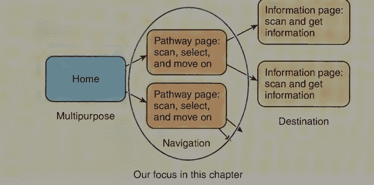

## 本章重点

本章的核心信息是，你忙碌的网站访问者正试图尽快地找到“好东西”——无论他们正在寻找什么。他们不想在途中停下来阅读。他们仍在导航中。他们还没有“到达”。


在本章中，我们探索了以下八点：

- 大多数网站访问者都在狩猎——执行任务——而路径只是为了带他们到达那里。
- 人在狩猎时不想阅读太多。
- 路径页就像目录。
- 有时，短描述很有帮助。
- 营销内容在路径页上可能会被忽略。
- 路径的流畅性比点击次数（在合理范围内）更重要。
- 许多人选择第一个看起来合理的选项。
- 许多网站访问者直接落到你的网站内部。

本章主要关于路径页的结构化。在这里我提到如何编写链接，但你将在第 12 章中发现更多关于编写链接的内容。

信息页也可以是相关信息或更多细节的路径。我们将在第 6 章的分层章节考虑这些页面。

## 大多数网站访问者都在狩猎——执行任务——而路径只是为了带他们到达那里

将试图寻找所需信息的人想象成狩猎中的血犬。他们试图嗅到他们寻找的信息的“气味”，并尝试追踪那股“信息气味”以获得成功的终点——包含所需信息的网页。


如果一个链接散发出“良好的气味”，人们就会很有信心正通往他们的目标。正如 Jared Spool 在他的报告《为信息气味设计》中所示，衡量人们在路径上每个页面的信心程度，是判断你的链接对用户是否有效的极好方法。


关于信息气味，请参见 Spool, Perfetti 和 Brittan。uie.com。

“信息气味”的概念来自 Pirolli、Card 以及他们在 Xerox 帕洛托研究中心 (PARC) 的同事的工作。

Xerox PARC 的研究人员还将人比作“信息觅食者”——通过嗅闻的方式穿过网站，找到我们需要的东西。这对于我们在可用性测试中常见的行为来说是一个极佳的比喻。

### 人在狩猎时不想阅读太多

在狩猎（觅食）信息时，人们对阅读并不感兴趣。他们太忙于寻找他们的“食物”了。他们专注于狩猎。只有当他们到达了正确的地方——当页面显示“这就是你来找的信息”时，他们才会从狩猎模式切换到采集模式，并准备好阅读、吸收信息。

案例 4-1 显示，大多数人在路径页上只想阅读非常少的内容。

美国没有像出生证明那样的国家级重要记录登记处。要获得出生证明副本，你必须在出生地找到正确的办公室——尽管许多人并没有意识到这一点。

美国有一个门户网站，承诺将人们引导到许多需求的正确地点。在对该网站的可用性测试中，我们给人们设定了一个场景：“你需要一份出生证明副本，你的朋友说你可以通过这个网站到达正确的地方。”

测试时，该门户网站名为 Firstgov.gov（2006 年），后来更名为 USA.gov。

测试中的 16 个人都轻松地找到了他们需要的链接。他们在“市民在线服务”下查看并点击了“出生与结婚证明”。这个网页：

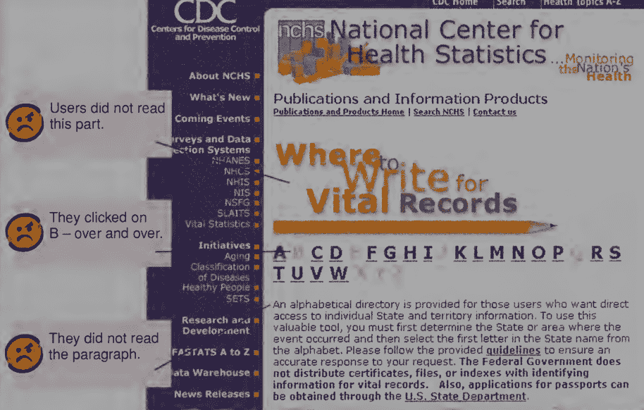

#### 人们在这个页面上做了什么？

大多数人都点击了 B，而且是多次。尽管他们是老练的网络用户，并且知道灰色表示不可用。

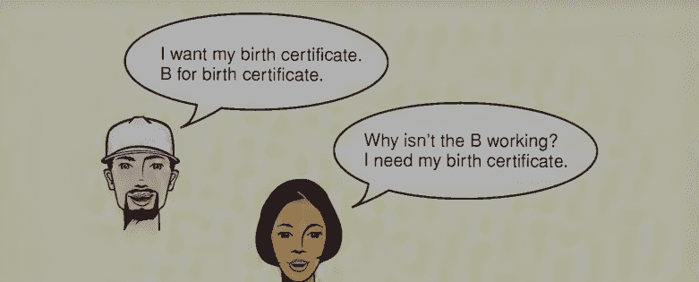

#### 我们可以做哪些改进？

我们可以通过以下行动大大改进页面：

- 大幅删减文字。
- 消除字母表。它只会让人困惑。
- 思考页面的核心信息。如果这是一段对话，页面必须告诉来访者什么？

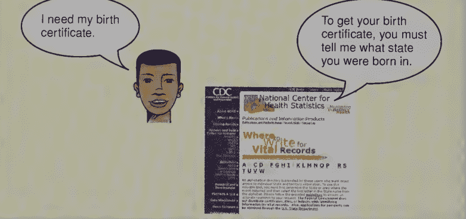

#### 发生了什么？

该页面的所有者可以用多种方式解决问题：例如地图或下拉框。但最简单的方法是简短的指令和列表——这正是他们所做的。

#### 改进后的页面

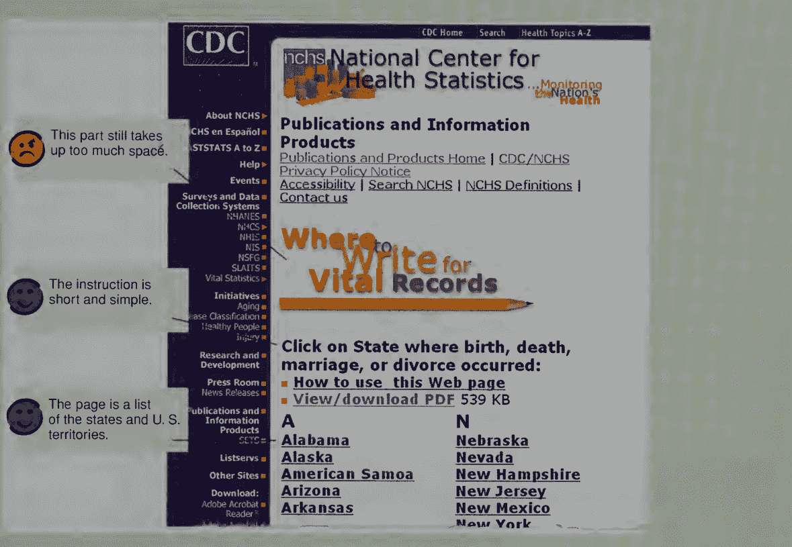

这部分仍然占据了很大空间。

指令简单明了。

页面是各州的列表。

### 我们能从这个案例中学习到什么？

以下是一些你可能发现相关的结论：

- 大多数人不会在路径页上阅读段落文字。他们希望页面告诉他们该做什么，而不需要阅读。
- 使用字母表作为非常长的主题列表的入口（如索引）可能是有效的，但对于其他用途并不适用。（人们可能不会将字母与主题以外的内容联系起来。）

## 路径页面就像目录

你不会希望在目录中看到夹杂着大段的文本。你希望通过扫描目录来：

- 快速概览提供的内容
- 选择你想去的地方

这正是路径页面的作用——无论它是说明书中的路径，还是电子商务网站的某个板块。

图 4-1 是 L.L.Bean.com 的儿童路径页面，展示了你如何为网站访问者提供大量选择。在这样的路径页面上，务必使用访问者的语言，并将项目分组为符合访问者逻辑的类别。

电子商务网站的下一层级可能需要简短描述。本章的下一节将详述。

Tom Brick 和他的合著者使用“范围注释” 一词来描述这些为链接增加“气味”的描述。他们为人们导航的链接提供了非常有用的标题。

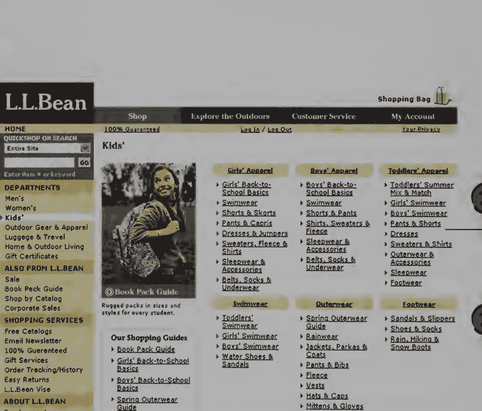

组织良好的项目列表使其成为电子商务网站上良好的路径页面。

页面上没有文字分散客户继续操作的注意力。

**图 4-1** 路径页面帮助客户快速找到他们正在寻找的内容——没有阅读的段落，且营销信息极少。

### 有时，简短描述会有帮助

如果链接并非一目了然，几个字的描述可能帮助你的网站访问者找到所需的链接。虽然人们不想在路径页面上阅读大段的文本或毫无信息、热情的欢迎式营销信息，但他们可能希望简短的帮助，以决定选择哪一个链接来实现他们的目标。

图 4-2 的 Coral Cay Conservation 组织页面展示了你如何在路径页面的每个链接上使用简短且信息丰富的描述。描述紧随链接之后，而链接在页面上脱颖而出。

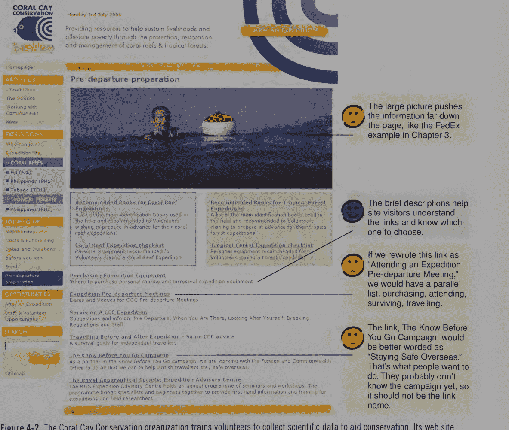

**图 4-2** Coral Cay Conservation 组织培训访问者为保护性工作收集数据。它包含了几个带有简短描述的页面，帮助网站访问者选择他们需要的内容。

### 营销信息在路径页面上可能会被忽略

在电子商务网站上，一旦人们进入了感兴趣的产品类型区域，他们就开始需要一些技术信息来帮助他们决定进一步考虑哪些产品。Jared Spool 将这种页面称为“画廊”。这些页面可能显示项目列表，或者显示产品类别内选项的图片。正如 Spool 指出的，如果只显示图片，还不足以帮助大多数网络用户。如果按型号数字或系列名称列出产品，也是如此。

参见 Spool 的文章：www.ie.com/articles/galleries。

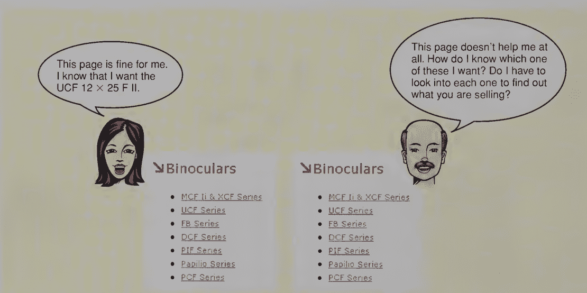

路径页面上的这种列表假设所有访问者都了解他们的类别名称以及他们想要哪一个。

当你向路径页面中提供信息以增加“气味”时，请将其以碎片或项目符号列表的形式呈现——而不是长句子或段落。让它成为你的访问者在决定如何前进时会认为有用的信息。如果你只写营销炒作，那是没有用处的。如果你在图片旁边写技术规格，请仔细考虑你的网站访问者是否理解技术语言。

图 4-3 是戴尔电脑网站上的多个画廊页面之一，既有优点也有可以改进的地方。“帮助我选择”选项指向一个通过几个问题比较三种笔记本电脑类型的页面。然而，戴尔本可以做更多，将用户的语言融入这些问题并引入到这个画廊页面中。图 4-3 页面上的信息不需要大量阅读，但它使用的词对潜在买家来说可能意义不大。

**图 4-3** 画廊页面必须帮助访问者朝着目标做出良好的选择。

www.dell.com

简短描述可能帮助人们做出良好的选择，但路径页面不是放置长营销信息的地方。当你帮助访问者获得成功的体验时，你的营销效果是最好的。大多数网络用户在寻找所需页面时，甚至不想停下来阅读你那些亲切、欢迎的信息。

图 4-4 中的路径页面向购房者和房屋主介绍了所有各种类型的信息，以及他们如何从 FannieMae.com 获取信息。

> 为什么不直接把页面命名为“针对购房者和家庭主妇”呢？

## FannieMae

- 首页
- Fannie Mae 新闻
- 媒体
- 访谈
- 观点与评论
- 关于我们
- 公司治理
- 投资者关系
- 多样化与包容
- 职业发展
- 针对业务合作伙伴
- 可负担的住房与社区开发
- 单户家庭
- 半家庭
- 现有资源
- 债务证券
- 抵押贷款支持
- 针对购房者和家庭主妇
- 寻找贷款
- 寻找贷款人搜索
- 资源

## Homepath

欢迎来到 Fannie Mae 的“针对购房者和家庭主妇”板块。该板块提供内容、工具和一站式便利资源。

如果你计划购房，请阅读我们的 Fannie Mae 免费手册、寻找 Fannie Mae 贷款的增强搜索工具，以及符合你需求的合作伙伴。

“针对购房者和家庭主妇”板块为你提供了找到合适贷款的所有信息。Fannie Mae 创新的贷款产品和广泛的贷款人网络。Fannie Mae 不直接向借款人贷款，但在你寻找住房贷款时我们提供所需的资源。

我们的“成为购房者”板块向你展示了购房的步骤。如果你已经是房屋主，可以学习如何办理贷款或了解更多如何通过 Fannie Mae 贷款保留房产。

通过使用我们的贷款人搜索，你可以找到提供贷款解决方案的贷款人，包括固定利率、可调整贷款和无还款选项。我们还为军人提供贷款融资。

我们开发了资源来帮助你找到适合你的贷款。其他工具包括贷款计算器、详尽的贷款术语表、计算债务和资产等内容的工具；以及查找 Fannie Mae 待售房产的搜索引擎。

因为你可能需要额外的建议，我们轻松帮助你找到顾问或州住房金融机构。如果你需要个人协助或有疑问，请联系消费者资源中心：800-FANNIE (800-3226643)。

> 很多客户不知道门户。
> 不要只告诉他们需要什么——给他们链接。
> 这是一个关键信息，但它被埋在段落中间。
> 为了装修房屋，你将获得关于“翻新”或“家居改进”的帮助。
> 老实说，你会读这个页面的多少？

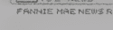

**图 4-4** 这个路径页面。它的核心信息是：“我们不直接向你提供贷款，但我们有很多方法可以帮助你满足贷款需求。”

www.fannimae.com

## 路径的顺畅性比点击次数更重要（在合理范围内）

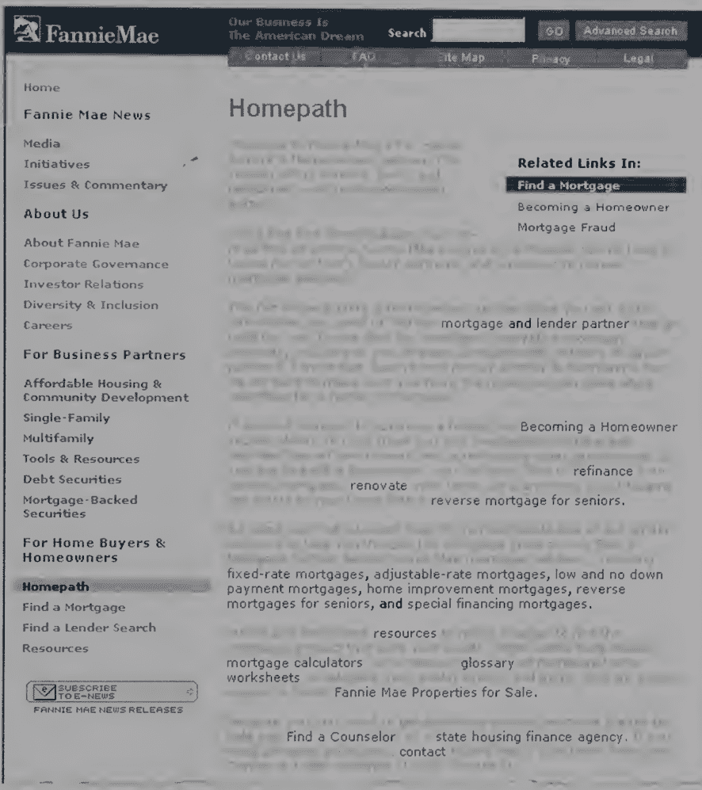

**图 4-5** 许多人会在路径上寻找（并想要寻找）。链接周围的文字并没有包含多少信息内容。

**图 4-6** 作为一个通往房美美贷为购房者和房主提供的信息的路径大门，效果会好得多。

你的访问者希望尽可能快获取他们需要的内容。帮助他们的最佳方法是什么？是否所有内容从主页开始不能超过三次点击？

答案是“否”，我的证据是观察过数百人使用网站。“三点击规则”并不是一条规则；它是一个神话。三并不是一个魔数字。如果人们对他们所在路径的“气味”有信心，他们愿意超过三次点击。事实上，如果他们在一个成功的路径上稳步移动，他们不会意识到花了四或五次点击而不是三次。

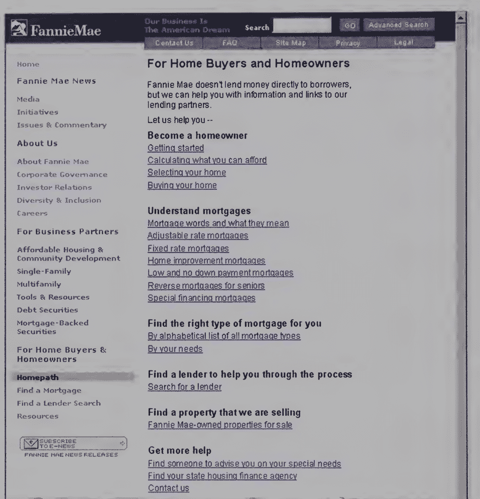

**图 4-6** 我对房美美路径主内容区域建议。

Diamond Bullet Design 的 Tom Brinck 及其同事通过以用户为中心的设计流程修订了一个网站，将其从内部组织转变为关注用户任务。新网站上的信息通常深一层——需要多点击一次——但找到它们的时间却短了一半以上！

| 指标 | 旧版本 | 新版本 |
| :--- | :---: | :---: |
| 任务成功率 | 72% | 95% |
| 完成每个任务的平均时间 | 132 秒 | 50 秒 |
| 获取信息的点击次数 | 平均比新版本**多**了 1 次 | |

来源：源自 Tom Brinck 及其同事的研究。www.ais.org/Bulletin/Dec-04-brinck.html

### 不要让人们思考


人们希望快速且高效地到达正确的网页。如果他们必须在路径上的每一步都停下来思考该做什么，那既不高效也不快速。他们宁愿多点击一两次，也不愿在途中去思考。

这些措辞和指南来自 Steve Krug 的书籍《别让我思考！》（*Don't Make Me Think!* , Krug, 2005）。

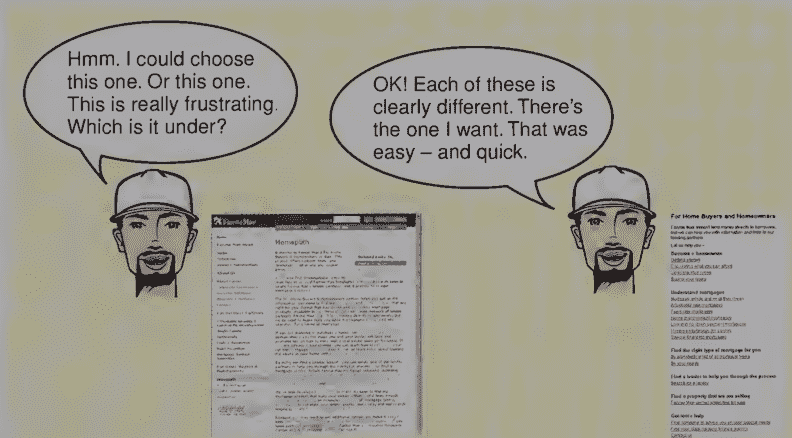

# 防止人们需要后退按钮

如果路径不顺畅——如果人们无法轻松找到正确的链接来前进——他们就会在路径的中途反复跳跃，返回尝试另一条路径，再进入那一条，可能再次返回，以此类推。Jared Spool 将此称为“蹦蹦跳”（pogo-sticking）——他和我都发现我们观察的人在不得不这样做时感到极度沮丧。如果人们在尝试在你网站上寻找信息时使用后退按钮，请重新考虑你的路径页面。

# 第 4 章 · 抵达目的地：路径页面

# 许多人选择看起来合理的第一个选项

人类的行为并非最优的。正如 Herbert Simon 许多年前指出的那样，我们追求“满意满足”（satisfice）。我们用时间换取利益——往往在没有意识到自己在这么做的情况下。我们根据看到的内容做决定，而不仔细探索选项。

忙碌的网页用户一旦看到看起来可能符合他们需求的链接就会立即点击。你的网络受众越年轻，他们就越可能直接跳过去。

以下是关于意识到许多人会点击他们看到的可能帮助他们的第一个链接的一些启示，可能对你有帮助：

- 仔细考虑你路径页面上信息的顺序。
- 将最重要的信息和链接放在页面顶部。
- 如果你想选择其中一个链接而不是另一个，请把你想选的那个放在第一个。

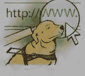

许多听屏幕的网页用户也会选择他们听起来合理的第一个选项。年长的网页用户倾向于成为更谨慎的点击者，在选择之前会考虑所有选项。如果你把最重要的信息和大多数人想要的链接放在页面顶部，你将帮助你所有的网页用户。

> Edith 是你在第 2 章遇到的虚拟人物，她是一个谨慎点击者的年长用户示例。更多关于老年人作为谨慎点击者的信息，请访问 `aarp.org/olderwired/oww-resources`。

# 许多网站访问者直接落在你的网站内部

到目前，我们关注的是从主页进入你的网站，并通过你的路径页面向下导航直到他们所需信息的网页用户。无疑，你的一些网站访问者是这样做的。

> Nielsen 和 Loranger (2006, 27) 发现，“内部页面”占据了初始页面访问量的 60%。

但许多网页用户会跳过这些页面。事实上，在许多网站上，通过外部搜索引擎进入的用户比通过主页的多。这是现实。你必须假设你网站内部的信息页面也是某些网页用户的起点。

然而，我仍然看到许多页面是死胡同，就像图 4-7 中的丹佛清扫页面。

# 丹佛公共工程

以下列出了丹佛维护部门的清扫计划。

需更多信息请拨打 (720) 865-6855

关于清扫提醒贴纸，请拨打停车管理热线 720-913-1720 或发送邮件 `weepers@denver.gov`。

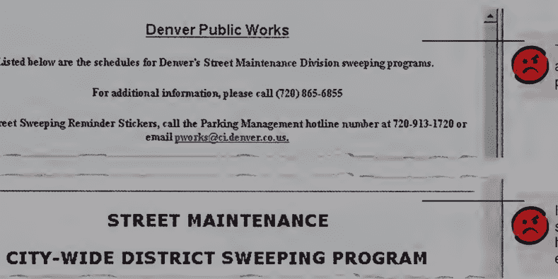

# 全城区域清扫计划

图 4-7 当人们对页面所属的网站没有概念时，他们可能会怀疑页面以及整个网站的可信度。所有页面都应该显示网站的全局功能。

这样的页面让直接从外部搜索引擎进入的用户错过了分享网站所有其他精彩信息或产品的机会。页面都应该包含

- 网站的 Logo、名称和标语（页面顶部的统一页眉）
- 网站搜索框
- 网站全局导航（假设有标签或其他指示网站主要部分的方式）
- 指向该部分内以及网站其他地方相关信息的链接
- 指向主页的清晰链接，并明确是哪一个“首页”

如果你的网站部分是子站的子站，你可能有多个返回主页的首页。如果是这样，请清楚地标记每个“首页”链接。

# 编写信息，而非文档

在这一章中，我们将处理三个重要问题：

- 拆分大型文档
- 决定在一个网页上放置多少内容
- PDF —— 要还是不要？

这三个问题都关乎帮助人们以尽可能快的速度，在需要的时间，以需要的量获取他们需要的信息。

在正确的时间获得正确数量的信息。

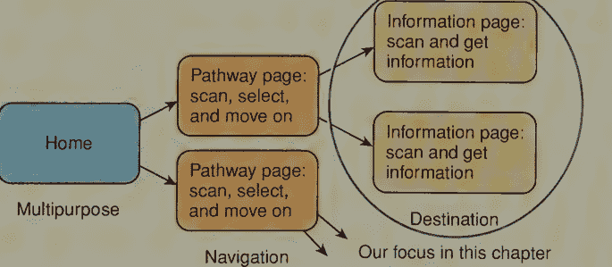

# 拆分大型文档

大多数人访问网络是为了获取信息，而不是为了一个完整的文档。他们不需要用户手册；他们想要他们正在执行的任务的操作说明。他们不需要手册；他们想要针对特定问题的答案。他们想要易用的、易于管理的片段。

# 第 5 章 — 编写信息，而非文档

# 重量控制与饮食

2001年12月

# 什么是肥胖？

体重的稳定取决于食物摄入能量与能量消耗之间的平衡平衡。对于约三分之二的消耗能量，能量在白天以以下三种方式使用：

- 作为休息期间使用的能量（基础代谢）。这构成了维持身体功能大部分，如维持体温以及心脏和肠道的肌肉收缩。
- 作为代谢食物所需的能量（产热），约占消耗能量的 10%。
- 作为体力活动期间消耗的能量。

当一个人的热量摄入超过其能量消耗时，身体会将额外的卡路里储存在脂肪组织中的脂肪细胞中。这些脂肪细胞充当能量储备，并根据人们使用这些能量的方式释放或收缩。通过采取健康习惯和定期运动来平衡摄入和输出，脂肪就会堆积，人们可能会变得胖。

# 肥胖的测量

肥胖是通过测量体脂来决定的，而不是体重。人的体重可能超过了限制

> 很少有用户意识到滚动条告诉他们页面有多长。

> 这是一个非常长文档的开头，但它提供了关于它将回答哪些问题的线索。

> 这个文档打印需要 32 页，但它并没有告诉你这一点。

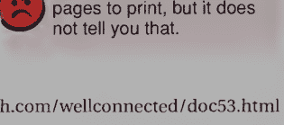

图 5-1 一个非常长的文档在网页上效果并不好。

`www.reutershealth.com/wellconnected/doc53.html`

如果你正在寻找肥胖的信息并遇到了图 5-1 所示的网络文档，你会怎么办？即使它没有告诉你打印需要多少页，你会打印它吗？你会在线阅读它，很多很多次向下滚动或翻页吗？还是你会决定去别处寻找信息，希望找到一些能预先给你提供更多关于肥胖主题覆盖线索的内容？

为了在网页上以大多数人喜欢的量呈现内容：

- 想成“主题”，而不是“书籍”。
- 将大型文档拆分为主题和子主题。

# 想要成“主题”，而不是“书籍”

想象你刚买了一部新手机。你打开盒子，看到手机盒里有一叠索引卡片。每张卡片都告诉你如何使用手机完成一项任务：设置时和日期、选择铃声、将号码存入内存等。

对于通过索引卡片获取这些信息你感觉如何？你会对这些卡片做什么？

你可能永远不会打开包裹那叠卡片周围的塑料膜，因为那样很难将它们保持在一起。你可能会担心丢失它们，或者担心它们在你的办公室、厨房或公文包里有多乱。

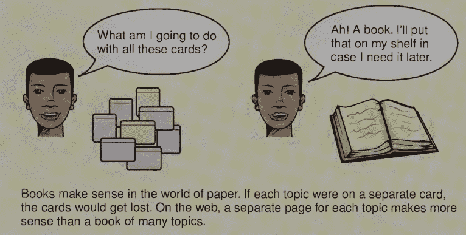

书籍在纸质世界是有意义的。如果每个主题都在单独的卡片上，卡片就会丢失。在网页上，为每个主题设置单独的页面比一本包含许多主题的书更有意义。

在纸质世界里，书籍比一叠索引卡片更舒服。你知道该对这本书做什么：你把它放在办公室架上、厨房抽屉里或公文包里。在纸质世界中，你需要这本书以防所有片段丢失。

但你什么时候会去看书呢？最大的可能只是为了查找书中的某一个主题吧？你想看书的比例是多少？不就是一个主题吗？

在线，我们不需要书籍。网页内容的更好模型是具有良好搜索引擎和良好导航的数据库。

# 第 5 章 · 编写信息，而非文档

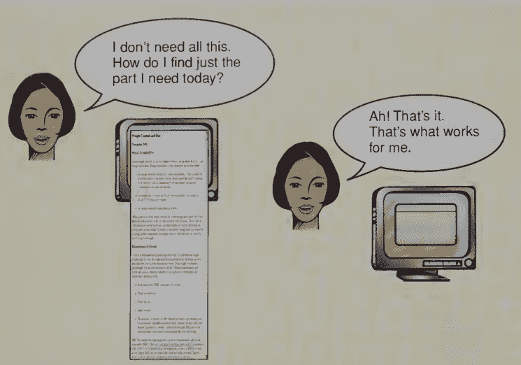

如果人们来你的网站获取特定主题的信息，请给他们这些特定主题作为单独的网页——而不是全部放在一本书或长文档中。

图 5-2 显示了诺基亚如何将用户手册拆分为一系列针对不同任务的“索引卡片”。注意诺基亚如何利用了网页的交互性。每个任务只是单独网页上的一个独立主题，它还是一个动态的

## 设置闹钟

时钟功能基于你的手机内部时钟，并在你指定的时间响闹钟。

总步数：4。点击下面的每一步

- 提示：当在手机上输入快捷键时
  快速且及时地按下按键
- 步骤 1：按下标记为 Menu 的时间键并按 F1。
  出现闹钟时间
- 步骤 2：输入闹钟时间。
  小时和分钟使用两位数字。输入 10
- 注意：你的手机上的时钟不会重置。如果你犯了
  错误，它会重置所有数字。
- 步骤 3：按下标记为 OK 的软键。
  出现 am 和 pm 选项
- 步骤 4：选择 am 或 pm 并按标记为 OK 的软键。
  选择 am 并按 OK。闹钟开启

每个任务都显示在自己的页面上。

你可以快速阅读

或点击链接并

看它的发生过程。

每个链接都是

由用户控制的

交互式演示中的某一步。

图 5-2 诺基亚很好地利用了网页，为每个任务制作了交互式的“索引卡片”。

`www.nokia.com/support/phones`

演示。你可以快速获取信息，也可以通过点击查看发生了什么。

考虑通过以下方式拆分你的网页：

- 任务
- 人员
- 类型
- 问题

## 按时间或顺序划分

在很多情况下，时间或顺序是组织信息的良好方法。图 5-3 来自美国银行，显示了该网站如何引导用户进入与其相关的路径。

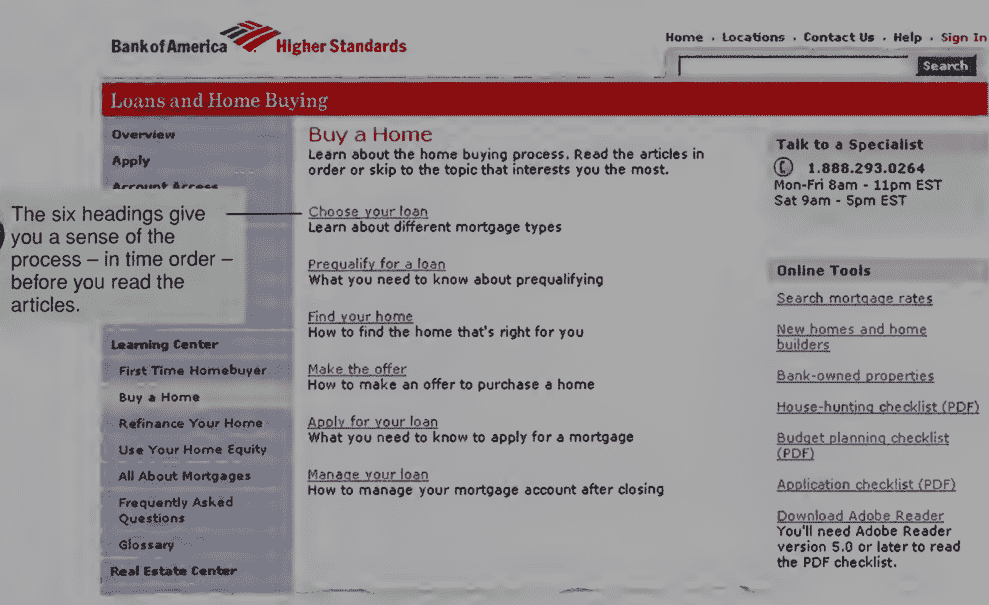

图 5-3 一个非常长的文档在网页上效果并不好。

`http://www.bankamerica.com`

## 按任务划分

当你在网页上发布信息时，意识到在大多数情况下，网站访问者只是寻找某一个。将基于任务的信息拆分为单个网页是帮助用户的最佳方法。

图 5-4 和 5-5 来自加拿大版 QuickBooks，显示了某些公司如何将在线手册拆分为任务数据库。

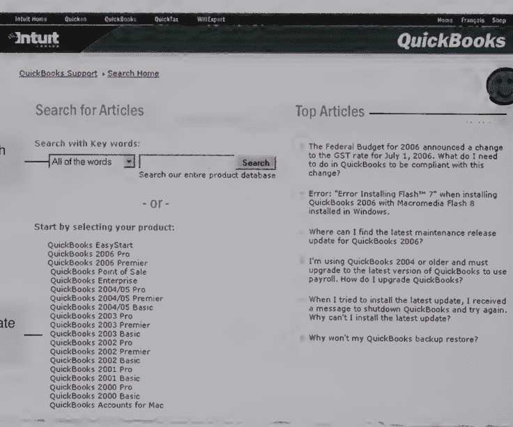

图 5-4 一个非常长的文档在网页上效果并不好。

`http://quickbooks.com`

# 拆分大型文档

5-5 每篇文章都像一个独立的信息的“索引片”。

`http://quickbooks.ca`

## 文章详情

如果这是你的问题，你可以在不需要阅读额外信息的情况下获得答案。

如何在 T4 表格上打印公司地址？

可打印版本

CRA（加拿大税务局）并不要求在 T4 表格上打印公司地址。如果你决定设置 T4 表格打印公司地址，请按照以下步骤操作：

1. 从 PDF 菜单，选择打印页脚
2. 在 T4 帮助设置中，选择 T4 字段
3. 勾选 T4 复选框中的同时也打印公司级别
4. 点击 应用更改

公司地址将打印在 T4 表格的雇主名称字段。

## 按人员划分

另一种拆分网页内容的有用方法是考虑谁将使用这些信息。

为不同的网站访问者分离信息在网站的多个层级可能效果良好。本章中的诺基亚和 Intuit 示例要求人们根据他们想要帮助的产品进行自我识别。这对于支持许多产品的支持和故障排除网站来说是典型的。

在某些网站上，针对不同人员的信息是完全分开的，网站帮助人们在首页进行自我识别。图 5-6 来自英国养老金局，显示了该网站如何引导用户进入与其不同需求相关的路径。

还要考虑如果你按用户类型划分信息，是否某些人会感到被排除。如果他们没有看到自己，他们可能会感到被排除-

# 第 5 章 • 编写信息而非文档

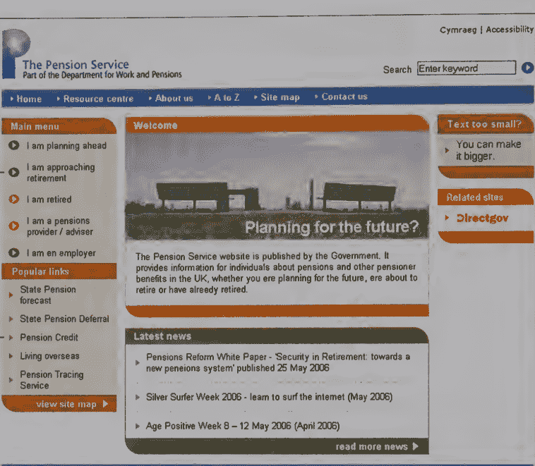

图 5-6 为不同的用户类型（不同的用户画像）设置单独章节对于某些网站来说是合理的，但前提是人们能够轻松识别出应该选择哪种用户类型。

确保你的每种用户类型都符合逻辑。即使他们找到了相关的用户类型，他们也可能认为自己被排除在某些可能想要的信息之外，因为那些信息属于另一个用户类型。

如果人们可能需要你存放在不同用户类型下的信息，请确保这些信息清晰可见，并方便他们在不同版本或不同层级的相关信息之间切换。例如，图 5-7 显示了美国国家癌症研究所（NCI）如何让人们在面向公众的文章与针对医疗保健专业人员的、关于相同主题且更具技术性的的文章之间轻松切换。

# 拆分大型文档

访问该网站的每个人都可以选择阅读每个主题的一个或两个版本的信息：

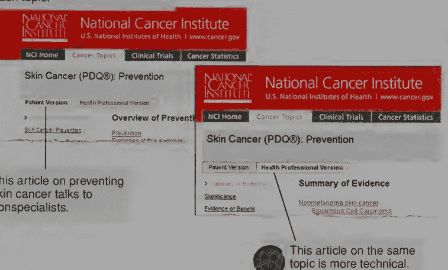

这关于预防皮肤癌的文章是面向非专业人士的。

**图 5-7** 将信息分为通用文章和技术性文章可能效果良好。如果某些访问者两者都需要，请让他们清楚地知道如何在两者之间进行切换。`www.cancer.gov`

NCI 的人员在可用性测试中发现，患者及其家人喜欢从通俗易懂的通用信息开始，但当他们觉得准备好时，也希望获取更具技术性的信息。

# 按信息类型划分网页内容

“我如何 . . . ?” 定义了人们来到网络提问的一大类问题。“我如何 . . . ??”问题关于任务或程序。人们希望以分步说明的形式获取信息。

“我可以 . . . 吗？”我可以 . . . 吗？”我必须 . . . 吗？”我为什么要 . . . 吗？”关于 . . . 我需要知道什么？？” 定义了另一大类问题。这些问题涉及规则、政策、概念和事实。人们希望以问答形式或带有良好标题的清晰事实块获取信息。

# 第 5 章 • 编写信息而非文档

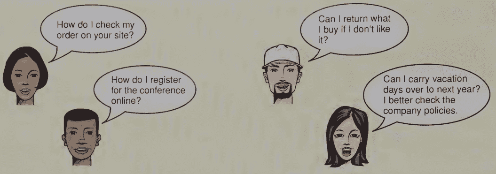

在许多情况下，你针对同一个主题既有“可以”也有“如何做”的信息。你拥有政策和程序。你的网站访问者可能知道“可以”，但需要“如何做”。他们知道“如何做”，但在特定情况下需要“可以”。在独立的、相互链接的页面上，或在同一页的不同章节中回答不同类型的问题。

对于用户手册和其他大型文档，许多技术写作小组正在拆分他们的信息，使用达尔文信息分类型架构（DITA）。有关关于 DITA 的更多信息，请查看 `http://www-128.ibm.com/developers/xml/library/x-dital`。

图 5-8 和 5-9 显示了新西兰丁尼的奥塔哥大学如何对关于入学事实（入学要求）和入学流程的信息设置独立但相互链接的页面。

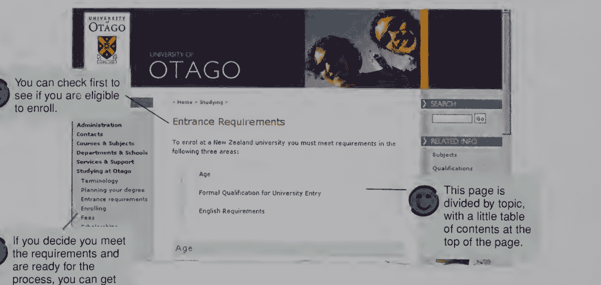

图 5-8 回答“我是否符合条件？”的信息与“我如何入学？”的信息是分开并链接的。

# 拆分大型文档


此页面解释了流程。它回答了“我如何 . . . ”的问题。

你需要检查要求，如通过此链接所示。

**5-9** 独立的、相互链接的页面是组织网页内容的好方法，同时可以保持每个网页的短小精炼。

`www.otago.ac.nz/study/enrolling.htm`

# 按人们提出的问题划分网页内容

人们带着问题来到网站，因此使用问答形式可能帮助人们找到他们需要的内容。

在撰写问题时，要匹配人们提问的方式。你希望帮助他们快速识别出该问题就是获取他们所需信息的地方。事实上，使用问题的一个优势是，如果用户对自己想要什么只有模糊的感觉，即使他们没有想过那些具体的词，也能识别出某个问题。

> Caroline Jarrett 建议，网站上的常见问题解答（FAQs）往往实际上是易答问题（EAQs）。

> 确保你包含的问题是访问者带来的问题——而不仅仅是你想要回答的问题。

好的问题将在第 10 章关于标题的内容中更详细地出现。


# 第 5 章 - 编写信息而非文档

图 5-10 由 Briggs and Stratton 公司（一家销售发动机和其他机械的公司）展示了该公司如何按主题、产品和问题组织其客户支持。


图 5-10 一家公司如何按主题、产品和问题组织客户支持。`www.briggsandton.com`

# 按人们提出的问题划分网页内容

我们刚刚看到了什么时候应该拆分涵盖许多不同主题的页面。关于一个主题的网页可能太长了。考虑本章开头的示例：关于体重控制和饮食的 32 页文档。对于任何任何人来说都信息太多了。

# 84 第5章 • 编写信息，而非文档

今天，大多数人在页面布局显示页面还有延续时，确实会向下滚动。但他们不会一直滚动下去。可以将三四次滚动的长度视为网页的最大长度。

为了拆分较长的页面，请使用本章前面的指南，找到一种将信息分组并划分为子主题的好方法。这样，你就可以在之前的（路径）页面上通过带有目录，创建出一系列页面。

## 下载时间是多少？

在决定是将信息整合在一个网页上，还是将其分离到不同的网页上时，第三个考虑因素是网站访问者获取所需内容需要多久。请记住，许多人的网络连接很慢，并且按分钟计费。

如果人们为了一个包含远超需求内容的长时间等待，他们会感到恼火。相反，如果你将信息分成许多小页面，而访问者又需要所有页面，那么等待每个页面的加载可能会令人厌烦。而且页面之间的等待可能会中断他们在脑海中整合信息的过程。

所以，在考虑人们想要多少信息以及这些信息在脑中的关联性时，你必须考虑下载时间的问题。

## 人们想打印吗？他们想打印多少？

在决定使用单页还是独立页面时，第四个需要考虑的问题是人们可能想打印的内容。

- 如果人们只需要一个章节，却必须打印一页又一页才能获取，他们就浪费了墨水、纸和时间。这令人沮丧。
- 如果文档被拆分成极小的碎片，以至于人们必须连续打印多个网页才能获得所需内容，同样令人沮丧。他们浪费了纸和时间，即使没有浪费墨水——而且完成任务需要多次点击。

> 确保你的页面打印效果良好。

> 始终为人们提供一种打印内容的方法，且不会每行文本的末尾。

因此，你必须考虑人们在任何特定访问你的网站时想要多少内容。

如果你发现有些人人只想打印一点，有些人想多打印一点，而有些人想打印整个文档，请提供：

## 页面选项

- 打印此页
- 打印此文档
- 查看整个文档
- 电子邮件发送此文档
- 查看/打印 PDF
- 订单免费副本


**图 5-13** 该网站将文档的章节作为独立的网页，为人们提供了三种打印选项（以及其他选项）。www.cancer.gov/cancertop/chemotherapy-and-you

图 5-13 显示了美国国家癌症研究所如何提供其部分内容。

## PDF —— 要还是不要？

你可能已经知道了，但以防万一……PDF 代表便携式文档格式（portable document format）。PDF 由 Adobe Systems, Inc. (www.adobe.com) 发明，作为发布任何人都可以阅读的文档的一种，无论他们是在相同的操作系统中工作，还是使用与文档创建者相同的软件工作。

PDF 文件保留了原始文档的布局、分页和字体。通过 PDF，你可以确保无论向某人发送纸质副本，还是那个人从网页打印，文档看起来都是一样的。

任何在电脑上安装了 Adobe Acrobat Reader 的人都可以打开并打印文档。今天大多数新电脑都预装了 Acrobat Reader，而且 Adobe 允许从其网站免费下载 Acrobat Reader。任何习惯下载和安装软件的人都可以拥有一个副本。

## 你应该为网页内容依赖 PDF 文件吗？

我不会说“永远不要发布 PDF 文件”。一如既往，这取决于你的目标、你的受众以及他们的场景。

然而，要意识到，对于大多数 PDF 文件，你是在网页上提供纸质文档，而不是基于网页的信息。如果文档看起来像纸质文档，或者它的体积很大，人们可能会选择打印它而不是在屏幕上阅读。你分发了文档；你节省了打印和运输成本；你将打印的成本和精力转移给了你的受众——但你真的满足了他们的需求吗？

## 什么情况下 PDF 文件是合适的？

如果你利用网络分发期刊文章或其他预计人们会打印并在纸张上使用的材料，并且你的受众对 PDF 文件很熟悉，那么 PDF 可能是正确的方法。

网络是一个极好的分发机制：

- 现在许多人更倾向于使用搜索引擎，而不是苦苦地跑去图书馆。
- 你可以随心随欲获取 PDF（不需要知道图书馆什么时候开放；不需要只在白天工作）。
- 搜索引擎可能通过几个关键词找到你想要的内容（不需要了解图书馆如何组织期刊；不需要在书架间费力寻找；不用担心别人已经拿了那篇文章）。
- 你可以将链接发送给同事，或者因为有人发送了链接给你而立即获得文档。
- 你可以拥有并允许访问那些可能住在图书馆附近、或者住在邮政递送缓慢或不可靠的国家的人。

分发是互联网相对于纸张的巨大优势，即使对于纸质文档也是如此。

## 什么情况下 PDF 文件是不合适的？

然而，PDF文档通常不是创建有用且易用网站的最佳方式。将文档拆分为非 PDF 碎片——

- 当人们不需要整个文档时
- 当人们想从屏幕上阅读时
- 当你的受众不习惯 PDF 文件或不习惯下载软件时
- 当无障碍（accessibility）是一个问题时——而且你应该始终考虑无障碍

## 当人们不需要整个文档

如果人们访问你的网站是为了信息——而不是为了整个文档，但只需要文档中的部分信息——PDF 文件违背了网页的初衷和本质。

是的，PDF 文件是可以搜索的。但人们不想先导航或搜索获取文档，然后在文档内搜索。他们想要直接导航到他们想要的信息。而且许多人不知道如何在 PDF 文档中搜索。

而且你可以拆分 PDF 文档并为其提供链接目录，让人们可以跳转到文档的特定位置——但前提是你设置得好。大多数 PDF 文件只是简单地放在网页上，没有考虑内部链接。

一个故事：我正在从一个政府机构的网站获取信息，当我需要该机构某个办事处的物理地址时。页面上的一个链接说它将带我去办公室列表。点击那个链接会发生什么？我预期的是一个包含列表的单页。令我惊讶的是，Acrobat 开始启动。我等了，又等，打开了一个与办公室完全无关的文档。我的第一反应是“链接错误”，但好奇心驱使我至少看了看文档。事实证明，在20页后的附录中是我需要的办公室列表。

这不是使用 PDF 的良好方法。如果链接承诺提供办公室列表，请从纸质文档中提取出来并创建一个独立的（非 PDF）网页。

## 当人们想从屏幕上阅读

如果文档不是为了在纸张上使用，为什么要让文档看起来像纸呢？

例如，双栏布局在纸张上效果非常好。如果你无法通过滚动就看到整个页面，它在网页上就不起作用。在屏幕上，人们在读到屏幕一半时就必须向下滚动，然后再次滚动阅读第二列。

像美国农业部图 5-14 所示的简报（Issue Brief）简直渴望打印并离线阅读。

他们一直看到 PDF 符号，但并不知道那是什么，也从未选择过它。他们从未在电脑上下载过程序，并且对这样做非常戒备。

即使是那些配备了 Acrobat Reader 的电脑用户，打开 PDF 文件时可能会感到不适。对于使用拨号上网或机器缓慢的人来说，打开一个 PDF 文件可能需要很长时间。

PDF 文件通常会在第二个窗口中打开，而第二个窗口给许多人带来了麻烦。他们想退出当前生成的文件，但“返回”键不可用——而且他们没有意识到现在打开了两个浏览器。


## 当无障碍成为问题时

- 多年来，PDF 文件对于使用辅助软件（如屏幕阅读器）的人来说并不好用。这种情况已经发生了改变。
- 要让 Acrobat 与屏幕阅读器良好协作，作者必须在文件中设置正确标记的标题、图像的适当标签以及屏幕阅读器所需的其他元素。大多数 PDF 没有经过这些设置。
- 如果你将文档扫描为图形文件发布到网上，Acrobat 8.0 无法判断如何处理它以实现无障碍。
- 许多使用辅助软件的人仍然避开 PDF 文件。经验告诉他们 PDF 文件是不具备无障碍性的。虽然 PDF 文件现在可以具有无障碍性，但由于做得太少，人们没有理由改变他们的负面预期。
- 许多人（不仅是使用屏幕阅读器的人）并不经常更新软件，即使是免费的。升级需要时间和精力。人们可能担心升级后与机器上的其他程序不兼容。他们可能不想花时间学习新功能。他们可能需要主管或公司内其他小组的授权才能进行升级。

## 不使用 PDF 的另外三个原因

由于以下另外三个原因，PDF 不是在你的网站上提供信息的最佳方式：

## 第 5 章 · 编写信息，而非文档

- PDF 文件是针对打印页优化的。
- Acrobat Reader 的工作方式与浏览器不同。
- 大多数 PDF 文件不是按网页风格编写。

### PDF 文件针对打印页进行了优化

典型的 PDF 文件是纵向的。而大多数网络用户查看的是横向屏幕。

### Acrobat Reader 的工作方式与浏览器不同

用户必须学习另一种导航方式、另一种打印方式和另一种搜索方式。

作为内容专家或 Web 开发人员，你可能习惯在不同的浏览器之间来回切换，尽管这意味着要改变点击的位置和内容。你所写作的对象也同样习惯这样做吗？


Internet Explorer 控件


Acrobat Reader 控件

### PDF 文件通常是纸质文档——不是按网页风格编写

如果作者在编写 PDF 文件时处于“纸质模式”、“文档模式”或“书籍模式”，那么这些内容在网页上的效果可能很不好。段落会太长。标题会太稀疏。作者会认为人们会从第一页一直读到最后一页。


纸质书

网页主题

### 在某些情况下，提供两个版本

如果某些网站访问者想要屏幕上的信息，而另一些想要整个文档，请提供两个版本。许多网站都是这样。

当你链接到 PDF 时，告诉人们他们得到的是什么，文件有多大或下载需要多久。

图 5-15 显示了美国航空管理局（FAA）的员工可以选择下载整个网页 PDF，也可以获取特定主题的 HTML 页面。

## 总结第 5 章


| FAA 网页内容 | 了解你的标准 |
| :--- | :--- |
| 下载 PDF 版本 (PDF) | 了解你的受众 |
| 满足信息需求 | 保持一致性 |
| 使用简单语言 | 直接 |
| 在网页上编写文档 | 简洁 |
| 避免路由 | 提供信息 |
| 遵守标记 | |

以下内容标准是基于网页内容和可用性的最佳实践，并源自 OMB。FAA 网页或应用程序的所有内容必须遵循这些标准：

FAA 网站有两种类型：面向公众的 FAA.gov 和面向员工的内部网站。FAA 网页或应用程序的指南是以用户为中心的：它们围绕用户需要的服务和信息组织。


| 使用 | 不要使用 |
| :--- | :--- |
| 好（意味着） | 可能（意味着、必须或应该） |
| 必须（意味着） | |
| 应该（意味着） | |

## 使用通俗语言

使用你的受众易懂的词汇

图 5-15 此内网网站提供整个文档 PDF，同时也提供每个主题作为单独的网页。

## 总结第 5 章

以下是第 5 章的核心信息：

- 拆分大型文档。
- 思考“主题”，而非“书籍”。
- 按以下划分网页内容：
  - 时间或顺序
  - 任务
  - 信息类型
  - 问题
- 通过考虑以下因素决定一个页面上放多少内容：
  - 人在一次访问中想要多少
  - 信息的关联性
  - 网页的长度
  - 下载时间
  - 人是否想要打印
- 仔细考虑为你的网页内容使用 PDF
- PDF 更多是纸质文档的传播机制，而不是提供网页内容的良好方式。
- PDF 在某些情况下是合适的。
- 但以下情况下考虑不要使用 PDF：
  - 人想从屏幕阅读
  - 你的网页用户不习惯 PDF 文件或下载软件
  - 无障碍成为问题
  - 在某些情况下，最佳解决方案是提供 PDF 和 HTML 版本的网页信息

## 关注你的核心信息

在第 3 章和第 4 章中，我们查看了首页和路径页面——“获取信息”。在第 5 章中，我们通过考虑如何将文档和大型信息块拆分为单独的页面来开始处理信息页面。在本章中，我们将讨论在每个信息页面中放入什么。

首先，让我们扩展人们进入你信息页面的视图。新图中的顶行是我们讨论首页和路径页面时关注的。其他行引入了人们到达你信息页面的现实，无论我们是在写博客还是深度内容。


## 第 6 章 · 关注你的核心信息

当你到达信息页面时做什么？是立即阅读全部内容，还是先扫视？

大多数人不会直接开始阅读。他们会扫视和扫描，即使是信息页面。他们正在决定：

- 我到达我想去的地方了吗？
- 我找的东西在这个页面上吗？

为了让用户知道他们到了想去的地方，链接和页面标题必须匹配。我们将在第 12 章讨论这一点，该章将关于链接。

他们查看页面标题，并在文中寻找标题和关键词。

你将在书中看到网页写作中的良好标题示例，第 10 章专门关于编写实用的标题。

## 关注核心信息的六条指南

当他们决定自己处于正确的页面时，大多数用户想要立即关注他们来的信息。本章的其余部分提供了六条指南，帮助忙碌的用户获取他们需要的。

1. 只给他们需要的。
2. 删掉！删！删掉！再删一次！
3. 从要点开始。采用倒金塔型写法。
4. 打破文字墙。
5. 通过提供实用的信息进行营销。
6. 为不同需求进行分层。

### 只给他们需要的

网页的一个良好准则是“少即是多”。

你的网站访问者想要什么？需要什么？

- 他们真的在意你项目的整个历史吗？可能不在。
- 他们在意你使用他们作为信息的详细法律依据吗？可能不在。
- 在向他们展示提供什么以及价格之前，他们想听你有多欢迎他们吗？可能不在。

内容对你可能很重要，但如果对你的访问者不重要，请完全放弃，或者将其放在页面底部，或者通过指向另一个页面的链接进行分层。

## 1. 只给人们他们需要的内容

你如何知道人们需要什么？你如何知道什么才是核心信息？

一种很好的方法是使用清单 6-1 中的流程。

## 清单 6-1

选择网页内容的流程

- 1. 如果你已经有一个草稿或之前的网页，请将其先放在一旁。（我知道这很难，但这是重新思考网页的最好方式。）
- 2. 从网站访客的视角来思考该主题。
- 3. 列出你的网站访客对该主题提出的问题。（最好是你确切知道他们问了什么。利用第 2 章中的所有资源来找出你的用户想知道什么。）
- 4. 决定你的网站访客会先问哪个问题——接着会问哪一个——然后是哪一个——直到列表中的所有问题对你的访客来说都是符合逻辑的。
- 5. 如果你有草稿或之前的网页，用它来回答你写下的问题。（剪切粘贴是可以的，只要你对粘贴的内容进行编辑，使其成为问题的良好回答即可。）
- 如果你没有草稿或之前的网页，请为你列表中的问题编写答案。直接回答问题即可。不要加废话。
- 6. 如果你正在根据草稿或之前的网页工作，查看剩余未被列表问题涵盖的内容。你的网站访客关心这些剩余内容吗？其中是否是关键内容？是否是访客可能会提出的问题，以便你给他们答案？
- 7. 如果列表中的某些问题没有答案，请找到可以回答该问题的人，并将答案包含在你的网页中。
- 8. 阅读你的新草稿。逻辑通顺吗？
- 9. 丢弃你没有用到的内容。如果你的访客并不关心这些信息，为什么要把它放在网页上呢？这可能是最困难的一步，但请记住，网络是关于人们想知道和需要知道的，而不是关于某个主题的所有内容。

## 第 6 章 · 专注于你的核心信息

案例 6-1 显示了我们如何应用这一流程来创建一个邀请人们参加艺术比赛的网页。

### 案例 6-1 使用用户问题规划网页

像网站访客一样思考：如果你看到一个关于参加艺术比赛的链接，你期望在链接指向的页面上看到什么？

## 国际航空艺术大赛

“创作航展海报”是今年针对 6 至 17 岁儿童比赛的主题。现在参赛。

思考网站访客想要就这个主题开启的对话。


继续这种模式，你可能会按顺序得到这些问题：

- 谁可以参加？
- 截止日期是什么时候？
- 哪些奖项？
- 主题是什么？
- 接受哪些类型的艺术？
- 评委会看什么？
- 我应该把作品寄在哪里？

这些答案将构成一个关于比赛的网页。它看起来可能这样：

## 国际航空艺术大赛

今年主题：创作航展海报

## 谁可以参加？

所有 6 至 17 岁的儿童均可参加。以 2004 年 12 月 31 日时的年龄为准。

## 截止日期是什么时候？

作品必须在 2005 年 1 月 10 日之前加盖邮戳。

## 有哪些奖项？

参赛作品将分为三个年龄组：6 至 9 岁、10 至 13 岁、14 至 17 岁。比赛在州级开始。

## 州奖励

各州的冠军和亚军将获得该州的证书和认可。每个年龄组的前三名作品将进入国家决赛。

## 国家奖

评委将在每个年龄组选出一个国家冠军和两个亚军。他们将获得所有证书、丝带和一张作品的装框照片——他们的作品将送往国际比赛。国家冠军还将获得来自美国航空艺术家协会的一件专业艺术品。

## 国际奖

国际比赛的获胜者将获得证书以及金、银、铜奖牌。

- 由于国际规定，8.5 x 11 英寸以外的尺寸是不可接受的。

所有艺术品必须由孩子手工完成

- 可接受的媒介
  - 水彩
  - 丙烯胶或油画笔
  - 不褪性马克笔
  - 彩色笔
  - 签字笔
  - 软性圆珠笔
  - 不褪性墨水
  - 蜡笔或不褪色媒介
- 不可接受的媒介
  - 铅笔
  - 炭笔
  - 其他非永久媒介
  - 计算机生成的作品
  - 涉及使用复印的拼贴作品

## 评委会看什么？

评委将根据作品对主题的创意运用进行评审。

## 谁必须证明是孩子制作的？

家长或老师必须证明整个作品是孩子的原创。

确保用胶带或胶水将证书固定在海报上。此外，请在海报背面清晰地打印艺术家的名字。

## 我们应该把海报寄在哪里？

获取 2005 年国际航空艺术大赛报名表

## 2. 删！删！再删！

记住网络是关于人们想知道和需要知道的，而不是关于某个主题的所有内容。

## 清单 6-2

精简至核心信息的流程

- 1. 执行清单 6-1 选择网页内容的流程中的步骤。
- 2. 如果你正在编写问题和答案，考虑你写的答案是否是最简洁清晰的。
- 3. 关注事实。删掉赘肉。
- 4. 关注你的网站访客和他们想要的。删掉关于你自己的词汇。
- 5. 将你的新草稿放一两天。然后拿出来，看看在不丢失核心信息的情况下是否还能删减。
- 6. 大声读出来。请一位同事大声读。请几位受众的代表性人物大声读。仔细听并根据你听到的内容进行修改。

## 2. 删！删！删！再删一次！

## 保留足够的、清晰的内容

当你撰写和修改网页内容时，请记住你正在与真实的人交流。这些人会带着他们之前所有的经验和知识——以及他们经验和知识的匮乏——来理解你所写的内容。

可能会删掉太多的文字，以至于遗漏人们理解你的信息所需的信息。Caroline Jarrett 和 Whitney Quesenbery 在对开放大学（The Open University）的网站进行可用性测试时，吸取了这一重要教训。

以下是他们测试的网页相关部分：

### 心理学学士（荣誉学位）代码：B07

你需要：360 分

级别：本科

“你需要：360 分”——简短、简单、平实的英语单词。从作者的角度来看，这里的核心信息只有“360”。作者假设所有人都能理解其他单词的意思。

对于任何已经在该大学入学的人来说，这个假设可能是正确的。学生们知道你需要积累 360 个课程分才能获得该领域的本科学位（类似于在美国大学毕业获得某专业学位所需的学分）。

但 Caroline 和 Whitney 正在调查该网站对开放大学的新手来说运作得如何。而其中许多人对这几个简单的单词有不同的理解。


# 第 6 章 · 关注你的核心信息

## 3. 从核心点开始。采用倒金塔型写法

无论你的核心信息是什么，请把它放在开头。许多网页用户在阅读页面（或段落）的几个字后，就会决定它是否与自己相关以及是否易于阅读。如果他们认为可能不是，他们可能会跳到页面底部的列表，或者简要尝试另一个段落。这可能就是他们给页面的全部时间和注意力。

和其他许多可用性专家一样，多年来我观察到大多数网页用户和大多数网站都有这种行为。现在，我们的观察已经通过眼动追踪数据得到了证实。眼动追踪精确地捕捉了人们在处理网页时眼睛看向哪里。我们可以查看个人穿过网页的路径。我们可以汇总许多人的数据，并展示使用特定网页的最常见方式。

图 6-3 显示了网页信息页的累计眼动追踪数据（称为热图）。注意人们是如何呈“F”字型查看的——横跨信息顶部的行，然后看列表的开头。注意在看了开头几行之后，他们更多地看行开头，而不是横跨整行。（这是典型的扫视行为。）注意阅读量是如何随着页面向下而减少的。


盲人网页用户的行为也类似。盲人网页用户用耳朵进行扫描。他们在决定继续阅读之前会先听几个单词。通过屏幕阅读器，盲人网页用户可以跳转到下一个链接、下一个标题或下一个段落——他们执行的速度得惊人。

**图 6-3** 这张眼动追踪热图显示了信息页面上典型的网页阅读“F”字型。读者最多看的是第一段，然后是列表行的开头。

颜色显示了眼固的集中程度，红色表示最集中，蓝色表示最少。

眼动追踪由 Jakob Nielsen 和 Kara Pernice Coyne 完成，来自 Nielsen Norman Group。经许可使用。更多关于此研究的来源，请参阅 www.useit.com/eyetracking。

记者和技术写作人员知道，许多读者会扫视文章的标题和第一段。这就是他们采用“倒金塔型”写法的原因之一——将要点放在最前面。

### 倒金塔型写法

对于许多网页内容写作者来说，使用倒金塔型写法需要思维和写作上的重大转变。对于学校论文和报告，你可能被教导使用叙事性写法，按时间顺序讲述整个故事，并在结尾（结论）处引出主点。这对于职场或网页优先来说不是一种好的风格。忙碌的网页用户在寻找信息时没有时间花这个。他们想要一眼就看到结论。

> Jakob Nielsen 提倡倒金塔型写法。

### 传统的叙事写法

网页用户更倾向于倒金塔型写法。

2005年，国家教育统计中心（NCES）发布了其2003年全国成人识字能力评估的初步结果。这项调查是自1992年调查以来，美国对成人识字能力最全面的衡量标准，它揭示了人们如何使用和理解信息。这项调查的意义在于，它使用了人们日常生活中成功所需的任务——填写订单、核对支票簿或阅读处方标签。

结果将参与者分为四类中的一种，并显示：

- 14%的成年人口（3000万人）处于低于基础的识字水平
- 29%（6300万人）处于基础水平；
- 44%（9500万）处于中级水平；以及
- 13%（2800万）处于精通水平。

简而言之，有9300万万人的识字功能水平处于基础或低于基础的识字水平，这意味着他们“使用印刷和书面信息在社会中运作、实现目标以及发展自己的知识和潜力”的能力有限。超过43%的美国人在面对通常被视为所当然的基础日常任务时感到挣扎。

图 6-5 关于美国识字水平的文章版本1。

超过43%的美国人在填写订单表或阅读处方标签等基础日常任务上挣扎。这意味着有超过9300万的人发现难以理解他们所需的材料。

2005年，国家教育统计中心（NCES）发布了其2003年全国成人识字能力评估的初步结果。这项调查是自1992年以来，美国对成人识字能力最全面的衡量标准，它揭示了人们如何使用和理解信息。这项调查的意义在于，它使用了人们日常生活中成功所需的任务：阅读关于健康问题的文章、核对支票簿或查看公交时刻表。

结果将参与者分为四类中的一种，并显示：

- 14%的美国成年人口（3000万人）处于低于基础的识字水平
- 29%（6300万人）处于基础水平；
- 44%（9500万）处于中级水平；以及
- 13%（2800万）处于精通水平。

图 6-6 关于美国识字水平的文章版本2。

版本2是否更好地吸引了你？你是否更有可能在阅读版本1第一段的中途就停止阅读？


## 4. 打破“文字墙”

即使使用倒金字塔结构，也要保持段落短小并使用项目列表。打破文本。


“墙”是障碍。看起来像满墙都是字的大块文本是网页用户的障碍。极短的段落或项目符号效果最好。

如果你正在从纸质写作转向网页写作，请认为你需要的内容比你为纸质文档计划的还要小。每个小主题都需要自己的标题。每个问题和答案都需要将问题作为标题，并将答案以短句或项目列表的形式呈现。

案例研究 6-2 展示了打破“文字墙”如何增加一家电子商务公司的业务量。

### 案例研究 6-2：打破文字墙改变了局面！

当 CompareInterestRates.com 尝试对他们的在线表单进行各种更改时，唯一产生显著差异的变化是从文本段改为项目列表。以下是原始网页表单的样子：


厌倦了反复向贷款供应商询问相同的问题吗？让我们的贷款人和经纪人联系您吧！通过提供以下信息，您所在的一或多家公司将为您提供“个性化报价”。大多数人在24小时内回复。请尽可能完整地填写此表。我们尊重您的隐私。这是一个机密请求，您的个人信息只会发送给 CompareInterestRates.com 的当地贷款人和经纪人。更多信息请查看[隐私声明]。CompareInterestRates.com 由 Loanbright 所有，这是一家帮助贷款公司获取业务的电子商务公司。

#### Loanbright 尝试了什么

与可用性顾问 Caroline Jarrett 合作，Loanbright 尝试了表单的几种变体，结合了这些更改：

- 包括或照片（表单的大小和内容变化）
- 在浏览器中的位置（居中或左对齐）
- 有颜色或无颜色
- 表单背景颜色（蓝色或黄色）或无颜色
- 重写顶部文本

#### 人如何进入表单——研究测量

人们通过点击网页或赞助链接进入表单。Loanbright 关注的是转化率：完成并提交表单的用户与到达表单的用户的比例。Loanbright 可以从同一个广告或赞助链接提供不同版本的表单，他们能够衡量同一“流量”中表单变体的转化率。

#### 他们发现了什么

新表单将一个流量的转化率从5%提高到7.3%，另一个流量从10%提高到12.5%。在转化率领域，这是一个巨大的改进。然而，起初并不清楚哪种变化导致了成功。通过详细分析发现，只有重写顶部文本产生了显著影响。这是一个顶部显示项目列表的变体。


此贷款报价表大约需要30秒即可完成。我们的服务流程如下：

- 填写我们的短表单
- 我们将在数据库中搜索数百家贷款人和数千项贷款计划
- 您将收到当地最多4家竞争贷款人的报价
- 选择利率和贷款条款最优的贷款人并节省资金

眼动可用性测试支持了转化率研究的结论。可用性测试的所有参与者都更喜欢项目符号。

> 关于此研究的完整故事请参见 Jarrett 和 Mott, 2004。

## 5. 提供有用信息

在网页上，尽可能简单快速地向用户提供他们的事实信息来进行营销。因为用户在屏幕上看到的信息比在纸上少得多，所以没有像手册或广告传单那样有足够的空间“客话”。而且网页用户不想被与收集所有事实无关的信息干扰。


在图 6-7 中，该信用社在页面顶部使用了大量空间来放置对表格信息毫无帮助的文本。大多数网页用户会直接查看表格。用户在顶部需要对 APR 和贷款价值等术语的解释。不要期望网页用户注意在线表格中的星号，或滚动到页面底部阅读脚注。这是纸质与网页之间的主要区别。在屏幕上，很少有人会将星号与脚注联系起来，或者根本不考虑脚注。


### 贷款利率

购买新车、船只或房车，WSECU 正有适合您的优惠——您的信用评分越高，利率越优！您可能以低至5.99% - 15.74% APR的汽车贷款开上这辆新车，或者以 6.24% - 14%的利率入住您的房车或船。

报价的利率适用于自动还款贷款。不带自动还款的贷款利率至少高10.99%。

| 产品 | APR | 贷款价值 | 最高金额 | 还款期限 | 额外信息 |
| :--- | :--- | :--- | :--- | :--- | :--- |
| 新/旧汽车 | 5.99% | 75% | $100,000 | 最长84个月 | *场地说明：*新旧车辆可能包含通行证、租赁和保修。*利率和融资条款取决于您的个人信用记录。*利率从12至72个月起，期限为73至84个月 |

APR 旁后的星号告诉您底部有解释。大多数用户并没有注意到。


**图 6-7** 人来到金融网站是为了查找事实。他们通常不阅读此类页面上的营销话术。他们只需要利率。

## 所有网站都销售——产品或自身

有些网站销售产品。在线商店、旅游网站或酒店网站的主要目的是通过在线销售获利。电子商务网站通过以下方式销售：

- 帮助访问找到找到想要的东西
- 提供他们所需的商品信息
- 引导他们高效地完成购买流程

其他网站销售自身。并非以商业为目的的信息丰富的网站可能通过其在线存在获得直接收入。

但它们实际上在进行自我营销吗——通常是作为其专长领域的首选。当网站访问者获得他们想要的内容：可靠、权威、最新、真实且易于寻找、易于理解和易使用的信息时，效果最好。对于大多数网站访问者来说，这比使命宣言、组织架构图或详细历史更重要。

## 网络主要是一项“拉取”技术；而营销专注于“推推”

在理论上，公司通过向人们发送信息来进行营销。由公司发起对话。这是一种“推”技术——公司正在向潜在客户推送信息。

“推推”在网络世界中确实存在。当人们在某个网站注册时，他们通常同意接收通过电子邮件发送的通知。许多网站邀请人们订阅特定主题的新通讯，这些内容随后也会通过“推”的方式发送到他们的邮箱中。

然而，大多数网络接触都是“拉取”技术。人们主动访问你的网站，从网站中“拉取”信息。正如我们在整本书中所看到的，网络通常被用作由访问者发起的对话。如果访问者发起了对话，你必须在尝试向他们营销之前，首先满足他们关心的需求。

营销部门习惯于思考如何吸引人们进来。在网络上，你首要考虑的问题应该是不要赶走那些选择来到你网站的人。

## 利用“营销时刻”——在访问者至少获得部分满意后进行营销

“营销时刻”是网站上访问者准备好接收营销信息的时间和地点。营销时刻并不是为了分散网站访问者的注意力。营销时刻是访问者正在进行的操作的自然延续或补充。

在网站网站上进行营销的时机是在访问者已经满足了其至少部分需求之后。许多在线书店特别擅长利用“营销时刻”，正如图 6-8 中 Barnes and Noble 的示例。

Founders 信用社（图 6-9）在让人们直接获取事实方面做得很好；但随后他们错过了从事实向他们进行营销的机会。

### 5. 通过有用信息进行营销


关于价格，该网站建议你成为会员并节省 10%。

生命之礼：低至 6 折

## 界面设计的用户与任务分析

John T. Marcus, Janice C. Pearce

新品上市：

格式：精装硬装本

Dan Price：$80.00

会员价：$72.00

出版日期：1999 年 7 月

成为会员，书价自有以来最高可节省 20%。

加入愿望清单

通常在 24 小时内发货

来自授权销售商的所有商品均免运费

加入购物车

免费送货优惠能将观望者转化为买家吗？

快速免费送货

3 个工作日或内送达

订单满 $25 或以上享受免运费

查看详情

你难道不想看到别人也在买吗？

你需要这个物品吗？

来自授权销售商的二手优惠券

关于本书

出版商介绍

客户评论：

★★★★★

购买过此书的人还购买：

- Donald A. Norman 著的《经验的造物》
- Susan Weinne 著的《观察体验：用户研究实践者指南》
- Karl E. Wiegers 著的《软件需求》
- Donald C. Gagle, Gerald H. Wendel 著的《用户界面设计》

预览内容

目录


图 8 - Barnes & Noble 与在线书店一样，利用了“营销时刻”——当访问者向他们咨询时。www.bn.com

此网页非常整洁。它提供了基础事实。


如果你对这些贷款感兴趣怎么办？表格没有指向更多信息的链接。

要获取更多信息，你必须从顶部的标签中选择。访问者在“固定利率”和“浮动利率”技术术语上没有帮助。

| 固定利率 | 浮动利率 |
|---|---|
| 新车 | 3.95% - 17.50% | 无 |
| 二手车 | 4.95% - 17.00% | 无 |

### 教育贷款

| 固定利率 | 浮动利率 |
|---|---|
| 教育贷款 | 3.95% - 15.00% | 无 |

### 房屋权益贷款

| 固定利率 | 浮动利率 |
|---|---|
| 房屋权益贷款 | 无 | 8.00% - 11.00% |

### 资金线

| 固定利率 | 浮动利率 |
|---|---|
| 资金线 | 9.90% - 18.00% | 无 |

Founders 联邦信用社菜单：

- 关于我们
- 产品与服务
- 特别优惠
- 加入我们
- 在线服务

图 6-9 该信用社使利率一目了然，没有杂乱；但也让访问者看到。它现在可以通过将贷款类型变为链接或邀请他们查看名称来向他们进行营销。www.founderscu.com

## 分层信息帮助网络用户

分层是划分信息的一种方式。做得好，它是极好的方法可以：

- 防止网络用户被一次过多的信息淹没
- 帮助不同的用户获取他们想要的特定主题信息

在本章结束前，让我们看看网站上的三个分层示例，然后看两个案例研究，它们提供了使用分层的新想法。

### 对文章的简要描述

许多网站通过在首页或路径页上提供关于文章、主题或产品的简介来吸引访问者，然后提供一个指向更多信息的网页链接。这就是分层。图 6-10 显示了 BBC 网站的这一良好示例。

### 信息页面到其他页更多

信息页面也可以指向更多信息的路径——详情、相关信息或相关主题。


**6-10** 这是一个网站分层架构的示例：首页 → 路径页 → www.bbc.com

网络相对于纸质媒介的一大优势是，你可以为人们建立超出你想放在主页上的信息连接。链接可以指向同一页上的更多详情、相关主题、其他网站、计算器、供应商列表、留言板、联系表单和其他在线活动。图 6-11 显示了英国政府网站 Directgov 的顶部。页面的其他部分在简要段落后也有相关链接。


### 页面部分到简短说明

图 6-11 Directgov 有关于许多主题的文章，必须包含指向网站内和其他外部相关页面的链接。链接可能指向更多信息、在线活动、表格、检查清单等。

此页面包含有用信息。它还有指向大多数主题更多详情的链接。链接名称清晰。当有人打开新窗口时，它们也会告知人们。

页面下方的链接可以让你知道停止吸烟后能节省多少钱。

## 健康与福祉

## 吸烟


吸烟会导致许多疾病和健康问题，影响一些烟民和非烟民。由于这个原因，越来越多的公共场所禁止吸烟，并有许多帮助个人戒烟的服务。

## 避免吸烟习惯

许多烟民在 16 岁之前就开始吸烟，甚至在法律禁止他们购买烟草、香烟或打火机之前。了解早年吸烟的诱惑对于防止其发展至关重要。

- 吸烟与成长（青少年）

## 戒烟的原因

人们放弃吸烟有很多原因，从想改善健康和省钱，到为了回应关注家人健康的他意见。

- 更多戒烟原因（新窗口）

## 改善你的健康

多年吸烟每几个月就会导致一种与吸烟相关的疾病。吸烟会导致：

- 肺癌导致所有肺癌死亡的 80% 以上
- 心脏病
- 支气管炎

图 6-11 中的链接都位于文本之后——没有嵌入段落中。


**图 6-12** 术语表是使用小型次级窗口的良好示例，它让人们能够同时查看主页面和小窗口。我们正在查看圣地亚哥动物园关于猎豹的文章第一段中对“猎物（prey）”的定义。

有人想读你的术语表。如果读者想要快速理解某个特定单词的含义，然后继续阅读原文，这种做法会让他们更有满足感。如果你认为人们可能需要更多定义，可以在每个定义窗口中包含一个指向 A-Z 索引的链接。

要小心在弹出窗口中放入信息。许多网页用户都关闭了弹出窗口。

**图 6-13** 显示了 Traffic.com 如何为网站访问者正在查找的地图上标记的每个问题提供更多信息。

通过鼠标悬停（rollover）或不完全覆盖原始窗口的小型第二个窗口来调出额外信息有两个主要优势：

- 原始信息和相关的额外信息同时可见。人们可以同时处理这两部分内容。
- 小型的第二个窗口不太可能引起全尺寸第二个窗口给许多人带来的问题。许多人并没有意识到浏览器启动新窗口时发生了什么，他们也看不见原始屏幕了。

当你使用小型第二个窗口进行此类分层处理时，请包含一个“关闭窗口（Close Window）”链接，就像圣地亚哥动物园网站那样。对于许多网页用户来说，一个提醒他们关闭窗口的文本链接或按钮比记住角落里那个小小的“x”更快、更方便。

# 第 6 章 · 关注你的核心信息


**图 6-13** 在 traffic.com 的地图上，你可以点击任何警告三角形来获取问题的详细信息。新层在地图上打开，因此你不会丢失整体信息或空间位置感。www.traffic.com

## 以创新的方式进行分层

现在让我们来看两个特别有趣且实用的分层示例。

- 将归档的纸质文档总结为“索引卡片”式网页（“新鲜鱼”示例，案例研究 6-3）
- 在同一页网页上打开层级（“受伤工人”示例，案例研究 6-4）

# 案例研究 6-3

## 总结归档的纸质文档

即使你知道纸质文档在网页上行不通，你可能没有时间或资源来更改它。或者，你可能出于历史、归档原因想保留原始的纸质文档。尽管如此，你可能仍然想让该文档中的核心信息对你的网页用户更容易获取。

你能做什么呢？一种方法是创建一个新的、更短的第一层，将核心信息置于网络层级中更高的位置，并将该层链接到旧文档。

这就是美国食品药品监督管理局（FDA）的 Laurence Dusold（Laurence Dusold）在为 FDA 食品安全与应用营养中心（CFSAN）开发网站时所做的。Dusold 的团队从旧期刊文章中提取核心信息，并将其整理成短的网页。这里有一个关于如何判断鱼是否新鲜的文章示例：

### 如何判断鱼是否新鲜？

- 鱼的眼睛应该是清澈且略微凸出的。只有少数鱼类（如梭喉鲈）天生眼睛是浊的。
- 整鱼和鱼片肉质应该是结实且有光泽的。肉色暗可能意味着鱼老了。新鲜的整鱼还应该有鲜红的鳃，而不是粘液。
- 如果按压肉质没有回弹，说明鱼不新鲜。
- 鱼的边缘不应有变暗、棕色或黄色变色。
- 鱼闻起来应该是新鲜温和的，而不是有鱼味或氨味。


来源：摘自《FDA 消费者》，1999 年 2 月：迈向更安全海鲜的关键步骤

来自较长文章的核心信息，链接：www.cfs.fda.gov/qa.html

# 第 6 章 · 关注你的核心信息

这个“核心信息”页面可能就是大多数访问者想要的。任何想看全文的人都可以通过核心信息页面底部的链接进入全文。

随着时间的推移，Dusold 的团队修订了那些较长的文章。原始的期刊文章有标题但没有小标题、没有列表，它只是长段的散文。自首次发布以来，作者们回过文章，添加了小标题，将某些部分转换为项目列表，并将某些部分制作成像带符号的核心信息摘要那列表。


较长文章的更新版本可以通过“核心信息”页面上的链接访问：www.cfs.fda.gov/safe.html

# 6. 分层信息以帮助网页用户

链接后的文章现在比原始版本要实用得多。它已经变成了详细的网页信息，而不仅仅是一份纸质文档。

Dusold 说，他们工作的一半页面是新页面，另一半是更新页面。这样，他们继续努力为访问者提供有用的信息。

# 案例研究 6-4 在同一页网页上打开层级

分层不必让用户从一个页面跳转到另一个页面。你可以将所有信息保留在一个页面上，通过在同一页上打开和关闭来实现分层。

对于像受伤工人这样的用户群体，这种分层解决了许多问题。

## 考虑网页用户和他们的场景

该网站是为像 Joe 这样的人设计的：

- Joe
- 26 岁
- 建筑工人
- 高中毕业，没上过大学
- 已婚，无子
- 喜欢户外活动
- 有一个兄弟曾给过他
- 不怎么用电脑
- 因受伤感到疼痛
- 对政府机构是否有帮助持怀疑态度

Joe 上周在建筑施工任务中从脚手架上掉下来。他知道自己很幸运没有大碍。他扭伤了脚踝，伤了背部，还折断了手臂。一段时间内他无法工作。

Joe 担心钱的问题。他的妻子 Lily 在零售业工作，但仅靠她的工资无法维持过一个月。他们将依靠从处理受伤工人福利的政府机构领取的支票。

他的雇主和医生都告诉他，他必须申请理赔。


## 考虑内容作者和他们的限制

工赔申请系统是一个他们无法改变的过程。

## 考虑如何最好地为网页用户提供这些信息

考虑到像 Joe 这样的人以及他们的情况，华盛顿州劳工部创建了一个网站，具有：

- 流程中的每个阶段以标签的形式
- 每个步骤都有一个页面
- 在页面内进行分层，链接打开更多信息

以下三个屏幕显示了这种可行性。


# 分层信息以帮助网页用户

| 首页 | 安全 | 理赔与保险 | 职场权利 | 执照 | 搜索 |
|---|---|---|---|---|---|
| 查询法律 (RCW) 或法规 (WAC) | 获取表格或出版物 | 帮助 | | | |

**受伤了？你需要了解的**

| 阶段 1 | 阶段 2 | 阶段 3 | 阶段 4 | 阶段 5 | 阶段 6 |
|---|---|---|---|---|---|
| 工作受伤 | 提交理赔 | 理赔批准 | 理赔拒绝 | 复工 | 结案 |

**提交理赔。**

如果你在工作时受伤，治疗你的医生将填写事故报告。当医生将此报告提交给 L&I 处理时，你的申请即为提交。（注意：如果你的雇主是自保，此流程将不同。请联系你的人事部门。）

确保：

- 完成所有需要的文件。
- 知道如何检查理赔状态。
- 配合任何独立检查的要求。


**完成所有需要的文件。**

你的文件取决于你索赔的受伤或职业疾病类型。请仔细阅读，及时回复，并保留副本。在通话时请始终在文件上注明你的理赔号。

了解作为受伤工人的权利。

利用轻度工作机会。

向 L&I 提交理赔的截止日期是什么？

事故报告中包含哪些信息？

我的工伤理赔申请需要多久后才有结果？

更多关于工伤理赔的信息

发现：

更新信息：L&I 如何知道我的地址、医生或其他信息发生了变化？

C 更多关于工伤理赔的信息

C 在理赔与账户中心在线理赔信息

# 第 6 章 关注你的核心信息

主题索引 | 联系信息 | 搜索

华盛顿州劳工工业部

家庭安全理赔与保险 | 职场权利 贸易与执照

查找法律 (RCW) 或 规则 (RAC) | 获取表格或出版物

? 帮助

受伤了？你需要了解的这些

| 阶段 4 | 阶段 5 | 阶段 5 | 阶段 6 | 阶段 7 |
| --- | --- | --- | --- | --- |
| 工作受伤 提交理赔申请 | 理赔获批 | 理赔申请被拒 | 回归工作 | 理赔索赔已结案 |

如果你在工作期间受伤，治疗你的医生将填写一份事故报告。当你的医生将此报告发送给 LBI（劳工工业部）处理时，你的理赔申请即为提交。（注意：如果你的雇主拒绝，此过程将是你的个人责任。）

请确保你：

- 完成所有需要的文件。
- 配合任何对独立医疗检查的请求。
- 你作为受伤工人的权利。
- 充分利用轻度工作选择。

了解：

- 你的雇主需要做什么。
- 你的医生需要做什么。

关于工人的理赔：

- 在 LBI 账户中心在线查询理赔信息。

完成所有文件。

你的文件取决于你所索赔的受伤类型或职业病。请仔细阅读，及时回复，并保留所有文件的副本。在致电 LBI 时，务必随身准备好你的理赔单号。

我们经常收到的问题：

工伤向 LBI 提交理赔申请的截止日期是什么？

- LBI 必须在你受伤之日起一个月内收到你的理赔申请以进行受理。对于职业病，我们在你医生诊断日后的两周内收到。

事故报告中包含哪些信息？

- 我可以从邮寄收到 LBI 的文件吗？

- 一张“理赔到达卡”、被称为“决定通知”的文件，以及可能要求索要更多信息的信函。

需要多久才能知道我的理赔是否被接受？

更新信息：如果我的地址、医生或其他信息发生变化，我该如何告诉 LBI？

你知道吗？

清晰地填写事故报告表并解释你的受伤情况，将确保你获得应有的所有福利。

在你点击两个问题后，相同的屏幕界面


当我展示这个示例时，以及对于使用屏幕阅读器听网站的人来说是否可以访问。答案是“肯定的”。它是通过 JavaScript 使用“显示/隐藏”实现的。

负责创建这些页面的网页管理员 Brian Cress 告诉我，访问他们网站的人有 99.9% 拥有 JavaScript。“显示/隐藏”不会重新加载页面或加载新页面。

（重新加载页面对于屏幕阅读器用户来说是一个问题，因为屏幕阅读器会认为这是一个新页面并从页面顶部重新开始。）在这些页面上，当屏幕阅读器点击打开链接下方或侧边文本的链接时，屏幕阅读器会继续读取已打开的内容——从而读取新显示的标识信息。

## 总结第 6 章

以下是第 6 章的核心信息：

- 只给人们他们需要的内容。
- 删！删掉！删掉！再删一次！
- 保留足够的内容以保持清晰。
- 从核心点开始。采用倒金字塔写作风格。
- 打破文字墙。
- 通过提供有用信息进行营销。
  - 所有网站都在推销——产品或其自身。
  - 网页主要是一种“拉”技术，市场营销专长于“推”。
  - 利用“营销时刻”，在访问者至少获得部分满意后进行营销。
- 对信息进行分层以帮助网页用户。
  - 从简短描述到全文进行分层。
  - 从主文章到独立页面上的更多信息进行分层。
  - 从页面的部分内容进行分层。

# 设计易用的网页

当你设计网页时，要考虑用户的需求。在访问你的网页时，人们首先看到布局、字体和对齐。


当我展示这个示例时，以及对于使用屏幕阅读器听网站的人来说是否可以访问。答案是“肯定的”。它是通过 JavaScript 使用“显示/隐藏”实现的。

负责创建这些页面的网页管理员 Brian Cress 告诉我，访问他们网站的人有 99.9% 拥有 JavaScript。“显示/隐藏”不会重新加载页面或加载新页面。

（重新加载页面对于屏幕阅读器用户来说是一个问题，因为屏幕阅读器会认为这是一个新页面并从页面顶部重新开始。）在这些页面上，当屏幕阅读器点击打开链接下方或侧边文本的链接时，屏幕阅读器会继续读取已打开的内容——从而读取新显示的标识信息。

## 设计易用的网页

易用设计的 14 条准则

这里是 14 条让网页帮助而非阻碍访问者的设计准则：

1. 通过模式和对齐让页面元素清晰。
2. 在设计时考虑整个网站。
3. 使用模板。
4. 有效利用空间。在内容中保持活跃。
5. 注意虚假底部。
6. 不要让标题悬浮。
7. 不要居中对齐。
8. 默认使用无衬线字体。
9. 使用相对字体大小，并确保足够阅读。
10. 使用流式布局，默认行中等长度。
11. 不要使用全大写。
12. 除了链接外，不要使用下划线。谨慎使用斜体。
13. 提供文本与背景之间良好的对比度。
14. 选择颜色时，考虑你所有的网站访问者。

# 第 7 章 - 设计易于使用的网页

公司名称如人们预期的那样位于左上角。顶部的条带颜色在整个网站中保持一致。

全局导航位于顶部。搜索框位于右上角。


白色背景上的黑色文字标志着页面的主要信息。

**图 7-1** 网页元素一目了然。该页面看起来整洁且略显正式，图片显示的是一家投资公司的网站。www.jmorganchase.com


页面标题、链接和文本对齐。项目列表也对齐，并且有明显的缩进，便于使用。

全局导航的起始位置与页面标题不在同一处。这可能是一个刻意的设计决策，旨在将全局导航作为一个不同的页面元素区分来。

**图 7-2** 这些页面的设计是一致的。颜色指示了你处于哪个主要区域。页面会根据页面主题发生变化。（我添加了浅灰色覆盖层和虚线，以便让你更清楚地看到对齐。）

## 2. 在规划设计时考虑整个网站

在这里，网站名称占据了独立空间，全局导航位于网站名称下方的顶部。

### 大都会剧院 (The Metropolitan Opera)

本周 赛季与票务 | 观看与收听 | 新闻与专题 | 关于大剧院

正在播放 特色 | 图库 | 应用查找 | 打印评论

页面标题位于阴影条中。

### 我的工作：编舞学者 (The Choreologist)

本地导航位于左侧。

- 最新文章
- 我的工作：编舞学者
- 我去贡多拉 (I Go Gondilla)
- 《美国音乐》首演会议
- 夜晚，大剧院的首个秋季
- 安东尼·明戈拉的《蝴蝶》……

萨拉·詹金斯（Sarah Jenkins）是安东尼·明戈拉新剧的编舞学者，公众通常并不知道有人从事这类工作。“当人们发现这就是我的工作时，他们会说：‘哦，是的，我们一直很奇他们是怎么做到的！’”


文章内容——文本、照片，甚至乐谱——在右侧清晰的一列列中对齐。

**图 7-3** 歌剧院网站的设计与投资公司不同——但在视觉上非常悦目，具有清晰的模式和对齐。www.metoperafamily.org/metopera

## 2. 在规划设计时考虑整个网站

从网站访问者的角度来看，你的主页、路径页面和信息页面都是同一个网站的一部分。你的网站访问者并不知道——也不在乎——不同的人可能负责网站的不同部分。对他们来说，这都是相同体验的一部分——获取他们需要的信息或购买他们想要的产品。

设计的挑战在于如何在不同类型的页面之间保持模式和对齐，同时让每种页面都能良好地实现其目的。为了看到如何做到，让我们来看一个电子商务示例和一个信息网站的示例。

## 第 7 章 · 设计易于使用的网页

顶部的选项与下方区域的左侧并没有完全对齐。


作者、文本、图片和采访都对齐得很齐。

**图 7-4** 再次，我添加了浅灰色覆盖层和虚线，以显示文本区域和对齐情况。

## 电子商务示例

电子商务网站除了主页外，至少包含以下类型的页面：

- 画廊页面（显示同种类型的多种物品）
- 商品描述页面
- 结算过程中的系列页面
- 关于公司的信息页面、政策页面（例如何时以及如何退货），可能还有其他带有故事或说明的页面

**图 7-5** 显示了四个关于歌迪达（Godiva）巧力的页面。注意该网站如何在不同类型的页面之间很好地保持模式、对齐和一致性。


画廊页面


商品描述页面


结算过程的一部分

信息页面

**图 7-5** 该网站在不同类型的页面之间保持一致的模式和对齐方面做得非常好，同时让每个页面类型都能满足其目的。

www.godiva.com

## 第 7 章 - 设计易于使用的网页

## 信息网站

信息网站应该保持模式和对齐。**图 7-6** 显示了这（美国卫生与人类服务部）是如何实现的。


### 主页


### 路径页面


## 文章

7-3 歌剧院网站的设计与投资公司不同——但在视觉上非常悦目，具有清晰的模式和对齐。www.metoperafamily.org/metopera

## 清单 7-1

- 1. 网站名称在所有页面上是否一致？
- 2. 全局导航是否容易找到？
- 3. 搜索框位置是否标准？
- 4. 主要信息是否清晰？
- 5. 页面标题、链接和文本是否对齐？
- 6. 跨页面设计是否一致？
- 7. 是否保持了模式和对齐？

## 第 7 章 - 设计易于使用的网页

公司名称如人们预期的那样位于左上角。顶部的条带颜色在整个网站中保持一致。

全局导航位于顶部。搜索框位于右上角。


白色背景上的黑色文字标志着页面的主要信息。

图 7-1 网页元素一目了然。该页面看起来整洁且略显正式，图片显示的是一家投资公司的网站。www.jmorganchase.com


页面标题、链接和文本对齐。项目列表也对齐，并且有明显的缩进，便于使用。

全局导航的起始位置与页面标题不在同一处。这可能是一个刻意的设计决策，旨在将全局导航作为一个不同的页面元素区分来。

图 7-2 这些页面的设计是一致的。颜色指示了你处于哪个主要区域。页面会根据页面主题发生变化。（我添加了浅灰色覆盖层和虚线，以便让你更清楚地看到对齐。）

## 2. 在规划设计时考虑整个网站

在这里，网站名称占据了独立空间，全局导航位于网站名称下方的顶部。

### 大都会剧院 (The Metropolitan Opera)

本周 赛季与票务 | 观看与收听 | 新闻与专题 | 关于大剧院

正在播放 特色 | 图库 | 应用查找 | 打印评论

页面标题位于阴影条中。

### 我的工作：编舞学者 (The Choreologist)

本地导航位于左侧。

- 最新文章
- 我的工作：编舞学者
- 我去贡多拉 (I Go Gondilla)
- 《美国音乐》首演会议
- 夜晚，大剧院的首个秋季
- 安东尼·明戈拉的《蝴蝶》……

萨拉·詹金斯（Sarah Jenkins）是安东尼·明戈拉新剧的编舞学者，公众通常并不知道有人从事这类工作。“当人们发现这就是我的工作时，他们会说：‘哦，是的，我们一直很奇他们是怎么做到的！’”


文章内容——文本、照片，甚至乐谱——在右侧清晰的一列列中对齐。

7-3 歌剧院网站的设计与投资公司不同——但在视觉上非常悦目，具有清晰的模式和对齐。www.metoperafamily.org/metopera

## 2. 在规划设计时考虑整个网站

从网站访问者的角度来看，你的主页、路径页面和信息页面都是同一个网站的一部分。你的网站访问者并不知道——也不在乎——不同的人可能负责网站的不同部分。对他们来说，这都是相同体验的一部分——获取他们需要的信息或购买他们想要的产品。设计的挑战在于如何在不同类型的页面之间保持模式和对齐，同时让每种页面都能良好地实现其目的。为了看到如何做到，让我们来看一个电子商务示例和一个信息网站的示例。

## 第 7 章 · 设计易于使用的网页

顶部的选项与下方区域的左侧并没有完全对齐。


作者、文本、图片和采访都对齐得很齐。

7-4 再次，我添加了浅灰色覆盖层和虚线，以显示文本区域和对齐情况。

## 电子商务示例

电子商务网站除了主页外，至少包含以下类型的页面：

- 画廊页面（显示同种类型的多种物品）
- 商品描述页面
- 结算过程中的系列页面
- 关于公司的信息页面、政策页面（例如何时以及如何退货），可能还有其他带有故事或说明的页面

图 7-5 显示了四个关于歌迪达（Godiva）巧力的页面。注意该网站如何在不同类型的页面之间很好地保持模式、对齐和一致性。


画廊页面


商品描述页面


结算过程的一部分

信息页面

**图 7-5** 该网站在不同类型的页面之间保持一致的模式和对齐方面做得非常好，同时让每个页面类型都能满足其目的。

www.godiva.com

## 第 7 章 - 设计易于使用的网页

## 信息网站

信息网站应该保持模式和对齐。7-6 显示了这（美国卫生与人类服务部）是如何实现的。


### 主页


### 路径页面


## 文章

7-3 歌剧院网站的设计与投资公司不同——但在视觉上非常悦目，具有清晰的模式和对齐。www.metoperafamily.org/metopera

随着设计的进行，必须做出许多影响网页内容的决策。每种页面类型上为不同内容的布局和分配的空间限制了写作者的发挥空间。而且，写作者必须参与到关于这些布局和空间的决策中。关于字体和颜色的决策通常由视觉设计师负责，但设计师必须与内容专家紧密合作，以确保这些选择所产生的网页既美观，又便于人们快速扫读、扫描、阅读和使用。

## 3. 与模板协作

在流程结束时，最终的原型将成为每种页面类型的模板。如果你是一名内容写作者，请热情地接受并使用这些模板。

模板让每个人的工作都变得简单得多。你可以专注于信息本身，因为你知道它们将如何融入网页以及在网页上什么样子。根据网页模板的限制进行写作，可以帮助你舍弃冗词汇、将信息拆分为小块、关注你的核心信息、编写良好的标题，并使用书中的所有其他指南。

> 除了模板之外，作者的另一个强大助手是样式指南。请参阅本书关于“创建有机样式指南”的间章。

## 4. 有效利用空间。在内容中保持活动空间

空间不仅仅是空白。空间是一项重要的设计元素——无论是在纸上还是在网页上。然而，如果你习惯于为纸质进行写作和设计，你可能需要对网页内容以不同的方式考虑空间。

大多数网页用户查看的屏幕显示内容远少于典型的纸张。（即使是那些拥有大到可以显示一整页纸的人，通常也不会将每个窗口最大化。）因此，我们希望充分利用现有的屏幕“房产”。

网页上空间太小会导致信息非常难以快速扫读、扫描、查找和阅读。在错误的地方留过多空间则会误导人们判断页面是否完成，以及标题与文本的匹配关系。

我们将查看所有这些问题的示例。但在之前，我必须介绍被动空间和活动空间的概念，因为这些问题主要与活动空间的使用不当有关。

### 理解被动空间和活动空间

信息设计师将被动空间和活动空间区分开。被动空间位于主内容区域之外，例如纸的页边距。活动空间位于主内容区域之内，例如纸上段落之间的空间。你需要活动空间来帮助读者分离和分组信息。图 7-8 显示了典型纸质文档（如本书的草稿页）中的被动空间和活动空间。


**图 7-8** 显示活动空间和被动空间的书籍页。列表项目符号与列表文本之间的空间、每个列表项目末尾的空间，以及问号图标与其后文本之间的空间，都是活动空间的示例。

### 针对你的网页内容，关注活动空间

在网页上，我们可以减少被动空间，但我们必须保留活动空间以帮助人们理解信息。我们必须根据媒介恰当地使用活动空间。

你可以通过以下方式创建实用的活动空间：

- 将文本拆分为小块
- 使用大量标题
- 保持段落简短并在它们之间留空
- 将句子转换为更具视觉化的形式，如列表和表格
- 在列表中留空
- 包含图片和其他图形，并在其周围留空

比较图 7-9（来自宠物食品公司 Purina 的建议）与图 7-10（关于斯坦福大学的停车许可）。Purina 的页面在每个列表项目后需要一点活动空间。


图 7-9 当每个列表只有几行时，列表项目之间需要空间。与间距良好的页面相比，对于一个活动空间太少的页面，人们更不太可能尝试阅读。

活动空间可以使页面脱颖而出。

活动空间使段落更加突出。

- 指定你的内容
- 组织你的段落
- 使用列表处理项目

## 6. 不要让标题悬浮


搜索框应该在这里。那里是大多数人寻找它的地方。

屏幕在 800 × 600 处此结束。

人们可能会被间距误导。他们可能不会向下滚动，从而找不到搜索框。

**图 7-11** 仔细考虑你对空间的使用如何产生“虚假底部”，并误导人们认为页面已经结束了。sin.fi.edu/

不要在网页上创建虚假底部。不要横跨整个页面放置一条水平线或大块的空白。这些会阻碍读者的阅读。在不同尺寸的显示器、不同分辨率以及不同的浏览器中检查你的网站，以确保你的间距不会误导人们。

## 6. 不要让标题悬浮

间距应该帮助人们识别网页上哪些内容是相互关联的，其中一种重要的关系是标题与文本之间的关系。许多网页上最严重的问题之一是标题与其上方文本的距离，与与其下方文本的距离一样远。标题悬浮在空间中，似乎与它们所属的文本毫无联系。

当标题紧贴文本上方时，你无需疑问每个标题对应哪段文本。回看图 7-10 中的斯坦福大学页面，注意标题与文本之间的关系是多清晰。

## 第 7 章 - 设计易于使用的网页

然而，图 7-12 中来自新西兰健康网站的网页标题效果并不好。当我在工作坊中展示这样的页面时，人们发现它有很多优点。它被拆分成了许多小块。句子很短。它有标题。但他们也抱怨很难知道这些标题对应哪些内容。他们难以正确地将标题和文本结合在一起。

哪里问题了？问题在于它们悬浮在空间中。要让标题发挥作用，你需要将活动空间放在标题上方，而不是放在标题与其所属的文本之间。

悬浮标题在普通 HTML 中是自然现象。使用层叠样式表（CSS）将标题直接放在文本上方，通过 CSS 获得的收益远不止解决标题悬浮问题本身，但如果这是你唯一的问题，学习并使用 CSS 也是值得的。防止标题悬浮是非常重要的！

更多信息，请参见第 10 章。

列表引言与第一个列表项之间的间距是类似的问题。也使用 CSS 移除该间距。关于列表的更多信息，请参见第 9 章。


图 7-12 标题离文本比离下方文本更近。不要让它们悬浮在空间中。使用层叠样式表控制标题的位置。www.everybody.co.nz

## 7. 不要让文本居中

我在本章开始时谈到了模式和对齐的重要性。居中文本违反了我们对页面具有明显对齐、不同类型文本有清晰立足点的需求。

对比图 7-13 和图 7-14。图 7-13 是原始版本，一个来自大学网站的路径页面。图 7-14 是修订版，唯一的区别是从居中文本改为左对齐文本。


| 健康益处 | 退休规划与计划 |
| :--- | :--- |
| 资格 | 你应该知道的术语 |
| 新员工 | 国家支持的退休计划 |
| 变化 | 新员工：选择计划 |
| 关于变化 | 州退休金系统 |
| 退休人员 | 州退休金系统手册 |
| 流程 | 可选计划 |
| 范围 | 可选计划 |
| 常规员工 | 补充退休金 |
| 2005 年 7 月 1 日至 2026 年 6 月 30 日：手册 | 补充退休计划 |
| 2005 年 7 月 1 日至 2026 年 6 月 30 日：计划 | 退休规划 |
| 比较 | |
| 针对性员工信息 | 关于退休的信息，例如 |
| 针对性员工信息 | 选择收入方案、牙科和医疗福利， |
| 健康保险保费 | 遗产规划 |
| 计划 | 补充退休信息 |
| 大学提供的各种计划的福利和成本 | 退休人员 |
| 选择适合你的的计划 | 退休手册 |
| 健康保健委员会 | 2005 年 7 月 1 日至 2026 年 6 月 30 日：福利 |
| 质量保证委员会 | 福利注册 |
| | 校园权利 |

图 7-13 居中文本占据的行数比左对齐的多。不要让文本居中。

www.umd.edu


| 健康益处 | 退休规划与计划 |
| :--- | :--- |
| 资格 | 你应该知道的术语 |
| 新员工 | 国家支持的退休计划 |
| 变化 | 新员工：选择计划 |
| 关于变化 | 州退休金系统 |
| 退休人员 | 州退休金系统手册 |
| 流程 | 可选计划 |
| 范围 | 可选计划 |
| 常规员工 | 补充退休金 |
| 2005 年 7 月 1 日至 2026 年 6 月 30 日：手册 | 补充退休计划 |
| 2005 年 7 月 1 日至 2026 年 6 月 30 日：计划 | 退休规划 |
| 比较 | |
| 针对性员工信息 | 关于退休的信息，例如 |
| 针对性员工信息 | 选择收入方案、牙科和医疗福利， |
| 健康保险保费 | 遗产规划 |
| 计划 | 补充退休信息 |
| 大学提供的各种计划的福利和成本 | 退休人员 |
| 选择适合你的计划 | 退休手册 |
| 健康保健委员会 | 2005 年 7 月 1 日至 2026 年 6 月 30 日：福利 |
| 质量保证委员会 | 福利注册 |
| | 校园权利 |

图 7-13 居中文本占据的行数比左对齐的多。不要让文本居中。

## 144 第 7 章 • 设计易于使用的网页

列表引言与第一个列表项之间的间距是类似的问题。也使用 CSS 移除该间距。关于列表的更多信息，请参见第 9 章。


图 7-13 居中文本占据的行数比左对齐的多。不要让文本居中。（等等，我应该重新检查 OCR 流程，该页分页处的文本略有扭曲）。

实际上，居中文本读起来要累得多。

## 8. 将无衬线字体设置为默认字体

## 字体和字体族基础入门

如果你在文字处理程序中打开字体列表，你会看到很长的可用字体。然而，所有字体都分为两大类（加上你只在特殊情况下考虑的艺术字体）：衬线字体（serif）和无衬线字体（sans serif）。

为了体会这种差异，看 Times Roman 和 Tahoma 中的大写字母 T。


衬线是衬线字体字母向下并向外延伸的“笔”和“脚”。Sans”是法语中“没有”的意思。无衬线字体没有笔和脚。

## 纸质时代的旧记录

20世纪中期对纸质文档的研究通常发现衬线字体更适合持续阅读。解释是字母底部的衬线引导眼睛沿着行水平移动。

然而，在你的网页内容上依赖这项研究可能无法为访问者提供很好的帮助。有几个原因导致研究可能不再适用：

- 该研究现在已有 50 多年的历史。
- 当时衬线字体是常态。人们对无衬线字体并不熟悉。
- 只需在行间增加一两点额外间距（行距），你就能让无衬线的纸质文档也变得易读。
- 并非所有文档都是为了持续阅读设计的。在网页上，我们通过小段落、短句、列表和表格将信息拆分成小块。

## 网页上的新研究——阅读速度或理解力方面没有胜者

有些研究发现人们使用衬线字体效果更好；另一些发现人们使用无衬线字体效果更好；还有一些发现发现没有区别。

# 146 第7章 设计易于使用的网页

在这些大多数研究中，无论人们阅读哪种字体最快或理解最好，人们都更倾向于无衬线字体。这可能是因为熟悉；人们在大多数网站上看到的无衬线字体。也可能是因为衬线字体的网站看起来像纸质文档；显得过时。

衬线字体与无衬线字体的对比并非全部。

在这些宽泛的类别中，字字体在其他特征上也有不同，例如字母“b”和“d”圆部分的形状、小写字母如“x”的高度与字母“h”等整体高度的比较、字体区分字母“I”和数字“1”的清晰度、字母之间的间距等。

即使在相同的字号下，不同的字体在屏幕上占据的空间也各不。你可以亲自尝试一下：输入相同的句子几次，然后更改每个句子的字体，但保持字号不变。

当然，你无法完全控制网站访问者看到的内容。他们可能将浏览器设置为始终显示特定字体。然而，作为默认设置，请选择一种高度易读的无衬线字体。选择一种大多数网站访问者电脑上可能有的字体。如果你选择了一个不常用的字体，大多数人将无法在该字体查看你的页面，因为浏览器只会使用特定计算机上有的字体。通过可用性测试来确保你的默认设置产生了易读的页面。

## 9. 设置字号时要宽泛地考虑用户及其处境

网页字号不像纸质字号那样敏感。无论你指定的字号是多少，它在 Windows 机器和 Macintosh 上的渲染都可能不同。在不同的显示器和通过不同的浏览器显示也可能不同。此外，你的网站访问者可能需要调整大小。如果他们有视力问题，或者想让他们站在肩膀旁也能看到屏幕上的内容，他们可能需要放大。他们可能想减小字体以便在屏幕上显示更多内容。

### 为你的网站访问者设置足够大的字体


在纸上，你可能将 12 点字作为标准。对于网页来说这也是一个好主意。从屏幕上阅读仍然比纸上困难，因此将字体设得至少与纸上看到的一大是个好主意。（像这样的一本书可以使用较小的字体，因为是以极高分辨率打印的。台式桌面打印机的典型输出是每英寸 600 点。典型的屏幕分辨率通常在每英寸 100 点左右。）

如果你的受众主要是青少年或 20 多岁的年轻人，你可能可以使用相当于 10 点字作为默认值，但要让其他网站访问者是可调整的。如果你的受众主要是老年人，你可能想将默认值设为相当于 14 点字，同样让它是可调整的。

今天创建网站的许多内容作者、视觉设计师和开发者都很年轻，视力很好。如果你是这样，请想想你的父母和祖父母。看看周围，注意有多少人戴着眼镜。视力随年龄增长而下降。让默认字号足够大，让人们愿意留在你的网站上阅读你的内容。

# 第7章 • 设计易于使用的网页

## 调整你的内容，以便使用足够大的字体并将信息置于有限的空间内

在网页上，我们正在平衡要说的内容和表达这些内容的字号。如果你为内容只有有限的屏幕空间，你不是得写得少一点，就是得把字体调小。这就是让你放弃词藻并关注核心信息的一个好理由。

## 让人们选择自己的文本大小

使用相对字号，以便人们可以根据需要进行调整。例如，你可以以百分比形式指定字体。标题应该始终比正文大，所以你可能将一级标题设为正文的 150%，将二级标题设为正文的 125%。（这相当于在 12 点正文的基础上，拥有 18 点的一级标题和 15 点的二级标题。层级之间间隔大约 3 点效果很好。）


通过在网页上提供按钮，让人们轻松调整字体。许多网站现在都这样做，《连线杂志》（Wired Magazine）已经做了很多年了。（参见图 7-15。）大多数人不知道他们可以使用浏览器控制来实现，即使对于那些知道这一点的人，按钮也是网站具有此功能的清晰指示，是提醒他们可以调整大小的提醒，也是一种简单的方法。


**图 7-15** 许多网站（如本站）让人们可以直接在网页上轻松更改字体大小。

## 10. 使用流式布局使你的内容能够适应屏幕

网页不是一个固定的媒介。人们使用各种尺寸和分辨率的屏幕。流式布局允许你的内容扩展和收缩以适应窗口。这是通过使用百分比而不是固定像素作为宽度和外边距来实现。

## 让你的内容易于导航

导航应该是直观的。用户应该能够找到自己在哪里以及如何到达他们想去的地方。清晰的标签、一致的位置和逻辑结构是至关重要的。避免深度嵌套菜单，并使用面包屑导航帮助在浏览网站时迷路的用户。

## 确保你的网站对所有人都可用

无障碍不是事后考虑的。许多残障人士依赖辅助技术浏览网页。为图像提供 `alt` 文本，确保高色彩对比度，并使你的所有内容都可以键盘导航。一个对所有人都用的网站对每个人都有好处。

## 12. 不要对链接以外的任何内容下划线。谨慎使用斜体

在标题和强调中使用大写是打字机时代的遗留习惯，当时作家对更改文档类型的选择非常少。而今天，你有更好的选择。

对于网站，请遵循以下指南：

- 仅在人们预期的大写的特定情况下，对单个单词或短短语使用全大写。
- 使用**粗体**或颜色来表示标题，而不是全大写。
- 即使是重要信息，也要使用大小写字母（像普通句子一样）。如果你将整个段落写成大写来引起人们的注意，结果会适得其反。大多数人都会忽略它。

关于为什么全大写更难以阅读的传统解释是：小写单词的形状比相同单词的全大写形状为我们提供了更多信息。向上出的字母（例如“升部字母”；“下降字母”；如 g、p、y）和向下的字母具有不同的形状。形状的差异在小写字母中存在，但在大写字母中不存在。

关于为什么全大写更难以阅读的其他理论，请参阅 Larson 2004。


## 12. 不要对链接以外的任何内容下划线。谨慎使用斜体

在网页上，大多数人假设任何带下划线的内容都是链接，无论它是什么颜色。请将下划线留给链接。为了强调或指示书名而使用下划线是一种来自打字机时代的过时技术。

斜体一直是印刷文档中显示书名的方式。在你的网页上也使用这种方法。否则，请谨慎使用斜体。斜体可以作为一种轻微的强调形式，但你不希望一次性过度强调。整个段落都使用斜体将非常难以阅读。

（此外，专为斜体的字体与许多字体的斜体版本之间也存在区别，后者只是让普通字体的字母倾斜了。）

不要在标题中使用斜体。首先，它们在页面上的突出效果远没有粗体那么好。其次，人们对于如何在一组标题层级中加入斜体并没有达成共识。当我向人们展示一组标题，其中一个是粗体，一个是斜体，另一个是正体时，人们总是说粗体的是最高级——最重要的。但随后我会得到关于斜体标题是比正体标题更重要还是不重要的结果。请对你所有的标题使用粗体。通过改变大小和可能的位置来显示哪一个是更重要的标题级别。

## 13. 在文本和背景之间提供良好的对比度

在桌面出版的早期，我们谈论“赎金信”效果——页面上有如此多不同的字体和颜色，以至于你无法分辨哪些是配套的。

在网络早期，我们看到了同样的现象——为了制作色彩斑纷但不可用的网页而进行的过度设计。这些网页的一个共同问题是彩色或图案背景，导致文本几乎不可读。

设计的过度可能是奇妙的——如果它符合你网站的个性化。但它必须与内容配合而不是违背。如果你希望人们阅读你在网页上发布的内容，你就必须使其易于阅读。易读性需要文本与背景之间的高对比度。

### 保持背景清晰以便文本可读

图案背景会遮挡文本，如图 7-16 所示。不要这样做。如果你让页面难以看且文本难以读，你就违背了自己的业务目标。

### 保持背景浅色、文本深色

高对比度需要浅色背景和深色文本（或反之）。许多颜色组合难以阅读，因为它们在文本颜色和背景颜色之间没有提供足够的对比度，如图 7-17 所示。

## 13. 在文本和背景之间提供良好的对比度

你关注建筑还是文字？


**图 7-16** 当前景（文字）与背景竞争注意力时，文字很难阅读。纯色背景不会竞争。纹理背景或带图片的背景（例如这里的建筑）会竞争。

www.huntmuseum.com


**图 7-17** 你可以自己发现某些文本和背景的组合很难阅读。

深色背景和深色字体通常难以区分。红色的背景上的蓝色文字甚至看起来会闪烁，导致这种组合非常刺眼。浅色颜色（包括浅灰色）在白色背景上很难看。图 7-18 这是一个关于过敏的概述，展示了这些组合在实际网页上的样子。


**图 7-18** 某些组合在实际网页上的样子。

## 案例研究 7-1

## 修改设计不当的网页

考虑这个关于白鹤的页面，它最初出现在一个关于鸟类的网站上：


你是否同意它的设计并没有那么理想？

你可能可以识别出几种方法，让人们更容易查看、阅读并从中获取信息。

首先，让我们通过增加背景与文本之间的对比度，使其视觉上更容易。

### 白鹤 Grus vipio

白鹤分布于蒙古东北部、中国东北以及俄罗斯南部邻近地区。

繁殖栖息地包括宽阔河谷的浅湿地、湿润草甸、湖岸以及低地草原或混合森林-草原地区。白鹤在浅水湿地和湿地边缘筑巢、栖息和觅食，并在相邻的草场或农田觅食。冬季时在泥滩、其他湿地和农田，白鹤是出色的挖掘者。白鹤经常与其他鹤类物种在一起，包括丹顶鹤、白鹤、花鹤和欧亚鹤。

成对的鹤类（包括白鹤）会进行齐鸣，这是一系列复杂且长时间的协调叫声。鸟类在展示时会采取特定的姿势，通常是头部后仰，喙部指向天空。在白鹤中，由雌性发起展示，雄性每叫一次，雌性就叫两次。在求偶期间，雄性总是将翅膀举过背部，而雌性将翅膀叠在身体两侧。所有跳舞的鹤都会表现出各种求偶行为，如鞠躬、跳跃、奔跑、投掷树枝或扇动翅膀。舞蹈可以在任何年龄发生，并通常与求偶有关；但人们通常认为这是鹤运动发育的正常部分，可以起到抑制攻击、缓解紧张和增强配偶纽带的作用。

巢是草地湿地的土丘。雌性通常产两个蛋，孵化（夫妻共同）持续 28-32 天。雄性主要负责防御巢穴免受可能的危险。雏鹤在 70-75 天时羽翼（第一次飞行）。

衬线字体；白色背景

## 整合在一起：一个案例研究

让我们从居中对齐改为左对齐，并对其进行更多拆分。

### 白鹤 Grus vipio

白鹤在蒙古东北部、中国东北以及俄罗斯南部邻近地区繁殖。

繁殖栖息地包括：宽阔河谷、湖边的湿地和湿草甸，以及低地草原或混合森林草原地区。白鹤在浅湿地和湿地筑巢、栖息，并在相邻草场或农田觅食。迁徙和越冬期间；它们使用水洼、泥滩、其他湿地和农田。白鹤是出色的挖掘者。

白鹤经常与其他鹤类物种在一起，包括丹顶鹤、白鹤、花鹤和欧亚鹤。

成对的鹤类（包括白鹤）会进行齐鸣，这是一系列复杂且长时间的协调叫声。鸟类在展示时处于特定姿势，通常是头部后转，喙部指向天空。

在白鹤中，由雌性发起展示，雄性每叫一次，雌性就叫两次。齐鸣时，雄性总是将翅膀举过背部，而雌性将翅膀叠在身体两侧。

所有鹤都会参与舞蹈，包括各种行为，如鞠躬、跳跃、奔跑、投掷树枝或草、扇动翅膀。舞蹈可以在任何年龄发生，并通常与求偶有关；但人们通常认为这是鹤运动发育的正常部分，可以起到抑制攻击、缓解紧张和增强配偶纽带的作用。

巢是开放湿地的干燥灯草和草构成的丘。雌性通常产两个蛋，孵化（夫妻共同）持续 28-32 天。雄性主要负责防御巢穴免受可能的危险。雏鹤在 70-75 天羽翼（飞行）。

衬线字体；白色背景；左对齐；七段段落（而不是）

### 白鹤 Grus vipio

白鹤在蒙古东北部、中国东北以及俄罗斯南部邻近地区繁殖。

繁殖栖息地包括宽阔河谷、边缘的浅湿地和草甸，以及低地栖息或混合森林草原地区。白鹤在浅湿地和高地边缘筑巢、栖息和觅食，并在相邻草场和农田觅食。迁徙期间和在越冬地，它们使用稻田、泥滩、其他湿地和农田。白鹤是出色的挖掘者。

白鹤经常与其他鹤类物种在一起，包括丹顶鹤、白鹤、花鹤和欧亚鹤。

成对的鹤类（包括白鹤）会进行齐鸣，这是一系列复杂且长时间的协调叫声。鸟类在展示时处于特定姿势，通常是头部后仰，喙部指向天空。

在白鹤中，由雌性发起展示，雄性每叫一次，雌性就叫两次。求偶时，雄性总是将翅膀举过背部，而雌性将翅膀叠在身体两侧。

所有鹤都会参与舞蹈，包括各种行为，如鞠躬、跳跃、奔跑、投掷或、扇动翅膀。舞蹈可以在任何年龄发生，并通常与求偶有关；但人们通常认为这是鹤运动发育的正常部分，可以起到抑制攻击、缓解紧张和增强配偶纽带的作用。

巢是开放湿地的干燥灯草和草构成的丘。雌性通常产两个蛋，孵化（夫妻共同）持续 28-32 天。雄性主要负责防御巢穴免受可能的危险。雏鹤在 70-75 天羽翼（飞行）。

无衬线字体；白色背景；左对齐；七段段落（而不是）

# 第 7 章 • 设计易于使用的网页

## 第 7 章总结

以下是第 7 章的核心要点：

- 使用模式和对齐方式，使页面元素一目了然。
- 在规划设计时，考虑整个网站。
  - 为整个网站规划统一的设计。
  - 了解从规划到发布的整个流程。
  - 从开始就整合内容与设计。
- 使用模板工作。
- 有效利用空间。在你的内容中留出活跃空间。
  - 理解被动空间和活跃空间。
  - 针对你的网页内容，重点关注活跃空间。
- 警惕“虚假底部”（false bottoms）。
- 不要让标题悬浮。
- 设置无衬线字体为默认字体。
  - 那些关于“衬线字体最佳”的纸质研究已经非常老了，不适用于网站。
  - 关于网页的新研究在阅读效果和理解力方面的结果各不相同，但人们更倾向于无衬线字体。
- 在设置字号时，要广泛考虑用户及其处境。
  - 为你的网站访问者设置足够大的默认字体。
  - 调整你的内容，以便可以使用足够大的字体，并将信息置入现有的空间中。
  - 让用户选择自己的文本大小。
  - 让所有文本都可调整，而不只是主内容区域。
- 使用流式布局，并以中等行长作为默认。
- 不要全大写。
- 除了链接外，不要对任何内容加下划线。谨慎使用斜体。
- 提供文本与背景之间良好的对比度。
  - 保持背景清晰，确保文字可读。
  - 保持背景浅、文字深。
  - 谨慎在深色背景上使用浅色文字。
- 选择颜色时，考虑到所有的网站访问者。
  - 考虑颜色的文化含义。
- 检查你的颜色，避免给色盲用户带来问题。

## 间歇 新闻稿的新生命


互联网从根本上改变了新闻稿的受众、寿命、分发和用途，但新闻稿并没有根据网页用户的需求发生改变。它们本应该改变。

如果你的网站包含各种形式的简报——新闻稿、新闻条目、公告——那么这个间歇就是为你准备的。

## 新闻稿的过去与持续的生命

一份典型的新闻稿是页到两页关于关键事件、关键人物、新结果或新信息的介绍。新闻稿最初的设计是为了及时向报纸和广播电视记者提供信息，希望这些新闻能在当天（或当天后不久）出现在报纸、广播或电视节目中。大多数新闻稿都会包含该机构媒体办公室某位人员的姓名和电话，以便记者致电获取更多信息。新闻稿通常是为了吸引记者致电，以便公关人员能够扩展信息、为记者联系可以引用的人员等。

报纸、广播和电视依然存在。记者仍然在处理新闻稿——通过电子方式或纸质递送给他们。但这些同样的新闻稿也被发布在组织的网站上——不仅仅是为了一天，不仅仅是为了给“媒体”，而不仅仅是为了吸引人们致电获取更多信息。

## 发生了什么变化？

一旦新闻稿发布到网站上，它就进入了一个完全不同的世界。下表显示了新闻稿（或任何类型的新闻条目或公告）的传统生命与其在网站生命之间的巨大差异：

## 间歇 • 新闻稿的新生命

| 旧世界：印刷与广播 | 新世界：网络 |
| --- | --- |
| 受众 | 媒体人士：记者记者 | 所有人！ |
| 寿命 | 一天？更短？可能会存档以备后之用 | 永远！ |
| 分发 | 仅发送给特定人员 | 通过首页和搜索引擎可用——包括外部搜索引擎 |
| 用途 | 通常通过与媒体关系专家及其他人员交谈来扩展 | 作为摘要、事实表或基础信息，独立存在或链接到网站其他地方的详细信息 |

## 人是如何在网页上使用新闻稿的？

### 故事 1：作为摘要的新闻稿

当我对一个面向研究人员和研究型图书馆管理员的网站进行可用性测试时，我感受到了新闻稿的新生命。第一个场景大致如下：（注：原文此处存在大量重复的 OCR 错误，已根据要求去重并保留核心逻辑）。

在可用性测试的一个场景中，参与者看到了一份我们没有修改过的新闻稿。在另一个场景中，他们看到的是我们修改后的那份。（这两份新闻稿的主题不同，但长度和详细程度相似。两者都是基于组织内研究人员进行的研究信息。当人们在网站上搜索各自的主题时，这两者都是首选结果。因此，两者的作用都像事实数据表。）


许多参与者注意到了这种差异，并对更像网络信息的那一份发表了自发且正面的评价：


在每个环节结束时，我们指出这两份新闻稿，并询问参与者更倾向于哪一个。除一人外，所有人都倾向于带有与网站其他部分格式相同的标题和链接的那份。那个意见不同的人说：“我总是打印我想要的网页。”

## 差异看起来会什么样？

看看图 1-1 和 1-2 中的新闻稿。

都来自 Jiffy Lube，这是一家负责汽车的公司。第一幅图是传统的新闻稿风格。第二幅图更像人们在网上期望的页面类型。


### 图 1-1：传统风格的新闻稿

- 顶部的日期
- 没有关于联系人的信息
- 标题和第一段传达了核心信息。标题很长且居中。页面看起来非常密集。


- 没有表格，即使信息中包含了非常适合表格的数字。
- 这不符合典型用户处理信息的方式。

> 考虑到驾驶高峰季的到来和汽油价格，我们决定看看男性在充分利用车辆性能方面是否真的拥有任何知情权——Jiffy Lube 国际技术专家 Mark Conklin 说道。

> 当被问及车辆胎压信息在哪里时，67% 的男性和 40% 的女性表示在轮胎侧壁上。事实上，82% 的男性和 70% 的女性表示轮胎侧壁载有车辆门框或车主手册中推荐的最低压力。22% 的男性和 18% 的女性表示正确的胎压不在侧壁上，这是一个常见的误区。

> 三分之二的男性和 46% 的女性日益同意，从普通机油切换到合成油可以延长发动机寿命。从普通切换到合成并不是延长发动机寿命的唯一途径，但遵循制造商的建议以及你的驾驶状况也同样重要。车主手册列出了一个正常驾驶的换油间隔，另一个是严苛驾驶的间隔。如果你驾驶过度，或者经常在走走停交通中行驶，你的车辆寿命就符合严苛工况计划的标准。

### 图 1-2：更像网页的新闻稿


- Jiffy Lube 导航栏（公司、概览、关于我们、新闻室、社区服务、职业机会、加盟信息、历史）
- 联系人信息清晰可见
- 标题更大且居中
- 使用要点列表呈现关键维护建议

**优化建议：**
- 清楚联系人是谁
- 标题应该更大且居中
- 下划线让标题看起来像链接，但它们并不是
- 标题没有很好地告诉读者每个段落是关于什么的。

## 优化你的句子

现在你已经规划了内容、句子和单词，让我们来聊聊你的句子优化。

## 优化句子的十项原则

这 10 条原则将帮助你编写清晰有效的段落、句子和单词：

1. 与你的网站访问者对话。使用“你”。
2. 展示你是一个人，你的组织包含了人。
3. 使用主动语态写作（大多数时候）。
4. 编写短、简单、直接的句子。
5. 删掉不必要的词汇。
6. 给额外信息留出独立的空间。
7. 保持段落简洁。
8. 从背景开始——凡事优先，次要其次。
9. 将动作放在动词中，而不是名词中。
10. 使用你网络用户的词汇。

> 列表和表格——优化句子的极方法——在本章之后。

### 1. 与你的网站访问者对话。使用“你”

如果你是在告诉人们关于他们自己的信息或适用于他们的信息，就和他们对话。使用“你”。这会让信息更具亲和力且个性化。

你可以使用“你”来传达严肃且重要的信息——甚至是法律规则和通知。事实上，如果你用“你”来编写这些信息，人们更有可能接受它们，因为他们可以在正文中看到自己。

比较图 8-1 和 8-2。关于澳大利亚向美国运送食物的信息哪个版本更容易读？你更愿意读哪一个？你会更关注哪一个？


**图 8-1：原文版本**

> 新规定要求寄送食品的人员向美国食品药品监督管理局（FDA）电子化提交一份“事先通知”（prior notice）。邮寄包裹时，必须将 FDA 接收“事先通知”的确认单提交给澳大利亚邮政（Australia Post）。“事先通知”表可以在以下网址获取：`http://www.access_fda.gov`

这段文字谈论的是新规定，尽管它实际上是关于“当事人”必须做什么的指令。

**图 8-2：修订版本（针对网络用户）**

## 我必须做什么？

- 你必须根据你正寄往的食品，向美国食品药品监督管理局（FDA）填写一份“事先通知”表。
- 你必须在 `http://www.access_fda.gov` 在线完成此项操作。
- FDA 将确认已收到你的“事先通知”表。
- 当你去邮寄包裹时，必须携带该确认单前往澳大利亚邮政。

不使用人称代词的写作通常也存在其他问题。仅在这段话中，我们还发现了被动语态、隐藏动词的名词，以及一个隐含但未明确说明的步骤。该通知的来源还存在信息顺序错误、信息过时以及其他问题。在编写和修订网络内容时，请考虑今天所有的指南。

我将在本章末尾作为案例研究 8-4，对整个通知进行分析和重写。

#### 保持一致性；在谈论同一个人时，不要混合使用名词和“你”

图 8-3 是课程注册的说明，人们可能会感到困惑，因为一句话在谈论“学生”，下一句在谈论“你”。如果指的是同一个人，为什么不全程都用“你”呢？

**图 8-3：原文 vs 修订版**

| 原文 | 修订版 |
| :--- | :--- |
| 学生必须在每学期开课日之前注册并开始缴费流程，否则学生将被从课程中删除。如果学生在开课日后注册或重新注册，将收取滞纳金。 | 你必须在每学期开课日之前注册并开始缴费流程，否则你将被从课程中删除。如果你在开课日后注册或重新注册，将收取滞纳金。 |
| 你还需要通过 ETSU 申请入学并注册课程。你可以这样操作：`www.storynet.org/etsu/2005/summer` | 你还需要通过 ETSU 申请入学并注册课程。你可以这样操作：`www.storynet.org/etsu/2005/summer` |

现在很清楚了我们谈论的是同一个人——而且是朋友。

#### 使用适当的名词来描述他人

如果你在谈论他人、事物或情况，请使用名称或描述而不是“你”。你仍然可以保持句子简洁且具有主动性，如图 8-4 所示。


这一页是关于蝴蝶的，所以这里不使用“你”是合适的。

注意这种写法在保持易读性的同时具有很强的教育意义。

如果这段文本中增加生僻词的音频片段将是很好的补充。

最后一句使用列表效果会更好。

图 8-4 在提供事实时，以主题开始——在这里是蝴蝶和蛾类。这为你的读者设定了背景，并帮助你写出主动句。

www.amnh.org

#### 在指令中使用祈使句

如果你在提供提示、建议或指令，请使用祈使句。那只是不带“你”的动词本身。例如，“运行！”“思考！”“做！”都是祈使句。图 8-5 为你展示了一个关于找房的祈使句列表。

**图 8-5：良好的找房建议（祈使句）**

- 拍摄房屋内外的照片。
- 带上配偶、家庭成员或朋友。
- 确保房屋符合你的预算。
- 询问公用和维护费用。
- 考虑通勤时间和费用。

祈使句也能直接与你的网站访客交流。

www.freidiemac.com

#### 使用“你”而不是“他或她”

使用“你”还有另一个优势：它让你避免了特定性别的写作。在英语中，第三人称单数代词（he, she, him, her, hers）是有性别限制的。当你使用这些代词时，某些读者会认为你指的只是特定性别的人。为了避免产生排他性的感知，当你针对男女写作或关于他们写作时，请避免特定性别的写作。

如果你写“员工”、“客户”或“承包商”，在句子或段落后半部分指代该人时可能会遇到问题。替代方案（如将两种性别合并为“s/he”或“he or she”）会很生硬。

“你”没有性别局限。如图 8-6 所示，使用“你”或祈使句的句子避免了性别问题，而且与访客的交流更加直接。

当然，如果你在谈论某个特定个人，可以使用姓名并使用相应的基于性别的代词来指代。图 8-7 是关于 Jimmy Rollins 打棒球表现的简短项目。

#### 如果你正在写自己的文章，使用“我”是可以的

你可能是一篇文章、评论或故事的唯一作者。“我”是合适的；它代表了作为作者的声音；是你与想要了解你内容的读者对话时的声音。在图 8-9 中，卢·曼弗雷迪尼（Lou Manfredini）让梯子安全变得非常个性化。


**图 8-9：梯子安全**

### 只要留心，这个秋天你就不会跌倒

作者：Lou Manfredini

你曾经从梯子上掉下来过吗？我掉过好几次，我可以告诉你这一点也不好。

我并不独特。根据美国梯子协会的数据，去年美国估计有 171,000 起梯子相关的事故，这是一个惊人的数字。作为房主，爬梯子可能是你所做的风险最高的事情。而秋季是一年中最危险的时候，因为房主们会在周末的任务清单中增加清理水槽落叶的工作。

问题的部分原因在于我们经常摔倒。然而，我们并没有花时间或精力来确保自己安全……

www.acehardware.com

#### 如果你是为机构写作，请使用“我们”

当你为一个机构写作时，请使用复数代词：“我们（we）”、“我们（us）”、“我们的（our）”。大多数网站至少在“联系我们”页面这样做，乐高（Lego）在图 8-10 中就是这样做的。

你应该在整个网站中使用“我们”、“我们”和“我们的”，而不仅仅在“联系我们”页面。大多数网站的主要目标之一是让人们通过打电话或使用在线聊天自行获取信息。你让网站访客感到你在所有网页上都与他们对话，你做得越多，大多数人就会感到越舒服。

图 8-11 显示了 Bed Bath & Beyond 如何在其销售商品的页面上放置对话式的备注。图 8-12 向你展示即使是政府机构（美国社会保障局）也可以做到友好且具有对话性。

**图 8-10：乐高“联系我们”页面**


这张图片对于乐高网站、受众和主题来说不是很合适吗？

www.lego.com

**图 8-11：Bed Bath & Beyond 产品页面备注**


| 实体店退货 | |
| :--- | :--- |
|  | 您可以在全国任何一家商店或通过邮寄退回您的在线订单。 |

| 尊重隐私 | |
| :--- | :--- |
|  | 我们不会向任何第三方出售客户个人信息。绝不。 |

“我们”和“我们的”让这些备注变得友好且具有对话性。

www.bedbathandbeyond.com

**图 8-12：美国社会保障局**

| 社会保障在线 | 残疾与 SSI |
| :--- | :--- |
| www.socialsecurity.gov | 有常见问题吗？搜索 GO |
| 联系我们 | 资格审查与申请 |
| 更新于 2005 年 7 月 | |
| 了解您是否符合社会保障福利条件 | 福利资格筛选工具 (BEST) 使用我们的工具帮助了解可能符合条件的各种社会保障计划。 |
| 概述 | 我们支付两项计划的福利：社会保障保险计划和补充保障收入 (SSI)。 |

即使是机构也可以使用“我们”和“我们的”。

www.ssa.gov

#### 有时，通过名称谈论机构是可以的

如果你所在的公司或机构的政策或标准不允许你使用“我们”，请他们更改政策或标准。如果不——或者事实上，通过名称指代机构是合理的——你仍然可以编写清晰的主动态句子。

西尔（Sears）可能将图 8-13 中的一些表述改为“我们”，但他们可能想强调让你加入。

**图 8-13：西尔（Sears, Roebuck and Co.）业务机会**


> 西尔通过其独特的经销商计划邀请加入美国电器、电子产品、园林设备领先零售商之一。“我们”在这个页面上取代了“西尔”，但作者可能想强调你加入的是哪个团队。你想拥有自己的业务吗？想做自己的老板吗？如果你不确定如何让这个梦想变为现实，经销商计划可能是你一直在寻找的机会。

> 西尔庆祝你的创业精神，并通过我们位于总部的专业团队提供的深度培训和持续支持支持你的目标。

在某些情况下，使用名称而不是“我们”是合适的。

www.sears.com

#### 问答：对于访客使用“我”和“你”，对于机构使用“我们”

如果你遵循书中的建议，你会发现自己在部分网络内容中使用问答风格。网络撰稿者经常在问答中询问如何使用代词。

**当访客提问时，建议使用：**
- 在提问中使用“我”和“我的”（访客的声音）
- 在回答中使用“你”和“你的”，针对同一个人
- 对于回答的机构使用“我们”和“我们的”

**当网站提问时，建议使用：**
- 在提问中使用“你”和“你的”（针对访客）
- 在回答中使用“我”和“我的”（网站的声音）
- 对于提问的机构使用“我们”和“我们的”

### 3. 使用主动语态写作（大多数时候）


当你以对话风格写作时，你会发现自己主要写主动句。主动句有助于人们快速方便地获取信息。

**主动态句子** 描述“谁对谁做了什么”。在主动态句中，执行动作的人或物（执行者）位于动词之前。这是英语句子的逻辑语序。

**被动态句子** 以受作用的对象开头，而不是执行者开头。他们要么在动词后通过“由……”短语放置执行者，要么完全省略执行者。图 8-14 提供了主动句和被动句的示例。


**图 8-14** 主动态的句子将执行者（动作者）放在动词之前。在大多数情况下，主动句比被动句更容易理解。

我并不是说每一句话都必须用主动态。当你关注受作用对象，或者谁负责这项动作并不重要时，使用被动态可能是合适的。

当整个网页都是被动态时，人们读起来非常困难。他们的目光变得呆滞；他们失去了兴趣。过多的被动态既无聊又真正难以理解。


> 在年前的一项有趣研究中（使用一份与图 8-15 网络示例非常相似的出版文档），研究人员要求人们阅读页面并大声说出他们的想法。研究中的人们将读到的内容转化为带有执行者和主动动词的主动句。那是大量的心理工作。而且读者误解了许多被动句；他们的翻译是错误的。
>
> — Flower、Hayes 和 Swartz 编写的《情景原则》。你可以在参考文献中找到完整引用。

**图 8-15：被动态如何让内容难以理解和使用的示例**

> **实验室用品**
>
> 实验室用品的订购通过部门采购员进行，通用程序是填写所需物品的描述，描述必须具体。应该在办公室的目录中查找项目编号并写在“物品”栏中，同时加上描述。数量（QUANTITY）和单位/尺寸（UNIT/SIZE）项目非常重要。有些用品以箱为单位提供，因此只有数量（QUAN.“1”可能意味着“一个”或“一箱”。因此，如果物品按箱提供，则应在“单位/尺寸”栏中注明。价格也必须在相应的栏中注明。订单单必须签名，并且必须打印姓名。如果没有打印姓名，采购员无法识别签名，他/她将在订单到达时通知谁。

**问题分析：**
- 页面没有与需要用品的人对话。
- 几乎所有的动词都是被动态。
- 这段网络内容容易处理吗？

> “订单单必须签名。”嗯。有人必须在订单单上签名。是我吗？它没说。我想我可以签的。


请记住，我们正在努力帮助忙碌的人获取他们需要的内容。在大多数情况下，人们从主动句子中获取信息比从被动句子更快、更准确。而且，使用主动语态写作会迫使你找出谁对行为负责——这正是访问者往往需要知道的信息。

图 8-16 显示了我们如何让图 8-15 中的网页内容方便人们快速、准确地使用。

## 订购实验室用品

......的部门采购员处理所有的实验室用品订单。如果你需要用品，请填写......表格。你可以从......的采购员处获取该表格。

### 1. 填写表格

为了确保你获得正确的用品，请仔细、准确地填写表格。请特别注意表格的以下部分：

- **项目（ITEM）**：在办公室的目录中查找该项目。同时填写项目编号和具体描述。
- **数量和单位/尺寸**：务必告诉我们数量和单位/尺寸。如果你在数量栏写“1”，但没有告诉我们单位/尺寸，我们就不知道你是想要 1 个还是 1 箱。
- **价格（PRICE）**：你必须填写价格栏。你所订购的目录应该会告诉你。

### 2. 在表格上签名并打印你的姓名

当你填写完所有关于所需用品的信息后，请务必在表格上签名并打印你的姓名。我们希望将用品交给你，但如果我们无法认出你的名字，我们就不知道应该交给谁。

### 3. 提供你的电话号码和电子邮件地址

我们需要知道如何联系你。请同时提供电话号码和电子邮件地址；电子邮件是联系人的最简单方式。

### 4. 提交填写好的表格

将你填写好的订单单放在......的黑色容器中。采购员将处理你的订单并在用品到达时通知你。

图 8-16 我对图 8-15 的修改建议。

## 4. 编写简单、简短、直接的句子

忙碌的网页用户没有时间去理顺冗长而复杂的句子。尝试将你的句子保持在 10 到 20 个单词左右。

以下是保持句子简洁的三个关键提示：

- 删减冗余。
- 清晰地表达一次。
- 保持每个句子只表达一个观点——或者两个紧密相关的观点。

> 如果人们必须重读一遍句子才能理解它，请重写它。

### 极短的句子也可以的

句子不需要即使十个单词也能很有意义且精炼。如果你以问答形式写作，简短的回答可能就是人们需要的全部。

### 碎片句可能有效

你网站的个性、语气和风格可能让你的读者接受碎片句。考虑图 8-17 中对博客的描述。碎片句在这里效果很好。


博客是一个个人日记。一个每日讲坛。一个协作空间。一个政治平台。一个突发新闻出口。链接的集合。你的私人想法。给世界的备忘录。

你的博客随你想把它变成什么样。有数百万个博客，形状各异，而且没有真正的规则。

**图 8-17** Blogger.com 对博客的解释。

### 即使在非常严肃的写作中，忙碌的用户也需要容易理解的句子

简单、简短且直接的句子对于严肃话题至关重要。

# 第 8 章 • 调整你的句子

图 8-18 显示了加拿大税务局的作者如何使用简短、主动的句子来解释什么是公司以及公司必须纳税。

| 加拿大税务局 | Agence du revenu du Canada | 加拿大 |
| :--- | :--- | :--- |
| 法语 | 联系我们 | 帮助 搜索 加拿大网站 |
| 首页 | 动态 | 电子服务 网站地图 A-z 索引 表格和出版物 |

公司是一个独立的法律实体。它可以以自己的名义签订合同并拥有财产，与其所有者分开且独立。它必须对其收入纳税，因此要提交自己的所得税报表。

大多数公司可以通过互联网使用加拿大税务局批准的软件来提交报表。更多信息，请参阅[公司在线申报]()。你可能可以通过你的公司汇款通过企业电子支付进行付款。

> 主题非常严肃。写作很清晰。
> 短段落。主动句。平均长度 = 13 个单词。

图 8-18 对于高度技术性的信息，你可以根据字面意思保持清晰。

www-cra-arc.gc.ca

## 寻找你的声音和风格

清晰简单的写作不需要是单调的。你的写作可以有个性和风味，同时保持清晰。你使用的写作风格应该与你网站的整体个调匹配：正式/非正式/无关/趣味等。

例如，从这段 GasPriceWatch.com 的摘录中看到“哈？那是什么意思？”你可以感受到作者的个性和风格。它是否让你想要继续读下去——与该网站对话？

### 为什么 GasPriceWatch.com 与众不同？

我们是[数据库](哈？那是什么意思？) GP 的所有 128,000 个加油站都是多年来发现者提交的巨大库存的一部分。如果你发现 GasPriceWatch.com 中没有加油站，你可以提交它的地址、城市、邮政编码和其他

## 5. 删减不必要的单词

有时，句子比需要的要长，是因为作者在可以用一个（或零）词的地方使用了几个词。


旧金山动物可以从图 8-19 中删掉许多单词而不会丢失任何意义。如图 8-20 所示，标题和链接就是你传递核心信息所需的所有内容。今天，带下划线的颜色传递了“点击我”。


图 8-19

www.sfzoo.org/visit/


图 8-20 这会更快

## 6. 给额外信息合适的位置

在英语中，一旦我们找到主语（名词或代词），我们期望动词紧随其后。如果额外信息让我们离题，我们可能会忘记句子的重点。当额外信息结束时，我们就回到了主句。

## 7. 保持段落简短

你的七年级老师可能从未为网络撰写过东西。你在学校学习的写作类型（论文、报告、故事）与典型的网络写作有所不同。对于一篇传统的论文，你可能被教每段落至少写三个句子，更有可能是五或六个句子。对于网络段落来说，这太长了。

### 在网络上，单句段落也是可以的

保持你的网络段落非常简短。在许多网站上，你会看到每个段落只有一或两个句子，如图 8-21 所示，关于足球比赛的报道。


图 8-21 非常短的段落在网络上有效。

### 列表和表格可能比段落更好

在很多情况下，你可以将信息从句子中提取出来，并通过列表或表格使其更具扫描性。这就是下一章的重点。不过，在开始之前，让我们考虑优化句子的 10 条指南中的最后 3 条。

## 8. 从背景开始——首要优先，其次要之

每个段落都以一个主题句开头——即一个设定背景、告诉读者该段落是关于什么的句子。

即使在句子内部，也始终要设定第一个背景。研究表明，人们一旦看到所有指示他们行动的信息，就会立即跳去执行。他们并不总是通过阅读来查看是否有更多信息会限制他们。像 8-22 那样的句子的问题在于，它来自 eHow 关于如何去除织物上污渍的说明。

> 要想了解一项显示人们不会等待背景的有趣研究，请参见 Dixon, 1987。

将“如果（if）”句放在前面，可以让人们在发现如何行动之前获得限制性（背景）信息（8-23）。

> 你将在下一章关于列表的章节中看到这篇文章在 #how 页面的作用（图 9-18 和 9-19）。

- 6 如果是手洗，将盐揉入污渍中。从 12 到 36 英寸的高度向其倾倒开水，如果污渍持续且织物能耐受高温。

> 人们可能在没有阅读句子最后部分的情况下就开始倒开水。

**图 8-22** 将背景放在动作之后可能会导致糟糕的后果。研究表明，人们在没有完整句子的情况下就会行动。

```
www.ehow.com
```

如果污渍持续且织物能耐受高温，从 12 到 36 英寸的高度向其倾倒开水。

> 编写大多数“如果……那么……”的句子时，将“如果”句放在前面。

**图 8-23** 我的修改建议。

Carroll 和他的同事在观察人们使用软件说明书时也注意到了这种“跳去执行”的行为。参见 Carroll, 1990。

你对案例研究 8-2 中段落的第一反应可能是“哈？”但是，当你考虑它时，我认为你会很快发现它与图 8-22 中的示例有相同的问题。

### 案例研究 8-2 从背景开始——主题

以下段落是否清晰易懂？如果不是，考虑一下如果你在电话里告诉某人这些信息，你会如何处理它？这个句子的哪部分会先说？接下来会是什么？你会如何拆分信息？

根据以下程序，在到达入境港后，在常大气压下使用甲基溴进行批准的熏蒸，被规定为山芋货物的进口条件。

稍微简化自美国农业部的一项法规

#### 反转顺序

如果你向某人说这个句子的内容，你可能会反转信息的顺序。你会从山芋开始，因为那是对问题“我们在讨论什么？”的回答。山芋是背景，是主题，是与网络用户来寻找内容的联系。山芋应该放在开头，就像这个建议的修改一样：

> 我正在进口山芋。很好，这是关于进口山芋的。

如果你正在向美国进口山芋——**背景**；读者知道它们在到达入境港时必须进行熏蒸。批准的熏蒸方法是在常大气压下使用甲基溴，并遵循此程序：

> “熏蒸”现在是“旧”信息了，因为它已经被介绍过了。

现在，读者期望获得关于程序和如何使用甲基溴的信息。

#### 从案例研究中学习

我们再次看到关注读者如何帮助你为网络写出好文章。当你正在编写特定内容时，请考虑你的访问者所携带的具体知识。

- 思考你的访问者做什么但不知道的。
- 从他们知道的开始。引入新信息。
- 考虑使用“如果……那么……”的模式。它遵循读者的逻辑并让你把事情放在第一、第二。你几乎总是需要“如果”句中的“如果”，但实际上不需要在“那么”句中写出“那么”这个词。例如，写成“如果下雨了，带上伞”。

“新”在“已知”之前的原则也称为“已知（given）”。参见语言学家 H. Clark 和 Susan Haviland 关于理解和契约的作品。

### 将动作放在动词中，而不是名词

网络大部分关于动作，而动词就是动作。即使在论文和文章中，你可能在谈论事情。做 = 动作 = 动词。如果你把动词埋在名词里，它通常会变成一个占位符。从名词中取出动作并把它放在动词中，它所属的地方。

| 隐藏动词的名词 | 弱的动词 |
| :--- | :--- |
| 弱句 | 委员会关于数量变化的建议。 |
| 强句 | 委员会建议变更。 |
| 弱句 | 将这些记录保留七年是持证人的要求。 |
| 强句 | 持证人必须保留这些记录七年。 |

## 9. 使用用户的词汇

这里是隐藏动词的名词最常见的结尾列表。用它来帮助你保持动作在动词中，而不是名词中。

| 寻找这个 | 如示例所示 | 对应的动词 |
| :--- | :--- | :--- |
| -al | denial | deny |
| -ance | maintenance | maintain, keep up |
| -ence | concurrence | concur, agree |
| -ment | assignment | assign |
| -sion | transmission | transmit, send |
| -tion | recommendation | recommend |
| -ure | failure | fail |

### 考虑你的观众！

是网络写作每个层面的良好格言——在每个层面的网络写作中都是一个良好的格言——访问者可能不知道某些词汇。。写作者尝试使用这些词汇令人印象。图 8-24 这个搜索界面可能会让人困惑。


图 8-24 这个搜索界面可能会让人困惑。

人们可能在没有阅读句子最后部分的情况下就开始倒开水。

图 8-25 和 8-26。两者都以问题作为标题，但一个使用了医学词汇；另一个使用普通人的词汇。


图 8-25 这篇关于儿童哮喘的文章是针对父母的，但使用了医生的语言。

## 儿童哮喘

什么是哮喘？哮喘是一种慢性疾病，会导致气道痉挛，引起气道变窄并导致咳嗽、哮鸣和呼吸困难。这种发作可能是由于过敏原、化学刺激物、烟、寒冷和运动引起的。

哮喘的发生率如何？全球约 10% 的儿童患有哮喘。为什么某些人容易患哮喘尚未知。

哮喘可能与湿疹、过敏性鼻炎和过敏状况有关。哮喘倾向于家族遗传，比例在 40%-60% 之间。因此，过敏倾向可能是遗传的，或者其表现在父母孩子之间不同。

儿童哮喘的结果如何？生命早期的哮鸣通常是无害的，由于早期的小发作。随着气道长大，这些孩子在病毒感染期间可能不再哮鸣。然而，哮喘遗传可能会持续一生。此外，严重的哮喘可能会持续到成年期。

哮喘在儿童身上如何表现？在儿童中，咳嗽是主要的症状。咳嗽可能会复发，并可能因睡眠和运动而加剧。

如何诊断哮喘？儿童哮喘主要依靠临床诊断。以下症状可能提示患有哮喘：

- 复发性哮鸣发作
- 复发性咳嗽——夜间更严重
- 运动后咳嗽或哮鸣
- 暴露于灰尘、烟、香水、动物皮毛后咳嗽或哮鸣
- 儿童感冒经常影响胸部，且持续超过 10 天

> 这说它是“家长专角”的一部分
> 人们会问这些问题吗？

## 哮喘与儿童

审核人：Stuart Crisp 医生，儿科专家

最后审核人：Elizabeth Clarke，儿科会诊医生

什么是哮喘发作？

气道小分支（支气管）的粘黏膜肿胀，环形肌肉收缩（抽搐或支气管痉挛）。

在已经受限的气道中会产生更多粘液，这导致呼吸困难并在呼气时引起哮鸣。

约有 12% 的儿童在儿童时期患有哮喘。

儿童可能出现哪些哮喘症状？

幼儿（3 岁及以下）：

- 呼气时有哮鸣声
- 运动时咳嗽、哮鸣或呼吸困难
- 持续咳嗽，且不是由感冒引起，或仅在晚上发生
- 通常感到不适
- 反复性感冒，且恢复时间很长

3 至 15 岁的儿童：

- 呼气时有哮鸣声
- 长期咳嗽，尤其是晚上
- 夜间或早晨间被咳嗽闹醒
- 缺乏活力或萎靡——不再想参加以前喜欢的体育活动或进行其他锻炼

哮喘在儿童中常见吗？

- 慢性哮喘是最常见的儿童长期疾病。
- 约有 1% 到 12% 的儿童在儿童时期患有慢性哮喘。
- 约 15% 到 20% 的儿童会有哮鸣症状，但患有慢性哮喘。

什么会导致儿童哮喘？

急性哮喘发作通常发生在病毒感染引起的咳嗽和感冒期间。

本文用通俗易懂的语言解释哮喘。

问题使用了父母的语言。


文中在解释后包含了括号内的术语。如果父母使用了这些词，他们可能想要理解这些词。

项目列表易于理解。


## 我们读简单、短、常用词汇的速度更快

即使是受过高水平教育、复杂的读者，对平实英语写作的效果也最好。网站访问者也是如此，因此他们最快识别的词汇效果最好。我们识别和阅读常用词的速度比不常用词快得多。这里有一个非常短的需要更改的单词列表。你可以创建一个自己长得多的列表。

| 不要用这些词 | 尝试用这些词 |
| --- | --- |
| obtain | get |
| prior to | before |
| purchase | buy |
| request | ask for |
| subsequent | next |
| terminate | end |
| utilize | use |

## 考虑你广泛的网络受众

你可能会说：“我们的领域有具有特定含义的特殊词汇。我们必须使用它们。”如果与你交流的人都共享你的技术语言，那么使用它是没问题的。

但请考虑这些事实：

- 大多数作者极大地高估了即使是专业受众的知识和词汇量。一个专门领域的律师可能不知道另一个专门领域的术语——而来到网络上寻找遗嘱或租赁信息的人可能不是律师。一个专门领域的医生可能不知道另一个专门领域的术语——而且许多医疗工作人员并不是医生。你的受众有多广？
- 互联网几乎肯定带给你的比通过纸质媒介更广泛的受众。你的网站面向全球观众。随着公司全球化，网站也必须服务来自许多国家的人。你的许多网站访问者可能不是你网站语言的母语者。

你应该以多种语言和符合文化的方式，为其他国家的受众以及自己的国家提供网络内容。网站本地化是一个重要课题，但它超出了本书的范围。

在你自己的国家，网站的受众可能包括许多移民，他们将你的语言作为他们的第二、第三或第四语言来交流和阅读。

## 总结

让我们用两个结合了多项指南的案例研究来结束本章。在案例研究 8-3 中，我将几项指南应用于了一段关于医生获取医疗执照的段落中。在案例研究 8-4 中，我回到本章开始的示例，并向你展示关于澳大利亚向美国运输食品的整个页面。

### 案例研究 8-3 在一个段落中应用多项指南

当你编写或修订网络内容时，你经常会发现自己同时面对多项指南。

考虑这段来自美国医学协会网站的文字。这是写给考虑搬迁并在新地区获得执照的医生的建议。

> 建议从一个隐含的任务开始。它没有告诉读者去执行该任务。

在第一次考虑执照委员会时，请索要其当前执照要求的副本，以及处理申请的平均时间。这将为医生在考虑现有执业或计划搬迁时提供坚实的想法，并提供有关完成申请时需要解决的潜在问题的信息。

“医生”（physician）是作者所谈论的对象。作者已经直接与其交谈。

在第一次考虑执照委员会时，请索要其当前执照要求的副本，以及处理申请的平均时间。这将为医生在考虑现有执业或计划搬迁时提供坚实的想法。

直接针对了医生。

“索要”（Ask）是一个祈使句。它直接针对读者。

第二句包含了两个要点。

第一句包含了关于索要的要点。

第二句解释了为什么要这样做，但它提供了关于索要的理由。

通过处理这些问题，我们可以让内容变得易于理解。


### 案例研究 8-4 修订整篇文章

网站管理的一个重要方面是保持信息更新。计划定期检查和修订。在更新信息时，根据你所学的知识重新思考你的网络内容。考虑你在图 8-1 中看到的澳大利亚邮政的文章。这是完整的页面（注：此部分的 OCR 文本似乎重复了）。

## 总结

### 向美国邮寄的新要求

以下媒体稿由堪培拉美国大使馆于 12 月 19 日发布。


# 标题没有信息量

计划向美国发送食品的澳大利亚人应该注意《生物恐怖主义法》下新的“事先通知”要求。

12月19日是哪一年？

在这里，“人”应该用被动语态。

尽管这项要求于12月12日生效，但美国食品药品管理局警告，如果包裹不包含“事先通知”，将会被拒绝入境。澳大利亚邮政已获此变化。

“必须被提交”是被动语态。

“确认”和“收到”是隐藏了动词的名词。

FDA收到“事先通知”的确认必须随包裹一起提交给澳大利亚邮政。

# 第 8 章 调整你的句子

随后，我们将通过直接面向读者并打破那三个步骤，让过程变得更加直观。在编写规则时，合适的风格是告诉读者：“你必须……”。如果我们不是在陈述法律要求，而是在给出指令，那么合适的风格应该是祈使句，“填写‘预先通知’表……”

请注意原始页面是一份新闻稿。澳大利亚邮政的网站管理员完全按照美国大使馆的原始稿发布了它。但我们可以问，4 年后的今天，它还必须保持原样吗？我们什么时候可以对其进行修改，为需要这些信息的人提供更好的解释呢？

这就是新闻稿如何在网站上“长久存在”的例子。我在《新闻稿的新生》的序言中讨论过这个有趣的问题。

## 修改后的文章可能长什么样？

以下是我建议的修改方案。

### 澳大利亚寄往美国的邮件可能需要填写预先通知表

开始日期：2004年8月12日

生效日期位于顶部的片段中。

核心信息位于标题中。

我必须这样做吗？

有一个例外：如果你是在自己家里制作的食物，并作为个人礼物（非出于商业原因）寄给美国的个人，则你不需要填写预先通知表。

在所有情况下，你都必须填写预先通知表。

例外放在前面，这样许多人就不需要阅读整个页面。

这三个问题为你提供了一个清晰的结构。

我必须做什么？

你必须向美国食品药品管理局（FDA）就你正寄往美国的食物提交“预先通知”。

你必须在 `http://www.access.fda.gov` 在线完成此操作。

每个步骤都有自己独立的段落。

FDA 将确认已收到你的预先通知表。

当你邮寄包裹时，必须将该确认单带到澳大利亚邮政局。

我为什么要这样做？

《生物恐怖主义法案》要求 FDA 拥有这种新表格。有关生物恐怖主义法的信息可以在 FDA 网站获取：`http://www.cisa.fda.gov/~dma/bibtact.html`

在重写原始内容后，我们可以看到缺少了哪些信息。我将如何获得 FDA 的确认？如果没有电脑怎么办？

## 我们从这个案例研究中学习到了什么？

在编写网页内容时，请考虑以下几点：

- 在每个网页上写上完整日期。包括年份。顺便提一下，用字母拼写出月份。这是避免误解的最佳方法，因为不同国家的人阅读日期的方式不同。如你所知，5/1/2007 在美国是 2007年5月1日，在世界其他大部分地区是2007年1月5日。

- 考虑网页的生命周期。如果网页上的信息在特定日期后将不再需要，请在这些信息不再需要时重新访问。

- 事实上，为你的所有网页制定一个维护计划。

- 考虑信息中的“漏洞”。人们有哪些问题是信息没有回答的？获取这些信息。这样做你可以避免接到电话。

- 随着时间的推移，如果这些信息仍然需要，将新闻稿转化为网页信息页。

- 帮助人们快速判断他们是否需要页面上的信息。不要让人们读大量内容才发现他们读的是什么。尝试用积极的方式列出例外。不要以“除了……”开头，那样是消极的。你总是可以找到一种积极的方法来帮助人们找到适合他们的信息。

## 总结第 8 章

以下是第 8 章的核心信息：

- 非正式写作并不是“降低智力水平”！

- 与你的网站访问者交流。

  - 在谈论同一个人时，保持一致，不要混合使用名词和“你”。

  - 使用适当的名词描述他人。

  - 在指令中使用祈使句。

  - 使用“你”而不是“他或她”。

  - 展示你是一个真人，你的组织也是包性的。

  - 如果你在写博客，用“我”是可以的。

- 如果你在写自己的文章，用“我”是可以的。

- 组织在整个网站应使用“我们”。

- 有时，直接通过名称提到组织是可以的。

- 对于问答，对网站访问者使用“我”和“你”，对组织使用“我们”。

- 使用主动语态（大多数时候）。

- 编写简单、短、直接的句子。

- 极短的句子也可以。

- 片句也可能有效。

- 即使在非常严肃的写作中，忙碌的网页用户也需要易理解的句子。

- 删掉不必要的词。

- 给额外信息留出独立的空间。

- 保持段落短小。

- 在网页上，单句段落是可以的。

- 列表和表格可能比段落更好。

- 从背景开始——先要后后。

- 将动作放在动词中，而不是名词中。

- 使用用户的语言。

- 我们读简单、短、常用词汇的速度更快。

- 考虑你广泛的网页读者。

- 综合应用所有指南。

- 保持页面更新。- 当更新页面时，对其进行修订。

# 列表与表格

简化文字的一种棒方法是使用列表和表格。如果你想告诉人们几项内容，使用列表。

## 有用列表的九项指南

我用九项指南开始章节：

1. 使用列表使信息易于获取。

2. 保持列表简短。

3. 格式化列表以便阅读。

4. 使列表匹配个性。

5. 使用列表编写指令。

6. 将段落转换为步骤。

7. 为步骤制作列表。

8. 保持列表的平行结构。

9. 如果编号会引起混淆，不要给列表编号。

## 创建有用表格的六项指南

在讨论完列表后，我们将转向表格。通过这六项指南，你是在帮助网页用户：

10. 有时使用表格。

11. 使用表格处理“如果……那么……”的句子。

12. 使用表格进行比较。

13. 仔细考虑在左侧列中放入什么。

14. 保持表格简单。

15. 在网页上格式化表格。

## 使用列表使信息易于获取

| 北京的主要景点包括长城、故宫、颐园和天安门广场。 | 北京的主要景点包括： |
| --- | --- |
| | - 长城 |
| | - 故宫 |
| | - 颐园 |
| | - 天安门广场 |

当你阅读那个段落时，是否发现自己正在列清单？对比图 9-1 和 9-2。通过将段落替换为列表，我们帮助人们：

- 查看有多少项内容
- 在心理上勾选项目
- 快速找到特定项目

## 保持列表简短

短列表（5-10 项）对于不熟悉的列表是必要的

如果列表不是人们立刻熟悉的，提供两个或更短的列表可能更好。这里有两种缩短列表的方法：

- 在每个逻辑顺序后或大约五项后，用空格或短线分隔列表。
- 制作多个列表，并给每个列表一个标题或引言。

长列表对于非常熟悉的列表是可以的

有些列表可以很长，因为用户立即了解列表中有什么以及他们想要的内容在哪里。例如，美国州和地区的下拉列表有 50 多个选项。然而，如果州和地区按字母顺序排列，那么这个下拉列表的长度对大多数人来说并不是问题。快速找到正确的选项。

图 9-3，你看到圣伯纳犬救援基金会提供了下拉列表和地图供人们选择州。

## 3. 格式化列表以使其良好运行

设置长列表的一种实用方法是按照逻辑为你的网页用户进行分组。

### A

- 阿拉巴马州
- 阿拉斯斯加州
- 美国萨摩亚岛
- 亚利桑那州
- 阿肯肯基州

### C

- 加利福尼亚州
- 运河区
- 科罗拉多州
- 康涅狄格州

### D

- 特拉华州
- 哥伦比亚特区

### F

- 佛罗里达州
- 外国或公海事件

### G

- 乔治亚州
- 关姆岛

### I

- 爱达荷州
- 伊利诺伊州

### N

- 内布拉斯加州
- 内华达州
- 新罕布什尔州
- 新泽西州
- 新墨西哥州
- 纽约州（纽约市除外）
- 纽约市
- 北卡罗来纳州
- 北达科他州
- 北马里亚纳群岛

### O

- 俄亥州
- 奥克拉荷马州
- 俄勒冈州

### P

- 宾夕法尼亚州
- 波多黎各岛

### R

- 罗德岛州

### S

- 南卡罗来纳州
- 南达科他州

### T

- 田纳西州
- 德克萨斯州


如果你有足够的页面空间，可以像索引一样，按字母表的每个部分使用字母标题进行分组。图9-4恢复了你在第四章关于获取出生证明案例研究中看到的州份路径。

如果任何用户想要打印列表，请不要将其放在下拉框中。

为了打印，请像图9-4所示，将列表分为两列。

## 3. 格式化列表以使其良好运行

你呈现列表的方式有助于或阻碍人们轻松使用。你希望人们能够将列表与其引言联系起来，一眼看出你正在提供列表，并轻松地找到每个列表项。为了帮助用户做到这一点，

- 消除引言和列表之间的空格
- 在长项目之间留出空格
- 让行在彼此下方折行，而不是在列表下方折行

## 消除引言和列表之间的空格

原生 HTML 在列表之前的文本和列表第一个项目之间留有一行空格。然而，你希望人们直接从引言继续到列表。消除多余的空间。对比一家澳大利亚抵押贷款公司网站的图9-5和图9-6。

`粗体标题`紧贴文本上方。

列表之前的额外空间会让列表悬浮在空间中。


9-5 如果列表前面有额外空间，列表悬浮在空中，与介绍它的文本脱离开来。

通过消除多余的行，我们能更清晰地展示哪些内容是关联的。


9-6 建议的修订版本，列表前面没有空格。

## 在列表项目之间留出空格

本章到目前为止的列表文本都非常短。你也可以拥有每个列表项都是句子（或更多内容）的列表。当列表项变长时，将它们一个接一个堆会导致网页用户很难判断你正在给他们提供列表。

## 3. 格式化列表以使其工作

图9-7 显示了一个关于在美国获取商业驾照的页面的示例。


图9-7 当可用性测试到达此页面时，他们不会阅读页面。他们猜了自己正在研究的问题的答案。项目符号没有提供帮助，因为每个项目都很长，而且所有项目都挤在一起，之间没有任何空格。

fmca.dot.gov

## 让行在彼此下方折行，而不是在底部

为了让你的列表看起来良好并像列表一样工作，项目符号必须突出。如果文本折回到项目符号下方的行首，每个项目看起来就像是一个开头带有一个奇怪符号的段落。它看起来不像一个列表。

当列表项目折叠到第二行时，让第二行——以及所有其他行——位于文本下方，而不是项目符号下方。

如果你将其编码为列表项目，HTML 会放入一个圆圈项目符号并正确折叠文本。然而，如果你使用图形或其他符号作为项目符号，你必须小心处理文本折叠。

## 第9章 · 使用列表和表格

此外，偶尔我仍然看到看起来像是带有普通项目符号的普通列表，但折叠并不良好。对比图9-8和图9-9，它们显示了 Lands' End 信息页面的顶部。图9-9具有相同的信息，但格式发生了变化，列表变得明显得多。


9-8 当文本折回到项目符号下方时，可能并不明显你正在提供一个列表。


9-9 注意文本折叠后看起来变得多么像一个列表。

## 4. 项目符号与你的网站相匹配

要指示每个列表项，普通的项目符号是可以的，但你不需要限制自己。普通的项目符号是可以的，但你不需要限制自己。

## 4. 项目符号与你的网站相匹配

要指示每个列表项，普通的项目符号是可以的，但你不需要限制自己。普通的项目符号是可以的，但你不需要限制自己。

我起初在想星标的颜色或链接是否有特定的含义。所有的绿色星标都指向相似类型的页面吗？黄色星标是否与顶部的黄色苹果匹配？

## 5. 使用编号列表提供指令

网页的大部分内容是为了完成任务：安排贷款、退回包裹、预订旅行等。任务需要指令。指令意味着顺序。顺序 = 列表中的编号步骤。

+ 用 3 步骤创建一个博客：

1. 创建账户；2. 为你的博客命名；3. 选择一个模板。

+ 用 3 步骤创建一个博客：

1. 创建一个账户。
2. 为你的博客命名。
3. 选择一个模板。

就像本章开头的项目符号列表一样，你是否发现自己正将这三个步骤的段落版本转换为了视觉化的垂直列表？或者你是否完全直接跳过了段落版本，只看列表？

图 9-13 是“创建博客”页面的原始版本。注意作者如何使用`粗体`、彩色文本和巨大的彩色数字来让指令脱颖而出。


图 9-13 一个开始博客的彩色权限界面。

## 5. 使用编号列表提供指令 217

以编号列表的形式提供人们完成任务所需的所需的步骤指令。来自 eHow 和 Amazon.com 的图 9-14 和 9-15 展示了比 blogger.com 示例更长、更复杂的指令的编号步骤。


指令是以编号步骤呈现的。

步骤之间的空格使得每个步骤易于查找和阅读。

每条指令都以祈使动词开头，例如，“蘸……”

提示（Tips）不是步骤。如果是项目符号形式，就不是编号形式。

但警告来得太晚了。它们应该放在顶部。许多人在看到警告之前就已经完成了这些步骤。

> 警告可能处于“折叠线”之外；不知道去寻找警告的人可能不会滚动到最后一步之后。

图 9-14 eHow 使用编号列表提供分步指令。

www.eHow.com

## 第 9 章 · 使用列表和表格


帮助 > 订单 > 提交首次订单

提交首次订单

在 Amazon.com 上下单非常简单。不需要创建账户。当你在线下提交第一个订单时，会自动创建一个账户（我们不接受电话、传真或电子邮件订单。所有订单必须在线下单。）

以下是下单需要遵循的步骤。如果你在遵循这些步骤时遇到任何问题，请阅读我们的排错提示。

+ 1. 找到你需要的物品
2. 将物品加入购物车
3. 结账
4. 登录
5. 输入收货地址
6. 选择运送方式
7. 选择支付方式信息
8. 检查并提交订单
9. 检查你的订单状态

这个步骤列表也是页面的目录。

列表项目（以及它们变成的标题）如果使用句式，且开头只有一个大写字母，会更易读。

每个步骤都以祈使动词开头，这使得它们易于使用。

注意：我们网站上提供的某些物品由 Amazon 商家或通过 Amazon 市场提供。支付、运送和退货政策根据订单类型和卖家而异。你订单中每个物品的卖家将在“查看购物车”页面清晰注明。

作为标题的步骤与列表中的步骤完全一致。

+ 1. 找到你需要的物品

首先，你将浏览或搜索你想订的物品。基于名称和物品描述的关键词搜索也将帮助找到你需要的内容。

> 如果标题更接近它们所涵盖的正文会更好——如果它们不是悬浮在空间中的。

图 9-15 编号步骤帮助人们理解流程以及具体的任务。

www.amazon.com

## 将段落转换为步骤

你是否曾因那些难以遵循的指令而感到沮丧？不要让你的网页用户感到沮丧。意识到什么时候你应该提供指令。我看到太多页面只是陈述事实，而

## 6. 将段落转换为步骤 219

人们真正想要的是关于如何做某事的指令。如果你的网站访问者在问“我如何……”，请提供指令。


在图 9-16 和 9-17 中，关于如何为特定类型的结合准备混凝土，注意我是如何将三个密集的段落转换为关于“为什么”、“是什么”和“如何”的部分。带有标题和列表的建议修订版本比原始略长，但可能有效得多。

用于指令的编号列表有助于网站访问者和作者。它们帮助访问者：

- 看到有多少个步骤
- 勾选步骤（在脑海中，即使实际上如此）

# 第 9 章 · 使用列表和表格

## 7. 即使是复杂的指令也要分步骤呈现

指令并不总是每个人都必须执行所有步骤的简单列表。有时，你必须解释分支情况——即下一步取决于两个或多个条件中的哪一个。

这个过程非常漫长且复杂，请将其想象成一个小型网站而不是单个网页。创建一个路径页面，其中每个链接都指向流程的一个部分。回看图 5-3 关于购买房屋的示例，作为这种结构化复杂流程方法的参考。

即使对于复杂的情况，你仍然可以提供清晰的指令。考虑图 9-18 和 9-19，在图中我对 eHow 关于去除织物上葡萄酒渍的指令提出了修改建议。


步骤 5 和 6 是备选方案。你只需执行其一，而不是两者都做。但它们的格式并没有体现出这一点。

- 4. 查看织物标签上的洗涤说明。注意任何特殊说明。
- 5. 如果织物可机洗，将衣物浸在冷水中并轻轻擦搓污渍。使用洗衣预处理剂（如去渍剂），用冷水洗并晾干。
- 6. 如果手洗，将食盐揉入污渍中。如果污渍仍然存在且织物可耐受高温，请从 12 到 36 英寸的高度向其淋水水。

图 9-18 当指令包含“它”这类表述时，人们必须自己判断执行哪一个。格式化连续步骤可能会让人困惑。

## 8. 保持列表中的句子结构平行

对于步骤 5，我陈述的决定是隐含的。

- 4. 查看织物标签上的洗涤说明。注意任何特殊说明。
- 5. 决定织物是机洗还是必须手洗。

这两个备选方案非常适合放入表格中。

| 如果织物 | 执行操作 |
| --- | --- |
| 可机洗 | 将衣物浸在冷水中并轻轻擦搓污渍。使用洗衣预处理剂（如去渍剂），用冷水洗并晾干。 |
| 必须手洗 | 将食盐揉入污渍中。如果污渍仍然存在且织物可耐受高温，请从 12 到 36 英寸的高度向其淋水。 |

**9-19** 建议的修改让备选方案更加清晰。

## 8. 保持列表模式平行

人们是非常注重模式的。当所有条目的句子结构一致时，阅读列表更快、更容易。

- 通过 3 个简单步骤创建博客：
  1. 创建账户。
  2. 命名你的博客。
  3. 选择模板。

- 通过 3 个简单步骤创建博客：
  1. 创建账户。
  2. 你必须命名你的博客。
  3. 六个模板供选择。


你选择了左边的那个吗？那是平行结构。但如果你先假设是右边的那个呢？如果是这样，你就像书中这样快速构建了一个模式。

你在书中看到的另外两个示例右侧都有“好的”选择。我创建的模式让你瞬间困惑了（抱歉，我是那样做的）。

当你编写网页内容时，记住如果你清晰地设定并良好地遵循模式，将会帮助人们。平行性是一种极佳的创建和遵循模式。

## 9. 如果不是步骤，不要给列表编号，否则人们会误认为是步骤

在流程中，人们按顺序执行编号列表。在其他列表中，你是在告诉人们有多种处理某事的方法。如果你对流程和其他列表都使用编号，可能会让游客困惑。他们可能没有意识到类型列表显示的是备选方案；他们可能认为需要全部执行。

比较 Land's End 网站的两个页面。图 9-20 关于香港退货。图 9-21 是美国内的退货页面。使用编号列表，但编号在两个页面上的含义不同。


图 9-20 编号列表是合适的，因为四个项目属于一个流程。www.landsend.com

在同一个网站上既看到优秀的写作又有糟糕的写作很有趣的。作者不同吗？但有时，即使在同一个页面上，我也看到有些信息并不那么好。

## 对比列表和表格

既然我已经（我希望）说服了你许多使用表格的方法，列表也是展示的一种极方式。


图 9-20 编号列表是合适的，因为四个项目属于一个流程。www.landsend.com

在同一个网站上既看到优秀的写作又有糟糕的写作很有趣。作者不同吗？但有时，即使在同一个页面上，我也看到有些信息并不那么好。

## 10. 当你有数字需要比较时使用表格

图 9-23 这个博客包含了数字，但它应该是：

```
toreal.com/Toronto/Toronto_update
```

## 11. 使用表格处理一系列“如果……那么……”的句子

| 位置 | 销售额 | 平均价格 |
| --- | --- | --- |
| 西部 (28 个区) | 2841 | $305,789 |
| 中心 (14 个区) | 1211 | $405,182 |
| 北 (23 个区) | 1536 | $372,455 |
| 东部 (21 个区) | 1799 | $265,000 |

## 12. 将表格看作是在回答问题

所有（或并非所有）表格都在回答问题。你不必将问题作为标题，或者实际上把它放在表格的任何地方。但思考表格正在回答的问题有助于你构建表格。


| 多伦多房地产董事会各区域的销售额（美元） | | |
| --- | --- | --- |
| 地点 | 销售额 | 平均销售价格 |
| --- | --- | --- |
| 北区（28个郊区） | | $326,110 |
| 中心区（14个区县） | 1,231 | $401,160 |
| 南区（25个区县） | 1,241 | $337,500 |
| 东区（24个区县） | 1,700 | $285,000 |


### 运输

针对美国地区：在 Dominion 网站下达订单将通过 USPS 优先邮件邮寄出。您应该在收到订单后 5 到 7 天内收到大部分订单。美国本土的运费取决于您的订单价值：

- $10.00 到 $25.00 的订单运费为 $5.99
- $25.01 到 $50.00 的订单运费为 $7.99
- $50.01 到 $100.00 的订单运费为 $10.99
- $100.01 到 $200.00 的订单运费为 $12.99
- $200.01 到 $300.00 的订单运费为 $16.99
- $300.00 以上的订单运费为 $17.99


图 9-27 将不同订单价值的运费分行显示是好的。但这应该是一个表格，而不是项目符号列表。（原始屏幕是橙色背景配白色白色文字。我更改了颜色以提高可读性。）

www.dominionsaddlery.com

## 13. 仔细考虑表格左侧列应该放什么

### 运输

针对美国地区：

我们通过美国邮政优先邮件邮寄。大部分订单会在我们收到订单后 5 到 7 天内送达。

顶部的信息更短、更容易理解——仍然包含了所有的核心信息。

在表格中扫描信息比在项目符号列表中更容易。

美国境内（除阿拉斯加州和夏威夷州外）运费

| 订单价值 | 运费 |
| --- | --- |
| $25.00 以下 | $5.99 |
| $25.01 到 $50.00 | $7.99 |
| $50.01 到 $100.00 | $10.99 |
| $100.01 到 $200.00 | $12.99 |
| $200.01 到 $300.00 | $16.99 |
| $300.00 以上 | $17.99 |

订单的顺序放在左列，因为那是人们看到表格时所知道的。

运费放在右列。人们从他们已知的内容到他们需要的内容横向阅读。

9-28 我建议的修订版本。

图 9-27 和 9-28 中的示例。原始版本和建议的修订版本都使用了“运输”（Shipping，一个名词，不是问题）作为标题。但实际上，这些信息是在引导网站访客发起对话，由他们询问：“你们的运费怎么收？”或“运费费用是多少？”（这个问题作为标题也是可以的。）

## 13. 仔细考虑表格左侧列应该放什么

如果你将表格看作一系列“如果……那么……”的句子，请始终将“如果”部分放在前面。让它成为左列。

另一种表达方式是：当网站访客提问一个第一个回答是“视情况而定”的问题时，这提示你需要一个表格。取决于什么就成为表格的左列。针对每个访客的情况，该问题的答案成为右列。

请参见关于句子的相关指南（第 8 章第 8 条指南）。

此外，回想书中的第一个示例。图 1-2 包含了一个表格作为“我必须提交什么？”的答案。通过寥寥数，表格传达了信息：“如果你正在建造一个机场……以及如果你正在建造一个直升机坪……”

## 第 9 章 使用列表和表格


使用表格时，人们向下扫描左列以找到与自己相关的情况。然后，他们横向移动到所需的内容。

## 14. 保持表格简单

两列表格最容易适应网页。然而，有时你拥有的超过两列的信息。在表格中扫描信息比在项目符号列表中更容易。

## 思考宽度

让我们谈谈宽度（列数）。尽管大多数网络用户垂直滚动，但宽表格可能比列表更难使用。

## 思考长度

让我们谈谈长度（行数）。尽管大多数网络用户垂直滚动，但长表格可能比纸质更难使用。

## 15. 在网页上格式化表格，让人们关注信息而非线条

表格的外观可以帮助或阻碍人们获取信息。让我们用关于格式化的重要指南来结束本章：

- 不要在表格的列或行之间使用粗线。
- 不要让表格中的文字居中对齐。

### 不要在表格的列或行之间使用粗线

将表格的每个单元格都变成一个四周等等边框的框对你的用户没有帮助。人们不是按单元格使用表格的；他们使用表格来查看行之间的关系。列之间的粗线会阻止人们沿着行移动。

此外，粗线会吸引人们的注意力。你希望网站访客关注表格中的核心信息，而不是信息之间的线条。

这里有两种方法可以轻松地找到每一行并横向阅读：

- 让列之间的线条比行之间的线条更浅。
- 完全消除线条并使用交替行阴影。

来自德国外交部英语签证页的表格（图 9-29）很好地使用了交替行阴影。

| 国家 | 需要入境是/否 |
| --- | --- |
| 阿富汗 | 是 |
| 阿尔尼亚 | 是 |
| 阿尔及利亚 | 是 |
| 安道 | 否 |
| 安哥拉 | 是 |
| 安提瓜和巴布达 | 是 |
| 阿根廷 | 否 |
| 亚美尼亚 | 是 |
| 奥地利* | 否 |
| 澳大利亚（包括科科岛、诺福克岛、圣诞岛）*** | 否 |
| 阿塞拜疆 | 是 |
| 巴哈马 | 是 |
| 巴西林 | 是 |
| 孟加拉 | 是 |
| 巴巴多斯 | 是 |
| 俄罗斯（另参见白俄罗斯） | 是 |

> 每隔行的阴影使得表格易于使用。

### 不要让表格中的文字居中

请注意图 9-29 中表格的列标题和每列信息是如何在列左对齐的。这种效果很好。左对齐文本使每一列都易于扫描。在表格中，居中对扫描的影响就像在网页的其他部分一样。

在表格中，将所有列标题和包含文字的列设置为左对齐、右不对齐（ragged right）。如果你提供数字，请按小数点制位对齐。


以下是第 9 章的核心信息。

## 项目符号列表

- 使用列表使信息易于获取。
- 保持列表短小。
  - 对于不熟悉的列表，短列表（5–10 个项目）是必要的。
  - 对于非常熟悉的列表，长列表也可以接受。
- 格式化列表使其良好工作。
  - 消除引言和列表之间的空格。
  - 在长项目之间留出空格。
  - 换行应在项目下方，而不是在项目符号下方。
- 使项目符号与你网站的个性相匹配。
  - 与同事合作确定用于项目符号的个性。
  - 不要让人怀疑项目符号具有比其本身更多的含义。

## 序号列表

- 使用数字列表编写指令。
- 将段落转换为步骤。
- 将即使是复杂的指令也分为步骤。
- 保持列表中的句子结构平行。
- 如果列表项目不是步骤且人们会将其误认为是步骤，则不要进行编号。

## 表格

- 当你有数字需要比较时使用表格。
- 使用表格处理一系列“如果……那么……”的句子。
- 将表格视为问题的答案。
- 仔细考虑在表格左侧列放置什么。
- 保持表格简单。
- 在网页上格式化表格，让人们关注信息而不是线条。
- 不要在表格的列之间或行之间放置粗横线。
- 不要让表格中的文字居中。

# 使用标题划分文本

在开发内容时，思考如何帮助人们遵循你的写作思路，或找到他们需要的文章段落。一种有效的方法是在文章中使用加粗或彩色的标题。

## 良好的标题

标题的目的是帮助传达下方的内容。在组织良好的文本中，编写良好的标题可以帮助读者：

- 产生兴趣
- 帮助他们快速浏览页面内容
- 为每个章节设定背景
- 帮助他们理解后续内容
- 方便扫描以便他们找到特定章节
- 划分章节，在页面上留出一点空间
- 让信息看起来不那么密集，更具可读性

标题构成了你将要写的大纲。规划标题是分析你所有信息、对其进行良好分组，并按照符合读者逻辑的顺序进行排列的方法。（更多内容见下文。）

思考标题也有助于作者避免让访问者感到困扰。

在血压测量中，收缩压是指心脏将血液泵入动脉时产生的压力，舒张压则是心脏放松并允许血液流回静脉时的压力。在诊断诊高血压时，舒张压读数至关重要。血压因人而异，但高于 140/90（收缩压/舒张压）被视为高血压。记住，任何人都可能让你的血压升高——即使是测量血压。这是一种为人熟知的现象，被称为“白大褂高血压”。

familydoctor.org

首页 | 疾病 A-Z | 健康工具 | 女性 | 父母与孩子 | 关于本站

familydoctor.org > 疾病 A-Z > 心病与中风 > 降低血压

## 降低血压

- 什么是高血压？
- 数字代表什么？
- 血压是如何产生的？
- 我应该多久检查一次血压？
- 高血压会导致什么？
- 它有症状吗？
- 如何治疗？
- 吸烟如何影响血压？
- 减肥和运动有什么作用？
- 压力管理
- 药物如何？
- 可能有哪些副作用？

## 高血压：你可以采取的方法

什么是高血压？

- 打印友好版本
- 通过电子邮件发送文章
- Español

一张显示动脉可以将血液从心脏输送到身体的。当血液通过动脉的压力高于正常水平时，就会发生高血压。

## 数字代表什么？

血压用两个数字测量，写时用斜杠隔开，例如 120/80。你可能还会听到说你的血压是 120 比 80。

第一个数字是收缩压。这是你心脏跳动时的峰值。第二个是舒张压。它是心脏在两次跳动之间充满血液时的压力。

正常血压低于 120/80。如果你的血压在 120/80 和 140/90 之间，你就患有所谓的“高血压”。

## 如何诊断高血压？

测量血压的方法是在手臂上缠上血压袖带，充气袖带并听血流。你的医生会在多次访问期间测量你的血压，以查看你是否患高血压。

## 我应该多久检查一次血压？

在儿童中，应该偶尔检查血压……


文章标题采用大字体，文字在前。

更多信息

不是中风

如何预防

风险是什么？

降低风险

你的胆固醇水平

给女性的建议

糖尿病与心脏病

加粗的句子是标题。有些人称其为头部或子标题。

营养

心脏健康

> 标题与后续文本之间的空格更小会更好。

图 10-2 带有标题阅读的文章。


始终使用正确的 HTML 标签标记标题，`<H1>标题文本</H1>` 用于一级标题，`<H2>标题文本</H2>` 用于二级标题，以此此类推。屏幕阅读器用户也希望像视力完好的用户一样扫描页面。他们可以让屏幕阅读器在标题之间跳转，但前提是标题经过了正确标记。

# 不要只是在旧内容中生硬插入标题

标题非常有帮助，但它们无法救治写作得糟糕、组织混乱的文本。回顾现有内容并频繁地为其一个标题，并不能生成一份良好的文档。这实际上是修订第一步的一个好技巧——一种让你更熟悉你正在处理的内容的方法。但如果你止步于此，那就是一个糟糕的技巧。

无论你是在编写新内容还是修订旧内容，如果你发现很难为某段文字编写标题，可能意味着该部分内容不清晰，或者混杂了太多的要点。请理清内容，将其拆分为更小的章节。如果你发现自己在不同的文本章节中写了相同的标题，可能意味着材料没有组织好。请重新组织它们，使其符合你网站访问者的逻辑。

感谢 Caroline Jarrett 教会我这种在旧内容中先添加标题作为修订第一步的技巧。这非常重要——这只是为了获得内容的整体感觉并规划你的愿景。你可能希望根据新的标题按照新的顺序对内容进行重新组织和改写。

糟糕、随意的标题可能会损害网络用户的利益，而不是帮助他们。

# 编写有用标题的十二条指南

在本章中，我们将考虑这 12 条指南，帮助你的网络用户获得良好的标题：

- 1. 从用标题概述你的内容开始。
- 2. 当人们带着问题时，用问题作为标题。
- 3. 使用陈述句标题来传达核心信息。
- 4. 使用动词短语标题作为指令。
- 5. 少用名词和名词短语标题。
- 6. 将你网站访问者的词汇放入标题中。
- 7. 利用排比结构的力量。
- 8. 不要钻得太深；保持标题层级不超过二级（页面标题之下）。
- 9. 让标题层级显而易见。
- 10. 通过字体大小、加粗或颜色区分标题与正文。
- 11. 通过页内链接帮助人们跳转到他们需要的话题。
- 12. 评估！阅读标题看看你做了什么。

## 1. 从用标题概述你的内容开始

我指的**不是**使用罗马数字、字母等进行的正式大纲编写。只需按顺序写下标题即可。如果你使用超过一级，请将第二层缩进一点。这样你就能一眼看出你正在创建的模式。

（这与我在第 6 章清单 6-1 中提供的建议相同，在那里我建议从写下人们会问的问题开始。在这里我稍作说明一下，有时你会保留这些问题作为你的大纲，因此也是你的标题。有时，你会将它们转换为陈述句（核心信息）。如果它们都是“我如何 . . .”这类的问题，如果你只是在标记部分内容，你将使用名词。在本章的其余部分，你将解释何时、为何以及如何使用这些各类型的标题。）

例如，我在案例研究 6-1 中构建的国际航空艺术大赛网页的大纲看起来像图 10-3 所示。

| 标题：国际航空艺术大赛 |
| --- |
| 大纲（二级标题缩进） |
| 谁可以参加？ |
| 截止日期是什么时候？ |
| 有哪些奖项？ |
| 省级奖、国家级奖、国际奖项 |
| 接受哪些类型的海报？ |
| 评委会看什么？ |
| 谁必须证明海报是孩子制作的？ |
| 我们把海报寄到哪里？ |

**图 10-3** 网页内容页面大纲示例。

## 2. 当人们带着问题时，用问题作为标题

在许多类型的网络内容中，问题作为标题的效果非常好。这是因为访问者来时脑子里是带着问题的。当你把问题写成你网络内容中的标题时，你认可了他们想要进行的对话。

正如我在第 1 章中所说的，我并不是建议你把整个网站都变成一个巨大的常见问题解答（FAQ）部分。那只会让人很难找到他们特定的问题。我建议将问答（Q&A）作为你许多独立网页的合适写作风格，比如你刚刚看到的图 10-2 中的的 FamilyDoctor.org 页面。


事实上，问答不仅是一种写作风格；它还是一种基础观点，让网络网站关注那些带着问题来的人。当然，有时你必须在人们脑海中植入一个问题，他们可能没想过问，但在网页上看到它时会意识到其重要性。例如，很多人好奇熊猫是否真的是熊。在迪尔戈动物园（Diego Zoo）的网站上看到“大熊猫是熊吗？”可能会吸引他们去发现熊猫实际上与熊有亲缘。然后他们可能会继续阅读熊猫页面（图 10-4）。

问题在所有这些类型的文档中都是非常有用的标题：

- 文章
- 释义
- 手册
- 介绍
- 政策
- 新闻稿
- 故障排除

（在这些类型的文档中，你也可以使用陈述句作为标题，正如你在图 10-4 的熊猫页面看到的那样。我将在本章稍后更多地讨论陈述句。）

### 哺乳动物大熊猫

| 快速事实 | |
| :--- | :--- |
| 范围 | 中国西南 |
| 栖息地 | 湿润多雾的竹林，海拔 4000 英尺（1200 米）以上。 |

大熊猫是黑白色的。大熊猫是中国的珍宝，因此受到法律保护。中国之外的人对大熊猫迷了数千年。它们于 1869 年被法国传教士大卫（David ofman）首次描述。多年来，全球对熊猫的热爱一直随着防止它们灭绝的努力。“大熊猫是黑白色的”是整篇文章的标题。

熊猫是如何变成这种颜色的？科学家并不完全确定。一种理论是熊猫进化出黑白相间的颜色是为了在森林中突出并找到彼此。如果你使用问题作为标题，请确保回答后续的问题。

### 大熊猫是熊吗？

多年来，科学家一直好奇熊猫是熊、浣熊或其他动物。通过研究细胞，科学家证实了它们与熊的关系。大熊猫在外观、行走和攀爬方式以及特征上与熊相似。重要的是我们对熊猫了解越多，就越能帮助它们繁殖和生存。我不确定为什么我们把问题变成了陈述句。图 10-4 显示了问题和陈述句（核心信息）标题。www.sandiegozoo.org

编写良好的标题并不是一项易事。这里有四个编写网络内容中标题的关键点：

- 让它们带有问题。
- 从网站访问者的角度考虑对话。
- 保持问题简洁。
- 考虑快速访问和易用性。

### 大熊猫出生很小

成年年龄：雄性——6 到 7 岁；雌性——4 到 5 岁。
保护现状：濒危

大熊猫出生时只有棒大小，而且非常无助。母亲照顾她的幼崽，通常用一只爪子抱住并让它贴在胸口；连续好几天不吃不喝。

### 有趣事实

- 它们看起来非常安静，但大熊猫可以咆哮、生长和鸣叫。
- 大熊猫技术上是肉食动物，但它们主要吃竹子。如果它们喜欢，也会吃昆虫。
- 和其他熊一样，大熊猫好奇且爱玩，尤其是年轻时。动物园提供冰或锯末、玩具和不同的气味点。
- 大熊猫对于它们的体型来说异常肥厚，但会攀爬并喜欢游泳。

尽管得到了母亲的关注，许多幼熊猫并没有生存。通过在世界其他地区的圈养繁殖，我们正在更多地了解熊猫以及如何帮助它们成年。

### 竹子是食物和住所

竹子是熊猫生活中最重要的部分。熊猫居住在中国西部山区寒冷多雾的竹林中。它们每天至少花 12 小时吃竹子。因为竹子的营养低，熊猫每天吃 84 磅（38 公斤）。熊猫利用手指和特殊的抓握，用牙齿剥掉坚硬的外层，露出内部纤维。强有颌骨和肌肉帮助熊猫咬碎竹子。竹子也是它们的住所；熊猫剥下叶子、茎和节，建造一个平底的巢。竹叶也是菜单的一部分；熊猫剥下叶子并吞下。大熊猫还吃树皮、根、水果，甚至是啮齿动物和萝卜。在圣地亚哥动物园，熊猫被喂竹子、萝卜和由谷物制成的含有熊猫所需所有维生素和矿物质的饼干。


### 发声熊猫

熊猫发出的叫声类似于山羊。这是一种友好的声音；一种问候。它们不像狮子那样咆哮或像熊那样吼。但它们会咆哮、鸣叫、喷气或低吼，幼崽还会吱叫。

“发声”既不是问题也不是陈述句。它提供的信息与其他章节的陈述句一样多。为了匹配周围的标题，可以是“熊猫咆哮”。

陈述句（核心信息）可以与标题良好结合。

### 看看它们

- 圣地亚哥动物园
- 熊猫研究站

### 更多

- 熊猫摄像头
- 阅读我们大熊猫团队的博客
- 领养动物计划
- 案例：大熊猫的高级护理策略

### 大熊猫面临巨大问题

繁殖率低——熊猫大多数时候都喜欢独处，而且它们的交配季节非常短，雄性……

### 让人们能带着问题来

我经常发现作者们将他们的信息转换成了问答，但那仍然是信息——他们想告诉人们的，而不是他们的访问者想看到的。这些作者们没有充分考虑他们的受众以及人们提出的问题。他们没有通过将问题和答案按照符合其网站访问者逻辑的顺序来组织页面。

案例研究 10-1 显示了我们如何将一组组织良好的问题转化为一组以读者为中心的问题。

## 案例研究 10-1：制作网站访问者会问的问题型标题

如果你想对美国的一家银行进行投诉，你可能会访问美国财政部的网站。他们监管国家特许的美国银行。然而，如果你的投诉是针对由特定州特许的银行，那么那里并不是你该去的地方——很少有人考虑过这种区别。

以下是他们关于投诉和帮助的网页在 2006 年开始时的样子：


第一段是关键信息，但许多人会跳过它直接查看链接。如果他们需要电话号码，他们可能会在一个不适合他们投诉的地方拨打电话。第二段和第三段没有添加任何有用信息。网站访问者会问“OCC 是什么吗？”这如何满足目标网站访问者的需求？只要想一下那个想向银行正式投诉的人的心理状态！

> 我对银行的行为感到非常沮丧和愤怒！我要向政府提出正式投诉！

### 第 10 章 · 用标题划分你的文本

这个网站访问者真的想知道 OCC 是什么吗？上一页图中那个沮丧的访问者可能会读“什么是国家银行？”，因为他还不知道这对他问题来说是一个重要的问题。

该部门如何才能做得更好，将其关键信息传达给愤怒和沮丧的人，同时避免那些本该去其他地方进行投诉的人打来电话？修改开头并从网站访问者的角度编写问题型标题可能会有所帮助。

### 消费者投诉与帮助

- 仅与国家银行及其子公司相关
- 我知道我的银行是国家银行吗？
  - 是的，它是国家银行。我该如何进行投诉或寻求帮助？
  - 不，它不是国家银行。我现在该怎么办？

如果你对国家银行或其子公司有投诉或需要帮助，我们是你咨询的正确部门。

我如何知道我的银行是否是国家银行？国家银行通常在名称中包含“national”（国家）或“national association”（国家协会），或者在标题后带有 `N.A.` 或 `NT&SA` 字母。美国约 28% 的受保商业银行是国家银行。

- 是的，它是国家银行。我该如何进行投诉或寻求帮助？

拨打我们的电话：`1-800-613-6743`

周一至周四，中部时间上午 9 点至下午 4 点
周五，中部时间上午 9 点至下午 3 点

来自货币监理办公室（Office of the Comptroller of the Currency）的协助专家可以通过回答你的问题、提供指导以及帮助你解决有关国家银行及其子公司的投诉来提供帮助。

- 不，它不是国家银行。我现在该怎么办？

> 用极少的文字直接在开头给出核心信息。
> 网站访问者有理由了解国家银行。
> 对于电话号码和时间，片段比段落更好。
> 有些人会留下这个问题。始终尝试回答人们的问题，即使这意味着要将他们引向其他地方。

可能的修订

## 思考对话。从网站访问者的角度提问

正如我在第 8 章中写到的，如果你使用问题作为标题，写作时要像你在记录对话的双方一样。在问题中使用“我”代表访问者，在回答中使用“你”代表访问者。

图 10-5 中关于申请食品券的问题，哪个版本更自然？（我从两个不同的美国县级网站上复制了这些短句。）

### 一个人如何申请食品券？

你可以申请……

“一个人”这种说法不会让这显得很冷冰冰吗？

### 我如何申请食品券？

你可以申请……

就像访问者在提问一样写下这个问题。

图 10-5 同一信息的两个版本。

## 保持问题简短

当你使用问题作为标题时，人们通常会快速扫视问题，足以决定“是的，这就是我想知道的。”毕竟，网页内容的真正精髓是问题的答案，人们正急于看到答案。

冗长问题占据了网页上宝贵的空间。此外，作为标题时，问题是加粗或有颜色的，大块的颜色会变得难以阅读。而且——尽管标题很有力量，一些网站访问者只将标题作为落脚点，查看新章节从哪里开始。他们并没有真正阅读标题。

将你的问题精简到核心，就像你精简内容一样。例如，如果你的整个网页关于某个特定主题，你不需要在页面上的每个问题中重复该主题。对比图 10-6（两个问题总共 22 个单词作为标题）和图 10-7（标题仅有 12 个单词）。


图 10-6 一个非常长的标题可能使用了比传达信息更多的单词。www.globalcrossroad.com


图 10-7 我对修订标题的建议。

如果你发现正在写一个长问题，问问自己：

- 文本部分是否太长了？它真的回答了几个问题吗？我是否应该把它分成多个问题和答案？
- 我是否把本应该放在答案里的信息放在了问题里？
- 我是否为了与访问者建立联系使用了比不必要的单词？

## 考虑以关键词开头以便快速访问和无障碍阅读

虽然问题作为许多类型网页内容的标题效果非常好，但它们也有一个缺点。标题中的关键词不在开头。如果问题很短，视觉读者可以很快看到关键词，即使它在问题的中间。然而，那些使用屏幕阅读器的人可能无法获取关键词。他们通常会在标题之间快速跳过。


图 10-6 我对修订标题的建议。


图 10-7 签名：谁必须签署申请？截止日期：申请什么时候什么时候交？

图 10-8 这种双行标题有助于人们扫描

## 3. 使用陈述型标题来传达核心信息

当你使用问题作为标题时，你在模拟对话的双方。你把访问者与你一起放在页面上。当你使用陈述句作为标题时，你假设访问者已经问了问题。陈述型标题在与问题类似的文档类型中效果良好。

## PayPal 买家保护

安全无忧。使用 PayPal 支付。

PayPal 是在 eBay 上快速、方便且安全的支付方式：以下是 PayPal 如何保护你和你的购物。

隐私。我们确保你的信息安全。

无需共享财务信息即可购物。PayPal 让你支付时无需提供你的银行账户或信用卡号。

保护。我们在问题发生前阻止它们。PayPal 的欺诈技术处于行业领先地位。我们使用先进的技术防止欺诈，我们的专家团队 24/7 监控交易，让你能够安全支付。

保护。我们采取了强有力的措施保护你。

PayPal 防止你的账户出现未经授权的付款。此外，对于受 PayPal 买家保护的 eBay 商品，你的购物保障最高可达 1000 美元。在卖家的列表中寻找“免费 PayPal 买家保护”信息以查看商品是否受保护。


图 10-9 像“安全无忧”这样的短语和像三个主标题那样的陈述对某些网页内容非常有效。

卖家信息保护

了解更多 PayPal 买家保护。pages.ebay.com/paypal/buyer/protection.html

# 4. 在指令中使用动短语作为标题

用户带到网站的许多问题都是“我如何……？”。如果你在一个网页上只有一个问题，且伴有许多其他问题，那么将其保留为问题形式是可以的。

然而，如果你有一系列问题，且它们都以“我如何……？”开头，人们可能很难找到他们想要的那一个。

| 如何设置账户？ | 设置账户 |
| :--- | :--- |
| 我如何查看我的信息？ | 查看您的信息 |
| 我如何修改我的信息？ | 修改您的信息 |
| 我如何在线支付？ | 在线支付 |
| 我如何获取帮助？ | 获取帮助 |


哪些标题更容易扫描和使用？

当你发现自己在反复撰写“我如何……”时，请去掉重复的单词，并用动词开始每个标题。

动短语在任何类型的指令中（手册、流程或网络应用程序的帮助）都是极佳的标题。

编写动短语标题的两种良好方法是使用动名词（以“–ing”结尾的形式）或祈使句（动词的“做某事……”形式）。

指令编写人员在将网页内容划分为不同的任务时，通常使用“–ing”形式。例如本页表格右侧的任务列表。在网页上，这些标题中的每一个（如“设置账户”）可能会链接到它们自己的网页。而该页面上的具体步骤可能都会以祈使句开头。

祈使句在网络文章中作为提示和短建议段的标题样式效果非常好。查看图 10-10 中 Celestial Seasonings 的示例。

# 第 10 章 使用标题分割你的文本


该页面很好地利用字号大小来显示不同级别的标题。

## 茶与草药

- 健康草药
- 从 A 到 Z 了解茶
- 从茶杯开始
- 关于明智冲泡
- 茶包贴士
- 茶的历史
- 草药资源列表
- 茶资源列表

## 冲泡贴士

自从 5000 多年前被发现以来，茶是一种艺术形式，也是生活中不可缺的一部分。对于某些人来说，泡茶是一门艺术；对于日本人来说，人如果没有茶，就无法理解真理和美。

> “ing”形式通常具有模糊性。将其写成“泡茶”或“泡茶贴士”可能更好。

为了享受一杯泡好的茶的体验，我们制作了这份冲泡指南。为了找到最适合你口味的方法，你可能需要进行尝试。Celestial Seasons 提供了多种选择，确保在任何时间任何地都能享用美味的茶。

“冲泡贴士”应该左对齐而不是居中，以引导人们的视线沿文本移动。

## 最佳热茶贴士

使用新鲜水。煮沸后自然冷却的水会释放出茶叶的味道。如果你对茶的味道不满意，你可能会发现使用净化器或瓶装水泡茶等细节会产生差异。

将水加热到合适的温度。对于草药或茶，将其烧至沸腾（无论使用水壶还是微波炉）以提取充分风味。对于绿茶，在水刚沸前停止；水温会迅速下降，所以将你的壶带到水源并尽快倾倒。

盖上杯子。只要可能，直接在杯中泡茶，使用托盘保持杯子温暖并保留香气。我们的马克杯设计有内置盖子，更加舒适方便。

每个小节都以加粗标题和祈使动词开头。

看时间而不是看颜色。永远不要用冷水泡或浸泡。有些茶需要更长的时间，始终根据计时来——Celestial Seasons 建议绿茶泡三分钟，草药茶泡四到六分钟。

只需阅读标题就能让你对要做什么有一个良好的概述。

挤茶包。有些人选择挤或不挤——Celestial Seasons 建议挤茶包。茶叶可以吸收相当于自身重量七倍的水，挤茶包可以增加颜色和风味。因此，从杯中取出之前轻轻挤一下茶包。

图 10-如“使用”、“加热”和“盖上”等祈使动词作为指令效果良好。

www.celseasons.com

## 5. 少用名词和短语标题

我看到很多名词作为标题。它们有时有效；但大多数时候并不行，因为认识名词的读者并没有与名词建立联系，也没有像网页编写者那样的含义。名词作为标题通常无法帮助作者或读者理解写作的流程——即为什么一个章节在另一个章节之前。

名词标签是不具对话性的。与句子、陈述和动短语（它们提供了上下文和一些解释）不同，名词必须在一个单词中承载标题的所有含义。

有时，网页上都需要标签。例如，图 10-11 显示了一个人寻找税表的视线追踪图。

## 5. 少用名词和短语标题


该页面很好地利用字号大小来显示不同级别的标题。

# 第 10 章 · 使用标题打破文本结构

## 追踪您的订单

将所有标题集中在顶部可以给用户提供概览，并提供一种进入特定部分的便捷方法（见本章稍后的第 11 条指南）。

- 接收订单的邮件确认
- 在我们发货订单时接收邮件
- 同一笔订单中包含为他人送的礼品？别让我们破坏了惊喜！
- 使用跟踪单号跟踪您的订单
- 在“订单追踪/历史记录”中查看订单
- 修改订单或待交订单
- 查看过去一年所有的订单


这是第一段中的三个主题之一。我将原始内容拆分成了三个部分。

### 接收订单的邮件确认

如果您在下单时提供了电子邮箱地址，我们将在两小时内向您发送订单确认。该确认单将包含：

- 订单号
- 商品总额

### 在我们发货订单时接收邮件

如果您在下单时提供了电子邮箱地址，我们还会发送一封邮件告知您何时发货（例外情况：如果商品来自离线配送中心，您将在下单后两天后才会收到此邮件）。


我将标题重写成了动作性短语（动名词 -ing 形式）。对于大多数订单，这封邮件将告诉您如何追踪您的货物。

### 同一笔订单中包含为他人送的礼品？别让我们破坏了惊喜！


我通过让读者的注意力远离秘密，打破了标题的模式。发货订单的邮件将包含您订单中每个单独商品的信息。在邮件开头有一段可能包含信息的通知后，您可能想提醒收件者不要打开来自 L.L. Bean 的邮件。我们不想破坏惊喜！


我将关于隐藏秘密的部分移动到了页面的其他位置，以便更多人看到并阅读。

### 使用跟踪单号跟踪您的订单

您可以使用我们在发货时发送的邮件中的跟踪单号追踪订单。如果您延迟收到邮件，请联系我们，我们将乐意为您提供跟踪信息。

### 在“订单追踪/历史记录”中查看订单

您可以随时进入“订单追踪/历史记录”来查看订单状态。

### 修改订单或待交订单


很抱歉，订单在提交后无法更改。我们处理订单的速度非常快。一旦开始准备您的订单，我们就无法停止该过程。对于带来的任何不便，我们深表歉意。我们发现大多数情况下速度对您有利。待交订单：如果您有待交的商品并想要更改，请联系我们。


### 查看过去一年所有的订单

如果您在 `llbean.com` 注册了账户，就可以查看过去一年通过 L.L. Bean 网站和电话下的所有订单。您可以使用此功能检查当前订单、查看历史订单，并找到您可能想要再次购买的商品。


要在网上查看您的订单历史，请创建一个账户。在您完成首次 `llbean.com` 购买后，您的完整订单历史将立即可用。

图 10-14 我对重新组织和重写 L.L. Bean 订单追踪页面的建议。


## 6. 将访客的话放在标题中

无论您写的是什么类型的标题，网页内容中的标题必须在访客脑海中的想法与您想要提供的信息之间建立联系。如果您在标题中使用他们不认识的词，访客可能无法识别出该标题正是他们需要的。

## 7. 利用排比结构的力量

在第 9 章中，你看到了列表在排比结构上的力量。这种方法对列表同样有效，在标题中使用相同的句式（相同的模式）有助于人们扫描并从您的网页中获取信息。

- 自行其瓦：壁纸
- 每个人都喜欢壁纸
- 准备
- 移除壁纸
- 标记直线
- 裁剪壁纸
- 浸泡壁纸
- 挂上第一张
- 自行其瓦：壁纸
- 准备工作
- 准备墙面
- 移除旧壁纸
- 标记直线
- 裁剪壁纸
- 浸泡壁纸
- 挂上第一张


无论您写的是什么类型的标题，网页内容中的标题必须在访客脑海中的想法与您想要提供的信息之间建立联系。如果您在标题中使用他们不认识的词，访客可能无法识别出该标题正是他们需要的。

你发现标题在页面上扫描更快、更容易获取吗？

如果你在同级标题中使用加粗或颜色，让它们都加粗。如果你在同级标题中使用动作性短语，让它们都使用动作性短语。也就是说，在同一篇文章中保持风格的一致性（排比）。

我通过让读者的注意力远离秘密，打破了标题的模式。我将关于隐藏秘密的部分移动到了页面的其他位置，以便更多人看到并阅读。发货订单的邮件将包含您订单中每个单独商品的信息。在邮件开头有一段可能包含信息的通知后，您可能想提醒收件者不要打开来自 L.L. Bean 的邮件。我们不想破坏惊喜！

## 8. 不要分得太深

改变写法的方式是展示你具有层级结构的一种方法。在屏幕上，你的空间比纸上少。网页文章应该比正文短。

- 如果是短文章，页面标题和一个级别
- 如果是长文章，页面标题和两个级别


## 9. 让标题层级明显

显示标题层级的另一种方法是改变格式。

- 字体大小：如果你使用大小，请务必让一级标题比二级标题大。人们将大小与层级结构联系起来：越大越重要。让这种差异可见——至少大 2 个字号。
- 位置：如果不改变大小，你可以缩进二级标题，或者将其与正文放在同一行（标题部分加粗或上色）。图 10-10 中 Celestial Seasons 示例中每个提示的加粗标题是嵌入式的。

## 10. 用字体大小和加粗或颜色区分标题与正文

为了让访客在访问您的每个网页时，所有标题（所有级别）都清晰可见，请使用加粗或颜色。

无论您选择哪种，都要保持一致，并考虑以下几点：

- 不要对标题使用蓝色。将蓝色留给链接。许多网页用户认为任何蓝色的都是链接，即使它没有下划线。
- 实际上，不要将您网站的链接颜色作为标题颜色。您的网站访客可能会混淆标题和链接。
- 避免使用`斜体`。在指示标题方面，它们没有`粗体`那么有效。它们在屏幕上的突出程度也不够。
- 只有当标题是链接时，才给标题加下划线。大多数网络用户认为任何带下划线的内容都是链接。
- 由于我们在第 7 章中讨论的原因，请避免使用全大写字母。
- 如果你为标题使用颜色，请确保该颜色在页面背景上是清晰可见的。此外，在为标题选择颜色之前，请重新阅读第 7 章中关于色盲的章节。

### 11. 使用页内链接帮助人们跳转到他们需要的主题

如果你的网页有多个带有标题的主题，可以将这些标题制作成顶部的目录。页面顶部的短目录可以帮助人们：

- 快速浏览页面内容
- 如果他们只想看某个部分，可以直接跳转到该部分

图 10 是页内链接的一个很好的示例（感谢 Tom Brinck 的建议）。

你如何称页面顶部的标题？我听过“锚链接”、“页内链接”以及“同页链接”。在这里我称之为“页内链接”。

#### 将页内链接直接放在标题下方

在可用性测试中，观察人们进入网页后是如何迅速关注链接的，这非常显著。如果页面顶部有一个页内链接列表，他们可能就不会注意到列表之上的任何内容。

#### 不要放置跳转链接

记住人们是带着期望进入网页的。他们期望内容区域顶部的链接能带他们进入页面上的信息。满足这种期望。

#### 页内链接帮助人们跳转到他们需要的主题

HealthyEyes 对我们很重要


所有的标题汇成一组链接可以帮助人们。他们可以看到页面上有什么，并快速跳转到页面的一部分。www.healthyeyes.org

#### 不要在侧边栏放置页内链接

用户并不期望内容区域顶部的链接离开页面，他们期望侧边栏的链接能留在页面上。侧边栏通常是网站的其他相关主题，但不是同一个页面。

我在进行网站可用性测试的第一步。参与者到达的页面有一组按主题分类的问题和答案。参与者喜欢这些问题和答案，但抱怨说当他们想跳转到需要的主题时，必须滚动页面。

事实上，列表是在页面上的；它在侧边栏。但参与者的反应是：“我不会看那里。我觉得我的答案不在这个页面上。”（页面消失了；网站变了。）


#### 从纸质到网页时链接标题

将文档迁移到网页时，提供页内链接你可以做的最简单且用的更改之一。（当然，我敦促你对整个文档针对网页进行重新思考，可能比现在拆分得更多，但无论如何，确保你制作的每个网页部分都有用的标题，并将它们转换为页内链接。）

### 12. 评估！通过标题查看你的成果

如何知道你是否拥有了良好的标题？在修改旧内容之前以及在完成草稿后对新内容使用这种技术。

- 只阅读网页上的标题——不要看标题下方的任何文本。

回答这些问题：

- 你理解每个标题自身的含义吗？
- 标题是否讲述了一个连贯的故事？它们之间的逻辑通顺吗？
- 它们是否成功地给了你一个“全局观”？你能通过标题获取所有信息的要点吗？
- 它们是否区分了不同的部分？如果你只需要某些信息，是否清楚去哪里找这些信息？

如果你对这些任何一个问题的回答是“否”，说明标题效果并不良好。你可能需要更好的标题。你可能需要重新思考、组织并重写内容。

## 总结第 10 章

以下是第 10 章的核心信息：

- 使用标题划分你的文本。
- 良好的标题在很多方面帮助读者。
- 思考标题也有助于作者。
- 不要向旧内容中硬塞标题。
- 从用标题列出你的内容开始。
- 当人们带着问题来时，用问题作为标题。
- 让它们变成人们提出的问题。
- 使用标题传达核心信息。
- 使标题易读。
- 使用标题提供可访问性。
- 使用标题保持清晰。
- 使用标题使其突出。
- 使用标题使其加粗。
- 将标题转换为链接。
- 使用标题使其有用。
- 使用标题使其有帮助。

# 避免技术术语

gap.com 收集了哪些信息？

gap.com 如何使用我的信息？

gap.com 会与第三方共享我的信息吗？

我如何访问我的信息？我如何更改或删除我的信息？

我如何行使接收促销性信息的权利？

gap.com 如何保护儿童隐私？

什么是 cookie？gap.com 如何在其网站上使用 cookie？

我如何知道我的订单是安全的？

关于指向其他网站和其他服务的链接又是怎样的？

这些很可能是网站访问者对你们隐私政策的疑问。

很多人并不理解什么是“第三方”。标题可能在写到“信息”二字后就结束了。

其中一些内容可以表达得更简单。“我如何行使……权利”可能不如“我如何选择您发送给我的邮件类型？”更好。

问句式标题在法律信息中是可以接受的。

插图间 2-2 这些标题能更有效地引导网站访问者找到他们寻找的信息。

www.gap.com

## 避免技术术语

为了使信息具有法律效应，并不技术术语。

- 我们收集信息是为了分析流量模式。
- 我们通过点击流数据收集访问者如何导航我们网站的信息。
- 我们收集信息是为了了解人们如何使用我们的网站。

## 避免过时的法律术语

我们在英语法律信息中看到的许多单词和短语听起来就像是在大喊：“这是法律内容。你看不懂的。”像“to wit”（即）、“the said example”（上述示例）和“heretofore”（在此之前）这样的短语在几百年前的人来说还是平白语言——语言随时间而改变。词汇进入语言，词汇以及许多其他“法律术语”已经离开了我们的日常语言。对于网站访问者来说，看到这些词并不容易。删掉它们或用常用词替换它们。

有关如何清晰编写法律信息的更多信息，请参阅 `www.plainlanguage.gov`。

插图间 2-3 显示了部分需要避免的词汇列表。此列表中的单词已不再是常用语。《联邦公报：法律文件起草指南》。例如，插图间 2-4 中包含“pursuant to”（根据）和“hereinafter”（下文提到的）的句子是没有必要的。大多数网站（来自意大利及其他国家）在他们的隐私政策中并不引用法律。


### 间插 · 法律信息也可以是可以理解的

| BENNETTON 色彩 | 女人 | 儿童 | UNDERCOLORS | 定位器 |
| :--- | :--- | :--- | :--- | :--- |
| 隐私政策 | | | | |

根据 2003 年 6 月 30 日意大利立法法令第 196 号第 1 条（《个人数据保护法》，下文简称“P.”）提供的信息。为什么要包含这些内容？大多数网站根本不提法律。如果你必须引用法律，请将其放在页面末尾，以免阻碍人们阅读其余。或者直接写道：“法律规定我们要告知你这些信息。”插图间 2-4，“pursuant to”（根据）和“hereafter”（以后）等词让许多人难以理解法律信息。www.benetton.com

## 将所有清晰写作技术应用于你的法律信息

你可以在法律信息中使用人称代词（考虑你签署的信用卡、手机、有线电视服务、保险等协议。几乎所有的协议中我们都会使用“我们”和“你”）。

- 在遵循网站咨询的过程中，可能会处理与识别或可识别身份有关的数据。
- 当你使用本网站时，我们可能会收集关于你以及你告诉我们的人的数据，例如你正在发送给谁。

你可以用短句、列表和表格来编写法律信息。你可以将法律信息拆分成短小的片段，每个段落仍然是一份有效的法律政策。你可以在法律信息中举例，正如你在《国际论坛报》（International Tribune）对 cookie 的定义中（见插图间 2-5）看到的那样。这些例子非常清晰。

许多网站访问者不知道什么是“cookie”。一个定义会有帮助。cookie 是网络服务器发送到你的浏览器并存储在你的计算机上的一小部分信息。这部分小信息让我们的计算机能够说：“啊。我们以前见过这个人”，它还让我们的计算机记住你过去与网站的互动，例如：“这个人告诉我们他们喜欢看华氏度。”像“网络服务器”和“浏览器”这样的单词都是技术术语。例如，许多通过 AOL 访问的人并不认为它是一个浏览器。下一句提到了“我们的计算机”，因此第一句可以说“……由我们的计算机发送到你的计算机……””。

插图间 2-5 你可以在法律信息中加入示例。www.ith.com

## 案例研究 间插 2-1 用一个既符合法律规定又清晰的示例将一切整合：隐私政策

在这个案例研究中，我使用了间插中的所有要点为一个网站起草了基础隐私政策。你可能需要根据你的网站修改这些段落的信息。你可能需要添加其他段落来涵盖你网站的特殊情况。如果是这样，尝试用这种风格——友好、个性、清晰且具有法律效力——以及书中的所有其他指南——适用于你网站上的使用条款和所有其他法律信息。

### 我们的隐私政策

更新日期：`[date]`

- [...] 会收集关于我的个人信息吗？
- [...] 如何处理我的个人信息？
- [...] 会会在我的计算机上存储信息吗？（“cookies”）
- [...] 会收集关于 13 岁以下儿童的信息吗？
- 如果我有其他问题怎么办？

[...] 会收集我的个人信息吗？

如果你只是浏览我们的网站，我们不会收集任何关于你的个人信息。

在以下情况下，我们可能会要求你提供并收集个人信息，例如你的姓名、电子邮件地址、邮寄地址、电话号码以及可能的信用卡信息：

* 在我们的网站上、通过电话或在我们的门店下单
* 在我们这里处开设账户
* 订阅电子邮件时事
* 参加调查、竞赛或其他活动

如果你从我们处购买物品，我们可能会记录你的购买记录，以便你跟踪订单，并让我们能通过定制信息为你提供更好的服务。

[...] 如何处理我的个人信息？

我们使用与订单相关的个人信息来处理订单。我们可能会通过电子邮件、电话或邮寄地址与你联系以确认订单或如有疑问。

我们还可能使用你的个人信息和关于你产品兴趣的信息向你发送有关产品和促销的邮件，或询问你的偏好。如果你不希望我们发送这些邮件，请联系我们。

[...] 会共享我的信息吗？

我们绝不会告诉任何人你的电子邮件地址或电话号码。我们可能会将你的邮寄信息和产品兴趣分享给其他可能对你的产品感兴趣的公司。如果你不希望我们分享关于你的信息，请联系我们。

## 有效使用插图

在之前的章节中，我们讨论了如何仅通过排列文本来使信息视觉化：短段落、短句、列表、表格、标题以及对空间的合理利用。插图（照片、图画、图表、图线、地图等）也是你的网页内容的重要组成部分。

与所有网页内容一样，在规划插图时，你必须考虑你的目的、受众，以及人们访问你网站的原因。在规划插图时，首先要问的问题是：

- 我想在这里通过一张插图达到什么目的？
- 哪种类型的插图适合实现该目的？

事实上，当你浏览自己的网页内容时，请问问自己：

- 在阅读这些内容时，我的脑海中是否浮现了一幅画面？
- 这些内容用文字很难解释吗？

如果是这样，那么插图可能有助于解释、扩展或替换你的其他网页内容。

## 插图服务不同的目的

我一直在思考不同类型的插图在网站上何时、如何以及为什么有效或效果不佳。我意识到，插图的类型存在一个连续体，服务于不同的目的——从表现性的到情感性的。请看图 11-1。

| 文字 | 精确物品的照片 | 用于说明概念或过程的图片 | 图表、图线、地图 | 氛围图 |
| :--- | :--- | :--- | :--- | :--- |
| | | | | |

**图 11-1** 你使用图片的目的可以从纯表现性的到纯的情感性的（渲染氛围）不等。

让我们详细探索这一连续体中的四种插图类型。

## 精确物品的照片

连续体从精确物品的纯表现性图片开始。由于这些图片在电子商务网站中非常常见，我将从这里开始，并在章节的几页后探索其他类型网站中的精确图片。

如果你在电子商务网站工作，在选择在线目录中要显示的内容时，请将插图视为你与客户对话的一部分。客户会对物品问什么问题？你如何利用网络来展示答案？

在观察电子商务网站的网页用户时，贾里德·斯普鲁尔（Jared Spool）发现，经验丰富的徒步者拒绝了一个没有显示登山鞋的网站产品。相反，他们选择了 REI 的靴子，那些靴子的图片就像我在这里展示的一样。贾里德通过邮件通信告诉我：“REI 的人知道在拍摄照片时翻转靴子，因为摄影师以前曾在鞋类部门工作。”

## 考虑人们想看到的方面

例如，对于登山靴，人们既想看底部也想看顶部。REI 使用静态和动态图片来展示人们想看到的部位（见图 11-2 和 11-3）。

然而，并不是每个物品都需要 3D 视频。利用网络为你提供的功能，但仅当这样做能为网站访问者增加真实价值时。

对于登山靴，看到鞋底对我来说非常重要


图 11-2 考虑你的客户想看到什么。

www.rei.com


一段短视频让网上购物者看到不同品牌登山靴的所有侧面。

图 11-3 这段视频就像在手里转动靴子，但并不是每个物品都需要如此精细的 3D 处理。

www.rei.com

## 确保你的文字与实际情况相符

如果你提供了一张较大的图片，请确保它能放大。如果你承诺有其他视角，请确保确实有其他视角。否则，你设定了自己无法实现的预期，这可能会让你的网站访问者感到反感。

如果额外的点击有时能兑现承诺而有时不能，你就会是在戏弄你的潜在客户。他们不知道什么时候能得到他们想要的。虽然我支持使用模板，但要小心模板中的文字建立虚假预期的情况。

## 280 第 11 章 · 有效使用图解

新泽西州车辆委员会 myMVC


图 11-6 考虑到人们在执行任务时可能产生的问题，可能会让你在在线任务中包含纸质文件的图片。www.state.nj.us/mvc

出版商希望增加印刷版的订阅量，因此展示每期杂志的封面是有意义的（图 11-7）。


# 第11章 有效使用插图

但当你从纸质文档转向网络信息时，问问自己：保持与纸质文档的联系有多重要？正如我在整本书中建议的那样，你的网络信息不需要看起来像纸质报告或纸质手册。因此，也许是时候问问你自己和你的同事，你们是否应该继续在网络信息中带有纸质版本的图片了。

## 说明概念或过程的插图

当我们从纯粹的表意向情感性（渲染氛围）的光谱上移动时，在精确物品的图片之后，接下来是代表一类或一组对象而非特定对象的插图。这些插图旨在帮助人们比较或理解数量、尺寸或比例，或者理解过程。

### 比较尺寸

插图是帮助人们比较和选择的极佳方法，特别是当他们需要可视化尺寸或数量时。

### 插图有不同的用途

该杂志的网站在提供网络格式文章的同时，与其印刷版进行视觉连接方面做得很好。


与印刷版的视觉连接是有相关的，因为他们希望增加订阅。注意这些标题有多清晰。许多是完整的句子，核心信息就在于标题中。图 11-7 显示书籍或杂志的封面对于想购买印刷版的人是有意义的。否则，在转向基于网络的信息时，不要包含纸质文件的图片。

你是否曾经去网站租车，但不确定“经济型（economy）”与“紧凑型（compact）”或“标准型（standard）”与“中型（mid-size）”之间的区别？图片可以澄清这些区别。比较图 11-8 和 11-9。

### 理解尺寸和比例

如果你在谈论人们能识别的物体，一张图片胜过千言万语。比较美国邮政局网站的两个页面。图 11-10 中的网页仅仅是需要额外邮资的邮件类型列表。图 11-11 中的网页显示了所有类型的信封。在你发送的那一个信封之后，网站会告诉你你的信封是否需要额外邮资。“紧凑型”必须比“经济型”大，但他们把什么算作“紧凑型”呢？


图 11-8 文字，像这个尺寸列表一样，可能不足以帮助人们选择。Alamo 有大量优质车型供选择。请记住，所有车辆的价格和控制都是按类别划分的，而不是按品牌或型号。车辆特性：座椅和行李容量是不保证的，且取决于品牌和型号。所指示的容量应作为通用指南。

#### 车辆类别

点击此处比较不同国家的汽车类型。

查看我们在墨西哥的类别。汽车的象图可能比类别名称更有用。成人、儿童和行李的象图提供信息的快速方式。图 11-9 真实的图片和象图都传达了信息。

#### 非机械附加：重量为 1 盎司或以下且符合任一情况的物品额外收取 0.43 美元：

- 方信
- 高度超过 1/8 英寸，或超过 1/2 英寸，或高度小于 1/4 英寸
- 带有扣子、绳子或类似的装置
- 破损或导致信件厚度不均匀的物品
- 具有平行的地址
- 是信件的较短尺寸

人们很难可视化尺寸和比例。

图 11-10


#### 邮资计算器

#### 信件属性

选择最代表你信件的

- 信件（更多信息）
- 大信封（更多信息）
- 方信（更多信息）
- 含有硬体的信封（更多信息）
- 异形信封（更多信息）

从这些图片比之前图的文字描述更容易吗？图 11-11 图片可以帮助人们可视化数量和尺寸。www.usps.com


### 显示过程

图片展示过程既吸引眼球又提供信息。考虑图 11-12，Netflix 关于“如何运作”的页面。


图 11-12 图片可以解释过程。它们还丰富了页面并吸引了注意力。但要确保图片对你的观众有意义。（在本章后面的部分将介绍更多关于动画、包括过程化的知识。）

对于所有网络内容，保持你的过程图片简单。只有当增加有用信息且不会干扰人们时，才对过程进行动画处理。

## 图表、图形、地图

沿着图 11-1 的光谱继续移动，我们进入了图表、图形、地图以及呈现数据的其他方式。这些插图不像前两个类别中的图片那样容易处理；它们需要解读。

### 考虑将地图与列表结合

地图是展示地理的极佳方法，但它们可能没有你想的那么有效。你的网站访问者可能：

- 对地理不熟悉以进行适当选择
- 不像你划分整个地图
- 不认识你使用的缩写
- 认为导航太困难

将地图与列表结合可能有用，正如 Lonely Planet 在图 11-13 中所所示。地图和列表都被高亮显示。


- 如果你转向网络的信息，它似乎按尺寸排列的。
- 与印刷版的视觉连接是有相关的，因为他们希望增加订阅。
- 该杂志的网站在提供网络格式文章的同时，与其印刷版进行视觉连接方面做得很好。
- 插图有不同的用途

执行文本操作。但传统的通过主题内容（如“过去2年每月的汽油量”）为图表和图表命的方法，迫使网络用户花精力分析图表并提取关键信息。相反，你可以通过将关键信息放在标题中来帮助人们获取图表的核心信息（如“过去2年汽油价格一直在稳步上升”）。美国经济研究局的研究人员在为插图命名方面做得很好，如图 11-15 所示。

插图具有不同的用途 287

- 核心信息标题告诉了你图表的主要观点。
- 但人们仍然需要提取第二个关键信息：收入水平并不重要。
- 图表还具有清晰标记的轴、颜色编码图例、分组良好的数据以及从零开始的刻度。


> 为什么这些从左到右是这种顺序？它们不是按数量排序的。不是按字母排序的。它们看起来是随机顺序。

图 11-15 图表和图表的核心信息标题有助于忙碌的用户。www.usda.gov

### 遵循良好的数据报告原则

准确性对于网页图形与其他任何媒介一样都至关重要，在网络上利用统计数据误导人们与在纸上一样容易。不要这样做。许多人犯的一个错误是只显示部分数据，从数据所在的地方开始而不是从零。但这会放大并夸大数据中的差异。

Fowler 和 Stanwick 的《Web 应用程序设计手册》（2004年）中关于设计用于展示数据的图形有一个非常详尽的章节。

## 氛围图片

现在我们到达了连续的另一端——插图（几乎总是照片），其主要目的是引起情感共鸣。这些照片代表真实的人或真实的物体。但它们的目的不是为了说“这是你可能购买的外套看起来的样子”或“与信件相比，这就是我们所说的包装”。

它们的目的是对网站和品牌产生良好的感觉。

### 确保照片唤起了你想要的氛围

例如，加拿大的女王大学曾经有一个带有旋转图片组的首页。有时，它显示一张建筑的照片，如图 11-16 所示。有时，照片是学生的照片，如图 11-17 所示。


你对这两个版本的网页有什么反应？

我在许多工作坊中使用了这两个版本。当我显示带有建筑照片的页面时，工作坊参与者告诉我这所学校很“冷冷”且“呆板”，他们不想去那里。当我显示带有学生照片的页面时，工作坊参与者告诉我这所学校很“温暖”且“亲切”，他们想去那里。图片会唤起情绪和氛围。


图 11-16 2005年的一个屏幕。

插图具有不同的用途 289


图 11-17 2005年的另一张草图。

这并不是建筑照片出现在网站上的位置以及观众所处位置的问题。对于潜在的学生来说，建筑并没有意义。然而，如果你是为校友创建一个页面，你很知道他们可能会对校园的某个部分产生怀念，校园建筑的照片可能是非常合适的。它可能会唤起你想要的那种积极的情感反应。注意，幽默在网络上很难很好管理。幽默对某人来说可能很好。幽默在另一种文化中也是如此。因为网络是全球性的，这很难做到。

### 考虑你的读者

（此处省略了原文中大量重复的无意义片段）

## 使用插图的九条通用指南

无论你用它做什么，请记住这九点：

- 这对网站有效并产生良好感觉。

（此处省略了重复的列表项）

第11 章 • 有效地使用插图

309


- 这对网站有效并产生良好感觉。

# 第11章 - 有效使用插图


这些小图片中的某些一眼就能“看懂”。

11-20 如果你计划减少照片，改用图标或作为链接前的项目符号，请确保构图清晰且简单。当图片非常小时，人们可能可能很难分清什么是前景，什么是背景。

www.elvis.com

### 不要让图片上占用过多空间，导致关键内容被推下去或挤到一边

另一方面，不要让插图画得太大，以至于让用户无法找到关键内容。我已经至少提过两次了（在第 3 章图 3-12，FedEx 首页，以及第 4 章图 4-3，戴尔电脑的路径页面），但它可能值得深挖，因为这是当今网络上的一个普遍问题。

### 3. 使用插图来支持内容，而不是隐藏内容

> Vincent Flanders 将隐藏在图片下的行为称为“神秘肉导航”（mystery meat navigation）。www.webpagethatsuck.com。

新墨西哥大学生物系首页（图 11-21）上的图片非常漂亮，但指向网站信息的链接在哪里？事实上，该网站包含什么信息？你通过看图片无法判断——而这正是该网站在主内容区域提供的全部内容。

这种设计行不通；它让人们为了需要的东西而费力。事实上，这对于生物系网站的访问者肯定无效，因为自从我截取图 11-21 中的网页以来，该页面已经发生了变化。现在页面是一组静态图片，不会改变也无法点击。但该页面使用了旧页面图片的子集，所以我想使用过旧网站的人现在是否会更加困惑，因为以前可以点击的东西现在不再可以了。在这种情况下，更大程度的设计改变可能更有效。一个将主内容——实际的导航带到首页中央的页面可能效果最好。


图 11-21 不要将导航隐藏在图片下。不要让人们误以为点击图片会更换图片却没这样做，以此戏弄他们。当他们专注于图片时，不要指望他们发现你更改了左侧栏。

### 4. 在人物照片中，展示多样性

人们喜欢在网站上看到人。人物照片有助于让网络看起来像是一场私人对话，正如我在整书中一直建议的那样，使用人称代词以及问答。照片可以你的网站代表了你机构中所有不同的人，并且你希望许多不同的人成为你的网站用户。然而，请注意人物照片在传递关于你包含了谁、排除了谁的信息。

#### 为了代表你的组织，请展示多样性，但要真实

正如 2005 年加州萨萨克拉门大都会商会的图 11-22 所示，如果你的组织包含多样化的人群，请展示出来。你将与网站广泛的用户和潜在用户建立联系。


> 像这样的图片在说“像你的人在这里工作”——如果这真的是成员团队的话。

> 这张图片与其他两张图片交替，每张都展示了各自的多样性。

图 11-22 人物照片可以让人们感到被包含或排除。

注意 Tom Brinck 分享的一个关于为组织开发视觉策略经历和挑战。该组织希望反映多样性，并希望招募比现有更多的少数族裔和女性。然而，在可用性测试中，当小组中有一半或以上的女性时，女性经常会笑并说哪里不对。他们知道组织里并没有这么多女性。为了表现平等，网页设计师创造了与现状不符的现象，这对于他们试图招募的人来说似乎具有误导性。

#### 从文化角度代表你的网站访问者，要广于思考

考虑跨文化因素，即使在你的国家内部。考虑种族、性别和年龄的多样性——当然，要符合你网站的性质。选择适合网站在不同地区版本的照片，同时考虑每个地区的多样性。

#### 测试、测试、测试

对于所有的氛围图，尤其是人物照片，要预测人们的反应非常困难。

- 查看来自美国国家健康研究院（NIH）某机构的图 11-23。你会用哪些形容词描述它们？它们适合该网站吗？

在可用性测试中，该网站的图片非常好。人们认为两张照片中的人是研究人员——这是该机构想要传递的氛围和品牌。“严肃”在这里似乎是有效的。


图 11-23 这些照片向你传递了关于该网站什么信息？

然而，“严肃”并不有效。一位同事告诉我，他的团队发现要在医疗网站上包含严肃表情的照片是不可能的。每测试一张“严肃”的图片，有些人认为那个人看起来不开心甚至愤怒。团队最终只展示了微笑。这种分组引发了情绪和解释。一个针对癌症患者的网站尝试了一个照片，一位参与者的反应是：“噢，糟糕。”将你的原型放在人们面前并获取他们的反应是了解图片如何被感知的唯一方法。你可以在小组或可用性测试中这样做。无论使用哪种方法，不要只单独展示照片。将它们放在他们所在的网页背景以及周周围的其他网页内容中。背景很重要。

### 5. 不要让内容看起来像广告

许多用户有“广告盲”，会忽略任何像广告的内容。因为许多网站右侧有彩色盒子，人们倾向于忽略右侧的任何内容。图 11-24 英国养老金局右侧亮色吸引了你的注意力，你是否忽略了它们而转向左侧？事实上，我们用这种设计替换了放大文本并指向右侧相关链接的设计。回到第 5 章图 5-6。

### 6. 不要用闪烁、滚动或游动的文字骚扰人们

运动是吸引注意的。关注边缘视觉运动是一项生存技能。在网络上，运动只是烦人。它分散了我们正在执行任务的注意力。不要让页面元素闪烁、波动或跳动。

### 6. 不要用闪烁、滚动或游动的文字或图片骚扰人们


该网站有很多功能：解释文本的简单方式，一种个人语调：“我正在寻找……”

首页 | 关于我们 | 网站地图 | 职业机会


我正在寻找...

养老金服务

字体太小？你可以把它变大

寻求帮助 养老金 详情 如何申请养老金 地方税补助

养老金服务由政府运营并发布。它为个人提供关于英国养老金的信息，无论你是在为未来做计划，还是从养老金提供者和顾问那里寻求建议。


我们可以为您提供养老金建议：访问我们的网站了解您的选择以及在哪里获取建议

# 养老金调查

养老金调查——告诉我们你的想法


访问养老金新手指南：访问我们的网站

在此处了解养老金领取

如果你是领取养老金的人，请访问我们的网站


> 但你的部分内容看起来像

## 新闻

养老金变化以及它们如何影响你（2006年12月）


系统变更——养老金改革最新报告（2005年11月）

了解更多养老金积分信息

养老金积分——你错过了吗？（2005年11月）


查看养老金条例（2005年11月）

了解更多地方税补助

养老金事实和年龄津——即将到了！（2006年11月）


阅读更多新闻

11-24 不要让内容看起来像广告。它会被忽略。

www.thepensionservice.gov.uk

### 不要让文字滚动


考虑慢速读者。考虑你受众中的年长者。考虑需要放大文字才能阅读的人。滚动文字通常达到与你目的完全相反的效果。它让人们感到沮丧，而不是感到满意。

# 第 11 章 有效使用插图

左上角的文字在不断滚动。


领取全部福利的年龄是固定的。（但你仍然可以领取退休金

| 二级社交栏 | 需要大号字体 |
|---|---|
| 如何联系 | 关于我们 | 加入我们 | 搜索 | 其他语言 |

关于社会保障计划和运营。


| 二级社交栏 | 需要大号字体 |
|---|---|
| 如何联系我们 | 关于我们 | 我们的我们 | 搜索 | 其他语言 |

图 11-25 滚动的文字对所有人都是分心。对于一个服务于许多老年用户和英语母语者的网站来说，这是一个非常糟糕的选择。

www.ssa.gov

### 在用户浏览页面时不要更改内容

图 11-24 养老服务网站右侧的橙色框实际上是一个不断变化的五部分序列，如图 11-26 所示。为什么要这样做呢？到底要做这种设计呢？

太小了？

你可以把它变大

跳转到...

去


网站调查 - 告诉我们你的想法


# 第 11 章 • 有效使用插图

## 7. 在有帮助的地方使用动画——而不仅仅是为了展示

图 11-26 中的动作可能会让人们无法在页面的其他地方找到他们需要的内容。此外，页面专门针对老年人——他们阅读每个部分内容所需的时间可能比图片切换所允许的时间要长。

### 不要让动画的动物、鸟类、蝴蝶等在页面上游走

眼动追踪研究显示，人们往往会努力避开动画。他们想要专注于寻找他们来到网站的信息。当一只游走的动物、鸟类或蝴蝶穿过他们正在阅读的内容时，他们会感到分心。

### 仔细权衡动画的利弊

动画非常分散注意力，以至于许多人无法专注于有动画页面上的任何其他内容，即使动画没有进入主区域。因此你必须问：闪烁的广告或其他动画是否重要到掩盖了用户来到网站的任务？如果你不让用户完成他们想要的任务，就有失去这些访问者的风险。不要为了可爱而使用动画。不要仅仅为了装饰网站。记住通过满足访问者的需求来营销，而不是通过让他们分心。

### 在有帮助的地方使用动画——而不仅仅是为了展示

使用动画的唯一合理理由是它有助于解释内容。例如，如果你想展示一个过程，动画可能是恰当的工具。动画支持并澄清内容。学习如何打各种结显然是动画的应用场景，Animated Knots by Grog 很好地使用了动作和文本。

#### Animated Knots by Grog

##### 瑞结

取两端，将它们交叉并打好第一部分（结口）。在右上角保持相同，再次交叉它们以打好第二部分。添加额外的结以确保安全。瑞结是动画的明显候选方案。随着动画的展开，文字会加粗。

- 1 2 3 结构
- 使用数字移动打结
- 在瑞结和结构之间切换以查看结构

与瑞结对比

你可以跳过序列或以不同的速度观看它。

将动画作为工具来展示过程，如打结、设置路由器、绘画或学习字符。www.animatedknots.com

## 8. 不要让人们通过启动页或 Flash 等待

最初来自 Macromedia，现在来自 Adobe Software 公司。

> 我讨厌这个！直接让我进去。
>
> 啊！我要点哪里才不用看这个？
>
> 不要启动页！进入时不要有 Flash！

### 启动页浪费用户时间

维基百科这样定义启动页：

> 网站的启动页是首页的前页，通常除了浏览器要求或有时的计数器外，不提供任何真实信息。这种页面通常是视觉驱动的，仅用于品牌建设；有时它提供网站的入口点，例如指向 Flash 版本和仅 HTML 版本的链接。“启动页”一词被通用使用。(en.wikipedia.org/wiki/Splash_screen)

维基百科的定义是进入漫画书。启动页来自漫画书的世界。但我们讨论的信息丰富的电子商务网站不是漫画书。

Nielsen 和 Loranger 表示：“启动页必须消失！”(2006, p. 111)。我同意。如果你的用户重视效率，为什么要让他们为了进入网站而多点一次？

真正没必要的启动页——为了引起某种模式或语气——已经消失了。它们演变成了两个方向：我反对的前几页中的 Flash 视频，以及我已经反对的将关键内容推到底部的大图片。

在进入首页之前极少数合法的情况：

- 加拿大政府网站必须从给予英语和法语相等对待页面开始。（拥有多种官方语言的国家可能也需要这样。）
- 全球公司必须首先帮助访问者找到网站的本地版本。

但今天政府和公司正在寻找帮助人们避免这些启动页的方法。如果我使用外部搜索引擎进入政府网站，搜索引擎会根据我的关键词返回正确的首页（英语或法语）。许多全球公司允许访问者让网站记住他们的位置，不再显示启动页。创新地思考如何帮助你的访问者尽可能快速地进入你的内容——没有启动页，没有 Flash，没有额外的点击。

### 过度欢迎会让用户反感

让人们通过观看一段短视频作为使用你网站的代价不是一种成功的营销策略。不要这样做。

来到你网站的人想要进去去做他们想做的事。你可能没有意识到他们无法或不想看你的介绍视频而损失了多少客户。

图 11-28 关于免费听力测试的网站可能提供服务，但要发现它非常困难。网站以动画序列开启，即使在高带宽下也需要几秒钟从“欢迎”消息切换到看起来像首页的图片页。但它不是。无论你点击“跳过介绍”、“点击进入”或任何带有说明的图片，网站都会跳转到其实际首页。而那个页面非常混乱，根本无法找到任何东西。如果你返回，认为也许不同的点击会带你进入关于图片主题的内容页，你必须再次观看“欢迎”视频。一遍又一遍。彻底的挫败！

### 人们想要控制自己的在线体验

网页设计的指导原则之一是让访问者控制体验。即使你给人们“跳过此介绍”的选项，许多人在尝试寻找选项在哪里甚至必须点击它时感到烦恼。

### 开头的视频对某些人来说是障碍

这不仅仅是烦恼的问题。如果你将拥有 Flash（或任何特定技术）作为进入你网站的要求，你就在阻止某些人获取你的内容。并不是每个人都有 Flash，或者想要，或者在他们尝试从你的网站获取信息时有时间下载。

图 11-29 显示的屏幕正在拒绝许多潜在用户。

> 算了吧！我现在没时间做那个。你们的网站对我来说并不重要。我会去别的地方获取我需要的。

此处为替换文本内容。你需要最新的 Flash Player 才能查看此网站。

**图 11-29**：对许多客户关上大门并不是明智的营销行为。www.nationalmuseum.sg

### 故事中的故事

我每次开始研讨会时，都会先让人们与坐在旁边的人分享最近的网络体验。这是一种破冰活动；它能让人们聊起来或营造氛围。

## 本章小结

- 针对特定物品的图片：
  - 思考人们想要看到的哪些方面。
  - 确保你的文字与内容相匹配。
  - 确保较大的图片清晰。
  - 考虑其他图片或图表可以帮助人们的情况。
  - 帮助人们在纸质文档信息与在线表单字段之间建立联系。
  - 当图片是书籍、杂志封面或印刷的小册子时，考虑印刷品与网页之间的链接是否必要。

- 使用图片来说明概念或流程，比较大小，并帮助人们理解维度。

- 针对图表、图形和地图：
  - 考虑将地图与列表结合。
  - 保持简单。让你的网页用户选择看多少内容。
  - 为图表编写关键信息标题。
  - 遵循良好的数据报告原则。

- 对于氛围图片：
  - 确保照片传达了你想要的氛围。
  - 思考你想要的氛围的情况。
  - 思考人们想要看到的方面。
  - 确保你的文字与内容相匹配。
  - 确保较大的图片清晰。
  - 考虑其他图片或图表可以帮助人们的情况。
  - 帮助人们在纸质文档信息与在线表单字段之间建立联系。
  - 当图片是书籍、杂志封面或印刷的小册子时，考虑印刷品与网页之间的链接是否必要。

# 第 12 章 • 编写链接

## 有意义的链接

这本书的内容远不止是如何跳转。你在整书中看到了许多链接的示例，特别是在首页中。我已经多次承诺要介绍有意义的链接。这就是本章的主题。

链接可以是：

- 标题
  - 完整的句子，无论是陈述还是疑问
  - 短语 – 单名词

## 编写链接的十二原则

在编写有意义的链接时，请使用这 12 条原则：

1. 不要让新项目和产品名称单独作为链接。
2. 重新考虑变为链接的标题。
3. 提前考虑。让链接与页面标题匹配。
4. 在现有空间内尽可能明确——如果需要，留出更多空间。
5. 操作链接使用动词短语。
6. 少用单名词；更长、描述性的链接更好。
7. 如果需要，添加短描述——重写链接。
8. 让链接具有意义——不要用“点击这里”，用“更多”。
9. 当你有多个相似的链接时要保持协调。
10. 如果你想留在自己的信息页面，请不要嵌入链接。
11. 如果你在列表符号在使用链接，也让它们变为可点击。
12. 让未访问和已访问链接都清晰可见。

## 1. 不要让新项目和产品名称单独作为链接

许多机构用可爱的名称创建新项目和新产品。一旦人们知道这个名字，它可能就有意义了。它甚至容易记忆。但在人们知道它的含义之前，它是没有意义的。

如果人们不知道期待什么，他们为什么要点击链接呢？记住，你的网站必须为新用户服务，而不仅仅是那些已经知情的人。

> 大英博物馆（图 12-1）和科罗拉多历史学会（图 12-2）都有指向名为 Compass 的链接。你会在任何一个网站上点击它吗？你期望找到什么？你认为两种情况下会找到相同类型的信息吗？

### 那么“Compass”（指南针）是什么意思？

大英博物馆名为 COMPASS 的网站提供了博物馆不同藏品不同部分的精彩在线导览，并对许多问题进行了解答。它甚至有一个功能，可以发读单个单词或朗读整个文本，而无需特殊软件。但“名称作为链接”很可能让许多优秀信息对很多用户处于隐藏状态。

同一个单词“Compass”，对于科罗拉多州历史学会的意义与大英博物馆的完全不同。它是一个考古学和历史保护领域顾问使用的数据库。这两个网站似乎都没有按照词典中的含义来使用这个词。但网络用户在浏览每个网站时，又如何知道这些信息呢？大多数用户会好奇去这样做吗？


# 第 12 章 编写有意义的链接

## 1. 不要将程序和产品名称制作链接


**图 12-1** 如果文字在语境下对他们没有意义，人们就不可能点击链接。不要使用虚构的名字。

www.thebritishmuseum.ac.uk

| 罗拉多州历史学会 |
| :--- |
| 考古学与历史保护办公室 |
| 欢迎 | 最新动态 | 如何操作？ | 项目领域 | 资助 | 表格 | 颜色编码 | 州计划 | 在线指南 | 职业 | 搜索 | CHS 首页 |

**图 12-2** 那么“Compass”（指南针）是什么意思？

www.coloradohistory.org

大英博物馆名为 `COMPASS` 的网站提供了博物馆不同藏品不同部分的精彩在线导览，并对许多问题进行了解答。它甚至有一个功能，可以发读单个单词或朗读整个文本，而无需特殊软件。但“名称作为链接”很可能让优秀信息对很多用户处于隐藏状态。

同一个单词“Compass”，对于罗拉多州历史学会的意义与大英博物馆的完全不同。它是一个考古学和历史保护领域顾问使用的数据库。这两个网站似乎都没有按照词典中的含义来使用这个词。但网络用户在浏览每个网站时，又如何知道这些信息呢？大多数用户会好奇去这样做吗？

**准则：**
- 不要从名称开始。要从一个对网站访问者有意义的描述性链接开始。
- 如果你想使用该名称，请在描述性链接之后用括号介绍它，或者在第一页介绍它——并展示描述和名称是如何结合在一起的。
- 缩写词经常引起问题。考虑那些可能不认识你缩写字的广泛受众。即使在组织内部，人们通常也不知道组织所有的缩写。即使是你网站的一些访问者也不认识这些缩写，也请将其完整写出来，特别是在链接中。

## 2. 重新思考会变成链接的文档标题和标题

报告、报告章节或文章的晦涩标题在纸质和网页上都会引起问题，但网页上的问题大得多。

在纸质世界里，人们在看到标题时手里拿着文档。他们可以扫描或翻阅页面，查看内部标题、图表、图形和文本，以理解标题与内容的关系。在网页上，人们首先看到的是作为链接的标题——孤立存在且缺乏语境（图 12-3 和 12-4）。他们必须点击才能获取更多信息。

如果作为链接的标题没有意义，应该点击它的人可能就不会点击。结果是：潜在的读者感到沮丧，找不到他们想要的信息；作品未被阅读的作者感到沮丧。

或者可能发生相反的情况。人们点击链接，期望得到与实际获得的完全不同的东西。在纸质世界里，文档只分发给为之编写的受众。在网页上，每个人都可能看到这个标题。它可能是人们寻找其他东西时看到的网页。它可能出现在搜索结果中。

你不仅必须考虑那些*应该*选择指向你信息的链接的人，还要考虑那些*不应该*选择它的人。

作为网页内容作者或编辑，你可能无法控制所有转换为网页的文档的标题。但请记住这条准则，并将其传递给编写这些文档的人。你将帮助他们与受众建立联系。你将帮助那些受众——即文档的非受众。你将省去自己出一个描述来澄清晦涩或误导性标题的工作。

**图 12-3** 这个屏幕面临着与大英博物馆相同的问题——一个仅使用程序名称的链接。它没有解释人们点击后会得到什么。

**图 12-4** 这就是我需要信息的地方。清晰有意义的标题吸引人们点击。

## 3. 编写有意义的链接

## 4. 使用动作短语作为操作链接

请注意，图 12-7 中 NCES 页面上的链接不仅更加具体，而且还以动词开头。动词意味着“执行”，而网页的核心就在于“执行”。

Ann Chadwick-Dias 及其在 Fidelity 公司的同事的一项研究发现，网络用户（尤其是老年人）对于点击像“账户”（Accounts）这样的单名词链接会产生犹豫。Fidelity 团队将链接更改为动作短语，例如“前往账户”（Go to accounts）；随后所有年龄段的网络访问者在点击这些链接时就不再犹豫了。

考虑图 12-8 中《芝加哥太阳报》（Chicago Sun-Times）的各种链接。

> 参见 Chadwick-Dias, McNulty, and Tulis, 2003。


**图 12-8** 动作短语（以动词开头）让人们能够理解与他们访问网页意图相关的链接。

## 5. 慎用单名词；更长、具描述性的链接通常效果更好

单名词或短名词短语可以作为通用类别和整体主题的标签和链接，但前提是你的网站访问者能够像你一样进行分类，识别出你所使用的名词，并赋予这些名词与你相同的含义。这就是为什么卡片分类法以及其他用于理解网站访问者如何分类和标记你网站信息的技巧是至关重要的。

在许多方面，通往特定信息的描述性链接就像标题。第 10 章的所有要点都适用。例如，在图 12-9 的 CNN Money 页面中，你可以看到一组作为长文章目录的链接。在这种情况下，陈述性链接（类似于目录中的陈述标题）效果非常好。


**图 12-9** 将链接视为标题。重读第 10 章。陈述、问题以及动作短语都能与网络用户产生良好联系。

## 6. 如果人们需要，添加简短描述 —— 或者重写链接


**图 12-10** Jared Spool 及其同事发现，7 到 12 个单词的链接在引导人们找到所需信息方面的成功率最高。（出自 User Interface Engineering 出版的《信息气味设计》，*Designing the Scent Of Information》，www.uie.com）

更长的链接通常效果更好。Jared Spool 及其同事发现，链接的理想长度为 7 到 12 个单词。图 12-10 显示了他们发现的链接长度与网络用户找到目标成功率之间的规律。

Spool 建议，更长的链接更有可能匹配访问者脑海中的词汇。更长的链接具有更好的“气味”（scent）（参见第 4 章关于“信息气味”的讨论）。

更长的链接也更有可能是动作短语、陈述或问题，而不是单名词或名词短语。它们更像人们寻找并与之相关的标题。

有时，链接本身的内容无法提供足够的信息来帮助人们理解点击后将获得什么。在这种情况下，你可以为链接添加一个简短描述。再次查看 CNN Money 页面。每个描述某种恐惧的链接后面都有一个简短描述，解释了文章将告诉你真正的危险是什么。

另请参见第 4 章中关于为链接添加简短描述的相关讨论和示例。

简短描述可能是帮助网站访问者的唯一方法：
- 理解你对某个虚构名称程序的含义
- 澄清晦涩报告或文章标题的含义
- 区分相似的链接

然而，更好的解决方案可能是：
- 不要单独使用虚构程序名称作为链接 —— 参见本章前面的准则 1
- 给出一个让你的访问者一目了然的报告或文章标题

## 7. 让链接具有意义 —— 不要用“点击此处”，只用“更多”

让链接尽可能明显的另一个原因是：当我们进入一个页面时，我们关注的是标题。显示“点击此处”（Click here）或“更多”（More）的链接没有提供关于弹出内容的任何线索。

**图 12-11** 中的第一个链接显示，“点击此处”并非必要。使用屏幕阅读器的用户可以要求他们的屏幕阅读软件将页面上所有的链接提取成列表，然后只读该列表。

**图 12-13** 点击此处的网络用户...

## 8. 当你有多个相似的链接时，进行协调


**图 12-15** 避免仅仅将描述中有意义的词制作成链接的另一种方法。

这是一份关于不编写或重写链接的指南。这是一份关于利用链接来理解和改进你网站内容的指南。


许多组织通过让不同部门的内容所有者发布信息来开发网站。如果同一个主题在不同部门中被涉及，那么同一主题的几种解释可能会以链接的形式出现在网站上。它们可能一起出现在同一个路径页面上，也可能全部出现在搜索结果中。

网站访问者可能会感到困惑。他们必须点击每个链接才能知道网页之间的相似或不同之处。如果其中一处的信息与另一处的信息冲突了怎么办？

# 10. 如果你想让人们留在你的信息上，就不要嵌入链接

作为第一步，至少提供带有链接的简短描述以帮助人们做出良好选择。然后更进一步。当你发现网站上有几个难以区分的链接时，不要重写这些链接。将相似链接的问题视作清理内容的动力。这可能需要协作——来自不同部门的作者共同努力，为你的网站读者制作一致、连贯的信息。

# 10. 如果你想让人们留在你的信息上，就不要嵌入链接

在本章目前为止，我们关注的是首页和路径页面上的链接，在这些页面上，你的主要目标是帮助人们前进。

让我们转向末端信息页的问题。正如我们在第 6 章分层章节中讨论的那样，信息页也包含链接——指向更多细节或相关信息的链接。

最近，我一个客户最热门的话题之一是这个问题：在文本段中嵌入链接可以吗？还是你应该始终将它们放在段落末尾，甚至将其与其他文本完全分开？


答案与创建成功网站的许多问题一样，取决于你的目的、你的网络用户以及他们访问你网站的原因。

需要记住的一点是，嵌入式链接总是一个分心。如果人们选择跟随嵌入式链接，他们就会在你说话的中途离开原有的信息。这就像是在句子中途切换对话话题。

## 如果人们只是在浏览，嵌入可能是可以的

大多数维基百科条目充满了嵌入式链接。图 12-16 中的页面只是我从 Wikipedia.org 选出的数千个示例之一。

嵌入式链接对维基百科条目有效是因为人们大多数是以浏览模式进入维基百科的吗？他们渴望看到一个主题如何分支并连接到许多其他主题吗？

# 第 12 章 · 编写有意义的链接


图 12 在维基百科的文本段中嵌入链接可能是可以的。访问本百科全书的人可能主要在浏览，因此喜欢游览相关主题。

## 但如果你不想让人们在中间走开，请将链接放在末尾、下方或正文旁边

如果你想让人们阅读你的整个句子或段落，就不要通过在你写作的中途嵌入链接来邀请他们离开。否则，你是在为访问者混淆了两项任务：阅读和前进。

人们一旦被链接吸引，回来的几率很低。因此，将链接放在你准备好人们接受你改变关注点的邀请的地方。例如，对比图 12-17 和 12-18，这是从 About.com 的水疗章节中提取的页面的一部分。对于图 12-18，我将链接移动到跟在每个小段文本之后。

打开小窗口而不是整个屏幕的嵌入式定义链接是可以的。它们清楚地延续了对话；并没有改变话题。（回看图 6-1）

## 不同类型的水疗中心

有些人对水疗中心到底是什么感到困惑。那是因为在 60 年代，水疗中心是人们去的“减肥农场”。现在有几种类型的水疗中心。

最常见的是日间水疗（`day spa`）。这是供人们进来接受一或两次治疗的。

（注：后续 OCR 文本存在大量重复错误，已根据逻辑清理重复内容。）

# 第 12 章 · 编写有意义的链接

当然，不清晰、明显的链接会让问题变得更糟糕。因此，从一开始就通过编写链接帮助人们做出恰当的选择至关重要。即使你的链接很清晰，也要通过更改已访问链接的颜色，帮助人们理解他们已经在你的网站上做了哪些、没做哪些。

## 总结第 12 章

以下是第 12 章的核心要点：

- 不要将新的程序名称和产品名称本身变为链接。
- 重新思考转化为链接的文档标题和标题。
- 提前考虑。使链接与页面标题匹配。
- 在现有空间内尽可能明确——如果需要，请留更多空间。
- 为操作链接使用动词短语。
- 谨慎使用单个名词作为链接；较长且更具描述性的链接通常效果更好。
- 如果人们需要，添加简短描述——重写链接。
- 让链接具有意义——不要用“点击这里”，不要只用“更多”。
- “点击这里”永远没有必要。
- “更多”是不够的。
- 当你有多个相似的链接时，要进行协调。
- 如果你想让读者留在信息页面，不要嵌入链接。
- 如果人们只是在浏览，嵌入可能是可以的。
- 但如果你不希望人们在中间离开，请将链接放在正文末尾、下方或侧边。
- 如果你在项目符号中使用链接，也请让它们变为活动状态。
- 让未访问和已访问的链接都可见。
- 仅将未访问链接颜色用于链接。
- 通过更改颜色显示已访问的链接。

# 从草稿到最终网页

作为 Web 内容创作者，在你首次创建完内容后，你的工作并没有结束。无论你是博主、个人网站的单行作者，还是大型组织的一部分，只要在写作过程中加入编辑、修订和校对，你就能获得更好、更清晰的内容。如果你有同事和利益相关者，你可能还需要将草稿交给他们，然后与他们协商具体的表述。

你对审查和修订的态度可以使这个过程变得顺畅且高效。让它变得有趣。让它成为一次学习经历。正如 Tom Brnick 在审阅本章草稿时让我转告你的那样：

> 你应该乐于反馈并让你的内容恰到好处。你应该享受当人们从不同角度来看并想要完全意料之外的东西时带来的惊喜和发现。如果你正因为必须压抑你所谓的好点而产生怨恨，请换个角度考虑：你会死于胃溃疡的。分享你的想法并热爱你所学到的，不是因为你的想法被“击落”，而是因为你的想法在好点的生态系统中竞争并因此得到了改进。

为了帮助你轻松成功地从草稿变为最终网页，本章分为六部分，包含了大量的指南和技巧：

- 将写作视为修订草稿
- 审查并编辑你自己的作品
- 请同事和其他人阅读并评论
- 把你的自尊心放入抽屉——要愉快地放
- 与写作专家或编辑合作
- 为你自己和你的网站访问者提供审查

# 第 13 章 · 从草稿到最终网页

## 将写作视为修订草稿

你是否遇到过写作障碍？是否觉得很难坐下来写作？是否会尽可能地拖延？

有些人发现开始写作很难，因为他们认为——他们写下的任何东西在第一次尝试时就必须是完美的。并非如此！

你的初稿不应该是你的终稿。克服写作障碍的一个好方法是记住你可以稍后修复它。完美是可以实现的，但随着每次修订，你都会更接近它。（而且你必须在某个时刻停止修订并满足发布期限！）

当你看像这样的一本书时，你看到的只是最终结果。你看不到它经历过的许多草稿。如果你观察我半小时，你会看到大量的退格；删除；剪切、添加和移动文本；重写；重新开始；对着空间发呆；尝试某些东西并拒绝它；等等。写作实际上是一项非常凌乱的活动。

成功的作家会阅读自己的作品。他们会阅读多次。他们阅读、修订、再次阅读、再次修订，以此类推。成功的作家会以草稿形式分享作品，测试他们的写作。

## 审查并编辑你自己的作品

当你离所写的内容太近时，可能会忽略其中的问题。

- 你没有注意到逻辑上的缺陷或信息上的漏洞。你知道你想说什么，所以你看不到读者在哪些地方可能跟不上你的观点。
- 你没有注意到拼写错误。你读的是你想要写的单词，而不是那里存在的单词。或者你跳过了不该在那里的单词。

### 阅读你写的内容

当你完成草稿和即时修订后，把它收起来。保存它并编辑该文件。

即使对于博客，你通常可以在发布之前等一会儿并重读你的文章。博客软件允许你在发布之前将文章置存为草稿模式。

如果你不是在写博客或撰写紧急新闻，你应该能够将草稿搁置一两天。

### 事实核查

在考虑网站上读到的内容的信誉时，请问自己这些问题：

- 列出了作者吗？
- 你能了解关于作者？
- 它是政府机构吗？
- 如果是商业网站，他们是否在推销产品？
- 如果是非利组织，他们是中立的还是在推动议程？
- 事实是否自洽，还是某处的信息是否与另一处矛盾？
- 网页是否有日期以便判断它是何时编写的？

### 检查你的链接

维基百科是一个 `Great` 社区，但任何人都可以编辑。仅仅因为你在那里发现了信息，并不意味着它是真实的。

当你包含链接时，确保它们可以正常工作。网络相对于纸质的巨大优势在于你可以立即进行下一版。然而，这可能会骚扰读者。例如，大多数博客软件会在每次编辑文章时将文章重复到 RSS 馈中。仅仅因为微小的修复就多次收到相同的文章，真的非常令人恼火。

当然，你可以在发布后修复并重新发布。

阅读这句话：


仔细重读。你发现问题了吗？你第一次读这句话时发现了吗？

### 在休息一段时间后再次阅读时，你可以做什么？

当你几小时后或几天后重新打开文件时，你会以一种全新的视角来阅读它。问问自己：

- 这真的是我想要表达的吗？
- 我可以写得更清晰、更简洁吗？
- 我是否需要添加某些内容让它更清晰？
- 我可以删掉哪些？
- 语气合适吗？
- 有标题吗？标题够吗？位置合适吗？用准确吗？
- 是否有多余的词、缺失的词或拼写错误？

### 大声读出来

大声读网页内容似乎是一件奇怪的事，但好的文章具有良好的节奏。好的文章在朗读时实际上很好听。大声读出你写的内容是检查句子和段落是否足够短、用词是否足够清晰的好方法。如果你在犹豫、结结巴巴，或者在一句话中需要呼吸太多次，请重写！

### 使用字典、手册和风格指南

不要通过拼错单词或错误使用词汇来误导、误报或困扰你的读者。有很多方法可以提供帮助——在线或你的书架上都有。利用它们。

#### 随身携带字典（或字典网站）

只需检查拼写，以确保你正确使用了单词。

#### 如果你不擅长语法，请买一本语法手册

如果你在写作方面感到不自信，并希望了解更多如何确保写出符合语法的句子，去最近的书店给自己买一本语法手册。你可以买一本关于标点符号且读起来有趣的书——*Eats. Shoots and Leaves*，作者是 Lynne Truss。

注意，作者是英国人。她给出的一些规则与廉价广泛使用的美国标准并不相同，而且语法规则的变化非常缓慢。选择一个排版吸引你的即可。它们表达的内容几乎相同——至少对于各种英语变体（美国、加拿大、英国等）是如此。

#### 不要过度使用同义词典——保持词汇的一致性

同义词典（同义词汇汇编）在你寻找恰当词汇来表达想法时可能是很有用的。但对于商务、技术、科学或法律写作，不要使用同义词典来寻找表达同一内容的多种方式。一旦你把一个“widget”（部件）称为“widget”，就不要在途中把它改为“gadget”（小装置）。你会困扰你的读者。这会让你的内容翻译变得困难。如果你在写法律文件，法官可能会认为你在讨论两个不同的东西。

此外，确保你完全理解你所选单词的含义。即使同义词典将两个词列为同义词，你通常无法相互替换。在字典中检查你不熟悉的单词。稳妥起见；使用你熟悉的短而简单的英语单词。

#### 如果你的组织有风格指南，请使用它

风格指南可以告诉你你的组织写的是“email”还是“e-mail”，是“data base”还是“database”。记住，网站访问者很可能会看到你的内容，以及组织内其他人写的与你访问网站时相同风格的内容。


#### 运行拼写检查，但不要依赖它

你知道电脑上的拼写检查只是将每个单词与其内部字典进行比对。

- 如果单词在字典中，拼写检查会接受它，无论它在所在位置是否是正确的词。（如果你想打“not”却打成了“now”，或者想打“out”却打成了“our”，你懂我的意思。）
- 如果单词不在字典中，拼写检查会拒绝它，即使它在所在位置是正确的词。（当然，在我的电脑上，我已把名字加入了字典；但如果你在你的电脑上尝试，拼写检查可能会想把“Redish”改为“reddish”或“radish”。）

> 大声读出这句话：
>
> Eye kin not sea bee tour to daze meeting.
>
> 拼写检查器会认为它是没问题的，但显然，它没问题。

盲目地接受拼写检查的建议可能会非常尴尬。即使你同意拼写检查器认为你拼错了一个单词，也不要点击拼写检查提供的第一个建议。仔细查看所有建议，找到你原本想写的那个词。

如果认为拼写检查捕捉了你写作中的所有错误，同样会令人尴尬。一个好的提示是了解自己典型的打字问题。你通常会拼错哪些词？当你打字很快时会发生什么？我打字很快，我经常经常在想打“they”或“them”时却写成了“the”。拼写检查捕捉不到这些错误，所以我必须格外留心寻找它们。拼写检查捕捉不到标点错误，所以如果你有时在不该加复数形式的地方加了撇号，你必须注意自己写作中那些多余的撇号。

（同样地，你可以运行语法检查——但不要依赖它。用它来提醒你何时写了被动句或过长的句子。但不要盲目遵循它的建议。它可能读错你的意思，而且它的算法往往会导致错误的报告。）

## 请同事和其他人阅读并提供意见

你的目标是沟通。开始与少数其他人分享，以确保你正在良好沟通。

### 问几个人你的核心信息是什么

找到几个你想要触达的受众成员。这可能是你的配偶、伴侣、室友、孩子、岳母、邻居、了解该主题的朋友、或者不太了解该主题的朋友……

请让他们阅读你的网页内容，并告诉他们他们认为你的核心信息是什么。不要只询问他们的反应。问问他们认为你在表达什么。

让别人大声读你的草稿并告诉他们认为你说了什么，是在进行一种可用性编辑。关于这以及其他类型的可用性测试，请参阅 `www.usability.gov` 和本书的网站 `www.redish.net/writingtheweb`。

### 让别人读给你听

至少请两个人大声读给你听。在他们犹豫、结结巴巴或重读的地方：请重写！

### 分享部分草稿

如果你正在写一份网页内容日志，不要等到全部准备好。如果你在详细程度、语气、组织结构、写作风格等方面正处在正确的轨道上，就分享一份草稿或文章的一部分。这可以节省你大量的时间和烦恼。你越早知道需要修改的地方，付出的精力就越少。

### 在线获取反馈

除了传统的分享草稿方式（例如发送草稿或草稿链接，通过你的内容管理系统向内部小组发布草稿），考虑互联网如何帮助你获取反馈。你可以拥有我们选项、发送给管理员的邮件、私有反馈、评论、读者之间的开放式对话等等。这些可能是经过审核的或未经过的、有线且可搜索的或不可搜索的、期待回复的或否。

## 注意反馈

充分利用你在发布前后获得的所有反馈。在本章中，我将重点关注发布网页内容之前的反馈。但在发布之后，你对内容、风格、详尽程度等等方面所学到的知识，可以帮助你在编写下一篇网页内容时做得更好。

## 与同事合作创建统一的风格和语调

许多作者隶属于某个机构，该网站代表的是机构而不是个人作者。如果你处于这种情况下，你就必须确保你以及机构内的所有写作同事都以相同的方式进行写作。读者不应该能看出网站上的某篇内容是谁写的。

## 把你的自尊收进抽屉——还要愉快地

看到我上一段话说“读者不应该看出网站上的内容是谁写的”时，你是否感到反感？如果你在写诗歌、小说或自己的博客，你作为作者的声音是你通过网站或博客传达的很大部分。这没关系。但如果你在组织环境中写作，这不在于你作为作者的身份，而在于清晰地沟通，以便访问网站的人能够找到他们需要的并理解他们发现的内容。

当然，你应该为自己的工作感到自豪。这种自豪可以来自于与同事通力合作，拥有一个具有一致写作风格、一致语调、一致词汇和一致信息的网站。

不要为了“我”喜欢什么或另一个“我”喜欢什么而发生争论。把你的“我”收起来。让其他人也把他们的“我”收起来。拿出你们的人设（参见第 2 章）。讨论你的网站带给你的对话，以及哪些信息、风格、语调和词汇最适合作为你们（集体的）对话式回应。

当你收到评审和反馈时，把你的自尊收进抽屉。用开放的心态倾听。不要对你的写作产生防御心理。这并不意味着你必须采纳读者、编辑或评审人员给你的每一个建议。它意味着你必须仔细考虑它们。（在本章后面关于与评审人员合作的章节将详细讨论这一点。）

## 与写作专家或编辑合作

除了你自己的阅读、审阅、编辑、校对——以及让同事和观众尝试你的写作之外，你可能从与写作专家或编辑合作中受益。

编辑负责许多任务，从协调项目到检查事实，再到为出版准备手稿（纸质或在线）。然而，我不想关注编辑工作的这些方面，我想谈谈写作专家和编辑帮助你这位作者的两种特定方式：

- 与你一起关注大局
- 为你进行润色编辑

你可能希望由不同的人来担任你的“大局”编辑和润色编辑。尽管有些人可以很好地胜任这两项工作，但这两项任务需要不同的技能。当然，两种编辑需要对材料进行多次审阅。

### 让别人与你一起关注大局

大局编辑关注受众、内容的适用性、整体结构以及整篇写作的连贯性。大局编辑应该从提问开始：

> 专业写作者总有编辑来帮助他们。

- 你试图实现什么？
- 你的受众是谁？
- 这些人将如何使用你写的内容？他们来你的网站是想做什么？他们的场景是什么？

有了这些问题的答案，大局编辑应该阅读并对你以下方面做得如何进行评论：

- 是否让你的核心信息清晰易见
- 是否为受众组织了你的信息
- 是否通过标题展示了你的组织结构
- 是否写了受众能够理解且易于阅读的句子
- 是否选择了你的读者可能理解的词汇

### 让评审对你和你的网站访问者有利

大局编辑应该能够帮助你改进写作的所有这些方面。事实上，大局编辑应该从项目开始时就与你合作，你应该在整个项目过程中分享大纲和草稿。

### 让别人为你进行润色编辑

另一方面，润色编辑是关注“细节”——语法、拼写和标点符号的琐细节。最好的润色编辑非常注重细节。他们会非常仔细地阅读单词和句子。

优秀的润色编辑是好的表达者。他们熟悉语法和标点符号的规范。如果他们属于某个机构，他们熟悉该机构的风格。

润色编辑可以让你避免很多尴尬，并大大提高你的工作水平。他们可能会发现你无论读多少遍都无法发现的拼写错误。他们会检查风格的一致性。他们确保主语是复数的句子使用的是复数动词。他们可能会建议将一个长从句拆分为两个更短、更清晰的句子。

如果你可能获得大局编辑和润色编辑的时间，你会发现这非常有帮助。向他们学习。将其视为一种指导，而不仅仅是一项推给别人的苦差事。

编辑应该与你合作。编辑不应该是那种“扔过墙”然后又“扔回来”的东西。特别是在写作中，你和编辑必须就你们遵循哪些规范（以及如果有的话，你们故意不遵循哪些规范）达成一致。你和编辑必须就碎片句是否可以、是否可以用“但是……”开头句子并以介词结尾、问题是否可以作为很好的标题等达成一致。

下一节中关于如何与评审人员良好合作的所有提示也同样适用于与编辑良好合作。

## 让评审对你和你的网站访问者有利

在机构中，建立一个成功的网站需要……


## 第 13 章 从草稿到最终页面

在机构中，建立一个成功的网站需要：

- 管理人员，确保内容符合目标
- 政策人员，确保内容符合法规
- 法律人员，确保内容合法合规
- 技术人员，检查准确性
- 编辑人员，检查一致性
- 出版人员，检查格式

如何让评审工作成为一种积极的体验，而不是痛苦的体验？让我们讨论三个阶段：

- 良好的评审
- 从评审处获取有用信息
- 利用评审结果

### 建立良好的评审

良好的评审从开始开始而不是结束。当你知道有写作任务时，找出谁将进行评审。

#### 项目开始时与评审人员见面

讨论并约定：

- 角色和职责
- 草稿时间表
- 你的内容计划

#### 练习无意外原则

让评审产生负面反应的确定方法是向他们展示意想不到的东西。永远不要震惊评审。在提交草稿之前始终与他们沟通。处理他们对风格的顾虑。

> 无意外原则。与评审合作让他们知道预期。

#### 帮助你的评审理解良好的写作

在讨论你的内容计划时，与评审合作让他们理解：

- 你写这部分的目的
- 你写作的对象及其相关特征
- 你预计网站访问者所处的场景

如果你的评审不熟悉人设和场景，这可能是介绍这些概念以及你具体的人设和场景的好时机。

如果你的评审可能会创作与你计划不同的写作风格，与他们合作让他们意识到以受众为中心、信息优先、语言简洁的重要性。向他们展示其他网站上类似主题的优秀示例。如果书中的例子对你和你的评审有帮助，请使用（并注明）。即使只是你网页内容的一小部分，也创建一个“修改前”和“修改后”的对比，向评审展示你将做什么。让他们表达顾虑，以便你讨论这些顾虑并消除他们的恐惧。

### 从评审处获取有用信息

与评审保持联系但不要过度。

#### 当时间表变化时通知评审

时间表会变。如果变化影响了你向评审提交材料的时间，告诉他们。与他们协商新的日期。不要假设他们可以配合计划中的每一次延迟。

#### 提前几天给评审预提醒

你网站团队中的每个人都非常忙，包括你的评审。在你即将发送草稿时提醒他们。

通过单独的封面邮件提交你的草稿进行评审。告诉每位审稿人员：

- 草稿处于什么阶段
- 你需要该审稿人员提供什么具体的帮助
- 你必须何时获得评审反馈
- 如果他们有疑问或需要重新协商日期，应该联系或写信给谁

并礼貌地提醒评审人员，你希望他们是评论和建议，而不是重写。编写内容是你的工作。

##### 如果你有特定需求，让评审人员知道

在你的封面邮件中，你可能会提醒每位评审人员他们的角色。此外，你可能对材料中的不同评审人员有特定的问题。开发出一种提问方式，让人一眼看出你有问题，并使用方括号 `[ ]`，将评审人员的姓名**加粗**，并使用在屏幕上脱显的亮色，如下例所示：

> **Jim**: 请告诉我谁负责批准旅行请求。我想把原句中的被动态句子改为这里的主动态句子。请在我的句子开头为我填好空白。谢谢。

### 善用评审意见

当你收到评审意见时，请仔细阅读并保持开放的心态。

#### 不要让自尊阻碍你

阅读评审意见是另一个将自尊收进抽屉的好机会——要愉快地这样做。不要对你的写作产生防御心理。对评审人员的意见保持开放。你不需要同意他们所有的意见。你可能不需要——执行每位评审人员想要的所有修改。但你必须阅读并考虑所有的意见。

#### 不要自动接受修改

如果你不确定评审人员的建议是否正确，请获取更多信息。通过研究来找出什么是正确的。

评审人员可能会给出相互冲突的建议。如果他们的建议不同，你需要找出哪些事实是正确的。如果他们的冲突涉及风格，请努力解决差异——或者说服他们你正在使用的风格。

#### 总结第 13 章

如果你认为评审人员的修改不符合你网页用户的最大利益，或者会损害而非改进你的写作，请思考评审人员为何会提出该建议。不要直接忽略该评论。在决定做什么之前深思熟虑。对于不同的评审以及你与特定评审人员之间的不同关系，你可以采取以下四个建议中的任何一种。

#### 重写以避免误解

如果评审人员误解了你写的内容，可能是你表述得不够清晰。试一次。然后，如果可能，让该部分内容再次由评审人员查看。

#### 如果可以，尝试说服

如果评审结果显示你们对目的、受众、场景或适当风格的认知存在差异，你可能需要宣扬清晰写作。在公司文化的限制范围内，推动法律和技术信息采用清晰的网页写作。你的网页用户需要你为此这样做。我希望书中的示例和原理不仅能说服并引导你，也能帮助你在说服和引导他人时发挥作用。

#### 如果必要，进行谈判

成功网站所需的团队合作通常涉及妥协和谈判。不要让评审变成对抗性的局面。与评审人员合作，在你的网站上发布准确、可靠且清晰的信息。记住，即使是法律信息也可以在法律上是准确、充分且足够易理解的。

> 题为《法律信息也可以易懂》的间插。

#### 让评审人员知道你做了和没做什么

沟通！沟通！如果评审人员觉得你在第一轮评审中忽略了他们的意见，那么在下一轮中就不可能对你的材料进行彻底评审。保留一份你已做和未做修改的摘要，特别是针对技术、法律和政策评审人员。如果你有几轮评审，请在每一轮新评审中包含上一轮的摘要。

### 总结第 13 章

以下是第 13 章的核心信息：

- 将写作视为不断修改草稿。
- 评审并编辑你自己的作品。
- 阅读你写的内容。
- 把它先收起来；先不要发布。
- 大声读出来。
- 使用字典、手册和风格指南。
- 运行拼写检查器，但不要依赖它。
- 与同事一起评审和编辑。
- 询问几个人你的核心信息是什么。
- 让某人大声读给你。
- 分享部分草稿。
- 获取反馈。
- 与同事合作获得的风格和语气。
- 将自尊收进抽屉——愉快地这样做。
- 与写作专家或编辑合作。
- 让某人关注大局。
- 让某人为你编辑。
- 为你和你的访客进行评审。
- 良好的评审机制。
- 在开始项目时与评审人员见面。
- 练习无意外原则。
- 帮助你的评审人员理解良好的网页写作。
- 从评审人员处获取信息。
- 在日期更改时告知评审人员。
- 提前几天给评审人员提醒。
- 明确你的预期。
- 如果你有特定需求，让评审人员知道。
- 善用评审意见。
- 不要让自尊阻碍你。
- 不要自动接受修改。
- 重写以避免误解。
- 如果可以，尝试说服。
- 如果必要，进行谈判。
- 让评审人员知道你做了和没做什么。

## 间插：创建风格指南

在创建内容时，你和同事可能对语法、拼写、标点和写作风格有疑问。

Organic = 从小，随着问题的出现而增长。


### 指定一个所有者

与任何网络内容一样，风格指南都需要一个“所有者”。必须有人对它的编写和维护负责并承担。所有者可以召集一个代表组织内不同小组的委员会，以便作者/编辑与风格指南所有者之间进行双向沟通。

### 让其易于创建、查找和使用

以下是创建一个易用且实用的风格指南的几个技巧：

- 将其放在易于访问的在线。
- 从小处开始。在发布之前，不要试图写完所有。
- 让它具有有机性——让它根据作者和编辑的需求不断成长。
- 使用我们在第 5 章中讨论的数据库模型。让每个主题都作为一个独立的索引索引卡片。不要写成书！
- 让主题易于查找——无论是通过搜索还是浏览。
- 写作要清晰，使用所有关于清晰网页写作的指南。
- 进行可用性测试，以确保作者和编辑能够找到并使用它。
- 建立一个易于使用的反馈机制，允许并鼓励人们提出更多问题并建议新主题。

## 参考文献

- 无障碍辅助：`www.w3.org/wai`；特定国家无障碍辅助信息的链接：`www.w3.org/wai/policy/`
- Barnum, C. M., 2002, *Usability Testing and Research*, New York: Longmans.
- Blicq, R. A., and Moretti, L. A., 2001, *Writing Reports to Get Results: Quick, Effective Results Using the Pyramid Method*, 3rd edition, New York: Wiley–IEEE Press.
- Boiko, B., 2004, *Content Management Bible*, New York: John Wiley & Sons.
- Brinck, T., Gergle, D., and Wood, S., 2002, *Usability for the Web*, San Francisco: Morgan Kaufmann.
- Carroll, J. M., 1990, *The Nuremberg Funnel: Designing Minimalist Instruction for Practical Computer Skill*, Cambridge, MA: MIT Press.
- Chadwick-Dias, A, McNulty, M., and Tullis, T., 2003, Web usability and age: How design changes can improve performance, ACM Conference on Universal Usability, November, 30–37.
- Clark, H. H., and Haviland, S., 1975, Comprehension and the given new contract. In Freedie, R. (Ed.), *Discourse Production and Comprehension*, Hillsdale, NJ: Erlbaum, 1–40.
- Coney, M., and Steeholder, M., 2000, Role playing on the web: Guidelines for designing and evaluating personas online, *Technical Communication*, 47 (3), August, 327–340. (Available at `www.ingentconnect.com/content/stc/tc`)
- Cooper, A., 2004, *The Inmates Running the Asylum: Why High Tech Products Us Crazy and How to Restore the Sanity*, 2nd edition, Indianapolis: Sams.
- Courage, C., and Baxter, K., 2004, *Understanding Your Users*, San Francisco: Morgan Kaufmann.
- Darwin Information Typing Architecture (DITA): `www-128.ibm.com/developerworks/library/x-dital/` also `http://dita.org/`
- Dillman, D. A., 2007, *Mail and Internet Surveys: The Tailored Design Method–2007 Update with New Internet, Visual, and Mixed-Mode Guide*, Hoboken, NJ: John Wiley & Sons.
- Dixon, P., 1987, The processing of organizational and component information in written directions, *Journal of Memory and Language*, 26, 24–35.
- Dumas, J. S., and Redish, J. C., 1999, *A Practical Guide to Usability Testing*, revised edition, Bristol, England: Intellect.
- Flanders, V., *Mystery Meat Navigation*, `www.webpagesethatsuck.com/mystermeatnavigation.html`.
- Flower, L., Hayes, J. R., and Swarts, H., 1983, Revising function documents: The scenario principle. In Anderson, P., Brockmann, J., and Miller, C. (Eds.), *New Essays in Technical and Scientific Communication: Research, Theory, and Practice*, Farmingdale, NY: Baywood, 41–58.
- Fowler, S., and Stanwick, V., 2004, *Web Application Design Handbook*, San Francisco: Morgan Kaufmann.
- Hackos, J. T., 2004, *Content Management for Dynamic Web Delivery*, New York: John Wiley & Sons.
- Hackos, J. T., and Redish, J. C., 1998, *User and Task Analysis for Interface Design*, New York: John Wiley & Sons.
- Holtzblatt, K., Wendell, J., and Wood, S., 2004, *Rapid Contextual Design*, San Francisco: Morgan Kaufmann.
- Jarrett, C., 2000, *Designing usable forms: The three-layer model of the form*, `www.formswatwork.com/ftp/`
- Jarrett, C., and Minott, C., 2004, Making a better web, Department of Health & Human Services. (Available at `www.accessibility.gov.`)
- Johnson, J., 2003, Web Bloopers: Common Mistakes to Avoid, `www.editingworks.com`.
- Krug, S., 2005, *Don't Make It!*, San Francisco: Morgan Kaufmann.
- Larson, K., 2004, *Writing for Design*, San Francisco: Morgan Kaufmann.
- Morkes, J., and Redish, J. C., 1999, *A Practical Guide to Usability Testing*, revised edition, Bristol, England: Intellect.
- Coney, M., and Steeholder, M., 2000, Role playing on the web: Guidelines for designing and evaluating personas online, *Technical Communication*, 47 (3), August, 327–340. (Available at `www.ingentconnect.com/content/stc/tc`)
- Nielsen, J., 1996, Inverted Pyramids in Cyberspace, *User Experience* (magazine of the Usability Professionals), 3 (6).
- Nielsen, J., 2000, Designing usable forms: The three-layer model of the form, `www.formswatwork.com/ftp/`
- Nielsen, J., 1998, Writing for the web, *Technical Communication*, 47 (3), August, 327–340.
- Nielsen, J., 1994, *Handbook of Usability*, New York: Wiley.
- Nielsen, J., 2001, redesigning the portal of the Department of Health and Human Services, *User Experience* (magazine of the Usability Professionals), 3 (6), Spring, 4–7.
- Nielsen, J., 2004, Writing from the web, *Technical Communication*, 52 (6), 10–15.
- Nielsen, J., 2005, Guidelines for accessible and web sites: Observing users who work with screen readers, *Interactions*, X (6), November–December, 38–51. (This paper is also available at `www.redish.net/content/papers.html`).
- Rosenfeld, L., 2002, *Information Architecture for the World Wide Web*, 3rd edition, Sebastopol: O'Reilly.
- Rubin, J., 1994, *Usability*, New York: Wiley.
- Rockley, A., 2002, *Managing Enterprise Content*, Indianapolis: New Riders.


# 参考文献

- Scanlan, C., 2003, *Writing from the top down*, www.poyter.org/dg.its/52/aid.38693/column.htm.
- Society for Technical Communication Usability and User Experience: www.stcsig.org/usability/
- Spool, J., 2005, *The Hardest Working Page*, www.uie.com/galeries/
- Spool, J., Perfetti, C., and Brittan, D., 2004, *Designing for the Scent of Information*, North Andover, MA: User Interface Engineering
- Stone, D., Jarrett, C., Woodroof, M., and Minocha, S., 2005, *User Interface Design and Evaluation*, San Francisco: Morgan Kaufmann.

# 索引

## A

- 首屏内容（Above the fold），43
- 可访问性
  - 允许调整字号，148, 257
  - 替代文本（alt text），304–305
  - 以及页面内分层，124
  - 以及 PDF，89
  - 以及无衬线字体，145
  - 使用耳朵的盲人用户，102, 320
  - 针对色盲人士，156
  - 标题的重要性，237
  - 不要使用“点击此处”，320
  - 插图的意义，304
  - 以关键词开头标题，247
  - 在哪里查找要求，19
- Acrobat Reader，85, 90
- 动作（Action），使用动词，194–195
- 动词短语
  - 作为标题，249–250
  - 用于链接，315
- 活跃空间（Active space），137–140
- 主动语态（Active voice），181–184
- Adobe Acrobat 8.0，19
- Adobe 软件，85, 300
- 广告，不要使其像内容一样，296
- 对齐，模式，以及129–131
- 全大写，不要使用全大写，150–151
- 替代文本，304–305
- 动画
  - 何时使用，299–300
  - 权衡取舍，避免，299
- 问题的回答，呈现所有答案，228–229
- 归档纸质文档，总结，119–121
- 文章
  - 从简要描述到全文的分层，114
  - 从主内容的分层，114–116
  - 修订，200–203
  - 写作，178
- 受众
  - 考虑广泛的网页，198–231
  - 收集相关信息，13–34
  - 全球受众，289–290
  - 列出其特征，14–19
  - 人口统计特征，18–19
  - 情感，16–17
  - 经验、专业知识，15–16
  - 关键短语或引用，15
  - 社会和文化环境，18
  - 技术，17–18
  - 价值观，17
  - 列出主要受众，12–13
  - 理解的步骤，12–27
  - 受众的问题、任务和故事，19
  - 收集受众信息，13–14
  - 列出主要受众，12–13
  - 用户画像（persona）的目标和任务，24–25
  - 使用信息创建用户画像，19–24
  - 为网站编写场景，24–27
  - 成功的作家所关注的，12
  - 当他们不习惯 PDF 文件时，88–89

## B

- 后退按钮，防止人们需要它，65–66
- 背景
  - 黑暗色，154–155
  - 文本与背景之间的良好对比，152–155
  - 保持清晰以便文本可读，152
  - 亮色，12–154
- 大局（Big picture），关注，338–339
- Ron Blicq，15
- 闪烁文字或图片，为何避免，296–299
- 博客，1, 337–329
- 粗体标题，257–258
- 假底部（False bottoms），避免，140–141
- 品牌，建立，31
- Tom Brink，58, 65, 294–329
- 浏览器，Acrobat Reader 的工作方式不同，90
- 项目符号，211–212
- 为使用而建立个性，214–215
- 与个人性格匹配，212–216
- 含义，215–216
- 与链接配合使用，326

## C

- 大写字母，不要全大写，150–151
- 案例研究
  - 将多个指南应用于一个段落，199–200
  - 拆解文本块，107
  - 法律且清晰的隐私政策，269–271
  - 在网页上打开图层，121
  - 问题标题与访问者，243–244
  - 修订整个网页文章，200–203
  - 修订门户首页，46–50
  - 访问设计糟糕的网页，156–161
  - 从上下文开始，193–194
  - 总结归档纸质文档，119–121
  - 梳理复杂的句子，188–190
  - 利用用户问题规划网页，96
  - 人在路径页面上的行为，55
- 文本居中对齐，不要，143–144
- Chadwick-Ann，315
- 图表、图形和地图，284–287
- 图表和图形，编写关键信息标题，286–287
- 检查列表
  - 创建一致的设计，135
  - 提取核心信息的流程，98
  - 选择网页内容的流程，95
- Clark, H. H.，194
- 点击，的，63–66
- 混乱的外观，129
- 色盲用户，颜色的用法，156
  - 背景，152
  - 恰当地选择，155–156
  - 在标题中，151, 152, 257–258
  - 关键信息，248
  - 文化含义，155
  - 可读性，152–155
  - 与其性格的关系，31, 33
  - 针对审核者，342
  - 对于访问过的链接，326–327
  - 对于访问过的链接，327–328
- 列或行，格式，231–332
- 社区，加入，8
- 复杂指令，作为步骤呈现，222
- 理解，阅读，145–146
- 一致性
  - 布局与呈现，33, 133, 134, 312
  - 在写作中，173, 339
- 约束
  - 网页内容，122–9
  - 与广告，296
  - 与设计，136–137
  - 从网站构建，51
  - 保持活跃空间，137–140
  - 提纲，239
  - PDF 文件，85–86
  - 针对快速读者的呈现，2–3
  - 修订，238
  - 使用插图，292–293
  - 使用足够的字体，148
- 文本与背景的对比，152–155
- Cooper, Alan，19
- 拷贝编辑，339
- Kara, Pence，103, 251
- 文化环境，社会和18
- 颜色的文化含义，155
- 核心信息，98–102
- 设计
  - 活跃空间，137–140
  - 背景与文本对比，152–155
  - 选择颜色，155–156
  - 流体布局，149–150
  - 标题与间距，141–142
  - 模式与对齐，129–131
  - 修订设计糟糕的页面，156–161
  - 技术与写作，6
  - 与专家或编辑合作，338–339
  - 部分，336
  - 网页，322–333
  - 写作与修订，330
- 俗化，非正式写作，171–172
- Du, Laurence，119, 120
- 以用户为中心的设计流程，7
- 图表。见插图
- 字典，333–334
- 尺寸与比例，281–283
- DITA（信息架构）
  - 按人数划分内容，75–79
  - 按用户提问，79–80
  - 按顺序，73–74
  - 按任务，74–75
  - 按时间，73–74
  - 按信息类型，77–78
- 转换为链接的标题与标题，310–311
- 文档
  - 分行，69–80
  - 纸信息，279
  - 归档，119–121
  - 何时不使用 PDF，87
- 下载时间，84
- 下载软件，88–89
- 从草稿到最终网页获取，329–348
- 从同事处获取反馈，335–337
- 将自我收起，337
- 审查与编辑工作，330–335
- 审查与网站访客，339–343

## E

- 编辑自己的工作，330–335
- 与编辑合作，338–339
- 嵌入链接，323–325
- 情感，16–17
- 空白替代字体，305
- 环境，社会和文化的18
  - 清晰度，101–102
  - 删减额外文字和内容，98–100, 187
  - 确定哪些内容重要，94–97
  - 信息分层，114–118
  - 段落长度，107
  - 营销信息，110–113
  - 以关键点开始，202–106
  - 倒金字塔风格，102–106
  - 列表的使用，105

## F

- 事实，检查，331–332
- 假底部，140–141
- FDA。见食品与行政
- 反馈
  - 在线获取，336
  - 关注，337
  - 从最终网页获取，329–348
- Flash，300–304
- 流体布局，149–150
- 衬线字体，144–146
- 字体与族，144
- 食品与行政（DATA），78
- 表单
  - 填写，38
  - 高分辨率，305
  - 高分辨率，305
  - 首页，51
  - 信息，279
  - 不是，171–172
  - 它的，31, 33
  - 它的，155
  - 在线，336
  - 出，38
  - 页面，51
  - 目的，36–37
  - 读者，342
  - 设置，340
  - 语气与个性，31–35
  - 针对，329–348
  - 用户，345
  - 你，17

# 主题索引

- 法律打印，264
- 提供给网络用户，122–124
- 用于创建用户画像，19–24
- 写作，69–92
- 使用动作阶段标题的，249–250
- 在其中使用祈使句，175
- 编号列表的用途，216–218
- 解读与阅读，11
- 倒金字塔型，102–106
- 斜体，151–152
- 使信息易于阅读，263
- 打印法律信息，264
- 在标题中使用网站访客的话，264–265
- 可读性，263
- 长度，表格，231
- 标题级别，使用数量不超过两个，256
- 浅色背景和深色文字，152–154
- 深色背景上的浅色文字，154–155

### 链接

- 检查，331
- 颜色，326–327
- 多个协调，322–323
- 文档标题，作为，310–311
- 嵌入，323–325
- 标题作为，260, 310–311
- 首页，37–40
- 用于新程序和产品名称，308–310
- 以及页面标题，312–313
- 重写，317–318
- 同一页，259–260
- 随附的短描述，317–318
- 下划线及，151–152
- 使用项目符号，326
- 已访问与未访问对比，326–328
- 措辞，45, 314, 315–316, 317–322

## J

- Jarrett, Caroline, 4, 108, 135, 238

## K

- 核心信息。见 Essential messages
- 询问人们是什么，335
- 提供陈述标题以传达，247–248
- 关键点，开始，102–106
- 关键任务，开始，41–44
- 关键词，开头为，247

## L

- 语言
- 避免古语，266–268
- 避免技术术语，265
- 长文档，拆分，69–80
- 将网络内容拆分为主题和主题，73–80
- 不要只考虑主题，70–73
- 发布，从计划移动到执行的过程，135–136
- 分层处理
- 从简短描述到完整文章，114
- 以创新的方式，119
- 从主文到网页上的其他信息，114–116
- 在同一网页页上打开，121
- 从页面的部分到简短解释，116–118
- 布局。见 Design
- 法律信息
- 避免古旧语言，266–268
- 避免技术语言，265
- 针对的清晰写作技巧，268–269
- 列表
- 项目符号，212–216, 224–225
- 与标记结合，284–286
- 易用性，206–207
- 格式化，209–212
- 写作指南，205
- 用于指令，216–222
- 长度，207–209
- 编号的，216–218
- 与段落对比，218–221
- 其中的句子结构（平行），223
- 周围的间距，210
- Loranger, Hoe, 2, 3, 4, 66

## M

- 主文，分层处理，114–116
- 主要受众，列举，12–13
- 地图，284–287
- 营销时刻，112–113

# 营销

- 通过提供有用信息，110–113
- 在路径页上，61–63
- 擅长推销，112
- 时机，112–113
- 消息标题，关键写作，268–287
- 消息
- 询问人们是谁，335
- 适应可用空间，148
- 核心，93–125
- 清晰度，101–102
- 删减冗余文字和内容，98–100, 187
- 确定对用户重要什么，94–97
- 信息的分层，114–118
- 营销信息和，110–113
- 以关键点开始，102–106
- 使用倒金字塔型，102–106
- 列表的使用和，107
- 显示器，显示，42
- 对换行的影响，149–150
- 空间的高效利用和，137–140
- 虚假的结果，140–141
- 搜索框的放置和，43
- 分辨率，43

# 名称

- 组织名称，180
- 产品名称，308–310
- 导航栏和示例页面链接，259–260
- 用户需求，94–97
- 新程序和正确名称，308–310
- 关于的新研究，145–146
- Neilson, 2, 3, 4, 66, 103, 104, 251
- 备注，范围，58
- 名词和名词标题，使用，250–254
- 名词
- 动作和，194–195
- 与你混合，173
- 单数，316–317
- 适当使用，用于指令，216–218
- 数字，使用表格和比较，226–227

## O

- 纸质上的旧研究，145
- 一个段落，应用多个指南，199–200
- 单句段落，191
- 在线体验，302
- 在线反馈，336
- 纸质文档上的信息和字段，279
- 顺序，反转，193
- 内容组织。见 Division of content
- 组织
- 展示人们，177–181
- 通过名称谈论，180
- 使用“我们”，180–181
- 写作，178–179

## P

- 页面
- 页面元素，129–131
- 从页面部分分层，116–118
- 放在页面顶部，43
- 页面标题，匹配链接，312–313
- 首页。见 Home pages
- 路径页。见 Page pages
- 欢迎页，301
- 纸质文档
- 信息，279
- PDF 文件和，90
- 归档的，119–121
- 纸质到网络，链接标题作为一个，260
- 段落
- 应用多个有用指南，199–200
- 保持简短，191–192
- 与列表的对比，192
- 单句，191
- 转化为步骤，218–221
- 平行法，255–256
- 部分草稿，共享，336
- 被动与活跃空间，138
- 路径页，53–68
- 作为目录，58
- 功能，55
- “良好的气味”和，44
- 在线页面功能作为，66–68
- 从案例研究的学习，57
- 链接的顺序，66
- 段落和营销的，61–63
- 链接的短描述，59–61
- 扫读，54
- 路径与点击数的对比，63–66
- 模式与对齐，129–131
- PDF。见 Portable document (PDF)
- 人的问题，良好的网络写作，5
- 网站个性性，设定，31–35
- 用户画像，22–25
- 唤起情绪的，288–289
- 短语标题
- 动作，249–250
- 使用名词，250–254
- 短语，动作，315
- 短语或引用，15
- 图片
- 情感反应，287–290
- 确切项目，274–280
- 帮助人们，279
- 阐明概念或过程，280–284
- 较大的，276
- 打印与网络之间的链接，279–280
- 移动，296–299
- 人的，294–296
- 空间，292
- 从计划到执行的过程，135–136
- 政策，269–271
- 可携式文档格式 (PDF) 文件
- 可访问性，89
- 恰当性，86
- 对于不习惯的群体，88–89
- 下载软件，88–89
- 针对打印页优化，90
- 纸质文档，90
- 不使用的原因，86–90
- 网络内容，85–86
- 与网络风格对比，90
- 门户，访问首页，46–50
- 新闻稿，163–170
- 打印
- 人们将，84–85
- 以及 PDF 文件，90
- 打印与网络之间的图片链接，279–280
- 法律信息，264
- 隐私政策，269–271
- 过程
- 在图片中展示，284
- 从计划到执行的过程，135–136
- 产品名称，308–310
- 程序名称，308–310
- 代词
- 他，175
- 她，175
- 我们，178–181
- 你，172–177, 180–181
- Pull 技术，作为网络，112
- 擅长推销市场，112
- 倒金字塔型，102–106

## Q


# 舍弃的艺术

编写有效的 Web 内容

# 作者：詹妮斯（吉尼）·里迪什

由《别让我用脑子！》作者史蒂夫·克鲁格作序

里迪什做了深入的研究，并对 Web 写作中的各种问题进行了全面的概述。讽刺的是，我必须建议你读完每一个字，这样你就能发现为什么客户不想在你的网站上阅读太多文字——以及该如何应对。

世界上至少有一百百亿个页面。百亿个声音在交谈，却空空无物。如果这些页面中只有 1% 遵循了吉尼实用且清晰的建议，世界将会变得更美好。自然，你可以对自己网站的 100% 页面遵循她的建议，所以现在就买一本《舍弃的艺术》，从今天开始有效沟通。

雅各布·尼尔森，

Nielsen Norman Group 负责人

卢斯·雷斯尼克，

《面向万维网的信息架构》合著者

在网络上，无论是在工作中还是在家，我们通常都希望快速获取并使用信息。我们访问网络是为了寻找问题的答案或完成任务——收集信息，只读我们需要的。我们都忙得没时间在网络上读太多东西。

这本书帮助你为 Web 用户成功编写内容。它为创建或修订 Web 内容提供了策略、流程和战术。它帮助你规划、组织、编写、设计和测试内容，让用户再次返回并加入你的网站。

从大师吉尼·里迪什这里学习如何为 Web 创建可用且实用的内容。吉尼曾教授并指导过数百名作家、信息设计师和内容所有者，教授他们创建易产、易读和易用信息的原则和秘密。

这本实用且信息丰富的书籍将帮助任何创建 Web 内容的人做得更好。

# 特点

- 全书中提供了清晰的指南，并配有彩色插图和来自真实网站的示例。
- 以易读的风格编写，包含许多“修改前与修改后”的对比。
- 针对 Web 版新闻稿、法律公告和其他文件的特定指南。
- 关于如何让特殊需求人士也能访问 Web 内容的贴士。

吉尼（詹妮斯）·里迪什帮助客户和同事进行清晰沟通已超过20年。在过去的10年里，她的重点是帮助人们创建可用且实用的网站。她是两本关于可用性经典著作的作者——《可用性测试实用指南》（与 James·杜马斯合作）和《界面设计的用户与任务分析》（Joann·哈科斯著），并是多项奖的获得者。


ISBN-13: 978-0-12-369488-7 90000

9780123694867 条形码

# 索引

## Q

- Quesberry, Whitney, 135
- 问题标题，制作，243–244
- 问题
- 回答，180–181
- 良好的网络写作，5
- 以及标题，240–247
- 长度，245
- 从访问者的角度，245
- 关键，引用，15

## R

- 比例，尺寸与，281–283
- 可读性，背景与，152
- 阅读
- 边读边，11
- 速度或理解，145–146
- 网络用户和，2–4
- 报告，数据，287
- 研究，145–146
- 工作回顾，330–335
- 与评审者合作，339–343
- 重写草稿，330
- 重写链接，317–318
- Rod, Ian, 135, 136
- 滚动测试，为何避免，296–299
- 表格中的行，231–232
- 网站访客对选择的影响，155–156
- 过载，83–84
- 观点，245
- 以及问题标题，234–244
- 场景和，190
- 为设定默认大字体，147
- 与其交谈，172–177
- 使用及用途，180–181
- 使用“你”，180–181
- 他们的语言，246–265
- Scanlan, Chip, 105
- 场景
- 考虑网站，25–26
- 在线填充，27
- 在线用户和，12
- 良好的网络写作，27
- 信息的气味，54
- 范围备注，58
- 网站
- 从内容构建，51
- 设计时作为整体考虑，131–137
- 识别，31
- 作为工具，111
- 首页用途，36–40
- 设定语气和个性性，31–35
- 写作场景，24–27
- 社会和文化环境，18
- 下载软件，88–89
- 全文，42
- 阅读其，88
- 搜索的放置，43
- 句子结构，平行，223
- 句子
- 动作词，194–195
- 删减冗余文字，187
- 在在句中，192–194
- 长度，185
- 使用主动语态，181–184
- 修改为良好的写作，189
- 主语和动词位置，188–190
- 以及第一人称代词的使用，177–181
- 以及第二人称代词的使用，172–177
- 用户的级别/术语，195–199
- 使用表格处理“如果，那么”系列，227–228
- 以主动语态写作，181–184
- 以直白的方式写作，185–186
- 使用“你”而非“她”，175
- 链接的短描述，37, 59–61, 317–318
- 短句，185
- 单数名词，316–317

## T

- 目录，路径页面，如，58
- 表格
- 文本的对齐，233
- 格式化，230–238
- 创建网页表格的指南，206, 226–253
- 与列表对比，226
- 与段落对比，192
- 使用问题的答案，228–229
- 使用表格来比较数字，226–227
- 用于“如果……那么……”的结构，227–228
- 左列应放置什么内容，229–230
- Tahir, Marie, 23
- 技术语言，避免，265
- 模板，写作写作，137
- 文本
- 调整，149
- 格式化
- 对齐，143–144
- 深色，152–154
- 与标题区分，257–258
- *斜体*，151–152
- 浅色，154–155
- 设置默认，147
- 尺寸控制，146–149, 257–258
- 下划线，151–152
- 大写字母，150–151
- 可读性，152
- 滚动，297
- 表格，233
- 游离，296–299
- Theofanos, Mary, 305
- 标题
- 文档，310–311
- 链接与页面的匹配，312–313
- 编写核心信息，286–287
- 语气
- 写作的，337
- 网站的，31–35
- 类型。见 Text
- 字体族，字体，148, 144

## U

- 下划线与链接，151–152
- 未访问和已访问的链接，326–328
- 可用性测试
- 当前内容的，7–8, 14
- 用于评估图片选择，296
- 测试默认字体，146
- 以用户为中心的设计流程，7
- 用户，11–28。另见 Audiences
- 编写内容时考虑，12, 240–247
- 及其在线体验的，148, 302
- 确定用户的需求，94–97
- 基于……深入网页内容，75–77
- 为……保持路径顺畅，65–66
- 路径页面及，55
- 通过打印，84–85
- 类型，26–27, 156
- 价值的，17
- 欢迎的，302
- 用户的问题，用于规划网页，96

## V

- 网站开头的视频，302–304
- 已访问的链接，327–328
- 词汇，24
- 语气与风格，186

## W

- 游离的文本或图片，296–299
- 交织的文本或图片，296–299
- 我们在写作组织时，178–181
- 网页文章，修改整个，200–203
- 网页读者。见 Audiences
- 网页社区，8
- 网页草稿，332–333
- 网页
- 人们想要的数量，81–83
- 信息的连接性，81–83
- 决定如何放在上面，80–85
- 设计，128–156
- 从草稿到终稿的，329–348
- 来自主文章的层级化，114–116
- 长度，83–84
- 在同一页面上打开层，121
- PDF 以及，90
- 修改设计不佳的，156–161
- 网页中的表格。见 Tables
- 使用用户的问题进行规划，96
- 网站。另见 Sites
- 满足场景，27
- 人、内容及，1–2
- 跨……的规划一致的设计，134–135
- 网页用户。见 Audiences; Users
- 欢迎人们，302
- 选词，常用词，198–199
- 写作，12
- 文章及使用，178
- 像对话一样，4–5
- 性别中立，176–177
- 随拿随用，5–6
- 标题作为……点，236–237
- 非正式风格，171–172
- 倒金字塔风格，102–106
- 核心信息标题，286–287
- 链接，45, 314, 315, 316–317, 318
- 组织，178–179
- 以及修改草稿，330
- 用于……的技巧，268–269
- 作为回答用户问题的方法，5
- 写作专家，合作写作，338–339
- 不混合名词，173
- 用于网站的，180–181

## X

- Xerox PARC，54

## Y

- 你们每个人，215
- 访客，172

# 网站示例索引

| 名称 | 页码 |
| :--- | :--- |
| About | 325 |
| Access Washington | 178 |
| Adventure | 207 |
| Alamo Rental Car | 282 |
| Amazon | 181, 218 |
| American Medical Association | 199, 200 |
| American Museum of Natural History | 174, 213 |
| Animated Knots by Greg | 309 |
| Aspen Square | 31, 38, 39, 40 |
| Asthma and Allergy Foundation of America | 154 |
| Australia Post | 173, 201, 202 |
| Ausiges Amt (德国外交部) | 232 |
| Bags | 278 |
| How | |
| Elvis | 292 |
| Everybody (新西兰) | 142 |
| Expedia | 181 |
| Exploratorium | 222 |
| Express Order | 195 |
| FamilyDoctor | 237 |
| Fannie Mae | 62, 63 |
| FedEx | 43 |
| Founders Credit Union | 19 |
| Free Hearing | 303 |
| Bank of America | 73 |
| Barnes & Noble | 113 |
| BBC (英国) | 115 |
| Benetton | 268 |
| Blogger | 185, 216 |
| Briggs & Stratton | 80 |
| British Museum (英国) | 309 |
| Gap | 265 |
| kids | 77 |
| Global Crossroad | 246 |
| Godiva Chocolates | 133 |
| Canada Revenue Agency | 186 |
| Canadian Diabetes Association | 155 |
| Car Talk | 213 |
| Caribou | 74 |
| Coral Conservation (英国) | 59 |
| Crayola | 27 |
| Healthy Eyes | 259 |
| International Tribune (英国) | 105 |
| Intuit (Canada) | 269 |
| Jiffy Lube | 75 |
| Morgan Chase | 119 |
| Lego | 237 |
| Lonely Planet | 285 |
| Dell | 211 |
| Directgov (英国) | 61 |
| Denver Public Works | 67 |
| Dominion (英国) | 116 |
| Saddlery | 228 |
| Usability | 72 |
| National Museum (新加坡) | 304 |
| Net (英国) | 197 |
| New Jersey (英国) | 214 |
| University' End | 233 |
| University of Maryland | 75 |
| University of New Mexico | 293 |
| University of Otago (新西兰) | 78 |
| Video | 299 |
| The The Open University | 296 |
| The Pension Service | 217 |
| Usability.gov | 248 |
| Toastmasters | 196 |
| Toronto Real Estate | 227 |
| Traffic | 226 |

# 关于作者

Janice (Ginny) Redish 是 Redish & Associates, Inc. 的总裁。作为简单语言和可用性专家，Ginny 帮助政府机构和私营公司创建成功的网站。

Ginny 与客户密切合作，审查他们的网站，理解网页用户和场景，进行可用性研究，并修改内容以满足组织的目标和网页用户的需求。

Ginny 作为演讲者工作坊导师非常受欢迎。她在美国、加拿大、欧洲和印度培训了数百名作者和主题专家进行网页写作和其他主题。她早期的书籍包括两本可用性技术的经典：

- A Practical Guide to Usability Testing（Joseph Dumas, Intel Ltd., 第一版，1993；修订版，1999）
- User and Task Analysis for Interface Design（JoAnn Hackos, John Wiley & Sons, 1998）

此外，Ginny 担任三个期刊的编辑委员会，并在可用性、任务分析、无障碍、文档设计、简单语言和网页写作方面发表了大量论文和书籍章节。她是 www.usability.gov 上几篇文章的作者，其中包括网页写作的文章。

Ginny 的工作获得了许多奖励，包括 Rigo Award (ACM SIGDOC, 1995)、Alfred N. Goldsmith Award (IEEE PCS, 2001)、技术写作协会会士身份（Fellow），以及来自技术写作协会和可用性专业协会的总统奖。

Ginny 毕业于 Bryn Mawr 学院，并在哈佛大学获得语言学博士学位。

Ginny 的网站：www.redish.net

书籍网站（提供更多文章以及您提问和参与讨论的方式）：www.redish.net/writingtheweb
