# 李群机器学习

## 作者

李范章 教授
苏州大学
计算机科学与技术学院
苏州市狮子路1号
中国 苏州 215006
lfzh@suda.edu.cn

张利 博士 教授
苏州大学
计算机科学与技术学院
苏州市狮子路1号
中国 苏州 215006
zhangliml@suda.edu.cn

张昭 博士
苏州大学
计算机科学与技术学院
苏州市狮子路1号
中国 苏州 215006
cszzhang@suda.edu.cn

## 前言

机器学习作为人工智能的一个分支，近年来在科学研究中扮演着日益重要的角色。其主要原因在于，该学科的发展需要智能方法来丰富相关学科的内容。在智能方法中，机器学习是最基本且关键的核心技术。机器学习算法已被广泛应用于生物信息学、物理学、化学、材料分析、大数据分析等领域。然而，我们应该清楚地认识到，尽管机器学习在现代科学研究中发挥着重要作用，但关于机器学习的本质尚未达成最终共识。自1943年美国心理学家 McCulloch 和数学家 Pitts 提出 M-P 模型和功能以来，基于符号演算的规则学习和决策树学习应运而生。随后，科学家们将归纳、解释、类比等概念引入认知心理学。2010年图灵奖获得者、哈佛大学教授 Leslie Valiant 提出了计算学习理论，2011年图灵奖获得者 Judea Pearl 提出了概率因果推理算法。这些不同的学习方法各有其优缺点。

从历史角度来看，机器学习研究应以认知科学为基础，以数学为方法，以理论计算为标准，以分析数据规则为目标，以计算机技术为手段，从而构建机器学习理论、技术、方法及应用。这样，机器学习方法才能经受检验，从而有可能形成一个以机器学习技术为主体的平台和产业，真正实现机器学习引领未来技术的目的。因此，通过模型与机制的互补性来研究机器学习的理论和算法，可能是最恰当的方法之一。原因如下：

- 首先，机器学习是机器使用算法处理输入数据的过程。这使得机器能与人类相对应。正如 Neisser 在认知心理学中所指出的，“认知指的是信息感知、输入变化、简化、处理、存储、恢复和使用的整个过程。”这一观点强调了人脑中的信息流，从信息的感知开始，到结束为止。
- 其次，机器学习是机器处理符号的过程。这种解释使得机器与人脑在符号操作上能够对应。符号代表一种不同于其自身的表示，如语言、符号、数学符号等。
- 第三，机器学习是解决问题的过程。这种解释可以被理解为大脑利用现有知识和经验来解决问题的过程。
- 第四，机器学习是机器优化数据的过程。人类学习的目的是认识自然规律和社会规律。在学习过程中，优化是一项非常重要的任务。机器学习的目标是分析数据规律。因此，优化是机器学习中一项非常重要的任务。

对这四种不同的机器学习解释的共同特征是：首先，机器学习系统是一个符号系统。其次，机器学习系统是一个多层、多方法系统，能够融合来自不同来源的数据。第三，机器学习系统处理数据容量的能力是有限的。第四，机器学习系统具备处理定性和定量数据的能力。第五，机器学习系统具备结合学习、推理和分析的能力。

正是通过这种方式，本书引入了李群机器学习。本书致力于回答如何使用模型连续性理论解决现实的离散数据问题，如何用最少数据构建对更多数据进行建模，如何用结构化方法解决非结构化数据问题，如何用线性方法解决非线性数据问题，如何用定性和定量方法解决感知与认知的双向机制、个体与环境的对应关系以及动态许可关系。

通常认为，李群机器学习是大脑智能、大脑学习、高级机器学习和高级人工智能的理论基础。本书共有17章，介绍了李群机器学习的基本内容，包括李群机器学习模型、李群子空间轨道生成学习、辛群学习、量子群学习、李群纤维丛学习、李群覆盖学习、李群深层结构学习、李群半监督学习、李群核学习、张量学习、帧丛连接学习、谱估计学习、Finsler几何学习、同调边界学习、范畴表示学习和神经形态协同学习，各章对这些内容进行了研究。

本书可用作高年级本科生、研究生以及从事计算机科学、人工智能、机器学习、自动化、数学、管理科学、认知科学、金融管理和数据分析的高校教师及科技人员的参考书。此外，本书还可作为讲授机器学习原理的教学基础。

本书的整体设计、修订和定稿由三位教授李范章、张利和张昭完成。参与作者包括王磊、黄舒宁、罗晓慧、吴新建、李美璇、崔静美、尹宏伟、邹鹏、徐晓翔、杨梦多等。我们也对所有参与的老师和工作智慧表示感激。本书还引用了大量参考文献，我们很荣幸向所有参考文献的作者表达深深的谢意。感谢中国国家自然科学基金……


## 前言
…（项目编号：61033013, 60775045, 61672364, 61672365），苏州高校学者项目（14317360, 58320007），以及江苏省重点学科“计算机科学技术”和“软件工程”对本书的支持。

最后，我希望本书能为读者带来快乐和启发！由于本书为第一版，加之作者经验与知识有限，如对书中内容有任何疑问，请联系我们。邮箱：lfzh@suda.edu.cn，电话：13962116494。

苏州大学，2017年7月28日

李范章

# 1 李群机器学习模型

本章分为八节。第一节是引言。第二节介绍了李群机器学习的概念。第三节和第四节分别描述了李群机器学习的代数模型和几何模型。第五节讨论了李群机器学习的公理假设。第六节和第七节分别处理了 Dynkin 图的几何学习算法和线性分类器设计。最后，第八节对本章进行了总结。

## 1.1 引言

在本章中，我们将李群理论引入机器学习领域，并介绍了李群机器学习的相关概念和模型。理解本章需要拓扑几何和微分几何的相关知识，这些内容包含在附录 17.1 和 17.2 中。

## 1.2 李群机器学习的概念

在建立李群机器学习模型之前，我们先介绍李群的一些基本概念 [1]。

**定义 1.1**。半群：非空集合 S 满足结合律运算。通常，半群的这种运算称为乘法，并记为 ·。因此，半群记为 (S, ·)。

半群 S 的广义结合律是指 S 中任意序列 $a_{1}$，$a_{2}, \dots, a_{n}$ 的运算结果与任何合理的括号插入方式相同。换句话说，运算结果仅取决于元素的顺序，而与括号无关。

根据半群的定义，该运算不一定满足元素 a 和 b 的交换律（即 $ab \neq ba$）。满足交换律的半群称为交换半群。交换半群中 n 个元素 $a_{1}$，$a_{2}, \dots, a_{n}$ 的乘积与因子的顺序无关。

**定义 1.2**。幺半群：设 (M, ·) 是一个半群。如果 $e \in M$ 满足对任意 $a \in M$ 都有 $ea = ae = a$，则 M 是一个幺半群。

**定义 1.3**。考虑一个满足结合律运算（通常称为乘法）的非空集合 G。如果元素 e 满足对所有 $a \in G$ 都有 $ea = a$，并且对于任意 $a \in G$，$a^{\prime} \in G$ 满足 $a^{\prime}a = e$，则 G 称为群。


**算法 1.1：判断一个群**
**初始化：** *G* 是一个非空集合
**输入：** *G*
**输出：** {0, 1}
procedure *GROUP(G)*
for **∀** *a, b, c* ∈ *G* do
 if not (*a*(*bc*) == (*a* (*bc*)))
 then return 0;
 endif
repeat
endfor
for **∀** *a* ∈ *G* do
 if not (**∃** *e* and *ea* = *a*)
 then return 0;
 endif
 if not (**∃***a' and **a***a'** = *e*)
 then return 0;
 endif
repeat
endfor
return 1;
end *GROUP*

**定义 1.4.** 设 *M* 是一个非空集合。若其子集 *τ* 满足
(1) *M*, ∅ ⊂ *τ*;
(2) 若 *U*₁, *U*₂ ∈ *τ*，则 *U*₁ ∩ *U*₂ ∈ *τ*;
(3) 若 *U* ⊃ *a* ∈ *τ*，*a* ∈ *Γ*（指标集），*∪*_{a∈Γ} *U*ₐ ∈ *τ*，则称 *τ* 为 *M* 上的拓扑，
(*M*, *τ*) 是一个拓扑空间，*τ* 中的元素 *U* 称为 (*M*, *τ*) 的开集，开集 *U* 的补集 *U*ᶜ = *M* − *U* 称为 (*M*, *τ*) 的闭集。

假设 *A* ⊂ *M*，*x* ∈ *M*。若对于 *x* 的任意开邻域 *U*（包含 *x* 的开集），存在 *a* ∈ *A* ∩ (*U* − {*x*})，则称 *x* 为 *A* 的聚点（极限点）。进一步地，*A'*，称为导集，是 *A* 的所有聚点。
*A* − *A'* 中的点称为 *A* 的孤立点。若 *A* = *A* ∪ *A'* 是 *A* 的闭包，则显然，*A* 是闭集 ⇔ *A'* ⊂ *A* ⇔ *A* = *A*。

**定义 1.5.** 对于由所有点组成的集合 *O*(*x*)，若 *x* ∈ *X* 满足 *p*(*x*, *Y*) < ε，则称为集合 *Y* 的半径为 ε 的球邻域。若它是包含在 *Y* 中的某个球邻域，即对于集合 *Y* 中的一个点 *x*，*O*(*x*) ⊂ *Y*，则 *x* 是
*Y* 的内点。空间中所有内点构成一个子集，形成一个开集。

**定义 1.6.** 假设 (*X*, *τ*) 是一个拓扑空间，*x* ∈ *X*。若 *U* 是 *X* 的子集，且满足存在开集 *V* ⊂ *τ*，使得 *x* ∈ *V* ⊂ *U*，则 *U* 是点 *x* 的邻域。点 *x* 的所有邻域构成点 *x* 的子集簇，
称为邻域系。显然，若 *U* 包含点 *x* 的一个开集，则 *U* 必为 *x* 的邻域；此时，称 *U* 为 *x* 的开邻域。

**定义 1.7.** 假设 (M, τ) 是一个拓扑空间。若对于任意 x, y ∈ M，存在 x 的开邻域 U 和 y 的开邻域 V，满足 U ∩ V ≠ ∅，则 (M, τ) 是 T₂（Hausdorff）空间。若拓扑空间 (M, τ) 具有可数拓扑基，且 Γ 是有限或有界序集合（与自然数 N 一一对应），则 (M, τ) 是 A₂ 空间。

**算法 1.2：判断集合的拓扑空间**
**初始化：** X 是一个集合，τ 是 X 的子集簇
**输入：** X, τ
**输出：** {0, 1}
procedure TOPO(X, τ)
if not (∅ ∈ τ and X ∈ τ)
then return 0;
endif
for ∀X₁, X₂, ..., Xₘ ∈ τ do
if not (X₁ ∪ X₂ ∪ ... ∪ Xₘ ∈ τ)
then return 0;
endif
repeat
endfor
for ∀x, y ∈ τ do
if not (x ∩ y ∈ τ)
then return 0;
endif
repeat
endfor
return 1; //τ is a topology of set X//
end TOPO

**算法 1.3：判断内点**
**初始化：** X 是一个集合，x 是集合 X 的元素，ε 是半径
**输入：** X, x, ε
**输出：** {0, 1}
procedure INNERPOINT(X, x, ε)
maxdistance = 0;
Xₚ = kmean(X, 1); //using k-means Algorithm to obtain the centre of set X//
/*seeking maximal margin of set X*/
for ∀x ∈ X do
distance = ||x - Xₚ||₂ //||x - Xₚ||₂ represents the Euclidean distance between two points//
if maxdistance < distance
then maxdistance = distance
endif
endfor
/*Judge if x contained in X*/
if ||x - Xₚ||₂ <= maxdistance
then return 1;
else if ||x - Xₚ||₂ - maxdistance < ε
then return 1;
endif
return 0;
end INNERPOINT

**算法 1.4：判断开集**
**初始化：** (X, τ) 是一个拓扑空间，A ⊂ M
**输入：** A
**输出：** {0, 1}
procedure OPENSET(A)
if TOPO(X, τ) // (X, τ) is a topological space//
for ∀x ∈ A do
if INNERPOINT(A, x, ε) <= 0 // point x is not an inner point, then return 0//
return 0;
endif
repeat
endfor
return 1;
endif
end OPENSET

**算法 1.5：判断开邻域**
**初始化：** (X, τ) 是一个拓扑空间，x ∈ X
**输入：** A
**输出：** {0, 1}
procedure OPENNEIGHBOR(X, U)
if TOPO(X, τ) and U ⊂ X
if not (OPENSET(U) and x ∈ U)
then return 0;
else return 1;
endif
endif
end OPENNEIGHBOR

**算法 1.6：判断 T₂ (Hausdorff) 空间**
**初始化：** (X, τ) 是一个拓扑空间，U, V 分别是 x, y 的开邻域
**输入：** X
**输出：** {0, 1}
procedure HAUSDORFF(X)
if TOPO(X, τ)
for ∀x, y ∈ X do
if not (x ≠ y and U ∩ V = ∅)
then return 0;
endif
repeat
endfor
return 1;
endif
end HAUSDORFF

**定义 1.8.** 连续映射：假设 \((M_{1}, \tau_{1})\) 和 \((M_{2}, \tau_{2})\) 是拓扑空间，\(f: M_{1} \to M_{2}\) 是一个映射，\(x_{0} \in M_{1}\)，且 \(y_{0}=f(x_{0}) \in M_2\)。若对于 \(y_{0}=f(x_{0})\) 的任意开邻域 \(V\)，存在 \(x_{0}\) 的一个开邻域 \(U\)，使得 \(f(U)=\{f(x)|x \in U\} \subset V\)，则称 \(f\) 在点 \(x_{0}\) 处连续。若 \(f\) 在 \(M_{1}\) 的每一点都连续，则 \(f\) 是连续映射。

注意，根据拓扑连续性的定义，\(f\) 连续 \(\Leftrightarrow\) 对于 \((M_{2}, \tau_{2})\) 的任意开集 \(V\)，\(f^{-1}(v) = \{x \in M_{1}|f(x) \in V\}\) 是 \((M_{1}, \tau_{1})\) 的开集 \(\Leftrightarrow\) 对于 \((M_{2}, \tau_{2})\) 的任意闭集 \(F\)，且 \(f^{-1}(F) = \{x \in M_{1}|f(x) \in F\}\) 是 \((M_{1}, \tau_{1})\) 的闭集。

**定义 1.9.** 若 \(f: M_{1} \to M_{2}\) 是一一对应，且 \(f\) 和 \(f^{-1}\) 都是连续映射，则 \(f\) 是同胚（拓扑）映射。

**定义 1.10.** 假设 \(M\) 是一个 \(T_{2}\)（Hausdorff）空间。若对于任意 \(p \in M\)，存在 \(M\) 中 \(p\) 的一个开邻域 \(U\) 和同胚映射 \(\varphi: u \to \varphi(u)\)，其中 \(\varphi(u) \subset \mathbf{R}^{n}\) 是一个开集（部分欧氏空间），则 \(M\) 是一个 \(n\) 维拓扑流形或 \(C^{o}\) 流形。

\((U, \varphi)\) 是一个局部坐标系（坐标卡，图册），\(U\) 是局部坐标邻域，\(\varphi\) 是局部坐标映射，且 \(x^{i}(p) = (\varphi(p))^{i} (1 \leq i \leq n)\)，是 \(p \in U\) 的局部坐标，简写为 \(\{x^{i}\}\)，有时也称为局部坐标系。拓扑流形是由局部坐标系的所有图册 D 组成的一个图集。若 \(p \in U\)，则 \((U, \varphi)\) 是 \(p\) 的一个局部坐标系。

**算法 1.7：判断流形**
**输入：** \(M\)
**输出：** \(\{0,1\}\)
procedure MANIFOLD(M)
if HAUSDORFF(M) \(\leq 0\) then return 0;
endif
for \(\forall x \in M\) do
if \(\exists U\) and OPENNEIGHBOR(x, U)
if OPENSET(\(\varphi(U)\)) // Homeomorphism \(\varphi(U)\) of U is an open set // then return 1;
endif
endif
repeat
endfor
end MANIFOLD

**定义 1.11.** 假设 \(\varphi: U \rightarrow \varphi(U) \subset \mathbf{R}^{n}\) 是一个同胚映射，其中 \(\varphi(U)\) 是 \(\mathbf{R}^{n}\) 的一个开集；则 \((U, \varphi)\) 是流形 \(M\) 的一个坐标卡。

**定义 1.12.** 假设 \((U_{1}, \varphi_{1}), (U_{2}, \varphi_{2})\) 是 \(n\) 维流形 \(M\) 的两个坐标卡。若 \(U_{1} \cap U_{2} \neq \varnothing\) 且 \(\varphi_{2} \circ \varphi_{1}^{-1}: \varphi_{1}(U_{1} \cap U_{2}) \rightarrow \varphi_{2}(U_{1} \cap U_{2})\) 及其逆映射都是 \(r\) 次可微的，则 \((U_{1}, \varphi_{1}), (U_{2}, \varphi_{2})\) 相对于 \(C^{r}\) 相容。

**定义 1.13.** 假设 \(A\) 是 \(X\) 的一个子集，且 \(U = \{U_{\alpha}\}_{\alpha \in A}\) 是 \(X\) 的一个子集簇。若 \(A \subset \bigcup_{\alpha} U_{\alpha}\)，则 \(U\) 是 \(A\) 的一个覆盖。若每个 \(U_{\alpha}\) 都是拓扑空间 \(X\) 的开集，则 \(U\) 是 \(A\) 的一个开覆盖。

**定义 1.14.** 假设 \(M\) 是一个 \(n\) 维流形。进一步假设 \(\Lambda = \{(U_{\alpha}, \varphi_{\alpha}): \alpha \in I\}\) 是 \(M\) 中满足以下条件的坐标卡的子集：
(1) \(\{U_{\alpha}: \alpha \in I\}\) 构成 \(M\) 的一个开覆盖；
(2) 属于 \(\Lambda\) 的任意两个坐标卡相对于 \(C^{r}\) 相容；
(3) \(\Lambda\) 是极大的。

则 \(\Lambda\) 是 \(M\) 中的一个 \(C^{r}\) 微分结构。

**定义 1.15.** 假设 \(M\) 是一个 \(n\) 维流形。若我们在 \(M\) 中指定了一个 \(C^{r}\) 微分结构 \(\Lambda\)，则 \((M, \Lambda)\) 是一个 \(n\) 维 \(C^{r}\) 微分流形。图 1.1 展示了一个微分流形。

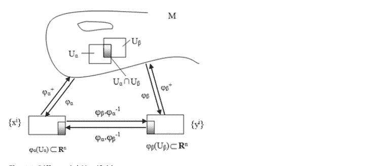


### 算法 1.8：判定开覆盖

**初始化：** $A$ 是 $X$ 的子集，$U = \{U_\alpha\}_{\alpha \in A}$ 是 $X$ 的子集簇

**输入：** $A, U$

**输出：** $\{0, 1\}$

```text
procedure OPENCOVER(A, U)
    if not (A ⊂ ⋃_α U_α) then return 0;
    for ∀ U_α do
        if OPENSET(U_α) ≤ 0 then return 0; // U_α is not an open set of topological space X
    end for
    return 1;
end OPENCOVER
```

### 算法 1.9：判定微分流形

**初始化：** $M$ 是一个 $n$ 维流形，$V = \{(U_\alpha, \varphi_\alpha) : \alpha \in I\}$ 是 $M$ 中坐标卡的一个子集

**输入：** $M$

**输出：** $\{0, 1\}$

```text
procedure DIFFMANI(M)
    if DIFFMANI(M) ≤ 0 then return 0;
    for ∀ α ∈ I do
        if OPENCOVER(M, U_α) ≤ 0 then return 0; // U_α is not an open cover of M
    end for
    for ∀ V_a, V_b ∈ V do
        if ASSOCIATE(V_a, V_b) ≤ 0 then return 0; // V_a, V_b are not related to C^r
        if MAXIMUM(V) ≤ 0 then return 0; // V is not maximum
    end for
    return 1;
end DIFFMANI
```

现在，我们可以给出李群的具体定义。

**定义 1.16.** 假设 $G$ 是一个非空集合，满足以下条件：
- $G$ 是一个群；
- $G$ 是一个微分流形；
- 群运算可微，即从 $G \times G$ 到 $G$ 的映射 $(g_1, g_2) \mapsto g_1g_2^{-1}$ 是一个可微映射。

那么，$G$ 就是一个李群。

根据李群的定义，我们知道李群不仅是一个群，也是一个微分流形。通常，流形是点、线、曲面或各种高维连续空间概念的推广。机器学习领域中观察到的所有数据都可以与点、线、曲面或其他结构联系起来。因此，李群可用于表示机器学习领域中的数据。通过对数据的李群的几何和代数表示，我们可以从几何角度提供定性描述，从代数角度提供定量描述。通过这种针对多对多表达的学习方法，有可能找到解决许多问题的自然途径。

### 算法 1.10：判定李群

**初始化：** $G$ 是一个非空集合

**输入：** $G$

**输出：** $\{0, 1\}$

```text
procedure LIEGROUP(G)
    if GROUP(G) ≤ 0 then return 0; // G is not a group
    if DIFFMANI(G) ≤ 0 then return 0; // G is not a differential manifold
    if DIFFERENTIAL(G) then
        return 1; // operation of G is differentiable
    else
        return 0;
    end if
end LIEGROUP
```

基于上述准备工作以及物理学家和化学家使用李群的广泛经验，李群向机器学习的扩展可以被视为从应用于数据分析的机器学习角度发现数据蕴含规律的探索。物理、化学及其他领域的专家使用李群作为工具来解决问题，这在机器学习领域也是隐含的，那里的专家可以采用这种视野来寻找深层的数据解决方案。更多细节，读者可参考相关的物理和化学文献。我们现在给出李群机器学习的定义。

**定义 1.17.** 李群机器学习：通常，用 $G$ 表示输入空间，用 $M$ 表示输出域。设 $G \subseteq \mathbb{R}^D, M \subseteq \mathbb{R}^d, D > d$。那么，李群 $G$ 对 $M$ 上映射 $\varphi$ 的定义如下：

$\varphi: G \times M \rightarrow M$
$g, x \rightarrow \varphi(g, x)$

必须满足 $\varphi(g_1, \varphi(g_2, x)) = \varphi(g_1 g_2, x), \varphi(e, x) = x$。那么，对于任意 $g \in G$，$M$ 是一个微分同胚交换

$\varphi_g: M \rightarrow M$
$x \rightarrow \varphi(g, x)$

映射集 $\{\varphi_g, g \in G\}$ 满足 $\varphi_{g_1} \cdot \varphi_{g_2} = \varphi_{g_1 g_2}, \varphi_e = id_M$。李群机器学习的图示如图 1.2 所示。

类似地，我们可以定义群 $G$ 在 $M$ 上的右作用：

$\psi: M \times G \rightarrow M$
$x, g \rightarrow \psi(x, g)$

满足 $\psi(x, \psi(x, g_1), g_2) = \psi(x, g_1 g_2), \psi(x, e) = x$。李群机器学习的右作用如图 1.3 所示。

可以看出从 $G$ 到 $M$ 的右作用的微分同胚交换：

$\psi_g: M \rightarrow M$
$x \rightarrow \psi(x, g)$

由于李群是具有群结构的解析流形，且群运算解析，李群机器学习范数可用于分析维数、紧致性、连通性、幂零性、子群、陪集、商群、量子群等。这些基本结构作为李群根机器学习算法中李代数根计算模型、分解模型和分类模型研究的基石 [2–4, 8]。

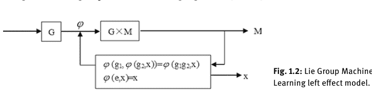

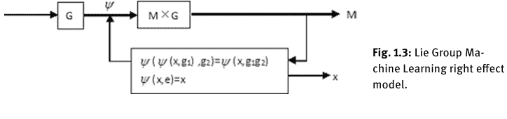

## 1.3 李群机器学习的代数模型 [2, 3, 10]

根据李群机器学习的概念，定义了四种不同的数学结构，即李代数、单参数子群、左不变向量场和左不变流形，作为自然对应关系，即李代数 $\equiv$ {左不变向量场} $\equiv$ {左不变流} $\equiv$ {单参数子群}。这些数学结构作为李群根机器学习中李代数根计算模型、分解模型和分类模型研究的基石。

### 1.3.1 李代数

为了便于起见，假设在李群机器学习系统中，存在一个输入空间 $G$。假设 $G$ 上的线性空间 $\mathfrak{g}$ 有一个二元运算 $(x, y) \rightarrow [x, y]$（通常称为换位运算或积），并满足以下条件：

(1) 二元运算是双线性的，即
$$\left[\lambda x + \mu y, z\right] = \lambda\left[x, z\right] + \mu\left[y, z\right], \forall \lambda, \mu \in G, \forall x, y, z \in \mathfrak{g} \ ;$$

(2) $[x, x] = 0, \forall x \in \mathfrak{g}$;

(3) 雅可比恒等式成立，即
$[x, [y, z]] + [y, [z, x]] + [z, [x, y]] = 0 \forall x, y, z \in \mathfrak{g}$。那么，$\mathfrak{g}$ 是 $G$ 上的李代数。

由 (1) 和 (2)，我们得到 $[x, y] = -[y, x], \forall x, y \in \mathfrak{g}$。

### 算法 1.11：判定李代数

**初始化：** $\mathfrak{g}$ 是 $G$ 上的线性空间，$[x, y]$ 是其上的括号积运算

**输入：** $\mathfrak{g}$

**输出：** $\{0, 1\}$

```text
procedure LIEALGEBRA(𝔤)
    for ∀ x, y, z ∈ 𝔤 do
        if [λx + μy, z] != λ[x, z] + μ[y, z] then return 0;
        if [x, x] != 0 then return 0;
        if [x, [y, z]] + [y, [z, x]] + [z, [x, y]] != 0 then return 0;
    end for
    return 1; // If the above three conditions are satisfied, then 𝔤 is a Lie algebra of G
end LIEALGEBRA
```


如果 $D^{1}(G)$ 表示一个可微向量场集，且 $D_{1}(G)$ 表示一个微分形式集，并且对于 $\forall g \in G$，有 $dL_{g}(X) = X$，则向量场 $X \in D^{1}(G)$ 被称为左不变向量场。

假设 $X, Y \in D^{1}(G)$ 是左不变向量场。我们定义横置运算

$$ [X, \, Y] = X \circ Y - Y \circ X \,. $$

那么，$[X, \, Y]$ 也是左不变的（$\circ$ 代表映射过程）。

李代数不仅可以被视为左不变向量场同构的集合，还可以被理解为单位元 $e$ 的切空间 $T_{e}(G)$，即：

- (1) 对于由李群组成的输入数据 $G$，李群 $G$ 的所有左不变向量场构成了针对所有横置运算定义的李代数，称为李群 $G$ 的李代数。
- (2) 李群 $G$ 的李代数 $\mathfrak{g}$ 是从 $G$ 在 $e$ 处的切空间 $T_{e}(G)$ 进行的映射

$$ X \rightarrow X|_{e} = Xe, X \in \mathfrak{g} \,. $$

这是一个同构的线性空间，即 dim $\mathfrak{g} = $ dim $G$。因此，我们可以将 $T_{e}(G)$ 中的横置运算定义为 $[X_{e}, Y_{e}] = [X, \, Y]_{e}$，$\forall X_{e}, Y_{e} \in T_{e}(G)$，其中 $X, Y$ 是左不变向量场。它们在 $e$ 处的值分别为 $X_{e}$ 和 $Y_{e}$，且 $T_{e}(G)$ 与 $\mathfrak{g}$ 的李代数同构。

### 1.3.2 单参数子群

在李群机器学习中，$G$ 的单参数子群是实数加法群 $R$ 到 $G$ 的微观同态 $\theta$：$R \rightarrow G$。如果 $t$ 表示 $R$ 中元素的参数，则 $\{\theta(t); t \in R\}$ 是 $G$ 满足如下条件的不同参数曲线：

$$ \theta(t_{1}) \cdot \theta(t_{2}) = \theta\,(t_{1}+t_{2}) $$

$\theta(t)$ 表示曲线在 $\theta(t)$ 处的切向量。如果 $\mathfrak{g}$ 是李群 $G$ 的李代数，则 $\mathfrak{g}$ 与 $G$ 的单参数子群有一一对应关系：$X \rightarrow \theta(t)$，使得 $\theta(0) = e, \theta'(t) = X_{\theta(t)}$。其中最关键的映射之一是 $\mathfrak{g} \rightarrow G$ 的指数映射。如果李群 $G$ 的李代数中的任意元素 $X$，$\theta(t)$ 对应于一个单参数子群，那么映射 $\exp: X \rightarrow \theta(1)$ 就是一个指数映射。

通过李代数的定义，我们知道，对单参数子群的讨论可以实现李群结构的线性化，即带有括号乘积的向量空间 $\mathfrak{g}$，也就是李群 $G$ 的李代数。李群与李代数之间的关系为非线性数据向线性数据的转换提供了一种可行解决方案。

### 1.3.3 代数模型

在李群机器学习中，存在一个输入数据集 $G$。我们假设 $\theta: R \rightarrow G$ 是一个给定的单参数子群。那么，我们可以使用 $G$ 中的右变换来获得变换映射 $R \times G \rightarrow G: (t, g) \rightarrow g \cdot \theta(t)$，这是流形 $G$ 上的可微变换群（单参数），通常称为流变换。此外，群的结合律指出，任意右变换 $r_a: G \rightarrow G, r_a(g) = ga, g \in G (a \in G)$，以及任意左变换 $l_a: G \rightarrow G, l_a(g) = ag, g \in G (a \in G)$，是可以交换的，使得上述可微变换群与任意左变换的作用可以互换，即 $a(g \cdot \theta(t)) = (a \cdot g) \theta(t)$。因此，这也称为左不变单参数可微变换群或左不变流。因此，我们可以得到 {单参数子群}$\stackrel{(I)}{\longrightarrow}\{\text{左不变流}\}.$

如果 $X$ 是一个左不变向量场，那么 $X$ 由其在单位点处的值 $X_e$ 唯一确定。相反，对于 $\mathfrak{g}$ 中任意给定向量 $X_0$，必然存在一个左不变向量场 $X$，使得 $X_e = X_0$。因此，我们可以得到 $\mathfrak{g}\stackrel{(II)}{\longrightarrow}\{\text{左不变向量场}\}.$

由于 {单参数子群}$\rightarrow$ $\mathfrak{g}$ 和 {左不变流}$\rightarrow$ {左不变向量场} 是确定速度的向量，我们用微分来表示它们。

我们使用一个左不变向量场 $X$ 来确定一个左不变流 $\theta: R \times G \rightarrow G$，使其速度向量场为 $X$。那么，{左不变向量场}$\stackrel{积分}{\longrightarrow}\{\text{左不变流}\}.$

最后，我们结合 $\mathfrak{g}\stackrel{(II)}{\rightarrow}\text{(左不变向量场)}\stackrel{积分}{\rightarrow}\text{(左不变流)}\stackrel{(I)}{\rightarrow}\text{(单参数子群)}$ 来实现 $\mathfrak{g}\rightarrow\text{(单参数子群)}$。这显然是 {单参数子群}$\stackrel{微分}{\rightarrow} \mathfrak{g}$ 的逆映射。

结果，我们可以将这四者放在一起，即 $\mathfrak{g} \cong \{\text{左不变向量场}\} \cong \{\text{左不变流}\} \cong \{\text{单参数子群}\}$。然后，我们得到李群机器学习的代数模型，如图 1.4 所示。李代数 $\mathfrak{g}$ 具有四个“识别”方面。

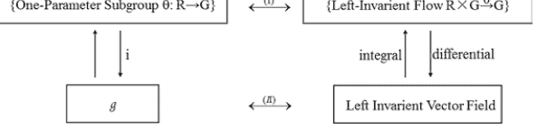

**图 1.4：** 李群机器学习代数模型。

### 1.4 李群机器学习的几何模型 [2, 3, 8, 10, 12]

在本节中，我们利用李群的一些几何特性，如平移性质和测地线性质，提出李群机器学习的几何模型。这将使我们能够学习系统表示和测量。

通常，给定学习系统中的观测集，目标结果根据知识库中的知识进行求解。我们假设观测集是紧连接的，因此我们可以在观测集的单元点取一个在自同构 Ad(G) 作用下不变的内部积 $\langle , \rangle$。我们取一组标准正交基，然后使用左平移将它们扩展为观测集的左不变向量场，从而可以在观测集的每一点唯一地设置内部积。这个内部积正是该点切空间的标准正交基，从而形成一个黎曼空间。

由于正交向量场的左不变性，所有左平移都是黎曼空间的等距变换。由于内部积的不变性，所有右平移都是等距变换。设 $T_{g}(G)$ 为单点切空间，$\mathfrak{g}$ 为 $G$ 的李代数，$T_{a}(G)$ 为任意样本点 $a$ 的切空间，$d l_{a}$，$d r_{a}$ 为左变换，$l_{a}$ 为右变换，且 $r_{a}$ 为切空间之间的诱导线性映射。因此，我们得到如图 1.5 所示的以下几何模型结构。

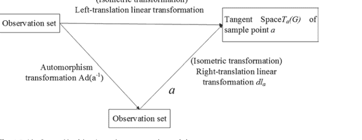

李群机器学习等距映射算法的基本步骤如下。

**算法 1.12：** 李群机器学习等距变换算法  
**初始化：** $(X, \tau)$ 是一个拓扑空间，$x \in X$  
**输入：** 样本集 $X = \{x_{1}, x_{2}, \dots, x_{n} \in \mathbb{R}^{D}\}$  
**输出**：$Y = \{y_1, y_2, \dots, y_n \in \mathbb{R}^d\}$，$d < D$

- (1) 输入样本集 $X = \{x_1, x_2, \dots, x_n \in \mathbb{R}^D\}$，$X$ 满足李群结构。
- (2) 寻找在 $X$ 的李代数 $\mathfrak{g}$ 上，自同构 $Ad(G)$ 作用下的不变内部积：$\langle Ad(\mathfrak{g})x_1, Ad(\mathfrak{g})x_2 \rangle = \langle x_1, x_2 \rangle$，$x_1, x_2 \in \mathfrak{g}$，$\mathfrak{g} \subset G$。
- (3) 给出一组标准正交基 $\{X_i; 1 \leq i \leq n\}$，$\langle X_i, X_j \rangle = \delta_{ij}$。使用左变换将 $\{X_i; 1 \leq i \leq n\}$ 转换为 $X$ 上的左不变向量场，记为 $X_i$。这用于建立黎曼空间结构。
- (4) 在此黎曼空间中，对 $X$ 进行左（或右）平移线性变换，构成样本集的等距变换 $\boldsymbol{\phi}$：$X \rightarrow Y$，$Y = \{y_1, y_2, \dots, y_n \in \mathbb{R}^d\}$，$d < D$。

测地线是黎曼流形中最基本且最重要的概念之一。它是黎曼流形中的局部最短路径，对于研究高维空间中的流形作为一种测量手段非常重要。在微分流形中，由于流形是局部欧几里得的，直接计算测地线的距离非常困难。因此，通常用切平面代替流形的较小部分，从而将测地线的计算转化为二维平面中的欧几里得距离计算。

在李群机器学习中，假设样本空间 $G$ 嵌入到微分流形 $M$ 中。对于任意样本 $a$，学习过程确定一个映射 $x_a: G \supset U_a \rightarrow V_a \subset \mathbb{R}^D$，其中 $(U_a, x_a)$ 被称为 $M$ 在点 $a$ ($a \in U_a$) 处的邻域坐标系，$U_a$ 是点 $a$ 的坐标邻域，$V_a$ 是 $\mathbb{R}^D$ 的开集。

**定义 1.18.** 设 $(M, X)$ 是一个微分流形，其中 $X$ 是 $U$ 上的局部坐标系，$r_j: \mathbb{R}^D \rightarrow \mathbb{R}$ 是 $\mathbb{R}^D$ 上的第 $j$ 个坐标函数，即 $r_j(a_1, a_2, \dots, a_n) = a_j$。那么，$x$ 的第 $j$ 个坐标函数是 $x_j: U \rightarrow \mathbb{R}$，即 $x_j = r_j \circ x$。

**定义 1.19.** 设 $(M, X)$ 是一个微分流形，$a \in M$，$C^{\infty}(M, a, \mathbb{R})$ 是 $a$ 邻域内实值函数的集合。那么，点 $a$ 处的切向量是一个映射，即 $v: C^{\infty}(M, a, \mathbb{R}) \rightarrow \mathbb{R}$。如果 $x$ 是 $a$ 邻域内的局部坐标系，则存在一个实值 $n$ 元组 $(a_1, a_2, \dots, a_n)$。对于每个 $f \in C^{\infty}(M, a, \mathbb{R})$，这个 $n$ 元组满足

$$ v(f)=\sum_{i=1}^{n} a_{i} \left. \frac{\partial}{\partial r_{i}}(f \circ x_{i}^{-1}) \right|_{x(a)} \quad (1.1) $$

点 $a$ 处所有切向量 $M$ 的集合表示为 $T_a(M)$，这意味着 $M$ 是点 $a$ 的切空间。如果 $x: U \rightarrow \mathbb{R}^D$ 是点 $a$ 处的坐标系，且 $\langle \partial/\partial x_i \rangle$ 是点 $a$ 处 $x_i$ 的方向向量，则 $\{\langle \partial/\partial x_1 \rangle, \langle \partial/\partial x_2 \rangle, \dots, \langle \partial/\partial x_n \rangle\}$ 是切空间 $T_a(M)$ 的坐标基。如果内部积 $g_{i,j}(a)=\langle \langle \partial/\partial x_i \rangle, \langle \partial/\partial x_j \rangle \rangle$ 是 $U$ 上的可微函数，则点 $a$ 和 $b$ 之间的距离

切空间中的距离为

$\mathrm{D}(a,\, b) = \sqrt{\sum_{i, j=1}^{n} g_{i,j}(a)(a_i - b_i)(a_j - b_j)} \ . \tag{1.2}$

因此，在李群机器学习中，基于测地距离的学习算法的基本步骤可以总结如下。

**算法 1.13：** 李群机器学习的测地距离算法

**初始化：** $(X,\tau)$ 是一个拓扑空间，$x \in X$  
**输入：** 样本点 $a$  
**输出：** 坐标邻域内所有点与 $a$ 之间的距离

1. 生成样本点 $a$ 的邻域 $U_a$。
2. 分析样本集中 $a$ 的邻域信息，在不变内积 $g_{i,j}(a)$ 下取一个自同构，并计算 $g_{i,j}(a)$ 的值。
3. 将得到的值 $g_{i,j}(a)$ 代入公式 (1.2) 以计算 $U_a$ 中每个点与 $a$ 之间的距离。
4. 输出所有距离值（距离越小，待学习的结果越接近）

# 1.5 李群机器学习的公理假设 [2, 3, 5]

本节专注于李群机器学习的公理假设。

**假设 1.1.** 李群机器学习泛化能力公理假设，包括 1)、2) 和 3)：

1. 设 $G$ 是一个李群，对于李群 $G$ 的李代数 $g$ 的任意李子代数 $h$，存在唯一的连通李子群 $H \subseteq G$，使得下图是对合的。

$$
    \begin{gathered}
        \eta \subset g \\
        \exp \downarrow \quad \downarrow \exp \\
        H \subset G
    \end{gathered}
$$

2. 设 $V$ 是一个 $n$ 维线性空间，设 $G$ 是 GL(V) 的一个李子群。如果

$$(g(x), g(y)) = (x, y)\forall x, y \in V \ , \ g \in G \ ,$$

则 $V$ 中的内积 $(x, y)$ 被称为在 $G$ 下保持不变。

3. 在紧致连通李群 $G$ 中设定总积分为 1 的左不变和右不变黎曼结构，其中 $f$ 是 $G$ 上的任意中心函数。那么，我们有以下魏尔积分公式

$$\int_G f(g) dg = \frac{1}{|W|} \int_T f(t)\,|Q(t)|^2\, dt \tag{1.3}$$

其中 $|W|$ 表示 $W$ 中元素的数目。当 $t = \exp H$ ($H \in \eta$) 时，$Q(t)$ 可以表示为

$$Q(\exp H) = \sum_{\sigma \in W} \operatorname{sign}(\sigma)e^{2i\chi(\alpha(\delta),H)} \ \ (1.4)$$

其中 $\delta$ 是 $C^\circ$ 的根之和的一半，即

$$\delta = \frac{1}{2} \sum_{\alpha \in \Delta^1(G)} \alpha \ .$$

证明。首先，我们证明公理 1)。设 $X_1, X_2, \ldots, X_m$ 是向量子空间 $h$ 中的任意一组基。我们将它们视为 $G$ 上的左不变向量场。然后，$G$ 上点 $g$ 的每个切空间都可以展开成一个子空间，即 $D(g) = \operatorname{span}\langle X_1(g), \ldots, X_m(g)\rangle$，其中 $X_n(g)$ 表示向量场 $X_n$ 在点 $g$ 处的值。在每个点的切空间中取一个 $m$ 维空间被称为 $G$ 上的 $m$ 维分布，它可以被视为向量场的高维推广。因此，所有 $X_n$ ($1 \leq i \leq m$) 都是左不变的，即 $d_x (X_n(g)) = X_n(ag)$。由它们展开的分布 $D$ 是左不变的，即 $d_x (D(g)) = D(ag)$。此外，$\eta = \operatorname{span}\langle X_1(g), \ldots, X_m(g)\rangle$ 是一个李子代数；因此，$[X_n, X_t]$ ($1 \leq i, j \leq m$) 总是可以用 $X_1, X_2, \ldots, X_m$ 的线性组合来表示。这表明上述分布 $D$ 满足 Frobenius 定理中的可积条件。因此，存在一个与 $D$ 对应的唯一最大积分子流形，由单位元 $e$ 表示，记为 $H$。

现在，我们证明 $H$ 是一个连通子群。设 $h$ 是 $H$ 中的任意元素。由于 $D$ 的左不变性，显然，$l_x^{-1} \cdot H = h^{-1} \cdot H$ 是 $D$ 的最大积分子流形。根据定义，$e \in h^{-1} \cdot H$，即 $h^{-1} \cdot H$ 经过点 $e$。由于最大积分子流形的唯一性，$h^{-1} \cdot H = H$。如果 $h$ 是任意的，那么

$$H^{-1} \cdot H = \bigcup_{h \in H} h^{-1} \cdot H = h \ .$$

这证明了 $H$ 是一个连通子群。2) 省略。

3) 证明：我们将按以下步骤进行证明。(1) 通过对 $G$ 上 $\operatorname{Ad}$（伴随变换）轨道几何的分析，我们知道 $T$ 是一个公共测地子流形，并且正交于每个共轭类。此外，$C_0 \approx T/W \approx G/\operatorname{Ad}$ 是一个良好的基本域，我们在其中任意取两个点 $t_1$ 和 $t_2$，使得它们在 $D_0$ 中的距离是 $G$ 中共轭类的最短距离，称为轨道距离。

(2) 对于任意给定的内点 $t \in C_0$，其轨道类型为 $G/T$。对于任意给定的边界点 $t \in \partial C_0 = D_0 \setminus C_0$，其轨道数总是小于 $\dim G/T$。因此，不难看到非 $G/T$ 轨道类型的集合，即

$$G(\partial D_0) = \bigcup_{x \in \partial D_0} G(x) \ .$$

换句话说，当我们在 $G$ 上进行积分时，可以忽略上述子集，只需要在 $G(C_0)$ 上进行计算。

(3) 设 $t$ 是 $C_0$ 上的动点，$m = \operatorname{dim} G/T = \operatorname{dim} G - \operatorname{dim} T$。那么，$G(t)$ 是一个 $G/T$ 类型的轨道，其 $m$ 维体积是一个定义域为 $C_0$ 的函数。我们称其为（主）轨道体积函数，记为 $v(t)$。由于每个轨道 $G(t)$ 都是相同的 $G/T$ 型齐性黎曼空间，其体积比等于其体积元之比。我们可以取 $G/T$ 齐性黎曼空间的基准。对于每个 $G/T$ 型轨道 $G(t)$，映射到 $g(t)$ 的陪集 $g \cdot t$ 是 $G$-等距映射 $E$ 之间的齐性黎曼空间

$$E: G/T \rightarrow G(t), \quad g \cdot t \mapsto g(t) = gtg^{-1} \ .$$

那么，上述体积元的比值是上述映射 $E_t$ 的 Jacobi 行列式，即体积函数 $v(t)$ 的对象可以通过以下公式计算

$$v(t) = c \cdot \operatorname{det}(dE_{t|_{0}}) \ . \tag{1.5}$$

其中 $c$ 是一个未定的比例常数，$dE_{t|_{0}}$ 是切空间上基点的线性映射。

$$\operatorname{d}E_{t|_{0}}: \oplus_{a \in \Delta^{+}} R_{(t,a)}^{2} \rightarrow \mathfrak{J}_{0}(G(t)) \ . \tag{1.6}$$

(4) 由于 $E_t$ 是 $G$-同构的，$dE_{t|_{0}}$ 是一个 $T$-范数（因为基点在 $T$ 的作用下是固定点）。因此，$dE_{t|_{0}}$ 可以分解为以下二维 $T$-不变子空间的线性直和

$$dE_{t|_{0}, a}: R_{(t,a)}^{2} \rightarrow \mathfrak{J}_{0}(G_{0}(t)) \ . \tag{1.7}$$

因此，我们可以使用以下公式计算 $\operatorname{det}(dE_{t|_{0}})$，即

$$\operatorname{det}(dE_{t|_{0}}) = \prod_{a \in \Delta^{+}} \operatorname{det}(dE_{t|_{0}}, a) \ . \tag{1.8}$$

然而，$\operatorname{det}(dE_{t|_{0}})$ 与 $Ga/Ta \equiv \widehat{G}_{a} \equiv S^{3}$ 中的 $S^2$ 型（主）轨道体积函数成正比。换句话说，我们可以使用下图

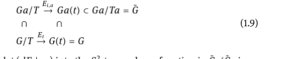

将 $\operatorname{det}(dE_{t|_{0,a}})$ 的计算放入 $\widehat{G}_{a}$ 中的 $S^2$ 型体积函数中（$\widehat{G}_{a}$ 与 $S^{3}$ 或 SO(3) 同构；因此，$\widehat{G}_{a}$ 具有与 $S^{3}$ 相同的体积元，因此我们在上述问题中将 $\widehat{G}_{a}$ 视为 $S^{3}$）。然后，我们得到

$$\operatorname{det}(dE_{t} |_{0,a}) = c' \cdot \sin^{2}\pi(a,H) \tag{1.10}$$

其中 $H$ 满足 $t = \exp H$（注意 $S^{3}$ 的正根是 $2\Theta$）。通过积分公式 (1)、(4) 和 (5)，我们得到

$$v(\exp H) = c^{\prime\prime} \cdot \sin^{2}\pi(a,H) = c \cdot [\widehat{Q}(\exp H)]^{2} \tag{1.11}$$

其中 $\widehat{Q}(\exp H) = \prod_{a \in \Delta^{+}} (e^{\pi i(a,H)} - e^{-\pi i(a,H)})$。

(5) 最后，我们将证明上述公式中的 $\tilde{Q}(\exp H)$ 等于 $(*)$ 中的 $Q(\exp H)$。证明如下：设 $\{a_1, \ldots, a_k\}$ 是魏尔室 $C_0$ 的简单根系。那么，根据反射对称性的定义，我们得到 $ra_i(a_i) = -a_i$，这等价于被 $\langle a_i\rangle^\bot$ 分割的两个半空间的正负侧，并且它自然对应于另一个根 $a$。当被 $\langle a_i\rangle^\bot$ 分割时，所选的两个半空间正负侧没有影响。因此，下一个 $\Delta^+ \setminus \{a_i\}$ 仍然变为 $\Delta^+ \setminus \{a_i\}$，并且我们有

$$ra_i(\Delta^+) = (\Delta^+ \setminus \{a_i\}) \cup \{-a_i\} \quad (1 \leq i \leq k) \ . \tag{1.12}$$

设 $\delta = 1/2 \sum_{a \in \Delta^+} a$；根据 (1.12)，$ra_i(\delta) = \delta - a_i$，并且 $r_a (\zeta) = \zeta - 2\langle \zeta, a\rangle / \langle a, a\rangle a$，我们得到

$$r_a \left( \delta \right) = \delta - \frac{2\langle \delta, a_i\rangle}{\langle a_i, a_i\rangle}a_i, \quad 1 \leq i \leq k \ .$$

因此，

$$\frac{2\langle \delta, a_i\rangle}{\langle a_i, a_i\rangle} = 1 \tag{1.13}$$

此外，根据 $\tilde{Q}(\exp H)$ 的表达式和公式 (1.12)，我们可以推断

$$\tilde{Q}(\exp r_a(H)) = (-1) \cdot \tilde{Q}(\exp H) \ . \tag{1.14}$$

结果，对于 $W$ 的作用，$\tilde{Q}(\exp H)$ 是一个奇函数，即

$$\tilde{Q}(\exp \sigma(H)) = \operatorname{sign}(\sigma) \cdot \tilde{Q}(\exp H), \quad \sigma \in W \tag{1.15}$$

其中 $\operatorname{sign}(\sigma)$ 是 $\sigma$ 在 $h$ 上正交变换行列式的符号。

在展开式 $\tilde{Q}(\exp H)$ 中有一个主导项。从 (1.15) 中，我们可以看到所有项 $\operatorname{sign}(\sigma) \cdot e^{2 \pi i \langle \sigma(\delta), H \rangle}$ 都应该包含在 $\tilde{Q}(\exp H)$ 的展开式中。此外，从 (1.13) 中不难证明其展开式中不能包含其他项，所以它只能是

$$\tilde{Q}(\exp H) = Q(\exp H) \ .$$

(6) 设 $f$ 是定义在 $G$ 上的中心函数。当寻求积分 $\int_G f(g) dg$ 时，我们首先沿 $G$-轨道取乘积。由于 $f$ 在每个 $G$-轨道 $G(t)$ 上相等，我们有

$$
\begin{gather*}
\int_G f(g) dg = \int_{C_0} f(t) \nu(t) dt = \frac{1}{|W|}\int_T f(t) \nu(t) dt \\
= \frac{1}{|W|}\int_T f(t) |Q(t)|^2 \ dt \ ,
\end{gather*} \tag{1.16}
$$

其中 $C_0$ 是一个未定常数，$|W|$ 是 $W$ 的阶数（$T$ 被分割成 $|W|$ 个魏尔室）。然后，将 $f(g) = 1$ 代入 (1.16)；很容易确定上述常数必须为 1。 $\square$


### 定理 1.1 (Cartan–Weyl)

$G$ 的复数维数表明 $\Lambda_\phi$ 的最高权重数必须为 1，且其特征函数 $X_\phi$ 可以用如下最高权公式表示：

$$X_\phi(\exp H) = \frac{\sum_{\sigma \in W} \text{sign}(\sigma) e^{2\pi i(\sigma(\Lambda_\phi + \delta), H)}}{\sum_{\sigma \in W} \text{sign}(\sigma) e^{2\pi i(\sigma(\delta), H)}}, \quad H \in \mathfrak{h} \text{ .}$$

因此，$\phi_1$ 与 $\phi_2$ 等价当且仅当 $G$ 的两个复不可约项的最高权相同，即 $\Lambda_{\phi_1}$ 与 $\Lambda_{\phi_2}$ 相同。

**证明。** 由上述分析可知，要证明

$$X_\phi(\exp H) \cdot Q(\exp H) = m(\Lambda_\phi) \cdot \sum_{\sigma \in W} \text{sign}(\sigma) e^{2\pi i(\sigma(\delta), H)}$$

+ 可能存在‘更低’的项，$m(\Lambda_\phi) = 1$，且不可能存在任何‘更低’的项。证明如下：由 $\ln( \int_G f(g) dg = 1/|W| \int_T f(t) |Q(t)|^2 dt)$，令 $f(g) = |\chi_\phi(g)|^2$，$t = \exp H$，$H \in \mathfrak{h}$。由定理，

$$1 = \int_G |\chi_\phi(g)|^2 dg = \frac{1}{|W|} \int_T |\chi_\phi(t) |Q(t)|^2 dt$$

$$= \frac{1}{|W|} \left| \int_T m(\Lambda_\phi) \sum_{\sigma \in W} \text{sign}(\sigma) e^{2\pi i(\sigma(\Lambda_\phi + \delta), H) + \cdots} \right|^2 dt \text{ .}$$

从 $L_2(T)$ 的角度看，上述方程右边的乘积展开是 $X_\phi(t) \cdot Q(t)$ 关于标准正交基 $\{e^{2\pi i(\sigma(\Lambda_\phi + \delta), H)}\}$ 的展开。因此，上述公式可写为

$$1 = |\chi_\phi(g)|^2_{L_2(G)} = \frac{1}{|W|} |\chi_\phi(t) Q(t)|^2_{L_2(T)}$$

$$= \frac{1}{|W|} \{|m(\Lambda_\phi)|^2 \cdot |W| + |\text{可能是低阶项}|^2 \} \text{ .}$$

然而，上述方程仅在 $m(\Lambda_\phi) = 1$ 且不再存在低阶项时成立，这证明了 $m(\Lambda_\phi) = 1$ 且定理中的公式成立。

注：容易看出，上述最高权 $\Lambda_\phi$ 必须满足以下条件：

$$\frac{2(\Lambda, a_i)}{(a_i, a_i)} = q_i \quad q_i \text{ 为非负整数，} \quad a \in \prod$$

如果连通李群 $G$ 是单连通的，可以证明对于任意给定的非负项 $\{q_i; i = 1, \ldots, k\}$，由公式

$$\frac{2(\Lambda, a_i)}{(a_i, a_i)} = q_i \quad (i = 1, \ldots, k)$$

唯一确定的 $\Lambda$ 必须是 $G$ 的某个复不可约表示的最高权。因此，存在一个复不可约映射 $\phi : G \to \text{GL}(V)$ 使得 $\Lambda = \Lambda_\phi$。$\square$

#### 推论 1.1

由上述不可约表示 $\varphi$ 的维数 $\dim \varphi$ 可以直接通过最高权 $\Lambda_\varphi$ 使用以下公式计算得出：

$\text{dim}\, \varphi = \frac{\prod_{\alpha \in \Delta^{+}} \langle \Lambda_\varphi + \delta, \alpha \rangle}{\prod_{\alpha \in \Delta^{+}} \langle \delta, \alpha \rangle}$ .

#### 假设 1.2 (李群机器学习对偶性假设)

在学习系统中，学习结果基于知识库中待学习的知识。学习结果应与原始知识位于同一知识库中。为此，使用以下概念来建立学习系统的对偶空间。

#### 定义 1.20

设 $P$ 是黎曼流形 $M^{n}$ 上的一点。如果在 $M^{n}$ 上存在一对对合 $\sigma_{p} \colon M^{n} \rightarrow M^{n}$，$\sigma_{p}^{2} = id$，使得 $P$ 成为一个孤立不动点，则称 $M^{n}$ 关于 $P$ 对称，$\sigma_{p}$ 称为点 $P$ 的中心对称，且 $X$ 与 $\sigma_{p}(X)$ $(X \in M^{n})$ 称为点 $P$ 的对称点。如果 $M^{n}$ 关于任意点 $P$ 都对称，则称 $M^{n}$ 为对称空间。换言之，对称空间是对于其上任意一点都对称的黎曼流形。

- (1) 在黎曼流形中，最简单且最基本的概念是测地线平移，在知识库中对应于集合的最常见知识。
- (2) 设 $P_{1}, P_{2}, P_{3}$ 是连通黎曼流形 $M^{n}$ 中的任意三点。则它们满足‘三角不等式’

$d\left(P_{1}, P_{2}\right)+d\left(P_{2}, P_{3}\right) \geq d\left(P_{1}, P_{3}\right)$ .

这种关系用于知识条目之间的度量。
- (3) 点列 $\{P_{n} ; n \in N\}$ 在知识度量空间 $X$ 中收敛到某一点 $a$（即其极限）的必要条件是它满足通常的柯西条件，即 $\forall\epsilon > 0$，必须存在足够大的 $N$，使得当 $m, n \geq N$ 时，$d\left(P_{m}, P_{n}\right) < \epsilon$。如果上述柯西条件也是 $X$ 中极限点存在的充分条件，则 $X$ 是一个完备度量空间；如果黎曼流形 $M^{n}$ 关于其度量结构是完备的，则称为完备黎曼流形。
- (4) 平行性与协变微分。

#### 定理 1.2

在任何给定的黎曼流形 $M^{n}$ 中，存在唯一满足以下运算定律的协变微分：

$$
\begin{cases}
\nabla_{f_{1} X_{1}+f_{2} X_{2}} Y = f_{1} \nabla_{X_{1}} Y + f_{2} \nabla_{X_{2}} Y \\
\nabla_{X}\left(f_{1} Y_{1} + f_{2} Y_{2}\right) = (X f_{1}) Y_{1} + f_{1} \nabla_{X} Y_{1} + (X f_{2}) Y_{2} + f_{2} \nabla_{X} Y_{2} \\
\nabla_{X} Y - \nabla_{Y} X = [X, Y] \\
\nabla_{Z}\langle X, Y\rangle = \langle \nabla_{Z} X, Y\rangle + \langle X, \nabla_{Z} Y\rangle
\end{cases}
$$

其中 $\langle X, Y\rangle = g(X, Y) = \sum_{i,j=1}^{n} g_{ij} \xi_{i} \eta_{j}$。

**证明：** 由

$$
\begin{cases}
\nabla_{f_{1} X_{1}+f_{2} X_{2}} Y = f_{1} \nabla_{X_{1}} Y + f_{2} \nabla_{X_{2}} Y \\
\nabla_{X}\left(f_{1} Y_{1} + f_{2} Y_{2}\right) = (X f_{1}) Y_{1} + f_{1} \nabla_{X} Y_{1} + (X f_{2}) Y_{2} + f_{2} \nabla_{X} Y_{2} \\
\nabla_{X} Y - \nabla_{Y} X = [X, Y] \\
\nabla_{Z} \langle X, Y \rangle = \langle \nabla_{Z} X, Y \rangle + \langle X, \nabla_{Z} Y \rangle
\end{cases}
$$

得到

$$
\begin{aligned} Z \langle X, Y \rangle & = \langle \nabla Z X, Y \rangle + \langle X, \nabla Z Y \rangle \\ & = \langle \nabla X Z, Y \rangle + \langle X, \nabla Z Y \rangle + \langle [Z, X], Y \rangle \ . \end{aligned}
$$

令上述公式中的 $X, Y, Z$ 互换，即另外两种类型：

$$
\begin{aligned} X \langle Y, Z \rangle & = \langle \nabla Y X, Z \rangle + \langle Y, \nabla X Z \rangle + \langle [X, Y], Z \rangle \\ Y \langle Z, X \rangle & = \langle \nabla Z Y, X \rangle + \langle Z, \nabla Y X \rangle + \langle [Y, Z], X \rangle \ , \end{aligned}
$$

可得

$$
\begin{aligned} Z \langle X, \nabla Z Y \rangle & = Z \langle X, Y \rangle + \langle Z, [X, Y] \rangle + Y \langle X, Z \rangle \\ & + \langle Y, [X, Z] \rangle - X \langle Y, Z \rangle - \langle X, [Y, Z] \rangle \ . \end{aligned}
$$

因此，上述公式的左部唯一决定了切空间中每一点的 $\nabla Z Y$ 的值。这证明了协变微分的存在性和唯一性。

因此，李群机器学习中对偶空间的假设公理包括以下内容：

- (1) 设 $M$ 为一对对偶空间，且 $G(M)$ 为 $M$ 的守恒变换群。则 $\Lambda_\phi$ 可直接计算：
    - (a) 是一个完备黎曼流形；
    - (b) $M$ 是一个齐性空间，即 $G(M)$ 在 $M$ 上的作用是传递的；
    - (c) 如果 $K$ 是使某一起始点集 $P_0 \in M$ 固定的子群固定群，则 $K$ 是 $G(M)$ 的紧子群，并且是一个李群；
    - (d) 对于 $M$ 中的任何测地线 $r: R \to M$，$G(M)$ 中必须存在唯一的一个单参数子群 $\Phi r: R \to G(M)$ 满足以下条件：

$$
\begin{aligned} \Phi r(t_{1}) \cdot r(t_{2}) & = r \left(t_{1} + t_{2}\right) \\ d\Phi r(t_{1})|_{TM_{r(t_{2})}} & = \left. \nabla r \left(t_{2}, t_{1} + t_{2}\right) \right. \ \square \end{aligned}
$$

**证明：**

- (1) 要证明 $M$ 的完备性，需要表明 $M$ 中的任何测地线总能无限延伸。设 $r: [a, b] \to M$ 是对称空间 $M$ 中的任一给定测地线，且 $\epsilon < 1/2(b-a)$。


**图 1.6：** $r$ 的延拓。

设 $s$ 和 $M$ 分别为 $r(b-\varepsilon)$ 点的中心对称和。则 $r$ 和 $s \cdot r$ 在长度为 $2\varepsilon$ 的范围内收敛。这也意味着 $r$ 至少可以延拓到长度 $b-a-2\varepsilon$（如图 1.6 所示）。这也意味着任何测地线都可以无限延拓。因此，根据 Hopf–Rinow 定理，$M$ 是完全的。

(2) 设 $p, q$ 为 $M$ 上任意两点。由 $M$ 的完全性，存在连接 $p, q$ 的最短测地线段 $r: [0, d(p, q)] \rightarrow M$，且满足 $r(0) = p, r(d(p, q)) = q$。设 $s$ 为 $M$ 在 $M$ 上点 $r(1/2(p, q))$ 处的中心对称。显然，我们有

$$s(p)=q, s(q)=p \ .$$

因此，$G(M)$ 对 $M$ 的作用是可以传递的。这意味着 $M$ 是齐性的。

(3) 设 $K$ 为子群的固定组合，使得某组基点 $P_0 \in M$，其中 $O(n)$ 是 $T M_{p_0}$ 的保形变换群。不难看出，$K$ 中的每个元素都由其在 $T M_{p_0}$ 上的诱导保形变换唯一确定。因此，

$$
\begin{aligned}
K & \rightarrow O(n) \\
k & \rightarrow d k|_{p_0}
\end{aligned}
$$

是一个同构，且 $K$ 的“像”是 $O(n)$ 的一个闭子群。因此，$K$ 是 $G(M)$ 的一个紧子群，也是一个李群。

(4) 设 $\gamma: R \rightarrow M$ 为 $M$ 中的一条测地线（其参数为弧长）。我们暂时用 $s_t$ 表示 $M$ 在点 $\gamma(t)$ 处的中心对称。设 $X(t),\ t \in [t_1, t_2]$ 是 $\gamma\ (\left[2t_1-t_2, t_1\right])$ 上平行向量场的一个定义。则，

$$s_{t_1} X(t) = X'(2t_1 - t)$$

是 $\gamma\ (\left[2t_1-t_2, t_1\right])$ 上平行向量场的一个定义，且

$$X'(t_1) = s_{t_1} X(t_1) = -X(t_1) \ ,$$

如图 1.7 所示。

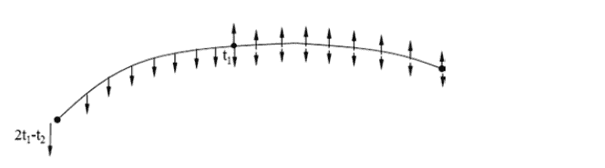

**图 1.7**：平行向量场。

因此，

$$
\begin{aligned}
s_{t_1} &= X(t_2) - X'(2t_1 - t_2) \\
&= Y(t_1, 2t_1 - t_2)(-X(t_1)) \\
&= Y(t_1, 2t_1 - t_2) \cdot Y(t_2, t_1)(-X(t_2)) \\
&= -Y(t_2, 2t_1 - t_2)X(t_2) \ .
\end{aligned}
$$

换言之，在中心对称 $s_{t_1}$ 下，两个切向量 $X(t_2)$ 和 $X'(2t_1-t_2)$ 相互对应，且它们的关系在经过沿 $Y(t_{2},2t_{1}-t_{2})$ 的平行移动后反转。因此，两个这样的中心对称组合

$$\phi_{Y}(t_1)=s_{t_1/2}\cdot s_0\ t_1\in R$$

是一个保形变换，满足以下两个条件

$$
\begin{cases}
\phi_{Y}(t_1)\cdot Y(t_2)=Y(t_1+t_2)\\
d(\phi_{Y}(t_1)|_{TM_{Y(t_2)}})=Y(t_2,t_1+t_2)
\end{cases}\ t_1,t_2\in R\ .
$$

由上述可知，不难看出 $\phi_{Y}(t_1)\cdot\phi_{Y}(t_1')$ 和 $\phi_{Y}(t_1+t_1')$ 都是满足以下条件的保形变换

$$
\begin{cases}
\varphi_{Y}(t_1+t_1')Y(t_2)=Y(t_1+t_1'+t_2) \ ,\\
d(\varphi_{Y}(t_1)\cdot\varphi_{Y}(t_1'))|_{TM_{Y(t_2)}})=Y(t_2,t_1+t_1'+t_2) \ ,
\end{cases}
$$

$$
\begin{cases}
\varphi_{Y}(t_1+t_1')Y(t_2)=Y(t_1+t_1'+t_2)\\
d(\varphi_{Y}(t_1+t_1'))|_{TM_{Y(t_2)}})=Y(t_2,t_1+t_1'+t_2)\ .
\end{cases}
$$

因此，

$$\varphi_{Y}(t_1)\varphi_{Y}(t_1')=\varphi_{Y}(t_1+t_1')\ .$$

换言之，$\varphi_{Y}: R \rightarrow (M)$ 是第 4 节中发现的一个单参数子群。

**2.** 设 $M$ 为对称空间，$P_{0}$ 为任意确定的基点，$S_{0}$ 为 $M$ 在基点 $P_{0}$ 处的中心对称，$G(M)$ 为 $M$ 的保形变换群，$K$ 为固定 $P_{0}$ 的保形群。则，

1.  $M \cong G(M)/K$，其中 $K$ 是一个紧李群；
2.  $\sigma: G(M) \rightarrow G(M)$ 定义为 $\sigma(g)=$

$S_{0}gS_{0}, \forall g \in G(M)$；则，$\sigma$ 是 $G(M)$ 的一个对偶自同构；

3.  设 $F(\sigma)$ 为 $\sigma$ 的不动点子集，即 $F(\sigma) = \{g \in G(M) | \sigma(g) = g\}$，并设 $F^{0}(\sigma)$ 为 $F(\sigma)$ 的单位连通分量；则，$F(\sigma)$ 和 $F^{0}(\sigma)$ 是 $G(M)$ 的闭子群，且 $F^{0}(\sigma) \subseteq K \subseteq F(\sigma)$；
4.  设 $g$ 和 $k$ 分别为 $G(M)$ 和 $K$ 的李代数；则，$g = k \oplus p$，$k = \text{ker}(d\sigma - id)$，$P = \text{ker}(d\sigma + id)$；
5.  对于任意给定的 $X \in P$，$r(t) = \exp X(P_{0})$ 是 $M$ 中经过 $P_{0}$ 的一条测地线，且 $\exp tX = \Phi_{r}(t)$（$\Phi_{r}(t)$ 是 $G(M)$ 的一个单参数子群）。

**证明。**

1.  $G(M)$ 是一个作用于 $M$ 的可传递变换李群，其中 $K$ 是 $TM_{p_{0}}$ 诱导映射上 $O(n)$ 的一个闭子群。因此，$K$ 是一个紧李群，且我们有 $M \cong G(M)/K$。此外，$\forall g \in G(M)$，$\forall \hat{g} \in G(M)$，$\sigma(g) = s_{0}\hat{g}s_{0}$；因此，显然 $G(M)$ 是一对自同构。因此，其不动点子集 $F(\sigma)$ 是一个闭子群，其单位连通分量 $F^{0}(\sigma)$ 也是一个闭子群。

2.  设 $i: K \to O(n)$ 由 $i(k) = d{k|}_{p_{0}}$，$k \in K$ 定义。这是一个自然同构映射，且

    $$i(S_{0}) = -id \in O(n) \ .$$

    因此，对于任意给定的 $k \in K$，总有

    $$i \left(S_{0}kS_{0}\right) = (-id) \ t(k) \ (-id) = t(k)$$

    即 $s_{0}ks_{0} = k$，$K \subseteq F(\sigma)$。此外，设 $\exp tX$ 是 $G(M)$ 中满足 $s_{0} \left(\exp tX\right) s_{0} = \exp tX$ 的一个单参数子群，即 $\left(\exp tX\right) \cdot s_{0} \cdot \exp \left(-tX\right) = s_{0}$，$\forall t \in R$；则，$s_{0} \left(\exp tX \cdot p_{0}\right) = \left(\exp tX\right) \cdot s_{0} \cdot \exp \left(-tX\right) \exp \left(-tX\right) \cdot p_{0} = \exp tX \cdot p_{0}$，$\forall t \in R$。换言之，$[\exp tX \cdot p_{0}; \forall t \in R]$ 是 $s_{0}$ 包含 $p_{0}$ 的不动点子集，而点 $p_{0}$ 是 $s_{0}$ 的孤立不动点。因此，

    $$\exp tX \cdot p_{0} = p_{0}, \forall t \in R \ ,$$

    即 $\exp tX \in K$。这证明了 $F^{0}(\sigma) \subseteq K$。

3.  根据假设和上述 1)，$d\sigma : g \to g$ 是 $g$ 的一对自同构。因此，

    $$g = k \oplus p, \quad k = \text{ker}(d\sigma - id), \quad p = \text{ker}(d\sigma + id)$$

    其中 2) 证明了 $k$ 是 $K$（即 $F^{0}(\sigma)$）的李代数。此外，对于 $X \in p$ 的特征，$\exp tX$ 满足 $s_{0} \left(\exp tX\right) s_{0} = \exp \left(-tX\right)$。

    设 $X_{0}$ 为曲线 $\{\exp tX(p_{0}); t \in R\}$ 在 $M$ 上点 $p_{0}$ 处的切向量，$\gamma$ 为以 $X_{0}$ 为起始速度向量的测地线。则，$\phi_{\gamma}(t) = s_{i} \cdot s_{0}$ 显然是 $G(M)$ 的一个单参数子群，因为

    $$
    \begin{aligned}
    s_{0}\phi_{\gamma}(t) &= s_{0} \left(S_{\frac{t}{2}} \cdot s_{0}\right) = s_{0} \cdot S_{\frac{t}{2}} \\
    &= \varphi_{\gamma}(t)^{-1} = \varphi_{\gamma}(-t) \ ,
    \end{aligned}
    $$

    因此，$\exp tX = \varphi_{\gamma}(t)$，$\gamma(t) = \exp tX(p_{0})$。

这一公理表明，对偶空间、李群和李代数之间的密切关系，可以被视为一种特殊的李群和李代数。

## **假设 1.2.** 李群机器学习的独立性分解假设。

1.  设 $\mathfrak{g}$ 为实李代数，$\sigma$ 为其对偶自同构。则，$\mathfrak{g}$ 具有 $\sigma$ 的分解

    $$
    \left\{
    \begin{aligned}
    & \mathfrak{g} = \mathfrak{k} \oplus \mathfrak{p} \\
    & \mathfrak{k} = \ker(\sigma - id) \\
    & \mathfrak{p} = \ker(\sigma + id)
    \end{aligned}
    \right.
    $$

    若 $ad_p: \mathfrak{k} \rightarrow gl(\mathfrak{p}), ad: (X) \cdot Y = [X, Y], X \in K, Y \in P$ 是一一对应关系，且 $P$ 有一个 $ad$，$K$ 是一个常数内积 $Q$，即对于任意给定的 $X \in K, Y, Z \in P$，

    $$
    Q([X, Y], Z) + Q(Y, [X, Z]) = 0
    $$

    成立，则 $(\mathfrak{g}, \sigma, Q)$ 是一个正交对偶李代数。
2.  任意正交对偶李代数 $(\mathfrak{g}, \sigma, Q)$ 都可以唯一分解为以下形式

    $$
    (\mathfrak{g}, \sigma, Q) = (\mathfrak{g}_0, \sigma_0, Q_0) \oplus (\mathfrak{g}_+, \sigma_+, Q_+) + (\mathfrak{g}_-, \sigma_-, Q_-)
    $$

    其中 $\mathfrak{g}_0 = \mathfrak{k}_0 \oplus \mathfrak{p}_0, \mathfrak{g}_+ = \mathfrak{k}_+ \oplus \mathfrak{p}_+, \mathfrak{g}_- = \mathfrak{k}_- \oplus \mathfrak{p}_-$，

    $$
    \sigma_0 = \sigma|_{\mathfrak{g}_0}, \sigma_+ = \sigma|_{\mathfrak{g}_+}, \sigma_- = \sigma|_{\mathfrak{g}_-}\ ,
    $$

    $$
    Q_0 = Q|_{\mathfrak{p}_0}, Q_+ = Q|_{\mathfrak{p}_+}, Q_- = Q|_{\mathfrak{p}_-}\ ,
    $$

    且 $B|P_+, B|P_-$ 分别代表正和负。

## **假设 1.3.** 李群机器学习的相容性假设，

1.  设 $Q$ 为李群 $G_1$ 到李群 $G_2$ 的同态映射。则，$Q^{-1}(I_2)$ 是 $G_1$ 的闭正规子群。设 $\pi$ 为 $G_1$ 到 $G_1$ $(Q^{-1}(I_2))$ 的自然同态映射。则，$G_1/Q^{-1}(I_2)$ 到李群 $G_2$ 的同态映射 $\phi$ 满足 $Q = \phi\pi$。
2.  设 $G$ 为 $n$ 维连通交换群（或复李群）。则，

    $$
    G \cong R^k \otimes T^{n-k}
    $$

    其中 $T^{n-k} = \underline{R/Z \otimes R/Z \cdots \otimes R/Z}$ 是 $n-k$ 维环面。

## **定义 1.21.** 若存在 $S$ 的一组 $n^2$ 次多项式，$\mathfrak{g} = (g_{ij}) \in G$ 的充要条件是

$$
P(g) = P(g_{ij}) = 0\, (\forall p \in S)
$$

则，一般线性群（$\mathrm{GL}\,(n, \mathbb{R})$，$\mathrm{GL}\,(n, \mathbb{C})$）的子群 $G$ 是一个代数群。


## 表 1.1：经典李群及其李代数

| 名称 | 符号 | 李代数 | 维度 |
| :--- | :--- | :--- | :--- |
| 欧几里得空间 | $\mathbb{R}^{n}$ | $\mathbb{R}^{n}$ | $n$ |
| 实环面 | $T^{n} = \mathbb{R}^{n}/\mathbb{Z}^{n}$ | $\mathbb{R}^{n}$ | $n$ |
| 复环面 | $T\mathbb{C}^{n} = \mathbb{C}^{n}/\mathbb{Z}^{n} + \sqrt{-1}\mathbb{Z}$ | $\mathbb{C}^{n}$ | $n$ |
| 一般线性群 | GL($n,F$) | $\mathfrak{g l}(n,F)$ | $n^{2}$ |
| 特殊线性群 | SL($n,F$) | $\mathfrak{s l}(n,F)$ | $n^{2} - 1$ |
| 正交群 | $O(n,F)$ | $\mathfrak{o}(n,F)$ | $1/2n(n - 1)$ |
| 特殊正交群 | $SO(n,F)$ | $\mathfrak{s o}(n,F)$ | $1/2n(n - 1)$ |
| 辛群 | $SP(n,F)$ | $\mathfrak{s p}(n,F)$ | $2n^{2} + n$ |
| (p,q) 型洛伦兹群 | $O(p,q,F)$ | $\mathfrak{o}(p,q,F)$ | $(p + q)(p + q - 1)/2$ |
| 酉群 | $U(n)$ | $\mathfrak{u}(n)$ | $n^{2}$ |
| 特殊酉群 | SU($n$) | $\mathfrak{s u}(n)$ | $n^{2} - 1$ |
| (p,q) 型酉群 | $U(p,q)$ | $\mathfrak{u}(p,q)$ | $(p + q)^{2}$ |
| 特殊 (p,q) 型酉群 | SU($p,q$) | $\mathfrak{s u}(p,q)$ | $(p + q)^{2} - 1$ |
| (p,q) 型辛群 | $SP(p,q)$ | $\mathfrak{s p}(p,q)$ | $2(p + q)^{2} + p + q$ |
| 特殊正交星群 | $SO^{*}(2n)$ | $\mathfrak{s o}^{*}(2n)$ | $2n^{2} - n$ |
| 酉辛型 | $U^{*}(2n)$ | $\mathfrak{u}^{*}(2n)$ | $4n^{2}$ |
| 特殊双星群 | $SU^{*}(2n)$ | $\mathfrak{s u}^{*}(2n)$ | $4n^{2} - 1$ |

如果存在一个关于 S 的 $2n^{2}$ 阶多项式集，那么 $\mathrm{g} = a_{ij} + b_{ij}\sqrt{-1} \in G(\{a_{ij},\,b_{ij}\} \in \mathbb{R})$ 的充要条件是 $P(\mathrm{g}) = P(\{a_{ij},\,b_{ij}\}) = 0, \forall p \in S$。在此情况下，GL $(n, \mathbb{C})$ 的子群 $G$ 是一个拟代数群。

> **定理 1.3.** *一般线性群的代数群和拟代数群都是闭子群，因此它们是李子群。设* $F \in \mathbb{R}$ *或* $\mathbb{C}$ *，并将* GL($n$,F) *的李代数视为* gl($n$,F)。那么，对于 $x \in$ gl($n$,F)，$\exp(tx) = e^{tx}$。如果 H 是 G 的闭子群，且 $\mathfrak{h}$ 是 H 的李代数，则
>
> $$
> \mathfrak{h} = \{x \in \mathfrak{gl}(n,F) \mid e^{tx} \in H, \forall t \in F\}
> $$

现在，我们在表 1.1 中列出了常用的李群和李代数。

## 1.6 李群机器学习中基于 Dynkin 图的几何学习算法 [6-8]

在本节中，我们使用几何方法来描述李群机器学习系统。在这种情况下，我们从研究空间 $G$ 的复半单李代数开始讨论，因为复半单李代数构成了李代数理论中最基本且最重要的部分 [1]。复半单李代数由复单李代数组成，它们由其根决定。根结构由根表示，而根由 Dynkin 图决定。因此，我们提出了一种基于李群机器学习的 Dynkin 图几何学习算法。

### 1.6.1 李群机器学习中 Dynkin 图概览

在李群机器学习中，假设 $g$ 是研究空间 $G$ 的复半单李代数，且 $\eta$ 是它的 Cartan 子代数。此外，$g$ 将 $\eta$ 的根子空间分解为

$$
g = \eta + \sum_{\alpha \in \Delta} g_\alpha
$$

其中 $\Delta$ 是 $\eta$ 的根系统，且 $|\Delta|$ 是元素的数量。进一步地，$\eta^*$ 是 $\eta$ 的对偶空间；因此，$\Delta \subset \eta^*$。然后，设 $(x, y)$ 表示 $g$ 的 Killing 形式，且 $\prod = \{\alpha_1, \alpha_2, \dots, \alpha_l\}$ 为复半单李代数 $g$ 的简单根系统。那么，$\prod$ 可以分解为两个正交子集的和，且每个子集无法进一步分解：

$$
\prod = \prod_1 \cup \prod_2 \cup \dots \cup \prod_k; \left( \prod_i, \prod_j \right) = 0 \ (i \neq j) \ . \quad \quad \quad \quad (1.17)
$$

显然，$\prod$ 的这种划分必须在 $\prod$ 中导出一种等价关系；每个 $\prod_i$ 是一个等价类。这种等价类关系可以通过以下方式建立。

设 $\alpha, \beta \in \prod$，如果在 $\prod$ 中存在一个序列

$$
\alpha = \alpha_{i_1}, \alpha_{i_2}, \dots, \alpha_{i_m} = \beta
$$

使得 $(\alpha_{ij}, \alpha_{ij+1}) \neq 0 \ (j = 1, 2, \dots, m - 1)$，则 $\alpha$ 和 $\beta$ 具有用 $\alpha \sim \beta$ 表示的关系。

显然，关系 $\sim$ 具有以下性质：

- (1) $\alpha \sim \alpha$；
- (2) 如果 $\alpha \sim \beta$，则 $\beta \sim \alpha$；
- (3) 如果 $\alpha \sim \beta, \beta \sim \gamma$，则 $\alpha \sim \gamma$；

因此，$\sim$ 是一个等价关系。同一等价类不能分解为两个互相正交的子集。不同的等价类彼此正交，即等价关系的划分对应于 (1.17)。

**定义 1.22.** *如果简单根系统 $\prod$ 不能分解为两个非空的互正交子集之和，则 $\prod$ 是不可约的简单根系统；否则，$\prod$ 是可约的。*

在李群机器学习中，简单根系统的可约性用于判断学习问题是否可解，即如果简单根系统 $\prod$ 是不可约的，则学习问题可解。相反，如果 $\prod$ 是可约的，则学习问题不可解。因此，李群机器学习的可解性判别算法可以描述如下：

**算法 1.14：李群机器学习的可解性判别**

**初始化：** 输入数据集的李代数简单根系统为 $\Pi = \{\alpha_1, \alpha_2, \ldots, \alpha_n\}$
**输入** $\Pi$
**输出：** \{0, 1\}
过程 $SOLVABLE1(\Pi)$
  DECOMPOSE $(\Pi)$ //分解 $\Pi$
  如果 非 $(\Pi = \Pi_1 \cup \Pi_2 \cup \cdots \cup \Pi_k$ 且 $\langle\Pi_i, \Pi_j\rangle = 0$ 且 $i \neq j)$ 则 返回 0; 结束如果
  对于 i=1 到 k 做
    如果 DECOMPOSE $(\Pi_i)$ // $\Pi_i$ 是可分解的//
      则 返回 0; // 学习问题不可解//
    结束如果
  重复
  结束对于
  返回 1; // 学习问题可解 //
结束 $SOLVABLE1$

**定义 1.23.** 设 $\Pi = \{\alpha_1, \alpha_2, \ldots, \alpha_l\}$ 是复半单李代数的简单根系统，用 $l$ 个点表示 $\alpha_1, \alpha_2, \ldots, \alpha_l$，且第 $i$ 个点和第 $j$ 个点之间由数量等于以下值的线条连接：

$$
\frac{2(\alpha_i, \alpha_j)}{(\alpha_i, \alpha_i)} \cdot \frac{2(\alpha_i, \alpha_j)}{(\alpha_j, \alpha_j)} = r_{ij}
$$

如果 $(\alpha_i, \alpha_j) < (\alpha_j, \alpha_i)$，则画一个从点 $j$ 指向点 $i$ 的箭头。生成的图称为 $\Pi$（或 $\mathfrak{g}$）的 Dynkin 图。

显然，如果 $\Pi$ 是可分解的 (1.17)，则 $\Pi$ 的 Dynkin 图可以由 $k$ 个互连分支组成。

为了研究的便利，我们可以将简单根系统的性质抽象为空间向量组的性质。

**定义 1.24.** 设 $E$ 是一个 $n$ 维研究空间，$\Pi = \{\alpha_1, \alpha_2, \ldots, \alpha_n\}$ 是 $E$ 的一个正向量组，且当 $i \neq j$ 时，$2(\alpha_i, \alpha_j)/(\alpha_i, \alpha_i) \in \mathbb{Z}$。我们称 $\Pi = \{\alpha_1, \alpha_2, \ldots, \alpha_n\}$ 为一个 $\pi$-系统。

以下四个结论是明显的。

- (1) $\Pi$ 是一个线性无关组，因此 $m \leq n$。$\Pi$ 是 $E$ 的子空间 $L(\Pi)$ 的一个 $\pi$-系统；
- (2) $\Pi$ 的任何子集 $\Pi_1$ 都是一个 $\pi$-系统。
- (3) 如果 $\alpha, \beta \in \Pi$，$\alpha \neq \beta$，则 $0 \leq \frac{2(\alpha, \beta)}{(\alpha, \alpha)} \cdot \frac{2(\alpha, \beta)}{(\beta, \beta)} \leq 3$。
- (4) 半单李代数的简单根系统 $\Pi$ 是一个 $\pi$-系统。

**定义 1.25.** 如果 $\pi$-系统 $\Pi$ 不能分解为两个正交非空子集的和，则 $\Pi$ 是一个不可约的 $\pi$-系统。

显然，不可约的简单根系统是一个不可约的 $\pi$-系统。

与定义 1.23 下构造简单根系统的 Dynkin 图相同的方式，我们也可以为每个 $\pi$-系统 $\Pi$ 构造一个图，称为 $\Pi$ 的 Dynkin 图。

显然，$\pi$-系统 $\Pi$ 是不可约的，当且仅当其 Dynkin 图是连通的。因此，我们也可以通过简单根系统的 Dynkin 图来判断学习问题的可解性。算法描述如下：

**算法 1.15：李群机器学习的可解性判别**

**初始化：** 设输入空间向量组记为 $\Pi = \{\alpha_1, \alpha_2, \dots, \alpha_n\}$，$D$ 是其 Dynkin 图，包含 $n$ 个节点 $\alpha_1, \alpha_2, \dots, \alpha_n$
**输入：** $D$
**输出：** $\{0, 1\}$
过程 SOLVABLE2(D)
  对于 i=1 到 n-1; j=2 到 n 做
    如果 不存在 从 $\alpha_i$ 到 $\alpha_j$ 的路径 则 返回 0; // 学习问题不可解 //
    否则
      $i \leftarrow i+1$ ;
      $j \leftarrow j+1$ ;
    结束如果
    重复
    结束对于
    返回 1; // 学习问题可解 //
  结束 SOLVABLE2

如果 $\Pi_1$ 是 $\Pi$ 的子集，则 $\Pi_1$ 的 Dynkin 图是保留具有 $\Pi$ 元素的点及其互连线，并移除图中剩余点和线的 Dynkin 图。$\Pi_1$ 的 Dynkin 图也是 $\Pi$ 的子集 Dynkin 图。

### 1.6.2 李群机器学习中 Dynkin 图的分类算法

在本节中，我们将基于复半单李代数中 Dynkin 图的一些基本定理，给出李群机器学习中的一些基本算法，例如同构算法和分类算法。

**定理 1.4** *(Cartan 子代数共轭定理)*. 设 $\eta_1, \eta_2$ 为复半单李代数的两个 Cartan 子代数。则 $\eta_1$ 和 $\eta_2$ 在 $G(\mathfrak{g})$ 上共轭，且存在 $\theta \in G(\mathfrak{g})$ 使得 $\theta(\eta_1) = \eta_2$。


证明。设 $b_{1}$、$b_{2}$ 分别为包含 $\eta_{1}$、$\eta_{2}$ 的 $\mathbf{g}$ 的 Borel 子代数；则 $\eta_{1}$、$\eta_{2}$ 分别是 $b_{1}$、$b_{2}$ 的 Cartan 子代数。对于 $\tau \in \varepsilon(\mathbf{g})$ 且满足 $\tau(b_{1})=b_{2}$，$\tau(b_{1})$ 是 $\mathbf{g}$ 和 $b_{1}$ 的 Cartan 子代数。对于 $\sigma \in \varepsilon(b_{2}) \subseteq \varepsilon(\mathbf{g})$ 且满足 $\sigma(\tau(\eta_{1}))=\eta_{2}$，令 $\theta=\sigma \tau \in \varepsilon(\mathbf{g})$，使得 $\theta(\eta_{1})=\eta_{2}$。$\square$

### 定理 1.5. 复半单李代数仅对应一个 Dynkin 图。

证明。设 $\eta_{1}, \eta_{2}$ 为 $\mathbf{g}$ 的两个 Cartan 子代数，$\Delta_{1}, \Delta_{2}$ 分别为 $\mathbf{g}$ 关于 $\eta_{1}, \eta_{2}$ 的根系，$\Pi_{1}, \Pi_{2}$ 分别为 $\Delta_{1}, \Delta_{2}$ 的简根系。由定理 1.4 知，存在 $\theta_{1} \in \varepsilon(\mathbf{g})$ 使得 $\theta_{1}(\eta_{1})=\eta_{2}$。由于 $(\theta_{1}(x), \theta_{1}(y))=(x, y), \forall x, y \in \mathbf{g} ; \theta_{1}([x, y])=[\theta_{1}(x), \theta_{1}(y)], \forall x, y \in \mathbf{g}$。因此，$\theta_{1}(\Delta_{1})=\Delta_{2}$，且 $\theta_{1}(\Pi_{1})$ 是 $\eta_{2 \mathrm{R}}$ 的某个次序下的简根系。设 $\boldsymbol{W}$ 为由 $\eta_{2}$ 确定的 Weyl 群。已知存在 $w \in \boldsymbol{W}$ 使得 $w(\theta_{1}(\Pi_{1}))=\Pi_{2}$，且存在 $\theta_{2} \in \varepsilon(\mathbf{g})$ 使得 $\theta_{2}|_{\eta_{2 R}}=\boldsymbol{w}$；因此，存在 $\theta=\theta_{2} \theta_{1} \in \varepsilon(\mathbf{g})$ 使得 $\theta(\eta_{1})=\eta_{2}, \theta(\Pi_{1})=\Pi_{2}$。因此，由 $\Pi_{1}, \Pi_{2}$ 确定的 Dynkin 图是相同的。$\square$

### 定理 1.6. 设 $\mathbf{g}, \mathbf{g}^{\prime}$ 为两个复半单李代数。

此外，$(X, Y)$；$(X^{\prime}, Y^{\prime}$；$\eta, \eta^{\prime}$；以及 $\eta_{R}, \eta_{R}^{\prime}$，分别为 $\mathbf{g}, \mathbf{g}^{\prime}$ 的 Killing 形式、Cartan 子代数、根系，以及由根系生成的欧几里得空间。另外，$\varphi$ 是 $\eta_{R}$ 到 $\eta_{R}^{\prime}$ 的线性同构，且 $\Phi(\Delta)=\Delta^{\prime}$；则 $\varphi$ 是欧几里得空间的同构。因此，$(\varphi(x), \varphi(y))^{\prime}=(x, y), \forall x, y \in \eta_{R}$，且 $\varphi$ 可以扩展为 $\mathbf{g}$ 到 $\mathbf{g}^{\prime}$ 的李代数同构。

### 定理 1.7. 两个复半单李代数同构当且仅当它们的 Dynkin 图相同。

证明。设复半单李代数 $\mathbf{g}, \mathbf{g}^{\prime}$ 的 Dynkin 图相同，即 $\mathbf{g}, \mathbf{g}^{\prime}$ 分别具有 Cartan 子代数 $\eta, \eta^{\prime}$；根系 $\Delta, \Delta^{\prime}$；以及简根系 $\Pi=\left\{a_{1}, a_{2}, \ldots, a_{n}\right\}, \Pi^{\prime}=\left\{a_{1}^{\prime}, a_{2}^{\prime}, \ldots, a_{n}^{\prime}\right\}$。此外，存在 $\Pi$ 到 $\Pi^{\prime}$ 的映射，满足

$$
\varphi\left(a_{i}\right)=a_{i}^{\prime}, 1 \leq \mathrm{i} \leq n, \quad (1.18)
$$
$$
\frac{2\left(\alpha_{i}, \alpha_{j}\right)}{\left(\alpha_{i}, \alpha_{i}\right)}=\frac{2\left(\alpha_{i}^{\prime}, \alpha_{j}^{\prime}\right)}{\left(\alpha_{i}^{\prime}, \alpha_{i}^{\prime}\right)}, 1 \leq \mathrm{i}, j \leq n. \quad (1.19)
$$

由于 $\Pi, \Pi^{\prime}$ 分别是 $\eta_{R}, \eta_{R}^{\prime}$ 的基，$\Phi$ 可用于 $\eta_{R}$ 到 $\eta_{R}^{\prime}$ 的线性同构。设 $W, W^{\prime}$ 分别为 $\mathbf{g}, \mathbf{g}^{\prime}$ 的 Weyl 群；因此，由 (1.18) 可知，$r_{a_{i}}, r_{a_{i}}^{\prime}$ 在基 $\Pi, \Pi^{\prime}$ 下具有相同的矩阵，即

$$
M_{\left[\alpha_{1}, \alpha_{2}, \ldots, \alpha_{n}\right] r_{a_{i}}} = M_{\left[\alpha_{1}^{\prime}, \alpha_{2}^{\prime}, \ldots, \alpha_{n}^{\prime}\right] r_{a_{i}}^{\prime}}, \quad (1.20)
$$

且 $\left\{r_{a_{i}}\mid 1 \leq i \leq n\right\}$、$\left\{r_{a_{i}}^{\prime} \mid 1 \leq i \leq n\right\}$ 分别是 $\mathbf{W}, \mathbf{W}^{\prime}$ 的生成群；因此，存在 $\mathbf{W}$ 到 $\mathbf{W}^{\prime}$ 的同构映射 $\Phi^{*}$

$$
\varphi_{*}(w)=\varphi w \varphi^{-1}=w^{\prime}, \quad \forall w \in W \quad (1.21)
$$

假设 $\alpha \in \Delta$，且存在 $w \in W, \alpha_i \in \Pi_i$，使得 $w(\alpha) = \alpha_i$；因此，

$$
\varphi(\alpha) = \varphi(w^{-1}(\alpha_i)) = \varphi w^{-1} \varphi^{-1}(\varphi(\alpha_i)) = (w^\prime)^{-1}\alpha_i^\prime \in \Delta^\prime
$$

且 $\varphi(\Delta) \subseteq \Delta^\prime$。类似地，$\varphi^{-1}(\Delta^\prime) \subseteq \Delta$，故 $\varphi(\Delta) = \Delta^\prime$。

由定理 1.6 可知，$\Phi$ 可以扩展为 $\mathfrak{g}$ 到 $\mathfrak{g}^\prime$ 的李代数同构，即 $\mathfrak{g}$ 与 $\mathfrak{g}^\prime$ 的同构。

反之，设 $\Phi$ 是从 $\mathfrak{g}$ 到 $\mathfrak{g}^\prime$ 的复半单李代数同构；则

$$
(\Phi(x), \Phi(y))^\prime = (x, y), \forall(x, y) \in \mathfrak{g}. \quad \tag{1.22}
$$

设 $\eta$ 为 $\mathfrak{g}$ 的 Cartan 子代数，其中 $\Delta$、$\Pi$ 分别为根系和简根系；则 $\mathfrak{g} = \eta + \Sigma_{\alpha \in \Delta} \mathfrak{g}_\alpha$。这里，$\eta^\prime = \Phi(\eta)$ 是 $\mathfrak{g}^\prime$ 的 Cartan 子代数，且 $\mathfrak{g}^\prime = \eta^\prime + \Sigma_{\alpha^\prime \in \Delta^\prime} \mathfrak{g}_\alpha^{\prime}$。

对于 $h \in \eta$，$e_\alpha \in \mathfrak{g}_\alpha$，我们有

$$
\varphi([h, e_\alpha]) = (\alpha, h)\varphi(e_\alpha),
$$
$$
[\varphi(h), \varphi(e_\alpha)] = \varphi([h, e_\alpha]).
$$

因此，$\Phi(\mathfrak{g}_\alpha) = \mathfrak{g}_{\Phi(\alpha)}$，$\varphi(\Delta) = \Delta^\prime$。此外，$\varphi(\Pi) = \Pi^\prime$ 是 $\Phi(\eta_R)$ 的某个次序下的简根系，由 (1.21) 可知，$\Pi$ 与 $\Pi^\prime$ 的 Dynkin 图相同。

根据上述定理，我们可以得到李群机器学习中的学习空间同构判别算法：

### 算法 1.16: 李群机器学习中的学习空间同构判别算法

- **初始化**: $D_1$、$D_2$ 为学习空间中对应于数据集的两个 Dynkin 图
- **输入**: $D_1$、$D_2$
- **输出**: $\{0, 1\}$

procedure ISOMORPHIC($D_1$，$D_2$)
  if EQUAL($D_1$，$D_2$)
    then return 1; // Dynkin 图相同，则两个学习空间同构
  else return 0;
  end if
end ISOMORPHIC

通过 Dynkin 图的定义和性质可以看出，在同构意义下，输入数据向量空间有其对应的 Dynkin 图，且仅可能是 $A_1$、$B_1$、$C_1$、$D_1$、$E_6$、$E_7$、$E_8$、$F_4$ 和 $G_2$（共 9 种类型）[1, 6]；

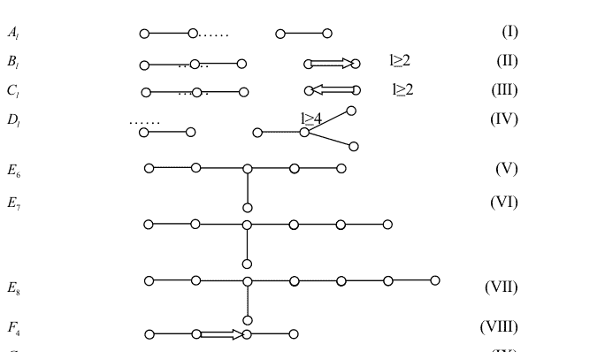

因此，假设学习空间中有 $n$ 个输入数据。这些数据用向量组 $\Pi = \{\alpha_1, \alpha_2, \dots, \alpha_n\}$ 表示。使用 Dynkin 图进行分类，分类算法可以描述如下：

### 算法 1.17: 李群机器学习中 Dynkin 图的分类算法

- **初始化**: 设输入空间向量组记为 $\Pi = \{\alpha_1, \alpha_2, \dots, \alpha_n\}$
- **输入**: $\Pi$
- **输出**: $\{A_i, B_i, C_i, D_i, E_6, E_7, E_8, F_4, G_2\}$

procedure CLASSIFICATION($\Pi$)
if SOLVABLE1 ($\Pi$)=1 //学习问题可解//
then 用 n 个点表示 $\alpha_1, \alpha_2, \dots, \alpha_n$
for i=1 to n–1; j=2 to n do
绘制连线 $r_{ij} = 2(\langle\alpha_i, \alpha_j\rangle /\langle\alpha_i, \alpha_i\rangle) \cdot 2(\langle\alpha_i, \alpha_j\rangle /\langle\alpha_j, \alpha_j\rangle)$ 连接第 $i$ 个点和第 $j$ 个点；
if $\langle\alpha_i, \alpha_j\rangle<\langle\alpha_i, \alpha_j\rangle$
则绘制从第 $j$ 个点指向第 $i$ 个点的箭头；
endif
repeat
endfor
endif
if 存在环路
则返回；
endif
case //分类//
图(I): $A_i$；
图(II): $B_i$；
图(III): $C_i$；
图(IV): $D_i$；
图(V): $E_6$；
图(VI): $E_7$；
图(VII): $E_8$；
图(VIII): $F_4$；
图(IX): $G_2$；
end case
end CLASSIFICATION


图（VIII）：$F_{4}$；
图（IX）：$G_{2}$；
否则：返回
endcase
end CLASSIFICATION

该算法表明，如果学习问题是可解的，那么我们可以通过使用 $A_{l}$、$B_{l}$、$C_{l}$、$D_{l}$、$E_{6}$、$E_{7}$、$E_{8}$、$F_{4}$、$G_{2}$ 等，画出学习空间对应的 Dynkin 图。根据由数据形成的 Dynkin 图，我们可以找到对应的李群，例如 $A_{l}$ 可以对应特殊酉群 SU($l+1$)，$B_{l}$ 可以对应特殊正交群 SO($2l+1$)。根据相应的李群结构，我们可以找到相应的解。因此，我们可以将李群作为机器学习理论的主要基础。

## 1.7 李群机器学习的线性分类器设计

### 1.7.1 李群机器学习的线性分类器设计

机器学习是一门实践性学科。随着信息时代的到来，机器学习算法正面临着各种类型的数据，如航空航天数据、生物数据和晶体数据。根据李群机器学习的定义 $G \times M \rightarrow M$，这些特定的观测数据 $G$ 可以被构造成相应的典型群进行处理，并且这些典型群可以作为子群嵌入高阶 $U(n)$ 群中进行研究。一般来说，线性分类器可以构建如下：

- 步骤 1：将样本集映射到 $G$ 的这个非空集合；
- 步骤 2：根据 $G$ 构造相应的李群结构；
- 步骤 3：将生成的李群应用于已建立的李群机器学习模型；
- 步骤 4：形成相应的分类器；
- 步骤 5：示例测试；
- 步骤 6：应用。

在构建分类器的过程中，第二步非常重要。可以描述如下。首先，将所有满足某些条件的方面描述为观测集，其中每一个都是该集合的元素。其次，给定一个集合，定义其线性组合，如果集合中任意元素集的任意线性组合仍然是该集合的元素，则形成线性空间。然后，再次在线性空间中选择一组群。最后，对于任意两个元素 $A_{1}$ 和 $A_{2}$，在线性集合中定义运算 $[A_{1}, A_{2}]$，其结果仍然是该集合的元素，而对于元素 $A_{1}$、$A_{2}$ 和 $A_{3}$ 以及常数 $f_{1}$、$f_{2}$ 和 $f_{3}$，如果我们具有

$$
\begin{aligned}
[A_{1}, f_{2}A_{2} + f_{3}A_{3}] &= f_{2} [A_{1}, A_{2}] + f_{3} [A_{1}, A_{3}] \quad (1.23) \\
[f_{1}A_{1} + f_{2}A_{2}, A_{3}] &= f_{1} [A_{1}, A_{3}] + f_{2} [A_{2}, A_{3}] \quad (1.24) \\
[A_{1}, A_{2}] &= -[A_{2}, A_{1}] \quad (1.25) \\
[A_{1}, [A_{2}, A_{3}]] + [A_{3}, [A_{1}, A_{3}]] + [A_{2}, [A_{3}, A_{1}]] &= 0 \quad (1.26)
\end{aligned}
$$

则该线性集合被称为李代数。利用李代数，我们可以得到对应的李群。

### 1.7.2 李群机器学习 SO(3) 分类器

对于一个 0 或 1 分类问题，假设样本集 $G$ 是 $(x_{1}, y_{1}), (x_{2}, y_{2}),..., (x_{I}, y_{I}) \in R^{N} \times Y$，其中 $Y = [-1, +1]$，寻求分类器 $f(X)$，使得 $y \cdot f(x) > 0$。

那么，李群机器学习的 SO(3) 分类器将基于典型群 SO($n$) 构建。

**定义 1.26.** $n$ 维向量空间中所有正交变换的集合称为 $n$ 维正交群 $O(n)$。

在这种情况下，问题被转化为三维向量空间，即讨论三维正交群 $O(3)$。由于这两个群之间存在同构 [12]，该群也可以定义为所有 $3 \times 3$ 正交矩阵的群。

**定义 1.27.** 如果 $R$ 是一个正交矩阵，它满足方程 $RR^{T} = R^{T}R = I$，其中 $I$ 是单位矩阵，$R^{T}$ 是 $R$ 的转置矩阵。取方程两边的行列式，并注意到 $\det R = \det R^{T}$，得到 $(\det R)^{2} = 1$ 或 $\det R = \pm1$，这使得 $O(3)$ 群的矩阵分为两组。一组矩阵的行列式是 +1，另一组行列式是 −1。那么，所有行列式为 +1 的正交矩阵构成一个群，称为三维特殊正交群，记为 SO(3)，即 SO(3) = {$O$ $\in$ $O(3)| |O| = 1$}。SO(3) 分类器算法描述如下：

```text
Algorithm 1.18: Classification algorithm of SO(3) classifier
Initialisation: G is a group, its group elements are {x_1, x_2, ..., x_n} //
Input: G //
Output: {1, -1}//
    procedure SOClassifier(G)
    if G is a 3 x 3 orthogonal matrix group
        //That is, this input data set is a three-dimensional orthogonal group O(3)//
        then
            for i=1 to n do
                //calculate the matrix determinant value of each group element //
                if detx_i == -1
                then return -1;
                endif
            endfor
            if i = n + 1
            then return 1; //G is an SO(3) group//
            endif
    end
    end SOClassifier
```

在李群中，这个典型群 SO($n$) 与现实世界中许多高维数据密切相关。许多数据都可以用这个群来表达。读者可参考相关的物理和化学文献。

### 1.7.3 基于李群机器学习的文本分类

在传统的分类算法中，通常需要测量两个文档之间的相似度；常用的度量指标是欧几里得距离、向量夹角余弦等。在李群机器学习中，我们考虑文档的向量空间嵌入在一个微分流形中，其中每个向量对应于流形上的一个点，然后我们用测地线距离代替欧几里得距离来测量两个文档之间的相似度。我们将这种新的文本分类方法称为李群分类（LGC）。

LGC 算法描述如下：

**算法 1.19：LGC**

1. 根据特征词集合描述训练文档向量。假设文档 $i$ 的特征集为 $t_i = (t_{i1}, t_{i2}, \dots, t_{in})$，文档 $i$ 对应的权重为 $w_i = (w_{i1}, w_{i2}, \dots, w_{in})$。那么，文档 $i$ 的向量表示为 $d_i = (t_{i1}, w_{i1}; t_{i2}, w_{i2}; \dots; t_{in}, w_{in})$。因此，所有文档向量形成一个向量空间，该空间嵌入一个微分流形中。每个文档都是流形上的一个点。
2. 对于新文档，根据特征集确定文档的向量表示。
3. 根据算法 1.13，生成新文档 $a$ 的坐标邻域 $U_a$，即文档集 $S$，建立其切空间局部坐标系，计算集 $S$ 中每个文档 $s_k$ 与新文档 $a$ 的几何距离
   $$ D(a, s_k) = \sqrt{\sum_{i,j=1}^n g_{i,j}(a)(d_i - s_{ki})(a_j - s_{kj})} \ .$$
4. 计算 $S$ 中每个点对于文档类别 $c$ 的权重 $W(d, c_x) = \sum_{s_k \in S} D(a, s_k) \times f(s_k, c_x)$，
   其中 $f(s_k, c_x)$ 是类别函数。因此，如果 $s_k$ 属于类别 $c_x$，其函数值为 1；否则为 0。
5. 比较各类别的权重，文档 $a$ 属于权重最大的类别。

我们使用了复旦大学的中语言管理开放平台（http://www.nlp.org.cn）。李荣路博士开发了一个文本分类语料库，用于文本分类性能测试。该语料库共有 2816 个文档，分为交通、体育、军事和其他 10 个类别。我们选择了 1882 个文档作为训练文档，934 个文档作为测试文档。

我们使用 LGC 算法对这些文档进行分类。各种文档的分类结果如表 1.2 和表 1.3 所示。

我们使用了三种方法，即 LGC 算法、使用欧几里得距离作为度量指标的 KNN（K 近邻）和 SVM（支持向量机），来对这些文档进行分类。从表 1.4 中可以看出，LGC 的文本分类召回率和精确率高于 KNN 和 SVM。因为李群机器学习中的文本分类算法将样本向量空间视为微分流形，认为文档向量空间是弯曲的，它比用欧几里得空间描述的文档集更能处理异质和复杂的数据特性。它不仅充分反映了微分流形几何特性的优点，而且具有

**表 1.2：** 各种文档的分类。

| | 交通 | 体育 | 军事 | 医学 | 政治 | 教育 | 环境 | 经济 | 艺术 | 计算机 |
| --- | --- | --- | --- | --- | --- | --- | --- | --- | --- | --- |
| 测试文档数量 | 71 | 149 | 83 | 68 | 167 | 73 | 67 | 108 | 82 | 66 |
| 当前文档数量 | 69 | 166 | 62 | 60 | 199 | 71 | 60 | 144 | 79 | 54 |
| 正确文档数量 | 67 | 147 | 59 | 57 | 159 | 66 | 55 | 98 | 75 | 54 |

**表 1.3：** 各种文档的查全率和精确率。

| | 交通 | 体育 | 军事 | 医学 | 政治 | 教育 | 环境 | 经济 | 艺术 | 计算机 |
| --- | --- | --- | --- | --- | --- | --- | --- | --- | --- | --- |
| 查全率 (%) | 94.366 | 98.658 | 71.084 | 83.824 | 95.21 | 90.411 | 82.09 | 90.741 | 91.463 | 81.818 |
| 精确率 (%) | 97.101 | 88.554 | 95.161 | 95 | 79.899 | 92.958 | 91.667 | 85.965 | 94.937 | 100 |

**表 1.4：** 两种类型文本的分类性能。

| | 宏平均 (%) | | | 微平均 (%) | | |
| --- | --- | --- | --- | --- | --- | --- |
| | 查全率 | 精确率 | F_{1} 值 | 查全率 | 精确率 | F_{1} 值 |
| LGC | 87.966 | 92.124 | 89.997 | 89.615 | 89.615 | 89.615 |
| KNN | 85.517 | 91.885 | 88.642 | 88.009 | 88.009 | 88.009 |
| SVM | 85.333 | 89.308 | 87.275 | 87.045 | 87.045 | 87.045 |


李群几何性质。实验结果表明，LGC 算法提高了文章分类的性能。

### 1.8 本章小结

李群是代数与几何的自然结合，在计算机科学领域有许多应用。本章将李群引入机器学习领域，讨论了李群与机器学习之间的内在联系，并介绍了李群机器学习模型及相关算法。主要涉及：
- (1) 李群机器学习的基本概念及李群机器学习的代数与几何模型；
- (2) 李群机器学习中几何学习算法的 Dynkin 图；
- (3) 李群机器学习的分类器构造方法以及李群机器学习中 SO(3) 分类器的结构。

## 参考文献

- [1] Seung HS, Lee DD. The manifold ways perception [J]. SCIENCE, 2000, 290, 2268-2269.
- [2] Xu H. 李群机器学习模型及其应用研究 (硕士学位论文). 苏州大学, 2007.
- [3] Li FZ, Xu H. 李群机器学习（LML）的理论框架. 计算机技术与应用, 2007, 13(4), 251-255.
- [4] Li FZ, Kang Y. 基于李群机器学习的理论框架. 云南民族学院学报, 2004, 13(4), 251-255.
- [5] Xu H, Li FZ. 李群机器学习的公设假设. 收录于 2006 IEEE 粒度计算国际会议论文集, 401-402.
- [6] Xu H, Li FZ. 李群机器学习中 Dynkin 图的几何算法. 南昌工程学院学报, 2006, 25(2), 75-78.
- [7] Xu H, Li FZ. 李群机器学习中 Dynkin 图的算法. 通讯与计算机杂志, 2006, 4(3), 13-17.
- [8] Li FZ. 李群机器学习研究. 技术报告, 中国苏州大学计算机科学与技术学院, 2004.
- [9] Xu H, Li FZ. 李群机器学习（LML）中 SU(n) 分类器的设计. 计算信息系统杂志, 2005, 1(4), 835-841.
- [10] Li FZ, Xu H. 李群机器学习研究. 计算信息系统杂志, 2005, (194), 843-849.
- [11] Li FZ, Xu H. 李群机器学习（LML）中的 SO(3) 分类器. 通讯与计算机杂志, 2006, 4(3), 76-80.
- [12] Li FZ, He SP, Lin TY. 李群机器学习. 江苏省第二届青年科学家会议, 2008, 南京.

## 2 李群子空间轨道生成学习

本章分为四节。第一节介绍李群机器学习（LML）中偏序和格的基本概念。第二节描述了 LML 子空间轨道生成格学习算法。第三节讨论了 LML 中一般线性群 $GL_n(F_n)$ 作用下子空间轨道生成格学习算法。最后，第四节对本章进行了总结。

### 2.1 LML 中偏序和格的基本概念

李群机器学习的基本概念见 [1, 2]。基于这些研究，我们提出了李群机器学习空间、学习子空间、轨道、目标轨道、偏序、格等相关理论。

#### 2.1.1 基本概念

**定义 2.1.** 李群机器学习空间：用于描述学习过程的所有路径（或轨道）的集合，该集合由所有学习元素组成，称为学习空间。它由五个部分组成，即 {学习示例，学习算法，输入数据，输出数据，表示论}，表示为 $S = \{EX, AL, X, Y, TE\}$。

**定义 2.2.** 设 M 为状态集，代表学习过程中的各种状态（包括初始状态和目标状态） $\{m_0, m_1, ...\}$，其中 $m_i$ ($i = 0, 1, ...$) 是学习过程中不同时刻的状态。

**定义 2.3.** 设 $T_i$ 为操作算子，代表学习过程中的一种状态操作。该算子的每次操作使学习问题从一种状态转移到另一种状态。从初始状态 $m_0$ 到目标状态 $m_g$ 所使用的操作算子序列 $T_0, T_1, ..., T_{g-1}$ 是学习问题的一个解。

进一步地，$G_n$ 是状态转移函数集合；$G_n = \{T_0, T_1, ...\}$ 表示学习过程中的每一步（操作算子）集合，或者可以理解为学习问题在不同阶段的完成程度的表示。

**定义 2.4.** 学习子空间：特定学习问题的空间描述，即学习空间的子集，包括学习该问题的所有可能学习路径。它由四元组 $\langle M, G_n, P, C \rangle$ 表示，其中 P 是样本数据集，即要学习的对象，C 是目标函数，M 是状态集，$G_n$ 是状态转移函数集。

**定义 2.5.** 设 E 为从一种状态到另一种状态的学习问题的代价。当整个学习过程的总代价 $\sum_{i=0}^{g-1} E(T_i)$ 最小时，所得到的轨道（路径）即为最优轨道。

**定义 2.6.** 轨道：已经学习过的对象构成一条路径，即学习路径；它是学习过程的一种几何描述。学习子空间中必然存在一条涵盖学习过程中一系列学习操作（算子）的学习路径。它由三元组 $(L(M), F, E)$ 表示，其中 $L(M)$ 代表学习路径经过的状态集，且 $L(M) \subset M$；F 代表学习路径中使用的状态转移函数集，且 $F \subset G_n$；E 是轨道学习代价。

所有轨道构成整个学习子空间；状态子集及其使用的算子构成一个轨道，一个轨道构成一个偏序链。

**定义 2.7.** 目标轨道：能够正确分类样本数据的最优（近似最优）学习路径，即期望由学习算法从学习子空间中选择的学习函数（集合），是解决学习问题的目标。

学习的目的是寻找从初始状态到目标状态的最优路径。如果将每个状态视为一个节点，学习子空间可以用有向图表示。该图不一定是完全连接的，即某些状态可能无法到达另一个状态，但在连通状态下，每条边代表一个算子，可以实现状态的操纵（即通过连通性实现状态的转移）。当解决特定问题时，可以根据不同的问题为算子设置特定的代价。如果存在一条从初始状态（节点）指向目标状态（节点）的路径，则表示目标状态的学习问题是可解的。在图结构中，树是一种特殊的有向图，任意两个节点之间只有一条路径。树只有一个起始节点（根节点），且树的路径没有回路。因此，树避免了有向图中无法到达目标状态的情况（只要存在目标状态）。树的每个分支形成一个偏序集，构成一个轨道，终端（叶）节点是最大（最小）节点。当然，某些状态可以同时由其他状态生成，即学习子空间是图（或网络）结构，而树是对其的一种特殊描述。根据节点间的连接关系，可以使用相应的矩阵来表示节点间的代价，通过矩阵元素的值来表示。我们在李群中将每个群表示为矩阵，并通过不同群的性质和操作实现解决问题的过程，这可以在李群学习问题中观察到，并通过映射的结构进行研究。李群的学习问题可以从图结构中进行研究。

**定理 2.1.** 学习空间 > 学习子空间 > 轨道 > 目标轨道。
图 2.1 展示了学习空间、学习子空间、轨道和目标轨道之间的关系。


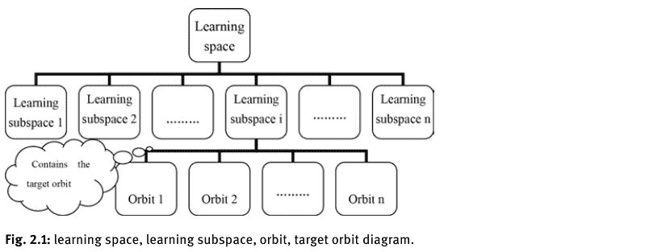

### 定理 2.2.

*现实问题可以由学习子空间描述，且学习子空间包含所有可能的轨迹。如果问题是可解的，则必须从中找到一条学习路径，以及最优（近似最优）学习路径 [18]。*

*证明。* 学习问题被映射到对应的学习子空间。从问题的初始状态出发，在学习过程中，针对轨道划分的每一步，描述当前状态的所有可能下降状态，并根据确定最佳状态的具体标准进行进一步划分，直到找到目标轨道，这确保了我们能够找到期望的轨道。需要注意的是，在具体的学习算法中，考虑到计算时间和存储空间，在大规模学习问题中通常不会扩展所有状态，但无论它是全局优化问题还是局部优化问题，都必须根据学习问题的信息找到最优（近优）轨道。

在处理学习问题时，我们不仅要找到目标，还要找到最优路径（最小成本）。只要目标轨道存在，当目标轨道被找到时，该轨道生成算法被称为可接受的。

学习过程可以描述为不同的状态，状态转换可以通过操作（算子）来实现。因此，从初始状态到目标状态必须存在一条路径；存在多条路径，且至少有一条路径相对于其他路径是最短（最优）的。

在学习算法中，为了生成描述树或图结构的学习子空间的节点顺序，我们可以考虑以下两种情况：深度优先和广度优先。广度优先算法逐层生成学习子空间，即只有当某一层的状态完全生成后，才会转移到下一层。由于广度优先必须扩展到该层的所有状态后才能进入下一层，首个生成的状态会首先被扩展，因此广度优先算法可以确保找到从初始状态到目标状态的最短路径。因此，第二次到达某个状态时，路径长度必须大于或等于之前到达该状态的路径长度，因为一条好的路径不会多次进入同一个状态；当第二次到达某个状态时，它只是放弃该路径。相比之下，在深度优先算法的情况下，当生成一个状态时，在其兄弟状态之前，必须生成其所有子状态和子状态的 descendant 节点。在学习子空间的生成中，深度优先算法尽可能深入。它不仅生成该状态的 descendant 状态，还可以考虑其兄弟状态。深度优先确保首次遇到某状态的路径是到达该状态的最短路径。对于任何状态，都有可能找到到达它的另一条路径。如果路径的长度（或成本）对学习至关重要，当多次遇到相同状态时，应保留最短路径。对于全局生成，广度优先算法必须能够找到最佳路径。深度优先算法在局部生成解决方案；虽然其学习效率较高，但不一定能找到最佳路径。

由于广度优先会扩展每一层的所有状态，因此需要足够的空间来存储这些状态节点。当使用深度优先时，节点沿单一路径向下生成，只有当没有下降状态时，才考虑另一条路径。这种方法不利于通过最优路径从初始状态到达目标状态，且对于许多问题，生成的深度可能无限深或容易跟随无利可图的路径。因此，在轨道生成过程中，广度优先和深度优先方法具有某种盲目性。因此，为了有效识别学习轨道，需要一些与特定学习领域相关的特殊信息，即启发式信息 [3]，它引导这一学习过程朝着最有希望的方向进行。 □

定义 2.8. 设 $f(x)$ 为估值函数，它表示从初始状态 $m_0$ 到目标状态 $m_g$ 的状态 $x$ 的最优轨道的成本估计。一般形式为 $f(x) = g(x) + h(x)$，其中 $g(x)$ 是从初始状态 $m_0$ 到状态 $x$ 实际支付的成本，$h(x)$ 是从状态 $x$ 到目标状态 $m_g$ 的最优轨道的估计成本，也称为启发式函数。

我们使用估值函数来确定在每次状态扩展中最有可能到达目标状态的扩展状态。它可能会沿着被认为最有希望的某个边缘区域向外扩展。利用启发式信息，我们可以从初始状态找到到目标状态的最优路径。由于无需盲目扩展所有可能的状态，因此只需沿着最有希望的状态到达目标状态即可。因此，生成的范围相对较小，且所需的存储空间也相对较小。

根据学习的具体性与一般性之间的关系，学习子空间表示为偏序形式。偏序集的最大元是学习子空间中最一般的点，即描述为零的点。这样的点对学习示例没有任何限制；因此，它可以描述任何东西。偏序的最小元是学习子空间中最具体的点，即它对应于学习样本（样本本身可以被视为一个具体概念）。

因此，学习样本集 $P$ 被视为标准化为偏序，并根据需要映射到对应的学习子空间，以便它可以对应于合理的操作算子集 $F$ ($F \subset G_{n}$)。然后，我们使用偏序集理论来概述这类学习问题。

#### 2.1.2 LML 中的偏序集

在李群研究中，样本数据由满足以下某些基本理论的调节。据此，我们将讨论相关问题 [4–8]。为了更好地解释和理解以下定义，我们首先阐述一个简单的例子。

假设根据狗是否“危险”进行分类，狗的特征通过其颜色、体型和毛发类型来描述。颜色值为棕色和黑色；体型分为大、中、小；毛发类型分为平滑和卷曲。样本集中有 12 只狗，如表 2.1 所示；使用 0 和 1 分别表示狗是“危险”和“非危险”。

样本集 $P = \{1, 2, \cdots, 12\}$ 首先根据狗的体型进行划分（此处，暂时确定讨论规则）。然后，我们得到 $m_{1} = \{1, 2, 6, 9\}$，$m_{2} = \{3, 5, 10, 11\}$，以及 $m_{3} = \{4, 7, 8, 12\}$。这里，$m_{1}$ 定义为 1，不再进行进一步划分。对于 $m_{2}$ 和 $m_{3}$，使用颜色作为划分依据。我们得到 $m_{21} = \{10, 11\}$，$m_{22} = \{3, 5\}$，$m_{31} = \{4, 7\}$，以及 $m_{32} = \{7, 8\}$。$m_{21}$ 和 $m_{31}$ 的类别确定为 0，$m_{2}$ 和 $m_{32}$ 的划分基于毛发类型。因此，我们有 $m_{221} = \{3\}$，$m_{222} = \{5\}$，$m_{321} = \{7\}$，以及 $m_{322} = \{8\}$，其中 $m_{221}$ 和 $m_{322}$ 属于类别 0，$m_{222}$ 和 $m_{321}$ 属于类别 1。因此，每个样本的类别已识别，即分类完成。

##### 表 2.1: 狗的样本集。

| 序号 | 颜色 | 体型 | 毛发类型 | 类别 |
| :--- | :--- | :--- | :--- | :--- |
| 1 | 黑色 | 大 | 卷曲 | 1 |
| 2 | 棕色 | 大 | 平滑 | 1 |
| 3 | 棕色 | 中 | 卷曲 | 0 |
| 4 | 黑色 | 小 | 卷曲 | 0 |
| 5 | 棕色 | 中 | 平滑 | 1 |
| 6 | 黑色 | 大 | 平滑 | 1 |
| 7 | 棕色 | 小 | 卷曲 | 1 |
| 8 | 棕色 | 小 | 平滑 | 0 |
| 9 | 棕色 | 大 | 卷曲 | 1 |
| 10 | 黑色 | 中 | 卷曲 | 0 |
| 11 | 黑色 | 中 | 平滑 | 0 |
| 12 | 黑色 | 小 | 平滑 | 0 |


**定义 2.9.** 设 LML 样本数据集 *P* 为一个非空集，$\gtrapprox$ 为定义在 *P* 上的二元关系。若满足公理 P01–P03，则 *P* 称为偏序集，$\gtrapprox$ 称为 *P* 上的偏序（简称序）。

- P01: 对于任意 *x* $\in$ *P*，不存在 *x* $\gtrapprox$ *x*；
- P02: 对于任意 *x*, *y* $\in$ *P*，若 *x* $\gtrapprox$ *y* 且 *y* $\gtrapprox$ *x*，则 *x* = *y*；
- P03: 对于任意 *x*, *y*, *z* $\in$ *P*，若 *x* $\gtrapprox$ *y* 且 *y* $\gtrapprox$ *z*，则 *x* $\gtrapprox$ *z*。

若在上述三个公理的基础上，也满足公理 P04，则 *P* 称为全序集或链，且 $\gtrapprox$ 称为 *P* 上的全序。

- P04: 对于任意 *x*, *y* $\in$ *P*，*x* $\gtrapprox$ *y* 和 *y* $\gtrapprox$ *x* 中至少有一个成立。

设 *T* 为偏序集 *P* 的子集，*m* $\in$ *T*，若不存在 *x* $\in$ *T* 使得 *m* $\prec$ *x*（*m* $\succ$ *x*），则称 *m* 为 *T* 的最大元（或最小元）。若对于所有 *x* $\in$ *T*，*m* $\gtrapprox$ *x*（*m* $\preccurlyeq$ *x*），则称 *m* 为 *T* 的上界（或下界）。若 *u* $\in$ *P*，对于所有 *x* $\in$ *T*，即 *u* $\gtrapprox$ *x*（或 *u* $\preccurlyeq$ *x*），则称 *u* 为 *T* 的上界（或下界）。注意，*T* 的上界（或下界）不一定属于 *T*。若 *u* 是 *T* 的上界，且对于 *T* 的任意上界 *v* 都有 *v* $\gtrapprox$ *u*，则称 *u* 为 *T* 的上确界，*T* 的下确界也可类似定义。根据 P02（注：原文此处标号有误，应指 P02 的反身性或 P03 的传递性，通常序关系上确界唯一由序的性质保证），若 *T* 有上界（或下界），则上界（或下界）必须唯一，记为 sup *T*（或 inf *T*）。同样，*T* 的上确界（或下确界）不一定属于 *T*。

若 *x*, *y* $\in$ *P* 且 *x* $\gtrapprox$ *y*，其中 [*x*, *y*] = {*z* $\in$ *P* | *x* $\gtrapprox$ *z* $\gtrapprox$ *y*}，则 [*x*, *y*] 称为以 *x* 和 *y* 为端点的区间，且 *x* $\prec$ *y*。

若 *x*, *y* $\in$ *P*，*x* $\prec$ *y*，且不存在 *z* $\in$ *P* 使得 *x* $\prec$ *z* $\prec$ *y*，则称 *y* 覆盖 *x*，记为 *x* $\prec\prec$ *y*。

示例中的样本集 *P* 是一个偏序集，且 $m_{3}$ 是它的一个子偏序集。进一步地，$m_{321}$ 是 $m_{3}$ 的最小元和下界，$[m_{321}, m_{3}]$ 称为区间，且 $m_{32}$ 覆盖 $m_{321}$。

例如，在人脸识别中，使用眼睛、鼻子、嘴巴等局部特征来识别人脸。这些特征从不同角度进行研究。当从上往下看，即考虑“高于”的位置关系来描述偏序 $\gtrapprox$ 时，我们得到 眼睛 $\gtrapprox$ 鼻子 $\gtrapprox$ 嘴巴。相反，在从下往上的观察情况下，我们得到 嘴巴 $\gtrapprox$ 鼻子 $\gtrapprox$ 眼睛。当然，这些局部特征通常呈矩形。从独立个体观察的角度看，它们彼此分离，即没有交集。然而，从邻域观点来看，它们是连续的，即它们的并集构成整张脸。

作为另一个例子，我们考虑构成程序的语句 $a_{1}$， $a_{2}$，...， $a_{i}$，...， $a_{n}$。语句具有特定的执行顺序，且大多数语句之间存在关系，即仅当执行语句 $a_{i}$ 时，才能执行语句 $a_{i+1}$ 并得到相应结果，这种语句之间的执行顺序可以定义为偏序。在程序执行期间，某些语句的顺序可以改变，或者可以使用其他语句来实现，但在局部（子）块（如 $a_{i} \cdots a_{j}$）中，它们通常处于偏序关系中，即“之前”。进一步地，$[a_{i}, a_{j}]$ 称为区间，且 $a_{i+1}$ 覆盖 $a_{i}$。

**定义 2.10.** 设 LML 样本数据集 $P$ 为一个偏序集，$P'$ 为 $P$ 的一个非空子集。显然，$P'$ 对于 $P$ 的偏序来说也是一个偏序，称为 $P$ 的子偏序集。

包含有限数量元素的链（即全序集）称为有限链；否则称为无限链。

若偏序集 $P$ 的子偏序集 $S$ 是一个链，则 $S$ 称为 $P$ 的链。

设 $P$ 为偏序集，$x$，$y \in P$，且 $x < y$。若存在 $x = x_0$，$x_1$，…，$x_n = y$，使得

$$x = x_0 < x_1 < x_2 < \dots \le x_n = y \tag{2.1}$$

其中 $x$ 称为链的起点，$y$ 称为终点，称为 $x$，$y$ 链，$n$ 称为其长度。

若 $x_i \prec x_{i+1}$，则链 (2.1) 称为 $x$，$y$ 的最大链。若

$$x = x'_0 < x'_1 < x'_2 < \dots < x'_m = y \tag{2.2}$$

也是以 $x$ 为起点、$y$ 为终点的链，且每个 $x_i$ ($1 \le i \le n$) 都出现在 (2.2) 中，则 (2.2) 称为 (2.1) 的细化。假设以 $x$ 为起点、$y$ 为终点，以 $y$ 为终点的链可以细化为最大链，且以 $x$ 为起点、$y$ 为终点的最大链的最大长度存在，记为 $d(x$, $y)$。显然，$d(x$, $x) = 0$。若以 $x$ 为起点、$y$ 为终点的链不能细化为最大链，或者以 $x$ 为起点、$y$ 为终点的最大链的长度无最大值，定义 $d(x$, $y) = \infty$。若以 $x$ 为起点、$y$ 为终点的链可以细化为最大链，且以 $x$ 为起点、$y$ 为终点的最大链长度相等，令 $l(x$, $y) = d(x$, $y)$，并称从 $x$ 到 $y$ 为“长”。

在上述判断狗是否危险的例子中，$m_{321} < m_3 < P$ 是以 $m_{321}$ 为起点、$P$ 为终点的链，且它可以细化为 $m_{321} < m_{32} < m_3 < P$。

在学习问题中，虽然样本数据有时非常大，但研究对象往往是有限的。设 $x$ ($x_0$) 为样本的初始状态，$x_1 \cdots x_{n-1}$ 为学习过程中生成的状态，$Y(x_n)$ 为目标状态，$n$ 为生成的轨道长度。若以轨道长度作为度量，(2.2) 在轨道 (2.1) 的形式上优于 (2.1)，因此以每种状态下生成的价格为标准，比较两者的成本。$d(x$, $y)$ 是学习轨道的最大可能长度。

**定义 2.11.** 若对于任意 $a$，$b \in P$，且 $a < b$，所有以 $a$ 为起点、$b$ 为终点的最大链都具有相同的有限长度，则称偏序 $P$ 满足 Jordan-Dedekind 条件，简称 $JD$ 条件。

当状态 *a* 到状态 *b* 的状态不同（或不完全相同）但轨道上的状态数量相同，即轨道长度不变时，满足 JD 条件。

**定义 2.12.** 设 $P$ 和 $P'$ 为偏序集，其中 $P$ 中的偏序记为 $\le$，$P'$ 中的偏序记为 $\le'$。假设 $f: P \to P'$ 是一个双射。对于任意 $x, y \in P$，当且仅当 $x \le y$ 时 $f(x) \le f(y)$，则 $f$ 称为 $P$ 到 $P'$ 的同构映射，$P$ 和 $P'$ 称为同构，记为 $P \cong P'$。

在现实世界中，为了更好地描述我们所处理的问题，可以通过某种变换将样本数据集 $P$ 映射到新的学习子空间，然后充分利用变换的不变性，如平移不变性和关系不变性。一方面，我们可以将 $P'$ 视为由 $P$ 生成的新样本集，即样本集 $P$ 的轨道划分不改变其本质特征，以确保轨道划分的正确性。另一方面，对于两个同构的样本集 $P$ 和 $P'$，可以使用相同的轨道划分方法以避免重复学习。

例如，在基于各种局部特征（眼睛、鼻子、嘴巴等）的人脸识别中，取若干样本点及其邻域点。样本点映射后，原来的邻域关系保持不变，即在原空间中相邻的样本在映射空间中仍然相邻。这充分反映了实际问题与数字规律之间的关系。事实上，无论形式化方法的复杂程度如何，其目标都是揭示自然规律并产生作用，即理论源于自然并服务于自然。作为数据分析方法的机器学习也不例外。

### 2.1.3 LML 中局部有限偏序上的 Möbius 函数 [23]

以人类学习为例。在整个学习过程中，学习者与已学知识之间必然存在一系列关系。只有通过学习基础知识，我们才能学习和理解后续课程。同样，在学科中，知识的顺序不是随意的，例如在数学学习中，先学加减法再学乘除法。每个知识部分的组合构建了一个完整的知识结构系统。这个过程概括为局部的整体形成和整体的局部依赖。这也与认知科学的总体原则一致。

当样本集从原始高维空间映射到低维空间时，样本间的局部偏序关系保持不变，因此样本映射后其原始结构和内在结构关系得以保留。原始空间中满足偏序的样本

在学习子空间中仍然满足偏序关系。例如，给定狮子图像的一半，大多数人仍然能识别这种映射，尽管该映射缺失了近乎一半的维度，这是因为人脑具有从局部信息拟合中想象整体图像的能力。如果整个图像严重失真，尽管这种映射似乎没有丢失任何一维信息，但几乎没有人能识别它，因为有意义的局部信息已经消失 [9]。

LML 中的局部有限偏序集定义如下：

**定义 2.13.** 设 LML 中的样本数据集 $P$ 是一个偏序集。如果对于任意 $x, y \in P$ 且 $x < y$，区间 $[x, y]$ 是一个有限集，则称 $P$ 为局部有限偏序集。如果 $P$ 是一个有限集，则称 $P$ 为有限偏序集。

**定义 2.14.** 设 LML 中的样本数据集 $P$ 是一个局部有限偏序集，$R$ 是一个含单位元的交换环，且 $\mu(x, y)$ 是定义在 $P$ 上且取值于 $R$ 的二元函数，假设 $\mu(x, y)$ 满足以下三个条件：

- (1) 对于任意 $x \in P$，总有 $\mu(x, x) = 1$；
- (2) 如果 $x \nleq y$，则 $\mu(x, y) = 0$；
- (3) 如果 $x < y$，则 $\sum_{x \le z \le y} \mu(x, z) = 0$。

称 $\mu(x, y)$ 为定义在 $P$ 上且取值于 $R$ 的莫比乌斯函数。

莫比乌斯函数可用于确定学习过程中状态之间关系的参数。如果两个状态等价，函数值为 1；否则，为 0。

**引理 2.1.** 设 LML 中的样本数据集 $P$ 是一个局部有限偏序集。$x, y \in P$，如果 $x < y$，则 $d(x, y) < \infty$。

**命题 2.1.** LML 中样本数据集 $P$ 的局部有限偏序集必须存在莫比乌斯函数，且该函数是唯一的。

*证明.* 设 LML 中的样本数据集 $P$ 是一个局部有限偏序集。首先，我们证明在 $P$ 上必定存在一个莫比乌斯函数。我们定义

$$
\begin{aligned}
&\mu(x, x)=1 \text{，对于任意 } x \in P \\
&\mu(x, y)=0 \text{，如果 } x, y \in P \text{ 且 } x \nleq y
\end{aligned}
$$

设 $x, y \in P$ 且 $x \le y$，通过对 $d(x, y)$ 进行归纳来定义 $\mu(x, y)$。当 $d(x, y) = 0$ 时，$x = y$，且如上定义 $\mu(x, y) = 1$。设 $d(x, y) > 0$。对于 $z \in P$ 且 $x \le z \le y$，显然有 $d(x, z) < d(x, y)$；因此，$d(x, z)$ 是已定义的。于是，

$$
\mu(x, y) = -\sum_{x \le z \le y} \mu(x, z)
$$

根据 $\mu(x, y)$ 的定义，它满足条件 (1)、(2) 和 (3)。因此 $\mu(x, y)$ 是 $P$ 上的莫比乌斯函数。

设 $\mu'(x, y)$ 也是 $P$ 上的一个莫比乌斯函数。由条件 (1) 可知，对于任意 $x \in P$，我们有 $\mu(x, x) = 1$。因此，

$$
\mu'(x, x) = \mu(x, x) = 1 \text{，对于任意 } x \in P
$$

设 $x, y \in P$。如果 $x > y$，根据条件 (2)，我们有 $\mu'(x, y) = 0$。因此，

$$
\mu'(x, y) = \mu(x, y) = 0 \text{，如果 } x > y
$$

设 $x \leq y$。对 $d(x, y)$ 应用数学归纳法证明 $\mu'(x, y) = \mu(x, y)$。当 $d(x, y) = 0$ 时，$x = y$，已证得 $\mu'(x, x) = 1 = \mu(x, x)$。设 $d(x, y) > 0$。对于 $z \in P$ 且 $x \leq z \leq y$，显然 $d(x, z) < d(x, y)$。根据归纳假设，$\mu'(x, z) = \mu(x, z)$。那么，

$$
\begin{align*}
\mu'(x, y) &= - \sum_{x \leq z \leq y} \mu'(x, z) \quad \text{（因为 } \mu'(x, y) \text{ 满足条件 (3))} \\
&= - \sum_{x \leq z \leq y} \mu(x, z) \quad \text{（基于归纳假设）} \\
&= \mu(x, y) . \quad \text{（因为 } \mu(x, y) \text{ 满足条件 (3))}
\end{align*}
$$

**命题 2.2.** 设 LML 中的样本数据集 $P$ 是一个具有最小元素 0 的局部有限偏序集，且 $R$ 是含单位元的交换环。设 $\mu(x, y)$ 是定义在 $P$ 上且取值于 $R$ 的莫比乌斯函数。此外，$f(x)$ 是定义在 $P$ 上且取值于 $R$ 的函数。对于任意 $x \in P$，令

$$
g(x) = \sum_{y \leq x} f(y) \ . \tag{2.3}
$$

则，

$$
f(x) = \sum_{y \leq x} g(y)\mu(y, x) \ . \tag{2.4}
$$

反之，设 $g(x)$ 是定义在 $P$ 上且取值于 $R$ 的函数。对于任意 $x \in P$，由 (2.4) 定义 $f(x)$，则建立 (2.3)。

*证明.* 由于 $P$ 是一个具有最小元素 0 的局部有限偏序集，区间 $[0, x]$ 是一个有限集，且 (2.3) 中的求和是一个有限和。因此，由 (2.3) 定义的 $g(x)$ 是合理的。同样，(2.4) 中的求和也是有限的，且

$$
\begin{align*}
\sum_{y \leq x} g(y)\mu(y, x) &= \sum_{y \leq x} \left( \sum_{z \leq y} f(z) \right) \mu(y, x) \quad \text{（代入 (2.3))} \\
&= \sum_{z \leq x} f(z) \sum_{z \leq y \leq x} \mu(y, x) \quad \text{（交换求和顺序）} \\
&= \sum_{z \leq x} f(z)\delta_{z, x} \quad \text{（根据条件 (3))} \\
&= f(x)
\end{align*}
$$

其中 $\delta_{z, x}$ 是 delta 函数。

反过来，

$$
\begin{aligned}
\sum_{y \leqslant x} f(y) & = \sum_{y \leqslant x} \left( \sum_{z \leqslant y} g(z) \mu(z, y) \right) & \text{（代入 (2.4))} \\
& = \sum_{z \leqslant x} g(z) \sum_{z \leqslant y \leqslant x} \mu(z, y) & \text{（交换求和顺序）} \\
& = \sum_{z \leqslant x} g(z) \delta_{z, x} & \text{（根据条件 (3))} \\
& = g(x) \ .
\end{aligned}
$$

此处 (2.4) 和 (2.3) 分别称为 (2.3) 和 (2.4) 的莫比乌斯反演公式。

此外，$\mu(x, y)$ 用作由轨道生成的控制权重，以引导新样本的生成，而 $f(x)$ 和 $g(x)$ 分别是样本 $x$ 和 $y$ 的变换函数。

### 2.1.4 LML 中的高斯系数和高斯多项式

学习目标函数的复杂度取决于其表示形式。在理想情况下，应选择与特定学习问题相匹配的表示形式。因此，机器学习中的一种常见预处理策略涉及改变样本数据的表达，例如

$$
x = (x_1, \ldots, x_n) \mapsto \phi(x) = (\phi_1(x), \ldots, \phi_N(x)) \ .
$$

这一步等价于将样本数据集映射到一个新空间，$F=\{\phi(x) \mid x \in X\}$。示例：目标函数

$$
f\left(m_1, m_2, r\right)=C \frac{m_1 m_2}{r^2} \ .
$$

给定引力定律，考虑两个质量分别为 $m_1$、$m_2$ 且距离为 $r$ 的物体来表示引力。该定律由可观测量（即质量和距离）表达，但不能由线性函数表达。然而，如果坐标简单地变为

$$
\left(m_1, m_2, r\right) \mapsto (x, y, z) = \left(\ln m_1, \ln m_2, \ln r\right) \ ,
$$

则表达式变为

$$
g(x, y, z)=\ln f\left(m_1, m_2, r\right)=\ln C+\ln m_1+\ln m_2-2 \ln r
$$

从而成为线性关系。

这一过程证明，将输入空间中的样本数据简单地映射到另一个空间可以简化任务。输入空间中的样本数据无法通过线性函数分离，但在新映射空间中是可能的。这种方法通常涉及寻找包含关于原始属性必要信息的最小特征集，这被称为降维：

$$
x = (x_1, \ldots, x_n) \to \phi(x) = (\phi_1(x), \ldots, \phi_d(x)) \quad d < n \ .
$$

这对计算和泛化都有用 [10]。

我们将 LML 中的样本数据映射到 $F_q$。设 $F_q$ 为含有 $q$ 个元素的有限域，$q$ 为素数幂，$n$ 为非负整数。令

$$
F^n_q = \{(x_1, x_2, \cdot \cdot \cdot, x_n) \mid x_i \in F_q, i = 1, 2, \cdot \cdot \cdot, n\} \ .
$$

$F_q$ 中的元素 $(x_1, x_2, \cdot \cdot \cdot, x_n)$ 称为 $F_q$ 上的 $n$ 维行向量。$n$ 维行向量的加法和数乘定义如下：

$$
(x_1, x_2, \cdot \cdot \cdot, x_N) + (y_1, y_2, \cdot \cdot \cdot, y_N) = (x_1 + y_1, x_2 + y_2, \cdot \cdot \cdot, x_N + y_N)
$$

$$
\lambda(x_1, x_2, \cdot \cdot \cdot, x_N) = (\lambda x_1, \lambda x_2, \cdot \cdot \cdot, \lambda x_N), \quad \lambda \in F_q
$$

$F^n_q$ 是 $F_q$ 上的 $n$ 维向量空间，称为 $n$ 维行向量空间。

**命题 2.3.** 设 $F_q$ 是一个有限域，其中 $q$ 是素数幂，$n$ 和 $m$ 均为非负整数，且 $F^n_q$ 是 $F_q$ 上的 $n$ 维行向量空间。那么，$F^n_q$ 中 $m$ 维子空间的数目恰好相同

$$
\frac{(q^n-1)(q^n-q)\cdots(q^n-q^{m-1})}{(q^m-1)(q^m-q)\cdots(q^m-q^{m-1})} \ . \tag{2.5}
$$

**证明.** 当 $m = 0$ 时，$F^n_q$ 具有唯一的零维子空间，该子空间由零向量 $\mathbf{0} = (0, 0, \cdot \cdot \cdot, 0)$ 组成。此时，(2.5) 等于 1。因此，命题在 $m = 0$ 时成立。

现在，假设 $m > 0$。当 $n < m$ 时，$F^n_q$ 没有 $m$ 维子空间，即 $F^n_q$ 的 $m$ 维子空间数目等于零。然而，

$$
\frac{(1-q^n)(1-q^{n-1})\cdots(1-q^{n-(m-1)})}{(1-q^m)(1-q^{m-1})\cdots(1-q^{m-(m-1)})} = \frac{(1-q^n)(1-q^{n-1})\cdots(1-q^m)(1-q^{m-1})\cdots(1-q)}{(1-q^m)(1-q^{m-1})\cdots(1-q)} = 0 \ .
$$

因此，命题 2.3 在 $n < m$ 时也成立。

最后，我们考察 $n \ge m > 0$ 的情况。设 $V$ 是 $F^n_q$ 的任意一个 $m$ 维子空间，且 $\mathbf{v}_1, \mathbf{v}_2, \cdot \cdot \cdot, \mathbf{v}_m$ 是 $V$ 的基。这里，$\mathbf{v}_1$ 可以是 $F^n_q$ 中的任何非零向量，且 $F^n_q$ 总共有 $q^n$ 个向量；因此，$\mathbf{v}_1$ 有 $q^n - 1$ 种可能的选择。当选中 $\mathbf{v}_1$ 后，$\mathbf{v}_2$ 可以是 $F^n_q$ 中任何与 $\mathbf{v}_1$ 线性无关的向量，而总共有 $q$ 个向量与 $\mathbf{v}_1$ 线性相关；因此，$\mathbf{v}_2$ 有 $q^n-q$ 种可能的选择。当选中 $\mathbf{v}_1, \mathbf{v}_2, \cdot \cdot \cdot, \mathbf{v}_{m-1}$ 后，$\mathbf{v}_m$ 可以是任何与 $\mathbf{v}_1, \mathbf{v}_2, \cdot \cdot \cdot, \mathbf{v}_{m-1}$ 线性无关的向量。根据 $\mathbf{v}_i(i = 1, 2, \cdot \cdot \cdot, m - 1)$ 的选择，我们可以看到 $\mathbf{v}_1, \mathbf{v}_2, \cdot \cdot \cdot, \mathbf{v}_{m-1}$ 是线性无关的。那么，与 $\mathbf{v}_1, \mathbf{v}_2, \cdot \cdot \cdot, \mathbf{v}_{m-1}$ 相关的向量总共有


$(q^n - 1)(q^{n} - q) \cdot \cdot (q^n - q^{m-1})$ 种可能的选择。然而，一个确定的 $m$ 维子空间可以拥有不同的基。

根据上述推理，我们可以看到，一个 $m$ 维子空间拥有 $(q^{n} - 1)(q^{n} - q) \cdot \cdot (q^{n} - q^{m-1})$ 组不同的基。

因此，$\mathbb{F}_{q}^{n}$ 中 $m$ 维子空间的数目等于
$$\frac{(q^{n} - 1)(q^{n} - q) \cdot \cdot (q^{n} - q^{m-1})}{(q^{m} - 1)(q^{m} - q) \cdot \cdot (q^{m} - q^{m-1})} = \frac{(q^{n} - 1)(q^{n-1} - 1) \cdot \cdot (q^{n-(m-1)} - 1)}{(q^{m} - 1)(q^{m-1} - 1) \cdot \cdot (q - 1)} \text{ .}$$
已证明，$m$ 维子空间的数目等同于能够生成的 $m$ 个轨道的数目（即所使用的算子数目）。在学习过程中，为了区分每个子空间，它们被标记为特定的实数值。

**定义 2.15.** 设 $m$ 和 $n$ 为非负整数。引入记号
$$\left[\begin{array}{c}n\\m\end{array}\right]_{q} = \frac{(q^{n} - 1)(q^{n-1} - 1) \cdot \cdot (q^{n-(m-1)} - 1)}{(q^{m} - 1)(q^{m-1} - 1) \cdot \cdot (q - 1)} \text{, 若 } m > 0 \text{ ,}$$
以及
$$\left[\begin{array}{c}n\\0\end{array}\right]_{q} = 1$$
称它们为高斯系数。

**推论 2.1.** *对于非负整数* $k$，*存在* $\boldsymbol{R}$ *中的一个元素* $a_{k}$ *与之对应，它定义了非负整数集* $\mathbf{R}_{0} = \boldsymbol{R} \cup \{0\}$ *上的一个函数* $a$，*即*
$$\pmb{a} \colon \mathbb{N}_{0} \rightarrow \pmb{R},\ k \mapsto a_{k}$$
*对于非负整数* $n$，*令*
$$b_{n} = \sum_{k=0}^{n} \left[\begin{array}{c}n\\k\end{array}\right]_{q} a_{k} \text{ .} \tag{2.6}$$
*那么，*
$$a_{n} = \sum_{k=0}^{n} (-1)^{n-k} q^{\left(\begin{array}{c}n-k\\2\end{array}\right)} \left[\begin{array}{c}n\\k\end{array}\right]_{q} b_{k} \tag{2.7}$$
*反过来，假设* $b$ *是一个定义在* $\mathbb{N}_{0}$ *上且值域为* $\boldsymbol{R}$ *的函数：*
$$\pmb{b} \colon \mathbb{N}_{0} \rightarrow \pmb{R},\ k \mapsto b_{k}$$
*对于任意非负整数* $n$，*由 (2.7) 定义* $a_{n}$，*(2.6) 成立。*
*证明。* 设 $V$ 为 $\mathbb{F}_{q}$ 上的无穷维向量空间。对于 $V$ 的任意 $n$ 维子空间 $W$，定义 $\boldsymbol{R}$ 中的元素 $a_{n}$ 与之对应。这定义了一个定义在 $\mathrm{Lf}(V)$ 上且值域为 $\boldsymbol{R}$ 的函数。
$$\pmb{a} \colon \mathrm{Lf}\ (V) \rightarrow \pmb{R},\ \ W \mapsto \pmb{a}(W) = \pmb{a}_{d i m \ W}$$

对于任意 $W \in \mathrm{L}_{f}(V)$，设 $\dim W=n$。设 $U$ 为 $W$ 的子空间，并规定

$b(W)=\sum_{U \subseteq W} a(U)$

显然，若 $\dim W=\dim W'$，则 $b(W)=b(W')$。令 $b_{\dim W}=b(W)$。由于 $W$ 中 $k$ 维子空间的数目为 $\left[\begin{array}{l}n \\k\end{array}\right]_{q}$，则 (2.8) 等价于 (2.6)。

由 (2.8) 并根据命题 2.2，

$a(W)=\sum_{U \subseteq W} b(U) \mu(U, W)$

根据定义，$a(W)=a_{\dim W}$，$b(U)=b_{\dim U}$。当 $\dim W=n$，$\dim U=k$ 时，我们有 $\mu(U, W)=(-1)^{n-k} q^{\binom{n-k}{2}}$。因此，可以从 (2.9) 推导出 (2.7)。

相反，根据

$b: \operatorname{L}_{f}(V) \rightarrow R$，$W \mapsto b(W)=b_{\dim W}$，

定义一个定义在 $\mathrm{L}_{f}(V)$ 上且值域为 $R$ 的函数 $b$。对于任意 $W \in \mathrm{L}_{f}(V)$，通过 (2.9) 定义 $a(W)$，其中 $U$ 是 $W$ 的子空间。当 $\dim W=\dim W'$ 时，我们有 $a(W)=a(W')$。设 $\dim W=n$，$\dim U=k, 0 \leq k \leq n$。则 (2.9) 等价于 (2.7)，并根据命题 2.2，可以从 (2.9) 推导出 (2.8)，进而从 (2.8) 推导出 (2.6)。

**命题 2.4.** *设 $x$ 为未定元，$n$ 为非负整数。则，*

$\prod_{i=0}^{n-1}\left(x-q^{i}\right)=\sum_{m=0}^{n}(-1)^{n-m} q^{\binom{n-m}{2}}\left[\begin{array}{l}n \\m\end{array}\right]_{q} x^{m}$

**定义 2.16.** 设 $q$ 为素数幂，$n$ 为非负整数，$x$ 为不定元。多项式

$g_{n}(x)=(x-1)(x-q) \cdots(x-q^{n-1})$，若 $n \geq 1$，

以及

$g_{0}(x)=1$

称为高斯多项式。那么，

$g_{n}(x)=\sum_{m=0}^{n}(-1)^{n-m} q^{\binom{n-m}{2}}\left[\begin{array}{l}n \\m\end{array}\right]_{q} x^{m}$

基于高斯求反公式。

**命题 2.5.** 设 $q$ 为素数幂，$n$ 为非负整数，$x$ 为未定元。则，
$$x^{n}=\sum_{k=0}^{n}\left[\begin{array}{c} n \\ k \end{array}\right]_{q} g_{k}(x) .$$

**定义 2.17.** 设 $P$ 为一个包含最小元素 $0$ 的偏序集，且对于 $a \in P$，若 $l(0, a)$ 存在，即从 $0$ 到 $a$ 的链可以细化为一条极大链。若包含 $a$ 的极大链具有相同的有限长度，则称其为 $a$ 的秩，记为 $r(a)$。若任意 $x \in P$ 都有秩 $r(x)$，则称 $P$ 具有秩函数 $r: P \rightarrow \mathbb{N}_{0}$，其中 $\mathbb{N}_{0}$ 是所有非负整数的集合。我们有时说 $P$ 由 $r$ 赋予秩。

容易理解，包含若干样本的集合 $P$ 可以根据对偶假设用对偶性来表示，其中每个待学习的实例可以用特定值来表示。在这里，秩函数也可以被视为轨道极限的最大可能长度，轨道长度 $\leq r(x)$。

**命题 2.6.** 设 $P$ 为一个包含最小元素 $0$ 的偏序集，并假设对于任意 $a, b \in P$ 且 $a < b$，从 $a$ 到 $b$ 的链可以细化为一条极大链。若 $P$ 满足 ID 条件，则 $P$ 上存在秩函数 $r: P \rightarrow \mathbb{N}_{0}$。那么，(1) $r(0) = 0$，(2) 若 $a < b$，则 $r(b) = r(a) + 1$。反过来，若存在定义在 $P$ 上且值域为 $\mathbb{N}_{0}$ 的函数 $r$，且满足 (1)，(2)，则 $P$ 满足 ID 条件，且 $r$ 是 $P$ 上的秩函数。

**证明。** 假设 $P$ 满足 ID 条件。对于任意 $a \in P$，由于从 $0$ 到 $a$ 的链可以细化为极大链，且它们的长度相等；因此，$l(0, a)$ 必须存在。根据定义 2.17，$r(a) = l(0, a)$，且 $r: P \rightarrow \mathbb{N}_{0}$ 是 $P$ 上的秩函数。显然，(1) 成立。设 $a < b$。假设 $r(a) = n$ 且
$$0 < a_{1} < a_{2} < \cdots < a_{n} = a$$
是 $0, a$ 的极大链。那么，
$$0 < a_{1} < a_{2} < \cdots < a_{n} < b$$
是 $0, b$ 的极大链，$r(b) = n + 1 = r(a) + 1$，即 (2) 成立。

现在，设 $r: P \rightarrow \mathbb{N}_{0}$ 为满足 (1)，(2) 的函数。设 $a, b \in P$ 且 $a < b$。假设
$$a = a_{0} < a_{1} < a_{2} < \cdots < a_{n} = b,$$
$$a = a_{0}^{l} < a_{1}^{l} < a_{2}^{l} < \cdots < a_{m}^{l} < b$$
是两条 $a, b$ 的极大链。根据 (2)，
$$r(b) = r(a_{n}) = r(a_{n-1}) + 1 = \cdots = r(a_{0}) + n = r(a) + n,$$
$$r(b) = r(a_{m}^{l}) = r(a_{m-1}^{l}) + 1 = \cdots = r(a_{0}^{l}) + m = r(a) + m.$$

因此，$n=m$。这证明了 $P$ 满足 JD 条件。$P$ 的秩函数记为 $r'$。对于任意 $a \in P$，设
$0 < a_1 < a_2 < \cdots < a_n = a$
为 $0, a$ 的极大链。根据定义 2.17，$r'(a)=n$。由于 $r$ 满足 (1) 和 (2)，
$r(a) = r(a_n) = r(a_{n-1}) + 1 = \cdots = r(0) + n = n$
那么，$r=r'$，即 $r$ 是 $P$ 的秩函数。

样本数据集 $P$ 以矩阵形式表示。秩函数的计算，即计算对学习有用样本的数目，或在给定原始样本集经过某种映射变换后的数目，即新样本集 $P'$ 的成员数目，可以被获得。$\square$

**定义 2.18.** 设 $P$ 为一个具有最小元素 $0$ 和最大元素 $1$ 的有限偏序集，且设 $P$ 具有秩函数 $r$。那么，
$X(P, x) = \sum_{a \in P} \mu(0, a) x^{r(1) - r(a)} \qquad (2.11)$
称为 $P$ 上的特征多项式。

注：在此，特征多项式可以被理解为学习子空间中样本的多项式表示。

**命题 2.7.** 设 $V$ 为域 $\mathbb{F}_q$ 上的 $n$ 维向量空间。设 $L(V)$ 为 $V$ 中所有子空间的集合。对于 $U$，$W \in L(V)$，若 $U \supset W$，规定 $U \geq W$。那么，对于给定的偏序关系 $\geq$，我们有
$X(L(V), x) = \prod_{i=0}^{n-1} (x - q^i) = g_n(x) .$

### 2.1.5 LML 中的格

如第 1.1 节所述，学习子空间（具体学习问题）可以描述为包含若干节点的有向图或树。它是一种格结构，具有从初始状态到目标状态的路径（从根节点开始到叶节点的树分支）。路径上的节点关系不能任意交换。它体现在具体问题中，可以理解为节点中待学习的样本（分类），其中指定的算子是最优的，即有利于获得最优轨道。为了有效生成目标轨道，引入格（网格）的思想如下。

**定义 2.19.** 若 $L$ 中任意两个元素都有上界和下界，则 LML 中的样本数据按格排序。元素 $a$ 和


a ∨ b = sup {a, b}, a ∧ b = inf {a, b}。

a ∨ b 读作 a 与 b 的上确界（join），而 a ∧ b 读作 a 与 b 的下确界（meet）。

当格 L 包含有限个元素时，它被称为有限格。

容易看出，∨ 和 ∧ 是 L 的两个代数运算，对于 L 中的任意元素 a, b, c，以下性质成立：

- L1: a ∨ b = b ∨ a, a ∧ b = b ∧ a (交换律)；
- L2: (a ∨ b) ∨ c = a ∨ (b ∨ c), (a ∧ b) ∧ c = a ∧ (b ∧ c) (结合律)；
- L3: a ∨ a = a, a ∧ a = a (幂等律)；
- L4: (a ∨ b) ∧ a = a, (a ∧ b) ∨ a = a (吸收律)。

**定义 2.20.** 设 L 为一个格，S 为 L 的非空子集。如果 S 在 L 的 ∧ 和 ∨ 运算下封闭，则称 S 为 L 的子格。利用 1.2 中给出的例子，{m₃₂₁, m₃₂, m₃} 是一个格，其上确界和下确界分别为 m₃₂₁ 和 m₃。{m₃₂₁, m₃₂} 是 {m₃₂₁, m₃₂, m₃} 的子格。

**定义 2.21.** 设 L 和 L' 为两个格，具有运算 ∨, ∧, ∨', ∧'，设 φ 为从 L 到 L' 的双射。如果

φ (a ∨ b) = φ(a) ∨' φ(b), φ (a ∧ b) = φ(a) ∧' φ(b),

则称 φ 为从 L 到 L' 的格同构映射。L 和 L' 同构，记为 L ≅ L'。

在学习过程中，由于算子（除法规则）的使用不同，会出现起始状态相同的路径，这意味着从某个状态出发，虽然路径不同，但最终状态相同。正如俗话所说，“条条大路通罗马”。如果你能通过路径变换找到一个函数 φ 得到另一条路径，那么这两条路径是同构的。至于选择哪条路径，取决于生成该路径的代价。

**定义 2.22.** 格 L 被称为半模格。如果对任意 a, b ∈ L，

a ≺ a ∨ b ⇒ b ≺ a ∨ b ,                       (2.12)

则格 L 被称为下半模格。如果对任意 a, b ∈ L，

b ≺ a ∨ b ⇒ a ≺ a ∨ b ,                          (2.13)

则格 L 被称为上半模格。

**定义 2.23.** 在包含最小元素 0 的格 L 中，覆盖 0 的元素称为 L 的原子。

**定义 2.24.** 包含最小元素 0 的格 L 被称为原子格，且对于每个 a ∈ L\{0}，a 是 L 中某些原子的上界，即 a = sup {p ∈ L; 0 ≺ p ≤ a}。

**定义 2.25.** 如果格 $L$ 是一个不含无限链的半模原子格，则称 $L$ 为几何格。

**命题 2.8.** *在几何格 $L$ 中，对于任意 $x \in L \backslash \{0\}$，$x$ 是有限个原子的上界。*

*证明.* 假设存在 $x \in L \backslash \{0\}$，且 $x$ 不是有限原子的上界。由于 $L$ 是原子格，$x$ 必须是无穷原子集 $A$ 的上确界。那么，对于任意 $i = 2, 3, \cdots$，总存在 $p_i \in A$，使得

$$p_i \not\leq p_1 \vee p_2 \vee \cdots \vee p_{i-1}$$

考虑到 $L$ 是具有最小元素 0 的半模格。我们有

$$0 < \cdot p_1 < \cdot p_1 \vee p_2 < \cdots < \cdot p_1 \vee p_2 \vee \cdots \vee p_{i-1} < \cdot p_1 \vee p_2 \vee \cdots \vee p_{i-1} \vee p_i < \cdots$$

这与 $L$ 不包含无限链相矛盾。

以人脸识别为例，如第 1.2 节所述，我们从不同视角将眼睛、鼻子和嘴巴的局部特征刻画为两个偏序结构。用矩形区域表示这些局部特征时，它们不能交换以形成格结构的关系。一旦确定了图形的主键，它们不可交换的优先关系便形成一种格结构。一旦确定了图形的关键点，要从局部特征寻找额外特征，我们需要考虑两者之间的位置关系。如果嘴和鼻子的邻域相连，我们可以通过计算它们的交集和连接来确定另一部分的位置。 \quad \square

## 2.2 LML 子空间轨道生成格学习算法

结论：根据给定的偏序集（即格）的基本概念，形成了 LML 子空间轨道生成格理论。在此基础上，本节介绍了用于轨道生成的广度优先、深度优先和启发式学习算法以及一些验证示例。

### 2.2.1 LML 子空间轨道生成格

轨道的形成可以从两个方向考虑：(1) 从给定的样本集合逐渐“到”目标函数以生成轨道；(2) 从目标函数反向回到样本集也可以生成所需的轨道。已证明可以通过包含关系和反包含关系找到子空间的偏序。

设样本数据映射到新数据集 $\mathbb{F}_q$，即 $q$ 个元素的有限域，其中 $q$ 是素数幂。设 $\mathbb{F}_q^n$ 为 $\mathbb{F}_q$ 上的 $n$ 维行向量空间。在 $\mathbb{F}_q^n$ 的所有子空间组成的集合 $\mathrm{L}\left(\mathbb{F}_q^n\right)$ 中，子空间的偏序 $\supseteq$ 通过包含关系确定，称为通过包含关系确定 $\mathrm{L}\left(\mathbb{F}_q^n\right)$ 的偏序 $\supseteq$。那么，$\mathrm{L}\left(\mathbb{F}_q^n\right)$ 对于所求的偏序 $\supseteq$ 构成一个偏序集，记为 $\mathrm{L}_O\left(\mathbb{F}_q^n\right)$。在该偏序集中，存在 $\mathbb{F}_q^n$ 的子空间 $X$ 和 $Y$：

$$X \vee Y = \cap \left\{ Z \in \mathrm{L}\left(\mathbb{F}_q^n\right) \mid X \cup Y \subset Z \right\}, X \wedge Y = X \cap Y.\tag{1}$$

因此，$\mathrm{L}_O\left(\mathbb{F}_q^n\right)$ 是一个格，0 是其最小元素，1 维子空间是其原子，子空间的维度是其秩函数。

在 $\mathrm{L}\left(\mathbb{F}_q^n\right)$ 中，如果使用逆序来确定子空间的偏序 $\supseteq$，$\mathrm{L}\left(\mathbb{F}_q^n\right)$ 仍然是偏序集，记为 $\mathrm{L}_R\left(\mathbb{F}_q^n\right)$。由于 $\mathrm{L}_R\left(\mathbb{F}_q^n\right)$ 中 sup $\{X, Y\}$ 和 inf $\{X, Y\}$ 与偏序集 $\mathrm{L}_O\left(\mathbb{F}_q^n\right)$ 中的 inf $\{X, Y\}$ 和 sup $\{X, Y\}$ 完全相同，因此在 $\mathrm{L}_R\left(\mathbb{F}_q^n\right)$ 中，我们有

$$X \vee Y = X \cap Y, X \wedge Y = \cap \left\{ Z \in \mathrm{L}_R\left(\mathbb{F}_q^n\right) \mid X \cup Y \subset Z \right\}\tag{2}$$

因此，$\mathrm{L}_R\left(\mathbb{F}_q^n\right)$ 也是一个格。

于是有：

**命题 2.9. *映射***

$$\phi: \mathrm{L}_O\left(\mathbb{F}_q^n\right) \rightarrow \mathrm{L}_R\left(\mathbb{F}_q^n\right), \mathcal{P} \rightarrow \mathcal{P}^{\perp}\tag{3}$$

*是一个同构映射。格* $\mathrm{L}_O\left(\mathbb{F}_q^n\right)$ *和* $\mathrm{L}_R\left(\mathbb{F}_q^n\right)$ *是格同构的。*

*从样本数据集“到”目标结果的轨道与目标结果同构形成，即它反转回到样本集的轨迹。*

*从样本数据集“到”目标结果的轨道与目标结果反向回到样本集的轨道同构。*

**命题 2.10.** 格 $\mathrm{L}_R\left(\mathbb{F}_q^n\right)$ 的特征多项式为

$$\chi\left(\mathrm{L}_R\left(\mathbb{F}_q^n\right), x\right) = \prod_{i=0}^{n-1} \left( x - q^i \right) = g_n(x)\tag{4}$$

*其中* $g_n(x)$ *是一个高斯多项式。*

*设* $A$ *是* $\mathbb{F}_q^n$ *中若干个* $m$ *维子空间* $(1 \le m \le n - 1)$ *的集合，设* $\mathrm{L}(A)$ *是* $A$ *的子空间交集的集合。约定，* $\mathbb{F}_q^n$ *是 0 个* $m$ *维子空间的交集，即* $\mathbb{F}_q^n \in \mathrm{L}(A)$ *。设* $\mathrm{L}(A)$ *是由* $A$ *生成的集合。如果我们通过包含关系来确定* $\mathrm{L}(A)$ *的偏序* $\supseteq$，即对于*

$X, Y \in \mathrm{L}(A), X \supseteq Y \Leftrightarrow X > Y\tag{5}$


**定理 2.3.** $\mathbb{L}_{0}(A)$（$\mathbb{L}_{R}(A)$）是一个有限格，且 $\cap_{X \in A} X$ 和 $\mathbb{F}_{q}^{n}$ 分别是 $\mathbb{L}_{0}(A)$（$\mathbb{L}_{R}(A)$）的最小（最大）元和最大（最小）元。

**证明.** 我们考虑根据包含关系和反向包含关系确定 $\mathbb{L}(A)$ 偏序的两个情形。我们证明该方法相同，且仅证明反向包含关系的情形。显然，$|\mathbb{L}(A)|<\infty$，且 $\cap_{X \in A} X$ 和 $\mathbb{F}_{q}^{n}$ 分别是 $\mathbb{L}_{R}(A)$ 中的最大元和最小元。现在，我们证明它是一个格。由于 $\mathbb{L}_{R}(A)$ 是一个偏序集，只需证明在该偏序集中，$\mathbb{L}(A)$ 对交集和并集封闭。任取 $A_{1}, A_{2} \in \mathbb{L}_{R}(A)$。$A_{1}$ 和 $A_{2}$ 均为 $A$ 中 $m$ 维子空间的交集，由 $A_{1} \cup A_{2} \in \mathbb{F}_{q}^{n}$ 可知，$A_{1} \vee A_{2}=A_{1} \cap A_{2} \in \mathbb{L}_{R}(A)$，且 $\mathbb{F}_{q}^{n} \in \mathbb{L}_{R}(A)$。进一步地，包含 $A_{1} \cup A_{2}$ 的子空间在 $\mathbb{L}_{R}(A)$ 中的交集也包含 $A_{1} \cup A_{2}$。因此，在 $\mathbb{L}(A)$ 中，仅存在唯一的最小包含 $A_{1} \cup A_{2}$ 的子空间。因此，

$$A_{1} \wedge A_{2} := \{Z \in \mathbb{L}_{R}(A) | A_{1} \cup A_{2} \subset Z\} \in \mathbb{L}_{R}(A)$$

**定义 2.26.** 根据包含关系或反向包含关系寻找偏序 $\mathbb{L}(A)$，所得到的格 $\mathbb{L}_{0}(A)$ 或 $\mathbb{L}_{R}(A)$ 称为由 $A$ 生成的包含格或反向包含格，统称为由 $A$ 生成的格。

设 $G_{n}$ 为 LML 样本数据集中的 $n$ 级典型群之一，即 $G_{n} = \mathrm{Gl}_{n}(\mathbb{F}_{q})$，$\mathrm{Sp}_{2v}(\mathbb{F}_{q})$（其中 $n = 2v$ 为偶数），$U_{n}(\mathbb{F}_{q})$（其中 $q$ 为平方数），$O_{2v + \delta}(\mathbb{F}_{q})$（其中 $n = 2v + \delta$，$\delta \in \{0, 1, 2\}$），$P_{S_{2v + \delta}}(\mathbb{F}_{q})$（其中 $n = 2v + \delta$，$\delta = 1, 2$，且 $q$ 为偶数）[23]。$G_{n}$ 在 $\mathbb{F}_{q}^{n}$ 中的作用如下：

$$\mathbb{F}_{q}^{n} \times G_{n} \rightarrow \mathbb{F}_{q}^{n}, ((x_{1}, x_{2}, \dots, x_{n}), T) \mapsto (x_{1}, x_{2}, \dots, x_{n}) \, T$$

此函数导出了 $G_{n}$ 在 $\mathbb{F}_{q}^{n}$ 子空间集上的作用，即如果 $P$ 是 $\mathbb{F}_{q}^{n}$ 的一个 $m$ 维子空间，则对于 $T \in G_{n}$，$P$ 可以被变换为 $m$ 维子空间 $PT$。因此，$\mathbb{F}_{q}^{n}$ 的子空间集被 $G_{n}$ 的作用划分为若干个轨道。显然，$\{\{0\}\}$ 和 $\{\mathbb{F}_{q}^{n}\}$ 是两个轨道，这是一种常规情况。设 $M$ 为 $G_{n}$ 作用下的一个非平凡轨道。那么，$M$ 是 $\mathbb{F}_{q}^{n}$ 中有限个 $m$ 维（$0 < m < n$）子空间的集合。

**定义 2.27.** 设 $M$ 是给定典型群 $G_{n}$ 作用下的一个子空间轨道，由 $M$ 生成的集合记为 $\mathbb{L}(M)$，即 $\mathbb{L}(M)$ 是由 $M$ 的子空间组成的交集集合，且 $\mathbb{F}_{q}^{n}$ 是 $M$ 中零子空间集的交集。若子空间是包含的（反向包含的）以寻找其偏序，所得的格记为 $\mathbb{L}_{O}(M)$（$\mathbb{L}_{R}(M)$）。格 $\mathbb{L}_{O}(M)$ 或 $\mathbb{L}_{R}(M)$ 称为由轨道 $M$ 生成的格。

**定理 2.4.** $\mathbb{L}_{O}(M)$（$\mathbb{L}_{R}(M)$）是一个有限格，且 $\cap_{X\in X}X$ 和 $\mathbb{F}_{q}^{n}$ 分别是 $\mathbb{L}_{O}(M)$（$\mathbb{L}_{R}(M)$）的最小（最大）元和最大（最小）元。

*在 LML 中，目标函数的最大元素或最小元素是通过由 $\mathbb{L}(M)$ 形成的轨道格来确定的。*

**定理 2.5.** 格 $\mathbb{L}_{R}(M)$ 是一个有限原子格，且 $M$ 是其原子集。

### 2.2.2 LML 子空间的轨道生成学习算法 [18–22]

#### 2.2.2.1 LML 子空间轨道生成的广度优先和深度优先学习算法

对于轨道生成，我们可以从一个给定的权重（已知的第一层权重）开始，使用每个现有权重进行简单计算以创建新的权重，即第二层轨道中所有权重的列表。一个普通权重对应于长度为 2 的样本中元素的列表。重复此过程，并使用下一较低层的权重和简单计算，可以获得任意层的权重列表。因此，在给定第一层权重有序的情况下，可以通过这种方式生成整个轨道，或者整个学习子空间的图示。然而，有两个问题需要考虑：计算轨道所需的存储空间，以及使用该方法生成下一层列表所需的重复计算次数。由于对重复创建的新轨道元素列表进行简单查找速度慢且效率低，提出了一种方法来决定是否将轨道元素添加到下一更高层的权重列表中。轨道的更高层仅需要局部数据，即新权重的简单计算和权重的创建。这解决了重复计算的问题，并提供了一种生成轨道的新方法。不是一次生成一个层级，而是找到该层的所属值。我们可以将轨道视为一棵树，根据计算的‘深度优先’，可以尽可能达到轨道权重的更深层级。一个权重在回溯到未计算的‘分支’之前，会基于特定规范被存储。以下方法（深度优先轨道生成）易于用栈处理，其具有成员的先验范围，即样本集中的样本数，这有助于减少存储空间。由于在计算机中一次性存储非常大的轨道很困难，这种新方法由于其小的空间需求，可用于生成轨道节点。

假设 $L_{k}$ 表示 $k$ 级轨道，即第 $k$ 层的权重集。样本集是 $L_{0}, \ldots, L_{N}$ 的不相交并集，其中 $N$ 是轨道可能达到的最大层级。注意，$N$ 由样本数量定义，即样本集的最大长度。层级 $L_0$ 仅由 $\mu$ 组成，$L_0 = \mu$。要生成层级 $L_1$，使用简单计算来计算 $\mu$。如果 $\xi = (x_1, \dots, x_l) \in P$，则

$$
level(\sigma_i(\xi)) = \begin{cases} level(\xi) + 1 & \text{if } \quad x_i > 0 \\ level(\xi) & \text{if } \quad x_i = 0 \\ level(\xi) - 1 & \text{if } \quad x_i < 0. \end{cases} \tag{2.14}
$$

整个过程通过归纳法从层级 $L_k$ 计算到生成层级 $L_{k+1}$。由 (2.14) 可知，

$$
L_{k+1} = \{ \sigma_i(v) | i = 1, \dots, l, v = (n_1, \dots, n_l) \in L_k, n_i > 0 \} \tag{2.15}
$$

其中

$$
\sigma_i \left( \mu \right) = \mu - \left\langle \mu, \alpha_i \right\rangle \alpha_i = \left( m_1 - m_i c_{i1}, \dots, m_l - m_i c_{il} \right) \tag{2.16}
$$

且 $(c_{i1}, \dots, c_{il})$ 是 $\alpha_i$ 的向量表示。从一方面来看，计算公式表明，很容易确定层级 $L_k$ 中的权重是否容易通过计算得到层级 $L_{k+1}$ 中的权重。然而，该公式隐藏了计算轨道的真实问题，即如何处理层级 $L_{k+1}$ 中的重复计算。因为当 $v_1, v_2 \in L_k$ 使得 $\sigma_i(v_1) = \sigma_j(v_2)$ 时，就会出现这种情况，且层级 $L_k$ 可能非常大，对于从 $L_k$ 计算到 $L_{k+1}$ 创建的层级进行简单搜索在计算上是不可行的。当然，使用快速表可以加速搜索过程，但对于包含更多样本数据的集合，它仍然是无效的。基于权重作为自然序列的优势，避免重复计算是很容易的。现在，让我们证明决定是否存储 $\sigma_i(v)$ 仅取决于其坐标和索引 $i$。

**定理 2.6.** [11-14] 设 $L_k$ 为具有主导权重 $\mu$ 的轨道的第 $k$ 层。因此，对于每个 $\xi = (x_1, \dots, x_l) \in L_{k+1}$，存在唯一的 $v \in L_k$ 和唯一的简单计算 $\sigma_i(v) = \xi$，且对于 $j > i$，$x_j \geq 0$。特别地，$v$ 的第 $i$ 个坐标非负当且仅当 $\sigma_i(v)$ 的第 $i$ 个坐标之后的坐标非负。下一层级 $L_{k+1}$ 可以通过在 $L_k$ 中的权重 $v$ 中添加 $\sigma_i(v)$ 而无需重复创建来获得。

$$
L_{k+1} = \{ \sigma_i(v) = (x_1, \dots, x_l) | i = 1, \dots, l, v = (n_1, \dots, n_l) \in L_k, n_i > 0, x_j \geq 0, j > i \} \tag{2.17}
$$

**证明.** 设 $\xi = (x_1, \dots, x_l)$ 为 $L_{k+1}$ 中的任意元素，$i$ 为 $\xi$ 中最后一个负坐标的索引，即 $x_i < 0$，对于 $j > i$，$x_j \geq 0$。假设 $v =: \sigma_i(\xi) = (n_1, \dots, n_l)$。因此，$\sigma_i(v) = \xi$。由 (2.15)，$n_i = x_i - x_i c_{ii} = -x_i > 0$，且由 (2.14)，$v \in L_k$。这证明了 (2.17)。现在，假设对于某个不同于 $v$ 的 $\omega \in L_k$，有 $\sigma_m(\omega) = \xi$。由 (2.14)，$\omega$ 的第 $m$ 个坐标必须为正；因此，$x_m < 0$。故而在选择 $i$ 之后（因为 $\omega \neq v$，$i \neq m$），$m < i$。由于 $x_i < 0$，证明了当 $v \in L_k$ 且对于 $j > i$，$x_j \geq 0$ 时，$\xi$ 的表达式是唯一的。


注意：在特定的学习算法中，这两个问题可以直接通过正坐标和负坐标来表示，此外，还有许多坐标为整数的类似问题以及坐标为实数的回归问题。当然，无论复杂问题的类型如何，都可以将其归类为这两类问题之一进行处理。

上述定理提供了一种有效的方法，用于从一个轨道计算另一个轨道。需要注意的是，新生成的权重 $\sigma_i(v)$ 仅需参考 $\sigma_i(v)$ 的坐标和索引 $i$ 即可确定。换言之，无需记忆（存储）过多的权重，这对于在最高层级减少权重数量具有重要意义。

该算法描述如下：

##### Branch($v$)：

1.  设 $i_0 = 0$。
2.  假设 $i$ 是第一个指数，满足 $i > i_0$ 且 $n_i > 0$。如果不存在这样的索引 $i$，算法终止。
3.  计算权重 $\xi = \sigma_i(v) = (x_1, \ldots, x_i)$。
4.  如果 $x_{i+1}, \ldots, x_l \geq 0$，则输出 $\xi$ 并执行 $Branch(\xi)$。
5.  设 $i_0 = i$ 并转到步骤 2。
6.  $Branch(\mu)$ 将给出树中所有的权重点。$Branch$ 中唯一的操作是整数比较和第三步中的计算。在树中找到从 $\xi$ 到根节点 $\mu$ 的最短路径，以此表明可以迅速计算 $\xi = (x_1, \ldots, x_l)$ 的层级。

### Reflection($\xi$)：

1.  设 $i$ 为第一个负坐标 $x_i < 0$ 的索引。如果不存在这样的索引，算法终止。
2.  计算权重 $v = \sigma_i(\xi)$。
3.  输出索引 $i$。
4.  设 $\xi = v$ 并转回算法的第一步。

说明：$Reflection(\xi)$ 给出的数字显然是 $\xi$ 的层级，因为第二步中层级减少了 1。该算法可以控制最大计算层级数，因为一个轨道只需计算到 $N/2$ 层，其中 $N$ 是轨道中的层数。假设 $v = (n_1, \ldots, n_l)$ 的层级为 $k$，其余的轨道可以通过方程 $\omega_0(v) = (-n_{s(1)}, \ldots, -n_{s(l)})$ 计算得出。

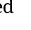

##### 算法 2.1：轨道生成广度优先算法

**Orbit-Breadth-First**（轨道-广度优先）

- **数据结构：**
  - `levelcount`：为每一层计数的整数数组（初始化为 0）
  - `current-level`, `next-level`：权重节点的链表
  - 每个权重节点包含：
    - $\boldsymbol{\omega}=(\omega_1,\dots,\omega_l)$：权重向量
    - `next`：指向下一个权重点的指针
- **输入：**
  - $\boldsymbol{m}=(m_1,\dots,m_l)$：优势向量（所有 $m_i>0$）
  - $D$：Dynkin 矩阵
  - $l$：G 的秩
- **输出：** 权重向量列表 $\boldsymbol{\omega}=(\omega_1,\dots,\omega_l)$ 及三个相关整数
  - 第一个整数表示 $\boldsymbol{\omega}$ 在列表中的位置
  - 第二和第三个整数表示权重向量及 $\boldsymbol{\omega}$ 的计算
- **过程：**
  1.  输出 $\mathbf{m}$；// 初始状态，即尚未研究的原始样本集
  2.  将 $\mathbf{m}$ 插入到 `current-level` 列表的头部；
  3.  设 $level=0$，$levelcount[level]=1$；
  4.  设 $from=1$；// 父级数值的位置
  5.  设 $to=1$；// 新权重值的位置也是已计算权重的总数
  6.  当 ($levelcount[level]>0$ 且 $level<max\ level$) 时
     - $level++;$
     - 设 $from: to$；// 倒计 `current-level` 列表中的权重
     - 对于 (`current-level` 列表中的每个权重 $\boldsymbol{\omega}$)
       - 对于 ($i=1$ 到 $l$)
         - 如果 ($\omega_i>0$)
           - 通过 $\mathbf{v}$ 对 $\boldsymbol{\omega}$ 计算 $\sigma_i$；
           - 如果 ($v_j\geq0$ 对于 $i<j\leq l$ 成立)
             - //存储 $v$？
             - 将 $v$ 插入到 $next-level$ 列表的头部；
             - $levelcount[level]++;$
             - 输出 $v, to, from, i$；
           - 结束如果
         - 结束如果
       - 结束对于
     - $from--; // 遵循当前列表中的“先进先出”原则
     - 结束对于
     - 释放前一个列表 `current-level`；
     - 令 `current-level` = `next-level`；
     - 令 `next-level` = 空表；
     - 结束当

说明：`current-level` 用于存储刚刚计算出的权重（最初，`current-level` 列表仅包含控制权重 $\mu$）。`next-level` 存储由 `current-level` 生成的新权重。当 `current-level` 中的权重全部计算完毕后，将 `next-level` 列表赋值给它，并释放原始列表。

##### 算法 2.2：轨道生成深度优先算法

**Orbit-depth–first**（轨道-深度优先）

- **数据结构：**
  - `levelcount`：为每一层计数的整数数组
  - `weight-structure stack`（权重结构堆栈）
  - 每个 $\mathbf{w}$ 权重结构包含：
    - $\omega=\langle\omega_1, \ldots, \omega_l\rangle$：权重向量
    - `level`：$\omega$ 的层级
    - `from`：标记父级数值的整数
    - $i$：下一个待测试的索引
- **输入：**
  - $\mathbf{m}=\langle m_1, \ldots, m_I\rangle$：控制权重
  - $D$：Dynkin 矩阵
  - $l$：G 的秩
  - `maxlevel`：计算轨道的最大层级
- **输出：** 权重向量列表 $\omega=\langle\omega_1, \ldots, \omega_l\rangle$ 及四个相关整数
  - 第一个整数表示 $\omega$ 在列表中的位置
  - 第二个整数表示 $\omega$ 的层级
  - 第三和第四个整数表示权重向量及 $\omega$ 的计算
- **过程：**
  1.  令 `level`= 0，`levelcount`[`level`]= 1，$i$= 1；
  2.  令 `from`= 1；// 父级数值的位置
  3.  令 `to`= 1；// 新权重值的位置，即已计算权重的总数
  4.  输出 $\mathbf{m}$；// 初始状态，即尚未学习的原始样本集合
  5.  将 $\mathbf{m}$，`level`，`from`，$i$ 放入堆栈；
  6.  当 (堆栈非空) 时
     - 从堆栈中弹出 $\omega$，`level`，`from`，$i$；
     - 当 ($i \leq l$) 时
       - 如果 ($\omega_i > 0$)
         - 如果 ($v_j \geq 0$ 对于 $i < j \leq l$ 成立)
           - //存储 $v$ ?
           - 如果 ($i = 1 \leq \bar{j}$)
             - 从堆栈中弹出 $\omega$，`level`，`from`，$i + 1$；// 然后返回到 $\omega$
           - `level` $+ -$；
           - `levelcount`[`level`] $+ -$；
           - 输出 $v$，`level`，`from`，$i$，`to`；
           - 如果 (`level` $\geq$ `max level`) 跳出 `while` 循环；
           - 将 $v$ 复制到 $\omega$；// 继续 $\omega = v$ 的轨道
           - 令 $i$ 等于 $D_{\bar{j}}$ 中的第一个元素；
         - 否则
           - $i + -$；
         - 结束如果
       - 结束如果
       - 否则
         - $i + -$；
       - 结束如果
     - 结束当
     - 结束当

注意：上述提到的权重被视为学习算法中生成的样本数据或相关参数权重。

#### 示例分析

从 UCI 专用数据集下载了八个数据集（如表 2.2 所示），其中包含样本数量。这些数据集的样本数量和属性值数量各不相同。在测试过程中，删除了属性值不完整的示例，并将连续值离散化。这里，将其分为三个离散状态。

在此示例中，分别测试了八个数据集。初始样本集作为输入控制权重，并建立相应的 Dynkin 矩阵。利用 $\omega_i$ 与 0 之间的关系来确定下一层节点的生成，其中 $\omega_i > 0$ 表示样本集尚未完成分类，即存在多个类别。根据控制权重和 Dynkin 矩阵中相应的指数值，执行上述提到的轨道生成广度优先和深度优先学习算法。我们在算法分析中指出，深度优先算法在一定程度上可以降低存储成本并提高时间效率。对 OBF（轨道广度优先）和 ODF（轨道深度优先）算法进行测试和比较，测试结果汇总于表 2.3。

**表 2.2：** 测试数据集。

| 名称 | 属性 | 类别数 | 样本数 |
|---|---|---|---|
| Soybean-Large | 35 | 19 | 562 |
| Pima | 8 | 2 | 768 |
| Balance-Scale | 4 | 3 | 625 |
| Baloon | 4 | 2 | 20 |
| Hayes | 4 | 3 | 132 |
| Housing | 13 | 5 | 506 |
| Ionosphere | 34 | 2 | 351 |
| Lenses | 4 | 4 | 24 |

**表 2.3：** 测试结果比较。

| 名称 | OBF | ODF | OBF 时间 (秒) | ODF 时间 (秒) |
|---|---|---|---|---|
| Soybean-Large | 91.10 | 90.93 | 132.23 | 43.54 |
| Pima | 77.08 | 75.00 | 9.00 | 3.68 |
| Balance-Scale | 73.76 | 71.08 | 4.72 | 1.05 |
| Baloon | 80.26 | 75.00 | 1.12 | 0.23 |
| Hayes | 78.79 | 78.79 | 1.08 | 0.18 |
| Housing | 63.38 | 66.45 | 14.00 | 4.32 |
| Ionosphere | 91.73 | 88.75 | 11.98 | 3.21 |
| Lenses | 89.16 | 86.83 | 1.61 | 0.02 |
| 平均数据 | 80.66 | 79.10 | | |


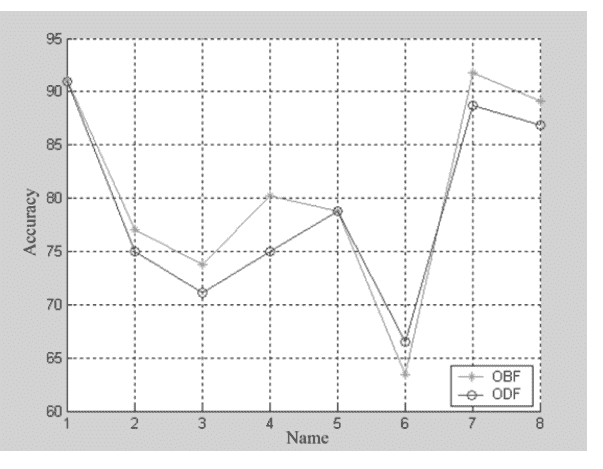

图 2.2：OBF 和 ODF 算法分类准确率对比。

OBF 代表广度优先算法，ODF 代表深度优先算法。OBF Time 和 ODF Time 分别是 OBF 和 ODF 算法的执行时间。显而易见，OBF 的整体分类准确率高于 ODF。由于每个测试数据集的大小和属性数量不同，准确率也有所差异，且如 图 2.2 所示，ODF 在时间成本方面具有更明显的优势。

#### 2.2.2.2 带有启发式信息的 LML 子空间轨道生成学习算法

**算法 2.3：带有启发式信息的 LML 子空间轨道生成学习算法**

`GENERATED_ORBITS (P, c(x), G_N)`

// P 是样本数据集，c(x) 是目标函数，$G_n$ 是轨道划分的基

-   1) 将样本数据集 $P$ 映射到 $\mathbf{A}$，即 $\Phi: P \rightarrow \mathbb{F}_{q}$
    // 针对具体问题使用不同的 $A$

-   2) 取 $\mathbb{E}_{q}$ 上的 n 维行向量，构成集合 $\mathbb{F}_{q}^{n}$，
    $$ \mathbb{F}_{q}^{n}=\left\{\left(x_{1}, x_{2}, \ldots, x_{i}, \ldots, x_{n}\right) \mid x_{i} \in \mathbb{F}_{q}, i=1,2,3, \ldots n\right\} $$
    // 使用向量 $(x_{1}, x_{2}, \ldots x_{i}, \ldots, x_{n})$ 表示任意样本

-   3) 调用算法 4，设置 $T$，获得 $G_{n}$
    // 具体问题的 $T$ 设置不同，因此 $G_{n}$ 的使用也不同

-   4) `for (i=1; i ≤ k; i++)`
    (1) 取 $T_i \in G_n$，并按以下方式处理 $\mathbb{E}^g_q$：
    $$(\langle x_1, x_2, \dots, x_i, \dots, x_n\rangle, T_i) \mapsto \langle x_1, x_2, \dots x_i, \dots, x_n\rangle T_i$$
    获得 $\mathbb{E}^g_q$ 的子空间轨道 $M$。

    (2) 根据包含（或反包含）关系，生成 $M$ 的子空间的交生成集 $L(M)$。由 $L(M)$ 上的偏序给出有序生成格 $L_0(M)$（或 $L_R(M)$）。

    (3) 确定 $L_0(M)$（或 $L_R(M)$）上最大的（或最小的）$\cap_{X \in M} X$

    -   如果成功找到 X，则获取 c(x) 的值，$F \leftarrow (T_i, c(x))$；
    -   否则丢弃 X；
    `End if;`

    (4) 从样本集 $\mathbb{E}^p_q$ 中删除获得目标学习结果的样本，得到新的样本集 $\mathbb{E}^g_q$；
    `End for;`

-   5) 对于每个目标函数 $c(x)$，输出集合 $F$；
    // 在处理分类问题时，目标函数 $c(x)$ 在 $R$ 中针对两类问题 $C = \{-1, 1\}$ 进行评估：对于多类问题 $C = \{1, 2, \dots, k\}$ 以及回归问题 $C \subseteq R [15]$。

注意：关于算法 2.3：

(1) 排列学习问题的各种状态和轨道；

(2) 合理选择 $T$ ($T \in G_n$) 及 $T$ 的设置规则；

(3) 区分学习样本集的正确性；

学习样本的正确率为 $L(g): L(f) = P\{f(x)=y\}$，其中 $x$ 是待研究的例子，$y$ 是 $x$ 的真实结果，$f$ 是学习方法。通常，我们希望能找到使 $y \cdot f(x) > 0$ 的学习方法 $f(x)$。

(4) 确定目标轨道：
根据每次寻找最大元（最小元素）的过程，获得最小偏序链，即目标轨道。

(5) 终止条件。
所有待研究的样本都被放入结果集中（即样本集为空）并确定了相应的目标轨道。

在轨道生成过程中，关键步骤是如何确定要扩展的节点。不同的确定方法会导致形成不同的轨迹生成策略。如果在确定轨道节点时能充分利用与学习问题相关的启发式信息，通过评估节点的重要性，在轨道划分时选择重要性更高的节点进行扩展，从而获得最优轨道。使用算法 4 来解决划分规则 $T$ 的设置和轨道排列的问题。

**算法 2.4：划分规则 T 的设置和轨道的排列：**

`RULE (P, c(X), G_n)`

// $P$ 是样本集，$c(X)$ 是目标函数，$G_n$ 是划分规则的最终集合

(1) 基于样本集 $P$ 设置属性集合：$Attribute = \{ A_1, A_2, \dots, A_i, \dots, A_n \}$
// $n$ 是属性数量

(2) 如果属性值是离散值，则
为每个属性设置属性值集合：$Value(A_i) = \{ k_1, k_2, \dots, k_i, \dots, k_m \}$；
// $m$ 是属性值的数量
否则，对连续属性进行离散化，然后设置属性值集合；

(3) $h = 0$； `for (j = 1; j ≤ n, j++)`
`for (i = 1; i ≤ m, i++)`
对于 $k_i$ 对应的统计类别 $C$，计算属于类别 $C$ 且属性值为 $k_i$ 的样本数 $P_{C_i}$，以及属性值为 $k_i$ 的样本总数。
如果 $P_{C_i} = 1$，则 $\{ T_h = \{attribute = i\}$;
$G_n \leftarrow T_h$;
$h++$;
从样本集 $P$ 中移除已知类别的样本；
`End for`
`End for`

(4) 在剩余的样本集 $P'$ 中统计 $k_i$ 和 $k_{ij}$ 的 $P_{C_i}$ 值，如上所述在步骤 3 中，并获得 $T_h$；
// $k_i$ 和 $k_{ij}$ 来自不同的属性

(5) 增加统计的属性值，直到样本集 $P$ 为空，并返回划分规则集 $G_n$。

在分类问题中，为了合理选择由算法 2.4 生成的规则集 $G_n$ 中的 $T_1$，将启发式信息定义为可区分类别中的样本数（最大数量）。对于给定的样本，其类别是已知的。从初始状态（未分类）开始，根据寻找目标的启发式信息，如果样本被正确分类，则找到目标轨道。完成算法。否则，丢弃路径并退回一步。重复直到所有样本都被正确分类。

**算法 2.5：规划选择算法：**

`SELECT-RULE (G_n)`

(1) 从规则集 $G_n$ 中选择两个规则，让每个规则由一组可能不同的特征属性表示，$T_i = \{ k_1, k_2, \dots, k_n \}$ 和 $T_j = \{ k'_1, k'_2, \dots, k'_m \}$，并标记选定的规则，表明它们已被比较。

(2) 计算相似度函数 $simi(T_i, T_j) = 1 - dist(T_i, T_j) / \text{max-dist}$。这里，根据类似性的不同属性对判断的重要性与贡献是不同的。根据类似性特征的不同特性，为不同的特征属性分配不同的权重，以确定重要性和贡献，可以定义带加权特征属性的正则相似度函数。

$$ simi(T_i, T_j) = \frac{ |T_i \cap T_j| }{ |T_i| } = \frac{ \sum_{k_i \in T_i \cap T_j} W_i }{ \sum_{k_i \in T_i} W_i } $$

// 根据相似度函数的值，我们可以看到规则的相似度，其中 $dist(\mathcal{T}_{i}, \mathcal{T}_{j})$ 是规则 $\mathcal{T}_{i}$ 和 $\mathcal{T}_{j}$ 之间的距离，$\text{max-dist}$ 是规则集中的最大距离，$w_{i}$ 是 $\mathcal{T}_{i}$ 的特征属性权重。根据经验和实际情况，仅需确定各种特征属性的相关性。

(3) 否则，重新选择比较规则，直到规则集中的规则都被比较，并结束算法。

对于监督学习，学习者输入带有标记（或输出值）的训练集（或输入）。样本通常以属性向量的形式给出，因此输入空间是 $\mathbb{R}^{n}$ 的子集。一旦给定了输入向量，就可以为该问题选择一定数量的假设函数集，其中线性函数最容易理解，应用也最简单。它可以以对偶形式表示。然而，复杂的实际应用需要比假设空间中的线性函数更具表达能力；它们需要比线性函数更具表达能力的空间。换言之，目标的概念通常不能由给定属性的简单线性函数生成。相反，我们应该寻找更抽象的数据特征进行研究。将数据映射到高维空间增加了线性学习者的计算能力，而对偶空间的扩展使得此步骤的隐式操作成为可能。对偶形式表示学习者的优势在于，可调参数的数量不依赖于表示中输入属性的数量。在具体的学习实践中，存在一些具体的学习问题。首先，学习算法可能效率低下，例如出现局部极小值的情况。其次，输出规模的假设往往过大而不切实际。第三，如果学习示例的数量有限，过大的假设函数类别将导致过拟合和泛化能力差。第四，学习算法通常受大量参数控制；参数的选择通常通过启发式参数调整过程完成，使得学习系统难以使用且不可靠 [10]。

##### 示例与分析 [16]

例 1：以人口分类为例，训练示例见表 2.4。

-   (1) 对应于算法，第一步是识别人口最具代表性的属性：发色、眼色、身高和体重。身高和体重是连续属性；我们通过区域值对其进行离散化，将身高分为三组：$>180.00 \mathrm{cm}, <170.00 \mathrm{cm}$，和 $170.00 \mathrm{cm} \leqslant$ 身高 $\leqslant 180.00 \mathrm{cm}$。体重分为 $>100.00 \mathrm{kg}, <60.00 \mathrm{kg}$，和 $60.00 \mathrm{kg} \leqslant$ 体重 $\leqslant 100.00 \mathrm{kg}$。当然，在许多问题中，可以使用 $\Phi$ 来离散化属性，从而简化任务。

-   (2) 每个实例的属性以 $(x_{1}, x_{2}, x_{3}, x_{4})$ 的行向量形式（有四个属性）书写，并通过计算每个属性的信息增益来定义样本集的偏序结构。


##### 表 2.4：实验数据表。

| ID | 人群分类 | 头发颜色 | 眼睛颜色 | 身高(cm) | 体重(kg) |
| :--- | :--- | :--- | :--- | :--- | :--- |
| 1 | 高加索人 | 金色 | 蓝色 | 189.00 | 160.00 |
| 2 | 高加索人 | 金色 | 蓝色 | 215.00 | 235.00 |
| 3 | 高加索人 | 红色 | 黑色 | 170.00 | 140.00 |
| 4 | 高加索人 | 金色 | 黑色 | 175.00 | 190.00 |
| 5 | 高加索人 | 红色 | 棕色 | 185.00 | 200.00 |
| 6 | 高加索人 | 红色 | 棕色 | 155.00 | 100.00 |
| 7 | 高加索人 | 黑色 | 黑色 | 210.00 | 120.00 |
| 8 | 高加索人 | 黑色 | 棕色 | 220.00 | 123.00 |
| 9 | 高加索人 | 黑色 | 棕色 | 215.00 | 118.00 |
| 10 | 黑人 | 黑色 | 棕色 | 170.00 | 70.00 |
| 11 | 黑人 | 黑色 | 棕色 | 178.00 | 73.00 |
| 12 | 黑人 | 黑色 | 棕色 | 180.00 | 82.50 |
| 13 | 黑人 | 黑色 | 棕色 | 175.00 | 95.00 |
| 14 | 黑人 | 黑色 | 棕色 | 185.00 | 100.00 |
| 15 | 黑人 | 灰色 | 棕色 | 185.00 | 200.00 |
| 16 | 黑人 | 灰色 | 棕色 | 155.00 | 100.00 |
| 17 | 黑人 | 灰色 | 棕色 | 166.00 | 100.00 |
| 18 | 黑人 | 灰色 | 棕色 | 160.00 | 95.00 |
| 19 | 黑人 | 灰色 | 棕色 | 167.00 | 107.00 |
| 20 | 黑人 | 灰色 | 棕色 | 166.00 | 100.00 |
| 21 | 亚裔 | 黑色 | 棕色 | 155.00 | 50.00 |
| 22 | 亚裔 | 黑色 | 棕色 | 165.00 | 60.00 |
| 23 | 亚裔 | 黑色 | 棕色 | 168.00 | 60.00 |
| 24 | 亚裔 | 黑色 | 棕色 | 153.00 | 45.00 |
| 25 | 亚裔 | 黑色 | 棕色 | 132.00 | 42.50 |
| 26 | 亚裔 | 黑色 | 棕色 | 166.00 | 50.00 |
| 27 | 亚裔 | 黑色 | 黑色 | 160.00 | 47.50 |
| 28 | 亚裔 | 黑色 | 黑色 | 167.00 | 53.50 |
| 29 | 亚裔 | 黑色 | 黑色 | 160.00 | 47.50 |
| 30 | 亚裔 | 黑色 | 黑色 | 167.00 | 53.50 |
| 31 | 亚裔 | 黑色 | 黑色 | 160.00 | 47.50 |
| 32 | 亚裔 | 黑色 | 黑色 | 167.00 | 53.50 |

(3) 设定 $T$，通过观察、统计和计算，以获得合理的 $G_{R}$。头发为“金色”或“红色” => “高加索人”，头发为“灰色” => “黑人”，眼睛为“黑色” => “非黑人”，等等。我们给出 $T$ 如下：

- $T_{1}=\{\text{灰色}, ?, ?, ?\}$
- $T_{2}=\{\text{金色}, ?, ?, ?\}$
- $T_{3}=\{\text{红色}, ?, ?, ?\}$
- $T_{4}=\{?, ?, <170.00, ?\}$
- $T_{5}=\{?, ?, ?, >100.00\}$

(4) 依次取 $T_i \in G_n$ $(i = 1, 2, 3, 4)$。相应地，对于 $c(x) = \text{黑人}$，ID 编号为 15 至 20；对于 $c(x) = \text{高加索人}$，ID 编号为 1、2、4；对于 $c(x) = \text{高加索人}$，ID 编号为 3、5、6；对于 $c(x) = \text{亚裔}$，ID 编号为 21 ~ 32；对于 $c(x) = \text{高加索人}$，ID 编号为 7 ~ 9；对于 $c(x) = \text{黑人}$，ID 编号为 10 ~ 14。写下每个值对应的 $F$（$c(x)$ 有三个值）。

(5) 输出：
- $c(x) = \text{高加索人}$，$F = \{(T_2), (T_3), (T_1, T_2, T_3, T_4, T_5), c(x) = \text{高加索人}\}$
- $c(x) = \text{黑人}$，$F = \{(T_1), (T_1, T_2, T_3, T_4, T_5), c(x) = \text{黑人}\}$
- $c(x) = \text{亚裔}$，$F = \{(T_1, T_2, T_3, T_4), c(x) = \text{亚裔}\}$

将本文描述的算法（简称为 GO）获得的分类准确率（误差）与 N-Bayes 和 C4.5 算法获得的结果（列于表 2.5）进行比较，表明该算法是可行的，并且在一定程度上优于 N-Bayes 和 C4.5。

##### 表 2.5：准确率比较表。

| 算法 | C4.5 | N-Bayes | GO |
| :-------- | :--- | :------ | :- |
| 准确率 (%) | 91.53 | 86.82 | **97.69** |

本例中的目标轨迹如图 2.3 所示：

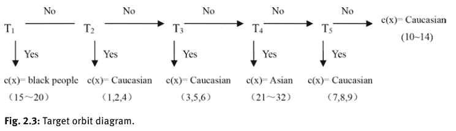

例 2：从 UCI 数据库收集了八个数据集（见表 2.2），这些数据没有属性默认值。使用这些算法对数据集中的样本进行分类；其中 2/3 的数据用于训练，剩余的 1/3 用于测试。将本文提出的算法（简称为 GO）的分类准确率与使用 N-Bayes、C4.5 和 K 近邻（K-NN）算法获得的结果进行比较（如表 2.6 所示），结果如图 2.4 所示。可以容易地看出，本文提出的算法在分类准确率方面优于其他算法。这也说明了该算法的可行性和有效性。

##### 表 2.6：分类准确率比较。

| 领域 | N–Bayes | C4.5 | K–NN | GO |
|---|---|---|---|---|
| Pima | 75.00 | 96.13 | 97.53 | 98.30 |
| Balance–Scale | 58.08 | 85.30 | 84.76 | 89.48 |
| Soybean–Large | 90.03 | 62.45 | 77.41 | 88.21 |
| Housing | 60.67 | 57.37 | 77.90 | 84.50 |
| Ionosphere | 87.75 | 80.82 | 82.35 | 92.15 |
| Hayes | 78.03 | 87.42 | 75.84 | 95.20 |
| Lenses | 70.83 | 59.63 | 92.00 | 96.00 |
| Balloon | 75.00 | 80.01 | 79.86 | 81.65 |
| 平均数据 | 74.42 | 76.14 | 83.46 | 90.69 |

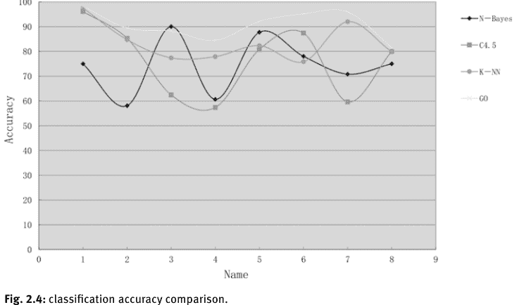

## 2.3 一般线性群 GL$_n$(F$_q$) 作用下 LML 学习子空间轨道生成格学习算法

### 2.3.1 问题描述

- (1) 在给定 $G_n$ 的学习过程中，每个轨道 M 生成的格 L$_R$(M) 之间的包含关系有何作用；
- (2) 给定格 L$_R$(M) 中子空间的特性是什么，即 L$_R$(M) 中 F$^n_q$ 的子空间条件在学习过程中起什么作用；
- (3) 在机器学习过程中，每个格 L$_R$(M) 的特征多项式的意义是什么；
- (4) 如果根据包含关系查找集合 L(M) 的偏序关系，当 L$_O$(M) 和 L$_R$(M) 在学习过程中形成几何格时。

上述四个问题在学习活动中的作用可以理解为如下：

- (1) 轨道生成格之间的包含关系可用于确定使用划分规则来分割样本数据集，从而生成轨道节点的顺序；
- (2) 样本数据集被划分为轨道所需的变换条件；
- (3) 轨道节点中数据之间关系的表达；
- (4) 确定从样本集合（或目标函数）生成的轨道节点的几何性质，这根据划分规则集的性质而不同。由此产生的轨道空间满足的条件也不同。这里，我们讨论在 $G_n$ = GL$_n$(F$_q$) 下的这四个问题。

### 2.3.2 一般线性群 GL$_n$F$_q$ 作用下 LML 学习子空间轨道生成格

设 GL$_n$F$_q$ 在 F$_q^n$ 作用下由所有 $m$ ($0 < m < n$)-维子空间组成的轨道记为 M($m$, $n$)。由 M($m$, $n$) 生成的集记为 L($m$, $n$)，即 L($m$, $n$) 是 M($m$, $n$) 中子空间的交集集合，且 F$_q^n$ 是 M($m$, $n$) 中零子空间集合的交集。L($m$, $n$) 的偏序由子空间的包含（反包含）关系指定，记为 L$_O$($m$, $n$) (L$_R$($m$, $n$))。由定理 2.2 可知，L$_O$($m$, $n$) (L$_R$($m$, $n$)) 是有限格，且 $\cap_{X \in M(m,n)}X$ 和 F$_q^n$ 分别是 L$_O$($m$, $n$) (L$_R$($m$, $n$)) 的最大（最小）和最小（最大）元素。由定理 2.3 可知，L$_R$($m$, $n$) 是原子格，且 M($m$, $n$) 是其原子集。

**定义 2.28.** 格 L$_O$($m$, $n$) 和 L$_R$($m$, $n$) 称为在一般线性群 GL$_n$(F$_q$) 作用下由子空间轨道 M($m$, $n$) 生成的格。

**定理 2.7.** 设 $n > m \ge 0$。则

$$
L_R(m, n) \supset L_R(m_1, n) \quad (2.18)
$$

的充要条件是 $m \ge m_1 \ge 0$。

**证明.** 当 $n$ = 1 时的充分性；(2.18) 自然成立。下面设 $n \ge 2$。让我们证明

$$
L_R(m, n) \supset L_R(m - 1, n) \quad (2.19)
$$

首先，要证明它，只需证明

$$
M(m - 1, n) \subset L_R(m, n) \quad (2.20)
$$

设 $P \in M(m - 1, n)$，其中 $P$ 是一个 $m - 1$-维子空间。取 $v_1, v_2, \dots, v_{m-1}, v_m, \dots, v_n$ 作为 F$_q^n$ 的基，其中 $v_1, v_2, \dots, v_{m-1}$ 是 $P$ 的基。由于 $m < n$，在 F$_q^n$ 中有两个不同的 $m$-维子空间：

$$
\langle P, v_m \rangle \text{ 和 } \langle P, v_{m+1} \rangle
$$

使得

$$
P = \langle P, v_m \rangle \cap \langle P, v_{m+1} \rangle \in \mathrm{L}_R(m, n).
$$

因此，(2.20) 成立。

接下来证明 (2.18)。当 $m = m_1$ 时，(2.18) 自然成立。在 $m > m_1$ 的情况下，由 (2.19) 得，

$$
L_R(m, n) > L_R(m - 1, n) > \dots > L_R(m_1, n).
$$

因此，(2.18) 成立。

**必要性：** 从 $M(m_1, n) \subset L_R(m_1, n) \subset L_R(m, n)$，我们可以看出 L$_R(m, n)$ 包含一个 $m_1$-维子空间 $Q$，且 $Q$ 是 M($m$, $n$) 中 $m$-维子空间的交集。因此，在 L$_R(m, n)$ 中存在一个 $m$-维子空间 $P$，使得 $P \supset Q$。因此，$m \ge m_1 \ge 0$。

**推论 2.1. [8]** 设 $n > m \ge 0$。则，

$$
\{0\} \in L_R(m, n).
$$

因此，L$_R(m, n)$ 的最大元素是 $\cap_{X \in \mathrm{M}(m,n)} X = \{0\}$。

现在，给出 F$_q^n$ 中作为 L$_R(m, n)$ 元素的子空间的条件。

**定理 2.8.** 给定 $n > m \ge 0$，L$_R(m, n)$ 由 F$_q^n$ 和 F$_q^n$ 中所有维度 $\le m$ 的子空间组成。

**证明：** 根据格 L$_R(m, n)$ 的定义，F$_q^n \in L_R(m, n)$。由于 L$_R(m, n)$ 中的每个子空间都是有限个 $m$-维子空间的交集，L$_R(m, n)$ 中不等于 F$_q^n$ 的每个子空间维度都 $\le m$。反过来，假设 $P$ 是 F$_q^n$ 的一个 $k$-维子空间，$0 \le k \le m$。则 $P \in M(k, n) \subset L_R(k, n)$。由定理 2.7 可知，L$_R(k, n) \subset L_R(m, n)$。因此，$P \in L_R(m, n)$。

**推论 2.2.** 设 $L_R(\mathbb{F}_q^n)$。则，

$$
L_R(n - 1, n) = L(n, F_q).
$$


**定理 2.9.** 设 $1 \leq m \leq n - 1$。对于任意 $X \in \mathrm{L}_0(m, n)$，定义

$$ r(X)= \begin{cases} \dim X, & \text{若 } X \neq \mathbb{F}_q^n \\ m+1, & \text{若 } X=\mathbb{F}_q^n \end{cases} \tag{2.21} $$

那么，$r: \mathrm{L}_0(m, n) \to \mathbb{N}$ 是 *格* $\mathrm{L}_0(m, n)$ 的 *秩函数*。

**定理 2.10.** 设 $1 \leq m \leq n - 1$。对于任意 $X \in \mathrm{L}_0(m, n)$，定义

$$ r'(X)= \begin{cases} m+1 - \dim X, & \text{若 } X \neq \mathbb{F}_q^n \\ 0, & \text{若 } X=\mathbb{F}_q^n \end{cases} \tag{2.22} $$

那么，$r': \mathrm{L}_R(m, n) \to \mathbb{N}$ 是格 $\mathrm{L}_R(m, n)$ 的秩函数。

现在，给出 $\mathrm{L}_R(m, n)$ 的 *特征多项式*。

**定理 2.11.** 设 $n > m \geq 0$。则，

$$ \chi\left(\mathrm{L}_R(m, n), t\right)= \sum_{k=m+1}^{n} N(k, n) g_k(t) . $$

其中

$$ N(k, n)=|\mathbb{M}\left(k, n\right)|=\left[\begin{array}{l} n \\ k \end{array}\right]_q= \frac{\prod_{i=n-k+1}^{n}\left(q^i - 1\right)}{\prod_{i=1}^{k}\left(q^i - 1\right)} \tag{2.23} $$

是 $\mathbb{F}_q^n$ 中 $k$ 维子空间的数目，且 $g_n(x)$ 是高斯多项式。

*证明.* 标记 $V=\mathbb{F}_q^n$，$L=\mathrm{L}_R(m, n)$，以及 $L_0=\mathrm{L}_R\left(\mathbb{F}_q^n\right)$。对于 $P \in L$，指定

$$ \mathbf{L}^P=\{Q \in \mathbf{L} \mid Q < P\}=\{Q \in \mathbf{L} \mid Q \geq P\} $$

以及

$$ \mathbf{L}_0^P=\{Q \in \mathrm{L}_0 \mid Q < P\}=\{Q \in \mathrm{L}_0 \mid Q \geq P\} \ . $$

显然，$\mathbf{L}^V=\mathbf{L}$。对于 $P \in \mathbf{L}$，$P \neq V$，根据定理 2.8，存在 $\mathbf{L}^P=\mathbf{L}_0^P$。取任意 $P \in \mathbf{L}_0$，其中 $\mathbf{L}\left(\mathbf{X}_0^P, t\right)=g_{\dim P(q)}(t)$。此外，由 (2.22) 定义的 $r': \mathrm{L}_R(m, n) \rightarrow \mathbb{N}$ 是 $\mathbf{L}=\mathrm{L}_R(m, n)$ 的秩函数，即存在 $\mathbf{L}^V$ 上的秩函数 $r'$，且 $\mathbf{L}^V$ 是具有最大元素 $\{0\}$ 和最小元素 $\mathbb{F}_q^n$ 的格。因此，

$$ \chi\left(\mathbf{L}^V, t\right)=\sum_{P \in \mathbf{L}^V} \mu(V, P) t^{r'(0) - r'(P)} \ . $$

将 $t$ 视为给定的数值。这里，公式 $f(x) = \sum_{x \leq y} g(y)\mu(x, y)$ 左边的 $f(x)$ 取为 $f(V)=\chi\left(\mathbf{L}^V, t\right)$，右边的 $g(y)$ 取为 $g(P)=t^{r'(0) - r'(P)} = t^{m+1 - r'(P)}$。那么，

$$ t^{m+1}=g(V)=\sum_{P \in \mathbf{L}^V} \chi\left(\mathbf{L}^P, t\right)=\sum_{P \in \mathbf{L}} \chi\left(\mathbf{L}^P, t\right) \ . $$

再次，我们有
$$ t^{m+1} = \sum_{P \in \mathbf{L}_0} \chi(\mathbf{L}_0^P, t) . $$

根据定理 2.8，我们可以看到 $\{P \in \mathbf{L}_0 \mid \dim P \leq m\} = \{P \in \mathbf{L} \setminus \{V^\perp\}\}$。因此，

\begin{align}
\chi(\mathbf{L}, t) &= \chi(\mathbf{L}^V, t) = t^{m+1} - \sum_{P \in \mathbf{L} \setminus \{V^\perp\}} \chi(\mathbf{L}^P, t) \\
&= \sum_{P \in \mathbf{L}_0} \chi(\mathbf{L}_0^P, t) + \sum_{P \in \mathbf{L} \setminus \{V^\perp\}} \chi(\mathbf{L}^P, t) \\
&= \sum_{\substack{P \in \mathbf{L}_0 \\ \dim P > m}} \chi(\mathbf{L}_0^P, t) - \sum_{\substack{P \in \mathbf{L}_0 \\ \dim P \leq m}} \chi(\mathbf{L}_0^P, t) - \sum_{P \in \mathbf{L} \setminus \{V^\perp\}} \chi(\mathbf{L}^P, t) \\
&= \sum_{\substack{P \in \mathbf{L}_0 \\ \dim P > m}} \chi(\mathbf{L}_0^P, t) + \sum_{P \in \mathbf{L} \setminus \{V^\perp\}} \chi(\mathbf{L}^P, t) - \sum_{P \in \mathbf{L} \setminus \{V^\perp\}} \chi(\mathbf{L}^P, t) \\
&= \sum_{\substack{P \in \mathbf{L}_0 \\ \dim P > m}} \chi(\mathbf{L}_0^P, t) = \sum_{k=m+1}^{n} N(k, n)g_k(t)
\end{align}

其中 $A$ 的表示由 (2.24) 给出。

现在，我们讨论 $\mathbf{L}_0(m, n)$ 和 $\mathbf{L}_R(m, n)$ 的几何性质。

**定理 2.12.** 给定 $1 \leq m \leq n - 1$，$\mathbf{L}_0(m, n)$ 是有限个格。

**定理 2.13.** [8] 设 $1 \leq m \leq n - 1$，则

-   (a) $\mathbf{L}_R(1, n)$ 和 $\mathbf{L}_R(n - 1, n)$ 是有限几何格；
-   (b) 对于 $2 \leq m \leq n - 2$，$\mathbf{L}_R(m, n)$ 是有限原子格，但不是几何格。

*证明.* 由定理 2.8，$\mathbb{F}_q^0$ 是唯一的最小元素，且原子是 $m$ 维子空间（在 $\mathbf{L}_R(m, n)$ 中，$1 \leq m \leq n - 1$）。因此，$\mathbf{L}_R(m, n)$ 是有限原子格。

对于 $X \in \mathbf{L}_R(m, n)$，由 (2.22) 定义 $r'$。由定理 2.9，$r'$ 是格 $\mathbf{L}_R(m, n)$ 的秩函数。

当 $m = n - 1$ 时，$\mathbf{L}_R(n - 1, n)$ 是有限个格。

(b) 设 $v_1, v_2, \dots, v_n$ 是 $\mathbb{F}_q^n$ 的一组基。因为 $2 \leq m \leq n - 2$，我们有期望的 $U = \langle v_1, v_2, \dots, v_m \rangle$，$W = \langle v_{m+1}, \dots, v_{m+2} \rangle \in \mathbb{M}(m, n) \subset \mathbf{L}_R(m, n)$。易见 $U \wedge W = \mathbb{F}_q^0$ 且 $r'(U \wedge W) = 0$。如果 $m = 2$，则 $U \vee W = \{0\}$。如果 $m \geq 2$，则 $U \vee W = \langle v_{m+1}, \dots, v_{m+2} \rangle$。在这两种情况下，都有 $\dim(U \vee W) = m - 2$ 且 $r'(U \vee W) = m + 1 - (m - 2) = 3$。然而，$r'(U) = r'(W) = m + 1 - m = 1$。因此，

$$ r'(U \wedge W) + r'(U \vee W) \leq r'(U) + r'(W) \quad (2.24) $$

是不成立的。因此，对于 $U$ 和 $W$，$G_2$ 不成立。故对于 $2 \leq m \leq n - 2$，$\mathbf{L}_R(m, n)$ 不是几何格。

### 2.3.3 学习算法与示例

在特定条件下，由 $n$ 阶正规矩阵形成的群元素可以用 $r$ 个参数 $\alpha_i$ 来表征。那么，$A = A(\alpha_1, \dots, \alpha_r)$，$r$ 个参数的连续变化可能生成整个流形。对于 $GL_n(\mathbb{F}_q)$，矩阵 $A$ 的 $n^2$ 个元素校准了 $n^2$ 维欧几里得空间中的点。这种 $n^2$ 个参数的变化描述了从欧几里得空间中的一个点到另一个点的变化关系。因此，$GL_n(\mathbb{F}_q)$ 具有各种 $r$ 个参数的子群可以表示为 $n^2$ 维欧几里得空间中的某些 $r$ 维子空间。学习系统中数据状态的变化通过参数的变换来证明。

更具体地说，从任意元素 $a$ 开始，通过 $r$ 个参数的连续变化，产生一条弧，连接群中任意一对空间，形成图的结构。

这里是李群拓扑的代数观点，其中集合 $U^q(n, r)$ 由任意整数 $n \in M$ 的任意邻域内的整数 $n + mq' (m = 0, \pm 1, \pm 2, \dots, q)$ 组成（其中 $q$ 是固定的素数，$r$ 是整数）。选择一个 $q$ 为 M 定义了特定的拓扑。对于 $n$ 的给定邻域，整数是固定的，$m$ 是动态的，不同的 $r$ 值给出 $n$ 的不同邻域 [17]。

通过连通性和拓扑，考虑具体的学习问题如下。每个样本 $x_i$ 由特定的属性值表示为 $x_i = (k_1, k_2, \dots, k_m)$，并假设该问题有几个类别，记为 $C = (c_1, c_2, \dots, c_n)$。根据属性值，样本集中的每个样本都在学习子空间中表示，且同类样本具有相似或相等的属性值。它们应该彼此连接，不同类别的某些属性值可能相似或相等，但必然存在不同的属性值。当然，我们可以首先确定每个类别的关键属性值 $k_i$（中心点），通过比较与 $k_i$ 的距离，可以有效地确定样本所属的类别。同一类中的一个样本必然存在于另一个样本的邻域内，而不同类别的集合彼此不连通。在一般线性群作用下，学习子空间轨道生成格算法如下。

#### 2.3.3.1 在一般线性群作用下学习子空间轨道生成格算法

**算法 2.6: ILLE 算法**

**General Linear Group Generated_ORBITS** $(P, c(x), GL_n(\mathbb{F}_q))$
// $P$ 是样本数据集，$c(x)$ 是目标函数，$GL_n(\mathbb{F}_q)$ 是轨道划分的基础

1) 将样本数据集 $P$ 映射到 $\mathbb{F}_q$，即 $\Phi: P \rightarrow \mathbb{F}_q$
   // 对应于使用不同 $\Phi$ 的具体问题

2) 取 $\mathbb{F}_q$ 上的 $n$ 维行向量形成一个集合 $\mathbb{F}_q^n$，
   $$\mathbb{F}_q^n = \{ (x_1, x_2, \dots, x_{i,j}, \dots, x_n) \mid x_i \in \mathbb{F}_q, i=1, 2, 3, \dots, n \}$$
   // 使用向量 $(x_1, x_2, \dots, x_{i,j}, \dots, x_n)$ 表示任意样本


3) 调用算法 4，设置 $T$，获得 $\mathrm{GL}_{n}\left(\mathbb{F}_{q}\right)$
4) 对于 $(i=1; i \leq m, i++)$

    (1) 取 $T_{i} \in \mathrm{GL}_{n}\left(\mathbb{F}_{q}\right)$，并按如下方式处理 $\mathbb{F}_{q}^{n}$：
    $$(x_{1}, x_{2}, \ldots, x_{i}, \ldots, x_{n}), T_{i}) \mapsto (x_{1}, x_{2}, \ldots, x_{i}, \ldots, x_{n}), T_{i}$$

    获得 $\mathbb{F}_{q}^{n}$ 的子空间轨道 $M(m, n)$；// **s**atisfaction（满足）关系
    $$0<m<n$$

    (2) 通过 $M(m, n)$ 的子空间交集生成集合 $L(m, n)$。根据包含（逆包含）关系在 $L(m, n)$ 上指定偏序。获得轨道生成格 $L_{Q}(m, n)$（或 $L_{R}(m, n)$）。

    (3) 确定最大元（或最小元） $\bigcap_{X \in L(m, n)}X \cap L_{O}(m, n)$（或 $L_{R}(m, n)$）
    - 如果成功找到 $X$，则获取 $c(x)$ 的值，$F \leftarrow(T_{i}, c(x))$；
    - **否则** 丢弃 $X$；
    **结束 if**；

    (4) 从样本集 $\mathbb{F}_{q}^{n}$ 中删除已获得目标学习结果的样本，获得新的样本集 $\mathbb{F}_{q}^{n}$；
    **结束 for**；

    (5) **对于** 每个目标函数 $c(x)$，输出集合 $F$。

### 2.3.3.2 案例研究 [15]

取一组数据，该数据是对意大利同一产区生产、由三个不同工厂酿造的葡萄酒化学成分分析的结果。部分数据列于表 2.7 中。表 2.7 中的数据有 15 列，其中 ID 为数据编号，Class 为其类别。每条数据有 13 个属性，分别为：

1. 酒精含量
2. 苹果酸
3. 灰分
4. 灰分碱度
5. 镁
6. 总酚类
7. 类黄酮
8. 非类黄酮酚类
9. 原花青素
10. 色泽强度
11. 色调
12. 稀释葡萄酒的 OD280/OD315
13. 脯氨酸

在表中，这些属性分别表示为 Attr1, Attr2…Attr13。对于给定的数据，没有进行属性删除。

共有 178 个实验数据，分为三个类别：

- 类别 1: 59
- 类别 2: 71
- 类别 3: 48

**表 2.7：部分实验数据表。**

| ID | Class | Attr1 | Attr2 | Attr3 | Attr4 | Attr5 | Attr6 | Attr7 |
|---|---|---|---|---|---|---|---|---|
| 1 | 1 | 14.23 | 1.71 | 2.43 | 15.6 | 127 | 2.8 | 3.06 |
| 2 | 1 | 13.2 | 1.78 | 2.14 | 11.2 | 100 | 2.65 | 2.76 |
| 3 | 1 | 13.16 | 2.36 | 2.67 | 18.6 | 101 | 2.8 | 3.24 |
| 4 | 1 | 13.24 | 2.59 | 2.87 | 21 | 118 | 2.8 | 2.69 |
| ... | | | | | | | | |
| 120 | 2 | 13.49 | 1.66 | 2.24 | 24 | 87 | 1.88 | 1.84 |
| 121 | 2 | 12.99 | 1.67 | 2.6 | 30 | 139 | 3.3 | 2.89 |
| 122 | 2 | 11.96 | 1.09 | 2.3 | 21 | 101 | 3.38 | 2.14 |
| 123 | 2 | 11.66 | 1.88 | 1.92 | 16 | 97 | 1.61 | 1.57 |
| ... | | | | | | | | |

| ID | Class | Attr8 | Attr9 | Attr10 | Attr11 | Attr12 | Attr13 |
|---|---|---|---|---|---|---|---|
| 1 | 1 | 0.28 | 2.29 | 5.64 | 1.04 | 3.92 | 1065 |
| 2 | 1 | 0.26 | 1.28 | 4.38 | 1.05 | 3.4 | 1050 |
| 3 | 1 | 0.3 | 2.81 | 5.68 | 1.03 | 3.17 | 1185 |
| 4 | 1 | 0.39 | 1.82 | 4.32 | 1.04 | 2.93 | 735 |
| ... | | | | | | | |
| 120 | 2 | 0.27 | 1.03 | 3.74 | 0.98 | 2.78 | 472 |
| 121 | 2 | 0.21 | 1.96 | 3.35 | 1.31 | 3.5 | 985 |
| 122 | 2 | 0.13 | 1.65 | 3.21 | 0.99 | 3.13 | 886 |
| 123 | 2 | 0.34 | 1.15 | 3.8 | 1.23 | 2.14 | 428 |
| ... | | | | | | | |

在此示例中，每个样本数据表示为 $x = \{x_1, x_2, \ldots, x_{12}, x_{13}\}$，其中 $x_i$ 表示样本 $x$ 的单个属性值，代表用 $P$ 表示的样本集，$P = \{x_1, x_2 \ldots x_i \ldots \}$，即样本集可以表示为矩阵结构，每个样本是一个行向量空间。由于选定的样本数据是连续数据，考虑属性值之间的距离（可视为相似度）以指定样本集上的偏序关系。从集合中选择一个特定样本作为参考点，计算测试样本与其相似度以获取每个样本的归属，即最终分类。每次从三种类型的数据中随机选择三分之二的用于训练，剩余三分之一的数据用于测试。将最终分类结果的准确性与使用决策树 C4.5 算法获得结果的准确性进行比较。表 2.8 显示了分类的正确性，分类准确率如图 2.5 所示。

**表 2.8：分类准确率对比。**

| | 实验次数 | 1 | 2 | 3 | 4 | 5 | |
|---|---|---|---|---|---|---|---|
| 训练正确率 | 0.9916 | 1 | 1 | 1 | 1 | 平均 |
| 测试正确率 | 1 | 1 | 0.9863 | 1 | 0.9926 | 正确率 |
| $C_{4.5}$ | 0.9611 | 0.9214 | 0.6732 | 0.7958 | 0.8150 | |

| | 实验次数 | 6 | 7 | 8 | 9 | 10 | |
|---|---|---|---|---|---|---|---|
| 训练正确率 | 0.9845 | 1 | 1 | 0.9916 | 1 | 0.99677 |
| 测试正确率 | 0.9352 | 1 | 0.9835 | 1 | 0.9661 | 0.98637 |
| $C_{4.5}$ | 0.7746 | 0.7521 | 0.8311 | 0.7984 | 0.6522 | 0.79749 |

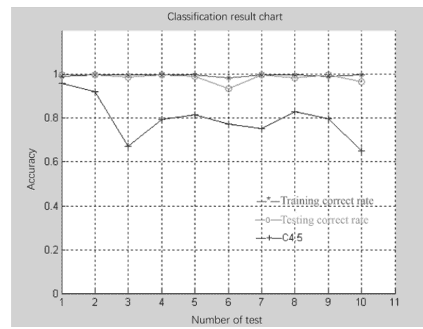

**图 2.5：分类准确率图。**

## 2.4 总结

我们进一步扩展了李群机器学习的内容，给出了 (1) LML 中相关偏集和格的基本概念，(2) LML 子空间轨道生成格学习算法，以及 (3) 在一般线性群 GLn(ℱn) 作用下 LML 学习子空间轨道生成格学习算法。根据独立划分假设公理、一致性假设公理以及观测空间集各元素的基本事实，可以描述为一组独立实参数，结合李群机器学习的几何模型特征。在李群机器学习空间的基础上，建立了李群机器学习子空间轨道生成格的概念，并给出了在观测集中各种典型群（如一般线性群的轨道生成格学习算法、轨道生成格广度优先和深度优先学习算法、启发式学习算法及其他典型群的学习算法）作用下，由多个相同维数或轨道和秩子空间导出的生成格理论和相关学习算法格理论。本章提出的算法也通过相应的例子进行了验证。

## 参考文献

- [1] Li FZ, Kang Y. The study of machine learning theory frame based on Lie group. Journal of Yunnan University for Nationalities, 2004, 13(4), 251–255.
- [2] Xu H, Li FZ. Lie group machine learning's axiom hypothesize// IEEE International Conference on Granular Computing. IEEE, 2006, 401–404.
- [3] Shi J, Cao H. Research on Heuristic Search. Microcomputer & Its Applications, 2004, 23(10), 10–12.
- [4] Wan Z. Geometry of Classical Groups over Finite Fields, Student literature. Lund, Sweden/Chartwell_Bratt, Broley, United Kingdom, 1993.
- [5] Artin E. Geometric Algebra. Interscience Publishers, 1957.
- [6] Huo Y, Wan ZX. On the Geometry of Lattices Generated by Orbits of Subspaces Under Finite Classical Groups. Journal of Algebra, 2001, 243(1), 339–359.
- [7] Witt E. Theorie der quadratischen Formen in beliebigen Körpern. Journal Für Die Reine Und Angewandte Mathematik, 1937, 1937(176), 31–44.
- [8] Huo Y, Liu Y, Wan ZX. Lattices generated by transitive sets of subspaces under finite classical groups II the orthogonal case of odd characteristic. Communications in Algebra, 1992, 20(4), 1123–1144.
- [9] Wan HP, He HC, Zhou YQ. Local nuclear methods and applications. Journal of Shandong University, 2006, 41(3), 60–62.
- [10] Cristianian N, Shawe-Taylor J. An introduction to support Vector Machines: and other kernel-based learning methods. Printed in the United Kingdom at the University Press, 2000.
- [11] Borel A. Linear Algebraic Groups. Benjamin, New York, 1971.
- [12] Bott R. Homogeneous Vector Bundles. Annals of Mathematics, 1957, 66(2), 203–248.
- [13] Jacobson N. Lie Algebras. Wiley, New York, 1962.
- [14] Snow DM. Weyl group orbits. ACM Transactions on Mathematical Software, 1990, 16(1), 94–108.
- [15] UCI Learning Repository, http://www.ics.uci.edu/learn/databases.html.
- [16] Chen SF, Chen ZQ. Artificial Intelligence and Knowledge Engineering. Nanjing: Nanjing University Press, 1997.
- [17] Ma ZQ. Group theory in Physics. Beijing: *Science China Press*, 1998.
- [18] Chen F. Lie Group Machine Learning (LML) Subspace Orbit Generation Algorithm and Its Application. Thesis. Soochow University, 2007.
- [19] Chen F, Li FZ. Lie Group Machine Learning (LML) Subspace Orbit Generation Theory and Algorithm. Journal of Soochow University, 2007, 23(1), 61–66.
- [20] Chen F, Li FZ. A Study on Learning Subspace Orbit Generating Lattice Algorithm under the Action of Gln (Fq) Group in Lie Group Machine Learning (LML). Nanjing. First Jiangsu Province Young Scientists Annual Meeting Proceedings collected papers, 2006, 36–46.
- [21] Chen F, Li FZ. Lie Group Machine Learning (LML) Subspace Orbit Generation Lattice Algorithm. Computer Engineering and Applications, 2007, 43(15), 184–187.
- [22] Li FZ, He SP, Lin TY. Lie group machine learning. Nanjing. The second annual Young Scientists in Jiangsu Province, 2008.
- [23] Wan ZX, Huo ZX. A Lattice Generated by a Limited Typical Subgroup Space Orbit, Beijing: *Science China Press*, 2004.


## 3 辛群学习

本章分为五个部分。3.1 节提出了一个问题。3.2 节介绍了李群机器学习中的辛群分类器设计。3.3 节描述了李群机器学习中的辛群分类器算法。3.4 节展示了应用示例。最后，3.5 节总结了本章内容。

### 3.1 问题陈述

我们知道，当问题由群论描述时，问题原型的特征应尽可能保持离散状态。为了实现这一效果，应在问题原型的同一框架内进行尽可能多的离散化。例如，有限元方法是在由原型离散解组成的 Sobolev 函数空间的同一框架下进行的，从而保留了对称性和正定性等基本特征。因此，有效性和可靠性在根本上得到了保证。为了进一步研究李群机器学习，我们在各种类型的李群中选择了辛群这一典型李群来构建辛群分类器。以下是对辛群和辛几何研究成果的简要介绍。

- 冯康等人将辛几何算法应用于哈密顿系统的实现过程 [1]。

哈密顿系统是一类重要的动力系统。所有实际且耗散可忽略的物理过程都可以表示为哈密顿系统，它们在结构生物学、天体力学和偏微分方程领域得到广泛应用。其中一些已被纳入美国研究重点计划“重大挑战”中。冯康及其研究小组对该问题进行了深入且系统的研究。他们发展了计算方法的新一分支——辛几何算法，并在该领域取得了重要成果。这些成果已被广泛应用于动态天文学研究和解析力学理论中。1984 年，冯康在北京微分几何与微分方程研讨会——偏微分方程数值计算上，提出了将辛几何应用于数值分析，其主要基于解析力学的基本定理：系统的解是一个单参数测度保持变换，即辛变换，这创造了一种新的哈密顿力学计算方法，克服了离散方程保持原系统辛结构的问题。其离散相流可以被视为一系列离散辛变换，以维持系统的相面积和相体积。哈密顿方法的基础是辛差分格式。通过群论建立广义哈密顿系统的分岔和混沌等变理论是有价值的。特别是，具有某些对称性的哈密顿系统可以转化为适当 Poisson 流形上的低维系统。冯康在辛几何领域的研究成果可总结为如下：

- 提出了哈密顿系统辛几何算法的完整理论框架。
- 普及了解析力学的生成函数和 Hamilton-Jacobi 方程理论，并构建了具有多任意阶精度的辛格式。
- 发展了形式向量场和相流幂级数的完整理论，现称为常微分方程的后置误差分析。
- 将哈密顿系统的辛算法推广到具有李代数结构的动力系统，实现了动力系统算法的几何化，并建立了接触系统的接触算法以及耗散系统的体积保持算法。

该算法在稳定性和长期跟踪能力方面具有独特优势。与经典的 R-K 方法相比，它具有良好的稳定性。

- William T Shaw 解释了 Penrose 的双侧扭结理论与 Ashtekar 的 BMS 群理论之间的差异，并比较了这两种方法 [2]。Ashtekar 和 Strebel 提出了引力场 $h^*$ 中辐射模型的相空间。作者得出结论，该相空间中的 BMS 群保持了辛结构理论。在单位空间中，电磁场理论中的角动量对应于哈密顿系统密度的积分。具体来说，这是生成元 K 的变换。以下方程用于在辛方法中获取两个球面的积分，

$$H_{Q_{k}}[S_{2}]-H_{Q_{k}}[S_{1}]=\int_{S_{1}}^{S_{2}} H f_{k} d^{3} S$$

其中 $S_{1}$ 和 $S_{2}$ 是引力场 $h^{*}$ 中的两个球面。为了观察与 Penrose 方法在动量问题求解上的异同，作者展示了该方法的证明，从中可以看出辛结构在解决动量问题上具有优越性。

- Gao 等人将辛几何算法应用于地震射线计算 [3]。结果表明，所获得的射线具有良好的光滑性，并且具有穿透阴影区域的强大能力。从辛群的定义可以证明，其李代数由满足 $B^{T}J + JB = 0$ 的无穷小辛变换 $B$ 组成。由于奇数维中不存在非退化反对称矩阵，辛空间是偶数维的，相空间也是如此。辛几何算法是一种用于哈密顿系统的计算方法。它使离散化方程保持系统的辛结构。作者使用了辛几何算法和四阶 Runge–Kutta 算法（这是一种耗散算法）来计算和比较射线路径和走时。同时，作者使用辛算法计算了第一部分地质结构的射线路径和振幅。本文给出了地震射线方程的辛差分格式。从射线追踪方程的一般形式出发，通过简化得到一组正则方程，然后采用简单的二阶 Euler 型辛差分格式，

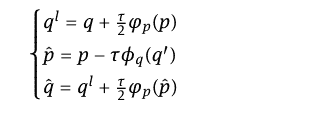

其中 $q^{l}$ 代表中间变量，$p$ 代表广义动量。经过演示分析，发现使用辛算法进行的第一截面设计结果与预期值相符。

- Wu 等人将辛算法应用于多体系统的动力学 [4]，该算法已成功用于求解多体系统动力学方程。通常，非约束正则形式动力学方程的辛算法可以直接利用冯康的辛算法，但多体系统的解可以使用合成辛算法获得。由于多体系统的主要部分被分为两部分，因此很自然地想到通常用于积分的 R-K（Runge–Kutta）方法。该算法具有良好的截断误差。此类多体方程的解可以是简单的 Newton 迭代法，但 Newton 迭代法在求解刚性哈密顿系统时存在一些缺点。因此，作者提出了基于流形上数值分析后置误差分析理论的综合辛算法。这是基于常微分方程的数值解，该数值解可以被视为扰动微分方程的精确解，然后扩展到流形 $M$。假设 $X$ 是 $C^{\infty}$ 向量场（$M \xrightarrow{X} TM$）

$$\dot{x} = X(x)$$

即 $C^{\infty}$ 流形 $M \in \mathbb{R}^{n}$，其中 $x(t) = \exp(tX)$ 是 (3.1) 的相流。此外，$\psi_{h}: M \rightarrow M$ 是 (3.1) 精确时间 $h$ 流的数值近似，并且


### 辛算法及其应用

#### 1. 高阶辛算法的构造
存在一个扰动向量场 $\hat{X}(h): M \to M$。
$$ \psi_h = \exp(h\hat{X}(h)) \quad X(h) = \hat{X}(h) + O(h^p) $$
如果 $X$ 是哈密顿结构，则 $\psi_h$ 是辛形式，且 $\hat{X}(h)$ 也是哈密顿结构。该算法可用于构造高阶辛算法。它基于常微分方程的数值解。进一步地，它可以被视为相应扰动微分方程的精确解，并扩展到流形问题上。

#### 2. 机器人系统动力学
(5) Wang 等人建立了机器人系统动力学的正则方程，并将该方程与辛算法结合，以消除动力学计算中的误差累积，确保计算的准确性 [5]。作者指出，机器人系统的动力学方程有多种方法，但这些方法是等价的。其结果可以表示为一组微分-代数方程。在微分-代数方程的求解方面，主要有三个问题：
- 约束秩亏问题；
- 积分过程的默认问题；
- 数值计算的稳定性。

数值积分过程的默认问题是确保数值计算精度的关键。为了确保计算的准确性，Baumgarte 提出了一种基于违约量的修正方法，该修正需要引入修正系数。因此，作者将正则方程和辛群方案相结合，用于消除机器人动力学计算的误差累积，以确保计算的准确性。

根据系统的二阶动力学方程和系统的正则方程，系统的正则方程统一为
$$ \dot{Z} = f(Z) = J^{-1} \frac{\partial H}{\partial Z} $$
然后，给出方程的系统矩阵。作者的方法将微分流形划分为辛流形，这反映了离散系统动力学的本质，并提高了计算精度。

#### 3. 分子动力学计算
(6) Han 等人使用辛算法进行纳米加工中的分子动力学计算 [6]。假设哈密顿系统的表达式为
$$ H = \sum_{i} \frac{p_{i}^{2}}{2m_{i}} + U $$
其中 $p_i$ 是第 $i$ 个粒子的动量，$U$ 描述粒子间相互作用的势能函数。该公式通常可以按以下方式数值求解：
```
do i = 1 to m
p_i = p_{i-1} - d_i\tau \frac{\partial U(q_{i-1})}{\partial q_{i-1}}
q_i = q_{i-1} - c_i\tau \frac{\partial U(p_{i-1})}{\partial p_{i-1}}
i = i + 1
end do
```
(3.2)

在 (3.2) 中，$q_i$ 是第 $i$ 个粒子的位置坐标。在辛积分中，系数 ($c_i$, $d_i$) 应由新计算坐标的误差满足 $O(\tau_{L+1})$ 的条件来确定，此时差分方程具有 $L$ 阶精度。当阶数 $L$ 小于 4 时，(3.2) 中的因子等于 0，从而简化了计算。当 $L > 4$ 时，我们可以重复应用 (3.2) 来获得空间中粒子的轨迹。请注意，(3.2) 是自启动的，因此通常不需要存储中间结果。因此，该方法所需的存储空间非常小。已经证明，辛算法是一种高精度收敛算法。在分子动力学模拟中，运动方程代表一系列初始差分方程。原则上，这些方程可以通过标准数值积分解获得。然而，许多常用的数值积分算法是非辛算法。该算法的缺点是，在长时间模拟中系统能量会耗散；因此，模拟结果不能通过统计力学原理进行分析。用于分子动力学的辛数值积分算法可分为两类：预测算法和预测-校正算法。作者证明了辛算法的有效性。

#### 4. 电磁场应用
(7) Zhang Kai 将一种多辛算法应用于电磁场中的 PML（完美匹配层）方法 [7]。辛方法用于揭示哈密顿微系统两种哈密顿形式的等价性。对于非线性波动方程，使用此多辛算法建立了算法与一般差分格式之间的关系。然后，根据非线性波动方程的不同形式以及辛空间和方向上不同方法的效果，获得了一种有效的辛算法。此外，作者考虑了双曲方程数值格式的稳定性，从多个方面给出了评估辛形式格式的准则，并讨论了各种辛算法的欧拉盒格式以及一些稳定性结果。

#### 5. 微分博弈策略
(8) Xu 等人基于哈密顿系统和辛算法给出了微分策略的数值解 [8]。采用微分解法求解两点问题是有用的。微分博弈问题可归结为哈密顿系统。哈密顿系统的一个重要几何特征是其相流保持辛结构；因此，辛几何算法在线性最优问题中效果良好。辛几何算法可以保持对称性；因此，算法可以保持哈密顿辛结构和所有特征，使得系统能量在很长一段时间内保持不变，并且在解决微分博弈计算问题时取得了良好的结果。

#### 6. 非均匀电磁波导
(9) Sun 等人介绍了基于哈密顿系统的辛半解析方法在非均匀电磁波导中的应用 [9]。力学中的哈密顿系统使用对偶变量来描述问题。在电磁场中，电场和磁场形成一个对偶变量。哈密顿系统应用于电磁波导问题。根据电磁波导的哈密顿系统理论，辛几何应用于该系统。辛几何可用于任何非均匀材料，并给出了辛半解析方法。根据哈密顿变分原理，哈密顿系统本质上是混合混成系统，问题由对偶变量描述，这与电磁场的特性相吻合。从实验结果来看，我们可以看到辛算法可以产生非常好的结果。

#### 7. DNA 结构动力学模拟
(10) Zhang Peiguo 提出了 DNA 结构动力学计算机模拟算法和图形后处理方法 [10]。在本文中，通过结合弹性细杆模型和相关研究结果，重新建立了描述超长弹性杆形成的常微分/代数方程。这些方程以哈密顿方程的形式表达，并由辛算法给出表面方程的数值解。本文给出了超长弹性杆图形处理的计算实例。对于 DNA 的研究，具有原始扭转率的弹性杆被用作 DNA 的宏观力学模型。在解决问题的过程中，不仅使用了曲率、扰动率、标架等主要参数，还设计了对应的图形表示模型和算法，以提供 DNA 的计算机图形表示。在本文中，使用保留辛结构的变换方法转换 DNA 结构的数学模型。最后，使用相关算法非常精确地模拟了 DNA 模型。该方法为超细弹性杆结构和动力学的计算机图形学提供了模型和算法支持。

总之，辛几何和辛群已成功应用于许多领域，但这些应用大多涉及动力学领域。近年来，偏微分方程和轮廓


## 3.2 李群机器学习中的辛群分类器设计

曲线演化在图像处理和计算机视觉中已发展成为一种重要方法。由于辛几何在处理偏微分问题时具有明显的优势，我们将图像处理与机器学习视角下的学习问题相结合进行研究。由于辛群也是一个微分流形，在图像处理领域，我们可以利用微分方法研究几何表面曲线的演化，从而将曲线演化问题转化为纯粹的偏微分方程。在描述曲线的几何特征时，单位向量和曲率是两个重要参数。单位向量描述曲线的方向，而曲率描述曲线的弯曲程度。曲线演化理论利用曲线的单位向量和曲率等几何参数来研究曲线随时间的变化。

在参数曲线的情形下，曲线依赖于任意参数化曲线的导数。假设曲线为 $C(p, t) = [x(p, t), y(p, t)]$，其中 $p$ 是任意参数变化的量，$t$ 是时间。如果曲线的内单位法向量为 $\boldsymbol{n}$，曲率为 $k$，则曲线沿其单位向量方向的演化可由以下方程表示：

$$ \frac{\partial c}{\partial t} = V(k)n $$

如果将模型的几何曲线应用于图像分割，我们需要引入测地距离的概念。同时，根据图像数据的功能，信息从图像中被分割出来。问题的描述通常要求模型参数必须是欧几里得向量空间的元素。在此，我们尝试在辛空间中研究该问题，该空间与欧几里得空间相比具有不同的结构。由于正交群是通过欧几里得内积获得的，而辛群是通过反对称内积获得的，本章将李群应用于辛流形。

流形上的辛结构是一个非退化的闭微分 2 形式，这在辛流形和黎曼流形中是相同的。流形上的向量场定义了一个相流，即单参数微分同伦群。流形上的向量场也可以构成一个李代数。根据相关定理，辛流形的任何部分都可以转化为标准的辛结构。由于辛空间的辛结构在某些方面类似于欧几里得结构，辛流形的辛结构类似于黎曼结构。黎曼结构赋予切空间欧几里得结构，并使切空间与余切空间同构。辛结构也是如此。

假设 $(M, \omega)$ 是一个辛流形，任何切向量 $\eta \in T_{x}M$ 在 $T_{x}M$ 上给出一个线性形式。辛代数结构是辛几何积分后的结果。进一步地，利用辛几何在辛空间上构建表面分割模型，以解决图像处理中的几何分割问题。然后，根据辛群结构构造相应的学习分类器，以解决推理、学习和决策中的关键问题。

从辛群的概念和相关性质可知，辛群是一个 $2n$ 维结构，由矩阵乘积组成。在 $2n$ 维空间中，引入了一个 2 维反对矩阵，并将实正交矩阵定义中的单位矩阵 $I$ 替换为反对称矩阵 $J$，从而可以得到实伪矩阵。辛群是所有 $2J \times 2J$ 实伪矩阵乘积的群。我们可以利用辛群 $2n$ 维结构在群框架内执行学习过程，这满足了李群机器学习中的对偶性假设。由于辛群的实伪矩阵是正交的，假设 $v_1$ 和 $v_2$ 矩阵是正交的。如果 $v_1$ 和 $v_2$ 映射到学习过程的对象，则过程对应于训练样本和训练目标的学习过程。李群机器学习中的问题以辛群结构呈现，以研究李群机器学习中的分类器问题。下一节将介绍分类器的辛群设计。有关辛群的基本概念，请参阅附录 17.4。

在本节中，我们给出了辛群分类器的描述。在辛群框架下，高维图像降维过程在图像分类的具体示例中给出。然后，给出了辛群框架下的问题描述。分类样本表示为辛矩阵。随后，给出了辛矩阵中样本表示方法和辛矩阵简化方法。最后，给出了辛群分类器的设计方法和过程 [11, 12]。

### 3.2.1 辛群分类器描述

参考文献 [13–20] 描述了分类器相关知识和通用设计方法。本节使用辛群构建分类器，即辛群分类器。其原理可描述如下：通过对 $2n$ 维样本进行特征提取，获得 $2n$ 维特征向量。求解权重向量的过程是分类器的训练过程。使用已知类别学习样本获得权重向量的训练过程如图 3.1 所示：

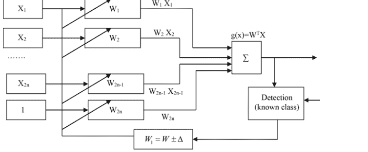

**图 3.1**：利用已知样本获取权重向量的训练示意图。

- 已知 $x_1 \in \omega_1$，通过检测调整权重向量，最终使 $x_1 \in \omega_1$。
- 已知 $x_2 \in \omega_2$，通过检测调整权重向量，最终使 $x_2 \in \omega_2$。

这样，我们可以通过有限数量的样本确定权重向量。

训练过程是求解已知类别样本集的权重向量 $w$ 的过程，这是一个求解线性联立不等式方程的过程。求解时：

- (1) 只能求解线性可分问题 $g(x) = W^TX$；
- (2) 联立方程的解在不同条件下是非奇异的，因此存在不同的解；由此得出寻找最优解的问题。
- (3) 求解 $W$ 的过程是训练过程。训练的共性是先给出准则函数，然后寻找使准则函数趋于极值的优化算法。不同的算法具有不同的准则函数。算法可分为迭代方法和非迭代方法。在本章中，我们利用辛群知识给出分类和图像识别中辛群分类器的设计过程。

我们提出了一种用于辛群框架下高维图像降维的方法，作为研究分类器设计过程的基础。3D 图像流分析和形状分析是计算机视觉和图像处理领域的重要研究方向。Squire 等人 [21] 介绍了在二维空间中应用李群方法进行 3D 视觉运动和 3D 图像降维的技术。在实际过程中，待处理图像的维度通常较高，因此必须进行降维。$n$ 维图像降维为 $n-1$ 维图像，$n-1$ 维图像降维为 $n-2$ 维图像。

……等等。这样，图像就可以被降维到二维，图像处理将变得简单得多。在对 $n$ 维图像进行采样时，采样点 $(x_1, x_2, \dots, x_n)$ 的坐标是有理数（满足采样定理）。换句话说，我们将 $n$ 维空间中的点 $(x_1, x_2, \dots, x_n)$ 映射到 $n-1$ 维空间中。相应的点由以下形式构造

$$ \begin{pmatrix} i_1 & i_2 & \ldots & i_n \\ j_1 & j_2 & \ldots & j_n \end{pmatrix} $$

这些点被映射为

$$ \begin{pmatrix} \frac{i_1}{j_1} + \lambda \cdot \frac{i_n}{j_n} \cdot \cos \alpha, & \frac{i_2}{j_2} + \lambda \cdot \frac{i_n}{j_n} \cdot \sin \alpha, & \ldots, & \frac{i_{n-1}}{j_{n-1}} \end{pmatrix} $$

其中 $\lambda > 0$ 是缩放因子，$\alpha$ 满足 $\tan \alpha$ 为无理数的条件，这确保了该映射是一个单射（$n$ 维空间中不同的点也被映射到 $n-1$ 维空间中不同的点）。通过这种方式，$n$ 维图像可以在 $n-1$ 维空间中重构。上述 $\alpha$ 的选择确保了映射是单射。原因如下：如果两个不同的点

$$ \begin{pmatrix} \frac{i_1}{j_1}, & \frac{i_2}{j_2}, & \ldots, & \frac{i_n}{j_n} \end{pmatrix} \quad \text{和} \quad \begin{pmatrix} \frac{p_1}{q_1}, & \frac{p_2}{q_2}, & \ldots, & \frac{p_n}{q_n} \end{pmatrix} $$

被映射到 $n-1$ 维空间中的同一点，根据映射的定义，对于 $2 < k < n$，我们有

$$ \frac{i_k}{j_k} = \frac{p_k}{q_k} $$

且

$$ \begin{aligned} \frac{i_1}{j_1} + \lambda \cdot \frac{i_n}{j_n} \cdot \cos \alpha &= \frac{p_1}{q_1} + \lambda \cdot \frac{p_n}{q_n} \cdot \cos \alpha \\ \frac{i_2}{j_2} + \lambda \cdot \frac{i_n}{j_n} \cdot \sin \alpha &= \frac{p_2}{q_2} + \lambda \cdot \frac{p_n}{q_n} \cdot \sin \alpha \end{aligned} $$

然后，解释 $k = 1, 2$ 的情况；如果 $i_1/j_1 \neq p_1/q_1$，则我们有

$$ \tan \alpha = \frac{\frac{i_2}{j_2} - \frac{p_2}{q_2}}{\frac{i_1}{j_1} - \frac{p_1}{q_1}} $$

这与 $\tan \alpha$（为无理数）相矛盾，因此 $i_1/j_1 = p_1/q_1$，这也意味着 $i_2/j_2 = p_2/q_2$，从而确定了点 $(i_1/j_1, i_2/j_2, \dots, i_n/j_n)$ 和 $(p_1/q_1, p_2/q_2, \dots, p_n/q_n)$ 是确定的。

如果定义 $f(i_1/j_1, i_2/j_2, \dots, i_n/j_n)$ 为点 $(i_1/j_1, i_2/j_2, \dots, i_n/j_n)$ 的灰度值，那么点 $(i_1/j_1 + \lambda \cdot i_n/j_n \cdot \cos \alpha, i_2/j_2 + \lambda \cdot i_n/j_n \cdot \sin \alpha, \dots, i_{n-1}/j_{n-1})$ 的灰度值也是 $f(i_1/j_1, i_2/j_2, \dots, i_n/j_n)$，即在这种映射下，$n$ 维的 $f(x_1, x_2, \dots, x_n)$ 和 $n-1$ 维的 $F(x_1, x_2, \dots, x_{n-1})$ 满足

$$ f(x_1, x_2, \dots, x_n) = F(x_1 + \lambda x_n \cos \alpha, x_2 + \lambda x_n \sin \alpha, x_3 \dots, x_{n-1}) $$

考虑 $f(x_1, x_2, \ldots, x_n)$ 和 $g(x_1, x_2, \ldots, x_n)$ 的卷积，

$$ \begin{aligned} &[f(x_1, x_2, \ldots, x_n) * g(x_1, x_2, \ldots, x_n)](u_1, u_2, \ldots, u_n) \\ &= \int \cdots \int f(x_1, x_2, \ldots, x_n) \times g(u_1 - x_1, u_2 - x_2, \ldots, u_n - x_n) dx_1 dx_2 \ldots dx_n \ . \end{aligned} $$

根据上述映射，我们可以得到

$$ \begin{aligned} &f(x_1, x_2, \ldots, x_n) = F(x_1 + \lambda x_n \cos \alpha, x_2 + \lambda x_n \sin \alpha, x_3 \ldots, x_{n-1}) \\ &g(x_1, x_2, \ldots, x_n) \\ &= G(x_1 + \lambda x_n \cos \alpha, x_2 + \lambda x_n \sin \alpha, x_3 \ldots, x_{n-1}) \ . \end{aligned} $$

因此，

$$ \begin{aligned} &\int \cdots \int f(x_1, x_2, \ldots, x_n) \times g(u_1 - x_1, u_2 - x_2, \ldots, u_n - x_n) dx_1 dx_2 \ldots dx_n \\ &= \int \cdots \int F(x_1 + \lambda x_n \cos \alpha, x_2 + \lambda x_n \sin \alpha, x_3 \ldots, x_{n-1}) \\ &\quad \cdot G(u_1 - x_1 + \lambda(u_n - x_n) \cos \alpha, u_2 - x_2 \\ &\quad \quad + \lambda(u_n - x_n) \sin \alpha, u_3 - x_3 \ldots, u_{n-1} - x_{n-1}) dx_1 dx_2 \ldots dx_n \ . \end{aligned} $$

相应的坐标变换如下，

$$ \begin{cases} s_1 = x_1 + \lambda x_n \cos \alpha \ ; \\ s_2 = x_2 + \lambda x_n \sin \alpha \ ; \\ s_3 = x_3 \ ; \\ \cdots \\ s_n = x_n \end{cases} $$

于是，

$$ \begin{aligned} &\int \cdots \int F(x_1 + \lambda x_n \cos \alpha, x_2 + \lambda x_n \sin \alpha, x_3 \ldots, x_{n-1}) \\ &\quad \cdot G(u_1 - x_1 + \lambda(u_n - x_n) \cos \alpha, u_2 - x_2 + \lambda(u_n - x_n) \sin \alpha \ , \\ &\quad u_3 - x_3, \ldots, u_{n-1} - x_{n-1}) dx_1 dx_2 \ldots dx_n \\ &= \int \cdots \int F(s_1, s_2, \ldots, s_n) \times G(u_1 + \lambda u_n \cos \alpha - s_1 \ , \\ &\quad u_2 + \lambda u_n \cos \alpha - s_2, u_3 - s_3, \ldots, u_{n-1} - s_{n-1}) \\ &\quad \cdot \left|\frac{D(x_1, x_2, \ldots, x_n)}{D(s_1, s_2, \ldots, s_n)}\right| ds_1 ds_2 \ldots ds_n \ . \end{aligned} $$

因此，可以得到以下等式，

$$ \begin{aligned} &\int \cdots \int f(x_1, x_2, \ldots, x_n)g(u_1 - x_1, u_2 - x_2, \ldots, u_n - x_n) dx_1 dx_2 \ldots dx_n \\ &= \int \cdots \int F(s_1, s_2, \ldots, s_n)G(u_1 + \lambda u_n \cos \alpha - s_1 \ , \\ &\quad u_2 + \lambda u_n \cos \alpha - s_2, u_3 - s_3, \ldots, u_{n-1} - s_{n-1}) ds_1 ds_2 \ldots ds_n \\ &= K \cdot \int \cdots \int F(S_1, S_2, \ldots, S_{n-1})G(u_1 + \lambda u_n \cos \alpha - S_1, \\ &\quad u_2 + \lambda u_n \sin \alpha - S_2, u_3 - S_3, \ldots, u_{n-1} - S_{n-1}) ds_1 ds_2 \ldots ds_{n-1}. \end{aligned} $$

其中 $K = (x_{n}^{\text{max}} - x_{n}^{\text{min}})$，$x_{n}^{\text{max}}$ 和 $x_{n}^{\text{min}}$ 分别是 $x_{n}$ 的上界和下界。此外，$x_{n}$ 满足条件：对于任何 $x_{n}\notin [x_{n}^{\text{min}}, x_{n}^{\text{max}}]$，$f(x_{1}, x_{2}, \ldots, x_{n})g(u_{1} - x_{1}, u_{2} - x_{2}, \ldots, u_{n} - x_{n}) = 0$。据此，我们可以得到以下内容：

#### 定理 3.1

$$ \begin{aligned} f(x_{1}, x_{2}, \ldots, x_{n}) * g(x_{1}, x_{2}, \ldots, x_{n})(u_{1}, u_{2}, \ldots, u_{n}) \\ \quad=K\cdot [F(x_{1}, x_{2}, \ldots, x_{n-1})*G(x_{1}, x_{2}, \ldots, x_{n-1})] \\ \quad (u_{1}+\lambda u_{n}\cos\alpha, u_{2}+\lambda u_{n}\sin\alpha, u_{3}, \ldots, u_{n}) \end{aligned} $$

其中 $K$ 是由 $f$ 和 $g$ 决定的变量，

$$ \begin{aligned} F(x_{1}, x_{2}, \ldots, x_{n-1}) = f(x_{1}-\lambda X_{n}(x_{1}, x_{2})\cos\alpha, \\ \quad x_{2}-\lambda X_{n}(x_{1}, x_{2})\sin\alpha, x_{3}, \ldots, x_{n-1}, X_{n}(x_{1}, x_{2})) \\ G(x_{1}, x_{2}, \ldots, x_{n-1}) = g(x_{1}-\lambda X_{n}(x_{1}, x_{2})\cos\alpha, \\ \quad x_{2}-\lambda X_{n}(x_{1}, x_{2})\sin\alpha, x_{3}, \ldots, x_{n-1}, X_{n}(x_{1}, x_{2})) \end{aligned} $$

$$ X_{n}(x_{1}, x_{2}) = \frac{\sqrt{\left(x_{1}-\frac{i}{j}\right)^{2}+\left(x_{2}-\frac{m}{n}\right)^{2}}}{\lambda} $$

其中 $i, j, m$ 和 $n$ 是满足以下方程的整数

$$ \frac{x_{2}-\frac{m}{n}}{x_{1}-\frac{i}{j}} = \tan\alpha \qquad (\tan\alpha\text{ 是无理数}). $$

该定理为我们提供了一种将 $n$ 维图像降维到二维的方法。根据此定理，高维图像被降维为低维图像，然后低维图像由相应方法进行处理。

根据上述分析，我们将图像识别归类于辛群框架，研究图像识别的辛群分类器方法，并建立图像特征提取中的独立模型。对于二维空间图像，根据附录 17.4 可以给出相应图像的矩阵表示。假设由不同图像的特征提取形成的训练集为 $F = \{F^{1}, F^{2}, \ldots, F^{M}\}, F^{i} \in R^{N}$，可以形成矩阵 $T = [F^{1}, F^{2}, \ldots, F^{M}]^{\text{T}}$，并通过变换获得辛矩阵的一种特殊形式。如果图像矩阵的形式不同，可以根据不同的辛矩阵区分不同的图像，从而实现分类的目的。通过 $n$ 个统计独立的源图像 $S = (S^{1}, S^{2}, \ldots, S^{n})^{\text{T}}$，通过 $T = AS$ 得到


线性混合，其中 $S$ 是源图像集的矩阵，每个行向量代表一个源图像，$A$ 是混合矩阵。目标是找到恢复矩阵 $W$，并令 $WT=WAS=U$，从而得到使独立源图像得以再现的输出矩阵：$U=WT=WAS$。获得 $U$ 后，利用其行向量作为特征向量构建特征空间，每幅图像都由独立图像的线性组合表示。设 $F^{P}$ 为待识别图像。我们有 $F^{P}=\alpha_{1}U_{1}+\alpha_{2}U_{2}+\cdots+\alpha_{n}U_{n}$，其中 $\alpha=(\alpha_{1}, \alpha_{2}, \ldots, \alpha_{n})$ 是图像在特征空间中的组合系数。我们使用公式 $\alpha=(F^{P})^{T}\times(U)^{+}$，其中 $(U)^{+}$ 表示 $U$ 的伪逆，$(U)^{+}=U(UT^{T})^{-1}$。进一步地，利用新特征空间的坐标，我们可以使用分类器对图像进行分类。

二维源图像 $A$ 天然可以构建为对应的辛矩阵（参见附录 17.4）。设 $B$ 为待检测图像，并使用与处理源图像相同的方法。我们提取图像 $B$ 并构建对应检测图像的辛矩阵。由于图像 $A$ 和 $B$ 的表示矩阵在不同的辛基（octyl groups，此处译为辛基或辛群基，原文似为 symplectic bases/groups 的误写或特定术语）下是不同的，根据共形对称标准矩阵的变换性质，我们可以得到由 $A$ 和 $B$ 组成的矩阵 $A_{1}$ 和 $B_{1}$，其形式为 $\begin{pmatrix} A_{1} & O \\ O & B_{1} \end{pmatrix}$ 的辛矩阵，并使用标准收缩矩阵的简化方法对该矩阵 $\begin{pmatrix} A_{1} & O \\ O & B_{1} \end{pmatrix}$ 进行简化。此外，冯等人 [1] 描述了现有辛矩阵的特殊形式数量。如果辛矩阵处于特殊形式，它可以用作学习过程的训练样本。其他图像应通过相同方法处理，以实现分类目的。考虑辛群的特殊形式，

$M=\begin{pmatrix} A_{1} & O \\ O & B_{1} \end{pmatrix}\in Sp(2n)$。

我们可以得到

$M=\begin{pmatrix} A_{1} & O \\ O & A^{T^{-1}_{1}} \end{pmatrix}, A_{1}\in GL(n, R)$

其中 $A_{1}$ 是源图像的矩阵，其行列式也被计算为

$|M|=|A_{1}||A^{T^{-1}_{1}}|=1$。

在此，我们可以看到

$A_{1}\in GL(n, R)\Rightarrow A_{1}=TP, T^{T}T=I_{n}, P^{\prime}=P>0$（正定矩阵）。

通过计算，我们可以看到

$\begin{bmatrix} p \\ q \end{bmatrix}\in R^{2n}\rightarrow M\begin{bmatrix} p \\ q \end{bmatrix}=\begin{bmatrix} A_{1}p \\ \big(A^{-1}_{1}\big)^{\prime}q \end{bmatrix}\in R^{2n}$。

组合矩阵经过变换处理后得到

$$\begin{bmatrix} A_1 & 0 \\ 0 & A_1^{-1} \end{bmatrix} = \begin{bmatrix} T & 0 \\ 0 & T \end{bmatrix}\begin{bmatrix} P & 0 \\ 0 & P^{-1} \end{bmatrix}$$

其中

$$\begin{bmatrix} T & 0 \\ 0 & T \end{bmatrix} \in O(n) \subset U(n)O(n) = \left\{ \begin{bmatrix} T & 0 \\ 0 & T \end{bmatrix} | T^\prime T = I_n \right\}$$

$$= U(n) \cap \mathrm{GL}(n, \mathbb{R})\left\{ \begin{bmatrix} P & 0 \\ 0 & P^{-1} \end{bmatrix} | P^\prime = P > 0 \right\}\ 。$$

我们可以看到，辛矩阵可以分解为两个辛矩阵的乘积，所得的辛矩阵可以作为检测结果的矩阵。如果由待检查的另一幅图像组成的矩阵与通过源图像 $A$ 的共形变换获得的辛矩阵在形式上相同，则待检查图像与源图像一致，从而达到分类的目的。

### 3.2.2 辛群分类器的设计方法

在辛分类器的设计中，首先应将分类样本表示为辛群，然后利用辛群的张量表示将样本构建为对应的辛矩阵。简化辛矩阵，得到相应的训练特征，作为学习过程的训练样本。最后，以相同方式处理检测样本，并使用辛群分类算法获得样本特征。如果两类特征匹配，则输出结果。辛群分类器的设计方法可分为两个步骤：样本的辛矩阵表示以及辛空间下矩阵的简化方法。样本以辛群的张量形式表示；然后，给出样本的辛矩阵表示。下一步是简化辛矩阵。

#### 3.2.2.1 辛矩阵的简化方法

辛几何是相空间的几何学。辛空间（即相空间）具有特定的辛结构，依赖于双线性反对称非退化内积，即内积 $[x, y] = <x, Jy>$，其中

$$J = J_{2n} = \begin{bmatrix} 0 & +I_n \\ -I_n & 0 \end{bmatrix}\ 。$$

当 $n = 1$ 时，

$$[x, y] = \begin{bmatrix} x_1 & y_1 \\ x_2 & y_2 \end{bmatrix}\ 。$$

因此，与欧几里得空间相比，辛空间中的度量是面积度量而非长度度量，并且辛空间中存在正交概念，这是辛空间与欧几里得空间之间的本质区别。由于在奇数维中不存在经典意义上的非退化反对称阵列，此处的辛空间是偶数维的。辛几何中的辛变换本质上是非线性变换（也称为正则变换），适用于非线性系统处理。其特征值可以通过辛 QR 方法获得。辛 QR 与标准 QR 分解不同。其浮点运算量是原来的四分之一，且原始的 2n 维空间可以转换为 n 维空间。

**定理 3.2.** 任何矩阵都可以构建为哈密顿矩阵。对于矩阵 A，$\begin{bmatrix} A & O \\ 0 & -A^H \end{bmatrix}$ 是哈密顿矩阵 [22, 23]。

**定理 3.3.** 哈密顿矩阵在辛相似变换下保持不变 [22, 23]。

**定理 3.4.** 设 $H \in C^{2n\times 2n}$ 为哈密顿矩阵。则 $e^H$ 是辛矩阵 [2, 22, 23]。

**定理 3.5.** 设 $M = \begin{bmatrix} A_1 & B_1 \\ A_2 & B_2 \end{bmatrix} \in \mathrm{Sp}(2n)$。则 $M$ 可以分解为 $M = M_{2'}M_1M_2$，其中 $M_{2'} \in \mathrm{Sp}(2n)$，$M_1 \in \mathrm{Sp}_{2n}(2n)$，$M_2 \in \mathrm{Sp}_{2n}(2n)$。

*证明.*

$\begin{bmatrix} A_1 & B_1 \\ A_2 & B_2 \end{bmatrix} \begin{bmatrix} I & -A_1^{-1}B_1 \\ O & I \end{bmatrix} = \begin{bmatrix} A_1 & O \\ A_2 & B_2 - A_2A_1^{-1}B_1 \end{bmatrix}$

$\begin{bmatrix} I & O \\ -A_2A_1^{-1} & I \end{bmatrix} \begin{bmatrix} A_1 & O \\ A_2 & B_2 - A_2A_1^{-1}B_1 \end{bmatrix} = \begin{bmatrix} A_1 & O \\ O & B_2 - A_2A_1^{-1}B_1 \end{bmatrix}$

因为 $M = [A, B] \in \mathrm{Sp}(2n)$，$A^TJ B = I$ 且 $A'$ 是对称的，即

$A_1^tB_2 - A_2^tB_1 = I, A_2A_1^{-1} \in \mathrm{Sp}(2n)$

因此，

$A_1^{-1'} = B_2 - A_1^{-1}A_2B_1 = B_2 - (A_2A_1^{-1})^tB_1 = B_2 - A_2A_1^{-1}B_1$。

令

$M_1 = \begin{bmatrix} A_1 & O \\ O & B_2 - A_2A_1^{-1} \end{bmatrix} = \begin{bmatrix} A_1 & O \\ O & A_1^{-1'} \end{bmatrix} \in \mathrm{Sp}_{2n}(2n)$

$M_{2'} = \begin{bmatrix} I & O \\ -A_2A_1^{-1} & I \end{bmatrix} \in \mathrm{Sp}(2n); \quad M_2 = \begin{bmatrix} I & -A_1^{-1'}B_1 \\ O & I \end{bmatrix}^{-1} \in \mathrm{Sp}(2n)$；

因此，我们可以得到 $M = M_{2'}M_1M_2.$

**定理 3.6.** *任何辛矩阵都可以分解为三个特殊辛矩阵的乘积* [22, 23]：

$$M = M_0M_1M_2 \ ,\quad M_0, M_1, M_2 \in \mathrm{Sp}(2n) \ 。$$

*证明. 设* $M = [A, B] \in \mathrm{Sp}(2n)$。*则* $A \in U(n)$。*根据相关定理，存在* $M_0 \in \mathrm{Sp}(2n) = U(n)$ *使得*

$$A = M_0\begin{bmatrix}I & O \\ O & I \end{bmatrix}Q = M_0\begin{bmatrix}Q & O \\ O & Q'^{-1} \end{bmatrix} \ 。$$

*令*

$$B_1 = \begin{bmatrix}Q & O \\ O & Q'^{-1} \end{bmatrix}M_0^{-1}B \ ，$$

*即*

$$B = M_0\begin{bmatrix}Q & O \\ O & Q'^{-1} \end{bmatrix}\begin{bmatrix}C_1 \\ C_2 \end{bmatrix} \ 。$$

*因此，我们有*

$$\begin{aligned} M = [A, B] &= \left[ M_0\begin{bmatrix}Q & O \\ O & Q'^{-1} \end{bmatrix}\begin{bmatrix}I \\ O \end{bmatrix}, M_0\begin{bmatrix}Q & O \\ O & Q'^{-1} \end{bmatrix}\begin{bmatrix}C_1 \\ C_2 \end{bmatrix} \right] \\ &= M_0\begin{bmatrix}Q & O \\ O & Q'^{-1} \end{bmatrix}\begin{bmatrix}I & C_1 \\ O & C_2 \end{bmatrix} \in \mathrm{Sp}(2n) \\ &= M_0M_1M_2 \end{aligned}$$

*其中*

$$M_1 = \begin{bmatrix}Q & O \\ O & Q'^{-1} \end{bmatrix} \in \mathrm{Sp}(2n), M_2 = \begin{bmatrix}I & C_1 \\ O & C_2 \end{bmatrix} \in \mathrm{Sp}(2n) \ 。 \qquad \square$$

**定理 3.7.** *设* $S \in \mathbb{C}^{2n \times 2n}$ *为辛矩阵。则分解* $S = QR$，*其中* $Q$ *是辛酉矩阵，* $R$ *是上三角矩阵* [22, 23]。

**定理 3.8.** *两个辛矩阵的乘积是辛矩阵* [22, 23]。

对于哈密顿矩阵 $M$，我们可以使用辛相似变换来识别系统的特征值。此外，原始的 $2n$ 维空间可以转换为 $n$ 维空间。具体步骤如下：

- 令 $N = M^2 = \begin{bmatrix}A^T & G \\ F & -A \end{bmatrix}$
- 寻找一个辛矩阵 $Q$，并令 $Q^T N Q = \begin{bmatrix}B & R \\ O & B^T \end{bmatrix}$，其中 $B$ 是上 Hessenberg 矩阵（$b_{ij} = 0, i > j + 1$），且 $Q$ 是 Householder 矩阵 $H$。
- 通过辛 QR 分解方法计算 $\lambda(B) = \{ \mu_1, \ldots, \mu_n \}$。
- $\lambda_1 = \sqrt{\mu_i}, \lambda_{n+i} = -\lambda_i$。


#### 定理 3.9

设豪斯霍尔德矩阵 $H$ 为

$$H = H(k, \mu) = \left[ \begin{array}{cc} P & 0 \\ 0 & P \end{array} \right]$$

其中

$$P = I_n - \frac{2UU^*}{U^*U}, \;\; U = (0, \ldots, 0; u_k, \ldots, u_n)^T \neq 0 \, .$$

则 $H$ 是一个辛酉矩阵，且 $U^*$ 是 $U$ 的共轭转置。

**证明。** 要证明 $H$ 是辛矩阵，只需证明 $H^*JH = J$ 成立即可。

$$H^*JH = \left[ \begin{array}{cc} P & 0 \\ 0 & P \end{array} \right]^* \left[ \begin{array}{cc} P & 0 \\ 0 & P \end{array} \right] = \left[ \begin{array}{cc} 0 & P^*P \\ -P^*P & 0 \end{array} \right] \, .$$ (3.3)

由于 $P = I_n - 2UU^*/U^*U$，则 $P^* = P$，且

$$\begin{aligned} P^*P &= P^2 = \left( I_n - \frac{2UU^*}{U^*U} \right) \left( I_n - \frac{2UU^*}{U^*U} \right) \\ &= I_n - \frac{4UU^*}{U^*U} + \frac{4U(U^*U)U^*}{(U^*U)(U^*U)} = I_n \end{aligned}$$ (3.4)

其中 $U = (0, \ldots, 0; u_k, \ldots, u_n)^T \neq 0$。将 (3.4) 代入 (3.3) 得

$$H^*JH = J \, .$$

因此，$H$ 是一个辛矩阵。

$$H^*H = \left[ \begin{array}{cc} P & 0 \\ 0 & P \end{array} \right]^* \left[ \begin{array}{cc} P & 0 \\ 0 & P \end{array} \right] = \left[ \begin{array}{cc} P^*P & 0 \\ 0 & P^*P \end{array} \right] \, .$$

因此，$H$ 不仅是一个酉矩阵，也是一个辛酉矩阵。

设 $X$ 为一个 $m \times n$ 维实矩阵，且 $A = XX'$ 为一个实对称矩阵。可以构造 $M$ 为一个哈密顿矩阵：

$$M = \left[ \begin{array}{cc} A & 0 \\ 0 & -A' \end{array} \right] \, .$$

那么，存在一个**豪斯霍尔德**矩阵 $H$，使得 $HM H'$ 为一个上Hessenberg矩阵

$$HMH' = \left[ \begin{array}{cc} P & 0 \\ 0 & P \end{array} \right] \left[ \begin{array}{cc} A & 0 \\ 0 & -A' \end{array} \right] \left[ \begin{array}{cc} P & 0 \\ 0 & P \end{array} \right] = \left[ \begin{array}{cc} PAP' & 0 \\ 0 & -PA'P' \end{array} \right] = \left[ \begin{array}{cc} B & 0 \\ 0 & -B' \end{array} \right] \, .$$

因此，$A$ 的特征值 $\lambda(A)$ 也是 $B$ 的特征值 $\lambda(B)$，且 $X$ 的特征值为 $\sqrt{\lambda A}$，从而将原始的 $2n$ 维空间转化为 $n$ 维空间。事实上，对于任意实矩阵 $X$，可以直接通过**豪斯霍尔德**方法找到正交矩阵 $P$，使得 $PX P'$ 为上**Hessenberg**矩阵，且 $X$ 的主成分谱由降序排列的特征值组成，即 $\sigma_1 = \lambda_{\max}, \dots, \sigma_n = \lambda_{\min}$（$n$ 是 $X$ 的维度）。设向量 $\omega = (\omega_1, \omega_2, \dots, \omega_n)^T$ 满足 $\|\omega\|_2 = 1$。则矩阵

$$H(\omega) = I - 2\omega\omega^T = \begin{bmatrix} 1 - 2\omega_1^2 & -2\omega_1\omega_2 & \dots & -2\omega_1\omega_n \\ -2\omega_2\omega_1 & 1 - 2\omega_2^2 & \dots & -2\omega_2\omega_n \\ \vdots & \vdots & \vdots & \vdots \\ -2\omega_n\omega_1 & -2\omega_n\omega_2 & \dots & 1 - 2\omega_n^2 \end{bmatrix}\ .$$

该矩阵是一个初等反射矩阵。容易证明，初等反射矩阵 $H$ 是对称矩阵（$H^T = H$）、正交矩阵（$H^T H = I$）以及对合矩阵（$H^2 = I$）。$\square$

#### 定理 3.10

设 $x$ 和 $y$ 为两个不相等的 $n$ 维向量，且 $\|x\|_2 = \|y\|_2$。则，初等反射矩阵 $H = I - \omega\omega^T$ 可以使 $Hx = y$，其中 $\omega = (x - y)/\|x - y\|_2$ [22]。

> 由定理 3.10 不难看出，对于非零 $n$ 维向量 $x = (x_1, \dots, x_n)^T$，设 $a = \|x\|_2$，初等反射矩阵 $H = I - \omega\omega^T$ 可以使 $Hx = ae_1$，其中 $e_1 = (1, 0, \dots, 0)^T$，$\rho = \|x - ae_1\|_2$。

> 以下描述如何对实矩阵 $A$ 寻找正交矩阵 $H$，使得 $HMH^T$ 为上三角矩阵。设

$$A = \begin{bmatrix} a_{11} & a_{12} & \dots & a_{1n} \\ a_{21} & a_{22} & \dots & a_{2n} \\ \vdots & \vdots & \vdots & \vdots \\ a_{n1} & a_{n2} & \dots & a_{nn} \end{bmatrix} = \begin{bmatrix} a_{11} & A_{12}^{(1)} \\ \Lambda_{21}^{(1)} & A_{22}^{(1)} \end{bmatrix}\ .$$

> 在第一步，我们可能希望使 $\lambda_{21}^{(1)} \neq 0$。否则，这一步骤将无法化简。将 $A$ 的第一列向量设为

$$V^{(1)} = (a_{11}^{(1)}, a_{21}^{(1)}, \dots, a_{n1}^{(1)})^T = (a_{11}, a_{21}, \dots, a_{n1})\ .$$

> 选取初等反射矩阵 $H^{(1)}$ 为

$$H^{(1)} = I - 2\omega^{(1)}(\omega^{(1)})^T$$

> 其中

$$\begin{cases} \lambda_1 = \|V^{(1)}\|_2 \\ E^{(1)} = (1, 0, \dots, 0)^T \\ \rho_1 = \|V^{(1)} - \lambda_1 E^{(1)}\| \\ \omega^{(1)} = \frac{(V^{(1)} - \lambda_1 E^{(1)})}{\rho_1} \end{cases}\ .$$

> 那么，经过 $H^{(1)}$ 变换后的 $A$ 得到

$$H^{(1)} A = \begin{bmatrix} \sigma_1 & a_{12}^{(2)} & \dots & a_{1n}^{(2)} \\ 0 & a_{22}^{(2)} & \dots & a_{2n}^{(2)} \\ \vdots & \vdots & \ddots & \vdots \\ 0 & a_{n2}^{(2)} & \dots & a_{nn}^{(2)} \end{bmatrix} = A^{(2)}\ .$$

在第二步中，使用相同的方法变换 $A^{(2)}$ 的第二列向量，并设向量

$$V^{(2)} = \left( \mathbf{0}, a_{22}^{(2)}, \ldots, a_{n2}^{(2)} \right)^{T} \ .$$

构造矩阵 $H^{(2)}$ 为

$$H^{(2)} = I - 2\omega^{(2)} (\omega^{(2)})^{T}$$

其中

$$\left\{ \begin{array}{l} \lambda_{2} = \left\| V^{(2)} \right\|_{2} \\ E^{(2)} = \left( 0, 1, \ldots, 0 \right)^{T} \\ \rho_{2} = \left\| V^{(2)} - \lambda_{2} E^{(2)} \right\| \\ \omega^{(2)} = (V^{(2)} - \lambda_{2} E^{(2)}) / \rho_{2} \ . \end{array} \right.$$

对于 $H^{(2)}$，第二列向量除了第1和第2行外可以变为0向量，即

$$H^{(2)} A^{(2)} = A^{(3)}$$

依此类推。重复此过程直到 $A^{(n)}$ 变为上三角矩阵，使得

$$H = H^{(n)} H^{(n-1)} \ldots H^{(1)} \ .$$

那么，$A$ 就变成了一个 $n \times n$ 维的上三角矩阵。

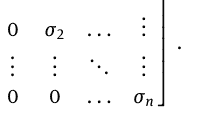

简化矩阵的辛算法可以描述如下：

- 在原始序列中，去除均值并归一化为单位方差。
- 根据最小嵌入维度 $d^1$，构造轨道矩阵 $X$ 和实对称矩阵 $A$。计算上三角矩阵。
- 将嵌入维度增加至 $d^2$，构造新矩阵，并将 $d^2$ 维辛几何映射到 $d^1$ 归一化辛主成分。最后，得到具有不同嵌入维度的 $K$ 的辛几何平均值。
- 对原始序列的替代数据重复步骤 2 和 3。
- 基于检验统计量识别序列的确定性。

替代数据采用迭代幅度调整的傅里叶变换方法。
使用辛算法构建辛矩阵，并将辛矩阵约简为上三角矩阵，从而使原始序列可以转化为上三角矩阵。

根据上述步骤，我们可以建立辛群分类器的设计过程。进而，我们给出人脸识过程和数据集分类过程中对应的辛群分类器设计步骤。

### 3.2.3 人脸识别中辛群分类器的设计

通常，采集的人脸图像由矩阵表示 [24–27]。对于灰度图像，矩阵的元素值为图像像素的灰度值。目前，人脸特征提取和识别方法通常以灰度人脸图像样本矩阵的行或列为向量，从而获得高维向量样本。样本的维度远大于可用人脸图像样本的数量。在本节的步骤一中，我们使用辛群矩阵在辛矩阵空间中构造相应图像的单次值，然后在辛矩阵空间中构造图像的特征子空间。使用奇异值分解将图像分解为秩为1的基底图像的线性组合。第二步是使用辛分类器算法计算被识别样本在每个特征子空间中的投影长度，然后将样本分类到投影长度最大的特征子空间对应的类中。在第三步中，最近特征线方法扩展到矩阵空间，利用每类两个不同的人脸图像矩阵直接在辛矩阵空间中构造特征线，并扩展两个样本表征各自类别的能力。最近邻特征线方法扩展到辛矩阵空间。当辛矩阵发生变换时，变换后的辛矩阵和几个特殊辛矩阵可以通过参考共形对称标准矩阵的变换性质进行比较。如果辛矩阵符合特定形式，该矩阵被用作学习过程中的训练样本，它可以分解为两个矩阵的乘积（在此，我们可以将结果矩阵作为测试结果的矩阵）。如果被检测的其他图像的矩阵与源图像一致，即达到了识别的目的。该方法可以直接处理原始人脸图像矩阵，无需将其拉直为高维向量。因此，避免了高维向量提取的计算复杂性，并利用辛群分类器解决了人脸识别问题。

首先，我们定义两个复辛矩阵的内积，并设矩阵 A, B $\in C^{m \times n}, C^{m \times n}$ 为 m $\times n$ 维的递归空间。设 X $\in C^{m \times n}$ 且 X 的秩为 r。那么，存在 m 阶辛单位矩阵 U 和 n 阶辛单位矩阵 V，使得

$$U^H XV = \begin{bmatrix} \Lambda & 0 \\ 0 & 0 \end{bmatrix}$$

其中 $\Lambda = \text{diag}(\sigma_1, \sigma_2, \dots, \sigma_r)$，$\sigma_i (i = 1, 2, \dots, r)$ 是矩阵 X 的非零奇异值，按降序排列。$XX^H$ 的特征向量由

由辛单位矩阵 $U$ 变换得到的列向量，以及由辛单位矩阵 $V$ 变换 $X^H X$ 得到的特征向量。奇异值分解也适用于矩阵元素为复数的情况。图像的辛（注：原文 "alkic" 似为 "symplectic" 或 "synthetic" 之误，此处根据上下文译为“辛”或保留原意，鉴于上下文均为 symplectic，推测此处为笔误，译为“合成”或“辛”需斟酌，但在线性代数语境下，结合后文“real numbers”，通常指代实数域上的操作，此处暂译为“合成”或“相应”的实数元素，但原文 "alkic" 极有可能是 "symplectic" 的拼写错误，故译为“辛”相关描述较为合理，但考虑到 $U$ 和 $V$ 是单位阵，其元素可能是复数，但这里强调是实数。修正：原文 "The symplectic alkic elements of the image are real numbers" 中的 "alkic" 大概率是 "symplectic" 的误拼或 "synthetic"。结合后文 "elements of the transformation matrix U and V are also real numbers"，这里意指图像分解后的相关元素为实数。为保持通顺，译为：图像的辛（或合成，视具体领域而定，此处按辛代数语境）元素是实数，且变换矩阵 $U$ 和 $V$ 的元素也是实数 [28]。根据奇异值分解定理，图像矩阵 $X$ 可以分解为 $r$ 个秩为 1 的矩阵之和。

$$ X = U \begin{bmatrix} \Lambda & 0 \\ 0 & 0 \end{bmatrix} V^H = \sum_{i=1}^{r} \sigma_i u_i v_i^H = \sum_{i=1}^{r} \sigma_i A_i $$

其中 $A_i = u_i v_i^H$ ($i = 1, 2, \ldots, r$)，其秩为 1，且 $u_i$ 和 $v_i$ 分别是辛酉矩阵 $U$ 和 $V$ 对应于奇异值 $\sigma_i$ 的列向量。进一步地，$u_i$ 和 $v_i$ 彼此正交，并且可以通过矩阵的内积得到辛矩阵的内积。容易看出，通过奇异值分解得到的基图像在定义的辛矩阵内积下彼此正交，这在 $R^{m \times n}$ 维辛矩阵空间中构成了一个标准正交坐标系。原始图像使用上述方程中最大的 $k$ 个奇异值及其对应的基图像进行重构，重构图像由下式给出

$$ \hat{X} = \sum_{i=1}^{k} \sigma_i A_i $$

$X$ 的奇异值 $\sigma_i$ 是通过基图像的标准正交性获得的，即作为 $X$ 在其分解得到的基图像 $A_i$ 上的投影值，作为 $X$ 在由 $A_i$ 形成的辛正交坐标系中的坐标值。通过奇异值可以获得由基图像重构的原始人脸图像。

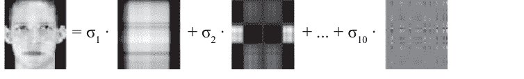

根据图像 $X$，我们可以获得其所属类别的基图像 $A_i$。待识别的图像，即图像 $X_1$，被视为基图像 $A_i$ 的线性组合，其组合表达式为

$$ X_1 = \sum_{i=1}^{r} a_i A_i $$

公式中的组合系数 $a_i$ 是 $X_1$ 在基图像 $A_i$ 上的投影值。可以使用上述定义的辛矩阵内积进行计算。

$$ \langle X_1, A_j \rangle = \langle \sum_{i=1}^{r} a_i A_i, A_j \rangle = a_j \quad (j = 1, 2, \ldots, r). $$

同样，$X_1$ 在 $A_i$ 上的投影 $a_i$ 可用于计算 $X_1$ 在由 $A_i$ 组成的辛特征子空间中的投影长度：

$$ l_j = \sqrt{\sum_{i=1}^{r} a_j^2} . $$

该投影长度衡量了由图像 $X_1$ 和 $A_j$ 组成的辛特征子空间之间的接近程度，其中这些图像是需要被识别的。投影长度越长，$X_1$ 与由 $A_j$ 组成的辛特征子空间之间的距离就越短。因此，如果该投影长度大于 $X_1$ 在其他类辛特征子空间中的投影长度，则 $X_1$ 可以归属于对应于 $A_j$ 辛特征子空间的类别。

如果每一类中存在多个训练样本图像，可以分别对每个训练样本图像进行奇异值分解，并构建其类别的辛特征子空间。计算待识别样本到每个辛特征子空间的投影长度。在识别过程中，使用辛群分类器方法将待识别样本分类为投影长度最大的辛特征子空间所属的类别。

接下来，我们展示在图像分类过程中辛群分类器的识别过程：

1. 在训练阶段，对第 $j$ 类中的第 $i$ 个训练样本 $X_{ji}$ 执行奇异值分解。选取对应于最大的 $k$ 个奇异值的基图像 $A_{ji}(m) = u_{ji}^m (v_{ji}^m)^H$ ($m = 1, 2, \ldots, k$)。从训练样本 $X_{ji}$ 获得的一组基图像构成了第 $j$ 类的判别函数 $g_{ji}(X)$。
$$ g_{ji}(X) = \sqrt{\sum_{m=1}^{k} a_{ji}^2(m)} = \sqrt{\sum_{m=1}^{k} \langle A_{ji}(m), X \rangle^2} \quad j = 1, 2, \ldots, C, \quad i = 1, 2, \ldots, N $$
其中 $a_{ji}(m) = \langle A_{ji}(m), X \rangle$ 是待识别样本图像 $X$ 对第 $j$ 类第 $i$ 个训练样本 $X_{ji}$ 的第 $m$ 个基图像 $A_{ji}(m)$ 的投影值。

2. 分类器的识别过程是将待识别图像 $X$ 输入到每个判别函数 $g_{ji}(X)$ 中，并找到判别函数的输出。将 $X$ 归类为 $g_{ji}(X)$ 输出值最大时对应的类别。如果每一类有多个训练样本，首先计算每一类的最大长度
$$ h_j = \max_i (g_{ji}(X)) \quad (j = 1, 2, \ldots, C, \quad i = 1, 2, \ldots, N). $$
这样就可以将 $X$ 分类到第 $c$ 类。

辛群分类器的设计步骤：

- 步骤 1：源图像上提取的特征点形成序列 $S(a_1,\dots,a_n)$。
- 步骤 2：以特征序列作为行向量获得矩阵 $S$。
- 步骤 3：待检查图像上提取的特征点形成序列 $T(a_1,\dots,a_n)$。
- 步骤 4：以特征序列作为行向量获得矩阵 $T$。
- 步骤 5：分别对 $T$ 和 $S$ 执行奇异值分解，求取其奇异值。
- 步骤 6：结合 $T$ 和 $S$ 的特征值形成矩阵 $U$，例如 $\begin{pmatrix} A_1 & O \\ O & B_1 \end{pmatrix}$。
- 步骤 7：根据分类识别过程，获得辛矩阵的各种类别。
- 步骤 8：获得 $U$ 的共形对称矩阵的收缩标准。
- 步骤 9：得到最终矩阵形式 $W$。
- 步骤 10：将所得 $W$ 形式与辛群的特殊形式进行比较，并形成相应的辛群分类器。
- 步骤 11：使用所得的辛群分类器对其他图像进行分类。

我们可以变换源图像和待检查图像的矩阵，并将其与上述辛群的几种形式进行比较，从而在李群机器学习中形成辛群分类器。

### 3.2.4 用于数据集分类过程的辛群分类器设计

对于数据集的分类，首先对分类的数据集进行数据预处理。原始数据的质量是影响分类结果的直接因素。因此，理解数据的固有特征在分类算法设计中起着重要作用。数据特征主要包括以下几个方面：

-   **(1) 数据多样性：** 待分类的数据集通常源自多个数据源。此外，描述相同特征的数据在不同数据集中可能有不同的名称，因此有必要了解数据的多样性。
-   **(2) 数据冗余：** 待分类的数据集包含大量冗余数据，例如，数据集中的数据存在重复或相似性，且数据对象的属性相同，这可以通过数据清洗或降维消除。
-   **(3) 数据的高维性：** 一般分类的数据集在高维空间中进行分类，因此有必要首先了解数据集的维度。在辛群分类器的设计中，由于辛群的特性，待分类的数据集必须是偶数维数据。只有这样，我们才能使用辛群分类器算法对其进行分类。

对于数据集分类过程，首先对数据集进行预处理。预处理提取数据集中的数据特征，并提取可用于分类的特征集，这可以提高数据分类过程的效率。然后，对数据集中的数据进行整合，形成统一的数据集，包括数据模式匹配与整合、数据冲突或不一致性处理、冗余消除等步骤，这些作为数据分类的基础。一般的数据分类过程包括两个步骤：首先，在给定的数据集中，找到一个公共对象集合以建立分类模型，然后使用获得的模型进行分类；数据项被映射到某一类中。为了建立分类模型，通常将数据集 $X$ 的一部分用作训练样本集 $X_{e}$，其余部分用作测试样本集 $X_{t}$。所有样本都有已知的类标识符。分类算法通过分析 $X_{e}$ 形成特征描述并建立分类模型。进一步，使用 $X_{t}$ 测试模型的分类准确性；如果获得的准确性可接受，则相应的分类模型可用于分类未来数据 [29]。

根据上述过程，本节描述数据集中辛群分类器的设计过程。在特征提取阶段，待分类的数据集以辛群 Sp(2n) 的形式表示。特别需要注意的是，辛群形式的数据集中的数据必须是偶数个；否则，无法表示为辛群。2n 维数据表示为序列 $(x_1, x_2, \ldots, x_{2n})$，然后该序列被分为两个 n 维向量，$u = [x_1, \ldots, x_n]^T, v = [y_1, \ldots, y_n]^T$。最后，两个向量构成辛内积：

$$ \omega(u, v) = u^{T}Jv^{T} $$

其中

$$ J = \begin{bmatrix} 0 & I_{n} \\ -I_{n} & 0 \end{bmatrix} . $$

在此，2n 维数据集在辛空间中表示。在这个辛空间中，对于由数据集中两个向量组成的辛矩阵，我们使用第 3.2.1 节中描述的矩阵简化方法和辛变换方法来简化辛矩阵，并获取矩阵的奇异特征值。所得奇异值按降序排列在奇异向量 $[\lambda_{1}, \lambda_{2}, \dots, \lambda, 0, \dots, 0]^{T}$ 中。该向量用作奇


原数据集的主特征向量。在辛群分类器的设计过程中，数据集的向量在辛空间中形成向量空间，并利用该向量空间构建辛群。以下特殊类型的辛群可作为不同类别的分类标准。

设 $M = [A, B] = \begin{pmatrix} A_1 & B_1 \\ A_2 & B_2 \end{pmatrix} \in \mathrm{Sp}(2n)$。我们有：

$M \in \mathrm{Sp}(2n) \cap \mathcal{O}_{2n} = U(n)$
$\Rightarrow M = [A, J^{-1}A], A^{\prime}J A = O_n, A^{\prime} A = I_n$（对应 M(1)）

$M = \begin{pmatrix} A_1 & O \\ O & B_1 \end{pmatrix} \in \mathrm{Sp}(2n)$
$\Rightarrow M = \begin{pmatrix} A_1 & O \\ O & A_1^{-1\prime} \end{pmatrix}, A_1 \in \mathrm{GL}(n, \mathbb{R})$（对应 M(2)）

$M = \begin{pmatrix} I & O \\ O & B_2 \end{pmatrix} \in \mathrm{Sp}(2n)$
$\Rightarrow M = \begin{pmatrix} I & O \\ O & I \end{pmatrix}, S^{\prime} = S$（对应 M(3)）

$M = \begin{pmatrix} A_1 & O \\ A_2 & I \end{pmatrix} \in \mathrm{Sp}(2n)$
$\Rightarrow M = \begin{pmatrix} I & O \\ O & I \end{pmatrix}, S^{\prime} = S$（对应 M(4)）

$M = J_\alpha = \begin{pmatrix} I\hat{\alpha} & I\hat{\alpha} \\ -I\hat{\alpha} & I\hat{\alpha} \end{pmatrix}, \alpha \subset \nu \in \mathrm{Sp}(2n)$（对应 M(5)）。

## 3.3 李群机器学习中的辛群分类算法

本节基于辛群分类器的设计过程，展示了辛群分类算法 [30, 31]，并通过实例对该算法进行了验证。结果表明，在样本量较大的情况下，辛群分类算法具有明显的优势。

### 3.3.1 辛群分类算法

根据前一节中描述的辛群分类器设计过程以及人脸识别的数据集分类过程，本节给出了辛群分类算法，并通过实例进行了验证。

#### 3.3.1.1 人脸识别中的辛群分类算法

根据辛矩阵的反对称性质和辛矩阵的奇异值分解，我们构建了辛群学习问题的样本矩阵。通过对辛矩阵进行不同的变换，可以得到相应的学习方法。由于辛群同时具有代数和几何性质，这使得辛群在学习过程中保持偶数维度。辛群学习算法描述如下：

**算法 3.1：** 人脸识别中的辛群分类算法
**输入：** 样本集 D，Sp(2n) 是辛群分类算法。
**输出：** 某些特殊类型的辛矩阵（**M** (1), **M** (2), **M** (3), **M** (4), **M** (5)）。

- **步骤 1** 将样本数据集 D 映射到 Sp(2n)，Sp(2n) 上的 n 维行向量由集合 $S_q^0, S_q^H = \{x_1, x_2, . . . , x_l\} | x_i \in S_q, i = 1, 2, 3, . . . , n\}$ 组成。
  // 其中 n = 2v，v 为正整数，向量 $(x_1, x_2, . . ., x_l, . . . ., x_n)$ 代表任意一个样本。
- **步骤 2** 选择 $Q_i \in \mathrm{Sp}(2n)$。对 $Q_i$ 进行变换得到对应的辛矩阵，并获得该辛矩阵的奇异值。
- **步骤 3** 在学习过程中，将 $Q_i$ 应用于样本数据集 $\{(x_1, x_2, . . ., x_n), Q_i\} \to (x_1, x_2, . . . , x_i, . . . , x_n) Q_i$ 作为训练列。
- **步骤 4** 在训练阶段，对训练样本 $X_{ji}$ 进行奇异值分解，并选取对应于前 k 个最大奇异值的样本 $A_{ji}(m) = u_{ji}^m (v_{ji}^H)'$ ($m = 1, 2, . . . , k$)。由训练样本 $X_{ji}$ 得到的样本构成第 j 类的判别函数 $g_{ji}(X)$，$g_{ji}(X) = \sqrt{\sum_{m=1}^k a_{ji}^2(m)} = \sqrt{\sum_{m=1}^k \langle A_{ji}(m) | \rangle}^2$，$j = 1, 2, . . . , C$，$i = 1, 2, . . . , N$，其中 $a_{ji}(m) = \langle A_{ji}(m), X \rangle$ 是第 j 类中第 i 个待识别训练样本 $X_{ji}$ 的第 m 个基图像 $A_{ji}(m)$ 在样本图像 X 上的投影值。
- **步骤 5** 在样本集 D 中，删除目标学习结果的样本，得到新的样本集 $D'$。
- **步骤 6** 将判别样本 X 输入到每个判别函数 $g_{ji}(X)$ 中，并给出判别函数的输出。将其归入 $g_{ji}(X)$ 输出最大的相应类别。如果每个类中都有多个训练样本，则计算每个类的最大长度 $h_j = \max_j(g_{ji}(X))(j = 1, 2, . . . , C, i = 1, 2, . . . , N)$，以便将 X 分类到第 c 类。
- **步骤 7** 结束

由于辛群是偶数维的，只有当向量空间的维度为偶数时，才可以简化到辛空间。然后，考虑到辛群的性质，我们选择偶数个样本，且正负样本数量相等或相对接近，以最大化学习效率。

#### 3.3.1.2 数据集分类中的辛群分类算法

根据数据集分类过程中的分类器设计流程，首先将待分类样本表示为 2n 维向量，然后将 2n 维向量分解为两个向量的内积。根据辛矩阵的构造方法，构建辛空间的矩阵，并将这些矩阵映射到微分流形中，再根据几种特殊的辛矩阵进行分类。

**算法 3.2：** 数据集分类中的辛群分类算法

- 输入：数据集 D。
- 输出：一个特殊的辛矩阵。
- **步骤 1** 判断数据集是否为偶数维。如果是，继续；否则，退出。
- **步骤 2** 取数据集中的样本 $D_{i}$ 进行特征提取，得到 2n 维特征向量。前 n 维向量用作训练示例，其余 n 维向量用作目标函数。
- **步骤 3** 使用待分类样本的特征向量构建辛群矩阵，并对该矩阵进行奇异值分解以获得辛矩阵的特征值。
- **步骤 4** 由训练样本获得的特征值和待识别样本的特征值共同构成辛矩阵。
- **步骤 5** 将步骤 4 中的辛矩阵与几个特殊的辛矩阵进行比较以实现分类。

### 3.3.2 人脸识别中辛群分类算法的验证

为了验证辛分类器的正确率及分类性能，我们在 ORL 通用人脸图像测试库上进行了测试。实验方法以人脸图像作为源图像。源图像根据前述方法进行了预处理。然后，寻找同一个人的不同面部照片形成训练示例，并使用该分类器处理其他图像。ORL 人脸数据库由剑桥大学建立，共包含 400（即 40*10）张图像，除了光照、视角和表情的细微变化外，均为面部基础裸露的正立图像。ORL 人脸数据库是一个简单的数据库。本测试的目的是验证所提出算法的分类性能。从人脸数据库中选取一个人的面部图像，然后用形成的辛群分类器对其他图像进行分类。为了平衡不同训练样本对识别效果的影响，评估算法的识别性能。根据上述人脸数据库给出的效果，将面部分为七种姿势，即正面、俯卧、俯仰、左侧平面内部、左侧平面侧方、右侧平面内部和右侧平面外部。如图 3.2 所示，根据分析对面部图像进行预处理，并获得图像的特征空间。该方法与现有的 SVM 算法进行了比较（参见图 3.3 和图 3.4）。


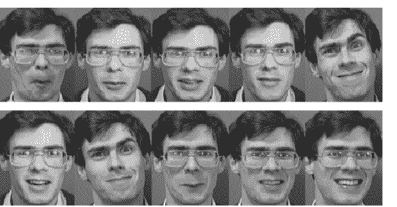

**图 3.2：同一人的不同面部表情。**

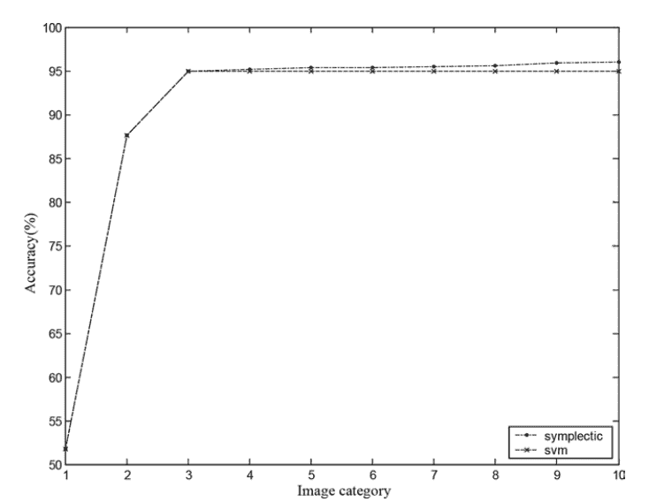

**图 3.3：辛群分类器与支持向量机（SVM）分类器在正面人脸图像上的效果对比。**

实验表明，当使用特征图像提取人脸图像时，辛群分类器算法在可用的人脸图像数量较多时，在分类准确性方面具有一定优势。这表明辛群分类器算法在处理涉及大量样本的分类问题时具有更好的分类效果（见表 3.1）。

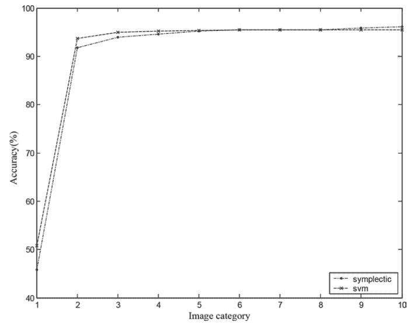

**图 3.4：** 辛群分类器与支持向量机（SVM）分类器在侧脸图像上的效果对比。

**表 3.1：** SVM 分类平均识别率与辛群分类平均识别率的对比。

| 姿态 / 算法 | 正面图像 [%] | 顶部视图图像 [%] | 仰视视图图像 [%] | 左侧平面内部图像 [%] | 右侧平面内部图像 [%] |
| :--- | :--- | :--- | :--- | :--- | :--- |
| SVM 分类算法 | 95.4 | 93.8 | 90.2 | 93.4 | 93.4 |
| 辛群分类算法 | 95.2 | 92.6 | 93.1 | 94.6 | 94.6 |

### 3.3.3 辛群分类器算法在数据集分类中的验证

为了验证辛群分类算法在数据集分类过程中的分类性能，本节选取 *UCI* 学习库中的 *adult*（成人）数据集进行测试。*adult* 数据集中的数据是针对某些个人信息构建的数据集。在 *adult* 数据集中，列出了年龄、职业类别、工作编号、教育水平、工龄、婚姻状况、职位、社会关系、种族、性别、年收入、支出、周工作量、国籍以及年总收入等信息。

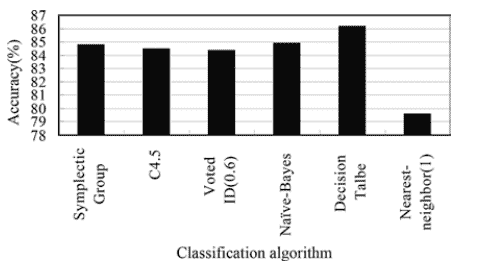

**图 3.5：** 辛群分类算法与其他算法的识别率对比。

针对 *adult* 数据集的这些属性，其中一些属性属于分类属性。在分类开始前，我们将年龄、教育水平和年收入状况作为分类样本的属性。首先，年龄和教育水平对应的属性构成相应的向量，然后这两个属性的向量构成一个矩阵。矩阵中的两列分别对应年龄和教育程度这两个属性。对该矩阵进行降维处理，并根据辛群分类算法评估降维后的辛矩阵。在此过程中，我们必须确保样本数量为偶数；否则，无法使用该分类算法。在此数据集中，一个人的年收入有两种情况，即“<= 50k”和“> 50k”。使用辛群分类器算法研究这两种收入类别的类别。在此数据集中，我们验证了 2000 条数据；分类的正确率如图 3.5 所示。

通过分析分类效果，我们可以看到，与其中一些算法相比，辛群分类算法具有一些优势，这仅基于一些初步结果。事实上，这些算法可以进一步改进。读者可以进一步研究。此外，我们从 *UCI* 数据集中选择了 10 个数据用于数据分类实验。实验数据如表 3.2 所示。

对于上述 10 种数据，每类都经过预处理。然后，对于这些处理后的数据，使用辛群分类算法对 10 种数据进行数据集分类。分类的正确率如图 3.6 所示。

在图 3.6 中，类别 2 的数据集样本数量最多，且该类型数据的分类率最高。当样本实例数量较大且分类属性较多时，辛群分类算法的分类率更高。当实例数量较小时，分类准确率较低。对于大规模样本的数据集，使用辛群算法进行分类可以取得更好的分类效果。

**表 3.2：类别数据属性。**

| 名称 | 实例数量 | 属性数量 | 类别数量 |
| :--- | :--- | :--- | :--- |
| Balance-scale | 625 | 5 | 3 |
| bridges | 108 | 13 | 2 |
| car | 1728 | 6 | 4 |
| cmc | 1473 | 10 | 3 |
| hepatitis | 155 | 20 | 2 |
| iris | 150 | 4 | 3 |
| kinship | 104 | 12 | 2 |
| Lung-cancer | 32 | 2 | 2 |
| spect | 267 | 23 | 2 |
| wine | 178 | 13 | 3 |

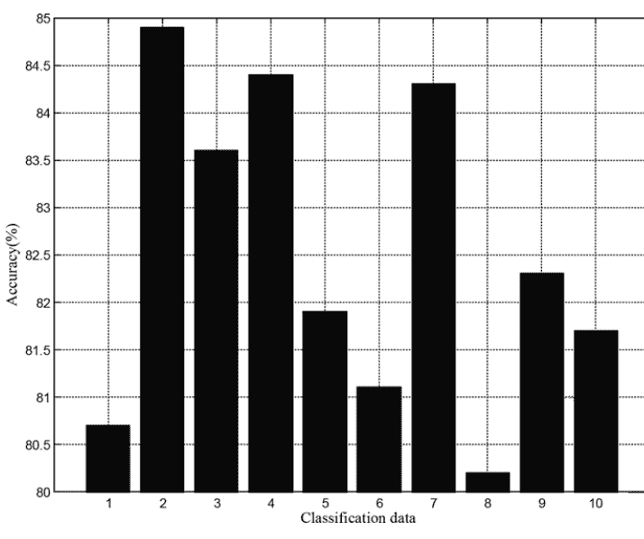

## 3.4 应用实例

人脸识别是模式识别和人工智能领域的一个重要主题 [32–35]。与指纹和其他人类生物特征相比，它具有更直接和友好的特征。然而，对于计算机来说，人脸识别仍然是一项困难的任务。这主要是因为人脸图像受外部因素（如物体遮挡、表情变化等）影响，这些因素会影响识别过程。人脸识别的研究正在进行中，目前有许多人脸识别方法。这些方法可以分为四类：基于特征的方法、基于模板的方法、基于 3D 的方法和随机序列方法。通常，在人脸识别过程中，图像采集和人脸检测需要用到大量的图像处理技术。在本节中，我们使用构建的辛群分类算法来识别图像。图像的特征序列由辛矩阵组成。对矩阵进行代数变换和几何变换，然后获得辛矩阵的奇异特征值。根据第 3.3.1.1 节中描述的方法分解奇异值，并获得辛矩阵的奇异值向量。对于人脸图像，由其形成的辛群特征值被用作人脸的特征向量。每张人脸图像训练样本的特征数据库可以根据特征值分为几个类别。然后，可以使用辛分类算法识别图像库中与已知人脸图像一致的图像。下面给出人脸识别的特征提取和识别过程。对于图像采集和人脸检测，由于涉及图像处理的复杂性，我们在此不再详细阐述。本例中使用的人脸图像源自现有图像库中的图像。通过对图像进行预处理并提取特征来进行图像识别，并给出辛群分类算法的识别准确率。

### 3.4.1 辛矩阵下的图像处理

对于一张人脸图像，图像根据第 3.3.1.1 节中描述的方法由辛矩阵表示。然后，对该矩阵进行奇异特征值分解。其他图像也相应地进行处理。如果图像在奇异值分解后与源图像一致，则它与源图像匹配，并最终产生输出。辛群分类算法的识别过程如图 3.7 所示。

假设图像 $A_k$ 被转换为 $mn$ 维图像向量 $z_k(k = 1, 2, \ldots, n)$，对于 n 个训练图像 $A_k \in R^{m \times n}(k = 1, 2, \ldots, n)$，所有训练图像的向量写为 $Z$。使用奇异值分解定理构造以下矩阵：

$$\boldsymbol{D}=\boldsymbol{Z}^{T}\boldsymbol{Z}\in\mathbb{R}^{N\times N}\ ,$$

在此，我们将矩阵 $D$ 称为生成矩阵，并使用辛矩阵的计算方法获得辛矩阵的特征值 $\lambda$ 和对应的正交归一向量 $\boldsymbol{v}$。然后，我们获得一个正交归一向量


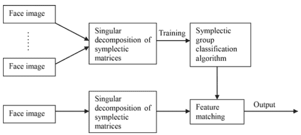

#### 图 3.7：辛算法的识别过程

按照以下奇异值分解过程：

$$
u_i = \frac{1}{\sqrt{\lambda_i}} Zv_i
$$

该向量被称为图像识别过程中图像的**特征向量**，每个 facial 图像都被投影到一个辛空间中。每幅图像对应辛空间中的一个点，因此 $n$ 个训练图像通过奇异值进行分解。所有奇异值按降序排列成向量 $[\lambda_1, \lambda_2, \dots, \lambda_q, 0, \dots, 0]^T$，这就是图像的奇异性。由于奇异值分解对于图像 $A$ 中任意一个都是唯一的，因此当所有奇异值按降序排列时，图像的奇异值特征是唯一的。因此，奇异值特征可以作为数值特征来描述灰度矩阵。对于图像特征的描述，如果图像灰度有微小变化，这种变化并不显著，这表明其具有稳定性。根据摄动理论，奇异值具有良好的稳定性。以下定理阐明了这一点。

**定理 3.11.** 若 $A \in \mathbb{R}^{p \times q}, B \in \mathbb{R}^{p \times q}$（不失一般性，设 $p \ge q$），$A$ 和 $B$ 的奇异值分别为 $\lambda_1^a \ge \lambda_2^a \ge \dots \ge \lambda_q^a$ 和 $\lambda_1^b \ge \lambda_2^b \ge \dots \ge \lambda_q^b$。对于 $\mathbb{R}^{p \times q}$ 中的任意单位不变范数，以下所有不等式均成立，

$$
\|\text{diag}(\lambda_1^a - \lambda_1^b, \dots, \lambda_q^a - \lambda_q^b)\| \le \|B - A\|
$$

如果定理中的范数是 Frobenius 范数，则上述方程可以变为

$$
\sqrt{\sum_{i=1}^{q} (\lambda_i^a - \lambda_i^b)^2} \le \|A - B\|_F
$$

图像灰度的微小变化不会引起奇异值的大幅变化，即对图像噪声不敏感。图像的位移等同于图像矩阵的排列，即图像矩阵两行的初等变换等同于矩阵左乘 $I_{ij} = I - (e_i - e_j)(e_i - e_j)^T$，其中 $e_i, e_j$ 分别是单位矩阵 $I$ 的第 $i$ 列和第 $j$ 列。变换后的矩阵为 $I_{ij}A$。显然，$I_{ij}^T = I_{ij} = I_{ij}^3$。那么，$(I_{ij}A)(I_{ij}A)^T$ 的特征方程为

$$
\det((I_{ij}A)(I_{ij}A)^T - \lambda I) = 0
$$

该方程可以转化为

$$
\det(I_{ij}AA^T I_{ij} - \lambda I) = \det(I_{ij}) \times \det(AA^T - \lambda I_{ij}^{-1} I_{ij}^{-1}) \times \det(I_{ij}^{-1}) = \det(AA^T - \lambda I) = 0
$$

因此，原始图像 $A$ 与其替换后的图像 $I_{ij}A$ 具有相同的奇异值特征。类似地，列替换也具有相同的结果，即奇异值特征具有平移不变性。奇异值随对应图像的亮度按比例变化。当整个图像的亮度按比例变化时，图像的奇异值也按比例变化。这种比例变化不会改变其所包含的识别信息，因此对奇异值特征进行归一化可以消除比例因子的影响。如果图像灰度按比例变化，即若在 $A$ 上乘以非零实数 $a$，则得到图像矩阵 $aA$。由于 $\text{rank}(A) = \text{rank}(aA)$，我们可以设 $\text{rank}(A) = r$。$A$ 和 $aA$ 的奇异值为

$$
\lambda_1 \ge \lambda_2 \ge \cdots \ge \lambda_r \quad \text{and} \quad |a|\lambda_1' \ge |a|\lambda_2' \ge \cdots \ge |a|\lambda_r'
$$

那么，$(aA)(aA)^T$ 的特征方程为

$$
\det((aA)(aA)^T - \tau^{2} I) = 0
$$

即，$\det(AA^T - \tau^{2} I/a^2) = 0$。然后我们可以得到

$$
(\lambda_{1}, \lambda_{2}, \ldots, \lambda_{r}, 0, \ldots, 0)^{T} = |a|(\lambda_{1}^{\prime}, \lambda_{2}^{\prime}, \ldots, \lambda_{r}^{\prime}, 0, \ldots, 0)^{T}
$$

图像的灰度按比例变化，等同于将奇异值乘以比例因子。

根据辛矩阵理论，任何旋转变换都可以分解为两个正交矩阵的乘积，例如在二维情况下

$$
\begin{bmatrix} \cos\theta & \sin\theta \\ -\sin\theta & \cos\theta \end{bmatrix} = (I - 2 \begin{bmatrix} 0 \\ 1 \end{bmatrix} \begin{bmatrix} 0 & 1 \end{bmatrix}) \times (I - 2 \begin{bmatrix} \sin\theta/2 \\ -\cos\theta/2 \end{bmatrix} \begin{bmatrix} \sin\theta/2 & -\cos\theta/2 \end{bmatrix})
$$

因此，源图像 $A$ 的旋转变换等同于左乘正交矩阵 $P$，旋转后的变换图像可表示为 $PA$，因为

$$
(PA)(PA)^T = P(AA^T)P^T = P(AA^T)P^{-1}
$$

图像矩阵 $A$ 的正交变换可能导致矩阵 $AA^T$ 或 $A^T A$ 的相似变换，而相似矩阵 $(AA^T, P(AA^T)P^{-1})$ 具有相同的奇异值，这表明原始图像和旋转后的变换图像具有相同的奇异值。根据奇异值分解定理，我们有

$$
AA^T u = \lambda^2 u, \quad A^T Av = \lambda^2 v
$$

即，$A$ 和 $A^T$ 具有相同的奇异值，即具有相同的奇异值特征。正是由于图像的奇异值特征具有上述属性，奇异值特征被认为是一种理想的代数特征。该方法可用于模式识别。

对于两张不同的正面人脸图像，我们分别进行了奇异值分解：$A_1 = U_1 \Lambda_1 V_1^T$，$A_2 = U_2 \Lambda_2 V_2^T$。首先，为了确保正交矩阵 $U_1, V_1, U_2, V_2$ 不变，变换 $\Lambda_1, \Lambda_2$ 以分别重构图像。重构后，很容易看出，虽然 $A_2$ 和 $U_1 \Lambda_2 V_1^T$ 具有相同的奇异值特征，但它们表征的是两个不同的图像。基于这种重构图像的方法，很容易看出，与原图像相比，重构图像仍然代表同一个人。差异主要源于图像采集角度的不同。在人脸图像识别的情况下，仅采用这种方法是不够的，奇异值分解得到的两个正交矩阵 $U$ 和 $V$ 中包含了更多有用的信息。考虑到 $U, V$ 的正交性，我们可以得到方程

$$
\Lambda = U^T AV
$$

因此，基于奇异值特征的识别是在不同空间中对人脸图像的表征进行比较和识别。由于投影变换不同，即基准选择不同，仅使用奇异值特征进行识别是不合理的。解决这两个问题有两种方法：

- (1) 提取包含在两个正交矩阵中的识别信息。
- (2) 将图像投影到每一类的两个正交矩阵上进行特征提取。计算各类的平均值，并对奇异值进行分解以获得平均值的两个正交矩阵 $U$ 和 $V$。然后，将样本投影到 $U$ 和 $V$ 上，然后提取特征。

设第 $i$ 类平均值的两个正交矩阵为

$$
U^i = [u_1^i, \dots, u_p^i], \quad V^i = [v_1^i, \dots, v_q^i] \quad (p \geq q)
$$

将样本 $A_x$ 投影到该空间所得到的特征可以表示为 $[a_1^i, \dots, a_q^i]^T$，其中

$$
a_j = (v_j^i)^T A_x^T u_j^i
$$

然后，我们使用特征提取方法。首先，给定一个标准图像进行奇异值分解，得到标准辛空间和相应的特征向量。图像表示为辛矩阵的一种形式。如果 $A$ 是图像矩阵，$B = AA^T$，我们将矩阵 $B$ 称为图像矩阵的特征矩阵。


#### A. 特征提取通过特征矩阵特征值分布的集中度来执行。

对于每个图像 $A_j^i$，我们将其投影为一个 2n 维向量，即

$$X_j^i = A_j^i v .$$

我们将 $v$ 称为投影向量，将 $X_j^i$ 称为投影特征向量。经过辛酉矩阵变换后，得到两个新的辛酉矩阵。利用这两个辛酉正交矩阵重构原始图像，并将原始图像投影到这两个辛酉正交矩阵上。在这个投影空间中，使用辛酉分类器进行图像分类。对于不同的人脸图像，选择一些图像作为训练样本。在此过程中，图像通过特征提取并以辛酉矩阵的形式表达。利用辛酉矩阵的简化方法，我们可以简化图像矩阵，从而获得图像的特征子空间。然后，将图像作为训练样本，图像库中的其他图像作为待识别样本。

对于图像库中待识别的图像，将其组合为相同的特征组合，用辛酉矩阵表示该图像，然后对该矩阵进行奇异值分解以获得相应的辛酉表示方法。然后，我们在人脸识别过程中使用辛酉群分类器算法来处理图像。

### 3.4.2 实例验证

为了验证辛酉群分类器算法的性能，我们使用 ORL 和 YALE 两种人脸图像库测试了该算法的性能。ORL 库在 3.3.2 节中有描述。YALE 数据库由 15 人组成（每人 11 张图像），包含较大的光照和面部变化。测试系统的硬件环境是 *Pentium* (*R*) 4 *CPU* (2.80 *GHz*)，配备 512 *MB* 内存。软件平台为 *MATLAB* 6.5。对于图像库中的图像，我们首先计算其辛酉矩阵，并使用辛酉算法进行训练。然后，在数据库中查找同一人的另一张图像表达，根据找到图像的正确率，获得算法的识别效率。如图 3.8 所示，比较了若干种算法的性能。

图 3.9 展示了两种分类算法在 ORL 库中的识别率。对于 ORL 库中的每一类图像，我们使用样本 2、3、...、9 作为训练样本，其余作为测试样本。与识别算法相比，当训练组较大时，图像的识别率更高。

图 3.10 展示了两种分类算法在 YALE 库中的识别率。对于 YALE 库中的每种图像，选择 2、3、...、10 张图像作为分类样本，其余作为测试样本。与 PCA 识别算法相比，辛酉群分类算法的识别效率较高。

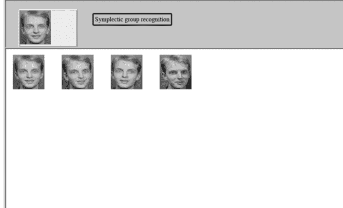

图 3.8：辛酉群分类算法的人脸识别效果图。

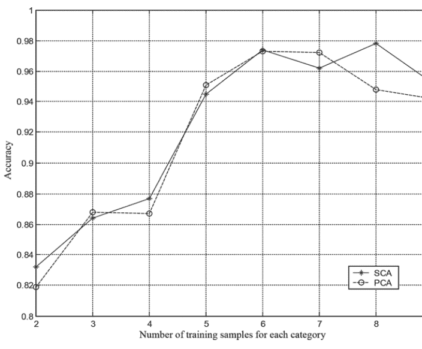

图 3.9：ORL 库中的人脸识别率。

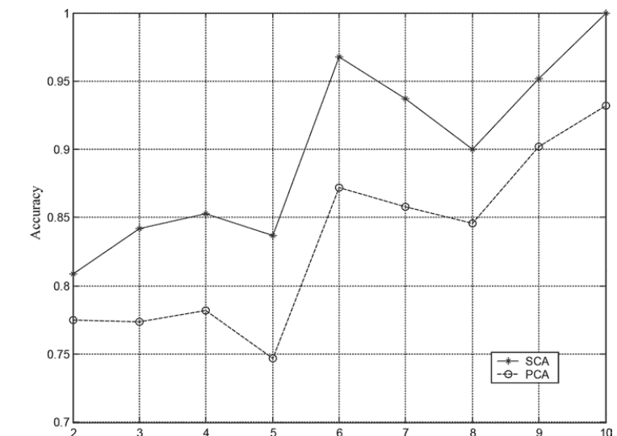

**图 3.10：** YALE 库中的识别率。

在识别图像的过程中，我们使用辛酉群分类算法将多张图像作为训练样本。这里，我们给出了仅使用一张图像作为训练样本、其他图像作为测试样本时辛酉群分类算法的识别率。通过识别过程，我们发现即使只有一张图像作为训练样本，辛酉群分类器算法也具有较高的识别精度。这是因为，对于一张图像，经过辛酉分类算法处理的图像获得了图像的特征向量，且该特征向量对于同一人脸的不同图像是稳定的。表 3.3 和 3.4 给出了在仅有一个训练样本的情况下，几种分类算法在 ORL 和 YALE 库上的性能对比 [36, 37]。

**表 3.3：** 几种算法在 ORL 库上的性能对比。

| 分类算法 | 训练样本数量 | 平均识别准确率 (%) |
| :--- | :--- | :--- |
| 辛酉群 | 1 | 92.6 |
| Spectroface | 1 | 90.8 |
| 线性子空间 | 1 | 84.2 |

**表 3.4：** 几种算法在 YALE 库上的性能对比。

| 分类算法 | 训练样本数量 | 平均识别准确率 (%) |
|---|---|---|
| 辛酉群 | 1 | 92.6 |
| Spectroface | 1 | 95.7 |
| 线性子空间 | 1 | 84.4 |

结果表明，即使只有一个训练分类样本，平均识别的准确率仍处于较高水平，且与线性子空间方法相比，辛酉群的正确率相对较高。

### 3.5 总结

作为一种新的机器学习方法，李群机器学习受到了研究人员的广泛关注。目前，李群机器学习理论已应用于许多领域，例如在分类领域已有若干成功案例。在本章中，我们讨论了李群机器学习中辛酉群分类器的设计方法，研究了李群机器学习框架下的辛酉群分类器算法，并使用该分类器进行了图像识别和数据集分类。因此，显示了该方法的优势。

## 参考文献

- [1] Feng K, Qin MZ. Symplectic Algebraic Algorithm of Hamiltonian System. 浙江: 浙江大学出版社, 2006.
- [2] Shaw WT. Symplectic Geometry of null Infinity and Two-surface Twistors. 牛津大学数学研究所, 英国.
- [3] Gao L, Li YM, Chen XR, Yang KQ. An Attempt to Seismic Ray Tracing with Symplectic Algorithm. 地球物理学报, 2000, 5(3), 402–410.
- [4] Wu Y, Hu JY, Yin XG. Symplectic Integrators of the Equations of Multibody System Dynamics on Manifolds. 力学进展, 2002, 2(32), 189–195.
- [5] Wang SX, Liu YW, Wu HT. Study on Computational Accuracy of Robot Dynamics. 机械工程学报, 1998, 34(1), 14–20.
- [6] Han XS, Wang SX, Yu SY. Investigation of Nanomanufacturing Process by Molecular Dynamics Simulation Based on Symplectic Algorithm. 机械工程学报, 2005, 41(4), 17–22.
- [7] Zhang K. The study on PML-FDTD and Boundary Connecting Conditions of Total-scattering Fields in 3-D Cylindrical Coordinates. 重庆邮电大学学报, 2003, 3, 21–26.
- [8] Xu ZX, Zhou DY, Deng ZC. Numerical Method Based on Hamilton System and Symplectic Algorithm to Differential Games. 应用数学和力学, 2006, 27(3), 305–310.
- [9] Sun Y, Xie J. Hamiltonian Symplectic Semi-analytical method and its application in anisoTropic electromagnetic waveguide. 计算力学学报, 2005, 22(6), 690–693.
- [10] Zhang PG. A Post-processing Algorithm for the Dynamic Analysis of DNA Elastic Slender Structure. 青岛大学学报, 2006, 21(3), 71–74.
- [11] Ritter G, Gallegos MT. A Bayesian approach to object identification in pattern recognition. 国际模式识别会议论文集, 2000, IEEE: 1082–1086.
- [12] Lovell BC, Bradley AP. The Multiscale Classifier. IEEE 模式分析与机器智能汇刊, 1996, 2(18), 124–137.
- [13] Dawi AHM, Chong TS, Fong SF. The Effects of Different Three–Dimensional Animated Visual Displays in Computer–Based Multimedia on Learners with Different Spatial Abilities. 第五届 IEEE 高级学习技术国际会议论文集. IEEE, 2005, ICALT’05, 798–801.
- [14] Tuzel O, Subbarao R, Meer P. Simultaneous Multiple 3D Motion Estimation via Mode Finding on Lie Groups. 第十届 IEEE–国际计算机视觉会议论文集. 模式分析与机器智能, 2005, 1, 18–25.
- [15] Fletcher PT, Lu CL, Joshi S. Statistics of Shape via Principal Geodesic Analysis on Lie Groups. 2003 年 IEEE 计算机学会计算机视觉与模式识别会议论文集. 医学成像汇刊, 2003, 1, 95–99.
- [16] Miasnikov AD, Haralick RM. Regression analysis and automorphic orbits in free groups of Rank2. 第十七届国际模式识别会议论文集. IEEE, 2004, ICPR’04, 180–183.
- [17] Bonmassar G, Schwartz EL. Lie Group, Space–Variant Fourier Analysis and the Exponential Chirp Transform. 1996 年计算机视觉与模式识别会议论文集. IEEE, 1996, CVPR’96, 492–496.
- [18] Yang L, Qin Z, Zhang XP. 分类器仿真算法及其应用. 西安交通大学学报, 2005, 39(12), 1311–1314.
- [19] Mitchell TM. 机器学习. 北京: 机械工业出版社, 2003.
- [20] He YH, Zhao L, Zou CR. 基于核最近特征的人脸识别分类器. 应用科学学报, 2006, 24(3), 227–231.
- [21] Squire DM, Caelli TM. 不变性特征. 通过偏离不变性刻画轮廓. 计算机视觉与图像理解, 2000, 77(3), 284–316.
- [22] Zhong WX, Ouyang HJ. 复合材料力学中的哈密顿系统与辛几何 – 平面应力问题. 应用数学和力学, 1992, 13(12), 1031–1035.
- [23] Ma ZJ. 物理学中的群论. 科学出版社, 2006.
- [24] Lai JH, Yan XH, Deng DG. 完成 Spectroface 人脸识别的分类器设计. 图像与图形学杂志, 2002, 7(5), 466–471.
- [25] Yu HB. 基于头部特征提取的人体检测与跟踪及其应用. 杭州: 浙江大学, 2007.
- [26] Wang P. 数据流上的分类算法研究. 上海: 复旦大学, 2007.
- [27] Xie YH. 人脸特征提取与分类器设计的若干问题研究. 南京: 南京理工大学, 2006.
- [28] Li L. 利用辛几何构造带仲裁的认证码. 吉林建筑工程学院学报, 2006, 23(4), 63–67.
- [29] Zhao Lih, Sun XH. 基于肤色的脸检测. 工程图学学报, 2005, 3, 84–88.


[30] 付浩先. 李群机器学习中的辛群分类器研究. 苏州: 苏州大学, 2008.
[31] 付浩先, 李范宗. 基于李群机器学习的辛群分类器研究. 在2007年IEEE第4届模糊系统与知识发现国际会议（FSKD'07）论文集, 2007, 649–655.
[32] 孙明明. 流形学习理论与算法研究. 南京: 南京理工大学, 2007.
[33] 黄启均. 流形学习方法理论与图像应用研究. 成都: 电子科技大学, 2007.
[34] 王健. 流形学习理论与方法研究. 杭州: 浙江大学, 2006.
[35] 文启定. 基于EP的训练分类器算法. 郑州: 郑州大学, 2007.
[36] 赖建和, 袁培根, 等. 使用全傅里叶不变特征的人脸识别. 模式识别, 2001 34(1), 5–109.
[37] 刘晓文, 王德利. 基于感知分量的外观识别. 2001年国际神经网络联合会议（IJCNN）论文集, 2001, 3, 1943–1948.

## 4 量子群学习

本章分为四个部分。第4.1节提出了一个问题。第4.2节介绍了李群机器学习中量子群分类器的构建方法。第4.3节描述了量子群学习算法在分子对接中的应用。最后，第4.4节对本章进行了总结。

### 4.1 问题陈述

量子群由1990年菲尔兹奖得主德林费尔德（Drinfeld）在1986年伯克利的国际数学家大会（ICM）上提出 [1]。第一个例子涉及两种特殊的Hopf代数；一种是半单李代数 $L$ 的广义 enveloping Hopf 代数的形变，另一种是仿射代数群 $G$ 的坐标环的形变。对于量子群，并没有明确的公理化定义。数学家 S. P. Smith 指出，“非交换且非余交换的 Hopf 代数被称为量子群” [2]。德林费尔德将量子群定义为非交换 Hopf 代数的谱。量子空间范畴被定义为非交换代数范畴的对偶，而代数 $A$ 对应的量子空间记为 Spec $A$（$A$ 的谱）。根据这个定义，Hopf 代数和量子群这两个概念实际上是等价的，但后者在几何上更为丰富。

量子群是李群和李代数经典对称性的推广概念。它是一种特殊的非交换和非交换（原文如此，此处可能指非余交换）Hopf 代数。特别是，Hopf 代数由李代数的 enveloping 代数（即 enveloping algebra）和群上的函数代数量化而来。近年来，量子群及其相关的 $q$-形变理论已被应用于物理学的各个分支，如统计物理中的可积模型、共形场论、规范理论、弦论、振动系统、量子光学、原子分子物理以及核物理。Nikolaos Nasios 等人将这些概念应用于核分类，并**取得了**令人满意的结果 [2]。可以看出，量子群理论已在许多领域得到广泛应用，这为机器学习提供了绝佳的机遇，并为机器学习的 数据分析提供了有用的范例。因此，我们从机器学习的角度出发，将量子聚类的基本理论引入机器学习领域。我们的成果总结如下。

### 4.2 李群机器学习中量子群分类器的构建方法

基于李群的基本理论，参考文献 [3–13] 给出了李群机器学习的基本概念和相 关算法。针对机器学习系统的非交换和非对称问题，基于量子群的基本理论，本节给出了李群机器学习中量子群分类器的基本构建方法和相关算法 [14–16]。

#### 4.2.1 问题描述

生物信息学是一门涉及生物学、计算机科学和应用数学跨学科领域的新兴学科。它试图利用信息技术来研究与 DNA 和基因、基因表达、蛋白质、基因电路、细胞、生理表现等有关的现象和规律。对生物实验数据的获取、处理、存储、检索和分析进行操作，以达到揭示数据生物学意义的目的。DNA 序列分析是生物基因信息系统现代生物序列分析的重要组成部分，也是生物信息学研究的热 点。通过序列分析，我们可以预测新序列的结构和功能，分析序列间的相似性和同源性。在分子生物学中，当我们关注基因测序时，我们不需要“学习”。但是，当我们关注基因功能问题时，我们必须解决“学习”问题。

一般来说，面向生物信息学研究的机器学习基本任务是从现有的生物学数据库中寻找有意义的知识，并构建有意义且可理解的模型（具体任务见表 4.1）。

1994年，Adleman 首次在《科学》杂志上发表了关于 DNA 分子算法的开创性文章 [17]。目前，DNA 序列分析是一个活跃的研究领域。现有的机器学习方法包括神经网络方法、决策树方法、基于案例的学习方法、符号知识优化方法、基于逻辑的归纳学习方法 [18]、统计学习理论 [19] 和支持向量机 [20–22]。隐马尔可夫模型（HMM）是一种在基因识别领域广泛使用的概率模型。

一个基因包含外显子、内含子和基因间隔区。在 DNA 转录过程中，外显子作为编码序列被保留，而其他非编码区域，即内含子和基因间隔区，则被切除。外显子被拼接在一起形成信使核糖核酸（mRNA），然后翻译成多肽链，构成多种结构蛋白，并催化酶和激素的各种生化反应。在 DNA 序列分析中，基于 DNA 的基因检测是发现基因的关键。DNA 序列分为编码区和非编码区。DNA 的编码区通常是基因所在的位置。因此，DNA 序列的分割对于基因研究至关重要。

下面简要描述支持向量机（SVM）算法的优缺点。

支持向量机是一种基于统计理论的机器学习方法。通过学习算法，SVM 能够自动找到具有更好类别区分能力的支持向量。生成的分类器可以最大化类间间隔，因此表现出更好的泛化性能和更高的分类准确率。SVM 的主要思想是解决两类分类问题，在高维空间中寻找一个超平面作为两类分割，以确保最小的分类错误率。SVM 的一个重要优点是它可以处理线性不可分问题。利用 SVM 分类的思想，我们首先从原始空间提取特征，将原始空间的样本映射到 高维特征空间的向量中，以解决原始空间的线性不可分问题。SVM 可用于回归、分类和密度估计。人工神经网络和“黑盒”算法也可用于类似目的。尽管 SVM 具有良好的通用性，但它在测试阶段耗时且表达能力较差。

鉴于这些优缺点，本章提出了一种基于量子群体的 DNA 群体分类方法，并将其应用于植物 *拟南芥*（*Arabidopsis thaliana*）的全序列。

#### 4.2.2 李群机器学习中量子群分类器的构建

只要使用量子群的雅可比条件分析来观察数据和量子代数的量子群性质，就可以构建量子群分类器。量子群被视为一种量子超平面线性系统。通过对维度上的非交换空间、线性化等其他形式进行处理，对观测数据进行处理。观测数据的非线性结构被还原为线性结构，然后按照量子群的线性变换学习算法进行分类。


##### 4.2.2.1 量子群的对称线性变换学习算法

在二维量子超平面上，假设学习空间中的学习问题由“坐标”$(x,y)$ 表示，其中 $x$ 代表学习空间中实例空间的一个实例，$y$ 代表样本空间的一个样例，满足交换关系

$$xy = qyx \quad (q \in C) \qquad (4.1)$$

其中 $q$ 是调整因子，$C$ 是调整因子的集合。此外，$(x,y)$ 还存在相关的协变微分计算，即“形式” $(\xi, \eta)$，其满足

$$\xi\eta = -q^{-1}\eta\xi \ , \quad \xi^2 = 0 \ , \quad \eta^2 = 0 \ . \qquad (4.2)$$

当 $q=1$ 时，由 (4.1) 可以看出 $x$ 和 $y$ 是对称的，由 (4.2) 可以看出 $\xi$ 和 $\eta$ 是对称的。进一步地，$(\xi,\eta)$ 可以被解释为 $(x,y)$ 的微分，即减少学习空间处理中的样例数量。令

$$\varphi = \begin{pmatrix} x \\ y \end{pmatrix}, \quad \psi = d\varphi = \begin{pmatrix} \xi \\ \eta \end{pmatrix}. \qquad (4.3)$$

量子超平面上的“坐标” $(x,y)$ 与“形式” $(\xi,\eta)$ 同时进行线性变换，

$$\begin{pmatrix} x' \\ y' \end{pmatrix} = \begin{pmatrix} \alpha & \beta \\ \gamma & \delta \end{pmatrix}\begin{pmatrix} x \\ y \end{pmatrix}, \quad \begin{pmatrix} \xi' \\ \eta' \end{pmatrix} = \begin{pmatrix} \alpha & \beta \\ \gamma & \delta \end{pmatrix}\begin{pmatrix} \xi \\ \eta \end{pmatrix} \qquad (4.4)$$

其中 $(\alpha,\beta,\gamma,\delta)$ 和 $(x,y,\xi,\eta)$ 可互换，如果 $(x',y')$ 和 $(\xi',\eta')$ 的要求在 $(x,y)$ 和 $(\xi,\eta)$ 之间具有相同的关系下得到满足，则 $(\alpha,\beta,\gamma,\delta)$ 必须具有以下关系

$$\alpha\beta = q\beta\alpha \ , \quad \alpha\gamma = q\gamma\alpha \ , \quad \beta\gamma = q\gamma\beta \ , \quad \gamma\delta = q\delta\gamma \ , \quad \beta\delta = q\delta\beta \qquad (4.5)$$

$$\alpha\delta - \delta\alpha = (q-q^{-1})\beta\gamma \ .$$

设代数

$$A = C \langle \alpha,\beta,\gamma,\delta \rangle / \sim \ . \qquad (4.6)$$

它是由 $(\alpha,\beta,\gamma,\delta)$ 生成的结合代数，且满足 (4.5)，即

$$T = (T_{ij}^{i}) = \begin{pmatrix} \alpha & \beta \\ \gamma & \delta \end{pmatrix} \in GL_q(2) \ . \qquad (4.7)$$

上述变换将构成一个量子超对称线性变换，并产生量子群 $GL_q(2)$，其中心为

$$c = \det_q T = \alpha \delta - q\beta\gamma = \delta\alpha - q^{-1}\beta\gamma \ . \qquad (4.8)$$

如果要求 $\det_q T=1$，则称为量子群 $SL_q(2)$。

在形成量子群 $GL_q(2)$ 和 $SL_q(2)$ 的过程中，同时也产生了一种量子群对称线性变换学习算法。该算法描述如下：

**算法 4.1：** 量子群上的对称线性变换学习算法

```text
QgroupLinear ($X$, $Y$)
**输入：** 实例集 $X = \{x_1, x_2, \ldots, x_n\}$，样本集 $Y = \{y_1, y_2, \ldots, y_n\}$
**输出：** 量子群的对称线性变换
**步骤 1** 在对 $X$ 和 $Y$ 进行降维处理后，得到 $\xi$ 和 $\eta$，且它们必须满足 (4.2)；
**步骤 2** 对 $X, Y$ 和 $\xi$, $\eta$ 进行对称线性变换 $Z$，$X$, $Y$ 和 $\xi$, $\eta$ 的变换应满足 (4.1) 和 (4.2) 之间的关系；
**步骤 3** 验证对称线性变换 $Z$ 是否满足 (4.5)；如果不满足，则调整系数 $q$，直到找到符合条件的变换。此时，$Z$ 即为所需的对称线性变换。
**步骤 4** 返回线性变换 $Z$。
```

##### 4.2.2.2 Lie 群机器学习中的量子群分类器

对于这两个分类问题，假设样本集 $G$ 为 $(x_1, y_1)$，$(x_2, y_2), \ldots, (x_n, y_n) \in \boldsymbol{R}^{N} \times Y$，其中 $Y = \{-1, +1\}$。我们的目标是找到分类器 $f(x)$，使得 $\boldsymbol{y} \cdot f(\boldsymbol{x}) > 0$。

这样，通过使用量子群对称线性变换学习算法 4.1 的变换，我们可以将样本集的数据转换为我们所需的经典量子群，并可以直接通过其行列式的值来确定分类。机器学习中量子群分类器的分类算法描述如下。

**算法 4.2：**
机器学习中量子群分类器的分类算法：

```text
QGClassifier ($G$)
**初始化：** $G$ 是一个量子群，其群元素为 $\{x_1, x_2, \ldots, x_n\}$
**输入：** $G$
**输出：** $\{1, -1\}$
{
for $i = 1$ to $n$ do // 计算每个群元素的矩阵行列式 $\operatorname{det}_q T$ 的值 //
if $\operatorname{det}_q X_i==1$
then return $1$; // G 是 $SL_q(n)$ 群 //
else return $-1$; // G 是 $GL_q(n)$ 群 //
end if
repeat
end for
}
```

下面描述具体量子群学习分类器的构建过程：

- **步骤 1** 将样本集映射到这个非空集合 $G$ 上；
- **步骤 2** 根据 $G$ 构建相应的量子群结构，并使用算法（参见附录 17.5）测试其是否为量子群；
- **步骤 3** 将量子群对称线性变换学习算法 4.1 的线性变换应用于已建立的量子群结构，以获取我们所需的经典量子群；
- **步骤 4** 使用量子群分类器 4.2 的分类算法对合适的分类器进行分类和训练；
- **步骤 5** 实例测试。

#### 4.2.3 基于 Lie 群机器学习中量子群分类器的 DNA 序列分类

在引入具体的 DNA 序列分类实验之前，我们对实验数据作简要说明。

##### 4.2.3.1 数据准备

我们选择真核生物拟南芥（Arabidopsis thaliana）的全序列作为实验数据。数据来自国家生物技术信息中心（NCBI）；其网站为 http://www.ncbi.nlm.nih.gov。整个序列由五个染色体组成，每个染色体均为 FASTA 文件格式。由于篇幅限制，省略了对 FASTA 文件格式的描述；仅描述每个染色体的索引 ID 长度和文件大小（见表 4.2）。

在信息提取过程中，我们使用以下结构来存储从每个染色体序列中读取的信息。

```c
typedef struct
{
    char * seqname; // 基因序列名称
    char * wholeseq; // 完整基因序列
    char * info; // 基因附加信息
    long index; // 基因序列在基因库中的位置
    unsigned len; // 基因序列长度
    int * count; // 基因序列中的观测次数
} SeqInfo;
```

在提取数据时，我们的主要目的是分别提取每个染色体序列的编码区和非编码区。使用的方法描述如下。

- (1) 对于每个染色体，读取并保存碱基数起始位置和终止位置之后的基因，以及碱基数基础之后的 CDS。
- (2) 在最终序列中找到 CDS 中 logo 的位置，将这些片段作为第 $i$ 个 SeqInfo 结构连接到编码区文件 coding.txt 中。
- (3) 将剩余的基因片段作为第 $i$ 个 SeqInfo 结构连接到非编码区文件 noncoding.txt 中。
- (4) 重复上述步骤，直到最后一个染色体。

**表 4.2：染色体文件说明。**

| 染色体 | 索引 ID | 长度 | 大小 |
| :--- | :--- | :--- | :--- |
| 1 | NC_003070 | 30,080,809bp | 43M |
| 2 | NC_003071 | 19,643,621bp | 27.7M |
| 3 | NC_003074 | 23,465,812bp | 33.5M |
| 4 | NC_003075 | 17,549,528bp | 24.9M |
| 5 | NC_003076 | 26,689,408bp | 38M |

**表 4.3：每个染色体编码区和非编码区的数据数量。**

| 染色体 | 编码区数据量 | 非编码区数据文件 |
| :--- | :--- | :--- |
| 1 | 6761 | 6572 |
| 2 | 4216 | 4134 |
| 3 | 5252 | 5027 |
| 4 | 3958 | 3482 |
| 5 | 5987 | 5160 |

对于五个染色体，我们获得了五个存储编码区的文件和五个存储非编码区的文件。每个文件的数据数量列于表 4.3 中。

##### 4.2.3.2 DNA 序列分类

由于编码区和非编码区具有不同的功能，编码区中会出现一些频繁出现的序列。然而，在非编码区中，这些序列很少出现。这些词可以称为编码区的特征序列。相比之下，它们可以被视为非编码区的特征序列。由于每个 DNA 序列由 A、T、G、C 组成，即直接由字符组成的字符串（例如 `aggcaccggaaacgggaatt`），因此有许多方法将 DNA 序列数字化，不同的方法对分类有重大影响。

通常，在处理 DNA 序列之前，首先找到 DNA 序列的数学表达，然后使用其他工具对其进行分析和研究。全球有许多用于 DNA 序列的数学表达，例如随机游走 DNA 模型、基于混沌理论的 CGR 方法 [23]，以及使用几何方法的 Z 曲线表示 [24]。在本章中，我们使用基于序列的熵方法。由于序列集包含五个染色体，我们可以提取每个染色体中的特征序列，然后将设计好的量子群分类应用于每个基因的编码区和非编码区进行排序。


首先，将DNA序列字符串视为信息流，考虑其单位序列中包含的信息量（即熵）。直观地认为，重复度越高，信息量越小。

设序列为 $L = (a_1, a_2, \dots, a_n)$。前 $m$ 个字符的信息量为 $f_m(l)$，即

$$g_m(l) = f_m(l) - f_{m-1}(l) \tag{4.9}$$

其中 $g_m(l)$ 是添加第 $m$ 个字符后增加的信息量。那么，由式 (4.9) 可得 $f_n(l) = \sum_{i=1}^{n} g_i(l)$。注意，$f_n(l)$ 是整个序列包含的信息量。进一步地，$f_n(l)/|l|$ 是单位长度的信息量。现在，问题被简化为寻找合适的 $g_m(l)$。

在这方面，我们假设 $g_m(l)$ 应具有以下性质：

**性质 4.1。** $g_m(l) > 0$；添加一个字符时，多少都带有一定的信息量；

**性质 4.2。** 第 $m$ 个字符（或以其结尾的较短序列）与之前序列（信息流）的重复度越高，$g_m(l)$ 的值越小；

**性质 4.3。** 第 $m$ 个字符（或以其结尾的较短序列）与距离其更近的字符的重复度越高，$g_m(l)$ 的值越小，反之亦然；

**性质 4.4。** $f_0(l) = 0$。

因此，我们构造以下函数：

$$g_m(l) = \frac{b}{b + t_1 \sigma_1 + t_2 \sigma_2 + \cdots + t_p \sigma_p} \tag{4.10}$$

其中 $b$ 是一个防止分母为零的小正数，$\sigma_i = \sum_{i=1}^{n} a^t \delta_{it}$，且

$$\delta_{it} = \begin{cases} 1, & \text{结束于第 $m-t$ 个字符末尾的长度为 $i$ 的字符串恰好} \\ & \text{与以第 $t$ 个字符结尾的长度为 $i$ 的字符串相同} \\ 0, & \text{其他情况} \end{cases}$$

其中 $a$ 是小于 1 的数，$p$ 是固定的正数。经过机器搜索的重复迭代，我们取 $p = 6$，即只检查字符串长度 1 到 6 的部分，因为重复度过高的字符串非常罕见。此外，取 $a = 0.392$，$b = 0.1$，以及 $c = 3$。

使用 MATLAB，我们提取由 A、T、G 和 C 四种碱基组成的特征序列。每条染色体的特征序列数量分别为 100、76、86、76 和 93。

在量子超平面上，假设有 $n$ 个特征序列 $\{x_i\}$，它们是由不同长度的特征序列组成的集合。对于长度为 $L$ 的 DNA 序列，我们可以通过以下计算获得该 DNA 序列的数学表示：

$$V_{ij} = \lambda \cdot \frac{T_{i}}{L - l_{i} + 1} \cdot \frac{l_{i}}{l_{j}} \ (i, j = 1, 2, \dots, n) \ \tag{4.11}$$

其中 $V_{ij}$ 是组 $V$ 中第 $i$ 行和第 $j$ 列的元素。此外，$V$ 中的行元素按照长度升序的优先原则排列，长度相同的元素按字符顺序排列。进一步地，$T_{i}$ 是第 $i$ 个特征序列在此 DNA 序列中出现的总次数，$l_{i}$ 和 $l_{j}$ 分别是第 $i$ 个和第 $j$ 个特征序列的长度。注意，$\lambda$ 是一个放大因子，用于避免极小分量值的溢出计算。

构造组 $V$ 后，调用算法（参见附录 1F5）并判断 $V$ 是否满足量子群的定义。然后，将量子群的对称线性变换学习算法 4.1 应用于量子群 $V$，并获得所需的经典量子群结构。最后，我们可以使用量子群分类器分类算法 4.2 进行分类。

在实验中，我们将每条染色体的数据平均分为五段，随机取两段作为训练集。获得判定函数。剩余的三段作为测试集。我们比较了使用量子群分类器对五条染色体进行分类的准确性与 SVM 算法的分类准确性，结果如表 4.4 所示。

表 4.4：量子群分类器与 SVM 分类的比较。

| | 染色体编号 | 1 | 2 | 3 | 4 | 5 |
|---|---|---|---|---|---|---|
| SVM 分类准确率 (100%) | | 97.34 | 92.29 | 94.76 | 92.21 | 97.31 |
| 量子群分类器分类准确率 (100%) | | 97.58 | 93.44 | 95.25 | 92.57 | 97.93 |

##### 4.2.3.3 实验分析

在特征提取过程中，考虑了每个 DNA 中包含的信息量。我们仅考虑了某一方面的特性。因此，总是存在一些不足之处。我们应该考虑单个字母出现的循环频率及其他因素。同时，考虑序列中元素的局部性质和序列的全局性质，可以反映序列的特征，使分类更加科学。

从实验结果来看，在第二条和第四条染色体上，该方法和 SVM 方法的分类准确率均较低。这是因为第二条和第四条染色体在提取特征序列时相对较小，但我方方法的准确率显著高于 SVM 方法。在第一、第三和第五条染色体上，两种方法的准确率相似。实验表明，本文提出的量子群分类器即使在特征序列相对较小时也能实现良好的分类，且分类准确率相对较高。

#### 4.3 量子群学习算法在分子对接中的应用

药物分子对接设计不仅是发现新药的有效途径，也是大规模数据库筛选的理想方式。由于药物分子对接涉及的搜索空间非常大，每次对接过程对计算环境和对接时间都有严格要求。基于量子群的基本理论和药物分子设计中的分子对接问题，本文提出了一种基于量子群生成子的药物分子对接设计新方法，这进一步丰富了簇学习理论。首先，提出了基于量子群的分子对接模型，并设计了基于量子群生成子的分子匹配算法。该算法用于对接小分子数据库中的分子。测试结果使用 AutoDock 4.0 和分子动力学算法 [15, 25] 从时间和精度方面进行了比较和分析。

### 4.3.1 分子对接算法简介

计算机辅助药物设计方法可分为基于小分子的药物设计、基于受体结构的药物设计以及计算机组合化学方法。随着 X 射线衍射和核磁共振技术的发展，生物大分子的三维结构正在被越来越多地确定。因此，基于受体结构的药物设计具有更重要的实际意义。

分子对接是药物发现和设计中的一种非常重要方法，也是全球研究的热点话题。它利用计算机模式识别和优化技术，在三维结构数据库中搜索几何和化学上匹配且能针对特定药物作用的分子，以实现计算机辅助药物筛选（虚拟筛选）。虚拟筛选节省了大部分化合物的合成或购买费用以及生物测试的实际时间和成本，从而加速了新药开发过程并显著降低成本。分子对接的优缺点是虚拟筛选成功的关键。基于这些核心问题，本章使用机器学习并尝试提供新的解决方案。


#### 4.3 量子群学习算法在分子对接中的应用

分子对接是指将配体分子放置在受体的活性位点中，以找到其合理的取向和构象。在分子对接过程中，我们关注以下几个问题：如何匹配配体和受体，如何确定最佳匹配，以及如何实现最佳匹配。根据对接的配体分子结构，分子对接可分为整体分子对接和基于片段的分子对接。前者指使用特定的搜索算法来考虑配体分子在受体结合位点的能力，并找到给定评分函数的最优组合，其代表性软件包括 DOCK 3.5 和 AutoDock。后者是将配体视为结构片段的集合，先将其中的一个或几个基本片段收集到受体结合口袋中，然后在活性位点构建其余分子。最终，获得理论上最佳的组合。一些代表性的软件程序包括 DOCK 4、DOCK 5、FlexiDock 和 FlexX。基于片段的分子对接方法通常比整体分子对接方法更快。然而，由于基于片段的分子对接方法只考虑受体结合位点与构建片段之间的局部相互作用，因此很难评估优化后的结构是否为配体分子的全局最优构象表示。除了基于片段的分子对接方法外，对接结果容易受到片段及其位置的影响。

根据简化程度，分子对接方法可分为三类：刚性对接、半柔性对接和柔性对接。刚性对接意味着研究系统的构象在对接过程中保持不变。半柔性对接是指研究系统，特别是配体的构象，允许在一定范围内变化的对接过程。柔性对接是指研究系统可以自由变化的对接过程。表 4.5 列出了代表性的分子对接方法。

| 方法 | 优化方法 | 评价函数 | 速度 |
| :--- | :--- | :--- | :--- |
| DOCK | 片段生长 | 分子力场，表面匹配/化学环境匹配评分 | 快 |
| eHiTS | 系统搜索 | 半经验自由能评价函数 | 快 |
| EUDOC | 系统搜索 | 分子力场 | 快 |
| FlexX | 片段生长 | 半经验自由能评价函数 | 快 |
| ICM-Dock | 随机全局优化 | 半经验自由能评价函数 | 快 |
| LigandFit | 蒙特卡洛模拟 | 半经验自由能评价函数 | 快 |
| FlexiDock | 遗传算法 | 分子力场 | 慢 |
| Fred | 系统搜索 | 几何匹配评分，半经验自由能评价函数 | 快 |
| Slide | 系统搜索 | 半经验自由能评价函数 | 快 |
| Affinity | 蒙特卡洛/分子力学/分子动力学 | 分子力场 | 慢 |
| AutoDock | 遗传算法 | 半经验自由能评价函数 | 一般 |
| Glide | 系统搜索 | 半经验自由能评价函数 | 一般 |
| Gold | 遗传算法 | 半经验自由能评价函数 | 快 |
| QXP | 蒙特卡洛模拟 | 分子力场 | 一般 |

典型的对接算法包括模拟退火（SA）、遗传算法（GA）、禁忌搜索算法（TA）、蒙特卡洛（MC）及其变体。最近还出现了一些其他随机算法，例如随机聚类搜索算法、带平滑的随机逼近（SAS）算法 [26]，以及势函数平滑搜索（PSS）算法 [27]。此外，分子动力学（MD）方法 [28] 常用于构象搜索。

AutoDock [29, 30] 由斯克里普斯研究所的 Olson 小组开发，最新版本为 4.0。在 AutoDock 中，Morris 等人 [29, 30] 提出的拉马克遗传算法（LGA）在一般遗传算法的选择、杂交和变异操作基础上引入了局部搜索操作。算法中的每个染色体由实数基因字符串组成，包括三个用于识别配体位置的笛卡尔坐标，一个用于描述配体取向的四元数组，以及配体可旋转键的变量。编码旋转角度的基因序列由 AutoTors 生成的扭角树定义。AutoDock 的缺点是只能对接单个分子文件（一个文件仅包含一个分子）；它无法过滤多分子文件。因此，对于包含多个分子的文件（如 multi_mol2 和 SDF），我们需要将其分解为多个单分子文件。

分子对接也可以通过分子动力学（MD）来建模，但由于这种方法跟踪从初始取向到低能量构象的路径，模拟过程耗时较长。此外，必须执行不同的初始取向模拟以获得具有统计学意义的结果。在 MD 方法中，使用力场来计算模拟系统中每个原子的力。根据牛顿力学公式计算速度和加速度，然后原子在给定时间步长内的小范围内移动。Di Nola 等人 [31] 提供了这种方法的一个良好示例，他们利用温度使系统跳出局部最优解。Given 和 Gilson [32] 提出了基于 MD 的四阶段对接方案。首先，使用 MD 通过加热和冷却过程生成配体的构象集，其中加热的目的是引起结构扰动，冷却的目的是优化结构。然后，将配体随机放置在受体结合位点，重复几次，第三阶段进行最小化。在第四阶段，通过交替使用加热和冷却方程与 MD 方程，进一步考虑最稳定的构象。最后阶段的目的是在这些稳定构象附近更紧密地探索构象空间。

当前的对接算法通常使用快速且简单的评分函数来搜索构象和最优结构。然而，近期的研究表明，这些算法存在一些明显的缺点，需要引入更有效的工具来研究分子对接算法。量子群作为经典李群和李代数的广义概念，具有群和流形的性质，与非交换几何和量子对称性密切相关，并涉及深层内在理论。1991 年，Tien-Ren Tsao 等人提出了一种新的方法，用于基于带有噪声的二维图像流进行三维刚体运动的神经计算 [33]。因此，在本文中，我们提出了一种基于量子群的分子对接药物设计方法，并将该算法与 AutoDock 4.0 和基于 MD 的分子对接算法在药物设计中的分子对接问题上进行了比较。

### 4.3.2 基于量子群的分子对接设计模型 [14–16]

#### 4.3.2.1 分子对接的数学模型

分子对接问题是在相互作用的分子之间找到最稳定的结合状态。通过将已知三维结构的小分子化合物放置在靶分子的结合位点中，我们可以优化小分子化合物的位置、取向和构象，找到小分子与靶标生物分子的最佳结合构象，并计算或预测配体分子与生物大分子之间的相互作用能。在数学规划中，交互系统结合自由能的最小化通常可以描述为如下的优化问题

$$
\begin{cases} \min\quad f(x) \\ \text{s.t.}\quad\ g k(x) \le 0,\quad k=1,2,\ldots,q \end{cases} \tag{4.12}
$$

其中 $x=\{T_{x}, T_{y}, T_{z}, R_{x}, R_{y}, R_{z}, T_{b 1}, T_{b 2},\ldots, T_{b n}\}$，$T$ 是 $q$ 维（$q=n+6$）的设计变量，$T_{b 1}, T_{b 2},\ldots, T_{b n}$ 是描述配体分子构象信息的配体可旋转键，$n$ 是可旋转键的数量。此外，$T_{x}, T_{y}, T_{z}, R_{x}, R_{y},$ 和 $R_{z}$ 表示配体分子的几何中心和旋转程度，对应于配体分子的取向，$g(x)$ 是设计变量的尺寸约束

$$
\begin{cases} \overline{X}\le T_{x}\le\overline{X} \\ \overline{Y}\le T_{y}\le\overline{Y} \\ \overline{Z}\le T_{z}\le\overline{Z} \\ -\pi\le\text{ang}\le\pi,\quad\text{ang}=R_{x}, R_{y}, R_{z}, T_{b 1},\ldots, T_{b n} . \end{cases} \tag{4.13}
$$


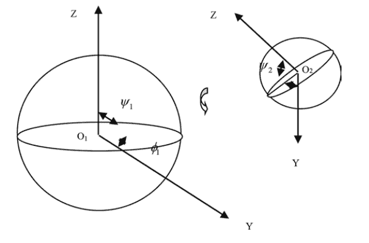

在该模型中，配体的优化构象由三个平动分量 ($T_X, T_Y, T_Z$)、三个转动分量 ($R_X, R_Y, R_Z$) 以及配体的旋转关键值 ($T_{b1}, T_{b2}, \ldots, T_{bn}$) 组成。平移变量的范围受限于受体活性位点的外部长方体，旋转变量的变化范围为 $[-\pi, \pi]$。此外，$f(x)$ 为目标函数，即评分函数。

图 4.1 展示了分子对接的球体表示，其中 $\psi_1$ 和 $\varphi_1$ 决定配体分子几何中心 $O_2$ 相对于受体分子的朝向；$\psi_2$ 和 $\varphi_2$ 决定配体分子几何中心 $O_1$ 相对于受体分子的朝向；$\phi$ 为两分子几何连接处的夹角。

#### 4.3.2.2 分子对接的量子群模型

我们知道，任何群都由其生成元生成。利用一组生成元，可以非常方便地表示一个大群。例如，量子群 $\text{GL}_q(3)$ 的量子代数是由量子群单参数单量子群的无穷小生成元构成的线性空间。三维欧几里得群由六个单参数子群组成，因此其量子代数的维数为 6。量子群 $\text{GL}_q(3)$ 的无穷小生成元源自 $t = 0$ 处的单参数量子子群。

如果我们使用 $t$ 作为参数，将三个旋转参数和三个平移参数取为点 $G(X, Y, Z)$ 的坐标，我们可以得到单参数旋转子群和单参数平移子群的六个无穷小生成子群。因此，量子群 $\text{GL}_q(3)$ 的任何无穷小变换都是六个无穷小生成元的线性组合。绕 X、Y 和 Z 轴的旋转的单参数具有如下矩阵形式作用于 $R^{3}$

$$ \begin{bmatrix} 1 & 0 & 0 \\ 0 & \cos \varphi & -\sin \varphi \\ 0 & \sin \varphi & \cos \varphi \end{bmatrix} \text{, } \begin{bmatrix} \cos \theta & 0 & \sin \theta \\ 0 & 1 & 0 \\ -\sin \theta & 0 & \cos \theta \end{bmatrix} \text{, } \begin{bmatrix} \cos \psi & -\sin \psi & 0 \\ \sin \psi & \cos \psi & 0 \\ 0 & 0 & 1 \end{bmatrix} $$

其中 $\varphi, \theta$ 和 $\psi$ 分别代表绕 X、Y 和 Z 轴的旋转角，对应于图 4.1 中的 $\varphi$、$\theta$ 和 $\psi$，相应的无穷小生成元为

$$ e_{1} = \begin{bmatrix} q & 0 & 0 \\ 0 & 0 & -1 \\ 0 & 1 & 0 \end{bmatrix} \text{, } \quad e_{2} = \begin{bmatrix} 0 & 0 & 1 \\ 0 & q & 0 \\ -1 & 0 & 0 \end{bmatrix} \text{, } \quad e_{3} = \begin{bmatrix} 0 & -1 & 0 \\ 1 & 0 & 0 \\ 0 & 0 & q \end{bmatrix} \text{.} $$

平移子群在 $R^{3}$ 上没有矩阵表示，而是在 $R^{3}$ 上微分函数的向量空间中定义，表示为位移算子

$$ \begin{split} T_{x}(\xi) &: f(X, Y, Z) \rightarrow f(X + \xi, Y, Z) \\ T_{y}(\eta) &: f(X, Y, Z) \rightarrow f(X, Y + \eta, Z) \\ T_{z}(\zeta) &: f(X, Y, Z) \rightarrow f(X, Y, Z + \zeta) \end{split} $$

其中 $\xi$、$\eta$ 和 $\zeta$ 分别代表在 X、Y 和 Z 轴上的平移方向，相关的无穷小生成元表示为偏微分算子

$$ e_{4} = \frac{\partial}{\partial X} \text{, } \quad e_{5} = \frac{\partial}{\partial Y} \text{, } \quad e_{6} = \frac{\partial}{\partial Z} \text{.} $$

利用这六个无穷小生成元，任何三维量子群的无穷小变换 $e$ 可以表示为

$$ e = \sum_{i=1}^{6} \nu_{i}e_{i} \quad \text{(4.14)} $$

其中 $\nu_{i} (i = 1, \dots, 6)$ 是 $e_{i}$ 的系数。

由于假设受体分子是刚性的，在对接过程中仅考虑配体构象的变化。上述处理使得分子对接的计算仅与配体中原子的笛卡尔坐标相关，从而可以通过求解优化问题 (4.12)-(4.13) 来获得。平移变量的范围受限于受体的空腔。为了避免求解受体空腔精确边界的繁琐工作，定义表面受体球体所占空间的外接盒作为变量空间。旋转变量的范围是 $[-\pi, \pi]$。对于优化过程产生的每个构象，只要有一个原子落在矩形球体的范围内，就被视为无效构象，此时不计算该构象的分数，并重新生成新的构象，直到新的构象成为有效构象为止。

对配体的整个构象进行全局搜索，即通过模型中的平移分量搜索配体的位置空间。通过旋转分量搜索配体的朝向空间。通过柔性关键分量搜索配体的柔性构象空间。这消除了一系列准备工作，例如配体分段、定义锚点、划分层级、计算锚点距离以及搜索匹配等。接收用于数据初始化的输入文件后，直接进行构象搜索。因此，对接计算时间显著减少。

### 4.3.3 基于量子群生成元的分子匹配算法

在分子对接中，如果配体由 *m* 个球体表示，受体活性口袋中的负像数量为 *n*，则它们之间可能的匹配数量为 *n*!/*(n* − *m)!*。为了简化计算，我们使用以下算法进行匹配：

- (1) 首先，将配体球体中的球 *i* 与活性位点的一个负像 *k* 进行匹配。
- (2) 然后计算配体球体 *i* 与其他配体球 *j* 之间的距离 *d* *ij*，并计算负像 *k* 与其他负像 *l* 之间的距离 *d* *kl*。如果满足以下条件，则配体球体 *j* 和负像 *k* 可以有效匹配，其中 $\epsilon$ 的值通常在 1.0–2.0 Å 之间。
  $$ |d_{ij} - d_{kl}| < \epsilon \quad (4.15) $$
- (3) 确定第二个匹配点后，可以确定第三个匹配点。第三个匹配必须满足 (4.16) 所示的两个约束条件。同样，第四点必须满足 (4.16) 所示的三个约束条件。每个有效匹配的匹配点数不得少于 4。
- (4) 根据上述操作，获得受体和配体的匹配点集，并进一步进行调整。调整有三个目的：内部距离相对粗糙，需要进一步调整；某些非匹配原子可能处于不合理的位置，需要进一步调整；进行坐标变换以确定配体相对于受体的位置。在调整过程中，首先将配对距离转换为笛卡尔坐标。通过平移和旋转将配体集叠加在受体的相应负像上，此过程使用最小二乘法进行。最小二乘法的误差幅度对应于配体球体与受体负像之间的重叠程度。
- (5) 如果配体与受体负像之间的最小二乘法结果的误差在某个范围内，则调整配体的对齐方式，使配体与受体之间的匹配更加合理。在这里，我们定义一个简单的函数来评估配体与受体之间的匹配
  $$ E = \sum (r_i + r_j - d_{ik}) $$
  其中 $r_i$ 和 $r_k$ 分别是配体原子和受体原子的范德华半径，$d_{ik}$ 是原子间的距离。$E$ 的值越小，匹配越好。在优化时，让配体原子移动到最近的负像，优化 $E$，并找到最佳位置。此步骤的目的不是将配体分子调整到全面优化，而是去除一些明显不合理的位置。通过此步骤获得的所有配体的空间取向将使用评分函数进一步评估。

评分函数通常有以下几类：基于力场的评分函数使用非键相互作用作为构象评分，有时还会加入溶剂效应的考虑。经验评分函数基于已知结合常数计算一组蛋白质-配体复合物的训练集，并使用多元线性回归方法拟合其固有结构功能系数。基于知识的评分函数使用 X 射线衍射结构数据库中蛋白质-配体相互作用的统计数据作为评分标准。这里，我们使用基于 AMBER 力场的评分函数

$$ f(x) = E = \sum \sum \left( \frac{A_{ij}}{r_{ij}^a} - \frac{B_{ij}}{r_{ij}^b} + 332.0 \frac{q_i q_j}{D r_{ij}} \right) $$

其中 $r_{ij}$ 是配体分子中 $i$ 原子与受体分子中 $j$ 原子之间的距离；$A_{ij}$、$B_{ij}$ 是范德华参数；$a$、$b$ 分别是使用 Lennard-Jones (12, 6) 势函数的范德华力排斥和吸引指数；$q_i$、$q_j$ 分别是原子 $i$ 和原子 $j$ 的电荷；$D$ 是介电常数；332 是将静电势能转换为标准单位 (kcal/mol) 的因子。

分子对接方法可以描述为两方面的结合：一是配体与受体之间的能量函数，二是匹配算法。上述匹配算法称为 QG-Dock（量子群对接）。

### 4.3.4 基于量子群的分子对接模拟

本节描述的基于量子群的分子对接模拟的基本流程如下：


### 4.3.5 实验结果与分析

(1) 收集文献中已发布的小分子化合物结构信息，形成二维（2D）小分子数据库。为每个小分子分配原子类型和化学键，并将二维（2D）结构转换为三维（3D）结构并进行优化，形成三维小分子数据库；
(2) 读取蛋白质和小分子文件，主要为 mol2 文件格式；文件包含原子类型、坐标和键类型；
(3) 确定蛋白质和小分子配体的原子类型；
(4) 对生物大分子（蛋白质）进行质子化和原子电荷分配，优化结构以确定小分子结合位点，并构建计算网格。
(5) 随机初始化蛋白质和小分子配体的位置和角度；
(6) 运行 QGDock 算法，将三维小分子数据库中每个化合物对接到生物大分子活性位点。利用量子群平移算符和旋转算符优化小分子配体的坐标和角度，并评分，即计算小分子与生物大分子的结合强度（结合自由能）；
(7) 分析结果，计算均方根偏差（RMSD），并输出结果。

分子对接算法在由 31 个蛋白质-配体复合物组成的数据集上进行模拟。该数据集来源于参考文献 [34] 中使用的 LPDB 数据库（http://lpdb.scrpps.edu/）。数据选择标准是每个蛋白质在 PDB 中至少有两个配体（肠脂肪酸结合蛋白除外），且每个配体的旋转键数量在 1 到 30 之间，如表 4.6 所示。

**表 4.6：** 实验数据集（每个配体旁边的数字代表旋转键的数量）。

| 蛋白质 | 蛋白质-配体复合物 PDB 索引编号 |
| :--- | :--- |
| 胰岛素 | 3ptb(3),1ntg(2),1ntj(3),1tnk(4),1tnk(5),1tpp(7),1pph(11) |
| 细胞色素 P450cam | 1phf(1),1phg(5),2cpp(3) |
| 唾液酸酶 | 1nsc(12),1nsd(11),1nnb(11) |
| 羧肽酶 | 1cxb(5),3cpa(8),6cpa(16) |
| L-凝胶醛类 | 1abe(4),1abf(5),5abp(6) |
| E-凝血酶 | 1etr(15),1ets(13),1ett(11) |
| 嗜热蛋白酶 | 3tmn(10),5tlm(14),6tmn(20) |
| 菌丝体色素 | 1apt(30),1apu(29) |
| 肠脂肪酸结合蛋白 | 2ifb(15) |
| 碳酸酐酶 II | 1cil(6),10lk(5),1cnx(13) |

这些蛋白质文件以 PDB 文件格式存储。在实验中，蛋白质分子通过 AutoDock 4.0 软件进行预处理，并去除晶体结构中的所有水分子和金属离子。它们被分为两部分，即受体和配体，分别存储为两个 mol2 文件。

在每次对接模拟中，每个栅格图由由均匀分布的点包围的三维晶格组成，位于活性蛋白质受体的中心。栅格图中的每个点存储基于其与生物大分子相互作用检测到的某个原子的势能，例如，碳网格的内部点对应于碳原子位置与蛋白质受体上所有碳原子之间的势能。由于网格间距在 0.25 Å 到 1 Å 之间，对接准确性没有显著差异。在实验中，我们取网格间距为 1 Å。这些网格中每个点的位置对应于量子群 $GL_{q}(3)$ 中无穷小生成元的线性组合，原子间相互作用的势能是公式 $(4.1)$ 的系数。移动操作对应于其平移算符，旋转操作对应于其旋转算符。

使用 QGDock 算法计算了 31 个蛋白质-配体复合物，每个复合物计算 10 次。获得最佳结果，即最低能量计算结果，并得出 RMSD 值。表 4.7 和图 4.2 展示了三种不同对接算法的均方根偏差（RMSD）比较，即 AutoDock4.0、分子动力学（MD）方法和基于量子禁区的分子对接（QGDock）。如果对接的小分子构象与参考分子构象的蛋白质结构相对接近，则均方根偏差相对较小，对接更成功。通常，RMSD 值小于 2.0 Å，表明对接到更准确的位置。

**表 4.7：** 不同对接算法的均方根偏差比较。

| ID | 蛋白质-配体复合物 PDB 索引 | 旋转键数量 | Autodock | MD | QGDock |
| :--- | :--- | :--- | :--- | :--- | :--- |
| 1 | 3ptb | 3 | 0.80 | 0.56 | 0.54 |
| 2 | 1ntg | 2 | 0.62 | 0.69 | 0.67 |
| 3 | 1ntj | 3 | 1.21 | 1.50 | 1.42 |
| 4 | 1tnk | 4 | 1.69 | 1.14 | 1.16 |
| 5 | 1tni | 5 | 2.61 | 2.22 | 2.21 |
| 6 | 1tpp | 7 | 1.80 | 2.53 | 1.71 |
| 7 | 1pph | 11 | 5.14 | 0.53 | 1.44 |
| 8 | 1phf | 1 | 2.09 | 1.70 | 1.20 |
| 9 | 1phg | 5 | 3.52 | 1.08 | 0.87 |
| 10 | 2cpp | 3 | 3.40 | 3.27 | 2.53 |
| 11 | 1nsc | 12 | 1.40 | 1.40 | 1.32 |
| 12 | 1nsd | 11 | 1.20 | 1.85 | 1.04 |
| 13 | 1nnb | 11 | 0.92 | 3.97 | 0.92 |
| 14 | 1cxb | 5 | 1.33 | 0.92 | 0.62 |
| 15 | 3cpa | 8 | 2.22 | 2.22 | 1.51 |
| 16 | 6cpa | 16 | 8.30 | 4.00 | 4.96 |
| 17 | 1abe | 4 | 0.16 | 0.56 | 0.36 |
| 18 | 1abf | 5 | 0.48 | 0.70 | 0.51 |
| 19 | 5abp | 6 | 0.48 | 0.51 | 0.48 |
| 20 | 1etr | 15 | 4.61 | 1.09 | 1.02 |
| 21 | 1ets | 13 | 5.06 | 1.97 | 2.11 |
| 22 | 1ett | 11 | 8.12 | 0.82 | 1.30 |
| 23 | 3tmn | 10 | 4.51 | 3.65 | 1.76 |
| 24 | 5tlm | 14 | 5.34 | 1.21 | 1.21 |
| 25 | 6tmn | 20 | 8.72 | 2.21 | 2.18 |
| 26 | 1apt | 30 | 1.89 | 4.97 | 1.98 |
| 27 | 1apu | 29 | 9.10 | 1.33 | 1.32 |
| 28 | 2ifb | 15 | 3.09 | 5.19 | 0.97 |
| 29 | 1cil | 6 | 5.81 | 1.86 | 1.85 |
| 30 | 10lk | 5 | 8.54 | 2.84 | 3.03 |
| 31 | 1cnx | 13 | 10.9 | 6.20 | 5.19 |

我们定义算法的对接准确率（DA）如下：

$$ DA = f_{rmsd \le 2} + 0.5(f_{rmsd \le 3} - f_{rmsd \le 2}) \quad (4.18) $$

其中 $f_{rmsd \le a}$ 是晶体结构中，当小分子势能最低位置与配体位置之间所有非氢配体原子的均方根偏差 $\le a$ Å 时的比例。

表 4.8 和 4.9 从对接时间和对接准确率方面比较了我们的对接算法与 AutoDock 4.0 和 MD 方法。从图 4.2 和 4.3 可以看出，基于量子群的量子对接算法比其他两种算法更准确。对接时间比 AutoDock 短，但比 MD 方法长。

**表 4.8：** 不同蛋白质的不同对接模拟比较。

| 蛋白质 ID | 蛋白质 | AutoDock | MD | QGDock |
| :--- | :--- | :--- | :--- | :--- |
| 1 | 胰岛素 | 391 | 182 | 281 |
| 2 | 细胞色素 P450$_{cam}$ | 297 | 87 | 184 |
| 3 | 唾液酸酶 | 645 | 121 | 311 |
| 4 | 羧肽酶 | 614 | 125 | 215 |
| 5 | L-凝胶醛类 | 368 | 98 | 176 |
| 6 | E-凝血酶 | 1185 | 303 | 503 |
| 7 | 嗜热蛋白酶 | 798 | 294 | 348 |
| 8 | 菌丝体色素 | 1143 | 290 | 276 |
| 9 | 肠脂肪酸结合蛋白 | 572 | 489 | 345 |
| 10 | 碳酸酐酶 II | 520 | 304 | 437 |

**表 4.9：** 对接准确率比较。

| 方法 | 对接准确率 (%) |
| :--- | :--- |
| AutoDock | 0.68 |
| MD | 0.73 |
| QGDock | 0.82 |

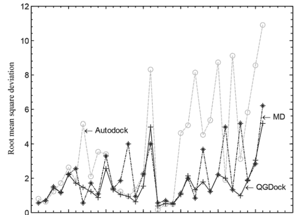

**图 4.2：** 不同对接算法的均方根偏差比较。

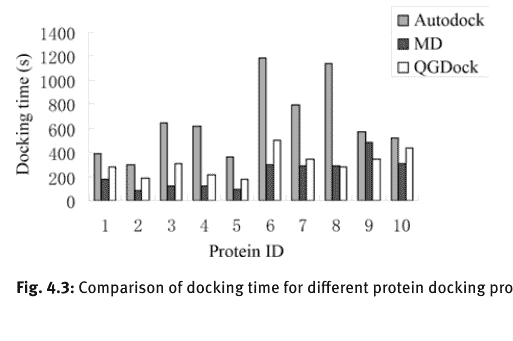

**图 4.3：** 不同蛋白质对接蛋白的对接时间比较。

由于我们使用基于量子群的无穷小子生成方法控制搜索空间，我们进一步增强了搜索的灵活性和有效性。实验表明，我们的方法在提高分子对接精度的同时也能提高其速度。


## 参考文献

- [1] Drinfel'd VG. 量子群. 国际数学家大会论文集 (Proceedings ICM), 1986, 798–820.
- [2] Nasios N, Adrian NB. 基于量子力学的核方法分类, 模式识别 (Pattern Recognition), 2007, 40(3), 875–889.
- [3] Kondor IR. 机器学习中的群论方法. 哥伦比亚大学, 2008.
- [4] Xu H, Li FZ. 李群机器学习的公理假设. 2006年IEEE粒度计算国际会议论文集, 401–404.
- [5] Xu H, Li FZ. 李群机器学习 (LML) 中 SU(n) 分类器的设计. 计算信息系统杂志 (Journal of Computational Information Systems), 2005, 1(4), 835–841.
- [6] Xu H, Li FZ. 李群机器学习中笛金图的几何算法. 南昌工学院学报, 2006, 25(2), 75–78.
- [7] Xu H, Li FZ. 李群机器学习研究. 计算信息系统杂志 (Journal of Computational Information Systems), 2005, 1(4), 843–849.
- [8] Xu H, Li FZ. 李群机器学习中笛金图的算法. 通信与计算机杂志 (Journal of Communication and Computer), 2006, 4(3), 13–17.
- [9] Xu H, Li FZ. 李群机器学习中 SO(3) 分类器. 通信与计算机杂志 (Journal of Communication and Computer), 2006, 4(3), 76–80.
- [10] Chen F, Li FZ. 李群机器学习 (LML) 中学习子空间生成轨道理论及其算法. 苏州大学学报, 2007, 23(1), 61–66.
- [11] Chen F, Li FZ. 李群机器学习 (LML) 中 GLn(Fq) 群作用下学习子空间轨道生成格算法研究. 2006, 36–46.
- [12] Xu H. 李群机器学习模型的研究与应用. 苏州: 苏州大学, 2007.
- [13] Chen F. 李群机器学习 (LML) 中学习子空间生成轨道算法的研究与应用. 苏州: 苏州大学, 2007.
- [14] He SP. 李群机器学习中量子群分类器研究. 苏州: 苏州大学, 2008.
- [15] He SP, Li FZ. 基于量子群的分子对接药物设计算法. 南京大学学报, 2008, 44(5), 512–519.
- [16] He SP, Li FZ. 基于量子群的对称线性变换学习算法. 2007年IEEE粒度计算国际会议论文集, 2007, 724–727.
- [17] Adelman LM. 组合问题解的分子计算. 科学 (Science), 1994, 266(11), 1021–1023.
- [18] Baldi P, Brunak S. 生物信息学: 机器学习方法. MIT出版社, 1998.
- [19] Durbin R, Eddy S, Krogh A, et al. 生物序列分析, 蛋白质和核酸的概率模型. 伦敦. 剑桥大学出版社, 1998.
- [20] Simek K, Fujarewicz K, Swieriak A, et al. 使用SVD和SVM方法对DNA微阵列数据进行选择、分类、聚类建模. 人工智能工程应用, 2004, 17(4), 417–427.
- [21] Yu XJ, Cao JP, Cai JD, et al. 利用支持向量机从一级结构预测rRNA、RNA和DNA结合蛋白. 理论生物学杂志, 2006, 240(2), 175–184.
- [22] Cai YD, Lin SL. 利用支持向量机从氨基酸序列预测rRNA、RNA和DNA结合蛋白. 生物化学与生物物理学报, 2003, 1648(1–2), 127–133.
- [23] Almeida JS, Carrico JA, Maretzek A, et al. 通过混沌博弈表示法分析基因组序列. 生物信息学, 2001, 17(5), 429–437.
- [24] Zhang CT. DNA序列的对称性理论及其应用 [J]. 理论生物学杂志, 1997, 187(3), 297–306.
- [25] Xu XJ, Hou TJ, Qiao XB, et al. 药物分子计算机辅助设计. 北京: 化学工业出版社, 2004.
- [26] Diller DJ, Berlinde CLM. 对几种用于分子对接的全局优化算法的批判性评估. 计算化学杂志, 1999, 20(16), 1740–1751.
- [27] Hart RK, Pappu RV, Ponder JW. 探索势平滑与模拟退火之间的相似性. 计算化学杂志, 2000, 21(7), 531–552.
- [28] Tafer M, Crowley M, Price D, et al. 基于分子动力学的高精度快速蛋白质-配体对接算法研究. 第18届国际并行与分布式处理研讨会 (IPDPS’04)-研讨会9论文集, 2004, 新墨西哥州圣塔菲.
- [29] Morris GM, Goodsell DS, Hallyiday RS, et al. 使用拉马克遗传算法和经验结合自由能函数进行自动对接. 计算化学杂志, 1998, 19(14), 1639–1662.
- [30] Morris GM, Goodsell DS, Huey R, et al. 柔性配体到蛋白质的分布式自动机对接: AutoDock 2.4的并行应用. 计算机辅助分子设计杂志, 1996, (10), 293–304.
- [31] Mangoni R, Roccatano D, Di NA. 通过分子动力学模拟在溶液中对接柔性配体到柔性受体. 蛋白质: 结构、功能与遗传学, 1999, 35(2), 153–162.
- [32] Given JA, Gilson JA. 生成蛋白质-配体复合物低能量构象的层次方法. 蛋白质: 结构、功能与遗传学, 1998, (33), 475–495.
- [33] Tsao TR, Shyu HJ, Libert JM, et al. 用于视觉运动三维解释神经系统的李群方法. IEEE神经网络汇刊, 1991, 2(1), 149–155.
- [34] Sotriffer GM, Flader W, Winger RH, et al. 配体到抗体的自动对接: 方法与应用. 方法: 酶学方法伴侣, 2000, 20(3), 280–291.

## 5 李群纤维丛学习

本章分为四个部分。5.1节提出了一个问题。5.2节描述了纤维丛模型。5.3节介绍了纤维丛的学习算法。最后，5.4节总结了本章内容。

### 5.1 问题陈述

纤维丛理论是20世纪几何学研究的重要组成部分。在较宽泛的意义上，大尺度微分几何（包括纤维簇）研究微分几何对象的全局性质与局部性质之间的关系。纤维丛理论连接和处理不同几何空间及不同几何量的方法，为研究数据集的全局与局部关系提供了一种可行的数学方法。纤维丛是流形的一种广义积。简而言之，设 $E$ 和 $M$ 为两个光滑流形。$E$ 到 $M$ 的映射是光滑的，$M$ 上每一点的仿射空间由一个 $n$ 维向量集组成，$(E, M)$ 即为流形 $M$ 上的向量丛。直观地看，向量丛 $E$ 是积流形和纤维粘合的结果。粘合要求纤维上的线性关系保持不变。

纤维丛作为一种数学工具，已成功应用于计算机视觉、模式识别、神经网络和系统科学。在计算机视觉中，Nir Sochen 等人使用纤维丛作为主要工具，建立了非线性扩散的框架。Beltrami [1] 成功地将纤维丛应用于同步扩散立体图像的融合 [2]。在神经网络方面，D. W. Pearson 开发了前馈神经网络的纤维丛表示 [3]。在模式识别方面，超進輝 (Jin-hui Chao) 和金哲代 (Jongdae Kim) 建立了表面形状的纤维丛模型，并实现了表面形状的快速生成 [4]。在系统科学方面，R. W. Brockett [5, 6] 在1976年和1983年分析了特定问题，并指出非线性控制系统的广义理论应基于纤维丛。1996年，基于先前的研究，M. U. Xiaowu 开发了一种通过纤维丛建立非线性控制系统正确几何框架的方法，并提出了相应的理论 [7]。

流形是一个局部坐标拓扑空间，它将拓扑空间的开集（邻域）同胚地映射到欧几里得空间的子集上，对应于每个局部坐标。其本质是分段线性处理。许多流形学习方法基于流形的性质。我们发现其中一些使用了切空间，例如流形的局部切空间近似 (LTSA) 局部研究。这一想法对本章的研究具有重要意义。本章建立的纤维丛学习模型和算法首先考虑切丛（参见有关纤维...


（纤维丛和李群机器学习）。流形的局部性质可以通过流形上每一点的切空间来近似，而每个切空间共同组成了切丛，这使得纤维丛可以作为一种工具，用于对流形结构及其切丛进行更深入的解析处理。有关本章涵盖的微分几何知识和流形学习算法，请参阅附录 17.2 和 17.3。

### 5.2 纤维丛模型

#### 5.2.1 流形学习中纤维丛的表达 [8, 9]

纤维丛是流形上积的推广。向量 $E = \cup_{x \in M} F_{x}$ 是底流形 $M$ 上所有点的纤维的并集，也是以流形 $M$ 为参数的向量空间族。局部区域可以表示为参数空间 $U$ 和向量空间 $F$ 的拓扑积 $U \times F$，但作为一个整体，它不能表示为普通的拓扑积。

这里有一个现实世界的例子。我们发现仙人掌植物与纤维丛结构有着惊人的相似性，如图 5.1 所示。直观地看，纤维丛的底部类似于仙人掌的球茎，而纤维类似于仙人掌的刺。仙人掌可以用纤维丛的语言描述如下：

- 由球茎组成的流形是底空间 $M$，所有刺构成了丛空间 $E$
- 投影 $\pi: E \rightarrow M$ 定义为从仙人掌刺上任意一点到刺与球茎交点的连线。
- 纤维类型 $F$ 被定义为一维空间 $R$。

在许多具体问题中，描述问题的实际数据容易获取，但数据中隐藏的本征信息或知识不易直接获取。需要对数据进行深入分析或深度分类才能提取有用信息。这些应用为机器学习提供了机会。实际处理的数据对象可以根据对象间的相似度进行分组或分类。经过这种处理后，数据对象产生了类或簇的结构。这种簇结构与纤维丛结构一致。聚类分析中不同类型的高维数据可能对应于不同的子空间。每个子空间的维度也可能不同。在完整空间中获得聚类结构通常很困难。用纤维丛的语言来说，由更高维度的聚类生成的每个子空间都是一个纤维，所有子空间的集合就是一个丛空间。在纤维丛的语言中，丛空间也被称为全空间。以下讨论基于此概念。

**定义 5.1.**

在流形研究中，纤维丛（表示为六元组 $\langle X, E, M, F, \pi, G \rangle$），其中

- **X**：输入数据集 $X=\{x_{1}, x_{2}, \ldots, x_{n}\}$；
- **E**：纤维丛是底流形上所有纤维的并集。
- **M**：底空间是原始数据集经过某种变换后得到的；
- **F**：典型纤维，它规定了纤维空间的拓扑性质，且纤维丛的所有纤维都满足典型纤维的性质。它是原始高维数据的真实投影。例如，F 理想情况下为 $R^{k}$。那么，所有纤维都是 k 维实空间。
- **$\pi$**：纤维丛 $E$ 与底流形 $M$ 之间的投影变换
$$\pi:E\rightarrow M$$
在底流形 $M$ 上每一点 $x$ 通过逆变换得到纤维 $F_{x}$
$$\pi^{-1}: x \rightarrow F_{x}$$
纤维 $F_{x}$ 是一个 k 维空间，称为通过 $x$ 点的纤维，则 $E=\bigcup_{x \in M} F_{x}$。
- **G**：称为结构群，是由底空间中的局部坐标变换生成的矩阵群。它给出了纤维丛的结构

**定义 5.2.**

在纤维丛 $\langle X, E, M, F, \pi, G \rangle$ 上，$\forall x'_{i}\in X'\subseteq M, \exists U_{a}, \exists x'_{i}\in U_{a}$；则 $x_{i}\in\pi^{-1}(U_{a})$。

**算法 5.1：纤维簇生成算法 (FbundleProduce)**
**输入：** 数据集集合 $X=\{X_{i}\}$
**输出：** 纤维丛 $\langle X_{i}, E_{i}, M_{i}, F_{i}, \pi_{i}, G_{i}\rangle$
**过程** 伪代码：
**对于** X 中的每个数据集 $X_{i}$。
(1) $M_{i}\leftarrow X_{i}$
(2) $F_{i}=\mathbb{R}^{D}$, $D$ 是 $X_{i}$ 的维度， $G_{i}=\mathrm{GL}(D)$
(3) 使用 K 均值聚类对 $X_{i}$ 进行划分，使得每个样本属于一个聚类
$$\mathcal{C}_{ij}, \text{ 其中 } j \text{ 是聚类的数量}, \ E=\{\mathcal{C}_{ij}\}$$
(4) 对于 $\pi_{i}: x_{ijk} \rightarrow \mathcal{C}_{ij}$，其中心样本为 $x_{jio}$

#### 5.2.2 流形学习的切丛模型

##### 5.2.2.1 切丛与向量场

根据附录 17.6 的相关理论，我们可以看到流形 $M$ 是局部像 $R^{n}$ 的拓扑空间，且是可微的。因此，可以使用分析工具来研究流形。分析的一个重要方法是对物体进行无穷小分析，这可以使问题线性化从而易于研究。

函数在某点附近的性质可以通过其导数来表示。李群在单位元附近的局部性质可以通过李代数来表示。曲线在某点附近的性质可以通过该点的切线来表示。

类似地，对于数据流形 $M$，每一点附近的性质可以用线性空间（切空间）来近似。切空间由切向量组成，$M$ 中某方向上点 $p$ 的切向量不依赖于坐标系的选取，即与该点邻域坐标卡片的选取无关。向量丛的主要例子是流形的切丛。

**定义 5.3.** 流形 $M$ 上切空间中所有点的并集
$$T(M)=\bigcup_{p} T_{p}(M)$$
称为流形 $M$ 的切丛。切丛 $T(M)$ 是一个 $2n$ 维流形，其局部是直接积流形，但整体不一定如此。同一点的切向量可以相加，而不同点的切向量是独立的。

流形 $M$ 的每一点都有一个 $n$ 维切空间通过，可以表示为该点的直线。不同点的切空间彼此独立，表示为平行线。每一点 $p$ 的切空间是 $T_{p}(M)=R^{n}$。

在附录 17.6 中，已经引入了纤维丛理论中横截面的通用定义。在此基础上，引入了向量场 $X(\mathrm{x})$ 的重要概念。

**定义 5.4.** 切向量场 $(\mathbf{x})$ 也称为切丛 $T(M)$ 的一个横截面。在流形 $M$ 上的每一点 $p$ 选取一个切向量 $X_{p} \in T_{p}(M)$。选定局部坐标系后，切向量场 $(x)$ 可以表示为

$$\mathcal{F}(x)=\sum_{j=1}^{n} \xi^{j}(x)\partial_{j}$$

如果函数 $\xi^{j}(x)$ 连续且可微，则向量场 $(x)$ 连续且可微。

##### 5.2.2.2 流形学习的切丛模型

附录 17.3 详细介绍了流形学习，下面给出流形学习任务的简要描述。考虑一个高维样本数据集 $X=\{x_{1}, x_{2}, \ldots, x_{N}\}$，其中 $x_{i} \in R^{D}$，均匀采样自一个光滑的 $d$ 维流形 $M$，其中 $M$ 是 $D$ 维欧几里得空间中的 $d$ 维嵌入流形，嵌入映射为 $\tau: M \rightarrow R^{d}$，其中 $M \subset R^{D}, d \ll D$。

流形学习使用欧几里得空间的流形作为数学基础，因为局部流形是欧几里得拓扑空间。空间中的每一点都有一个邻域，即流形是一个局部坐标拓扑空间。因此，我们可以处理分段线性的情况。

以下是流形学习的切簇模型。

**定义 5.5.** 考虑一个高维数据集 $X=\{x_{1}, x_{2}, \ldots, x_{N}\}$，其中 $x_{i} \in R^{D}$，均匀采样自光滑 $d$ 维流形 $M$，其中 $M$ 是 $D$ 维欧几里得空间的 $d$ 维嵌入流形，嵌入映射为 $\tau: M \rightarrow R^{d}$，其中 $M \subset R^{D}, d \ll D$。 $X$ 切空间上所有点的并集

$$T(X)=\bigcup_{p} T_{p}(X)$$

称为流形 $X$ 的切丛。

**定义 5.6.** 数据流形 $X$ 的切丛模型包含以下元素：

- (1) 切丛 $T(X)=\bigcup_{p} T_{p}(X)$
- (2) 向量场 $(x)$ 称为切丛 $T(X)$ 的一个横截面。在流形 $X$ 上的每一点 $p$ 选取一个切向量 $X_{p} \in T_{p}(X)$。选定局部坐标系后，切向量场 $(x)$ 可以表示为

$$\mathcal{F}(x)=\sum_{j=1}^{n} \xi^{j}(x)\partial_{j}$$

如果函数 $\xi^{j}(x)$ 连续且可微，则向量场 $(x)$ 连续且可微。

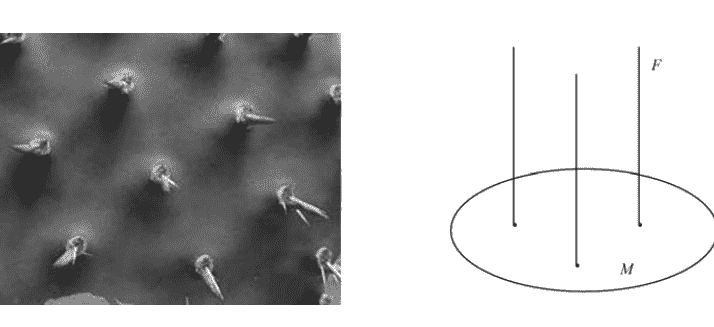

图 5.1：仙人掌和纤维丛示意图。


(3) 联系 $D$，满足 $D: (X) \times (X) \rightarrow (X)$：

- a) $D_{Y+fZ}X = D_{Y}X + fD_{Z}X$
- b) $D_{Y}(X + \lambda Z) = D_{Y}X + \lambda D_{Y}Z$
- c) $D_{Y}(fX) = Y(f)X + fD_{Y}X$

其中 $D_{Y}X = D(X, Y)$，$X, Y, Z \in (X)$，$\lambda \in \mathbb{R}, f \in C^{\infty}(M)$。纤维丛 $\langle X, E, M, F, \pi, G\rangle$ 可以表示为 $\langle T(X), X, F, \pi, G\rangle$。

### 5.2.3 主纤维丛模型

**定义 5.7.** 主丛 $P = P(M, G)$ 是一种纤维丛，其纤维是李群流形 $G$，簇 $P$ 的结构仍属于 $G$，并对纤维 $G$ 执行左变换。

由于可以定义李群 $G$ 的左右作用，我们可以定义群 $G$ 在 $P$ 上的右作用。其不变结构群为

$P \times G \rightarrow P$

$u, a \rightarrow u_{a} = R_{a}u \in P$，$u \in P$，$a \in G$。

由于纤维本身是一个群流形，群 $G$ 对主丛 $P$ 的作用是自由的（即除常元外，所有函数没有固定点），因此每个轨道是一个同构群 $G$ 流形，即将群 $G$ 作用的整体轨道视为轨道空间的一个点。获得轨道空间，即底空间 $M = P/G$。那么，主丛 $P$ 到底流形 $M$ 有正则投影

$\pi: P \rightarrow M$

正则投影保持纤维不变，即具有性质

$\pi(R_{a}u) = \pi(u)$（$u \in P$，$a \in G$）

主丛 $P$ 可以表示为 $P(M, G)$，或者可以表示为

$G \mapsto P \xrightarrow{\pi} M$

主丛 $P$ 是局部平庸的。在底流形邻域 $U_{a}$ 的纤维上每一点都有一个同胚映射

$\psi_{a}: \pi(U_{a}) \rightarrow U_{a} \times G$

$u \rightarrow (\pi(u), \psi_{a}(u)) = (x, g_{a}(x))$，$g_{a} \in G$

簇的整体结构取决于重叠区域中连接的纤维的平滑性，即当 $x \in U_\alpha \cap U_\beta$ 时，在纤维 $\pi^{-1}(x)$ 的点 $u$ 上，我们有

$\psi_\alpha(u)=g_\alpha, \quad \psi_\beta(u)=g_\beta, \quad g_\alpha\psi_\alpha^{-1}g_\beta=\lambda_{\alpha\beta}(x)g_\beta$

转移函数 $\lambda_{\alpha\beta}(x) \in G$ 满足相容条件。变换函数集 $\{\lambda_{\alpha\beta}(x)\}$ 构成簇的结构群。主丛 $P$ 的结构群属于簇的标准纤维李群 $G$。主丛 $P$ 也称为 $G$-主丛。

**定义 5.8.** 在 $m$ 维光滑流形 $M$ 上的 $G$-主丛，$\text{dim } G = r$。设 $H$ 是丛空间 $E$ 上的 $m$ 维光滑分布，或者等价地，$H$ 是 $E$ 上的光滑 $m$ 维切子空间场。如果满足以下条件：

1. 在每个点 $b \in E$，切空间 $T_b E$ 有直接分解

$T_b E = H_b \oplus V_b$

此外，切映射 $\pi^*$ 在 $H_b$ 上的限制 $(\pi^*)|_{H_b}: H_b \to T_{\pi(b)}M$ 是一个线性同构；

2. 分布 $H$ 在 $G$ 的右作用下是不变的，即对于任意 $b \in E$，$g \in G$，我们有

$(R_g)_{*b}(H_b) = H_{bg}$

则称 $H$ 为 $G$-主丛 $\pi: E \to M$ 上的一个连接。

流形学习中的纤维丛表示和主簇的概念已经给出。李群机器学习的主纤维丛模型定义如下。

**定义 5.9.** 李群机器学习的主纤维丛模型表示为

- $E$：纤维丛，是所有底流形上的纤维的并集。
- $M$：底空间。
- $\pi$：纤维丛 $E$ 和底流形 $M$ 之间的投影变换。
- $G$：李群 $G$，既表示主丛的标准纤维，也表示结构群。

## 5.3 纤维丛学习算法

在前一节中，我们给出了一个纤维丛学习模型，其中切丛形模型统一了切向量和切向量，并使用纤维丛语言扩展了切接触的概念。在此基础上，我们给出纤维丛学习模型下的两个算法。

### 5.3.1 基于切向局部主方向的向量降维算法

### 5.3.1.1 算法描述

如文献[10]中所述，局部切空间可以通过局部样本协方差矩阵的特征向量表示。可以使用主成分分析的前 $d$ 个特征向量作为基，近似表示切空间，一个簇由切空间的并集组成。

该算法首先构建切集，从 PLTSA 学习。使用 K-means 聚类将数据集划分为 $t$ 个足够小的局部块，并对块进行主成分分析。取第一主成分方向形成向量场 $Z$，它是切丛的一个截面。由于每个邻域协方差矩阵的主特征向量是全局坐标，我们对 $Z$ 进行降维，向量场 $Z$ 本身是一个流形。通过观察流形 $Z$ 的规律，我们可以找到高维数据集的内部结构。在降维过程中，我们使用经典的流形学习算法，并在实验中比较它们的效果。

> **算法 5.2：** 基于切向局部主方向的向量场降维算法（TBFR, Tangent Bundle Field Reduction）
>
> **输入：** 样本集 $X$，低维嵌入空间的维度 $d$；
>
> **步骤 1** 使用 $k$-mean 找到 $X$ 的 $t$ 个中心；将 $X$ 划分为 $t$ 个块，每个表示为 $X_i = [x_{i1}, \dots, x_{ik}]$；
>
> **步骤 2** 局部主成分分析。计算协方差矩阵 $(X_i - \bar{x_i}e^T)(X_i - \bar{x_i}e^T)$ 以获得第一主特征向量 $\theta_i$。第一主成分是 $z_i = (\theta_i^T \cdot X)$；
>
> **步骤 3** 找到第一主成分向量 $z_1$ 在每个块上的坐标 $z_i = z_j - c_j$，其中 $c_i$ 是每个簇的中心，矩阵 $Z = [z_1, z_2, \dots, z_t]$
>
> **步骤 4** 调用流形学习算法对向量场 $Z$ 进行降维。

该算法使用 k-means 算法求解协方差矩阵的特征值，其大小为 $l \times t$（$l$ 是每个块上的样本数）。

在邻域选择中，我们使用 k-means 算法划分数据集。我们不选择 k 邻域算法为每个数据构建邻域，因为如果这样做，计算局部主成分需要大量的计算，计算复杂度将显著增加。此外，如果样本数量很大，计算量将非常巨大。

### 5.3.1.2 实验与分析

我们将使用瑞士卷数据集来说明算法的有效性。瑞士卷数据集是通过从三维欧几里得空间中的无噪声瑞士卷表面均匀采样获得的[10]。在实验中，

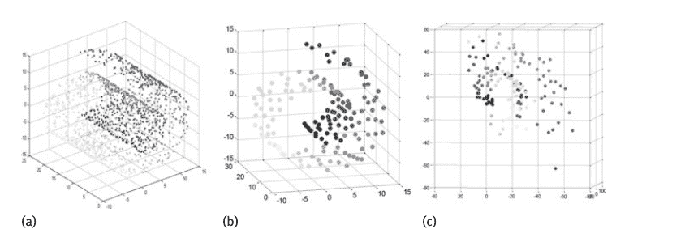

**图 5.2：** 瑞士卷采样表面和 TBRF 运行过程截图。

我们取 $N = 1600, d = 2$，且 $t = 160$。瑞士卷数据集被划分为 160 个块，这与数据采样无关，存在一定的随机性。

图 5.2 主要展示了在瑞士卷数据集上运行 TBRF 的过程。左图是瑞士卷表面。中间图是聚类后三维空间中聚类中心的表示。右图是执行步骤 3 后矩阵 $Z$ 中点在空间中的位置。注意左两图使用相同的颜色向量注记数据。右图中点的颜色由块中所有点的颜色的平均值决定。

通过直接使用 Isomap、LLE 和 LTSA 对数据集进行降维，我们得到图 5.3 第一行的三个图；然后，在使用上述三种算法配合向量场降维算法进行降维后，结果是图 5.3 的第二行。通过实验，我们发现当向量空间中的流形 $Z$ 由每个块的主方向组成时，它们仍然可以反映原始流形的几何结构。在调用降维算法后，我们发现虽然流形 $Z$ 的二维投影显示出对原始流形直接使用降维算法的不同效果，但投影仍然有序地分布在平面上。

在实验中，我们发现两个影响实验的参数。第一个是簇的数量 $t$。由于使用了 k-means 算法，聚类算法需要预先输入簇的数量。在实验中，我们发现簇的数量 $t$ 会影响实验的最终结果。第二个是维度算法（步骤 4）的邻域参数，这由降维算法本身的特性决定。此外，由于 k-means 聚类结果具有某种程度的随机性，我们发现虽然每次实验的结果具有共同的特征和规律，但结果本身并不相同。


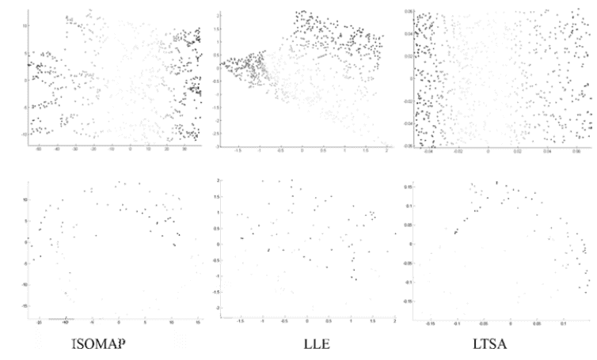

ISOMAP LLE LTSA

**图 5.3：** TBF R 在瑞士卷数据上的实验结果。

#### 5.3.2 基于切向接触的主曲线构造算法

### 5.3.2.1 引言

在机器学习和模式识别等领域中，寻找嵌入在高维空间中的低维流形是一个基本问题。1904 年，Spearman 提出了线性主成分分析法（PCA），该方法至今仍是数据分析的重要工具。主成分分析法将目标函数限制为数据集到向量（直线）投影的最大方差。主曲线可以看作是一维的主形式，它是非线性的第一主成分推广，其基本思想是找到一条穿过数据分布中部的平滑曲线。Hastie 和 Stutzle [11] 在其关于主曲线的开创性论文中提出了主曲线概念（HS 主曲线），旨在找到真正反映“云”（数据分布）且统计上满足自一致特性的“骨架”。然而，主曲线的目标不仅是寻找数据集的骨干，还要获得其骨架。数据集的脊骨可以通过线性方法求解，但骨架需要非线性方法。Thorpey 和 Flurry [12] 从统计学角度扩展了自一致随机变量的定义，将自一致性设定为构建统计方法（如主成分和主曲线）的理论基础，并分析了自一致性与数学之间的关系。主曲线理论的研究基于 Hastie 关于数据跨学科分布的研究，以丰富其成果 [13–15]。Duchamp 等人 [16, 17] 和 Martínez-Morales [18] 研究了平面主曲线的整体微分几何性质，指出当曲率不为零时，平面上的主曲线是数据期望平方距离的鞍点，而没有局部最小值，这不仅会导致模型拟合失败，也不允许使用交叉验证方法来选择模型复杂度。似乎穿过数据分布的主曲线仅具有定性意义，缺乏足够的理论支持。因此，推广难度较大。此外，当前 HS 主曲线及其他主曲线定义的存在性证明仅适用于某些特殊分布。KegI [19] 定义了长度受限的主曲线概念。一旦固定主曲线的长度，就可以计算点线距离的最小平方和。已证明在数据分布具有有限二阶矩的前提下，主曲线存在且唯一，但如何预先设定主曲线长度仍是一个问题。

文献 [20] 根据局部切空间与主分量之间的关系，给出了一种极限意义下的新主曲线构造算法，证明主曲线满足自相关特性，并且对于任何给定的开覆盖都是唯一的。以下是主曲线构造算法 [20]。

**算法 5.3：基于切空间的构建主曲线算法**  
（在下一节中，为了方便，我们将此算法称为切空间算法。）

| 步骤 | 描述 |
|------|-------------|
| **步骤 1** | 使用 $k$ 个球形邻域 $\{Q_{k}(\lambda_{1}, \delta_{1}), Q_{k}(\lambda_{2}, \delta_{2}), \dots, Q_{k}(\lambda_{k}, \delta_{k})\}$ 覆盖样本数据； |
| **步骤 2** | 对于每个邻域 $Q_{k}(\lambda_{i}, \delta_{i})$，$i=1,2, \dots$，计算 $x_{11}, x_{12}, \dots$ 的 $E_{k i}(x)$、$\operatorname{Cov}_{k i}(x)$ 及其特征向量 $\xi_{k i j}=\left(\xi_{i 1}, \xi_{i 2}, \dots, \xi_{i j}\right)$； |
| **步骤 3** | $\xi_{k l} = \min \left\{\xi_{(k-1) 1}^{T}, \xi_{i m}^{T}\right\}$ $(m=1, 2, \dots, l)$，其中 $\xi_{(k-1) i}$ 是 $Q_{(k-1)}(\lambda_{i}, \delta_{i})$ 中数据点协方差矩阵的主特征向量，且 $Q_{k}(\lambda_{i}, \delta_{i})$ 包含在 $Q_{k}(\lambda_{i}, \delta_{i})$ 中。我们在 $Q_{k}(\lambda_{i}, \delta_{i})$ 中计算数据点 $x_{k i}$ 在 $\xi_{k i}$ 上的投影，$i=1,2, \dots, k$，以及局部重构向量 $x_{i k}$； |
| **步骤 4** | 连接 $x_{i k}$，并应用样条函数或局部平滑方法近似平滑主曲线； |
| **步骤 5** | 计算全局重构误差 $\operatorname{GMS}_{E_{i}}$；如果 $\operatorname{GMS}_{E_{k}}-\operatorname{GMS}_{E_{k-1}}$ 小于阈值，则停止迭代。否则，令 $k=k+1$，回到步骤 1 |

该算法将数据集划分为球形邻域的开覆盖，在邻域内构建切空间以拟合主曲线，并通过不断细分数据集以极限意义构建主曲线。在本节中，我们通过构建切向数据集及其接触，开发了一种构建主曲线的新思路和方法。

### 5.3.2.2 HS 主曲线定义与自一致特性

问题描述：考虑 $D$ 维随机向量 $X=\left(X_{1}, X_{2}, \dots, X_{D}\right)$，其具有连续概率密度函数 $p_{X}(x)$，$x_{1}, x_{2}, \dots, x_{n}$ 是来自 $X$ 的 $n$ 个随机样本；问题是如何在分布中部找到一条一维平滑曲线 $f(\lambda)$。

Hastie 描述了主曲线上每一点都是数据点期望值的投影；它被定义为一个自一致曲线。自一致的统计学定义如下：

**定义 5.10.**（自一致）X 和 Y 是随机向量。如果 Y 的支撑集上的每一点都是 X 投影到该点的条件，即 $E(X|Y) = Y$，则 X 是一个自随机变量。

**定义 5.11.** 对于给定的数据分布或数据集，自一致的平滑曲线称为主曲线。

### 5.3.2.3 基于切向接触的主曲线构造算法

如果随机向量 X 具有连续概率密度函数 $p_X(x)$ 和有限的二阶矩，$f(\lambda)$ 是 $\mathbb{R}^p$ 中 $\lambda$ 为参数的曲线，其中 $\lambda$ 是 R 上的紧子集。球形邻域簇 $\{Q(\lambda_1, \delta_1), Q(\lambda_2, \delta_2), \ldots, Q(\lambda_k, \delta_k)\}$ 构成了 $\lambda$ 的开覆盖，其中 $\lambda_i \in \Lambda, i = 1, 2, \ldots, k$，$\xi_i$ 是 f(λ) 在 Q(λi, δi) 上的局部切向量，记为 $P\xi_i(x)$，且 $x \in Q(\lambda_i, \delta_i)$ 是 $\xi_i$ 的主投影向量。如果

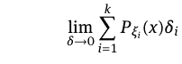

存在，则 $f(\lambda) = \lim_{\delta \to 0} \sum_{i=1}^{k} P_{\xi_i}(x)\delta_i$ 是主曲线，并满足自相关特性，且 $\delta = \max_{i=1,2,\ldots,k}\{\delta_{i}\}$。 

设 D 为向量 $\pi: E \to M, p \in M$ 上的一个联络。那么，对于任意 $\xi \in \Gamma(E), v \in T_p(M)$，$D_v\xi \in \pi^{-1}(p)$ 已定义。$D_v\xi$ 称为光滑截面 $\xi$ 在点 p 沿切向维度 X 的协变导数。此外，对于 M 中的光滑曲线 $\gamma: [0, b] \to M$，如果 $\xi \in \Gamma(E)$ 满足

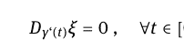

那么，我们说光滑截面 $\xi$ 沿曲线 $\gamma$ 是平行的。 

文献 [20] 中的算法基于通过开邻域覆盖，逐渐逼近并寻找主曲线的思想。此外，该算法用于计算开邻域上的联络，使用联络的最小值来获得结果。

**算法 5.4**：基于切向接触的主曲线构造算法

（在下一节中，为了方便，我们将此算法称为切向接触算法。）

初始输入为整个数据集 $Q_0(\lambda_1, \delta_1), k = 1$

- **步骤 1** 如果输入数据集中的样本数量小于阈值 C，程序结束；
- **步骤 2** 使用两个球形邻域 $\{Q_k(\lambda_1, \delta_1), Q_k(\lambda_2, \delta_2)\}$ 覆盖样本数据；k 表示第 k 次递归；
- **步骤 3** 分析每个邻域区域 $Q_k(\lambda_i, \delta_i)$，$i = 1, 2$ 中数据点 $x_{i1}, x_{i2}, \ldots, x_{in}$ 的主成分，得到主特征向量 $\xi_{ki} = (\xi_{i1}, \xi_{i2}, \ldots, \xi_{ii})$；


第 4 步：$\xi_{kl} = \min \{ \xi_{(k-1),i}^{T}, \xi_{im}^{T} \} \ (m=1,2,\dots,f)$，其中 $\xi_{(k-1),i}$ 是 $Q_{(k-1)}(l_{i}, \delta_{i})$ 中数据点协方差矩阵的主特征向量，并且 $Q_{k}(l_{i}, \delta_{i})$ 包含于 $Q_{k}(l_{i}, \delta_{i})$。我们计算数据点 $x_{jl}$ 在 $Q_{k}(l_{i}, \delta_{i})$ 中 $\xi_{kl}$ 上的投影 $(i=1,2,\dots,k)$，以及局部重构向量 $\hat{x}_{ik}$（$\{\hat{x}_{ik}\}$ $(i=1,2)$ 是一个流形局部截面）；

第 5 步：计算 $\{\hat{x}_{ik}\}$ 的接触度 $D$；
- 如果 $D$ 小于某个阈值 $\beta$，连接 $\hat{x}_{ik}$，并对近光滑的主曲线应用样条函数或局部平滑方法。程序在此结束。
- 否则，对于第一个球邻域，调用算法进入 $k+1$ 层递归；对于第二个球邻域，调用算法进入 $k+1$ 层递归。

### 5.3.2.4 算法分析与讨论

切触算法与基于局部主方向的 Algorithm 5.2 中的向量降维算法具有相似性，局部样本协方差矩阵的特征向量被近似形成局部切空间。在每个局部区域执行主成分分析（PCA）。我们可以获得切空间的近似信息，并且局部拓扑结构在切空间中被保留。

该算法和切空间算法都使用余弦邻域来覆盖连续数据以近似主曲线，并且球邻域内特征向量及局部重构向量的计算方法是一致的。

主要区别如下：

- (1) 近似方式不同。切空间算法通过增加开覆盖分段数来细分数据集。当 $k$ 足够大时，局部化空间由极限条件近似。切触算法始终分为两个邻域，且计算的邻域递归地封闭切空间。
- (2) 收敛条件不同。切空间算法通过检查全局误差来确定是否停止迭代。切触算法计算当前两个球邻域上重构向量的对应关系。当接触度小于阈值 $\beta$ 时，停止迭代。
- (3) 程序运行方式不同。切空间算法每次循环执行第 1 步到第 5 步以增加一个邻域的覆盖范围，通过邻域覆盖的连续增加进行近似；切触算法递归地划分为小邻域进行近似。
- (4) 参数控制不同。切空间算法使用参数 $k$ 设置循环次数以控制近似粒度。切触算法通过设置输入数据大小来控制数据规模。

由于 Algorithm 5.3 是递归运行的，如果数据集很大，在逼近小邻域时需要深度递归，这将消耗大量的内存空间。在某种程度上，这一特性是不可接受的；因此，在具体的算法操作中，我们将 Algorithm 5.3 重写为非递归形式。

自洽性是主曲线最重要的特征。以下证明切分算法构建的主曲线具有一致自相关性。

*证明*. 根据自洽性的定义，我们只需要证明 *Y* 支撑上的每一点都是 *Y* 投影到该点的条件期望，即 E(X|*Y* = *Y*)。考虑任意给定的邻域 Q(λ_{i}, δ_{i})，设 *P* 为 ℝ^{D} 到 *d* 维子空间 *M* 的正交投影矩阵。则，*Y*_{i} = (*I* − *P*) E(Xi) + *PX*。只需要证明 *M* 的基底是 Cov(X_{i}) 的 *d* 维特征向量。由于在算法的第 3 步中，主特征向量 ξ 和 Cov(X_{i}) 的第一主成分被选为 *M* 的基底，因此当 X_{i} 自洽且 *P* = ξ 时，可以得到 *Y*_{i} = (*I* − *P*) E(Xi) + *PX*。

由于球邻域递归地覆盖数据集，任何一点 f(λ^{*}) 都属于 f(λ)，且始终存在一点 λ' ∈ λ，使得 f(λ') ∈ *Y*_{i}（其中 *Y*_{i} 属于 Q_{k}(λ_{i}, δ_{i})），满足 E(X|λ_{f}(X) = λ*) = f(λ*)，其中 f(λ) 满足自相关性质。因此，证明完毕。

### 5.3.2.5 仿真结果

**1. 数据集相对密集或规范时的算法结果**

实验 1：样本数据是在无噪声的连续函数中采样的。考虑曲线 y = (1/2) sin ((1/2)x)，x ∈ [0, 20]，并均匀采样 100 个点。在参数设置中，算法中的 *C* 设为 10，β 等于 1。实验结果如图 5.4 所示，其中 (1) 展示了使用算法前的数据，(2) 展示了切触算法学习到的主曲线。我们可以看到，对于具有规范数据点集合的数据，该算法具有良好的学习结果。

实验 2：样本数据是在连续函数中采样的，但采样率较低，并添加了独立分布的高斯白噪声，产生相对稀疏但分布的数据集，如图 5.5 左列所示。算法参数设置为 C = 12，β = 1.5。结果如图 5.5 右列所示；对于稀疏数据集，在设置适当的调整参数后，获得了更令人满意的结果。

**2. 数据集相对稀疏且不规律时的算法结果**

实验 3：样本数据是在连续函数中采样的，但采样率非常低，并添加了更多独立分布的高斯白噪声，产生相对稀疏且不规则分布的数据集。在这种情况下，我们反复调整参数设置以达到最佳结果。图 5.6 展示了生成的数据集分布及迭代后算法的结果。图中的参数设置为 $C = 15$ 和 $\beta = 2.5$。

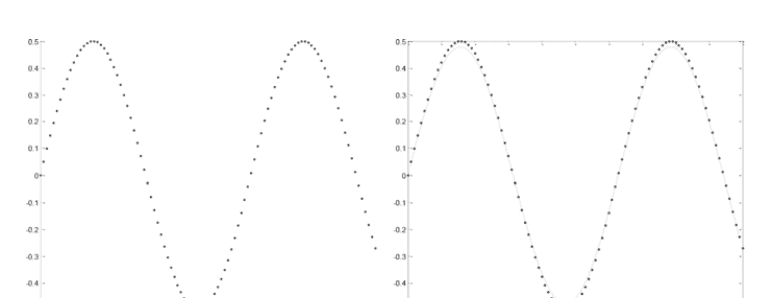

**图 5.4：** 实验 1：在对正弦函数的稀疏规则采样数据上进行的操作。

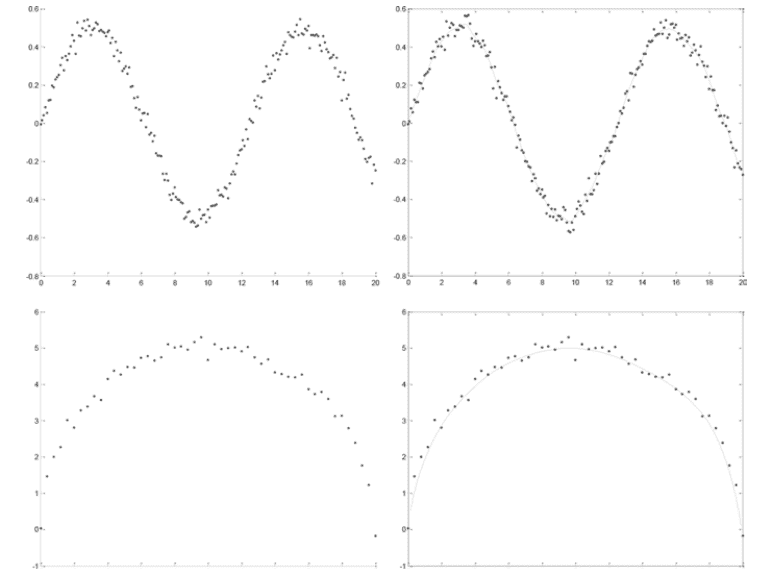

**图 5.5：** 实验 2：对连续函数采样后添加了高斯噪声的数据。

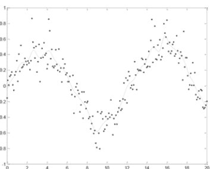

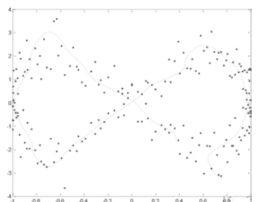

**图 5.6：** 实验 3：对连续函数采样后添加的高斯噪声。本实验中添加的高斯噪声更多，且数据稀疏且不规律。

**3. 参数设置对主曲线生成的影响**

算法中有两个关键参数：输入阈值 $C$ 和接触阈值 $\beta$。这两个参数都与收敛相关。阈值与主曲线生成的精度相关。通常，我们希望由接触阈值停止程序。输入阈值 $C$ 是邻域近似的精度。如果接触阈值并非总是准确的，则输入阈值判断的程序将结束。在实验中，接触阈值与主曲线的最终形式相关，而输入阈值与数据集强相关。对于稀疏数据集，$C$ 需要适当大一些，但如果过大，程序将过早结束；因此，在某种程度上，$C$ 的值是经验性的。还应该注意的是，在实验中我们发现接触阈值和输入阈值是相互关联的。当阈值过小时，判断通常基于输入阈值，这意味着当达到局部精度时，邻域在极限处停止。

## 5.4 摘要

在本章中，将纤维丛理论引入机器学习，并建立了纤维丛学习模型。给出了纤维丛在机器学习中的表示和基本概念，并展示了丛模型和主纤维丛。此外，详细描述了基于切分的局部主方向的向量降维算法和基于积的主曲线构建算法。


## 参考文献

- [1] Nir SC, Ron K, Ravi kanth M. 一种低层视觉通用框架。IEEE 图像处理学报，1998, 7(3), 310–318.
- [2] Chen S, Sochen NA, Kimmel R. 体视组合豪猪或图像处理中的方向扩散研究。SIAM 应用数学期刊，2004, 64(5), 1477–1508.
- [3] Pearson DW. 前馈神经网络垂直向量场的近似。应用数学通讯，1996, 9(2), 61–64.
- [4] Chao J, Kim J. 表面纤维丛模型及其推广。国际模式识别会议。IEEE 计算机协会，2004, 560–563.
- [5] Brockett RW. 控制理论与分析力学，几何控制论。C, Martin 和 R, Hermann 主编，数学科学出版社，1977。
- [6] Brockett RW. 非线性控制理论与微分几何，华沙。国际数学家大会论文集，1983年8月16–24日。
- [7] Mu XW. 纤维丛上一般非线性控制系统的几何框架及其最小实现理论。应用数学与力学，1996, 17(10), 939–950。
- [8] Zhang J. 基于流行学习的纤维丛学习算法研究。苏州：学位论文。苏州大学，2008。
- [9] Zhang J, Li FZ. 基于流形学习的纤维簇学习模型研究。南京大学学报，2008, 44(5), 477–485。
- [10] Min WL, Lu L, He XF. 局部保持嵌入。模式识别，2004, 37(4), 781–788。
- [11] Hastie T, Stuetzle W. 主曲线。美国统计学会报，1989, 84; 502–615。
- [12] Tarpey T, Flury B. 自洽性：统计学中的一个基本概念。统计科学，1996, 11(3), 229–243。
- [13] Tibshirani R. 主曲线的再审视。统计与计算，1992, 2, 183–190。
- [14] Delicado P. 主曲线和主表面的另一视角。多元分析学报，2001, 77, 84–116。
- [15] Chang KY, Ghosh J. 概率主表面的统一模型。IEEE 模式分析与机器学习汇刊，2001, 23(1), 22–41。
- [16] Duchamp T, Stuetzle W. 平面中主曲线的几何性质。稳健统计、数据分析与计算机密集型方法。纽约：施普林格出版社，1996, 109, 135–152。
- [17] Duchamp T, Stuetzle W. 平面中主曲线的极值性质。统计学年刊，1996, 24(4), 1511–1520。
- [18] Martínez-Morales JL. 主嵌入的极值性质。纯数学与应用数学期刊，1999, 78(9), 913–923。
- [19] Krzyzak A, Zeger K. 主曲线的学习与设计。IEEE 模式分析与机器学习汇刊，2000, 22(3), 281–297。
- [20] Zhao LW, Luo SW, Liao LZ, Tian M. 主曲线构建算法研究。北京交通大学学报，2005, 30(2), 80–83。

## 6 Lie 群覆盖学习

本章探讨 Lie 群机器学习覆盖算法的相关理论、Lie 群机器学习的单连通覆盖算法、Lie 群机器学习的多连通覆盖算法，以及覆盖算法在分子对接中的应用。

### 6.1 Lie 群机器学习覆盖算法理论

本节涉及群的线性表示理论、Lie 群的基本性质以及 Lie 群的覆盖群理论。这些知识作为研究 Lie 群机器学习覆盖算法的理论基础。

### 6.1.1 群的线性表示

从群论的角度来看，两个同构的群具有相同的性质。由于矩阵群更容易研究，如果我们能找到一个矩阵群并与给定群同构，那么我们就可以研究该矩阵群的性质，并完全掌握给定群的性质。如果矩阵群仅与给定群同态，它不仅反映给定群的部分性质，而且在研究给定群的性质时也起作用。与给定群同构或同态的矩阵群被称为给定群的线性表示。

**定义 6.1.** 如果一个群 $D(G)$ 由一组行列式不为零的 $m \times m$ 矩阵组成，且 $G$ 是给定同构或同态，则称 $D(G)$ 为 $G$ 的 $m$ 维线性表示。在 $D(G)$ 中，与 $G$ 中元素 $R$ 对应的矩阵 $D(R)$ 被称为表示 $D(G)$ 中元素 $R$ 的表示矩阵，而 $D(R)$ 的矩阵迹 $\chi(R) = \text{Tr } D(R)$ 被称为表示 $D(G)$ 中 $R$ 的特征标。

矩阵的行列式不为零是为了排除表示矩阵中的零矩阵和单位元（mediator/单位元在此处语境下指保持恒等的平凡映射对应的矩阵，通常为单位矩阵，这里原文用词稍显模糊，但下文提到常元素对应单位矩阵，故排除的是使得表示退化的情况，或者是为了保持可逆性）。根据这一规则，常元素的表示矩阵是单位矩阵，$D(E) = 1$，而逆元素的表示矩阵是逆矩阵，$D(R^{-1}) = D(R)^{-1}$。如果 $D(G)$ 与群 $G$ 同构，则 $D(G)$ 称为群 $G$ 的真实表示；如果它是同态的，则不是群 $G$ 的真实表示。当群中所有元素都对应于 1 时，$D(R) = 1$；这种表示被称为恒等表示，也称为平庸表示（mediocre representation）。

任何群都有恒等表示。矩阵群是自身的表示。表示矩阵是酉矩阵的表示。进一步地，表示矩阵是实正交矩阵的表示，称为实正交表示。

在我们能够找到一个群的所有线性表示之前，我们应该简化这个问题。

**定义 6.2.** 如果群 $G$ 的所有元素 $R$ 的两个表示 $D(G)$ 和群 $G$ 中的表示矩阵具有相同的变换关系 $\overline{D}(R)=X^{-1}D(R)X$，则这两个表示被称为等价的，即 $D(G)=\overline{D}(G)$。

两个等价的表示具有相同的维度，且相似变换矩阵 $X$ 也具有相同的维度。两个等价表示具有等价的群元素。等价意味着在寻找在群 $G$ 中表达的所有问题时没有实质差异，因此只需找到群 $G$ 的所有不等价表示即可。

我们如何判断两个是否等价？两个等价表示中任意元素的特征标相等：$\chi(R)=\operatorname{Tr} D(R)=\operatorname{Tr}\overline{D}(R)=\chi(R)$。

对于有限群，两个表示中每个元素的本征值相等，且这两个条件是等价的必要条件。由于特征标是类的函数，为了测试两个表示的等价性，我们只需在每个类中选择一个元素来检查两个表示中的特征标是否相等。

**定义 6.3.** 如果群 $G$ 的每个表示矩阵 $D(R)$ 在表示 $D(G)$ 中都可以通过相似变换 $X$ 变换为相同形式的阶梯矩阵：

$$X^{-1}D(R)X=\left(\begin{array}{cc}D^{(1)}(R) & M(R)\\ 0 & D^{(2)}(R)\end{array}\right)$$

则称该表示为不可约表示；否则，称为可约。上述方程中两个子矩阵 $D^{(1)}(R)$ 和 $D^{(2)}(R)$ 的集合构成了群 $G$ 的一个线性表示。可约表示中元素的特征标等于子表示中特征标的和：

$$\chi(R)=\chi^{(1)}(R)+\chi^{(2)}(R)\ .$$

$D(G)$ 的性质由两个子表示的性质来表达。另一方面，不可约表示的数量之和构成了一个完全可约的表示。这样的表示并不提供任何新的性质；其表示空间是若干不可约表示空间之和。空间中的向量可以唯一地分解为属于每个子空间的向量之和，并根据每个不可约表示进行变换。因此，寻找群的所有不等价表示的问题进一步简化为寻找群的所有不等价不可约表示的问题。


因此，我们可以说群论的基本任务是如何确定表示的等价性和不可约性，找出给定群的所有不等价不可约表示，以及如何将不可约表达式表示为不同的和。

舒尔定理（Schur’s theorem）是群表示论中最基本的定理，它适用于所有群，并解释了群的不等价不可约表示的基本特性。

> **定理 6.1.** 设 $D^{(1)}(R)$ 和 $D^{(2)}(R)$ 是群 G 的两个不等价不可约表示，维度分别为 $m_1$ 和 $m_2$，设 X 是一个 $m_1 \times m_2$ 矩阵。如果每个元素 R 满足：
>
> $$D^{(1)}(R)X = XD^{(2)}(R),$$
> $$\sum_{\rho} D^{(1)}_{\nu\rho}(R)X_{\rho\mu} = \sum_{\rho} X_{\nu\rho}D^{(2)}_{\rho\mu}(R)$$
>
> 则 X = 0。

> **推论 6.1.** 不可约表示 D(G) 的所有可表示矩阵 D(R) 的矩阵必须是一个常矩阵，即如果 D(R)X = XD(R)，则 $X = \lambda I$，其中 \lambda 是常数。

群论的主要任务是找出各种典型群的所有不等价不可约表示，并研究可约表示的约化方法。首先，找出标准特征的所有非等价不可约特征群，即标准表的特征，称为特征表。然后，我们确定不可约表示矩阵。由于群元素可以表示为生成元的乘积，因此可以确定生成元的矩阵。

#### 6.1.2 李群的基本性质

李群是一个连续群，每个元素 R 可以由一组独立的实参数 $(r_1, r_2 \dots)$ 描述，这些参数在某个区域内连续变化。在参数变化区域内，群元素与参数值之间需要存在一一对应关系。独立实参数的数量称为连续群的阶。参数的变化区域称为群空间。

设元素 $R \in G$。参数为 $r_1, r_2 \dots, r_g$，简写为 $R(r_1, r_2 \dots, r_g) = R(r)$。对于群元素的乘积，$R(r)S(s) = T(t)$，g 个参数 $t_j$ 是 2g 个变量 $r_i$ 和 $s_k$ 的函数：$t_j = f_j(r_1, \dots, r_g; s_1, \dots, s_g) = f_j(r; s)$。

g 个函数 $f_j(r; s)$ 称为连续群的组合函数，它们完全描述了群元素的乘法规则。李群的组合函数是解析函数。由于函数是连续可微的，可以使用微积分来研究李群。因此，李群是被研究得最广泛的群。

### 6.1.2.1 李群的局部性质

在群空间中，与常元素相邻的元素称为相邻元素。由于常元素的参数通常被选为零（常元素相邻元素），参数是无穷小的，称为无穷小元素。无穷小是一个极限过程。李群中无穷小元素的性质决定了李群的局部性质。

考虑李群的一个元素 g(\alpha)，其中 \alpha 代表一组 m 个连续群参数，\alpha = 0 代表单位元素。如果 \alpha 很小，g(\alpha) 非常接近单位，可以在单位附近使用泰勒展开：

$$ g(\alpha) = g(0) + \alpha^i \left. \frac{\partial g}{\partial \alpha^i} \right|_{\alpha^i=0} + \ldots . $$

这里，我们使用张量符号来省略对 i 的求和，并引入符号 $X_i = \left. \partial g / \partial \alpha^i \right|_{\alpha^i=0}$，称为群的无穷小算符或生成元。它是群元素在单位附近的导数，其数量也是 m。注意，生成元 $X_i$ 独立于群元素，这反映了群的性质，即李群的元素由生成元和群参数表示。

因此，不同群之间的差异表现为生成元的性质和数量，生成元的数量，即群参数的数量，称为群的维度。生成元之间的交换代数描绘了李群的性质。

线性表示的生成元满足通用的互易关系：

$$ I_jI_k - I_kI_j = i \sum_\ell c_{jk}^\ell I_\ell $$ 
$$ c_{jk}^\ell = \left\{ \frac{\partial S_{\ell k}(r)}{I_j} - \frac{\partial S_{\ell j}(r)}{r_k} \right\}_{I=0} \ . $$

代数与李群的概念密切相关，李群的许多属性可以通过李代数直接讨论。根据这个概念，李群生成元的互易关系构成了李代数性质的反映。

考虑一个输入空间 G。如果 G 上的线性空间 g 具有二元运算 $\{ x, y \} \rightarrow [ x, y ]$（通常称为交换子或括号），并且满足以下条件：

- (1) 该二元运算满足双线性，即
  $\left[ \lambda x + \mu y, z \right] = \lambda [x,z] + \mu [y,z] \ , \quad \forall \lambda \ , \ \mu \in G \ , \quad \forall x \ , \ y \ , \ z \in g \ ;$
- (2) [x, x] = 0, \forall x \in \mathfrak{g};
- (3) Jacobi 恒等式成立，即
  \begin{equation*} \text{[x, [y, z]] + [y, [z, x]] + [z, [x, y]] = 0, \quad \forall x, y, z \in \mathfrak{g}} \end{equation*}

则我们称 $\mathfrak{g}$ 是 G 上的李代数。

事实上，当李群的性质被归结为易于生成时，例如一个操作循环，即几次操作后的总效果，并返回到单位元素。这主要反映了连续性的局部性质。因此，李群的局部恒等性得以确定。如果有两个或更多的群，虽然整体性质不同，但局部性质和结构相同；它们对应于同一个李代数，例如 SU(2) 群和 SO(3) 群。李群与其覆盖群之间的这种关系是我们将讨论的内容。

### 6.1.2.2 李群的整体性质

李群的整体性质研究是研究李群空间的拓扑性质。首先，我们讨论群空间的连通性。如果群中任意两个元素，作为群空间中的对应点，可以被包含在群空间内的一个完全包含的连通中，则称群空间是连通的。这样的连续群称为单连通群。SO(3) 群是一个简单李群。相反，如果群空间被分成几个不相连的部分，则这个连续群称为混合连续群。对于简单李群，群中的元素可以表示为无穷多个无穷小元素。除了无穷小元素外，在群空间的每个连续切片中还需要给出一个特殊元素（包括常元素），它们的乘积可以表示任何元素。对于线性表示，我们可以看到，简单李群的任意元素 $R$ 的表示矩阵 $D(R)$ 可以通过生成元计算出来，但对于混合李群，我们还必须知道空间反演元素的表示矩阵 $D(\sigma)$。

在混合李群的群空间中，包含常元素的连续片对应的元素集合构成了混合李群的不变子群，其他连续元素对应变换子群的陪集。因此，混合李群的性质由简单李群（不变子群）的性质和每个连续片中的代表元素（陪集）决定。

接下来，我们讨论李群的连通性。在简单李群的群空间中，元素 R 的对应点可以通过常元素的对应点连接到许多线上。一些连接可以在群空间中连续变化，而另一些则不能。这样，这些连接被分为组，同一组的连接可以在群空间中连续变化，而不同组的连接则不能。数量


### 6.1.2.3 李群的覆盖群

**定义 6.4.** 设 $M, N$ 为豪斯多夫空间。从 $M$ 到 $N$ 的连续映射 $f: M \rightarrow N$ 称为 $M$ 到 $N$ 的覆盖映射。若对 $\forall p \in N$，取 $p' \in f^{-1}(p)$；则存在 $M$ 中 $p'$ 的一个邻域 $V_{p'}$，使得 $f(V_{p'})$ 是 $N$ 中 $p$ 的邻域，且 $V_{p'}$ 与 $f(V_{p'})$ 在 $f$ 下同胚。进一步地，$M$ 称为 $N$ 的覆盖空间，$(M, f)$ 称为 $N$ 的覆盖。

**定义 6.5.** 考虑李群 $G_1$ 到 $G_2$ 的同态映射，若它是 $G_2$ 的覆盖，则称 $G_1$ 为 $G_2$ 的覆盖群。对于 $G_2$ 的单位元，$f^{-1}(e) = \Gamma$ 称为覆盖群 $(G_1, f)$ 相对于 $G_2$ 的庞加莱群，庞加莱群中元素的个数称为覆盖的阶数。

庞加莱群具有以下性质：

**引理 6.1.** 设 $(G_1, f)$ 是连通李群 $G_2$ 的覆盖。$(G_1, f)$ 相对于 $G_2$ 的庞加莱群 $\Gamma = f^{-1}(e)$ 是一个离散正规子群，因此它位于 $G_1$ 的中心。若取任意 $g_2 \in G_2$，$g_1 \in f^{-1}(g_2) \subset G_1$，则 $f^{-1}(g_2) = g_1\Gamma = g_1f^{-1}(e) = \{g_1h \in G_1 | \forall h \in \Gamma\}$。$G_2$ 中点的全原像构成了拓扑群 $G_1$ 关于正规子群 $\Gamma$ 的左陪集，且拓扑群 $G_1/\Gamma$ 与拓扑群 $G_2$ 同构。

为了保持覆盖性质，我们引入以下内容：

**定义 6.6.** 李群 $G$ 的两个覆盖群 $(G_1, f_1)$ 和 $(G_2, f_2)$ 称为等价，如果存在从 $G_1$ 到 $G_2$ 的同构 $\varphi$，使得 $f_1 = f_2 \circ \varphi$，即满足交换图：

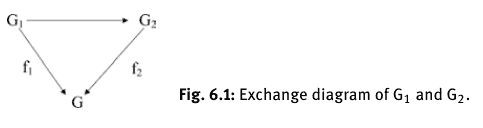

由定义可知，如果李群 $G$ 的两个群 $(G_1, f_1)$ 和 $(G_2, f_2)$ 在 $\varphi$ 下等价，则 $G$ 的单位元 $e$ 满足 $\varphi(f_1^{-1}(e)) = f_2^{-1}(e)$，这导致了庞加莱群的同构；因此，这两个群的覆盖状态完全相同。

**定义 6.7.** 豪斯多夫拓扑空间 $M$ 称为单连通，如果其闭路径（即任意两点间的闭曲线）同伦于零，则 $M$ 的一阶同伦群为零，即任何闭路径都可以连续收缩为一点。

注意，单连通与连通是无序的概念，单连通空间必然是连通的。现在，考虑连通流形，由于流形必须是连通的，单连通流形等价于以下条件：对于任意两点 $p$，$q$，从 $p$ 和 $q$ 出发的任意两条连续曲线可以连续地相互变换。

**定理 6.2.** *若 $N$ 是连通李群，则存在一个单连通李群 $M$，它是 $N$ 的覆盖群。*

*证明.* 根据拓扑覆盖空间的理论知识，当 $N$ 是连通流形时，存在一个单连通流形 $M$ 是 $N$ 的覆盖空间；$P: M \to N$ 是覆盖映射。

对于以 $e_N$ 为起点的路径 $\mathbf{x}$: $[0, 1] \to N$，$\mathbf{x}(0) = e_N$，$\mathbf{x}$ 所属的路径类 $[\mathbf{x}]$ 是 $M$ 中的一个点，并覆盖映射 $P[\mathbf{x}] = \mathbf{x}(1)$。

对于 $N$ 中以 $e_N$ 为起点的两条路径 $\mathbf{x}, \mathbf{y}$，我们定义 $\mathbf{z}$ 为 $\mathbf{z}$: $[0, 1] \to N$，$\mathbf{z}(t) = \mathbf{x}(t)\mathbf{y}(t)$。我们将 $M$ 中点的乘法定义为 $[\mathbf{x}][\mathbf{y}] = [\mathbf{z}]$ 或 $[\mathbf{x}][\mathbf{y}] = [\mathbf{x}\mathbf{y}]$。这个定义很重要，因为当 $[\mathbf{x}^*] = [\mathbf{x}]$ 且 $[\mathbf{y}^*] = [\mathbf{y}]$ 时，$H_1$ 是路径 $\mathbf{x}$ 和 $\mathbf{x}^*$ 的固定点同伦，$H_2$ 是路径 $\mathbf{y}$ 和 $\mathbf{y}^*$ 的固定点同伦。我们定义 $H(s, t) = H_1(s, t)H_2(s, t)$，其中 $H$ 是路径 $\mathbf{x}\mathbf{y}$ 和 $\mathbf{x}^*\mathbf{y}^*$ 的固定点同伦，即 $[\mathbf{x}\mathbf{y}] = [\mathbf{x}^*\mathbf{y}^*]$。进一步地，$[e_N]$（$N$ 中常路径 $e_N$ 的路径类）$= e_M$ 是 $M$ 的单位元。在 $M$ 中，点 $[\mathbf{x}]$ 的逆元为 $[\mathbf{x}]^{-1} = [\mathbf{x}^{-1}]$，其中 $\mathbf{x}^{-1}(t) = (\mathbf{x}(t))^{-1}$。

在定义了乘法之后，$M$ 显然是一个群。覆盖映射 $P([\mathbf{x}][\mathbf{y}]) = P[\mathbf{x}\mathbf{y}] = \mathbf{x}(1)\mathbf{y}(1) = P[\mathbf{x}]P[\mathbf{y}]$ 是群同态。

由于 $M$ 存在于 $N$ 中邻域 $P(V^*)$ 的某个开邻域 $V^*$ 中，$M$ 可以被赋予微分结构，从而使 $M$ 成为李群。进一步地，$M$ 和 $N$ 局部微分同构。因此，$\Lambda(M) = \Lambda(N)$。$\square$

**定理 6.3.** *设 $G$ 是连通李群。则存在唯一的（在同构意义下）单连通李群 $\widehat{G}$，以及从 $\widehat{G}$ 到 $G$ 的覆盖映射 $f$，使得 $(\widehat{G}, f)$ 是 $G$ 的覆盖群，这被称为 $G$ 的万有覆盖群。*

*证明.* 设 $(\widehat{G}, f)$ 是流形 $G$ 的万有覆盖流形，$f^{-1}(e) = \Gamma$。设 $e^* \in \widehat{G}$ 且 $a^*, b^* \in \widehat{G}$。则 $\widehat{G}$ 中存在路径 $r_1^*, r_2^*$ 分别连接 $e^*$ 与 $a^*$，以及 $e^*$ 与 $b^*$。因此，$r_1 = f(r_1^*)$，$r_2 = f(r_2^*)$ 分别是 $G$ 中从 $e$ 到 $a = f(a^*)$ 以及从 $e$ 到 $b = f(b^*)$ 的路径。因此，$r = r_1 \cdot r_2$ 是 $G$ 中从 $e$ 到 $ab$ 的路径。

将 $r$ 提升为 $\widehat{G}$ 中以 $e^*$ 为起点的路径，并设其终点为 $c^*$。在 $\widehat{G}$ 中定义乘法如下：$a^*b^* = c^*$。需要注意的是，$c^*$ 不依赖于 $r_1^*$ 和 $r_2^*$ 的选择。设 $w_1, w_2$ 分别是 $\widehat{G}$ 中连接 $e^*$ 与 $a^*$ 以及 $e^*$ 与 $b^*$ 的其他路径。则 $w_1, w_2$ 分别是 $G$ 中连接 $e$ 与 $a$ 以及 $e$ 与 $b$ 的路径。进一步地，$w = w_1 \cdot w_2$ 是 $G$ 中从 $e$ 到 $ab$ 的路径。设 $w^*$ 是 $w$ 的提升，由于 $\widehat{G}$ 是单连通的，$r_i^*$ 可以连续变换为 $w_i^*$。因此，$w_1$ 可以连续变换为 $r_1$，且 $w$ 可以连续变换为 $r$。由于 $w$ 和 $r$ 的起点和终点相同，$w^*$ 和 $r^*$ 的终点也相同。因此，上述定义的 $\widehat{G}$ 乘法是良定义的。

$\widehat{G}$ 中乘法的结合律可以通过路径乘法的结合律得到。

由定义可知，$e^*$ 是一个单位元。进一步地，$(a^*)^{-1}$ 对应的路径 $r_1^{-1}$ 是 $G$ 中连接 $e$ 和 $a^{-1}$ 的路径。它被提升为 $\widehat{G}$ 中连接 $e^*$ 和 $(a^*)^{-1}$ 的路径。然后，我们知道 $a^* (a^*)^{-1} = e^*$，即 $(a^*)^{-1}$ 是 $a^*$ 的逆元。

综上所述，$\widehat{G}$ 是一个群。我们知道 $f$ 是从 $\widehat{G}$ 到 $G$ 的群同态，因为 $f(a^* b^*) = ab = f(a^*) f(b^*)$。

由于 $f$ 是覆盖映射，$\widehat{G}$ 的逆运算和乘法是连续的，且 $\widehat{G}$ 的群结构是一个局部群，我们可以证明 $\widehat{G}$ 是一个拓扑群。此外，$\widehat{G}$ 不仅是连通拓扑群，还是局部李群；因此，存在唯一的解析结构使得 $\widehat{G}$ 成为一个李群。

因此，证明完毕。$\square$

如果 $(G_1, f_1)$ 也是 $G$ 的万有覆盖群，则 $\widehat{G}$ 到 $G_1$ 的同胚映射 $f'$ 使得 $f = f_1 f'$。因此，$f_1 f'(e^*) = f(e^*) = e$。显然，$L_{e_1^{-1}} f'$ 仍然是同胚，且 $L_{e_1^{-1}} f'(e^*) = e_1$。$L_{e_1^{-1}} f'$ 仍记为 $f'$。则，

$$
f_1 f'(a^* b^*) = f(a^* b^*) = f(a^*) f(b^*) = f_1 f'(a^*) f_1 f'(b^*)
$$

因为 $f_1$ 是局部同构，所以在单位邻域内

$$
f'(a^* b^*) = f'(a^*) f'(b^*)
$$

进一步地，$\widehat{G}$ 和 $G_1$ 是连通的，且 $f'$ 是一一对应；因此 $f'$ 是李群的同构。

> *推论 6.2. 设 $(\widehat{G}, f)$ 是连通李群 $G$ 的万有覆盖群。则 $df$ 是李代数 $\mathfrak{g}_{\widehat{G}}$ 到李代数 $\mathfrak{g}_G$ 的同构映射。*

这一结论可由 $f$ 是从 $\widehat{G}$ 到 $G$ 的同态且局部为同构这一事实得出。

> *定理 6.4. 连通群 $G$ 必被一个单一覆盖群 $(\widehat{G}, f)$ 覆盖，称为 $G$ 的万有覆盖群。进一步地，$f$ 是同构当且仅当 $G$ 本身是单连通李群。*

在此，我们可以给出两个覆盖群的例子：

- $f : \mathbb{R}^1 \rightarrow S^1, \quad f(t) = e^{2\pi i t}, \quad t \in \mathbb{R}^1$；因此，$\mathbb{R}^1$ 是 $S^1$ 的覆盖群。
- $Ad : S^3 \rightarrow SO(3)$。对于 $SO(3)$，对于任意适当的单位邻域 $V$，$Ad^{-1}(V)$ 有两个连通分支，即它是“双层”覆盖，而上述第一种情况是“无限多层”覆盖。


从上文的定义和连通群的性质可以看出，由于李代数是李群的局部结构不变量，因此当 $f: G_1 \to G_2$ 是李群的连续态时，$df : \mathfrak{g}_1 \to \mathfrak{g}_2$ 就是李代数的同构映射。另一方面，当 $G_1$ 和 $G_2$ 的李代数 $\mathfrak{g}_1$ 和 $\mathfrak{g}_2$ 同构时，必然存在一对同态映射，例如李群 $\widehat{G}$ 和 $f_i : \widehat{G} \to G_i$ ($i = 1, 2$)。

由此可见，覆盖群的李群理论在李群研究中发挥着重要作用。

## 6.2 李群的单连通覆盖算法

首先，介绍基于覆盖思想的算法的研究现状。然后，给出李群机器学习的单连通覆盖算法，包括覆盖群的识别、通用覆盖群求解算法以及单连通覆盖算法。最后，引入一个示例。

### 6.2.1 基于覆盖思想的算法研究现状

覆盖技术是研究代数几何的重要工具，例如在基于研究的变换、模型映射以及奇点等方面的应用。覆盖思想已应用于许多领域，如数据挖掘和机器学习。

- 1) 张教授等人 [28] 给出了 M-P 神经元的几何意义，并通过球面投影变换将神经网络的优化设计问题转化为某些最优覆盖问题。他们将神经元对应于几何样本的球面邻域。通过这种几何直观方法，他们设计了多层前馈神经网络作为“分类器”，并将此设计视为“球面邻域”，输入 $x^i$ ($i = 1, 2, 3, \dots, d$) 按其所属类别进行划分。最简单的设计方法之一是使用一组球面邻域覆盖某一类的 $x^i$ ($i = 1, 2, 3, \dots, d$)，而不覆盖不属于该类的 $x^i$ ($i = 1, 2, 3, \dots, d$)。因此，不同类型的输入被不同组的球面邻域所覆盖。然后，将同一组球面邻域对应的神经元输出通过“或门”组合起来。这样，一个分类器就被设计出来了。覆盖中的球面邻域对应于隐层。最小覆盖对应于最小隐层神经网络结构。他们还证明了任何次优覆盖方法和球面邻域方法都可以给出一种神经网络学习算法，这被称为邻域覆盖算法。

- 2) 王守杰院士 [30] 提出的仿生模式识别（拓扑模式识别）的理论基础在于，它确认了特征空间中相似样本的连续性（即不能将其分割为两个互不邻接的部分）。在引入仿生模式识别中同类样本的连续性规则后，对某类事物的“认知”本质上是对特征空间中形成的所有事物无限集合的“形状”的分析与“理解”。仿生模式识别基于特征空间中某类样本分布的最优覆盖。

- 3) 朱永红 [33] 提出了一种利用覆盖概念将更集中的样本聚合在一起，以发现样本集中隐含类别的覆盖聚类算法。对于稀疏样本，他使用最短距离法获得聚类效果。

- 4) 何青和石钟志 [31] 提出了一种基于超曲面分类和判别方法的基本算法，即通过区域整合计算，获得由闭曲面组成的若干超平面组合。让一类超曲面划分空间，即在样本点周围形成一个闭合区域。该区域由多个分类超平面包围，使得该区域覆盖尽可能多的同类样本点，而不覆盖异类样本点。

- 5) 吴涛和张玲等人 [29] 通过结合支持向量机（SVM）中的核函数方法与构造性学习的覆盖算法，提出了一种新的核覆盖算法。通过在样本空间中通过覆盖覆盖场来叠加覆盖域，属于同一类型的覆盖区域合并为特征空间中的一个球体，并最小化分类误差。因此，在特征空间中，我们找到每个类别的最佳包络，使相似区域的相似集成结合在一起。核覆盖算法结合了覆盖算法和 SVM 的优点，同时具有运行速度快、精度高和鲁棒性强的优势。

- 6) 张俊平 [37] 提出了一种流形学习方法，该方法可以通过有限数量的数据点描述嵌套流形结构。有限数据点集可以覆盖嵌套流形的支撑场，从而在保持所需码表尽可能少的同时，不丢失嵌套流形的结构信息。为了从有限样本集描述流形结构，本文借鉴了邻域覆盖的思想。定义 $(x, \rho)$ 为伪测度空间，设 $B_r(x)$ 为半径为 $r$ 的闭球邻域覆盖的闭数，设 $S$ 为 $\chi$ 的子集，设 $\varepsilon$ 为正常数。那么，描述流形结构的邻域数量可以定义为点集 $X \subset \chi$ 的最小数量，使得 $S \subseteq \bigcup_{x_i \in X} B_\varepsilon(x_i)$。这确保了在使用邻域覆盖后，任何数据支撑集元素与 $X$ 中最近元素之间的最大差异小于或等于 $\varepsilon$。使用局部邻域覆盖集，以确保不会丢失信息的整体结构。然后，获得局部邻域覆盖集对应的二维映射。最后，结合核函数和坐标映射的思想，将整体数据集映射到二维空间并进行重构。

可以看出，在机器学习领域，覆盖思想已被广泛使用。本书主要基于群的视角。我们可以使用李群的特殊代数几何来有效地表示样本数据。样本的特征空间嵌入到微分流形中形成一个李群。

通过对李群性质的分析，李群的性质与其群空间的连通性密切相关。当李群的群空间是多重连通时，该群的实表示是多值的。在学习过程中，直接分析多值表示问题往往很困难。因此，我们可以求解李群的问题，并利用李群与覆盖群之间的协变关系来解决此问题。覆盖的主要思想是覆盖同类问题，从而将不同类问题分离开。这种方法的优点显而易见：通过对同类样本的学习，可以获得更好的学习能力。当我们能够拟合许多类型的问题时，我们可以使用李群的特殊代数几何在最大程度上保持问题空间的不变性。

首先，我们考虑单连通情况下李群机器学习的覆盖算法。

### 6.2.2 李群机器学习的单连通覆盖

*定理 6.5.* 豪斯多夫拓扑空间 m 如果 m 不能表示为两个不相交非空开集的并集，则称为单连通。换句话说，如果它的任何闭路径（即闭合连续曲线）都同伦于零，即 m 的一阶同伦群为零，那么任何闭合道路都可以连续收缩到一个点。

注意单连通和连通性是不相关的概念，单连通不能保证连通。现在，考虑连通流形。由于连通流形是弧连通的，单连通等价于 M 中任意两点 P、Q 之间的任何两条连续曲线 P-Q 都可以连续移动。

*定理 6.6.* 设 G 和 H 为李群，其李代数分别为 g 和 h，其中 G 是单连通的。设 ψ: g → h 为一个同态。那么，存在唯一的同态 φ: G → H，使得 dφ = ψ。


### 图 6.2：$M_{1}$ 和 $M_{2}$ 的交换图。

**证明。** 唯一性很容易证明。接下来的证明关于存在性。

设 \(\{w_{i}\}\) 是左不变形式 \(1\) 的基，使得 \(\psi^{*}\) 为 \(\psi\) 的转置。在 \(G \times H\) 上，形式 \(1\) 为 \(\{\delta\pi_{1}(\psi^{*}(w_{i})) - \delta\pi_{2}(w_{i})\}\)，其中 \(\pi_{1}\) 和 \(\pi_{2}\) 分别是 \(G \times H\) 到 \(G\) 和 \(H\) 的标准投影。该形式保持不变，且生成的理想 \(\mathcal{I}\) 是一个微分理想。因此，通过 \((e, e)\in G \times H\) 的 \(\mathcal{I}\) 的最大连通积分流形 \(I\) 是 \(G \times H\) 的一个覆盖簇，其维数等于 \(G\) 的维数。换言之，它是一个覆盖同态。

假设 \(G\) 是单连通的，因此 \(\left.\pi_{1}\right|_{I}: I \to G\) 是一个同构。定义 \(\varphi: G \to H\) 为 \(\varphi = \pi_{2} \circ (\left.\pi_{1}\right|_{I})^{-1}\)。那么，\(\varphi\) 是一个李群同态，且 \(\delta\varphi(w_{i}) = \psi^{*}(w_{i})\)。因此，\(d\varphi = \psi\)，定理得证。

**推论 6.3。** 如果单连通李群 \(G\) 和 \(H\) 具有同构的李代数，则 \(G\) 和 \(H\) 是同构的。

阿多定理（Ado theorem）指出，对于每个李代数，存在某个 \(n\)，使得在 \(\operatorname{GL}(n, R)\) 中存在忠实表示。根据该定理，如果 \(\frak{g}\) 是一个李代数，则存在一个李群，特别是单连通李群，以 \(\frak{g}\) 为其代数。鉴于此结果，我们有以下结论：

**定理 6.7。** 代数同构与单连通李群同构之间存在一一对应关系。

**证明。** 如果存在两条曲线 \(\varphi_{i}: [0, a] \to M\) \((i = 1, 2)\)，满足 \(\varphi_{1}(0) = \varphi_{2}(0)\)，且 \(\varphi_{1}(a) = \varphi_{2}(a)\)，在 \(M\) 中具有共同的起点和终点，那么 \(M\) 是单连通的。设 \(f: \tilde{M} \to M\) 为可微覆盖。成为万能覆盖的必要且充分条件是 \(\tilde{M}\) 是单连通的。此外，连通流形 \(M\) 是单连通的必要且充分条件是其没有非平凡覆盖。换句话说，如果 \(f_{1}: M_{1} \to M\) 是 \(M\) 上的覆盖映射，则 \(f\) 必须是一个同胚映射。

设 \(f: M_{1} \to M_{2}\) 为可微覆盖，\(\varphi: [0, a] \to M_{2}\) 为 \(M_{2}\) 中的连续参数曲线，且 \(p\) 为 \(f^{-1}(\varphi(0))\) 中任意选取的点。那么，存在唯一的连续映射 \(\tilde{\varphi}: [0, a] \to M_{1}\)，使得 \(\tilde{\varphi}(0) = p\)，\(f \circ \tilde{\varphi} = \varphi\)，如下面的示意图所示，其中 \(\tilde{\varphi}\) 被称为 \(\varphi\) 的覆盖曲线。

**定义 6.8。** 设 \(p: M \to N\) 为覆盖映射，且 \(f: I \to N\) 为 \(N\) 上的一条道路。那么，\(f\) 可以唯一提升为 \(M\) 中的道路 \(g: I \to M\)，使得 \(p(g) = f\)。

```
Algorithm 6.1: Judge the covering group
// Judge whether Lie group M is the covering group of the connected group
// Input: Lie group M, N
// Output: {0,1}
Procedure IsCovergroup(M,N)
If Isconnect(M) then
    For do
        If f and // At any point in M, a neighbourhood through f mapping belongs to N //
        then return 1;
        else
        return 0;
    endif
    endfor
else return 0;
endif
endprocedure
```

根据前面的描述，李群与其李代数之间存在一一对应关系。由于连通李群和单连通覆盖群的连通群在等价意义下是唯一的，因此只需要找到李群的通用覆盖群，就可以解决一系列问题。群流形上的每个点都与群元素一一对应，群流形中任意两点之间的连接可以通过参数空间的连续变形转换为群上的等价曲线。只要找到所有不等价不可约表示的覆盖，就能找到相应的李群。

### 定理 6.8。

连通群 G 必须是连通的，且单连通覆盖群 $(\hat{G}, f)$ 被称为 G 的万能覆盖群。进一步地，当且仅当 G 本身是单连通李群时，f 才是同构。

接下来，我们给出李群万能覆盖群的算法，并将李群问题简化为其覆盖问题。

```
Algorithm 6.2: Universal covering group algorithm for connected Lie group SCCG
//Input: Connected Lie group G
//Output: Universal covering group of G and covering mapping m
Step 1: Take the unit frame $(U, f)$. Create point set $\bigcup_{m=1}^{\infty} \overline{m(U \times U \times \cdots \times U)}$ starting from $U$.
Step 2: Take the elements $(u_1, u_2, \dots, u_m)$ and $(v_1, v_2, \dots, v_p)$ of this point set. According to $u, v, uv \in U$, we have the role $(u, v) = uv$. Further, $(u_1, u_2, \dots, u_m)$ changes with a limited step; check whether it can become $(v_1, v_2, \dots, v_p)$;
Step 3: The equivalence class of the element that satisfies the equivalent condition is denoted by $(u_1, u_2, \dots, u_m)^*$. Continue to select other elements;
Step 4: Make all the equivalence classes that fit the equivalence relation into a set of $\hat{G}$.
Step 5: If the covering mapping $f: (u_1, u_2, \dots, u_m)^* \longrightarrow u_1 u_2 \cdots u_m$ is established between the equivalence class set and $(u_1, u_2, \dots, u_m)$, then $(\hat{G}, f)$ is the coverage group of G.
```

覆盖群的构造表明，$df$ 给出了 $\tilde{G}$ 的李代数与 $G$ 的李代数之间的同构。原因是，对于 $\tilde{G}$ 和 $G$ 的单位元 $\tilde{e}$ 和 $e$，存在邻域 $\tilde{U}$ 的三维坐标的邻域坐标系，使得 $f$ 是 $\tilde{U}$ 到 $U$ 的同胚映射，且 $df$ 给出了李代数的代数同构。

在找到连通李群的覆盖群之后，对于覆盖群的不相等不可约表示，我们必须首先找到它们的所有不等不可约特征标，并将特征标列作为特征表。然后，我们找到不可约表示矩阵。由于群元素可以表示为生成元的乘积，因此找到生成元的表示矩阵就足够了。实际上，标准表中不可约表示的通用群，即标准形式矩阵和分解直接表示的不可约表示矩阵，可以在书中找到，只需将其应用于学习问题即可。

### 6.2.3 算法设计

学习的目的是找到从初始状态到目标状态的最优路径。如果将每个状态称为节点，它们可以形成一个群空间。群空间是单连通的，即每个状态都可以到达另一个状态。在每个连通状态中，每条弧代表一个算子，可以将一个状态定向到另一个状态。当然，根据具体问题，可以为算子设置特定的代价。如果起点是从初始节点出发，且存在一条通向目标节点的路径，那么我们可以说该学习问题是可解的。从初始状态到目标状态的一条路径形成一个覆盖。

为了更好地描述现实世界的问题，我们可以将样本数据集 $D$ 映射到一个新的李群结构。然而，各个元素之间的关系将保持不变，对应于原始群元素。一方面，我们可以将 $D'$ 视为由 $D$ 生成的新样本集，即样本集 $D$ 的覆盖不改变其本质特征，从而确保覆盖映射的正确性。另一方面，对于两个同构的样本集 $D$ 和 $D'$，可以使用相同的道路划分方法，从而避免重复学习。

例如，对于人脸中的单个点（眼睛、鼻子、嘴巴等），选取一些样本点及其邻域点。样本点之间映射的连续覆盖保持了原始的邻域关系，即在原始空间中，相邻的样本点在映射后的群中仍然相邻。

由于两个李群具有局部同构，原始李群的拓扑性质得以保持（两者具有相同的李代数）。我们知道李代数代表了生成元之间的相互关系；因此，这些群也具有相同的生成元。同时，李代数可以被理解为一个集合


…左侧等距向量同构。因此，求解覆盖映射等价于使用样本集中的覆盖群对不同类别进行划分。

根据上述描述，我们可以得到一个用于李群机器学习（LSCA）的单连通覆盖算法。

设样本集 $D$ 为 $D = \{x^i = (x^i, y^i), i = 1, 2, \dots, s\}$，其中 $x^i$ 表示样本的特征值集合，$y^i$ 表示样本特征值的权重。所有样本构成一个特征空间，该空间嵌套在一个构成简单李群的微分流形结构中。每个样本点是群 $j$ 中的一个元素。

- (1) 设输入样本集 $X = \{x^1, x^2, \dots, x^n \in \mathbb{R}^D\}$，其中 $X$ 满足李群结构。
- (2) 使用SCCG算法获取覆盖和覆盖映射。
- (3) 寻找覆盖群的生成元和结构常数。
- (4) 对于新样本，通过覆盖映射将其映射到覆盖群，以确定该点与覆盖群单位元之间是否存在路径，以及该路径是否与零同伦。
- (5) 如果满足条件 $A$，则表明新样本与输出结果一致；将该新样本添加到覆盖群的簇中，并调整覆盖映射的算子。
- (6) 如果不满足条件，则样本不属于待研究的目标结果。
- (7) 实例测试。

#### 6.2.4 示例应用分析

定量构效关系研究是现代药物设计方法中一个非常重要的主题，也是最常用的药物设计方法。构效关系分析的目的是研究和揭示化合物活性与其分子结构或物理化学特性之间的定量变化。为了验证算法的有效性，本节使用的实验实例是二氢叶酸还原酶（DHFR）。二氢叶酸还原酶存在于许多生物体中。抑制剂可以选择性地结合到DHFR上并抑制其生物酶活性，从而阻止二氢叶酸成功转化为四氢叶酸，进而抑制叶酸代谢，干扰DNA和蛋白质合成，最终导致细胞死亡。因此，DHFR抑制剂具有抗癌、抗菌和抗疟疾的作用。

### 6.2.4.1 实验准备

本文研究的761种DHFR抑制剂的生物活性数据（IC50）引自文献[34, 35]，即来自三种不同的生物体，所选数据为PC条件下的活性数据。以 pIC50 = 6.00 作为活性分类标准，将761种抑制剂分为两类：活性（pIC50 ≥ 6.00）和非活性（pIC50 < 6.00），其中活跃分子296个，标记为(+)；非活跃分子465个，标记为(−)。对于每个分子，使用158个分子描述符[36]来表征其结构和理化性质。这些描述符包括组成描述符和拓扑指数描述符。

### 6.2.4.2 实验过程

在实验中，我们首先使用Kennard–Stone方法将四分之三的样本作为训练集，其余作为测试集。因此，训练集包含570个分子（活跃222个，非活跃348个），测试集包含191个分子（活跃74个，非活跃117个）。

接下来，我们将李群机器学习方法应用于预测模型的建立。首先，训练集构建一个李群结构，每个样本分子构成李群的一个元素。使用单连通覆盖算法可以找到覆盖和覆盖映射。通过覆盖映射，我们可以建立李群元素与覆盖群元素之间的一一对应关系。这将李群问题转化为覆盖群问题，即将非线性问题转化为线性问题。

通过对样本实例的研究，调整覆盖映射的控制因子，并将相同样本映射到覆盖群。对于新样本，通过覆盖映射将其映射到覆盖群，并确定其到覆盖群生成元是否存在路径，从而判断样本属于哪个类别。

为了评估模型对训练集的拟合能力和预测能力，使用了以下三个指标：

- 敏感度 $S_n = TP/(TP + FN)$；
- 特异度 $S_p = TN/(TN + FP)$；
- 平均准确率 $AC = (TP + TN)/(TP + FN + TN + FP)$；

其中 TP、TN、FP 和 FN 分别代表正样本的正确数量、负样本的正确数量、假正例数量和假负例数量。此外，$S_n$ 用于评估正样本的正确率，$S_p$ 用于评估负样本的正确率，而 $AC$ 用于评估整体样本的预测准确率。

### 6.2.4.3 实验结果

我们使用李群机器学习方法分别对活跃和非活跃分子进行训练，并建立了活性分类预测的优化模型。测试集的预测结果如下：

共测试了191个分子（74个活跃，117个非活跃）。模型预测后，预测结果为72个(+)分子和119个(–)分子；实际活跃为65个，实际非活跃为110个。

$S_n = TP/(TP + FN) = 65/(65 + 7) = 90.28\%$
$S_p = TN/(TN + FP) = 110/(110 + 9) = 92.44\%$
$AC = (TP + TN)/(TP + FN + TN + FP) = 175/191 = 91.60\%$

从预测结果来看，采用李群训练方法预测的活跃分子的活跃概率为90.28%，总样本的预测准确率为91.60%。这表明该方法不仅确保了预测的可信度相对较高，而且保证了能够预测出一定比例的真实有效候选分子，从而确保测试有足够的分子可供选择。

同时，我们将该算法的结果与已建立的优化模型和预测结果[36]进行了比较，如图6.3所示。

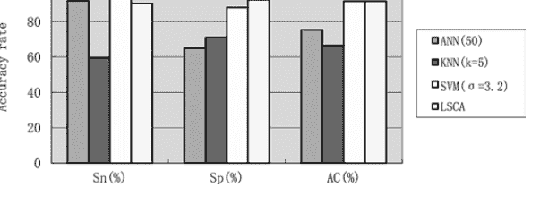

**图 6.3:** 不同算法的预测结果比较。

可以看出，与其他算法相比，我们使用的方法建立的预测模型对正样本和负样本都有更好的预测准确率。虽然该方法的正确性不如SVM，但负样本预测的准确率更高。相对而言，该方法取得了令人满意的结果。

## 6.3 李群机器学习的多连通覆盖算法

在许多情况下，学习问题不是一一对应的。它通常具有多个输入空间和输出域，以及多个输入和输出。在学习过程中，通常很难直接分析多值表示问题。因此，我们通过将李群问题转化为其覆盖群，并利用李群与覆盖群之间的同构关系来解决该问题。李群整体的许多性质可以从群的无穷小结构中推导出来，即给定群的连通分支数，整体性质就可以完全确定。因此，本章研究李群机器学习的多连通覆盖问题。

### 6.3.1 LML多连通覆盖模型

在李群的群空间中，一个元素与一个常值元素之间的对应关系由许多连通分支连接。其中一些连通分支可以在群空间中连续变化，而另一些则不能。因此，这些连通分支被划分为组。同一组的连通分支可以在群空间中连续变化，而不同组的连通分支则不能。这些连通分支的组数就是群空间的连通度。本章考虑了李群及其覆盖群的性质，并在多连通情况下进行了实际应用。

数学上已经证明，当连通李群 $G$ 的群空间是多连通的，它必然同态于另一个单连通李群的群空间，且同态对应关系为 $1:n$。该李群被称为李群 $G$ 的覆盖群。覆盖群的真表示是群 $G$ 的 $n$ 重表示。覆盖群的存在是李群多值表示的数学基础。

多连通李群群空间内的连通分支可以根据其是否可连续变化进行分组，同一组内的连通分支可以相对变化。因此，群空间被划分为若干互不连通的分支，其中每个分支代表覆盖群中可以找到的独立部分。覆盖群与李群同构，因此覆盖群的组合函数是多连通李群性质的真实反映。根据覆盖群的特征，复杂的多连通问题可以简化为分组问题。

根据李群的性质，群空间中任意点到不变元的道路都可以收缩，即道路等价。覆盖是群空间中所有等价道路的集合。如果 $\hat{G}$ 中的道路 $f$ 和 $g$ 属于道路类 $[a]$，则存在固定点平移 $H: [0, 1] \times [0, 1] \to \hat{G}$，满足 $H(t, 0) = f(t)$，$H(t, 1) = g(t)$。进一步地，固定 $s_0 \in [0, 1]$，使得 $0 = t_0 < t_1 < \cdots < t_n = 1$ 是道路 $H(t, s_0)$ 的一个细分。由 $H$ 的连续性，可以选取一个足够接近零的固定正数 $\delta$。当 $s \in [s_0 - \delta, s_0 + \delta]$ 时，上述 $\{t_0, t_1, \cdots, t_n\}$ 是道路 $H(t, s)$ 的一个细分；则 $H(t_{k-1}, s)^{-1}H(t_k, s) \in U$。此外，


上述 $A$ 可以简化为固定形式

$$
\begin{aligned}
&H(t_{k-1}, s)^{-1}H(t_k, s_0) \in U \\
&H(t_k, s)^{-1}H(t_k, s_0) \in U \\
&H(t_{k-1}, s_0)^{-1}H(t_k, s) \in U \quad (1 \le k \le n)
\end{aligned}
$$

由于 $U = U^{-1}$，有 $H(t_k, s_0)^{-1}H(t_k, s) \in U$。

对于 $1 \le k \le n$，我们有

$$
\begin{aligned}
&F_1[H(t_0, s_0)^{-1}H(t_1, s_0)\dots F_1[H(t_{k-1}, s_0)^{-1}H(t_k, s_0)] \\
&= F_1[H(t_0, s_0)^{-1}H(t_1, s)\dots F_1[H(t_{k-1}, s)^{-1}H(t_k, s_0)]F_1[H(t_k, s)^{-1}H(t_k, s_0)]]
\end{aligned}
$$

然后，令 $\alpha_{s_0}(t) = H(t, s_0)$，$\alpha_s(t) = H(t, s)$。我们有 $F(\alpha_{s_0}) = F(\alpha_s)$。因此，可以很容易看出 $F(f) = F(g)$。换言之，$F(\alpha)$ 仅依赖于同伦类 $[\alpha]$。

因此，定义了映射 $F_2 : G \to G_2$，其中 $G_2$ 是李群 $G$ 的陪群中另一个不连通的切片，且 $G'$ 是其覆盖群。那么，$F_2(x) = \sigma F(\alpha)$，其中 $\sigma$ 是其控制因子，$\alpha$ 表示 $G'$ 内连接单位元 $e$ 和 $x$ 的任意路径。由于 $F_2$ 是覆盖同态映射，对于 $\forall x, y \in G'$，对于连接 $e_{G'}$ 到点 $y$ 的路径 $\beta$ 和连接点 $e_{G'}$ 到点 $x$ 的路径 $\alpha$，$x\beta$ 是点 $x$ 到点 $xy$ 的路径。乘积路径 $A$ 是连接 $B$ 到 $xy$ 的路径，因为

$$
\begin{aligned}
F_2(xy) &= F_2(\alpha * (x\beta)) = F_2((\alpha(t_0))^{-1}\alpha(t_1))\dots F_2((\alpha(t_{n-1}))^{-1}\alpha(t_n)) \\
&= F_2((x\beta(t_0))^{-1}(x\beta(t_1))\dots F_2((x\beta(t_{n-1}))^{-1}(x\beta(t_n))) \\
&= F_2(\alpha)F_2(\beta) \\
&= F_2(x)F_2(y)
\end{aligned}
$$

设 $\forall x \in V$ 并取一条路径 $\alpha$ 将 $V$ 中的单位元与 $G'$ 中的 $x$ 连接起来；将 $[0,1]$ 细分为 $0 = t_0 < t_1 = 1$。那么，我们有

$$
F(\alpha) = \sigma_2 F_2(x) \times \sigma_1 F_1(x) = \sigma_1 \sigma_2 F_2([\alpha(t_0)^{-1}\alpha(t_1)])F_1([\alpha(t_0)^{-1}\alpha(t_1)])
$$

其中 $\sigma_1$、$\sigma_2$ 分别是覆盖群 $\tilde{G}$、$G'$ 的控制因子。因此，多连通李群的性质可以通过不连通片段的组合来表达。对于实际问题，我们只需要找到控制因子，就可以完成表示问题。

由于无穷小元仅描述李群的局部性质，且群空间是多连通李群 $G$，它与其覆盖群拥有共同的李代数。根据李的第二定理，满足特定条件的一组矩阵被用作简单李群的生成元。解的线性表示可能是覆盖群的真实表示以及群 $G$ 的多值表示。

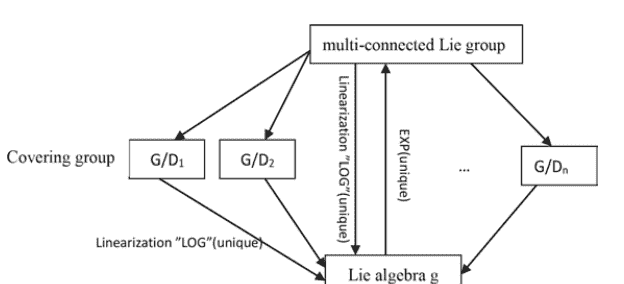

**图 6.4：** 多连通李群与其覆盖群之间的关系。

图 6.4 展示了多连通李群与其覆盖群之间的关系，每个覆盖群的组合可以完全表达多连通李群的性质。因此，当给出李群的片段时，整体性质可以被完全确定。

多连通李群 $G$ 的李代数是 $g$，$G_{1}, G_{2}, \ldots G_{n}$ 是 $G$ 的覆盖群，其李代数为 $g_{1}, g_{2}, \ldots, g_{n}$。那么，覆盖群和多连通李群的李代数可以如图 6.5 所示进行分解：

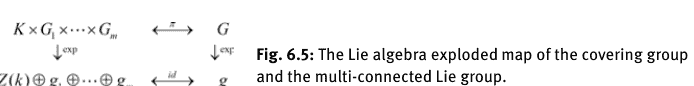

其中 $K$ 是覆盖群与多连通李群之间的拟合控制。因此，通过分解每个覆盖群可以分析多连通李群的性质，且该代数也与同态映射相关联。

### 6.3.2 多连通覆盖算法设计

对应于学习问题，每个样本由特定的属性值表征，假设存在几类问题，记为 $A$。样本集中的每个样本都根据属性值在学习空间中表示，并且样本集中的每个样本都根据属性值在差分流形中嵌入，从而构成一个李群。每个样本是群中的一个元素。元素群 $R$ 可以通过一组独立的实参数 $(r_{1}, r_{2}, \ldots)$ 来描述，这些参数在某个区域内连续变化。同一类别的样本具有相似或相等的属性值，任意两点之间的连接应当是连通的，即参数的变化可以表示一类问题。某些不同类型的属性值可能也是相似或相等的，但必须存在不同的属性值。当然，我们可以先确定每个类别的关键属性值。在映射关系之间形成的样本单元被称为道路。道路的覆盖群形成一个覆盖群，且该覆盖群包含相同的样本。不同类别的集合之间不相互连接，因此群空间的不连通部分分别代表不同的类别。

以下是多连通李群的群空间分割算法：

-   步骤 1：取单位框架 (U, $\varphi$)。我们可以从 $U$ 开始创建一个点集
  $$ \bigcup_{m=1}^{\infty} \overline{(U \times U \times \cdots \times U)}^{m} . $$
-   步骤 2：取该点集的元素 $(u_1, u_2, \ldots, u_m)$ 和 $(v_1, v_2, \ldots, v_p)$。根据规则，如果 $u, v, uv \in U$，则 $(u, v) = uv$，我们可以对 $(u_1, u_2, \ldots, u_m)$ 执行有限步变换，并检查是否可以变为 $(v_1, v_2, \ldots, v_p)$。
-   步骤 3：满足等价条件的元素的等价类记为 $(u_1, u_2, \ldots, u_m)^* \subseteq G_i$。不符合等价条件的元素是 $G_{i+1}$ 的元素；然后，选择另一个元素。
-   步骤 4：继续遍历点集中的所有元素，直到所有符合等价关系的等价类形成 $G_i$。
-   步骤 5：从 $A$ 的一个元素开始，找到等价元素，将其加入集合，直到所有元素都被划分到相应的群空间中。

多连通李群的群空间被划分为几个不相关的块。

通过划分多连通李群的群空间，多连通李群的群空间可以被划分为几个不同的切片，每个切片包含等价元素，这些元素等价于道路。通过使用李群的覆盖群，区分不同类的元素，并通过分析局部性质获得多连通李群的整体性质。

对于两个给定的群 $G'$ 和 $G''$，使用 $a_k' \in G'$ 和 $a_l'' \in G''$ 分别表示它们的元素。定义元素 $a_{kl} = (a_k', a_l'')$，并定义乘法 $(a_1', a_1'')(a_2', a_2'') = (a_1'a_2', a_1''a_2'')$。那么，元素 $(a_k', a_l'')$ 构成一个新群 $G$，$G'$ 和 $G''$ 的秩 $n'$ 和 $n''$ 的乘积为 $n = n'n''$。群 $G$ 被称为群 $G'$ 和 $G''$ 的直积，记为 $G = G' \times G''$。

需要注意的是，仅当两个群在不同空间中作用且彼此独立时，在考虑其效应时，它们可以表示为它们的直积。幸运的是，本文考虑的多连通覆盖群只是群空间中不连通的片段，因此在寻求两个群之间的性质时，它们可以表示为直积形式。

如果群 *G* 由群 $G'$ 和 $G''$ 的直积给出，如果 $D'$ 和 $D''$ 分别是 $G'$ 和 $G''$ 的表示，那么 $D = D' \times D''$ 是 *G* 的一个表示。如果 $D'$ 和 $D''$ 分别是 $G'$ 和 $G''$ 的不可约表示，那么所得的 *D* 是 *G* 的不可约表示。

在此，我们给出李群机器学习的多连通覆盖算法，描述如下：

-   (1) 设输入样本集为 $X = \{x_1, x_2, \dots, x_n \in R^D\}$，其中 *X* 满足李群结构
-   (2) 根据李群的群空间结构，利用群空间分割算法将李群的群空间划分为几个切片。
-   (3) 通过使用求解李群的覆盖群算法 (SCCG)，对于群空间的每个群，获得其覆盖群 *Ci* 和覆盖映射 $f_i$。
-   (4) 首先，分析维度最大的覆盖群以找出其生成元表示。群中元素与生成元之间的道路集作为切片数据的研究来表达，并获得控制因子。
-   (5) 对于下一个要学习的覆盖群，它将连接到前一个覆盖群，即两个群的重叠。
-   (6) 找到相应的控制因子 $\sigma_{i+1}$，使得两个群可以表示为 $C' = \sigma_i C_i \times \sigma_{i+1} C_{i+1}$。因此，整个李群的性质可以由多个覆盖群表示。

通过分析李群性质，我们可以获得整个李群的结构性质。覆盖算法的优势在于李群结构被分解并映射到每个覆盖群，这有效提高了算法的效率并增强了李群的应用范围。对于不同的李群问题，通过学习过程，找到每个覆盖群的控制因子，我们将问题表示为群表示。对于某些类型的学习问题，输入空间与输出空间之间的关系可以表示为

$$
y_t = \sigma f_1(x_t) \times f_2(x_t) \times \cdots \times f_n(x_t)
$$

根据上述过程，在李群与覆盖群之间的局部同构关系中，通过学习过程找到覆盖群控制因子，从而李群表示问题可以通过其覆盖群来表示。


### 6.3.3 应用实例

在本节中，我们通过与一个重要李群进行验证，来检验我们的多重连通覆盖模型。SO(4) 群是四维实空间的正交变换群。它是一个紧李群，与洛伦兹群非常接近，但实项的参数不同。SO(4) 群是一个典型的多重连通李群。通过研究 SO(4) 群与其覆盖群之间的关系，我们可以验证我们在多重连通算子设计上的想法。

我们知道，SO(4) 群是一个双连通李群。首先，SO(4) 群由 SO(4) 群本身表示，并建立 SO(4) 群与两个 SU(2) 群之间的关系。进一步地，SO(4) 群的群元素被归类为两组独立的 SU(2) 集合，具体确定了 1:2 的同态关系。根据这种对应关系，我们可以使用 SU(2) 群的相应参数来寻找 SO(4) 群的不等不可约解析形式。

SO(4) 群本身具有六个生成元。对这些生成元进行适当组合，例如：

$$
T_{1}^{(+)}=\frac{1}{2}\left(T_{23} \pm T_{14}\right)=\frac{1}{2}\begin{pmatrix} 0 & 0 & 0 & \mp 1 \\ 0 & 0 & -i & 0 \\ 0 & i & 0 & 0 \\ \pm i & 0 & 0 & 0 \end{pmatrix}
$$

及其 1,2,3 循环。上述方程可以表示为二维矩阵的直积形式：

$$
\begin{aligned}
T_{1}^{(+)}=\frac{1}{2} \sigma_{2} \times \sigma_{1}, \quad & T_{2}^{(+)}=\frac{-1}{2} \sigma_{2} \times \sigma_{3}, \quad & T_{3}^{(+)}=\frac{1}{2} I_{2} \times \sigma_{2} \\
T_{1}^{(-)}=\frac{-1}{2} \sigma_{1} \times \sigma_{2}, \quad & T_{2}^{(-)}=\frac{-1}{2} \sigma_{2} \times I_{2}, \quad & T_{3}^{(-)}=\frac{1}{2} \sigma_{3} \times \sigma_{2}
\end{aligned}
$$

它们被分为两组生成元，以满足 SU(2) 群的交换关系：

$$
\left[T_{a}^{(+)}, T_{b}^{(+)}\right]=i \sum_{c=1}^{3} \epsilon_{abc} T_{c}^{(+)}, \quad \left[T_{a}^{(+)}, T_{b}^{(-)}\right]=0.
$$

经过 $N$ 的变换后，上述公式的分解可以更清晰地看到：

$$
N^{-1} T_{a}^{(+)} N=(\sigma_{a} / 2) \times I_{2}, \quad N^{-1} T_{a}^{(-)} N=I_{2} \times\left(\sigma_{a} / 2\right),
$$

其中

$$
N=\frac{1}{\sqrt{2}}\begin{pmatrix} -1 & 0 & 0 & 1 \\ -i & 0 & 0 & -i \\ 0 & 1 & 1 & 0 \\ 0 & i & -i & 0 \end{pmatrix} .
$$

因此，SO(4) 群的任意元素可以表示为：

$$
\begin{align*} R &= \exp \left(-i \sum_{a < b}^{4} w_{a b} T_{a b}\right) \\
&= \exp \left\{-i \sum_{a = 1}^{3} \left(w_a^{(+)} T_a^{(+)} + w_a^{(-)} T_a^{(-)}\right)\right\} \\
&= \exp \left\{-i w^{(+)} \hat{n}^{(+)} \cdot \vec{T}^{(+)}\right\} \exp \left\{-i w^{(-)} \hat{n}^{(-)} \cdot \vec{T}^{(-)}\right\} \\
&= N \left\{u(\hat{n}^{(+)}, w^{(+)}) \times u(\hat{n}^{(-)}, w^{(-)})\right\} N^{-1}
\end{align*}
$$

其中

$$
\begin{align*} \mathbf{w}_{1}^{(\pm)} &= w_{23} \pm w_{14} = w^{(\pm)} \mathbf{n}_{1}^{(\pm)}, \\
\mathbf{w}_{2}^{(\pm)} &= w_{31} \pm w_{24} = w^{(\pm)} \mathbf{n}_{2}^{(\pm)}, \quad w^{(\pm)} = \left\{\sum_{a = 1}^{3} \left(w_a^{(\pm)}\right)^2\right\}^{1/2} \\
\mathbf{w}_{3}^{(\pm)} &= w_{12} \pm w_{34} = w^{(\pm)} \mathbf{n}_{3}^{(\pm)}.
\end{align*}
$$

可以看出，该矩阵明显表达为两个二维酉矩阵 $u$ 的乘积。如果两个 $A$ 矩阵的符号同时改变，$B$ 矩阵保持不变。因此，上述公式给出了 SO(4) 群元素与两个 SU(2) 群直积元素之间的二对二对应关系，且这种对应关系在群元素乘法中保持不变。因此，$\mathrm{SO}(4) \sim \mathrm{SU}(2) \times \mathrm{SU}(2)\prime$。两个 SU(2) 群的参数可以作为 SO(4) 群的群参数，使得群空间的参数与群元素具有一对一的关系。在确定 SO(4) 的群空间时，一个子群的群空间可以减半；即，SO(4) 群的参数范围如下：

$$
\begin{aligned}
& 0 \leqslant w^{(+)} \leqslant 2 \pi, \quad 0 \leqslant w^{(-)} \leqslant \pi, \\
& 0 \leqslant \theta^{(+)} \leqslant \pi, \quad -\pi \leqslant \varphi^{(-)} \leqslant \pi
\end{aligned}
$$

其中 $\theta^{(\pm)}$ 和 $\varphi^{(\pm)}$ 是 $\hat{n}^{(\pm)}$ 方向上的极角和方位角。由于其中一个子群的群空间被缩减，它类似于 SO(3) 群的群空间。群空间直径两端的点对应于同一组群元素，这确定了 SO(4) 群的群空间是双连通的。

因此，SO(4) 群的覆盖群可以表示为群 $\mathrm{SU}(2) \times \mathrm{SU}(2)\prime$，即双连通 SO(4) 群的群空间被分为两部分，每个覆盖分量都是一个 SU(2) 群。两个 SU(2) 群的直积是整个 SO(4) 群的覆盖群。选择这组参数后，SO(4) 群上的不变体积元（积分密度函数）为：

$$
\begin{align*} dR &= \frac{1}{8 \pi^{4}} \sin^{2}\left(w^{(+)} / 2\right) \sin^{2}\left(w^{(-)} / 2\right) \sin \theta^{(+)} \sin \theta^{(-)} \\
& \quad \times d w^{(+)} d w^{(-)} d \theta^{(+)} d \theta^{(-)} d \varphi^{(+)} d \varphi^{(-)}.
\end{align*}
$$

SO(4) 群的不等不可约表示可以表达为 SU(2) 群不等不可约表示的两个直积，记为 $D^{jk}$：

$$
\begin{aligned}
D^{jk}(\mathrm{SO}(4)) &= D^j(\mathrm{SU}(2)) \times D^k(\mathrm{SU}(2)^\prime), \\
D^{jk}(\hat{n}^{(+)}, W^{(+)}; \hat{n}^{(-)}, W^{(-)}) &= D^j(\hat{n}^{(+)}, W^{(+)}) \times D^k(\hat{n}^{(-)}, W^{(-)}),
\end{aligned}
$$

其中 $D^{jk}$ 是 $(2j+1)(2k+1)$ 维的。其行（列）指标用两个字母共同标记，其生成元可以用 SU(2) 群对应的生成元素表示：

$$
\begin{aligned}
I_a^{jk(+)} &= I_a^j \times I_{2k+1}, \quad I_a^{jk(-)} = I_{2j+1} \times I_a^k, \\
I_{ab}^{jk} &= \sum_{c=1}^3 \varepsilon_{abc} (I_c^{jk(+)} + I_c^{jk(-)}) = \sum_{c=1}^3 \varepsilon_{abc} (I_c^j \times I_{2k+1} + I_{2j+1} \times I_c^k) \\
I_{a}^{jk} &= I_{a}^{jk(+)} - I_{a}^{jk(-)} = I_{a}^j \times I_{2k+1} - I_{2j+1} \times I_{a}^k.
\end{aligned}
$$

多重连通李群的本性和表示可以通过其覆盖群获得。在实际问题中，多重连通李群的问题往往难以直接解决。根据本文的多重连通覆盖算法，我们可以找到覆盖群，从而将连通群的问题转化为覆盖群的表示问题，进而解决该问题。

本节的主要思想是验证多重连通李群与其覆盖群之间的关系。通过分析 SO(4) 群这一典型的多重连通李群，可以将其分解为两个 SU(2) 群的直积。由于 SO(4) 群是满足 $\det(A) = 1$ 的四维正交变换群，对于 SO(4) 群的覆盖群，其覆盖因子取单位元。在实际问题中，我们通常需要对数据集进行分析以确定其覆盖因子。

## 6.4 覆盖算法在分子对接中的应用

### 6.4.1 分子对接算法简介

分子对接是两个或多个分子之间通过几何匹配和能量匹配进行识别的过程。分子对接在药物设计中非常重要。在涉及药物分子产生药理反应的过程中，药物分子与靶酶相互结合。首先，我们需要两个分子接近适当的取向，使其必要部分能够相互契合并相互作用。通过适当的构象调整，该过程形成稳定的复合物构象。两个分子在复合物中的相对位置和取向由分子对接确定，并找到分子之间的最佳结合模式。


快速分子对接研究是有理性药物筛选中的一个重要课题。实际上，分子对接算法可以用作配体-受体复合物的预测器，或者作为系统结合能极值的空间搜索问题。即使受体分子是刚性的，分子对接所涉及的搜索空间仍然非常大，解的数量也相当可观。Gehlhaar等人以柔性小分子为例，粗略估计搜索空间至少包含 $10^{30}$ 个解。

开发快速且有效的搜索算法一直是许多研究的焦点；甚至分子对接也被用于药物筛选。近年来，分子对接搜索算法的研究取得了显著进展。许多随机搜索算法被用于解决这类问题，包括模拟退火（如 AutoDock2、DockVision、MCDOCK）、遗传算法（GOLD、AutoDock3、DockVision）和禁忌搜索（ProLeads）。这些算法基于随机搜索技术和评分函数，但它们并不系统地检测整个搜索空间。

基于系统的随机测试方法也存在，包括增量构建和多重构象刚体对接。尽管这些方法是系统性的，但它们仍然无法对构象和取向空间进行完整搜索。增量构建方法使用一系列离散旋转构象来获得星座的粗略样本。多异构体刚体对接系统使用一系列低能刚体异构体。

图 6.6 展示了常用的分子对接算法分类 [39]。

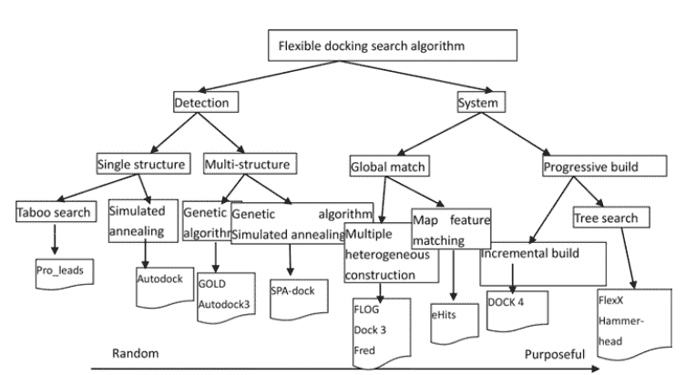

**图 6.6：** 柔性对接算法分类。

基于随机搜索的一个更大问题是，很难断言在有限的搜索时间内搜索必须找到能量的最佳构象，因此很难定义计算结束的标准。在随机搜索中，如果经过几个循环后无法获得新的构象，通常认为计算已经收敛，但实际上可能尚未达到最佳能量构象，将会出现漏搜的情况。基于渐进构建的分子对接通常比其他分子对接方法更快。然而，由于基于渐进构建的分子对接方法仅考虑受体结合位点与构建片段之间的局部相互作用，因此很难评估优化后的结构是否为配体分子的全局最优星座。局部同构关系之间存在李群及其覆盖群，对应于框架和整体结构。我们自然地考虑将李群应用于分子对接算法。本节基于渐进构建的搜索策略，结合李群的思想设计了一种新的分子对接算法。

### 6.4.2 分子对接的数学模型与评估函数

分子对接问题是指通过将已知三维结构的小分子化合物放入目标分子的结合位点，优化小分子化合物的位置、取向和构象，针对生物分子相互作用的构象最佳组合，并计算或预测配体分子与生物大分子之间的相互作用能量，从而找到相互作用分子之间最稳定的结合状态。

在数学规划意义上，最小化系统自由能的相互作用通常可以描述为以下最优设计问题 [14, 40]：

$$
\left\{\begin{array}{c} \min f(x) \\ \mathrm{s.t.} \quad g k(x) \leq 0, \quad k=1,2, \ldots, q \end{array}\right. \quad (6.2)
$$

其中 $x=\left\{T_{x}, T_{y}, T_{z}, R_{x}, R_{y}, R_{z}, T b_{1}, T b_{2}, \ldots, T b_{n}\right\}^{T}$ 是设计变量，$T$ 是 $q(q=n+6)$ 维的设计变量，且 $T b_{1}, T b_{2}, \ldots, T b_{n}$ 是配体分子可旋转键的旋转角度。它描述了配体分子的构象信息。进一步地，$n$ 是可旋转键的数量，$T_{x}, T_{y}, T_{z}, R_{x}, R_{y}$ 和 $R_{z}$ 代表配体分子的几何中心和旋转程度，对应于配体分子的取向（Pose），且 $g(x)$ 是设计变量约束的大小：

$$
\left\{\begin{array}{c} \underline{X} \leq T_{x} \leq \overline{X} \\ \underline{Y} \leq T_{y} \leq \overline{Y} \\ \underline{Z} \leq T_{z} \leq \overline{Z} \\ -\pi \leq \operatorname{angle} \leq \pi, \quad \operatorname{angle}=R_{x}, R_{y}, R_{z}, T b_{1}, \ldots, T b_{n} . \end{array}\right. \quad (6.3)
$$

在此模型中，配体的最优构象由三个平移分量（$T_x, T_y, T_z$）、三个旋转分量（$R_x, R_y, R_z$）以及配体的旋转（$T_{b1}$、$T_{b2}$、...、$T_{bn}$）表示，其中平移变量用于搜索配体的位置空间，旋转变量用于搜索配体的取向空间。

进一步，$f(x)$ 是目标函数，即评分函数。评分函数通常见于以下几类。基于力场的评分函数使用非键相互作用作为构象评分，有时还添加了溶剂效应考虑。基于已知结合常数计算蛋白质-配体复合物的经验评分函数。使用一组训练集通过多元线性回归方法拟合固有功能系数。基于知识的评分函数基于蛋白质-配体相互作用在 X 射线衍射结构数据库中的统计数据作为评分标准。在这里，我们使用类似于 Böhm 提出的半经验自由能评分函数 [4]：

$$
\Delta G = \Delta G_{O} + \Delta G_{\text{rot}} \times N_{\text{rot}} + \Delta G_{\text{hb}} \sum f(\Delta R, \Delta \alpha) + \Delta G_{i o} \sum f(\Delta R, \Delta \alpha) + \Delta G_{a r o} \sum f(\Delta R, \Delta \alpha) + \Delta G_{l i p o} \sum f^{*}(\Delta R) \quad (6.4)
$$

其中 $N_{\text{rot}}$ 是在结合过程中被冻结的可旋转键数量；$\Delta G_{\text{rot}}$、$\Delta G_{\text{hb}}$、$\Delta G_{i o}$ 和 $\Delta G_{o}$ 是通过拟合得到的半经验参数；$f(\Delta R, \Delta \alpha)$ 是偏离最佳构象的惩罚函数；且 $\Delta G_{a r o} = -0.70 \text{ kcal/mol}$。最后一项表示疏水原子的接触评分，且 $\Delta G_{l i p o}$ 是疏水暴露评分的半经验参数，其中 $f^{*}(\Delta R)$ 在不同的 $\Delta R$ 下具有不同的值。

$$
f^{*}(\Delta R) = \left\{
\begin{array}{ll}
0 & \Delta R > 0.6\text{\AA} \\
1 - (\Delta R - 0.2)/0.4 & 0.2\text{\AA} < \Delta R < 0.6\text{\AA} \\
1 & -0.2\text{\AA} \leq \Delta R \leq 0.2\text{\AA} \\
1 - (-\Delta R - 0.2)/0.4 & -0.6\text{\AA} < \Delta R < -0.2\text{\AA} \\
(\Delta R + 0.6)/0.2 & \Delta R = -0.6\text{\AA}
\end{array}
\right. \quad (6.5)
$$

这些参数以及 $f^{*}(\Delta R)$ 函数的形式直接采用了 Böhm 报告的结果。该函数在大多数分子对接程序中被用作相应的评估函数。我们使用此函数来协助其他对接程序以比较构象搜索结果。

### 6.4.3 分子对接的覆盖策略与实现

在柔性分子对接的情况下，配体分子在受体的对接位点上进行平移和旋转操作，直到找到最佳构象。配体的平移旋转构成了李群，其中使用可旋转键来探测配体。在柔性构象空间的情况下，对于相对较小的配体分子，全局搜索的效率是可以接受的。然而，如果可旋转键相对较多，则配体的取向和构象空间将被全局搜索。因此，这需要大量的计算，耗时较长，且往往难以获得期望的结果。

在受体的活性位点，配体分子不断对齐。由于可旋转键的存在，构象搜索空间非常大。因此，必须缩减构象空间。

在考虑柔性分子的构象变化时，可以通过以下操作实现这一点。首先，我们需要确定刚性片段和搜索常数。对于柔性分子，其可旋转二面角可以改变。因此，在对接过程中，我们将柔性分子视为多个刚性片段的组合。每个刚性片段由一组通过不可旋转键连接的原子组成，而刚性片段之间通过可旋转键连接。

确定刚性片段的第一个步骤是判断环，所有环中的键均可视为刚性的。第二个步骤是确定键的旋转。我们可以识别键两侧的类型。通常，双键被视为刚性键。每个刚性片段仅包含不可旋转键。图 6.7 展示了根据可旋转键划分分子的基本示意图。

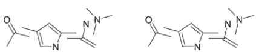

**图 6.7：** 柔性分子划分示意图。

然后，柔性分子的性质可以分解如 图 6.8 所示：

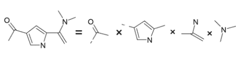

**图 6.8：** 柔性分子爆炸图。


#### 基于李群覆盖算法的分子对接模拟

由于配体分子的平移和旋转构成了一个李群，且李群是多连通群，配体的可旋转键将李群的群空间划分为几个不同的切片，这些切片可以利用多连通覆盖算法进行分析。生成的构象空间通过群空间分段算法被划分为不同的片段。关键环的分子旋转被定义为分割点，从任意一个元素开始，随后可以找到其等价道路类并将其合并为一个片段，直到遍历所有元素。至此，该操作完成。

根据多连通覆盖算法，分子的性质可以用以下方程表示：$C = C_1 \times C_2 \times C_3 \times C_4$。换言之，只要分析 $C_i$，找到 $C_i$ 的所有不可约不等表示，然后根据覆盖群和李群之间的局部同构关系，就可以将其分解到整个李群上。

下一步是柔性分子的构象搜索。基于逐步法，在构建结构片段后，需要生成所有片段的构象模式，并使用构象数据库来存储这些片段的典型构象。在获得结构片段的构象后，将结构片段相互连接以产生完整的分子。在连接过程中，由于每个结构片段可能以多种构象存在，连接过程采用树搜索方法。然而，这种方法的缺点是结构片段之间的构象可能无法很好地替代分子中的构象模式，且结构片段之间的连接构象未能完全反映真实的构象。

因此，我们考虑李群及其覆盖群之间的局部同构。李群表示的问题可以分解到各个覆盖群中进行表示，并保持整体特征。结构片段的构象搜索也可以通过李群的生成来产生，从而通过平移和旋转操作最大程度地覆盖整个搜索空间。

我们知道，李群的特征可以归结为其生成关系。使用生成元，我们可以方便地表示一个群。例如，三维旋转群的李代数是其无限小生成元的线性空间，且该李代数的维数为六。在分子对接模型中，通过逐步构建获得的覆盖群是一个三维欧几里得群 $SE(3) = T(3) \times SO(3)$。三维欧几里得群的生成元源自其群参数 $t = 0$。

如果将 $t$ 用作参数，取三个旋转参数和三个平移参数作为点 $G(X, Y, Z)$ 的坐标，则可以得到 $SE(3)$ 的六个生成元。因此，$SE(3)$ 的群元素是六个生成元的线性组合。绕 $X$、$Y$ 和 $Z$ 轴的旋转在 $\mathbb{R}^3$ 上具有如下矩阵形式：

$$
\begin{bmatrix} 
1 & 0 & 0 \\ 
0 & \cos \alpha & -\sin \alpha \\ 
0 & \sin \alpha & \cos \alpha 
\end{bmatrix}
\begin{bmatrix} 
\cos \beta & 0 & \sin \beta \\ 
0 & 1 & 0 \\ 
-\sin \beta & 0 & \cos \beta 
\end{bmatrix}
\begin{bmatrix} 
\cos \gamma & -\sin \gamma & 0 \\ 
\sin \gamma & \cos \gamma & 0 \\ 
0 & 0 & 1 
\end{bmatrix}
$$

其中 $\alpha$、$\beta$ 和 $\gamma$ 分别代表 $X$、$Y$ 和 $Z$ 轴的旋转角，对应的生成元为

$$
e_1 = \begin{bmatrix} 
q & 0 & 0 \\ 
0 & 0 & -1 \\ 
0 & 1 & 0 
\end{bmatrix} 
\quad
e_2 = \begin{bmatrix} 
0 & 0 & 1 \\ 
0 & q & 0 \\ 
-1 & 0 & 0 
\end{bmatrix} 
\quad
e_3 = \begin{bmatrix} 
0 & -1 & 0 \\ 
1 & 0 & 0 \\ 
0 & 0 & q 
\end{bmatrix} .
$$

平移子群在 $\mathbb{R}^3$ 上没有矩阵表示，但在 $\mathbb{R}^3$ 上微分函数的向量空间中定义为位移算子：

$$
\begin{align*} 
T_x(\phi) &: f\,(X,\,Y,\,Z) \rightarrow f\,(X + \phi,\,Y,\,Z)\, ,\\ 
T_y(\varphi) &: f\,(X,\,Y,\,Z) \rightarrow f\,(X,\,Y + \varphi,\,Z)\, ,\\ 
T_z(\theta) &: f\,(X,\,Y,\,Z) \rightarrow f\,(X,\,Y,\,Z + \theta)\, ,\\ 
\end{align*}
$$

其中 $\phi$、$\varphi$ 和 $\theta$ 分别代表在 $X$、$Y$ 和 $Z$ 轴上的平移方向，无限小生成元表示为偏微分算子：

$$
e_4 = \frac{\partial}{\partial X}\, ,\quad e_5 = \frac{\partial}{\partial Y}\, ,\quad e_6 = \frac{\partial}{\partial Z}\, .
$$

利用这六个无限小生成元，任何三维欧几里得群的无限小变换可以表示为

$$
e = \sum_{i = 1}^{6}{v_i e_i}\, ,
$$

其中 $v_i\,(i = 1,\,\ldots,\,6)$ 是 $e_i$ 的系数。

在本文中，采用基于覆盖群的构象搜索方法。如上所述，分子可以被划分为多个由可旋转关键片段连接的刚性片段。每个片段在空间中的变换实际上构成了一个覆盖群，且每个覆盖群的特征反映了整个分子的特征。我们选择其中一个最高的覆盖群作为核心片段。在将配体对接到活性口袋时，首先需要对核心片段进行定位、评估和优化，以确定其在活性口袋中的位置。确定核心片段位置后，可以在核心片段上连接其他片段并搜索构象。

##### 算法的具体步骤

具体步骤如下（参见图 6.9）：

- (1) 首先进行核心片段的对接，片段在活性位点的所有操作构成覆盖群。利用覆盖群模型中平动分量搜索配体的位置空间，利用旋转分量搜索配体的取向空间。获取核心片段在活性口袋中可能的对接位置 $N_0$。
- (2) 对于生成的 $N_0$ 种构象，根据匹配分数保留一部分最佳对接位置。然后，减少这部分保留的对接位置。根据原子的位置多样性，保留 $N_c$ 种代表性构象。位置多样性使用加权均方根偏差 (wRMSD) 进行评估。

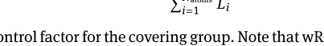

其中 $L_i$ 是覆盖群的控制因子。注意，对 $L_i$ 加权后，wRMSD 对整体特征更加敏感。对于 wRMSD 值小于特定阈值的空间位置合并情况，仅保留空间位置差异较大的那些。最后，检查这些核心结构与受体之间的相互作用，并对结构进行简单修正。

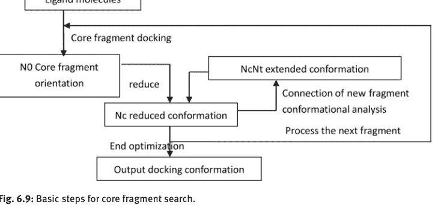

- (3) 连接新片段，并使用多连通覆盖算法直接相乘两个群。根据直接相乘的权重空间获取覆盖群的控制因子。同时，进行构象分析以获取 $N_c N_t$ 种构象。直接相乘后，获得一个新的李群，其构象根据位置多样性保留 $N_c$ 个最佳构象。
- (4) 重复第三步，分析下一个覆盖群，直到形成完整配体分子的片段结束。
- (5) 如果存在多个核心片段，操作返回第一步，并找到所有核心片段在活性口袋中的对接位置。

当片段连接完成后，可以获得配体和受体的 $k$ 个最佳组合，用户可从中选择所需结果。通过结合渐近搜索和全局搜索，我们可以利用李群与其覆盖群之间的同构关系最大化搜索空间，从而获得柔性分子的最佳构象。

##### 分子对接模拟的基本流程

本节描述的基于李群机器学习覆盖算法的分子对接模拟基本流程如下。

由于分子结构本身非常复杂，在我们的对接过程中，预处理步骤主要使用 Scripps 研究所 Olson 博士研究组开发的分子对接工具 AutoDock 4.0。它包括配体的准备、活性位点的预先确定等。在下一步中，我们将给出一些处理流程和参数。在分子对接阶段，使用 MATLAB 计算配体与受体之间的对接精度，并使用 Böhm 评估函数来评估结果。

###### (1) 受体的准备

由于本实验中使用的 PDB 蛋白质随附配体，第一步是去除配体。在去除水分子的同时，执行加氢、加电荷等操作，以获得所需的对接受体。

去除水和配体，读取：

```text
Pdb1wab.ent // 注意 ID 为 1wab 的蛋白质部门是说明该过程的一个例子。
```

- 不要对蛋白质进行 CENTER 操作，可以将其拉至中心。
- ATOM ... SET，选择 WATER。去除所有水。
- ATOM ... SUBSTRUCTURES，选择显示氨基酸的框；在末端下拉，即 ACT300，这是配体，选择 DELETE。

加氢：

```text
ADD HYDROGEN ... ALL ... ESSENTIAL ONLY
```

加电荷：

```text
Kollman_all 或 KILLMAN_UNI 均可。
```

优化氢的位置（此步骤无法执行；当然，最好做某些操作以获得理论上更好的对接结果）：

```text
Minimise
Method: Powell
Initial Optimisation: None
```


终止条件：梯度 0.01 kcal/mol
最大迭代次数：1000
能量设置 修改 ...
力场：Tripos
电荷：使用当前值
勾选聚合体复选框并点击省略号 ...（弹出对话框）
点击 新建（出现原子表达式框）
点击 原子类型并在右侧选择 H。点击 确定。
在原子表达式框中点击 取反，然后点击 确定。
调用聚合体 NON_HYD，点击 确定
注释字符串 '非氢原子'，点击 确定
点击 确定以开始优化。
另存为 Iwab.mol2

-   配体准备工作：配体从 PDB 蛋白中被分离出来。
    打开 SYBYL。
    读取 Pdbiwab.ent
    不要 CENTER（居中对齐）蛋白质，你可以将其拖动至中心。你也可以点击 SYBYL（图标左下角），并 RESET EXTENDS（重置扩展视图）。你无法手动找到它。
    ATOM ... SET，选择 WATER（水）。移除所有水分子。
    ATOM ... SUBSTRUCTURES，选中框以使氨基酸出现；向下拉到底部，即 ACT300，这是一种配体。
    确定后，对话框中有一个 INVERSE（取反）。选中它；除了配体外，将被选中的所有氨基酸移除。该配体实际上是 CH3COOH。
    加氢：添加氢原子。
    Geister Huckel 电荷：另存为 ... lig.mol2

-   确定受体分子的活性位点，并使用 AutoDock 程序的盲对接（blind docking）过程寻找受体表面的口袋位置。
    对于蛋白质活性位点的搜索，准确性主要取决于蛋白质的表面特性：如果蛋白质表面相对平滑，准确性相对较高。如果表面更加不规则，结果将不太准确，因此有必要使用经验知识进行主观判断。出于本文的目的，我们直接使用盲对接来获取活性位点口袋位置，以便进行下一步。

-   根据李群空间分段算法，配体分子的构象空间被划分为不同的片段；每个片段是一个覆叠群（covering group）。
    配体分子以 mol2 形式存在，主要保留分子的元素信息和拓扑性质。配体在拓扑空间中的所有操作构成一个李群，由群空间分段算法生成的构象空间被划分为不同的片段。关键和环的分子旋转被定义为分割点。从任意元素开始，找到其等价路类并将其合并为一个片段。遍历所有元素后，操作即完成。

-   (5) 选择维度最高的片段作为核心片段。配体的位置空间通过覆叠群模型中平移分量的分量进行搜索，配体的取向空间通过旋转分量进行搜索。将其对接到受体的活性位点，得到核心片段在活性口袋中的可能对接位置 $N_{0}$。
    在覆叠群模型中，任何变化都可以表示为平移分量和旋转分量的无穷小生成元，即 $e = \sum_{i=1}^{6} v_{i}e_{i}$。因此，在整个搜索空间中，需要搜索两部分。不断调整平移分量和旋转分量。使用评估函数进行评分，取前 N0 个得分最高的位置作为最佳位置，其中平移分量参数 $\sigma = 0.5$ Å，旋转分量参数 $\varphi = 10^{\circ}$。

-   (6) 使用上一章中的多重连通覆叠算法生长片段，调整覆叠群的控制因子，连接多个片段以找到最佳构象，直到片段末端，形成完整的配体分子。
    在片段生长过程中，对于连接两个片段的操作，即两个覆叠群的直接乘积，需要调整覆叠群的控制因子，根据群所表示的权重空间的权重向量进行调整，$\Lambda = \sigma_{1}\Lambda^{(1)} + \sigma_{2}\Lambda^{(2)}$，其中 $\sigma_{1}$、$\sigma_{2}$ 设定为 1。然后，设置旋转分量参数 $\varphi = 10^{\circ}$，使用评估函数对结果评分，同时不断调整 $\sigma_{1}$、$\sigma_{2}$ 的值。

-   (7) 使用评估函数进行多轮对接，分析结果以找到最佳构象。在此，考虑十倍的时间复杂度。

### 6.4.4 实验结果与分析

该算法在一个由 19 个源自 PDB 数据库（www.rcsb.org）和文献 [42] 的蛋白质-配体复合物组成的数据集上进行建模，如表 6.1 所示。

### 表 6.1：实验数据集。

| 编号 | 类型 | 配体 | 蛋白质 |
| --- | --- | --- | --- |
| I | 小配体复合物 | 5tim | 丙糖磷酸异构酶 |
| II | | 1ldm | 乳酸脱氢酶和草酰酸盐 |
| III | | 2phh | 对羟基苯甲酸羟化酶和对羟基苯甲酸 |
| IV | | 3ptb | 苯甲酰胺 |
| V | | 1Ul b | 嘌呤核苷磷酸化酶与鸟嘌呤 |
| VI | 短肽 | 3tpt | 胰蛋白酶原与二肽 Ile-Val |
| VII | | 4tSl | 酪氨酰-tRNA 合成酶 |
| VIII | 二氢叶酸还原酶 | 4dfr | 二氢叶酸还原酶 |
| IX | 链亲和素 | 1st p | 链亲和素-生物素 |
| X | 凝血酶 | 1dwd | NAPAP |
| XI | | 1dwc | 阿加曲班 |
| XII | 核糖核酸酶 | 6rsa | 尿苷钒酸盐 |
| XIII | | 1rnt | 核苷酸鸟嘌呤 2'-单磷酸 |
| XIV | 热稳定蛋白酶 | 1tmn | N-(1-羧基-1-3-苯基丙-1-基)-L-亮氨酸-L-色氨酸 |
| XV | | 4tlb | L-亮氨酰羟胺 |
| XVI | 羧肽酶 A | 3cpa | L-亮氨酰羟胺 |
| XVII | | 2ctc | L-苯基乳酸 |
| XVIII | HIV 蛋白酶 | 4phv | HIV-1 蛋白酶抑制剂 |
| XIX | RAS 蛋白 | 12lp | 抑制剂鸟苷 5'-B,6-亚甲基-三磷酸酯 |

每种配体都有不同的性质，I-V 类配体不需要逐步构建。V-VI 包含短链氨基酸配体，且只有一个片段；VIII 包含两个环和 10 个可旋转键；IX 结构更为特殊，即有两个五元环；X-XI 包含两个疏水环；XII-XIII 包含两个大片段；XIV-XV 在活性位点包含锌；XVI-XVII 可分为五个片段；XVIII 是相对较大的测试数据，包含 17 个可旋转键；XIX 在活性位点包含 Mg2 +。

在每次对接模拟时，分子根据可旋转键被划分为不同的片段，并找到优先级最高的片段。配体的位置空间通过模型中平移分量的分量进行搜索，配体的取向空间通过旋转分量进行搜索，以获得可能的对接位置。然后生长片段，覆盖多个片段以给出整个分子的最佳构象。

这 19 个蛋白质-配体复合物的晶体结构已被检测。表 6.2 列出了每个配体的准确性（基于晶体构象的最小均方根偏差，单位为 \AA）和复杂度（理论构象的数量）。

使用 LCDock 算法计算了 31 个蛋白质-配体复合物。每种化合物计算了十次，并选择最佳结果，即最低能量的计算结果，并获取 RMSD 值。如果对接的小分子构象与参考分子构象的蛋白质结构相对接近，则均方根偏差值相对较小，即对接更成功。通常，RMSD 值小于上表中的 acc. 值，这表明对接处于更准确的位置。

下表列出了通过 LCDock 算法进行对接的实验结果。它列出了最低能量下的自由能评分和均方根偏差，以及最佳构象的评分和排名。同时，我们将该算法与其他两种分子对接程序进行了比较，即使用逐步构建的 FlexX 和使用遗传算法搜索构象空间的 Gold；它们使用 Böh m 半经验自由能评分方程作为评估函数，以便于比较。Böh m 参数设置如下：\(\Delta G_{rt} = 0.33\)，\(\Delta G_{hb} = -1.1\)，\(\Delta G_{io} = -2.0\)，\(\Delta G_0 = 1.3\)。

上表中的第二列列出了满足条件算法计算的导体编号。第 3 列和第 4 列显示了最低能量水平下的评估函数评分和 RMSD 值。第 5、6 和第 7 列分别代表获得最佳构象时的评分、RMSD 值和排名。

可以看出，表 6.3 中标红并加粗的配体在三种对接方法的比较中取得了最佳结果，总共 13 个，占总额的 68.4%。与 FlexX 和 Gold 对接程序相比，LCDock 展示了


### 6.3 LCDock 与 FlexX 的比较：Gold 对接结果

### 表 6.3：LCDock 与 FlexX 的比较，Gold 对接结果。

| PDB | 溶液数 | 低能量 ΔG | 低能量 rmsd | 最佳预测 ΔG | 最佳预测 rmsd | 最佳预测排名 | FlexX ΔG | Gold ΔG | 晶体 ΔG |
| :-- | :--: | :--: | :--: | :--: | :--: | :--: | :--: | :--: | :--: |
| 5tim | 6 | -12.3 | 1.59 | -9.6 | 0.83 | 2 | -10.4 | -12.9 | -7.8 |
| 1ldm | 25 | -29.3 | 0.60 | -29.3 | 0.60 | 1 | -32.8 | -31.2 | -29.1 |
| 2phh | 170 | -30.1 | 0.53 | -30.1 | 0.53 | 1 | -32.1 | -25.8 | -30.3 |
| 3ptb | 28 | -29.3 | 0.48 | -29.3 | 0.48 | 1 | -28.3 | -27.1 | -30.2 |
| 1ulb | 131 | -18.6 | 0.65 | -18.6 | 0.65 | 1 | -17.9 | -28.5 | -23.2 |
| 3tpi | 215 | -23.2 | 0.58 | -23.2 | 0.58 | 1 | -24.0 | -25.1 | -28.1 |
| 4t5l | 143 | -39.1 | 0.71 | -39.1 | 0.71 | 1 | -11.8 | -31.0 | -21.9 |
| 4dfr | 80 | -62.9 | 1.34 | -55.7 | 0.85 | 2 | -62.2 | -54.8 | -53.7 |
| 1stp | 165 | -30.5 | 0.81 | -30.5 | 0.81 | 1 | -31.2 | -74.5 | -33.0 |
| 1dwd | 301 | -45.6 | 2.03 | -38.0 | 0.63 | 20 | -38.6 | -49.1 | -37.9 |
| 1dwc | 181 | -32.0 | 2.66 | -27.1 | 1.20 | 11 | -29.1 | -43.0 | -22.7 |
| 6rsa | 115 | -36.9 | 0.85 | -36.9 | 0.85 | 1 | -35.9 | -28.2 | -37.8 |
| 1rmt | 123 | -41.0 | 1.48 | -30.1 | 0.96 | 25 | -31.4 | -34.2 | -30.2 |
| 1tmn | 237 | -38.2 | 0.87 | -38.2 | 0.87 | 1 | -39.1 | -41.3 | -35.5 |
| 4t1n | 120 | -13.8 | 4.50 | -7.3 | 0.91 | 15 | -8.6 | -19.2 | -9.4 |
| 3cpa | 105 | -35.3 | 2.48 | -32.9 | 0.96 | 2 | -32.9 | -21.0 | -24.1 |
| 2ctc | 160 | -28.6 | 0.62 | -28.6 | 0.62 | 1 | -30.3 | -21.3 | -24.8 |
| 4phv | 13 | -36.7 | 0.94 | -36.7 | 0.94 | 1 | -38.2 | -50.0 | -42.8 |
| 12lp | 41 | -53.0 | 2.00 | -41.5 | 1.14 | 37 | -30.5 | -24.9 | -43.4 |

观察到了更好的实验结果。通过比较晶体结构的构象函数，可以看出 LCDock 程序的结果更接近，且对接的 RMSD 值保持在 0.5 Å 到 1.2 Å 之间，见图 6.10。

在实现分子对接效果的同时，我们还需要比较分子对接的时间。这里，我们比较了三个程序的分子对接时间，见表 6.4。

由于 LCDock 和 FlexX 程序基于渐进构造，其运行时间分为两个步骤：BP 代表核心片段算法的运行时间，CC 代表逐步生长时间。不同对接算法的运行时间比较如图 6.11 所示。

通过运行时间的比较，我们可以看到采用覆盖算法的 LCDock 具有明显优势；它在大多数对接实验中实现了较短的时间，且对接效果更好。

由于渐进构造策略基于所采用的覆盖，我们充分利用了李群与其覆盖群之间的局部同构关系，并使用李群生成了一种元方法来控制通道的搜索空间，从而进一步提高了搜索的灵活性和有效性。实验表明，我们的方法显著提高了分子对接的速度和准确性。

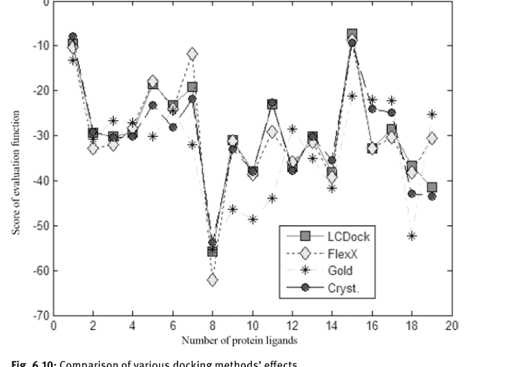

**图 6.10**：各种对接方法效果的比较。

### 表 6.4：分子对接程序时间的比较。

| PDB 代码 | 运行时间 (LCDock) | 运行时间 (FlexX) | 运行时间 (Gold) |
| :-- | :--: | :--: | :--: | :-- |
| | BP | CC | BP | CC | BP | CC | |
| 5tim | 3.02 | 0.00 | 3.12 | 0.00 | | | 3.89 |
| 1ldm | 11.42 | 0.00 | 11.38 | 0.00 | | | 10.56 |
| 2phh | 35.20 | 0.00 | 36.37 | 0.00 | | | 41.20 |
| 3ptb | 17.54 | 0.00 | 18.86 | 0.00 | | | 19.50 |
| 1ulb | 32.56 | 0.00 | 46.56 | 0.00 | | | 55.20 |
| 3tpi | 5.50 | 25.00 | 6.65 | 27.36 | | | 31.20 |
| 4t5l | 6.15 | 5.32 | 6.30 | 7.11 | | | 18.70 |
| 4dfr | 25.45 | 55.23 | 38.00 | 55.80 | | | 1:10.12 |
| 1stp | 9.87 | 13.02 | 10.73 | 14.06 | | | 45.20 |
| 1dwd | 20.64 | 23.01 | 24.02 | 1:21.94 | | | 1:12.32 |
| 1dwc | 17.98 | 34.15 | 27.91 | 1:16.18 | | | 1:32.12 |
| 6rsa | 23.16 | 12.08 | 34.64 | 11.38 | | | 55.25 |
| 1rmt | 36.25 | 21.20 | 39.54 | 33.93 | | | 1:26.32 |
| 1tmn | 15.20 | 32.25 | 21.47 | 1:25.86 | | | 1:45.65 |
| 4t1n | 0.58 | 1.21 | 1.45 | 1.66 | | | 12.38 |
| 3cpa | 51.30 | 23.00 | 54.70 | 36.00 | | | 1:25.15 |
| 2ctc | 35.20 | 5.89 | 1:01.98 | 5.50 | | | 1:05.23 |
| 4phv | 0.35 | 20.23 | 0.65 | 1:30.45 | | | 1:12.81 |
| 12lp | 15.25 | 45.30 | 31.91 | 49.49 | | | 1:35.23 |

注：在原 OCR 表格 Tab 6.4 中，Gold 列标题是单一列，但数据格式表明它可能是总时间或一个未像其他列那样分为 BP/CC 的独立指标。根据 OCR 文本 `|  | BP | CC | BP | CC |  |` 中的视觉对齐，最后一列对应 Gold。OCR 中 `4tsl` 和 `4tlh` 的行可能分别对应于表 6.3（`4t5l`、`4t1n`）中的 PDB 代码 `4t5l` 和 `4t1n`。我已将 `4tsl` 更正为 `4t5l`，将 `4tlh` 更正为 `4t1n`，并将 `1rnt` 更正为 `1rmt`，以匹配一致的 PDB 代码。此外，`1:10.12` 可能表示 1 分 10.12 秒。

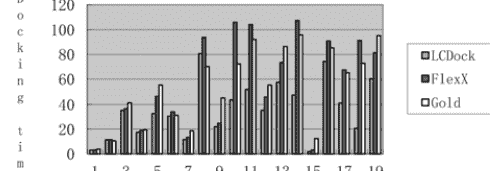

**图 6.11**：分子对接时间的比较。

## 6.5 总结

覆盖思想被引入机器学习领域，并提出了李群机器学习的单连通覆盖算法和多连通覆盖算法。同时，关联学习算法被应用于药物分子设计，以验证算法的有效性和优越性。本章的主要内容如下：

1. 我们研究了李群数学属性的数学内涵，如整体性质、局部性质、生成元素、群线性表示和覆盖群。
2. 单连通李群算法被应用于药物结构-活性关系模型。通过将李群问题转化为求解其覆盖群问题，有效地提高了学习效率。
3. 针对复杂学习模型，提出了李群机器学习的多连通覆盖算法，以解决多连通条件下的学习问题。
4. 李群机器学习被引入药物分子设计领域，并具体应用于基于结构的关系模型和分子对接模型，取得了令人满意的结果。

## 参考文献

- [1] Li FZ, Xu H. 李群机器学习（LML）的理论框架。Computer Technology and Application, 2007, 3, 62-80.
- [2] Xu H, Li FZ. 李群机器学习的公理假设。Proceedings of 2006 IEEE International Conference on Granular Computing, 2006, 401-404.
- [3] Xu H, Li FZ. 李群机器学习的研究。Journal of Computational Information Systems, 2005, 1(4), 843-849.
- [4] Xu H, Li FZ. 李群机器学习中 Dynkin 图的几何算法。Journal of Nanchang Institute of Technology, 2006, 25(2), 75-78.
- [5] Xu H, Li FZ. 李群机器学习中 Dynkin 图的算法。Journal of Communication and Computer, 2006, 4(3), 13–17.
- [6] Xu H. 机器学习模型及其研究。苏州：苏州大学，学位论文，2007。
- [7] Xu H, Li FZ. 李群机器学习（LML）中 SU(n) 分类器的设计。Journal of Computational Information Systems, 2005, 1(4), 835-841.
- [8] Xu H, Li FZ. 李群机器学习的 SO(3) 分类器。Journal of Communication and Computer, 2006, 4(3), 76-80.
- [9] Chen F, Li FZ. 李群机器学习中子空间轨道生成学习算法的研究。Computer Engineering and Applications, 2007, 43(15), 184-187.
- [10] Chen F, Li FZ. 李群机器学习中 GLn (Fq) 群作用下学习子空间轨道生成网格的研究。江苏省青年科学家年会第一次会议论文集，2006, 36-46。
- [11] Chen F. 李群机器学习子空间生成算法及其应用研究。苏州：苏州大学，学位论文，2007。
- [12] He SP. 李群机器学习中量子群分类器的研究。苏州：苏州大学，学位论文，2008。
- [13] Fu HX. 机器学习中辛分类器的研究。苏州：苏州大学，学位论文，2008。
- [14] Zhang J. 基于流形学习的 Fiber Cong 学习算法研究。苏州：苏州大学，学位论文，2008。
- [15] Rao RPN, Rutherford DL. 用于不变视觉感知的李群学习。Advances in Neural Info Processing System, 1999, 11, 810-816.
- [16] Xu XL, Hou TJ. 计算机辅助药物设计。化学工业出版社，2004。
- [17] Burbidge R, Trotter M. 机器学习的药物设计：用于药物数据分析的支持向量机。Computers and Chemistry, 2001, 26, 5-14.
- [18] Yuan FX, Lu WC. 使用支持向量回归研究某些黄酮类化合物对己糖激酶抑制活性的 QSAR。Computers and Applied Chemistry, 2006, 6(24), 720-724。
- [19] Song XF, Han P. 最优支持向量机及其在 HIV-1 蛋白酶抑制剂 QSAR 建模中的应用。Computers and Application Chemistry, 2007, 11(24), 1475-1478。
- [20] Li JL, Wang ZZ. 基于反向传播神经网络预测 siRNA 活性。ACTA BIOPHYSICA SINICA [J], 2006, 12(6), 429-434。
- [21] Liu ZG, Zhao XH. 遗传算法在羟基半碳糖苷核苷酸还原酶抑制剂席夫碱 2D-QSAR 分析中的应用。Journal of Human City University (Natural Science), 2007, 4(16), 52-56。
- [22] Wang JM, Hou TJ, Xu XJ. 结合蒙特卡洛模拟和遗传算法进行肽的构象分析。Chemomter Intel. Lab, 1999, 45, 347-351。
- [23] Ma ZQ. 物理学中的群论。北京：科学出版社，1998。
- [24] Warner FW. 可微流形与李群基础。Springer-Verlag, 1983。
- [25] Huang XG. 李群基础（第二版）。复旦大学出版社，2007。
- [26] Yan ZD, Yu XC. 李群与李代数。高等教育出版社，1985。
- [27] Michell TM. 机器学习。中国机器出版社，2004。
- [28] Zhang L, Zhang B. McCulloch-Pitts 神经模型的几何表示及其应用。IEEE Transacton on Neural Networks, 1999, 10(4), 925-929。
- [29] Wu T, Zhang L, Zhang YP. 机器学习中的核叠加算法。Chinese Journal of Computers, 2005, 8(8), 1295-1301。
- [30] Wang SJ. 仿生模式识别（拓扑模式识别）——一种新模式识别模型的理论与应用。Chinese Journal of Electronics, 2002, 30(10), 1417-1420。


[31] He Q, Shi ZZ. 基于覆盖的分类算法研究 [J]. 计算机学报, 2007, 8(30), 1235-1242.
[32] He Q, Ren L, Shi ZZ. 基于超平面的海量数据直接分类. 计算机学报, 2003, 26(2), 206-211.
[33] Zhu YH. 覆盖聚类算法的应用. 计算机技术与发展, 2007, 1, 123-125.
[34] Sutherland J, O’Brien LA, Weaver DF. 定量构效关系建模方法比较. J. Chem. Inf. Comp. Sci. [J], 2004, 47, 5541-5554.
[35] Kuntz ID. 基于结构的药物设计与发现策略 [J]. Science, 1992, 257, 1078-1081.
[36] Chen XM, Rao HB, 等. 利用机器学习方法预测二氢叶酸还原酶抑制剂的活性. 高等学校化学学报, 2007, 28, 2171-2178.
[37] Zhou ZH, Cao CG. 神经网络及其应用. 清华大学出版社, 2004.
[38] Jeffrey J, Donald S, Weaver BF. 二氢叶酸还原酶抑制剂的三维定量构效关系与构效选择性关系. Journal of computer-aided molecular design, 2004, 18, 309-331.
[39] Zsoldsz Z, Reid D, 等. eHITs: 一种新型快速、穷尽的柔性配体对接系统. Journal of Molecular Graphics and Modeling, 2007, 26, 198-212.
[40] Li CL. 药物设计中分子对接优化设计的算法与软件研究. 博士论文, 大连理工大学, 2004.
[41] Böhm HJ. 计算机程序 LUDI: 一种用于从头设计酶抑制剂的新方法. J. Computer Aided Mol. Des., 1992, 6, 71-78.
[42] Rarey M, Kramer B. 一种使用增量构建算法的快速柔性对接方法. J. Mol. Biol., 1996, 261, 470-489.
[43] Kramer B, Rarey M, Lengauer T. FlexX 增量构建算法在蛋白质-配体对接中的评估. Proteins, 1999, 2(37), 228-241.
[44] Broughton HB. 一种在蛋白质-配体对接中纳入蛋白质柔性的方法：改进数据库挖掘和虚拟筛选的工具 [J]. Journal of Molecular Graphics and Modeling, 2000, 18, 247-257.
[45] Jones G, Willett P, 等. 用于柔性对接的遗传算法开发与验证. J.Mol.Bio, 1997, 267, 727-748.
[46] Miguel AS. 基于李群方法的三轴刚体稳定性与姿态. Journal of Computational Physics, 2003, 191, 85-96.
[47] Ding XL. 空间弹性变形构件的李群与李代数分析方法. 机械工程学报, 2005, (41), 16-23.
[48] Wang LX, Zheng H, Lao XZ. 蛋白质分子柔性方法进展 [J]. 中国药学杂志, 2008, 4(15), 302-306.
[49] Oshiro CM, Kuntz ID, Dixon JS. 使用遗传算法进行柔性配体对接 [J]. Journal of Computer-Aided Molecular Design, 1995, 9, 113-130.
[50] Makino S, Kayahara T, 等. 利用基于结构和实验片段选择技术发现新型丝氨酸蛋白酶抑制剂. J Comp. Aided Mol. Des., 2001, 6, 553-559.
[51] Guan WW, Li FZ. 使用李群机器学习（LML）进行药物分子设计. 2008年先进智能国际会议 (ICAI '08), 2008, 411-414.
[52] Guan WW. 机器学习覆盖算法及其应用研究. 苏州: 苏州大学, 学位论文, 2009.
[53] Autodock. http://www.scripps.com/pub/olson-web/doc/autodock/.
[54] Gold. http://www.ccdc.cam.ac.uk/prods/gold/.
[55] FlexX. http://www.biosolveit.de/FlexX/.

## 7 李群深度结构学习

### 7.1 引言

李群机器学习和深度结构学习是近年来备受关注的新型机器学习方法。本节介绍并分析了深度结构学习的研究进展。

深度结构学习 [14] 指的是包含多层非线性操作的模型，例如包含多个隐藏层的神经网络，这些隐藏层由许多非线性且可转换的函数层组成。层与层之间存在某种联系，这带来了一些显著的优势：

- (1) 深度结构学习能够自动提取越来越多的抽象特征。低级部分提取下层的特定特征。在接收到这些低级特征后，高级部分从中提取高级抽象特征，并最终将其用于分类或理解。

- (2) 深度结构具有多层非线性的特点，能够表示人工智能任务（如计算机视觉）所需的高度非线性且复杂的函数。这些函数最终将图像像素的输入映射为类别的输出。浅层结构不一定具备这种能力。

- (3) 在相同的复杂函数中，深度结构比浅层结构更高效，且每层所需的计算单元和样本更少。

- (4) 深度结构学习可以是无监督或半监督学习，以发现各层的特征。因此，避免学习监督可能会带来更少的困难。

然而，深度结构学习尚未得到广泛研究。Hinton 等人提出了一种贪心无监督学习过程 [20]。该方法使用 RBM（受限玻尔兹曼机）学习规则来初始化数据的深度结构。生成的模型包含大量隐藏变量，并存在一些局限性。具体而言，它仅能对具有某些作用的局部小范围数据进行优化。提出的 Bohr Man 机器（一种自编译、自链接系统）以及其他算法可以应用于浅层结构，但应用于深度结构时效果不佳。Bengio 等人 [14] 以逻辑为例，证明在表示相同逻辑函数时，浅层结构底层所需的逻辑门数量呈指数增长。此外，他们还将 SVM（支持向量机）直接应用于线性组合核函数值之间的测试和训练样本，以实现分类决策。这种方法仅适用于浅层结构。在浅层结构中，表示形状急剧变化的高度非线性函数是必要的，这需要与样本分布流形的维度呈指数相关。因此，维度问题仍然存在。Hugo、Bengio 等人使用无监督学习算法 [21] 来初始化深度网络中的数据，并证明使用该算法初始化数据可以提高归纳能力。然而，该算法不适用于大规模数据。Jason 等人提出了一种简单的深度结构学习方法 [22]。该方法改进了现有的半监督法则，并结合了嵌入法则和半监督学习。它在数据复杂度分析中起着关键作用，但应用于语义时效果并不明显。2006年，Osindero 等人提出了深度贝叶斯网络 [31]（DBN），这是一种多层网络。网络的层基于 RBM 中的迭代训练，其中 RBM 是双层网络，随机像素与隐藏随机像素检测器相关联，在训练样本中非常高效。它通过比较发散过程来提高数据，从而增加训练数据的数量并减少模型生成样本的性能。作者使用此方法预先训练深度相邻元素的解析模型，也可以同时用于训练自编译模型。S. T. Roweis 等人提出了一种局部线性嵌入算法，即流形学习的降维方法（LLE）[50]。该算法的主要思想是：首先，假设嵌入的低维流形在测试样本的数据集中线性分布，即每个样本点可以由其邻域中几个相对接近的样本点表示。然后，改变每个局部邻域的权重，并通过最小重构误差获得高维样本的低维表示。该算法是流形学习算法的几何结构，具有旋转、平移和缩放功能。2000年，基于多维尺度变换（MDS），Tenenbaum 等人提出了一种新的非线性降维方法（ISOMAP）[51]。这里，多维标度意味着在低维空间中，降维后任意两点之间的距离应与其在高维空间中的距离相同。为了保持数据点的内在几何属性，等距距离使用测地距离来替代原始的欧式距离。该算法是一种保持流形全局几何的方法。它可以有效描述高维数据的非线性分布结构，但该方法更适合内部平滑流形。最近，Ranzato 等人引入了另一种深度结构学习方法，即称为 ESCM 的编码/解码结构 [23]。他们选择了具有公共权重的编译器和解码器。第一种编码器的权重非常接近编码 Z。在第二种情况下，编码器输出用作输入编码。第三种和第四种情况的过程与前两种相同。这种使用少量数据进行高维学习的方法非常快，但不能有效分析数据的复杂性。在输出层中，隐藏层和辅助层的深度结构嵌入到监督学习中


一种基于半监督李群（Lie Group）及其参数的算法，遵循半监督学习算法 [24]。结构越深，错误率越低，效果越强；然而，时间复杂度也更高。

利用现有的计算技术来分析图像结构不变性的复杂数据以及分子结构的材料特性、物理特性和化学特性，并建立这些数据结构之间的深层关系是困难的。因此，我们引入深度结构到学习算法中以解决此类问题。

#### 7.2 李群深度结构学习

在本章中，我们提出了一种用于数据复杂性和图像结构不变性的李群深度结构学习算法。

##### 7.2.1 深度结构学习

**定义 7.1。** 深度结构是指包含多层非线性运算的学习模型，例如包含多个隐藏层的神经网络。它由许多非线性层组成。这些层由某些非线性和可转换函数定义，并且层之间存在连接。

深度结构具有几个显著的优点：

- 它自动提取抽象特征的层。
- 它表示复杂人工智能任务所需的高度非线性复杂函数。
- 它有效地分析数据的复杂性。

**定义 7.2。** 深度结构学习基于机器学习的视角，建立在深度结构的基本内容之上。学习范式的深度结构解的形成可以自动提取抽象特征的层。低级部分提取下层的特定特征。在接收到这些低级特征后，高级部分从中提取高级抽象特征，并最终使用它们进行分类或理解。每一层的特征由学习算法自动发现，无需人工干预。

以计算机视觉为例。图像内容可以从像素、边缘、角点、部件、物体、场景等不同级别进行观察。从低层到高层的深度结构学习可以自动发现这些日益抽象的特征，并通过分层过程最终将复杂问题转化为简单问题。


**图 7.1：** 深度结构的构建。

从复杂电路理论可以看出，深度结构比浅层结构更高效 [14]。在复杂电路中，有许多不同的计算元素和参数。这些元素和参数需要使用函数来表示。然而，它们不能在所有问题中表达。因此，我们考虑使用深度结构。然后，一个复杂问题被分解为 $n$ 个简单问题。这些 $n$ 个简单问题对应于 $n!$ 种排列组合，即有 $n!$ 条规则来定义深度结构。在本文中，我们选择其中一条规则，使得每一层对应于简单问题的复杂问题分解；没有组合。然后，我们为每一层提供一个有效索引。最后，复杂问题可以通过分层过程简化为简单问题。

例如，在人脸识别中，选择自顶向下的规则将人脸构建成深度结构，随后进行分析。图 7.1 显示了带有多个局部区域的人脸。其中一个局部特征矩阵被提取为深度结构的一层。然后，在两层之间提供权重 $W$，其中 $W_i$ 表示第 $i-1$ 层和第 $i$ 层之间的关系。

##### 7.2.2 构建深度结构模型

本节基于上一节的内容构建深度结构模型。

假设输入值为 $x$，且 $\hat{h}^{i}(x)$ 表示第 $i$ 层第 $j$ 层的值。当 $i=0$ 时，它表示输入层。当 $i=l+1$ 时，它表示输出层。此外，$\hat{h^i(x)}$| 表示第 i 层的大小，而 $b_j^i$ 表示第 i 层第 j 个单位的内部偏移量，即默认激活码。$W_{jk}^i$ 表示第 $i-1$ 层 $\hat{h_k}^{i-1}(x)$ 和第 $i$ 层 $\hat{h_j^i}(x)$ 之间的权重集。$\hat{h_j^i}(x)$ 定义如下：$\hat{h_j^i}(x) = \textit{sigm}(a_j^i)$，其中

$$
a_j^i(x) = b_j^i + \sum_{k} W_{jk}^i\hat{h_k}^{i-1}(x), \forall i \in \{1, \dots, l\}, \hat{h}^0(x) = x \tag{7.1}
$$

这里，$\textit{sigm}(*)$ 是一个 S 形函数：$\hat{h_j^l}(x) = \textit{sigm}(a) = 1 / 1 + e^{-a}$。输出层表示如下：$o(x) = \hat{h^{l+1}}(x) = f(a^{l+1}(x))$，其中 $a^{l+1}(x) = b^{l+1} + W^{l+1}\hat{h^l}(x)$。A 是用于分类的启动函数；其定义如下：

$$
f_j(a) = \underset{j}{\textit{soft\max}}(a) = \frac{e^{a_j}}{\sum_{k=1}^{K} e^{a_k}} \tag{7.2}
$$

其中 k 代表 k 个类别。

对于数据的深度结构，它表示为流形结构，使得每个子流形对应于一个简单结构。因此，学习问题被分解为若干简单问题。每个简单问题对应深度结构中的一层，每一层在子流形上提供一个有效索引（图 7.2）。


**图 7.2：** 深度结构。

##### 7.2.3 深度结构学习算法

孪生网络（Siamese network）是一种典型的非线性嵌入方法。神经网络领域的研究人员认为，具有相同功能的该网络具有相同的权重，并反馈到“距离测量”层，用于计算两个样本的相似性并给数据打标签。

孪生网络还提出了几种损失函数，其中我们描述了一种边缘损失：

$$
L(f_i, f_j, W_{ij}) = \begin{cases} \| f_i - f_j \|^2 & W_{ij} = 1 \\ \max(0, m - \| f_i - f_j \|^2) & W_{ij} = 0 \end{cases} . \tag{7.3}
$$

这避免了相似矩阵的出现，并且相似样本之间的距离差异至少为 $m$。

在日常生活中，我们经常可以看到一些球面 $S^2$ 以及将 $T^2$ 视为其他二维流形。从数学角度来看，$S^2$ 和 $T^2$ 作为 $R^3$ 中的子流形嵌入在三维空间中。事实上，每个 $n$ 维流形作为一个拓扑空间包含许多不同类型的子流形，这种包含被称为嵌入。如果允许图包含自相交，则这种包含被称为浸入。浸入和嵌入的定义如下。

> **定义 7.3。** 设 $M$ 和 $N$ 为 $C^1$ 流形，$f: M \rightarrow N$ 为 $C^1$ 映射。那么，浸入和嵌入的定义如下：
> (1) 如果对于每个点 $p \in M$，切映射 $Df: T_pM \rightarrow T_qN(q = f(p))$ 是单射，即其秩 $Df = \text{dim}$，则 $f$ 被称为 $C^1$ 浸入。
> (2) 如果 $f: M \rightarrow N$ 是单射，则 $(M, f)$ 被称为 $(M, f)$ 的 $C^1$ 子淹没流形。
> (3) 如果 $f: M \rightarrow N$ 是单射浸入，且 $f: M \rightarrow f(M) \subset N$ 是对于 $N$ 的主导拓扑，即 $C^1$-同态，则 $f$ 被称为 $C^1$ 嵌入，且 $(M, f)$ 被称为 $C^1$ 嵌入流形。

###### 7.2.3.1 深度贝叶斯网络

深度贝叶斯网络 [31]（DBN）是基于 RBM 迭代训练的多层网络。RBM 是一个两层网络，随机像素 $v$ 与隐藏随机像素检测器 $h$ 相关联。它们的关系如下：

$$
p(x) = \sum_{h \in H} P(x, h) = \sum_{h \in H} \frac{e^{-E(x, h)}}{Z}
$$

$$
E(x, h) = -\sum_{i \in \text{pixel}} w_i^p v_i - \sum_{j \in \text{features}} w_j^p h_j - \sum_{i, j} v_i h_j w_{ij} .
$$

这种想法在训练样本方面具有巨大效果。它通过比较发散过程来提高数据，从而可以增加训练数据的数量，并降低生成模型的性能。作者使用了这种方法来


提前开发深度相邻元素的分析模型，同时它也可以用于训练自编译模型。

### 7.2.3.2 编码/解码算法

Ranzato 等人引入了另一种深度学习方法，即一种编码/解码结构 [33]，称为 SESM。他们选择了一个编码器 $f_{enc}(x) = w^T x + b_{enc}$ 和一个解码器 $f_{dec}(z) = aS(z) + b_{dec}$，二者共用权重。

[33] 中使用的最优损失函数为：

$$a_e \|z - f_{enc}(x)\|_2^2 + \|x - f_{dec}(z)\|_2^2 + a_s h(z) + a_r \|w\|_1 \quad .$$

在第一种情况下，编码器的输出非常接近码本 z。在第二种情况下，编码器输出被用作输入码本。第三和第四种情况的过程与前两种相同。编码器和解码器的权重为 $w$，且 $a_e, a_s,$ 和 $a_r$ 是超参数。由于要求算法达到最优，在训练数据中需要一个在线调节程序。事实上，嵌入方法也可以看作是一种编译器 A，嵌入到低维空间数据中。然而，在训练过程中，它不需要进行解码。此外，如果高维数据量较小，速度将会非常快。

### 7.2.3.3 局部线性嵌入 (LLE)

S. T. Roweis 等人提出了一种局部线性嵌入算法，即流形学习的降维方法 [50]。该算法的主要思想如下。首先，假设嵌入的低维流形在观测样本数据中呈线性分布，即每个样本点都可以由其邻域内几个相对较近的样本点的线性重构来表示。然后，在降维过程中，每个局部邻域的权重保持不变，并通过最小重构误差获得高阶样本的低维表示。LLE 算法的具体步骤如下：

- 1. 假设在 $D$ 维空间中有 $N$ 个位于同一流形上的数据点，$X_i$ 是第 $i$ 个数据点，$i = 1, 2, 3, \dots, N$。这里假设数据点是足够的，因为流形的局部部分是线性的，且每个样本点都可以由其邻近点线性表示。需要计算每个数据点的最近邻点。

- 2. 找到每个样本数据点的权重 $W_{ij}$。我们使用以下公式来最小化每个数据点与其最近邻线性重构之间的误差：

$$\epsilon(W) = \sum_i \left| X_i - \sum_j W_{ij} X_j \right|^2$$

这里，如果 $X_j$ 不是 $X_i$ 的邻居，则权重 $W_{ij} = 0$ 且 $\sum_j W_{ij} = 1$。权重矩阵每一行的累积值为 1。

- 3. 为了确保权重保持不变，在低维空间中，我们可以最小化上述公式。重构原始高维数据点以获得低维表示：

$$\phi(Y) = \left| \sum_i Y_i - \sum_j W_{ij} Y_j \right|^2 \, .$$

局部线性嵌入 (LLE) 算法是一种保持局部几何结构的流形学习方法。它具有旋转、平移和缩放的某些特性，并且可以学习任意维度的局部线性低维流形。该算法简单，计算复杂度和时间复杂度相对较低，且可归结为特征值问题，简单易行。

### 7.2.4 李群深度结构学习算法

本节将深度结构学习和李群学习算法相结合，给出了李群深度结构学习算法，即：李群深度结构学习 = 李群机器学习 + 深度结构学习。

#### 7.2.4.1 深度结构半监督学习算法

深度结构半监督学习算法指的是将半监督学习算法嵌入到深度结构中。在嵌入之前，我们首先建立一个简单的嵌入模型 [22]，并将其分为以下步骤：

- 1. 选择一种无监督学习方法；
- 2. 选择一个深度结构模型；
- 3. 将无监督学习作为辅助任务插入到架构的每一层中；
- 4. 使用相同的结构来训练有监督和无监督任务。

深度学习涉及学习具有多层非线性映射的模型。这里，我们将考虑一个具有 M 层隐藏单元的多层网络，并给出一个 C 维输出向量：

$$f_i(x) = \sum_{j=1}^{d} w_j^{o,i} h_j^M(x) + b^{o,i}, i=1, \ldots, C \tag{7.4}$$

其中 $w^o$ 是输出层的权重。第 k 层定义为：

$$h_i^k(x) = S\left( \sum_j w_j^{k,i} h_j^{k-1}(x) + b^{k,i} \right), k > 1 \tag{7.5}$$


图 7.3：三种嵌入情况；(a) 嵌入在输出层，(b) 嵌入在隐藏层，(c) 嵌入在辅助层。

$h_1^1(x) = S\bigg(\sum_j w_j^{1,i} x_j + b^{1,i}\bigg) \quad (7.6)$

其中 S 是一个类似于双曲正切函数的变形函数。半监督深度学习最普遍的方式是将半监督规则嵌入到深度结构中（见图 7.3）：

- (a) 在整个网络的输出部分，添加一个半监督损失（正则化）来监督损失 (7.3)：

$$\sum_{i=1}^{L} e(f(x_i), y_i) + \lambda \sum_{i,j=1}^{L+U} L(f(x_i), f(x_j), W_{ij}) \quad (7.7)$$

这与上述简单技术类似，如 (7.2) 所述。

- (b) 直接正则化中间第 $k$ 层 (7.5)，

$$\sum_{i=1}^{L} e(f(x_i), y_i) + \lambda \sum_{i,j=1}^{L+U} L(f^{k}(x_i), f^{k}(x_j), W_{ij}) \quad (7.8)$$

$f^{k}(x) = (h_1^{k}(x), \ldots, h_{N_k}^{k}(x))$ 是第 $k$ 层的网络输出部分。

- (c) 通过共享初始网络的前 $k$ 层生成一个辅助网络，但使用一组新的权重：

$$g_i(x) = \sum_{j} w_j^{AUX,i} h_j^k(x) + b^{AUX,i} \quad (7.9)$$

我们在训练该网络时嵌入未标记数据，并利用标记数据训练初始网络。

在实验中，我们嵌入损失函数 (7.3)，其中的一个关键损失是：

$$e(f(x), y) = \sum_{c=1}^{C} H(y(c)f_c(x)).$$

Jason 等人 [22] 将半监督和有监督算法嵌入到深度结构的输出层、某个隐藏层、辅助层以及所有其他层中。因此，他们得出结论，他们简化复杂任务的方法可以带来更大的益处。

#### 7.2.4.2 李群深度结构半监督学习算法

基于将半监督学习算法嵌入深度结构的想法，本文基于线性李群或基于李群参数嵌入半监督学习算法。基于无监督算法，在输出层、隐藏层和辅助层中实现半监督学习算法。

线性李群半监督学习算法描述如下。样本 $X = \{x_1, x_2, \ldots, x_l, x_{l+1}, \ldots, x_{l+u}\}$，其中 $x_1, x_2, \ldots, x_l$ 是标记数据，即集合 $L = \{(x_1, y_1), (x_2, y_2), \ldots, (x_l, y_l)\}$，$x_{l+1}, \ldots, x_{l+u}$ 是未标记数据 ($l \ll u$)。数据 $x$ 的输出是 $y$。输入样本由矩阵表示，并找到对应学习系统的同构线性李群。

以标记数据为基点，通过无穷小右平移找到其算子生成元：

$$X_{\mu}(x) = \varphi_{\mu}^{\nu}(x) \frac{\partial}{\partial x^{\mu}} = \left. \frac{\partial \phi^{\nu}(x, y)}{\partial y^{\mu}} \right|_{y=e} \frac{\partial}{\partial x^{\nu}} \qquad (7.10)$$

这里，$\varphi_{\mu}^{\nu} = \left. \frac{\partial \phi^{\nu}}{\partial y^{\mu}} \right|_{y=e}$ ($\mu, \nu = 1, 2, \ldots$) 是李群的变换函数，且 $\phi^{\nu}$ 是解析函数，也称为李群合成函数 [26]。

基于参数李群的半监督学习算法描述如下：样本 $X = \{x_1, x_2, \ldots, x_l, x_{l+1}, \ldots, x_{l+u}\}$，其中 $x_1, x_2, \ldots, x_l$ 是标记数据，即集合 $L = \{(x_1, y_1), (x_2, y_2), \ldots, (x_l, y_l)\}$，$x_{l+1}, \ldots, x_{l+u}$ 是未标记数据 ($l \ll u$)。数据 $x$ 的输出是 $y$。输入样本由参数表示，并找到对应学习系统的同构参数。根据参数李群的代数结构，使用分组法标记生成元。基于标记数据，根据李群参数的定义定义生成元：

$$X_{\mu} = \lim_{a^{\mu} \rightarrow 0} \frac{(e + i \frac{a^{\mu}}{N} X_{\mu})^N - e}{i a^{\mu}} \qquad (7.11)$$

其中 $a^{\mu}$ ($\mu = 1, 2, \ldots, r$) 表示 $r$ 个连续参数，且 $N$ 是正整数。进一步地，$A$ 是计算的生成元。其他未标记数据根据群运算规则确定，如果未标记数据可以由算子生成，则标记其类别。分析每个标记样本点 $x_i$ 的域 $U_i$ ($1 < i < l$) 信息，并在样本集中的单位点处取体积不变的内积 $g_{i,j}(a)$。计算 $g_{i,j}(a)$ 的值，$g_{i,j}(a) = \langle(\partial/\partial x_i), (\partial/\partial x_j) \rangle$，然后将 $g_{i,j}(a)$ 的值代入以下公式：

$$d(x_i, x_j) = \sqrt{\sum_{i,j=1}^n g_{i,j}(a)(x_{ii} - x_{ji})(x_{ij} - x_{jj})} \qquad (7.12)$$

计算 $U_i$ ($1 < i < l$) 中 $x_i$ 和 $x_j$ 之间的距离。


李群深度结构半监督学习算法的结构如图7.4所示。

该算法的主要步骤如下：

-   (1) 使用无监督算法流程初始化整个深度结构，然后对全网进行微调；
-   (2) 在将半监督算法嵌入每一层的基础上，分别在输出层、隐藏层、辅助层以及所有层中嵌入李群半监督算法 SSLA-GL (n) 或 (SSLA-PLG)。隐藏层是指隐藏子流形 $k$，它通过共享前一个隐藏层来创建一个新的辅助层。

在基于半监督算法嵌入线性李群的深度结构中，基本步骤如下：

-   a) 将基于线性李群的半监督算法 SSLA-GL (n) 嵌入到输出层，并向监督者添加半监督损失。

$$\sum_{i=1}^{L} e\left(\left.\frac{\partial \phi^{i}(x, y)}{\partial y}\right|_{y=e}\frac{\partial}{\partial x^{i}}, y^{i}\right)+\lambda \sum_{i=1}^{L+U} L(f(x^{i}), f(y^{i}), W_{i}) \tag{7.13}$$

其中 $L$ 表示标记数据 $y_{i}$ 的数量，$U$ 表示未标记数据的数量。

-   b) 将基于线性李群的半监督算法嵌入到第 $k$ 个子层中。

$$\sum_{i=1}^{L} e\left(\left.\frac{\partial \phi^{i}(x, y)}{\partial y}\right|_{y=e}\frac{\partial}{\partial x^{i}}, y^{i}\right)+\lambda \sum_{i=1}^{L+U} L(f^{k}(x^{i}), f^{k}(y^{i}), W_{i}) \tag{7.14}$$

其中 $f^{k}(x)=(X_{1}(x),\ldots,X_{N_{k}}(x))$ 表示第 $k$ 层的输出部分。

-   c) 共享前一个隐藏层以形成辅助层，并生成新的辅助右部。该辅助层嵌入到半监督算法的线性李群中。

$$\hat{g}_i(x) = \sum_j w_j^{\mathrm{aux}, i}\left. \frac{\partial\phi^j(x, y)}{\partial y}\right|_{y=e} \frac{\partial}{\partial x^i} + b^{\mathrm{aux}, i}.\tag{7.15}$$

在基于李群半监督算法嵌入参数的深度结构中，基本步骤如下：

-   a) 在输出层中，嵌入基于参数李群的半监督算法 SSLA-PLG，并向监督者添加半监督损失。

$$\sum_{i=1}^L e\left(\lim_{a^i \rightarrow 0} \frac{(e+i_N^{a^i} \mathbf{X}_i)^N - e}{i a^i}, y^i\right) + \sum_{i=1}^{L+U} L(f(x^i), f(y^i)).\tag{7.16}$$

-   b) 将基于参数李群的半监督算法 SSLA-PLG 嵌入到第 $k$ 个隐藏子层中。

$$\sum_{i=1}^L e\left(\lim_{a^i \rightarrow 0} \frac{(e+i_N^{a^i} \mathbf{X}_i)^N - e}{i a^i}, y^i\right) + \lambda \sum_{i=1}^{L+U} L(f^k(x^i), f^k(y^i), W_i).\tag{7.17}$$

-   c) 共享前一个隐藏层以形成辅助层，并生成新的辅助右部。该辅助层嵌入到半监督算法的线性李群中。

$$\hat{g}_i(x) = \sum_j w_j^{\mathrm{aux}, i}\lim_{a^i \rightarrow 0} \frac{(e+i_N^{a^i} \mathbf{X}_i)^N - e}{i a^i} + b^{\mathrm{aux}, i}.\tag{7.18}$$

在实验中，本节使用孪生网络中的边缘损失函数：

$$L(f_i, f_j, W_{ij}) = \begin{cases} \|f_i - f_j\|, & \text{if } W_{ij} = 1 \\ \max \left(0, m - \|f_i - f_j\|^2 \right), & \text{if } W_{ij} = 0 \end{cases}$$

其中 $m$ 表示相似样本之间的最大距离。

上述公式的一个关键损失为：

$$e(f(x), y) = \sum_{c=1}^{C} \max(0, 1 - y(c)f_c(x)).$$

### 7.2.5 实验分析

基于李群深度结构的算法，我们在ORL人脸数据库上进行了实验。该实验分为两部分：

-   (1) 将基于线性李群的半监督学习算法和基于参数李群的半监督学习算法嵌入到输出层、辅助层、中间层以及所有层中。
-   (2) 分别在深度结构的第3、4、5和6层进行实验。

##### 7.2.5.1 参数选择

ORL人脸数据库包含40人的400张图像，每人10张。样本经过归一化处理，图像分辨率为 $64 \times 64$，形成4096维的向量。在本节中，令 $X = \{x_1, x_2, \ldots, x_N\}$ 为由 $N$ 个样本组成的训练集；$x_i \in R^n$ 表示第 $i$ 个图像，$Y = \{y_i, i = 1, 2, \ldots, N\}, y_i \in R^d\} (d < m)$ 表示相应的投影结果。取层间的权重 $W$，其可在 $[-1, 1]$ 范围内任意选择。将ORL人脸数据库（每人10张）分为五组；选取一组作为训练样本，其余组作为测试样本。

##### 7.2.5.2 实验结果

将基于线性李群的半监督学习算法和基于参数李群的半监督学习算法嵌入到三层深度结构的输出层、中间层、辅助层以及所有层中。相应的实验结果分别如表7.1和表7.2所示。

从表7.1和表7.2中可以看出，李群半监督学习算法在所有层中表现更好。因此，在嵌入李群半监督学习算法的所有层深度结构中，在第3、4、5和6层进行了以下一组实验。第一组样本为训练样本，第2、3和4组构成测试样本。具体的实验结果如图7.5所示。

此处，Embed_ALL_PLG 表示将基于参数李群的半监督学习算法嵌入到深度结构的所有层中；Embed_ALL_GL 表示将基于线性李群的半监督学习算法嵌入到深度结构的所有层中。从实验结果可以看出，随着层数的增加，结果有所改善。

**表7.1：** 基于线性李群的半监督学习算法嵌入到三层深度结构中。

| | 第1组训练，第2、3组测试 | 第2组训练，第3、4组测试 | 第3组训练，第2、4组测试 | 第4组训练，第1、3组测试 | 平均错误率 [%] |
|---|---|---|---|---|---|
| 嵌入输出层 | 20/160 | 23/160 | 24/160 | 20/160 | 13.59 |
| 嵌入中间层 | 19/160 | 21/160 | 25/160 | 21/160 | 13.44 |
| 嵌入辅助层 | 17/160 | 20/160 | 23/160 | 25/160 | 13.28 |
| 嵌入所有层 | 18/160 | 22/160 | 19/160 | 18/160 | 12.03 |

**表7.2：** 基于参数李群的半监督学习算法嵌入到三层深度结构中。

| | 第1组训练 | 第2组训练 | 第3组训练 | 第4组训练 | 平均错误率 [%] |
| | 第2、3组测试 | 第3、4组测试 | 第2、4组测试 | 第1、3组测试 | |
|---|---|---|---|---|---|
| 嵌入输出层 | 21/160 | 20/160 | 15/160 | 22/160 | 12.2 |
| 嵌入中间层 | 24/160 | 19/160 | 17/160 | 23/160 | 12.97 |
| 嵌入辅助层 | 23/160 | 20/160 | 24/160 | 26/160 | 14.53 |
| 嵌入所有层 | 18/160 | 21/160 | 17/160 | 18/160 | 11.56 |


## 7.3 李群分层学习算法

人脸空间是嵌入在高维观测空间中的低维流形。为了更好地检测人脸空间中的表面结构，如凸起和凹陷，我们在本节中结合流形来研究李群深度结构学习：

-   (1) 使用奇异值特征提取方法提取人脸的主要特征；
-   (2) 将SVD的左矩阵和右矩阵分解到李群中；
-   (3) 实现李群深度结构分层学习算法。


### 7.3.1 奇异值特征提取

人脸识别技术是计算机模式识别领域的主要研究课题之一，具有广阔的应用前景。在识别问题中，提取有效特征和设计分类器是解决问题的关键。人脸特征是描述人脸模式的最佳方式，特征的维度可以从不同的角度描述人脸模式。在理想情况下，人脸特征的维度是互补的。如果不能直接通过人脸分类的特征提取来反映人脸的代表性特征，则必然削弱分类器的泛化能力。当样本空间的维度较高时，分类需要大量的计算，并且样本中包含大量对分类无用的信息，从而产生副作用。因此，在训练数据之前，有必要通过变换、选择和通过学习从样本中选出最具判别力的特征。特征提取的本质是在众多的特征数据中寻找最有效的特征，同时进行适当的维度压缩[34]。洪志群等人提出了一种基于奇异值向量特征的人脸识别方法[47]，并证明奇异值向量具有稳定性、平移、旋转和镜像不变性。该算法分为以下三个步骤：

- (1) 将每张图像整体视为一个矩阵；
- (2) 对该矩阵进行奇异值分解，并提取其奇异值向量特征；
- (3) 将这些特征投影到平面上进行分类和识别。

田等人[53]发现，人脸的奇异值仅包含图像中少量的有效信息，而奇异值分解后的人脸图像矩阵的两个正交矩阵中包含更多有效信息[53]，这将导致较低的人脸识别率。本章将处理这一问题；左正交矩阵和右正交矩阵构成一个李群，即学习的深层结构。

在训练数据集的过程中，需要对数据集进行预处理。预处理旨在提取数据，并提取可训练的特征集。这样，数据训练过程高效，降低了时间复杂度和空间复杂度。

#### 7.3.1.1 奇异值分解的两个定理

**定理 7.1。** *矩阵奇异值分解定理*

*设 $A \in R^{m \times n}$ 且 $rank(A) = r \leq \min(m, n)$。那么，总存在正交矩阵 $U \in R^{m \times m}$ 和 $V \in R^{n \times n}$，使得*

$$A = U \Sigma V^{T} = \sum_{i=1}^{r} \sigma_{i} u_{i} v_{i}^{T} \text{.}$$

*其中，符号 'T' 表示矩阵的转置*

$$U = (u_{1}, u_{2}, ..., u_{m}) \in R^{m \times m}$$

$$V = (v_{1}, v_{2}, ..., v_{n}) \in R^{n \times n}$$

$$\Sigma = \left[\begin{array}{cc}\Sigma_{1} & 0 \\ 0 & 0\end{array}\right] \in R^{m \times n}$$

*其中 $\Sigma_{1} = diag(\sigma_{1}, \sigma_{2}, \sigma_{3}, ..., \sigma_{r})$ 且 $\sigma_{1} \geq \sigma_{2} \geq \sigma_{3} \geq ... \geq \sigma_{r} > \sigma_{r+1} = \sigma_{r+2} = ... = \sigma_{p} = 0$，$p = \min(m, n)$。这里，$\sigma_i$ 是实数，即 A 的奇异值。此外，$u_{i}, v_{i}$ ($i = 1, 2, ..., r$) 分别是矩阵 $A$ 属于 $C$ 的左奇异向量和右奇异向量。所有奇异值按降序排列。向量 $(\sigma_{1}, \sigma_{2}, \sigma_{3}, ..., \sigma_{r})$ 是矩阵的奇异值向量[48]。*

*一方面，该定理更清晰地刻画了矩阵的分解结构。另一方面，该定理使我们可以合理处理矩阵的秩。由公式 $A = \sum_{i=1}^{r} \sigma_{i} u_{i} v_{i}^{T} = U_{r} \Sigma_{r} V_{r}^{T}$ 可知，矩阵实际上是通过正交变换获得的，这些变换可以表达秩和秩的数量[49]。在人脸识别应用中，矩阵的秩是一个复杂的问题，因为人脸图像基本数据的获取受表情、光照和姿态的影响。然而，我们可以通过矩阵的奇异值分解和奇异值判断来获得图像矩阵的有效秩。以下定理说明了某些奇异值矩阵与原矩阵之间的关系。*

**定理 7.2。** *若矩阵 $A \in R^{m \times n}$，设 $m \leq n$ ($m, n, r, s$ 为正整数)。矩阵奇异值分解定理[53]为*

$$A = UWV^{T} \text{,}$$

$$W = \operatorname{diag}(\sigma_{1}, \sigma_{2}, \sigma_{3}, ..., \sigma_{r}, ..., \sigma_{n}). \text{ 令 } W_{s} = \operatorname{diag}(\sigma_{1}, \sigma_{2}, \sigma_{3}, ..., \sigma_{s}) \text{;}$$

$$A_{s} = U \left[\begin{array}{cc}W_{s} & 0 \\ 0 & 0\end{array}\right] V^{T} = \sum_{i=1}^{s} \sigma_{i} u_{i} v_{i}^{T} \text{.}$$

*由上述公式可知，$rank(A_{s}) = rank(W_{s}) = s$。则，*

$$\|A - A_{s}\|_{F} = \min \{\|A - B\|_{F} \mid B \in R^{m \times n}_{s} \}$$

*其中 $R^{m \times n}_{s}$ 是秩为 $s$ 的 $m \times n$ 阶矩阵的线性空间。*

进一步地，$A_s$ 是矩阵 $A$ 在空间 $R_s^{m \times n}$ 中的近似。这样，我们可以选择 $A$ 的最佳相似矩阵。田等人[53]证明，图像奇异值分解后的左右奇异矩阵中反映了图像的分解信息。

安德鲁·贝克证明，任何线性矩阵都是一个李群[66]。由于任何正交矩阵都是 n 维欧几里得空间 $V_n(\mathbb{R})$ 的线性变换，$U$ 和 $V$ 矩阵的分解产生了一个线性矩阵；因此，$U$ 和 $V$ 是一个李群。

#### 7.3.1.2 特征提取

在人脸识别任务中，训练样本集为 $\{X_i^j, i = 1, \ldots, N, j = 1, \ldots, K\} \in R^{m \times n}$，其中 $i$ 是类别，$j$ 是每个人的脸部图片数量，$m \leq n$，每个样本由一个矩阵表示，即 $X_i^j$ 是一个矩阵。

- **步骤 1：** 定义所有训练样本的平均人脸，$M_i = \frac{1}{N} \sum_{j=1}^K X_i^j$；
- **步骤 2：** 平均人脸的特征点由序列 $M(a_1, \ldots, a_n)$ 组成，并获得以特征序列为行向量的矩阵 $M$；
- **步骤 3：** 待测样本提取的特征点由序列 $T(a_1, \ldots, a_n)$ 组成，并获得以特征为行向量的对应矩阵 $T$；
- **步骤 4：** 获得矩阵 $M$ 和矩阵 $T$ 的奇异值分解，并得到左右奇异值向量矩阵 $U$ 和 $V$。
- **步骤 5：** 令 $A_i = U_i / \sqrt{|U_i|} \times V_i / \sqrt{|V_i|}$，其中 $m$、$n$ 分别是 $U_i$ 和 $V_i$ 的秩，且 $A_i$ 是一个李群。以下是相应的证明；
- **步骤 6：** 找到李群 $A_i$ 的生成元 $A_\mu = \lim_{a^{\mu} \to 0} (e + ia^{\mu}/NA_\mu)^N - e/ia^{\mu}$，其中 $a^{\mu}$ ($\mu = 1, 2, \ldots, r$) 表示 $r$ 个连续参数，$N$ 是正整数。

以下证明 $A_i$ 是一个李群。

证明：由于 $U_i$ 和 $V_i$ 是通过奇异值分解得到的 $m \times m$ 和 $n \times n$ 矩阵，且其中的向量正交，因此 $U_i$、$V_i$ 是正交矩阵。因为正交矩阵是一个李群，所以 $U_i / \sqrt{|U_i|}$ 和 $V_i / \sqrt{|V_i|}$ 是正交群，它们的笛卡尔积也构成一个李群，即 $A_i = U_i / \sqrt{|U_i|} \times V_i / \sqrt{|V_i|}$ 是一个李群结构。

## 7.3.2 分层学习算法

一个复杂的 AI 任务通常由许多子任务组成，且子任务之间存在一定关系。因此，我们可以将这些子任务编译到深层结构的每一层中，然后研究一种深层结构算法来解决此问题。换句话说，将一个复杂问题分解为多个简单问题。


每个简单问题对应于一层，这些层构成了一个深度结构，并且在该问题中，每一层的深度结构之间存在一定的联系，它们并非相互独立，而是包含大量非线性层。在此基础上，我们可以给出逐层学习的定义。

**定义 7.4.** 逐层学习是指自顶向下的学习深度结构。首先，学习第一层。第一层的输出值是第二层的输入值，以此类推。第 $i$ 层的输出是第 $i + 1$ 层的输入样本。

### 7.3.2.1 李群逐层学习

通常，收集到的图像由李群结构表示。对于灰度图像，李群中的元素值是图像像素的灰度值。当前的图像特征提取和识别方法通常首先通过矩阵的行或列将灰度人脸图像样本直接转换为向量。通过这种方式，我们可以获得更高维的向量样本。样本的维度远大于可用图像的样本维度。在本节中，我们使用李群矩阵来构建对应图像的单值，并寻找图像的特征灰度值。


**图 7.6**：李群逐层学习结构图。

图 7.6 展示了李群学习算法的结构图。该算法由以下部分组成：
- (1) 利用奇异值分解方法提取源图像的主要特征，并根据第 3 章中提到的方法构建基于图像特征值的深度结构；
- (2) 根据 7.3.1.2 节所述的方法，对训练样本和测试样本进行奇异值分解，以获得左正交矩阵和右正交矩阵；
- (3) 该深度结构的每一层都对应于训练样本和测试样本的李群生成元 $A_H$；
- (4) 自上而下学习，对测地距离 $d$ 的测量样本和训练样本进行第一层的学习，以便保留距离测试样本的测地距离 $d \leq \min$；
- (5) 根据第 $n-1$ 层，保留测试样本图像，寻找第 $n$ 层中训练样本和测试样本之间的测地距离 $d_n$。最后一层的结果即为所需的测试结果，且第 $i$ 层的输出是第 $i+1$ 层的输入样本。

李群深度结构层学习算法的详细描述如下：

输入：李群 $G$ 的训练样本组合

输出：选定的测试样本 $Y$

- (1) 构建李群深度结构
- (2) 查找训练样本和测试样本第一层之间的距离
$$
d_1 = \| \log(X_1^{-1} X_1^*) \|_F
$$
这里，矩阵 $A_F$ 的 F-范式定义为 $\| A_{ij} \|_F = \sqrt{\sum_{i,j=1}^{n} \| a_{ij} \|^2}$，其中 $n$ 是矩阵的维度；
- (3) 自上而下学习，学习第一层，寻找测地线上的样本和训练样本，并将那些测地距离 $d_1 \leq \min$ 的样本作为测试样本。第一层的输出数据是第二层的输入样本。
- (4) 通过迭代，根据第 $n-1$ 层保留测试样本图像，寻找第 $n$ 层中训练样本和测试样本之间的测地距离 $d_n$。最后一层的结果即为期望结果，且第 $i$ 层的输出是第 $i+1$ 层的输入。
- (5) 输出与最后一层数据对应的测试数据。

### 7.3.3 实验与分析

使用 ORL 国际标准人脸掩码进行实验。ORL 数据库总共包含 40 个人、400 张图像，即每人有 10 张图像，包含手势、面部细节和面部变化。选择样本时，图像分辨率为 $64 \times 64$，形成一个 4096 维向量。在本实验中，每人的 10 张图像被分为 4 组；每组分别包含一张、两张、三张和四张图像，选择其中两组作为训练样本，剩余两组用作测试样本。

#### 7.3.3.1 实验

实验分为两部分：
- (1) 将该算法应用于三层深度结构，并将 3、4、5、6 张图像分别作为 10 张图像的训练样本。这可以与人脸识别方法中的奇异值分解进行比较；
- (2) 在第 3、4、5 和 6 层的深度结构上进行实验，训练样本数量为 3。

实验结果如表 7.3 所示。

**表 7.3：两种算法的比较。**

| 训练样本 | 组 1,2 | 组 1,3 | 组 1,4 | 组 2,4 | 组 3,4 | 平均识别率 |
| :--- | :--- | :--- | :--- | :--- | :--- | :--- |
| | 训练组 3,4 测试 | 训练组 2,4 测试 | 训练组 2,3 测试 | 训练组 1,3 测试 | 训练组 1,2 测试 | |
| **SVD** | 60/280 | 59/240 | 62/200 | 42/160 | 34/120 | 26.32% |
| **Step_DP** | 230/280 | 203/240 | 175/200 | 141/160 | 107/120 | 86.3% |

李群深度结构逐层学习算法分别在深度结构的第 3、4、5 和 6 层进行测试。训练样本由前两组组成；测试样本由剩余两组组成。具体的实验结果如表 7.4 所示。

**表 7.4：实验结果。**

| 层数 | 3 | 4 | 5 | 6 | 平均识别率 |
| :--- | :--- | :--- | :--- | :--- | :--- |
| **Step_DP** | 230/280 | 237/280 | 241/280 | 245/280 | 85.09% |

#### 7.3.3.2 实验分析

从实验结果中，我们发现李群学习算法的人脸识别准确率优于奇异值分解。从表 7.5 可以看出，深度越深，识别准确率越高。原因可以归结为：当使用奇异特征进行识别时，提取的奇异特征向量仅包含少量有效的人脸图像信息。更多的有效信息出现在左和右奇异值向量矩阵 $U, V$ 的奇异值分解中。因此，李群逐层学习算法通过李群的 $U, V$ 结构，逐层学习以提高识别准确率。

## 7.4 李群深度结构启发式学习

启发式方法使用一种便于问题本身的方法来引导学习过程。在人工智能、诊断、机器学习和自动推理等领域，启发式搜索算法已被广泛使用。在本文中，基于第三节，并结合启发式搜索算法的思想，提出了李群深度结构启发式学习。

### 7.4.1 启发式学习算法

在人工智能中，许多问题的解决方案技术依赖于搜索。启发式方法利用问题本身来引导信息和搜索过程。在学习过程中，启发式函数的选择至关重要，它决定了整个算法的效率和成功。启发式搜索通常用于两种不同类型的问题：
- (1) 正向推理
- (2) 反向推理

正向推理通常用于状态空间搜索。在正向推理中，推理是从预定义的初始状态到目标状态在相反方向进行的。反向推理通常用于问题归约。在反向推理中，推理是从给定的目标状态到初始状态进行的。

用于评估节点重要性的函数称为评估函数。评估函数 $f(x)$ 定义为主观上从初始节点 $S_0$ 经由节点 $x$ 到目标节点 $S_g$ 的所有路径中，最小路径成本的估计值。

一般形式为
$$
f(x) = g(x) + h(x)
$$
其中 $g(x)$ 表示从初始节点 $S_0$ 到节点 $x$ 的实际成本，而 $h(x)$ 表示从 $x$ 到目标节点 $S_g$ 的最优路径成本。它体现了问题的启发式信息，由问题的特性决定，$h(x)$ 被称为启发式函数 [38]。因此，启发式方法将问题状态的描述转化为问题求解程度的描述，由评估函数的值表示。


## 7.4.2 A* 算法

评估函数 $f$ 使得我们能够估计从节点 $S$ 到节点 $n$ 的最小代价路径之和。对于任意节点，若其函数值为 $f(n)$，即 $f(n)$ 估计了经过节点 $n$ 的约束最小代价路径的代价。因此，扩展节点表中（OPEN）值最小的节点即为约束最宽松的估计节点，适合将该节点扩展至下一步。

在介绍 A 算法之前，我们首先描述几个常用的符号。$k(n_i, n_j)$ 表示第 $i$ 个节点和第 $j$ 个节点之间最小代价的实际代价，如果两个节点之间没有路径，则函数 $k$ 无意义。$h^*(n)$ 表示在目标节点集合 $\{t_i\}$ 中所有 $k(n, t_i)$ 的实际代价的最小值。因此，$h^*(n)$ 表示从节点 $n$ 到目标节点的最小代价路径的代价。这样，$h^*(n)$ 上的任何路径都是节点 $n$ 到目标节点的最优路径。

从起始节点 $S$ 到任意节点 $n$ 的最优路径的实际代价为 $k(S, n)$。为了简化符号并引入新函数 $g^*$，对于从起始节点 $S$ 到任意节点 $n$，函数 $g^*$ 可以定义为：

$$
g^*(n) = k(S, n) \quad (7.19)
$$

函数 $f^*$ 被定义使得任意节点 $n$ 的函数值 $f^*(n)$ 表示从起始节点 $S$ 到任意节点的最优路径的实际代价之和，以及从节点 $n$ 到目标节点的最优路径 $h^*(n)$：

$$
f^*(n) = g^*(n) + h^*(n) \quad (7.20)
$$

这里，$g$ 是 $g^*$ 的估计值，而 $h$ 是 $h^*$ 的估计值。$g(n)$ 表示从起始节点 $S$ 到任意节点 $n$ 的所有弧累积的最小代价路径，可以看到 $g(n) \geq g^*(n)$。$h(n)$ 可以被视为 $h^*(n)$ 的估计函数，依赖于关于问题域的启发式信息，因此 $h(n)$ 是启发函数。

在 A 算法中，如果对所有的 $x$ 都存在 $h(x) \leq h^*(x)$，则 $h(x)$ 被称为 $h^*(x)$ 的下界。如果 A 算法的启发函数是 $h^*(x)$ 的下界 $h(x)$，该算法被称为 A* 算法。当 $h = 0$ 时，A* 算法 [38] 变为有序搜索算法，主要基于评估函数的定义。对于一般的有序搜索算法，我们总是选择节点 $f$ 的最小值作为节点扩展。因此，从寻找最小代价路径的角度来看，$f$ 基于需求；平均而言，每个节点 $n$ 有两个评估函数：

- (1) 从起始节点 $S$ 到节点 $n$ 的估计值；
- (2) 从节点 $n$ 到目标节点 $M$ 的估计值。

此外，还有其他启发式学习算法。Ramalingam 等人提出了一种用于求解动态 SWSF 不动点问题的增量算法，即 DynamicSWSF-FP [54]。Koenig 等人提出了 $LPA^*$ 算法，该算法在 DynamicSWSF-FP 算法的基础上融合了 $A^*$ 算法 [55, 56]。$D^* Lite$ 算法 [57] 是机器人导航问题中 $D^*$ 和 $LPA^*$ 算法的组合。RTAA* 算法 [58] 可以实时调整信息以提高搜索效率。

## 7.4.3 李群深层结构启发式学习算法

李群理论是空间变换基准的代表之一。李群 [26] 的三大核心元素是李距离、特定均值和测地线。李距离用于测试两个相似变换。特定均值表示变换集的“平均”，它可以减少所有变换之间的距离。测地线是一维变换子空间，即两个变换之间的最短路径。标准测地线可用于计算该路径上变量的最大集，以形成标准协方差矩阵。Fletcher 等人 [41] 使用李群理论测试羽流形状，实验数据是如人肾等人体器官，这些是三维结构，表示为 M-rep。在李群流形中，最小距离曲线（测地线）代表了器官形状本身的可变性。Klassen 等人 [42] 使用测地线路径展开整个形状空间，并证明在某一类别中，该方法可以产生一系列图像原型。在变换空间中，根据它们的形状，我们使用李距离进行聚类。Tuzel 等人 [43] 使用李群的线性特征执行平均转换算法，以在李群的切平面上对变换进行聚类。Tuzel 等人 [44] 还使用李群建立协方差描述子，以检测视频中的行人场景。Huber 等人 [45] 给出了三维车辆的例子。

李群框架在识别类别对象（如人脸）的类别方面发挥着关键作用。该类别由人脸形状的变换定义，人脸之间的相似性可以通过距离来衡量。Ferryan J 等人 [46] 证明李距离可以有效识别相似图像。

为本节提出的深层结构启发式学习算法设计了一种新的选择准则，即差异度量：

- (1) 根据 7.3 节提出的逐层学习算法，我们选择两个不同的层级。假设第 $i$ 层的训练样本数量为 $N_{i}$，误分类数量为 $N_{0i}$。则差异度量为：

$$
\begin{cases}
I_{i+1}= d_{i+1}+W_{i} \times \frac{N_{0i}}{N_{i}^{i}}, & i \neq 0 \\
I_{1}= d_{1}, & i=0 .
\end{cases} \quad (7.21)
$$

- (2) 深层结构启发式学习算法描述如下：
  - 输入：李群 $G$ 的训练样本组合。
  - 输出：选出的测试样本 $Y$。
  - (a) 使用启发式方法构建李群深层结构。
  - (b) 找出第一层训练样本与测试样本之间的距离：

$$
d_{1} = \|\log(X_{1}^{-1}X_{1}^{*})\|_{F}
$$

  其中 $n$ 是矩阵的维度；
  - (c) 自上而下学习第一层，找出差异度 $I_{1}$ 并保留差异 $I_{1} \leq m$ 的测试样本作为第一层的输出。输出样本的第一层作为输入样本的第二层。以此类推，推导第 $i$ 层的差异度 $A$，保留差异较小的样本，并将第 $i$ 层的输出样本作为第 $i+1$ 层的输入样本。
  - (d) 输出最后一层数据对应的测试数据。

## 7.4.4 实验与分析

### 7.4.4.1 实验

本实验在国际标准 ORL 数据库上进行。ORL 数据库总共包含 40 个人和 400 张图像，即每个人有 10 张 $64 \times 64$ 的不同图像。这 10 张图像在光照、表情（不笑或笑，闭眼或睁眼）、姿势等方面存在差异等。每 10 张图像被分为 4 组，每组分别有 1、2、3 和 4 张图像。

本节的实验分为两部分：

- 1. 在实验的三层深层结构中，从 10 张图像中分别提取 3、4、5、6 和 7 张作为训练样本；
- 2. 分别在第 3、4、5 和 6 层的深层结构上进行实验，取 4 张图像作为训练样本。

实验结果如表 7.5 所示。

**表 7.5: 不同训练样本的实验结果。**

| 训练样本 | 组 1,2 训练 / 组 3,4 测试 | 组 1,3 训练 / 组 2,4 测试 | 组 1,4 训练 / 组 2,3 测试 | 组 2,4 训练 / 组 1,3 测试 | 组 3,4 训练 / 组 1,2 测试 | 平均识别率 |
| :--- | :--- | :--- | :--- | :--- | :--- | :--- |
| Heur_DP | 332/280 | 204/240 | 171/200 | 139/160 | 107/120 | 85.87% |


**表 7.6**：实验结果。

| 层数 | 3 | 4 | 5 | 6 | 平均识别率 |
| :--- | :--- | :--- | :--- | :--- | :--- |
| neur\_DP | 204/240 | 209/240 | 213/240 | 217/240 | 87.81% |

在实验的深层结构第 3、4、5 和 6 层中，第一组和第三组为训练样本，其余两组为测试样本。实验结果汇总于表 7.6。

### 7.4.4.2 结果分析

表 7.5 展示了实验深层结构的三层。训练样本为 3、4、5、6 和 7 张图像。实验结果显示，准确率随样本数量的增加而提高。表 7.6 展示了实验深层结构的第 3、4、5 和 6 层。训练样本数为三个。从实验结果可以看出，结构层数越多，准确率越高。准确率较高主要是因为测试样本的数据量非常大，从而实现有效分类。可以通过筛选层进行分层，从而减少待测试的数据量，进而提高分类的准确性。

## 7.5 总结

主要研究深层结构以分析现实生活中的复杂问题，例如图像结构不变性分析以及分子结构材料、物理和化学性质的分析。李群是几何结构和代数结构的自然结合，是研究复杂数据和数据间变换的有力工具。因此，本章将李群的一些理论和常用算法引入深层结构，利用李群良好的几何和代数结构对数据进行分析与表达，并提出了李群深层结构学习的一些算法。本章主要包含以下几个方面：

- (1) 分析深层结构学习的研究现状；
- (2) 给出将复杂问题分解为若干简单问题并建立各简单问题之间有效链接的过程的深层结构构建。因此，对于复杂数据，通过深层结构分析，每一层对应于复杂问题分解中的一个简单问题，且每一层都有一个有效的指标。因此，数据分析的复杂度相对较低；
- (3) 本文提出了李群中的半监督学习算法、李群学习算法和李群启发式学习算法。我们的方法应用于 ORL 标准人脸数据库和 YALEB 人脸数据库进行识别，并给出了识别准确率。

## 参考文献

- [1] Arnold DG, Sturte K, Velten V, Nadhakumar N. Dominant–Subspace Invariants. IEEE Transactions on Pattern Analysis and Machine Intelligence, 2000, 22(7), 649–662.
- [2] Rao RPN, Ruderman DL. Learning Lie Groups for Invariant Visual Perception. Advances in Neural Info Processing Systems, 1999(11), 810–816.
- [3] Nishimari Y, Akaho S. Learning Algorithms Utilizing Quasi-geodesic Flows on the Stiefel Manifold. Neural Computing, 2005, 67, 106–135.
- [4] Tsao TR, Shyn HJ, Libert JH, Chen VC. A lie group approach to a neural system for three dimensional interpretation of visual motion. IEEE Transaction on Neural Networks, 1991, 2(1), 149–155.
- [5] Squire DM, Signatures I. Characterizing Contours by Their Departures from Invariance. Computer Vision and Image Understanding, 2000, 77, 284–316.
- [6] Fiori S. Unsupervised Neural Learning on Lie Group. International Journal of Neural System, 2002, 12(13), 1–28.
- [7] Mansouri AR, Mukherjee DP, Action ST. Constraining Active Contour Evolution via Lie Groups of Transformation. IEEE Transactions on Image Processing, 2004, 13(6), 853–863.
- [8] Govindu VM. Lie–Algebraic Averaging for Globally Consistent Motion Estimation. Proceedings of the 2004 IEEE Computer Society Conference on Computer Vision and Pattern Recognition, 2004, 1, 1684–1691.
- [9] Kantor GA, Krishnaprasad PS. An Application of Lie Groups in Distributed Control Networks. Preprint submitted to Elsevier Preprint, 2000.
- [10] Lebanon G. Metric Learning for Text Documents. IEEE Transactions on Pattern Analysis and Machine Intelligence, 2006, 28(4), 1–12.
- [11] Kondor R. Group theoretical methods in machine learning. Columbia University, 2008, 5.
- [12] Li FZ, Qian XP, Xie L, He SP. Machine learning theory and application. Press of University of Science and Technology of China, 2009.
- [13] Meng DJ, Bai CM. Lie Group First edition. Beijing: Science Press, 2003.
- [14] Bengio Y. Learning deep architectures for Al. Foundations and Trends in Machine Learning, 2009.
- [15] Hinton GE. Training products of experts by minimizing contrastive divergence. Neural Computation, 2002, 14, 1771–1800.
- [16] Hinton GE. Connectionist learning procedures. Artificial Intelligence, 1989, 40, 185–234.
- [17] Hinton GE. To recognize shapes, first learn to generate images. Technical Report UTRL TR 2006–2003, University of Toronto, 2006.
- [18] Hinton GE, Salakhutdinov RR. Reducing the dimensionality of data with neural networks. Science, 2006, 313(5786), 504–507.
- [19] Hinton GE, Dayan P, Frey BJ, Neal RM. The wake–sleep algorithm for unsupervised neural networks. Science, 1995, 268, 1558–1561.
- [20] Hinton GE, Osindero S, The YW. A fast learning algorithm for deep belief nets. Neural Computation, 2006, 18, 1527–1554.
- [21] Larochelle H, Bengio Y, Jerome and Lamblin P. Exploring Strategies for Training Deep Neural Networks. Journal of Machine Learning Research, 2009, 1–40.
- [22] Weston J, Rattle F, Collobert R. Deep Learning via Semi- Supervised Embedding, 2008, 1168–1175.
- [23] Ranzato MA, Boureau F, Lecun Y. Unsupervised learning of invariant feature hierarchies with applications to object recognition. Conference on computer vision and patter recognition, 2007, 1–8.
- [24] He WH, Li FZ. Research on Lie Group Deep Structure Learning Algorithm. Journal of Frontiers of Computer Science, 2010, 7(3), 646–653.
- [25] Chen WH. Introduction of Differential manifold Second edition. Beijing: Science Press, 2001.
- [26] Shao D, Shao L, Guo Z. Lie Group First edition. Beijing: Science Press, 2008.
- [27] Network Learning Resources of Lie Group http://www.maths.dept.shef.ac.uk/magic/course.php?id=43.
- [28] Tian C. Lie Group and Its Application in Differential Equations First edition. Beijing: Science Press, 2001.
- [29] Zhang DM, Zhong ZC. Application of group theory First edition. Wu Han: Huazhong University of Science and Technology Press, 2001.
- [30] Gao CS. Group Theory and Its Application in Particle Physics First edition. Beijing: Higher Education Press, 1992.
- [31] Hinton GE, Osindero S, The YW. A fast learning algorithm for deep belief nets. Neural Computation, 2006, 18, 1527–1554.
- [32] Bengio Y, Lamblin P, Pouvinci D, Larochelle H. Greedy layer-wise training of deep networks. Advances in Neural Information Processing Systems, NIPS19, 2007.
- [33] Ranzato M, Huang F, Boureau Y, LeCun Y. Unsupervised learning of invariant feature hierarchies with applications to object recognition. Proc. Computer Vision and pattern Recognition Conference (CVPR'07). IEEE Press, 2007.
- [34] Bian ZQ, Zhang XG. Pattern Recognition (Second edition). Beijing: Tsinghua University Press, 2000, 32–85.
- [35] Zhan XZ. Matrix Theory. Higher Education Press, 2010.
- [36] Pradhan SS, Ward W, Hacioğlu K, Martin J, Jurafsky D. Shallow semantic parsing using support vector machines. in North American, Proceedings of HLT/NAACL, 2004.
- [37] Ronan C, Jason W. Fast semantic extraction using a novel neural network architecture. Proceedings of the 45th Annual Meeting of the Association of Computational Linguistics, 2007, 560–567.
- [38] Cai ZX, Xu GY. Artificial Intelligence and Its Application. Beijing: Tsinghua University Press, 2003.
- [39] Zhang T, Cui WL. Heuristic Algorithm for Optimizing Neural Network Structure Based on Rough Set. Control engineering, 2009, 16(1).
- [40] Zhang WX, Qiu GF. Uncertain decision based on rough set. Beijing: Tsinghua University Press, 2005, 60–120.
- [41] Fletcher T, Lu C, Joshi S. Statistics of Shape via Pincipal Geodesic Analysis on Lie Groups [C]. CVPR 2003.
- [42] Klassen E, Srivastava A, Mio W, Joshi S. Analysis of Planar Shapes Using Geodesic Paths on Shape Spaces. PAMI, 2004.
- [43] Tuzel O, SubbaRao R, Meer P. Nonlinear Mean Shift for clustering over Analytic Manifolds. CVPR, 2006.
- [44] Tuzel O, Porikli F, Meer P. Human Detection via Classification on Riemannian Manifolds. CVPR, 2007.


[45] Huber D, Kupuria A, Donamukalla R, Hebert M. 基于部件的三维物体分类。CVPR, 2004.

[46] Ferryman J, Worrall A, Manban S. 学习增强的车辆三维模型。BMVC, 1998.

[47] Hong ZQ. 用于识别的图像代数特征提取。Pattern Recognition, 1991, 24(3), 211–219.

[48] Ran RS, Huang TZ. 基于奇异值特征提取的彩色人脸识别。Application Research of Computers, 2007, 24 (7), 298–302.

[49] Sun JJ, Zhang HF, Sun C. 一种基于奇异值分解的新人脸识别方法。Science Technology and Engineering, 2010, 10(25) 6204–6208.

[50] Roweis S, Saul LK. 基于局部线性嵌入的非线性降维。Science, 2000年12月, Vol. 290.

[51] Tenenbaum JB, Silva VD, Langford JC. 非线性维度降低的全局几何框架。Science, 2000年12月, Vol. 290.

[52] Belkin M, Niyogi P. 拉普拉斯特征图及用于嵌入和聚类的谱技术。Advances in Neural Information Processing Systems, 2001, Vol. 15.

[53] Tian Y, Tan TN, Wang YH. 奇异值是否包含足够的识别信息。Pattern Recognition, 2003, 3(6), 649–655.

[54] Ramalingam G, Reps TW. 最短路径问题推广的增量算法 [J]。Journal of Algorithms, 1999, 21(2), 267–305.

[55] Koenig S, Likhachev M, Furcy D. 终身规划 A*。Artificial Intelligence, 2004, 155(1/2):93–146.

[56] Koenig S, Likhachev M. D* Lite。Proceedings of the Eighteenth National Conference on Artificial Intelligence and Fourteenth Conference on Innovative Application of Artificial Intelligence Menlo Park AAAI Press, 2002, 476–483.

[57] Koenig S, Likhachev M. 实时自适应 A*。5th International Joint Conference on Autonomous Agents and Multi Agent Systems (AAIAS 2006). New York ACM, 2006, 281–288.

[58] Mills-Tettey GA, Stentz A, Dias MB. DD* Lite 基于状态主导的高效增量搜索。Tech Rep, Robotics Institute. Pennsylvania: Carnegie Mellon University, 2007, 1032–1038.

[59] Xu H, Li FZ. 李群机器学习研究，Journal of Computational Information Systems, 2005, 1(4), 843–849.

[60] Li FZ, Kang Y. 基于李群的机器学习理论框架 [J]。Journal of Yunnan University of Nationalities, 2004, 13(4), 251–255.

[61] Chen F, Li FZ. 机器学习（LML）中学习子空间轨道生成网格算法研究，Computer Engineering and Applications, 2007, 43(15), 184–187.

[62] He SP. 李群机器学习中量子群分类器的研究。Suzhou: Soochow University, Thesis, 2008.

[63] Fu HX. 机器学习中辛分类器的研究。Suzhou: Soochow University, Thesis, 2008.

[64] Zhang J. 基于流形学习的纤维锥学习算法研究 [D]。Suzhou: Soochow University, Thesis, 2008.

[65] Zhang J, Li FZ. 基于流行学习的纤维丛学习模型研究 [J]。Journal of Nanjing University, 2008, 44(5), 477–485.

[66] Baker A. Matrix Groups An Introduction to Lie Group Theory [M]. Tsinghua University Press, 2009.

## 8 李群半监督学习

### 8.1 引言

半监督学习和李群机器学习是近年来受到极大关注的新机器学习方法。本节分析了半监督学习的研究进展。关于半监督学习，我们主要介绍目前流行的五种算法：自训练算法、混合模型的EM算法、协同训练（co-training，亦称协作训练）算法、归纳支持向量机算法（TSVM）以及基于图的算法。

#### 8.1.1 半监督学习的研究现状

使用大量未标记样本不仅有助于构建更好的分类器，还能减少所需的人力和物力资源，从而提升半监督机器学习的性能。作为当前机器学习研究中最重要课题之一，这在理论和实践方面都引起了极大的研究兴趣 [1, 2]。

半监督学习方法包括混合模型的EM算法、自训练算法、协同训练算法、归纳支持向量机（TSVM）算法（避免将数据密集区域作为决策边界）以及基于图的方法 [2]。在这些算法中，可按如下规则选择合适的方法：如果数据能形成良好的聚类，则选择混合模型的EM算法；如果特征可以分解为两个子集，则选择协同训练算法；如果同一类中存在两个具有相似特性的点，则使用基于图的方法。对于支持向量机而言，半监督TSVM是一个自然的扩展。如果已经存在一个复杂的监督分类器，则使用自训练算法 [3–8]。

##### 8.1.1.1 自训练算法

自训练是半监督学习中最早的研究方法之一，也是最简单的算法之一。该算法的流程图如算法8.1所示。

自训练假设高置信度的预测是正确的。自训练算法首先使用少量的标记数据训练一个分类器。然后，使用该分类器对未标记数据进行分类。通常，会选择置信度最高的未标记样本，并将其与预测标签一起放入训练集。完成上述步骤后，重新训练分类器并迭代该过程。

**算法 8.1：自训练算法处理**

**输入：** 特征集 $V$；已标记训练样本集 $L$；未标记样本集 $U$；自训练循环次数 $T$，样本置信度阈值 $T_w$

对于 $t = 1, 2, \dots, T$

(1) 使用标记样本集 $T$ 在特征集 $V$ 上训练分类器 $C$；

(2) 使用分类器 $C$ 预测所有未标记样本 $u \in U$，计算其预测置信度，判断是否大于 $T_w$，如果小于 $T_w$，则丢弃该预测；

(3) 将具有较高置信度的样本添加到已训练的标记集 $L$ 中。

结束循环

**输出：** 分类结果和最终分类器 $C$。

请注意，分类器利用其自身的预测进行学习；因此，这一过程被称为自教学或引导（bootstrapping）。为了消除错误，一些算法尝试使用一种方法：如果置信度低于阈值，则不学习未标记点。通常，具有混合模型生成的EM算法可以被视为软自训练的特例。自训练已被用于现实世界的自然语言处理任务。Yarowsky（1995）使用自训练来消除单词含义歧义，例如，确定在特定上下文中单词 'plant' 是指 'organism'（生物）还是 'factory'（工厂）[9]。

自训练的优势在于其简单性。它是一种利用现有分类器的包装算法；然而，早期的错误会被增强，导致算法性能较差。

##### 8.1.1.2 生成模型算法

生成模型常用于半监督学习。假设模型满足概率条件 $p(x, y) = p(y)p(x|y)$，其中 $p(x|y)$ 是可识别的混合分布，例如高斯混合模型。该算法使用生成模型作为分类器，将大量未标记数据属于每个类别的概率视为一组缺失参数。然后，使用最大似然估计（MLE）、最大后验估计（MAP）或贝叶斯算法来估计标记和模型参数，从而确定混合分量。在理想情况下，仅使用一个组分的标记示例就可以完全确定混合分布。该算法可以看作是在少量标记数据周围进行聚类，这与之前直接使用聚类假设的方法类似。

对于半监督分类，生成模型可以描述数据点所属的已识别类别，而不是通过估计数据点的联合概率分布来识别类别。常见的生成模型包括高斯分布、高斯混合模型、EM算法（常用于图像分类）、多项式分布、朴素贝叶斯模型（例如，EM算法常用于文本分类）以及隐马尔可夫模型


（例如，**Baum–Welch 算法**，常用于语音识别）。生成模型算法通常关注以下问题 [2]：

- (1) 可识别性。混合模型在理想情况下应该是可识别的。通常，$\{p_\theta\}$ 用于表示由参数 $\theta$ 索引的分布族。设

$$\theta_1 \neq \theta_2 \Rightarrow p_{\theta_1} \neq p_{\theta_2}$$

表示混合成分的替换。如果模型族是可识别的，$\theta$ 可以从领域 $U$ 中成分模型的替换中学习得到。

- (2) 模型正确率。如果假设混合模型是正确的，未标记数据可以保证正确率的提高；然而，如果模型是错误的，未标记模型可能会降低正确率。Cozman 等人（2003）观察到了这一结果 [10]。因此，构建一个对应于实际情境的混合模型非常重要。例如，Nigam（2001）指出，在文本语境中，标题可能包含若干子标题，结合多个子标题的模型优于使用单个子标题的模型。此外，一种降低未标记样本权重的方法也很重要 [11]。

- (3) EM 局部极大化。即使假设混合模型是正确的，实际的混合成分是由 EM 算法确定的，但 EM 算法容易陷入局部极大值。Nigam（2001）指出，如果局部极大值偏离全局极大值，未标记样本将削弱学习效果。相关的纠正措施是主动学习以精确选择起始点 [11]。

- (4) 聚类与标记。一些方法不使用概率生成混合模型，而是使用多种聚类算法对整个数据集进行聚合，然后使用标记样本对每组进行标记。Dara 等人（2002）探索了这一问题 [12]。虽然它们的性能良好，但很难使用这些方法来分析算法的性质，特别是当聚类算法与真实数据分布不匹配时。

因此，生成模型的优势在于它便于对框架概率进行清晰和深入的研究。当模型正确时，算法性能会非常好；然而，模型的正确性很难证明，如何确定实际匹配模型仍是一个开放问题。如果模型不匹配，未标记数据将降低算法的性能。

#### 8.1.1.3 协同训练算法与多视图学习

- (1) 协同训练算法

原始协同训练算法由 A. Blum 和 T. Mitchell 提出 [13]。他们假设一个数据集拥有两个充分冗余的视图，满足以下假设：(1) 特征可以划分为两个集合；(2) 每个子特征集都足以训练出一个良好的分类器；并且 (3) 两个集合对于给定的类别是条件独立的。利用两个独立子集上的标记数据，可以初步训练两个不同的分类器。这两个分类器对未标记数据进行分类，每个分类器以高置信度识别来自另一个分类器的那部分数据，然后重新训练模型并通过进一步迭代进行更新，直到没有未标记数据为止。该算法隐式地利用了聚类假设或流形假设。

**算法 8.2：标准协同训练算法**

**输入：** 给定两个完全冗余的特征集 $V_1$ 和 $V_2$；标记训练集 $L$；未标记训练集 $U$

当未标记集 $U$ 非空时

- 分类器 $C_1$ 更新分类器 $C_2$：
    - (a) 在训练集 $L$ 的特征集 $V_1$ 上训练分类器 $C_1$；
    - (b) 对样本集 $U$ 中未标记的样本进行分类并计算其置信度；
    - (c) 从未标记样本集 $U$ 中选取置信度最高的 $n$ 个样本添加到训练样本集 $L$ 中。
- 分类器 $C_2$ 更新分类器 $C_1$：
    - (a) 在训练集 $L$ 的特征集 $V_2$ 上训练分类器 $C_2$；
    - (b) 对样本集 $U$ 中未标记的样本进行分类并计算其置信度；
    - (c) 从未标记样本集 $U$ 中选取置信度最高的 $n$ 个样本添加到训练样本集 $L$ 中。

结束循环

**输出：** 分类器 $C_1$ 和 $C_2$，以及最终的分类结果

在协同训练算法中，未标记数据有助于减少假设空间的大小。换句话说，两个分类器（或假设）必须在大量的未标记数据和标记数据上保持一致。必须假设两个子特征是充分的，以便利用每个学习者的标记，并且子特征必须是条件独立的，以便一个分类器的高置信度数据点相对于另一个分类器是独立同分布样本 [14]。

Nigam 进行了大量实验来比较协同训练算法和 EM 生成的混合模型。结果表明，如果条件独立假设确实满足，协同训练算法表现更好。此外，除了标记少量高置信度点外，尽可能标记整个 $U$，这种示例被称为 Co-EM。最后，如果没有本质的特征分解，随机将特征集分解为两个子集以建立人工分解，表明具有人工特征分解的协同训练算法仍然有用，尽管不如以前那么有用 [11]。Jones（2005）使用协同训练、Co-EM 和其他相关算法进行文本信息提取。Balcan 和 Blum（2006）表明，当分类器仅有一个标记点时，协同训练算法非常有效。Zhou 等人（2007）提出了一种利用典型相关性分析且仅需要标记点的协同训练算法 [2]。

协同训练算法需要对特征分解做强假设，许多研究人员考虑是否可以减少这些条件。Goldman 和 Zhou（2000）使用从同一属性集训练的两个不同分类器和一个学习者的高置信度数据点。在协同训练过程中，每个分类器通过统计技术估计标记置信度，具有最高标记置信度的示例被提交给另一个分类器作为标记训练案例，以便另一方可以更新过程，即重复该过程直到达到某个停止条件 [4]。自那以后，Zhou（2004）扩展了该算法，提出了一种民主单视图多学习者协同训练算法，使其能够使用从标记数据训练的多种类型的分类器，从而预测未标记样本。如果大多数学习者确定了未标记点的分类，该类别被标记为标记。样本点及其标记被重新添加到训练集中，所有学习者在更新的训练集上重新启动。最终的标记由所有学习者根据权重投票产生 [15]。类似地，Zhou 和 Li（2005）提出了使用三个学习者的三重训练算法；如果其中两个对未标记点的类别达成一致，则该类别可用于第三个学习者的学习。因此，避免了对任何学习者的置信度进行大量测量的需求，这节省了时间并提高了可用性。例如，它可以用于没有不同视图或分类器的数据集 [16]。

- (2) 多视图学习

更一般地，我们可以使用学习者之间的协议来定义学习范式，即多视图学习。协同训练算法的特殊假设在多视图学习模型中通常不再需要。相反，如果多个假设（具有不同的归纳偏差，例如决策树和 SVM）从同一个标记数据集训练，则需要对任何给定的未标记样本进行适当估计。DeSa（1993）研究了多视图学习，Sindhwani（2005）和 Brefeld（2006）将其用于半监督回归，Farquhar（2006）建立了学习者间协议的理论分析 [2]。

#### 8.1.1.4 TSVM 算法

半监督支持向量机（S3VMs）等价于传输支持向量机（TSVMs），它们假设不同类别的未标记数据可以被大间隔分离。因此，该算法主要通过最大化未标记数据上的“未标记数据间隔”来实现，同时保持标记数据的大间隔。


**图 8.1**：半监督支持向量机（TSVM）。

间隔。$^{3}$ TSVM 是标准支持向量机在利用无标签数据方面的扩展 [17]。标准 SVM 仅能使用有标签数据，在重构的核希尔伯特空间中寻找最大间隔的线性间隔。在 S3VM 中，无标签数据也可用于寻找未标记数据的标签，通过添加约束使无标签数据位于间隔之外，从而使线性边界在有标签和无标签数据上具有最大间隔。决策边界在标记数据上具有最小的泛化误差 [18]。

如图 8.1 所示，无标签数据有助于确定边界的稀疏区域。如果仅有标记数据，最大间隔边界由虚线表示；如果存在未标记点（白点），则实线指示最大边界。

**算法 8.3**：半监督支持向量机算法流程
**输入：** 核函数 $K$；权重 $\lambda_{1}$, $\lambda_{2}$；标记样本集 $L = \{x_{i}, y_{i}\}$；未标记样本集 $U = \{x_{u}\}$
**输出：** 测试样本 $x$ 的分类，依据 $f(x)$ 的符号

TSVM 可以被视为在无标记样本上添加了额外的正则化项。

设 $f(x) = h(x) + b$，其中 $h(x) \in H_{K}$。求解优化问题：

$\begin{gather*} \min _{f} \sum_{i=1}^{l}(1 - y_{i} f(x_{i}))_{+} + \lambda_{1} \left\|h \right\|^{2}_{H_{K}} + \lambda_{2} \sum_{i=l+1}^{n}(1 - \left|f(x_{i}) \right|)_{+} \\ \text{s.t.} \qquad \frac{1}{n - 1} \sum_{i=l+1}^{n} f(x_{i}) = \frac{1}{l} \sum_{i=1}^{l} y_{i}\ . \end{gather*}$

$(z_{u})_{+} = \max(z, \ 0)$ 的最后一项由带有分配标志 $f(x)$ 的未标记点 $x$ 生成，且在未标记点上的间隔标记为 $\left|f(x) \right|$。损失函数 $(1 - \left|f(x_{i}) \right|)_{+}$ 呈现非凸的帽状形状，如图 8.2 所示，这与标准 SVM 的凸函数不同，这是求解优化问题困难的根本原因。


**图 8.2：** TSVM 损失函数 $(1-|f(x_i)|_+)$。

解决该问题的方法包括 $SVM^{light}$、VSVM、连续 SVM、确定性退火法、凸凹对偶优化（CCCP）、分支定界法以及其他方法。Chapelle 和 Zien (2005) 提出使用高斯函数来近似帽状损失，并在原始空间中进行梯度搜索。Sindhwani 等人 (2006) 使用确定性退火法，从一个“简单”问题开始，逐渐变形至 TSVM 目标。同样，Chapelle 等人 (2006) 使用了一种连续方法，该方法也从最小化一个简单的凸目标函数开始，逐渐变形至 TSVM 目标（用高斯函数代替帽状损失），其中前一次迭代用于初始化下一次迭代。Colcerbert 等人 (2006) 通过一种称为凹凸对偶规划（CCCP）的近似优化过程，直接优化硬 SVM，其关键在于检查净损失是否为凸函数和凹函数之和。通过用线性上限替代上限，以最小化凸函数来产生损失函数的上限，重复此过程直至达到局部最小值。使用 CCCP 可以显著加速 TSVM 的训练。Sindhwani 和 Keerthi (2006) 提出了一种适用于大规模文本应用的线性 SVM 快速算法 [1]。利用分支定界搜索技术，Chapelle 等人 (2006) 为较小的数据集找到了一种全局最优方法，并得出结论，可以达到更高的准确率。尽管分支定界可能对大数据集无益，但结果仍然反映了使用更好估计方法的 TSVM 的潜力 [2]。

因此，半监督支持向量机的优点在于其具有清晰的数学框架，可以使用 SVM 算法和半监督 SVM 算法。然而，在算法过程中，优化非常困难，且容易陷入局部最优。模型假设条件低于生成模型，但效果可能更差。

#### 8.1.1.5 基于图的算法

在标记和未标记点上给定图，该假设认为边缘加权连接的实例倾向于具有相同的标记。因此，基于图正则化框架的半监督学习算法直接或间接地利用了流形假设。具体步骤如下。首先，基于训练样本和某种相似度度量建立图，其中节点代表数据集中的有标签和无标签样本，而边（可以是加权的）反映了样本之间的相似度。然后，定义期望的优化函数，并将决策函数在图上的平滑性作为正则化项，以获得最优模型参数。这些方法通常假设图上的标记是平滑的。基于图的方法本质上是参数化的、判别式的、传递性的方法。

(1) 图的归一化。

许多基于图的方法可以被视为估计图上的函数 $f$。$f$ 必须同时满足两个条件：1) 它应该接近给定的标记节点的标签 $y_{i}$；2) 整个图应该是平滑的。这表明归一化框架中的第一项是损失函数，第二项是正则化项。

几种基于图的方法基本相似，区别在于所选的损失函数和正则化项不同。Blum 和 Chawla (2005) 将半监督学习问题视为图上的最小割过程，他们分割图并获得对应于不同类别的不同区域 [19]。Summmer 和 Jaakkola (2001) 利用图上的随机游走理论建立半监督学习随机场模型，这在某种程度上类似于扩散核 [20]。Zhu 等人 (2003) 指出，高斯随机场和调和函数方法是离散马尔可夫随机场的连续松弛方法。目标函数是无限权重的二次损失函数，拉普拉斯算子的归一化基于图项 [21]。Zhou D 等人 (2003) 指出，局部和全局一致性方法的目标函数是二次损失函数加上正则化项，其中正则化项是归一化的拉普拉斯算子 [22]。Belkin 等人 (2004) 表明，输入空间中规律性的两点应具有相同的标记。基于 Tikhonov 正则化算法，利用边缘分布的几何特性，我们引入了代表样本内蕴几何的正则化。然而，在引入新的正则化项后，需要选择两个正则化参数，这不仅增加了求解难度，还需要进一步完善理论基础 [23]。此外，研究人员还探索了拉普拉斯谱的核、谱变换、局部学习正则化等方面 [2]。

(2) 图的构建。

显然，图是基于图的半监督学习算法的核心。在实际应用中，图是数据表示的直接形式。因此，图的构建在某种程度上影响算法的性能。Zhu (2005) 认为，构建一个好的图（能够充分反映数据的几何结构）比选择方法更重要，并讨论了图的构建。然而，构建图的方法尚未得到广泛研究。基于最小生成树 (MST)，Carreira-Perpinan 和 Zemel (2005) 使用树集成方法构建了鲁棒的图。目前，用于研究结构的方法包括：领域知识、最近邻图和局部拟合 [2]。

基于图方法的优点在于其具有清晰的数学框架。如果构建的图适合问题，算法性能良好，且可扩展到有向图。然而，如果图不匹配，算法性能较差，且算法对图的结构和边权重非常敏感。

综上所述，尽管当前的半监督学习方法取得了各种成果，由模型“数据 = 标记数据 + 未标记数据”形成的半监督学习缺乏一般的系统理论。鉴于这种实际情况，我们从对称性的角度进行研究。

### 8.1.2 提出的问题

对称性是自然界中最普遍且最重要的特征。现代科学表明，自然界所有重要的定律都与某种对称性有关，且自然界中的所有相互作用都具有某种特殊的对称性，即“规范对称性” [24]。

在数学中，通过既定规则连接两个案例之间的关系称为从一个案例到另一个案例的变换。在物理学中，对称性的概念可以总结如下：如果一个现象或系统在某种变换（如平移、旋转、空间反射、时间反转、拉伸和替换）下保持不变，则该现象或系统具有与该变换对应的对称性 [25]。通常，对称变换是保持系统状态的变换，即系统不变。在对称变换中，系统的统计解释相同，系统的定律不变 [24]。由于每种对称性与特定的变换相关联，对称性的多样性体现在各种相关的变换中。从数学理论的研究中，我们可以看到，质


## 8.1 李群机器学习简介（推断上下文）
*（注：文本在第261页中途开始。基于内容"mathical branch..."，这似乎是介绍理论背景章节的延续。由于OCR文本中没有"8.1"标题但有"8.2"，且文本在8.2节之前讨论了基础，我将第一段视为前一节的结尾或引言。然而，严格遵循保留信息和结构的指示，我将按给定文本处理。文本以"mathical"开头，这显然是"mathematical"的OCR错误。*

一般变换之间各种关系的数学分支是群论。因此，群是研究对称性问题的基础。在半监督学习中，学习系统是“数据 = 可通知数据 + 未标记数据”的模式，标记的识别和不确定性可以通过某种规则联系起来，即未标记数据可以通过某些变换获得标记值并转变为已标记数据，且这种变换不会影响半监督学习系统的解释本质或内在规律，无论自标记数据是否自然形成对称变换关系。此外，应用对象集合及其上定义的操作构成一个群；因此，从数据分析的角度来看，数据自然包含一种群结构。在各类群中，物理学家最常用的是李群。所有对称变换都由李群组成，所有子空间、线性变换和非奇异矩阵也都是基于常规矩阵乘法的李群组成的。映射、变换、测量、划分等对李群机器学习的研究具有重要意义。

在这方面，李攀章教授及其李群机器学习研究组自2004年以来一直开展研究。他们首先提出了李群机器学习的概念，并建立了李群机器学习模型及相关学习算法。因此，本章介绍将李群引入半监督学习方法，并给出李群半监督学习算法的相关内容。

## 8.2 基于李群的半监督学习模型

根据李群理论和半监督学习的目标，给出了李群在半监督学习中的表示方法，并分别写出了基于李群代数结构和几何结构的半监督学习模型，为算法研究提供了理论框架。

### 8.2.1 李群在半监督学习中的表示

对于任何学习系统，我们都可以使用李群 $G$ 来表示它。由于李群本身是一个非空集和一个系统，其学习过程可以看作是一个流形（高维）通过微映射到可观测空间（低维）。系统微分可以降低系统中的数据库维度或分解学习规则，从而实现改变系统性能并达成学习目标的目的。然后，在学习系统流形微分的过程中，李群微分可以通过李代数转化为李代数微分。然后，计算李代数微分（等效于在线性空间中求解），将李代数微分的数值解拉回李群，获得李群学习系统的数值解，这确保了系统的数值解位于流形上。大量数据始终被分为满足其群结构和不满足其群结构（中间数据可通过上同调进行变换）的组。学习的目的是从这个学习系统的大量数据中找到符合特定学习目的的有效数据用于分析和利用。然而，目前已知满足其群结构且符合特定学习目的的已标记数据可能不够充分，且绝大多数数据是未意识到学习目的的未标记数据。因此，可以在半监督学习模型中使用李群来挖掘数据 [46]。李群半监督学习表达如下：

通过分析学习系统，找到满足特定结构的李群 $G$。假设存在一个大型样本集，其中样本数量 $n = l + k$ 很大且样本维度 $D$ 很高。

$$
G = \{x_1, x_2, \dots, x_l, x_{l+1}, x_{l+2}, \dots, x_{l+k} \in \mathbb{R}^D\}
$$

其中 $x_1, x_2, \dots, x_l$ 是满足学习系统结构的已标记数据集，即存在一个集合 $L = \{(x_1, y_1), (x_2, y_2), \dots, (x_l, y_l)\} \subset G$，$U = \{x_{l+1}, x_{l+2}, \dots, x_{l+k}\}$ 是一个不知道是否满足群结构的大型未标记数据集（$l \ll k$）。研究的目的是通过分析并利用结构和李群（李代数）使结构有意义，从这种学习系统的大量数据中挖掘尽可能多的符合学习目标的数据，为降维和结构学习提供足够信息。

### 8.2.2 基于李群代数结构的半监督学习模型

从李群生成元、单参数子群和李代数的代数群结构角度考虑半监督学习。

**定义 8.1.** 所有满足某些条件的事物构成一个集合，其中每一个称为集合的元素。

**定义 8.2.** 如果为集合中的元素定义了线性组合，且集合中任意一组元素的任意线性组合仍然是该集合的元素，则该集合称为线性集合或线性空间。

**定义 8.3.** 如果线性集合中一组线性无关元素可以线性组合成该集合中的任何元素，则可以称为该线性集合的基组，其中线性无关元素的数目称为线性集合的维数。

**定义 8.4.** 为线性集合中的任意两个元素 $g_1$ 和 $g_2$ 定义运算 $[g_1, g_2]$（通常，可以使用矩阵来表示，其中元素被标记）。运算的结果仍然是该集合的一个元素。假设 $f_1$、$f_2$ 和 $f_3$ 是常数，且 $g_1, g_2$ 和 $g_3$ 满足以下三个关系：
- (1) $[g_1, f_2g_2 + f_3g_3] = f_2[g_1, g_2] + f_3[g_1, g_3]$，或 $[f_1g_1 + f_2g_2, g_3] = f_1[g_1, g_3] + f_2[g_2, g_3]$；
- (2) $[g_1, g_2] = -[g_2, g_1]$；
- (3) $[g_1, [g_2, g_3]] + [g_3, [g_1, g_2]] + [g_2, [g_3, g_1]] = 0$；

那么，这个线性集合构成一个李代数 $\mathfrak{g}$。

因此，根据定义 8.1–8.4，可以按照数据样本构建典型的李代数。可以从李代数得到相应的典型李群。在获得具体李群后，结合满足群结构的已标记数据 $L$，可以根据生成元的定义获得无穷小生成元。$U$ 中的其他未标记数据可以根据定义的李群运算规则确定。如果未标记数据可以由生成元表示，则按类别对其进行标记。

此外，从微分观点考虑李代数 $\mathfrak{g}$ 与单参数子群之间的同构关系。假设已知李群 $G$ 中的一个已标记元素和单位元素，可以找到满足定义条件的单参数子群，并对单参数子群上的其他未标记元素进行标记。

基于李群代数结构的半监督学习模型如图 8.3 所示：


**图 8.3：** 基于李群代数结构的半监督学习模型。

### 8.2.3 基于李群几何结构的半监督学习模型

在本文中，我们使用李群的几何性质，如平移和测地性质，给出了基于李群几何的半监督学习模型。

- **(1) 李群的传递性。**

  几何是一个齐次空间，其中的对象可以自由移动并保持形状，使得它们可以由相关的对称群控制。欧几里得群给出欧几里得几何，而双曲几何源于另一个李群。因此，每个齐次几何对应于不同的李群。然而，随着黎曼几何后续发展，非齐次几何引起了相当大的关注，其中曲率随位置变化，空间不再具有整体对称性。然而，李群仍然发挥着重要作用，因为在切割空间中存在着欧几里得坐标。因此，李群可以出现在无穷小水平上，但由于需要在不同位置的不同点之间进行区分，需要一种能够处理不同李群并移动对象的特殊方法。

  通常，在学习系统中给定一个观测集，并根据知识库中的知识学习目标结果。在本章中，假设观测集是紧致连接的，因此我们可以在观测集的单个点下自同构作用 $Ad(G)$ 取内积 $\langle \ , \ \rangle$。对于内积，选择一组标准正交基，并使用左平移将它们扩展为观测集的左不变向量场，使得内积可以在观测集的切割空间上每一点唯一评分，这使得内积成为左不变向量点的切空间的标准正交基，从而形成黎曼空间。

  从正交向量场组的左不变性可以看出，所有左平移都是黎曼空间的等距变换。从内积的不变性来看，所有右平移都是等距变换。令 $T_e(G)$ 为单位点的切割空间，即切割空间 $G$ 的李代数 $\mathfrak{g}$。$T_a(G)$ 是 $G$ 在任意样本 $a$ 上的切割空间，且 $d\boldsymbol{l}_a$、$d\boldsymbol{r}_a$ 是左平移 $l_a$ 和右平移 $r_a$ 之间诱导的线性映射，因此可以从这些方面研究几何模型。

- **(2) 李群的测地性质。**

  测地线是黎曼流形中最基本和最重要的概念之一，作为度量，对于研究高维空间中的流形非常重要 [45]。


## 定义 8.5

若 $\mathbf{V}$ 是微分流形 $M$ 的仿射联络，$\theta: t \rightarrow \theta(t)$ 是可微曲线，且 $\theta(t) = d\theta(d/dt)$ 是 $T_{\theta(t)}(M)$ 中的一个向量，称为曲线在 $\theta(t)$ 处的切向量。若

$$
(\nabla_{\theta(t)}\theta(t))_{\theta(t)} = 0 \quad \text{(8.1)}
$$

则 $\theta(t)$ 是一条测地线。

测地线是欧几里得空间中直线段的自然推广。在曲面上任意一点，沿给定方向只有一条测地线。在微分流形中，测地线是局部最短路径。对于分布在流形上的样本数据，测地线可以展示局部邻域特性。

例如，在图 8.4(a) 中，根据欧几里得距离的定义，两点可被视为位于同一邻域内；但若考虑信息的数据分布，从测地线距离来看，这两点不能被视为相邻点，如图 8.4(b) 所示。因此，通过测地线偏离程度，可以清晰地考量数据流形结构的本质。

在微分流形中，由于流形局部是欧几里得空间，直接计算测地线距离非常困难。因此，通常用切平面替换流形的较小部分，从而将测地线计算转化为二维平面中欧几里得距离的计算。


**(a) 欧几里得距离**

**(b) 测地线距离**

**图 8.4：** 流形数据的欧几里得距离与测地线距离对比。

## 定义 8.6

设 $(M, x)$ 为微分流形，其中 $X$ 是 $U$ 上的局部坐标系，$r_j: \mathbb{R}^D \rightarrow \mathbb{R}$ 是 $\mathbb{R}^D$ 上的第 $j$ 个坐标函数，即 $r_j(a_1, a_2, \dots, a_n) = a_j$，从而 $x$ 的第 $j$ 个坐标函数为 $x_j: U \rightarrow \mathbb{R}$，即 $x_j = r_jX$。

## 定义 8.7

设 $(M, x)$ 为微分流形，$a \in M$，令 $C^{\infty}(M, a, R)$ 为 $a$ 邻域内实值函数的集合。那么，$a$ 点处的切向量是一个映射，即 $v: C^{\infty}(M, a, R) \to R$。若 $x$ 是 $a$ 邻域内的局部坐标系，则存在实值 $n$ 元组 $(a_1, a_2, \dots, a_n)$，使得对每个 $f \in C^{\infty}(M, a, R)$，该 $n$ 元组满足

$$
v(f) = \sum_{i=1}^{n} a_i \left. \frac{\partial}{\partial l_i}(x^{-1}) \right|_{x(a)}. \quad \text{(8.2)}
$$

$M$ 在 $a$ 点的所有切向量由 $T_a(M)$ 表示，称为 $M$ 在 $a$ 点的切空间。若 $x: U \to R^D$ 是 $a$ 处的坐标系 $(\partial/\partial x_i)$，且为关于 $x_i$ 的方向向量，则 $(\partial/\partial x_1)$, $(\partial/\partial x_2)$, $\dots$, $(\partial/\partial x_n)$ 是切空间 $T_a(M)$ 的基坐标。若内积 $g_{ij}(a) = <(\partial/\partial x_i)$, $(\partial/\partial x_j)>$ 是 $U$ 上的微分函数，则切空间中 $a$ 与 $b$ 之间的距离为

$$
d(a, b) = \sqrt{\sum_{i,j=1}^{n} g_{ij}(a)(a_i - b_i)(a_j - b_j)}. \quad \text{(8.3)}
$$

我们通过分析流形来回顾基于李群几何结构的半监督学习，主要利用李群左移、右移以及其他变换和测地线性质。假设学习系统的李群结构已知。我们生成其邻域（使用 $k$ 近邻或 $\epsilon$ 球邻域），使群结构中带有标记数据 $L$ 的每个点 $x_i(1<=i<=l)$ 作为基点，并寻找 $x_i$ 在邻域内的测地线距离，从而找到样本的最短距离并标记。或者，通过左右线性变换（保形变换），将流形的高维李群映射到相应的切空间，在切空间的线性结构中，未标记点易于描述。

基于李群几何结构的半监督学习模型如图 8.5 所示。

## 8.3 基于线性李群的半监督学习算法

根据线性李群理论和 8.2 节描述模型框架，我们选择 $GL(n)$（$n \times n$ 非奇异实系数矩阵的集合），这是最常见的线性李群，也是算法应用最广泛的示例。$GL(n)$ 的群元素由矩阵表示，因此它也是一个矩阵群。给出基于线性李群的半监督学习算法，并应用线性李群的算子生成元和流形上的平移子，将其应用于一类甾体药物的活性预测。


### 8.3.1 一般线性群

### 定义 8.8

设 $A \in \mathrm{GL}(n)$。则，

$$
A = \begin{pmatrix} g_{1}^{1} & \dots & g_{1}^{n} \\ \dots & \dots & \dots \\ g_{n}^{1} & \dots & g_{n}^{n} \end{pmatrix} \text{ 且 } |A| \neq 0
$$

因此，表示矩阵乘法的 $\mathrm{GL}(n)$ 构成一个群，且单位矩阵是该群的单位元。否则，$\mathrm{GL}(n)$ 是 $R^{n^{2}}$ 的开子集；因此，$\mathrm{GL}(n)$ 作为 $R^{n^{2}}$ 的开子流形具有光滑结构。假设 $A = (a_{i}^{j})$，$B = (b_{i}^{j}) \in \mathrm{GL}(n)$，其中 $a_{i}^{j}$ 是 $A$ 的第 $i$ 行第 $j$ 列元素，$B$ 的第 $i$ 行第 $j$ 列元素为

$$
(A \cdot B)_{i}^{j} = \sum_{k=1}^{n} a_{k}^{i} b_{j}^{k} \, .
$$

此外，

$$
(A^{-1})_{i}^{j} = \frac{\overline{A_{i}^{j}}}{\det A} \, ,
$$

其中 $\overline{A_{i}^{j}}$ 表示行列式 det $A$ 中元素 $a_{i}^{j}$ 的代数余子式。因此，逆矩阵 $A^{-1}$ 是矩阵 $A$ 元素的多项式（有理式）。因此，群 $\mathrm{GL}(n)$ 的乘法和逆运算都是光滑的。因此，$\mathrm{GL}(n)$ 是一个 $n^{2}$ 维李群 [42]。

$I$ 用于表示 $n \times n$ 单位矩阵，它是 $\mathrm{GL}(n)$ 的单位元。$n \times n$ 实矩阵的集合记为 $M(n, n)$；显然，$M(n, n) \equiv R^{n^{2}}$。在 $M(n, n)$ 中求得基 $E_{i}^{j}(i, j \leqslant n)$，其中 $E_{i}^{j}(i, j \leqslant n)$ 表示第 $i$ 行第 $j$ 列元素为 1、其他元素均为 0 的 $n \times n$ 矩阵。因此，任意 $n \times n$ 矩阵可表示为

$$
X=\sum_{i, j=1}^{n} X_{j}^{i} E_{i}^{j} \quad \text{(8.6)}
$$

其中 $X_{j}^{i}$ 表示矩阵 $X$ 第 $i$ 行第 $j$ 列的元素。进一步，根据 (4.6)，点 $X \in M(n, n) \cong R^{n^{2}}$ 在标准基 $(O ; E_{i}^{j})$ 下的坐标为 $X_{j}^{i}$，即在 $M(n, n)$ 中给出了坐标系。该坐标系下产生的自然标准标架为 $\left\{X, \partial / \partial X_{j}^{i}\right\}_{X}$，且

$$
\left.\frac{\partial}{\partial X_{j}^{i}}\right|_{X}=E_{i}^{j}. \quad \text{(8.7)}
$$

由于 $\mathrm{GL}(n)$ 是 $M(n, n)$ 的开子集，$M(n, n) \cong R^{n^{2}}$ 的上述坐标系和自然标准标架也适用于 $\mathrm{GL}(n)$。令 $\mathrm{GL}(n)$ 中的乘法记为 $\varphi$。则 $\varphi$ 在上述坐标系中的表达式为

$$
\left(\varphi(A, B)\right)_{j}^{i}=(A \cdot B)_{j}^{i}=\sum_{k=1}^{n} A_{k}^{i} B_{j}^{k}. \quad \text{(8.8)}
$$

我们现在要求李群 $\mathrm{GL}(n)$ 上由单位元 $I$ 处的切向量 $\vec{E}^{i}=\left.\partial / \partial X_{j}^{i}\right|_{I}$ 的左移动产生的左不变向量场，记为 $\vec{E}_{i}^{\perp}$。则，

$$
\begin{aligned}
\left.\vec{E}_{i}^{j}\right|_{A} &=(L_{A})_{* I}\left(\left.\frac{\partial}{\partial X_{j}^{i}}\right|_{I}\right) \\
&=\sum_{k, l=1}^{n}\left.\frac{\partial(\varphi(A, X))_{j}^{k}}{\partial X_{l}^{i}}\right|_{X=I} \cdot\left.\frac{\partial}{\partial X_{k}^{l}}\right|_{A} \\
&=\sum_{k, l, h=1}^{n} A_{0}^{k} g^{h}\left.\delta_{l}^{j} \frac{\partial}{\partial X_{k}^{l}}\right|_{A} \\
&=\sum_{k=1}^{n} A_{i}^{k}\left.\frac{\partial}{\partial X_{j}^{k}}\right|_{A}=\left(\sum_{k=1}^{n} X_{i}^{k}\left.\frac{\partial}{\partial X_{j}^{k}}\right|_{X}\right)_{X=A}. \quad \text{(8.9)}
\end{aligned}
$$

我们直接计算

$$
\begin{aligned}
\left[\vec{E}_{i}^{j}, \vec{E}_{k}^{l}\right] & =\left[\sum_{p=1}^{n} X_{j}^{p}\left.\frac{\partial}{\partial X_{i}^{p}}\right|_{A}, \sum_{q=1}^{n} X_{k}^{q}\left.\frac{\partial}{\partial X_{l}^{q}}\right|_{A}\right] \\
& =\sum_{p=1}^{n}\left(\delta_{k}^{l} X_{j}^{p}\left.\frac{\partial}{\partial X_{i}^{p}}\right|_{A}-\delta_{i}^{l} X_{k}^{p}\left.\frac{\partial}{\partial X_{j}^{p}}\right|_{A}\right) \\
& =\delta_{k}^{l} \vec{E}_{i}^{\perp}-\delta_{i}^{l} \vec{E}_{k}^{\perp}. \quad \text{(8.10)}
\end{aligned}
$$


如果
$$\left[\overline{E}^{i}, \overline{E}_{k}^{i}\right]=\sum_{(p, q)} C_{(i, j)(k, l)}^{(p, q)} \overline{E}_{p}^{q} \quad(8.11)$$
李群 GL(n) 的结构常数为
$$C_{(i, j)(k, l)}^{(p, q)}=\delta_{k}^{p} \delta_{q}^{l} \delta_{l}^{q}-\delta_{l}^{p} \delta_{k}^{q} \delta_{q}^{j} \quad(8.12)$$

注意，(8.10) 仅限于单位元 $I$，且切空间 $T_{I}(GL(n))$ 中括号的乘法表得出如下：
$$\left[E_{i}^{j}, E_{k}^{l}\right]=\delta_{k}^{j} E_{i}^{l}-\delta_{i}^{l} E_{k}^{j}$$

假设 $A, B \in M(n, n) \subset T_{I}(GL(n))$，并设
$$A=\sum_{i, j=1}^{n} A_{i}^{j} E_{i}^{j}, \quad B=\sum_{i, j=1}^{n} B_{i}^{j} E_{i}^{j} .$$

那么，
$$
\begin{aligned}
\left[A, B\right] & =\sum_{i, j, k, l=1}^{n} A_{i}^{j} B_{k}^{l}\left[E_{i}^{j}, E_{k}^{l}\right] \\
& =\sum_{i, j, k, l=1}^{n} A_{i}^{j} B_{k}^{l}\left(\delta_{k}^{j} E_{i}^{l}-\delta_{i}^{l} E_{k}^{j}\right) \\
& =\sum_{i, j, k=1}^{n}\left(A_{i}^{k} B_{k}^{l}-B_{k}^{i} A_{k}^{l}\right) E_{i}^{j} \quad(8.13) \\
& =A \cdot B-B \cdot A
\end{aligned}
$$

(8.13) 中的 ‘·’ 代表矩阵乘法。$n \times n$ 实矩阵集合 $M(n, n)$ 是李群 GL(n) 在单位元处的切空间。当它是李群 GL(n) 的李代数时，任意两个元素 $A, B \in M(n, n)$ 的括号 $[A, B]$ 表示其交换子 $A \cdot B-B \cdot A$。李群 GL(n) 的李代数通常记作 $gl(n)$。

一般线性群 GL(n) 可以被视为 n 维向量空间的自同构群。假设 $V$ 是 n 维向量空间，GL(V) 表示向量空间 $V$ 的自同构集合。$V$ 的自同构是从 $V$ 到其自身的非退化线性变换。选取 $V$ 中的一组基 $\left\{\delta_{i}\right\}$，自同构 $\alpha \in GL(V)$ 在基 $\left\{\delta_{i}\right\}$ 下对应矩阵 $A=\left(a_{i}^{j}\right)$，即
$$\alpha\left(\delta_{i}\right)=a_{i}^{j} \delta_{j}$$

由于 $\alpha$ 是非退化的，$\det A \neq 0$，且 $\alpha$ 的逆映射 $\alpha^{-1}$ 在基 $\left\{\delta_{i}\right\}$ 下的矩阵为 $A^{-1}$。

如果 $\beta$ 是 $V$ 的另一个自同构，则 $\alpha \circ \beta$ 也是 $V$ 的自同构。因此，GL(V) 的映射组合构成一个群，且该群的单位元是从向量空间到自身的恒等映射。

假设 $\boldsymbol{\beta}$ 在基 $\{\delta_i\}$ 下的矩阵为 $B = (b^j_i)$。那么，
$$\alpha \circ \beta (\delta_i) = \alpha \left( \sum_j b^j_i \delta_j \right) = \sum_j b^j_i \alpha(\delta_j) = \sum_{j, k} b^j_i a^k_j \delta_k \ .$$

因此，$\alpha \circ \beta$ 在基 $\{\delta_i\}$ 下的矩阵为
$$
\begin{bmatrix} 
a^1_j b^1_i & & a^1_j b^1_h \\ 
... & ... & ... \\ 
a^n_j b^n_i & & a^n_j b^n_h
\end{bmatrix} = 
\begin{bmatrix} 
a^1_i & ... & a^1_n \\ 
... & ... & ... \\ 
a^n_i & ... & a^n_n
\end{bmatrix} \cdot 
\begin{bmatrix} 
b^1_i & ... & b^1_n \\ 
... & ... & ... \\ 
b^n_i & ... & b^n_n
\end{bmatrix} = A \cdot B \ .
$$

因此，如果在 $V$ 中选取一组基 $\{\delta_i\}$，令 $\alpha \in \mathrm{GL}(V)$ 在基 $\{\delta_i\}$ 下对应矩阵 $A \in \mathrm{GL}(n)$。那么，该映射是一一对应的，且是从群 GL(V) 到群 GL(n) 的自同构。因此，GL(V) 是一个 $n^2$ 维李群。其光滑结构由 GL(n) 诱导。

#### 8.3.2 基于线性李群的半监督学习算法

##### 8.3.2.1 线性李群的算子生成元

根据上述对 GL($n$) 的定义，以右运动为例，从局部观点来看，李群整体无穷小右移的定义是 $g$，且 $g$ 在交换子上闭合，从而构成李代数，使得 G 通过当前元素 $g$ 的左右移动在局部生成，该移动可由当前元素 $g$ 执行。该操作在局部生成。首先，我们引入以下约定：$f$ 是定义在 $G$ 上的函数，$g \in G$，且在 $G$ 中，我们使用

$$f^{\varepsilon}(x) = f(gx) \ . \tag{8.14}$$

定义函数 $f^{\varepsilon}$：由 $(f^{\varepsilon})^h(x) = f^{\varepsilon}(hx) = f(g hx) = f^{gh}(x)$，推断出存在关系

$$(f^{\varepsilon})^h = f^{\varepsilon h} \ . \tag{8.15}$$

**定义 8.9.** 取李群 $G$ 的单位元 $e$ 处的切向量 $Z$，并使用

$$X_{x}f = Z f^{X}(x \in G) \ . \tag{8.16}$$

来定义无穷小变换 $X$，这被称为 $G$ 的整体无穷小右运动，记为 $\mathfrak{g}$。现在，确定在 (8.14) 中定义的 $X$ 的显式表示。李群 $G$ 的单位元 $e$ 的最近邻在局部坐标系中的乘积为

$$(xy)^{\mu} = \phi^{\mu}(x, y, u = 1, 2, \dots, r) \ .$$

这需要解析合成函数 $\phi^{\mu}$。当 $x$ 接近 $e$ 时，$f^{x}(y)=f(x y)$ 对 $e$ 邻域中的其他点 $y$ 有意义，且

$$X_{x} f=Z f^{x}=\lambda^{\mu} \frac{\partial}{\partial y^{\mu}}. \quad (8.17)$$

在 (8.17) 中，$Z=\lambda^{\mu} \partial / \partial y^{\mu}$。如果 $x y=z$，(8.12) 变为

$$X_{x} f=\lambda^{\mu} \frac{\partial f}{\partial z^{v}}\left.\frac{\partial \phi^{v}}{\partial y^{\mu}}\right|_{y=e}. \quad (8.18)$$

为了直观地看出这是一个无穷小右移，设 $y^{\mu}=e^{\mu}+\lambda^{\mu} \delta_{t}$，并忽略高于一次项的 $\delta_{t}$ 项。映射 $x \mapsto x y$ 可以被视为一个无穷小右移。$f$ 相应的变化为

$$\delta f=f(x)-f(x)=\left.\frac{\partial f}{\partial z^{v}} \frac{\partial \phi^{v}(x, y)}{\partial y^{\mu}}\right|_{y=e} \lambda^{\mu} \delta_{t}. \quad (8.19)$$

比较 (8.18) 和 (8.19)，我们可以看到 $X f$ 表示以下内容：当沿着给定方向 $\lambda^{\mu}$ 向右移动时，它对应于参数 $t$ 单位的变化。为了将 (4.18) 写成更便捷的形式，设

$$\psi_{\mu}^{\nu}=\left.\frac{\partial \phi^{\nu}}{\partial y^{\mu}}\right|_{y=e}(\mu, \nu=1, \ldots, r). \quad (8.20)$$

如此定义的函数 $\psi_{\mu}^{\nu}$ 是李群的变换函数。使用 (8.20)，我们可以写成

$$X_{x} f=\lambda^{\mu} \psi_{\mu}^{\nu}(x) \frac{\partial f}{\partial x^{\nu}}$$

使得

$$X_{x}=\lambda^{\mu} \psi_{\mu}^{\nu}(x) \frac{\partial}{\partial x^{\nu}}(\mu, \nu=1, \ldots, r). \quad (8.21)$$

这里，(8.21) 是由 $Z=\lambda^{\mu} \partial / \partial y^{\mu}$ 定义的无穷小右移，可以看出无穷小右移是反向向量场。从无穷小右移 (8.21)，我们知道

$$X_{\mu}(x)=\left.\psi_{\mu}^{\nu}(x) \frac{\partial}{\partial y^{\mu}}\right|_{y=e} \frac{\partial \phi^{\nu}(x, y)}{\partial y^{\mu}} \frac{\partial}{\partial x^{\nu}} \quad (8.22)$$

是李群的生成元。这个生成元以算子形式给出，被称为李生成算子 [43]。

类似地，我们可以定义

$$X_{\mu}(y)=\left.\psi_{\mu}^{\nu}(y) \frac{\partial}{\partial x^{\mu}}\right|_{x=e} \frac{\partial \phi^{\nu}(x, y)}{\partial x^{\mu}} \frac{\partial}{\partial y^{\nu}} \quad (8.23)$$

作为对应于李群无穷小左移的算子生成元。当李群的合成函数给出时，很容易找到李群的算子生成元。

从李群的观点来看，(8.22) 和 (8.23) 可以被视为李群的生成元，但从李代数的观点来看，(8.22) 和 (8.23) 是李代数的基向量。

##### 8.3.2.2 算法描述

利用上述理论分析，基于线性李群的半监督学习算法描述于算法 8.4：

**算法 8.4: SSIA-GL(n) 算法流程**

- **算法功能：** 使用线性李群方法进行的半监督学习。
- **输入：** 样本集 $X = (x_{1}, x_{2}, \dots, x_{l}, x_{l+1}, \dots, x_{l+k} \in \mathbb{R}^{n})$，其中 $x_{1}, x_{2}, \dots, x_{l}$ 是有标签数据，且存在集合 $L = \{(x_{1},y_{1}), (x_{2},y_{2}), \dots, (x_{l},y_{l})\}$，$x_{l+1}, x_{l+2}, \dots, x_{l+k}$ 是无标签数据 ($l \ll k$)。
- **输出：** 数据 $x$ 的标签 $y$

**步骤：**

1.  **步骤 1：** 根据输入样本集 $X = (x_{1}, x_{2}, \dots, x_{l}, x_{l+1}, \dots, x_{l+k} \in \mathbb{R}^{n})$（表示为矩阵），使用有标签数据充分寻找对应学习系统的 GL(n) 线性李群的自同构，将待研究的对象表示为线性李群，要求学习对象满足线性李群结构。
2.  **步骤 2：** 根据李群的代数结构，使用群方法进行标记。以标记数据为基点，通过其无穷小右移寻找其算子生成元（或对应代数的基向量）
    $$X_{\mu}(x)=\psi_{\mu}^{x}(x) \frac{\partial}{\partial x^{v}}=\left.\frac{\partial \delta^{V}(x, y)}{\partial y^{v}}\right|_{y=\epsilon} \frac{\partial}{\partial x^{v}} \ ;$$
3.  根据群运算规则确定其他无标签数据。如果无标记数据可用于生成算子的元表示，则按类别进行标记。
4.  **步骤 3：** 根据线性李群的几何结构，使用解析流形进行标记。
5.  在 $X$ 的李代数 $\mathfrak{g}$ 中，取自同构作用下的常数内积：
    $$\langle Ad(g) x_{1}, Ad(g) x_{2}\rangle=\langle x_{1}, x_{2}\rangle, \quad x_{1}, x_{2} \in \mathfrak{g}, g \in G$$
6.  取一组标准正交基 $\{X_i; 1\le i \le l + k\}$，$\langle X_i, X_j \rangle = \delta_{ij}$。左移将 $\{X_i; 1 \le i \le l + k\}$ 扩展为 $G$ 的左常数向量场，记为 $X_i$。
    因此，建立了黎曼空间结构：
    在黎曼空间结构中，无标记数据在每个 $T_x G$ 空间中标记，以标记数据为基点，并使用 $X$ 的左（或右）平移线性变换 $dL_i$（或 $dr_x$）。切空间 $T_x G$ 映射到标记样本点 $x_i$。
7.  **步骤 4：** 检查是否所有数据均已标记。如果没有，则返回步骤 2 并重复；否则，进入李群机器学习的下一步，即对数据进行分类。完成数据降维和结构学习。

##### 8.3.2.3 算法分析

基于李群代数结构和几何结构的半监督学习模型找到了线性李群的特定结构，针对线性李群的特定结构，并找到其对应的无穷小左右算子生成元，这等价于找到对应于李群的李代数的基向量。基于少量的标记数据，根据群算法的封闭性和联合律，可以确定学习系统的其他元素是否可以被表示


由线性李群的算子生成元生成。如果未标记数据可以用群生成元表示，那么未标记数据也与李群一致，并具有与李群标记数据相同的标记。此外，未标记数据标记的识别可以基于李群的几何结构，即李群是一个解析流形。数据映射到线性切空间后进行标记。这是一个迭代过程。当数据满足学习需求时，可以中断标记过程。

该算法主要考虑从学习对象X和学习对象Y之间李群关系 [X, Y]，充分利用李群的代数群结构和几何流形结构，从算子生成元和流形平移维度的角度来考虑未标记样本，其精度高于仅使用代数或几何方法的单一算法。根据问题的需要，步骤2和步骤3可以单独执行。

### 8.3.3 实验

半监督学习常用于医学数据处理。已建立药物的构效关系模型可以指导新药的设计，计算机预测新药活性的能力可以显著节省实验成本并提高药物设计效率 [50]。然而，测定成本非常高，药物分子中测定的活性很少，而未测定的情况数量很大 [51, 52]。利用未测定的数据来提高模型精度将非常有用。因此，对于药物活性预测，充分考虑了可以利用非标记数据来提升学习性能特征的半监督学习方法。因此，本文基于应用于药物活性预测的线性李群半监督学习算法，预期将产生一种新的药物设计方法。

#### 8.3.3.1 药物活性数据集

甾体化合物对由物理、化学、生物和免疫原因引起的炎症具有强大的抗炎作用。本章研究甾体化合物中皮质类固醇的活性，并根据文献 [53] 使用上述 SSLA-GL(n) 算法进行实现，以说明算法的有效性（注意：在文献 [53] 中使用了 SIMCA 相似性模式识别方法）。

在文献 [53] 中，总共选择了77种具有图8.4所示结构的甾体药物。R1, R2, R3, R4, R5 和 R6 被不同的取代基取代，并考虑1,2-位之间双键的存在与否，基于氢化可的松丁酸酯这一类高活性化合物；否则，考虑第二类低活性化合物。训练集的大小为77，其中51个是第一类高活性化合物，26个是第二类低活性化合物。为了模拟该算法的实现，数据在实验者之前进行分段；77个数据集按照不同的比例分为标记和未标记。本文中使用的文献中数据是已知的，但标记数据的数量非常少。整个药物数据集被随机划分为10次。实验的最终结果是通过平均10次实验的结果得到的。然后，预测了8个待合成母体化合物的活性，并对结果进行了比较。为了比较一致性，本文分子描述符和分子结构的具体数据参见文献。

#### 8.3.3.2 预测结果

实验环境是在以下配置的计算机上运行的 MATLAB 7.0：Pentium (R) D CPU 2.80 GHz，1.0 GB 内存。训练数据集中标记和未标记数据的数量设置为 2:8；3:7；4:6 和 9:1，分别用 R 表示。在实验中，样本数据首先表示为最简单的李群，即一般线性群。根据 SSLA-算法对样本数据的类别进行标记。药代动力学活性的分布如图 8.6 所示，其中 x 轴表示药物对第 1 类（即高活性）活性的标准差。z 轴表示药物对第 2 类（即低活性）活性的标准差。y 轴表示药物活性的预测 F 值 [53]。

在图 8.6 中，红色 + 代表高活性的第 1 类化合物，蓝色 * 代表低活性的第 2 类化合物，绿色 ◈ 代表未标记的化合物，八个黑色特殊符号代表八个待预测的化合物。分析实验数据，预测结果如表 8.1 所示。

从表 8.1 可以看出，基于线性李群的半监督学习算法对活性的准确预测超过一半，这非常有用，因为在药物活性预测中样本已被标记，且未标记样本的数量是有用的。随着数据量的增加，SLA-GL(n) 算法达到并超过文献 [53] 的预测精度，这表明了算法的有效性。

同时，为了验证算法的正确性，将 SSLA-GL(n) 与常见的半监督学习算法（如自训练、TSVM 和协同训练）进行比较。在实验中，自训练使用 C4.5 算法训练分类器。TSVM 源代码使用 LIBSVM 软件包（LIBSVM 软件包下载地址：http://www.csie.ntu.edu.tw/~cjlin/），其中选择径向基函数 (RBF) 作为核函数。协同训练使用两个具有不同距离度量的 K 近邻同质监督分类器进行半监督学习。


**图 8.6：化合物活性谱。**

**表 8.1：8 个未知化合物的活性预测结果（高活性表示为 H，低活性表示为 L，[H, L] 表示药物活性介于高活性和低活性之间）。**

| 方法活性编号 | SSLA-GL(n) |  |  |  | SIMCA |
|---|---|---|---|---|---|
|  | **2:8** | **3:7** | **4:6** | **9:1** |  |
| 1 | H | H | H | H | H |
| 2 | [H,L] | [H,L] | [H,L] | H | [H,L] |
| 3 | H | H | H | H | H |
| 4 | L | L | L | L | H |
| 5 | H | H | H | H | L |
| 6 | L | L | L | L | L |
| 7 | [H,L] | H | H | H | H |
| 8 | L | L | L | L | H |
| 准确率 | 62.5% | 75% | 81.5% | 87.5% | 85% |


**图 8.7**：四种算法在甾体药物活性数据上的比较。

从图 8.7 可以看出，SLA-GL(n) 算法的预测结果比自训练高出近 10 个百分点，比 TSVM 高出近 3 个百分点。结果与协同训练相似，这表明了 SSLA-GL(n) 算法的准确性。

## 8.4 基于参数李群的半监督学习算法

根据第 2.3 节的相关理论和第 3 章描述模型框架，样本数据根据参数的表示映射到参数李群。基于参数李群的半监督学习算法由参数李群的矩阵生成元及其在流形上的测地距离给出，并应用于 UCI 上五个医学数据集的降维和分类。

### 8.4.1 样本数据表示

通过对李群的分析，我们知道学习系统 G 中的每个元素都可以用 n 个属性来描述。每个属性可以用 r(1 ≤ r ≤ n) 个变量来描述。原始数据矩阵是从实际问题的样本中获得的。学习对象表示为矩阵群。通过参数李群的相关理论，我们可以看到学习系统 G 和一个参数李群具有同构性（同态）。


假设选择了 *n* 个样本（个体）；为每个样本选择了 *r* 个变量，并测量了第 *i* 个样本的第 *j* 个变量的观测值 $x_{i,j}$，其中 $y_i$ 表示 $x_i$ 所属的类别标记。那么，*n* 个样本的 *r* 个变量的观测值及其对应的标记值可以表示为：

$$
G = \begin{pmatrix} x_{1,1} & \cdots & x_{1,r}, y_1 \\ \ldots & & \\ x_{l,1} & \cdots & x_{l,r}, y_l \\ x_{l+1,1} & \cdots & x_{l+1,r}, y_{l+1} \\ \cdots & & \\ x_{n,1} & \cdots & x_{n,r}, y_{n} \end{pmatrix} = \begin{pmatrix} X_1 \\ X_2 \\ \ldots \\ X_n \end{pmatrix} = (X_1, \ X_2, \ \cdots, \ X_n)^T .
$$

公式 (8.24) 构成了一个样本数据矩阵，其中 $y_1$ 到 $y_l$ 是那些观测值对应于 $x_1$ 到 $x_l$ 的标记。$x_{l+1}$ 到 $x_n$ 的标记是未确定的，对应的 $y_{l+1}$ 到 $y_n$ 值未知，即 $l \ll n$。无标签数据占整个样本数据的很大一部分，其中第 *i* 个样本的 *r* 个变量的观测值为向量：

$$
X_i = (x_{i,1}, x_{i,2}, x_{i,3}, \ldots, x_{i,r}, y_i)
$$

$x_{i,j}(i = 1, \ldots, n; j = 1, \ldots, r)$ 是第 *i* 个样本第 *j* 个指标的观测数据。

#### 8.4.2 基于参数李群的半监督学习算法

##### 8.4.2.1 参数李群的矩阵生成元

假设 *G* 是一个具有 *r* 个连续参数 $a^{\mu}$($\mu = 1, \ldots, r$) 的李群，且 *g* 是其元素，这样可以选取 *r* 个参数，使其单位元素对应参数空间的原点；即 $e = g(0, \ldots, 0)$。这是由于李群的分析性质：

$$
g(0, \ldots, a^{\mu}, \ldots, 0) \approx g(0, \ldots, 0) + ia^{\mu}X_{\mu}(0, \ldots, 0) \ (\text{不对 } \mu \text{ 求和})
$$

这给出了一个无限小元素。$a^{\mu}(\mu = 1, \ldots, r)$ 的一阶近似只能被计算，其中 *i* 是单位虚数。根据 (8.26)，$X_{\mu}$ 可以如下获得：

$$
X_{\mu} = \lim_{a^{\mu} \to 0} \frac{g(0, \ldots, a^{\mu}, \ldots, 0) - g(0, \ldots, 0)}{ia^{\mu}} .
$$

参数李群的整体性质可以从由单位元素附加数量 *r* 定义的 $X_{\mu}(1 \le \mu \le r)$ 中获得，且 $X_{\mu}$ 是参数李群的生成元。如果李群中有 *r* 个连续参数，那么就有 *r* 个生成元 [43]。

通过从生成元连续使用群的乘法法则，可以获得与单位元素距离有限的群元素。为了得到元素 $g(0, \dots, a^{\mu}, \dots, 0)$，令 $a^{\mu} = Na^{\mu}$，其中 $N$ 是一个大的正整数且 $a^{\mu}$ 很小。因此，

$$
g(0, \dots, a^{\mu}, \dots, 0) = (g(0, \dots, \frac{a^{\mu}}{N}, \dots, 0))^{N} = (e + i\frac{a^{\mu}}{N}X_{\mu})^{N} \text{(不对 }\mu\text{ 求和)} = \left(e + i\frac{a^{\mu}}{N}X_{\mu}\right)^{N}
$$

令 $a^{\mu}\rightarrow 0, N\rightarrow \infty$，并使用代数恒等式

$$
\lim_{N\to\infty}\left(1+\frac{g}{N}\right)^{N} = \exp g.
$$

得到

$$
g(0, \dots, a^{\mu}, \dots, 0) = \exp(ia^{\mu}X_{\mu}) \text{(不对 }\mu\text{ 求和)}
$$

这是一个精确结果。

对于参数李群 $G$ 的一般元素，使用上述结果。那么，我们可以得到

$$
g(a^{1}, \dots, a^{r}) = \exp(ia^{\mu}X_{\mu}).
$$

靠近 $G$ 的单位元素的无限小元素，即无限小变换，将构成一个变换群。因此，令无限小元素为

$$
g_{\lambda} = g(0, \dots, a^{\lambda}, \dots, 0) = e + ia^{\lambda}X_{\lambda} \text{(不对 }\lambda\text{ 求和)} 
$$
$$
g_{\nu} = g(0, \dots, a^{\nu}, \dots, 0) = e + ia^{\nu}X_{\nu} \text{(不对 }\nu\text{ 求和)} .
$$

在计算 $a^{\mu}(\mu = 1,\dots, r)$ 的一阶近似后，我们有

$$
g_{\lambda}g_{\nu} = g_{\nu}g_{\lambda} = e + i\left(a^{\lambda}X_{\lambda} + a^{\nu}X_{\nu}\right) \text{(不对 }\lambda,\nu\text{ 求和)}.
$$

这里，(8.34) 仍然给出 $G$ 的无限小元素。

**定理 8.1。** *在李群 $G$ 的参数空间（$r$ 维）中，位于单位元素邻域内的群元素可以由以下无限小生成元产生（其中 $a_{\rho}(\rho = 1,\dots, r)$ 是群元素）：*

$$
X^{(\beta)} = V_{\beta\rho}(a)\frac{\partial}{\partial a_{\rho}} = \left(\frac{\partial\phi_{\rho}(a, b)}{\partial b_{\beta}}\right)_{b=0}\frac{\partial}{\partial a_{\rho}}
$$
$$
(a = (a_{1}, a_{2}, \dots, a_{r}))
$$

*其中 $\phi_{i}(a, b)\equiv a_{i} + da_{i}$ 是群参数空间的变换函数（如图 8.8 所示），且参数空间是一个 $r$ 维线性空间。群元素 $A(a)$ 类似于 $F(x)$，它是 $n$ 维线性空间的一个函数。*


**图 8.8**：参数空间中参数矢量的变化。

证明。注意 $\phi(a, 0) = a, \phi(a, \delta a) \equiv a + da$。如图 8.8 所示，从 $a \rightarrow a' + da'$ 有两条路径。一条是从 $a$ 直接到 $a'$ 或 $a' + da'$，即

$$
\phi(a, b + db) = a' + da' \ . \quad (8.36)
$$

另一条路径经过 $a'$ 然后到达 $a' + da'$。令 $a' = \phi(a, b)$。因此，$a' + da' = \phi(a' + \delta b)$。

对 (8.36) 应用泰勒展开，并将其写成分量形式：

$$
\begin{align*} 
\phi_{\rho}(a', \delta b) &= \phi_{\rho}(a', 0) + \sum_{\sigma=1}^{r} \left[ \frac{\partial \phi_{\rho}(a, b)}{\partial b_{\sigma}} \right]_{b=0} \delta b_{\sigma} \\ 
&= \phi_{\rho}(a', 0) + \sum_{\sigma=1}^{r} V_{\rho\sigma}(a) \delta b_{\sigma} 
\end{align*}
$$

即

$$
da_{\rho} = \sum_{\sigma} V_{\rho\sigma}(a) \delta b_{\sigma} (\rho = 1, 2, \ldots, r)
$$

$\forall A(a) \in G$ 可以视为参数空间中 $r$ 个变量的函数。进一步地，$a \rightarrow a + da$ 可以诱导 $A(a)$ 中的变换 $A(a) \rightarrow A(a) + dA(a)$。

此外，

$$
\begin{align*} 
dA(a) &= \sum_{\rho=1}^{r} \frac{\partial A(a)}{\partial a_{\rho}} da_{\rho} \\ 
&= \sum_{\rho=1}^{r} \sum_{\sigma=1}^{r} V_{\rho\sigma}(a) \delta b_{\sigma} \frac{\partial A(a)}{\partial a_{\rho}} \\ 
&= \sum_{\rho, \sigma} \delta a^{\rho} V_{\rho\sigma}(a) \frac{\partial A(a)}{\partial a_{\sigma}} \ . 
\end{align*}
$$

因此，李群生成元的结构与无限小算子自然相同。$\Box$

##### 8.4.2.2 算法描述

利用上述理论分析，我们描述基于参数李群的半监督学习算法（SSLA-PLG），如算法 8.5 所示：

###### 算法 8.5：SSLA-PLG 算法流程

//算法功能：使用李群方法进行半监督学习 //

**输入：** 样本集 $X=\left\langle x_{1}, x_{2}, \ldots, x_{l}, x_{l+1}, \ldots, x_{l+k} \in \mathcal{R}^{D}\right\rangle$，其中 $x_{1}, x_{2}, \ldots, x_{l}$ 是有标签数据，即存在集合 $L=\{(x_{1}, y_{1}), (x_{2}, y_{2}), \ldots, (x_{l}, y_{l})\}$，其中 $x_{l+1}, x_{l+2}, \ldots, x_{l+k}$ 是无标签数据 ($l<<k$)。
**输出：** 数据 $x$ 的标签 $y$
**过程：**

**步骤 1：** 根据输入样本集 $X=\left\langle x_{1}, x_{2}, \ldots, x_{l}, x_{l+1}, \ldots, x_{l+k} \in \mathcal{R}^{D}\right\rangle$，分别用参数表示它。确定对应的学习系统同构（状态）参数李群，并充分利用标记数据，用李群的参数表示待学习对象。该对象需要满足参数李群的结构。

**步骤 2：** 根据参数李群的代数结构，使用群方法进行标记。
基于标记数据作为基点，参数李群生成元的定义为

$$
\chi_{y} = \lim _{\alpha^{\mu} \to 0} \frac{g(0, \ldots, \alpha^{\mu}, \ldots, 0)-g(0, \ldots, 0)}{i \alpha^{\mu}}
$$

该式计算生成元。
根据群运算规则确定其他无标签数据，如果无标签数据可以由矩阵生成元表示，则标记其类别。

**步骤 3：** 根据参数李群的几何结构，使用解析流形进行标记。
生成所有有标签样本点 $x_{i}$ 的域 $U_{i}(1<i<l)$；
分析每个有标签样本点 $x_{i}$ 的邻域信息 $U_{i}(1<i<l)$。在样本集中单位点自同构函数下选择每个常数内积 $\mathbf{g}_{i, j}(x_{i})$。计算 $\mathbf{g}_{i, j}(x_{i})$ 的值；
将 $\mathbf{g}_{i, j}(x_{i})$ 的值代入以下公式：

$$
d(x_{i}, x_{j})=\sqrt{\sum_{i, j=1}^{n} \mathbf{g}_{i, j}\left(x_{i}\right)\left(x_{i j}-x_{j j}\right)\left(x_{i j}-x_{j j}\right)}
$$

计算 $U_{i}(1<i<l)$ 中 $x_{i}$ 和 $x_{j}$ 之间的距离。
确定每个点 $x_{i}$ 对应于 $x_{j}$ 的最小值 $d$，并将 $x_{j}$ 标记为与 $x_{i}$ 相同的标记。

**步骤 4：** 检查数据是否已标记；如果没有，返回步骤 2 并重复。否则，进入下一步，即数据分类。完成数据约减和结构学习步骤。

##### 8.4.2.3 算法分析

研究了基于李群的代数和几何结构的半监督学习模型，即参数李群的特殊表达式。通过参数李群的矩阵生成元，基于标记数据和 ac-


根据群算法的封闭性和结合律，我们判断学习系统的其他元素是否可以用来表示生成元。如果无标签数据可以由参数李群的矩阵生成元表示，则无标签数据也符合其学习目标，并可以标记与已标记数据相同的标记。此外，根据李群的几何结构，基于已标记数据，我们找到其局部邻域，计算邻域内的测地距离，并用最短几何距离标记未标记数据。这是一个迭代过程。当数据满足学习需求时，标记过程可以中断。

该算法主要考虑从学习对象 $X$ 和学习目标 $Y$ 的李群关系 $[X, Y]$，并充分利用李群的代数群结构和几何流形结构。通过参数李群的矩阵生成元和李流形的测地距离，对无标签样本进行标记，这比单一的代数或几何算法更准确。根据问题的需求，步骤 2 和步骤 3 可以分别执行。

##### 8.4.3 实验

随着计算能力和存储技术的快速发展，大规模数据采集变得容易，但也带来了新的问题。在生物信息学、人脸识别、图像检索和医疗数据处理等领域，获得的数据通常具有高维和高阶特性。如果没有有效的特征提取，很容易发生所谓的“维数灾难”问题。另一方面，数据的内在规律无法直接理解和发现 [54]。因此，降维的有效性是许多机器学习和数据挖掘算法成功的关键。

### 8.4.3.1 半监督降维

降维最常用的两种方法是主成分分析（PCA），即无监督算法，和线性判别分析（LDA），即有监督算法 [54, 55]。对于无监督算法，由于没有已知的样本集类别，或者无法找到样本数据的数量，可用信息量非常小，导致算法中存在大量的不确定性。对于有监督算法，大量标记数据的缺乏导致模型泛化能力训练的薄弱。鉴于大量无标签数据和相对标记较差数据 [2] 的实际情况，我们可以使用半监督降维方法进行处理。

首先，介绍半监督降维（缩写为 SDDR）。给定：一组样本数据集合 $G = [g_1, g_2, \dots, g_n]$，其中每个数据根据其属性参数表示为一个 $D$ 维矩阵；一组正标签和负标签：$L = L_+ \cup L_-$。降维的目的是找到一个投影关系向量 $R(r_1, r_2, \dots, r_d)$ $(d \ll D)$，使得数据的低维表示 $Y = R^T G$ 能够保留数据的原始结构和标签信息 [56]。因此，可以认为提出了用于数据降维的 SSLA-PLG 算法。

### 8.4.3.2 UCI 数据集

在本实验中，从 UCI 机器学习数据库中选择了五个医疗数据集，使用 SSLA-PLG 进行了降维和分类。表 8.2 列出了有关数据集的一些基本信息。数据集的下载地址为 http://archive.ics.uci.edu/ml/index.html。

在实验中，首先计算样本 $x_i$ 和 $x_j$ 之间的测地距离 $d(x_i, x_j)$。对于半监督降维，结合样本的部分标记信息和邻居信息，引入参数 $\alpha, \beta$ 来调整距离矩阵：

$$
D(x_i, x_j) = \begin{cases} 
\sqrt{1 - \exp(-d^2(x_i, x_j)/\beta)} - \alpha & \text{if } \exists y_i = y_j \\ 
\sqrt{1 - \exp(-d^2(x_i, x_j)/\beta)} & \text{if } \exists y_j, \text{ but } y_j \neq y_i \\ 
\sqrt{\exp(-d^2(x_i, x_j)/\beta)} & \text{if } y_j \text{ unknown} 
\end{cases}
$$

因此，类间距离变窄，类扩展间的距离增加，这支持降维后的数据保持相同的分布。样本的邻居关系可以通过 $D(x_i, x_j)$ 来维持。在本实验中，五个数据集的参数 $\alpha$ 取值为 0.1，而参数 $\beta$ 随不同的标记样本变化。基于十折交叉验证方法，第一组用作测试样本，剩余九组作为来自已标记样本的训练示例，基于降维后半监督学习的思想。然后，执行循环操作。确定每个分类的正确率和最终正确率，即 10 个值的平均值。

**表 8.2：数据描述。**

| 数据集名称 | 样本总数 | 特征维度 | 类别数量与分布 | 类别含义 |
| :--- | :---: | :---: | :--- | :--- |
| 乳腺癌 | 569 | 30 | 2 类 357: 212 | 良性或恶性肿瘤 |
| 帕金森 | 197 | 23 | 2 类 149: 48 | 是否患有帕金森病 |
| 肝炎 | 155 | 19 | 2 类 71: 84 | 肝炎存活或死亡 |
| 糖尿病 | 768 | 8 | 2 类 500: 268 | 是否患有糖尿病 |
| 甲状腺 | 125 | 5 | 3 类 60: 35: 30 | 甲状腺疾病类型 |

### 8.4.3.3 实验结果

实验环境是在具有以下配置的计算机上运行的 MATLAB 7.0：Pentium (R) D CPU 2.80 GHz，1.0 GB 内存。对于不同的数据集，确定降维空间的维度、算法中邻域的大小（K）以及数据中标记样本的比例（R）。部分实验数据如图 8.9 至 8.14 所示：


**图 8.9：** 当 K=5, R=75% 时，降维空间维度对分类识别率变化的影响。


**图 8.10：** 当 K=10, R=75% 时，降维空间维度对分类识别率变化的影响。

从图 8.9 至 8.14 中，我们可以看到：

- 1. 实验结果表明，数据集的正确性与其自身的特征维度和分布结构信息一致。降维后空间维数、使用算法时邻域的大小（K）以及已标记数据的比例（R）决定了结果。然而，K 及其维度的选择也会影响算法的运行时间。在实践中，考虑结果并选择合适的参数。
- 2. 实验结果表明，当 K = 10 且 R = 75% 时，五个数据集的准确率均大于 86%，这表明该算法的有效性。考虑到样本的整体识别率超过 75%，它对实际问题具有良好的效果。


**图 8.11：** 当 K=5, R=50% 时，降维空间维度对分类识别率变化的影响。


**图 8.12：** 当 K=10, R=50% 时，降维空间维度对分类识别率变化的影响。


**图 8.13：** 当 K=5, R=25% 时，降维空间维度对分类识别率变化的影响。


**图 8.14：** 当 K=10, R=25% 时，降维空间维度对分类识别率变化的影响。

同时，在实验中使用 Tsvm 算法引入未标记数据，使用 Libsvm 包，并选择 Rbf 核函数。当 R 分别为 25%、50% 和 75% 时，与算法 8.5（参数 K = 10，降至三维空间）相比，在分类准确率方面的结果如图 8.15 所示。

从图 8.15 可以看出，当 R = 75% 时，ssla-plg 算法的分类准确率与 Tsvm 算法相似，但当标记样本和无标记样本的比例变小时，ssla-plg 算法的分类准确率通常高于 Tsvm，表明 ssla-plg 算法的有效性。原因总结如下：


(1) SSLA-PLG是一种保留局部（流形）和全局（群）关系的半监督学习方法。基于局部算法的主要缺陷在于其受噪声影响。在实验中，数据邻域被视为有标记数据的基础，这等同于局部数据流形。冗余信息被减少，数据集被限制在一个群模型中，且降维后的数据集整体信息并未减少。

(2) 在半监督降维中，有标记样本和无标记样本共同训练，需要与高维样本空间相邻的样本（使用反映数据集性质的测地距离）。该距离仍然接近，并使用人工参数和距离矩阵进行调节。然而，K是通过经验确定的。这些参数需要进一步研究。

## 8.5 总结

半监督学习主要通过结合少量有标记训练数据，分析大量无标记数据的结构和分布，充分利用这些信息来提高分类算法的性能。李群是代数和几何结构的自然结合，是研究半监督学习中已标记和未标记数据之间关系的有用工具。因此，本章将李群理论引入半监督学习。对代数和几何结构的良好表示以及对数据的分析构成了李群半监督学习算法的基础。主要贡献如下：

- (1) 本章分析了半监督研究的现状，并总结了五种常见的半监督学习算法。
- (2) 从李群的代数结构、群生成器、单参数子群和李代数出发，得出了基于李群代数结构的半监督学习模型。此外，还基于李群的平移性质和测地性质给出了基于李群几何的半监督学习模型。
- (3) 对于一类特殊的线性李群GL(n)，给出了基于线性李群的半监督学习算法（SSLA-GL(n)），并将其应用于一类甾体药物活性预测。实验结果表明该算法有效且准确。
- (4) 针对参数李群的特殊表示，提出了一种基于参数李群的半监督学习算法（SSLA-PLG），并将其用于五个UCI医疗数据集的降维和分类。实验结果表明该算法可行且具有较高的准确率。

## 参考文献

- [1] Zhou ZH. 半监督学习专题序言 [J]. 软件学报, 2008, 19(11), 2789–2790.
- [2] Zhu X. 半监督学习文献综述 [R]. 技术报告1530, 威斯康星大学麦迪逊分校计算机科学系, 麦迪逊, WI, 2008年7月. http://pages.cs.wisc.edu/~jerryzhu/research/ssemi/semireview.html.
- [3] Zhou ZH. 机器学习及其应用 2007 [M]. 北京: 清华大学出版社, 2007, 259–275.
- [4] Goldman S, Yan Z. 利用无标记数据增强监督学习 [C]. In: 第17届机器学习国际会议(ICML’00)论文集, Morgan Kaufmann, 旧金山, CA, 2000, 327–334.
- [5] Joachims T. 使用支持向量机进行文本分类的共轭推断 [C]. In: 第16届机器学习国际会议(ICML’99)论文集, 布莱德, 斯洛文尼亚, 1999, 200–209.
- [6] Lawrence ND, Jordan MI. 通过高斯过程实现半监督学习 [C]. 神经信息处理系统进展(NIPS), 剑桥, MA: MIT出版社, 2005, 17, 753–760.
- [7] Grandvalet Y, Bengio Y. 通过熵最小化实现半监督学习 [C]. 神经信息处理系统进展(NIPS), 剑桥, MA: MIT出版社, 2005, 17, 529–536.
- [8] Zhu X, Ghahramani Z, Lafferty J. 使用高斯场和调和函数进行半监督学习 [C]. In: 第20届机器学习国际会议(ICML’03)论文集, 华盛顿特区, 2003, 912–919.
- [9] Yarowsky D. 与监督方法竞争的无监督词义消歧 [C]. In: 第33届计算语言学协会年会(ACL’95)论文集, 剑桥, MA: MIT出版社, 1995, 189–196.
- [10] Cozman F, Cohen I, Cirelo M. 混合模型的半监督学习 [C]. In: 第20届机器学习国际会议(ICML’03)论文集. 华盛顿特区, 2003, 1, 99–106.
- [11] Gigam K. 使用未标记数据改进文本分类 [D]. 卡内基梅隆大学. 博士论文, 2001.
- [12] Dara R, Kremer S, Stacey D. 使用SOsMs聚类未标记数据改善了现实世界有标记数据的分类 [C]. In: 世界计算智能大会(WCCI’02)论文集, 檀香山, HI, 2002, 3, 2237-2242.
- [13] Blum A, Mitchell T. 通过共学习结合有标记和无标记数据 [C]. In: 第11届计算学习理论年度会议(COLT’98)论文集, 威斯康星州, MI, 1998, 92-100.
- [14] Yi X. 半监督学习中某些问题的研究 [D]. 硕士学位论文, 北京: 清华大学, 2004.
- [15] Zhou Y, Goldman S. 民主共学习 [C]. In: 第16届IEEE人工智能工具国际会议(ICTAI’04)论文集, 博卡拉顿, FL, 2004, 594-602.
- [16] Zhou ZH, Li M. 三训练：利用三个分类器挖掘未标记数据 [J]. IEEE知识工程与数据工程汇刊, 2005, 17(11), 1529-1541.
- [17] Xu ZL, Jin R, et al. 归纳支持向量机的有效凸松弛. NIPS 2007. http://nips.cc/Conference/2007/Program/event.php?ID=901.
- [18] Jia P, Yin J, Huang X, et al. 通过保留数据点之间的相邻信息进行增量拉普拉斯特征映射 [J]. 模式识别快报, 2009, 30(16), 1457-1463.
- [19] Blum A, Chawla S. 使用图最小割从有标记和无标记数据中学习 [C]. In: 机器学习国际会议(ICML’05)论文集, 旧金山, CA, 2005, 19-26.
- [20] Szummer M, Jaakkola T. 使用马尔可夫随机游走进行部分标记分类 [C]. 神经信息处理系统进展(NIPS), 剑桥, MA: MIT出版社, 2002, 14, 945-952.
- [21] Zhu XL, Ghahramani Z. 使用高斯场和调和函数进行半监督学习 [C]. In: 机器学习国际会议(ICML’03)论文集, 华盛顿特区, 2003, 912-919.
- [22] Zhou D, Bousquet O, Lal T, et al. 具有局部和全局一致性的学习 [C]. 神经信息处理系统进展(NIPS), 剑桥, MA: MIT出版社, 2004, 16, 321-328.
- [23] Belkin M, Niyogi P. 黎曼流形上的半监督学习 [J]. 机器学习, 2004, 56(1-3): 209-239.
- [24] Zhang DM, Zhong ZC. 群论指导应用 [M] 第一版. 武汉: 华中科技大学出版社, 2001.
- [25] Gao CS. 群论及其在粒子物理中的应用 [M] 第一版. 北京: 高等教育出版社, 1992.
- [26] Meng DJ, Bai CM. 李群 [M] 第一版. 北京: 科学出版社, 2003.
- [27] Li FZ, Xu H. 李群机器学习(LML)理论框架 [J]. 计算机技术与应用, 2007, 1(t1), 62-80.
- [28] Li FZ, Xu H. 李群机器学习的研究 [J]. 计算信息系统汇刊, 2005, 1(4), 843-849.
- [29] Li FZ, Xu H. 李群机器学习的公理假设 [C]. In: 2006 IEEE粒计算国际会议(IcGrC’06)论文集, 2006, 401-404.
- [30] Li FZ, Xu H. 李群机器学习(LML)中SU(n)分类器的设计 [J]. 计算信息系统汇刊, 2005, 1(4), 835-841.
- [31] Li FZ, Xu H. 李群机器学习中的Dynkin图几何算法 [J]. 南昌工程学院学报, 2006, 25(2), 75-78.
- [32] Li FZ, Xu H. 李群机器学习(LML)中的SO(3)分类器 [J]. 通信与计算机汇刊, 2006, 4(3), 76-80.


[33] Xu H, Li FZ. 李群机器学习中的Dynkin图算法 [J]. 通信与计算机杂志, 2006, 4(3), 13-17.

[34] Xu H. 李群机器学习机器应用 [D]. 硕士学位论文, 苏州: 苏州大学, 2007.

[35] Chen F. 李群机器学习子空间轨道生成算法研究 [D]. 硕士学位论文, 苏州: 苏州大学, 2007.

[36] Fu HX. 李群机器学习中的辛群分类器 [D]. 硕士学位论文, 苏州: 苏州大学, 2008.

[37] He SP. 李群机器学习中量子群分类器的研究 [D]. 硕士学位论文, 苏州: 苏州大学, 2008.

[38] Xu HX. 基于李群的半监督学习算法及其应用 [D]. 硕士学位论文, 苏州: 苏州大学, 2009.

[39] Zhang J. 基于流形学习的纤维学习算法研究 [D]. 硕士学位论文, 苏州: 苏州大学, 2008.

[40] Xu HX, Li FZ. 基于李群的半监督学习算法 [C]. 收录于: 2009全球智能系统大会论文集 (GCIS'09), 2009, 573-577.

[41] Min X, Li FZ. 用于数据归约的同调上链学习算法 [C]. 收录于: 2008国际先进智能会议论文集 (ICAI'08), 2008, 97-102.

[42] Guan W, Hou J. 利用李群机器学习 (LML) 进行药物分子设计 [C]. 收录于: 2008国际先进智能会议论文集 (ICAI'08), 2008, 411-414.

[43] Chen WH. 微分流形 [M] 第二版. 北京: 高等教育出版社, 2001.

[44] Shao D, Shao L, Guo Z. 李群 [M]. 第一版. 北京: 科学出版社, 2008.

[45] 李群网络学习资源 http://www.maths.dept.shef.ac.uk/magic/course.php?id=43.

[46] Tian C. 李群及其在微分方程中的应用 [M] 第一版. 北京: 科学出版社, 2001.

[47] Zhou H. 机器学习与数据挖掘 [J]. 计算机学会通讯, 2007, 3(12), 35-44.

[48] Hall BC. 李群、李代数与表示论：基础导论 [M], 施普林格出版社, 2007.

[49] Guo ZR. 药物分子设计 [M] 第一版. 北京: 科学出版社, 2005.

[50] Hou J, Hou TJ, Jiao XB. 计算机辅助药物分子设计 [M] 第一版. 北京: 化学工业出版社, 2004.

[51] Liang YZ, Xu J, Yao JH. 化学信息学课程 [M] 第一版. 北京: 化学工业出版社, 2005.

[52] Li D, Li GZ, Lu WC. 用于药物活性预测的协同训练方法 [J]. 计算机科学, 2006, 33(12), 159-161.

[53] Hu YH, Lu ZH. 药物设计中构效关系的聚类分析 - 判别分析 [J]. 计算机应用研究, 2007, 11(24), 191-195.

[54] Yao YV, Xu L. 利用SIMCA方法研究甾体化合物的结构活性关系 [J]. 计算机与应用化学, 1993, 10(2), 81-90.

[55] Wei J, Peng H. 基于局部与全局保持的半监督降维方法 [J]. 软件学报, 2008, 19(11), 2833-2842.

[56] Martinez AM, Kak AC. PCA与LDA对比 [J]. IEEE模式分析与机器智能汇刊, 2001, 23(2), 228-233.

[57] Yang X, Fu XH, 等. 半监督非线性降维 [C], 收录于: 第20届国际机器学习会议论文集 (ICML'06), 美国匹兹堡, 2006, 1065-1072.

[58] Fedichew P, Vinnik A. 生物光谱分析：将生物活性谱与分子毒性联系起来 [R]. 技术报告. http://www.q-pharm.com/qtox.pdf.

[59] James RB, Gamberger D, 等. 基于人工智能模型评估化学物质生物降解性预测 [J]. 分子杂志, 2004, 9(12), 989–1003.

[60] Niu B, Jin YH, 等. 使用AdaBoost学习器预测酚类化合物的毒性作用机制 [J]. 化学计量学与智能实验室系统, 2009, 96, 43–48.

[61] Niazi A, Jameh-Bozorghii S, 等. 利用从头算和最小二乘支持向量机预测硝基苯类化合物的毒性 [J]. 危险物质杂志, 2008, 151, 603–609.

[62] Chen XM. 利用机器学习方法预测二氢叶酸还原酶抑制剂活性 [D]. 硕士学位论文, 成都: 四川大学, 2007.

[63] Wang ZG. 选择性环氧合酶-2抑制剂活性预测模型机器学习方法的建立 [D]. 硕士学位论文, 成都: 四川大学, 2007.

## 9 李群核学习

### 9.1 矩阵群学习算法

在本节中，我们将讨论矩阵群的相关理论，并分析与矩阵群学习算法相关的技术。

#### 9.1.1 相关基本概念

设 $k$ 代表一个（交换）域。在绝大多数情况下，我们关注该域为 $k = \mathbb{R}$（实数域）或 $k = \mathbb{C}$（复数域）。本章仅处理实数域，即 $k = \mathbb{R}$。此外，一般机器学习问题的框架通常伴随着一个合适的范数。因此，本节还将简要讨论矩阵的范数。

#### 9.1.2 矩阵群

##### 9.1.2.1 矩阵群的定义

设 $M_{mn}(K)$ 为一个 $m \times n$ 矩阵，其中每个元素都属于 $K$。令 $A_{ij}$ 或 $a_{ij}$ 表示矩阵 $A$ 中第 $i$ 行第 $j$ 列的元素。则，


我们也可以使用一种特殊的表示法：$M_{n}(K) = M_{nn}(K)$，$K^{n} = M_{n1}(K)$。$M_{mn}(K)$ 是在矩阵加法和标量乘法下构成的 $K$-向量空间。零向量表示为 $O_{mn}$，它是一个由零元素组成的 $m \times n$ 矩阵。它也可以简单地表示为 $O$，其具体维度取决于其出现的上下文环境。


矩阵 $E^{rs}$ 构成了 $M_{mn}(K)$ 的一组基。因此，$K$-向量空间的维数是


当 $n = 1$ 时，$K^{n} = M_{n1}(K)$ 的标准基向量表示为


https://doi.org/10.1515/9783110499506-009

一旦问题被限定在维度为 $n^{2}$ 的 $K$-向量空间中，那么 $M_{n}(K)$ 就是一个在矩阵加法和平方乘法运算下构成的代数环，具有零元素 $O_{n}=O_{nn}$。除非 $n=1$，$M_{n}(K)$ 在取 $n \times n$ 单位矩阵 $O_{n}$ 作为单位元素时并不具备交换性。$M_{n}(K)$ 也是有限维 $K$-代数的重要实例。

在矩阵理论中，矩阵行列式是一个映射 det: $M_{n}(K) \rightarrow K$，它具有以下性质：

- (1) 对于任意 $A, B \in M_{n}(K)$，det($AB$) = det($A$) det($B$);
- (2) det($I_{n}$) = 1;
- (3) 当且仅当 $A \in M_{n}(K)$ 且 det $A \neq 0$ 时，$A$ 是可逆的。

接下来，我们介绍两个非常重要的矩阵群，即一般线性群 $\mathrm{GL}_{n}(K)$ 和特殊线性群 $\mathrm{SL}_{n}(K)$。它们的定义如下：

$\mathrm{GL}_{n}(K)=\{A \in M_{n}(K) | \operatorname{det} A \neq 0\}$
$\mathrm{SL}_{n}(K)=\{A \in M_{n}(K) | \operatorname{det} A=1\} \subseteq \mathrm{GL}_{n}(K)$

$\mathrm{GL}_{n}(K)$ 和 $\mathrm{SL}_{n}(K)$ 在矩阵乘法下构成群。最近，我们有 $\mathrm{SL}_{n}(K) \leq \mathrm{GL}_{n}(K)$，即 $\mathrm{SL}_{n}(K)$ 是 $\mathrm{GL}_{n}(K)$ 的子群。

本章中使用的矩阵群是 $\mathrm{GL}_{n}(K)$ 和 $\mathrm{GL}_{n}(\mathbb{R})$ 的子群。

#### 9.1.2.2 矩阵群的矩阵空间

在本节中，我们将在 $M_{n}(K)$ 上定义一个范数 $\|\cdot\|$。值得注意的是，我们选择特定的范数主要是为了方便乘法运算。实际上，任何其他向量空间的范数都在 $M_{n}(K)$ 上给出等价的度量拓扑。$M_{n}(K)$ 具有许多有价值的范数。有关更多细节，读者可参阅[45]。

度量的最基本元素是空间中向量的长度，向量 $x=(x_{1}, x_{2}, \ldots, x_{n})^{T} \in K$ 的长度定义为：

$|x| = \sqrt{|x_{1}|^{2}+|x_{2}|^{2}+\cdots+|x_{n}|^{2}} \quad \quad \quad \quad \quad \quad \quad \quad \quad \quad \quad \quad \quad \quad \quad \quad \quad \quad \quad \quad \quad \quad (9.1)$

这是向量空间 $K^{n}$ 多元范数中的一种可选范数。对于任意 $A \in M_{n}(K)$，考虑以下集合：

$S_{A}=\left\{\frac{|A x|}{|x|} | 0 \neq x \in K^{n}\right\} \quad .$

它有一个子集
$S_{A}^{1}=\{|A x| \mid x \in K^{n}, |x|=1\} \subseteq S_{A} \quad .$

如果 $x \neq 0$，则
$\frac{|A x|}{|x|}=\left|A x^{\prime}\right|$

其中 $x^{\prime}=x / |x|$ 且 $|x^{\prime}|=1$。子集 $\{x \in K^{n} \mid|x|=1\} \subseteq K^{n}$ 是闭且有界的，因此是紧的。那么，实值函数
$\{x \in K^{n} \mid|x|=1\} \rightarrow \mathbb{R}, \quad x \mapsto|A x|$


有界，且其上界范数为

\(\sup S_{A} = \sup S_{A}^{1} = \max S_{A}^{1} = \max S_{A}\) 。

这意味着定义了以下实数：

\(\|A\|_{\mathbb{R}} = \max S_{A} = \max S_{A}^{1}\) 。

此处所说的范数 \(\| \cdot \|: M_{n}(K) \to \mathbb{R}\) 被称为 \(M_{n}(K)\) 上的运算或上界范数。关于 \(K\)-代数上范数的更一般术语，可见参考文献 \[44\] 中的定义 4.31。

矩阵空间中有许多种范数，但 \(M_{n}(K) \to \mathbb{R}\) 的映射都不能作为范数，因为映射 \(\| \cdot \|: M_{n}(K) \to \mathbb{R}\) 必须满足以下性质：

1. 若 \(t \in K\)，\(A \in M_{n}(K)\)，则 \(\|tA\| = |t|\|A\|\)；
2. 若 \(A, B \in M_{n}(K)\)，则 \(\|AB\| \leq \|A\|\|B\|\)；
3. 若 \(A, B \in M_{n}(K)\)，则 \(\|A+B\| \leq \|A\|+\|B\|\)；
4. 若 \(A \in M_{n}(K)\)，则 \(\|A\|=0\) 当且仅当 \(A=0\)；
5. \(\|I_{n}\|=1\)。

矩阵群中最常用的范数是希尔伯特-施密特范数，在欧几里得空间中也称为弗罗贝尼乌斯范数：

\(\|A\|_{F} = \sqrt{\sum_{i=1}^{m}\sum_{j=1}^{n}\left|a_{i j}\right|^{2}}\) 。 \(\quad \quad \quad \quad \quad \quad \quad \quad \quad \quad(9.2)\)

显然，弗罗贝尼乌斯范数满足上述五个性质。只要不产生混淆，我们用 \(\|A\|\) 代替 \(\|A\|_{F}\)。范数理论的其他方面可参见 \[44,45\]。

### 9.1.2.3 矩阵群的情形

群 \(G \subseteq \mathrm{GL}_{n}(K)\) 也是一个 \(K\)-矩阵群。为了方便，通常称 \(G\) 为 \(\mathrm{GL}_{n}(K)\) 的一个子群。在介绍矩阵群的一些常见例子之前，我们回顾一下它们的某些性质。

1. 如果 \(G \leqslant \mathrm{GL}_{n}(K)\) 是一个矩阵子群，则闭子群 \(H \leqslant G\) 是 \(\mathrm{GL}_{n}(K)\) 的一个矩阵子群。
2. 如果 \(G\) 是一个矩阵子群，且 \(H \leqslant K, K \leqslant G\)，则 \(H\) 是 \(G\) 的一个矩阵子群。

上述性质的证明被省略，但可以在 \[44\] 中找到。

给定一个矩阵子群 \(G \leqslant \mathrm{GL}_{n}(K)\)，将 \(\mathrm{GL}_{n}(K)\) 上的行列式定义为如下映射：

\(\det: G \to K^{*}, \det_{G} A = \det A\) 。

用 det 代替 det$_G$ 在后续中不会造成歧义；det$_G$ 是一个连续群同态。当 $K = \mathbb{R}$ 时，我们有

$\mathbb{R}^{+} = \{t \in \mathbb{R} \mid t > 0\}$， $\mathbb{R}^{-} = \{t \in \mathbb{R} \mid t < 0\}$， $\mathbb{R}^{*} = \mathbb{R}^{+} \cup \mathbb{R}^{-}$ 。

注意 $\mathbb{R}^{+}$ 是 $\mathrm{GL}_{1}(\mathbb{R}) = \mathbb{R}^{*}$ 的一个子群，并且是一个开集。此外，$\mathbb{R}^{-}$ 是一个开集。因此 $\mathbb{R}^{+}$ 和 $\mathbb{R}^{-}$ 是闭子集，即开闭集。对于 $G \le \mathrm{GL}_{n}(K)$，我们有

$\underset{\small g}{\det^{-1}} \mathbb{R}^{+} = G \cap \underset{\small g}{\det^{-1}} \mathbb{R}^{+}$， $G = \underset{\small g}{\det^{-1}} \mathbb{R}^{+} \cup \underset{\small g}{\det^{-1}} \mathbb{R}^{-}$ 。

因此，$G$ 是以下两个开闭子集的不相交并集：

$G^{+} = \underset{\small g}{\det^{-1}} \mathbb{R}^{+}$， $G^{-} = \underset{\small g}{\det^{-1}} \mathbb{R}^{-}$ 。

由于 $I_{n} \in G^{+} = \underset{\small g}{\det^{-1}} \mathbb{R}^{+}$，$G^{+}$ 永远不会为空。事实上，$G^{+}$ 是 $G$ 的一个闭子集。因此，$G^{+}$ 是 $\mathrm{GL}_{n}(\mathbb{R})$ 的一个矩阵子群。当 $G^{-} \ne \emptyset$ 时，$G$ 是不连通的，因为它是不相交集的两个并集。当 $G^{-} = \emptyset$ 且 $G = G^{+}$ 时，$G$ 可能是连通的，也可能是不连通的。

本章涉及的矩阵和数学域是实域，即 $K = \mathbb{R}$。这在本节开头已经说明。因此，在后续的符号中不再出现定义域符号 $K$，默认域为实域 $\mathbb{R}$。在此约定之后，符号可以简化，从而易于理解。去掉定义域符号 $K$，将维数符号 $n$ 移至原来 $K$ 的位置。例如，将原来的符号 $\mathrm{GL}_{n}(\mathbb{R})$ 替换为 $\mathrm{GL}(n)$，将原来的符号 $M_{m,n}(\mathbb{R})$ 替换为 $M(m, n)$，将原来的符号 $M_{n}(\mathbb{R})$ 替换为 $M(n)$。

#### 1. 正交群 $O(n)$，特殊正交群 $SO(n)$

一个 $n\times n$ 矩阵 $A$ 如果是正交矩阵，则它的每个列向量都是标准正交的，即

$\sum_{i=1}^{n} A_{ij}A_{ik} = \delta_{jk} \quad (1 \le j, k \le n)$

其中 $\delta_{jk}$ 被称为克罗内克符号。当 $j = k$ 时，$\delta_{jk} = 1$；当 $j \ne k$ 时，$\delta_{jk} = 0$。另一种描述如下。当 $A$ 作为正交矩阵可以保持其内积时，即对于 $\mathbb{R}^{n}$ 中的所有向量 $x$ 和 $y$，我们有 $\langle x,y\rangle = \langle Ax, Ay\rangle$，其中尖括号表示向量的内积，即 $\langle x,y\rangle = \sum_{k}x_{k}y_{k}$。一个更直观的定义可以是：$A^{T}A = I$，即 $A^{T} = A^{-1}$。

由于 det $A^{T} = $ det $A$，当 $A$ 是正交矩阵时，我们可以得到 det $(A^{T}A^{-1}) = \det(A^{2}) = \det I = 1$。因此，对于所有正交矩阵，我们有 det $A = \pm 1$。该公式表明正交矩阵必须可逆。因此，对于正交矩阵 $A$，我们有

$\langle A^{-1}x, A^{-1}y\rangle = \langle A\left(A^{-1}x\right)A, \left(A^{-1}y\right)\rangle = \langle x,y\rangle$ 。

此外，如果两个正交矩阵的乘积也是正交的，那么所有 $n \times n$ 正交矩阵集合将形成一个群，即正交群 $O(n)$，它是 $\mathrm{GL}(n)$ 的一个子群。

所有行列式值为 1 的 $n \times n$ 正交矩阵构成特殊正交群 $SO(n)$，它是 $O(n)$ 的一个子群，因此也是 $\mathrm{GL}(n)$ 的一个子群。从几何角度来看，$O(n)$ 的元素是通过旋转或旋转和反射得到的；然而，$SO(n)$ 的元素仅通过旋转变换得到。

#### 2. 酉群 $U(n)$，特殊酉群 $SU(n)$

一个 $n \times n$ 复矩阵 $A$ 当它的每个列向量都是标准正交时，即为酉矩阵，即

$$\sum_{l=1}^n \overline{A_{lj}} A_{lk} = \delta_{jk} \quad (1 \le j, k \le n) \quad .$$

也可以说，当 $A$ 可以保持内积时，它是酉矩阵，即对于 $\mathbb{C}^n$ 中的所有向量 $x$ 和 $y$，我们有 $\langle x, y \rangle = \langle Ax, Ay \rangle$，其中尖括号表示向量的内积，即 $\langle x, y \rangle = \sum_k x_k \overline{y_k}$。另一个定义可能更直观：$A^*A = I$，即 $A^* = A^{-1}$，其中 $A^*$ 是 $A$ 的伴随矩阵：$(A^*)_{jk} = \overline{A_{kj}}$。

由于 $\det A^* = \overline{\det A}$，当 $A$ 是酉矩阵时，我们有 $\det(A^*A) = |\det A|^2 = \det I = 1$。因此，对于所有正交矩阵，我们有 $|\det A| = 1$。这表明任何酉矩阵都是可逆的。类似于正交群，所有 $n \times n$ 酉矩阵构成酉群 $U(n)$，它是 $\mathrm{GL}(n; \mathbb{C})$ 的一个子群。

所有行列式值为 1 的 $n \times n$ 酉矩阵构成特殊酉群 $SU(n)$，且一个酉矩阵的行列式值对于任意 $\theta$ 都为 $e^{i \theta}$；因此，$SU(n)$ 是 $U(n)$ 的一个更小子集。

#### 3. 对称群 $Sym(n)$ 和对称正交群 $Sym^+(n)$

如果 $n \times n$ 矩阵 $A$ 是以下集合中的一个元素，则它是**对称矩阵**

$$Sym(n) = \left\{ A \in M(n) \left| A = A^T \right. \right\}$$

并且如果 $n \times n$ 矩阵 $A$ 既是**对称矩阵**又是**正定矩阵**，则它是**正定对称矩阵**，当且仅当：

$$Sym^+(n) = \{ A \in Sym(n) \left| A > 0 \right. \} \quad .$$

根据常见的矩阵乘法法则，$Sym(n)$ 可以构成一个向量空间。然而，$Sym^+(n)$ 只能形成一个流形空间；它不能形成一个向量空间


空间。然而，它不具备传统矩阵乘法中的群结构。在文献 [25] 中已经证明，只要我们在上述集合上构建一种新运算：

$$A_{1} \odot A_{2}=\exp \left(\log _{2} A_{1}+\log _{2} A_{2}\right) \quad (9.3)$$

那么我们就可以形成一个群 $(Sy m^{\triangle}, \odot)$，它是一个李群，其中 $\exp$ 和 $\log _{2}$ 分别是矩阵的指数运算和对数运算。在李群理论中，我们分别称它们为指数映射和对数映射，稍后将有详细描述。

在上述内容中，我们介绍了几种常见的矩阵群，其中 $O(n), \operatorname{SO}(n)$、$U(n)$ 和 $SU(n)$ 都是李群。$Sy m^{+}(n)$ 在添加新的矩阵运算后也可以构成一个李群。详细证明可以参考文献 [25] 和 [43]。

### 9.1.3 矩阵群的学习算法

前一节介绍了矩阵群的基本概念以及矩阵群空间测度的相关知识。在此基础上，本节基于矩阵向量空间构建了一个 KNN 算法和一个 K-Means 算法。

$M_{m n}(K)$ 是一个以矩阵加法和标量乘法定义的 K 向量空间。在该向量空间中增加一个度量算子：$\rho(A, B)$，其中 $A, B \in M_{m n}(K)$，它满足范数映射的五个性质。范数的具体表达式取决于具体情况和具体的矩阵群。在第 9.1.3 节中，我们提供了一个案例分析。

一旦由矩阵群构成的空间具有测度（即某种形式的距离），那么对于特定问题，只要测度合理，我们就可以利用该测度来解决许多问题。我们将机器学习问题中最基本的分类和聚类算法扩展到矩阵群空间，两个矩阵之间的距离用相关测度来表示。

#### 算法 9.1：基于矩阵群的 KNN
- 输入：已知的 $c$ 类 $n$ 个矩阵样本 $\left\{x_{1}, x_{2}, \ldots, x_{n}\right\}$，$m$ 个未知类别样本 $\left\{y_{1}, y_{2}, \ldots, y_{m}\right\}$，邻居数量 $k$。
- 输出：未知样本集合 $\left\{y_{1}, y_{2}, \ldots, y_{m}\right\}$ 中每个样本的具体类别。
  - (1) 以某种方法从 $m$ 个未知类别样本中选取一个样本 $y_{i}$。
  - (2) 计算 $y_{i}$ 与所有样本 $\left\{x_{1}, x_{2}, \ldots, x_{n}\right\}$ 之间的距离 $\rho\left(y_{i}, x_{j}\right)$。
  - (3) 根据步骤 (2) 按升序排列，选取与 $\left\{x_{1}, x_{2}, \ldots, x_{k}\right\}$ 对应的最小的 $k$ 个度量值。
  - (4) 从 $\left\{x_{1}, x_{2}, \ldots, x_{k}\right\}$ 中选取样本数量最多的类别，并将该值分配给样本 $y_{i}$。
  - (5) 重复上述步骤，直到处理完每个未知类别样本集 $\left\{y_{1}, y_{2}, \ldots, y_{m}\right\}$ 中的样本。

算法 9.1 和算法 9.2 都利用了矩阵群理论，这使得将传统向量空间的算法扩展到矩阵群空间变得方便。利用这一思想，我们还可以构建矩阵样本集的额外算法。此外，从时间复杂度和空间复杂度的角度来看，没有额外的开销。

### 9.1.4 案例分析

本节通过几个示例演示了第 9.1.2 节中描述的两个算法的简单应用。在第一个实验中，KNN 算法被应用于矩阵样本的分类。在第二个实验中，K-means 算法被应用于矩阵样本的聚类问题。

#### 9.1.4.1 KNN 矩阵样本分类

首先，手动生成三种类型的矩阵样本，每个样本都是二维高斯分布下的随机样本。然而，每个高斯样本的均值不同。因此，这些样本是 $M(1,2)$ 矩阵群的子集。三个样本的均值分别取两个维度上的 $(0,0)$、$(2,2.5)$ 和 $(4,4)$，方差均为 $q=1; 200$。考虑每种类型的样本，其中 100 个样本用于训练，其余 100 个用于测试。总共有 600 个矩阵样本。300 个训练样本的分布如图 9.1 所示。

接下来，我们对 300 个测试样本执行算法 9.1，其中参数为 $k = 5$，范数为 $\rho(A, B) = \|A - B\|_F, A, B \in M(1,2)$。测试样本的结果如图 9.2 所示。为了更清楚地观察测试样本的类别，图中也显示了训练样本。


图 9.1：均值为 (0,0)、(2,2.5) 和 (4,4) 的二维高斯分布的三个样本集由三种不同的符号和颜色表示，每类样本数量为 100。

...（此处原文似乎有缺失或排版错误，翻译保留原意）
（...）样本未显示；仅显示测试样本，且分类错误的样本用小黑圈标记。

本实验中的样本属于 $M(1, 2)$ 矩阵群的子集，其空间为 $R^{2}$，这是一个典型的向量空间。我们也可以对任意维度的矩阵群使用相同的方法。由这些矩阵群形成的空间不一定是向量空间；它可能是一个非线性流形空间。然而，从理论上讲，线性向量空间是流线空间的一种特殊情况。因此，本章重点讨论适应性更强的非线性流形空间。

#### 9.1.4.2 K-means 矩阵样本聚类

为了对矩阵样本数据进行可视化，进行了 K-means 矩阵聚类实验，并且仍然使用二维 A 群的矩阵子群。该算法用于对 $A$ 矩阵进行聚类。

算法 9.2 中的样本集 $X$ 实例化为 A 矩阵，矩阵群空间的度量函数仍然是 $B$。初始均值也是在 $A$ 空间中随机采样的。线性空间的线性均值空间的公式给出


**图 9.2：** 在相同参数设置下，由三种样本生成的二维高斯分布样本集的 5NN 分类结果。

某一类新的均值集合：

$$\mu = \frac{1}{n_{c}} \sum_{i=1}^{n_{c}} x_{i}$$

其中 $X$ 和 $N$ 表示类别 $C$ 的样本数量。由于群 $A$ 的空间是线性的，使用 (9.4) 是合适的。

该实验先生成 500 个具有不同含义的不同高斯分布 $A$ 样本，其分布形状呈字母‘$W$’的形式。然后，将这 500 个样本分别进行聚类。从图 9.3 所示的实验结果来看，聚类结果与样本在空间中的分布一致，即同一物种被保持在了一起。

当实际样本分布空间不是向量空间，而是流形空间时，只需为流形空间的样本设计新的度量函数 $P$，该算法即可应用于具体问题。此外，大多数学习算法中的特征向量表示为 $A$，这是 $B$ 的一个特征，这表明矩阵学习算法在理论上包含向量学习算法。矩阵具有行和列双向结构；向量的一维结构可以表示更多信息。Wang 等人对矩阵样本集进行了一些研究 [29, 30]。FDA 算法扩展到矩阵样本。


**图 9.3：** (a) 是 500 个 ‘$W'$ 型原始样本的贡献；(b)–(d) 是在设置 $k = 1, 2, 3$ 时对 (a) 中原始样本进行聚类的结果。

## 9.2 李群上的高斯分布

在本节中，我们分析流形结构中几种常用李群的高斯分布。复李群的高斯分布可以在文献 [73] 中找到。

以单位值为均值，其高斯分布为热方程解的李群定义在局部坐标上：

$$
\begin{equation}
\frac{\partial f}{\partial t} = \Delta f = \mathrm{div} \, (\mathrm{grad}(f))
\end{equation}
$$

$$
= g^{ij} \left( \frac{\partial^{2}f}{\partial x^{i} \partial x^{j}} - \Gamma^{k}_{ij} \frac{\partial f}{\partial x^{k}} \right)
$$

其中 $g^{ij}$ 是黎曼度量的逆，$\Gamma^{k}_{ij}$ 是克里斯托费尔符号 [51]。然后，$R^{n}$ 的高斯分布的密度函数为

$$p(x) = \frac{1}{\sqrt{(2\pi)^{n} |\Sigma|}} \exp \left( -\frac{(x-\mu)^{T} \Sigma^{-1} (x-\mu)}{2} \right) \quad (9.5)$$

上述方程是 $R^{n}$ 中热方程的解。


## 9.2.1 $R^+$ 的高斯分布

对于由正实数乘法构成的李群 $R^+$，其局部坐标由对数给出，热方程的解是对数密度函数：

$p(x) = \frac{1}{\sqrt{2\pi}\sigma x}\exp\left(-\frac{(\log(x)-\log(\mu))^2}{2\sigma^2}\right).$ (9.6)

给定样本 $x_1, \dots, x_n \in R^+$ 服从独立同分布的对数分布，它们的均值和方差的极大似然估计为

$\hat{\mu} = \left(\prod_{i=1}^{n} x_i\right)^{\frac{1}{n}}$ , $\quad \hat{\sigma}^2 = \frac{1}{n}\sum_{i=1}^{n}\left(\log(x_i)-\log(\hat{\mu})\right)^2$

其中 $\hat{\mu}$ 是几何均值，即流形 $R$ 上测地线距离平方和最小的点，也就是 $\sum_{i=1}^{n}\log(\mu^{-1}x_i)^2$ 取最小值的点。

### 9.2.2 SO(2) 的高斯分布

SO(2) 的参数是旋转角 $\theta \in [0, 2\pi)$。由于 SO(2) 通过映射 $\theta \mapsto e^{i\theta}$ 同构于 $S^1$，SO(2) 上高斯分布的均值 $\mu$ 和方差 $\sigma$ 由下式给出：

$p(\theta) = \frac{1}{\sqrt{2\pi}\sigma}\sum_{k=-\infty}^{+\infty}\exp\left(-\frac{(\theta-\mu-2k\pi)^2}{2\sigma^2}\right)$. (9.7)

上述方程是 $[-\pi, \pi]$ 周期内热方程的解，也被称为“环形高斯分布”（wrapped Gaussian），如图 9.4 所示。

现在，我们推导均值和方差的极大似然估计。给定独立样本集 $\theta_i \in [0, 2\pi), i = 1, \dots, n$，其分布形式与 (9.7) 相同，我们假设 $\sigma = 1$。那么，均值的极大似然估计为：

$\hat{\mu} = \operatorname*{arg\,max}_{\mu \in [0, 2\pi)} \prod_{i=1}^{n}\frac{1}{\sqrt{2\pi}}\sum_{k=-\infty}^{+\infty}\exp\left(-\frac{(\theta_i-\mu-2k\pi)^2}{2}\right)$ (9.8)

注意这两个指数函数是偶函数，且其导数函数是奇函数；对于固定的 $k$，我们有

$\frac{\partial}{\partial\mu}\exp\left(-\frac{(\theta_i-\mu-2k\pi)^2}{2}\right) = -\frac{\partial}{\partial\mu}\exp\left(-\frac{(\theta_i-\mu+2k\pi)^2}{2}\right)$

因此，当 (9.8) 的形式简化为仅保留 $k = 0$ 时，最大化问题变为

$\hat{\mu} = \operatorname*{arg\,max}_{\mu \in [0, 2\pi)} \prod_{i=1}^{n}\frac{1}{\sqrt{2\pi}}\exp\left(-\frac{(\theta_i-\mu)^2}{2}\right)$. (9.9)


上述方程是 $\mathrm{SO}(2)$ 在高斯分布下均值的极大似然方程。因此，我们有 $\hat{\mu} = 1/n \sum_{i=1}^{n} \theta_i$。由于 $\theta_i$ 表示方式的多样性，例如 $\theta_i$ 可以属于区间 $[0, 2\pi)$ 或属于 $[-\pi, \pi)$，这使得关于 $\hat{\mu}$ 的公式存在歧义，因此我们需要在特定问题中将 $\theta_i$ 限制在某个区间内。

对于方差极大似然估计的推导，考虑以下对数似然函数：

$l(\sigma; \hat{\mu}, \theta_1, \ldots, \theta_n) = \sum_{i=1}^{n} \log \left(\frac{1}{\sqrt{2}\pi \sigma} + \log \left(\sum_{k=-\infty}^{+\infty} \exp \left(-\frac{(\theta_i - \hat{\mu} - 2k\pi)^2}{2\sigma^2}\right)\right)\right)$

对 $\sigma$ 求导得到：

$\frac{\partial \mathrm{l}}{\partial \sigma} = -\frac{n}{\sigma} + \frac{1}{\sigma^3} \sum_{i=1}^{n} \left( \theta_i - \tilde{\mu} \right)^2 + \frac{1}{\sigma^3} \sum_{i=1}^{n} \left( \frac{\sum_{k=-\infty}^{+\infty} \left(2 k \pi \right)^2 \exp \left(-\frac{\left(\theta_i - \tilde{\mu} - 2 k \pi \right)^2}{2 \sigma^2} \right)}{\sum_{k=-\infty}^{+\infty} \exp \left(-\frac{\left(\theta_i - \tilde{\mu} - 2 k \pi \right)^2}{2 \sigma^2} \right)} \right)$

上述方程右侧的第三项收敛，但无法产生闭合形式的解。根据 [52]，我们可以看出环形高斯密度函数，即当 $\sigma^2 \leq 2 \pi$ 时，这与图像处理问题的角度约束是一致的，此时它近似于 (9.7) 中 $k=0$ 的求和项。因此，我们仅保留 $k=0$ 项。然后我们有

$\frac{\partial \mathrm{l}}{\partial \sigma} = -\frac{n}{\sigma} + \frac{1}{\sigma^3} \sum_{i=1}^{n} \left( \theta_i - \tilde{\mu} \right)^2.$

令上述方程等于 0；解出 $\sigma$，我们可得到近似方差的极大似然估计：

$\hat{\sigma}^2 = \frac{1}{n} \sum_{i=1}^{n} \left( \theta_i - \tilde{\mu} \right)^2$ (9.10)

### 9.2.3 SO(3) 的高斯分布

类似于 SO(2)，我们在 S3 上使用对数映射来定义均值为 $\mu$ 的环形高斯分布。应注意，密度函数不一定是 SO(3) 上热方程的解。设 $\mu(x) = \Phi(\log(\mu^{-1}x)) \in R^3$，其中 $\Phi: \mathrm{SO}(3) \to R^3$，$\Phi(A_{ij}) = \nu$ 构成标准同构。设 $\bar{\mu}(x) = \mu(x)/\|\mu(x)\|$；根据 (9.13)，SO(3) 的环形高斯密度函数为

$p(x) = \frac{1}{\sqrt{(2 \pi)^3 |\Sigma|}} \sum_{k=-\infty}^{+\infty} \exp \left(-\frac{1}{2} \left( \mu(x) - 2 k \pi \bar{\mu}(x) \right)^\mathrm{T} \Sigma^{-1} \left( \mu(x) - 2 k \pi \bar{\mu}(x) \right) \right)$ (9.11)

协方差结构定义为李代数 SO(3) 上的二次型，表示为 $3 \times 3$ 矩阵 $\Sigma$。

给定独立样本集 $x_1, \ldots, x_n \in \mathrm{SO}(3)$，其分布形式与 (9.11) 相同，下面推导均值和方差的极大似然估计。对于均值，不失一般性，可以假设协方差为单位矩阵。联合密度由以下密度给出：

$p(\mu; x_1, \ldots, x_n) = \prod_{i=1}^{n} \frac{1}{\sqrt{(2 \pi)^3}} \sum_{k=-\infty}^{+\infty} \exp \left(-\frac{1}{2} \| \mu(x_i) - 2 k \pi \bar{\mu}(x_i) \|^2 \right)$ (9.12)

注意 SO(3) 的测地线同构于 SO(2)，且密度函数 (9.11) 将测地线约束为 SO(2) 上的环形高斯。现在可以使用上一节中的相同假设，将求和公式中对应项的导数函数消去。最大化 $p(\mu; x_1, \dots, x_n)$ 等价于在以下公式中寻找 $\hat{\mu}$：

$\hat{\mu} = \arg_{\mu\in\mathrm{SO}(3)} \max \prod_{i=1}^{n} \frac{1}{\sqrt{(2\pi)^3}} \exp\left( -\frac{1}{2}\|\mu(x_i)\|^2\right)$

对上式取对数，我们可以得到极大似然估计的均值：

$\hat{\mu} = \arg_{\mu\in\mathrm{SO}(3)} \max \sum_{i=1}^{n} \|\Phi (\log (\mu^{-1}x_i))\|^2$

其中 $\|\Phi (\log (\mu^{-1}x_i))\|$ 是 $\mu$ 到 $x$ 的黎曼距离。因此，均值的极大似然估计也是所有样本点中测地线距离平方最小的点，即 SO(3) 的内在均值（inner mean value）。

类似于 SO(2)，我们假设方差足够小，即 $\lambda \lesssim 2\pi$，其中 $\lambda$ 是 $\Sigma$ 的特征值。使用上一节中的相同假设，我们得到近似方差的极大似然估计：

$\widehat{\sum} = \frac{1}{n} \sum_{i=1}^{n} \Phi (\log (\hat{\mu}^{-1}x_i)) \Phi (\log (\hat{\mu}^{-1}x_i))^T$

## 9.3 李群内在均值的计算

图 9.5(a) 展示了流形 $S^1$ 上的内在均值 $\mu$，其中每个数据点到 $\mu$ 的距离是 $S^1$ 上的测地线距离（曲线长度），所得到的均值也在 $S^1$ 上。图 9.5(b) 展示了直接计算欧氏距离的均值。计算得到的 $\mu$ 被称为外在均值（extrinsic mean），它通常不在流形上，例如 $\mu$ 在 $R^2$ 中而不在 $S^1$ 上的情况。

在 $R^d$ 空间中，$n$ 个数据点集 $\{x_i\}_{i=1}^{n} \in R^d$ 的均值可以通过 (9.4) 计算，其中样本 $x_i$ 可以是向量或矩阵，得到的 $\mu$ 可以保持


图 9.5：李群内在值的分布。


集合 $\{x_i\}_{i=1}^n$ 中每个点到 $\mu$ 的欧氏距离之和，即 $\mu$ 可以表示为

$$\mu = \operatorname*{arg\,min}_{x \in \mathbb{R}^{d}} \sum_{i=1}^{n} \|x - x_i\|^{2}\ . \tag{9.16}$$

由于 $d$ 维流形 $M^{d}$ 通常不是向量空间，流形上两点之间的实际距离无法用欧氏距离表示。因此，(9.16) 不能直接应用于流形。结果如图 9.5 所示。然而，$d$ 维流形 $M^{d}$ 在局部上与 $\mathbb{R}^{d}$ 同胚，可以在 $M^{d}$ 的局部区域中找到一个同胚映射 $\Phi : M^{d} \rightarrow \mathbb{R}^{d}$。将 $M^{d}$ 的局部部分嵌入到 $\mathbb{R}^{d}$ 中，使得可以通过 (9.16) 在 $\mathbb{R}^{d}$ 中计算 $\mu_{\Phi}$，即 $\mu_{\Phi} = \operatorname*{arg\,min}_{x \in M^{d}} \sum_{i=1}^{n} \|\Phi(x) - \Phi(x_i)\|^{2}$。同时，我们需要定义一个映射 $\pi : \mathbb{R}^{d} \rightarrow M^{d}$，使得 $\mu = \pi(\mu_{\Phi})$，从而可以将 $\mu_{\Phi}$ 映射回 $M^{d}$。通过省略 $\mu_{\Phi}$，我们可以得到

$$\mu = \pi\left(\operatorname*{arg\,min}_{x \in M^{d}} \sum_{i=1}^{n} \|\Phi(x) - \Phi(x_i)\|^{2}\right)\ . \tag{9.17}$$

在实践中，很难找到 $M^{d}$ 的适当 $\Phi$ 和 $\pi$，且 $M^{d}$ 并不一定通过 $\Phi$ 嵌入到 $\mathbb{R}^{d}$ 中。更合理的方法是使用 $M^{d}$ 上的黎曼距离，而不是 (9.17) 中的 $\Phi$ 函数，直接在 $M^{d}$ 上而非欧氏空间中计算任意 $x_i, x_j \in M^{d}$ 之间的距离。

$$\mu = \bar{x} = \operatorname*{arg\,min}_{x \in M^{d}} \sum_{i=1}^{n} d(x, x_i)^{2}\ . \tag{9.18}$$

在上述公式中，$d(., .)$ 表示括号内两点之间的测地线距离。任意两个元素 $X_1$ 和 $X_2$ 之间的最短距离定义为 $d(X_1, X_2) = \|\log\left(X_1^{-1}X_2\right)\|$。将其代入 (9.18)，我们可以得到

$$\mu = \operatorname*{arg\,min}_{x \in G} \sum_{i=1}^{n} \|\log\left(x^{-1}x_i\right)\|^{2}\ . \tag{9.19}$$

使用一阶巴赫-卡佩利（BCH）公式近似右端，我们有：

$$\log\left(x^{-1}x_i\right) = -\log(x) + \log(x_i)\ . \tag{9.20}$$

为了获得更准确的结果，我们可以寻找前 $n$ 阶近似值，但根据 BCH 公式，后者的近似值计算量非常大，且对整体近似的贡献很小。因此，使用一阶近似值来替代 $\log\left(x^{-1}x_i\right)$，内部均值公式可以简化为：

$$\begin{aligned}\tilde{\mu} &= \operatorname*{arg\,min}_{x \in G} \sum_{i=1}^{n} \|-\log(x) + \log(x_i)\|^{2} \\ &= \operatorname*{arg\,min}_{x \in G} \sum_{i=1}^{n} \|-m + m_i\|^{2}\ . \tag{9.21}\end{aligned}$$

这是最后的近似公式。现在，问题是要找到满足上述条件的 $x \in G$。在文献 [2] 中，求解 $\tilde{\mu}$ 的过程由梯度下降法给出，如下所示：设计优化函数为 $f(x) = \frac{1}{2n} \sum_{i=1}^{n} d(x, x_i)^2$。$f$ 的梯度为 $\nabla f(x) = -\frac{1}{n} \sum_{i=1}^{n} \log(x^{-1}x_i)$。给定第 $k$ 次迭代时内部均值的估计值，第 $k + 1$ 次迭代的公式为 $\mu_{k+1} = \exp\left(\frac{\tau}{n} \sum_{i=1}^{n} \log\left(\mu_k^{-1} x_i\right)\right)$，其中 $\tau$ 是步长。李群内部均值的具体算法由以下算法给出。

尽管梯度下降法收敛到局部最小值，这仅找到局部最小值而不一定是全局最小的 $\tilde{\mu}$，但修改初始估计值 $\mu_0$ 和步长 $\tau$ 可以产生理想的效果。$\tau$ 的选择与李群 $G$ 的结构有关，在文献 [47] 中已经证明，当流形 $G$ 是向量空间时，对于球面流形取 $\tau = 1$ 是合适的；此时梯度下降等价于求线性平均值。如果流形 $G$ 是 $\mathbb{R}^+$，则等价于求几何平均值，且算法 9.3 可以在单次迭代内收敛。对于李群的一般情况，如果算法 9.3 在 $\tau = 1$ 时无法收敛，则取 $\tau$ 为较小的正数更为合适。根据梯度下降法的特点，当 $\tau$ 的值过大时，可能会越过极值点；当过小时，收敛速率将过慢。

**算法 9.3：N 类李群样本的内部均值算法**

输入：$\{x_{ij}\}_{i=1,\ldots,c, j=1,\ldots,n_i} \in G$，其中 $x_{ij}$ 表示分布在第 $i$ 类李群 $G$ 上的第 $j$ 个样本，$n_i$ 表示第 $i$ 类的训练样本数量，共有 $c$ 个类别。

输出：$\mu_i, i = 1, \ldots, c$，即每个类别的内部均值。

过程：
- 令 $i = 1$
- 令 $k = 0$
- 令 $\mu = x_{11}$
- 循环 Do
  - $\Delta\mu = \frac{\tau}{n_i} \sum_{j=1}^{n_i} \log(\mu^{-1} x_{ij})$
  - $\mu = \exp(\Delta\mu)$
  - $k = k + 1$
- 直到 While $\|\Delta\mu\| > \varepsilon$ 且 $k < \text{Maximum\_Iterations}$
  - $\mu_i = \mu$
  - $i = i + 1$
- 直到 While $i \leq c$

由于内部均值更能代表一类事物的共性，如果一个未知样本比到其他类别的内部均值更靠近某个类别的内部均值，我们认为该未知样本最有可能属于该类别。因此，在通过类别计算训练样本的内部均值后，我们可以设计一个简单的基于内部均值的李群分类器，即李均值（Lie-mean）算法。对于每个测试样本，我们只需计算该样本到其所属类别对应内部均值的测地线距离。样本的类别被确定为距离最短的内部均值所在的类别：

$$i^* = \underset{i=1,\ldots,c}{\arg\min} \log\|\mu_i^{-1}x\| . \tag{9.22}$$

算法 9.3 是基于迭代的李均值计算方法，适用于具有复杂几何结构的李群，此时直接求解内部均值是不方便的。通过考虑其他李群流形的特性，我们可以使用数学方法计算更精确的均值。例如，在文献 [22] 中，给定任意两个对称正定矩阵 $S_1,S_2 \in Sym^+(n)$ 以维持仿射不变度量：

$$d\left(S_1,S_2\right)=\left\|\log \left(S_1^{-\frac{1}{2}} S_2 S_1^{-\frac{1}{2}}\right)\right\| . \tag{9.23}$$

在添加 (9.3) 中的运算形成李群结构后，两个元素之间的距离可以用以下公式表示：

$$d\left(S_1,S_2\right)=\|\log(S_2)-\log(S_1)\| . \tag{9.24}$$

我们可以直接得到 $Sym^+(n)$ 群的新均值计算公式：

$$\mu=\exp \left(\frac{1}{n} \sum_{i=1}^{n} \log(\alpha_i)\right) . \tag{9.25}$$

上述公式称为对数欧氏均值（log-Euclidean mean）。算法 9.3 与对数欧氏均值的区别如下：
- (1) 对数欧氏均值是全局均值。从几何观点来看，对数欧氏均值计算的是几何平均值，这是在将所有群元素映射到李代数线性空间时计算的；而算法 9.3 计算的是局部均值，即直接在李群流形空间中计算的样本集的内部均值。
- (2) 对数欧氏均值的计算只需执行一次，时间复杂度为 $O(n)$。然而，算法 9.3 是一个迭代算法。迭代次数取决于具体的流形结构和给定的参数。当迭代次数为 $k$ 时，算法 9.3 的时间复杂度为 $O(kn)$。

当使用 (9.25) 作为均值计算方法时，李均值算法的类别判别如下：

$$i^* = \underset{i=1,\ldots,c}{\arg\min}\|\log(\mu_i)-\log(x)\| . \tag{9.26}$$

## 9.4 李均值学习算法

在前面一节讨论的李群均值理论基础上，本节进一步设计与均值相关的学习算法。在 9.4.1 节中，我们


在第9.4.1节中，我们展示了经典线性判别算法的分析，即FLDA算法。在第9.4.2节中，我们根据FLDA算法的思想，分析了李群空间中Fisher投影的概念和意义。在第9.4.3节中，我们推导了Lie–Fisher算法的两种形式，并分析了它们的优缺点以及时空复杂度。

## 9.4.1 FLDA算法

Fisher线性判别分析（FLDA）算法，也称为LDA算法、FDA算法或Fisher线性判别，是线性空间中的一种经典判别分析分类算法[41]。标准Fisher投影将样本点投影到低于样本维数的超平面或直线上，使得类内离散度与类间离散度的比值最大。Fisher的判据函数为

$$ J(v)= \frac{\boldsymbol{v}^{\mathrm{T}}\boldsymbol{S}_{b}\boldsymbol{v}}{\boldsymbol{v}^{\mathrm{T}}\boldsymbol{S}_{w}\boldsymbol{v}}=\frac{|\tilde{\boldsymbol{S}}_{b}|}{|\tilde{\boldsymbol{S}}_{w}|} \tag{9.27} $$

其中 $\boldsymbol{S}_b$ 和 $\boldsymbol{S}_w$ 分别是投影前各类样本之间的类内离散度之和与类间离散度之和。此外，$\tilde{\boldsymbol{S}}_b$ 和 $\tilde{\boldsymbol{S}}_w$ 分别是投影后各类样本之间的类内离散度之和与类间离散度之和，定义如下：

$$ \tilde{\boldsymbol{S}}_b = \sum_{i=1}^{c} n_i \left( \tilde{\boldsymbol{\mu}}_i - \tilde{\boldsymbol{\mu}} \right) \left( \tilde{\boldsymbol{\mu}}_i - \tilde{\boldsymbol{\mu}} \right)^{\mathrm{T}}, \quad \tilde{\boldsymbol{S}}_w = \sum_{i=1}^{c} \sum_{j=1}^{n_i} \left( \boldsymbol{y}_{ij} - \tilde{\boldsymbol{\mu}}_i \right) \left( \boldsymbol{y}_{ij} - \tilde{\boldsymbol{\mu}}_i \right)^{\mathrm{T}} $$

其中 $c$ 是类别数量，$n_i$ 和 $\tilde{\boldsymbol{\mu}}_i$ 分别表示第 $i$ 类样本的数量和投影后的均值，$\tilde{\boldsymbol{\mu}}$ 是投影后所有样本的总均值，而 $y_{ij}$ 是样本 $x_{ij}$ 投影后的结果。Fisher投影的问题在于寻找 $v$ 以最大化公式 (9.27) 的值。在欧几里得空间中，向量 $v$ 的方向代表了需要投影的直线方向。

## 9.4.2 李群空间中的Fisher映射

李代数生成元可用于在李群流形上生成测地线。例如，与李群 $G$ 对应的李代数中的元素 $v \in \mathfrak{g}$ 由单参数指数映射生成：$\mathbb{R} \mapsto G$: $\exp(tv)$，$t \in \mathbb{R}$。可以在李群流形 $G$ 上生成一条测地线 $H_v$。$H_v$ 是李群 $G$ 的单参数子群，并且由李群 $G$ 的代数元素 $v$ 唯一确定：

$$ H_v \triangleq \{ \exp(t v) \mid v \in G, t \in \mathbb{R} \} $$


图 9.6：寻找李群流形空间中测地线的解法：(a) 李群 $G$ 分布上的两类样本，分别用叉号和圆圈表示，通过寻找测地线 $H_v$ 进行分离；(b) 由算法找到的测地线 $H_v$ 是由 $v$ 确定的 $G$ 的单参数子群。


图 9.7：寻找投影点：(a) 将李群上的一个样本点连接到测地线 $\exp(tv)$ 上的一个点，点与点之间的连接形成一条测地线。所有这些测地线中最短的长度（在图中，它是连接 $\exp(tv)$ 上点的测地线）对应 $\exp(tv)$ 上的一个点，该点即为投影点 $\exp(t^*v)$。(b) 以同样的方式将所有样本点投影到测地线上。

给定一个确定的参数值 $t$，它也确定测地线 $H_v$ 上的一个点，且该点也属于 $G$。因此，李群流形空间中寻找测地线的解法如图 9.6 所示。

然后，我们需要定义李群上的点投影到测地线上的概念。设样本 $x \in G$ 和 $G$ 上的测地线 $H_v$。首先，求

$$ t^* = \arg \min_{t} d\left(x, \exp(t v)\right), \quad t \in \mathbb{R}. $$

然后，$\exp(t^*v)$ 是样本点 $x$ 到 $H_v$ 的投影点。从几何角度看，该投影点是 $H_v$ 上所有点中距离 $x$ 测地距离最近的点，如图 9.7 所示。

接着，令 $y = \exp(t^*v)$ 为 $x$ 在 $H_v$ 上的投影点。然后，将一类样本 $\{x_{ij}\}_{j=1}^{n_i}$ 投影到 $H$ 上以获得一个新的点集：$\{y_{ij}\}_{j=1}^{n_i}$，投影后计算每个新样本的内部均值：

$$ \hat{\mu}_i = \arg \min_{\boldsymbol{d}} \sum_{j=1}^{n_i} d\left(y, y_{ij}\right) \tag{9.28} $$

所有样本的总内部均值为

$$ \hat{\mu} = \arg \min \sum_{i=1}^{c} \sum_{j=1}^{n_i} d\left(y, y_{ij}\right) $$

在上述公式中，$c$ 表示样本类别数，$n_i$ 表示第 $i$ 类样本的数量，$y_{ij}$ 表示第 $i$ 类中第 $j$ 个样本投影后的新样本。

对于多类情况，投影后的类间离散度定义为

$$ \hat{S}_b = \sum_{i=1}^{c} n_i \cdot d^2\left(\hat{\mu}_i, \hat{\mu}\right) = \sum_{i=1}^{c} n_i \cdot \left\| \log \left(\hat{\mu}^{-1} \hat{\mu}_i\right) \right\|^2 $$

一类样本投影后的类内离散度定义为 $\hat{S}_i^2 = \sum_{j=1}^{n_i} d^2\left(y_{ij}, \hat{\mu}_i\right)$。然后，所有 $\hat{S}_i^2$ 之和被定义为总样本的离散度：

$$ \hat{S}_w = \sum_{i=1}^{c} \hat{S}_i^2 = \sum_{i=1}^{c} \sum_{j=1}^{n_i} d^2\left(y_{ij}, \hat{\mu}_i\right) $$

将 (9.28) 至 (9.31) 代入 (9.27)，并用一阶BCH公式近似，得到以下形式：

$$ J(v) \approx \frac{\sum_{i=1}^{c} n_i \cdot \left\| \log \left(\hat{\mu}_i\right) - \log \left(\hat{\mu}\right) \right\|^2}{\sum_{i=1}^{c} \sum_{j=1}^{n_i} \left\| \log \left(y_{ij}\right) - \log \left(\hat{\mu}_i\right) \right\|^2} $$

相应地，Lie–Fisher算法的问题简化为寻找一条满足以下条件的测地线 $H_v$：

$$ v^* = \arg \max J(v) $$

## 9.4.3 Lie–Fisher判别分析

Lie–Fisher判别分析的过程是在李群流形上寻找一条分类测地线。当所有样本投影到测地线上后，样本投影点的集合具有最大的类内离散度与类间离散度之比。

### 9.4.3.1 Lie–Fisher算法的第一种形式

在前一节中，我们基于Fisher投影理论推导了李群非线性空间中样本的Fisher投影方向，并给出了计算公式。然而，在实践中，直接求解 (9.32) 是困难的，因为函数 $f(v)$ 和参数 $v$ 没有显式的解析表达式。因此，我们将李群上的样本点映射到相应的李代数空间，并给出线性李代数空间中的Lie–Fisher投影测地线：

首先，我们将李群上的样本点映射到相应的李代数空间，从而形成一个新的样本集，并计算分量

$$ \mu = \frac{1}{n} \sum_{i=1}^{c} \sum_{j=1}^{n_i} \log \left(M_{ij}\right) $$

以及新样本集的总均值和各类均值：

$$ \mu_i = \frac{1}{n_i} \sum_{j=1}^{n_i} \log \left(M_{ij}\right) $$

根据上述两个公式，使用标准Fisher方法求解类内离散度

$$ S_b = \sum_{i=1}^{c} n_i \left( \frac{1}{n_i} \sum_{j=1}^{n_i} \log \left(M_{ij}\right) - \frac{1}{n} \sum_{i=1}^{c} \sum_{j=1}^{n_i} \log \left(M_{ij}\right) \right) \left( \frac{1}{n_i} \sum_{j=1}^{n_i} \log \left(M_{ij}\right) - \frac{1}{n} \sum_{i=1}^{c} \sum_{j=1}^{n_i} \log \left(M_{ij}\right) \right)^{\mathrm{T}} $$

和类间离散度

$$ S_w = \sum_{i=1}^{c} \sum_{j=1}^{n_i} \left( \log \left(M_{ij}\right) - \frac{1}{n_i} \sum_{j=1}^{n_i} \log \left(M_{ij}\right) \right) \left( \log \left(M_{ij}\right) - \frac{1}{n_i} \sum_{j=1}^{n_i} \log \left(M_{ij}\right) \right)^{\mathrm{T}} $$

基于上述计算公式，最终得到投影方向 $v$。这样，就得到了 $\hat{f}(v)$ 的近似公式：

$$ \hat{f}(v) = \frac{v^{\mathrm{T}} \sum_{i=1}^{c} n_i \left( \frac{1}{n_i} \sum_{j=1}^{n_i} \log \left(M_{ij}\right) - \frac{1}{n} \sum_{i=1}^{c} \sum_{j=1}^{n_i} \log \left(M_{ij}\right) \right) \left( \frac{1}{n_i} \sum_{j=1}^{n_i} \log \left(M_{ij}\right) - \frac{1}{n} \sum_{i=1}^{c} \sum_{j=1}^{n_i} \log \left(M_{ij}\right) \right)^{\mathrm{T}} v}{v^{\mathrm{T}} \sum_{i=1}^{c} \sum_{j=1}^{n_i} \left( \log \left(M_{ij}\right) - \frac{1}{n_i} \sum_{j=1}^{n_i} \log \left(M_{ij}\right) \right) \left( \log \left(M_{ij}\right) - \frac{1}{n_i} \sum_{j=1}^{n_i} \log \left(M_{ij}\right) \right)^{\mathrm{T}} v} $$

对于两类分类问题，我们可以直接得出（假设 $S_w$ 可逆）：

$$ \begin{aligned} v &= S_w^{-1} \left( \mu_1 - \mu_2 \right) \\ &= \left( \sum_{i=1}^{2} \sum_{j=1}^{n_i} \left( \log \left(M_{ij}\right) - \frac{1}{n_i} \sum_{j=1}^{n_i} \log \left(M_{ij}\right) \right) \left( \log \left(M_{ij}\right) - \frac{1}{n_i} \sum_{j=1}^{n_i} \log \left(M_{ij}\right) \right)^{\mathrm{T}} \right)^{-1} \\ &\quad \cdot \left( \begin{array}{c} \frac{1}{n_1} \sum_{j=1}^{n_1} \log \left(M_{1j}\right) - \frac{1}{n_2} \sum_{j=1}^{n_2} \log \left(M_{2j}\right) \end{array} \right) \end{aligned} $$


综上所述，可以得到以下算法。

**算法 9.4：寻找李–费舍尔投影测地线 (1)**
**输入：** $\{M_{ij}\}_{i=1,\cdots,c}^{1,\cdots,n_i} \in G$，其中 $M_{ij}$ 表示第 $i$ 类的第 $j$ 个样本，$n_i$ 表示第 $i$ 类的训练样本数量，总共有 $c$ 个类别。
**输出：** 李–费舍尔投影测地线 $H_v$ 对应的李代数 $\nu$。
**步骤：**
- (1) 对每个李群样本 $M_{ij}$ 执行李代数映射：$x_{ij} = \log(M_{ij})$。
- (2) 计算每个新样本的均值 $\mu_i = \frac{1}{n_i} \sum_{j=1}^{n_i} x_{ij}$，$i = 1,2,\cdots,c$，以及总均值 $\mu = \frac{1}{n} \sum_{i=1}^c \sum_{j=1}^{n_i} x_{ij}$。
- (3) 计算 $S_b$ 和 $S_w$：
    $$ S_b = \sum_{i=1}^c n_i(\mu_i - \mu)(\mu_i - \mu)^T $$
    $$ S_w = \sum_{i=1}^c \sum_{j=1}^{n_i} (x_{ij} - \mu_i)(x_{ij} - \mu_i)^T $$
- (4) 寻找 $v$ 使得 $S_b v = \Lambda S_w v$。然后，我们可以得到 $v$，根据 $\exp(tv)$，$t \in \mathbb{R}$ 生成李–费舍尔测地线 $H_v$。

根据上述算法，为了获得 $v$，测试样本 $T$ 的类别可以通过以下公式确定：

$$ i^* = \text{arg min}_{i=1,\cdots,c} \|v^T \log(T - \bar{\mu}_i)\| \quad (9.40) $$

其中 $\bar{\mu}_i = \frac{1}{n_i} \sum_{j=1}^{n_i} v^T \log(M_{ij})$ 是在 $v$ 方向投影后，李群样本第 $i$ 类在李代数空间对应的外层均值。

### 9.4.3.2 李–费舍尔算法的两种形式

算法 9.4 将李群上的所有样本映射到对应的李代数空间，然后在线性李代数空间中求解外层均值以计算 $v$。然而，当对李群上的离散低维样本进行对数映射时，求解均值可能会增加实际样本均值的计算误差。

因此，我们可以考虑获取李群中所有样本的内层均值 $\mu$ 以及各类别的内层均值 $\mu_i$，然后将结果映射到李代数空间并求解 $v$。例如，我们可以使用 $\mu^{-1}\mu_i$ 来消除每个类别的总均值，并根据 $\mu_i^{-1}M_{ij}$ 消除所有第 $i$ 类样本的类内均值。然后，我们将上述计算结果通过对数映射到李代数空间并求解 $v$。从而，我们得到：

$$ S_b = \sum_{i=1}^c n_i \log(\mu^{-1}\mu_i) \log(\mu^{-1}\mu_i)^T $$
$$ S_w = \sum_{i=1}^c \sum_{j=1}^{n_i} \log(\mu_i^{-1}M_{ij}) \log(\mu_i^{-1}M_{ij})^T $$

因此，可以得到 $\hat{J}(v)$ 的另一种近似：

$$ \hat{J}(v) = \frac{v^T \sum_{i=1}^c n_i \log(\mu^{-1}\mu_i) \log(\mu^{-1}\mu_i)^T v}{v^T \sum_{i=1}^c \sum_{j=1}^{n_i} \log(\mu_i^{-1}M_{ij}) \log(\mu_i^{-1}M_{ij})^T v} \quad (9.41) $$

对于这两类分类问题，我们可以直接得到（假设 $S_w$ 可逆）：

$$ v = \left( \sum_{i=1}^{2} \sum_{j=1}^{n_i} \log (\mu_i^{-1} M_{ij}) \log(\mu_i^{-1} M_{ij})^T \right)^{-1} \log(\mu_1^{-1} \mu_2) \quad (9.42) $$

综上所述，我们得到新的李–费舍尔算法：

**算法 9.5：寻找李–费舍尔投影测地线**
**输入**：$\{M_{ij}\}_{i=1,j=1}^{i=2,n_i} \in G$，其中 $M_{ij}$ 表示第 $i$ 类的第 $j$ 个样本，$n_i$ 表示第 $i$ 类的训练样本数量，总共有 $c$ 个类别。
**输出**：李–费舍尔投影测地线 $H_v$ 对应的李代数 $v$。
**步骤：**
- (1) 使用算法 9.4，计算所有李群样本 $M_{ij}$ 的内层均值 $\mu$ 以及每个类别的内层均值 $\mu_i$，$i=1, \dots, c$。
- (2) 计算 $S_b$ 和 $S_w$：
    $$ S_b = \sum_{i=1}^{c} n_i \log (\mu^{-1} \mu_i) \log (\mu^{-1} \mu_i)^T \ , \quad S_w = \sum_{i=1}^{c} \sum_{j=1}^{n_i} \log (\mu_i^{-1} M_{ij}) \log (\mu_i^{-1} M_{ij})^T $$
- (3) 寻找 $v$ 使得 $S_w v = \Lambda S_b v$。然后，我们可以得到 $v$，根据 $\exp(tv)$，$t \in \mathbb{R}$ 生成李–费舍尔测地线 $H_v$。

对于测试李群样本 $T$，类别判别公式如下：

$$ i^* = \arg \min_{i=1, \dots, c} \|\log \left( (\exp(v^T \log(T)))^{-1} \exp(T^T \log(\mu_i)) \right)\| \ . \quad (9.43) $$

考虑到计算问题，很明显 (9.43) 也可以由一阶 BCH 公式近似，从而得到判别公式：

$$ i^* = \arg \min_{i=1, \dots, c} \|v^T (\log (\mu_i) - \log(T))\| \ . \quad (9.44) $$

### 9.4.3.3 李–费舍尔算法两种形式的区别

从两种李–费舍尔形式的推导中可以看出，无论李群样本的分布特征如何，算法 9.4 首先通过对数映射将它们全部映射，将李群样本映射到李代数线性空间，然后利用李代数空间的线性性质来计算均值和投影方向。算法 9.5 与算法 9.4 的主要区别在于，均值的计算不是在李代数空间中进行的，而是在李群的非线性空间中进行的。

通过直接分析，我们可以看到算法 9.4 具有以下优点：
- (1) 计算效率高。仅在第一步将样本映射到李代数空间，这需要对所有样本进行一次对数映射，因此开销稍大，但后续步骤在线性空间中进行，效率更高。
- (2) 对低维李群样本具有较高的判别精度。因为它首先将样本映射到李代数空间，当李群样本的维度较高时，李代数空间的欧氏距离更难表示样本的差异。
- (3) 对于分布在平坦李群流形上的样本具有较高的判别精度。当李群流形的几何结构更平坦且更接近超平面时，由李群样本映射得到的李代数样本比原始样本更能保持等距和等距特征。

相应地，算法 9.4 存在以下缺点：
- (1) 可能会增加高维样本的均值计算误差；
- (2) 可能会降低李群流形局部邻域内分布不均匀时的样本精度。

算法 9.4 的缺点和优点是算法 9.5 的优点和缺点。如果我们使用算法 9.3 来计算算法 9.5 中的均值，算法 9.3 中梯度下降法导致的局部极小值问题可能会使原本在李群流形上占主导地位的算法 9.5 处于劣势。例如，对于李群流形局部邻域内分布不均匀的样本，算法 9.4 的分类精度可能会降低。然而，算法 9.5 能够很好地处理这个问题，但如果算法由于内层均值的计算误差而陷入不均匀流形的局部极小值，那么算法 9.5 的优势就无法体现出来。

对于算法 9.5 的内层均值计算，可以详细分析具体情况。例如，除了算法 9.3，我们还可以使用 (9.25) 的对数欧氏均值来代替内层均值，从计算时间 $O(n)$ 的角度来看，这是图像协方差特征的更好选择。此外，计算出的均值赋予算法 9.5 更高的分类精度。

## 9.5 李群的核学习算法

本节组织如下。9.5.1 节介绍 SVM 算法的原理。9.5.2 节分析 KFDA 算法的原理。9.5.3 节介绍核函数。9.5.4 节分析矩阵李群的度量函数，并推导 RBF、线性等矩阵李群核函数。9.5.5 节讨论基于前一节推导的李群核函数的李群设计核，即 KLieDA。


## 9.5.1 支持向量机算法的原理

支持向量机（SVM）[55, 56] 是一种由 Vapnik 提出的基于统计理论的机器学习方法。其基本分类思想可以概括如下：(i) SVM 旨在分析线性可分的情况。对于线性不可分的情况，低维输入样本通过非线性映射函数映射到高维特征空间，从而使其线性可分，以便在该高维空间中使用线性算法对样本进行分类。(ii) 基于结构风险最小化理论，根据特征空间中的最大分类间隔构造最优分割超平面，从而使学习器实现全局优化。整个样本空间的期望风险满足某个上界。

SVM 的目标是根据结构风险最小化原则，构造一个目标函数，尽可能地区分两类模式或样本。接下来，我们分析线性可分和线性不可分情况下的 SVM。

### 9.5.1.1 线性可分情况下的 SVM 分析

线性可分情况下的 $n$ 维样本集意味着始终存在一个超平面，使得训练样本能够被完全分离，这可以描述为 $v \cdot x + b = 0$，其中 $v$ 是 $n$ 维向量，$b$ 是偏移量。最优分割超平面最大化了该超平面与距离该超平面最近的一类数据向量之间的距离。这个问题可以通过求解以下二次优化问题来解决：

$$\min \Phi(v)=\frac{1}{2} \|v\|^{2} \qquad \qquad \qquad \qquad \qquad \qquad \qquad \qquad \qquad \qquad \qquad \qquad \qquad \qquad \qquad \qquad (9.45)$$

满足约束条件 $y_{i}\left(v \cdot x_{i}+b\right) \geq 1, i=1,2, \ldots, n$。在特征数量较多的情况下，该二次规划问题可以转换为其对偶问题

$$\max V(\alpha)=\sum_{i=1}^{n} \alpha_{i}-\frac{1}{2} \sum_{i, j=1}^{n} \alpha_{i} \alpha_{j} y_{i} y_{j}\left(x_{i} \cdot x_{j}\right) \qquad \qquad \qquad \qquad \qquad \qquad (9.46)$$

满足约束条件

$$\sum_{i=1}^{n} \alpha_{i} y_{i}=0, \alpha_{i} \geq 0, \quad i=1,2, \ldots, n \qquad \qquad \qquad \qquad \qquad \qquad \qquad \qquad \qquad \qquad \qquad \qquad \qquad \qquad \qquad (9.47)$$

$$v^{*}=\sum_{i=1}^{n} \alpha_{i} y_{i} x_{i} \qquad \qquad \qquad \qquad \qquad \qquad \qquad \qquad \qquad \qquad \qquad \qquad \qquad \qquad \qquad \qquad \qquad \qquad \qquad \qquad \qquad \qquad (9.48)$$

$$b^{*}=y_{i}-v \cdot x_{i} \qquad \qquad \qquad \qquad \qquad \qquad \qquad \qquad \qquad \qquad \qquad \qquad \qquad \qquad \qquad \qquad \qquad \qquad \qquad \qquad \qquad \qquad \qquad \qquad (9.49)$$

其中 $\alpha=\left(\alpha_{1}, \ldots, \alpha_{n}\right)$ 是拉格朗日乘子，$v^{*}$ 是最优超平面的法向量，$b^{*}$ 是最优超平面的偏移量。在 (9.49) 中，解必须满足

$\alpha_i \{y_i (v \cdot x + b) - 1\} = 0, \quad i = 1, 2, \dots, n \quad (9.50)$

根据 (9.47)，$\alpha_i = 0$ 的样本对分类没有影响，只有 $\alpha_i > 0$ 的样本才能影响分类。这些样本支撑了最优分割超平面，这些样本被称为支持向量。此时，我们可以得到最终的分类函数为

$f(x) = \sum_{i=1}^{n} y_i \alpha_i (x \cdot x_i) + b^* \quad (9.51)$

未知样本的类别归属根据 $f(x)$ 的符号确定。

### 9.5.1.2 线性不可分情况下的 SVM 分析

当样本集线性不可分时，可以将样本集映射到高维特征空间 $F$，并且可以利用原空间中满足一定条件的函数在 $F$ 中实现内积。原空间中的非线性分类问题被转化为目标空间中的线性分类问题。根据泛函分析的相关理论，只要核函数满足 Mercer 条件 [59]，它就对应于某个空间中的内积。因此，只需选择适当的内积函数即可解决该线性不可分问题。此时的目标函数为

$\max V(\alpha) = \sum_{i=1}^{n} \alpha_i - \frac{1}{2} \sum_{i,j=1}^{n} \alpha_i \alpha_j y_i y_j K(x_i \cdot x_j) \quad (9.52)$

其对应的分类函数为

$f(x) = \sum_{i=1}^{n} y_i \alpha_i K(x \cdot x_i) + b^* \quad (9.53)$

## 9.5.2 KFDA 的原理

核方法 [54] 是一种非常有用的计算理论，最初用于 SVM [55, 56]。它被广泛应用于现有的线性算法中，例如基于核的 KPCA 算法 [57]、基于核的 KICA 算法 [58] 以及 KFDA 算法。接下来，我们将重点关注 KFDA 算法 [31]。

由于 FDA 算法只能处理线性可分数据，对于其他非线性分布或未知复杂分布，其分类性能会大幅下降。例如，对于图 9.8 中六类分布样本的分类，线性 FDA 算法无法处理将星号样本与加号样本分开的问题，因为在投影到直线上同时保持良好的区分度时，它永远找不到一条直线来分隔这些样本。


**图 9.8：** 6 种线性不可分样本集。

左上角是从左到右的两个同心圆环分布数据集，即香蕉分布和 Heigleyman 分布。左下角是从左到右的立陶宛分布、困难分布以及嵌入高斯分布的圆环分布数据集。

因此，这些看似非线性的样本无法直接通过同维空间中的线性算法进行分类。假设这些样本在更高维的空间中是线性的，我们继续在这个高维空间中使用线性算法进行分类。这就是 KFDA 算法的动机所在。

假设 $\Phi$ 是一个非线性映射，将样本映射到更高维的特征空间 $F$。为了在 $F$ 中通过线性分类找到投影方向，需要最大化以下方程：

$$J(v)=\frac{v^{T}S_{B}^{\Phi}v}{v^{T}S_{W}^{\Phi}v}$$

其中 $v \in F$，且 $S_{B}^{\Phi}$ 和 $S_{W}^{\Phi}$ 分别是 $F$ 中对应的类间散度矩阵和类内散度矩阵。例如，在二分类问题中，它们的定义如下：

$$S_{B}^{\Phi}=\left(m_{1}^{\Phi}-m_{2}^{\Phi}\right)\left(m_{1}^{\Phi}-m_{2}^{\Phi}\right)^{T}$$

$$S_{W}^{\Phi}=\sum_{i=1,2}\sum_{x\in x_{i}}\left(\Phi(x)-m_{i}^{\Phi}\right)\left(\Phi(x)-m_{i}^{\Phi}\right)^{T}$$

其中 $m_{i}^{\Phi}=1/l_{i}\sum_{j=1}^{l_{i}}\Phi\left(x_{j}^{i}\right)$，$l_{i}$ 是第 *i* 类样本的数量，$x_{j}^{i}$ 是第 *i* 类中的第 *j* 个样本，而 $x_{i}^{i}$ 是第 *i* 类样本的集合。

第 9.5.1 节中描述的目标特征空间 $F$ 的维度可能非常高甚至无穷大，因此无法直接求解。为了克服这一困难，可以使用类似于 KPCA 和 SVM 的方法，即不显式地将数据映射到高维空间，而是找到一个函数，直接获取训练样本的点积（$\Phi(x) \cdot \Phi(y)$）。我们可以使用 Mercer 核来有效计算这些点的点积，以解决原始问题。核 $k(x, y)$ 用于计算空间 $F$ 中特征向量的点积，即 $k(x, y) = (\Phi(x) \cdot \Phi(y))$。许多 $k$ 的选择已被证明是有效的，例如 SVM 或 KPCA 中的高斯 RBF 核 $k(x, y) = \exp(-\|x - y\|^2 / c)$，以及多项式核 $k(x, y) = (x \cdot y)^d$，其中 $c$ 和 $d$ 是对应的正数。

为了计算特征空间 $F$ 中的 Fisher 判别投影，我们首先需要一个新的公式对应于 (9.55)，该公式用核函数替换输入样本的点积。根据再生核理论，任意方案 $v \in F$ 必须位于特征空间 $F$ 中所有训练样本的空间内。因此，$F$ 具有以下形式：

$$v = \sum_{i = 1}^{l} \alpha_i \Phi(x_i).$$

利用 (9.57) 的定义和 $m_i^\Phi$，我们有

$$v^T m_i^\Phi = \frac{1}{l_i} \sum_{j = 1}^{l_i} \sum_{k = 1}^{l_i} \alpha_{jk} \left( k_j(x_j, x_k^i) \right)$$

$$= \alpha^T M_i.$$

在上述公式中，$M_i = \frac{1}{l_i} \sum_{k = 1}^{l_i} k(x_j, x_k^i)$，点积被核函数替换。根据 (9.55) 和 (9.58)，我们可以得到

$$v^T S_B^{c\Phi} v = \alpha^T M \alpha$$

在上述公式中，$M = (M_1 - M_2)(M_1 - M_2)^T$。类似地，利用 (9.57) 的定义和 $m_i^\Phi$，我们有

$$v^T S_W^{c\Phi} v = \alpha^T N \alpha$$

其中 $N = \sum_{j=1,2} K_j \left( I - I_{l_j} \right) K_j^T$，$K_j$ 是一个 $1 \times l_j$ 矩阵，且 $(K_j)_{nm} = k(x_n, x_m^j)$。进一步地，$(K_j)_{nm}$ 被称为第 $j$ 类的核矩阵，其中 $I$ 是单位矩阵，$I_{lj}$ 是所有元素均为 $1/l_j$ 的矩阵。

结合 (9.59) 和 (9.60)，可以在 $F$ 中得到 Fisher 线性判别式

$$J(\alpha) = \frac{\alpha^T M \alpha}{\alpha^T N \alpha}$$

其中 $\alpha = N^{-1}(M_1 - M_2)$。


通过这种方式，我们可以按如下方式将新样本 $x$ 投影到 $v$ 中：

$$
(v\cdot \Phi(x)) = \sum_{i=1}^{l} a_{i} k(x_{i}, x) \quad . \tag{9.62}
$$

从 $l$ 个样本估计 $l$ 维协方差矩阵可能会导致矩阵 $N$ 具有二义性。因此，可以简单地加上单位矩阵的倍数，例如，用 $N_{\mu}$ 替换 $N$：

$$
N_{\mu} = N + \mu I \quad . \tag{9.63}
$$

上述问题也可以考虑为以下不同的形式之一。

- (i) 它使问题的数值化更加稳定，对于足够大的 $\mu$，$N_{\mu}$ 将变为正定矩阵。
- (ii) 该方法与 [60] 中的方法类似，基于样本特征值估计减少基的数量。
- (iii) 它重新强制 $\|a\|^{2}$ 的归一化，这是具有较小展开系数的合适解决方案。虽然对归一化问题的实际影响尚不明确，但确实与 SVM 中存在联系 [55]。

此外，还有一种归一化 $N$ 的方法，即使用惩罚项 $\|v^{2}\|$，这与 SVM 类似（加上完整的核矩阵 $K_{ij} = k(x_{i}, x_{j})$）。

## 9.5.4 李群核

对于李群矩阵的样本集，矩阵本身没有点积。然而，群运算中矩阵乘法的结果仍然是一个矩阵。因此，基于向量的核函数不能用于李群矩阵样本，我们需要设计新的核函数。

### 9.5.4.1 李群 RBF 核

高斯 RBF 核函数是最常用的核函数之一。由于它对图 9.8 中非线性数据集执行良好的高维空间线性映射，因此也称为径向基函数。基于向量的 RBF 核函数的形式为

$$
k(x, y) = \exp \left( - \frac{\|x - y\|^{2}}{2 \sigma^{2}} \right) \quad . \tag{9.64}
$$

在上述方程中，两个向量 $x$ 和 $y$ 之间的差是取模运算，而对于一般矩阵李群没有矩阵减法。然而，在李群所在的流形空间中，可以通过群运算和群元素的逆来实现从一个元素减去另一个元素的成分，例如 $x^{-1}y$，$x, y \in G$。然而，除了李群的交换性外，李群的一般群不具有交换性，即 $\|x^{-1}y\| \neq \|y^{-1}x\|$。此外，对于矩阵李群，我们有 $\|\log (x^{-1}y)\| = \|\log (y^{-1}x)\|$。从另一个角度看，$\lVert \boldsymbol{x}-\boldsymbol{y}\rVert$ 是线性空间中两点 $\boldsymbol{x}$ 和 $\boldsymbol{y}$ 之间的欧几里得距离，而 $\lVert \log \left(\boldsymbol{x}^{-1}\boldsymbol{y}\right) \rVert$ 是李群流形空间中两点之间的测地距离。从 $\boldsymbol{x}$ 到 $\boldsymbol{y}$ 的测地距离 $\lVert \log \left(\boldsymbol{x}^{-1}\boldsymbol{y}\right) \rVert$ 等于从 $\boldsymbol{y}$ 到 $\boldsymbol{x}$ 的测地距离 $\lVert \log \left(\boldsymbol{y}^{-1}\boldsymbol{x}\right) \rVert$。此外，任意两个李群元素之间的测地距离是非负的，这满足核矩阵 $K$ 是对称正定矩阵的要求。

根据上述分析，我们可以得到李群矩阵 RBF 核函数

$$
k(\boldsymbol{x}, \boldsymbol{y})=\exp \left(\frac{-\left\lVert\log\left(\boldsymbol{x}^{-1}\boldsymbol{y}\right)\right\rVert^2}{2 \sigma^2}\right). \tag{9.65}
$$

在上述方程中，非线性李群样本被映射到无限维空间并计算点积。如果原始李群流形空间中样本的分布符合径向特征，则使用核函数将产生理想的样本线性化结果。对于 (9.65) 的分式分子部分，可以使用一阶 BCH 公式获得 RBF 核函数的近似值：

$$
k(\boldsymbol{x}, \boldsymbol{y})=\exp \left(\frac{-\left\lVert\log\boldsymbol{y}-\log(\boldsymbol{x})\right\rVert^2}{2 \sigma^2}\right). \tag{9.66}
$$

### 9.5.4.2 李群多项式核

向量特征空间中的多项式核的形式为 $k(\boldsymbol{x}, \boldsymbol{y})=(\boldsymbol{x} \cdot \boldsymbol{y}+1)^d$。向量点积是可交换的，但矩阵乘法不可交换。因此，基于向量的多项式核函数不能直接用于矩阵李群样本。

从矩阵理论，我们可以在 $n \times n$ 矩阵的空间中定义一个内积。

$$
\langle\boldsymbol{x}, \boldsymbol{y}\rangle=\operatorname{tr}\left(\boldsymbol{y}^{H} \cdot \boldsymbol{x}\right) \tag{9.67}
$$

其中 $tr$ 是矩阵迹运算符，且 $\boldsymbol{y}^{H}=\overline{\boldsymbol{y}}^{T}$，这意味着 $\boldsymbol{y}^{H}$ 是 $\boldsymbol{y}$ 的共轭转置矩阵：

$$
\boldsymbol{y}^{H}=\left(\begin{array}{ccc} \overline{a_{11}} & \cdots & \overline{a_{1 n}} \\- & \ddots & \\ \overline{a_{n 1}} & \cdots & \overline{a_{n m}}\end{array}\right)=\boldsymbol{y}^{T}. \tag{9.68}
$$

由 (9.67) 定义的矩阵内积可用于推导许多矩阵空间的几何量。例如，矩阵空间中两个矩阵向量的角度可以定义为 $\theta=\arccos \left(\operatorname{tr}\left(\boldsymbol{y}^{H} \cdot \boldsymbol{x}\right) /\left(\|\boldsymbol{x}\| \cdot \|\boldsymbol{y}\|\right)\right)$。同时，矩阵的内积符合内向量积的所有性质。因此，它也满足 $\langle\boldsymbol{x}, \boldsymbol{y}\rangle=\operatorname{tr}\left(\boldsymbol{y}^{H} \cdot \boldsymbol{x}\right)=\operatorname{tr}\left(\overline{\boldsymbol{x}}^{T} \cdot \boldsymbol{y}\right)=\langle\boldsymbol{y}, \boldsymbol{x}\rangle$。利用这一性质，很容易推导出基于矩阵李群的多项式核函数：

$$
k(\boldsymbol{x}, \boldsymbol{y})=\left(\operatorname{tr}\left(\boldsymbol{y}^{H} \cdot \boldsymbol{x}\right)+1\right)^{d}. \tag{9.69}
$$

在上述方程中，$d$ 是任何正实数，通常是正整数。

### 9.5.4.3 李群线性核

向量空间的线性核函数为 $k(x, y) = x \cdot y$。根据 (9.67) 定义的矩阵内积，可以直接得到李群线性核函数：

$$
k(x, y) = \operatorname{tr}\left(y^H \cdot x\right) \text {. \qquad\qquad\qquad\qquad\qquad\qquad\qquad\qquad\qquad\qquad\qquad\qquad\qquad\qquad\qquad\qquad\qquad\qquad\qquad(9.70)}
$$

### 9.5.4.4 李群感知器核

最广泛使用的感知器函数是 Sigmoid 函数和双曲正切函数 (tanh)。双曲正切函数的形式为 $\operatorname{tanh}(b \cdot (x \cdot y + c)), b > 0, c < 0$。对应于 (9.67)，我们得到李群感知器核函数：

$$
k(x, y) = \operatorname{tanh}\left(b\left(\operatorname{tr}\left(y^H \cdot x\right)\right) + c\right) \text {. \qquad\qquad\qquad\qquad\qquad\qquad\qquad\qquad\qquad\qquad\qquad\qquad(9.71)}
$$

类似地，Sigmoid 函数是 $1 / 1 + e^{-x}$，我们可以得到 Sigmoid 形式的李群核函数：

$$
k(x, y) = \frac{1}{1 + e^{c(\operatorname{tr}(y^H.x))}} \text {. \qquad\qquad\qquad\qquad\qquad\qquad\qquad\qquad\qquad\qquad\qquad\qquad\qquad\qquad\qquad\qquad\qquad\qquad\qquad\qquad(9.72)}
$$

除了 (9.66) 之外，使用李群测地距离，(9.67) 及其后续核函数不仅可用于矩阵李群，也可用于一般矩阵样本。

## 9.5.5 基于李群核函数的 KlieDA 算法

基于李群核函数的 KlieDA 算法可以使用 9.5.4 节中推导的一些李群核函数来设计。多类问题的推导与 Lie-Fisher 算法类似。我们提出一个二类 KlieDA 算法，即算法 9.6。

**算法 9.6**：二类李群 KlieDA 分类算法

- **输入**：$\{x_{ij}\}_{i=1,2}^{j=1...n_i} \in \mathcal{G}, x_{ij}$ 表示第 $i$ 类中的第 $j$ 个样本，$n_i$ 表示第 $i$ 类中的训练样本数量。

- **输出**：输出每个未知样本的类别归属。

**过程：**

- (1) 对于每个李群样本 $x_{ij}$，找到两类李群样本的均值 $\mu_1$ 和 $\mu_2$。对于一般李群使用算法 9.3，并使用 (9.25) 找到协方差样本的对数欧几里得均值。
- (2) 选择具体的李群核函数，然后获得两类李群样本的 $M_i = 1/n_i \sum_{k=1}^{n_i} k\left(x_{ji}, x_{i}^k\right)$。然后，设置 $M = (M_1 - M_2) \left(M_1 - M_2\right)^T$。
- (3) 计算 $N = \sum_{i=1,2} K_i \left(I - 1_n\right) K_i^T$，其中 $K_i$ 是一个 $n \times n_i$ 矩阵，且 $\left(K_i\right)_{nm} = k\left(x_n, x_m^i\right)$。
- (4) 计算 $\alpha = N^{-1} \left(M_1 - M_2\right).$
- (5) 计算两类均值 $\mu_1$ 和 $\mu_2$ 在空间 $F$ 中向量 $v$ 上的投影：$\tilde{\mu}_1 = \langle v \cdot \Phi\left(\mu_1\right)\rangle = \sum_{i=1}^c \sum_{j=1}^{n_i} a_{i}k\left(x_{ij}, \mu_1\right)$，$\tilde{\mu}_2 = \langle v \cdot \Phi\left(\mu_2\right)\rangle = \sum_{i=1}^c \sum_{j=1}^{n_i} a_{i}k\left(x_{ij}, \mu_2\right)$
- (6) 对于未知 $\boldsymbol{x}$，将其投影到空间 $F$ 中的向量 $v$ 上：$\boldsymbol{x} = \langle v \cdot \Phi(\boldsymbol{x})\rangle = \sum_{i=1}^c \sum_{j=1}^{n_i} a_{i}k\left(x_{ij}, \boldsymbol{x}\right)$。然后，通过 $i^* = \operatorname{argmin}_{i=1,2} |\boldsymbol{x} - \tilde{\mu}_i|$ 获得类别归属。


与传统的KFD
A算法相比，算法9.6在保持相同时间和空间复杂度的情况下，具有两个创新点。
- (i) 它使用矩阵李群核函数，可以处理矩阵样本。
- (ii) 在算法执行过程中，计算原始样本的均值以及均值在F空间中的投影。当未知样本映射到F空间时，只需判断其到各个均值的距离，所需计算量更小。

KlieDA算法和李-费希尔算法均能对非线性矩阵李群样本进行分类。从分类过程来看，KlieDA通过不可线性分割的样本映射到高维空间，使其成为线性可分。在分类期间，李群均值加速了对未知样本的判别。整个分类过程并非在样本所在的李群流形空间中完成。李-费希尔算法利用李群均值和样本到测地线的投影，在样本所在的流形空间中寻找一条分类测地线，以完成样本的分类。原始样本的分布特性直接决定了测地线的分类性能。在计算开销方面，KlieDA算法需要计算核矩阵，而核矩阵的计算时间复杂度为$O(n^2)$，这明显大于李-费希尔算法计算的两种发散矩阵的时间复杂度$O(n)$。由于需要计算核矩阵，KlieDA算法的空间复杂度也达到了$O(n^2)$。然而，李-费希尔算法的计算复杂度仅为$O(n)$。因此，对于大规模样本集的分类，KlieDA算法显然比李-费希尔算法更慢。从算法应用的角度来看，李-费希尔算法对已学习到的固定测地线进行分类，而KlieDA算法可以根据不同样本集分布的特征选择不同的李群核函数，从而使算法获得更好的分类结果。因此，在应用上，KlieDA算法比李-费希尔算法更具灵活性。

## 9.6 案例应用

在本文中，我们介绍了两种李-费希尔算法，它们分别应用于人工数据集和MNIST手写的分类实验。同时，我们设计了一种从手写中提取李群特征的方法。

### 9.6.1 李-费希尔算法的实验分析

在本节中，我们将描述两个用于验证李-费希尔算法性能的实验。第一个实验是人工几何数据集的分类，第二个是MNIST手写的分类。由于本节的均值计算和分类算法是在样本的流形空间中执行的，我们将与在欧几里得空间中分类的FLDA算法以及在流形空间中进行李均值分类的方法进行比较。使用KNN算法对人工和实际数据集进行分类，以便实验结果尽可能反映李-费希尔算法的特征。第二个实验首先构建MNIST手写数字的协方差李群特征，然后使用算法9.4和算法9.5进行分类。

### 9.6.2 人工数据集

几何图形的分类在基础图形图像处理和机器视觉中具有重要意义。实际问题中的几何图形可能以不完整的形式存在或带有大量噪声。为了解决这个问题，可以分别通过随机采样和高斯噪声来模拟不完整形式和噪声。在这里，我们设计了两个基本几何图形，并使用李-费希尔算法对它们进行分类，同时与其他方法进行比较。

首先，我们通过生成点云的方法构建了两类数据集。第一类是单位正方形，第二类是单位圆。分别从每个单位正方形和每个单位圆中随机抽取$n$个点形成点云，其中这$n$个点共同构成一个样本，而不是将单个点作为一个样本。然后，向这些点云添加相应方差的 Gaussian 噪声，形成两个带有噪声的新样本。如图9.9所示，使用该方法构建了50个圆和50个正方形，即100个训练样本。


(a) 原始样本中带有高斯噪声的点 $v_i$ 通过参考向量 $rv$ 由李群 $M_i$ 表示，(b) 使用(a)的方法对样本中的每个点进行处理，从完整样本 $X$ 中提取李群特征特征 $T$。

样本集的构建基于文献[10]的方法，因为构成样本的点云位于 $R^2$ 中，且连接原点和点云中任意一点的向量均可构成二维向量 $v_i$。将此向量转换为指定的参考向量 $rv$。不失一般性，我们可以取 $rv = (1, \, 1)$。对于每个向量，我们使用两个参数，即向量长度和向量方向，来表示 $v_i = (r_i n_i)^T$，其中 $r_i$ 表示向量 $v_i$ 的长度 $\|v_i\|$，$n_i$ 是 $v_i$ 的方向，且 $\|n_i\|=1$。然后，向量 $v_i$ 被转换为向量 $rv$，这可以通过缩放 $M_i$ 的长度并旋转方向 $v_i = M_i \cdot rv$ 来实现，其中 $M_i = \left(\begin{array}{cc} e^{\alpha_i} & 0 \\ 0 & R_i \end{array}\right)$，$\alpha_i = \|v_i\|/\|rv\|$ 是 $M_i$ 的缩放因子，而 $R_i$ 是 $R^2$ 空间中的旋转矩阵，即 SO(2)。由于 $rv$ 是固定的，$v_i$ 和 $M_i$ 确定了唯一对应关系，即每个点 $v_i$ 都可以由 $M_i$ 表示。样本构建过程如图9.10所示。对于包含 $k$ 个点的样本，我们可以构造

$X = \left(\begin{array}{c} v_1 \\ v_2 \\ \vdots \\ v_k \end{array}\right) = T \cdot \left(\begin{array}{c} rv \\ rv \\ \vdots \\ rv \end{array}\right), T = \left(\begin{array}{ccc} M_1 & \cdots & 0 \\ \vdots & \ddots & \vdots \\ 0 & \cdots & M_k \end{array}\right).$

现在，样本 $X$ 由 $T$ 表示。由于每个 $M_i$ 是结构为 $R \times \mathrm{SO}(2)$ 的李群，$T$ 是 $k$ 个 $M$ 的直接积形式；因此，$T$ 构成一个 $2k$ 维李群。在李群 $T$ 中寻找李代数元素，得到

$\log(T) = \left(\begin{array}{ccc} \log(M_1) & \cdots & 0 \\ \vdots & \ddots & \vdots \\ 0 & \cdots & \log(M_k) \end{array}\right), \quad \text{其中}, \quad \log(M_i) = \alpha_i \left(\begin{array}{cc} 1 & 0 \\ 0 & 1 \end{array}\right) + \theta_i \left(\begin{array}{cc} 0 & -1 \\ 1 & 0 \end{array}\right)$

其中 $\alpha_i$ 如上所述，且 $\theta_i = \arccos(v_i \cdot rv/\|v_i\| \cdot \|rv\|)$ 是向量 $v_i$ 和参考向量 $rv$ 之间的夹角。


**图 9.10：** 样本的构建过程。

**表 9.1: 不同噪声下各算法的分类准确率(%)。**

| $\sigma^2$ | Lie-Mean | 5-NN | FLDA | 算法 9.4 | 算法 9.5 |
| :--- | :--- | :--- | :--- | :--- | :--- |
| 0.00 | 100.00 | 76.67 | 96.67 | 100.00 | 100.00 |
| 0.02 | 94.00 | 76.00 | 94.00 | 100.00 | 100.00 |
| 0.04 | 91.67 | 85.33 | 95.00 | 100.00 | 100.00 |
| 0.06 | 85.00 | 78.67 | 91.67 | 95.00 | 95.00 |
| 0.08 | 84.00 | 76.67 | 88.33 | 93.33 | 93.33 |
| 0.10 | 82.67 | 84.67 | 93.33 | 91.34 | 91.33 |
| 0.20 | 80.00 | 80.00 | 83.33 | 90.00 | 90.00 |

对于样本集中的每个样本，通过上述方法提取特征 $T$，并使用李-费希尔、FLDA、KNN和李均值算法进行分类。结果汇总于表9.1中。

表9.1显示了在不同方差的高斯随机噪声下两类样本的分类结果。上述数据的平均准确率是通过在训练样本（$n = 100, k = 70$）和测试样本（30个）上进行五次重复实验得到的。在这里，由于每个 $M$ 是二维李群，$T$ 构成了一个维度为140的李群。使用李均值算法计算两种样本在李群流形空间中的均值，并根据公式(9.22)对测试样本进行分类。5-NN算法用于对李群流形空间中测地距离最近的五个样本进行分类。这里的FLDA算法与向量样本的FLDA方法类似。区别在于使用矩阵 $T$ 作为线性样本，均值通过 $d(X_1, X_2) = \|\log(X_1^{-1}X_2)\|$ 计算，即使用李群样本的外均值作为费希尔运算的均值，然后使用FLDA的向量形式求解矩阵 $\nu$。测试样本的类别由投影后样本到各样本中心投影后距离决定：$i^* = \underset{i=1,2,...,c}{\text{arg } \min} \|V^T T - \hat{\mu}_i\|$。

从表9.1的数据可以看出，对于李均值算法，随着噪声的增加，识别率下降。算法9.4和算法9.5的性能几乎相同，且明显优于其他算法。该算法对噪声的敏感度低于其他几种算法。它是一个相对稳定的算法，具有更好的抗噪能力。5-NN算法的效果不如其他算法。

### 9.6.3 手写识别

与之前的特征提取和表示方法不同，本节使用李群特征表示的方法来提取二维手写图像形状信息的李群特征，并对手写图像进行分类。


**图 9.11：** 手写样本构建 (a) 手写数字 1 (b) 手写数字 9。

本实验使用 MNIST 数据集 [80]，其中每个手写数字均为 $16 \times 16$ 灰度图像。在实验中，对手写数字 1 和 9 进行分类。首先，原始灰度图像通过阈值为 100 的灰度阈值进行二值化，然后随机采样 $k$ 个点，使得 $k$ 个点位于代表手写数字的像素上。如图 9.11 所示，最左侧的图像是原始手写数字的最有效外接矩形的结果。右侧的八个图是二值化后随机采样 $k$ 个点的点云，即 $k$ 从 5 到 40；间隔为 5。

首先，从手写数据集 train 1 和 train 9 中，各随机选取 200 个样本，即总共 400 个样本，作为训练集。从 test 1 和 test 9 中，各随机选取 100 个样本，即总共 200 个样本，作为测试集。最后，使用上述方法，随机选取 $k$ 个点形成点云，坐标按从上到下、从左到右排序，使同类数字图像的点云相对稳定。使用第 9.6.1 节描述的方法，为每个有序点云构建 $k \cdot (R \times SO(2))$ 维的李群元素 $T$。使用李均值、李群 FLDA、算法 9.4 和算法 9.5 进行分类，每个样本随机选取，重复五次，结果如图 9.12 所示。

图 9.12(a) 展示了未对点云中的点进行排序的结果。可以看出，李–费isher 算法优于其他两种算法。当 $k < 20$ 时，算法 9.5 的性能略优于算法 9.4。基于李群内均值的李均值算法也优于 FLDA。图 9.12(b) 展示了点云排序后的结果。随着 $k$ 从 5 增加到 25，算法 9.4 和算法 9.5 达到了 95% 的最高识别率；两者的性能非常接近。当 $k$ 小于 40 时，算法 9.5 的性能比算法 9.4 高出 0.1% 到 1%。当 $k$ 大于 40 时，算法 9.4 和算法 9.5 的分类效果基本相同。总体而言，李–费isher 算法的两种形式都优于其他两种算法。


**图 9.12：** 四种算法在不同 *k* 值下的手写分类结果。

### 9.6.4 李–费isher 手写分类的协方差李群特征

本节使用 MNIST 手写数据集和李–费isher 算法进行分类。不同之处在于，手写特征提取的特征不是点云李群特征，而是图像的协方差李群特征。

#### 9.6.4.1 图像协方差特征

常规图像是一组灰度值或三维颜色分量，可以用 $I$ 表示，每个像素的属性可以表示为 $I(x,y)$。该方法也可以用于表示其他图像格式，例如红外图像。使用 $F$ 表示从图像 $I$ 中提取的图像特征：

$$F(x,y)=\phi\left(I,x,y\right) . \quad (9.73)$$

上述方程中的函数 $\phi$ 可以表示关于图像属性的任何映射，例如灰度值、颜色通道分量值或梯度值。$\phi\left(I,x,y\right)$ 的值域可以表示为 $d$ 维实空间。局部矩形区域 $R$ 位于感兴趣的图像 $I$ 中，且 $R\subseteq F$。区域内所有像素对应的 $\phi$ 值可以表示为 $\{ z_{i}\}_{i=1}^{n}$，其中 $z_{i}$ 是一个 $d$ 维实向量，$n$ 是区域 $R$ 中的像素数。图像区域的向量集 $\{ z_{i}\}_{i=1}^{n}$ 由协方差矩阵给出

$$ C_{R}=\frac{1}{n+1} \sum_{i=1}^{n}\left(z_{i}-\mu\right)\left(z_{i}-\mu\right)^{\mathrm{T}} \quad (9.74)$$

其中 $\mu$ 是向量集 $\{ z_{i}\}_{i=1}^{n}$ 的均值。

图像的局部协方差特征具有许多优良特性。特别是，特征积分图可用于计算图像中任意子区域的协方差特性。分类性能良好，计算速度快，特征维度低，且维度不受图像大小的影响。关于图像协方差特性的详细描述，请参阅 [20]。

在本实验中，对于 MNIST 数据库中的图像，设置 $R = F$，且 $\phi(I, x, y)$ 由下式给出

$$\phi(I, x, y) = \begin{pmatrix} x, y, I(x, y), \left|\frac{\partial}{\partial x}I(x, y)\right|, \left|\frac{\partial}{\partial y}I(x, y)\right| \end{pmatrix}^{T} \quad (9.75)$$

$$\phi(I, x, y) = \begin{pmatrix} x, y, I(x, y), \left|\frac{\partial}{\partial x}I(x, y)\right|, \left|\frac{\partial}{\partial y}I(x, y)\right|, \sqrt{\left|\frac{\partial}{\partial x}I(x, y)\right|^{2} + \left|\frac{\partial}{\partial y}I(x, y)\right|^{2}} \end{pmatrix}^{T} \quad (9.76)$$

$$\phi(I, x, y) = \begin{pmatrix} x, y, I(x, y), \left|\frac{\partial}{\partial x}I(x, y)\right|, \left|\frac{\partial}{\partial y}I(x, y)\right|, \left|\frac{\partial^{2}}{\partial x^{2}}I(x, y)\right|, \left|\frac{\partial^{2}}{\partial y^{2}}I(x, y)\right| \end{pmatrix}^{T} \quad (9.77)$$

$$\phi(I, x, y) = \begin{pmatrix} x, y, I(x, y), \left|\frac{\partial}{\partial x}I(x, y)\right|, \left|\frac{\partial}{\partial y}I(x, y)\right|, \left|\frac{\partial^{2}}{\partial x^{2}}I(x, y)\right|, \left|\frac{\partial^{2}}{\partial y^{2}}I(x, y)\right|, \\ \tan^{-1}\left(\left(\frac{\partial}{\partial x}I(x, y)/\frac{\partial}{\partial y}I(x, y)\right)\right) \end{pmatrix}^{T} \quad (9.78)$$

在 $(9.75) - (9.78)$ 中，$I(x, y)$ 是 $(x, y)$ 处的亮度值，$\partial/\partial xI(x, y)$ 是 $(x, y)$ 处横向的一阶梯度，$\partial^{2}/\partial x^{2}I(x, y)$ 是二阶梯度，$\sqrt{|\partial/\partial xI(x, y)|^{2} + |\partial/\partial yI(x, y)|^{2}}$ 是一阶梯度向量的长度，$\tan^{-1}(\partial/\partial xI(x, y)/\partial/\partial yI(x, y))$ 是一阶梯度向量比值的反正切。建模后，我们可以得到对于四个函数 $(9.75) - (9.78)$，$Z$ 分别是 5 维、6 维、7 维和 8 维实向量。对于 $(9.78)$，计算出的 $C_{R}$ 是一个 $8 \times 8$ 实对称矩阵。由于 $C_{R}$ 是对称矩阵，$\sum_{i = 1}^{n} i |_{n = 8} = 36$ 维，这低于许多图像特征维数。协方差矩阵是一个实对称正定矩阵。关于此类矩阵的空间结构、度量、均值和其他性质的研究已取得许多成果 $[14, 22, 25]$。

图像的协方差矩阵成为一个张量空间，每个矩阵是空间中的一个点。任意两点 $C_{1}$，$C_{2}$ 之间的距离由 $[53]$ 给出

$$\rho\left(C_{1}, C_{2}\right) = \sqrt{\sum_{i = 1}^{n} \ln^{2} \lambda_{i}\left(C_{1}, C_{2}\right)} \quad (9.79)$$

且 $\{\lambda_{i}\left(C_{1}, C_{2}\right)\}_{i = 1}^{n}$ 是 $C_{1}$，$C_{2}$ 的广义特征值，可以通过下式计算

$$\lambda_{i} C_{1} x_{i} - C_{2} x_{i} = 0, \quad i = 1, \dots, d \quad (9.80)$$

其中 $x_{i} \neq 0$。

满足 $x_{i} \neq 0$ 的向量是广义特征向量。可以证明，$\rho$ 满足第二章关于 $(9.79)$ 中度量公理。该度量还满足正定矩阵的李群结构，这可以从正定矩阵的李代数中推导出来。

#### 9.6.4.2 手写识别中的协方差特征

与第 9.6.4 节类似，本节对手写数字 1 和手写数字 9 进行分类。由 (9.75)–(9.78) 构建的协方差样本集 $C_R$ 通过算法 9.4 和算法 9.5 进行分类，且算法 9.5 中协方差样本之间的度量由 (9.79) 给出。首先，从训练集中随机选取两类各 100 个训练样本，从测试集中随机选取两类各 100 个测试样本。使用 (9.75)–(9.78) 构建协方差矩阵，然后每种情况运行 10 次。在实验中，算法 9.5 的均值通过对数欧氏计算，即 (9.25)，而算法 9.4 保持不变。获得的结果如图 9.13 所示。

从图 9.13 的实验结果中可以清楚地看出，算法 9.4 使用 (9.75) 在大多数情况下具有较高的分类准确率，而算法 9.5 和基于矩阵的 FLDA 算法使用 (9.77) 时基本持平。然而，当使用 (9.76) 和 (9.78) 时，两种李–费isher 算法的分类准确率略低于 FLDA 算法，表明此时样本分布基本上线性可分。在映射样本均值和李群-李代数时，两种李–费isher 算法的准确率降低，导致分类准确率下降。在图 9.13(b) 中，与 (a) 相比，由于使用了一阶梯度向量长度算子，算法 9.5 变得非常不稳定且分类准确率较低，而 FLDA 算法和算法 9.4 相对稳定且准确率较高。这


**图 9.13：** 使用 (9.47)–(9.50) 的实验结果，其中横轴为迭代次数，纵轴为分类准确率。


**图 9.14：** 经过 100 次计算后，使用公式 (9.75) 得到的分类精度图。横轴表示计算次数，纵轴表示分类精度。


**图 9.15：** 展示了算法 9.4 的错误测试示例。

这可能是因为协方差流形结构在添加算子后，虽然整体上接近线性，但局部并不均匀；因此，算法 9.5 使用对数欧氏距离，但在公式 (9.44) 的计算中，使用的是标准李群距离 $d(X_1, X_2) = \|\log(X_1^{-1}X_2)\|$，而非仿射不变距离 (9.23)。因此，当李群与李代数之间存在多重映射时，计算过程中产生的误差会被放大。

此外，图 9.13(a) 显示了仅使用 5 维向量处理 $z_i$ 的效果，计算速度更快。在配置为英特尔 i5 双核 CPU (1.6 GHz)、4 GB 内存和 MATLAB 2011b 的环境下，对于算法 9.4，200 个训练样本和 200 个测试样本的总训练和分类时间小于 1 秒，且分类精度基本保持在 98% 左右，如图 9.14 所示。因此，算法 9.4 适用于对速度要求较高的应用，如目标跟踪和快速检测。图 9.15 展示了算法 9.4 的错误测试示例。

## 9.7 总结

本章从李群和李代数的几何结构出发，尝试寻找李群流形上的测地线，并将李群样本投影到测地线上，通过最大化投影后类间散度与类内散度的比值，从而实现非线性李群空间的类别判别。随后，通过研究矩阵理论和核方法，结合李群测地线理论，设计并实现了基于矩阵李群的核函数。由此，我们将李群机器学习扩展到了基于核方法的分类和降维算法。与传统方法相比，基于李群的 Lie-Fisher 和 KlieDA 算法显示出较高的分类精度。Lie-Fisher 算法解决了李群流形空间中的测地线分类问题。KlieDA 解决非线性矩阵李群样本的高维空间映射和分类问题。

## 参考文献

- [1] Kondor R. **机器学习中的群论方法**。2008.
- [2] Fletcher T, Lu C, Joshi S. Lie 群上主测地线分析的形状统计。IEEE 计算机视觉与模式识别会议，**2003**，1，**95**–**101**。
- [3] Fletcher PT, Lu C, Pizer SM, Joshi S. 非线性形状统计研究中的主测地线分析。**IEEE 生物医学成像汇刊**，**2004**，**23**(8)，**995**–**1005**。
- [4] Bayro CE, Ortegon AJ. 基于李代数的模板跟踪。**IEEE 机器人与自动化国际会议**，**2004**，5，**5183**–**5188**。
- [5] Bayro CE, Ortegon AJ. 李代数模板跟踪。模式识别国际会议，**2004**，2，**56**–**59**。
- [6] Fiori S. 李群上的无监督神经学习。**国际神经系统工程杂志**，**2002**，**12**(3–4)，**219**–**246**。
- [7] Tournier M, Wu X, Courty N, Arnaud E, Reveret L. 使用主测地线分析进行运动压缩。**ACM 计算机与通信安全会议**，**2008**，**28**(2)，**355**–**364**。
- [8] Li G, Liu Y, Yin J, Shi ZL. 基于李流形二阶优化的投影跟踪。中国模式识别会议，2008，1–6。
- [9] Fletcher PT, Joshi S, Lu C, Pizer S. 李群上的高斯分布及其在统计形状分析中的应用。**信息处理与医学成像国际会议，LNCS** **2732**，**2003**，**450**–**462**。
- [10] Yarlagadda P, Ozcanli O, Mundy J. 基于李群距离的通用三维车辆分类。**模式识别国际会议**，**2008**，1–4。
- [11] Li G, Liu Y, Shi ZL, Yin J. 李流形上的优化与投影跟踪。**CSSE**，**2008**，1，**768**–**771**。
- [12] Maher M. 旋转群中的均值与平均。**SIAM 矩阵分析与应用汇刊**，**2002**，**24**(1)，1–16。
- [13] Fiori S, Tanaka T. 计算矩阵李群上均值的算法。**IEEE 信号处理汇刊**，**2009**，**57**(12)，**4734**–**4743**。
- [14] Fiori S, Tanaka T. 学习对称正定矩阵李群上的平均。**国际神经网络联合会议**，**2009**，**828**–**832**。
- [15] Lin DH, Grimson E, Fisher J. 学习视觉流：一种李代数方法。**IEEE 计算机视觉与模式识别会议**，**2009**，**747**–**754**。
- [16] Poriikli F, Tuzel O, Meer P. 基于李代数的模型更新的协方差跟踪。**IEEE 计算机视觉与模式识别会议**，**2006**，**728**–**735**。
- [17] Chen DQ, Han JQ, Yu Z. 使用区域协方差和几何粒子滤波进行视觉跟踪。图像与信号处理国际大会 (CISP)，2010，1，381–386。
- [18] Doretto G, Yao Y. 区域矩：用于检测小图像结构的快速不变描述符。IEEE 计算机视觉与模式识别会议，2010，3019–3026。
- [19] Tuzel O, Porikli F, Meer P. 李群上的学习用于不变检测与跟踪。IEEE 计算机视觉与模式识别会议，2008，1–8。
- [20] Tuzel O, Porikli F, Meer P. 区域协方差：用于检测和分类的快速描述符。欧洲计算机视觉会议，2006，589–600。
- [21] Ando R, Ohki H, Fujita Y. 协方差特征与球员球衣号码识别中协方差的比较。韩日计算机视觉前沿联合研讨会，2011，1–4。
- [22] Penner X, Fillard P, Ayache N. 张量计算的黎曼框架。国际计算机视觉杂志，2006，66(1)，41–66。
- [23] Tuzel O, Porikli F, Meer P. 黎曼流形上分类的人体检测。IEEE 计算机视觉与模式识别会议，2007，1–8。
- [24] Wang CM, Jascha SD, Ivana T, Bruno AO. 用于预测视频编码的李群变换模型。数据压缩会议，2011，83–92。
- [25] Arsigny V, Fillard P, Penner X, Ayache N. 对称正定矩阵新颖向量空间结构中的几何均值。SIAM 矩阵分析与应用汇刊，2007，29(1)，328–347。
- [26] Xu M, Rajesh PNR. 学习视觉不变性的李群。神经计算，2007，19(10)，2665–2693。
- [27] Plebe A. 学习视觉不变性。欧洲人工神经网络研讨会，2006，73–76。
- [28] Cadieu CF, Olshausen BA. 从自然视频中学习变换不变性。神经信息处理系统，2008，209–216。
- [29] Wang Z, Chen SC, Liu J, Zhang DQ. 特征提取与分类器设计中的模式表示：矩阵对向量。IEEE 神经网络汇刊，2008，19(5)，758–769。
- [30] Chen SC, Zhu YL, Zhang DQ, Yang JY. 基于矩阵模式的特征提取方法：MatPCA 和 MatPLDA。模式识别快报，2005，26(8)，1157–1167。
- [31] Mika S, Rätsch G, Weston J, Schölkopf B, Müller KR. 基于核的 Fisher 判别分析。用于信号处理的神经网络 IX，1999，41–48。
- [32] Brun A, Westin CF, Herterhson M, Knutsson H. 圆上的内在均值和外在均值 – 一种最大似然解释。国际声学、语音与信号处理会议，2007，3，1053–1056。
- [33] Drummond T, Ciplolla R. 复杂结构的实时视觉跟踪。IEEE 模式分析与机器智能汇刊，2002，24(7)，932–946。
- [34] Dalal N, Triggs B. 用于人体检测的梯度直方图。IEEE 计算机视觉与模式识别会议，2005，1，886–893。
- [35] Wang QJ, Zhang RB. LPP-HOG：一种用于快速人体检测的新局部图像描述符。KAMW，2008，640–643。
- [36] Dalal N. 在图像和视频中寻找人物。2006。
- [37] Stringer SM, Perry R, Rolls ET, Proksche JH. 视觉系统中通过连续变换学习不变物体识别。生物控制论，2006，94(2)，128–142。
- [38] Charles FC, Bruno AO. 从时变自然图像中学习变换不变性。神经信息处理系统，2008。
- [39] Hu MK. 基于矩不变量的视觉模式识别。IRE 信息理论汇刊，1962，8，179–187。


## 参考文献

- [40] Li FZ, Qian PX. 机器学习理论与应用. 中国科学技术大学, 2009.
- [41] Richard OD, Peter EH, David GS. 模式识别（第二版）. Wiley, 2000.
- [42] Mundy JL, Zisserman A. 计算机视觉中的几何不变性. 麻省理工学院出版社, 1992.
- [43] Hall BC. 李群、李代数与表示：入门介绍. Springer, 2000.
- [44] Baker A. 矩阵群：李群理论导论. Springer, 2002.
- [45] Strang G. 线性代数及其应用（第二版）. 学术出版社, 1980.
- [46] Kaaniche MB, Bremond F. 基于HoG描述符的手势识别跟踪. 2009年IEEE高级视频与基于信号的监视国际会议, 140–145.
- [47] Buss SR, Fillmore JP. 球面平均及其在球面样条和插值中的应用. ACM图形交易, 2001, 20, 95–126.
- [48] Lowe DG. 基于局部尺度不变特征的物体识别. 1999年国际计算机视觉会议, 2, 1150–1157.
- [49] Paisitkriangkrai S, Shen CH, Zhang J. 使用级联提升协方差特征的快速行人检测. IEEE电路与系统视频技术, 2008, 18(8), 1140–1151.
- [50] Ge YH, Yu JJ. 基于协方差描述符的场景识别算法. 2008年国际计算机与信息科学会议, 838–842.
- [51] Lee JM. 黎曼流形：曲率导论. Springer-Verlag, 1997.
- [52] Mardia KV. 方向统计. Wiley, 1999.
- [53] Förstner W, Moonen B. 协方差矩阵的一种度量. Ratio, 1999, 66, 113–128.
- [54] Aizerman M, Braverman E, Rozonov L. 模式识别学习中势函数方法的理论基础. 自动化与远程控制, 1964, 25, 821–837.
- [55] Vapnik V. 统计学习理论的本质. 纽约Springer Verlag出版社, 1995.
- [56] Scholkopf B, Burges C JC, Smola AJ. 核方法进展：支持向量学习. Neuropsychologia, 1999, 49(7), 185–208.
- [57] Scholkopf B, Smola A, Muller KR. 作为核特征值问题的非线性成分分析. 神经计算, 1998, 10(5), 1299–1319.
- [58] Cheng J, Liu Q, Lu HQ. 使用核独立成分分析的纹理分类. 2004年国际模式识别会议, 1, 620–623.
- [59] Saith S. 再生核理论及其应用. Longman科学与技术出版社, 英国哈洛, 1988.
- [60] Friedman J. 正则化判别分析. 美国统计学会杂志, 1989, 84(405), 165–175.
- [61] Xu H, Li FZ. 李群机器学习公理的假设. 2006年IEEE粒度计算国际会议论文集, 2006, 401–404.
- [62] Li FZ. 李群机器学习研究. 苏州大学计算机科学与技术学院, 技术报告, 2004.
- [63] Xu H. 李群机器学习与应用研究. 苏州大学, 2007.
- [64] Xu H, Li FZ. 李群机器学习研究. 计算信息系统期刊, 2005, 1(4), 843–849.
- [65] Li FZ, Kang Y. 基于李群机器学习理论. 云南民族大学学报, 2004, 13(4), 251–255.
- [66] Li FZ, Xu H. 李群机器学习 (LML) 的理论框架. 计算机技术及应用, 2007, 1(3), 62–80.
- [67] Xu H, Li FZ. 李群机器学习中Dynkin图的几何算法. 南昌理工学院学报, 2006, 25(2), 75–78.
- [68] Xu H, Li FZ. 李群机器学习中Dynkin图的算法. 通信与计算机杂志, 2006, 4(3), 13–17.
- [69] Xu H, Li FZ. 李群机器学习 (LML) SU(n) 分类器的设计 [I]. 计算信息系统期刊, 2005, 1(4), 835–841.
- [70] Li FZ, Xu H. 李群机器学习的SO(3) 分类器. 通信与计算机杂志, 2006, 4(3), 76–80.
- [71] He SP. 李群机器学习中的量子群分类器研究. 苏州大学, 2008.
- [72] Fu HX. 李群机器学习中的辛分类器研究. 苏州大学, 2008.
- [73] Grenander U. 代数结构上的概率. Wiley, 1963.
- [74] Ke Y, Sukthankar R. PCA-SIFT：一种更具区分度的局部图像描述符表示. 2004年IEEE计算机视觉与模式识别会议, 2, 506–513.
- [75] Abdel-Hakim AE, Farag AA. CSIFT：一种具有颜色不变特性的SIFT描述符. 2006年IEEE计算机视觉与模式识别会议, 2, 1978–1983.
- [76] Bay H, Ess A, Tuytelaars T, Gool LV. SURF：加速的鲁棒特征. 计算机视觉与图像理解, 2008, 110(3), 346–359.
- [77] Morel JM, Yu G. ASIFT：一种完全仿射不变图像比较的新框架. SIAM成像科学杂志, 2009, 2(2), 438–469.
- [78] Mitchell T. 机器学习. 麦格劳-希尔, 1997.
- [79] Hastie T, Tibshirani R, Friedman J. 统计学习要素. Springer统计系列, 2001.
- [80] Savich AW, Moussa M. 资源高效的算术对使用MNIST的RBM神经网络解质量的影响. 2011年国际可重构计算与FPGA会议, 35–40.
- [81] Gao C, Li FZ. 李群均值学习算法研究. 模式识别与人工智能（待刊）, 2011. 同时，本文也被CRSSC-CWl-CGrC2012评为优秀学位论文。
- [82] Shen C, Li FZ, Gao C, He SP. 李群彩色图像人脸跟踪. 计算机科学与探索（待刊）, 2012.
- [83] Gao C, Li FZ. 李群核算法研究. 本文已提交至CRSSC-CWl-CGrC2012联合会议。
- [84] Gao C. 李群均值学习算法与应用研究. 苏州大学, 2012.

## 10 张量学习

### 10.1 基于张量方法的数据降维

在实际应用中，许多类型的数据不仅具有高维性，还涉及多个输入。由于这一问题，除了传统方法外，基于多重线性代数（张量）的新型降维方法在该领域也引起了人们的关注。张量是多重线性代数中的一个术语。它是向量的扩展，而向量是一阶张量。实际上，高阶张量能更自然地描述多输入数据。张量方法提供了一种处理多输入数据更有效的方式。

现有的张量方法已应用于模式识别、网络数据挖掘、文本分析和信号处理等领域。张量方法在信号处理领域仍处于起步阶段。然而，我们在数据降维和数据挖掘方面已经有一些应用。接下来，我们将介绍一些基于张量方法的流行算法。

#### 10.1.1 GLRAM

矩阵广义低秩近似（GLRAM）[1, 16] 针对以下问题模型。有一个矩阵集合 $\mathbf{M}_k$，大小为 $\mathbf{I}\times\mathbf{J}$，例如一组图像。通过用相同的矩阵进行投影，我们将得到一组低维同构矩阵表示。类似于PCA算法，它将图像向量化。GLRAM试图在矩阵形式下保留图像的基本属性，而GLRAM的关键概念是找到一系列核矩阵 $\overline{\mathbf{M}_i} \in \mathcal{R}^{I_1 \times I_2}$，$i = 1, \dots, N$ 以及两个投影矩阵 $\mathbf{L} \in \mathcal{R}^{I_1 \times I_1}$ 和 $\mathbf{R} \in \mathcal{R}^{I_2 \times I_2}$。这两个矩阵的列向量是正交的，我们可以得到以下目标：

$$
\begin{gathered}
\min_{\begin{array}{c} \mathbf{L} \in \mathcal{R}^{I_1 \times I_1}, \mathbf{L}^{T}\mathbf{L} = \mathbf{I} \\ \mathbf{R} \in \mathcal{R}^{I_2 \times I_2}, \mathbf{R}^{T}\mathbf{R} = \mathbf{I} \\ \overline{\mathbf{M}_i} \in \mathcal{R}^{I_1 \times I_2}, i = 1, \dots, N \end{array}} \sum_{i=1}^{N}\|\mathbf{M}_i - \overline{\mathbf{L}\overline{\mathbf{M}_i}\mathbf{R}^{T}}\|_{F}^{2} .
\end{gathered}
$$

我们迭代地解决这个问题，且(10.1) 等价于

$$
\phi = \sum_{i}\|\mathbf{L}^{T}\mathbf{M}_i\mathbf{R}\|_{F}^{2} \ .
$$

通过迭代过程，我们得到 $\mathbf{L}$ 和 $\mathbf{R}$。固定 $\mathbf{R}$ 时，通过最小化 $\phi$ 来获得 $\mathbf{L}$。在下一步中，固定 $\mathbf{L}$ 来获得 $\mathbf{R}$。算法可以从 $\mathbf{R}$ 的初始值和一个辅助矩阵开始。

$$
\mathcal{C}_{L} \equiv \sum_{i=1}^{N}\mathbf{M}_i\mathbf{R}\mathbf{R}^{T}\mathbf{M}_i^{T} \ .
$$


在这里，我们选择对应于最大 $r_1$ 个特征值 $r_1$ 的特征向量，并构成 $L = [\boldsymbol{u}_{1}, \ldots, \boldsymbol{u}_{r_{1}}]$。然后，我们交换 $L$ 和 $R$ 以获得新的 $R$。我们继续这一迭代过程，直到获得稳定的 $L$ 和 $R$。核矩阵 $\bar{M}_{i}$ 可以通过求解 $\bar{M}_{i} = L^{T} M_{i} R$ 来获得，并且 $\bar{M}_{i} \approx \bar{L} \bar{M}_{i} \bar{R}^{T}$ 是 $M$ 的近似矩阵。实际上，GLRAM 是 2D-PCA 的扩展。如果我们把 $M$ 看作张量数据，GLRAM 可以被视为二阶张量数据降维的原型。为了处理高阶张量形式，我们需要张量分解技术。

### 10.1.2 HOOI

高阶正交迭代（HOOI）[2, 17] 是一种主要旨在处理三阶张量数据的数据降维算法。例如，有一个 N 阶张量 $A \in \mathbf{R}^{I_{1} \times I_{2} \times \ldots \times I_{N}}$，且 K 代表满足 $K_{n} \leq I_{n}$，$(n = 1 \ldots N)$ 的 N 个数值。HOOI 可以获得高阶张量的低维表示，这意味着它可以找到满足以下方程的 $U^{(n)} \in R^{I_{n} \times K_{n}}$ 和 $S \in R^{K_{1} \times K_{2} \times \ldots \times K_{N}}$：

$$\min _{U^{(1)}, U^{(2)}, \ldots, U^{(N)}, S} \left\|\mathbf{A} - S \times_{1} U^{(1)} \times_{2} U^{(2)} \cdots \times_{N} U^{(N)}\right\|_{F}^{2}, \ U^{T} U = I .$$

为了简化，HOOI 算法仅考虑三阶张量。其求解方法与 GLRAM 类似，即在每次迭代步骤中固定另外两个投影矩阵来获得第三个投影矩阵。

**算法 10.1：HOOI 算法**
输入：$I \times J \times K$ 张量 $\mathbf{A}$，目标维度 $K_{1}, K_{2}, K_{3}$
输出：$L \in R^{I_{1} \times K_{1}}, R \in R^{I_{2} \times K_{2}}, V \in R^{I_{3} \times K_{3}}, S$
(1) 设置 $R$ 和 $V$ 的初始值。对 $R$ 和 $V$ 的列向量进行正交化。$C = A \times_{2} R^{T} \times_{3} V^{T}$。
(2) Do:
(3) $L = SVD(K_{1}, C_{(1)}), D = A \times_{1} L^{T} \times_{3} V^{T}, R = SVD(K_{2}, D_{(2)})$。
(4) 直到收敛。求解 $S = \varepsilon \times_{3} V^{T}$。

这里，$U = SVD(K_{i}, C_{(i)})$ 表示 $C$ 的 $k$ 模（k-mode）的奇异值分解。选择对应于最大 $K_{i}$ 个奇异值的特征向量，构成 $U$。当算法最终收敛时，我们将获得三个投影矩阵 $L, R, \text{ 和 } V$。因为 $r_{1} < I, r_{2} < J, r_{3} < K$，所以我们可以减少维度数量。

### 10.1.3 2DPCA

与经典 PCA 算法相比，2DPCA [19] 是 PCA 的矩阵形式。设 $X$ 表示归一化的列向量。2DPCA 的思想是通过线性变换 $Y = AX$ 将矩阵 $A$（$m \times n$）投影到 $X$ 上，从而得到一个投影特征向量 $Y$。

存在 $c$ 个模式类别：$\omega_1, \omega_2, \dots, \omega_c$。每个类有 $n_i$ 个训练样本矩阵：$A_1, A_2, \dots, A_M$。内部散度矩阵为

$$G = \frac{1}{M} \sum_{i=1}^{M} (A_i - \bar{A})(A_i - \bar{A})^T, \tag{10.5}$$

其中 $\bar{A}$ 表示训练样本总体的均值矩阵，我们定义准则函数

$$J(X) = X^T G X \tag{10.6}$$

最大化此准则函数。单位向量 $X$ 被称为最优投影向量。最大化的物理意义是最大化特征向量的离散程度。实际上，最优投影向量是散度矩阵 [20] 最大特征值对应的单位特征向量。

### 10.1.4 CubeSVD

CubeSVD [14] 是奇异值分解（HOSVD）[21] 的应用。它是一种使用张量对高阶异质数据进行建模的算法。例如，在 Web 数据挖掘中，我们构建张量模型来查找用户、搜索词和网页之间的隐含关系，如图 10.1 所示。


CubeSVD 分解表示用户、搜索词和网页之间关系的张量。$A \in R_{I_1 \times I_2 \times I_3}$ 的高阶奇异值分解给出：

$$A = S \times_1 V_1 \times V_2 \times V_3 \tag{10.7}$$

这里 $V_i = (v_1^{(i)}, v_2^{(i)}, \dots, v_{I_i}^{(i)})$，$i = 1, 2, 3$，每个 $i$ 分别对应于一个正交奇异向量组。$S$ 代表核心张量。通常，$S$ 的所有元素均不为零。如果我们仅保留 $S$ 在三个不同方向上的 $k_1 k_2 k_3$ 维，张量 $A$ 可以被近似为一个张量：

$$A_{(k_1, k_2, k_3)} = S_{(k_1, k_2, k_3)} \times_1 V_{k_1}^{(1)} \times V_{k_2}^{(2)} \times V_{k_3}^{(3)} \tag{10.8}$$

重构的三阶张量可以代表大量原始数据中的许多隐藏信息 [22]。

### 10.1.5 TSA

张量子空间分析（TSA）[9] 给出了二阶张量子空间中的线性降维方法。该算法将每个图像视为 $\mathbb{R}^{n_1} \times \mathbb{R}^{n_2}$ 二阶张量。其问题模型可描述如下。$M$ 是一个 $\mathbb{R}^{n_1} \times \mathbb{R}^{n_2}$ 子流形，$X$ 是 $M$ 的一个数据集。我们可以找到两个传输矩阵 $U$ 和 $V$，它们分别是 $n_1 \times l_1$ 和 $n_2 \times l_2$，将数据集中的点映射到 $Y_1, \ldots, Y_m \in \mathbb{R}^{l_1} \otimes \mathbb{R}^{l_2}$ $(l_1 < n_1, l_2 < n_2)$。$Y_i$ 与 $X_i$ 之间的变换关系是 $Y_i = U^T X_i V$。TSA 自然地描述了图像的行向量和列向量之间的关系。我们通过学习一个低维张量空间来检测张量空间的几何结构。

在上述算法中，GLRAM 是一种矩阵算法，可被视为二阶张量形式的近似。HOOI 是三阶张子的一种近似算法。2DPCA 是矩阵形式 PCA 的扩展，它利用二维矩阵直接表示图像。TSA 使用张量方法获得黎曼流形中拉普拉斯-贝尔特拉米算子的线性近似。该方法可以保持流形的局部结构。本章描述的张量场数据降维模型和高阶奇异值分解都是在 HOSVD 的基础上开发的。我们将在下一章介绍 HOSVD。

### 10.1.6 相关问题

张量场是物理和几何中的常见概念，广泛应用于微分几何、流形理论、代数几何、广义相对论以及材料应力分析 [23, 24]。例子包括微分几何中使用的逆变张量以及物理和工程分析中使用的应力能量张量。两者都与广义相对论有关。矢量场可以被视为表示从一点到另一点的变化的向量。张量场是矢量场的推广。在工程中，许多流形通常是由欧几里得 3D 空间中的张量场构建的 $V \otimes \cdots \otimes V \otimes V^* \otimes \cdots \otimes V^*$ 空间中的张量。

张量场在扩散张量磁共振成像（DT-MRI, DTI）[19–26] 中得到了广泛研究。DTI 图像数据不同于传统的灰度和彩色医学图像。扩散张量场是已知的。基本 3D 数据空间中的每个体素数据点都是对称且正定的二阶张量。此外，张量场分析方法应用于基于局部结构张量 [27] 的图像结构分析以及电磁学中的材料分析 [28, 29]。无论应用如何，我们需要进行一些正则化处理或滤波处理以减少噪声。因为张量在数学上-


从数学角度看，张量场是与多个向量空间相关联的线性函数，其复杂性和高阶特性使得该问题难以理解。为了解决这一问题，许多研究人员研究了张量场的可视化 [30, 32]（图 10.2）。

总而言之，张量场已广泛应用于许多研究领域。然而，在计算机信息处理方面，它仍处于初步探索阶段，有许多问题需要进一步研究。本章充分利用张量场的特性，结合张量分解技术和张量场理论构建张量学习模型。我们提出了基于张量场的数据降维算法，为机器学习应用提供示例。

## 10.2 基于张量场的数据降维模型

结合张量场的相关理论，本节讨论基于张量场的数据降维模型和算法。首先，我们介绍流形上的张量场概念。然后，我们给出张量场中的数据降维模型，并讨论张量场中数据的简化形式。接下来，我们描述基于张量场的数据降维算法的设计处理过程。最后，我们给出一个实验示例。

### 10.2.1 流形上的张量场

当代的张量场分为两个步骤。首先是向量丛，这是一个依赖于参数的向量空间，而参数构成一个流形。其次是引入张量丛。向量丛的概念与任何基的选择无关。通常的做法是将两个向量丛相乘以获得张量丛。其处理机制表现良好，且与其坐标无关。最终，张量场类似于作为张量丛截面的向量场 [23, 24]。

对于数据降维分析中的数据对象，我们将其抽象为张量空间中的元素，以利用张量场中的处理方法。张量空间的概念如下：

**定义 10.1.** 设 $V_1, V_2$ 和 $W$ 为向量空间。如果存在一个向量空间 $W$ 和一个双线性映射 $\otimes: V_1 \times V_2 \rightarrow W$，我们有 $W = \langle \text{Im}\,\otimes \rangle = \langle (V_1, V_2) \rangle$。对于任意向量空间 $Z$ 和双线性映射 $f: V_1 \times V_2 \rightarrow Z$，存在一个线性映射 $g: W \rightarrow Z$，使得 $f = g \circ \otimes$。那么，我们可以称 $W$ 为由 $V_1, V_2$ 的张量积构建的张量空间。

$M$ 是一个 $n$ 维可微流形（$C^{\infty}$ 流形）。$F(M)$ 表示 $M$ 上可微函数的集合，在数学领域可以视为一个交换代数。

$D^{1}(M)$ 表示 $M$ 上所有可微向量场的集合，这意味着 $X \in D^{1}(M)$ 是 $F(M)$ 的一个变换。$X$ 满足以下两个条件：

$$
\begin{aligned}
X(\alpha f + \beta g) &= \alpha X(f) + \beta X(g), \quad \forall \alpha, \beta \in \mathbf{R}; f, g \in F(M) \\
X(f \cdot g) &= f \cdot X(g) + g \cdot X(f) \quad (10.9)
\end{aligned}
$$

在这里，$X$ 是 $F(M)$ 的导数。我们可以在 $D^{1}(M)$ 中定义加法，以及在 $\mathbf{R}$ 中定义数乘。那么，$D^{1}(M)$ 成为 $\mathbf{R}$ 上的线性空间。

从几何学的角度来看，如果 $M_p$ 表示点 $p$ 处的切空间，那么点 $p$ 处的值将是一个切向量。通过在流形 $M$ 上设定一个坐标系，$D^{1}(M)$ 中的元素可以用坐标的解析表达式来表示。显然，$D^{1}(M)$ 中的元素可以用坐标的解析表达式来表示。

**定义 10.2.** $Y(t)$ 是流形 $M$ 上点 $y(t)$ 的切向量，$Y(t) \in T(M)$。如果 $Y(t)$ 依赖于 $t$，则称为点 $y(t)$ 的向量场。

$M$ 是一个 $m$ 维 $C^k$ 流形，$p \in M$，且 $T_p \subset M$ 是 $M$ 上点 $p$ 的切空间。向量空间 $T_p(M)$ 中的 $(r, s)$ 张量空间可以表示为 $T_{s,p}^r(M)$，且我们有：

$$
T_{s}^{r}(M) = \bigcup_{p \in M} T_{s,p}^{r}(M) \quad (10.10)
$$

$(U, \phi, x^{i})$ 是 $M$ 上的一个坐标图表。$\{(dx^{i})_{p}\}$，$1 \leqslant i \leqslant m$，是 $T_{p}(M)$ 的一组对偶基。那么，$\Phi_{p} \in T_{s,p}^{r}(M)$ 可以表示为：

$$
\Phi_{p} = \Phi_{i_{1}...i_{r}}^{j_{1}...j_{s}}\left(\frac{\partial}{\partial x^{i_{1}}}\right)_{p} \otimes \cdots \otimes\left(\frac{\partial}{\partial x^{i_{r}}}\right)_{p} \otimes (dx^{j_{1}})_{p} \otimes \cdots \otimes (dx^{j_{s}})_{p} \quad (10.11)
$$

在此，$\tilde{U} = \{\Phi_p \in T_{s,p}^{r}(M) \mid p \in U\}$ 且 $\tilde{\phi}: \tilde{U} \rightarrow \phi(U \times R^{m^{s+r}})$。

因此，我们有：

$$
\Phi_{p} \mapsto (x^{i}(p)\Phi_{i_{1},...,i_{r}}^{j_{1},...,j_{s}}), 1 \leqslant i, i_{1},...,i_{r}, j_{1},...,j_{s} \leqslant m. \quad (10.12)
$$

对于任意开集 $A \subset \phi(U)$，$B \subset R^{m^{s+r}}$，我们定义 $\tilde{\phi}^{-1}(A \times B) \subset T_{s}^{r}(M)$。自然地，我们有一个映射：

$$
\pi: T_{s}^{r}(M) \rightarrow M, \quad \Phi_{p} \mapsto p. \quad (10.13)
$$

**定理 10.1.**

M 是一个 m 维 $C^k$ 流形。在 $T_s^r(M)$ 中存在一种拓扑结构，使得每个坐标图表 $(U, \mathbf{p}) : \tilde{U} = \pi^{-1}(U)$ 都是 $T_s^r(M)$ 中的开集，且 $\phi : \tilde{U} \rightarrow \phi(U) \times R^{m^{s+r}}$ 是一个同胚结构。坐标图表 $(\{\tilde{U}, \phi\})$ 确定了 $T_s^r(M)$ 中的一个 $C^{k-1}$ 微分结构，并使 $T_s^r(M)$ 成为一个 $m+m^{s+r}$ 维的微分流形。

$(T_s^r(M), \mathbf{x}, M)$ 是 M 上的 $(r, s)$ 张量丛，$T_s^r(M)$ 称为全空间，M 称为底空间，$\pi$ 称为投影，而 $T_s^r(M)$ 称为纤维或 M 上的 $(r, s)$ 张量丛。

特别是，$\Lambda^r T_p^*(M)$ 是 r 阶反对称协变张量空间，且我们有：

$$
\Lambda^r T^*(M) = \bigcup_{p \in M} \Lambda^r T_p^*(M) \quad (10.14)
$$

在此，我们有一个自然的 $C^{k-1}$ 微分结构来构建一个 $m+(m/s)$ 维的 $C^{k-1}$ 流形。$\Lambda^r T^*(M)$ 是 r 阶外微分形式丛，或 r 阶形式丛。

广义向量场的概念如下：

**定义 10.3.**

$C^k$ 流形 M 上存在一个 $(r, s)$ 张量场 $\Phi$，张量场是一个映射：$\Phi : M \rightarrow T_s^r(M)$。张量流满足 $\pi \circ \Phi = I$，其中 I 表示恒等映射，$\Phi : \mathbf{p} \mapsto \Phi_{\mathbf{p}} \in T^r_{s,p}(M)$。$(r, s)$ 张量场可以称为张量丛 $T_s^r(M)$ 上的一个截面。

$(U, \phi, \mathbf{x}')$ 是 M 上的一个坐标图表，$(r, s)$ 张量场可以局部表示为

$$
\Phi(\mathbf{x}) = \Phi^{i_1 ... i_r}_{j_1 ... j_s}(\mathbf{x}) \frac{\partial}{\partial \mathbf{x}^{i_1}} \otimes ... \otimes \frac{\partial}{\partial \mathbf{x}^{i_r}} \otimes d\mathbf{x}^{j_1} \otimes ... \otimes d\mathbf{x}^{j_s} \quad (10.15)
$$

如果 $\Phi^{i_1 ... i_r}_{j_1 ... j_s}(\mathbf{x})$ 在每个坐标图表中都是 $C^k$，且 $1 \leq i, i_1, \dots, i_r, j_1, \dots, j_s \leq m$，我们可以称 $\Phi$ 为 $C^k$ 张量场。显然，$\Phi$ 的性质与局部坐标系无关。$\Phi$ 的分量变换公式为

$$
\Phi^{i_1 ... i_r}_{j_1 ... j_s}(\mathbf{x}') = \Phi^{h_1 ... h_r}_{k_1 ... k_s} \frac{\partial \mathbf{x}^{i_1}}{\partial \mathbf{x}^{h_1}} ... \frac{\partial \mathbf{x}^{i_r}}{\partial \mathbf{x}^{h_r}} \frac{\partial \mathbf{x}^{k_1}}{\partial \mathbf{x}^{j_1}} ... \frac{\partial \mathbf{x}^{k_s}}{\partial \mathbf{x}^{j_s}} \quad (10.16)
$$

此处，M 上光滑 $(r, s)$ 张量场的集合为 $F_s^r(M)$。

### 10.2.2 基于张量场的降维模型

在许多具体问题中，真实数据可以轻松获得。然而，数据的隐含信息却难以获取，这意味着我们需要分析数据或提取有效信息。图像样本包含多个概念层次，从纹理到抽象语义。图像通常由高维空间中的点表示，这使得提取有用信息变得困难


信息。实际上，图像应被视为张量积，这意味着灰度图像属于张量空间 $R^{n_1} \otimes R^{n_2}$。图像空间通常嵌入在 $R^{n_1} \otimes R^{n_2}$ 的子流形中 [11]（图 10.3）。

当使用张量描述数据对象时，我们不随坐标系的变化而改变张量表示。然而，每个张量必须由某些类组成。相对于不同的坐标系，同一张量的分量可能不同，但对象本身保持不变。张量场数据应在不同坐标系之间具有确定的关系。我们现在可以分析张量场的数据缩减模型。

$X$ 是表示需要处理的数据对象的输入数据集。首先，我们抽象数据的张量属性，并获得坐标系 $\Phi(X)$ 的公式，该坐标系中存在数据集 $X$。为了获得最简单的数据形式，我们需要找到张量场 $\Phi(X)$ 的另一个坐标系，即张量场 $\Phi'(X)$。

张量场的数据缩减模型 $< X, \psi, f, \Phi' >$ 如下：

- $X$: 输入数据集 $X = \{X_1, \dots, X_N\}$；
- $\Phi$: 张量场；
- $f$: 张量场的仿射变换函数；
- $\Phi'$: 张量场 $\Phi$ 的简单形式；
- $\psi$: 从数据集 $X$ 获取张量场 $\Phi$，$\psi: X \to \Phi$；

$X$ 是原始数据对象，$\psi$ 代表从原始数据中抽象出张量场模型的方法。如果我们将图像视为张量空间 $R^{n_1} \otimes R^{n_2}$ 中的一个元素，则每个数据对象 $X_i$ 应对应于张量场 $\Phi$ 中的张量元素 $A_i$。

在此，我们引入张量场函数的概念。

**定义 10.4.** 在空间的某个区域内存在同构张量

$$
T(r) = T^{i_1...j}{}_{k...j} g_i ... j g^k ... j g^l. \quad (10.17)
$$

那么，我们称 $T(r)$ 为该区域的张量函数。

在本节中，我们讨论张量场函数，不仅限于直角坐标系。我们将此问题扩展到任意坐标系（图 10.4）。


**定义 10.5.** *在 n 维欧几里得空间中，曲线坐标系可以转换为新的曲线坐标系。*

$$
x^{i'} = f^{i'} (x^{1}, x^{2}, \ldots, x^{n}). \tag{10.18}
$$

仿射坐标架的变换公式为 $e_{\nu} = (\partial x^{i} / \partial x^{i'}) \, e_{i}$。因此，张量场的分量表示在不同坐标系中是不同的。在 $<X, \Psi, \Phi, f, \Phi' >$ 模型中，缩减数据的方法是找到合适的仿射变换 $f$。由于张量不变性，$f$ 是可逆的（图 10.5）。

## 10.2.3 基于张量场的数据缩减算法设计

为了在 $f$ 的作用下获得低维空间中张量场的分量形式，我们利用高阶奇异值分解（HOSVD）来求解仿射变换 $f$。HOSVD 是一种常用的张量分解方法，它可以表示张量为矩阵和张量核的张量积。

**定义 10.6.** 张量 $X \in R^{N_1 \times \cdots \times N_M}$ 与矩阵的张量 $n$ 模式乘积 $X \times_d U$ 是一个张量，其形式为 $N_1 \times \cdots \times N_{d-1} \times N' \times N_{d+1} \times \cdots \times N_M$：

$$
(X \times_d U)_{i_1,...,i_{d-1},j,i_{d+1},...,i_m} = \sum_{i_d} (X_{i_1,...,i_m}U_{j,i_d}) \qquad (10.19)
$$

**定义 10.7.** 张量 $A \in R^{I_1\times...\times I_N}$ 的 $n$ 模式展开是一个矩阵 $A_{(n)} = R^{I_n\times(I_{n+1}\cdots I_{N-1}I_N)}$。该矩阵的元素是 $a_{i_1,...,i_N}$。行坐标是 $i_n$，列坐标是

$$
(i_{n+1}-1)I_{n+2}I_{n+3}\cdots I_NI_1I_2\cdots I_{n-1} + (i_{n+2}-1)I_{n+3}I_{n+4}\cdots I_NI_1I_2\cdots I_{n-1} +
$$
$$
(i_N-1)I_1I_2\cdots I_{n-1} + (i_1-1)I_2I_3\cdots I_{n-1} + (i_2-1)I_3I_4\cdots I_{n-1} + \cdots + i_{n-1}
$$

**定义 10.8.** 张量 $A$ 的 $n$ 模式向量是 $A_n$ 的列向量（图 10.6）。我们可以使用 HOSVD 将每个张量 $A \in R^{I_1\times...\times I_N}$ 表示为 $n$ 模式乘积：

$$
A = S_{\times_1} U^{(1)}_{\times_2} U^{(2)}\cdots \times_N U^{(N)} \qquad (10.20)
$$

在这里，我们有以下规则：

- (1) $U^{(n)} = (u_1^n u_2^n \cdots u_N^n)$ 被称为 $n$ 模式 $U^{(n)} \in R^{L_n \times I_n}$ 矩阵。
- (2) $S \in R^{I_1 \times ... \times I_N}$ 是一个核张量，其子张量具有两个特征。完全正交特征：对于任何 $\alpha, \beta, \alpha \neq \beta$，我们有 $\langle S_{i_n=\alpha}, S_{i_n=\beta} \rangle = 0$；排序，即 $\|S_{i_n=1}\| \geq \|S_{i_n=2}\| \geq \cdots \geq \|S_{i_n=I_n}\| \geq 0$。


**图 10.6:** 张量的三阶展开。


**图 10.7:** 张量的三阶展开。

直观上，张量的排序 [21, 21] 意味着核张量的能量。基于这一点，我们可以用 $A'$ 来表示近似张量 $A$（图 10.7）：

$$
A = S \times_1 U^{(1)} \times_2 U^{(2)} \cdots \times_N U^{(N)} = A' = S' \times_1 U^{(1)} \times_2 U^{(2)} \cdots \times_N U^{(N)} \quad (10.21)
$$

这里 $A, S \in R^{I_1 \times \cdots \times I_N}$，$A', S' \in R^{K_1 \times \cdots \times K_N}$，$U^{(n)} \in R^{I_n \times K_n}$。基于 HOSVD 的分解方法，我们可以找到 $f$ 的实现形式。

我们知道 $A_i \in R^{I_1 \times \cdots \times I_N}$，$S_i \in R^{K_1 \times \cdots \times K_N}$（$i = 1 \ldots, m$），它们属于两个张量场 $\Phi$ 和 $\Phi'$：

$$
S_i = f(A_i) = A_i \times U^{(1)} \times U^{(2)} \cdots U^{(N)} . \quad (10.22)
$$

在这里，我们有 $U^{(n)} \in R^{I_n \times K_n}$ 且 $U^{(n)}(U^{(n)})^T = I_N$，$U^{(n)}$ 是 $f$ 的变换矩阵。因为 $K_n < I_n$，$n = 1 \ldots, N$，且 $\Phi'$ 是 $\Phi$ 的简单形式，我们可以用 $f(\Phi')$ 来表示 $\Phi$，即

$$
\Phi \approx f(\Phi') . \quad (10.23)
$$

具体地，我们需要完成如下优化问题：

$$
\min_{U^{(1)},...,U^{(N)}} \sum_{i=1}^{m} \|A_i - S_i \times_1 (U^{(1)})^T \times_2 (U^{(2)})^T \cdots \times_N (U^{(N)})^T\|_F^2 . \quad (10.24)
$$

然后，我们可以推导出最小化问题等价于以下最大化问题 [4–9, 24]。

$$
\max_{U^{(1)},...,U^{(N)}} \sum_{i=1}^{m} \|A_i \times_1 U^{(1)} \cdots \times_N U^{(N)}\|_F^2 . \quad (10.25)
$$

然后，我们有：

$$
Y_i^k = A_i \times_1 U^{(1)} \cdots \times_{k-1} U^{(k-1)} \times_{k+1} U^{(k+1)} \cdots \times_N U^{(N)} . \quad (10.26)
$$

它可以转换为：

$$
\begin{split}
& \sum_i \left\| \mathbf{A}_i \times_1 \boldsymbol{U}^{(1)} \times_2 \boldsymbol{U}^{(2)} \cdots \times_N \boldsymbol{U}^{(N)} \right\|_F^2 \\
& = \sum_i \left\| \boldsymbol{Y}_i^k \times_k \boldsymbol{U}^{(k)} \right\|_F^2 \\
& = \sum_i \left\| \left( \boldsymbol{Y}_i^{k(k)} \right)^T \times_k \boldsymbol{U}^{(k)} \right\|_F^2 \\
& = \sum_i tr \left[ \left( \boldsymbol{U}^{(k)} \right)^T \boldsymbol{Y}_i^{k(k)} \left( \boldsymbol{Y}_i^{k(k)} \right)^T \boldsymbol{U}^{(k)} \right] \\
& = \sum_i tr \left[ \left( \boldsymbol{U}^{(k)} \right)^T \left( \sum_i \boldsymbol{Y}_i^{k(k)} \left( \boldsymbol{Y}_i^{k(k)} \right)^T \right) \boldsymbol{U}^{(k)} \right] \quad \text{(10.27)}
\end{split}
$$

求解 $U^{(k)}$ 的方法与 HOOI 算法的最小二乘法类似。首先，我们假设已知 $W_k$。为了最大化 (10.27)，$U^{(k)} \in \boldsymbol{R}^{I_k \times K_k}$ 应包含对应于最大特征值的 $K^{(k)}$ 个特征向量。具体算法如下所示。

**算法 10.2:** 基于张量场的数据缩减算法
**输入:** 数据 $\boldsymbol{A}_i \in \boldsymbol{R}^{I_1 \times I_2 \times \cdots \times I_N}$，$(i=1 \ldots m)$，$\boldsymbol{K} = \{K_n\}$，$(n=1 \ldots N)$。
**输出:** $U^{(n)} \in \boldsymbol{R}^{n \times K_n}$，$S_j \in \boldsymbol{R}^{K_1 \times \cdots \times K_N}$，$(n=1,2,\ldots N, i=1,2,\ldots m)$。
**过程:**
(1) 将 $U^{(n)}$ 设置为矩阵；其列向量彼此正交
(2) 循环执行：
    对于 $k=1 \to N$
        a) 求解 $Y_i^k$；
        b) $W_k \leftarrow \sum_i Y_i^{k(k)} \left(Y_i^{k(k)}\right)^T$；
        c) 对 $W_k$ 进行奇异值分解；
        d) 更新 $U^{(k)}$。
    循环结束
    直到收敛
(3) 计算 $S_j$：$S_j = A_j \times_1 U^{(1)} \times_2 U^{(2)} \cdots \times_N U^{(N)}$

## 10.2.4 实验

为了验证算法的有效性，我们将算法 10.2 应用于人脸重建。在张量场的数据缩减模型中，$\boldsymbol{X}$ 是原始图像集。从张量的角度来看，人脸图像是一个二阶张量，它是列向量和行向量张量积的结果。对于尺寸为 $112 \times 92$ 的灰度图像，它表示张量空间 $\boldsymbol{R}^{112} \otimes \boldsymbol{R}^{92}$ 中的一个元素。人脸图像是一个低维流形 [7--10]。我们应该选择不同的 $\boldsymbol{K}$ 并观察实验结果（图 10.8）。


**图 10.8：** 重建的人脸。

我们计算核张量 $S_i \in R^{K_1 \times \cdots \times K_N}$ 和仿射变换矩阵 $U^{(n)} \in R^{I_n \times K_n}$，并使用存储空间 $M$ 来保存它们：

$M_1 = I_1 \times K(1) \times \cdots \times I_N \times K(N) + m \times K(1) \times \cdots \times K(N). \quad (10.28)$

原始 $X$ 的存储空间为：

$M_2 = m \times I_1 \times \cdots \times I_N. \quad (10.29)$

在算法 10.2 中，$M_1$ 小于 $M_2$，这可以通过实验结果证明。下图展示了人脸图像重建的渲染效果：图 10.9(a) 显示了原图，(b)–(d) 显示了不同参数下的结果，即 $K = \{90, 80\}$，$K = \{80, 70\}$，$K = \{50, 40\}$。

图 10.9 展示了算法的压缩质量，其中 $k$ 代表降维维度，$m$ 是图像数量。从实验结果来看，当数据对象数量较少时，实验效果不明显。当数据对象数量较大时，所需的存储空间小于原始图像。从实验结果来看，该算法起着关键作用。在经典算法中，图像的向量表示始终占据重要位置，例如在*特征脸、鱼脸、拉普拉斯脸*中。


**图 10.9：** 不同 $K$ 和 $m$ 值下的实验结果。

## 10.3 基于张量场的学习模型和算法

### 10.3.1 基于张量场的学习模型

我们发现，实际处理的对象可以根据它们之间的相似性进行分组。通过采用这种处理，对象具有簇结构。这个簇类似于张量丛。在聚类分析中，对应于不同子空间存在一些不同类型的高维数据。每个子空间的维度数也不同。在全空间中获取簇结构是困难的。在张量丛语言的描述中，由聚类产生的每个子空间是一个张量空间。每个子空间集合是一个丛空间。

由上可知，数据和张量丛之间存在对应关系。在图 10.10 中，我们可以看到每个类型的数据对象是流形 $M$ 上的一个点 $x$，并且每个点 $x$ 都有一个张量空间 $T_x(M)$。所有张量空间构成一个全空间，其定义如下：

$T(M) = \bigcup_{x \in M} T_x(M). \quad (10.30)$

这里，我们得到张量丛 $(T(M), \pi, M)$，其中 $T(M)$ 是全空间，$M$ 是底空间，$\pi$ 是丛投影。进一步地，$T_x(M)$ 是纤维。张量场上的每个元素 $\tau$ 是一个多线性映射：$\tau : M \rightarrow T(M)$。此外，对于 $\forall x \in M$，我们有 $\tau(x) \in T(x)$。


**图 10.10：** 数据与张量丛之间的对应关系。

张量场是张量丛的一个截面。在直角坐标系中，欧几里得空间中每个点的仿射框架等于一个常数。然而，在曲线坐标系中，每个点的仿射框架是一个随点变化的函数，即 $e_i = \partial R / \partial x^i$，且 $e_i$ 是流形 $M$ 中点 $p$ 的切空间。切空间是流形上的一个特殊向量空间。$M$ 上还有其他一些向量空间。通常，我们将点 $p$ 中的向量空间称为张量积。对于数据 $X \in R^{I_1 \times \cdots \times I_N}$，它与向量空间 $V_1 \cdots V_N$ 相关联。然后，我们可以获得数据的张量描述。

张量丛学习方法可以为已知数据生成张量丛结构。对于每个数据簇，张量丛是 $M$ 上的一个点 $x$。张量空间 $T_x(M)$ 是数据簇的描述。当我们获得基张量 $\sigma_x^i$ 时，每个数据对象 $T$ 具有 $T_x(M)$ 的张量描述。

$$T = \sigma_i^x \otimes W . \quad (10.31)$$

每个数据对象都可以由对应的基张量表示。对于测试样本 $D$，我们通过匹配张量丛中的适当位置来确定其属性。我们通过张量丛将其描述为 $(T(M), \pi, M)$。在这里，我们在 $T(M)$ 中找到一个适当的丛投影 $\pi$。

$$\pi: T(M) \rightarrow M . \quad (10.32)$$

这里，我们给出张量丛学习模型 $\langle X, M, T(M), \pi, \sigma\rangle$：

- X: 输入数据集: $X = \{X_1, \dots, X_N\}$;
- T(M): 张量丛的全空间;
- M: 底空间;
- σ: 张量空间的基底;
- π: 丛投影: $\pi: T(M) \rightarrow M$.

这里，$(T(M), \pi, M)$ 是张量丛。张量丛学习模型通过构造 $M$ 上每个点的张量空间并选择合适的丛投影来处理。

$M$ 是一个矩阵。它可以重写为以下形式：

$$M = U \Sigma V^T = \sum_{i=1}^{n} \sigma_i u_i v_i^T . \quad (10.33)$$

通过高阶奇异值分解，张量 $A$ 可以分解为核 $S$ 和投影矩阵 $U^{(n)}$，且我们有 $A = S \times_1 U^{(1)} \times_2 U^{(2)} \cdots \times_N U^{(N)}$。进一步地，$S_{i_N=v}$ 是张量中的一个子张量，$A_{v} = S_{i_N=v} \times_1 U^{(1)} \times_2 U^{(2)} \cdots \times_{N-1} U^{(N-1)}$。

与矩阵 $M$ 相比，张量具有相似的表示 [9, 11, 12]（图 10.11）：

$$A = \sum_{v=1}^{i_N} A_v \times_N w_v . \quad (10.34)$$


这里，$A_{\nu}$ 对于每个 $\nu \neq \mu$ 具有正交性。

\begin{aligned}
\langle A_{\nu}, A_{\mu}\rangle \\
&=\operatorname{tr}\left(A_{\nu}^{T} A_{\mu}\right) \\
&=\operatorname{tr}\left(\left(S_{i_{N}=\nu} \times_{1} U^{(1)} \times_{2} U^{(2)} \cdots \times_{N-1} U^{(N-1)}\right)^{T}\left(S_{i_{N}=\mu} \times_{1} U^{(1)} \times_{2} U^{(2)} \cdots \times_{N-1} U^{(N-1)}\right)\right) \\
&=\left\langle S_{i_{N}=\nu}, S_{i_{N}=\mu}\right\rangle \\
&=0 .
\end{aligned} \quad (10.35)

一系列张量 $A_{\nu}$ 可以解释为张量空间的基底。因此，张量空间中的每个元素都是张量基底的线性组合。那么，我们有

$A_{i_{N}=\nu}=\sum_{\nu=1}^{i_{N}} \sigma_{\nu} A_{\nu} \ . \quad (10.36)$

这里 $w_{\nu}=\left(\sigma_{i_{1}}, \ldots, \sigma_{i_{N}}\right)$ 是线性系数。

对于数据对象 $D$，我们确定其类别，以决定全空间投影到的张量空间（图 10.12）。

在训练过程中，每个训练样本可以由张量空间中系数为 $w_{\nu}=\left(\sigma_{i_{1}}, \ldots, \sigma_{i_{N}}\right)$ 的线性描述表示。在测试阶段，每个测试样本 $D$ 在张量丛中有系数为 $w_{\nu}=\left(\sigma_{i_{1}}, \ldots, \sigma_{i_{N}}\right)$ 的近似描述。

$T \approx A_{\nu} w_{\nu} \ . \quad (10.37)$


这里，我们使用 $\varepsilon$ 来衡量张量空间的描述能力，且我们有

$$\varepsilon=\|T-A_{v}w_{v}\| \quad \quad \quad (10.38)$$

最后，我们将张量丛学习模型总结如下：（图 10.13）。

- a) 基于训练样本构造张量；
- b) 通过张量分解重构子张量并构建张量空间；
- c) 将测试样本投影到每个对象簇的张量空间中；
- d) 根据投影结果确定测试样本的属性。

### 10.3.2 张量丛学习算法

近年来，研究表明颜色为人脸识别提供了重要信息 [19–22, 36, 37]。如果我们使用经典 PCA 算法中的颜色信息，识别效果可能比仅使用灰度信息更好。表示彩色图像的常用方法是将 RGB 空间分为三部分。然而，这种方法在理论上缺乏支持和实验证据。表示彩色图像的另一种方式是每个颜色通道的线性组合 [23]，例如，$D = x_{1}R + x_{2}G + x_{3}B$。这里 $x_{1}$ 和 $x_{3}$ 是组合因子。所有这些方法都可以操纵彩色图像矢量化。在张量丛学习算法中，我们可以将颜色信息作为张量的另一个视图，这将使图像更容易理解。

首先，我们考虑人脸图像张量模型的构造方法。在 RGB 色彩空间中，每个图像可以分为三部分（图 10.14）。每一部分代表不同的颜色成分。对于每个人，我们可以将其面部构造为四阶张量 $T_{p}\in R^{I_{1}\times I_{2}\times I_{3}\times I_{4}}$（图 10.14），其中 $I_{1}\times I_{2}\times I_{3}\times$


图 10.14：人脸的张量模型。

设 $I_i, i=1,2,3,4$ 为不同阶的维度数。然后，我们建立人脸图像的张量数据模型。

当获得图像数据的张量模型后，我们将分析如何构建数据簇的张量空间。在这里，我们采用高阶奇异值分解来获得张量空间。

首先，对于每个人脸张量数据，我们执行奇异值分解，得到

$$T_{p}=S_{p \times 1} U^{(1)} \times_{2} U^{(2)} \times_{3} U^{(3)} \times_{4} U^{(4)} \cdot \quad \quad \quad \quad \quad \quad \quad \quad(10.39)$$

然后，将其转换为：

$$T_{p}=\sum_{f=1}^{i_{u}} B_{f} \times_{N} w_{f} \cdot \quad \quad \quad \quad \quad \quad \quad \quad \quad(10.40)$$

这里，$B_{f}=S_{f} \times U^{(1)} \times U^{(2)} \times U^{(3)}$，其中 $S_{f}$ 是 $S_{p}$ 的 $f$ 子张量 [21, 22]，而 $T_{i_{u}=f}$ 是 $T$ 的 $f$ 子张量。因此，我们有

$$T_{i_{u}=f}=\sum_{\nu=1}^{i_{u}} \sigma_{\nu} B_{\nu} \cdot \quad \quad \quad \quad \quad \quad \quad \quad(10.41)$$

$\sigma_{\nu}$ 与 $w_{f}$ 之间的关系为 $w_{f}=\left(\sigma_{1}, \sigma_{2}, \ldots, \sigma_{i_{u}}\right) .$

由上可知，显然，每个彩色人脸 $T_{i_{u}=f}$ 都是 $B_{f}$ 的线性组合，系数为 $w_{f}$。这些 $B_{f}$ 值可以表示第 $p$ 个人脸的张量基底。此外，它可以确定彩色人脸图像的张量空间。

最后，在测试阶段，我们需要确定包含样本的张量空间。具体来说，我们需要确定系数 $w_{f}=\left(\sigma_{1}, \sigma_{2}, \ldots, \sigma_{F}\right)$，并使 $\sigma_{1} B_{1}+\sigma_{2} B_{2}+\cdots+\sigma_{F} B_{F}$ 等于该值。我们有以下目标函数。

$$\begin{array}{c} \underset{\sigma_{i}}{\operatorname{min}\|E-\sum_{i=1}^{F}\sigma_{i} B_{i}\|} \end{array} \quad \quad \quad \quad \quad \quad \quad \quad \quad \quad \quad(10.42)$$

求解此函数是一个最小二乘问题 [12]。我们有：

$$\begin{aligned} \epsilon=\left\|E-\sum_{i=1}^{F} \sigma_{i} B_{i}\right\|^{2}=\left\langle E-\sum_{i=1}^{F} \sigma_{i} B_{i}, E-\sum_{i=1}^{F} \sigma_{i} B_{i}\right\rangle=\langle E, E\rangle-\sum_{i=1}^{F}\langle E, B_{i}\rangle^{2}=1-\sum_{i=1}^{F}\langle E, B_{i}\rangle^{2}. \end{aligned}$$

这里，$\varepsilon$ 是最小误差。对于每个张量基底，我们需要获得一个新的系数。根据上述内容，我们有以下张量束学习算法，包括两个步骤，即训练和测试。

**算法 10.3：** 张量束学习算法的训练步骤  
**输入：** 样本集 $X$，降维向量 $R = \{R_1, R_2, \dots, R_K\}$。  
**输出：** 张量基底集 $\{A_1, A_2, \dots, A_c\}$，簇数 $c$。  
**过程：**

- 1. 将 $X$ 转换为张量集 $T$，其阶数为 $K$。
- 2. 通过高阶奇异值分解处理 $T$ 的每个元素。
- 3. 针对张量 $T(c)$ 的最后一阶 $K$ 构建张量基底
    - a) 初始化 $S$ 为子张量；
    - b) 获取第一列向量以构建 $U$；
    - c) 通过旧 $A_j$ 和 $U$ 的 mode-$j$ 积获得新的 $A_j$；
    - d) 归一化 $A_j$；
    - e) 返回步骤 a；

**算法 10.4：** 张量束学习算法的测试步骤  
**输入：** 测试样本 $D$。  
**输出：** $D$ 所属的簇。  
**过程：**

- (1) 将 $D$ 转换为张量表示 $Z$。
- (2) 归一化 $Z$。
- (3) 获得 $Z$ 的近似表示误差 $\varepsilon(c)$。

    对于张量束中的每个张量空间 $A_c$
    对于 $A_c$ 中的每个基底张量 $A_j$
        $\varepsilon(c) \leftarrow (A_j, Z)^2$
        $\varepsilon(c) \leftarrow 1 - \varepsilon(c)$
    End for
    End for

- (4) 将 $D$ 分配给对象簇 $p$。

## 10.3.3 基于张量场的分类模型

数据分类问题的第一步是预处理数据。原始数据的质量影响分类质量。因此，了解数据的固有特性很重要 [38, 39]。固有特性包括以下方面：

- 多样性。通常，数据集来自多个来源。另一方面，不同数据集的相同属性可能有不同的名称。因此，理解数据的多样性很重要。
- 冗余。数据集包含大量冗余数据，例如，数据集可能存在重复性。
- 高维。通常，数据集的分类存在于高维空间中。

| 编号 | 用户 | 物品 | 标签 | 权重 |
|---|---|---|---|---|
| 1 | U1 | I1 | T1 | 1 |
| 2 | U2 | I2 | T2 | 1 |
| 3 | U3 | I3 | T3 | 1 |
| 4 | U4 | I4 | T4 | 1 |

| 编号 | 用户 | 物品 | 标签 | 权重 |
|---|---|---|---|---|
| 1 | U1 | I1 | T1 | 0.72 |
| 2 | U2 | I1 | T1 | 1.17 |
| 3 | U3 | I2 | T2 | 0.72 |
| 4 | U4 | I3 | T3 | 1 |
| 5 | U5 | I2 | T2 | 0.44 |

分类过程有两个主要步骤。首先，我们基于数据集中一组对象的相同特征构建分类模型。然后，我们使用该模型将数据项映射到某个类别。为了构建分类模型，我们将数据集 $X$ 分为两部分；一部分称为训练样本集 $X_{tr}$，另一部分称为测试样本集 $X_{te}$。所有样本具有相同的簇标识。分类算法通过分析 $X_{tr}$ 来构建分类模型。我们使用 $X_{te}$ 来测试模型的分类精度。如果精度足够，我们使用相应的算法对数据集进行分类（表 10.1 和 10.2）。

基于上述过程，我们得出了张量场的分类模型。其基本原理包括以下几点：

- 张量的不变性原理。张量可以基于其张量特性在不同坐标系中提供统一的表示 [23, 24]。
- 丰富的表达能力。高阶张量可以表示更丰富的信息。最重要的是，我们可以通过张量重构找到数据的隐藏信息。

本章讨论的数据属于同一类型。数据类型通常包含一些字符。这些字符之间存在一些紧密的关系，且操作简单。我们使用张量方法分析这些关系，并反映数据对象之间的内部联系。

$X$ 是一个数据样本，由其在高维空间中的邻域 $\xi_X$ 表示。基于上述分析，我们可以使用 $\xi_X$ 获得 $X$ 的类别。这里，$\xi_X$ 描述了 $X$ 的环境信息。每个点在高维线性空间中都有一个对应的张量，这构成了张量场模型（图 10.15）。


图 10.15：张量模型。


图 10.16：用于描述不同点之间相互作用的张量模型。

张量重构对于展示数据的内部规律很有用 [14, 21]。如果我们分解并重构张量空间中的所有张量，就可以获得高维空间的分布规律。点 $X$ 与 $\xi_{X}$ 之间存在相互作用（图 10.16）。然而，这种相互作用是一种局部元素，由数据分布决定。

数据的块处理包含两个重要因素：维度和局部性。

- 维度。在张量场方法中，数据的维度对应于张量的阶。因此，每个张量的阶的维度由原始数据的每个维度决定。通常，维度较大。然后，张量具有高维特性。数据的块处理会降低张量的维度并提高计算效率。
- 局部性。相邻点之间的关系是紧密的。我们可以从几何结构特征中找到这一特性。如果我们只处理所有的


从整体来看，将点作为一个整体处理会破坏局部结构，因此不利于发现局部特征。

在此，我们通过一个简单的示例来解释这一观点。图 10.18(a) 展示了已知数据点的分布特征。区域 A 为空。我们分别在整体结构和局部结构上处理这些数据点。图 10.18(b) 和 10.18(c) 展示了处理结果。图 10.18(b) 和 10.18(c) 可以更明确地展示原始数据的内部规律性。

在张量处理过程中，每个数据点对应一个权重值 $w$。未知数据对应零值。图 10.17 展示了点 $X$ 处的张量 $\mathbf{T}_X$。权重值 $\mathbf{w}_B$ 表示 $B$ 对 $X$ 的影响程度。结合前面的分析，我们可以看到所有数据点都会被赋予新的权重值。然后，我们可以估计聚类数据点。

考虑到三个点 $A$、$B$ 和 $C$ 以及 $\boldsymbol{\xi}_A$ 生成了张量 $\mathbf{T}_A$，$\boldsymbol{\xi}_C$ 决定了张量 $\mathbf{T}_C$。所有这些张量都包含有关点 $B$ 的信息。点 $B$ 的权重值 $w$ 将分别受到张量 $A$ 和张量 $B$ 的影响，我们得到新的权重值 $w_1'$ 和 $w_2'$。点 $B$ 的最终权重值 $w'$ 将等于 $w_1'$ 和 $w_2'$ 的平均值，即 $w' = w_1' + w_2'/2$。

如果一个点受到其 $M$ 个邻居点的影响，则该点的环境信息可以用一个 $N$ 阶张量 $T_{I_1 \times I_2 \times \cdots \times I_N}$ 来表示。点 $X$ 的最终权重将如下所示（图 10.19）：

$$w_X = \frac{1}{M} \sum_{i=1}^{M} T_i \tag{10.44}$$

如果张量 $A$ 和张量 $B$ 的阶数相同，则张量加法的结果为 $C$。它可以表示为 $C_{ijk...} = A_{ijk...} + B_{ijk...}$。

张量场重建的结果为我们提供了数据分布特征。我们可以根据数据分布特征来估计相关点信息。为了实现这一目标，我们必须利用整个张量场构建一个新的张量 $T_{J_1 \times J_2 \times \cdots \times J_N}$，也称为判别张量。从分类任务的角度来看，判别张量是一个分类器。$\Gamma^{I_1\times I_2\times\cdots\times I_N}$ 的权重值信息可以产生待考虑节点的分类属性。

如果数据对象的簇具有 $\Gamma$ 的 $k$ 阶，则 $k$-模向量可以描述数据对象的簇特征。我们可以通过 $k$-模展开获得 $\Gamma_{(k)}$。最后，我们基于 $k$-模向量评估数据对象的簇特征。


**图 10.18：** 全局和局部处理步骤。


**图 10.19：** 点 $B$ 同时受到点 $A$ 和点 $C$ 的影响。

### 10.3.4 基于张量场的分类算法

根据上述分析，我们在分类算法中引入了张量场。有一个数据集 $X = \{X_1, X_2, \dots, X_M\}$，其中 $X_i$ 是样本。每个样本有 $N$ 个属性，即 $X_i = < P_{i1}, P_{i2}, \dots, P_{iN} >$，其中 $P_{ij}$ 表示每个样本的第 $j$ 个属性。$P_j$ 允许值的范围是 $[U_{Pj}, D_{Pj}]$，包含 $C_j$ 个可能的值。

首先，我们讨论如何为已知数据集获得张量场模型。简而言之，任何数据对象都可以用其各个属性来描述。每个属性都是样本的一个视角，所有属性共同构成了样本的完整表达。图 10.20 显示样本 $A$ 由四个属性描述。

因此，我们可以构建一个张量，其每个阶对应样本的一个属性。第 $j$ 阶的维度数由邻居点 $\zeta_{X_i}$ 决定，且满足 $l_j \leq \|U_{P_j} - D_{P_j}\|$。因此，我们可以基于其高维线性空间为每个样本 $X_i$ 构建一个张量 $T_i^{I_1 \times I_2 \times \cdots \times I_N}$。

$T_i^{I_1 \times I_2 \times \cdots \times I_N}$ 是对局部环境信息的描述，也是对邻域 $\zeta_{X_i}$ 的描述。因此，$T_i^{I_1 \times I_2 \times \cdots \times I_N}$ 的值由 $\zeta_{X_i}$ 决定。如果我们有一个样本 $X_j \in \zeta_{X_i}$，$X_j$ 将具有一个权重值 $w_{ij}$。$T_i^{I_1 \times I_2 \times \cdots \times I_N}$ 的分量为：

$$ T_i^{i_1 \times i_2 \times \cdots \times i_N} = w_{ij} X_j, \, X_j = (P_{i1}, P_{i2}, \dots, P_{iN}) \in \zeta_{X_i} \quad (10.45) $$

在此，线性空间中的每个点确定一个张量。然后，数据集 $X$ 可以确定一个张量场 $\Phi(X)$。

我们重构张量场 $\forall T_i \in \Phi(X)$，并通过高阶奇异值分解将 $T_i$ 分解为

$$ T_i = S_i \times_1 U^{(1)} \times_2 U^{(2)} \times \cdots \times_N U^{(N)} \quad (10.46) $$

在此，$T_i, S_i \in R^{I_1 \times I_2 \times \cdots \times I_N}$，且 $U^{(i)}$ 是一个 $I_N \times I_N$ 的方阵。设 $K = \{K_1, K_2, \dots, K_N\}$，它是 $S(\zeta_{X_i}) = \{l_1, l_2, \dots, l_N\}$ 的降维维度。

$$ \tilde{T}_i = \tilde{S}_i \times_1 \tilde{U}^{(1)} \times_2 \tilde{U}^{(2)} \times \cdots \times_N \tilde{U}^{(N)} \quad (10.47) $$

这是重构后的张量，其中 $\tilde{T}_i \in R^{\tilde{I}_1 \times \tilde{I}_2 \times \cdots \times \tilde{I}_N}, \tilde{S}_i \in R^{K_1 \times K_2 \times \cdots \times K_N}, \tilde{U}^{(n)} \in R^{I_n \times K_n}.$


**表 10.3：** 数据集 wine 的连续属性值。

| No. | class | Alcohol | Malic acid | Ash | Alkalinity of ash | Magnesium | ... |
|---|---|---|---|---|---|---|---|
| 1 | 1 | 14.23 | 1.71 | 2.43 | 15.6 | 127.0 | |
| 2 | 1 | 13.2 | 1.78 | 2.14 | 11.2 | 100.0 | |
| 3 | 1 | 13.16 | 2.36 | 2.67 | 18.6 | 101.0 | |
| 4 | 1 | 14.37 | 1.95 | 2.5 | 16.8 | 113.0 | |
| 5 | 1 | 13.24 | 2.59 | 2.87 | 21 | 118.0 | |
| ... | ... | ... | ... | ... | ... | ... | ... |

在上述算法中，数据属性值要求是离散的。对于连续属性值，我们需要将其离散化。连续属性值通过在范围内设置一些划分点进行离散化。离散化减少了系统对存储空间的需求并增加了存储空间的释放。表 10.3 展示了 UCI 的 Wine 数据集，其条件属性都是连续值。从上一节我们知道，为了构建一系列张量 $T_{i}^{I_{1} \times I_{2} \times \dots \times I_{N}}$，我们需要 $\mathrm{I}_{1}$，$\mathrm{I}_{2}$，$\dots$，$\mathrm{I}_{N}$ 为自然数。因此，我们需要将 Wine 数据集的每个实数属性值投影为整数属性值（表 10.4）。

离散化最终归结为通过条件属性进行空间划分。我们将 $N$ 维空间划分为若干区域。每个区域内对象的决策值相同。选择断点的过程也是一个合并属性值的过程。通过合并属性值，可以减少属性值的数量并降低问题复杂度。

目前，离散化方法包括两类：一类是无监督离散化方法，例如固定间隔法和等频间隔法；另一类是有监督离散化方法，例如基于熵的离散化方法和基于统计的离散化方法 [13]。后一种方法在处理步骤中考虑了条件属性与决策属性之间的依赖关系。因此，本文采用两种算法对数据进行处理；一种基于熵，

**表 10.4：** 连续属性值的离散化。

| No. | class | Alcohol | Malic acid | Ash | Alkalinity of ash | Magnesium | ... |
|---|---|---|---|---|---|---|---|
| 1 | 1 | (14.07~14.45) | (1.246~1.752) | (2.295~2.482) | (14.48~16.42) | (125.2~134.4) | |
| 2 | 1 | (12.93~13.31) | (1.752~2.258) | (2.108~2.295) | (~$\infty$~12.54) | (97.6~106.8) | |
| 3 | 1 | (12.93~13.31) | (2.258~2.764) | (2.669~2.856) | (18.36~20.3) | (97.6~106.8) | |
| 4 | 1 | (14.07~14.45) | (1.752~2.258) | (2.482~2.669) | (16.42~18.36) | (106.8~116) | |
| 5 | 1 | (12.93~13.31) | (2.258~2.764) | (2.856~3.043) | (20.3~22.24) | (116~125.2) | |
| ... | ... | ... | ... | ... | ... | ... | ... |


该算法称为MDL，另一种基于统计方法，称为CHI2。根据上述分析，我们提出了基于张量场的分类算法10.5和10.6。

## 算法10.5：张量场分类算法的训练步骤

**输入：** 数据集 $X=\{X_1, X_2, \dots, X_M\}$，$X_i=<P_{i1}, P_{i2}, \dots, P_{iN}>$，i=1...M  
**输出：** 判别张量 $\Gamma$

**过程：**

- 使用MDL/CHI2算法对X的连续属性值进行离散化，并计算X属性值的范围，$U_i = (U_P, D_P)$，i = 1 . . . N。
- 基于$U_i$确定张量每一阶的维度D=$\{l_1, l_2, \dots, l_N\}$，N是X的维数。
- 构造X的张量场 $\Phi(X)$。初始化 $\forall T_i \in \Phi(X)$，i = 1 . . . M。
- 使用高阶奇异值分解（HOSVD）对 $\Phi(X)$ 进行处理，并重构 $\Phi(X)$。
- 对 $\Phi(X)$ 进行均等化处理，并计算判别张量 $\Gamma \in R^{U_1 \times U_2 \times \dots \times U_N}.$

## 算法10.6：张量场分类算法的测试步骤

**输入：** 判别张量 $\Gamma$，测试样本集A，且 $||A|| = M$  
**输出：** 正确识别率

**过程：**

对于 m = 1 -> M:
- 将样本 $A_m$ 的属性值放入向量 I（不包括簇值）
- 分析 $\Gamma$ 的k模向量 V（将第k个属性值设为簇属性值）
对于 i=1 ->$U_k$:
- $V \leftarrow \vec{T}_{\{i1\},...,i(k-1)i/(k+1),...,i(N)}$;
- $[P_{ij}] = \text{max}(V)$;
- $J \leftarrow \text{样本 } A(i) \text{ 的簇属性值}$
- $I \leftarrow J$
- $C \leftarrow C + 1$，C为正确识别次数；
End if
End for
End for

## 10.4 总结

当使用量来描述数据规律性的快速增长时，我们通常需要在定量数据分析中引入坐标系。然后，与坐标系无关的数据本质规律可以与原始数学理论建立联系。基于张量场的学习理论和方法就是在这一背景下产生的。使用张量方法可以简化推导，表达一致性和统一性，并用张量描述自然科学中的一些规律，这些规律在任何坐标系下都具有不变形式。基于张量的分解技术，数据在重构后可以更好地描述数据集的内部规则。

在本章中，我们将张量场和张量束理论引入机器学习，并给出了流形上张量簇和张量场的基本概念。此外，我们为数据归约找到了相应的张量场的数据归约模型。提出了机器学习中数据的张量簇和张量场表示。

## 参考文献

1. Michell TM. Machine Learning [M]. 北京: 中国机器工业出版社, 2004.
2. Jiawei H, Kamber M. Data Mining Concepts and Techniques Third Edition [M]. 2011.
3. Turk M, Pentland A. Eigenfaces for recognition [J]. Cognitive Neuroscience, 1991, 3(1), 71–86.
4. Belhumeur PN, Hespanha JP, Kriegman D. Eigenfaces vs Fisherfaces: recognition using class specific linear projection [J]. IEEE Transactions Pattern Analysis Machine Intelligence, 1997, 19(7), 711–720.
5. Lee DD, Seung HS. Learning the parts of objects with nonnegative matrix factorization. Nature, 1999, 401, 788–791.
6. Liu N, Zhang B, Yan J, et al. Text Representation: From Vector to Tensor [C]. International Conference on Data Mining, 2005, 725–728.
7. He X, Cai D, Niyogi P. Tensor subspace analysis [C]. NIPS, 2005.
8. Tao D, Li X, Wu X, et al. General tensor discriminant analysis and gabor features for gait recognition [C]. IEEE Transactions on Pattern Analysis and Machine Intelligence, 2007, 29 (10), 1700–1715.
9. Vasilescu MAO, Terzopoulos D. Multilinear subspace analysis of image ensembles [C]. Proceedings of IEEE International Conference on Computer Vision and Pattern Recognition, 2003, 1–7.
10. Nie F, Xiang S, Song Y, et al. Extracting the Optimal Dimensionality for Local Tensor Discriminant Analysis [J]. Pattern Recognition, 2009, 42 (1), 105–114.
11. Savas B, Eldén L. Handwritten digit classification using higher order singular value decomposition [J]. Pattern Recognition 2007(40), 993–1003.
12. Sun JT, Zeng HJ, Liu H. CubeSVD: A Novel Approach to Personalized Web Search [C]. In The 14th International World Wide Web Conference, 2005, 382–390.
13. Cai D, He X, Han J. Tensor Space Model for Document Analysis [C]. International Conference on Research and Development in Information Retrieval, 2006, 625–626.
14. Ye J. Generalized low rank approximations of matrices [C]. Proceedings of International Conference on Machine Learning [C], 2004, 887–894.
15. De Lathauwer L, De Moor B, Vandewalle J. One the best rank-1 and rank- (R1, R2,...,RN) approximations of higher-order tensors [C]. SIAM J. Matrix Anal. Appl. 21, 2000, 1324–1342.
16. Sheehan B, Saad Y. Higher Order Orthogonal Iteration of Tensors (HOOI) and its Relation to PCA and GLRAM [C]. SIAM International Conference on Data Mining, 2007, 355–365.
17. Zhang JY, Frangi D, Jing-Yu Yang AF. Two-dimensional PCA: A new approach to appearance-based face representation and recognition [J]. IEEE Trans. Pattern Analysis and Machine Intelligence, 2004, PAMI-26(1), 131–137.
18. De Lathauwer L., De Moor B., Vandewalle J. A multilinear singular value decomposition [C]. SIAM J. Matrix Anal. Appl. 21(4), 2000, 1253–1278.
19. Basser P, Mattiello J, LeBihan D. MR diffusion tensor spectroscopy and imaging [J]. Biophysica, 1994, 66, 259–267.
20. Westin F, Maier S, Mamata H, et al. Processing and visualization for diffusion tensor MRI [J]. Med. Image Anal., 2002, 6(2), 93–108.
21. Bigun J, Granlund GH. Optimal orientation detection of linear symmetry [C]. Proceedings of IEEE International Conference on Computer Vision, 1987, 433–438.
22. Boring E, Pang A. Interactive deformations from tensor fields [C]. Proc. IEEE Visual, 1998, 297–304.
23. Witalis EA. Incompressible steady flow with tensor conductivity leaving a transverse magnetic field [J]. J. Nuci. Energy, 1966, 137–143.
24. Thierry D, Lambertus H. Visualizing second order tensor fields with hyperstream lines. IEEE Computer Graphics and Applications, 1993, 13(4), 25–33.
25. JereMic B, Scheuermann G, Frey J, et al. Tensor visualization in computational geomechanics [J]. International Journal for Numerical and Analytical Methods in Geomechanics, 2002, 26, 925–944.
26. Zheng X, Parlett B, Pang A. Topological lines in 3D tensor fields and discriminant hessian factorization [C]. IEEE Transactions on Visualization and Computer Graphics, 2005,11(4), 395–407.
27. Hotz I, Feng L, Hagen H, et al. Physically Based Methods for Tensor Field Visualization [C]. Proceedings of the IEEE Visualization’04 Conference, 2004, 123–130.
28. Torres L, Reutter J, Lorente L. The importance of the color information in face recognition [C]. International Conference on Image Processing, 1999, 3, 627–631.
29. Rajapakse M, Tan J, Rajapakse I. Color channel encoding with NMF for face recognition [C]. International Conference on Image Processing, 2004, 3, 2007–2010.
30. Kittler J, Sadeghi M. Physics-based Decorrelation of Image Data for Decision Level Fusion in Face Verification [C]. MCS04, 2004, 354–363.
31. Shih P, Liu C. Improving the Face Recognition Grand Challenge Baseline Performance Using Color Configurations Across Color Spaces [C]. IEEE International Conference on Image Processing (ICIP 2006):1001–1004.
32. Xie C, Kumar BVK, Quaternion correlation filters for color face recognition [C]. Proceedings of the SPIE, 2005, 486–494.
33. Jones C. III, Abrott AL. Color face recognition by hyper complex gabor analysis [C]. FGR 2006, 2006, 126–131.
34. Yang J, Liu C. A discriminant color space method for face representation and verification on a large-scale database [C]. ICPR, 2004, 1–4.
35. Panagiotis S, Alexandros N, Yannis M. Tag Recommendations based on Tensor Dimensionality Reduction [C]. Proceedings of the 2008 ACM conference on Recommender systems, 2008, 43–50.
36. Wang C, Yin B, Bai X, et al. Color Face Recognition Based on 2DPCA [C]. ICPR08, 2008, 1–4.
37. Li X, Li FZ. A Model of Data Reduction Based on Tensor Field [C]. Accepted by Global Congress on Intelligent Systems 2009 (GCIS 2009).
38. Tao D, Zeng HJ, Liu H. CubeSVD: A Novel Approach to Personalized Web Search [C]. In: The 14th International World Wide Web Conference, 2005, 382–390.
39. De Lathauwer L, De Moor B, Vandewalle J. One the best rank–1 and rank- (R1,R2,...,RN) approximation of higher-order tensors [C]. SIAM J. Matrix Anal. Appl. 21, 2000, 1324–1342.


## 11 幺架丛联络学习

本章介绍了基于幺架丛的联络学习算法，这是一种多流形数据处理模型。通过使用该算法，我们可以挖掘不同流形之间的内在几何联络，并为大数据学习提供有效的方法。

### 11.1 基于幺架的纵向空间学习模型

幺架丛与流形上的切丛有着密切的关系。我们给出如下定义 [1]。

**定义 11.1.** $M$ 是一个微分流形，其维数为 $m$。幺架是一个组合结构 $(l; v_1, \dots, v_m)$，其中 $l$ 是流形 $M$ 上的一点。$v_1, \dots, v_m$ 表示流形 $M$ 上点 $l$ 的 $m$ 个切矢量。自然投影 $\pi(l, v_1, \dots, v_m) = p$ 是从 $P$ 到 $M$ 的光滑映射，且 $(P, M, \pi)$ 构成 $M$ 上的一个幺架丛。

基于切丛的流形学习方法通常构建单一的幺架来进行数据处理。如果存在少量的噪声点，该方法应当是有效的。但如果噪声演变成另一种类型的流形结构且数量众多，原始算法可能会失效。$\{e_i, i = 1, 2, \dots, k\}$ 是一个包含 $k$ 个簇的集合。$e_i$ 代表第 $i$ 个簇，其具有单一的流形数据结构。因此，该集合包含了一个多流形结构。一些研究已经探讨了这种类型的流形结构 [2]。尽管这些方法在某种程度上改善了学习过程，但它们仍存在一些不足。为了克服这些不足，我们必须识别不同流形之间的关系，这需要构建坐标系。通过研究流形的结构，我们可以利用联络算子轻松解决这一问题。我们为每个流形构建一个坐标系，并将它们组合形成坐标覆盖。然后我们得到幺架丛。通过上述分析，我们可以获得多流形结构的坐标覆盖（图 11.1）。


**图 11.1：** 多流形坐标系。

图 11.1 展示了一个多流形数据集 $\{M_1, M_2, M_3, \dots \}$。通过使用幺架投影，我们可以获得一个坐标覆盖 $\{U, W, V, \dots \}$，其元素由 $m$ 个线性无关的向量组成。随后我们得到一个切空间，即幺架丛中的纵向空间。

我们使用自然坐标 $(\partial/\partial u_1, \dots, \partial/\partial u_m)$ 来表示流形上的每个坐标邻域。因此，流形上的任意幺架可以表示为

$$X_i^k\left(\frac{\partial}{\partial u^k}\right)_p, 1 \leq i \leq m.$$

其中 $(X_i^k)$ 是一个 $m*m$ 非退化矩阵。

如果流形数据集中存在噪声，数据可能会失去其局部几何特征。因此，算法将不会收敛，且其准确率会下降。在现实世界中，噪声总是存在的。算法对噪声的敏感性阻碍了其广泛应用。

流形学习的理论基础包括以下内容：

1. 当两个样本点足够接近时，它们邻近区域在降维后保持不变。这一假设被称为局部同胚假设。
2. 要求样本点覆盖流形。这一假设被称为密度假设。
3. 通常，我们假设数据集是光滑且连续的。这一假设被称为连续性假设。噪声可能会违背这三个假设，从而产生不准确的結果。

我们构建了一个数据集，并实验性地展示了噪声问题。有两个数据集 $N_1(\varphi_1, E), N_2(\varphi_2, E)$，且我们有 $\varphi_1 = 1, 1/\sqrt{3}, \dots, 1/\sqrt{2n+1}, \dots, 1/\sqrt{19}$，$\varphi_2 = -\varphi_1$。我们采用标准正态分布来验证噪声的影响。噪声的 $\varphi_1$ 分别等于 0.1, 0.2, 0.5 和 1。这四种情况被分别添加到两个数据集 $N_1$ 和 $N_2$ 中。对于每个数据集，我们抽样了 1000 个点，并采用了 GTM 算法 [2]。实验结果如下所示。

在图 11.2 中，四种不同类型的噪声数据被添加到了 $N_1$ 的 1000 个样本点中。我们可以看到，GTM 算法在误差相对较小时具有极高的鲁棒性。然而，随着偏差的增加，结果剧烈波动。图 11.3 展示了同样的现象，这说明噪声在一定程度上会影响流形学习。

接下来，我们将在理论上分析噪声对流形学习算法的影响。通常，我们主要分析局部线性映射算法。我们假设在 $d$ 维空间 $R^d$ 中存在一个数据集 $X = \{x_1, x_2, \dots, x_N\}$。对于任意点 $x_0$，$U(x_0)$ 表示 $x_0$ 的邻域。如果我们有 $x_1, x_2, \dots, x_k \in U(x_0)$，点 $x_0$ 与其邻居点之间的权重值可以用 $w_i$ 表示，且我们有

$$x_0 = \sum_{i=1}^{k} w^i x_i, \quad \sum_{i=1}^{k} w^i = 1. \quad (11.2)$$


其中 $x_i' = x_i + \varepsilon_i, (i = 0, 1, 2, \dots, k)$ 是受噪声扰动的邻居点，且相应的变换如下：

$$x_0' = \sum_{i=1}^{k} w^{i'} x_i', \quad \sum_{i=1}^{k} w^{i'} = 1. \quad (11.3)$$

这里，我们有 $X^0 = (x_1, x_2, \dots, x_k)$，$X^{0'} = (x_1', x_2', \dots, x_k')$，$w = (w^1, w^2, \dots, w^k)^T$，$w' = (w^{1'}, w^{2'}, \dots, w^{k'})^T$，且

$$x_0 = X^0 w, \quad x_0' = X^{0'} w'. \quad (11.4)$$

在上述情况下，如果每个噪声点相互独立且具有相同的均值，我们有如下定义。

**定义 11.2.** $M$ 是一个光滑流形，$X$ 是流形上的采样点集，$\varepsilon$ 表示 $x_0$ 的邻域。此外，$\sigma$ 是噪声的附加值，$\varepsilon^i$ 表示 $\varepsilon$ 的第 $i$ 个分量。$l = \text{rank}(X^0)$，$\lambda_{\text{min}}$ 是 $\varepsilon^2\varepsilon$ 的最小非零特征值，$w$ 是对应的权重值。假设 $\delta w = w' - w$，则我们有以下函数：

$$E\|\delta w\|^2 \leq \frac{k(k + 3)}{2\lambda_{\text{min}} l} E\|w'\|^2. \quad (11.5)$$

通过上述理论分析，我们知道噪声由两种类型组成；一种包含原始样本点的薄弱之处，另一种则完全不属于前一种类型。对于第一种情况，有许多改进方法。许多算法考虑到第一种情况，因为它们无法忽视这种情况。如果我们添加一个正则化项，可以使局部线性嵌入算法更具鲁棒性 [3]。局部切空间对齐算法具有良好的抗噪能力 [4]。局部平滑算法可以被视为使用局部加权算法的预处理方法 [5]。这些改进方法都关注第一种情况。然而，本文采用一种新方法，在保持原有优势的同时消除第二种噪声的影响。本节将此类噪声视为一种新的流形数据结构。我们将噪声从原始样本数据中分离出来并进行处理。因此，我们引入了基于幺架丛的联络学习算法。

### 11.2 基于幺架丛的纵向空间联络学习模型

通常，维数为 $m$ 的流形 $M$ 上不存在全局幺架场。然而，仿射联络是存在的。因此，在幺架丛 $P$ 中存在全局幺架场。我们可以从这个角度处理多个流形结构，这比处理流形 $M$ 更容易。


网格索引是目前的研究热点，LTMADS 算法是该领域中的一个著名算法 [5, 6]。许多研究都试图提高现有算法的性能。通过使用帧束的全局帧，我们可以改进算法的收敛性，如下所示：

## 算法 11.1：通用算法

- (1) 初始化 $k=0$。将 $x_0 \in \mathbb{R}^m$ 设为初始化点，并设 $\beta > 0$；
- (2) 设 $N_k > 0, H_k > 0$；
- (3) 通过均值零构造 $\Phi_k$ 和 $h_k \rightarrow H_k$；
- (4) 设 $x_t = \Omega_k = S_k \cup \{p_k\} \cup \Phi_k$，其中 $S_k$ 是以下选择点的集合：
  - a) $f(x_t) < f_k - N_k(h_k)^{1+\beta}$，
  - b) $x_t$ 是 $\Omega_k$ 中的最优点，并设 $k = k+1$；
- (5) 如果 $f(x_t) < f_k - N_k(h_k)^{1+\beta}$，则应设 $x_{k+1} = x_t$ 并转到步骤 3。否则，继续循环并选择 $x_{k+1}$ 为最优点。
- (6) 如果算法收敛，则应终止。否则，转到步骤 2。

## 算法 11.2：流形上的算法

- (1) 初始化 $n = k = 0, \mathcal{A}_0^m, \Delta_0^p$。将 $p_0 \in M$ 设为初始化点，并令 $\beta, \delta > 0$；
- (2) 令 $\mathcal{D}_k$；
- (3) 构造 $p_t \in \Omega_k = \{S_k\} \cup \{p_k\} \cup \Phi_k$ 并令
  - a) $f(p_t) < f_k - \delta(\Delta_k^m)^{1+\beta}$，
  - b) $p_t \in \Omega_k$ 是最优点。
- (4) 如果 $f(p_t) < f_k - \delta(\Delta_k^m)^{1+\beta}$，设 $k = k+1$ 且 $p_{k+1} = p_t$。更新 $\mathcal{A}_k^m, \Delta_k^p$ 并转到步骤 2；
- (5) 否则，设 $n = p_k$ 且 $k = k+1, n = n+1, p_{k+1} = \arg \min(f(p_k), f(p_t))$。更新 $\mathcal{A}_k^m, \Delta_k^p$；
- (6) 如果算法收敛，则应返回 $p_k$。否则，转到步骤 2。

该算法可以替代传统方法。通过引入流形上的帧结构，可以显著增强传统方法的收敛性。

本节介绍了基于帧束的纵向空间连接学习模型，这是传统算法的改进版本。该算法直接使用局部切投影，并添加全局帧场的投影映射。基本算法流程如下。在算法 11.3 中，我们有 $x' = x^{\prime\prime}, V = \exp_x(\Delta) = x^{1/2} \, \exp(X^{1/2} \Delta X^{1/2}) x^{1/2}$。

## 算法 11.3

**输入：** 一个张量集 $X$；  
**输出：** 张量集的内部距离 $t$；

- (1) 利用改进的降维算法获得张量子空间 $B_m$；
- (2) 获得张量子空间 $B_m$ 中每个点的 $m$ 个线性无关切向量 $\{e_1, e_2, \ldots, e_m\}$；
- (3) 使用对数函数获得张量子空间中每个点的相应切向量，即切空间映射；
- (4) 使用帧束的接触算子将每个切向量变换到相同的坐标系中。
- (5) 使用同一空间中的切向量作为度量函数，获得每对切向量之间的距离。
- (6) 结合线性判别函数进行分类。

## 11.3 基于帧束的水平空间连接学习模型

我们提到，定义在流形 $M$ 上的纵向空间场 $V$ 满足 Pfaff 方程 $\theta^i = 0, 1 \leq i \leq m$。在本节中，我们将讨论每个点 $P$ 的切子空间 $H$ 中 Pfaff 方程 $\theta^j = 0, 1 \leq i, j \leq m$ 的变分形式 [7]。

切空间 $T_x(p)$ 可以分解为每个点 $x \in p$ 的直和形式。

$$T_x(p) = V(x) \oplus H(x) \ . \tag{11.6}$$

这里，流形 $M$ 上的水平空间 $H(x)$ 与切空间 $T_p(M)(p = \pi(x))$ 同构。水平空间 $H$ 在移动 $L_a (a \in GL(m; \mathbb{R}))$ 下不变，这意味着对于每个点 $x \in p$，我们有

$$(L_a)_*H(x) = H(L_a(x)) \ . \tag{11.7}$$

由仿射联络 $\nabla$ 决定的水平空间场 $H$ 始终具有上述两个性质。因此，我们利用这两个性质提出改进的算法。在上一节中，我们介绍了使用纵向空间的全局坐标进行多重流形结构数据分类。我们通过增加计算时间来改进算法性能。整个数据集的维度从 $m$ 变为 $m^2$。为改变这一现象，我们采用切空间的水平空间场。因为水平空间场是 $m$ 维的切子空间，我们可以通过降低原始数据集的维度来减少时间复杂度。

### 算法 11.4：基于帧束的水平空间连接学习模型

- (1) 用张量结构表示原始数据集；
- (2) 通过降维算法获得低维嵌入数据集；
- (3) 使数据集中的每个点满足 $\theta^j_i = 0$，并基于纵向空间模型获得每个点的 $m$ 条线；
- (4) 使用帧束的接触算子将所有切向量移动到同一个帧场中；
- (5) 计算每对点之间的距离。

通过分析上述算法模型，我们发现时间复杂度略有降低。具体的算法流程如下：

### 算法 11.5

**输入**：一个张量集 $\mathbf{X}$；  
**输出**：张量集的内部距离 $t$；

- (1) 利用改进的降维算法获得张量子空间 $B_m$；
- (2) 获得张量子空间 $B_m$ 中每个点的 $m$ 个线性无关切向量 $\{e_1, e_2, \dots, e_m\}$；
- (3) 使用对数函数获得张量子空间中每个点的相应切向量，即切空间映射；
- (4) 使用帧束的接触算子将每个切向量变换到相同的坐标系中。
- (5) 使用同一子空间中的切向量作为度量函数，获得每对切向量之间的距离。
- (6) 结合线性判别函数进行分类。

## 11.4 相关应用

COIL-20 数据集包含 20 个灰色物体。每个物体的大小为 $128 \times 128$，我们有 112 张图像。通过后期处理，每张图像可以变为 $80 \times 80$。一些示例图像显示在图 11.4 中。与 LP、NPE 和 MLLE 算法相比，我们随机选择每个物体的 36 张图像作为训练样本，并将其余图像视为测试样本。LP、NPE 和 MLLE 算法使用最近邻分类器，其准确率和子空间维度显示在图 11.5 中。从图中可以看出，准确率显著提高。

在本文中，基本数据集基于原始数据集，并通过更改原始数据集的特征维度进行分类比较。我们的分析表明，最初我们的算法分类性能较弱，但随着数据集的加入增加，四种算法的抗噪声能力逐渐增强，并且尽管算法显示出一定的波动性，但随着数据量的增加，数值方法显示出优势。在本文中，COIL-20 数据集依次更改为 5、10、15、20、25、35 和 45。这些算法的结果显示在图 11.5 中。

首先，我们使用人工数据集测试拟议的水平空间上的帧束。使用纵向空间学习算法，我们构造两个张量集，初始数据值取自 $(0, 1)$ 高斯分布；维度设置为 $10 \times 8$。为了构造流形数据结构，我们对高斯分布 $\{(I_1 * I_2) / (i_1 * i_2)\}^{I}$ 的每个值使用相应的乘法，我们有 $f = 1/2, 1/4$。我们设维度为 10。为了根据高斯分布构造每个值的流形数据结构，我们采用它们之间的相应乘法，考虑到噪声，我们使用平均值


**图 11.4：** COLT-20 数据集中的图像示例。

## 11.4 对比实验


**图 11.5：** 使用 LPP、NPE、MLLE 以及本文方法的准确率得分。

...1 以及对应于高斯分布乘数的 0.01 方差。对于这两个流形，选取了 200 个测试集，并收集了 50 个测试集。我们将现有文献中的 LPP 和 UDP 进行了对比。具体的实验结果如图 11.6 所示。

## 11.5 总结

我们解决了大规模数据流形结构的问题，并结合了横向空间上的框架束。在框架束的基础上给出了纵向空间接触算子。利用纵向空间，我们进一步改进了算法，并引入了横向空间接触学习算子的框架丛。我们还给出了详细的算法过程。

## 参考文献

- [1] Vasilescu M, Terzopoulos D. Multilinear analysis of image ensembles: Tensorfaces. Proc. 7th Eur. Conf. Comput. Vis, May 2002, 447–460.
- [2] Dreisigmeier DW. Los Alamos National Laboratory direct search algorithms over Riemannian manifolds. IEEE, January 8, 2007, 12, 1101–1121s.
- [3] Zhang ZY, Zha HY. Principal manifold and nonlinear dimensionality reduction via tangent space alignment. SIAM Journal of Scientific Computing, 2005, 26(1), 313–338.
- [4] Cox TF, Cox MA. Multidimensional Scaling. Chapman & Hall. London, 2001.
- [5] Jenkins O. CandMatarić MJ. A spatio-temporal extension to Isomap nonlinear dimension reduction, ICML: Twenty-first International Conference on Machine Learning, New York, NY, USA, ACM Press (2004).
- [6] DeSilva V, Tenenbaum JB. Global Versus Local Methods in Nonlinear Dimensionality Reduction, Advances in Neural Information Processing Systems [I] (NIPS), MIT Press, Cambridge, MA, 705–712, 2003.
- [7] Jian Y, David Z. Two–Dimensional PCA: A New Approach to Appearance–Based Face Representation and Recognition. IEEE Transactions on Pattern Analysis and Machine Intelligence, 2004, 26(1).

## 12 谱估计学习

### 12.1 谱估计的概念与定义

谱分析是流形学习中非常重要的一部分。在此简要分析谱分析方法的相关内容。

#### 12.1.1 谱估计方法的研究背景

近年来，谱分析方法在信号处理和图像分割方面取得了良好的成果。因此，谱估计学习方法引起了广泛的关注。作为一种经典的数学分析和代数方法，谱分析方法已经具有完整的理论基础。它在高维数据的低维表示和聚类中有着非常广泛的应用。谱分析在许多无监督学习算法中也发挥着至关重要的作用，如图像分割、数据挖掘、数据压缩和语音识别。因此，谱估计学习方法逐渐成为机器学习研究中的重要技术和解决问题的关键技术。一些研究者提出了基于相似矩阵特征值分解的多种谱聚类方法。这些方法被认为是非常有效的，并且谱聚类和降维方法已经得到了广泛的验证。

#### 12.1.2 谱估计的概念与定义

根据给定的样本数据集，谱方法定义了一个描述数据点对之间相似性的关系矩阵，并计算其特征值和特征向量。然后，选择适当的特征向量将数据投影到低维嵌入中。谱估计方法只关注数据点的数量，不依赖于流形的维度。此外，它可以避免由高维特征向量引起的奇异性。

如果相似矩阵被定义在给定图上，例如图的邻接矩阵和拉普拉斯矩阵，该方法被称为谱图方法 [1]。通过研究图定义的矩阵的谱，通过谱图理论 [2] 获得图所包含的流形的几何信息。离散空间和连续空间之间的联系已通过几何、优化和代数技术建立。

拉普拉斯算子的谱与流形的几何和拓扑性质密切相关。谱估计基于数据相似矩阵的拉普拉斯-贝尔特拉米算子的最小特征值和第二小特征值来定义 [3]。谱估计方法的关键是选择适当的核函数作为选择相似矩阵的标准。由于现有理论中没有选择判据的完整理论基础，通常需要在适当假设的基础上构建。选取 Mercer 核作为选择标准，最简单的是高斯核函数。目前，只有少数流形及其谱已被计算。大多数流形无法高效计算，而谱估计方法被用于研究流形的内部几何。

#### 12.1.3 谱估计学习方法的研究进展

目前，研究人员在流形上的拉普拉斯算子谱的研究中获得了丰富的成果，谱几何已成为大规模几何分析的一个重要分支。与迭代方法相比，谱方法可以发现复杂流形的内部结构，并对任意形状的样本空间进行聚类。

选择不同的准则函数和相似性度量，会得到不同的谱估计学习方法。它们可以分为两类：迭代式谱聚类（双通道谱聚类）和多通道谱聚类。迭代式谱聚类算法包括 PF 算法 [4]、SM 算法 [5]、SLH 算法 [6]、KVV 算法 [7] 和 Mcut 算法 [8]。多谱聚类算法主要包括 NJW 算法 [9] 和 MS 算法 [10]。

PF 算法 [4] 由 Perona 和 Freeman 于 1998 年提出。使用相似矩阵 $W$ 的第一个特征向量 $x_1$ 进行聚类。第一个特征向量是对应于相似矩阵最大特征值 $\lambda_1$ 的特征向量。作为最早的谱学习算法，PF 算法表明，对于块对角相似矩阵，特征向量 $x_1$ 中的非零元素属于同一类，而对应于零元素的点属于另一类 [11]。SM 算法 [5] 由 Shi 和 Malik 于 2000 年提出。选择归一化相似矩阵，利用正则化定理求解 $Lx = \lambda Dx$ 的前两个特征向量，然后进行聚类。SM 算法的聚类结果优于 PF 算法。SLH 算法 [6] 由 Scott 等人提出。使用相似矩阵 $W$ 和参数 $k$ 作为输入。求解相似矩阵 $W$ 的前 $k$ 个特征向量，并输出一个新矩阵 $Q$。在此基础上，提出了 KVV 算法、Mcut 算法等，通过持续改进相似矩阵 $W$ 来更准确地反映数据点之间的相似性。

实验表明，如果使用更多的特征向量进行聚类和直接计算多重分割，可以获得更好的聚类结果 [11, 12]。Ng 等人于 2001 年提出了 NJW 算法 [9]，选择典范拉普拉斯矩阵 $L = D^{-1/2}LD^{-1/2} = I - D^{-1/2}WD^{-1/2}$ 作为相似矩阵，其中 $D$ 是度矩阵。通过寻找拉普拉斯矩阵 $L$ 的前 $k$ 个特征向量并进行归一化，得到新矩阵 $Y$。$Y$ 的每一行作为一个点进行聚类。当各个簇的总体度不同且效果不理想时，NJW 算法克服了 SM 算法的缺点 [9]。2001 年，Meila 和 Shi 提出了 MS 算法 [10]，他们将对齐解释为马尔可夫链中的随机游走概率。使用随机游走概率矩阵 $P = D^{-1}W$ 来替代相似矩阵 $W$，并通过求解随机游走概率矩阵的特征向量来进行聚类。

近年来，研究人员提出了自调节算法 [13]、B-匹配谱聚类算法 [14]、基于路径的谱聚类算法 [15] 等，这些算法优于上述算法，因为它们改进了高斯核函数，优化了相似矩阵，避免了手动参数错误，自动确定聚类数量等。

## 12.2 相关理论基础

作为一种无监督学习方法，谱估计学习源自谱图分割理论。根据分割准则 [16] 获得低维表示和聚类结果。基于描述方法，谱估计学习方法涉及整个数据集中具有若干子类的数据。每个子类的数据点之间本质上是高度相似的；然而，每个子类别之间也存在差异。谱估计学习方法的本质是求解相似矩阵、度矩阵和拉普拉斯矩阵的特征值分解。因此，我们可以认为谱图理论的研究就是图的分割准则近似研究 [17]。

现有的谱学习方法基于准则函数的定义。通过寻找最优分类，优化准则函数，从而达成最优分类。在谱估计算法中，将数据样本点视为图中的顶点 $V$，并定义描述成对数据点的相似矩阵。顶点之间边 $E$ 的值为 $W$，并建立与数据点对应的图 $G = (V, E)$。然后，我们选择适当的特征向量进行映射，并获得高维数据的低维映射。图和流形都可以嵌入到欧几里得空间中。为了获得流形的几何拓扑性质，我们只需要知道它们对应的图。它们的拓扑性质由边的权重表示。因此，在图中的边的理性定义


图可以完全近似高维数据流形的低维嵌入。

### 12.2.1 如何构造相似度矩阵

从上述对流形学习问题的简要分析中，我们不难看出，第一步是定义数据点之间的相似度。两个数据点之间的相似度度量用于判断数据是否属于同一个子类。最常用的相似度度量包括样本之间的距离、样本之间的角度以及体积。相似度矩阵（或亲和力矩阵）通常用 $W$ 表示。以下使用高斯核函数定义相似度矩阵：

$$W_{ij}=\exp\left(-\frac{d(x_{i},x_{j})}{2\sigma^{2}}\right) \qquad\qquad\qquad\qquad\qquad\qquad\qquad\qquad\qquad\quad(12.1)$$

其中 $d(x_{i},x_{j})$ 通过相似度度量计算，通常选择欧氏距离作为相似度度量，即 $d(x_{i},x_{j})=\|x_{i}-x_{j}\|^{2}$，其中 $\sigma$ 是输入参数。

假设选择欧氏距离作为相似度度量。如果两个样本属于同一类，则它们之间的距离远小于不同类样本点之间的距离。选择一个合适的阈值 $d_{0}$ 来判断两个样本点是否属于同一类别。例如，选择欧氏距离作为相似度度量。在三类样本的数据聚类中，给出了三种不同的 $d_{0}$。可以看出，$d_{0}$ 越小，类别越小，类别数量越多。数据如下：

$$\begin{aligned} R_{1} & =\left\{(x, y) \in \mathbb{R}^{2} \mid 0 \leq x \leq 5,3 \leq y \leq 5\right\}, \\ R_{2} & =\left\{(x, y) \in \mathbb{R}^{2} \mid 0 \leq x \leq 2.5,0 \leq y \leq 3\right\}, \\ R_{3} & =\left\{(x, y) \in \mathbb{R}^{2} \mid 2.5 \leq x \leq 5,0 \leq y \leq 3\right\},\end{aligned}$$

分别在 $R_{1}, R_{2}, R_{3}$ 中均匀抽取 100 个样本。不同的阈值会影响类别的数量和类别的大小，如图 12.1 所示。

> **定义 12.1.** （测地线）[22] 设 $\xi=\{T M, M, \pi, \mathrm{GL}(n, R), R^{n}, e\}$ 为 $M$ 的 $\mathrm{C}^{\infty}$ 切丛。若 $\nabla_{y} y^{\prime}=0$，则 $y$ 为测地线。若某条测地线不是任何测地线的真实极限，则它是最大测地线。

当然，也可以选择其他距离函数作为相似度度量，例如闵可夫斯基度量和马哈兰诺斯度量。更一般地，在选择合适的相似度度量时，我们可以选择不包含距离测量的相似度函数。可以看出，相似度度量的选择足以表明谱估计学习方法涉及广泛的领域和各种解决方案。


图 12.1：距离阈值 $d$ 对类别数量和类别大小的影响。

接下来，我们讨论相似度矩阵参数 $\sigma$ 的选择。由于输入参数是人为设置的，因此存在相当大的不确定性和不稳定性。使用 NJW 算法 [9] 通过反复运行 NJW 算法来选择聚类结果的最佳 $\sigma$ 作为参数。尽管消除了人为输入，但仍然存在相当大的时间成本。目前，许多学者正在研究 $\sigma$ 参数的选择，这些参数通常由经验决定。尚未形成统一标准，也无法定量给出选择标准。它们局限于各自的知识领域范围。

根据参数选择的灵活性，研究人员一直试图根据数据集本身的情况自动确定参数 $\sigma$。2004 年，Zelnik-Manor 等人提出了一种自训练（自调优）算法 [18]。根据每个数据点的几何特征，ST 算法通过邻域信息为每个数据点 $x_i$ 计算自适应参数 $\sigma_i = \|x_i - x_p\|$ （$x_p$ 是点 $x_i$ 的第 $k$ 个最近邻）。基于这一思想，相似度矩阵转化为

$$ W_{ij} = \exp\left(-\frac{\|x_i - x_j\|^2}{\sigma_i\sigma_j}\right) \quad (12.2) $$

类似地，Fisher 等人于 2005 年提出了一种动态选择参数 $\sigma$ 的方法 [19]。通过求解 $\sum_{j=1}^n \exp(-\|x_i - x_j\|^2/2\sigma_i^2) = \tau$，其中 $\tau$ 是常数，为每个数据点 $x_i$ 确定参数 $\sigma_i$。在此，相似度矩阵定义为

$$ W_{ij} = \min \left\{ \exp\left(-\frac{\|x_i - x_j\|^2}{2\sigma_i^2}\right), \exp\left(-\frac{\|x_i - x_j\|^2}{2\sigma_j^2}\right) \right\} \quad (12.3) $$

总之，构造相似度矩阵不仅取决于选择合适的相似度度量，还取决于适合其自身数据集的参数 $\sigma$。这将成为未来谱估计学习方法中一个热门且复杂的研究课题。

### 12.2.2 如何选择合适的拉普拉斯矩阵

谱估计学习方法中使用的拉普拉斯矩阵是通过相似度矩阵和度矩阵的变形得到的。常用的拉普拉斯矩阵有三种形式：

$L = D - W \qquad (12.4)$

$L_{sym} = D^{-\frac{1}{2}} L D^{-\frac{1}{2}} = I - D^{-\frac{1}{2}} W D^{-\frac{1}{2}} \qquad (12.5)$

$L_{rw} = D^{-1} L = I - D^{-1} W \qquad (12.6)$

其中 $W$ 是相似度矩阵，$D$ 是度矩阵（或对角矩阵），$D_{ii} = \sum_{j=1}^{n} w_{ij}$，$I$ 是单位矩阵。

目前，这三种拉普拉斯矩阵形式的具体环境尚未得到良好解决。在 [20] 中，Brand 等人提出了一个初步的研究方案。如果度矩阵 $D$ 中的对角元素 $d_{ii}$ 近似相等，则选择任意形式的矩阵所得到的拉普拉斯和降维结果基本相同。相比之下，差异相当大。

### 12.2.3 选择合适的特征向量

在研究使用谱估计方法进行流形降维和聚类时，选择要映射的特征向量以及选择和计算特征向量是谱理论研究中的难题。在 [21] 中，已证明并非每个特征向量都包含聚类空间或低维空间的几何特征。如果选择了无用或不相关的特征向量，可能会发生严重的降维失败或聚类失败。例如，图 12.2(a) 显示了三个具有重叠部分的样本数据集。

选择 $k=1$、$k=2$、$k=3$ 的特征向量进行聚类，聚类结果如图 12.2(b)–(d) 所示。可以看出，选择不同的特征向量进行聚类，其效果不同。


**图 12.2.** (a) 在三个重叠区间均匀采样。 (b) 选择第一特征向量进行聚类。 (c) 选择第二特征向量进行聚类。 (d) 选择第三特征向量进行聚类。

对于研究人员来说，只需选择包含流形几何特征的特征向量即可。原始的谱估计学习方法通常选择拉普拉斯矩阵前 $k$ 个特征值的特征向量来解决此问题。这些方法基于无噪声干扰和非稀疏数据集的假设。然而，在存在噪声和实际数据集中的情况下，这种选择方法容易出错。本节提出了一种改进的特征向量算法，该算法不仅可以选择适当数量的特征向量，还可以应用于带噪声的数据聚类。

流形的谱不能仅通过其特征值获得，而需要通过其他流形方法获得。例如，考虑我们要降低一个 40 岁的人的脸部图像维度的情况。使用谱估计方法求解特征向量，可以间接求解 30 岁时的脸部图像。本文提出的拉普拉斯特征值估计思想基于微分几何和等谱理论。首先，给出相关概念的数学定义和定理。

为了找到最能保持数据局部特性的映射，目标函数定义为

$$\operatorname{argmin}_{\|f\|_{L^{2}(M)}=1} \int_{M} \|\nabla(f)(x)\|^{2}$$

假设 $Lf \stackrel{def}{=} - \mathrm{div} \nabla(f)$ （$L$ 是拉普拉斯矩阵）。$L$ 的所有特征值为 $\lambda_{1}, \lambda_{2}, \ldots$，其中 $0=\lambda_{0} \leq \lambda_{1} \leq \lambda_{2} \leq \ldots$，且 $f_{i}$ 是对应于特征值 $\lambda_{i}$ 的特征函数。不难看出，将流形映射到一个独立点，要求嵌入映射 $f$ 与 $f_{0}$ 正交，$\lambda_{1}$ 称为第一特征值。

等距流形的谱必须相等，反之亦然。谱问题的本质是谱几何的逆问题。几何性质


## 12.2.4 确定聚类数量

流形也由谱值决定。在添加某些条件后，等谱可以推导出等距。我们可以从微分几何中的 Minakshisundaram-Pfeiffler 渐近展开定理中获取一些等谱流形的性质。等谱给出了一些几何和拓扑性质。

**定理 12.1。** [22] 假设 $spec(M, g) = spec(\tilde{M}, g)$。那么，$\dim M = \dim \tilde{M}$，$volM = vol\tilde{M}.$

*证明.* 由于 $spec(M, g) = spec(\tilde{M}, g)$，则 $\lambda_i = \tilde{\lambda}_i$，$i = 0, 1, 2, \dots$，即：

$(4\pi t)^{\frac{n}{2}} \sum_{i=0}^{+\infty} a_i t^i \sim \sum_{i=0}^{+\infty} e^{-\lambda_i t} = \sum_{i=0}^{+\infty} e^{-\tilde{\lambda}_i t} \sim (4\pi t)^{\frac{n}{2}} \sum_{i=0}^{+\infty} \tilde{a}_i t^i .$

由此，我们可以看出

$$\begin{aligned} & \dim M = n = \tilde{n} = \dim \tilde{M} \ , \\ & volM = a_0 = \tilde{a}_0 = vol\tilde{M} \ . \end{aligned}$$

换言之，如果两个流形的谱相同，那么它们的内部几何结构也相同。因此，我们可以通过求解同一个人 30 岁时面部图像的特征值，来获得该人 40 岁时面部图像的特征值，如图 12.3 所示。


**图 12.3：** 一个人在不同年龄的两张照片。

聚类的数量直接影响聚类结果。处理未知聚类数量问题有两种方法。一种方法是尝试不同的 $c$ 值多次，比较不同 $c$ 下的准则函数值，并选择准则函数值对应的 $c$ 作为聚类数量。另一种方法是自动确定聚类数量。示例包括基于 Rcut 的谱聚类算法 [23]、非线性降维（NLDR）算法 [24] 以及基于距离的启发式方法 [20]。

Brand 等人提出了一种新方法，该方法对属于同一类的数据点进行角度相似度向量收缩，对不属于同一类的数据点进行角度相似度向量拉伸。具体而言，在降维过程中，随着维度的降低，该向量严格增加 [20]。在 [20] 中，作者使用方位角作为相似度度量，并在瑞士卷数据集上进行了实验。发现由于数据点之间的距离较小，特别是位于数据流形两端点处，导致获得了非局部邻域的相似度。因此，使用方位角相似度可以避免上述数据在降维时产生的失真。本文使用了 [20] 中提出的启发式学习方法。使用聚类中心来表示类别，并根据类别中心的当前值和新数据集对其进行更新。

## 12.3 同步谱估计学习算法

在上一节中，我们主要研究了图像特征流形上样本点之间的相似度。接下来，我们将对另一个重要问题进行系统分析，即谱估计学习方法的准则函数。通过定义准则函数，可以将图像特征流形的学习问题表述为一个数学模型，即通过求解准则函数的最优解来寻找样本点子类之间的最佳划分。因此，样本在每个子类中的相似度最大，而子类之间的相似度最小 [25]。

### 12.3.1 局部保持映射的图优化准则

假设给定样本的均匀样本集由 $X = \{x_1, x_2, \ldots, x_n\}$ 表示，其中 $x_i \in R^d, i = 1, 2, \ldots, n$。这里，我们使用 [26] 中定义的目标函数作为改进的基础：

$$\underset{W}{\min} \frac{\sum_{i,j=1}^n \left\|W^T x_i - W^T x_j\right\|^2 P_{ij}}{\sum_{i=1}^n D_{ii} \left\|W^T x_i\right\|^2} \quad \quad (12.7)$$

其中 $W \in R^{D \times d} (d < D)$ 是一个相似度矩阵，$D_{ii} = \sum_{j=1}^n P_{ij}$，并且 $P = (P_{ij})_{n \times n}$ 是邻接图的权重矩阵。在这里，构建了一个图优化问题。通过求解以下目标函数，解决了最优划分和局部映射问题：

$$\begin{aligned} &\underset{W,S_{ij}}{\min} \frac{\sum_{i,j=1}^n \left\|W^T x_i - W^T x_j\right\|^2 S_{ij}}{\sum_{i=1}^n \left\|W^T x_i\right\|^2} + \eta \sum_{i,j=1}^n S_{ij} \ln S_{ij} \\ &\text{s.t.} \sum_{j=1}^n S_{ij} = 1, S_{ij} \geqslant 0 \quad (i, j = 1, \ldots, n) \end{aligned} \quad \quad (12.8)$$

其中 $S = (S_{ij})_{n \times n}$ 是未知的相似度权重矩阵，$\sum_{i,j=1}^n S_{ij} \ln S_{ij}$ 是正则化矩阵，$\eta$ 是谐波参数。在文献 [27] 中，已证明对于此优化问题，其迭代法可以证明该过程是收敛的。流形学习的目的是解决优化问题，找到映射矩阵，并重构样本的新坐标。

求解目标函数有两种方法，即同步和异步（图 12.4）。通过求解 (12.8) 的准则函数，降维和聚类问题被近似为一个离散优化问题：寻找样本集的最优划分，使准则函数取得最优解。由于样本是从图像中采样的，样本点是有限的。从理论上讲，可以使用提升法找到最佳解，但对于高维数据，提升法的时间复杂度过高；因此，它不适用于计算机研究领域。因此，为了降低算法的时间和空间复杂度，在谱估计学习算法的研究中引入了迭代和层次的思想。例如，在人脸识别中，我们可以单独学习人脸的局部结构，但同时学习人脸的整体结构。


### 12.3.2 异步谱估计学习模型

异步的思想源于迭代思维，而迭代优化是优化理论中寻求最优解最常用的方法之一。基本思想如下。首先，设置一个参数划分（参数是人为设定的），然后调整每个样本所属的子类，使调整后的准则函数优于调整前。这些算法只能保证局部优化而非全局优化，即可以保持流形的局部几何结构，但保持流形的整体结构和全局鲁棒性的效果并不理想。

本节改进了 SPP 算法 [28] 的基础，并获得了异步谱估计学习算法。SPP 算法是一种基于图重构的无监督算法。首先，从样本空间 $X \setminus \{x_i\}$ 中选择的样本点尽可能少地重构样本点 $x_i$。在不同的噪声环境中，可以构造不同的最小 $l_1$ 范数如下 [28]：

$$\min_{S_i} ||S_i||_1 \quad \text{s.t.} \quad ||x_i - XS_i||^2 < \varepsilon \quad (\sum_{j=1}^{n} S_{ij} = 1) \quad (12.9)$$

其中 $||x_i - XS_i||^2$ 表示重构误差。SPP 算法构建了一个邻接图 $G = (X, (S_{ij})_{n \times n})$ 来描述稀疏映射与样本点之间的关系。通过寻找映射矩阵 $W$，可以很好地保持稀疏图。类似于 NPE 算法和 LLE 算法，SPP 算法求解以下目标函数以获得 $W$：

$$\min_{W} \frac{\sum_{i=1}^{n} ||W^T(x_i - XS_i)||^2}{\sum_{i=1}^{n} ||W^T x_i||^2} \quad (12.10)$$

这相当于求解以下矩阵迹问题：

$$\max_{W} \frac{\text{tr}(W^T X S_\beta X^T W)}{\text{tr}(W^T X X^T W)} \quad (12.11)$$

其中 $S_\beta = S + S^T - SS^T$ 可以通过广义特征值求解。虽然 SPP 算法可以尽可能使用矩阵迹来平衡图两侧的权重，但一些样本的有用信息会丢失。

本节提出的拉普拉斯特征值（LPE）算法基于 SPP 算法。通过局部切空间对样本点进行近似，不仅保证了局部最小误差的收敛性，还保持了流形的局部几何特征。异步谱估计流形学习算法建模如下：

$$\min_{W, S_i} J(W, S) = \frac{\sum_{i=1}^{n} ||W^T(x_i - XS_i)||^2}{\sum_{i=1}^{n} ||W^T x_i||^2} + \sum_{i=1}^{n} \lambda_i ||S_i||_1 \quad \text{s.t.} \quad W^T W = I \quad (12.12)$$

其中 $W \in R^{D \times d} (d < D)$ 是一个映射矩阵，样本点集为 $X = \{x_1, x_2, \dots, x_n\}$，$x_i \in R^D$，$(S_{ij})_{n \times n}$ 是对角元素为 0 的相似度矩阵，$S_i$ 是样本点 $x_i$ 的重构系数矩阵 $S$ 的第 $i$ 列，$\lambda_i$ 是谐波参数。$\lambda_i$ 也是矩阵 $L = S^{-1}L = I - S^{-1}W$ 的主要特征值，其中 $I$ 是 $d \times d$ 单位矩阵。该方法的目的是通过求解正则化问题来避免矩阵迹的非唯一解。


## 初始化：

初始化 $W = I^2$，模型 (12.12) 简化为
$$\min _{S_{i}} \frac{\sum_{i=1}^{n}\left\|\boldsymbol{x}_{i}-X S_{i}\right\|^{2}}{\sum_{i=1}^{n}\left\|\boldsymbol{x}_{i}\right\|^{2}}+\sum_{i=1}^{n} \lambda_{i}\left\|S_{i}\right\|_{1} \text {. }$$

它可以进一步简化为以下形式：
$$\min _{S_{i}} \sum_{i=1}^{n}\left\|\boldsymbol{x}_{i}-X S_{i}\right\|^{2}+\sum_{i=1}^{n} \bar{\lambda}_{i}\left\|S_{i}\right\|_{1}$$ (12.13)
其中 $\bar{\lambda}_{i}$ 是 $\lambda_{i}$ 的一个常数因子。可以看出，问题 (12.13) 已被转化为一个简单的稀疏映射问题。

## 迭代步骤：

通过求解问题 (12.13)，得到图 $S$，优化问题 (12.12) 被转化为
$$\begin{gathered} \min _{W, S_{i}} \frac{\sum_{i=1}^{n}\left\|W^{T}\left(\boldsymbol{x}_{i}-X S_{i}\right)\right\|^{2}}{\sum_{i=1}^{n}\left\|W^{T} \boldsymbol{x}_{i}\right\|^{2}} \\ \text { s.t. } \quad W^{T} W=I \end{gathered}$$

其等价于
$$\begin{gathered} \min _{W} \frac{\operatorname{tr}\left[W^{T} X(I-S-S^{T}+S S^{T}) X^{T} W\right]}{\operatorname{tr}\left(W^{T} X X^{T} W\right)} \\ \text { s.t. } \quad W^{T} W=I \text {. } \end{gathered}$$ (12.14)

这是一个正则化矩阵迹问题，其全局最优解可以通过高效的迭代算法获得。例如，Y. Gao 等人提出了一种基于 Fisher 判别式[29]的广义傅里叶变换算法，H. Wang 等人[30]提出了迹比方法。本节采用 Y. Jia 等人[31]提出的高效迹比方法，其有效性已得到证明。

结合第一步获得的 $W$ 以及从优化问题中获得的 $S = \left(S_{ij}\right)_{nxn}$，目标函数可以简化为以下形式：
$$\min _{S_{i}} \sum_{i=1}^{n}\left\|W^{T}\left(\boldsymbol{x}_{i}-X S_{i}\right)\right\|^{2}+\sum_{i=1}^{n} \lambda_{i}\left\|S_{i}\right\|_{1} \text {. }$$ (12.15)
通过求解 (12.13) 和 (12.15)，上述优化问题完全转化为稀疏重构问题。

### 12.3.3 同步谱估计学习算法

不可否认，异步谱估计学习算法能够很好地学习图像特征流形的局部几何结构。换句话说，可以先学习人脸图像的眼睛结构，然后是嘴巴、鼻子以及其他结构，循序渐进。然而，为了保证流形的全局最优，对于人脸流形学习而言，学习眼睛、鼻子、嘴巴等整体结构更为有利。基于这种全局思想，本节提出了一种称为拉普拉斯特征值估计 (LPE) 的流形学习方法。

假设样本集 $X = [x_1, x_2, \ldots, x_n]$ 属于类 $r$，LPE 算法将每个数据点映射到不同的带状平面曲线。该算法受 LE 算法启发，其解空间受到相似矩阵和子空间的约束。每个映射结果是矩阵 $Y \in R^{mxr}$ 的一列，矩阵的第 $i$ 行是第 $i$ 个点的嵌入坐标。

- **算法 12.1：** （改进的同步 LPE 算法）
  - **输入：** 数据集 $X = [x_1, x_2, \ldots, x_n]$，正则化参数 $\lambda_i$，输入参数 $r$，阈值 $\delta$；
  - **输出：** 映射矩阵 $Y$；
  - **初始化：** 令 $W = I, k = 1$，并通过 (12.13) 计算 $S$；
  - (1) 令 $J_0 = J(W, S)$，计算目标函数 (12.12)；
  - (2) 通过求解 (12.14) 获得相似矩阵 $W$；
  - (3) 将每个数据点映射到 $r$ 条不同的线，并修正相似矩阵为 $W = W_k$；
  - (4) 在 (12.15) 中更新 $W$，计算权重矩阵 $S$；
  - (5) 令 $J_k = J(W, S)$，计算目标函数 (12.12)：
    - 如果 $|J_k - J_{k-1}| < \delta$，则停止，返回 $W$；
    - 否则令 $k = k + 1$，返回 (2)；
  - (6) $r$ 个映射的结果作为矩阵 $Y$ 的 $y_1, y_2, \ldots, y_r$。点 $x_i$ 的嵌入坐标由矩阵 $Y = [y_1, y_2, \ldots, y_r]$ 的第 $i$ 行表示。

### 12.3.4 案例验证

瑞士卷数据集是通过在三维欧几里得空间中采样无噪声瑞士卷表面获得的。在实验中，我们采用 $N = 2000, d = 2$ 的瑞士卷数据集，如图 12.5 所示。使用不同的 $k, \delta, s = 0.22$ 和 $N$ 值，并采用拉普拉斯特征值估计算法。实验结果如图 12.6 所示。与传统的拉普拉斯特征映射算法相比，当 $k$ 值较小时，我们方法的结果基本相同。随着 $k$ 的增加，本节提出的算法优于拉普拉斯特征映射算法。

Yale 人脸数据库包含 11 个人的 165 张正面人脸图像。每个人有 15 张不同表情、手势和光照下的灰度图像，图像尺寸为 $320 \times 112$。图像经过预对齐处理，并裁剪为 $40 \times 40$ 像素；每个像素的灰度值为 256。每张图像代表图像空间中的 1600 维向量，如图 12.7 所示。

在实验中，我们选择欧几里得距离作为距离度量。对于每个人，随机抽取 $l (= 2, 3, 4, 5)$ 张图像作为训练样本，其余图像作为测试样本。我们获得了 PCA 算法、LLE 算法、拉普拉斯特征映射算法以及切丛上的拉普拉斯特征值估计算法的平均识别率，如表 12.1 所示。


**图 12.5：** 在瑞士卷数据集上采样的 2000 个随机点。


**图 12.6：** 不同 $k$、$\delta$ 和 $N$ 下瑞士卷数据集的二维表示。


**图 12.7：** 人脸图像空间的低维嵌入。

**表 12.1：** 各种算法在 Yale 数据库上的平均识别率 (%)。

| 人脸数据集 | PCA | LLE | LP | 切丛上的 LP |
| :--- | :--- | :--- | :--- | :--- |
| Yale | 67.22 | 68.67 | 71.33 | 72.56 |

### 12.4 图像特征流形比较原理

尽管保局部学习法在保持几何结构局部性方面优于其他方法，但局部方法存在显著缺点。(1) 现有的局部学习方法基于流形的内在维度选择特征向量。然而，确定流形的内在维度（或聚类数据的类别数）尚无成熟方法。(2) 保局部学习法通常输出多个特征向量，但在重构低维流形时，往往需要一部分有用的特征向量，而大部分特征向量是冗余的。因此，我们可以通过流形的代数分析和几何分析以及拓扑结构，研究图像特征流形的拓扑不变性。在本节中，提出了一种基于流形拓扑不变性的拓扑不变学习方法，以解决流形的全局维度问题。

#### 12.4.1 拓扑球定理

我们假设图像的特征流形如下：

**假设 1（连续映射）：** 对于底层流形结构的样本点，数据空间中的相邻点在流形上也是相邻的。如果底层结构未知，该假设限制自动满足，因为流形学习算法仅学习从样本空间到底层流形的连续映射。

**假设 2（局部同胚映射）：** $k$ 维流形上任意样本点的邻域与 $\mathbb{R}^k$ 中的局部子空间是同胚的。对于具有已知底层流形的数据集，如果样本点过于稀疏或噪声过大，则无法有效学习流形的内部结构。

**假设 3（拓扑空间）：** 样本满足豪斯多夫空间和第二可数公理，即样本源自欧几里得空间。实际上，我们不需要知道欧几里得空间是如何构造这些样本的；我们只需要计算有限样本在欧几里得空间中的分布情况。

**假设 4（连通性）：** 数据流形是单连通的。如果流形是多连通的，则每条路径都可以单独分析，无需进行流形学习来寻找路径[32]。

我们习惯于用具体方法分析抽象事物。例如，当我们思考苹果的大小时，我们倾向于将苹果视为球体的近似，见图 12.8。


**图 12.8：** 物体体积的近似计算。


## 12.4.1 流形的拓扑不变性

P-曲面拓扑是一种非常有名的二维拓扑流形，例如瑞士卷和S曲线。几乎所有流形学习算法都基于P-曲面进行实验比较。$S^2$ 球面是一个非常重要的二维拓扑流形。

微分几何表明，通过向流形添加适当的几何条件和拓扑条件，如曲率、直径、紧致性、连通性和同胚 [22]，可以获得流形的拓扑不变性信息。这里假设紧致流形的直径为

$$d(M)= \max_{p, q \in M} \rho(p, q)$$

其中 $p, q \in M$，且 $\rho$ 是由 $g$ 诱导的距离函数。

**定理 12.2.**（邦纳-迈尔斯定理） [22]：设 $\gamma(t)$，$a \leq t \leq b$，是一条测地线。如果沿 $\gamma$ 存在 $\gamma(a)$ 的共轭点 $\gamma(c)$，且 $a < c < b$，则 $\gamma$ 不是连接 $\gamma(a)$ 和 $\gamma(b)$ 的最短测地线，即 $\gamma$ 的长度大于 $\gamma(a)$ 和 $\gamma(b)$ 之间的距离。

由 $M$ 的紧致性和邦纳-迈尔斯定理，我们可以看到 $d(M) < \frac{\pi}{\sqrt{1/4}} = 2\pi$。然后，由克林贝格定理，我们可以看到 $i(M) \geq \pi$。因此，$i(M) \geq \pi > \frac{1}{2}d(M)$。

对于 $\forall x \in M$，如果 $\rho(x, p) \geq i(M)$，则 $\rho(x, q) < i(M)$。设 $\gamma_1$ 为从 $p$ 到 $x$ 的最短测地线。则 $L(\gamma_1) = \rho(x, p) \geq i(M)$。

由于 $p, q$ 之间的距离最远（$\rho(p, q) = d(M)$ 是直径），存在一条连接 $p$ 到 $q$ 的最短测地线 $\gamma_2$，使得 $\gamma_1'$ 和 $\gamma_2$ 之间的夹角满足 $\theta \leq \pi/2$。然后，取连接 $x$ 和 $q$ 的最短测地线 $\chi$。由于 $R(P) > 1/4$ 且 $M$ 的紧致性，我们可以得到

$$R(P) \geq \frac{1}{r^2} > \frac{1}{4}$$

其中 $r < 2$ 是一个正常数。

考虑 $R^3$ 中半径为 $r$ 的已知球面 $S^2(r)$，其黎曼截面曲率为 $1/r^2$。在 $S^2(r)$ 中形成测地三角形 $ABC$，使得 $AB$ 和 $AC$ 的长度分别为 $L(\gamma_1)$ 和 $L(\gamma_2) = d(M)$。角度为 $\angle \theta = \angle A$，如图 12.9 所示。


应用拓扑诺夫比较定理 [22]，我们可以得到

$$d(x, q) = L(\chi) \leq BC < i(M)$$

这表明 $M$ 是两个同调于 $\mathbb{R}^n$ 的开集的并集。根据布朗定理，$M$ 同调于 $S^n(1)$。

**定理 12.3.**（拓扑球面定理） [22]：设 $M$ 是一个 $n$ 维紧致单连通黎曼流形，并假设切空间的任意二维平面 $P$ 的黎曼截面曲率 $R(P)$ 满足

$$\frac{1}{4} < R(P) \leq 1$$

则 $M$ 同调于 $n$ 维单位球面 $S^n(1)$。

## 12.4.2 图像特征流形的极化定理

就选择特征向量以降低维度而言，其可行性的详细证明已在谱图理论的研究中给出。当忽略对应于较小特征值的特征向量时，流形之间高相似度的曲率（向量之间的相关性以及向量与向量之间的相关性）几乎不会失真，并且流形的局部特性有效地保持了几何结构 [20]。例如，考虑同一人在两个不同阶段的面部图像，其中一张带有疤痕。那么，在选择特征向量时，我们可以忽略疤痕，只选择眼睛、鼻子、嘴巴和其他特征。这里给出的流形极化定理是选择特征向量的理论基础。

假设非负半定对称矩阵 $A \in \mathbb{R}^{D \times D}$ 可以由其特征向量表示为 $A = V \Lambda V^{T}$，其中 $\Lambda$ 是由特征值组成的对角矩阵，其对角条目按降序排列。定义 $X = \Lambda^{1/2} V^{T}$，并设 $X_{(d)}$ 为 $X$ 的前 $d$ 行矩阵。进一步地，$A_{(d)} = X_{(d)}^{T} X_{(d)}$ 是 $A$ 的近似表示，其秩为 $d$。

同时，$Y_{(d)}$ 是 $X_{(d)}$ 的列向量的共法向量，映射到 $d$ 维超球面，并通过酉变换转换为单位矩阵。对于 $\forall x_{i}, x_{j} \in X_{(d)}$（对应于 $y_{i}, y_{j} \in Y_{(d)}$），夹角为

$$\theta_{ij} = \angle(x_{i}, x_{j}) = \arccos \frac{x_{i}^{T} x_{j}}{\|x_{i}\| \cdot \|x_{j}\|}$$

对于 $\forall x_{i}, x_{j} \in X_{(d)}$（对应于 $y_{i}, y_{j} \in Y_{(d)}$），相关性表示为

$$\operatorname{corr}(x_{i}, x_{j}) = y_{i}^{T} y_{j} = \cos \theta_{ij}$$

**定理 12.4.**（极化定理） [20]：如果正（非负）对称矩阵 $A$ 可以表示为连续降阶形式 $A_{(D-1)}, A_{(D-2)}, \dots, A_{(2)}, A_{(1)}$，则 $\sum_{i \neq j} (\cos \theta_{ij})^2$（对应于 $\| Y_{(d)}^T Y_{(d)} \|_F^2$）也是严格递减（非递增）的。

由定理 12.3 得出的推论是生成图像特征流形拓扑不变性的谱估计算法的理论基础。

**推论 12.1.**（流形嵌入原理） [20]：相似性矩阵 $A$ 被秩为 $d$ 的矩阵 $A_{(d)}$ 替代。产生的低维流形与数据样本高维流形的内部结构相似，且流形的曲率几乎没有失真。

上述定理和推论类似于 PCA（主成分分析）。在该算法中，由于向量夹角的余弦值在相似性矩阵中包含较强的能量，数据点分布在超球面上并精确保持较小的向量夹角 [20]。这表明相邻点之间的几何特征完全由向量夹角保留。

## 12.4.3 流形降维算法

定理 12.1 表明 $Y_{(d)}$ 是数据样本流形在超球面上的低维非线性嵌入。两点之间的弧长与其相似性成反比 [20]。首先，选择低维流形的局部维度 $d$，以确保低维流形能够有效保持高维流形的几何特性。在 PCA 算法中，$d$ 通常通过人工估计来选择，不考虑先验知识或噪声对数据的影响。

然而，估计球面低维流形的嵌入维度非常困难。因此，本节的目标是将数据样本尽可能准确地嵌入到向量空间中。假设 $\forall p \in Y$ 且 $[e_1, e_2, \dots, e_{d-1}]$ 是点 $p$ 切空间的正交基。我们设 $I = E^T E$，其中 $E = [e_1, \dots, e_{d-1}, p]$。对于 $\forall e_j$，它可以被视为空间 $\mathbb{R}^a \times \Gamma^b$ 的投影轴，其中 $\mathbb{R}^a$ 是 $a$ 维向量空间，$\Gamma^b$ 是满足 $a + b = d - 1$ 的 $b$ 维环面空间。如果样本点沿 $e_1$ 方向完全包围超球面，则 $e_1$ 方向的投影轴是环形。如果样本点仅沿 $e_j$ 方向包围超球面的中间部分，则投影轴 $e_j$ 是线性的。

类似于 PCA 算法的思想，PCA 算法的主轴满足高斯分布。样本点的切空间及其投影轴 $E$ 在超球面上也满足高斯分布 [33]。当 $\forall y \in CS^{d-1} \subset C^d$ 是单位向量且满足 $y^*y = 1$ 时，其中 $y^*$ 是 $y$ 的共轭转置矩阵，复 Bingham 分布可以被视为多元高斯分布 [33]：

$$p(y|\Sigma) = \mathcal{C}(\Sigma)^{-1} \exp(y^*\Sigma y)$$

Bingham 分布可以由厄米特矩阵参数化

$$\Sigma = E \operatorname{diag}([\kappa_1, \dots, \kappa_d])E^*$$

其中 $\kappa_1 < \kappa_2 < \dots < \kappa_{d-1} < \kappa_d = 0$ 是对应于分布密度的浓度参数值，且 $\kappa_i < 0$ 表示数据沿 $e_i$ 方向分布在较小的范围内。归一化常数 $\mathcal{C}(\Sigma)$ 可以通过超几何函数计算，计算过程如下 [33]：

$$\mathcal{C}(\Sigma) = F_1\left(\frac{1}{2}, \frac{d}{2}, \operatorname{diag}[\kappa_1, \dots, \kappa_d]\right) = 2\pi^{d-1}\sum_{j=1}^{d-1}\frac{e^{\kappa_j}}{\prod_{i \neq j}(\kappa_j - \kappa_i)}$$

Jupp 和 Mardia 等人 [34] 证明 $E$ 中的方向向量和浓度参数 $[\kappa_1, \dots, \kappa_d]$ 通过 $Y$ 的特征值分解形式 $YY^T = E \operatorname{diag}([\lambda_1, \dots, \lambda_d])E^*$ 相关联，其中 $0 < \lambda_1 < \lambda_2 < \dots < \lambda_d$ 满足

$$\lambda_j = \frac{\partial \log \mathcal{C}(\Sigma)}{\partial \kappa_j}$$

对于较大的样本空间，存在 $N_c \pi^t$，其中 $c$ 是一个常数。虽然通过数值方法求解浓度参数是可行的，但在流形降维问题中，只需获得特征值分解即可，不需要精确的浓度参数。其特征向量可以使用样本点的切空间最大似然估计进行估计：对于 $E$，样本点沿 $e_i$ 方向几乎是线性分布的。当 $\lambda_i \approx \lambda_d$ 时，样本点沿环面的轴均匀分布。

Mardia 等人 [35] 通过归一化分解映射排除了 $e_i$ 方向轴是环面的可能性。因此，映射矩阵 $Y$ 可以分别沿 $e_i$ 和 $p$ 的方向投影，然后再次对向量进行归一化处理。当样本空间投影到超球面上时，样本点 $[0, \dots, 0, 1]$ 与 Bingham 轴对齐。

## 12.5 图像特征流形拓扑不变性的谱估计学习算法

基于图像特征流形拓扑不变性的谱估计算法基于流形的拓扑不变性理论。


## 12.5.1 图像特征流形拓扑不变性的谱估计学习算法

许多现有的流形学习算法使用 LLE 特征向量作为模式识别的特征，例如 ISOMAP 或其他特征映射方法。在本节中，仅根据流形的谱特性，使用流形中拉普拉斯算子对应于最大两个特征值的特征向量作为特征，从而实现模式识别和数据降维。

**算法 12.2：图像特征流形拓扑不变性的谱估计学习算法**

- **输入：** 原始数据集 $X=\{x_i\}$
- **输出：** 重构数据集 $X'=\{x_i'\}$

1. 确定数据集是否满足 12.4.1 中给出的四个假设条件。如果图像特征流形的局部维度未知，可以通过极大似然估计算法计算流形的局部维度 $d$。
2. 对数据样本集运行 LLE 算法，并返回第二特征向量 $\{Y_n\}$，其中 $n$ 是所需的特征向量数量。
3. （寻找每个特征向量 $Y_j$ 的局部极值）对于每个数据点，通过关系矩阵 $E$ 获得对应的邻域 $[x_{e_j}]$。如果 $V_{e,j} \in \{x_{e_j}\}$ 满足 $Y_k(x_i) > Y_k(x_{e})$（或 $Y_k(x_i) < Y_k(x_{e,j})$），则 $x_i$ 是局部最大值（或局部最小值）。局部极值的数量代表了特征向量的分析程度。
4. （计算局部最大值和最小值曲线）**初始化**：令 $[x_{ic}] = \{x_i\}$。如果 $Y_k(x_i) \times Y_k(x_{e,i}) > 0$，则相邻点 $x_{e,i}$ 依次被添加到集合 $[x_{ic}]$ 中。对于 $[x_{ic}]$ 中的所有点，重复步骤 (4)，直到没有新点可添加为止。每个 $[x_{ic}]$ 是流形非线性结构对应的曲线。

## 12.5.2 算法分析

局部曲线可以保留流形的非线性结构特征。由于局部曲线在定义域内满足连续映射，每个邻域内都存在极值。对于给定的向量 $x_i$，其 $k$ 个最近邻可以表示为 $x_{e1}$, $x_{e2}$, ..., $x_{ek}$。假设 $x_{e1}$, $x_{e2}$, ..., $x_{ek}$ 满足

$$Y_k^{M^n}(x_{e1}) \le Y_k^{M^n}(x_{e2}) \le \cdots \le Y_k^{M^i}(x_{ek})$$

如果 $x_i$ 不是局部极值，上述表达式可以重写为

$$Y_k^M(x_{e1}) \le \cdots \le Y_k^M(x_{e_i}) \le Y_k^{M^n}(x_i) \le Y_k^{M^i}(x_{e_{i+1}}) \le \cdots \le Y_k^{M^i}(x_{e_k})$$

则 $x_i$ 位于其邻域内部。

如果 $x_i$ 是局部极值，假设 $x_i$ 是局部最大值：

$$Y_k^{M^n}(x_{e1}) \le Y_k^{M^n}(x_{e2}) \le \cdots \le Y_k^{M^i}(x_{ek}) \le Y_k^{M^i}(x_i)$$

则 $x_i$ 位于其邻域外部。

如果 $x_i$ 是其邻域的中心，$y_i$ 应该是其对应邻域 $\{y_{ej} = Y^{Mn}_{k}(x_{ej})\}$ 的中心，从而最小化局部重构误差 $|y_i - \sum_{j=1}^{k} w_{ej}Y^{Mn}_{k}(x_{ej})|^2$。同样，如果 $x_i$ 远离其邻域的中心，那么 $y_i$ 也应该取远离邻域中心 $\{y_{ej}\}$ 的局部极值。

不同尺度的特征向量曲线保持了具有不同曲率的非线性流形结构。在本文中，选择局部切空间来重构样本点，最小化局部重构误差，并且在整体调整过程中不增加重构误差。如果选择相同的尺度标准来调整流形的每个局部结构，那么重构点 $x_i' = \sum_{j=1}^{k} w_{ej}x_{ej}$ 将偏离样本点 $x_i$ 并增加其重构误差。与非线性误差相比，重构误差非常小，因为它是由不同的分布间隔决定的。然而，我们的最终目标是最小化全局误差。因此，我们必须平衡考虑非线性误差和重构误差。局部曲线在保留非线性的同时几乎没有误差。此外，切空间也保留了局部重构的最小误差。

## 12.5.3 实例分析

为了验证谱图理论和谱估计算法能够很好地应用于流形学习，我们通过实验将 12.2 节中的算法与其他相关的降维算法进行了比较。证明了拓扑不变性理论算法的可行性和有效性。

### 12.5.3.1 三维圆柱流形的降维

数据流形的样本点在十维数据空间中的三维圆柱流形上进行采样。通过拓扑不变性谱估计学习算法，降低了样本点的维度，并生成了二维表示 ($R^{1} \times I^{1}$)：一个是线性轴，另一个是环面的轴。在十维高斯噪声环境中，沿三维圆柱面随机生成 500 个样本点，如图 12.10(a) 所示。实验结果如图 12.10(b) 所示，即数据流形的二维表示。

### 12.5.3.2 瑞士卷数据的降维

在瑞士卷数据集中采样了 500 个随机样本点，加上十维环境的高斯噪声，如图 12.11(a) 所示。样本点沿 Bingham 分布的轴分布，但并不总是围绕赤道中心。因此，超球面通过将其映射到二维空间中的等向来重构平面坐标系，如图 12.11(b) 所示。由于原始数据之间的间隔非常接近，特别是流形两端的样本点之间，存在一些非最近邻的样本点。因此，降维导致坐标两端的畸变很小，如图 12.11(c) 所示。


图 12.10：沿三维圆柱面流形的 500 个样本点及其二维表示。


图 12.11：(a) 瑞士卷的 500 个样本点的随机采样；(b) TISE 算法的二维降维结果；(c) LLE 算法的二维降维结果。

## 12.6 基于图像特征流形拓扑不变性谱估计的聚类算法

如果将降维问题视为去除高度相关（冗余）的特性或合并这些相关（冗余）特征，那么聚类技术可以在此发挥作用 [20]。聚类算法合并矩阵的行，并使用少数聚类中心来表示所有数据。然后，提出了图像特征流形的拓扑不变性谱估计聚类算法（TISC）。

**算法 12.3：图像特征流形的拓扑不变性谱估计聚类（TISC）**

- **输入：** 样本集 $S$，样本集对应的图 $G$，特征向量数 $M$，聚类数 $K$，标准割集上界 $Ncut$，参数 $n$
- **输出：** 最小分布划分 $(A_1, A_2, \ldots, A_K)$

1. 构造样本集的相似矩阵 $W$、度矩阵 $D$，并进行初始化。给定一个分布 $\cup_{j=1, \ldots, K}A_j = G$，满足 $A_i \cap A_{j \neq i} = \emptyset$
2. 计算矩阵 $L = I - D^{-1}W = U \Lambda U^T$ 的前 $k$ 个特征值 $\lambda_1, \ldots, \lambda_k$ 以及对应的特征向量 $x_1, \ldots, x_k$。通过对特征向量进行正则化获得新矩阵 $X'$。构造矩阵 $X' = [x_1', \ldots, x_k'] \in R^{n \times k}$
3. 令 $k = 1$，$ncut(A(k), W) = Ncut$，计算 $e(M) = ncut(A, W) - \sum_{i=1}^{K} \lambda_i/\lambda_{M-1} - \lambda_k$
4. 如果 $k \le n$ 且 $ncut(A(k+1), W) \le ncut(A(k), W) + \varepsilon(M)\lambda_k$，则 $ncut(A(k), W) = Ncut(A(k), W)$，$k = k+1$，返回步骤 4；否则，返回 $ncut(A(k), W) = \infty$
5. 令 $min = ncut(A(k), W)$，得到最小划分 $\cup_{j=1, \ldots, min}A_j$

## 12.7 总结

针对现实生活中无处不在的高维数据空间，提出了图像特征流形拓扑不变性的谱估计算法。在机器视觉研究领域中，为了可视化，通常需要将高维数据嵌入到低维流形空间中，实现特征流形的有效降维，或对数据集执行无监督聚类。由于数据样本在样本内部具有高相似性特征，有效地保持内部结构的几何特性


流形的，是流形学习需要解决的核心问题。因此，本章将微分几何中的拓扑不变性理论和谱理论引入流形学习算法，并提出了图像特征流形拓扑不变性的谱估计学习算法。

## 参考文献

- [1] Luo SW, Zhao LW. 基于谱图理论的流形学习算法. 计算机研究与发展, 2006, 43(7), 1173-1179.
- [2] Chung FRK. 谱图理论 CBMS 系列. 美国数学学会, 1997, 9(6), 55.
- [3] Fiedler M. 图的代数连通性. 捷克数学期刊, 1973, 23(23), 298-305.
- [4] Perona P, Freeman WT. 分组的一种因式分解方法. 欧洲计算机视觉会议. 施普林格柏林海德堡, 1998, 655-670.
- [5] Shi J, Malik J. 归一化割与图像分割. IEEE 模式分析与机器学习汇刊, 2000, 22(8), 888-905.
- [6] Scott GL, Longuet-Higgins HC. 通过邻近矩阵特征向量重定位进行特征分组. 英国机器视觉会议, 1990, 103-108.
- [7] Kannan R, Vempala S, Veta A. 论聚类：良、劣与谱. 计算机科学基础研讨会. IEEE 计算机协会, 2000, 367.
- [8] Ding CHQ, He X, Zha H, et al. 用于图划分和数据聚类的最小最大割算法. IEEE 数据挖掘国际会议. IEEE 计算机协会, 2001, 107-114.
- [9] Ng AY, Jordan MI, Weiss Y. 论谱聚类：分析与算法. 神经信息处理系统国际会议：自然与合成. MIT 出版社, 2001, 849-856.
- [10] Meila M, Shi J. 通过随机游走学习分割. 神经信息处理系统进展, 2000, 873-879.
- [11] Cai XY, Dai GZ, Yang LB, et al. 谱聚类算法综述. 计算机科学, 2008, 35(7), 14-18.
- [12] Malik J, Belongie S, Leung T, et al. 用于图像分割的轮廓和纹理分析. 国际计算机视觉期刊, 2001, 43(1), 7-27.
- [13] Thierry D, Lambertus H. 使用超流线可视化二阶张量场. IEEE 计算机图形学与应用, 1993, 13(4), 25-33.
- [14] Jebara T, Schogolev V. 用于谱聚类的 B-匹配. 欧洲机器学习会议. 施普林格出版, 2006, 679-686.
- [15] Fischer B, Buhmann JM. 用于光滑曲线分组和纹理分割的路径基聚类. 模式分析与机器学习汇刊, IEEE 汇刊, 2003, 25(4), 513-518.
- [16] Li XL. 基于张量场的数据降维方法研究与应用. 硕士学位论文, 中国苏州, 苏州大学, 2010.
- [17] Zhou D, Bousquet O, Lal TN, et al. Scholkopf: 具有局部和全局一致性的学习. 神经信息处理系统进展, 2004, 16, 321-328.
- [18] Zelnik-Manor L, Perona P. 自调谱聚类. 神经信息处理系统进展, 2004, 1601-1608.
- [19] Fischer I, Poland J. 放大谱聚类的块矩阵结构. Idsia, 2005, 21-28.
- [20] Brand M, Huang K. 谱嵌入与聚类的统一定理 [J]. Ai & Stats, 2003.
- [21] Xiang T, Gong S. 基于特征向量选择的谱聚类. 模式识别, 2008, 41(3), 1012–1029.
- [22] Xu SL, et al. 谱理论与等谱问题，曲率与拓扑不变量：现代微分几何. 中国科学技术大学出版社, 2009.
- [23] Chan PK, Schleg MDF, Zien JY. 谱 K-路比例割划分与聚类, 1994, 13(9), 1088–1096.
- [24] Luxburg U. 谱聚类教程. Kluwer 学术出版社, 2007.
- [25] Rathi Y, Tannenbaum A, Michailovich O. 张量流形上的图像分割. IEEE 计算机视觉与模式识别会议. IEEE, 2007, 1–8.
- [26] He XF, Niyogi P. 局部保持投影. 神经信息处理系统进展, 2004, 16(1), 186–197.
- [27] Zhang L, Qiao L, Chen S. 图优化局部保持投影. 模式识别, 2010, 43(6), 1993–2002.
- [28] Qiao L, Chen S, Tan X. 应用于人脸识别的稀疏保持投影. 模式识别, 2010, 43(1), 331–341.
- [29] Guo YF, Li SJ, Yang JY, et al. 基于广义 Fisher 判别准则的广义 Foley-Sammon 变换及其在人脸识别中的应用. 模式识别快报, 2003, 24(1–3): 147–158.
- [30] Wang H, Yan S, Xu D, et al. 降维中的迹比与比迹. IEEE 计算机视觉与模式识别会议. IEEE 计算机协会, 2007, 1–8.
- [31] Jia Y, Nie F, Zhang C. 重访迹比问题. IEEE 神经网络汇刊, 2009, 20(4), 729–735.
- [32] Fan RKC. 谱图理论. 由美国数学学会数学科学会议委员会出版, 1997.
- [33] Kent JT, Mardia KV, McDonnell P. 复 Bingham 四次分布与形状分析. 皇家统计学会期刊, 2010, 68(5), 747–765.
- [34] Jupp PE, Mardia KV. 矩阵 Von Mises-Fisher 和 Bingham 分布的最大似然估计量. 统计学年鉴, 1979, 7(3), 599–606.
- [35] Mardia KV. 方向统计与形状分析. 应用统计期刊, 1999, 26(8), 949–957.

## 13 芬斯勒几何学习

芬斯勒几何是黎曼几何的超集，其度量具有更一般的形式，不受二次限制。本章主要介绍芬斯勒几何的相关知识和芬斯勒几何学习算法。

### 13.1 基本概念

#### 13.1.1 黎曼流形

设 $M$ 是一个 $m$ 维光滑流形，$G$ 是 $M$ 上的对称二阶共变张量场。若 $(U, u^i)$ 是 $M$ 的一个局部坐标系，则 $U$ 上的张量场 $G$ 可以表示为

$$G = g_{ij} du^i \otimes du^j \quad (13.1)$$

其中 $g_{ij} = g_{ji}$ 是 $U$ 上的光滑函数。$G$ 在每一点 $p \in M$ 处给 $T_p(M)$ 赋予一个双线性函数。

假设

$$X = X^i \frac{\partial}{\partial u^i}, \quad Y = Y^i \frac{\partial}{\partial u^i}$$

令

$$G(X, Y) = g_{ij} X^i Y^j \quad (13.2)$$

我们称张量 $G$ 在点 $p$ 处是非退化的。如果存在向量 $X \in T_p(M)$ 使得对所有 $Y \in T_p(M)$ 都有 $G(X, Y) = 0$，则必须有 $\det(g_{ij}(p)) \neq 0$。换句话说，$G$ 在 $p$ 处非退化的充要条件是线性方程组

$$g_{ij}(p) X^i = 0, \quad 1 \leq j \leq m$$

仅有零解，即 $\det(g_{ij}(p)) \neq 0$。

#### 13.1.2 芬斯勒几何

从上一节可以看到，黎曼几何是基于正定二阶微分形式的度量几何

$$G = ds^2 = g_{ij}(u)du^i \otimes du^j \ .$$

其中 $u^{i}$ 是局部坐标，$g_{ij} = g_{ji}$ 是流形上的光滑函数。
在本节中，我们考虑一种更一般的情况，即度量形式不受二次限制。假设

$$ds = F\left(u^{1}, \ldots, u^{m}; du^{1}, \ldots, du^{m}\right) \tag{13.4}$$

其中 $F(x;y)$ 是具有 $2m$ 个独立变量的非负光滑函数，当 $y=0$ 时称为芬斯勒函数。$F(x;y)$ 还要求关于独立变量 $y$ 是一阶齐次函数，即

$$F\left(x^{1}, \ldots, x^{m}; \lambda y^{1}, \ldots, \lambda y^{m}\right) = |\lambda| F\left(x^{1}, \ldots, x^{m}; y^{1}, \ldots, y^{m}\right), \forall \lambda \in R \ . \tag{13.5}$$

芬斯勒几何的起点是微积分的第一个概念，即计算曲线的弧长。其各种应用要求式 (13.4) 具有普适性。

**定义 13.2.** 设 $M$ 是一个 $m$ 维流形。如果其上任一曲线

$$t \mapsto \left(u^{1}(t), \ldots, u^{m}(t)\right), a \leq t \leq b$$

的长度 $s$ 由积分给出

$$s = \int_{a}^{b} F\left(u^{1}, \ldots, u^{m}; \frac{du^{1}}{dt}, \ldots, \frac{du^{m}}{dt}\right) dt \tag{13.6}$$

其中 $F$ 是具有性质 (13.4) 的函数，则称 $M$ 为芬斯勒流形 [1]。

### 13.2 基于芬斯勒度量的 KNN 算法

在本节中，我们介绍芬斯勒度量，它比黎曼度量更为一般。我们用基于芬斯勒度量 [2] 的距离度量来替换传统 K 近邻（KNN）[3, 4] 算法中样本点之间的距离度量，并提出了一种基于芬斯勒度量的 KNN 算法。实验结果表明，引入芬斯勒度量可以提高 KNN 算法的分类性能。

#### 13.2.1 K 近邻算法

KNN 算法是机器学习中最为成熟的算法之一。它最初由 Cover 和 Hart 提出。它具有简单直观的优点


易于思考、实现简单、分类错误率低等。KNN 算法的基本思想如下。对于待分类的样本，通过投票决定其类别，依据是与其距离最近的 $K$ 个邻居的分类属性。传统 KNN 算法的距离度量方法主要使用待测样本与训练集之间的欧氏距离，或通过特征加权计算得出的距离。

首先，介绍传统 KNN 算法的基本思想。KNN 算法假设所有样本对应于 $n$ 维空间 $\mathbf{R}^{n}$ 中的点，并根据标准欧氏距离定义样本的最近邻。任意样本 $\mathbf{x}$ 代表特征向量 $\mathbf{x}=(x^{1}, x^{2}, \ldots, x^{m})$，其中 $x^{i}$ 代表样本 $\mathbf{x}$ 的第 $i$ 个特征值。然后，两个样本 $x_{i}$ 和 $x_{j}$ 之间的距离定义为 $d\left(x_{i}, x_{j}\right)$：

$$d\left(x_{i}, x_{j}\right)=\sqrt{\sum_{l=1}^{m}\left(x_{i}^{l}-x_{j}^{l}\right)^{2}} . \tag{13.7}$$

在最近邻学习中，目标函数可以是离散问题（分类问题）或连续问题（回归问题）。本章讨论目标函数为离散的情况，即分类问题可以描述为 $f: R^{n} \rightarrow V$，其中 $V=\left\{v_{1}, v_{2}, \ldots, v_{s}\right\}$ 对应 $s$ 个类别。KNN 算法的返回值 $\hat{f}\left(x_{q}\right)$ 是 $f\left(x_{q}\right)$ 的估计，即样本 $x_{q}$ 的 $K$ 个最近训练样本中最常见的 $f$ 值：

$$\hat{f}\left(x_{q}\right) \leftarrow \arg \max _{v \in V} \sum_{i=1}^{K} \delta\left(v, f\left(x_{i}\right)\right) \quad \delta(a, b)=\begin{cases}1, & \text { 若 } a=b \\ 0, & \text { 若 } a \neq b .\end{cases} \tag{13.8}$$

由于 KNN 算法是一种惰性学习方法，它存在许多缺点，例如分类速度慢、属性权重等因素对准确率的影响以及对样本库容量的强依赖性。许多研究人员试图改进 KNN 算法。主要的改进方法如下：

-   降低计算复杂度：由于每个测试样本都需要其最近的 $K$ 个邻居，每次计算都需要遍历整个训练数据集，并对计算出的距离进行排序。为了降低算法的计算复杂度，一类方法减少了训练集的规模 [5]，而另一类则使用快速算法来快速搜索 $K$ 个最近邻 [6, 7]。
-   优化相似度度量方法：基本 KNN 算法使用欧氏度量，该度量对噪声特征敏感。为了克服 KNN 算法中特征方面的缺陷，可以在度量相似性的距离公式中为特征分配不同的权重。本章采用优化相似度测度的方法，使用 Finsler 度量代替欧氏距离来改进 KNN 算法。
-   优化决策策略：基本 KNN 算法的决策规则存在明显的缺陷。当样本分布密度不均匀时，考虑最近 $K$ 个邻居的距离大小而非它们各自的距离，这可能会导致误判。因此，一种改进策略是使用距离的倒数作为样本对决策贡献的权重。

### 13.2.2 基于 Finsler 度量的 KNN 算法

Finsler 度量比 Riemann 度量更为通用。由于其定义的通用性，我们可以构造许多 Finsler 度量。许多学者研究了 Finsler 几何学，并给出了一些具有良好性质或易于计算的 Finsler 度量 [8–15]。

本节采用一类可计算的 Finsler 度量，即 ($\alpha$，$\beta$) 度量 [13, 14]。它们在 Finsler 几何学中起着至关重要的作用。设 $F = \alpha\phi(s)$，$s = \beta/\alpha$，其中 $\alpha = \sqrt{a_{ij}(x)y^{i}y^{j}}$ 是 Riemann 度量，$\beta = b_{i}(x)y^{i}$ 是非零 1 形式，$y$ 是 $x$ 的微分，且 $\phi = \phi(s)$ 定义在开区间 $(-b_{0}, b_{0})$ 上并满足

$$\phi(0) = 1, \phi(s) > 0, \phi(s) - s\phi^{\prime}(s) + (b^{2} - s^{2})\phi^{\prime\prime}(s) > 0, |s| \leq b < b_{0} \quad(13.9)$$

对于任何 $x \in M$，$F$ 是流形 $M$ 上的正定 Finsler 度量。$F$ 被称为 ($\alpha$，$\beta$) 度量。容易验证 ($\alpha$，$\beta$) 度量满足 Finsler 度量的定义如下：

设：$\alpha_{\lambda} = \alpha(x^{1}, \dots, x^{m}; \lambda y^{1}, \dots, \lambda y^{m}), \beta_{\lambda} = \beta(x^{1}, \dots, x^{m}; \lambda y^{1}, \dots, \lambda y^{m})$
$\therefore \alpha_{\lambda} = \alpha(x^{1}, \dots, x^{m}; \lambda y^{1}, \dots, \lambda y^{m}) = \sqrt{a_{ij}(x)\lambda y^{i}\lambda y^{j}} = |\lambda|\sqrt{a_{ij}(x)y^{i}y^{j}}$
$\beta_{\lambda} = \beta(x^{1}, \dots, x^{m}; \lambda y^{1}, \dots, \lambda y^{m}) = b_{i}(x)\lambda y^{i} = \lambda b_{i}(x)y^{i}$
$\therefore F(x^{1}, \dots, x^{m}; \lambda y^{1}, \dots, \lambda y^{m}) = \alpha_{\lambda}\phi(\beta_{\lambda}/\alpha_{\lambda}) = |\lambda|\sqrt{a_{ij}(x)y^{i}y^{j}}\phi\left(\frac{\lambda}{|\lambda|}\frac{\beta}{\alpha}\right)$。

因此，我们只需证明函数 $\phi$ 是偶函数且恒大于 0，即 $\phi(-s) = \phi(s)$ 且 $\phi(s) \geq 0$ 可以保证 ($\alpha$，$\beta$) 度量是 Finsler 度量。

本节使用 Finsler 度量的简洁形式。设 $F = \alpha + |\beta|$，其中 $\alpha$ 是欧氏距离，$\alpha = \sqrt{y^{i}y^{i}}$，$\beta = tw^{T}y$，$t$ 是任意常数，$w$ 是投影向量。注意，$w$ 是线性判别分析 (LDA) [16] 算法中的投影向量。假设 $X$ 是一个数据集，其类别设置为 $C = \{C_{1}, C_{2}, \dots, C_{s}\}$。假设 $Z = w^{T}X$。那么，投影后的类内距离 $S_{W}^{\prime}$ 和类间距离 $S_{B}^{\prime}$ 可以表示为

$$S_{W}^{\prime} = \sum_{i=1}^{s} N_{i}\left(w^{T}m_{i} - w^{T}m\right)\left(w^{T}m_{i} - w^{T}m\right)^{T}\quad(13.10)$$


其中 $m=1/s\sum_{i=1}^{s}m_{i}$，$N_{i}=\sum_{x^{j}\in C_{i}}1$，$m_{i}=1/N_{i}\sum_{x^{j}\in C_{i}}x^{j}$。投影后的类内距离 $S_{W}$ 和类间距离 $S_{B}$ 可以表示为


然后，我们有


为了使类内距离更小，类间距离尽可能大，我们可以最大化以下函数：


投影向量 $\boldsymbol{w}$ 可以表示为


因此，$\boldsymbol{w}$ 可以通过求解以下特征方程得到：


该方程最大特征值对应的特征向量即为解。因此，Finsler 度量公式可以写为


因此，数据集中两点之间的距离可以定义为


Finsler 度量 KNN (FMKNN) 算法的基本流程如下：

1.  设置邻居参数 $K$。
2.  根据公式 (13.18) 寻找投影向量 $w$。
3.  根据数据集构建邻域图，其中节点为所有数据样本。点之间的距离可以通过公式 (13.20) 获得。
4.  对于测试集中的每个点 $x_{q}$，在训练集中找到 $K$ 个最近邻。


(5) 返回

$$\hat{f}(x_{q}) \leftarrow \arg \max _{c \in C} \sum_{i=1}^{K} \delta\left(c, f\left(x_{i}\right)\right)$$

其中 $\hat{f}\left(x_{q}\right)$ 是样本 $x_{q}$ 的类别 $f\left(x_{q}\right)$ 的估计值。FMKNN 算法的一个改进是赋予 $K$ 个近邻加权贡献，距离最近的近邻被赋予更大的值（样本距离越近，相似度越高，贡献越大）。通常通过每个近邻距离的倒数进行加权：

$$
\begin{gathered}\hat{f}\left(x_{q}\right) \leftarrow \arg \max _{c \in C} \sum_{i=1}^{K} w_{i} \delta\left(c, f\left(x_{i}\right)\right), \\ w_{i}=\frac{1}{d_{F i n s l e r}\left(x_{i}, x_{q}\right)} .\end{gathered} \tag{13.21}
$$

用 (13.21) 替换 FMKNN 算法中的步骤 (5)，可以减少噪声数据对算法性能的影响，从而提高算法的鲁棒性。

### 13.2.3 实验结果与分析

在本实验中，我们比较了 KNN、加权 KNN、FMKNN 和加权 FMKNN 算法的分类性能。我们使用 MATLAB 7.1 来实现这些算法。平台为 Windows 7，并采用 UCI 数据集中的 Wine [17] 和 Waveform [18] 数据集。由于 Waveform 数据集相对较大，实验中从 Waveform 中随机选取了 1000 个样本。实验结果如表 13.1、表 13.2、图 13.1 和图 13.2 所示。

从 Wine 数据集的结果可以看出，FMKNN 算法的分类性能优于 KNN 和加权 KNN 算法。

**表 13.1**：在 Wine 数据集中，当 $K$ 取不同值时各算法的分类性能。

| K | KNN | 加权 KNN | FMKNN | 加权 FMKNN |
| :--- | :---: | :---: | :---: | :---: |
| K=1 | 77.65 | 77.65 | 95.88 | 95.88 |
| K=3 | 72.35 | 77.06 | 95.29 | 94.71 |
| K=5 | 71.18 | 78.24 | 95.88 | 95.29 |
| K=7 | 68.24 | 75.88 | 95.88 | 95.29 |
| K=9 | 73.53 | 76.47 | 95.29 | 94.71 |
| K=11 | 71.18 | 76.47 | 95.29 | 94.71 |
| K=13 | 71.18 | 77.06 | 95.88 | 95.29 |
| K=15 | 69.41 | 76.47 | 95.29 | 95.29 |

**表 13.2**：在 Waveform 数据集中，当 $K$ 取不同值时各算法的分类性能。

| K | KNN | 加权 KNN | FMKNN | 加权 FMKNN |
| :--- | :---: | :---: | :---: | :---: |
| K=1 | 86.6 | 86.6 | 89.9 | 89.9 |
| K=3 | 89.1 | 89.1 | 91.2 | 91.4 |
| K=5 | 89.5 | 89.5 | 91.8 | 91.8 |
| K=7 | 90.1 | 90.1 | 91.3 | 91.4 |
| K=9 | 91.1 | 91.1 | 91.5 | 91.7 |
| K=11 | 91.5 | 91.5 | 92.0 | 91.8 |
| K=13 | 90.8 | 90.8 | 92.2 | 91.6 |
| K=15 | 91.3 | 91.2 | 92.2 | 91.8 |


**图 13.1**：各算法在 Wine 数据集上的分类性能。

然而，由于 Finsler 度量中的参数设置，FMKNN 在加权后并未提升分类性能。在本实验中，FMKNN 算法中的常数 $t$ 取较大的值 1000。因此，在加权过程中，加权值会较小，加权效果未必好。从 Waveform 数据集的结果来看，我们仍然可以看出 FMKNN 算法的分类性能优于 KNN 和加权 KNN。然而，FMKNN 和加权 FMKNN 之间没有明显的关联，这与 Wine 数据集中的实验效果相近。


**图 13.2**：各算法在 Waveform 数据集上的分类性能。

实验结果表明，引入 Finsler 度量可以提高算法的分类性能。FMKNN 存在一些不足之处。我们在选择 Finsler 度量函数时使用 LDA 的投影向量。因此，在计算 Finsler 度量时，FMKNN 算法仅在 LDA 效果较好的数据集上能取得更好的结果。因此，如何选择更具通用性的 Finsler 度量函数将是我们后续工作的重点。

## 13.3 基于 Finsler 度量的几何学习算法

近年来，许多研究人员改进了经典的流形学习算法。监督流形学习算法通过利用样本的标签信息，旨在减小类内差异并增大类间差异。在本节中，我们介绍 Finsler 度量，并给出一种基于 Finsler 度量的几何学习算法，该算法利用样本的类别标签。该算法是一种监督学习算法，能够处理多流形结构数据。首先，简要介绍监督流形学习算法；然后，给出基于 Finsler 度量的几何学习算法。

### 13.3.1 监督流形学习算法

许多研究人员开发了经典流形学习算法（即 ISOMAP、LLE 和 LE 算法）的改进版本，并给出了相应的监督学习算法，即监督等距特征映射（S-ISOMAP）[19]、监督局部线性嵌入（S-LLE）[20] 以及监督拉普拉斯特征映射（S-LE）[21]。本节简要介绍这些监督流形学习算法。

#### 13.3.1.1 S-ISOMAP

S-ISOMAP 是 ISOMAP 算法的监督学习版本。其主要思想是利用样本的类别信息来改进样本间距离的公式。公式如下：

$$
D \left(x_{i}, x_{j}\right)= \left\{ \begin{aligned} \sqrt{1-e^{\frac{-d^{2}\left(x_{i}, x_{j}\right)}{\beta}}} & \quad y_{i}=y_{j} \\ e^{\frac{d^{2}\left(x_{i}, x_{j}\right)}{\beta}}-\alpha & \quad y_{i} \neq y_{j} \end{aligned} \right. \quad(13.22)
$$

其中 $d\left(x_{i}, x_{j}\right)$ 表示样本 $x_{i}$ 和 $x_{j}$ 之间的欧氏距离，$y_{i}$ 和 $y_{j}$ 分别表示 $x_{i}$ 和 $x_{j}$ 的类别标签，$\alpha$、$\beta$ 为待定参数。$\alpha$ 通常取 $(0,1)$ 范围内的常数值，而 $\beta$ 取数据集中所有样本点欧氏距离的平均值。通过 (13.22) 可以减小同类样本间的距离并增大不同类样本间的距离。这种方法可以减少噪声干扰。根据 ISOMAP 的基本思想降低数据维度。首先，根据 KNN 算法构建邻接图。然后，使用 Floyd 最短路径算法寻找任意样本点之间的最短路径，并由最短路径构建邻接矩阵 $M$。最后，采用 MDS 算法根据 $M$ 矩阵降维。

#### 13.3.1.2 S-LLE

S-LLE 是 LLE 算法的监督学习版本。其主要思想是根据样本的类别信息修改样本间的距离公式，从而改变样本的近邻，进而影响数据集最终的低维表示。样本间距离的改进公式如下：

$$
\begin{aligned} & \Delta^{\prime}=\Delta+\alpha \max \left(\Delta\right) \Delta \\ & \Lambda_{i j}= \begin{cases} 0 & y_{i}=y_{j} \\ 1 & y_{i} \neq y_{j} \end{cases} \quad(13.23) \end{aligned}
$$

其中 $\Delta$ 是样本点间欧氏距离矩阵，$\alpha$ 是 $(0, 1)$ 范围内的常数。经过 (13.23) 变换后，同类样本间的距离不变，但不同类数据间的距离增加，从而在寻找近邻时能获得更多相似的数据。找到 $\Delta'$ 后，可以通过 $\Delta'$ 找到 LLE 的 $K$ 个近邻，并利用算法的基本框架获得数据集的低维表示。

#### 13.3.1.3 S-LE

S-LE 是 LE 算法的监督学习版本。其主要思想是先求解相似数据集合的近邻集和不同类数据集合的邻域集。

$$
AS(x_i) = \frac{1}{N} \sum_{j=1}^{N} \exp \left(-\frac{\|x_i - x_j\|^2}{\beta}\right) \quad (13.24)
$$

$$
N_w(x_i) = \left\{ x_j \middle| y_i = y_j, \exp \left(-\frac{\|x_i - x_j\|^2}{\beta}\right) > AS(x_i) \right\} \quad (13.25)
$$

$$
N_b(x_i) = \left\{ x_j \middle| y_i \neq y_j, \exp \left(-\frac{\|x_i - x_j\|^2}{\beta}\right) > AS(x_i) \right\} \quad . (13.26)
$$

然后，根据这两个邻集得到两个邻接矩阵，并得到两个优化函数如下：

$$
W_{w,ij} = \begin{cases} \exp \left(-\frac{\|x_i-x_j\|^2}{\beta}\right) & \text{if } x_j \in N_w(x_i) \text{ or } x_i \in N_w(x_j) \\ 0 & \text{otherwise} \end{cases} \quad (13.27)
$$

$$
W_{b,ij} = \begin{cases} 1 & \text{if } x_j \in N_b(x_i) \text{ or } x_i \in N_b(x_j) \\ 0 & \text{otherwise} . \end{cases} \quad (13.28)
$$

设 $x_i'$ 为 $x_i$ 的低维表示。那么，对于每个样本点，都有一个目标函数

$$
\min \frac{1}{2} \sum_{i,j} \|x_i' - x_j'\|^2 W_{w,ij} \quad (13.29)
$$

$$
\max \frac{1}{2} \sum_{i,j} \|x_i' - x_j'\|^2 W_{b,ij} \quad . (13.30)
$$

设 $Z = [x_1'$, $\dots$, $x_N']^T$。那么，目标函数 (13.29)、(13.30) 可以重写为

$$
\min \text{ tr } (Z^T L_w Z) \quad (13.31)
$$

$$
\max \text{ tr } (Z^T L_b Z) \quad (13.32)
$$


其中 $L_w = D_w - W_w$，$L_b = D_b - W_b$。通过利用约束条件 $Z^T D_w Z = I$，目标函数 (13.31) 和 (13.32) 可以合并为目标函数

$$\underset{Z}{\operatorname{argmax}} \left\{y \operatorname{tr}\left(Z^T L_b Z\right) + (1-y) \operatorname{tr}\left(Z^T W_w Z\right) \right\} \quad \text{s.t.} \quad Z^T D_w Z = I \quad (13.33)$$

其中 $y \in [0, 1]$ 是一个常数。令 $B = yL_b + (1 - y) W_w$。目标函数 (13.33) 可以写为

$$\underset{Z}{\operatorname{argmax}} \operatorname{tr}\left(Z^T B Z\right) \quad \text{s.t.} \quad Z^T D_w Z = I \ . \quad (13.34)$$

求解 (13.34) 的过程即为求解特征方程的过程：

$$Bz = \lambda D_w z \ . \quad (13.35)$$

特征方程 (13.35) 最大的 $d$ 个特征值对应的特征向量为 $z_1, z_2, \ldots, z_d$，且 $Z = [z_1, z_2, \ldots, z_d]$ 即为数据集的低维嵌入。

## 13.3.2 Finsler 几何学习算法

假设数据集是有类别的，且已知训练数据的类别信息。首先，根据训练数据的分类信息对数据集进行划分。设数据集为 $S$。数据集的一个划分为 $S_1, S_2, \ldots S_n$。假设每个划分 $S_i, 1 \le i \le n$ 具有单一的流形结构，则可以使用现有的经典流形学习算法进行降维。在找到划分集的低维表示后，我们需要给出划分集合并的方法。$S_i$ 的中心点为 $p_i$，计算任意两个中心点之间的 Finsler 距离以形成距离矩阵 $M$，$M_{ij} = d_{\text{Finsler}}(p_i, p_j)$。然后，通过对距离矩阵应用 MDS 算法获得中心点的低维表示。最后，对每个划分集 $S_i$ 的低维表示以及中心点的低维表示进行旋转和平移，并保持划分数据集之间的几何结构关系，从而得到整个数据集的低维表示。

由于训练数据集具有自身的类别信息，因此很容易对训练数据集进行划分。只要将同一类数据归类到同一组数据中，就能实现划分的目的。然而，对于测试数据集，我们并没有类别信息，测试数据的划分需要一定的操作。本文采用基于中心点的数据集划分方法来分类测试数据，该方法是先计算数据的训练数据中心，然后将测试样本划分到与其类别对应的最近中心点。

对于测试数据点 $p$，它属于集合 $C_p$。然后，$C_p = S_i$，$i = \arg \min d(p, p_i)$。这里，$d$ 是欧氏距离。

下面给出一种基于中心点的数据集划分方法。参见算法 13.1。

### 算法 13.1：基于中心点的数据集划分

**输入：** 训练数据集 $X_{\text{tr}} = \{\mathbf{x}_{\text{tr}1}, \mathbf{x}_{\text{tr}2}, \ldots, \mathbf{x}_{\text{tr}N} \in R^D\}$，训练数据集标签 $Y_{\text{tr}} = \{y_{\text{tr}1}, y_{\text{tr}2}, \ldots, y_{\text{tr}N} \in \mathbb{R}\}$，测试数据集 $X_{\text{tst}} = \{\mathbf{x}_{\text{tst}1}, \mathbf{x}_{\text{tst}2}, \ldots, \mathbf{x}_{\text{tst}M} \in R^D\}$

**输出：** 整个数据集的划分 $S_1, S_2, \ldots, S_n$，其中 $n$ 为数据类别的数量

1.  查找数据集的类别总数

$$T = \text{distinct}\{Y_{\text{tr}}\}$$
$$n = |T|$$

2.  初始化 $S_i = \varnothing, 1 \le i \le n$。设 $T = \{T_1, T_2, \ldots, T_n\}$。

3.  划分训练数据集

$$S_i \leftarrow S_i \cup \mathbf{x}_{\text{tr}j}, y_{\text{tr}j} = T_i, 1 \le j \le N$$

4.  查找训练数据集中每个类别的数据中心点

$$m_i = \frac{\sum_{S_{ij} \in S_i} S_{ij}}{|S_i|}$$

5.  划分测试数据集

$$S_i \leftarrow S_i \cup \mathbf{x}_{\text{tst}j}, i = \underset{1 \le i \le n}{\operatorname{arg} \min} d(\boldsymbol{\rho}_i, \mathbf{x}_{\text{tst}j}), 1 \le j \le M$$

6.  输出划分集 $S_1, S_2, \ldots, S_n$

从算法 13.1 中可以看出，该算法主要关注训练数据集，然后将测试数据集划分到最近的集合中。

算法 13.1 可以视为一个简单的分类过程，它划分整个数据集并为后续的数据处理做准备。

对于已经划分好的数据集，我们假设单个集合 $S_i, 1 \le i \le n$ 具有单一的流形结构。基于上述假设，我们可以使用经典算法来降维。在本文中，我们采用 LLE 算法进行降维。对于整个数据集，我们将使用 LLE 算法对由算法 13.1 划分出的集合 $S_1, S_2, \ldots, S_n$ 进行降维。然后，根据数据集构建邻接图，并使用 Finsler 度量来测量距离。

### 算法 13.2：数据中心点降维算法

**输入：** 样本维度 $d$，邻域参数 $K$，训练数据集 $X_{\text{tr}} = \{\mathbf{x}_{\text{tr}1}, \mathbf{x}_{\text{tr}2}, \ldots, \mathbf{x}_{\text{tr}N} \in R^D\}$，训练数据集标签 $Y_{\text{tr}} = \{y_{\text{tr}1}, y_{\text{tr}2}, \ldots, y_{\text{tr}N} \in \mathbb{R}\}$，测试数据集 $X_{\text{tst}} = \{\mathbf{x}_{\text{tst}1}, \mathbf{x}_{\text{tst}2}, \ldots, \mathbf{x}_{\text{tst}M} \in R^D\}$

**输出：** 中心点的低维嵌入

1.  构建数据集近邻图 $M$

$$M_{ij} = \begin{cases} d(\mathbf{x}_i, \mathbf{x}_j) & \mathbf{x}_i, \mathbf{x}_j \in X_{\text{tr}}, y_i = y_j \\ d_{\text{Finsler}}(\mathbf{x}_i, \mathbf{x}_j) & \text{否则} \end{cases}$$

$d_{\text{Finsler}}(\mathbf{x}_i, \mathbf{x}_j)$ 通过第 7 章中的公式 (7.14) 计算。

2.  根据第一步计算的 $M$，计算每个数据点的 $K$ 个最近邻，然后将非 $K$ 最近邻的距离全部设为无穷大。

3.  找到每个集合的降维点 $p_i$

$$p_i = x_i \quad j = \underset{j}{\arg \min} d(x_i, m_j), x_j \in S_i$$

$m_i$ 是由算法 13.1 计算得到的数据集 $S_i$ 的几何中心点。

4.  使用 **Dijkstra** 最短路径算法查找中心点之间的最短路径，并构建邻接图 $M'$，$M'_{ij}=s(p_i, p_j)$，其中 $s(p, q)$ 表示点 $p$ 和点 $q$ 之间的最短路径。

5.  根据 $M'$ 和 $d$，通过 **MDS** 算法获得每个中心点的低维嵌入，$P = \{p'_1, p'_2, ..., p'_n\}$

对于每个集合的中心点，查找它们之间的最短路径 [22]。最后，使用 **MDS** 算法对中心点进行降维，从而获得中心点的低维嵌入。中心点嵌入的算法 13.2 如下所示。

在获得每个划分集的低维嵌入和中心点的低维表示后，必须将每个划分集合并在一起。合并方法如下。首先，我们可以根据每个中心点的低维表示对每个集合进行平移，使得每个集合中心点之间的距离相同。仅通过平移无法保证确定数据之间现有的连接，因为 **LLE** 算法的结果可以通过若干旋转来表示。换句话说，如果 $Y$ 是通过 **LLE** 算法得到的 $X$ 的低维嵌入表示，那么对于任何旋转变换矩阵，它都满足 **LLE** 算法中的优化条件。因此，我们需要对集合的低维表示进行仿射变换，以保持初始结构信息。如 **图 13.3** 所示，$\ast$、$\square$、$\diamondsuit$ 分别表示不同划分集的数据低维嵌入。从 **图 13.3** 中我们可以看出，如果我们只是简单地平移不同数据集的低维表示，不同数据集之间的结构信息可能会丢失。因此，我们必须旋转集合的低维嵌入划分，以保留原始结构信息。

在 **图 13.3** 中，实线表示集合中心点之间的最短路径。从图中不难发现，如果最短路径上的点进行线性拟合，集合中心点之间的线（虚线）可以近似表示为最短路径的线性拟合。因此，在旋转一个划分集时，我们可以根据最短路径的线性拟合和中心点之间的线段来确定划分集的旋转范围。对于划分集 $S_i$，假设 $S_i$ 与 $S_j$ 相邻，$S_i^j$ 和 $S_j^i$ 之间的最短路径假设为 $p_{ij0} p_{ij1} \cdots p_{ijk}$，它可以表示为


图 13.3: (a) 未旋转时划分数据集的低维表示，(b) 旋转后的划分数据集的低维表示。

设 $L\left(r_{ij}\right)$ 表示 $r_{ij}$ 中边的数量。那么，$r_{ij}(0)=p_{ij0}$，$r_{ij}\left(L\left(r_{ij}\right)\right)=p_{ijk}$。设 $T_{ij}$ 为 $S_{i}^{\ell}$ 和 $S_{j}^{\ell}$ 之间的最短路径，其中点属于 $S_{i}^{\ell}$。则 $T_{ij} = \left\{r_{ij}(0), \ldots, r_{ij}(k) \mid r_{ij}(k) \in S_{i}^{\ell}, r_{ij}(k + 1) \in S_{j}^{\ell}\right\}$。对 $T_{ij}^{\ell}$ 的所有元素进行线性拟合，直线的单位向量记为 $t_{ij}$，指向 $p_{i}^{\ell}$ 的 $p_{i}^{\ell}$ 的单位向量为 $e_{ij}$。假设与 $S_{i}$ 相邻的划分集合为 $S_{i1}, S_{i2}, \ldots, S_{im}$。则 $T_{i} = \begin{bmatrix} t_{i(i1)} & t_{i(i2)} & \ldots & t_{i(ik)} \end{bmatrix}$，$E_{i} = \begin{bmatrix} e_{i(i1)} & e_{i(i2)} & \ldots & e_{i(ik)} \end{bmatrix}$。如果 $E_{i}$ 可以通过 $T_{i}$ 的线性变换获得，则

$E_{i} = A_{i} \cdot T_{i} \qquad \qquad \qquad \qquad \qquad \qquad \qquad \qquad \qquad \qquad \qquad \qquad \qquad \qquad \qquad \qquad \qquad \qquad \qquad \qquad (13.36)$

(13.36) 的解可以通过求解伪逆方法 [23] 获得：

$A_{i} = E_{i} \left(T_{i}^{T} T_{i}\right)^{-1} T_{i}^{T} \qquad \qquad \qquad \qquad \qquad \qquad \qquad \qquad \qquad \qquad \qquad \qquad \qquad \qquad \qquad \qquad \qquad \qquad \qquad \qquad \qquad \qquad \qquad \qquad \qquad \qquad \qquad \qquad \qquad \qquad (13.37)$

为了确保数据集仅发生旋转，我们需要保证 $A_{i} \cdot A_{i}^{T} = I$。因此，我们可以通过求解 (13.37) 来获得变换矩阵 $A_{i}$：

$E_{i} = A_{i} \cdot T_{i} \quad \text{s.t.} \quad A_{i} \cdot A_{i}^{T} = I \qquad \qquad \qquad \qquad \qquad \qquad \qquad \qquad \qquad \qquad \qquad \qquad \qquad \qquad \qquad \qquad \qquad \qquad \qquad \qquad \qquad \qquad \qquad \qquad \qquad (13.38)$

进一步地，(13.38) 可以通过正交矩阵的逆问题 [24] 求解，其解如下：

假设 $T_{i} = P \begin{bmatrix} T & 0 \\ 0 & 0 \end{bmatrix} Q^{T}$，其中 $P$ 是 $d$ 阶正交矩阵，$Q$ 是 $k$ 阶正交阵，$T$ 是 $r$ 阶非奇异矩阵。令 $P = \begin{bmatrix} P_{1} & P_{2} \end{bmatrix}$，$P_{1} \in R_{r}^{d \times r}$，$Q = \begin{bmatrix} Q_{1} & Q_{2} \end{bmatrix}$，$Q_{1} \in R_{r}^{k \times r}$，并将上述公式写为 (13.38) 的形式。

那么，我们可以得到

```
$A_{i}\begin{bmatrix}P_{1} & P_{2}\end{bmatrix}\begin{bmatrix}T & 0\\ 0 & 0\end{bmatrix}=E_{i}Q$
$A_{i}P_{1}T=E_{i}Q$
$A_{i}\begin{bmatrix}P_{1}T & 0\\\end{bmatrix}=E_{i}\begin{bmatrix}Q_{1} & Q_{2}\end{bmatrix}$
$A_{i}P_{1}T=E_{i}Q_{1}$
$A_{i}P_{1}=E_{i}Q_{1}T^{-1}.$
```

设 $U, V$ 为使得 $\begin{bmatrix}E_{i}Q_{1}T^{-1} & U\\ \end{bmatrix}$ 成为正交矩阵的正交行满秩矩阵。$\begin{bmatrix}P_{1} & V\\ \end{bmatrix}$ 是满足 $A_{i}\begin{bmatrix}P_{1} & V\\ \end{bmatrix}=\begin{bmatrix}E_{i}Q_{1}T^{-1} & U\\ \end{bmatrix}$ 的正交矩阵，且 $A_{i}=\begin{bmatrix}E_{i}Q_{1}T^{-1} & U\\ \end{bmatrix}\begin{bmatrix}P_{1} & V\\ \end{bmatrix}^{T}.$

假设 $u_{1}, \ldots, u_{n-r}$ 是 $R(E_{i}Q_{1}T^{-1})^{\perp}$ 的正交基，$U^{*}=\begin{bmatrix}u_{1} & \cdots & u_{n-r}\\ \end{bmatrix}$，$v_{1}, \ldots, v_{n-r}$ 是 $(P_{1})^{\perp}$ 的正交基，$V^{*}=\begin{bmatrix}v_{1} & \cdots & v_{n-r}\\ \end{bmatrix}$。取 $A_{i}^{*}$ 为 (13.38) 的解。$V^{*T}A_{i}^{*}TU^{*}$ 的奇异值分解为 $V^{*T}A_{i}^{*}TU^{*}=JD_{1}K$，且 $A_{i}=E_{i}Q_{1}T^{-1}P_{1}^{T}+UK^{T}J^{T}V^{*T}$ 是 (13.37) 的解。

接下来，我们给出整个数据集的降维算法，即基于 Finsler 度量的几何学习算法，称为 Finsler 几何学习算法 (FGLA)。

从算法 13.3 可以看出，Finsler 几何学习算法可以通过划分数据集并寻找数据集中心点之间的 Finsler 距离，有效增大数据集之间的距离。通过对数据集进行线性变换，可以很好地保持数据集的局部几何结构。

- **算法 13.3: Finsler 几何学习算法**

**输入:** 样本维度 $d$，邻域参数 $K$，训练数据集 $X_{tr} = \{x_{tr1}, x_{tr2}, \ldots, x_{trN} \in R^D\}$，训练数据集标签 $Y_{tr} = \{y_{tr1}, y_{tr2}, \ldots, y_{trN} \in \mathcal{R}\}$，测试数据集 $X_{lst} = \{x_{st1}, x_{st2}, \ldots, x_{stM} \in R^D\}$

**输出:** 测试数据集和训练数据集的低维表示 $X'$

1. 使用算法 13.1 将数据集划分为划分集合 $S_{1}, S_{2}, \ldots S_{n}$。
2. 对于每个划分集合 $S_{j}$，使用 LLE 算法获得其低维嵌入 $S_{j}'$。
3. 通过算法 13.2 降低划分集合 $\{S_{1}, S_{2}, \ldots S_{n}\}$ 的中心点的维度，并得到中心点的低维嵌入。保存算法 13.2 第四步中中心点之间的最短路径。
4. 根据第三步中中心点的低维嵌入以及中心点之间的路径，为每个划分集合 $S_{j}'$ 获得 $E_{i}$ 和 $T_{i}$，然后求解 (13.38)。找到变换矩阵 $A_{i}$。然后，$S_{j}'$ 可以绕其中心旋转以获得该矩阵。$S_{j}'$ 中心点的索引为 $k_{i}$，元素数量为 $n_{j}$。则，
   $$
   S_{j}' = A_{i}\left(S_{j}' - \begin{bmatrix} S_{j}'(k_{i}) & \ldots & S_{j}'(k_{i})\\ \end{bmatrix}\right)
   $$
5. 根据中心点的低维嵌入 $\{ p_1', p_2', \dots, p_n' \}$，平移子集 $S_i' \leftarrow S_i' + \begin{bmatrix} p_1' \\ \dots \\ p_i' \end{bmatrix}$
6. 输出整个集合的低维表示 $X' = \cup_{1 \leq i \leq n} S_i'$

Finsler 几何学习算法分为四个主要部分：

1. 数据集的划分：时间复杂度为 $O(n(N+M))$。
2. 假设划分后数据集均匀分布：$|S_1| \approx |S_2| \approx \dots \approx |S_n|.$ 降低划分数据集维度的时间复杂度为
   $$
   O \left( \frac{(N+M)^2}{n} \lg \frac{N+M}{n} \right).
   $$
3. 求解中心点低维嵌入的时间复杂度为 $O(n(N+M)^2)$。
4. 在求解每个数据集的旋转变换矩阵时，我们主要使用 SVD 和矩阵乘法。时间复杂度为 $O(\min\{nd^2, n^2d\} + d^3)$。

因此，该算法的时间复杂度为

$$
O \left( \max \left( \frac{(N+M)^2}{n} \lg (N+M), n(N+M)^2 \right) \right).
$$

## 13.4 总结

Finsler 几何比 Riemann 几何更通用。它的主要特点是采用比 Riemann 度量更通用的度量。在本章中，我们将 Finsler 几何引入流形学习算法。首先，将 Finsler 度量与 KNN 算法相结合，给出了基于 Finsler 度量的 KNN 算法。通过实验证明了 Finsler 度量的有效性。然后，将 Finsler 度量引入具有流形结构的数据集，并提出了一个称为 Finsler 几何学习算法的监督学习算法。

## 参考文献

- [1] Chen XS, Chen WH. Lectures on Differential Geometry. Peking University press, 2001.
- [2] Chen M, He SP, Li FZ. Research on Finsler Metric in KNN Algorithm. Journal of Frontiers of Computer Science & Technology, 2011, 5(11), 1021–1026.
- [3] Cover T, Hart P. Nearest neighbor pattern classification. IEEE Transactions on Information Theory, 1967, 13(1), 21–27.
- [4] Mitchell TM. Machine Learning. Machinery Industry Press, 2004.


[5] Hart PE. 凝聚最近邻规则. 信息论汇刊（IEEE Trans on Information Theory）, 1968, 14(3), 515–516.

[6] Hwang WI. 基于局部距离搜索的快速kNN分类算法. 电子学快报（Electronics Letters）, 1998, 34(21), 2062–2063.

[7] Pan JS, Qiao YL, Sun SH. 一种快速K近邻分类算法. 基础汇刊（IEEE Trans. Fundamentals）, 2004, 887–A(4), 961–963.

[8] Solange FR, Portugal R. Finsler. Finsler几何的计算机代数包. 非线性分析：理论、方法与应用（Nonlinear Analysis: Theory, Methods & Applications）, 2001, 47(9), 6121–6134.

[9] Chern SS. Finsler几何只是没有二次限制的黎曼几何. 美国数学学会通知（Notices of the American Mathematical Society）, 1996, 43(9), 959–963.

[10] Nie Z. Finsler空间中的拉普拉斯算子及其性质. 高等数学（College Mathematics）, 2004, 4(20), 52–58.

[11] Nie Z. Finsler流形的距离函数与测地球. 高等数学（College Mathematics）, 2000, 6(16), 8–12.

[12] Huang LB. Finsler流形的导航问题及其应用. 博士论文, 北京大学, 中国北京, 2008.

[13] Li BL. 关于一些重要的Finsler度量. 博士论文, 浙江大学, 中国浙江, 2007.

[14] Park HS, Lee IY. 关于具有 $(\alpha, \beta)$ -度量的射影平坦Finsler空间. 韩国数学会通讯（Communications of the Koreana Mathematical Society）, 1999, 14(2), 373–383.

[15] Yang CH, Mo XH, Shen ZM. 构造一些射影平坦的Finsler度量. 科学（中国A辑）（Science in China(Series A)）, 2006, 36(2), 121–133.

[16] Duda RO, Hart PE, Stork DG. 模式识别（第二版）. 学习Rsity统计力学, 2000.

[17] http://archive.ics.uci.edu/ml/datasets/Wine/.

[18] http://archive.ics.uci.edu/ml/datasets/Waveform+Database+Generator+%28Version+2%29/.

[19] Geng X, Zhan DC, Zhou ZH. 用于可视化和分类的监督非线性降维. 系统、人与网络学汇刊. B部分, 控制论：IEEE系统、人与控制论学会出版物（IEEE transactions on systems, man, and cybernetics. Part B, Cybernetics: a publication of the IEEE Systems, Man, and Cybernetics Society）, 2005, 35(6), 1098.

[20] Zhao L, Zhang Z. 基于概率距离用于分类的监督局部线性嵌入. Pergamon出版社, 2009.

[21] Raducanu B, Dornaika F. 用于流形学习的监督非线性降维方法. 模式识别（Pattern Recognition）, 2012, 45(6), 2432–2444.

[22] Sun HQ. 图论及其应用. 科学出版社, 2004.

[23] Hastie T, Tibshirani R, Friedman J. 统计学习基础. 统计学系列丛书（Springer Series in Statistics）, 2001.

[24] Li HZ. 正交矩阵的逆问题及其最优逼近. 上海海运学院学报（Journal of Shanghai Maritime University）, 1990, 4, 71–76.

# 14 同伦边界学习

## 14.1 边界学习算法

边界划分可以分为数据分区和图像划分。目前主要的边界学习算法包括TVQ算法 [1]、Canny算法 [2] 以及RLMC算法 [3]。

### 14.1.1 切向矢量量化（TVQ）算法

针对该算法，Fabio Aiolli和Alessandro Sperduti提出了一种基于边界理论的方案来解决边界问题。该算法基于样本加权策略。其基本思想是增加训练集的新副本，并且样本在充分边界下不进行归类。

Fabio Aiolli和Alessandro Sperduti将此算法作为一个学习示例提出，即预定的实例。它包括基于1-NN分类器的距离切割。1-NN分类器实现了切割距离原型的量化。以这种方式创建的切割距离模型的泛化能力显然得到了提高。这种泛化能力源自标准的切割模型。此外，所获得的模型在OCR任务中优于其他算法，如SVM算法。

**算法 14.1：**
**输入：** $T$ ：迭代次数；$Q$ ：每类的模式数量；$\theta$：边缘临界值
**输出：** $W$

(1) 初始化：$W(1) \leftarrow N, \gamma_{i} \leftarrow 1/N$；对于任意 $\gamma$，$q$，以随机模式，
$$\boldsymbol{M}_{\gamma}^{(q)} \leftarrow \left(\mathbf{c}_{\gamma}^{(q)}, T_{\gamma}^{(q)}\right)\text{ . }$$

for $t = 1, \dots T$
$\forall \gamma$，$\forall q$，$\Delta \boldsymbol{M}_{\gamma}^{(q)} = 0$ ，$\Delta \boldsymbol{M}_{\gamma_{i}}^{(q_{p})} \leftarrow \Delta \boldsymbol{M}_{\gamma_{i}}^{(q_{p})} + \gamma_{i}(t) \frac{\boldsymbol{\delta \mu}_{i}}{\boldsymbol{\delta M}_{\gamma_{i}}^{(q_{p})}}$ ，$\Delta \boldsymbol{M}_{\gamma_{i}}^{(q_{n})} \leftarrow \gamma_{i}(t) \frac{\boldsymbol{\delta \mu}_{i}}{\boldsymbol{\delta M}_{\gamma_{i}}^{(q_{n})}}$ 。

(2) 正则化 $r_{i}^{*} \boldsymbol{\mathcal{S}}$。

与SVM方法相比，该方法直接作用于非线性模型，而不是取核。当两种方法都基于统计学习理论的概念时，它们从经验风险到理想风险均匀收敛。

这种方法与提升（boosting）算法非常相似。然而，提升算法更强调独立假设。因此，乘法策略更适合开关。

## 14.1.2 正则化大间隔分类器（RLMC）

通过在经典大间隔分类器的边缘临界值中加入规则项（在类散布中），当类散布达到最小值时，映射特征向量可以达到最大值 [3]。

**算法 14.2：**

**输入**：数据集包含两类样本 $\{x_i, y_i\}$，$x_i \in \mathbb{R}^n$，$y_i \in \{+1, -1\}$ 表示类标记

**输出：** $W$

- (1) 根据Fisher准则，修改现有的LMC目标函数。通过添加规则项，由组散布生成新的目标函数。
- (2) 通过添加规则项，$\min J(w) = 1/2\,\|w\|^2 = 1/2w^Tw$
$$\begin{aligned}
& \text{s.t. } \sum_{i=1}^N \alpha_i y_i = 0 \quad \alpha_i \geq 0, \quad i = 1, \ldots, N \\
& \min J(w) = 1/2\left(\|w\|^2 + \eta w^T S_w w\right) \\
& \text{s.t. } y_i\left(w^Tx_i + b \geq 1\right) \quad i = 1, \ldots, N
\end{aligned}$$
- (3) 上方方程将两类训练样本映射到方向 $W^*$ 以获得新模型。通过添加规则项，上方方程可以在类散布最小时达到最大边缘。

$S_w = \sum_{i=1}^{2} \sum_{j=1}^{N_i} (x_i - m_i)(x_j - m_i)^T, \ m_j = \frac{1}{N}\sum_{j=1}^{N_i} x_j, \quad i = 1, 2$

- (4) 计算训练样本类内所有类的散布矩阵和平均向量，特别是当 $\eta \geq 0$ 时，其中 $\eta$ 是控制平衡边缘的权重，并且在组内是离散的。

RLMC方法在时间和光照变化下的面部识别中可以实现良好的结果。通过现有的分类器，训练样本被映射到获取的向量中。

## 14.1.3 基于边界马尔可夫随机场和玻尔兹曼机的边界检测算法

通常，边缘检测基于图像灰度的不连续性，包括曲面拟合和边界跟踪。然而，许多边缘检测算法只关注灰度信息，且对噪声敏感。Tan [4] 将边缘检测问题转化为全局优化问题，不仅考虑灰度变化信息，还考虑局部边缘结构。该算法通过边缘检测算子对边缘检测进行初始化，模型参数通过玻尔兹曼机进行估计。最后，使用边缘弛豫玻尔兹曼机搜索算法。

**算法 14.3：**

**输入**：数据集包含两类样本 $(x_i, y_i, x_i \in R^n, y_i \in \{+1, -1\})$ 表示类标记

**输出**：$W$

- (1) 通过边缘检测算子对边缘检测进行初始化：
$e = \{e_{i,j} | i, j \in L\}$ 表示基于灰度图像 $Z$ 由边缘检测算子获得的响应强度。基于微分算法，边缘检测仅依赖于灰度信息。
$$ S_{i,j} = \begin{cases} 1, & \text{if } p\left(z_{i,j} | x_{i,j} = 1\right) \geq p\left(z_{i,j} | x_{i,j} = 0\right) \\ 0, & \text{if } p\left(z_{i,j} | x_{i,j} = 1\right) < p\left(z_{i,j} | x_{i,j} = 0\right) \end{cases} $$
- (2) 通过玻尔兹曼机估计模型参数：
以初始边缘检测的结果作为学习样本，根据玻尔兹曼机学习规则，估计参数 $\alpha_k$ 使得 $P(s)$ 最大化。参数估计问题转化为全局优化问题。
- (3) 基于玻尔兹曼机的边缘弛豫搜索算法：
由于采用了24-邻域系统，当边缘故障距离大于5*5邻域时，搜索算法难以处理；可以采用更大的邻域系统，但这会增加算法复杂度。

该算法的局限性在于，学习算法的学习样本是初始边缘检测结果。虽然它们具有一定的容错性，但当噪声过大时，很难执行该算法。学习算法可以获得主要的局部边缘特征，但存在一些局限性。只有当边缘具有一些规律性（即某些局部边缘特征更明显）时，图像效果才会更好，它更适合纹理图像的边缘检测。改进方案使用标准学习样本进行参数估计，适用于非学习样本，但学习样本和非学习样本必须是同一类型的图像。

### 14.1.4 基于隶属函数的模糊边缘检测算法

传统图像边缘检测模糊算法的步骤，称为Pal-King算法 [5]，如下所示：(1) 使用隶属函数将图像 $f(x, y)$ 映射为模糊隶属度矩阵 $G(i, j)$。(2) 对隶属度矩阵 $G(i, j)$ 进行多次非线性变换 $T_r$，以增强边缘信息并削弱非边缘信息。(3) 对模糊隶属度矩阵 $G(i, j)$ 执行反向变换以获得增强图像。(4) 使用‘Min’或‘Max’提取边缘。

然而，该算法存在许多缺点。因此，需要进行改进。我们在原始图像的基础上引入隶属函数，并且-

完成从图像到隶属度矩阵的转换，并增强边缘信息的变换。这大大减少了计算量，并动态调整阈值以适应不同类型的图像和用户要求。

## 算法 14.4
- 阈值 $\alpha$ 的初始化
- $\alpha$ 的调整
- 引入资格函数，例如 Zadeh 的 S 函数，以对原始图像进行进一步的归一化和增强。反模糊变换公式 $x'_{m,n} = \mu_{m,n}(r-p)$ 可用于获取增强后的图像。使用‘Min’或‘Max’提取边缘。

## 14.2 基于同代拓扑学的边缘划分方法

本节将同调理论应用于划分问题的研究。

### 14.2.1 同调代数基本概念

后续引用的基本概念描述如下 [6–10]：

$$
\begin{aligned}
&x^{0},x^{1},x^{2},\dots,x^{q} \quad 0\leq q \leq n \\
&x^{1}-x^{0},x^{2}-x^{0},\dots,x^{q}-x^{0} \\
&x = \lambda_{0}a_{0}+\lambda_{1}a_{1}+\cdots+\lambda_{q}a_{q} \\
&\lambda_{0}+\lambda_{1}+\dots+\lambda_{q}=1 \\
&g_{i}s_{i}^{q}=(-g_{i})(-s_{i}^{q}) \\
&x_{q}=g_{1}s_{1}^{q}+g_{2}s_{2}^{q}+\dots+g_{a_{q}}s_{a_{q}}^{q} \\
&y_{q}=h_{1}s_{1}^{q}+h_{2}s_{2}^{q}+\dots+h_{a_{q}}s_{a_{q}}^{q} \\
&x_{q}+y_{q}=(g_{1}+h_{1})s_{1}^{q}+(g_{2}+h_{2})s_{2}^{q}+\dots+(g_{a_{q}}+h_{a_{q}})s_{a_{q}}^{q}
\end{aligned}
$$

**定义 14.1.** (14.1) 是欧几里得空间 $E^{n}$ 中的一个点。当 $q = 0$ 时，(14.1) 只有一个点，因此它占据最宽的位置。当 $q > 0$ 时，(14.2) 是线性无关的；在 (14.1) 中，这组点占据最宽的位置。

在欧几里得空间中选取一组占据最宽位置的点，例如 $a_{0}$, $a_{1}$, \dots, $a_{q}$ 且 $q \leq$ n。如果 (14.3) 成立，实数 $\lambda_{0}$, $\lambda_{1}$, \dots, $\lambda_{q}$ 满足以下条件（参见 (14.4)）且满足 $\lambda_{0} \geq 0$, $\lambda_{1} \geq 0$, $\lambda_{q} \geq 0$。$E^{n}$ 中此类点的集合 $X$ 称为 $q$-维单纯形，记为 $(a_{0}$, $a_{1}$, \dots, $a_{q})$ 或 $s^{q}$。我们称 $a_{0}$, $a_{1}$, \dots, $a_{q}$ 为 $s^{q}$ 的顶点。

**定义 14.2.** 设 $K$ 为 $n$-维欧几里得空间 $E^n$ 中单纯形的有限元素集。如果 $K$ 满足以下两个条件，则称为简单复形，或者在没有混淆的情况下，简称为复形：

- 如果单纯形 $s$ 属于 $K$，则 $s$ 的任意侧面也属于 $K$；
- $K$ 中的任意两个单纯形都有规则。

复形的零维单纯形称为复形的顶点。复形中单纯形维度的最大值称为复形的维度。如果一个 $q$-维单纯形有 $q + 1$ 个顶点 $a_0, a_1, \dots, a_q$，那么它们有 $(q + 1)!$ 种不同顺序的排列。当 $q > 0$ 时，这些排列分为两组：同一组中的任意两个排列具有偶数交换，不同组中的任意两个排列具有奇数交换。两组 $s^q$ 称为两种定向。可以指定一个有向单纯形。设 $K$ 是一个 $n$-维复形，我们将其 $q$-维、无向且设为单纯形 $s_i^q, q = 0, 1, \dots, n; i = 1, 2, \dots, a_q$。这样的集合 $\{s_i^q\}$ 称为有向单纯形。$\pm \{s_i^q\}$ 称为 $K$ 的有向单纯形。$n$-维复形 $K$ 有一个基有向单纯形 $\{s_i^q\}$。

对于一个整数，如果它满足 (14.5)，则我们形成系数的线性组合，这些系数满足 (14.6)，称为 $K$ 的维度链。如果系数为零，则链表示为 0。如果其他系数为零，则说该链是单向单纯形 $s_i^q$。如果 (14.6) 和 (14.7) 中的 $x_q$ 和 $y_q$ 是 $K$ 的任意两个 $q$-维链，我们定义和为 (14.8)，这也是 $K$ 的一个 $q$-维链。因此，对于加法，$K$ 的所有 $q$-维链形成一个自由阿贝尔群，称为 $K$ 的 $q$-维链群，记为 $C_q(K)$。

### 14.2.2 同伦映射及同伦空间

**定义 14.3.** 设 $X, Y$ 为拓扑空间，$I = [0, 1]$，$f_0, f_1: X \to Y$ 为连续映射。如果存在一个连续映射 $F: X \times I \to Y$，使得对于任何 $x \in X$，有 $F(x, 0) = f_0(x)$ 且 $F(x, 1) = f_1(x)$，则称连续映射 $f_0$ 同伦于 $f_1$，记为 $f_0 =_F f_1: X \to Y$ 或 $f_0 =_F f_1$ 或简写为 $f_0 = f_1$。我们称从 $f_0$ 到 $f_1$ 的映射 $F$ 为同伦。

**定理 14.1.** 在包含从拓扑空间 $X$ 到拓扑空间 $Y$ 的所有连续映射的集合 $Y^X$ 中，映射的同伦关系是一个等价关系。

**证明：**

(1) 自反性：
设 $f: X \to Y$。如果 $F(x, t) = f(x)$，则 $f \overset{F}{=} f: X \to Y$

(2) 对称性：
设 $f \overset{F}{=} g: X \to Y$。如果 $G(x, t) = F(x, 1 - t)$，则 $g \overset{G}{=} f: X \to Y$

(3) 传递性：
设 $f \overset{F}{\sim} g$ 且 $g \overset{G}{\sim} f$。如果
$$
H(x, t) = \begin{cases} 
F(x, 2t) & (0 \leq t \leq 1/2) \\ 
G(x, 2t - 1) & (1/2 \leq t \leq 1) 
\end{cases},
$$
则 $f \overset{H}{\sim} g$。因此，集合 $Y^X$ 中连续映射的同伦关系是一个等价关系。因此可以看出，根据映射同伦关系，$Y^X = \{f: X \rightarrow Y\}$ 可以划分为等价类，每个等价类称为同伦类。这是本文分类的重要理论基础。$\Box$

**定义 14.4.** 设 $X, Y$ 为拓扑空间。如果存在连续映射 $f: X \rightarrow Y$ 和 $g: Y \rightarrow X$，满足 $gf = I_X: X \rightarrow X$ 且 $fg = I_Y: Y \rightarrow Y$，则称拓扑空间 $X, Y$ 同伦，记为 $X \simeq Y$。我们称 $f$ 为从拓扑空间 $X$ 到拓扑空间 $Y$ 的同伦等价（映射），而 $g$ 是同伦等价的逆。

显然，同胚的空间必定是同伦等价的。同伦等价的概念是同胚概念的扩展。因此，根据拓扑空间的同伦等价关系，可以将拓扑空间按照同伦进行分类（相同拓扑空间具有相同同伦型，不同同伦型的拓扑空间属于不同类型等）。因为同胚空间是同伦等价的，所以拓扑空间的同伦等价分类是拓扑分类的推广。

### 14.2.3 上同调边缘算法

对偶链复形几乎是一个链复形，但由于 Hom 是反变函子，对偶边缘算子不会降低一个维度，而是提高一个维度。

**定义 14.5.** 上链复形 $C^\ast = \{C^q, \delta^q\}$ 是一堆阿贝尔群 $C^q$ 和一串排列成序列 $\cdots \leftarrow C^{q+2} \overset{\delta^{q+1}}{\rightarrow} C^{q+1} \overset{\delta^{q}}{\rightarrow} C^{q} \overset{\delta^{q-1}}{\rightarrow} C^{q-1} \leftarrow \cdots$ 的同态 $\delta^q: C^q \rightarrow C^{q+1}$，使得对于任意维度 $q$，$\delta^q \circ \delta^{q-1} = 0$，即两个上边缘为零。

$C^\ast$ 的 $q$-维上同调循环群 $Z^q(C^\ast): = \ker \delta^q$，其元素称为 $q$-维上链。$q$-维上链群 $B^q(C^\ast): = im \delta^q$，其元素称为 $q$-维上边缘链。商群 $H^q(C^\ast): = Z^q(C^\ast)/B^q(C^\ast)$ 称为 $C^\ast$ 的 $q$-维上同调群。

**定义 14.6.** $C^{*}$, $D^{*}$ 是上链复形。上链映射 $f^{*}: C^{*}\rightarrow D^{*}$ 是一串同态 $f^{*} = \{f^{q}: C^{q} \rightarrow D^{q}\}$，使得对于任意维度 $q$，$\delta^{q} \circ f^{q} = f^{q+1} \circ \delta^{q}$。它诱导上同调群的同态 $f^{*}: H^{*}(C^{*}) \rightarrow H^{*}(D^{*})$。

**定义 14.7.** 两个上链映射 $f^{*}: C^{*} \rightarrow D^{*}$ 被称为上链同伦。如果存在一串同态 $T^{*} = \{T^{q}: C^{q} \rightarrow D^{q-1}\}$，使得对于每个维度 $q$，$\delta^{q-1} \circ T^{q} + T^{q+1} \circ \delta^{q} = g^{q} - f^{q}$，则 $T^{*}$ 是耦合 $f^{*}, g^{*}$ 的上链同伦，记为 $f^{*} = g^{*}: C^{*} \rightarrow D^{*}$。上链同伦的上链映射诱导相同的上同态。

拓扑变化是曲面内部和边界变换为另一个曲面的内部和边界的过程。

在分类中，可以通过判断空间是否同胚来描述分类对象：

**算法 14.5:** 判断两个相连边缘是否同胚。

```
Procedure Homeomorphism {$X_{1}$, $X_{2}$}
//输入: $X_{1}$, $X_{2}$//
//输出: {0,1}//
If ($X_{1} \cup X_{2}$ have the same characteristic number) then return 1;
Else
    {return 0;Exit;}
End if
// 第二，判断特征数是否相同//
If ($X_{1} \cup X_{2}$ have the same characteristic number) then return 1;
Else
    {return 0;Exit;}
End if
// 最后，判断边缘数量是否相同//
If ($X_{1} \cup X_{2}$ have the same boundary number) then return 1;
Else
    {return 0;Exit;}
End if
End Procedure Homeomorphism
```

如果细分空间中相同维度的同调群是同胚的，那么它们是可同胚的。因此，如果细分空间中某个维度的两个同调群不是同构的，可以得出这两个拓扑空间不同胚的结论。因此，同调群是区分两个不同空间是否同胚的工具。


算法 14.6：判断两个细分空间是否同胚。

过程 Homeomorphism space {X1, X2}
//输入：细分空间：X1, X2//
//输出：{0,1}//
如果 (X1 ∪ X2 是平坦环带和莫比乌斯带的空间) 则 {输入 X1, X2}
否则
{计算多面体的维度 k；
对于 i=1 到 k 执行
{计算同调群；
如果 (同调群同构) 继续；
否则
{返回 0；退出}
结束如果}
结束对于；
返回 1；
结束如果
结束过程 Homeomorphism space

算法 14.7：判断二维链之间的关系是否等价。

过程 Chain of q dimension
//输入：n, k //
//输出：{0,1}//
计算 Z_q(K) = {z_q ∈ C_q(K); ∂z_q = 0} = Ker_q
计算 B_q(K) = {b_q ∈ C_q(K); ∃c_{q+1} ∈ C_{q+1}(k), 使得 ∂c_{q+1} = b_q} = Im∂_{q+1}
计算 H_q(K) = Z_q(K)/B_q(K)
结束过程 Chain of q dimension

商群 $H_q(K)$ 中的元素是 $Z_q(K)$ 中元素 $B_q(K)$ 的陪集（模）。因此，由复形 $K$ 的模 $B_q(K)$ 在 $q$ 维闭链 $z_q$ 上确定的等价类为 $z_q + B_q(K)$，记为 $[z_q]$。我们称 $z_q$ 为一个 $q$ 维同调类，并且对于任意 $[z_q] + [z_q'] = [z_q + z_q']$，我们有 $H_q(K) = \{[z_q]; z_q \in Z_q(K)\}$。如果 $z_q, z_q' \in Z_q(K)$，则 $[z_q] \leftrightarrow z_q - z_q' \in B_q(K)$。我们称 $z_q, z_q'$ 为上同调 $q$ 维闭链，记为 $z_q - z_q' \sim 0$ 或 $z_q \sim z_q'$。

对于任意 $q$ 维链 $c_q, c_q' \in C_q(K)$，如果 $c_q - c_q' \in C_q(K)$，则我们称 $c_q, c_q'$ 为上同调 $q$ 维链，记为 $c_q - c_q'$。显然，$q$ 维链之间的同调关系是一种等价关系。$c_q \in C_q(K)$ 的同调等价类为 $[c_q] = c_q + B_q(K)$；我们称之为 $c_q$ 的 $q$ 维同调类。

### 14.2.4 胞腔同调边界算法

许多常用的空间可以切割成简单的形状。我们可以研究由标准砖块创建的空间，这是复形概念的起源。历史上第一个被研究的复形是单纯复形。目前，胞腔复形正在被越来越多地使用和研究。砖块即胞腔，建立链群和同调群的方法称为胞腔一致性理论。胞腔复形比单纯复形更灵活。分解所需的胞腔数量较少；因此，计算更方便。在本节中，我们主要介绍胞腔复形的一些同伦性质作为基本事实。我们主要研究有限胞腔复形，但也关注单一胞腔复形，即空复形。

**定义 14.8.** 如果拓扑空间 $Y$ 同胚于一个 $q$ 维实心球，则称其为 $q$ 维闭实心 $q$ 球。如果拓扑空间 $Y$ 同胚于一个 $q$ 维开实心球，则称其为 $q$ 维胞腔。$Int D^q := D^q - S^{q-1}$。

**定义 14.9.** 设 $(Y, B)$ 为一个胞腔复形对，$Y - B$ 由一个 $k$ 维胞腔构成。则，
$$
\begin{cases} 
H_q(Y,B)=0, & \text{若 } q \neq k \\ 
H_k(Y,B) = \mathbb{Z} 
\end{cases}
$$

**定义 14.10.** 设 $(X, A)$ 为一个胞腔复形对。$(X, A)$ 的 $q$ 维胞腔链定义为 $C_q(X, A) := H_q(X^q \cup A, X^{q-1} \cup A)$。根据上述引理，它是一个自由阿贝尔群。胞腔边界算子 $\partial_q : C_q(X - A) \to C_{q-1}(X - A)$ 定义为三元组 $(X^q \cup A, X^{q-1} \cup A, X^{q-2} \cup A)$，它们在正合同序列 $H_q(X^q \cup A, X^{q-1} \cup A) \xrightarrow{d_*} H_{q-1}(X^{q-1} \cup A, X^{q-2} \cup A)$ 中是同胚的。

**命题 14.1.** $C_*(X, A) := \{C_q(X, A), \partial_q\}$ 是一个链复形。
*此链复形称为 $(X, A)$ 的胞腔链复形。*

**定义 14.11.** 设 $(X, A)$ 和 $(Y, B)$ 为胞腔复形对，且 $f : (X, A) \to (Y, B)$ 为确定胞腔链映射的胞腔映射：
$f_*^C = \{f_q^C\} : C_*(X, A) \to C_*(Y, B)$，其中 $f_q^C : C_q(X, A) \to C_q(Y, B)$ 定义为 $f$ 诱导的同态映射，$f_* : H_q(X^q \cup A, X^{q-1} \cup A) \to H_q(Y^q \cup B, Y^{q-1} \cup B)$。

**命题 14.2.** $f_*^C = \{f_q^C\} : C_*(X, A) \to C_*(Y, B)$ 是一个链映射。

根据上述定理和引理，我们可以得到胞腔一致性同调分类算法（算法 14.8）

**算法 14.8：胞腔一致性分类算法**
过程 Cellular homology
//输入：胞腔复形对 (X,A)//
//输出：{0,1} //
计算胞腔链复形 $C_*(X, A; G)$
Hom $C_*(X, A; G) = H_q(X^q \cup A, X^{q-1} \cup A) \xrightarrow{i_*} H_q(X^q \cup A, A) \xrightarrow{j_*} H_q(X, A)$
$im i^* = j^* Z^q(C^*(X, A))$
计算 $\Theta^* : H^*(X, A) \xrightarrow{\cong} H^*(C^*(X, A))$
计算上同调序列
$0 \leftarrow C^*(A) \xrightarrow{j^*} C^*(X) \xrightarrow{i^*} C^*(X, A) \leftarrow 0$
结束过程 Cellular homology

该算法为建立胞腔边界同态模型奠定了基础。

设 $X$ 为一个胞腔复形。我们用 $\{e_i^q\}$ 表示 $X$ 中的一组胞腔。那么，在 $q$ 维胞腔链群中，边界同态 $\partial_q$ 可以写为 $\partial_q(e_i^q) = \sum_j [e_i^q: e_j^{q-1}] e_j^{q-1}$。系数 $[e_i^q: e_j^{q-1}]$ 是两个胞腔之间的相关系数。由相关系数组成的矩阵 $\{[e_i^q: e_j^{q-1}]\}$ 称为关联矩阵（incidence matrix）。

为了计算相关系数 $([e_i^q: e_j^{q-1}])$，我们取一点 $b \in e^{q+1}$。其在粘贴映射 $\pi_{(q+1)}$ 下的原像是 $S^{(q-1)}$ 中的一对径向点 $a, a'$。由于路径映射在 $S^{(q-1)}$ 上的度，两个原像点 $a, a'$ 相差 $(-1)^q$ 倍。可调整的定向 $e^q$ 允许 $a$ 的值为正。

因此，链 $C_*(P^n)$ 具有以下形式：

$$
\begin{array}{ccccccc} 
\text{偶维} & 0 & \text{1维} & 2 & \dots & 0 \text{ 奇维} & 2 \text{ 偶维} & 0 \text{ 奇维} & 2 & \dots & 1+(−1)^n \text{ n维} \\ 
\mathbb{Z} & \longleftarrow & \mathbb{Z} & \longleftarrow & \dots & \longleftarrow & \mathbb{Z} & \longleftarrow & \mathbb{Z} & \longleftarrow & \dots & \longleftarrow & \mathbb{Z} 
\end{array}
$$

正则胞腔复形比一般胞腔复形更小，但比单纯复形更简单。通过引入正则胞腔复形的概念，讨论了胞腔复形的一致性和边界。

紧致豪斯多夫空间中的胞腔复形结构定义为将胞腔 $X$ 分解为有限个互不相交胞腔 $\{s_i^q|q \geq 0, 1 \leq i \leq r_q; r_q \geq 0\}$ 的并集，使得：
- 对于任意 $q$ 维胞腔 $s_i^q$，存在一个连续映射 $\varphi_i^q: D^q \rightarrow X$，它将 $D^q - S^{q-1}$ 同胚映射到 $s_i^q$。
- $q$ 维胞腔的边界 $\bar{s}_i^q: = \bar{s}_i^q - s_i^q$ 中的每个点都属于维数小于 $q$ 的胞腔。

$X$ 的 $q$ 维骨架 $X^q: = \cup_{k \leq q} s_i^k$ 是 $X$ 中维数 $\leq q$ 的胞腔的并集。它是 $X$ 的闭子集。

如果 $A$ 是 $X$ 中某些胞腔的并集，则 $X$ 的闭子集 $A$ 称为 $X$ 的子复形。这些胞腔自然地给出了 $A$ 的胞腔细分 $A^q = A \cap X^q$。

**定义 14.12.** 如果胞腔 $X$ 上的复形结构满足比上述定义中 (1) 和 (2) 更强的条件，则称为正则：
- (1') 对于任意 $q$ 维胞腔 $s_i^q$，存在 $\varphi_i': (D^q, S^{q-1}) \rightarrow (\bar{s}_i^q, s_i^q)$；
- (2') 每个胞腔 $s_i^q$ 的边界是 $X$ 中胞腔的并集。换句话说，每个胞腔的边界是 $X$ 的一个子复形。在本节中，我们只考虑正则胞腔复形。

单纯复形显然是正则胞腔，且可以证明任何正则胞腔复形都可以进一步分解为单纯复形。

进一步考虑胞腔链群，并假设正则胞腔复形 K 的每个胞腔 $s$ 都有一个定向。显然，零维单纯形只有一种定向。如前所述，$q$ 维胞腔链

群 $C_q(K)$ 是基于 $[s_i^q | 1 \leq i \leq r_q]$ 的自由阿贝尔群，且边际同态 $\partial: C_q(K) \to C_{q-1}(K)$ 基于关联矩阵 $([s_i^q : s_j^{q-1}]$。对于正则胞腔复形，这一点显而易见。

### 命题 14.3.
若 $s_i^q > s_j^{q-1}$，则 $[s_i^q : s_j^{q-1}] = \pm1$；否则 $[s_i^q : s_j^{q-1}] = 0$。

细分映射 Sd: K → SdK 是一个胞腔映射。由其确定的胞腔链映射被称为细分链映射 Sd#: $C_*(K) \to C_*(SdK)$。

### 命题 14.4.
K 的每个胞腔均已定向。设 $s^q$ 为 K 的 q 维定向胞腔。则 $Sd#s^q = \Sigma_{[t^{-1},...,t^0][s^q: t^{q-1}]}...[t^1: t^0]s^qt^{q-1}...\tilde{t}^0$。

此公式是对所有胞腔序列 $t^{q-1}$, ..., $\tilde{t}^0$ 进行求和。实际上，它仅得出满足条件 $s^q > t^{q-1} > ... t^0$ 的胞腔序列 $t^{q-1} > ... t^0$ 之和。否则，关联系数之积 $[s^q : t^{q-1}...]...[t^1: t^0] = 0$。当 q = 0 时，该公式应理解为 $Sd#s^0 = \tilde{s}^0$。

### 定义 14.13.
K 的每个胞腔均已定向。设 $s^q$ 和 $s^{p+q}$ 为 K 上的两个胞腔。定义 SdK 上的交系链：

$I(s^{q*}, s^{p+q}) = \Sigma_{t^{p+q+1},...,t^{q+1}}[s^{p+q} : t^{p+q-1}]...[t^{q+1}: s^q]$.$\tilde{s}^{p+q}\tilde{t}^{p+q-1}...,\tilde{t}^{q-1}\tilde{s}q$。

求和是在 K 的所有处进行的，且满足所有胞腔序列 $\tilde{t}^{p+q-1} > ... t^{q-1}$ 符合 $s^{p+q} > t^{p+q-1} > ..., t^{q+1} > s^q$ 的条件。

我们现在引入交系链的边界。

### 推论 14.1.
交系链的边界 $\partial I(s^{q*}, s^{p+q}) = (-1)^p I(\partial s^{q*}, s^{p+q}) + I(s^{q*}, \partial s^{p+q})$。因此，双线性对应 I: $C^q(K) \times C_{p+q}(K) \to C_p(SdK)$ 确定了一个双线性对应 I: $H^q(K) \times H_{p+q}(K) \to H_p(SdK)$。可以证明，该边界公式是该命题和积（Cup product）边界公式的直接推论。根据上述理论，我们得到算法 14.9，即正则胞腔同调边界算法：

**算法 14.9: 正则胞腔同调边界**
过程 正则胞腔同调边界
//输入: 定向胞腔 $s^{q*}$//
//输出: {0,1}//

输入满足条件 $\langle s^{q*}, t^q \rangle = \begin{cases} 1, if \ t^q = s^q \\ 0, if \ t^q \neq s^q \end{cases}$ 的余链（cocochain）；

计算余环（cocycle） $Z^q(SdK)$；
计算余边界（coboundary）链 $B^q(SdK)$；
计算上同调（cohomology） $H^q(SdK)$；
结束过程 正则胞腔同调边界

## 14.3 同调边界学习算法的设计与分析

本节主要讨论同调边界细分算法的设计与分析。

同调边界细分算法（HBDA）[11]。
算法描述：

**算法 14.10**: 过程 同调边界细分

**输入**: 变量数量；$\theta$: 边界阈值；

**输出**: 数据的边界；

初始化：
- for $i=0,1\ldots q$
    - $\sum \lambda_{i} = 1$；
        (14.9)
- for $i=0,1\ldots q$
    - 我们选择一组可以构成另一个集合的 $a^{i}$；
        - 例如，$e^{1}=a^{1}-a^{0}, e^{2}=a^{2}-a^{0}, \ldots, e^{q}=a^{q}-a^{0}$。(14.10)
- 一组 $e^{i}$ 必须是线性无关的；
- 开始
    - $x_{q}=g_{1}s_{1}^{q}+g_{2}s_{2}^{q}+\cdots g_{aq}s_{aq}^{q}$; $y_{q}=h_{1}s_{1}^{q}+h_{2}s_{2}^{q}+\ldots h_{aq}s_{aq}^{q}$；
    - $Y=\lambda_{0}e^{0}+\lambda_{1}e^{1}+\ldots \lambda_{q}e^{q}$；在此表达式中，$y$ 必须满足 (14.1) 和 (14.10) 的条件；
- 然后
    - $\partial s^{q}=\sum_{i=0}^{q}(-1)a^{0} \ldots a^{i} \ldots a^{q}$ (14.11)
    - $f(y)=f(\sum_{i=0}^{q} \lambda_{i} e^{i})=\sum_{i=0}^{q} \lambda_{i} f(e^{i})=\sum_{i=0}^{q} \lambda_{i} \nu(e^{i})=\sum_{i=0}^{q} \lambda_{i} a^{i}=x$ (14.12)
- 该表达式定义了线性扩展。
- 它可以保持重心的不变性
- 结束过程 HBDA

由上述算法，我们得到以下结果。

**定理 14.2**。HBDA 算法所需的时空复杂度为 O(n³)，而时间复杂度为 O(n²)。

证明。假设在欧几里得空间中选取了一组满足算法要求的点。设 $g^{q}=\left(a^{0}, a^{1}, \ldots a^{q}\right)$ 和 $\mathbb{I}^{q}=\left(b^{0}, b^{1}, \ldots b^{q}\right)$ 为欧几里得空间 $E^{m}$ 和 $E^{n}$ 中的二维单形，满足 $v: a^{i} \rightarrow b^{i}, i=0,1, \ldots q$ 是它们顶点的自然一一映射。

根据 (14.10)，初始化的第一步时间复杂度为 O(n)，空间复杂度为 O(n)。

根据初始化的第二步，我们可以确定时间复杂度为 O(n)，空间复杂度为 O(n)。

根据程序主体，由 (14.11) 和 (14.12) 可知，时间复杂度为 O(N²)，空间复杂度为 O(N³)。

根据命题：在欧几里得空间中，任何 q 维单形 $s^{q}$ 和欧几里得空间 $E^{n}$ 中的自然 q 维单形 $t^{q}$ 在保持重心坐标的拓扑映射下是同胚的。因此，在任何保持重心坐标的拓扑映射下，任何二维单形都是同胚的。

$f(y)=f\left(\sum_{i=0}^{a} \lambda_{i} e^{i}\right)=\sum_{i=0}^{q} \lambda_{i} f\left(e^{i}\right)=\sum_{i=0}^{q} \lambda_{i} \nu\left(e^{i}\right)=\sum_{i=0}^{q} \lambda_{i} a^{i}=x \ .$ (14.13)

由 (14.13) 可知，拓扑映射保持重心坐标。因为点 $y$ 的重心是 $\lambda_{0}, \lambda_{1}, \ldots, \lambda_{q}$，所以在坐标 $t^{q}$ 中情况相同，如在直角坐标 $E^{q+1}$ 中一样。因此，点 $x=f(y)$ 是点 $y$ 上的连续函数，即 $f$ 是映射。最后，$t^{q}$ 是列紧集，且 $f$ 是拓扑映射。此映射称为仿射映射或保持重心坐标的拓扑映射。这就证明了它们是同胚的。

此外，我们假设 $s_{1}^{q}=\left(a_{0}^{i}, a_{1}^{i}, \ldots, a_{q}^{i}\right) t_{1}^{r}=\left(b_{0}^{i}, b_{1}^{i}, \ldots, b_{r}^{i}\right)$，满足 $r \leq q$。那么，我们可以得到 $v_{1}$，它是 $v$ 在顶点集 $s_{1}^{q}$ 上的限制，$f\left(\lambda_{0} a_{0}+\lambda_{1} a_{1}+\cdots+\lambda_{q} a_{q}\right)=\lambda_{0} b_{0}+\lambda_{1} b_{1}+\cdots+\lambda_{q} b_{q}$，$f: s^{q} \rightarrow t^{q}$ 是保持重心坐标的拓扑映射。因此，$v_{1}$ 上的线性扩展 $f_{1}$ 是 $v$ 上的线性扩展 $f$ 在顶点集 $s_{1}^{q}$ 上的限制。

HBDA 算法的空间复杂度为 O(N³)，时间复杂度为 O(N²)，其中 $t^{q}$ 和 $s^{q}$ 是同胚的。

## 14.4 总结

同调代数，特别是同调和同伦知识，已应用于计算机科学。同调理论是一种边界划分方法。因此，我们介绍了同调边界，并提出了同调边界划分模型以及胞腔同调边界划分模型。

## 参考文献

- [1] Fabio A, Alessandro S. A re-weighting strategy for improving margins. Artificial Intelligence, 2002, 137, 197–216.
- [2] Zhang C, Zhang H. Application of Canny algorithm for edge detection of grain shape. Grain and Feed Industry, 2008, 6, 3–4.
- [3] Chen CK, Yang JY. Regularized Large Margin Classifier. Third international Conference on Natural Computation, 2007.
- [4] Wang T, Xing XL, Zhuang XH. A new edge detection algorithm. Electronic journal, 1992, 20(1), 74–77.
- [5] Wang SP, Li RQ, Fu DS. Fuzzy edge detection algorithm based on qualification function. Computer Engineering, 2005, 31(23), 167–168.
- [6] Jiang ZH. An introduction to topological Science. Shanghai: Shanghai science and Technology Press, 1978.
- [7] Jiang BJ. Homology. Beijing: Peking University press, 2006.
- [8] Liao ST, Liu WJ. The basis of homotopy theory. Beijing: Peking University press, 1980.
- [9] Chen ZH. The theory of layer and its cohomology. Shanghai: Tongji University press, 1997.
- [10] Huang BJ. Homology and homotopy principle. Hefei: University of Science and Technology China press, 2005.
- [11] Xian M, Li FZ. A homology edge learning algorithm. Computer Engineering and Application, 2008, 44(21), 192–194.


# 15 范畴表征学习

## 15.1 引言

本章分为六个部分。第 15.1 节介绍了问题的背景和相关理论。第 15.2 节描述了学习表达式的范畴表征。第 15.3 节引入了学习表达式的映射机制。第 15.4 节描述了针对学习表达式映射机制的分类器设计。第 15.5 节展示了示例分析。第 15.6 节总结了本章内容。

## 15.1.1 研究背景

随着机器学习的发展，已经取得了相当大的进展。然而，对于机器学习并没有统一的定义。目前，大多数人同意人工智能专家 Simon 的观点，即学习是一个系统通过重复工作来增强或改进自身的能力，使其在下一次处理相同或相似任务时表现更好或更高效。学习系统的基本结构如图 15.1 所示。


在图 15.1 中，学习系统的基本结构由四个基本组件组成。环境和知识库是以某种知识形式表达的信息集合，它们代表了外部信息的来源和系统所拥有的知识。环境向系统的学习部分提供一些信息。学习部分使用这些信息修改知识库，以提高系统执行部分的表现。执行部分根据知识库完成任务，同时获得的信息反馈给学习部分。在特定应用中，环境、知识库和执行部分决定了工作的具体内容。学习部分需要解决的问题完全由上述三个部分决定。


**图 15.2：** 机器学习系统。

此外，机器学习系统可以通过四个模块来描述。图 15.2 展示了一个由四个模块组成的机器学习系统。每个模块都有自己的输入和输出，可以独立表示或运行。每个独立模块的输入和输出将其连接成一个循环系统。执行系统是利用学到的目标函数来解决给定任务的模块。它接收新问题作为输入，并输出一组解决方案作为输出。评估器也可以是一个选择目标函数的近似算法，它以现有解决方案或新解决方案作为输入，并输出目标函数的一系列训练示例。泛化模块以评估器输出的训练样本作为输入，生成输出假设作为目标函数的估计。实验生成器以泛化模块生成的假设（即新学到的函数）作为输入，并为执行系统输出一个新问题以供探索。因此，四个模块形成了一个循环的机器学习系统。

因此，在构建机器学习系统的过程中，经验训练的示例和目标函数的选择都是最重要的概念。目前，表征方法包括逻辑表征、产生式表征、状态空间表征、语义网络表征和代数表征。

根据文献 [3]，谓词逻辑表征最初被用作一种知识表征方法。它简单、自然、准确、灵活且易于实现。然而，它也有一些局限性，即难以表达知识的不确定性和启发式知识。然而，谓词逻辑允许表达命题逻辑无法表达的内容。逻辑语句，更具体地说，一阶谓词演算，是一种形式语言，其基本目的是在数学中使逻辑论证符号化。如果我们能用数学推导证明一个新句子是从已知的正确语句中推导出来的，那么我们就可以断定这个新句子是正确的。

根据文献 [6]，产生式表征是自然的、灵活的、清晰的、模块化的，并且具有高度通用性。它的主要局限在于无法表达结构知识，且效率较低。1972 年，Newell 和 Simon 在研究人类认知模型时开发了一种基于规则的产生式系统。目前，产生式表征已成为人工智能中最广泛使用的知识表征模型之一。特别是从专家系统的角度来看，许多成功的专家系统都采用产生式知识表征。

状态空间方法是一种基于解空间的问题表征和解决方法。该方法需要扩展过多的节点，容易出现“组合爆炸”问题。因此，它仅适用于相对简单的问题 [2]。所谓状态空间方法是通过在可能的解空间中寻找解决方案来解决问题的。基于解空间的问题表征和解决方法就是状态空间方法。它基于状态和算子来表征和解决问题。一个问题的状态空间是一个图，显示了问题的所有可能状态及其关系。它包含三个描述组成的集合，即对于所有可能的问题，它包括初始状态集 S、算子集 F 和目标状态集 G。因此，状态空间可以用三元组 (S, F, G) 来表示。

根据 [4]，语义网络表征是一种通过概念及其语义关系来表示知识的网络图。该网络图可以由自身定义，这使得表达非常灵活，也正是由于知识表征的非严格性，知识表征可能存在两种含义。语义网络是一种由节点和弧或链组成的结构化图形知识表示。节点用于表示实体、概念和情境，弧用于表示节点之间的关系。语义网络表征可以分为四个部分：词汇部分、结构部分、过程部分和语义部分。语义网络方法的应用可以分为两个变量：语义网络表征和多语义网络表征。

代数表征是一种使用代数表达式和代数运算符来表示知识的方法。它要求变量绑定到树结构，应用范围狭窄且灵活性较差 [5]。代数表征的优点可以从两个方面来解释。首先，该表征可以是对给定对象的语义描述，因为代数中的每个操作都被严格且准确地定义。其次，使用代数表征可以方便地实现和应用具有更强控制能力的重写技术。因此，本文试图使用范畴论来刻画学习问题中表达式的映射机制。

## 15.1.2 范畴论与计算机科学之间的关系

在文献 [9] 中，Andrea, Asperti 和 Giuseppe Longo 于 1991 年提出了范畴论与计算机科学之间的关系。本质上，过程语言理论与范畴论之间的主要联系在于它们都是函数的理论。关键在于，态射（morphism）作为范畴论的一个符号，更普遍地推广了函数，并为编程理论的所有方面提供了统一的解释。因此，范畴论在过程语义学的研究中变得越来越重要，这也是集合论兴起的原因之一。因此，范畴论对计算机科学的影响已经超出了方法论的范畴。这种数学形式的范畴化适用于计算机科学的许多方面，如软件工程、人工智能、自动机理论以及计算理论的其他方面。因此，范畴论已成为计算机科学研究的理论基础之一。

事实上，范畴论有助于解释噪声并统一数学环境，这也是理论研究的目标之一。同样，当我们拥有所有可能的经验时，我们应该理解在哪些情况下工作范围是有利的，例如态射的可接受解释是什么。范畴论还可以为语言提供强大的方法和标准。

1989 年，许家福田教授阐述了范畴论在计算机科学中的应用 [10]。通过阐述范畴论的特征，他研究了范畴论在等式推导和语义学中的应用，并引入了结合范畴普遍构造性质与算法的思想。他从三个方面提出了计算机科学中的范畴论：
- (1) 对某些概念（如语言语义）的精确刻画；
- (2) 提供一套思想、方法和研究工具；
- (3) 将某些现成的结论作为结构特征的态射，直接应用于综合研究软件程序。

从范畴论在等式推导中的应用来看，等式推导可以描述为使用排列和等式性质改变对象的过程。等式推导中的概念可能与范畴论中的概念相对应，并且统一算法可以从范畴的特定结构中推导出来。从范畴论在语义学中的应用来看，在范畴集（由集合及其函数组成）中，我们可以定义谓词和最弱前置条件，并且在范畴论中，我们可以证明这种定义在纯数学术语意义上是自然的。可以从这些概念中得出结论，用于规范的逐步细化。从抽象数据类型的语义来看，当给出抽象数据类型的代数规范时，我们自然会关注其正确性。因此，有必要研究其语义模型。代数及其形成的范畴为我们提供了一个良好的概念框架。对抽象数据类型性质的研究，在一定程度上可以归因于


代数范畴的研究。从范畴论的观点出发，给出指称语义的一般定义，以从本质上理解指称语义。

除语义学外，范畴论还可应用于形式本体论的研究。例如，在文献[11]和[12]中，阐述了基于范畴论的本体论研究，并分别研究了形式化和集成两个方面。本文主要从范畴论层面分析集合论的局限性，以及这种局限性对基于集合论方法的影响。此外，讨论了基于范畴论的本体论方法，并通过示例系统说明了范畴论本体论的构造方法。本体论能够完整描述某些问题域。而且，范畴论中本体论的概念和关系非常直观，但范畴论很少被使用。范畴论的重用结构是对集合论中结构的归纳和抽象。范畴论是集合论的发展，其优势体现在数学理论中。此外，本文还讨论了范畴论本体论的必要性、普遍性和直观性，并建立了本体论的表示方法。

在文献[13]中，范畴论被应用于搜索算法，主要用于分支定界法和回溯算法的统一实现。分支定界法和回溯算法已广泛应用于搜索和优化问题中，但它们在各类问题中的执行能力不同。范畴论可用于构建这两种算法推导和生成的统一过程。首先，为每种搜索策略定义一个通用规格说明。然后，利用PAR平台的增量细化技术详细推导算法，抽象程序，并使程序能够泛化。最后，我们使用极限计算来生成解决特定问题的有效过程。该方法在不损失性能的情况下实现了高水平的抽象和机械化。

2000年，Michael J. Healy等人提出了将范畴论应用于神经系统模型和图表示[15]。他们使用剩余极限、函子和自然变换来模拟概念层级的执行。提出了神经系统构成的范畴概念。在文献[14]中，介绍了一种模拟机器人控制范畴论设计方法的应用。神经网络架构的使用给工程师带来了挑战。主要问题在于“学习”，但在有限的情境下，只能提取所需的知识。Healy和CaudeI对范畴论的应用证明，架构设计和性能这两个方面都可以得到改善。我们提出了将范畴论设计应用于模拟机器人控制系统。基于所需概念的本体论进行神经网络控制，并进行三个实验，以探索预测方法的启发性和机器人性能的提升。

### 15.1.3 范畴论的基本概念

现代数学许多领域的研究可以推广为对特定数学对象及这些对象之间映射的研究。例如，集合之间的映射是集合论研究的主要对象。群（或环）和群同态（或环同态）构成了群论（或环论）的主要研究对象。拓扑空间之间的连续映射构成了拓扑学的主要研究对象，等等。范畴的概念是对这些特定数学对象和映射的概括和抽象。

**定义 15.1. 范畴** $\mathbb{C}$：
- (1) 对象 ob$\mathbb{C}$；
- (2) 任意对象对 $A, B$ 对应一个集合 $\mathbb{C}(A, B)$。其元素称为态射，且满足条件：如果 $A \neq A'$ 或 $B \neq B'$，则 $\mathbb{C}(A, B)$ 和 $\mathbb{C}(A', B')$ 没有交集。

态射具有以下性质：

- (a) 合成律：如果 $A, B, C \in \text{ob}\mathbb{C}$，$f \in \mathbb{C}(A, B)$，$g \in \mathbb{C}(B, C)$，则存在唯一的 $gf \in \mathbb{C}(A, C)$，称为 $f$ 和 $g$ 的合成；
- (b) 结合律：如果 $A, B, C, D \in \text{ob}\mathbb{C}$，$f \in \mathbb{C}(A, B)$，$g \in \mathbb{C}(B, C)$，$h \in \mathbb{C}(C, D)$，则 $h(gf) = (hg)f$；
- (c) 恒等态射：对于每个对象 $A$，存在一个态射 $1_{A} \in \mathbb{C}(A, A)$，满足以下条件：任意 $f \in \mathbb{C}(A, B)$ 和 $g \in \mathbb{C}(C, A)$ 都有 $f1_{A} = f$ 且 $1_{A}g = g$。

一些常见的范畴列于表 15.1。

表 15.1：范畴示例。

| 范畴 | 对象 | 态射 |
| :--- | :--- | :--- |
| Set | 集合 | 函数 |
| Top | 拓扑空间 | 连续函数 |
| Vect | 向量空间 | 线性变换 |
| Grp | 群 | 群同态 |

**单态射**：设 $\mathbb{C}$ 为一个范畴，$f: A \rightarrow B$ 为 $\mathbb{C}$ 中的态射。如果 $\mathbb{C}$ 中任意一对平行态射 $g, h: C \rightarrow A$ 满足 $fg = fh$，则 $g = h$，此时称 $f$ 为单态射。

**满态射**：设 $\mathbb{C}$ 为一个范畴，$f: A \rightarrow B$ 为 $\mathbb{C}$ 中的态射。当且仅当 $\mathbb{C}$ 中任意一对平行态射 $g, h: B \rightarrow C$ 满足 $gf = hf$ 时，$g = h$，此时称 $f$ 为满态射。

**定义 15.2.** 设 $\mathcal{C}$ 和 $\mathcal{D}$ 为范畴。一个函子 $F: C \rightarrow D$ 由两个映射组成，
$$
\begin{aligned}
& \mathrm{ob}\mathcal{C} \rightarrow \mathrm{ob}\mathcal{D}: A \rightarrow F(A), \\
& \operatorname{Mor}\mathcal{C} \rightarrow \operatorname{Mor}\mathcal{D}: f \rightarrow F(f),
\end{aligned}
$$
满足 $\operatorname{dom}(F(f)) = F(\operatorname{dom}(f))$，$\operatorname{cod}(F(f)) = F(\operatorname{cod}(f))$，$F(1_A) = 1_{F(A)}$，且如果 $\operatorname{dom}(g) = \operatorname{cod}(f)$，则 $F(gf) = F(g)F(f)$。

任何范畴 $\mathcal{C}$ 都有一个到自身的单位函子 $1_C: C \rightarrow C$，满足对象和态射之间的对应关系是常数。

群范畴 Gp（拓扑空间范畴 Top，等等）有一个到集合范畴 Set 的遗忘函子 $G$，且 $G$ 满足每个群（拓扑、空间等）对应于其所在的集合，每个同态群（连续映射等）对应于自身。

通常，我们说函子 $\mathcal{C}^{\mathrm{op}} \rightarrow \mathcal{D}$ 是从 $\mathcal{C}$ 到 $\mathcal{D}$ 的反变函子。

**定义 15.3.** 设 $\mathcal{C}$ 和 $\mathcal{D}$ 为范畴，其中 $F: \mathcal{C} \rightarrow \mathcal{D}$ 和 $G: \mathcal{C} \rightarrow \mathcal{D}$ 为函子。自然变换 $\alpha: F \rightarrow G$ 是一个映射 $\mathrm{ob}\mathcal{C} \rightarrow \mathrm{Mor}\mathcal{D}$：

$$
A \mapsto (\alpha_A: F(A) \rightarrow G(A)), A \in \mathrm{ob}\mathcal{C}
$$

满足对 $\mathcal{C}$ 中的任意态射 $f: A \rightarrow B$，$G(f)\alpha_A = \alpha_B F(f)$，即发生以下图示交换：


自然变换 $\alpha: F \rightarrow G$ 满足对任意 $A \in \mathrm{ob}\mathcal{C}$，$\alpha_A: F(A) \rightarrow G(A)$ 是同构。此时，我们称 $\alpha$ 为自然同构。

在一些研究中，我们经常遇到这样的结构。在给定的特定范畴中（也可以看作是从该范畴到小范畴的函子），由对象到该范畴中每个对象的映射所形成的可交换映射家族具有“普适性”性质。例如，给定拓扑空间 $\{X_i | i \in I\}$，积空间 $\prod X_i$ 到每个因子空间之间的映射家族 $\{\pi_i: \prod X_i \rightarrow X_i | i \in I\}$ 具有“普适性”性质。对于任意拓扑空间 $X$ 和连续映射家族 $\{f_i: X \rightarrow X_i | i \in I\}$，存在唯一的连续映射 $f = \langle f_i \rangle: X \rightarrow \prod X_i$，其中每个 $f_i$ 可以分解为 $f_i = \pi_i f$ 且与 $f$ 相关。这样的性质可以抽象为纯粹的范畴性质，即范畴极限和余极限。


**定义 15.4.** $\mathcal{J}$ 是一个小范畴。我们将任意函子 $D: \mathcal{J} \to \mathcal{C}$ 称为 $\mathcal{C}$ 中的 $\mathcal{J}$ 图。如果 $\mathcal{J}$ 是一个有限范畴（即 $\mathbf{ob}\mathcal{J}$ 是一个有限集），则 $\mathcal{J}$ 图是一个有限图。对于 $\mathcal{J}$ 中的每个对象 $j$，我们将 $D(j)$ 称为 $\mathcal{J}$ 图的顶点。对于 $\mathcal{J}$ 中的每个态射 $\alpha$，我们将 $D(\alpha)$ 称为 $\mathcal{J}$ 图的一条边。

**定义 15.5.** $D: \mathcal{J} \to \mathcal{C}$ 是一个 $\mathcal{J}$ 图，$A \in \mathbf{ob}\mathcal{C}$：
(1) 如果态射族 $\{\lambda_j: A \to D(j) \mid j \in \mathbf{ob}\mathcal{J}\}$ 满足以下条件：对于 $\mathcal{J}$ 中的任意态射 $\alpha: j \to j'$，有 $\lambda_{j'} = D(\alpha)\lambda_j$，即图表交换
则称 $\{\lambda_j: A \to D(j) \mid j \in \mathbf{ob}\mathcal{J}\}$ 为 $D$ 上的锥，且 $A$ 为该锥的顶点。
(2) 如果 $\{\lambda_j: A \to D(j) \mid j \in \mathbf{ob}\mathcal{J}\}$ 是 $D$ 上的锥，且 $D$ 上的任何锥都是泛锥，即对于任意 $B \in \mathbf{ob}\mathcal{C}$ 和顶点为 $B$ 的 $D$ 上的锥 $\{\mu_j: B \to D(j) \mid j \in \mathbf{ob}\mathcal{J}\}$，存在唯一态射 $f: B \to A$ 满足对于任意 $j \in \mathbf{ob}\mathcal{J}$ 有 $\mu_j = \lambda_j f$。该图表交换或锥 $\{\lambda_j: A \to D(j) \mid j \in \mathbf{ob}\mathcal{J}\}$ 是 $\mathcal{J}$ 图 $D$ 的极限：


**定义 15.6.** $D: \mathcal{J} \to \mathcal{C}$ 是一个 $\mathcal{J}$ 图，$A \in \mathbf{ob}\mathcal{C}$：
(1) 如果态射族 $\{p_j: D(j) \to A \mid j \in \mathbf{ob}\mathcal{J}\}$ 满足以下条件：对于 $\mathcal{J}$ 中的任意态射 $r: j \to j'$，有 $p_{j'} = p_j D(r)$，即图表交换
则称 $\{p_j: D(j) \to A \mid j \in \mathbf{ob}\mathcal{J}\}$ 为 $D$ 上的余锥，且 $A$ 为该余锥的顶点。
(2) 如果 $\{p_j: D(j) \to A \mid j \in \mathbf{ob}\mathcal{J}\}$ 是 $D$ 上的余锥，且 $D$ 上的任何余锥都是泛余锥，即对于任意 $B \in \mathbf{ob}\mathcal{C}$ 和顶点为 $B$ 的 $D$ 上的余锥 $\{q_j: D(j) \to B \mid j \in \mathbf{ob}\mathcal{J}\}$，存在唯一态射 $g: A \to B$ 满足对于任意 $j \in \mathbf{ob}\mathcal{J}$ 有 $q_j = g p_j$。下方的图表交换或余锥 $\{p_j: D(j) \to A \mid j \in \mathbf{ob}\mathcal{J}\}$ 是 $\mathcal{J}$ 图 $D$ 的余极限：


## 定义 15.7. 如果 $\mathscr{J} = (\cdot \to \cdot \leftarrow \cdot)$，则 $\mathscr{C}$ 中的一个 $\mathscr{J}$ 图为


如果该 $\mathscr{J}$ 图的极限存在，则我们可以将 $\mathscr{C}$ 中的一个可交换方框称为拉回方框，且 $\overline{g}$ 是 $g$ 沿 $f$ 的拉回。类似地，$\overline{f}$ 是 $f$ 沿 $g$ 的拉回。


从极限的定义中可以看出，$\mathscr{C}$ 中的一个方框是拉回方框当且仅当它是可交换的，并且存在唯一态射 $h: \hat{P} \to P$ 使得对于任意交换方框，满足 $p = th, q = rh$。


如果范畴 $\mathscr{C}$ 中诸如 $A \to C \leftarrow B$ 这样的任意图都存在极限，则我们说该范畴具有拉回。

## 定义 15.8. $F: \mathscr{C} \to \mathscr{D}$ 是一个函子，且 $\mathscr{J}$ 是一个小范畴。如果 $\mathscr{C}$ 中任意 $\mathscr{J}$ 图 $D: \mathscr{J} \to \mathscr{C}$ 的极限 $\{\Lambda_j: A \to D(j) | j \in ob\mathscr{J}\}$ 满足条件，使得 $\{F(\Lambda_j): F(A) \to FD(j) | j \in ob\mathscr{J}\}$ 是 $\mathscr{J}$ 图 $FD: \mathscr{J} \to \mathscr{D}$ 的极限，则我们说函子 $F$ 保持 $\mathscr{J}$ 图的极限。

对于任意小范畴 $\mathscr{J}$，如果 $F$ 保持 $\mathscr{J}$ 图的极限，则我们说 $F$ 保持极限。

具体而言，如果 $F$ 保持 $\mathscr{J} = (\cdot \to \cdot)$ 的极限，则我们说 $F$ 保持等价性。如果 $F$ 保持离散图的极限，则我们说 $F$ 保持乘积。如果 $F$ 保持 $\mathscr{J} = (\cdot \to \cdot \leftarrow \cdot)$ 的极限，则我们说 $F$ 保持拉回。


**图 15.3：** 学习问题的抽象结构示意图。

## 15.1.4 提出的问题

通过对机器学习及其表示的研究，可以很容易看出，学习问题的表示仍然是一个重要问题。该领域仍有许多问题需要解决。本章主要解决以下问题：

- (1) 在学习问题中，我们如何更好地、更有效地表达知识？对于人工智能问题，任何复杂的解决方案技术都离不开两个方面；一个是表达，另一个是搜索。搜索是一种非常粗略的方法，本文试图使用科学的数学方法来解决搜索问题，即映射方法。
- (2) 如何用抽象结构表达学习问题？这也是需要研究的问题之一。如图 15.3 所示，每个学习问题都可以用表达式表示。每个表达式都是一个数据结构，这些数据结构组成的集合可以用范畴论的知识进行研究，从而形成学习问题的抽象结构。这种抽象结构有利于进一步的研究和应用。
- (3) 如何提高现有学习算法的性能，并有效提高学习算法的效率和准确性？在大数据处理过程中，学习算法需要大量的时间和空间资源。如何在现有条件下更快地解决问题是学习表达式映射中需要研究的另一个方向。

因此，本章选择范畴论来研究学习系统的表示。使用范畴论来描述机器学习表示问题有两个优点。首先，机器学习表示问题可以转化为数学问题来求解。对数学问题的研究可以归结为对某类数学对象之间映射的研究，这自然形成了一种范畴化的思想。其次，范畴论是用于代数几何的数学理论。在机器学习研究领域，机器学习的代数和几何表达模式由来已久。

## 15.2 学习表达式的范畴表示

表达式不仅是人类交流的方式之一，也是人类活动的重要组成部分。如果没有人类之间的互动，人类交流是难以想象的。根据认知科学与机器学习之间的关系，表达式在机器学习研究中同样扮演着重要角色，而表达式的研究是机器面临的一个重要问题。

表达式是由符号规则有意义地连接在一起的同类型数据（如常数、变量和函数）。

目前，成熟的表达式方法主要包括以下几种：正则表达式、S 表达式、逆波兰表达式和波兰表达式。正则表达式通常称为模式。使用字符串来描述或匹配一系列语法规则。S 表达式是一种协议，用于以人类可读的文本表示半结构化数据。逆波兰表达式是由波兰数学家 Jan Łukasiewicz 在 1920 年引入的一种表达式书写顺序。在逆波兰表示中，所有运算符都放在操作数之后，也称为后缀表示法。在波兰表示法中，运算符放在操作数之前，也称为前缀表示法。

在机器学习领域，研究表达式之间的映射机制以抽象各种数据结构。使用范畴论来研究和概括结构之间的联系，有助于解决学习问题，这是本文的主要关注点之一。

范畴论是一门抽象处理数学结构之间联系的数学理论。范畴是一种用于把握一类数学对象（如群论中的群）性质的数学结构。范畴论通过利用数学对象之间对象结构的恒态射性质，保持了学习系统的稳定性和学习效率的准确性。

### 15.2.1 机器学习系统的范畴表示

根据机器学习系统的框架和范畴论的基本概念，首先给出机器学习范畴的定义。


## 定义 15.9

机器学习范畴 $\mathcal{C}$ 由以下两部分组成：

- (1) 对象 ob$\mathcal{C}$；
- (2) 对于任意对象对 $A, B$，对应一个集合 $\mathcal{C}(A, B)$。其元素被称为态射，并满足条件：若 $A \neq A'$ 或 $B \neq B'$，则 $\mathcal{C}(A, B)$ 和 $\mathcal{C}(A', B')$ 没有交集。

### 解释

- (1) 这里的对象对应于学习问题中各种输入/输出集合；
- (2) 所有对象构成一个对象族；
- (3) 态射是两个对象之间保持结构的过程的抽象，它对应于输入集合和输出集合之间的过程抽象。

### 定理 15.1

*机器学习系统构成一个范畴。*

**证明。** 根据第一章中描述的机器学习系统的复合，每个输入对象和输出对象具有一对一的关系，整个机器学习系统的输入/输出集合构成了一个对象族 ob$\mathcal{C}$。在 ob$\mathcal{C}$ 中，对于任意对象对 $A, B$，我们可以找到一个集合 $\mathcal{C}(A, B)$，使得它们构成一个态射。例如，对象 $A$ 被定义为输入集合，输出被定义为对象集合 $B$。在任何系统中，从输入到输出，都存在一条路径 $\mathcal{C}(A, B)$。我们可以使用这条路径作为从对象 $A$ 到对象 $B$ 的态射。

同时，在机器学习系统中，输入对象 $A$ 经过一个或多个模块处理，它们可以变成输出对象 $B$。在这个过程中，每对对象之间的态射是互斥的。换句话说，如果 $A \neq A'$ 或 $B \neq B'$，$\mathcal{C}(A, B)$ 和 $\mathcal{C}(A', B')$ 是互斥的。这满足了机器学习范畴的定义。因此，机器学习系统可以构成一个范畴。 $\square$

同样，可以定义机器学习的对偶范畴。设 $\mathcal{C}$ 是一个机器学习范畴，保持 $\mathcal{C}$ 的对象不变，并将 $\mathcal{C}$ 中态射的方向反转形成新的机器学习范畴。我们称之为 $\mathcal{C}$ 的对偶范畴，记为 $\mathcal{C}^{\mathrm{op}}$（当且仅当 $f \in \mathcal{C}(B, A)$ 时，$f \in \mathcal{C}^{\mathrm{op}}(A, B)$）。

设 $P$ 是关于机器学习范畴 $\mathcal{A}$ 的一个命题，即命题 $P$ 的条件和结论由机器学习范畴 $\mathcal{A}$ 中的对象和态射组成。如果将命题 $P$ 中的所有状态反转，我们可以获得一个新命题 $P^{*}$，称为命题 $P$ 的对偶命题。从命题 $P$ 很容易看出，机器学习范畴 $\mathcal{A}$ 成立当且仅当对偶命题 $P^{*}$ 涉及机器学习范畴 $\mathcal{A}^{\mathrm{op}}$。那么，对于任何机器学习范畴 $\mathcal{A}$，都有 $(\mathcal{A}^{\mathrm{op}})^{\mathrm{op}} = \mathcal{A}$，从而得到对偶原理。

## 示例 15.1

上一章给出的学习问题用范畴思想描述为：解集、训练样本集、目标函数集和新问题集是学习问题范畴 $\mathbb{C}$ 中的对象族 ob $\mathbb{C}$。四个态射的函数集对应于它们之间的态射：解集是对象 A，训练样本集是对象 B，目标函数集是对象 C，新问题集是对象 D。执行系统、标识符、泛化设备和实验生成器分别是态射 $f$、$g$、$h$ 和 $k$，其中 $g \in \mathbb{C}(A, B)$，$h \in \mathbb{C}(B, C)$，$k \in \mathbb{C}(C, D)$，以及 $f \in \mathbb{C}(D, A)$。

根据定理 15.1，机器学习范畴具有以下运算规则：

- (a) 复合律：如果 $A$、$B$、$C \in$ ob $\mathbb{C}$，$f \in \mathbb{C}(A, B)$，$g \in \mathbb{C}(B, C)$，则存在唯一的 $gf \in \mathbb{C}(A, C)$，称为 $f$ 和 $g$ 的复合；
- (b) 结合律：如果 $A$、$B$、$C$、$D \in$ ob $\mathbb{C}$，$f \in \mathbb{C}(A, B)$，$g \in \mathbb{C}(B, C)$，$h \in \mathbb{C}(C, D)$，则 $h(gf) = (hg)f$；
- (c) 恒等态射：对于每个对象 $A$，存在一个态射 $1_A \in \mathbb{C}(A, A)$，使得对于任何 $f \in \mathbb{C}(A, B)$ 和 $g \in \mathbb{C}(C, A)$，都有 $f 1_A = f$ 和 $1_A g = g$。

## 示例 15.2

以决策树学习为例，证明机器学习的可行性。

决策树学习是一种近似离散值目标函数的方法，它可以表示为决策树。实例的分类主要通过将实例从根节点排列到叶节点来完成。以经典决策树 ID3 算法为例进行分析。

对于学习范畴、数据集、对象和样本集，以及对象之间显而易见的态射，采用完整的 ID3 学习算法。我们不再深入细节。下面只演示核心算法。

将整体样本集设为学习范畴 $\mathbb{C}$ 的对象 X。样本集由实例组成，实例由属性-值对表示。对应于样本集的整个属性集合是学习范畴 $\mathbb{C}$ 的对象 Q，生成的决策树是学习范畴 $\mathbb{C}$ 的对象 T。

- $f_1$：确定属于同一类的叶节点样本集 $\in$ Mor $\mathbb{C}$，$f_1: X \to M$；
- $f_2$：判断节点属性是否为空 $\in$ Mor $\mathbb{C}$，$f_2: Q \to M$。

计算训练样本中每个属性的熵 $g_1$：Entropy(S) $\equiv \sum_{i=1}^{c} -p_i \log_2 p_i \in$ Mor $\mathbb{C}$。设 $E$ 为对应于整个属性集的熵集 $\in$ ob $\mathbb{C}$，$g_1: Q \to E$。

利用上述状态获得的熵集对象，我们可以通过态射 $g_2$ 获得对应的信息增益对象：Gain(S, A) $\equiv$ Entropy(S) $-$ $\sum_{v \in \text{Value}(A)} |S_v| / |S|$ Entropy($S_v$) $\in$ Mor $\mathbb{C}$，即 $g_2: E \to G$，$G \in$ ob $\mathbb{C}$ 是每个属性的信息增益对象。

最后，选择信息增益对象中对应元素的最大信息增益值，并记录对应元素的信息值（属性名，属性值）。根据态射 $h$：$\max \sum_{i,j} \text{Gain}(X_{i}, Q_{ij}) \in \text{Mor}\mathbb{C}$，我们可以看到 $h: G \rightarrow M$。对象 $M$ 是具有最高信息增益的属性集合。因此，可以获得下一个节点，并更新决策树对象 $T$。通过循环计算直到生成叶节点，得到最终的决策树。

因此，获得决策树学习算法的范畴表示方法，如图 15.4 所示。


总之，ID3 算法具有对象族和对应的态射，并满足三个条件。因此，ID3 算法是一个机器学习范畴。

使用贝叶斯学习来验证将范畴论应用于机器学习的通用性和实用性。

## 示例 15.3

贝叶斯学习算法也可以定义为机器学习范畴。

这里，我们以贝叶斯学习的经典算法，即 EM 算法，作为一个特例来证明贝叶斯学习算法可以表示为机器学习范畴。

EM 算法用于许多问题框架，需要估计描述基准概率分布的一组参数 $\theta=\langle\mu_{1},\mu_{2},...,\mu_{k}\rangle$。这可以被视为机器学习范畴 C 中的未知参数对象 $U$。给定可以从该分布中观察到的所有数据，所有数据可以写成 $k+1$ 元组 $\langle x_{i}, z_{i 1}, z_{i 2},..., z_{ik}\rangle$，记为 $Y$；只能观察 $x_{i}$。$X=\langle x_{1},..., x_{m}\rangle$ 表示同一实例中可观察到的数据。那么，$Y=X \cup Z$ 表示所有数据。未观察到的数据对象 $Z$ 可以视为一个随机变量，其概率分布依赖于未知参数对象 $U$ 和已知数据对象 $X$。

假设当前假设 $h$ 是假设集对象 $H$。对象 $H'$ 表示最大似然假设集，对象 $Q$ 是后验概率集。以下两个步骤对应于机器学习范畴中的两个态射，可以描述 EM 算法的过程：

- (1) 估计步骤：使用当前假设对象 $H$ 和观察数据对象 $X$ 来估计对象 $Y$ 上的概率分布以计算对象 $Q$，计算过程可以由态射 $f$ 表示。

$f: H X \rightarrow Q$


(2) 最大化步骤：用使对象 *Q* 最大化的最大似然假设对象 *H'* 替换当前假设对象 *H*。使用同态表示如下：

$$g: Q \rightarrow H'$$

在此，同态 *f* 可以具体简化为 *f*: *E*[ln *P*(*Y*|*h*).* |h, X,*]，而同态 *f'* 也可以由同态 *f'*: $\int \log(L(\theta | X, y)) f(y | X, \theta')dy$ 表示。我们可以定义同态 *g* 可以简化为 *g*: arg max${}_{h}^{'} Q$。此外，机器学习领域的对象和同态满足复合运算律、结合律和单位同态。因此，偏差学习算法也是一个机器学习范畴。

## 15.2.2 学习表达式的范畴表示

首先，我们使用范畴来表示简单的表达式，例如 $y = x^2, x \in R$。该表达式包含两个集合：定义域和值域。因此，我们可以在范畴 C 中定义两个对象 *A, B*，其中定义域定义为 *A*，值域表示为 *B*，并且该表达式可以表示为一个范畴：

$$f: A \mapsto B \quad , \quad f \text{ is the corresponding morphism to } \mathfrak{C}(A, B) \quad . \quad (15.1)$$

对于学习问题中的表达式，我们可以从学习问题的标准描述中逐步获得它们。在文献[1]中，定义了任务类 *P* 的性能指标 *T*。如果针对 *T* 的计算机程序使用 *P* 来测量其作为经验 *E* 的性能，则称该计算机程序是从经验 *E* 中学习。我们可以将学习任务简化为发现理想目标函数的可操作描述，这可以通过学习表达式的形式来完成。

对象 *A* 是训练样本的初始状态集，对象 *B* 是中间状态，对象 *M* 是最终输出状态。然后，学习过程可以表示为：

$$f: A \mapsto B, g: B \mapsto C \quad . \quad (15.2)$$

*f, g* 是对应对象的同态。根据范畴的复合运算律和结合律，

$$gf: A \mapsto C \quad \quad \quad \quad \quad \quad \quad \quad \quad \quad \quad \quad \quad \quad \quad \quad (15.3)$$


以下是一个线性表达式，用于完成学习过程，例如，说明学习表达式的范畴表示。

$f: W \times X \mapsto B$                                        (15.4)
$g: B \mapsto M$                                                   (15.5)
$h: B \times M \mapsto W.$                                (15.6)

解释：根据 (15.1)、(15.4) 和 (15.5)，初始权重对象 *W* 和初始状态对象 *X* 通过同态 *f* 映射得到中间状态对象 *B*，中间状态对象 *B* 通过同态 g 得到最终状态对象 *M*。根据 (15.4)、(15.5) 和 (15.6)，使用最小误差重新计算权重并更新权重对象，以完成一轮学习过程。

线性表达式可以是线性方程或线性不等式，使用线性表达式的学习过程称为线性表达式学习。我们可以从文献 [16] 中看到，通过线性等式或不等式对线性函数进行最大化或最小化是一种线性规划技术。假设对象 *U* 是一个未知对象，可以通过最小化线性目标函数 *f* 的状态获得，*f* 是已知代价对象 *A* 的 $m \times 1$ 向量，$f: A \to U$，即 $z_{\min} = a^T \cdot u$，且满足 $Bu \ge \beta$，其中对象 *B* 由一个 $l \times m$ 矩阵组成，$\beta$ 是一个 $l \times 1$ 向量。因此，该线性规划可以表示为学习表达式范畴 $\mathcal{A}$。图 15.5 展示了对象和同态之间的变换和关系。$z_{\min} = a^T \cdot u$ 的表面用灰色表示。$Bu \ge \beta$ 的表面用红色表示。未知对象 *U* 是通过迭代同态 *f* 和约束条件获得的。


**图 15.5：** 学习表达式范畴中线性规划的简单迭代。

## 15.2.3 学习表达式函子的范畴表示

从上一节可以看出，学习过程可以表示为学习表达式范畴的抽象代数结构。不同的学习过程属于同一个代数结构。因此，不同的学习过程之间存在同态关系，这形成了表达式之间的映射机制，即存在映射 $\varphi: X \to Y$ 满足 $\varphi (u \cdot v) = \varphi (u) \cdot \varphi (v)$。

**定义 15.10.** 假设 $\mathbb{C}$ 和 $\mathbb{D}$ 是学习表达式范畴。学习表达式函子 $F : \mathbb{C} \to \mathbb{D}$ 由两个映射组成：

$\mathrm{ob} \mathbb{C} \to \mathrm{ob} \mathbb{D} : A \mapsto F(A)$ (15.7)

$\mathrm{Mor} \mathbb{C} \to \mathrm{Mor} \mathbb{D} : f \mapsto F(f)$ (15.8)

解释：

- (1) 代表两个学习表达式范畴中对象之间的映射，将属于 $\mathbb{C}$ 的每个对象 $A$ 映射到属于 $\mathbb{D}$ 的另一个对象 $B$，$B = F(A)$；
- (2) 代表两个学习表达式范畴中同态之间的映射，将属于 $\mathbb{C}$ 的每个同态 $f$ 映射到属于 $\mathbb{D}$ 的另一个同态 $g$，可以表示为 $g = F(f)$，并满足 $F(gf) = F(g)F(f)$。

$\mathbb{C}$，$\mathbb{D}$ 是学习表达式，$F : \mathbb{C} \to \mathbb{D}$ 是学习表达式函子。对于 $\mathbb{C}$ 中的任意对象对 $A, B$ 和 $f, g \in \mathbb{C}(A, B)$，我们有

$F(f) = F(g) \Rightarrow f = g$

即 $F$ 在 $\mathbb{C}(A, B)$ 中保持局部性。如果 $\mathbb{C}(A, B) \to \mathbb{D}(F(A), F(B))$ 是单射，则学习表达式函子 $F$ 是忠实的学习表达式函子。

如果对于任意 $g \in \mathbb{D}(F(A), F(B))$，都存在 $f \in \mathbb{C}(A, B)$ 满足 $F(f) = g$，即 $F$ 在 $\mathbb{C}(A, B)$ 中保持局部性，并且进一步，如果 $\mathbb{C}(A, B) \to \mathbb{D}(F(A), F(B))$ 是满射，则学习表达式函子 $F$ 是全的学习表达式函子。

**定理 15.2.** 学习表达式范畴之间存在函子。

*证明.* 设 $\mathbb{C}, \mathbb{D}$ 为学习表达式范畴。$W, X, B, M \in \mathrm{ob}\mathbb{C}$，$W', X', B'$，$M' \in \mathrm{ob}\mathbb{D}$，$f, g, h' \in \mathrm{Mor}\mathbb{C}$，$f', g', h' \in \mathrm{Mor}\mathbb{D}$。学习表达式范畴中的对象由训练样本集确定，且条件 (15.7) 显然成立：

$(W, X, B, M) \to F (W', X', B', M')$ .

假设 $\cdot$ 是同态之间的算子，且映射 $F: X \to Y$ 满足 $F(u \cdot v) = F(u) \cdot F(v)$。

```
\begin{align*}
F(f \cdot f') &= F\left(\left(W \times X \to B\right) \cdot \left(W' \times X' \to B'\right)\right) \\
&= F\left(\left(W \times X \to B\right) \cdot \left(F(W) \times F(X) \to F(B)\right)\right) \\
&= F\left(W \times X \to B\right) \cdot F\left(F(W) \times F(X) \to F(B)\right) \\
&= F(f) \cdot F(f')
\end{align*}
```

因此，学习表达式满足同态映射。

综上所述，两个学习表达式范畴之间存在学习表达式函子，即学习表达式范畴之间存在范畴论中的映射。这为进一步研究学习表达式范畴之间的映射机制提供了理论基础。

## 15.2.4 自然变换

如前所述，函子的表达式被用来研究范畴学习表达式之间的关系。然而，范畴之间存在关系，函子之间也存在关系。因此，本节主要介绍关于函子表达式之间关系的研究，称为自然变换。

**定义 15.11.** $\mathcal{C}$ 和 $\mathcal{D}$ 是学习表达式范畴，$F: \mathcal{C} \to \mathcal{D}$ 和 $G: \mathcal{C} \to \mathcal{D}$ 是对应于学习表达式范畴的两个函子。自然变换 $\alpha: F \to G$ 是一个映射 $\mathrm{ob}\mathcal{C} \to \mathrm{Mor}\mathcal{D}$：

$[ A \mapsto (\alpha_A: F(A) \to G(A)), A \in \mathrm{ob}\mathcal{C}, ]$

使得对于 $\mathcal{C}$ 中的任意同态 $f: A \to B$，我们有 $G(f)\alpha_A = \alpha_B F(f)$，即以下图示交换：


**示例 15.4.** 基于贝叶斯决策理论的分类器通过自然变换获得更多的形式和方法，从而使得分类器可以得到优化。

根据机器学习范畴的定义，我们可以看到范畴中的分类器是范畴 $\mathcal{C}$。数据集、特征向量、先验概率、后验概-


## 15.3 学习表达的映射机制

能力（abilities）和判别区域（discriminant regions）都包含在 $\mathrm{ob} \, \mathcal{C}$ 中。判别函数（Discriminant functions）、特征向量（eigenvectors）、概率公式（probability formulae）等都包含在 $\mathrm{Mor} \, \mathcal{C}$ 中。两个分类器构成了多类情况下的一个特例，可以将其定义为类别 $\mathcal{D}$，因此 $\mathrm{ob} \, \mathcal{C} \to \mathrm{ob} \, \mathcal{D}$。$\mathcal{C}$ 中的对象可以对应 $\mathcal{D}$ 中的对象，$\mathrm{Mor} \, \mathcal{C} \to \mathrm{Mor} \, \mathcal{D}$，且 $\mathcal{C}$ 中的一个态射可以对应 $\mathcal{D}$ 中的一个态射。

若 $F: \mathcal{C} \to \mathcal{D}$，且 $A, B \in \mathrm{ob} \, \mathcal{C}$，则 $F(A), F(B) \in \mathrm{ob} \, \mathcal{D}$。假设对象 $A$ 是数据集 $a_1$，对象 $B$ 是特征向量。同理，若 $G: \mathcal{C} \to \mathcal{D}$，且 $A, B \in \mathrm{ob} \, \mathcal{C}$，则 $G(A), G(B) \in \mathrm{ob} \, \mathcal{D}$。此时对象 $A$ 是数据集 $a_2$，对象 $B$ 是特征向量。

根据函子的定义，对于函子 $F$，有 $A \mapsto F(A)$；对于函子 $G$，有 $A \mapsto G(A)$，数据集对象 $A_F$ 和 $A_G$ 之间存在某种联系。它们都遵循相同的规律，即它们都能生成多个类别。因此，存在一种构型（configuration shot）使得 $A_F \to A_G$。通过这一推理，我们获得了 $F(A)$ 和 $G(A)$，其中存在一个定义为 $\alpha_A: F(A) \to G(A)$ 的态射。同理，也有 $\alpha_B: F(B) \to G(B)$。

$\mathcal{C}$ 中的对象 $A, B$ 之间存在一个态射，记为 $f: A \to B$，其过程和主要功能在于解决数据集的特征向量问题。根据函子的定义 $f \mapsto F(f)$，我们可以得到 $F(f): F(A) \to F(B)$。

同理，$G(f): G(A) \to G(B)$。

综上所述，基于贝叶斯决策理论的两种分类器可以使用自然变换（natural transformation）。已证明自然变换理论在学习问题中具有一定的应用价值。

在学习系统中，任何学习问题的表示都由特定的表达（expression）来体现。学习系统的性质也由表达的作用所决定。长期以来，这个问题被称为系统的瓶颈问题。根据前一节的讨论，学习系统可以用范畴来表示。那么，学习系统之间的关系如何在表达范畴中表达？本节重点回答这个问题。

### 15.3.1 表达的抽象概念

表达的表示与应用是本文的重点。为了便于理解，我们需要先找到表达的共性。范畴论的初衷是将从不同数学领域中抽象出的许多具有相似特性的具体数学对象和映射整合为统一的概念。这种抽象是通过态射（morphism）实现的。例如，集合 $T$ 是一个单点集，可以等价地表示为任意集合。从范畴论的观点来看，恰好存在一个映射到集合 $T$。因此，态射在范畴论中起着主要作用。事实上，学习表达的研究与应用无非是各种映射之间的关系，而态射理论能更好地反映各部分的关系。

作为一个假设，我们考虑该学习表达中的一个态射。如果任何一对平行态射中的某一对是态射，则存在一个左可消去的（left reducible），这被称为学习表达范畴的单态射（monomorphism）。假设 $\mathbb{C}$ 是一个学习表达范畴，且 $f: A \to B$ 是该学习表达中的一个态射。如果 $\mathbb{C}$ 中任何一对平行态射 $g, h: C \to A$ 满足 $fg = fh$，则 $g = h$（现在称为 $f$ 左可消去），其中 $f$ 被称为学习表达范畴的单态射。

同理，可以假设 $f$ 是满态射（epimorphism），当且仅当任何一对平行态射 $g, h: B \to C$ 满足 $fg = fh$，且我们有 $g = h$（现在称为 $f$ 右可消去）。

线性判别函数中表达的映射原理可以通过学习表达的单态射和满态射来研究。

**示例 15.5.** 在线性学习范畴 $\mathbb{C}$ 中，存在学习表达的满态射。

*证明.* 在线性学习范畴 $\mathbb{C}$ 中，对象 $X$ 表示需要判别为权重向量对象的数据集 $W$。态射 $f: X \cdot W \to B$ 是将数据集对象和权重向量对象映射到判别函数值对象，记为 $f: B(x) = W \cdot X + w_0$，其中 $w_0$ 代表变量值的阈值权重或偏差。态射 $g: B \to R$ 代表数据集对象的点距离到超平面的算术距离过程的映射。对象 $R$ 是一个算术距离对象，它可以区分 $X$ 中元素点的分类及其到超平面的距离。态射 $g$ 的映射过程可以用表达式 $X = X_p + RW/\|W\|$ 表示。

同时存在平行态射 $g$ 和态射 $h: B \to R$，且映射过程可以表示为 $R = B(x)/\|W\|$。对于态射 $f, g, h$，通过范畴论的复合运算率（compound operation rate）可得 $gf = hf$。具体过程如图 15.6 所示。


由于 $g: X = X_p + RW / \|W\|$，即 $R = \|W\| / W(X - X_p)$ 且 $h: R = B(x) / \|W\|$，则

$$R = \frac{W \cdot X + w_0}{\|W\|} = \frac{W}{\|W\|} X + \frac{w_0}{\|W\|}\ .$$

尽管态射 $g$ 和 $h$ 的映射过程不同，但映射的结果和意义非常相似；因此，$g = h$。因此，在线性学习范畴 $\mathscr{C}$ 中可能存在学习表达的满态射。$\square$

在研究函子的表达之前，我们必须先理解以下假设和定理。

$\mathscr{C}$ 是一个学习表达范畴，$A \in \mathrm{ob}\mathscr{C}$；定义一个函子 $\mathscr{C}(A, -): \mathscr{C} \to \mathrm{Set}$ 如下：

$$B \mapsto \mathscr{C}(A, B), (f: B \to C) \mapsto (c(A, f), g \mapsto fg)\ .$$

我们将 $\mathscr{C}(A, -)$ 称为在 $A$ 上的同态函子（hom-functor）。我们可以定义对偶函子 $\mathscr{C}(A, -): \mathscr{C}^{\mathrm{op}} \to \mathrm{Set}$。在对偶（antithesis）下，我们可以定义在 $A$ 上的反变同态函子（contravariant hom-functor）。

**定理 15.3.** (*Yoneda 引理*) *$\mathscr{C}$ 是学习表达范畴 $A \in \mathrm{ob}\mathscr{C}$，$F: \mathscr{C} \to \mathrm{Set}$ 是一个函子，且 $\mathsf{Nat}(\mathscr{C}(A, -), F)$ 表示函子 $\mathscr{C}(A, -)$ 和函子 $F$ 之间的所有自然变换。那么，存在从 $\mathsf{Nat}(\mathscr{C}(A, -), F)$ 到 $F(A)$ 的映射。*

**定义 15.12.** $\mathscr{C}$ 是学习表达范畴，$F: \mathscr{C} \to \mathrm{Set}$ 是一个函子。如果 $\mathscr{C}$ 中存在一个对象 $A$ 和一个自然同构 $\phi: \mathscr{C}(A, -) \to F$，则我们称有序对 $(A, \phi)$ 为 $F$ 的表示（representation）。如果存在 $F$ 的表示，则 $F$ 是一个可表函子（representable functor）。

在定义 15.12 中，$F$ 的表示可以看作一个有序对 $(A, x)$（其中 $A \in \mathrm{ob}\mathscr{C}$，$x \in F(A)$）（使得与 $x$ 对应的自然变换是一个自然同构，即对于任何对象 $B$ 和每个 $y \in F(B)$，存在唯一的态射 $f: A \to B$ 满足 $F(f)(x) = y$）。因此，我们可以得到 $F$ 的一个等价描述如下：

将所有有序对 $(A, x)$ 作为对象，当态射 $f: (A, x) \to (B, y)$ 是满足 $F(f)(x) = y$ 的态射 $f: A \to B$ 时，显然这可以构成一个学习表达范畴，且 $F$ 的表示恰好是该范畴中的初始对象（initial object）。

**示例 15.6.** *从李群机器学习范畴 $\mathrm{Gp}$ 到集合范畴 $\mathrm{Set}$ 的遗忘函子 $U: \mathrm{Gp} \to \mathrm{Set}$ 是一个可表函子。*

*证明.* *根据函子的定义，假设函子 $U$ 存在。那么，每个李群机器学习对应一个集合，且每个群同态（连续映射、环同态等）对应此函子 $U$。*


作为拓扑空间范畴 $\text{Top}$ 与集范畴 $\text{Set}$ 之间的一个映射，存在一个对象间的映射。同样，态射之间也存在相应的映射。因此，遗忘函子存在。

我们可以证明，在这个函子中，存在一个一对一的映射。设 $A \in \text{obGp}$，$\text{Nat}(\text{Gp}(A, -), U)$ 是函子 $\text{Gp}(A, -)$ 与遗忘函子 $U$ 之间的所有自然变换。对于每个自然变换 $\alpha: \text{Gp}(A, -) \to U$，定义 $\Theta(\alpha) = \alpha_A(1_A) \in U(A)$。对于 $x \in U(A)$，定义 $\Phi(x): \text{Gp}(A, -) \to U$。那么，$\Phi(x)_B(f) = U(f)(x) \in U(B)$。显然，$\Phi(x)$ 是一个自然变换。因此，存在一个映射 $\Phi: U(A) \to \text{Nat}(\text{Gp}(A, -), U)$。综上所述，$\Theta$ 和 $\Phi$ 互为逆映射，从而存在从 $\text{Nat}(\text{Gp}(A, -), U)$ 到 $U(A)$ 的一一映射，即存在自然同构 $\varphi: \text{Gp}(A, -) \to U$。

根据可表函子的定义，有序对 $(A, \phi)$ 是 $U$ 的一个表示。因此，它是一个学习表达式可表函子，即从李群机器学习范畴 $\text{Gp}$ 到集范畴 $\text{Set}$ 的遗忘函子 $U: \text{Gp} \to \text{Set}$ 是一个可表函子。$\square$

## 15.3.2 表达式之间的映射机制

上一节描述了学习表达式的基本概念和抽象表示，这为研究表达式之间的映射机制提供了清晰的理论基础。本节通过一个具体实例验证学习表达式之间的映射机制，并证明了映射理论的可行性。首先，我们选择学习问题中的具体问题，并分析它们在范畴论中的存在性。然后，利用学习表达式的映射机制对现有的学习问题进行改进，并获得了更好的结果。这展示了抽象理论的实际应用，并证明了该理论的正确性和可行性。

第二节简要介绍了决策树范畴。本节将给出决策树学习算法的范畴证明。

决策树通过将从根节点（排序）到叶节点的实例排列来对实例进行分类。叶节点是实例的一种分类。树上的每个节点指定了对实例的一个属性的测试，而该节点的每个后续分支对应该属性的一个可能值。分类示例从树的根节点开始，测试该节点指定的属性，然后根据给定实例的属性值向下移动到相应的分支。然后在以新节点为根的子树上重复此过程。

决策树分类算法源于学习系统的概念。然后，经过一系列发展，我们获得了 ID3 和 C4.5 算法以及广泛的应用。在这里，我们主要讨论 ID3 算法。

1986 年，Quinlan 提出了 ID3 算法 [17]，它也是决策树算法的一个代表。它是最早且最具影响力的决策树算法。其优点包括描述简单、分类速度快。其基本理论相对清晰，学习能力强，且决策树的平均深度较小。ID3 算法总结于表 15.2 中。

### 表 15.2：ID3 算法总结

**输入：** $E = D_1 \times D_2 \times \cdots \times D_n$  
**输出：** 决策树

- (1) $E = D_1 \times D_2 \times \cdots \times D_n$ 是一个有限维向量空间，$D_j$ 是一个有限的离散符号集，$E$ 中的元素 $e = < v_1, v_2, \ldots, v_n >$ 称为示例，$v_j \in D_j, j = 1, 2, \ldots, n$。$PE$ 和 $NE$ 是集合 $E$ 的两个子集，分别称为正例集和反例集。
- (2) 向量空间 $E$ 中 $PE$ 和 $NE$ 的大小分别为 $p$ 和 $n$。需要满足以下两个假设：(1) 向量空间 $E$ 中的正确决策树与任何实例分类的概率及正反例一致；(2) 决策树能够正确确定一个示例所需的信息量由下式给出

$$
\operatorname{Entropy}(S) = -p_+ \log_2 p_+ - p_- \log_2 p_- = -\frac{p}{p + n} \log_2 \frac{p}{p + n} - \frac{n}{p + n} \log_2 \frac{n}{p + n}
$$

- (3) 现在，以属性 $A$ 作为决策树根节点，$A$ 有 $m$ 个值 $\{v_1, v_2, \ldots, v_m\}$。它将 $E$ 划分为 $m$ 个子集 $\{E_1, E_2, \ldots, E_m\}$。属性 $A$ 对根节点的期望信息为

$$
\operatorname{Entropy}(S, A) = \sum_{i = 1}^{m} \frac{p_i + n_i}{p + n} \operatorname{Entropy}(S_i)
$$

其中 $p_i$ 和 $n_i$ 分别是 $E_i$ 的正例和负例值，Entropy($S_i$) 是子集 $E_i$ 的期望信息。

- (4) 计算根节点 $A$ 的信息增益。公式为

$$
\operatorname{Gain}(S, A) = \operatorname{Entropy}(S) - \operatorname{Entropy}(S_i, A)
$$

- (5) 选择具有最大 $\operatorname{Gain}(S, A)$ 或最小 $\operatorname{Entropy}(S_i, A)$ 的属性 $A^*$ 作为根节点。根据 $A^*$ 的不同值，对于 $E$ 的子集 $E_i$，$A^*$ 的子节点 $B_1, B_2, \ldots, B_v$ 通过递归调用上述过程 1–4 生成。

在确定了决策树学习的流程和构建决策树的方法后，我们继续了解贝叶斯学习。偏差推理提供了一种概率推理手段，但需要满足一定条件，即待检查的量遵循概率分布。我们可以基于这些概率和观察到的数据进行推断，从而做出最优决策。偏差推理对机器学习也很重要，因为它提供了衡量多个假设置信度的指标。其次，贝叶斯推理为直接操作概率的学习算法提供了基础，并为其他算法的分析提供了理论框架。

偏差学习方法的特点可以总结为以下几点：

- (1) 每个观察到的训练示例都可以增量地减少或增加某个假设的估计概率。这提供了比其他算法更合理的学习方式。其他算法在假设与任何示例都不符时会完全排除该假设。
- (2) 先验知识可以与观察数据共同确定假设的最终概率。在贝叶斯学习中，先验知识的形式可以是：(a) 每个候选假设的先验概率；(b) 可观察数据上可能假设的每个概率分布。
- (3) 偏差方法允许做出假设以预测不确定性。
- (4) 新实例可以由多个假设进行预测，并按其概率加权。
- (5) 即使贝叶斯方法的计算复杂度较高，它们仍可作为最优决策制定的标准。

偏差理论提供了一种直接计算这种可能性的方法。更准确地说，贝叶斯公式提供了一种计算假设概率的方法。它基于假设的先验概率、在给定假设下观察到不同数据的概率以及观察到的数据本身。

偏差规则是偏差学习方法的基础，因为它提供了从先验概率 P(h)、P(D|h) 和 P(D) 计算后验概率 P(h|D) 的方法。表 15.3 列出了计算概率的基本公式。

### 表 15.3：基本概率公式

- **乘法规则：** 两个事件 $A$ 和 $B$ 的交集概率 $P(A \cap B)$
  $$ P(A \cap B) = P(A|B)P(B) = P(B|A)P(A) $$
- **加法规则：** 两个事件 $A$ 和 $B$ 的并集概率 $P(A \cup B)$。
  $$ P(A \cup B) = P(A) + P(B) - P(A \cap B) $$
- **贝叶斯定理：** 给定 $D$ 时 $h$ 的后验概率 $P(h|D)$。
  $$ P(h|D) = \frac{P(D|h)P(h)}{P(D)} $$
- **全概率公式：** 如果事件 $A_1, \ldots, A_n$ 互斥且 $\sum_{i=1}^{n} P(A_i) = 1$，则
  $$ P(B) = \sum_{i=1}^{n} P(B|A_i)P(A_i) $$

通过前两种情况，我们研究了决策树和偏差的理论。可以发现，这两种理论有共同之处。然而，如何将这两种理论结合成一种理论，使学习算法更加实用且


高效性仍然是我们研究的重点。学习表达式的映射原则为该过程提供了坚实的理论基础。因此，我们可以将学习表达式的映射机制应用于此案例。

利用学习表达式类别之间的映射机制，我们可以扩展决策树学习的分类范围。我们允许样本实例具有未知的属性特征。利用贝叶斯理论，先验概率、后验概率和极大似然假设被用于对实例空间进行划分。然而，训练样本实例需要所有数据。

首先，使用经典的决策树学习算法，通过计算信息�和信息增益来构建决策树。由于样本数据属性及其取值具有独立同分布性，根据由属性数据缺失集构建的决策树，我们可以计算先验概率、后验概率，并估算相关项。然后，我们获得属性提取的最大值，最终执行数据分类。

该分类算法可以分为两个步骤。首先，构建决策树；然后，使用决策树对数据进行分类。具体算法的范围表述如下：

- (1) 构建决策树。
  具体的构建方法和详细过程将在第二章中描述。
- (2) 使用决策树对数据进行分类。

首先，我们定义对象、测试样本中的对象属性 $Q = \theta \cap W$，其中 $\theta$ 被称为未知属性集，$W$ 为属性集。对象 $P$ 的概率和后验概率包含用于极大似然估计的先验对象 $F$、具有属性值极大似然估计的数据对象 $A$，以及图像的分类结果 $R$。

未知属性的后验概率通过属性对象和概率对象中的先验概率 $Q$ 和已知概率 $P$ 获得，并形成同态映射 $p = P(\theta_{i}|w) \cdot P(w|\theta_{i}) \cdot P(\theta_{i}) / \sum_{j} P(w|\theta_{ij}) \cdot P(\theta_{ij})$，其中 $j$ 表示每个属性的属性值。然后，通过同态映射 $f = f_{\theta|W}(\theta_{i}|w) = f_{\theta,W}(\theta_{i}|w)/f_{W}(w)$ 获得对象 $F$。使用最大值法，可以轻松地从对象 $F$ 中获得对象 $A$，并且对象 $Q$ 可以通过属性对象 $A$ 进行更新，从而使得结果对象可以使用决策树对数据进行分类。具体的映射过程如图 15.7 所示。

接下来，我们使用表 15.4 中的数据作为训练数据来创建决策树。


### 表 15.4 样本数据集

| 日期 | 天气 | 温度 | 湿度 | 风力 | 是否打网球 |
| --- | --- | --- | --- | --- | --- |
| D1 | 晴 | 热 | 高 | 弱 | 否 |
| D2 | 晴 | 热 | 高 | 强 | 否 |
| D3 | 阴 | 热 | 高 | 弱 | 是 |
| D4 | 雨 | 温和 | 高 | 弱 | 是 |
| D5 | 雨 | 凉 | 正常 | 弱 | 是 |
| D6 | 雨 | 凉 | 正常 | 强 | 否 |
| D7 | 阴 | 凉 | 正常 | 强 | 是 |
| D8 | 晴 | 温和 | 高 | 弱 | 否 |
| D9 | 晴 | 凉 | 正常 | 弱 | 是 |
| D10 | 雨 | 温和 | 正常 | 弱 | 是 |
| D11 | 晴 | 温和 | 正常 | 强 | 是 |
| D12 | 阴 | 温和 | 高 | 强 | 是 |
| D13 | 阴 | 热 | 正常 | 弱 | 是 |
| D14 | 雨 | 温和 | 高 | 强 | 否 |

所有属性集对象 $Q$ 可以定义为上述表 15.4 中数据的集合，并且对象 $E$ 中的元素可以通过熵同态映射获得：$g_{1} =$ Entropy $(S)=\sum_{i=1}^{c}-p_{i} \log _{2} p_{i}: Q \rightarrow E$

$$E \triangleright \left\{\begin{aligned} E(& PT)=0.940,\ E(S_{weak} | wind)=0.811,\ E(S_{strong} | wind)=1.00,\ E(wind)=0.892, \\ E(& Sunny | out)=0.971,\ E(Overcast | out)=0,\ E(Rain | out)=0.971,\ E(out)=0.693, \\ E(& S_{cool} | temp)=0.811,\ E(S_{mild} | temp)=0.918,\ E(S_{hot} | temp)=1.00,\ E(temp)=0.911, \\ E(& S_{high} | humidity)=0.985,\ E(S_{normal} | humidity)=0.591,\ E(humidity)=0.789 \end{aligned}\right.$$

通过信息增益状态投影得到以下结果：$g_{2} = \text{Gain}(S, A) =$ Entropy $(S)-\sum_{v \in \text{Value}(A)}|S_{v}|/|S \cdot$ Entropy$(S_{v}): E \rightarrow G, G>\{G(S, out) = 0.246,$ $(S, temp) = 0.029, G(S, humidity) = 0.151, G(S, wind) = 0.048\}; h = \text{max}\sum_{i,j}$ Gain$(X_{i}, Q_{ij}): G \rightarrow M$。然后，我们得到根节点 $M>\{$ out (sunny, overcast, rain)。

在对象 $Q$ 中重新选择三个属性条目，分别选择 out(sunny) 和 out(rain) 作为分支，重复该过程以获取其他分支和叶节点，从而得到最终的决策树，如图 15.8 所示。


表 15.4 中的样本数据被随机更改，使得属性项的值呈现随机缺失状态，并且新生成的数据集被用作测试集。现在取第八个数据，例如天气属性缺失；我们可以使用它来检查数据的分类。

测试样本数据属性对象 $Q>\emptyset$，Mild, High, Weak, ?]. 从表 15.4 和图 15.8 中获得的缺失项的先验概率和其他概率对象如下：

$$P \triangleright \left\{\begin{array}{l} p(Sunny) = \frac{1}{3},\ p(Overcast) = \frac{1}{3},\ p(Rain) = \frac{1}{3}, \\ p(N | Sunny) = 0.60,\ p(N | Overcast) = 0,\ p(N | Rain) = 0.40, \\ p(Y | Sunny) = 0.40,\ p(Y | Overcast) = 1.0,\ p(Y | Rain) = 0.60 \end{array}\right.$$

对应属性值的后验概率通过同态映射 $p$ 计算，并更新概率对象 $P$：

$$P \triangleright \left[ p(\text{Sunny}|N) = 0.60 \, , \, \, p(\text{Sunny}|Y) = 0.20 \, , \, \, p(\text{Overcast}|N) = 0 \, , \, \right. \nonumber \
\left. p(\text{Overcast}|Y) = 1.0 \, , \, \, p(\text{Rain}|N) = 0.40 \, , \, \, p(\text{Rain}|Y) = 0.30 \, \right]$$

在对象 $P$ 中找到的后验概率通过同态映射 $f$ 在对象 $A$ 中确定，对象 $A$ 为

$$A \triangleright [ p(\text{Sunny}|N) = 0.60 \, , \, \, \text{outlook}(\text{Sunny}) ]$$

同态映射 $k$ 更新测试样本，数据属性对象 $Q$，并将原始数据更新为 $Q \triangleright$ [Sunny, Mild, High, Weak, ?]。最后，使用决策树 $T$ 对数据进行分类。

准确率为 85.714%。虽然准确率并非足够理想，但它仍然可以解决数据集中少量数据缺失时的分类问题。

## 15.4 学习表达式映射机制的分类器设计

本节介绍了学习表达式映射机制在机器学习算法中的应用与扩展。以基于学习表达式映射机制的分类器为例，详细介绍了学习表达式映射机制的应用。通过对分类器的应用分析，我们不仅验证了机器学习范畴论理论的正确性，还通过实验结果证明了该理论的可行性。

### 15.4.1 分类器算法

分类器的设计目标是在学习后自动将数据划分为已知类别。它主要用于搜索引擎和各种检索程序，并广泛应用于数据分析和预测领域。分类器基于数学模型。对于不同的数学模型，可以生成各种分类器，例如贝叶斯网络分类器、决策树分类和支持向量机分类。

为了研究分类器算法，我们需要理解分类和数据分类过程。然后，我们可以进一步研究分类器算法，并使用学习表达式映射机制进行总结和分析。

在参考文献 [19] 中，数据分类过程被分为两个步骤。第一步是建立一个描述预定义数据类或概念集的分类器。该过程被称为“学习步骤”或“训练阶段”。分类算法通过分析或学习训练集来构建分类器。训练集由数据库元组及其相关类标签组成。学习模型或分类器以分类规则的形式提供。分类过程的第一步也可以被视为学习一个映射或函数 $y=f(X)$，用于预测给定元组 $X$ 的相关类标签 $y$。

第二步是使用模型进行分类。首先，评估分类器的预测准确性。如果使用训练集来衡量分类器的准确性，评估结果可能过于乐观。因为分类器倾向于过拟合数据，所以需要使用由测试元组和相关类标签组成的测试集来测试分类规则的准确性。如果准确性可接受，则使用这些规则对新数据元组进行分类。

系统扮演基于特征向量提取器的分类器角色，并为待测对象分配标签。一般来说，获得完美的分类性能是不可能的，更一般的任务是确定每个可能类别的概率。输入数据特征向量提供的抽象性，使得建立大规模领域无关的分类理论成为可能。

在分类器中，分类的难度主要取决于两个因素。第一个是同一类别中个体特征之间的波动差异。第二个是不同类样本所属特征值之间的差异。在实践中，这种情况很常见，通常无法尝试从输入中确定所有特征值。

通过对数据分类过程两个步骤的分析研究，并基于参考文献 [18] 中对分类器的研究，本文简要介绍了图像分类过程中分类器的识别过程。

在训练的第一阶段，对 $X_{ji}$ 进行奇异值分解，即第 $j$ 类第 $i$ 个训练示例样本。获取对应于图像的 $k$ 个最大奇异值矩阵 $A_{ji}(m)=u_{ji}^{m}(v_{ji}^{m})^{H}\ (m=1,2,\ldots,k)$。一组基

由训练样本 $X_{ji}$ 得到的图像构成了第 $j$ 类的判别函数 $g_{ji}(X)$：


$\alpha_{ji}(m) = \langle A_{ji}(m), X \rangle$ 是从待识别样本图像 $X$ 到 $X_{ji}$ 的第 $m$ 个投影值。

然后，在分类器识别过程中，将待识别图像 $X$ 代入每个判别函数 $g_{ji}(X)$ 中，并获取判别函数的输出值。将 $X$ 归入 $g_{ji}(X)$ 输出值最大对应的类别。如果每个类有多个训练样本，则计算每个类的最大长度 $h$，即：


因此，$X$ 可以归纳到第 $c$ 类。

具体的分类算法如下：

输入 $x_i$，$i = 1, 2, \ldots, m$，$x_i$ 是一个 $m$ 维数据集，该数据集可分为两类，即第 1 类和第 2 类。若 $y_i = 1$，则属于第 1 类；若 $y_i = -1$，则属于第 2 类。如果数据集是线性可分的，我们可以找到一个分类函数，即间隔超平面：$D(x) = w^tx + b$，其中 $w$ 是 $m$ 维权重向量，$b$ 是标量：


间隔超平面之间的距离为 $D(x) = 0$，距离超平面最近的训练基线可称为边界（margin）。当 $D(x) = 0$ 时，具有最大边界的超平面可称为最优间隔超平面。

现在，考虑决定最优间隔超平面的因素。训练基线 $x$ 到分类超平面的欧氏距离可通过 $D(x) / \|w\|$ 获得。因此，假设边界为 $\delta$，所有训练样本都应满足公式：


如果 $w$ 是一个解，那么 $aw$ 也是一个解，其中 $a$ 是一个标量。因此，我们可以使用以下约束条件：


为了找到最优间隔超平面，由 (15.10) 和 (15.11) 得出，我们必须找到满足最小欧氏准则 (15.9) 的 $w$。然后，我们可以将满足 (15.9) 的数据称为支持向量（support vector）。现在，可以通过最小化来得到最优间隔超平面：


**图 15.9：** 超平面。

其中 $w$ 和 $b$ 满足以下约束条件：
$$y_i (w^T x_i + b) \ge 1, \quad i = 1, 2, \dots, m \, . \tag{15.13}$$

图 15.9 展示了线性分类中最佳间隔超平面的思想。图中有四个支持向量，图中用实心点表示它们。

这是一个典型的线性约束凸规划问题，它唯一地确定了最大间隔超平面。拉格朗日函数如下：

$$L(w, b, \alpha) = \frac{1}{2} \|w\|^2 - \sum_{i=1}^{l} \alpha_i (y_i \cdot (w \cdot x_i + b) - 1) \, . \tag{15.14}$$

$\alpha_i \ge 0$ 是对应于每个样本的拉格朗日乘子。关于 $w, b$ 最小化 $L(w, b, \alpha)$。根据极值条件 $\nabla_b L(w, b, \alpha) = 0$ 和 $\nabla_w L(w, b, \alpha) = 0$：

$$\sum_{i=1}^{l} y_i \alpha_i = 0 \tag{15.15}$$

$$w = \sum_{i=1}^{l} \alpha_i y_i x_i \, . \tag{15.16}$$

这里，将 (15.15) 和 (15.16) 代入拉格朗日函数 $L(w, b, \alpha)$，通过变换可得到：

$$L(\alpha) = \sum_{i=1}^{l} \alpha_i - \frac{1}{2} \sum_{i=1}^{l} \sum_{j=1}^{l} y_i y_j \alpha_i \alpha_j (x_i \cdot x_j) \, . \tag{15.17}$$

约束条件为：

$$
\begin{cases} 
\sum_{i=1}^{l} y_{i}\alpha_{i}=0\\ 
\alpha_{i}\geq 0,\quad i=1,\ldots,l 
\end{cases}
$$

因此，我们将优化问题转化为最大化问题，寻找 $L(\alpha)$ 的最大值即为解。

## 15.4.2 基于学习表达映射机制的分类器

根据对机器学习领域及学习表达映射机制的分析和研究，可以看出分类器算法也是机器学习的一个类别。

给出了分类器的机器学习类别描述。假设输入空间为对象 $X$，$X\subset\mathbb{R}^{n}$。样本集对象 $S\in\mathcal{X}$，$S = \{ (x_{1}, y_{1}),\dots,(x_{l}, y_{l})\}\subset\mathcal{X}\times\{-1, +1\}$，$x_{i}\in X\subset\mathbb{R}^{n}$，$y_{i}$ 是 $x_{i}$ 的目标值，且 $y_{i}$ 是对象 $Y$ 中的元素。我们可以从样本集对象 $S$ 得到 $q$ 个映射 $f_{1}, f_{2},\dots,f_{q}\in f$。$f$ 是从 $X$ 到 $Y$ 的映射，且 $f: X\to Y$ 是约化态射（reductive morphism）。然而，我们需要找到一个态射 $g$，将 $f_{1}, f_{2},\dots,f_{q}$ 与 $f$ 关联起来，满足 $f(x)=g(f_{1}(x), f_{2}(x),\dots,f_{q}(x))$。此时，态射 $f$ 即为最终预测态射。因此，分类器算法被定义为分类器类别算法 $\mathcal{C}$。

通过对分类器算法 $\mathcal{C}$ 的描述，我们可以看到态射 $f_{1}, f_{2},\dots,f_{q}$ 与态射 $f$ 之间的相关性和差异是该算法的重点。因此，为了提高算法的准确性和通用性，我们应该关注提升过程以增加态射 $f_{1}, f_{2},\dots,f_{q}$ 的多样性，从而减少误差。

对于分类器类别 $\mathcal{C}$，下面给出了通用算法流程。

**算法 15.1：** 分类器类别算法

**输入：** 输入空间对象 $X\subset\mathbb{R}^{n}$；
学习样本集对象 $S = [x_{i}, y_{i}]_{i=1}^{l}$，$x_{i}\in X\subset\mathbb{R}^{n}$；
学习算法 $\mathcal{L}$，每轮提取的样本数量 $q$；

**输出：** 分类器类别的决策态射 $f$；

- (1) 使用拉回采样（pullback sampling），从样本集对象 $S$ 中选择 $l$ 个元素以形成新的样本数据集对象 $S_{i}$，$S_{i}\subset S$；
- (2) 训练样本对象 $S_{i}$ 通过学习算法 $\mathcal{L}$ 进行训练以获得态射 $f_{i}$。该态射是一个预测态射，映射是从对象 $X$ 到对象 $Y$ 形成的；
- (3) 如果 $i$ 小于 $q$，则转到 (1)，否则继续；
- (4) 使用某些策略找到关联态射 $g$。然后，获得分类器类别的决策态射 $f$。


通过上述算法，我们得到了分类器类别算法，如图 15.10 所示。

对于算法 15.1 中的学习算法 $\mathcal{L}$，我们可以使用线性和非线性方法。当使用线性方法时，通过使用拉格朗日态射，我们可以得到样本对象 $S$ 到加权对象 $W$ 的映射 $l$。

$l: S \rightarrow W$。该态射可通过最大化以下项获得：

$$L(\alpha)=\sum_{i=1}^{l}\alpha_{i}-\frac{1}{2}\sum_{i=1}^{l}\sum_{j=1}^{l}y_{i}y_{j}\alpha_{i}\alpha_{j}\left(x_{i}\cdot x_{j}\right)\ .$$

对于超平面态射 $k: X \cdot W \rightarrow D$，态射过程可表示为 $w^{T}x+b=0$，其中 $D$ 是超平面对象。同时，获得最大边界距离对象 $M$。因此，态射 $d$ 可以映射到对象 $Y$，且过程可通过不等式 $y_{i}D(x_{k})/\|w\| \geq \delta$ 完成。图 15.11 展示了直观的发射过程。


通常，使用三种方法寻找关联态射 $g$。详细过程可参见文献 [20]。第一种方法使用多数投票法标记每个态射 $f_{i}$ 并进行计数。假设对象 $f_{i}$ 的投票数为 $N$，则 $N_{j}=(i\mid f_{i}(x)$ belongs_to_class $j)$。因此，

$$f(x)=g(f_{1}(x), f_{2}(x), \dots, f_{q}(x))=\underset{j}{\operatorname{arg}\operatorname{max}}(N_{j})\ .$$

每个 $N_{j}$ 对应一个态射 $f_{i}$。

第二种方法是加权投票法，它为每个态射 $f_{i}$ 计算一个加权因子 $\beta_{i}$。该权重由分类器态射的准确度决定，并可得到关联态射 $g$：

$$f(x)=g(f_{1}(x), f_{2}(x), \dots, f_{q}(x))=\sum_{i=1}^{q}\beta_{i}f_{i}(x)\ .$$


第三种方法通常涉及 Stacking 方法，并使用双层嵌套循环结构，将现有的 $f_{i}$ 作为新样本重新学习以拟合形态同态 $h$ 从而获取关联的形态同态 $g$：

$$f(x)=g(f_{1}(x),f_{2}(x),\ldots,f_{q}(x))=h(f_{1}(x),f_{2}(x),\ldots,f_{q}(x)).$$

在学习算法范畴 $\mathcal{C}$ 和分类器范畴 $\mathcal{L}$ 之间存在函子 $F: \mathcal{C}\rightarrow \mathcal{L}$，它们存在于对应的对象之间。样本对象 $S \in \mathrm{ob}\mathcal{C}$ 和 $S \in \mathrm{ob}\mathcal{L}$ 都是输入空间对象 $X$ 的子对象，并且对应的态射之间也存在关系。例如，$f_{i} \in \mathrm{Mor}\mathcal{C}$ 是通过变换范畴 $\mathcal{L}$ 中的态射 $f$ 获得的。函子 $F$ 的分类器如图 15.12 所示。


图 15.12：分类器函子 F。

通过对上述分类器函子 $F$ 的描述，可以看出，分类器范畴 $\mathcal{C}$ 中态射的变换也可以改变分类器算法的性能。同样，学习算法 $\mathcal{L}$ 中态射的变换也可以提高分类器算法的性能。

例如，通过改变分类器算法范畴中的输入空间对象，可以获得改进的算法。输入空间对象 $X$ 被改进为特征集空间对象 $X$；同时，样本集对象 $S$ 被变换为特征子集对象 $S$，并根据分类算法范畴获得一种新的算法。这种算法是 Robert 等人在 [21] 中提出的特征集成算法。大量实验结果表明，与传统的分类算法相比，该算法在提高泛化性能方面更为有效，并且适用于决策树和神经网络。我们将这种改进的算法称为属性分类器算法。

对于支持向量机，我们需要考虑两个模型参数：核参数 $\sigma$ 和惩罚参数 $C$。这两个参数与支持向量机 (SVM) 在给定学习集 $S$ 上的泛化能力密切相关。在 [22] 中，Valentini 通过大量实验分析了支持向量机的模型参数与期望误差、偏差和方差的变化趋势。获得的核参数 $\sigma$ 和惩罚参数 $C$ 对期望误差、偏差和方差有重要影响。在模型参数的值域 $(\sigma, C)$ 中，存在一个低偏差区域。当 $(\sigma, C)$ 处于低偏差区域时，成员分类器产生的偏差非常低，这种低偏差区域的存在是一个普遍现象。

因此，选择低偏差区域的参数 ($\sigma$、$C$) 来完成分类器算法范畴也可以提高分类效果，这被称为参数分类器算法。

为了获得更好、更精确的分类算法，Krogh 和 Vedelsble [7] 从回归学习机的集成出发，推导了集成学习的泛化误差公式。该泛化误差公式对分类器范畴也具有非常重要的指导意义。对于学习机 $q$，其集成 $E$ 的泛化误差满足以下关系：

$$ E = \overline{E} - \overline{A} \,. $$

$\overline{E}$ 是 $q$ 个学习机的泛化误差的加权平均值，反映了学习机的固有误差。$\overline{A}$ 是 $q$ 个学习机的泛化误差相对于集成泛化误差的加权平均值，表明了学习机之间的差异（模糊度）。

基于 [20] 中描述的二维随机袋装集成学习算法，在改变输入空间对象 $X$ 的同时实施变换学习算法 $\mathcal{L}$。在学习算法领域 $\mathcal{L}$ 中，选择合适的参数 ($\sigma$、$C$) 是最重要的因素。然而，通过对支持向量机模型参数的研究和讨论发现，在低偏差区域，偏差参数的选择相对较低。因此，在训练学习算法 $\mathcal{L}$ 以获得态射 $f_i$ 时，随机选择低偏差区域内的模型参数对 ($\sigma$、$C$)。结合特征分类器算法和参数分类器算法的分类器称为二维分类器。

### 15.4.3 实例分析与结果

为了验证范畴理论和学习表达式、映射机制理论可以应用于分类器算法。我们通过一些数值实验进行验证和比较，并提出一种改进的算法，证明了理论的有效性以及改进算法可行性的表达。理论研究可行性是未来研究的主题。

在进行实验之前，我们首先采用示例数据集（图 15.13），然后使用原始分类器范畴算法对结果进行分类。结果如图 15.14 所示。数据集很简单，但分类效果可以直观地看出。

定义 $X$ 为第 1 类，为第 2 类，获得实验结果，错误率为第 1 类 errors=0.13，第 2 类 errors=0.2，总错误率 = 0.17（综合）。


图 15.13：原始数据集。


图 15.14：分类后的结果。

选择 UCI 基准数据集作为实验数据。本研究选择八个数据集进行测试，包括 Glass（玻璃）、Wine（葡萄酒）、Soybean（大豆）、Ionosphere（电离层）、Segment（分割）、Audiology（听力学）、Breast Cancer（乳腺癌）和 Balloons（气球）。表 15.5 列出了这些数据集的详细信息。

#### 表 15.5：UCI 数据集信息。

| 序号 | 名称 | 样本数量 | 特征数量 | 类别数量 |
| :--- | :--- | :--- | :--- | :--- |
| 1 | Glass | 214 | 9 | 7 |
| 2 | Wine | 178 | 13 | 3 |
| 3 | Soybean | 683 | 35 | 19 |
| 4 | Ionosphere | 351 | 34 | 2 |
| 5 | Segment | 2310 | 19 | 7 |
| 6 | Audiology | 226 | 69 | 24 |
| 7 | Breast-Cancer | 286 | 9 | 2 |
| 8 | Balloons | 76 | 4 | 2 |

#### 表 15.6：各分类器算法在 UCI 数据集上的实验结果 (100%)。

| 名称 | SVM | 原始 | 特征分类 | 参数分类 | 二维分类 |
| :--- | :--- | :--- | :--- | :--- | :--- |
| Glass | 71.03 ± 0.29 | 71.96 ± 0.26 | 71.03 ± 0.27 | 72.06 ± 0.18 | 72.91 ± 0.24 |
| Wine | 87.01 ± 0.44 | 87.86 ± 0.21 | 88.20 ± 0.26 | 88.76 ± 0.17 | 94.94 ± 0.17 |
| Soybean | 94.58 ± 0.08 | 86.82 ± 0.10 | 87.12 ± 0.11 | 90.26 ± 0.26 | 89.82 ± 0.10 |
| Ionosphere | 93.73 ± 0.25 | 93.16 ± 0.25 | 88.32 ± 0.34 | 92.31 ± 0.26 | 94.12 ± 0.18 |
| Segment | 65.37 ± 0.31 | 96.97 ± 0.08 | 97.09 ± 0.23 | 96.04 ± 0.29 | 97.21 ± 0.11 |
| Audiology | 75.22 ± 0.14 | 76.55 ± 0.12 | 76.98 ± 0.16 | 73.01 ± 0.13 | 78.32 ± 0.12 |
| Breast-Cancer | 73.08 ± 0.52 | 67.83 ± 0.45 | 68.48 ± 0.46 | 68.53 ± 0.46 | 75.68 ± 0.43 |
| Balloons | 78.95 ± 0.46 | 76.32 ± 0.44 | 77.45 ± 0.43 | 77.63 ± 0.41 | 82.06 ± 0.31 |

在实验中，所有范畴分类器算法中的学习机均使用支持向量机 (SVM) 算法进行训练。与变换相关的高斯核函数、核参数和惩罚参数分别选为 0.1 和 2；此外，为了获得更稳定可靠的实验结果，我们选择了 10 折交叉验证方法。数据集被分为 10 部分；其中 9 部分用作训练集，1 部分用作测试集（10 次的平均值是算法准确率的估计结果）。我们使用自助采样法从数据集中提取样本。表 15.6 显示了上述八个数据集中每个分类器算法的平均测试准确率。

从表 15.6 的实验结果可以看出，范畴表示和支持向量机的分类器具有不同的分类效果，且试验范围也不同。基于学习表达式的映射机制，改进的分类器范畴在某些数据集上具有明显效果。各种改进的分类器算法应用于不同的数据集，主要是因为改进方向不同。在未来的研究中，为了提高分类器的分类效果，我们可以对分类算法进行更改。本节提出了一种方法，便于对现有算法进行更清晰、更明确的改进。


## 15.5 案例分析

本工作的目的是利用**范畴论**和认知科学的**认知模型**，研究**学习表达式映射**的机制。为了进一步验证本章提出的范畴学习表达式理论的有效性，下面给出了一个示例。

### 15.5.1 学习表达式映射的实例分析

本节主要利用学习表达式的映射机制来研究高维数据的降维原理和过程，以展示所提出的学习表达式的应用前景。

近年来，**图像识别**和**图像分析**在模式识别和人工智能领域引起了广泛关注。经过近半个世纪的发展，图像识别与分析领域已取得许多成果，并在特定环境中实现了精确识别。然而，图像处理技术仍面临诸多挑战，而图像的高维度是其中一个问题。

从当前的成果来看，高维数据的图像降维算法可分为两类。一类包含线性方法，如**主成分分析 (PCA)** 和**独立主成分分析 (ICA)**。另一类包含一系列非线性方法，其中最具有代表性的有**等距映射 (Isomap)**、**局部线性嵌入 (LLE)**、**拉普拉斯映射 (LE)** 以及**局部切空间对齐 (LTSА)**。尽管这些算法中的许多已被广泛使用，但它们都存在一定的局限性。高维图像的降维仍然无法达到预期的效果。在本章中，我们利用学习表达式映射机制，并结合各种降维算法的异同，提取了一种高维数据降维算法。实验表明，该方法是一种稳健且灵活的方法。

在文献 [8] 中，我们证明了机器学习系统可以用范畴来表示，并且各种学习算法也可以以范畴论的术语来表示。因此，我们可以看到，图像数据的降维算法也可以用范畴来表示。类似地，在数据降维范畴中，我们可以根据对象与态射之间的关系，获得图像数据对象与低维空间中的对象之间的关系。由此，我们可以推导出数据集的聚类特性以及空间分布的结构特征。数据预处理的效果也可以从数据降维范畴中得出。将高维数据对象转换为相对易于处理的低维数据对象，可以减少各种数据对象之间态射的复杂性。

设数据降维范畴为 $C$。那么，存在一个数据对象族 $obC$。已知的对象 $X \in obC$ 是高维数据集的原语对象。存在一组态射，使得任意对象对 $A, B$ 对应一个集合 $C(A, B)$。

降维的主要目的是找到具有适当低维坐标的数据流形对象范畴，即原始高维数据集通过各种对象态射映射到一个低维空间。低维数据对象是原始高维数据对象的简化表示。

因此，高维数据的降维问题可以用数据降维范畴 $C$ 来表示：

- 1. 原始高维数据对象 $X$：$\Omega^D \subset X$，$\Omega^D$ 是数据样本的对象集合，$\Omega^D = \{x_n\}^{N}_{n=1} \subset R^D$，$D$ 是数据的维度。
- 2. 降维后的低维数据对象 $Y$，即数据的低维表示空间：$\Omega^d \subset Y$，$\Omega^d$ 是由一系列针对高维数据样本集对象 $\Omega^D$ 的态射映射而成的低维数据对象，$d \le D$ 是降维后数据的维度。
- 3. 数据降维态射 $f: X \rightarrow Y$，$f \in C(X, Y)$，$X, Y \in obC$。取样本数据对象，例如 $f(\Omega^D): \Omega^D \rightarrow \Omega^d$。我们将 $\Omega^d$ 称为 $\Omega^D$ 的降维表示。

类似地，我们可以从数据降维范畴中获得相应的数据恢复过程。那些经过降维得到的低维数据对象，通过对应变射的变换可以获得原始的高维数据对象，表示为如下的数据恢复态射：

$f^{-1} : Y \rightarrow X$，$f^{-1} \in C(Y, X)$，$X, Y \in obC$。降维后样本数据对象表示的对象可以记为 $f^{-1}(\Omega^d): \Omega^d \rightarrow \Omega^D$。

需要说明的是，数据恢复态射 $f^{-1}$ 需要满足某些条件。当条件不满足时，数据恢复态射是无意义的。一般而言，在线性数据降维范畴 $C$ 中，数据恢复态射 $f^{-1}$ 是有意义的；但在非线性降维范畴中，数据恢复态射 $f^{-1}$ 是无意义的。

在数据降维范畴 $C$ 中，寻找降维态射 $f$ 是形成整个范畴的关键。然而，该数据的降维态射 $f$ 可以具有多种形式。目前，从数学思想的角度来看，态射主要有线性表示和非线性表示。因此，在描述数据降维范畴 $C$ 时，我们可以从两个角度出发。

当数据降维范畴 $C$ 的降维态射由线性表示来表示时，基于数据降维范畴的降维算法可以描述如下：

**输入：** 原始高维数据对象 *X*  
**输出：** 低维坐标数据对象 *Y*

- (1) 构造关联对象 *M*。态射 *g* 是构造关联对象 *g*: *X* → *M* 的过程。关联对象 *M* 和态射 *g* 基于高维数据对象 *X* 和已知关系对象 *Δ* 确定。不同的关系对象 *Δ* 对应不同的关联对象 *M*。得到的低维坐标数据对象 *Y* 具有不同的表示含义。
- (2) 计算关联对象 *M* 的特征值 *Z* 和特征向量 *W*，*h*: *M* → *Z*，*φ*: *Z* → *W*。获得数据降维范畴的复合运算律 *φh*: *M* → *W*。
- (3) 通过分析数据降维范畴 *C* 中已知对象的特征和关系，获得低维坐标数据对象 *Y*。需要一个自定义算子 · 来确定中间过渡对象 *T*，满足 *φ* · *T* → *Y*。

我们可以将数据降维范畴 *C* 中的降维算法表示为一个图，如图 15.15 所示。从图 15.15 中，我们可以直观地看到降维范畴中对象与其态射之间的关系。这些对象是由已知对象和一系列结构化态射获得的。这就完成了算法从输入到输出的流程。


当数据降维范畴 *C* 的降维态射由非线性表示来表示时，基于数据降维范畴的降维算法可以描述如下：

**输入：** 原始高维数据对象 *X*  
**输出：** 低维坐标数据对象 *Y*

- (1) 确定原始高维数据对象 *X* 中元素的邻域点。构造邻域对象 *G*。态射 *l* 是计算元素邻域点的过程 *l*: *X* → *G*。
- (2) 构造矩阵对象 *H*。邻域对象 *G* 包含原始高维数据对象 *X* 中的元素、属性和关系（如距离和权重）。通过使用邻域对象 *G* 中的已知元素，找到一个适当的态射映射 *p* 来获得矩阵对象 *H*，*p*: *G* → *H*。矩阵对象 *H* 的含义与所选邻域对象 *G* 中元素的属性相关。


(3) 基于结果矩阵对象 $H$ 计算低维嵌入数据对象 $Y$。使用态射 $\psi$ 完成从 $H$ 到 $Y$ 的映射，即 $\psi: H \rightarrow Y$。态射 $\psi$ 的形式和方法取决于矩阵对象 $H$ 的含义，不同的 $\psi$ 需要构造不同的对象和态射。

同样，我们可以将数据降维范畴 $\mathbb{C}$ 中的降维算法表示为一个图，如图 15.16 所示。在图 15.16 中，有一个虚线箭头连接对象与其状态。这表明该态射是通过复数运算律和结合律的性质及运算获得的。


为了验证上述数据降维及降维过程的正确性和合理性，我们对现有算法进行了验证。我们选择线性降维的经典算法，即主成分分析，以及非线性降维算法，即等距映射方法。

**例 15.7.** 定义主成分分析算法的范畴为主成分分析范畴 $\mathbb{C}_1$，已知原始高维数据对象 $X$，以及 $X$ 的向量表示 $\{x_1, x_2, \dots, x_m\} \subset X$。为了使原始数据中心化，优化对象 $X$ 中的原始数据，将映射 $X$ 到 $X'$，由 $g_1$ 定义。

$$g_1(x) = x_i - \frac{1}{m} \sum_{i=1}^{m} x_i \ , \ \ \ i = 1, \dots, m$$
$$g_1: X \rightarrow X' \tag{15.19}$$

构造关联矩阵对象 $M$。此处的关联矩阵对象是协方差矩阵对象，由 $g_2: g_2(x) = 1/m \sum x_i'(x_i')^T$ 获得，$x_i' \in X'$：

$$g_2: X' \rightarrow M \tag{15.20}$$

寻找关联矩阵对象 $M$ 的特征值 $Z$。态射 $h$ 可由 det$(M - \lambda I) = 0, \lambda_i \in Z$ 获得：

$$h: M \rightarrow Z \tag{15.21}$$

其中 $W$ 是关联矩阵对象 $M$ 的特征向量对象。态射 $\varphi$ 可由 $M_{x_i'}w_{\lambda_i} = \lambda_i w_{\lambda_i}$，$\lambda_i \in Z, w_{\lambda_i} \in W$ 获得，$M_{x_i'}$ 是关联矩阵对象 $M$ 的元素：

$$\varphi: Z \rightarrow W \tag{15.22}$$

定义算子 $\cdot$，$\gamma: Z \cdot W \rightarrow T, \lambda_i \cdot w_i = \sqrt{\lambda_i} w_i$。利用特征向量对象 $W$ 的正交特征，选取前 $d$ 个特征值对象及其对应的特征向量。使用态射 $\varphi$ 获得低维数据表示对象 $Y$：$\varphi = \begin{bmatrix}\sqrt{\lambda_1} w_1, \sqrt{\lambda_2} w_2, \dots, \sqrt{\lambda_d} w_d\end{bmatrix}^T$，$\sqrt{\lambda_i} w_i \in T$。

$\phi: T \rightarrow Y$。(15.23)

图 15.17 展示了主成分分析范畴中对象和态射之间的关系。将原始数据的降维过程与代表降维的线性降维算法进行比较。


图 15.17：基于主成分分析的数据降维过程。

例 15.8。定义等距映射算法的范畴为等距映射范畴 $\mathcal{C}_1$，已知原始高维数据对象 $X$，以及 $X$ 的向量表示，$\{x_1, x_2, \dots, x_m\} \subset X$。首先，确定原始高维数据对象 $X$ 中每个元素的邻域点，并构造邻域对象 $G$。通过距离态射 $l_1 = d_G(i, j)$，$l_1: X \rightarrow D$ 确定元素之间的距离。$D$ 是距离对象。取最近的 $k$ 个元素作为邻域，并通过态射 $l_2: X \rightarrow G_0$ 构造无向图对象 $G_0$。通过组合距离对象和无向图对象，可以获得最近邻对象 $G$。对象 $G_0$ 中每条连接线的权重是对象 $D$ 中对应的元素，可以表示为

$l_3: D \cdot G_0 \rightarrow G$。(15.24)

构造矩阵对象 $H$。通过获得对象 $G$ 中每个元素之间的测地距离，形成矩阵对象 $H$。我们可以使用 Dijkstra 算法获得过渡态射 $p$，满足 $p: G \rightarrow H$，$p = d_G(i, j) = \min_{1 \le k \le m} (d_G(i, j), d_G(i, k) + d_G(k, j))$。


图 15.18：基于等距映射范畴的数据降维过程。

构造特征值对象 $Z$ 和特征向量对象 $W$。最后，根据对象 $Z$ 和对象 $W$ 获得低维嵌入数据对象 $Y$，如例 15.7 中所述：

$$\psi_1 : H \rightarrow Z \qquad (15.25)$$
$$\psi_2 : Z \rightarrow W \qquad (15.26)$$
$$\psi_3 : Z \cdot W \rightarrow Y . \qquad (15.27)$$

图 15.18 展示了等距映射范畴中对象和态射之间的关系。将原始数据的降维与代表降维范畴表示的非线性降维算法进行比较。

在本文中，我们以数据降维范畴中的非线性降维算法为模型，并分析新的数据降维算法作为例子，以验证数据降维的可行性和正确性。

首先，确定态射 $l$ 并获取邻域对象 $G$，具体的态射过程通过使用基于中心的邻域选择算法来实现。邻域对象 $G$ 包含 $m$ 个子集的并集 $\bigcup_{i=1}^{m} S_i$。然后，根据邻域对象 $G$ 构造矩阵对象 $H$，主要使用样本的协方差。最后，通过矩阵对象 $H$ 中每个元素的特征值和特征向量的态射 $\psi$ 获得低维嵌入数据对象 $Y$。

使用 Frey 原始人脸数据库作为原始高维数据对象，通过数据降维范畴获得二维降维数据对象，如图 15.19 所示。图 15.20 展示了等距映射范畴的降维渲染。我们可以看到，人脸根据某些规则发生变化，这充分证明了数据降维的可行性和正确性。


**图 15.19：** Frey 原始人脸数据的降维。


**图 15.20：** 基于等距映射范畴的 Frey 原始人脸数据降维。

使用 ORL 标准人脸数据库来验证和比较原始高维数据对象。从 40 人中选择 5 人的面部数据作为输入数据；对于每个人，我们选择前 5 张图片，总共 25 张图片作为样本数据。其余 25 张用作测试数据。图 15.21 和 15.22 中的降维图是通过分别对数据降维范畴和等距映射范畴进行降维得到的（不同的形状、不同的颜色、不同的面孔）。

通过分别使用数据降维范畴和等距映射范畴的实例算法，实现了 Frey 原始人脸数据集和 ORL 数据集的降维。识别降维结果


**图 15.21：** ORL 数据的降维。


**图 15.22：** 基于等距映射范畴的 ORL 数据降维。

使用半监督学习算法，并获得正确识别率，如图 15.23 所示。

总之，本节给出了学习表达式映射机制的应用：数据降维范畴表示。给出了数据降维算法范畴的描述。并在两个方面进行了进一步描述：线性数据降维范畴和非线性数据降维范畴。展示了实验验证，证明了降维范畴的有效性和可行性，以及进一步研究的可能性。


图 15.23：在数据简化和等距映射类别的情况下，使用半监督学习方法获得的识别率。

## 15.5.2 图像识别案例分析

在本节中，选择人脸识别和手势识别作为验证实验，以进一步证明所提理论的可行性和实用性。

首先，我们对图像识别过程进行系统性理解。图 15.24 展示了图像识别的整个过程。我们可以看到，在图像识别这一章节中，我们需要首先对高维图像数据进行降维，然后对处理后的数据进行分类。一方面，它可以简化高维图像数据的存储。另一方面，它可以简化分类过程并减轻分类系统的压力，从而实现更高的效率。

在降维部分，我们使用所提出的降维类别算法；并分别使用线性数据简化和非线性数据简化的类别对上层图像数据进行预处理。在分类器部分，我们主要使用第四章中提出的分类算法类别。在实验分析部分，我们可以得到改进的分类算法，这些算法在不同数据集上的效果各异，有的效果显著，有的则平平。为了确保图像识别系统获得最佳结果，这里将使用三种算法进行验证。最后，我们将选择结果最佳的分类器算法。通过结合前面章节中关于降维和分类器类别的内容，我们可以得到图像识别的类别描述，如图 15.25 所示。

在本节中，我们使用 ORL [23] 人脸数据库。ORL 人脸数据库由剑桥大学 AT&T 实验室创建。它包含


**图 15.24：** 图像识别过程。


**图 15.25：** 图像识别的类别表示。

40 个不同人脸的图像；每个人脸集包含在 10 个不同时间和不同光照条件下拍摄的图片，并伴有不同的表情和姿势变化，以及不同的装饰、着装风格等。因此，数据库共有 400 张人脸图像。图 15.26 展示了 ORL 数据中的 40 张人脸。

根据分类器类别，我们可以看到二维分类器算法效果更佳。因此，我们选择数据简化维度类别的方法来提取特征。对于参数问题，我们分析了大量的实验结果，其中核参数 = 0.2，惩罚参数 = 2。

首先，根据图 15.25 中的降维方法描述降维类别。将 ORL 数据库中的 400 张人脸图像降至二维，得到的二维空间嵌入图如 图 15.27 所示。

降维后的数据被用作分类器类别的输入对象。对于每个人，选取八张图片作为训练样本，剩余的两张


**图 15.26：** ORL 人脸数据库的 40 张人脸图像。


**图 15.27：** 使用降维类别将 ORL 数据集嵌入二维空间。

图片作为测试对象。10 折交叉验证表明，人脸识别的正确率为 86.47%。虽然识别准确率不太令人满意，但足以证明图像识别的可行性。

## 15.6 总结

机器学习是人工智能应用中的重要研究领域。近年来，机器学习在许多领域发挥了重要作用。2011 年，《*Science*》杂志发表了一篇关于“数据处理”（Dealing with Data）的文章，其中明确指出：“数据即科学，科学即数据”。为了充分利用数据，机器学习方法仍有很长的路要走。因此，探索新的学习理论和算法是机器学习领域中不可避免的问题。可以选择范畴论来研究学习系统的表示。

在本章中，我们首先介绍了学习表达范畴的表示，并给出了机器学习系统范畴和学习算子的表示。我们推导了学习表达范畴中的自然变换，并给出了学习表达范畴的基本定义。我们以决策树和贝叶斯范畴为例，证明了机器学习理论系统是可行的。此外，函子范畴理论也可以用于研究表达。函子之间的学习和映射表达也可以使用自然变换理论来解释。因此，这项工作为未来的研究奠定了理论基础。

其次，我们介绍了学习表达的映射机制，并给出了表达范畴中的抽象概念以及表达之间映射机制的实例。我们列出了单态射、满态射、对象和函子等基本构念作为投影对象和注入对象。从机器学习范畴中，我们发现存在一种表达映射机制。我们还以决策树学习和贝叶斯学习为例，描述了映射学习。

## 参考文献

- [1] Zeng HJ, Zhang YK. Machine Learning. Beijing: Machinery Industry Press, 2006.
- [2] Cai ZX. Artificial intelligence and its applications. Beijing: Tsinghua University press, 2004.
- [3] Nian ZG, Liang S, Ma FL, Li SP. Research and application of knowledge representation. Computer Application Research, 2007, 24(5), 234–235, 286.
- [4] Zhang HL. Research on image semantic networks. Jilin: Jilin University, 2007.
- [5] Li XD, Gu YQ. Algebraic representation of XML query and its query optimization. Computer Science, 2002, 29(6), 56–61.
- [6] Zhang P, Wang B, Qing XX. Integrated application of multiple knowledge representation methods in expert systems. Microcomputer application, 2004, 20(6), 4–6.
- [7] Vapnik V. The Nature of Statistical Learning Theory. Springer-Verlag, New York, 1995.
- [8] Zhou LL, Li FZ. Research on Mapping Mechanism of Learning Expression. In: Proceedings of 2010 Rough Set and Knowledge Technology (RSKT 10), 2010, LNAI 6401(298–303).
- [9] Asperti A, Longo G. Categories Types and Structures – An Introduction to Category Theory for the working computer scientist. M.I.T. PRESS, 1991.
- [10] Xu JF, Fei ZM. A number of applications of category theory in Computer Science. Institute of Computer Software, Nanjing University, 1989.
- [11] Zhang Y, Li SX. Formal ontology research based on category theory. Computer Science, 2006, 33(9), 1–3, 117.
- [12] Yang XT, He N. Ontology integration description based on category theory. Computer Engineering, 2009, 35(6), 76–78.
- [13] Zheng Y, Xue JY. A Category Theoretic Approach to Search Algorithms: Towards a Unified Implementation for Branch-and-Bound and Backtracking. Proceedings of 2009 4th International Conference on Computer Science & Education. 845–850.
- [14] Dulany B, Michael J. An Application of Category–Theoretic Design Methods to the Control of a Simulated Robot [J]. Proceedings of International Joint Conference on Neural Networks, Orlando, Florida, USA, August 12–17, 2007.
- [15] Michael J. Category Theory Applied to Neural Modeling and Graphical Representations [C]. IEEE 2000, 35–40.
- [16] Li HD, Yao TX. Pattern Classification. Beijing: Machinery Industry Press, 2006.
- [17] Quinlan JR. Induction of decision trees. Machine Learning, 1986, 1(1), 81–106.
- [18] Fu HX. A symplectic group classifier in Li Qun machine learning. Suzhou: Soochow University, 2008.
- [19] Fan M, Meng XF. Data Mining: Concepts and Techniques. Beijing: Machinery Industry Press, 2007.
- [20] Wang L. Research on some problems of support vector machine learning algorithm. Chengdu: University of Electronic Science and Technology, 2007.
- [21] Robert B, Ricardo GO, Francis Q. Attribute Bagging: Improving Accuracy of Classifier Ensembles by Using Random Feature Subsets. Pattern Recognition, 2003, 36, 1291–1302.
- [22] Krogh A, Vedelsby J. Neural Network Ensembles, Cross Validation, and Action Learning. Advances in Neural Information Processing Systems, 1995, 7, 231–238.
- [23] http://www.sc.toronto.edu/~roweis/data/olivettifaces.mat.


# 16 类脑协同学习

类脑协同学习是认知科学、人工智能、类脑智能、机器学习、机器人学、模式识别和图像处理等多学科交叉的前沿领域。此外，它也是大数据、物联网和云计算的关键技术。因此，本章主要聚焦于类脑协同学习的三个核心科学问题，即符号接地关系、双向机制和可供性学习，并从提出新理论、探索新方法、发起新技术和开发新平台四个层面研究类脑协同学习。本章分为以下几个部分：

1. 引言
2. 核心科学问题
3. 李群认知理论框架
4. 类脑协同学习理论框架
5. 类脑协同学习验证平台设计
6. 总结

## 16.1 引言

在后基因组时代，国际人工智能专家一直在研究具有类脑智能的超级计算机或超级芯片。通过研究算法理论，他们一直在尝试建立一种问题分析和知识获取的模拟系统，以探索人脑机制。由于协同是人脑的主要工作模式，类脑协同学习是类脑智能领域中最具挑战性和最重要的科学主题之一。此外，它一直是近年来计算机科学、认知科学、机器学习和机器人学领域的研究重点。它引起了工业界，尤其是大数据、物联网和云计算时代以及工业4.0升级背景下的广泛关注。

关于人类启发的规划的相关研究已被许多国家（如美国、日本、欧盟和中国）确定为重要的国家战略发展方向。美国是第一个实施脑计划的国家。美国脑计划被称为脑活动图谱计划或 BaM。该项目旨在探索人脑工作机制，绘制脑活动图谱，并最终开发脑部疾病的治疗方法。为了保持技术优势，美国率先研究了类脑计算芯片。通过模仿人脑的工作原理，用神经元和突触替代冯·诺依曼架构，芯片可以以异步、并行、慢速和分布式的方式处理信息数据，并且具备自主感知、识别和学习的能力。奥巴马政府的“大脑计划”可与“人类基因组计划”相提并论。美国国立卫生研究院脑项目委员会联合主席 William Newsome 曾指出，BaM 比基因组计划更复杂，且具有更深的科学意义。

欧盟人类脑计划（HBP）预计将极大地加速对人脑结构和功能的全面理解，并有助于深入研究脑部疾病和优化治疗方案，从而建立一种新的革命性的信息和通信技术（ICT）。该项目被欧洲委员会的未来与新兴技术（FET）计划选中。它是全球最重要的人脑研究项目，预计将在10年内获得欧洲委员会10亿欧元的资金支持。欧盟 HBP 将由德国亥姆霍茨研究联合会承担，并将利用超级计算机开展人脑模拟研究。该研究计划是国际最重要的研究计划之一，也被称为旗舰计划。在未来10年内，欧盟预计将提供10亿欧元资金资助该项目。亥姆霍茨协会于利希研究中心将开发结合神经科学的超级计算机，以进行详细的脑神经元研究。该研究计划的目标是模拟人脑的所有组成部分，以便更好地理解其功能，并促进疾病的诊断和治疗。

日本通过整合神经技术进行疾病研究（Brain/MINDS）的人脑图谱绘制计划，预计将通过研究侏儒猴大脑加速对人类脑部疾病（如阿尔茨海默病和精神分裂症）的研究。

脑科学和类脑智能已成为全球的研究热点。中国政府正在投入大量精力进行人脑研究，并启动了“中国脑计划”。许多高校和研究单位随后成立了对应的研究机构。例如，2015年，北京大学成立了脑科学与类脑研究中心，清华大学成立了类脑计算研究中心。2016年，苏州大学和纽约州立大学布法罗分校共同成立了机器学习与类脑计算国际合作实验室。

“中国脑计划”已启动三个方向的研究，即脑认知、脑保护（或脑调控）和脑模拟，旨在逐步建立一种与脑认知原理、严重脑部疾病和类脑人工智能基础研究紧密结合的研究模式。因此，类脑计算和人工智能研究是“中国脑计划”的重要组成部分。中国工程院院士郑南宁认为，基于人脑信息处理机制和人类智能的研究将促进一套类脑智能计算理论和技术的发展，从而引导未来信息技术向智能化方向发展。类脑计算是21世纪科学界面临的重大挑战之一，在当前的计算机科学和人工智能领域受到了广泛关注。

中国科学院院士谭天恩强调，类脑智能已成为发达国家的战略行为。因此，基于脑信息处理机制开发下一代智能系统已成为人工智能研究的重要趋势，未来的机器智能将需要脑科学、神经科学、认知科学和心理学等学科之间的深度融合与整合。《科学》和《神经科学趋势》等学术期刊报道了人类脑计划和神经信息学，并指出包含广泛背景的人类脑计划比人类基因组计划规模更大。作为类脑智能的核心，类脑协同学习算法研究将在类脑计算领域发挥决定性作用。

几十年来，脑科学激发了机器智能，并促进了脑和认知理论、智能科学以及类脑智能信息和计算技术的发展。近年来，深度学习在视觉、听觉和言语方面的成功进一步激发了对类脑智能的研究。目前，类脑智能是21世纪前沿技术的代表，在世界各国发起的人脑科学计划中发挥着重要作用，尤其是在大数据、物联网和云计算领域。因此，类脑智能已成为最具挑战性的技术之一。

类脑协同学习的历史可以追溯到上世纪人工智能诞生之时。

人工智能的概念最早由约翰·麦卡锡（John McCarthy）等人在1956年的达特茅斯会议上提出。人工智能旨在通过计算机编程使机器实现类似人类的智能行为。这也是类脑科学的初衷。人脑与计算机信息处理机制之间的关系在1958年进行了初步探索 [1]。作者讨论了计算机和人脑机制之间的差异，并强调脑神经系统可以被视为数字和模拟计算的混合系统。

类脑科学领域的研究仍处于起步阶段。因此，学术界尚未就此形成广泛接受的概念。2007年，“类脑智能”一词首次由 Sendhoff 和 Spots 等人在德国组织的创造类脑智能国际研讨会上使用。随后出版的会议论文指出，类脑智能可以实现由大脑所证明的智能，最好是高度进化生物的大脑。总体而言，对人脑信息处理机制的认知相对简单，无法开发出与人脑完全一致的智能系统。因此，最佳方式


在基于人脑信息处理机制促进人工智能研究，是借鉴大脑的工作机制，而非完全模仿。

1959年，图灵奖得主纽厄尔（Newell）开始探索一个重要的科学问题，即计算机系统如何复制人类的思维。认知心理学是纽厄尔探索的核心，这导致了认知架构开发的重要成果。迄今为止，在认知心理学和人工智能领域，被广泛应用于心理模型的认知架构SOAR和ACT-R均受纽厄尔的启发或直接由他开发。基于纽厄尔的工作，莱拉德（Laird）提出了SOAR系统。该系统是一个产生式系统，基于人类认知功能模型的实现[2, 3]。SOAR系统被广泛用于认知机器人和军事领域。由安德森（Anderson）开发的ACT-R认知架构同样受纽厄尔工作的启发。安德森将认知神经科学的脑信息处理机制引入ACT-R，并实现了脑区电路的建模，这可以支持预测在特定任务下脑区电路的活动。作为智能系统的应用，ACT-R被广泛应用于自然语言处理、教育和军事领域。

在文献[4–7]中，马（Marr）为神经群计算的存储、处理和传输奠定了基础。特别是，他对学习、记忆和视觉相关的电路计算做出了重要贡献。霍奇金（Hodgkin）和赫胥黎（Huxley）根据生理学实验结果创建了第一个精细的动作电位模型，并建立了神经元离子维度计算模型的基础。Tsodyks等人构建了神经元之间的突触计算模型，为神经网络信息传输奠定了基础。

人工神经网络的研究可追溯到20世纪40年代[8]。1957年，弗兰克·罗森布拉特（Frank Rosenblatt）提出的感知机是浅层人工神经网的代表。1974年，沃伯斯（Werbos）等人提出的反向传播算法解决了多层感知器的学习难题[9]。当时，计算能力的提升无法支持大规模神经网络的训练，这在很长一段时间内限制了神经网络的发展[10]。在深度学习发展之前，Rumelhart等人于1986年提出了误差反向传播算法[11]。1990年，LeCun等人提出了卷积神经网络[12]。随着深度学习的发展，2009年，Hawkins等人提出了层级时序记忆模型[13, 14]。该模型参考了皮层六层组织、不同层神经元之间的信息传输机制以及皮层柱信息处理原理。2012年，加拿大多伦多大学（注：原文为University of Waterloo，即滑铁卢大学）的Eliasmith团队基于其先前的工作提出了语义指针架构统一网络（SPAN）。他们将250万个虚拟神经元放入10个模块化的脑区中，并构建了工作流脑区计算电路，以实现多功能和多脑区协同神经网络。这是多脑区协同计算领域的标志性工作。2015年，DeepMind提出了深度强化学习模型，并对神经网络系统进行了独立研究。该系统通过与环境的交互自动学习玩49种不同的电脑游戏，其表现接近人类水平。

在人工神经网络研究中，大多数学者专注于提升学习性能。Riesenhuber和Poggio等人朝类脑方向发展了人工神经网络，例如，他们模仿人类视觉信息处理路径构建了HMAX模型[15, 16]。此外，Bengio等人根据基底神经节和额叶的信息处理机制提出了类脑强化学习。

在此背景下，欧洲、美国、日本等国的联合学术界引入了国家脑计划。2013年，欧盟“人类脑计划”的核心研究目标是通过超级计算机构建人脑模型，并通过计算机模拟方法研究人脑的工作方式，以为未来的计算系统和机器人提供灵感，并促进其转型[17]。2014年，美国情报高级研究计划局（IARPA）组织了一个新的机器智能项目，即“来自皮层网络的机器智能”（MicroNs），通过皮层研究激发了机器智能的新分支。2013年，由斯坦福大学冯·诺依曼（Ng，即吴恩达）和谷歌高管领导的谷歌大脑项目，在一个由16,000个CPU核心组成的并行计算平台上利用深度神经网络在图像识别方面取得了突破[18]。同年，微软研究院和百度在语音和图像处理领域使用深度神经网络，迅速提高了视觉和听觉处理的识别效果[19]。

## 16.2 核心科学问题

文献[17]指出，几十年来，除了人脑之外的任何自然或人工系统都没有表现出适应新环境或挑战、自动获取新信息和技能，或在复杂环境中做出有效决策并稳定工作的能力。没有任何系统在处理相同复杂任务时，在发生多重损伤的情况下能像人脑那样保持强健性，也没有任何人工系统能与大脑的低能耗相匹敌。因此，从信息处理和智能的观点来看，学习大脑的原理并提出类脑智能计算技术是实现人工智能创新的重要方向。同时，近年来神经科学和认知科学的快速进展使得观察脑区、神经集群和神经微回路的不同尺度和结构成为可能，并获得了部分脑组织活动的相关数据[26–28]。人脑信息处理的过程不再基于猜测。

人脑的认知机制现在通过跨学科和实验研究得到了更透彻的了解。因此，利用脑的信息处理机制、神经机制和认知行为机制研究神经形态协同学习，是开发脑智能的重要方法。

大数据、云计算、移动终端和物联网的兴起与推广，使信息和智能处理领域出现了显著的创新发展前景。这些新兴技术的核心问题是数据分析、理解和高效利用。无论是通过与自然环境交互和采集获得的感知数据，还是由用户生成的合成数据，大部分数据都是非结构化数据，如图像、视频、语音和自然语言。人工智能理解此类数据的能力与人类能力之间存在显著差距。同时，数据量级和实时性要求对人工智能构成了重大挑战。这些问题阻碍了数据的高效利用。因此，多源、多尺度、大规模、实时和非结构化数据的表示和理解是研究神经形态协同学习的有效途径。大脑是通用的智能系统类型。它可以外推、理解和处理视觉、听觉、语言等数据，还可以承担独立学习、推理、决策、规划等类型的问题。此外，人脑的感知、智能和思维能力可以在持续学习中自然形成和进化。然而，计算机基于图灵机模型和冯·诺依曼架构。图灵模型受预定义规则和输入输出的限制，而冯·诺依曼架构也是预定义的；因此，它们无法基于外部世界的需求和变化进行自我进化。同时，从解决问题的角度来看，几乎所有人工智能系统都需要形式化，将问题转化为特定的计算问题（如搜索、自动推理和机器学习），然后进行处理。尽管在人工智能历史中，人们努力开发通用的问题求解系统，但它仍然需要人工总结为一系列公式或霍恩子句。人脑使用相同的信息处理系统进行自动感知、问题分析和解决、决策控制等。因此，构建能够自动化并具有自主进化能力的智能系统，是研究神经形态协同学习的另一个重要且有效的方式。

因此，神经形态协同学习的核心问题包括：

- 1. 符号接地关系问题。
- 2. 双向机制问题。
- 3. 可供性（Affordance）学习问题。
- 4. 神经形态多源数据的表示问题。


(5) 视觉感知中多尺度数据的融合问题。
(6) 对海量、实时、非结构化的多源多尺度数据问题的理解。

综上所述，本章主要聚焦于神经形态协同学习的三个核心科学问题，即符号接地关系、双向机制和可供性学习，并从提出新理论、探索新方法、开启新技术和开发新平台四个层面研究了神经形态协同学习。接下来，我们将介绍李群认知理论的框架。

## 16.3 李群认知理论框架

认知科学在计算机视觉中的应用引起了国际学者的广泛关注。国内外一些著名大学和研究所已建立了专门致力于视觉认知研究的中心，包括美国和中国（麻省理工学院（MIT）脑与认知科学系、脑认知科学人工智能实验室，以及哈佛大学认知研究中心、布朗大学认知科学与语言研究所、加州大学伯克利分校脑与认知科学、中国科学院研究中心、北京大学认知神经科学实验室、清华大学信息认知与智能系统研究所等。此外，自20世纪90年代以来，认知科学及相关信息处理的研究已被纳入一些发达国家的国家关键科学发展战略。例如，由多国合作提出的国际人类前沿科学计划、由美国国立卫生研究院提出的“人类大脑计划”、由美国国家科学基金会和美国商务部提出的“提升人类表现力的会聚技术”，以及日本的“大脑科学时代计划”。

自20世纪70年代以来，随着认知科学的发展，计算机视觉研究发生了重要变化，从而产生了许多由认知心理学指导的视觉认知计算理论。这些视觉认知计算理论可以分为主要基于Marr理论的局部优先理论、基于拓扑学的全局优先理论，以及由McClelland提出的交互激活理论。

Marr在20世纪70年代和80年代提出的视觉计算理论 [20]，将视觉认知过程分为三阶段表示的形成阶段。Marr将视觉过程的第一阶段称为二维基本元素图阶段，即早期视觉形成阶段。Marr认为，在此阶段，人类视觉系统从输入图像中获取基本图谱。根据物体边界对应于图像中密度的特性，Marr使用基本元素图来描述图像中的强度变化区域、局部几何关系和组织结构。该图中使用的基本元素包括斑点、端点、边缘片段、线段、曲线组和边界。第二阶段称为2.5维因子图阶段，属于中间视觉处理阶段。在此阶段，第一阶段的基本元素通过特定的符号处理以不同方式组织成2.5维图表。这个2.5维图像描述了在以观察者为原点的坐标系中可见表面的方向、深度和不连续性。视觉过程的第三阶段也称为视觉晚期阶段。在此阶段，输入图像、二维基本元素图和2.5维因子图将被整合，形成以物体为中心的三维表示，可用于执行最终的图案识别任务。

在Marr视觉计算理论的基础上，Biederman于1987年提出了基于组件的识别理论 [21]。组件识别理论假设，当人类处于识别模式时，会将具有复杂结构的物体分解为简单的组件，即物体由一些基本组件组成。Biederman将这些基本物体称为几何离子（geometric ions），并指出几何离子包括菱形、圆柱体、球体、圆弧和楔形。组件识别理论与字符分析理论非常相似。不同之处在于，几何离子通常具有一些三维几何特征。识别过程也可以理解为几何离子的相互组合匹配过程。然而，组件识别理论只能解决相对粗糙的识别类别问题，在识别相似事物的不同身份方面存在一些局限性。

另一种受局部优先理论指导的流行视觉认知计算理论是由Treisman等人提出的特征整合理论 [22]。Treisman将视觉处理分为特征登记阶段和特征整合阶段。特征登记阶段主要发生在视觉处理的早期。在此阶段，人类视觉系统并行检测独立特征，包括颜色、方向、大小和距离。通过对不同类型特征的独立编码，获得描述每个特征组件的特征图。在特征整合阶段，人类视觉系统将并行提取的独立特征整合起来，形成对客观事物的表示。此过程发生在视觉处理的后期，特征的整合发生在视觉焦点区域。出现在特定位置的所有特征都会整合，以聚焦于被观察的对象。

20世纪80年代初，陈琳（Chen Lin）提出了视觉拓扑理论 [23]，这对Marr的视觉计算理论提出了有力的挑战。视觉拓扑理论认为，在人类视觉的早期阶段，视觉系统更倾向于感知的广泛拓扑属性，而对于组件模型的简单部分或局部几何属性则不敏感。2005年，基于视觉认知，人们对视觉拓扑理论进行了各种评论，并从变换不变性的角度讨论了知觉组织的概念。陈琳强调使用拓扑不变性来描述知觉组织的全局属性；拓扑不变性包括在连接性和邻近性的拓扑变换下保持不变的图形，以及如孔洞等拓扑属性。陈琳强调，对拓扑性质的感知优于对局部性的感知。

1981年，McClelland等人从模拟人类神经元激活和抑制的角度提出了交互激活模型理论 [24]。McClelland认为，人类视觉系统由许多处理单元组成，每个单元被称为节点。这些节点通过激活和抑制连接到大量节点。节点的激活值受输入和相邻节点的影响。节点之间，通过同层和不同层级之间的连接，可以形成模拟人类神经系统的复杂网络。在该理论的指导下，感知机作为第一代神经网络模型的代表出现了，而反向传播神经网络则是第二代神经网络模型的代表。感知机也被称为单层人工神经网络，它通过不断手动编码特征权重的学习来识别物体。感知机最严重的缺陷在于无法处理线性不可分问题。由于感知机学习能力的局限性，开发了由多个节点层组成的多层感知机（MLP），随后实现了相邻节点之间的全连接。多层感知机是单层感知机的推广。它克服了单层感知机线性不可分的缺点，并可以使用不同的激活函数获得不同形式的表达。多层感知机的训练采用有监督的反向传播算法进行，学习网络参数可以拟合复杂的分类函数，并具有广泛的应用场景。在20世纪80年代，反向传播神经网络是一种非常流行的机器学习方法。然而，在20世纪90年代，由于其参数空间巨大且训练困难，许多研究人员放弃了多层感知机的神经网络模型。此外，Vapnik等人发明了一种更好的感知机模型，称为支持向量机（SVM） [25]。

近年来，大量的生理学和心理学研究为我们理解视觉认知如何应用于视觉感知提供了新的途径。越来越多的研究人员开始关注生物启发的特征，并提出了多种模拟生物视觉的特征模型。例如，Riesenhuber和Poggio [15] 基于视觉通路中的“是什么”和“在哪里”提出了一个量化的层级前馈模型。不变特征被逐步提取，并通过在简单人工构建场景中的实验验证了该特征模型的合理性。Serre [16] 继续

为了扩展 HMAX 模型并提出了标准模型特征（SMF）。通过级联层次化单元提取目标的非变形 C2 特征（位移和尺度）。在真实世界的目标识别、场景分类等任务中取得了良好的效果。

符号接地关系问题是具身认知的核心科学问题之一。经典人工智能的核心假设是符号系统的行为，这与拥有大脑的人的行为相同。为了证明这些计算是错误的，塞尔（Searle）早在 1980 年就已确认这是不可能的。例如，计算机仅根据中文字符的形状而非其含义来处理字符。符号系统中符号的含义是外在的，而非内在的。换言之，认知不能仅仅是符号操作。相应的问题是，如何从与问题相关的符号中获取含义，而问题的含义与意识和感知有关。例如，对于机器人来说，要与人类交谈，它们必须理解其所说内容与外部环境之间的对应关系，这是一个符号接地关系问题。

**定义 16.1. 认知的符号接地关系：** 认知对象的内容与外部环境之间的对应关系称为认知的符号接地关系。

双向机制问题意味着视觉和认知不是两个独立的系统。视觉系统是从环境中提取信息的输入系统。认知系统是处理由输入系统（如言语、记忆和思维）传输的信息的中枢处理系统。认知在本质上也是智能的，它与直觉层面和神经学层面共享一个共同系统。视觉状态包括对外部刺激的无意识神经表征和选择的意识体验。一旦产生视觉状态，部分内容就会被选择性注意提取并存储在长时记忆中。在随后的恢复过程中，这种记忆可以发挥象征性作用，表征外部世界并进入符号操作过程。当大量知觉符号集中时，就形成了认知表征。最近形成的感知与认知之间的符合关系直接导致了知觉符号理论的生成。科斯伊（Cosy）发现，单向假设不仅与人类的知觉认知原则不一致，而且也是阻碍个体层协同计算技术取得根本突破的主要瓶颈之一。为了克服这一瓶颈，提出了“双向假设”以取代“单向假设”。

**定义 16.2. 认知的双向机制：** 感知与认知之间的相互认知机制称为认知的双向机制。

## 亲和关系问题

亲和关系（Affordance relation）是知觉心理学和生态心理学中最核心的概念，其具体定义仍有争议。普遍认为，亲和关系是个体与环境之间的交互，环境的属性使得个体的行为得以实施。主要有三个要点：

- 亲和性是一种潜在的可能性；
- 亲和性是个体与环境之间的交互；
- 亲和性的提取受到意图的限制。

亲和性包括个体、环境、个体属性以及属性之间的关系，目前尚无完整的理论体系。

**定义 16.3. 认知的亲和关系：** 认知个体与环境之间的交互称为认知的亲和关系。

**定义 16.4. 李群认知：** 根据感知与认知的双向机制，个体与环境之间的关系，以及亲和关系，李群认知是利用李群理论形成的适应性连续认知理论，包括模型库、算术库和评估系统。其特征包括：

- 整体与局部的统一
- 定性与定量的统一
- 不变量与变量特征的统一
- 多参数与单参数的统一
- 线性与非线性的统一
- 兴奋与抑制的统一

从李群认知的定义可以看出，李群认知包括拓扑认知，其中也包含了 Marr 的理论以及麦克拉伦德（McClelland）提出的交互激活理论。

## 16.4 神经形态协同学习理论框架

神经形态协同学习是具身认知的重要研究内容。自 20 世纪 80 年代以来，具身认知已成为认知科学几乎所有领域的一个重要概念。具身认知强调心灵或认知对身体及其感觉运动系统的依赖性。与传统认知心理学的符号处理模式不同，它假设身体的结构和状态、身体的物理特性以及身体的特殊感觉会影响认知功能。认知既参与又嵌入其中。

大脑嵌入身体，身体嵌入环境，从而形成了身体的认知系统。

**定义 16.5. 神经形态协同学习：** 这是通过研究双向感知和认知机制，个体与环境之间的对应关系，亲和关系，并运用李群理论、拓扑学、纤维丛、范畴论以及设置（setup），包括机器学习方法的模型库、算法库和评估系统来实现的。它包括符号接地学习、双向协同学习和亲和学习。

**深度学习**的概念源于人工神经网络的研究。具有多个隐藏层的多层感知机是一种深度学习结构。深度学习通过组合低级特征形成属性类别或特征更抽象的高级表示，从而表示数据的分布式特征。深度学习概念由 Hinton 等人于 2006 年提出。基于深度置信网络（DBN），提出了一种无监督的贪心逐层训练算法。为了解决深层结构的优化问题，提出了多层自编码器的深层结构。此外，Le Cun 等人提出的卷积神经网络是第一个利用空间相对关系来减少参数数量以提高训练性能的真正多层结构学习算法。深度学习是机器学习中基于数据的表示学习方法。观测数据（如图像）可以以多种方式表示，例如每个像素强度值的向量，或者进一步抽象为一系列边缘、特定形状等。使用某些特定的呈现方法（例如人脸识别或面部表情识别）更容易从实例中学习任务。深度学习的优势在于，用无监督或半监督特征学习和层次特征提取取代了人工特征获取。深度学习是机器学习研究中的一个新领域。其目标是建立并模拟人脑分析神经网络的学习。它模仿人脑来解释数据（如图像、声音和文本）的机制。与机器学习方法一样，深度机器学习方法包括监督学习和无监督学习。在不同的学习框架下建立不同的学习模型。例如，卷积神经网络（CNN）是一种深度监督机器学习模型，而深度置信网络（DBN）是一种无监督机器学习模型。

由上可知，深度学习仅能展示感知与认知之间的双向机制和符号接地关系，难以表达亲和关系。因此，神经形态协同学习包括深度学习。换言之，深度学习是一种神经形态协同学习方法。


## 16.4.1 符号接地学习

符号接地关系问题是神经形态协同学习和视觉认知的核心科学问题。一般来说，有三种近似解决方案可以解决相应问题。第一种方法是手动创建一个符号系统，并建立语言与现实世界之间的对应关系，这是预定行为空间集合与环境特征集合之间的对应关系。更具体地说，智能体至少可以获取感觉数据集的重要特征，抽象这些特征，识别类别和概念，并使用这些表示来关联符号。这种类型的方法使用空间语言的结构，但通常不涉及学习或感知反馈。此外，行为语言是固定不变的。第二种方法涉及在机器人的感知运动空间（如关节角度和图像）中学习单词的含义。这些系统将语言词汇作为感知输入，直接从复杂特征中学习，从而获得机器人能够理解的有限命令集。第三种方法是使用学习将语言映射到环境对象。

> **定义 16.6. 符号接地学习：** 这是利用李群、拓扑、纤维丛、范畴论以及包括定理库、算法库和机器学习方法评估系统在内的设置，研究个体与环境之间对应关系的研究。符号接地学习的主要内容如下：

### (1) 符号接地学习的假设

符号接地关系问题是神经形态协同学习的核心科学问题。符号接地关系问题的难度不仅在于将符号与对象相关联，还在于本体与外部世界交互时关注符号的语义。这意味着符号解释必须内在于符号系统本身。例如，我们可以如下描述零语义约定：(1) 不允许有任何形式的先天观念；无法预测本体中存储的语义来源；(2) 不允许有任何形式的现象；并且 (3) 本体应具备自身能力和资源，例如计算、感知和使用传感器，以便它们可以与符号相关联。任何违反此条件的方法都违背了语义，无法解决相应问题。

### (2) 符号接地学习的表示方法

例如，为了使机器人能够与人类协作，它们必须理解学习内容与外部环境之间的对应关系。因此，通过使用李群连通性研究符号接地关系，建立了神经形态协同学习的李群符号接地关系表示理论框架。

### (3) 符号接地学习算法

针对符号接地关系特征，通过使用辛群学习算法、量子群学习算法以及“模型 + 分析”深度认知互补模型，建立了神经形态协同学习的“模型 + 分析”深度符号接地学习理论和算法框架。

## 16.4.2 双向协同学习

视觉和认知不是两个独立的系统。视觉系统是一个从环境中提取信息的输入系统；认知系统是一个处理输入系统（如语言、记忆和思考）传输信息的中央处理系统。认知本质上也是智力的，它与直觉和神经层次共享一个共同系统。视觉状态包括对外部刺激的无意识神经表示和有意识的体验选择。一旦产生视觉状态，部分内容会通过选择性注意力被提取并存储在长期记忆中。在随后的恢复过程中，这种记忆可以在表示外部世界方面发挥符号作用，并进入符号操作过程。当大量感知符号集中时，就形成了认知表示。新近形成的感知与认知的符合关系直接导致了感知符号理论的生成。Cosy 发现单向假设不仅与人类的感知认知原则不一致，而且是阻碍个体层协同计算技术取得根本突破的主要瓶颈之一。为了克服这一瓶颈，“双向假设”取代了“单向假设”。因此，双向机制问题是神经形态协同学习的核心科学问题。

> **定义 16.7. 双向协同学习：** 研究感知与认知的双向机制以及机器学习方法，包括由李群、拓扑、纤维丛、范畴等建立的模型库、算法库和评估系统。

### (1) 双向协同学习的信息获取理论与技术

通过关注视觉认知的双向协同机制特征，并使用李群的二元关系，建立了视觉认知双向协同学习信息获取的理论与技术，并且结果在学习机器人验证平台上得到验证和实现。

### (2) 双向协同学习的信息反馈理论与技术

通过关注双向协同信息反馈机制、视觉认知特征，并使用解决符号接地关系的假设公理和神经形态协同学习的李群学习技术，建立了视觉认知双向协同学习信息反馈的理论与技术，并且结果在学习机器人验证平台上得到验证和实现。

### (3) 双向协同学习的增强学习理论与技术

主要面向视觉认知的双向协同，使用神经形态协同学习的符号接地学习方法，以增强双向学习功能，并建立双向协同学习的增强学习理论与技术。结果在学习机器人验证平台上得到验证和实现。

## 16.4.3 可供性学习

可供性关系是感知心理学和生态心理学中最核心的概念。普遍认为，可供性关系是个体与环境之间的互动，环境的特性使个体能够执行某些行为。主要有三个要点：(1) 可供性是一种潜在的可能性；(2) 可供性是个体与环境之间的互动；以及 (3) 可供性提取受意图限制。可供性包括个体、环境、个体属性以及属性之间的关系。目前尚没有完整的理论体系。

> **定义 16.8. 可供性学习：** 研究个体与环境之间的关系以及机器学习方法，包括由李群、拓扑、纤维丛、范畴等建立的模型库、算法库和评估系统。可供性学习的主要内容如下：

### (1) 可能的可供性学习方法

基于可供性学习的可能特征，使用动态模糊逻辑、动态模糊关系和动态模糊判定理论来研究视觉认知的可能可供性方法。

### (2) 交互可供性学习技术

基于可供性学习的交互特征，使用交互方法和仿射接触的拓扑理论来研究视觉认知的交互技术。


## (3) 受限可供性学习算法

为了掌握可供性学习中的可供性关系，利用李群关系理论，研究了视觉认知的约束可供性学习算法，并在机器人学习验证平台上对结果进行了验证和实现。

强化学习是智能系统从环境到行为映射的学习过程，旨在最大化奖励信号（强化信号）函数的价值。与联结主义中的监督学习不同，强化学习的区别主要体现在教师信号上。环境为强化学习提供的信号是对由此产生的动作的一种评估（通常是标量信号），而不是告诉强化学习系统如何产生正确的动作。由于外部环境提供的信息很少，强化学习系统（RLS）必须从自身经验中学习。通过这种方式，RLS 在动作-评估环境中获取知识，并改进动作计划以适应环境。

强化学习的基本模型和原理如下。强化学习源于动物学习理论、参数扰动和自适应控制。其基本原理如下：如果某个智能体（agent）的行为策略导致环境产生正向奖励（增强信号），那么该智能体产生此行为策略的趋势将得到加强。智能体的目标是在每个离散状态下找到最优策略，以最大化期望折扣和奖励。强化学习将学习视为一个测试过程。智能体为环境选择一个动作，环境在该动作后发生变化。同时，向智能体发出一个强化信号（奖励或惩罚），智能体根据该强化信号和环境当前状态选择下一个动作。选择的原则是增加正强化的概率。所选动作不仅影响即时强化值，还影响下一时刻环境的状态以及最终强化值。

综上所述，不难看出，可供性学习与强化学习之间的关系是：强化学习是可供性学习的一种。可供性学习包含强化学习，强化学习的问题可以通过可供性学习的方法解决，但反之则不然。

## 16.4.4 多尺度协同学习

类脑协同学习的视觉认知多尺度技术是一种新的视觉认知信息处理方法。当人用眼睛观察物体时，物体与观察者之间的距离（距离是一个尺度参数）不断变化。视网膜会感知变化的图像信息，并对这些不同尺度的视觉信息进行分析综合，从而获得被观察物体的本质特征。这种视觉分析方法称为多尺度视觉技术。总之，多尺度技术是对不同尺度采样一致性的视觉分析。

视觉认知多尺度技术源于图像处理中的高斯滤波器和求解热扩散方程的高斯滤波模型。因此，多尺度技术的视觉认知信息处理与偏微分方程相关联，并逐渐发展出多种多尺度技术。最基本的四种多尺度技术是线性多尺度技术、非线性多尺度技术、多尺度技术（原文如此，可能指通用多尺度技术）以及数学形态学多尺度技术。这四种基本多尺度技术构成了多尺度概念的主体。目前，许多国际多尺度分析方法属于这四种多尺度技术之一。例如，Mumford-Shah 泛函或主动轮廓模型可以转化为非线性偏微分方程，可被视为一种非线性多尺度技术。作为一种曲线演化算法，该算法可被视为一种多尺度技术。

目前，众多欧美学者致力于该领域的多尺度理论及其应用。代表性实例如下。Morel、Guichard 等人对多尺度偏微分方程理论进行了大量基础研究。Sapiro 等人在几何偏微分方程方法方面取得了显著进展。Chan 等人在图像处理偏微分方程方法中获得了额外的研究成果。国内在这一领域的研究才开始不久。自 20 世纪 90 年代以来，工程和数学领域的研究人员报告了主动轮廓法、Mumford-Shah 变分法、蛇模型以及偏微分方程图像处理。

多尺度特征是类脑协同学习认知环境中的共同特征，例如信息、知识、动态学习及相应关系的多尺度特性。

**定义 16.9. 多尺度协同学习：** 这是研究类脑协同学习和机器学习方法中普遍存在于其认知环境中的多尺度特征，包括由李群、拓扑、纤维丛、范畴等建立的模型库、算法库和评估体系。多尺度协同学习的主要内容如下：

### (1) 类脑协同学习多尺度信息计算学习理论

针对类脑协同学习环境的多尺度信息特征，利用多群理论，建立了类脑协同学习的多尺度信息计算学习理论，并在机器人学习验证平台上对结果进行了验证和实现。

### 类脑协同学习多尺度可供性计算学习技术

基于可供性环境的多尺度特征，利用动态模糊判定理论，建立了类脑协同学习的多尺度可供性计算技术，并在机器人学习验证平台上对结果进行了验证和实现。

### 类脑协同学习多尺度符号接地计算学习方法

针对符号接地关系的多尺度特征，利用“模型 + 分析”的深度认知互补模型，建立了类脑协同学习的多尺度符号接地计算学习方法，并在机器人学习验证平台上对结果进行了验证和实现。

## 16.5 类脑协同学习验证平台的设计

内容如下：

### 类脑协同学习验证平台的评估系统

结合理论分析结果，通过用户研究、统计分析和模型评估等手段，建立了类脑协同学习验证平台的评估系统，作为测试评估平台性能及演示应用的主要依据。

### 类脑协同学习验证平台的设计方案

构建可供性感知组织。通过元层面推理控制对话过程、规划过程和学习过程，实现这些过程的协同操作。机器人的协同学习架构通过两个方面实现：可供性感知组织和元层面协同控制。

### 类脑协同学习验证平台的实现技术

根据平台设计方案，将相关理论和技术成果转化为高效实用的算法。这些算法

算法以及其他必要的支持函数将被构建起来，以形成一个面向学习的机器人学习的协同学习感知分析与控制平台，包括所有硬件、软件及模块。

## 16.6 总结

本章主要聚焦于神经形态协同学习的三个核心科学问题，即符号接地关系、双向机制和可供性学习，并从四个层面研究了神经形态协同学习：提出新理论、探索新方法、发起新技术以及开发一个新平台。该平台涵盖李群认知理论框架、神经形态协同学习框架、符号接地学习、双向协同学习和可供性学习。

## 参考文献

- [1] 徐博, 刘超, 曾颖. 脑智能研究的现状与发展. *中国科学通报*, 2016, 07, 793–802.
- [2] Laird JE, Newell A, Rosenbloom PS. SOAR: An architecture for general intelligence. *Artificial Intelligence*, 1987, 33(1), 1–64.
- [3] Newell A. *统一认知理论*. 美国剑桥: 哈佛大学出版社, 1990.
- [4] Marr D, Cowan JD. 大脑新皮层的理论. *从视网膜到新皮层*. Birkhäuser Boston, 1991, 161–234.
- [5] Marr D. 简单记忆：原皮质理论. *伦敦皇家学会哲学学报*, 1971, 262(841), 23–81.
- [6] Marr D. 生物信息处理的方法. *科学*, 1975, 190(4217), 875–876.
- [7] Marr D, Poggio T. 立体视差的合作计算. *科学*, 1976, 194(4262), 283–287.
- [8] McCulloch WS, Pitts WH. 神经活动中内在的思想逻辑演算. *数学生物物理学通报*, 1942, 5, 115–133.
- [9] Werbos P. 超越回归：行为科学中预测与分析的新工具. *山东工商学院学报*, 1974, 29(18), 65–78.
- [10] Hinton GE, Osindero S, Teh A. 深度信念网络的快速学习算法. *神经计算*, 2006, 18(7), 1527–1554.
- [11] Rumelhart DE, Hinton GE, Williams RJ. 通过反向传播误差学习表征. // *神经计算：研究基础*. 麻省理工学院出版社, 1986, 533–536.
- [12] Le Cun YL, Boser B, Denker JS, et al. 基于反向传播网络的手写数字识别. *神经信息处理系统进展*, 1997, 2, 396–404.
- [13] Hawkins J. *论智能*. 美国纽约: 时代图书, 2004.
- [14] George D, Hawkins J. 朝向上皮层微回路数学理论. *计算生物学*, 2009, 5(10), e1000532–e1000532.
- [15] Riesenhuber M, Poggio T. 皮质中物体识别的层次模型. *自然神经科学*, 1999, 2(11), 1019–1025.
- [16] Serre T, Oliva A, Poggio T. 前馈架构解释了快速分类. *美国科学院院报*, 2007, 104(15), 6424–6429.
- [17] Markram H, Meier K, et al. 人类大脑计划：致欧洲委员会的报告. 技术报告, 2012.
- [18] Le QV. 利用大规模无监督学习构建高阶特征. 2011, 8595–8598.
- [19] Kai Y, Lei J, Chen Y, et al. 深度学习：昨天、今天与明天. *计算机研究与发展*, 2013, 20(6), 1349.
- [20] Marr D. *视觉：对人类视觉信息表征与处理的计算研究*. 1982, 美国旧金山: Freeman.
- [21] Biederman I. 通过组件识别：人类图像理解理论. *心理评论*, 1987, 94(2), 115–147.
- [22] Treisman A, Gelade G. 注意力的特征整合理论. *认知心理学*, 1980, 12(1), 97–136.
- [23] Chen L. 视觉感知中的拓扑结构. *科学*, 1982, 218, 699–700.
- [24] McClelland JL, Rumelhart DE. 字母知觉中上下文效应的交互激活模型：第一部分. 对基本发现的解释. *心理评论*, 1981, 88(5), 375–407.
- [25] Cortes C, Vapnik V. 支持向量机. *机器学习*, 1995, 20(3), 273–297.
- [26] Yi Z, Chenglin L, Tieniu T. 脑启发智能研究的回顾与展望. *计算机学报*, 2016(1), 212–222.
- [27] 王力维, 李晓, 夏平, 喻汉超, 孔明辉, 沈懿, 张永庆. 中国科学院脑科学与类脑智能研究. *中国科学通报*, 2016, 07, 747–754.
- [28] Chapman AH, Soares MAR. *计算机与大脑*. 计算机与大脑. 耶鲁大学出版社, 1958, 161–163.
- [29] 李范智, 李家志, 张继成, 李峥, 王邦俊, 胡舒萍. *李群机器学习*. 合肥: 中国科学技术大学出版社, 2013.
- [30] 李范智, 张家, 张宝强, 李峥, 方建喜, 赵泽. 认知图像特征的学习理论与计算方法研究. 江苏省科学技术二等奖. 江苏省人民政府, 2014.
- [31] 李范智. 因其在李群颗粒计算与机器学习探索方面的先驱性工作，获颁先驱奖. IEEE CS 颗粒计算指导委员会, 2014.
- [32] 喻梦多, 李范智, 李峥. 近十年来李群机器学习研究的进展. *计算机学报*, 2015, 38(7), 1337–1356.
- [33] 李范智. 神经形态协同学习：学术报告. 南京师范大学, 2016, 4.
- [34] 李范智. 神经形态协同学习的理论与方法. 学术报告. 苏州大学, 2015, 9.

## 17 附录

### 17.1 拓扑群

**定义 17.1.** 拓扑群是一个集合 $G$，具有下列性质：

(1) $G$ 是一个群；

(2) $G$ 是一个豪斯多夫空间；

(3) 映射 $(x, y) \to xy^{-1}$ 从 $G \times G$ 到 $G$ 是连续的；

性质 (3) 表示群结构与 $G$ 的拓扑结构相容。它可以写成如下形式：

(4) $(x, y) \to xy^{-1}$ 和 $x \to x^{-1}$ 分别是 $G \times G$ 到 $G$ 以及 $G$ 到 $G$ 的连续映射。

**定义 17.2.** 设 $G$ 为一个拓扑群。对于任意 $g \in G$，称为 $G$ 到 $G$ 的映射，

$$L_g: x \to gx, \quad \forall x \in G \,,$$
$$R_g: x \to xg, \quad \forall x \in G \,,$$
分别称为 $G$ 的左变换和右变换。

显然，以下四个性质成立。

$$(L_g)^{-1} = L_{g^{-1}} \,, \quad (R_g)^{-1} = R_{g^{-1}} \,,$$

$L_g, R_g$ 以及映射 $x \to x^{-1}$ 都是 $G$ 的同胚映射。

$adg = L_g R_g:$ 是 $G$ 的自同胚映射，且 $\forall x \in G, adg(x) = gxg^{-1}$。

对于任意自然数 $n$，映射 $(x_1, x_2, \dots, x_n) \to x_1x_2 \dots x_n$ 是 $\underset{n}{\underbrace{G \times G \times \dots \times G}}$ 的连续映射。

**定理 17.1.** 设 $e$ 为拓扑群 $G$ 的单位元。则存在 $e$ 的基本邻域群 $U$，满足以下条件：

(1) $V_1, V_2 \in U$，则 $V_1 \cap V_2 \in U$；

(2) $V \in U$ 且 $W \supset V$，则 $W \in U$；

(3) $\underset{V \in U}{\cap} V = \{e\}$；

(4) $\forall V \in U, \exists V_1 \in U$，使得 $V_1 V_1^{-1} \le V$；

(5) $\forall V \in U, a \in G$，则 $aVa^{-1} \in U$。

反之，给定一个群 $G$ 和一个包含 $e$ 且满足上述五个条件的集合族 $U$，$G$ 可以被唯一地定义为一个拓扑群。设 $U$ 为 $e$ 的基本邻域群。

设 $G$ 为一个拓扑群，$H$ 为子群，$o$ 为 $G$ 的开集族。则 $H$ 的子集族 $O_H = \{O \cap H | O \in o\}$ 满足开集定理。因此，在 $H$ 中引入拓扑，成为拓扑群 $G$ 在 $H$ 上的诱导拓扑。容易证明，带有该拓扑的 $H$ 是一个拓扑群。

**定义 17.3.** 如果映射 $\varphi$ 对于拓扑群 $G_1$ 和 $G_2$ 作为拓扑空间的连续映射是同构的，则 $\varphi$ 是一个同态映射。如果 $\varphi$ 是一个同构群并且是同胚映射，则 $\varphi$ 被称为同构映射。上述两种情况分别称为同态和同构。

**定理 17.2.** *设 $\varphi$ 为拓扑群 $G_1$ 到 $G_2$ 的同态。拓扑群 $G_1$ 的同态在单位元处是连续的。*

*证明.* 设 $V_2$ 为 $G_2$ 的单位元 $e_2$ 的邻域。由于 $\varphi$ 在 $e_1$ 处连续且 $\varphi(e_1) = e_2$，因此存在 $e$ 的邻域 $V_1$ 使得 $\varphi(V_1) \subseteq (V_2)$。因此，对于任意 $a \in G_1$，$\varphi(a)$ 的邻域为 $V_2\varphi(a)$。于是，$a$ 的邻域 $V_1a$ 使得 $\varphi(V_1a) = \varphi(V_1)\varphi(a) \subseteq (V_2)\varphi(a)$，即 $\varphi$ 在 $a$ 处连续。因此，$\varphi$ 是拓扑群的同态。$\square$

**定理 17.3.** *连通拓扑群 $G$ 由任意单位元邻域 $V$ 生成*，且

$ G = \bigcap_{n=1}^{\infty} V^n $ .

*证明.* 由于 $V$ 是单位元邻域，存在开邻域 $V_1 \subset V$ 的单位元。因此，$V_2 = V_1 \cap V_1^{-1}$ 也是开邻域且 $V_2^{-2} = V_2$。设 $G_1$ 为由 $V_2$ 生成的 $G$ 的子群。因此有

$ G_1 = \bigcup_{n=1}^{\infty} V_2^n \subseteq \bigcup_{n=1}^{\infty} V^n \subseteq \bigcup_{n=1}^{\infty} V^n \subseteq G $

且 $V_2$ 是开集。因此，$G_1$ 是开集。$G_1$ 是 $G$ 的闭集，且 $G$ 是连通的。因此，$G = G_1$，定理得证。$\square$

**定义 17.4.** 如果拓扑群 $G$ 和 $G'$ 的单位元邻域 $V$ 和 $V'$ 作为局部群是拓扑同构的，则 $G$ 和 $G'$ 是拓扑同构的。

显然，同构的拓扑群必定是局部同构的。反之则不然。

**定理 17.4.** *设 $G$ 为一个群，$V$ 为单位元 $e$ 的一个子集，$V$ 生成 $G$，$G$ 进行乘法运算，且 $V$ 是连通的局部群。那么，将 $G$ 定义为拓扑群的唯一方式是其诱导在 $V$ 上的拓扑为原始拓扑，其群结构为原始群结构，且 $G$ 是连通的。*

*证明.* 假设 $v$ 是包含 $e$ 的 $V$ 的基本邻域群。设

$ \omega = \{W \subseteq G \mid W \cap V \in v\} $ .

显然，$\omega$ 满足定理 17.1 中的条件 (1)–(3)。


设 $W \in \omega$；则 $W \cap V \in \nu$。$V$ 是一个局部群；因此，$V_{1} \in \nu$ 使得 $V_{1}V_{1}^{-1} \subseteq \omega$ 且 $V_{1} \in \omega$。定理 17.1 中的条件 (4) 得到建立。以下证明定理 17.1 中的条件 (5) 也得到建立。为此，我们首先证明以下命题：

设 $W \in \omega$，$b \in V$。存在 $U \in \nu$ 使得 $bUb^{-1} \subseteq W$。

事实上，$(W \cap V)b \cap V$ 是 $b$ 的邻域，且通过 $eb = b$ 连接。因此，$U' \in U$ 使得 $U'b \subseteq (W \cap V)b \cap V$，且 $be = b$ 是连续的。因此，$U \in \nu$ 使得 $bU \subseteq U'b$ 且 $bUb^{-1} \subseteq (U'b)b^{-1} \subseteq (W \cap V)bb^{-1} = W \cap V \subseteq W$。

现在，设 $a \in G$，$W \in \omega$。对于 $V$，生成 $G$，使得 $a = a_{1}a_{2} \ldots a_{k}$，$a_{i} \in V \cap V^{-1}$。$U_{1} \in U$ 使得 $a_{1}Ua_{1}^{-1} \subseteq W$，且 $U_{2} \in U$ 使得 $a_{2}Ua_{2}^{-1} \subseteq U_{1}$。一般地，存在 $U_{i} \in \nu$ 使得 $a_{i}Ua_{i}^{-1} \subseteq U_{i-1}$ $(2 \leq i \leq k)$。因此，

$a_{k}Ua_{k}^{-1} = a_{1}a_{2}\dots a_{k}Ua_{k}^{-1}\dots a_{2}^{-1}a_{1}^{-1} \subseteq W$。

即，$U_{k} \subseteq a^{-1}Wa$。因此，存在 $a^{-1}Wa \in \omega$，即 $W$ 满足定理 17.1 中的条件 (5)。那么，$G$ 可以被定义为一个拓扑群，$W$ 是单位元 $e$ 的基本邻域群，$W \supseteq U$，且 $W \in \omega$，则 $W \cap V \in \nu$。因此，由于 $V$ 是单位邻域，$V$ 上的这个拓扑诱导了原始拓扑。

根据定理 17.2，我们知道 $G = \bigcup_{n=1}^{\infty} V^{n}$。通过 $V$ 连接，$V^{n}$ 是连通集 $\underbrace{V \times V \times \cdots \times V}_{n}$ （总共 $n$ 个）的连续映射。因此，$V^{n}$ 是连通的，且 $e \in V^{n}$，所以 $G$ 是连通的。
□

## 定义 17.5。

如果存在可逆的连续变换群 $G$ 上的作用，使得对于 $m$ 中的任意两点，存在 $g \in G$ 使得 $g(x) = y$，则称拓扑空间 $m$ 为齐次空间。我们主要考虑 $m$ 是豪斯多夫空间的情形。

## 定理 17.5。

设 $G$ 是豪斯多夫空间上的连续变换群。则以下结论成立。

- (1) $\forall x \in M$，$H_{x}$ 是 $G$ 的闭子群。
- (2) $y \in G(x)$ 当且仅当 $H_{x}$ 和 $H_{y}$ 共轭，且若 $y = g_{0}(x)$，则 $H_{y} = g_{0}H_{x}g_{0}^{-1}$。
- (3) $m$ 是一些可交换轨道的交集，即，

$M = \bigcup_{a} G(x_{a})$，

其中当 $G(x_{a}) \neq G(x_{b})$ 时，$G(x_{a}) \cap G(x_{b}) = \varnothing$。

*证明。* 由于映射 $g \to g(x)$ 是从 $G$ 到 $M$ 的连续映射，$\{x\}$ 是 $M$ 中的闭集。因此，原始的 $H_{x}$ 是 $G$ 中的闭集，即闭子群。

设 $g_{0}(x) = y$。则 $g \in H_{y}$ 当且仅当 $g(y) = y$，即 $g(g_{0}(x)) = g_{0}(x)$。因此，$g_{0}^{-1}gg_{0} \in H_{x}$，从而 (2) 成立。

在 $m$ 中定义关系 $\sim$：若存在 $g \in G$ 使得 $y = g(x)$，则 $x \sim y$。显然，这是等价关系。$x$ 的等价类是 $G(x)$，因此 (3) 成立。
□

## 17.2 微分几何的概念

设 $M$ 为 $n$ 维微分流形（$C^{\infty}$ 流形）。设 $F(M)$ 表示 $M$ 上可微函数的集合。自然地，我们可以将 $F(M)$ 视为实数域上的结合代数。

设 $D^1(M)$ 表示 $M$ 上所有可微向量场的集合，即 $\forall X \in D^1(M)$ 是 $F(M)$ 的交换子（注：此处原文 "exchange" 可能指 derivation/导子或李代数的交换子，结合上下文应理解为微分算子/向量场作用于函数），且满足以下两个条件：

$$X(\alpha f + \beta g) = \alpha X(f) + \beta X(g), \quad \forall \alpha, \beta \in \mathbf{R}; \quad f, g \in F(m)$$
$$X(fg) = f \cdot X(g) + g \cdot X(f),$$

其中 $X$ 是 $F(M)$ 的导子。

在 $D^1(M)$ 中，我们可以定义 $D^1(M)$ 及实数域 $\mathbf{R}$ 中元素的加法和乘法。$D^1(M)$ 成为 $\mathbf{R}$ 上的线性空间。如果我们在 $D^1(M)$ 中定义括号积（李括号）

$$[x, y] = XY - YX, \quad \forall x, y \in D^1(M),$$

则 $D^1(M)$ 是 $\mathbf{R}$ 上的李代数。

$D^1(M)$ 也可以被视为 $F(M)$ 的左边（注：原文 "left-hand side" 在此语境下可能指代共轭或对偶结构，根据后文 dual mode 推测），因此我们可以考虑其对偶模式 $D_1(M)$ 中的元素，其中 $D_1(M)$ 是微分形式。从 $F(M)$，$D^1(M)$ 和 $D_1(M)$ 出发，我们可以构造 $M$ 上的混合张量代数，记为 $D(M)$。

从几何观点来看，如果 $M_p$ 是 $M$ 在点 $p$ 处的切空间，则 $D^1(M)$ 中元素 $X$ 在点 $p$ 处的值 $X_p$ 是 $M$ 在点 $p$ 处的切向量，即 $X_p \in M_p$。

在流形 $M$ 中取坐标系后，$D^1(M)$ 中的元素可以用坐标的解析表达式表示。当然，$D^1(M)$ 中的元素也可以用坐标的解析表达式表示。

## 定义 17.6。

$M$ 的仿射联络 $\nabla$ 是从 $D^1(M) \times D_1(M)$ 到 $D^1(M)$ 的映射，通常记为

$$\nabla(X, Y) = \nabla_X(Y),$$

满足以下三个条件：

- 1. $\nabla$ 是双线的；
- 2. $\forall X, Y \in D^1(M), \nabla_{fX}(Y) = f\nabla_X(Y), f \in F(M)$；
- 3. $\forall f \in F(M), X, Y \in D^1(M), \nabla_X(fY) = X(f) \cdot Y + f\nabla_X(Y)$。

对于固定的 $X \in D^1(M)$，$\nabla_X$ 是从 $D^1(M)$ 到 $D_1(M)$ 的线性映射。然而，$\nabla_X$ 不是左 $F(M)$ 模 $D^1(M)$ 的模同态。我们将 $\nabla_X(Y)$ 称为 $Y$ 在 $X$ 方向上的协变导数。

## 定义 17.7。

假设 $\nabla$ 是微分流形的仿射联络，称为 $D^1(M) \times D_1(M)$ 到 $D^1(M)$ 的映射 $\text{Tor}$：

$$\text{Tor}(X, Y) = \nabla_X Y - \nabla_Y X - [X, Y]$$

对于 $\nabla$ 关于 $M$ 的挠率运算，映射 $T$ 从 $D_{1}(M) \times D^{1}(M) \times D^{1}(M)$ 到 $F(M)$ 为
$$T(\omega, X, Y) = \omega(\mathrm{Tor}(X, Y))$$
这是 $\nabla$ 关于 $M$ 的挠率张量（这是一个 $(1, 2)$-型张量）。
也称为从 $D^{1}(M) \times D^{1}(M)$ 到 $\{A|A: D^{1}(M) \rightarrow D^{1}(M)\}$ 的映射 $R$：
$$R(X, Y) = \nabla_{X}\nabla_{Y} - \nabla_{Y}\nabla_{X} - \nabla_{[X, Y]}$$
这是 $M$ 关于 $\nabla$ 的曲率运算，以及从 $D_{1}(M) \times D^{1}(M) \times D^{1}(M) \times D^{1}(M)$ 到 $F(M)$ 的映射 $R$
$$R(\omega, X, Y, Z) = \omega(R(X, Y), Z)$$
是 $M$ 关于 $\nabla$ 的曲率张量（它是一个 $(1, 3)$-型张量）。

## 定义 17.8。

设 $Y(t)$ 是流形 $M$ 在点 $y(t)$ 处的切向量，即 $Y(t) \in T_{y(t)}(M)$。如果 $Y(t)$ 可微且依赖于 $t$，则 $Y(t)$ 是定义在 $y(t)$ 上的向量场。
由于 $Y \in D^{1}(M)$ 使得 $Y$ 在 $y(t)$ 上的限制为 $Y(t)$，则存在 $Y|_{y(t)} = Y(t)\ (t \in I)$。特别地，对于 $y(t)$，存在 $X \in D^{1}(M)$ 使得 $X_{y(t)} = y'(t)$。现在，记
$$\nabla_{y(t)}Y(t) = (\nabla_{X}Y)_{y(t)},$$
如果定义在 $y$ 上的向量场 $Y(t)$ 满足
$$\nabla_{y(t)}Y(t) = 0, \quad \forall t \in I,$$
则 $Y(t)$ 与 $y$ 平行。

根据常微分方程理论，我们可以看到与 $y$ 平行的向量场构成一个 $n$ 维向量空间，记为 $P(M, y)$。如果 $t_{1} \in I$，则从 $P(M, y)$ 到 $M_{y(t_{1})} = T_{y(t_{1})}(M)$ 的映射 $E(t_{1})$：
$$E(t_{1})(X) = X_{y(t_{1})} = X(t_{1}),$$
是线性空间的同构。

## 定义 17.9。

对于 $t_{1}, t_{2} \in I$，定义从 $M_{y(t_{1})}$ 到 $M_{y(t_{2})}$ 的映射 $\|_{y}(t_{1}, t_{2})$：
$$\|_{y}(t_{1}, t_{2}) = E(t_{2}) \cdot E(t_{1})^{-1}$$
我们说 $M$ 沿 $y$ 从 $y(t_{1})$ 到 $y(t_{2})$ 进行平行移动。

换句话说，$\forall Y_{1} \in M_{y(t_{1})}$，定义在 $y$ 上的 $Y(t)$，且 $Y(t_{1}) = Y$，$\nabla_{y(t)}Y(t) = 0$，则 $\|_{y}(t_{1}, t_{2})Y_{1} = Y(t_{2})$。

## 定义 17.10。

如果流形 $M$ 中的曲线 $y(t)$ 满足 $\nabla_{y(t)}y'(t) = 0$，则称为测地线。它是流形中一种特别重要的曲线。

## 17.3 流形学习算法

流形学习是基于拓扑和微分几何理论的机器学习范式，可以用数学语言描述如下。设 $Y \subset R^d$ 且 $f\colon Y \rightarrow R^D$ 为光滑嵌套，$D > d$。流形学习的目标是基于 $R^D$ 上给定的观测数据集 $\{x_i\}$ 来恢复 $Y$，以及 $Y$ 中隐藏数据 $\{y_i\}$ 随机生成并映射到观测空间后的 $f$，使得 $\{x_i = F(y_i)\}$。流形学习主要包括以下经典算法。

### 17.3.1 局部线性嵌入 (LLE)

根据 LLE 算法，在局部意义上，数据的结构是线性的，或者点位于超平面上的局部点。因此，我们可以使用其邻近点的线性组合来表示它。图 17.1 中 $B$ 的三维数据是从 $A$ 中的二维流形采样的，彩色带显示了 LLE 映射后保留带的邻域。$B$ 和 $C$ 通过黑色圆圈显示了邻域部分之外的单点。


LLE 算法描述如下：

**算法 17.1: LLE 算法**
**输入：** 样本输入 $X = \{x_1, x_2, \ldots, x_n \in R^D\}$，样本真实维度 $d$，邻域参数 $k$
**输出：** 低维嵌入 $Y = \{y_1, y_2, \ldots, y_n \in R^d\}$

1. 计算每个点的最近邻（使用 $K$ 近邻或 $\epsilon$ 球邻域）。
2. 计算权重 $w_{ij} = \sum_k G_{ik}^{j-1} / \sum_{lm} G_{im}^{j-1}$，其中 $G_{ik}^j = \langle \alpha_k - \eta_j \rangle \cdot \langle \alpha_i - \eta_j \rangle$，$\eta_j$，$\eta_j l$ 是 $x_i$ 的邻近点。令 $w_{ij}$ 最小化 $x_i$ 与其 $K$ 个最近邻之间的误差，即通过最小化 $\|\vec{X}_i - W_{ij}\vec{X}_j\|$ 来寻找 $w_{ij}$。


(3) 保持权重 $w_{ij}$ 不变，并在低维空间 $y_i$ 的象限中寻找 $x_i$，使低维重构误差最小。
最小化嵌入代价函数 $\Phi(Y)=\sum_{i}|Y_{i}-\sum w_{ij}Y_{j}|^{2}$。

$M=(I-W)^{T}(I-W)$。低维嵌入是 $M$ 的第二小到第 $d+1$ 小的特征向量。

LLE 算法可以学习局部线性低维流形的任意维度。需要确定的参数很少，即系数 $d$ 和 $k$。LLE 算法中每个点的邻域权重在平移、旋转和伸缩变换下保持不变，无需迭代即可获得分析的全局最优解。LLE 算法属于稀疏矩阵特征值计算；其计算复杂度相对较低，且易于实现。然而，LLE 算法要求学习的流形是非闭合且局部定位的。要求样本在流形上密集采样。参数 $d$、$k$ 的选择过多，且对样本中的噪声敏感。

## 17.3.2 等距映射（Isomap）

Isomap 基于多维标度变换（MDS），旨在保持数据点的内在几何性质，即保持两点之间的测地距离。它使用流形上的测地距离，而不是经典 MDS 方法中的欧几里得距离。该算法的核心，即估计两点之间距离的方法如下：
- 非常接近的点之间的距离用欧几里得距离代替；
- 远距离点之间的距离用最短路径近似。


**图 17.2：** Isomap 的基本思想。

如图 17.2 所示，(a) 中的样本分布在一个瑞士卷上，两点之间的欧几里得距离（用虚线表示）并不代表两点之间的实际距离。(b) 中的样本分布在流形上。曲线是两点之间的距离。两点投影结果和两条路径（测地线和对角线）的 isomap 维度如图 (c) 所示。

Isomap 算法描述如下：

- **算法 17.2：Isomap 算法**
  - **输入：** 样本输入 $X = \{x_1, x_2, \dots, x_n \in \mathbb{R}^p\}$，样本真实维度 $d$，邻域参数 $k$
  - **输出：** 低维嵌入 $Y = \{y_1, y_2, \dots, y_n \in \mathbb{R}^d\}$

  1. 计算每个点的最近邻点（使用 $K$ 最近邻或 $\varepsilon$ 球形邻域）。
  2. 在样本集上定义一个加权无向图。如果 $x_i$ 和 $x_j$ 是近邻，则边的权重为 $d_X(i, j)$。
  3. 计算图中两点之间的最短距离。设距离矩阵 $D_G = \{d_G(i, j)\}$
  4. 使用 MDS 寻找低维嵌入流形。设
     $\mathcal{S} = (S_{ij}) = (D_{ij}^2)$，$\mathcal{H} = (H_{ij}) = (\delta_{ij} - 1/N)$，$\tau(\mathcal{D}) = -H \mathcal{S} H / 2$，
     低维嵌入是对应于第二小到第 $d + 1$ 小特征值的特征向量。

Isomap 的特点是算法是非线性的，适合学习内部低维流形，但不适合学习内部曲率较大的流形。Isomap 算法有两个参数 $d$ 和 $k$。与 LLE 算法一样，Isomap 算法也存在一些明显的缺陷。它需要计算地图上两点之间的最短距离，其实现相对较慢。用于可视化时不稳定，并且需要更大的邻域会产生短线现象。低维投影结果产生大量“空洞”，或者由最短路径算法重建的图是不连通的，尽管在较小邻域部分的点投影后可以保证整体结构稳定。

## 17.3.3 局部切空间排列（HLE）

HLE 算法可以从低维欧几里得空间恢复局部等距流形的生成坐标。算法描述如下：

- **算法 17.3：** HILE 算法
  - **输入：** 样本输入 $X = \{x_1, x_2, \dots, x_n \in \mathbb{R}^D\}$，样本真实维度 $d$，邻域参数 $k$
  - **输出：** 低维嵌入 $Y = \{y_1, y_2, \dots, y_n \in \mathbb{R}^d\}$

  1. 计算每个点的最近邻点（使用 $K$ 最近邻或 $\epsilon$ 球形邻域）。
  2. 获取切坐标。对于每个样本点的邻域，计算中心化矩阵 $X_i = [x_{i1}, \dots, x_{ik}]$ 对应于最大 $d$ 个奇异值的最左奇异向量，并由它们组成矩阵 $V_i$。
  3. 估计 Hessian 矩阵。设 $M_i = [1, V_i, (V_i(\cdot , s) * V_i(\cdot , l))_i \le s \le l \le d])$，矩阵 $M_i$ 的 Gram-Schmidt 正交化得到列正交矩阵 $\tilde{M}_i$。那么，Hessian 矩阵 $H_i = \tilde{M}_i(\cdot , d + 1 : 1 + d + d(d + 1)/2)^T$ 是 $\tilde{M}_i$ 最后 $d(d + 1)/2$ 列的转置。
  4. 构造二次项。使用每个邻域的海森矩阵 $H_i$，$i = 1, \dots, N$ 构造对称矩阵 $H$，其元素为 $H_{ij} = \sum_{S=1}^{N} \sum_{l=1}^{d(d+1)/2} (H^S)_{l,j}$
  5. 计算 $H$ 的零空间。$U = [u_2, \dots, u_{d+1}]$ 是 $H$ 最小 $d + 1$ 个特征值 $u_1, \dots, u_d$ 的所有特征向量 $u_1, \dots, u_d$ 的零向量。
  6. 计算嵌入结果。记住矩阵 $R_{ij} = \sum_{l \in I_j} U_{li}U_{lj}$ ($i, j = 1, \dots, d$)，其中 $I_j$ 表示样本点的邻域。那么，$T = R^{-1/2} U^T$ 是嵌入结果。

HILE 不要求数据集具有凸性假设，因此应用范围更广，但由于需要计算二阶导数，算法在存在噪声时不太稳定。

## 17.3.4 拉普拉斯特征映射

拉普拉斯特征映射的基本思想是，将高维空间中非常接近的点的图像投影到接近的低维空间，最后求解拉普拉斯算子的广义特征值问题。算法描述如下：

- **算法 17.4：** 拉普拉斯特征映射算法
  - **输入：** 样本输入 $X = \{x_1, x_2, \dots, x_n \in \mathbb{R}^D\}$ 样本真实维度 $d$，邻域参数 $k$
  - **输出：** 低维嵌入 $Y = \{y_1, y_2, \dots, y_n \in \mathbb{R}^d\}$

  1. 计算每个点的最近邻点（使用 $K$ 最近邻或 $\epsilon$ 球形邻域）。构建邻域图。图的顶点是样本点，边由两点连接。
  2. 给每条边赋予权重。如果第 $i$ 个点和第 $j$ 个点不相连，权重为 0；否则，$w_{ij} = 1$。
  3. 计算图拉普拉斯算子的广义特征向量，并获得低维嵌入。

设 $D$ 为对角矩阵 $D_{ii} = \sum_{j} W_{ij}$，$L = D - W$，且 $L$ 为邻域图上的拉普拉斯算子，求解广义特征值问题 $Lf = \lambda Df$。

拉普拉斯特征映射具有以下特点。它是一种局部非线性方法，与谱论密切相关。算法中只有两个参数 $k$ 和 $d$，通过求解稀疏矩阵的特征值问题获得全局最优解。该算法使原始空间中非常接近的点在低维空间中也非常接近，因此可用于聚类。

## 17.3.5 局部切空间排列（LTTSA）

LTSA 算法的基本思想是使用样本点邻域的切空间来表示局部几何性质，然后排列局部切空间以构造流形的全局坐标。算法描述如下：

- **算法 17.5：LTSA 算法**
  - **输入：** 样本输入 $X = \{x_1, x_2, \ldots, x_n \in \mathbb{R}^D\}$ 样本真实维度 $d$，邻域参数 $k$
  - **输出：** 低维嵌入 $Y = \{y_1, y_2, \ldots, y_n \in \mathbb{R}^d\}$

  1. 计算每个点的最近邻点（使用 $K$ 最近邻或 $\epsilon$ 球形邻域）。
  2. 局部线性投影。对于每个样本点的邻域，计算中心化矩阵 $X_i - \bar{x}_j I_1^k$ 对应于最大 $d$ 个奇异值的右奇异向量，并由 $d$ 个奇异向量组成矩阵 $V_i$。
  3. 局部坐标系排列。构造置换矩阵 $\Phi = \sum_{i=1, \ldots, N} S_i W_i W_i^T S_i^T$，并计算对应于特征向量 $u_1, \ldots, u_d$ 的最小 $d+1$ 个特征值。那么，$T = \{u_2, \ldots, u_{d+1}\}^T$ 是计算出的嵌入结果。

LTSA 算法可以有效地研究表示数据集低维流形结构的全局嵌入坐标。然而，算法中用于特征值分解的矩阵阶数等于样本数量，当数据集较大时无法处理样本集。它有效地处理新的样本点。

## 17.4 辛群的基本概念和性质

> **定义 17.11.** 设 $V$ 和 $W$ 为两个向量空间。映射 $f: V \to W$，使得对于任何 $X$，$Y \in V$，$a \in R$，我们有

$$f(X + Y) = f(X) + f(Y) \ , \quad af(X) = af(X)$$

那么，我们称 $f$ 为从 $V$ 到 $W$ 的线性映射或向量空间同态。

$$\mathrm{Ker}\ f = \{X \in V \mid f(X) = 0\}$$


称为线性映射 $f$ 的核。$\operatorname{Im} f=\{f(X)|X \in V\}$ 称为线性映射 $f$ 的像。

容易证明 $\operatorname{Ker} f$ 和 $\operatorname{Im} f$ 分别是 $V$ 和 $W$ 的子空间。当 $\operatorname{Ker} f=0$ 时，称 $f$ 为单射。当 $\operatorname{Im} f=W$ 时，称 $f$ 为满射。当线性映射既是满射又是单射时，称 $f$ 为同构映射。若向量空间 $V$ 和 $W$ 之间存在同构映射 $f$，则也称 $W$ 与 $V$ 同构。考虑映射
$\begin{aligned} & a: V 1 \times V 2 \times \cdots \times V r \rightarrow R \\ & \forall X 1, \ldots, X r \in V, a(X 1, \ldots, X r) \in R \end{aligned}$ 使得 $\begin{aligned} & a\left(X 1, \ldots, X i+X i, \ldots, X r\right)=a\left(X 1, \ldots, X i, \ldots, X r\right)+a\left(X 1, \ldots, Y i, \ldots, X r\right) \\ , & a\left(X 1, \ldots, a X i, \ldots, X r\right)=a a\left(X 1, \ldots, X i, \ldots, X r\right) \\ , & a\left(X 1, \ldots, X i, \ldots, X j, \ldots, X r\right)=-a\left(X 1, \ldots, X j, \ldots, X i, \ldots, X r\right) \end{aligned}$ $(\forall i, j=1, \ldots, r, a \in R)$。

我们将 $a$ 称为向量空间 $V$ 上的 $r$ 元逆线性函数或 $V$ 上的 $r$ 形式。

**定义 17.12.** 设 $u$ 和 $v$ 是 $2 n$ 维空间中的向量，其中
$$
\begin{aligned} & u=\left[X_{1}, \ldots, X_{n}, \xi_{1}, \ldots, \xi_{n}\right]^{T} \\ & v=\left[Y_{1}, \ldots, Y_{n}, \eta_{1}, \ldots, \eta_{n}\right]^{T} . \end{aligned}
$$

则内积定义为 $\omega(u, v)=\sum_{i=1}^{n}\left(x_{i} \eta_{i}-y_{i} \xi_{i}\right)=u^{T} J v^{T}$ 且 $\omega(S u, S v)=\omega(u, v)$，其中 $J=\left[\begin{array}{cc} 0 & I_{n} \\ -I_{n} & 0 \end{array}\right]$，具有性质 $J^{-1}=J^{T}=-J$，$I_{n}$ 是 $n$ 阶单位矩阵。内积的内在性质如下：

- (1) 双线性：$\omega\left(\lambda_{1} u_{1}+\lambda_{2} u_{2}, v\right)=\lambda_{1} \omega\left(u_{1}, v\right)+\lambda_{2} \omega\left(u_{2}, v\right)$；
- (2) 反对称性：$\omega(u, v) = -\omega(v, u)$；
- (3) 非退化性：对于每个 $v \in R^{2 n}$，若对所有 $u$ 都有 $\omega(u, v)=0$，则 $v=0$；

**定义 17.13.** 满足上述条件的辛积 $\omega$ 的实向量空间 $(R^{2 n}, \omega)$ 称为辛空间。

**定义 17.14.** 若辛空间 $(R^{2 n}, \omega)$ 中的线性变换 $S$ 满足 $S: R^{2 n} \rightarrow R^{2 n}$，且对所有 $u$，$v \in R^{2 n}$ 都有 $\omega(S u, S v)=\omega(u, v)$，则线性变换 $S$ 称为辛变换或正则变换，且辛变换保持辛积不变。

### 定理 17.6
辛空间 $S$ 的线性变换为辛变换的充要条件是
$$S^{T} J S=J .$$

证明。在辛空间 $(R^{2n}, \omega)$ 中，存在辛基 $\{e_1, e_2, \ldots, e_n, e_{n+1}, \ldots, e_{2n}\}$ 上的辛变换 $S$ 的矩阵，记为 $S$。则对于 $X = \sum x^i e_i$ 和 $Y = \sum y^j e_j$。

由 $\omega(S X, S Y)=\omega(X, Y)$，
$$\left(x^{1}, \ldots, x^{2 n}\right) S^{T} J S\left(\begin{array}{c} y^{1} \\ \vdots \\ y^{2 n} \end{array}\right)=\left(x^{1}, \ldots, x^{2 n}\right) J\left(\begin{array}{c} y^{1} \\ \vdots \\ y^{2 n} \end{array}\right)$$
其中 $J=\left(\begin{array}{cc} 0 & I \\ -I & 0 \end{array}\right)$ 是辛形式 $\omega$ 在 $\{e_1, e_2, \ldots, e_n, e_{n+1}, \ldots, e_{2n}\}$ 下的矩阵表示，$T$ 表示矩阵的转置。因此，
$$S^{T} J S=J$$
是辛变换的充要条件。

```
Algorithm 17.6: Judgment of symplectic transformation algorithm
Input: r and s.
Output: {1, -1}.
Procedure check_Symplectic_transform(r,s)
If u = [x_1, ..., x_n, \xi_1, ..., \xi_n]^T \in r and v = [y_1, ..., y_n, \eta_1, ..., \eta_n]^T \in r
\omega(u, v) = \sum_{i=1}^{n} (x_i\eta_i - y_i\xi_i) = u^T J v^T.
Then, r is the symplectic space.
\omega(\lambda_1 u_1 + \lambda_2 u_2, v) = \lambda_1 \omega(u_1, v) + \lambda_2 \omega(u_2, v);
\omega(u, v) = -\omega(v, u);
If \omega is a symplectic space,
If S^T JS = J
then s is a symplectic transformation.
return 1.
else
return -1
end if.
End if.
end check_Symplectic_transform.
```

### 定义 17.15
若 $2n$ 阶矩阵 $B$ 满足
$$B^{T}JB = J$$
则称 $B$ 为辛矩阵。

### 定义 17.16
若 $2n$ 阶矩阵 $B$ 满足
$$JB + B^{T}J = 0$$
则称 $B$ 为无穷小辛变换矩阵。

### 推论 17.1
矩阵
$$\left[\begin{array}{cc} I & B \\ 0 & I \end{array}\right], \quad \left[\begin{array}{cc} I & 0 \\ D & I \end{array}\right]$$
为无穷小辛变换矩阵当且仅当 $B^{T} = B$，$D^{T} = D$。

### 定义 17.17
设 $(V, \omega)$ 是一个 $2n$ 维辛空间。若 $(V, \omega)$ 的一组向量 $e_{1}, e_{2}, \ldots e_{2n}$ 满足 $\delta(e_i, e_j) = \delta_{ij}$ 且对于 $i \neq j$ 有 $\omega(e_{i}, e_{j}) = \omega(e_{n+i}, e_{n+j}) = 0$，以及 $\omega(e_i, e_{n+i}) = 1$，则称其为 $(V, \omega)$ 的辛基（或辛标架）。

### 定义 17.18
设 $(V, \omega)$ 是一个辛空间。$(V, \omega)$ 的自同构是 $(V, \omega)$ 到其自身的同构映射。因此，$(V, \omega)$ 是 $V$ 的线性变换群 $\mathrm{Gl}(V)$ 的元素，若记为 $s$，则它满足
$$\omega(\mathrm{s}x, \mathrm{s}y) = \omega(x, y), \forall x, y \in V$$

容易知道，$(V, \omega)$ 的自同构构成的群是 $\mathrm{Gl}(V, R)$ 的子群，我们记作 $\mathrm{Sp}(V, \omega)$。特别是，标准辛空间 $(k^{2n}, \omega)$ 的自同构记作 $\mathrm{Sp}(2n, k)$，若 $k = R$，则 $\mathrm{Sp}(2n, k)$ 简记为 $\mathrm{Sp}(2n)$，称为 $2n$ 维辛群。

```
**Algorithm 17.7: Judgment symplectic algorithm**
Input: S is the group to be judged, T is the transformation.
Output: {-1, 1}.
Procedure check_symplectic_group(R,S,T)
// R is the symplectic space, T is the symplectic transformation, and S is the group to be judged
If $(V, \omega) \in R$ and $Sp(2n) \in T$. 
If $S \in T$ and $Sp(2n) \in Gl(V, \omega)$.
then return 1.
else return -1.
End if.
End if.
End check_symplectic_group.
```

设 $A_{0}$ 是 $R^{2n}$ 上的反对称 2-形式。满足对于子空间中任意 $x, x'$ 都有 $\omega(x, x') = 0$ 的所有子空间的集合称为 $\omega$ 的核，记为 $\mathrm{Ker}(\omega)$。
$$\mathrm{Ker}(\omega) = \{x | \omega(x, y) = 0, \forall y \in R^{2n}\}$$

当 $\mathrm{Ker}(\omega)=\{0\}$ 时，该形式称为非退化的；否则称为退化的。我们可以得到
$$\operatorname{rank} \omega = \operatorname{dim} R^{2 n}-\operatorname{dim} \mathrm{Ker}\left(\omega\right)\tag{17.1}$$

### 定理 17.7
辛空间 $(R^{2 n}, \omega)$ 必须是偶数维的。

*证明.* 事实上，由于辛形式 $\omega$ 是非退化的，$\mathrm{Ker}(\omega)=\{0\}$。根据 (17.1)，$\operatorname{dim} R^{2 n}=\operatorname{rank} \omega$。由于反对称矩阵的秩总是偶数，因此辛空间必须是偶数维的。$\square$

### 定义 17.19
若 $G$-空间 $M$ 具有辛结构 $\omega$，且在 $G$ 的作用下保持 $\omega$ 不变，即 $\forall g \in G$，$\Phi_g: M \rightarrow M$ 是辛微分同构，即 $\Phi_g^*\omega = \omega$，则称 $\omega$ 为 $M$ 上的辛结构，$(M, \omega)$ 称为辛流形。

我们将 $2l$ 维辛空间的基按以下顺序排列
$$a=1, \overline{1}, 2, \overline{2}, \ldots, l, \bar{l}\tag{17.2}$$

引入 $2l$ 维反对称矩阵 $J$
$$J=I_{l} \otimes\left(i \sigma_{2}\right)=-J^{-1}=-J^{T}, \quad \operatorname{det} J=1 .\tag{17.3}$$

所有满足下列条件的 $2l$ 维伪正交矩阵 $R$ 的集合在矩阵乘法下构成实群 $\operatorname{Sp}(2l, R)$：
$$R^{\dagger}=R^{-1}, \quad R^{T} J R=J$$
$\operatorname{Sp}(2l, R)$ 群是一个非紧李群。所有满足下列条件的 $2l$ 维酉矩阵 $u$ 的集合构成酉辛群 $\mathrm{USp}(2l)$：
$$u^{\dagger}=u^{-1}, \quad u^{T} J u=J$$
$\mathrm{USp}(2l)$ 群是一个紧李群。容易证明根据定义有 $R J R^{T}=J$ 且 $u J u^{T}=J$。

辛群和酉辛群的群空间都是连通的；它们是半单李群；其维数为 $l \cdot(2 l+1)$。通过相应的变换，我们可以将紧李群 $\mathrm{USp}(2l)$ 与非紧李群 $\operatorname{Sp}(2l, R)$ 联系起来。如果允许辛群的参数取复数值，则酉辛群和辛群的不可约表示是相关的，但参数的实部不同。这是计算非紧李群不可约表示的标准方法。

由于辛群和酉辛群的不可约表示相互对应，它们的生成元也相互对应，只是参数的实项不同。我们仅讨论这些群的张量表示。


么辛群表示，以及将酉元 $u$ 视为 $2l$ 维复空间中的坐标变换矩阵

$$x_a \xrightarrow{u} x_a' = \sum_{b} u_{ab} x_b \tag{17.4}$$

因此，可以相对于 $USp(2l)$ 变换定义 $n$ 阶张量及张量基底

$$\begin{array}{l} T_{a_1...a_n} \xrightarrow{u} (Ou)_{a_1...a_n} = \sum_{b_1...b_n} u_{a_1b_1} \cdot \cdot u_{a_nb_n}T_{b_1...b_n} \\ \Theta_{a_1...a_n} \xrightarrow{u} O_u \Theta_{a_1...a_n} = \sum_{b_1...b_n} \Theta_{b_1...b_n}u_{b_1a_1} \cdot \cdot u_{b_na_n} \tag{17.5} \end{array}$$

## 17.5 量子群的基本概念

### 17.5.1 量子群的图像描述

在引入量子群之前，应当提供一些说明。

首先，给定一个域 $K$ 作为定义流形、函数、代数等对象的基础。对于物理学家而言，$K$ 是复数域 $C$ 或实数域 $R$。对于数学家而言，$K$ 可以是任意域，但如果 $K$ 不是 $R$ 或 $C$，则“态空间”只能是代数簇，或者“可观测元函数”，即正则函数。其次，我们用纯数学术语“空间”和“函数”分别替代物理术语“态空间”和“可观测元函数”。如上所述，采用的手段不同，这两个术语的含义也有所不同。我们将空间 $X$ 上的函数代数记为 $\mathrm{Fun}(X)$。众所周知，无论我们讨论的是哪种方法，$\mathrm{Fun}$ 都是从空间范畴到函数代数范畴的反等价。如果 $\phi:X \rightarrow Y$ 是空间的态射，则对应的函数代数同态为 $\phi: \mathrm{Fun}(Y) \rightarrow \mathrm{Fun}(X)$，定义为 $\phi(a) = a \circ \phi$。

在经典力学和量子力学中，有两个基本概念：态和可观测对象。在经典力学中，态是流形中的一个点，可以被视为流形上满足某种条件的函数元素的点。条件的确定取决于问题的性质及讨论问题的手段，例如连续性、可微性、解析性以及正则性。无论如何，可观测对象总是构成一个交换结合代数。在量子力学中，态是希尔伯特空间的一个一维子空间，可观测对象是希尔伯特空间中满足某种条件的算子。可观测对象总是形成一个结合代数。然而，通常这个代数不再具有交换性。因此，从数学角度来看，经典力学与量子力学的区别在于后者用非交换代数替代了交换代数。在许多经典力学问题中，态空间通常是一个群（李群、代数群等，这些由问题的性质及其定义方式决定）。在相应的量子力学情形中，被称为态空间的是一个量子群。

### 17.5.2 量子群的定义与判别算法

目前我们仅考虑经典情形。在力学中，态空间通常是不可测的。我们只能从可观测对象推断态空间的性质。因此，产生了一个数学问题：如何仅用函数的语言描述“空间是一个群”的性质，以及如何刻画空间中群的结构。

首先，考虑群的性质。
对于一个群 $G$，其性质如下：

- 1. 乘法：对于所有 $g_1, g_2 \in G$，则 $g = g_1g_2 \in G$；
- 2. 结合律：$(g_1g_2)g_3 = g_1(g_2g_3)$；
- 3. 单位元：对于所有 $g \in G$，如果 $1_G \in G$，则 $1_Gg = g = g1_G$；
- 4. 逆元：对于所有 $g \in G$，如果 $g^{-1} \in G$，则 $gg^{-1} = 1_G = g^{-1}g$。

我们可以假设空间是一个李群或代数群 $G$：$A = Fun(G)$。众所周知，我们有一个函数 $Fun(G \times G) = A \otimes A$，其中张量积符号 '$\otimes$' 在不同实例中有不同含义。例如，如果 $G$ 是一个李群，则 '$\otimes$' 被理解为拓扑张量积。我们可以使用反协变等价函子 $Fun$ 和群的乘法 $m: G \times G \rightarrow G$ 导出一个代数同态 $\Delta: A \rightarrow A \otimes A$，这被称为共乘法 $A$。因此，群的结合律显然等价于图 17.3(a) 中所示的交换律。对于函子 $Fun$，它等价于图 17.3(b) 中所示的交换律（该交换律被称为 $\Delta$ 的剩余结合律）：

群 $G$ 具有单位元。这相当于给出一个从只有一个元素的普通群 $E$ 到 $G$ 的映射 $e$，满足图 17.4(a) 中所示的交换律。通过关注与 $E$ 对应的代数是非平凡的


**图 17.4**：群单位元的不同表示。


**图 17.5**：群逆元的不同表示。

数域 $K$ 上的代数这一事实，对于函子 $\mathbf{Fun}$，我们知道单位元等价于给定的代数同态：$\varepsilon: A \to K$，称为 $A$ 的增广映射或余单位元，满足图 17.4(b) 中所示的交换律。这种交换律称为 $\varepsilon$ 的余单位元律或增广律。

群 $G$ 的每个元素都有一个逆元。显然，这等价于给定一个反同构 $i: G \to G$，满足图 17.5(a) 中所示的交换律。在图中，$d: G \to G \otimes G$ 是“对角态射”，即 $d(x) = (x, x)$。容易验证 $d^{*}: A \otimes A \to A$ 是 $A$ 的乘法：$\mu$。此外，$f$ 是从 $G$ 到 $E$ 的唯一群同态，而 $\kappa$ 是从 $K$ 到 $A$ 的唯一代数同态。同样，对于函子 $\mathbf{Fun}$，我们知道逆元的存在性等价于一个同态 $\gamma: A \to A$，称为极映射，满足图 17.5(b) 中所示的交换律。这种交换律称为极律或逆元律：

如果群 $G$ 上的代数称为 $A$，则引入对偶代数结构：

- (1) 共乘法：满足 $\Delta(f) = \sum_{i} f_{1,i} \otimes f_{2,i}$ 的 $\Delta: A \to A \otimes A$。使用 Sweedler 符号可以简写为 $\Delta(f) = f_{(1)} \otimes f_{(2)}$；
- (2) 剩余结合律：$(\Delta \otimes \mathrm{id}) \circ \Delta = (\mathrm{id} \otimes \Delta) \circ \Delta$；
- (3) 剩余单位元：$\varepsilon(f_{1}f_{2}) = \varepsilon(f_{1})\varepsilon(f_{2})$；
- (4) 剩余逆元：$S: m \circ (S \otimes \mathrm{id}) \circ \Delta = 1_{A}\varepsilon = m \circ (\mathrm{id} \otimes S) \circ \Delta$。

可以看出，霍普夫代数具备一般群的所有性质，但与一般群不同，霍普夫代数不具备交换性。在量子力学中，为了满足 $[x, p] = i$ 这种非交换关系，坐标 $X$ 和相位 $P$ 可以被视作量子相位空间的函数，而霍普夫代数中的元素可以看作量子群中的函数。然后，我们可以给出霍普夫代数的定义。霍普夫代数的定义与群的定义非常相似。

**定义 17.20.** 霍普夫代数 $(A, m, 1_A, \Delta, \varepsilon, S)$ 是具有单位元 $1_A$ 的结合代数，并具有以下性质：

$\Delta (f_1f_2) = \Delta(f_1)\Delta(f_2)$ (17.6)

$(\Delta \otimes \text{id}) \circ \Delta = (\text{id} \otimes \Delta) \circ \Delta$ (17.7)

$\varepsilon (f_1f_2) = \varepsilon(f_1)\varepsilon(f_2)$ (17.8)

$(\varepsilon \otimes \text{id}) \circ \Delta = \text{id} \circ (\text{id} \otimes \varepsilon) \circ \Delta$ (17.9)

$m \circ (S \otimes \text{id}) \circ \Delta = 1_A\varepsilon = m \circ (\text{id} \otimes S) \circ \Delta$ (17.10)

其中 $A$ 是群 $G$ 上的代数，$m$ 是一个非交换乘法映射，$m (f_1 \otimes f_2) = f_1f_2$；$1_A$ 是单位元，$1_Af = f = f1_A$，$\Delta$ 是共乘法映射，$\Delta(f) = \sum_i f_{1i} \otimes f_{2i}$，$id$ 是满足 $id(f) = f$ 的特征映射，$\varepsilon$ 是满足 $\varepsilon(f) = f(1_G)$ 的剩余单位元，$S$ 是满足 $S(f)(g) = f (g^{-1})$ 的剩余逆元。

在经典情形中，说一个空间是一个群等价于说一个函数代数是一个交换霍普夫代数。然而，并非每个交换霍普夫代数都可以用作某个群上的函数代数。在代数群的情形中，该代数将霍普夫代数范畴中的逆范畴对象称为仿射群。仿射代数群的范畴是仿射群范畴的一个完备子范畴。回到量子情形，我们自然地做出以下定义。

**定义 17.21.** 称为量子半群的是（不一定交换的）代数；霍普夫代数逆范畴中的（不一定交换的）对象称为量子群。

在定义 17.21 中，我们将经典群视为量子群——退化或有界量子群。必须指出，量子群不再是通常意义下的群；它甚至不是量子仿射空间范畴（即反代数范畴）中的群。此外，与仿射群不同，它不能被解释为群函子。

因此，我们可以给出量子群的判别算法。用 C 语言描述如下：


## 17.5.3 量子化

获得一个量子群实际上是对代数进行变形或量子化，即改变代数结构使得该代数不再满足交换律。然而，某些其他结构及其性质保持不变。该过程可以在图 17.6 中描述如下。可以从群上的代数及其变形的以下几个方面来考虑：

- 1. 线性函数 Poly (G)（由 Woronowicz 和 Drinfeld 提出）；
- 2. 连续函数 C(G)。如果 G 是一个拓扑群（由 Woronowicz 提出）；
- 3. 形式幂级数（由 Drinfeld 提出）；
- 4. 量子包络代数（由 Jimbo 提出）；
- 5. 形式化的指数序列（更准确地说，指数序列环的形态在 h 中且为自由代数。当 h = 0 时，它满足类似于 U(g) 的某些相关性。从这个环中，可以提取 U_q(g)，由 Drinfeld 提出）。

下面，我们将分别介绍函数代数和李代数的量子化。


**图 17.6：** 代数量子化的过程。

### 17.5.3.1 函数代数的量子化

**定义 17.22.** 结合 $K$-代数 $A_0$ 的交换性被量子化，这依赖于参数 $\hbar$ 的变换，即 $K[[\hbar]]$-代数 $A$ 的一种组合，使得

- (1) 作为 $K[[\hbar]]$-$\mathrm{mod}\ A$ 拓扑自由； 
- (2) 作为 $K$-代数 $A$ 的组合，我们有 $A/\hbar A \cong A_0$。

注意，如果给定一个量子化 $A$，$A_0$ 等价于 $A/(\hbar A)$，你可以在 $A_0$ 上定义一个括号（泊松括号）$\{,\}$ 如下：

$$\{\overline{a}\ ,\ \overline{b}\}=\langle\overline{ab-ba}\rangle/\hbar\ ,\ \ \ \ \forall a\ ,\ b\in A\ ,$$

其中 $\overline{a}$ 表示在模同态 $A\to A/\hbar A$ 下的像，依此类推。泊松括号满足

$$\{a\ ,\ bc\}=\{a\ ,\ b\}\ c+\ b\ \{a\ ,\ c\}\ ,\ \ \ \ \forall a\ ,\ b\ ,\ c\in A_0\ \ \ \ \ \ \ \ \ \ \ (17.11)$$

其中算子 $b\mapsto\ \{a\ ,\ b\}$ 对于代数复 $A_0$ 是一个微分算子。这表明 $A_0$ 将这些括号带入一个泊松代数。如果要求通过上述方法获得的 $A_0$ 上的泊松括号是原始泊松括号，我们就得到了泊松代数的量子化，这在量子力学中有着悠久的历史。

**例 17.1.** 考虑双代数 $M=\mathrm{Fun}\ (\overline{M}\ ,(n\ ,K))$。为了获得其量子化，设 $\overline{M}$ 是在 $K[[\hbar]]$ 上由 $n^2$ 个元素 $\breve{X}_{ij}\ (i\ ,\ j=1\ ,\ 2\ ,\ \cdots\ ,\ n)$ 生成的结合代数，满足以下关系：

$$\left.\begin{array}{l} \breve{X}_{ij}\breve{X}_{ik}=q^{-1}\breve{X}_{ik}\breve{X}_{ij}\ ,\ \ \ \forall j< k\ ,\ \\ \breve{X}_{ij}\breve{X}_{kj}=q^{-1}\breve{X}_{kj}\breve{X}_{ij}\ ,\ \ \ \forall i< k\ ,\ \\ \breve{X}_{ij}\breve{X}_{kl}=\breve{X}_{kl}\breve{X}_{ij}\ ,\ \ \ \mathrm{if}\ \ \ \ i< k\ ,\ j> l\ ;\ \\ \breve{X}_{ij}\breve{X}_{kl}-\breve{X}_{ki}\breve{X}_{ij}=(q^{-1}-q)\breve{X}_{il}\breve{X}_{kj}\ ,\ \ \ \mathrm{if}\ \ \ \ i< k\ ,\ j< l\ . \end{array}\right}\ \ \ \ \ \ \ \ \ \ \ \ (17.12)$$

这里，$q=\ e^{\pi i/2}$，且 char $K\ =\ 0$。容易看出，$\overline{M}$ 作为结合代数的量子化即为 $M$。事实上，$\overline{M}$ 或 $M$ 是一个双代数量子化，$\overline{M}$ 上的乘法和乘法映射定义为：

$$\Delta\ \big(\breve{X}_{ij}\big)=\sum_k\ \breve{X}_{ik}\otimes\breve{X}_{kj}\ \mathrm{and}\ \varepsilon\ \big(\breve{X}_{ij}\big)=\delta_{ij}\ .\ \ \ \ \ \ \ \ \ \ \ \ (17.13)$$

通过这种方式，$\overline{M}$ 定义了 $M(n, k) - M_q(n, K)$ 的一些量子化。我们还得到了 GL$(n, k)$ 和 SL$(n, k)$ 的量子一般线性群 GL$_q(n, k)$ 以及量子特殊线性群 SL$_q(n, k)$，而上述两个霍普夫代数表示为 Fun (GL$_q(n, K)$) 和 Fun (SL$_q(n, K)$)。

我们也可以将 $q$ 视为 K 的非零元素。当 $q \neq 1$ 时，Fun (GL$_q(n, K)$) 和 Fun (SL$_q(n, K)$) 既不是交换的，也不是结合交换的。

### 17.5.3.2 李代数的量子化

在经典群论中，李代数起着极其重要的作用，因此预计量子群理论中存在类似于李代数的结构，这引导了对量子代数的研究。另一方面，李代数的通用包络代数是剩余交换的霍普夫代数，因此它也可以用来用量子交换代替霍普夫代数来量子化霍普夫代数。

**定义 17.23.** $K$-代数 C$_0$ 的量子化，其中 C$_0$ 依赖于参数 h 的变形，这是一个 K([h])-代数 C。那么，

- (1) 作为 K([h]) - mod C 拓扑自由；
- (2) 作为 $K$-代数 $A$，有 C/hC $\simeq$ C$_0$。

李代数的量子化是其通用包络代数 U(g) 作为剩余霍普夫代数的量子化。

## 17.5.4 量子群的表示

在下文中，我们将分别从函数代数和量子包络代数的角度详细阐述量子群的表示。

### 17.5.4.1 函数代数的概念

中国数学家王建盘与美国弗吉尼亚大学的 Brian Parshall 教授合作，利用量子代数的视角对量子线性群的表示进行了深入的研究，并提出了量子线性群的表示。他们使用的一个重要方法是表示的限制与诱导，其中诱导函子具有一些在代数群中已知的性质，如左正合性、普适映射性质、张量积恒等式以及保持单射性。最后一个性质可用于证明 G 模型具有足够的射影对象，从而可以引入各种上同调，例如固定点上同调。

必须指出的是，在此视角下提出的方法不能推广到除了量子一般线性群 GL$_q(n, k)$ 和量子特殊线性群 SL$_q(n, k)$ 之外的量子子群。

### 17.5.4.2 量子包络代数的视角

如上所述，当 $q$ 不是单位根时，与单一李群相关的量子群表示论问题主要归因于量子包络代数的表示论。由于量子包络代数出现得早于相应量子群函数代数的精确定义，而且因为量子包络代数的表示本质上是代数表示，其数学理论早已足够完善以用于研究。不仅在时间上远远早于函数代数的代数表示理论研究，而且在量子包络代数的理论广度上也是如此。根据量子包络代数的思想，我们可以研究所有 $U_q(\mathfrak{g})$ ($\mathfrak{g}$ 是单一李代数) 的表示论。根据函数代数的概念，我们只能处理 $\mathrm{GL}_q(n, k)$（但这个群很难用量子包络代数来处理）和量子特殊线性群 $\mathrm{SL}_q(n, k)$。

从量子包络代数关于量子群表示的视角来看，值得一提的是，H. H. Andersen 及其合作者法国数学家 P. Polo 和 Winks，根据代数表示论建立了一套更系统的 $\hat{U}_q(\mathfrak{g})$ 表示论，并从量子群表示的观点来看，它更容易被量子群理论所接受，包括被物理学家接受。

## 17.6 纤维丛

**定义 17.24.** 一个纤维丛 $(E, M, \pi)$ 由底流形 $M$ 和丛空间 $E$ 组成，并且在纤维丛 $E$ 和底流形 $M$ 之间存在一个投影变换 $\pi: E \to M$。相应的逆变换在 $M$ 上的每个点 $x$ 产生纤维 $F_x$，$\pi^{-1}: x \to F_x$。纤维 $F_x$ 是一个称为通过 $x$ 点的纤维的 $k$-维向量空间。

**定义 17.25.** 设 $E$ 和 $M$ 是两个光滑流形，$\pi: E \to M$ 是一个光滑满射，$V = R^q$ 是一个 $q$-维向量空间。如果在 $M$ 上存在一个开覆盖 $\{U_\alpha, \alpha \in I\}$ 和一组映射 $\{\psi_\alpha; \alpha \in I\}$，它们满足以下条件：

- (1) $\forall \alpha \in I$，映射 $\psi_\alpha$ 是从 $U_\alpha \times R^q$ 到 $\pi^{-1}(U)$ 的光滑同胚，并且对于任何 $p \in U_\alpha, y \in R^q$ 有

$$\pi \circ \psi_\alpha(p, y) = p \, \, .$$

- (2) 对于任何固定的 $p \in U_\alpha$，令

$$\psi_{\alpha, p}(y) = \psi_\alpha(p, y), \forall y \in R^q$$


## 向量丛与联络

则映射 \( \psi_{\alpha,p} : R^q \to \pi^{-1}(p) \) 是一个同胚映射，且当 \( p \in U_{\alpha} \cap U_{\beta} \neq \emptyset \) 时，映射

$$g_{\beta\alpha}(p) = \psi^{-1}_{\beta,p} \circ \psi_{\alpha,p} : R^q \to R^q$$

是一个线性同构，即 \( g_{\beta\alpha}(p) \in \mathrm{GL}(q) \)；

(3) 当 \( U_{\alpha} \cap U_{\beta} \neq \emptyset \) 时，映射 \( g_{\beta\alpha} : U_{\alpha} \cap U_{\beta} \to \mathrm{GL}(q) \) 是光滑的。\( (E, M, \pi) \) 被称为光滑流形 \( M \) 上秩为 \( q \) 的向量丛，其中 \( E \) 称为总空间，\( M \) 称为底流形，映射 \( \pi : E \to M \) 称为丛投影。

为方便起见，向量丛 \((E, M, \pi)\) 也简记为 \( \pi : E \to M \) 或 \( E \)。在以下讨论中，除非另有说明，纤维丛均指向量丛。

向量丛 \( E = \bigcup_{x \in M} F_x \) 是底流形 \( M \) 上所有点的纤维的并集，它是以流形 \( M \) 为参数的向量空间族。局部区域可以表示为参数空间 \( U \) 与向量空间 \( F \) 的拓扑乘积 \( U \times F \)，但丛的整体不能通常表示为普通的拓扑乘积。

纤维丛是流形乘积的推广。直观上，向量丛 \( E \) 是流形乘积与纤维结合的结果。在结合时，要求纤维的线性结构保持不变。纤维中的 \( n \)-维向量称为截面。例如，球面的内蕴几何可以看作嵌入三维欧几里得空间中的二维黎曼流形。在纤维丛的语言中，这个球面称为底空间，球面上每一点的切平面是纤维，逆映射 \( \pi^{-1} \)（将球面上的每一点对应到切平面中的向量，即定义在球面上的二分量向量场）是截面。平移矢量坐标微分变化的扩张系数是联络。

下面给出一般向量丛 \( E \) 的截面的概念。向量截面定义为定义在底流形 \( M \) 上、取值于纤维丛的向量函数，其定义如下：

> **定义 17.26.** 向量丛 \( E \) 的截面 \( S \) 是从底流形 \( M \) 到总空间 \( E \) 的一一对应连续截面 \( s \)：

$$S : M \to E, x \to s(x) .$$

还要求该一一对应截面是纤维保持的截面，即满足

$$\pi \cdot S = \mathrm{id}_M .$$

在点 $P \in \mathcal{M}$ 的邻域 $U$ 中取局部坐标系时，截面 $S$ 表示为

$S: U \to \pi^{-1}(U) = U \times F$
$x \to s(x) = (x; \xi^1(x), \dots, \xi^k(x)) \ .$

在底流形 $M$ 的每一点 $x \in U$，对应于纤维 $F_x$ 上的向量 $\xi(x)$，向量截面等同于 $M$ 上的一个 $k$ 维向量值函数。

进一步分析由向量丛 $E$ 的截面组成的空间 $\Gamma(E)$。

$\Gamma(E) = \{s, s \text{ 是向量丛 } E \text{ 的截面}\} \ .$

向量丛的纤维是一个 $k$ 维向量空间。可以利用纤维的向量空间结构来定义截面集合 $\Gamma(E)$ 的向量空间结构。$\Gamma(E)$ 中任意两个局部截面 $\xi(x)$ 和 $\eta(x)$ 可以相加

$\xi(x) + \eta(x) = [\xi + \eta](x) \ .$

逐点向量可以相加。截面也可以逐点乘以数，截面 $\xi(x)$ 可以乘以底流形上的函数 $f(x)$

$f(x)\xi(x) = [f\xi](x) \ .$

那么，向量总空间集合 $\Gamma(E)$ 本身构成一个向量空间。向量丛 $E$ 是局部平凡的，即在 $\pi^{-1}(U)$ 中有 $k$ 个线性无关的光滑截面。其他光滑截面可以表示为这些 $k$ 个光滑截面的线性组合，其系数是底流形上的光滑函数。因此，$\Gamma(E)$ 是一个秩为 $k$ 的 $F$-模。在 $M$ 中每一点 $x$ 的邻域 $U$ 中，可以找到 $\pi^{-1}(U)$ 上每条纤维 $F_x$ 上的基向量 $\{e_a(x)\}_1^k$，称为活动标架。每个截面 $\xi(x)$ 都可以用活动标架展开。

$\xi(x) = \sum_{a=1}^{k} \xi^a(x)e_a(x) \ .$

向量丛截面 $\xi(x)$ 也可以称为底流形上的 $k$ 维秩场。

当纤维的基向量变换时，活动标架也变换。变换矩阵为 $g \in \mathrm{GL}(k, R)$。在变换群 $G = \mathrm{GL}(k, R)$ 的作用下，纤维（$k$ 维向量空间）的原点 $O$ 保持不变，零点是向量丛纤维的一个特殊点，称为向量丛的零截面。秩为 $K$ 的向量丛 $E$ 是局部平凡的，即底流形上的任意开邻域 $U$ 上，我们通常选择 $k$ 个处处非值的线性无关光滑截面作为活动标架，（任意光滑截面通常可以表示为 (1.1)，即作为系数为截面函数的 $k$ 个截面的线性组合。然而，向量丛 $E$ 的非零光滑截面不一定存在。下面给出一个例子。

**例 17.2.** 量子力学中带电粒子的薛定谔波函数 $\psi(x, y, z)$ 是底空间 $R^{3}$ 上的复线丛截面。在分析磁单极子周围的带电粒子时，磁单极子的位置是磁场强度的奇点。单极子周围的电磁场是一个拓扑非平凡对称场。有必要在底空间 $R^{3}-\{O\}$ 中分析粒子波函数 $\psi(x, y, z)$。这里，必须引入两个开邻域

$$U_{+}=\{(x, y, z) \in R^{3}-\{O\}, z>-\varepsilon\}, \quad U_{-}=\{(x, y, z) \in R^{3}-\{O\}, z<+\varepsilon\} \ .$$

在每个开邻域中，复线丛是平凡的。设 $\psi_{+}$ 为相应邻域中复线丛的截面。在两个邻域的重叠区域，$U_{+} \cap U_{-}$ 同伦等价于 $R^{2}-\{O\}$。在重叠区域上的两个波函数之间需要一个转移函数（复相位因子）联络

$$\psi_{+}=e^{in\varphi}\psi_{-}, \quad(\varphi \text { 是方位角 }) \ .$$

为了规范变换，这个转移函数是 $e^{in\varphi} \in U(1)$。当 $n \neq 0$ 时，整个复线丛是一个非平凡的扭转丛。因为带电粒子波函数应该是单值连续函数，所以 $n$ 应该是一个整数。为了对向量丛的截面，即流形上的向量场进行微分，必须在向量丛上引入‘联络’结构。联络的概念是黎曼几何发展历史中的一个核心概念，也是微分几何在各种数学分支和理论物理中的应用中的核心概念。

向量丛上的联络已成为现代微分几何最重要的基本概念之一，其应用范围非常广泛。联络的概念可以推广到任意向量丛，而光滑流形上的联络正是该流形切丛的联络。向量丛上的联络为向量丛任意光滑截面的微积分提供了手段；同时，平行移动的概念也可以移植到向量丛中。

在纤维丛理论中，局部地，联络由一组基本微分表达式给出。设 $U$ 是流形 $M$ 上的局部邻域，局部坐标为 $u^{i}, 1 \leq i \leq m$。假设在 $E$ 的邻域 $U$ 上有 $q$ 个光滑截面 $s_{\alpha}$ ($1 \leq \alpha \leq q$)，使得它们处处线性无关。这样的 $q$ 个截面称为 $E$ 在 $U$ 上的局部标架场。显然，在每一点 $p \in U$，$\{d u^{i} \otimes s_{\alpha}, 1 \leq i \leq m, 1 \leq \alpha \leq q\}$ 构成张量空间 $T_{p}^{*} \otimes F_{p}$ 的基。$D s_{\alpha}$ 是...的局部截面


邻域 $U$ 上的丛 $T^{*}(M) \otimes F$，因此可以排序为

$$D s_{\alpha}=\sum_{\begin{matrix}1 \leq i \leq m \\ 1 \leq \beta \leq q\end{matrix}} \Gamma_{\alpha i}^{\beta} d u^{i} \otimes s_{\beta}$$

其中 $\Gamma_{\alpha i}^{\beta}$ 是 $U$ 上的光滑函数。

注意

$$\omega_{\alpha}^{\beta}=\sum_{1 \leq i \leq m} \Gamma_{\alpha i}^{\beta} d u^{i} \text{ . }$$

那么，

$$D s_{\alpha}=\sum_{\beta=1}^{q} \omega_{\alpha}^{\beta} \otimes s_{\beta} \text{ . }\hspace{5em}\text{(17.15)}$$

此外，引入矩阵记法以简化计算。我们用 $S$ 表示局部标架场的列矩阵，用 $\omega$ 表示由 $\omega_{\alpha}^{\beta}$ 组成的矩阵，即

$$S=\begin{pmatrix}s_{1} \\ \vdots \\ s_{q}\end{pmatrix}\text{, }\quad \omega=\begin{pmatrix}\omega_{1}^{1} & \cdots & \omega_{1}^{q} \\ \vdots & \ddots & \vdots \\ \omega_{q}^{1} & \cdots & \omega_{q}^{q}\end{pmatrix}\text{, }$$

那么，(17.15) 可以记为 $DS=\omega \otimes S$。矩阵 $\omega$ 称为联络矩阵，它取决于局部标架场的选择。

$$A=\begin{pmatrix}a_{1}^{1} & \cdots & a_{1}^{q} \\ \vdots & \ddots & \vdots \\ a_{q}^{1} & \cdots & a_{q}^{q}\end{pmatrix}\text{ . }$$

在此，$\det A \neq 0$。

设联络 $D$ 使得局部标架场 $S^{\prime}$ 的联络为 $\omega^{\prime}$。那么，根据联络条件，我们得到

$$\begin{aligned}D S^{\prime} &= d A \otimes S + A \cdot D S \\
&= (d A + A \cdot \omega) \otimes S \\
&= (d A \cdot A^{-1} + A \cdot \omega \cdot A^{-1}) \otimes S^{\prime}\end{aligned}$$

因此，

$$\omega^{\prime}=d A \cdot A^{-1} + A \cdot \omega \cdot A^{-1}\hspace{5em}\text{(17.16)}$$

## **定理 17.8.** *在任何向量丛上，联络总是存在的。*

证明。取 $M$ 的一个坐标覆盖 $\{U_{a}\}$。根据向量丛的局部平凡结构，可以假设每个 $U_{a}$ 都有一个局部标架场 $S_{a}$。根据联络的局部结构，需要在每个 $U_\alpha$ 上构造一个 $q \times q$ 矩阵 $\omega_\alpha$，使得当局部标架场改变时，它们可以适应变换律。这就完成了证明。在联络计算中，我们需要在 $E$ 的邻域 $U$ 上取 $q$ 个光滑截面 $s_\alpha$ $(1 \leq \alpha \leq q)$，使得它们在每处都线性无关。这 $q$ 个截面称为 $E$ 在 $U$ 上的局部标架场。在具体计算中，计算每个邻域的主成分，局部标架场可以看作是在 $E$ 上取 $q$ 个截面。 □

## 作者

李范章是苏州大学的教授和博士生导师。李博士是苏州大学计算机科学与技术学院院长。他是江苏省网络安全工程实验室主任，也是苏州大数据产业研究院院长。李博士是苏州大学机器学习与脑计算国际实验室主任。他是北京交通大学的兼职教授，云南民族大学的客座教授。李博士是2015年度中国科学家年度人物。李博士承担了包括国家重点自然科学基金、一般计划、重大计划等在内的10多项计划。李博士发表了200多篇论文，7部学术专著，以及4本教科书。他两次获得省科技进步二等奖，并获得了IEEE计算机学会GRC先驱奖。李博士是动态模糊逻辑（DFL）、李群机器学习（LML）以及多维协同教育理论与方法的提出者。

张丽（M'08）于1997年获学士学位，2002年获电子工程博士学位，均来自中国西安电子科技大学。她现在是苏州大学计算机科学与技术学院的教授。2003年至2005年，她在中国上海上海交通大学自动化研究所担任博士后研究人员。2005年至2010年，她在中国西安电子科技大学智能信息处理研究所担任副教授。2010年2月至5月，她在中国台湾元智大学担任客座教授。她的研究领域包括机器学习、模式识别、神经网络和智能信息处理。她在期刊和会议上发表了100多篇论文，拥有23项专利。她是IEEE会员，中国计算机学会（CCF）高级会员，中国人工智能学会（CAAI）高级会员。

张兆于2013年获得香港城市大学电子工程系的博士学位。他现在是苏州大学计算机科学与技术学院的副教授。张博士于2012年2月至5月在新加坡国立大学担任访问研究工程师。随后，2012年9月至12月，他访问了中国科学院模式识别国家重点实验室（NLPR）。他目前的研究兴趣包括数据挖掘与机器学习、模式识别与图像分析。他在 IEEE TKDE (3), IEEE TIP (3), ACM TIST, IEEE TSP, IEEE TCBY, IEEE TII (2), IEEE TNNLS, Pattern Recognition (2), Neural Networks (2), ICDM, ACM ICMR, ICIP 和 ICR 等知名国际期刊和会议上发表/合著了60多篇技术论文。具体来说，他在 IEEE/ACM Transactions 期刊上发表了10篇第一作者常规论文。

张博士目前担任 *Neurocomputing*、IET Image Processing、*Neural Processing Letters* (NPL)、*Neural Computing and Applications* (NCA) 的编辑委员会委员。他还曾担任 PAKDD 2017 的高级程序委员会（SPC）成员、BMVC 2016/2015 的领域主席（AC）、以及几个热门国际会议（如 SDM 2017/2016/2015, PAKDD 2016, IJCNN 2017/2015, CAIP 2015）的程序委员会（PC）成员。他是 IEEE TNNLS、IEEE TIP、IEEE TKDE、IEEE TSP、IEEE TCYB、IEEE TSMC-B、IEEE TMM、IEEE TII、*Pattern Recognition* 和 *Information Sciences* 的受邀期刊审稿人。他是 IEEE 和 ACM 会员，中国计算机学会（CCF）高级会员，中国人工智能学会（CAAI）高级会员。

## 索引

- *可供性学习 465, 470, 479, 480
- *可供性认知关系 475
- *可供性关系问题 475
- *异步谱估计学习 366
- *双向认知机制 475
- *双向机制问题 470
- *双向协同学习 476, 478
- *边界学习算法 401
- *范畴 VI, 36, 43, 100–103, 105, 106, 109–112, 123–125, 133, 139, 173, 174, 184, 185, 192, 207, 223, 229, 236, 239, 242, 246, 255, 257, 263, 265, 280, 281, 334, 338, 343, 358–360, 385, 393, 394, 402, 403, 415, 418, 472, 476–479, 481, 499, 502
- *范畴论 417–419, 425
- *胞腔同调边界算法 408
- *上同调边界算法 406
- *上同调群 406
- *复形 19, 25, 26, 61, 68, 100, 101, 140–142, 182, 189, 192, 197, 200, 207, 209, 210, 215, 223, 231, 235, 275, 279, 284, 291, 300, 358, 361, 376, 405–411, 424, 429, 454, 466, 469, 472, 473, 477, 497, 499, 504, 509
- *连通群 172, 173, 177, 189
- *联络学习 VI, 347, 350–352
- *坐标图 324, 325
- *覆盖算法 165
- *覆盖映射 170–172, 177
- *覆盖空间 170
- *Dbn（深度贝叶斯网络） 212
- *导数 87, 158, 168, 285, 288, 324, 325, 488, 493
- *微分几何 1, 147, 148, 322, 363, 364, 373, 398, 468, 490, 509
- *微分流形 175, 179, 184
- *降维 50, 88, 89, 154, 155, 208, 259, 264, 265, 269, 319, 322, 357, 362, 378, 394, 451–458
- *特征值 97, 112, 116, 179, 214, 224, 288, 303, 321, 350, 357–359, 387, 393, 455, 456, 491–494
- *特征向量 88, 105, 113, 154, 157, 159, 160, 226, 302, 312, 320, 321, 358, 377, 492–494
- *评估函数 134, 191, 192, 197, 199, 201, 227, 228
- *纤维丛 147–149, 153, 476–479, 481, 506
- *芬斯特几何学习 VI, 383, 393, 397, 398
- *芬斯特几何 383, 384, 386, 398
- *芬斯特度量 384–387, 389, 390, 394, 397, 398
- *标架丛 VI, 347
- *模糊门检测算法 403
- *高斯系数 49, 51
- *高斯分布 236, 281–287, 301, 353, 354, 375, 376
- *高斯多项式 49, 52, 57, 74
- *一般线性群 25, 26, 39, 71, 72, 76, 79, 250, 252, 257, 276, 505
- *测地线 13–15, 87, 208, 225, 229, 247, 285, 287–290, 292–297, 304–306, 309, 314, 315, 360, 373, 455, 489, 491, 492
- *几何模型 13, 39, 247
- *哈密顿矩阵 95–97
- *哈密顿系统 81, 82, 84–86
- *启发式学习 227
- *隐马尔可夫模型 125, 236
- *同胚 152, 172, 325, 372, 407, 408, 413, 485, 486
- *同胚映射 5, 172, 176, 178, 289, 348, 373, 406–408, 498, 506, 507
- *同调代数 404, 413
- *同调边界学习 VI, 401
- *同态 11, 25, 165, 170, 172, 175, 176, 182–184, 212, 259, 278, 407, 409–411, 420, 435, 486, 488, 494, 499–501
- *同伦 170, 171, 175, 179, 185, 405–407, 409, 413, 509
- *霍普夫代数 123, 502, 505
- *水平线性嵌入（hle） 492
- *水平空间 352


## 索引

- Householder 矩阵 96, 97
- HS 主曲线 157
- Isomap（等距映射） 456, 459, 491, 492
- 等距映射（isomap） 13, 17, 155, 451, 457, 458, 491
- 同构 11, 17, 22, 24, 29–31, 34, 57, 153, 165, 170–173, 176–178, 186, 194, 202, 246, 263, 287, 326, 421, 435, 486, 489, 495, 497, 507
- 核函数 268, 298, 300, 302–305, 315, 358–360, 450
- 核方法 300, 315
- k-模向量 341, 344
- 拉普拉斯算子 242, 322, 331, 357, 359, 362
- 拉普拉斯特征映射 369, 371, 391, 493, 494
- 拉普拉斯特征值估计 363, 369, 371
- 拉普拉斯-贝尔拉米算子 322, 358
- 格 39, 54, 59, 72, 141
- 学习空间 33, 39, 40, 126, 184
- 李代数 10–15, 24–27, 30, 31, 34, 123, 135
- 李代数组 10–15, 24–31, 34, 82, 83, 87, 123, 135, 150, 168, 169, 173, 175–178, 184, 194, 245–247, 252–255, 270, 287, 292, 295–298, 308, 312–314, 488, 503, 505, 506
- 李群 39, 147, 165, 235, 275, 280, 284, 285, 288, 290–298, 498, 500, 506
- 李群认知 475
- 李群认知理论 465, 471, 483
- 李群深层结构学习 VI, 207, 209, 214, 220
- 李群启发式学习 232
- 李群核函数 298, 305
- 李群核学习 275
- 李群分层学习 220, 224, 227
- 李群线性核 305
- 李群机器学习 (lml) VI, 39, 79, 81, 88, 103, 119, 123–125, 127, 148, 153, 165, 173, 175, 179, 180, 182, 186, 197, 204, 207, 214, 235, 244, 255, 315, 435, 436
- 李群机器学习模型 VI, 1, 33, 37
- 李群感知机核 305
- 李群多项式核 304
- 李群半监督学习 244
- 李均值学习 291
- 线性代数组 319, 383
- 线性分类器 1, 33
- 线性李群 216–220, 249, 253, 255–257, 270, 304, 315
- 线性表示 165, 452
- 局部有限偏序集 47
- 局部线性嵌入 (lle) 208, 213, 214, 350, 490
- 局部主方向 154, 159, 162
- 局部切空间排列 (ltsa) 494
- 低秩 319
- 机器学习 V, 1, 33, 39, 46, 81, 123, 148, 165, 207, 235, 275, 280, 299, 315, 323, 345, 357, 384, 403, 415, 465, 470, 473, 476–479, 481, 490, 513
- 机器学习系统 VI, 10, 26, 416
- 主纤维丛模型 152
- 主链曲线构造 156
- 流形 5, 6, 76, 82–84, 135, 147, 171, 208, 238, 242, 244, 245, 248, 279, 282–284, 288–294, 298, 303, 304, 306, 307, 309, 314, 315, 322–326, 330, 332, 333, 347, 375, 452, 488, 489
- 流形降维 362, 375
- 流形学习 147, 148, 150, 151, 174, 208, 347, 348, 357, 360, 366, 390
- 流形学习算法 154, 208, 348, 372, 381, 398, 490
- 矩阵群 34, 149, 165, 249, 259
- 矩阵群学习 275
- 网格索引 351
- 分子对接 123, 132–135, 165, 189, 191
- 分子对接模拟 139, 197
- 分子动力学 84, 85, 132–134, 142
- 分子匹配 132, 138
- 多重连通覆盖算法 165, 181, 184
- 多重连通李群 182, 184, 185, 189
- 多尺度协同学习 480, 481
- 自然变换 419, 421, 432
- 最近邻 394, 395
- 神经形态协同学习 VI, 465, 475
- 正态分布 348
- 李群核学习算法 298
- 轨道生成格 56, 77, 79, 80
- 轨道生成广度优先 62
- 轨道生成深度优先 63
- 正交群 26, 33, 34, 87, 278
- 参数李群 216, 218–220, 259–261, 263, 264, 270
- 偏序 39, 42–47, 54, 56–59, 66, 68, 77, 78
- 极化定理 374, 375
- 量子代数 125, 136, 505
- 量子群 499, 500, 502, 503
- 量子群分类器 123–125, 127, 131
- 量子群生成元 132, 138
- 量子群学习 123, 478
- 正则化大边际分类器 402
- 黎曼几何 383, 384, 398
- 黎曼流形 14, 374, 383, 507
- 黎曼度量 284, 384, 386, 398
- 黎曼的 13–15, 17, 20, 21, 87, 247, 288, 322, 509
- 单连通覆盖算法 165, 173
- 单连通李 204
- 奇异值分解 100, 101, 221, 226, 320–322, 327, 330, 333, 336, 337, 342, 344, 397, 442
- 谱分析 357
- 谱估计 357, 358, 362, 363, 375, 376, 378, 380
- 谱估计学习 VI, 357, 376, 377
- 谱估计流形学习 367
- 子流形 250, 322, 326
- 子空间 42, 57, 332
- 子空间轨道生成 39, 56, 59, 65, 71, 72, 76, 79
- 监督等距特征映射 391
- 监督拉普拉斯特征映射 391
- 监督学习 VI, 68, 207–209, 214, 216–220, 232, 235, 236, 242–247, 249, 253, 255–257, 259, 260, 263, 266, 269, 270, 390–392, 398, 458, 459, 476, 480
- 监督局部线性嵌入 391
- 监督流形学习 390, 391
- 支持向量机 36, 125, 235, 240, 299, 442, 448, 450, 473
- 符号接地学习 477, 478
- 认知的符号接地关系 474
- 符号接地关系问题 470
- 对称群 247, 279
- 对称正交群 279
- 辛群框架 88
- 辛代数结构 87
- 辛分类器算法 100
- 辛几何 81–83, 86, 87, 94
- 辛群 26, 494, 497–499
- 辛群分类器 81, 88, 103, 105–107
- 辛群学习 81, 478
- 辛流形 84, 87, 498
- 辛矩阵 88, 92–97, 99–101, 103, 104, 106, 107, 110, 112, 114–116, 497
- 辛相似变换 95, 96
- 辛空间 83, 85, 87, 94, 95, 104–107, 113, 115, 495–498
- 辛结构 81–83, 86, 87, 94, 498
- 辛变换 81, 83, 95, 104, 495–497
- 同步谱估计学习 365, 368
- 切丛 147, 148, 347, 360, 371, 509
- 切丛模型 150, 151
- 切空间 11, 13–17, 21, 35, 87, 148, 150, 151, 153, 154, 157, 159, 247, 249, 252, 255, 324, 333, 348, 350, 352, 353, 367, 374–376, 378, 451, 488, 494
- 切向量量化 (TVQ) 算法 401
- 张量丛 323, 325, 332–335
- 张量场 322, 323, 326, 383
- 张量积 324, 326, 327, 330, 333, 500, 505
- 三阶张量 320–322
- 拓扑群 170, 172, 485
- 拓扑不变性 371, 373, 375–378, 473
- 拓扑不变性谱估计 378, 380
- 拓扑空间 2–4, 6, 7, 13, 15, 147, 150, 151, 170, 175, 199, 212, 372, 405, 406, 409, 421, 486, 487
- 酉群 1, 26, 279, 498
- 通用覆盖群 171, 173, 177
- 无监督学习 207, 208, 214, 357, 359, 476
- 向量场 10–14, 16, 22, 23, 82–84, 87, 150, 151, 154, 247, 251, 254, 255, 322–325, 488, 489, 507, 509

本书阐述了深度学习概念，并基于认知机制和李群理论推导了半监督学习和核学习框架。李群机器学习是脑智能、神经形态学习 (NL)、高级机器学习和高级人工智能的理论基础。本书进一步讨论了张量学习、谱估计学习、菲内勒几何学习、同调边界学习以及原型理论中的算法和应用。凭借丰富的案例研究，本书可用作大学高年级学生、研究生、高校教师以及从事计算机科学、人工智能、机器学习、自动化、数学、管理科学、认知科学、金融管理和数据分析等工作的科技人员的参考书。此外，本书也可作为机器学习原理教学的基础。

**李范章**
是中国苏州大学（Soochow University）教授。他是江苏省网络安全工程实验室主任，同时也是苏州大学工业大数据研究所所长。他已发表 200 多篇论文，出版了 7 部学术专著和 4 部教材。

**张莉**
是苏州大学计算机科学与工程学院教授。她在期刊和会议上发表了 100 多篇论文，并持有 23 项专利。

**张卓**
目前是苏州大学计算机科学与工程学院副教授。他独立或合作发表了 60 多篇技术论文。

www.degruyter.com

ISBN 978-3-11-050068-4

