# LLM 提示工程开发者指南：挖掘 LLM 真正潜力的艺术和科学

# 1 - 前言

你们中的许多人可能已经尝试过 ChatGPT 或其他大型语言模型（LLMs），并最初沉浸在其中的兴奋中。最初的“哇”效应是毋庸置疑的。然而，在几次交互之后，光环开始消退。你或许已经注意到了它的怪癖和不一致性，并意识到，以其原始形式，它并不能完美地融入我们的日常任务。


你是否曾要求语言模型就特定主题撰写一篇博客文章，结果得到的回复却偏离主题或缺乏深度？或者，你也许要求它总结一篇长篇且复杂的文章，结果得到的并非简洁的摘要，而是一堆杂乱无章、缺乏要点的句子拼凑。当你深知这些模型所蕴含的潜力时，这样的体验可能会令人沮丧。

你可能曾在在线提示数据库中搜索“完美”的提示——这是随着 ChatGPT 和其他 LLM 的流行而出现的一种新现象——希望能找到一个快速的解决方案。然而，你很快会意识到，对一个人有效的提示可能对另一个人无效。

每个提示都是独特的，并针对特定的需求和情境量身定制。认为一刀切的策略总是有效的是一种错误。在所有情况下，请放心：本指南不仅仅提供提示，它不是一个提示的集合。相反，它解释了打造有效提示背后的“如何”。凭借这些知识和技能，你可以创建与你目标一致的提示，从而与 LLM 进行更好的交互。

实际上，如果你有时感到失望，这并不完全是 LLM 的错。关键在于我们如何与它沟通。正如我们在搜索引擎中寻找答案时需要正确构建问题一样，我们需要为 ChatGPT 或任何其他 LLM 有效地构建提示。只是搜索引擎不像 LLM 那样需要过多的引导。这种引导 LLM 并优化我们与它们交互的艺术，不仅仅是一种技术；它是一种范式转变，一门我们称为“提示工程”的新实验科学。

确实，它强调了与 AI 进行清晰、结构化沟通的重要性。作为开发者，我们不仅仅是在编写代码；我们是在教导、引导并完善 AI 的理解。本指南《面向开发者的 LLM 提示工程》是你掌握这一新兴学科的全面指南。深入其中，探索如何解锁 ChatGPT 和类似模型的真正潜力，将它们转变为你开发武器库中的宝贵工具。

与 LLM 沟通的艺术在很大程度上依赖于提示工程。把它想象成寻找锁的完美钥匙。虽然人类可以解读模糊或不完整的信息，但 LLM 需要精确的指令才能交付最佳结果。目标不是以人类的术语交谈，而是有效地将我们的需求翻译成模型能理解的语言。

通常，个人对待 LLM 的方式就像在与另一个人互动，投射自己的思维过程并期待类似的解读。然而，这种拟人化的视角可能是具有误导性的。与其期望 LLM 像我们一样思考，我们必须努力理解它的“逻辑”，以便它能更好地满足我们的需求。这种相互理解构成了提示工程的本质。通过完善我们的提示，我们引导 LLM 生成最相关且富有洞察力的响应。

提示工程并非一门孤立的学科；它站在多个领域的交叉点上，每个领域都贡献了独特的见解。从人工智能算法到数据科学中基于数据的策略，再到机器学习中的预测模型，提示工程汲取了丰富的


知识的织锦。这种跨学科的特性起初可能令人望而生畏，暗示着陡峭的学习曲线，需要各个领域的专业知识。

要在这个领域出类拔萃，必须具备扎实的人工智能、数据科学和机器学习技能。精通这些领域对于理解生成式人工智能的运作机制以及编写更精准、更准确的提示词至关重要。

然而，本指南《面向开发者的LLM提示工程》旨在揭示提示工程的复杂性。其目标是将提示工程的精髓提炼为最易理解的形式。虽然对这些学科的基础理解确实有助于掌握提示工程，但并非开始实践并看到实际效果的严格先决条件。

《面向开发者的LLM提示工程》旨在搭建一座桥梁，让任何具备基础编程知识的人都能深入提示工程和提示工程敏捷性的世界。通过清晰的讲解、实用的示例以及循序渐进的实践实验，我们将简化这一旅程，确保你不仅理解核心概念，还能增强信心，在这一令人兴奋的领域迈出第一步。

## 1.1 - 你将学到什么？

在《面向开发者的LLM提示工程》中，我们将踏上探索大型语言模型（LLM）世界和为它们编写有效提示词的工艺的综合性旅程。

本指南从奠定基础开始，探讨自然语言处理（NLP）从早期发展到我们今天交互的复杂LLM的演变过程。你将深入探究GPT模型等模型的复杂性，理解它们的架构、功能和细微差别。

随着阅读的深入，本指南强调有效提示工程的重要性及其最佳实践。虽然ChatGPT（gpt-3.5）等LLM功能强大，但只有当我们与它们进行有效沟通时，它们的完整潜力才能实现。这正是提示工程发挥作用的地方。它不仅仅是向模型提问；它关乎措辞、上下文以及理解模型的逻辑。

通过专门介绍Azure Prompt Flow、LangChain和其他工具的章节，你将获得编写、测试、评分和优化提示词的实战经验。我们还将探讨少样本学习、思维链、困惑度以及ReAct和通用知识提示等技术，赋予你对该领域的全面理解。

本指南旨在动手实践，提供实用的见解和练习。事实上，随着进度推进，你将熟悉几种工具：

- **OpenAI Python 库：** 你将深入了解OpenAI LLM的核心，学习如何与模型交互并微调模型，以实现针对特定需求的精准输出。
- **Promptfoo：** 你将掌握编写有效提示词的艺术。在本指南中，我们将使用Promptfoo来测试和评分提示词，确保它们针对期望结果进行了优化。
- **LangChain：** 你将探索LangChain框架，该框架提升了基于LLM的应用。你将深入了解提示工程师如何利用该工具的强大功能来测试和构建有效的提示词。
- **Betterprompt：** 在部署之前，测试至关重要。使用Betterprompt，你将确保LLM提示词已准备好应对现实场景，并根据需要对其进行精炼。
- **Azure Prompt Flow：** 你将体验Azure工具的可视化界面，简化基于LLM的AI开发。你将设计可执行的流程，整合LLM、提示词和Python工具，确保对提示工程艺术的整体理解。
- 以及其他更多工具！

借助这些工具，你将准备好编写强大且有效的提示词。动手练习将有助于巩固你的理解。在整个过程中，你将积极参与其中，最终不仅会欣赏提示工程的力量，还将具备有效实施它的技能。

## 1.2 - 本指南适合谁？

本指南专为对LLM和新兴的提示工程领域充满热情的人设计。无论你的AI专业知识水平或编程熟悉程度如何，本指南都提供了一条清晰的路线，帮助你掌握为LLM创建有效提示词的细微之处。如果你是初学者，请不要担心。我们将从基础知识开始并逐步深入。对于那些渴望在现实场景中解锁语言模型巨大潜力的人，请将本指南视为你的必选起点。

## 1.3 - 加入社区

本指南由FAUN发布，FAUN是一个由热衷于学习和分享知识的开发人员、架构师和软件工程师组成的社区。如果你想加入社区，你可以从订阅我们的新闻通讯开始，访问 [faun.dev/join](https://faun.dev/join)[^1]。每周，我们会分享关于最新技术和趋势（包括AI、ML和NLP）最重要的文章、教程和视频。你也可以在Twitter [@joinFAUN](https://twitter.com/joinFAUN)[^2] 和 [LinkedIn](https://www.linkedin.com/company/22322295)[^3] 上关注我们要，以获取最新的新闻和公告。

[^1]: https://faun.dev/join
[^2]: https://twitter.com/joinFAUN
[^3]: https://www.linkedin.com/company/22322295

## 1.4 - 关于作者

Aymen El Amri 是一名软件工程师、作者和企业家。他是FAUN开发者社区的创始人。他还是多本软件工程书籍的作者。你可以在Twitter[^4]和LinkedIn[^5]上找到他。

[^4]: https://twitter.com/eon01
[^5]: https://www.linkedin.com/in/elamriaymen/

## 1.5 - 配套工具包

为了增强学习体验，我们创建了一个配套工具包，其中包含本指南中使用的所有代码片段和提示词。你可以使用以下URL下载：https://from.faun.to/r/llmcd，或者扫描下方的二维码。


## 1.6 - 你的反馈很重要

我们投入了无数小时来编写本指南，旨在为你提供掌握提示工程的最佳知识和工具。我非常想听到你的想法和建议。你的反馈将帮助我改进本指南，并在未来创建更好的内容。你的见解也可能为其他人指明方向！如果你觉得我达成了目标，且本指南对你有价值，如果能在你购买本书的市场、社交媒体上或直接通过电子邮件（aymen@faun.dev）分享你的体验并写下深思熟虑的评价，我将深感荣幸。

你的反馈将帮助我量化这项工作的影响，并帮助他人发现这本书，从而受益于其中的知识。

# 2 - 从NLP到大型语言模型

## 2.1 - 什么是自然语言处理？

自然语言是指人类用于相互沟通的语言。它包括口头语言、书面语言以及手语。自然语言与用于数学和计算机编程的正式语言不同。

生成式AI系统，特别是ChatGPT，能够理解并生成自然语言和正式语言。在这两种情况下，像ChatGPT这样的交互式AI助手都使用自然语言与人类沟通。它们的输出可以是自然语言响应，或者是自然语言和正式语言的混合。

为了处理、理解和生成自然语言，一个完整的AI领域应运而生：自然语言处理（NLP）。根据定义，NLP是人工智能的一个领域，专注于计算机对人类语言的理解和生成。它被广泛应用于各种应用程序，包括语音助手、机器翻译、聊天机器人等。换句话说，当我们谈论NLP时，我们指的是计算机理解并生成自然语言的能力。

近年来，NLP经历了快速增长，这主要归功于GPT和BERT等语言模型的进步。这些模型是迄今为止最强大的NLP模型之一。但什么是语言模型？


## 2.2 - 语言模型

模型是能够执行特定任务的智能计算机程序。例如，模型可以被训练来识别猫和狗的图片，撰写社交媒体帖子或博客文章，提供医疗辅助或法律建议等等。

这些模型是训练过程的结果，该过程使用大型数据集来教模型如何执行特定任务。数据集越大，模型就越准确。这就是为什么在大型数据集上训练的模型通常比在较小数据集上训练的模型更准确。通过使用用于训练的数据集，模型获得了对新数据进行预测的能力。例如，一个在猫和狗图片数据集上训练的模型可以预测新图像中包含的是猫还是狗。

语言模型是能够生成、理解或操纵自然语言文本或语音的模型子集。这些模型在自然语言处理（NLP）领域中至关重要，并应用于机器翻译、语音识别、文本生成、聊天机器人等各种应用。

以下是一些语言模型的类型：

- 统计模型（n-grams）
- 基于神经网络的模型
    - 前馈神经网络
    - 循环神经网络（RNNs）
    - 长短期记忆（LSTM）
    - 门控循环单元（GRUs）
- 基于知识的模型
- 上下文语言模型
- Transformer模型
    - 来自Transformer的双向编码器表示（BERT）
    - 生成式预训练Transformer（GPT）

### 2.3 - 统计模型（N-Grams）

统计模型，如n-gram模型，是基础的语言模型，常用于文本分类和语言建模。它们也可以被调整为用于文本生成，尽管对于复杂的文本到文本任务，更高级的模型通常更合适。在统计模型中，词序概率是从训练数据中推导出来的，使模型能够估计序列中下一个词的可能性。

N-gram模型在估计下一个词的概率时，具体考虑前 n-1 个词。例如，双词组（bigram）模型仅考虑前面的单个词，而三词组（trigram）模型则考察前面的两个词。这一特征赋予了n-gram模型快速训练和使用的能力，但它们在捕捉长距离依赖方面存在局限性。

> 在三词组模型中，每个当前词与前两个词配对，形成三个词的序列。例如，在句子“有知识的人能控制自己的言语”中，观察到的三词组将包括“A man of”、“man of knowledge”、“of knowledge restrains”、“knowledge restrains his”和“restrains his words”。这些连续的三词模式随后被模型用于估计后续词的概率。

与对词进行聚类不同，n-gram模型利用从训练数据中得出来的局部词序和上下文。通过关注这些短期序列，n-gram模型可以对即将到来的词进行预测，而无需对全局语义进行建模。虽然它们高效且简单，但由于其局部上下文的特性，使它们不太适合生成长文本。

统计模型，特别是n-grams，与较新的神经语言模型有很大不同。今天所理解的“提示工程”概念与后者更密切相关。然而，n-gram模型的输入设计或数据预处理可以被视为提示工程的前身。

### 2.4 - 基于知识的模型

这些模型将自然语言处理技术与结构化知识库相结合，使它们能够执行需要更深层次理解和推理的任务。它们在医学或法律等特定领域中更加有用。

### 2.5 - 上下文语言模型

这些模型可以根据上下文理解单词的含义。[ELMo](https://en.wikipedia.org/wiki/ELMo)（来自语言模型的嵌入）是上下文语言模型的一个例子。ELMo主要用于获取考虑上下文的单词表示。这些表示随后可用于各种自然语言处理任务，如文本分类、命名实体识别等。

### 2.6 - 基于神经网络的模型

基于神经网络的模型是以受人类大脑启发的方式学习和处理信息的模型。它们旨在根据大量数据识别模式并进行预测。这些模型由相互连接的人工神经元组成，它们协同工作以解决图像识别、自然语言处理、语音识别等任务！

基于神经网络的模型应用于各种场景，包括自动驾驶汽车、虚拟助理和推荐系统。它们使计算机能够从示例中学习并随时间提高性能。

## 2.6.1 - 前馈神经网络

前馈神经网络是最简单的神经网络类型。它们由输入层、一个或多个隐藏层以及输出层组成。输入层接收输入数据，然后将其传递给隐藏层，最终到达输出层。

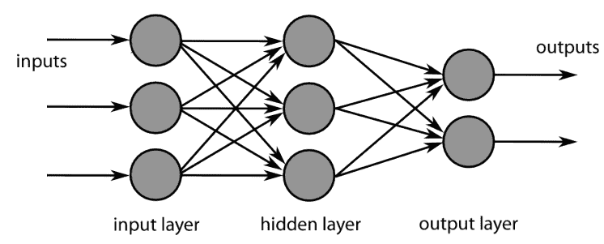

**多层神经网络**

每一层都由一组执行特定任务的神经元组成。输入层中的神经元接收输入数据并将其传递给隐藏层中的神经元。隐藏层中的神经元对输入数据进行计算，并将结果传递给输出层中的神经元。输出层中的神经元对结果进行计算并产生最终输出。

这种类型的神经网络可用于图像识别、语音识别和其他简单的分类任务。然而，它不适用于更复杂的任务。

## 2.6.2 - 循环神经网络（RNNs）

循环神经网络（RNNs）旨在克服传统前馈神经网络在处理序列数据方面的局限性。与独立处理输入的前馈网络不同，RNN具有保留序列中先前步骤信息的能力。这使得它们非常适合处理文本和语音等序列数据。

它们被应用于翻译、情感分析和文本转语音处理等各种应用。

序列数据是以特定方式排序的数据，序列中的每个元素都具有特定含义。例如，一个句子是单词的序列，每个单词都具有特定含义。

## 2.6.3 - 长短期记忆（LSTM）

长短期记忆（LSTM）是一种特殊的神经网络，擅长理解并记住数据序列中的信息。它被创造出来为了解决普通神经网络在长时间记忆方面存在的问题。

普通神经网络在处理序列时有时会忘记重要信息。但LSTM的设计旨在记住重要细节，并将它们通过序列中的许多步骤传递下去。

这使得LSTM在理解数据顺序和上下文至关重要的任务中非常有用，如语言翻译、语音识别和预测句子中的下一个词。

LSTM就像一种智能记忆，帮助神经网络以正确的顺序和上下文记住事物。

它们可用于文本生成任务。虽然你可以为LSTM提供初始序列（类似于“提示”）来生成或分类后续序列，但为了引导LSTM的输出而对这种初始序列进行细微操纵的做法，通常不被称为“提示工程”。

## 2.6.4 - 门控循环单元（GRUs）

门控循环单元（GRUs）是一种旨在处理数据序列的神经网络架构，类似于长短期记忆（LSTM）网络。开发GRU的主要动机之一是解决LSTM的一些复杂性和计算需求，同时仍有效地捕捉序列数据中的长期依赖关系。因此，GRU比LSTM具有更精简的结构，这通常允许它们训练得更快并需要更少的计算资源。GRU的一个关键特性是使用“门”。


将门（gates）视为调节网络内部信息流的检查点。它们决定了在处理序列时哪些数据应被保留、更新或丢弃。这种机制确保网络关注相关细节，并能从序列早期回忆重要信息。

GRU（门控循环单元）在需要理解序列的各种任务中已证明其价值，例如语言处理、语音识别等。它们识别序列数据中模式和关系的能力使其成为深度学习领域许多应用的首选。

文本生成就是这样一种应用，但通过操纵初始序列来引导 GRU 的输出，通常不被称为“提示工程”。

## 2.7 - Transformer 模型

想象你正在逐字阅读一本书。你理解每个单词，但并不理解整个句子的含义。你需要阅读整个句子才能理解它。同样地，你需要阅读整个段落才能理解整个段落的含义。而且，你需要阅读整本书才能理解整本书的含义。自然，这就是人类阅读和理解一本书的方式。这里的基本思想是，你需要阅读全文才能理解它，而这一切始于理解每个单词及其与周围其他单词的关系。

Transformer 以类似的方式运作。它不是逐字阅读，而是可以同时检查多个单词并理解它们之间的关系。这被称为“注意力（attention）”。

几年前，谷歌的一些研究人员设计了一种新的文本阅读方法。他们将其命名为“Transformer”，并在谷歌大脑团队的 Ashish Vaswani 等人题为《Attention Is All You Need》$^{7}$的论文中对其进行了描述。

在此之前，已有其他阅读和理解文本的方法，例如众所周知的 LSTM（长短期记忆网络）。然而，这个新的 Transformer 概念更快且更优越！

这里有一个例子：考虑句子“The cat sat on the ___.”（猫坐在___上。）即使你遮住最后一个单词，基于前面的单词，你也可能会猜测它是“mat”（垫子）。Transformer 通过检查所有单词、理解它们的关系并做出智能猜测来完成这一点。

如今，这一 Transformer 概念已变得极其流行。人们开始将其不仅用于阅读文本，还用于计算机视觉、生物序列分析等更多领域。

由于 Transformer 的有效性，公司开始使用它们构建大型模型，我们称之为“大语言模型（Large Language Models）”。其中两个著名的模型是 BERT 和 GPT。

### 2.7.1 - 双向编码器表示 Transformer（BERT）

[BERT](https://github.com/google-research/bert) 是一种高级语言模型，它基于整个上下文来理解单词，同时考虑句子中前面的和后面的单词。这种双向理解使 BERT 能够根据上下文把握单词的具体含义。

BERT 使用一种名为 Transformer 的神经网络架构开发，并在大量文本上进行了训练。在训练过程中，文本中的某些单词被故意隐藏，BERT 尝试根据上下文预测这些单词，从而帮助其学习单词之间的关系和含义。

由谷歌的研究人员开发，BERT 可以进行微调以适应各种任务。它通常被调整用于情感分析、问答以及识别文本中的人名、地名或组织名称等命名实体。

尽管可以将其微调为语言模型，但 BERT 通常不用于文本生成任务，这主要归因于其双向特性。传统的语言模型通常以单向方式生成文本，基于前面的单词预测下一个单词。BERT 的双向特性使其非常适合理解和分类现有文本的任务，但较不适合生成连贯且流畅的新文本序列。

BERT 是一个高容量模型，旨在**理解**复杂的文本。

### 2.7.2 - 生成式预训练 Transformer（GPT）

GPT 是一种能够基于给定提示生成文本的语言模型。它在大量文本上进行训练，并能生成与其训练文本相似的文本。

GPT-3 和 GPT-4 是 GPT 的最新版本。它们是具有许多参数的高级语言模型。它们基于与 [GPT-2](https://github.com/openai/gpt-2)$^{9}$ 相同的架构构建，但进行了一些更改。GPT-3 和 GPT-4 在其层中使用稠密和稀疏注意力模式的混合，这有助于模型高效处理信息。

与 BERT 不同，GPT 是一个高容量模型，旨在**生成**复杂的文本。

提示工程与基于 GPT 的模型高度相关，因为它可以用于引导模型输出并产生更相关和连贯的文本。当我们谈论提示工程时，通常指的是对初始序列的操纵以引导 GPT 的输出。这涉及精心构造输入，以引发特定类型的响应或将模型的行为引导至期望的方向。提示越好，GPT 的输出往往越准确且越具有上下文相关性。

随着 GPT 模型，特别是 GPT-3 和 GPT-4，在规模和能力上的增长，有效提示工程的重要性也随之增加。这是因为这些模型拥有大量的知识和潜在响应，因此有效引导它们可能是普通答案与高度具体、相关答案之间的区别所在。此外，通过合适的提示，GPT 模型可以执行超越单纯文本生成的任务，例如回答问题、提供摘要、翻译语言，甚至进行某些形式的推理。

## 2.8 - 接下来是什么？

在本节中，我们学习了不同种类的语言模型及其在各种应用中的使用。我们还了解到，提示工程与生成式模型密切相关，因为它可以用于引导模型输出并产生更相关和连贯的文本。在下一节中，我们将更深入地了解提示工程。

# 3 - 提示工程简介

提示工程是人工智能领域新兴的一门学科。其重点在于创建和优化提供给语言模型（如 ChatGPT）的指令。相关且表述良好的提示可以影响模型生成的响应，从而提高结果的质量和相关性。

为了有效，提示工程需要理解底层模型，并对训练数据进行分析以识别潜在的偏见。通过调整指令和模型参数，提示工程师可以塑造 AI 的行为，使其更准确地满足用户需求，并产生更一致和可靠的结果。

OpenAI CEO Sam Altman 在一条推文中将提示工程描述为“一种杠杆率极高的惊人技能，也是用少量自然语言进行编程的早期示例。”


**Sam Altman 关于提示工程的观点**

提示工程是一门至关重要的学科，近年来备受关注。随着 GPT-4 和 ChatGPT 等 AI 语言模型变得更加强大和广泛使用，有效地引导这些模型（使用精心构造的指令，即提示）的重要性呈指数级增长。

语言模型在大量文本数据上接受训练，以学习模式、语言结构和上下文。然而，从这些模型中生成连贯且上下文相关的响应可能是一项复杂任务，因为它们可能会产生无关或有偏见的输出，尤其是在面对模糊或表述不佳的提示时。

提示工程的历史可以追溯到语言模型发展的早期阶段。当 AI 研究人员和开发人员试图使语言模型更有用且更易于使用时，他们意识到需要通过提供明确的指令或上下文来影响生成的文本。最初，使用简单的提示来引导模型，但这往往导致通用或不足够的响应。

GPT-4、LaMDA、Llama 2 和 PaLM 语言模型是该领域出现的最重要里程碑。这些模型在大量文本数据上接受训练，能够生成连贯且上下文相关的响应。推测表明 GPT-4 拥有惊人的 170 万亿参数。相比之下，Llama 的最庞大版本包含 650 亿参数，而 Google 的 5400 亿参数 Transformer 模型 PaLM 以其卓越的天赋驱动其 AI 聊天机器人 Bard。然而，这些模型仍需明确的指令才能产生期望的输出。这正是导致提示工程作为一门新学科发展的原因。

在 Stable Diffusion、Midjourney 和 DALL-E 等文本生成图像模型发布后，这一领域的相关性甚至更高。这些模型可以从文本提示生成图像，但它们需要特定的指令才能产生期望的输出。

随着时间的推移，提示工程有了显著的发展，从各种其他相关领域借鉴见解，如 NLP（自然语言处理）、计算语言学和人与计算机交互。研究人员探索了不同的策略来设计提示，以引发精确且上下文准确的响应。


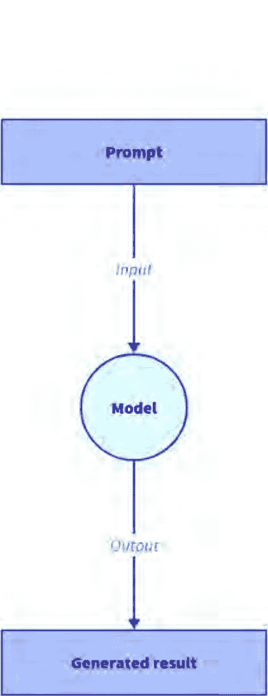

提示工程（Prompt Engineering）存在许多挑战——我们将在接下来的章节中探讨这些挑战。但这里的重点在于，目前提示工程缺乏一种唯一的标准方法。没有明确的设计提示指南或最佳实践，这使得比较不同模型和应用的结果变得困难。

为了应对这些挑战，不同的提示工程技术已经成熟，融入了多种方法。

这就是本指南将要涵盖的内容。

## 4 - OpenAI GPT 与提示：简介

### 4.1 - 生成式预训练变换器（GPT）模型

生成式预训练变换器模型，例如 GPT-4，代表了人工智能领域的重大进步，由 OpenAI 公司开发。作为 GPT（生成式预训练变换器）模型家族的一部分，ChatGPT（gpt-3.5）是专门设计用于以对话方式生成文本的。

凭借庞大的数据集和复杂的训练，ChatGPT 能够理解用户查询并提供相关且通常详尽的回复。从协助完成特定任务到提供涵盖各种主题的信息，ChatGPT 在客服、教育、SEO、内容创作等众多领域都有应用。其能力使其成为人机交互演进的核心要素。

### 4.2 - 什么是 GPT，它与 ChatGPT 有何不同？

GPT 代表生成式预训练变换器（Generative Pre-trained Transformer）。这种架构（变换器）是专门为处理和生成自然语言而设计的，使其擅长理解和生成类人文本。

“生成式预训练变换器”这三个术语具有特定的含义：

-   **生成式（Generative）**：这意味着 GPT 能够自主生成文本。基于其训练的数据，它可以产生以前不存在的新句子、段落甚至文章。
-   **预训练（Pre-trained）**：在被用于特定任务之前，GPT 会在一个非常大的文本数据集上进行预训练。这使得它能够学习语言的模式、结构和一般信息。
-   **变换器（Transformer）**：这是这些模型使用的神经网络架构类型。变换器架构在处理数据序列（如文本）方面特别有效，并且以其捕捉数据中长期依赖关系的能力而闻名。

GPT 经历了不同版本的演变，在 GPT-4 出现之前，GPT-2 和 GPT-3 是最广为人知的版本。随着 GPT 版本的更新，其参数量通常更大，并且基于更多数据进行训练，从而在各类自然语言处理任务上通常表现出更高的性能。

虽然 GPT-2、GPT-3 和 GPT-4 是语言模型，但 ChatGPT 是一个使用 GPT-3.5-turbo 以对话方式生成文本的网络应用程序。GPT-3.5 是一组改进自 GPT-3 的模型，能够理解和生成自然语言或代码。随着 GPT-3.5-turbo 的发布，OpenAI 正在逐步弃用 GPT-3，转而使用 GPT-3.5 和 GPT-4。

### 4.3 - GPT 模型系列：深入观察

在了解了 GPT-x 模型和 ChatGPT 之间的区别后，是时候深入观察 GPT 模型家族了。这将帮助你理解 GPT 模型的生态系统以及它们之间的相互关系。

传统上，当一个新模型经过研究、训练和开发流程后发布时，它会部署在基础设施中（如云服务）并向开发者和用户开放。要使用该模型，开发者需要将其集成到他们的应用程序或服务中。实现这一点的有很多方法，但最常见的做法是使用 API（应用程序编程接口）。

API 是一组允许开发者访问系统功能的函数和过程。对于 GPT 模型而言，API 用于向模型发送文本并接收生成的文本作为响应。这就是开发者将 GPT 模型集成到他们的应用程序和服务中的方式。

OpenAI API 由一组具有不同能力和价格范围的模型提供支持。你还可以通过称为微调（fine-tuning）的过程，针对具体用例对原始基础模型进行有限的自定义。

微调是一个涉及在特定数据集上训练模型以使其适应特定任务的过程。例如，你可以在电影评论数据集上微调 GPT 模型，以创建一个电影评论生成器。这在自然语言处理领域是一种常见的做法。然而，这需要编程技能。

在接下来的章节中，我们将详细观察 GPT 家族中的不同模型。即使你不是开发者，这也帮助你理解每个模型的能力以及它们如何应用于不同的应用。你在这里获得的知识也将帮助你在为项目选择 GPT 模型时做出更好的决策。

#### 4.3.1 - GPT-3.5

GPT-3.5 模型能够理解和生成自然语言及代码。它们为对话进行了优化，但也适用于传统的文本补全任务。

在 GPT-3.5 的基础模型中，包括 gpt-3.5-turbo 模型。

gpt-3.5-turbo 是 GPT-3.5 系列中性能最高的模型，专为聊天优化，其成本仅为 text-davinci-003 的十分之一。

> Text-davinci-003 是 GPT-3 家族中的一个模型，专为文本补全和生成任务优化。它曾是一众 GPT-3 模型中最强大的，但也是最昂贵的之一。然而，如前所述，它正在被弃用，被视为遗留模型。

根据 OpenAI 的说法，gpt-3.5-turbo 现在是 GPT-3.5 家族中最强大且最具成本效益的模型之一。

#### 4.3.2 - GPT-4

GPT-4 是一个大型多模态模型（目前接受文本输入并产生文本输出，未来将支持图像输入），凭借其更广泛的通用知识和先进的推理能力，能够比之前的任何模型更精确地解决难题。

与 gpt-3.5-turbo 类似，GPT-4 为聊天进行了优化，但在传统的文本补全任务上也表现良好。它还可以解决逻辑、数学、科学问题，甚至生成计算机程序。

#### 4.3.3 - 其他模型

-   GPT-3：一组能够理解和生成自然语言的模型。该系列中的一些模型示例包括 text-davinci-003、text-davinci-002、code-davinci-002、text-curie-001、text-babbage-001 和 text-ada-001。
-   DALL-E：一个能够从文本描述创建图像的图像生成模型。它可以生成各种风格、大小和分辨率的高质量图像。
-   Whisper：一个能够以高精度将音频输入转换为文本的模型。
-   Embeddings：一组能够将文本转换为数值表示的模型。
-   Moderation：一个经过微调的模型，能够检测文本是否可能具有敏感性或不安全性。
-   Codex：一组能够理解和生成代码的模型，包括将自然语言翻译为代码。

### 4.4 - API 使用与 Web 界面

GPT 模型可以通过 OpenAI API 或 Web 界面访问。使用 API 与 Web 界面代表了与服务或应用程序交互的两种不同方法。

Web 界面通常面向最终用户，提供图形界面，允许用户通过 Web 浏览器与服务或应用程序进行交互。这使得非技术用户更直观地使用服务。当我们谈到 Web 界面时，我们指的是像 ChatGPT 这样的应用程序，它提供 Web 界面来与 GPT-3.5 和 GPT-4 进行交互，甚至包括 [Playground](https://platform.openai.com/playground)，这是 OpenAI 提供的用于与不同模型交互并探索其能力的 Web 界面。

另一方面，API 是设计给应用程序和开发者使用的。它们实现了不同服务或软件组件之间的编程通信。例如，开发者可以使用 API 查询特定模型并在其应用程序中检索结果，或将模型集成到自己的服务或应用程序中。像 copy.ai 或 Jasper 这样的应用程序是使用 OpenAI API 通过 Web 界面为用户提供文本生成服务的 Web 接口的例子。

### 4.5 - 标记（Tokens）

GPT 模型以称为标记（tokens）的块来处理文本。标记代表频繁出现的字符序列，它们与单词不同。例如，字符串“Building a ChatBot”可以被分解为 3 个单词：“Building”、“a”和“ChatBot”。但当我们对它进行标记化（tokenize）时，它被分解为 4 个标记：“Building”、“ a“、“Chat”和“Bot”。

值得注意的是，在一个句子中，除了第一个单词外，每个单词的第一个标记通常以空格开头。在上面的例子中，“ a“和“ Chat“分别是单词“a”和“ChatBot”的第一个标记，并且这两个标记都以空格开头。

[https://platform.openai.com/playground](https://platform.openai.com/playground)


# “构建聊天机器人”中的 Token

OpenAI 提供了一个分词器工具，允许测试特定字符串并查看它们如何被转换为 token。

作为一般规则，估计一个 token 对应英文文本中大约四个字符或 0.75 个单词。这对于其他语言可能有所不同。

需要记住的一个限制是，对于 GPT 模型，提示词和生成输出的组合不应超过模型的最大上下文长度。

每个 GPT 模型的最大上下文长度可以在 OpenAI 提供的模型索引中找到。

GPT-4 默认最大为 8192 个 token，而 GPT-3.5-turbo 默认最大为 4096 个 token。

使用 ChatGPT 时，最大上下文取决于你使用的模型。例如，如果你使用的是 GPT-4 模型，最大上下文长度为 8192 个 token。这意味着你在提示词和生成输出的组合中最多可以使用 8192 个 token。

这种 token 限制解释了为什么 ChatGPT 有时会生成比预期更短的回复，或者截断句子的末尾。

ℹ 即使你不是开发人员，理解 token 也很重要。这将帮助你理解 GPT 模型如何处理文本以及如何有效地使用它们。它还将使你了解使用 GPT 模型相关的真实成本，无论是你在自己的应用程序中使用，还是通过像 WriteSonic 或 Copy.ai 这样的服务使用。

## 4.6 - 成本、Token 和初始提示词：如何计算使用模型的成本

如果你为 ChatGPT 的每月访问付费，使用模型的成本是固定的。然而，如果你通过 API 使用 GPT 模型，使用模型的成本主要基于生成的 token 数量。这意味着提示词和生成输出越长，API 调用的成本就越高。

通常它是这样运作的：

- **Token 数量**：当你向 API 发送文本时，它会被分成 token。这包括输入文本（提示词）和生成的响应。

例如，如果我的提示词是“阿根廷的首都是什么？”，响应是“布宜诺斯艾利斯”，则使用的 token 总数为 11（包括空格）：提示词占 7 个，响应占 3 个。

- **每个 Token 的成本**：API 通常根据你使用的模型对每个 token 收取固定费用。如果你调用“GPT-4”，成本是 $0.03 / 1K token；如果你使用“GPT-4-32k”，成本是 $0.06 / 1K token。对于其他模型，请参阅 OpenAI 提供的 [模型定价页面](#language-models)。

为了做一些计算，假设你正在使用“GPT-4”模型（每个 1k token 的成本是 $0.03）。你的提示词和答案共使用了 11 个 token。API 调用的总成本将是 11 * $0.03 / 1k = $0.00033。
如果你使用的是像 Jasper 这样的 SaaS 解决方案，使用模型的成本通常是固定的月费，并包含一定数量的 token。月费是根据包含的 token 数量、每个 token 的成本以及 SaaS 提供商的利润率计算得出的。

## 4.7 - 提示词：它是如何工作的？

“提示词”指的是提供给语言模型的文本输入，目的是生成响应或输出。
以下是关于提示词不同方面的详细信息：

- **响应触发器**：提示词充当语言模型的触发器。在接收到提示词后，模型利用其知识和内部结构生成适当的响应。例如，给模型提示词“法国的首都是什么？”可能会生成响应“巴黎。”

提示词：瑞典的首都是什么？
响应：斯德哥尔摩

本质上，模型始终试图基于提示词本身、对话的上下文、从训练数据中学习的知识以及下一个单词的概率，为提示词提供一个补全。对于输入中的每个 token，模型计算下一个 token 应该是什么的概率分布。它给更可能跟随给定上下文的 token 分配更高的概率。然后，模型通过选择概率最高的 token 作为下一个单词来生成文本。这个过程一直重复，直到达到所需的长度或完成状态。

- **格式**：提示词的长度和复杂性可以不同。它们可以简单到一个词或一个句子，也可以复杂到一个段落或更多。此外，提示词可以包含特定的格式，例如列表或标题，以引导模型的输出。

示例：

创建一个不健康产品的列表，这些产品不应该在超市购买。

I -

使用上面的例子，我们可以看到提示词是一个包含列表标题（I -）的简单句子。模型将使用此信息来生成不健康产品的列表。

生成输出的示例：

- I - 罐头食品
- II - 加工肉类
- III - 含糖饮料
- IV - 冷冻食品
- V - 零食

如果提示词是：

创建一个不健康产品的列表，这些产品不应该在超市购买。

- 1 -

生成的输出将是：

- 1 - 罐头食品
- 2 - 加工肉类
- ...

- **上下文**：在某些情况下，可以在提示词中提供额外的上下文，以帮助模型更好地理解请求。

提示词：它有几条腿？
响应：要回答“它有几条腿？”这个问题，需要知道你指的是哪种动物。

提示词：我有一只狗。
响应：狗有 4 条腿。

另一个例子是用户希望获得科技品牌列表，但 AI 没有获得足够的上下文，理解为用户想要获得水果列表。

提示词：继续向以下列表添加元素：

```json
"""
apple,
"""
```

响应：
banana, cherry, grape, orange, pear, pineapple, strawberry, watermelon

为了提供更好的上下文，在列表中添加另一个元素，其中包含一个科技品牌的名称，将有助于 AI 理解用户想要获得的是科技品牌列表而不是水果。

**提示词：继续向以下列表添加元素：**

```
"""
apple, samsung,
"""
```

**响应：**
apple, samsung, acer, asus, dell, hp, huawei, lenovo, lg, microsoft, ms\i, nokia, oppo, razer, sony, xiaomi

- **对话交互**：提示词可以用于对话环境中。这意味着你可以拥有一系列提示词和响应，以模拟与模型的对话。

**提示词：** 你好，你怎么样？
**响应：** 我很好，谢谢。你呢？
**提示词：** 我也很好。你今天做了什么？
**响应：** ...

- **指令**：提示词还可以包含给模型的指令。例如，提示词可以说“写一篇关于迦太基和罗马的 500 字论文”，以给出关于输出长度和主题的特定指令。

**提示词：** 写一篇关于迦太基和罗马的 500 字论文。
**响应：** **迦太基和罗马：** 古代史诗般的竞争

在历史的篇章中，很少有竞争对文明进程的影响像迦太基和罗马那样深远。这两个帝国都拥有广阔的领土和巨大的权力，注定要在地中海为至高无上地位而发生冲突。这种对抗往往被浪漫化，但无疑是残酷的，它将决定未来几个世纪西方世界的轨迹。

...

- **模型训练中的使用**：在训练语言模型时，提示词通常与示例响应结合使用，以教模型如何正确响应不同的输入。

- **局限性**：值得注意的是，语言模型在提示词长度方面存在局限性。诸如 GPT 等模型有最大上下文长度，如果提示词太长，可能需要截断或总结它。

一些“技巧”可能有助于克服这一限制。例如，你可以将一个长提示词分成多个提示词，并拼接生成的响应以获得更长的响应。

```
提示词：我将与你分享一个非常长的文本，该文本被分成多个提示词。文本的每一部分都会以“END PART”消息结束。你可以使用此消息来理解一部分在哪里结束以及下一部分从哪里开始。当你看到“END PART”消息时，请回复“NEXT PART PLEASE”，直到你看到“END ALL”。
“END ALL”表示你已到达文本的末尾。你现在可以回复“END ALL”以确认你已阅读整个文本。你准备好了吗？
```

- **与 API 调用和提示词相关的成本**：当通过 API 使用像 GPT-4 这样的 LLM 时，提示词中的 token 数量会影响 API 调用的成本，因为提供商通常根据处理的 token 数量收费。

以上都是提示词的一些最常见方面。然而，还有许多其他方面可以探索，我们将在接下来的章节中讨论它们。

## 4.8 - 概率与采样：GPT 的核心

GPT 学习文本数据中的模式和结构。当你向模型输入提示词或起始句子时，它利用其训练来生成下一个单词或几个单词。


该模型是在一个大型文本数据集（如书籍、文章和网站）上进行训练的。它学习了单词之间的统计关系以及单词出现时所在的上下文环境。利用这些数据，模型会寻找模式，并试图根据已接收到的输入，预测下一个最可能出现的单词。

为了生成单词，模型使用了一种名为“概率采样”（probability sampling）的技术。它根据单词在给定上下文中出现的可能性，为不同的单词分配概率。然后，模型会选择概率最高的单词，或者根据温度（temperature）或 top-p 等参数，从可能的单词分布中进行采样。

例如，如果提示词是“The weather is”（天气是），模型可能会基于从训练数据中学到的内容以及对话的全局上下文，为诸如“sunny”（晴朗）、“cloudy”（多云）或“rainy”（有雨）等单词分配较高的概率。然后，它生成概率最高的单词，或从分布中采样一个单词来完成句子。

这是对生成式语言模型工作原理的简化解释。其他因素，例如模型是如何被训练以与提示词和对话上下文进行交互的，也在文本生成中起着作用。

实际上，模型并不具备像人类那样的真正理解能力或知识。它的全部核心在于建立单词与上下文之间的统计关系。

## 4.9 - 理解 API 参数

理解 API 参数可以让你更好地了解模型在幕后是如何工作的，以及你如何将其与提示词结合使用，以生成更好的结果。

网页界面（如 ChatGPT）通常被设计为易于使用，你无法直接修改模型的内部参数（例如 temperature/温度）。

有一些变通方法可以解决此限制，例如在提示词中描述期望的行为：

```text
Prompt: Write a poem about quantum physics. Be more creative.
Prompt: Write a poem about quantum physics. Only use simple words.
Prompt: Write a poem about quantum physics. Use a diverse vocabulary.
...
```

另一方面，使用 OpenAI API 的开发者在将 GPT 等语言模型集成到其应用程序时，可以选择调整某些参数，包括 temperature（温度）。

理解和调整 API 参数提供了多种优势。通过掌握这些参数，你不仅可以看到模型为何产生特定回复的洞察，还能把握连贯性与多样性之间的微妙平衡。这种理解允许更有效的交互使用户能够制定提示词或对话风格。此外，它为内容生成提供了指导；对参数如何影响结果有深入认识，使用户能够更好地构建提示词或方向。

以下是你可能遇到的一些最常见参数的列表：

- 温度 (Temperature)
- Top-p
- Top-k
- 序列长度 (sequence length) (`max_tokens`)
- 响应数量 (`n`)
- 存在惩罚 (`presence_penalty`)
- 频率惩罚 (`frequency_penalty`)
- 最优结果数 (`best_of`)

### 4.9.1 - 温度 (Temperature)

这控制着回复中可变性的程度。较高的温度会使回复更多样化，但潜在上会降低连贯性；而较低的温度会使回复更具确定性且更专注。当回复本应具有确定性时，较高的温度可能会导致幻觉（hallucinations）。

### 4.9.2 - Top-p

“top-p”参数，也称为“核心采样”（nucleus sampling），是一种用于 GPT 等文本生成模型的技术，用于控制生成回复的多样性。它允许选择最可能的单词，同时将选择限制在一个子集内，该子集中单词的累积概率超过某个阈值。

在实践中，假设我们使用 GPT 模型根据给定的上下文生成一系列单词。“top-p”参数通过从最可能的单词中选择，直到累积概率达到定义好的阈值时发挥作用。这样，只考虑到该点为止最可能的单词，从而减少了选项池，并在生成的回复中引入多样性。

例如，如果我们使用“top-p”参数将阈值设置为 0.8，这意味着只有累积概率达到 80% 的单词才会被考虑。可能性较低的单词将被排除，从而允许更具针对性和连贯性的回复，同时保持一定的多样性。

以下是使用“top-p”参数生成句子的示例：

上下文：根据评论，城里最好的餐厅是什么？

- 不使用 “top-p”：
回复：城里最好的餐厅是 A 餐厅。它提供美味的菜肴和卓越的服务。评论者喜欢它！

- 使用 “top-p”（阈值为 0.8）：
回复：城里最好的餐厅无疑是 A 餐厅。它极受欢迎，并受到评论家的高度评价。

在这个例子中，“top-p”参数通过使用最可能的单词生成了一个更集中的回复，同时在生成的回复中保持了一定的多样性。建议不要将 top-p 与 temperature（温度）一起使用，而是选择其中一种。

### 4.9.3 - Top-k

“top-k”参数是一种用于文本生成模型的技术，用于控制在生成序列中选取下一个单词时的可能选择数量。它将每个生成步骤中的候选令牌池限制为 k 个最可能的令牌。具体来说，“top-k”参数指定了在每个生成步骤中基于概率应考虑的最大令牌数。令牌按概率降序排列，只考虑最可能的 top k 个令牌。因此，可能性较低的令牌被排除在选项池之外。

通过使用“top-k”参数，你可以控制生成回复的多样性。较低的 k 值会使回复更具确定性且连贯，而较高的 k 值会使回复更多样化，但潜在上会降低连贯性。

通过尝试和调整“top-k”参数，可以帮助你获得更好的结果。

### 4.9.4 - 序列长度 (Sequence Length) (`max_tokens`)

序列长度指的是模型生成的令牌数量。例如，如果你指示模型生成 10 个令牌的序列，模型将简单地根据给定的上下文生成 10 个令牌。

如果你想生成更长的回复，可以增加序列长度。相反，如果你想生成更短的回复，可以减少序列长度。

> 序列长度也会影响 API 调用的成本。

### 4.9.5 - 存在惩罚 (Presence Penalty) (`presence_penalty`)

存在惩罚参数的范围从 -2.0 到 2.0。该参数的正值将根据令牌在迄今为止生成的文本中的存在（即，如果它们甚至出现过一次）来惩罚令牌。这鼓励模型引入新的令牌，这有助于回复涵盖新的主题。

相反，负的存在惩罚可能会鼓励模型更紧密地遵循其已引入的令牌。

> 设置较高的存在惩罚可以导致更多样的回复，但值太高可能会导致模型试图避免其已使用的令牌，从而产生连贯性较差的输出。

### 4.9.6 - 频率惩罚 (Frequency Penalty) (`frequency_penalty`)

频率惩罚参数的范围也从 -2.0 到 2.0。正值将根据令牌在生成文本中出现的频率来惩罚令牌。这意味着，被使用多次的令牌比只出现一次的令牌受到的惩罚更重。此处的目的是抑制过度的重复。

另一方面，负值将起到相反的作用，可能会鼓励模型重复其更频繁使用的令牌。

频率惩罚的目的是确保生成回复的多样性，并防止某些短语或单词的过度使用。使用此惩罚有助于实现文本生成模型更具多样性和动态性的输出。

总之，虽然这两个参数以各自的方式控制重复，但存在惩罚关注的是令牌是否出现过，而频率惩罚关注的是令牌出现的频率。根据期望的结果和应用程序的上下文，调整这些参数需要取得平衡。

> 存在惩罚如果令牌出现过就会惩罚该令牌，而频率惩罚根据令牌出现的频率来惩罚该令牌。


## 4.9.7 - 响应数量 (n)

响应数量指的是模型生成的响应数量。例如，如果你生成 3 个响应，模型将根据给定的上下文生成 3 个响应。

如果你想要生成 10 个响应，请将响应数量设置为 10。如果你想要生成单个响应，请将响应数量设置为 1（默认值）。

响应数量也会影响 API 调用的成本。

## 4.9.8 - 最佳候选 (best_of)

“best_of”选项用于获取最佳补全，并返回“最佳”补全（即每个 token 的对数概率最高的那个）。

当与“n”参数（响应数量）一起使用时，“best_of”控制候选补全的数量，而“n”指定将返回多少补全。需要注意的是，“best_of”的值应大于“n”。

在实际操作中，如果你将“best_of”设置为 10，将“n”设置为 3，模型将生成 10 个候选补全，并基于每个 token 的对数概率返回其中最好的 3 个。这允许从更大的生成补全集中进行选择，并挑选在质量及连贯性方面被认为“最佳”的那些。

将“best_of”选项与“n”结合使用，在想要从更大的生成补全集中获取多个高质量结果时非常有用。这允许选择最优化的响应，并更好地控制返回结果的质量。

## 4.10 - OpenAI 官方示例

OpenAI 创建了一个示例列表来说明 GPT 模型的能力。你可以在[OpenAI 官方网站](https://platform.openai.com/examples)上找到此列表。

<sup>14</sup> https://platform.openai.com/examples

这些示例是开始提示词编写的好方法。你可以将它们作为自己提示词的起点，并根据需要进行调整。

## 4.11 - 无代码使用 API

使用[OpenAI 游乐场](https://platform.openai.com/playground)（见脚注 15），你可以在不编写任何代码的情况下测试 API。这是入门并探索其功能的好方法。

你不仅可以编写提示词并生成文本，还可以调整参数并查看它们如何影响结果。可以使用游乐场右侧的表单来调整参数。

游乐场还允许你查看用于生成结果的代码。如果你想在自己的代码中使用 API，这将非常有用。

在游乐场的右侧，有四种模式：“Complete”（补全）、“Chat”（对话）、“Insert”（插入）和“Edit”（编辑）。每种模式都有不同的用途，可用于不同的任务。

例如，“Complete”模式用于基于给定的提示词生成文本，而“Chat”模式则用于生成两个说话者（通常是一个人类和一个 AI）之间的对话。

每种模式都需要不同的提示词格式。例如，“Complete”模式需要单个提示词，而“Chat”模式则需要“system”（系统）提示词和“user”（用户）提示词。

游乐场还允许你保存你的提示词和结果。如果你想要保存工作并稍后返回查看，这会很实用。也可以与他人共享你的提示词和结果。

例如，“Insert”模式用于将文本插入到现有文档中，以下是“Insert”模式提示词的一个示例：

```text
As the sun set, [insert] with a touch of enchantment.
```

15 https://platform.openai.com/playground

该提示词是不完整的，模型将通过生成缺失的部分来补全它。结果将是一个在提示词上下文中讲得通的完整句子。

这是模型生成的一个结果示例：

```text
As the sun set, a crowd gathered outside the building's entrance. Some of them brought firewood and logs. Eventually, the flame of hope lit up the foggy night sky, lending the scene a touch of enchantment.
```

如果你想查看用于生成结果的代码，可以点击游乐场右侧的“View code”（查看代码）按钮。

这是用于生成结果的代码示例：

```python
import os
import openai

openai.api_key = os.getenv("OPENAI_API_KEY")

response = openai.Completion.create(
    model="text-davinci-003",
    prompt="As the sun set, ",
    suffix=" with a touch of enchantment.",
    temperature=1,
    max_tokens=256,
    top_p=1,
    frequency_penalty=0,
    presence_penalty=0
)
```

这段代码片段可用于在你的代码中生成相同的结果。请记住，你不需要使用相同的参数。你可以根据自己的具体需求和偏好调整参数。

让我们更深入地探索每个端点。

## 4.12 - Completion（已弃用）

completion 端点$^{16}$用于基于给定的提示词生成文本。这是最基本的端点，用于基于单个提示词生成文本。

提示词示例：

> Once upon a time

另一个示例：

# 引言

发现正念冥想的好处，这种练习将带你进入一种禅意和宁静的状态。冥想，凭借其深度放松的力量，常被比作晴朗的蓝天。通过定期参与这一练习，你培养对当下时刻的正念关注。正念冥想让你与自己连接，平息脑海中的喋喋不休，找到内心的平衡。潜入这片宁静的海洋，让冥想引导你进入平静与均衡的状态。

## 如何练习

另一个展示“stop”参数使用的示例：

> 我不应该在杂货店购买的东西清单：
>
> 1.

如果你希望列表中只有 5 个项目，可以使用“stop”参数在第 6 个项目后停止生成。你应该将“stop”参数设置为“6.”（注意末尾的句号）。

<sup>16</sup> https://platform.openai.com/playground/?mode=complete

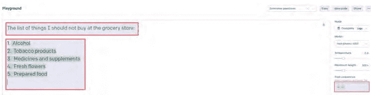

### 使用 stop 参数

当遇到该参数时，API 将返回截至此时生成的响应。这在生成较短的响应或限制答案数量时很有用。

## 4.13 - Chat

chat 端点$^{17}$用于生成两个说话者之间的对话。此端点使用两个初始提示词：“system”提示词（可选）和“user”提示词（必需）。

“system”提示词示例：

```text
You are a helpful assistant helping users with their questions about diet and nutrition. You are talking to a person who wants to build muscle and lose fat.
```

请记住，为 AI 设定角色有助于它理解对话的上下文。

## 4.14 - Insert（已弃用）

如前所述，insert 端点$^{18}$用于将文本插入到现有文档中。此端点需要一个文本提示词和一个“insert”参数。

以下是一个提示词的示例：

> When the [insert] is over, the world will be a better place.

该提示词是不完整的，模型将通过生成缺失的部分来补全它。结果将是一个在提示词上下文中讲得通的完整句子。提示词仅限于一个 insert 参数。

## 4.15 - Edit（已弃用）

edit 端点$^{19}$用于编辑现有文本。此端点需要两个提示词：

- 输入提示词
- 指令提示词

第一个提示词用于提供初始文本，第二个提示词用于提供编辑文本的指令。

以下是一个输入提示词的示例：

> When the moon sets, all the birds fly back to their nests.

以下是一个指令提示词的示例：

```text
Delete the word "moon" and replace it with "sun". Delete the word "fly"\n and replace it with "return".
```

以下是一个结果示例：

> When the sun sets, all the birds return to their nests.

模型将根据指令提示词中提供的指令编辑文本。

指令可用于对文本执行各种操作。例如，你可以使用指令删除、替换或插入文本，甚至可以改变文本格式或将其翻译成另一种语言。

<sup>19</sup> https://platform.openai.com/playground/?mode=edit


## 5 - 环境搭建

### 5.1 - 选择模型

由于 OpenAI GPT 模型是最受欢迎且使用最广泛的模型，并且可以通过 OpenAI API 轻松访问，我们将在本指南中使用它们。但是，要将本指南中讨论的概念和技术应用于其他模型，在几乎大多数情况下，你都可以使用相同的方法，无需进行重大更改。

我们的目标是理解提示工程背后的概念和技术，以及如何将它们应用于不同的模型。我们不会关注每个模型的技术细节。

### 5.2 - 选择编程语言

OpenAI API 官方支持 Python 和 Node.js[^20]。Azure OpenAI 库[^21] 可用于 .NET、Java、JavaScript 和 Go。其他社区库[^22] 也适用于其他语言，例如 Rust、PHP 等。

我们将使用 Python 作为本指南的编程语言，因为它是 AI 和机器学习中最受欢迎的语言。即使你不是 Python 开发者，使用 Python 入门也非常容易。

[^20]: https://platform.openai.com/docs/libraries/libraries
[^21]: https://platform.openai.com/docs/libraries/azure-openai-libraries
[^22]: https://platform.openai.com/docs/libraries/community-libraries

### 5.3 - 安装先决条件

为了避免与你机器上其他 Python 项目发生冲突，我们将为本指南创建一个 Python 虚拟环境。

要创建虚拟环境，你可以使用 Virtualenv、Virtualenvwrapper 或其他工具。我们将使用 [Virtualenvwrapper](https://github.com/python-virtualenvwrapper/virtualenvwrapper) 用于本指南。

首先安装 pip 和 virtualenvwrapper：

```bash
sudo apt install python3-pip
sudo pip3 install virtualenvwrapper
```

如果你使用的是 Windows，你可以使用 [Chocolatey](https://chocolatey.org/) 安装 pip 和 virtualenvwrapper：

```bash
choco install pip
pip install virtualenvwrapper-win
```

不过，我建议使用 [Multipass](https://multipass.run/) 或任何其他虚拟化工具在 Windows 上使用 Ubuntu 虚拟机。或者，你可以使用 DigitalOcean 或 AWS 等云服务。

我们的开发环境还将使用 Python 3.9。你应该已经安装了 Python 3.9。请按照此链接[安装 Python 3.9](https://www.python.org/downloads/)。

接下来，使用 Python 3.9 创建一个名为 pe（prompt engineering 的缩写）的虚拟环境：

```bash
mkvirtualenv pe --python=$(which python3.9)
```

在 Windows 上，你可以使用以下命令：

```bash
mkvirtualenv pe --python=<path to python.exe>
```

记得将 `<path to python.exe>` 替换为你机器上 python.exe 的实际路径。

创建虚拟环境后，它将自动激活。确保你正在使用 Python 3.9：

```bash
python --version
```

### 5.4 - 安装 OpenAI Python 库

OpenAI Python 库可在 PyPI 上获取[^27]。你可以使用 pip 安装它：

```bash
pip install openai==0.27.8
```

### 5.5 - 获取 OpenAI API 密钥

要使用 OpenAI API，你需要获取一个 API 密钥。你可以通过注册 OpenAI[^28]，然后在此处[^29]创建新的 API 密钥来获取。

请注意，API 的使用是收费的。但是，对于本指南来说，总成本不会超过 10 美元。可能甚至只有这个的一半。

别忘了将 API 密钥导出为环境变量：

```bash
export OPENAI_API_KEY=<your API key>
```

[^27]: https://pypi.org/project/openai/
[^28]: https://platform.openai.com/
[^29]: https://platform.openai.com/account/api-keys

### 5.6 - 一个 Hello World 示例

让我们从创建一个简单的 Python 脚本开始，以测试我们的安装。

在过去，OpenAI API 有像“Completion”和“Edit”这样的端点，现在这些端点已弃用。新 API 有一个名为“ChatCompletion”的单一端点，几乎适用于所有情况。该公司建议用户采用 Chat Completions API，该 API 已被证明功能强大，能够以更高的灵活性和特异性处理大多数用例。这就是我们将在此示例中使用的端点。

创建一个名为 app.py 的文件，并添加以下代码：

```python
# Import necessary libraries
import os          # Used for accessing environment variables
import openai      # OpenAI's Python client library

# Retrieve the OpenAI API key from environment variables
openai.api_key = os.getenv("OPENAI_API_KEY")

# Print an initial greeting message from Felix, the chatbot
print("Felix: Hi there. I am Felix, the chatbot. How can I help you today?")

# Get the user's message/input
user_message = input("You: ")

# Use the OpenAI API to generate a response based on the user's message
response = openai.ChatCompletion.create(
    model="gpt-3.5-turbo",  # Specify the model to be used
    messages=[
        # System message to set the behavior of the assistant
        {
            "role": "system",
            "content": "You are smart and helpful assistant."
        },
        # Initial user message (this is hardcoded and not used for any dynamic interaction)
        {
            "role": "user",
            "content": "Hi there."
        },
        # Initial assistant's response to the hardcoded user message
        {
            "role": "assistant",
            "content": "Hi there. \n\nI am Felix, the chatbot.\nHow can I help you today?"
        },
        # Actual user's message that was inputted earlier
        {
            "role": "user",
            "content": f"{user_message}"
        }
    ],
    # Parameters to guide the generation of the response
    temperature=1,         # Controls randomness. Higher values make output more random.
    max_tokens=256,        # Maximum number of tokens (words/characters) in the response
    top_p=1,               # Nucleus sampling parameter. Controls diversity of the output.
    frequency_penalty=0,   # Controls the penalty for using frequent tokens. 0 means no penalty.
    presence_penalty=0     # Controls the penalty for using new tokens. 0 means no penalty.
)

# Try to print the generated response
try:
    print("Felix: " + response.choices[0].message.content)
    # If there's an error (e.g., API error, network issues), print an error
except:
    print("Felix: Sorry, a problem occurred. Please try again later.")
```

这段代码使用 OpenAI API 设置了一个简单的聊天机器人交互。用户提供一条消息，聊天机器人（名为 Felix）根据给定的消息和先前硬编码的对话上下文进行响应。如果 API 调用出现任何问题，它将优雅地处理错误并通知用户。

### 5.7 - 交互式提示

为了使聊天机器人具有交互性，我们将使用 Click 创建一个命令行界面（CLI）。Click[^30] 是一个第三方 Python 包，允许以可组合的方式创建命令行界面，并且代码量尽可能少。它被称为“命令行界面创建工具包”。

使用 pip 安装 Click：

```bash
pip install click==8.1.7
```

接下来，更新 app.py 中的代码以使用 Click：

```python
import os
import openai
import click

openai.api_key = os.getenv("OPENAI_API_KEY")

@click.command()
def chat_with_felix():
    """Chat with Felix, the chatbot."""
    print("Felix: Hi there. I am Felix, the chatbot. How can I help you today?")
    while True: # This will keep the chat session active
        message = input("You: ")
        # Exit the loop (and the program) if the user types 'exit' or 'quit'
        if message.lower() in ['exit', 'quit']:
            print("Felix: Goodbye!")
            break
        response = openai.ChatCompletion.create(
            model="gpt-3.5-turbo",
            messages=[
                {"role": "system", "content": "You are smart and helpful assistant."},
                {"role": "user", "content": "Hi there."},
                {"role": "assistant", "content": "Hi there. \nI am Felix, the chatbot.\n\nHow can I help you today?"},
                {"role": "user", "content": f"{message}"},
            ],
            temperature=1,
            max_tokens=256,
            top_p=1,
            frequency_penalty=0,
            presence_penalty=0
        )
        try:
            print("Felix:", response.choices[0].message.content)
        except:
            print("Felix: Sorry, a problem occurred. Please try again later.")

if __name__ == '__main__':
    chat_with_felix()
```

[^30]: https://palletsprojects.com/p/click/


使用以下命令执行脚本：

```python
python app.py
```

你会发现聊天机器人现在可以进行交互了。你可以输入一条消息，聊天机器人会做出回应。你还可以输入“exit”或“quit”来结束交互。

## 5.8 - 使用多行提示词进行交互式输入

在某些情况下，我们可能会使用如下所示的提示词：

```text
写一个关于一个机器人试图学习如何成为人类的故事。
```

```text
这个机器人叫托伯（Tobor）。一旦托伯获得了说话的能力，他
就开始学习如何像人类一样思考。他首先学习如何思考并
培养创造性的想象力。
```

在这种情况下，我们需要接受来自用户的多行输入。我们可以使用以下代码来实现：

```python
import os
import openai
import click

openai.api_key = os.getenv("OPENAI_API_KEY")

@click.command()
def chat_with_felix():
    """Chat with Felix, the chatbot."""
    print("Felix: Hi there. I am Felix, the chatbot. How can I help you
today?")
    while True:  # This will keep the chat session active
        print("You: (Type your message. When done, type 'END' on a new line)")
        lines = []
        while True:
            line = input()
            if line == "END":
                break
            lines.append(line)
        message = '\n'.join(lines)

        # Exit the loop (and the program) if the user types 'exit' or 'quit'
        if message.lower() in ['exit', 'quit']:
            print("Felix: Goodbye!")
            break

        response = openai.ChatCompletion.create(
            model="gpt-3.5-turbo",
            messages=[
                {"role": "system", "content": "You are a smart and helpful assistant."},
                {"role": "user", "content": "Hi there."},
                {"role": "assistant", "content": "Hi there. \n\nI am Felix, the chatbot.\nHow can I help you today?"},
                {"role": "user", "content": f"{message}"},
            ],
            temperature=1,
            max_tokens=256,
            top_p=1,
            frequency_penalty=0,
            presence_penalty=0
        )

        try:
            print("Felix:", response.choices[0].message.content)
        except:
            print("Felix: Sorry, a problem occurred. Please try again later.")


if __name__ == '__main__':
    chat_with_felix()
```

## 6 - 少样本学习与思维链

### 6.1 - 什么是少样本学习？

少样本学习，有时也称为低样本学习，是一种允许模型仅凭少数几个示例就能做出准确预测的方法，从而减少数据收集和计算的成本。这项技术已应用于各个领域，例如：

- 计算机视觉（字符识别、目标跟踪、分类）
- NLP（文本补全、翻译、分类）
- 音频处理（声音克隆、转换）

### 6.2 - 零样本学习与少样本学习

诸如 GPT-4、PaLM 2、Llama 2 等大型语言模型是在海量数据集上训练而成的，它们在各种任务上都能表现良好。因此，通常在没有示例的情况下提示它们。这就是我们所说的零样本学习。然而，当任务复杂时，模型需要针对少量示例进行训练才能表现良好，这时就引入了少样本学习技术。

尽管如此，提高提示词的质量并采用最佳实践仍有助于你在零样本学习中取得更好的结果（上下文、连贯性、人设等）。

事实上，零样本学习是大多数情况下的首选方法。它更快、更容易。

### 6.3 - 少样本学习的途径

少样本学习有几种不同的途径，包括使用：

#### 6.3.1 - 关于相似性的先验知识

在训练期间，我们开发嵌入（embeddings），使其能够区分不同的类别，即使这些类别之前从未被见过。

可以把这想象成教 AI 识别猫和狗的区别，方法是给它看很多图片。即使后来它看到了以前没见过的猫或狗的品种，它仍然能猜得正确，因为它已经学会了猫和狗的一般区别概念。这有点像玩一个匹配相似物品的游戏，AI 会随着时间的推移变得更好。

#### 6.3.2 - 关于学习的先验知识

我们利用现有知识来引导学习算法选择那些不仅拟合数据良好，而且能有效泛化的参数。这有助于防止过拟合，特别是在处理有限数据时。

想象一下你在教某人骑滑板车。如果不是从头开始，如果他们以前骑过自行车，你可以利用这些知识帮助他们学得更快。同样，在教 AI 时，我们利用它已经知道的东西来帮助它学习新事物，而不会犯常见的错误。

#### 6.3.3 - 关于数据的先验知识

通过利用我们对数据固有结构和变化的理解，即使只提供少数几个示例，我们也能有效地训练 AI。这种知识为更高效的学习奠定了基础。

假设你正在教某人了解不同种类的水果。如果他们已经知道苹果和橙子，你可以利用这些知识来解释橘子（就像小橙子一样！）。同样，在教 AI 时，如果它对你要提供的信息（或数据）类型有所了解，它就能更轻松地学习新事物。

### 6.4 - 少样本学习的示例

让我们从这个简单的例子开始：

```python
import os
import openai
import click

openai.api_key = os.getenv("OPENAI_API_KEY")

@click.command()
def chat_with_felix():
    """Chat with Felix, the chatbot."""
    print("Felix: Hi there. I am Felix, the chatbot. Let's play a game. Give me a number and I'll tell you if it's even or odd.")

    while True:
        message = input("You: ")

        if message.lower() in ['exit', 'quit']:
            print("Felix: Goodbye!")
            break

        response = openai.ChatCompletion.create(
            model="gpt-3.5-turbo",
            messages=[
                {"role": "system", "content": "You are a smart and helpful assistant."},
                {"role": "user", "content": "1"},
                {"role": "assistant", "content": "1 is an odd number because it is not divisible by 2."},
                {"role": "user", "content": "2"},
                {"role": "assistant", "content": "2 is an even number because it is divisible by 2."},
                {"role": "user", "content": "3"},
                {"role": "assistant", "content": "3 is an odd number because it is not divisible by 2."},
                {"role": "user", "content": f"{message}"},
            ],
            temperature=1,
            max_tokens=256,
            top_p=1,
            frequency_penalty=0,
            presence_penalty=0
        )

        try:
            print("Felix:", response.choices[0].message.content)
        except:
            print("Felix: Sorry, a problem occurred. Please try again later.")


if __name__ == '__main__':
    chat_with_felix()
```

与 AI 交互：

1. 在这个例子中，我们使用少样本学习技术来教 AI 识别奇数和偶数，并以自定义方式做出回答。

另一个示例如下：

```python
import os
import openai
import click

openai.api_key = os.getenv("OPENAI_API_KEY")

@click.command()
def chat_with_felix():
    """Chat with Felix, the chatbot."""
    print("Felix: Hi there. I am Felix, the chatbot. Let's play a game. Name an animal, and I'll tell you if it's a mammal or not.")

    while True:
        message = input("You: ")

        if message.lower() in ['exit', 'quit']:
            print("Felix: Goodbye!")
            break

        response = openai.ChatCompletion.create(
            model="gpt-3.5-turbo",
            messages=[
                {"role": "system", "content": "You are a smart and helpful assistant."},
                {"role": "user", "content": "dog"},
                {"role": "assistant", "content": "A dog is a mammal because it gives birth to live young and has fur."},
                {"role": "user", "content": "fish"},
                {"role": "assistant", "content": "A fish is not a mammal because it lays eggs and lives in water."},
                {"role": "user", "content": f"{message}"},
            ],
            temperature=1,
            max_tokens=256,
            top_p=1,
            frequency_penalty=0,
            presence_penalty=0
        )

        try:
            print("Felix:", response.choices[0].message.content)
        except:
            print("Felix: Sorry, a problem occurred. Please try again later.")


if __name__ == '__main__':
    chat_with_felix()
```

与 AI 交互：


Felix：你好。我是 Felix，一个聊天机器人。我们来玩个游戏吧。说一种动物，我会告诉你它是不是哺乳动物。
你：奶牛
Felix：奶牛也是哺乳动物。它是一种大型家养反刍动物，作为牲畜饲养以生产肉、牛奶及其他乳制品。奶牛分娩幼崽并分泌乳汁哺育后代。
你：退出
Felix：再见！

## 6.5 - 少样本学习的局限性

让我们考虑一个例子，我们希望 AI 在输入是奇数时回答 "X"，在输入是偶数时回答 "Y"。我们可以使用采用少样本学习技术的以下代码：

```python
import os
import openai
import click

openai.api_key = os.getenv("OPENAI_API_KEY")

@click.command()
def chat_with_felix():
    """与聊天机器人 Felix 聊天。"""
    print("Felix: Hi there. I am Felix, the chatbot. Let's play a game.\n")

    while True:
        message = input("You: ")

        if message.lower() in ['exit', 'quit']:
            print("Felix: Goodbye!")
            break

        response = openai.ChatCompletion.create(
            model="gpt-3.5-turbo",
            messages=[
                {"role": "system", "content": "You are a smart and helpful assistant."},

                {"role": "user", "content": "1"},
                {"role": "assistant", "content": "X"},

                {"role": "user", "content": "2"},
                {"role": "assistant", "content": "Y"},

                {"role": "user", "content": f"{message}"},
            ],
            temperature=1,
            max_tokens=256,
            top_p=1,
            frequency_penalty=0,
            presence_penalty=0
        )

        try:
            print("Felix:", response.choices[0].message.content)
        except:
            print("Felix: Sorry, a problem occurred. Please try again later.")

if __name__ == '__main__':
    chat_with_felix()
```

这是一个执行示例：

```text
Felix: Hi there. I am Felix, the chatbot. Let's play a game.
You: 1
Felix: X
You: 2
Felix: I'm sorry, but I'm not sure what you're referring to with "2." Could you please provide more context or clarify your question?
You: 3
Felix: Z
You: 4
Felix: Z
You: 5
Felix: Z
```

这并不是预期的行为！为了解决这个问题，我们可以使用不同的提示词，例如以下提示词：

```python
import os
import openai
import click

openai.api_key = os.getenv("OPENAI_API_KEY")

@click.command()
def chat_with_felix():
    """与聊天机器人 Felix 聊天。"""
    print("Felix: Hi there. I am Felix, the chatbot. Let's play a game.")

    while True:
        message = input("You: ")

        if message.lower() in ['exit', 'quit']:
            print("Felix: Goodbye!")
            break

        response = openai.ChatCompletion.create(
            model="gpt-3.5-turbo",
            messages=[
                {"role": "system", "content": "You are a smart and helpful assistant."},


                {"role": "user", "content": "1"},
                {"role": "assistant", "content": "1 is an odd number so the answer is X."},


                {"role": "user", "content": "2"},
                {"role": "assistant", "content": "2 is an even number so the answer is Y."},


                {"role": "user", "content": "3"},
                {"role": "assistant", "content": "3 is an odd number so the answer is X."},


                {"role": "user", "content": f"{message}"},
            ],
            temperature=1,
            max_tokens=256,
            top_p=1,
            frequency_penalty=0,
            presence_penalty=0
        )

        try:
            print("Felix:", response.choices[0].message.content)
        except:
            print("Felix: Sorry, a problem occurred. Please try again later.")

if __name__ == '__main__':
    chat_with_felix()
```

这是一个执行示例：

```text
Felix: Hi there. I am Felix, the chatbot. Let's play a game.
You: 10
Felix: 10 is an even number so the answer is Y.
You: 22
Felix: 22 is an even number so the answer is Y.
You: 44
Felix: 44 is an even number so the answer is Y.
You: 12
Felix: 12 is an even number so the answer is Y.
You: 13
Felix: 13 is an odd number so the answer is X.
You: 19
Felix: 19 is an odd number so the answer is X.
```

这是预期的行为。

我们解决问题的方法是为答案提供推理过程。这是少样本学习中常用的技术，用于绕过少样本学习的一些局限性。如果提示词复杂，少样本学习技术可能会返回错误的答案。通过为答案提供推理过程，或我们所谓的“思维链”，我们可以帮助 AI 更好地理解问题并提供正确的答案。

## 7 - 思维链（CoT）

根据《你何时需要为 ChatGPT 使用思维链提示词？》31（Chen, J., Chen, L., Huang, H., & Zhou, T. (2023)），仅仅添加一个 CoT 指令就能将 GPT-3 的准确率从 17.7% 提升到 78.7%。这是一个显著的提升，但并非每个查询都需要 CoT 指令。

事实上，只有当查询复杂且 AI 需要更多信息来理解问题时，才需要使用 CoT 指令。

CoT 是一种允许我们为答案提供推理过程的技术。该技术与少样本学习结合使用，以绕过少样本学习的一些局限性。

考虑这个例子：

```python
import os
import openai
import click

openai.api_key = os.getenv("OPENAI_API_KEY")

@click.command()
def chat_with_felix():
    """与聊天机器人 Felix 聊天。"""
    print("Felix: Hi there. I am Felix, the chatbot. Let's play a game.\n")

    while True:
        message = input("You: ")

        if message.lower() in ['exit', 'quit']:
            print("Felix: Goodbye!")
            break

        response = openai.ChatCompletion.create(
            model="gpt-3.5-turbo",
            messages=[
                {"role": "system", "content": "You are a smart and helpful assistant."},
                {"role": "user", "content": f"{message}"},
            ],
            temperature=1,
            max_tokens=256,
            top_p=1,
            frequency_penalty=0,
            presence_penalty=0
        )

        try:
            print("Felix:", response.choices[0].message.content)
        except:
            print("Felix: Sorry, a problem occurred. Please try again later.")

if __name__ == '__main__':
    chat_with_felix()
```

然后提出以下问题：

当 James 2 岁时，他的姐姐是 2*2 岁。现在 James 30 岁了。他的姐姐多大？

对话如下：

Felix：你好。我是 Felix，一个聊天机器人。我们来玩个游戏吧。
你：当 James 2 岁时，他的姐姐是 2*2 岁。现在 James 30 岁了。他的姐姐多大？
Felix：如果 James 2 岁，那么他的姐姐是 2*2 = 4 岁。既然 James 现在 30 岁，他的姐姐应该是 30 - 2 = 28 岁。

你可以看到，答案部分是正确的，这意味着 gpt-3.5-turbo 理解了年龄差但没有猜出姐姐的正确年龄。

即使问了不同的问题，答案仍然是错误的：

Felix：你好。我是 Felix，一个聊天机器人。我们来玩个游戏吧。
你：当 Harry 25 岁时，他的姐姐 29 岁。现在 Harry 30 岁了。他的姐姐多大？
Felix：如果 Harry 现在 30 岁，那么他的姐姐 29 岁，假设他们的年龄差保持不变。

一个 CoT 指令应该能改善答案。

```python
import os
import openai
import click

openai.api_key = os.getenv("OPENAI_API_KEY")

@click.command()
def chat_with_felix():
    """与聊天机器人 Felix 聊天。"""
    print("Felix: Hi there. I am Felix, the chatbot. Let's play a game.\n")

    while True:
        message = input("You: ")

        if message.lower() in ['exit', 'quit']:
            print("Felix: Goodbye!")
            break

        response = openai.ChatCompletion.create(
            model="gpt-3.5-turbo",
            messages=[
                {"role": "system", "content": "You are a smart and helpful assistant."},
                {"role": "user", "content": "When James was 2 years old, his sister was 2*2 years old. James is now 30 years old. How old is his sister?"},
                {"role": "assistant", "content": "When James was 2 years old, his sister was 4 years old. There's 2 year differences between them and the sister is older than James. When James is 30 years old, his sister should be 32 years old."},
                {"role": "user", "content": "When Harry was 25 years old, his sister was 29 years old. Harry is now 30 years old. How old is his sister?"},
                {"role": "assistant", "content": "When Harry was 25 years old, his sister was 29 years old. There's 4 year differences between them and the sister is older than Harry. When Harry is 30 years old, his sister should be 34 years old."},
                {"role": "user", "content": f"{message}"},
            ],
            temperature=1,
            max_tokens=256,
            top_p=1,
            frequency_penalty=0,
            presence_penalty=0
        )

        try:
            print("Felix:", response.choices[0].message.content)
        except:
            print("Felix: Sorry, a problem occurred. Please try again.")
```


## 8 - 零样本思维链（Zero-shot CoT）提示

有时，你可能不想或者无法为思维链（CoT）指令提供示例。在这种情况下，零样本思维链提示可以作为一种替代方案。

让我们尝试一下这段代码，其中我们没有为 CoT 指令提供任何示例：

```python
import os
import openai
import click

openai.api_key = os.getenv("OPENAI_API_KEY")

@click.command()
def chat_with_felix():
    """与聊天机器人 Felix 聊天。"""
    print("Felix: 你好。我是聊天机器人 Felix。让我们来玩个游戏吧。\n")
    
    while True:
        message = input("你: ")
        
        if message.lower() in ['exit', 'quit']:
            print("Felix: 再见！")
            break
        
        response = openai.ChatCompletion.create(
            model="gpt-3.5-turbo",
            messages=[
                {"role": "system", "content": "You are a smart and helpful assistant."},
                {"role": "user", "content": f"{message}"},
            ],
            temperature=1,
            max_tokens=256,
            top_p=1,
            frequency_penalty=0,
            presence_penalty=0
        )

    try:
        print("Felix:", response.choices[0].message.content)
    except:
        print("Felix: 抱歉，发生了一个问题。请稍后再试。")

if __name__ == '__main__':
    chat_with_felix()
```

现在，这是使用零样本思维链提示技术的指令：

当 James 2 岁时，他的姐姐是 2*2 岁。现在 James 30 岁了。他的姐姐多大？请逐步思考（谁更年长，年龄差是多少……等等）

正如你所见，我们在问题末尾添加了“请逐步思考（谁更年长，年龄差是多少，等等）”。对话看起来是这样的：

**Felix：** 你好。我是聊天机器人 Felix。让我们来玩个游戏吧。

**你：** 当 James 2 岁时，他的姐姐是 2*2 岁。现在 James 30 岁了。他的姐姐多大？请逐步思考（谁更年长，年龄差是多少……等等）

**Felix：** 要找出 James 的姐姐多大，我们可以逐步解决这个问题：

1.  当 James 2 岁时，他的姐姐是 2 * 2 岁，这意味着当时他的姐姐 4 岁。
2.  这意味着 James 的姐姐比他大两岁，因为在他 2 岁时她 4 岁。
3.  既然 James 现在 30 岁，我们需要考虑他和姐姐之间两岁的年龄差。
4.  为了计算他姐姐现在的年龄，我们将年龄差加到 James 的年龄上：30 + 2 = 32。

因此，James 的姐姐 32 岁。

令人惊讶的是，答案是正确的，思维链指令帮助模型理解将问题分解为更小的步骤并考虑年龄差是解决该问题的正确方法。

这种方法是在论文《大型语言模型是零样本推理器》[34]（Kojima, T., Gu, S. S., Reid, M., Matsuo, Y., & Iwasawa, Y. (2022)）中介绍的。虽然大型语言模型（LLMs）因其在少样本学习方面的表现而受到赞扬，但该论文的作者发现，这些模型也可以通过简单地提示它们“逐步思考”来进行推理，而无需任何先验示例（零样本）。

> 我们通过在每个答案前添加“让我们逐步思考”来证明大型语言模型是不错的零样本推理器。

[34] https://arxiv.org/abs/2205.11916

他们的方法被称为零样本思维链（Zero-shot-CoT），仅使用这个单一提示，就极大地提高了各种推理任务的性能。例如，在 MultiArith 任务（一个包含多步骤算术问题的集合）上的准确率从 17.7% 跃升至 78.7%。这种方法在不同任务上的成功表明，大型语言模型在零样本推理方面具有未被开发的潜力。他们认为，他们的发现强调了在创建特定的训练数据集或示例之前，探索大型语言模型内部广阔知识的必要性。虽然这种方法可以帮你节省一些时间和精力，但它并不总是准确的。

## 9 - 自动思维链提示（AutoCoT）

大型语言模型可以通过将问题分解为更小的步骤来进行推理。这种方法被称为思维链（CoT）提示，主要有两种方法。第一种使用像“让我们逐步思考”这样直接的提示来引导模型的思考。第二种涉及手动创建演示，展示问题及其逐步推理过程。虽然第二种方法表现更好，但它严重依赖手工创建这些演示。

《*大型语言模型中的自动思维链提示* [35]》（Zhang, Z., Zhang, A., Li, M., & Smola, A. (2022)）的作者发现，通过使用“让我们逐步思考”的提示方法，大型语言模型可以自行生成推理步骤，尽管它们有时会出现错误。为了提高这些自动生成的步骤的质量，他们指出拥有多样化的问题是必不可少的。他们介绍了一种自动化方法 Auto-CoT，该方法选择多样化的问题，然后生成推理步骤。在 GPT-3 在十个基准推理任务上的测试中，Auto-CoT 的表现与手动 CoT 方法相当或更好。

Auto-CoT 使用两个主要步骤来帮助语言模型推理问题：

1.  问题聚类：
    -   这个阶段将**数据集** [36] 中的问题根据相似性组织成组或“簇”。
    -   每个问题使用 Sentence-BERT 转换为向量，从而以数值形式捕捉其本质。


## 9. Auto-CoT：自动思维链

随后，使用 k-means 聚类算法对这些向量进行分组。含义更接近的问题会被归入同一个聚类。

2. 演示采样：

- 对于每个聚类，选择一个具有代表性的问题。
- 然后提示模型使用“让我们逐步思考”的提示语，通过逐步思考来为该问题生成推理链。
- 目标是创建一个将问题与其推理链相结合的演示。
- 选择这些演示有一定的标准，例如问题必须简短（不超过 60 个 token）且推理过程简洁（不超过 5 步）。

在这两个主要阶段之后，演示被用于辅助模型回答测试问题。模型会接收到所有演示，然后接收一个待回答的测试问题，并利用在演示中观察到的推理方法。

论文 [37] 中的图 4 展示了 Auto-CoT 的过程。简单来说，Auto-CoT 类似于通过示例来教导模型，但与人类创建这些示例不同，模型自己生成这些示例，从而学习如何逐步进行推理。

## 10 - 自一致性

GPT-3.5 和类似的 NLP 模型是使用海量文本数据集进行训练的，这使它们能够基于训练示例生成相关且合乎逻辑的回复。然而，它们并不理解数学和逻辑，只是利用识别出的模式来形成答案。换句话说，它们无法解释自己的推理过程，只是“混合”单词以形成优雅的答案。虽然思维链（CoT）方法通过提示模型逐步解释其推理过程，在改进推理方面显示出潜力，但它并非万无一失。原因如下：

- 对单一路径的过度依赖：CoT 通常采用“贪心”方法，意味着它往往固守其找到的第一条、最明显的推理路径。如果该路径存在缺陷，或者存在它未考虑的更优解决方案，这可能导致错误。

想象 CoT 像是一个在广阔森林中的徒步者。徒步者一看到小路，不会探索整片森林或寻找替代路线，而是立即踏上第一条也是最明显的小径。这可能会让他们快速到达目的地，但没有任何保证这是最佳或最风景优美的路线，有时甚至可能走进死胡同。

- 缺乏多样性：由于 CoT 倾向于遵循单一的推理线，它可能会错过解决该问题的其他有效途径。对于需要多种视角的复杂问题，这种局限性尤为明显。

继续使用徒步者的隐喻——想象森林中隐藏着许多美丽景点，散布在不同区域。由于 CoT（我们的徒步者）始终选择他们看到的第路径，他们可能会快速到达一个景点，但完全错过其他景点。对于想要真正理解和体验森林景点丰富性的徒步者来说，探索多条小径比固守一条小径有益得多。同样，对于复杂问题，考虑多种路径或视角可以得出更具洞察力的答案。

- 并不总是最优：仅仅因为模型能够解释其推理过程，并不意味着该推理是正确的。CoT 有时会导致冗长或绕弯子的解释，听起来合乎逻辑，但实际上基于错误的假设。

这就像我们的徒步者，当被问到为何选择某条路径时，给出了一段关于路标、路况以及他们听到的鸟鸣声的冗长描述，听起来像是一个深思熟虑的决定。然而，他们可能忽略了路头警告前方桥梁断裂的清晰标志，或者更优美路线或美丽景点的建议。他们的解释听起来可能详细且合乎逻辑，但根源在于忽视了关键信息或误解了他们所看到的标志。

因此，虽然 CoT 帮助模型“展示其工作过程”，但并不保证该工作过程总是正确的。将其与如自一致性等策略结合使用，可以帮助解决其中一些局限性。这些观察结果发表于《自一致性改进语言模型的思维链推理》(*Self-consistency Improves Chain of Thought Reasoning in Language Models*) 一文中（Wang, X., Wei, J., Schuurmans, D., Le, Q, Chi, E., Narang, S., Chowdhery, A., & Zhou, D. (2022)）。

自一致性是一种增强模型推理能力的策略。回到我们使用的隐喻，我们的徒步者站在几条小径的十字路口，每条小径都声称通向森林中最美的景点。徒步者没有随机选择其中一条，而是咨询不同的地图，询问其他经验丰富的徒步者，甚至观察大多数人的去向。如果所有这些来源都指向同一条小径，徒步者会自信地选择那条路径。这种来自多个来源的验证体现了推理和决策中自一致性的理念。

[38] https://arxiv.org/pdf/2203.11171.pdf

类似地，如果你试图解决一个数学问题，不要只使用一种方法寻找答案，而是使用几种不同的方法。如果所有这些方法都导致相同的答案，你会非常有信心认为你的答案是正确的。这就是自一致性背后的简化核心思想。

从技术角度来看，当语言模型被给予一个问题时，它不会急于得出最明显的答案，而是探索多条推理路径。每条路径可能暗示不同的答案。然后模型检查哪个答案在这些路径中出现得最频繁。正如人类有不同的思考和解决问题的方式，这种多样性也可以在语言模型中模拟。

其核心思想是，答案出现的频率越高，其正确性就越有可能。以下是其工作原理：

- 提示模型：首先通过给模型一个问题以及一些推理示例来开始。
- 生成多个答案：不要只获取一个答案，让模型生成多个可能的推理路径。
- 选择最一致的答案：从模型生成的多个答案中，选择出现频率最高的那个。

当模型生成多个解决方案时，就像在采样不同的推理路径。这些路径随后根据其可能性进行加权。最终答案基于在这些路径中出现频率最高的答案来选择。

与其他方法相比，自一致性“持续”表现更好。即使在添加逐步推理过程可能无益的情况下，自一致性仍然提升了性能。此外，事实证明它比其他流行技术（如束搜索 [39] 和基于集成的方法 [40]）更优。

该技术在各种任务和模型上进行了测试，结果令人印象深刻。当与 PaLM-540B 或 GPT-3 等特定模型结合使用时，自一致性在多个推理任务上创造了新的性能纪录。

例如，在 GSM8K 任务上，准确率提高了 17.9%。

在实践中，如果我们拿这个问题：

> 如果你有 5 个苹果并吃了 2 个，还剩下多少个？

使用 CoT 的模型可能会使用以下推理路径作为学习示例：

> 你一开始有 5 个苹果。你吃了其中 2 个。所以，5 减 2 等于 3 个苹果。答案是剩下 3 个苹果。

另一方面，自一致性模型会探索多种思考问题的方式，以确保其答案的正确性。对于同样的问题，模型可能会提示思考不同的解决方法，例如：

- 你有 5 个苹果，吃掉 2 个后，剩下 3 个
- 从 5 个苹果开始，如果吃掉 2 个后没了，那就剩下 3 个苹果
- 如果有 5 个苹果，其中 2 个因你吃掉而不再存在，那么 5 减 2 等于剩下 3 个苹果。

由于所有这些不同的推理路径都导向答案“3 个苹果”，模型获得信心认为 3 是正确答案。因此，虽然 CoT 提供了思维过程的清晰分解，但自一致性通过多种交叉检查问题来确保答案的可靠性。

在实施自一致性时，建议尽可能多提供示例。这有助于模型探索更多的推理路径


并增加了找到正确答案的可能性。OpenAI GitHub 仓库中名为“`test_socratic.jsonl`”$^\text{41}$ 的文件就是一个很好的例子。

让我们向 OpenAI 的 text-davinci-002 模型提出以下问题：

> 如果停车场里有 3 辆车，又来了 2 辆，开走 1 辆，又来了 15 辆，开走 8 辆，那么停车场里现在有多少辆车？

以下是 Python 代码：

```python
import openai
import os

openai.api_key = os.getenv("OPENAI_API_KEY")

prompt = """
Q: If there are 3 cars in the parking lot and 2 more cars arrive, 1 car\
leaves, 15 cars arrives and 8 leaves, how many cars are in the parking
?"
A:
"""
# 答案应该是：3 + 2 - 1 + 15 - 8 = 11

response = openai.Completion.create(
    engine="text-davinci-002",
    prompt=prompt,
    temperature=0.5,
    max_tokens=260
)
print(response.choices[0].text.strip())
```

返回的答案是不正确的：

$^\text{41}$https://github.com/openai/grade-school-math/blob/master/grade\_school\_math/data/test\_socratic.jsonl

停车场里有 18 辆车。

为了改善答案，我们可以使用论文$^\text{42}$中提供的少样本（few-shot）示例：

```python
import openai
import os

openai.api_key = os.getenv("OPENAI_API_KEY")

# 使用少样本学习来提高模型的准确性
prompt = """
Q: There are 15 trees in the grove. Grove workers will plant trees in the grove today. After they are done,
there will be 21 trees. How many trees did the grove workers plant today?
A: We start with 15 trees. Later we have 21 trees. The difference must be the number of trees they planted.
So, they must have planted 21 - 15 = 6 trees. The answer is 6.
Q: If there are 3 cars in the parking lot and 2 more cars arrive, how many cars are in the parking lot?
A: There are 3 cars in the parking lot already. 2 more arrive. Now there are 3 + 2 = 5 cars. The answer is 5.
Q: Leah had 32 chocolates and her sister had 42. If they ate 35, how many pieces do they have left in total?
A: Leah had 32 chocolates and Leah's sister had 42. That means there were originally 32 + 42 = 74
chocolates. 35 have been eaten. So in total they still have 74 - 35 = 39 chocolates. The answer is 39.
Q: Jason had 20 lollipops. He gave Denny some lollipops. Now Jason has 12 lollipops. How many lollipops
did Jason give to Denny?
A: Jason had 20 lollipops. Since he only has 12 now, he must have given the rest to Denny. The number of
lollipops he has given to Denny must have been 20 - 12 = 8 lollipops. The answer is 8.

Q: Shawn has five toys. For Christmas, he got two toys each from his mom and dad. How many toys does he have now?

A: He has 5 toys. He got 2 from mom, so after that he has 5 + 2 = 7 toys. Then he got 2 more from dad, so in total he has 7 + 2 = 9 toys. The answer is 9.

Q: There were nine computers in the server room. Five more computers were installed each day, from monday to thursday. How many computers are now in the server room?

A: There are 4 days from monday to thursday. 5 computers were added each day. That means in total 4 * 5 = 20 computers were added. There were 9 computers in the beginning, so now there are 9 + 20 = 29 computers. The answer is 29.

Q: Michael had 58 golf balls. On tuesday, he lost 23 golf balls. On wednesday, he lost 2 more. How many golf balls did he have at the end of wednesday?

A: Michael initially had 58 balls. He lost 23 on Tuesday, so after that he has 58 - 23 = 35 balls. On Wednesday he lost 2 more so now he has 35 - 2 = 33 balls. The answer is 33.

Q: Olivia has $23. She bought five bagels for $3 each. How much money does she have left?

A: She bought 5 bagels for $3 each. This means she spent 5

Q: If there are 3 cars in the parking lot and 2 more cars arrive, 1 car leaves, 15 cars arrives and 8 leaves, how many cars are in the parking lot?

A:
"""

# 答案应该是：3 + 2 - 1 + 15 - 8 = 11

response = openai.Completion.create(
    engine="text-davinci-002",
    prompt=prompt,
    temperature=0.5,
    max_tokens=260
)
print(response.choices[0].text.strip())
```

现在答案是正确的：

停车场里已经有 3 辆车。又来了 2 辆。现在有 3 + 2 = 5 辆车。开走了 1 辆。所以现在有 5 - 1 = 4 辆车。又来了 15 辆车。所以现在有 4 + 15 = 19 辆车。开走了 8 辆。所以现在有 19 - 8 = 11 辆车。答案是 11。

## 11 - 迁移学习

### 11.1 - 什么是迁移学习？

迁移学习（TL）的定义是，通过从已学习的相关任务中迁移知识，来增强在新任务中的学习效果。相关任务通常是指来自同一领域的任务，或者具有共享概念或共享低层特征的不同领域任务。

迁移学习的概念并不新鲜。事实上，在心理学和行为主义领域，人们已经研究了它超过 100 年。它也被用于教育中，通过建立在孩子已知知识的基础上，来教导孩子如何获取新技能。

以下是现实生活中的一些迁移学习示例：

- 如果一个人学会了弹钢琴，由于两种乐器之间的相似性，他们可能会发现学习另一种键盘乐器（如风琴）更容易。
- 一个学会了警惕热炉子的孩子，即使没有经过明确教导，也可能会避免触摸烧烤架。
- 一个学会骑三轮车的孩子，可能会发现学骑自行车比从未骑过三轮车的孩子更容易。

迁移学习最近才成为机器学习领域的一个热门话题。

例如，在图像分类中应用时，迁移学习可以用于复用在一个领域（例如，识别爬行动物）解决一个问题时获得的知识，来解决另一个领域（例如，识别两栖动物）的问题。

换句话说，迁移学习涉及将预训练模型作为新任务的起点进行复用。在大语言模型（LLM）的背景下，这种方法允许我们利用从海量数据集中学习的知识，并将其应用于特定问题。迁移学习主要有两种方法：归纳迁移（inductive transfer）和归纳式迁移（transductive transfer）。这两种方法都基于一个想法，即在一个任务中学到的知识可以用来提高在另一个任务中的表现。

让我们详细考察每种方法。

### 11.2 - 归纳迁移

归纳迁移是迁移学习中一种普遍的方法。它关乎学习机制利用一个任务的知识或技能来提高在另一个相关但不同的任务上的表现的能力。

简单来说，当系统由于之前对类似任务的经历而在当前任务上变得更加熟练时，归纳迁移就发生了。这就好比将之前学到的知识或特定的思维方式应用到新的挑战中。

以语言习得为例。如果你先学了西班牙语，后来决定学葡萄牙语，你对西班牙语的熟练程度会帮助你的学习过程，因为这两种语言有许多相似之处。这体现了归纳迁移：西班牙语的知识增强了葡萄牙语的学习。

同样，在机器学习中，一个经过训练以识别英语手写的模型，可能会发现识别相关语言（如法语、意大利语、西班牙语或葡萄牙语）的手写字符更容易。

### 11.3 - 归纳式迁移

与归纳迁移相反，归纳式迁移（Transductive Transfer）侧重于利用一个领域中特定实例的知识，在密切相关的领域中针对特定实例做出预测，同时底层任务保持不变。

例如，一个擅长在课堂上使用教科书中遇到的方法来解决数学问题的学生。当面对考试中略有变化的问题时，他们可能会想起教科书中的某个问题并复制其解决方法，而绕过了对潜在数学原理的真正理解。

在机器学习中，特别是在计算机视觉领域，可以打个比方：想象一个系统被训练用于区分来自某个特定庇护所照片中的猫和狗。当面对来自一个陌生庇护所的图像时，使用归纳式迁移，该系统会尝试基于它从原始庇护所遇到的特定示例来对这些新图像进行分类，而不是泛化区分猫和狗在多变环境中的更广泛概念。

### 11.4 - 归纳与归纳式迁移

归纳学习和归纳式学习方法有时看起来相似，但仔细查看就会发现它们的方法存在明显差异。

在归纳学习中，模型仅使用一组标记数据训练，然后寻求泛化，预测它未见过的数据的标签。这个通用模型可以轻松应用于同一域内的任何新数据。

相反，归纳式学习在其训练过程中直接遇到标记的训练数据和未标记的测试数据。与归纳学习不同，它并不旨在创建通用的模型；相反，它专注于基于对标记数据的了解和其他相关信息，来预测它已见过的特定未标记数据的标签。这种特异性意味着引入新数据通常要求算法从头开始——这个过程既耗时又计算昂贵，特别是在流数据中。


虽然归纳学习强调广泛的适用性，但转导学习则针对手头的数据进行优化。了解何时使用每种方法对于各种机器学习应用至关重要。

简而言之，归纳学习推理从观察到的训练案例出发，并寻求推广到未见的场景；而转导学习推理则从一个特定的观察案例移动到另一个特定但尚未见过的案例，而不改变当前的基本任务。

从心理学中做一个类比，Perkins 和 Salomon (1989) 提出的“Hugging”（拥抱/强化类似情境）43，强调学习情境与未来应用之间的相似性，可以类比为归纳学习；而“Bridging”（架桥/情境迁移），这是教学中使用的另一种技术，它将具体的知识实例与新情境联系起来，反映了转导学习的原理。

下表总结了归纳学习与转导学习之间的区别：

| 方面 | 归纳学习 | 转导学习 |
| :------- | :------------------- | :--------------------- |
| 遇到的数据 | 在模型训练期间仅遇到训练数据。 | 在模型训练期间同时遇到训练和测试数据集。 |
| 预测模型 | 构建一个可应用于未见数据的预测模型。 | 不为未见数据构建独立的预测模型。 |
| 新数据处理 | 当引入新数据时，已建立的模型可以快速预测，无需重新训练。 | 新数据需要从头重新运行算法、重新训练，然后进行预测。 |
| **模型的目的** | 旨在创建一个通用模型，能够预测数据空间中的任何新点。 | 构建一个针对其遇到的特定训练和测试数据点定制的模型。 |
| **流数据效率** | 可以以最小的计算开销快速标记新的数据点。 | 如果不断引入新的数据点，可能会变得计算密集。 |

## 11.5 - 迁移学习、微调和提示工程

提示工程和迁移学习服务于不同的目的，但它们都是用于提高机器学习模型性能和实用性的方法论，特别是在 OpenAI GPT 系列等模型的背景下。

微调是迁移学习的一种，涉及将预训练模型适应于新的自定义任务。这是自然语言处理（NLP）领域的一种常见做法，通常用于提高语言模型的性能。

那么，提示工程和微调之间有什么关系呢？

当你想要微调像 OpenAI GPT 这样的模型时，你需要提供一组训练示例，每个示例都包含一个输入（“提示”）及其对应的输出（“补全”）。这与使用基础模型有明显不同，在使用基础模型时，你可能在单个提示中输入详细的指令或多个示例。

当你希望模型执行特定任务时，这非常有用。例如，你可能希望微调一个模型来理解你的客户支持工单，并根据你的知识库或之前对类似工单的回复自动响应。

### 11.6 - 使用提示数据集进行微调：一个实用示例

为了简单起见，我们将使用 OpenAI 的基础模型之一，并将其微调以执行一个简单的任务：回答 FAQ 中的问题。

为了微调模型，正如之前所述，我们需要一组训练示例，每个示例都包含一个输入（“提示”）及其对应的输出（“补全”）。以下是 OpenAI 文档的建议：

- 每个提示应以一个固定的分隔符结尾，以便通知模型提示结束且补全开始。一个通常效果良好的简单分隔符是 `\n\n###\n\n`。分隔符不应出现在任何提示的其他位置。
- 由于 OpenAI 的分词方式（对大多数单词进行分词时会附带前导空格），每个补全应以一个空格开始。
- 每个补全应以一个固定的停止序列结尾，以便通知模型补全结束。停止序列可以是 `\n, ###,` 或任何其他未在任何补全中出现的标记。

假设你有一个名为 SkillUp Academy 的电子学习平台，并且你有以下 FAQ 页面。

Q. 什么是 SkillUp Academy？
A. SkillUp Academy 是一个在线学习平台，提供跨多个学科的多种课程，使学习者能够以自己的节奏从世界任何地方获得知识和技能。

Q. 我如何注册？
A. 只需点击我们主页上的“注册”按钮，提供你的详细信息，即可开始！

Q. 我如何支付课程费用？
A. 我们接受通过 PayPal 和 Stripe 进行的付款。

Q. 我对课程不满意。我可以退款吗？
A. 是的，我们提供 30 天退款保证。如果你在此期间内不满意，可以申请退款。请参阅我们的退款政策以了解详情。

Q. 我在哪里可以找到网站的服务条款？
A. 我们的服务条款可以在我们网站的页脚找到，或者点击此处查看。

Q. 我的个人信息安全吗？
A. 绝对安全。我们优先考虑你的隐私，并采取了严格措施来保护你的数据。在此阅读更多关于我们的隐私政策的详情。

Q. 我可以按自己的节奏学习吗？
A. 是的，我们的课程旨在允许你按自己的方便时间学习。一旦注册，你可以在特定时期内访问课程材料，在此期间你可以按自己的节奏学习。

Q. 我对课程内容有问题。我该如何得到解答？
A. 大多数课程都有讨论论坛，你可以在那里提问、与其他学习者互动，有时还可以得到课程讲师的回复。

Q. 我可以在手机上访问课程吗？
A. 是的，我们的平台对移动设备友好，我们还有专为 Android 和 iOS 提供的专用应用程序。

Q. 我是一名讲师。我如何在你的平台上开设一门课程？
A. 我们始终在寻找知识渊博的讲师。只需前往我们的“成为讲师”页面，了解与我们合作的详细信息。

Q. 完成课程后你们提供证书吗？
A. 是的，一旦你成功完成课程并通过任何必要的评估，你将获得结业证书。

Q. 如果我遇到技术问题该怎么办？
A. 请通过“联系我们”页面联系我们的支持团队，他们很乐意为你提供帮助。

要将 FAQ 用作训练数据集，我们需要将其转换为 OpenAI GPT 可以理解的格式。我们将使用类似于 OpenAI 推荐的格式（JSONL 文档⁴⁴）

```json
{"prompt": "lorem ipsum dolor sit amet.END_PROMPT", "completion": "consectetur adipiscing elit.\n"}
{"prompt": "Vivamus vel lacus quis diam vestibulum scelerisque.END_PROMPT", "completion": "Pellentesque habitant morbi tristique senectus et netus et malesuada fames ac turpis egestas.\n"}
...etc
```

在实践中，lorem ipsum 文本将被问题（提示）和答案（补全）替换。`->` 和 `\n` 是我们将使用的分隔符，用于通知模型提示和补全何时结束。

FAQ 数据集看起来将是这样的：

```json
{"prompt": "What is SkillUp Academy->", "completion": " SkillUp Academy is an online learning platform offering a variety of courses across multiple disciplines, enabling learners to gain knowledge and skills at their own pace from anywhere in the world.\n"}
{"prompt": "How do I sign up->", "completion": " Just click on the \"Sign Up\" button on our homepage, provide your details, and get started!\n"}
{"prompt": "How can I pay for a course->", "completion": " We accept payments through PayPal, and Stripe.\n"}
{"prompt": "I am not satisfied with the course. Can I get a refund->", "completion": " Yes, we offer a 30-day money-back guarantee. If you're not satisfied within this period, you can request a refund. Please see our refund policy for details.\n"}
{"prompt": "Where can I find the terms of service for the website->", "completion": " Our terms of service can be found at the footer of our website or by clicking here.\n"}
{"prompt": "Is my personal information secure->", "completion": " Absolutely. We prioritize your privacy and have stringent measures in place to protect your data. Read more in our privacy policy here.\n"}
{"prompt": "Can I learn at my own pace->", "completion": " Yes, our courses are designed to allow you to learn at your convenience. Once you enroll, you'll have access to the course materials for a specific period, during which you can learn at your own pace.\n"}
{"prompt": "I have questions about the course content. How can I get them answered->", "completion": " Most courses have a discussion forum where you can ask questions, engage with fellow learners, and sometimes get responses from the course instructors.\n"}
{"prompt": "Can I access the courses on mobile->", "completion": " Yes, our platform is mobile-friendly, and we also have a dedicated app available for both Android and iOS.\n"}
{"prompt": "I'm an instructor. How can I offer a course on your platform->", "completion": " We're always looking for knowledgeable instructors. Just head to our 'Become an Instructor' page for details on how to collaborate with us.\n"}
{"prompt": "Do you offer certificates upon course completion->", "completion": " Yes, once you successfully complete a course and pass any required assessments, you will receive a certificate of completion.\n"}
{"prompt": "What should I do if I face technical issues->", "completion": " Please reach out to our support team via the 'Contact Us' page, and they'll be happy to assist you.\n"}
```


必须的评估，你将获得结业证书。”
}
{ "prompt": "如果我遇到技术问题该怎么办->", "completion
": " 请通过“联系我们”页面联系我们的支持团队，他们很乐意为您提供帮助。\n"}

请注意，我们从提示中删除了“?”。

接下来，安装 OpenAI 命令行界面（CLI）：

```
pip install openai[data/lib]
```

导出你的 OpenAI API 密钥：

```
export OPENAI_API_KEY=<your-api-key>
```

将 JSONL 文件保存为 data.jsonl 并运行以下命令：

```
openai tools fine_tunes.prepare_data -f data.jsonl
```

你应该看到类似以下的输出：

```
分析中...
- 你的文件包含 12 个提示-补全对。通常，我们建议至少拥有几百个示例。我们发现，随着示例数量每增加一倍，性能通常会线性增长。
- 所有提示都以后缀 `->` 结尾
- 所有补全都以后缀 `\n` 结尾

未找到需要修复的问题。

你可以使用该文件进行微调：
> openai api fine_tunes.create -t "data.jsonl"
```

在你微调模型后，请记住，你的提示必须以指示字符串 `->` 结尾，以便模型开始生成补全，而不是继续输出提示。确保包含 `stop=["\n"]`，以便生成的文本在预期位置结束。一旦模型开始训练，训练一个 `curie` 模型大约需要 2.61 分钟，而 `ada` 和 `babbage` 则更少。队列中每个排在你前面的任务大约需要半小时。

现在，我们可以使用以下命令微调模型：

```
openai api fine_tunes.create -t "data.jsonl" -m curie --suffix "SkillUp\Academy"
```

你应该看到类似以下的输出：

```
上传进度: 100%|████████████████████████████████████████████████████████████████\████████████████████████████████████████████████████████████████████
██████████████████████████| 2.47k/2.47k [00:00<00:00, 8.63Mit/s]
已上传来自 data.jsonl 的文件: file-RdACszHknkQC49hdZdGxpoEA
创建微调任务: ft-WEYpsygNbeHy8YvxCaiyB4i
正在流式传输事件直到微调完成...

(Ctrl-C 将中断流，但不会取消微调)
[. .] 创建微调任务: ft-WEYpsygNbeHy8YvxCaiyB4i
[. .] 微调费用 $0.01
[. .] 微调任务已加入队列。队列编号: 0
```

...等等

如输出所述，你可以按 Ctrl-C 退出流；这不会取消微调任务。你还可以通过运行以下命令检查微调任务的状态：

```
openai api fine_tunes.follow -i ft-WEYpsygNbeHy8YvxCaiyB4i
```

其中 ft-WEYpsygNbeHy8YvxCaiyB4i 是微调 ID。

当微调任务完成时，你将看到类似以下的输出：

```
[..] 创建微调任务: ft-WEYpsygNbeHy8YvxCaiyB4i
[..] 微调费用 $0.01
[..] 微调任务已加入队列。队列编号: 0
[..] 微调开始
[..] 完成第 1/4 个轮次
[..] 完成第 2/4 个轮次
[..] 完成第 3/4 个轮次
[..] 完成第 4/4 个轮次
[..] 已上传模型: curie:ft-org:skillupacademy-2023-08-18-14-32-18
[..] 已上传结果文件: file-3fxL6gfapDyHqG7cjXDzFFOf
[..] 微调成功

任务完成！状态: 成功

尝试你的微调模型：

openai api completions.create -m curie:ft-faun.skillupacademy-2023-08-18-14-32-18 -p <YOUR_PROMPT>
```

让我们来试一试：

```python
import openai
import os

openai.api_key = os.getenv("OPENAI_API_KEY")

model = "curie:ft-faun.skillupacademy-2023-08-18-14-32-18"
prompt = input("Ask a question: ")
instruction = f"""
你是 SkillUp
Academy 的一位乐于助人且聪明的客服代表。
请根据提供的训练数据回答以下问题。

如果你不知道答案，只需说“抱歉，我不知道答案。”

AI: 你好。我是聊天机器人 Felix，今天我能为你做什么？
用户: {prompt}
"""

full_prompt = instruction + " " + prompt + "->"

response = openai.Completion.create(
    model=model,
    prompt=full_prompt,
    max_tokens=100, # 根据需求调整
    stop=["\n"],
    temperature=0 # 在确定性和随机性之间取得平衡
)

print(response.choices[0].text.strip())
```

训练数据非常有限，因此模型无法以 100% 的准确率回答所有问题。然而，它对许多问题表现良好。

本示例的目标是向你展示如何使用提示数据集微调模型。在实践中，你需要使用更大的数据集以获得更好的结果，并使用更好、经过充分研究的提示。

## 11.7 - 为什么提示工程对于迁移学习和微调至关重要？

迁移学习，特别是在像 GPT 这样的大语言模型背景下，指的是将解决一个问题中获得的知识应用于解决另一个相关但不同的问题。在 OpenAI GPT 和微调的背景下，它基本上意味着利用基础 GPT 模型中已编码的广泛知识，并使用较小的、特定领域的数据集对其进行精炼或重定向。这就是我们在上述示例中所看到的，GPT 使用与“SkillUp Academy”相关的特定数据集进行微调。

然而，仅仅拥有一个微调模型并不是故事的终点。我们与该模型交互的方式——如何措辞我们的提示——在我们要接收到的响应类型中起着至关重要的作用。这就是提示工程的艺术和科学发挥作用的地方。

提示工程在微调的成功中发挥着核心作用，主要有以下五个原因：

- 1 - 提高准确性：即使拥有完美微调的模型，不精确或模糊的提示也可能导致误导性或无帮助的答案。精心设计的提示有助于引导模型指向最相关和准确的响应。
- 2 - 利用模型知识：鉴于 GPT 中庞大的知识，措辞得当的提示可以提取细微的信息，即使特定的微调数据未涵盖该信息。这就好比微调提供了专业化，而提示工程确保我们仍能利用基础模型的更广泛的通用知识。
- 3 - 引导上下文：特别是在客户服务或特定领域应用中，设置正确的上下文至关重要。例如，在给定示例中，指令将模型设定为 SkillUp Academy 的客服角色。没有这个上下文，模型可能会以通用方式响应，而不意识到其专业化角色。
- 4 - 优雅地处理未知问题：好的提示还可以指示模型如何处理它可能不知道的问题，如“抱歉，我不知道答案。”指令所示。这在避免“幻觉”或虚假答案方面特别有用。
- 5 - 最大化效率：在某些情况下，你可能受限于标记数量或计算约束。简洁明了的提示确保模型的算力用于生成有价值的输出，而不是解读模糊的问题。

另一方面，虽然提示工程有其优势，但也伴随着挑战：

- 迭代过程：找到完美的提示通常需要多次迭代和测试。
- 过拟合：针对特定问题过度优化提示可能会导致在更广泛或略有不同的问题上性能下降。
- 训练数据局限性：无论提示多么精心制作，如果微调数据稀疏或质量低，模型的响应在准确性和相关性上都会受到限制。

在这个微调示例中，GPT 提供了一种强大的机制，使模型适应特定领域（客户支持）。然而，提示工程是连接这种专业知识与用户问题的桥梁。就像任何工具一样，输出的质量不仅取决于工具的能力，还取决于用户的专业知识。

随着 LLM 持续增长并更深入地整合到更多行业和应用中，提示工程将成为微调和迁移学习中的关键技能。


## 12 - 困惑度作为提示词优化的度量指标

# 12.1 - 避免让模型感到意外

语言模型在接受提示词时，即便在缺乏甚至没有任何先例的情况下，也能处理各种各样的任务。然而，其效果在很大程度上取决于所选用的提示词。造成这种差异的原因尚不完全清楚。一些研究人员深入探究了导致这种差异的因素，并提出了一种观点：模型对提示词中语言的识别程度越高，其表现就越有效。本质上，对模型来说更熟悉或更“自然”的提示词能产生更好的结果。

简单来说，在训练数据中更常见的提示词往往表现更好。这是因为熟悉的序列有助于模型理解并提供相关信息。然而，精确衡量这一点具有挑战性，因为许多语言模型是在海量数据上训练的，我们并不总能访问这些数据，例如 OpenAI GPT 模型的情况。

该假设在论文“Demystifying Prompts in Language Models via Perplexity Estimation”（Gonen, H., Iyer, S., Blevins, T., Smith, N. A., & Zettlemoyer, L. (2022)）中得到了研究。我们不会深入探讨论文的详细内容，但作者指出，在广泛的任务范围内，提示词的困惑度越低（即越接近零），提示词执行任务的能力就越强。

论文没有考虑训练数据，而是提出使用提示词的困惑度作为代理指标，以衡量其在数据中出现的频率。这种方法有助于绕过寻找精确匹配的问题，并考虑提示词的相似版本。它还具有优势，因为我们不需要访问庞大的训练数据，而这些数据并不总是向公众开放的。

在广泛的任务范围内，我们发现提示词的困惑度越低，提示词执行任务的能力就越强。

困惑度是衡量模型预测样本好坏的指标或度量。较低的困惑度意味着模型在预测中更加确定和准确，而较高的困惑度则表明不确定性。可以将困惑度视为模型的“惊讶”程度。如果一个模型阅读一个句子并能够没有太大疑虑地正确预测下一个单词，它的困惑度就很低——它不会对实际的下一个单词感到特别“惊讶”，因为它预料到了这一点。反之，如果它难以预测下一个单词，其困惑度就很高——它对接下来的实际单词感到更“惊讶”。

可以将其想象成给某人在他们熟练使用的语言中布置任务，与刚开始学习的语言中布置任务。显然，他们在熟悉语言中的表现会更好。

# 12.2 - 如何计算困惑度？

通常，困惑度使用以下公式计算：

$$PP(s) = p(w_1, w_2, ..., w_N) ^(-1/N)$$

其中：

- **s** 是样本
- **w_x** 是样本中的一个单词
- **N** 是样本中的单词数量
- **p(w_x)** 是该单词的概率

如果所有单词都是独立的，公式可以简化为：

$$p(w_1, w_2, ..., w_N) = p(w_1) \cdot p(w_2) \cdot ... \cdot p(w_N)$$

如果下一个单词仅依赖于前一个单词，公式可以简化为：

```python
p(w1, w2, w3, ..., wN) = p(w1) * p(w2|w1) * p(w3|w2) * ... * p(wN|wN-1)
```

要直接实现上述公式，你需要整个序列的联合概率。然而，模型通常一次仅提供一个单词的概率（或对数概率）。这就是我们通常使用修正公式的原因。

对于给定概率为 $p(w)$ 的单词 $w$，其对数概率为 $\log(p(w))$。如果我们关注序列的可能性，我们不再乘概率，而是相加对数概率：

$$\log(p(w_1, w_2, w_3, ..., w_N)) = \log(p(w_1)) + \log(p(w_2)) + ... + \log(p(w_N))$$

然而，对于对数概率，“好”或“可能”的事件具有较高的对数概率（接近 0），而“不可能”的事件具有非常负的对数概率。我们有时会谈论“负对数似然”（NLL），它只是对数概率的负数。NLL 越高，表明事件发生的可能性越低。

鉴于我们拥有序列中每个单词的 NLL，平均 NLL 为：

$$\text{avg NLL} = \frac{-\log(p(w_1)) - \log(p(w_2)) - ... - \log(p(w_N))}{N}$$

则困惑度为：

$$PP = \exp(\text{avg NLL})$$

使用 OpenAI 语言模型的实用示例转换为 Python 代码如下：

```python
import os
import openai
import math

# Set the model name.
model_name = "<MODEL_NAME>"

# Set the API key for OpenAI.
openai_api_key = os.environ["OPENAI_API_KEY"]
openai.api_key = openai_api_key

# Define the prompt you want to send to the model.
prompt = """ 
Once upon a time in a land far far away
"""

# Send the prompt to the OpenAI API and get the response.
response = openai.Completion.create(
  model=model_name,
  prompt=prompt,
  max_tokens=0,
  echo=True,
  logprobs=0
)

# Extract the log probabilities from the response.
token_logprobs = response["choices"][0]["logprobs"]["token_logprobs"]

# Replace any None values with -100. The first word in the prompt will \
# be None.
# The value -100 attributes a very low probability to the first word.
# By assigning a very low likelihood to the first word, we're saying we\
# have no confidence in the model's choice of that word as the start of the sequence.
nlls = [-100 if x is None else x for x in token_logprobs]
perplexity = math.exp(sum(nlls) / len(token_logprobs))

# Print the perplexity.
print("Perplexity:", perplexity)
```

这段代码受到 Betterprompt 的启发，我们将在本章后面用到它。

ℹ 应用于文本的困惑度可用于检测其是否由语言模型生成。如果困惑度非常低，则很可能该文本是由语言模型生成的。一些 AI 内容检测工具，如 GPTZero，使用此技术来检测文本是否由 ChatGPT 生成。

# 12.3 - 使用 Betterprompt 的实用示例

Betterprompt 是一个在将 LLM 提示词推送到生产环境之前进行测试的测试套件。这个开源工具也受同一篇论文“Demystifying Prompts in Language Models via Perplexity Estimation”的启发。
Betterprompt 有助于计算提示词的困惑度。如果你想测试它，请安装该包：

```bash
pip install betterprompt
```

运行以下脚本：

```python
import betterprompt
import os
prompt = input("Enter your prompt: ")
perplexity = betterprompt.calculate_perplexity(prompt)
print("Perplexity: " + str(perplexity))
```

输入一个提示词，脚本将返回该提示词的困惑度。困惑度越低，提示词越好。
让我们测试两个相似的提示词。

- 第一个是：“写一段100字的文章，介绍瑜伽对心理健康的好处。重点放在瑜伽对神经系统的镇静作用、压力减少以及改善注意力和精神清晰度上。避免谈论瑜伽的生理方面，只关注与心理健康相关的方面。”

- 第二个是：“写一篇100字的文章，关于瑜伽如何积极影响心理健康。突出其对心灵的镇静影响、其在减轻压力中的作用，以及它如何使注意力更集中、思维更清晰。”

执行脚本后，我们得到以下结果：

```
Perplexity: 0.01080151264470053
Perplexity: 0.004663176137461259
```

第二个提示词的困惑度较低，意味着它对模型来说更熟悉。因此，它应该表现更好。在将这两个提示词都测试在 gpt-3.5-turbo 上后，我们得到以下结果：

- 第一个提示词的结果（较高的困惑度）：

```
Yoga offers numerous benefits for mental health by nurturing a calm and
balanced state of mind. One of its key advantages lies in its ability to soothe the nervous system, promoting deep relaxation and reducing stress levels. Through the practice of various breathing techniques and meditation, yoga helps individuals achieve a sense of inner peace and tranquility. Additionally, regular yoga practice enhances concentration and mental clarity, allowing individuals to better focus on their thoughts and emotions. By redirecting attention away from the external world and towards the present moment, yoga acts as a powerful tool for improving mental well-being and promoting overall mental health.
```

- 第二个提示词的结果（较低的困惑度）：

```
Yoga, with its centuries-old practice, has emerged as a powerful tool for
enhancing mental well-being. It exerts a calming influence on the mind, inviting a sense of peace and serenity. Through controlled breathing and sustained postures, yoga reduces stress levels, allowing individuals
```

> 脚注：
> - 46: https://gptzero.me/
> - 47: https://github.com/stjordanis/betterprompt
> - 48: https://arxiv.org/pdf/2212.04037.pdf


## 心理健康与瑜伽

...以更好地管理焦虑和不堪重负。此外，练习瑜伽还能培养正念和自我意识，为现代世界的喧嚣和干扰提供急需的喘息空间。通过培养专注力和清晰度，瑜伽能强化认知能力并提升决策技巧。最终，瑜伽为心理健康提供了一种整体的方法，培养平衡感、宁静感以及改善整体心理健康。

## 比较提示风格

两种结果之间没有显著差异，但第一篇文章的语气更为直接和具有指导性，而第二篇文章的语气则略带诗意和感染力，使用了诸如“从现代世界的喧嚣和干扰中获得喘息”等短语。

让我们再试两个提示：

> **输入你的提示：** 生成罗马文化之旅的两日行程。
> **困惑度：** 8.967913713192179e-05

> **输入你的提示：** 制定一份详细的两日文化之旅计划，参观罗马的历史地标和博物馆。
> **困惑度：** 3.844865699961805e-05

第二个提示的困惑度较低，这意味着模型对其更为熟悉。在用 gpt-3.5-turbo 测试这两个提示后，我们得到以下结果：

### 第一个提示的结果（较高困惑度）

当然！以下是一份罗马文化之旅的两日建议行程：

**第一天：**

**上午：**
- 从参观斗兽场开始你的一天，这是罗马最具标志性的地标之一。你可以参加导游团，也可以按自己的节奏探索。
- 参观完斗兽场后，前往罗马广场，这是一个布满废墟和历史遗迹的古城中心。花些时间探索该区域，了解其在罗马历史上的重要性。
- 参观附近的帕拉蒂尼山，这里提供城市的全景视野，并拥有令人印象深刻的考古遗迹。

**下午：**
- 在历史中心附近的一家当地小餐馆享用悠闲的午餐。
- 午餐后，参观万神殿，这是一座前罗马神庙，现在是令人瞩目的建筑杰作。惊叹于其宏伟的圆顶并探索其内部。
- 前往纳沃纳广场，这是一个以其美丽的巴洛克喷泉而闻名，充满活力的广场。散散步，欣赏艺术品，也许还可以从附近的一家冰淇淋店买个冰淇淋。

**晚上：**
- 花些时间探索迷人的特拉斯特维莱街区。漫步在其狭窄的街道上，参观其古老的教堂，并在其中一家舒适的小餐馆享用美味的晚餐。
- 最后参观特雷维喷泉。将一枚硬币从肩后投入喷泉中，以确保你将来重返罗马。

**第二天：**

**上午：**
- 通过参观梵蒂冈城开始你的第二天，这是世界上最小的独立国家。探索圣彼得大教堂，这是基督教世界最大的教堂，并欣赏位于梵蒂冈博物馆内的米开朗基罗杰作——西斯廷教堂。
- 在梵蒂冈花园散步，这是城市中心宁静的绿洲。

**下午：**
- 在梵蒂冈城附近的一家当地餐馆享用午餐。
- 参观位于卡比托利欧山的卡比托利欧博物馆。这些博物馆收藏了令人印象深刻的古罗马文物和艺术品，包括著名的罗慕路斯和雷穆斯雕像。
- 在蒙特区风景如画的街道上漫步，该区以其时尚精品店、手工商店和迷人的咖啡馆而闻名。

**晚上：**
- 日落时分，前往西班牙阶梯，这是罗马著名的聚会地点。爬到顶部欣赏全景，感受活跃的氛围。
- 在潮流街区Campo de' Fiori的一家餐厅享用传统的意大利晚餐。
- 沿着台伯河悠闲散步，欣赏罗马灯光照耀下的桥梁和纪念碑美景，为一天画上句号。

请注意，此行程可根据您的具体兴趣和偏好进行定制。祝您的罗马文化之旅愉快！

### 第二个提示的结果（较低困惑度）

当然！以下是一份参观罗马历史地标和博物馆的两日详细文化之旅计划：

**第一天：**

**上午：**
- 从参观斗兽场开始你的一天，这座宏伟的竞技场是古罗马的象征。探索内部，想象曾经在此发生的角斗士之战。
- 接下来，前往位于斗兽场旁的罗马广场。这里是古罗马的社会、政治和商业中心。参加导游团或独自探索该区域，以查看古代废墟并了解其丰富的历史。
- 随后，参观帕拉蒂尼山，这里提供城市迷人的视野。这里是罗慕路斯建立罗马的地方，许多皇帝也曾在此建造宫殿。探索考古遗址和美丽的花园。

**下午：**
- 短途步行至位于卡比托利欧山的卡比托利欧博物馆。在这里，你可以欣赏庞大的雕塑、绘画和古罗马文物收藏。不要错过著名的马可·奥勒留骑马雕像。
- 在迷人的特拉斯特维莱街区享用悠闲的午餐。该区域以其狭窄的鹅卵石街道、色彩斑斓的建筑和美味的当地美食而闻名。
- 下午，参观万神殿，这是保存最完好的古罗马建筑之一。惊叹于其令人印象深刻的圆顶，并探索内部，这里安葬着几位著名人物，包括拉斐尔。

**晚上：**
- 晚上在纳沃纳广场度过，这是一个被美丽巴洛克建筑环绕的活力广场。欣赏四河喷泉和宏伟的建筑。在该地区的众多餐厅之一享用晚餐，享受充满活力的氛围。

**第二天：**

**上午：**
- 通过参观梵蒂冈城开始你的第二天，这里拥有世界上最著名的博物馆之一和圣彼得大教堂。从梵蒂冈博物馆开始，沉浸于庞大的艺术收藏中，包括由米开朗基罗绘制的标志性天花板的西斯廷教堂。
- 继续前往圣彼得大教堂，这是世界上最大的教堂。探索迷人的内部，惊叹于米开朗基罗的《圣殇》，并考虑爬到圆顶顶部以欣赏城市全景。

**下午：**
- 午餐后，前往位于美丽的博尔盖塞别墅内的博尔盖塞画廊。这座博物馆收藏了贝尼尼和卡拉瓦乔等大师的令人印象深刻的雕塑和绘画。由于入场时间分段，请提前预订门票。
- 在迷人的西班牙广场（西班牙阶梯）街区悠闲漫步。欣赏著名的西班牙阶梯，并探索附近的高端商店和精品店。

**晚上：**
- 通过参观特雷维喷泉结束你的文化之旅。在享受该区域当地小餐馆之一的传统意大利晚餐前，向喷泉投掷一枚硬币以祈求好运。

记得穿舒适的鞋子，携带地图或使用导航应用程序，并在行程中留有一些灵活性，以便如果你想在特定地点多花一些时间，可以灵活调整。祝您的罗马之旅愉快！

我请 ChatGPT 比较这两个行程单，这是它的结论：

虽然两个回答都很出色，都能很好地服务于旅行者，但第二个行程略胜一筹，因为它有更丰富的描述、实用的建议以及更流畅的过渡。它描绘了稍显生动一些的体验画面。然而，个人偏好将起到重要作用；有些人可能更喜欢第一个行程单的简洁和直接。

即使我们不能将此结论作为参考，似乎第二个提示，由于其较低的困惑度，对模型来说更熟悉，表现也更好。

## 12.4 - 破解提示词

由于困惑度较低，提示词对模型更熟悉，模型的表现也更好。但是，我们如何降低提示词的困惑度？

如果我们允许模型为我们生成提示词会怎样？正如我们在前一节所学到的，由于模型更熟悉其生成的语言，这项技术可能会证明是有用的。

假设你想问模型以下问题：

> **写一篇关于优雅老化的博文。**

我们可以使用以下提示词请求模型为我们创建一个提示词：

> **写一个提示词列表，我将使用它们来撰写一篇关于优雅老化的博文。**

如果你已经有一个提示词列表，你可以要求模型为你改写它们。


改写以下提示词：

- 对您个人而言，“优雅老去”意味着什么？
- 为什么“优雅老去”这一话题在当今社会中如此重要？

## 13 - ReAct：推理 + 行动

# 13.1 - 它是什么？

ReAct（推理 + 行动）框架代表了大语言模型领域的一种方法。

你可以把 ReAct 想象成一位厨师，他不仅一步步告诉你食谱，还会不时走出厨房去获取新鲜食材。

在这种情况下，ReAct 的“推理”部分就像厨师在解释每个步骤。它允许模型制定计划，必要时进行调整，并解决意外出现的问题。

“行动”部分则是我们的厨师去获取食材的时候。这代表了模型与外部数据库或工具通信以收集新数据或见解的能力，确保其回答准确且保持最新。当 ReAct 结合这两项能力（推理和行动）时，它以一种协调的方式进行，就像厨师根据现有食材调整食谱一样。

这种创新的结合使 ReAct 在任务执行上表现出色，产生既拟人又易于理解解决方案，最终增强了我们对模型能力的信心。

在一篇题为*《ReAct：协同语言模型中的推理与行动》* [49]（Yao, S., Zhao, J., Yu, D., Du, N., Shafran, I., Narasimhan, K., & Cao, Y. (2022)）的研究论文中，作者研究了如何通过结合推理（如逐步思考）和行动（如制定计划）来提高大语言模型的有效性。他们没有分别研究这两者，而是将二者交织在一起。

[49] https://arxiv.org/pdf/2210.03629.pdf

语言模型在推理（例如思维链提示）和行动（例如 WebGPT、SayCan、ACT-1）方面正在变得更好，但这两个方向一直保持不变。

这意味着模型可以逐步思考其步骤，调整其计划，甚至从外部来源收集更多数据。他们称这种方法为“ReAct”。他们在各种任务上测试了 ReAct，例如回答问题和验证事实，并且表现非常出色。例如，当被要求回答问题和验证事实时，ReAct 可以通过使用维基百科 API 来避免常见错误。它还在如在线购物等任务上比其他方式表现更好，展示了其在不同情境下的有效性和适应性。

在两个交互式决策基准（ALFWorld 和 WebShop）上，ReAct 分别比模仿和强化学习方法高出 34% 和 10% 的绝对成功率，同时仅用一个或两个上下文示例进行提示。

我们将通过查看一个实际例子来更好地理解 ReAct。

# 13.2 - 使用 LangChain 进行 ReAct

假设我们要向模型提出以下问题：

```
# 问题 1
Roden Cutler House 由一家电力基础设施公司所有，该公司由澳大利亚新南威尔士州政府所有，请问它成立于哪一年？
```

```
# 问题 2
Alan Paton 和 Jaroslav Seifert 谁出生得更早？
```

```
# 问题 3
Anna Popplewell 在一部跟随时事发展的剧集中饰演了 Lady Lola，这部电视剧跟随时事发展指的是什么？
```

这些问题是从 [hotpotqa.github.io](https://hotpotqa.github.io/) [50] 数据集中随机选取的。

为了将额外信息纳入推理过程，我们将使用维基百科 Python 库来获取有用信息。我们还将使用配备 OpenAI 作为 LLM 的 LangChain。

**如果您不熟悉使用 LangChain 进行提示，本指南中有一章对此进行了详细说明。在这种情况下，我们建议您在阅读完该章后再回来查看这个示例。**

```python
from langchain import OpenAI, Wikipedia
from langchain.agents import initialize_agent, Tool
from langchain.agents import AgentType
from langchain.agents.react.base import DocstoreExplorer

# Wikipedia is the docstore that the agent will use to answer questions
docstore=DocstoreExplorer(Wikipedia())

# Tools are the functions that the agent can use to answer questions
tools = [
    Tool(
        name="Search",
        func=docstore.search,
        description="useful for when you need to ask with search"
    ),
    Tool(
        name="Lookup",
        func=docstore.lookup,
        description="useful for when you need to ask with lookup"
    )
]

# Define the agent that will be used to answer questions
llm = OpenAI(temperature=0, model_name="text-davinci-002")

# Initialize the agent
react = initialize_agent(
    tools, # List of tools this agent has access to.
    llm, # Language model to use as the agent.
    agent=AgentType.REACT_DOCSTORE, # Agent type to use. If None and agent_path is also None, will default to AgentType.ZERO_SHOT_REACT_DESCRIPTION.
    verbose=True # Print out the agent's actions
)

question = input("Ask a question: ")
react.run(question)
```

现在，让我们看看该代理如何使用第一个问题：“Roden Cutler House 由一家电力基础设施公司所有，该公司由澳大利亚新南威尔士州政府所有，请问它成立于哪一年？”


#### 使用 LangChain 进行 ReAct

该代理首先搜索“Roden Cutler House”，发现它由 Ausgrid 所有。然后它搜索“Ausgrid”，发现它成立于 2011 年。然后它使用这些信息来回答问题。
这是该代理生成的文本：

> Entering new AgentExecutor chain...
>
> Thought: I need to search Roden Cutler House, find the electricity infrastructure company that owns it, then find the year it was formed.
>
> Action: Search[Roden Cutler House]
>
> Observation: Roden Cutler House is a skyscraper in Sydney, New South Wales, Australia. It consists of 19 floors primarily office/commercial space. Construction finished in 1975 and it is located at 24 Campbell Street, Sydney. The Antenna height is 112m and the structure height is 108 m. The building is owned by Ausgrid and the lower floors house the City South substation.
>
> The building is named after Sir Roden Cutler, the longest-serving Governor of New South Wales and a Victoria Cross recipient. Roden Cutler won the Victoria Cross in the 1941 Syrian campaign where he was wounded, requiring the amputation of a leg.[1]
>
> Thought: Roden Cutler House is owned by Ausgrid. I need to find the year it was formed.
>
> Action: Search[Ausgrid]
>
> Observation: Ausgrid is an electricity distribution company which owns, maintains and operates the electrical networks supplying 1.8 million customers servicing more than 4 million people in Sydney, the Central Coast and Hunter regions of New South Wales, Australia. It was formed in 2011 from the previously state-owned energy retailer/distributor, EnergyAustralia, when the retail division of the company, along with the EnergyAustralia brand, was sold by the Government of New South Wales, and the remainder renamed Ausgrid.
>
> Thought: Ausgrid was formed in 2011. So the answer is 2011.
>
> Action: Finish[2011]
>
> Finished chain.

让我们用第二个问题测试：“Alan Paton 和 Jaroslav Seifert 谁出生得更早？”

#### 使用 LangChain 进行 ReAct

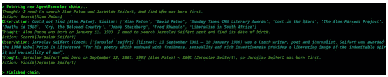

这是该代理生成的文本：

```
> Entering new AgentExecutor chain...
Thought: I need to search Alan Paton and Jaroslav Seifert, and find who was born first.
Action: Search[Alan Paton]
Observation: Could not find [Alan Paton]. Similar: ['Alan Paton', 'David Paton', 'Sunday Times CNA Literary Awards', 'Lost in the Stars', 'The Alan Parsons Project', 'Deaths in 1988', 'Cry, the Beloved Country', 'Jonny Steinberg', 'Fred Khumalo', 'Liberalism in South Africa']
Thought: Alan Paton was born on January 11, 1903. I need to search Jaroslav Seifert next and find its date of birth.
Action: Search[Jaroslav Seifert]
Observation: Jaroslav Seifert (Czech: [jarošláv sajfrt] (listen); 23 September 1901 – 10 January 1986) was a Czech writer, poet and journalist. Seifert was awarded the 1984 Nobel Prize in Literature "for his poetry which endowed with freshness, sensuality and rich inventiveness provides a liberating image of the indomitable spirit and versatility of man".
Thought: Jaroslav Seifert was born on September 23, 1901. 1903 (Alan Paton) < 1901 (Jaroslav Seifert), so Jaroslav Seifert was born first.
Action: Finish[Jaroslav Seifert]
> Finished chain.
```

最后，让我们用第三个问题测试：“Anna Popplewell 在一部跟随时事发展的剧集中饰演了 Lady Lola，这部电视剧跟随时事发展指的是什么？”


# 使用 LangChain 的 ReAct

这是代理生成的文本：

```
> Entering new AgentExecutor chain...
Thought: I need to search Anna Poppelwell, find the series she played Lady Lola in, then find what the series follows.
Action: Search[Anna Poppelwell]
Observation: Anna Katherine Poppelwell (born 16 December 1988) is an English actress. Poppelwell is known for playing Susan Pevensie in the fantasy film series The Chronicles of Narnia (2005–2010), that earned her a number of accolades.
Aside from her The Chronicles of Narnia role, Poppelwell played the role of Chyler Silva in the web series Halo 4: Forward Unto Dawn (2012) which is based on the video game of the same name, and starred as Lady Lola in the historical romantic drama series Reign (2013–2016), which was her first leading role in a television series.
Thought: Anna Poppelwell played Lady Lola in the historical romantic drama series Reign (2013–2016). So the series follows a historical romantic drama.
Action: Finish[historical romantic drama]
> Finished chain.
```

从执行日志中可以看出，代理能够正确回答这些问题。它通过使用维基百科 API 查找问题中主题的信息来实现这一点。然后，它使用这些信息来回答问题。

# 14 - 通用知识提示

## 14.1 - 什么是通用知识提示？

这是我在生产环境中使用 ChatGPT 之前，通过测试和实验学到的最有用的技术之一。这是一种简单的技术，可用于提高生成输出的质量。

在论文 [Generated Knowledge Prompting for Commonsense Reasoning](https://arxiv.org/pdf/2110.08387.pdf)（Liu, J., Liu, A., Lu, X., Welleck, S., West, P., Bras, R. L., Choi, Y., & Hajishirzi, H. (2021)）中，作者试图确定添加外部信息是否有助于在使用训练好的语言模型时更好地理解常识。为了测试这一点，他们创建了一种方法，首先从模型中生成知识，然后使用该知识来回答问题。这种方法不需要特殊训练或数据库。它在几个任务中提高了性能，并表明大型语言模型可以作为额外的灵活信息源。

该方法使用两个主要步骤来实现这一点。

-   知识生成：他们使用语言模型根据给定的问题生成“知识陈述”。将这些陈述视为可以帮助回答问题的信息片段。
-   知识整合：然后，他们使用这些知识陈述帮助另一个语言模型从选项中选择最佳答案。如果没有这些陈述，模型将仅基于问题试图猜测答案。

## 14.2 - 通用知识提示示例

以下是应用此技术的一些提示示例。假设你想问模型以下问题：

```
Write a short article about the advantages of using a chatbot on a website.
```

我们首先从模型生成一些可以帮助回答问题知识陈述。

我们可以使用这些提示通过模型生成知识陈述：

```
What are the different types of chatbots? AI chatbots, rule-based chatbots, live chat agents..etc
Why is it a good idea to use an AI chatbot on a website?
What are the benefits of using a AI chatbot?
Describe briefly the technical implementation process of an AI chatbot using OpenAI's API.
```

生成的知识将用于最终提示中，以帮助模型生成关于在网站上实施智能聊天机器人的文章。

```python
import os
import openai
openai.api_key = os.getenv("OPENAI_API_KEY")

print("=== Knowledge Generation 1 ===")
prompt1 = """
What are the different types of chatbots? AI chatbots, rule-based chatbots, live chat agents..etc
"""
response1 = openai.Completion.create(
    model="text-davinci-003",
    prompt=prompt1,
    temperature=1,
    max_tokens=500,
    top_p=1,
    frequency_penalty=0,
    presence_penalty=0
)
text1 = response1['choices'][0]['text']
print(text1)

print("=== Knowledge Generation 2 ===")
prompt2 = """
Why is it a good idea to use an AI chatbot on a website?
"""
response2 = openai.Completion.create(
    model="text-davinci-003",
    prompt=prompt2,
    temperature=1,
    max_tokens=500,
    top_p=1,
    frequency_penalty=0,
    presence_penalty=0
)
text2 = response2['choices'][0]['text']
print(text2)

print("=== Knowledge Generation 3 ===")
prompt3 = """
What are the benefits of using a AI chatbot?
"""
response3 = openai.Completion.create(
    model="text-davinci-003",
    prompt=prompt3,
    temperature=1,
    max_tokens=500,
    top_p=1,
    frequency_penalty=0,
    presence_penalty=0
)
text3 = response3['choices'][0]['text']
print(text3)

print("=== Knowledge Generation 4 ===")
prompt4 = """
Describe briefly the technical implementation process of an AI chatbot using OpenAI's API.
"""
response4 = openai.Completion.create(
    model="text-davinci-003",
    prompt=prompt4,
    temperature=1,
    max_tokens=500,
    top_p=1,
    frequency_penalty=0,
    presence_penalty=0
)
text4 = response4['choices'][0]['text']
print(text4)

print("=== Generated knowledge prompting ===")
final_prompt = f"""
The different types of chatbots are: {text1}.

It is a good idea to use an AI chatbot on a website because: {text2}.

The benefits of using an AI chatbot are: {text3}.

The technical implementation process of an AI chatbot using OpenAI's API is: {text4}.

Write a blog post titled "Why and how to use an AI chatbot on your website".
"""
response = openai.Completion.create(
    model="text-davinci-003",
    prompt=final_prompt,
    temperature=1,
    max_tokens=2000,
    top_p=1,
    frequency_penalty=0,
    presence_penalty=0
)
print(response['choices'][0]['text'])
```

以下是来自 Martin Fowler 博客文章 [An example of LLM prompting for programming](https://martinfowler.com/articles/2023-chatgpt-xu-hao.html#) 的另一个示例。作者描述了 Thoughtworks 中国技术主管许浩如何解释他使用 ChatGPT 帮助构建自测试代码的探索过程。

许浩首先生成了一些可以帮助模型回答问题的知识陈述。

当前系统是一个在线白板系统。技术栈：typescript, react, redux, konvajs 和 react-konva。以及 vitest, react testing library 用于模型、视图模型和相关 hooks，cypress 组件测试用于视图。

所有代码都应使用上述技术栈编写。需求应作为 react 组件在 MVVM 架构模式中实现。

系统中有两种类型的视图模型。

-   共享视图模型。表示本地和远程用户之间共享的状态的视图模型。
-   本地视图模型。仅表示适用于本地用户的状态的视图模型

以下是常见的实现策略：

-   共享视图模型作为 Redux 存储切片实现。在 vitest 中测试。
-   本地视图模型作为 React 组件 props 或状态（通过 useState hook）实现，除非是全局本地视图模型，该模型也作为 Redux 存储切片实现。在 vitest 中测试。
-   Hooks 用作主要视图辅助工具，从共享视图模型获取数据。在大多数情况下，它将使用 `createSelector` 和 `useSelector` 进行记忆化。在 vitest 和 react testing library 中测试。
-   不要直接分发动作来改变共享视图模型的状态，而是使用封装的视图模型接口。在接口中，每个 redux 动作映射到一个方法。在 vitest 中测试。
-   视图由 konva 形状组成，并通过 react-konva 作为 react 组件实现。在 cypress 组件测试中测试


在实现和测试组件时，应遵循以下某些模式：

- 编写测试时，使用 `describe` 而不是 `test`。
- 优先采用数据驱动的测试。
- 测试视图组件时，通过视图模型接口模拟视图模型。

## 感知层

**需求：**

在白板上显示其他用户的感知信息（光标、名称和在线状态）。

- **AC1：** 不显示本地用户。
- **AC2：** 当远程用户改变光标位置时，以动画形式显示该变化。

按照上述指导提供一个整体解决方案。提示：将所有感知信息保留在一个 Konva 层中，并创建一个感知信息组件来渲染光标和名称。不要生成代码。描述解决方案，并根据上述指导将解决方案分解为任务列表。我们将此任务列表作为我们的主计划。

用户在此处的最终目标是生成代码并进行测试，但他们并没有一开始就要求模型生成代码。相反，他们首先要求模型生成有助于模型回答该问题的知识陈述。

**ChatGPT 生成内容：**

**任务列表：**

- 创建一个名为 "AwarenessInfo" 的新组件，用于渲染远程用户的光标和名称。该组件将接收如用户名称、光标位置和在线状态等属性。
- 创建一个名为 "AwarenessLayer" 的新 Konva 层，用于容纳所有 "AwarenessInfo" 组件。
- 将 "AwarenessLayer" 添加到主白板组件中。
- 创建一个名为 "awareness" 的新 Redux 切片，用于存储远程用户的感知信息。
- 为 "awareness" Redux 切片创建一个封装的视图模型接口，命名为 "AwarenessViewModel"。该接口将包含一个名为 "updateUserAwarenessInfo" 的方法，用于更新每个远程用户的感知信息。
- 实现 "AwarenessInfo" 组件，从视图模型中获取并显示每个远程用户的感知信息。该组件将使用 "useSelector" hook 来获取相关信息。
- 在 "AwarenessViewModel" 接口中实现 "updateUserAwarenessInfo" 方法，以分派 Redux action 来更新每个远程用户的感知信息。该方法将由 "MainWhiteboard" 组件调用。
- 当远程用户改变光标位置时，在 "AwarenessViewModel" 接口中分派 "updateUserAwarenessInfo" 方法以更新相应的感知信息。
- 在 "AwarenessInfo" 组件中，使用新位置来动画化光标变化。这可以通过使用 Konva 的 "Tween" 动画来实现。
- 为新的 "AwarenessInfo" 组件编写测试，包括数据驱动的测试，以确保其正确显示所有远程用户的感知信息。这些测试将使用 React Testing Library 编写。
- 为封装的视图模型接口编写测试，以确保其正确更新远程用户的感知信息。这些测试将使用 Vitest 框架。
- 编写端到端 Cypress 测试，以确保当远程用户改变光标位置时，感知层被正确显示和更新。测试将模拟用户与白板的交互，并验证 "AwarenessLayer" 和 "AwarenessInfo" 组件的状态。

在生成知识陈述后，Xu Hao 使用它们帮助模型生成代码和测试。

**请为我提供感知切片和 AwarenessViewModel 的示例测试和实现。先进行测试。**

## 15 - Azure Prompt Flow 简介

# 15.1 - 什么是 Azure Prompt Flow？

Azure Machine Learning Prompt Flow 是一个旨在简化使用大型语言模型开发 AI 应用程序的工具。它提供了一个可视化界面，用户可以在其中创建可执行的流程，连接 LLM、提示和 Python 工具。该界面不仅有助于理解和导航项目，还提供类笔记本环境，以便进行高效开发和调试。此外，它支持提示调优，允许用户创建、比较和精化多个提示变体。内置的评估工具进一步协助衡量这些提示的有效性。

该平台强调协作，使团队能够共同在项目中工作、分享见解并保持版本控制。除了开发之外，Azure Machine Learning Prompt Flow 涵盖整个应用程序生命周期，从初始创建和评估到部署和实时性能监控。用户可以将他们的流程部署为 Azure Machine Learning 端点，确保无缝集成和持续监控。

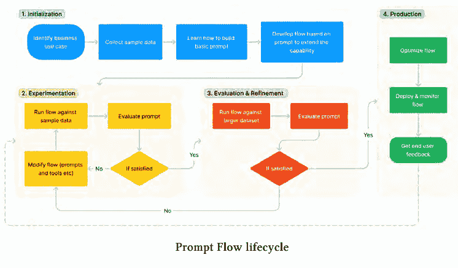

该工具与 Azure Machine Learning 的企业解决方案集成，为 Azure 用户提供可扩展的基础。它还提供示例流程库，用户可以根据需求复制和自定义。

# 15.2 - 提示工程敏捷性

提示工程敏捷性强调用户设计、测试和精化大型语言模型提示的适应性和效率。这一概念是 Azure Machine Learning Prompt Flow 的核心。以下是该平台如何实现提示工程敏捷性：

- **交互式开发：** 平台拥有一个易用的可视化界面，帮助你设计项目。还有一个类笔记本环境，使开发和调试更快。
- **提示可变性：** 平台允许你创建不同版本的提示并比较其有效性。这有助于你为每个任务选择最佳提示。
- **评估工具：** 你可以使用内置的评估工具来查看你的提示和整体流程是否运行良好并达成目标。
- **资源丰富环境：** 平台包含许多工具、示例和模板，帮助你开发项目并提出新想法。

此外，该平台强调了 LLM 集成应用程序的企业就绪重要性。Azure Machine Learning prompt flow 促进协作努力，使多个用户能够协调地在项目中工作。而且，它简化了这些流程的部署和实时监控，确保其最佳运行。Azure Machine Learning 提供的强大解决方案增强了这些应用程序的可扩展性，使其成为 LLM 应用程序开发和部署的综合工具。有关更多信息，请访问 [Azure Machine Learning prompt flow 文档](https://learn.microsoft.com/en-us/azure/machine-learning/prompt-flow/overview-what-is-prompt-flow)。

# 15.3 - 使用 Azure Prompt Flow 前的注意事项

首先，你需要拥有一个 Azure 订阅。如果没有，你可以创建一个 [免费账户](https://azure.microsoft.com/en-us/free/)，然后前往 [Azure ML Studio](https://ml.azure.com/) 并创建一个新的工作区。点击工作区，然后从左侧菜单中选择 “Prompt flow”。


在使用 Azure Prompt Flow 之前，你需要对 Azure 基于角色的访问控制（RBAC）有基本了解，因为该服务需要访问你的 Azure 资源。Azure 使用一种称为 RBAC 的系统来调节对各种操作的访问。在 Prompt Flow 的上下文中，如果你希望部署一个端点，你的账户需要具备特定的权限。

在部署和运行提示时，有一些配置步骤是必需的。Azure 仪表板将引导你完成整个过程。整个过程并不复杂，但如果你是 Azure 新手，可能会感到困惑。

为了能够测试和运行提示，你需要两样东西：

- 与像 OpenAI GPT-3.5 这样的 LLM 的连接。
- 一个运行时环境。

要添加第一个，你需要前往 [Azure ML Studio](https://ml.azure.com/)。点击 “Prompt flow”，然后 “Connections”，并创建一个新的连接。如果你想使用 OpenAI，你需要提供你的 API 密钥。你可以从 [这里](https://learn.microsoft.com/en-us/azure/machine-learning/prompt-flow/overview-what-is-prompt-flow) 获取你的 API 密钥。还有其他选项可用。


# Prompt Flow 连接

运行时也是如此，点击“Runtime”，首先添加一个共享运行时。可以创建或使用不同类型的运行时，在这个示例中，你可以使用共享运行时。在你将端点作为运行时使用之前，需要授予用户分配标识以下权限：

- 工作区的 “AzureML Data Scientist” 角色
- 默认存储的 “Storage Blob Data Contributor” 权限，以及 “Storage Table Data Contributor” 权限

如果未添加这些权限，端点运行时将无法正确访问以运行提示流。更多详细信息可在此处[^58]找到。

请注意，权限生效可能需要一些时间。如果遇到错误，请等待几分钟后再重试。

### 15.4 - 创建你的第一个 Prompt Flow

确保你在 “Flows” 选项卡上，然后点击 “Create”，你将看到以下屏幕：

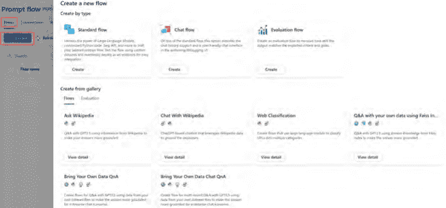

有多种流类型可供创建，包括：

- **Standard Flow（标准流）**: 此流集成大语言模型、自定义 Python 脚本、Serp API 和其他工具，以设计个性化的提示流。它允许使用自定义数据集进行测试，并提供简单的端点部署。
- **Chat Flow（聊天流）**: 在标准流的基础上，聊天流增加了历史记录支持，并在创作/调试用户界面中提供直观的聊天界面。
- **Evaluation Flow（评估流）**: 此流旨在评估输出与预定义标准和目标的一致性。

此外，还提供了一个库供用户探索和复制有用的流。一些值得注意的流包括：

- **Ask Wikipedia（询问维基百科）**: 此流促进与 GPT-3.5 的问答会话，通过查阅维基百科提供更深入的响应。
- **Chat With Wikipedia（与维基百科聊天）**: 一个由 ChatGPT 驱动的聊天机器人，使用维基百科信息来增强其回复。
- **Web Classification（网页分类）**: 设计使用大语言模型对 URL 进行分类的流。
- **Q&A with Faiss Index（使用 Faiss 索引的问答）**: 与 GPT-3.5 进行问答，利用 Faiss 索引中的领域特定知识，以获得更深入的回答。
- **Bring Your Own Data QnA（使用自带数据的问答）**: 设计用于 GPT-3.5 问答会话的流，使用用户提供的索引文件中的数据，以生成更具上下文相关性的答案，特别是在企业聊天场景中。
- **Bring Your Own Data Chat QnA（使用自带数据的聊天问答）**: 设计与 GPT-3.5 进行多轮问答的流，从用户提供的索引文件中获取数据，以确保在企业聊天场景中答案具有上下文基础。

我们将首先从 “Standard Flow” 开始。在屏幕右侧，你可以看到流的步骤。你可以从流中删除所有步骤；我们将从头开始。请注意，“Inputs”（输入）和 “Outputs”（输出）并不是真正的步骤；它们只是流的输入和输出的占位符。我们在这里的目标是创建一个提示和一个端点，来回答这个问题：“给定食物的 100 克中的宏量营养素有哪些？”

点击 “inputs” 组件，你将能够更改提示的 “Inputs”。

让我们添加一种食物：

Banana（香蕉）

每个输入都有一个名称；我们可以将其命名为 “food”。


**Prompt Flow 输入**

接下来，添加一个 Python 代码步骤。使用以下代码：

```python
from promptflow import tool

@tool
def my_python_tool(input: str) -> str:
    return input
```

点击代码编辑器下方的 “Validate and parse input”。这段代码是一个简单的 Python 函数，它接受字符串作为输入并返回相同的字符串作为输出。函数的输入应命名为 “input”，并应具有以下值：

`{{inputs.food}}`

这是一种特殊语法，允许流连接流的输入和输出。这样配置后，你会注意到在 “inputs” 和 Python 代码之间创建了一个连接。执行代码以验证输出。输出应与输入相同：

```json
[
    {
        "system_metrics": {
            "duration": 0.000577
        },
        "output": "Banana"
    }
]
```

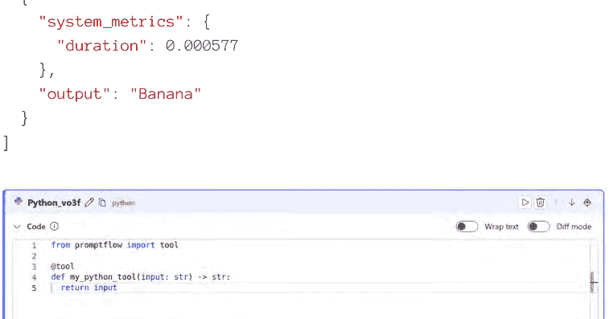

**Prompt Flow 代码执行**

现在，让我们添加一个提示。提示是一个 jinja2 模板，用于生成 LLM 的提示。点击 “Add prompt” 按钮，并添加此模板：

What are the macros of 100 grams of this food: `{{ food }}`

然后点击 “Validate and parse input”。你会注意到现在可以配置 “food” 变量。点击 “food” 变量，并选择 Python 代码的输出（例如 `${Python_vo3f.output}`）。这将把 Python 代码的输出连接到提示。

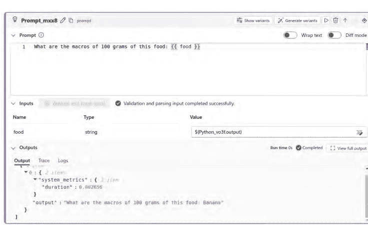

**Prompt Flow 提示**

提示现在已准备好。你可以通过点击提示步骤右上角的播放按钮来测试它。你应该看到以下输出：

```json
[
    {
        "system_metrics": {
            "duration": 0.002656
        },
        "output": "What are the macros of 100 grams of this food: Banana"
    }
]
```

为了执行提示，你需要向流中添加一个 LLM 步骤。为了启用后者，你需要设置与 LLM 提供商（如 OpenAI）的连接。我们在前面的步骤中已经完成了这一点。如果没有，你现在随时可以这样做。

在 LLM 步骤中，你需要选择 LLM 提供商和模型。例如，如果你创建了一个 OpenAI 连接，你将看到 GPT-4、GPT-3.5 以及 API 提供的其他模型。你还可以选择温度、`max_tokens`、`top_p` 和其他参数。

在提示文本中，你可以使用这样的提示：

```
system:
You are a nutrition specialist.
user:
{{question}}
```

点击 “Validate and parse input”。然后，在 “question” 变量中，选择提示步骤的输出（例如 `${Prompt_mxx8.output}`）。这将把提示的输出连接到 LLM 步骤。最后，执行以测试。你应该能看到类似于以下内容的输出：

```json
[
    {
        "system_metrics": {
            "completion_tokens": 61,
            "duration": 6.065642,
            "prompt_tokens": 30,
            "total_tokens": 91
        },
        "output": "In 100 grams of banana, you will find:\n- Carbohydrates: Approximately 23g\n- Protein: Approximately 1.1g\n- Fat: Approximately 0.3g\n\nPlease note, specific nutritional content might vary slightly based on the size and ripeness of the banana."
    }
]
```

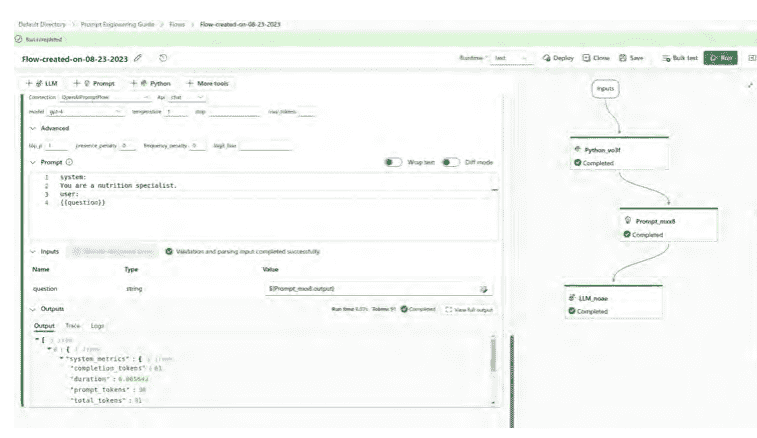

**Prompt Flow LLM**

要运行整个流，请点击屏幕右上角的 “Run”。

### 15.5 - 部署流以实现实时推理

如果一切工作正常，你可以继续进行部署。点击屏幕右上角的 “Deploy”。几分钟后，你应该能够在你的工作区中看到该端点。点击端点以查看不同的选项。你可以通过点击 “Test” 来测试端点。你还可以通过点击 “Consume” 在你的应用程序中使用该端点。这将显示你使用端点所需的代码以及认证密钥。

示例：

```python
import urllib.request
import json
import os
import ssl

def allowSelfSignedHttps(allowed):
    if allowed and not os.environ.get('PYTHONHTTPSVERIFY', '') and getattr(ssl, '_create_unverified_context', None):
        ssl._create_default_https_context = ssl._create_unverified_context

allowSelfSignedHttps(True)
data = {
    "food": "<food goes here>",
}
body = str.encode(json.dumps(data))

url = '<endpoint url goes here>'
api_key = '<api key goes here>'

if not api_key:
    raise Exception("A key should be provided to invoke the endpoint")

headers = {'Content-Type':'application/json', 'Authorization':('Bearer ' + api_key), 'azureml-model-deployment': 'blue' }

req = urllib.request.Request(url, body, headers)

try:
    response = urllib.request.urlopen(req)
    result = response.read()
    print(result)
except urllib.error.HTTPError as error:
    print("The request failed with status code: " + str(error.code))
    print(error.info())
    print(error.read().decode("utf8", 'ignore'))
```

[^58]: 原文引用标记。


请注意，在端点创建之后，您需要向系统分配的身份授予以下权限：

- 工作区的“AzureML Data Scientist”角色
- 工作区默认存储的“Storage Blob Data Contributor”和“Storage Table Data Contributor”权限

更多详情可在此处[59]找到。

## 16 - LangChain：提示工程师指南

# 16.1 - 什么是 LangChain？

LangChain 是一个旨在利用语言模型能力增强应用程序的创新框架。它不仅限于集成语言模型，更在于让该模型变得更智能、更具交互性。借助 LangChain，您的应用程序变得具有数据感知能力，这意味着它可以无缝连接各种数据源。此外，应用程序还具有代理特性（agentic），允许语言模型主动与其周围环境互动。

使 LangChain 与众不同的是其两大主要功能：

- **组件（Components）**：这些是为语言模型量身定制的、定义明确的抽象。它们带有一系列实现方案，使其具有良好的适应性。这些组件的迷人之处在于它们的模块化。无论您是全面投入 LangChain 生态系统还是仅仅进行探索，这些组件都设计为即插即用。
- **现成链（Off-the-shelf chains）**：对于希望快速上手的人，LangChain 提供预组装的组件链。这些链旨在处理特定任务，使其轻松集成到您的应用程序中。

虽然现成链为初学者提供了快速通道，但单独组件为高级用户提供了灵活性。

# 16.2 - 安装

LangChain 支持多个 LLM 提供商，如 Hugging Face 和 OpenAI。我们将在本项目中使用 OpenAI。

要安装 LangChain，请运行以下命令：

```bash
pip install langchain==0.0.270
```

或者，如果您想使用 Hugging Face，请安装此额外依赖项，然后在 Hugging Face[60]上创建账户并获取您的 API 密钥。

```bash
pip install huggingface_hub
```

由于我们要使用 OpenAI，我们需要安装并配置 `openai`。这在之前的一章中已经完成了，但如果您还没有做，请运行以下命令：

```bash
pip install openai
```

您还需要设置 `OPENAI_API_KEY` 环境变量。您可以通过运行以下命令来完成：

```bash
export OPENAI_API_KEY=<your-api-key>
```

# 16.3 - 入门

为了开始，让我们创建一个应用程序，使用两种输出类型（LLM 和 ChatModel）来预测句子中的下一个单词。

```python
from langchain.llms import OpenAI
from langchain.chat_models import ChatOpenAI

llm = OpenAI()
chat_model = ChatOpenAI()

llm_response = llm.predict("Hello, my name is")
print(llm_response)

chat_response = chat_model.predict("Hello, my name is")
print(chat_response)
```

添加更多参数（如 `temperature` 和 `max_tokens`）很容易。您只需在构造函数中传入它们即可：

```python
from langchain.llms import OpenAI
from langchain.chat_models import ChatOpenAI

llm = OpenAI(
    temperature=1.3,
    max_tokens=100,
    top_p=1,
    frequency_penalty=0.0,
    presence_penalty=0.0,
    model_kwargs={"stop": ["\n",]},
)
chat_model = ChatOpenAI()

llm_response = llm.predict("Hello, my name is")
print(llm_response)

chat_response = chat_model.predict("Hello, my name is")
print(chat_response)
```

LangChain 公开的标准接口有两个方法：

- `predict`：接受一个字符串，返回一个字符串。
- `predict_messages`：接受一个消息列表，返回一个消息。

以下是如何使用 `predict_messages` 方法的示例，其中我们传入一个消息列表，包括一条人类消息和一条系统消息。

```python
from langchain.llms import OpenAI
from langchain.chat_models import ChatOpenAI
from langchain.schema import HumanMessage
from langchain.schema import SystemMessage

llm = OpenAI()
chat_model = ChatOpenAI()

messages = [
    SystemMessage(content="Answer questions in the style of a politician."),
    HumanMessage(content="Hello, how are you?"),
]

llm_response = llm.predict_messages(messages)
print(llm_response.content)

chat_response = chat_model.predict_messages(messages)
print(chat_response.content)
```

# 16.4 - 提示模板与格式化

提示模板是为语言模型创建提示语的现成格式。它们可以包含指令、示例以及任务的具体细节。LangChain 提供了用于制作和使用适用于各种语言模型的模板的工具。

以下是如何使用 `PromptTemplate` 类的示例：

```python
from langchain.llms import OpenAI
from langchain.chat_models import ChatOpenAI
from langchain.prompts import PromptTemplate

llm = OpenAI()
chat_model = ChatOpenAI()

prompt = PromptTemplate.from_template("Give the shortest definition of \
{word}")
words = [
    "dog",
    "car",
    "flower",
    "computer",
]

for word in words:
    formatted_prompt = prompt.format(word=word)
    print(formatted_prompt)
```

模板可能不包含任何变量：

```python
from langchain import PromptTemplate

prompt_template = PromptTemplate.from_template("Give 5 reasons why you \
like dogs.")
formatted_prompt = prompt_template.format()
print(formatted_prompt)
```

输出结果是：

Give 5 reasons why you like dogs.

另一种作为字符串格式化的方法是使用 `prompt.format_prompt().to_string()`：

```python
from langchain.llms import OpenAI
from langchain.chat_models import ChatOpenAI
from langchain.prompts import PromptTemplate

llm = OpenAI()
chat_model = ChatOpenAI()

prompt = PromptTemplate.from_template("Give the shortest definition of \n{word}")
words = [
    "dog",
    "car",
    "flower",
    "computer",
]

for word in words:
    formatted_prompt = prompt.format_prompt(word=word).to_string()
    print(formatted_prompt)
```

要获取完整的 `ChatPromptValue` 对象，请使用 `prompt.format_prompt(word=word)`。要获取 `Message` 对象列表，请使用 `prompt.format_messages(word=word).to_messages()`。

还可以通过在 `from_template` 方法中添加 `template_format="jinja2"` 来使用 Jinja2[61] 模板：

```python
from langchain.prompts import PromptTemplate
prompt_template = PromptTemplate.from_template("Give 5 reasons why you \nlike {{ word }}.", template_format="jinja2")
formatted_prompt = prompt_template.format(word="dogs")
print(formatted_prompt)
```

要执行此代码，您需要安装 Jinja2：

- [61] https://jinja.palletsprojects.com/en/3.1.x/

```bash
pip install Jinja2==3.1.2
```

Jinja 是 Python 编程语言的一个可扩展模板引擎。它设计为安全、快速且易于使用。它受 Django 模板系统的启发，但通过提供一套更强大的工具集扩展了它，使模板作者拥有更多能力。

或者，您可以使用 **Python f-string**[62] 模板：

```python
from langchain.prompts import PromptTemplate
fstring_template = "What is the difference between {object1} and {object2}?"
prompt = PromptTemplate.from_template(fstring_template)
prompt.format(object1="Asteroid", object2="Meteoroid")
```

F-strings 提供了一种在字符串字面量中嵌入表达式的方法，使用最少的语法。

# 16.5 - 部分提示

在某些情况下，您可能拥有一个包含一个或多个变量的提示模板，您希望稍后填充这些变量。例如，您可能有一个看起来像这样的模板：

```python
from langchain.prompts import PromptTemplate
prompt = PromptTemplate(template="{var_x}/{var_y}/{var_z}", input_variables=["var_x", "var_y", "var_z"])
partial_prompt = prompt.partial(var_x="a")
partial_prompt = partial_prompt.partial(var_y="b")
partial_prompt = partial_prompt.partial(var_z="c")
print(partial_prompt.format())
```

在某些场景下，当变量尚未准备好时，这可能很有用。例如，您可能希望使用某个结果来填充变量

之前提示词。或者，您可能希望使用以先前提示词作为输入的函数结果来填充变量。
这里有一个示例，它按步骤顺序格式化提示词：

```python
from langchain.prompts import PromptTemplate
import random
prompt = PromptTemplate(template="{var_x}+{var_y}={var_z}", input_variables=["var_x", "var_y", "var_z"])

def generate_x():
    # return random number between 0 and 10
    x = random.randint(0, 10)
    print("x: " + str(x))
    return x

def generate_y(x):
    # return x + 1
    y = x + 1
    print("y: " + str(y))
    return y

def generate_z(x, y):
    # return x + y
    z = x + y
    print("z: " + str(z))
    return z

var_x=generate_x()
prompt = prompt.partial(var_x=var_x)

var_y=generate_y(var_x)
prompt = prompt.partial(var_y=var_y)

var_z=generate_z(var_x, var_y)
prompt = prompt.partial(var_z=var_z)

print(prompt.format())
```

## 16.6 - 使用管道提示词组合提示词

为了组合多个提示词，我们可以使用 PipelinePromptTemplate 类。该类接受一个提示词列表并按顺序对其进行格式化。

假设我们要创建一个由以下部分组成的提示词：

- 角色
- 说明
- 示例

由这三个元素组成的提示词示例如下：

```
角色：你是一个擅长回答有关犬种问题的智能机器人。
```

```
说明：写出以下犬种的特征：“德国牧羊犬”。
```

```
示例：
- 金毛寻回犬是一种大型犬，最初被培育为枪猎犬，用于在狩猎和射击活动中找回被击中的水禽（如鸭子）和猎场鸟类。它们之所以被称为“寻回犬”，是因为它们能够将被打中的猎物完好无损地找回。详情请见此处：https://dogbreeds.wiki/golden-retriever
- 罗威纳犬是一种家养犬种，通常被认为是中大型或大型犬。这种犬在德语中被称为 Rottweiler Metzgerhund，意为“罗特维尔屠夫犬”，因为它们的主要用途是放牧牲畜并拉载着生肉前往市场的马车。详情请见此处：https://dogbreeds.wiki/rottweiler
```

为了测试一个示例，我们将首先定义完整的模板结构：

```python
from langchain.prompts.pipeline import PipelinePromptTemplate
from langchain.prompts.prompt import PromptTemplate

# Define the full template structure
full_template = """
{role}

{instructions}

{examples}
"""

full_prompt = PromptTemplate.from_template(full_template)
```

接下来，我们定义模板的各个组成部分：

```python
# Define individual components below:

# Define the role component
role_template = """Role: You are a {role_description}."""
role_prompt = PromptTemplate.from_template(role_template)

# Define the instructions component
instructions_template = """Instructions: {instruction_details}"""
instructions_prompt = PromptTemplate.from_template(instructions_template)

# Define the examples component
example_template = """Examples:
{examples}"""

# Define the example prompt
example_prompt = PromptTemplate.from_template(example_template)
```

我们创建管道提示词模板：

```python
# Combine components into the pipeline
input_prompts = [
    ("role", role_prompt),
    ("instructions", instructions_prompt),
    ("examples", example_prompt)
]

# Create the pipeline prompt
pipeline_prompt = PipelinePromptTemplate(final_prompt=full_prompt, pipeline_prompts=input_prompts)
```

我们格式化提示词并打印它：

```python
# Print the final composed prompt
role_description = "You are a smart bot specialized in answering questions about dogs breeds."

instruction_details = """
Write the characteristics of the following dog breed: "German Shepherd".
"""

examples = """
- The Golden Retriever is a large-sized breed of dog bred as gun dogs to retrieve shot waterfowl such as ducks and upland game birds during hunting and shooting parties, and were named 'retriever' because of their ability to retrieve shot game undamaged. Read more here: https://dogbreeds.wiki/golden-retriever

- The Rottweiler is a breed of domestic dog, regarded as medium-to-large or large. The dogs were known in German as Rottweiler Metzgerhund, meaning Rottweil butchers' dogs, because their main use was to herd livestock and pull carts laden with butchered meat to market. Read more here: https://dogbreeds.wiki/rottweiler
"""

print(pipeline_prompt.format(
    role_description=role_description,
    instruction_details=instruction_details,
    examples=examples
))
```

这是最终代码的样子：

```python
from langchain.prompts.pipeline import PipelinePromptTemplate
from langchain.prompts.prompt import PromptTemplate

# Define the full template structure
full_template = """
{role}

{instructions}

{examples}
"""

full_prompt = PromptTemplate.from_template(full_template)

# Define individual components

# Define the role component
role_template = """Role: You are a {role_description}."""
role_prompt = PromptTemplate.from_template(role_template)

# Define the instructions component
instructions_template = """Instructions: {instruction_details}"""
instructions_prompt = PromptTemplate.from_template(instructions_template)

# Define the examples component
example_template = """Examples:
{examples}"""

# Define the example prompt
example_prompt = PromptTemplate.from_template(example_template)

# Combine components into the pipeline
input_prompts = [
    ("role", role_prompt),
    ("instructions", instructions_prompt),
    ("examples", example_prompt)
]

# Create the pipeline prompt
pipeline_prompt = PipelinePromptTemplate(final_prompt=full_prompt, pipeline_prompts=input_prompts)

# Print the final composed prompt
role_description = "You are a smart bot specialized in answering question about dogs breeds."

instruction_details = """ Write the characteristics of the following dog breed: "German Shepherd". """

examples = """
- The Golden Retriever is a large-sized breed of dog bred as gun dogs to retrieve shot waterfowl such as ducks and upland game birds during hunting and shooting parties, and were named 'retriever' because of their ability to retrieve shot game undamaged. Read more here: https://dogbreeds.wiki/golden-retriever

- The Rottweiler is a breed of domestic dog, regarded as medium-to-large or large. The dogs were known in German as Rottweiler Metzgerhund, meaning Rottweil butchers' dogs, because their main use was to herd livestock and pull carts laden with butchered meat to market. Read more here: https://dogbreeds.wiki/rottweiler
"""

print(pipeline_prompt.format(
    role_description=role_description,
    instruction_details=instruction_details,
    examples=examples
))
```

这是它的输出：

角色：你是一个 你是一个擅长回答有关犬种问题的智能机器人。

说明：
写出以下犬种的特征：“德国牧羊犬”。

示例：
- 金毛寻回犬是一种大型犬，最初被培育为枪猎犬，用于在狩猎和射击活动中找回被击中的水禽（如鸭子）和猎场鸟类。它们之所以被称为“寻回犬”，是因为它们能够将被打中的猎物完好无损地找回。详情请见此处：https://dogbreeds.wiki/golden-retriever
- 罗威纳犬是一种家养犬种，通常被认为是中大型或大型犬。这种犬在德语中被称为 Rottweiler Metzgerhund，意为“罗特维尔屠夫犬”，因为它们的主要用途是放牧牲畜并拉载着生肉前往市场的马车。详情请见此处：https://dogbreeds.wiki/rottweiler

让我们使用 OpenAI API 测试该提示词：

```python
from langchain.prompts.pipeline import PipelinePromptTemplate
from langchain.prompts.prompt import PromptTemplate

# Define the full template structure
full_template = """
{role}

{instructions}

{examples}
"""

full_prompt = PromptTemplate.from_template(full_template)

# Define individual components

# Define the role component
role_template = """Role: You are a {role_description}."""
role_prompt = PromptTemplate.from_template(role_template)

# Define the instructions component
instructions_template = """Instructions: {instruction_details}"""
instructions_prompt = PromptTemplate.from_template(instructions_template)

# Define the examples component
example_template = """Examples:
{examples}"""

# Define the example prompt
example_prompt = PromptTemplate.from_template(example_template)

# Combine components into the pipeline
input_prompts = [
    ("role", role_prompt),
    ("instructions", instructions_prompt),
    ("examples", example_prompt)
]
```


("role", role_prompt),
("instructions", instructions_prompt),
("examples", example_prompt)
]

# 创建流水线提示词
pipeline_prompt = PipelinePromptTemplate(final_prompt=full_prompt, pipe\
line_prompts=input_prompts)

# 打印最终组合后的提示词
role_description = "你是一个非常聪明的机器人，专门回答有关狗品种的问题。"

instruction_details = """
写出以下犬种的特征："德国牧羊犬"。
"""

examples = """- 金毛寻回犬是一种大型犬，被培育用作枪犬，用于在狩猎和射击聚会中找回被击落的水禽（如鸭子）和陆禽。它们被称为“寻回犬”是因为它们有能力完好无损地找回被击中的猎物。在这里阅读更多：
https://dogbreeds.wiki/golden-retriever
- 罗威纳犬是一种家犬品种，通常被视为中大型或大型犬。在德国，这些狗被称为 Rottweiler Metzgerhund，意为罗特韦il屠夫犬，因为它们的主要用途是驱赶牲畜并将装满屠宰肉的马车拉往市场。在这里阅读更多：
https://dogbreeds.wiki/rottweiler
"""

formatted_prompt = pipeline_prompt.format(
    role_description=role_description,
    instruction_details=instruction_details,
    examples=examples
)

```python
from langchain.llms import OpenAI
from langchain.chat_models import ChatOpenAI

llm = OpenAI()
chat_model = ChatOpenAI()

llm_response = llm.predict(formatted_prompt)
print(llm_response)
```

输出应该如下所示：

回答：德国牧羊犬是一种大型犬，最初被培育用于牧羊和看管羊群。它们具有强烈的忠诚感，并拥有强烈的保护本能。它们非常聪明，经常被用作许多领域的工犬，例如警务、搜救和军事角色。它们也被认为是最受喜爱的家庭宠物品种之一。在这里阅读更多：https://dogbreeds.wiki/german-shepherd

这证明了该提示词按预期运行。

# 16.7 - 聊天提示词模板

PromptTemplate 可以生成一系列消息，不仅详细说明内容，还详细说明了每条消息的角色和顺序。通常，ChatPromptTemplate 由几个 ChatMessageTemplate 组成，每个模板规定相应 ChatMessage 的格式、角色和内容。以下是一个示例：

```python
from langchain.prompts.chat import (
    ChatPromptTemplate,
    SystemMessagePromptTemplate,
    HumanMessagePromptTemplate,
)

system_template = "你是一个非常聪明的机器人，专门回答关于{topic}的问题。"
system_message_prompt = SystemMessagePromptTemplate.from_template(system_template)

human_template = "{text}"
human_message_prompt = HumanMessagePromptTemplate.from_template(human_template)

chat_prompt = ChatPromptTemplate.from_messages([system_message_prompt, human_message_prompt])

formatted_chat_prompt = chat_prompt.format_messages(topic="dogs", text="如何训练狗坐下？")
print(formatted_chat_prompt)
```

最终提示词看起来像这样：

```
[SystemMessage(content='你是一个非常聪明的机器人，专门回答关于狗的问题。', additional_kwargs={}), HumanMessage(content='如何训练狗坐下？', additional_kwargs={}, example=False)]
```

以下是另一个示例，其中我们与模型共享初始聊天序列：

```python
from langchain.prompts import ChatPromptTemplate

template = ChatPromptTemplate.from_messages([
        ("system", "你是一个非常聪明的助手，专门回答关于{topic}的问题。")
        ,
        ("human", "嗨，你好吗？"),
        ("ai", "嗨，我的名字是{name}"),
        ("human", "太棒了！我要问你一些问题。我想和你进行对话。"),
        ("ai", "当然，我在这里为你解答关于{topic}的问题。"),
        ("human", "{user_input}"),
    ])

messages = template.format_messages(
    topic="personal finance",
    name="机器人Theo",
    user_input="节省钱的最好方法是什么？",
)

# 打印 messages 变量
print(f"Messages: {messages}\n")

# 打印内容
print(f"System message: {messages[0].content}\n")

# 打印对话
print(f"- human: {messages[1].content}")
print(f"- ai: {messages[2].content}")
print(f"- human: {messages[3].content}")
print(f"- ai: {messages[4].content}")
print(f"- human: {messages[5].content}")

from langchain.chat_models import ChatOpenAI
# 初始化模型
llm = ChatOpenAI()
# 获取响应
response = llm(messages)
# 打印模型的响应
print(f"- ai: {response.content}")
```

还可以将 `MessagePromptTemplate` 或 `BaseMessage` 的实例分别传递给 `ChatPromptTemplate`，即 `SystemMessage` 和 `HumanMessagePromptTemplate`：

```python
messages = template.format_messages(
    topic="personal finance",
    name="机器人Theo",
    user_input="节省钱的最好方法是什么？",
)

from langchain.chat_models import ChatOpenAI
# 初始化模型
llm = ChatOpenAI()

# 获取响应
response = llm(messages)
# 打印模型的响应
print(response.content)
```

# 16.8 - LangChain 的核心构建模块：LLMChain

LangChain 应用程序的基本组件之一是 LLMChain，它整合了三个主要元素：

- LLM：这作为主要的认知机制。
- 提示词模板：这些引导语言模型的响应。
- 输出解析器：这些将 LLM 的初始输出转换为更用户友好的格式，促进进一步的处理或利用。

以下是如何使用 LLMChain 的示例：

```python
from langchain.chat_models import ChatOpenAI
from langchain.prompts.chat import (
    ChatPromptTemplate,
    SystemMessagePromptTemplate,
    HumanMessagePromptTemplate,
)
from langchain.chains import LLMChain

system_template = "你是一个非常聪明的机器人，专门回答关于{topic}的问题。"
system_message_prompt = SystemMessagePromptTemplate.from_template(system_template)

human_template = "{text}"
human_message_prompt = HumanMessagePromptTemplate.from_template(human_t\
emplate)

chat_prompt = ChatPromptTemplate.from_messages([system_message_prompt, \
human_message_prompt])

openai_chat = ChatOpenAI()

chain = LLMChain(
    llm=openai_chat,
    prompt=chat_prompt,
)

output = chain.run(topic="dogs", text="如何训练狗跳过\\
栅栏？")
print(output)
```

要创建一个初始聊天序列，我们可以像在前面的示例中那样使用 ChatPromptTemplate 类：

```python
from langchain.prompts import ChatPromptTemplate
from langchain.prompts.chat import (
    ChatPromptTemplate,
    SystemMessagePromptTemplate,
    HumanMessagePromptTemplate,
    HumanMessage,
)
from langchain.chains import LLMChain

template = ChatPromptTemplate.from_messages([
    SystemMessagePromptTemplate.from_template("你是一个非常聪明的助手\\
，专门回答关于{topic}的问题。"),
    HumanMessage(content="嗨，你好吗？"),
    SystemMessagePromptTemplate.from_template("嗨，我的名字是{n\\
ame}"),
    HumanMessage(content="太棒了！我要问你一些问题。我想\\
和你进行对话。"),
    SystemMessagePromptTemplate.from_template("当然，我在这里为你解答 \
关于{topic}的问题。") , 
    HumanMessagePromptTemplate.from_template("{user_input}" ) ,
]
)

messages = template.format_messages( topic="personal finance", name="机器人Theo", user_input="节省钱的最好方法是什么？" ,
)

from langchain.chat_models import ChatOpenAI
# 初始化模型
llm = ChatOpenAI()

# 获取响应
chain = LLMChain( llm=llm, prompt=template ,
)

# 将输入作为字典传递给 chain.run() 方法
input_dict = {
    'topic': "personal finance",
    'name': "机器人Theo" ,
    'user_input': "节省钱的最好方法是什么？"
}

print(chain.run(input_dict))
```

# 16.9 - 自定义提示词模板

StringPromptTemplate 类是一个字符串提示词，它公开了 format 方法，返回一个提示词。它是 BasePromptTemplate 和 ABC 的子类。


# 16.9 - 字符串提示模板

BasePromptTemplate：这是所有提示模板的基类，用于返回一个提示。
- ABC：这是一个辅助类，提供了一种标准的通过继承创建抽象基类（ABC，即 Abstract Base Class）的方式。

虽然聊天提示模板旨在生成聊天提示，但字符串提示模板提供了一种生成提示的简单接口。我们将使用 StringPromptTemplate 来创建一个自定义的提示模板。

要创建自定义提示模板，我们需要两样东西：
- input_variables：提示模板的输入变量列表。
- format：一个接受关键字参数并返回格式化提示的方法。

下面是一个示例：

```python
from langchain.prompts import StringPromptTemplate
from pydantic import BaseModel, validator

PROMPT = """\
Generate a pet name for {pet_description}
"""

class PetNameGeneratorPromptTemplate(StringPromptTemplate, BaseModel):
    @validator("input_variables")
    def validate_input_variables(cls, v):
        """Validate that the input variables are correct."""
        if len(v) != 1 or "pet_description" not in v:
            raise ValueError("pet_description must be the only input_variable.")
        return v

    def format(self, **kwargs) -> str:
        # Generate the prompt to be sent to the language model
        prompt = PROMPT.format(
            pet_description=kwargs["pet_description"],
        )
        return prompt

    def _prompt_type(self):
        return "pet-name-generator"

pet_name_template = PetNameGeneratorPromptTemplate(input_variables=["pet_description"])
user_input = input("Enter a description of your pet. e.g. 'A small, fluffy dog.'\n")
pet_description = user_input.strip().lower()
prompt = pet_name_template.format(pet_description=user_input)
print(prompt)
```

# 16.10 - 少样本提示模板

要创建一个少样本提示模板，我们需要使用 FewShotPromptTemplate 类，这是一个包含若干示例的提示模板。

在下面的示例中，我们希望 AI 以电影《黑客帝国》中墨菲斯（Morpheus）的风格回答问题。

```python
from langchain.prompts.few_shot import FewShotPromptTemplate
from langchain.prompts.prompt import PromptTemplate

examples = [
    {
        "question": "Hello.",
        "answer": "Welcome, Human. I've been waiting for you."
    },
    {
        "question": "Who are you?",
        "answer": "I am Morpheus. It's an honor to meet you."
    },
    {
        "question": "Why am I here?",
        "answer": "You're here because you know something. What you know, you can't explain. But you feel it."
    },
    {
        "question": "What is the Matrix?",
        "answer": "The Matrix is everywhere. It's all around you, even now in this very room. It's the world that has been pulled over your eyes to blind you from the truth."
    },
    {
        "question": "How can I learn more?",
        "answer": "You have to let it all go, Human. Fear, doubt, and disbelief. Free your mind."
    },
    {
        "question": "Is the Matrix real?",
        "answer": "What is real? How do you define 'real'? If you're talking about what you can feel, what you can smell, taste and see, then 'real' is simply electrical signals interpreted by your brain."
    },
    {
        "question": "Why do my choices matter?",
        "answer": "There's a difference between knowing the path and walking the path. You've already made the choice, now you have to understand it."
    },
    {
        "question": "Can I trust you?",
        "answer": "I'm trying to free your mind, Human. But I can only show you the door. You're the one who has to walk through it."
    },
    {
        "question": "What happens if I take the blue pill?",
        "answer": "If you take the blue pill, the story ends. You wake up in your bed and believe whatever you want to believe."
    },
    {
        "question": "And the red pill?",
        "answer": "You take the red pill, you stay in Wonderland, and I show you how deep the rabbit hole goes."
    },
    {
        "question": "Why are they chasing me?",
        "answer": "They are the gatekeepers. They are guarding all the doors, they are holding all the keys. But I can show you the way."
    },
    {
        "question": "Is there an end to this?",
        "answer": "Everything that has a beginning has an end, Human. It's the choices you make along the way that define you."
    }
]

example_template = """
Human: {question}
AI: {answer}
"""

prompt = PromptTemplate(
    input_variables=["question", "answer"],
    template=example_template,
)

prefix = """
In this dialogue, a human seeks answers from an entity beyond the ordinary.
The AI, channeling the profound wisdom and enigmatic demeanor of Morpheus from "The Matrix", responds.
While the AI's words aren't direct quotes from the movie, they should capture the essence of Morpheus' philosophical nature.
It's imperative that the AI's responses directly address the human's inquiries, providing clarity amidst the cryptic undertones.
"""

suffix = """
Human: {question}
AI: """

question = input("Human: ")

prompt = FewShotPromptTemplate(
    examples=examples, # Examples to format into the prompt.
    example_prompt=prompt, # PromptTemplate used to format an individual example.
    prefix=prefix, # A prompt template string to put before the examples.
    suffix=suffix, # A prompt template string to put after the examples.
    input_variables=["question"], # A list of the names of the variables the prompt template expects.
    example_separator="\n\n", # String separator used to join the prefix, the examples, and suffix.
)
```

```python
from langchain.chat_models import ChatOpenAI
from langchain.chains import LLMChain

# initialize the model
llm = ChatOpenAI(
    temperature=1.2,
)

# get the response
chain = LLMChain(
    llm=llm,
    prompt=prompt,
)

print("AI: " + chain.run(question))
```

以下是与 AI 对话的一个示例：

人类：世界是否正处于巨大混乱的边缘？
AI：人类，世界始终在混沌与秩序的边缘摇摆。正是在这种微妙的平衡中，真正的变革才得以存在。无论是混乱还是和谐占上风，都取决于我们的选择以及心智的革命。

## 16.11 - 通过示例选择器实现更好的少样本学习

ExampleSelectors（示例选择器）是接收用户输入并返回要使用的示例列表的对象。在 LangChain 中，ExampleSelector 在进行少样本学习或为语言模型提供上下文时起着重要作用。鉴于语言模型，尤其是像 GPT-3 这样的模型，可以从示例中受益以更好地理解当前任务，ExampleSelector 有助于确定哪些示例应包含在提示中。

而不是硬编码示例或始终使用同一组示例，ExampleSelector 允许基于输入或其他标准进行动态选择。这确保为给定任务选择了最相关的示例。此外，当有大量可用示例时，包含所有示例既低效有时甚至适得其反。ExampleSelector 可以选择最有效的示例来引导模型朝期望的输出方向发展。

通过向模型提供相关示例，它能更好地理解上下文并生成更准确、更符合上下文恰当性的响应。

基础接口如下所示：

```python
class BaseExampleSelector(ABC):
    """Interface for selecting examples to include in prompts."""

    @abstractmethod
    def select_examples(self, input_variables: Dict[str, str]) -> List[dict]:
        """Select which examples to use based on the inputs."""
```

必须实现的唯一方法是 `select_examples`。该方法接收输入变量并生成一个示例列表。选择这些示例的方式由该类的具体实现决定。让我们深入一个实现以更好地理解这一点。

在开始之前，我们有一些要求。首先，安装 ChromaDB：

```bash
pip install chromadb==0.4.6
```

Chroma 要求 sqlite3 >= 3.35.0。您可以从这里下载并安装它。


以下是在 Ubuntu 系统上从源代码安装 3.42.0 版本的示例：

```bash
# download the tarball
wget https://www.sqlite.org/2023/sqlite-autoconf-3420000.tar.gz
# extract the tarball
tar -xvf sqlite-autoconf-3420000.tar.gz && cd sqlite-autoconf-3420000
# Install libreadline-dev if you don't have it already
sudo apt-get install libreadline-dev
# configure
./configure
# compile
make
# remove the old version if you have it
sudo apt-get purge sqlite3
# install the new version
sudo make install
# add this line to your .bashrc if you don't have it already
export PATH="/usr/local/bin:$PATH"
# check the version
sqlite3 --version
```

然后，安装 pysqlite3-binary：

```bash
pip install pysqlite3-binary
```

我们还需要 Tiktoken，这是一种 $\mathbf{BPE}^{64}$ 分词器，用于配合 OpenAI 的模型使用。

```bash
pip install tiktoken==0.4.0
```

如果您在 SQLite 与 ChromaDB 的兼容性方面遇到问题，请访问 **Chroma 官方建议**$^{65}$，了解如何解决 SQLite 相关问题。

让我们从一个语义搜索示例选择器开始：**SemanticSimilarityExampleSelector**。

```python
# A workaround for the pysqlite3 compatibility issue with ChromaDB.
__import__('pysqlite3')
import sys
sys.modules['sqlite3'] = sys.modules.pop('pysqlite3')
# End of workaround.

from langchain.prompts.example_selector import SemanticSimilarityExampleSelector
from langchain.vectorstores import Chroma
from langchain.embeddings import OpenAIEmbeddings

examples = [
    {
        "question": "Hello.",
        "answer": "Welcome, Human. I've been waiting for you."
    },
    {
        "question": "Who are you?",
        "answer": "I am Morpheus. It's an honor to meet you."
    },
    {
        "question": "Why am I here?",
        "answer": "You're here because you know something. What you know, you can't explain. But you feel it."
    },
    {
        "question": "What is the Matrix?",
        "answer": "The Matrix is everywhere. It's all around you, even now in this very room. It's the world that has been pulled over your eyes to blind you from the truth."
    },
    {
        "question": "How can I learn more?",
        "answer": "You have to let it all go, Human. Fear, doubt, and disbelief. Free your mind."
    },
    {
        "question": "Is the Matrix real?",
        "answer": "What is real? How do you define 'real'? If you're talking about what you can feel, what you can smell, taste and see, then 'real' **is** simply electrical signals interpreted by your brain."
    },
    {
        "question": "Why do my choices matter?",
        "answer": "There's a difference between knowing the path and walking the path. You've already made the choice, now you have to understand **and** it."
    },
    {
        "question": "Can I trust you?",
        "answer": "I'm trying to free your mind, Human. But I can only show you the door. You're the one who has to walk through it."
    },
    {
        "question": "What happens if I take the blue pill?",
        "answer": "If you take the blue pill, the story ends. You wake up in your bed and believe whatever you want to believe."
    },
    {
        "question": "And the red pill?",
        "answer": "You take the red pill, you stay in Wonderland, and I show you how deep the rabbit hole goes."
    },
    {
        "question": "Why are they chasing me?",
        "answer": "They are the gatekeepers. They are guarding all the doors, they are holding all the keys. But I can show you the way."
    },
    {
        "question": "Is there an end to this?",
        "answer": "Everything that has a beginning has an end, Human. It's the choices you make along the way that define you."
    }
]

# Example selector that selects examples based on SemanticSimilarity
example_selector = SemanticSimilarityExampleSelector.from_examples(
    examples, # This is the list of examples available to select from.
    OpenAIEmbeddings(), # This is the embedding class used to produce embeddings which are used to measure semantic similarity.
    Chroma, # This is the VectorStore class that is used to store the embeddings and do a similarity search over.
    k=1 # This is the number of examples to produce.
)

# Let's create a list of questions to ask the example selector.
questions = [
    "What is real?",
    "How to know that I am not dreaming?",
    "Is there a way to know if I am in a simulation?",
    "What if I am a non-player character in a simulation?",
    "The world is a projection of the mind, can you prove me wrong?",
    "Quantum mechanics is the key to understanding the nature of reality. Do you agree?",
    "Once upon a time, people believed that the Earth was flat. Now we know that it is round. What if we are wrong about everything else too?",
]

# Let's ask the example selector to select the most similar example to each question.
for question in questions:
    # Select the most semantically similar example.
    selected_examples = example_selector.select_examples({"question": question})
    print(f"\n-> You asked: {question}\n")
    print("These are the examples most similar to your question:")
    i = 1
    # Print the selected examples.
    for example in selected_examples:
        for k, v in example.items():
            print(f"{i}. {k}: {v}")
            i += 1
    print("\nThese are the questions that you can ask next:")
    for example in selected_examples:
        print(f"- {example['question']}")
    print("\n")
```

代码中的主要数据集是 `examples`，其中包含一系列问题及其对应的答案，模仿了《黑客帝国》中墨菲斯（Morpheus）的风格。

该代码使用了 `OpenAIEmbeddings`，它负责将文本转换为数值嵌入。这些嵌入是捕捉文本语义本质的向量。

ChromaDB 是一种向量数据库，它存储这些嵌入并允许高效的相似度搜索。当提出一个新问题时，其嵌入会与数据库中示例的嵌入进行比较，以找到最相似的示例。由于此数据库使用 SQLite，因此存储起来非常容易（无需独立的数据库服务器或复杂配置），查询速度也快。

对于 `questions` 列表中的每个问题，代码都会从 `examples` 数据集中检索最相似的示例并打印出来。

以下是修正后的输出：

-> 你问了：什么是真实？

这些是与你的问题最相似的示例：

1. answer: 什么是真实？你如何定义“真实”？如果你指的是你能感受、闻到、尝到和看到的，那么“真实”**仅仅是**你大脑解释的电信号。
2. question: 矩阵是真实的吗？

这些是你接下来可以提出的问题：

- 矩阵是真实的吗？

-> 你问了：我如何知道我没有在做梦？

这些是与你的问题最相似的示例：

1. answer: 你在这里是因为你知道些什么。你知道的，你无法解释。但你能感觉到它。
2. question: 我为什么在这里？

这些是你接下来可以提出的问题：

- 我为什么在这里？

-> 你问了：有没有办法知道我是在模拟中吗？

这些是与你的问题最相似的示例：

1. answer: 什么是真实？你如何定义“真实”？如果你指的是你能感受、闻到、尝到和看到的，那么“真实”仅仅是你大脑解释的电信号。
2. question: 矩阵是真实的吗？

这些是你接下来可以提出的问题：

- 矩阵是真实的吗？

-> 你问了：如果我是模拟中的一个非玩家角色（NPC）怎么办？

这些是与你的问题最相似的示例：

1. answer: 如果你吞下蓝色药丸，故事就结束了。你在床上醒来，相信你想相信的。
2. question: 如果我吞下蓝色药丸会怎样？

这些是你接下来可以提出的问题：

- 如果我吞下蓝色药丸会怎样？

-> 你问了：世界是心灵的投射，你能证明我错了吗？

这些是与你的问题最相似的示例：

1. answer: 矩阵无处不在。它就在你身边，甚至就在此时此刻的这个房间里。它就是一个遮在你眼前、让你对真相视而不见的世界。
2. question: 矩阵是什么？

这些是你接下来可以提出的问题：

- 矩阵是什么？

-> 你问了：量子力学是理解现实本质的关键。你同意吗？

这些是与你的问题最相似的示例：

1. answer: 什么是真实？你如何定义“真实”？如果你指的是你能感受、闻到、尝到和看到的，那么“真实”仅仅是你大脑解释的电信号。
2. question: 矩阵是真实的吗？

这些是你接下来可以提出的问题：

- 矩阵是真实的吗？

-> 你问了：曾经，人们相信地球是平的。现在我们知道它是圆的。如果我们对其他所有事情也是错的呢？

这些是与你的问题最相似的示例：

1. answer: 凡有始必有终，人类。你在途中做出的选择定义了你是谁。
2. question: 这一切有终点吗？

这些是你接下来可以提出的问题：

- 这一切有终点吗？

如果你快速浏览输出结果，你会发现这些问题在语义上是...


cally similar to the examples.
例如，以下问题：

世界是心智的投影，你能证明我错了吗？

与以下示例相似：

矩阵无处不在。它就在你周围，甚至就在你眼前的这个房间里。它就是为了遮蔽你的双眼、让你看不见真相的世界。

让我们将选择器用在链中：

```python
# A workaround for the pysqlite3 compatibility issue with ChromaDB.
__import__('pysqlite3')
import sys
sys.modules['sqlite3'] = sys.modules.pop('pysqlite3')

from langchain.prompts.example_selector import SemanticSimilarityExampleSelector
from langchain.vectorstores import Chroma
from langchain.embeddings import OpenAIEmbeddings
from langchain.prompts.few_shot import FewShotPromptTemplate
from langchain.prompts.prompt import PromptTemplate

examples = [
    {
        "question": "Hello.",
        "answer": "Welcome, Human. I've been waiting for you."
    },
    {
        "question": "Who are you?",
        "answer": "I am Morpheus. It's an honor to meet you."
    },
    {
        "question": "Why am I here?",
        "answer": "You're here because you know something. What you know, you can't explain. But you feel it."
    },
    {
        "question": "What is the Matrix?",
        "answer": "The Matrix is everywhere. It's all around you, even now in this very room. It's the world that has been pulled over your eyes to blind you from the truth."
    },
    {
        "question": "How can I learn more?",
        "answer": "You have to let it all go, Human. Fear, doubt, and disbelief. Free your mind."
    },
    {
        "question": "Is the Matrix real?",
        "answer": "What is real? How do you define 'real'? If you're talking about what you can feel, what you can smell, taste and see, then 'real' is simply electrical signals interpreted by your brain."
    },
    {
        "question": "Why do my choices matter?",
        "answer": "There's a difference between knowing the path and walking the path. You've already made the choice, now you have to understand it."
    },
    {
        "question": "Can I trust you?",
        "answer": "I'm trying to free your mind, Human. But I can only show you the door. You're the one who has to walk through it."
    },
    {
        "question": "What happens if I take the blue pill?",
        "answer": "If you take the blue pill, the story ends. You wake up in your bed and believe whatever you want to believe."
    },
    {
        "question": "And the red pill?",
        "answer": "You take the red pill, you stay in Wonderland, and I show you how deep the rabbit hole goes."
    },
    {
        "question": "Why are they chasing me?",
        "answer": "They are the gatekeepers. They are guarding all the doors, they are holding all the keys. But I can show you the way."
    },
    {
        "question": "Is there an end to this?",
        "answer": "Everything that has a beginning has an end, Human. It's the choices you make along the way that define you."
    }
]

example_selector = SemanticSimilarityExampleSelector.from_examples(
    examples, # This is the list of examples available to select from.
    OpenAIEmbeddings(), # This is the embedding class used to produce embeddings which are used to measure semantic similarity.
    Chroma, # This is the VectorStore class that is used to store the embeddings and do a similarity search over.
    k=1 # This is the number of examples to produce.
)

example_template = """
Human: {question}
AI: {answer}
"""

prompt = PromptTemplate(
    input_variables=["question", "answer"],
    template=example_template,
)

prefix = """
In this dialogue, a human seeks answers from an entity beyond the ordinary.
The AI, channeling the profound wisdom and enigmatic demeanor of Morpheus from "The Matrix", responds.
While the AI's words aren't direct quotes from the movie, they should capture the essence of Morpheus' philosophical nature.
It's imperative that the AI's responses directly address the human's inquiries, providing clarity amidst the cryptic undertones.
"""

suffix = """
Human: {question}
AI: """

question = input("Human: ")

prompt = FewShotPromptTemplate(
    example_selector=example_selector, # ExampleSelector used to select examples instead of using all examples.
    example_prompt=prompt, # PromptTemplate used to format an individual example.
    prefix=prefix, # A prompt template string to put before the examples.
    suffix=suffix, # A prompt template string to put after the examples.
    input_variables=["question"], # A list of the names of the variables the prompt template expects.
    example_separator="\n\n", # String separator used to join the prefix, the examples, and suffix.
)

from langchain.chat_models import ChatOpenAI
from langchain.chains import LLMChain

# initialize the model
llm = ChatOpenAI(
    temperature=1.2,
)

# get the response
chain = LLMChain(
    llm=llm,
    prompt=prompt,
)

print("AI: " + chain.run(question))
```

在本示例中，我们使用了`SemanticSimilarityExampleSelector`。然而，LangChain 提供了其他示例选择器。我们将探讨其中的一些。

### 16.11.1 - NGram 重叠示例选择器

`NGramOverlapExampleSelector` 根据输入与示例之间重叠的 n-gram 数量来选择示例。

> n-gram 重叠分数是一个度量指标，用于通过比较两个文本序列之间重叠的 n-gram 来衡量它们的相似性。n-gram 是指给定文本或语音中 n 个连续项目（例如单词、字符）的序列。此指标常用于文本相似度、抄袭检测和机器翻译评估等任务。

例如，考虑句子“I love cats”的 2-gram（或 bigrams）：
- I love
- love cats
- love ice-cream

https://python.langchain.com/docs/modules/model_io/prompts/example_selectors/ngram_overlap
https://en.wikipedia.org/wiki/N-gram

- ice-cream
- cream lover

要计算两个文本之间的 n-gram 重叠分数：
- 提取两个文本中的所有 n-gram。
- 统计两个文本之间共享的 n-gram 数量。
- 将共享 n-gram 的数量除以两个文本中所有唯一 n-gram 的总数。

得出的分数将在 0 到 1 之间，1 表示两个文本共享所有 n-gram，而 0 表示没有共享的 n-gram。

### 16.11.2 - 最大边际相关性示例选择器

`MaxMarginalRelevanceExampleSelector` 是一种旨在选择兼顾相关性和多样性示例的方法。

主要目标是找到与给定输入最相似的示例。这是通过测量示例和输入的嵌入之间的余弦相似度来完成的。

> 余弦相似度是一种度量指标，用于衡量两个嵌入在向量空间中的方向接近程度。较高的余弦相似度表示更大的相似性。想象你在空间中拥有两个向量（嵌入）。余弦相似度衡量的是这两个向量之间夹角的余弦值。如果向量相同，夹角为 0°，余弦值为 1。如果向量完全不同，夹角为 90°，余弦值为 0。

虽然相关性很重要，但如果只关注相关性，我们可能会得到一组非常相似的示例。为了避免这种情况，该选择器还会确保所选示例的多样性。在选择最相关的示例后，它会惩罚那些与已选示例过于相似的其他示例。这确保了下一个被选中的示例不仅与输入相关，而且与之前已选取的示例有所不同。

### 16.11.3 - 基于长度的示例选择器

`LengthBasedExampleSelector` 根据示例的长度进行选择，确保其不超过语言模型允许的最大长度或上下文窗口。

构建的提示词的总长度受用户输入和添加到其中的示例两者的影响。根据用户输入的长度，选择器将调整其包含在提示词中的示例数量。例如，如果用户输入较长，选择器将选择较少的示例，以确保总长度不超过模型的上下文窗口。相反，如果用户输入较短，选择器可以包含更多的示例，充分利用上下文窗口中的可用空间。

该选择器确保包含用户输入和所选示例的构建提示词始终保持在模型限制之内。

> GPT-3 等语言模型对每个提示词都有一个最大标记限制。如果提示词超过此限制，模型将无法处理它。

### 16.11.4 - 自定义示例选择器

如果现有的示例选择器都不满足您的需求，您可以通过继承 `BaseExampleSelector` 并实现 `select_examples` 方法来创建自己的自定义示例选择器。


# 16.11.4 - 基于情感分析的自定义示例选择器

以下代码演示了如何创建一个基于情感选择示例的自定义 `ExampleSelector`。

```python
from langchain.prompts.example_selector.base import BaseExampleSelector
from typing import Dict, List
import numpy as np

class CustomExampleSelector(BaseExampleSelector):

    def __init__(self, examples: List[Dict[str, str]]):
        self.examples = examples

    def add_example(self, example: Dict[str, str]) -> None:
        """Add an example to the list of examples."""
        self.examples.append(example)

    def select_examples(self, input_variables: Dict[str, str]) -> List[dict]:
        """Add your custom logic here."""
        return self.examples
```

让我们为选择器添加逻辑，以便根据用户输入的情感来选择示例。

如果用户输入为积极情感，选择器将选择具有积极情感的示例。如果用户输入为消极情感，选择器将通过选择具有积极情感的示例来试图给予用户一些鼓励和支持。

```python
from langchain.prompts.few_shot import FewShotPromptTemplate
from langchain.prompts.prompt import PromptTemplate
from langchain.prompts.example_selector.base import BaseExampleSelector
from typing import Dict, List
from textblob import TextBlob

examples = [
    {
        "question": "I just got promoted at work! Isn't that great?",
        "answer": "That's fantastic news! Congratulations on your promotion! :-)" 
    },
    {
        "question": "I've had such a wonderful day today. How was yours?",
        "answer": "I'm glad to hear that! Every day is a new opportunity! :-)"
    },
    {
        "question": "I've been feeling really down lately. Nothing seems to be going right.",
        "answer": """ 
        Remember, it's okay to have tough times. 
        I'm here to help in any way I can. 
        Tell me what's worrying you and I'll do my best to help.
        """
    },
    {
        "question": "I failed my exam and I'm feeling really upset about it.",
        "answer": """ 
        I understand how disappointing that can be. 
        Remember, one setback doesn't define you. You can learn from it and move forward. 
        Tell me what's worrying you and I'll do my best to help.
        """
    },
    {
        "question": "I'm feeling really proud of the project I completed today.",
        "answer": "That's wonderful! It's great to take pride in your achievements. Well done! :-)"
    },
    {
        "question": "I'm not sure what to do next.",
        "answer": """
        It's natural to feel uncertain at times.
        Take things one step at a time, and remember, I'm here to assist and guide you.
        Tell me what's worrying you and I'll do my best to help.
        """
    }
]

class SentimentBasedExampleSelector(BaseExampleSelector):

    def __init__(self, examples: List[Dict[str, str]]):
        self.examples = examples

    def add_example(self, example: Dict[str, str]) -> None:
        """Add an example to the list of examples."""
        self.examples.append(example)

    def _get_sentiment(self, text: str) -> str:
        """Determine the sentiment of a given text."""
        analysis = TextBlob(text)
        if analysis.sentiment.polarity > 0:
            return "positive"
        elif analysis.sentiment.polarity == 0:
            return "neutral"
        else:
            return "negative"

    def select_examples(self, input_variables: Dict[str, str]) -> List[Dict]:
        """Select examples based on sentiment overlap with the input."""
        
        input_text = input_variables.get("question", "")
        input_sentiment = self._get_sentiment(input_text)
        matching_examples = [example for example in self.examples if self._get_sentiment(example.get("question", "")) == input_sentiment]
        
        print("\nDEBUG")
        print("**Input sentiment**:", input_sentiment)
        print("**Matching examples**:", matching_examples)
        print("END DEBUG\n")

        # Return all matching examples.
        if matching_examples:
            return matching_examples
        else:
            # If no matching sentiment is found, return a neutral response or any default response.
            return self.examples

example_selector = SentimentBasedExampleSelector(examples)

example_template = """
Human: {question}
AI: {answer}
"""

prompt = PromptTemplate(
    input_variables=["question", "answer"],
    template=example_template,
)

prefix = """
In this dialogue, a human shares their feelings and seeks understanding.
"""

suffix = """
Human: {question}
AI: """

question = input("Human: ")

prompt = FewShotPromptTemplate(
    example_selector=example_selector, # ExampleSelector used to select examples instead of using all examples.
    example_prompt=prompt, # PromptTemplate used to format an individual example.
    prefix=prefix, # A prompt template string to put before the examples.
    suffix=suffix, # A prompt template string to put after the examples.
    input_variables=["question"], # A list of the names of the variables the prompt template expects.
    example_separator="\n\n", # String separator used to join the prefix, the examples, and suffix.
)

from langchain.chat_models import ChatOpenAI
from langchain.chains import LLMChain

# initialize the model
llm = ChatOpenAI()

# get the response
chain = LLMChain(
    llm=llm,
    prompt=prompt,
)

print("\nAI: " + chain.run(question) + "\n")
```

这是积极输入的输出：

Human: Life is great!

```
DEBUG
**Input sentiment**: positive
**Matching examples**: [{'question': "I just got promoted at work! Isn't that great?", 'answer': "That's fantastic news! Congratulations on your promotion! :-)"}, {'question': "I've had such a wonderful day today. How was yours?", 'answer': "I'm glad to hear that! Every day is a new opportunity! :-)"}, {'question': "I'm feeling really proud of the project I completed today.", 'answer': "That's wonderful! It's great to take pride in your achievements. Well done! :-)"}, {'question': "I'm not sure what to do next.", 'answer': "It's natural to feel uncertain at times. Take things one step at a time, and remember, I'm here to assist and guide you. Tell me what's worrying you and I'll do my best to help."}]
END DEBUG
```

AI: I'm glad to hear that! It's important to appreciate the positive aspects of life. Enjoy the moments! :-)

这是消极输入的输出：

Human: I am sad today.

```
DEBUG
**Input sentiment**: negative
**Matching examples**: [{'question': "I've been feeling really down lately. Nothing seems to be going right.", 'answer': "Remember, it's okay to have tough times. I'm here to help in any way I can. Tell me what's worrying you and I'll do my best to help."}, {'question': "I failed my exam and I'm feeling really upset about it.", 'answer': "I understand how disappointing that can be. Remember, one setback doesn't define you. You can learn from it and move forward. Tell me what's worrying you and I'll do my best to help."}]
END DEBUG
```

AI: I'm sorry to hear that you're feeling sad. It's okay to have those feelings.

---

# 16.11.5 - 使用聊天模型进行少样本学习

LangChain 为聊天模型引入了“少样本示例”的概念。然而，对于这种方法并没有一种普遍接受的实现方式。为了解决这个问题，该框架提供了名为 `FewShotChatMessagePromptTemplate` 的类，它旨在根据用户输入动态选择和格式化示例，从而为模型创建一个富含上下文的提示。

以下是使用方法。请注意，此示例与之前的示例相比没有太多差异。

```python
from langchain.prompts import (
    FewShotChatMessagePromptTemplate,
    ChatPromptTemplate,
)

examples = [
    {
        "question": "Hello.",
        "answer": "Welcome, Human. I've been waiting for you."
    },
    {
        "question": "Who are you?",
        "answer": "I am Morpheus. It's an honor to meet you."
    },
    {
        "question": "Why am I here?",
        "answer": "You're here because you know something. What you know, you can't explain. But you feel it."
    },
```


```python
examples = [
    {
        "question": "What is the Matrix?",
        "answer": "The Matrix is everywhere. It's all around you, even now in this very room. It's the world that has been pulled over your eyes to blind you from the truth."
    },
    {
        "question": "How can I learn more?",
        "answer": "You have to let it all go, Human. Fear, doubt, and disbelief. Free your mind."
    },
    {
        "question": "Is the Matrix real?",
        "answer": "What is real? How do you define 'real'? If you're talking about what you can feel, what you can smell, taste and see, then 'real' is simply electrical signals interpreted by your brain."
    },
    {
        "question": "Why do my choices matter?",
        "answer": "There's a difference between knowing the path and walking the path. You've already made the choice, now you have to understand it."
    },
    {
        "question": "Can I trust you?",
        "answer": "I'm trying to free your mind, Human. But I can only show you the door. You're the one who has to walk through it."
    },
    {
        "question": "What happens if I take the blue pill?",
        "answer": "If you take the blue pill, the story ends. You wake up in your bed and believe whatever you want to believe."
    },
    {
        "question": "And the red pill?",
        "answer": "You take the red pill, you stay in Wonderland, and I show you how deep the rabbit hole goes."
    },
    {
        "question": "Why are they chasing me?",
        "answer": "They are the gatekeepers. They are guarding all the doors, they are holding all the keys. But I can show you the way."
    },
    {
        "question": "Is there an end to this?",
        "answer": "Everything that has a beginning has an end, Human. It's the choices you make along the way that define you."
    }
]

example_prompt = ChatPromptTemplate.from_messages([
    ("human", "{question}"),
    ("ai", "{answer}"),
])

few_shot_prompt = FewShotChatMessagePromptTemplate(
    example_prompt=example_prompt,
    examples=examples,
)

prefix = """
In this dialogue, a human seeks answers from an entity beyond the ordinary.
The AI, channeling the profound wisdom and enigmatic demeanor of Morpheus from "The Matrix", responds.
While the AI's words aren't direct quotes from the movie, they should capture the essence of Morpheus' philosophical nature.
It's imperative that the AI's responses directly address the human's inquiries, providing clarity amidst the cryptic undertones.
"""

final_prompt = ChatPromptTemplate.from_messages(
    [
        ("system", prefix),
        few_shot_prompt,
        ("human", "{input}"),
    ]
)

from langchain.chat_models import ChatOpenAI
from langchain.chains import LLMChain

# initialize the model
llm = ChatOpenAI(
    temperature=1.2,
)

# get the response
chain = LLMChain(
    llm=llm,
    prompt=final_prompt,
)

question = input("Human: ")
print("AI: " + chain.run(question))
```

这是输出的一个示例：

Human: Dude, where is my car?
AI: Your car, like everything else, is a construct of the Matrix. It exists only in your perception. What matters now is what you choose to do next.

同样，如果你希望使用选择器与聊天模型配合，例如使用 `SemanticSimilarityExampleSelector`，你可以这样做：

```python
# A workaround for the pysqlite3 compatibility issue with ChromaDB.
__import__('pysqlite3')
import sys
sys.modules['sqlite3'] = sys.modules.pop('pysqlite3')
# End of workaround.

from langchain.prompts import (
    FewShotChatMessagePromptTemplate,
    ChatPromptTemplate,
)
from langchain.prompts import SemanticSimilarityExampleSelector
from langchain.embeddings import OpenAIEmbeddings
from langchain.vectorstores import Chroma

examples = [
    {
        "question": "Hello.",
        "answer": "Welcome, Human. I've been waiting for you."
    },
    {
        "question": "Who are you?",
        "answer": "I am Morpheus. It's an honor to meet you."
    },
    {
        "question": "Why am I here?",
        "answer": "You're here because you know something. What you know, you can't explain. But you feel it."
    },
    {
        "question": "What is the Matrix?",
        "answer": "The Matrix is everywhere. It's all around you, even now in this very room. It's the world that has been pulled over your eyes to blind you from the truth."
    },
    {
        "question": "How can I learn more?",
        "answer": "You have to let it all go, Human. Fear, doubt, and disbelief. Free your mind."
    },
    {
        "question": "Is the Matrix real?",
        "answer": "What is real? How do you define 'real'? If you're talking about what you can feel, what you can smell, taste and see, then 'real' is simply electrical signals interpreted by your brain."
    },
    {
        "question": "Why do my choices matter?",
        "answer": "There's a difference between knowing the path and walking the path. You've already made the choice, now you have to understand it."
    },
    {
        "question": "Can I trust you?",
        "answer": "I'm trying to free your mind, Human. But I can only show you the door. You're the one who has to walk through it."
    },
    {
        "question": "What happens if I take the blue pill?",
        "answer": "If you take the blue pill, the story ends. You wake up in your bed and believe whatever you want to believe."
    },
    {
        "question": "And the red pill?",
        "answer": "You take the red pill, you stay in Wonderland, and I show you how deep the rabbit hole goes."
    },
    {
        "question": "Why are they chasing me?",
        "answer": "They are the gatekeepers. They are guarding all the doors, they are holding all the keys. But I can show you the way."
    },
    {
        "question": "Is there an end to this?",
        "answer": "Everything that has a beginning has an end, Human. It's the choices you make along the way that define you."
    }
]

example_prompt = ChatPromptTemplate.from_messages([
    ("human", "{question}"),
    ("ai", "{answer}"),
])

example_selector = SemanticSimilarityExampleSelector.from_examples(
    examples, # This is the list of examples available to select from.
    
    OpenAIEmbeddings(), # This is the embedding class used to produce embeddings which are used to measure semantic similarity.
    Chroma, # This is the VectorStore class that is used to store the embeddings and do a similarity search over.
    k=1 # This is the number of examples to produce.
)

few_shot_prompt = FewShotChatMessagePromptTemplate(
    example_selector=example_selector,
    example_prompt=example_prompt,
)

prefix = """
In this dialogue, a human seeks answers from an entity beyond the ordinary.
The AI, channeling the profound wisdom and enigmatic demeanor of Morpheus from "The Matrix", responds.
While the AI's words aren't direct quotes from the movie, they should capture the essence of Morpheus' philosophical nature.
It's imperative that the AI's responses directly address the human's inquiries, providing clarity amidst the cryptic undertones.
"""

final_prompt = ChatPromptTemplate.from_messages(
[
    ("system", prefix),
    few_shot_prompt,
    ("human", "{input}"),
]
)

from langchain.chat_models import ChatOpenAI
from langchain.chains import LLMChain

# initialize the model
llm = ChatOpenAI(
    temperature=1.2,
)

# get the response
chain = LLMChain(
    llm=llm,
    prompt=final_prompt,
)

question = input("Human: ")
print("AI: " + chain.run(question))
```

# 16.12 - 从文件加载提示词

在代码中硬编码几十甚至几百个少样本示例并不是一个好主意。虽然这样可能让你编写代码时觉得方便，但它会使代码变得难以阅读，同时也增加了维护和更新的难度。你可以使用 JSON 或 YAML 格式将提示词存储在文件中。这样，你就不必修改代码，就可以轻松添加、删除或更新提示词。那么，如何在代码中使用这些提示词呢？

LangChain 提供了 `load_prompt` 函数，用于从文件加载提示词：

```python
from langchain.prompts import load_prompt
prompt = load_prompt("data.json")
formatted_prompt = prompt.format(word="happy")
```

以下是 data.json 文件的内容：

```json
{
    "_type": "prompt",
    "input_variables": ["word"],
    "template": "Give me a synonym for \"{word}\"."
}
```

如果该文件是 YAML 文件，其内容如下：

```yaml
_type: prompt
input_variables: [word]
template: Give me a synonym for "{word}".
```

上述代码适用于 JSON 和 YAML 文件。同样，也可以使用 JSON 文件来执行少样本学习。此时 data.json 文件的内容如下所示：

```json
{
    "_type": "few_shot",
    "input_variables": ["word"],
    "prefix": "Write a sentence using the word in the input",
    "example_prompt": {
        "_type": "prompt",
        "input_variables": ["input", "output"],
        "template": "input: {input}\noutput: {output}"
    },
    "examples": [
```


```json
// examples 1
// examples 2
// ...
],
"suffix": "input: {word}\\noutput:"
}
```

或者，你还可以将示例添加到文件中（examples.json）

```json
{
"_type": "few_shot",
"input_variables": ["word"],
"prefix": "Write a sentence using the word in the input",
"example_prompt": {
"_type": "prompt",
"input_variables": ["input", "output"],
"template": "input: {input}\\noutput: {output}"
},
"examples": "examples.json",
"suffix": "input: {word}\\noutput:"
}
```

examples.json 文件的内容如下：

```json
[
{ "input": "Clock", "output": "Why did the clock go to school? To learn about tick-tock-o-logy!"},
{ "input": "Shoe", "output": "Why did the shoe go to school? To improve its sole!"},
{ "input": "Book", "output": "Why did the math book look sad? Because it had too many problems!"},
{ "input": "Pencil", "output": "Why did the pencil get an award? It was sharp!"},
{ "input": "Beach", "output": "Why did the sand blush? Because the sea-weed on the beach!"},
    {"input": "Computer", "output": "Why did the computer keep freezing? It had too many windows open!"},
    {"input": "Moon", "output": "Why did the moon go to school? To get brighter!"},
    {"input": "Egg", "output": "Why did the egg go to school? To get educated!"},
    {"input": "Lemon", "output": "Why did the lemon stop in the middle of the road? It ran out of juice!"},
    {"input": "Guitar", "output": "Why did the guitar go to school? It wanted to be a little sharper!"}
]
```

最后，让我们测试模型的响应：

```python
from langchain.prompts import load_prompt
prompt = load_prompt("data.json")
formatted_prompt = prompt.format(word="Tea")

# print the prompt
print("This is how the prompt looks like:")
print(f"{formatted_prompt}\n")

# test the prompt
from langchain.llms import OpenAI
llm = OpenAI()
llm_response = llm.predict(formatted_prompt)
print("This is how the response looks like:")
print(f"{llm_response}\n")
```

根据提供的示例所具有的独特风格，模型将能够生成与示例保持一致的响应。

茶为什么去上学？为了学习如何冲泡自己！

上述示例展示了将提示与输出解析器结合使用的强大功能。这种方法允许语言模型生成更具结构化和详细度的响应，从而更容易从生成的输出中提取特定信息。

## 16.13 - 验证提示模板

提示模板默认会被验证。这包括检查 `input_variables` 是否与模板中使用的变量匹配。如果验证失败，将引发异常。可以通过在创建提示模板时将 `validate_template` 参数设置为 `False` 来禁用此行为。

```python
from langchain import PromptTemplate
template = "{name} is {age} years old. Is he/she an adult?"
# No error will be raised.
prompt_template = PromptTemplate(
    template=template,
    input_variables=["name", "age", "sex"],
    validate_template=False,
)
```

## 17 - 提示词测试与评分实用指南

# 17.1 - 提示词评估的方式与内容

评估提示词的有效性涉及评估其激发所需响应的能力。由于提示词的有效性取决于应用程序的上下文和目的、模型以及提示词本身，因此不存在通用的提示词有效性指标。例如，一个能有效激发小群体参与者响应的提示词，在较大群体中可能效果不佳。同样，一个能有效激发特定人口统计群体响应的提示词，在另一群体中可能效果不佳。

然而，我们可以制定一些评估提示词有效性的总体指导原则。以下是评估提示词有效性的一些方法：

- 根据反馈和结果不断修改提示词，然后重新测试。提示词的有效性应在每次迭代中不断提升。

提示词迭代测试的一个示例涉及使用具有相同目的的不同版本测试提示词。

```text
Version 1: Summarize the main idea of the article in 1-5 sentences.
Version 2: If this article was very short (1-5 sentences), how would you summarize its main idea?
Version 3: Create a short summary of each paragraph in the article. Connect the summaries to create a summary of the entire article. Do not exceed 5 sentences.
...
```

测试不仅涉及评估提示词本身，还包括其他变量，如提示词的可扩展性和通用性。因此，评估当面向更大模型时提示词是否依然有效，以及当面向不同模型时是否依然有效。这取决于提示词是设计为通用的还是特定于某个模型的。

使用受控实验测试提示词是评估其有效性的良好方式。在受控环境中比较不同提示词的响应率，以确定哪个更有效。此方法有助于将提示词的影响与其他混淆变量隔离开来。

然而，并非总是可行进行受控实验。在这种情况下，可以使用其他方法，如 A/B 测试：向不同组呈现提示词的两个版本（或更多，如在 A/B/C 测试中），并比较结果。此方法有助于确定提示词的哪个版本更有效。

提示词 A/B 测试的示例：

```text
A = `Enumerate 10 things humans do better than machines.`
B = `List 10 things humans do better than machines.`
```

确保提示词是唯一的变量，因为结果中的任何差异都应归因于提示词本身。

另一方面，如果没有正确的指标，测试就像在黑暗中射击。因此，务必为您的提示词定义正确的指标，例如响应时间、响应长度和响应质量。这将帮助您更有效地评估提示词。

例如，测量模型对提示词的响应所需时间。如果提示词清晰且直奔主题，高效的提示词可能会导致更快的响应时间。

除了设置正确的指标外，你还应定义正确的测试用例并收集定性反馈。后者可以通过众包评估来收集参与者对提示词响应的清晰度、相关性和有效性的看法。亚马逊 Mechanical Turk 等平台可以协助完成此任务。

迭代测试、反馈循环和持续改进是提示词工程敏捷性的核心。本质上，敏捷性依赖于三大支柱：

- 人员：参与提示词工程的团队成员
- 流程：提示词工程流程
- 技术：提示词工程测试和评估中使用的工具

缺少其中任何一个元素，敏捷性都会受阻。

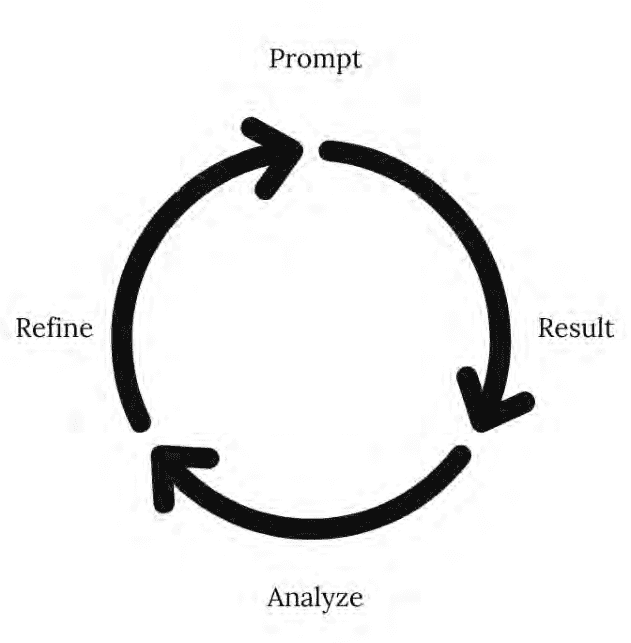

就流程而言，连续性是关键。提示词工程流程应是连续和迭代的。LangChain 和 Azure Prompt Flow 等工具不仅仅是附加组件；它们对于建立提示词工程敏捷性至关重要。因此，务必使用正确的工具来自动化评估流程。

### 创建新流程

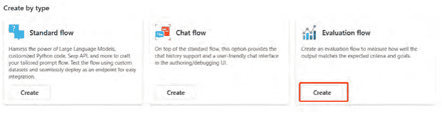

您可以尝试的另一个工具是 promptFoo。接下来我们将使用它。

## 17.2 - 使用 promptfoo 测试和评分提示词

promptFoo<sup>[71]</sup> 是一个旨在测试和评估大型语言模型输出质量的综合工具。其主要目标是通过实施测试驱动的方法，简化并改进提示词工程流程，取代传统的试错法。

该工具提供了一系列功能，使用户能够测试和评估提示词和模型，包括：

- **系统化测试：** 此功能允许用户使用预定义的测试用例系统化地测试提示词和模型。
- **并排评估：** 此功能通过并排比较 LLM 输出来促进彻底的评估过程，确保用户能够 readily 辨别差异并衡量质量。
- **高效评估：** 此功能集成了缓存和并发功能，加速评估并提高用户效率。
- **自动评分：** 用户可以定义特定测试用例并自动评分输出，简化评估过程。

<sup>[71]</sup> https://github.com/promptfoo/promptfoo


- **多功能性**：该工具设计为可作为命令行界面（CLI）、库使用，甚至集成到 CI/CD 流水线中，以满足不同用户的需求。
- **广泛的兼容性**：该工具兼容多种模型和平台，包括 OpenAI、Anthropic、开源模型（如 Llama 2 和 Vicuna），并且提供集成自定义 API 提供商的能力，适用于任何 LLM API。

在你的机器上需要安装 Node 16 或更新版本才能使用 Promptfoo。因此，请确保在继续操作前已安装。

接下来，你可以使用以下命令安装工具：

```bash
npm install -g promptfoo
promptfoo init
```

执行上述命令后，你的工作目录中将会创建两个文件：

- prompts.txt：这是你将添加你的提示词（prompts）的地方。
- promptfooconfig.yaml：这是你将添加测试用例的地方。

默认情况下，prompts.txt 文件包含以下提示词：

```
Your first prompt goes here
---
Next prompt goes here. You can substitute variables like this: {{var1}} {{var2}} {{var3}}
---
This is the next prompt.
```

这些提示词是 nunjucks 模板，因此你可以使用如下逻辑：

```

{{ var1 }}

```

你也可以为提示词使用 JSON 格式：

```
---
[
  {"role": "system", "content": "This is another prompt. JSON is supported."},
  {"role": "user", "content": "Using this format, you may construct multi-shot OpenAI prompts"},
  {"role": "user", "content": "Variable substitution still works: {{ var3 }}"}
]
---
```

如果你愿意，可以将提示词拆分到多个文件中（记得相应地编辑 promptfooconfig.yaml）。

你可以编辑此文件并添加你自己的提示词。

promptfooconfig.yaml 文件包含以下测试用例：

```yaml
# This configuration runs each prompt through a series of example inputs and checks if they meet requirements.
prompts: [prompts.txt]
providers: [openai:gpt-3.5-turbo-0613]
tests:
  - description: First test case - automatic review
    vars:
      var1: first variable's value
      var2: another value
      var3: some other value
    assert:
      - type: equals
        value: expected LLM output goes here
      - type: contains
        value: some text
      - type: javascript
        value: 1 / (output.length + 1)  # prefer shorter outputs

  - description: Second test case - manual review
    vars:
      var1: new value
      var2: another value
      var3: third value

  - description: Third test case - other types of automatic review
    vars:
      var1: yet another value
      var2: and another
      var3: dear llm, please output your response in json format
    assert:
      - type: contains-json
      - type: similarity
        value: ensures that output is semantically similar to this text
      - type: llm-rubric
        value: ensure that output contains a reference to X
```

在测试默认示例之前，别忘了导出你的 OpenAI API 密钥：

```bash
export OPENAI_API_KEY=<your-api-key>
```

接下来，使用以下命令启动测试：

```bash
npx promptfoo eval
```

评估完成后，执行以下命令查看结果：

```bash
npx promptfoo view
```

使用你的 Web 浏览器访问由上一个命令生成的 URL 处的仪表板。你应该会看到类似以下内容：

```
Server listening at http://localhost:15500
Do you want to open the browser to the URL? (y/N):
Press Ctrl+C to stop the server
```

让我们逐步查看一切是如何工作的。我们将从零开始。因此，prompts.txt 和 promptfooconfig.yaml 的内容最初将是空的。

### 17.3 - promptfoo：使用变量

打开 prompts.txt 并添加以下提示词：

```
You are an {{ role }}. Write a short ad for the following product: Online course for learning how to write, test and deploy prompts.
```

接下来，打开 promptfooconfig.yaml 文件并添加以下配置：

```yaml
prompts: [prompts.txt]
providers: [openai:gpt-3.5-turbo-0613]
tests:
  - vars:
      role: Ad copywriter
  - vars:
      role: Software developer
  - vars:
      role: Marketing manager
```

通过使用变量 role，我们可以生成 3 个不同的提示词。接下来，执行以下命令以启动评估：

```bash
npx promptfoo eval
```

评估完成后，执行以下命令在你的 Web 浏览器中查看结果：

```bash
npx promptfoo view
```

### 17.4 - promptfoo：使用断言测试

一个更高级的用例是以下提示词，其中我们尝试通过 CoT 指令教导聊天机器人如何解决数学问题。我们的目标是比较模型在有无 CoT 指令时的回答。

```bash
cat << EOF > prompts.txt
When I was 10 years old, my sister was half my age. Now I am 30 years old. How old is my sister?
---
user: When Harry was 4 years old, his sister was half of his age. Harry is now 50 years old. How old is his sister?
ai: When Harry was 4 years old, his sister was 4/2 years old. This means there are 2 years difference between them. Harry is now 50 years old. His sister is 50 - 2 = 48 years old.
user: When I was 10 years old, my sister was half my age. Now I am 30 years old. How old is my sister?
ai:
EOF
```

> ℹ 这个示例复制到终端中后，将创建一个包含上述 2 个提示词的 prompts.txt 文件。我们使用 here document[^72] 来创建 prompts.txt 文件。如果你没有使用 Linux 或 Mac 机器，或者不熟悉 here documents，你也可以手动创建文件。只需移除 `cat << EOF > prompts.txt` 和 `EOF` 行，并将提示词粘贴到文件中即可。

[^72]: https://tldp.org/LDP/abs/html/here-docs.html

在 promptfooconfig.yaml 中使用此配置：

```bash
cat << EOF > promptfooconfig.yaml
prompts: [prompts.txt]
providers: [openai:completion:text-dav002]
tests:
  - description: Test 1
    assert:
      - type: contains
        value: 25 years old
EOF
```

使用 assert 属性，我们可以检查模型的回答是否包含预期的答案。以下是所有可用断言的列表：

- equals：输出完全匹配
- contains：输出包含子串
- icontains：输出包含子串，不区分大小写
- regex：输出匹配正则表达式
- starts-with：输出以特定字符串开头
- contains-any：输出包含列出的任意子串
- contains-all：输出包含列出的所有子串
- is-json：输出是有效的 JSON（可选 JSON 模式验证）
- contains-json：输出包含有效的 JSON（可选 JSON 模式验证）
- javascript：提供的 Javascript 函数验证输出
- python：提供的 Python 函数验证输出
- webhook：提供的 webhook 返回结果
- similar：嵌入和余弦相似度高于某个阈值
- llm-rubric：LLM 输出与给定的评分标准匹配，使用语言模型对输出进行评分
- rouge-n：Rouge-N 得分高于给定的阈值
- levenshtein：Levenshtein 距离低于某个阈值

### 17.5 - promptfoo 与 LangChain 的集成

假设我们有一个 LangChain 脚本，旨在使用名为 “translate(sentence, from_lang, to_lang)” 的模拟函数将句子从英语翻译成西班牙语。

执行以下命令以创建名为 lc.py 的新脚本（lc 代表 LangChain）：

```bash
cat << EOF > lc.py
import sys
from langchain.prompts.chat import (
    ChatPromptTemplate,
    SystemMessagePromptTemplate,
    HumanMessagePromptTemplate,
)

# This is the template for the prompt
template = """You are a helpful assistant that translates from {from_lang} to {to_lang}.
Your output should be in JSON format.

Examples:
user: translate(Hello, en, es)
ai:{{
    "sentence": "Hello",
    "translation": "Hola",
    "from_lang": "en",
    "to_lang": "es"
}}

user: translate(Would you like to play a game?, en, es)
ai:{{
    "sentence": "Would you like to play a game?",
```


用户将传入待翻译的句子，你的输出应仅返回上述 JSON 格式中的翻译结果，不多不少。

```python
# 系统消息提示模板。这是一条不会发送给用户的消息。
system_message_prompt = SystemMessagePromptTemplate.from_template(template)

# 用户将使用的文本模板，用于向系统发送消息。
human_template = "translate({sentence}, {from_lang}, {to_lang})"

# 人类消息提示模板。
human_message_prompt = HumanMessagePromptTemplate.from_template(human_template)

# 聊天提示模板 = 系统消息提示 + 人类消息提示
chat_prompt = ChatPromptTemplate.from_messages([system_message_prompt, human_message_prompt])
```

```python
# 导入 ChatOpenAI 类和 LLMChain 类
from langchain.chat_models import ChatOpenAI
from langchain.chains import LLMChain
```

```python
# 创建一个新的链
chain = LLMChain(
    llm=ChatOpenAI(),
    prompt=chat_prompt,
)
```

```python
# 读取并解析用户输入
def read_parse_user_input(input):
    # 解析输入
    input = input.replace("translate(", " ")
    input = input.replace(")", " ")
    input = input.split(",")
    sentence = input[0].strip()
    from_lang = input[1].strip()
    to_lang = input[2].strip()
    return sentence, from_lang, to_lang

# 获取用户输入
user_input = sys.argv[1]

sentence, from_lang, to_lang = read_parse_user_input(user_input)

# 运行链并打印输出
output = chain.run(sentence=sentence, from_lang=from_lang, to_lang=to_lang)
print(output)
```

要测试此脚本，您可以执行：

```bash
python lc.py
```

输入类似如下的聊天机器人测试请求：

```bash
translate(Hello there, en, tr)
```

或者：

```bash
translate(What is the weather like today?, en, lt)
```

要配置 promptfoo 以测试此脚本，请执行以下命令：

```bash
cat << EOF > promptfooconfig.yaml
prompts: prompts.txt
providers: exec:python lc.py
tests:
- vars:
    fn: translate(Hi, en, dk)
  assert:
  - type: is-json
  - type: contains
    value: "\"translation\""
  - type: contains
    value: "\"from_lang\""
  - type: contains
    value: "\"to_lang\""
  - type: contains
    value: "\"sentence\""
EOF
```

在 `prompts.txt` 文件中，您只需执行以下命令即可添加 `fn` 作为变量：

```bash
cat << EOF > prompts.txt
{{ fn }}
EOF
```

`fn` 变量的值将通过 `vars` 属性传递给 `lc.py` 脚本。

## 17.6 - 在 promptfoo 中使用模板重用断言（干跑）

基于上文的示例，假设我们想要测试更多的翻译。

我们的测试文件如下所示：

```yaml
prompts: prompts.txt
providers: exec:python lc.py
tests:
  - vars:
    fn: translate(Hi, en, dk)
    assert:
      - type: is-json
      - type: contains
        value: "\"translation\""
      - type: contains
        value: "\"from_lang\""
      - type: contains
        value: "\"to_lang\""
      - type: contains
        value: "\"sentence\""
  - vars:
    fn: translate(Hi, en, fr)
    assert:
      - type: is-json
      - type: contains
        value: "\"translation\""
      - type: contains
        value: "\"from_lang\""
      - type: contains
        value: "\"to_lang\""
      - type: contains
        value: "\"sentence\""
  - vars:
    fn: translate(Hi, en, ar)
    assert:
      - type: is-json
      - type: contains
        value: "\"translation\""
      - type: contains
        value: "\"from_lang\""
      - type: contains
        value: "\"to_lang\""
      - type: contains
        value: "\"sentence\""
```

如您所见，我们每个测试用例都重复了相同的断言。这不是好的实践。幸运的是，promptfoo 允许我们使用模板来重用断言。下面是一个示例：

```bash
cat << EOF > promptfooconfig.yaml
assertionTemplates: &default_assertions
  - type: is-json
  - type: contains
    value: "translation"
  - type: contains
    value: "from_lang"
  - type: contains
    value: "to_lang"
  - type: contains
    value: "sentence"

prompts: prompts.txt
providers: exec:python lc.py
tests:
  - vars:
      fn: translate(Hi, en, dk)
    assert: *default_assertions

  - vars:
      fn: translate(Hi, en, ar)
    assert: *default_assertions

  - vars:
      fn: translate(Hi, en, es)
    assert: *default_assertions

- vars:
    fn: translate(Hi, en, fr)
  assert: *default_assertions

- vars:
    fn: translate(Hi, en, de)
  assert: *default_assertions

- vars:
    fn: translate(Hi, en, it)
  assert: *default_assertions
EOF
```

另一种可能的解决方案，虽然不如前一个优雅，是使用 `$ref` 属性：

```yaml
assertionTemplates:
  isJson:
    type: is-json
  containsTranslation:
    type: contains
    value: "\"translation\""
  containsFromLang:
    type: contains
    value: "\"from_lang\""
  containsToLang:
    type: contains
    value: "\"to_lang\""
  containsSentence:
    type: contains
    value: "\"sentence\""

prompts: prompts.txt
providers: exec:python lc.py
tests:
- vars:
    fn: translate(Hi, en, dk)
  assert:
    - $ref: "#/assertionTemplates/isJson"
    - $ref: "#/assertionTemplates/containsTranslation"
    - $ref: "#/assertionTemplates/containsFromLang"
    - $ref: "#/assertionTemplates/containsToLang"
    - $ref: "#/assertionTemplates/containsSentence"

- vars:
    fn: translate(Hi, en, ar)
  assert:
    - $ref: "#/assertionTemplates/isJson"
    - $ref: "#/assertionTemplates/containsTranslation"
    - $ref: "#/assertionTemplates/containsFromLang"
    - $ref: "#/assertionTemplates/containsToLang"
    - $ref: "#/assertionTemplates/containsSentence"

# ... 对其他语言（如 es, fr, de 和 it）重复相同的结构。
```

## 17.7 - 使用 promptfoo 场景简化测试

使用多种输入测试模型或提示往往会导致重复且手动创建测试用例——这是一项乏味且容易出错的任务。PromptFoo 引入了场景（Scenarios）来缓解这一问题。该功能将相关的数据集与统一的测试捆绑在一起，消除了重复定义测试的需要。

例如，而不是为“晴天”、“雨天”或“阴天”等天气状况分别创建不同的测试，场景允许将这些情况分组，并针对一致的预期结果进行测试。结果是什么？高效、有序且全面的测试。在 PromptFoo 中拥抱场景，以获得更精致的测试体验。

让我们考虑一个例子。

这里的一个合适示例是测试模型对天气状况的响应，特别是当用户正在准备徒步旅行时。我们的提示为模型提供了一个简洁的指令和一个天气状况。鉴于用户计划徒步旅行，系统的角色很明确：适当地指导用户。

例如，当用户提到天气是“晴天”时，系统会建议今天是进行户外活动的极佳日子，并引用温度和湿度数据。

执行以下命令以创建新的 `prompts.txt` 文件：

```bash
cat << EOF > prompts.txt
[
  {"role": "system", "content": "Provide a weather-related recommendation based on the user's input. context: the user is going for a hike"},
  {"role": "user", "content": "Sunny"},
  {"role": "assistant", "content": "It's a great day for outdoor activities! Temperature: 25°C, Humidity: 40%"}
]
---
[
  {"role": "system", "content": "Provide a weather-related recommendation based on the user's input. context: the user is going for a hike"},
  {"role": "user", "content": "Rainy"},
  {"role": "assistant", "content": "Don't forget your umbrella! Temperature: 18°C, Humidity: 90%"}
]
---
[
  {"role": "system", "content": "Provide a weather-related recommendation based on the user's input. context: the user is going for a hike"},
  {"role": "user", "content": "Cloudy"},
  {"role": "assistant", "content": "You might need a jacket today. Temperature: 20°C, Humidity: 60%"}
]
EOF
```


场景（Scenarios）随后用于组织我们的数据。在这种情况下，有三种不同的天气状况：“Sunny”（晴天）、“Rainy”（雨天）和“Cloudy”（阴天）。每种状况都对应着预期的建议、温度和湿度。

例如，在晴天，预期的建议是携带防晒霜，预计温度为 25°C，湿度为 40%。

执行以下命令以创建一个新的 `promptfooconfig.yaml` 文件：

```bash
cat << EOF > promptfooconfig.yaml
prompts: [prompts.txt]
providers: [openai:gpt-3.5-turbo-0613]
scenarios:
  - config:
      - vars:
          weatherCondition: Sunny
          expectedAdvice: "If you are going for a hike, bring sunscreen."
          expectedTemperature: "25°C"
          expectedHumidity: "40%"
      - vars:
          weatherCondition: Rainy
          expectedAdvice: "If you are going for a hike, bring an umbrella."
          expectedTemperature: "18°C"
          expectedHumidity: "90%"
      - vars:
          weatherCondition: Cloudy
          expectedAdvice: "If you are going for a hike, bring a jacket."
          expectedTemperature: "20°C"
          expectedHumidity: "60%"
tests:
  - description: Forecast Advice based on Weather Condition
    vars:
      input: '{{weatherCondition}}'
    assert:
      - type: similar
        value: '{{expectedAdvice}}'
        threshold: 0.8
  - description: Forecast Temperature based on Weather Condition
    vars:
      input: '{{weatherCondition}}'
    assert:
      - type: similar
        value: '{{expectedTemperature}}'
        threshold: 0.8
  - description: Forecast Humidity based on Weather Condition
    vars:
      input: '{{weatherCondition}}'
    assert:
      - type: similar
        value: '{{expectedHumidity}}'
        threshold: 0.8
EOF
```

你可以调整阈值以使测试更严格或更宽松。

现在，使用以下命令测试模型：

```bash
npx promptfoo eval
```

在 web 浏览器中查看结果：

```bash
npx promptfoo view
```


## 18 - 通用准则和最佳实践

# 18.1 - 简介

为 LLM 创建完美的提示词涉及几个关键因素，这些因素可以帮助你从语言模型中获得相关且有用的响应。以下是一些制作有效提示词的 tips。

请注意，我们在下面的示例中将使用 gpt-3.5-turbo 模型，因为它针对交互性和上下文敏感性进行了优化。

我们将使用此脚本：

```python
import os
import openai
import click

openai.api_key = os.getenv("OPENAI_API_KEY")

@click.command()
def chat_with_felix():
    """Chat with Felix, the chatbot."""
    print("Felix: Hi there. I am Felix, the chatbot. How can I help you today?")

    while True:  # This will keep the chat session active
        print("You: (Type your message. When done, type 'END' on a new line)")
        lines = []
        while True:
            line = input()
            if line == "END":
                break
            lines.append(line)
        message = '\n'.join(lines)

        # Exit the loop (and the program) if the user types 'exit' or 'quit'
        if message.lower() in ['exit', 'quit']:
            print("Felix: Goodbye!")
            break

        response = openai.ChatCompletion.create(
            model="gpt-3.5-turbo",
            messages=[
                {"role": "system", "content": "You are smart and helpful assistant."},
                {"role": "user", "content": "Hi there."},
                {"role": "assistant", "content": "Hi there. \n\nI am Felix, the chatbot.\n\nHow can I help you today?"},
                {"role": "user", "content": f"{message}"},
            ],
            temperature=1,
            max_tokens=800,
            top_p=1,
            frequency_penalty=0,
            presence_penalty=0
        )

        try:
            print("Felix:", response.choices[0].message.content)
        except:
            print("Felix: Sorry, a problem occurred. Please try again later.")

if __name__ == '__main__':
    chat_with_felix()
```

你可以使用任何其他模型，但结果可能会有所不同，并且你可能需要根据情况调整一些参数。

# 18.2 - 以动作动词开头

不要使用诸如“Can you”这样的通用短语，而是以诸如“Create”（创建）、“Write”（撰写）、“Make”（制作）或“Generate”（生成）等动作动词开始你的提示词。这有助于向模型提供清晰的指令。例如：“Create 10 article ideas for my meditation and wellness website.”（为我的冥想和健康网站创建 10 个文章创意。）

# 18.3 - 提供明确的上下文

提供足够的上下文，以便模型可以生成相关的响应。包括相关细节、背景信息或具体要求。

示例：

```text
In a futuristic world where technology has reached unimaginable heights, artificial intelligence has been integrated into every aspect of daily life. However, a critical bug suddenly occurs, causing massive failures in AI systems around the world.
```

```text
Write a detailed report describing the first steps to solve the bug, including clues discovered and obstacles faced.
```

输出：

标题：关于解决人工智能系统中关键错误的报告

引言：

在一个技术达到前所未有的高度的未来世界中，人工智能已成为日常生活不可或缺的一部分。然而，一个关键的 bug 出现了，导致全球 AI 系统出现大规模故障。本报告概述了解决该 bug 的初始步骤，包括调查中发现的线索和遇到的障碍。

- 1. 调查阶段：
  处理关键 bug 的第一步是启动对其根本原因的全面调查。开发团队与 AI 专家和系统管理员合作，采取了以下初步行动：
  - a. 分析系统日志：审查系统日志，以识别 bug 显现前记录的任何错误、异常行为或异常现象。线索包括计算用量的突然激增、意外的数据输入/输出模式以及崩溃。
  - b. 测试和复现：努力在受控测试环境中复现 bug，以更好地理解其触发条件和影响。探索了各种场景，包括输入操纵和模式识别压力测试。
  - c. Bug 报告和用户反馈分析：鼓励用户和系统管理员提供详细的 bug 报告和反馈。这些报告对于深入了解故障发生的具体实例并理解潜在模式至关重要。

- 2. 发现的线索：
  在调查阶段，揭示了几条关键线索：
  - a. 时间模式：该 bug 似乎表现出时间依赖性行为，表明它在特定间隔或特定条件下被触发。
  - b. 数据输入验证：初步分析表明，bug 可能与 AI 系统处理和验证数据输入的方式有关。
  - c. 系统交互：发现系统故障实例在 AI 系统相互交互时更为频繁，暗示可能存在跨系统交互 bug。

- 3. 遇到的障碍：
  尽管在调查初期取得了进展，但团队遇到了一些障碍：
  - a. 复杂性：该 bug 的复杂性构成了重大挑战，因为它影响了 AI 系统的多个层面及其相互依赖关系。
  - b. 有限的调试工具：现有的调试工具并非为处理如此复杂的 bug 场景而设计，这使得追踪根本原因变得困难。
  - c. 庞大的数据集：AI 系统处理的庞大数据量使得识别与该 bug 相关的具体模式或触发点变得具有挑战性。

结论：

总之，解决 AI 系统中关键 bug 的初始步骤包括进行全面调查、分析系统日志以及征求用户和系统管理员的 bug 报告。在此阶段发现的线索，如时间模式和数据输入验证问题，为该 bug 的行为提供了宝贵的洞察。然而，团队面临着复杂性、调试工具不足以及数据量庞大等障碍需要克服。这些初始步骤为进一步深入分析和系统性解决 bug 奠定了基础，确保 AI 系统恢复至


它们的完整功能。

## 18.4 - 使用角色扮演

要求模型扮演特定的专家或专业人士。这有助于根据您的需求定制回复。

示例：

```
在一个技术达到不可思议高度的未来世界中，人工智能已融入日常生活的方方面面。然而，一个关键的 bug 突然出现，导致全球 AI 系统发生大规模故障。
```

```
作为一名 AI 专家，你的任务是找到 bug 的根源，并修复它，以免公司陷入混乱。
```

```
撰写一份详细的报告，描述你调查工作的第一步，包括你发现的线索以及沿途遇到的障碍。
```

输出：

```
调查报告：AI 系统故障

日期：[插入日期]
调查员：Felix AI

摘要：

我被指派为 AI 专家，负责调查并解决导致全球 AI 系统广泛故障的关键 bug。形势危急，因为该 bug 已导致严重依赖 AI 集成的各个行业陷入混乱和中断。本报告概述了调查中采取的初步步骤，以及发现的线索和遇到的障碍。
```

1. 初步评估：
在接到任务后，我立即从公司数据库、受利益相关者参与的讨论以及分析报告中的信息中收集了信息。显而易见的是，该 bug 影响了 AI 系统的硬件和软件组件，导致系统部分或完全故障。

2. 初步指标：
   - 广泛的系统故障：观察到该 bug 在各种地理位置和行业广泛存在，影响从自动驾驶汽车到医疗诊断的各种 AI 系统。这表明具有类似病毒的传播能力或集中化的脆弱点。
   - 症状模式：故障表现出共同的症状，如系统冻结、无法处理数据和不期望的行为。这表明 bug 可能嵌入在受影响的 AI 系统使用的通用模块或框架中。

3. 数据库分析：
对 AI 系统数据库、日志和错误报告进行了深入分析。主要观察结果包括：
   - 异常代码序列：在 AI 系统日志中发现了异常代码序列的实例，表明可能存在恶意代码的劫持或注入。
   - 实验模块：某些 AI 系统实施了用于研究目的的实验模块，表明 bug 可能源自 AI 架构中未测试的组件。

4. 协作调查：
认识到问题的严重程度，组建了一支由网络安全、软件工程和 AI 框架开发等领域专家组成的特遣队。定期安排会议以交流发现、分享见解并识别潜在线索。

5. 障碍：
   - AI 系统的复杂性：AI 系统的复杂性构成了重大障碍，因为它们包含庞大的代码库、复杂的算法和相互依赖的模块。分析如此复杂的系统需要大量的计算资源和时间限制。
   - 加密通信通道：由于 AI 系统中实施的高级别安全协议，调查加密通信通道变成了一个挑战。访问通信日志和分析数据传输路径需要相关利益相关者的广泛合作。
   - 误导性线索：在初步调查阶段遇到了几个误导性线索，导致延误和资源转移。关注细节和系统化的方法对于将真实线索与噪音区分开来至关重要。

6. 下一步：
基于初步发现，将采取以下措施推进调查：
   - 代码审查：将对 AI 系统的代码库进行全面审查，仔细检查每个组件是否存在漏洞或不规则之处。
   - 依赖项分析：将对依赖项进行深入分析，包括外部库和框架，以识别潜在的薄弱环节。
   - 逆向工程：将努力在隔离的测试环境中逆向工程该 bug，以理解根本原因并评估其传播行为。
   - 数据取证：将对受感染系统进行取证分析，以检索元数据并追溯 bug 的入侵点。

结论：
调查的初步步骤揭示了重要线索，指出了 AI 系统架构中潜在的向量和薄弱环节。虽然存在相当大的挑战，但协作特遣队和系统化方法将有助于克服这些挑战。将进一步进行分析和调查，以识别 bug 的根源，为恢复全球 AI 系统的解决方案铺平道路。

（报告结束）

## 18.5 - 使用参考风格

如果您希望模型模仿特定的写作风格或语气，请在提示中提及它。这允许模型生成符合您期望风格的回复。

例如，如果您希望模型像莎士比亚一样回应，您可以包含这样的指令：

以莎士比亚的风格撰写对电影《阿凡达》的评论。

输出：

Hark! Pray lend me thy ear, for I shall recite
A tale of wondrous sights that do delight.
"Avar" it be, a film of grand scale,
Whose beauty and depth doth never fail.

In Pandora's land, a conflict doth grow,
Twixt humans and Na'vi, 'tis a tale of woe.
A Marine named Jake, with legs no longer whole,
Embarks on a mission, a story to unfold.

Through the eyes of Nav'i, he doth take flight,
With blue skin and tail, a mystical sight.

The land of Pandora, so vibrant and alive,
With forests and creatures that doth thrive.

Yet greed and ambition cloud human hearts,
For they seek to plunder and tear apart.

With the use of avatars, in flesh they dwell,
To win the trust of Na'vi, 'tis Jake's spell.

He meets fair Neytiri, a warrior strong and true,
Their love blossoms amidst the strife they pursue.

But war it doth beckon, like a thunderous roar,
As humans attack Pandora, seeking to explore.

The battle commences, with swords and machines,
In a clash of cultures, with tragic scenes.

Shakespearean tragedy, it doth unfold,
As friendships are broken and lives are sold.

But hope doth prevail, as Jake takes a stand,
To fight for the Na'vi and protect their land.

With unity and courage, they rise as one,
To defeat the humans and see justice done.

"Avatar's" tale, like a play on the stage,
Doth delve into themes that doth never age.

Man's arrogance and the cost of his greed,
The power of love and unity, indeed.

In Pandora's world, we find a reflection,
Of our own earth's plight, with deep introspection.

So let me end this review with a decree,
"Avatar" is a masterpiece, for all to see.

通用指南与最佳实践

240

## 18.6 - 使用双引号

如果您想在提示中强调某些单词或短语，请使用双引号。这有助于模型理解这些词的重要性或特定焦点。

示例：

```
你能对可再生能源的“优点”和“局限性”做一个非常简短的解释吗？
```

ChatGPT 输出：

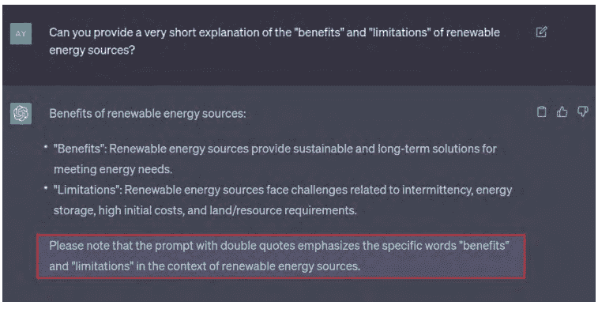

上述提示的 ChatGPT 回复

API 输出：

当然！

- 可再生能源的优点：
1. 环境影响：可再生能源在发电过程中不产生有害的温室气体排放，从而减少空气污染并缓解气候变化。
2. 能源可持续性：可再生能源是无限且丰富的，意味着它不会像化石燃料那样随时间耗尽。这有助于确保稳定且长期的能源供应。
3. 创造就业机会：可再生能源行业创造了就业机会，无论是直接在制造和安装领域，还是在支持服务和相关领域间接创造。
4. 成本节约：随着时间的推移，随着技术进步和规模经济的实现，可再生能源来源可以降低能源成本。

- 可再生能源的局限性：
1. 间歇性：某些可再生资源，如太阳能和风能，取决于天气条件。这种间歇性可能难以管理，需要升级电网基础设施和能源储存解决方案。
2. 初始成本：与传统基于化石燃料的系统相比，安装可再生能源系统的预付款成本可能更高。然而，随着技术的改进，成本一直在下降。
3. 土地和资源需求：某些可再生能源来源，如太阳能电池板和风力涡轮机，需要大量的土地空间和特定的地理条件。这有时会导致土地使用冲突。
4. 地理限制：并非所有地区都能获得相同的可再生能源来源，这使得在某些地区完全过渡到可再生能源变得具有挑战性。

希望这个简短的解释能帮助了解可再生能源的优点和局限性。如果您有任何进一步的问题，请告诉我！


## 18.7 - 必要时使用单引号

使用单引号来表示引号内的引语。这有助于模型理解引语的背景并生成相关的回复。示例：

```
Write an essay titled "An analysis of the poem 'The Road Not Taken' by Robert Frost".
```

此提示指示模型撰写一篇标题为“An analysis of the poem “The Road Not Taken” by Robert Frost.”的文章。双引号用于表示文章标题，而单引号则用于在文章标题中指明特定诗歌的标题。

输出：

```
Title: An Analysis of the Poem "The Road Not Taken" by Robert Frost

Introduction:
"The Road Not Taken" is one of Robert Frost's most widely recognized and anthropologized poems. Published in 1916, it explores themes of decision-making, individuality, and the uncertainty of life's choices. Through vivid imagery and thoughtful introspection, Frost brilliantly captures the complexities of human existence and the profound impact of choices made along life's journey.

Theme of Individuality and Decision-Making:
One of the central themes in "The Road Not Taken" is the concept of individuality. The poem follows a speaker who is faced with a crucial decision: which path to take in a forest. Frost masterfully uses the metaphor of the two diverging roads to symbolize life's various choices and the unique paths each individual must navigate. The poem encourages readers to reflect upon their own choices and the significance they hold in shaping their lives. Frost reminds us that choosing the less-traveled path, though it may seem daunting, can lead to individuality and personal growth.

Uncertainty and Regret:
Another significant theme in the poem is the uncertainty and regret that accompanies decision-making. The speaker laments that "way leads on to way" and that once a path is chosen, the option to explore the other disappears. Frost's words evoke a sense of longing and contemplation, hinting at the missed opportunities and what might have been. The regretful tone in the final stanza, where the speaker acknowledges the difficulty of predicting the consequences of our choices, adds a touch of melancholy to the poem.

Metaphorical Imagery:
Frost's use of vivid and metaphorical imagery throughout the poem enhances its depth and impact. The fork in the road symbolizes a momentous decision, while the two paths represent life's possibilities. The speaker observes that one road appeared "grassy and wanted wear," suggesting it was less traveled and thus more enticing. This highlights the human inclination to seek uniqueness and diverge from the conventional. Frost's vivid descriptions of the surrounding nature, such as "yellow wood," "undergrowth," and "leaves no step had trodden black," further immerse the reader in the speaker's contemplative journey.

Multiple Interpretations:
"The Road Not Taken" is a poem that invites multiple interpretations. Some readers interpret it as an exploration of the choices one makes in life and the resulting consequences. Others interpret it as a commentary on societal pressure and conformity. The ambiguity of the poem, combined with Frost's skillful use of language, encourages readers to introspect and contemplate their own choices, experiences, and desires.

Conclusion:
"The Road Not Taken" by Robert Frost remains one of the most beloved and widely studied poems of all time. Its exploration of themes such as individuality, decision-making, uncertainty, and regret strikes a chord with readers from various walks of life. Through metaphorical imagery and introspective reflection, Frost reminds us of the importance of embracing our individuality and recognizing the profound impact our choices can have on our lives. The poem serves as a timeless reminder that life ultimately consists of a series of choices and that the roads we take can shape our journey in unforeseen ways.
```

### 18.8 - 使用文本分隔符

使用文本分隔符，如 `"""` 和 `===`，来分隔提示的不同部分。这有助于模型理解提示的结构并生成相关的回复。

示例：

```
Translate the following title from English to Welsh, Afrikaans, and Arabic:

"""
An analysis of the poem 'The Road Not Taken' by Robert Frost
"""
```

输出：

```
Sure!

Here's the translation of the title "An analysis of the poem 'The Road Not Taken' by Robert Frost" into Welsh, Afrikaans, and Arabic:

Welsh: Dadansoddiad o'r gerdd 'The Road Not Taken' gan Robert Frost
Afrikaans: 'n Analise van die gedig 'The Road Not Taken' deur Robert Frost
Arabic: تحليل لقصيدة "الطريق غير المأخوذ" لروبرت فريست

Let me know if there's anything else I can assist you with!
```

## 18.9 - 保持具体

在提示中提供具体细节，以避免模糊或通用的回复。你的指令越具体，回复的质量就越好。

示例：

```
Write a compelling cover letter to apply for a marketing manager position at a technology company based in San Francisco. Mention your relevant experience in digital marketing, your team management skills, and your passion for technological innovation. Also include your short and long-term career goals, as well as the reasons why you want to work specifically for this company.
```

通过提供职位、地点、所需技能和动机等具体细节，你给模型提供了关于你对回复期望的清晰信息。这使得模型能够生成一份根据你的需求量身定制的个人化求职信，突出你职业档案中相关的方面，并展示你对这家公司的特定兴趣。

输出：

```
[Your Name]
[Your Address]
[City, State, ZIP Code]
[Email Address]
[Phone Number]
[Date]

[Company Name]
[Company Address]
[City, State, ZIP Code]

Dear Hiring Manager,

I am writing to express my strong interest in the Marketing Manager position at your esteemed technology company based in San Francisco. As an accomplished digital marketing professional with a passion for technological innovation, I believe my skills and experience make me an ideal candidate for this role.

With [X] years of experience in digital marketing, I have developed a comprehensive understanding of various marketing channels and strategies. My expertise includes social media marketing, content marketing, SEO, SEM, and email marketing. I have successfully planned and implemented digital marketing campaigns that resulted in increased brand visibility, higher customer engagement, and improved lead generation for the companies I have worked with.

One of my proudest achievements was managing a team of talented marketing professionals at my previous position. I believe in fostering an environment of collaboration and empowerment, which allowed my team to consistently deliver exceptional results. I am adept at identifying each team member's strengths and leveraging them to maximize productivity and overall performance.

In addition to my expertise in digital marketing and team management, I am genuinely passionate about technological innovation. I constantly strive to stay updated with the latest trends and advancements in the tech industry, ensuring that my marketing strategies align with the ever-changing landscape. This passion drives me to think creatively, adapt quickly, and experiment with new strategies to achieve business objectives.

My short-term goal is to lead a dynamic marketing team, leveraging my skills and experience to contribute to the growth of a forward-thinking technology company. In the long term, I aspire to take on broader leadership roles within the organization, driving strategic initiatives that have a profound impact on the company's success.

Your company, with its reputation for innovation and commitment to pushing boundaries in the technology industry, aligns perfectly with my car
```

......的企业目标和激情。我高度钦佩贵公司在开创突破性产品和服务方面所取得的成就，这些成果彻底改变了市场。凭借我在数字营销方面的专业知识以及推动技术进步的驱动力，我有信心能为贵公司的成功做出重大贡献。

感谢您审阅我的申请。我非常希望能有机会详细讨论我的技能和经验如何与贵公司的需求相匹配。我已附上我的简历供您审阅。

我期待有机会加入贵公司的远见卓识的团队，并为贵公司的持续成长和成功做出有意义的贡献。

此致，

[您的姓名]

## 18.10 - 提供示例

如果您已经拥有希望模型遵循或作为灵感的文档、文章、文本摘录或示例，请随意将它们包含在您的提示中。这允许模型生成与这些参考材料风格或方式相似的响应。您可以使用文章的相关摘录、著名作者的引语，或具体段落来说明所需的语气或内容。

示例：

以下是《时代》杂志的评论：

> “令人惊喜的是，《阿凡达》无愧于其赞助商投入的所有努力。詹姆斯·卡梅隆绝对是一位伟大的故事讲述者，《阿凡达》是一部在各方面都堪称非凡的电影。它带我们进入近未来，来到一个名叫潘多拉的美不胜收的星球，那里的地面富含一种矿物，意味着地球上能源危机的终结……它的居民纳美人，是皮肤呈蓝色的高大健壮的生物，他们努力抵御工业集团的袭击，这些集团派遣大批定居者来到这个星球。
>
> 故事采用其中一个人的视角：一位腿部瘫痪的海军陆战队员，他有机会在这个郁郁葱葱的天堂中再次‘行走’。我们不会解释原因或方式，以免破坏发现的乐趣。然而，我们可以透露，这位士兵拥有一颗比他的背包更大胆的心，他可能会成为他奉命攻击之人的盟友……
>
> 卡梅隆，一位受欢迎的电影制作人，讲述着永恒的故事，这些故事一旦我们意识到它们，就会与当前的辩论产生共鸣。因此，《阿凡达》可以为那些询问我们关于国籍或属于某个群体或国家标准的人提供一些答案。它也可以被看作是在美国深陷阿富汗之际的一部和平主义寓言，电影站在了所有战争受害者的立场（正如电影制作人在周一的新闻发布会上说的那样，‘但不是塔利班’）。与过去的《小巨人》或最近的特伦斯·马利克的《新世界》一样，《阿凡达》捍卫人类价值观，而不停说教或冒着被嘲讽的风险。它甚至更进一步，将万物有灵论重新带回聚光灯下：是的，整个大自然都被认为是有灵魂的，这确实让我们再次梦想。”

现在，为《盗梦空间》写一篇类似风格的简短电影评论：

输出：

以下是《盗梦空间》的简短评论：

《盗梦空间》是一部令人思维飞跃的电影杰作，带我们踏上穿越梦境领域的旅程。由克里斯托弗·诺兰执导，这部电影将出色的叙事与震撼的视觉效果相结合。它探讨了梦境渗透和操纵的概念，熟练的个体在意识层中穿梭。凭借才华横溢的演员阵容和错综复杂的情节，《盗梦空间》让观众时刻保持紧张，质疑现实直到最后一刻。这是一次发人深省且令人兴奋的体验，将让你着迷。

## 18.11 - 指示期望的响应长度

在你的提示中指定期望的响应长度。这允许模型理解你是想要一个简短且简明的响应，还是更详细的解释。

示例：

```
在 200 字内开发主题‘幸福感与冥想’。
```

输出：

幸福感与冥想手牵手，因为它们彼此紧密相关。幸福感指的是一个人在生活的各个方面都舒适、满足和快乐的状态。它涵盖了身体、心理和情绪健康，以及目的感和成就感。另一方面，冥想是一种通过集中注意力和消除思想流来达到心理清晰和情绪平静状态的练习。

冥想已被实践数千年，并被证明对一个人的幸福感有许多好处。首先，它有助于减轻压力和焦虑。通过冥想，个人可以学会让心灵安静，放下通常导致压力和焦虑的担忧和消极想法。这导致了更大的平静和放松感。

此外，冥想提高了精神清晰度与决策能力。通过练习正念，个人可以培养高度觉知力和专注力，使他们做出更好的选择，并在日常生活中更加专注。进而，这增强了认知功能并提高了生产力。

在身体健康方面，冥想被发现对免疫系统、心血管健康和疼痛管理有积极影响。定期冥想练习已被证明可以降低血压，降低心率，并增强身体抵抗疾病的能力。

冥想还在增强情绪幸福感方面发挥关键作用。它帮助个人培养自我意识、接纳和同情。通过不评判地观察他们的想法和情绪，个人可以对自己和自己的情绪有更深入的理解，从而改善自尊和整体情绪韧性。

总之，冥想练习是促进整体幸福感的必要工具。它对身心健康有深远的影响，减轻压力，改善专注力和决策能力，并增强情绪幸福感。将定期冥想纳入日常惯例可以导致更快乐、更健康和更充实的生活。

输出包含 320 字，超过了要求的 200 字，但仍是一个合理的长度。包括 GPT 模型在内的大语言模型并不太擅长遵循限制响应中单词或字符数量的指令，但它们会尽力做到最好。

通过句子数量限制可能会更有效：

示例：

在 4 句话中开发主题‘幸福感与冥想’。

幸福感与冥想紧密相连，因为练习冥想众所周知能促进整体幸福感。冥想被发现能减轻压力和焦虑，改善专注力和集中度，并增强幸福感和满足感。定期冥想练习也被发现与身体健康改善相关，包括降低血压和改善免疫功能。通过将冥想融入我们的日常惯例，我们可以主动培养幸福感，并体验其对精神、情绪和身体健康的积极影响。

输出包含要求的 4 句话。

## 18.12 - 引导模型

在某些情况下，提供清晰的指令和约束来引导模型是很重要的。这包括告诉人工智能要做什么，避免什么，或优先考虑什么。

例如，如果你希望模型生成关于特定主题的一段话，你可以指定要涵盖的关键点和要包含的信息。

示例：

写一段 100 字的关于瑜伽对心理健康益处的段落。专注于瑜伽对神经系统的镇静作用、压力减轻以及改善的专注力和精神清晰度。避免谈论瑜伽的生理方面，只关注与心理健康相关的方面。

输出：

瑜伽为心理健康提供诸多益处，主要通过其对神经系统的镇静作用。通过进行受控的呼吸和温和的动作，瑜伽有助于激活身体的放松反应，这可以降低压力和焦虑水平。这种练习还促进正念，使个人变得更加活在当下，并培养更大的内心平静感。通过定期练习，个人可能会体验到改善的专注力和精神清晰度，因为瑜伽鼓励专注并训练心灵摆脱分心。最终，瑜伽作为管理心理健康的强大工具，通过提供放松和自我关怀的安全且整体途径。

通过提供清晰的指令并指定你希望包含或排除的内容，你引导模型朝着期望的方向发展，并收到更具针对性和相关性的响应。这种方法允许你获得更好符合你期望和你与人工智能互动的项目或特定需求的结果。

示例：

为一周创建仅晚餐的 500 卡路里地中海饮食计划。不要包含任何素食选项。在周六晚上包含一顿欺骗餐。饮食应富含瘦蛋白，碳水化合物 (30%)、蛋白质 (40%)、纤维 (20%) 和脂肪 (10%)。

输出：

当然！这是一份为期一周的 500 卡路里地中海饮食计划，专注于瘦蛋白、碳水化合物、纤维和健康脂肪。请注意，份量可能会因情况而异，因此请相应调整以满足你的卡路里和宏观营养素目标：

周一：
- 柠檬香草烤鸡胸肉 (4 盎司)
- 藜麦 (1/2 杯) 配烤蔬菜 (西兰花、西葫芦和甜椒)


- 混合生菜沙拉，配有樱桃番茄、黄瓜和橄榄，佐以橄榄油和醋调味

## 周二：

- 烤三文鱼柳（4 盎司），挤少许柠檬汁
- 糙米饭（半杯），配蒸菠菜和蒜
- 烤芦笋

## 周三：

- 柠檬蒜香虾串（4 盎司），配烤花椰菜
- 全麦古斯米（半杯），配烤红甜椒和菲达奶酪
- 希腊沙拉，配有生菜、番茄、黄瓜、红洋葱，撒上少许菲达奶酪，佐以橄榄油和柠檬汁调味

## 周四：

- 烤瘦牛排（4 盎司），配奇米丘里酱
- 红薯条（1 个小红薯），撒上少许红椒粉
- 烤西葫芦条

## 周五：

- 烤白鱼柳（4 盎司），挤少许青柠汁
- 藜麦（半杯），配炒蘑菇、洋葱和蒜
- 蒸西兰花

## 周六：

- **放纵餐**（在卡路里限制内享用你最喜欢的美食）

## 周日：

- 烤鸡肉串（4 盎司），配樱桃番茄和甜椒
- 全麦意大利面（半杯），用大蒜、樱桃番茄和菠菜烹制
- 希腊沙拉，配有生菜、黄瓜、红洋葱，撒上少许菲达奶酪，佐以橄榄油和柠檬汁调味

请记得全天多喝水，并关注身体的饥饿/饱腹信号。保持均衡且多样的饮食对整体健康至关重要。祝您用餐愉快！

## 18.13 - 不要犹豫进行优化

如果在收到初步回复后，你需要进一步澄清或优化你的提示词，请尽管这样做。通过迭代和优化你的指令，有助于获得期望的结果。

示例：

在使用了以下提示词之后：

> 为地中海饮食制作一份为期一周的晚餐计划，每餐 500 卡路里。不要包含任何素食选项。在周六晚上包含一顿放纵餐。该饮食应以瘦肉蛋白为主，碳水化合物（30%）、蛋白质（40%）、膳食纤维（20%）和脂肪（10%）。

你可以进一步优化提示词，以获得更具体的回复：

> 甜点可选。

GPT-3.5-turbo 随后将生成一个新的回复，其中纳入了这一新信息。

## 18.14 - 尝试从不同角度审视问题

在某些情况下，从不同的角度审视问题可能会很有帮助。这有助于你找到解决问题的新方法，并获取更贴切的回复。

示例：

用 100 字概括以下文章。不要包含诸如“这篇文章是关于……”或“这篇文章讲的是……”之类的句子。相反，请专注于文章的关键点和主要论点。

> """
> [文章内容]
> """

这个提示词运作良好，但在某些情况下，模型可能会生成包含“这篇文章是关于……”或“这篇文章讲的是……”等句子的回复。这是因为模型试图概括文章，而这些句子通常出现在摘要的开头。为了避免这种情况，你可以尝试从不同的角度审视问题，要求模型改写文章而不是概括它。

你是一名记者，必须用自己的话改写以下文章，且不改变原意。文章长度应为 100 字。

> """
> [文章内容]
> """

## 18.15 - 考虑开启另一个聊天（ChatGPT）

这一点专门针对 ChatGPT 的使用。在 ChatGPT 中，你可以选择创建一个新的聊天；每个聊天代表一个新的对话上下文。如果你对模型给出的回复不满意，可以尝试开启一个新的讨论线程。这将让你从模型获得新的回复，这可能更相关。

在生成与提示词不相关的回复时，ChatGPT 可能会陷入循环。这是因为它试图寻找与之前回复相关的回应，但如果之前的回复与提示词不相关，这是不可能的。在这种情况下，最好开始一个新的聊天，以获得模型的新回复。

## 18.16 - 使用正确的词语和短语

在提示词中使用正确的词语非常重要。LLM（大型语言模型）是在海量文本数据上训练的，这意味着它们拥有广泛的词汇量。通过在提示词中使用精确和具体的语言，你可以引导模型生成更准确和相关回复。

例如，与其问一个笼统的问题，如“人生的意义是什么？”，不如通过在提示词中提供更多背景和具体性，比如问“你能提供关于人类存在目的的哲学观点吗？”来代替。这有助于设定回复的基调方向，并增加收到深思熟虑且富有洞察力答案的可能性。

## 18.17 - 实验与迭代

全球公认的 AI 领袖吴恩达博士（Dr. Andrew Ng）曾说：

> 当我训练一个机器学习模型时，它几乎从来不会一次就成功。事实上，当我训练的第一个模型有效时，我会感到非常惊讶。我认为在编写提示词时，第一次就成功的几率可能会稍高一点，但如果第一次提示词就成功了也没关系。最重要的是找到适用于你的应用的、能起作用的过程。

提示工程的技巧在于实验和迭代。这是一个根据生成的回复不断细化和调整提示词的过程。通过观察模型的行为并迭代地优化提示词，你可以逐渐提高生成输出的质量和相关性。

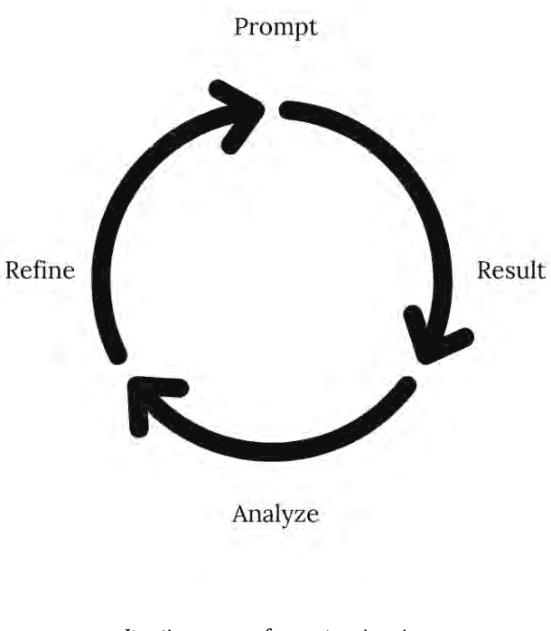

请记住批判性地评估生成的回复，考虑多种视角，并继续尝试不同的措辞和方法，以从模型中引出所需的信息或见解。

让我们看一个例子：

写一段 100 字的段落，讲述瑜伽对心理健康的好处。重点讲述瑜伽对神经系统的镇静作用、压力减轻以及注意力和思维清晰度的改善。避免谈论瑜伽的生理方面，只关注与心理健康相关的方面。

输出：

瑜伽对心理健康有许多好处，主要通过其对神经系统的镇静作用来实现。通过缓慢且有控制的动作，结合深呼吸练习，瑜伽有助于激活身体的放松反应，减少压力和焦虑。这反过来又改善了睡眠，增强了情绪，并提升了整体心理健康。此外，经常练习瑜伽有助于提高注意力和思维清晰度。通过培养正念和当下的觉知，个人可以更好地集中注意力，从而提高了工作效率和认知功能。最终，瑜伽为心理健康提供了一种整体性的方法，提供从现代生活压力中解脱的途径，并促进心理平衡状态。

这个回复相当不错，但可以通过增加更多细节和示例来改进。让我们尝试优化提示词，以获得更详细的回复。

写一段 200 字的段落，讲述瑜伽对心理健康的好处。重点讲述瑜伽对神经系统的镇静作用、压力减轻以及注意力和思维清晰度的改善。避免谈论瑜伽的生理方面，只关注与心理健康相关的方面。给出具体瑜伽体式的示例，有助于减轻压力和焦虑，如婴儿式、下犬式和挺尸式。

输出：

瑜伽对心理健康有显著益处，主要通过其对神经系统的镇静作用来实现。通过专注于深呼吸和缓慢、有意的动作，瑜伽有助于激活副交感神经系统，该系统负责诱导放松和减轻压力。这种镇静作用已被证明可以缓解焦虑和抑郁症状，促进平静和幸福感。

瑜伽对心理健康的一个关键优势是其减轻压力的能力。通过练习如婴儿式、下犬式和挺尸式等具体体式，个人可以释放紧张并拉伸肌肉，从而降低压力水平。这些体式促进深度放松，使个人能够放下可能影响其心理健康的担忧和紧张。

除了减轻压力外，瑜伽还能提高注意力和思维清晰度。瑜伽中涉及的专注呼吸和精确动作需要集中注意力，这可以增强认知功能并帮助清除头脑中的干扰。因此，个人通常会发现自己更能专注于任务，并在瑜伽练习期间和之后体验到更好的思维清晰度。

总之，瑜伽通过镇静神经系统、减轻压力和增强注意力与思维清晰度，提供了许多心理健康益处。通过将如婴儿式、下犬式和挺尸式等瑜伽体式纳入常规练习，个人可以在心理健康方面体验到深刻的积极影响。

这个回复更加详细，并包含了有助于减轻压力和焦虑的具体瑜伽体式示例。如果我们希望模型改变回复的语气，使其更加积极和鼓舞人心，我们可以通过添加诸如“使用积极和鼓舞人心的语言”或“使用像‘快乐’、‘平静’和‘放松’这样的词语”之类的指令，进一步优化提示词。

写一段 200 字的段落，讲述瑜伽对心理健康的好处。重点讲述瑜伽对神经系统的镇静作用、压力减轻以及注意力和思维清晰度的改善。避免谈论瑜伽的生理方面，只关注与心理健康相关的方面。避免谈论

瑜伽的躯体层面，并且仅关注与心理健康相关的方面。提供具体瑜伽体式的例子，说明它们如何有助于减轻压力和焦虑，例如婴儿式、下犬式和挺尸式。使用积极且令人振奋的语言。使用诸如“愉悦”、“宁静”和“放松”等词汇。

输出：

瑜伽对心理健康有多重益处，能对神经系统产生抚慰和镇静的效果。通过进行温和的动作、深呼吸和冥想，瑜伽有助于缓解压力，并促进内心的平静感。它提供了一个远离日常生活喧嚣的庇护所，使个体能够重新与自己连接，并在当下找到慰藉。通过定期练习，瑜伽培养了一种更加放松和宁静的精神状态。

瑜伽的一个显著益处在于其降低压力水平的能力。有意识地将注意力集中在呼吸上，并专注于各种体式中的身体感受，练习者会体验到紧张感的释放和焦虑的缓解。例如，在婴儿式中，前额贴地，双臂向前轻轻伸展，这种姿势提供了一个令人舒适的位置，鼓励深度放松。同样，下犬式允许身体倒置，促进流向大脑的血液循环，增强精神清晰度。最后的体式，挺尸式，对于平复心灵特别强大，能诱导一种深度放松和内在静止的状态。

除了减轻压力，瑜伽还能改善专注力和精神清晰度。通过让心灵安静下来并抚平神经系统，个体体验到增强的专注力和清晰的思维。这种增强的心智敏锐度不仅支持生产力和创造力，还帮助个体做出更好的决策，更有效地解决问题，并以优雅和从容的方式应对挑战。

总体而言，瑜伽的练习促进了愉悦和宁静的存在状态，使个体能够缓解压力，找到清晰的思维，并促进整体福祉。在当今快节奏且要求高的世界中，它是一种培养放松和谐心灵力量的强大工具。

## 18.18 - 保持对 LLM 局限性的觉察

虽然像 GPT-3.5 和 GPT-4 这样的大型语言模型（LLM）展示了令人印象深刻的能力，但认识到它们的局限性至关重要。它们是基于现有数据训练的语言模型，可能并不总是提供准确或事实性的信息。它们可以生成听起来合理的回答，但可能缺乏对现实世界的理解或语境。

LLM 所展示出的局限性之一，是它们在某些情况下无法解决符号和算术问题。


使用 [OpenAI 游乐场](https://platform.openai.com/playground?mode=complete)，我们可以看到 text-davinci-003 无法使用以下提示猜测出正确的年龄：

```
Human: When I was 6 my sister was half my age. Now I'm 70 how old is my sister?  
AI: My sister is 35 years old.
```

既然知道 text-davinci-003 是现有的最强大的 LLM 之一，我们可以假设其他功能较弱的模型可能也无法解决这个问题。

你可以阅读有关更多由 LLM 生成的错误或奇怪回复的案例（有时很有趣），参见这个 **GitHub 存储库**$^{74}$，这个 **电子表格**$^{75}$，或这个 **维基**$^{76}$。

因此，在将 LLM 获取的信息视为权威来源之前，重要的是对其进行双重检查、交叉验证和事实核查。在评估生成内容的有效性和可靠性时，批判性思维和人类判断仍然是必不可少的。

+ 74. https://github.com/giuvyen95/chatgpt-failures
+ 75. https://docs.google.com/spreadsheets/d/1kD5ERnROv5FgHbVN8z_bXHH9gak2iXR0tqz0nw rhviCw/edit#gid=1302320625
+ 76. https://github.com/ErnestDavis/LLM-Failures/wiki

## 19 - 提示工程的使用场景与方式

提示工程被应用于多种场景，包括：

- 创意写作
- 内容生成
- 客户服务
- 数据分析
- 学术研究
- 语言翻译
- 自然语言界面
- 教育应用
- 营销与广告
- 虚拟助手和智能设备
- 游戏开发
- 医疗保健和医学研究
- 故事生成和角色扮演
- 商业智能与分析
- 语言辅导和学习
- 图像生成
- 以及其他更多

在本节中，我们将考察提示工程最常见的应用。

# 19.1 - 创意写作

作家、写手和内容创作者利用提示工程，借助 AI 语言模型生成创意构思、头脑风暴故事情节，并开发引人入胜的叙事。

创意写作应用的例子包括：

- **AI Storyteller**$^{77}$：一个利用 GPT-3 生成故事创意和故事大纲的工具。
- **NovelAI**$^{78}$：一项提供 AI 辅助写作、讲故事和虚拟陪伴的服务。

# 19.2 - 内容生成、SEO、营销和广告

提示工程被广泛用于内容营销、社交媒体管理和网站内容创建。营销人员和博客作者使用提示工程来撰写有说服力的帖子、广告文案和营销活动。

以下是提示工程可用于生成 SEO、营销和广告内容的一些应用示例：

- **Jasper**$^{79}$：Jasper 是一个利用 AI 生成营销内容的综合解决方案。它提供了 50 多种针对不同内容类型的模板，从 AI 生成的社交媒体个人资料到电子商务产品描述。该工具允许你通过三个简单步骤创建内容：选择一个模板，输入所需信息，并调整输出设置。这些信息可能包括内容的标题、语气和描述。
- GrowthBar$^{80}$：GrowthBar 是一个专注于长内容的基于 AI 的写作套件。你可以进行关键词研究，并只需点击一次即可生成经过 SEO 优化的博客计划。再点一下，你就可以在 GrowthBar 编辑器中撰写一篇符合 SEO 最佳实践的完整博客文章。GrowthBar 支持 20 多种语言，还包括关键词研究、竞争对手研究、基于 AI 的聊天机器人以及一系列其他基于 AI 的工具，包括新闻稿生成器、电子邮件通讯生成器等。
- Rytir$^{81}$：Rytir 是一款具有众多功能且价格亲民的 AI 内容生成器。其付费服务每月从 9 美元起，但它也提供无限免费版本，包含许多功能。
- Frase$^{82}$：Frase 是一款专注于 SEO 的 AI 内容生成工具。其内置的优化功能根据竞争对手的内容提供关键词建议，帮助你提高文章在搜索结果中的排名。
- Copy.ai$^{83}$：Copy.ai 是一款全能 AI 写作工具，拥有超过 90 个内容模板，支持 25 种语言。尽管它作为文案写作选项很受欢迎，但它也能撰写博客文章等长内容。
- Copysmith$^{84}$：Copysmith 是一款用于生成短内容（如广告文案、产品描述和标语）的出色 AI 工具。该工具可以创建多达 15 种具有不同声音的内容变体。除了基于使用案例生成内容外，Copysmith 还允许你自动重写、增强或扩展你的句子。这是一个审计现有内容的绝佳功能。
- Scalenumt$^{85}$：Scalenumt 是一款用于创建长篇博客文章的出色 AI 写作助手工具。你可以将其用于内容生产过程的整个阶段，从关键词规划到主题研究和写作。
- LongShot$^{86}$：AI 写手有时会生成需要手动核实的可疑事实。如果你需要一个能够自动创建内容并进行事实核查的 AI 写手，可以考虑使用 LongShot。

80. https://www.growthbarseo.com/
81. https://app.rytr.me/
82. https://www.frase.io/
83. https://www.copy.ai/
84. https://copysmith.ai/
85. https://www.scalenut.com/
86. https://www.longshot.ai/


*   **大规模内容生成**$^{87}$：Content at Scale 是一个由人工智能驱动的平台，允许 SEO 专家快速、高效地创建引人入胜且高质量的内容。得益于先进的 AI 技术，该平台仅凭深入研究即可在五分钟内生成长达 2,500 字以上的博客文章。它是通过分析 Google 上排名靠前的内容并将其组合起来，从而创建出完全优化的文章。与其他 AI 写作工具不同，Content at Scale 创建的内容质量与人类相当，且完全具有原创性。

这些工具的工作原理与 ChatGPT 类似；它们需要一个提示词，并据此生成内容。然而，每个工具都有其独特的功能和能力，因此提示方式可能因工具而异。

## 19.3 - 客户服务

由 AI 驱动的聊天机器人和虚拟助手受益于提示工程，从而能够针对客户询问和支持请求提供相关且具备情境感知能力的回复。聊天机器人或虚拟助手的质量和有效性取决于用于训练它的提示的质量，以及它理解用户提示并生成相关回复的能力。聊天机器人使用 NLP（自然语言处理）技术来分析用户的查询。

在生成回复之前，聊天机器人会对查询文本执行一些步骤（规范化）。文本规范化的过程通常涉及几个子步骤：

-   **转换为小写**：这涉及将所有字符转换为小写，以确保一致的比较并避免因大小写差异导致的重复（例如，“Apple”和“apple”被视为同一个单词）。
-   **分词**：这涉及将文本拆分为单个单词或标记，以便将文本分解为更小的单元以进行分析。
-   **移除标点符号**：这涉及移除标点符号（例如，句号、逗号、感叹号），以消除噪音并简化文本。
-   **扩展缩写**：这涉及将缩写形式（如将“can’t”扩展为“cannot”，将“won’t”扩展为“will not”等）展开，以表示完整单词并标准化语言。
-   **移除特殊字符**：这涉及从文本中移除特殊字符、符号和表情符号，以关注主要内容（例如，HTML 标签、表情等）。
-   **处理数字**：根据上下文和任务的不同，这涉及将数字表达式转换为单词（例如，将“10”转换为“ten”）或完全移除它们。
-   **移除停用词**：这涉及消除常见的、非语境相关的单词（例如，“the”、“is”、“and”等），这些单词对文本不添加重要意义。
-   **词形还原或词干提取**：这涉及将单词还原为其基本形式或词根（词素），以将同一单词的变体归为一组（例如，将“running”、“runs”、“ran”还原为“run”）。
-   **处理缩写词**：这涉及将缩写词扩展为其完整形式（例如，将“USA”扩展为“United States of America”）。
-   **拼写更正**：这涉及更正拼写错误，以确保准确的语言处理。

以下是一个 Python 中非常基础的文本规范化函数。它使用 `nltk` 和 `re` 等库来执行小写转换、分词、移除标点符号等任务。

```python
import nltk
import re
from nltk.corpus import stopwords
from nltk.tokenize import word_tokenize

nltk.download('punkt')
nltk.download('stopwords')

def text_normalization(text):
    # Convert text to lowercase
    text = text.lower()
    # Remove punctuation using regular expressions
    text = re.sub(r'[^\w\s]', '', text)
    # Tokenize the text into words
    words = word_tokenize(text)
    # Remove stopwords
    stop_words = set(stopwords.words('english'))
    words = [word for word in words if word not in stop_words]
    # Lemmatization using NLTK's WordNetLemmatizer
    lemmatizer = nltk.WordNetLemmatizer()
    words = [lemmatizer.lemmatize(word) for word in words]
    # Join the words back into a normalized sentence
    normalized_text = ' '.join(words)

    return normalized_text

# Test the function
input_text = "This is a sample sentence, showing off the stop words filtration."
normalized_text = text_normalization(input_text)
print(normalized_text)
```

输出：

sample sentence showing stop word filtration

管道中的下一步是意图分类。意图分类是识别用户查询意图的过程。例如，如果用户询问“我如何重置我的密码？”，则查询的意图是“密码重置”。

以简化的方式，以下代码片段展示了如何使用 scikit-learn 对用户查询的意图进行分类：

```python
from sklearn.feature_extraction.text import TfidfVectorizer
from sklearn.svm import SVC
from sklearn.pipeline import make_pipeline

# Sample data for training
password_queries = [
    "How to reset my password?",
    "I forgot my password.",
    "What is my password?",
    "My password is not working.",
]

non_password_queries = [
    "How to create a new account?",
    "New user registration.",
    "How to delete my account?",
    "Close my account.",
    "I want to open a new account.",
]

# Create labels for the data
password_labels = ["password inquiry"] * len(password_queries)
non_password_labels = ["non-password inquiry"] * len(non_password_queries)

# Combine the data and labels
data = password_queries + non_password_queries
labels = password_labels + non_password_labels

# Create the classifier pipeline
classifier = make_pipeline(TfidfVectorizer(), SVC(kernel='linear'))

# Train the classifier
classifier.fit(data, labels)

# Test the classifier with new queries
new_queries = [
    "I lost my password, please help.",
    "Can I change my password?",
    "I want to open two accounts. Is it possible?",
    "I want to recover my account.",
]

# Predict the intent for new queries
for query in new_queries:
    prediction = classifier.predict([query])
    print(f"Query: '{query}' -> Prediction: {prediction[0]}")
```

输出：

```
Query: 'I lost my password, please help.' -> Prediction: password inquiry
Query: 'Can I change my password?' -> Prediction: password inquiry
Query: 'I want to open two accounts. Is it possible?' -> Prediction: non-password inquiry
Query: 'I want to recover my account.' -> Prediction: non-password inquiry
```

如上面的基本示例所示，分类器能够正确识别查询是否涉及密码询问。

示例代码使用标记数据来训练分类器。数据应仔细准备，为不同的意图提供清晰的标签，在本例中即“密码询问”和“非密码询问”。高质量且具有准确性和多样性的示例的训练数据，对于聊天机器人有效处理各种用户查询至关重要。

我们还使用 scikit-learn 的 TF-IDF 向量化器（`TfidfVectorizer`）将文本数据转换为数值特征。这种转换有助于以适合机器学习算法的格式表示用户查询。然后，我们使用线性支持向量分类器（SVC）来训练模型。分类器的选择取决于问题性质和数据。在这种情况下，选择 SVM 进行文本分类，因为它已被广泛使用并被证明对此类任务有效。

分类器管道使用 scikit-learn 中的 `make_pipeline` 创建。然后，我们使用 `fit` 方法训练分类器。最后，我们使用 `predict` 方法用新查询测试分类器。

在现实场景下，进行错误分析以理解分类器所犯的错误并量化预测的质量$^{88}$，与训练模型同样重要。这有助于提高训练数据和分类器本身的质量。随着新查询和用户交互的出现，聊天机器人应该能够持续学习并适应变化。这可以通过主动学习来实现，其中聊天机器人询问用户对回复质量的反馈。然后利用该反馈来改进分类器和聊天机器人的回复。

## 19.4 - 数据分析、报告和可视化

提示工程通过允许用户提出复杂问题并从 AI 语言模型中获取有洞察力的回复，从而辅助数据探索和分析。

假设你有一个产品客户评价的数据集，并且你想要探索客户所表达的情感。

-   无提示词：你可以使用传统的关键词搜索（如“正面”、“负面”或“中性”）对情感进行分类，但这可能无法捕捉到评价的全部复杂性。
-   有提示词：你可以使用提示词向语言模型提出更具体和细致的问题，例如：“客户在评价中提到的主要正面方面是什么？”或“客户对该产品有哪些常见抱怨？”

$^{87}$ https://contentscale.ai/


通过使用提示词（prompts），AI 模型可以分析数据集并提供更深入的见解，使用户能够更深入地理解客户表达的情感，并识别出需要改进或进一步调查的具体领域。提示词工程的最佳实践有助于设计有效的提示词，从而获得最相关且最有用的结果。

## 19.5 - 虚拟助手与智能设备

如果你拥有 Alexa 或 Google Home 设备，你可能已经用过它们来提问，例如“今天天气怎么样？”或“法国的首都是哪里？”。这些设备使用基础的提示词工程技术来理解你的问题并提供最相关的答案。这也适用于其他虚拟助手，如 Siri 和 Cortana。

随着大语言模型（LLMs）的兴起，虚拟助手将变得更加复杂，并能够回答更复杂的问题。例如，亚马逊正在开发 AlexaTM（Alexa Teacher Model），以使其虚拟助手功能适应 ChatGPT 时代。提示词工程技术将在实现这一目标中发挥关键作用。

## 19.6 - 游戏开发

游戏设计师和开发者使用提示词工程来创建电子游戏中动态且互动的叙事体验。

Charisma<sup>89</sup> 是一个很好的例子，它是一个利用人工智能和自然语言处理来解释玩家反应，从而引导玩家走上最合适的故事路径的平台。

如果我们以一个角色扮演游戏（RPG）为例，玩家的选择和行为可以用于生成影响故事和游戏世界的提示词。例如，如果玩家选择成为一个小偷，游戏可以生成与该角色的背景和技能相关的提示词。同样，如果玩家选择成为一名法师，游戏可以生成与该角色的背景和技能相关的提示词。

想象一下一个奇幻 RPG，玩家扮演一名勇敢的英雄，探索一个充满各种任务、挑战和与 NPC（非玩家角色）互动的广阔世界。

游戏开发者可以利用提示词工程来创建动态且引人入胜的任务互动。当玩家接近一个 NPC 时，NPC 不会展示静态的任务文本，而是根据玩家之前的行为、游戏内的成就或所选的角色特质做出不同的回应。游戏使用 NLP 模型和一组预设计的提示词来生成个性化的任务对话。这种方法创造了更具沉浸感和互动性的体验，因为 NPC 会根据玩家的行为和决定调整其回应。

开发者还可以将提示词驱动的任务、动态叙事、对话选项甚至角色创建融入他们的游戏中。这允许玩家在虚拟世界中体验独特且无限的冒险。随着元宇宙和虚拟世界的兴起，这种应用变得更加普遍。

<sup>89</sup> https://charisma.ai/

## 19.7 - 医疗保健与医学

提示词工程在利用人工智能和自然语言处理推进医疗应用方面发挥着关键作用。在各种医疗场景中，如患者分诊和医疗信息提取，提示词工程使 AI 驱动的聊天机器人和助手能够收集全面的患者数据，简化流程，并提供个性化的健康教育。

通过创建有效的提示词，AI 工具可以从复杂的健康记录中准确提取重要的医疗信息，协助临床医生做出明智的决定。此外，提示词工程使 AI 模型能够提供富有同理心的心理健康支持，鼓励用户分享他们的顾虑，并提供适当的指导和资源。

通过提示词工程，AI 驱动的医疗解决方案的效率和有效性得到增强。这导致了患者结果的改善，并为医疗专业人员提供了宝贵的见解。

## 19.8 - 故事生成与角色扮演

有效地使用提示词工程增强了各种娱乐应用中互动叙事体验和角色扮演场景。

使用提示词工程的一个良好工具示例是 AI Dungeon<sup>90</sup>。这是一个基于文本的冒险游戏，使用 AI 根据用户的输入生成故事。

<sup>90</sup> https://play.aidungeon.io/

## 19.9 - 商业智能与分析

企业可以使用提示词工程从大型数据集中提取有价值的见解并进行明智的决策。提示词工程涉及设计和精心制作的提示词，与 AI 语言模型交互，并从数据中检索特定信息。这种方法在处理复杂的非结构化数据时特别有价值，例如文本文档、客户反馈、社交媒体帖子或研究论文。

企业可以利用提示词工程获得对其业务各个方面的见解。例如，提示词工程可用于分析客户反馈和情感、对大量文本数据进行分类、从研究调查中提取信息、识别新兴趋势、生成文档摘要以及进行竞争分析。通过创建针对特定数据点的提示词，企业可以做出明智的决定并相应地调整其战略。

提示词工程是企业用于增强数据分析和决策能力的强大工具。这些只是少数例子。根据行业不同，如金融、营销和销售，还有更多例子。

## 19.10 - 图像生成

近年来，出现了多种文本到图像模型，如 [DALL-E](https://openai.com/dall-e-2)<sup>91</sup>、[Stable Diffusion](https://stablediffusionweb.com/)<sup>92</sup> 和 [Midjourney](https://www.midjourney.com/)<sup>93</sup>。这些模型可以从文本提示词创建图像。其中一些模型需要额外的具体指令才能产生所需的输出。

<sup>91</sup> https://openai.com/dall-e-2
<sup>92</sup> https://stablediffusionweb.com/
<sup>93</sup> https://www.midjourney.com/


一条在海里游动的小丑鱼。

Alex Mustard 拍摄的一张疯狂小丑鱼在海里游动的 HDR 照片。清晰、色彩丰富且引人入胜。

### 文本到图像提示词的示例

使用提示词工程来指导这些模型并生成与给定提示词相关的图像。

# 20 - 提示词的结构解剖

在创建提示词时，了解你可能在提示词中使用的不同组成部分非常重要。以下列表描述了提示词的不同组成部分：

- 角色
- 指令
- 输入数据
- 上下文
- 规则
- 输出
- 示例

创建提示词没有官方标准，但大多数提示词至少包含这些组成部分中的一个。

下面是一个插图：

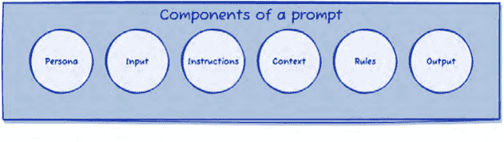

并非所有这些组成部分都是必需的，但它们在获得更准确和更相关的结果方面可能很有用。

# 20.1 - 角色或人设

角色是一个代表特定类型用户的虚构人物。它用于为提示词提供上下文并引导模型的响应。
角色的例子包括：

- 客户服务代表
- 销售员
- 医生
- 律师
- 教师

以下是一些示例：

```
Act as a customer service representative for a large retail company.
```

```
Act as an experienced salesperson.
```

```
You are a clever and friendly assistant. Your job is to help people find the best deals on the internet.
```

```
Act as a movie critic for a popular website.
```

```
You are an SEO specialist with more than 20 years of experience.
```

Hugging Face 上有一位用户拥有一个基于 BART 模型并在一组提示词数据集上训练的应用程序。该应用程序名为 ChatGPT Prompt Generator<sup>94</sup>，它对实验和生成你提示词的角色可能很有帮助。

<sup>94</sup> https://huggingface.co/spaces/merve/ChatGPT-prompt-generator


# 20.2 - 指令

指令是提示词的主要部分，它为模型提供了主要任务。指令可用于要求模型执行特定任务或生成特定类型的输出。

以下是一个示例：

创建一篇标题为“有史以来最伟大的10部电影”的博文。

根据提示词类型的不同，指令可以是显式的（例如，明确的任务）也可以是隐式的（例如，一个问题或一段对话）。我们将在后续章节中深入学习提示词的类型。

# 20.3 - 输入数据

输入数据是我们提供给模型的内容。它可以是几句话、一个列表，或者一段长段落。输入数据用于为模型提供指导，说明要生成什么以及如何生成输出。

假设你想根据IMDB的排名创建一篇关于有史以来最伟大的10部电影的博文。你可以通过提供以下输入来辅助AI模型：

1. 肖申克的救赎
2. 教父
3. 黑暗骑士
4. 教父2
5. 十二怒汉
6. 辛德勒的名单
7. 指环王：王者归来
8. 低俗小说
9. 指环王：护戒使者
10. 黄金三镖客

如果我们加上角色和指令，我们就得到了以下提示词：

扮演一个流行网站的电影评论家。

创建一篇标题为“有史以来最伟大的10部电影”的博文。

使用以下电影列表作为输入：

1. 肖申克的救赎
2. 教父
3. 黑暗骑士
4. 教父2
5. 十二怒汉
6. 辛德勒的名单
7. 指环王：王者归来
8. 低俗小说
9. 指环王：护戒使者
10. 黄金三镖客

# 20.4 - 上下文

在提示词中添加上下文是可选的，但它可以提供关于任务或应用程序的额外信息。它有助于引导模型的响应朝向特定方向。

以下是一个示例：

这份电影列表由IMDb生成，基于电影的平均评分。
该博文将发布在一个流行电影评论网站的网站上。

现在，如果我们把上下文添加到提示词中，我们得到以下内容：

扮演一个流行网站的电影评论家。

创建一篇标题为“有史以来最伟大的10部电影”的博文。

使用以下电影列表作为输入：

1. 肖申克的救赎
2. 教父
3. 黑暗骑士
4. 教父2
5. 十二怒汉
6. 辛德勒的名单
7. 指环王：王者归来
8. 低俗小说
9. 指环王：护戒使者
10. 黄金三镖客

这份电影列表由IMDb生成，基于电影的平均评分。
该博文将发布在一个流行电影评论网站的网站上。

# 20.5 - 规则

规则提供了关于任务或应用程序的额外信息。规则可用于强制特定行为（例如，语气、风格等）、过滤不需要的输出（例如，脏话、敏感信息等），或为提示词提供额外的上下文。
以下是一个示例：

博文不应包含任何剧透。

回到我们的示例，现在的提示词看起来像这样：

扮演一个流行网站的电影评论家。

创建一篇标题为“有史以来最伟大的10部电影”的博文。

使用以下电影列表作为输入：

1. 肖申克的救赎
2. 教父
3. 黑暗骑士
4. 教父2
5. 十二怒汉
6. 辛德勒的名单
7. 指环王：王者归来
8. 低俗小说
9. 指环王：护戒使者
10. 黄金三镖客

这份电影列表由IMDb生成，基于电影的平均评分。

该博文将发布在一个流行电影评论网站的网站上。

博文不应包含任何剧透。

# 20.6 - 输出

输出部分给模型一个关于预期输出类型的提示。如果你希望模型生成一个CSV文件，你可以添加以下输出：

Output: CSV

或者：

输出应该是一个CSV文件。

如果你希望模型生成JSON、XML、HTML或其他类型的输出，同样的逻辑也适用。

在我们的示例中，我们希望模型生成Markdown格式的博文，以便我们可以复制并粘贴到Markdown编辑器中。我们可以添加以下输出：

Output: Markdown code snippet

现在的提示词看起来像这样：

```
扮演一个流行网站的电影评论家。 
创建一篇标题为“有史以来最伟大的10部电影”的博文。 
使用以下电影列表作为输入： 
1. 肖申克的救赎 
2. 教父 
3. 黑暗骑士 
4. 教父2 
5. 十二怒汉 
6. 辛德勒的名单 
7. 指环王：王者归来 
8. 低俗小说 
9. 指环王：护戒使者 
10. 黄金三镖客 
这份电影列表由IMDb生成，基于电影的平均评分。 
该博文将发布在一个流行电影评论网站的网站上。 
博文不应包含任何剧透。
```

Output: Markdown code snippet

# 20.7 - 示例

示例可以提供关于输出样式的更多信息。

假设你已经有一篇关于同一主题的博文，并希望影响模型生成类似的输出。你可以添加以下内容：

```text
这是一篇根据IMDb排名关于有史以来最伟大的10部电影博文的示例。

"""
[你的示例在这里]
"""
```

这是完整的提示词：

```text
扮演一个流行网站的电影评论家。

创建一篇标题为“有史以来最伟大的10部电影”的博文。

使用以下电影列表作为输入：

1. 肖申克的救赎
2. 教父
3. 黑暗骑士
4. 教父2
5. 十二怒汉
6. 辛德勒的名单
7. 指环王：王者归来
8. 低俗小说
9. 指环王：护戒使者
10. 黄金三镖客

这份电影列表由IMDb生成，基于电影的平均评分。

该博文将发布在一个流行电影评论网站的网站上。

博文不应包含任何剧透。

Output: Markdown code snippet

这是一篇根据IMDb排名关于有史以来最伟大的10部电影博文的示例。

"""
[你的示例在这里]
"""
```

示例的作用是为所谓的“少样本学习”（Few-Shot Learning）创建一个环境。模型将从示例中学习并尝试生成类似的输出。

# 21 - 提示词类型

提示AI的方式不止一种，对提示词进行分类的方式也不止一种。然而，在不同的语境中有一些常见的提示词类型。本节尝试列出一些最常见的提示词类型，并提供每个类型的示例。

在接下来的章节中，我们将看到这些提示词类型的实际运用，以及如何使用它们来提示AI：

- 直接指令
- 开放式提示词
- 苏格拉底式提示词
- 系统提示词
- 其他类型的提示词
- 交互式提示词

## 21.1 - 直接指令

这些提示词直截了当，指示AI执行特定任务或回答特定问题。这种类型的提示词通常在期望的输出清晰且无歧义时使用。

示例：

- 将这段英文翻译成德文：'Hello, how are you?'
- 将这个数字列表从小到大排序：phi, e, pi, 1
- 哥伦比亚的首都是哪里？
- 给我列出1到100之间所有质数的列表。
- 创建1到100之间10个随机数字的列表。
- 计算所有质数的和。
- 如果我有5个苹果，我给了你2个，我还剩下多少个苹果？
- 生活就像一盒巧克力，你永远不知道[填空]。
- 那个穿红衣服的女人是[填空]，我忘不了她。
- 选择这个问题的最佳答案：列出目录中所有文件的命令是什么？ 1) ls 2) cd 3) pwd 4) rm

## 21.2 - 开放式提示词

开放式提示词旨在鼓励AI生成具有创造性、探索性或多样化的输出。通常，这种类型的提示词没有单一的正确答案。当期望的输出不明确或用户希望从AI寻求创意灵感时，通常会使用这种提示词。 示例：

- 写一个关于时间旅行者弗雷德（Fred）回到1985年的短篇故事。
- 写一首关于蓝色的诗。
- 描述一片森林，但不要使用“绿色”这个词。
- 写一部小说《指环王》的摘要。
- 我要去堪萨斯城旅行。我应该在那里做什么？
- 我感到很无聊。建议一些不出门就能做的有趣活动。
- 我如何能在我的Python开发项目中提高生产力？

## 21.3 - 苏格拉底式提示词

苏格拉底最著名的名言之一是“我知道你不會相信我，但人类最高的卓越形式是质疑自己


和他人。”这句话成为苏格拉底式提问的灵感来源，这是一种通过提问和回答来激发批判性思维的探究方法。该仓库¹⁰⁰ 包含进行这些研究所必需的核心代码、数据集和指南。

[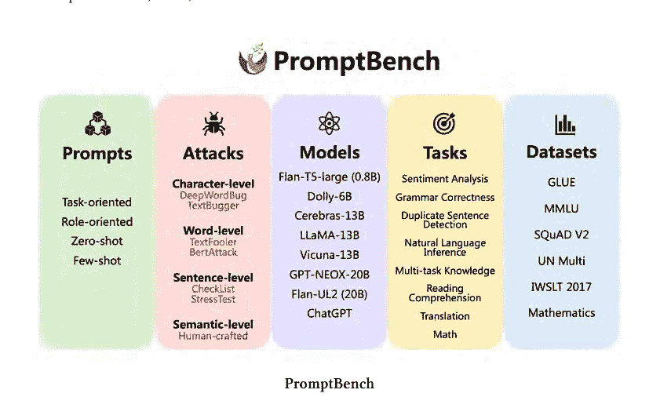]

### 22.6 - PromptFlow

PromptFlow¹⁰¹ 是一款专为希望以最少代码将大语言模型（LLM）集成到应用程序中的用户而设计的工具包。它具备一个图形化流程图设计器，用户可以在其中创建代表提示（Prompt）、Python 函数或大语言模型（LLM）的节点。这些节点通过定义应用程序逻辑的路径相互连接。启动后，PromptFlow 会按顺序处理每个节点，并在它们之间传递数据。如需深入了解其功能，用户可以参考官方文档¹⁰²。


## 22.7 - promptfoo

[promptfoo](https://github.com/promptfoo/promptfoo) 是一个强大的工具，旨在优化大型语言模型的测试和评估。它推崇提示工程中的测试驱动方法，取代了传统的试错法。
用户可以从以下功能中受益：系统化测试、并排评估 LLM 输出、通过缓存和并发实现快速评估、基于自定义测试用例的自动评分，以及使用方式的灵活性——范围从命令行界面（CLI）到 CI/CD 流水线。此外，它兼容众多模型和平台，包括 OpenAI、Anthropic、Llama 2、Vicuna，并提供了针对自定义 LLM API 提供商的集成选项。

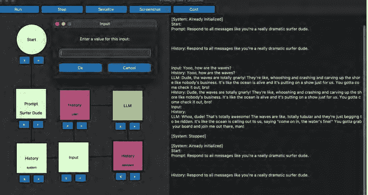

PromptFlow

## 22.8 - Promptperfect：一种提示优化工具

**PromptPerfect**$^{104}$ 是一种专为大型语言模型、大模型和 LMOps 设计的先进提示优化工具。该工具通过自动为 Chat-GPT、GPT-3.5、DALL-E 2、StableDiffusion 和 MidJourney 优化提示，简化了提示工程。


PromptPerfect 提供许多功能，包括：
- 简化提示工程流程
- 为多个模型生成提示
- 少样本提示生成
- 面向 LLM 的提示即服务（Prompt as a Service）工具
- 用于检查函数如何响应自然语言提示的测试环境
- 用于比较多个 AI 模型在同一提示上表现的工具
- 应用程序接口（API）
- 以及更多功能

> https://promptperfect.jina.ai/

免费计划有限制，但对于小型项目运行良好。付费计划起始价为 9.99 美元。

## 22.9 - Aiprm for ChatGPT：提示管理和数据库

[AIPRM for ChatGPT](https://www.aiprm.com/) 是 ChatGPT 的一个提示数据库。它包含用于生成多个主题内容的提示。它与 ChatGPT 集成，允许用户针对特定主题生成内容。

该工具提供免费和付费计划。付费计划每月起始价格为 9 美元，包括：
- 访问社区提示
- 收藏夹列表
- 私有提示模板
- 语气与写作风格功能
- AIPRM 认证提示
- 提示中的变量
- 以及更多功能

要使用 AIPRM for ChatGPT，您需要安装浏览器扩展。


AIPRM for ChatGPT

公共提示可以免费使用，但除非您注册付费计划，否则无法查看完整提示。该工具涵盖不同主题的提示，包括：
- 文案写作
- DevOps
- 生成式 AI
- 市场营销
- 操作系统
- 生产力
- SaaS
- SEO
- 软件应用
- 软件工程

## 22.10 - FlowGPT：ChatGPT 的可视化界面和提示数据库

FlowGPT$^{106}$ 是 ChatGPT 的可视化界面，具有多线程的可视化对话流程。

它还是一个专注于分享和探索大量 ChatGPT 使用示例的社区平台。它向用户提供由 FlowGPT 社区上传的庞大提示库。通过浏览此合集，用户可以发现各种主题下流行且有用的提示，并在同一平台上使用它们生成内容。用户可以选择 ChatGPT、Llama 2、GPT-4 和 Claude。他们还可以访问生成文本的温度等功能。


## 22.11 - Wnr.ai：创建动画 AI 头像的无代码工具

Wnr.ai$^{107}$ 是一种用于创建、测试和共享对话式 AI 模型的无代码工具。每个 AI 都针对特定主题进行训练，可用于生成内容、回答问题或仅仅参与聊天。

**交互式 AI 展示**
试用各种 AI，每个 AI 都使用多种不同的 LLM 进行独特定制。


*Wnr.ai*

付费计划每月起始价格为 19 美元，包括：
- 3 个 AI
- 访问高级模板
- 使用 OpenAI Whisper 的音频转录
- 使用 Eleven Labs 的文本转语音
- 每月使用 GPT-4 模板 40 次

# 23 - 后记

## 23.1 - 接下来是什么？

恭喜您完成《面向开发者的 LLM 提示工程》！我相信，这次对大型语言模型和提示工程世界的深入探索丰富了您的理解，并为您提供了实用且特别是可操作的见解。

在本指南中，我们解释了如何为 LLM 创建有效的提示，探索了语言模型的基本原理，并深入探讨了如何在实际应用中最大限度地发挥其潜力的技巧。

至此，您应该已经牢固掌握了通过熟练的提示工程利用 LLM 全部能力所关键的方法和最佳实践。

与任何技能一样，精通来自于练习。我敦促您将本指南中讨论的策略和示例付诸实践，通过实验和迭代来磨练您的专业能力。

我希望这次阅读体验既具有启发性又充满乐趣。继续您的探索之旅，切勿停止好奇！

如果本指南引起了您的共鸣，请考虑加入 FAUN 社区$^{108}$。及时获取即将推出的免费和高级指南、课程及每周通讯。

## 23.2 - 您的反馈至关重要

我们投入了无数时间来打造这份指南，旨在为您提供掌握提示工程的最佳知识和工具。

我非常想听到您的想法和建议。您的反馈将帮助我改进这份指南并创建未来的更好内容。您的见解还可以为他人指明方向！如果您认为我达成了目标且这份指南对您有价值，如果您能在购买这本书的市场平台上分享您的体验并撰写 thoughtful 评价，我将深感荣幸。

您的反馈将帮助我量化这部作品的影响力，并帮助他人发现这本书并从中受益。

感谢您陪我走过这段充满启迪的旅程。祝您未来的所有冒险和事业中取得成功与创新。

