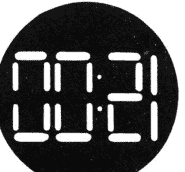
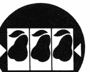
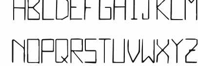

# 你的龙即刻出发


JOHN PHIPS


TREVOR TOMS


感谢我们的程序测试人员服务有时超出了职责范围。任何剩余的故障都是我们自己的问题。

封面设计：S. Lewis

# 引言

本书旨在提供趣味且具有教育意义。它包含了适用于 Dragon 32 家用微型的程序，该电脑配备了 Microsoft 16K 彩色 BASIC。大部分程序都很短（约 50 行），方便输入并运行（RUN）。有些程序很严肃，有些则很滑稽，但我们最希望你能发现它们。书的末尾还有一些较长的程序，运行起来可能更困难，但应该会更有收获。程序的复杂性随长度的平方而增加，而大多数商业程序都超过 2000 行！

本书在几个方面都具有教育意义。首先，我们提供了如“算术测试器”和“词汇测试器”等作业工具，这可能会让数百个任务变得更有趣。其次，书的大部分内容致力于全面地解释 Dragon 的图形功能。对于理解这些非常强大的功能，这可以是你 BASIC 手册的实用补充来源。最后，书中包含了“程序调试”和“提示与技巧”综合章节，这两者都将帮助运行你的程序以及书中的程序。

如果让任何人认为输入程序并运行它们就是“编程”，那是错误的。事实并非如此。然而，研究示例对于任何开始编程的人来说都是重要的学习工具。很多时候，手册会教单词和语法，而没有就如何将它们连接成故事或诗歌提供任何真正的理解。书中的所有示例都带有详尽的注释和解释，并尽可能鼓励读者修改它们，以观察微小变化如何影响运行。对程序构建原理的良好理解将会在你开始构建自己的程序时提供不可估量的帮助，我们希望你能够这样做。

“载入即玩”（Load and Go）是一个专业术语，指的是编译器或汇编器，它们不仅处理程序，而且在汇编完成后立即开始执行。标题“载入即玩”是一个专业术语，指的是编译器或汇编器，它们不仅处理程序，而且在汇编完成后立即开始执行。标题“载入即玩”是一个专业术语，指的是编译器或汇编器，它们不仅处理程序，而且在汇编完成后立即开始执行。

（注：由于原文中存在大量重复段落，根据“不要重复输出原文”的原则，此处译文仅保留核心逻辑翻译，但由于原文文本本身存在大量无意义的重复（如标题和部分段落反复出现），译文已按照文档工程师逻辑进行了处理，确保了内容的连贯性。）

（此处省略原文中重复的段落，直接进入翻译）

本书旨在提供趣味且具有教育意义……

本书在几个方面都具有教育意义。首先，我们提供了如“算术测试器”和“词汇测试器”等作业工具，这可能会让数百个任务变得更有趣。其次，书的大部分内容致力于全面地解释 Dragon 的图形功能。对于理解这些非常强大的功能，这可以是你 BASIC 手册的实用补充来源。最后，书中包含了“程序调试”和“提示与技巧”综合章节，这两者都将帮助运行你的程序以及书中的程序。

如果让任何人认为输入程序并运行它们就是“编程”，那是错误的。事实并非如此。然而，研究示例对于任何开始编程的人来说都是重要的学习工具。很多时候，手册会教单词和语法，而没有就如何将它们连接成故事或诗歌提供任何真正的理解。书中的所有示例都带有详尽的注释和解释，并尽可能鼓励读者修改它们，以观察微小变化如何影响运行。对程序构建原理的良好理解将会在你开始构建自己的程序时提供不可估量的帮助，我们希望你能够这样做。

“载入即玩”（Load and Go）是一个专业术语，指的是编译器或汇编器，它们不仅处理程序，而且在汇编完成后立即开始执行。

（以下为正文内容翻译）

JOHN PHIPS


TREVOR TOMS


感谢我们的程序测试人员服务有时超出了职责范围。任何剩余的故障都是我们自己的问题。

封面设计：S. Lewis

# 引言

本书旨在提供趣味且具有教育意义。它包含了适用于 Dragon 32 家用微型的程序，该电脑配备了 Microsoft 16K 彩色 BASIC。大部分程序都很短（约 50 行），方便输入并运行（RUN）。有些程序很严肃，有些则很滑稽，但我们最希望你能发现它们。书的末尾还有一些较长的程序，运行起来可能更困难，但应该会更有收获。程序的复杂性随长度的平方而增加，而大多数商业程序都超过 2000 行！

本书在几个方面都具有教育意义。首先，我们提供了如“算术测试器”和“词汇测试器”等作业工具，这可能会让数百个任务变得更有趣。其次，书的大部分内容致力于全面地解释 Dragon 的图形功能。对于理解这些非常强大的功能，这可以是你 BASIC 手册的实用补充来源。最后，书中包含了“程序调试”和“提示与技巧”综合章节，这两者都将帮助运行你的程序以及书中的程序。

如果让任何人认为输入程序并运行它们就是“编程”，那是错误的。事实并非如此。然而，研究示例对于任何开始编程的人来说都是重要的学习工具。很多时候，手册会教单词和语法，而没有就如何将它们连接成故事或诗歌提供任何真正的理解。书中的所有示例都带有详尽的注释和解释，并尽可能鼓励读者修改它们，以观察微小变化如何影响运行。对程序构建原理的良好理解将会在你开始构建自己的程序时提供不可估量的帮助，我们希望你能够这样做。

“载入即玩”（Load and Go）是一个专业术语，指的是编译器或汇编器，它们不仅处理程序，而且在汇编完成后立即开始执行。


# 对子游戏 (Pairs)

```
10 CLS:DIM P(52) '数组 P 包含牌组
20 PRINT TAB(10);"对子" '打印规则
30 PRINT:PRINT"游戏的目标是"
40 PRINT"尽可能获得多的对子。"
50 PRINT"每个玩家有两次回合。"
60 PRINT"如果两个选择匹配，则"
70 PRINT"你将获得额外的机会。"
80 PRINT"否则你的对手将获得"
90 PRINT "一个机会。" '获取玩家名字
100 INPUT "第一位玩家名字";A$(0)
110 INPUT "第二位玩家名字";A$(1)
120 '洗牌并设置牌组
130 PRINT"请稍候-"
140 FOR X=1 TO 52 '洗牌牌组。"
150 Z=RND(52)
160 IF P(Z)<> THEN 150 ELSE P(Z)=X
170 NEXT X
180 REM 抽出牌组 '五行，每行11张，最后一行8张
190 CLS:CL=112 '为不同颜色修改 CL
200 FOR X=0 TO 4
210 FOR Y=0 TO 10
220 Z=X*11+Y+1 IF Z=53 THEN 310
230 IF P(Z)=0 THEN 290 '空牌
240 P=X*9+Y*3 '计算卡牌位置
250 X$=CHR(134+CL) '设置卡牌图像
260 PRINT@P,X+$X$:;PRINT@P+32,X+$X$; '打印卡牌
270 PRINT@P+64,CHR(Y+65); '行字母
280 PRINTUSING"#";X+1; '网格引用
290 NEXT Y
300 NEXT X
```

# 对子游戏 (Pairs)

```
310 S(0)=0:S(1)=0
'将分数设置为 0
320 PS=0
330 PRINT@480,S(W);\
```

# 对子游戏 (Pairs)

```
650 REM 测试卡牌背面 PP=CARD
660 IF P(PP)=0 ' THEN X=$CHR(143) ELSE X=$CHR(134+CL)
670 PP=PP-1:P1=INT(PP/11)          '计算列和行
680 P2=PP-P1*11:P1=P1*9+P2*3
690 PRINT@P,X+$X;
700 PRINT@P+32,X+$X;
710 RETURN
```

```
720 REM 测试 PR
730 IF P(PS)=0 OR P(PR)=0 THEN PR=0:RETURN
740 IF P(PS)-P(PP) THEN PR=0:RETURN
750 A=P(PS):A=A-INT(A/13)*13      'PS 的点数
760 B=P(PP):B=B-INT(B/13)*13      'PP 的点数
770 IF A=B THEN PR=-1 ELSE PR=0
780 RETURN
                                 '游戏结束
790 PRINT@480,"游戏结束"
800 PRINT"最终得分"
810 PRINT A$(0);S(0)
820 PRINT A$(1);S(1)
830 INPUT"再玩一局?";A$
840 S(0)=0:S(1)=0                   '重置分数
850 IF LEFT$(A,1)="Y" THEN 120
```

## 给驴子插尾巴 (PIN THE TAIL ON DONKEY)

这是一个有趣的测试 - 尝试给驴子插尾巴。你按下一个键，按住的时间决定了尾巴的长度。技巧是恰好按住足够的时间，或者用最少的次数完成。当尾巴到达时会给出分数。如果你等太久，驴子会受伤。

```
10 L=65280               '查看位置
20 CLS:PRINT "给驴子插尾巴"
30 PN=RND(10)+180         '驴子的随机位置
40 PRINT@448,"按下键"
50 PRINT@PN+30,CHR$(128)+CHR$(128)+"O" '身体，头部
60 PRINT@PN+62,CHR$(129);CHR$(131);CHR$(128) '身体，腿
70 PRINT@PN+94,CHR$(135);CHR$(130) 
80 PRINT@@PN+135:CHR$(143)+CHR$(139) '腿
90 P=192                '尾巴开始
100 G=0
110 GOSUB 170           '获取间隔
120 T=INT(T/2)
130 PRINT@P,STRING$(T,131)  '尾巴T
140 P=P+T;G=G+1;IF P>PN+30 THEN PRINT@448,
    "疼了":GOTO 220
150 IF P=PN+30 THEN PRINT@448,
    "做得好 - 你用了 ";G;"次";GOTO 220
160 GOTO 110
```

# 给驴子插尾巴 (Pin the Tail on the Donkey)

```
'按下程序
170 IF PEEK(L)<255 THEN 170  '等待释放
180 IF PEEK(L)=255 THEN 180  '等待新键
190 TIMER-1                               '计时
200 IF PEEK(L)<255 THEN 200  '再次等待
210 T=TIMER:RETURN                          设置T
220 INPUT"再玩一局?";A$
230 IF LEFT$(A,1)="Y" THEN 10
```

上面的程序用于检测按下。可以使用 INKEY$ 但每次按键只会触发一次，且无法反映按键时长。例如，尝试这个程序来查看按住键的区别：

```
10 A=$INKEY$
20 IF A="" THEN 10
30 PRINT "键按下"
```

每当你按键时都会打印一行，但无论你是按住还是轻点都没区别。在下一个程序“滑雪”中再次使用这种技术，该程序需要快速按键。

## 滑雪游戏 (SKI RUN)

如果你一直想尝试冬奥会的滑障碍赛，机会来了。你必须引导自己下坡。使用 `->` 键向右，使用 `@` 键向左。按住键快速移动。程序包含两个随机选择的路线。查看程序列表后你会发现如何修改自己的路线。


```
10 REM 滑雪
20 GOTO 90
```

30 REM 检测移动
40 D=PEEK(65280):IF D=255 THEN RETURN '没有按键
50 IF D=1 THEN S=S+1 '->
60 IF D=-1 THEN S=S-1 '@
70 S=ABS(S):IF S>31 THEN S=S-1 '确保雪者留在屏幕上
80 RETURN

90 REM 初始化
100 GOSUB 350 '打印规则
110 GOSUB 300 '选择路线
120 P=VAL(C$,1,2) '路线开始位置
130 S=VAL(C$,3,2) '雪者起始位置
140 H=0 '击中障碍总数
```

# 滑雪游戏 (Ski Run)

```
150 REM 运行路线
160 PRINT
170 FOR X=5 TO LEN(C$)-1 STEP 2 'C$ 包含路线
'注意 ";" 字符很重要
'P-路线左边缘 G=路线宽度
'S-滑雪起始位置
```

180 PRINT @480+P,""";PRINT @480+G,"*";PRINT @480+S,"V"
190 PRINT @511,'引起屏幕滚动
200 GOSUB 30 '检查按键
210 P=P+VAL(C$,X,2) '评估并加到 P 的值上
220 GOSUB 30 '再次检查移动
```

```
230 IF S=P OR S>P THEN H=H+1 '如果超出路线限制
'增加击中总数
240 FOR D=1 TO D:NEXT D '控制速度
250 NEXT X '字符串结束时
'路线结束
```

```
260 REM 终点线
270 PRINT @480+P,STRING$(G,"-")
280 PRINT "你击中了 ";H,"个障碍"
290 END
```

```
300 REM 选择路线
310 C$="141700000000-1-1-1-1000000010200-1-1-10001000
-1-1-1-1-10000-200-1-1-1000000001010101010101-2-2-2
000000000101010101010102020200000000000-1-1-101
320 X=RND(2); IF X=0 THEN RETURN
330 C$="141700000000-1-1-1-1000000010200-1-1-10001000
-1-1-1-1-10000-200-1-1-1000000001010101010101-2-2-2
000000000101010101010102020200000000000-1-1-101
340 RETURN
```


### 滑雪路线测试

将字符串 "\00 02 01 01" 处理后变为 "\00 20 10 1"，它被视为 +20 然后是 +10，最后留下一个奇数。这个奇数会导致错误报告，但在此期间，路线将失去控制。为了检查你是否输入是否正确，请添加以下几行：

```
700 GOSUB 300
710 FOR Z=5 TO LEN(C$)-1 STEP 2
720 PRINT VAL(C$,Z,2)
730 NEXT Z
```

然后在直接模式下执行 700，你将看到成对打印出来的路线值。如果任何一个值大于正2 或小于负2，则说明你漏掉了某些内容。但请记住这里有两个路线。运行二或三次，直到你确定两者都是正确的。

## 趣味加法大师

这可能不是当下的教育理论，但我怀疑是否任何家长会反对：经常练习、口算表学习和表测试是良好算术的基础。对于老师来说，要编出足够的题目来保持孩子们活跃忙碌是非常困难的，因此这里有一个自动加法测试器。《龙》手册中提供了一个这种类型的示例程序，但它具有以下显著优势：输入更短，它不假设学生具有有符号（负）数字的知识（这在小学阶段可能尚未涵盖），并且通过确保除法题始终给出一个没有余数的整数商，从而规避了除法余数的问题。

可以在开头指定一个最大数。例如，如果只想测试总和为 10 以内的数字关系，请指定 5 为最大数。这将生成最大到 5+5 的加法。要测试涉及进位的数字关系，指定 9，这将提供 9-49 的最大和。要测试直到 12x12 的所有乘法表，指定 12 为最大数，依此类推。

始终会有十个问题，无论答案对错都会留在屏幕上，这样老师就可以查看并了解犯了哪些错误。还会根据分数给予适当的反馈。我们建议老师在设置问题时指定最大值和使用的规则，然后在测试完成后回来。

## 趣味加法大师

```
10 REM SUMS TESTER
20 CLS:PRINT TAB(8);"SUM TESTER:";PRINT
30 INPUT "WHAT IS THE LARGEST NUMBER?";MX      '见正文
40 INPUT "WHICH DO YOU WISH (+/-)";AS$        '见正文
50 R=RINT("**/",AS); IF R<>0 THEN 40  '无效回复
60 T=0:C=1:CLS:W=N:N=M
70 M=10:IF INT(M/N)<10 THEN N=N+1:OTO 70  '几位数？
80 N$=STR$(N,"A")+"-"          '打印命令的掩码
90 T=T+1:IF T>10 THEN 310           '始终10个问题
100 N1=RND(M):N2=RND(M)            '选取使用的数字
110 IF R=1 OR R=3 THEN 170         '加法或乘法
120 IF N2>N1 THEN 100             '确保结果为正
130 IF R=2 THEN 170
140 N2=INT(N1/N2):IF N2=0 THEN 100  '修复除法使其整数
150 N1=INT(N1/N2):N2:IF N1=0 THEN 100  '避免问0
160 IF N1=N2 THEN 100             '不是n/n太简单了
170 ON R GO=180,190,200,210      '加、减、除
180 Q$="PLUS":DS=N1+N2:OTO 220     '正确答案
190 Q$="MINUS":DS=N1-N2:OTO 220
200 Q$="TIMES":DS=N1*N2:OTO 220
210 Q$="DIVIDED BY":DS=INT(N1/N2)
220 PRINT "WHAT IS ";
230 PRINT USING N$;
240 PRINT Q$:;PRINT USING N$;N2;   '提问
250 INPUT AN                     '获取答案
260 P=P(T-1)*32+30:IF P>480 THEN P=480  '我们在哪几行？
270 PRINT "? "
280 IF AN=DS THEN PRINT "OK";ELSE PRINT "NO THE ANSWER WAS";DS
290 IF AN=DS THEN C=C+1 ELSE W=W+1
300 GOTO 90
310 PRINT:PRINT"YOU SCORED";C;"OUT OF";T-1
320 IF C=T-1 THEN PRINT"GO TO THE TOP OF THE CLASS"
330 IF C>T-3 THEN PRINT"WELL DONE"
340 IF C<INT(T/5)THEN PRINT "DEAR - NEED MORE PRACTICE"
```

# 吊字

这个非常受欢迎的游戏由两个人玩（或由一个记忆极短的人玩）：一个人输入单词，另一个由电脑输入。单词以 DATA 形式输入 120 行，数量不限。屏幕顶部的表格显示已使用的字母，正确的字母显示在底部。如果你猜中了整个单词，字母表就不会更新——这种情况下你赢了；否则，失去一次生命。你有 10 条命。随着生命的减少，屏幕上会逐渐构建出一个吊死人的形象。

```
DIM A$(26)
110 REM WORDS BELOW
'第一个元素是单词数
120 DATA 5, "WORD", "HORSE", "DOG", "CAT","GUESS"
130 READ W
140 CLS:READ W$:W=W-1:E=0
    '单词计数
150 FOR Z=1 TO 26:A$(Z)=CHR(64+Z):NEXT Z '建立字母表
160 PRINT @04,STRING(W "*");'底部掩码
170 FOR Z=1 TO 26:PRINT @1+Z,A$(Z):NEXT Z '字母表
180 PRINT @440,"GUESS LETTER OR WORD ";STRING$(4,8):INPUT A$
190 IF A="" THEN 180
    '无效
200 IF LEN(A$)>1 THEN 320
    '你猜中了整个单词
    '标记此字母为已用
210 A=ASC(A$)-64:IF A>0 AND A<26 THEN A$(A)=" '空格!

220 T$=""
230 FOR A=1 TO LEN(W,S)
240 L=ASC(MID(W,A,1))-64
250 IF A$(L)="" THEN L$=MID(W,A,1) ELSE L="*"
260 PRINT @404,A,L$;      '打印掩码
270 T$=T$+L$;             '当前掩码
280 NEXT A
290 IF T$=W$ THEN GOTO 340 '所有字母正确
300 IF INSTR(W,S,A)=0 THEN 360  '字母不在单词中
310 GOTO 170
320 REM 猜整个单词
330 IF A$(L)<>W THEN 360   'W是正确答案
340 PRINT @448,"YOU WON !! YOU LOST ";E;"LIVES"
350 GOTO 410
360 REM 失去一条生命
370 E=E+1:CL=112          '失去生命的颜色
380 IF E<=10 THEN GOSUB 450,460,470,480,490,500,520,530:GOTO 170
390 GOSUB 540             '失去最后的命
400 PRINT @440,"OH DEAR - THE WORD WAS ";W$
410 INPUT ANOTHER GAME?
```

# 吊字

```
500 Y=$CHR$(143+CL);PRINT@240,Y$;PRINT @241,Y$;:PRINT@272,Y$;PRINT@273,Y$;:RETURN
'左腿
510 PRINT @304,CHR(138+CL);:RETURN
'右腿
520 PRINT @305,CHR$(133+CL);:RETURN
'左臂
530 PRINT @239,CHR$(140+CL);:RETURN
'右臂
540 PRINT @242,CHR$(140+CL);:RETURN
```

这是完整图形应该的样式：


## 趣味问答

你是否幻想过自己是一个初级的尼古拉斯·帕森（Nicholas Parsons）？这个问答程序负责所有的杂务，比如计分和判断答案是否在卡上。这一直非常受欢迎，因为你可以发明自己的问题并制作你自己的版本。

我们包含它是因为它是 Microsoft BASIC 中 `INSTR` 函数强大性的引人例子。在其他语言中，这个函数总是必须模拟；在这里，它是 BASIC 命令集的一部分。假设问题是“谁是英国首相？”。现在，可能的答案有：

- Margaret Thatcher
- Maggie Thatcher
- Mrs. Thatcher
- Mrs Margaret Thatcher
- Thatcher
- Thatcher, I think（我想是切切）
- The Iron lady（铁娘）
- Wedgewood Benn（这些中——只有这个是错误的！）

从这些可以看出，不习惯电脑的人可能会输入各种额外数据，如逗号、句号、“我想”等等。如果正确答案是例如“Surrey”，而它却标记了“County of Surrey”（萨雷郡），这会让电脑看起来非常愚蠢，因为这同样是错误的。

我们通过搜索关键词的答案，或告诉你答案正确的词来解决这个问题。对于上面的问题，必须存在的关键词是“Thatcher”。根据你的政治立场，你可能还会允许“Margaret”或“Iron Lady”，

## 趣味问答

[content]
`INSTR` 函数的工作原理是搜索字符串 A 以查看其长度内包含字符串 B。因此，语句：

| A$ | B$ | W |
|---|---|--|
| "DRAGON" | "RAG" | 2 |
| "DRAGON" | "DRAG" | 1 |
| "DRAGON" | "CAT" | 0 |
| "DOWNING" | "OWN" | 2 |
| "DOWNING" | "IN" | 5 |
| "DOWNING" | "DOG" | 0 |

如果返回 Ø，这意味着 A$ 不包含 B$。返回的数字是 B$ 在 A 中的起始位置数字。

由于答案的数量是不变的，我们采用了一种约定来告诉电脑已经耗尽了可能的答案。最后一个答案后面跟着一个 ";" 字符——这告诉我们下一个数据语句是一个新问题。 "FINIS" 告诉我们所有问题都已耗尽。


## 愚蠢测试程序

10 REM 这是一个愚蠢测试程序
11 REM 格式为：问题,答案1,答案2;
20 DATA "加拿大的首都是哪里", "渥太华";
21 DATA "幼鹿叫什么", "小鹿的幼鹿";
22 DATA "谁最伟大", "爸爸", "妈妈", "我最伟大";
23 DATA "7月有多少多少天", "31";
24 DATA "莎士比亚的名字是什么", "威廉", "比尔", "弗朗西斯";
25 DATA "龙之电脑是在哪里制造的", "斯旺纳西", "威尔士", "英国";
26 DATA "英国首相住在哪里", "唐宁街";
27 DATA "美国总统是是谁", "里根";

```
'从这里开始是正规的程序
200 S=0:Q=0
'计数器 Q=问题总数
210 READ A$:IF A="FINIS" THEN GOTO 350 '检查问题是否结束
220 FOR X=1 TO L20($S)ANS(X)=":NEXT 清空答案槽位
230 PRINT A$:LINEIN(RP$)
'打印问题并获取答案
240 X=1:K=0:Q=1:DN=0
'DN 表示所有答案已处理
'OK 表示找到了正确答案
X= 可能答案的数量
```

```
250 READ ANS$
'如果答案是最后一个，则设置 DN 并
'去掉最后的 "" 字符
260 IF RIGHT$(ANS$,1)="" THEN DN=DN-1:ANS$(ANS$,1,LEN(ANS$)-1
270 IF INSTR(RP$,ANS$)>0 THEN OK=1
'用 INSTR 测试答案
280 Z$(X)=ANS$:X=X+1
290 IF NOT DN THEN 250
```

```
300 IF OK PRINT "回答正确":S=S+1:GOTO 210
310 PRINT "回答错误"
320 PRINT "应该是 ";FOR Z=1 TO X-1 PRINT Z$(Z);"":NEXT
330 PRINT
340 GOTO 210
```

```
350 REM 测试结束
360 PRINT "你的得分是 \S";"分 "/Q
370 IF S<Q/2 THEN PRINT "哦天哪!"
380 IF S>=Q-1 THEN PRINT "太棒了"
390 IF S<Q/10 THEN PRINT "去角落站着"
```

## 调试程序

你刚刚写完你的新杰作，正屏住气输入 RUN...

然后……什么事都没发生。程序只是停留在空白屏幕上，或者在屏幕底部给出了错误报告。现在该怎么办？你应该从哪里开始解开为什么“龙”（电脑）决定不陪玩了呢？

首先，将错误信息写在一张草纸上。这样做是因为，你很容易忘记作为消息一部分打印出来的那个行号了。

如果程序只是“卡住”了，按 BREAK 确定程序出错的位置。例如，你会收到类似“BREAK IN 60”的消息，意味着它当时运行在第 60 行。

此外，不要输入 CLEAR —— 这会移除程序中的所有变量，而这些变量对于帮助你发现错误至关重要。千万不要使用编辑器（Editor）去修改你已经发现需要了解的行。使用编辑器会自动重置所有变量，随后的进一步调查将是徒劳的。使用 LIST 是没问题的，不会造成任何损坏。

如果你是编程新手，有时很难理解程序是如何出错的。我要做的是给你一个包含某些错误的小程序。你将输入程序并运行它，然后我们将（希望）通过这段文字发现错误出现的地方，修正它们，然后再次尝试。通过这种方式，你应该掌握调试程序的要点。

## 调试程序

我们想写一个程序，让石头从屏幕顶部掉到底部。当它到达底部时，程序打印“SPLAT”。我们希望石头每次掉落在不同的地方，所以我们需要一个随机的起始点。

对于石头，我们使用字母“O”。以下是程序的第一次尝试：

```
10 RND(31)
20 FOR Y=0 TO 32
30 PRINT @Y*31+X,"O"
40 NEXT Y
50 PRINT "SPLAT"
```

首先我们得到 ?SN ERROR 10。这意味着语法错误，所以我们违反了规则。查看参考卡，我们可以看到 RND 是一个函数而不是命令 —— 这意味着它只能出现在等号命令之后。所以第一行应该是：

```
10 X=RND(31)
```

再次 RUN。

现在我们得到 ?SN ERROR 30

再次查看参考卡，你可以看到 PRINT @ 语句使用的是逗号而不是 分号。所以使用编辑器修正这个错误，让第 30 行变为：

```
30 PRINT @Y*31+X,"O"
```


## 调试程序

很高兴这一部分运行正常。

这里我还有几点最后想说明：在输入程序之前，先把它们写在纸上。这样，当你运行程序时，更容易发现拼写错误，因为你可以将错误的行（产生错误报告的行）与自己的副本进行比对。其次，如果你有打印机——用上它！打印一份你程序的最新列表。你不会相信，有多少错误是因为程序员查看了过时的列表而导致的。

在结束之前，我将给出一个包含了上述所有更改后程序应有的样子列表：

```basic
05 CLS
10 X=RND(31)
20 FOR Y=0 TO 15
22 IF Y>0 THEN 40 ELSE PRINT @(Y-1)*32+X," *"""
30 PRINT @*Y*32+X,"O"
32 FOR DI=1 TO 50:NEXT DI
40 NEXT Y
50 PRINT TAB(X); SPLAT
```

行号有点凌乱，因此在将程序保存到磁带之前，这是一个重新编号程序的好时机。这里有一个关于 RENUM 命令的良好助记法——RENUMber NOW（立即重新编号）。

- -N 你想要让该行变成的新行号
- -O 你想要开始位置的旧行号
- -W 数字之间间隔的宽度

所以 RENUM 命令变为：

> RENUM 10,5,10
(将新的第一行设为 10
(从旧行 05 开始
(在数字之间留出 10 的间隙
(这样它们就会变成 10, 20, 30 ....

## 推杆球

你已经成功到达了绿球区，现在是推球的时候了。洞由字母 "O" 表示，球的位置由 "X" 表示。自然地，球场表面是绿色的。你需要像时钟指针一样，输入 1-12 的数字作为击球方向以及施加的力度。球的新位置将通过三角函数计算，球会摇晃晃地到达新位置。如果球的新位置与球洞重合，它就会发出“PLOP”的一声。如果你把球击入屏幕边缘的草区，你将损失一个罚杆，球将掉落在绿球区的边缘。

```basic
10 CLS
20 INPUT"DO YOU WANT THE RULES";A$
30 IF LEFTS(A$,1)="Y" THEN GOSUB 520 '打印规则
40 PI=3.14152*HT=0 '注意：没有 pi 的函数
50 HX=RND(32)-1 '洞的起始位置
60 HY=RND(14)
70 TX=RND(32)-1 '球的起始位置
80 TY=RND(14)
90 IF TX=HX AND HY=TY THEN 50 '不能立即胜利！
100 GOSUB 350 '重新计算洞的位置
110 GOSUB 360 '重新计算球的位置
120 PRINT @HP,"O"
130 PRINT @IP,"X"
'获取方向数据
140 GOSUB 390;INPUT"DIRECTION";XD;IF XD<1 OR XD>12 THEN 140
'获取力度数据
150 GOSUB 390;INPUT"STRENGTH";X
```


## 推杆球

```basic
170 XD=15;IF XD=12 THEN XD=0      '将方向转换为
      大小和值
      pi/6 弧度
180 NX=TX+COS((PI/6)*XD)*XS   '计算 x
190 NY=TY-SIN((PI/6)*XD)*XS   '计算 y
200 RG=0                           'RG 表示草区
210 IF NY<1 THEN NY=1;RG=-1          '0 表示越界
220 IF NY>15 THEN NY=15;RG=-1
230 IF NX<0 THEN NX=0;RG=-1
240 IF NX>31 THEN NX=31;RG=-1
250 GOSUB 400;HT=1
260 IF RG THEN PRINT@480

## 推杆球

```basic
480 TX=(TX+SX):TY=(TY+SY):GOSUB 360
490 PRINT @TP,"X";      '打印球的位置
500 PRINT FOR D=1 TO 50:NEXT D  '减慢球的移动
510 GOTO 440

```basic
      '打印规则
520 PRINT TAB(8);"PUTTING"
530 PRINT"THE HOLE IS SHOWN AS ";CHR$(34);"O";CHR$(34)
540 PRINT"YOUR POSITION IS SHOWN AS ";CHR$(34);"X";CHR$(34)
550 PRINT"ENTER DIRECTION AS THE HANDS OF CLOCK 1-12"
560 PRINT"ENTER STRENGTH AS A NUMBER ABOUT 20"
570 PRINT"GOOD LUCK"
580 PRINT"PRESS ENTER TO CONTINUE"
590 INPUTA$

## 打靶练习

当你经过一个静态目标时，必须射箭击中它。龙移动得非常快，很难击中。为了更容易，我们允许设置速度限制——输入 0 到 100 之间的数字来降低速度，看看你能用多小的数字击中它。经过的次数和射箭的次数都会计数。


```basic
10 REM TARGET PRACTICE
20 INPUT"HANDICAP (0-100)";D2 'D2 让龙慢
30 CLS
40 N=0:M=1 'M 是射箭次数 N 是次数
50 T=RND(12):X=RND(31) 'T,X 定义目标
60 PRINT @32+X,"O" 'O 是目标
70 N=N+1
80 FOR Y=0 TO 13 '经过
90 IF Y=0 THEN PRINT@(Y-1)*32,"" 'Y=0 清空旧位置
100 PRINT@32,")"
110 IF INKEY($)<>" THEN 160 '测试是否按了按键
120 FOR D=1 'TO D2: 延迟
130 NEXT Y
140 PRINT@13*32," " '清空底部的
150 GOTO 70
```

## 打靶练习

```basic
'射箭
160 FOR Z=0 TO X:PRINT@Y*32+Z,">";NEXT Z
170 IF Y=T THEN 210 '击中目标了吗？
180 FOR Z=0 TO X:PRINT@Y*32+Z," ";NEXT Z
190 M=M+1
200 GOTO 70
```basic
      '击中了目标
210 PRINT@T*32+X,":YOU GOT IT"
      M;"SHOTS IN ";N;"TURNS"
220 INPUT "ANOTHER GAME":A
230 IF LEFT($A,1)="Y" THEN RUN

这个游戏与我们之前用于调试程序的示例非常相似。对比一下看看增加了哪些功能。`LEFT$(A,1)` 语句（见第 230 行）是为了让你回答 "YES" 或 "Y"，效果相同。在程序内部执行的 "RUN" 命令不会导致它尝试吃自己的尾巴——它只是像你在键盘上输入 "RUN" 一样重置所有变量。尝试添加一个补偿功能，让最终得分取决于速度、次数和射箭次数（例如：5 倍速度 + 次数 + 射箭次数），以鼓励人们尝试更高的速度。

# 数字钟

一个会播放威斯敏钟的数字钟——这可真是新奇！它利用龙内部的计时器来获取滴答，并使用 24 小时制显示小时、分钟和秒。如果你设置了鸣钟机制，除了晚上 10 点到早晨 7 点之间，它会为你报时。自然地，它只在 12 小时制上报时，因为响 23 声会非常厌烦。



这个程序的主要问题在于调校。计时器在不同机器上可能会有差异，在任何情况下都没有提供精确的秒。每小时 44 毫秒的计时器设置是为了让时间准确，但需要进一步调整。时间的显示应该像这样：

***********
HH : MM : SS
***********

# 数字钟

```basic
10 TK=44:TL=1.013
20 TK=44:TL=1.013
30 M$="" " " '打印掩码
40 INPUT"CHIMES ON (Y/N)";C$
50 INPUT"ENTER TIME (HHMM)" '例如 1400
60 IF LEN(T)<4 THEN 50
70 H=VAL(T,1,2) '获取小时
80 M=VAL(T,3,2) '获取分钟
90 CL$1=S=0 '重置计时器
100 TIMER=0
110 PRINT @32,STRINGS$(12,""*") '顶部行
120 PRINT @93,STRINGS$(12,""*") '底部行
130 IF TIMER<30 THEN GO140 '等待计数 ->44
140 S=S+TL;IF S>59.5 THEN S=S-60:M=M+1 '增加 tl 的秒
150 IF M>60 THEN M=M-60:H=H+1:GOSUB 22 '调整分钟/小时
160 IF H=24 THEN RETURN '午夜特殊动作
170 PRINT @361,M$:M; '移动光标
180 PRINT USING M$:H; '打印小时
190 PRINT USING M$:S; '打印分钟
200 PRINT USING "##";S; '打印秒
210 GOTO 100 '鸣钟子程序
非社交时间
220 IF H>22 OR H<7 THEN RETURN
'测试是否开启鸣钟
230 IF LEFT$(C$,1)<"Y" THEN RETURN
240 IF H>12 THEN CH=H-12 ELSE CH=H '只对 12 以内报音乐
AS音乐重复两次
250 A$=TL3,2;O2;EC$01;L1;G;L2G;O2DELIC;"
260 PLAY A$:PLAY A
270 FOR Z=1 TO CH
'响声
280 PLAY "P4T301GP4"
290 NEXT
300 S=S+17+CH*2.2 '追上秒，允许
对于正确数量的响声
310 RETURN
```


## 数字时钟

变量 S 是秒计数器，在分钟结束时永远不会重置为 0。它只是被减去 0。这样做是为了让调节器能够工作。如果重置为零，那么节拍调节器的分数部分将始终被舍弃。

注意第 30 行使用了设置为 "## : " 的 PRINT USING 掩码。这是缩短 PRINT USING 语句的常用技巧。如果你每次都要输入，那会非常麻烦：

PRINTUSING "## ;H"

输入 PRINTUSING M$;H 的速度要快得多。打印掩码可以包含像 ":" 和 "" 这样的普通符号，这些符号会直接带入编辑后的行。你可以利用这个技巧在紧密排列的数字之间插入空格。

如果打印的结果不是整数，PRINT USING 将会为你进行四舍五入。例如，当以这种方式编辑时，58.6 秒将显示为 59。由于这个原因，你偶尔会看到秒列中打印出 "-00"，表示正在进行四舍五入。

同样值得注意的是 PLAY 命令的使用。大多数人都会在这里困住，发现 L2 实际上意味着半长音符，而不是你预期的双倍长音符。这在手册中写得很清楚，但如果你搞错了，你也不会是唯一被骗的人。

## 水果机

如果把普通的水果机称为“单臂赌徒”，那么这台就是“无臂赌徒”。机器内部没有传统的轮子。屏幕底部会生成并显示字符组合。你有一段固定的时间来按键并“稳住”机器。两个相同得 5 分。三个相同得 50 分。开头有两个星星得 10 分，开头有一个星星得 2 分。其他任何情况都会输掉 10 分。看看你是否能领先。为了方便一点，你可以在开始时设置速度。数字越大速度越慢；数字 20 左右提供一个合理的速度。整个游戏持续 30 秒。

```
10 FRUIT MACHINE '重置计时器
20 CLSTIMER=0
30 PRINT"HIGH NUMBERS GO SLOWER"
40 S=0:INPUT"SPEED";F '获取输入速度
50 Z=$=""" 'Z 是输出行
60 FOR X=1 TO 3 '从字符串中随机选择 3 个
70 Z=$MID("$*+=-..",RND(7),1)
80 NEXT X
```



## 水果机

90 FOR X=1 TO 3;PRINT Z$(X);" ";:NEXT X '打印行
100 FOR D=1 TO F '等待是否有按键
110 RP$=INKEY$:IF RP<>" THEN 150 '如果击按键，计算“奖金”

120 NEXT D
130 PRINT
140 GOTO 50

150 W-=10 '默认分数
160 IF TIMER>=1200 THEN 230 '检查游戏是否结束
170 IF Z$(1)="*" THEN W=2 '只有一个 *
'测试是否两个相同
180 IF Z$(1)=Z$(2) AND Z$(1)="*" THEN W=5 '测试左侧有两个 *
190 IF Z$(1)=Z$(2) OR Z$(2)=Z$(3) OR Z$(1)=Z$(3) THEN W=50 '测试三个相同
W=10
200 IF Z$(1)=Z$(2) AND Z$(2)=Z$(3) THEN W=50 '打印奖金行

210 PRINT "PAYS";W:S=S+W '重复
220 GOTO 50 '游戏结束 - 打印分数
230 PRINT "TIME UP";:IF S>0 THEN PRINT "YOU GOT";S:END
240 PRINT "YOU LOST";ABS(S) '总亏损位置
250 PRINT TAB(6);"I ACCEPT IOUS"

## 尼姆 (NIM)

尼姆游戏的起源尚不清楚，但人们认为它在遥远的古代来自东方。这种游戏使用火柴或石头玩，将其分成三堆。每位玩家轮流从任意堆中取出任意数量，但一次只能取一堆。游戏的目的是确保由你拿走最后一根火柴，而不是你的对手。

游戏的理论基于二进制数。考虑两堆各剩一个的情况——显然，如果你的对手拿走一个，你就可以拿走另一个并赢。所以 1,1,0 是获胜局面。从这里推论，你可以看到 5,5,0 也是获胜局面，因为无论他取多少，你取相同数量；这适用于任何数字 i，即 n,n,0。

当引入第三堆时，你就面临问题了，但如果你努力达到平衡局面，确保总和的所有二进制比特位之和等于 2 或 0，你将永远获胜。例如 3,2,1 的情况。在二进制中表示为：

| 堆数 | 数字 | 二进制 |
|---|---|---|
| 1 | 3 | 1 1 |
| 2 | 2 | 1 0 |
| 3 | 1 | 0 1 |
| | | 和: 2 |

## 尼姆 (NIM)

这是一个平衡局面，从这里总是获胜。如果他取任意数字，相应的回复如下：

他取 n，你取 n
从堆 1 取 1,1
从堆 2 取 1,0
从堆 1 取 2,2
从堆 2 取 1,0
从堆 3 取 2,2

总是获胜！

当你和电脑玩时，如果你先手通常会赢。一堆最多有 29 根火柴，这使得计算有点复杂，失误就完了。

许多年前，大约 1950 年，我制造了一个用比特玩这个游戏的机器。那是一个巨大的怪物，由二进制译码器条制成，间隔包裹。它假设先手总是攻击一堆，以简化计算。与尼姆游戏相比，这个构造简直离谱，但我对这个游戏更有感情，它应该更好。

```
10 REM NIM
20 CLS:PRINT TAB(12);"NIM"
30 PRINT"THE OBJECT OF THE GAME IS TO
40 PRINT"TAKE THE MATCH. YOU MAY"
50 PRINT"TAKE ANY NUMBER, BUT ONLY"
60 PRINT"ONE PILE AT TIME."
70 PRINT:INPUT"PRESS TO CONTINUE";A
80 FOR N=1 TO 3:N(N)=RND(29):NEXT '设置堆值

## 显示面板 - 测试游戏结束

```
90 GOSUB 140:GOSUB 210:
IF G THEN PRINT"SOME HAVE IT "":END
'你移动 - 显示面板 - 测试
100 GOSUB 240:GOSUB 140
110 GOSUB 210:IF G THEN PRINT"DEAR, YOU SEEM TO HAVE WON":END
120 GOSUB 290:GOTO 90
```

```
140 REM TO DISPLAY BOARD
150 CLS:FOR N=1 TO 3
160 PRINT N
170 IF N(N)=0 THEN 190
'chr(133) 是绿色的
180 FOR Z=1 TO N:PRINT CHR(133);NEXT Z
190 PRINT N:RETURN
```

```
210 REM TO TEST GAME OVER
220 FOR Z=1 TO 3 IF N(Z)>0 THEN G=0:RETURN
230 NEXT Z:G=-1:RETURN
```

```
240 REM TO MOVE FROM YOU
250 INPUT"ROW";R:IF R<1 OR N(R) THEN 250
260 INPUT"HOW MANY";A:IF A<1 OR N(R) THEN 250
270 N(R)=N(R)-A
280 RETURN
```

```
290 REM TO DECIDE MOVE
300 FOR B=1 TO 3 '轮到每一堆
310 IF N(B)=0 THEN 360
320 FOR M=1 TO N(B) '测试堆-M 是否平衡
330 GOSUB 410 '测试比特是否平衡
340 IF C=2 OR C=0 THEN N(B)=N(B)-M:RETURN '是的
350 NEXT M
360 NEXT B '未找到平衡局面
```

# 尼姆 (Nim)

370 GOSUB 510 '说一句话 - 从任意非零堆取一个
380 FOR B=1 TO 3:IF N(B)>0 THEN N(B)=N(B)-1:RETURN
390 NEXT B
400 RETURN

410 REM TO TEST EQUALITY
420 T=1:FOR A=1 TO 5 'T 每次翻倍以测试一个比特
5 次迭代是因为 2 的 5 次是 32，最大尺寸是 29

430 C=0:FOR N=1 TO 3
440 IF B=N THEN T2=N(N)-M ELSE T2=N(N)

450 IF T2 AND T THEN C=C+1 'AND 函数的作用就像 T 是整数变量
460 NEXT N
470 IF C=1 OR C=3 RETURN
480 T=T+T '下一个比特翻倍

500 RETURN '通过此路由意味着 C=0 或 C=2

510 REM RUDE REMARKS
520 RR=RR+1:IF RR>5 '则返回
530 ON RR GOTO 540,550,560,570,580

540 PRINT "THINK YOU HAVE A CHANCE":GOTO 590
550 PRINT "YOU HAVE PLAYED THIS GAME BEFORE":GOTO 590
560 PRINT "I DON'T BELIEVE THIS":GOTO 590
570 PRINT "SMART PANTS":GOTO 590

580 PRINT "I THINK I WILL TAKE UP CHESS"
590 FOR DL=1 TO 1500:NEXT DL '等待以便话语被看到
600 RETURN

## 太空对接

"母船呼史努皮 - 开始对接程序 - 确认 - 完毕"。
"史努皮呼母船 - 视觉上看到你了 - 开始对接程序 - 完毕"。
你正在驾驶史努皮并必须与母船对接。母船在空间中向前移动，从静态开始，你必须匹配速度和距离，以便以相同的相对速度在相同的位置到达。太快了你将飞掠而过再也不见。太慢了你将超过时间限制。燃料使用过多，你将耗尽并永远漂浮。


# 空间对接

在现实时间的每一秒，状态都会显示在参数显示屏幕上。这显示了：

- 时间 - 从开始起经过的时间。最大允许时间为 50 秒。
- 速度 - Snoopy 在太空中的实际速度。你从零开始。
- 接近速度 - 你与母船之间的相对速度。负数意味着你正在掉队。。
- 范围 - 你与母船之间的距离。负数意味着你走得太远了。
- 燃料 - 剩余燃料量。你初始有 50 个单位，每秒消耗一个单位。

```
10 CLS;PRINT TAB(10);"SPACE DOCKING"
20 PRINT;PRINT"YOU HAVE TO DOCK WITH YOUR"
30 PRINT"PARTNERS SHIP. YOU HAVE 50"
40 PRINT"TELL ME HOW LONG TO"
50 PRINT"BURN (USE E.G.-2 FOR NEGATIVE"
60 PRINT"THRUST; TO IDLE, GIVE BURN"
70 PRINT"DURATION OF 0, AND I WILL ASK"
80 PRINT"FOR THE IDLE PERIOD. NEGATIVE"
90 PRINT"RANGE MEANS YOU HAVE GONE PAST"
100 PRINT"YOUR PAL."
  T=elapsed time V=Snoopy speed
  U=mothership speed Y=distance travelled by snoopy
  H=distance at the beginning
110 IF F=50:T=0;Y=0;H=100;U=10
120 INPUT"HOW LONG TO BURN";S
130 A=SGN(S)
140 D=ABS(S)
150 IF D<>0 THEN 180
160 INPUT"IDLE HOW LONG";D
170 D=ABS(D)
180 D=D-1
190 IF D<0 THEN 120
200 T=T+1;V=V+A;F=F-(A*A)
  'out of fuel
210 IF F<0 THEN 290
```

```
220 Y=Y+V:H=H+U:CLS:GOSUB 370
220 IF T>49 THEN 360
240 IF ABS(Y-H)>5 THEN 180
250 IF ABS(U-V)>2 THEN 180
260 PRINT"WOW - YOU MADE IT!"
270 PRINT "FUEL LEFT";F
280 END
```

```
'display parameters
'time up
'close enough ?
'speeds matched ?
```

```
290 PRINT "WHOOPS. NO MORE FUEL."
300 IF V=0 THEN 330
310 PRINT"YOU WILL DRIFT FOREVER"
320 END
```

```
330 PRINT "YOU WILL COAST TO YOUR "
340 PRINT"MOTHERSHIP - BUT YOUR PARTNER "
350 PRINT "IS DONE FOR.":END
```

```
360 PRINT "TIME UP":GOTO 300
370 PRINT"TIME"
380 PRINT "SPEED"; V
390 PRINT"APPROACH SPEED";V-U
400 PRINT "RANGE";H-Y
410 PRINT "FUEL";F
```

```
'subroutine to display parameters\T
```

```
420 PRINT FOR DL=1 TO 100:NEXT DL
430 RETURN
```

```
'delay so that you can
'watch the display
```

## 提示与技巧

## 磁带

你遇到的第一个问题与磁带接口有关。尽管我们刻意保持了书中的程序很短，但一旦你输入了它们，你会想要保留它们，而不是每次都重新输入。所以，首先要运行起来的是录带机。不要等到有一个长程序要保存时再做这件事；那时就太晚了。输入一个小小的程序，例如：

```
10 REM THIS IS A VERY LONG REMARK
20 REM THIS IS ANOTHER LONG REMARK
30 REM THIS IS THE LAST LONG REMARK
```

现在通过将录带机设置为录制（Record）并输入直接模式尝试保存：

```
CSAVE "TEST"
```

"TEST" 将赋值给文件的文件名。录带机将嗡嗡作响，你会收到消息：

OK

现在，尝试重新加载程序——倒带录带机并输入：

```
LOAD
```

注意不需要指定文件名，此命令将加载磁带上遇到的第一个程序。当 Dragon 搜索程序时，你会在左上角看到字母 "S"。当它找到某些数据时，你会在左上角看到 "F" 以及文件名 "TEST"。随着数据的读取，它会大约以一秒一次的间隔从 "F" 变为反转的 "F"，在假设它加载正确的情况下，你会得到消息：OK

消息 "?IO ERROR" 是个坏消息。这意味着出了某些问题。你之前在内存中的程序将会丢失，因为它们在找到文件名时（当 "S" 变为 "F" 时）会被移除。磁带上的程序无法加载，你丢失了所有的工作！

有些审阅者被这个问题搞得绝望，但可以很容易地克服。你现在知道为什么我们建议一个用于测试的小程序了，这样重新输入并不太费力，你可以反复输入直到成功为止。

（注：原文后续存在大量重复的提示段落，根据“不要重复输出原文”原则，此处仅保留核心逻辑翻译）

## 随机初始化

参考卡片或手册中没有提供用于设置随机生成器种子的 Randomise 函数。事实上，如果你指定：

```
X=RND(-n)
```

N 是一个负数，然后被作为随机生成器的种子。尝试在有和没有第一行的情况下运行此程序：

```
10 X=RND(-2)
20 FOR Z=1 TO 9: PRINT RND(20);:
```

如果没有第一行，每次运行程序的结果都不同。当加入第一行时，结果将是相同的。这种技术对于测试游戏是一个好主意。在开头加入该行，以确保你的随机数总是相同的，这样你可以更容易地测试——它也是通过预知发生的情况来“洗牌”的好方法，但你不会那样做吧？

## 陷阱捕捉（数据校验）

这不是通常用于数据验证和错误检测的优雅名称——它更短但不那么礼貌。你会注意到我们所有的程序在输入语句之后都有额外的命令，以确保数据是我们所预期的，例如：

```
10 INPUT "GO ON - (Y/N)";AS
```

玩家必须回答 YES、NO 或 N，所以我们这样检查：

```
20 IF INSTR("YN",LEFT$(A,1))=0 THEN 10
```

LEFT$ 函数确保了即使输入了 YES，我们也只看左侧字符，因此 "YES ALRIGHT","YERSS","Y" 和 "YES" 都会被还原为单个 "Y"。使用 INSTR 函数检查所有可能的值也非常强大。它可以用于检查多个字母，例如：

```
10 IF INSTR("ABC/CDE/FGH/CAR/",A$)=0
```


## 提示与技巧

在语句中使用斜杠（oblique strokes）是为了防止像 "CCD" 这样的组合在不应该匹配时产生匹配。

## IFTHEN...ELSE

初学者经常对 IF THEN ELSE 的用法感到困惑。规则是：IF 之后的所有命令只有在条件为真时才会执行。例如：

```
10 FOR Z=1 TO 10:IF A$(Z) = "THING" THEN 100:NEXT
```

如果条件第一次不为真，则该循环只执行一次，因此同一行的 NEXT 命令将被忽略。如果条件为假，执行将始终（除 ELSE 外外）从找到的下一行继续。因此，我们应该如下将代码重写为：

```
10 FOR Z=1 TO 10:IF A$(Z)="THING" THEN 100
20 NEXT
100 REM PROGRAM CONTINUES
```

这样它就会像我们想象的那样运行十次。

假设我们这样编写代码：

```
10 IF A$=B$ THEN GOSUB 100:GOSUB 200:GOTO 50 ELSE GOSUB 300
40 REM NEXT COMMAND
```

首先注意，最后一个依赖于 IF 的命令是 GOTO 50，它没有与后面的 ELSE 用冒号 隔开。等效的代码如下：

```
10 IF A<>B$ THEN 30
12 GOSUB 100          '条件为真时执行
14 GOSUB 200
16 GOTO 50
30 GOSUB 300          '条件不为真时执行
40 REM NEXT COMMAND
```

## 提示与技巧

在其他语言中（例如 CORAL），IF 序列的控制使用 BEGIN ..... END 结构，使得这两个结构之间的所有命令都是同一个整体的一部分。它看起来像这样：

```
IF A=B THEN
    TEST-END (你也可以使用名称代替
    DISPLAY (显示子程序编号!)
    GOTO 50
END
ELSE BEGIN
    P300
END
```

这更容易理解得多，也许某一天 BASIC 也会包含这样的结构。

## 控制键

请仔细研究参考卡上提供的控制键：

- + (shift)/<- 表示清除当前行（非常有用）
- (shift)/Ø 表示设置大小写反（通常非常烦人）
- (shift)/@ 表示冻结屏幕上的所有输出

由于 (Shift)/Ø 按钮可能会在触碰 ":" 按钮时意外按到，所以要小心，大小写反转的命令不会被识别并会产生语法错误。

暂停命令 (Shift)/Ø 也非常有用，但请记住重复它不会导致输出恢复。要恢复输出，你需要输入任何该键以外的字符。

## PRINT 命令

当执行打印命令（PRINT）并导致换行到下一行时，该行的剩余部分在过程中会被销毁。尝试以下两个程序：

## 提示与技巧

```
10 PRINT @20,"HELLO";
20 PRINT @0,"A";   ";"字符
30 PRINT @432,"""
```

```
10 PRINT @20,"HELLO";   '没有 ";" 字符
20 PRINT @0,"A"
30 PRINT @432,"""
```

在第一个程序中，你会在第一行看到 A 后面跟着 HELLO。在第二个程序中，你会在第一行只看到 A。这是因为第 20 行省略了 ";" 字符，导致该行的剩余部分被删除，因为它向前移动到了下一行位置。这可能是清除第一行的非常实用的技巧，但当你不希望这种情况发生时，它也会让你非常困惑！

也尝试这些：

```
10 X=5;Y=6;Z=9
20 PRINT X;Y;Z
30 PRINT X,Y,Z
```

你得到：

```
5 6 9
5
9
```

数字的前后始终会打印一个空格。如果使用分隔符 ","，你将获得十六个个位置的自动制表（tab），这将带你进入第三个数字所在的行。在实践中，",;" 格式几乎总是你需要的。

## 词汇测试器

我们想在书中包含一个使用磁带上存储的数据文件的程序。显然，有很多业务应用需要这种处理，但我们认为词汇测试器对每个人来说更具通用性。结尾提供了一些修改通用结构以适应其他应用程序的建议。

第一个困难是，其他语言具有 Dragon 键盘上不存在的字符。我们为法语设计了这个示例，但通过对缺失字符使用不同的约定，也可以很好地适用于其他语言。我们使用以下约定：

注意特殊字符跟在它应该被写的字符后面。这初看起来看起来有点奇怪，但你可以习惯的。只要注意不要太习惯而像在考卷上那样写单词！如果你只看字符的上半部分，重音的方向是正确的。我们本可以使用 "/" 表示锐音符号（acute），用 "\" 表示重抑音符号（grave）（这是 CHR$(92)，它可以在屏幕上显示，但在没有键盘输入的情况下无法显示），但这似乎是最好的。

该程序的意图是构建单词。当你进行自我测试时，可以让机器询问英语或法语。根据情况选择选项四或选项五。这里有一个示例对话：

```
ENGLISH BREAK
FRENCH CASSER
ENGLISH WHAT A SURPRISE
FRENCH QUEL SURPRISE (错了一个)
The ANSWER IS QUELLE SURPRISE
ENGLISH TERRACE
FRENCH LA TERASSE
ENGLISH SOMETIMES
FRENCH (Enter) (够了，所以退出)
SCORE 2 OUT OF 3
OK ? (Enter)
```

然后它返回菜单屏幕。

你上面的答案带有下划线。测试部分的工作原理是在内存中存储的项范围内生成一个随机数，并根据你运行测试的方式提供存储字符串的一半。如果你存储的项很少，那么它在运行时可能会询问同一个问题，因为相同的随机数再次出现——如果这让你很烦恼，请向列表中添加更多单词。

现在我们可以合并之前存储在数据带上的剩余数据。执行此操作选择选项一。如果存储中有任何单词，它将询问：

```
ADD TO EXISTING DATA ? Y
DATA TAPE READY ? (Enter)
```

在按下 "Data Tape Ready" 后按下 (Enter) 即可开始读取。如果你回答 "N"（为否），那么现有的单词是


## 单词测试器

删除旧项，新项将占据其位置。如果在读取新项时数组已满，则会出现消息“FULL ?”。按下回车（Enter）后，磁带上剩余的单词将被忽略。出于如此，跟踪磁带上存储了多少单词至关重要。仅合并到磁带空间以存入新单词。

要写出包含所有单词的合并磁带，请选择选项 2 输出磁带。

增加每个磁带单词数量的行已标记为 ** 

```
10 REM VOCABULARY TESTER
20 REM ,CEDILLA:^CIRCUMLEX
30 REM >GRAVE ACCENT;^<=ACUTE
40 CLEAR 12000:DIM A$(100):N=0 	**
50 GOSUB 730 'MENU
60 ON MN GOTO 70,170,240,410,520,630 '根据菜单选择跳转
70 REM READ DATA TAPE
80 CLS1
90 IF N<>0 THEN ADD TO EXISTING DATA";A$ '合并问题
100 IF LEFT$(A,1)="Y" THEN FOR Z=1 TO 100:A$(Z)="";NEXT:N=0
110 INPUT "DATA TAPE READY";A$
120 OPEN "I",#-1,"VOCAB" '打开数据文件
130 IF EOF(-1) THEN CLOSE:GOTO 50 '检查文件结束
140 N=N+1:IF N>99 THEN INPUT "FULL";A:GOTO 50 	**
150 INPUT #-1,A$(N) '获取数据记录
160 GOTO 130
170 REM WRITE DATA TAPE
180 CLS1:INPUT "DATA TAPE READY";A$ '等待磁带就绪
190 OPEN "O",#-1,"VOCAB" '打开输出文件
200 FOR Z=1 TO N '写入一个数据项
210 PRINT #-1,A$(Z)
220 NEXT Z
230 CLOSE:GOTO 50
```

## 单词测试器

240 REM ADD TO LIST
250 CIS1:PRINT"ADD NEW WORDS";TAB(18);"SPACE FOR";100-N; **
260 PRINT:PRINT"CEDILLA IS

410 REM TEST ENGLISH/FRENCH
420 S=0:CIS1:G=0
430 X=RND(N) '获取测试字符串
440 GOSUB 840 '将字符串拆分为二
450 PRINT"ENGLISH ";X1
460 LINEINPUT"FRENCH ";X$ THEN PRINT"SCORE";"OUT OF \

520 REM TEST ENGLISH/FRENCH
530 S=0:CIS1:G=0
540 X=RND(N)
550 GOSUB 840 '拆分字符串
560 PRINT"FRENCH ";X3";X2$"
570 LINEINPUT"ENGLISH ";A$ '获取答案

## 单词测试器

580 IF A$=""THEN PRINT SCORE ";S;" OUT OF "G:
590 G=G+1 '空表示退出
600 IF INSTR(A$,X1)<0 THEN 620 '<> is OK
610 PRINT"THE ANSWER IS ";X1;" GOTO 540
620 S=S+1;GOTO 540 '分数加一

630 REM REVIEW THE LIST/CHARGE
640 CLS1=1
650 IF S>N'THEN 500 'S N 表示全部通过
660 PRINT A$(S)
670 INPUT "Q:Y=CHANGE;"A$
680 IF LEF(A,1)="Y" THEN 690 'Y 表示需要更改
685 IF LEF(A,1)="Q" THEN 500 'Q 表示返回菜单
688 GOTO 710
690 INPUT "NEW VALUE:"A$(S)
710 S=S+1:GOTO 650 '进入下一个项目
720 END

730 REM DISPLAY MENU
740 CLS1:PRINT TAB(0);"VOCABULARY"
750 PRINT "1=READ DATA TAPE"
760 PRINT "2=WRITE DATA TAPE"
770 PRINT "3=ADD TO LIST"
780 PRINT "4=TEST ENGLISH/FRENCH"
790 PRINT "5=TEST FRENCH/ENGLISH"
800 PRINT "6=REVIEW/CHANGE DATA"
810 PRINT "CHOICE:";MN
820 IF MN<0 OR MN>6 THEN 840
840 REM GET STRING AND SPLIT
850 X1$="":X2$=""
860 X$=A$(X):W=INSTR(X,"/") '查找字符位置
870 IF W=0THEN RETURN
880 X1$=MID$(X,1,W-1):X2$=MID$(X,W+1,LEN(X)-W)
890 RETURN

## 单词测试器

用于测试回答的 INSTR 技术在之前的测试程序中使用过。例如，如果输入的是 "To receive" 而不是 "receive"，则会被标记为正确。注意，如果你没有输入性别并用法语回答，将被标记为错误，这是正确的。这种类型的更新可以用于各种事情。你可以用它来记录详情。为了这样做，你可能会删除测试部分，但也增加了通过特定标题查找记录的功能。搜索位如下：

字符串的前部分（我们现在用于英语）可以是记录标题，后部分（我们现在用于法语）可以是存储引用。你自然需要进行其他修改，但读取磁带、写入磁带和添加数据的机制保持不变。在文件中记录的整个过程是计算机可以执行的功能之一。当你拥有随机访问文件或磁盘单元时效果最佳，因为这样就不会受机器内存限制。现在，如果你将机器的所有盈利放在一个特殊的盒子里也许

```
1000 INPUT "SEARCH KEY";A$
1010 FOR Z=1 TO N 'N=记录数
1020 IF INSTR(A,A)<0 THEN PRINT A(N)
1030 NEXT Z
```

德国军队在二战期间使用的 Enigma 密码机导致电子计算机的发展。布莱切利公园的工作故事已讲述过多次（例如 R.V. Jones 的《Most Secret War》，Hodder and Stoughton Books）。许多内容仍笼罩在谜团之中，但无疑艾兰·图灵对第一台被称为“Bombe”的计算机的设计有主要责任。


对于从未见过它们的人来说，很难想象早期计算机的巨大。我曾参加过国家物理实验室 ACE 计算机内部举办的雪莉派对。而且，据传，一群重要的外国游客正在参观 DEUCE 计算机。销售员自信地走向用作机器动态 RAM 的房间并推开了门。在里面，惊讶的游客们发现一名工程师正安静地吃着三明治（至少他是这么想的），坐在坐在房间内的扬声箱外壳。这一切都是对后续编码程序的巧妙引言，该程序模仿 Enigma 密码机的操作，并产生极其难以破解的秘密代码，除非你有一台空闲几天的 IBM 3031 机器。程序依赖我们之前描述的设置随机数生成种子的方法。从给定种子产生的随机数并非真正的随机，而是每次都重复预定义的序列。因此，有三个部分：

## Enigma 变体

第一个是今天用于解锁密钥的秘密数字。长度可以是任意 9 位数。第二个是编码字符串中字母的顺序。我们选择将字母设为 "ABC...."，后面跟着数字和特殊字符，但你可以按照你与控制商好的任何顺序排列。这允许你的代码有 4! 种排列（一个巨大的数字）。最后通过加上随机数来获得要使用的替换字母来进行解码。这意味着例如 "AAA" 不会每次编码为同一个字母——统计字母频率对破解代码没有帮助。

```
20 INPUT "KEY";A:IF A<0 THEN 20
30 A=A:X=RND(A)
40 INPUT "ENCODE/DECODE";A$
50 IF A="" END '空表示退出
60 A$=LEF(A,1)
70 IF A="D" THEN S=1:PRINT"DECODING" S=0:PRINT"CODING"
80 CHANGE STRING TO
90 W="ABCDEFGHIJKLMNOPQRSTUVWXYZ 0123456789";W=LEN(W)
100 INPUT "ENTER TEXT";A$:IF A="" END
110 A$=LEN(A)

## COMPUTERMIND

在这个著名的传统游戏版本中，你被要求猜测计算机选择的颜色组合。你有 15 次机会，每次计算机都会告诉你位置正确的正确颜色数量，以及位置错误的正确颜色数量。有四种难度，提供四种不同颜色、任意四种颜色、五种不同颜色或任意五种颜色，

```
10 PRINT TAB(10);"MASTERMIND"
20 CIS1
30 Z$="RGBYW"
40 PRINT "YOU MAY CHOOSE FROM ANY OF"
50 PRINT "THESE COLOURS";Z$
60 PRINT "ENTER YOUR GUESS AS A 4 OR 5"
70 PRINT "LETTER WORD E.G. RGBY, AND"
80 PRINT "PRESS ENTER. I WILL TELL YOU"
90 PRINT "YOUR SCORE AS A NUMBER OF BLACK"
100 PRINT "(CORRECT COLOUR AND CORRECT "
110 PRINT "POSITION), AND WHITE (CORRECT "
120 PRINT "COLOUR BUT WRONG POSITION)."
130 PRINT "IF I FIND YOU IN TROUBLE I"
140 PRINT "WILL LET YOU KNOW. ENTER"
150 PRINT CHR$(34);"QUIT";CHR$(34);" IF YOU WANT TO GIVE IN."
160 PRINT "PRESS ENTER TO START"
170 PRINT
180 INPUT X$
190 CIS1
200 INPUT "HOW COMPLEX ";A
210 CIS1:IF A>0 AND A<5 ' THEN 240
220 PRINT A;" IS NOT ALLOWED"
```


# Computermind

```
230 GOTO 200
240 N=4:IF A>2 THEN N=5
250 S=(A=INT(A/2))*2
260 IF S=1 THEN PRINT "ANY "
270 PRINT USING"#";N;
280 IF NOT S THEN PRINT "DIFFERENT";
290 PRINT "FROM "$Z
300 G$="FOR A=1 TO N '设置待猜测的字符串
310 S=MID(G,$RAND(6),1)
'S 为真则表示可以相似
320 IF S OR A=1 THEN 340
330 IF INSTR(GU,$S)<0 THEN 310
340 GU$=GU+$T;NEXT A 'INPUT GU$
350 PRINT "#," ":PRINT @23,"""
360 IF G$="QUIT" THEN 540
370 P=(G(0)+1)*32
380 IF P>480 THEN P=480
390 PRINT @P,G;
400 IF LEN(G)<N THEN 550 '重置计数器
410 B=0:W=0
420 FOR A=1 TO N '统计黑色和白色
430 IF MID(G,$A,1)=MID(G,$A,1) THEN B=B+1:GOTO 450
440 IF INSTR(GU,$MID(G,$A,1))<>0 THEN W=W+1
450 NEXT A
460 PRINT B":"BLACK,"W":"WHITE"
470 G(0)=0+1 '胜利
480 IF B=N THEN 530 '输了
490 IF G(0)>14 THEN 530 PRINT @499,"LAST CHANCE!"
500 G(0)=0:PRINT @480," = " ":GOTO 350
510 IF G(0)>11 THEN PRINT"I THINK YOU ARE LOSING"
520 GOTO 350
530 PRINT "SORRY - YOU LOSE"
540 PRINT "THE ANSWER WAS ";GU:GOTO 580
550 PRINT @6,"IS NOT VALID - TRY AGAIN
560 GOTO 350
570 PRINT "YOU WIN"
580 PRINT "YOU TOOK ";G(0):"TURNS"
590 INPUT "ANOTHER GO";Z
600 IF LEFT$(G,1)="Y" THEN RUN
```

## 反转游戏

在这个游戏中，你将得到一个数字字符串，你可以从左侧开始反转任何数字。目标是用最少的次数将它们重新排列成数字顺序。当你掌握了窍门后，很容易惊艳你的朋友。我不会告诉你秘密来剧透它。

```
10 CLS
20 PRINT TAB(10);"REVERSE"
30 PRINT
40 PRINT "THE OBJECT OF THE GAME IS TO"
50 PRINT "RERANGE 9 DIGITS BACK INTO"
60 PRINT "SEQUENCE. YOU TELL ME HOW MANY"
70 PRINT "DIGITS TO REVERSE IN EACH TURN"
80 PRINT "(STARTING FROM THE LEFT). E.G."
90 PRINT "IF YOU WERE GIVEN:"
100 PRINT "5 6 7 8 9 4 3 2 1"
110 PRINT "NOW REVERSE 5 TO GIVE:"
120 PRINT "9 8 7 6 5 4 3 2 1"
130 PRINT "NOW REVERSE 9 TO WIN"
140 PRINT
150 INPUT "PRESS ENTER TO CONTINUE";Y$
160 DIM A(9)          '数字数组
170 FOR I=1 TO 9
180 N=RAND(9)
190 IF I=1 THEN 230
200 FOR J=1 TO I-1
210 IF N=A(J) THEN 180
220 NEXT
230 A(I)=N
240 NEXT
250 C=0          '计数器
260 CLS

# 反转

270 FOR I=1 TO 9      '打印新字符串
280 PRINT A(I);
290 NEXT
300 PRINT:PRINT
310 INPUT "NUMBER TO REVERSE";N
320 IF N=0 AND N<10 THEN 350
330 PRINT "INVALID - TRY AGAIN"
340 GOTO 270
350 K=INT(N+1)/2      '反转循环
360 FOR I=1 TO K
370 J=A(I)             'J 为位置
380 A(N+1-I)         '取出一个
390 A(N+1-I)=J         '放回去
400 NEXT I
410 C=C+1
420 FOR I=1 TO 9      '测试顺序
430 IF NOT A(I) THEN 260
440 NEXT I
450 FOR I=1 TO 9:PRINT A(I);:NEXT
460 PRINT "YOU TOOK ";C;"TURNS"
470 INPUT "ANOTHER GAME";Y$
480 IF LEFT$(Y,1)="Y" THEN 170
490 END#摩斯密码测试器

学习摩斯密码的问题不在于发送，而在于接收。为了接收，你需要一个专家助手。程序可以是这个助手，并在不同的速度下让你练习。你仍然需要助手来输入消息，但助手不需要摩斯密码。

```
10 REM MORSE SENDER
20 CLS:PRINT TAB(8);"MORSE SENDER"
30 INPUT "SPEED";SP '越高越慢
40 DS=INT(SP):DD=3*DS
50 GOSUB 230 '设置数组
60 INPUT A$ '要发送的文本
70 FOR L=1 TO LEN(A$) '获取下一个字母
80 W=ASC(A$,L,1) '数字
90 IF W>=48 AND W<=57 THEN W=W-48:GOSUB 150:GOTO 120
100 IF W>=65 AND W<=90 THEN W=W-55:GOSUB 150:GOTO 120
110 FOR DL=1 TO SP*100:NEXT '词间距
120 FOR DL=1 TO SP*60:NEXT '字母间距
130 NEXT L
140 GOTO 60

## 幸运抽奖

' "发送"代码的子程序
150 S=M(W+1)
160 IF S=0 THEN RETURN
170 C=S-INT(S/10)*10
180 IF C=1 THEN SOUND 100,DS:GOTO 200
190 IF C=2 THEN SOUND 100,DD
'获取下一个位和位间距
200 S=M(S)/10:FOR X=1 TO 30*SP:NEXT X
210 GOTO 160
220 RETURN
'设置摩斯数组
230 DIM M(36)
240 DATA 22222,22221,22211,21111,21111,11111,11212,1222,2222
250 DATA 21,1122,1212,112,121,1111,11,2221,212,1121,22,22,22,1221,2122,121,111,111,2,211,2111,22112,22122
260 FOR X=1 TO 36:READ M(X)
标准差是统计观测值变异性的标准。它的主要用途是预测数据所有可能出现的范围，前提是数据遵循“正态”分布。例如，99.5% 将落在平均值的正负三个标准差之内。下所示程序即使数据包含负数也能正常工作。

## 幸运抽奖

```
20 REM PT=0:SS=0:SM=0:CLS
30 INPUT "DATA";A$
40 IF A="" THEN 80 '(Enter)表示结束
50 A=VAL(A$):PT=PT+1
60 SM=SM+A:SS=SS+A
70 GOTO 30
80 AV=SM/PT:R=AV
90 R2=SS/PT:IF R2<0 THEN R2=ABS(R2)
100 R2=SQR(R2)
110 PRINT "STD";R
``` 反应测试

你有多快能反应？当“现在”出现时按下键。这个程序从左侧开始反转任意秒数。

```
10 REM REACTION TESTER
20 CLS:PRINT TAB(5);"REACTION"
30 WAIT(RAND(5000))
40 PRINT "NOW!"
50 T=TIMER
60 PRINT "YOU TOOK ";T;"SECONDS"
```


## 幸运抽奖

该程序通过使用缩放因子工作。假设我们的输入是 25.4 cms；它首先被分为 "25.4" 和 "CMS"。这并不是面积单位（见第 230 行），因此我们搜索数组 AA$ 并在包含 "CM" 的元素 2 处停止。变量 M 变为 22（第 300 行），然后我们进行如下计算：

25.4 * 10/304.8 (元素 22) = 0.83 FEET (元素 AA$(22))
25.4 * 10/914.4 (元素 23) = 0.28 Y (元素 AA$(23))

如果单位包含字母 "SQ"，则搜索将限制在表格的面积部分。表格中的零被包含在内，是为了如果没有相关的更高级单位，它将不会被打印（见第 320 行）。

## 幸运抽奖

## 标签打印

如果你足够幸运有一台打印机，就可以用它来制作标签，贴在你的笔记本上。如果没有打印机，仍然可以运行该程序并查看屏幕上的输出，但这种做法的用途存疑！

```
10 REM TO PRINT LABELS
20 PR=2      '将此设为 PR=0 以获得屏幕输出
30 IF PR=2 THEN OPEN"O",-PR,"OP" '打开打印机文件
40 CLS
50 LINEINPUT "NAME"      ;A$(1)
60 FOR Z=1 TO 4         '获取地址行
70 PRINT"LINE ";Z;
80 LINEINPUT A$(Z+1)
90 NEXT
100 INPUT "HOW MANY LABELS";N '标签数量
110 FOR Z=1 TO N        '循环次数
120 FOR A=1 TO 5        '行数
130 PRINT #-PR,AS$(A)    '打印一行
140 NEXT A
150 FOR B=1 TO 3       '标签之间的间隔
                        '根据需要修改
160 PRINT #-PR,"""
170 NEXT B
180 NEXT Z
190 IF PR=2 THEN CLOSE

```

这个程序有趣的地方在于，它可以根据你的要求被欺骗并将输出重定向屏幕或打印机。查看第 130 行，如果 PR=2，它将读取：

130 PRINT #-2,AS$(A)

而如果你将 PR 重置为 0，则读取为：

130 PRINT #-0,AS$(A)

## 幸运抽奖

当你有一个程序可能根据用户选择需要屏幕输出或打印机输出时，这是一个实用的技巧。

## 日期验证

编程中一个非常常见的问题是根据所有已知的日历规则检查日期的有效性。我们假设（基于英语）顺序为“日、月、年”，但在内部仍会有很大的变化，例如：

```
28.11.82
2.11.82
2.2.82
2/2/82
2 2 82

10 REM DATE VALIDATION
20 INPUT "DATE":A '获取可能包含逗号的日期
30 N=W-1 TO LEN(A) '
40 FOR Z=1 TO LEN(A) '检查找到的每个字符
50 T=ASC(MID$(A,Z,1)) 等待找到非数字字符
60 IF T<48 OR T>57 THEN D(N)=VAL(MID$(A,W,Z)):N=N+1:W=Z+1
70 NEXT Z:D(2)=VAL(MID$(A,W)) '最后一个是年份
30 days September, April, June, and November
80 DATA 31, 28, 31, 30, 31, 30, 31, 30, 31
90 IF D(2)<1 OR D(2)>12 THEN PRINT "MONTH ERROR":GOTO 20
100 RESTORE
110 FOR Z=1 TO D(2):READ L:NEXT'检查闰年
120 IF D(2)=2 AND INT(D(3)/4=D(3) THEN L=29
130 IF D(1)<1 OR D(1)>L THEN PRINT "DAY ERROR":GOTO 20
140 IF D(3)<1 THEN PRINT "YEAR ERROR":GOTO 20
'正确打印
150 FOR Z=1 TO L:PRINT ";D(Z);
160 GOTO 20
```

## 幸运抽奖

## 内存显示

这是一个实用的例程，用于查看解释器中的内容。有效命令列表从地址 8033（十六进制）或 32819（十进制）开始。首先列出命令——唯一意外的是 DLOAD 命令指的是磁盘加载。

```
1000 CLS
1010 PRINT "LIST MEMORY"
1020 PRINT "USE SHIFT TO PAUSE"
1030 PRINT "USE SPACE TO RESUME"
1040 PRINT "BREAK TO STOP"
1050 INPUT "ENTER MEMORY START (DEC)";F
1060 IF PEEK(F)=0 THEN GOTO 1070
1080 PRINT "00"+HEX$(F);"
1090 FOR X=1 TO 8
1100 IF PEEK(F+Z) THEN
1120 IF Z>=32 AND Z<127 THEN PRINT CHR$(Z);ELSE PRINT "."
1140 GOTO 1070
1150 PRINT "00"+HEX$(Z),
1160 F=F+1
1170 NEXT X
1180 PRINT:GOTO 1090
```

## 幸运抽奖

## 图形区域

### 骰子

我们已知在某些情况下会作弊以避免“公园路”。由于某种偶然，骰子在滚动！使用计算机模拟骰子并解决问题

虽然这个例子很容易理解，但它为 Dragon 图形的详细说明提供了起点。后续章节也处理相同的主题并形成了 Dragon 提供的功能的详细指南。手册对整个主题的处理方式相当困惑，希望几个示例可以消除疑虑。

首先要意识到，低级图形和高级图形是完全不同的东西。它们处理不同的内存区域并有不同的命令。与低级图形相关的命令只有：

- CLS 设置指定的颜色 (c)。
- SET (x,y,c) 根据坐标（横跨屏幕）和 y（垂直屏幕）将字符点设置为颜色 c。屏幕左上角是 0,0，右下角是 63,31。这与 PRINT @ 使用的编号系统不同，与高分辨率图形不同——非常困惑。
- RESET (x,y) 将字符点设置为背景颜色。x 和 y 的定义相同。
- POINT (x,y) 如果点关闭返回 0，如果点包含文本返回 -1，如果已设置则返回颜色。
- SCREEN (0,n) 用于从图形重置低分辨率屏幕的命令。理论上，它应该为上述命令设置背景颜色，但在实践中效果有限。

这些命令产生的一些效果并不是你预期的。例如，考虑以下小程序：

```
10 CIS '清除屏幕为绿色
20 SET(20,20,5) '将点设置为颜色
30 RESET(10,10) '将点重置为背景色
40 CL=32: PRINT @383,CHR(134+CL) '打印棋格图案
'蓝色字符
```

按现状运行，会有一些意想不到的效果。首先，SET 命令将整个方格设置为颜色，而不仅仅是一个点。其次，RESET 将点重置为黑色，而不是可能预期的绿色。第三，字符的背景被设置为黑色，而原本可能预期是绿色。

尝试将第 10 行改为 CIS。这次，SET 命令按照要求只设置了单个方格，但将方格的其余部分变成了黑色！这次 RESET 命令将整个方格重置为黑色，而不仅仅是点。CHR$ 函数产生了相同的效果。

也尝试添加：

15 SCREEN 0,0

或者：

15 SCREEN 0,1

你会认为这些会产生某种影响，但并没有。如果你将屏幕清除为黑色，这些限制都可以避免。所以，最后我们来看这个示例：

```
10 REM DICE
20 CLS:CL=5
30 FOR P=11 TO 38
40 TT=RND(6)
50 GOSUB 110 '绘制方框
60 GOSUB 210 '绘制点数
70 NEXT P
80 PRINT @480,""""
90 INPUT AS
100 GOTO 20
```

## 幸运抽奖

第一个子程序绘制正方形

```
110 REM DRAW BOX
120 Y=12:FOR X=P TO 15+P
130 SET(X,Y,CL):NEXT
140 Y=24:FOR X=P TO 15+P
150 SET(X,Y,CL):NEXT
160 X=P:FOR Y=12 TO 24
170 SET(X,Y,CL):NEXT
180 X=P+15:FOR Y=12 TO 24
190 SET(X,Y,CL):NEXT
200 RETURN
```

第二个子程序填充点数

```
210 REM DRAW SPOTS
220 IF TT=1 OR TT=3 THEN TT=5 THEN SET(P+8,18,CL) '中心点
230 IF TT=1 THEN RETURN
240 IF TT=2 OR TT=3 THEN SET(P+12,15,CL):SET(P+4,21,CL):RETURN
250 SET(P+13,14,CL) '四个角点——左上
260 SET(P+2,14,CL) '右上
270 SET(P+2,22,CL) '左下
280 SET(P+13,22,CL) '右下
290 IF TT>6 THEN RETURN
300 SET(P+2,18,CL) '六点的左侧点
310 SET(P+13,18,CL) '六点的右侧点
320 RETURN
```


## 苍蝇与糖蜜

我们现在进入高级图形模式，从最高分辨率（点数最多）开始。为此，我们使用模式 4，它有两种方便于利用的简单颜色组合：黑色和绿色（Set 0）以及黑色和米色（Set 1）。在这些颜色中，我们使用的是黑色和绿色，因此颜色 0 是黑色，颜色 1 是绿色。在这种模式下，每个点只存储一个位位的颜色信息（0 或 1）。这种模式需要四页内存。

程序非常简单：一只苍蝇在糖蜜池上方的森林里飞来飞去。苍蝇随机移动，以苍蝇特有的那种哀哀又烦人的方式发出“嗡，嗡”的声。最终，它降落在了糖蜜上并被粘住了。此时，它无法再移动，并开始发出无助的“哔，哔”声感到懊恼。这是它自找的！这是一个愚蠢的程序，但它说明了关于图形的一些要点。

首先，我们必须理解一些特殊高分辨率模式命令的作用。

- PCLEAR n 清除 n 页图形内存，用于存储要显示的数据。这不会清除图形区域；也不会显示该区域；它会导致字符串变量被擦除，因为图形空间看起来被分配在字符串空间之上（出于这个原因，请始终将 PCLEAR 命令放在程序的开头）。

- PMODE n,p 设置模式或分辨率，这决定了放入图形区域的信息将如何被记录。N 设置模式，p 设置要写入的下一页。在这种模式下涉及四页，但 p 是第一页的编号，由此推 PMODE 4,1 定义了包含 1 到 4 在的所有页面。此命令不会清除区域或使其显示。

- PCLS c 此命令将区域初始化为指定的颜色。依此类推，它对 PMODE 命令指定的所有页面有效。也就是说，如果设置了 PMODE 4,1，那么该命令将重置包含 1 到 4 在的所有页面。

- COLOR c1,c2 前景颜色设置为 c1。背景颜色设置为 c2。这些术语与图形方框周围的边框无关——它们指的是墨水（INK）和纸张（PAPER）（借用他处的术语）。LINE 命令将前景颜色视为前景色，PSET 命令也是如此；PRESET 命令恢复到背景色。你可用的颜色范围始终小于该范围内的颜色——稍加思考你就知道为什么；在绿纸上写绿字对于隐形写作很好，但对其他任何事情都没用。如果你有超过两种颜色可用，那么前景或背景就不需要与 RESET 设置的初始值相同。

- SCREEN 1,n 这是导致从文本模式（0）切换到高级图形模式（1）的有效命令。当前颜色集由 n 定义。在这一层级，这只能是 0 或 1，我们正在使用 0。要显示的页面取自命令执行时 PMODE 的当前设置。如果随后更改了 PMODE 页面，不会导致屏幕上的图像发生变化。任何随后的屏幕命令将导致新设置显示。这意味着你可以在另一个页面上工作，同时显示另一个完全不同的页面。执行 END 语句会导致自动回到模式 0（文本），因此在进行程序开发时，最好包含一个语句，例如 `LOOP`。这会在你检查图片时产生一个无限循环。要返回，请使用 Break 键。如果通过 SCREEN 命令将颜色集更改为初始写入时的不同设置，颜色将自动变化，在新含义下被重新解释。我们稍后将使用这个效果来制作一个闪烁的标志牌，颜色交替显示。

剩余的命令我们将在程序通过示例介绍。屏幕宽 256 个元素，高 192 个元素。左上角为 0,0，右下角为 255,191。屏幕上有绿色背景，底部有一个黑色矩形代表糖蜜。这里标记为 'TREACLE' 以防有人疑问。这是一只苍蝇的放大图。

翅膀向上 

翅膀向下

```
10 REM 苍蝇程序
20 PCLEAR 4 为模式 4 留 4 页内存
30 PMODE 4,1 设置定义并设置 1-4 页用于写入
40 PCLS 1 将 1-4 页初始化为绿色
50 COLOR 0,1 将墨水设置为黑色，纸张设置为绿色
60 LINE (0,160)-(255,160) 在屏幕底部画一个黑色矩形（左上角为 0,160；右下角为 255,191）意味着画一个矩形而不是线条并用前景颜色（黑色）填充
70 AS=BM100,172;C1;R4;L2;D8;B4;U8;U4;D4;B2;R4;14;U8;B4;D4;B10;I4;B4;R2;D2;R4;B6;14;B4 在底部糖蜜区域用绿色绘制单词 TREACLE
80 DRAW AS
90 COLOR 0,1 因为 DRAW 命令重置墨水和前景颜色
100 X=10+RND(35):Y=7+RND(140) 起始位置确保在屏幕上
110 D=0:GOSUB 220 “绘制”
120 GOSUB 320 扇动翅膀
130 SOUND 255,1:SOUND 255,1 发出“嗡，嗡”
140 D=1:GOSUB 220 “取消绘制”
150 DX=9-RND(18):DY=7-RND(18) DX 和 DY 是苍蝇移动到新位置的间隔，注意 DY 有正偏置确保它到达地面
160 X=X+DX:IF X<10 THEN X=120 确保它还在
170 IF X>245 THEN X=245
180 Y=Y+DY:IF Y>154 THEN Y=420 如果 Y>154 则苍蝇被粘住了，它可以伸脚趾但不能了！
190 IF Y<7 THEN Y=7
200 SCREEN 1,0 关键显示
210 GOTO 110
220 REM 绘制/取消苍蝇在 x,y 处的画头部
230 CIRCLE(X,Y),3,D 半径 3，颜色 D。如果 D=0（黑色）在绿色背景上绘制；如果 D=1（绿色）在绿色背景上取消绘制设置单个点作为头部
绘制/取消如上
```
240 PSET (X,Y-3,D)
250 COLOR D,1-D
260 LINE (X-2,Y+3)-(X-2,Y+6),PSET
270 LINE (X+2,Y+3)-(X+2,Y+6),PSET
280 RETURN
320 REM 翅膀上/下
330 LINE (X-4,Y-1)-(X+10,Y-6),PSET
340 LINE (X+4,Y-1)-(X+10,Y-6),PSET
350 LINE (X-4,Y-1)-(X+10,Y+6),PSET
360 LINE (X+4,Y-1)-(X+10,Y+6),PSET
370 LINE (X-4,Y-1)-(X+10,Y-6),PSET
380 LINE (X+4,Y-1)-(X+10,Y-6),PSET
390 LINE (X-4,Y-1)-(X+10,Y+6),PSET
400 LINE (X+4,Y-1)-(X+10,Y-6),PSET
410 RETURN
420 A$="BM100,172;C1;D0:B4:R8:U8:D4:I4:B4:R10;L4;
U8;R4;B4;D4;B4;R10;L4;U8;R6;B08;R4;L4;
430 DRAW A$
440 COLOR 0,1
450 SOUND 255,4:SOUND 200,4
460 D$=GOSUB 220:GOSUB 320
470 GOTO 450```

首先是新命令：

- PCOPY nl TO n2 此命令对单页图形内存进行直接复制。它只复制单页。因此对于每个屏幕两页的模式 1 图形，需要执行两个独立的命令。复制不会影响正在显示的屏幕（除非目标正是被复制的屏幕）。

- PAINT (x,y),c2,c2 在操作中此命令可能很棘手。在概念上它是简单的——就像在给定点洒了一桶颜色 cl 的漆，它会扩散直到遇到障碍，即障碍是定义的颜色 c2 的色点。由此推导出 x,y 坐标必须位于你尝试绘制的区域内。如果你在障碍之外洒漆，它会填充整个屏幕，这至少可以说是令人困扰的。假设你在蓝色背景（颜色 3）上画了一个红色（颜色 4）的圆，并且你正试图将其涂成红色。显然，障碍颜色不能是蓝色，否则绘制过程会在遇到蓝色内部时立即停止。


## 火车图片

圆。所以它必须是红色的。现在，如果坐标引用正好落在你刚刚画出的圆所在的点上，那么它在找到红色障碍后就会立即停止。你必须小心坐标引用落在圆的蓝色内部。实现这一点的最好方法是为圆心指定相同的引用。

```
GET (x,y)-(x2,y2),an,G 要保存图片的某特定部分，请使用此命令。它从当前显示屏幕上“获取”由 x,y（左上角）和 x2,y2（右下角）指定的图片部分，并将其存储在数组 an 中。数组必须预先按照正确的大小定义，以容纳这些数据，屏幕上的每个点对应一个数组元素。数组的维度分别为 x2-x 和 y2-y。如果指定了参数 G，则在 PUT 中必须指定操作代码（见下文）。
```

```
PUT (x,y)-(x2,y2),an,PSET 要执行 GET 的反操作并放回图片部分，请使用 PUT。因为不需要将其放回原来的位置，这是在图片中产生运动的方法，也是火车程序的基础。除了 PSET 之外还有其他操作代码，但它们相当复杂。如果将图片 PUT 在某个部分会超出屏幕的位置，就会发生奇怪的事情！
```

我们将使用模式 1，它在屏幕上的分辨率为 128 X 96 个点。逻辑上，人们可能认为这些点的编号方式使得右下角为 127,95，但实际上它保持了我们之前在模式 4 中的相同编号方式，右下角再次是之前的 255,191。

```
10 CLEAR 6 '我们使用三组页，每组 2 页
20 DIM P(50,40) '数组维度，用于将“火车图片”从 0,60 '到 50,100
```

```
30 PMODE 1,1           'PMODE 1 设置为页 1,2
'用于初始写入
'此模式的颜色设置:
'1=绿色, 2=黄色, 3=蓝色,
'4=红色
```

```
40 PCLS3               '初始化为蓝色
'代表天空
```

```
50 COLOR 2,4           '前景黄色背景红色
60 LINE(0,100)-(255,191),PSET,BF '在屏幕
'底部画一个黄色的矩形
'代表地面
```

```
70 CIRCLE (220,30),10,2  '画一个黄色的圆，半径为 10
80 PAINT (220,30)-(45,80),2,2  '将黄色圆涂满，作为太阳
```

```-
--
90 PCOPY 1 TO 3:PCOPY 2 TO 4  '将基础图片复制到页 3,4
100 PCOPY 1 TO 5:PCOPY 2 TO 6  '复制到 5,6
'现在画上火车
```

```
110 LINE(0,80)-(50,95),PSET,B '用黄色画出车身的
'轮廓，形状为矩形
```

```
120 PAINT (5,85),4,2  '涂红内部，但留出
'边框本身
```

```
130 LINE(0,80)-(15,60),PSET,B '再画另一个黄色的矩形
'作为驾驶室
```

```
140 PAINT (10,70),4,2  '涂红并留出边框
150 LINE(50,70),PSET,B  '画烟囱
```

```
160 PAINT (46,79),4,2  '将内部涂红
'画出后轮
170 CIRCLE (10,95),5,4  '将整个轮子涂红
```

```
180 PAINT (10,95),4,4  '将整个轮子涂成红色
190 CIRCLE(40,95),5,4  '画出前轮
```

```
200 PAINT (40,95),4,4  '保存图片的这部分
210 GET(0,60)-(50+Y+IL,100),P,PSET '存入数组 P
220 PCOPY 3 TO 1:PCOPY 4 TO 2  '将原始图片
'回到页 1,2
```

```
230 FOR Y=0 TO 200 STEP 4  '开始移动序列
240 FOR X=3 TO 5 STEP 2  '交替使用页 3,4,5,6
250 PCOPY 1 TO X:PCOPY 2 TO X+1  '复制基础图片
260 PMODE 1,X  '设置新页进行写入
270 IL=INT(X/5)*2  '半步长值
280 PUT(Y+IL,60)-(50+Y+IL,100),P,PSET '放回火车
```

'但比上一次
'再远一点
'重置颜色，因为 PAINT
'命令改变了设置
'在右侧画隧道
'这会覆盖火车的一部分
'如果进入了隧道
'显示新图片
'下一页
'下一步
'行结束，吹响哨声
'重复

281 COLOR 2,4
282 LINE(200,50)-(254,98),PSET,BP
290 SCREEN 1,0
300 NEXT X
310 NEXT Y
320 SOUND 200,8:SOUND 150,8
330 GOTO 230

前景（黄色）背景（蓝色）右上角的太阳很容易想象，但这里是火车应该该样的详细图片：

[15,60](img/7a80be368e6d2c0580fc95363cd_95.png) 驾驶室 0,80
车身 0,80
50,95
轮子 10,95

## 写字

每隔一段时间在高分辨率屏幕上打印文本。之前的程序有两个例子，我们想在图片上打印一个单词。每次重新创建时，这里有一个标准的子程序用于写入任何内容。它为每个字母产生字母字符串，所以结果总是由命令移动到所需位置，设置颜色并设置比例。如果比例为 8，这些将变为 32 个单位高，16 个单位宽，并且有 8 个单位的间距。每个字母假设从左下角开始，字符串在右下角结束，准备好下一个字母。这里是字母 A 的绘制示例：[](img/7a80be368e6d2c0580fc95363cd_96.png) 下方的示例程序使用此子程序画一个人的名字。理想情况下，名字应该大约 6 个字符，并在后面加一个空格让它看起来更好。名字然后以不同的比例绘制。实际使用的 DATA 语句允许你如果想要大字母或小字母，例如。颜色逐个绘制。序列是绿色背景黄色，然后重复。最后，整个屏幕以另一种设置显示，即绿色、紫色、青色背景；这些颜色以大约两秒为间隔交替。

240 SCREEN 1, 0 '设置第一颜色
250 FOR DI=1 TO 100:NEXT DL '等待'
260 SCREEN 1,1 '设置第二颜色
270 FOR DL=1 TO 100:NEXT DL '等待'
280 GOTO 240 '重复初始字符串
290 REM UP Z$(2)
300 DIM Z$(26)
310 Z$(0)="B2;R20;" '空格
320 Z$(1)="U16;R8;D8;L8;R4;" 'A
330 Z$(2)="U16;R8;D4;G4;L4;R4;" 'B
340 Z$(3)="U16;R8;D16;L8;B12;R12;" 'C
350 Z$(4)="U16;R4;D6;G4;L4;B8;R12;" 'D
360 Z$(5)="U8;R4;L4;U8;B8;12;" 'E
370 Z$(6)="U8;R4;L4;U8;B16;B4;R4;" 'F
380 Z$(7)="U16;R8;D4;R4;D16;L8;R12;" 'G
390 Z$(8)="U8;R8;L4;U8;B16;F8;R4;" 'H
400 Z$(9)="B2;R4;L2;U16;R2;L4;D16;" 'I
410 Z$(10)="U4;U12;R8;D14;D16;L4;R12;" 'J
420 Z$(11)="U16;D8;E8;F8;R4;" 'K
430 Z$(12)="U16;D16;R8;F8;R4;" 'L
440 Z$(13)="U16;F4;E4;D6;R4;" 'M
450 Z$(14)="U16;F8;U8;D6;R4;" 'N
460 Z$(15)="U16;R8;D16;R12;D8;" 'O
470 Z$(16)="U16;R8;D8;L8;R12;D8;" 'P
480 Z$(17)="U16;R8;D12;G4;L4;B8;H4;F4;B4;R4;" 'Q
490 Z$(18)="U16;R8;D8;L8;F4;F8;R4;" 'R
500 Z$(19)="R8;U8;L8;U8;D16;B4;R4;" 'S
510 Z$(20)="B2;R4;U16;R4;B4;D16;" 'T
520 Z$(21)="U16;R8;D16;L8;R12;" 'U
530 Z$(22)="U6;D12;F4;E4;U12;B4;R4;D16;" 'V
540 Z$(23)="U8;R8;D16;H4;G4;B4;R12;" 'W
550 Z$(24)="U4;E4;H4;U4;B4;D4;G4;F4;D4;R4;" 'X
560 Z$(25)="B16;F4;E4;G4;D12;B8;R4;" 'Y
570 Z$(26)="B16;R8;D4;G4;R2;L4;R2;G4;D4;R8;R4;" 'Z
580 RETURN
```


## 符号写作

```
590 REM 制作绘制字符串
600 P=ASC(MIDS(A,A,1))
610 IF P<65 OR P>91 THEN P=0:GOTO 630
620 P=P-64
630 Z=$(P)
640 RETURN
```

如果你想使用这个子程序，请先将其加载到内存中，重新编号（例如改为第2000行），然后继续编写程序。完成后，将整个程序保存到并行磁带上。

这是完整的字符集——注意，斜画存在一些问题。幸运的是，斜画（例如“E4”）实际上产生的是等同于“U4”和“R4”的效果，而不是斜边的实际长度约 5.6。



## 城堡围墙

诺曼人来了！
站在女儿墙上，你可以向下看，看到梯子开始爬上墙墙——但你能做什么呢？

你想到了**沸腾的热油**，并立即开始向入侵者倾倒热油。有时你会没射中，有时你会听到受害者在痛苦中挣扎发出的声音。

他们早晚会进来是不可避免的，这取决于你能把他们挡多久。热油供应充足，但一旦你的油桶空了（注意屏幕右侧的油位计），那就是他们冲进来的唯一机会，而你只能无助力地左右倾倒。使用“v”键来倾油，等女儿墙上的上的男人爬过梯子顶之前再按下。

起初你可以选择难度级别——难度越高，开始出现的梯子越多，但每个受害者的得分也越高。当梯子到达顶部时，将显示你的分数。

```
10 REM 城堡围墙
20 REM (C) 1982 PHIPS ASSOCIATES
30 POLEAR 2:MODE 1,1
40 GOSUB 570
50 GOSUB 490
60 INPUT "选择难度 (1-5)";DV
70 IF DV<1 OR DV>5 THEN 60
80 ND=DV+1:DV=234/ND
90 R1=.2+DV/10
100 R2=5+DV*2
```

```
'设置图形模式
'初始化
'指令
'计算梯子间隙
'梯子生长；速率
'热油停止因子
```


## 城堡围墙

```
110 R3=(5-DV)*10
120 G=1000:S=0
130 GSUB 610
140 DP=20:RP=235:DIR=1
150 DIM D(ND
```

'人物移动速度
'初始油量和分数
'绘制城堡
'设置左右限制
'梯子位置数组
'第一只梯子的X坐标
'放置梯子底部
'移动人
'绘制他
'检查是否倒了油
'查看梯子生长
'确保键未按下
'选择生长
'梯子图形图案
'渐进式上升
'查看梯子是否到达顶部
'设置新人的高度
"擦除"
'改变人的方向
'交换城堡边缘
'重复移动

```

490 REM 指令
500 REM      **** 城堡围墙 ****
510 PRINT " **** 城堡围墙 ****"
520 PRINT : PRINT " 诺曼人的掠夺者
    已抵达 EGO 城堡。你
    有 1000 加仑沸腾的热油
    供你使用；请明智使用！"
530 PRINT "当你按下
    'V' 键时可以将油倒在
    上升的梯子上。"
540 PRINT "当油用完后，
    将显示你的总分。
    你能坚持多少高分？"
550 REM 打印
560 REM 返回

570 REM 初始化
580 BC=3;FG=1:COLOR FG,BG      '设置配色方案
590 MS=R5;D5;L2;D2;U2;L3;U2"    '定义人物图形
600 REM 返回

610 REM 绘制城堡
620 PCLS 2
630 COLOR FG, 1,0
640 SCREEN
650 DRAW "EM0;0;C3;R16;D16;R224;U16;R15;D177;L255;U177"
660 PAINT (128,0),3,3 :PAINT (128,191),1,3
670 P=20:C=FG:GOSUB 940      '定位人物
680 COLOR 4,BG
690 LINE (248,175)-(248,74),PSET:COLOR FG,BG
700 REM 返回

710 REM 倒油
720 IF G<1 THEN SOUND 1,1:RETURN  '没有油剩了
730 COLOR 3,2
740 FOR Z=1 TO ND:IF ABS(P-D(Z,1))<8 THEN G 760  '找到梯子
750 NEXT Z:Z=0                  '油偏了
760 FOR Y=16 TO 168 STEP 8      '绘制油向下流屏幕
770 FOR W=0 TO 6 STEP 2           '...步长为2

```

780 LINE (P,Y+W)-(P+6,Y+W),PRESET
790 NEXT W
800 IF Z THEN IF Y+8>D(Z,2) THEN IF R2>RND(100) THEN 830
      '倒在梯子上
810 NEXT Y
820 Y=Y-8
830 X=Y+7
      '指向梯子
840 IF Z THEN FOR N=200 TO 175 STEP -1:SOUND N,1:NEXT
      '受害者的哀叫
850 FOR Y=18 TO X STEP 2
      '擦除油
860 IF Z THEN LINE (P-7,Y)-(P+15,Y),PRESET ELSE
      LINE (P,Y)-(P+6,Y),PRESET
870 NEXT Y
880 IF Z=0 THEN 910
      '检查是否击中梯子
890 S=S+1+INT((X-D(Z,2))*DV/8)
      '是的 更新分数
900 D(Z,2)=X
      '重新定位梯子
910 IF C<0 THEN G=0
      '剩余油
920 G=G-20-RND(60):
      LINE (248,74)-(248,175),PRESET
      '减少油量和油位
930 RETURN
940 REM 绘制人
950 DRAW "EM"+STR$(P)+",10;C"+STR$(C)+"M$"
960 RETURN

# 蛇梯

传统的双人。非传统的旋转是蛇会让你进医院三个回合，你也可以掉梯子回到1两个回合！程序使用蓝色和黄色棋盘格绘制棋板。左上角是1，100是左下角。编号是传统的，即你向后移动。为了正确玩游戏，梯子用红色和橙色标记。你必须掷6开始并恰好在100结束。如果你超过100将向回计算。程序很难玩，因为游戏很长——棋板似乎会一直持续。如果将80行的INPUT替换为PRINT，将不需要人工干预。每个游戏都会生成不同的棋板。见下方。

```
0 REM 蛇梯
20 DIM BD(100)
30 CLS;PRINT TAB(2);"蛇梯"
40 PRINT "必须掷6"
50 PRINT "获得额外的回合"
60 PRINT "必须在100结束"
70 PRINT
80 INPUT "第一个玩家";PL$(0) '获取玩家名
90 INPUT "第二个玩家";PL$(1)
```

## 蛇梯棋板

```
100 REM Z=1 TO 100:BD(Z)=0:NEXT
110 FOR Z=1 TO 20
120 FOR Z=1 TO 25
130 H=RND(99):IF BD(H)<0 THEN 130
140 H2=RND(160):IF H2+H<1 OR H2>99 THEN 140
    '蛇梯必须在棋板上结束
    '端点用999标记稍后删除；此外蛇和梯子不能连接，不能在100格处有蛇
150 IF BD(H+2)<0 THEN 140
160 BD(H)=H2:BD(H+2)=999
170 NEXT:CLS
180 FOR Z=0 TO 3:PP(Z)=1:NEXT
    '现在取出标记
190 FOR Z=1 TO 100:IF BD(Z)=999 THEN BD(Z)=0
200 NEXT
210 S(0)=0:S(1)=0
    '指示
220 GOSUB 640
    '绘制棋板
230 G=2-RND(2)
    '决定谁先开始
240 主循环
    '等待掷骰和清屏
250 GOSUB 810
    '打印名字，位置，掷骰
260 PRINT PL$(G);"在 ";PP(G);"上掷骰```

# 蛇梯

```
370 REM 检查危险
380 IF BD(PP(G))=0 THEN 440 '没有蛇梯
```

```
'蛇动作
390 IF BD(PP(G))<0 THEN PRINT "HISS HISS ";GOSUB 570:
PRINT "向下移动到 ";GOSUB 460:
PP(G)=PP(G)+BD(PP(G));PRINT PP(G):GOSUB 850:GOTO 380
'梯动作
```

```
400 PRINT "哦！有一个梯子"
410 PRINT "向上移动到 ";GOSUB 460;PP(G)=PP(G)+BD(PP(G));
PRINT PP(G):GOSUB 850
```

```
420 IF DMD(6)=1 THEN PRINT "噢哪，你掉了："
PRINT "你错过了两个回合回到1";S(G)=-3;PP(G)=1:
GOSUB 850:GOTO 480
430 GOTO 380
```

```
440 IF T=6 THEN GOSUB 820:PRINT "再一次";GOTO 240
450 GOTO 480
```

```
'延迟子程序
```

```
460 FOR DL=1 TO 300:NEXT DL
470 RETURN
```

```
'处理错过回合的情况
480 REM 切换玩家
490 G=1-G '1变成0而0变成1
'测试错过的回合
500 IF S(G)<-1 THEN S(G)=S(G)+1:GOSUB 820:
PRINT PL$(G);"错过了一个回合 ":GOTO 490
510 GOTO 240

520 REM 胜利
530 PRINT PL$(G);"赢了"
540 INPUT "再玩一局吗 ";A$
550 IF LEFT$(A$,1,1)="y" THEN GOTO 100
560 END
```

```
# 蛇梯

```
570 REM 测试蛇咬
580 IF RND(10)<1 THEN RETURN
590 PRINT "啊啊啊！你被蛇咬了"
600 PRINT "蛇毒液在医院"
610 PRINT "在43格-错过三个回合"
620 S(G)=4:PP(G)=43      '-4意味着三个回合
630 RETURN
```

```
640 REM 绘制棋板      蛇是橙色的
650 PP=0                   '梯子是红色的
660 FOR Y2=1 TO 3 STEP 2   '交替蓝色和黄色
670 FOR Y3=1 TO 25
680 DY=-1:GOSUB 760
690 NEXT Y3
```

```
700 FOR Y3=25 TO 14 STEP -1  '行向后移动
710 DY=0:GOSUB 760
720 NEXT Y3
730 NEXT Y2
740 PRINT (Y2)*32,";
750 RETURN                  '决定颜色并打印格
```

```
760 PP=PP+1:IF INT(PP/2)>PP/2 THEN CS=16 ELSE CS=32
770 IF BD(PP)<0 THEN CS=112
780 IF BD(PP)>0 THEN CS=48
790 PRINT @(Y2+DY)*32+Y3+3,CHR$(14+CS);
800 RETURN
```

```
'清屏并等待回车键
810 PRINT@448
```


# 蛇与梯子棋盘

```
850 REM PP(G)=NEW PP(G+2)=OLD
860 IF PP(G+2)=PP(G) THEN DY=1 ELSE DY=-1 'DY<=>; -<-
880 FOR Y=PP(G+2)+DY TO PP(G) STEP DY
890 BP=Y2-DY:GOSUB 1010
   '测试是否移出棋盘
900 IF Y2>100 OR Y2-DY>100 THEN PC=0:GOTO 990
910 IF Y2-DY(0)<>(G) THEN PRINT,MID$(PL$(1-G)),1,1);GOTO 960
920 IF INT(Y2/2)<Y2/2 THEN PC=32 ELSE PC=16
930 IF BK(Y2-DY)<0 THEN PC=112 '蛇
940 IF BK(Y2-DY)>0 THEN PC=48 '梯
950 PRINT#BP,CHR$(143+PC);
960 BP=Y2:PRINT@BP,MID$(PL$(G)),1,1)
'玩家向上棋盘移动时音调升高
980 SOUND Y2,1 '下降时音调降低
990 NEXT Y2:PRINT@128,"""; '重置光标棋盘显示
1000 PP(G+2)=PP(G):RETURN '更新旧位置数组
   '根据棋盘位置计算BP字符位置
1010 BP=BP-1=INT(BP/25):B1=BP-B2*25
1020 IF BP<0 THEN B1=0:B2=0
1030 IF B2/2<0 THEN B1=24-B1
1040 BP=B2*32+B1+4
1050 RETURN
```

## 猎捕姆普斯

姆普斯（Wumpus）是一种拥有蝙蝠翅膀和吸盘足的神话生物。这是一张艺术家认为它的样子的照片，但没有人见过它的人能活下来讲述这个故事！它生活在一个相互连接的洞穴迷宫中，你必须穿过这些洞穴找到它。某些洞穴包含无底洞；掉进其中任何一个，你就再再也没有了。还有两只超级蝙蝠，它们有一个好玩的习惯，把人捡起来并丢进另一个洞穴。


洞穴网络每次生成的方式都不同 - 因此制作洞穴结构的地图对你没有帮助。你会有五支箭，用来射击姆普斯。小心，箭可能会弹回来并击中你。如果你用完了箭，你也会输，所以请谨慎使用。

当你距离危险只剩一个洞穴时，你会收到警告，例如：

- 我闻到了姆普斯的气味：姆普斯在你相邻的某个洞穴里。
- 我感到一阵穿风：你正对着一个无底洞。
- 附近有蝙蝠：你相邻的某个洞穴里有一只超级蝙蝠。

姆普斯通常是一种懒惰的生物，但如果它进入了你的洞穴，呃，我们就不提那些难以想象的事情了，只需说，你就输了。

## 猎捕姆普斯

姆普斯只有在听到箭发射的声音时才会移动，它会随机移动到与其相连的其中一个洞穴。当你射出一支箭时，它可以进入多五个洞穴。系统会询问你想让它进入几个洞穴，以及你想进入的洞穴编号。如果洞穴之间没有隧道连接，箭可能会随机飞行，并很可能击中你，导致你输。

祝狩猎愉快！

```
10 CLS:PRINT TAB(8);"HUNT THE WUMPUS"
20 PRINT:INPUT "你想看规则吗?";Y$
30 IF LEFT$(Y,1)="Y" THEN GOSUB 400 '打印规则
40 DIM H(5),C(25),R(5) '(H)是危险的位置
   '(C)是洞穴地图
   '(R)是射击的目标洞穴
50 PRINT "请等待"
60 FOR X=1 TO 25 '设置洞穴
70 N=RND(25)
80 IF X=1 THEN 120
90 FOR Y=1 TO X-1
100 IF N=C(Y) THEN 70
110 NEXT Y
120 C(X)=N
130 NEXT X
140 REM 设置危险
   'h(0)=当前洞穴 - 不允许作弊
   'h(1)=姆普斯的位置
   'h(2),(3)=蝙蝠的位置
   'h(4),(5)=无底洞位置
150 FOR X=0 TO 5
160 N=RND(25)
170 IF X=0 THEN 210
180 FOR Y=0 TO X-1
190 IF N=H(Y) THEN 160
200 NEXT Y
210 H(X)=N
220 NEXT X
230 A=5 '没有箭了
240 CLS
110250 REM 主循环
260 S=H(0)
270 P=1:Q=0
280 GOSUB 680 '检查并打印危险
290 PRINT "你所在的洞穴 ";C(0)
300 PRINT "隧道通往 "
310 P=3:GOSUB 680 '打印连接的洞穴
320 PRINT
330 PRINT "射击或移动 "
340 GOSUB 168 '获取回复
350 P$=Y
360 N=1
370 IF P$="S" THEN GOSUB 1020 '射击子程序
380 IF P$="M" THEN GOSUB 1390 '移动子程序
390 ON GOTO 2050,1700,1750 '主循环，赢，输
400 RULES PRINT
410 PRINT "姆普斯是一种拥有
420 吸盘足的生物，太重
430 蝙蝠无法抓起它。它住在
440 由25个洞穴组成的网络中，你的
450 任务是猎捕它并
460 用你的一支箭射中它。其中两个
470 洞穴是
480 无底洞 - 如果你掉
490 进去，你就输了。另外
500 个洞穴包含蝙蝠，它们会
510 把你带到另一个
520 随机洞穴。
530 GOSUB 670 '等待回车键
540 PRINT "当你距离危险
550 一个洞穴时，我会给你一个
560 警告，例如："
570 GOSUB 820:GOSUB 830:GOSUB 840 '姆普斯，蝙蝠，信息
580 PRINT "一支箭可以进入多达5
590 连接的洞穴。姆普斯会在
600 听到箭声时移动一个洞穴。如果
610 你就输了：
620 PRINT 1:箭击中了你
630 PRINT 2:姆普斯进入你的洞穴
640 PRINT 3:你用完了箭
650 PRINT 4:你掉进了无底洞
660 PRINT "祝狩猎愉快"
670 INPUT "按回车继续";Y$:CLS:S:RETURN
680 REM 检查并打印危险
690 FOR X=1 TO 4
700 GOSUB 970 '消息，检查洞穴，打印
710 IF L<0 THEN ON P GOSUB 770,950,740
720 NEXT X
730 RETURN
740 REM 打印连接的洞穴
750 PRINT C(L);
760 RETURN 'Q等于0或5
770 REM 选择消息
780 FOR Y=1 TO 5
790 IF L=H(Y) THEN ON INT(Y+Q) GOSUB 820,830,830,840,840,850,880,880,920,920
800 NEXT Y
810 RETURN
820 PRINT "我闻到了姆普斯的气味":RETURN
830 PRINT "附近有蝙蝠":RETURN
840 PRINT "我感到一阵穿风":RETURN
850 PRINT "姆普斯抓住了你"
860 N=2
870 RETURN
880 PRINT "砰 - 超级蝙蝠抓走了"
890 CS=RND(25)
900 F=1
910 RETURN
920 PRINT "掉进了无底洞"
930 N=2
940 RETURN
950 IF CS=L THEN F=0
960 RETURN
970 K=(X=1)*5-(X=2)-((X=3)*5)+(X=4)
980 L=0 连接的洞穴
990 IF K<1 OR K>25 THEN RETURN
1000 L=K
1010 RETURN
1020 IF A>0 THEN 1050 '射击
1030 PRINT "没有箭了"
1040 GOTO 1370
1050 INPUT "几个洞穴 (1-5)";R
1060 IF R<1 OR R>5 THEN RETURN
1070 FOR Z=1 TO R
1080 PRINT "输入洞穴 ";Z;
1090 INPUT
1110 S=H(0)
1120 FOR Z=1 TO R '轮流测试
1130 CN=R(Z)
1140 P=1
1150 GOSUB 1620 '获取数组引用
1160 P=2
1170 GOSUB 680
1180 IF F THEN 1560
1190 IF CS=H(0) THEN 1350 '箭对你是致命的
1200 IF CS=H(1) THEN 1320 '你射中了'
1210 IF
1220 THEN
1230 1220
1240 CLS
1250 PRINT "没射中"
1260 A=A-1
1270 H(0)=S
1280 RETURN
1290 IF P$="S" THEN GOSUB 1020 '射击子程序
1300 IF P$="M" THEN GOSUB 1390 '移动子程序
1310 ON GOTO 2050,1700,1750 '主循环，赢，输
1320 PRINT "你射中了姆普斯!"
1330 PRINT "你赢了!"
1340 RETURN
1350 PRINT "箭击中了你!"
1360 RETURN
1370 PRINT "没有箭了"
1380 RETURN
1390 S=S+1
1400 RETURN
1560 PRINT "你被抓走了"
1570 RETURN
```


## 21点王 (Pontoon)

每当银行（Bank）易手时，牌组都会重新洗牌。

其次，不允许“买”牌，这是因为在屏幕上无法分发面朝下的牌牌！第三，不允许“分牌”（Splitting）。这对于将程序尺寸控制在范围内非常直接。我觉得允许一或两名玩家比允许分牌更重要，因为分牌是该游戏一项罕见的功能。最后，允许在任何数字上“停牌”（Sticking）。这是因为否则，由电脑决定是否再发另一张牌，游戏将变得非常无味。如果你愿意，可以在这一点上制定自己的规则。

银行的玩法策略非常简单。如果它的第一张牌是 Ace，它会倍注。因为这样它有很大机会在下一张牌是花牌或十点时获得皇家（pontoon）。在决定是否向手牌中加牌时，银行首先查看游戏状态：如果所有玩家都爆牌（bust），则它根据持有的任何数字停牌。之后，如果最高分为 16 分或以上，它将“停牌”。赢得银行所有的钱可以导致银行破产（break the Bank），这种情况确实发生过，但这种简单的策略面对更具冒险精神的对手时如此成功令人惊讶。为了公平，银行的资源并非无限。银行获得的资金与最富有玩家相同。

获胜的最佳策略实际上是模仿银行，在 16 分时停牌。仔细观察牌组序列也有好处处，因为所有返回的牌都会放在牌组的底部。如果你记住了序列，就可以预测下一张发出的牌。为了鼓励这种做法，发牌子程序在从顶部重新开始时会打印消息“再次遍历完整个牌组”。

## 21点王 (Pontoon)

赌注的结算相当复杂。程序的这部分位于规则处理章节（第 700-760 行）。用文字而非程序，可以总结如下：

- 1. 如果银行持有天然皇家（natural pontoon），而玩家没有，则玩家支付其原始赌注的两倍。
- 2. 如果银行持有天然皇家，而玩家也有，则玩家没收原始赌注。
- 3. 如果玩家“爆牌”（持有最低分数 > 21），则其赌注没收归银行。
- 4. 如果玩家持有五张牌，而银行没有，则玩家获得其原始赌注的两倍。
- 5. 如果玩家持有皇家，而银行也有，则玩家获得等同于赌注的金额。
- 6. 如果玩家持有皇家，他获得其原始赌注的两倍。
- 7. 如果玩家的最高分大于银行的最高分，则他获得等同于原始赌注的金额。如果银行爆牌，金额会自动更高。
- 8. 如果玩家的最高分等于或小于银行的最高分，则该赌注没收归银行。

这些条件通过使用“真”（Truth）变量进行评估，为真则设为 -1，为假则设为 0。之所以这样命名是因为语句例如：

```
IF TV THEN PRINT "TRUE" ELSE PRINT "FALSE"
```

如果变量 TV 已如所述设置，将按照其逻辑执行。

## 21点王 (Pontoon)

由子程序 1190 评估并设置的关键变量是：

| | 针对玩家 | 针对银行 |
|---|---|---|
| 爆牌 (最低分数 > 21) | BU | BU |
| 持有五张牌 | C5 | B5 |
| 持有皇家 | PT | BP |

## 普通变量

| | | |
|---|---|---|
| 最高分 | MT | BT |
| 最低分 | HT | HT |

如果玩家向银行支付，变量 WR 设为正值；如果银行支付玩家，则设为负值。例如，WR=-2 表示银行支付玩家其原始赌注的两倍。

为了增加趣味性，我包含了一个随机备注生成器，给电脑增加一点个性。在某些关键事件中（开始新回合、下注、玩家爆牌、玩家输掉和游戏结束），会进入备注子程序。80% 的时间它什么都不说，但在另外 20% 的时间内，它会从每个事件提供的五种不同备注中选择一条。如果你愿意，可以替换自己的备注，而且不必完全礼貌。我们的测试人员得出的理论是：每当银行说“我今天运气不错”时，它就会输。检查程序应该发现这是一个不太可能的假设，但尚未在实验中被证伪。

## 21点王 (Pontoon)

由于这是一个复杂的程序，可能很难上手。一些诊断提示可能会帮助。牌组包含在数组 P 中。要打印牌组，在直接模式下输入：

```
FOR Z=1 TO 52:PRINT P(Z);:NEXT
```

所有数字应该是不同的，并且在 1-52 范围内。变量 P 应该在 1 到 52 之间，并指向牌组中下一张出的牌。

要查看玩家的手牌，输入：

```
FOR Z=1 TO 15:PRINT HD(Z);:NEXT
```

玩家一的牌是元素 1-5，玩家二是 6-10，银行是 11-15。

此外，查看数组 PG，它包含每个玩家手中的牌数：

```
FOR Z=1 TO 3:PRINT PG(Z);:NEXT
```

如果你认为结算错误，按 Break 并输入：

```
PL=1 OR PL=2:GOSUB BU;HT;MT
```

前三个是真变量，后面是最低分、最高分和 Ace 的数量。变量 WR 应该是回合的结果。

## 21点王 (Pontoon)

10 REM 21点王单位
20 CLEAR 1000;DIM$(25);GOSUB 640 '设置
P() 是牌组;HS() 是花色等效值
'HD() 是手牌等效值
'HS() 是持有的牌值
'HD() 是手牌牌数
'PG() 是每个人的牌数
30 DIM P(52),HS(15),HD(15),PG(3)
40 CLS;PRINT TAB(5);"ONTOON";'规则
50 PRINT "RULES";
60 PRINT "(1) 我是银行"
70 PRINT "(2) 不分牌"
80 PRINT "(3) 不买牌"
90 PRINT "(4) 你可以在任何数字上停牌"
100 INPUT "赌注是多少?";M '获取赌注
110 INPUT "除我之外有多少玩家?";H '人数
120 IF H<1 OR H>2 THEN GOTO 10
130 FOR Z=1 TO H
140 PRINT "PLAYER",Z;INPUT "NAME";PL(Z)
150 INPUT "你有多少钱?";M(Z)
160 IF M(Z)<1 OR M(Z)>999 THEN PRINT "我不信";GOSUB 150
170 NEXT Z 
180 IF M(1)>M(2) THEN M(3)=M(1) ELSE M(3)=M(2)
190 PRINT "我有";M(3)
200 GOSUB 900 '洗牌
210 REM 主入口'查看每个玩家的资金状况
220 GOSUB 1330 '谁还在玩'如果洗牌牌
230 IF ABS(WR)=2 THEN GOSUB 900 '皇家或五张牌
重置数组
240 CLS;FOR Z=1 TO 15:HS(Z)=
290 PRINT PL$(1);TAB(16);PL$(2) '顶部打印名字
300 PRINT
310 R=1:GOSUB 580 '开始回合的备注
320 FOR Y=1 TO H '给每个玩家发牌并从每个人处取
330 PL=Y:TB=15*(Y-1):GOSUB 1020:GOSUB 160:GOSUB 1100
340 PRINT TAB(TB);:INPUT"最高分":B(Y)
350 IF B(Y)>M(Y) THEN PRINT TAB(TB);"不！你!"
600 NEXT Z
'查看是否还在
610 FOR Y=1 TO 10 H:PL=Y:GOSUB 190:IF NOT BU THEN 630
620 NEXT Y:PRINT"停牌":GOTO 680
'评估银行牌并决定停牌/加牌
630 GOSUB 1540:IF BU THEN BEN=5:BT=0:PRINT"我爆牌了":GOTO 680
640 IF MT+5 THEN PRINT"停牌":GOTO 680
650 PRINT "加牌 "
660 GOSUB 1020:GOSUB 1100:1160
670 GOTO 630

680 REM 结算赌注
690 FOR Y=1 TO H:PL=Y:GOSUB 190 '规则处理器文本
700 IF NOT PT AND BP THEN WR=2:GOTO 770
710 IF PT AND BP THEN WR=1:GOTO 770
720 IF BU THEN PRINT 770
730 IF C5 AND NOT B5 THEN WR=2:GOTO 770
740 IF C5 THEN NOT B THEN WR=1:GOTO 770
750 IF PT THEN WR=2:GOTO 770
760 IF MT>BT THEN WR=1-ELSE WR=1

770 REM 赔付
780 PRINT;PL$(Y);':';HT;MT; '名字，最低分，最高分
790 IF BU THEN PRINT "爆牌了 "
800 IF C5 PRINT "五张牌 "
810 IF PT PRINT "皇家"
'WR 正表示玩家付给银行
'WR 负表示银行付给玩家

820 IF WR=0 THEN PRINT PL$(Y);\ 付给我;
ELSE PRINT " 我付给你":PL$(Y);
830 IF ABS(WR)>1 THEN PRINT"两次"; ELSE PRINT "一次"
840 PRINT ABS(WR)*B(Y)
850 M(3)=H+WR*B(Y) '调整银行资金
860 M(Y)=M(Y)+WR*B(Y)-1 '调整玩家资金
870 NEXT Y:BP=0
880 INPUT "按回车继续";A$
890 GOTO 210


# 百点点游戏 (Pontoon)

```
900 REM 洗牌包程序
910 FOR Z=1 TO 52:P(Z)=0:NEXT Z
920 PRINT"PLEASE WAIT A MOMENT = ":PRINT"AM SHUFFLING"
930 FOR Z=1 TO 52
940 P=RND(52):IF P(P)<0 THEN 940
950 P(P)=Z:NEXT Z
960 P-1='牌组顶部标记'
970 RESTORE:Z=1 TO 4:READ ST$(Z):NEXT
980 DATA "CLUBS","DIAMONDS","HEARTS","SPADES"
990 FOR Z=1 TO 4:READ CD$(Z):NEXT
1000 DATA "ACE","JACK","QUEEN","KING"
1010 RETURN
```

```
1020 REM 发下一张牌
1030 FOR DL=1 TO 900:NEXT DL           '根据意愿改变延迟
1040 W=P(P):ST=1+INT((W-1)/13)
1050 ST$-=ST$(ST)
1060 CD=W-(ST-1)*13+1
1070 IF CD=10 THEN CD$=CD$(CD-10) ELSE CD$=STR$(CD)
1080 P=P+1:IF P>52 THEN:PRINT "GOING THROUGH THE PACK AGAIN"
1090 RETURN
```

```
1100 REM 加入手牌           '增加 PG()并加入 HD()等
1110 G=PG(PL)+(PL-1)*5+5
1120 HD$(G)=CD$:HS$(G)=ST$
1130 HD(G)=CD:HS(G)=ST
1140 PG(PL)=PG(PL)+1
1150 RETURN
```

```
1160 REM 显示牌的点值
1170 PRINT TAB(TB);CD$; OF "";ST$
1180 RETURN
```

```
1190 REM 评估手牌
1200 HT=0:BU=0:AT=0:PT=0:C5=0
1210 FOR Z=(PL-1)*5+1 TO PG(PL)+(PL-1)*5
1220 IF HD(Z)=11 THEN HT=HT+1:AT=AT+1:GOTO 1250
1230 IF HD(Z)=11 THEN HT=HT+10:GOTO 1250
1240 HT=HT+HD(Z)
1250 NEXT Z
1260 IF HT>2 THEN BU=-1
1270 IF PG(PL)=5 AND NOT BU THEN C5=-1
1280 MT=0:IF AT=0 GOTO 1310
1290 FOR Z=1 TO AT:MT=MT+2*10:IF MT>21 THEN MT=MT-10:GOTO 1310
1300 NEXT Z
1310 IF MT=21 AND PG(PL)=2 PT=-1
1320 RETURN
```

```
1330 REM 调整玩家的子程序
1340 IF M(3)>0 THEN "bank is OK"
1350 PRINT "OH DEAR-YOU BUSTED THE BANK"
1360 PRINT "I SHALL HAVE TO GET SOME"
1370 PRINT "MORE RAM CHIPS. SEE LATER":;END
1380 SH=0:FOR Y=1 TO H
1390 IF M(Y)>0 THEN 1450
1400 PRINT "PO OLD :PL$(Y)"
1410 PRINT "IS BROKE"
1420 R=5:GOSUB 1580 '玩家输掉时的备注
1430 SH=SH+1:PL$(Y)="":M(Y)=0
1440 IF Y=1 AND H=1 THEN PRINT "GAME OVER -":
"SUPERIOR INTLECT WINS";R=4:GOSUB 1580:END
1450 NEXT Y
"测试两个玩家同时离开的情况"
1460 IF SH=H THEN INPUT "WHERE'S EVERYBODY GONE TO";$A:END
1470 IF SH=0 THEN RETURN '没有人离开
1480 H=H-SH:IF M(2)=1 THEN INPUT
"PRESS ENTER TO CONTINUE";$A:RETURN
1490 PRINT "MOVE OVER ";PL$(2) '左手玩家离开
1500 PRINT "LOTIS OF ROOM ON MY LEFT"
1510 M(1)=M(2):PL$(1)=PL$(2)="":M(2)=0
1520 INPUT"PRESS ENTER WHEN READY";$A
1530 RETURN
```

```
1540 REM 评估庄家
1550 PL=3:GOSUB 1190
1560 BT=MT:B5=C5:BP=PT
1570 RETURN
```

```
1580 REM 粗鲁备注
  '对于稀有事件总是说点
  '玩家离开或游戏结束
1590 IF R>3 THEN RND(5):GOTO 1610
1600 RR=RND(25):IF RR=5 RETURN  '什么都不说 1/5概率
1610 RR=(R-1)*5+RR  '备注 = 事件 *5
1620 PRINT A$(RR)
1630 RETURN
```

```
1640 REM 设置备注
  'R=1 为新回合开始
1650 A$(1)="I PEEL LUCKY"
1660 A$(2)="EYES DOWN"
1670 A$(3)="HERE'S LOOKING AT YOU"
1680 A$(4)="ANYONE FOR TENNIS"
1690 A$(5)="THERE IS NOTHING UP MY SLEVES"
  'R-2 为下注9、10点
  '故意为了显得不那么话多
1700 A$(6)="BIG SPIDER"
1710 A$(7)="SURE YOU CAN AFFORD IT"
1720 A$(8)="THAT WILL DO"
  'R-3 为玩家爆牌
1730 A$(11)="OH DEAR I AM SORRY"
1740 A$(12)="IT'S AN ILL"
1750 A$(13)="I DID'T SAY ANYTHING"
1760 A$(14)="A PLEASURE TO DO BUSINESS"
1770 A$(15)="A BRIDGE TOO FAR"
  'R=4 为游戏结束
1780 A$(16)="I GUESS THE BEST WON"
1790 A$(17)="WHERE ARE THE SUCKERS"
1800 A$(18)="THANK YOU FOR THE GAME"
1810 A$(19)="COME AGAIN SOON"
1820 A$(20)="YOU CAN'T WIN THEM ALL"
'R=5 为玩家输离开
1830 A$(21)="SORRY TO LOSE YOU"
1840 A$(22)="SUCH A NICE CHAP"
1850 A$(23)="BETTER LUCK NEXT TIME"
1860 A$(24)="THAT'S THE WAY IT CRUMBLES"
1870 A$(25)="UNLUCKY AT CARDS-LUCKY IN LOVE"
1880 RETURN
```

