# 基于遥感和先进机器学习的长期结构健康监测


## 前言

对土木结构进行持续健康监测是评估其健康与安全的有效方法。在大多数基于接触式传感器的结构健康监测（SHM）应用中，长期策略包含来自相对密集传感器网络的大量测量数据。在这种情况下，大数据带来的维度灾难是 SHM 的主要挑战之一。得益于卫星系统的发展以及通过合成孔径雷达（SAR）图像进行遥感技术，已有可能利用卫星图像对土木结构进行健康监测。SAR 辅助 SHM 方法的巨大优势在于，有可能获得有关结构在未受损状态下的先前信息或存档图像。此外，使用 SAR 图像进行长期过程是可行的。因此，应从这些图像中提取位移数据并进行分析。然而，有些问题限制了提供足够位移点的能力，在这种情况下，SAR 辅助 SHM 面临 *小数据* 的挑战。另一方面，大多数长期 SHM 中的另一个主要挑战与 *环境和/或运行变化*（EOCs）相关。这个问题具有挑战性，因为此类变化可能导致类似于损伤的不可预测的土木结构变化。因此，在长期监测过程中会出现严重的假阳性和假阴性。当数据量较少时，此问题在 SAR 辅助 SHM 中会更加严重。因为假阳性和假阴性直接与经济和人类问题相关，因此必须考虑所有可能的 EOCs，可视化其在数据中的变化，并从位移点中将其删除。

因此，本书的主要目标是提出 **新型混合无监督学习方法** 来解决上述挑战；即在小数据和 EOCs 条件下的长期 SHM。由于这些问题的重要性，本研究基于人工智能、数据采样以及概率和统计分析的概念，提出了 **七种混合方法**。（1）第一种方法建议一种基于无监督最近邻搜索（NNS）和极值理论（EVT）思想的概率混合无监督学习器，用于相对大量数据和 EOCs 下的 SHM。（2）第二种技术称为 HMC-MD，依赖于基于哈密顿蒙特卡罗（HMC）采样的数据增强方法，并通过其平方形式中著名的马氏距离（MD）进行特征判别。其他方法包含三个主要部分：(i) 通过 HMC 采样或切片采样（SLS）对小位移数据进行增强，(ii) 对增强数据进行归一化以消除 EOCs，(iii) 通过 MD 指标进行基于无监督特征判别的损伤检测。这些方法分为两类：(i) 基于离线学习的方法，(ii) 依赖于在线学习框架的方法。（3）第三种方法称为 HMC-DAE-MD，通过利用深度自编码器（DAE）将一种数据归一化方法添加到所提议的 HMC-MD 技术中。在这方面，提出了一种简单而有效的迭代超参数优化方法，以选择 DAE 隐藏层的神经元大小，重点放在减轻 EOC 的影响。（4）第四种方法称为 HMC-UTSL-MD，通过结合欠完备 DAE 和过完备浅层自编码器（AE），提出了一种创新的无监督教师-学生学习（UTSL）算法。（5）第五种方法称为 HMC-DTL-MD，通过开发连续 DAE 提出了一种深度迁移学习（DTL）策略。所有上述方法都依赖于固定训练期内的离线学习。（6, 7）为了进行实时 SHM，第六种和第七种方法，HMC-ODTL-EMD 和 SLS-ODTL-EMD，利用 HMC 和 SLS 先对小数据进行增强，随后开发在线深度迁移学习（ODTL）方法，最后通过计算马氏距离（EMD）的欧几里得范数提出一个新颖指标或损伤指数。总之，本书提出了多种创新方法，包括七种混合无监督学习器以及四种超参数优化算法。首两种提出的技术，NNS-EVT 和 HMC-MD，通过美国 I-40 桥的全规模桥梁模拟数值位移数据进行了验证。其余技术通过英国 Tadcaster 桥的实世界长期位移数据点进行了验证，这些数据点由少量 TerraSAR-X 图像获得。结果表明，所提议的混合技术有望解决 SAR 辅助 SHM 中的棘手问题，并且是解决实际问题的有效工具。

意大利米兰
Alireza Entezami
Bahareh Behkamal
Carlo De Michele


## 致谢

本专著的编写在很大程度上得益于两家关键机构的支持：欧洲空间局（ESA）和米兰理工大学（PoliMI）。它们提供的基本支持和资源为本研究工作的成功奠定了基础。

我们谨向监督本研究项目的ESA成员表示感谢，合同编号为4000132658/20/NL/MH/ac，即来自ESA Φ-lab部门—未来系统部的伯特朗·勒索（Bertrand Le Saux）和詹姆斯·惠勒（James Wheeler）。我们还向Φ-Lab探索办公室主任皮埃尔-菲利普·马蒂厄（Pierre-Philippe Mathieu）以及AI软件工程师安德列亚·德拉韦基亚（Andrea Della Vecchia）的宝贵支持表示深深的感谢。

我们向米兰理工大学表示深深的感谢，特别是土木与环境工程系（DICA）以及材料与结构力学（MMS）部分，感谢它们提供富有启发性的学术环境及所作贡献。

我们还希望感谢学术界和工业界的同事与同行。他们的合作、讨论和反馈在塑造本专著的内容和方向方面发挥了关键作用。我们特别感谢斯蒂法诺·玛丽亚尼（Stefano Mariani）教授和阿尔贝托·科里利亚诺（Alberto Corigliano）教授的支持与持续鼓励。我们衷心感谢来自DICA系的青年同事比亚特丽切·坎托尼（Beatrice Cantoni）教授、皮耶特罗·马尔韦乔（Pietro Marveggio）教授和阿莱山德拉·邦凡蒂（Alessandra Bonfanti）教授，感谢她们的鼓励以及为营造支持性和充满活力的工作环境所做的努力。

最后，我们衷心感谢家人和朋友。在整个研究和写作过程中，他们坚定不移的支持一直是我们的力量源泉。


## 作者与合著者

### 作者

阿利雷扎·恩特扎米教授（Prof. Alireza Entezami）
alireza.entezami@polimi.it
助理教授
土木与环境工程系
米兰理工大学
Piazza L. da Vinci 32, 20133
意大利米兰

### 合著者

巴哈雷赫·贝赫卡马尔博士（Dr. Bahareh Behkamal）
bahareh.behkamal@polimi.it

卡洛·德·米凯莱教授（Prof. Carlo De Michele）
carlo.demichele@polimi.it

## 关于作者

**阿利雷扎·恩特扎米教授**自2022年11月起一直是意大利米兰理工大学土木与环境工程系（DICA）的助理教授。他目前的职责还包括共同监督一个由欧洲空间局（ESA）资助的研究项目，该项目采用数据挖掘和机器学习技术，利用地球观测来监测大型基础设施的结构完整性。

在以教职成员身份加入DICA系之前，他是ESA选拔的博士后研究员，自2021年5月起在米兰理工大学DICA系工作。2020年4月，他获得米兰理工大学结构、抗震和岩土工程博士学位，获*优异*学位。此外，他还拥有马什哈德费尔多西大学土木工程—结构方向博士学位，获Summa *最高优异*学位。2014年9月，他获得同一学科的理学硕士学位，来自马什哈德费尔多西大学，获*最高优异*学位。

他在争取大量研究资金以及促进学术界与工业界合作方面有着卓越的历史记录。值得一提的是，他曾获欧洲空间局（ESA）颁发的三年制博士后奖学金。他还因一项关于结构健康监测问题的结构智能便携设备发明，在国际发明家协会支持的IWIS展览会上获得了两枚奖章。此外，欧盟委员会（EC）“地平线欧洲”计划已支持他的研究，该研究由NGI Enrichers和欧洲研究促进署（APRE）选中，以实施其获批的研究提案。

他的研究兴趣涵盖从模型驱动的结构损伤检测到数据驱动的结构健康监测，重点关注大型土木基础设施。他的大部分研究活动集中在人工智能、机器学习、统计模式识别、深度学习、图像处理、大数据分析、信息融合、时间序列分析和遥感领域。他的研究成果包括41篇国际期刊论文、21篇会议论文集、8章书籍章节以及由Springer出版的两本专著。


**Dr. 巴哈雷·贝赫卡米** 是计算机科学领域的一位充满活力的研究人员，凭借其专业知识，在人工智能、机器学习、深度学习和结构健康监测等领域做出了贡献。在当前任职之前，从 2018 年 8 月到 2021 年 12 月，她是意大利都灵都灵理工大学应用科学与技术系的一名研究员，与该部门合作。自 2022 年 1 月起，她一直担任米兰理工大学土木与环境工程系（DICA）的博士后研究员，参与一个专注于应用人工智能和机器学习解决自然灾害和水文学挑战的项目。此外，自 2023 年 4 月起，她一直是欧洲空间局（ESA）的博士后研究员，继续在米兰理工大学 DICA 工作。在此职位上，她运用数据挖掘和机器学习专业知识监测大型基础设施的完整性，利用地球观测和遥感技术。

她于 2021 年从马什哈德费尔多西大学获得计算机工程—软件系统方向的博士学位。她的学术卓越还体现在她获得的计算机工程—软件工程硕士学位和同领域的学士学位，且均以优异成绩毕业。

她的研究兴趣多样且具有跨学科性，包括时间序列建模、数据挖掘、人工智能、机器学习、优化和图像处理。这一广泛的兴趣领域展示了她对计算机科学与工程及其应用中复杂性的洞察。

她的成就不仅限于学术资历。她因研究成果获得了众多奖项和荣誉，包括马什哈德费尔多西大学颁发的享有盛誉的顶尖研究员奖，以及在华沙国际发明展（IWIS）上获得的两枚奖牌。她的学术贡献包括在顶级期刊和会议上发表的一些论文。

**Prof. 卡洛·德·米歇莱** 自 2019 年 6 月起一直担任米兰理工大学土木与环境工程系（DICA）教授。他于 2008 年至 2019 年在米兰理工大学担任副教授，此前自 1999 年起在同一系担任助理教授。在当前职位上，他还监督由欧洲空间局（ESA）资助的研究。该项目利用先进的数据挖掘和机器学习方法监测大型基础设施，使用从地球观测和遥感中收集的数据。

他一直是多个享有盛誉的科学组织的活跃成员，包括国际水文学协会、欧洲地球科学联盟和美国地球物理学会。

他的研究兴趣广泛且具有影响力，涵盖统计学、随机与多元建模以及气候和环境变率效应。他还对理解降水动力学、水坝水文安全、水—能源关联以及复合气候相关极端事件做出了重要贡献。

指导工作一直是他职业生涯中至关重要的一部分。他指导了八名博士后和 22 名博士生，其中许多人已在学术界和工业界建立了成功的职业生涯。他的文献计量指标令人印象深刻，包括超过 152 篇国际出版物、8 个书籍章节以及一本在 Springer 出版的重要著作。

## Acronyms

| 缩略语 | 定义 |
| --- | --- |
| AE | 自动编码器 |
| AIC | 赤池信息准则 |
| ANN | 人工神经网络 |
| BM | 块极值 |
| CDF | 累积分布函数 |
| CLT | 中心极限定理 |
| DAE | 深度自动编码器 |
| DNN | 深度神经网络 |
| DTL | 深度迁移学习 |
| EMD | 马哈拉诺比斯距离的欧几里得范数 |
| EOC | 环境与运行变化 |
| EVI | 极值指数 |
| EVM | 极值机器 |
| EVT | 极值理论 |
| FPE | 最终预测误差 |
| GEVD | 广义极值分布 |
| GMM | 高斯混合模型 |
| GPD | 广义帕累托分布 |
| HMC | 哈密顿蒙特卡洛 |
| MD | 马哈拉诺比斯距离 |
| MLE | 最大似然估计 |
| NNS | 最近邻搜索 |
| ODTL | 在线深度迁移学习 |
| PCA | 主成分分析 |
| POT | 阈值超越峰值 |
| SAR | 合成孔径雷达 |
| SHM | 结构健康监测 |
| SLS | 切片采样 |
| SVD | 奇异值分解 |
| UTSL | 无监督教师—学生学习 |

## 第 1 章

## 结构健康监测中远程遥感的先驱

**摘要** 最近，利用遥感技术对土木结构进行长期结构健康监测（SHM）已引起土木工程师日益关注。这是因为此类技术可以通过引入有用的产品（例如从适用于监测大范围内大型土木结构的某些卫星获取的合成孔径雷达（SAR）图像）来促进 SHM。与传统的基于接触的和下一代基于视觉的传感器不同，通过空间基遥感进行的长期监测计划无法提供高维结构响应。基于此，使用少量 SAR 图像即可实施该计划。利用此类产品，可以提取土木结构不同区域的位移形式的结构响应，并监测响应以检测任何异常变化。由于长期监测过程基于结构位移响应的分析，其主要重点在于机器学习。在此过程中，环境和运行变化会严重影响数据驱动机器学习辅助技术的性能。由于 SHM 对每个社会都至关重要，本章旨在通过 SAR 图像和机器学习，解释土木结构远程遥感健康监测的主要部分。

**关键词** 结构健康监测 · 遥感 · 合成孔径雷达图像 · 环境与运行变化 · 机器学习

### 1.1 引言

高层建筑、桥梁、水坝、离岸油田平台、医院、核电站、铁路和地铁系统等土木结构，由于对人类社会生活、交通网络、医疗服务、经济等方面产生重大影响，对每个社会都至关重要。大部分建造的设施是按照不同的规范和指南设计，并采用各种施工技术建造的，这些技术可能已过时。其中一些是在多年前或数十年前建造的，在这种情况下，老化和材料劣化是导致其不希望分离性的两个主要因素。另一方面，在现实中，任何土木结构都可能遇到地震、强风、飓风、台风、洪水等不同强度的不可预测激源，或者这些激源的序列/组合。在这种情况下，结构损坏可能会出现，导致结构性能和服役性发生不利变化，并引起剧烈的部分和全面倒塌（Li et al. 2016; Mesquita et al. 2016; Webb et al. 2015; Modares and Waksmanski 2013; Deng et al. 2016; Chen 2017; Sassu et al. 2017; Alencar et al. 2019）。

在土木工程中，评估土木结构完整性和安全性的实际过程称为结构健康监测（SHM）。这种方法论通常基于在土木结构上安装各种传感器，测量有用数据（即，振动响应，如加速度时程或新响应，如图像和视频），分析测量数据，并实施 SHM 方法（Gharehbaghi et al. 2022; Rizzo and Enshaeian 2021; Sun et al. 2020）。该方法论的主要任务包括但不限于损坏发生的早期预警或宣告安全状态，在确认损坏发生后定位损坏区域，识别损坏类型，以及估计损坏严重程度（Heravi et al. 2022; Esfehani et al. 2023; Entezami et al. 2023b; Sarmadi et al. 2023c）。完成这些任务后，应对损坏区域进行修复或更换，以提高结构性能和服役性。

受损结构可能经历不同严重程度的多种损坏模式。通常，这些级别被分类为轻微、中度和严重情况。无论轻微损坏如何，受损结构在中度和严重损坏模式下可能会发生部分或全面倒塌（Deng et al. 2016; Chen 2017; Abdelwahed 2019）。土木结构中的倒塌是一种现象，即结构的全部或部分可能因自然灾害或疲劳荷载造成的严重损坏而被破坏，以至于结构不再正常运行和服务。人员死亡和伤亡以及巨大的经济损失是倒塌现象的两种灾难性后果。一些由倒塌引起的悲剧包括：2007 年明尼苏达州 I-35W 大桥（美国明尼苏达州明尼阿波利斯）发生的 13 人死亡事件（Astaneh-Asl 2008）、2018 年摩兰迪大桥（意大利热那亚）发生的 43 人死亡事件（Rania et al. 2019）、2021 年香普兰塔南公寓（美国迈阿密）发生的 98 人死亡事件（Kong and Smyl 2022），以及 2022 年阿巴丹大都会大楼（伊朗阿巴丹）发生的 31 人死亡事件。

土木结构中的倒塌可能发生在全面和部分条件下。在全面倒塌期间，整个结构被摧毁，造成更加惨重的死亡和伤亡，以及因重建被毁结构而导致的巨大经济损失。相比之下，部分倒塌导致较低程度的倒塌，很可能比全面倒塌造成更少的伤亡。在这种情况下，结构的一小部分或某些部分会倒塌；尽管如此，结构可能以某种方式保持其稳定性。在这种情况下，有可能通过修复或更换部分倒塌区域来保全结构的整体稳定性。部分倒塌的主要原因包括（Deng et al. 2016; Chen 2017）：


### 1.1 引言

- (1) 设计和施工不当；
- (2) 地震、风、洪水等自然灾害；
- (3) 老化、材料劣化、侵蚀、疲劳等；
- (4) 忽视自动化和持续的 SHM；
- (5) 忽视检测和识别轻微或中度损伤模式；
- (6) 经典目视检查无法有效监测土木结构；
- (7) 基于光学相机或卫星的非接触式传感器新感知技术在自动化监测方案中得到的关注较少。

另一方面，导致全面倒塌的主要原因可以概括为：

- (1) 地震、台风、洪水等极强自然灾害；
- (2) 作用于土木结构的特殊荷载；
- (3) 老化、材料劣化、侵蚀、疲劳、失效等；
- (4) 忽视自动化和持续的 SHM。

为避免此类灾难性事件，SHM 提供了一种实用且有效的技术，通过利用人工智能和机器学习理念下的先进基于数据的技术，保护土木结构免受任何类型的损伤和倒塌。通常，基于数据的 SHM 策略分解为一些初步步骤，包括：(i) 感知与数据采集系统，(ii) 数据转换与存储，以及 (iii) 初始数据分析。随后，有必要应用特征提取工具来提取损伤敏感特征（即仅取决于结构特性和损伤信息，而不取决于变异源、噪声和离群点的那些特征），并从机器学习理念出发，开发用于决策或特征判别的先进计算/统计模型。此步骤首先旨在确定训练和测试数据点的新奇性指数或损伤指标，随后通过报警阈值将获得的损伤状态指示与未损伤状态区分开来。

通常，基于数据的 SHM 方法在训练/基线和监测/检验阶段实施（Entezami et al. 2020d; Entezami et al. 2021）。主要目标是在第一阶段通过训练数据学习自动化计算模型，然后在第二阶段通过测试数据和学习到的模型评估当前结构状态。根据机器学习理念，这些步骤可以通过监督学习和无监督学习技术来实施。在 SHM 语境下，监督学习是指需要来自正常/未损伤和损伤状态的完全标记数据的技术。换句话说，需要准备两种状态的损伤敏感特征，以便学习一个分类器（即监督学习中的计算模型），用于对新特征（测试样本）进行分类并预测其标签。相反，无监督学习仅依赖于正常状态的特征；因此，有人尝试使用新特征（测试数据）通过新奇性（异常）检测器（即无监督学习中的计算模型）来评估结构当前状态的状态。一个重要的注意是，土木结构健康监测问题中完全标记数据的准备不仅困难、耗时且劳动密集，而且也不合乎逻辑。这是因为没有理由对复杂且重要的土木结构施加人为损伤，以便准备有限且受控的损伤数据（例如，Z24 和 S101 桥梁的 SHM 问题 Maeck and De Roeck 2003; Döhler et al. 2014）。为应对这一局限性，在某些情况下，可以构建真实结构的数值模型并模拟各种损伤模式以提供损伤数据（Figueiredo et al. 2019; Torzioni et al. 2022; Daneshvar et al. 2023a; Entezami et al. 2020c）。然而，实施该方法的主要障碍在于由于理想化、简单假设、错误建模和噪声数据，数值模态与真实模态之间不可避免的差异。在此情况下，有限元模型更新是强制性的（Ereiz et al. 2022; Rezaiee-Pajand et al. 2021, 2020），这可能会带来额外的挑战。因此，可以认识到，无监督学习是土木结构 SHM 的更好解决方案。

感知技术是 SHM 的一个广泛领域，包含从接触式传感器（例如，应变片、加速度计、光纤等）（Wang et al. 2014b; a）到非接触式传感器（Feng and Feng 2018）的各种传感器和数据采集系统。尽管通过常见且易于获取的设备（例如，商用相机、视频设备、智能手机等）使用非接触式感知技术在学术和工业 SHM 活动中很普遍（Sony et al. 2019; Dong and Catbas 2021），但一些局限性不允许土木工程师和研究人员获得合理的结果。其中之一是，这种感知技术无法为大型结构的监测提供简单的常规流程。另一方面，对在大型区域建造的桥梁和水坝等一些重要结构系统进行倒塌前调查可能会出现问题。这一局限性在连续长期 SHM 计划中会变得更糟。除了这些局限性，轻松将非接触式传感器应用于 SHM 应用的最大障碍是许多已建造的土木结构缺乏关于初始未损伤状态的丰富信息。尽管最优感知技术为检测表面损伤（例如，混凝土裂缝 Kim et al. 2019; Kang et al. 2020; Dung and Anh 2019）和剥落（Cao et al. 2021; Dawood et al. 2017）、钢筋腐蚀（Yao et al. 2019）、疲劳裂缝（Dung et al. 2019; Kong and Li 2018; Xu et al. 2019）等带来了重要机遇，但一些重要的损伤模式并不简单可见。为应对这些局限性，从太空和卫星遥感获取的合成孔径雷达（SAR）图像为土木结构系统的健康评估带来了新技术。SAR 辅助 SHM 的巨大好处包括但不限于：

- 在广阔区域评估大型结构系统，无需担心传感器的放置、部署和安装
- 获取土木结构未损伤状态的初始信息
- 观察土木结构周围的广阔区域
- 在云层和恶劣天气存在下捕获 SAR 图像
- 通常，SAR 辅助 SHM 策略分为三个主要部分：
- 选择卫星类型，如 Sentinel-1、COSMO-SkyMed、TerraSAR-X，根据不同的格式下载 SAR 产品，包括单视图复数（SLC）、地距离检测（GRD）、原始图像、波段、极化、顺序（即降轨或升轨）等
- 应用干涉测量法，如 InSAR、DInSAR、SqueeSAR 等，提取位移数据点
- 分析位移数据以进行 SHM。¹

### 1.2 文献综述：现有知识与现有差距

关于 SAR 辅助 SHM 应用，可以参考 Selvakumaran et al. (2018) 进行的研究，他们利用从 TerraSAR-X 获取的 45 张 SAR 图像评估了由桥墩冲刷引起的砖石桥局部倒塌。他们直接分析了这些图像中的位移，并通过在位移分布中发现异常来预测局部倒塌的发生。Milillo et al. (2019) 通过应用来自多颗卫星的若干 SAR 图像，对莫兰迪桥局部倒塌前的结构状况进行了评估。他们只观察了损伤区域附近的位移，并调查了预警局部倒塌的可行性。Giordano et al. (2022) 使用 2011 年至 2019 年间 COSMO-SkyMed 获取的 SAR 图像，对一座历史铁桥可能的损伤进行了长期损伤评估策略。他们强调了 EOCs 对通过 SAR 图像获得的土木结构位移数据的严重影响。为此问题，经典 PCA 方法被应用于从测量的位移数据点中去除可能的 EOCs，并将控制图用于异常检测。他们最终得出结论，从位移数据中去除 EOCs 使他们能够检测高达 2 毫米的桥墩沉降。Biondi et al. (2020) 提出了一种基于振动的早期损伤预警方法，使用 SAR 图像而无需位移样本提取，采用模态分析。特别是，他们在莫兰迪桥上检验了其方法学的可能性。Farneti et al. (2022) 在 2015 年至 2020 年间，利用来自 COSMO-SkyMed 的相对较大一组 SAR 图像，对意大利阿尔比亚诺-马格拉桥（该桥于 2020 年 4 月全面倒塌）进行了长期监测过程。为此问题，他们提取了从 2013 年 1 月至 2020 年 4 月的升轨 121 张 SAR 图像以及 2015 年 3 月至 2020 年 3 月的降轨 64 张 SAR 图像中获得的二维位移样本。他们的主要工程目标是量化通过 InSAR 技术获得的二维位移测量中的不确定性。

¹ 在大多数情况下，研究活动主要集中于对从 SAR 图像中提取的位移进行直接分析。


关于其他类型的土木结构，Zhu 等人（2018）通过提取和解释 InSAR 图像中的信息，探索了建筑类结构的缓慢地表运动。在他们的研究中，作者旨在直接分析持续散射体变形，以寻找异常，从而检测影响建筑物和基础设施的潜在不稳定风险。Macchiarulo 等人（2021）和 Giardina 等人（2019）使用 2011 年至 2015 年间 COSMO-SkyMed 的 SAR 图像，进行了损伤评估分析，以识别不同结构、基础及相对于隧道位置的相邻建筑物隧道诱导损伤的早期迹象。他们从多时相 InSAR 技术中提取了垂直位移/变形样本并进行分析，以检测沉降型损伤模式。Cigna 等人（2014）利用基于持续散射体干涉测量（PSI）的 InSAR 方法以及通过 COSMO-SkyMed SAR 图像进行的遥感技术，对意大利罗马历史中心的历史建筑进行变形监测。Di Carlo 等人（2021）通过应用 2011 年至 2019 年间 COSMO-SkyMed 的 SAR 图像，融合了多时相 DInSAR 产品和历史测量数据，用于意大利建筑结构的健康监测。在他们的工作中，作者旨在执行以下三项主要任务：

- 2011–2019 年期间收集的罗马城市 SAR 图像中的位移提取
- 受监测建筑物外部体积的准确三维几何建模以及已识别和研究的持续散射体的定位一致性
- 某些建筑物位移样本的分析与解释，用于可能的损伤检测

他们证明，位移和平均变形速率值的分析使他们能够识别待监测建筑物可能存在的临界条件。

关于坝体结构，Bayık 等人（2021）使用 ERS、ENVISAT 和 Sentinel-1 的不同图像，对土耳其 Atatürk 大坝进行了长期 SAR 辅助结构健康监测。在他们的长期监测研究中，作者使用了 1992–1999 年和 2003–2010 年间下行轨道上的 24 张 ERS 图像和 33 张 ENVISAT 图像，以及 2016–2019 年间上行和下行轨道上的 114 张和 111 张 SAR 图像。由于 Sentinel-1 能够提供两个轨道的图像，其研究的主要目标是通过利用两者的视线位移来估计大坝在垂直方向和东西方向上的表面位移。此外，他们研究了测量位移与水位之间的关系。如其结果所示，这些参数之间没有显著关系，大部分位移变化发生在大坝顶部。Mura 等人（2018）利用遥感技术和 DInSAR 技术，对巴西一些尾矿坝进行风险评估和脆弱性分析，此前 2015 年 11 月发生了一起矿井结构附近尾矿坝灾难性坍塌，导致约 3260 万立方米的采矿废料泄漏。在他们的研究中，作者融合了小基线子集（SBAS）和持续散射体干涉测量（PSI），以检测这些结构中的线性和非线性地表位移。为此，他们使用了 2015 年 11 月 11 日至 2017 年 5 月 15 日期间 TerraSAR-X 的 48 张 SAR 图像。Miliello 等人（2016）通过 198 张来自

### 1.2 文献综述：现有知识与现有差距

COSMO-SkyMed 和 TerraSAR-X 的图像，时间跨度为 2010 年至 2015 年。主要目标是利用静水-季节-时间模型和静水-温度-时间模型，结合地面测量与 SAR 时间序列分析，解释大坝墙上的非线性变形。就此而言，作者发现大坝的大部分变形可以通过仅考虑热季节膨胀和静水压力来解释。Di Martire 等人（2014）提出了一种新的 DInSAR 技术，用于监测意大利 Conza 堤坝的地表位移。作者利用 51 张属于环境卫星-合成孔径雷达（ENVISAT-ASAR）的 SAR 图像来提取基于 SAR 的地表位移。由于大坝中安装的常规地面传感器网络记录的地表位移也可用，他们可以进行统计分析方面的比较研究，以认识遥感相对于传统接触式感应的优越性。Gama 等人（2020）利用 SBAS 和 PSI 技术，通过 Sentinel-1 在下行轨道上从 2018 年 3 月 3 日至 2019 年 1 月 22 日拍摄的 21 张 SAR 图像，对坍塌前位于巴西的 Brumadinho 大坝进行了相对短期的变形监测。在这样一个相对短期的监测计划中，对大坝顶部、中部和底部区域的 21 个位移样本进行直接分析显示出严重的变异性，这是不利变化（坍塌）的警报。Jänichen 等人（2022）对位于德国的 Moehne 重力坝进行了长期变形监测研究，同时也研究了大坝的径向变形。在他们的研究中，作者利用 PSI 技术从 2015 年至 2020 年间 Sentinel-1 的 SAR 图像中提取变形样本。他们得出结论，大坝的位移或变形遵循季节性模式，且 PSI 技术可以为感兴趣的大坝健康监测实现合理精度。

由于环境和运行变化（EOCs）对土木结构有重要影响，一些作者使用 SAR 图像研究了这些条件。就此而言，Qin 等人（2017）使用 COSMO-SkyMed、TerraSAR-X 和 Sentinel-1 的多张 SAR 图像，评估了空气温度对两座不同材料拱桥位移的影响。Huang 等人（2017）利用 Sentinel-1 获取的 29 张 SAR 图像，通过分析温度波动下的纵向位移样本并结合热分析，对一座长期服役的桥梁进行健康监测。Ma 等人（2019）分析了高速铁路桥的动态行为，并通过应用 COSMO-SkyMed 的 SAR 图像，研究了以毫米为单位测量沉降和隆起的可行性。他们还模拟了温度变异性，并试图分离热膨胀和线性变形。Schlögl 等人（2021）分析了奥地利一座侧港桥（即 Seitenhafenbrücke）在上行和下行轨道上的 719 张 Sentinel-1 SAR 图像中相对较大的位移数据样本。在他们的研究中，作者使用了许多后处理工具（如用于减少测量位移样本中异常值的清洗和平滑工具，以及用于将变形趋势与季节性变形分离的季节性趋势分解），在 2016 年 10 月至 2019 年 10 月期间进行了结构变形监测。

尽管 SAR 辅助结构健康监测在不同土木结构（尤其是桥梁）上有许多成功应用，但该技术仍有其局限性和挑战（Behkamal 等人，2023a，b）。这些挑战之一是无法提供与基于振动的结构健康监测（Entezami 等人，2022a，b）相同的丰富和充分信息（测量值）。换句话说，任何基于振动的结构健康监测在长期监测计划中都可能包含许多接触式和非接触式视觉传感器，用于测量振动响应（例如，来自图像或视频的加速度时程或位移）。在这种情况下，可以获得关于所研究结构行为的大量有用信息和响应。相比之下，这种策略在 SAR 辅助结构健康监测中不可行。例如，Sarmadi 等人（2021b）利用三跨桥梁的 5956 个自然频率来检测一年期监测方案中的损伤。Entezami 等人（2020a）仅在 12 天内应用了关于索式桥梁的总计 1,010,880,000 条时间序列数据。由于在 SAR 辅助结构健康监测中往往无法准备如此大量的数据，主要挑战是小数据问题。简单来说，尽管可以通过遥感为土木结构的结构健康监测实施长期监测计划，但通常只应用有限数量的 SAR 图像来查找位移数据点。另一方面，由于 SAR 图像覆盖以千米为单位的广阔区域，其尺寸极大，且收集多张图像受内存空间限制，这是该过程的其他局限性。SAR 辅助结构健康监测的另一个关键挑战涉及直接分析从卫星图像中提取的关于桥梁（Selvakumaran 等人，2018；Miliello 等人，2019，2016；Qin 等人，2017，2018）、建筑物（Zhu 等人，2018；Macchiarulo 等人，2021；Giardina 等人，2019；Cigna 等人，2014；Di Carlo 等人，2021）和大坝（Bayık 等人，2021；Mura 等人，2018；Miliello 等人，2016；Di Martire 等人，2014；Gama 等人，2020；Jänichen 等人，2022）的位移。需要注意的是，直接利用测量数据不是结构健康监测的一种稳健方法。毫无疑问，除了与其他结构系统相比，土木结构的尺寸和复杂性之外，这些结构昂贵且至关重要。这意味着，通过直接分析测量数据对结构健康监测做出的任何错误决策都可能导致人员死亡和受伤以及经济损失等不可挽回的事件。因此，小数据的直接应用不是一种可靠且稳健的技术，用于重要土木结构的结构健康监测，尤其是在长期监测中。

除此局限性之外，大多数无监督学习方法由于数据和损伤敏感特征的严重变异，无论感知类型和特征如何，都容易产生错误结果。实际上，环境和气候变化在每个建于室外环境的土木结构中都是不可避免的。日间和季节性温度波动、风速和风向变化、湿度和含水量变化以及激励幅度交替是普遍的环境变异条件。此外，室外和室内环境中的运行变化会显著影响土木结构。恒载和活载变化、过载、突发事故和碰撞、爆炸、人流和车辆交通是一些常见的运行变异条件（Farrar 和 Worden 2013：第 12 章；Wang 等人 2022）。尽管环境和运行变化并不像结构损伤那样是不利现象，但它们可以改变结构系统的质量、刚度和阻尼特性，以及其材料、几何形状、连通性和响应。


### 1.2 文献综述：现有知识与现有差距

(Farrar and Worden 2013; Han et al. 2020; Xia et al. 2012). 针对这一问题，已针对不同土木结构开展了许多研究以分析环境和运行条件（EOCs）的影响（Moser and Moaveni 2011; Zhou and Sun 2019; Zonno et al. 2019; Entezami et al. 2019, 2022c, e; Sarmadi and Karamodin 2020; Jang and Smyth 2020; Sousa Tomé et al. 2020; Sarmadi 2021; Sarmadi et al. 2021a; Sarmadi and Yuen 2021; Daneshvar and Sarmadi 2022）.

Moser and Moaveni (2011) 研究了温度对钢人行桥模态数据的影响，以分析在温度波动下钢框架、混凝土桥面和人行桥墩的结构行为。他们的研究表明，环境温度可使结构响应（即固有频率）变化 4–8%。Zhou 和 Sun (2019) 评估了由风荷载、结构温度（即环境温度对结构构件的影响）、湿度、海平面和交通引起的环境和运行变异性对长跨海峡大桥模态频率的影响。他们的研究表明，结构温度和交通荷载是桥梁振动响应发生显著变化的主要因素，因此温度在年尺度上的影响大于交通。相比之下，交通荷载在周和日尺度上占主导地位。Zonno et al. (2019) 评估了土坯建筑在长期和短期温度和湿度影响下的结构行为。他们得出结论，在长期监测中，由于环境变化（尤其是相对湿度和绝对湿度），建筑物的模态频率最高可变化 8%。在短期监测中，变化率约为 2.6–3.8%。Jang 和 Smyth (2020) 对温度分布对斜拉桥全尺寸有限元模型结构响应的影响进行了数值研究，并通过考虑在单元层面施加的热预应力和温度相关的杨氏模量，对此研究建模了两种方法。他们的研究表明，结构构件上的热预应力是桥梁固有频率发生显著变化的关键原因。类似地，Teng et al. (2021) 从内力、几何尺寸、弹性模量和边界条件方面分析了温度对钢拱桥频率的影响机制。在日尺度上，钢拱和梁上的温度分布表现不同，但在年尺度上，两者的频率均随温度升高而降低。Sarmadi (2021) 对各种 EOC 条件对不同结构响应的影响进行了比较研究。在该研究中，他利用了两种特征：基于时间序列建模获得的时间序列特征，以及来自运行模态分析的动态特征。他还建议利用中位绝对偏差来预测 EOC 的水平。该研究结果表明，EOC 对动态特征的影响大于时间序列特征。Maes et al. (2022) 研究了不同环境变异性对经改造钢桥结构响应的影响。他们观察到，当温度达到约 0 °C 时，该钢桥的固有频率出现突然增加。此外，还观察到温度不是环境变异性的主要因素，在这种情况下，这一结论强调了测量更多其他 EOC 条件的重要性。

上述所有研究都证实了 EOCs 的一个缺点，即这些条件会导致任何结构出现类似于损伤的改变。在这种情况下，假阳性（类型 I）和假阴性（类型 II）是两个主要错误，分别直接与经济损失和人员损失相关（Giglioni et al. 2021）。在结构健康监测（SHM）的背景下，假阳性的意思是结构未受损，但 SHM 方法错误地报警损伤的发生。相比之下，假阴性意味着结构遭受了损伤，但所关心的方法没有报警损伤的发生。因此，由于 EOCs 在现实世界 SHM 项目中是不可避免的，剔除特征中的任何变异性是必不可少的。

在 SHM 中，去除 EOCs 的影响通常通过数据归一化技术实现（Farrar and Worden 2013: 第 12 章; Wang et al. 2022）。通常，有两种称为输入–输出和仅输出框架的数据归一化技术。第一种方法基于关于结构响应/损伤敏感特征和变异性数据（例如温度）的完整信息。确实，该技术依赖于回归问题。在这方面，Hu et al. (2016) 利用模态数据作为主要损伤敏感特征（即输出）和温度数据（即输入），比较了多元线性回归、多项式回归模型和主成分回归等不同回归模型。Dervilis et al. (2015) 提出了一种作为最小修剪平方估计器的稳健回归模型，以在输入–输出框架中去除温度引起的变化的影响，其中输入和输出分别为温度数据和模态频率。Ferreras-Alcover et al. (2015) 采用加权最小二乘回归模型来消除桥梁振动响应（应变数据）中的日平均路面温度变化。Buckley et al. (2021) 提出了一种动态谐波回归时间序列模型，通过将温度作为回归模型中的环境数据（输入），检测桥梁中的损伤。从这些参考文献中可以看出，输入–输出数据归一化技术的实施依赖于环境和/或运行数据的测量，以及考虑回归模型来定义结构响应和变异性数据之间的关系。 nonetheless，输入–输出技术的主要缺点在于其依赖于测量变异性数据。在大多数情况下，环境数据，特别是温度，是主要信息。然而，正如 Maes et al. (2022) 所指出的，输出数据（即结构响应或损伤敏感特征）可能受到与所测条件不同的其他变化条件的影响。因此，开发一种仅输出的数据归一化方法可以忽略这一限制。

总的来说，仅输出的数据归一化依赖于结构响应（测量数据）和损伤敏感特征，而不需要任何关于变异性数据的信息。换句话说，仅输出方法旨在找到数据/特征中的变异模式，并开发一种比输入–输出框架更强大、更严谨的策略来去除 EOCs。在大多数情况下，该策略可以通过统计和人工神经网络（ANN）算法实现。主成分分析（PCA）及其高级版本（Comanducci et al. 2016; Yan et al. 2005; Soo Lon Wah et al. 2019; Deraemaeker and Worden 2018; Reynders et al. 2014）、最近邻搜索（Sarmadi and Karamodin 2020; Sarmadi et al. 2021a, 2022, 2023a; Sarmadi and Yuen 2022），以及基于奇异值分解（SVD）和高斯混合模型（GMM）的一些线性方法（Figueiredo and Cross 2013; Figueiredo et al. 2011）是一些众所周知的统计仅输出数据归一化技术。基于 ANN 的数据归一化在于利用结构响应或损伤敏感特征学习无监督 ANN，并计算输入到网络的数据（即相同的结构响应或损伤敏感特征）与网络输出（预测）之间的残差。该算法可以通过浅层神经网络（Figueiredo et al. 2011; Chang et al. 2018; Sarmadi 2021）或深度神经网络（例如自编码器）（Wang and Cha 2021; Shang et al. 2021; Silva et al. 2021）来实现。其他方法基于高级机器学习方法。在这方面，Daneshvar et al. (2023b) 提出了一种基于鉴别性重构字典学习模型的新型局部无监督学习方法，用于从模态数据中去除环境影响。Sarmadi et al. (2023b) 提出了一种新型混合特征加权-选择算法，结合一种称为自然最近邻选择的新型最近邻搜索，以在全尺寸桥梁结构的模态数据上实现无监督（仅输出）数据归一化。Entezami et al. (2023a) 提出了无监督元学习的想法，以消除具有缺失数据的混凝土和钢桥动态数据中的 EOC 影响。在另一项关于高级机器学习的研究中，Entezami et al. (2023c) 提出了一种创新的无监督多任务学习方法，用于无监督数据归一化。所有这些技术都可以分类为非参数和参数算法。虽然第一种算法不需要在模型开发前估计任何未知组件，但参数方法可以通过估计其超参数来产生更可靠的输出，以去除变化条件（Sarmadi 2021）。

机器学习辅助 SHM 的另一个挑战与学习策略有关。根据处理和获取测量数据的类型，学习过程可以以离线或在线方式进行。离线学习背后的核心思想是一次性处理和分析一个大约很大的测量数据集。确实，这种策略为处理在一段时间内收集的众多数据点带来了一种系统方法。这种方法的一个优点是在长期监测中捕获所有潜在 EOCs 的可能性。在这方面，人们假设有足够的训练数据来开发机器学习方面的合理计算/统计模型。相比之下，在线学习是在接收新数据时，能够几乎即时分析数据、更新初始模型和学习策略的过程（Hoi et al. 2021）。

在 SHM 的背景下，离线学习非常普遍（Sarmadi and Karamodin 2020; Sarmadi et al. 2021a; Reynders et al. 2014; Magalhães et al. 2012; Shi et al. 2018; Entezami et al. 2021）。偶尔，有人试图在固定期间内捕获振动数据的长期测量以及所有可能的 EOCs [例如，Z24 桥的 SHM 问题，在为期一年的每日测量中 Maeck


and De Roeck 2003; Reynders and De Roeck 2009 或 Infante Bridge 在每小时两年测量中 (Magalhães et al. 2012)]。主要前提在于，如果环境、运营和结构数据足够可测量，这使土木工程师能够在固定训练期内建模最合适的机器学习模型，在这种情况下可以覆盖所有可能的 EOCs。另一方面，假设训练阶段不会出现损坏。然而，该策略面临两个主要障碍。首先，不能保证由 EOCs 引起的相同变异模式会在新测量中出现，即使结构未受损。换句话说，新的不可预测 EOCs 可能会在学习期之外出现，这些 EOCs 并未被训练好的模型捕获和考虑。在这种情况下，误报是可能的后果。其次，假设在训练期间结构中没有发生任何损坏或异常变化是不合理的。

Accordingly, online/incremental learning provides a more realistic and reliable condition for real-time SHM of civil structures. Here, the term real-time means implementing the data analysis, updating the trained model, and making a decision in an online fashion as the new measurement becomes available. In the online learning, the training procedure is carried out in an incremental manner by continually utilizing new data and updating the trained model. In most cases, an online learning strategy begins by applying an initial small set of measured data to develop an initial model. Once the new data is measured, it feeds into the initially trained model for updating or making decision. On this basis, in the problem of SHM, it is necessary to define a criterion or standard for terminating the updating step and starting a new step for decision-making. If the standard makes sure of a healthy or undamaged structural state, it needs to continue the learning procedure by updating the developed machine learning model; unless, this procedure should be ended by choosing the new measurement as test data. In other words, it is not necessary to update the model. Hence, any new data is only fed into the last updated model to make a decision.

In relation to the applications of online learning to SHM, one can mention the study by Krishnan et al. (2018) who proposed an online damage detection method with the aids of the recursive PCA and a time-varying linear autoregressive (AR) model. In their work, the main components of the recursive PCA including the eigenvector (principal component) and eigenvalue matrix were updated by receiving new data (i.e., acceleration time histories from accelerometers). The time-varying AR model was then fitted to the principal components of the recursive PCA in order to track the changes in the AR coefficients as an indicator for damage detection. Yu (2017) presented an online learning fault detection in mechanical machines via adaptive hidden Markov model along with a healthy index that measured the similarity between two density distributions regarding the baseline and current system conditions. Jin et al. (2015) proposed an output-only data normalization technique based on a novel adaptive PCA in an online manner. The main objective was to capture the intrinsic structural behavior by continuously updating a reference (PCA) model before damage detection. The conventional Euclidean distance between the original feature samples and their reconstructed values (i.e., the residual samples) was then considered the major damage index. In another study, Jin and Jung (2018) developed their previous work by proposing an online learning method based on moving window PCA. In that work, the authors updated the baseline PCA model by receiving new data and the main aim was to accurately account for the EOCs. Nguyen and Goulet (2019) developed a real-time anomaly detector based on Bayesian dynamic linear and Rao-Blackwellized particle filter for SHM by providing insubstantial false alarms. In that research, Bayesian linear model was applied to decompose time series displacement points, which were measured by an inverted pendulum in a dam, into a vector of hidden state variables. The Rao-Blackwellized particle filter was then utilized to approximate the posterior probability density function of some hidden state variables using the importance sampling method.

### 1.3 动机

Based on the major challenges in SHM and its new technique via SAR images, this book aims to propose innovative methods to deal with these challenges and develop a more reliable and robust manner for long-term health monitoring of civil structures based on SAR images. Hence, one initially attempts to clarify the main motivations of this book and then discuss the proposed method.

#### 动机 I：

In most of the SAR-aided SHM applications, long-term monitoring is preferable to evaluating the stability and health of civil structural systems. Unlike vibration-based procedures for SHM, a limited number of displacement points can be extracted from a few SAR images during a long period of years (e.g., one, two, five, or even ten years). Although, this strategy can help civil engineers to observe variations in displacements and detect any abnormal condition in the structures, it is not an effective and robust way. Normally, the EOC is dominated in long-term SHM. Due to their direct and significant effects on structural behavior and responses, any change in displacement sample cannot be interpreted as an abnormal condition or a serious risk. It may be caused by the EOCs that are not naturally adverse situations. However, these conditions may lead to false positives that directly relate to the economic issue. On the other hand, minor damage may cause smaller changes in displacement data than the EOCs. In this case, it is difficult to detect minor damage. Accordingly, the decision-making tools (i.e., feature discrimination techniques) cannot precisely alarm the emergence of damage (i.e., false negative or Type II), thereby gradually expanding and occurring major damage as partial and then global collapses. The other challenging issue is that the EOCs in small data obtained from a long-term monitoring strategy are often hidden or invisible. Therefore, in the first motivation, one attempts to propose an effective approach to extract or reveal the EOCs. For this purpose, it is suggested to augment or expand the small data by some Markov Chain Monte Carlo algorithms. Using the augmented or expanded data, it will be observed that the proposed methodology highly assists civil engineers in understanding the behavior and responses of the structure with respect to the EOCs, particularly seasonal behavior in long-term monitoring.

#### 动机 II：

There is no doubt that the EOCs have significant influences on the structural responses and behavior. These can lead to either extra costs or time for detecting damage when the structure is in its normal or undamaged state (i.e., false positive or Type I error) or immense costs and human losses when the structure really suffered from damage but it is assumed to be undamaged (i.e., false negative or Type II error). On this basis, the removal of the EOCs from the main data for long-term SHM (i.e., time, frequency, or modal data, displacements, etc.) is a major challenging issue. Hence, it is indispensable to pay much more attention to this challenge for small data. For this problem, there are two tasks that should be considered and dealt with properly. First, it is necessary to remove or mitigate all possible EOCs from either small or expanded data. Second, one should increase the reliability of decision-making by decreasing the rates of false positives and false negatives as well as increasing damage detectability. For these tasks, this book proposes new methods based on machine learning, ANNs, and deep learning to remove any EOC from the augmented data.

#### 动机 III：

Most of the parametric machine learning methods are based on influential unknown parameters that directly affect their general performances. This means that any inaccurate choice or estimation of these parameters may lead to an incorrect learning process and imprecise results with large errors (e.g., false positive or false negative). Accordingly, hyperparameter optimization is mandatory (Sarmadi 2021; Yang and Shami 2020). In some cases, the optimum choice of hyperparameters a parametric model (e.g., the neurons associated with hidden layers of an ANN) may be time-consuming and laborious, particularly if the hyperparameter optimization is based on a manual tuning approach. Although it seems that the optimization-based methods outperform the manual tuning techniques, the definition of an objective function for a particular problem (e.g., the removal of the EOC condition available in real or augmented data) may not be trivial. Hence, the development of an effective but fast machine learning method can be a major challenge in continuous SHM. To deal with this problem, this study aims to propose a deep transfer learning method to not only enhance the accuracy and reliability of feature discrimination but also make a simpler learning process than the common learning strategies under rigorous hyperparameter optimizations.

#### 动机 IV：

Despite the effectiveness of many SHM methods based on the offline learning framework, it may not suffice for performing a long-term monitoring scheme. As mentioned earlier, one cannot make sure that the structure is undamaged during the offline learning process. Furthermore, it is difficult to assume that the same variability conditions in the offline learning period emerge once again. The major limitation is that the learned model confronts new data with different variability patterns. To address these problems, this study sets out to design online hybrid learning algorithms.


基于这些动机，主要目标是从三个类别和方面改进经典的SAR辅助结构健康监测（SHM）：

- 数据增强（扩展），用于从小位移点提供丰富信息
- 从增强位移数据中移除和减轻EOC效应
- 通过创新的先进机器学习方法进行特征鉴别，用于SHM，特别是预倒塌预测

为便于说明，图1.1展示了所提SAR辅助SHM方法的通用流程图。在此基础，本书提出了七种无监督学习模式的混合方法，并配套四种超参数优化算法，旨在不仅解决SAR辅助SHM中的关键挑战性问题，还为小数据量的其他长期SHM项目提供实用策略。第一种方法名为NNS-EVT，提出了一种基于无监督最近邻搜索（NNS）和极值理论（EVT）概念的概率混合无监督学习器，用于相对大数据量和EOC下的SHM。第二种技术名为HMC-MD，依赖于基于哈密顿蒙特卡洛（HMC）采样的数据增强方法，并通过其平方形式的经检验的马氏距离（MD）进行特征鉴别。其他方法分为离线学习或在线学习框架两组。相应地，第三种方法名为HMC-DAE-MD，是在第二种技术的基础上，通过添加基于DAE的数据归一化方法来改进，以最小化EOC对增强或扩展位移样本的影响。数据归一化过程后，将归一化的增强特征应用于基于MD的新颖性检测器进行特征鉴别。在这一方法中，设计了一个简单而有效的超参数优化迭代算法，用于选择DAE隐藏层的神经元数量，重点在于减轻EOC效应。第四种方法即HMC-UTSL-MD，建议通过合并具有七个隐藏层的欠完备DAE（教师）和过完备浅层AE（学生）来实现一种创新的无监督教师-学生学习（UTSL）。教师和学生模型都需要超参数来配置其网络。因此，提出了一种新的超参数优化方法来确定其未知元素。第五种方法名为HMC-DTL-MD，通过开发连续DAEs来制定深度迁移学习（DTL）策略。尽管该方法利用了一些先验信息（即，转移的超参数），但仍需确定连续神经网络的数量。针对这一问题，也设计了一种新的超参数优化方法。之前的所有方法都依赖于固定训练期内的离线学习。为了实现实时SHM，第六和第七种方法HMC-ODTL-EMD和SLS-ODTL-EMD考虑使用HMC和SLS来最初增强小数据，随后开发在线深度迁移学习（ODTL）方法，最后通过计算MD值的欧几里得范数来提出损伤指标。所提的前两种技术NNS-EVT和HMC-MD通过I-40桥（Rezaiee-Pajand et al. 2021）的模拟数值位移数据进行了验证。其余技术通过从少量

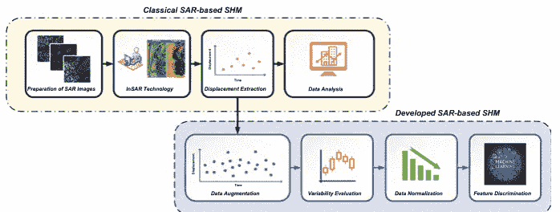

图1.1 经典与开发（所提）SAR辅助SHM方法的通用流程图及主要区别

TerraSAR-X SAR图像中提取的一组连续且稀少的位移样本进行验证，这些图像涉及英国塔德卡斯特一座名为塔德卡斯特桥（Tadcaster Bridge，Selvakumaran et al. 2018）的砌体结构。结果表明，所提混合方法可以解决SAR辅助SHM中的关键挑战性问题，这些方法是小数据量下现实世界长期SHM应用的可靠工具。

### 1.4 新方法与贡献

尽管利用遥感技术和SAR图像对各种土木结构的SHM进行了有价值的研究，但本书主要旨在解决经典SAR辅助SHM的主要局限性和不足，并特别专注于小位移数据的长期监测。就此而言，如上文所述，提出了各种机器学习方面的创新方法。在此，试图阐明这些方法的主要创新，以帮助读者更好地认识本书的重要性和新颖性。由于经典SAR辅助SHM策略在长期监测模式下的实施包含小位移数据、EOC的负面影响以及歧视性损伤或novelty²指数三大挑战，因此本书的根本创新是提出机器学习方面的混合学习方法。基于三大挑战，这些方法的创新可分为三个类别：

- 类别I——应对小数据挑战的创新
- 类别II——应对EOC挑战的创新

2 在机器学习中，“novelty”一词是指数据中的异常变化。在一些文献中，它被定义为“异常”或“离群点”（Pimentel et al. 2014）。然而，在本研究中，novelty值代表一个损伤指数，可代表两个数据集或结构状态条件之间的差异。

- 类别III——应对新颖性指数挑战的创新

#### 类别I

尽管HMC和SLS是生成随机样本的著名马尔可夫链蒙特卡洛算法，但所提混合学习方法的第一部分利用这些算法来扩展小位移数据。通过HMC和SLS进行数据增强的重要创新在于，该过程不仅扩展了小位移数据集，而且比原始数据更好地揭示了提取的位移数据样本中的变异性。在这种情况下，可以更好地分析变异性水平，并决定是否需要数据归一化或可以忽略不计。

#### 类别II

毫无疑问，可以宣布所提混合学习方法的重大创新与各种新颖的数据归一化算法相关。数据归一化的核心基于深层和浅层自编码器（AE），尤其是去噪自编码器（DAE）。作为第一项创新，名为HMC-MD的所提混合学习技术是通过添加具有三个隐藏层的欠完备DAE用于数据归一化而开发的。该过程的关键新颖之处在于提出一种超参数优化方法，以寻找欠完备DAE三个隐藏层的最优神经元数量，重点在于减轻EOC的负面影响。尽管交叉验证等不同的超参数优化算法可适用，但本书建议基于工程理由的一种新算法；即，移除或减轻EOC的影响。在此基础，该算法获得的超参数使欠完备DAE能够专门解决与EOC相关的挑战。专注于这一挑战，本书提出了基于教师-学生学习概念的另一种数据归一化方法。尽管这一概念广为人知，但我们开发了两种新的人工神经网络（ANN），以无监督学习方式创建教师和学生模型。第二种数据归一化方法的关键创新部分在于提出具有七个隐藏层的欠完备DAE作为教师模型和过完备浅层AE作为学生模型。换句话说，所提数据归一化方法创建了一种新颖的混合ANN策略。该方法的另一项创新是提出一种新的超参数优化方法，用于选择DAE七个隐藏层和浅层AE编码层的神经元数量。接下来，通过借鉴迁移学习的思想（Yang et al. 2020；Weiss et al. 2016），提出了另一种数据归一化方法。与其他主要依赖配置卷积神经网络的监督深度神经网络的著名迁移学习算法（Dhillon and Verma 2020）不同，本书建议一种新颖的深度迁移学习算法，该算法基于单个ANN，具体为具有三个隐藏层的欠完备DAE。第三种数据归一化方法的关键新颖之处在于设计一种使用连续DAEs的迭代算法。针对该算法，建议采用另一种超参数优化方法来寻找连续DAEs的最优数量，无需花费精力选择神经元数量。为了利用在线学习能力进行实时SHM，本书在数据归一化方面提供了另一项创新。就此而言，提出了一种在线深度迁移学习方法以扩展先前提出的深度迁移学习。该


本在线学习方法的重大创新在于利用欠完备三隐藏层DAE开发了一种新型两阶段算法。该方法的另一项创新在于其学习和损伤检测机制与先前提出的所有基于离线学习策略的混合学习技术完全不同。就此而言，在线混合学习第一阶段的终止标志着损伤的发生，这为结构健康监测（SHM）带来了重大创新。

#### 类别 III

结构健康监测（SHM）过程的根本目标是确定至少两种结构状态条件（即，未损伤状态与当前状态，后者可能为未损伤或已损伤）之间的差异。因此，应仅通过各种新奇性探测器（Sarmadi and Karamodin 2020; Sarmadi and Yuen 2021, 2022; Daneshvar and Sarmadi 2022; Entezami et al. 2020d; Bigoni and Hesthaven 2020; Turrisi et al. 2022）或统计距离度量（Deza and Deza 2013; Entezami 2021; Entezami and Shariatmadar 2018; Entezami et al. 2022d, e）来寻找这些条件之间的差异。这些方法的主要目的是产生具有区分度的新奇性指标或损伤指示器，以区分可能的损伤状态和未损伤状态。在考虑了相对较多的位移数据点后，本书最初提出了一种借助NNS、EVT和分位数建模的概率性新奇性探测器。该方法（NNS-EVT）的重大创新在于定义一种新的概率性新奇性指标，即来自某些极端样本的分位数值。该方法的一大好处是，可以通过使用各种极端值分布模型、其分位数值以及两种不同的极端值建模技术（即，块最大值法和超阈值峰值法）来开发不同的新奇性探测器。这意味着，尽管NNS-EVT为新奇性检测提供了单一算法，但可以将其与不同的极端值分布和框架结合使用。就小位移数据而言，尽管所提出的离线混合学习方法（即，HMC-MD、HMC-DAE-MD、HMC-UTSL-MD和HMC-DTL-MD）采用了经检验的马氏距离度量，但在线混合学习方法（即，HMC-ODTL-EMD和SLS-ODTL-EMD）提出了一种新的新奇性指标。关键创新在于从多变量距离度量中派生单变量距离值的机制。

### 1.5 本书组织

本书的组织结构可概述如下。第2章全面讨论了所有拟议方法。在第3章中，所提议的NNS-EVT和HMC-MD技术通过一个全规模桥梁的数值模型进行了评估和验证。在这项数值研究中，位移数据由有限元方法模拟。为了验证其他拟议方法，第4章介绍了一个具有现实部分坍塌的真实世界土木结构。因此，使用从有限SAR图像中提取的小位移数据点，通过真实世界数据验证了所提议的混合学习方法。最终，本书的结论及一些进一步研究的建议在第5章中进行了说明。

### 1.6 章节摘要

本章旨在介绍利用遥感技术和SAR图像对土木结构进行健康监测的方法。主要焦点是坍塌现象。在提及遥感辅助的SAR辅助SHM的优势后，详细讨论了该策略中的主要挑战和局限性。为了更好地解释，提出了编写本书的主要动机，这大大有助于读者更好地理解本书的目的和范围。接下来，简要介绍了所有拟议方法。最终，适当披露了本书的主要创新。通过本章讨论的这些描述和文献综述，可以得出结论：经典的SAR辅助SHM技术可能无法通过直接分析位移数据为大规模土木结构的损伤评估提供可靠框架。对于通过SAR图像进行的长期监测计划，开发强健的机器学习技术以缓解EOCs的负面影响是至关重要的。

### References

- Abdelwahab B (2019) 建筑渐进式坍塌综述、调查与讨论. Case Stud Constr Mater 11:e00264. https://doi.org/10.1016/j.cscm.2019.e00264
- Alencar G, de Jesus A, da Silva JGS, Calçada R (2019) 焊接铁路桥疲劳裂缝：综述. Eng Fail Anal 104:154–176. https://doi.org/10.1016/j.engfailanal.2019.05.037
- Astaneh-Asl A (2008) 钢桁架桥渐进式坍塌：I-35W坍塌案例. In: 第7届国际钢桥会议论文集, 葡萄牙吉马良斯, Citeseer
- Bayik C, Abdikan S, Arkan M (2021) 基于多时相InSAR分析的土耳其阿塔蒂亚克大坝长期位移观测. Acta Astronaut 189:483–491. https://doi.org/10.1016/j.actaastro.2021.09.022
- BehkamaI B, Entezami A, De Michele C, Arslan AN (2023a) 基于机器学习技术的遥感有限结构位移热效应消除. Remote Sens 15(12):3095. https://doi.org/10.3390/rs15123095
- BehkamaI B, Entezami A, De Michele C, Arslan AN (2023b) 基于混合感知和监督回归模型的长跨桥梁温度效应研究. Remote Sens 15(14):3503. https://doi.org/10.3390/rs15143503
- Bigoni C, Hesthaven JS (2020) 基于仿真的异常检测和损伤定位：结构健康监测应用. Comput Methods Appl Mech Eng 363:112896. https://doi.org/10.1016/j.cma.2020.112896
- Biondi F, Addabbo P, Ullo SL, Clemente C, Orlando D (2020) 基于合成孔径雷达的桥梁结构健康监测展望. Remote Sens 12(23):3852. https://doi.org/10.3390/rs12233852
- Buckley T, Pakrashi V, Ghosh B (2021) 桥梁结构健康监测的动态谐波回归方法. Struct Health Monit 20(6):3150–3181. https://doi.org/10.1177/1475921720981735
- Cao M-T, Nguyen N-M, Chang K-T, Tran X-L, Hoang N-D (2021) 基于图像处理和元启发式优化LogitBoost分类树的混凝土溢出自动识别. Adv Eng Softw 159:103031. https://doi.org/10.1016/j.advengsoft.2021.103031
- Chang C-M, Lin T-K, Chang C-W (2018) 基于推导模态特征的结构健康监测神经网络模型应用. Meas 129:457–470. https://doi.org/10.1016/j.measurement.2018.07.051
- Chen T-T (2017) 桥梁失效、检查和维护的影响因素. J Perform Constr Facil 31(5):04017070. https://doi.org/10.1061/(ASCE)CF.1943-5509.0001042
- Cigna F, Lasaponara R, Masini N, Nillo P, Tapete D (2014) 基于COSMO-SkyMed StripMap HIMAGE时间序列的持续散射干涉测量处理，以描绘意大利罗马历史中心的变形. Remote Sens 6(12):12593–12618. https://doi.org/10.3390/rs61212593
- Comanducci G, Magalhães F, Ubertini F, Cunha Á (2016) 基于多变量统计技术的振动式损伤检测：长跨拱桥应用. Struct Health Monit 15(5):505–524. https://doi.org/10.1177/1475921716650630
- Daneshvar MH, Sarmadi H (2022) 基于无监督学习的长期和短期监测下全规模土木结构损伤评估. Eng Struct 256:114059. https://doi.org/10.1016/j.engstruct.2022.114059
- Daneshvar MH, Saffarian M, Jahangir H, Sarmadi H (2023a) 基于模态应变能和优化迭代正则化方法的结构系统损伤识别. Eng Comput 39:2067–2087. https://doi.org/10.1007/s00366-021-01567-5
- Daneshvar MH, Sarmadi H, Yuen K-V (2023b) 用于不同测量周期下环境效应去除的局部无监督混合学习方法. Meas 208:112465. https://doi.org/10.1016/j.measurement.2023.112465
- Dawood T, Zhu Z, Zayed T (2017) 地铁网络剥落检测与量化的机器视觉模型. Autom Constr 81:149–160. https://doi.org/10.1016/j.autcon.2017.06.008
- Deng L, Wang W, Yu Y (2016) 桥梁坍塌原因和机制的最新进展综述. J Perform Constr Facil 30(2):04015005. https://doi.org/10.1061/(ASCE)CF.1943-5509.0000731
- Deraemaeker A, Worden K (2018) 结构健康监测中滤除环境效应的线性方法比较. Mech Syst Sig Process 105:1–15. https://doi.org/10.1016/j.ymssp.2017.11.045
- Dervilis N, Worden K, Cross EJ (2015) 基于稳健回归分析探索SHM数据环境和运行条件. J Sound Vib 347:279–296. https://doi.org/10.1016/j.jsv.2015.02.039
- Deza MM, Deza E (2013) 距离百科全书，第3版. Springer, Heidelberg
- Dhillon A, Verma GK (2020) 卷积神经网络：模型、方法论及物体检测应用综述. Prog Artif Intell 9(2):85–112. https://doi.org/10.1007/s13748-019-00203-0
- Di Carlo F, Miano A, Giannetti I, Mele A, Bonano M, Lanari R, Meda A, Proto A (2021) 多时相合成孔径雷达干涉测量产品与历史调查数据在建筑结构监测中的整合. J Civ Struct Health Monit 11(5):1429–1447. https://doi.org/10.1007/s13349-021-00518-4
- Di Martire D, Iglesias R, Monells D, Centolanza G, Sica S, Ramondini M, Pagano L, Mallorquí JJ, Calcaterra D (2014) 康扎德拉坎帕尼亚土坝（意大利）位移监测中差分SAR干涉测量与地面测量数据的比较. Remote Sens Environ 148:58–69. https://doi.org/10.1016/j.rse.2014.03.014


### References

- Döhler M, Hille F, Mevel L, Rücker W (2014) 基于统计方法的S101桥递进损伤试验结构健康监测。工程结构 69:183–193. https://doi.org/10.1016/j.engstruct.2014.03.010

- Dong C-Z, Catbas FN (2021) 局部和全局层面基于计算机视觉的结构健康监测综述。结构健康监测 20(2):692–743. https://doi.org/10.1177/1475921720935585

- Dung CV, Anh LD (2019) 基于深度全卷积神经网络的混凝土裂缝自动检测。自动化建设 99:52–58. https://doi.org/10.1016/j.autcon.2018.11.028

- Dung CV, Sekiya H, Hirano S, Okatani T, Miki C (2019) 基于深度卷积神经网络的钢桥腹板焊接节点裂缝视觉检测方法。自动化建设 102:217–229. https://doi.org/10.1016/j.autcon.2019.02.013

- Entezami A, Shariatmadar H (2018) 基于新型损伤指数的无监督学习方法，用于结构健康监测中的损伤定位与量化。结构健康监测 17(2):325–345. https://doi.org/10.1177/1475921717693572

- Entezami A, Shariatmadar H, Karamodin A (2019) 基于新型统计模式识别方法的环境与运行变化条件下的数据驱动损伤诊断。结构健康监测 18(5–6):1416–1443. https://doi.org/10.1177/1475921718800306

- Entezami A, Sarmadi H, Behkamal B, Mariani S (2020a) 大数据分析与结构健康监测：基于统计模式识别的方法。传感器 20(8):2328. https://doi.org/10.3390/s20082328

- Entezami A, Sarmadi H, Saeedi Razavi B (2020b) 基于模态柔度和聚类方法的结构健康监测创新混合策略。土木结构健康监测期刊 10(5):845–859. https://doi.org/10.1007/s13349-020-00421-4

- Entezami A, Shariatmadar H, Mariani S (2020c) 基于时间序列建模和新奇性检测的创新统计模式识别方法在大规模结构早期损伤评估中的应用。高级工程软件 150:102923. https://doi.org/10.1016/j.advengsoft.2020.102923

- Entezami A, Shariatmadar H, Mariani S (2020d) 用于密集传感器网络大振动数据的结构健康监测快速无监督学习方法。结构健康监测 19(6):1685–1710. https://doi.org/10.1177/1475921719894816

- Entezami A, Sarmadi H, Behkamal B, Mariani S (2021) 大规模土木结构健康监测：基于数据分区和经典多维标度的方法。传感器 21(5):1646. https://doi.org/10.3390/s21051646

- Entezami A, Arslan AN, De Michele C, Behkamal B (2022a) 基于遥感和小位移数据的实时结构健康监测在线混合学习方法。遥感 14(14):3357. https://doi.org/10.3390/rs14143357

- Entezami A, De Michele C, Arslan AN, Behkamal B (2022b) 基于卫星图像长期小位移数据的部分结构坍塌检测。传感器 22(13):4964. https://doi.org/10.3390/s22134964

- Entezami A, Mariani S, Shariatmadar H (2022c) 变化环境条件下大部分未观测结构的损伤检测：自回归谱和多级机器学习方法论。传感器 22(4):1400. https://doi.org/10.3390/s22041400

- Entezami A, Sarmadi H, De Michele C (2022d) 基于实证数据分析和对称信息度量的概率损伤定位。测量 198:111359. https://doi.org/10.1016/j.measurement.2022.111359

- Entezami A, Shariatmadar H, De Michele C (2022e) 用于短期和长期结构健康监测的非参数实证机器学习。结构健康监测 21(6):2700–2718. https://doi.org/10.1177/14759217211069842

- Entezami A, Sarmadi H, Behkamal B (2023a) 基于无监督元学习的大量缺失数据条件下混凝土和钢桥长期健康监测。工程结构 279:115616. https://doi.org/10.1016/j.engstruct.2023.115616

- Entezami A, Sarmadi H, Behkamal B (2023b) 不同环境变化模式下桥梁结构基于模态频率的损伤评估新型双混合学习方法。机械系统与信号处理 201:110676. https://doi.org/10.1016/j.ymssp.2023.110676

- Entezami A, Sarmadi H, Behkamal B, De Michele C (2023c) 基于创新多任务无监督学习方法的严重环境变化条件下桥梁持续健康监测。结构与基础设施工程（在线出版）1–19. https://doi.org/10.1080/15732479.2023.2166538

- Entezami A (2021) 基于距离度量的统计决策。载于：基于时间序列分析和统计距离度量的结构健康监测。Springer，第59–79页。https://doi.org/10.1007/978-3-030-66259-2_4

- Eriz S, Duvnjak I, Fernando Jiménez-Alonso J (2022) 结构应用有限元模型更新方法综述。结构 41:684–723. https://doi.org/10.1016/j.istruc.2022.05.041

- Esfehani S, Shariatmadar H, Entezami A (2023) 基于抗噪声和不确定性的新统计特征提取方法的鲁棒决策。土木结构健康监测期刊 13(1):269–294. https://doi.org/10.1007/s13349-022-00636-7

- Farneti E, Cavagli N, Costantini M, Trillo F, Minati F, Venanzi I, Ubertini F (2022) 采用带不确定性量化的卫星InSAR数据的多跨桥梁结构监测方法及其在意大利Albiano-Magra桥坍塌前的应用。结构健康监测。https://doi.org/10.1177/14759217221083609

- Farrar CR, Worden K (2013) 结构健康监测：机器学习视角。Wiley

- Farreras-Alcover I, Chrysanthopoulos MK, Andersen JE (2015) 基于温度、交通和应变测量的焊接桥梁节点结构健康监测回归模型。结构健康监测 14(6):648–662. https://doi.org/10.1177/1475921715609801

- Feng D, Feng MQ (2018) 土木基础设施结构健康监测计算机视觉：从动态响应测量到损伤检测——综述。工程结构 156:105–117. https://doi.org/10.1016/j.engstruct.2017.11.018

- Figueiredo E, Cross E (2013) 桥梁长期监测中非线性建模的线性方法。土木结构健康监测期刊 3(3):187–194. https://doi.org/10.1007/s13349-013-0038-3

- Figueiredo E, Park G, Farrar CR, Worden K, Figueiras J (2011) 运行和环境变化条件下的损伤检测机器学习算法。结构健康监测 10(6):559–572. https://doi.org/10.1177/1475921710388971

- Figueiredo E, Moldovan I, Santos A, Campos P, Costa JCWA (2019) 基于有限元的机器学习方法用于运行和环境变化条件下桥梁损伤检测。桥梁工程 24(7):04019061. https://doi.org/10.1061/(ASCE)BE.1943-5592.0001432

- Gama FF, Mura JC, Paradella WR, de Oliveira CG (2020) 基于Sentinel-1 InSAR数据及SBAS和PSI技术揭示的Brumadinho水坝坍塌前的变形。遥感 12(21):3664. https://doi.org/10.3390/rs12213664

- Gharehbaghi VR, Noroozinejad Farsangi E, Noori M, Yang TY, Li S, Nguyen A, Málaga-Chuquityape C, Gardoni P, Mirjaili S (2022) 结构健康监测批判性综述：定义、方法与前景。工程计算机方法档案 29:2209–2235. https://doi.org/10.1007/s11831-021-09665-9

- Giardina G, Milillo P, DeJong M, Perissin D, Milillo G (2019) 隧道后沉降损伤评估的InSAR监测数据评价。结构控制与健康监测 26(2):e2285. https://doi.org/10.1002/stc.2285

- Giglioni V, García-Macías E, Venanzi I, Ierimonti L, Ubertini F (2021) 变化环境下无监督结构损伤分类中ROC曲线和精确率-召回率曲线作为性能指标的应用。工程结构 246:113029. https://doi.org/10.1016/j.engstruct.2021.113029

- Giordano P, Turksezer Z, Previtati M, Limongelli M (2022) 基于卫星DInSAR数据的历史铁桥损伤检测。结构健康监测 21(5):2291–2311. https://doi.org/10.1177/14759217211054350

- Han Q, Ma Q, Xu J, Liu M (2020) 变温条件下的结构健康监测研究：综述。土木结构健康监测期刊。https://doi.org/10.1007/s13349-020-00444-x


Heravi MA, Tavakkoli SM, Entezami A (2022) 基于自回归损伤特征概率密度函数和快速距离相关方法的结构健康监测. 振动与控制 28(19–20):2786–2802. https://doi.org/10.1177/10775463211020198

Hoi SCH, Sahoo D, Lu J, Zhao P (2021) 在线学习：全面综述. 神经计算 459:249–289. https://doi.org/10.1016/j.neucom.2021.04.112

Hu WH, Cunha A, Caetano E, Rohrmann R, Said S, Teng J (2016) 从人行桥连续采集的海量数据中去除环境/运行影响的不同统计方法比较. 结构控制与健康监测 24(8). https://doi.org/10.1002/stc.1955

Huang Q, Crosetto M, Monserrat O, Crippa B (2017) 使用C带Sentinel-1数据对高速铁路桥梁进行位移监测和建模. ISPRS摄影测量与遥感杂志 128:204–211. https://doi.org/10.1016/j.isprsjprs.2017.03.016

Jang J, Smyth AW (2020) 温度分布效应对固有频率和热预应力建模的数据驱动模型. 结构控制与健康监测 27(2):e2489. https://doi.org/10.1002/stc.2489

Janichen J, Schnullius C, Baade J, Last K, Bettzieche V, Dubois C (2022) 使用Sentinel-1持续散射者干涉测量对重力坝径向变形进行监测. 遥感 14(5):1112. https://doi.org/10.3390/rs14051112

Jin S-S, Jung H-J (2018) 用于仅输出结构健康监测的在线学习算法的振动损伤检测. 结构健康监测 17(4):727–746. https://doi.org/10.1177/1475921717717310

Jin S-S, Cho S, Jung H-J (2015) 在变化环境条件下基于振动的结构健康监测的自适应参考更新. 计算机结构 158:211–224. https://doi.org/10.1016/j.compstruc.2015.06.001

Kang D, Benipal SS, Gopal DL, Cha Y-J (2020) 使用深度学习跨复杂背景的混合像素级混凝土裂缝分割与定量. 自动化建设 118:103291. https://doi.org/10.1016/j.autcon.2020.103291

Kim H, Ahn E, Shin M, Sim S-H (2019) 使用机器学习从混凝土表面图像中进行裂缝与非裂缝分类. 结构健康监测 18(3):725–738. https://doi.org/10.1177/1475921718768747

Kong X, Li J (2018) 使用视频特征跟踪的钢结构疲劳裂缝基于视觉检测. 土木与基础设施计算机辅助 33(9):783–799. https://doi.org/10.1111/mice.12353

Kong X, Smyth D (2022) 佛罗里达州萨赛德公寓楼坍塌调查：一种视频特征跟踪方法. 结构 43:533–545. https://doi.org/10.1016/j.istruc.2022.06.009

Krishnan M, Bhowmik B, Hazra B, Pakrashi V (2018) 使用递归主成分和时变自回归建模的实时损伤检测. 机械系统与信号处理 101:549–574. https://doi.org/10.1016/j.ymssp.2017.08.037

Li H-N, Ren L, Jia Z-G, Yi T-H, Li D-S (2016) 大型复杂土木基础设施结构健康监测的最新进展. 土木结构健康监测杂志 6(1):3–16. https://doi.org/10.1007/s13349-015-0108-9

Ma P, Li T, Fang C, Lin H (2019) 使用COSMO-SkyMed图像对高速铁路桥梁进行亚毫米级沉降和拔起试验. ISPRS摄影测量与遥感杂志 155:1–12. https://doi.org/10.1016/j.isprsjprs.2019.06.013

Macchiarulo V, Milillo P, DeJong MJ, González Martí J, Sánchez J, Giardina G (2021) 隧道诱导建筑变形的集成InSAR监测与结构评估. 结构控制与健康监测 28(9):e2781. https://doi.org/10.1002/stc.2781

Maeck J, De Roeck G (2003) Z24桥梁描述. 机械系统与信号处理 17(1):127–131. https://doi.org/10.1006/mssp.2002.1548

Maes K, Van Meerbeek L, Reynders E, Pe B, Lombaert G (2022) 翻新铁路桥KW51的振动基础结构健康监测验证. 机械系统与信号处理 165:108380. https://doi.org/10.1016/j.ymssp.2021.108380

Magalhães F, Cunha A, Caetano E (2012) 拱桥振动结构健康监测：从自动OMA到损伤检测. 机械系统与信号处理 28:212–228. https://doi.org/10.1016/j.ymssp.2011.06.011

Mesquita E, Antunes P, Coelho F, André P, Arêde A, Varum H (2016) 结构健康监测平台进展全球概览. 土木结构健康监测杂志 6(3):461–475. https://doi.org/10.1007/s13349-016-0184-5

Millilo P, Perrissin D, Salzer JT, Lundgren P, Lacava G, Milillo G, Serio C (2016) 从太空监测大坝结构健康：基于新型InSAR技术和多参数建模应用于意大利巴西利卡塔大区佩ルト西洛大坝的见解. 应用地球观测与地理信息国际期刊 52:221–229. https://doi.org/10.1016/j.jag.2016.06.013

Millilo P, Giardina G, Perrissin D, Millilo G, Colett A, Terranova C (2019) 关键基础设施坍塌前空间大地测量观测：意大利热那亚莫兰蒂大桥. 遥感 11(12):1403. https://doi.org/10.3390/rs11121403

Modares M, Waksmanski N (2010) 钢桥结构健康监测概述. 结构设计与建设实践期刊 18(3):187–191. https://doi.org/10.1061/(ASCE)SC.1943-5576.0000154

Moser P, Moaveni B (2011) 道林厅人行桥识别固有频率的环境影响. 机械系统与信号处理 25(7):2336–2357. https://doi.org/10.1016/j.ymssp.2011.03.005

Mura JC, Gama FF, Paradella WR, Negrão P, Carneiro S, De Oliveira CG, Brandão WS (2018) 使用TerraSAR-X数据和DInSAR技术对日耳曼诺铁矿区大坝和堤坝在富唐尾矿坝（巴西玛丽亚纳-MG）坍塌后的脆弱性进行监测. 遥感 10(10):1507. https://doi.org/10.3390/rs10101507

Nguyen LH, Goulot J-A (2019) 使用贝叶斯动态线性模型的实时异常检测. 结构控制与健康监测 26(9):e2404. https://doi.org/10.1002/stc.2404

Pimentel MA, Clifton DA, Clifton L, Tarassenko L (2014) 新奇性检测综述. 信号处理 99:215–249. https://doi.org/10.1016/j.sigpro.2013.12.026

Qin X, Liao M, Yang M, Zhang L (2017) 使用先进多时相InSAR分析监测城市桥梁结构健康. GIS年刊 23(4):293–302. https://doi.org/10.1080/19475683.2017.1382572

Qin X, Zhang L, Yang M, Luo H, Liao M, Ding X (2018) 结构驱动多时相DInSAR分析的拱桥表面变形和热膨胀映射. 遥感与环境 216:71–90. https://doi.org/10.1016/j.rse.2018.06.032

Rania N, Coppola I, Marturona F, Migliorini L (2019) 2018年8月14日意大利热那亚莫兰蒂大桥坍塌：一种集体创伤事件及其与地点和象征丧失相关的情绪影响. 可持续性 11(23):6822. https://doi.org/10.3390/su11236822

Reynders E, Wursten G, De Roeck G (2014) 基于非线性系统辨识在变化环境条件下的仅输出结构健康监测. 结构健康监测 13(1):82–93. https://doi.org/10.1177/1475921713502836

Reynders E, De Roeck G (2009) Z24桥梁连续振动监测和渐进损伤测试. 在：结构健康监测百科全书. Wiley, 英国奇切斯特. https://doi.org/10.1002/9780470661626.shm165

Rezaeepajand M, Entezami A, Sarmadi H (2020) 基于无约束优化问题和正则化解法的敏感性有限元模型更新. 结构控制与健康监测 27(5):e2481. https://doi.org/10.1002/stc.2481

Rezaeepajand M, Sarmadi H, Entezami A (2021) 结构模型更新的混合敏感性函数和Lanczos双对角化-提ikhonov方法：全尺度桥梁结构应用. 应用数学建模 89:860–884. https://doi.org/10.1016/j.apm.2020.07.044

Rizzo P, Enshaiean A (2021) 桥梁健康监测中的挑战：综述. 传感器 21(13):4336. https://doi.org/10.3390/s21134336

Sarmadi H (2021) 数据变异性下结构安全性评估的机器学习方法调查：比较研究与新方法. 建筑设施性能期刊 35(6):04021090. https://doi.org/10.1061/(ASCE)CF.1943-5509.0001664


Sarmadi H, Karamodin A (2020) 基于自适应马哈拉诺比斯平方距离和单类kNN规则的结构健康监测环境影响下的新型异常检测方法. Mech Syst Sig Process 140:106495. https://doi.org/10.1016/j.ymssp.2019.106495

Sarmadi H, Yuen K-V (2021) 基于核零空间和峰超过阈值的创新无监督学习方法的早期损伤检测. Comput Aided Civ Inf 36(9):1150–1167. https://doi.org/10.1111/mice.12635

Sarmadi H, Yuen K-V (2022) 基于极值理论和混合分位数建模的新型概率机器学习方法的结构健康监测. Mech Syst Sig Process 173:109049. https://doi.org/10.1016/j.ymssp.2022.109049

Sarmadi H, Entezami A, Saeedi Razavi B, Yuen K-V (2021a) 基于马哈拉诺比斯距离度量的集成学习结构健康监测. Struct Contrl Health Monit 28(2):e2663. https://doi.org/10.1002/stc.2663

Sarmadi H, Entezami A, Salar M, De Michele C (2021b) 基于新型聚类和阈值估计方法的环境变异下桥梁健康监测. J Civ Struct Health Monit 11(3):629–644. https://doi.org/10.1007/s13349-021-00472-1

Sarmadi H, Entezami A, Bekhalem B, De Michele C (2022) 基于无监督特征选择和局部度量学习的严重环境影响下长期模态数据的部分在线损伤检测. J Civ Struct Health Monit 12:1043–1066. https://doi.org/10.1007/s13349-022-00596-y

Sarmadi H, Entezami A, De Michele C (2023a) 基于半参数极值理论的结构健康监测概率数据自聚类. Mech Syst Sig Process 187:109976. https://doi.org/10.1016/j.ymssp.2022.109976

Sarmadi H, Entezami A, Magalhães F (2023b) 基于创新混合特征加权-选择算法和自然最近邻搜索的连续动态监测无监督数据归一化. Struct Health Monit in Press. https://doi.org/10.1177/147592172231166116

Sarmadi H, Entezami A, Yuen K-V, Bekhalem B (2023c) 结构健康监测智能手机传感技术综述. Measurement 223:113716. https://doi.org/10.1016/j.measurement.2023.113716

Sassu M, Giresini L, Puppio ML (2017) 极端暴雨条件下小型桥梁失效情景. Sustain Resilient Infrastruct 2(3):108–116. https://doi.org/10.1080/23789689.2017.1301696

Schlögl M, Widhalm B, Avian M (2021) 基于Sentinel-1的差分卫星雷达干涉测量桥梁变形全面时间序列分析. ISPRS J Photogramm Remote Sens 172:132–146. https://doi.org/10.1016/j.isprsjprs.2020.12.001

Selvakumaran S, Plank S, Geiß C, Rossi C, Middleton C (2018) 基于InSAR堆叠技术的桥梁冲刷失效远程监测预测. Int J Appl Earth Obs Geoinf 73:463–470. https://doi.org/10.1016/j.jag.2018.07.004

Shang Z, Sun L, Xia Y, Zhang W (2021) 基于深度卷积去噪自编码器的桥梁振动损伤检测. Struct Health Monit 20(4):1880–1903. https://doi.org/10.1177/1475921720942836

Shi H, Worden K, Cross EJ (2018) 结构健康监测中环境和运行变量消除的模态切换协整方法. Mech Syst Sig Process 103:381–397. https://doi.org/10.1016/j.ymssp.2017.10.013

Silva MF, Santos A, Santos R, Figueiredo E, Costa JCWA (2021) 基于堆叠自编码器的无监督损伤检测损伤敏感特征提取. Struct Contrl Health Monit 28(5):e2714. https://doi.org/10.1002/stc.2714

Sony S, Lavenir S, Sadhu A (2019) 结构健康监测下一代智能传感技术文献综述. Struct Contrl Health Monit 26(3):e2321. https://doi.org/10.1002/stc.2321

Soo Lon Wah W, Owen JS, Chen Y-T, Elamin A, Roberts GW (2019) 结构损伤检测中掩蔽效应消除. Eng Struct 183:646–661. https://doi.org/10.1016/j.engstruct.2019.01.005

Sousa Tomé E, Pimentel M, Figueiras J (2020) 基于协整分析的环境和运行效应下的损伤检测——斜拉桥实验数据应用. Mech Syst Sig Process 135:106386. https://doi.org/10.1016/j.ymssp.2019.106386

Sun L, Shang Z, Xia Y, Bhowmick S, Nagarajaiah S (2020) 基于大数据和人工智能的桥梁结构健康监测综述：从状况评估到损伤检测. J Struct Eng 146(5):04020073

Teng J, Tang D-H, Hu W-H, Lu W, Feng Z-W, Ao C-F, Liao M-H (2021) 基于拱桥长期监测的温度对频率影响机制. Struct Health Monit 20(4):1716–1737. https://doi.org/10.1177/1475921720931370

Torzioni M, Rosaflaco L, Manzoni A, Mariani S, Corigliano A (2022) 结构健康监测在变化环境条件下：基于模型阶数缩减和深度学习的方法. Comput Struct 266:106790. https://doi.org/10.1016/j.compstruc.2022.106790

Turrisi S, Cigada A, Zappa E (2022) 基于协整的大型结构自动异常检测方法. Mech Syst Sig Process 166:108483. https://doi.org/10.1016/j.ymssp.2021.108483

Wang Z, Cha Y-J (2021) 使用深度自编码器和单类支持向量机的无监督深度学习损伤检测方法. Struct Health Monit 20(1):406–425. https://doi.org/10.1177/1475921720934051

Wang ML, Lynch JP, Sohn H (2014a) 土木基础设施传感器技术：结构健康监测应用. 伍德黑德出版（Elsevier）

Wang ML, Lynch JP, Sohn H (2014b) 土木基础设施传感器技术：性能评估的传感硬件和数据采集方法. 伍德黑德出版（Elsevier）

Wang Z, Yang D-H, Yi T-H, Zhang G-H, Han J-G (2022) 结构模态频率环境和运行效应消除：全面综述. Struct Contr Health Monit:e3073. https://doi.org/10.1002/stc.3073

Webb GT, Vardaneja PJ, Middleton CR (2015) 结构健康监测部署类别：技术与能力. J Bridge Eng 20(11):04014118. https://doi.org/10.1061/(ASCE)BE.1943-5592.0000735

Weiss K, Khoshgoftaar TM, Wang D (2016) 迁移学习综述. J Big Data 3(1):9. https://doi.org/10.1186/s40537-016-0043-6

Xia Y, Chen B, Weng S, Ni Y-Q, Xu Y-L (2012) 土木结构振动特性温度效应：文献综述与案例研究. J Civ Struct Health Monit 2(1):29–46. https://doi.org/10.1007/s13349-011-0015-7

Xu Y, Bao Y, Chen J, Zuo W, Li H (2019) 基于消费级相机图像的桥梁钢箱梁表面疲劳裂缝深度融合卷积神经网络识别. Struct Health Monit 18(3):653–674. https://doi.org/10.1177/1475921718764873

Yan A-M, Kerschen G, De Boe P, Golinval J-C (2005) 变化环境条件下结构损伤诊断——第二部分：非线性情况的局部主成分分析. Mech Syst Sig Process 19(4):865–880. https://doi.org/10.1016/j.ymssp.2004.12.002

Yang L, Shami A (2020) 机器学习算法超参数优化：理论与实践. Neurocomputing 415:295–316. https://doi.org/10.1016/j.neucom.2020.07.061

Yang Q, Zhang Y, Dai W, Pan SJ (2020) 迁移学习. 剑桥大学出版社，剑桥

Yao Y, Yang Y, Wang Y, Zhao X (2019) 基于卷积神经网络的人工智能船体结构板腐蚀损伤检测与识别. Appl Ocean Res 90:101823. https://doi.org/10.1016/j.apor.2019.05.008

Yu J (2017) 基于自适应隐马尔可夫模型的轴承故障检测与性能退化监测在线学习框架. Mech Syst Signal Process 83:149–162. https://doi.org/10.1016/j.ymssp.2016.06.004

Zhou Y, Sun L (2019) 跨海大桥模态频率变化的环境和运行作用影响：周期性视角. Mech Syst Sig Process 131:505–523. https://doi.org/10.1016/j.ymssp.2019.05.063


Zhu M, Wan X, Fei B, Qiao Z, Ge C, Minati F, Vecchioli F, Li J, Costantini M (2018) 基于卫星SAR干涉测量自动时空分析的建筑和基础设施不稳定性检测. Remote Sens 10(11):1816. https://doi.org/10.3390/rs10111816

Zonno G, Aguilar R, Boroschek R, Lourenço PB (2019) 利用连续监测分析温度和湿度对土坯建筑结构特性的长期和短期影响. Eng Struct 196:109299. https://doi.org/10.1016/j.engstruct.2019.109299

## 第2章
先进的MIL方法：连接SAR图像与结构健康监测

**摘要** 经典的SAR辅助SHM直接分析从SAR图像中获得的位移数据。虽然通过各种干涉测量技术从SAR图像中提取位移响应对于基于遥感的SHM至关重要，但直接使用和分析基于SAR的位移响应来监测和评估复杂和关键土木结构的损伤并不是一种可靠和有效的方法，尤其是在具有各种不确定性和测量数据变异性的长期监测中。在此基础上，本章提出了各种机器学习方法，用于环境和操作条件下的SHM以及从SAR图像中检索的不同尺寸的结构位移响应的无监督学习。对于大量位移数据，提出了一种创新的概率无监督学习方法。对于少量位移数据，本章提出了两种无监督混合学习方法，主要由三部分组成：用于扩展小位移响应规模的数据增强、用于消除环境和操作条件影响的数据归一化，以及异常检测。

**关键词** 机器学习 · 无监督学习 · 混合学习 · 在线学习 · 数据归一化 · 马尔可夫链蒙特卡洛 · 异常检测

### 2.1 引言

大部分基于遥感的SHM项目都基于从SAR图像中检索的结构位移的直接分析。尽管该策略简单高效，但在EOCs（Behkamal et al. 2023a, b）下，它可能不适合对重要和复杂的土木结构进行损伤评估。为解决该策略的主要局限性和不足，本书拟提出更严谨的土木结构健康监测方法，重点关注桥梁，使用与经典SAR辅助SHM技术相同的SAR图像和位移数据。在此基础上，根据位移数据的规模，本书针对相对大数据和小数据提出了两种创新的SHM方法。就此而言，所提出的NNS-EVT旨在通过考虑相对较大的位移集来评估土木结构的健康状况。尽管准备大量SAR图像可能会遇到大数据问题和存储限制，但一些研究利用许多图像进行SHM任务（Farneti et al. 2022; Bayik et al. 2021; Militello et al. 2016）。所提出的概率机器学习方法的巨大优势在于，通过新奇性指数或损伤指标，能够同时处理测量（位移/变形）数据的变异性和可靠特征歧视的挑战。因此，第2.2节介绍了该方法。所提出的概率方法的一个巨大优势是其能够基于不同极值分布开发各种异常检测器。然而，在本书中，所提出的方法基于EVT的半参数概念和半参数极值分布的分位数建模。

对于图像数量少导致位移数据少的SAR辅助SHM应用，本书主要通过提出各种离线和在线混合学习方法来应对这一挑战，即：(i) HMC-MD，(ii) HMC-DAE-MD，(iii) HMC-UTSL-MD，(iv) HMC-DTL-MD，(v) HMC-ODLT-EMD，和 (vi) SLS-ODLT-EMD。相应地，第2.3节和第2.4节分别详细介绍了离线和在线混合学习方法，以及学习这些技术所需的一些超参数优化算法。

### 2.2 应对大数据挑战：一种概率无监督学习方法

所提出的名为NNS-EVT的概率机器学习方法旨在当数据规模相对较大时执行长期SHM过程。该方法的主要元素包括基于NNS的特征选择方法以及基于极值机（EVM）和半参数EVT的新奇性检测器。特征选择方法基于最近邻搜索，用于选择最合适和相关的样本，称为代表性特征。因此，这一步骤可以被视为一种降维策略，也是一种数据归一化方法。所提出机器学习方法的第二个元素是提出一个新奇性检测器，以区别正常样本（关于结构的未损坏状态）和异常样本（关于可能的损坏状态）。在此方法中，通过考虑EVT、半参数极值分布和分位数建模的概念，提出了一种新颖的概率方法。

#### 2.2.1 极值理论及其应用

在统计学中，EVT提供了一种广为人知且有用的概率技术，用于研究不寻常（罕见）事件和样本，而非通常事件。换句话说，该技术旨在从最大和最小样本以及罕见事件（Coles et al. 2001; Kotz and Nadarajah 2000; Castillo 1988）方面分析和建模极端数据样本。与专注于随机抽样数据的均值或概率分布中心的中心极限定理（CLT）不同，EVT的基本原理在于极端样本和概率分布的尾部。这很合理，因为建模概率分布右尾和左尾最相关的统计量包括最大样本和最小样本。EVT的巨大优势在于只需关注关于数据分布的少数假设，而无需对整个数据分布进行建模。

为了建模极端值，通常有两种技术：基于Fisher-Tippet定理的块最大值（BM）和基于Balkema-de Haan-Pickands定理的峰值超过阈值（POT）（Résillat et al. 2018; Sarmadi and Yuen 2022; Sarmadi et al. 2023a）。第一种技术基于将随机抽样数据分成若干块（段），并选择每个块的最大或最小样本作为极端值（Sarmadi and Yuen 2022; Sarmadi and Karamodin 2020）。第二种技术设置一个阈值来选择极端（仅最大）样本（Sarmadi et al. 2023a, 2022）。在此基础上，感兴趣阈值之上的最大数据点被选为极端值建模的主要极端值。给定n个随机样本X1, ..., Xn，图2.1说明了BM和POT技术的图形表示，其中BM将抽样数据分成b个块，POT设置一个阈值用于极端样本选择。这意味着两种技术都需要超参数（即块数b和阈值水平），这些参数应被正确确定。一旦选择了极端值，就应考虑一种EVT分布进行建模。关于极值理论在SHM估计中的不同应用，可参见（Sarmadi and Yuen 2022; Sarmadi et al. 2023a）用于异常检测，以及（Sarmadi and Karamodin 2020; Sarmadi et al. 2022; Sarmadi and Yuen 2021; Daneshvar and Sarmadi 2022; Entezami and Shariatmadar 2018）用于阈值估计。

因为本研究打算利用EVT进行特征歧视，因此“极端”一词是指最大值。这是因为土木结构中任何异常变化（损伤）的发生都会增加异常检测器的偏差。在SHM背景下，异常检测过程基于寻找最大新奇性指数。因此，所有极值模型都基于最大值。给定独立随机数据点（或变量）X1, ..., Xn，一般极值分布旨在以以下形式建模最大数据的统计行为：

```
$$M_n = \max(X_1, ..., X_n)$$
```


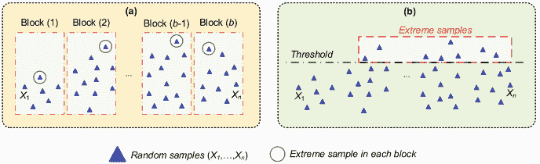

图 2.1 BM (a) 和 POT (b) 技术的图形表示

在极值理论（EVT）中，\(M_n\) 的分布可针对所有 \(n\) 个样本的值精确推导，如下所示：

```
\(\mathbb{P}r (M_n < x) = \mathbb{P}r(X_1 < x, \dots, X_n < x) = \mathbb{P}(X_1 < x) \times \cdots \times \mathbb{P}r(X_n < x) = F(x)^n \quad (2.2)\)
```

公式 (2.2) 假设 \(X_1, \dots, X_n\) 服从相同分布。然而，公式 (2.2) 的主要问题是分布 \(F\) 未知。一种解决方案是从可用的采样数据中估计该分布。尽管该方案合理，但估计值出现极小变化可能导致 \(F^n\) 中产生相当大的偏差。或者，另一种解决方案是假设 \(F\) 未知，并应搜索寻找 \(F^n\) 的近似模型族，这些模型仅通过极端值来构建。因此，人们试图研究当 \(n \rightarrow \infty\) 时 \(F^n\) 的行为。然而，对于可能导致 \(F(x) = 1\) 的最小值，\(M_n\) 的分布会退化为该最小值上的一个点。为缓解这一局限性，可针对常数序列 \(a_n > 0\) 和 \(b_n\)，对变量 \(M_n\) 采用线性归一化，如下所示：

```
\(M_n^* = \frac{M_n - b_n}{a_n} \quad (2.3)\)
```

在此基础上，当 \(n\) 增加时，适当选择 \(a_n\) 和 \(b_n\) 可以稳定 \(M_n^*\) 的位置和尺度，从而避免与变量 \(M_n\) 相关的困难。因此，与使用 \(M_n\) 相比，应寻找 \(M_n^*\) 的极限分布，并对 \(a_n\) 和 \(b_n\) 进行适当选择。为实现这一目标，\(M_n^*\) 可能的极限分布的整个范围符合以下定理：如果存在常数序列 \(a_n > 0\) 和 \(b_n\)，则可以表示：

```
\(\mathbb{P} \left( \frac{M_n - b_n}{a_n} < x \right) = \mathbb{P} (M_n \le a_n x + b_n) \rightarrow G(x), n \rightarrow \infty \quad (2.4)\)
```

其中 \(G\) 是一个非退化分布函数。因此，EVT 的根本目标是将此分布函数分配给独立随机变量（即极端样本）并对其进行建模。在考虑 BM 技术和随机样本 \(X_1, \dots, X_n\) 的情况下，函数 \(G\) 可以有三种形式：Gumbel、Fréchet 和 Weibull（Coles et al. 2001; Salvadori et al. 2007）：

```
Gumbel: \( G(x) = exp\left(-exp\left(-\frac{x-\lambda}{\delta}\right)\right) -\infty < x < \infty \& \delta > 0 \) (2.5)
```

```
Fréchet \( G(x) = \begin{cases} exp\left(-\left(\frac{\delta}{x-\lambda}\right)^{\xi}\right), & \text{if } x \ge \lambda \\ 0 & \text{otherwise} \end{cases} \) (2.6)
```

```
Weibull: \( G(x) = \begin{cases} 1 & \text{if } x \ge \lambda \\ exp\left(-\left(\frac{\lambda-x}{\delta}\right)^{\xi}\right), & \text{otherwise} \end{cases} \) (2.7)
```

其中 \(\xi\)、\(\delta\) 和 \(\lambda\) 分别是形状、尺度（即标准差）和位置（即均值）参数，它们是 Gumbel、Fréchet 和 Weibull 分布模型的主要未知参数。因此，为了进行正确的极值建模，必须对它们进行适当估计。应用这些函数的一个重要局限性在于必须选择最合适的分布模型，这可能会增加过程的复杂性。请注意，可以将这些极值函数整合为一个称为广义极值分布（GEVD）的单一模型，其表达如下：

```
\( G(x) = exp\left( - \left( 1 + \xi_G \left( \frac{x - \lambda_G}{\delta_G} \right) \right) ^{-\frac{1}{\xi_G}} \right) \) (2.8)
```

其中 \(\xi_G\)、\(\delta_G\) 和 \(\lambda_G\) 分别表示与广义函数相关的形状、尺度和位置参数。GEVD 的关键特性在于能够识别经典极值分布的类型。换句话说，由于 GEVD 是 Gumbel、Fréchet 和 Weibull 分布函数的整合，可以通过形状参数来定义它们之间的关系。具体来说，如果 \(\xi_G < 0\)，GEVD 为 Weibull 型分布。当 \(\xi_G > 0\) 时，GEVD 基于 Fréchet 型分布。最后，如果 \(\xi_G = 0\)，则与 Gumbel 型分布兼容（Coles et al. 2001; Salvadori et al. 2007）。

上述所有分布函数均用于在 Fisher-Tippet 定理和 BM 技术下对极大值样本进行建模。另一种重要且广泛使用的极值函数基于广义 Pareto 分布（GPD）。与其他极值分布模型类似，GPD 常用于基于阈值策略表示极端样本的尾部。这种概率分布在单一模型函数方面与 GEVD 相似。通常，GPD 被用于在 POT 技术概念下对超过阈值的极端样本进行建模。在此基础上，一旦选定了阈值以上的足够极端样本，即通过估计模型的形状和尺度参数将 GPD 模型拟合到这些数据点上。设 \(X_1, \dots, X_t\) 表示高于阈值水平的 \(n\) 个数据样本中的 \(t\) 个极大值样本，GPD 模型定义如下：

\( H(y) = \left\{ \begin{array}{ll} 1 - \left(1 + \frac{\xi_p}{\delta_p}(y-u)\right)^{-\frac{1}{\xi_p}}, & \xi_p \neq 0 \\ 1 - \exp\left(-\frac{1}{\delta_p}(y-u)\right), & \xi_p = 0 \end{array} \right. \)

其中 \(u\) 是用于区分主要极端样本与其他数据点的阈值。此外，\(\xi_p\) 和 \(\delta_p\) 分别是 GPD 的形状和尺度参数。关于该概率分布的一个重要说明是，它由这两个参数建模，而 GEVD 需要三个参数（即形状、尺度和位置）。这意味着，通过 GPD 进行极值建模所需的参数比 GEVD 少。另一个说明是，类似于 GEVD，可以根据 GPD 的形状参数得到经典极值分布。因此，如果 \(\xi_p = 0\)、\(\xi_p > 0\) 和 \(\xi_p < 0\)，GPD 分别等价于 Gumbel、Fréchet 和 Weibull 模型（Coles et al. 2001）。

最大似然估计（MLE）是估计极值分布模型参数的主要且重要的技术之一。该技术基于定义最大似然估计器并最大化上述分布模型的似然函数。为此，通常会引入似然函数的对数变换。在考虑来自 \(b\) 个分块的 \(b\) 个极大值样本 \(X_1, \dots, X_b\) 的情况下，当 \(\xi_G \neq 0\) 时，GEVD 的对数似然函数表示如下（Coles et al. 2001）：

\( L_G(\lambda_G, \delta_G, \xi_G) = -b \log(\delta_G) - \left(1 + \frac{1}{\xi_G}\right) \sum_{i=1}^b \log\left(1 + \xi_G \left(\frac{X_i - \lambda_G}{\delta_G}\right)\right) - \sum_{i=1}^b \left(1 + \xi_G \left(\frac{X_i - \lambda_G}{\delta_G}\right)\right)^{-\frac{1}{\xi_G}} \)

前提是

\( 1 + \xi_G \left(\frac{X_i - \lambda_G}{\delta_G}\right) > 0 \)

其中 \(i = 1, \dots, b\)。另一方面，当 \(\xi_G = 0\) 时，对数似然函数表述如下（Coles et al. 2001）：

\( L_G(\lambda_G, \delta_G) = -b \log(\delta_G) - \sum_{i=1}^b \log\left(\frac{X_i - \lambda_G}{\delta_G}\right) - \sum_{i=1}^b \exp\left(-\left(\frac{X_i - \lambda_G}{\delta_G}\right)\right) \)

对 GEVD 参数求解公式 (2.10) 和 (2.12) 的最大值可得到 GEVD 的最大似然估计。由于不存在解析解，可以使用标准数值优化算法实现最大化过程（Coles et al. 2001）。

同样的策略也可用于 GPD 模型以估计其参数。给定超过阈值 \(u\) 的最大样本 \(X_1, \dots, X_t\)，当 \(\xi_P \neq 0\) 时，GPD 的对数似然函数定义如下：

$$ L_P(\delta_P, \xi_P) = -t \log(\delta_P) - \left(1 + \frac{1}{\xi_P}\right) \sum_{i=1}^t \log\left(1 + \frac{\xi_P X_i}{\delta_P}\right) $$

前提是

$$ 1 + \frac{\xi_P X_i}{\delta_P} > 0 $$

其中 \(i = 1, \dots, t\)。如果 \(\xi_P = 0\)，GPD 的对数似然函数改写为以下形式：

$$ L_P(\delta_P) = -t \log(\delta_P) - \frac{1}{\delta_P} \sum_{i=1}^t X_i $$

类似于 GEVD，可以通过对未知 GPD 参数求导对数似然函数来实现公式 (2.13) 和 (2.15) 的最大化，从而利用数值技术推导最大似然估计器（Coles et al. 2001）。

#### 2.2.2 半参数极值模型

上述所有极值分布均为参数模型。这意味着极端样本的建模取决于未知的形状、尺度和位置参数，这些参数应通过最大似然估计等参数估计技术之一来获得。另一个问题是模型选择。换句话说，与广义分布函数不同，需要使用额外的技术在 Weibull、Fréchet 和 Gumbel 分布中选择最合适的函数。为解决这些问题，可以考虑半参数极值理论及其单一分布函数的概念。该理论和函数的巨大优势在于，无需为极端值分配参数模型。此外，不需要参数估计技术。换句话说，半参数分布建模仅依赖于某些极端样本，通过从同一样本中估计极值指数（EVI）来实现，无需任何参数估计技术（Gomes and Guillou 2015）。给定 \(n\) 维数据 \(X_1, \dots, X_n\)，半参数极值模型的累积分布函数（CDF）定义如下：


\( F(x) = \left\{ \begin{array}{ll} \exp\left(-(1+\xi x)^{-\frac{1}{\xi}}\right), & \text{if } \xi \neq 0 \\ \exp(-\exp(-x)) & \text{if } \xi = 0 \end{array} \right. \quad (2.16) \)

其中 \(\xi\) 表示所谓的 EVI，它是半参数极值样本建模中的主要参数。当 \(\xi \neq 0\) 时，可以推导出半参数威布尔（\(\xi < 0\)）和弗雷歇（\(\xi > 0\)）模型。此外，式 (2.16) 中关于 \(\xi = 0\) 的第二个（底部）表达式指的是半参数冈贝尔分布。因此，主要工作是通过某些估计量来估计 EVI 参数。\(\xi > 0\) 最著名的估计量是 Hill 估计量。给定 \(X_1, \dots, X_n\) 的阶统计量，即 \(X_{n:n} > \dots > X_{1:n}\)，Hill 估计量表示如下（Hill 1975）：

\(\hat{\xi}_H = \frac{1}{k} \sum_{i=1}^k (\log X_{n-i+1:n} - \log X_{n-k:n}) \quad (2.17)\)

其中 \(k\) 是一个数值（样本比例），用于在半参数极值建模中将极值与其他值分开。Hill 估计量的主要局限性是仅适用于正 EVI。由于这一条件限制了该估计量在一般 \(\xi\) 情况下的应用，因此提出了一些广义 EVI 估计量来解决此问题。其中之一是 Dekkers 等人（Dekkers and De Haan 1989）提出的矩估计量，表示如下：

\(\hat{\xi}_M = \hat{\xi}_H - \frac{1}{2} \left( 1 - \frac{\left(M_{k,n}^{(1)}\right)^2}{M_{k,n}^{(2)}} \right)^{-1} + 1 \quad (2.18)\)

因此，

\(M_{k,n}^{(j)} = \frac{1}{k} \sum_{i=1}^k (\log X_{n-i+1:n} - \log X_{n-k:n})^j \quad (2.19)\)

其中 \(j=1,2\)。矩估计量的巨大优点是适用于所有 EVI 情况；即，\(\xi \in \mathbb{R}\)。换句话说，取决于选定为极值样本的数据点数量，可以获得负或正 EVI。这与经典 Hill 估计量相反，后者对于每种样本选择情况仅给出正 EVI。

#### 2.2.3 分位数建模

本节的主要目标是为所提出的 NNS-EVT 方法中的无监督新奇检测器定义一个索引。该新奇索引可以提供一种准则，用于区分异常（损坏）状态和正常（未损坏）状态。出于此原因，选定极值的分位数被定义为 SHM 的新奇得分或损伤指标。在统计学和概率论中，CDF 的逆函数定义为在给定显著性水平下的抽样数据（即极值数据）的分位数。随机变量的分位数是以特定概率（即所谓的显著性水平）被超过的值。就 EVT 而言，分位数建模是指估计极值样本的分位数，以量化尾部分布中的风险。当此过程依赖于非常小的概率（即 EVT 中发生的情况）时，建模的目的是估计一个高分位数。在考虑了来自阶统计量 \(X_{n:n} > \dots > X_{1:n}\) 的 \(k\) 个极值样本 \(X_{n:n} > \dots > X_{n-k:n}\)、一个显著性水平 \(\alpha\) 以及选定样本的估计 EVI 后，这些样本的分位数表示如下：

\[ q = X_{n-k:n} \left( \frac{k}{n\alpha} \right)^{\hat{\xi}} \tag{2.20} \]

在此基础上，分位数值 \(q\) 被定义为新奇检测的得分或索引。

#### 2.2.4 概率新奇索引

所提出的 NNS-EVT 方法利用 EVT、半参数极值分布和分位数建模的能力，在无监督学习的视角下开发一种概率机器学习框架。该方法在基准/训练阶段和监测/检验阶段执行。这些阶段的主要目标包括计算每个位移点与其他位移点之间的距离值、找到每个位移样本的最近邻、选择 k-最小距离值、估计负 k-最小距离值的 EVI，并计算它们的分位数。

##### 基准阶段

假设 \(X = [x_1, \dots, x_n] \in \mathbb{R}^{p \times n}\) 代表与基准阶段相关的特征/训练数据点（即位移、模态数据等）的集合（矩阵），其中结构未受损。基于 SAR 辅助的 SHM，人们认为位移矩阵是通过从 \(n\) 张 SAR 图像中提取结构上 \(p\) 个目标点的位移点而获得的。通过在结构上选择 \(p\) 个目标点，利用干涉技术之一提取每个 \(n\) 张 SAR 图像中这些点的位移值。对于其他类型的 SHM，变量 \(p\) 可以是特征类型之一（例如，模态数量）。在此基础上，所提方法包括六个主要步骤：距离计算、为获取阶统计量而进行的距离排列、样本比例选择（\(k\)）、符号变换以提供负最大值、EVI 估计，以及基于前几节的分位数建模。为简单起见，图 2.2 描绘了所提方法主要步骤的流程图。

在第一步中，需要计算每个特征样本与其他样本之间的距离。出于此原因，应用广为人知的欧几里得距离来执行此过程。对于两个向量 \(\mathbf{x}_i\) 和 \(\mathbf{x}_j\)，式 (2.21) 表示该距离的函数：

\[ d_E(\mathbf{x}_i, \mathbf{x}_j) = (\mathbf{x}_i - \mathbf{x}_j)^T (\mathbf{x}_i - \mathbf{x}_j) \]

其中 \(j = 1, \dots, n-1\) 且 \(i \neq j\)。由于忽略了计算每个点与自身之间的距离，因此每个特征样本有 \(n-1\) 个距离值。

- Step 1: 计算 \(\mathbf{x}_i\) 与其余特征/训练样本 \(\mathbf{x}_1, \dots, \mathbf{x}_{i-1}, \mathbf{x}_{i+1}, \dots, \mathbf{x}_n\) 之间的距离
- Step 2: 将距离值按升序排列
- Step 3: 找到 \(k\) 个最小距离值（SDVs）
- Step 4: 改变选定距离值的符号
- Step 5: 估计被否定的 \(k\)-SDVs 的 EVI
- Step 6: 计算被否定的 \(k\)-SDVs 的 \(i^{\text{th}}\) 分位数的绝对值

图 2.2 所提 NNS-EVT 方法在基准阶段的主要步骤

在第二步中，这些距离按升序排列以获得排序值 \(\tilde{d}_1 < \cdots < \tilde{d}_{n-1}\)，其中 \(\tilde{d}_1\) 是指 \(\mathbf{x}_i\) 与 \(\mathbf{X}\) 中的一个特征点之间的最大距离值。

同样，\(\tilde{d}_{n-1}\) 是 \(\mathbf{x}_i\) 与一个特征样本之间的最小距离值。在 NNS 概念下，选择 \(k\) 个最小距离值（SDVs）。这些选定的距离等同于代表性特征。换句话说，人们试图移除属于对变异性或离群值敏感的特征的大距离值。因此，第三步充当特征选择方法。由于式 (2.16) 对最大样本有效，应改变 \(k\) 个 SDV 的符号，以便为半参数极值建模提供 \(k\) 个负最大距离。使用矩估计量，通过式 (2.18) 估计 EVI。最后，计算负 \(k\)-SDV 的分位数，以用作 \(\mathbf{x}_i\) 的新奇索引。为避免获得无意义的指数，将估计分位数的绝对值视为最终新奇索引。在考虑所有特征样本 \(\mathbf{x}_1, \dots, \mathbf{x}_n\) 后，可以获得 \(n\) 个分位数的绝对值 \(|q_{x_1}|, \dots, |q_{x_n}|\)。最后，将这些分位数值用于估计 SHM 和早期预警报警的阈值。此外，请注意，负排列距离 \(\tilde{d}_1 < \cdots < \tilde{d}_k\) 等同于阶统计量 \(X_{1:n} < \cdots < X_{1:n}\) 或 \(-\tilde{d}_1 > \cdots > -\tilde{d}_k\) 等同于 \(-X_{1:n} > \cdots > -X_{k-1:n}\)。

##### 监测阶段

对于监测阶段，假设 \(\mathbf{Z} = [\mathbf{z}_1, \dots, \mathbf{z}_m] \in \mathbb{R}^{p \times m}\) 是与结构当前状态相关的特征/测试样本（即位移、模态数据等）的矩阵，需要评估其是否受损或仍正常运行。与其考虑所有测试位移点，不如假设每个点在某一时刻可用，以提供 SHM 的实际条件。例如，在 SAR 辅助 SHM 问题中，这意味着最初需要一张关于特定检验时间的 SAR 图像或测量值。在考虑了基准阶段中选择的结构上的先前 \(p\) 个目标点或特征类型后，可以获得特征样本 \(\mathbf{z} \in \mathbb{R}^p\)。请注意，此过程应重复 \(m\) 次。类似于基准阶段，只需考虑测试样本 \(\mathbf{z}\) 来实施所提 NNS-EVT 方法的主要步骤。因此，图 2.3 显示了所提方法在监测阶段的主要步骤。在此图中，可以观察如何基于从基准阶段和监测阶段获得的所提方法的输出来做出决策。

在第一步中，应该使用广为人知的欧几里得距离计算可用测试样本与所有训练样本之间的距离。在这种情况下，可以确定 \(n\) 个距离量。其中，提取前 \(l\) 个最小距离，它们指的是接近测试样本的训练特征。换句话说，再次尝试移除任何变异源。更改选定距离的符号以确定负 \(l\) 个 SDV。在考虑这些值后，使用矩估计量估计一个 EVI。最终，计算测试样本 \(\mathbf{z}\) 的分位数的绝对值作为新的新奇得分或


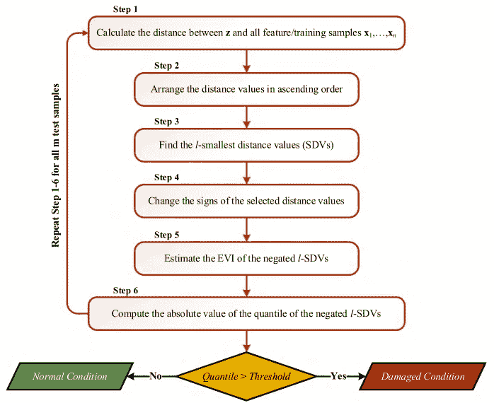

## 图 2.3 拟议的 NNS-EVT 方法在监测阶段的主要步骤

关于结构当前状态的指标。为了总结并做出最终决定，基线阶段和监测阶段获得的所有分位数值均收集到向量 q = [[qx1, ..., qxn], [qz1, ..., qzm]] 中。使用基线阶段获得的阈值，预期向量 q 的前 n 个样本位于阈值以下，表明结构处于未损伤状态；否则，超过阈值的每个分位数值均为误报误差。

对于监测阶段的分位数值 |qz1|, ..., |qzm|，存在三种情况：

- 如果每个分位数值 |qz1|, ..., |qzm| 均超过阈值，则需要报警损伤发生。
- 在报警损伤发生且未对结构进行任何修复、改造和康复程序的情况下，任何低于报警阈值的分位数值均表明为漏报。
- 如果分位数值 |qz1|, ..., |qzm| 均未超过阈值，则可以确认结构处于未损伤状态。

### 2.3 应对小数据挑战：拟议的混合学习方法

除 HMC-MD 技术外，其他拟议的混合学习方法包含三个关键步骤：(i) 基于马尔可夫链蒙特卡罗算法（即 HMC 或 SLS）的数据增强，(ii) 基于 ANN 的数据归一化，以及 (iii) 基于 MD 和 EMD 的特征鉴别。一旦小规模位移样本集被增强，扩展后的数据将被分解为训练子集和测试子集。这些子集可以直接应用于新奇度检测器（例如 MD），或输入数据归一化工具（例如 DAE）或算法（例如 UTSL、DTL 和 ODTL）以消除任何变异性来源。关于 HMC-MD 技术，在 EOCs 水平较低的情况下不考虑数据归一化（Sarmadi 2021）。

#### 2.3.1 基于马尔可夫链蒙特卡罗的数据增强

在统计学中，马尔可夫链蒙特卡罗方法是一类用于从概率分布中进行系统随机采样的概率算法。与能够从感兴趣的分布中绘制独立样本的蒙特卡罗采样技术不同，马尔可夫链蒙特卡罗方法可以绘制下一个样本依赖于现有样本的样本，称为马尔可夫链。顾名思义，马尔可夫链蒙特卡罗算法由蒙特卡罗和马尔可夫链两部分组成。在概率论中，蒙特卡罗是一种随机采样概率分布并近似所需量的方法。在此基础上，蒙特卡罗技术通常假设可以从目标分布中有效地绘制样本，在此情况下，从绘制的样本中，可以将求和或积分量估计为绘制样本的均值或方差。另一方面，马尔可夫链是生成随机样本序列的系统随机过程，其中当前样本在概率上依赖于前一个样本的值。在结合这两种方法论（即马尔可夫链和蒙特卡罗）的情况下，它允许我们通过构建包含蒙特卡罗样本的马尔可夫链来绘制高维分布的随机样本，该链保持样本之间的概率依赖。为此目的，只需构建一个包含所需分布作为其平衡分布的马尔可夫链，然后通过记录链中的状态来获得该分布的一个样本（Van Ravenzwaaij et al. 2018）。Entezami et al. (2022) 研究了数据增强在结构健康监测（SHM）中的成功性能，涉及少量异常指标的损伤定位和阈值估计。

##### 2.3.1.1 哈密顿蒙特卡罗采样

哈密顿蒙特卡罗采样是一种马尔可夫链蒙特卡罗技术，用于在直接采样过程不可行时从目标概率分布中获取一系列随机样本（Neal 2011）。该方法对应于带有哈密顿动力学演化的 Metropolis–Hastings 算法的一个实例，该演化可以通过使用时间可逆且体积保持的数值积分器来模拟，以提供移动到新样本的方式。与 Metropolis–Hastings 算法不同，HMC 方法通过执行移动到远处状态来减少连续采样状态之间的相关性，这些远处状态可以提供较高的接受概率，归功于模拟哈密顿动力学具有近似能量守恒特性。简单来说，相关性降低意味着需要较少的马尔可夫链样本来近似目标概率分布下的积分。

假设 \( f(\mathbf{x}) \) 是待通过样本链 \( \{\mathbf{x}_0, \mathbf{x}_1, \mathbf{x}_2, ...\} \) 进行采样的目标分布。相应地，汉密尔顿方程写成如下形式：

```
\frac{\mathrm{d}x_i}{\mathrm{d}t} = \frac{\partial H}{\partial w_i} \quad (2.22)
\frac{\mathrm{d}w_i}{\mathrm{d}t} = \frac{\partial H}{\partial x_i} \quad (2.23)
```

其中 \( x_i \) 和 \( w_i \) 分别表示参数和动量向量的第 \( i \) 个元素。此外，\( H \) 指哈密顿函数。假设 \( \mathbf{M} \) 是一个对称正定（质量）矩阵。在此基础上，哈密顿量表示如下：

```
H(\mathbf{x}, \mathbf{w}) = U(\mathbf{x}) + \frac{1}{2}\mathbf{w}^T \mathbf{M}^{-1} \mathbf{w} \quad (2.24)
```

其中

```
U(\mathbf{x}) = - \ln f(\mathbf{x}) \quad (2.25)
```

从公式 (2.25) 可以理解，HMC 算法下的采样方法依赖于与目标分布相关的对数函数。此外，该采样器利用跳蛙技术（Neal 2011），即非相互作用经典粒子运动的近似解，来确定任意时刻的参数和动量分量。为此目的，采样算法需要一个正整数作为跳蛙步数 \( L \) 和一个正数作为步长 \( \Delta t \)。随后，它从均值为零且协方差等于质量矩阵 \( \mathbf{M} \) 的高斯分布中绘制随机高斯动量 \( \mathbf{w}(0) \)。在下一步中，粒子在哈密顿动力学下运行时间 \( L\Delta t \)。应当指出，此过程通过跳蛙技术通过数值求解汉密尔顿方程来执行。在此方面，时间 \(\Delta t\) 后的参数和动量向量如下给出：

\(\mathbf{w}\left(t + \frac{\Delta t}{2}\right) = \mathbf{w}(t) - \frac{\Delta t}{2} \nabla U(\mathbf{x})|_{\mathbf{x}=\mathbf{x}(t)}\) (2.26)

\(\mathbf{x}(t + \Delta t) = \mathbf{x}(t) - \Delta t \mathbf{M}^{-1} \mathbf{w}\left(t + \frac{\Delta t}{2}\right)\) (2.27)

\(\mathbf{w}(t + \Delta t) = \mathbf{w}\left(t + \frac{\Delta t}{2}\right) - \frac{\Delta t}{2} \nabla U(\mathbf{x})|_{\mathbf{x}=\mathbf{x}(t+\Delta t)}\) (2.28)

上述方程应分别对 \(\mathbf{x}(0)\) 和 \(\mathbf{w}(0)\) 应用 \(L\) 次，以确定 \(\mathbf{x}(L\Delta t)\) 和 \(\mathbf{w}(L\Delta t)\)。设 \(\mathbf{d} \in \mathbb{R}^{p \times 1}\) 表示来自 SAR 图像的 \(p\) 个目标点的一组位移点。请注意，每个 \(\mathbf{d}\) 都等价于 \(\mathbf{x}\)。在此基础上，HMC 采样器的根本目标是在 \(C\) 条链和 \(N\) 个样本数下预测向量 \(\mathbf{d}\)。这意味着 HMC 技术试图从目标分布（即本研究中的高斯分布）生成向量 \(\mathbf{d}\) 的 \(N\) 个点，以在迭代算法的 \(C\) 条链下在新矩阵 \(\mathbf{D} \in \mathbb{R}^{p \times N}\) 中生成一组增量位移点。换句话说，对于第 \(j\) 条链和第 \(k\) 个样本，其中 \(j = 1, ..., C\) 且 \(k = 1, ..., N-1\)，可以导出增强矩阵 \(\mathbf{D}_{k+1}^{(j)}\)。基于 Gelman-Rubin 统计量（Gelman and Rubin 1992）的假设，如果统计量收敛于假设标准，则可以在 \((k + 1)\) 次迭代处固定模拟参数；否则，应在 \(k\) 次迭代处选择前一次的模拟参数。在确定所有 \(C\) 个增强矩阵后，它们的平均值用作最终的增强位移点集。最终，增强位移点的矩阵（**D**）被分为训练集（矩阵）\(\mathbf{X} \in \mathbb{R}^{p \times n}\) 和测试集（矩阵）\(\mathbf{Z} \in \mathbb{R}^{p \times m}\)，其中 \(n < N\) 且 \(m < N\)。

##### 2.3.1.2 切片采样

SLS 是马尔可夫链蒙特卡罗的另一种算法，用于基于前状态生成随机数据点。SLS 的基本原理在于这样一个思想：随机变量可以从均匀概率分布图下的区域中均匀采样，然后仅观察样本的水平坐标。为此目的，需要构建一个马尔可夫链，通过从当前样本处密度所代表的垂直区间以及构成水平切片的区间并集中均匀采样，以满足感兴趣的均匀分布。

更准确地说，SLS 源于这样一个思想：从概率密度与 \(f(x)\) 成正比的分布 \(p(x)\) 中采样，可比于从 \(f(x)\) 图下的区域中均匀采样。从单变量视角来看，这是可行的


引入辅助变量（即高度 y）并定义联合分布 p(x, y)，该分布在区域 G = {(x, y): 0 < y < f(x)} 上呈均匀分布。要从 x 的边缘密度（即 p(x)）中采样，需要先从 p(x, y) 中采样，然后忽略 y 值。由于从 p(x, y) 生成随机样本不可行，因此有必要定义一个马尔可夫链，使我们能够收敛到该分布。给定当前样本 x，应从给定 x 的条件分布中生成 y，在此情况下，可以从切片 S = {x: y < f(x)} 中采样新的 x。由于缺乏对 S 的精确信息和形式，从切片 S 生成样本比较困难，因此可以利用 Neal (2003) 提出的算法，该算法通过一个过程更新 x，该过程使 S 的均匀分布保持不变。给定当前状态 x0，下一个状态按以下步骤生成：

- (1) 从 (0, f(x0)) 中均匀抽取 y0 并定义水平切片 S = {x: y0 < f(x)}。
- (2) 使用 Neal (2003) 中描述的步进外过程，找到包含 S 的全部或大部分的区间。
- (3) 在第 2 步的区间内生成并抽取一个新样本。
- (4) 将步骤 i 更新为 i + 1，并重复上述步骤，以所需样本数终止该过程。

与 HMC 算法类似，SLS 的主要目标是在初始集 d 下获取 N 个样本的增广矩阵 D \in R^{p x N}。最后，增广矩阵被分割为训练数据集 X \in R^{p x n} 和测试数据集 Z \in R^{p x m}。

### 2.3.2 基于深度自编码器的数据归一化

在所提出的 HMC-DAE-MD 方法中，将基于 DAE 的数据归一化策略添加到先前提出的 HMC-MD 方法中，以增强其在减少 EOC 效应方面的性能。SHM 中的数据归一化是一种消除由任何非损伤条件（即环境和操作条件，有时还有噪声条件）引起的数据变化水平的技术。在大多数情况下，人们试图使用训练数据构建计算/统计模型，该训练数据作为输入应用于该模型，然后将其作为模型输出进行预测。在此基础上，数据归一化旨在通过计算输入和输出之间的直接差异来执行残差提取过程。为了更好地说明 HMC-MD 和 HMC-DAE-MD 之间的差异，图 2.4 描绘了这些方法的 SHM 一般流程图。应澄清的是，选择每种方法的主要依据取决于增广数据中变异条件的程度。在特征鉴别步骤中，MD 度量在数据归一化后，要么采用真实的增广数据点，要么采用它们的残差样本（即归一化数据点）。从图 2.4 可以看出，该过程首先使用少量图像中的有限位移样本。在下一步，使用 HMC 算法扩展这些样本，并生成一个更大的位移数据集。由于 EOC 强烈依赖于在 HMC-MD 和 HMC-DAE-MD 之间进行选择，因此实施了一项调查，以通过图形（例如，箱线图）或数值分析来识别增广数据中 EOC 的水平。在 EOC 较低的情况下，可以忽略数据归一化。在这种情况下，扩展的数据被分解为训练集、验证集和测试集子集。

使用增广训练数据点，估计其均值向量和协方差矩阵，并将其视为基于 MD 的新奇性检测器的主要元素。在这方面，将所有增广位移数据点应用于此检测器，以计算其距离量值（即新奇性指标），并在特征鉴别步骤中做出决策。在 EOC 较高的情况下，需要使用由 DAE 开发并使用扩展训练集的数据归一化。因此，主要目标是通过计算 DAE 输入和输出（预测）之间的直接差异来执行残差提取。然后，训练好的 DAE 被用于提取增广验证集和测试集的残差。相应地，可以得到新的训练集、验证集和测试数据集，这些数据集对 EOC 不敏感。最后，这些数据集被应用于基于 MD 的新奇性检测器，以计算其距离量值。

在考虑了增广训练集的新奇性指标或距离量值后，估计一个阈值，以对未知测试数据点做出最终决策。应当提到的是，由于训练集和验证集属于结构的未损伤状态，因此它们的标签是已知的。在这方面，主要尝试是根据结构的未知或当前状态对测试数据点进行分类。一旦阈值确定，训练集和验证集的新奇性指标应低于阈值，如图 2.4 所示。另一方面，如果测试样本的任何新奇性指标超过阈值，HMC-MD 或 HMC-DAE-MD 将报警发生损伤；否则，结构仍然未损伤。

#### 2.3.2.1 自编码器

自编码器（AE）是非线性的无监督人工神经网络类别，主要旨在学习生成模型，以再生或重建无标签数据点（Charte et al. 2018; Liu et al. 2017; Karhunen et al. 2015; Larochelle et al. 2009）。更具体地说，AE 通常被训练为将输入编码为某些表示，以便重建它们。在这方面，AE 由编码器、编码层和解码器组成（Charte et al. 2018）。编码器和解码器是 AE 的两个关键部分。编码器旨在编码输入并将它们映射到新的特征空间。解码器使用编码数据重建输入。AE 的巨大优势包括在传播过程中持续提取有用特征，并特别过滤掉无用特征（Liu et al. 2017）。然而，AE 的主要优点是过滤掉噪声数据或带有异常值的采样数据（Kramer 1992）。出于这个原因，这种类型的人工神经网络是数据归一化的合适选择（Pathirage et al. 2018; Entezami et al. 2020）。

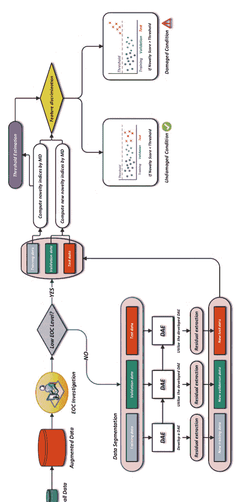

图 2.4 提出的混合无监督学习方法的流程图

AE 的基本结构基于前馈神经网络。该结构可以设计为浅层或深层配置。浅层 AE 由输入层、编码层和输出层三层组成。由于使用了一个隐藏层，它是 AE 模型的最简单形式。在大多数情况下，更倾向于利用多个隐藏层来建模 DAE。另一方面，浅层和深层 AE 都可以建模为欠完备和过完备配置。更准确地说，如果 AE 的隐藏层在神经元数量上小于输入层和输出层，则该策略形成欠完备网络。相反，如果隐藏层大于输入层和输出层，则 AE 为过完备（Charte et al. 2018）。为简单起见，图 2.5 展示了 AE 的不同形式。图 2.5a,b 显示了在欠完备和过完备配置中具有一个隐藏层（即编码层）的浅层 AE。相比之下，这些配置的 DAE 在图 2.5c,d 中呈现，两者都有 (2L + 1) 个隐藏层，包括 L 个映射层、一个编码层和 L 个反向映射层。

最著名的 DAE 之一由三个隐藏层组成：映射层、编码层和反向映射层，如图 2.6 所示。在某些文献中，这种类型的 DAE 被称为自联结神经网络（Charte et al. 2018; Larochelle et al. 2009）。一旦选择了最佳的 AE 配置，就有必要优化或选择隐藏层的神经元大小，然后训练 AE。对于第二项任务，需要使用无标签训练数据点（即结构未损伤状态的增广位移样本），并将其应用于所选 AE 的输入层。位于任何隐藏层中的神经元接收来自前一层的多个输入。该神经元计算这些输入的加权和，并最终利用一种称为激活函数的特定操作来生成或预测输出。线性、二进制、整流线性单元（ReLU）、逻辑、双曲正切（Tanh）和指数线性单元（SELU）是学习 AE 时常用的激活函数。其中，基于逻辑和 Tanh 的 Sigmoid 函数无疑是 AE 中最流行的激活函数（Charte et al. 2018）。值得注意的是，DAE 可以在不同的隐藏层使用不同的激活函数。

在考虑具有一个隐藏层的最简单 AE 配置后，学习过程开始通过以下编码函数对输入的隐藏表示（即向量 x = [x1, ..., xp]^T）进行编码：

```
h = s_1(W^{(1)}x + b^{(1)})\qquad (2.29)
```

其中 h 表示编码层中 x 的代码或表示；W^(1) 和 b^(1) 分别指编码器权重矩阵和偏置向量。此外，s1 是编码器的激活函数。接下来，通过以下解码函数执行输入的重建：

```
x̂ = s_2(W^{(2)}h + b^{(2)})\qquad (2.30)
```

其中 x̂ 表示 AE 输出层上的重建数据；W^(2) 和 b^(2) 是解码器权重矩阵和偏置向量；s2 表示激活函数


(a)

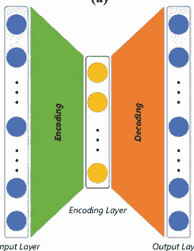

(b)

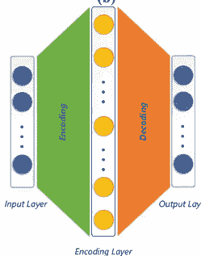

(c)

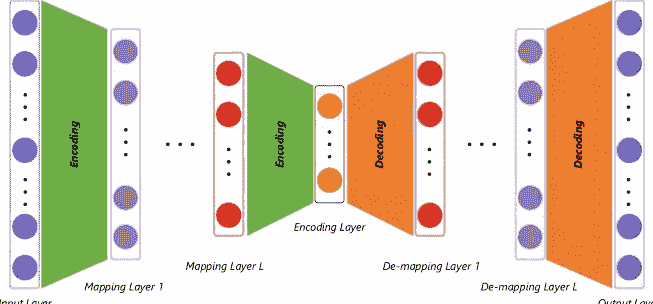

(d)

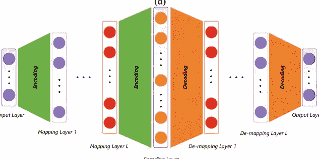

图 2.5 自编码器（AE）的不同配置：a 欠完备浅层 AE，b 过完备浅层 AE，c 欠完备深层 AE，d 过完备深层 AE

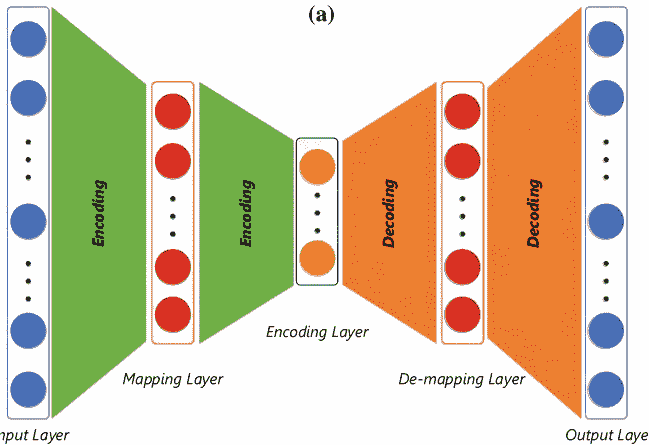

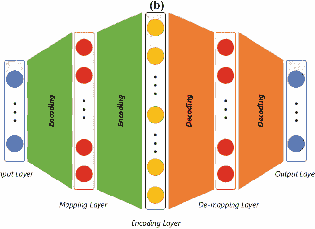

图 2.6 具有三个隐藏层的去噪自编码器（DAE）：a 欠完备配置，b 解码器的过完备配置。

虽然上述公式阐述了具有一个隐藏层的 AE 的学习过程，但可以将它们扩展到 DAE。换句话说，编码和解码函数可以在 DAE 的每个隐藏层中表示。

编码和解码过程在所有增强的训练和测试数据点上实施，以对其进行重构。在 HMC-DAE-MD 方法的数据归一化过程中，考虑了如图 2.6a 所示的具有三个隐藏层的欠完备 DAE。此外，编码和解码激活采用逻辑 sigmoid 函数。假设 X = [x₁ ... xₙ] 是包含关于未受损结构状态的增强位移的训练矩阵。将每个训练数据点输入 DAE 以对其进行重构，并提供重构的训练矩阵 X̂ = [x̂₁ ... x̂ₙ]。换句话说，从训练数据 X 学习得到的 DAE 用作数据归一化模型，重构的训练数据 X̂ 是模型输出。因此，通过提取输入（X）和输出（X̂）之间的残差，按以下形式进行数据归一化：

$$ \mathbf{E}_x = |\mathbf{X} - \hat{\mathbf{X}}| $$ (2.31)

可以通过将扩展的位移数据点应用于测试矩阵 Z = [z₁ ... zₘ] 来执行相同的策略。请注意，该矩阵包含验证数据样本（即已知的增强位移）以及与结构未知/当前状态相关的实际未知测试样本。为了获得测试残差数据样本，此处使用从训练数据学习得到的 DAE 来预测网络输出 Ẑ = [ẑ₁ ... ẑₘ]。因此，新的残差矩阵可以表示如下：

$$ \mathbf{E}_z = |\mathbf{Z} - \hat{\mathbf{Z}}| $$ (2.32)

为方便起见，图 2.7 说明了由具有三个隐藏层的 DAE 进行的数据归一化的图形表示。

#### 2.3.2.2 DAE 中的超参数优化

在机器学习中，控制机器或模型如何从数据中学习的未知元素称为超参数（Yang and Shami 2020; Sarmadi 2021）。应优化或选择这些元素，以便感兴趣的模型可以最小化建模或学习错误并提高泛化能力。由于超参数显著影响机器学习模型的整体性能，因此必须在学习过程之前选择它们。另一方面，机器学习中还有其他称为模型参数的未知元素。与超参数不同，模型参数可以在学习过程中估计，在这种情况下，不需要在学习前精心选择它们。

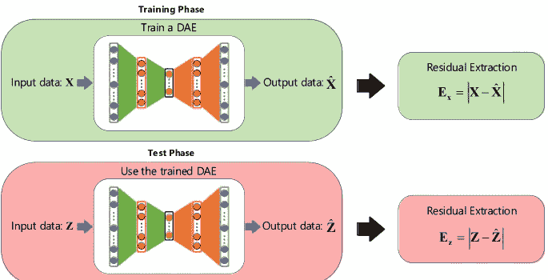

图 2.7 基于 ANN 的无监督数据归一化的图形表示

例如，隐藏层的数量及其神经元是 ANN 的关键超参数，而这些层的权重矩阵和偏置向量是其模型参数（Sarmadi 2021）。

在所提出的 HMC-DAE-MD 方法中，数据归一化过程由具有三个隐藏层的欠完备 DAE 执行，如图 2.6a 所示，在这种情况下，隐藏层的数量是已知的。这意味着映射层、编码层和反映射层的神经元是该 ANN 的主要超参数。通常，基于均方误差（MSE）的重构错误是该超参数优化的主要标准。由于建议使用欠完备 DAE 来减轻 EOCs 的负面影响，本研究提出了一种简单而有效的网格搜索方法来优化 DAE 隐藏层的神经元。提出这种网格搜索方法的根本原因是 EOCs 对 SHM 结果有很强的影响。因此，所提出的 DAE 超参数优化被开发出来，以便该 ANN 可以显著减轻 EOC 的影响。

网格搜索方法背后的主要原理是针对主要超参数进行相对较多的试验，并仅使用训练数据评估 SHM 方法（即所提出的 HMC-DAE-MD 方法）在 EOCs 对方法输出影响方面的反馈。换句话说，在使用示例超参数后，该方法为每次试验产生新奇度指数（距离）。在此基础上，可以测量新奇度指数的方差。最优超参数是方差率最小的超参数。该标准的主要思想来自以下事实：在训练阶段处于未知 EOCs 下的健壮 SHM 方法应产生方差较小的平滑输出（新奇度指数）（Sarmadi and Yuen 2021）。

算法 1 介绍了所提出的用于欠完备 DAE 超参数优化的网格搜索技术的主要步骤和伪代码。该算法的输入包括训练数据（X）、映射（N<sub>m0</sub>）、编码（N<sub>e0</sub>）和反映射（N<sub>d0</sub>）层示例神经元的试验次数。由于 DAE 具有欠完备配置，因此 N<sub>m0</sub> > N<sub>e0</sub> 和 N<sub>d0</sub> > N<sub>e0</sub>。另一方面，所关注的 DAE 具有对称形式，在这种情况下 N<sub>m0</sub> = N<sub>d0</sub>。算法 1 步骤 1–3 的主要内容已在第 2.3.2.2 节中描述。关于步骤 4，残差矩阵 E<sub>x</sub> 应用于基于 MD 的新奇度检测器，以确定该矩阵所有样本的距离值。关于此过程的更多细节可在第 2.3.5 节中找到。在步骤 9 中，有必要检查 DAE 学习中的过拟合问题。对于此问题，神经元数量的最终选择应满足以下条件：

\( N_e < 2N_m < \frac{p(n - N_e)}{p + N_e + 1} \) (2.33)

\( (N_m + N_d) < n \) (2.34)

### 算法 1. 欠完备 DAE 的超参数优化

| 内容 |
| --- |
| **输入：** 输入数据 X，以及分别用于映射层、编码层和反映射层的示例神经元数量 N<sub>m0</sub>、N<sub>e0</sub> 和 N<sub>d0</sub> |
| **初始化：** N<sub>m0</sub> = N<sub>d0</sub> 且 N<sub>m0</sub> > N<sub>e0</sub> |
| **对于** i = 1 到 N<sub>m0</sub> |
| **对于** j = 1 到 N<sub>e0</sub> |
| 1. 通过映射层和编码层神经元的第 i 次和第 j 次试用训练一个 DAE |
| 2. 预测网络输出 X̂ |
| 3. 提取残差矩阵 E<sub>x</sub> = |X − X̂| |
| 4. 在 MD 指标中使用残差矩阵 E<sub>x</sub> 作为新的训练数据（参见第 2.3.5 节） |
| 5. 使用 E<sub>x</sub> 的所有样本获取距离值 |
| 6. 计算关于第 i 次和第 j 次试用的计算距离值的方差 |
| 7. 将此值存储在矩阵的第 i 行和第 j 列中 |
| **结束** |
| **结束** |
| 8. 选择第 7 步矩阵行和列中的最小方差量 |
| 9. 检查过拟合问题。如果过拟合问题不可避免，返回第 8 步并选择下一个最小方差值并检查过拟合问题。继续此过程，直到 DAE 满足过拟合条件 |
| 10. 关于最小方差值的存储矩阵的行号和列号分别指示映射或反映射层（N<sub>m</sub>）和编码层（N<sub>e</sub>）的最优神经元大小 |
| **输出：** 最优神经元数量 N<sub>m</sub> = N<sub>d</sub> 和 N<sub>e</sub> |


### 2.3.3 基于无监督教师-学生学习的数据归一化

与之前的 HMC-DAE-MD 技术类似，所提出的 HMC-UTSL-MD 方法包含三个部分：通过 HMC 采样进行数据增强、通过新方法进行数据归一化，以及基于 MD 的特征鉴别。由于第一部分和第三部分已有解释，本节主要关注用于数据归一化的无监督教师-学生学习（UTSL）方法。该方法的核心源于教师-学生学习概念，该概念由复杂模型（教师）和简单模型（学生）构建了一个两阶段学习框架。教师通常是一种复杂且严谨的方法，旨在为测量数据提供最佳表示学习，而学生利用教师的输出来促进学习过程或在不应用复杂模型的情况下继续其他任务（Mirzaei et al. 2020）。根据是否存在监督信息，任何教师-学生学习都可分为监督类和无监督类。与其他类型的学习算法类似，监督教师-学生学习技术由使用完全标记训练数据的监督机器组成，而无监督教师-学生学习方法由仅利用未标记数据的无监督机器组成。

本节所提出的数据归一化方法基于无监督教师-学生学习框架。该方法利用不同的自编码器（AE）来开发教师模型和学生模型。在第一步中，考虑了具有七个隐藏层（L = 3）的欠完备 DAE 来训练复杂的教师模型。图 2.8a 展示了此人工神经网络（ANN）及其配置。为此，需要使用增强训练数据（X）训练此深度 ANN，并在模型输出层对其进行重建（X̂）。教师学习的主要输出是输入与输出之间的残差矩阵（Eₓ）。随后，该矩阵作为新输入输入到学生模型。因此，在第二步中，设计了一个过完备浅层 AE 来执行学生学习。图 2.8b 展示了学生模型及其配置。相应地，教师模型的残差矩阵（Eₓ）被输入到浅层 AE 的输入层以对其进行重建（Eₓ̄）。接下来，执行一个新的残差提取过程，从学生模型中获得新的残差矩阵 Eₓ̅ = |Eₓ − Eₓ̄|。为求简洁，图 2.9 描绘了所提 UTSL 方法的图形流程图。

尽管上述策略与增强训练数据相关，但有必要在增强测试数据（Z）上运行它们。主要区别在于，训练好的教师和学生模型仅用于确定测试数据的残差矩阵。这意味着在测试阶段不需要学习过程。在这种情况下，扩展的测试数据被输入到训练好的欠完备 DAE 中，以尝试对其进行重建（Ẑ）并确定教师残差矩阵（E_z）。随后，该矩阵应用于训练好的过完备浅层 AE，以再次对其进行重建（E_z̄）。最后，学生残差矩阵 E_z̅ = |E_z − E_z̄| 被提取为 UTSL 算法在测试/监测阶段的输出。在从增强训练集和测试集中提取学生残差矩阵后，将这些矩阵纳入基于 MD 的新奇性检测器中进行特征鉴别（参见第 2.3.5 节）。

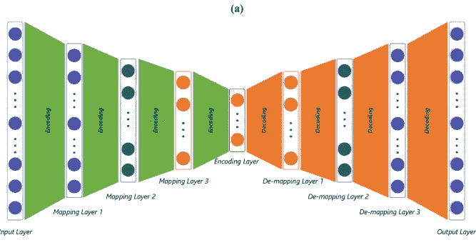
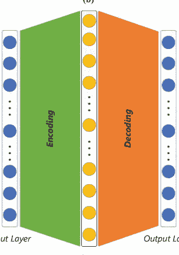
图 2.8 所提 UTSL 方法的主要 ANN 配置：a 具有七个隐藏层的欠完备 DAE，b 过完备浅层 AE

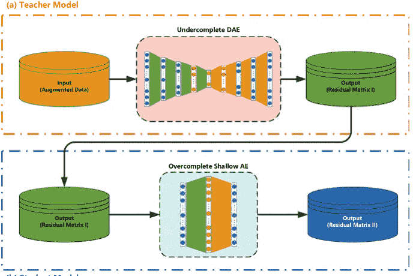
图 2.9 所提 UTSL 方法的流程图

#### 2.3.3.1 UTSL 的超参数优化

所提 UTSL 方法由两个配置不同的 AE 网络组成。在这些神经网络中，唯一的超参数是欠完备 DAE 的七个隐藏层的神经元数量以及过完备浅层 AE 的单个编码层的神经元数量。最近，Entezami et al. (2020) 提出了一种基于受控网格搜索的有效算法，用于根据网络训练的重建误差和最终预测误差（FPE）函数来查找 AE 的神经元数量。受该技术启发，本研究利用赤池信息量准则（AIC）对教师模型和学生模型进行超参数优化。为此，表 2.1 列出了欠完备 DAE 隐藏层的样本神经元数量。

使用这些样本神经元，只需设计十个不同的欠完备 DAE 并实现所提 UTSL 算法的第一步（关于教师模型学习）并计算残差数据点之和即可。假设 \(N_{H_i}\) 是第 \(i\) 个隐藏层的神经元数量，其中 \(i = 1, ..., 7\)。在此基础上，AIC 指标写成以下公式：

\(AIC = \ln(\varepsilon) + \frac{2N_v}{pn}\) (2.35)

| 试验 | 第1层 | 第2层 | 第3层 | 第4层 | 第5层 | 第6层 | 第7层 |
|---|---|---|---|---|---|---|---|
| 1 | 2 | 2 | 1 | 1 | 1 | 2 | 2 |
| 2 | 4 | 3 | 2 | 1 | 2 | 3 | 4 |
| 3 | 6 | 5 | 3 | 2 | 3 | 5 | 6 |
| 4 | 8 | 6 | 4 | 2 | 4 | 6 | 8 |
| 5 | 10 | 8 | 6 | 2 | 6 | 8 | 10 |
| 6 | 12 | 9 | 6 | 3 | 6 | 9 | 12 |
| 7 | 14 | 11 | 7 | 4 | 7 | 11 | 14 |
| 8 | 16 | 12 | 8 | 4 | 8 | 12 | 16 |
| 9 | 18 | 14 | 9 | 5 | 9 | 14 | 18 |
| 10 | 20 | 15 | 10 | 5 | 10 | 15 | 20 |

其中 \( N_v = (p + N_{H_4} + 1)(\sum_{i=1}^7 N_{H_i}) + (p + N_{H_4})\)；\( N_{H_4}\) 指编码层的神经元数量；\( p \) 和 \( n \) 是训练数据 \(\mathbf{X}\) 的大小；\(\varepsilon\) 是表示平均误差和的标量，定义如下：

\(\varepsilon = \frac{\sum_{i=1}^n \sum_{j=1}^p (e_{xj} - \overline{e}_{xj})_i^2}{2pn}\) (2.36)

在此公式中，标量值 \( e_{xj} \) 和 \( \overline{e}_{xj} \) 分别是残差矩阵 \(\mathbf{E_x}\) 和 \(\overline{\mathbf{E_x}}\) 的第 \(j\) 行数据点。在考虑了隐藏层神经元的所有试验后，可以得到十个 AIC 值。最佳样本神经元集合是指导致最小 AIC 值的那一组。

在选择最优神经元集合后，剩余的超参数是学生学习中浅层 AE 编码层的神经元数量。在此，应该指出的是，选择较小的神经元数量可能不会对学习过程产生积极影响。为解决此问题，神经元大小的下界应大于 \( p \)，以便我们能够设计过完备浅层 AE。另一方面，非常大的神经元数量会带来过拟合问题的风险。因此，教师学习中关于欠完备 DAE 的最优神经元集合之和被设定为浅层 AE 神经元大小的最优值；即，\( N_S = \sum_{i=1}^7 N_{H_i} \)。

### 2.3.4 基于深度迁移学习的数据归一化

参数机器学习方法的主要挑战之一是其超参数选择。基于此，学习和/或决策过程可能耗时且复杂。为了开发一种高效且有效的 SAR 辅助 SHM 策略，本节提出了一种基于连续 DAE 的新深度迁移学习（DTL）方法。从机器学习角度来看，迁移学习是通过从先前学习过的相关任务迁移知识来改进新任务的学习过程（Yang et al. 2020）。换句话说，在新领域中，无需实现源领域的相同步骤或估计新参数。相反，可以将源领域的全部或部分信息应用于新领域。一个著名的示例是将一些具有高通用性能的流行深度神经网络应用于其他工程领域（Gao and Mosalam 2018; Azimi and Pekcan 2020）。

在考虑了机器学习中的这一概念后，HMC-DTL-MD 中数据归一化的基本原则是利用迁移学习概念，忽略对隐藏层神经元进行严格的超参数优化。所提 DTL 的关键思想是，一个具有预设神经元的欠完备三隐藏层 DAE（L = 1）（参见图 2.6a），用于映射层、编码层和反映射层，足以在无需任何超参数优化的情况下消除 EOC 效应。换句话说，提出 DTL 的主要意图是忽略确定 DAE 隐藏层的神经元。根据 Kramer 的建议（Kramer 1991; Figueiredo et al. 2011），采用包含 10、2 和 10 个神经元的欠完备 DAE 用于映射层、编码层和反映射层，以减轻 ... 的影响。

图 2.10 所提 DTL 算法中的欠完备 DAE，包含用于映射层、编码层和反映射层的 10、2 和 10 个神经元

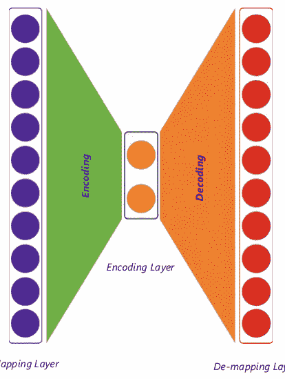


EOCs. 图 2.10 描绘了 DTL 算法中使用的三隐藏层欠完备 DAE 的配置。

虽然 Figueiredo et al. (2011) 通过此神经网络在其问题中成功获得了数据归一化的可靠输出，但 Sarmadi et al. (2021a) 指出该网络在各种 EOCs 下可能对任何工程问题都不可靠。

为解决此缺点，本研究提出了基于迁移学习概念的连续三隐藏层 DAE。

与一些知名的深度迁移学习技术不同，所提方法不构建单个 ANN。

相比之下，开发了一组连续三隐藏层 DAE 以生成一个新的深度神经网络 (DNN)。

此外，所提神经网络与一些知名的堆叠 DNN（例如堆叠自编码器）不同。

这是因为所提 DNN 不实现任何堆叠过程。

与之相反，主要思想是计算输入任何 DAE 的输入和输出之间的直接差值，并将该差值（残差）作为新输入馈送到下一个网络。

图 2.11 显示了迁移学习下所提 DNN 的图形表示。

如图所示，连续 ANN 学习过程是一个包含 k 次迭代或步骤的迭代算法。

对于第一次迭代，输入是扩展训练数据 X，并将其输入到第一个 DAE。

主要目标是提取输入和输出的残差矩阵。

基于此，提取的残差数据在第二次迭代中被设置为新输入（即 Input 2），并且此输入被应用到下一个（第二个）DAE。

此过程持续直到最后（第 k 次）迭代。

因此，执行最终残差提取以确定最后或第 k 个残差集，其作为未损伤状态的最终归一化扩展特征矩阵 (Ex)。

然后使用此集计算其新颖性分数以用于决策。

应当指出，图 2.11 所示的迭代过程应通过同时使用扩展训练和测试数据集来实施。

不过，学习过程仅通过训练集执行。

这意味着训练好的神经网络（即连同其估计的权重和偏置）仅被用于获取扩展测试数据的残差。

#### 2.3.4.1 DTL 中的超参数优化

与先前提出的方法（即 HMC-DAE-MD 和 HMC-UTSL-MD，其性能显著依赖于隐藏层的神经元数量）相反，所提 HMC-DTL-MD 方法不需要任何寻找神经元数量的策略。

此技术的唯一前提是在其迭代过程中定义一个停止条件。

事实上，此条件规定了执行 DTL 算法需要多少个连续 DAE。

因此，本节的主要超参数优化是确定连续 DAE 的数量。

本节提出了一种技术，通过计算在某些神经网络样本数量下的特征鉴别准确率和误分类率。

因为在所提 DTL 方法中寻找连续 DAE 的数量仅由训练数据的扩展矩阵实现，误分类率等同于假阳性。

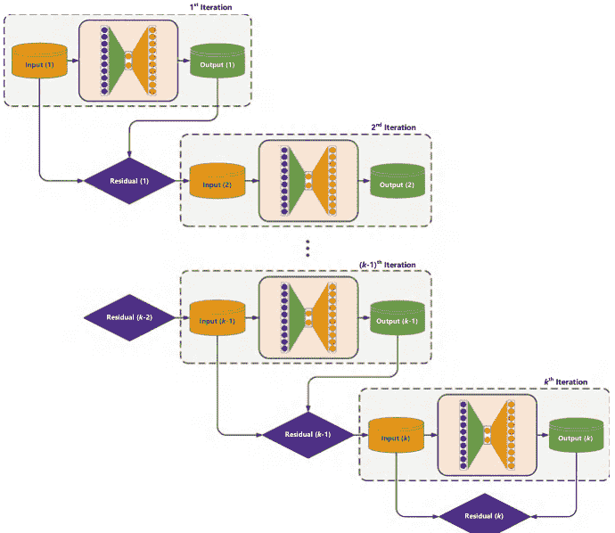

图 2.11 基于具有 10、20、10 个神经元的连续三隐藏层 DAE（用于映射、编码和解映射层）的所提 DTL 方法流程图

因此，此错误通过将每次迭代残差的 MD 量与阈值限制进行比较来获得。

此限制基于 MD 量的 95% 置信区间。

假设 E_xi 是第 i 次迭代的残差矩阵，其中 i = 1, 2, ..., k，变量 k 表示连续 DAE 或迭代的数量。

就此而言，可以根据公式 (2.39)（见 2.3.5）从此矩阵的列向量计算 n 个 MD 值，其中 m_xi ∈ R^p 和 Sigma_xi ∈ R^(p x p) 分别是 E_xi 的均值向量和协方差矩阵。

定义 FP_i 为第 i 次迭代 n 个样本中的假阳性数量，准确率计算如下：

```
Accuracy(i) = \left( 1 - \frac{FP_i}{n} \right)   (2.37)
```

在实现 DTL 算法的 k 次迭代后，选择具有最大准确率值的试验（迭代）作为连续 DAE 的最优数量。

### 2.3.5 基于马氏距离的特征鉴别

使用扩展训练和测试样本，这些被考虑在用于特征鉴别的新颖性检测器中。

在 SHM 背景下，MD 是一个经过验证的新颖性检测器，广泛应用于 SHM 应用（Sarmadi and Karamodin 2020; Sarmadi et al. 2020, 2021, 2023b; Yeager et al. 2019; Sarmadi et al. ; Mosavi et al. 2012; Nguyen et al. 2014; George et al. 2018; Entezami et al. 2023）。

这是由于其具有简单性、计算效率和非参数行为等巨大优势。

在某些变异程度不显著的条件下，此方法产生具有高检测精度的合理特征鉴别结果。

就此而言，Sarmadi (Sarmadi 2021) 证明基于 MD 的新颖性检测是在低 EOCs 下的一种可靠方法。

然而，它在高变异条件下无法提供满意结果。

在这种情况下，在应用 MD 或其他在高 EOCs 下性能不佳的新颖性检测器之前，数据归一化是强制性的。

通过基于 MD 的新颖性检测器进行特征鉴别的过程通常在基线（训练）和监测（测试）阶段实施。

前者需要未损伤状态的特征（即训练数据），后者需要未损伤条件的某些特征（即验证数据）以及与未知（当前）结构状态相关的所有可用特征。

假设扩展训练矩阵 X 来自结构的变异程度不显著的未损伤条件。

在这种情况下，没有必要使用类似于所提 HMC-MD 技术的数据归一化策略。

因此，基础目标是利用样本估计器估计 X 在 R^p 中的均值 v_x 和在 R^(p x p) 中的协方差 S_x。

应当指出，由于从 HMC 或 SLS 获得的扩展数据符合多元高斯/正态分布，可以确保样本估计器的使用是合理的。

有了这些描述，X 的第 i 个列向量的 MD 表示如下：

d_MD(x_i) = (x_i - v_x)^T S_x^{-1} (x_i - v_x), forall i = 1, ..., n (2.38)

当需要数据归一化时（即 EOCs 程度显著），MD 需要归一化特征。

本研究假设此类特征是关于数据归一化算法之一（即 DAE、UTSL 和 DTL）的输入和输出差值所提取的残差样本。

在基线阶段，假设 E_x 指的是由实际特征矩阵 X 源自的正常结构条件的归一化（扩展）特征。

同样地，R^p 中的均值 v_e 和 R^(p x p) 中的协方差 S_e 从 E_x 估计。

因此，基于 MD 的新颖性检测器可以重写如下：

\(d_{MD}(\mathbf{e}_{xi}) = (\mathbf{e}_{xi} - \mathbf{v}_e)^T \mathbf{S}_e^{-1} (\mathbf{e}_{xi} - \mathbf{v}_e), \quad \forall i = 1, \dots, n \quad (2.39)\)

其中 \(\mathbf{e}_{xi}\) 是 \(\mathbf{E}_x\) 的第 i 个列向量。

使用公式 (2.38) 和 (2.39)，在基线阶段可以获得 n 个距离量，即 \(\{d_{MD}(\mathbf{x}_1), \dots, d_{MD}(\mathbf{x}_n)\}\) 或 \(\{d_{MD}(\mathbf{e}_{x1}), \dots, d_{MD}(\mathbf{e}_{xn})\}\)。

此类 n 个距离量随后被考虑以估计用于特征鉴别的阈值限制。

考虑 \(\mathbf{Z}\)（即扩展测试数据点）或 \(\mathbf{E}_z\)（即来自数据归一化算法之一的残差矩阵）后，通过考虑 \(\mathbf{v}_x\) 或 \(\mathbf{v}_e\) 以及 \(\mathbf{S}_x\) 或 \(\mathbf{S}_e\)，将它们的列向量插入公式 (2.38) 和 (2.39)。

因此，在测试阶段，MD 可以重写为以下形式：

\(d_{MD}(\mathbf{z}_j) = (\mathbf{z}_j - \mathbf{v}_x)^T \mathbf{S}_x^{-1} (\mathbf{z}_j - \mathbf{v}_x), \quad \forall j = 1, \dots, m \quad (2.40)\)

or

\(d_{MD}(\mathbf{e}_{zj}) = (\mathbf{e}_{zj} - \mathbf{v}_e)^T \mathbf{S}_e^{-1} (\mathbf{e}_{zj} - \mathbf{v}_e), \quad \forall j = 1, \dots, m. \quad (2.41)\)

就此而言，关于测试阶段可以获得 m 个距离值，即 \(\{d_{MD}(\mathbf{z}_1), \dots, d_{MD}(\mathbf{z}_m)\}\) 或 \(\{d_{MD}(\mathbf{e}_{z1}), \dots, d_{MD}(\mathbf{e}_{zn})\}\)。

应用 n 和 m 个距离量，特征鉴别过程基于将每个此类量与阈值限制进行比较，该阈值通过使用与未损伤结构状态相关的训练数据点的新颖性指数来确定。

就此而言，\(\{d_{MD}(\mathbf{x}_1), \dots, d_{MD}(\mathbf{x}_n)\}\) 或 \(\{d_{MD}(\mathbf{e}_{x1}), \dots, d_{MD}(\mathbf{e}_{xn})\}\) 应低于阈值，以确认结构的健康状况。

对于测试数据点的距离值，可能达到两种一般状态（即，参见图 2.4）：

- (1) 如果 \(d_{MD}(\mathbf{z}_j)\) 或 \(d_{MD}(\mathbf{e}_{zj})\) 大于阈值，这意味着结构遭受了损伤，SHM 方法触发损伤出现。

- (2) 如果 \(d_{MD}(\mathbf{z}_j)\) 或 \(d_{MD}(\mathbf{e}_{zj})\) 小于阈值，这意味着结构仍然健康且没有损伤。

在特征鉴别过程中，阈值限制可以通过基于中心极限定理 (CLT) 和极值理论 (EVT) 的两种一般方法论来估计。

前者假设训练数据点的新颖性指数符合高斯分布，在这种情况下，各种显著性水平（虚警概率）下的标准置信区间适用。

后者基于选择一些最大新颖性指数，即极值。使用这些样本，可以建模一个极值分布，并在较小显著性水平下估计一个分位数值。

一般而言，EVT 辅助的阈值估计器在处理 EOCs 问题或低变异条件存在的情况下，优于 CLT 辅助技术。

更多详情可见 (Sarmadi and Karamodin 2020; Sarmadi et al. 2022; Daneshvar and Sarmadi 2022; Sarmadi 2021; Sarmadi and Entezami 2021; Entezami et al. 2019) 关于 EVT 辅助阈值判定器，以及 (Entezami et al. 2019; Entezami 2021) 关于 CLT 辅助阈值判定器。


### 2.4 实时结构健康监测的前沿：拟议的在线混合学习方法

先前提出的所有方法都基于充足训练样本的考虑。在 SAR 辅助结构健康监测问题中，由于可以在一定时间间隔内访问土木结构的先验信息（图像），先前提出的技术的学习过程是合理且可靠的。从机器学习的角度看，这种结构健康监测称为离线学习。应澄清，这种方法也适用于其他类型的结构健康监测方法。

本节旨在提出一种基于在线学习理念的实时结构健康监测新方法。在机器学习中，在线学习旨在通过新数据更新机器或计算模型。在此基础上，感兴趣的机器或模型可以基于先前信息进行开发，在这种情况下，在线学习通过接收新训练数据来改进它。在某些情况下，在线学习策略被视为机器的初始步骤。对于结构健康监测应用，如果新信息属于未损伤结构状态，则应继续在线学习过程；否则，应停止该进程，并以最后更新的模型为基础进行进一步调查。在这方面，任何新信息都被视为测试数据。

本节尝试提出两种混合方式的在线学习方法。在其他工作中，这些方法（即 HMC-ODTL-EMD 和 SLS-ODTL-EMD）包含数据增强、在线数据归一化和特征判别三个部分。拟议混合方法的第一步涉及数据增强。因此，HMC 和 SLS 技术都用于增强小位移数据。因此，这些方法与其他拟议技术的主要区别在于通过 ODTL 算法进行在线数据归一化过程以及通过 EMD 进行特征判别。

#### 2.4.1 在线深度迁移学习范式

DAE 在 DTL 框架中的主要先决条件之一是使用充足（增强）的数据。换句话说，它基于离线学习策略。本节提出并讨论了基于在线学习理念的增强版 DTL。拟议的 ODTL 算法由两个阶段组成。第一阶段是一个在线学习算法，直到停止条件终止该算法。相应地，该阶段声明学习过程中使用的新数据不属于未损伤结构状态，可能与损伤状态相关。换句话说，该算法报警异常变化的发生。因此，第二阶段开始调用第一阶段最后训练的 DAE。为简单起见，拟议的 ODTL 算法的流程图如图 2.12 所示。

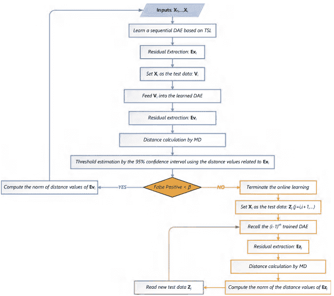

图 2.12 拟议 ODTL 方法的流程图

更具体地说，拟议的 ODTL 方法首先应用第一幅图像的增强位移样本的第一个数据集。主要目标是训练具有三个连续隐藏层的 DAE 并获得最终残差矩阵。这一步类似于原始 DTL 算法。因为第一步中只有一组增强数据点，它们既用作训练数据也用作验证数据。使用基于 MD 的新奇性检测器，计算这些数据集的距离值。自然地，两组数据提供相同的距离值。随后，训练集的 MD 量用于估计阈值，该阈值被设为停止条件的度量。这里，阈值通过在 5% 显著性水平下使用训练点损伤指标的标准置信区间获得。相应地，计算验证数据中的误正率。请注意，第一阶段接收到的任何新数据都应被视为验证数据。确实，人们假设增强的验证数据（新信息）来自结构的健康状态。因此，它们的新奇性指标应低于阈值。

如果误正率为零或可忽略，或其率小于预定义值（\(\beta\)），这意味着验证集与健康状态相关。在这种情况下，应将此类数据添加到先前的训练数据中，以更新先前的 DAE。相反，如果误正率显著或其率大于 \(\beta\)，则在线学习过程终止，新数据应转移到下一阶段以用作测试数据。在这种情况下，此类数据包含结构的损伤信息。为简单起见，ODTL 算法的过程可总结为：

- (1) 如果误正率小于 \(\beta\)，这意味着关于验证数据和结构健康状态的前提是正确的。因此，应继续在线学习（ODTL 的第一阶段）。此外，计算验证数据的 MD 值的欧几里得范数，以便在每个在线步骤中为实时结构健康监测获得一个结果（参见第 2.4.2 节）。

- (2) 如果误正率大于 \(\beta\)，这意味着关于验证数据和结构健康状态的前提是不正确的。相应地，需要停止在线学习并开始 ODTL 的第二阶段，即在线损伤检测。在这方面，增强的验证数据被视为测试数据。相应地，调用第一阶段最后更新的 DAE 以提取新的残差矩阵，并通过 EMD 计算新的新奇性指标。此过程对任何新数据继续进行。

#### 2.4.2 实时结构健康监测的特征判别

实时结构健康监测的最后一步是通过与先前拟议技术不同的新奇性检测器进行特征判别。除此问题外，另一个区别在于如何执行特征判别过程。在先前拟议的技术中，需要通过基于 MD 的新奇性检测器计算所有训练点和测试点的新奇性指标，并将其与阈值进行比较。以不同的方式，拟议的在线混合学习方法在其算法中利用阈值；即在线学习和在线损伤检测。此外，从第一阶段转向第二阶段推断结构中存在异常变化。最终，两个阶段都通过在线方式计算残差数据点的 MD 量的欧几里得范数，给出标量新奇性指标。

设 \(\mathbf{E} = [\mathbf{e}_1, \dots, \mathbf{e}_n] \in \mathbb{R}^{p \times n}\) 表示由 ODTL 算法从一种结构状态（即一张卫星图像）获得的 \(n\) 个残差数据点的矩阵。要确定标量新奇性指标，只需估计 \(\mathbf{E}\) 的均值向量和协方差矩阵，这里分别定义为 \(\mathbf{b_e} \in \mathbb{R}^p\) 和 \(\mathbf{C_e} \in \mathbb{R}^{p \times p}\)。\(\mathbf{E}\) 的每个列向量的 MD 量计算如下：

\(d_{MD}(\mathbf{e}_i) = (\mathbf{e}_i - \mathbf{b_e})^T \mathbf{C_e}^{-1} (\mathbf{e}_i - \mathbf{b_e}), \quad \forall i = 1, \dots, n \quad (2.42)\)

相应地，可以得到 \(n\) 个 MD 值 \(\{d_{MD}(\mathbf{e}_1), \dots d_{MD}(\mathbf{e}_n)\}\)。应用欧几里得范数，可以写成：

\( d_E = \sqrt{(d_{MD}(\mathbf{e}_1))^2 + \dots + (d_{MD}(\mathbf{e}_n))^2} \quad (2.43) \)

因此，\( d_E \) 是表示在线学习和在线损伤检测两个阶段中结构状态的唯一标量新奇性指标。这意味着第一阶段中的任何 \( d_E \) 值都声明结构处于未损伤状态，而第二阶段中的任何 \( d_E \) 值都触发结构已损伤。这种在拟议在线混合技术中的特征判别是相对于先前拟议技术的主要改进。

### 2.5 本章总结

本节充分讨论了本书中用于增强 SAR 辅助结构健康监测的主要拟议方法。这些方法包括两类数据：相对较大位移数据和小位移数据。对于第一类，这项工作基于 NNS 和 EVT 的概念提出了一种新的概率机器学习方法。首先，详细描述了 EVT 的基本原理和理论基础以及所有可能的极值分布模型。随后，基于半参数分位数建模开发了一种 NNS-EVT 方法的新算法，以建立用于结构健康监测的概率新奇性检测器。对于第二类，详细讨论了离线和在线方式的拟议混合学习方法。

在本章中，可以推断出拟议的 NNS-EVT 方法具有良好的多样性，可用于开发许多用于结构健康监测的新奇性检测器。虽然本书考虑了一种基于半参数极值分布模型及其分位数函数的新奇性检测器来定义新奇性指标，但也可以利用其他（参数）极值分布，例如基于 BM 技术的 GEVD 和基于 POT 技术的 GPD，来设计新的新奇性检测器。这意味着拟议的 NNS-EVT 方法通过与其他模型（即 GEVD 和 GPD）及技术（即 BM 和 POT）的高适用性多样性，发展出一种通用方法。

关于混合学习方法，可以得出结论：无监督 DAE 是设计各种数据归一化方法的一种强大而有效的方法。借助教师-学生学习、迁移学习、在线学习等先进机器学习算法，可以设计不同配置的 DAE 用于数据归一化。此外，基于马尔可夫链蒙特卡罗算法的随机数据生成可为数据增强提供非参数策略。最后，当 EOCs 的挑战可解决时，基于统计距离度量（尤其是马氏距离）的非参数新奇性检测器可以是首选。


### 参考文献

- Azimi M, Pekcan G (2020) 通过深度学习利用极度压缩数据进行结构健康监测. Comput Aided Civ Inf 35(6):597–614. https://doi.org/10.1111/mice.12517

- Bayik C, Abdikan S, Arkan M (2021) 基于多时相InSAR分析的土耳其阿塔蒂尔克大坝长期位移观测. Acta Astronaut 189:483–491. https://doi.org/10.1016/j.actaastro.2021.09.022

- Bekkamal B, Entezami A, De Michele C, Arslan AN (2023a) 基于机器学习技术的遥感有限结构位移热效应消除. Remote Sens 15(12):3095. https://doi.org/10.3390/rs15123095

- Bekkamal B, Entezami A, De Michele C, Arslan AN (2023b) 通过混合感知和监督回归模型对长跨桥梁温度效应的研究. Remote Sens 15(14):3503. https://doi.org/10.3390/rs15143503

- Castillo E (1988) 工程中的极值理论. Elsevier, San Diego

- Charte D, Charte F, García S, del Jesus MJ, Herrera F (2018) 非线性特征融合自动编码器实用教程：分类、模型、软件和指南. Inf Fusion 44:78–96. https://doi.org/10.1016/j.inffus.2017.12.007

- Coles S, Bawa J, Trenner L, Dorazio P (2001) 极值统计建模导论，第208卷. Springer, London

- Danesvhar MH, Sarmadi H (2022) 基于无监督学习的长期和短期监测下土木全尺度结构损伤评估. Eng Struct 256:114059. https://doi.org/10.1016/j.engstruct.2022.114059

- Dekkers AL, De Haan L (1989) 关于极值指数和大分位数估计的研究. Ann Stat 1795–1832

- Entezami A, Shariatmadar H (2018) 基于新型损伤指数的结构健康监测无监督学习方法：用于损伤定位和量化. Struct Health Monit 17(2):325–345. https://doi.org/10.1177/1475921717693572

- Entezami A, Shariatmadar H, Karamodin A (2019) 基于新型统计模式识别方法的环境和运行变化条件下的数据驱动损伤诊断. Struct Health Monit 18(5–6):1416–1443. https://doi.org/10.1177/1475921718800306

- Entezami A, Sarmadi H, Mariani S (2020) 基于时间序列分析和深度神经网络处理仅输出（大）数据的早期损伤检测无监督学习方法. Eng Proc 2(1):17. https://doi.org/10.3390/ecsa-708281

- Entezami A, Sarmadi H, De Michele C (2022) 基于经验数据分析和对称信息度量的概率损伤定位. Meas 198:111359. https://doi.org/10.1016/j.measurement.2022.111359

- Entezami A, Sarmadi H, Bekkamal B (2023) 基于无监督元学习的大量及缺失数据条件下混凝土和钢桥长期健康监测. Eng Struct 279:115616. https://doi.org/10.1016/j.engstruct.2023.115616

- Entezami A (2021) 基于距离度量的统计决策. 载于：基于时间序列分析和统计距离度量的结构健康监测. Springer, Berlin, 第59–79页. https://doi.org/10.1007/978-3-030-66259-2_4

- Farneti E, Cavaglion N, Costantini M, Trillo F, Minati F, Venanzi I, Uberini F (2022) 基于卫星InSAR数据并带有不确定度量化的多跨桥梁结构监测方法及其在意大利阿尔比亚诺-马格拉桥倒塌前的应用. Struct Health Monit. https://doi.org/10.1177/14759217221083609

- Figueiredo E, Park G, Farrar CR, Worden K, Figueiras J (2011) 运行和环境变化条件下损伤检测的机器学习算法. Struct Health Monit 10(6):559–572. https://doi.org/10.1177/1475921710388971

- Gao Y, Mosallam KM (2018) 基于图像的结构损伤识别深度迁移学习. Comput Aided Civ Inf 33(9):748–768. https://doi.org/10.1111/mice.12363

- Gelman A, Rubin DB (1992) 使用多序列迭代模拟的推断. Stat Sci 7(4):457–472

- George RC, Mishra SK, Dwivedi M (2018) 以相位肖像间的马哈拉诺比斯距离作为损伤特征. Struct Health Monit 17(4):869–887. https://doi.org/10.1177/1475921717722274

- Gomes MI, Guillou A (2015) 单变量极值理论及统计学：综述. Int Stat Rev 83(2):263–292. https://doi.org/10.1111/insr.12058

- Hill BM (1975) 关于分布尾部推断的简单一般方法. Ann Stat 3(5):1163–1174

- Karhunen J, Raiko T, Cho K (2015) 无监督深度学习：简要综述. 载于：Bingham E, Kaski S, Laaksonen J, Lampinen J (编) 独立成分分析与学习机器的进展. Academic Press, 第125–142页. https://doi.org/10.1016/B978-0-12-802806-3.00007-5

- Kotz S, Nadarajah S (2000) 极值分布：理论与应用. World Scientific, Singapore

- Kramer MA (1991) 使用自联神经网络的非线性主成分分析. AIChE J 37(2):233–243. https://doi.org/10.1002/aic.690370209

- Kramer MA (1992) 自联神经网络. Comput Chem Eng 16(4):313–328

- Larochelle H, Bengio Y, Louradour J, Lamblin P (2009) 深度神经网络训练策略探索. J Mach Learn Res 10(1). https://doi.org/10.1145/1577069.1577070

- Liu W, Wang Z, Liu X, Zeng N, Liu Y, Alsaadi FE (2017) 深度神经网络架构及其应用综述. Neurocomputing 234:11–26. https://doi.org/10.1016/j.neucom.2016.12.038

- Milillo P, Perissin D, Salzer JT, Lundgren P, Lacava G, Milillo G, Serio C (2016) 从太空监测大坝结构健康：基于新型InSAR技术和多参数模型在意大利巴西利卡塔大区佩rtusillo大坝的应用洞察. Int J Appl Earth Obs Geoinf 52:221–229. https://doi.org/10.1016/j.jag.2016.06.013

- Mirzaei A, Pourahmadi V, Soltani M, Sheikhtadeh H (2020) 使用教师-学生网络的深度特征选择. Neurocomputing 383:396–408. https://doi.org/10.1016/j.neucom.2019.12.017

- Mosavi AA, Dicky D, Seracino R, Rizkalla S (2012) 利用向量自回归模型和马哈拉诺比斯距离识别环境振动下的损伤位置. Mech Syst Signal Process 26:254–267. https://doi.org/10.1016/j.ymssp.2011.06.009

- Neal RM (2003) 切片采样. Ann Stat 31(3):705–767. https://doi.org/10.1214/aos/1056562461

- Neal RM (2011) 使用汉密尔顿动力学的马尔可夫链蒙特卡罗方法. 载于：马尔可夫链蒙特卡罗手册. CRC Press, Boca Raton, FL, USA

- Nguyen T, Chan TH, Thambiratnam DP (2014) 采用马哈拉诺比斯平方距离的统计损伤识别中受控蒙特卡罗数据生成的现场验证. Struct Health Monit 13(4):473–488

- Pathirage CSN, Li J, Li L, Hao H, Liu W, Ni P (2018) 基于自动编码器神经网络和深度学习的结构损伤识别. Eng Struct 172:13–28. https://doi.org/10.1016/j.engstruct.2018.05.109

- Rebilat M, Hmad O, Kadri F, Mechbal N (2018) 基于峰超过阈值的结构健康监测探测器设计：航空航天结构的应用. Struct Health Monit 17(1):91–107. https://doi.org/10.1177/1475921716685039

- Salvadori G, De Michele C, Kottegoda NT, Rosso R (2007) 自然中的极值：基于Copula的方法，第56卷. Springer Science & Business Media

- Sarmadi H (2021) 数据变化条件下结构安全评估的机器学习方法研究：比较研究与新方法. J Perform Constr Facil 35(6):04021090. https://doi.org/10.1061/(ASCE)CF.1943-5509.0001664

- Sarmadi H, Entezami A (2021) 监督学习在损伤检测验证中的应用. Arch Appl Mech 91(1):393–410. https://doi.org/10.1007/s00419-020-01779-z

- Sarmadi H, Karamodin A (2020) 基于自适应马哈拉诺比斯平方距离和单类kNN规则的环境影响下结构健康监测新型异常检测方法. Mech Syst Signal Process 140:106495. https://doi.org/10.1016/j.ymssp.2019.106495

- Sarmadi H, Yuen K-V (2021) 基于核零空间和峰超过阈值的创新无监督学习早期损伤检测方法. Comput Aided Civ Inf 36(9):1150–1167. https://doi.org/10.1111/mice.12635

- Sarmadi H, Yuen K-V (2022) 基于极值理论和混合分位数建模的新型概率机器学习结构健康监测方法. Mech Syst Signal Process 173:109049. https://doi.org/10.1016/j.ymssp.2022.109049

- Sarmadi H, Entezami A, Daneshvar Khorram M (2020) 基集经验模态分解和马哈拉诺比斯平方距离的环境振动和非平稳信号下能量损伤定位. J Vibrat Control 26(11–12):1012–1027. https://doi.org/10.1177/1077546319891306

- Sarmadi H, Entezami A, Saeedi Razavi B, Yuen K-V (2021) 基于马哈拉诺比斯距离度量的集成学习结构健康监测. Struct Contr Health Monit 28(2):e2663. https://doi.org/10.1002/stc.2663

- Sarmadi H, Entezami A, Behkamal B, De Michele C (2022) 基于无监督特征选择和局部度量学习的严重环境影响下长期模态数据部分在线损伤检测. J Civ Struct Health Monit 12:1043–1066. https://doi.org/10.1007/s13349-022-00596-y

- Sarmadi H, Entezami A, De Michele C (2023a) 基于半参数极值理论的结构健康监测概率数据自聚类. Mech Syst Signal Process 187:109976. https://doi.org/10.1016/j.ymssp.2022.109976

- Sarmadi H, Entezami A, Magalhães F (2023b) 基于创新混合特征加权-选择算法和自然邻域搜索的连续动态监测无监督数据归一化. Struct Health Monit Press. https://doi.org/10.1177/14759217231166116

- Van Renswoude D, Casey P, Brown SD (2018) 马尔可夫链蒙特卡罗采样简单介绍. Psychon Bull Rev 25(1):143–154

- Yang L, Shami A (2020) 机器学习算法超参数优化：理论与实践. Neurocomputing 415:295–316. https://doi.org/10.1016/j.neucom.2020.07.061

- Yang Q, Zhang Y, Dai W, Pan SJ (2020) 迁移学习. Cambridge University Press, United Kingdom

- Yeager M, Gregory B, Key C, Todd M (2019) 在损伤检测场景中使用稳健马哈拉诺比斯距离估计进行特征鉴别. Struct Health Monit 18(1):245–253. https://doi.org/10.1177/1475921717748878


## 第3章 模拟现实：桥梁健康监测的数值评估

**摘要** 与传统感知技术相比，从大量 SAR 图像中制备和提取位移数据并非易事。值得注意的是，对于长期监测，这一过程既困难又耗时。针对这一问题，本章旨在通过真实桥梁结构数值模型的模拟位移响应来验证所提出的概率无监督学习方法。在此基础上，该桥的数值模型是在 MATLAB 环境中开发的。为了模拟基于遥感的 SHM，在桥面上选择几个点作为提取结构响应的目标区域。在桥墩附近模拟了三种损伤场景，以评估所提出的概率无监督学习方法是否能有效检测此类场景。

**关键词** 数值模型 · 位移模拟 · 真实桥梁 · 概率无监督学习 · 极值理论 · 大数据

### 3.1 I-40 桥：箱梁桥

本节进行数值研究以验证一些拟议方法。该研究基于名为 I-40 桥的全尺寸桥梁的数值模型，该桥位于美国新墨西哥州阿尔伯克基的里奥格兰德河上（Farrar et al. 2000），如图 3.1a 所示。构建了该桥的有限元模型以模拟不同位移点并研究一些 SHM 方法。由于 I-40 桥的数值模型最近已被构建和更新（Rezaiee-Pajand et al. 2021），因此将其用于验证拟议的 NNS-EVT 和 HMC-MD 方法。

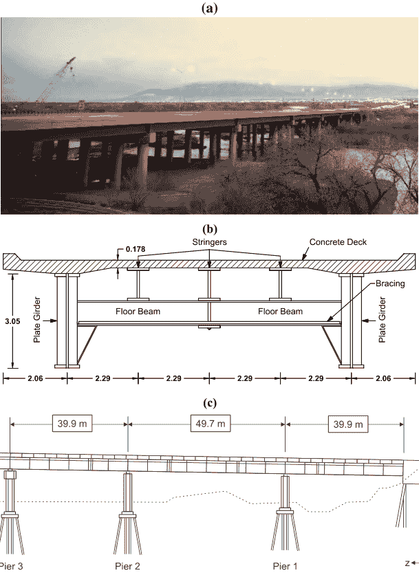

图 3.1 a I-40 桥的图像，b 截面（Daneshvar et al. 2023），c 立面图

### 3.2 I-40 桥的数值模型

I-40 桥由钢梁和混凝土桥面组成，桥面宽 13.3 m，厚 0.178 m。桥面通过两个钢腹板梁和三个钢系梁连接，如图 3.1b 所示。系梁和楼面梁承担了从桥面到主梁的荷载传递。此外，还考虑了交叉支撑来连接楼面梁。图 3.1c 显示了 I-40 桥的一部分，该部分被选中用于安装一些 SHM 系统，用于数值和实验研究，例如有限元模型更新（Rezaiee-Pajand et al. 2021）和基于模型的损伤检测（Daneshvar et al. 2023）。因此，此处纳入了该部分的数值模型以验证拟议的 NNS-EVT 和 HMC-MD 方法。

所关注的部分包括三个跨径，总长度为 129.5 m，其中包括中跨径长度 49.7 m 和两个边跨径长度各 39.9 m。利用壳单元和 3D 梁单元（Rao 2011），在 MATLAB 中构建了 I-40 桥该部分的有限元模型。图 3.2 显示了桥梁关于桥面、主梁腹板和桥墩的示意图及单元编号。对于混凝土桥面和主梁，数值建模基于 144 和 48 个四节点壳单元，分别对应膜单元和矩形板单元。更准确地说，如图 3.2a 所示，单元 1–144 与桥面壳部件相关。此外，在图 3.2b 和 c 中，南北两侧主梁腹板的单元分别标记为 145–168 和 169–192。3D 梁单元用于构建上下桥墩，编号为 193–204。钢材和混凝土是 I-40 桥数值建模的主要材料。表 3.1 列出了桥梁数值建模中使用的这些材料的主要力学性能。为了模拟损伤，假设第二桥墩附近单元 47、54、152、153 和 194 的刚度值分别均匀降低 2%、10% 和 15%，导致结构总刚度降低分别为 10%、50% 和 75%（即，总刚度降低 10% 是通过考虑 5 × 2% 确定的）。这种损伤模式是桥面与第二桥墩之间分离的现实模拟，会导致这些区域的位移增加。根据图 3.2，目标点“F”为损伤位置。

### 3.3 结构位移模拟

为了模拟正常和损伤条件下的位移，假设在不同时间向桥面所有节点垂直施加不同的静态荷载，见图 3.2a。基于结构分析和有限元法的简单概念，施加荷载 $f$、结构刚度 $K$ 和位移 $\delta$ 之间的关系写作如下方程：

$f_i = K \delta_i$ (3.1)

其中 $i = 1,...,T$ 表示测量次数。在 SAR 辅助 SHM 领域，该值等同于 SAR 图像的数量。基于该方程以及模拟损伤模式引起的桥梁刚度变化，可以在九个目标点（A、B、C、D、

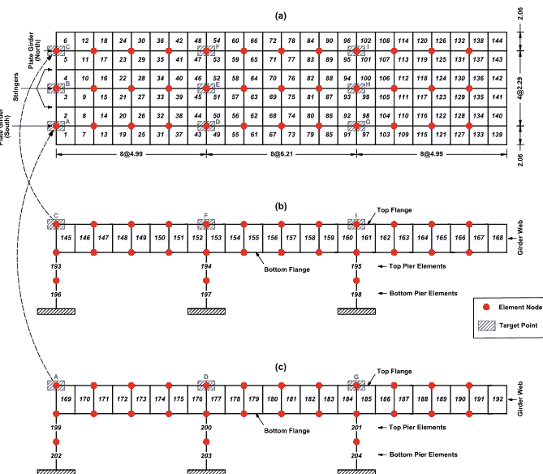

图 3.2 I-40 桥的有限元模型及单元编号：a 混凝土桥面，b 北主梁和桥墩，c 南主梁和桥墩

表 3.1 桥梁建模中钢材和混凝土的力学性能

| 材料 | 弹性模量 (GPa) | 密度 (kg/m³) | 泊松比 |
|---|---|---|---|
| 钢材 | 210 | 7850 | 0.3 |
| 混凝土 | 24.8 | 2322.6 | 0.2 |

E、F、G、H 和 I）。在考虑拟议 NNS-EVT 和 HMC-MD 方法的核心思想后，模拟了两种不同的场景和位移类型。

首先，假设有 500 次位移点测量，其中 70% 的样本（即测量 1–350）属于正常条件，其余 30% 的位移与三种损伤情况相关；即，Case 1 占 10%，总刚度降低 10%（即测量 351–400），Case 2 占 10%，总刚度降低 50%（即测量 401–450），Case 3 占 10%，总刚度降低 75%（即测量 451–500）。根据机器学习的主要思想，基线阶段正常条件下测量 1–350 相关的 80% 位移点用于生成训练矩阵 X₁ ∈ ℝ⁹ˣ²⁸⁰。因此，剩余位移（涉及测量 281–350）以及所有损伤情况的位移被考虑用于生成测试矩阵 Z₁ ∈ ℝ⁹ˣ²²⁰。由于研究问题大致与长期 SHM 过程相关，向位移点添加了 1% 的噪声水平，以模拟这些样本中的一些真实 EOCs。

对于第一个场景，图 3.3 显示了目标点“B”（即未损伤区域）和“F”（即损伤区域）的位移点。从图 3.3a 可以看出，所有情况的位移大致在同一范围内，而图 3.3b 表明损伤情况（特别是第二和第三情况，即 DC2 和 DC3）的位移点存在一些偏差。然而，将第一个损伤情况（DC1）与正常条件（NC）区分开来略有困难。另一方面，如图 3.3b 所示，监测阶段（即验证数据）正常条件下的一些位移点的位移值等于或大于 DC1 和 DC2 的相应值，很可能是由于施加到模拟位移上的噪声的影响。这种现象在现实中可能发生，例如温度波动对土木结构结构特性的影响会导致结构响应发生不希望的变化（Behkamal et al. 2023a, b）。根据图 3.3，虽然可以通过直接分析位移点来检测第三种损伤情况，但上述讨论证明，当损伤严重程度和变异条件均未知时，这种策略并不总是适用和有效。另一方面，为 SHM 选择许多目标点进行位移点的直接分析可能存在问题，这可能既耗时又容易出错。最后，最后的局限是这种策略是图形数据评估。毫无疑问，使用更严谨的数值或分析方法有助于土木工程师对土木结构的健康状况做出更好、更有信心的决策。

其次，假设只有在相同的九个目标点处有 30 次位移点测量可用，以检验拟议的 HMC-MD 方法。在这方面，假设正常条件和每种损伤情况分别包含 15 次和 5 次测量。因此，将正常条件下 80% 的位移用于生成训练矩阵 X₂ ∈ ℝ⁹ˣ¹²。将正常条件下的剩余位移点和所有损伤情况的所有位移收集起来，生成测试矩阵 Z₂ ∈ ℝ⁹ˣ²²。对于此场景，图 3.4 说明了相同目标点 B 和 F 处的模拟位移。如图 3.4a 所示，未损伤区域的位移在同一范围内。这些样本中的小变化是由施加不变荷载（即不同荷载大小）引起的。如图 3.4b 所示，第三种情况的位移与正常条件的位移点可区分。尽管对于第二个损伤情况也可以得出相同结论，但一些初始样本接近正常条件的位移。不管这些情况，可以看出第一个损伤情况的位移值大约等于正常条件的相应值。因此，考虑到第二个场景未应用噪声水平，一个


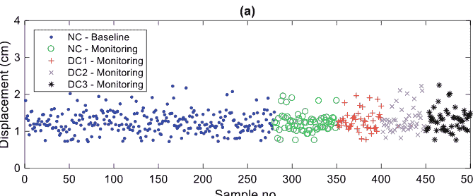

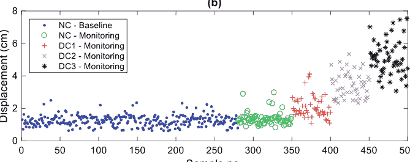

图3.3 基于第一情景的I-40桥模拟位移点：**a** 目标点B（未损伤区域），**b** 目标点F（损伤区域）

可以得出结论，对位移点的直接分析不是评估土木结构健康和安全的稳健有效方法。

### 3.4 基于NNS-EVT和HMC-MD的早期损伤检测

使用两种情景的训练和测试矩阵，所提NNS-EVT和HMC-MD方法被应用于评估I-40桥的当前状态。对于第一情景，执行NNS-EVT的主要步骤以获取量子向量q的绝对值。基于序统计量和置信区间的概念，经验上考虑5%的SDVs概率来选择每个样本的最近邻（Sarmadi et al. 2021a）。图3.5显示了基于矩估计量的估计EVI值。从图3.5a可以看出，一些估计EVI为正，而其他为负。在图3.5b中，可以看到所有估计EVI均为负。这些观察

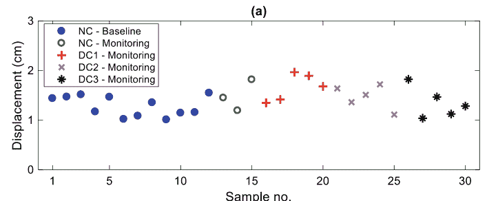

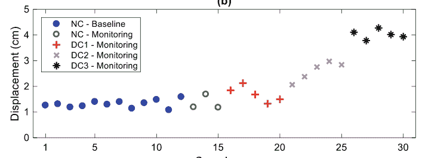

图3.4 基于第二情景的I-40桥模拟位移点：a 目标点B（未损伤区域），b 目标点F（损伤区域）

证实了选择矩估计量而非著名Hill估计量的准确性，后者仅适用于正EVI。

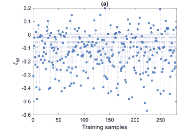

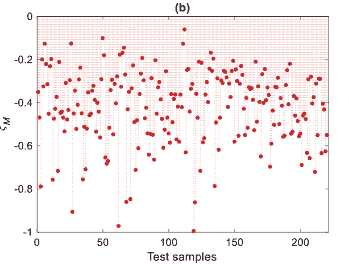

图3.5 基于矩估计量的EVI估计：a 基准阶段，b 监测阶段

根据估计的EVI，在5%显著性水平下确定训练和测试样本的量子值。使用所提NNS-EVT方法的损伤检测结果如图3.6所示，其中前280个量子值对应未损伤结构状态，样本281–350的量子值与验证数据相关，其余351至500的量子值属于三个损伤情况，每个情况分别有50个量子值。此外，水平线指的是基准阶段正常状态下由280个量子值估计的阈值限制。为此，采用Sarmadi and Yuen (2021)最近提出的基于EVT的方法来估计感兴趣的阈值。该技术涉及EVT、广义帕累托分布建模和峰值超过阈值算法。

从图3.6可以观察到，无论是在正常阶段还是监测阶段，正常状态下的所有（绝对）量子值都准确地位于阈值线以下，准确地意味着未损伤状态。此外，可以辨别出所有损伤情况的量子值都高于报警阈值，准确地指示桥梁的损伤状态。一个显著的结果是，第一个损伤情况的量子值适当且准确地与正常状态区分开来。因此，可以自信地做出决定，即该情况指的是桥梁的损伤状态。对于第二和第三个情况也可以观察到相同的结论。另一方面，这三个情况中量子值的变化是可区分的，对损伤严重程度没有任何歧义。在图3.6的样本351–500中，可以观察到量子值的大小从DC1增加到DC3。

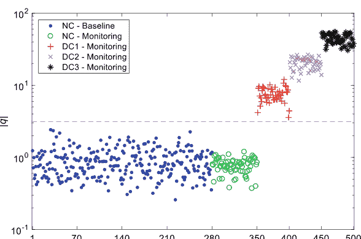

图3.6 基于相对高维或大位移及所提NNS-EVT方法对I-40桥的损伤检测

基于上述结果，因此可以得出结论，使用有效方法能显著提高结构健康监测（SHM）的准确性。

为了使用所提HMC-MD方法在第二情景下检测低维或小位移点的损伤，正常状态（即训练和验证数据）和每个损伤情况的样本通过HMC采样技术进行增强。为此，样本生成数量$N$和链数分别设置为1000和10。因此，所提及的每个数据（即正常和损伤情况的训练、验证和测试样本）的平均值被转换为一个9行1000列的矩阵。注意平均过程基于10条链。考虑训练矩阵$\widetilde{\mathbf{X}} \in \mathbb{R}^{9 \times 1000}$后，只需估计其均值和协方差。使用MD方程，可以计算基准阶段正常状态的1000个距离值$d_{MD}$。同样的距离计算也用于确定损伤情况验证和测试样本的1000个距离值。损伤检测结果如图3.7所示，其中虚线表示基准阶段正常状态下1000个距离值得到的阈值以及EVT辅助的阈值确定。

可以看到，无论是在基准阶段还是监测阶段，正常状态的距离值都准确地位于阈值线以下，准确地指示未损伤状态且无任何假阳性。此外，所有损伤情况的距离值均超过阈值，准确地发出损伤发生的警报。类似于图3.6，可以意识到第一个损伤情况（此前很难与正常状态区分开来）被简单地检测为损伤状态之一。因此，可以

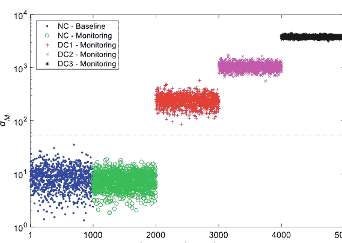

**图3.7** 基于低维和小位移及所提HMC-MD方法对I-40桥的损伤检测

推断出所提HMC-MD技术能够显著改善小位移点下的结构健康监测过程，并提供更可靠的输出。

### 3.5 章节总结

本章介绍了I-40桥数值研究的主要结果。在这项研究中，试图模拟从结构上某些目标点获得的SAR图像的大位移和小位移数据集。随后，所提概率无监督学习方法NNS-EVT和混合学习方法HMC-MD已被应用于在大位移和小位移数据点下检测不同严重程度的各种损伤情况。两种技术都成功检测了I-40桥上的模拟损伤情况。虽然所提NNS-EVT方法适用于不同EOC条件下的SHM，因为利用了NNS概念（这是一种减轻EOC的有效方法（Sarmadi et al. 2021a, 2022, 2023; Sarmadi and Karamodin 2020; Entezami et al. 2018, 2020, 2023a, b, c; Entezami and Shariatmadar 2018; Esfehani et al. 2023; Heravi et al. 2022）），所提HMC-MD方法在这些条件下的性能尚不明确。由于对I-40桥的数值研究没有在模拟位移样本中考虑EOC，因此评估HMC-MD在这方面至关重要。为此，下一章将使用真实结构的真实世界小位移数据来评估这一问题。

### 参考文献

Behkama B, Entezami A, De Michele C, Arslan AN (2023a) 基于机器学习技术的遥感有限结构位移热效应消除. Remote Sens 15(12):3095. https://doi.org/10.3390/rs15123095

Behkama B, Entezami A, De Michele C, Arslan AN (2023b) 基于混合感知和监督回归模型对长跨桥梁温度效应的研究. Remote Sens 15(14):3503. https://doi.org/10.3390/rs15143503

Danesvar MH, Saffarian M, Jahangir H, Sarmadi H (2023) 基于模态应变能和基于优化的迭代正则化方法的结构系统损伤识别. Eng Comput 39:2067–2087. https://doi.org/10.1007/s00366-021-01567-5

Entezami A, Shariatmadar H (2018) 基于结构健康监测中新型损伤指数的无监督学习方法用于损伤定位和量化. Struct Health Monit 17(2):325–345. https://doi.org/10.1177/1475921717693572

Entezami A, Shariatmadar H, Karamodin A (2018) 基于新型统计模式识别方法的环境和运行变量条件下的数据驱动损伤诊断. Struct Health Monit 18(5–6):1416–1443. https://doi.org/10.1177/1475921718800306

Entezami A, Shariatmadar H, Mariani S (2020) 基于时间序列建模和新颖性检测的创新统计模式识别方法的大型结构早期损伤评估. Adv Eng Softw 150:102923. https://doi.org/10.1016/j.advengsoft.2020.102923


Entezami A, Sarmadi H, Behkamal B (2023a) 基于无监督元学习的大量缺失数据条件下混凝土与钢桥长期健康监测. 工程结构 279:115616. https://doi.org/10.1016/j.engstruct.2023.115616

Entezami A, Sarmadi H, Behkamal B (2023b) 一种新型双混合学习方法用于不同环境变化模式下基于模态频率的桥梁结构损伤评估. 机械系统与信号处理 201:110676. https://doi.org/10.1016/j.ymssp.2023.110676

Entezami A, Sarmadi H, Behkamal B, De Michele C (2023c) 基于创新多任务无监督学习方法的严重环境变化条件下桥梁连续健康监测. 结构与基础设施工程 (在刊) 1–19. https://doi.org/10.1080/15732479.2023.2166538

Esfehani S, Shariatmadar H, Entezami A (2023) 基于一种对噪声和不确定性鲁棒的新统计特征提取方法的可靠决策. 土木结构健康监测杂志 13(1):269–294. https://doi.org/10.1007/s13349-022-00636-7

Farrar CR, Cornwell PJ, Doebling SW, Prime MB (2000) 阿拉莫萨峡谷和 I-40 桥的结构健康监测研究. 洛斯阿拉莫斯国家实验室，新墨西哥州（美国）

Heravi MA, Tavakkolí SM, Entezami A (2022) 基于自回归损伤特征概率密度函数和快速距离相关方法的结构健康监测. 振动与控制杂志 28(19–20):2786–2802. https://doi.org/10.1177/10775463211020198

Rao SS (2011) 工程中的有限元方法. Elsevier Science

Rezaee-Pajand M, Sarmadi H, Entezami A (2021) 一种混合灵敏度函数和 Lanczos 双对角化-Tikhonov 方法用于结构模型更新：全规模桥梁结构的应用. 应用数学建模 89:860–884. https://doi.org/10.1016/j.apm.2020.07.044

Sarmadi H, Karamodin A (2020) 一种新型异常检测方法基于自适应马氏距离平方和单类 kNN 规则，用于环境影响下的结构健康监测. 机械系统与信号处理 140:106495. https://doi.org/10.1016/j.ymssp.2019.106495

Sarmadi H, Yuen K-V (2021) 基于创新无监督学习方法的早期损伤检测，该方法基于核零空间和峰值超阈值. 土木工程信息化 36(9):1150–1167. https://doi.org/10.1111/mice.12635

Sarmadi H, Entezami A, Saeedi Ravazi B, Yuen K-V (2021a) 基于马氏距离度量的集成学习结构健康监测. 结构控制与健康监测 28(2):e2663. https://doi.org/10.1002/stc.2663

Sarmadi H, Entezami A, Behkamal B, De Michele C (2022) 基于无监督特征选择和局部度量学习的严重环境影响下长期模态数据的部分在线损伤检测. 土木结构健康监测杂志 12:1043–1066. https://doi.org/10.1007/s13349-022-00596-y

Sarmadi H, Entezami A, Maghfāés F (2023) 基于创新混合特征加权-选择算法和自然最近邻搜索的连续动态监测无监督数据归一化. 结构健康监测 (在刊). https://doi.org/10.1177/14759217231166116

Sarmadi H, Entezami A, Salar M, De Michele C (2021b) 基于新聚类和阈值估计方法的环境变化条件下桥梁健康监测. 土木结构健康监测杂志 1–16. https://doi.org/10.1007/s13349-021-00472-1

## 第 4 章
从理论到现实：塔德卡斯特桥的先进结构健康监测方法

### 摘要
结构健康监测（SHM）方法的实验验证是评估此类方法在损伤评估中精度和可靠性的关键过程，尤其是在长期监测方案中。本章通过使用位于英国塔德卡斯特的石砌桥（即塔德卡斯特桥）的一组位移响应，探讨了为应对小数据局限性而开发的拟议无监督学习方法（即 HMC-DAE-MD、HMC-UTSL-MD、HMC-DTL-MD、HMC-ODTL-EMD 和 SLS-ODTL-EMD）的实际应用。由于该桥曾发生部分坍塌，因此它是验证拟议方法的适当案例研究。本章还说明了数据增广过程如何帮助更好地观察增广位移响应中的 EOCs。

### 关键词
坍塌前检测 • 石砌桥 • 小数据 • 数据增广 • 机器学习 • 无监督学习

### 4.1 塔德卡斯特桥：一座石砌桥

拟议其他方法的实际应用基于英国塔德卡斯特塔德卡斯特桥宝贵的小位移数据集（Selvakumaran 等人，2018）。出于一些重要原因，我们相信该数据集为验证拟议方法提供了最佳条件。考虑该结构的主要动机是：(i) 它呈现了真实结构中部分坍塌事件的实际条件，(ii) 样本位移数据来自连续长期监测计划，(iii) 与接触式传感器的安装类似，采用并分布了适当的目标点以提取位移点。

该结构是一座著名的石砌桥，拥有七个桥墩，建于约1700年（即，根据文献证据，建于1698年至1699年之间）。该桥横跨英国北约克郡塔德卡斯特镇的“惠尔夫河”，连接塔德卡斯特与约克镇。该桥的交通特点是每个方向通行一条机动车道，两侧各设人行走廊。塔德卡斯特桥的主要尺寸包括长度约100米，宽度10米。塔德卡斯特桥的现有结构由不同时期的两座结构连接而成。此情景被考虑用于扩宽老桥。洪水是威胁塔德卡斯特桥安全与完整性的主要事件。

由于该桥的历史形式以及未安装任何智能监测的 SHM 系统，曾通过潜水员进行目视检查以评估桥墩冲刷并观察河床变动。尽管如此，塔德卡斯特桥在 2015 年 12 月 29 日因伊娃风暴引发的洪水后遭受了部分坍塌。图 4.1a, b 展示了该桥坍塌区域的实际照片。经过重大重建和加宽后，塔德卡斯特桥于 2017 年 2 月 3 日重新开放交通。图 4.1c 展示了该桥的加固结构。近期，Selvakumaran 等人（2018）利用遥感技术并考虑少量 SAR 影像对该结构进行了连续长期 SHM 研究。其研究的主要目标是从这些影像中提取位移样本并直接进行分析。由于结构中部分坍塌的发生通常较为罕见，塔德卡斯特桥是使用先进机器学习方法进一步开展 SHM 研究的合适案例，这也是本研究所考虑的内容。

在部分坍塌之前，拍摄了 2014 年 3 月 9 日至 2015 年 11 月 26 日期间的 45 张 TerraSAR-X SAR 影像，以在八个目标区域提取有限数量的位移，用于为期约一年的监测计划。最后一张影像属于 2015 年 11 月 26 日，大约在部分坍塌前一个月。因此，提取的位移样本和本书中机器学习方法的输出可以显著帮助当局和桥梁所有者避免任何坍塌造成的灾难性和经济损失。通过应用 SAR 影像，采用了 DInSAR 方法和小基线集（SBAS）技术，在标记为“P1”、“P2”、“P3”、“P4”、“P5”、“P6”、“P7”和“P8”的八个点上提取了 45 个位移样本。图 4.2 说明了这些目标点在塔德卡斯特桥影像中的位置。应澄清的是，点“P2”是部分坍塌位置（Selvakumaran 等人，2018）。在此情况下，其他点指的是桥梁的未受损区域。此外，图 4.3 显示了这八个点的提取位移。


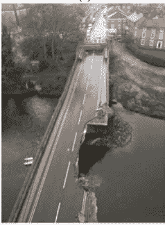


**图 4.1** a, b 2015 年 12 月 29 日部分坍塌后的 Tadcaster 桥 (Selvakumaran et al. 2018)，c 修复后的桥梁

在图 4.3 中，2015 年 11 月 15 日和 26 日两幅图像在位置“P2”处的位移样本与其他样本（图像）不同，并表明“P2”附近桥墩存在真实的突然变化。然而，其他目标点存在一些可疑的突然变化。例如，可以感知到图像 #20-#25 之间“P1”的位移样本出现突然减少。相反，“P3”的位移值出现一些突然增加。此外，可以观察到“P7”和“P8”的位移量存在一些季节性变化，这些变化与 EOCs 相关。另一方面，位移样本由负值和正值组成。在这种情况下，很难肯定地声明桥梁的当前状态。另外，直接分析用于 SHM 的位移量有些具有挑战性且不可靠。

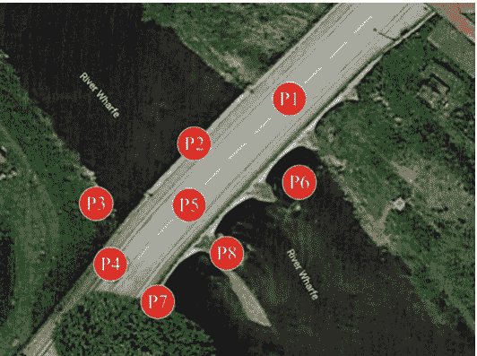

图 4.2 Tadcaster 桥上的目标点“P1”—“P8”

### 4.2 数据增广与 EOC 调查

为解决直接分析用于 SHM 的位移值的局限性，应用了 HMC 和 SLS 算法来增广小位移数据。对于 HMC 技术，增广的样本数量 (N) 和链的数量 (C) 分别为 100 和 10。

此外，通过 SLS 技术进行增广的样本数量为 1000。因此，桥梁八个位点的 45 个小位移样本集被扩展为两个不同的集合（矩阵），分别包含 100 个和 1000 个增广的位移数据点，如图 4.4 所示。

从该图可以看出，小位移点的增广能够更好地显示结构的变化，无论这些变化是由 EOCs 还是损伤引起的。

不考虑与图像 #44 和 #45 相关的增广样本，简单的图形比较揭示，与 SLS 相比样本数量更少的 HMC 更能指示位移样本中的 EOCs，尤其是一年监测方案中的季节性变异性。

然而，由 HMC 和 SLS 技术获得的最后两幅图像的增广位移点明显不同于其他图像。

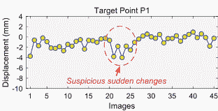

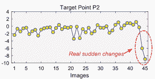

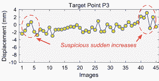

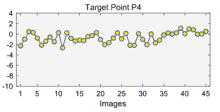

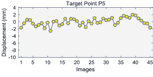

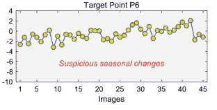

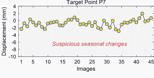

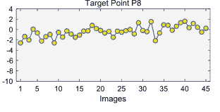

图 4.3 八个目标点的位移

为进一步研究 EOC 的影响，图 4.5 介绍了通过 HMC 和 SLS 技术获得的扩展位移的箱线图统计分析。

如图 4.5a 所示，EOCs 显著影响 HMC 获得的增广点。

这一结论强调了通过该技术进行数据增广的积极作用，以便更好地观察 EOCs 的速率。

相比之下，图 4.5b 显示 SLS 无法提供与 HMC 同样好的输出。

这是可以理解的，因为在评估变异性条件时，与 SLS 相比，HMC 在箱线图中提供了更明显的证据。

除此之外，可以辨别两种技术都能恰当地区分损伤区域附近与未损伤区域相比的增广位移偏差。

从图 4.5 可以得出结论，随着损伤程度（即“P2”位置桥墩周围的冲刷）增加，增广数据的变异性也随之增加。

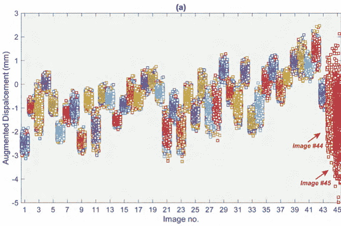

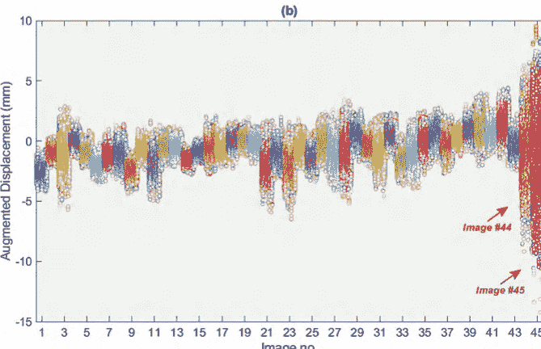

图 4.4 增广位移点：a HMC b SLS

这里，上述结论和讨论可能会导致困惑：如果增广数据的统计分析可以检测任何结构中的异常变化，那么是否有必要为 SHM 应用严格的机器学习方法。

首先，应澄清，我们已知最后两幅图像和“P2”位置靠近部分坍塌处。

其次，通过中位绝对偏差 (MAD) 进行了另一项统计分析，以证明使用所提方法或其他严格的机器学习技术对 SAR 辅助的 SHM 的必要性。

在统计学中，MAD 是评估变异性速率的可靠度量，MAD 值较大表示变异性较高，反之亦然。

图 4.6 显示了来自 HMC 和 SLS 技术的扩展位移点的对数 MAD 值的演变。

与通过箱线图进行的图形统计分析不同，图 4.6 显示两种技术都能明显指示增广位移点上的 EOC 影响。

如该图所示，损伤的出现增加了 MAD 的量。

然而，在某些日期（图像）上，当桥梁未受损时，MAD 量出现可疑的大幅增加。

如图 4.6 中强调的这些可疑增加所示，可以辨别它们的数量与最后两幅图像（损伤状态）的相应 MAD 值相近。

因此，这种统计分析帮助我们认识到应用高级机器学习方法进行早期损伤检测和预坍塌预测的重要性。

另一方面，应指出，通过 MAD 进行的数值统计分析优于基于箱线图的图形方法。

### 4.3 通过混合学习方法进行早期损伤检测

本节介绍了使用所提 HMC-DAE-MD、HMC-UTSL-MD 和 HMC-DTL-MD 方法对 Tadcaster 桥进行早期损伤检测或预坍塌预测的结果。

由于通过 HMC 技术进行数据增广的主要输出已在上一节中介绍和讨论，本节试图指示 SHM 的输出及本书中提出的各种数据归一化方法的效果。

重要的是要说明，这些方法需要训练和测试数据集。

根据案例研究，增广位移样本已从八个目标点中提取，此时 \( p = 8 \)。

此外，HMC 采样技术为每幅图像生成 1000 个位移点；因此，增广样本的总数为 4500。

其中，与桥梁未损伤状态相关的前 41 幅图像的前 4100 个增广点（\( n = 4100 \)）被用于生成训练集 \( \mathbf{X} \in \mathbb{R}^{8 \times 4100} \)。

剩余的 2000 个涉及图像 42 和 43 的增广数据样本被用作验证数据或已知测试数据。

这里假设，图像 44 和 45 属于桥梁的未知状态，并试图检测它们的状态。

因此，与这些图像相关的 2000 个增广样本被标记为未知测试点。

总共，测试数据由来自八个目标点的 4000 个样本（\( m = 4000 \)）组成；即，\( \mathbf{Z} \in \mathbb{R}^{8 \times 4000} \)。

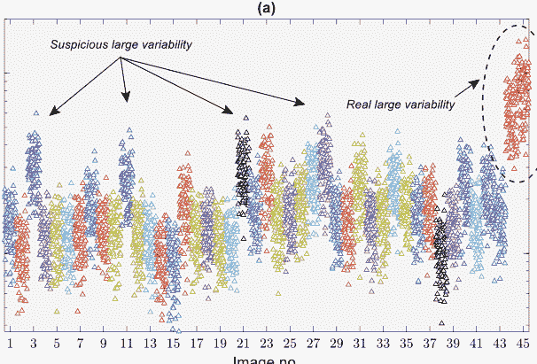

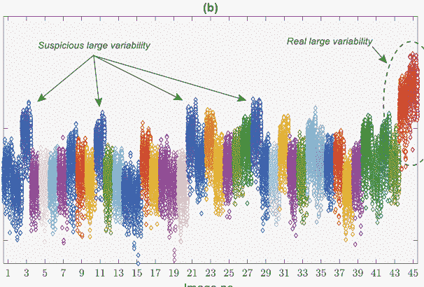

图 4.6 基于 MAD 量值的扩展位移数据数值统计分析：a HMC，b SLS

#### 4.3.1 HMC-DAE-MD

在通过 HMC-DAE-MD 介绍预坍塌预测结果之前，重要的是要展示基于 DAE 的数据归一化在减轻 HMC 技术获得的增广位移中存在的 EOCs 方面的影响。

换句话说，此比较旨在调查……的性能


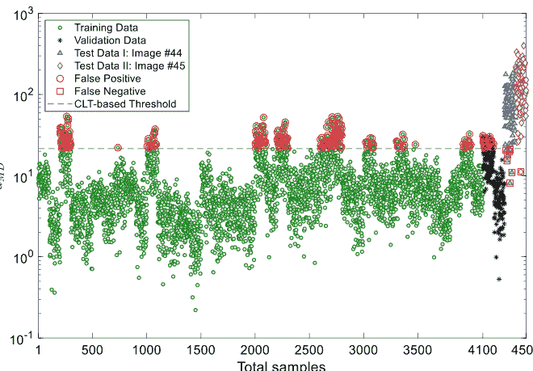

图 4.7 未采用数据归一化的 HMC-MD 技术对塔德卡斯特桥进行坍塌前预测和损伤检测

在高变异水平下应用 HMC-MD。为此，增强的训练和测试数据集（即 X 和 Z）直接纳入基于 MD 的新颖性检测器，如第 2.3.5 节所述。早期损伤检测（坍塌前预测）的结果如图 4.7 所示，其中水平线是在 5% 显著性水平下基于标准置信区间获得的阈值极限。

如图 4.7 所示，训练数据中样本 1–4100 之间的新颖性得分呈现严重变异，暗示这些指数中存在 EOCs 的影响。一个重要的观察是，这些新颖性指数的变异模式与图 4.6a 中所示的增强位移样本及其 MAD 值高度相似。由于这些样本的新颖性得分发生剧烈变化，无法对前 41 张图像中的桥梁状态做出可靠且正确的判决。换句话说，即使我们知道塔德卡斯特桥在这些图像拍摄日期的运行状态正常，也预期 HMC-MD 得到的 MD 值应低于阈值。这意味着该技术的应用局限于存在严重 EOCs 的其他现实世界问题。

关于验证数据点的新颖性指数，可以看出它们之间存在差距和差异。此外，这些点中的一些新颖性得分错误地超过了阈值。另一方面，虽然最后两张图像的几乎所有新颖性指数都超过了阈值极限，但观察到与未损伤状态相比，某些指数的数值更小。换句话说，部分训练和验证样本的距离量大于最后两张图像的对应样本，尤其是图像 44。因此，此次比较的结果证实了数据归一化对减轻 EOCs 负面影响的重要性。随后，采用所提 HMC-DAE-MD 技术开展早期损伤检测过程，以展示数据归一化的积极效果。为此，有必要使用增强的训练数据 X 训练一个 DAE。根据为该 ANN 提出的超参数优化（见第 2.3.2.2 节），应为 DAE 隐藏层的神经元数量定义一些试验。在此方面，映射层（$N_{m_0}$）、编码层（$N_{e_0}$）和去映射层（$N_{d_0}$）的示例神经元数量分别设定为 30、10、30。根据算法 1 中提到的该超参数优化初始化，$N_{m_0} = N_{d_0}$ 且 $N_{m_0} > N_{e_0}$。此超参数优化的结果（MD 的方差量）载于表 4.1。在此方面，最优神经元数量应使 HMC-DAE-MD 方法能够为训练数据提供变异率最低的平滑新颖性指数。因此，最优神经元是方差值最小的那些。在表 4.1 中可以观察到，最小方差与存储方差矩阵的第 28 行和第 4 列重合（算法 1 的步骤 7）。这意味着，映射层和去映射层各设 28 个神经元、编码层设 4 个神经元的 DAE 可以满足变异率最低的条件，并能恰当缓解 EOCs 的影响。因此，应使用三个隐藏层和所选神经元数量设计一个 DAE。值得注意的是，该 DAE 的学习过程基于在 1000 个迭代次数下的 Levenberg–Marquardt 反向传播，用于估计模型参数（即权重矩阵和偏置向量）。

使用训练好的 DAE，将增强的训练和测试矩阵输入该神经网络，以提取其残差矩阵 E$_\mathbf{x}$ 和 E$_\mathbf{z}$，它们是基于 MD 的新颖性检测器用于特征鉴别的主要输入。为更好地展示 DAE 数据归一化的积极效果，特征鉴别的初步结果不考虑任何阈值限制。作为对比，图 4.8 评估了 HMC-MD 和 HMC-DAE-MD 得到的新颖性指数的演变。可以看出，尽管图 4.8a 中训练数据点的距离值具有高变异性，DAE 在很大程度上辅助 HMC-MD 减轻 EOCs 的影响，并提供变异性更低的更平滑输出。这也说得通，HMC-DAE-MD 显著优于 HMC-MD。关于验证数据，也可以得出相同结论。在图 4.8b 中，可以辨别出不存在突然的差距和差异，且与图像 42 和 43 相关的两组验证数据具有相似的新颖性指数。至于与图像 44 和 45 相关的测试数据，可以看出图 4.8b 中的距离值比图 4.8a 更能与未损伤状态（即训练点和验证点）的距离区分开来。因此，可以推断，DAE 辅助的数据归一化不仅能够减轻 EOCs 的影响，还能帮助 MD 度量提高损伤的可检测性。

以下，通过两种不同的阈值估计器呈现 HMC-DAE-MD 的特征鉴别结果。首先，采用众所周知的 CLT 辅助阈值确定器，基于 5% 显著性水平下的标准置信区间获得阈值。通过此阈值

**表 4.1** 寻找 DAE 隐藏层神经元的超参数优化

| $N_{m_0}$ | 1 | 2 | 3 | 4 | 5 | 6 | 7 | 8 | 9 | 10 |
|---|---|---|---|---|---|---|---|---|---|---|
| 1 | 76.20 | 72.98 | 72.98 | 72.97 | 72.99 | 72.95 | 72.99 | 72.97 | 72.99 | 72.99 |
| 2 | 72.92 | 72.97 | 77.40 | 72.98 | 72.93 | 77.46 | 77.41 | 178.48 | 77.42 | 72.98 |
| 3 | 72.98 | 72.95 | 77.45 | 82.90 | 82.93 | 77.50 | 82.83 | 83.02 | 77.41 | 83.00 |
| 4 | 72.95 | 77.63 | 77.42 | 81.20 | 83.00 | 82.95 | 97.24 | 98.70 | 82.96 | 95.95 |
| 5 | 72.85 | 74.72 | 85.11 | 98.27 | 105.21 | 97.31 | 98.61 | 108.92 | 113.82 | 110.07 |
| 6 | 72.90 | 82.74 | 96.53 | 84.34 | 121.56 | 105.26 | 180.46 | 163.31 | 186.14 | 108.14 |
| 7 | 72.90 | 72.80 | 87.55 | 93.18 | 142.51 | 293.30 | 166.47 | 111.31 | 328.17 | 143.09 |
| 8 | 73.25 | 76.11 | 87.83 | 97.93 | 140.30 | 168.01 | 459.50 | 1027.66 | 449.06 | 880.88 |
| 9 | 75.17 | 73.51 | 80.66 | 89.88 | 120.57 | 178.05 | 444.18 | 980.50 | 1170.57 | 1035.98 |
| 10 | 72.89 | 77.04 | 83.36 | 97.40 | 110.91 | 136.25 | 364.81 | 991.30 | 453.48 | 1008.33 |
| 11 | 72.93 | 76.92 | 89.30 | 101.08 | 113.02 | 147.02 | 270.82 | 1014.41 | 1028.96 | 1139.35 |
| 12 | 72.98 | 74.72 | 86.47 | 95.48 | 99.27 | 152.56 | 248.66 | 1116.32 | 1148.89 | 1030.71 |
| 13 | 83.20 | 77.34 | 88.71 | 97.59 | 130.82 | 126.19 | 208.02 | 1503.52 | 1096.29 | 1204.58 |
| 14 | 72.83 | 81.90 | 84.62 | 91.69 | 89.46 | 142.90 | 253.00 | 871.69 | 1011.95 | 1108.55 |
| 15 | 72.98 | 72.41 | 82.47 | 97.37 | 112.80 | 120.57 | 168.41 | 1073.35 | 1631.50 | 1399.45 |
| 16 | 73.52 | 75.70 | 84.72 | 95.61 | 105.35 | 140.64 | 193.68 | 1037.23 | 1743.87 | 1647.70 |
| 17 | 75.50 | 83.05 | 74.51 | 87.52 | 99.54 | 142.99 | 183.52 | 1408.92 | 1430.06 | 1366.42 |
| 18 | 74.50 | 124.32 | 77.50 | 87.73 | 114.18 | 130.79 | 218.22 | 1381.25 | 1354.13 | 1635.28 |
| 19 | 219.91 | 77.54 | 81.89 | 89.04 | 107.11 | 128.98 | 214.32 | 1323.70 | 1203.69 | 1786.21 |
| 20 | 854.96 | 78.28 | 80.12 | 99.12 | 119.76 | 131.89 | 209.22 | 1319.85 | 1205.70 | 1612.05 |
| 21 | 765.05 | 77.09 | 85.61 | 84.46 | 107.47 | 127.73 | 148.86 | 2122.30 | 1563.52 | 1710.19 |
| 22 | 74.04 | 1047.05 | 84.46 | 98.87 | 116.82 | 143.92 | 189.07 | 1749.48 | 2213.44 | 1465.71 |
| 23 | 207.09 | 2705.49 | 83.29 | 85.12 | 104.29 | 142.69 | 215.40 | 1502.25 | 1951.92 | 1245.01 |
| 24 | 180.13 | 118.15 | 95.86 | 90.50 | 106.01 | 132.03 | 221.00 | 1374.88 | 1829.18 | 1821.38 |
| 25 | 79.36 | 73.18 | 90.50 | 105.91 | 100.68 | 142.40 | 190.05 | 1631.52 | 2136.72 | 2058.50 |
| 26 | 167.59 | 82.78 | 89.85 | 89.57 | 104.56 | 127.55 | 199.23 | 1766.33 | 1682.22 | 2104.03 |
| 27 | 76.62 | 76.80 | 90.74 | 88.68 | 112.72 | 134.40 | 224.33 | 1371.71 | 1810.38 | 2077.36 |
| 28 | 72.90 | 284.99 | 84.53 | **70.11** | 119.12 | 140.90 | 191.23 | 1869.95 | 1853.90 | 2357.00 |
| 29 | 75.87 | 302.31 | 78.18 | 82.70 | 127.26 | 136.05 | 293.34 | 2115.17 | 2414.15 | 1502.55 |
| 30 | 86.63 | 93.12 | 141.37 | 95.54 | 112.92 | 143.20 | 249.75 | 1996.91 | 2502.10 | 2072.90 |

估计器如图 4.9 所示。其次，纳入了由 Sarmadi 等人 (2021) 提出的名为“GOF”的 EVT 辅助阈值确定器。因此，图 4.10 呈现了通过此阈值估计器得到的 SHM 结果。值得注意的是，尽管其他基于经典极值分布（即 Gumbel、Fréchet 和 Weibull）的成功 EVT 辅助阈值确定器（Deraemaeker 和 Worden 2018；Entezami 等人 2021），以及基于 BM 方法的 GEVD（Sarmadi


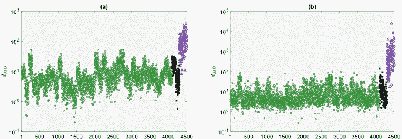

图 4.8 基于DAE的特征歧视中数据归一化影响的评估：a HMC-MD，b HMC-DAE-MD

和Karamodin 2020；Sarmadi和Yuen 2022)，以及在POT技术下的GPD（Rébillat et al. 2018；Sarmadi和Yuen 2021；Sarmadi et al. 2023）适用，因此采用了最近发表的GOF方法。这是因为该技术可以解决所有先前技术的不足，并提供一种更有效、更高效的阈值确定方法。

尽管通过DAE辅助的数据归一化缓解了EOC的影响，但如图4.9所示，训练点和验证点的新奇性指数中存在几个假阳性。这表明CLT辅助的阈值确定器并不

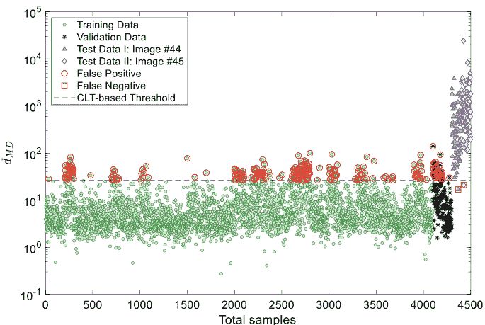

图 4.9 由HMC-DAE-MD和CLT辅助的阈值确定器对塔德卡斯特桥进行的预倒塌预测和损伤检测

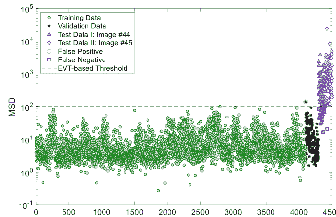

图 4.10 由HMC-DAE-MD和EVT辅助的阈值确定器对塔德卡斯特桥进行的预倒塌预测和损伤检测

适合，很可能是由于阈值估计中使用的距离值的非高斯性、此类距离值的高变异性以及选择较大的显著性水平等原因。相反，如图4.10所示，EVT辅助的阈值确定器可以解决CLT在假阳性率方面的局限性。然而，由于选择了较大的阈值，图像44的新奇性分数中出现了一些假阴性。应注意，这些错误发生的主要原因与测试数据中利用未损坏区域（即P1、P3-P8）的信息有关。此外，应指出，两种阈值估计器都对图像45的新奇性分数做出了准确判断，该图像距部分倒塌事件大约一个月。

#### 4.3.2 HMC-UTSL-MD

所提出的HMC-UTSL-MD方法的核心在于通过所提出的UTSL算法进行数据归一化。如§0所述，该算法由一个包含欠完备七隐藏层DAE的教师模型和一个基于过完备浅层AE的学生模型组成。为了消除EOC效应，只需将增强的训练数据输入这些模型来初步训练它们，随后提取关于训练数据的增强残差矩阵。在下一步中，使用扩展的测试数据点来训练好的教师模型和学生模型进行残差提取。训练数据集和测试数据集的两个残差矩阵都在基于MD的新奇性探测器中被考虑，用于特征归一化。

UTSL数据归一化的第一步是获取欠完备DAE（教师）的七个隐藏层和过完备浅层AE的单个编码层的神经元。根据在Sect. 2.3.3.1中提出的超参数优化以及表2.1中的示例神经元集合，图4.11显示了10组示例神经元的AIC值。如该图所示，第4组、第5组和第6组的AIC值比其他组小。这意味着它们各自都能产生可靠的输出。然而，计算了这些值的平均值，以将该平均值作为神经元的最优组。因此，DAE的七个隐藏层分别需要10、8、6、3、6、8和10个神经元。对于过完备浅层AE，编码层的神经元数量等于51。

与前一部分类似，首先评估了基于UTSL的数据归一化在无任何阈值下的损伤结果的影响。为此，如图4.12所示，将HMC-UTSL-MD的输出与HMC-MD获得的相应输出进行比较。如图4.12b所示，训练点和验证点相关的新奇性指数比图4.12a中的相同指数要平滑得多。此外，变异率显著降低。另一方面，可以看出使用基于UTSL的数据归一化增强了损伤的可检测性，以至于与图像44和45相关的MD值远大于其他图像的距离量，后者指的是桥梁的未损坏状态。通过图形比较HMC-UTSL-MD和HMC-DAE-MD获得的新奇性指数，可以推断UTSL在较低变异性和更高检测率方面优于DAE。

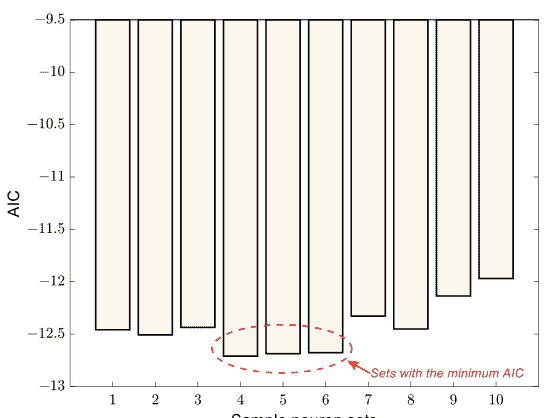

**图 4.11** 欠完备DAE（教师）的超参数优化，用于选择七个隐藏层预定神经元的最佳组

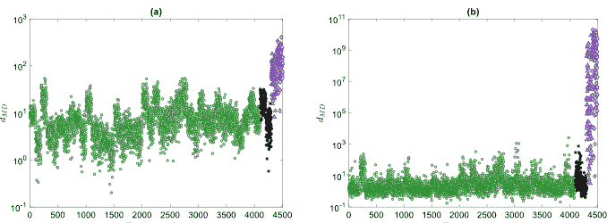

图 4.12 所提UTSL算法在特征歧视中数据归一化影响的评估：a HMC-MD，b HMC-UTSL-MD

在仅考虑CLT辅助的阈值确定器的情况下，图4.13说明了通过所提HMC-UTSL-MD方法进行的特征歧视的最终结果。观察到，基于UTSL的数据归一化大大有助于MD指标产生具有歧视性的新奇性指数。与与HMC-DAE-MD相关的图4.9相比，可以看出即使在CLT辅助的阈值确定器下，UTSL算法也能更好地降低假阳性和假阴性的比率。因此，使用稍复杂的神经网络开发数据归一化可以为SAR辅助的SHM提供更可靠的输出。

#### 4.3.3 HMC-DTL-MD

与之前的混合方法类似，HMC-DTL-MD旨在在不可预测的EOC条件下，在倒塌发生之前检测早期损伤或预测倒塌。为此，它需要获得最佳数量的连续DAEs，使每个DAE分别包含三个隐藏层，大小为10、2、10个神经元，用于映射层、编码层和解映射层。根据所提超参数优化（参见Sect. 2.3.4.1），在此过程中仅需要确定迭代算法中的迭代次数（即停止条件）。图4.14指示了使用10次试验对示例神经网络所获得的准确度。如所观察到的，第七个示例提供了接近100%的最佳准确率。因此，用于数据归一化的DTL算法需要七个DAEs。在这方面，输入到第一个DAE的第一个输入是实际的增强训练数据X，其余输入（E_x1, ..., E_x6）输入到接下来的六个DAE中，是前一个DAE的每个输入和输出之间的残差样本。

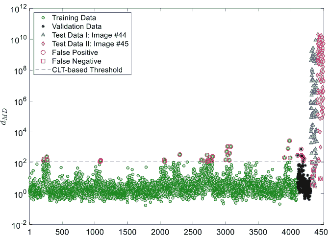

图 4.13 由HMC-UTSL-MD和CLT辅助的阈值确定器对塔德卡斯特桥进行的预倒塌预测和损伤检测

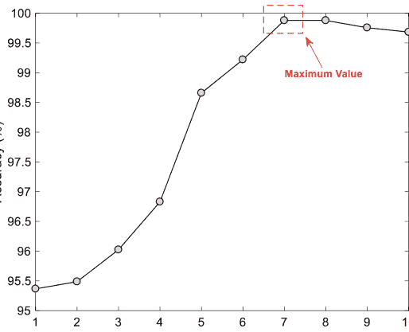

图 4.14 DTL方法迭代算法的停止条件

在此基础上，最后一个DAE的残差集（E_x）被提取为与未损坏状态相关的最终输出，用于特征歧视。对于实际的增强测试数据Z，七个训练有素的DAE被连续重复使用，以提取其残差样本（E_z1, ..., E_z6）。最后，第七个（最后一个）DAE的残差集（E_z7）被提取为关于监控（测试）阶段的最终输出，用于特征歧视。换句话说，残差矩阵E_x7和E_z7被插入基于MD的新奇性探测器中，以确定训练和测试数据点的新奇性指数。

在展示早期损伤检测结果之前，将所提HMC-DTL-MD方法在处理EOC方面的性能与HMC-MD进行比较。图4.15显示了此比较的结果。如图4.15b所见，训练样本和验证样本的新奇性分数（MD值）的变异显著降低。在该图中，可以轻易看出所提DTL方法提高了特征歧视的性能和可靠性，并使MD指标相比于HMC-MD能够提供变异性更低的更平滑输出（新奇性指数）。另一方面，最后两幅图像的MD值尺度显著增加。所有这些观察都证实了所提DTL技术对数据归一化过程和EOC消除的积极影响。

通过所提HMC-DTL-MD并在阈值限制的帮助下进行的早期损伤检测结果如图4.16所示。在与训练点相关的新奇性指数中，可以看出其中大部分位于阈值线以下。在验证样本中也可以观察到相同的结论。在4300个正常样本中，只发生了七个假阳性。与图4.9和4.13中展示的先前所提方法的结果相比，可以看出所提DTL方法产生的假阳性更少。这意味着尽管在CLT下使用了经典置信区间，该方法仍能有效处理EOC的负面影响。关于假阴性率，虽然HMC-DTL-MD可以提高损伤的可检测性，但其假阴性数量比其他所提方法更多。在这种情况下，所提HMC-UTSL-MD

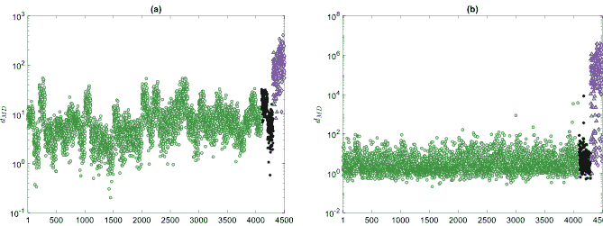

**图 4.15** 所提DTL算法在特征歧视中数据归一化影响的评估：**a** HMC-MD，**b** HMC-DTL-MD


图 4.16 基于 HMC-DTL-MD 和 CLT 辅助阈值判定的塔德卡斯特桥预崩溃预测与损伤检测

该技术既能实现较低的误负率，又能达到最高的损伤可检测率。应指出，最后两幅图像的新奇性指标中出现一些误负是合理的。这是因为针对这些情况的增强数据集包含桥梁未损区域（即，“P1”以及“P3”—“P8”）的位移。因此，某些新奇性得分低于阈值线是很自然的。此外，从所有结构健康监测（SHM）结果图中可以看出，图像 #45 的新奇性得分高于图像 #44 的相应值。

### 4.4 基于在线混合学习方法的早期损伤检测

已提到，所提出的在线混合方法 HMC-ODTL-EMD 和 SLS-ODTL-EMD 为同时进行数据归一化和特征判别提供了绝佳机会。在数据归一化步骤中，关键动机是通过所提出的 ODTL 方法开发一个在线模型，ODTL 是先前提出的 DTL 算法的在线版本。根据图 2.12，ODTL 的第一阶段从在 β = 20% 下使用第一张图像的第一组增强位移（X1）开始。为 β 选择该百分比意味着，当误正率大于 20% 时，ODTL 的在线学习会拒绝结构处于健康状态的假设。换句话说，如果特定日期的任何 SAR 图像及其增强位移数据使误正率（百分比）大于该数值，则该结构很可能在该日期遭受了损伤。

在这方面，图 4.17 说明了连续应用 SAR 图像及其增强位移数据时误正率百分比的演变。请注意，ODTL 的迭代算法中考虑了 10 个样本神经网络。如图 4.17 所示，在接收图像 #44 之前，先前图像的误正率（百分比）均小于 β。在某些情况下，误正率为零，尤其是在图 4.17b 中。但是，一旦使用了图像 #44 及其来自 HMC 和 SLS 的增强位移数据集，误差率就超过了 β，这意味着在线学习和更新 DAE 应结束，而在线损伤检测通过接收任何新数据继续该过程，新数据应被视为测试数据。因此，在第 43 次迭代中更新的 DAE 被选为用于在线损伤检测的最后更新网络。另一方面，HMC-ODTL-EMD 和 SLS-ODTL-EMD 每次迭代中连续 DAE 的最优数量如图 4.18 所示。例如，可以在图 4.18a 中观察到，与图像 #43 相关的第 43 次迭代的最后更新模型在 HMC-ODTL-EMD 算法中需要六个连续的 DAE。此外，如图 4.18b 所示，同一第 43 次迭代的最后更新模型需要来自 SLS-ODTL-EMD 的九个连续 DAE。

随后，两种混合方法得到的最终模型用于在线损伤检测。与其他所提技术相比，这些方法的一个优势是不需要基于训练和测试数据点新奇性指标与阈值比较的经典特征判别和损伤检测。简单来说，HMC-ODTL-EMD 或 SLS-ODTL-EMD 的每个输出都有助于我们对任何图像做出决策。另一方面，无需以离线方式收集一些信息（图像），然后开发无监督学习器来进行损伤评估。在所提出的混合方法中，可以以在线或实时方式分析结构的状态。值得注意的是，从第一阶段（在线学习）转移到第二阶段（在线损伤检测）意味着结构中已发生损伤。

为更好地展示用于预崩溃预测或损伤检测的在线特征判别过程，图 4.19 显示了 HMC-ODTL-EMD 和 SLS-ODTL-EMD 方法中 EMD 量的演变。如本图所示，图像 #44 和 #45 的 EMD 值大于其他图像的相应值。这很合理，所提出的混合方法能够准确警报 2015 年 11 月 15 日和 26 日发生的异常变化，大约是在塔德卡斯特桥部分坍塌前一个月。除此结论外，还应指出，2015 年 12 月 26 日图像 #45 的 EMD 量大于与图像 #44 相关的相应值。这很合理，所提出的在线混合方法还可以估计损伤严重程度并触发损伤增长（即，位置“P2”附近桥墩下的冲刷）。


图 4.17 迭代过程中误正率的演变：a HMC-ODTL-EMD，b SLS-ODTL-EMD


图 4.18 ODTL 算法中的在线学习及该算法第一阶段每次迭代中连续 DAE 的最优数量：a HMC，b SLS

### 4.5 章节总结

本章介绍了所提出的混合学习方法用于早期损伤检测的主要结果，以塔德卡斯特桥的预崩溃预测为例。本章的结果已分解为离线和

(a)


(b)


图 4.19 塔德卡斯特桥的在线预崩溃预测和损伤检测：a HMC-ODTL-EMD，b SLS-ODTL-EMD

在线混合学习方法。

关于离线混合学习方法，所有方法都证明，数据归一化过程对于长期结构健康监测（SHM）应用是强制性的。关于在线混合学习方法，这些方法可以正确警报结构中异常变化的发生。更精确的结论将在下一章中提及。

### 参考文献

- Deraemaeker A, Worden K (2018) 结构健康监测中滤除环境影响的线性方法比较. Mech Syst Sig Process 105:1–15. https://doi.org/10.1016/j.ymssp.2017.11.045
- Entezami A, Sarmadi H, Salar M, De Michele C, Nadir Arslan A (2021) 基于稳健多维缩放的环境振动和高维特征下结构健康监测的一种新型数据驱动方法. Struct Health Monit 20(5):2758–2777. https://doi.org/10.1177/1475921720973953
- Rébillat M, Hmad O, Kadri F, Mechbal N (2018) 基于超过阈值峰值的结构健康监测探测器设计：航空航天结构应用. Struct Health Monit 17(1):91–107. https://doi.org/10.1177/1475921716685039
- Sarmadi H, Karamodin A (2020) 基于自适应马氏距离平方和单类 kNN 规则的环境影响下结构健康监测的一种新型异常检测方法. Mech Syst Sig Process 140:106495. https://doi.org/10.1016/j.ymssp.2019.106495
- Sarmadi H, Yuen K-V (2021) 基于核零空间和超过阈值峰值的创新无监督学习方法的早期损伤检测. Comput Aided Civ Inf 36(9):1150–1167. https://doi.org/10.1111/mice.12635
- Sarmadi H, Yuen K-V (2022) 基于极值理论和混合分位数建模的新型概率机器学习方法的结构健康监测. Mech Syst Sig Process 173:109049. https://doi.org/10.1016/j.ymssp.2022.109049
- Sarmadi H, Entezami A, Salar M, De Michele C (2021) 基于新聚类和阈值估计方法的环境变异性下桥梁健康监测. J Civ Struct Health Monit 11(3):629–644. https://doi.org/10.1007/s13349-021-00472-1
- Sarmadi H, Entezami A, De Michele C (2023) 基于半参数极值理论的结构健康监测概率数据自聚类. Mech Syst Sig Process 187:109976. https://doi.org/10.1016/j.ymssp.2022.109976
- Selvakumaran S, Plank S, Geiß C, Rossi C, Middleton C (2018) 使用干涉合成孔径雷达（InSAR）堆叠技术进行远程监测以预测桥梁冲刷失效. Int J Appl Earth Obs Geoinf 73:463–470. https://doi.org/10.1016/j.jag.2018.07.004


## 第5章 结构健康监测的结论与展望

**摘要** 在本书中，已试图解决基于遥感技术和机器学习的土木结构长期健康监测相关的一些主要挑战性问题。为此，提出了各种无监督学习方法，以利用从 SAR 图像中获得的小规模和大规模位移响应集，检测土木结构在未知环境与运行条件（EOCs）下的任何异常状况。本章旨在阐述所提方法在数值验证和实验验证阶段的主要结论。鉴于结构健康监测（SHM）的重要性及遥感技术的优势，本文为未来研究活动提出了一些进一步评估的建议。

**关键词** 长期健康监测 • 结论 • 环境与运行变化 • 遥感 • 机器学习

### 5.1 引言

本研究的主要动机是改进经典的 SAR 辅助结构健康监测，并解决该过程的主要局限性。在此基础上，开发了以无监督学习模式为特征的新型混合方法，旨在在未知且不可预测的环境与运行条件（EOCs）下报警任何异常变化和损坏（尤其是坍塌）。在应用相对较大的位移数据时，本研究提出了一种基于最近邻搜索（NNS）和极值理论（EVT）的混合概率无监督学习方法。当仅有少量位移样本时，所提混合学习方法通过哈密顿蒙特卡洛（HMC）或切片采样（SLS）技术进行数据增强，采用不同的基于去噪自编码器（DAE）的新颖数据归一化方法，并利用马氏距离（MD）和经验模态分解（EMD）进行特征判别。在针对小数据的混合学习方法的第二部分，本研究利用了深层和浅层配置的各种自编码器（AE）。在 HMC-DAE-MD 方法中，考虑了三隐藏层去噪自编码器的直接应用，以减轻增强数据中环境与运行条件（EOCs）的影响。为此目的，开发了一种侧重于解决 EOC 挑战的超参数优化。在 HMC-UTSL-MD 方法中，提出了一种新的 UTSL 算法，该算法基于具有七个隐藏层的欠完备去噪自编码器（用于教师模型学习）和过完备浅层自编码器（用于学生学习模型）。设计了一种新的超参数优化，以确定去噪自编码器的七个隐藏层和浅层自编码器的唯一编码层的神经元数量。所提 HMC-DTL-MD 方法充分利用了迁移学习的思想，考虑了具有预定义 10、2 和 10 个神经元的去噪自编码器，分别用于映射、编码和解映射层。对于该技术，设计了一种迭代超参数优化，以查找连续去噪自编码器的数量。由于上述混合方法的核心集中在离线学习的思想上，本研究试图提出两种在线学习方法。因此，本书还建议了 HMC-ODTL-EMD 和 SLS-ODTL-EMD 方法，用于实时结构健康监测。这些方法的主要改进在于 DLT 算法，该算法被改进为其在线版本（ODLT），用于数据归一化，并利用经验模态分解（EMD）进行特征判别。

为验证所提方法的有效性和可靠性，考虑了两个全尺寸桥梁结构。对于 NNS-EVT 和 HMC-MD 方法，基于 I-40 桥位移点模拟进行了数值研究。此外，通过使用与塔加斯特桥（Tadjaster Bridge）相关的少量位移数据点，对其他方法进行了现实世界案例研究验证。这些数据点从有限数量的 TerraSar-X 合成孔径雷达图像中提取。

### 5.2 主要结论

基于专著中展示的广泛研究，很明显，传统的直接位移数据分析对土木结构（特别是长期结构健康监测）的健康监测是次优的。数据变化的不可预测性和固有的不确定性使得这些常规技术不适合可靠和长期的分析。相比之下，本专著中所提方法解决了这些挑战，并提供了基于机器学习的创新替代方案。

NNS-EVT 和 HMC-MD 方法在低变异性条件下表现良好。对于较大的数据集，NNS-EVT 是一种有效的方法。然而，在高水平环境与运行变化（EOCs）的影响下，HMC-MD 方法显示出局限性，强调了数据归一化在获得可靠结果中的关键作用。这为混合无监督学习方法的引入奠定了基础，这些方法结合了数据采样、人工智能和统计分析。

本专著强烈推荐哈密顿蒙特卡洛（HMC）和切片采样（SLS）等数据增强技术用于较小的位移样本，以更好地理解环境与运行条件（EOCs）对结构响应（即位移）的影响。尽管两种方法都展示了考虑 EOCs 的能力，但 HMC 在通过箱线图（Box plot）进行图形比较评估时表现出更优性能。尽管如此，当基于马氏距离（MD）度量进行数值评估时，HMC 和 SLS 均被证明有效。因此，建议在 EOCs 评估中考虑基于中位数绝对偏差（MAD）的数据分析。

先进的混合方法，如 HMC-DAE-MD 和 HMC-UTSL-MD，在应对环境与运行条件（EOCs）挑战性方面展示了其鲁棒性。HMC-DAE-MD 方法能够通过在正常和损坏条件之间获取判别性新奇指数来应对 EOCs 挑战。可以看出，去噪自编码器辅助的数据归一化及其超参数优化最大限度地减少了 EOCs 的影响。在这方面，该方法优于 HMC-MD。

在考虑基于中央极限定理（CLT）和极值理论（EVT）的两个阈值估计器时，人们发现与基于 CLT 的技术相比，HMC-DAE-MD 通过极值理论辅助的阈值确定器给出了更少的假阳性。尽管该方法在极值理论辅助下比中央极限定理产生更多的假阴性，但其输出是合理的。总体而言，极值理论辅助的阈值确定器优于基于中央极限定理的技术。然而，它包含更多细节和参数，在这种情况下，基于中央极限定理的阈值确定器更高效。

增加另一层复杂性和有效性，HMC-UTSL-MD 和 HMC-DTL-MD 方法在结构损坏早期检测方面取得了显著结果，即使在高水平环境与运行条件（EOCs）下也是如此。HMC-UTSL-MD 中所提的基于 UTSL 的数据归一化相比于 HMC-DAE-MD 和 HMC-MD 更好地最大限度地减少了环境与运行条件（EOCs）的影响。为了实现这一目标，HMC-UTSL-MD 成功地通过中央极限定理辅助的阈值确定器准确检测早期损坏或预测坍塌的发生。所提 HMC-DTL-MD 方法通过具有预定义神经元的三个隐藏层的去噪自编码器和迁移学习概念，能够更好地解决环境与运行条件（EOC）问题。即使在经典标准置信区间下，该方法也产生了较低的假阳性和误分类错误率。

最后，所提在线混合学习方法不仅以在线学习方式设计了一种新的结构健康监测策略，而且通过停止学习过程并准确检测损坏出现和预测部分坍塌，提供了损坏早期检测的合理结果。在线混合方法在事件发生前合理地触发了损坏和坍塌风险的发生。

总之，本专著对长期结构健康监测提供了全面而严谨的调查，整合了遥感和机器学习技术的见解。通过批判性地评估常规方法的局限性，这项工作引入了代表土木结构（特别是长期结构健康监测）健康监测领域显著进步的开创性方法。


### 5.3 未来研究机会

尽管本研究提出了各种机器学习方法，以在小位移数据和不可预测 EOCs 存在的情况下发展经典的 SAR 辅助 SHM，且这些方法能够呈现可靠和正确的结果，我们也为进一步的研究提出了一些建议。

#### 5.3.1 基于生成对抗网络的数据增强

在本书中，基于马尔可夫链蒙特卡洛概念的概率算法已被用于扩展小位移点。由于 Goodfellow 等人（2014）提出生成对抗网络（GANs），深度学习发生了革命性变革，建议通过各种 GANs（Creswell 等人，2018）扩展数据增强过程。

#### 5.3.2 新型机器学习算法下的数据归一化

本书已验证，无论数据和结构的类型如何，EOCs 在现实世界的长期 SHM 项目中都是不可避免的。在此基础上，实施数据归一化以减轻或消除 EOCs 对基于 SHM 的特征的所有影响至关重要。在本工作中，已尝试借助深层和浅层 DAEs 开发各种基于 DNN 的数据归一化算法。尽管一些机器学习算法（如无监督教师－学生学习、迁移学习和在线学习）已被纳入以提出这些算法，但仍有可能利用更多新颖的机器学习概念。因此，建议通过利用一些高级机器学习算法（如集成学习（Dietterich 2000）、半监督学习（Schwenker and Trentin 2014）、主动学习（Settles 2012）、字典学习（Daneshvar 等人，2023）、元学习（Entezami 等人，2023a）、多任务学习（Entezami 等人，2023b）、混合学习（Sarmadi 等人，2023）、经验学习（Entezami 等人，2022）以及基于稀疏、去噪、堆叠和变分配置的新型 DAEs（Charte 等人，2018；Dong 等人，2018）来扩展数据归一化程序。

另一方面，本书中提出的数据归一化技术需要一些超参数，这使它们成为数据归一化的参数化算法。为避免在超参数优化问题上遇到困难和挑战，建议利用一些新机器学习概念（如无监督特征选择（Solorio-Fernández 等人，2020）和特征加权（Niño-Adan 等人，2021））开发非参数数据归一化方法。

#### 5.3.3 面向实时 SHM 的增强在线学习

尽管所提出的在线混合学习为实时 SHM 开辟了新方法论，但决策取决于一个关于停止在线学习阶段的假阳性错误率的预定义值。为增强该方法论，建议使用用于在线学习阶段停止条件的新性能评估指标来开发更稳健的算法。

#### 5.3.4 损伤定位

除了早期损伤检测问题之外，SHM 中另一个重要挑战是定位结构的损伤区域（Entezami 等人，2018；Heravi 等人，2022）。在这方面，提出损伤定位框架将非常合适。基于接触式感知技术的无监督损伤定位的主要局限之一是安装足够传感器以测量合适信息的限制（Entezami 和 Shariatmadar，2019；Entezami 等人，2022）。遥感技术和 InSAR 技术的一大优点是为测量位移/变形数据提供分布式目标点，这些点可以作为虚拟接触式传感器（Behkamal 等人，2023a, b）。因此，建议利用遥感技术获取的信息，提出用于定位损伤区域的无监督学习方法。

### References

Behkamal B, Entezami A, De Michele C, Arslan AN (2023a) 基于机器学习技术的遥感有限结构位移热效应消除。Remote Sens 15(12):3095. https://doi.org/10.3390/rs15123095

Behkamal B, Entezami A, De Michele C, Arslan AN (2023b) 基于混合感知和受监督回归模型的长跨桥梁温度效应研究。Remote Sens 15(14):3503. https://doi.org/10.3390/rs15143503

Charte D, Charte F, García S, del Jesus MJ, Herrera F (2018) 非线性特征融合自编码器实用教程：分类学、模型、软件和指南。Inf Fusion 44:78–96. https://doi.org/10.1016/j.inffus.2017.12.007

Creswell A, White T, Dumoulin V, Arulkumaran K, Sengupta B, Bharath AA (2018) 生成对抗网络：概述。IEEE Signal Process Mag 35(1):53–65. https://doi.org/10.1109/MSP.2017.2765202

Daneshvar MH, Sarmadi H, Yuen K-V (2023) 用于在不同测量周期下消除环境影响的局部无监督混合学习方法。Meas 208:112465. https://doi.org/10.1016/j.measurement.2023.112465

Dietterich TG (2000) 机器学习中的集成方法。载于：多分类器系统。Springer, Berlin, pp 1–15

Dong G, Liao G, Liu H, Kuang G (2018) 自编码器及其变体综述：基于合成孔径雷达图像目标识别的比较视角。IEEE Geosci Remote Sens Mag 6(3):44–68. https://doi.org/10.1109/MGRS.2018.2853555

Entezami A, Shariatmadar H (2019) 基于特征提取和多变量距离相关性方法的新型混合算法，在环境激励和非平稳振动信号下进行损伤定位。Struct Health Monit 18(2):347–375. https://doi.org/10.1177/14771475217854372

Entezami A, Shariatmadar H, Karamodin A (2018) 基于新型统计模式识别方法的环境和运行可变性下的数据驱动损伤诊断。Struct Health Monit 18(5–6):1416–1443. https://doi.org/10.1177/1475921718800306

Entezami A, Shariatmadar H, Mariani S (2020) 用于来自稠密传感器网络的大规模振动数据的结构健康监测快速无监督学习方法。Struct Health Monit 19(6):1685–1710. https://doi.org/10.1177/1475921719894186

Entezami A, Shariatmadar H, De Michele C (2022) 短期和长期结构健康监测的非参数经验机器学习。Struct Health Monit 21(6):2700–2718. https://doi.org/10.1177/14759217211069842

Entezami A, Sarmadi H, Behkamal B (2023a) 基于无监督元学习的大量和缺失数据下混凝土和钢桥的长期健康监测。Eng Struct 279:115616. https://doi.org/10.1016/j.engstruct.2023.115616

Entezami A, Sarmadi H, Behkamal B, De Michele C (2023b) 基于创新多任务无监督学习方法的严重环境可变性下桥梁持续健康监测。Struct Infrastruct Eng In Press 1–19. https://doi.org/10.1080/15732479.2023.2166538

Goodfellow I, Pouget-Abadie J, Mirza M, Xu B, Warde-Farley D, Ozair S, Courville A, Bengio Y (2014) 生成对抗网络。Adv Neural Inf Process Syst 27

Heravi MA, Tavakkoli SM, Entezami A (2022) 基于自回归损伤特征概率密度函数和快速距离相关性方法的结构健康监测。J Vib Control 28(19–20):2786–2802. https://doi.org/10.1177/1077546321020198

Niño-Adan I, Manjarres D, Landa-Torres I, Portillo E (2021) 特征加权方法：综述。Expert Syst Appl 184:115424. https://doi.org/10.1016/j.eswa.2021.115424

Sarmadi H, Entezami A, Magalhães F (2023) 基于创新混合特征加权–选择算法和自然最近邻搜索的连续动态监测无监督数据归一化。Struct Health Monit Press. https://doi.org/10.1177/147592172231166116

Schwenker F, Trentin E (2014) 模式分类与聚类：半监督学习方法综述。Pattern Recog Lett 37:4–14. https://doi.org/10.1016/j.patrec.2013.10.017

Settles B (2012) 主动学习。morgan & claypool, San Rafael, California, United States

Solorio-Fernández S, Carrasco-Ochoa JA, Martínez-Trinidad JF (2020) 无监督特征选择方法综述。Artif Intell Rev 53(2):907–948. https://doi.org/10.1007/s10462-019-09682-y

