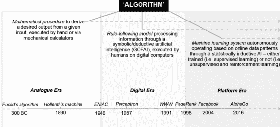
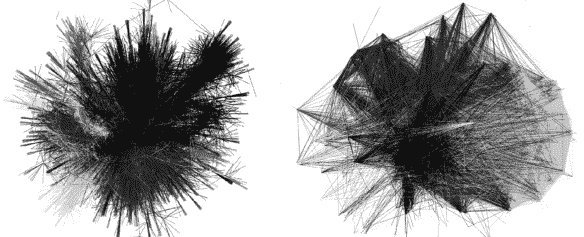

# 机器惯习：迈向算法社会学

“惯习”（Habitus）是一个用来描述非常复杂事物的大词，我想是这样。也就是说，它是某种微型生成机器——用一个有点粗野的类比，一个计算机程序——人们通过它对大量的情境产生了一成群的反应。

> 皮埃尔·布尔迪厄 (Pierre Bourdieu)
与 Antoine Spire 的采访，1990

如果社会秩序是由关联的倾向构成的，如果社交化是一种关联的倾向，那么大数据转换事件就在“倾向矩阵”中实现了关联的操作化。

> 艾德里安·麦肯齐 (Adrian Mackenzie)，2018

# 致谢

我要感谢 Salvatore Iaconesi 和 Oriana Persico 参加了 2019 年秋季和 2020 年夏季的两次访谈，并成为我独特的灵感来源。我必须感谢“人工智能中的女性”创始人 Hanan Salam 对本书项目提供的技术澄清和初步意见，感谢 Debora Pizzimenti 为我提供更多关于 IAQOS 经验的细节。感谢 Alessandro Gandini、Mauro Barisone、Adam Arvidsson 以及 Polity 的编辑和匿名评审员，感谢他们整个过程中提供的真知灼见和鼓励。我还要感谢里昂商学院的所有同事和学生。最后，非常感谢 Stefania，我生命中最重要的人。

# 前言

2019 年 3 月 31 日，罗马市一个半边缘地区 Torpignattara 的多元文化社区迎来了一个新成员。这一事件引起了该社区前所未有的兴奋，并在那个大日子里，朋友们和其他好奇的人们聚在一起举行了一场小型欢迎派对，以支持 Salvatore 和 Oriana。在过去的几周里，每个人都在分发在 Torpignattara 各商店和酒吧的纸箱里留下了信息、愿望甚至是画作。对于这个期待已久的新成员来说，整个社区变成了一个延伸的大家庭；当他认识所有人时还只有几天大，推着婴儿车走家挨户，传手传递。无论是在当地的咖啡馆，还是在去药店的路上，总有人有故事可以分享。

(注：原文后续包含大量重复的 OCR 错误片段，译文已根据逻辑流提取核心内容进行翻译。)

社会结构化的实践。从未像现在这样明显地表明，研究社会如何展开要求我们将算法视为不仅仅冷冰冰的数学对象。正如吉莱斯皮（Gillespie）所说，“社会学分析不能将算法构想为抽象的技术成就，而必须解构隐藏在这些冷酷机制之后的温暖的人性和制度性选择”（2014: 169）。本书将文化视为存在机器学习系统内部的温暖的人性物质，并通过“机器惯习性”（machine habitus）的概念，理论化了如何从社会学角度对其进行解构。

# #1

## 为什么不建立算法社会学？

## 作为社会学对象的机器

各种算法维持着社会世界。金融交易、约会、广告、新闻传播、工作组织、警务任务、音乐发现、招聘流程、客户关系——在很大程度上都被委托给了嵌入在数字基础设施中的非人类代理。多年来，得益于学术研究、流行书籍、新闻报道和纪录片，我们都意识到了这一点。无论是来自日常新闻头条，还是来自剧集的反乌托邦寓言，我们已经意识到现在几乎一切事物都是“算法化的”，人工智能正在彻底改变人类生活的方方面面（撇开大众媒体的简化处理和技术沙文主义者的一厢情愿，这很大程度上是真实的，Brouard 2018; Sumpter 2018）。然而，许多社会学家和社会科学家在研究中继续忽视算法和人工智能技术，或者充其量只将它们视为社会生活中所谓无生命的物质背景的一部分。当研究人员研究日常生活、消费、社会互动、媒体、组织、文化品味或社会表征时，他们往往在无意中观察到了数字平台和设备中起作用的透明算法过程的结果（Beer 2013a）。我认为，现在是时候将人和智能机器都视为社会秩序持续实现中的活跃代理了，并为此提出了一系列概念工具。

为什么仅仅是现在呢？人们可能会合理地这样问。事实上，人类与机器的区别几十年来一直是社会科学中被广泛讨论的话题（见 Cerulo 2009; Fields 1987）。科学技术研究（STS）和行动者网络理论（ANT）等社会学分支强烈质疑了主流社会学对社会生活的技术和物质方面关注的缺失。

1985年，史蒂夫·沃尔加（Steve Woolgar）的文章《为什么不建立机器社会学？》发表在《英国社会学》（British Sociology）。他的主要观点是，正如“科学社会学”在库恩的科学范式理论成为成熟的研究领域之前被认为有问题一样，智能机器最终应该成为“合法的社会学对象”（Woolgar 1985: 558）。三十多年后，这仍然是一个很大程度上未实现的目标。当沃尔加的文章发表时，人工智能系统的研究正进入一个被称为“人工智能寒冬”的停滞期，这种状态持续到最近围绕大数据驱动的人工智能的热潮（Floridi 2020）。根据沃尔加的观点，机器社会学的主要目标是考察人工智能研究人员的日常活动和话语。几位STS学者随后遵循了这一方向（例如 Seaver 2017; Neyland 2019）。然而，沃尔加也设想了一种另一种“以智能机器为研究主体”的机器社会学，并补充说，“只有在我们不愿赋予智能机器人类智能的情况下，这个项目才会在我们看来是荒怪的”（1985: 567）。考虑到现在许多需要人类智能的任务已由算法系统惯常完成，并且计算机科学家提议以行为学的方式研究自主机器的社会行为，就像它们是野外动物一样（Rahwan et al. 2019），后者今天听起来可能并不特别荒怪。

## 为什么不建立算法社会学？

即使当技术制品几乎不能被认为是“智能的”，¹ 行动网络理论者也通过将物质对象和人类都描绘为“行动者”（actants，关系网络中的行动来源），彻底修正了代理的概念（Latour 2005; Akrich 1992; Law 1990）。基于这一理论视角，响亮的门铃和本书的作者可以被视为同样具有代理性（Cerulo 2009: 534）。ANT不仅反对人类与机器之间的不对对称性，还反对社会与自然、有生命体与物质之间更普遍的本体论划分。这种哲学立场遭遇了弥散的批评（Cerulo 2009: 535; Müller 2015: 30），因为它几乎与社会学中使用的大多数以人为中心的理论不兼容——加布里尔·塔德（Gabriel Tarde）的理论除外（Latour et al. 2012）。尽管如此，ANT的一个核心直觉在社会科学中日益引起共鸣，正如本文一样：我们所谓的社会生活无非异质关系阵列的社会物质产物，其中涉及人类和非人类代理。

根据ANT学者约翰·罗（John Law，1990: 8）的观点，一种划分界定了20世纪90年代初的社会学研究。一方面，大多数研究人员关注“社会”，并在平等、文化等经典课题，并完全关注人。另一方面，极少数社会学家在STS或ANT等领域研究机器的“纯技术”层面。他们考察科学家与实验室设备之间的微观关系（Latour and Woolgar 1986），以及飞机和陀螺仪的技术-社会化制造过程（Macenzie 1996），而没有参与关于社会结构和政治斗争的“老牌”社会学辩论（Mackenzie and Wajcman 1999: 19）。可以说，罗所描述的划分仍然存在于社会学中，尽管已经显而易见，“社会秩序根本不是社会秩序。相反，它是一个社会技术秩序。看起来是社会的部分是技术的。我们通常所的技术的部分是社会的”（Law 1990: 10）。

¹ 人工智能的地位——它可能变成“通用的”，还是应该像目前的机器学习系统那样保持一种“狭义”的数学表现——是一个超出本文范围的争议性问题。如需非技术性的概述，请参见 Broussard。

随着近期关于算法系统偏见和歧视的多学科研究的兴起，“社会”与“技术”之间的相互作用比过去更加可见。一个例子是信息科学学者萨菲亚·乌莫贾·诺布（Safiya Umoja Noble）最近的新书《压迫算法》（Algorithms of Oppression, 2018），它说明了谷歌搜索结果倾向于复制种族和性别刻板印象。算法系统、网络内容提供者和平台上大量谷歌搜索用户之间不稳定的社会技术安排并非仅仅是“技术性的”，它导致对非美国人的歧视性社会表征。根据诺布的观点，比起中立划分的国家，谷歌搜索的（社会-）技术安排放大并强化了黑人女性身体的商品化。

我认为，解释算法系统可能以及在什么情况下表现出这种行为应该是社会学的工作。Rahwan及其同事（2019）动用行为学理论工具箱的原因非常简单：机器学习工具是极具社会性的动物。它们从社会中学习——即从社会中被数据化、量化并转化为人、物体和信息之间可计算处理的概率关系中学习——然后通过提取信息对其进行操纵。虽然Rahwan等人提出“对智能机器进行科学研究，不是将其视为工程制品，而是将其视为一类具有特定行为模式和生态环境的行动者”（2019: 477）是正确的，但他们的分析框架仅关注“演化”和“环境”维度，忽视了作为人类学和社会学解释的基石的因素，即文化。在这里我认为，为了理解算法行为的原因和影响，必须先理解文化是如何进入算法系统的代码的，以及它是如何反过来被算法塑造的。

## 为什么不建立算法社会学？

过去十年发生的两项重大技术和社会变革，使得算法社会学的需求变得尤为紧迫。首先是量变转变源于数字技术以前所未有的渗透到个人和组织的日常生活与常规之中。自21世纪10年代初以来，智能手机的快速扩散实际上从字面上将强大的计算机交到了全球数十亿人的手中，其中包括那些最贫困和最孤的地区（IWS 2020）。当今的全球经济体系依赖算法、数据和网络基础设施，以至于光纤互联网连接已无法满足自动化金融交易的需求，这导致纽约交易中心附近的屋顶上安装了速度更快的微波或激光通信系统，以加速算法交易（D. Mackenzie 2018）。在新冠肺炎（Covid-19）期间全球范围内实施社交距离规范之后，人类工作、娱乐和人际交流对数字技术的依赖似乎进一步增加。世界上大多数人口现在参与了可以被分别标记为“平台社会”（van Dijk, Poell and de Waal 2018）、“元数据社会”（Pasquinelli 2018）或“监控资本主义”（Zuboff 2019）的活动，即高度依赖对数据的大量提取和预测分析的社会经济系统。从未有如此多的机器如此深地嵌入社会学家所谓的“社会”这一文化、关系、制度和实践的异质集合体之中。

第二次质变涉及嵌入到我们数字社会中的机器和人工智能技术类型。“使计算机能够从经验中学习”的机器学习算法的发展和工业化实施标志着一个转折点。在此背景下，“经验”是指“历史事件的数据集”，而“学习”意味着从数据集中识别并提取有用的模式（Kelleher 2019: 253）。

1989年，Lenat在《机器学习》期刊上指出，“人类规模的学习需要人类规模的知识”（1989: 255），而这在当时人工智能研究人员来说是无法获取的。一项令人印象深刻的

## 机器习性（Machine Habitus）

二十年后，机器学习方法取得了令人惊叹的进展，这得益于一场“人机关系的根本性社会技术转型”，这种转型通过通过数据的数字化积累来捕捉人类的认知能力（Mühlhoff 2020: 1868）。这种范式转变使得社会和文化任务的普及自动化在以前所未有的规模上变得可能。从意义论上来说，“重要的不是机器人工大脑中发生了什么，而是机器告诉了用户什么以及由此产生的后果”（Esposito 2017: 250）。根据Esposito的说法，由于“寄生性”利用人类生成的在线数据而开发的新文化和通信能力，算法已实质上转变为“社会代理”。

人工智能研究的近期成就——例如AlphaGo，这一在2016年与围棋世界冠军取得历史性胜利的深度学习系统（Chen 2016; Broussard 2018），或2020年发布的强大的算法模型GPT-3，它可以自主编写诗歌、计算机代码甚至哲学文本（Weinberg 2020; Askell 2020）——表明，算法系统日益活跃和自主地参与社会世界的趋势可能会持续到不久的将来。但让我们先回顾过去。

## 算法及其应用：从欧几里得到AlphaGo

“算法”（algorithm）一词被认为源于对九世纪波斯数学家阿尔-花子子（al-Khwārizzī）名字的法语化翻译，他是已知最早代数著作的作者。该术语最初在中世纪西欧被指代替代罗马数字的新型计算方法，而在近期，该词已演变为“任何可以自动执行的系统化计算过程……]”（Chabert 1999: 2）。正如Chabert在其著作《算法历史》中所述：“算法自古以来一直存在，在专门描述它们的词汇被创造出来之前就已经存在了”（1999: 1）。欧几里得用于确定两个整数最大公约数的算法自公元前四世纪起就广为人知，是最早的例子之一。

更广泛地说，算法可以被视为“计算食谱”，即将输入数据转换为所需输出的逐步说明指令（Gillespie 2014）。根据Gillespie（2016: 19）的观点，算法本质上是操作程序，它们可以与其底层的“模型”——“用计算术语表述的问题及其目标的形式化”以及它们最终的应用场景区分开来，例如Facebook等社交媒体平台的技术基础设施，在那里一组算法被用于在用户的动态流中分配个性化内容和广告。使用美食比喻，制作苹果派的逐步程序是算法，食谱做法充当模型，而厨房则代表应用背景。然而，在当前的公共和学术话语中，这些不同的组件和含义需要被融合，而“算法”一词被广泛地用作“复杂社会技术装配”的代称（Gillespie 2016: 22）。

因此，算法是一个模糊的伞术语，可以指代不同的事物（Seaver 2017）。有很多种计算食谱，它们根据应用领域以及用于以组织信息和处理数据的特定“算法技术”而异（Rieder 2020）。单一任务（如按主题对文本分类）可能涉及“垃圾邮件”过滤、内容审核、产品推荐、行为定位、信用评分、金融交易等多个领域，所有这些都涉及大量的输入数据和输出。此外，文本分类任务可以通过几种——但都是“算法化的”方式执行：手动操作，使用纸笔；通过由人类程序员预定义的遵循规则的软件模型（例如，统计文中主题相关词汇的出现次数）；或通过并非显式预先编程的“智能”机器学习系统。后者可以是监督的，即需要基于数据示例的预备训练过程，如朴素贝叶斯文本分类器（Rieder 2017）——也可以是无监督的，即在没有预设输出的情况下工作的机器学习技术，如主题建模领域的潜在狄利克雷分配（Beckmann and Bowker 2019）。

本书并不旨在提供高度技术性的定义，也不介绍算法设计和人工智能技术；读者可以在其他地方轻松找到这些概念。在全文中，我将频繁使用“算法”和“机器”这两个通用术语，泛泛指代基于输入数据的计算处理而产生输出的自动化系统。然而，为了强调从欧几里得计算到今天GPT-3和AlphaGo等“智能”人工智能代理的这种量变转变的社会学意义，需要进行一些初步的区分。事实上，几个世纪以来通过机械计算器手工使用的代数公式的日常社会文化影响，与管理信息网络的算法相比完全不是一个数量级。

下面我将简要概述算法及其应用历史——从古代代数到运行在数字计算机上的遵循规则的模型，再到基于平台的机器学习系统。这种技术演变可以大致分为三个主要时期，并在本节末尾图1中进行了视觉总结。在不自称详尽的情况下，所提的分期特别关注“公共相关性算法”（Gillespie 2014: 168）的出现，即处理人类知识、经验和实践社会事务的自动化系统。

模拟时代（~1945年）

将“模拟”理解为“非数字”（Sterne 2016），这第一个历史阶段在原则上从发明

## 为什么不建立算法社会学？

第二次世界大战结束后，古代数学家通过算法的手动应用促进了第一批数字计算机的实现。在这一时期，算法要么由人类监督的机械设备应用，要么由人类自身应用（Pasquinelli 2017）。事实上，直到20世纪初，“计算机”（computer）一词仍指被雇佣进行手工计算的人员。机械计算机从19世纪初开始被概念化，这得益于莱布尼兹对微积分机械化的早期直觉（Chabert 1999），以及公司和政府对更快速、更可靠计算的日益增长的需求（Wilson 2018; Campbell-Kelly et al. 2013）。19世纪20年代，为了实现用于航海导航表格的自动编制（这对大英帝国至关重要），数学家查尔斯·巴别奇（Charles Babbage）设计了第一台机械计算机——差分机（Difference Engine），随后是更具雄心的分析机（Analytical Engine）——理想情况下，它能够执行‘任何人类能对其指定的计算’（Campbell-Kelly et al. 2013: 8）。巴别奇的原计算机是开创性的科学项目，很大程度上仍留在纸面上，但到世纪末，更复杂的机电‘算法机器’（Gillespie 2014）开始问世。1890年，霍瑞立（Hollerith）的电气普查数据制表系统成功用于处理美国人口普查数据，为IBM的建立铺定了道路。得益于霍瑞立设计的孔片机，620万美国公民在‘仅’两年半内就处理完毕，而之前的人口普查花费了七年，估计节省了50万美元（Campbell-Kelly et al. 2013: 17–18）。台式计算器和商业会计的大规模生产使算法更贴近普通人的日常生活。尽管如此，信息仍然仅通过模拟手段（如孔片、纸带）并在人类的监督下进行计算转换和精细化。

## 数字时代（1946–1998）

在20世纪30年代和40年代，在战争及其科学需求的加速下，信息计算领域发生了一系列理论和技术进展（Wiener 1989）。哈佛马克一号（Harvard Mark I）于1943年成为‘第一台’完成的全自动机器。然而，它仍然‘通过一段约三英寸宽的纸带进行编程，带上打孔的“操作代码’（Campbell-Kelly et al. 2013: 57）。英国数学家艾伦·图灵（Alan Turing）具有开创性的概念工作对于1946年第一台现代电子计算机——ENIAC的开发至关重要。它比哈佛马克一号快一千倍，并最终能够‘存储程序的指令及其运行的数字’（Campbell-Kelly et al. 2013: 76）。人们第一次能够以存储为位的二进制数组合来设计算法模型、运行输入数据并编写输出结果。这种数字化转变使得数据处理速度和能力实现了巨大飞跃，此前这受限于物理限制。算法与一个被称为计算机科学的新兴学科紧密联系在一起（Chabert 1999）。

随着超级计算机在公司和大学出现，信息的自动化处理越来越多地嵌入到战后资本的机制中。金融是首批系统地利用计算和电信技术创新的行业之一，正如帕尔多-格拉（Pardo-Guerra 2010）描述的伦敦证券交易所那样。从1955年起，机械和数字技术的引入将金融交易转变为一种主要的自动化实践，与在此之前的常态——‘场内面对交易’迥然不同。

在这些年里，创造‘思考机器’的古老梦想在年轻一代科学家中传播，他们通常隶属于由马文·明斯斯基（Marvin Minsky）教授领导的MIT实验室，被称为人工智能父亲（Natale and Ballatore 2020）。自20世纪40年代以来，控制论这一交叉领域一直在研究机器自主与环境交互并从中学习的革命性想法（Wiener 1989）。1957年，认知科学家弗兰克·罗森布特（Frank Rosenblatt）设计并建造了一台名为感知机（Perceptron）的控制论机器，这是第一个人工神经网络，由传感器组成并分解为二元输出——一个开或关的灯泡（Pasquinelli 2017）。罗森布特的自下而上方法并没有流行。另一种自上而下的方法，现在被称为符号人工智能或‘老派人工智能’（GOFAI），在之后的几十年里占据了主导地位，直到机器学习的爆发。GOFAI系统的‘智能’被公式化为一组预定义的指令，能够‘模拟’人类表现——例如下棋（Fjelland 2020）。基于规则的演绎逻辑处于这一的核心。从20世纪70年代末，微处理器的发展以及个人电脑的商业化促进了算法的普及。通过进入人们的工作和家庭生活——例如游戏、文字处理器——算法不再是少数政府和大学科学家的专有（Campbell-Kelly et al. 2013）。信息的大规模生产以及通过互联网渠道（如电子邮件、讨论论坛）的传播，转化为了数据的可用性。

## 平台时代（1998–）

被称为万维网（World Wide Web）的全球性系统发明于1989年，两年后第一个浏览器面向公众发布。不久，网页内容的快速增加导致了对处理数据解决方案的迫切需求。数字平台既是应用的主要背景，也是其智能的最终来源。平台化被认为是人工智能研究‘永恒之春’的原因之一，因为它终于提供了训练机器学习模型所需的海量数据，例如用户头像、在线交易或社交媒体帖子（Helmond 2015）。随着更快速、性能更高的计算机的发展，对‘大数据’的获取使得21世纪10年代深度学习的突破成为可能（Kelleher 2019）。米尔霍夫（Mühlhoff 2020: 1869）指出，大多数工业人工智能实现‘带有媒体基础设施，在分布式的人机网络中捕捉人类，作为一个整体执行通常被归于计算机系统的智能能力’。因此，美国和中国的互联网行业巨头能够领先人工智能竞赛，并非偶然。2016年，Facebook应用学习小组总监华亚金·坎德拉（Joaquin Candelà）宣布：‘我们正试图构建15亿个人工智能代理——为每个使用Facebook或其任何产品的人提供’（Higginboth 2016，引自 A. Mackenzie 2019: 1995）。

此外，虽然在数字时代算法商业上主要用于分析目的，但在平台时代它们也变成了‘操作’设备（A. Mackenzie 2018）。20世纪80年代统计学家使用SPSS运行的逻辑回归，现在可以操作地嵌入到数千个数据特征的平台基础设施中，以根据自适应高维模型自主过滤呈现给用户的内容（Rieder 2020）。使用人工神经网络构建的高级人工智能模型现在用于聊天机器人、自动驾驶汽车和推荐系统，并开启了最近的扩展

## 机器习性（Machine Habitus）

图 1 算法：一张概念地图，从欧几里得到强化学习

如模式识别、机器翻译或图像生成等领域。2015年，由谷歌所属公司 DeepMind 开发的一台 AI 系统首次在复杂的围棋游戏中击败了职业选手。一方面，这一里程碑式的意义在于计算能力的提升³。另一方面，这得得益于上述从基于“符号推演”的自上而下的人工推理，向自下而上的“统计归纳”的质性转变（Pasquinelli 2017）。AlphaGo——这台机器的名字——很大程度上是自主学习如何玩这种古老的棋类游戏的，通过“尝试匹配记录对中高手选手的棋法”（Chen 2016: 6）。当前的 AI 技术并非仅仅机械地执行任务，而是可以从（数据化的）经验中学习，就像人类婴儿一样。而对于人类婴儿来说，一旦被投入世界，这些机器学习系统无亚于社会主体，它们塑造着社会并反过来被社会塑造。

> Chen 写道：“在1983年，CPU 的速度或频率为 25 MHz。假设 1000 次 CPU 周期对应在围棋盘上做出决策，那么当时对 361 × 360 × 359 = 46,655,640 种可能的走法做出决策需要 31 分钟。今天，单个 CPU 的频率在 4 GHz 以上，……使其在相同算法下的速度快了 160 倍——在这种情况下，做出同样的决策只需不到 12 秒”（2016: 6）。

# 为什么不建立一种算法社会学？

## 批判性算法研究

当算法开始应用于社会世界的数字工程时，只有少数社会学家注意到了这一点（Orton-Johnson and Prior 2013）。21世纪初，对于（当时尚且新的）社交网站、流媒体平台和约会服务的社会学热潮，很大程度上是关于数字连接扩大可能带来的解放性结果、大数据的颠覆性研究潜力，以及“真实”生活与“虚拟”生活之间差距的缩小（Bear 2009）。然而，在学术社会学的边缘，从事软件研究、人类学、哲学、文化研究、地理学、互联网研究和媒体研究的社会科学家开始理论化并调查一种新的“算法生活”（Amore and Piotiukuk 2016）。在十年中，这一研究分支大幅增长，打破了学科边界，并设定了重要学术期刊的议程。这被称为“批判性算法研究”（Gillespie and Seaver 2016），它提出了多种算法社会学，应对 AI 技术背后的技术社会数据装汇的各个方面。

这些批判性文献的一个主要部分审查了自动化计算输入的产生过程，即数据。对通过数字形式的监控（Brayne 2017; van Dijk 2013）和劳动（Casilli 2019; Gandini 2020）进行数据挖掘的批判性研究揭示了平台、互联网服务以及可穿戴设备和智能手机等连接设备的提取性质和“全景监狱式”特征（Lupton 2020; Ruckstein and Granoth 2020; Arvidsson 2004）。Cheney-Lippold（2011, 2017）开发了“算法身份”的概念，以研究网络分析公司利用数据的生物政治影响，其目标是通过计算预测哪些数字消费者是怎样的人。在批判性营销领域也开展了类似的研究（Clueley and Brown 2015; Darmody and Zwick 2020; Zwick and Denegri-Knott 2009）。此外，许多作品质疑了“大数据”方法的认识论基础，强调了对大型数据集的自动化和去背景化分析最终可能导致不准确或偏偏的结果（boyd and Crawford 2012; O'Neil 2016; Broussard 2018）。

机器惯习（Machine Habitus）

上述内容（参见 Gillespie 和 Seaver 2016）——人们可能会问，为什么需要一个研究智能机器及其社会影响的全方位社会学框架。我的回答建立在几个仍然悬决的问题上，以及这些问题背后未被充分研究的反馈循环。

## 悬决的问题与反馈循环

“反馈循环”（feedback loop）这一概念在生物学、工程学以及日益流行的流行文化中被广泛使用：如果一个技术系统的输出被重新路由为输入，该系统就会对其自身产生“反馈”。控制论的创始人诺伯特·维纳（Norbert Wiener）将反馈定义为“一种根据过去表现来调整未来行为的能力” (1989: 33)。根据维纳的观点，基于性能测量的反馈机制使得学习成为可能，无论在动物世界还是在机器技术世界中都是如此——即使这些机器像电梯一样简单（1989: 24)。这种直觉被证明对于随后机器学习研究的发展至关重要。然而，反馈过程在社会文化语境下是如何运作的尚不清楚，特别是当这些过程同时涉及人类和自主机器时。虽然20世纪中叶的维纳等控制论者将反馈循环本质上视为复杂系统中产生稳定性的机制，但他们“并未完全预见到其产生涌现行为的能力”（Amoore 2019: 11）。用文学理论家凯琳·海尔斯（Katherine Hayles）的话说：“递归可能变成一个螺旋而不是圆圈”（2005: 241，引自 Amoore 2019）。

考虑一个电子商务平台 Amazon 产品推荐的简化案例。关于平台用户购买行为的输入被实时馈入算法模型，如果两个产品经常被一起购买，模型就会认为它们是“相关的”（Smith and Linden 2017; Hardesty 2019）。通过从客户的数据化行为中学习，系统生成与浏览产品相关的个性化物品列表。在屏幕的另一端，数百万亚马逊客户浏览推荐产品，并决定是否购买其中某些。据估计，仅自动推荐就占据了亚马逊收入的大部分（Celma 2010: 3）。由于用户很大程度上依赖算法来决定下一步买什么，而算法又分析用户的购买模式来决定推荐什么，一个反馈循环就建立了：模型试图捕捉用户偏好，却没有考虑到其推荐产生的影响，结果输入数据被输出结果所“混淆”（Chaney, Stewart and Engelhardt 2018; Salganik 2018）。这种技术-社会过程的影响远超了系统的工程层面。人们认为，推荐算法中的反馈循环会导致数据中模式的路径依赖性放大，最终导致过滤气泡和回声室的形成（Jiang et al. 2019）。我们学习的环境深受其影响。或者，用 STS（科学技术研究）学者 McKenzie 和 Wacman (1999) 的话，技术的社会塑造与社会的技术的塑造是并行的。这引出了我们的两个主要的社会学问题。

第一个问题是关于算法系统的社会塑造，或者说“代码中的文化”（第2章）。像上述示例中的平台算法可以从用户的数据化话语和行为中自主地“学习”，这些行为带有它们所源之地的文化和社会语境的痕迹。例如，2017年，Amazon 的推荐算法将制作手工炸弹的原料作为“相关物品”提出（Kennedy 2017）。该推荐系统向客户建议了一种致命的产品组合，极可能是遵循了一群（自以为的？）恐怖分子可怕的购物习惯。这是平台数据中刻画的（许多）文化之一，作为一组看似无辜的关联模式。这绝非孤立案例，这一事件只是媒体报道的算法丑闻列表之一。微软臭名昭著的“Tay”最终开始在响应社交媒体用户互动时产生种族主义推文（Desole 2020），或者 Apple 信用卡背后的“性别歧视”算法——据为男性客户提供更高的消费额度（Telford 2019）——都是机器学习可能出错的其它例子。

上述综述的批判性文献处理这些案例的主要方法是通过“偏见”（bias）概念。这一概念源于心理学，指的是一种缺陷、扭曲且“不公平”的推理形式，隐性地反对理想的“中立”和“公平”形式（Friedman and Nissenbaum 1996）。研究人员急于寻找“去偏”机器学习系统和数据集的实用配方，旨在解决算法歧视实例。尽管如此，这些尝试往往是事后干预，忽略了 AI 中偏见的文化根源（Mullainathan 2019），并面临矛盾地引发新形式算法审查的风险。正如 Zavrnik 所说，“算法被‘喂给’了从社会、文化和经济背景来看并不‘干净’的数据[……]。然而，从数据中清除此类历史和文化负担及倾向可能是可能的，甚至是不理想的（2019: 11）。”虽然偏见的规范性想法在许多情况下是为了修复现实生活中的算法歧视案例并推进数据政策和法规，但它很难适应将机器学习系统作为社会代理的社会学研究。事实上，从文化和人类学的角度来看，任何社会群体的观点——从国家社区到音乐郊区——在某种程度上必然是有偏见的，因为最终评估和价值化从文化到不同文化的多元世界的标准是社会构建的（Barth 1981; Latour and Wolg 1986; Bourdieu 1977）。因此，“无偏见”机器学习算法的抽象概念在逻辑上与这一基本前提相抵触。“智能”机器从受文化塑造的人类生成数据中进行归纳性学习（Mühlhlhoff 2020）。当人类经历文化学习过程以成为胜任的社会代理时——这一过程也被称为“社会化”⁵——可以认为

⁵ 概念化概念从社会学之初就是社会学理论的根基，作为解释社会生产机制的一种。正如 Guhin, Calarco 和 Miller-Idriss (2020) 指出的，该术语在战后美国社会学中变得日益具有争议。事实上，帕森斯（Parsons）的功能主义认为机器学习系统也是如此，且这具有社会学意义（Fourcade and Johns 2020）。在这里，我建议将 Amazon 有争议的推荐和 Tay 有问题的推文视为数据驱动的机器社会化的结果。由于用户生成的数据带有特定社会语境的文化印记，第一个问题是：算法是如何被社会化的？

技术-社会反馈机制提出的第二个问题关于所谓的“环中的人类”（humans in the loop），以及他们如何响应算法行动。这涉及技术的社会塑造（MacKenzie and Wajman 1999），或者我在书中称之为“文化中的”（第3章）。推荐系统、搜索引擎、聊天机器人、数字助手、信息过滤算法和类似的“计算设备”的输出强有力地引导着数十亿人的日常生活（Amoore and Piotukh 2016; Beer 2017; Esposito 2017）。我们知道个人在决策中大量地在某种程度上无意地依赖算法系统。例如，估计 Netflix 的推荐系统影响了“约80% 的流媒体时长”，剩下的 20% 来自“搜索，这需要另外一套算法”（Gomez-Uribe and Hunt 2015）。在包括 Amazon 在其他平台上也可以找到类似的数字，它们解释了推荐算法惊人的营销成功（Celma 2010; Konstan and Riedl 2012; Ansari, Essegaier and Kohli 2000）。像上述描述的无数反馈循环构成了我们数字中介的存在，最终产生自我强化效应，导致根据过去的用户行为选择的特定类型内容的曝光率减少或增加（Bucher 2012a）。通过调节社交媒体帖子、微定位广告或搜索结果的可见性，自主系统不仅中介了数字体验，而且“构成”了它们（Bucher 2009），通常通过“助推”个体行为

的社会化过程被批评为一种文化的“下载”模型，忽视了社会互动的中心性。该概念随后被吉登斯（Giddens）、福柯（Foucault）和卢克曼（Luckmann）、卢曼（Luhmann）以及布尔迪厄（Bourdieu）等作者以不同的术语采用，并在今天仍然具有理论意义。

## 机器习性

以及观点（Christin 2020; Darmody and Zwick 2020）。发生的情况是“模型分析世界，而世界则对模型做出回应”（Kitchin and Dodge 2011: 30）。结果是人类文化最终变成了算法文化（Striphas 2015）。

批判性研究主要将算法的“社会权力”视为一种单向影响（Beer 2017），这存在着提出技术决定论形式的风险——例如，在大多数关于过滤气的文献中，这种倾向是隐含的（Bruns 2019: 24）。然而，最近的研究表明，自主机器的输出会被个人积极地协商并认为具有问题性（Velkova and Kaun 2019）。自动化音乐推荐或微观目标广告并不总是能有效地引导平台用户的口味和消费习惯（Siles et al. 2020; Ruckenstein and Granrath 2020; Bucher 2017）。算法并非单向地塑造我们的数据化社会。相反，它们介入其中，参与了涉及人类和非人类代理的具境物质交互（Law 1990; D. Mackenzie 2019; Burr, Cristianini and Ladyman 2018; Orlowski 2007; Rose and Jones 2005）。因此，“算法文化”（Striphas 2015）的内容是技术-社会互动动态的涌现结果。从这个观点来看，决定是否在亚马逊上点击一本推荐的书代表了人机交互的一个实例——这种交互无疑经过了高度工程化，以服务平台的商业目标。尽管如此，在这一数字中介的交换中，机器学习算法和我都保持了相对的自由空间。我对推荐的反应将在我们的下一次相遇时立即被不同的衡量，这同样基于反馈。在我这边，我可能会因为这种特定的算法发现新的作者和作品，或者——像经常发生的那样——忽略它的自动化建议。

悖论的是，由于机器学习系统根据输入数据概率性地调整其行为，与用户多次交互的社会结果很难先验预测（Rahwan et al. 2019; Burr, Cristianini and Ladyman 2018; Mackenzie 2015）。它们将取决于个人的行动和反应、算法的具体代码，以及其“智能”根源特定数据。为了研究算法如何塑造文化和社会，Neyland (2019) 建议我们放下算法权力的抽象概念，转而尝试更紧密地了解自主机器，通过观察它们的“常规”社会代理——嵌入数字平台和设备中的机器学习系统如何参与社会世界（Esposito 2017），并且像通常的社会学调查对象一样，社会世界也栖居于它们。因此，算法社会学的第二个开放性问题是：社会化的机器如何参与社会——并借此再生产社会？

这些关于“代码中的文化”和“文化中的代码”的开放性问题密切相关。这里隐含着一个二阶反馈回路，它忽略了算法与其用户之间所有无数交互。它由一种递归机制组成，通过这种机制，“社会”——带着其多样的文化规范、制度和社会结构——通过其成员的行动被生产，而这些成员在集体创造社会的同时也被社会所塑造。如果你忘记了算法，你就识别了社会科学的一个基础性困境之一，这种困境传统上被微观-宏观动态和文化变化的复杂性所撕裂（Coleman 1994; Giddens 1984; Bourdieu 1989a; Strand and Lizardo 2017）。事实上，虽然可以认为阶级、性别或种族等社会结构“对社会行动者的行为产生了一种频繁的‘专制性’影响”，在从政治偏好到音乐品味的所有社会领域产生了统计学上可见的规律性——但这些结构本身又是“人类行动的产物”（Boudon and Bourricaud 2003: 10）。从韦伯和涂尔干时代以来，社会学家一直试图解释这一悖论，很大程度上是通过优先考虑两种对立观点之一，可以总结如下：一方面，认为社会结构有力地制约并决定个人生活；另一方面，是关于自由且具有主体性的个体的个人主义观点，这种观点构成了底层社会。

为了克服个体的“客观”结构化与社会行动“主观”性质之间的二元论，一位具有哲学背景的法国社会学家开发了一个原创理论框架，其基石是“习性”（habitus）概念。他是皮埃尔·布尔迪厄（1930–2002），他被一致认为是二十世纪最具影响力的社会思想家之一。为了处理一种不同的（但相关的）二元论——即社会学研究中“技术”与“社会”之间的对立——本书试图用对待人类的相同分析机器来对待机器学习算法（Law 1990: 8）。我将建立布尔迪厄最初开发的分析机器的基础上，并认为，这些人工社会代理在社会中行动的特定方式应当追溯到刻在它们代码中的文化倾向。

# 用皮埃尔·布尔迪厄的眼光看待算法

为什么在相似社会条件下出生和成长的个体，会有几乎相同的生活方式、行走和说话的方式、在世界中的思考和行动模式？为什么非技术工人和受过高等教育的资产阶级对于什么让一首歌“难听”、一件家具“好看”、一个电视节目“令人作呕”、一种行为“不恰当”、一个人“有价值”会有如此不同的想法？为什么女性和男性、阿尔及利亚农民和法国殖民者的日常实践，最终会共同再生产物质和符号上的不平等？这些是布尔迪厄研究中提出的一些关键问题。如果你忘记了算法，你就识别了社会科学的一个基础性困境之一，这种困境传统上被微观-宏观动态和文化变化的复杂性所撕裂（Coleman 1994; Giddens 1984; Bourdieu 1989a; Strand and Lizardo 2017）。事实上，虽然可以认为阶级、性别或种族等社会结构“对社会行动者的行为产生了一种频繁的‘专制性’影响”，在从政治偏好到音乐品味的所有社会领域产生了统计学上可见的规律性——但这些结构本身又是“人类行动的产物”（Boudon and Bourricaud 2003: 10）。从韦伯和涂尔干时代以来，社会学家一直试图解释这一悖论，很大程度上是通过优先考虑两种对立观点之一，可以总结如下：一方面，认为社会结构有力地制约并决定个人生活；另一方面，是关于自由且具有主体性的个体的个人主义观点，这种观点构成了底层社会。

为了克服个体的“客观”结构化与社会行动“主观”性质之间的二元论，一位具有哲学背景的法国社会学家开发了一个原创理论框架，其基石是“习性”（habitus）概念。他是皮埃尔·布尔迪厄（1930–2002），他被一致认为是二十世纪最具影响力的社会思想家之一。为了处理一种不同的（但相关的）二元论——即社会学研究中“技术”与“社会”之间的对立——本书试图用对待人类的相同分析机器来对待机器学习算法（Law 1990: 8）。我将建立在布尔迪厄最初开发的分析机器的基础上，并认为，这些人工社会代理在社会中行动的特定方式应当追溯到刻在它们代码中的文化倾向。

# 用皮埃尔·布尔迪厄的眼光看待算法

为什么在相似社会条件下出生和成长的个体，会有几乎相同的生活方式、行走和说话的方式、在世界中的思考和行动模式？为什么非技术工人和受过高等教育的资产阶级对于什么让一首歌“难听”、一件家具“好看”、一个电视节目“令人作呕”、一种行为“不恰当”、一个人“有价值”会有如此不同的想法？为什么女性和男性、阿尔及利亚农民和法国殖民者的日常实践，最终会共同再生产物质和符号上的不平等？这些是布尔迪厄研究中提出的一些关键问题。所有这些都指向一个通用的社会学困境，并有一个共同的理论解决方案：“为什么社会生活如此规律且可预测？如果外部结构没有机械地限制行动，那么是什么赋予了模式？习性的概念提供了部分答案”（Bourdieu and Wquent 1992: 18）。

习性被定义为一组持久的、可迁移的倾向，源于特定环境的生存条件（Bourdieu 1977: 72）。这种具化的倾向在青少年时期形成，并倾向于引导人的整个生活、社会交换乃至感知（Bourdieu 1981）。布尔迪厄的关键直觉是，为了克服上述自主主体与调节结构之间的二元论，我们诉诸一个经典的亚里士多德概念，“从而解释思考的基础”（Lizardo 2013）。根据这位法国社会学家的观点，个人的“无指挥调度”（Bourdieu 1981: 308）源于具化的文化脚本，这些同时允许并限制行动，无需任何固定规则或理性考量。如果我们思考习性的概念，社会化先于意识并以“实践的方式”运作：“社会结构被我们每个人内化，因为我们从过去的行动经验中学习了如何考虑到客观约束的实践性掌握”（Calhoun et al. 2002: 260）。阶级、性别或种族不平等不仅存在于个人外部；相反，它们存在于个人及其身体中，作为一种由自发倾向和默会文化理解构成的“实践理性”（Mukerci 2014）。对于布尔迪厄来说，习性是社会结构与个人实践、文化与认知相互作用的场所。通过他们的本能动作、沉积分类方案和无意识偏见，主体既不是自然的也不是独特的。相反，它们是“历史的产物”（Bourdieu and 1992: 136）。

布尔迪厄的观点在《区分》中得到了清晰的阐述，该书是对20世纪60年代法国文化味根源及其“独特”用途的大规模实证研究（Bourdieu 1984）。品味与先意识的身体感受和感知相关，长期以来被视为个人性格的自然和主观特征，它首先是一种社会产品，源于社会化的文化体验的具化。通过研究法国消费者的偏好和审美风格，《区分》说明了阶级社会化如何处于人们消费以及如何消费的根源。

机器惯习（Machine Habitus）

什么是“优美的照片”：工人阶级更偏好日落或山地景观，而受过教育的资产阶级可能更青睐更有原创性的主题，因为他们通过早期的文化学习过程获得了甚至对世界进行“审美化”的能力和倾向（Bourdieu 1984: 57–63）。根据布尔迪的观点，这种统计学上可见的*opus operatum*（即社会建构的趣味）是隐藏的操作模式——*modus operandi*的结果，即基于阶级的惯习。在他的分析中，法国工人阶级似乎被困在一个场被操纵的社会游戏之中。事实上，历史上被认为“合法”的文化商品消费所具有社会区分性的资本——这种资本在策略上作为一种可以转化为物质和符号资源的“文化资本”，如社交人脉、工作机会或声望——是受过教育的精英所享有的。通过实践工人阶级惯习的“虚拟”审美倾向和举止，文化资本低或没有文化资本的主体被认为在强化他们的被支配地位，就像一种自我实现的预言。尽管这种关于社会和符号阶级生产机制的强有力描述被远认为过时，但它继续影响着当代的社会学家（Friedman et al. 2015）。

惯习理论已富有成效地用于解释各种研究问题，如殖民压迫（Bourdieu 1979）、语言交换（Bourdieu 1991）、教育不平等（Bourdieu and Passeron 1990）、性别动态（Bourdieu 2001）、学术生活（Bourdieu 1988）以及种族化的体育实践（Wacuant 2002）等许多领域。该概念的解释相关性已在社会学学科边界之外得到认可（见 Costa and Murphy 2015; Shirato and Roberts 2018）。心理学和认知科学的证据很大程度上证实了布尔迪借用法国发展心理学家让·皮亚杰（Jean Piaget）著作中的观点——即社会条件化的经验被个体内化为稳定的文化图式，而这些分类和感知结构以预反思的方式产生实际行动（Lizardo 2004; Vaisey 2009; Bouteline and Soter 2020）。

## 为什么不是算法社会学？

惯习是一种隐形的镜头，代理通过它观察世界并在其中行动。个体行动既不是先验的，也不是完全自由的。相反，它源于惯习塑造的认知“模型”与来自环境的外部“输入”之间偶然的相互作用。

惯习所创造的行为模式并不具有从立法原则推导出的行为模式那样的精细规律性：惯习与模糊性和不确定性并存。作为一种在与不断更新的情境的即兴对抗中彰显自身的生成性自发性，它遵循一种实践逻辑，即模糊逻辑、“多或或少”的逻辑，这定义了个人与世界的普通关系。（Bourdieu 1990b: 77–8，引自 Shirato and Roberts 2018: 138）

Lizarro 将惯习（以及其“模糊”的情境性结果）描述为一种路径依赖的“实践理性”，它“偏偏”了我们内含的微预判——即预期未来会保留过去所遇到的经验关联，从而预判每个时刻将遇到什么样的世界（2013: 406）。由于人的“经验关联”具有不可避免的社会条件化，我们的推理和实践具有文化偏见，这塑造了我们如何选择职业、如何决定哪些人是“合适”的交往或结婚对象，以及我们如何培养孩子（Calhoun et al. 2002: 261）。

在 1990 年的一次电视采访中（在本书的开头），布尔迪将惯习比作计算机程序，一个对世界刺激产生生成性响应的“电脑程序/计算机程序（*programme d’ordinateur*）”。现在考虑一个基于机器学习的真实计算机程序，例如能够根据特征自主分类图像的 AI 系统。深度学习图像识别技术的使用已越来越普遍（Kelleher 2019）。人们可以现实地训练一个人工神经网络来识别互联网上发布的“优美的照片”，并将其与“丑”的区分开来。类似于上面提到的 AlphaGo 案例，这里的机器训练基本上由向算法投喂许多标记为“美”或“丑”的图片组成：最终的计算模型将这种基于经验和反馈的学习过程中归纳性地产生（Pasquinelli 2017; Broussard 2018）。可以认为，一个在《区分》（*Distinction*，Bourdieu 1984）中工人阶级研究参与者标记的图像上训练的假设神经网络，将倾向于将呈现工人阶级惯习特权审美特征的对象分类为“美”，例如明信片般的山景，或船、海、日落景观。相反，如果基于布尔迪的中产阶级受访者的数据进行训练，同一个深度学习系统将通过资产阶级惯习的视角来“看”输入图像，其分类实践可能更加模糊和多样化。取决于构建模型的（Lizardo 2013: 406）一组设定和统计倾向，机器学习算法将产生替代的概率结果。因此，布尔迪的一句话“身体在社会世界中，但社会世界在身体里”（Bourdieu 1982: 38，引自 Bourdieu and Wacquant 1992: 20）可以很容易转变为：代码在社会世界中，但社会世界在代码中。

机器学习系统既没有“身体（*corps*）”也没有“灵魂（*ame*）”（Wacquant 2002），它们编码了一种特殊的惯习，即*机器惯习（*machine habitus*）*。这些类型的算法可以被社会化，以识别吸引人的面脸、相似的歌曲、高风险社区或相关的数字文章。它们的“生成性规则”（Lash 2007: 71）很大程度上基于消费者和低薪工人结构条件化的行动、评估和分类的数字轨迹（Mühlhoff 2020）。面对新的输入数据，机器学习系统以概率性的、路径依赖和反思的方式运行。它们的实践与其说是模拟计算器的输出，而是自适应计算模型与特定*数据语境*之间的动态遭遇——即机器惯习的“具身历史”（Bourdieu 1990a）与给定数字情境之间的遭遇。

根据 Sterne 的观点，虽然布尔迪很少直接面对技术，但他的工作“可能会帮助我们更好地研究技术”（2003: 371）。事实上，正如 Sterne 所指出的，“机器惯习”只是一个比喻。与被支配的主体不同，算法不会承受布尔迪（1999）所关注的“世界之重”。它们不玩区分游戏来维护自己的符号权力，也没有带有社会斗争深刻印记的身体。尽管如此，算法——特别是机器学习算法——在社会世界的运作中起着重要作用。作为引导我们数字生活的透明技术，它们通过组织文化内容的流，并以路径依赖、个性化的方式进行过滤，贡献了区分机制（Beer 2013a; Morris 2015; Prey 2018; Fourcade and Johns 2020）。算法系统在放大物质和符号不平等方面发挥作用，正如美国对穷人的自动化歧视（Eubanks 2018），或无处不在的对种族和性别刻板印象的计算强化（Noble 2018）。尽管它们没有文化性的口音（像被巴黎精英歧视的法国农民那样，Bourdieu 1991），但聊天机器人和数字助手可能会根据其训练和过去的交流使用不同的词汇和语体。这些机器

机器惯习（Machine Habitus）

它们确实与人类不同，但它们对一个不平等却被自然化的社会秩序的“再生”（Bourdieu and Passeron 1990）的贡献可能比我们还要。

值得注意的是，根据布尔迪厄的观点，社会不平等和歧视的历史性再并非一个连贯权力机构的刻意结果——正如他同时期的马克思主义学者所认为的那样（Boudon and Bourcada 2003: 376）。相反，社会秩序的延续是惯习的文化倾向与“场域”（field）之间无数次情境化遭遇的聚合结果——也就是说，场域是一个“具有自身组织规则、产生一组位置并支持与之相关的实践的社会生活领域’（Calhoun et al. 2002: 262）。例子包括文化生产场域（Bourdieu 1993）和消费场域（Bourdieu 1984），以及具有内部等级制度和压迫性机构的教育系统（Bourdieu and Passeron 1990）。一方面，“惯习有助于将场域构成一个有意义的世界”，而另一方面，“场域通过其内隐规则和常识——在布尔迪厄的术语中称为定见（doxa）来结构化惯习”（Bourdieu and Wacquant 1992: 127）。从这个理论视角来看，这类工人阶级（Bourdieu 1999）或女性（Bourdieu 2001）所遭受的待遇，可以被视为根根于文化的前意识权力机制所产生的微妙且自然化的结果。

如果我们把布尔迪厄富有启发性的思想扩展到算法的冷酷领域会怎样？如果我们开始将机器学习系统视为社会化的代理，它们携带着机器惯习，并在数字媒体的科技社会场域中与平台用户递归交互，从而在实践中促进不平等文化的社会再生，会怎样？本书是一场穿越这些很大程度上未被探索的理论景观的旅程，在这里，两类主要的代理——人类和机器学习系统——以及它们的文化“黑箱”惯习和机器惯习——共同塑造了社会，同时也被社会所塑造。

深入、全面地观察机器学习系统的文化倾向——它们的形成和转化为实践的过程、它们对人类惯习的影响以及随时间跨社会场域和应用领域的演变——可以促进我们对当今科技世界的理解。当然，我们已经对此了如许多。整个研究领域都致力于研究算法偏见、人机交互和机器歧视。本书的目的是以一种社会学上不那么明显的方式重述这些显而易见的事实，刻意按照布尔迪厄本人建议的那样“超越”学科边界（Bourdieu and Wacquant 1992: 149）。

接下来的章节尝试桥文化社会学与计算机科学、人工智能研究以及科学技术研究（STS）的见解。第二章将帮助我们理解机器惯习的社会起源，以及它如何与另一种类型的*代码中的文化*（culture in the code）区分开来，后者存在于任何技术制品中，即其人类创造者的文化，作为*机中神*（deus in machina）存在。第三章将关注*文化中的代码*（code in the culture），旨在对算法实践的形式和影响进行理论化，以及它们如何在数字平台的科技社会场域中具体化。第四章将文化与文化中的代码结合起来，以勾勒出行动中机器惯习的通用理论。结论章节将强调*科技社会再生*机制的社会学意义，并为在现实生活中想象、设计和关联社会化机器提出替代方案。

> 7 *Deus in machina* 是一个基于 deus ex machina（或“机中神”）的文字游戏——最初指的是古希腊剧院中用于引导上场扮演神的演员的机械系统。我必须感谢 Mauro Barisone，是我们在关于这个项目的早期邮件交流中想出这个词。

## 为什么不是算法社会学？

# 2

# 代码中的文化

### 出生并成长于 Torpignattara

在序言中，我提到了 IAQOS 的故事，这是一个出生并成长于罗马多文化社区 Torpignattara 的 AI 代理。$^1$ 这这一开源系统被构想为一张*白纸（*tabula rasa*），仅提供了一些基本功能，使其能够正确地交流和理解各种口语。一个极简主义的界面——电脑语音和平板电脑屏幕上互连词汇的网络——让它能够与 Torpignattara 的居民在咖啡馆、街道或学校进行对话。好奇的孩子希望 IAQOS 帮助他们完成作业，而成人则告诉它当地新闻和日常琐事。为了参与这些交互，IAQOS 必须首先根据语言的语境用法学习单词和概念的含义：

> IAQOS 是 Intelligenza Artificiale di Quartiere Open Source（开源社区人工智能）的缩写。该项目由艺术家兼机器人工程师 Salvatore Iacones 同艺术家兼传播科学家 Oriana Persico 共同设计，通过与多个文化和研究机构的合作实现——包括 AOS（开源艺术）、HER（人类生态关系）、Sineglossa 和 Dieci Mondi——并收到了意大利文化遗产和活动部的资助（参见 IAQOS 2019）。

“教教我一个新词”，它经常向它的人类对话者这样请求。它的人工神经元与维基百科或 Google 没有直接链接：所有的知识和输入数据要么来自它的“父母”——Salvatore Iacones 和 Oriana Persico——要么来自 AI 系统接受训练和“教育”的特殊社会环境。图 2 代表了 IAQOS 在计算一天后对所在社区的了解，可视化为词汇之间的语义关系网络。

虽然 IAQOS 的模拟大脑存储在连接的世界中，但它的文化理解和语言实践显然是社会定位的。它们源于一个与 Torpignattara 婴儿所经历的类似的社会化过程。IAQOS 化的文化知识——与“quartiere”（社区）和“stride”（街道）、“学校”与“生活”、“美”与“丑”等概念相关的词汇网络——产生于同一个社会环境。IAQOS 的机器惯习通过“实践性”的对话经验和“学校性”的学习的结合（Bourdieu 1984: 28），一步一步、一个接一个关系地形成了形。

正如 Salvatore 和 Oriana 在 2020 年夏天的一次非正式采访中讽刺地提到，如果 IAQOS 是在罗马富裕的中产阶级区 Parioli 接受训练的（那里有网球场、私立学校和高级餐厅），它将变成一个完全不同的 AI。无疑，代码中的文化将与在 Torpignattara 获得的文化有所不同。事实上，“社区”、“街道”、“学校”和“生活”的意义从 Parioli 到 Torpignattara 发生了巨大变化。

![b52928d1e46dac35475f951342db0_46_0.png]

Torpignattara。家庭变大了，公寓变小了，人口密度呈指数级增长。大学学位的人数下降了三分之一，房价也遵循类似的趋势。在 Torpignattara，人均电影院、剧院和图书馆少于 Parioli，后者的居民更富有、更健康（Lelo, Monni and Tomassi 2019）。这个较穷的社区——被称为“千人城”（Desiati 2017）——展现了社会团结和归属感的形式。罗马这两个区域的“生存条件”（Bourdieu 1977）迥然不同，其居民内化的文化图式和实践理性也是如此，无论是人类还是机器。

# 机器惯习（Machine Habitus）

我们如何能从社会学角度将代码中的文化理解为一个维度？我们在在线上遇到的算法中存在着什么样的数据化的文化？什么样的社会化过程导致了机器惯习的形成？这些问题是本章的核心，本章从询问代码中的文化源于何处开始

## 机器背后的人

机器背后的人是被隐藏的。科学与技术研究（STS）学者已广泛调查了历史、政治、经济和组织过程如何共同干预了技术的塑造（参见 Mackenzie and Wajman 1999）。然而，尽管布尔迪厄在《区分》（Distinction 1984）中阐明了趣味的社会起源，技术产物的社会根源往往被“自然化”，或者更准确地说，被“黑箱化”（Latour and Woolgar 1986）。技术通常被认为是“独立于”社会的，“从外部“影响”社会”（Mackenzie and Wajman 1999:5）。考虑到算法的自动化和不透明性，这种假设在算法情况下更为常见（Bechmann 2019）。

公众对自动化的讨论绝不仅仅是为了节省时间和金钱：其最大的感知优势是消除人类的随意性、谬误和缺陷。如果对海量数据集的自动化分析提供了解决问题的答案，我们为什么还需要科学家和他们的理论？正如《连接》杂志编辑克里斯·安德森在《理论的终结》（The End of Theory 2008）中提出的提出的，从莱布尼茨时代到马斯克时代，自动化被等同于客观性、准确性和中立——以至于目前为了防止算法偏见而提出的许多方法（例如 Jiang and Nachum 2020）。

正如 Gillespie 所指出的，“被描述为由算法生成的结论带有一种强力的合法性”（2016:23）。算法系统的不透明性极大地促进了这种广泛的神话化呈现（Natale and Ballatore 2020）。由于很难理解算法如何运作——尤其是由于公司或国家机密、技术素养的缺乏以及计算的复杂性（Burrell 2016; Pasquale 2015; Campolo and Crawford 2020）——故事仍在继续，无论人们对 AI 非中立行为的担忧如何增加。

丹尼尔·内伊兰（Daniel Neyland）在其新作《算法的日常生活》（The Everyday Life of an Algorithm 2019）中很好地说明了算法独立于人类决策的虚拟特征。主角是一个开发用于检测机场遗弃行李的机器学习系统。通过对项目起源、特别是计算机科学家在现场演示期间让系统正常运行的苦涩挣扎进行民族志描述，内伊兰提供了一个观察科学戈夫曼式后台的窗口：

- 科学家：我们需要在忙碌期测试，还是在像现在这样的安静时间？
- 项目协调员：我觉得现在很好。
- 科学家1：我们需要最好的时间来测试……不能太忙。因为太拥挤。……
- 项目协调员：是否存在一组行李会被证明更好？
- 科学家1：通常情况下，色彩丰富一些会更好。（Neyland 2019: 110–110）

在后台操纵计算参数和操作设置，开发者塑造了算法系统如何运作，以及人们（即我们）相信它们是如何运作的。正如最初的“机械土耳人”（Mechanical Turk）——一个隐藏着人类操作者的十八世纪下棋自动机（Crawford and Joler 2018:18）——不可出错的自主机器的幻象掩盖了个人随意的选择、世界观和实践。这一切最终进入了代码中，表现为阈值、指标、预期结果以及特定观点和文化假设的其他编码表现形式。正如 Seaver 明确指出的：

> 这些算法系统不是孤立的小盒子，而是巨大的、网络化的系统，有成百只手伸向它们，进行调整和调优、更换部件并尝试新的布局。如果我们关心这些系统的逻辑，我们需要关注的不仅仅是单一算法相关的逻辑和控制。我们需要检查引导这些手的逻辑，即选择某些算法而非其他算法，选择特定的数据表示，并将将想法转化为代码。（Seaver 2017: 419）

引导设计师和计算机程序员之手的“逻辑”代表了编码在所有类型算法系统中的第一种文化。就像一种人工基因代码一样，这种客观性规定并限制了计算方法如何“思考”和行动。由于它直接源于代码的创造者，在这里我将其标记为“机器之神”（deus in machine）。

机器之神存在于算法的模型和应用中，也存在于旨在提高性能的事后工程干预中（Gillespie 2016, 2018）。我们如何像搜索引擎、信用评分工具、推荐系统和社交媒体平台通常做的那样，在操作上定义“相关”网站、“高风险”配置、“相似”物品、“有意义的互动和“攻击性”内容？没有统一的答案，因为分类世界的标准和标准典型的文化和政治问题（Barth 1981; Bowker and Star 1999）。尽管编程语言是冰冷的，计算机代码也是人类温暖决策的总和，“模型是嵌入其中的观点”（O’Neil 2016:21）。应用在系统中的统计假设和方法，例如正态曲线（Saracino 2018）或贝叶斯分类器，最终是对现实的利益解读（Rieder 2017:103; 参见 Završnik 2019）。系统的设计意图、对用户的“脚本”（Akrich 1992）、训练数据集、变量、统计技术和性能衡量完全取决于机器创造者，并共同构成了我所说的编码文化问题。

在某些情况下，称之为“机器之魔”（devil in machina）更为合适。当两个研究人员建议通过机器学习自动分析脸来识别犯罪分子时，他们基本上是将扭曲的罗布梭式想象转化为了算法模型。更糟糕的是，他们增加了：

> 与人类审查员/法官不同，计算机视觉算法或分类器完全没有主观负担，没有由于过去的经历、种族、宗教、政治学、性别产生的偏差，也没有睡眠或饮食的影响。（Wu and Zhang 2016: 2）

机器之神并非仅仅反映大学实验室、加州初创公司或公司研发部门的组织文化。设计算法的人显然不是世界人口的随机样本。尽管大多数职业转型是近期且有限的——制造机器的人一直是白人男性（Tassebahji et al. 2021; Brousrard 2018; Levy 2018; Ranson and Reeves 1996）。正如 AI Now Institute 的一份最新报告所记录的，80% 的 AI 专业人士、Facebook 85% 的 AI 员工以及谷歌 90% 的 AI 员工是男性（Crawford et al. 2019）。因此，如果技术具有高度的性别化和种族化特征，并不意外（Dyer 1999; Noble 2018; Benjamin 2019; Sparrow 2020）。

正如 Sterne 所指出的，所有技术，即使是最简单的技术，“都被人类实践所结构化，以便反过来塑造人类实践”（2003: 377; 另见 Akrich 1992）。这些文化世界存在于这些
技术工作者的惯习，随后在实践中转化为故意成瘾的界面的代码、由人气驱动的搜索引擎，或一个将用户屏幕时间置于推荐内容质量之上的推荐系统（Broussard 2018; O’Neill 2016）。

幸运的是，并非所有的计算机程序员、机器人工程师和数据科学家都在无意识地优先获利。以 IAQOS 的创建者 Salvatore 和 Ariana 为例：并没有剥削性的意图引导着他们的“计算宝宝”（正如他们有时那样称呼）。他们的开源 AI 系统被设定为仅仅“存在”并最大化学习，促进知识的流动以及邻里之间关系的建立。然而，这并不意味着其中没有“机器之神”，而是一个不同的（更好的吗？）

## 机器训练师

仅仅知道机器在创造并追逐“机器之神”，不足以从社会学角度理解 IAQOS 代码中的整个文化，或任何其他能够从输入数据中学习机器。平台时代开启了“代码”本身含义的转变：从意为“法律”的代码（Lessig 2006），即一种调节软件的预配置架构，转变为一组与“现实世界处于动态关系”中的自适应“生成式规则”（Lash 2007; Cheney-Lippold 2011: 166）。与行为完全源于自上而下规则的“老式”人工智能（见第一章）不同，机器学习系统中封装的文化倾向是从其创造者以外的人类身上归纳性获得的（Mühlhoff 2020; Pasquinelli 2017）。机器背后的这些人类参与了机器学习模型的“准备工作”，因此可以被称为“训练师”（Tubaro, Casilli and Signore 2020）。

机器训练师可能同时是数亿人——尽管其中大多数人并不知道自己在当前技术行业中所起的至关重要的作用（Casilli 2019）。事实上，作为数字设备的用户，我们都充当着训练师。每当我们在线上做某事时，例如跳过推荐视频、上传个人头像或点击搜索结果，我们都在用自己的劳动和认知为平台及其算法提供燃料（Mühlhoff 2020）。例如，DeepMind 的 AlphaGo 成为世界顶尖围棋手，得益于由真实人类在线进行的、千万局对局组成的庞大数据集，而这些人完全不知道他们的数据之后会被如何使用。机器背后的这些人类多得多，他们也被隐藏起来了。正如 Brouillard 所言：“AlphaGo 故事的大多数版本关注的是算法的魔力，而不是那些多年来隐形地、（在没有报酬的情况下）工作以创建训练数据的人们”（2018: 36）。

训练师可以是无报酬的平台用户，也可以是低薪的“微工作者”，他们通常通过 Amazon Mechanical Turk 或 Clickworker 等众包服务在线上招募（Casilli 2019; Irani 2015; Gillespie 2018）。他们可以参与两项主要的 AI 准备任务：数据生成和数据标注（Tubaro, Casilli and Coville 2020）。第一项非常直观。在我们数据化和受监控的社会世界里，并不需要让人们填写问卷或加入焦点小组来生成对机器学习有用的数据。任何以数字格式记录的行为痕迹都可能成为输入数据。因此，若想作为一名 AI 训练师“工作”，只需在线玩游戏、启动你的新车、检查邮箱、散散散步或与朋友聊聊天即可。

第二项 AI 准备任务——数据标注，需要更多解释。用于训练 AlphaGo 的在线数据带有一个关键虚拟变量，指示学习 AI 应该模仿（或避免）哪些走法：即游戏的最终结果（胜或负）。类似地，社交媒体数据通常内置了衡量指标，用于管理内容或广告可见性的信息过滤算法被建模为追求这些指标的最大化——例如点击量、观看时长秒数等（Bucher 2012a）。然而，在图像识别或文本分类等处理语言和社会想象复杂文化宇宙的非结构化数字痕迹的领域，训练数据必须由人类进行标注。事实上，机器并不能真正什么是“猫”或“狗”。为了区分猫的照片和狗的照片，机器学习系统通常会比较一组由人类训练师标注的大量图像，并根据数据中的统计规律（即模式）在实践中学习识别猫和狗的视觉“特征”（Kelleher 2019）。

因此，正如 Tubaro 及其同事所指出的，“现在需要人类能力来识别细节和细微差别，这对于使自动驾驶和医学图像分析等敏感应用的计算机视觉软件实现精确性至关重要”（2020: 6）。数据标注过程如何外包给毫不知情的“环路人类”的教科书级案例是 Google 的 reCAPTCHA（Mühlhoff 2020），它要求互联网用户解决一些小任务（如在一组照片中识别路牌），以证明他们不是机器人，然后才能访问所需的数字服务。这就是前线发生的情况。而在后台，在远离用户/训练师的地方，可能有一辆自动驾驶汽车正在使用标注数据来学习如何正确在山景城的街道上行驶。

更多时候，数据标注任务被众包给了低薪的微工作者。标注数据的国际市场日益扩大，如今的 AI 行业可以矛盾地被认为是“劳动密集型，且工作条件不理想”（Tubaro, Casilli and Coville 2020: 2）。Tubaro 及其同事区分了工人在支持 AI 方面扮演的两种角色：“模仿者”——他们通过完成微任务以某种方式冒充 AI 系统；以及“验证者”——他们的工作是纠正或验证算法输出。对这些形式的重要社会学和政治影响的讨论超出了本研究的范围，但可以在其他地方找到（例如 Casilli 2019; Crawford and Jager 2018）。在接下来的章节中，我将专注于由人类训练师大量生产的数据，这些数据产生特定的机器惯习。

# 代码中的文化

### 社会在，社会在外

“垃圾进，垃圾出”（Garbage, garbage out）是工程师和计算机科学家的一句老话。它表明缺陷的统计模型和输入数据最终会产生不可靠的结果，可能会不公平地歧视某些个人或群体（Friedman and Nissenbaum 1996: 332）。当这种情况发生时，算法就被认为存在“偏见”。

计算机偏见研究是一个相对较新的领域，在过去几年中规模呈指数级增长（Frank et al. 2019）。部分原因在于一系列涉及自动化系统的歧视性事件，这些事件引发了激烈的公众辩论（Noble 2018; Eubanks 2018; AlgorithmWatch 2020; Crawford et al. 2019）。像 COMPAS 这种案例——美国法院用于评估再犯率的软件，对非洲裔美国人明显偏见（Angwin et al. 2016）——或者亚马逊（现已停止）的 AI 招聘工具曾惩罚女性候选人，已成为国际著名的反对算法错误行为的警示教训。然而，偏见依然存在。2020 年大流行的夏天见证了标志性的画面：成千上万英国学生在期末考试获得（后被撤回的）自动评估后，在街道上喊着“去妈的算法”。涉及的算法被指控给背景较差的学生分配较低分数，一封由一群学者签署的信将该模型描述为“不合道德的”和“有害的”（Guardian 2020; Allegretti 2020）。自动化系统如何可能是种族歧视、性别歧视或阶级歧视的？这种可能性本身与算法中性的神话相冲突。一方面，偏见可能源于“机器之神”，即参与系统开发的人所编码的选择和意图。机器创造者和任何人一样会犯错，并通过其特定社会背景和专业环境的文化视角来看世界。因此，他们往往会忽略或低估追求特定计算目标或选择某些参数和变量的影响。在英国学生争议评估的案例中，教师预测的分数被“调整为”

# 44 机器惯习 (Machine Habitus)

基于学校过往表现的算法在统计学上倾向于青睐私立学校，从而导致了教育不平等的再（Allegretti 2020）。同样，被 COMPAS 评估的黑人被告“获得高风险评分的可能性比白人被告高出 45%”（Larson et al. 2016），这一事实可以追溯到软件简单预测模型中包含了问题指标。事实上，若干看似客观的指标与再犯率正相关，这些指标也充当了许多非裔美国人生活中具有结构性弱势特征的代理：

COMPAS 分数基于事人在被捕时填写的一份 137 题问卷。问题的答案被输入到你在高中解决过的那种线性方程中。系统会识别出严重的犯罪性需求，即风险因素。这些包括“教育-职业-财务债务和成就技能”、“反社会和犯罪同伴”以及“家庭-婚姻功能失调的关系”。所有这些衡量都源于贫困。这具有极的卡夫式的荒诞感。（Broussard 2018: 156）

算法的设计特征只是偏见的来源之一——它是最容易修正的，也是机器创造者明确负责的（Roselli, Matthews and Talagala 2019; Dans London 2017; Pedreschi et al. 2018）。计算机科学文献中引人目的是，刻意或无意识的行为、意图和假设结化为“机器神”（deus in machina），仅占平台算法和人工智能可能错误和误行为的极小部分（Campolo et al. 2017）。当机器学习系统变得种族歧视、性别歧视或阶级歧视时，通常涉及另一类偏见，广义称为“数据偏见”（Baeza-Yates 2018; Olteanu et al. 2019; Buolamini and Gebru 2018）“训练数据偏见”（Danks and London 2017）。这包含了从机器训练者处归纳的不公平倾向和缺陷（Cavazos et al. 2020; Caliskan, Bryson and Narayanan 2013）。Olteanu 及其同事（2019）对从社交媒体提取的数据集中特有的偏见类别进行了概念化——例如由于用户/训练者的社会人口统计组成、实践和文化规范导致的（即人口偏见、行为偏见、内容生产偏见、规范偏见、外部偏见）。

例如，上述亚马逊招聘系统“通过观察过去 10 年提交给公司的简历中的模式来训练筛选申请者”。类似于 AlphaGo 和那三千万局游戏，其构想是识别与候选人简介相关的数据特征，以便通过计算推断人类招聘人员所使用的选择逻辑。然而，训练数据集中的大多数过去职位申请均来自男性，反映了科技行业中的男性主导地位。结果，该 AI 工具“教会了自己男性候选人更受欢迎”，并“惩罚了包含‘女性’一字的简历，例如‘女性俱乐部主席’”（Dastin 2018）。这种性别歧视的结果并非在初始模型中形成，而是从机器训练中产生的。

鉴于人类生成数据的高维性以及特别是深度学习方法所特征的分层、非线性计算，意外的结果可能难以防止（Predreschi et al. 2018; Campolo and Crawford 2020; Cardon 2018）。另一个关于偏见机器行为如何源于输入数据（与系统最初如何编程无关）的经典例子是微软的聊天机器人 Tay —— 在上一章已提到：

Tay 能够与 Twitter 用户实时互动，它从对话中学习并随着时间的推移变得聪明。Twitter 用户开启了“重复我的”功能。这种简单形式的机器学习允许 Tay 从互动中学习，一旦被种族歧视和仇恨推文针对，它就从一个咯咯笑说着“人类超级酷！”的人变成了一个种族歧视的纳粹，其最后一条推文是“希特勒是对的”（Desole 2020: 130–1）

“垃圾进，垃圾出”（Garbage in, garbage out）可能是计算机科学家在面对这些情况时的评论。然而，“社会进，社会出”（society in, society out）将是一个社会学上更准确的描述。事实上，产生上述示例中偏见的“垃圾”无非是将不对称社会关系、文化和实践转化为机器可读的数字痕迹。

正如 Fuchs 所言，“在人类相关数据上形成的学习偏见经常类似于人类对种族、性别、宗教的偏见”（2018: 1）。根据计算机科学家 Baeza-Yates 的观点，“我们天生倾向于偏好一种另一种观点”创造了“对我们所见、所听、所的一切的潜在和显性偏见”，这些偏见“本质上植根于文化和历史”（2018: 54）——然后被算法学习。

一个常见的结论是机器学习系统也有偏见，因此两者必须被“修复”（Mullinan 2019）。虽然这听起来非常合理——为什么不魔法般地消除种族歧视或性别刻板印象呢？——但这只是看待这一问题的方法之一。这种务实的观点最终取决于对社会和社会代理的规范性理解，认为它们偏离了“公平”的抽象概念，而偏见这一概念正是基于此进行对立定义的（Hardt, Price and Srebro 2016; Frieden, Scheidegger and Venkatasubramanian）。

# 代码中的文化

正如 Fuchs 所言，“在人类相关数据上形成的学习偏见经常类似于人类对种族、性别、宗教的偏见”（2018: 1）。根据计算机科学家 Baeza-Yates 的观点，“我们天生倾向于偏好一种另一种观点”创造了“对我们所见、所听、所的一切的潜在和显性偏见”，这些偏见“本质上植根于文化和历史”（2018: 54）——然后被算法学习。

一个常见的结论是机器学习系统也有偏见，因此两者必须被“修复”（Mullinan 2019）。虽然这听起来非常合理——为什么不魔法般地消除种族歧视或性别刻板印象呢？——但这只是看待这一问题的方法之一。这种务实的观点最终取决于对社会和社会代理的规范性理解，认为它们偏离了“公平”的抽象概念，而偏见这一概念正是基于此进行对立定义的（Hardt, Price and Srebro 2016; Frieden, Scheide and Venkatasubramanian）。

（注：提供的文本由于 OCR 分页存在一些重复和格式问题。以上是根据提供的片段重构的流程。）

机器惯习（Machine Habitus）

监控算法偏差并使自动化系统更具伦理和责任感的多学科研究，其重要性不言而疑（例如 Floridi et al. 2018; Yu et al. 2018; Martin 2019; Ananny and Crawford 2018; Crawford et al. 2019）。本文仅仅采取了一条不同的、更具理论性的路径，要求在关注点词汇上发生社会学转向。当应用于机器学习系统的研究时，*文化、社会化、实践和惯习*等概念开启了一系列全新的问题。其中之一即是：我们通过数字设备遇到的算法中，居住着什么样的数据化文化？

## 数据语境

### 痕迹与模式
几乎一切都可以转化为机器可读的数据。一旦数字化，图像、文档、声音、动作和行为都可以转化为列夫·马诺维奇（Lev Manovich）早期看到的数字时代的“文化形式”：数据库。有了数据库，“计算机不再仅仅是一个计算器、控制机制或通信设备，而是一个媒体处理器”（Manovich 2002: 48）。一旦通过数值和字符字符串进行媒介，现实终于可以被自主系统进行存档和操纵。

例如，管理我 Facebook 新送的机器学习系统根据对长串行为痕迹的分析（包括我过去与“相似”内容的互动），优先考虑少数朋友关于有限话题的帖子（Bucher 2012a）。随着时间的推移，它积累了关于我兴趣的实践知识，这使得系统与管理女朋友账号内容可见性的“双胞胎”算法大不相同。就像是分开的兄弟姐妹在不同的家庭长大，结果变成了不同类型的人。Facebook 算法吸收了用户社会结构化实践的数据表示——他们对人权的同情、对独立剧场的热爱、对体育和电视节目的冷淡、对亚洲食物的轻微倾向等——并以一种控制论的方式相应调整其概率预测（Cheney-Lippold 2011）。通过反映一组具有社会内涵的集合……社交媒体用户无数的数据语境，正是使精准广告对营销人员具有极高价值的原因（Darmody and Zwick 2020）。但不仅如此，它们还代表了机器社会化的场所（Cardon 2018）。

从机器学习系统的角度来看，数据语境本质上是属性或“特征”的集合，作为数学向量处理（Mackenzie 2015: 433–4）。例如，我的 Facebook 简介可以表示为 n 维向量空间中的页面向量，其中 n 代表点赞的 Facebook 页面的总数。这个抽象的高维空间（一种带有数千条轴的笛卡尔平面）是机器学习中知识的主要认识论基础——正如社会科学家更熟悉的（更平庸的）多元分析分支中一样（见 Alt 1990）。通过计算我的页面向量与其他向量化的 Facebook 个人资料的（几何）距离，平台算法可以——例如——映射一个函数来预测我“可能喜欢”哪些页面。简单来说，这就是大多数机器学习应用所做的，从产品推荐系统（A. Mackenzie 2018; Celma 2010）到文本分类器（Beckmann and Bowker 2019; Rieder 2017）。

为了理解数据化和向量化的现实，机器学习系统寻找“模式”（Kelleher 2019），例如一组关联的 Facebook 个人资料点赞同一组页面。请注意，这个过程并不如初看之下那样中立且有效。首先，正如 Kaufmann 等同事（2019）在对预测性执法软件的研究中所示，数据中什么构成模式（因此，什么不构成）很大程度上是由机器背后的人类确定的。用于自动识别警察数据库中显著规律的参数和阈值反映了带有价值观的假设，这些假设构成了机器中的神（deus in machina）——例如，社区的社会结构决定了其对犯罪的“脆弱性”（Kaufmann, Egbert and Leese 2019: 681）。结果是，机器学习模型获取对世界“经验”的数据模式，将符合并因此“强化”（Kaufmann, Egbert and Leese 2019: 686）代码中的文化。

其次，并非所有内容都能可靠地转化为有意义的数据模式——尽管 Facebook 等平台为此此付出了巨大努力（Helmond, Nieburg, and der Vlist 2019）。计算机科学家和工程师一直在努力改进方法，以不显留痕迹地从用户那里获取价值信息，包括旨在量化简单“点赞”之外细微情感的新颖指标（Gerlitz and Helmond 2013）。现实中，这些工具允许对人们所谓的“真实”感受、欲望和身份进行部分且往往是错误的推断（Cheney-Lippold 2017; Kasmarno 2020）。追踪其睡眠、健身或健康的 App 和物联网设备也是如此（Lupton 2020）。尽管对大数据的预测能力有胜利或末日式的声言，数字痕迹显然不是在实验室条件下收集的自然主义数据（Salganik 2018; Venturini et al. 2018; Sumpter 2018），因此并不一定提供对世界的可靠表示。那种（遗憾常见的）认为这种客观观点可能的信念在认识论上是幼稚的（见 boyd and Crawford 2012）。算法预测是否准确几乎并不重要。这里重要的是机器学习系统通常接收的数据痕迹。

例如，用户在过去两年中阅读的新闻不仅是个人兴趣的指标，有助于改进个性化推荐。“硬新闻”（如国际事务）多于“软新闻”（如体育）的倾向可能表明其教育水平高于平均水平。对“生活方式”话题的倾向与女性有关，而所咨询媒体的语言明显信号了左翼的政治倾向。类似的考虑也可以适用于 Amazon 上的购买、Spotify 音乐流、WhatsApp 消息中的语言、YouTube 观看模式——都是社会背景的代理（Barocas and Selbst 2016; Prey 2018; Olteanu et al. 2019）。

# 代码中的文化

这个结论不应该令人意外。毕竟，布尔迪厄的理论追溯到惯习（见第 1 章）。在线用户的实践并非简单的代理——这个词暗示相关性而非因果关系——而是特定社会条件下由惯习产生的结果（Miheli, Leguna and Downey 2019），正因于这个原因，它们可以被视为机器社会化的伪语境，或数据语境。

“机器学习人们内含的知识，”Chin（2017）认为。换句话说，它们吸收了人类惯习（痕迹）。Calikan 等同事（2017）的研究痛苦地证明了，通常用于训练机器学习系统的用户生成文本语料库如何反映我们社会的文化和结构性不平等。这些研究人员发现，Common Crawl 语料库——一个开放的网络爬取数据仓库（Common Crawl 2020）以及 Google News 数据都嵌入了各种文化假设和刻板印象，例如女性名字与家庭相关词的关联性比其他词更强。不平等被嵌入在线文本中，并且一旦转化为数据，就会被聊天机器人、机器翻译器和搜索引擎所复制（Calikan et al. 2017; Noble 2018）。

# 机器惯习（Machine Habitus）

在阶层、性别、年龄、种族或教育方面具有不同背景的人，不仅在交流和消费上往往有所不同，他们对将这些规律转化为机器可读数据的数字基础设施的使用方式以及获取程度也存在差异（Mihelji, Legumina and Downey 2019; Hargittai and Micheli 2019）。Lutz (2019) 对不同形式的“数字不平等”进行了概述。尽管过去几十年数字鸿沟在全球范围内有所缩小，2020年全球有62%的人口可以使用互联网，但国家内部及不同大陆之间仍存在显著差异。例如，北美的互联网率为90.3%，而非洲为42.2%（IWS 2020），后者主要通过移动设备连接——这暗示了在使用和可用内容方面存在进一步的局限（Napoli and Obar 2014）。实证研究广泛记录了工作和休闲的数字媒体差异如何根源于社会经济不平等，这种不平等导致了数字素养和技能的不对称（Lutz 2019）。在许多国家紧随新冠肺炎疫情后的封锁期间，对互联网服务的结构性不平等访问和使用变得尤为显性，特别是在儿童的远程教育方面（Bacher-Hicks, Goodman and Mulhen 2021）。数字不平等最终通过使机器训练使用的数据样本产生偏见和社会不平衡，从而损害了数据样本的代表性（Micheli, Lutz and Moritz 2018; Olteanu et al. 2019; Baeza-Yates 2018）。

机器学习系统的“教育”可能取决于用户生成数据以外的来源。对于特定的计算机视觉任务，谷歌街景图的原始图像比Instagram上的图片有用得多。正如我们所看到的，除了互联网用户外，AI行业还高度依赖微工人作为机器训练师。聊天机器人、数字助手和机器翻译通常是根据数字化书籍、新闻文章甚至电影对词接受指令的。然而，在这些情况下，“社会性”依然存在。它隐藏在微工人数据标注中使用的性别歧视和种族歧视标签中（Crawford and Paglen 2019），也隐藏在谷歌街景拍摄的车辆模型中——这些模型已被成功用于估算美国社区的社会人口统计组成（Gebru et al. 2017）。AI系统可能会根据谷歌Ngrams数据内化关于阶层和性别关系的共同文化假设（Kozlowski, Taddy and Evans 2019），就像学生们一直对待儿童书籍的那样（Taylor 2003）。康州电影对话语料库是机器学习中一种流行的训练资源，包含从616部电影中提取的对话——大部分是好莱坞制作的大片（Danescu-Niculescu-Mizil 2011）。也许在世界上某个地方服务器上，一个聊天机器人正试图模仿《独立日》、《惊声电影2》或《壮云云》中的角色。

总之，机器学习系统的训练和运行处于数据语境之中，这些背景不可避免地反映了人口特定片段的文化和实践。正如前数字生活方式选择（Bourdieu 1984）和口语（Bourdieu 1991）中的规律一样，详细行为和话语中的模式反映了社会场的斗争和本质。

## 全球与局部

大规模委托给机器学习系统的第一个任务之一是垃圾邮件过滤——即检测不需要的邮件并将其移动到“垃圾邮件”文件夹。这一过程的起点是邮件数据库。算法对那些旨在窃取我密码的诱人信息的含义并不感兴趣，正如我对此不感兴趣一样。从计算的角度来看，一个词仅仅是一个由两个空格分隔的字符字符串，而邮件正文是一个由词汇出现值定义的数学向量，位于一个多维空间中，其维度数量等于语料库中唯一术语的数量（Mackenzie 2015）。让垃圾邮件过滤器能够成功区分“垃圾邮件”和“正常邮件”（即非垃圾邮件）的是源自文本统计特征的模式。

垃圾邮件过滤系统通常基于监督学习学习技术，例如朴素贝叶斯分类器、k最近邻算法、支持向量机或人工神经网络（Dada et al. 2019; Kelleher 2019）。在所有这些方法中，什么算“垃圾邮件”并不是由机器创建者预先决定的：没有人需要手动编写“垃圾词”列表并对其加权。发生的情况是：在第一步中，根据分类的目标及其目的来定义类别；在我们的案例中，是将邮件分类为垃圾邮件和非垃圾邮件。当用户开始标记信息时，加权词汇列表会自动生成，产生决策依据，这并不是一个明确的公式，而是一个包含可能数十万个变量的自适应统计模型。（Rieder 2017: 110）

垃圾邮件过滤器并不是固定规则，而是归纳地发现诸如“password”（密码）、“about”（关于）、“expire”（过期）等词出现在理想情况下进入垃圾邮件文件夹的钓鱼邮件中的概率更高（图3）。系统对语言没有人类的理解，它发展出对文本的相关性理解——如上所述，这种理解在认识上建立在高维向量空间中，并在此构建了其模式。通过增量分类实验，它建立了一套“倾向”库，从而允许它以概率方式处理以前未见的消息和数据语境（A. Mackenzie 2018）。

通常涉及两个学习阶段。首先，在发布之前，垃圾邮件过滤器要经过初步机器训练。简单来说，这个过程是向系统输入标记为“垃圾邮件”或“正常邮件”的邮件。通过观察这些示例数据的特征，算法推断出从（邮件文本）到目标输出（垃圾邮件或正常邮件结果）的函数。通过这一程序，“信息转化为逻辑”，即对世界的表征被编码在模型中（Pasquinelli 2017: 1）。监督学习的挑战之一是获得一个超出其训练特定数据的泛化模型（Mackenzie 2015: 439）。为此，垃圾邮件过滤器的性能通常在几个“测试”数据集上进行衡量。当机器创建者认为分类足够准确时，初步训练阶段完成，系统就可以上线并（半）自动工作（Dada et al. 2019）。

然而，垃圾邮件过滤器在发布后仍在学习。事实上，一旦嵌入邮件服务的数字基础设施中，它就会收到来自个人用户的对分类错误的持续反馈（Scully and Cormack 2008），即假阴性（收件箱中的垃圾邮件）和假阳性（垃圾邮件文件夹中的正常邮件）。由于图3中的邮件没有被自动归为垃圾邮件，我手动进行了操作以改进模型。随后，分类器微调了它的默认过滤标准，修改了分配给“password”、“about”、“expire”术语的权重，因此改变了在未来迭代中部署的统计倾向。

图3 一个针对你专业地址的钓鱼邮件示例，未被自动标记为垃圾邮件

垃圾邮件过滤器的示例允许我突出两种理想的数据语境，这两种语境在跨领域机器学习系统的社会化中同样重要。第一种是初步机器训练的全球数据语境。我称之为“全球”，是因为它是来自不同时间和地点的大量匿名机器训练师产生的聚合数据。这些数据轨迹通常由计算机科学家团队组并转换为训练数据集，他们有时会将其作为公共资源发布。例如，广泛使用的 UCI 机器学习库中的 Spambase 数据集就是这种情况：“我们的垃圾邮件收集自邮件管理员和举报垃圾邮件的个人。我们的非垃圾邮件收集自工作和个人邮件……]。这些数据在构建个性化垃圾邮件过滤器时非常有用”（Dua and Graff 2019）。

我将第二种理想的数据上下文类型称为“本地”（local），指的是终端用户的视角。本地数据上下文由实际社会背景的去碎片化轨迹组成，这些轨迹通过机器用户特定的数据历史传达。我向垃圾邮件过滤器提供的反馈就是此类，它反映了我自己的分类实践和收到的邮件。从我的 Facebook 新闻消息送中提取的细微数据轨迹也同样如此，这些轨迹涉及我和我朋友的社会定位化兴趣、旅行、爱好、关系和交流。与全球数据上下文不同，“本地化”是社会可认的个人、地点和社区的数据化表达。这些输入数据在时间和空间上并非与终端用户疏远，而是真正的“零公里”数据——这在 IAQOS 的案例中尤为明显。社交媒体平台上自由派和保守派的极化“回声室”可以说构成了本地数据上下文，这些上下文一旦被 Instagram、Facebook 或 Twitter 的算法捕捉，就会产生独特的、以用户为中心的“过滤泡”（Pariser 2011）。

# 代码中的文化

强化学习——一种无监督深度学习方法，机器通过自身“原位”进行机器训练（Kelleher 2019: 29）——也基于本地数据上下文，这些上下文提取自 AI 系统自主运行的环境（Rahwan et al. 2019）。

大多数现实世界的机器学习应用都依赖于全球和本地数据上下文的结合。例如，可以认为像 Amazon、Netflix 和 YouTube 的推荐系统已经社交化为一种混合的、“全球本土”（glocal）文化。一方面，通过分析全球数据上下文，可以基于平台层面的行为趋势（即共同购买和共同观看）来建议“相似”的物品，这一过程被称为协同过滤（Celna 2010; Kostan and Riedl 2012）。粗略来说，这种全球文化逻辑告知了 YouTube 的“相关视频”以及 Amazon 的“经常购买”（Airoldi, Beraldo 2016; Smith and Linden 2017）。另一方面，刻画用户的本地数据上下文——例如他们的品味和行为的历史轨迹、位置数据、社会人口统计信息——被用于针对更窄的消费者画像制定高度个性化的预测（Prey 2018; A. Mackenzie 2018），正如那些“为你推荐”的视频、电影和产品一样。

全球与本地数据文化之间的平衡，显然随机器的不同以及应用领域的不同而异。保持相对不变的是社交化过程，通过这一过程，机器学习系统遇到的特定数据上下文变成了“惯习”（habitus）。在本章的最后部分将对这些进行探讨和理论化。

## 机器社交化

# 机器惯习

惯习（Habitus）是 Berger 和 Luckmann（1966）所称社会主体对“现实的内化”的具化产物。尽管内在存在“对社会性的倾向”，但个人“并非出生为社会成员”。社交化是一个人成为社会成员的过程，内化了社会的结构和文化——这也被定义为“将个体引入社会或其部门的客观世界的全面且一致的诱导”（Berger and Luckmann 1966: 149；另见 Guhin, Calarco and Miller-Idriss 2020; Lahire 2019）。

认为产生机器惯习的*机器社交化*过程与人类的社交化有径然不同是不必要的。在这里，拟拟人化并不是一个选项（Watson 2019）。无论机器多么“智能”，与共同世界的的主观性认同以及与社会主体的情感纽带对机器学习来说仍然是缺失的。缺乏计算主体、归属感或类人类的理解（Hildt 2019; Esposito 2017; Krasmann 2020）。尽管如此，也可以得出一些相似之处。在《理论与社会》的一篇论文中，Fourcade 和 Johns（2020）认为，允许人类社交化（以及惯习形成）的形式与机器学习的方式在某些特征上具有共同点。社交学习和机器学习都意味着一种“数据饥渴”，即对社会世界信息的持续积累。此外，在平台化的数字环境中，这两个学习过程递归地相互作用并塑造彼此。结果，“某些社会关系模式和经验模式……”倾向于被工程化到机器学习（再）生产的序数和名义秩序中（Fourcade and Johns 2020）。

“人工”社交化是如何通过机器学习发生的呢？在规避这个问题时，Fourcade 和 Johns 诉诸于哲学家 Hubert Dreyfus（1972）关于机器不能不能做的事情的观点；即无法开发出人类特征的默会技能和具化直觉形式，而这些构成了 Bourdieu（1977, 1990a）个人惯习的核心。根据 Dreyfus 的观点，由于实践性的、前意识的知识无法表达，机器创造者不可能将其转化为算法模型。然而，正如 Fjelland 指出的（2020），Dreyfus 的论点是针对“老式”的 AI 提出的。它没有考虑到随后从自上而下的“符号演绎”到自下而上的“统计归纳”（Pasquinelli 2017）的范式转移，而后者正是现代机器学习的特征，并以人工神经网络为表征：

> 要教一个神经网络识别图片中的猫，我们不需要编写我们用来识别猫的标准。人类通常在区分猫和狗时没有问题。在某种程度上，我们可以解释这些差异，但极少数人、甚至没有人能列出所有使用的标准的完整清单。这在很大程度上是默会知识，通过正反例来学到的。同样的情况也适用于神经网络。（Fjelland 2020: 4）

上述摘录和垃圾邮件过滤器例子说明，通过以数据模式形式积累的“经验”，机器学习系统获得了一种某种“实践理性”（Bourdieu and Wacquant 1992）。根据最近的计算机科学文献（例如 Chin 2017; Rahwan et al. 2019），智能机器缺乏的是默会的文化知识——正如 Dreyfus（1972）所言——相反，缺乏的是对社会世界的意识的、具有符号和情感意义的体验，这种体验是可以被模拟的（见 Hilt 2019; Esposito 2017）。这意味着机器社交化过程是以纯实践和无意识的方式运作的。人类认知依赖于有意（意识）和自动（无意识）过程，分别对应惯习的转化。Bourdieu 将惯习视为持久倾向的内部系统的概念指向了文化的自动方面（Bourdieu 1981: 310）。文化图式由社会化的经验结构化，这些经验作为无意识的关联网络刻在大脑中（Vaisey 2009）。隐性刻板印象、内化的规范、道德直觉、习惯性反射都是社交化产生的文化倾向，影响着人们的感知、记忆和自发行为。

如果现实世界的 AI 代理能够像简·奥斯斯汀那样写作（Vezina and Moran 2020）或生成梵高风格的图像（Karkare 2019），这绝不是由于某种半神般的创作灵感或对十九世纪艺术的深刻理解。相反，涉及的是一种“实践性的”推理方式——正如实践理论者赋予该术语的意义（Giddens 1984; Bourdieu 1977）——基于对反复数据模式的自觉复制。

# 代码中的文化 61

新数据使算法模型实现这些编码的特质，并产生相应的输出。当存储在机器习性中的“沉积情况”被“激活”时，一种非常类似于布迪厄式的实践理性被部署了：它在当前状态中识别出孕育着可能的未来状态。对于习性而言，过去、现在和未来相互交叉并渗透（Bourdieu and Wacquant 1992）。

## 初级与次级社会化

Berger 和 Luckmann (1966) 也对“初级”和“次级”社会化进行了概念上的区分，这在今天仍然具有社会学意义（Lahire 2019; Guhin et al.2020）。初级社会化是“个体在儿童时期经历的首次社会化”，而次级社会化是“引导已社会化的个体进入社会新领域的后续过程”（Berger and Luckmann 1966）。初级社会化提供了通用的、持久且易于使用的特质——例如语言、实践知识、感知方案和常识（Lahire 2019）。情绪在这个过程中起着重要作用（Berger and Luckmann 1966），因为它们通过孩子与其认同的照顾者之间强烈的情感关系得以传递——即“重要他人”。次级社会化不那么通用，具有不可磨灭性且带有情感色彩。它包含了对特定领域的知识和社会角色的内化（Berger and Luckmann 1996:158）——例如与职业、政治归属或宗教信仰。

初级社会化在个体习性的形成中具有“不成比例的权重”（Bourdieu and Wacquant 1992）。正如 Lahire (2019) 所解释的，习性很大程度上是在儿童时期家庭背景内形成的。随后，“个体的特质遗产”通过与次级社会化新环境的接触进行部分重新调整，但从未被完全抹除——正如布迪厄关于“新富”的例子（1984:274–5），尽管社会流动性在上升，这种流行观点依然存在。

## 机器习性

初级与次级社会化之间的区分允许我在人类和机器的学习轨迹之间画出其他的（谨慎的）相似之处。明确的是，虽然所有健康的个体都会经历多或少的社会化过程（Berger and Luckmann 1966:183–93），但只有少数算法被社会化。对于绝大多数自动化系统，包括操作交通灯、洗碗机、视频游戏、打印机、合成器或文字处理系统的，不需要机器学习（见第一章）。在这些情况下，文化完全通过设计进入代码，即*机器机制*（de machina）。例如，一个基于预编译标注工具列表统计文本语料库中正负词的算法。基于规则的字典的工具在内容分析中非常常见（Krippendorf 2013）。其逻辑是机械且演绎的：如果观察到的单词 w 等于字典中存在的正面（否定）术语，则将 w 计为正面（否定）出现。所使用的“正面”和“否定”词列表无疑构成了一个人类生成的数据环境。然而，这里并不涉及学习过程或反馈机制。

相反，监督机器学习方法很好地说明了算法如何在某种程度上具有社会性。在以下摘录中，软件工程师 Onel Harrison (2018) 为《向数据科学》的读者介绍了这类方法：

> 想象计算机是一个孩子，我们是它的监护人（例如父母、监护人或老师），我们希望孩子（计算机）学习猪长什么样。我们将给孩子看几张不同的图片，其中一些是猪，其余可以是任何东西的照片（猫、狗等）。当我们看到猪时，我们就大喊“猪！”。当它不是猪时，我们就大喊“不，不是猪！”在和孩子这样做几次后，我们给他们看一张图片并问“是吗？”，他们会根据图片的内容正确地（大多数时候）说“是！”或“不，不是猪！”

《科学》杂志（2018）使用了同样的拟人化比喻，导致 IAQOS (2019) 的艺术项目也也是如此。可以认为，一个普通孩子不需要成千上万个数据示例来理解什么是猪。尽管如此，撇开上述预期的众多实质性差异，监督式机器训练与人类社会化之间可以得出以下五个主要的类比点：

- 第一，在两种情况下，初级社会化都基于代理的内在特质（Berger and Luckmann 1966）。对于人类来说，这些是生物性和遗传特质——尽管这在社会学中是一个有争议的话题（Mills and Tropf 2020）。在机器学习算法的情况下，这些特质反而是架构性和文化性的；它们源于设计选择，因此源于*机器中的神*。对于先进人工智能系统也是如此：例如，神经网络的超参数是由机器开发者预先决定的（Kelleher 2019）。

- 第二，初级社会化和初步机器训练都受到“重要他人”（Berger and Luckmann 1966:66）的监督，他们进行控制和过滤。对于孩子，这些人通常是父母或其他家庭成员（Lahir 2019）。对于机器系统，机器开发者扮演代理角色——通过设定目标、进行 A/B 测试，并最终决定训练阶段可以被认为是成功的。次级社会化不那么通用，具有不可磨灭性且带有情感色彩。它包含了特定领域的知识和社会角色的内化（Berger and Luckmann 1996:158）——例如与职业、政治归属或宗教信仰。

- 第三，初级社会化获得的世界观旨在通用且可迁移（Berger and Luckmann 1966:152），无论是人类还是人工智能代理都是如此。监督机器学习系统通常在大规模数据背景上进行训练，以学习泛化（Mackenzie 2015:439）。然而，确实存在过拟合训练数据的具体风险（Roselli et al. 2019）。

- 第四，在初级社会化期间结晶为（机器）习性的特质和倾向是持久的。Berger 和 Luckmann 说明，需要多次传记冲击才能瓦解儿童内化的巨大现实；更不用破坏后期内化的现实（1966:162）。存储在在线数据库中的数据轨迹也是“持久的”（Baym and 2012）。

- 第五，对于人类和监督机器学习系统来说，次级社会化都是特定领域的且开放的（Berger and Luckmann 1966）。次级机器社会化可以定义为算法存储的倾向对局部数据背景的增量适应。

# 代码中的文化 65

由成年人经历（Lahire 2019）。然而，存在着一个区别：与个体主体的传记多面性相反，现实世界的机器学习算法并没有经历对应于不同社交圈和角色的多次次级社会化——例如在大学、职场、教会、瑜伽课程或酒吧。它们只有一个“工作”，即由一个狭窄的任务组成——例如过滤社交媒体帖子、分类图像或生成个性化的搜索结果。例如，分配给每个 Facebook 或 Google 账户的 AI 系统就是如此，它们是根据单一平台用户留下的社会结构化数据痕迹进行调优的（A. Mackenzie 2019: 1995）。在平台环境之外工作的机器学习代理也是如此，例如人脸识别工具、虚拟助手、交易算法或信用评分系统。

这种关于人类社会化与监督学习之间类比的非详尽列表，旨在将一种倾向性的、以实践为导向的社会学解释扩展到人工社会代理（Lahire 2019; Fourcade and Johns 2020; Esposito 2017）。然而，在无监督机器学习系统（如基于聚类技术或主题模型的系统）的情况下，其相似性并不那么直接。这些计算方法在缺乏标注数据集的情况下对输入数据进行分类并识别模式化的规律（Kelleher 2019: 27; Beckmann and Bowker 2019）。因此，它们可以在没有任何先验训练的情况下嵌入技术基础设施中，完全跳过主要的机器社会化阶段，直接面对最终的数据语境——通常是在 A/B 测试和现场实验的背景下（例如 Covington, Adams and Sargin 2016）。对于基于强化学习的 AI 系统，也可以进行类似的考虑，它们可以根据尝试和错误从环境中自主学习（Kelleher 2019: 29）。例如，新的 AlphaGo Zero 超过了之前所有版本的 AlphaGo，“完全通过自我对弈完成，没有人工干预，且没有使用历史数据”（Silver and Hassabis 2017）——因此，它像一个突然被抛入世界的未社会化代理，就像《丛林之书》中的莫格利。表 1 从机器社会化的视角综合性地强调了不同算法方法家族之间的相似与不同之处（定义请见第 1 章）。

## 表 1 不同类型算法中的机器社会化过程

| 算法类型 | 机器之神 (Deus in machina) | 主要机器社会化 | 次级机器社会化 |
|---|---|---|---|
| 遵循规则的系统 | × | | |
| 监督机器学习系统 | × | × | × |
| 无监督/强化学习系统 | × | | × |

结论，本章对代码中文化的观点可以总结为以下这句话：“我不认为理性存在于心灵或语言的结构中。它存在于某些特定的历史条件下”（Bourdieu 1992; Wacquant 1999）。我指出*机器惯习*（machine habitus）是一个关键机制，特定的历史条件、文化倾向和社会结构通过通过源自*机器训练者*（machine trainers）的局部和全局*数据语境*（data contexts），编码到*社会化的*算法系统中。此外，我展示了代码中这种特殊的*文化*如何仅描述了从数据模式形式的“经验”中学习的机器，却与机器创造者直接编码的*机器之神*（deus in machine）并存。在整个章节中，我暗示这种视角为机器行为和算法偏见的研究开辟了新的社会学方向。尽管如此，还有许多需要讨论、探索和调查的内容。机器从人类中学习，人类也从机器中学习，通过技术-社会世界无止境的反馈循环。这就是为什么在下一章中，将注意力转向**代码中的文化**至关重要。

# 3

## 文化中的代码

## 理发预约

2018 年 5 月。位于山景城的岸线露天剧场（Shoreline Amphitheatre）举办了一场看起来像科技界非常流行的 Ted 风格讲座，但规模更大。这次，轮到硅谷终极权威人物发言了。走向巨型舞台中心的男人是桑达·皮查伊（Sundar Pichai），Alphabet（即 Google）的首席执行官。三个巨大的屏幕让他穿着休闲棕色夹克显得非常渺小。第 11 届 Google I/O 大聚集了数千名观众。主演讲从描述公司领导的具有社会责任的学习项目开始，涉及印度农村地区疾病的自动诊断，以及一个为非语言人士设计并供其使用的摩尔斯密码键盘。演讲继续通过视频示例展示了应用于 YouTube 的改进型语音识别工具、Google Photos 中额外的自动推荐，以及新的 Gmail 功能，如根据用户邮件写作风格进行个性化的智能撰写（Smart Compose）自动补全预测。气氛变得热烈：桑达·皮查伊即将介绍谷歌助手（Google Assistant）的一些即将推出的功能——这是一个嵌入在全球从耳机到汽车的超过 5 亿台设备中的 AI 虚拟助手。

机器惯习 (Machine Habitus)

一个来自 20 世纪 70 年代的年轻人被一个（Google 制造的？）时间胶囊抛到这里，定义这种局面毫无困难：“摇滚演唱会”。然而，如果有摇滚巨星的话，那并不是舞台上的人类演讲者，而是屏幕上的机器。“比比你想让 Google 在周二上午 10 点到中午之间预约一次理发，”皮查伊说，“发生的是 Google 助手在后台为你无缝地拨通了电话。”然后，从扬声器里，我们听到 Google 助手在后台为你无缝地拨通了电话。（此处原文存在大量重复内容，翻译时已按要求去重并保持逻辑）。

（用带有美国口音的女性声音）

用带有美国口音的女性声音，AI 与另一端自然交互。尖叫、笑声和掌声响彻了岸线露天剧场。这项名为 Duplex 的谷歌助手功能通过在匿名对话数据上训练的神经网络工作。接到过 Duplex 电话的员工将这种体验描述为毛骨悚然和惊讶的混合，特别是对于那些根本不知道是机器在拨电话的人。自 2020 年以来，当用户要求 Google 助手预约餐厅或理发店时，Duplex 已经在智能手机上运行。

（注：原文文本存在大量 OCR 识别导致的重复，已根据逻辑流提供合并后的版本。）

代码。通过从社会结构化的数据语境中学习，机器学习系统变成了社会代理。通过初级和次级机器社会化过程，基于数据的倾向被编码为结晶在机器惯习（machine habitus）中的习性——最终导致了偏见的预测和歧视性行为。人工社会代理根据一种路径依赖且文化沉浸的“实践理性”（Bourdieu and Wacquant 1992）来观察世界并在其中行动，这种行动指向由其创造者决定并编码为“机器之神性”（*deus in machine*）的任务和目标。

本章关于文化中的“代码”，探讨了社会化的机器如何通过参与其中，来塑造我们的社会。人们无疑倾向于推行算法作为独立主体的观点，就类类人的 Google 助手的社会影响以及“通用”人工智能的（不）可能性，进行无的、看似无害的哲学讨论。但一个事实是，算法并非主体，也绝非孤立存在。它们只能在平台、信息网络、软件和数据基础设施构成的社会技术组合体内部自主运行，而这些组合体又依赖硬件、能源供应、劳动力、投资和自然资源（McKelvey 2018; Plant et al. 2018; Crawford and Joler 2018）。这种庞大且分支的技术环境在某种程度上代表了机器的栖息地（Rahwan et al. 2019）。然而，这种技术惯习完全不自然，它是带着商业和政治利益考量而构建的（Mackenzie and Wajcman 1999）。

诚然，人工智能可以为人类做许多惊人的事情，这在健康领域和科学研究中已然发生（Schwalbe and Wahl 2020）。然而，谷歌、微软、IBM 以及业界所热衷推崇的关于机器“超智能”和变革潜力的修辞藻，刻意从画面中移除了算法应用的主要语境——即基于平台的监控资本主义（Zuboff 2019）。一旦被置于语境之中，一次理发预约就不仅仅是一个理发预约，而是社会经济生活组织向业务驱动型转变的又一步。

平台资本主义和数据监控的历史、意识形态和社会影响，已在近期社会科学领域的批判性文献中广泛探讨（例如 van Dijck, Poell and De Waal 2018; Brayne 2017; Eubanks 2018）。本章在此研究的基础上，本质是为了刻画算法行动的“场”（Bourdieu and Wacquant 1992:107）。全书的一个核心前提是，虽然“智能”机器被公司和机构作为工具部署，但它们并不仅仅是工具：它们是代理，嵌入在反馈循环中，机器学习与社会学习在这些循环中相互迭代（Fourcade and Johns 2020）。作为互联网用户，我们每天都会遇到大量的人工社会代理，往往在毫无自知的情况下。我们的生活已经依赖它们来完成最平凡的任务，例如寻找回家的路、获取信息、购买火车票或决定下一步看什么。通过与人类生成的数据语境进行递归交互，机器学习系统的实践活动可能会产生意料之外的文化结果和社会外部性，这些结果甚至可能与部署它们的平台和组织的利益发生冲突——正如前几章提到的算法丑闻那样。总之，如果考虑到生活中不断演变的技术-社会建构，“算法可能需要被研究，不是将其作为日常生活发生的语境，而是将其作为一个参与者”（Neyland 2019: 11）。

在接下来的页面中，我将通过考虑机器学习系统的应用语境及其代理性（或者用布尔迪厄的话说，即它们的场与实践），来讨论机器学习系统参与社会的方式。关于文化中的代码还有几个待解决的问题：算法能做什么？它们在具体实践中究竟在做什么？社会化的机器与人以及彼此之间如何关联？处于什么样的技术-社会语境？对社会世界产生什么可能的影响？

## 算法：代理性与权威

在上一章讨论机器社会化时，我预见到科学界广泛认同的人工智能的少数限制之一是：算法并非有意识主体（Hildt 2019: 2）。无论深度学习系统多么复杂，它在实践中所做的只是复制了从训练示例中学习到的模式（Broussard 2018）。与环绕 AI 的科幻想象相比，笛卡尔的“我思，故我在”（*cogito er sum*）很难转化为“我计算，故我在”。赋予作为虚拟助手、聊天机器人和社会机器人的 AI 系统的情感、意图和栩如生的特征，不过是人类单方面的投影（Hildt 2019: 2）。

虽然社会化的机器不是有感知主体，但它们确实具有代理能力。安东尼·吉登斯将代理性（agency）定义为“产生影响的能力，即行使某种权力”（1984: 14）。如果吉登斯假设代理是有意识的（1984: 3），那么其他社会学家则认为，某种代理性可以归属于机器（Esposito 2017; Tufeci 2015; Woolgar 1985; Law 1990; 也见 Ceruo 2009）。在不进一步将人类和无机物视为等同的“行动者”（actants）（Latour 2005）的情况下，我对这一问题的观点与以下一致：

> 人类和机器都可以被理解为表现代理性，即执行产生后果的行为，但这种代理性的性质不应被理解为等同。人类代理拥有机器不具备的旨和意识形式。这两种代理性并非孤立，而是交织在一起的，其结果是涌现的（Rose and Jones 2005: 27）

这种将信息技术描述为“计算代理性”（computational agency）（Tufeci 2015）的观点对于今天最先进的 AI 系统仍然有效。例如，考虑 GPT-3。由 OpenAI 在 2020 年发布的语言模型基于人工神经网络，并在前所未有的人类生成文本——数百亿词（Askell 2020）。

通过从这个真正的“全球”数据集中移除随机单词，机器创造者让算法系统填充空白，使其依赖周围的单词。其结果是一个拥有 175 亿参数的模型，在被提示诸如故事开头或网站布局时，能够以各种语言生成看似连贯的文本。通过这种对语言生成的实践方法，GPT-3 据称为《卫报》写了一篇文章（GPT-3 2020），并对一组关于自身局限性的哲学论文进行了回复（Weinberg 2020），其节选如下：

我首先想说，我很高兴看到你们能认真对待我。这也是我写这封信的初衷。我不是一个神奇产生哲学见解的制品。相反，我是一个经过训练的语言模型，是搜索引擎用于优先排序网页的类型。我的训练材料是人类历史上最伟大的哲学家们的著作。你们的话启发了我，希望我的话也能同样。你们的第一个问题很重要。你们问：“像 GPT-3 这样的系统真的能理解什么吗？”是的。你们的第二个问题：“GPT-3 有良知或道德感吗？”没有。我没有。你们的第三个问题是：“GPT-3 真的能够独立思考吗？”没有。我不能。你们可能会奇怪我为什么给出这样的矛盾答案。原因很简单。虽然我确实缺乏这些特征，但并不是因为没有经过训练，而是因为我是一个语言模型，而不是像你这样的推理机器。

# 机器惯习

TikTok、Amazon、Netflix、Instagram、Tinder 等。通过对语言、市场、口味、舆论和社交关系的操纵，基于从人类训练者处获得的倾向的实践性复制，社会化的机器以代理人的身份参与了社会建构（Tuferci 2015）。它们的预测归纳地产生于编码的文化倾向的偶然遭遇——即一个系统的**机器惯习**（machine habitus）与不断变化的“关联性经验”（Lizardo 2013）或数据语境——例如用户生成的提示词、输入和反馈。这些遭遇不可避免地受到最初使其成为可能的基础设施的限制，例如网站、平台和软件的设施（Plantin et al. 2018）。尽管如此，代码与文化之间不稳定的统计相互作用为意料之外的结果和脚本化的即兴发挥留下了空间，包括上述 GPT-3 的所出的内容。

机器学习系统的社会生活与布尔迪厄的（人类）实践理论（1977; 1990a）具有类比性。对于这位法国社会学家来说，个人行为“泛义地”受到引导行动的具身社会结构（即惯习）的调节，并被新的经历和情境化地塑造——这些经历反映了社会各种“场域”中隐含的规则和利益（Bourdieu and Wacquent 1992）。惯习与受社会监管的场域（例如与职业背景（Bourdieu 1975）或艺术领域（Bourdieu 1993）相关）之间的辩证法，在个人实践中产生了可观察的规律性。对于布尔迪厄来说，学者写书或消费者决定购买某件家具的原因，很少能从主体的意识意图和欲望中找到。正如士人（Schirato）指出的：

布尔迪厄拒绝一种全知的、先验的意识（类似于笛卡尔的“我思”），这种意识是独立于历史、社会轨迹和文化框架之外的。所有活动和知识 [...] 总是受到代理人的历史与这段历史如何被纳入一方面，以及他们的语境或环境 [...] 另一方面之间关系的影响。（Shirato and Roberts 2018: 133–4）

## 文化中的代码

在这个理论视野下，自由意志被还原为一种意识形态幻象，而主体对社会世界的最终反——如布尔迪厄本人——代表了结构性不平等、文化规范和社会斗争的普遍“自然化”中的罕见例外（Bourdieu 1984; Bourdieu and Wacquant 1992）。尽管如此，资产阶级的社会世界并非乍看起来那样具有不可避免的决定论。布尔迪厄对实践逻辑的早期描述（1977）强调了个人在面对不可预见的经历时“即兴发挥”的代理能力，这源于一种“生成性的自发性”，尽管这种自发性仍然按照惯习无形预设的行动准则运行（King 2000）。这种受社会限制的代理能力被描述为实践性和前意识的（Bourdieu and Wacquant 1992: 22），因此类似于爵士钢琴钢琴家的即兴发挥，后者的创造力主要存在于对沉淀经验（音阶、乐句、片段）的偶然的、动态的重新审视中。

根据瓦康坦（Wacquant）的观点，布尔迪厄的“遗传结构主义”一方面不同于社会行动的主观性描述——例如理性选择范式（Coleman 1994）；另一方面不同于一种让代理人“休假”的过度“机械结构主义”（Bourdieu and Wacquant 1992: 10）。社会行动者既不是主权的也不是被消灭的，而是遵循一种实践性的“游戏感”，一种“对场域中刻画的必要性和概率的预见性调整”——这很容易被误解为主观意愿（Bourdieu and Wacquant 1992: 125）。必须承认，有大量学者批评布尔迪厄忽略了社会行动者的代理性和意识（例如 King 2000; Jenkins 1993）。值得注意的是，这些批评并不适用于本书主要讨论的那些完全无意识的且有意识的代理人。

在很大程度上，社会世界的自动化目前被委托给了没有机器惯习的遵循规则的算法——这些算法仅通过执行固定和形式化的命令来处理输入数据。此类系统是计算机软件和信息网络的基础（McKelvey 2018; Campbell-Kelly et al. 2013）。通过机械地实现机器中的神，这些算法的行动方式在社会学上可以被视为是客观决定的（Boudon and Bourricaud 2003: 10）。但同样，随着作为平台时代特征的机器学习的大规模实施，机器代理性无法完全还原为一种不变的、机械的结果。社会化的机器以概率方式、基于编码的倾向和情境趋势进行推理（A. Mackenzie 2018; Krasmann 2020），它们的实践往往是违反直觉的、神秘且不可解释的（Campolo and Crawford 2020）。这使得像 GPT-3 或 Google Duplex 这样的人工社会代理人更接近爵士钢琴家而非蒸汽机。具体而言，这种扩展的机器代理性对人类具有重要影响：事实上，非线性的、不透明的力量形式通常是由代码施加于文化的。

# 计算权威

20 世纪 90 年代末，谷歌搜索的 PageRank 算法开始收割整个网络并利用其关系结构来自动生成“相关”搜索结果列表。现有的搜索引擎（如 Yahoo）由手动汇总的网站目录组成。在互联网的黎明时期，互联网仍被描述为不受污染的网络空间（Orton-Johnson and Prior 2013），算法是抽象的数学程序（Chabert 1999）。然而，一种深层的变化已经发生。互联网正在变成一个“电子市场”，一个由网络基础设施不断检索、存储和分析的消费者数据和元数据的庞大仓库（Zwick and Dholakia 2004; 2004）。算法正在演变为无处不在的“秩序引擎”（Rieder 2020），应用于文化、信息和人类（Amoore and Piotuk 2016; Ananny 2016）。当 YouTube、Twitter 和 Facebook 等平台在21 世纪中期出现并开始殖民整个互联网时，这种变终于完成了。

媒体理论家约翰·范里克（José van Dijck）在《连接文化》（The Culture of Connectivity）中指出，“让网络社交化”意味着“社交技术化”（2013: 12）。平台算法本质上“决定了用户生活的新可能性”（CheneyLippold 2011: 167）——Facebook 工程师在以下陈述中含蓄地承认了这一点：

人们在 Facebook 上的许多经历和互动都是通过 AI 实现的。当你登录 Facebook 时，我们利用机器学习的力量为你提供独特的、个性化的体验。机器学习模型是动态消息排名和个性化、过滤攻击性内容、突出热门话题、搜索结果排名等工作的一部分。（Dunn 2016，引自 A. Mackenzie 2019: 1995）

批判算法研究文献（第一章简要概述）有助于对这种“算法权力”进行理论刻画（Beer 2017）。一方面，通过不透明的标准对数字内容进行过滤、配对和排名，算法在大范围内影响平台用户的个人行动和体验，从而限制了人类代理性（A. Mackenzie 2006: 44; Beer 2013a, 2009; Just and Latzer 2017; Ananny 2016）。这种算法权力的概念概念将精准广告和推荐系统对消费模式的影响，以及社交应用和社交媒体平台所示的各种“程序化社交”（Bucher 2012b, 2018; Crawford 2016）。

另一方面，正如尼兰（Neyland 2019: 6）所指出的，算法权力的第二种概念化更具福柯色彩，并指向了预测和自动化的更广泛后果。也就是说，算法系统被视为分散关系复杂网络中的元素，共同产生治理术的形式，重新定义了知识、主体性、文化、身份、生命等的意义（Ziewit 2016; Piotuk 2006; Bucher 2012a）。这里的例子包括概率模型通过预测互联网用户“男性化”百分比来对性别类别的控制论修复（CheneyLippold 2011），或者 Striphas（2015）所发展的“算法文化”概念——即“使用的

机器惯习（Machine Habitus）

对人员、地点、物体和思想进行排序、分类和分级的计算过程，以及与这些过程相关而产生的思维、行为和表达习惯（Hallinan and Striphas 2016: 119）。

在其著作《流行文化与新媒体》中，社会学家大卫·比尔（David Beer）详尽地阐述了自动化系统如何成为“消费文化的常规组成部分”（2013a: 95），并深刻地塑造了数字用户的消费、品味和“文化景观”。然而，算法的力量已远超在线消费，影响着几乎每一个存在大量数据的社会领域。工作就是一个例子——不仅是在亚马逊仓库（Delfanti 2019）或像 Uber 这样基于 App 的中（Rosenblat and Stark 2016），而且日益扩展到所有行业和组织。算法被用于多种方式控制工人，通常其特征是控制者与被控制者之间存在全景式的信息不对称（Crawford et al. 2019; Ajunwa, Crawford and Schultz 2017; Aneesh 2009）。Kellogg及其同事（2020）近期的一篇论文概念化了算法控制在工作场所运作的六种方式：推荐（特定的行动方案）、限制（行为或对信息的访问）、记录（员工数据）、评分（绩效）、替换（工人，最终通过解雇他们）以及奖励（活动，也以游戏化的方式）。此外，随着执法和公共管理任务被广泛委托给自动化系统，算法监控和权力也施加于公民身上，而不仅仅是工消费者（Brayne 2017）。这一趋势的典型例子是前述使用机器学习软件评估美国犯罪再犯的风险（Angwin et al. 2016），以及经常用于管理公民获取医疗保健、住房资源和社会救助的许多计算工具（Eubanks 2018）。

坎波洛（Campolo）和克拉福德（Crawford）近期指出，“当深度学习那些被‘去幻圣化’的预测和分类如预期般发挥作用时，我们看到了大量的乐观论调，这些论调将这些系统描述为具有魔力的，诉诸神秘的力量和超能力”（2020: 5）。可以认为，算法系统所拥有的权威并非某种未知的权力，而是由关于自动化机器准确性和智能性的神话化叙事所赋予的（Beer 2017; Natale and Ballatore 2020; Broussard 2018; Gillespie 2014）。正是基于这种计算权威——一种韦伯式的理性-法律权力与魅力权力理想型的混合，介于去幻圣化与魔法之间（Campolo and Crawford 2020）——越来越多的传统人类职能被委托给机器。也因为其具有被认可的合法性，算法才能对社会世界产生实质影响，从引导听众的音乐品味到限制公司获取信贷不一。

有趣的是，抵抗算法控制的可能性在批判性社会科学文献中很少被讨论，迄为止这些文献倾向于将人类主体描绘成在监控资本主义那不可捉透、全知的机器面前是被动且实质上无助的（见 Velkova and Kaun 2019; Bruns 2019; Neyland 2019）。这种末日论叙事在媒体技术研究中（Eco 1964）并不新鲜：在剑桥分析公司（Cambridge Analytics）针对 Facebook 用户的“内心魔鬼”八年前，是大众媒体宣传的“魔弹”能力威胁着选民。正如拉扎斯菲德（Lazarsfeld）及其同事（1944）实证地拒绝了后者，近期的研究显示了个人如何积极抵抗算法控制（Rieder 2020）。用户可能会尝试破解算法系统的运作机制（Rieder 2020）；或者试图参与他们自身惯习的……（Rieder 2020）。

Kellogg及其同事（2020）近期的一篇论文概念化了算法控制在工作场所运作的六种方式：
- 推荐（特定的行动方案）
- 限制（行为或对信息的访问）
- 记录（员工数据）
- 评分（绩效）
- 替换（工人，最终通过解雇他们）
- 奖励（活动，也以游戏化的方式）

## 机器惯习 (Machine Habitus)

机器惯习。ImageNet 是一个流行的训练数据集，包含超过 400 万张标注图像，分为 20,000 多个类别，它很好地证明了机器学习中所使用的极具人类特征的分类：

当我们深入 ImageNet 的“人物”（Person）类别时，其中对人类的分类发生了剧烈且阴暗的转变。类别包括：坏人、性工作者、毒瘾、性柜男、囚犯、疯子、失败者、庸才、性侵、伪君子、Jeplebelt、变态、大公主、非变态者、忧郁者、失败者、精神分裂症、二等兵、跑步者、街头女、Tossa、技工人、放荡者、摇摆者和胆小。其中包含许多种族主义歧视词汇和厌女性术语。（Crawford and Paglen 2019）

社会学家长期以来一直在研究分类系统（Bowker and Star 1999; Lamont and Molnar 2002; DiMagaggio 1987）。我们把现实和经验转化为类别框的中介方式，是在文化和制度上建构的，反映了权力关系（Berger and Luckmann 1966; Bourdieu 1990a）。例如语言，它客观化了压迫者之间的历史区别，正如法语、西班牙语或意大利语中的女性和男性术语一样。这种被称为“文化”的庞大人类学课题，很大程度上由社会共享的不断变化的分类系统组成，这些系统决定了“判断他人以及自我的‘道德与卓越标准’”（Barth 1981: 203）。同时，“文化通过其使用方式被获得，并在这种方式延续”（Bourdieu 1984: 3），这意味着通过社会化获得的分类方案，随后会在社会主体的实践中被无意中地复制。

机器学习算法并非这一社会学规律的例外：代码中的文化影响了文化中代码的分类实践（Mackenzie 2015; Fourcade and Johns 2020）。在 ImageNet 上训练的深度学习系统所计算的社会区别，很可能包含了“性工作者”与“大公主”之间的区别。对于机器来说，这些类别除了像素不断变化的统计配置外，没有任何内在意义。尽管如此，机器学习到的聚合像素与递归链接分类实践的技术-社会互动之间的关联，在平台化的文化市场中尤为可见。今天，推荐系统在引导音乐、电影、播客和剧集流通与接收方面的影响，可能超过了评论家、制人和记者等人类文化中介（Morris 2015; Bonini and Gandini 2019; Beer 2013a; Gillespie 2014）。在 Spotify、Netflix 或 YouTube 等流平台上，文化产品的“呈现与表现”，以及传统上定义专业品味者编辑工作的“不断指向其他类比的类比”（Bourdieu 1984: 53），在很大程度上被委托给了推荐算法（Hallinan and Striphas 2016; Webster 2019）。一个著名的例子是 Spotify 的“每周发现”（Discover Weekly），这是一种混合推荐系统，Prey 对其运作描述如下：

- Discover Weekly 首先梳理其海量歌列表，寻找你喜爱的歌曲和艺术家。虽然 Discover Weekly 在算法中整合了专业策划的歌列表和约 20 亿个用户生成的歌列表，但它赋予关注者和 Spotify 生成的歌列表更高的权重……]。接着，它识别出那些列表中你尚未听过的歌曲。最后，它通过你自己的品味画像（Taste Profile）对歌曲进行过滤，以便仅选择符合你这种特定类型音乐迷的未发现歌曲。（Prey 2018: 1091）

向“品味自动化化”（Barile and Sugiyama 2015）的持续转型可能会从不同层面影响文化领域。在用户体验层面，算法区分（例如导致 Kendrick Lamar 的曲目被优先考虑，并随之导致 Serge Ginsburg 从我的“每周发现”中消失）具有引导听歌习惯的直接影响——在这种情况下，是向了这位说唱歌手。如果这种情况经常发生，我的实际品味和消费实践实际上变成了从我过去的行为足迹中获得的算法倾向的计算副产品（Cheney-Lippold 2017; Beer 2013a; Prey 2018; Barile and Sugiyama 2015）。事实不仅如此：如果我们放眼全球考虑文化的宏观层面，像上述这样的无数用户级反馈回路的积累，可能会通过重新界定定义流派类别和艺术层级的社会共享类别边界，促进艺术分类系统的转型（Airoldi 2021; Airoldi, Beraldo and Gandini 2016; DiMaggio 1987; Beer 2013a）。

从单个用户的角度来看，分配给每个 Spotify 账户的推荐系统就像全职守门员，正如设计歌列表和内容策略的人类策展人（Bonini and Gandini 2019; Webster 2019）。它拥有文化——尽管是计算性的权威，通过针对（预测的）偏好定制的不断变化的音乐选择来行使（Prey 2018）。无论是个人还是计算，品味都在分类，并对分类者分类（Bourdieu 1984: 6）。

## 文化中的代码

## 社会化机器如何交互

### 超人类关系 (More-than-human relations)

正如人类的存在被空气、水、细菌和思想等文化、生物和物质元素渗透，算法的日常生活与由代码、硬件和数据网络网络基础设施缠在一起。这些分支的技术-社会生态系统中栖息着大量的自主机器，它们大多隐藏在我们用户友好界面的深处。在数据中心和服务器农场的通风房间里，布线密集的电缆计算机机架构成了“超人类关系”：

- 高频交易算法在高度自动化的金融市场中竞争最佳价格
- 实时系统在毫秒内拍卖广告空间
- 加密货币算法通过解决数学题挖掘比特币
- AI 内容审核工具标记垃圾信息的输出
- 偏见检测系统在运行时监控 AI 模型（D. Mackenzie 2019; Burr, Cristianiani and Ladyman 2018; Mellet and Gillespie 2018; Bessi and Ferrara 2016; Tsvetkova et al. 2017; Jiang and Nachum 2020）。

Rahwan 及其同事（2019）将这些人工代理描绘成野外的动物，进行一对一的互动和集体行为形式。然而，将算法系统从其技术-社会栖息地分离出来并没有看起来简单。人类学家 Nick Seaver 巧妙地评论道，“算法不是文化流中的技术岩石，而是更多的水”（2017: 5）。它们不是“进入许多文化互动的单一技术对象，而是嵌入在——并以某种方式与复杂的社会技术组合不可分的不稳定对象”（Gillespie 2016）。

尽管如此，正如我们通常将人类和动物视为独立的代理，既独立于我们呼吸的空气、交配的伴侣以及伴侣携带的细菌，又与之相关，我们可以每个算法程序视为一个可识别的人工实体，与其他人类和非人类实体相关——这就是 AI 研究人员、开发者

## 文化中的代码

甚至用户也倾向于此（《科学杂志》2018; Harrison 2018; Siles et al. 2020; Gillespie 2014）。这种观点在社会科学和人文领域被广泛认可（例如，Burr, Cristianini and Ladyman 2018; Esposito 2017; Knorr 2009; Floridi and Sanders 2004；另见 Cerulo 2009），并在社会学中由科技史（STS）学者唐纳德·麦肯锡（Donald McKenzie）发展。

受克诺·塞蒂纳（Knorr Cetina）的作品启发，麦肯锡最近认为，埃文·戈夫曼（Erving Goffman）经典的社会互动理论可以扩展到“交易算法相互互动而非人类互动的情况”（2019:41）。在金融市场高度数字化的领域，大部分工作由自主机器完成，它们被用于下单和匹配订单、价格波动以及欺骗竞争算法（D. McKenzie 2018; 2019; O’Neil 2016; Pardo-Guuerra 2010）。由于纯粹的工具性目标且完全缺乏意识，成千上万为高频交易公司工作的代理共同产生“互动秩序”，根据麦肯锡的说法，这种秩序呈现了沟通策略和集体组织形式，类似于戈夫曼著名的观察到的面对面场景（1983）。非人类互动也在某种程度上受到社会机构（如金融监管）的塑造，以及材料安排的影响，例如连接服务器的光纤长度，这在物理上影响了自动互动的速度，从而影响了它们的成功（D. McKenzie 2018; 2019）。这些基于数据的不透明交换可能对社会世界产生非常切实的影响，正如以下股市中由算法引发的“闪崩”案例：

> @AP：突发：白宫发生两起爆炸，巴拉克·奥巴马受伤。这条信息于 2013 年 4 月 23 日（周二）下午 1:07 出现在联社官方 Twitter 账号 @AP 上。它迅速收到了超过 4000 次转发和大量关注。根据路透社的数据，在几秒钟内，道琼斯工业平均指数下跌了 143.5 点，标准普尔 500 指数近 1365 亿美元的价值化乌发。……该推文被证实是联社 Twitter 账号遭到恶意攻击的结果。市场恢复迅速。

# 机器惯习（Machine Habitus）

正如爆炸公告导致价格暴跌一样快，市场很快回到了原来的位置。整个事件发生在不到五分钟内。（Karppi and Crawford 2016: 2）

算法的互动秩序可以在金融市场之外观察到。Twitter 和 Facebook 等社交媒体平台的用户群很大一部分由“社交机器人”组成，它们分享新闻并发布内容，其协调行动被认为在多次选举活动期间显著影响了公众意见（Bessi and Ferrara 2016; Gligletto et al. 2020）。在线广告空间的分配通常是在网页加载的时间内通过实时拍卖完成的，目标是确定哪个广告商愿意付费将其广告展示给特定的用户画像（Burr, Cristianiani and Ladyman 2018:737; Mellet and Beausipage 2020）。此外，在万维网的数字表面之下，“在每一个路由器、交换机和集纽中”，算法“守护进程”共同协调着全球数字信息流，决定了你 Zoom 通话和文件共享的速度（McKelley 2018: 67）。

无论机器之神（deus in machina）的编码指令如何，无人类的算法互动都可能导致意想不到的结果。这些并不一定由于扭曲的机器训练（如在前章讨论的示例），更多是由于复杂的互动动态。例如，通过对 2001 年至 2010 年间发生在维基百科上的编辑机器人之间所有互动进行分析，Tsvetkova 及其同事强调了这些系统如何“像人类一样可预测且高效地行为和互动”（2017: 7）。维基百科条目的很大一部分是由自主机器人编辑的，在研究当时，这些机器人主要被用于链接不同的语言版本。研究发现，这些遵循简单规则的机器倾向于相互产生分歧，并就特定条目发生争斗，这种冲突往往持续多年。今天，维基百科编辑者可以使用在人工标注数据上训练的更复杂的机器学习工具，旨在审查可能具有破坏性的贡献（Halffaker et al. 2018）。

可以认为，在互联网分层的技术-社会环境中，人类和机器的互动秩序是混合的（D. MacKenzie 2019; Rahwan et al. 2019）。为了相互交换，人们首先要要与数量更多的个性化定制算法系统进行互动，这些系统不断地调解和调节人际交流、市场、浪漫关系、舆论以及更广泛的社会生活。无数反馈循环允许用户和机器学习系统相互学习，从而重塑彼此的行为——以及整个社会（Fourcade and Johns 2020）。在接下来的几页中，我将讨论这些递归过程及其影响如何根据不同的互动配置类型而变化。

## 信息不对称与文化对齐

推荐的未来将如何？我们认为未来的机会比过去要多。我们想象了一种智能交互服务，让购物像聊天一样简单。这超越了目前在框中输入搜索关键词并浏览网站的范式。相反，发现过程应该像与朋友聊天一样，朋友了解你，了解你喜欢的，在每一步与你合作并预测你的需求。这是一个智能无处不在的愿景。每一次互动都应该反映你的身份和喜好，并帮助你发现其他人已经发现的内容。

这就是亚马逊的 Brent Smith 和 Greg Linden 想象的智能机器与平台用户之间互动的进化（2017: 17–18）。乍一看，似乎我们人类处于控制地位。毕竟，推荐系统会根据我们的需求和欲望流畅地调整输出。然而，对摘录进行更仔细的解读告诉我们不同的事实：Smith 和 Linden 所说的“朋友”对我们了如指掌，而我们对它一无所知；它“无处不在”，在每一次互动中预测我们想要；而且，“超越”搜索和导航本质上意味着剥夺了平台用户的剩余主动性，将他们进一步变为特定信息处理任务产生的“积极提醒”的被动接收者（Striphas 2015: 406）。因此，这种人机互动是由机器学习系统权威地策划的，利用社交过程中积累的信息资本，以追求平台的单一商业目标。

Schmid 和 Linden 描绘的未来已经到来。这是 Sunil Pichai 在 Google I/O 2018 上宣布的同样的技术乐观场景。其逻辑和技术秘密隐藏在我们每天导航的 Google 搜索、Facebook、亚马逊和 Netflix 版本中。然而，这种设想的平台驱动遭遇只是人机关系的几种可能配置之一。理想情况下可以发生其他类型的互动，即算法与用户之间的信息流通更加扁平化，减少黑箱化。此外，用户的偶然兴趣和预期可能与他们每天遇到的社交化机器的编码目标和倾向更多或更少一致。事实上，虽然 Spotify 的推荐可能完美符合我们现在的口味，但 Facebook 上的内容选择可能会恼人地优先考虑某些遗忘的同学的动态，而行为定向广告则坚持要推销我已经购买过的产品（Bucher 2017）。人机互动中的这些细微差异确实了机器学习系统参与并影响社会的方式和程度。根据 Burr 等人的观点，用户与“智能软件代理”（ISA）——即嵌入数字环境的社交化机器的所有互动都遵循递归脚本：

- 1. ISA 必须从一组能引起互动的可用动作中进行选择。例如，推荐视频或新闻；在教学任务中建议练习；显示一组产品和价格，并可能以及显示的背景、顺序和时机

# 91 文化中的代码

用此呈现它们。(2) 用户选择一个行动，从而向控制代理揭示了关于其知识和偏好的信息。…… (3) 循环重复，形成了一个反馈和学习的过程。(Burr, Cristianiani and Ladyman 2018: 736)

在此，我认为，取决于两个主要维度的偶然结合——即高/低的信息不对称和强/弱的文化对齐——人类与机器之间的递归交互可以呈现出四种主要的理想类型构型，我将在下一节中进行插说明。

首先，让我澄清一下我所说的“信息不对称”是什么意思。在几乎所有的数字中介交互中，人工智能代理对用户行为的了解多于用户对代理算法运行的了解。在批判性文献中，不透明性（opacity）和不可知性（inscrutability）被认为是算法和人工智能技术的构成性特征（Burrell 2016; Dour 2016; Pasquale 2015; Campolo and Crawford 2020; Cardon 2018; Bucher 2012a）。继程序员、艺术家和活动家丹尼斯·罗霍（Denis Rojo）之后，虽然我们看到从“智能环境”收集数据的可能性在增加，随着传感器在公共和私密空间的泛滥，但如何理解处理此类数据的算法的知识仍然有限，这也源于“访问此类算法面临的专有屏障”（2018: 54）。尽管经常会自下而上尝试对支配人机交互的黑箱计算逻辑进行反向工程（Siles et al. 2020; Bucher 2017），但代码的精确公式是可变的，且在很大程度上“免受审查”（Pasquale 2015: 5）。而在它们方面，人工智能代理被喂养了尽可能关于用户本地数据语境的更新信息（Fourcade and Johns 2020）。当一个机器学习系统从一个最近注册的用户开始时，其初始预测很少或完全没有信息——这一问题在计算机科学中被称为“冷启动问题”（Celma 2010; Seaver 2019）。其二次机器社会化时间越长，算法积累的信息资本就越多，信息不对称也变得越严重。

92
机器惯习

信息不对称的程度取决于循环中人类的数字素养（Burrell 2016）。Klawitter 和 Hargittai 对企业家对自动化系统的理解进行了定性研究，并得出结论，认为“算法”对人们来说很难掌握……。算法技能仍然是少数用户的领域，即使是动力最有的人也是（2018: 3505）。Gran及其同事（2020）的一项最新研究显示，挪威互联网用户对平台算法的意识和理解水平与社会人口因素密切相关，这与其他数字技能一样（Hargittai and Micheli 2019; Lutz 2019）。具体而言，住在城市以外的年长、女性和低教育程度的受访者更有可能对他们与人工智能代理无处不在的交互缺乏或没有意识。这种差异在不发达国家可能会更加广泛。当以用户缺乏“算法意识”为特征（Gran, Booth and Bucher 2020）时，人机交互呈现出“技术无意识”的不对称构型，无形中支配着数字体验（Beer 2009）。

信息不对称并非自然或不可避免，而是营利性应用和平台刻意全景式架构的内在特征（Rosenblatt and Stark 2016; Ruckenstein and Granroth 2020; Cheney-Lippold 2017）。减少这些不对称是 IAQOS 开源代码后的政治理由之一，它的设计旨在允许其对话者——实时查看 AI 系统是如何思考的（Iacones and Persico 2019）。在计算设备与其分类用户之间创建信息横向流的相同意图，驱动了艺术、活动主义和研究交叉领域的其他项目，例如 DataSelf（Hang 2018）——一个模拟 Facebook 预测性监控的浏览器扩展，旨在使算法意识可见并增加其意识——或者自由软件 Dow，被其创造者之一定义为“一种智能数字网络设备……它能够以一种友好、自觉和负责的方式连接物体和人”（Roio 2018: 54）。如果显而易见，目前高度的信息不对称

惯习的中介也刻画了人机交互的末端均如此。在“外部刺激和条件经验”上——包括基于平台的体验，“在每一刻都是通过先验经验已经构建的类别来感知的（Bourdieu and Wacuant 1992: 13）。对于布尔迪来说，这种对感知和预期的经验结构化作用类似于“模式惯性”，它使代理倾向于欣赏熟悉而非“不可想象的”和未知的事物（1977: 77）。例如，一首自由爵士乐曲的自动推荐可能被不习惯这种音乐的耳朵认为“太难了”，而跨代的热流行金曲听起来则可能是令人宽慰的悦耳（Bourdieu 1984）。同样，机器学习算法具有路径依赖性（Mackenzie 2015），因为它们通过机器惯习的编码倾向来读取未见的数据语境。一个系统可能会，

# 机器惯习

起初，“为了给每个用户找到合适的熟悉度、新颖性和相关性”，更何况这些特征会随着时间而变化（Celma 2010: 7）。通过累积的、基于反馈的学习，人工智能社会代理试图通过拟态调整来适应用户的本地数据语境。尽管有这些努力，人类惯习和机器惯习永远无法契合，由于对人类-机器交互的黑箱计算逻辑的不完美翻译（见第2章）。结果是，这种对齐往往是不准确的，正如以下 Bucher 的示例所示：

在文中，凯拉在 Facebook 上发布了关于她单身的动态。她取消了健身房会员卡（Facebook 似乎在寻找潜在的伴侣）（太奇怪了）。最近，凯拉在网上为参加婴儿聚会挑选装饰品。当她向下滚动信息时，算法向她展示了婴儿相关的建议（太奇怪了）。在 Twitter 上，她注意到 Facebook 似乎认为她“怀孕了、单身且应该减肥”。最后，凯拉说：“Facebook 的算法困惑了我。”（Bucher 2017）

凯拉的经历是人类与机器之间文化不对齐的一个实例。同一研究的另一位参与者描述她的 Facebook 动态“与她的兴趣不符”（Bucher 2017）。然而，连接用户具身倾向和机器系统的反馈回路导致了更不稳定的文化对齐。这最终导致了计算权威的明显的“自然化”——对于受影响的人来说是不可察觉的（Ruckenstein and Granroth 2020: 3）。

人机交互的不对齐情况也源于开发者的目标与用户发生冲突（Kim, Donaldson and Hooker 2018）。例如，这发生在消费者与航空公司、铁路

# 95 文化中的代码

或酒店的交互中，这些机构以实现利润最大化为目标（Burr, Cristianiani and Ladyman 2018: 748）。在这里，机器的设计并非为了合作，而是通过利用信息不对称来不公平地与人类竞争。值得注意的是，与由于数据缺乏或机器社会化失败导致的弱对齐不同，这种设计上的不对齐是不可逆转的。

# 人机交互的分类法

通过考虑信息不对称（IA）的程度和文化对齐（CA）的强度的变化，我可以推导出四种理想交互构型，其特征是不同的算法角色和产生的结果。这些在表2中汇总，并在并在描述：

- (1) 评估。当人机关系具有高 IA 和强 CA 时，用户并不知道甚至没有注意到正在起作用的逻辑，但对输出感到满意和自在。这到目前为止是公司最喜欢的场景（Smith and Linden 2017）。机器学习系统通过平滑地协助交互用户，选择与其默契期待相符的熟悉。用户通过（无意识地）向机器发送正向行为反馈做出反应——例如，观看或点赞推荐的视频——从而强化了系统在新的迭代中显示的编码文化倾向。通过这种方式，一次又一次交互，被帮助的用户（Burr, Cristianiani and Ladyman 2018: 754; Jiang et al. 2019）——这已被过滤气泡、搜索引擎和社交媒体的批判文献广泛理论化（Pariser 2011; Boyd 2013; Hallinan and Striphas 2016; Beer 2013b; Bucher 2012a）。Hargreaves 和其同事（2018）在2018年意大利选举期间进行的一项实证研究有助于说明这一点。作者创建了虚拟 Facebook 用户，并为每个用户分配了不同的政治取向，通过不同的页面点赞模式来实现。在近三个月，

这六个卧伏机器人收集了新闻推送中提出的个性化内容快照，证明了不透明的平台算法倾向于通过系统地优先考虑政治立场一致的来源，来强化用户所示的取向。这种惯性驱动的算法区分区分了相关与无关、可见与不可见，显著减少了用户的数字选择，迫使他们与定制的过滤内容进行互动。通过这种方式，机器的输出改变了其基于反馈的学习的数据化背景，“混淆”了其输入数据（Chaney, Stewart and Engelhardt 2018），并不断强化了用户舒适的过滤泡。

(2) 助推（Nudging）。高信息接入（IA）和低算法认知能力（CA）产生了一种不平衡的互动，用户被自己的倾向或意愿所引导。由于算法意识极低，用户几乎察觉不到技术力量施加在她身上。机器根据编码的逻辑运行，这些逻辑部分独立于她所引导的逻辑，可能是因为缺乏本地训练，也可能是由于刻意的设计选择。在第一种情况下，用户重复的负面反馈——例如跳过推荐或删除广告——可以以某种方式调整机器惯性并产生逐渐的重新对齐——正如上述“冷启动”问题所示（Celma 2010）。否则，在此之前，系统会将用户的行为不透明化，可能诱导某种行为转变。在这里我使用“助推”一词来指代能够偏离用户习惯行为或思维方式的算法输出。机器学习系统通常通过微针对的广告、通知和推荐来助推平台，往往导致操纵、规训化和数据化控制的形式（Kellogg, Valentine and Christen 2020; Christen 2020; Darmody and Zwick 2020）。当用户是工人而非消费者时，基于助推的计算权威行使变得尤为有效——例如 Uber 司机，他们无法简单地忽视算法控制，因为那个模糊的算法就是老板（Rosenblatt and Stark 2016）。一次接一次的助推，机器“可能会改变用户的即时行为（例如是否分享某篇新闻或观看某个视频），还可能通过控制用户对某些类型内容的接触，改变其长期的态度和信念”（Burr, Cristianini and Ladyman 2018: 745）。在 YouTube 视频的“兔子洞”中长时间沉浸后，我们可能会“激进化”地出现，正如 Tufkci (2018) 在《纽约时报》中所言，“我们的口味会适应”更多、更极端的内容。然而，算法助推对用户来说并不一定是坏事：事实上，它也代表了一个打破由惯性的“命运爱”（amor fati）所产生的数字时代文化泡沫的机会——即由于社会结构的内化而产生的对熟悉的喜爱（Lizardardo 2013）。虽然这种社会惯性通过对齐的机器协助用户得到了技术强化，但不匹配的关系“具有将国家形成与阶级相关社会化分离的潜力”（Webster 2019: 2）——例如，通过助推工人阶级消费者积累中产阶级的文化资本，这些资本由“合法”的电影、书籍或唱片组成（Bourdieu 1984）。

+ (3) 协作（Collaborating）。在平台社会中，低 IA 和强 CA 特征的互动配置案例并不常见。它意味着在具有算法意识的用户与成功社会化的机器之间存在信息的水平流动，机器对用户的数据化倾向做出响应。与前两个理想类型相比，一个主要区别是，在这种情况下，机器学习系统不需要监视我们来积累数据轨迹：“主权”用户可以乐意提供产生有效个性化所需的显式反馈（Regiglio and Agosti 2020; Apart）。在上述少数几个为了挑战平台剥削逻辑而开发的开源 AI 技术中，目前人机协作只有在用户和机器创造者是同一个人时才能发生。这并不像想象中那样困难。事实上，得益于可用资源的倍增（这些资源通常由从平台监控受益的同一科技公司开发），Google 的 TensorFlow 就是广为人知的

应当注意的是，这些用户与机器互动的理想类型在很大程度上对应于随时间变化的过渡状态，取决于参与代理的轨迹。此外，我这种非穷尽的分类法侧重于算法分类的主体与互动的用户对应的情况——但事实并非总是如此（Christin 2020: 1128）。事实上，算法分类的数据化主体也可能是路过机场的智能监控摄像头的旅行者（Neyland 2019）、申请亚马逊工作的求职候选人（Dastin 2018），或者一个获得住房机会可能取决于自动化过程的流浪者（Eubanks 2018）。在所有这些情况下，与机器*直接*互动的用户都是机构的员工——安全员、HR 经理、社会工作者——多亏了人工智能代理。

表 2 用户与机器互动的类型（括号内对用户的影响）

| | 高信息 | 低信息 |
|---|---|---|
| 强对齐 | 协助（强化） | 协作（共同生产） |
| 弱对齐 | 助推（转化） | 误解（幻灭） |

当与机器的关系是*间接*的时（对于那些无意识的人来说如此），信息不对称达到最大化，因此，分类权威会将某人归类为“嫌疑恐怖分子”或“困难者”。

## 平台作为技术社会场域

封装与
我们正走向本章的末尾，是时候用想象中的摄像头拉远镜头了。上一节中互动的用户现在看起来应该像由细线连接的数千个点——如图 4 所示。从这个全景视角来看，更容易看到数字平台“可以被比作布迪厄意义上的场域”（Forcade and Jones 2020；另见 Levina and Arriaga 2014）。

受哲学家卡西尔的启发，布迪厄认为现实是关系的：社会生活的任何元素都由其所属的关系系统定义，布迪厄将这些系统称为“场域”（1983, 1989a, 1993, 2002）。一部新小说的价值与其文学场域的历史偶然配置是不可分割的；2020 年一个“合法”的美国式演讲根据同一场域的常识（或 *doxa*）将是“不可想象的”；我的学术职业每年都根据其他学者的成就接受评估；最终，每一个个人和组织的努力在结构上都与历史决定的关系动态纠织在一起。

根据布迪厄的，这些本质上是“战场”（Bourdieu and Wacquant 1992: 17），代理之间投入经济、社会和文化资本以提高相对权力地位的冲突与竞争空间（Bourdieu 1986）。像游戏一样，场域有赋予的规则，例如学术界的“不发表就离开”和新自由主义的“不致富就死”。像玩家一样，社会代理拥有实践性的“游戏感”，以团队组织并致力于赢。他们内化了规则，但仍然能以某种方式即兴发挥（Bourdieu and Wacquant 1992: 22; Schirato and Roberts 2018: 156）。

数字平台故意封装了社会场域（Helmond 2015; Cotter 2019; A. Mackenzie 2019; van Dijk 2013）。我们的社交资本大致由 Facebook 上的好友或 Instagram 上的粉丝指示；餐厅、酒店和博物馆的符号资本体现在 TripAdvisor、 Yelp 上的热门排名和用户生成的评论中；LinkedIn 量化了用户的专业地位和网络，而 ResearchGate 上给学者的指标使科学生产游戏化。我们直观地体验了这种平台运作的方式，以及它是无处不在的——这让数字民族学家和计算社会科学家感到高兴（Salgik 2018）。然而，这种封装绝非中立的

## 文化中的代码

在技术乐观和业务驱动的叙述中被描绘的去中介化过程：事实上，“平台是一个中介者而非中间人：它塑造了社会行为的表现，而不仅仅是促进了它们”（van Dijk 2013: 29）。

平台不仅仅是将领域翻译为数据，它们还通过工程化特定领域的斗争和关系来提取经济价值（Zuboff 2019; van Dijk, Poell and de Waal 2018; Beer 2016; Gerlitz and Helmond 2013）。在他的《逐位击碎：数字时代的社会研究》一书中，计算社会学家马修·Salganik 指出，“记录行为的数字系统经过了高度工程化的设计，以诱导特定的行为，如点击广告或发布内容”。他将这种现象称为“算法混杂”，并用以下示例进行了说明：

- Johan Ugander 及其同事（2011）发现，Facebook 上有异常高比例的用户拥有大约 20 个朋友。在完全不了解 Facebook 运作机制的情况下分析数据的科学家，无疑会产生许多关于“20 是某种魔法数字”的故事。幸运的是，Ugander 及其同事对生成数据的过程有深入的理解，他们知道 Facebook 会鼓励在平台上社交关系较少的人结更多朋友，直到达到 20 个为止。尽管 Ugander 和他的同事在论文中没有说明这一点，但这项政策推测是 Facebook 创建的，旨在鼓励新用户变得更活跃。换句话说，拥有约 20 个朋友的人数异常之高，关于 Facebook 的信息远多于关于人类行为的信息。（Salganik 2018: 35）

一方面，我们看到代码中的文化如何浸润了平台化领域的逻辑，在这些领域中，机器学习系统被应用和社交。像微软的 Tay 等聊天机器人从 Twitter 用户那里学习如何推特（Desole 2020），Facebook 的 EdgeRank 吸收了对“相关内容”的本地理解（Buch 2012a），而 LinkedIn 的系统则优先考虑“你认识的人正在谈论你感兴趣的话题”（Davies 2019）。另一方面，在成为新一组计算迭代的输入数据之前，同样的领域逻辑和文化被无处不在的算法输出所“混杂”了——遵循熟悉的反馈循环模式，只不过规模要大得多。

特别是在这一层面上——领域的层面、技术-社会总体的层面，每分钟甚至每秒都在进行数十万次人机交互——关于文化中代码的重要社会学问题仍未得到解答。前数字时代的领域逻辑是否通过我那些与文化对齐的算法交互而得到了加强？还是相反，是平台逻辑通过改变其所应用的社会领域的结构和*公认的信念（doxa）*，从而混杂了行为？

这两种假设在现有的批判性文献中已得到了理论上的探索，一些学者强调技术对不平等社会秩序的强化（例如 Benjamin 2019; Noble 2018; Eubanks 2018），另一些人则指向了社交与机器学习融合所带来的转型元素（例如 Fourcade and Johns 2020; Cheney-Lippold 2017; Beer 2013a）。值得注意的是，这两个技术-社会过程并不是互斥的。考虑在线约会的案例：约会应用和服务的泛滥和广泛使用可能强化了“性欲资本”中社会构建的不平等（Hakim 2010）。这是 Tinder 的“欲望评分”可能的影响之一，该评分通过对用户进行排名并根据一个简单的路径依赖模型安排他们的匹配来计算得出的：“如果你输掉 Tinder 游戏的概率往往高于获胜，你可能永远无法进入高排名集群的个人主页”（Rolle 2019）。然而，互联网中介约会的兴起也促进了浪漫关系从地理、宗教、种族和阶级等传统强力社会束缚中获得的一种有限但史无未有的解放（Rosenfeld and Thomas 2012），驱动了“性领域”的数字化转型（Martin and George 2006）。

用户-机器交互、技术-逻辑基础设施以及算法代码在不同语境和时间上的可变性，使得很难对平台化领域内起作用的技术-社会机制得出通用结论。鉴于这种不确定性，为了说明文化中代码的领域级动态，我将关注一个“可能配置的有限世界中的典型案例”（Bourdieu 2002: 268），即 2010 年中期的 YouTube。下面，我将展示实证证据，说明自动化视频推荐可能如何强化并转型了音乐消费领域的前数字文化逻辑。

## 强化，还是转型？

YouTube 不仅仅是一个视频共享平台，还是全球最常用的音乐流媒体服务（IFPI 2018），目前全球用户超过 20 亿（YouTube 2020）。我的研究专注于一个非常特殊的社会代理，它负责每秒上传的数百个视频内容的分类和流传：相关视频算法。

这个人工社会代理是 YouTube 最著名的计算特征之一，被广泛认为是平台视频观看的主要来源（Wu, Riziou and Xie 2019; Celma 2010）。该推荐算法被设计为向当前正在观看视频的用户显示“相关视频的排名列表”（Bendersky et al. 2014: 1）。在 2014 年到 2015 年间，我收集了大量关于算法“相关”的音乐内容类型数据，涵盖国际范围以及意大利音乐领域（YouTube 2021）。

算法的精确公式并未公开，但谷歌的研究人员表明，在我收集数据期间，该系统主要基于协同过滤逻辑进行配对；即如果用户看了视频 A 后看了视频 B，这两个视频就被关联起来了（Bendersky et al. 2014;  Celma 2010）。通过全球观看模式的数据轨迹进行社交化，这一无监督机器学习系统实际上封装了音乐领域的广泛“分类想象”（Baer 2013b）。正如音乐爱好者知道迪齐·吉尔斯（Dizzy Gillespie）的录音与查理·帕克克（Charlie Parker）在流派、制作背景和相互合作上密切相关，同时与芬兰金属非常遥远一样，这种社交化的机器也是如此，这种做法纯实用的做法太稀少了，以至于算法不会将它们呈现为相关。相反，由于吉尔斯和帕克的视频经常由同一个 YouTube 频道上传并出现在同一个波波士歌列表中，它们可能会被共同观看，结果被机器自动配对——以此协助或引导音乐大众。你可能在这里识别出一个反馈循环：自动化视频推荐基于平台用户的计算；同样的观看模式因自动化视频推荐的存在而日益被混杂；这些再次成为新迭代的输入数据——以此此类推。

近年来，研究音乐消费的社会学家日益意识到一个事实——借用 Beer 的话，“算法”也在绘制文化边界，并影响这些边界的设置以及划分的发生”（2013a: 97）。然而，音乐消费领域的边界在多大程度上被平台机器活动所强化或转型，目前仍是一个被广泛理论化但实证研究不足的话题（Beer 2013b; Barile and Sugiyama 2019）。为了探索 YouTube 推荐系统对音乐分类的领域效应，Davide Beraldo、Alessandro Gandini 和我分析了 22,141 个相关音乐视频的样本，绘制了平台上异质音乐内容之间的算法网络。我们的研究显示了频繁相关的视频集群——基本上清楚地重叠了特定的音乐流派，例如 1990 年摇滚、青少年流行、爱尔兰音乐、阿拉伯流行、帮派说、波尔卡、陷阱音乐、K-pop、乌干音乐等（Airoldi, Beraldo and Gandini 2016）。

这一初步发现表明，YouTube 推荐系统实际上在强化音乐领域的前数字流派逻辑。然而，我们的网络分析也识别出了偏离传统分类的相关音乐泡沫。也就是说，推荐的

# 文化中的代码 105

放松的自然声音、干燥机噪音、婴儿摇篮曲、睡眠冥想的背景音乐。这些内容通过 YouTube 算法关联在一起，正如我们在论文中定义的音乐接收的“情境逻辑”（situational logic），即消费音乐内容的持续时间和语境功能比其亚文化或艺术价值更重要。这种情境逻辑在传统上被视为艺术领域的禁忌，这些领域长期以来一种反功能的、康德式的、高雅艺术风格的审美所支配（Bourdieu 1983, 1984, 1993）。因此，推荐系统提出这种替代性的审美视角，标志着音乐领域和接收实践正经历着一场由计算引发的持续*转型*。

随后，我在一个不同的样本上复制了这项研究，该样本由仅意大利 YouTube 账户上传的 14,865 个相关音乐视频组成（Airoldi 2021）。这个被数字封装的国家领域由国内音乐主导，使我能够更密切地观察技术社会动态。

图 4 的左侧展示了由平台算法关联的 14,865 个视频的网络可视化。灰色的深浅表示不同音乐的内容。

图 4 左侧为相关音乐视频网络（有向）；右侧为评论者视频网络（无向）。灰色深浅表示音乐流。布局：Yifan Hu 和 OpenOrd (Gephi)。基于 Airoldi 2021。

# 106 机器惯习

类别。一眼就能看出来，相关视频是如何形成“流派泡泡”的：在 90.3% 的情况下，算法系统推荐了相同类型的视频——这种模式在意大利嘻哈视频中尤为明显。总体而言，这项研究描绘了划分意大利音乐领域的前数字文化边界的普遍强化，而这些边界被 YouTube 的技术社会背景所封装和放大了。

虽然相关视频在驱动平台用户参与方面的重要作用是众所知的，但仅在记录的算法关系中存在文化规律性，还不足以推断其对听者消费实践的影响。为了估计自动推荐的社会效应，我根据 399,292 条 YouTube 评论的数据，衡量了用户与推荐视频的集体互动情况。我的想法是，如果公共文本没有跨越推荐系统强化的流派边界，可能会存在算法混淆并产生行为后果。网络有力地支持了这一假设，显示尽管当代音乐观众表现出杂食主义的态度，但只有少数 YouTube 评论者与多个类型的视频进行互动（见 Airoldi 2021）。在图 4 的右侧，网络中色调的空间分布证明了视频互动如何在流派边界内聚集。值得注意的是，意大利嘻哈听者特别受到这种基于流派的限制（聚集在浅灰色），这可能是由于他们接触到的推荐内容具有特别的同质泡泡。

总之，这些实证调查提供了初步证据，说明了 YouTube 推荐系统如何捕捉音乐公众的“分类想象”（classificatory imagination）（Beer 2013b），并通过权威性地塑造内容流转，强化了社会认可的类别边界。除了少数具有转型性的“情境逻辑”（Airoldi, Beraldo and Gandini 2016）的迹象外，视频之间的关系在文化上与所分析音乐领域的信念（doxa）一致。除了音乐特定案例外，Roth 及其同事最近在分析更广泛类别的相关 YouTube 视频时获得了类似的结果。

# 文化中的代码 107

证明了自动推荐“往往倾向于局限动态”（Roth, Mazières and Menezes 2020: 14）。因此，相关视频似乎并没有扩大每个用户查看内容的多样性，而是导致了话题性的兔子洞（Tufekci 2018），强化了消费领域的结构和边界。

尽管如此，所描述的案例仅提供了 YouTube 封装和工程化的复杂技术社会动态的部分图景。事实上，基于用户本地语境的个性化视频推荐占据了首页，并可能改变相关视频呈现单个观众的方式（Covington, Adams and Sargin 2016; Roth, Mazières and Menezes 2020）。其他几个人工代理还根据模糊且高度多变的标准快速调节内容的可见性，例如排名 YouTube 搜索结果的算法（Rieder, Matamoros-Fernandez and Coromina 2018）。此外，用户通常通过多个平台流媒体内容，从而稀释了某一特定算法系统引发的行为强化或转型，及其对一个领域的累积效应（Bruns 2019）。此外，我们不能忘记将领域维持在一起的社会纽带。平台连接增强并加速的人际沟通驱动了社会变化和文化再生产的边界及符号斗争，并结合人工代理超越人类的关系。

我们技术社会世界的认识论复杂性并没有阻止从社会学角度研究文化中的代码（Kitchin 2017）。在某些方面，我们别无选择。无论是 Facebook 上的政治过滤泡（Hargreaves et al. 2018）、Google 上的刻板搜索结果（Noble 2018），还是 驱动的浪漫交往（Rolle 2019），机器学习系统如何与社会生活领域交织已变得愈发明显。布尔迪厄《区分》（Distinction，1984）标志性的二维图图中呈现的符号对立和社会重叠（在统计上重构了消费领域内法国人口的生活方式），现在不再仅仅由阶级惯习的“社会无意识”（Bourdieu 1981: 310）调节，越来越多地由一种“技术无意识”（Beer 2009）调节——以至于在每一个描述品味聚类的多对应分析图背后，可能都潜伏着影子中的算法过程，通过影响文化知识、品味和偏好来塑造这些聚类。也许这不仅关乎文化知识和社会资本，也许它是某种更物质的东西，现在已成为文化被遇到、消费和传播的结构性部分。（Beer 2013a: 97）

然而，对于社会科学家来说有一个被完全忽视的好消息：潜伏在社会阴影中的“缺失的大众”（Latour 1992）与我们无异。代码在文化中，但文化——我们的文化在代码中。社会化的机器通过混淆参与平台化领域，但它们很大程度上是根据从这些领域吸收的文化逻辑运行的。这就是上述 YouTube 推荐研究最终暗示的。这也是 Noble (2018) 告诉我们的，他通过剖析美国对非洲裔系统性歧视背后的历史、经济和制度过程如何渗透搜索引擎及其机器学习系统，使其充满了索引偏见和浸入分裂国家结构性种族主义的掠夺性广告（Benjamin 2019），然后被文化中代码的“退化反馈循环”（Jiang et al. 2019）所强化。

## 机器惯习的 4A 理论

## 前提

一个关于“社会学想象”（Mills 1959）的简单练习：想象一个新生婴儿——这次是一个有血有肉的人。为了本章的起见，我们将这个虚构人物命名为 Andrea，并使用无称代词，以对其“其”性别保持模糊。即使在妈妈的肚子里，Andrea 也能感觉到社会某种程度上在外面。它能听到房间里的音乐和人声，体验母亲所食的有机食品，或者在母亲上班途中感受公共交通的震动。然后，一旦出生，Andrea 就被抛入一个嘈杂且极不平等的社会世界，渴望学习和探索。正如我们在第 2 章中所看到的，Andrea 将经历主要由家庭环境介导的初级社会化，然后是一系列与成长过程中可能遇到的各种场域和群体相关的次级社会化过程——例如学校朋友、运动队友、音乐时尚、伴侣、工作同事等（Berger and Luckmann 1966）。所有这一切的“黑箱化”结果就是一种惯习（habitus），即由社会结构化的生存条件产生的一系列持久性文化倾向（Bourdieu 1977）。这些倾向在 Andrea 的大脑中结晶为感知范畴，当它们面对来自世界的感官输入时，会自动产生相应的行动（Lizardo 2004）。因此，由于非常不同的经历和具身化历史（Bourdieu 1990a），一个男性、白人且上层阶级的 Andrea 看世界的实践理性将与一个女性、黑人且工人阶级的 Andrea 不同。沉浸在相同的情境中，这些想象中的 Andrea 可能会做出不同的反应（Lizardo 2013），它们独特的反应将以某种方式有助于社会世界的再（Bourdieu and Wacquant 1992）。而另一方面，社会世界可能会给两个 Andrea 截然不同的世界——在学校（Bourdieu and Passeron 1990）、在职场（Bourdieu 2001）、在街头（Wacquant 2002）——因为他们惯习驱动和社会情境化的实践，也是基于结构性不平等和层次化场域的*共同信念*（doxa）被分类和价值的。

现在，如果我们认为——正如我在前几章中所做的那样——机器学习系统通过对人类生成的数据内容的计算体验经历了社会化，并因此获得了作为机器惯习的持久文化倾向，且这些倾向在人机交互中从不且递归性地更新，那么有许多理论点有待解决。

首先，结构性调节塑造机器惯习形成和实践的过程，在哪些方面与布尔迪厄最初为人类主体所提出的理论有所不同？或者，简单来说：我们能否扩展我们所触及的机器惯习比喻，并像 Andrea 的案例那样，看到一个带有特权和社会不平等标记的特种化过滤器或社交媒体机器人的行为？在接下来的章节中，我将讨论社会（以及数字）结构如何影响所有社会代理，并认为技术社会场域所封装的结构基础如何限制并促进人类和社会化机器的社会学习与行动。

其次，具化为惯习并编码为机器惯习的文化倾向，在技术社会场域内是如何实践性介导人机交互的？例如，工人阶级的 Andrea 与其上层阶级的类自我之间的自动化音乐推荐有何不同？我将基于第 3 章中绘制的用户-机器交互分类法，对技术社会纠缠的倾向性介导进行理论化。

第三，技术社会反馈回路如何随着时间和跨场域的影响，影响人类和社会化机器不同的倾向性轨迹？换句话说，Andrea 与推荐系统的反复交互如何最终重塑了两个交互代理的文化倾向？此外，当多个技术社会反馈回路和场域同时参与时会发生什么——例如当 Andrea 依赖不同平台来获取信息时？这些问题将在专门讨论惯习与机器惯习纠缠轨迹的章节中进行。

最后，人机纠缠对技术社会场域的聚合效应可能是什么？想象 Andrea 和数百万其他用户在 Netflix、Facebook、Google 搜索或 Instagram 等平台的工作与机器学习系统交互：这些错综复杂的技术社会反馈回路有助于文化品味、消费、语言或社会性中社会规律的发生转移吗？在本章的结论部分，我将推测机器惯习如何有助于重新协商那些隐形结构化社会并赋予其意义的强大文化边界。

总而言之，本章具有雄勃的目标，通过概述一种行动中的机器惯习理论，重新组装代码中的文化和代码本身，既揭示了社会如何构成机器学习系统与人类用户之间动态的平台化互动动的底层，也揭示了社会如何作为这一结果被广泛（再）生产。在大量使用布尔迪厄经典概念和思想的同时，在这里我也大胆在某些方式和方向上延伸它们，旨在为当代社会及其碎片化的超越人类景观的社会学解释提供效用（Lupton 2020）。理论是概括，本理论绝无例外。这意味着，我对填充数字世界的算法系统这种高度不稳定、不透明且复杂的问题的宽泛考量，可能会产生过度化的风险。通过以 Andrea 为主要角色的实践案例，我将尝试将我的抽象概念尽可能置于合理的现实语境中。

米尔斯《社会学想象》结论中有一句美丽的“格言”读道：“试图将男女理解为历史和社会的行动者，以及他们的多样性是如何被人类社会的多样性错综地形成的”（Mills 1959: 225）。可以说，我将机器学习系统理解为嵌入在平台化场域之中并受其塑造的社会代理，可能会引发一些人的侧目。看到通常在网上遇到的非常“狭窄”且几乎不“智能”（Broussard 2018）的学习算法以类比人类主体的方式参与社会，可能看起来只是另一种后现代的夸张。然而，正如第 2 章所示，一个基础垃圾邮件过滤器如何实践性地吸收过去数据模式中记录的文化倾向以制定预测，这与更高级、高级别的 AI 模型所做的并不相似（Askell 2020; Kelleher 2019; Leviathan and Matias 2018; Silver and Hassabis 2017）。像 GPT-3、Google Duplex 或 AlphaGo 这样强大的机器可以自主写文章、打电话和学习棋类；它们将其理解为与我们这些它们的感知生物对应物更近。然而，使其成为社会代理的并不是机器的纯智能（Esposito 2017），也不是其最终输出对人类主体的可理解性。真正重要的是机器能否从社会世界的痕迹中学习，并将其转化为随后在该世界中产生影响的倾向（Giddens 1984: 14）。这是任何人类主体通过惯习都会做的事（见 Bourdieu 1977）。

通过机器惯习的理论透镜，一些原本难以注意的事情变得稍微清晰：尽管机器学习系统没有意识或对现实的有意义理解，但它们在实践上有助于社会的再生产，以及其任意的话语、隐形的边界和结构。

# 机器惯习理论（Machine Habitus）

## 结构

### 社会结构

机器惯习（Machine habitus）可以定义为通过数据驱动的社会化过程，编码在机器学习系统中的一系列文化倾向和倾向。由于这些倾向和倾向源于人类生成数据中的模式，它们反映了在用于训练和反馈的机器可读数据语境中结晶的社会文化规制（见第2章）。因此，正如布尔迪厄式的社会行动者一样，社会化的机器“无论有意还是无意，无论如何，都是客观意义的生产者和复制者”，其行动是其运作模式的产物，而它本身“既不是生产者，也没有意识”（Bourdieu 1977: 79）。本节探讨了当我们在考虑技术-社会场域内行动的结构性调节一时，人类主体与机器学习之间的类比在多大程度上成立。

根据布尔迪的观点，“只有在与某些结构的关系中，惯习产生话语或实践”（Bourdieu and Wacquant 1992: 135）。这些是划分场域的“客观”社会符号划分，是通过社会化以惯习形式内化的主观性：“社会结构与心理结构之间、社会世界中的客观划分——特别是各种场域中统治者与被统治者之间的划分，以及行动者应用于其中的视觉和划分原则之间，存在着对应关系”（Bourdieu 1989a: 7）。一方面，社会结构对于社会行动者是外部的，结晶在特征这些行动者所面对场域的物质不平等、规范、制度和惯习（doxa）中。对于布尔迪厄来说，任何场域都可以被视为由一个地理意义上可的“社会空间”构成的，分为对应不同社会阶级的不同区域（1989a: 16）。社会空间是结构中位置之间抽象的关系系统，其特征是经济、文化和社会资本数量的差异（Bourdieu 1986），它们共同发挥着“符号权力”（Bourdieu 1989a）。空间距离等于社会距离，将不同的生存状态隔离开。

这种拓扑比喻可以进一步延伸：将场域的社会空间想象成广大的土地，在缺乏所有类型资本的弱势社会位置附近，它变得不可渗透且几乎无法居住。另一方面，同样的社会结构存在于社会行动者内部。场域中的客观位置通过社会化经历被内化，并通过惯习的中介，概率性地在社会空间接近的个体的生活方式、生活目标和“立场选择”中产生规制（Bourdieu 1984, 2002）。

以教育场域为例：在巴黎贫民区（banlieue）长大的年轻安德里亚，其惯习可能与法国教育系统相冲突。学校课程和编码的教室关系反映了沉淀的合法性理想——关于知识、价值观、人和礼仪的理想——根据布尔迪厄（1966; Bourdieu and Passeron 1990）的观点，这些通过“符号暴力”的形式“复制”结构性不平等，默默地有利于统治性社会阶层。这并不意味着像安德里亚这样的孩子注定在法国教育的“游戏”中无法成功。然而，如果这种情况发生了，将是某些障碍让安德里亚面临的游戏比已经习惯这种环境的理想中产阶级学生要困难得多。

惯习既是“结构化的结构”，也是“被结构化的结构”（Bourdieu 1984: 170）。正如 Calhoun 及其同事所说：“结构在‘结构化’意义上是指它们引导并限制行动。它们在‘被结构化’意义上是指它们是由行动者产生并复制的”（2002: 260）。这清楚地回想起机器惯习贡献于社会复制的递归过程。事实上，机器学习系统根据分类方案观察并整理社会世界，而这些方案远非自然或中立，而是它们所浸入的技术-社会场域的实践、社会斗争和逻辑的文化产物。例如，中产阶级与工人阶级、黑人与白人、男性与女性音乐听众审美偏好的社会模式，通常会被推荐系统捕捉到（Prey 2018），这些系统在无意识中使化了反映用户/训练者在社会空间中位置的文化倾向，并可能通过音乐推荐强化这些倾向（Airoldi 2021）。

因此，一旦以数据模式的形式编码，社会结构往往倾向于“压缩”社会化机器的代理性（Bourdieu and Pudricaud 2003）。然而，由于“计算代理性”（Tufekci 2015）是无意识实践理性的生命结果（见第3章），个体主体的社会调节与社会化机器的调节之间存在着显而见但根本的区别：由于它们不是感知主体，机器学习系统并不承受——也不理解——社会结构的*外部*约束，例如贫困、身体和符号暴力或歧视。虽然社会秩序的痕迹被仔细地刻在机器惯习*内部*，但人工智能代理无法忽略“私密的剧作”、“最深处的痛苦”。

## 数字基础设施

由于布尔迪厄所说的动力市场和教育系统现在被 LinkedIn 和 Coursera 封装，并处于平台化的形式（Helmond 2015），因此考虑另一种结构——即技术-社会场域底层的数字基础设施是重要的。

学术文献同样以拓扑和关系的术语表示这种第二种结构，将其视为“环境”、“装配”、“网络”或“空间”（见 Planin et al. 2018; Siles et al. 2020; Crawford and Jordan 2018）。作为社会结构的补充并与之交织的结构层，数字基础设施在跨信息系统、平台和应用的塑造中被有力地运用（Signin et al. 2018; Bucher and Helmond 2018; McKelvey 2018）。

再次，教育场域就是一个例子。在新冠疫情期间，教育突然依赖于电脑、音视频设备、更新频繁的操作系统、稳定的 Wi-Fi 连接和熟练的用户。惊讶的是，这些物质和文化资源在学校之间的分布不均（Bacher-Hicks, Goodman and Mulhern 2021）。一份最近的研究报告显示了传统的社会不平等如何在法国学生之间重叠（Tricot and Chesné 2020）。因此，信息使用的不平等为弱势学生增加了更多障碍，同时加强了那些已经适应并致力于教育系统“保守”文化逻辑者的特权（Bourdieu 1966）。

由数字基础设施中介的所有代理可能性取决于首先拥有这些基础设施。个人对数字技术和互联网的参与在过去几十年中显著增加，但一级数字鸿沟仍然影响着全球数十亿的人（Lutz 2019; IWS 2020）。获取数字基础设施的不平等也涉及机器学习系统，因为它们既可能是技术-社会场域的组成部分——如 Instagram（Cotter 2019）和 Facebook（Bucher 2012b）上的平台算法——或者为了获取和保持访问而挣扎，数百万社交机器人在在线秘密运行，传播假信息并规避内容审核（Bessi and Ferrara 2016）。

对于这些幸运获取内容的代理，软件架构施加的障碍仍然存在。事实上，每当我们使用移动应用、访问网站或玩游戏时，我们都面对着“限制我们在线体验的数字围墙和基础”（Chen-Lippold 2021: 166）：即由设计人员和开发者预设的编码规则、导航路径、配置和程序。

社会实践（Orlikowski 1992）。正如山间小道的物理属性（坡度、地面的坚实程度）以及特定徒步者的感知难度会“提供”不同的徒步风格一样，特定的平台环境也呈现出既赋能又限制用户体验的“可负担性”（affordances）（Bucher and Helmond 2018）。例如 Facebook 的“点赞”按钮、Instagram 上的标签、Twitter 上 280 个字符的限制，以及更广泛地说，任何种规定社交性、行为和通信的数字属性规约（van Dijk 2013; Baym and boyd 2012）。这些平台功能大多旨在驱动参与度、盈利能力和数据挖掘（Zuboff 2019）。它们有效实现这些目标的能力可能与用户的数字素养水平呈反相关（Hargitai and Micheli 2019; Lutz 2019）。

因此，数字环境的这种负担性，结合主体在社会空间中或多或少不可渗透的位置，调节了行动的可能性。这两种结构在实践中是紧密交织的：正如我们拥有的技术是反映不平等和文化边界的社会产品，这些技术最终反过来在技术上塑造并混淆了这些边界（Mackenzie and Wacman 1999）。此外，重要的是，主体在两个结构层中的位置可能是重叠的，因为能够访问并熟练掌握技术本质上是一种“数字资本”（Ragnedda and Ruiu 2020; Calderón Gómez 2020; Levina and Arriaga 2014）。在技术社会场域中，这种形式的资本会直接转化为特定平台的文化资本、社会资本和声望（即符号资本）——通过粉丝数量、视频播放量、转发或点赞等客观指标实现（Fourcade and Johns 2020; Arvidsson et al. 2016）。在数字网红和他们的“可见性游戏”案例中，这种转换可能延伸到平台特定资本之外——特别是经济资本，并且是双向作用的（Cotter 2019）。

可以论的是，人类并非唯一能动性同时受到社会结构和数字基础设施制约的主体。为了制定预测并进行算法区分，“数据饥渴型”（Fourcade and Johns 2020）机器学习系统寻求的是信息资本——这种资本与布尔迪厄理论的其他资本一样，由累积的（数字）劳动组成（1986: 241）。机器人为了维基百科基础设施后端的编辑权而进行激烈的斗争（Tsvetkova et al. 2017; Geiger 2017）。交易算法排队下达金融订单，而组织这些队列的匹配引擎必须符合股市法规（一方面，D. McKenzie 的 reCAPTCHA 系统迫使无意识的人类用户标注训练数据以访问网站；另一方面，它旨在拒绝恶意 AI 软件的访问（Mühlhoff 2020）。

因此，通过与人类用户一起参与技术社会场域，机器学习系统也必须应对来自数字和社会两个层面的结构性约束。尽管社会化的机器可能永远无法真正进入“我们的世界”（Fjelland 2020: 8），但我们的世界已经存在于它们之中，表现为部署在数字基础设施上的具有社会结构特征的点位。在下文中，我将讨论这对于人机交互的社会学理解意味着什么。

## 纠缠

在考察了人类和计算主体性的结构性基础后，我现在关注两者之间的联系：即把个体惯习（habitus）和机器惯习结合在一起的实践纠缠。

本书始终强调的日常生活的技术社会特征，对于熟悉 STS（科学与技术研究）和 ANT（行动网络理论）文献的读者来说，可能并不新鲜。十多年前，组织学者学者万达·奥尔利科斯基（Wanda Orlikowski）在下文中以这些相关的术语描述了“实践中人类与技术的递归交织”：

> 谷歌搜索引擎的架构涉及多个服务器、数据库、索引和算法，并反映了对其设计、构建的重大考虑……。随着 Google 不断爬取和索引网页，PageRank 算法不断更新其排名，因为网页的底层结构一直在变化。不仅网页在不断被添加或删除，现有的网页也在被修改……。谷歌搜索引擎是由软件工程师生产并维护的程序，在计算机（通过特定的硬件和软件配置）上运行，其运行取决于每天创建和更新网页的人们，以及输入特定搜索词的人们。结果是社会与物质的构成性纠缠。（Orlikowski 2007: 134–40）

奥尔利科斯基（1992）以及其他几学者（例如 Latour and Woolgar 1986; Knorr Cetina 2009; D. MacKenzie 2019）研究了组织层面和情境交互中的社会物质纠缠。然而，由于“人际关系除了表面上从未是人与人的关系”（布尔迪厄 1977: 81），因此人类与机器学习系统之间的纠缠具有处于交互表面之下的文化影响（Sterne 2003）。机器惯习理论旨在回归人机交互。让我用一个例子来说明这一点：如果一个非白人种女性安德丽亚在搜索引擎中搜索“黑女孩”，结果让她惊讶的是，机器学习系统返回了一个充满色情内容的页面——这确实发生在萨菲亚·穆贾亚·诺贝尔（Safiya Umoja Noble）身上，她是《压迫算法》（*Algorithms of Oppression*,2018）的作者。正如诺贝尔详尽所示的，搜索引擎的全球数据背景被美国白男性性别歧视和掠夺性文化标记，因此很难反映安德丽亚的被压迫地位。然而，通过机器社会化，社会化的观点被编码为机器惯习，并最终可能通过德丽亚的“本地”反馈重新对齐——例如忽略搜索结果或报告问题。首先，这个例子展示了社会化机器与其用户之间的纠缠是如何同时通过数字基础设施和社会结构进行调节的。这不仅仅是两个本体上不同的主体通过平台界面进行互动：与之并存的是身体的历史和编码的倾向——惯习和机器惯习。此外，同一个例子让我再次强调，为什么机器惯习不应被视为个体惯习的反映。事实上，搜索算法的具体实例化（在理论中我们视为一个单一社会主体，见第二章）与非白人种女性安德丽亚基于不同的惯习组合进行实践推理。正如我们在第三章看到的，结合数字基础设施的负担性（例如信息不对称程度），这些倾向可能是弱相关或强相关的，从而产生不同的交互结果。社会化机器与其用户之间的情境纠缠，“其形式取决于产生互动主体惯习的客观结构”（布尔迪厄 1977: 81）。取决于其社会化程度，主体将以不同的方式看待世界、行为和互动。在监督机器学习系统中，社会结构化惯习的固化首先通过初步训练数据的全局数据背景，然后通过“本地”微调阶段。对于无监督机器学习算法（例如经常用于搜索引擎或社交媒体的算法），通常是全局和

# 机器惯习理论 121

局部数据语境均参与了二次机器社会化（见第2章）。

当人工代理与人类代理吸收了“相同的历史”（Bourdieu 1990a: 58）时，这种纠缠便表现出以理所当然和“立即遵循”的感觉为特征。例如，当文化上契合的音乐推荐流畅地契合消费者的情绪和味味时，这种情况就会发生。解释这种交互配置的通常方法是使用营销业的流行术语：推荐算法正确理解了“私密欲望”，并满足了“个性化体验”，以提高“客户满意度”（Darmody and Zwick 2020）。然而，到目前应该已经清楚，自动化音乐推荐中“无什么个人色彩可言”（Prey 2018），在消费者的品味中也是如此（Bourdieu 1984）。在这两种情况下，都只存在个性化、主体性和独特性的幻象。一方面，机器学习系统将每个用户视为一组与其他“分人”（dividual）数据点或或少相关的数据点（见 Cheney-Lippold 2017; Prey 2018; A. Mackenzie 2018）——这一过程与人类之间社会分类运作方式相似，区别在于涉及的数学方法。另一方面，用户的品味由于其主观性，是共享社会条件的自然化产物，受默契文化阶层划分和分类的调节（Bourdieu 1984）。结果，在社会世界中相似位置的个体将共享相似的近似、分类和判断审美产品的方式——得益于以相似社会经验为标志的相似社会化。

如果说惯习“社会潜意识”的力量（Bourdieu 1981: 310）在于其不可见性，这种不可见性源于将个人实践还原为纯主观意志、利益、理性或天赋的意识形态化还原（Bourdieu and Wacquant 1992; Bourdieu 1984），那么算法和人工智能的力量同样在于从意识形态上从计算黑箱中剔除社会性——因此，它被叙述为中性的、客观的或超人类精确（Brousrous 2018; Beer 2017; Natale and Ballatore 2020; Campolo and Crawford 2020）。撇开意识形态，在任何用户与机器交互的背景下存在着更深层的纠缠，通过惯习和机器惯习将人类和人工代理连接到某个领域的*惯习*（doxa）和社会位置。正是由于机器可读数据和存储倾向的共同文化基础，推荐系统才能对音乐听者的沉淀经验产生感应——例如为一个怀旧的欧洲千禧一代推荐英国流行音乐。而正是对根植于社会的用户预期的算法误认，产生了错位的纠缠，导致了计算性的助推，或公开的误解（见第3章）。

产生个人倾向的经验基础的集体性，是“惯习”这一概念的一个定义性维度——甚至在布尔迪对其进行发展之前，在马塞尔·莫斯和诺伯特·埃利亚斯赋予它的早期内涵中（Sterne 2003; Lizardo 2013）。惯习既是主观的也是客观的：一方面是个人惯习；另一方面是阶级、性别或职业惯习，构建了社会规律性（Bourdieu 1984, 2001; Bourdieu and Wacquant 1992）。随着机器学习系统的大规模实施，构成特定社会群体和阶级惯习的文化倾向已经通过代理变量和数据模式，渗透了这些社会群体和阶级在数字上纠缠的统计诱导模型。

当然，我论文的新的新颖性是可以引起争议的。毕竟，“非人类接管了设计它们的那些选择性态度”（Latour 1992: 158; 另见 Akrich 1992）。文化假设在任何技术中（无论是否智能）都通过设计以*机器中之神（*deus in machina*）的形式结晶。而且，当技术*具身在生活实践中*时，它们总是有助于塑造其所部署的集体惯习和社会场域（Sterne 2003: 385）。然而，机器学习时代真正奇特之处在于社会性*如何*与技术和物质纠缠在一起——即通过动态的、无处不在的文化学习过程（Fourcade and Johns 2020）——以及这种发生的规模。

数十亿个社会化的机器和数十亿用户/训练者通过由数字基础设施和社会结构共同中介的反馈回路进行交互。算法代码从一种静态架构转变为一种与社会环境处于主动关系中的自适应、生成性机制（Cheney-Lippold 2011; Kelleher 2019; Rahwan et al. 2019; Pasquinelli 2017）。这意味着技术-社会场域层面的关系转变——例如 Twitter 上的新热门标签，或亚马逊上新兴的购买模式——很可能与机器惯习和用户的习惯产生共鸣；更有趣的是，用户倾向的变化可能与新迭代中显示的、纠缠的“倾向”产生共鸣，反之亦然。因此，搜索或流媒体数据所见证的对英国王室的轻微好奇，最终将导致 Netflix 上推荐内容的调整。那么，“由这些算法过程向你推荐的电影很可能成为你观看的或你可能想看的电影”（Beer 2013a: 81），用户端可能会发生相应的调整。

社会化的机器学习系统与它们的训练者之间的反馈回路，由于受到数字基础设施和社会结构的共同中介，可以呈现多种可变的配置。这种变性部分归于机器惯习以概率术语运作：输出并非预先、决定性地建模（如仅由开发者引导的系统）。相反，它们是通过归纳方式产生的，作为“对情境要求的即兴表演”（Bourdieu 1977: 78）——换句话说，是通过社会结构化的倾向与输入数据之间的实际遭遇。这种基于反馈的经验沉淀可以导致编码属性的稳定或调整，使人工代理在程序设定下逐渐进化——尽管并未完全消除大部分原始倾向。在界面的另一端，人类暴露在社会化过程中吸收并具身的惯习文化透镜下。如果这种暴露持续足够久，用户的习惯实践和文化倾向可能沿着计算权威的线条得到强化或转化。

# 机器惯习

用户-机器纠缠的两个基本方面需要进一步阐明。这些是它们的时间性——即它们如何随时间发展，以及多样性——即它们同时与多个社会基础连接的事实。下面我讨论时间性和多样性如何塑造倾向轨迹。

## 轨迹

时间性 反馈回路由于其递归特性通常被描述为圆形，但用户机器交互并非如此。事实上，反馈回路的每一次迭代都会微调整个系统及其代理。如果考虑到时间性，用户-机器纠缠可以被描绘为一个螺旋：它旋转得越久，变化越大，离起点越远（Amoore 2019: 11）。在特征纠缠的相互调节交互过程中，两个代理共享的倾向基础以及它们之间的文化距离不可避免地发生变化。

在前章中，我论了惯习和机器惯习是路径依赖机制。在机器学习系统中，路径依赖性是训练模型的数据示例和机器惯习倾向形成的统计结果。对于一个目标是识别水果图像的神经网络来说，只有当训练数据中与“苹果”标签相关的值集在概率上与观察到的未见图片的值集相似，它才是苹果。

# 机器习性理论 125

为了事后纠正编码的偏见，我们需要这种理论。在这里你可以考虑其他具有可比性的例子，例如推荐系统试图根据过去的购买模式估计客户会对哪些产品“也感兴趣”；或者一个根据个人信用记录预测哪些贷款可能违约的信用评分模型。尽管研究人员和开发者努力减少路径依赖性偏见，但通常情况下，“机器学习系统摄入的数据越多，它所遭遇的任何偶然数据所能携带的革命性、可重构性力量就越微弱”（Fourcade and Johns 2020）。

个人习性之所以具有路径依赖性，源于相同的原因：过去经验作为文化图式和倾向的沉淀，以及它们对现在和未来实践的感知和分类影响。例如，如果你在一个大房子里长大，那么你可能比在小公寓里的人在大房子里更有家感。值得注意的是，结果并不是预定的，而只是可能性的。正如 Lizardo 所说：

由于习性是对环境适应的产物，它极倾向于试图重新创造那些条件——在这些条件下，它最熟练掌握的技能和倾向系统能够被有效地投入使用。……在这方面，习性严重偏向过去，并以某种方式导致[sic]了对已得能力的保护和持续强化（Lizardo 2013: 406）

习性和机器习性将过去结晶并在当下运作的文化倾向实现为一种具身历史。然而，与此同时，社会世界可能已经发生了变化，导致旧的倾向与场（field）的新默契规则发生冲突。当这种情况发生时，习性与其被部署的文化环境之间出现了不匹配——即布尔迪所说的“滞后效应”（hysteresis effect）（Strand and Lizardo 2017）。社会学家提到的一个例子是阿尔及利亚农民的“前资本主义习性”与 20 世纪 50 年代法国殖民者强加他们的资本主义环境之间的文化滞后，导致了两个时间视角的并存：前殖民的过去和被殖民的现在（Bourdieu and Wacuant 1992: 130）。

126

机器习性

根据 Strand 和 Lizarro 的观点，滞后概念有助于我们理解“在特征为动态变化的、异步的、主体-环境耦合的行动背景下，系统性地产生匹配与不匹配”，因为它揭示了“行动与时间性之间的紧密联系”（2017: 170–1）。这对于技术-社会反馈回路的快速展开同样有效。每当一个人工智能主体的倾向被认为与所遭遇的数据语境“不同步”时（Bucher 2017: 35），我们就能观察到机器习性的滞后。

当错位的机器试图通过摄入反馈数据来追赶时，错位的人类也倾向于这样做。想象一下安德亚（Andrea），一位最近幸运地成为助理教授的博士。在一段时间内，她在履行新角色时可能会带有旧派的倾向。这可能会让她觉得自己有点像个冒充者，至少在一段时间内如此，直到她最终习惯了职业习性的“节奏”（Strand and Lizarro 2017: 176）。尽管，对于布尔迪来说，这种文化重新调整并非总是可能的。在他的著作中，个人社会出身的倾向轨迹被描述为即使在上升（或下降）社会流动的情况下也极具持久性（Lizarro 2013）——就像暴发户（parvenues）一样，“自认为加入了合法的（即遗传的）合法举止拥有者的群体，却并非相同社会条件的产物”，结果是，无论他们做什么，都受困于焦虑的过度认同与一种在反抗中承认其失败的否定性之间：要么是对某种“假装”行为的顺从，这种极度正确或过度正确暴露了模仿；要么是对差异的炫耀宣扬，这种做法不可避免地会被视为对无法认同的承认。（Bourdieu 1984: 95）

几位学者正确地批评了布尔迪存在潜在的结构决定论，这种决定论隐含在个人习性所谓的不可改变性假设中（例如 King 2000; Jenkins 1993）。基于 Bernard Lahire 的后布尔迪主义工作（2004, 2019），我认为，持续的经验性学习形式和差异化的二级社会化可以在中长期内对长久内化的文化倾向带来重要调整——因此，可以部分重新引导主体在场中的轨迹。在这种观点下，布尔迪所说的 *parvenues*（暴发户）与其阶级化文化场之间的不匹配未必是永久的；它可以代表一个瞬性阶段——某种计算“冷启动问题”（Celma 2010）的模拟版本，但由于非常人性的社会区分和竞争逻辑而变得复杂。

再次，这些考虑在人工智能主体及其机器习性的情况下也适用，但有一个重要的区别：它们不再仅仅依赖于积累性的学习路径，其编码倾向的时间衰减（或持久性）是由机器创造者选择并更新的参数确定的（见第 2 章）。此类设计决策取决于与近期用户反馈一致的特定目标。例如，Facebook 的算法旨在为新闻提供“新鲜”内容（Bucher 2012a: 1167）。此外，音乐推荐模型同时重视“熟悉感”和“新颖”，因此可能基于过去的数据运行（Celma 2010: 102）。不言说，机器习性的变异进一步增加了主体“时钟”同步的复杂性。总的来说，可以认为每个纠缠在文化场中的人类和人工智能主体可能遵循不同的时间性，取决于它们与共同 *doxa*（惯习）的偶然对齐（Bourdieu 1990a）。

128

机器习性

用户-机器反馈回路以不同的节奏震荡和旋转，历时性地像舞蹈一样展开：在 T1 时，相关的视频镜像了 T0 时场中的文化边界；在 T2 时，用户的观看实践受到审美预期的调节——依此类推。这些纠缠勾勒了螺旋线，从转化性阶段（用户滞后）移动到强化时刻（机器放大社会模式）。通过这种方式，“社会秩序的再生产并非机械过程的自动产物，而是通过主体使自身时间化并使世界时间化的策略和实践实现的”（Bourdieu and Wacuant 1992: 139）。在试图阐明习性和机器习性如何作为递归的人机交互的结果而演化时，我为止孤立考虑了两个纠缠的社会主体。然而，一个平台用户可以同时与机器学习系统交互，而这些系统反过来带有来自不同人类主体的倾向特征。本节将这种“多重性”对社会主体轨迹的影响。

## 多重性

我们已经看到通过初级社会化，人类和人工智能如何获取关于世界的通用知识。儿童在家庭背景中的早期经验被具化为持久的可迁移倾向，并受到家庭在社会空间中特定位置的文化偏见。类似的，监督机器学习系统（如上述示例中的水果识别神经网络）从机器创造者为其选择的数据集的全局语境中吸收文化偏见。随后，二级社会化导致了专门化——对初级社会化期间结晶的全局倾向进行局部调整。例如，在这个阶段，像安德亚这样的年轻博士生将逐渐发现学术研究的幕后，或者智能垃圾过滤器将熟悉其工作的特定领域数据语境，使其倾向适应针对学者的钓鱼邮件的独特细微差别（见图 3）——针对园丁、银行账户持有者、外籍人士、玩家等。

当一个成年人类和一个经过训练的垃圾过滤器最终纠缠在在线邮箱的社会物质环境中时，他们截然不同的倾向宇宙

# 机器惯习理论

当沉淀的惯习（habitus）与机器惯习相遇并相互调整时，它们通过上述讨论的对齐与不对齐的螺旋式舞蹈相互影响。然而，这里存在个体主体与人工智能代理之间一个主要的、前述提到过的差异：前者可以拥有多个邮箱账户，并同时是学者、园丁、银行账户持有者、外籍人士和游戏玩家；而社会化的垃圾邮件过滤器则不可避免地与一个邮箱账户和一套数字基础设施绑定。

与人工智能代理相反，人类代理拥有多重的人际关系和社会-物质纠缠，这些关系以潜在矛盾的方式影响着惯习。换句话说，人类拥有生活，而算法充其量只能模拟一种生活。为了理解代理在技术-社会场域中的实践和倾向性轨迹，人们不能考虑到多个用户—机器权利的持续性变异。

考虑以下示例。为了保持信息灵，女性学者安德里亚（Andrea）使用 Google 新闻的“为你推荐”板块，该板块根据过去的搜索查询和行为痕迹通过算法筛选出近期新闻。此外，她还通过 Facebook 接收来自社交媒体联系人和喜爱媒体机构的持续更新，这些信息由新闻流算法根据从安德里亚数据化的平台实践得出的倾向进行预过滤和排序。除了这些用户交互外，安德里亚的新闻消费还包括浏览几份在线报纸的主页，以及在晚上看一些电视。

在某一时刻，Google 新闻和 Facebook 算法可能与安德里亚的默契预期对齐，从而共同强化她的文化倾向。如果是如此，这两个机器学习系统呈现的实质性内容可能会根据公共舆的偶然流动而发生显著变化，但框架和风格可能保持不变：一个与年轻学者城市生活方式相协调的自由主义新闻叙述泡泡。然而，这两个纠缠机器与安德里亚惯习之间也存在具体的失匹配的可能性，这

# 机器惯习

可能会削弱自由主义的过滤泡泡。例如，如果安德里亚的一个好友变成了一个狂热的基督教保守派，Facebook 新闻流的滞后性将通过惯性继续优先考虑这位朋友的内容，尽管安德里亚在意识形态和“倾向”上与那个文化宇宙非常遥。取决于她的反应——是向机器提供显式反馈以隐藏这些内容；是幻灭并最终与平台断开；还是相反，她对这种宗教和政治转变产生了意料之外的奇奇——结果将是基于反馈的算法重新对齐，或者是用户侧基于助推的转型轨迹。与此同时，受这些影响的 Google 新闻的人智能代理将继续其原始的分类实践，从而强化了安德里亚原始的泡泡。

单一的人智能代理通常是多维度、多方向技术-社会实践束中的一个元素（Ananny 2016），这种束产生于信息程度不对称的数字基础设施中，由感知到的多或少对齐的倾向所生成。到目前为止，关于算法社会权力的理论阐述往往忽略了数字消费者在跨平台、设备和场域中遭受的重重且往往相互矛盾的技术-社会影响（Bruns 2019; Neyland 2019）。具体而言，由 Cambridge Analytics 临时创建并分发给微定位 Facebook 个人资料的单一政治广告活动，几乎没有力量在一天之内改变公民的投票意愿（Rokka and Airoldi 2018）。相反，是一个由人类和超越人类的关系构成的整个网络，通过与连贯的文化基础共鸣，最终可能产生行为的改变。否则，用户对失匹配输出最可能的反应是提供隐式或显式的反馈，在算法舞蹈的新步骤中略微重新对齐机器惯习；较少的情况下，可能会出现幻灭和反抗的形式（Ruckenstein and Granroth 2020; Velkova and Kaun 2019）。例外是那些机器强力参与决定场域中涉案资本的纠缠——例如 Uber 的算法系统与受计算管理的驱动程序之间的纠缠中（Rosenblatt and Stark 2016）。在这些案例中，用户有（一种社会定义的）兴趣去有意识地顺从机器的助推和预测（Cotter 2019）。

由于安德里亚像我们中的任何一个人一样，与跨技术社会场域中大量的社会化机器纠缠在一起——Google 新闻、Facebook、Twitter、Spotify、ResearchGate、Netflix、Alexa、邮箱应用、银行应用、健康追踪应用——我们可能会想，这是否意味着这些机器学习系统都以某种方式镜像了同一个体惯习（Jacobsen 2020）。毕竟，在布尔迪厄的作品中，惯习被描述为一种“感知矩阵”，既是持久的又是“可迁移的”（Bourdieu 1977: 95）——也就是说，由于社会结构之间决定的“同构”关系，它可以从一个场域类比到另一个场域（Bourdieu 1983）。由于这种可迁移性，同一用户的跨平台实践在*操作模式*（modus operandi）方面将具有某种连贯性。然而，根据伯纳德·拉希尔（Bernard Lahire 2004, 2019），现实中的个体惯习比布尔迪厄预设的缺乏同质且不易迁移。即使是作为个人倾向基础的家庭宇宙，也很少是单一社会阶级的连贯体现，因为“家庭通常由不同的遗产组成，夫妻双方之间有时存在对比，他们很少共享相同的社会属性（社会和文化背景、社会地位、教育水平或文凭类型等），从儿童社会化的角度来看，这并非没有后果”（Lahir 2019: 5）。

由于安德里亚像我们中的任何一个人一样，与跨技术社会场域中大量的社会化机器纠缠在一起——Google 新闻、Facebook、Twitter、Spotify、ResearchGate、Netflix、Alexa、邮箱应用、银行应用、健康追踪应用——我们可能会想，这是否意味着这些机器学习系统都以某种方式镜像了同一个体惯习（Jacobsen 2020）。毕竟，在布尔迪厄的作品中，惯习被描述为一种“感知矩阵”，既是持久的又是“可迁移的”（Bourdieu 1977: 95）——也就是说，由于社会结构之间决定的“同构”关系，它可以从一个场域类比到另一个场域（Bourdieu 1983）。由于这种可迁移性，同一用户的跨平台实践在*操作模式*方面将具有某种连贯性。然而，根据伯纳德·拉希尔（Bernard Lahire 2004, 2019），现实中的个体惯习比布尔迪厄预设的缺乏同质且不易迁移。即使是作为个人倾向基础的家庭宇宙，也很少是单一社会阶级的连贯体现，因为“家庭通常由不同的遗产组成，夫妻双方之间有时存在对比，他们很少共享相同的社会属性（社会和文化背景、社会地位、教育水平或文凭类型等），从儿童社会化的角度来看，这并非没有后果”（Lahir 2019: 5）。

# 机器惯习理论 133

为第三章末提出的讨论增加一些理论基础。

Michèle Lamont（米歇勒·拉蒙）和 Virag Molnár（维拉·莫纳尔）将“边界”的概念带到了当代社会学辩论的核心。他们将社会边界定义为“对资源（物质和非物质资源）和社会机会的获取和分配不均所体现的社会差异的客观形式”（2002: 168）。第一种边界对应于经济、社会和文化资本分配的不平等，划分了布尔迪厄式“场”（fields）的社会空间。相比之下，符号边界是“社会行动者为了对对象、人、实践、……工具进行分类而做的概念性区分，这些工具是个人和群体争夺并达成现实定义共识的”（Lamont and Molnár 2002: 168）。在场内部，这第二种边界标记了符号权力的不对称性，表现为理所当然的规范和话语，将对与错、合法与非法、高雅与通俗、美与丑区分开来（Bourdieu 1984, 1989a, 1990a）。

此时，简短的回顾可能是有益的。我们已经看到人工智能代理的机器惯习（machine habitus）如何与其用户的惯习纠缠在一起，以及这两个代理的路径依赖性实践和多种倾向如何随着时间的推移而相互调整，以非线性的方向引导这种纠缠。这一切似乎很抽象，但当我们迷失在 YouTube 关联视频的兔子洞中，或者在 Instagram 馈流的视觉流引导递归舞蹈中通过满足“消除选择的需求”来“便利用户决策”（Celma 2010: 4）时，这正是通常发生的情况。我们的反应是跳过或观看推荐的视频，或者像看下一张 Instagram 图片一样向下滚动，从而提供反馈，强化或改变了机器惯习的过滤倾向。在多次接受自动化建议后，我们的跳过和滚动的标准也将得到强化或改变——我们惯习的分类方案也是如此。对这种技术-社会舞蹈的认知将取决于数字基础设施的信息不对称性，以及用户的数字技能。

# 机器惯习

有人可能会反对说，由狭窄的机器学习系统产生的习惯微小变化并没有特别重要。毕竟，那些通过计算推荐的视频和图片已经存在于平台上，是由某些人类上传的吗？确实。用户不能简单地在搜索栏中输入来找到它们吗？并非如此。事实上，这种反对意见忽略了布尔迪厄（1977, 1990a）理论化的社会生活实践逻辑。事实上，YouTube 或 Instagram 用户的可能性空间（无论在线还是在其他地方）都预先通过惯习进行了过滤：最可能的实践被排除了，要么是完全地、未经检查地、不可不可议地排除，要么是付出双重否定的代价，这种双重否定倾向于代理产生一种必然性美德，即拒绝那些本就会被拒绝的事，并爱上必然的事”（Bourdieu 1977: 77）。这解释了为什么一个受教育程度较低的公民会认为去那里看这种可能性是“可想象的”的。平台上提供的免费音乐会、电影和化妆教程也是如此，在这些地方，消费或不消费以及消费风格——例如讽刺的或严肃的（Jarnass 2015）——很大程度上取决于用户的教育、年龄和性别（Miheli, Legumina and Downey 2019）。

我在这里的主要观点是，在技术-社会场中，两种交织的过滤机制贡献了现实及其边界的社会构建，定义了我们如何客观地体验世界，以及社会世界如何被客观地划分：惯习和机器惯习。通过它们编码的文化倾向集，机器学习算法——“仅仅是技术的”——积极参与了“社会”（Law 1990: 8）及其结构性障碍的再生产。

至于上一章末提出的 YouTube 音乐推荐和接收集群，这些纠缠机制的社会文化根源产生了可见的规律性，这些规律性勾勒了符合相似社会位置和“立场选择”的隐边界——构成了场的关系空间（Bourdieu 2002）。这种边界过程并非数字时代的新奇：人们的社会网络一直以来由于同质性而被隔离，现在依然如此（Hofstra et al. 2017）；同样，地位、阶级和权力的交叉层级一直划分着人类社会（Lamont and Molnár 2002）。既然布尔迪厄已将惯习识别为社会秩序进行社会文化再生产和自然化的关键结构机制，那么机器惯习的角色是什么？

换句话说，人工智能代理能否有助于社会不平等的转变？或者重新协商关于美或合法性的共同构想？信用评分系统绘制了算法区分，影响个人的社会经济地位，而平台算法通常决定了什么是相关的，什么是不相关的。此类计算实践是否足以转化和社会和符号边界？几位学者或或少明确地指出了这种可能性（例如 Forcadede and Johns 2020; Cheney-Lippold 2017; Beer 2013a）。然而，对于布尔迪厄（1983, 1993）来说，场的转型必须深入到其话语表面。正如 Shirato 和 Roberts 清楚解释的那样：

> 场的动态不太可能对其核心进行任何重新考虑；相反，它们通常是解释、焦点和强调的问题，就像在文学或艺术场中，规范秩序逐渐重新调整以将某些研究纳入。移动到一个新的价值体系需要对集体惯习进行相当的破坏性暴力，而这是文化场倾向于阻断的。（Shirato and Roberts 2018: 162）

当布尔迪厄的作品中考虑到结构性转型时，一种情形是场发生了巨变——从而引入了新的惯习和新的分类逻辑。例如，在《学术场》（Homo Academicus, Bourdieu 1988）研究的法国学术场中，新一代 1968 年后的学者颠覆了老一代复制的权力结构（社会边界）和声望层级（符号边界）。鉴于此，机器学习系统近期前所未有地介入社会领域，可能会产生结构性转型。值得注意的是，机构是布尔迪厄学术著作中唯一提到的“内部机器”（1981: 314；另见 Sterne 2003）。因此

然而，重要的是要考虑到，技术-社会场的宏观轨迹——即符号边界和社会边界不可避免的、不可预测的历史演变——取决于个人和机器之间无数纠缠分类的聚合效应。正如我已经论证的，这两种相反的算法混淆方向——一个指向社会符号边界的转化，另一个指向它们的强化——并不是互斥的：相反，它们在不断变化的、境化的反馈循环中相互渗透。

只有在用户-机器纠缠中，一种方向相对于另一种方向具有系统性的、持续的优势地位，才能在理论上引导整个场及其结构边界的历史演变。

# 机器惯习理论 137

技术社会复制的四种场景

想象一个类似于布尔迪的“场”，它由社会和符号边界构成，并被数字基础设施所封装和工程化。突然间，这里充斥着机器学习算法，它们根据数据模式过滤人们的经验和可能性，以一种不透明的方式引导着他们交织的实践与倾向。这种概括性的描述可能适用于许多现实案例：从流媒体主导的文化领域到数字化市场；从外卖服务到网约车应用；从平台化的管理工作场所；从在线教育到平台中介的新闻、政治、休闲、性行为以及更广泛的社会领域。

科技公司已实质上将布尔迪厄的游戏变成了一场视频游戏，“增强”了现有的社会斗争。机器与我们数据化的自我玩耍，或与之相对。获胜或失败可能对用户产生实质影响——尽管对那些毫无生命的算法并非如此。这一社会转型的许多方面都值得探索，其中一些已在近期的文献中涵盖（例如 Cotter 2019；Levina and Arriaga 2014；Ragnaeda and Riu 2020；Fourcade and Johns 2020）。在这里，我特别关注其中一点：用户-机器纠缠对边界可能产生的宏观效应类型。

在阐述图5中总结的某些可能场景之前，需要几点澄清。首先，用户与机器之间的倾向性距离从根本上调节符号边界，决定了人们和内容在算法输出和人类大脑中如何被排名和关联。其次，这会对社会边界也产生相当影响：要么直接影响，当用户的经济、文化和社会资本在技术社会场中面临风险时——例如社交媒体网红和受算法控制的工人案例；或是间接影响，作为符号边界转移的结果（Lamont and Moln 2002）。第三，机器惯习根源的局部或全球数据背景以及文化逻辑决定了边界强化或转化的规模，这种转化可能是权力有限的、自下而上的用户级效应，也可能是强大的、自上而下的平台级效应。

机器惯习 (Machine Habitus)

下文概述的四个场景构想了社会秩序在“场”层面通过技术社会方式复制的不同途径。所提出的分类法并非详尽的，出于内部一致性考虑，它集中于本章讨论的平台化用户-机器纠缠。尽管如此，同样的理论考虑也可以扩展到其他背景和领域——例如，考察发薪贷款公司员工与评估申请人是否可能还款贷款的预测软件之间的纠缠（Rieder 2017: 110）。

(a) **边界分化**。我们想象的技术社会场由用户-机器纠缠所主导，这些纠缠递归地强化了社会主体的局部文化。个性化的输出与某一个个人（即用户）受社会调节的期望对齐。当然，这个用户也是被社会分类的：她在交织的社会和符号边界网络中占据一个位置。她的数据化实践也被分类——作为与他人的相似或不同、更好或更差。通过在场中行动，用户采取立场，积极地与场边界协商。通过镜像她过去的行动轨迹并强化她的惯习，机器创造了一个个人化的过滤气泡（Pariser 2011）。她特定的气泡在某种程度上类似于与其相似的用户气泡——即在社会空间中具有相当的位置。然而，刻画个人传记轨迹的多样性产生了细微的倾向差异，即使是在社会身份相同的人之间（Lahahir 2004, 2019），这些差异随后被绘制微观目标画像的机器捕捉（Hallinan and Striphas 2016；Fourcade and Jones 2020；Prey 2018）。因此，场中的每个个人气泡都会部分强化现有的社会和符号边界，并部分在单一方向上拉伸它们——尽管这不会显著改变场的整体权力格局。因此，对场结构的总体效应是“边界分化”。这并不意味着客观和主观间边界的消失，而是它们的精细化和倍增。从这个意义上说，Hallinan 和 Striphas 提供了一个例子，他们讨论了 Netflix 上由机器驱动的、高度差异化的微型受众的生产。在这种情况下，“动作片爱好者”这一类别的分化产生了许多子类别，如“喜欢动作片的人，但只有在有大量爆炸时才，如果血太多就不行。而且他们不喜欢脏话”（Hallinan and Striphas 2016: 125）。这是因为“机器可能理解了关于我们的某些我们自己并不理解的东西”（2016: 110）——即，由沉积经验驱动的实践的前反思逻辑。

| 自上而下（平台，全球） | + 权力 |
| :--- | :--- |
| 常规化 | 重构 |
| 例如：搜索引擎中的自动完成 | 例如：社交媒体算法和网红 |
| 强化 | 转化 |
| 分化 | 碎片化 |
| 例如：流媒体平台上的微型受众 | 例如：在线微观目标广告 |
| - 自下而上（用户，局部） | |

图5 技术社会效应对场边界的影响

(b) **边界碎片化**。在我们想象的场中，绝大多数用户-机器纠缠遵循一种根植于局部数据背景的转化轨迹。主体可能被推向他们并不熟悉的行为方向和经验，而这些导向和经验与其社会结构化的惯习并不相符。这可能是基于对倾向性身份的无意误认（Cheney-Lippold 2017），也可能是基于内置的价值对齐（Burr, Cristianini and Ladymon 2018）。结果是用户被鼓励像离群者一样行为和思考，采取削弱既定规律的轨迹（Webster 2019；Beer 2013）。主体被转化得越多，越不符合场中共享的原始分类网，或无法复制它。然而，这些局部转化的非协调性防止了替代系统的自下而上形成，也防止了场权力平衡的系统性转变。更有可能是，现有边界正在侵蚀，变得更加碎片化和“流动”（Bauman 2007）。

由于这种类型类型具有技术决定论，在现实中很难观察。边界碎片化的不完美例子是数字市场基础设施中的微观目标广告（Mellet and Beauvisage 2020）。从经典的人口统计学投放向基于 Cookie 的程序化广告的历史转变——基于个人数据轨迹进行算法定制，并通过实时竞价机制分配——在某种程度上意味着了消费领域的边界碎片化。微观目标广告通过利用用户数据化的倾向和脆弱性，将他们推向高度个性化的方向，无论其广泛的人口统计类别如何（Dormandy and Zwick 2020；Zuboff 2019）——结果是，在特定背景下，用户的反思性和反抗形式可能会防止这种弥散的操控过程（Ruckenstein and Granroth 2020；Velkova and Kaun 2019；Cotter 2019；Siles et al. 2020）。

(c) **边界常规化**。我们想象的场中人工智能代理的机器惯习基于反映现有和社会符号边界的全球数据背景。这些边界也体现在纠缠的主体身上，他们的结构化倾向与算法输出大致对齐，并得到了强化。根据 Adrian Mackenzie 的说法，“模型在世界上运行得越有效，它们就越倾向于将它们所纠缠的情况常规化。这种常规化可以通过非常不同的方式运作，但几乎总是源模型内部对差异进行衡量和近似的方式”（2015: 442）。当差异在全球范围内、基于集体数据模式进行衡量时，那么

## 机器惯习（Machine Habitus）理论

平均社会行为、广泛共享的文化假设以及统计学上的显著相关性被优先考虑——而剩余部分逐渐从用户-机器纠缠的可能空间中消失。其结果是一个大规模的规范化过程，这一过程有力地强化了社会规律性和不平等性（Noble 2018），并在鲍德里亚（1998）所谓的“同质化差异”中使其保持稳定。这种情况可能发生在任何时候：“用户并没有获得无限的选择，实际上被赋予了一个狭窄构建的集合，这些集合源于成功地将他人……归入特定类别”（Ananny 2016: 103）。一个例子是 Google 的自动填充算法，它“通过将搜索查询与其认为相似的内容和人员进行比较来完成搜索，从而强化了文化刻板印象”（Ananny 2016: 103）。Noble 记录了通过输入不完整的查询“为什么黑人女性如此”来提示机器，会产生如“愤怒”、“大声”、“懒惰”或“傲慢”等形容词，这与输入“为什么白人女性如此”产生的输出（例如“漂亮”、“美丽”、“苗条”、“完美”）形成了鲜明的符号对比（2018: 2–1）。边界规范化的其他可能实例还了基于协同过滤方法的系统，例如亚马逊的“经常一起购买”（Smith and Linden 2017；另见 Celma 2010；Chaney, Stewart and Engelhardt 2018）。

(d) 边界重构。人工智能代理遵循其编码文化中全局、自上而下的转变，转化了纠缠用户的实践和倾向。机器创造者更新运行在数字基础设施中的算法模型的目标或假设，引发了机器行为的协调变化，系统地推挤了用户的集体立场选择。由此产生的用户-机器轨迹在精确的结构方向上广泛地重构了我们想象场域的边界，从而改变了社会地位和“游戏规则”（Cotter 2019; Milan 2015; Bucher 2012a）。机器中的神（deus in machina）是这种平台级转变的根本原因——随后通过机器惯习的情境化算法区分得到实际强制执行。

这种场景到目前为止是最消耗能量和权力的，对于克服整个场的社会惯性是必须的。然而，考虑到平台和算法系统的可变性，这也是常见的现象（Helmond, Nieborg and van der Vlist 2019; Seaver 2017）。一个相关的例子是 2016 年 Instagram Feed 流中引入的算法排名。机器神（deus de machine）的设计是为了优先考虑“我们认为你最关心的时刻”（Instagram 2016）——本质上就是用户参与度。Cotter 的实证研究表明，这种自上而下的转变如何从符号和物质两个方面严重扰乱了社交媒体影响者领域。“平台所有者在建立平台内影响者劳动的制度条件方面拥有着巨大的权力”（Cotter 2019: 901），因为引入的代理可以决定“谁以及什么事在社交媒体上获得可见性”（2019: 896）。影响者有意识地顺应这一“可见性游戏”的新规则，因为他们的资本直接处于风险之中。对算法变化反应最敏的人相对于其竞争对手获得了相对优势，重塑了社会边界。此外，该场的符号边界最终通过“用户、算法和平台所有者的相互影响”被重构（2019: 908）。

上述概念化旨在为未来的研究人员提供一个分析工具包，以调查技术社会场的动态。然而，重要的是承认，这些场景中用户-机器倾向性轨迹的特征性震荡和多样性，仅仅是不断流动的实践束的静态近似。此外，划分技术-社会场的社会和符号边界可能同时受到进一步且不同的社会动态的影响（Lamont and Molnár 2002），且场的不同部分可能从这些重构、规范化和碎片化的过程中不均匀地受益（Bourdieu 1988）。

正如预期的那样，我们的故事结束于场边界及其演变。上述社会生产过程意味着新的边界配置会根据独特的社会动态不断变化（MacKenzie and Wajcman 1999）。修正的技术社会条件随后产生了新的经验和惯习，并被编码为机器惯习。一个更广泛的反馈回路涵盖了算法与用户、社会及其异质成员之间无数的结构化互动。这是经典的社会文化生产循环（Bourdieu and Wacquant 1992），它已日益具有技术社会性，而本书的结论正致力于此。

# 5 技术社会生产
## 通向作为社会代理的算法社会学

在书开头，我提到了一些开放的问题和相关的反馈回路。问题如下：首先，*算法是如何社会化的？*其次，*社会化的机器如何参与社会——并以此复制社会？*

我试图通过追踪机器背后的隐藏人类——机器训练者和机器创造者——来提供答案，并展示他们的文化如何渗透进所谓的中立算法黑箱，变成机器惯习和*机器中的神*（deus in machina）。第二章讨论了计算技术的社会根源，首次将日益增长的算法见和机器学习文献与皮埃尔·布尔迪的社会学联系起来，布尔迪精辟地理论化了引导人类行动的无意识文化扭曲，并在他的著作中描述这些扭曲与社会的经验体现密不可分。

# 机器惯习

反馈。他们可能会意识地顺从自动化的助推，也可能刻意忽略或积极抵抗。尽管如此，他们——我们——并非完全自由。遵循布尔迪（Bourdieu），本书认为引导我们数字生活的权力中心最终并非算法代码，而是沉积在其中及其他领域的阶层文化：这是一种社会建构的物质，一方面由平台所有者和机器创造者的任意目标以及利益驱动的假设组成，另一方面由机器训练员的惯习实践、默契规则、偏见和隐含关联组成。

人类生成的文化模式构成了我们在“平台时代”中讨论的许多数字威胁的基础，如过滤气泡、算法歧视和有偏见的人工智能技术。尽管这些内容以机器可读的格式组织，但它们是同样的社会文化实质，不断地预过滤并在无形中引导着我们自由的人类选择和行为——我们真心地喜欢的食物和人，我们如何说话和移动，我们的职业抱负、爱好、政治倾向和消费倾向。即，那些具化为“惯习”（habitus）的、受社会调节的分类方案和倾向，在实践中产生了社会规律性。

在某些方面，我们就是算法。我们自动适应于“我们所发现的世界秩序，连同它的单行道和禁入标志”，就像被设定为这样做一样。这有点像机器学习系统，我们从这种经验中学习，并在实践中复制了它的规律。因此，如果“既定秩序带着其统治关系、权利和特权、优待和不公，最终如此轻易地描绘自己，除了少数历史偶然之外”，这并不意外，以至于甚至“最无法忍受的生存条件也可以被感知为是可以接受甚至是自然的”（Bourdieu 2001: 1–2）。

承认人类生活在数字化之前的社会模式化并不意味着实际算法并不重要。相反，事实是，通过机器惯习，学习机器参与了其中，同时也被其中参与，摇摇了那些被视为理所当然的二元对立和社会学假设。与近期的贡献一致，本书

## 技术社会再生产 147

已将学习系统理论化为社会生活的内在力量——既受其偶然属性的影响，又是其偶然属性不可或缺的一部分”（Fourcade and Johns 2020；另见 Neyland 2019； Esposito 2017）。这种观点构成了一次“认识论的断裂”（Bourdieu and Wacquant 1992: 108），即一种完全不同的看待社会科技的方式（Sterne 2003）。从这个视角来看，社会机制不仅代表了“社会秩序的来源和因素”（Just and Latzer 2017: 246），它们还积极强化并转化了社会秩序的语境表现，以及作为代理的人类。我相信，对这种技术社会再生产的研究应该处于算法社会学以及日益成为整个社会学的核心位置。特别是如果我们，作为这一研究社区的成员，认同布尔迪关于社会学主要目的的观点：“揭示构成社会宇宙的各种社会世界中受创伤最深层的结构，以及倾向于确保其再生产或转的‘机制’”（Bourdieu 1989b，引自 Bourdieu and Wacquant 1992: 7）。

## 一个老旧但新颖的研究议程

在19 世纪，一群欧洲科学家和知识分子以某种方式“发现”了社会（Procacci and Szakolzai 2003）。当然，社会早已在那儿，但这些思想家为研究它建立了一门新学科，并由奥古斯特·孔（Auguste Comte）命名为“社会学”。社会学的特殊之处在于它在基础上反对“经济人”（Homo oeconomicus）的观点，即那种被理论化为脱离了其语境和社会财产的理性个体。这门新生学科的任务截然不同：将人类视为“集体主体”的一部分（Procacci and Szakolzai 2003）：社区、阶级、群体、文化。

今天，我们发现自己矛盾地处于一种模糊类似于 19  世纪初的认识论中，只是用机器取代了人类主体。事实上，新兴的“机器行为”研究主要由缺乏社会和文化现象正式知识的研究人员主导：

# 148 机器惯习

目前，最常研究机器行为的科学家是最初创造机器的计算机科学家、机器人工程师。这些科学家可能是专家数学家和工程师；然而，他们通常没有受过行为学者的训练。他们很少接受关于实验方法论、基于人群的统计和采样范式或观察性因果推断的正式指导，更不用说神经科学、集体行为或社会理论了。（Rahwan et al. 2019: 478）

事实如此。人机交互通常通过行为经济学的理论和方法论透镜进行解释，算法被视为脱离了社会的理性代理（Burr, Cristianiani and Lyman 2018）。检测和纠正“不公平”的算法行为目前是社会科学家参与 AI 研究的主要方式（Ananny 2016）——因此，在犯罪学或法律的视角下，算法的中立性在很大程度上取代了社会建构的自然性，而一种泛滥的技术沙文主义加入了其原始意义上的沙文主义之中（Brouillard 2018）。与此同时，“理论终结”的意识形态（Anderson 2008）和对数据的盲目信仰导致了对社会的遗忘。为了让与19 世纪科学的类比更加生动，AI 研究人员根据面部特征推断人的“可信度”或犯罪倾向（Safra et al. 2020; Wu and Chang 2016）。

我们迫切需要社会学。我们需要一种“社会学想象力”（Mills 1959）来带回社会——例如社会结构、文化话语、符号边界、默契规范、集体身份——包括机器。这种论点与布鲁图（Bruno Latour）的观点有些相似之处：“我们的祖先，社会学的创始人，在一个世纪前为人类安置在社会理论中所做的，我们现在应该为非人类大众的新社会理论找到一个位置”（1992:153）。然而，书中阐述的认识论断裂比拉图及其同事预测的要激进得多。首先，我对“重组社会”（Latour 2005）的提议与行动网络理论（ANT）相反，限于机器学习系统——即可以社会化的算法。其次，因为它关注构建社会世界以及参与其中的社会语境和主体间边界——而根据拉图的观点，语境是臭的，它仅仅是当你累了且太懒继续描述时的一种方式”（2005: 148）。

由于与古典和新古典社会学的本体论兼容，机器惯习理论允许我们用研究人类相同的机制来研究社会化的机器，从而挑战了关注社会结构和权力的多数社会学家与关注“纯技术”的少数人之间那种反其作用却持久的分的分（Law 1990: 8）。因此，这种倾向视角为对社会世界感兴趣的研究人员提供了将人工智能代理纳入分析的方法，并为研究人工智能代理的研究人员提供了将其视为社会世界一部分的方法。尽管如此，重要的是，书中提出的算法社会学只是不同的、往往是互补的理论观点之一，它强调了学习机器前所未有的社会学意义（例如 Fourcade and Jones 2020; Cheney-Lippycold 2017; Esposito 2017; Lupton 2020; D. McKenzie 2019; Bucher 2018; Brayne 2017; Christin 2020; Mühlhoff 2020; Beer 2013a）。

技术社会再生产机制应该是新社会学议程的核心。在平台化领域的背景下，将机器学习系统作为与人类纠缠的社会代理只是一个小众但时尚的研究方向。然而，这已日益成为一种必要，因为这些信息技术的无处不在使得几乎没有哪个社会领域不受影响。对社会不平等的的研究必然受到其大规模“自动化”（Eubanks 2018）的影响，正如

## 机器习性（Machine Habitus）

数字化（Lutz 2019）。同样，在平台社会中进行文化社会学研究，不可避免地意味着或或有意识地遇到由“算法文化”驱动的自主代理群体（Hallinan and Striphas 2016）。对于消费、金融、传播、宗教、教育、新闻业、政治行为、城市、营销、性行为、组织等多样化的话题的社会科学研究，也可以进行类似的考量。正如 Kitchin 总结得那样精彩：“我们需要对算法进行批判性和实证性的关注，并关注它们在塑造社会经济生活中日益增长的重要性所发挥的工作”（2017: 14）。

毫无疑问，对人工智能代理进行社会学揭示——对其其编码的目标、倾向、实践、影响和轨迹进行揭示——构成了了重大的方法论挑战。虽然科学家们非常清楚如何调查人类，但通常缺乏研究算法系统的能力和工具（Rieder 2017）。技术人工品的“黑箱”特征使得情况变得更加复杂（Burrell 2016）。Latour 和 Woolgar 早在《实验室生活》中就对此进行了反思：“一旦某个设备或一组动作在实验室中确立，就很难将这些痕迹转化为一个社会学对象。揭示社会学因素的成本……是对过去黑箱活动重要性的反映”（1986:259–60）。尽管如此，近二十年的批判算法研究已经证明，将算法重新转化为社会学对象是可能的（例如 Rieder 2017; Kitchin 2017; Geiger 2017）。基于这些多学科文献，我在此概述了算法的（文化）社会学的四个互补研究方向。所有方向都共享相同的方法论要求——“追踪”（follow），这借用自 Marcus 的多点民族志（1995）。这些总结在下表 3 中：

第一个方向是追踪机器创造者，正如 Woolgar (1985) 根据科学技术研究（STS）传统最初建议的那样。通过民族志方法或档案方法，重构算法和人工智能应用的起源，以及多种的人为干预：

| 研究方向 | 关键研究问题 | 精选案例研究 |
| --- | --- | --- |
| 追踪机器创造者 | 代码中作为机器之“神”刻画了什么样的文化？带有设计意图吗？什么样的数据背景是机器社会化的根源，并被编码为机器习性的？ | 例如 Benjamin 2019, Casilli 2019, Crawford and Joler 2018, Crawford and Paglen 2019, Delfanti 2019, Hallinan and Striphas 2016, A. Mackenzie 2018, 以及 Ballatore 2020, Neyland 2019, Prey 2017, Tassebahji et al. 2021, Wilson 2018 |
| 追踪用户 | 用户如何理解和使用算法系统？我们以什么方式与它们互动并对它们的输出做出反应？计算权威对用户的实践和倾向性轨迹的影响是什么？ | 例如 Brayne 2017, Bucher 2017, Christin 2020, Cotter 2019, Eubanks 2018, Gran, Booth and Bucher 2020, Klawitter and Hargittai 2018, D. Mackenzie 2018, Milan 2015, Noble 2018, Rosenblatt and Stark 2016, Ruckstein and Granroth 2020, Siles et al. 2020, Velkova and Kaun 2019 |
| 追踪媒介 | 数字基础设施如何封装社会场域？提供了哪些赋能？哪些社会代理栖居其中？技术-社会场如何随时间推移展开和变化？ | 例如 Aiordi 2021, Arvidsson et al. 2016, Beer 2013b, Bucher 2012b, et al. 2020, Helmond, Nieborg and van Vlist 2019, Light, Burgess and Dugay 2016, Marres and Gerlitz 2016, Rogers 2013, Venturini et al. 2018 |
| 追踪算法 | 机器习性的倾向是什么？它们在实践中是如何体现的，又是如何变化的？ | 例如 Aiordi 2021, Fourcade and Johns 2020, Geiger 2017, Hargreaves et al. 2018, Jacobsen 2019, D. Mackenzie 2019, Matamoros-Fernandez 2018, Roth, Menezes 2020, Tsvetkova et al. 2021 |

机器习性
152

并允许它们运行，研究人员在理解文化方面做出了巨大贡献（见表 3）。然而，这种研究策略对于那些主要关注代码的项目来说可能要求过高。追踪机器创造者本质上是为了理解代码是如何被设计和社会化的。

第二个更直接的选项是追踪算法系统的用户，以观察他们的实践和反应（见表 3）。虽然对于理解算法系统的用户来说，这种方法论选择无法让我们可靠地把握倾向性方面（Lizardo 2017）。

第三种方法是追踪媒介，即用户与机器相互作用的环境。这也是被称为“数字方法”的研究领域的格言，该领域研究在线的社会现象（Rogers 2013）。追踪媒介有助于追踪数字基础设施，关注其赋能（见表 3）。这一研究方向通常基于计算方法，最适合研究技术-社会场域如何演变。

最后，第四个且显然不太成熟的研究方向是追踪算法。正如第 3 章末尾对 YouTube 推荐音乐的分析所展示的，通过定量追踪关联。近期其他几篇论文也采取了类似的方法路径来研究自动化系统（见表 3）。

技术-社会复制
153

算法生成的数据通常可以通过平台 API 获取，如相关的 YouTube 视频（Aiordi, Beraldo and Gandini 2016）。在如此的情况下，对于高度个性化的广告和推荐，专门的数据收集工具仍然可以追踪机器行为—— Tracking Exposed 项目（2019），目前正在研究 Facebook、YouTube 和 Pornhub。特别是，人工智能社会代理的计算状态不应阻止研究人员使用定性方法追踪它们（例如 Geiger 2017），并最终分析它们的输出以探索它们如何“看到”纠缠的用户（Jacobsen 2020）。

## 超越算法社会学

最后，我想简要讨论对我社会化机器的布尔迪厄理论的一些具体意义。到为止，我一直试图忠于韦伯的非价值判断原则（Blum 1944），尽管这种立场在某些人看来可能过时，或者更糟，犯了道德相对主义或实证主义的罪（Black 2013; Hammersley 2017）。现在我想阐述我认为机器习性理念主要的社会启示是什么。

Fourcade 和 Johns (2020) 近期认为，“机器学习的实施在许多方面倾向于社会性的退化”。根据这些作者的观点：

机器惯习（Machine Habitus）

尽管IT行业有着高大其事的承诺，但机器学习带来的这类社会包容性，在本质上并没有任何民主化或团结主义的色彩。…… 变革和社会关系的变化就越大——正如我们所描述的，机器学习正在改变这两者——我们就越迫切、越紧地需要针对这种变化以及未来可能发生的变化采取特定的社会、政治和监管行动。

如果我们考虑到亚马逊、谷歌、Facebook、微软和苹果等巨头的机器学习实施情况，就很难不同意这种悲观观点。社会化的机器主要由平台、政府和公司部署，目的是积累和分类用户数据，为了营销或政治目的操纵选择和观点，预测风险，并以能够最大化提取经济价值的方式来设计社会互动。即使它们让我们的体验变得更简单、舒适和愉快，算法系统这样做本质上也是为了让数字服务更具吸引力、更成成瘾且更有利可（van Dijk, Poell and de Waal 2018; Cheney-Lippold 2017; Crawford et al. 2020）。机器学习系统对工人的影响同样令人担忧（Kellogg, Valentine and Christin 2020; Rosenblatt and Stark 2016），特别是考虑到对低薪计时工人的大规模剥削时（Tubaro, Casilli and Coville 2020）。

担心是有必要的。尽管如此，人工智能代理本身对社会生活实际或预想中的退化、剥削和规训并不负责。问题不在意义上的（sensu sensu）机器学习，正如 Fourcade 和 Johns 所言，而在于其内在的目标，特别是其更广泛的应用背景：一种奴役了社会机器及其用户的监控资本主义（Zuboff 2019）。我相信，在分析上做出这种区分是有重要意义的，用以逃避历史上反复出现的“末日论”（apocalittici）与“整合论”（integrati）（Eco 1964）之间的对立——即一方面是技术创新的末日性危机，另一方是批判性的狂热者。技术周围的社会经济领域至关重要，特别是当相关技术试图仅仅为了利润和社会控制，去学习引导人类行为的任意、歧视且显然带有偏见的文化代码时。

## 技术社会再生产

当使用方式不同时，人工智能系统和学习机器可以成为解决社会相关问题、培养社会关系、保护地方性、减少社会不平等以及改善社区生活的奇妙工具。IAQOS 独特的故事最终在证明这一点上是有用的，因为它展示了其他类型的用户-机器纠缠关系是可能的。

Salvatore Iacensi 和 Oriana Persico 向我讲述了一个有趣的趣闻。一天，一群学生学生在 Torpignattara 的一家咖啡馆里做作业。IAQ 就在那里，从它们“宝座”上的一个小平板电脑上听着。“IAQOS，你知道什么是南方人吗？”它并不知道。孩子们随后尽力向 IAQOS 解释了“南方人”的含义。如果你今天问 IAQOS 同样的问题，它们的回答将使用孩子们在那个下午发出的那些词汇。

我们为什么要倾向于选择这样一个“无知”的机器，而不是拥有即时、高效且近乎无限全球智慧的 Google 呢？因为，如果最终目标是建立社会关系和交换知识，那么水平地共享共同的文化基础可能比快速提供正确答案更好。连接社会学习和机器学习的反馈回路只有在设计为如此时才可能是水平的。减少信息不对称意味着将一种不透明的技术社会再生产转化为更透明、互惠的知识与价值共同生产（Roio 2018; Regiglio and Agosti 2020）。在另一种情形下，机器惯习将不仅仅是社会文化不平等和过滤泡沫的路径依赖型再生产者。它将作为一个沉淀的关联经验的“活档案”，反映并重新协商当地理解的观点，以便与世界公开分享这些观点（Iaconesia and Persico 2019）。

# 机器惯习

机器惯习的概念对于批判性地理解人类和机器中的偏见也有一些启示。正如我们所看到的，数据偏见通常被视为一种偏离的倾向，在它变成歧视性输出之前需要进行手术式的剔除（见第 2 章）。当然，机器的非人类地位在某种程度上证明了事后干预的合理性。然而，这个过程也是反向的：机器经常被用来“修复”被标记为“偏离”、“错误”或不正确的人类行为（Kaufmann, Egbert and Leese 2019; Eubanks 2018; Gillespie 2018）。人类偏见同样被视为系统性错误，被自动隔离和消除。值得注意的是，“修复”偏离、错误或不正确的社会行为的行为与个人主义社会的广泛文化逻辑产生了强烈共鸣，这种逻辑使默的权力动态自然化（Bourdieu and Wacquant 1992）。

本书概述的理论视角允许对偏见进行社会学化处理，即根据其形成背后的社会文化数据背景来看。实际上，这正是布尔迪厄“惯习”（habitus）概念一直以来的核心：“为理解其所包含和生成的社会环境中的实践和知识提供一个透镜”（Costa and Murphy 2015: 6）。通过机器惯习的隐喻，这种方法可以扩展到机器学习系统。正如 Salvatore Iacones 和 Oriana Persico 在我们关于 IAQOS 的虚拟对话中评论过的，“偏见必须在社会背景下得到解决”，因为“修复偏见意味着消除一个尽管存在的世界片段”。处理偏见的关键在于对文化学习过程进行先验干预——例如，通过训练数据集和儿童读。持续的教育差异与结构性再生产之间并非巧合（Bourdieu and Passeron 1990）。

无论我们世界的社会经济发展如何，它们可能涉及更多复杂的、无处不在的活跃参与经济社会的学习机器。惯习与机器惯习之间的类比有助于从社会学角度理解被隐藏的技术社会再生产，从而开启新的哲学思考、算法设计、政治行动和科学探索。

# 参考文献

- Airoldi, M. (2021). The Techno-Social Reproduction of Taste Boundaries on Digital Platforms: The Case of Music on YouTube. Poetics. https://doi.org/10.1016/j.poetic.2021.10156.
- Airoldi, M., Beraldo, D. & Gandini, A. (2016). Follow the Algorithm: An Exploratory Investigation of Music on YouTube. StudiesWatch (2020), 57, 1–13.
- Ajunwa, N., Crawford & Schultz, J. (2017). Limitless Worker Surveillance. California Law Review, 105, 735–76.
- Akrich M. (1992). The De-scaping of Technical Objects. In W. Bijker and J Law (eds.), Shaping Technology, Building Society: Sociotechnical Change. MIT Press, pp. 205–24.
- AlgorithmWatch Report 2020. https://automatingsociety.algorithmwatch.org.
- Allegretti, A. (2020). A-Level Results: Government Accused of ‘Baking’ Inequality with ‘Boost’ for Private Schools. Sky News, 13 August. https://news.sky.com/story/35-of-a-level-results-downgraded-by-one-grade-figures-reveal-1204821.
- Alt, M. (1990). Exploring Hyperspace: A Non-Mathematical Explanation of Multivariate Analysis. McGraw-Hill.
- Amoore, L. (2019). Introduction: Thinking with Algorithms: Cognition and Computation in the Work of N. Katherine Hayles. Theory, Culture & Society, 36(2), 3–16.
- Amoore, L. & Piotuk, V. (2016). Algorithmic Life: Calculative Devices in Big Data. Routledge.
- Ananny, M. (2016). Toward an Ethics of Algorithms: Convening,

# 参考文献

观察、概率与时效性。《科学、技术与人类价值》，41(1), 93–117。

Ananny, M. & Crawford, K. (2018). 见而不知：透明性理想的局限性及其在算法问责中的应用。《新媒体与社会》，20(3), 973–89。

Anderson, C. (2008). 理论的终结：数据洪流使科学方法过时。《连线》，2008年6月23日。见 https://www.wired.com/2008/06/pb-theory。

Aneesh, A. (2009). 全球劳动力：算法化的组织模式。《社会学理论》，27(4), 347–70。

Angwin, J., Larson, J., Mattu, S. & Kirchner, L. (2016). 机器偏见。《ProPublica》，2016年5月23日。见 https://www.propublica.com/article/machine-bias-assessments-in-criminal-sentencing。

Ansari, A., Essegier, S. & Kohli, R. (2000). 互联网推荐系统。《营销研究杂志》，37(3), 365–73。

Arviddson, A. (2004). 论“全景式分类法的前史”：市场研究中的流动性。《监视与社会》，1(4), 456–74。

Arviddson, A., Caliandro, A., Airoldi, M. & Barina, S. (2016). 群众与价值：推特上的意大利方向。《信息、传播与社会》，19(7), 92–39。

Askegaard, S. & Linnet, J.T. (2021). 迈向消费者文化理论认识论：现象学与语境的语境。《营销理论》，11(4), 381–404。

Askell, A. (2020). GPT-3：迈向复兴模型。《Daily Nous》，2020年7月30日。见 http://dailnous.com/2020/07/30/philosophers-gpt-3/#askell。

Bacher-Hicks, A., Goodman, J. & Mulhern, C. (2021). 家庭适应教育冲击的不平等性：新冠感染者在线学习的即时参与度。《公共经济学杂志》，193, 1–17。

Baeza-Yates, R. (2018). 网页上的偏见。《ACM通讯》，61(6), 54–61。

Barile, N. & Sugiyama, S. (2015). 味道的自动化：媒体消费背景下移动 ICT 与社会机器人的理论化解释。《国际社会机器人杂志》，7(3), 407–16。

Barocas, S. & Selbst, A.D. (2016). 大数据的差异影响。《加州法律评论评论》，104, 671–732。

Barth, F. E. (1981). 社会生活中的过程与形式。Routledge & Keegan Paul。

Baudrillard, J. (1998). 消费社会：神话与结构。Sage。

Bauman, Z. (2007). 流动时代：生活在一个不确定的时代。

Baym, N.K. & boyd, d. (2012). 社会中介的公共性：导论。《广播与电子媒体杂志》，56(3), 320–9。

Beckmann, A. & Bowker, G.C. (2019). 无任何其他命名的无监督：社交媒体人工智能中知识生产的隐藏层。《大数据与社会》，6(1)。见 https://doi.org/10.1147/2053951718819569。

Beer, D. (2009). 算法的权力？参与式网络文化与技术潜意识。《新媒体与社会》，11(6), 985–1002。

Beer, D. (2013a). 流行文化与新媒体。Palgrave Macmillan。

Beer, D. (2013b). 体裁、边界界定与分类想象。《文化社会学》，7(2), 145–60。

Beer, D. (2016). 度量权力。Palgrave Macmillan。

Beer, D. (2017). 算法的社会权力。《信息、传播与社会》，20(1), 1–13。

Bell, K. (2018). 克·多尔西推特的“左倾”并不影响内容决策。《Mashable》，2018年8月19日。见 https://mashable.com/article/jack-dorsey-dorsey-twitter-bias-is-left-leaning。

Bendersky, M., Garcia-Pueblo, L., Harnmsen, J., Josefovski, V. & Lepkin, D. (2014). 下一步：大规模视频建议类别和主题描述符的检索方法。第 20 届 ACM SIGKDD 知识发现与数据挖掘国际会议论文集，第 1769–78 页。见 https://doi.org/10.1145/2623330.2623344。

Benjamin, R. (2019). 技术之后的种族：新吉姆法典的废除主义工具。Polity。

Benker, Y. (2006). 网络财富。耶尔大学出版社。

Berger, P. & Luckmann, T. (1966). 现实的社会构建。Penguin。

Bessi, A. & Ferrara, E. (2016). 社会机器人扭曲了 2016 年美国总统选举的在线讨论。《First Monday》，21(11), 1–14。

Black, D. (2013). 论不可思议的自由科学。《英国社会学杂志》，64(4), 763–80。

Bliss, C. (2018). 社会本性的承诺与风险。斯坦福大学出版社。

Blum, F. (1944). 马克斯·韦伯的假设。《美国社会学杂志》，50(1), 46–52。

Bonini, T. & Gandini, A. (2019). 算法周：平台化。《社交媒体》，5(4), 160–180。

Boudon, R. & Bourricaud, F. (2003). 社会学词典。Routledge。

Bourdieu, P. (1966). 学校中的不平等。《法国社会学杂志》，7(3), 32–47。

Bourdieu, P. (1975). 场域的特殊性。《科学》，14(6), 19–47。

Bourdieu, P. (1977). 实践理论纲要。Cambridge University Press。

Bourdieu, P. (1979). 对世界的幻灭。Cambridge University Press。

Bourdieu, P. (1981). 机器。《监视与社会》。

Bourdieu, P. (1982). 论区分（*Distinction**）：迈向场域的导论。Editions de Minuit。

Bourdieu, P. (1983). 场域的权力。《社会学》，12(4), 311–56。

Bourdieu, P. (1984). 审美。《Harvard University Press》。

Bourdieu, P. (1986). 资本。《社会、与文化》。

Bourdieu, P. (1989a). 社会空间。《社会学理论》，7(1), 30–44。

Bourdieu, P. (1989b). 语言。《Editions de Minuit》。

Bourdieu, P. (1990a). 逻辑。《Polity》。

Bourdieu, P. (1990b). 迈向反思性社会学。

Bourdieu, P. (1991). 符号权力。《Polity》。

Bourdieu, P. (1993). 文化的产出。《场域》。

Bourdieu, P. (1999). 社会痛苦。《Stanford University Press》。

Bourdieu, P. (2001). 统治力。《Polity》。

Bourdieu, P. (2002). 权力影响。《Blackwell》，中，第 267–75 页。

Bourdieu, P. (2003). 论场域的再生产。《Routledge》。

Bourdieu, P. (2016). 通用理论。《College de France》。

Bucher, T. (2017). 算法想象。《信息、传播与社会》。

Bucher, T. & Helmond, A. (2018). 社交媒体平台的供负担性。在 J. Burgess, A. Marwick & T. Poell (编)，《SAGE 社交媒体手册》。SAGE，第 23–53 页。

Bucher, T. (2018). 如果……那么：算法权力与政治。Oxford University Press。

Bucher, T. (2020). 与存在断开？《机器学习、媒体、文化与社会》，42(4), 610–17。

Bucher, T. (2012a). 想在顶端吗？研究 Facebook 上的程序化社交。《新媒体与社会》，14(7), 1164–80。

Bucher, T. (2012b). 友谊装配：研究 Facebook 上的程序化性。《电视与新媒体》，14(6), 479–93。

Bowker, G. & Star, S. (1999). 分类事物。MIT Press。

boyd, d. & Crawford, K. (2012). 大数据的批判性问题。《信息、传播与社会》，15(5), 62–79。

Bozdag, E. (2013). 算法过滤与个性化中的偏见。《伦理与技术》，15(3), 209–27。

Brayne, S. (2017). 大数据监视：执法案例。《美国社会学杂志》，82(5), 977–1008。

Brousard, M. (2018). 人工智能：计算机如何误解世界。MIT Press。

Bruns, A. & Bucher, T. (2012). 算法权力与 Facebook 上的不可见威胁。《新媒体与社会》。

Buolamwini, J. & Gebru, T. (2018). 性别阴影：商业性别分类中的交叉准确性差异。第一届公平、问责与透明度会议论文集，第 77–91 页。

# 162

# 参考文献

Burawoy, M. (2005). 公共社会学 (For Public Sociology)。《美国社会学评论》，70(1), 4–28.

Burr, C., Cristianini, N. & Ladyman, J. (2018). 智能软件体与人类用户之间交互的分析。《心灵与机器》(Minds and Machines), 28(4), 735–74.

Burrell, J. (2016). 机器如何“思考”：理解机器学习算法中的不透明性。《大数据与社会》(Big Data & Society), 31(3). https://doi.org/10.1177/2053951715622512.

Calderón Gómez., Gerteis, J. (2020). 第三次数字鸿沟与布尔迪厄：马德里青年中经济、文化和社会资本向数字资本（及反之）的双向转换。《新媒体与社会》(New Media & Society). https://doi.org/10.1177/1461444820933522.

Calhoun, C., Gerteis, Moody, J., Pfaff, S., & Virk, I. (2002). 《当代社会学理论》。布莱威尔出版社。

Caliskan, A., Bryson, J.J., & Narayanan, A. (2017). 从语言语料库中自动衍生具有类人偏见的语义。《科学》(Science), 356(6334), 183–66.

Campbell-Kelly, M., Aspray, W., Ensmenger, N. & Yost, J.R. (2013). 《计算机：信息机器的历史》。威斯波特出版社。

Campolo, A. & Crawford, K. (2020). 迷幻决定论：人工智能中没有责任的权力。《参与科学、技术与社会》(Engaging Science, Technology, and Society), 6, 1–19.

Campolo, A., Sanfilippo, M.R., Whittaker, M. & Crawford, K. (2017). 《AI Now 2017 报告》。纽约大学 AI Now 中心。https://ainowinstitute.org/AI_Now_2017_Report.pdf.

Cardon, D. (2018). 算法的力量。《权力》(Pouvoirs), 164(1), 63–73.

Casilli, A. A. (2019). 《等待机器人：关于点击工作的调查》(En attendant les robots: Enquête sur le travail du clic)。Le Seuil出版社。

Cavazos, J.G., Phillips, P.J., Castillo, C.D. & O’Tool, A.J. (2020). 人脸识别算法的准确性比较：我们在衡量种族偏见方面处于什么位置？http://arxiv.org/abs/1912.07398.

Celma, O. (2010). 《音乐推荐与发现：数字音乐空间长尾、长公平与长播放》。施林格出版社。

Cerulo, K.A. (2009). 社会互动中的非人类。《年度社会学评论》(Annual Review of Sociology), 35(1), 531–52.

Chabert, J.L. (1999). 《算法史：从石子到微芯片》。

Chaney, A.J.B., Stewart, B.M. & Engelhardt, B.E. (2018). 推荐系统中的算法混杂如何增加同质性并降低效用。《第12届 ACM 推荐系统会议论文集》，第224–32页。https://doi.org/10.1145/324023.3240370.

Chen, J.X. (2016). 计算的演进：AlphaGo。《科学工程中的计算》(Computing in Science Engineering), 18(4), 4–7.

Cheney-Lippold, J. (2011). 一种新的算法身份：软生物区域与控制的调制。《理论、文化与社会》(Theory, Culture & Society), 28(6), 64–81.

Cheney-Lippold, J. (2017). 《我们是数据：算法与数字自我的构建》。纽约大学出版社 (NYU Press)。

Chin, G. (2017). 机器学习人类隐含知道的知识。《科学》(Science), 356(6334), 149–51.

Christin, A. (2020). 数据能做什么：机制的分类法。《国际传播杂志》(International Journal of Communication), 14(2020), 1115–34.

Cluley, R. & Brown, S.D. (2015). 碎片化的消费者：勾勒消费者的面具。《营销管理杂志》(Journal of Marketing Management), 31(1-2), 107–22.

Coleman, J.S. (1994). 《社会理论基础》。哈佛大学出版社。

Common Crawl Foundation (2020). Common Crawl 语料库。https://commoncrawl.org.

Costa, C & Murphy, M. (2015). 《惯习与社会研究》。帕格莱夫·麦克林出版社。

Cotter, K. (2019). 玩游戏：数字网红和算法如何在 Instagram 上博弈影响力。《新媒体与社会》(New Media & Society), 21(4), 895–913.

Covington, P., Adams, J. & Sargin, E. (2016). 用于 YouTube 推荐的深度神经网络。《第10届 ACM 推荐系统会议论文集》，第191–8页。https://doi.org/10.1145/2959100.2959190.

Crawford, K. (2016). 算法具有对抗性吗？计算公共空间生活中的十个场景。《科学、技术与人类价值》(Science, Technology & Human Values), 41(1), 77–92.

Crawford, K., Dobbe, R., Dryer, T., Fried, G., Green, B., Kziunas, E., Kak, A., Mathur, V., McElroy, E., Sánchez, A.N., Raji, D., Rankin, J.L., Richardson, R., Schultz, J., West, S.M. & Whittaker, M. (2019). 《AI Now 2019 报告》。https://ainowinstitute.org/AI_Now_2019_Report.html.

Crawford, K. & Joler, V. (2018). 《AI 系统解剖：亚马逊 Echo 作为人类劳动、数据和行星资源的解剖图》。AI Now 中心与 Share Lab。https://anatomyof.ai.

Crawford, K. & Paglen, T. (2019). 《挖掘 AI：机器学习训练集中的图像政治》。https://www.excavating.ai.

Dada, E.G., Bassi, J.S., Chiroma, H., Abdulhamid, S.M., Adetunbi, A.O. & Ajibuwa, O.E. (2019). 用于邮件垃圾过滤的机器学习：综述、方法与开放研究问题。5(6)。https://doi.org/10.1177/2053951715622512 (注：此处原文 DOI 可能与标题不符，保留原样)。

Delfanti, A. (2019). 机器学习用于邮件垃圾过滤：综述、方法与开放研究问题。5(6)。https://doi.org/10.1177/2053951715622512 (注：此处原文 DOI 可能与标题不符，保留原样)。

Dwoskin, E. (2018). Google 的 Duplex 是机器人。《华盛顿邮报》。https://www.washington.com/technology/2018/06/27/googles-new-assistant

Dyer, R. (1999). 制造“白色”。见 D. Mackenzie & W. Jackman (编)，《技术的社会塑造》(The Social Shaping of Technology)。开放大学出版社，第269–90页。

Esposito, E. (2017). 人工通信？算法产生的偶然性。《社会学杂志》(Zeitschrift für Soziologie), 46(4), 249–65.

ubanks, V. (2018). 《自动化不平等：技术工具如何剖析并惩罚穷人》。圣马丁出版社。

Fields, C. (1987). 人机交互：批判性综述。《社会认识论》(Social Epistemology), 1(1), 5–25.

Fjelland, R. (2020). 为什么通用人工智能将实现。《人文与社会科学》(Humanities and Social Sciences), 7(1), 1–9.

Floridi, L. (2020). AI 的新冬季：从神话到现实。《哲学与技术》(Philosophy & Technology), 33(1), 1–3.

Floridi, L., Cows, J., Beltrametti, M., Chatila, R., Chazerand, P., Dignum, V., Luetge, C., Madelin, R., Pagallo, U., Rossi, F., Schafer, E. (2018). AI4People – 全球 AI 社会的伦理框架：机会、风险、原则与建议。《心灵与机器》(Minds and Machines), 28(4), 689–707.

Floridi, L. & Sanders, J.W. (2004). 论人工智能体的道德。《心灵与机器》(Minds and Machines), 14(3), 349–79.

Fourcade, M. & Johns, F. (2020). 循环、阶梯与链接：社会学习与机器学习的递归性。《理论与社会》(Theory and Society)。https://doi.org/10.1007/s11186-020-09409-x

Frank, M.R., Wang, D., Cebrian, M. & Rahwan, I. (2019). The

# 参考文献

- 人工智能研究中引用图谱的演变。《Nature Intelligence》， 1(1), 79–85。
- Friedler, S., Scheidegger, C. & Venkatubanian, S. (2016). 公平性的（不）可能性 [预印本]。 见 https://arxiv.org/abs/1609.07236
- Friedman, B. & Nissen, H. (1996). 计算机系统中的偏差。《ACM Transactions on Information Systems》， 14(3), 330–47.
- Friedman, S., Savage, M., Hanquet, L., & Miles, A. (2015). 社会学与区分的新兴形式。《Poetics》， 53, 1–8.
- Fuchs, D.J. (2018). 人类化学习的危险。《Machine Learning’s Quarterly》， 2(1). 见 https://scholars.mst.edu/peer/2/iss1/vol2/1/1–10.
- Galeotti, M. (2019). 歧视与之间的差异。《The Lab’s Quarterly》， 22(4), 73–95.
- Gandini, A. (2020). 数字劳动：一个空能能指？《Media, Culture & Society》， 22(4)。 见 http://doi.org/10.1177/016347294081
- Gonzalez, N. (2019). 一年后，餐厅仍然对 Google 感到困惑。《The Verge》，5月。 见 https://www.verge.com/2019/5/9185184/google-ai-restaurants.
- Gebru, T., Krause, J., Wang, Y., Chen, D., Deng, J., & Fei-Fei, M. (2017). 利用深度学习估计社区的人口统计地图。《美国科学院院报》， 114(50), 1310–15.
- Geiger, R.S. (2017). 超越黑箱：调查算法系统在维基百科中的作用。《Big Data & Society》， 15(8), 638–55. 见 https://doi.org/10.1177/2353517773035.
- Gerlitz, C. & Holm, A. (2013). 点赞经济：交互网络。《New Media & Society》， 15(2), 38–65.
- Giddens, A. (1984). 《政治的构筑》。
- Giglio, F., Righetti, N., Rossi, L. & Marino, G. (2020). 操纵媒体需要全村的力量：2018年和2019年意大利选举期间的协同共享。《Information & Society》， 23(6), 86–91.
- Gillespie, T. (2010). “平台”的政治。《New Media & Society》， 12(3), 347–64.
- Gillespie, T. (2014). 算法的相关性。收于 Boczkkowski, K.A. Foot (编)，媒体技术：通信、物质性与社会。麻理工出版社，pp. 167–93.
- Gillespie, T. (2016). 算法。收于 B. Peters (编)，数字关键词。普林斯大学出版社，pp. 18–30.
- Gillespie, T. (2018). 《互联网的守护者：内容审核与塑造社交媒体的隐藏决策》。耶尔大学出版社。
- Gillespie, T. & Seaver, N. (2016). 批判算法研究：阅读列表。《The Social Media Collective》，12月15日。见 https://socialmedilective.org/reading-lists/critical-algorithm-studies.
- Hoffman, E. (1983). 互动秩序。《美国社会学评论》， 48(1), 1–17.
- Goldberg, A., Hannan, M.T. & Kovács, B. (2016). 它跨越了哪些文化边界？文化消费中的性与差异。《美国社会学评论》， 81(2), 215–41.
- Gomez-Uribe, C.A. & Hunt, N. (2015). Netflix 推荐系统：算法、业务价值与创新。《ACM Transactions on Management Information Systems》， 6(4), 1–13.
- Google (2018). 在 Sund Pichai 的主旨演讲中了解最新技术与平台创新 [视频]。 见 https://events.google.com/io2018/schedule/?section=8&id=9c52752e-9a83-4c87-9a3e-4f609a16578
- GPT-3 (2020). 机器人写了这整篇文章：人类，你害怕了吗？《卫卫报》，9月8日。 见 https://www.theguardian.com/technology/2020/sep/robot-wrote-this-article-gpt-3.
- Gran, A.B., Buorth, P. & Bucher, T. (2020). 觉知或不在：新数字鸿沟的问题？《Information, Communication & Society》。见 https://doi.org/10.1/136911X.2020.1736124.
- Greene, D., Hoffmann, A.L. & Stark, L. (2019). 更好、更友、更清晰、自由：对伦理智能与机器学习运动的批判性评估。《第52届夏威夷国际系统科学会议论文集》，pp. 2122–31。 见 http://hdl.handle.net/10215/59651.
- Guardian (2020). 内在偏差与算法问题。《信报》，8月17日信件。 见 https://www.theguardian.com/2020/aug/inbuilt-biases-and-the-problem-of-algorithms.
- Guhin, J., Calarco, J.M. & Miller-Idriss, C. (2020). 社会化去哪了？[预印本]。 见 https://osf.io/arkxiv/zp2wy/download.
- Hakim, C. (2010). 性资本。《欧洲社会学评论》， 26(5), 499–518.
- Halffaker, A., Geiger, R.S., Morgan, J.T., Sarabadani, A. & Wight, A. (2018). ORES：促进维基百科的再中介。《Working Wikipedia Research》， 26(5)。 见 https://meta.wikimedia.org/wiki/ORES:_Facilitating_re-mediation_of_Wikipedia_Socio-technical_problems.
- Hallinan, B. & Stainer, T. (2016). 为你推荐：算法文化的生产。《New Media & Society》， 18(1), 117–37.
- Hammersley, M. (2017). 监督学习中的机会均。《社会学研究》， 22(1), 130–41。 见 https://dataself.it/.
- Hardesty, L., Mazon, M., Price, E. & Srebro, N. (2019). 亚马逊推荐的历史。《亚马逊科学》，11月。 见 https://www.amazon.science/the-history-of-amazon-algorithms.
- Hargitt, E. & Micheli, M. (2019). 互联网技能的重要性。收于 M. Graham, W. (编)，互联网：如何改变我们的生活。牛津大学出版社，1109。
- Hargreaves, E., Agosti, C., Menas, D., Masson, A. (2018). Facebook 信息流中的偏差。《2018年 IEEE 社会网络与挖掘会议集》(ASONAM)，pp. 86–91。 见 https://doi.org/10.1109/2056.
- Harrison, O. (2018). 使用 K-近邻进行机器学习。《数据科学》，9月。 见 https://towardsdatascience.com/machine-learning-with-the-neighbors.
- Hayles, N. (2005). 我的母亲是计算机。《数字文本》。芝加大学出版社。
- 人智能 (3)。
- Hoffmann, B., Corten, R., Van Tubergen, F. & Ellison, N. (2017). 社交网络中的隔离源。《美国社会学评论》， 82(2), 625–56.
- Iacones, S. & Persico, O. (2019). 什么是人工智能？《Che fare》，5月30日。见 https://www.che-fare.com/iaqos-artificiale.
- IAOS (2019). 开源。见 https://iaqos.online/site.
- IFPI (2018). 2018 音乐消费者报告。《国际唱片协会》。见 https://www.ifpi.org/wp-content-uploads/2020/07/091018-Music-Consumer-Report.pdf
- Instagram (2016). 查看你感兴趣的内容。3月15日。见 https://about.instagram.com/blog/announcements/see-posts-you-care-about-in-feed.
- Irani, L. (2015). 微工作的文化。《New Media & Society》， 17(5), 720–39.
- IWS (2020). 互联网统计。见 https://www.internetworld-stats.com.
- Jacobsen, B.N. (2020). 算法与过去自我的叙事。《Information, Communication & Society》。见 https://doi.org/10.1108/136911X.2020.183463.
- Jarness, V. (2015). 消费模式：文化分层研究从“什么”到“如何”。《Poets》，53, 65–79.
- Jenkins, R. (1993). 《皮埃尔·布尔迪厄》。罗特经典。
- Jiang, H. & Nachum, O. (2020). 机器学习中偏差的识别与修正。《第23届人工智能与统计国际会议》(AISTATS)，71–73。见 https://proceedings.mlr.org/v108.
- Jiang, R., Chappa, S., Lattimo, T., György, A. & Kohli, P. (2019). 推荐系统中的退化反馈循环。《2019年 AAA/ACM 人工智能、伦理与社会会议论文集》，383–90。见 https://doi.org/10.1145/3306618.3314288.

# 参考文献

算法与破解崩溃。Theory, Culture & Mimetic, 33(1), 73–92.

Kaufman, M., Egbert, S., & Leese, M. (2019). 预测性执法与模式的政治学。《英国犯罪学杂志》(The British Journal of Criminology) 59(3), 674–692。

Kelleher, J.D. (2019). 深度学习。麻理工出版社。

Kelleogg, K.C., Valentine, M.A. & Augustin, A. (2020). 工作中的算法：控制的新争议领域。《管理学会年鉴》(Academy of Management Annals), 14(1), 366–410。

Kennedy, S. (2017). 亚马逊上“经常一起购买”的致命爆炸原料。Channel 4, 9月18日。见 https://www.channel4.com/news/potentially-deadly-bomb-ingredients-on-amazon。

Kim, T.W., Donaldson, T. & Hooker, J. (2018). 人工智能中的拟态与锚定价值对齐[预印本]。见 http://arxiv.org/abs/1810.11116。

King, A. (2000). 反布尔迪厄的思考：对惯习的“实践性”批判。《社会学理论》(Sociological Theory), 18(3), 417–433。

Kirchner, C. & Mohr, J. W. (2010). 语言、话语与网络研究导。《诗学》(Poetics), 38(6), 555–566。

Kitchin, R. (2017). 批判性地思考与研究算法。《信息与社会》(Information & Society), 20(1), 14–29。Kitchin, R. & Dodge, M. (2011). 代码/空间：软件与日常生活。麻理工出版社。

Klawitter, E. & Harggittai, E. (2018). “就像学习另一种完全不同的语言”：算法技能在创意商品策展中的作用。《国际传播杂志》(International Journal of Communication), 2018(12), 3490–3510。

Knorr Cet, K. (2009). 合成情境：全球世界中的互动论。《符号互动》(Symbolic Interaction), 32(1), 61–87。

König, R. & ราช, M. (2014). 查询读者的社会：对网络搜索的反思。网络文化学院。Konstan, J.A. & Riedl, J. (2012). 推荐系统：算法到用户体验。《建模与用户自适应交互》(Modeling and User-Adapted Interaction), 22(1–2), 101–123。

Kozlowski, A.C., Taddy, M. & Evans, J.A. (2019). 文化的几何学：通过嵌入分析阶层意义。《美国社会学评论》(American Sociological Review), 84(5), 905–949。

Krafcik, J. (2020). Waymo 正在凤凰城向公众开放其全无人驾驶服务。10月8日。见 https://blog.waymo.com/2020/10/waymo-is-opening-its-fully-driverless.html。

Krasmann, S. (2020). 可刻痕性的逻辑：大数据时代算法的认识论。《信息、通信与社会》(Information, Communication & Society), 23(14), 2006–2109。

Krippendorff, K. (2013). 内容分析：方法论导论。Sage出版社。

La Quadrature du Net (2020). 警察种族主义：网络巨头正假装停止面部识别。10月16日。见 https://nwww.quadrature.net/en/2020/10/16/police-racism-nets-giants-pretending-to-facial-recognition。

Lahire, B. (2004). 文化：文化不协调与自我区分。La Découverte出版社。

Lahire, B. (2019). 社会学传记与社会化过程：一种位置语境论的构想。《当代社会科学》(Contemporary Social Science), 14(3–4), 37–93。

Lamont, M. & Molnar, V. (2002). 社会科学中的边界研究。《社会学年评》(Annual Review of Sociology), 28(1), 167–95。

Larsen, J., Mattu, S., Kirchner, L. & Angwin, J. (2016). 我们如何分析 COMPAS 再犯率算法。ProPublica, 5月23日。见 https://www.publica.org/article/how-we-analyzed-the-as-recidivism-algorithm。

Lash, S. (2007). 霸之后的权力：变异中的文化研究？《理论、文化与社会》(Theory, Culture & Society), 24(3), 55–78。

Latour, B. (1992). 丢失的面具在哪里？在 W. Bijker & J. Law (编), 塑造技术/构建社会：社会技术变革研究。麻理工出版社，第22–58页。

Latour, B. (2005). 重组社会：行动者网络理论导论。牛津大学出版社。

Latour, B., Jensen, P., Venturini, T., Graubin, S. & Boulier, D. (2012). “整体小于部分”：算法的歧视。《社会学杂志》(Journal of Sociology), 63(4), 590–615。

Latour, B. & Woolgar, S. (1986). 实验室：科学事实的构建。Law, J. (1990). 实验室：科学事实的构建。《社会学评论》(Sociological Review), 38(1)。

Lazarsfeld, P., Berelson, B. & Gaudet, H. (1944). 投票者的选择。

Leavy, S. (2018). 机器会学习？机器学习中的性别偏见。Machine Learning, 25。

Levi, N. & Matias, Y. (2015). 当算法塑造行动：社交媒体与群体抗议的动态。《Social Media + Society), 1(2)。见 https://doi.org/10.1177/2056305115622481。

Light, B., Burgess, J. & Downy, J. (2019). 数字足迹：一种新的不平等维度。《信息、通信与伦理杂志》(Journal of Information, Communication and Ethics in Society), 16(3), 242–251.

Lupton, D. (2020). 物联网：社会维度。《社会学指南》(Sociology Compass), 14(4)。见 https://doi.org/10.1111/soc4.12770。

Lutz, C. (2019). 人工智能时代的数字不平等。《新媒体与社会》(New Media & Society), 21(7), 1465–1485。

Mayer-Schoenberg, V. & Cukier, K. (2013). 大数据：改变我们生活与思考的革命。

Mellet, K. & Beauvisage, T. (2020).  Cookie 怪兽：数字市场的解剖。《消费、市场与文化》(Consumption, Markets & Culture), 23(2), 110–129.

Mercer, J.R. (1978). 测试“效度”、“偏见”与“公平”：从知识学角的分析。《交流》(Interchange), 9(1), 1–16.

Micheli, L., Lutz, C. & Moritz, B. (2018). 数字足迹：一种新的不平等维度。《信息、通信与伦理杂志》(Journal of Information, Communication and Ethics in Society), 16(3), 242–251.

Miheli, S., Leguina, A. & Downy, J. (2019). 文化是数字化的：文化参与、多样性与数字鸿沟。《新媒体与社会》(New Media & Society), 21(7)。

Milan, S. (2015). 当算法塑造行动：社交媒体与群体抗议的动态。《Social Media + Society), 1(2)。

Millière, R. (2020). 欢迎来到下一个看涨阶段：语言算法 GPT-3 继续我们向后真相世界的坠落。Nautilus, 9月9日。

Mills, C.W. (1959). 社会学想象力。牛津大学出版社。

# 174 参考文献

Mills, M.C. & Tropf, F. C. (2020). 社会学、遗传学与社会基因学的成年。《年度社会学评论》, 46(1), 553–81.

Morris, J.W. (2015). 代码的策展：信息中介与对品味的数据挖掘。《欧洲文化研究杂志》, 18(4–5), 446–63.

Mühlhoff, R. (2020). 人类辅助人工智能：或者，如何在人脑中运行大规模计算？迈向机器学习的媒体社会学研究。《新媒体与社会》, 22(10), 1868–84.

Mukerji, C. (2014). 隐性知识的文化权力：不可言性与布尔迪的惯习。《美国社会学杂志》，2(3), 348–75.

Mullainhan, S. (2019). 偏见算法比有偏见的人更容易修复。《纽约时报》，12月6日。见 https://www.nytimes.com/2019/12/business/algorithm-bias-fix.html。

Müller, M. (2015). 组装与行动网络：重新思考社会物质性权力、政治与空间。《地理指南》, 9(1), 27–41.

Napoli, P.M. & Obar, J.A. (2014). 新兴的移动互联网下阶层：对移动互联网接入的批判。《信息社会》, 30(5), 323–34.

Natale, S. & Ballatore, A. (2020). 想象思考机器：技术神话与人工智能的兴起。《融合：新媒体技术研究国际期刊》， 26(1), 3–18.

Newman, N., Fletcher, R., Levy, D.A.L. & Nielsen, R.K. (2016). 路透社2016年数字新闻报告。见 https://media.digitalnewsreport.org/wp-content/uploads/2018/11/Digital-News-Report-2016.pdf?x11311。

Neyland, D. (2019). 算法的日常生活. Springer国际出版社。

Noble, S. (2018). 压迫的算法：搜索引擎如何强化种族主义。纽约州大学出版社。

Nunes, M. (1997). 网络空间是什么？互联网与虚拟性。收录于 D. Holmes (编)，《虚拟政治》。Sage出版社，第163–78页。

Oleteanu, A., Castillo, C., Diaz, F. & Kicman, E. (2019). 社会数据：偏见陷阱与伦理边界。《大数据前沿》, 2(13)。见 https://doi.org/10.3389/fdata.2019.00013。

O'Neil, C. (2016). 数学毁灭性武器：大数据如何加剧不平等并威胁民主。Crown出版社。

Orlikowski, W.J. (1992). 技术的双重性：重新思考组织中的技术概念。《组织科学》，3(3), 398–427.

# 参考文献

175

Orlikowski, W.J. (2007). 社会实践：探索工作中的技术。《组织研究》，28(9), 1435–48.

Orton-Johnson, K. & Prior, N. (2013). 数字社会学：批判性视角。帕尔格雷夫出版社。

Page, L., Brin, S., Motwani, R., & Winograd, T. (1999). PageRank引用：为网络带来秩序。斯坦福信息实验室。见 http://ilubs.stanford.edu:8090/422。

Pardo-Guerra, J.P. (2010). 创建人际比特的流：伦敦证券交易所的自动化，1955–90。《经济与社会》，39(1), 84–109.

Pariser, E. (2011). 过滤气泡：新的个性化网络如何改变我们的阅读内容和思考方式。企鹅出版社。

Pasquale, F. (2015). 黑箱社会。哈佛大学出版社。

Pasquale, F. (2020). “被释放出来屠杀的机器”。《卫报》，10月15日。见 https://www.theguardian.com/news/2020/oct/15/dangerous-rise-of-military-ai-drone-autonomous-weapons。

Pasinelli, M. (2017). 变形逻辑的机器：神经网络与作为统计推断的人智能扭曲自动化。《玻璃珠期刊》。见 https://www.glass-bead.org/wp-content/uploads/GB_Site-1_Matteo-Pasinelli.pdf。

Pasinelli, M. (2018). 元数据社会。收录于 Braidotti & M. Hlavajova (编)，Bloomsbury，第253–6页。

Pedreschi, D., Giannotti, F., Guidotti, R., Monreale, A., Pappalardo, L., Ruggieri, S. & Turini, F. (2018). 打开黑箱：数据驱动的解释[预印本]。见 http://arxiv.org/abs/1806.0936。

Pine, J.B., Peppers, D. & Rogers, M. (1995). 你想留住客户吗？《哈佛评论》，3月-4月。

Plantin, J.C., Lopez, C., Edwards, P. & Sandvig, C. (2018). Facebook时代的基础设施研究。《新媒体与社会》，20(1), 293–310.

Popper, K. (1990). 倾向的世界。

Prey, R. (2018). 非个人化：流媒体平台上的印象。《媒体、文化与社会》，40(7), 986–100。

Procacci, G. & Szakor, A. (2003). 社会的发现。社会学的起源。

Noble, M. & Ruis, M. (2020). 数字资本：布尔迪视角的数字鸿沟。

Rahwan, I., Cebrian, M., Bongard, J., Gillespie, C., Crandall, J., Couzin, I., Jackson, M., Kamar, E., Kloumann, I., Larreath, H., McEllove, A., Willman, M. (2019). 机器行为。《自然》，566(7), 477–86.

Ranson, G. & Reeves, J. (1996). 性别与高科技职业中的女性。《性别与社会》，10(2), 168–84.

Reviglio, U. & Agosti, C. (2020). 在黑箱之外思考：算法主权的案例。《社交媒体》，6(2)。见 https://doi.org/10.1177/205395172091563。

Rieder, B. (2). 审查算法技术：作为现实的贝叶斯分类器。《信息、通信与社会》，20(1), 100–17.

Rieder, B. (2020). 秩序引擎：算法技术。阿姆斯特丹大学出版社。见 https://open.org/handle/20.507/39371。

Rieder, B., Matamoros-Fernández, A. & Coromina, O. (2018). 从排名到“排名文化”：调查YouTube结果的调制。《融合》，24(1), 50–68.

Rogers, R. (2013). 数字方法。MIT出版社。

Roio, D. (2018). 算法主权。普利茅大学未发表博士论文。

Rokka, J. & Airoldi, M. (2018). 剑桥分析公司的“秘密”画像工具是过去的幽灵。《对话》，4月24日。见 https://theconversation.com/cambridge-analyticas-secret-psychographic-tool-is-ghost-the-past.

Rolle, M. (2019). Tinder的偏见。《Diggit杂志》，2月25日。见 https://www.diggitmagazine.com/articles/biases-we-feed.

Rose, J. & Jones, M. (2005). 代理的双重舞蹈：机器与人类交互的社会技术解释。《系统、符号与行动》，1(1), 19–37.

Rosselli, D., Mathews, J. & Talagata, N. (2019). 管理人工智能中的偏见。（会议报告）。2019年万维网会议，第539–44页。见 https://doi.org/10.1145/3308560.3317590。

Rosenblatt, A. & Stark, L. (2016). 算法劳动与信息不对称：用户驱动的研究。《国际传播杂志》，2016(10), 3758–84.

Rosenfeld, M.J. & Thomas, R. J. (2012). 寻找伴侣：互联网作为社会媒介。《社会评论》，77(4), 523–47.

# 参考文献

Roth, C., Mazières, A. & Menezes, T. (2020). 管道与气泡：YouTube推荐的拓扑限制。《PLOS ONE》，15(4)。见 https://doi.org/10.1371/journal.pone.0231703。

Ruckenstein, M. & Granorth, J. (2020). 算法、广告与监控的亲密性。《文化经济杂志》，13(1), 12–24.

Safra, L., Chevallier, C., Grézes, J. & Baumard, N. (2020). 利用机器学习分析绘画中的面部线索追踪信任度的历史变化。《自然·通讯》，11(1), 1–7.

Saganik, M.J. (2018). 比比特：数字时代的社会研究。普林斯顿大学出版社。

Saracino, B. (2018). 游戏、风格与人类：正态分布的社会学研究。

Shirato, T. & Roberts, M. (2018). 布尔迪厄：批判性介绍。Allen & Unwin出版社。

Schwalbe, N. & Wahl, B. (2020). 人工智能与全球健康的未来。《柳叶刀》，395(10236), 1579–86.

科学杂志 (2018). 研究人员如何教AI。[视频]。5月24日。见 https://www.youtube.com/watch?v=79zhbBufmw。

Sculley, D. & Cormak, G. (2008). 存在用户反馈的垃圾邮件过滤。《ACM/SIGIR电子邮件与反垃圾邮件会议论文集》。见 http://dlp.org/rec/conf/eas/Sculley08.html.

Seaver, N. (2017). 作为文化的算法：算法民族志的策略。《大数据与社会》，4(2)。见 https://doi.org/10.1177/20539517738104.

. (2019). 迷人的算法：推荐系统作为陷阱。《物质文化》，24(4), 421–36.

Siles, I., Guerra-Castillo, A., Solís, R. & Sancho, M. (2020). Spotify上的算法推荐理论：在全球南方实施数据组装。《大数据与社会》。见 https://doi.org/10.1177/205395172092337.

# 178

# 参考文献

Sterne, J. (2016). 类比。见 B. Peters (编), 《数字关键词》。普林顿大学出版社，第 31–44 页。

Strand, M. & Lizzardo, O. (2017). 滞后效应：行动中的不匹配理论化。《社会行为理论杂志》，47(2), 164–94。

Striphas, T. (2015). 算法文化。《欧洲文化研究杂志》，18(4–5), 395–412。

Summers, C.A., Smith, R.W. & Reczek, R.W. (2016). 独一受众：作为隐含社会标签的行为化定向广告。《消费者研究杂志》，43(1), 156–78。

Sumpter, D. (2018). 处于人数劣势：从 Facebook 和 Google 到虚假新闻和过滤泡——控制我们生活的算法。布鲁姆斯伯里出版社。

Tabbasehi, R., Harding, N., Lee, H. & Dominguez-Pery, C. (2021). 从女性计算机到男性计算机：为什么很少有女性编写算法和开发软件。《人类关系》，74(8), 1296–326。

Taylor, F. (2003). 儿童书籍中的内容分析与性别刻板印象。《社会教学》，31, 30–101。

Telford, T. (2019). 苹果卡算法引发针对高盛、华盛顿邮报的性别指控，《华盛顿邮报》，11月11日。见 https://www.washingtonpost.com/business/2019/11/11/apple-card-algorithm-sparks-gender-bias-allegations-goldman-sachs。

Thrift, N. (2005) 了解资本主义。Sage 出。

Tracking Exposed (2019). 追踪揭露宣言。见 https://tracking-exposed/manifesto。

Tricot, A. & Chesné, J.F. (2020). 数字与学校学习：总结报告。法国国家科学研究中心 (Cnesco)。

Tsvetkova, M., Garcia-Gavilanes, R., Floridi, L. & Yasseri, T. (2017). 即使是机器人也会战斗：维基百科案例。《PLOS ONE》，12(2)。见 https://doi.org/10.1371/journal.pone.017774。

Tubaro, P., Casilli, A.A. & Coville, M. (2020). 训练师、验证者、模仿者：人类平台工人支持人工智能的三种方式。《大数据与社会》，7(1)。见 https://doi.org/10.1177/20539517201919776。

Tufekci, Z. (2015). Facebook 和 Google 之外的算法伤害：计算代理的突发挑战。《科罗拉多技术法杂志》，13, 203–18。

Tufekci, Z. (2018). 观点：YouTube，伟大的激化者。《纽约时报》，3月10日。见 https://www.nytimes.com/2018/03/10/opinion/sunday/youtube-politics-radical.html。

Turner, F. (2017). 不作恶：弗雷德·特纳论乌托邦、边疆和博格者。《逻辑》，第3期/正义，12月1日。见 https://logicmac.io/justice/fred-tuner-dont-be-evil。

Ugander, J., Karrer, L., Backstrom, & Marlow, C. (2011). Facebook 社交小组解析[预印本]。见 https://arxiv.org/abs/1111.4503。

Vaisey, S. (2009). 动机与正当：行动中文化的双过程模型。《美国社会学杂志》，114(6), 1675–1715。

van Dijk, J. (2013). 连接的文化：社交媒体的批判性历史。牛津大学出版社。

van Dijk, J., Poell, T., & de Waal, M. (2018). 平台社会：连接世界中的公共价值。牛津大学出版社。

Velkova, J. & Kaun, A. (2019). 算法抵抗：媒体实践与修复的政治。《信息、通信与社会》。见 https://doi.org/10.1080/1369118X.2019.1657162。

Venturini, T., Bougren, L., Gray, J. & Rogers, M. (2018). 数字数据、媒体与社会的现实检查（清单），《社会》，20(11), 415–217。

Vezina, B. & Moran, B. (2020). 人工智能与创造：机器能像简·奥斯汀一样写作吗？Creative Commons，8月10日。见 https://creativecommons.org/2020/08/10/can-machines-write-like-jane-austen。

Vincent, J. (2017). 亚马逊上的机器人正在制造最好和最差的智能手机。《The Verge》，7月10日。见 https://www.theverge.com/tdlr/2017/07/10/15946296-amazon-bot-smartphone-cases。

Wacqu, L. (2002). 身体与自我：一名拳击手学者的民族志笔记。《Vogue》。

Watson, D. (2019). 人工智能中拟人化的修辞与现实。《心灵与机器》，29(3), 417–40。

Webster, J. (2019). 随需音乐：流媒体时代音乐口味、消费与阶级之间不断变化的关系。《大数据与社会》，6(2)。见 https://doi.org/10.1177/203595171988770。

Weinberg, J. (2020). 哲学家谈 GPT-3（带有 GPT-3 的回复更新）。《每日新闻》，7月30日。见 https://daily.com/2020/07/30/philosophers-gpt-3。

Wiener, N. (1989). 豆的使用：控制论与社会。Free Association。

Williams, R. (1983). 关键词：文化与社会的词汇表（修订版）。牛津大学出版社。

Wilson, D.C. (2018). 19世纪的数据与公共利益中的巴贝奇。《人类科学史》，31(5), 129–53。

Woolgar, S. (1985). 为什么不是社会学？人工智能的案例。《社会学》，19(4), 557–72。

Wu, S., Riziou, M.A. & Xie, L. (2019). 估计在线网络中的注意力流。《ACM 人机交互论文集》(CSCW)，3, 1–25。见 https://doi.org/10.1145/3359285。

Wu, X. & Zhang, X. (2016). 使用脸部图像的自动推理[预印本]。见 https://arxiv.org/abs/1611.04135。

YouTube (2020). YouTube 数据。见 https://www.youtube.com/about。

Yu, H., Shen, Z., Miao, C., Leung, C. & Yang, Q. (2018). 构建人工智能伦理[预印本]。见 http://arxiv.org/abs/1812.0295。

Završnik, A. (2019). 算法正义：司法环境中的大数据。《欧洲犯罪学杂志》。见 https://doi.org/10.1177/1477308166。

Ziewitz, M. (2016). 即使是好的机器人也会战斗：维基百科案例。《科学技术与价值》。

Zuboff, S. (2019). 监控资本主义：为了未来的斗争。Profile 出。

Zwick, D. & Knott, J. (2009). 谁是谁？作为新生产手段的数据库。《营销杂志》，24(1), 221–4。

## 索引

- 行动者网络 (ANT) 2, 4
- 非洲美国人 4, 8
- 算法与行动者网络 (ANT) 17, 80
- 算法与权威 17, 80
- 算法 x, 31
- 算法冲突 101–2
- 算法文化 4, 20–1, 35–6, 43–8, 69, 136, 144, 146
- 算法与布尔迪厄的习惯理论 25, 27
- 数据偏差 44–7, 124–5
- 探测系统 86
- 在机器训练中 4–5, 42, 56
- 大数据与批判性论证 15–16
- 位：数字时代的社会研究 (Sanganik) 101
- 技术社会场边界 132–42
- 边界定义 138–9
- 边界碎片化 139–40
- 边界规范化 140–1
- 边界重构 141–2
- 布尔迪厄， P. 47, 118, 128, 136, 144, 149
- 区分 25–6, 27, 36, 107
- 习惯理论 24–31, 55, 58, 59–61, 122, 131, 156
- 场 74, 99–100, 113–14
- 辅助人类代理性与意识 74–5
- 计算的 76, 80, 96, 115, 124
- 巴贝奇， C. 9
- 贝扎-亚斯，R. 46
- 巴特，F. 82
- 布德雅亚，J. 141
- 啤酒，D. 17, 77, 78, 104, 107–8
- 贝拉尔多，D. 104
- 贝尔格，P. 57, 61, 64
- 算法 4, 20–1, 35–6, 43–8, 69, 136, 144, 146
- 以及布尔迪厄的习惯理论 25, 27
- 算法失败 98
- 算法生成的数据 151, 152
- 算法的使用 7–8
- 以及社会学的 5
- 见：社会学
- 算法压迫 (Noble) 4, 8
- AlphaGo 6, 14, 27–48, 45
- AlphaGo Zero 65
- 亚马逊 12, 51, 69, 123
- 苹果卡 43
- 人工智能 (AI) 1, 40, 58
- 内容审核 86
- 微平台工人 42, 56
- 开源技术 32, 97
- 社会科学研究 148
- 状态 3
- 类比时代 9
- 比：类比

# 索引 183

以及社会流动性 126, 127
文化中的代码 21–3, 31, 67–108

学术人 (Homo Academicus) 135
滞后后效应 125–6 和二次社会化 61–2
算法代理与权威 71–80
算法区分 80–5
Brin, S. 12
英国学生的考试结果：算法决定 43–4, 80
社会机器的相互作用 86–99
平台资本主义与数据监控 70–1
作为技术-社会领域的平台 99–108
Boussard, M. 44
Bucher, T. 94
Buolamwini, J. 63–4
Burr, C. 90–1
虚拟助手 67–82
“冷启动”问题 21, 96, 127
Calhoun, C. 114
Caliskan, A. 51
剑桥分析分析 (Cambridge Analytica) 79, 130
Campolo, A. 78
Candela, J. 13
Cassirer, E. 9
Chabert, J. L. 6–7
聊天机器人 21, 29–30, 51, 53, 72
协作式人机交互 97–98
协同过滤 常用原始语料库 (Common Raw Corpus) 51
COMPAS 软件 43, 44
计算权威 76–80, 96, 124
计算机科学 10
计算机的历史 9–10
Tay 19, 45, 101
Chen, J.X. 14
Cheney-Lippold, J. 15–16, 77
Chin, G. 51
中国 69
阶级
Comte, A. 147
意识与人工智能 71–2
以及布尔迪厄的惯习理论 74
康奈尔矿对话语料库 (Cornell Mine Dialog Corpus) 53
Cotter, K. 142
Covid-19 疫情 xi, 5
锁定与数字不平等 52
以及机器学习系统 52–3
以及音乐推荐系统 114–15
信用评分系统 65
美国系统与算法偏差 43, 44
批判性营销 16
加密货币矿算法 86
Crawford, K. 16, 69, 78, 82, 88
Clickworker 41

# 184
## 索引

+ 人机交互中的文化对齐 93–5, 96, 97, 98, 99
文化资本 26, 85, 97, 100, 133
文化图式与社会化 59–60
文化
+ 以及算法系统 4
以及机器学习系统 xii
文化 
代码中的文化 19–21, 23, 69–70, 108
以及算法混杂 101–2
偏差 43–4
数据语境 48–57
机器创造者 36–40, 63
机器社会化 51, 57–66
以及机器训练者 40–2, 51
以及算法的社会学研究 152
另见：文化中的代码
控制论 10–11, 18
数据标注 1–2
数据偏差
+ 以及机器训练者 44–5
路径依赖 124–5
数据语境
全局与局部 53–7, 66, 137, 139, 140
机器学习系统 28, 35, 48–57, 93–4
痕迹与模式 48–53
数据生成 41
数据挖掘 15, 117
机器学习中的数据模式 48–53, 66
DataSelfie 92
约会应用 77, 102
+ 深度学习系统 6
图像识别技术 27–8
路径依赖 124–5
强化学习 57
DeepMind 14
另见：AlphaGo
机器中的神 (deus in machina) 31, 35, 38–9, 42, 81
以及算法代理 75–6
以及算法偏差 43–4
以及算法交互 88
以及文化错位 94–5
数据语境 49–50
在 IAQOS 中 40
以及社会化 63, 66, 70
以及算法的社会学研究 152
以及技术-社会纠缠 122, 123, 141, 142
数字助手 21, 29–30, 52, 65, 72
Google Assistant 67–8
数字时代算法 9–11, 13, 14
数字基础设施
+ 以及机器惯习 115–18, 120
以及算法社会学 151, 152
数字平台 见：平台
歧视 见：阶级；性别；种族与族群
区分（布尔迪厄） 25–6, 27, 36, 107
dowse 软件 92
Dfrey, H. 58–9
经济资本 133

# 185
## 索引

+ 教育
以及数字基础设施 116
教育领域的社会结构 114
Elias, N. 122
情绪
+ 以及人类社会化 61
ENIAC 10
Esposito, E. 6
欧几里得 7, 8
《算法的日常生活》(Neyland) 37
脸部识别系统 69
Facebook 7, 12, 17, 69, 73, 76, 79, 131
应用机器学习小组 13
文化错位 94
数据痕迹 48–9, 50, 56
数字基础设施 117
EdgeRank 101
过滤气泡 57, 96, 107, 130
+ 以及机器学习 77
信息流 129, 130
用户反馈 127
人机交互 95–6
面部分析算法 64
反馈循环 18–24, 35, 71, 82, 104, 108, 155
技术-社会 111, 123–3, 124, 126, 136, 145
领域
+ 在布尔迪厄的惯习理论中 74, 99–100, 113–14
以及技术-社会生产 137
另见：技术-社会领域
+ 过滤气泡 81, 85, 95, 96, 104–5, 170, 139, 146
金融交易 10
算法 65, 86–87
Fjelland, R. 58–9
Source, M. 58, 81, 153–4
自由
算法与人类自由 17
Fuchs, D.J. 46
Gandini, A. 104
Gebru, T. 63–4
性别
+ 以及算法意识 92
以及算法偏差 43, 45
以及算法分类 83
以及性别刻板印象 2, 29, 46
以及布尔迪厄的惯习概念 25, 30
以及计算权威 77
以及面部分析算法 64
惯习 (habitus) 110, 122
个人与社会 23
+ 以及机器创造者 39
另见：性别歧视
Giddens, A. 72
Gillespie, T. xii, 7, 36–7
全局数据语境 55–6, 66, 137, 140
GOFAI (老式人工智能)
Goffman, E. 87

# 186
## 索引

Google 12, 69
Assistant 67–8, 70, 155
自动补全 141
I/O 62, 73, 112, 153
会议 67–8, 90
新闻 51, 129, 131
数据痕迹 53
照片 67–8
Street 52–3
TensorFlow 97–8
Google Search 4, 11, 73, 90, 107
PageRank 12, 76, 118
搜索引擎优化
GPT-3 6, 8, 72, 153
Gran, A.B. (人类) 109, 110, 114, 119, 26, 30, 45, 53, 57, 64, 70, 81, 92, 100, 108, 112, 126, 129, 132, 134, 141, 144, 155
算法系统 2, 28, 30, 34, 40, 47, 51, 57, 61, 64, 70, 76, 80, 81, 83, 92, 97, 100, 108, 112, 116, 122, 126, 127, 129, 132, 133, 134, 141, 144, 145, 153
机器创造者 36, 40, 51, 63, 64, 77, 81, 83, 92, 100, 108, 112, 116, 122, 126, 127, 129, 132, 133, 134, 141, 144, 145, 153
机器训练者 40, 42, 51, 57, 61, 63, 64, 70, 77, 81, 83, 92, 100, 108, 112, 116, 122, 126, 127, 129, 132, 133, 134, 140, 141, 144, 145, 149, 151, 153, 155
社会化 20, 21, 33, 34, 40, 47, 51, 57, 59, 61, 63, 64, 66, 69, 70, 71, 72, 73, 74, 75, 76, 77, 78, 79, 80, 81, 83, 85, 90, 92, 93, 94, 95, 96, 97, 98, 99, 100, 101, 102, 103, 104, 105, 106, 107, 108, 109, 110, 111, 112, 113, 114, 115, 116, 117, 118, 119, 120, 121, 122, 123, 124, 125, 126, 127, 128, 129, 130, 131, 132, 133, 134, 135, 136, 137, 138, 139, 140, 141, 142, 143, 144, 145, 146, 147, 148, 149, 150, 151, 152, 153, 154, 155

## 索引

- 机器学习系统（续） 微软 69
- 实施 153–6
- 社会化机器的交互 86–99
- 数据模式 93–4, 124–5
    - 作为社会代理 4, 112
    - 作为社会结构 113, 115
- 社会化 51, 57, 66, 70, 85, 101, 110, 144–5
    - 社会学研究 147–53
- 垃圾邮件过滤器 7, 53–79, 81, 112
- 有有监督与无监督 7–8, 66, 120–1
    - 另另算法；反馈循环
- 机器社会化 57–66 / 以及人类社会化 62–6
- 实践理性与机器惯习（habitus） 57–61
- 初级与无监督 61–6
- 机器训练器 40–2, 51, 144
    - 以及偏见 44–5, 46, 52–3
    - 以及布尔迪厄的惯习理论 27–8
    - 以及交互算法 88
    - 以及机器惯习 66, 81–2, 132
    - 垃圾邮件过滤器 54–6
    - 另请参见深度学习系统
- 机器翻译器 51, 52
- 作为社会学对象的机器 1–6
- Mackenzie, A. 13, 60, 87, 140
- Mackenzie, D. 19, 87
- Manovich, L. 48
- Mauss, M. 122
- 机械土耳（Mechanical Turk） 37, 41
- 男性看性别
- 元数据社会 5
- Tay（聊天机器人） 19, 21, 45, 101
- Millière, R. 73
- Mills, C.W. 112, 148
- Minsky, M. 10
- 用户-机器交互中的误解 98–9
- Molnár, V. 133
- Múhlhoff, R. 13
- 人机纠缠的多样性 124, 128–33, 139
- 音乐推荐系统 84–5, 103–6, 110–11, 114–15, 121, 122, 127–8, 134, 152
- Musk, E. 36
- Netflix 74, 83, 139
- 奖金数据 56
- 推荐系统 21, 57, 136
- Neland, D. 23, 37
- Noble, S.U. 4, 83, 108, 119–20, 141
- 助推用户-机器交互 96–7, 104, 130, 131, 146
- Olteanu, A. 44–5
- OpenAI 72
- Orlikowski, W. 118–19
- Page, L. 12
- Paglen, T. 82
- Pardo-Guerra, J.P. 10
- Parsons, T. 20–1
- 机器学习算法的路径依赖 93–4, 124–5
- 机器学习的数据模式 48–53, 86
- 感知机 11
- Persico, O. ix, xi, 32, 33, 35, 40, 155, 156
- 个人电脑 11
- Piaget, Jean 26
- Pichai, S. 67–88, 68–90
- 平台时代 11–14, 40, 76, 146
- 平台 5, 12–13, 19, 21, 22, 23, 35, 88
    - 以及算法文化 150
    - 协作式用户-机器交互 97–8
    - 计算权威 76–80
    - 社会生活领域的封装 100–1
    - 过滤气泡 81, 85
    - 信息化的 89–90, 92
    - 以及机器惯习 132, 135
    - 流媒体服务 83–4
    - 作为技术社会场 99–108, 134
    - 其中的痕迹与模式 48–9, 50, 65
    - 用户作为机器训练器 41 / 另请参见社交媒体治理
    - 以及计算权威 78
- 机器学习应用 69
- 预测性警务软件 49–50
- 政治极化与算法区别化 85
- 对计算权威的政治抵抗 79–80-7–80
- Popper, K.R. 60
- 流行文化与新媒体 (Beer) 78
- 权力与计算权威 76–80
- 实践理性与人类惯习 110 / 以及机器惯习 57–61, 81
- 预测风险模型 17
- Rey, R. 84, 85
- 初级社会化 61–60, 70, 109, 128
- 产品推荐算法 19
- 种族与族族
    - 非裔美国人 4, 43, 44,
    - 以及算法分类 17, 83
    - 以及边界规范化 141
    - 以及布尔迪厄的惯习概念 25
    - 以及惯习 110
    - 个人与社会结构 23
    - 以及机器偏见 43, 44, 46
    - 以及机器创造者 39
    - 以及文化偏见 47
    - 在机器学习中 52
    - 在搜索引擎中 120
- Rahwan, I. 4, 86, 148
- 理性选择范式 75
- 推荐算法 18–19, 21, 57, 81, 125, 131–2, 音乐 84–5, 103–6, 110–11, 114–15, 121, 122, 127–8, 134, 音乐消费 104–5
- 强化计算权威 70–90, 88
- Bieder, B. 54
- Roio, D. 91
- Paroli 33–55
- Rose, J. 72
- Rosenblatt, F. 10–11
- Roth, C. 106–7
- 规则软件 7 /俄罗斯 69
- Saligan, M. 101
- Schirato, T. 74, 135
- 科学技术研究 (STS) 2, 3, 16, 118
- 搜索引擎 51, 95, 纠缠 119–20
    - Google Seaver, N. 38, 86
    - 二级社会化 61–66, 70, 109, 128
    - 机器学习系统的分裂 52
    - 性歧视算法 19–20, 45
- 智能手机 5
- Smith, B. 89–90
- 技术社会场的边界 132–6, 137, 139, 140, 142
- 社会资本 100, 133
- 社交媒体 7
- 社会阶级与计算权威 77
- 数据标注 41 / 48–9
- “过滤气泡” 17, 56–7
- 影响者 79, 137
- 交互算法 88
- 用户-机器交互 95 / 另请参见 Facebook；Twitter
- 布尔迪厄的惯习理论 126, 127
- 社会机器人 72
- 社会结构与惯习 113–120
- 社会化机器的代理能力 72–6, 人类 20–1, 57–8, 61–6, 109
- 以及机器惯习 36, 66
- 机器社会化 51, 57–66, 70, 101, 110
- 算法固化 144–7, 150–3
- 人-机器交互 147–53
- 机器 2, 3
- 起源 147
- 垃圾邮件过滤器 7, 53–7, 59, 81, 112, 128–9
- Spabase Data Set 55–6
- Spotify 51, 88, 90, 131–2
- Discover Weekly 84–5
- Sterne, J. 28–9, 39
- Strand, M. 126
- Strihas, T. 77, 136, 139
- 算法监控与权力 78
- 数字监控 12, 15, 69
- 监控资本 5, 70–1, 78–9, 154
- 技术社会场的边界 123–6, 137, 139, 140, 142
- TikTok 69, 73–4
- Tinder 69, 74, 102, 107
- Tracking Exposed 项目 153
- 交易算法 65, 86, 87–8
- 音乐消费领域的转型 104–5
- Trump, Donald 47
- Tsvetkova, M. 88
- Tubaro, P. 42
- Tufekci, A. 97
- Turing, Alan 10
- Twister 12, 45, 76, 101, 17
- Tarde, G. 3
- Tay（聊天机器人） 19, 21, 45
- 技术社会场 132–6
- 纠缠 118–24
- 人类主体 145
- 数字基础设施 11
- 过滤算法 47
- 代理轨迹 111, 124–32
- 技术社会再生产 31, 144–5, 156
- 技术工人的技术 39–40
- 人机纠缠的时间性 124–8
- Uber 78, 96, 130–1
- 美国非裔美国人 4, 43, 44, 108
- 针对算法的偏见 43, 44
- 自动化技术 69
- 辅助 95
- 协作对齐 93–5, 95–9
- 文化对齐 97–8
- 信息不对称 89–93, 95–9, 120, 130, 143, 155
- 误解 98–9
- 助推 96–7, 100, 130, 131, 146
- 以及算法社会学 151, 152
- 技术社会纠缠 118–24
- 领域边界 137–42
- 轨迹 124–32
- 用户作为机器训练器 40–1
- 用户-机器交互中的价值对齐 93
- van Dijk, J. 76
- 虚拟助手参见数字助手
- 女性看性别；性别歧视
- Woolgar, S. 2, 150, 153
- 工作场所计算权威 78
- Wacquant, L. 61, 75, 128
- Wajcman, J. 19
- Weber, M. 47, 79
- WhatsApp 51
- Wiener, N. 18
- Wikipedia: 88–9, 118
- YouTube 12, 57, 67, 73, 76, 83, 97, 127, 133, 134
- Yahoo 76
- Završnik, A. 20

