# 机器智能：计算机视觉与自然语言处理


机器正在被系统地赋予操作、提供和输出的交互性和智能性。目前存在领先的人工智能（AI）技术和工具。机器学习和深度学习（ML/DL）算法以及它们的支持框架、库和专用加速器，在计算机和机器视觉、人机交互（HMIs）以及智能机器中具有特别用的应用。能够视觉和感知机器为企业以及人们的日常任务提供了更深层次且决定性的加速和增强能力。由于计算机视觉和设备仪器领域的进步，机器视觉正在成为现实。机器正日益向软件定义转型。也就是说，赋予视觉能力的软件和硬件模块正被嵌入到新一代机器中，使其具备自我、环境和场景感知能力。

机器智能强调计算机视觉和自然语言处理是机器智能进步的驱动力。本书从算法层面到应用层面审视了这些技术。它还研究了实现商业和工业智能应用的集成技术。

特点：

- 使用深度学习算法进行语音运动图像目标检测
- 面向人机交互的无处不在计算和增强现实
- 使用人工智能进行学习和推理
- 人工智能和机器学习时代的经济可持续性、正念和多样性
- 针对医疗保健和零售领域的流式分析

本书涵盖了机器视觉领域的既有和新兴技术，重点关注近期和新颖的应用，并讨论了最先进的技术和工具。

Pethuru Raj 是印度班加尔 Reliance Jio Platforms Ltd 可靠性工程（SRE）部门的首席架构师。他曾曾在 IBM 全球云卓越中心（CoE）担任云基础设施架构师，在 Wipro 咨询服务（WCS）部门担任 TOGAF 认证的企业架构（EA）顾问，并在罗伯·博世（Robert Bosch）的企业研究（CR）部门担任首席架构师。他总共拥有 19 年以上的 IT 行业经验和 8 年的研究经验。

**P. Beaulah Soundarabi** 是印度班加尔克里斯大学（Christ University）计算机科学系的副教授。她拥有 20 年的教学经验，在过去的 14 年里一直任教克里斯大学。在此之前，她分别在 Sivakasi 的 SFR 女学院拥有教学经验，并在加尔各答的 AGCS 担任 3 年讲师。她在分布式计算、计算机网络、物联网、边缘和云计算以及数据分析领域拥有 10 年的研究经验。

**D. Peter Augustine** 是印度班加尔克里斯大学（Christ University）计算机科学系的副教授。Augustine 博士拥有云环境下医学图像处理的博士学位，拥有 8 年以上的云计算经验和 5 年的大数据分析经验。他撰写了多篇发表在同行评审期刊上的研究论文。他曾参与了一项成本超过 180 万卢比的云计算重大研究项目。他还与圣约翰医学研究所合作，开展了一项利用尖端 AI 和机器学习诊断肺部疾病的研究项目。


使用 Garamond 字体制作


- 


# 前言

在开始之际，以下并非夸张之词：

通过智能地利用日益增长的数字化和信息化技术及工具，我们日常环境（家庭、酒店、医院、零售店、工厂车间、机场、仓库等）中的机器和设备正被系统地赋予能力，使其在操作、提供和服务输出方面具有交互性。

存在突破性的边缘和数字化技术，如微型化且消失的传感器、执行器、RFID 标签、贴纸、微控制器、芯片和代码、LED 灯和通信模块、智能尘等，用于将各种物理、机械、电气和电子系统转换为数字化元素。通过短程和远程通信技术，数字化实体随后在附近以及与远程持有的软件和数据库（云托管）连接起来。因此，传感、感知、视觉、通信和计算技术赋予了实体变为数字化实体的能力。这些被赋予能力的实体现在已准备好加入主流通信。简之，所有的可穿戴设备、手持设备以及植入式、移动、无线、固定和游离设备、家电器、设备、机械、货物、仪器等，都在为到来的数字时代做周密的准备。在最近，这些网络嵌入式系统一直是物联网（IoT）传感器和设备。

现在连接的设备预计将达到数十亿个，能够产生 z 字节级的数字数据。幸运的是，IT 行业正受到各种集成分析平台、方法、框架、软件库、工具集和其他促进者的冲击，以将数字数据转化为可操作的洞察。此外，数据集成和虚拟化技术非常流行，还有数据织物和数据网格，用于捕获、聚合并插入到数据分析平台中。知识可视化的方面通过 360 度仪表板来实现。特别是通过一系列突破性的人工智能（AI）算法和模型，转换数字数据洞察的困难过程正被高度简化和加速。通过将发现的知识馈给物联网设备，拥有认知设备的时代已指日可待。此类边缘设备可以表现出智能行为。

机器和深度学习（ML/DL）算法带有大量的框架、预训练模型和专用加速器，在提供计算机视觉（CV）和自然语言处理（NLP）应用方面非常有用。这些独特的能力正在资源密集物联网设备和机器中复制。能够看和感知的机器可以为企业以及人们在日常任务和活动中带来更深层次且决定性的加速、自动化和增强能力。随着计算机视觉和设备仪器领域的显著进展，机器视觉正在成为宏伟的现实。机器正日益由软件定义。也就是说，所有发生在那里以及将部署在任务关键位置的这一切，都将以清晰和敏捷的方式进行监控并及时采取决定性的行动。

这些开创性的进展为为企业还为广大大众可视化并实现各种专业应用奠定了令人兴奋且光彩夺目的基础。通过一系列突破性的数字技术赋予机器传感、视觉、感知、分析、知识发现与传播、决策和行动能力，并在建立智能系统和自适应网络（如 5G 和 Wi-Fi 6）方面发挥长期作用，可以引发新的工业革命。边缘 AI 启发的机器人、无人机、小装置和设备将促进智能制造和工业 4.0 及 5.0 应用。同样，下一代数字化转型的医疗领域将通过具备视觉能力的机器极大受益。


# 前言

## 设备正变得自主；因此，它们能够持续且一致地提供其指定的服务，而不会出现减速或故障。在动作和反应中，它们变得具有容错、高性能、自防御、自适应、响应式、主动等特性。简而言之，人们和企业将通过一系列尖端技术获得先进的产品、解决方案和服务。

通过我们周围的智能机器，可以生产并供应许多以人为中心、实时、面向服务、事件驱动和感知环境的服务。因此，连接的设备、数字化实体和智能应用，以及业务驱动的 IT 在未来几年内将变为以人为本 IT。

本书旨在通过以下主题启发我们尊贵的读者：

- 1. 人工智能（AI）（机器学习和深度学习（ML/DL）算法、计算机视觉（CV）和自然语言处理（NLP）能力）
- 2. 边缘计算、云与分析
- 3. 边缘 AI 技术和工具
- 4. 工业4.0 – 概述与用例
- 5. 物联网（IoT）——极具前景的工业应用
- 6. 音视频分析
- 7. 边缘云与分析
- 8. 工业过程的自主系统
- 9. 超自动化技术
- 10. 计算机视觉与机器视觉
- 11. 人机界面（HMIs）
- 12. 智能工业系统的网络安全
- 13. 工业4.0 的机器视觉应用与用例
- 14. 智能高精度制造
- 15. 智能机器人与无人机


# 贡献者

**D. Peter Augustine**
计算机科学系
基督大学
班加罗尔，印度

**Soumya Chuabey**
计算机应用系
马尼帕大学
斋浦浦，拉贾斯坦邦，印度

**P. K. Nizar Banu**
计算机科学系
基督大学
班加罗尔，印度

**Nancy Jasmine Goldena**
计算机应用系与研究中心
Sarah Tucker 学院
提鲁内尔韦利，泰米尔纳德邦，印度

**J. Yasmin Banu**
计算机科学系
马德拉斯大学，钦奈伊，印度

**Nishu Gupta**
计算机应用系
马尼帕大学
斋浦浦，拉贾斯坦邦，印度

**Vaibhav Bhatnagar**
计算机应用系
马尼帕大学
斋浦浦，拉贾斯坦邦，印度

**Luthufal Haq**
数据科学系
罗雅拉学院，钦奈伊，印度

**P. Bhavani**
计算机科学系
马德拉斯大学，钦奈伊，印度

**P. Haritha**
计算机科学与应用系
甘地格拉姆农村学院
甘地格拉姆，丁迪古
泰米尔纳德邦，印度

**P. L. Chithra**
计算机科学系
马德拉斯大学，钦奈伊，印度

**Deepa V. Jose**
计算机科学系
基督大学
班加罗尔，印度

**D. Ruban Christopher**
数据科学系
罗雅拉学院，钦奈伊，印度

# 贡献者

**R. Jyotshna**
计算机科学系
基督大学
班加罗尔，卡纳塔克邦，印度

**Ramesh Chandra Poonia**
计算机科学系
基督大学
班加罗尔，卡纳塔克邦，印度

**T. Kalaiselvi**
计算机科学与应用系
甘地格拉姆农村学院
甘地格拉姆，丁迪古，泰米尔纳德邦，印度

**Nidhin Raju**
计算机科学系
基督大学
班加罗尔，印度

**Sanjay A. Gobi Ramasamy**
基督大学
班加罗尔，印度

**P. Manikandan**
数据科学系
罗雅拉学院，钦奈伊，印度

**M. Mary Shanthani Rani**
计算机科学与应用系
甘地格拉姆农村学院
甘地格拉姆，丁迪古，泰米尔纳德邦，印度

**G. Nagarajan**
计算科学与工程学院
Galgotias 大学
大格诺伊达，北方邦德邦，印度

**Merjulah Roby**
机械工程系，血管生物力学与流体物理
德克萨斯大学圣安东奥分校，德克萨斯州，美国

**Ardhendhu G. Pathak**
研发部
空中客客公司，通用电气
班加罗尔，卡纳塔克邦，印度

**Ity Patni**
计算机科学系
马尼帕大学
斋浦浦，拉贾斯坦邦，印度

**V. Rohini**
计算机科学系
基督大学
班加罗尔，印度

**Joy Paul**
计算机科学系
罗雅拉学院，钦奈伊，印度

**P. Shanmugadh**
计算机科学与应用系
甘地格拉姆农村学院
甘地格拉姆，丁迪古，泰米

**T. Poongodi**
计算科学工程学院
Galgotias 大学
大格诺伊达

**Kiran Singh**
计算机学院
Galgotias
大格诺伊达

**Yadukrishna**
计算机科学系
基督大学
班加罗尔，印度

**Ranjit**
计算机科学系
基督大学
班加罗尔，印度

**Thangriya**
计算机与研究中心
Sarah Tucker 学院
提鲁内尔韦利，泰米尔纳德邦

**Surjit**
计算机科学系
基督大学
班加罗尔，印度

**Thomas**
计算机科学系
基督大学
班加罗尔，印度

**Suman**
计算机系
阿密大学
大格诺伊达


- GMM: 高斯混合模型


# 第一章 机器智能的新前沿：创造力

Ardhendu G. Pathak

## 1.1 引言

2018年10月25日，计算机创造力这一话题——此前对门外汉来说大多是奇闻，对电脑极客来说只是个玩具——突然捕捉了公众的想象。一幅名为《贝拉米肖像》（图1.1）的画在佳士得拍卖行以432,000美元的价格售出。这幅画是使用一种名为生成对抗网络（GAN）的人工智能程序创作的。在画的右下角出现了一个数学方程式，通常是艺术家签名的地方。

创造力一直被视为神灵的礼物，古希腊人认为缪斯（不同艺术表达领域的女神，如史诗）会向凡人的耳边低语赋予他们创造的力量。在印度也是如此，传说卡莉女神（Kali）赋予了卡里达斯（Kalidas）用梵文创作诗歌的能力。

然而，现代人类创造力的观点将其视为智能的多个维度之一。由于主观性和社会索引，创造力并没有统一的定义。在许多不同的分类方案中，Boden认为创作输出可以分为组合性的、探索性的或转换性的。熟悉的想法或可能的组合被称为组合性创造力。探索性创造力通过探索现有想法或结构来生成新想法；而转换性创造力通过对现有想法空间的变换生成新想法和结构，使得新结构与旧结构的关系很小或没有关系。

# 机器智能


图1.1 贝拉米。
来源：Obvious Collective。https://en.wikipedia.org/wiki/Edmond_de_Belamy#/media/File:Edmond_de_Belamy.png

自从计算机出现以来，人们就开始探索计算机除了快速计算之外还能做什么。尝试让计算机做一些有趣或迷人的（“创造性的”）事情始于计算机的普及。在本章中，我们将简要讨论这些努力的历史。随后我们将看到一些使用AI生成的创造性输出示例。接下来，将涵盖计算机自主输出在法律和知识产权（IP）方面的影响。

## 1.2 计算机创造力简史

正如前面提到的，一旦计算机可用，人们就开始探索除了闪速计算之外计算机还能做什么。伦敦维多利亚和阿尔伯特博物馆中最早的“艺术品”之一，是本·拉波斯基（Ben Laposky）在1952年通过示波器荧光屏获得的曝光照片[3]。

另一个“组合性创造力”的示例是由玛格丽特·斯特曼（Margaret Masterman）和罗宾·麦金农-伍德（Robin McKinnon-Wood）在1968年编写的名为“计算机俳句”的程序[4]。它根据用户选择的词生成如下俳句：

山中一片蓝，
我在黄昏中追踪淡云。
嘘！风暴爆发了。

一个名为JAPE的程序于1981年在爱丁堡大学被构建[5]。它产生了短小的运行谜题，例如：

- 叶子和汽车有什么区别？
- 一个你刷扫，另一个你冲刺刹车。
- 精致的手套和安静的猫有什么区别？
- 一个是一只可爱的猫；另一个是一只沉默的猫。
- 你如何称呼奇怪的市场？
奇异市。

20世纪60年代，早期的计算机艺术家（尤其是视觉艺术领域）面临重大限制之一是输出。早期实验使用了连接画笔或笔的绘图仪。该时期一个复杂的算法作品示例是Frieder N在1965年创作的一幅名为《向保罗·克林的油画“13/9/65号2”致敬》的丝网打印。这件作品的灵感来自保罗·克林的作品《高路与小路》（1929）[3]。

计算机艺术或现在被称为生成式艺术的先驱之一是哈罗德·科恩（Harold Cohen）。他是一位成就卓越的画家和杰出的工程师。他开发了一个名为AARON的系统，该系统变得越来越复杂（规模也越来越大），输出在著名的博物馆和画廊展出[6]。当被问及艺术家是谁——是科恩还是AARON时，哈罗德给出了文艺复兴时期画家与其助手之间的关系。这个关于身份的问题看起来非常学术和抽象，但具有严重的商业和法律影响。我们将在知识产权（IP）权利相关的章节中讨论这个问题。

## 1.3 人工智能与创造力

人工智能（AI）在创造性活动中的应用随着机器学习和深度学习的发展同步进化。艺术家与机器的协作


图1.2 使用VQGAN + CLIP生成的样本。文本提示词为“梵高风格的城市”。跨越了从艺术家作为程序员执行指令到机器完全不可预测的演化行为的光谱。

用于创作目的的机器学习模型可以分为两类：
1. 连续性；
2. 离散或序列模型[7]。连续模型用于生成图像等输出，而序列模型主要用于生成文本等输出。此类模型或工作拓扑包括变分自编码器（VAE）、自回归模型、生成对抗网络（GANs）以及序列预测模型。关于这些模型的更多技术细节，请参阅[8]。

这些模型已成功用于从训练数据中生成图像。图1.2是作者使用此类程序生成的示例，该程序使用文本提示词生成图像，并使用第二个“对抗”模型进行精炼[9]。在本例中提供的提示词为“梵高风格的城市”。

2016年，荷兰的研究人员展示了一幅具有荷兰大师画家伦勃兰风格的艺术品（图1.3）。这幅名为《下一个伦勃兰》的作品是使用由17世纪大师创作的肖像组成的训练集生成的[10]。


图1.3 下一个伦勃兰。
来源：https://news.microsoft.com/europe/features/next-rembrandt/

对于自然语言处理（NLP）应用，用于文本生成的序列预测模型通过由音素、音节、单词或行的训练集得到了成功演示。使用循环神经网络（RNN）进行文本生成的早期且有趣的示例之一是莎比亚生成器[11]。下面的样本看起来很有说服力！

> 剧李尔王：
> 噢，如果你是一个虚弱的视力，你法律的慈悲，
> 你的视力和多样的呼吸，会让神灵
> 而我的手对这些行为感到惊讶，
> 它们落在你领主的头上，
> 你的意见将违背你的名誉。

在诗歌领域，谷歌有一个实验性的AI驱动工具，它可以根据经典美国诗人的作品的训练语料库创作诗歌片段。


# 6 机器智能

甚至有一种可以生成你的“诗歌肖像”的技术 [12, 13]。2016年，一部由程序编写的日本短小说进入了国家文学奖竞选的第二轮 [14]。

创意领域的另一个有趣案例是第一部 AI 编写的电影，其剧本是使用科幻剧本作为训练集生成的。由专业演员表演 AI 生成场景的视觉效果相当得非常幽默且出乎意料。这部名为《Sunprasp》的电影在伦敦科幻电影节的一个类别中入选年度十强 [15]。

在游戏领域，由 Google DeepMind 开发的 AlphaGo 在 2016 年 3 月于韩国首尔击败了曾获得 18 次世界围棋冠军的李世石，比分 4-1 获胜。这场比赛的观众在全球范围内达到了 2 亿人。在比赛期间，AlphaGo 下了几手极具创意的棋法，其中几手（包括比赛中特定的第 37 手）令卫冕冠军感到惊讶。随后，李世石表示：“我原以为 AlphaGo 是基于概率计算的，它仅仅是一台机器。但当我看到这一点时，我改变了想法。AlphaGo 确实具有*创造力* [16]。”

最近，公司 OpenAI 发布了生成式预训练 Transformer 3 (GPT-3) 语言模型 [17]。它在互联网的数万亿单词上进行了训练，是迄为止最新的 NLP 模型。GPT-3 旨在回答自然语言问题，但也可以进行语言间的翻译并连贯地改进文本。它已成功用于从文案撰写到自动生成计算机代码的许多任务。最近，OpenAI 发布了一个名为 DALL-E 2 的测试版程序，它可以根据自然语言描述创建真实的图像和艺术品（例如，“一只正在购物杂货的泰迪熊，以线条画的形式”）。

同样，在音乐领域，也有许多项目，其中包括索尼计算机科学实验室的 AI 辅助音乐制作程序 Flow Machines。Google 拥有的 AI 公司 DeepMind 创建了可以通过收听录音生成音乐的软件 [18]。截至目前，我们尚未得知针对印度古典音乐或流行音乐的类似项目。

数学被认为是一个创意属于少数具有天赋（或上天赋予的天赋）的人的领域。在这里，AI 也被用于发现和生成数学定理。Google 有一个名为 DeepHOL 的开源项目，它证明了超过 1,200 个它之前未见的定理 [19]。在基于 AI 的发现中，包括一个周率的新公式以及数论的一些结果。

## 1.4 人工创造力：争论

关于机器产生的东西是否可以被认为是创造性的争论，在这样的机器出现之前就已经激烈进行。相关讨论紧密追随了关于人工智能的类似争论 [2, 20, 21, 22]。广而言之，论点分为以下几类：

- 1. 一些研究人员提出了一种人工创造力的测试，其逻辑类似于判断人工智能的图灵测试，将其视为“中立观察者会认为具有‘创造力’的行为的哲学、科学和工程” [23]。这并不预设任何先验标准，仅依赖于人类的判断。
- 2. 第二派提议定义一个创造力标准，然后测试任何机器生成的作品是否符合该标准。例如，Boden [2] 将创造力定义为“产生新颖、令人且有价值的想法或人工制品的能力”。当然，这里列出的三个属性并不是客观可量的，且必然假设了人类的判断和主观性。
- 3. 第三种讨论流是艾兰·图灵 [24] 所说的“洛莱夫拉斯反对意见”，这以阿达·洛夫莱拉斯（Ada Lovelace）命名，她是著名的英国数学家，可能被认为是第一位计算机程序员。她写道：“查尔斯·巴贝利的分析机没有发明任何东西的，因为它只能执行我们知道如何命令它执行的事情]。”约翰·塞尔（John Searle）[25] 针对人工智能提出的著名的“中文房间”实验也与之相似。其逻辑如下：想象一个场景，一个不通中文语言和文字的人根据说明书，使用带有中文汉字字的卡片进行组装。这样组装起来的长长符号链对于组装的人来说是没有意义的，但对于一个懂中文的人来说，它们可能非常有意义。根据这一场景，任何计算机程序（包括 AI）的输出可能会让其创造者感到惊讶，但从任何人类角度来说，这并不构成机器智能（或创造力）。

如上所示，这场争论远未结束，各方都有充分的论点。同时，正如 1.3 节所示，使用日益复杂的技术和数据集的程序已经获得了令人惊讶、有用有时在美学上令人悦的结果。

## 1.5 人工创造力与版权

AI 辅助创作作品可能对版权法产生重大影响。传统上，授予作品版权的大多数“独创性”定义都需要人类创作者，而画笔或笔等工具对于版权的判定来说并不重要。同样，对于计算机生成的作品，计算机和用于生成的程序被视为创作过程中的更多工具。但随着复杂的 AI 范式的出现，程序不再仅仅是一个工具；它做出了许多“创造性”决策，以产生对人类来说是新颖、有用且令人惊讶的输出。因此，长期以来的法律原则和政策在这个新的 AI 驱动的世界正面临考验 [26]。

在考虑版权和 AI 创建的作品时，必须考虑两种情况：(1) 如果作品都是由 AI “创建”的，应该如何保护它们（AI 作为生产者）；以及 (2) 用于训练 AI 的数据和算法在多大程度上可能构成合理使用（AI 作为消费者）[27]。

在考虑版权条款时，必须首先解决“作者身份”问题，无论是一般的作品还是特定的 AI 生成作品，因为作者是版权的第一所有者。对于 AI 生成的作品，这个问题很难回答。作者的候选人范围从创建系统的程序员、在“运行时”提供输入的用户、AI 计算机系统本身，一直到资助这些努力的投资者。在包括美国和欧洲国家的多数司法地区，法律不承认非人类作者。在最近一个涉及猴子自拍的案件中，美国法院拒绝了动物拥有版权的法律地位 [28]。同样的逻辑可以延伸到机器生成/辅助的作品。

在版权 AI 消费者方面，已知在训练 AI 模型时消耗了大量数据。这些数据中的（文本、图像或音乐）可能属于第三方。使用此类数据是否会产生任何责任，取决于“合理使用”原则的应用，该原则涵盖了并非原始版权材料市场替代品的转换性和衍生产品（例如，制作缩略图并存储用于训练）。

机器自主生成的创意作品的版权问题还非常安静，主要司法区的法律思考仍在形成中 [29]。

## 总结

在本章中，我们看到了使用机器创作作品的简短历史。我们还看到了这从一开始就引发了关于创造力本质以及机器是否具有创造力的争论。在许多方面，支持和反对的论点与人工智能本质争论中熟悉的论点相平行。在概述了机器创造力早期尝试的代表性样本后，我们看到了 AI 在绘画、写诗、证明数学定理或玩复杂策略游戏等传统上认为的创造性领域的爆炸式增长。


## 机器智能的新前沿 — 9

利用机器自主或半自主生成的创意产出也对所有权和版权问题引发了一些棘手且有趣的法律问题。尽管该领域的法律框架和理论仍在演变中，但其结果将对该领域的多个行业和研究方向产生重大影响。

## 1.7 后记

在准备此手稿期间，位于美国的 OpenAI 公司发布了其聊天机器人 ChatGPT，该机器人基于所谓的“大语言模型”（LLM），包含数十亿个参数。它因能够生成各种写作风格的文本、进行引人入胜的叙述，甚至解释诗歌和笑话而风靡全球。大语言模型（LLMs）结合 DALL-E 和 Stable Diffusion 等大幅改进的图像生成程序，显著地定义了人工智能和机器学习背景下的创造力版图。随着这些模型的不断进化，它们将重塑我们对自身的认知。此外，它们的出现引发了关于知识产权的新一轮辩论。此外，这些模型将偏见和公平问题推到了对话的前沿，因为它们的回答受到其训练数据的影响。这些发展的影响远远超出了学术领域，影响了从文学到广告的各个行业。


## 机器智能


## 机器智能的新前沿 — 9

利用机器自主或半自主生成的创意产出也对所有权和版权问题引发了一些棘手且有趣的法律问题。尽管该领域的法律框架和理论仍在演变中，但其结果将对该领域的多个行业和研究方向产生重大影响。

## 1.7 后记

在准备此手稿期间，位于美国的 OpenAI 公司发布了其聊天机器人 ChatGPT，该机器人基于所谓的“大语言模型”（LLM），包含数十亿个参数。它因能够生成各种写作风格的文本、进行引人入胜的叙述，甚至解释诗歌和笑话而风靡全球。大语言模型（LLMs）结合 DALL-E 和 Stable Diffusion 等大幅改进的图像生成程序，显著地定义了人工智能和机器学习背景下的创造力版图。随着这些模型的不断进化，它们将重塑我们对自身的认知。此外，它们的出现引发了关于知识产权的新一轮辩论。此外，这些模型将偏见和公平问题推到了对话的前沿，因为它们的回答受到其训练数据的影响。这些发展的影响远远超出了学术领域，影响了从文学到广告的各个行业。


## 机器智能

- 17. CHM (2016.) “哈罗德·科恩与 AARON——40 年的合作。” 博客，8月23日。可用：https://computerhistory.org/blog/harold-cohen-and-aaron-a-40-year-collaboration/ (访问于2022年3月25日)。
- 18. G. Freschei and M. Molesi (2021) "创造力与机器学习：综述。" *arXiv*，4月。可用：https://arxiv.org/abs/2104.02726 (访问于2022年3月24日)。

## 第2章
### 人机交互概述

## 2.1 引言

HCI 交互定义：人机交互（HCI），也称为人机交互（MMI）或计算机人类交互（CHI），是对人类使用的交互系统的研究，包括其设计、评估和实现。

专家定义的 HCI：斯图特·K·卡（Stuart K. Card）、艾伦·内维尔（Allen Newell）和托马斯·莫兰（Thomas P. Moran）在1983年的《人机交互心理学》中普及了 HCI 术语。卡莱尔（Carlisle）在1975年首次使用了它。专家将 HCI 定义为“计算机与其他功能专门且有限的技术不同，它们提供了广泛的应用，通常需要用户与计算机之间的开放式交互”[1]。


# 14 机器智能

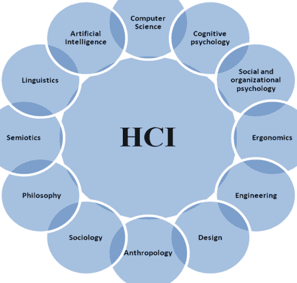

**图 2.1 人机交互。**

他们想要操作以及计算机理解此类用户活动的能力。人机交互（HCI）可以实任何可以安装计算机的领域。

总而言之，HCI 是研究如何创建高效满足人类需求的计算机系统。HCI 整合了来自多个领域的知识和方法 [2]，包括计算机科学、认知心理学、社会科学和人体工程学（人类因素）（见图 2.1）。

计算机科学包括技术知识，还包括开发抽象、方法论、语言和工具，以解决在具有灵感和对人类需求有理解的基础上创建成功设计的问题。认知心理学是心理学的一个分支，通过分析心理过程（如感知、记忆、问题解决、情感和学习）来洞察用户的能力和局限性。民族方法论是社会心理学中使用的一种技术，用于理解组织的结构和功能，并根据背景、社会和互动来处理人类行为。人体工程学（也称为人类因素）是一门研究人类与其他系统元素之间相互作用的科学，也是一门利用理论、概念、数据和方法论来提高人类福祉和系统性能的专业。社会学是一门研究社会对人类行为影响的社会科学。它特别关注社会压力如何影响人类行为。心理学考察个人行为的研究，它为在设计高效系统时如何考虑个人优势和局限性提供了科学观点。哲学通过提供一个导航、体验、理解和评估世界及其对象的框架，为在设计有效系统时如何考虑人类能力和局限性提供了一种方法。

人工智能（AI）的灵感源于人类智能，通过人类数据变得强大，并最终在改善人类体验和赋予研究人员做出更好决策的能力方面受益。人类学是对人类的研究，它通过让用户参与设计过程来提高可用性和以用户为中心。它的具体目标是理解设计的未来用户，旨在让设计团队对用户的实践、惯例和价值观产生同理心。语言学是作为科学的人类语言研究。它包含了对语言各个方面进行彻底、有方法的、客观且精确的检查，特别是其性质和结构，有助于生成用户对物理到抽象映射的刻板印象，并为用户界面设计提供灵感。符号学对于设计师来说至关重要，因为它使他们能够连接符号及其所代表的内容与必须解释它们的人以及为这些设计服务的人之间的联系。

## 2.2 HCI 的目标

HCI 的目标是创建既有用又安全且功能的系统。为了创建实用的计算机系统，开发者必须努力做到以下目标：

- 改进人机交互；
- 理解影响人们如何使用技术的因素；
- 开发工具和技术以实现创建适当系统；
- 实现高效、有效且安全的交互；
- 以人为本。

## 2.3 HCI 中的因素

为了分析和构建采用 HCI 原则的系统，必须检查许多方面。这些变量许多相互作用，从而增加了调查的复杂性。以下是影响 HCI 的重要因素 [3]。

- 1. 组织因素：培训、工作设计、角色、政治、工作组织
- 2. 环境因素：噪音、湿度、加热、照明、通风
- 3. 健康与安全因素：压力、头痛、肌肉骨骼疾病
- 4. 用户因素：认知过程、能力、动机、乐趣、满意度、性格、经验水平
- 5. 舒适因素：座椅、设备、布局
- 6. 用户界面：输入设备、输出设备、对话结构、颜色、图标、命令、导航、自然语言、3D、用户支持材料、多媒体
- 7. 任务因素：简单、复杂、新颖、任务分配、重复、监控、技能、组件
- 8. 约束：成本、时间、预算、人员、建筑结构
- 9. 系统功能因素：硬件、软件、应用
- 10. 生产率因素：增加产量、提高质量、降低成本、错误、减少劳动需求、缩短生产时间、增加导致新产品的创意创新想法。

## 2.4 HCI 设计问题

HCI 设计应该以用户为中心，并尽可能让用户参与以便他们产生影响；它还应该整合有助于 HCI 设计的各个学科的知识和专业知识。它还应该是高度迭代的，以便通过测试确保设计满足用户的需求。
HCI 设计面临各种挑战，如下 [4]：

- 1. 人机共生
- 2. 人与环境交互
- 3. 伦理、隐私与安全
- 4. 福祉、健康与幸福（Eudaimonia）
- 5. 可访问性与通用接入
- 6. 学习与创造力
- 7. 社会组织与民主。

### 2.4.1 人机共生（Human-machine symbiosis）

- 1. 有意义的人类控制：必须解决人类控制与自动化之间的权衡问题。机器学习系统必须以人类可以理解的方式解释并传递知识。用户需要更深入地理解系统的运行。
- 2. 人类数字智能：需要建立可靠的技术，以支持和尊重人权及隐私，支持人类活动，创造信任，并允许人类利用个人、社会和经济潜力，享受自主的生活。
- 3. 对人类需求的自适应与个性化：除了个人偏好外，还应考虑组织文化和使用技术获取大数据的专业水平。
- 4. 人类技能支持：需要的不是将知识客体化的计算机，而是需要一种协助人类才能和激励的方法，特别是在用户必须快速处理大量信息或面临压力的情况下。通过确保人们获得可以解决困难的网络认知技术，可以增加人类记忆和学习能力。通过信息技术与生物大脑的融合，技术被用于增强人类的感知和认知。
- 5. 情感检测与模拟：技术必须展示情感和情感行为，以记录并关联人类情感的表现。必须处理有意的或无意的欺骗。
    - a. 人类安全：建议采用“设计安全”先进智能系统。新的测试方法不仅要测试系统的设计和实现，还要测试系统获取的知识。通过针对性的调查、监控和分析，跨学科专家小组将提供评估和建议。

### 2.4.2 人环境交互（Human-environment interactions）

- 1. 物理与数字连续体交互：计算机不再显示为可识别的对象。对于消失的计算机和设备，必须创建新的示能（Affordances）。需要为正确的交互构物构建用户命令。根据背景提供正确的用户命令解释。日常物体需要可识别的交互，同时也可能出现信息过载。


## 18 机器智能

- 2. 隐式交互：考虑注意力中心与边缘之间不断变化的相互作用关重要。在任何情况下，交互环境都不应对用户的感知或认知提出过重要求，或导致其他不利结果，如困惑或不满意。智能环境中的隐式交互在设计上引发隐私问题。

- 3. 新颖且升级的交互：为了区分情感、表示显式输入并识别多模态行为，需要建立更自然的多感官上下文，例如味觉、嗅觉以及触觉。为了解决在收集和结构化预期使用场景、引导和评估用户需求、创建设计以及进行评估方面的潜在问题，现有方法需要扩大，这需要新的设计方法论。

- 4. 公共空间中的交互：交互系统如何吸引人们的注意力并鼓励他们与系统互动？公共空间技术的普及“模糊”了私人与公共接触之间的界限是界面设计的另一个挑战。还需要让用户参与设计过程的新技术。单用户与多用户情况之间的平衡，以及促进可能相互陌生的多个用户之间的合作，是由于同时服务多个用户而带来的额外困难。

- 5. 虚拟现实与增强现实 (AR) 中的交互：目标是创建提供真实体验的硬件，展现更大的存在感和沉浸感。为了实现这一点，必须增强具身感，其中包括自我定位感、动作感和对身体的所有权。随着深度且真实的虚拟现实 (VR) 越来越接近真实，用户可能会过度依赖虚拟环境和虚拟角色的严重风险。互联 VR 设计原则必须改进，以考虑 AR 如何将现实与虚拟融合，并防止体验被完全虚拟化所占据。

- 6. 评估：困难包括自然交互背景下来自各种通道的信号解释、文本感知、频繁缺乏特定任务的系统中不当措施，以及对用户学习过程的长期研究。为了给智能环境下的用户体验（UX）评估提供整体且系统的方法，考虑到此类环境的各种特征和特性，需要新的框架和模型。对于 AI 应用、服务和人工制品开发，应建立清晰的标准和伦理准则。

## 人机交互概述

### 2.4.3 伦理、隐私与安全

- 1. *基本隐私问题*：要解决的众多隐私问题包括不被打扰的权利（孤独感）、不公开身份的权利（匿名性）以及不被监控的权利（亲密性）。个人信息必须受到保护。

- 2. *HCI 研究*：应避免在 HCI 研究中使用脆弱群体，如老年人、残障人士、移民、社会孤立个体、患者和儿童等。参与者匿名也是一项困难的任务，因为数据与其他数据集结合时会去匿名化。

- 3. *在线社交网络 (OSNs)*：OSNs 的隐私担忧包括数据保留问题、浏览隐私信息、数据出售和精准营销。隐私和内容共享是 OSN 设计师必须完美结合的两个挑战。

- 4. *医疗技术*：在医疗背景下，数据隐私、准确性和机密性至关重要。所有人的医疗访问、匿名性、自主性、行无危害、尊严、无歧视、充分知情同意以及价值敏感的设计都是应该解决的伦理原则。

- 5. *虚拟现实*：在虚拟环境中，幻觉会导致反应和感受，例如对虚拟代理的过度依赖或在虚拟和物理世界中感到失控。VR 环境创建者的意图可能是模糊且对用户危险的。用户对现实的感知可能受到 VR 的影响，导致虚拟失调。

- 6. *IoT 与大数据*：虚拟世界中关于人们的数据与现实数据补充并整合，数据隐私由于常用设备的连接而受到损害。日常物品的连接进一步威胁数据匿名。通过连接多个系统和合并数据，实现了隐私和身份风险。自动化决策可能导致歧视和选择限制。不应对脆弱人群做出恶意意图和欺骗承诺。

- 7. *智能环境*：智能系统带来了许多风险，例如基于收集的数据的用户识别、个人/敏感数据的持续性、对个人进行画像和隐式推断、数据监控、数据误读、用户不知情使用的数据收集技术。当自主智能代理做出复杂且重要的伦理判断时，透明度至关重要，以便人类能够理解、预测并适当信任 AI，无论这种信任表现为可追溯性、可验证性、非欺骗性还是可理解性。

网络安全：由于大量的网络设备，典型的安全解决方案失效。对传感器和执行器的恶意攻击可能会破坏物理安全和信任。网络安全最大的漏洞是人类代理。

### 2.4.4 幸福、健康与自我实现

- 1. 个人医疗设备 (PMDs) 与自我追踪：PMDs 具有巨大潜力并应被医学界接受。数据控制性、数据整合和准确性、数据可视化、归补、隐私、审美和参与度被认为是自我追踪的障碍。自我追踪的数字化和自动化带来了隐私问题以及关于数据使用的伦理考虑。开发自我追踪技术不仅仅是技术工作，因此应该使用涉及软件开发、界面设计师、医生和行为科学家的多学科策略。

- 2. 健康严肃游戏：一个重要问题是健康游戏的制作需要高度复杂的跨学科团队，最好将用户纳入其中，这两点都导致实施缓慢。尽管成本高昂且行业不发达，消费者的预期很高。另一个关注是对目标消费者进行严肃游戏的评估。

- 3. 环境辅助生活：通过增强治疗的定制化并考虑到人们不同的需求、期望和偏好，必须优先考虑以人为本的服务。应该保护隐私和机密，技术不应被取代人类护理，导致老年人孤立或侵犯人权。

- 4. 医疗智能：过度依赖技术可能会损害人们管理生活和在能力丧失后恢复的能力。依赖还会导致患者隔离和缺乏个人护理。对于以患者为中心的设计，需要新的设计和评估方法。为了确保技术的可持续性，需要新的开发和测试技术。

- 5. 幸福与自我实现：识别和量化幸福与自我实现存在困难。这些概念的广泛范围从个人幸福延伸到社区幸福和地球的福祉。

### 2.4.5 无障碍性与通用访问

- 1. 采用主动方法：主动方法不支持“一刀切”的方法；而是寻求通过以下来增强所有人的无障碍性


## 人机交互概述 21

为每位用户量身定制设计。结果是许多企业将通用设计视为一种额外的成本或功能，但事实并非如此。

- 2. 人口老龄化：一个主要关注点是如何鼓励老年人采用信息通信技术（ICT），以及他们对这些技术的接受程度如何。随着新一代精通技术的老人的出现，这两者预计将在不久的将来发生变化。

- 3. 技术丰富环境中的无障碍性：如果这些程序构建得不当，各种设备、程序和环境智能会给消费者带来巨大的认知负担。智能设置对用户来说必须透明的，但这本身就是一个严重的无障碍问题，特别是对于老年人和患有认知障碍的人士而言。

- 4. 方法、技术和工具：必须使用新的评估方法和工具，以适应不断变化的人类需求和使用场景，开发适当的模型，推进对用户需求的了解，并确定各种解决方案是否适用于用户与环境特征的不同组合。

- 5. 未来技术环境中的通用访问：为了防止任何人被新功能排斥、孤立或剥削，必须对任何有被排斥风险的人进行特殊考虑。年龄、教育、职业状况、健康、社会连接、基础设施可用性、对数字不平等的影响（包括种族和族群）、性别以及社会经济水平是必须考虑的一些关键要素。

### 2.4.6 学习与创造

- 1. 新一代学习者：理解人类因素的影响关重要，以便设计出最适合每一位学习者的数字学习环境，以人为中心，研究每个人的各种需求和要求。

- 2. 扩展现实：扩展现实技术的一个困难方面是如何使用它们来支持整个教育过程，从内容的创建到学习体验的传递。这需要一种多学科的方法以及导师的积极参与，导师除了作为内容提供者外，必须亲自使用这些技术。

- 3. 移动学习：跨越正式与非正式语境、虚拟与物理世界、以及计划与突发空间的传统边界使用移动设备，引发了关于教师应如何设计学习活动，以及教育者的学习者在使用日益增长的交互智能时如何应对紧迫社会和人类需求的问题。

## 2.5 HCI 实现问题

用户界面不仅设计困难，实现也很困难。与用户界面相关的问题如下 [5]:

- 1. 需要迭代设计
- 2. 响应式编程
- 3. 多进程处理
- 4. 需要实时编程
- 5. 需要健壮性
- 6. 可测试性低
- 7. 无语言支持
- 8. 工具的复杂性
- 9. 模块化的困难

我们现在详细讨论这些问题：

- 1. **需要迭代设计**：传统的软件设计“瀑布”方法（完全设计用户界面，然后实现最后测试）是不够的。相反，规范、实现和测试必须整合。这使得开发变得极具挑战性。

- 2. **响应式编程**：用户界面软件比其他类型的软件复杂。一个显著区别是目前的界面必须从内部向外开发。与其获取代码让应用程序控制，不如将程序设计成系列子程序，当用户执行某些操作时用户界面工具包调用这些程序。

- 3. **多进程处理**：用户界面软件通常结构为多个进程以去响应。因此，开发用户界面软件的程序员将遇到多进程的已知问题，如同步、线程一致性、死锁和竞态条件。

- 4. **需要实时编程**：在图形化直接操作界面中，动画对象或随鼠标移动的对象很常见。为了吸引用户，对象必须每秒呈现 30 到 60 次且没有不等的停顿。程序员必须确保计算反馈所需的任何处理均在 16 毫秒内完成。这可能包括采用不那么真实但更快的近似方法，以及复杂的增量算法，这些算法根据单个变化的输入计算输出，而不是基于所有输入进行简单的重新计算。

- 5. **需要健壮性**：处理输入的程序有特别严格的要求，所有输入都必须被优雅处理。程序员必须定义内部方法的接口，使其仅在提供特定类型数据时运行，而用户界面必须始终接受任何可能的输入并继续运行。此外，与检测到错误输入可能会终止到调试器的过程不同，用户界面软件必须响应有用的错误信息，并允许用户重新或修复错误并继续。用户界面还应允许取消和撤销任何操作。因此，程序员必须设计所有活动，以便它们在执行期间可以取消并在完成后还原。为了适应这一点，通常需要特殊的数据结构和编码风格。

- 6. **可测试性低**：由于自动化测试方法在为直接操作系统提供输入输出方面存在问题，用户界面软件更具挑战性。

- 7. **无语言支持**：编写用户界面软件具有挑战性，因为如今的编程语言缺乏作为图形输入输出所需的必要功能，以及响应式编程和多进程处理。

- 8. **工具的复杂性**：大量旨在改进软件用户界面的工具以难用而闻名。工具手册通常有几卷厚，包含数百个步骤，因此


## 人机交互概述

使用这些工具学习编程用户界面通常需要大量的训练。尽管这些工具规模大且复杂，但它们可能甚至无法提供实现预期结果所需的灵活性。

模块化的困难：使软件更易设计和维护的方法之一是对各种元素进行恰当的模块化。用户界面应该与软件的其他部分分离，以便进行快速修改（为了进行迭代设计）。遗憾的是，程序员在实践中发现，将用户界面与应用程序元素分离是困难甚至是不可能的，而且对用户界面的修改往往需要重新编写应用程序的部分代码。

虽然设计和实现复杂软件通常是一项挑战，但用户界面似乎带来了相当的额外障碍，我们可以预计用户界面设计和实现的研究未来将继续提供更好的理论、方法和工具。

## 2.6 HCI 的重要方面

确保用户满意度是人机交互的关键组成部分。由于人机交互研究人类与机器如何交互，因此它借鉴了来自人类和机器两端的相关知识。关键方面和定义的总结如下 [6]：

- *有效性 (Effectiveness)*：用户完成预期目标的精确程度和彻底程度。
- *效率 (Efficiency)*：与准确、完整地实现目标相比，所使用的资源量。
- *满意度 (Satisfaction)*：对系统良好的良好态度且无不适感。
- *灵活性 (Flexibility)*：系统适应用户除最初指定之外所需变化的程度。
- *可学习性 (Learnability)*：掌握给定水平系统性能所需的时间和精力，也称为学习曲线。
- *记忆性 (Memory)*：在离开系统一段时间后，恢复到特定性能水平所需的时间和工作。
- *安全性 (Safety)*：系统系统中涉及保护用户免受风险情况和非意愿情况的组件。
- *易用性 (Usability)*：特定用户在特定语境下通过有效、高效和满意使用系统完成特定目标的程度。易用性是用户友好的通用术语。易用性还包括适应性、记忆性、可学习性和安全性。

## 26 机器智能

- *可访问性 (Accessibility)*：最易用且功能最强大的系统环境。Web 可访问性是指残障人士与网页交互、感知、理解和导航的能力。
- *用户体验 (User experience)*：除了功效、效率和满意度外，它涵盖了用户与系统交互以及对系统响应的元素。

设计人员在创建和实现 HCI 系统时，必须记住并检查这些本质方面和问题。

HCI 是一个科学与实践领域，最初发展于计算机科学的一个领域。HCI 发展迅速且持续，吸引了来自各个学科的人士，并涵盖了广泛的概念和方法论。

在 20 世纪 80 年代和 90 年代，HCI 主要关注开发易于理解和使用的系统。当时个人负担不起计算机。计算机在 20 世纪 90 年代到 21 世纪初发展成为通信工具。检查外部影响以及交互如何跨技术和企业进行发展变得至关重要。在此期间，电子邮件无处不在，这意味着人们不仅与计算机连接，还通过计算机系统彼此连接。

在 21 世纪 00 年代和 10 年代，价值驱动的创新在实施计划和设计长期发展界面方面占据主导地位。对于人、环境和工具之间复杂的连接，需要一种新的界面设计方法 [7]。

目前，无处计算 (UC) 是 HCI 中最活跃的研究领域。UC 和增强现实 (AR) 等沉浸式技术在 HCI 中变得极其重要。

## 2.7 HCI 的组件

计算机界面是一种允许任何用户与计算机通信的介质。HCI 由三个主要组件组成：

- 人
- 计算机
- 它们之间的交互。

界面对于大多数 HCI 都是关重要的。为了创建有效的界面，用户必须理解组件的局限性和能力。为了完成各种任务，人类与计算机系统交互。人类和计算机之间的输入输出通道各异 [8]。这里简要讨论了人类和计算机组件的输入输出通道。

## 人机交互概述

人类组件分类如下：

- 长期记忆：具有长期存储数据的能力。
- 短期记忆：进入系统的所有信息存储在短期记忆中，时间有限。
- 感官记忆：感官记忆是发生在感官器官中的短期记忆。
- 视觉感知：视觉感知是通过眼睛感知环境的能力，包括颜色、图案和结构。
- 听觉感知：听觉感知是接收和理解通过空气传输的音频频率波提供耳朵的信息的能力。
- 语音和声音：语音已成为与计算机系统通信更频繁的方式。最流行的例子是 Amazon Echo、Apple 的 Siri 和 Google Home。

计算机组件分类如下：

- 文本输入设备：文本输入设备是向电子设备输入数据的接口。机械计算机键盘是输入设备的著名示例。
- 语音识别：这种允许计算机将人类语音转换为文本的功能，也称为自动语音识别。
- 鼠标/触控板/键盘：鼠标是一种小型移动设备，通过有线或无线方式控制输入。
- 眼动追踪：眼动追踪是一种可以检测和监测眼睛的的技术。
- 显示：显示器上的图形设计和布局被称为屏幕设计。
- 听觉显示：使用音频向用户传递信息被称为听觉显示。
- 打印能力：用户拥有自定义打印的选项。

## 2.8 HCI 的特征

HCI 可以应用于各种情况。HCI 的一些特征如下：

- 通过对象改变情况：设计人员创建对象来改变与技术的交互方式。当用户处于变化的场景时，可能需要不同类型的界面设计。设计应关注数字设计。
- 调查未来：设计人员需要灵活性来调查和创新，这涉及到以各种方式探索未来。
- 与问题的并行替代方案：需要具有许多替代方案的好设计。有时一个优秀的设计并没有完美的解决方案。
- 从“草图”和其他“生理表示”的角度理解必要的：设计人员创建实体的（可以触摸）模型来测试想法和概念，以观察用户喜欢还是不喜欢。草图是建模最基本的技术。然而，为了理解用户如何与特定原型交互，可能需要完整且全面的原型。
- HCI 在整个过程中考虑工具、技术、艺术和伦理问题：创新将是功能、吸引且可接受。

## 2.9 HCI 原则与最佳实践

人类感知和信息处理原理可用于构建成功的显示。某些原理可能适用于各种场景。某些原理可能相互矛盾，没有明确的答案来判断哪个更重要。这些规则从基本设计理念到最佳实践 [8]。本节提供了通常遵循的重要 HCI 设计准则。

- 可学习性和熟悉程度决定了用户学习与系统交互的速度。为了做到，系统必须是可预测的。
- 为了有效，所有字符和对象都应该是可用的。
- 用户会出错，但错误不应中断系统或对交互产生负面影响。为了防止潜在错误，应提供警告，并在发生潜在错误时也应提供帮助。
- 任何非平凡的关键操作都应经过验证。
- 减少任务间隙期间需要记忆的信息量。
- 如果提供的信息不足或不一致，系统可能无法满足需求。
- 不要让数据过载用户；相反，选择一种能够实现信息系统的布局。


## 人机交互概览 29

- 允许用户保持其视觉上下文。
- 创建具有信息性的错误消息。
- 为了提高理解力，使用大小写、缩进和文本分组。
- 为了分类不同类型的数据，使用框架（frames）。
- 使用模拟显示来表示更容易拟合的信息。

三位专家——本·斯尼德曼（Ben Shneiderman）、唐纳德·诺曼（Donald Norman）和雅各布·尼尔森（Jakob Nielsen）提出了若干 HCI 原则。
以下八大通用指南由美国计算机科学家本·斯尼德曼制定，他记录了关于设计的某些隐藏真理：

1. 一致性非常重要。
2. 应该考虑通用可用性。
3. 提供建设性反馈。
4. 创建对话以实现结束。
5. 应该避免错误。
6. 允许轻松撤销操作。
7. 鼓励内部控制感。
8. 应该减少短期记忆负载。

使用这八条规则，你可以区分良好的界面设计与糟糕的设计。这些在图形用户界面（GUI）的实验评估中非常有用。
唐纳德·诺曼推荐了转化挑战性任务的七阶段：

1. 使用现实世界和智知识。
2. 降低任务复杂度。
3. 让事情变得清晰。
4. 确保你的映射（mapping）是正确的。
5. 将局限转化为优势。
6. 为错误做好计划。
7. 在一切失败时进行标准化。

这些原则可以用于执行困难任务。
启发式评估是一种检测界面可用性问题的科学过程。启发式评估方法结合了多种可用性概念，例如雅各布·尼尔森的十大可用性原则：

1. 系统状态可见性。
2. 系统与现实世界的关系。
3. 用户控制与独立性。
4. 标准与一致性。
5. 错误最小化。
6. 识别而非回忆。
7. 有用性和适应性。
8. 极简且美观的设计。
9. 错误协助、诊断与恢复。
10. 文档与支持。

上述列出的十项尼尔森原则作为启发式评估人员在分析设计时的清单 [8, 10]。

## 2.10 HCI 设计

HCI 设计是一个解决问题的过程，包括预期用途、目标区域、资源、成本和可行性等特征。目标驱动的设计是交互设计中最重要的方面之一。产品设计应该易于操作。因为用户在使用产品后不会记住所有功能，所以用户需要在每个界面中建立熟悉感。为了降低复杂度，必须建立一致性和预测性 [8]。表 2.1 展示了产品设计的三个阶段。

### 2.10.1 HCI 设计方法

HCI 对于构建让各种技能和专业知识的人都能使用的直观界面至关重要。值得注意的是，人机交互对于缺乏如何与特定计算系统连接的信息和正式培训的人非常有益。

表 2.1 通用设计流程的步骤

| 步骤 |  |
| :--- | :--- |
| 步骤 1 | 在设计界面之前，系统设计师需要理解用户的需求以及用户在设计界面之前遇到的困难。这被称为用户研究和分析。 |
| 步骤 2 | 第二步是设计的开发和原型制作。本质是将用户的需求转化为可能的解决方案。概念设计和物理设计都将包含在。然后就可以对原型进行测试。 |
| 步骤 3 | 一旦完成最终产品，就使用界面测试技术对设计进行评估。 |

## 人机交互概览

用户在采用高效的 HCI 设计时，不需要考虑使用计算系统的细节和复杂性。用户友好的界面确保用户交互是清晰、准确且自然的。

有四种 HCI 设计方法 [11] 可以创建用户友好、高效且直观的用户界面设计：

- 1. 以用户为中心的设计：这是一组关注用户需求和目标的技术。当产品团队创建产品时，它会考虑用户的需求、目标和反馈。满足用户的需求和愿望成为首要任务，并且的每个决定都会根据其是否为用户提供价值进行评估。产品设计师进行研究并将用户的需求转化为目标。
- 2. 以活动为中心的设计：这是一种优先考虑所利用的技术的设计方法，专注于系统如何通过操作产生结果。当用户执行操作时，设计师必须规划出在该设备上必须执行的各种任务，并发现使这些任务尽可能简单的方法。
- 3. 系统设计：专注于系统的组件和相互依赖性。用户适应并使用系统，而产品设计师则在系统内部表示并设计控制控件。
- 4. 天才设计：系统设计的重点在于设计师的经验、直觉和专业知识。系统的性能由用户验证。产品设计师设计并改进系统的运行。

### 2.10.2 界面测试技术

HCI 技术用于多种目的，包括评估用户界面。以下给出了一些技术：

- **可用性测试：** 可用性测试是以用户为中心的交互设计中的一种技术，通过让真实人员进行测试来检查产品。这是一项基本的可用性技术，因为它提供了关于用户如何与系统交互的直接反馈。它更关注设计和用户友好性，而不是在没有接触过该产品的客户身上进行测试。这种测试对于最终产品的成功至关重要，因为一个功能完全但让用户用户的程序是无法持久的。这与可用性检查方法不同，后者采用各种技术在不涉及消费者的情况下评估用户界面。
- **认知漫游：** 认知漫游方法是一种可用性评估技术，关注新用户完成系统任务有多容易。该策略建立在用户倾向于通过操作而非学习手册来学习系统的之上。
- 启发式评估：一种用于识别可用性问题的评估技术。它要求评估人员检查界面并评估其响应能力。这些评估技术在媒体行业中被广泛接受和执行，那里的用户界面通常是快速构建且预算有限的 [12]。

## 2.11 HCI 设备

计算机出现在我们生活的各个方面。在早期，批处理技术在19 世纪变得流行。人类操作员使用孔卡将数据输入系统。这些卡片上有孔，光线通过孔会闪烁；光线穿过的地方代表 1，否则为 0。用户界面随着时间的推移出现。Xerox Star 是第一个带有位图显示器的商业 GUI 工作站。

目前，智能手机革命已经到来。巨大的计算能力包含在手持设备中。Siri、Cortana、Google Assistant、Alexa 等虚拟助手使用语音识别技术拨打电话、记录笔记并进行近乎人的对话。模拟数字转换器 (ADC) 将言语转换为一系列 1 和 0。然后这些被切分成秒级单位。它们与音素匹配，音素是语言的最小元素。目前正在研究复杂的统计方法来确定言语的语境。物联网是最令人兴奋的通信方式。智能手机、笔记本电脑、汽车和房屋都将连接到巨大的网站网络。各个位置的传感器收集数据。当垃圾桶满溢时，传感器会通知自动垃圾车去处理分类垃圾 [13]。无需离开房屋，人们就可以要求虚拟助手开启汽车加热器。

## 2.12 HCI 工具与技术

人类长期以来一直在开发工具和技术来帮助他们完成职责。HCI 主要关注研究让人与计算机通信的界面，是一个结合了计算机科学与行为科学的领域。HCI 已从台式电脑发展到移动屏幕。目前的研究重点是将语音用户界面与语音识别集成。


图 2.2 头部稳定式眼动追踪员工培训。

# 34 机器智能

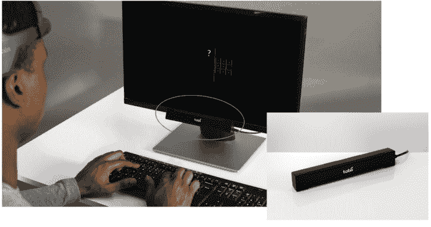

**图 2.3** 远程眼动追踪。

它由头部稳定系统控制。眼动追踪系统可用于功能磁共振成像（fMRI）、磁脑图（MEG）和其他研究学科。通过使用眼动追踪，业务管理者可以帮助员工关注他们的日常活动。眼动追踪技术还可以识别分散注意力的工业活动或环境。员工培训也能受益眼动追踪技术。它可以捕捉员工在执行任务时的视觉注意力。通过使用眼动追踪技术及其工具的交互，新员工可以从专家的感知中学习一切，而不遗漏任何细节。

*局限性：* 参与者的舒适度和正常参与是头部稳定追踪的主要局限性。许多头部稳定研究并不要求参与者感觉或表现得自然。这些系统专门用于实验室环境。

## 2.13.2 远程眼动追踪

现代系统不需要与参与者任何交互，它们被称为“远程”。摄像头结构用于提供眼睛的远端图像，系统可以自动调整摄像机的视角。它们通过眼心中心和角膜反射远程追踪眼睛位置和头部朝向。当眼动追踪设备工作时，人员可以正常使用计算机。这项技术适用于可用性测试、行为心理学、视觉实验和基于屏幕的市场研究。

*局限性：* 远程设备只能追踪固定的工作区域。触摸屏可能具有挑战性，因为参与者必须频繁越过摄像头，导致数据间隙。大多数远程系统通过光学过滤器阻挡非红外光。它们可以在任何人工光下工作。


**图 2.4** 移动眼动追踪。

## 2.13.3 移动眼动追踪

用于移动眼动追踪的眼动追踪眼镜也被称为“头戴式”（图 2.4）。这种技术通常需要在单只（单眼）或双只（双眼）眼睛的视觉路径中放置一个摄像头，并放置另一个记录场景或视野的摄像头。这项技术用于各种研究，如运动、驾驶、导航、社交交流、手眼协调、移动设备和零售库存测试。

*局限性：* 这些设备与所有眼动追踪设备一样，在强光下可能难以捕捉运动。眼动追踪摄像头需要眼睛的连续视野。有时边缘难以追踪，大多数情况下准确率较低。在采用移动眼动追踪设备时，不存在绝对坐标系。

## 2.13.4 嵌入式或集成系统

眼动追踪设备可以与其他形式设备设备，例如手术系统和其他医疗设备中的引导设备。佳生产了许多使用基于视线的自动聚焦机制的摄像头。集成系统现在包含在虚拟现实（VR）和增强现实（AR）设备中。构建在 VR 和 AR 设备中的系统也可以控制系统，允许用户通过移动视线与信息交互 [13]（图 2.5）。在没有鼠标或键盘的地方，该技术可以为 AR 和 VR 界面提供有效的控制。


图 2.5 带有 AR 和 VR 技术的嵌入系统。

## 2.14 HCI 的语音识别技术

计算机可以使用语音识别技术获取口语、理解它们并从中生成文本。语音识别技术已用于聊天机器人和虚拟助手来提高生产力。语音基本上是由声带产生的一系列声波。麦克风记录声波，然后将其转换为电信号。随后通过现代信号处理技术将信号分为音节和单词。由于最近人工智能（AI）和机器学习（ML）的巨大进展，计算机可以随着时间的经验学习并理解语音。然而，信号处理使得这一切成为可能 [14]。主要的语音识别工具有：

- Apple Siri：在 2011 年发布后，苹果的 Siri 迅速成为最流行的语音助手。Siri 可用于所有的 iPhone、iPad、Apple Watch、HomePod、Mac 桌面电脑和 Apple TV 上。Siri 随用户出现在任何地方，即在家里、在路上以及在他们的身体上。这让 Apple 在早期采用方面具有显著优势。Siri 能够代表你发送短信或拨打电话（图 2.6）。


图 2.6 苹果的语音助手 Siri。


图 2.7 Amazon 的 Alexa。

- Amazon Alexa：Alexa 由亚马逊于 2014 年随 Echo 和 Echo Dot 设备推出。它可以回答问题、播放音乐并控制智能家居。Alexa 也适用于其他设备，包括智能手机和平板。
- Google Assistant：Google Assistant 是 Google 的 AI 语音助手。它适用于 Android 设备、智能扬声器和显示器。Google Assistant 可以执行如设置提醒和提供信息等任务。


# 40 机器智能

构建特定的物联网应用，例如为了特定目的连接灯光、温度或运动传感器，并在需要时接收移动端提醒。Kinoma 网站也提供了许多关于其实际应用的教程。

-   Device Hive：Device Hive 是一种于 2012 年发布的免费开源机器对机器（M2M）通信框架。它基于 Data Art 的 AllJoy 构建，是是最流行的物联网应用开发平台之一。它通常是一个云端 API，您可以对其进行远程控制，而无需设置网络。它包含了库（Libraries）、门户网站和管理协议。安安全、自动化、智能家居技术和传感器是其常见的用途。它还拥有不断增长的社区和各种在线服务来支持其用户。

## 2.16 HCI HCI的云计算技术

云计算是一种基于虚拟化的技术，它使我们能够在互联网上创建、配置和个性化应用程序。开发平台、硬盘、软件程序和数据库都包含在云技术之中。云是指网络或互联网。它不使用本地存储器，而是使用互联网上的远程服务器来存储、管理和访问数据。数据可以包括文件、照片、文档、音乐、视频和其他类型的媒体。全球的中小型企业都使用云计算技术将数据存储在云端，并通过互联网连接随时随地从任何地方访问数据。面向服务的架构被集成到云计算架构中 [16, 17]。以下是云计算技术列表：

-   1. 虚拟化：虚拟化是在单个服务器上产生虚拟环境以运行各种应用程序和操作系统的手段。虚拟环境可以是操作系统、存储设备、网络应用服务器和其他环境的任何组合。在云计算中，虚拟化的概念增强了虚拟机的实现。虚拟机是一个可以像真实计算机一样运行的软件程序，根据需要执行应用程序或进程。

-   2. 面向服务的架构 (SOA)：SOA 使企业能够使用按需的云计算解决方案来适应不同的业务需求。它可以在使用或不使用云计算的情况下使用。SOA 的优点包括易维护、平台独立和可扩展性。SOA 中的两个主要角色是服务提供者和服务消费者。

-   3. 网格计算：分布式计算是网格计算的另一个术语。这是一种处理器架构，整合了来自许多地点的计算资源以实现共同目标。在网格计算中，并行节点加入网格形成一个计算机集群。这些计算机集群的大小不异，能够在任何操作系统上运行。网格计算最常用于 ATM、后端基础设施和市场研究。

-   4. 公用事业计算：公用事业计算是最大的 IT 服务。它使用按需付费模型通过 API 提供按需的计算资源，如计算、存储和编程服务。它在最大化资源效率的同时减少了相关成本。公用事业计算具有增加灵性和简化管理的优点。谷歌和亚马逊等大公司已经开发了自己的用于计算、存储和应用的公用服务。

这四种技术被广泛应用于各种领域。以下是云计算工具：

-   Cloudwatch：Amazon Services 提供云资源和应用程序监控。它提供了系统活动和健康的摘要。该系统在优化流程方面具有巨大潜力。云服务的优势是用户无需安装任何软件或支付昂贵的安装服务。

-   Cloudability：这是一种用于跟踪和监控整个企业所有云支出的财务管理解决方案。它协助识别削减成本的机会、准备报告并通过短信和 gmail 提供预算警报和建议。

-   Cloudyn：创建此工具的目的是防止企业 IT 在亚马逊云服务上过度支出。Cloudyn 的服务为用户提供仪表板，显示所有虚拟机模型、数据库和存储的完整信息。Cloudyn 还提供故障整体分析、使用细分分析、资源成本分析、使用趋势分析、财务预测分析以及消除未使用资源的建议。

-   Informatica：Informatica 是一种广泛的数据处理工具，用于提取、转换和加载 (ETL) 数据。它从多个源收集信息，交付可靠的结果并自动部署。多个操作同时执行。它有一个集中的云服务器，使数据易访问和跟踪。维护和监控数据非常简单。

-   Chef：Opscode 在 Apache 许可证下提供了一个基于 Ruby 的开源配置管理工具。管理员可以编程配置虚拟系统，并在托管 Chef 云系统的帮助下消除所有重复的手任务。

-   Enratius：Enratius 是一种云计算解决方案，可根据组织的需求为私有云、公有云和混合云提供跨云基础设施。它实现了自服务的云资源配置和撤销。用户可以使用单一登录管理所有云资源，并支持 OpenID 和 SAML 2.0 等企业认证解决方案。

-   Microsoft Azure Automation：Azure Automation 是一种云端自动化和配置服务，允许用户一致地管理其 Azure 和非 Azure 环境。它包括过程自动化、更新管理和配置功能，将帮助用户减少错误并尽量缩短构建基础设施的时间。如果用户需要运行各种操作系统，Azure 可能是一个很好的选择。

云计算是一项改变游戏规则的技术，它使企业能够在提供产品和服务的同时，应对网络安全挑战、海量数据管理和质量控制。解决方案已被从初创公司到跨国公司的各种组织用于创建应用程序和自动化业务流程。

## 2.17 HCI 应用

HCI 是重要的，因为产品需要变得更有效、更安全、更实用且高效 [18]。它从长远来看将提高用户的体验。一些实用的应用包括：

-   生活中：技术已经渗透到生活的方方面。即使人们不使用或拥有计算机，计算机也会对他们的生活产生影响。ATM 机、火车票自动售卖机和热水机只是个人日常使用的计算机界面的一些例子。在开发任何这些系统或界面时，应该研究并适当考虑 HCI 概念，以确保界面舒适、有用且有效。

-   商业领域：HCI 对于每个日常运营中使用计算机的企业来说都是至关重要的。员工在日常活动中使用计算机。如果设计糟糕，他们将面临挫败感和其他问题。在设计安全关键系统（如发电厂和空中交通管制中心）时，HCI 特别重要。设计错误在某些情况下可能会导致严重后果，包括用户死亡。

-   辅助技术：在选择不仅有效且让残障人士也能使用的系统时，HCI 是一个重要的考虑因素。核心


# 人机交互概述 ■ 43

人机交互（HCI）的概念是为所有人（包括残障人士）提供安全、有效且高效的系统。使用以人为中心的方法和原则开发的每个系统，都将尽可能地让残障人士能够。

- 医疗保健：计算机已成为医院、实验室和药房的重要组成部分。医院中，它们用于跟踪患者和药物。它们还被用于扫描和诊断疾病。计算机设备还可以执行心电图（ECG）、脑电图（EEG）、超声波和 CT 扫描等许多程序。
- 政府：在政府服务中，HCI 起着至关重要的作用。预算、销售税部门、所得税部门、男女比例计算等都是该类别的一些重要用途。选民名单数字化、PAN 卡数字化以及增强型天气预报是 HCI 的其他应用。

## 2.18 人机交互的优势

HCI 是一个无法回避的领域，因为它已经整合到产品开发的每个阶段。HCI 有许多优势，其中包括：

- 当计算机出现时，用户学会了如何使用键盘、鼠标和桌面与计算机通信。用户开始使用 Microsoft Excel 进行计算，使用 Word 处理文档，使用 PowerPoint 进行演示，以及通过 GUI（图形用户界面）使用虚拟桌面，但 GUI 改变了计算机与用户交互的方式。
- HCI 提高了数据安全性。
- 手机是世界上最广泛使用的通信媒介。
- 音乐播放器、全球定位系统（GPS）、新闻应用、日历、游戏和其他应用程序在今天的智能手机上可用。
- HCI 具有适应性、通用性和易性。
- AR（增强现实）和 VR（虚拟现实）让游戏变得更加迷人。

## 2.19 人机交互的缺点

HCI 可以非常有用，但也存在某些缺点：

- 有必要指导用户做什么。
- 根据活动的性质，即使是微小的人为错误也对成本、安全和其他关键考虑因素产生重大影响。

## 44 机器智能

- 有时，由于记忆丢失、缺乏管理能力和认知障碍等问题，人们无法与计算机界面通信。
- 病毒攻击和蓄意的黑客攻击。

## 2.20 结论

对人类与计算机交互的研究和刻意设计被称为人机交互（HCI）。HCI 用于各种计算机系统，例如办公室、核处理、空中交通控制和视频游戏。HCI 系统是简单、安全、高效且有趣的。关于 HCI 有一个庞大的知识体系，由概念、规则和设计标准组成。在目前的科技时代，巧妙设计的计算机界面鼓励了数字设备的使用。HCI 允许人机双向通信。由于通信的高效性，人们认为他们正在与人类互动，而不是一个复杂的计算系统。

尽管如此，第一次创建一个合适的界面是不可能的。这将是未来年的巨大挑战。用户、需求、上下文分析和界面设计必须具有明确、直接和正式的关系。当前的人机工程信息应该在界面设计中更直接、更简单。因此，提供一个坚实的 HCI 基础是关重要的，它将影响未来的应用，例如目标营销、老年护理甚至心理创伤治愈。

## 参考文献

- Wilbert O. Galitz (2007) "The Essential Guide to User Interface Design." DreamTech. Available at: https://mrcet.com/pdf/Lab%20Manual/IT/R15A0562%20HCI.pdf
- Khalid Majrashi, and Margaret Hamilton (2014) "User Experience of University Websites." Available at: www://www.researchgate.net/publication/295857951_User_Experience_of_University_Websites
- Jenny Perez (1994) "Components of HCI." Available at: http://it.lib.cyut.edu:8080/bitstream/319091800/4308/1.pdf
- Constant Stephanidis, Gavril Savendy, Marguerite Antonia, Jessie J. C. Chen, Jianning Dong, and Vincent G. Duffy (2019) "Seven HCI Grand Challenges." https://doi.org/10.1080/10447318.2019.169259
- Brad A. Myers (1993) "Why Are Human-Computer Interfaces Difficult to Design and Implement?" Available at: www.cmu.edu/~bam/papers/Why-Hard-CMU-CS-93-183.pdf
- Lowella Viray (2016) "Exploring Human-Computer Interaction: Its Issues and Challenges." Available at: www.academia.edu/38324061/Exploring_human_computer_interaction_its_issues_and_challenges

# 人机交互概述 ■ 45

- 7. Fakhreddine Karray et al. (2008) “Cooperative Multi Target Tracking Using Multi Sensor Network.” International Journal on Smart Sensing and Intelligent Systems, 1(3).
- 8. Educative (2021) “Human-Computer Interaction.” Available at: www.educative.io
- 9. Interaction Design (2014) “The 5 Characteristics.” Available at: www.interaction-org
- 10. Educative (n.d.) “Introduction to HCI.” Available at: www.educative.io
- 11. Alma Leona (2016) “Design Methods.” Available at: uio.no
- 12. Wikipedia (n.d.) “Human-Computer Interaction.” Available at: https://en.wikipedia.org
- 13. Bitrain (n.d.) “Eye Tracking.” Available at: www.bitrain.com
- 14. Suminal Lingua (2021) “The Complete Guide to Speech Recognition.” Available at: suminalua.com
- 15. Eduonix (2019) “Top 10 IoT Development Tools.” Available at: blog.eduonix.com
- 16. Javatoint (n.d.) “Cloud Computing Technologies.” Available at: www.javoint.com
- 17. Jigsaw Academy (n.d.) “Cloud Computing.” Available at: Jigsawacademy.com
- 18. Utsav Mishra, and AnalyticsSteps (2021) “Human-Computer Interaction (HCI): Importance and Applications.” Available at: www.analyticssteps.com


# 48 机器智能

云计算服务可以分为以下几类：

- 基础设施即服务 (IaaS)，提供对存储、计算、虚拟机和网络资源的远程访问等服务。
- 软件即服务 (SaaS)，帮助远程访问软件，而无需直接在 PC 上安装它们。
- 平台即服务 (PaaS)，帮助访问计算平台，例如操作系统、程序执行环境、数据库等。

所有这些服务对云用户都可用，用户根据自己的需求选择服务。

云计算为用户提供了许多益处，例如可扩展性、敏活性、弹性、低成本、高性能、高生产力等。云计算也存在一些缺点 [1]，例如单点故障、安全问题、高响应时间、更长的处理延迟、延迟、可靠性较低，并且云计算模型的功能正在不断改进。在不同的解决方案中，最可信赖的方案之一是引入雾/边缘计算。在文献中，“雾（fog）”和“边缘（edge）”这两个术通常互换使用，这两种计算类型有助于提高依赖云计算技术的应用程序性能。

雾计算最早由思科提出。引入边缘/雾计算是为了将编程引入网络，而不是远程数据中心。云计算面临的主要缺点与由于数据传输距离较长导致的高响应时间有关。云数据中心位于地理位置上远离使用它的用户或应用程序的地方。如果网络拥塞，这将显著增加响应时间和延迟，使云成为延迟敏感型应用的一种不太理想的解决方案。边缘/雾计算通过缩短终端用户与计算节点之间的距离来帮助解决这个问题。尽管它们被同义使用，但边缘和雾之间存在区别。区别在于处理数据的位置。

在边缘计算中，数据在网络边缘进行处理。例如，如果物联网（IoT）是一个使用边缘计算平台的应用程序，那么物联网传感器可以配置为边缘节点，并在节点中处理数据。在雾计算中，连接到局域网（LAN）或局域网硬件本身的处理节点更接近终端用户。因此，两种计算平台都有助于本地处理数据并更快地响应应用程序。时间敏感数据将在这些边缘/雾节点中处理，响应将立即传输到终端设备，从而大幅减少延迟和等待。不敏感的数据将传输到远程云进行进一步处理，形成一个三层架构。

# 边缘/雾计算 ■ 49

边缘/雾计算的引入大大减少了时间敏感型应用中获取及时响应的延迟 [2]。边缘/雾层并不是独立实体。它依赖云对数据进行进一步处理和永久存储。因此，终端设备、边缘/雾层和云共同组许多应用程序的架构。与任何技术一样，边缘/雾也有一些缺点，这些仍然是活跃研究的领域。最近的研究表明，通过引入边缘/雾计算，可以显著降低延迟、响应时间、等待等，而对其他参数的影响则需要测试。缺乏服务水平协议（SLA）、卸载问题、资源监控等问题使得系统变得好得多。在集成边缘/雾时需要解决的主要挑战将在随后的章节中讨论。

简而言之，云计算通过提供按需访问资源池（包括软件、数据库、存储等）来帮助降低基础设施成本和维护成本，并按使用量为用户提供多种服务。云计算的主要缺点之一在于获取响应慢，因为数据中心位于地理位置遥远的地方。云还面临安全和隐私问题以及更高的带宽消耗。边缘/雾计算的引入解决了许多与云实现相关的问题。第 3.2 节介绍了边缘/雾计算，定义了架构、边缘云集成的益处、应用，并讨论了将边缘/雾集成到云环境时需要解决的研究挑战。

## 3.2 边缘/雾计算基础

技术的爆炸式增长带来了新的创新，例如物联网（IoT），它持续产生数百万数据。由于其功率限制的特性，物联网非常依赖云进行存储和处理。在云数据中心来回传输的大量数据会导致网络拥塞并增加网络带宽利用率。这也导致了获取响应的延迟，影响了物联网设备的性能。边缘/雾计算将处理带到靠近物联网设备的地方，从而减少了延迟。

### 3.2.1 边缘计算

边缘计算是指在网络边缘执行处理，这可以在物联网传感器本身或网关中 [3]。时间敏感数据将在网络边缘进行分析和处理，响应将立即发送到终端设备。许多公司正在从云转向边缘，或者将边缘作为中间层引入以提高现有应用程序的性能。

边缘节点设计为能够在本地执行计算任务。此外，边缘设备被配置为请求和响应远程云数据中心的数据。边缘节点可以执行数据存储和分析、计算卸载、处理以及请求响应服务，以及将远程云数据中心的请求和交付服务分发给用户。由于边缘节点能够执行这些任务，因此设计时应将可靠性、可用性、隐私和安全放在优先级。架构还必须支持差异化、扩展性、隔离性和可靠性等需求。

边缘计算在文献中有许多定义。边缘计算是一种自主计算模型，包括一组分布式排列的异构设备，这些设备与底层网络通信并执行计算任务（如数据存储、分析和处理）[4]。如果不需要构建必要的设施，边缘计算可以实现为基于租赁的服务。移动边缘是一个与边缘计算类似的术语，帮助移动用户访问边缘计算的功能。Cloudlets、MicroCloud、雾等术语都是边缘计算的术语，被设计为云技术的附属品。

### 3.2.2 雾计算

雾计算与边缘计算是同义词，区别仅在于数据处理的位置。雾遵循分布式架构，传入的任务被卸载到不同的雾节点 [2]。在雾计算中，处理发生在局域网硬件或连接到局域网的处理器中。这也大大缩短了响应时间并减少了延迟问题。

根据思科的定义，雾计算可以定义为云计算范式从网络核心到边缘的扩展。它是一个高度虚拟化的平台，支持边缘设备和云服务器之间的处理、分析、数据存储和网络服务。雾服务通常使用服务质量（QoS）指标进行评估。QoS 通常根据四个参数进行评估：(1) 连接性；(2) 可靠性；(3) 容量；(4) 延迟。

连接性是指使用适当协议保持网络连接的能力。由于雾遵循分布式特性，单个雾节点的故障不会影响连接性。可靠性是衡量数据无错误的程度。雾计算在靠近边缘设备的地方进行处理。这将大大减少数据长距离传输时可能发生的错误和问题。这确保了雾计算的可靠性。

容量由带宽使用和存储定义。容量需要根据数据卸载到不同雾节点的有效性、过滤执行的程度以及云资源的利用情况来改进。延迟是时间


# 边缘/雾计算

在请求和响应之间，这也影响了雾计算的 QoS 要求。由于处理是在网络边缘进行的，延迟将降低，响应时间将缩短，从而显著减少延迟并提高性能。

### 3.2.3 理解边缘计算与雾计算的区别

边缘计算和雾计算都被设计为云计算的延伸。尽管这两个术语经常交叉使用，但它们之间存在一些差异。

边缘和雾环境的主要区别在于 [4]，在边缘计算中，计算通常发生在终端设备上。可以是任何靠近传感器的 IoT 传感器或网关。雾计算将计算转移到连接局域网（LAN）的硬件或处理器，这些硬件靠近终端设备，但比边缘设备远。边缘计算比雾计算更接近终端设备，这有助于进一步缩短传输时间。因此，边缘计算产生的响应延迟和延迟较低。

边缘计算执行数据过滤和分析的能力较弱。它处理所有数据并在无要求的情况下生成响应。雾计算提供了一个在处理之前对传入请求进行测试和分析的环境。雾计算可以节省内存和存储空间。雾计算支持数据过滤，只有需要的数据会被传输到云端，云端就不会被数百万比特的数据过载。通过雾实现，可以减少网络拥塞、抖动、延迟等。

边缘计算的可扩展性不如雾计算。边缘节点通常是 IoT 网络的一部分。雾节点配置在局域网硬件中，并具有强大的基础设施支持，使得雾易于扩展。雾环境能够纳入新节点，使该技术具有更强的扩展性。

边缘计算被认为是 IoT 网络本身的一部分。数据在 IoT 网络内部进行处理，使得数据更加安全。雾节点从附近的终端设备获取数据并进行处理。与边缘计算相比，数据传输的距离更长，增加了受到攻击的概率。在考虑云处理时，雾计算提供了更好的性和更低的错误率。雾节点被认为是云计算基础设施本身的一部分。

边缘/雾技术之间仅有细微差异。与云计算相比，我们可以看到差异是巨大的。表 3.1 描述了云计算、雾计算和边缘计算模型之间的区别。表 3.1

## 表 3.1 云计算、边缘计算与雾计算的比较

| 要求 | 云计算 | 边缘计算 | 雾计算 |
|---|---|---|---|
| 延迟 | 高 | 低 | 低 |
| 延迟抖动 | 高 | 低 | 低 |
| 服务器节点位置 | 互联网内部 | 网络边缘 | 局域网边缘 |
| 客户端与服务器之间的距离 | 多个跳 | 一或两个跳 | 一跳 |
| 安全性 | 未定义 | 可以定义 | 可以定义 |
| 传输数据的攻击 | 概率高 | 概率低 | 概率极低 |
| 位置感知 | 否 | 是 | 是 |
| 地理分布 | 中心化 | 分布式 | 分布式 |

显然，边缘/雾的响应时间、延迟和抖动较低。安全性通常是可预测的，可以在边缘/雾中定义，而在云端是未定义的。雾计算和边缘计算中数据路径受到攻击的概率要小得多。云计算受到攻击的可能性更大。云不支持位置感知和移动性。云计算被设计为中心化的数据中心，而边缘和雾都遵循分布式模式。

## 3.2.4 边缘/雾计算的特点

边缘/雾计算具有许多特性 [5]，与云计算相似。然而，有一些特性将云计算与边缘/雾计算区分开来，

### 3.2.4.1 低延迟

边缘计算最有前景的特性之一是降低延迟。简单来说，延迟可以定义为通信中的延迟。它指的是数据包从源到终点发生的整体延迟，从发送者传输数据包到接收端解码。由于边缘计算在网络边缘执行计算，与云实现相比，延迟可以显著降低。

### 3.2.4.2 更低的带宽消耗

不同应用程序产生的大量数据在从源到远程云数据中心的传输过程中会消耗大量带宽。可以通过引入边缘设备来减少，因为大多数时间限制的请求可以通过边缘计算在本地处理。边缘/雾还可以过滤数据并进行分析，仅将需要的数据转发到远程云。这极大地减少了带宽消耗，使其更具优势。

### 3.2.4.3 移动性支持

雾/边缘计算通过协议（如定位符 ID 分离协议 LISP）支持移动性。LISP 是由互联网工程任务组 LISP 工作组开发的 RFC 6830 标准协议。LISP 协议从主机数据包中解码位置信息，并为使用边缘计算的应用提供所需的移动性支持。

### 3.2.4.4 异构性

异构性指的是边缘计算基础设施中涉及的不同类型的元素和技术。边缘计算元素包括终端设备、服务器和执行各种功能的边缘网络。涉及的 API、通信协议、策略和平台也贡献了边缘计算的异构性。

### 3.2.4.5 位置感知

需要位置感知的应用（如交通和公用事业管理）需要边缘/雾计算环境。由于缺乏位置感知功能，云计算不支持基于地理的应用。边缘/雾有助于根据地理位置收集和处理信息。

## 3.2.5 边缘/雾的优势

### 3.2.5.1 成本

雾计算降低了构建云基础设施的成本。边缘/雾设备容易配置，运行维护成本较低。系统也更加可靠、可信赖。一个节点的故障不会影响其他节点和数据传输。可以识别故障节点并重新调度任务以补偿损失。可以对数据进行适当监控以避免错误。

### 3.2.5.7 敏捷性

雾/边缘计算模型可以由小型独立企业构建，使其具有敏捷性。在开放接口和开发工具包的帮助下，现在可以实现系统部署。有很多边缘/雾仿真平台可以供探索。

## 3.3 边缘/雾架构

边缘/雾计算具有降低延迟和提高时间敏感应用性能的优势。但边缘/雾不能替代云计算。它们互为补充，形成了一种三层架构 [6]。不同的层包括底层设备，其次是边缘雾，然后是云层。所有三层相互协调以提供服务。不同层共同提高系统性能。文献中存在不同的架构模式。最常见的架构是三层结构。它作为目前可用模型的基础。有许多仿真工具支持这种三层架构。云-边缘/雾架构的布局如图 3.1 所示。

底层层包括不同的传感器、执行器、RFID 设备、移动设备等，它们不断产生各种形式的数据。数据将传输到中间层，即边缘/雾层。该层将过滤数据、处理数据并向终端设备发送响应。该层还将数据传递到云层进行进一步处理和永久存储。云层将处理数据、进行适当分析并返回响应。它还保留处理后数据的副本。终端设备在收到来自云或边缘的响应后，将进入下一个阶段。


# 机器智能

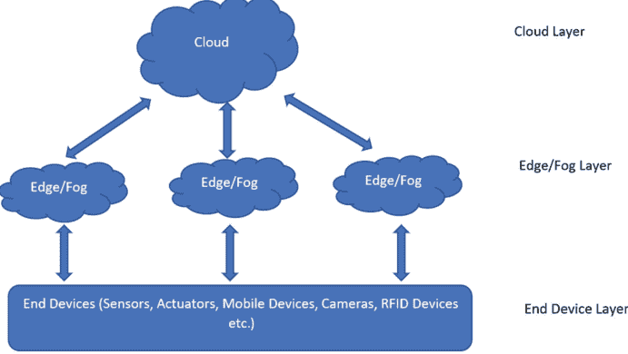

图 3.1 云雾/边缘架构。

### 3.3.1 三层架构的基本组件

### 3.3.1.1 端层/物理层

物理和虚拟节点是涉及架构底层的终端设备。终端设备会向中间层发送请求，这些请求需要处理并收集响应 [7]。物理和虚拟节点通过有线或无线介质与雾层通信。终端设备随时都会产生数百万比特的数据。不同的物联网设备、智能设备、手机手机、RFID 设备等构成了下层。必须强制执行通信策略和安全标准，以确保数据在物理层和雾层之间平畅传输。

### 3.3.1.2 雾层/边缘层

雾层通常包括雾节点、设备和服务器。雾节点是配置用于从虚拟和物理节点收集数据的设备。雾节点包括雾服务器，收集的数据在其中进行存储和分析。雾服务器将连接到雾设备，雾设备充当终端设备与服务器之间的中间设备。雾设备需要连接到雾服务器，这通过网关实现 [8]。

雾服务器负责执行卸载操作并存储各种决定卸载策略的算法。卸载是指将传入的请求分配到可用的雾节点。雾层还包括

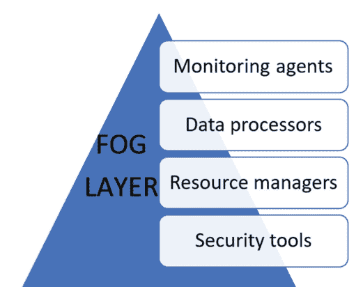

图 3.2 雾层的实体。

用于数据分析、处理、过滤、数据管理、应用生命周期管理等的复杂代理程序。雾计算的不同特性通过组件实现，例如监控代理程序、数据处理器、资源管理器和安全代理程序。图 3.2 展示了雾层的主要实体。

雾层中的监控代理程序负责持续监控和评估连接设备和程序的性能。监控服务将使用一组 API 来确保资源得到妥善利用。通信服务、资源可用性、卸载策略、系统负载将得到持续监控。

数据处理器是雾层的一部分，是执行过滤、分析和错误检测的软件。它们运行在雾节点上，并决定传入的数据是否需要转发到远程云或应在雾节点中处理。负载均衡、数据处理、对分析数据嵌入智能是数据处理程序的一些功能。

资源管理器确保雾层和终端设备层中不同设备的顺畅运行。资源应妥善分配，数据必须在适当同步的情况下传输到相应的设备。必须及时进行数据备份，并妥善监控资源需求。资源管理器还要消除数据冗余的可能性。

雾层包含一套安全工具，用于检查和验证数据源，并防止未经授权的访问。原始数据必须在无错误的情况下处理，通信必须经过妥善编码。对于连接的应用和用户的安全策略必须妥善制定，并进行严格监控，使用安全工具来维护数据的可靠性。

雾/边缘层中的不同单元相互协作，并与上层云层和底层物理层同步工作。

### 3.3.1.3 云层

来自中间层的过滤后的数据将转发到上层云层进行永久存储。云执行雾层无法完成的详细分析和处理。云拥有丰富的资源，作为中间边缘/雾层的支持层。云层提供了数据的永久存储和任何时间的数据访问性。

云层包括云接口等组件，它包含一组帮助应用程序与云交互的图形用户界面 (GUI)，应用程序包括能够为请求客户端模型提供所需功能的软件，以及广泛的服务模型，如平台即服务 (PaaS)、基础设施即服务 (IaaS)。云拥有巨大的存储空间和完善的安全原则，以确保数据安全。云中的管理模块负责前端和后端的管理，并检查资源利用率和可用性。管理模块确保通信无误发生，并监控系统性能。云存储和服务可以从远程访问。云层的主要组件共同工作，以确保底层之间的数据传输。响应时间取决于可用性和网络状况。但由于边缘/雾层能够在本地执行大部分处理，连接应用程序的性能可以得到保障。云层中支持数据操作的不同单元如图 3.3 所示。

三层架构子层的主要组件共同工作，以提高连接系统的性能。模型的工作可以总结如下：最底层的端层产生数据，数据通过通信介质移动到边缘/雾层。中间层的雾设备接收数据并进行分析。时间敏感型数据将以因子模式处理以缩短响应时间。生成的响应将返回给底层的响应设备。边缘/雾层具有数据处理器，决定数据是否必须卸载到雾节点或远程云 [7]。如果数据不是时间关键的，它将被过滤并发送到远程云进行进一步的存储和处理。云层在处理请求后将响应返回给底层。因此，结合策略有助于在不损害性能的情况下减少延迟。上述模型在不同领域具有众多应用。大多数物联网应用正从纯云转向边缘/云集成以降低延迟。

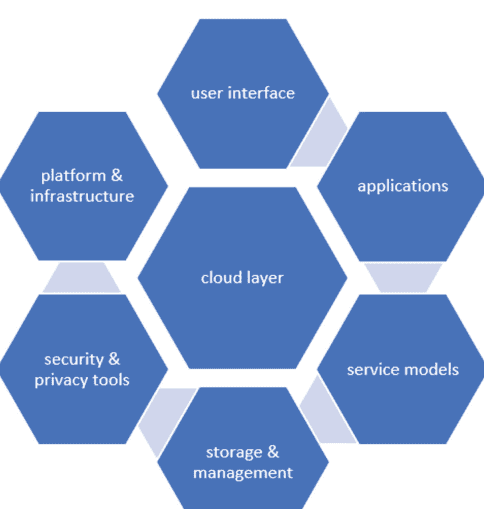

**图 3.3 云层的组件**。该领域的研究非常活跃，正在测试不同的算法以使应用程序更具效率。该领域的倡议正日益流行。

## 3.4 边缘/雾计算的应用

边缘/雾计算平台支持多种应用程序。不同的应用领域包括医疗健康、物联网应用，如智能城市、智能电网、智能汽车 [4]。目前讨论了边缘计算的一些用例。

### 3.4.1 医疗行业

医疗行业每秒产生大量数据，需要进行存储、处理和分析。健康信息的分析和决策过程是时间关键的，无法容忍延迟。边缘或雾计算通过提供更快的响应时间来减少延迟。数据可以被过滤并传输到云进行永久存储。

### 3.4.2 物联网应用

物联网应用依赖云进行存储和处理，因为节点资源受限。传感器产生数百万比特的数据，需要以快速速度进行存储和处理。由于原始数据需要在生成响应之前进行过滤和分析，云计算面临巨大的延迟。边缘/雾计算通过在物联网设备附近进行处理后，带宽消耗、延迟和流量拥堵将得到减少。

### 3.4.3 增强现实 (AR)

增强现实 (AR) 是使用系统输入增强物理实体的技术。该技术应具有最小延迟和高数据处理率，以生成正确的信息。即使响应出现微小延迟也会损害客户体验。因此，边缘/雾计算对支持增强现实的应用影响巨大。

### 3.4.4 银行金融行业

银行金融行业非常重视数据安全和隐私。敏感信息不应长距离传输到远程云，这会增加数据泄露的风险。边缘/雾计算模型可以在不同的银行本地构建。处理可以在本地进行，确保数据安全和隐私。通过在银行业引入边缘/雾计算，可以立即分析欺诈行为并采取适当措施而无需延迟。

### 3.4.5 制造业

制造业需要更快的响应，因为其操作是高度时间关键。从远程云获取响应的延迟会导致现场事故和错误。机器产生大量的原始数据，需要进行分析以得出模式和决策。


## 3.4.6 汽车行业

EdgeAI 是汽车行业一个非常有前景的平台。汽车行业正在快速增长。边缘计算为预测性维护提供了必要的支持，协助司机识别问题并采取应急控制、防止事故的驾驶员监控、驾驶员识别支持等。通过引入 EdgeAI，可以对紧急情况进行适当跟踪并发出警报。

## 3.4.7 总结

边缘/雾计算还支持在线游戏应用、视频流应用以及工业控制应用。在引入边缘/雾计算后，在线流媒体应用的用户体验可以得到极大提升。边缘/雾对于所有时间敏感和延迟敏感的应用来说都是一个非常有前景的解决方案。

## 3.5 挑战与研究方向

边缘/雾计算是一个研究创新发生极快速的模型。研究人员正在研究边缘/雾整合的影响，以分析其在不同场景下的实施效果 [2]。由于该技术仍处于早期阶段，与之相关的担忧和问题仍然较多。以下讨论了边缘/雾计算需要解决的主要挑战和研究方向。

### 3.5.1 复杂性增加

边缘/雾计算本质上是分布式的，雾节点跨越多个位置。系统资源分布在不同的位置之间，这增加了设计的复杂性。应该妥善进行资源分配和维护，以提高应用程序的性能。已经开展了适当的研究计划来减少分布式实施的复杂性。

### 3.5.2 隐私与安全

雾/边缘计算使计算更接近终端设备，与远程云相比，它更加安全。但必须设计适当的授权和认证原则以确保系统的可靠性。雾计算中的终端设备通过无线网络连接到雾服务器，这可能导致数据丢失、数据修改和数据处理不当。必须设计适当的安全策略和授权程序来克服隐私和安全方面的挑战。网络安全始终是一个研究工作持续进行的领域。需要在边缘/雾层实施并测试通用的加密策略和安全算法，以理解潜在风险。

### 3.5.3 任务调度/卸载

卸载（Offloading）是将给定的任务加载到分布式管理器中可用雾节点的过程。来自不同设备的接入请求需要被高效分配，以提高应用程序的性能。实施时应选择合适的负载均衡算法来有效地卸载数据。这是雾/边缘实施中需要解决的挑战之一。研究工作应侧重于设计新的算法，以高效的方式执行卸载。

### 3.5.4 功耗

雾节点跨越多个位置，增加了功耗。该领域的研究较少。受电源限制的终端设备有时被配置为边缘设备。边缘节点需要执行复杂的处理和分析，这可能会导致电池耗电得更快。这必须被优先考虑，并确定适当的。

### 3.5.5 数据管理

数据管理是雾实施中需要解决的另一个挑战。接入数据的分布、数据的收集、数据缓存、加密原则、命名空间问题等都需要得到解决，以有效率管理数据。应该仔细设计算法以有效地管理数据。

### 3.5.6 服务质量 (QoS)

雾节点在本质上通常是异构的。不同的参与节点需要满足 QoS 要求。必须在连接性、数据内容、交付等方面维持质量。集成具有不同能力的不同雾节点对于工业应用来说可能是一个挑战 [10]，在这些应用中必须保证 QoS 要求。必须进行适当的研究，以使边缘/雾能够支持 QoS 保证的应用。

### 3.5.7 多特性雾设计系统

雾的实施应该考虑多种特性，如带宽、延迟、功耗、能源效率、卸载、安全和隐私等。但目前的研究仅聚焦于一个或两个参数，不支持组合策略。这是一个开放研究领域，雾的设计应该包含多种特性，并设计一个高效的系统。

边缘/雾计算面临着上述讨论的挑战。该技术处于婴儿阶段，有许多需要解决的开放研究问题。雾的安全与隐私、分布式雾节点中的数据卸载、雾中的带宽利用、多特性雾设计理念等，都是研究工作必须关注的某些领域。目前有不同的平台可用于雾的实施。有许多仿真平台可用于边缘/雾实施。研究人员可以探索不同平台的特性，并根据需求选择合适的模拟器。包括架构层级、加密策略、任务调度、网络使用和资源监控。

## 3.6 结论

边缘/雾计算已作为云计算的辅助手段出现，以使处理更快并提高性能。广泛的应用依赖云端进行数据存储、处理、执行数据分析等。某些依赖云的应用遭受着严重的延迟。通过引入边缘/雾计算可以减少延迟和等待。边缘/雾计算实现在网络边缘。这极大地缩短了响应时间、延迟、抖动和时延。边缘/雾计算在成本、可扩展性、可靠性、隐私和安全方面具有许多优势。

广泛的应用正从单一云平台向边缘/雾-云环境移动。这种整合极大提升了应用程序的性能。边缘/雾是一个非常有前景的平台，比现有单一云实施具有许多优势。结合边缘/雾和云的混合模型已获得广泛普及。解决边缘/雾相关的挑战需要对该概念有深入理解。本文的不同章节将帮助研究人员获取关于边缘/雾环境的知识，并关注需要研究的领域。

## 参考文献

- [1] B. Ali, M. Gregory, and S. Li (2021) “Multi-Access Edge Computing Architecture, Data Security and Privacy: A Review.” IEEE Access, 9:18706.
- [2] M. Sahnoun, N. Sghaier, D. Baudry, and C. Gout (2018) “Challenges Facing the Industrial Implementation of Fog Computing.” presented at 2018 6th International Conference on the Future of Things and the Cloud, 341–348.
- [3] Y. Mansouri and M. Babar (2021) “A Review of Edge Computing: Features.” WSEAS Transactions on Computers, 19:155.
- [4] M. Laroui, B. Nour, H. Moung, M. Aifi, and M. Guizani (2021) “Edge and Fog Computing: A Survey.” Computer Communications, 180:210–231.
- [5] J. Singh, P. Singh, and S. Gill (2021) “Fog Computing: A Taxonomic, Current Trends and Research Challenges.” Journal of Parallel and Distributed Computing, 157:56–85.
- [6] H. Sabireen and V. Neelarayanan (2021) “A Review on Fog Computing: Architecture, Fog with IoT, Algorithms and Research Challenges.” ICT Experience, 7(2):162–176.
- [7] C. H. Chen and C. T. Liu (2020) “A 3.5-Tier Container-Based Edge Computing Architecture.” Computers and Electrical Engineering, 93:107227.
- [9] Y. Sirwardhana, P. Porambage, M. Liyanage, and M. Ylantila (2021) “A Survey on Mobile Augmented Reality with 5G Mobile Edge Computing: Architectures, Applications, and Technical Aspects.” IEEE Communications Surveys and Tutorials, 23(2):1160–1192.


# 第 4 章

## 在医学图像分类中减少过拟合并提高深度学习模型的性能

Nidhin Raju 和 D. Peter Augustine

## 4.1 引言

图像分类为图像分配至少一个名称的过程，它是计算机视觉领域最重要的挑战之一。它有许多应用，包括图像和视频恢复、视频侦察、网络内容评估和生物识别。特征编码是图像分类中的一个重要元素，近年来受到了广泛关注，并提出了许多编码计算 [1]。通常，图像分类涉及从图像中提取特征，然后对分离出的部分进行分组。这种情况下，图像分类的关键问题是如何从图像中提取和分析特征。传统的图像分类方法使用低级或中级特征。低级特征主要由数据的灰度厚度、多样性、表面、形状和位置决定，这些都受到人类感知的影响（也称为手工特征）。在计算机视觉中提取特征后，通常使用分类器为各种类型的物体分配标签 [2]。

深度学习技术与传统的图像分类策略不同，它将图像特征提取和分组的过程合并到一个单一结构中。深度学习的高级特征可视化已被证明优于手工的低级和中级组件，在图像识别和分类中取得了卓越成果。这是深度学习模型的基础，它由许多层组成，例如卷积层和全连接层，这些层将输入数据（例如图片）转换为输出数据（例如分类输出），同时处理到日益重要的特征。深度学习的主要优势是它可以在从头到尾准备好的单一网络中，训练信息驱动（或任务显式）的多样化特征以及特征提取和排列 [3, 4]。由于能够从复杂数据中自动学习和提取复杂的特征，深度学习是包括医学图像分类在许多领域的有效方法。

与计算机视觉相比，将深度学习应用于医学图像分类很少遇到固有问题。虽然计算机视觉人士可以轻松获取并免费使用常用且广泛适的大型数据库，但使用临床图像则更为困难。虽然计算机视觉专家可以有效访问并开放常见的有益医学图像的海量数据库（有时甚至是免费的），但在开发新的基于深度学习的创新时，获取和使用医学图像是一个关键关注问题。尽管图像归档和通信系统（PACS）框架充满了几乎从每个诊所获取的海量图像，但医学图像数据集通常很小且是私有的 [3, 5]。这些海量存储数据不易被用于临床图像分析的两个主要原因是：临床信息必须包含规则以保证正确使用。为了将图像包含在特定的报告中，患者必须给予知情同意，并且必须遵循信息匿名化程序以确保患者安全。缺乏图像标注是另一个原因。构建临床图像分类模型假设图片中的每个像素都由其类别标记（即或剩余部分），这是耗时的并且需要大量的描绘 [6, 7]。

限制似乎不仅来自成像数据，还来自相关标注的性质。为图像中的每个像素获取特定标签是耗时的，并且需要主数据。因此，专业人员试图通过开发自加载标注工具、制作足够的标注或公开推广非主标签来减轻负担。在任何这些场景中，管理标签噪声都是一种测试。结果注释的性质（可以视为模糊）通常是不标准的，信息、图像目标、视觉识别和弱点等变量起着重要作用。因此，开发基于数据的深度学习框架需要仔细考虑在现实世界放大噪声和暴露的最有效方法，这仍然是一个持续的研究课题 [8]。

因此，从有限的清晰数据取得进展是设计人员和专家必须关注的重要课题。通常有不同的策略通过深度学习-分类方法增加数据集的大小。数据增强是这些策略之一，指的是通过添加额外的图像来扩大数据集，无论是通过解释和旋转等简单操作，还是通过更先进的方法。在许多应用中，传统的照片被 3D 医学体积被大量的自主 2D 图像取代，以为模型提供额外信息 [9]。经常从图像中消除子卷或图像块以增加可用数据量。不可否认的缺陷是与切片面对称的头部解剖设置被完全消除了。考虑到生成对抗网络（GAN），提供了另一种处理伪造图像以扩大数据集的技术。GAN 是一种独特的神经网络模型，其中两个模型同时进行进展：一个是生成器，专注于从噪声向量中创建伪造图像；另一个是判别器，专注于区分生成器产生的真实和伪造图像。GAN 通过解决一个判别器试图改进并减少的问题而创建。

## 4.2 深度卷积神经网络 (DCNNs)

DCNN 是由不同层级的变换（层）组成的复杂神经网络。大多数 DCNN 可以分为两个部分。特征提取部分从输入中提取各种特征。另一部分是分类，它实际上通过使用元素组件的特征移除来处理给定问题。多层感知器是神经网络中典型的分类器，通常被接受为分类组件。DCNN 的优势在于特征提取部分具有获取适用于给定任务的密集紧凑信息表征的卓越能力 [12, 13]。此外，反向传播方法使 DCNN 能够获得良好的表征，而这些表征是专家以传统图像识别的方式手工制作的，从头到尾进行优化。DCNN 的特征提取层由“卷积”和“空间池化”层组成。卷积层作为元素提取器，类似于神经元细胞。该层将输入映射到激活图。池化层在空间上容忍微小失真并减少激活图的维度。这类似于对视觉数据的特征抽象 [14, 15]。卷积神经网络（CNN）被归类深度学习网络，通常用于分析和分类图像。它们由输入层和输出层组成，中间有若干层。这些层由提取图像各种特征的卷积层组成。

CNN 由以下非线性函数表示：

```
$c_i = C(M; \theta)$
```

将图像 $M \in R^{W \times W}$ 转换为大小为 $W \times W$ 的向量 $c_i = (c_1, c_2, ... c_i)^T$，其中 $i = 1 \dots n。并表示图像属于 $n$ 个类别之一：映射输入的 $K$ 个参数为 $\theta = \{\theta_1, \theta_2, ... \theta_k\}$。

CNN 训练可以被视为非线性优化问题：

```
$\hat{\theta} = arg_{min} K(k^{(1)}, k^{(2)}, \dots k^{(N)})$
```

N 是在这种情况下训练 CNN 的图像数量，并且

```
$K(k^{(1)}, k^{(2)}, \dots k^{(N)}) = \frac{1}{N} \sum_{j=1}^{N} D_j v^{(j)T} log(I^{(j)}; \theta)$
```

```
$D_i = - \frac{O_i}{\sum_{l=1}^n O_l}$
```

```
$\theta_{l+1} = \theta_l - \alpha \Delta L(\theta_l) + \gamma(\theta_l - \theta_{l-1})$
```

## 4.3 使用迁移学习进行医学图像分类

迁移学习是深度学习中使用一个任务来改进另一个任务的技术。例如，给定任务 1 中提供的大量结构，模型学习实际上想要学习和总结任务 2 中的视觉元素。特征提取和微调是 CNN 中的两种迁移学习类型。特征提取在之前提到的学习示例中执行；当 CNN 获得任务 1 的特征时，使用类似的


## 深度模型在医学图像分类中的性能

通过将全连接层替换为任务特定的显式分类器，替换网络的基础卷积和池化层。在此过程中，卷积基的负载将被冻结，只有新的分类器准备用于车辆分类 [17, 18]。从卷积基获取的特征是可重用的，而在全连接层中学习到的特征旨在用于模型训练的类别。在微调阶段准备好结构信息工作后，会对卷积基的权重进行微调以匹配特定任务的问题。这需要解冻卷积基的几个高层，并添加另一个分类器，在卷积基被冻结时，该分类器的学习参数（与特征提取不同）。在进行这种类型的迁移学习时，处理新数据时，CNN 的未解冻层将与全连接层一起进行准备。多阶段迁移学习采用一次或两次的特征提取或微调，从而允许调整训练流水线，并使结果准备活动中重用的从之前阶段获得的表征具有更高的适应性 [19, 20]。

### 4.3.1 在医学图像分类中使用迁移学习面临的挑战

考虑到迁移学习，医学图像分类的一个很大比例专注于使用示例 CNN 模型的变体，例如 MobileNet、DenseNet、Inception、VGG19。在医学图像分类中，CNN 是过度参数化的以提高执行效率。标准深度 CNN 在训练交互期间比轻量化模型学习得慢，且过优化时间也更长。这种挑战可能由于学习不足而导致训练时间增加和轮数延长 [21]。例如，将 Resnet 与随机森林算法结合用于脑出血分类任务，与标准 Resnet 模型相比，它展示了更优的准确性，尽管需要更多的轮数和更长的训练时间才能获得良好的准确率。迁移学习提供了在无需任何准备的情况下使用模型的优势；然而，模型的大小和参数对 ImageNet 预训练模型也有负面影响。最近的研究包括了额外的考虑模块，用于获取深层并拒绝不必要的包含。使用这些模块证明了在增加计算权重的同时提高精度的能力 [22, 23]。

通常，如果模型可行性不受损害，更短的训练时间和更低的计算成本对医学图像分类领域将是有利的。标准 CNN 模型由于其高深度和大量的层，在医学图像分类中是有效的，但它们会产生额外的计算成本。Inception 模型具有 700 万个参数，少于优秀的 CNN，但在标准计算机设备上训练又太贵了 [24]。虽然最近中央处理器和图形处理器取得了显著发展，但在某些现实应用中这并不实际。虽然这仍处于早期阶段，但这种情况为研究可以在手机上轻量级架构（LWAs）提供了机会，以提高便利性和生产力。如果一个数据集包含对每个可用类别的适当图像注释，则该数据集是被标记的。例如，如果一个心脏图像数据集有两个类别，“心脏”和“正常”，则每张图像都应该用这两个类别进行说明 [25]。

标记的数据集对医学图像分类至关重要，因为学习模型依赖大量的标记图像进行训练以提供有效的图像分类。与普通图像相比，收集大量的标记临床图像数据集可能是一项困难的任务。在获得良好的标记图像数据的情况下，迁移学习也可以成功并做出更强大的配置。传统的迁移学习技术在缺乏信息的情况下表现良好，但仍有改进空间 [26]。在普通图像中，图像之间的特征差异是关键的，图像具有各种光照和形状，但在医学图像中，这些区别取决于问题可能非常微小，这使得在使用迁移学习策略时，通过有限的信息学习特征变得困难。多阶段迁移学习是克服这一挑战的一种可行策略。

### 4.3.2 迁移学习在医学图像分类中的应用

虽然传统的迁移学习采用微调并包含特征提取，但多阶段迁移学习至少使用它几次。这允许模型从相关领域（医学）获取特征，并由于特征相似而在轨道上表现得更好。模态桥接迁移学习可能是医学分类中首次执行两阶段迁移学习的首次评估，使用 MRI、CT 和 X 光作为脚架数据集和来自相似区域（注释较少图像）的目标信息库，而源基是 ImageNet。从输入数据集到脚架数据集元素空间的投影函数是经过学习的；然后执行从源到连接的组件空间的非直接规划；最后，分类器在脚架数据集使用的投影任务上进行学习 [27, 28]。这个过程维持了问题数据集和源数据集的差异。可以使用 VGG16 模型进行分析，结果是在 MRI、CT 和 X 光这三种模态的每种精度上工作 [29]。轻量级架构比标准深度 CNN 约束更、尺寸更小，但它们似乎产生了相当的准确率。LWAs 允许我们快速高效地准备这些模型。MobileNets2、NasNets、EfficientNets 是 LWAs 的示例，它们为更高效的图像分类产品铺平了道路。这些模型都有独特的组合优势，导致图像识别任务的改进。例如，MobileNets 使用深度分离卷积，而 SqueezeNet 通过将 3x3 卷积通道替换为 1x1 通道来减少基础训练期间的计算开销。在医学图像分类中使用 LWAs 仍处于早期阶段，但随着 4.3.1 节提到的进一步开发的新方法，该领域正在快速进展。许多此类模型被用于迁移学习。由于其边界较少，SqueezeNet 模型在速度方面优于所有其他模型。尽管 SqueezeNet 在额外的复杂模型中取得了良好结果，但存在一些将癌症图像误分类为无害的情况，这表明 LWAs 存在问题，有必要进一步分析 [30, 31]。

## 4.4 防止过拟合的技术

当你的模型在准备数据上实现强匹配但在隐藏数据上表现不佳时，就会发生过拟合。通常，模型为训练数据学习特定的设计，这些设计在其他数据中是多余的。可以通过观察类似于准确率或损失的验证指标来识别过拟合。验证指标在若干轮数后停止工作并开始下降。随着模型旨在对训练数据进行最佳拟合，训练指标继续改进。当模型尝试预测数据中噪声太大的模式时，它被称为过拟合。这是由于模型过于复杂且具有大量边界。鉴于模式不代表数据中的真实情况，过拟合的模型是不正确的。如果模型在可见数据（训练集）上产生优异结果，但在隐藏数据（测试集）上惨遭失败，就可以确定这一点。深度学习模型的目标是以最好的方式将从训练数据到问题领域的任何信息进行泛化。这至关重要，因为我们认为模型应该根据其从未见过的数据来生成预测 [32]。

在深度学习中，主要标准是我们应该能够对训练过的先前未知输入执行有效操作。对先前未知数据源执行有效操作的能力被称为泛化。深度学习网络的目标是产生一个最终模型，该模型在我们用于训练的数据以及可以使用该模型进行预测的新数据上都表现良好。一个能够合理学习训练数据集并在留出数据集上表现良好的模型就是一个好模型。当模型试图拟合所有已训练的
是深度学习中的一个典型陷阱


## 72 机器智能

数据保留了模式，同时也保留了噪声和不规则的波动。由于不可见的数据条件，这些模型无法进行有效的总结和执行，导致了模型的问题。模型表现出的高概率表明存在过拟合问题。模型的训练时长或架构深度可能导致其过拟合 [33]。如果模型在训练数据上训练时间过长或模型过于复杂，它就会学习数据集中的噪声或冗余数据。一个无法熟悉问题、在训练数据集上表现不佳、且在留出测试中表现不佳的模型就是欠拟合模型。模型的拟合程度可以被看作是偏倾向差异的折中。欠拟合模型具有高偏差但低方差。无论训练数据中的具体示例是什么，它都无法熟悉问题。过拟合模型具有低偏差和高方差。模型极好地学习了训练数据，但其执行结果与未见的新数据甚至训练数据集样本中添加的可量化噪声有显著差异 [34]。减少过拟合的简单方法：

- 添加更多数据
- 改变模型的复杂度。

深度神经网络的优势在于，它们的性能随着处理日益增大的数据集而提高。一个拥有近乎无限数据的模型最终将在达到网络学习极限时趋于平缓。如果模型具有必要的容量，它可以对训练数据集产生过拟合。模型的限制可以降低模型过拟合准备数据集的概率，直到其不再过拟合。脑网络的复杂度定义为其在节点和层方面的构建，以及其在权重方面的边界。通过这种方式，我们可以通过两种不同的方法改变模型的复杂度来减少过拟合：

- 通过修改网络结构来改变权重数量。
- 通过更改参数来改变权重值。

在神经网络中，可以通过调整通用参数的数量改变复杂度。控制模型复杂性的另一种方法是使用正则化，它包括在误差方法中引入惩罚项。巨大的权重几乎总是会导致激活函数的剧烈变化，结果是输入发生微小变化会导致输出的巨大变化。关注迫使神经网络权重大小的技术是更合理的，因为单个模型结构可以被表征为受约束的，因为它对于该问题其限制远高于预期，而在训练期间可以使用正则化来确保模型不过拟合。在这种情况下，通过额外的限制可以改进执行效果，使其侧重于在工作中学习更好的泛泛化思想 [35, 36]。

## DL 模型在医学图像分类中的性能

正则化策略是通过保持网络权重最小化，从而尝试减少过拟合的方法。正则化涉及此类方法，通过向呈现不佳的问题添加额外数据将其转化为更一致的呈现事项。当给定数据的微小变化引起排列的大幅变化时，程序可以被认为呈现不佳。由于信息周围的不确定性，排列是不真实的，约束中的微小估计误差可能会被极度放大并导致荒谬的反应。正则化背后的概念是利用数据在一致的结构中重复呈现不佳的问题。正则化策略被广泛用于减少过拟合，以至于“正则化”一词可以指代改进模型泛化误差的策略。正则化是对学习模型的任何调整，旨在减少其泛化误差而非训练误差。正则化是深度学习领域主要关注的问题之一，其重要性随着优化而改变 [37, 38]。

### 4.4.1 权重正则化

最简单且常见的正则化策略是根据负载的大小对损失测量添加惩罚。神经网络熟悉各种最能引导对产出贡献的负载。具有巨大网络权重的网络可能是架构不稳定的指标，输入的微小变化可能导致结果的显著变化。这可能表明模型过拟合了训练数据集，并在预测新数据时可能表现不佳。解决此问题的方法之一是更新学习模型，赋予网络保持轻权重。这被称为权重正则化，通常用作减少训练数据集过拟合和提高模型泛化能力的整体策略。在训练神经网络时，我们应该使用随机梯度下降和训练数据集来熟悉网络的权重。我们训练模型越久，权重对数据就越具体，导致训练数据过拟合。权重会填大小，以处理训练数据中的可用样本。巨大的权重使模型不稳定。当权重特定于训练数据集时，微小的变化或事实性噪声将导致结果的巨大差异。具有巨大权重的网络比权重较小的网络更复杂。它表明模型过度关注训练数据。通常，我们建议使用更简单的模型和权重更轻的模型来解决问题。另一种可能性是存在许多输入因素，每个因素与结果的相关性程度不同。我们有时可以使用策略来帮助选择输入因素，但因素之间的相互关系并不总是显而易见的。对网络不重要或冗余的贡献保持较少权重允许模型增长和学习。这有助于构建一个更简单的模型 [39, 40]。

深度学习模型能够从基础数据轻松地开发出丰富的内部表示。特征表示学习是用于此的术语。因此，信息更好的表示可能会鼓励更好的知识进入该领域，例如通过所学特征的表示以及使用所学亮点的更好的预测模型。所学特征可能过度特定于训练数据或过拟合且在其他模型上表现不佳，这是一个问题。学习表示中的巨量特征可能是过拟合的标志。活动正则化提供了一种方法，使学习表示（或模型隐藏层的起始）保持不足和未开发。特征学习可以通过高级深度学习模型进行，即在网络训练期间，模型将从信息设计中分离出显著的亮点或学习亮点。这些特征可以用于模型来预测复发量，或预测一个类别作为表征的激励。这些内部描绘再次。模型内部隐藏层的结果是在模型中通过处理模型学习的特征 [39]。较大的权重会导致更严厉的惩罚和损失分。因此，模型将被具有更中庸的权重，这些权重比在训练数据集上有效执行所需的要大。我们称之为权重正则化，因为较小的权重被认为更典型或不那么专门。通过将这种惩罚模型系数的方法应用于其他机器学习模型（如逻辑回归或线性回归），可能使用“收缩”来指代它，因为惩罚导致系数在优化系统期间收缩 [40]。

过拟合通过神经网络中的高权重指示。一个巨大的模型很可能吸收了噪声训练数据。结果是，模型是不稳定的，并且对信息因素的变化极其敏感。结果，过拟合的网络在新鲜数据上生成预测时表现不佳。解决此问题的一种已知且流行的方法是刷新在训练过程中精化的损失函数，以考虑权重的大小。这被表征为惩罚，模型权重越大，惩罚受罚就越重，导致更大的劣势以及更大的升级。结果，惩罚鼓励权重在训练期间尽可能小或不大于计划，从而减少过拟合。使用惩罚的缺点是，虽然它鼓励模型采取较小的权重，但它并不强制较小的权重。任何情况下，配备权重正则化惩罚的神经网络可能会启用巨大的权重，有时是非常巨大的权重 [41, 42]。

学习模型可以被升级以协助网络利用轻权重。实现此目标的方法之一是修改用于的损失测量


# 深度学习模型在医学图像分类中的性能 ■ 75

网络的进展考虑了权重的大小。请记住，当我们训练模型时，我们会限制损失度量。在计算批次（batch）中预期值与期望值之间的差异时，我们可以将模型中所有负载的当前大小加入估计，或包含一个层。这被称为惩罚，因为我们正在根据模型权重的大小对模型进行惩罚。较大的权重会导致更严厉的惩罚以及更高的损失分。优化算法将推动模型具有适中的权重，例如权重不大于训练数据集上表现良好所需的权重。微小的权重被认为更正常或不异常，以这种方式使用惩罚权重正则化 [39]。较大的权重会导致更严重的惩罚以及更高的损失分。进展计算将驱动模型具有更适中的权重，例如权重不大于训练数据集上表现良好所需的权重。我们将其称为惩罚权重正则化，因为较轻的权重被认为更常见或不特殊。当这种惩罚模型系数的技术用于各种 AI 模型时，它可能被称为收缩（shrinkage），因为惩罚使系数在交互进展过程中退缩。

### 4.4.2 活动正则化

深度学习模型可以从输入数据中提取显著特征，或在网络训练期间学习特征。这些特征可以用于模型预测复发或预测类别以作为分类的激励。这些内部特征由网络中隐藏层的输出指定。有一领域的研究专注于特征的高效且成功的程序学习，通常通过让网络在使用学习特征的精确输入之前减少对次要学术特征的贡献来检查。这些模型被称为自动编码器（auto-encoders）或编码器解码器（encoder-decoders），它们学习的元素有助于更多地了解领域并进行预测。学习的元素或编码输入应该足够大以捕捉数据的显著特征，同时足够窄以防过拟训练数据集中的特定模型。因此，学习特征的表达能力和推测之间存在冲突 [43]。

网络的损失函数可以更新，以根据其激活幅度来惩罚模型。这与权重正则化相似，因为损失函数被更新以根据负载的大小来惩罚模型。这种惩罚或正则化被称为初始化正则化（initiation regularization）或动作正则化（action regularization），因为层的结果被称为其激活或动作。编码器的结果，在大多数情况下，神经网络中隐藏层的结果可以被看作模型对问题的表征。

## 机器智能

结果，这种惩罚也被表征正则化（representation regularization）。希望具有少数初始化甚至少数具有通常零属性的执行，也被称为对稀疏性的渴望。因此，这种惩罚被称为稀疏特征学习。当使用比需要的隐藏层来学习避免过拟合的特征时，通常寻求稀疏性。稀疏惩罚的引入缓解了这个问题并鼓励了更好的推测。稀疏的过完全学习特征已被证明比其他类型的学习特征更成功，为数据扰动甚至变化提供了更好的活力，例如，图像的学习特征可能对图像中障碍物的位置具有进一步发展的不不变性 [44, 45]。

可以对每一层应用激活惩罚，即使只层只应用在作为学习线性化焦点的某一层上，例如编码器模型的结果或自动编码器模型的中心。可以应用一个与层向量结果幅度相对应的惩罚约束。初始化值可以是正的也可以是负的，我们不能简单地聚合属性。确定激活大小有两种常用方法如下：

- 直接激活值的总和，也称为 L1 范数。
- L2 范数是激活值的平方和。

L1 范数促进稀疏性，例如允许少数执行变为零，而 L2 范数促进较小的初始化值。使用 L1 范数可能是初始化正则化中更常见的惩罚。应该确定一个指示不幸能力遭受或遭受后果程度的超参数。正常属性在 0 到 0.1 之间的对数尺度上进行测量。活动正则化可以与其他正则化程序（如权重正则化）结合使用。一种常用方法是激活正则化。它可以用于大多数并非所有类型的网络模型，包括著名的网络类型，如多层感知器、卷积神经网络等。活动正则化对于寻求优秀学习表示的模型类型可能是最好的。这些包含自动编码器模型和编码器解码器模型。启用稀疏性的 L1 标准是最常识别的正则化。研究不同类型正则化的几种路径，例如 L2 标准或同时使用 L1 和 L2 范数。修正后的线性激活函数（也称为 relu）是目前在深度神经网络隐藏层中广泛使用的激活能力。尽管有经典的初始化工作如 tanh 和 sigmoid（策略能力），relu 允许很好地具有确定的零特性 [45]。这使得它在学习有限表征时（例如使用 L1 向量范数进行正则化）成为一个可行的竞争者。通常提供微小属性以

# 深度学习模型在医学图像分类中的性能 ■ 77

正则化超参数，这影响执行对惩罚的投入程度。从对数尺度上的值开始实验，例如 0.1、0.001 和 0.001。然后，在那一点，对显示出最忠实程度的关键程度进行网格搜索。将输入因子缩放为具有相同的尺度通常是一个好方法。当输入因子具有不同尺度时，组织负载的幅度将相应地波动。巨大的负载会淹没非线性交换能力并减少层结果的变化。这在使用激活正则化时可能是一个问题。设计被选为训练特征的层（例如编码器或自动编码器中的瓶颈）包含比需要的更多的节点。这被称为不完全表示，它将鼓励模型过拟合训练样本。这可以通过正则化的强度区域来抵消，以刺激一种不足的丰富描写 [44, 45]。

### 4.4.3 添加 Dropout 层

深度学习网络可能由于少数模型而快速过拟合训练数据集。具有各种模型设置的集成被认为可以减少过拟合；然而这需要训练和维护不同模型的额外计算成本。通过在训练期间不规则地退出节点，可以使用单个模型重建无数不同的模型设计。这被称为丢（dropout），在所有相等的情况下，它提供了一种计算上非常简单且极具吸引力的正则化策略，以减少深度学习中的过拟合和泛化误差。构建在较小数据集上的巨型神经网络有过度拟合训练数据的潜力。当在未见过的数据（如测试数据集）上评估模型时，它的表现糟糕，因为它学习了训练数据中的实际噪声。减少过拟合的策略是将所有不同的网络拟合到相同的数据集并平均每个模型的预测。这无法立即实现，但可以使用一小组不同的模型或收集的模型进行近似估计 [46, 47]。

Dropout 是一种模拟训练大量不同模型的正则化技术。在整个训练过程中，少数输出会被意外忽略或消除。结果是，层看起来并被处理为与前一层不同的节点集和网络。实际上，训练期间的每次层更新都是从不同配置层的角度执行的。Dropout 使得学习过程充满噪声，迫使层中的节点概率性地承担信息源的全责任。这种观点表明，dropout 区分了网络层协作纠正先层错误的情况，从而增强了模型。Dropout 复制了特定层的稀疏激活，这异常地提示了


# 机器智能

事实上，模型调整稀疏表示是一种侧面影响。因此，它可以被用作活动正则化的替代方案，以在自动编码器模型中实现稀疏表示。Dropout（丢弃）发生在神经网络模型的每一层。大多数层类型，包括大型全连接层、卷积层和循环层，都倾向于使用它。Dropout 可以应用于模型的任何或所有隐藏层，以及输入层和可见层。输出层不使用它 [48, 49]。

### 4.4.4 噪声正则化

添加随机噪声是解决日益增长的泛化误差和映射结构问题的技术之一。神经网络在开发过程中噪声的增加会影响其正则化，进而影响其性能。已经证明，权重正则化方法对过拟合能力的影响与延长惩罚周期具有类似的效果。引入噪声本质上增强了训练数据集的大小。每当一个样本引入模型时，输入变量都会发生随机变化，使得每次对模型的暴露都是独特的。这使得在输入样本中添加噪声成为一种简单的数据增强方法。添加噪声会降低网络记忆样本的能力，因为样本一直在不断变化，导致网络权重更小，且网络更具韧性，泛化误差之降低。噪声意味着从已知样本周围的领域提取了新样本，平滑了输入空间的结构。由于这种平滑处理，映射函数可能更容易被网络学习，从而获得更好、更快速的学习 [50, 51]。

### 4.4.5 使用早停法停止训练

在准备一个大型模型时，总会有这样一个时刻：模型将停止执行并开始拟合训练数据集中的事实性噪声。训练数据集的这种过拟合会导致泛化误差的上升，使得模型在不可见数据上的用性降低。困难之处在于，如何让模型能够从贡献和收益中获取计划，同时又不会让训练时间过长以至于过拟合训练数据。一种解决方案是将训练轮数（epochs）数量作为超参数，并使用不同的值对模型进行多次训练，然后选择在训练集或留出数据集上产生最佳性能的轮数。这种策略的缺点是，它由于需要训练并丢弃多个模型。这在计算上可能是低效且耗时的，特别是对于在海量数据集上训练数几天或几周的大型模型而言 [52, 53]。另一种选择是仅对大量的训练轮数进行一次模型训练。在每轮训练后，在留出验证数据集上对模型进行评估。如果模型在验证集上的性能开始恶化，则终止训练过程。停止训练时使用的模型具有很强的泛化性能。这被称为早停（early stopping），它是最老且最广泛使用的神经网络正则化类型之一 [54, 55]。

## 4.5 结论

深度学习是医学图像评估的重要组件之一。它已成功用于目标识别、分割和分类。深度学习在临床领域的进展依赖于大量临床信息的收集，这些信息具有多模态特征，从而为深度学习提供了大量的丰富信息。在疾病治疗方面，深度学习不仅可以定位受伤部位，还可以区分和识别特定的病变。当损伤真实时，识别模型还可以分割受伤区域。虽然深度学习有许多优势，但它严重依赖信息集合。每个深度学习网络都需要海量信息进行训练，使得数据索引获取变得非常困难。根本原因是高像素信息图像过于复杂，因此未来的改进模式是专注于开发较小的模型。深度学习在医学行业的发展可能非常快，因为它与广泛的治疗程序密不可分。将深度学习充分应用于医疗护理的所有阶段正变得越来越复杂。它取决于两个因素：技术的持续迭代和医学经验的不断积累。另一方面，深度学习模型出现过拟合问题主要是因为训练集中可用数据的缺乏以及网络架构。我们在本章介绍了了一些过拟合问题的解决方案，并利用了深度学习模型的性能。

## 参考文献

- 1. C. Affonso, A. L. D. Rossi, F. H. A. Vieira, and A. C. P. Carvalho (2017) “Deep Learning for Biological Image Classification.” *Expert Systems with Applications*, 85: 114–122. doi:10.1016/j.ESWA.2017.05.039.
- 2. S. R. M. Zeebaree et al. (2020) “Deep Learning Models Based on Image Classification: A Review of Facial Expression Recognition Based on Hybrid Feature Extraction Techniques,” *International Journal of Science and Business*, 4(11): 75–81. doi:10.5281/zenodo.4108433.
- 3. S. Suganayadev, V. Seethalakshmi, and K. Balasamy (2021) “A Review on Deep Learning in Medical Image Analysis., *International Journal of Multimedia Information Retrieval*, 11(1): 19–38. doi:10.1007/S13735-021-00218-1.
- 4. B. Kantheti and M. K. Javjai (2022) "Medical Classification for Disease Prediction with Aid of Deep Learning Approaches." Paper presented at 6th International Conference on Intelligent Computing and Control Systems (ICICCS), June, pp. 1442–1445. doi:10.1109/ICICCS53718.2022.978844
- 5. Y. Li (2022) "Deep Learning Models in Image Recognition," Paper presented at IEEE 22nd International Conference on Power, Electronics and Computer Applications (ICEPECA), Shenyang, China, March 2022, pp. 994–999. doi:10.1109/ICEPECA53079.2022.971847
- 6. M. Tuniski (2022) "Deep Learning Models in Medical Image Analysis." Journal of Oral Biosciences, 64(3): 312–320, doi:10.1016/j.job.2022.03.003
- 7. N. Raju (2017) "Text Extraction from Video Images." Journal of Engineering Research, 12: 14750–14754 (accessed August 12, 2022). Online. Available at: www.rippublic.com.
- 8. A. Rahman, M. Ahmed, and M. Zaman (2021) "Survey of Medical Image Analysis Using Deep Learning." In of 5th International Conference on Computing Methods and Communication (ICCMC), April, pp. 1334–1342. doi:10.1109/ICCMC51019.2021.9418
- 9. M. A. Abdou (2022) "Literature Review: Efficient Deep Neural Techniques." Neural Computing and Applications, 34(8): 5791–5882, doi:10.1007/s00078-022-09
- 10. S. Yadav and S. M. Jadhar (2019) "Deep Convolutional Neural Network for Disease Diagnosis." Journal of Big Data, 64(1): 18. doi:10.1186/s40537-019-2
- 11. M. Frid-Adar, I. Diamant, E. Kang, M. Amitai, J. Goldberger, and H. Greenspan (2018) "GAN-Based Synthetic Image Augmentation for Lesion Classification." Neurocomputing, 32(1): 321–331., doi:10.1016/j.neuucom.2018.09
- 12. P. Malhorta, S. Gupta, D. Chandal, A. Aguila, and W. Enbley (2022) "Deep Neural Networks for Medical Segmentation." Journal of Healthcare. Online. doi:10.1155/2022/958099
- 13. X. Wang et al. (2022) "Detection and Classification of Mandibular Fracture on CT using Convolutional Networks." Clinical Imaging, 26(6): 4593–4601. doi:10.1007/s00078-022-4
- 14. X. Zhang, V. C. Lee, J. Rong, J. C. Lee, and F. Liu (2022) "Deep Convolutional Networks for Thyroid Disease Detection: A Multi-Classification by Ultrography." Computer Methods and Programs in Bioinformatics, 220:101663. doi:10.1016/j.cmpb.2022.101663
- 15. L. Wang et al. (2022) "Trends in the Application of Deep Learning Networks in Medical Image Analysis: Evaluation between 2012 and 2020." European Journal of Radiology, 146:110069, doi:10.1016/j.ejrad.2021.110069
- 16. X. Yu, J. Wang, Q. Q. Hong, R. Teku, S. H. Wang, and Y. D. Zhang (2022) "Transfer Learning for Medical Images: A Survey." Neurocomputing, 489: 230–254, doi:10.1016/j.neuucom.2021.08.159
- 17. J. Meng, Z. Tan, Y. Yu, P. Wang, and S. Liu (2022) "TL-Med: A Two-Stage Learning Recognition for Medical Images of COVID-19." Biocernetics and Biomedical. Engineering, 42(3): 842–855. doi:10.1016/j.BBE.2022.04.005


## 深度学习模型在医学图像分类中的性能

- 18. L. Alzubaidi 等人 (2021) “用于标记限制数据医学成像的新型迁移学习方法。” 13(7):1590; doi:10.3390/CANCERS13071590.
- 19. J. Wang, H. Zhu, S. H. Wang 和 Y. D. Zhang (2021) “医学图像分析中的深度学习综述。” *Mobile Networks and Applications*, 26(1):351–380; doi:10.1007/S11306-020-01672-7/TABLES/11.
- 20. S. Nie, M. Liu, Y. Liu, J. Wang 和 H. Song (2021) “医学成像的远距离域迁移。” *IEEE Journal of Biomedical and Health Informatics*, 25(5):3784–3793; doi:10.1109/JBBI.2021.3051470.
- 21. G. Ayana, K. Dese 和 S. W. Choi (2021) “通过超声成像进行乳腺癌分类迁移学习。” *Cancers*, 13(4):738; doi:10.3390/CANCERS13040738.
- 22. F. Alhaf, S. M. Sam 和 N. K. Kanji (2021) “用于 X 光分类 COVID-19 及其他胸部疾病的增强深度迁移学习，” *Neural Computing and Applications*, 33(20):14037–14048, doi:10.1007/S00521-021-06044-0/TABLES/7.
- 23. M. A. Morid, A. Borjali 和 G. Del Fiol (2021) “利用 ImageNet 进行医学图像分析的迁移学习研究范围。” *Computers in Biology and Medicine*, 128:104115, doi:10.1016/j.compbiomed.2020.104115.
- 24. D. R. Sarvamaama 和 R. V. Kulkarni (2022) “医学图像理解中的卷积神经网络：综述。” *Evolutionary Intelligence*, 15(1):1–22. doi:10.1007/S12065-020-05400-3/FIGURES/2.
- 25. S. Cyriac, N. Raju 和 S. Ramwamy (2021) “深度学习医学分类中全训练与迁移学习的比较。” *Lecture Notes on Systems*, 290: 58–67; doi:10.1007/978-981-16-4486-3/COVER.
- 27. Karimi, S. K. Warfield 和 A. Gholipour (2021) “医学图像分割中的迁移学习：来自模型参数动力学和学习表示的新见解。” *Artificial Intelligence in Medicine*, 116: 102078; doi:10.1016/j.aiai.2021.102078.
- 28. M. Oftaab, M. Javed A, S. Khalid, R. Javed 和 H. Shabir (2021) “利用迁移学习从显微图像检测白血病执行 Spark DL。” 发表于 2021 年人工智能与数据科学国际会议 (CAIDA 2021)，四月，页码 216–220. doi:10.1109/CAIDA5941.9425264.
- 29. N. Raju, Anita H. B. 和 P. Augustine (2020) “使用深度学习识别典型肺部疾病。” *International Journal of Electrical and Computer Engineering*, 10(6): 6283–6291; doi:10.1159/IJECE.V10I6PP6283-6291.
- 30. L. Gaur, Bhatia, N. J. Janjhi, G. Muhammad 和 M. Masud (2021) “使用深度卷积神经网络基于医学图像检测 COVID-19。” *Multimedia Systems*, 1: 1–10. doi:10.1007/S00530-021-00974-6/TABLES/6.
- 31. J. M. Valverde 等人 (2021) “磁共振脑成像中的迁移学习：系统性综述。” *Journal of Imaging*, 7(4): 66. doi:10.3390/jimaging70400066.
- 44. S. Nduzzi, S. A. Bigeli, S.-C. Liu 和 L. A. Dunbar (2022) “通过活动正则化优化脉冲神经网络的消耗。” 发表于 IEEE 声学会议，四月，页码 61–65. doi:10.1109/ICASSP43922.2022.974635.
- 45. M. Decuyer, M. Stockhof, S. Vandenberghe 和 X. Ying (2019) “过拟合及其解决方案概述。” *Journal of Physics: Conference Series*, 1168(2): 022022. doi:10.1088/1742-6596/1168/2/022022.
- 46. C. Zhang, O. Vinyals, M. Munos 和 S. Bengio (2018) “深度强化学习中过拟合的研究。” *arXiv*, 四月:10.48550/arxiv.1804.06893.
- 47. H. K. Ali 和 R. Z. Khan (2014) “监督机器学习中避免过拟合和欠拟合的方法（比较研究）。” *Computer Science, Communication & Instrumentation Devices*, 163–171.
- 48. N. Srivastava, G. Hinton, A. Krizhevsky 和 R. Salakhutdinov (2014) “Dropout：防止神经网络过拟合的简单方法。” *Journal of Machine Learning Research*, 15, 1929–1958.
- 49. S. San 和 X. Liu (2019) “深度神经网络中的过拟合机制与规避。” *arXiv*, 一月:10.48550/arxiv.1901.06566.
- 50. J. Sh (2022) “神经元特定 Dropout：一种防止神经网络过拟合并减少对大训练样本依赖的确定性正则化技术。” *arXiv*, doi:10.48550/arxiv.2201.06938.
- 51. F. Yang, H. Zhang 和 S. Tao (2022) “带有 Dropout 的简化的多层...网络。” *Applied Intelligence*, 52(5):477–491.
- 52. S. Kumar, N. Raju 和 S. Ramwamy (2021) “深度学习医学分类中全训练与迁移学习的比较。” *Lecture Notes on Systems*, 290: 58–67; doi:10.1007/978-981-16-4486-3/COVER.

[/content]

## 深度学习模型在医学图像分类中的性能

- 18. L. Alzubaidi 等人 (2021) “用于标记限制数据医学成像的新型迁移学习方法。” 13(7):1590; doi:10.3390/CANCERS13071590.
- 19. J. Wang, H. Zhu, S. H. Wang 和 Y. D. Zhang (2021) “医学图像分析中的深度学习综述。” *Mobile Networks and Applications*, 26(1):351–380; doi:10.1007/S11306-020-01672-7/TABLES/11.
- 20. S. Nie, M. Liu, Y. Liu, J. Wang 和 H. Song (2021) “医学成像的远距离域迁移。” *IEEE Journal of Biomedical and Health Informatics*, 25(5):3784–3793; doi:10.1109/JBBI.2021.3051470.
- 21. G. Ayana, K. Dese 和 S. W. Choi (2021) “通过超声成像进行乳腺癌分类迁移学习。” *Cancers*, 13(4):738; doi:10.3390/CANCERS13040738.
- 22. F. Alhaf, S. M. Sam 和 N. K. Kanji (2021) “用于 X 光分类 COVID-19 及其他胸部疾病的增强深度迁移学习，” *Neural Computing and Applications*, 33(20):14037–14048, doi:10.1007/S00521-021-06044-0/TABLES/7.
- 23. M. A. Morid, A. Borjali 和 G. Del Fiol (2021) “利用 ImageNet 进行医学图像分析的迁移学习研究范围。” *Computers in Biology and Medicine*, 128:104115, doi:10.1016/j.compbiomed.2020.104115.
- 24. D. R. Sarvamaama 和 R. V. Kulkarni (2022) “医学图像理解中的卷积神经网络：综述。” *Evolutionary Intelligence*, 15(1):1–22. doi:10.1007/S12065-020-05400-3/FIGURES/2.
- 25. S. Cyriac, N. Raju 和 S. Ramwamy (2021) “深度学习医学分类中全训练与迁移学习的比较。” *Lecture Notes on Systems*, 290: 58–67; doi:10.1007/978-981-16-4486-3/COVER.
- 27. Karimi, S. K. Warfield 和 A. Gholipour (2021) “医学图像分割中的迁移学习：来自模型参数动力学和学习表示的新见解。” *Artificial Intelligence in Medicine*, 116: 102078; doi:10.1016/j.aiai.2021.102078.
- 28. M. Oftaab, M. Javed A, S. Khalid, R. Javed 和 H. Shabir (2021) “利用迁移学习从显微图像检测白血病执行 Spark DL。” 发表于 2021 年人工智能与数据科学国际会议 (CAIDA 2021)，四月，页码 216–220. doi:10.1109/CAIDA5941.9425264.
- 29. N. Raju, Anita H. B. 和 P. Augustine (2020) “使用深度学习识别典型肺部疾病。” *International Journal of Electrical and Computer Engineering*, 10(6): 6283–6291; doi:10.1159/IJECE.V10I6PP6283-6291.
- 30. L. Gaur, Bhatia, N. J. Janjhi, G. Muhammad 和 M. Masud (2021) “使用深度卷积神经网络基于医学图像检测 COVID-19。” *Multimedia Systems*, 1: 1–10. doi:10.1007/S00530-021-00974-6/TABLES/6.
- 31. J. M. Valverde 等人 (2021) “磁共振脑成像中的迁移学习：系统性综述。” *Journal of Imaging*, 7(4): 66. doi:10.3390/jimaging70400066.
- 44. S. Nduzzi, S. A. Bigeli, S.-C. Liu 和 L. A. Dunbar (2022) “通过活动正则化优化脉冲神经网络的消耗。” 发表于 IEEE 声学会议，四月，页码 61–65. doi:10.1109/ICASSP43922.2022.974635.
- 45. M. Decuyer, M. Stockhof, S. Vandenberghe 和 X. Ying (2019) “过拟合及其解决方案概述。” *Journal of Physics: Conference Series*, 1168(2): 022022. doi:10.1088/1742-6596/1168/2/022022.
- 46. C. Zhang, O. Vinyals, M. Munos 和 S. Bengio (2018) “深度强化学习中过拟合的研究。” *arXiv*, 四月:10.48550/arxiv.1804.06893.
- 47. H. K. Ali 和 R. Z. Khan (2014) “监督机器学习中避免过拟合和欠拟合的方法（比较研究）。” *Computer Science, Communication & Instrumentation Devices*, 163–171.
- 48. N. Srivastava, G. Hinton, A. Krizhevsky 和 R. Salakhutdinov (2014) “Dropout：防止神经网络过拟合的简单方法。” *Journal of Machine Learning Research*, 15, 1929–1958.
- 49. S. San 和 X. Liu (2019) “深度神经网络中的过拟合机制与规避。” *arXiv*, 一月:10.48550/arxiv.1901.06566.
- 50. J. Sh (2022) “神经元特定 Dropout：一种防止神经网络过拟合并减少对大训练样本依赖的确定性正则化技术。” *arXiv*, doi:10.48550/arxiv.2201.06938.
- 51. F. Yang, H. Zhang 和 S. Tao (2022) “带有 Dropout 的简化的多层...网络。” *Applied Intelligence*, 52(5):477–491.
- 52. S. Kumar, N. Raju 和 S. Ramwamy (2021) “深度学习医学分类中全训练与迁移学习的比较。” *Lecture Notes on Systems*, 290: 58–67; doi:10.1007/978-981-16-4486-3/COVER.

## 深度学习模型在医学图像分类中的性能

## 第5章
# 使用深度学习进行检测

## 5.1 引言

### 5.1.1 自动驾驶车辆
自动驾驶车辆是指没有驾驶员的汽车或卡车，它们结合传感器来导航和行驶。

### 5.1.2 自动驾驶等级

| 0 无自动 | 1 辅助辅助 | 2 部分自动 | 3 有条件自动 | 4 高级自动 | 5 全自动 |
| :--- | :--- | :--- | :--- | :--- | :--- |
| 手动控制。驾驶员执行任务（转向、加速等）。 | 车辆配备某些辅助系统（如巡航控制）。 | 部分自动。车辆可以加速和制动。人类驾驶员可以接管。 | 环境检测车辆可以执行任务。 | 车辆在特定情况下执行。仍需人类监督。 | 车辆执行所有任务。 |

- 等级0：所有主系统由人类控制。
- 等级1：某些系统（如自动制动）也由人类控制。
- 等级2：车辆提供至少两个机器驱动功能，如加速和转向，但它需要人类确保安全。
- 等级3：车辆将在限制范围内管理所有安全关键功能，但在提醒时人类驾驶员可以接管。
- 等级4：车辆在某些情况下是完全自动，但并非所有。
- 等级5：车辆完全能够。

### 5.1.3 数字图像处理
数字图像处理或图像处理是计算机视觉的一个分支。它通过各种算法来突出或理解图片。

### 5.1.3.1 图像预处理
预处理技术用于消除或抑制不需要的噪声并以这种方式提高图像质量，通过


被称为和平与锐化。其他使用的图像预处理技术包括旋转、缩放、放大、调整大小、将图像转换为灰度图像以及变换。

## 5.1.4 深度学习

深度学习（也称为深度结构化学习）可能是更广泛的机器学习家族的一部分，该家族支持具有启发式学习的人工神经网络。深度学习可以是监督的、无监督的以及强化的。深度学习还是一种受人脑工作机制启发的算法集合，作为处理信息和创建用于高认知过程的模式的方法。深度学习基于名为人工神经网络的模型设计。深度学习在计算科学领域取得了巨大的成功，其算法被广泛应用于解决高级问题的行业。每种深度学习算法都使用多种神经网络来完成检测任务。深度学习算法通过从示例学习来训练计算机。医疗、电子商务、娱乐和广告等行业常用深度学习。

## 5.1.5 卷积神经网络

卷积神经网络（CNN）是深度学习算法程序之一。神经网络架构受到了人类大脑工作方式的启发，由许多相互作用的神经元层组成。毕竟，如果的大脑可以学会理解，为什么合成大脑不能做到这一点呢？神经网络使计算机能够识别完成任务所需的模式。在这种情况下，目标是向机器如何确定和感知它所处的环境。教车辆识别的最有效方法是使用一种称为卷积神经网络的特殊神经网络。CNN 由于其卓越的空间知识被应用于计算机视觉中。这表明，如果我们有一个人的图像，即使我们尝试对其进行旋转、翻转、挤压和拉伸，CNN 也能识别出它是一个人。CNN 能力背后的关键在于使用特殊的层作为卷积层，从图像中提取模式。初始卷积层识别边缘和角等低级模式。由于模式通过额外的卷积层演进，例如，用于观察个体的卷积层可能会从边缘到形状，再到肢体，最后到完整的人。卷积神经网络本身主要用于图像分类的架构，当给定一张图片时，网络可以准确地分配一个给定的类别。

## 5.1.6 计算机视觉

计算机视觉意味着从图片、文本、视频等中提取数据。通常，计算机视觉努力模仿人类视觉。它是人工智能的一个分支，从数字图像或视频中收集数据并将其分割以描述属性。整个方法涉及图像获取、查看、审查、区分和数据提取。这一深入过程帮助计算机识别任何视觉内容并据此采取行动。计算机视觉项目将数字视觉内容转换为精确描述以构建多维知识。这些知识随后转换为计算机可读的语言，以辅助决策方法。人工智能这一分支的主要目标是训练机器从图片收集信息。

### 5.1.6.1 计算机视觉的应用

计算机视觉用于以下任务：

- 目标检测：物体的位置或地点。
- 目标识别：图像中的物体及其位置。
- 目标分类：物体所在的巨大物体。
- 目标分割：像素与该物体的整合。

人工智能领域在过去几年中发生了巨大的变化，产生了新技术。计算机视觉是近期获得动心的领域之一，旨在指示机器学习和解释视觉世界。计算机视觉处理从分类图片到识别人脸的许多困难情况。如今可能解决的一个挑战是目标检测。

## 5.1.7 目标检测

目标检测是一种结合两个任务的技术：目标分类和目标定位。它是一个被训练用于观察多个类别物体存在和位置的模型。这可以用于静态图片，也可能在视频中实时进行。目标检测定位物体并将其归类完全不同的类别，并在物体周围画框来对其定位。目标检测有几个用例。例如，自动驾驶或自动化驾驶在行驶时需要准备好确定道路上的不同物体。为了处理这些情况，正在使用各种渐进算法来观察物体，例如 R-CNN、Fast R-CNN、Faster R-CNN、Mask R-CNN、SSD、YOLO 等。YOLO（YOU ONLY LOOK ONCE）被认为是最强大的目标检测算法之一，由 Joseph Redmon 及其他三人设计。

## 5.1.8 YOLO：只看一眼

许多目标检测模型多次理解和处理图像，以检测图片内部存在的所有物体。但 YOLO 正如名称所示，仅仅看一次物体。它对整个图像应用一次处理，并预测边界框及其类别选择或可能性。这使得 YOLO 成为一种超快速的实时目标检测算法。卷积神经网络同时预测多个边界框以及这些框的类别概率。YOLO 使用完整图像的特征来实时预测框的每个边界以及其类别，它是同时完成的。与人类相似，YOLO 几乎能立即识别出给定图像中哪里有什么物体。一旦在图像上运行，YOLO 首先将图像划分为每个网格单元内的关联 SXS，然后 YOLO 就可以预测计划范围边界框的位置、大小和相关的置信度评分，本质上是在物体所在任何地方预测类别和潜在位置。如果关联物体的中心落在网格单元中，则该网格区域的边界框将准确定位并预测该物体（图 5.2 和图 5.3）。


图 5.2 划分为网格单元的输入图像。


5.3 预测的特征图。

## 5.2 文献综述

T.H. Jung 等人 [1] 设计了一个仅在农业环境中检测人员的系统。四通道帧摄像头安装在四个侧


# 使用 DL 算法的运动目标检测 ■ 91

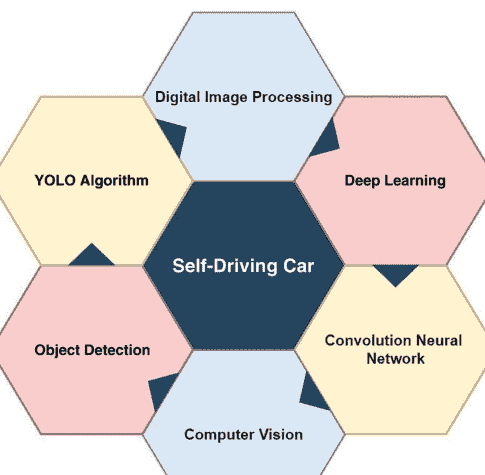

图 5.4 所提方法的概述。

拖拉机的（左、右、前和后方）数据是从整个周围收集的。使用 Nvidia Jetson Xavier 平台作为实验系统，能够执行高速基于 GPU 的并行处理，以避免资源问题。CNN [2] 具有多种目标检测算法，如 R-CNN [3]、Faster R-CNN [3]、Mask R-CNN、Over Feature、Single Shot Detector (SSD) 和 YOLO 系列。YOLO 被认为是本章最好的网络，因为它能够获得高精度的检测并能够实时运行。YOLO（You Only Once）顾如其名，目标检测只需要通过神经网络进行一次传播。YOLO [3] 使用 CNN 进行目标检测。本章采用 YOLOv3 [4] 网络进行人员识别，并对所提系统进行了某些更改。

在某项研究 [5] 中，使用 YOLOv3 建立了行人检测系统。YOLO 算法规则在单类别可视化上进行训练：人员类别。与普通的 YOLOv3 相比，它实现了很高的精确度和召回率。在 Lidar-LS-R-YOLOv4 方法中，某论文使用设备云图通过深度学习测量数据以发现并分割物体 [6]。主要数据集是 KITTI，它为测量通过设备点云获取并在图片上的物体分割（Lidar 分割）提供了深度信息。随后在 YOLOv4 [7] 中，神经网络感兴趣区域 (ROI) 检测物体作为最终的目标检测结果。

Tiny 检测支持了改进的 YOLO 网络方法 [8]。该论文简单介绍了由 YOLOv3 网络 [4] 优化的 YOLO 网络模型支持的道路信息小目标检测，该模型使用了双特征提取网络结构。骨干网络提供了一个感受野的特殊特征提取辅助网络。辅助网络的特征信息融合以及额外的骨干节点采用了注意力机制。它关注特征通道，抑制无效信息通道，并提高了了网络方法的效率。

使用改进的 YOLOv1 [9] 神经网络进行目标检测是一种用于目标检测的改进网络。原始 YOLOv1 [10] 的旧损失函数对大物体和小物体采取相同的误差。对相邻物体的预测不尽如意。在同一网格中检测两个物体变成了一个问题，与旧损失函数和网络误差相比，新的损失函数更灵活且可优化。

Chitra 和 Gomathi [11] 提出了一种使用 YOLOv3 算法通过车道检测方法检测行人，这对于自动驾驶车辆至关重要。

Handalage [12] 回顾了 CNN 算法的基础结构，以及 YOLO 实时目标检测算法的概述。CNN 设计模型将提取每个给定图像的亮点并看到物体。在这里，作者使用 YOLOv2 模型来此这项工作。

Thakkar 等人 [13] 报告了使用的自定义图像数据集并使用 YOLO 对六类进行训练以跟踪和排序。在正在的视频中识别车辆或行人对交通分析很有帮助。

Pal 和 Chawan [14] 对深度学习和目标检测框架进行了简要介绍，其中他们解释了 CNN 及其最新的目标检测算法。

在通过深度网络后，Lan 等人 [15] 改进了 YOLO 算法的网络结构，并提出了新的网络结构 YOLO-R。由于丢失了一些行人信息，导致了梯度消失，导致行人检测不准确。

## 5.3 所提方法

如今交通事故非常常见。特别是在大城市中，有许多运输模式。此外，道路变得越来越窄，城市也变得越来越拥挤。

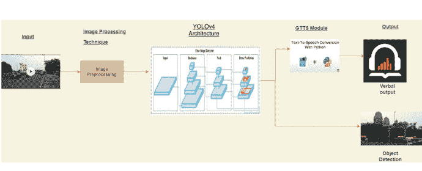

**图 5.5** 所提架构。

目标检测是无人驾驶车辆的重要部分。这项工作预计发现使用 YOLOv4 设计训练的完全不同的类别，除了将物体标签（文本）转换为语音或音频响应，以便视障人士理解不熟悉的环境。这项工作通过利用 YOLOv4 算法程序实现，该程序通过一种被称为 Dark net 的非常先进的卷积神经网络变体结合 OpenCV 和 Google Text to Speech 运行。带有音频输出的多目标检测方法如图 5.5 所示。

### 5.3.1 所提架构

在此架构中，输入数据是使用交通期间拍摄的视频收集，然后转换为帧。该系统侧重于识别和识别交通环境中指定的五类物体（人、汽车、公交、自动车）。这五类被认为是我们数据集中的物体。此外，这些帧使用图 5.6 所示的工作流进行处理，并在此处进行了详细说明。

图 5.6 所提方法的流程图从接收输入图像并在 YOLO 网络上对其处理以检测物体开始。一旦完成检测，它会将物体标签转换为语音以产生音频输出，直到终止或停止执行。

### 5.3.2 标注的输入图像

交通信号视频转换为图像帧，然后使用标注工具进行标注。

- 步骤 1：帧是输入图像，已使用标注工具对图像进行注释。

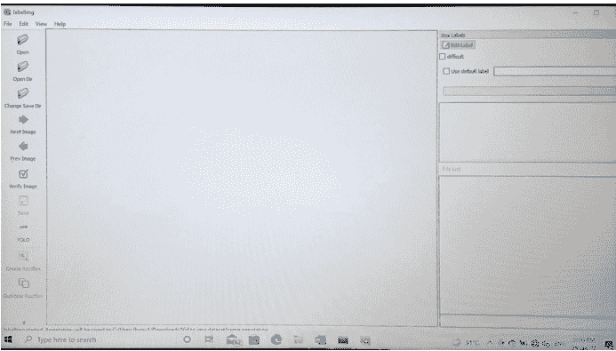

- 步骤 2：使用标注工具创建边界框。

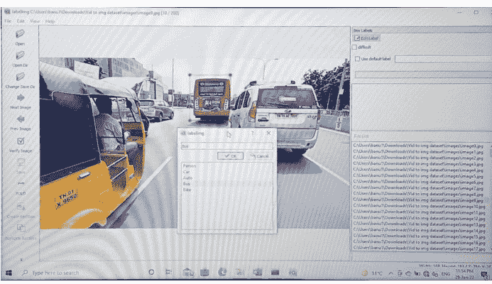

- 步骤 3：保存带有坐标的注释文件。

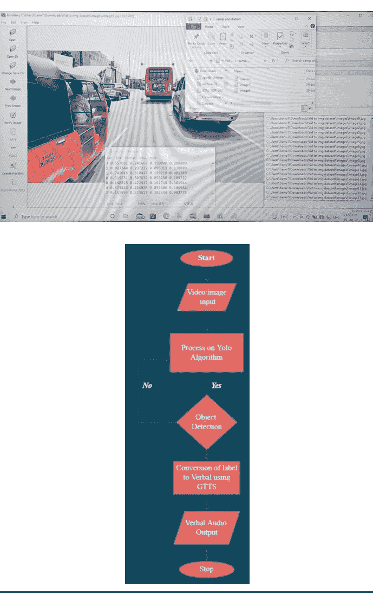

图 5.6 所提方法的流程图。

### 5.3.3 所提方法的阶段

- 步骤 1：视频采集：这是一个使用高分辨率相机捕捉运动视频的过程。在这项工作中，在交通期间从不同角度和不同方向以 mp4 格式捕捉了 30 秒的交通视频。

- 步骤 2：图像帧：这是一个从运动视频将视频转换为图像帧的过程。随后这些图像帧被用于训练算法。

- 步骤 3：YOLOv4 目标检测器：这是从给定图像帧中检测物体并正确预测物体的过程。

- 步骤 4：边界框：为了识别汽车、公交、自行车和自动车等各种物体，使用了带有标注名称的边界框以便于识别。

- 步骤 5：检测到的物体：最后，通过预测的边界框检测各种物体。

- 步骤 6：音频段：将预测的物体标签（文本）转换为语音或音频响应。

### 5.3.4 YOLOv4 架构

我们已经讨论了 YOLO，由于其速度和精度，它是最著名的目标检测算法之一。YOLOv4 是为此过程设计的，基于最近的分析结果，使用 CSPnet53 作为骨干，SPP（空间池金字塔）和 PAN（路径聚合网络）称为“颈”，并使用 YOLOv3 作为“头”。网络包含 53 个 1x1 和 3x3 大小的卷积层，每个卷积层连接到批量归一化 (BN) 层和 Mish 激活层。SPP 可能是通过同时在多个内核尺寸（1, 5, 9, 13）上进行池化来利用精细和粗略信息的方法。PAN 是通过合并来自完全不同骨干的特征来利用层信息的技术。该模型包含 53 个卷积层，每层跟随批量归一化层和 Leaky ReLU 激活层。预测输出包含地面真值的中心，它预测图像。图像中心负责检测物体，并通过概率预测框是否包含某一类别。

### 5.3.4.1 交并比 (IoU)

交并比用于找到平均平均精度 (mAP)。这是一个从零到一的数字，规定了预测框与地面边界框之间的重叠质量。


# 使用深度学习（DL）算法的图像目标检测 ■ 97

- 如果 IoU = 0，则与边界框没有重叠。
- 如果 IoU = 1，则完全重叠，即框的并集等于它们的重叠部分。

### 5.3.4.2 mAP

平均精确率（mAP）通过收集一组预测的物体检测结果和一组真实值（ground truth）物体标注来计算。

- 对于每一个预测，都会与图像中包含的每个真实值标注计算 IoU。
- 随后将这些 IoU 阈值化到某个值（通常在 0.5 到 0.95 之间），并根据贪心策略（即优先匹配 IoU 最大的）将预测与真实值框进行匹配。
- 随后为每个物体类别生成召回率（PR）曲线，并计算平均精确率（AP）。PR 曲线考虑了模型在不同置信值范围内相对于正样本例和负样本例的性能。
- 所有类别的 AP 平均值即为 mAP。

### 5.3.4.3 Precision率

精确率（Precision）是正样本例数与正预测总数之比。例如，如果模型检测到 100 辆汽车，其中 90 辆是正确的，则精确率为 90%。

### 5.3.4.4 Recall回率

召回率（Recall）是正样本例数与实际（相关）物体总数之比。例如，如果模型正确检测出图像中的 75 辆汽车，而图像中实际上有 100 辆汽车，则召回率为 75%。

- F1 分是精确率和召回率的加权平均值。值范围从 0 到 1，其中 1 代表最高准确率。

### 5.3.4.5 非极大抑制 (NMS)

非极大抑制（NMS）可能是各种计算机视觉任务中使用的最后步骤。它是一类算法，用于从许多重的实体（例如边界框）中选择出一个实体。NMS 的目的是为物体确定最佳边界框，并拒绝或“抑制”所有其他备选边界框。NMS 考虑了两个因素：

1. 模型的分类得分；
2. 边界框的重叠程度。

## 5.3.5 Google 文字转语音

Google Text-to-Speech 是一个 Python 库和用户语音编程接口，用于与 Google Translate 的文本转语音应用程序接口（API）进行交互。它具有多功能的预处理和分词功能。Text-to-Speech 生成材料、人类语音的原始音频表示。也就是说，它创建了像人类说话一样的音频。当你发送语音合成请求时，需要指定语音。Text-to-Speech 提供了多种自定义语音。这些语音根据语言、性别和口音而异。例如，我们能够产生带有英国口音的女性声音。我们能够将不同的文本转换为带有澳大利亚口音的男性声音。

## 5.3.6 YOLOv5 模型检测方法

目标检测是一种用于定位图像或视频中实例的计算机视觉技术，并带有边界框。

### 5.3.6.1 方法的设计

该方法使用 YOLOv5 版本及其四个模型来检查性能（图 5.7）。它们分别是 YOLOv5s、YOLO5m、YOLO5l 和 YOLOv5x，简写为小型、中型、大型和大特号。

- 解码文件：我们使用视频捕获目标并初始化，每个视频帧都已解码（即转换为图像序列）。
- 预处理：转换后的图像帧已预处理到特定大小。在此方法中，我们使用了通道为 3 的 416x416 图像。
- 标注：预处理后的图像使用标注工具进行标注。 YOLO 目标检测是一种监督学习算法，需要格式为 .txt 的标注数据集。
- YOLOv5 目标检测：在此版本中，我们使用了 YOLOv5s、YOLO5m、YOLO5l 和 YOLOv5x 模型进行检测。
- 目标检测：各种图像的预测边界框具有置信得分。


图 5.7 方法流程。我们基于 PyTorch 框架实现了 YOLOv5，它使用 .yaml 文件进行配置。最流行的基于 Python 的深度学习库是 PyTorch 和 TensorFlow。YOLOv5 m、l 和 x 模型的结构显示在 Tensorboard 的 5.4 节中。PyTorch 是由 Facebook 开发的最先进深度学习框架之一，因其易用性和动态计算图而流行。

## 5.4 实验结果

执行提出的技术，实验设置用于检测人员、公交车、汽车和自行车。这项工作处理了 200 帧视频图像以获得实验结果。对于目标检测，在不同场景、不同光照条件下自由选取不同的图像，并使用 YOLOv4 算法创建边界框。

结果是计算出的平均精确率（AP）和平均精确率（mAP）在整体检测中取得了更好的结果（表 5.1）。

### 5.4.1 mAP 性能

图 5.8 显示了 mAP 和损失曲线。

## 表 5.1 检测评估指标

| 指标 | 数值 |
| --- | --- |
| 精确率 (%) | 71 |
| 召回率 (%) | 67 |
| 置信阈值 (Conf_thresh) | 0.25 |
| mAP | 71.5 |
| IoU 分 | 50.86 |
| F1 分数 (%) | 69 |
| 平均损失 | 0.7 |

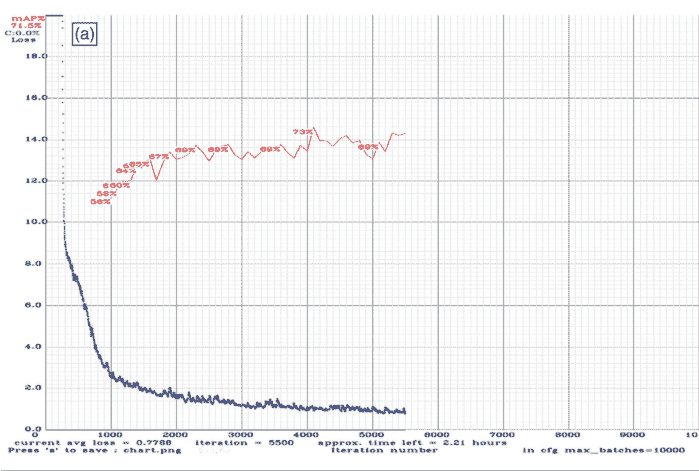

图 5.8 mAP 和损失曲线，(b) 带有音频的 YOLOv4 性能结果。

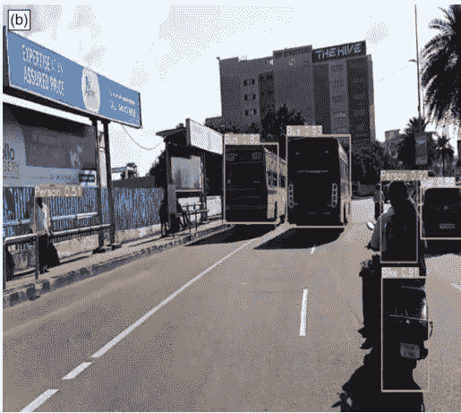
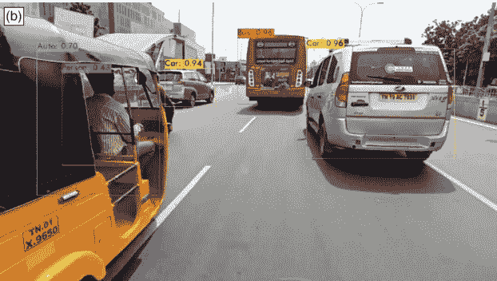

图 5.8（续）

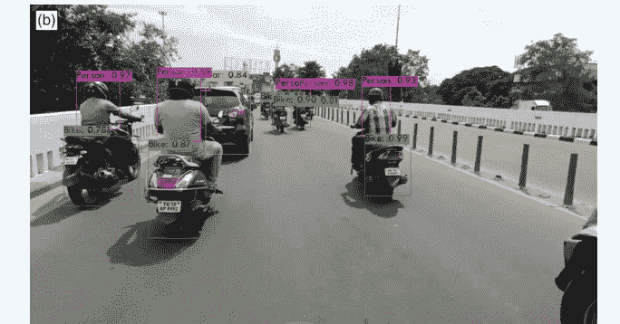
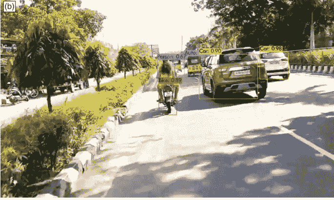

图 5.8（续）

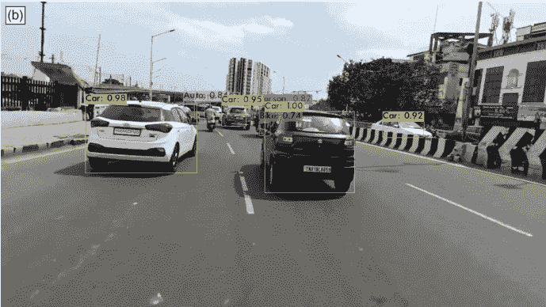
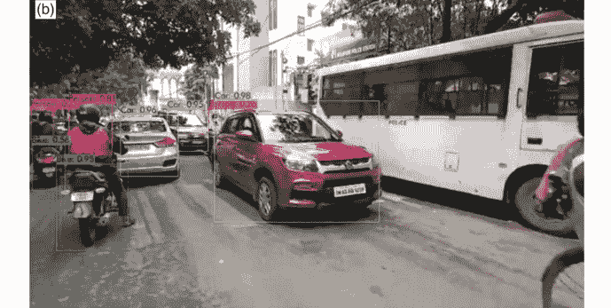

图 5.8（续）


图 5.8（续）


图 5.9 YOLOv5、m、l、x 模型对比

## 表 5.2 YOLOv5 (s, m, l) 模型对比

| 模型 | 精确率 (%) | 召回率 (%) | mAP (%) | F1 分 (%) | 速度 (s) |
| --- | --- | --- | --- | --- | --- |
| YOLOv5s | 90.4 | 74.5 | 78.5 | 81.68 | 0.023s |
| YOLOv5m | 89.7 | 78.3 | 83.0 | 83.61 | 0.046s |
| YOLOv5l | 91 | 76 | 80 | 82.82 | 0.071s |
| YOLOv5x | 92 | 78.4 | 83.4 | 84.42 | 0.039s |

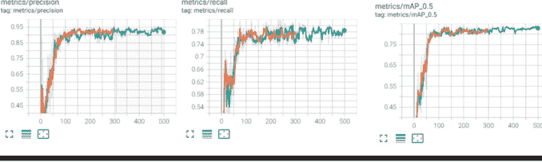

## 表 5.3 超参数

| 超参数 | 数值 |
| --- | --- |
| 激活函数 | Leaky ReLU, Sigmoid |
| 衰减 | 0.0005 |
| 迭代次数 | 500 |
| 学习率（初始） | 0.01 |
| 学习率（最终） | 0.1 |
| 动量 | 0.937 |
| 图像尺寸 | 416 |
| 通道 | 3 |
| 类别数量 | 5 |


# 108 机器智能

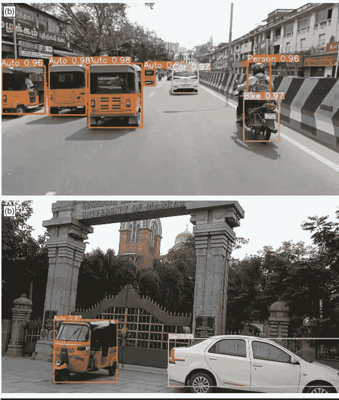

图 5.10（续）

# 使用深度学习算法的运动图像目标检测 ■ 109

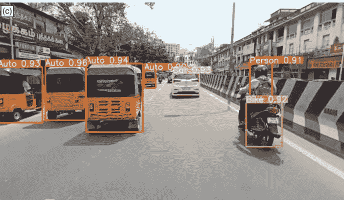

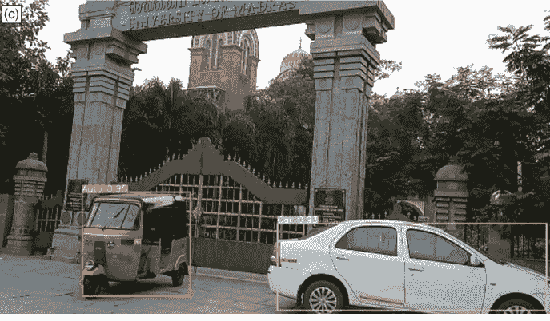

图 5.10（续）

# 110 机器智能

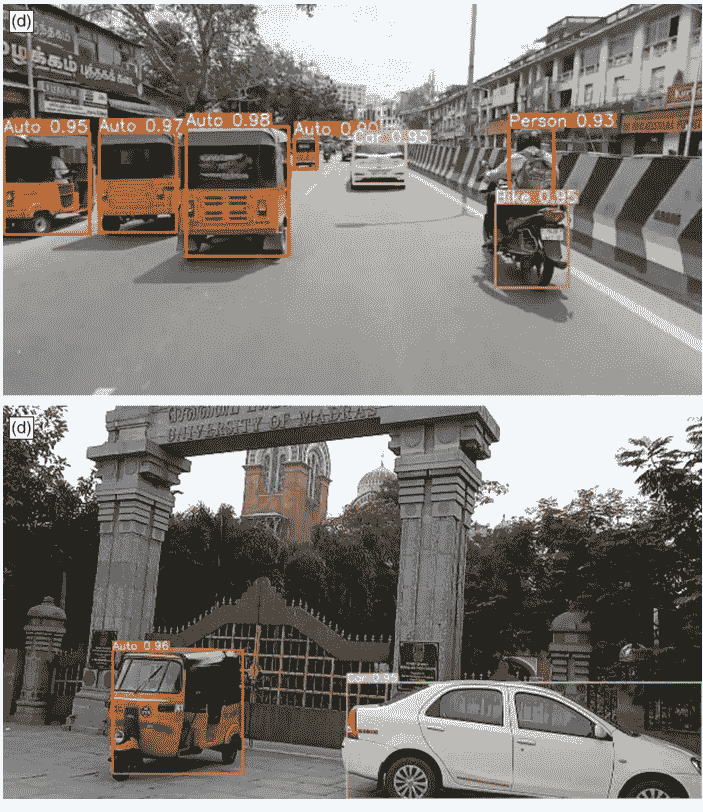

图 5.10（续）

## 5.5 结论

在本研究中，将五类物体作为检测对象，用于检测它们是否出现在用于交通环境中自动驾驶车辆的图像帧中。这项工作代表了使用 YOLO 架构的目标检测。YOLOv4 是最新且最快的算法，具有极高的真阳预测准确率。预测边界框的宽度、高度以及 IOU（交并比）方法被用于识别实时检测。在未来，可以对算法进行微调，并增加不同天气条件下的类别数量。在未来的未来的工作中，使用权重文件的网络架构将优于使用不同数量物体的预训练模型，并增加数据集中的类别数量。

## 参考文献

- 1. Taek-Hoon Jung, Benjamin Cates, In-Kyo Choi, Sang-Hon Lee, and Jong-Min Choi (2020) “基于多摄像头的自动拖拉机人员识别系统”。 http://doi.org/10.3390/designs40040054
- 2. https://towardsdatascience.com/a-comprehensive-guide-to-convolutional-neural-networks-the-el5-way-3db2hf16a453
- 3. https://towardsdatascience.com/r-cnn-far-rnn-far-rnn-yolo-detect-object-algorithms-36d53571365
- 4. Joseph Redmon and Ali Farhadi (2018) “Yolov3: 增量改进。” arXiv:1804.02767v1
- 5. https://towardsdatascience.com/review-yolov2-yolo9000-only-look-once-only-object-detection-7883d2b2a65
- 6. Yu-Cheng Fan, Yelamanda Chandra, Ting-Wei Chen, and Chun-Ju Huang (2021) “基于 LS-R-YOLOv4 神经网络的 LiDAR 实时目标检测”。Journal of Sensors, 1–11. doi:10.1190/2557562628
- 7. A. Bochovskiy, C. Y. Wang, and H. Y. Liao (2020) “Yolov4: 目标检测的最佳速度与准确性。”https://arxiv.org/abs/2004.10934
- 8. Qi Wu, Runzi Lin, HanYue, Hong Huang, Yun Yang, and Zhagang Yao (2020) “基于改进 YOLO 网络的场景下小目标检测研究”。IEEE Access. doi:10.1109/ACCESS.2020.296628
- 9. Tanvir Ahmed, Yinglong Ma, Muhammad Yahya, Bela Ahmad, Shah Nazir, Amin Haq, and Rahman Ali (2020) “使用改进 YOLO 神经网络的目标检测”。Scientific Programming. doi:10.1155/2020/8403262
- 10. J. Redmon, S. Divala, R. Girshick, and A. Farhadi (2016) “You Only Look Once: 统一实时目标检测”。发表于 2016 年 IEEE 计算机视觉与模式识别会议 (CVPR), 美国内华达州拉斯维加斯，页 779–788。
- 11. P. L. Chithra and Y. Gomathi (2021) “基于 YOLO3 的行人检测视频分析”。获取于：https://researchgate.com/publication/36321111
- 12. Upulie Handage and Kugananderthy Lakshini (2021) “使用 YOLO 进行实时目标检测：综述”。预印本. doi:10.1310/RG,2.2.24367.66723.
- 13. Heet Thakkar, Noopur Tambe, Sananjana Tambe, and Vaishali Gaidiane (2020) “使用 YOLO 和 SORT 通过检测进行跟踪”。International Journal of Scientific Science, Engineering and Information Technology, 3 月 20 日：224–229. doi:10.32628/CSEIT206256.
- 14. Shubham Pal and Pramila Chawan (2019) “使用深度学习进行实时目标检测：综述”。International Research Journal of Engineering.
- 15. Wenbo Lan, Jianwu Dang, Yangping Wang and Song Wang (2018) “基于 YOLO 模型的行人检测”。发表于 IEEE 机电与自动化国际会议，9781-53

# 第 6 章：使用机器学习算法检测视网膜病变

## 6.1 引言

糖尿病是一种代谢疾病，视网膜病变会导致视力损害。视网膜病变是导致失明的主要原因。根据世界健康组织的数据，视网膜病变影响了全球 8000 万人。美国疾病控制与预防中心（CDC）估计美国有 2900 万人患有此。视网膜病变影响了 3700 万人。视网膜病变在早期阶段是有效的。美国疾病控制与预防中心估计视网膜病变影响了 4500 万人。尽管如此，晚期糖尿病视网膜病变通常没有症状，需要进行密切监测。视网膜病变在早期阶段通过定期检查检查可以发现。糖尿病视网膜病变在不治疗的情况下会导致失明。非增殖性糖尿病视网膜病变表现为棉絮斑、微血管异常或浅表视网膜出血。即使如此，增殖性糖尿病视网膜病变（PDR）可能很长一段时间没有症状，需要密切监测。一种计算机辅助筛查系统使用机器学习分类器如 K 近邻 (kNN)、支持向量机 (SVM)、高斯混合模型 (GMM) 和 Adaboost 对病变与非病变进行分类分析。多种方法被用于视网膜病变检测和增殖性视网膜病变的诊断程序。本研究使用了不同光照和视角的眼底图像来生成视网膜病变的严重程度。Alazzam 等人（2021）的工作声称径基方法具有良好的诊断准确性，并可能用于视网膜病变。在机器学习和先进智能的支持下，糖尿病网站可以预测糖尿病和视网膜病变。

## 6.2 背景

### 6.2.1 增殖性视网膜病变

随着疾病进展，严重的非增殖性糖尿病视网膜病变进入高级或增殖阶段，此时血管会增生生长。视网膜缺氧导致脆弱的新血管沿视网膜生长。如果不及时治疗，这些新血管可能会出血，导致视力模糊并破坏视网膜。纤维血管增殖还导致牵引性视网膜脱离。新血管也可能生长到眼角引起新生性青光眼。非增殖性糖尿病视网膜病变表现为棉絮斑、微血管异常或浅表视网膜出血。图 6.1 显示了视网膜病变散射激光治疗的眼底图像。


# 116 机器智能

根据血计数和视网膜图像，分别判断患者是否患视网膜病变。

Diabetes Web 的主要目标是预测糖尿病和糖尿病视网膜病变，这将有助于患者根据从我们网站获得的结果开始治疗。由于诊断延迟，糖尿病视网膜病变会导致永久性失明以及许多健康问题。因此，本章涵盖了以下任务：

- 识别预测糖尿病的机器学习模型。
- 分析用于糖尿病视网膜病变的各种模型。
- 展示有助于预测糖尿病以及糖尿病视网膜病变程度的网站。

Diabetes Web 设计为一个开源 Web 应用，用户可以通过胰岛素计数、血糖含量和年龄来预测糖尿病。此外，用户还可以上传视网膜图像并获取糖尿病视网膜病变（DR）的即时结果。这减少了人工成本，并且可以在任何设备平台轻松访问。

这项研究作为一种分析，旨在服务眼科医生和实验室技术人员的需求，针对农村地区（四线城市）的小诊所，那里没有急诊医疗人员，但负担得起眼底相机。它还可以作为一个根据病情严重程度对病例进行优先排序的工具。

## 6.3 适用性

Diabetes Web 是一个用户可以预测糖尿病的网站。如果发现用户患有糖尿病，他们可以在同一个网站上检查他们的视网膜病变状态。用户还可以通过上传视网膜眼底图像来检查自己处于哪种 DR Level。该网站对于临床医生和眼科医生都非常有用。他们可以检查自己手动进行的测试，并确认糖尿病以及糖尿病视网膜病变。Diabetes Web 可以被认为是医生根据病情紧急程度对患者进行优先排序最重要的工具之一。在患者无法负担眼科医生或专家的二线地区，Diabetes Web 将更有意义。

Diabetes Web 的主要目标是预测患者是否患糖尿病。另一个功能可以帮助眼科医生在失明发生之前进行检测。数百万人遭受糖尿病视网膜病变的困扰，这是劳动年龄成年人失明的主要原因（APTOS, 2019）。在印度，Diabetes Web 将帮助在医疗筛查困难的农村检测并预防这种疾病。APTOS（亚太

## 使用机器学习算法进行 DR 检测

远程眼科研讨会提供了各种成像条件下的眼底图像，并附有用于检测视网膜图像中 DR 程度的标签。每张图像根据 0–4 的分级进行评分：0 = 无 DR；1 = 轻度；2 = 中度；3 = 重度；4 = 增生性 DR。您可以检测视网膜图像上的 DR 位置，并从 0–4 级划分 DR 程度。该网站具有某些非功能性需求，例如网站将具有高度响应性且快速的。它应该是用户友好且简单的。每个患者只能有一张视网膜。不允许在单个页面显示多个视网膜。要上传的图像应该是 jpeg 或 png 文件，且图像最大大小应小于 50 kb。基本上，有不同类型的用户可能会访问该系统：

- 临床医生：临床医生可以使用 Diabetes Web 检查患者的糖尿病结果。他们可以将通过 Diabetes Web 获得的结果进行对比，确认他们的结果。
- 眼科医生：眼科医生可以通过上传患者视网膜的眼底图像利用 Diabetes Web 预测不同的 DR Level。
- 医生：医生也可以利用此网站根据其 DR 的严重程度对患者进行优先排序。

图 6.2 显示了开展的研究工作流程。图 6.2 有助于解释组成系统的子系统以及子系统控制与通信的框架。从图 6.2 我们可以看到用户将通过我们的用户界面提供输入（以包含视网膜图像的图像形式）。

在 Flask 微服务的帮助下，我们将图像放入我们的 Python 后端。从那里开始实际计算。作为处理的第一阶段，我们将图像带入图像处理单元。在该模块中，我们从图像中提取必要信息，然后使用模型对提取的符号进行排序

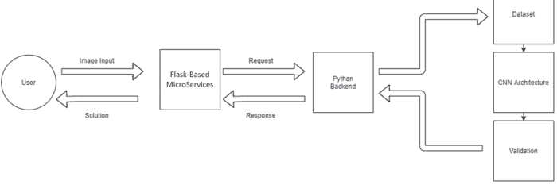

图 6.2 研究工作框架。

# 118 机器智能

并将其转化为数字方程。然后我们必须与用户确认，以确保它是用户上传的同一个方程。在收到用户确认后，我们可以将该数字方程放入我们的预训练模型并获得结果。结果将移动到 Python 后端。再次，在 Flask 微服务的帮助下，我们可以通过用户界面给用户响应。

我们基于 Web 的计算机程序的视觉部分是用户与 Diabetes Web 交互的部分。它决定了如何向系统或程序发送命令，以及数据如何在屏幕上显示。我们的网站将是一个单页网站，用户可以在我们的网站上输入图像。图 6.3 和 6.4 显示了 Diabetes Web 仪表板的两个页面。

在加载图像作为系统输入后，用户将在同一页面上看到结果。此外，用户可以通过点击打印按钮将解决方案下载为 pdf。图 6.5 显示了糖尿病预测页面。在该页面上，用户可以向网站输入基本细节，并在同一页面获取即时结果（是否患糖尿病）。图 6.6 和 6.7 显示了糖尿病预测页面以及如何选择图像。

## 6.4 糖尿病视网膜病变检测

### 6.4.1 图像增强中的垂直和水平翻转

图像翻转分别在垂直或水平翻转的情况下反转像素的行或列。翻转增强通过 Image Data 类的水平翻转或垂直翻转参数指定。对于像鸟类的照片，水平翻转可能有意义，但垂直翻转则没有。对于其他类型的图像，如航空摄影、宇宙摄影和显微镜摄影，垂直翻转可能有意义（Gondhalekar, 2020）。

### 6.4.2 随机旋转增强

旋转增强随机将图像顺时针旋转 0 到 360 任意度。旋转可能会将像素移出图像框，并留下没有像素数据的框架区域，必须填充。例如，这个 https://machinelearningmastery.com/how-to-configure-image-data-augmentation-when-training-deep-learning-neural-networks/ 通过 range 参数演示了随机旋转，图像旋转在 0 到 90 度之间。对于随机亮度增强，可以通过随机变暗图像、调亮图像或兼者来增强图像亮度。目标是让模型能够泛化到在不同光照水平下训练的图像。这可以通过指定亮度范围参数来实现

# 糖尿病ABETESWEB
- 仪表板
- 糖尿病预测
- 糖尿病视网膜病变

# 仪表板
欢迎来到 DiabetesWeb - 让您的生活健康

# 糖尿病率
印度的糖尿病率

# 糖尿病_视网膜病变
概览

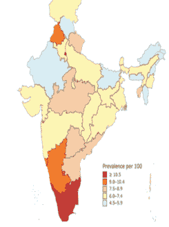
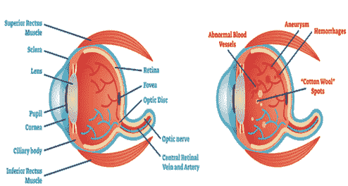

# 健康眼
# 糖尿病眼

图 6.3 Diabetes Web 仪表板。

使用机器学习算法进行 DR 检测 119


# 糖尿病网络 (DIABETESWEB)

仪表板

糖尿病预测

糖尿病视网膜病预测

# 2019年调查

全球范围内

# 并不甜

截至2019年，印度20-79岁糖尿病患者人数位居世界第二

中国
印度
美国
巴基斯坦
巴西

- 0
- 25
- 50
- 75
- 100

# 糖尿病视网膜病

糖尿病视网膜病的四个阶段

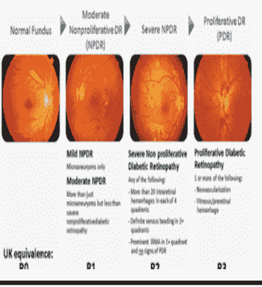

图 6.4 糖尿病网络仪表板页面第 2 页。

图 6.5 糖尿病预测页面。

# 机器智能

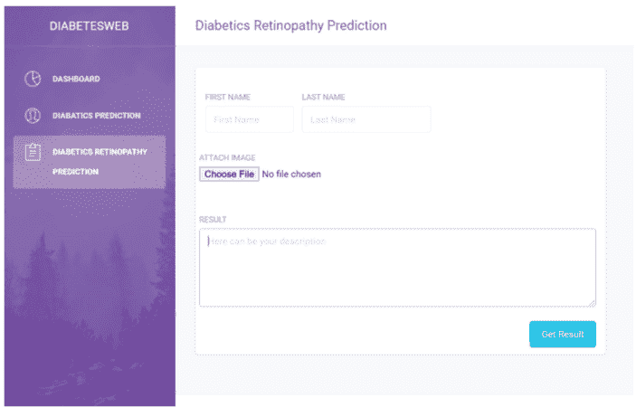

图 6.6 糖尿病视网膜病预测页面。

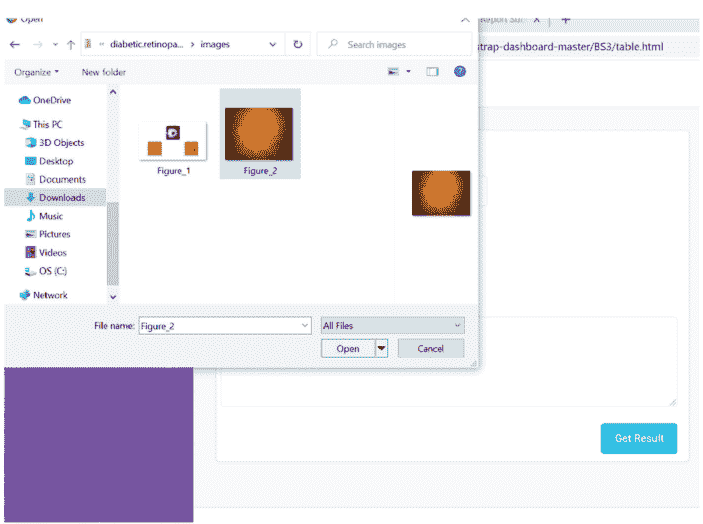

图 6.7 糖尿病视网膜病预测页面：选择图像。

# 使用机器学习算法检测DR（视网膜病变）

ImageDataGenerator 构造函数指定了最小和最大范围，这是一个表示选择亮度量百分比的浮点数。小于1.0 的值会使图像变暗，例如 0.5、1.0；而大于1.0 的值会使图像变亮，例如 1.0、1.5，其中1.0 对亮度没有影响。https://machinelearningmastery.com/how-to-configure-image-data-augmentation/training-deep-learning-neural-networks/ 中的示例演示了亮度图像增强，允许生成器在1.0（无变化）和0.2（即20%）之间随机变暗图像。

DenseNet 由密集块（dense blocks）组成。在这些块中，层与层之间是密集连接的。密集块是一组连接到所有之前层层的层。单层由以下部分组成：

- 批量归一化 (Batch Normalization)
- 激活
- 3x3 卷积

作者发现，卷积（Conv）之前的预激活模式（BN 和 ReLU）比通常的后激活模式更有效。

## 6.4.2.1 转换层

DenseNet 并不是像 ResNet 那样对残差进行求和，而是拼接了所有特征图。拼接不同大小的特征图是不切行的。因此，在每个密集块中，每层的特征图大小相同。然而，下采样对于 CNN 是至关重要的。转换层由批量归一化、1x1 卷积和平均池化组成。

## 6.4.3 用于语义分割的 DenseNet

典型的分割架构由两个部分组成：负责提取粗略语义特征的下采样路径，以及经过训练用于模型输出端恢复输入图像的分辨率的上采样路径。密集连接卷积网络（DenseNets）在图像分类任务上表现出了卓越的结果。DenseNet 的思想基于一种观察：如果每一层都以前馈方式直接连接到其他每一层，网络将更加准确且更容易训练（Chablani, 2017）。DenseNets 由密集块和池化操作构建，其中每个密集块都是之前特征图的迭代拼接。这种架构可以看作是 ResNets 的扩展，ResNet 执行的是之前特征图的迭代求和。这些细小的修改具有有趣的意义，例如参数效率、隐式深度监督和特征利用。DenseNet 的特性使其非常适合语义分割，因为它们以以下方式自然实现了跳跃连接和多尺度监督：

- 可视化前10张测试图像（图6.8）
- 通过训练 DenseNet121 并预测每个标签的 DR 程度来可视化图像（图6.9）
- 用于迁移学习的 DenseNet121 架构（图6.10）（Jee et al., 2021）。

我们分析了六个用于糖尿病预测的模型，并分析了两个用于 DR 检测的模型。

## 6.4 数据描述

系统数据集来自 Mendeley 糖尿病数据集。这些信息收集自 Medical City 医院实验室的伊拉克社会（Al-Kindi 内分泌与糖尿病专家教学医院）。数据从患者文件中提取并输入数据库。医学信息和实验室分析构成了这些数据。数据库中有 103 名非糖尿病患者，53 名糖尿病前期患者和844 名糖尿病患者。

对于糖尿病预测，结果如表 6.1 所示。这里使用了 KNN（k 近邻算法）算法的准确率，因此我们将 KNN 与前端连接。

对于 DR 检测，图像从 www.kaggle.com/competitions/diabetic-retinopathy-detection/data 获取，我们创建了几个模型，结果如表 6.2 所示。

在这里我们获得了更高的 DenseNet准确率，因此采用 DenseNet 模型来连接用户界面。

## 6.5 结论

在本章中，引入了一种名为糖尿病网络（Diabetes Web）的应用程序，用于分析患者糖尿病视网膜病变的程度。基础机器学习应用用于检测患者是否患有糖尿病。深度学习技术如 CNN 和 DenseNet121 被用于分析患者的视网膜病变水平。该应用程序供临床医生、眼科医生和医生使用。今天糖尿病面临的主要问题之一无法追踪血糖水平，这可能导致失明。该应用程序也可用于诊断和早期康复。

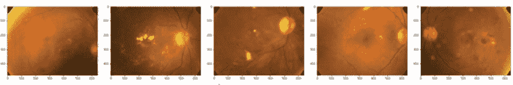
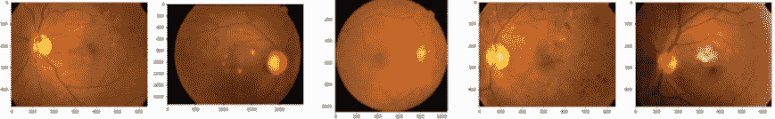
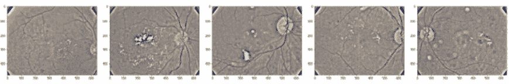
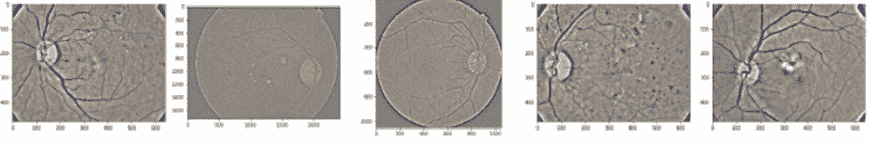

图 6.8 测试图像。使用机器学习算法检测DR 125

```
test pic.1
模型原始输出：
1.000 0.966 0.520 0.268 
```

图 6.9 通过 DenseNet121 训练并预测 DR 程度的可视化。

```
test pic.2
模型原始输出：
1.000 0.966 0.520 0.268 
```

图 6.10 用于迁移学习的 DenseNet121 架构密集块与转换块。

| 算法 | 准确率 |
|---|---|
| 逻辑回归 | 71.4 |
| K 近邻 | 78.5 |
| 支持向量分类 | 73.376 |
| 朴素贝叶 | 71.4 |
| 决策树 | 68.181 |
| 随机森林 | 75.974 |

| 6.2 视网膜病变预测模型 |
| 算法 | 准确率 |
|---|---|
| CNN | 74.4 |
| DenseNet121 | 96.4 |

# 注意
Diabetes Web 可于：C:/Users/Yadu/dashboard.html

## 参考文献

- Antal, B. and Hajdu, A. (2019) “APTOS 2019 盲症检测”。
- California Healthcare (2015) “Kaggle 数据仓库”。
- Chablami, M. (2017) “糖尿病科学”。
- Conrad Stöder, M. (2021) “视网膜病变的定义”。
- Gondhalekar, A. (2020) “数据增强：真的必要吗？”
- Gee, G., Harvardhan, G. M., Goursaria, M. H., Singh, V., Rautaray, S. S. and Pandey, M. (2021) “单阶段检测器在新冠后设置中自动口罩定位的有效性”。
- Narasimha-Iyer, H. A., Roys, B., et al. (2006) “彩色视网膜图像纵监测检测与分类”。
- Niemijer, M., Abramoff, M. D., and van Gneeken, B. (2009) “数字彩色眼底图中糖尿病视网膜病变 CAD 的信息融合”。


## 128 机器智能

Osare, A., Shadgar, B., and Markham, R. (2009) "一种基于计算智能的糖尿病网膜病图像中渗出的检测方法". IEEE 生物医学信息技术学报, 13 : 535–545.

Pires, R., Jelinek, H. F., Wainer, J., et al. (2013) "自动糖尿病网膜病检测中转诊需求的评估". IEEE 生物医学工程期刊, 60: 3391–3398.

Sandive, S., Senapati, R. K., and Rahulkar, A. D. (2019) "计算机辅助的糖尿病网膜病自动检测的最新进展综述". 医学医学工程与技术杂志, 43(2): 87–99.

Roychowdhury, S., Koozekani, D. D., and Parhi, K. K. (2014) "DREAM：基于机器学习的糖尿病网膜病分析". IEEE 生物医学与健康信息期刊, 18(5): 1717–1728. doi:10.1109/JBHL.2013.2294635. PMID: 25192577.

Sil Kar, S. and Maity, S. P (2016) "使用可调带通滤波器和模糊条件熵提取视网膜血管". 生物医学计算机方法与程序, 133 : 111–132.

Taylor, D. J., Goatman, K., Gregory, A. A., Histed, M., et al. (2009) "糖尿病网膜病筛查的图像质量标准化". 眼科专家评论, 4: 469–476.

Walter, T., Klein, J. C., Massin, P., et al. (2002) "图像处理对人视网膜彩色眼底图像糖尿病网膜病渗出检测的贡献". IEEE 医学影像学报, 21: 1236–1243.

Zhang, L., Li, Q., You, J., et al. (2009) "一种用于增生性糖尿病网膜病筛选的改进匹配滤波器". IEEE 生物医学信息技术学报, 13: 528–534.

## 第7 章

## IIoT 应用与服务

P. Shanmugavavadivu, T. Kalaiselvi, M. Mary Shanthi Rani, and P. Haritha

## 7.1 引言

物联网（IoT）涉及通过支持性软件和技术将联网的传感器、设备、机械设备和小装置连接起来。物联网在互联网上生成并交换数据 [1]。这是一种开创性的时代技术，在复杂且劳动密集型的人工流程自动化中占据有一席之地。它在多个领域拥有大量应用记录，包括农业、医疗保健、安全、遥感、工业、天气预报、自动驾驶、可穿戴设备和智能家用电器；物联网可以部署在牙刷中，并扩展到大规模制造业中 [2]。物联网随处可见，从分析人类心跳的心率监测仪、为动物提供唯一身份识别的生物芯片传输器 [3]，到在轮胎气压下降时提醒驾驶员的汽车传感器 [4]。IoT 设备可以在没有键盘或屏幕的情况下进行交互。如 Alexa 和 Siri 等虚拟助手是支持物联网的软件，收集全球信息。从工业角度来看，IoT 设备产生丰富的数据，这些数据在自动化操作控制中对于决策性的、基于预测的安全措施起着至关重要的作用 [5]。

### 7.1.1 物联网的需求

作为一种变革性技术，物联网在引入后的短时间内就获得了普及和发展动力。这个流行术语由凯文·阿什顿（Kevin Ashton）于 1999 年创造，当时他决定使用射频识别（RFID）来追踪宝华公司产品的供应链。物联网的主要优势被认为是其飞跃式成功和增长的原因。

- 利用海量数据进行决策
- 提供自动跟踪和监控
- 减轻工作量并提高生产力
- 提高效率
- 提高生活质量。

我们现在将讨论工业物联网（IIoT）的这些优势：

- **利用海量数据进行决策**：通过物联网连接的设备或传感器在地理上可能相远，但仍能生成并收集海量数据。例如，在家领域，支持物联网的冰箱可以对食品过期日期发出警报，对食品缺货提供提示，并优化功耗。同样，通过物联网生成的业务相关数据可以帮助制定业务计划和解决方案。
- **自动化跟踪、监控和控制**：跟踪使用户能够检查机器状态以采取必要的行动。例如，用户可以监控智能冰箱中食品的质量，而无需反复检查即可更换物品。
- **减轻工作量并提高生产力**：由于设备执行了主要任务，这导致了成本、时间以及人工干预的减少。大多数通信是机器与机器之间的（M2M），连接的设备导致了实用的实施，提高了业务和终端用户的效率。例如，当用户离开智能房间时，灯会自动关闭，从而节省了电力。
- **提高生活质量**：物联网的应用改善了各个领域（即健康、生活方式）的生存质量。例如，智能手表被用于追踪心率 [6]。

### 7.1.2 物联网与技术的融合

计算技术的进步提升了物联网在几个可能领域的潜力：

- **开源平台**：开源软件在物联网中起着重要作用。Linux 操作系统在物联网中占据主导地位。Arduino 是流行的开源平台，为硬件和软件提供集成开发环境（IDE）。Devicehub.net 作为交互式物联网与机器间（M2M）通信的可行接口。该软件还为嵌入式设备提供部署服务，并支持树莓派、CoAP（受限应用协议）代理进行原型制作。ThingSpeak 促进实时数据处理和可视化。Webinos 是一个用于平台无关物联网专业 Web 平台。
- **大数据技术**：技术驱动的生活方式引发了物联网的使用以及与汽车、医疗、业务、工业、气象设备、军事、智能设备、农业、电子治理、电子商务等相关的生成生成。由于物联网与不可分，利用 HBase、MongoDB 等适当工具进行数据工程、信息处理和分析，挖掘大数据的隐含潜力 [7]。
- **网络安全**：由于脆弱的开源 API（应用程序编程接口）、安全集成、未打补丁的软件、测试用例以及对物联网组件集成的可视图有限，IoT 设备容易受到安全威胁。这些威胁可以通过数据加密 API 安全、定期更新开源软件、身份验证方案、物联网标准合规以及 DNS（域名服务器）过滤得到适当缓解 [8]。
- **软件定义网络 (SDN)**：SDN 是一种新兴架构，提供灵活且动态的中心化网络管理。它具有网络控制与数据功能解耦的特性。这确保了网络控制平面的高抽象性和可编程性。市场上可用的一些 SDN 包括：Cisco DNA Center、Cisco ACI、IBM Cloud Internet Services、Cradlepoint Engine、VMware NSX 以及用于软件定义网络的 IBM 网络服务 [9]。

### 7.2 物联网的组成

物联网系统包含四个主要部分：(1) IoT 传感器/设备；(2) 连接性；(3) 数据处理；以及 (4) 用户界面。


# 132 机器智能

- 传感器或设备用于从其各自环境中产生或收集数据。这些设备是连接数字世界与现实世界的桥梁。数据可以是简单的（如读取温度），也可以复杂的（如录制视频）。物联网（IoT）设置可以包含单个或多个传感器。例如，智能手机拥有多个传感器，如运动传感器、光传感器、地理位置传感器、环境传感器、接近传感器、罗盘传感器、生物识别传感器、仪表、探针、设备和执行器，用于测量各种参数。

- 连接性是关键要素，通过 Wi-Fi、蓝牙、蜂窝卫星、低功耗域网网关、路由器、以太网等提供传感器/设备之间的物理/虚拟连接。连接优优取决于功耗量、覆盖范围及其带宽。

- 数据处理包括处理原始数据（批处理或流式数据）、数据格式化（电子表格、纯文本、文件等）、数据存储（存储到本地或远程云存储）、处理和准备输出以及可视化 [11]。

- 用户界面负责以人类可理解的形式将信息传递给终端用户。可以通过命令行、基于菜单、基于表单、基于语音和图形用户界面（GUI）实现。Alexa 和 Siri 是基于语音界面的典型示例。

物联网的其他重要元素是安全、网关、应用和用户。
通常，物联网的七层描述为：(1) 传感器；(2) 传感器到网关网络（如 BLE、LoRaWAN、ZigBee 和 Sigfox）；(3) 网关（路由器/方法）；(4) 网关到网络（以太网、Wi-Fi、卫星、蜂窝）；(6) 互联网到用户网络（处理后的数据视图）；以及 (7) 增值信息（数据可视化以获得更好的洞察并做出战略决策）。

物联网的一些简单应用如下 [13]：

- 自动通知标记
- 机器温度/压力的自动报警
- 实时信息监控
- 交通、车辆、地理位置等的实时跟踪
- 对家电器和电子设备的远程监控和控制。

# 7.3 物联网编程软件

物联网需要编程语言和工具支持数据采集、数据处理与操作、存储和解释。C、C++、Java、B# 和 Python 被广泛用于物联网编程和接口。作为中级语言，C 和 C++ 已证明非常适合为物联网开发接口和嵌入式软件。Python 被证明是一种简单、强大的编程语言，可与树莓派 CPU 接口。作为一种解释型语言，Python 拥有丰富的内置函数，可以轻松处理和处理大量数据。

### 7.3.1 用于物联网的 Python

本节介绍了 Python 对物联网的广泛支持功能：

- 树莓派与 Python：Python 支持树莓派的 I/O 端口管理。该板支持以太网和无线连接、通信和监控。
- PyBoard 与 Python：PyBoard 是一种强大的电子开发板，通过 USB 在个人电脑上运行（提供串口提示符以进行编程）。USB 闪存用于存储 Python 脚本。MicroPython 是一种可以运行在裸机（BareMetal，一种基于内核的单空间操作系统）上的 Python，并生成 Python 操作系统。pyb 模块包含用于控制开发板的 I2C（集成电路）、UART（通用异步收发器）、ADC（模拟数字转换器）、DAC（数模拟转换器）和 SPI（串行外设备接口）外围的类和函数 [14]。

### 7.3.2 用于后端开发的 Python

由于其编程能力，Python 被称为通用编程语言。因此，Python 也被证明对于后端软件开发非常方便高效。

- 带有 MQTT 协议的 Python：MQTT（消息队列遥测传输）是一种开放的消息协议，是物联网设备最常用的通信机制之一。Python 的 MQTT 支持小负载的高速数据交换。Python 和 MQTT 的集成可以描述为四个步的过程：第一步，传感器芯片（编程设备）收集数据。第二步，HTTP（超文本传输协议）请求或 TCP/IP（网协议/UDP 用户数据协议）通过网关请求传输物联网数据。这由 MQTT 协议进一步处理，从控制台接收数据。最后，使用 matplotlib 完成数据可视化。

# 机器智能

- 基于 Python 的 Microsoft Azure for IoT 更新了其开源 IoT 扩展，增强了 Azure CLI 2.0 的功能。CLI 2.0 使用命令与 Azure 资源管理器和端点通信。例如，我们可以使用 Azure CLI 2.0 创建 Azure 虚拟机 (VM) 或 IoT Hub。通过 CLI 扩展，Azure 服务可以允许用户访问专属服务来增强 CLI。IoT 扩展为程序人员提供了访问 IoT Hub 设备配置服务、IoT Edge 和 IoT Hub 的命令访问权限 [15]。

# 7.3.3 物联网 (IoT) 开发的 IDE

- Arduino：意大利公司 Arduino 制造微控制器板、交互物品和套件，并开发了完整的 IDE 来与硬件接口。它拥有大量的示例和预装库，是一个完整的包。该 IDE 支持用于可编程微控制器的 C 和 C++ 编程语言。
- Raspian：这是专为树莓派板设计的专用 IDE。该 IDE 包含超过 35,000 个包和预编译软件。
- PlatformIO：这是跨平台 IDE 中的通用调试器。它包含 20 多个开发平台、4,000 多个嵌入式开发板和各种框架。
- Eclipse：这是一个基于 Java 的物联网应用开源开发平台。它专门为 Eclipse 挑战赛、监控工业设备等任务而设计 [16]。

# 7.4 物联网硬件

物联网硬件涵盖了各种设备，包括传感器、桥器和路由设备。这些物联网设备处理系统激活、安全、动作定义、通信以及特定支持目标和动作的检测。物联网低功耗板和单处理器板（Arduino Uno）是插入主板的薄板，用于改进和增加其功能。GPS、光传感器和热传感器或交互式显示器是常用的物联网硬件。图 7.1 描了一个 Arduino 板。
树莓派是一个流行的物联网平台，可以作为 Web 服务器运行。它经常被称为 "RasPi"，具有足够的处理能力和内存来运行 IoT Core 和 Windows 10。图 7.2 显示了树莓派及其组件。
RasPi 在使用 Python 编程时表现出卓越的处理能力。单板计算机 BeagleBoard 使用 ARM（高级精简指令集）处理器，该处理器比 RasPi 更强大，运行在基于 Linux 的操作系统上。这里，RISC 代表精简指令计算机。

# IIOT 应用与服务 135

![img/f07153152e20646619066fcf6f1ec5b_159_0.png]

图 7.1 Arduino Uno。
来源：Google Images

![img/f07153152e20646619066fcf6f1ec5b_159_1.png]

图 7.2 树莓派。
来源：Google Images

科技巨头 Intel 提供的 Galileo 和 Edison 板是进一步的选择；两者都适用于更大规模的技术生产。高通生产了从汽车、摄像头到医疗保健的各种企业级物联网技术 [17]。

图 7.3 所示的 Beagle Black 使用比树莓派快的处理器（1GHz 对比 700MHz），而不是基于 ARM 11 的处理器。它使用 ARM Cortex A-8 处理器。然而，处理速度受用用例的影响 [18]。


# 136 机器智能

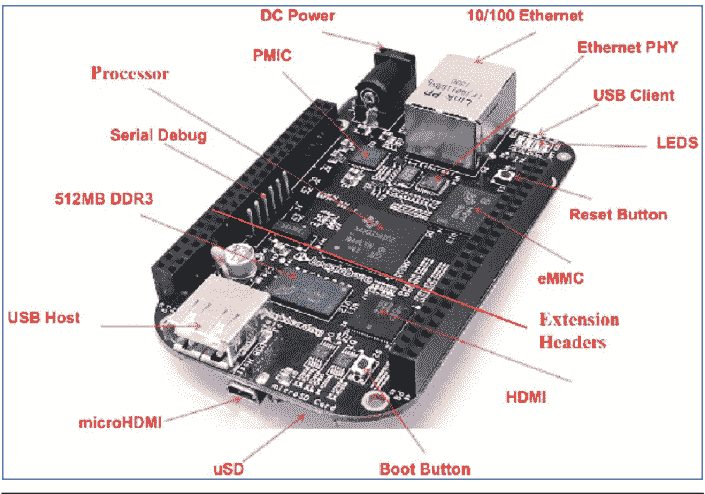

图 7.3 Beagle Board。

感谢来源：www.beagleboard.com

## 7.5 工业物联网 (IIoT)

工业物联网应用的现有和新兴机会推动了物联网在业务、运营和制造领域的使用，旨在最大化地提高生产力和利润，并降低成本。工业物联网（IIoT）是通过互联网连接的设备、机械和传感器网络，用于持续收集和处理数据，以提供更好的监控、运营和业务解决方案。

## 7.5.1 物联网的应用

物联网范围和影响力随着时间的推移不断扩大。在数据驱动时代，物联网领域是生产和业务管理的数据来源之一。本节概述了物联网应用在工业领域的作用和影响 [19]：

- 设备管理与监控：IoT 可以通过数字设备和软件远程控制跨地理区域的许多工厂。收集和利用历史数据的目标是改进工艺/产品，并为信息驱动的决策创造环境。

- 预测性维护：预测性维护涉及在紧急情况发生且必须停止输出之前识别机器的维护需求。因此，需要实施数据采集、分析和管理以避免此类意外。IoT 使用传感器在出现特定损坏指标时传输警报。从传感器处实时采集数据，以跟踪机器人或机器。高级算法用于在监控参数（如温度、压力等）超过规定的上下阈值水平时发送警报。

- 用于改进的智能系统：IoT 生成的虚拟数据可以直接或间接地简化并优化关键资源及流程。这可能导致通用/特定问题的运营智能和业务智能模型的创建。

- 精准库存：IoT 还用于自动库存监控和跟踪。这一过程有助于优化库存管理、供应链管理和营销。

- 质量控制：IoT 设备部署在制造的每个阶段，用于工艺和产品的质量控制。

## 7.5.2 物联网传感器

传感器是物联网硬件最重要的组件。工业中常用的物联网传感器主要分为四类：(1) 机械传感器；(2) 热力学传感器；(3) 电学传感器，以及 (4) 地空传感器：

- 机械传感器：实时机械传感器可以监控静态（时间不变输入）和动态（时间变化输入）。这类传感器无缝地用于所有主要的工业流程。一些最常用的机械传感器是陀螺仪、压电换能器、倾角传感器加速度加速度。操作人员使用这些传感器测量飞机的俯仰、偏航、容器内固体重量以及油箱中的油量。

- 热力学传感器：热力学传感器用于测量给定恒定压力下的内能和比热。由于液体和气体对于多个生产过程至关重要，热力学传感器经常用于制造业。最常用的物联网热力学传感器包括：温度传感器、流量计、传感器、湿度/水分传感器、风速计和压力传感器。

- 电学传感器：这些传感器用于监控涉及电的自动化和手动操作。在许多工业物联网设置中，机械、热力学和电气传感器协同工作。在人工检查无法早期/及时检测技术故障的地方，电气传感器变得至关重要。电气传感器对于电的优化利用和安全使用有很大帮助。典型的电气传感器包括电流互变器、电压传感器、功率功耗/效率传感器和霍尔传感器。

- 地理传感器：地理传感器监控对象的物理位置。它们解释了资产如何跨区域移动，以及机械相对于其他工业基础设施的定位。许多自动驾驶汽车使用的 LIDAR 可以跟踪它们相对于其他物体、车辆和行人的位置。这些传感器用于许多 Google 标记应用中。地理传感器被用于监控，因为它们可以立即警告安全专业人员安全区域周围的异常移动。某些地理传感器包括：电位器、接近传感器、雷达、红外传感器和光电传感器 [20]。

## 7.5.3 用于工业自动化解决方案的物联网传感器

工业物联网传感器包括：(1) 烟雾传感器；(2) 接近传感器；(3) 红外传感器；(4) 压电传感器；(5) 温度传感器；(6) 光传感器；以及 (7) 图像传感器。

- 烟雾传感器：烟雾传感器在物联网工业系统中带来了了一些有趣的用例。这些传感器广泛用于 HVAC（采暖、通风和空调）、建筑工地以及火灾和气体泄漏风险较高的工业单元监控。在意外气体泄漏或火灾爆发期间，烟雾传感器可以提醒相应的团队/人员，防止人员或资产损失。Heisman 和 Nest Protect 生产了用于家用和商用的智能物联网烟雾传感器。

- 接近传感器：这些传感器计算自身与最近物体之间的距离。接近传感器嵌入在汽车保险杠和其他运动中的机械中，以警告驾驶员/操作人员即将发生的碰撞。

- 红外传感器：红外 (IR) 传感器用于检测生物的存在。这些传感器广泛应用于军事领域。近年来，红外传感器已成为任何工业物联网解决方案的一部分。这些传感器用于电子、化学和医疗健康行业。一些传感器包括旭化化微器件 (AKM)、村田制作、Melexis ML90614 和 Intersil IS2902。

- 压电传感器：压电传感器用于测量压力变化。这些传感器可以用于构建系统，跟踪锅系统、水系统、航空航天、钻井系统等许多系统的压力。一些流行的压力传感器包括 Pressure Systems 系列 960 和 970、Parasoscific Inc. 系列 1000、2000 和 6000 以及 Environdata BP10。

- 温度传感器：这些传感器已应用于许多工业系统，例如 FMCG（快消品）、制药、生物技术和其他对温度监控至关重要的领域。常见的温度传感器包括 Melexis ML90614、Environdata TA40 和 Geokon 4700。

- 光传感器：这些传感器旨在测量光的属性，即光波的波长、强度、频率和偏振。这些传感器能够跟踪任何类型的电磁辐射，即光、电和磁场。光传感器用于工业自动化过程，包括电信、电梯、医疗和安全系统。VCNL-402X001 光传感器由 Vishay 专为物联网应用制造。

- 图像传感器：在包括医疗、运输在内的多个领域，图像传感器具有转型工业自动化的潜力。当这些传感器连接到支持物联网的系统时，它们在医院、工厂和其他设施的虚拟监控中有一席。患者的手势分析可以在关键情况下向医生发送相关消息或警报。图像传感器可以提醒驾驶员紧急情况，例如火车碰撞。Omron 和 Invisage 是图像传感集成到物联网的成功案例 [21]。图 7.4 展示了各种传感器在运营和业务中的应用。

## 7.6 人工智能与物联网

人工智能 (AI) 是一种转型技术，它补充了物联网在改进业务通信、计算、分析和决策方面的使用，并增强了医疗服务。在工业 4.0 的背景下，AI 模型（机器学习和深度学习算法）与物联网的整合影响为提高人类质量和工业增长创造了新途径。

所有类型的数据分析，即描述性、预测性、规范性、诊断性和自适应性数据分析，都可以在物联网生成的数据上进行。

- 描述性分析：这种方法需要大量数据，这些数据可以从嵌入智能设备中的物联网系统中收集。此类数据


# 140 机器智能

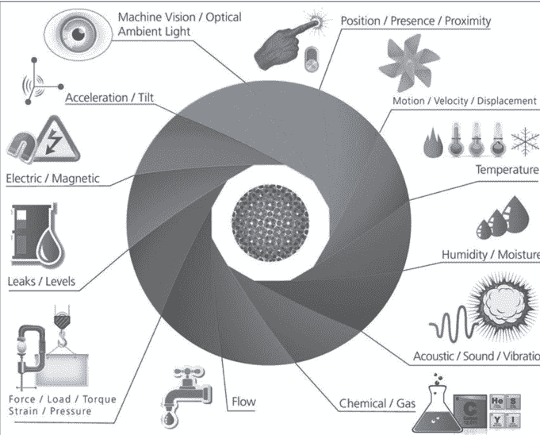

# 图 7.4 IoT 传感器。

来源：Google Images

通常存储在云环境中，并通过云服务器和多核系统进行管理。进行此类分析是为了探索并回答问题：“过去发生过/已经发生了什么？”

- 预测性分析：预测性分析利用历史或观测数据，以及先进的统计概率原理和机器学习模型，根据分析出的模式预测未来趋势。IoT 范式设计用于从各种 IoT 设备获取数据，并可以利用云设计分析框架。预测性分析的一些应用包括预测供需趋势、价格和维护。预测性分析根据未来预测提出事件将发生什么以及何时发生。这种分析为回答问题“未来的结果是什么？”提供了答案。

- 指示性分析：指示性分析通过将预测洞察加入影响分析中，扩展了预测性分析的能力。这种分析预测未来的状况，并通过回答“下一步应该做什么？”为结果的使用提供建议。指示性分析对于工业物联网 (IIoT) 环境非常理想，在这些环境中，人们利用云/边缘计算、大数据分析和机器学习的能力做出基于商业智能的决策。

- 诊断性分析：此类分析在 IIo 应用中也有一席之地。在识别操作故障或事件失败时，诊断性分析会寻找该发生的原因。这种分析旨在解决“为什么会发生？”这个问题。

- 自适应分析：预测性分析的结果在实际部署期间必须根据实时数据进行调整。为了做到这一点，采用了自适应分析，根据最新的数据历史和数据之间的相关性来修改或优化结果。

# 7.7 印度 IIoT 初创企业

印度正尽力利用物联网和人工智能来促进与发达国家并肩的创新文化。在“印度制造”（Make in India）项目下，印度政府日益增加关注和持续努力定义了业务和创新的新地平。通过中微企业（微型、小型企业）提供的推广渠道和财政支持触发了小型初创企业的建立。印度拥有 1,500 家 IoT 初创企业的星系，旨在增强物联网的潜力及其应用前景。本节重点介绍了其中的几家 IoT 初创企业。

- Stellaps Technologies：Stellaps 是印度领先的 IIoT 公司之一，通过提供顶级的服务获得了巨大的增长。这家总部位于班加罗的公司主要关注数据收集和机器学习。SmartMooT 平台利用内置在动物可穿戴设备、挤乳系统、冷却机械和牛奶采购流程中的传感器收集数据。收集的数据被发送到 Stellaps SmartMooT™ 云服务交付平台 (SDP)，其中 Stellaps SmartMooT™ 应用程序套件会提取并分析信息，然后通过低端和复杂的移动设备将分析和数据科学的结果发送给利益相关者 [22] (www.stellaps.com)。

- Parentheses Systems PLC：Parentheses 是一家深科技初创企业，正通过将工业物联网生态系统从技术驱动的系统转变为中小离散制造企业的行为引导转型而蓬勃发展。HuMaC（人机融合）平台允许协调“数据-决策”循环，以实现人机效益的最大化。HuMaC 是一种以人为本的人工智能范式，人类和谐地工作，以增强新体验和认知能力（如决策和从业务洞察中获取知识）。虽然人工智能创造的行为和表现与人类相似的机器人，但增强智能利用这些相同的设备来提高人类工作的输出和人机生态 [23] (parentheses.systems)。

- MLWorkX：MLWorkX 是一家制造供应链公司，专注于定制制造的端到端供应链解决方案。该公司是一个物联网驱动的云制造平台，通过让定制产品制造变得像在亚马逊上下单一样简单，提供无缝且优化的制造服务。该公司通过将产品想法转化为具有完全可视性的实体，帮助其客户更快进入市场 (www.mlworx.com)。

- Utryakta：该公司专门为空压缩机设计预防性维护和节能技术。他们提供分析以获得性能和利用率洞察，以及对关键指标的监控。工厂或车间任何可用的 ERP（企业资源计划)/数据管理 IoT 层都可以与其集成。该公司与世界上几家领先的空压缩机制造商以及石油天然气、汽车、矿业、建筑和水泥行业的压缩机用户合作过。此外，该公司还为已建设施提供改造。除了实际成本外，他们还提供现场空压缩机整体效率提高 20%、节省成本并提高性能 (https://utryakta.com)。

- Smelco：Smelco 是一种基于物联网的防盗卷帘红外安全系统，保护商店免受任何抢劫。我们可以从世界任何地方监控商店。用户可以在设备中插入 SIM 卡，即使没有 Wi-Fi 也可以。当有人试图拉卷帘时，SIM 卡会被激活，客户可以收到警报。此外，还提供双重安全的运动传感器以防止后门进入 (https://sme.in)。

- Galan-fi Smart IoT Technology Pot Ltd：Galan-fi 是物联网驱动的预测分析模型，提供节省能源、气体、水和其他公用事业的建议。该公司由女性企业家于2021年创立。他们制造基于物联网的能源和资产管理系统 (www.zauborp.com)。

- Zenatix：Zenatix 通过机器学习模型为大型用电用户提供节能解决方案。它提供 Wattman 和 Wattman Lite，有助于用电减少 30% [24] (www.zenatix.com)。

# IIOT 应用与服务

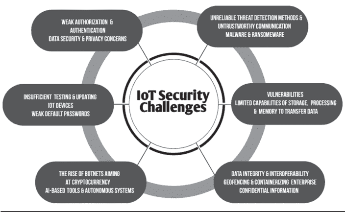

图 7.5 IoT 安全挑战。

# 7.8 印度物联网安全方面的挑战

物联网是硬件和软件的结合，因此很容易受到安全威胁。整个物联网网络运行在一个设备上，当主设备故障时，所有其他设备的安全都会面临风险。物联网 市场上的少数制造商解决了物联网设备及其数据访问的安全问题。印度数据安全委员会 (DSCI) 列出了物联网安全的常见挑战，为业务和研究提供了新途径（图 7.5）。

TechSagar 管理来自 IT 行业、初创企业、学术界和研发机构的各种业务和研究能力。TechSagar 是印度网络技术库，由网络安全协调办公室支持并由 DSCI 管理，提供发现印度网络技术能力的平台。此外，TechSagar 报告说，印度物联网领域有 7000 多企业、129 所学术机构、22 个研发中心和 243 名研究人员。TechSagar 描述的 IoT 能力如图 7.6 所示。

# 7.9 促进印度物联网发展的政策和法规

- 2015 年博士物联网政策草案：印度物联网政策文件的初步草稿由电子和信息技术部 (MeitY, 发布，


## 机器智能

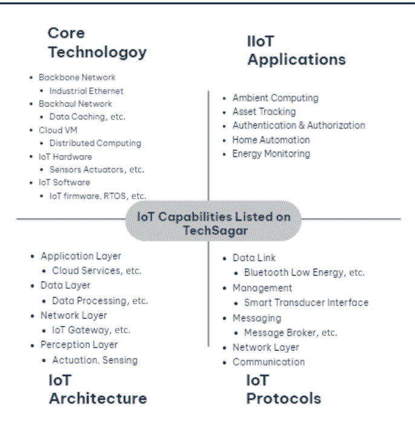

图 7.6 物联网的能力。

2015年曾被称为 DeitY，这是一套为了广泛采用和执行与物联网相关的法规的稳健治理结构。

- 国家数字通信政策 (NDCP)：NDCP 具有创新的目标和政策措施，旨在解决印度通信及数字服务准入的问题。
- 智慧城市任务 (Smart City Mission)：智慧城市的目标是利用技术产生更好的成果，以促进经济增长并提高生活质量。
- 由 NASCOM、MeitY 和 ERNET 建立的物联网卓越中心 (CoE)：CoE 是印度最大的深科技创新生态系统。它的建立专门为了协助印度的物联网初创公司生产市场领先的产品。
- IIT 德里理工学院与三星合作的 IoT 实验室：三星与 IIT 德里理工学院于 2016 年签署了谅解备录（MoU），旨在增强物联网领域的科研能力和产学合作。

### 7.9.1 对物联网设备的建议

这些基于物联网的智能设备（如无线应用、智能家电、家庭安全传感器等）为黑客发现漏洞或缺陷提供了巨大机会。因此，确保没有网络风险的生存地至关重要。在印度，人们越来越强调通过研究进行干预。以下建议强调了该领域的最新进展。

需要一种强大的加密方法来保护我们由物联网生成的敏感数据。然而，标准的加密技术并不适用于物联网硬件。一个全新的加密领域正在开发中，以解决这一问题。加密的主要目标是实现机密性、完整性、真实性和可用性。轻量级加密则致力于为受限环境提供定制的加密解决方案。

根据 TechSaga 的物联网研究，政府可以通过建立应用生态系统、部署必要的网络基础设施以及建立战略联盟，帮助私营部门为 5G 物联网服务制定长期业务计划。

此外，该研究建议政府和主要行业参与者应当认可并奖励物联网初创公司及解决方案供应商，并鼓励人才培养。

为了理解和开发物联网安全，必须在框架、标准、协作努力（DoT、NIITPC、NCSC、MeitY 等之间）等核心领域进行投资，通过培训进行能力建设、产品测试和认证 [25]。

## 7.10 物联网的应用

物联网在医疗保健、农业等领域有广泛的应用。

- 智慧家居：物联网的集成管理着交通流、电力和娱乐。
- 智慧城市：使用支持物联网的信息和通信技术管理交通流、电力分配。
- 农耕：基于物联网的无人机监控环境状况、土壤水分和养分。
- 零售业务：基于物联网的传感器跟踪消费者行为和产品调整。
- 可穿戴设备：健身带和智能手表记录卡路里、心率和氧饱和度。
- 交通监控：基于物联网的系统管理交通流、到达时间和目的地。
- 车队管理：物联网传感器告知司机状况、功能和需求。
- 供水：传感器结合软件监控水质、用水量和报告。

## 工业物联网 (IIOT) 应用与服务

## 7.11 工业物联网用例

### 7.11.1 预测性维护

使用基于物联网的摄像头和数据分析对资产进行定期维护，可以在故障发生前预测其可能的故障。这些支持物联网的系统将维护过程转变为动态且自动的过程。预测性维护增加了安全性并延长了设备寿命，同时避免了事故和危害。

#### 7.11.2 智能计量

智能电表是一种接入互联网的设备，用于检测建筑或住宅使用的能量、水或天然气量。传统仪表仅跟踪总消耗量，而智能仪表则可以检测资源消耗量以及时间戳。工业使用智能仪表来跟踪消费者使用情况，并根据用量确定价格。此外，这种方法对于矿业等危险行业，以及设备广泛分散或高度依赖环境条件的行业非常有帮助。为了避免浪费资源或过载发电设备设备，能源部门依赖于智能计量和远程监控。


148 ■ 机器智能

### 7.11.6 供应链管理与优化

供应链管理和优化过程无疑产生了大量的 IoT 数据。供应商可以轻松跟踪收货人；他们滞留在何处；并找到到达某地所需的预测时间线。可以使用 GPS 以及相关的设备和传感器来预测和验证产品位置。这让客户了解与货运相关的实际日期和时间。IoT 在供应链管理和优化中解决的主要领域包括：使用集装箱传感器进行位置认证、跟踪交通流和产品移动速度；监控；维持产品质量参数以及最优路线检测 [32]。

## 7.12 工业物联网 (IIoT) 的未来

据估计未来支持 IoT 的设备数量将翻倍。AI、云存储与计算、边缘计算、移动计算、机器人、增强现实、虚拟现实、人机交互 (HCI) 等具有变革性和破坏性的技术将扩大 IIoT 的范围，并触发创新 IoT 应用和产品的设计开发 [33]。

## 7.13 结论

本文探讨了 IoT、IIoT 基础、IoT 的硬件和软件支持、IoT 传感器类型、安全问题、应用以及 IIoT 的未来前景。由于应用领域的预期扩张和创新，这项技术将实现指数级增长。

## 参考文献

- 1. oracle.com/in/internet-of-things/what-is-iot/
- 2. https://aws.com/what-is-iot/
- 3. techtarget.com/iotagenda/definition/Internet-Of-IoT
- 4. scottroup.org/internet-of-things-iot
- 5. networkworld.com/article/320753/what-is-iot-the-internet-of-things-explained.html
- 6. https://medium.com/zeux/the-internet-of-iot-5-reasons-why-the-world-needs-1255fc7119sc
- 7. channelfututures.com/security/why-is-iot-popular-because-of-open-source-big-data-security-and-sdn
- 8. comptia.com/content/articles/what-is-iot-cybersecurity#:-text=IoT%20security%20is%20one%20of,attacks%2C%20such%20as%20through%20botnets
- 9. www.ciena.com/insights/what-is/What-Is-SDN.html
- 10. www.trustradius.com/software-defined-networking
- 11. www.leveredge.com/iot-ebook/how-iot-systems-work
- 12. https://trackinno.com/how-iot-works-part-3-data-processing/
- 13. www.biz4intell.com/blog/7-layers-of-what-makes-an-iot-solution-comprehensive/
- 14. https://trackinno.com/how-iot-works-part-4-user-interface/
- 15. www.javapoint.com/internet-of-things-with-python
- 16. www.topcodcoder.com/three/articles/python-in-iot-internet-of-things
- 17. http://itnextgen.com/best-development-software-ide-internet-of-things-iot/
- 18. https://data-flare.training/blogs/of-iot-hardware/
- 19. https://nexusintegra.io/7-industrial-iot-applications/
- 20. https://blog.wellaware.us/blog/ultimate-guide-types-of-iot-sensors-transmitters-industrial-applications
- 21. www.embitel.com/blog/embedded-blog/7-most-commonly-used-sensors-for-develop-industrial-iot-solutions
- 22. www.bisinfotech.com/top-iot-companies-in-india-industry-leaders/
- 23. https://fqs.com/companies/industrial-iot/india/
- 24. https://startuptalky.com/iot-startups-india/
- 25. www.dsci.com/blogs/iot-technology-in-india/
- 26. www.jgsawacademy.com/top-uses-of-iot/
- 27. www.iotworldcongress.com/iot-transforming-the-future-agriculture/
- 28. www.simplelearn.com/iot-applications-article
- 29. www.ibm.com/blogs/internet-of-things/top-5-industrial-iot-use-cases/
- 30. www.datamation.com/trends/industrial-iot-use-cases/
- 31. www.techtarget.com/iotagenda/feature/Top-5-industrial-IoT-Use-cases
- 32. www.mytechmag.com/iot-in-manufacturing/
- 33. https://doi.org/10.1007/978-3-030-37468-6_27


# 第 8 章
机器学习设计

## 8.1 引言

本文探讨了 IoT、IIoT 基础、IoT 的硬件和软件支持、IoT 传感器类型、安全问题、应用以及 IIoT 的未来前景。由于应用领域的预期扩张和创新，这项技术将实现指数级增长。

## 152 ■ 机器智能

供应链管理和优化过程无疑产生了大量的 IoT 数据。供应商可以轻松跟踪收货人；他们滞留在何处；并找到到达某地所需的预测时间线。可以使用 GPS 以及相关的设备和传感器来预测和验证产品位置。这让客户了解与货运相关的实际日期和时间。IoT 在供应链管理和优化中解决的主要领域包括：使用集装箱传感器进行位置认证、跟踪交通流和产品移动速度；监控；维持产品质量参数以及最优路线检测 [32]。

## 7.12 IIoT 的未来

据估计未来支持 IoT 的设备数量将翻倍。AI、云存储与计算、边缘计算、移动计算、机器人、增强现实、虚拟现实、人机交互 (HCI) 等具有变革性和破坏性的技术将扩大 IIoT 的范围，并触发创新 IoT 应用和产品的设计开发 [33]。

## 7.13 结论

本文探讨了 IoT、IIoT 基础、IoT 的硬件和软件支持、IoT 传感器类型、安全问题、应用以及 IIoT 的未来前景。由于应用领域的预期扩张和创新，这项技术将实现指数级增长。

## 参考文献

- 1. oracle.com/in/internet-of-things/what-is-iot/
- 2. https://aws.com/what-is-iot/
- 3. techtarget.com/iotagenda/definition/Internet-Of-IoT
- 4. scottroup.org/internet-of-things-iot
- 5. networkworld.com/article/320753/what-is-iot-the-internet-of-things-explained.html
- 6. https://medium.com/zeux/the-internet-of-iot-5-reasons-why-the-world-needs-1255fc7119sc
- 7. channelfututures.com/security/why-is-iot-popular-because-of-open-source-big-data-security-and-sdn
- 8. comptia.com/content/articles/what-is-iot-cybersecurity#:-text=IoT%20security%20is%20one%20of,attacks%2C%20such%20as%20through%20botnets
- 9. www.ciena.com/insights/what-is/What-Is-SDN.html
- 10. www.trustradius.com/software-defined-networking
- 11. www.leveredge.com/iot-ebook/how-iot-systems-work
- 12. https://trackinno.com/how-iot-works-part-3-data-processing/
- 13. www.biz4intell.com/blog/7-layers-of-what-makes-an-iot-solution-comprehensive/
- 14. https://trackinno.com/how-iot-works-part-4-user-interface/
- 15. www.javapoint.com/internet-of-things-with-python
- 16. www.topcodcoder.com/three/articles/python-in-iot-internet-of-things
- 17. http://itnextgen.com/best-development-software-ide-internet-of-things-iot/
- 18. https://data-flare.training/blogs/of-iot-hardware/
- 19. https://nexusintegra.io/7-industrial-iot-applications/
- 20. https://blog.wellaware.us/blog/ultimate-guide-types-of-iot-sensors-transmitters-industrial-applications
- 21. www.embitel.com/blog/embedded-blog/7-most-commonly-used-sensors-for-develop-industrial-iot-solutions
- 22. www.bisinfotech.com/top-iot-companies-in-india-industry-leaders/
- 23. https://fqs.com/companies/industrial-iot/india/co
- 24. https://startuptalky.com/iot-startups-india/
- 25. www.dsci.com/blogs/iot-technology-in-india/
- 26. www.jgsawacademy.com/top-uses-of-iot/
- 27. www.iotworldcongress.com/iot-transforming-the-future-agriculture/
- 28. www.simplelearn.com/iot-applications-article
- 29. www.ibm.com/blogs/internet-of-things/top-5-industrial-iot-use-cases/
- 30. www.datamation.com/trends/industrial-iot-use-cases/
- 31. www.techtarget.com/iotagenda/feature/Top-5-industrial-IoT-Use-cases
- 32. www.mytechmag.com/iot-in-manufacturing/
- 33. https://doi.org/10.1007/978-3-030-37468-6_27


# 第 8 章
机器学习设计

## 8.1 引言

本文探讨了 IoT、IIoT 基础、IoT 的硬件和软件支持、IoT 传感器类型、安全问题、应用以及 IIoT 的未来前景。由于应用领域的预期扩张和创新，这项技术将实现指数级增长。


对医疗保健及相关行业（如保险部门和制药行业）不仅在印度，在全球范围内如此。由于全国范围内的封锁，普通医疗机构受到了严重影响，导致其他健康问题患者（尤其是慢性疾病患者）的护理出现缺口。由于治疗被推迟，患者的状况变得更加危急，这将对医疗保健行业产生长期影响。

本章的目标是：

- 为医疗保健收盘价数据设计时间序列模型，范围从1999年2月1日到2020年3月。
- 通过对比2020年3月23日至2020年7月期间实际收盘价与所开发模型的预测值，研究新冠肺炎（COVID-19）的影响。
- 基于所开发的模型预测截至2020年12月的趋势。

## 8.2 文献综述

股票或指数的价格预测一直引起着投资者的兴趣。[5] 研究揭了 ARIMA 对预测价格的短期波动非常有用。[6] 总结了六种预测方法（如最小误差、最大误差、平均误差、标准差、均方根误差和 ARIMA）的性能，预测准确性非常可接受。[7, 8] 讨论了用于预测的技术性和基本面长期和短期方法，并强调结合稳健检验将提供准确的预测。[9, 10] 对10年数据拟合了 ARIMA 模型，并在准确性预测中观察到2年的 RMSE 和 MEA。这表明短期预测比长期预测更准确。[11] 将该模型应用于不同行业的56只不同股票。模型拟合百分比为85%。[12] 尝试 NSE-Nifty Midcap 50 公司尝试该模型，并观察到了未来趋势。[13, 14] 还尝试预测该指数的未来观测价格，并与2013年的 Sensex 行动相结合验证了数据。[15] 探索了德国市场如何以与北美相同的方式运行，以及亚洲和欧洲市场的反应。

## 8.3 时间序列数据

为了预测未来股票价格，已经开发了许多机器学习模型，而自回归整合移动平均（ARIMA）就是其中之一。ARIMA 使用时间序列数据，也被称为 Box-Jenkins 方法 [16, 17]。这是预测短期金融数据最合适的模型之一。按照以下步骤预测未来：

- 平稳性：为了准确预测，需要数据集具有平稳性 [18]。数据集的平稳性意味着序列的行为随时间保持不变。
- 平稳性检验：通过应用单位根检验检查平稳性，这在现实现象中某种程度上不符合逻辑。将数据转换为平稳并不意味着冲击的影响消失了。
- 数据绘图：首先，对数据集进行绘图，以了解将数据转换为平稳形式需要多大的差异。
- 单位根检验：执行增广 Dickey-Fuller (ADF) 检验和 Phillips Perr 检验，以了解时间序列数据的平稳性。
- 时间序列差分：为了将非平稳序列转换为平稳序列，进行一阶或二阶差分：

$$\Delta R_t = R_t - R_{t-1}$$

$$\Delta R_t = R_t - B R_{t-1}$$

$$\Delta R_t = (1 - B)R_{t-1}$$

- 通过 $R_t$ 的 $d$ 阶差分获得序列的平稳性：

$$\Delta^d R_t = (1 - B)^d R_t$$

- 单变量模型：在单变量模型下，仅根据过去序列随时间测量一个变量。Box-Jenkins 方法被开发用于解释生成序列的过程以及预测。此外，ARIMA 用于分析目的。
- ARIMA 模型：将 $p$ 阶和 $q$ 阶自回归模型与移动平均模型整合在一起。

ARIMA 模型的通用方程为：

$$R_t = \phi_0 R_{t-1} - \dots - \phi_p R_{t-p} + \varepsilon_t + \theta_1 \varepsilon_{t-1} + \theta_2 \varepsilon_{t-2} + \dots + \theta_q \varepsilon_{t-q}$$

其中：

$R_t$ = 用于通过差分时间序列值将非平稳数据转换为平稳数据的实际数据。

$\phi, \theta$ = 参数

$P$ = 回归自身滞后值的时间序列值
$q$ = 移动平均值，即误差项滞后值的个数
$\epsilon_t$ = t 刻的随机误差

处理 ARIMA 模型的步骤通过几个步骤完成，即检验、识别、估计和预测 [19, 5]。

- 模型拟合检查：需要执行模型拟合检查以了解数据的可靠性和有效性。此外，可以对序列的未来模式进行预测。

## 8.4 ARIMA模型的开发

考虑了以下从1999年2月到2020年12月开发 ARIMA模型的步骤：

- 线性趋势模型：使用线性趋势模型对收盘价进行趋势分析。拟合的趋势方程和准确性衡量如表8.1所示。图表如图8.1所示。

$Y_t = -1667/2 + 3.21555t$ (8.6)

- 平稳性检验：平稳时间序列是指统计属性（如均值、方差、自相关性）随时间保持恒定的序列。大多数统计预测方法假设时间序列可以通过数学变换转换为近似平稳（即“平稳化”）。平稳化序列相对容易预测：你只需要预测其统计属性在未来将与过去相同。应用增广 Dickey-Fuller 检验来测试数据的平稳性。ADF 检验的假设为：

- ADF 检验的原假设 (H₀)：数据非平稳。
- 备择假设 (H₋)：数据是平稳的。

表8.1 线性趋势模型的准确性衡量
| 准确性衡量 | 值 |
| --- | --- |
| MAPI | 41 |
| MAD | 1665 |
| MSD | 34497856 |

# 收盘价趋势分析图
线性趋势模型
$Y_t = -1667.2 + 3.2155 \times t$


图8.1 收盘价（趋势）。

# 表8.2 Augmented Dickey-Fuller 检验
| Augmented Dickey-Fuller 检验 |
|---|---|
| Dickey-Fuller | -2.5247 |
| 滞后阶 | 4 |
| p值 | .35 |

在表8.2中，由于p值大于0.05，可以推断给定数据集是非平稳的。

差分线性方程：执行差分以将数据转换为平稳形式。图8.2显示了差分后的相同行为。差分线性方程所示：

$Y_t = 2.37 - 0.00097 \times t$ (8.7)

差分线性模型的准确性衡量如表8.3所示。

- 自相关函数和部分自相关函数：时间序列中两个值之间的相关系数称为自相关函数 (ACF)。例如，时间序列 $y_t$ 的 ACF 给出：


906fcf6f1ec5b_181.png)

图8.2 差分后的图。

# 表8.3 差分线性模型的准确性衡量
| 准确性衡量 | 值 |
|---|---|
| MAPE | 128.23 |
| MAD | 57.34 |
| MSD | 9675.74 |

Corr($y_t,y_{t-k}$),k=1,2,...

这个k值是所考虑的时间间隔，被称为滞后。滞后1阶自相关（即上述的k=1）是间隔一个时间单位的值之间的相关性。更广泛地说，滞后k自相关是间隔k个周期的值之间的相关性。ACF的图如图8.3所示。ACF是衡量t刻观测值与之前时间观测值之间线性关系的方法。如果我们假设一个AR(k)模型，那么我们可能只想测量yt与yt-k之间的关联，并过滤掉位于之间的随机变量的线性影响（即yt-1,yt-2,...,yt-(k-1)yt-1,yt-2,...,yt-(k-1)），这对时间序列进行变换。通过计算变换时间序列的自相关，我们得到部分自相关函数 (PACF)。PACF的图如图8.4所示。


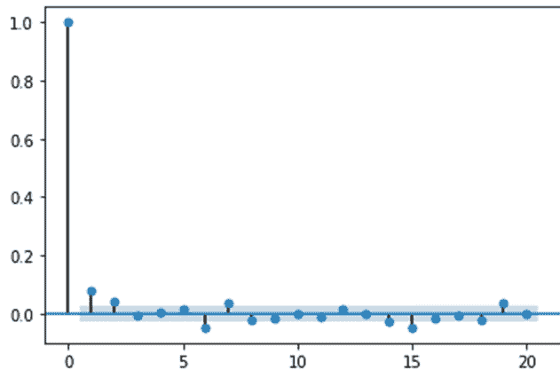

图 8.3 自相关函数 (ACF)。

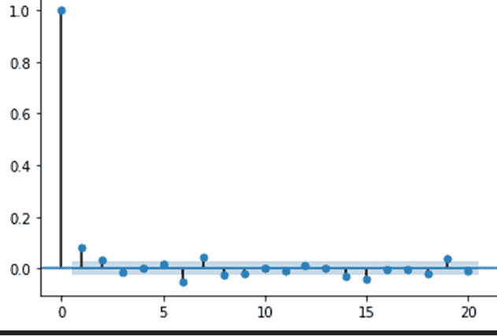

图 8.4 偏自相关函数 (PACF)。

# 疫情期间的医疗保健机器学习模型 ■ 159

### 表 8.4 p, d 和 q 的值
| 序号. | PDQ | 误差 | AIC |
|---|---|---|---|
| 1 | 000 | 250 | 63240 |
| 2 | 100 | 249 | 63208 |
| 3 | 010 | 415 | 66428 |
| 4 | 001 | 249 | 63217 |
| 5 | 110 | 346 | 65057 |
| 6 | 011 | 251 | 63239 |
| 7 | 101 | 249 | 63205 |
| 8 | **111** | **249** | **63207** |
| 9 | 200 | 249 | 63202 |
| 10 | 201 | 249 | 63204 |

- 自相关函数和偏自相关函数：在此阶段，应用了不同 p, d, q 值的 ARIMA 模型，如表 8.4 所示。计算了 2020 年 3 月 1 日至 2020 年 8 月 31 日期间预测值的均方误差 (MSE)。

从图 8.4 和表 8.4 可以看出，我们选择了模型 111 进行进一步的预测。

- 预测：预测范围从 2019 年 2 月 1 日到 2020 年 8 月 30 日，2021 年 2 月。医疗保健指数呈现锯字形模式，这意味着高风险。投资者在向该领域投入他们的血汗钱之前，应该采取适当预防措施并进行适当分析。

# 160 机器智能

1. 使用趋势分析：

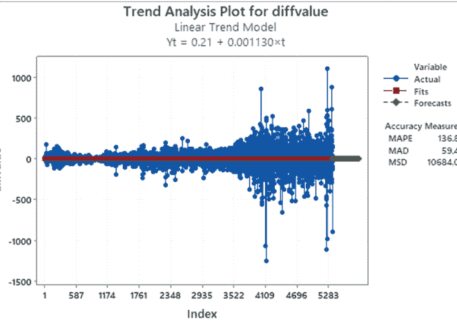

2. 使用 ARIMA (1,1,1)

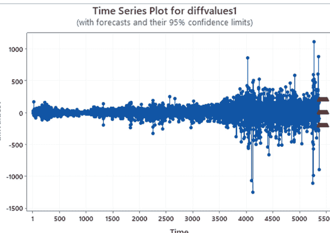

# 疫情期间的医疗保健机器学习模型

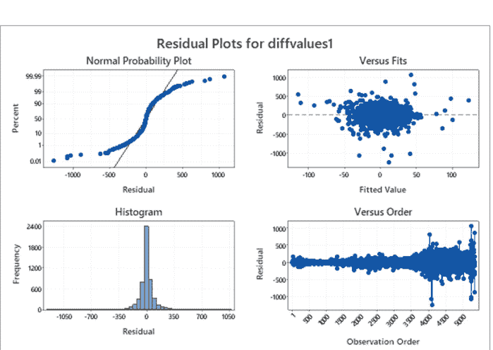

两个图表的值均为常数。

## 8.5 结论

本研究旨在通过 ARIMA 模型预测 BSE 医疗保健指数的收盘价，并展示 COVID-19 对收盘价的影响，ARIMA 模型对此出了合理的预测。ARIMA 模型应用于短期预测，它还可以帮助投资者做出短期投资预测。建议投资者在投资健康股票时不要恐慌，因为许多事情（如运营、选择性手术、主要治疗、国际患者等）在恢复正常之前都会被推迟。因此，该领域显示的模式与目前的状况相同，正如数据所示，未来也将遵循这一模式。

## 参考文献

- 1. Radrishnan Vignesh and Sumant Sen (2019) “印度经济的低迷持续.”The Hindu, 8 月 8 日。访问地址：www.thehindu.com/data/the-downturn-in-indian-economy-continues/article28836274.ecc.
- 2. IBEF. (n.d.) “印度品牌。”访问地址：www.ibef.org/industry/indian-pharmaceuticals-industry-analysis-presentation.
- 3. Indian Pharmaceutical Alliance (2019) 印度制药业 - 前行之路, Indian Pharmaceutical Alliance, 6 月, pp.1–33.
- 4. FICCI (2013) “印度生命科学：2030 愿景扩大全球影响力并推动国内获取.”2013-14-7.
- 5. Adebiyi A. Ariyo, Adewemi O. Adewemi, and Charles K. Ayo (2014) “使用 ARIMA 模型预测股票价格.”发表于 2014 UKsim-AMSS 第 16 届计算机建模与仿真国际会议。IEEE。
- 6. Jaydip Sen, and Tamal Chaudhuri (2017) “基于时间序列分析的印度医疗保健部门预测.”Journal of Insurance and Financial Management, 3(1).
- 7. Dev Shah, Haruna Ishak, and Farhana Zulkern “股市分析：预测的综述与分类.”International Journal of Financial Studies, 7(2): 26.
- 8. Sheikh Mohammad Idris, M. Afshar Alam, and Parul Agarwal (2019) “基于时间序列数据的股市波动预测方法。”Access, 7:17287–17298.
- 9. Madhav Latha Calla, Venkatesanajan Malepati, Siva Nageswara and Rao Kolusu (2018) “使用自回归移动平均模型预测风险：来自 S&P BSE Sense 的证据。”Financial Innovation, 4(1): 24.
- 10. George E. P. Box, et al. (2015) 时间序列分析：预测与控制.Hoboken, NJ: John Wiley & Sons.
- 11. Pannapr Mandal, Labani Shit, and Saptarsi Goswami (2014) “时间序列建模 (ARIMA) 在预测股票价格中的有效性研究.”International Journal of Computer Science, Engineering and Applications, 4(2): 13.
- 12. Uma Devi, Labani Shit, and Saptarsi Goswami (2014) “时间序列建模 (ARIMA) 在预测股票价格中的有效性研究.”International Journal of Computer Science, Engineering and Applications, 4(2): 13.
- 13. Debrajita Banerjee 和 Eswara Reddy (2014) 选定市场.国际会议.
- 14. Debrajita Banerjee 和 Eswara Reddy (2014) 选定市场.信息管理期刊.
- 15. Debrajita Banerjee 和 Eswara Reddy (2014) 选定市场.信息管理期刊.
- 16. Debrajita Banerjee 和 Eswara Reddy (2014) 选定市场.信息管理期刊.
- 17. Debrajita Banerjee 和 Eswara Reddy (2014) 选定市场.国际会议.
- 18. Debrajita Banerjee 和 Eswara Reddy (2014) 选定市场.国际会议.
- 19. Debrajita Banerjee 和 Eswara Reddy (2014) 选定市场.国际会议.

## 第 9 章

## 无处不在与增强现实

## 9.1 引言

人机交互 (HCI) 是计算机科学的一个分支，研究人类如何与计算机交互。HCI 最核心的是增强现实 (AR) 和无处不在 (UC)。

### 9.2 无处不在 (UC)

UC 也被称为泛在计算、无处不在和环境智能。UC 指将计算能力（特别是微处理器）嵌入日常物品的出现趋势。

### 9.2.1 UC 的历史

X 帕洛托研究中心 (PARC) 的首席技术 Mark Weiser 在 1988 年提出了“无处不在计算”这一术语。Weiser 单人与 PARC 主任兼首席科学家 Seely Brown 一起发表了一些关于该主题的早期论文，主要定义了它并概述了其障碍。Active Badge 是一种工牌大小的“佩戴式电脑”，是在英国剑的 Olivretti 研究实验室设计的，允许企业跟踪人员及其附属物品的精确位置。

### 9.2.2 UC 的特征

UC 的主要目的是创建链接智能产品，并使通信和数据共享变得更容易且不具侵入性。以下是 UC 的一些关键特征：


# HCI 中的无处计算与增强现实 ■ 165

- 考虑人类因素，并将产品置于人类环境中而非计算环境中。
- 使用低成本处理器以减少内存和存储需求。
- 获取实时数据。
- 计算机始终连接并随时可用。
- 关注多对多的关系，而非一对一、多对一或一多关系，以及无处不在的技术概念。
- 包含本地/全局、社交/个人、公共/私人以及不可见/可见的特征，以及知识开发和信息分发。
- 依赖于互联网融合、无线技术和现代电子设备。
- 随着数字设备变得更加可穿戴和网络化，对用户隐私将产生限制和侵入。
- 各种设备的可靠性因素可能会受到技术进步的影响。

## 9.2.3 UC 的层级

如 IoT、云计算等 HCI 技术使使用户能够访问无线传感器网络。此类传感器网络在将数据传输到服务器之前，从设备的传感器收集数据。传输过程中可能遇到的三个最常见的层如图 9.1 所示。

层 1：任务管理层检查用户任务、上下文和索引。它还管理区域内复杂的相互依赖关系。

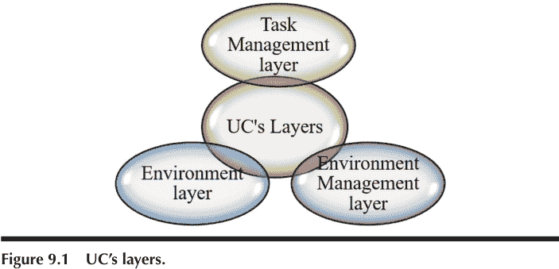

层 2：环境管理层监控资源及其能力，并映射服务需求和特定能力的用户级状态。
层 3：环境层跟踪重要资源并管理其可靠性。

## 9.2.4 UC 类型

UC 可以根据其便携性、简单性、技术能力、移动性和可用性进行分类。UC 广泛分为四类，如图 9.2 所示：(1) 便携式计算；(2) 泛计算；(3) 静静计算；以及 (4) 可穿戴计算。

- * 便携式计算：笔记本电脑和个人设备使计算变得便携。计算机现在易于携带，允许它们在任何需要的地方被携带。便携式计算机用于各种行业和各种用途，从电视行业到军事领域。笔记本电脑、笔记本式电脑、手持电脑、掌上电脑和 PDA 都是便携式计算机的示例。

- * 泛计算：泛计算试图通过提供简化数据处理工具来让我们的生活更简单。具有高速、无线连接、低功耗率、耐用内存中的数据存储、小型存储设备、彩色便携式手持个人助理设备

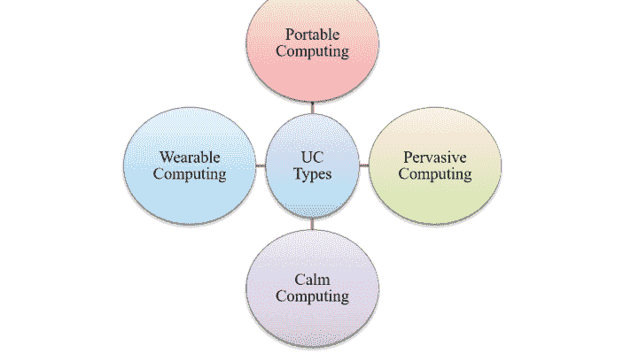

图 9.2 UC 类型。

通过泛计算将提供视频显示和语音处理技术。高公路上的电子收费收费系统是泛计算的例子，像 Life360 的监控软件也是如此，它可以跟踪用户的位置、速度和剩余电量。

- * 静静计算：计算指的是技术开发水平，其中用户的主要角色不是计算，而是增强并将重要信息带入体验。静静计算优先考虑人和任务，而非计算和数据。下一代联动设备被称为静静设计（Calm Design）。它的目标是将客户与他们的设备以及其他人连接起来，让他们能够在没有中断或弹出窗口的情况下生活。静静技术的一个很好的例子是视频会议。与电话相比，可以通过手势和面部表情收集信息。

- * 可穿戴计算：创建、设计和管理感知系统的研究被称为可穿戴计算。可穿戴计算允许用户在保持移动性和访问设备的同时，无需使用手或眼即可工作、交互和娱乐。可穿戴设备具有提高交互、学习、感知实践能力的潜力。可穿戴设备可以过滤用户的细胞、提供参考、跟踪用户健康、提醒用户姓名并帮助用户上公交。可穿戴技术是指一组电子设备，如手表、戒指、智能衣服、头戴显示器和医疗设备，通过将健身、便利和生活方式与世界其他部分连接使生活变得简单 [8]。

## 9.3 UC 设备

传感器不断演进，变得更加紧凑、轻巧、精确、耐用、有效、反应迅速，并且通信能力不断增强。这些关键组件以及新技术的可用性支持着消费电子行业的扩张，提高了效率。例如，摄像头传感器经常用于智能系统收集照片和视频。可穿戴设备监控许多可穿戴科技设备不具备的各种生物特征，并在出现异常时通知用户。

# HCI 中的无处计算与增强现实 ■ 167

## 9.3.1 手手表

智能手表可能是今天最知名且最常用的可穿戴设备。当智能手表与智能手机连接时，可以接收短信、电话或其他通知

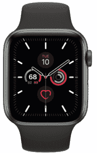

图 9.3 Apple Watch。

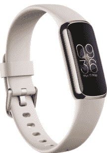

图 9.4 Fitbit。

智能手表有多种设计，具有跌倒检测、紧急 SOS 和低心率通知等安全功能，即使他们没有 iPhone。这种可穿戴设备监控许多可穿戴科技设备不具备的各种生物特征。

## 9.3.2 智能戒指

智能戒指为消费者提供社交反馈，并可以用其他设备无法的方式与环境进行交互。当接收短信、电话或其他通知时，某些智能戒指会提供通知。Oura Ring允许用户导航应用程序、锁和解锁门并在充电传输数据。提供有用的健康信息，如睡眠模式和每日锻炼。

## 9.3.3 高级医疗可穿戴设备

可穿戴医疗跟踪设备旨在保持患者健康并提高其生活质量。可穿戴设备允许持续监测体力活动的数量和质量，帮助患者做出明智的生活方式改变。


# 人机交互中的泛在计算与增强现实 ■ 171

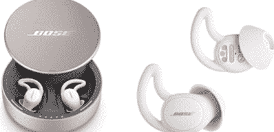

图 9.9 Bose Sleepbuds II。

## 9.3.4 智能耳机

智能耳机（也称为智能耳式设备或 hearables）已经应用于不仅仅是传输音频的设备中。这些耳机是无线的，可以连接到你的手机、平板电脑、计算机或任何启用蓝牙的设备。

一些研究显示失眠是最常见的健康问题之一。睡眠占据了时间的核心位置。Bose Sleepbuds II 耳机已专业证明可以改善睡眠。它们不会播放音频或歌曲；而是播放来自 Bose Sleep App 的声音（图 9.9）。

## 9.3.5 智能服装

智能服装可以比其他形式的现代可穿技术提供更深入的洞察，因为它与身体大部分面积接触，允许对医疗保健和生活方式开发进行增强。三星在该领域启动了大量研究，并申请了许多有趣的专利。如果这些专利成为商业可用产品，三星可能会在未来几年生产诊断呼吸问题的智能衬衫和追踪跑步姿态的智能短裤。消费者已经可以购买 Siren 袜子（检测足部溃疡发展的智能袜子）、Wearable X Nadi X 智能裤（在瑜伽运动期间通过震动改善姿态），以及在用户需要涂抹防晒霜时提供提醒的 Naviano 智能泳衣（图 9.10）。

## 9.4 泛在计算（UC）的应用

如今，UC 是一项领先且独特的技术，适用于各种研究领域和其他学科。这种适应性强的 UC 被用于许多行业，特别是作为无处不在传感器。

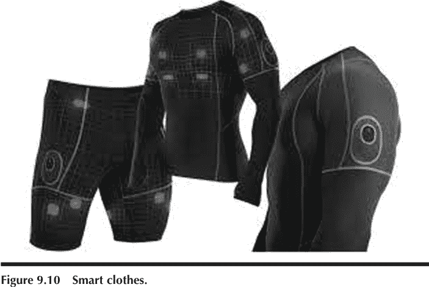

## 9.4.1 医疗保健行业

UC 用于日常医院管理，如患者监测、健康状况和老年护理。泛在医疗保健是一个新领域，它利用泛在技术为医疗专业人员提供一个技术导向的环境，以提供高效有效的护理。研究社区已开发了各种医疗领域的各种技术解决方案，例如慢性病监测、步态分析、情绪和跌倒检测、神经病监测、生理和生命体征监测、肺功能监测等 [10]。

## 9.4.2 无障碍

Gregg Vanderheiden 使用“泛在无障碍”一词来描述一种支持无障碍的新技术方法。他认为，随着计算从个人工作站演变为 UC，必须根据这种新的计算范式检查无障碍性。u-accessibility（泛无障碍）已成为提高残障人和老年人生活质量的方法。

## 9.4.3 学习

泛在学习被定义为通过移动和无线通信技术以及传感器和位置/跟踪机制而增强的学习，所有这些共同工作，将学习者与其环境整合。为了促进持续、情境化和有意义的学习，泛在学习系统连接了虚拟与真实的物体、人和事件。当学习者携带移动设备旅行时，技术通过与周围嵌入式计算机通信动态地帮助学习过程。泛在学习的目标是识别哪些信息可以在学习者日常任务中的不同配置和位置进行传递，并将这些数据与学习者的教育过程相联系。

## 9.4.4 物流

已经进行了多项研究来评估使用泛在技术改进运输物流。MobiLab/Unisinos 在此背景下建议了两个模型：

- 1. SWTrack：这使得公交能够追踪自己的车辆并调节它们的路线。该模型允许用户判断车辆是在遵循预定路线还是偏离了路线。
- 2. SafeTrack：这是一个 SW 扩展，允许在没有用户交互的情况下对货物进行自主交付管理。

RFID 用于管理车辆上的输入/输出货物，实时识别货运和错误完成的货物回收，以及潜在的货物盗窃。

## 9.4.5 商业

情境感知商业（也称为泛在商业或 u-commerce）利用移动设备和泛在技术来促进业务。Gershman 识别了 u-商业成功的三个要求：

- 1. 与客户始终保持联系。
- 2. 始终意识到客户的情况。
- 3. 始终负责。

有些建议侧重于产品交易，而另一些则集中于市场收入。MobiLab 提出了 MUCS 范式，代表“通用商业支持”。MUCS 使用这些技术来为作为客户或供应商的用户识别商业机会。此外，该模型提供了一种通用方法，鼓励所有领域产品和服务的商业。

## 9.4.6 游戏

泛在游戏是通过在游戏制作中使用 UC 技术而生的。在这类游戏中，玩家需要前往特定地点以完成任务。此外，用户之间相互交互（多人游戏），并与他们周围的环境（真实物体）交互。无线技术使用户在行走的同时发送和接收信息，如位置、本地用户和其他类型的情境感知数据。

## 9.5 泛在计算的优势

在许多集成传感器的帮助下，UC 用于各个领域，帮助人们更高效地改善日常活动。一些优势包括：

- 可以通过主要的不可见的计算技术实现智能环境。
- 使用智能网络，可以降低服务成本。
-  {生产效率和调度得到了增强。
- 在医疗保健环境中，响应时间缩短了。
- 更准确、方便的个人财务交易。
- 通过传感器、网络技术和数据分析的个人画像，来监测和报告各种事物，包括购买偏好、生产过程和交通模式。
- 医疗专业人员可以远距离监测患者的生命体征，延伸远程医疗服务。
- 采用交互式媒体传输技术（允许学生和老师交流）也可以帮助将教育带到农村地区。

## 9.6 泛在计算的缺点

即使技术在进步，仍然存在一些局限性。这里讨论了 UC 的一些缺点：

- 在保持可接受隐私措施的同时实施可能具有挑战。
- 泛在系统收集大量敏感个人数据，管理这些数据涉及处理法律、技术和伦理问题。
- 用户同意可能是 UC 伦理问题的来源。
- 在收集隐私信息时，应该提供清晰的安全保障 [10]。

# 人机交互中的泛在计算与增强现实 ■ 175

## 9.7 增强现实 (AR)

AR 是利用现代技术（如计算机视觉）对物理环境进行的动态增强版本，将 AR 整合到智能手机应用程序中并进行物体识别。现实世界覆盖了关于环境虚拟数据。AR 指任何 AR 实验 [11]。

## 9.7.1 AR 历史简介

1968 年，哈佛教授、计算机科学家 Ian Sutherland 发明了第一台头戴显示器，命名为“达摩利斯之剑”。1974 年，Myron Kruger在康涅狄格大学建立了“Videoplace”实验室。1990 年，Tom Caudell 发明了“增强现实”一术。1992 年，Louis Rosenberg 在空军阿姆斯特实验室构建了第一个工作中的 AR 系统。1994 年，作家兼制片人 Julie Martin 通过戏剧《网络空间舞蹈》开启了娱乐领域的 AR 先河。1998 年，Sportvision 播出了第一场使用虚拟 1st & Ten 图形系统的 NFL比赛（该系统有时被称为黄色标记）。该技术在画面上叠加一条黄线，让观众看到球队刚刚获得的位置。1999 年，NASA 为 X-38 航天器开发了混合视觉系统。在测试期间，系统利用 AR 技术辅助导航。2000 年，Hirokazu Kato 创建了 ARToolKit，这是一个开源软件库。该软件包帮助了其他开发者创建 AR 软件。为了在现实世界上叠加虚拟图像，该库使用视频跟踪。


## 9.7.2 AR 的特性

AR（增强现实）是一种可以将现实世界与计算机生成的数据融合的计算机系统，并具有以下特性：

- 它将现实世界和虚拟世界相结合，使得虚拟世界的元素可以现实世界产生交互。
- 信息以虚拟形式展示，例如照片、音频、视频和 GPS 数据，并且与肉眼可见。
- 它应该是实时的。
- 它与环境直接交互。

## 9.7.3 AR 的类型

许多沉浸式应用开发公司一直在通过丰富的数字内容表达方式来改进消费者体验。通过多种类型的 AR 实现。

### 9.7.3.1 基于标记的 AR (Marker-Based AR)

基于标记的 AR 使用 AR 应用来识别物理图像，“标记”如图 9.11 所示。当你打开应用程序时，它使用移动设备的后置摄像头来跟踪标记。这种 AR 技术也称为图像识别。AR 以视频、图像、3D 模型或动画片段的形式显示内容。用户可以通过应用程序与这些内容交互。这是一种流行的 AR 类型，允许用户从不同角度详细观察物体或图像。此外，当用户旋转标记时，3D 模型会同时旋转。

### 9.7.3.2 无标记的 AR (Markerless AR)

无标记 AR 通过在不使用标记的情况下扫描环境工作（图 9.12）。用户可以在任何地方放置虚拟物体或信息，而无需移动背景内容。无标记 AR 是一种虚拟现实类型，它使用设备位置、数字罗盘和加速度计收集位置信息。此外，为了让 AR 产品不会悬浮在空中，具有此类功能的移动应用经常要求用户提供一个平面或地板来放置它们。AR 应用会检测平面并在其上方放置物品 [13]。


图 9.11 基于标记的 AR。


图 9.12 无标记的 AR。

### 9.7.3.3 基于位置的 AR (Location-Based AR)

这是最常用的 AR 类型之一。位置主要由 GPS、数字罗盘、手机摄像头和其他技术确定。与基于标记的 AR 不同，它不需要特殊的标记来识别放置虚拟物体的位置（图 9.13）。特定的位置分配给虚拟产品。当用户进入预定义区域时，物体显示在屏幕上。因为它可以预测用户与当前位置的实时数据，基于位置的 AR 不需要物体的提示。它还允许开发者向物理兴趣点显示想象的、有趣的且有价值的数字内容 [13

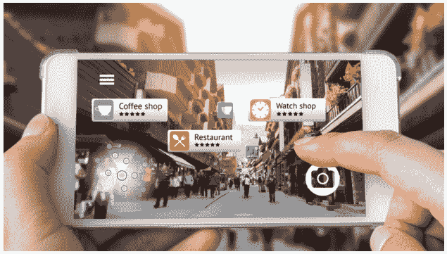

图 9.13 基于位置的 AR。

### 9.7.3.4 叠加 AR (Superposition AR)

叠加 AR 创建物体的不同视图，用于临时原始视图（图 9.14）。这意味着通过这种技术替换物体的部分视图。物体识别是这种 AR 类型的关键。叠加 AR 显示目标的多个视角，并带有强调相关信息的选项 [13]。

### 9.7.3.5 基于投影的 AR (Projection-Based AR)

基于投影的 AR 是一种视频投影技术，允许用户通过将图像投影到 3D 物体的表面或其实空间内来扩展或分布数字数据（图 9.15）。用户不操作这种技术。

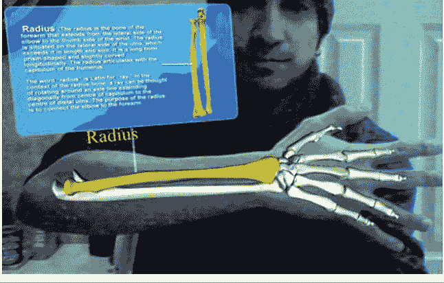

**桡骨** 桡骨是拇指侧的前臂骨骼；位于尺骨外。桡骨呈楔形且有角度，与桡骨头关节。桡骨还允许前臂绕旋转轴旋转。尺骨通过关节绕桡骨的中心或远端轴旋转，仅限前臂。

图 9.14 叠加 AR。

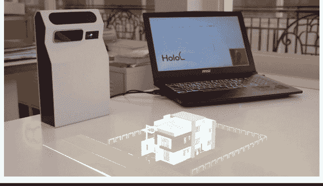

图 9.15 基于投影的 AR。

这是最有用的 AR 类型之一，因为它允许用户在投影仪和摄像机的限制内自由地在世界中穿行。通过这种技术，可以轻松创建图形表示。HCI 中的无处不在计算与增强现实 ■ 179..（注：原文中存在大量重复的段落，译文已根据“不要重复输出原文”的原则进行了去重处理）


# HCI 中的泛在计算与增强现实 ■ 183


图 9.19 Google Glass 提供的活动信息。

这些 AR 头设备和智能眼镜具有接管 AR 世界的潜力 [14]。然而，手机、移动设备和 AR 智能眼镜未来一定会相互交互。

## 9.9 AR 应用

AR 和其他 VR 技术变得越来越流行。以下是用户应该关注的现代 AR 应用。

### 9.9.1 领域

微软正与美国陆军合作开发集成视觉增强系统 (IVAS)，以提高士兵的态势感知、通信、战场导航和整体作战效能。IVAS 具有平视显示 (HUD)、热成像、交互式地图和顶置指南针，所有功能均由微软的 HoloLens 技术支持（图 9.20）。士兵可以使用它在战场上追踪并共享敌人位置。此外，它还可以识别目标是危险的、中等的还是有帮助的。多面头戴摄像头可以在黑暗中观察（夜视）、穿透烟雾，甚至观察转角处 [15]。


**图 9.20** 军事中的 AR。

### 9.9.2 3D 动物

AR 技术的另一个兴奋应用是 3D 动物。Google 3D Animals 允许用户搜索并观看等大的 3D 动物，并通过 AR 在本地与其交互。Google 图片搜索使用配备 ARCore 的设备以及 Chrome、Opera 和 Safari 等支持的浏览器搜索老虎、斑马、考拉或鲨等 3D 生物。点击“在 3D 中查看”，然后在结果页面的空间中查看。要查看 3D 等大老虎，只需将智能手机指向地面（图 9.21）。用户可以使用 AR 旋转动物并听到动物吠叫、长鸣和喷鼻声，就像它们在野外一样。这项技术于 Google I/O 2019 发布，并包含了越来越多的动物。

### 9.9.3 时尚

See My Fit 是由 Asos 开发的技术，使用 AR 在模特身上视觉化试穿。这允许用户每周在六个不同的模特上尝试多达 500 件物品以查看合身效果。用户在购买之前可以可视化每件物品的尺寸、效果和剪裁。由于新冠肺炎，该商店现在无法在工作室与模特合作。除了 See My Fit，Asos 正在整合模特家的平面照和产品照以继续为客户提供服务。虚拟 T 台 (Virtual Catwalk) 是一种支持 AR 的工具，允许用户视觉化想象并体验多达 100  ASOS 设计产品（图 9.22）。Zara、Ike、Shopify、Kendra Scott 以及其他零售商都是目标未来使用此技术的时尚公司。


**图 9.21** Google 的 3D 老虎 AR 图像。

### 9.9.4 游戏

在游戏创作中，游戏制作人员正在尝试更具沉浸感体验的元素。例如，2016 年推出的《Pokémon Go》是 AR 最著名的例子之一。它允许用户通过将游戏角色带到物理环境中来体验 AR（图 9.23）。

### 9.9.5 上色书

传统的上色书允许用户在纸上进行二维草图绘制和艺术风格的自我表达。然而，在如今的扩展现实环境中，这是静态的，且坦率地说具有限制性。使用 AR 探索 3D 绘画的神奇世界。用户可以在纸上以二维方式勾勒他们喜爱的角色，并使用迪士尼的 AR 上色书应用实时将其还原为 3D（图 9.24）。该程序在 3D 纹理生成中匹配并复制绘画的元素。使用变形表面跟踪，你可以在翻页时移动你的角色。迪士尼的上色书儿童成人均可用，拥有 100 多幅插画以鼓励创造力并激励你画画。迪士尼因这项独特应用在 2016 年获得了爱迪生奖。


图 9.22 AR 跳跃。


图 9.23 Pokémon Go AR 游戏。


**图 9.24** 迪士尼 AR 上色书。

### 9.9.6 产科学

Road to Birth 是由纽卡斯尔大学创新团队创建的一个 AR+VR 项目，旨在为分娩阶段及其对孕妇的影响提供视觉见。这是一个全球首创，旨在改善医疗专业人员和孕妇的医疗保健。该项目使用了 Samsung GearVR、HTC Vive (VR) 和 HoloLens。通过 AR 和 VR，这种混合现实模拟（图 9.25）将允许你以 3D 形式学习基本的解剖变化、分娩方法和现实情况。这将帮助学生更快学习并为孕妇提供帮助。

### 9.9.7 建筑

在建筑和施工中，AR 用于规划和设计。将纸上的简单草图转变为 3D 模型（图 26）是一个巨大的优势。

### 9.9.8 体育

考虑国家橄榄球联盟 (NFL)、大西洋联盟 (ACC) 和几个足球队使用 AR。

## 9.10 AR 的优点

## 9.11 AR 的缺点

## 9.12 结论

## 致谢

感谢全能上帝慷慨的恩典和慈悲，让这一切成为可能。


## 人机交互中的泛计算与增强现实

## 参考文献

- 1. MRCET (n.d.) "人机交互数字笔记。" 可访问：https://mrcet.com/pdf/Lab%20Manuals/IT/R15A056%20HCI.pdf (访问日期：2022年5月31日)。
- 2. Fakhredine Karray, 等人 (2008) "基于多传感器网络的协作多目标跟踪。" 智能感知与智能系统国际期刊，(1)。
- 3. 维百科 (n.d.) "人机交互。" 可访问：https://en.wikipedia.org/wiki/Human%E2%80%93computer_interaction (访问日期：2021年8月1日)。
- 4. 交互设计基金 (2015) "交互设计的5个主要特征 | 设计基金 (IoDF)." 8月1日。可访问：https://interaction-design.org/literature/article/the-5-main-characteristics-of-interaction-design。
- 5. Educative (n.d.) "人机交互介绍与设计原则。" 软件开发者的交互课程。可访问：https://www.educative.io/blog/intro-human-computer-interaction (访问日期：2022年5月31日)。
- 6. "人机界面快速指南。" 可访问：www://www.tutorialspoint.com,www.tutorialspoint.com/human_computer_interface/quick_guide.html (访问日期：2022年5月31日)。
- 8. IoT Agenda (n.d.) "什么是泛计算（无处计算）？" 2019年10月1日，可访问：https://www.techarget.com/iotagenda/definition/pervasive-computing-ubiquitous-computing。
- 9. 维百科 (n.d.) "门户：人机交互。" 可访问：https://en.wikipedia.org/wiki/Portal:Human%E2%80%93computer_interaction (访问日期：2022年5月31日)。
- 10. IoT Agenda (2019) "什么是泛计算（无处计算）？" 10月1日，可访问：https://www.techarget.com/iotagenda/definition/pervasive-computing-ubiquitous-computing。
- 11. 富兰克林学院 (2017) "什么是增强现实？" 9月21日。可访问：https://www.fi.edu/what-is-augmented-reality。
- 12. G22.Com/Articles/History-of-Augmented-Reality (访问日期：2022年5月31日)。
- 14. Onirix (2020) "2019年最佳增强现实博客-Onirix。" 5月15日。可访问：https://www.onirix.com/learn-about-the/best-augmented-reality-hardware-in-2019/
- 15. Ritesh Patel, AnalyticsSteps (2020) "增强现实的7大趋势 | AR的应用案例。" 10月20日。可访问：https://www.analyticssteps.com/blog/5-trends-augmented-reality
- 16. Myananblog (n.d.) "增强现实的优缺点。" 可访问：https://www.myanan.com/advantages-and-disadvantages-of-augmented-reality (访问日期：2022年5月31日)。


## 第10章

## 基于机器学习的车道与疲劳监控驾驶辅助系统

Sanjay A. Gobi Ramasamy

## 10.1 引言

车道检测是重型车辆驾驶的关键组件。这是通过借助 OpenCV 库使用计算机视觉方法实现的[1]。车道检测通过寻找车道两侧的白色标记和颜色模式完成。在国家公路上行驶且睡眠不足的人数无法计数，导致了事故发生。通过使用 Python、OpenCV 和 Keras，可以警告驾驶员疲劳并避免事故[2]。在右侧道行驶的概念是指避免在驾驶员不知情的情况下移动到另一个车道的风险，这会导致事故[2]。车道偏离信号和车道保持信号是警告信号。睡眠不足对于长途旅行的卡车司机来说是一个问题。因此，疲劳驾驶极其危险，因为驾驶员可能会进入错误的车道，我们建议使用便携系统来监控驾驶员的行为。

人类开发技术来简化和保护他们的生活，无论是在执行日常任务（如上班[2]）还是更复杂的任务（如飞行旅行）。技术深刻地影响了我们的生活。我们今天旅行的速度，即使是祖父母也无法相信我们可以做到。

DOI: 10.1201/9781003424550-10

## 194 机器智能

地球上几乎每个人每天都使用某种交通工具。其他人使用公共交通是因为他们买不起汽车。无论人的社会地位，都有……

## 10.2 文献综述

### 10.2.1 系统综述

这项调查了各种网站和应用程序，并考虑了公众的需求。通过分析这些数据，我们提出了一种新方法，使该领域取得了一些进展。

### 10.2.2 车道检测技术

通过开发一种考虑到循环神经网络（RNN）的深度学习系统，创建了一个扩展的卷积神经网络（CNN），这两者在检测车道方面都是有效的。作为过程的一部分，安装在车辆上的摄像头拍摄道路照片。接下来，将图像转换为灰度以缩短处理时间。随后，如果图像受到干扰，可以激活滤波器来消除这些干扰以确保检测准确。除了双边滤波器和高斯滤波器外，还可以使用三边滤波器。使用 Canny 滤波器和边缘检测器，可以使用机器生成的阈值获取边缘图像。这些边缘可以被车道检测器检测。左右将生成车道边界段。因此，使用 RGB 颜色代码确定黄色和白色车道。

### 10.2.3 低光环境下的鲁棒车道检测

为了从图像中移除不需要的对象，原始图像需要一个区域（ROI）。也就是说，它应该移除路灯、标志、月亮等。通过裁剪，车道检测系统也可以变得更准确、更快。随着图像尺寸增大，相机速度增强随之增加。通过移除与车道特征相同但位于 ROI 之外的物体可以提高准确性。按照实现，ROI 是手动设置的；但可以使用相机校准参数自动计算合适的 ROI。该车道检测系统只需要对彩色图像进行预处理以创建灰度图像；因此，对于单色图像可以跳过此步骤。对于访问图像，假设采用 Bayer 格式。应该提取像素的颜色。相比之下，路肩道通常比交通车道更可见，因为它们在图像中通常呈现为长直线。

### 10.2.4 需求

图 10.1 显示了执行该过程所需的工具。

### 10.2.5 用例图

图 10.2 显示了用例。使用增量模型来创建框架。通过这种方式，首先建立框架的核心模型，然后在每个测试阶段之后对其进行相应的扩展。优化了骨架以扩展功能。

### 10.2.6 流程图

图 10.3 显示了流程图。


196 ■ 机器智能


图 10.1所需的工具。

## 10.3 性能分析框架

通过单幅图像检测道路涉及将图像通过计算机视觉算法，该算法会输出图像上的标记位点。在自动驾驶中，图像由汽车摄像头捕捉，然后用于架构中（图 10.4）。计算机应该自动识别道路，这应该包含模型的所有细节 [5]。道路模型主要由道路边缘和道路线组成。边缘检测将使用 Canny 边缘检测算法，道路线检测将使用 Hough 变换空间算法。

### 10.3.1 疲劳检测工作

图 10.5 展示了模型的工作原理系统，图 10.6 显示了模型的训练阶段。


图 10.2 用例图。


图 10.3 流程图。

## 10.4 图像捕捉

摄像头用于捕捉输入图像。无限循环返回来自摄像头的每一帧，直到它被访问。OpenCV 库的 `cv2.VideoCapture(0)` 方法用于捕捉视频并设置捕捉对象 [3]。每幅图像通过在帧中读取 `read()` 存储在视频帧变量中。


**图 10.4** 性能分析框架。


**图 10.5** 整个系统的工作流。

OpenCV 的目标检测算法需要灰度图像来检测图像中的脸部。脸部检测不取决于颜色信息 [3]。这是通过实现 Haar 级联分类器完成。

### 10.4.1 边缘检测

边界由边缘定义，这使得图像处理成为基础问题。边缘是不同像素之间的尖锐对比，是强度的突然变化 [5]。


图 10.6 神经网络模型训练。

当在图像中检测到边缘时，数据会显著减少，无用信息会被剔除，同时保留图像的显著结构属性。一个例子是最优边缘检测器，也称为 nanny。理想情况下，第一个标准应该具有低错误率，并确保在保留有用信息的同时过滤掉不需要的数据。作为第二个标准，原始图像与处理后的图像之间应尽可能保留多的变化 [5]。第三个标准涉及移除对边缘的多次响应。边缘检测器使用这些标准首先平滑图像。接下来，它通过计算图像梯度来突出高空间导数区域。

基于这些区域，算法随后使用非极大抑制（non-maximum suppression）抑制非最大像素。为了消除沿的条纹和梯度数组，现在应用了滞后（hysteresis）。图 10.7 显示了应用的原始图像边缘检测技术。图 10.8 和 10.9 显示了 Sobel 增强技术。

### 10.4.2 特征提取 正脸检测

在此函数中，分类器根据级联分类器的函数识别面部特征。随后是使用灰度图像 `detect multiscale` 函数在多尺度上检测脸部。检测数组返回坐标，以及高度，这定义了对象的边界。这使得遍历脸部并绘制边界框变得更容易。在第一步中，双眼被分配到


图 10.7 边缘检测前的原始图像。


图 10.8 X 方向的 Sobel 增强。


图 10.9 通过 Sobel 函数进行 X Y 方向的 Canny 边缘检测和 Sobel 增强。

然后使用级联分类器来检测双眼。在这种情况下，需要分析完整图像的眼睛信息。必须首先提取眼睛的边界框，以便 CNN 分类器检测眼睛是睁是闭。判断右眼是否睁开的过程重复此。

- 使用 Keras 构建卷积神经网络 (CNN)。
- 使用卷积神经网络的图像分类算法识别图像非常有效。
- 该模型有三层：一个输入层、一个输出层和一个隐藏层。
- 为了在这些层上执行卷积，滤波器乘以 2D 矩阵。
- 最后层有两个节点且是全连接的。
- 输出层使用 Softmax，其他层均使用 ReLU 激活函数。


**图 10.10** 模型架构。


图 10.11 眼睛闭合警告截图。

### 10.4.3 灰度转换

在图像输入模型之前，需要一些操作来修复尺寸。使用 `cvColor` 函数将 BGR 缩放到颜色以转换为灰度。模型是在 24×24 像素图像上训练的，因此图像被调整为 24×24 像素。如果你想要更好的收敛，通过将右眼乘以 255 来归一化数据（所有值在 0–1 范围内）。为了给分类器提供更多维度，扩展数据。使用模型 `load_function` 加载模型。使用模型 `predict_classes` 开始分类每一只眼睛。预测值为 1 表示眼睛睁开，预测值为 0 表示眼睛闭合。

### 10.4.4 分数计算

根据得分，我们可以计算个人闭眼的时间。只要双眼闭合，系统就会不断增加分数，而只要眼睛睁开，分数就会减少（图 10.11）。在屏幕上完成分类后，`Cv2.putText` 将实时显示人的状态。例如，如果得分超过 15，说明人的眼睛闭合了很久；系统随后通过 `sound_play` 函数发出警报。

## 10.5 建议的车道检测系统

城市交通在交通安全方面变得日益复杂。道路上大多数事故是由于不遵守规定离开车道引起的。大多数碰撞是因为司机疲劳和受到干扰。无论司机还是行人分心，车道遵守都至关重要。软件的目标是识别车道标记 [3]。该软件将改善交通状况。

车道边界的变化了上述问题。在本章中，提出了一种利用计算机视觉技术分析道路视频以检测道路车道标记的算法 [5]（图 10.12）。该技术通过检测道路上的车道标记来减少事故频率。

为了防止道路上危险驾驶导致的事故，系统可以安装在汽车和出租车上。该系统将确保校车上儿童的安全。该设置还可以监控司机的表现，反而允许交通部门报告并检查司机在道路上的疏忽和注意力集中。


图 10.12 车道检测系统模型。

### 10.5.1 比较车道检测系统的准确性

在计算司机在较黑暗环境中驾驶时会遇到的实际驾驶条件集时，必须考虑上述由交通环境类型和道路限制的安排。可以得出几个结论。使用获取五个小时的视频来评估建议的车道检测系统的性能。


# 204 机器智能


图 10.13 系统设计方法。

### 10.5.2 实现

### 10.5.2.1 系统设计方法

图 10.13 显示了系统设计方法。


## 10.6 结果

图像通过语义分割逐像素完成。用于训练的数据集从互联网下载。使用了 30 个卷积 ReLU 激活函数。主要目标是找到线条。

### 10.6.1 准确率

在这里，模型被训练为稳定的线，图表显示模型是高效的（图10.14）。如准确率列所示，表10.2 显示每分钟的检测次数，而图10.15 显示了大约未检测到的车道数。

### 10.6.2 假设

想象一个光线充足的日子。车道检测系统被认为速度不受内存限制。黄色标记标记左侧，而白色标记标记右侧。

## 表 10.1 模型准确率

| 轮次 (Epoch) | 损失 (Loss) | 准确率 (Accuracy) | 验证损失 (Val_loss) | 验证准确率 (Val_accuracy) |
| :--- | :--- | :--- | :--- | :--- |
| 1/10563/1563 | 1.4971 | 0.4553 | 1.2659 | 0.5492 |
| 2/10563/1563 | 1.1424 | 0.5966 | 1.1025 | 0.6098 |
| 3/10563/1563 | 0.9885 | 0.6539 | 0.9557 | 0.6629 |
| 4/10563/1563 | 0.8932 | 0.6878 | 0.8924 | 0.6935 |
| 5/10563/1563 | 0.8222 | 0.7130 | 0.8679 | 0.7025 |
| 6/10563/1563 | 0.7663 | 0.7323 | 0.9336 | 0.6819 |
| 7/10563/1563 | 0.7224 | 0.7466 | 0.8546 | 0.7086 |
| 8/10563/1563 | 0.6726 | 0.7611 | 0.8777 | 0.7068 |
| 9/10563/1563 | 0.6372 | 0.7760 | 0.8410 | 0.7192 |
| 10/10563/1563 | 0.6024 | 0.7875 | 0.8475 | 0.7192 |


图 10.15 准确率图。

## 基于机器学习的辅助系统

## 表 10.2 准确率

| 高公路类型 | 交通类型 | 准确率 (%) | 近似值 (%) | 缺失评分 (%) |
| :--- | :--- | :--- | :--- | :--- |
| 孤立 | 轻量 | 92.3555 | 3.45 | 0.34 |
| 孤立 | 中等 | 78.4352 | 4.097 | 2.34 |
| 市区 | 轻量 | 91.345 | 5.897 | 1.987 |
| 市区 | 重量 | 80.0054 | 16.897 | 2.23 |

公路标准应适用于所有建设的道路。假设车道检测系统足够快且内存没有限制。

## 10.7 结论

除了局限性外，OpenCV 效率低下，且在没有清晰标记的情况下产生不准确的结果。经典的 OpenCV 方法无法准确检测没有标记的道路。该方法与环境也不兼容。可以通过添加额外的参数（如闪灯频率、车辆状况和打哈频率）对模型进行微调。开发了多种应用程序来解决这些问题，包括交通控制、交通监控和流量。

模块化实现允许我们轻松更新算法并在未来继续研究模型。使用模型的 pickle 文件可以插入所需的区域并轻松应用到产品中。因此，不需要每次都编译整个代码。通过引入夜晚检测的概念，我们可以为项目增加价值。

在白天，该过程能够很好地识别和选择颜色。通过使用所有这些参数，可以显著提高准确率。Netflix 和其他流服务使用相同的模型和技术来检测用户何时睡觉并相应停止视频。还可以使用这种方法开发防睡应用程序。功能不佳的自动驾驶系统涉及了多起重大事故，但其他事故显示了这项技术的优势。中国报告称，2016 年 1 月，一名特斯拉驾驶员撞上一辆清洁车后导致一人死亡。据报道，碰撞发生时，特斯拉的自动功能处于开启状态。根据警察说法，在这场涉及 ADS 功能的首次死亡中，特斯拉司机没有关注道路。

在安全方面，使用可用数据评估自动驾驶汽车仍然困难。无人驾驶汽车通常在天气相对干燥且系统简单的城市和州进行测试，这有利于自动驾驶。加州也是美国唯一要求测试无人驾驶的公司提供详细事故报告的州。由于如此，它也是唯一对公共道路上任何涉及自动车辆的事故要求详细报告的州。

## 参考文献

- 1. Long, E. Shelhamer, and T. Darrell (2015) “Lane Detection Techniques – A Review.” In Proceedings of the IEEE Conference on Computer Vision and Pattern Recognition, pp. 3431–3440.
- 2. Zheng, S. Jayasumana, B. Romera-Parades, V. Vineet, Z. Su, D. Du, Huang, and P. H. Torr (A Layered Approach to Robust Lane Detection at Night”) Conference paper, pp. 1529–1537.
- 3. Shopa, N. Sumetha, and P. S. K. (2014) “Automatic Detection using OpenCV.” Paper presented at International Conference on Communication and Embedded Systems.
- 4. Badr, Handa, and Cipolla (2015) “Segnet: A deep convolutional encoder-decoder.” arXiv:1505.07293.
- 5. Han, Yang, and Deng (2015) “Detection Based on Novel Features.” Paper presented at IEEE Conference on Cybernetics.
- 6. Li, Li, and Chen (2017) “Detection of Drowsiness.” Sensors, 17(3).
- 7. Correa and Laciar (2014) “Multimodal Analysis.” Medical Engineering and Physics, 36:244–49.
- 8. Poone and Zorozi (2009) “Detection Based on Brightness.” Paper presented at Fifth Conference on Intelligent Systems.


# 基于基因表达数据集的胃癌预测

中性粒细胞细胞比。该参数的单变量分析和变化也显示与肿瘤进展相关。NLR值应被视为有用的随访参数（Sahin et al., 2017）。癌症相关死亡率和潜在寿命损失（PYLL）根据年龄、性别、地区（城市或农村）进行计算，以描述癌症导致的生命成本模式。该数据集由2013年并入注册办公室的255个注册机构组成，涵盖了城市地区的26,249,490人。研究发现三类人群——城市地区的人员、男性以及60岁以上的人员——他们遭受着更严重的癌症死亡和生命成本影响（Yan et al., 2019）。

国际癌症研究机构估计了全球的癌症发病率和死亡率。2020年发生了1930万例新发癌症病例和近1000万例癌症死亡。预计全球癌症负担在2040年将达到2840万例，比2020年增长了47%（Sung et al., 2021）。研究识别了预测低分化胃癌患者淋巴结转移的临床病理因素。分析包含了1005名患者。逻辑回归显示淋巴结转移与肿瘤大小、肿瘤浸润深度和淋巴受累显著相关（Lee et al., 2012）。研究了炎症严重程度与癌症患者预后之间的潜在关系。通过单变量分析对2002年1月至2006年12月220名胃手术患者的记录进行了分析（Lee et al., 2013）。使用机器学习技术分析了日本某单一机构2006年至2017年间25,942名参与者的体检数据。结果显示，XGBoost的表现优于逻辑回归，并显示出最高的曲线下面积值，0.899（Tanigaka et al., 2019）。在患者血清中鉴定出一种微RNA面板，以高准确性和敏感性非侵入地预测胃癌。支持向量机分类器优于其他模型，准确率最高达到95%（Huang et al., 2018）。

简要回顾了胃癌最重要的方面，包括流行病学、风险因素、分类、预防和治疗（Sitarz et al., 2018）。使用监督学习方法来区分三种胃癌亚型。留一交叉验证误差为0.14，表明超过85%的样本被正确分类（Shah et al., 2011）。回顾了胃癌的新分类方法以及分子检测应用中的最新指南。分子医学的近期进展不仅阐明了胃癌的发癌机制，还为预防、诊断和治疗干预提供了新方法（Hu et al., 2012）。回顾了卷积神经网络（CNN）在胃癌识别中的当前应用。CNN中的迁移学习方法，如AlexNet、ResNet、VGG、Inception和DenseNet被用于识别胃癌。共检索了27篇利用医学图像识别胃癌的文章（Zhao et al., 2022）。深度卷积神经网络（CNN）用于放大窄带成像（M-NBI）图像自动分为两类：正常胃图像和EGC图像。选择VGG16、InceptionV3和InceptionResNetV2对M-NBI图像进行分类。实验结果显示，CNN特征的迁移学习优于传统的手工方法（Liu et al., 2018）。因此，有必要开发准确且快速的胃癌诊断筛查方法。近期工作表明，人工智能和大数据技术在改进医疗领域的筛查、预测和诊断方面是有效的（Hinton et al., 2017; Nishio et al., 2018）。基于现有文献，本研究还关注于使用监督机器学习模型对胃癌数据集进行分类。本章其余部分的结构如下：第11.2节描述方法论，第11.3节展示胃癌数据集的实验结果并讨论结果。最后，在第11.4节给出结论和未来改进。

## 11.2 方法论

本研究比较了四种监督学习算法，如逻辑回归（LR）、决策树（DT）、朴素贝叶斯（NB）和K最近邻（KNN），以预测胃癌基因表达数据集的最佳分类方法。本研究工作的整体框架如图11.1所示。


图11.1 本研究工作的整体框架。

### 11.2 数据集描述

胃癌基因表达数据集收集自基因表达数据库（GEO），GEO访问代码为GSE2685，包含4,524个属性，包括30名患者的记录（Hippo et al., 2002）。使用Python编程语言来分析监督机器学习算法的性能。

### 11.2.2 分类技术

基于现有文献，本研究还关注于使用监督机器学习模型对胃癌数据集进行分类。

### 11.2.2.1 逻辑回归 (LR)

逻辑回归是一种用于预测因变量的监督学习算法。它遵循Sigmoid函数将值转换为0到1之间的范围（Brindah et al., 2021）。

$S(x) = \frac{1}{1+e^{-x}}$ (11.1)

### 11.2.2.2 决策树 (DT)

决策树是一种用于分类的非参数监督学习算法。它是一个树形流程图，内部节点表示特征，分支表示决策规则，叶节点表示结果。它有两种流行的属性度量，如熵和基尼系数。

$Entropy = \sum_{i=1}^{n} p(C_i)\log_2(p(C_i))$ (11.2)

$Gini = 1 - \sum_{i=1}^{n} p^2(C_i)$ (11.3)

### 11.2.2.3 朴素贝叶斯 (NB)

朴素贝叶斯是一种基于贝叶斯定理的概率机器学习算法，适用于多种分类任务。之所以被称为朴素，是因为它假设特征的发生与其他特征的发生是独立的。它易于使用，不需要大量的训练数据，并且可以处理连续和分类数据。它是构建快速预测模型的最简单且有效的算法之一（Mortezaghi et al., 2019）。

$P(A|B) = \frac{P(B|A) * P(A)}{P(B)}$ (11.4)

其中：
P(A|B) 是后验概率
P(B|A) 是似然概率
P(A) 是先验概率
P(B) 是边缘概率

### 11.2.2.4 K最近邻 (KNN)

K最近邻是一种非参数监督学习算法，通过邻近性对单个数据点进行分类或分组预测（Li et al., 2012）。它通过计算查询与数据中所有样本之间的距离来工作。在KNN算法中，K值初始化为邻居数量。这些步骤必须重复，直到满足收敛标准。


# 基于基因表达数据集的胃癌预测

## 11.3 结果与讨论

在研究工作中，通过分类准确率、精确率、召回率和 F1 分数等性能因素计算实验测量，以确定基因表达数据集的最佳算法。胃癌基因表达数据集的准确率测量值和性能指标值如表 11.1 所示。在该研究工作中，对胃癌基因表达数据集进行了基础探索，如检查空值、重复值和数据类型等。

表 11.1 使用胃癌基因表达数据集的各种监督机器学习算法性能指标比较

| 模型 (Models) | 准确率 (Accuracy) | 精确率 (Precision) | 召回率 (Recall) | F1 分 (F1 score) |
|---|---|---|---|---|
| LR | 0.625 | 0.55 | 0.62 | 0.58 |
| DT | 0.875 | 0.94 | 0.88 | 0.89 |
| NB | 0.75 | 0.88 | 0.75 | 0.80 |
| KNN | 0.5 | 0.40 | 0.50 | 0.44 |

在数据集中存在的 4,524 个特征中，“class”（类别）是因变量，包含三个类别：“正常”（Normal）”、“弥漫型”（Diffuse）和“肠型”（Intestinal）。使用来自 seaborn 库中的 countplot，预测了数据集中三个类别的数量（图 11.2）。

```
[AB00682_at', 'AC00207_at', 'D26129_at', 'D38535_at', 'D42047_at', 'D78134_at', 'D87742_at', 'HG3162-HT3339_at', 'J03915_s_at', 'J04982_at', 'J05412_at', 'L0750_at', 'L13744_at', 'L32179_at', 'L41668_mal_at', 'L76465_at', 'M12759_at', 'M21812_at', 'M31328_at', 'M61855_at', 'M62628_s_at', 'M63154_at', 'M74542_at', 'S68616_at', 'S69232_at', 'U05259_rna_at', 'U15177_at', 'U19948_at', 'U21931_at', 'U26244_at', 'U27235_s_', 'U57094_at', 'U59752_at', 'U66702_at', 'U70063_at', 'U79288_at', 'U83461_at', 'X05409_at', 'X05997_at', 'X51698_s_at, X52003_at, X53961_at, X58529_at, X66839_at, X69920_s_at, X72223_s_at, X76342_at, X96752_at, Z29574_at]
```

为了找到数据集中 4,522 个独立变量的性性，使用了 scipy.stats 模块中的 Pearson's r 函数并将独立变量转换为整数数据类型。使用范围为 0–4521 的循环来寻找特征与因变量之间的相关性


**图 11.2** 胃癌基因数据集的类别分布（因变量）。

[AB006782_at, 'AC00207_at', 'D26129_at', 'D38535_at', 'D42047_at', 'D78134_at', 'D87742_at', 'HG3162-HT3339_at', 'J03915_s_at', 'J04982_at', 'J05412_at', 'J07590_at', 'L1344_at', 'L32179_at', 'L41668_mal_at', 'L6628_s_at', 'L76465_at', 'M12759_at', 'M21812_at', 'M31328_at', 'M61855_at', 'M6628_s_at', 'M63154_at', 'M74542_at', 'S68616_at, S69232_at, U05259_mal_at, U15177_at, U19948_at, U21931_at, U26424_at, U27325_s_at, U57094_at, U59752_s_at, U66052_at, U66702_at, U70663_at, U79288_at, U83461_at, X05049_at, X05997_at, X51698_s_at, X52003_at, X53961_at, X58529_at, X66839_at, X69920_s_at, X76223_s_at, X76342_at, X96752_at, Z29754_at]

**图 11.3** 通过 ANOVA 筛选的前 50 个特征。对于类别数据，使用 label encoder 将值转换为数值。特征数量巨大，许多特征与研究没有太大关系。因此，采用方差分析（ANOVA）进行特征选择，筛选出前 50 个特征（图 11.3）。通过 ANOVA 筛选的前 50 个特征作为独立特征传递给 LR、DT、NB 和 KNN 等四种监督机器学习模型。使用准确率、精确率、召回率和 F1 分数等性能指标来评估机器学习模型。


胃癌基因表达数据集的准确率和性能指标比较。从实验结果（图 11.4）可以看出，决策树（DT）算法优于其他算法。在 30 名患者中，5 名为弥漫型胃癌，17 名为肠型胃癌，8 名为正常。## 结论

在本研究中，分析了四种监督机器学习算法，即逻辑回归、决策树、朴素贝叶斯和最近邻。使用胃癌基因表达数据集通过准确率和性能指标计算性能。从结果可以看出，DT 算法优于其他。在 30 名患者中，5 名为弥漫型胃癌，17 名为肠型胃癌，8 名为正常。未来，可以对 DT 算法进行交叉验证等改进以获得更有效的结果。## 参考文献

- Brindha, S, Senthil Kumar, et al. (2021) “Logistic Regression to Predict Risk Factors in Cases and Controls.” Science & Technology, 9: 154–160.
- Danish, Jamal, Sellappan, Palannian, Asiah, Lokman, et al. (2021) “Diagnosis of Gastric Cancer Using Machine Learning in the Healthcare Sector.” Informatica, 45(7): 147–166.
- Hinton, D. J., et al. (2017) “Metabolomics to Predict Response in Alcohol-Dependent Subjects.” Scientific Reports, 7: 2492.
- Hippo, Y., Tanaguchi, H., Tsutsumi, S., Machida, N., et al. (2002) “Global Gene Expression Analysis of Gastric Cancer from Oncotype Microarrays.” Cancer Research, 62(1).
- Hu, B., El Haj, N., Sittler, S., Lammert, M., Meloni, A. (2012) “Gastric Cancer: History and Application of Molecular Pathology.” Journal of Gastroenterology, 39(5): 251–261.
- Huang, Y., Zhu, J., Li, W., Zhang, Z., Wang, H., and Zhang, J. (2018) “Serum MicroRNA Elevated by Machine Learning as a Potential Biomarker for Detection of Gastric Cancer.” Oncology Reports, 39(3): 1338–1346.
- Jun, J.K., Choi, S., Lee, H.Y., Suh, M., Park, B., Song, S.H., Jung, K.W., Lee, C.W., Park, E.C., and Lee, D. (2017) “Effectiveness of the National Cancer Screening Program in Reducing Gastric Cancer Mortality.” Gastroenterology, 152(6):1319–1328.
- Lee, D.Y., Hong, S., Chang, Y.G., Lee, W.Y., and Lee, B. (2023) “Clinical Significance of Preoperative Inflammation Parameters in Gastric Patients.” Journal of Cancer, 13(2): 111–116.
- Lee, J.H., Choi, M.G., Min, B.H., Noh, J.H., Bae, J.M., and Kim, S. (2012) “Predictive Factors for Lymph Node Metastasis in Patients with Poorly Differentiated Early Gastric Cancer.” British Journal of Surgery, 99(12): 1688–1692.
- Leung, W.K., Cheung, K.S., Li, B., Law, S.Y., and Liu, T.K. (2021) “Applications of Machine Learning Models in the Prediction of Gastric Cancer in Patients with Helicobacter Pylori Eradication.” Analytical Pharmacology and Therapeutics, 53(8): 864–872.
- Li, C., Zhang, S., Hang, P., Lam, K., Hui, C., Zhang, S. (2012) “Using the K-Nearest Neighbor Algorithm for the Classification of Lymph Node Metastasis in Gastric Cancer.” Computational and Mathematical Methods in Medicine, 2012: 876545.
- Liu, X., Wang, C., Hu, Y., Zeng, Z., Bai, J., and Liao, G. (2018) “Transfer Learning with Convolutional Neural Network for Early Gastric Cancer Classification on Magnifying Narrow-Band Imaging Images.” Paper presented at 2018 IEEE International Conference on Image Processing (ICIP), 1388–1392.
- Mortegahi, A., Khosravizadeh, O., Menhaj, M.B., Shafiy, Y., and Kalhor, R. (2019) “Intelligent Gastric Cancer Diagnosis Error in Qazvin’s Centers.” Asian Journal of Cancer Prevention, 20(9): 2607–2610.
- Nishio, M. et al. (2018) “Computer-Aided Diagnosis of Lung Cancer.”
- Rawla, P., and Barsouk, A. (2019) “Epidemiology of Gastric Cancer.” Gastroenterology, 144(1): 23–38.
- Sahin, A., Aydin, C., Unver, M. (2017) “Predictive Value of Preoperative Neutrophil Ratio in Determining Stage of Gastric Cancer.” Medical Science Monitor, 23:1973.
- Sha, M., Khan, R., Tang, L., Ma, H., Yin, Y., and Rong, L. (2020) “Plasma Proteomics-Based Identification of Novel Biomarkers in Early Gastric Cancer.” Clinical Biochemistry, 76: 5–10.
- Sitarz, R., Sierucha, M., Maciejewski, J., and Offhaus, G. (2018) “Gastric Cancer: Epidemiology, Prevention, and Treatment.” Cancer Management and Research, 10: 239–248.
- Tanagawa, J., Nishiyama, Y., Fujibayashi, K. et al. (2019) “Prediction of Future Gastric Cancer Risk Using a Machine Learning Algorithm and Comprehensive Medical Data: A Case-Control Study.” Scientific Reports, 9:12384.
- Yan, Y., Chen, Y, Liu, J, Wang, H, Hu, Y... Li, S. (2019) “Patterns of Life Lost to Cancers with High Risk of Death in China.” International Journal of Environmental Research and Public Health, 16(12): 2175.
- Yasar, A., Saritas, I., and Korkmaz, H. (2019) “Computer-Aided Diagnosis for Detection of Gastric Cancer.” Journal of Medical Systems, 43(4): 99.
- Zhao, Y., Hu, B., Wang, Y., Yin, X., Jiang, Y., and Yu, X. (2022) “Identification of Gastric Cancer with Convolutional Neural Networks: A Systematic Review.” Multimedia Tools and Applications, 81(8):11871–11776.


## 第12章

## 基于深度学习技术的 CCTV 图像下水道管道缺陷检测

P. L. Chithra 和 P. Bhavani

## 12.1 引言

下水道管道系统是收集废水的民用基础设施组成部分。在美国，有 800,000 英里的公共管道和 500,000 英里的私立支管连接到公共下水道管道。大多数下水道系统年龄在 30 到 100 年之间，并面临管道堵塞问题，这主要由油脂和杂物引起。下水道缺陷由根系侵入、管线破裂以及入流与渗透量不均引起。例如，裂缝可以分为纵向裂缝、垂直裂缝以及由纵向和垂直裂缝组成的复杂裂缝。管内沉积有多种类型，例如附着沉积（附着在管壁上）和沉积沉积（沉积在管底）。对于根系侵入，这可能属于团根（高密度或大占据面积）或细根（分散且密度低）。所有这些缺陷，如裂缝、沉淀物、根系侵入以及水渗透，都会损害下水道管道的性能。目前，闭路电视（CCTV）等视觉检测技术被常用于地下下水道管道检测。

## 222 机器智能

CCTV 通常由安装在拖拉机上的摄像头和照明设备组成。在检查期间，CCTV 单元沿着管道内壁移动，并将检测视频传输到地面的外部显示器上。当遇到管道缺陷或管道支管时，检查人员会停止单元并将摄像头放大异常部分，以检查是否存在潜在缺陷。检查完成后，检查人员查看捕获的图像或视频。手动解释检测图像或视频非常耗时、费力，且结果可能存在主观不准确。因此，使用高效的计算机视觉技术来自动解释检测图像或视频。然而，传统的计算机视觉技术需要设计复杂的特征提取器，且用于训练的图像需要大量的预处理。

此外，训练过程既枯燥又低效。近年来，深度学习在图像分类和目标检测等各种计算机视觉任务中取得了显著性能。与传统的计算机视觉技术相比，基于深度学习的方法能够自动提取图像特征，不需要对图像进行预处理，这极大地提高了准确性和效率。因此，本研究提出了一种基于快速区域的卷积神经网络（Faster R-CNN）的自动检测方法，这是一种用于目标检测的深度学习模型，也用于从 CCTV 图像中识别和定位下水道管道缺陷。

本章其余部分的结构如下：12.2 节包含与下水道管道缺陷相关的研究，12.3 节解释了各种方法，12.4 节展示了实验结果，最后，12.5 节给出结论。

## 12.2 相关工作

今天世界上面临的挑战之一是水下下水道管道的检测。下水道管道系统旨在收集污水、地下水或雨水 [1]，某些市政当局通过 CCTV 视频进行监控 [2, 3]。预计约 19,500 个下水道管道系统 [4] 能够处理 500 亿加仑的原污水流量，但大多数下水道系统由于有 30-100 年之龄已变得过时 [5]。存在各种下水道管道缺陷，如裂缝、沉积和渗透 [6]。例如，裂缝 [7, 8] 分为纵向裂缝（与管线方向相同）、垂直裂缝（方向垂直于管线）以及由纵向和垂直裂缝组成的复杂裂缝 [9]。

沉积有不同类型，例如附着沉积（附着在管壁上）和沉积沉积（沉积在管地上）[10]。对于树根侵入，这可能是团根侵入（高密度或大占据面积）或细根（分散且密度低）。在 CCTV 视频图像视觉检测技术中，大量的检测图像大多通过人工进行以识别类型和位置，这耗时、昂贵、费力且不准确。计算机视觉是由可以识别数字图像或视频的计算机或机器执行的 [11]。计算机视觉技术 [12, 13] 包括 Haar 检测器 [14]、SIFT [15]、使用更大 HOG 滤波器 [17] 的 HOG [16] 以及变形部件模型 (DPM) [18]。然而，这些方法需要复杂的le设计特征提取器和训练过程，效率低下。数字图像处理技术包括分割 [19]、直方图均衡化和变换。

基于深度学习的方法已开发用于目标检测 [20]，以解决传统方法的局限性。R-CNN 使用通过称为选择搜索（selective search）的外部方法为输入图像生成区域建议。每个变形的区域建议被发送到 CNN 模型中，通过支持向量机 (SVM) [14] 分类器来计算分类得分。然后对分类后的图像进行框回归，可以预测每个物体的位置。R-CNN 的一个局限性是多阶段训练过程非常耗时且需要巨大的计算成本。此外，由于需要实现卷积、分类和回归，每个检测速度缓慢。

此外，训练过程枯燥且低效。近年来，深度学习在图像分类和目标检测等各种计算机视觉任务中取得了显著性能。与传统的计算机视觉技术相比，基于深度学习的方法能够自动提取图像特征，不需要对图像进行预处理，这极大地提高了准确性和效率。因此，本研究提出了一种基于快速区域的卷积神经网络（Faster R-CNN）的自动检测方法，这是一种用于目标检测的深度学习模型，也用于从 CCTV 图像中识别和定位下水道管道缺陷。

## CCTV 图像中的水道管道缺陷检测 ■ 223

沉积有不同类型，例如附着沉积（附着在管壁上）和沉积沉积（沉积在管地上）[10]。对于树根侵入，这可能是团根侵入（高密度或大占据面积）或细根（分散且密度低）。在 CCTV 视频图像视觉检测技术中，大量的检测图像大多通过人工进行以识别类型和位置，这耗时、昂贵、费力且不准确。计算机视觉是由可以识别数字图像或视频的计算机或机器执行的 [11]。计算机视觉技术 [12, 13] 包括 Haar 检测器 [14]、SIFT [15]、使用更大 HOG 滤波器 [17] 的 HOG [16] 以及变形部件模型 (DPM) [18]。然而，这些方法需要复杂的le设计特征提取器和训练过程，效率低下。数字图像处理技术包括分割 [19]、直方图均衡化和变换。

基于深度学习的方法已开发用于目标检测 [20]，以解决传统方法的局限性。R-CNN 使用通过称为选择搜索的外部方法为输入图像生成区域建议。每个变形的区域建议被发送到 CNN 模型中，通过支持向量机 (SVM) [14] 分类器来计算分类得分。然后对分类后的图像进行框回归，可以预测每个物体的位置。R-CNN 的一个局限性是多阶段训练过程非常耗时且需要巨大的计算成本。此外，由于需要实现卷积、分类和回归，每个检测速度缓慢。

此外，训练过程枯燥且低效。近年来，深度学习在图像分类和目标检测等各种计算机视觉任务中取得了显著性能。与传统的计算机视觉技术相比，基于深度学习的方法能够自动提取图像特征，不需要对图像进行预处理，这极大地提高了准确性和效率。因此，本研究提出了一种基于快速区域的卷积神经网络（Faster R-CNN）的自动检测方法，这是一种用于目标检测的深度学习模型，也用于从 CCTV 图像中识别和定位下水道管道缺陷。

## 224 机器智能

CCTV 通常由安装在拖拉机上的摄像头和照明设备组成。在检查期间，CCTV 单元沿着管道内壁移动，并将检测视频传输到地面的外部显示器上。当遇到管道缺陷或管道支管时，检查人员会停止单元并将摄像头放大异常部分，以检查是否存在潜在缺陷。检查完成后，检查人员查看捕获的图像或视频。手动解释检测图像或视频非常耗时、费力，且结果可能存在主观不准确。因此，使用高效的计算机视觉技术来自动解释检测图像或视频。然而，传统的计算机视觉技术需要设计复杂的特征提取器，且用于训练的图像需要大量的预处理。

一种检测管道故障的稳健方法已开发。在图像中检测所有类型的故障（准确率81.5%）。随机森林被确定为最合适的机器学习分类器。平滑处理大大降低了误率 [22]。

该方法展示了用于检测裂缝、变形、沉积和节点位移的自动工具。自动方法依赖于使用图像处理技术和多种数学公式来分析 CCTV 摄像头的输出数据。自动 CCTV 解释可以提高检查的准确性。CCTV 检测使用 CNN 对下水道缺陷进行分类。CNN 在收集自 200 多条管道的 12,000 张图像上进行了训练和测试 [24]。

### 12.3 建议的方法论

使用 Faster R-CNN 并结合不同 CNN 架构网络和图像处理技术的深度学习技术用于检测缺陷。

### 12.3.1 用于目标检测的 Faster R-CNN

Faster R-CNN 比 R-CNN 快。它用于预测区域建议，并通过感兴趣区域（ROI）池化层进行重塑，该层用于对区域内的图像进行分类并预测边界框的偏移值。

#### 12.3.1.1 卷积层

每个神经元从上一层的矩形 n*n 部分获取输入。矩形区域称为局部感受野。层与偏置和权重结合产生特征图。参数可以视为可训练的滤波器或卷积核 F，卷积过程可以被视为图像卷积，它从上一层获取输入（等式 12.1）。

```
x^{(l)} = \sigma(b + \sum_{c=0}^{n} W_{r,c} X^{(l-1)}_{i+r,j+c}) \quad (12.1)
```


# CCTV 闭路图像中的下水道管道缺陷检测 ■ 225

## 12.3.1.2 特征图

卷积特征图是通过滤波器在图像上滑动并计算点积而形成的。每一层特征图的输出都作为下一层的输入。

## 12.3.1.3 区域建议网络 (RPN)

在 RPN 训练中，每个区域建议（region proposal）被标记以指示对象是否存在缺陷。如果建议与真实框（ground-truth box）之间的交集（IOU）超过阈值（本研究中为0.7），或者它与真实框具有最高的 IOU，则该建议分配为正样本；如果非正建议与真实框之间的最大 IOU 低于阈值（本研究中为0.3），则该建议视为负样本。Faster R-CNN 中的 RPN 使用公式 12.2 定义的多任务损失进行训练。

```
$L\{p_i\}, \{t_i\} = \frac{1}{N_{cls}} \sum_{cls} L_{cls}(p_i, p_i^*) - \frac{1}{N_{reg}} \sum_{reg} L_{reg}(t_i, t_i^*)$  (12.2)
```

其中 $i$ 表示 anchor，$P_i$ 代表 anchor 为下水道缺陷类型的预测概率，$P_i^*$ 代表 anchor 为正样本的真实标签，如果是负样本则为 0。t_i$ 是指示预测边界框坐标的向量。N_{cls}$ 和 $N_{reg}$ 是两个部分的归一化因子，由平衡参数 $\lambda$ 加权。参考相关研究，$N_{cls}$ 的值设置为 256，$N_{reg}$ 等于 400，这是模型中 anchor 位置的近似值。平衡参数 $\lambda$ 设置为 10，使得 cls 和 reg 大致相等。

## 12.3.1.4 感兴趣区域 (ROI) 池化

ROI 操作广泛用于目标检测任务，以重用 CNN 的特征图（图 12.1）。它允许目标检测系统以端到端的方式运行，并加速训练和测试。

## 12.3.1.5 最大池化层

最大池化是一种基于离散化过程的样本。其主要目标是将图像表示下载到隐藏层输出等（图 12.2）。它减少了维度并允许对子区域中的特征进行假设。最大池化使用前层每个神经元簇的最大值和超参数值 filter (f) = stride(s)=2。

226 机器智能


图 12.1 用于下水道缺陷检测的 faster R-CNN 架构模型。

| 1 | 3 | 2 | 1 |
|---|---|---|---|
| 2 | 9 | 1 | 1 |
| 1 | 3 | 2 | 3 |
| 5 | 6 | 1 | 2 |

图 12.2 最大池化转换过程。

## 12.3.2 系统架构

本文的工作是在不同的网络中检测下水道管道缺陷并应用某些背景效果。已检测缺陷并进行了特征匹配。缺陷检测的流程图如图 12.3 所示。在该方法中，下水道管道图像从 CCTV 检查视频中采集。

CCTV 闭路图像中的下水道管道缺陷检测 227


图 12.3 建议的工作流。


图 12.4 标注图像。

### 12.3.2.1 标注图像

将 CCTV 检查视频转换为帧，帧视为输入图像。此外，它们使用标记工具进行了标注（图 12.4）。最后创建边界框并保存为 .xml 扩展名，类似于 VOC 数据集。

## 12.3.2 使用 Faster R-CNN (RPN) 和 fast R-CNN 识别缺陷

Faster R-CNN 模型由区域建议网络 (RPN) 和快速检测器组成。将 Faster R-CNN 应用于目标检测有三个主要步骤。首先，对原始图像使用神经网络提取特征。通过 CNN 网络的若干层（如卷积、激活、池化和归一化）生成原始图像的特征图。基于生成的特征图，RPN 单个全卷积网络生成不同宽高比和比例的区域建议，以区分前景区域和背景区域。第三步，将生成的区域建议输入 fast R-CNN 检测器进行进一步精炼，以获得更准确的分类和边界框定位。这预测了建议边界框的位置，从而获得 anchor 的真实框。anchor 的坐标使用公式 (12.3)–(12.6) 计算。

```
$t_x = \frac{x-x_a}{w_a}, t_y = \frac{y-y_a}{h_a}  (12.3)
```
```
$t_w = \log\frac{w^*}{w_a}, t_h = \log\frac{h^*}{h_a}  (12.4)
```
```
$t_x^* = \frac{x^*-x_a}{w_a}, t_y^* = \frac{y^*-y_a}{h_a}  (12.5)
```
```
$t_w^* = \log\frac{w^*}{w_a}, t_h^* = \log\frac{h^*}{h_a}  (12.6)
```

### 12.3.2.3 使用 ZF/VGG 训练

在该方法中，使用不同的网络训练 fast R-CNN 模型。首先应用 ZF 网络（不含全连接层），使用滤波器、滤波器的维度和步长值。例如，第一层有 96 个 $7 \times 7$ 卷积核，第二层有 256 个 $7 \times 7$ 卷积核。其次是带有 $3 \times 3$ 卷积的 VGG16 网络。ResNet50 卷积网络在 ImageNet 数据库百万图像上训练，可以将图像分类 1000–2000 类类别，如裂缝、沉积和渗漏，且输入长度可以应用四步卷积，滤波器大小为 7。

### 12.3.2.4 RGB 图像到 HSV 图像

颜色代表红色、绿色和黄色。HSV 是一个色彩空间，H 代表色调（Hue），S 代表饱和度（Saturation），V 代表亮度（Value）。色调是颜色的衡量标准；平均管道检测器具有不同的颜色。饱和度是颜色的纯度。色调定义为角度：0 度为红色，240 度为蓝色。饱和度值从 0 到 1。图 12.5 显示 RGB 图像到 HSV 图像的转换。色彩周围的角度关系很容易识别。公式 (12.7)–(12.9) 显示了色调、饱和度和值，并有效地产生裂缝。

CCTV 闭路图像中的下水道管道缺陷检测 229


图 12.5 RGB 图像转换为 HSV 图像。


图 12.6 裂缝检测。

```
$V=R\left(\frac{1}{3}\right)+G\left(\frac{1}{3}\right)+B\left(\frac{1}{3}\right)  (12.7)
```
```
$S=1-\frac{3}{(R+G+B)}[min(R,G,B)]  (12.8)
```
```
$H=\begin{cases} \theta & \text{if } B\le G \\ 360-\theta & \text{if } B>G \end{cases}  (12.9)
```

## 12.3.3 裂缝检测

裂缝检测用于识别图像中的裂缝并在周围绘制边界框。这是许多计算机视觉应用中非常重要的问题。图 12.6 使用裂缝检测识别裂缝根、沉积和渗漏。

## 12.4 实验结果

该提出的技术用于检测裂缝、根、沉积、渗漏等缺陷。这项工作通过各种视频图像中的 3000 个缺陷来证明实验结果。对于缺陷检测，在不同场景、不同光照条件下自由采集不同的图像，并使用 faster R-CNN 创建缺陷边界框。该方法的性能使用平均精度（AP）和平均平均精度（MAP）计算整体缺陷，并取得了更好的结果。提出的方法应用了一些数字处理技术来产生更好的结果。我们实验中使用的数据集是下水道检查视频（CCTV 画面），并将视频转换为帧。根据 CCTV 视频，帧数超过 30,000–100,000 张。

### 12.4.1 性能分析

下水道检测裂缝、根、沉积和渗漏等缺陷的 ZF 网络性能。12.7 (a) 显示平均结果，12.7 (b) 显示 Resnet50 网络与 ZF 网络相比性能更好，12.7 (c) 显示 VGG16 的性能优于 ZF 和 Resnet50 网络。

我们的实验结果表明，基于 VGG 网络的提出的模型检测速度为 0.99 秒，训练时间为 8.573 秒，优于现有的 ZF 和 Resnet50 网络。训练后，在下水道系统中使用 VGG 网络对检测准确性进行评估，达到了 90% 的 MAP。缺陷检测的 MAP 和 AP 值在表 12.1 中。

### 12.4.2 有效性衡量

为了计算所有类的 AP 和 MAP，使用公式 (12.10) 和 (12.11)

```
$AP = \frac{1}{11} \sum_{r\in\{0,0.1,...,1\}} \frac{\max p(p_r)}{P_r \geq r}  (12.10)
```

$p(\cdot)$ 是召回率 $P_r$ 的测量精度，

```
$MAP = \frac{1}{N_{cls}} \sum_{i} AP_i  (12.11)
```


# CCTV图像中的下水道管道缺陷检测 ■ 231

表 12.1 基于 AP 和 MAP 值提议的缺陷检测

| 网络 | 数据集 | MAP | 裂缝 | 根部 | 沉积 | 渗入 |
|---|---|---|---|---|---|---|
| ZF | A (1000) | 0.575 | 0.512 | 0.642 | 0.574 | 0.575 |
| | B (2000) | 0.701 | 0.624 | 0.798 | 0.698 | 0.687 |
| | C (3000) | 0.725 | 0.787 | | | 0.712 |
| RESNET 50 | A (1000) | 0.780 | 0.749 | 0.846 | 0.827 | 0.699 |
| | B (2000) | 0.818 | 0.835 | 0.824 | 0.749 | 0.865 |
| | C (3000) | 0.923 | 0.923 | 0.889 | 0.979 | 0.902 |
| VGG 16 | A (1000) | 0.961 | 0.957 | 0.889 | 0.928 | 0.971 |
| | B (2000) | 0.903 | 0.806 | 0.858 | 0.912 | 0.965 |
| | C (3000) | 0.843 | 0.898 | 0.789 | 0.889 | 0.789 |


图 12.7 (a) ZF 网络、(b) RESNET50 网络和 (c) VGG 16 网络图表。

## 12.4.3 实验结果

ZF 网络的检测速度为：对于椭圆裂缝为 0.96，对于纵向裂缝为 0.92，对于附着为 0.83，对于垂直裂缝为 0.85 秒（图 12.8）。

Resnet 50 网络的检测速度为：对于附着为 0.99 和 0.95，团块根为 0.83、0.98 和 0.93，垂直裂缝与 ZF 网相比为 0.93 秒（图 12.9）。

VGG16 网络的检测速度为：对于纵向裂缝为 0.99, 0.93，对于渗入与 ZF 网和 Resnet50 相比为 0.92 秒（图 12.10）。

此外，区域分割和基于类的分割等数字图像处理技术应用于裂缝图像的输出（图 12.11）。水平翻转、垂直翻转及其灰度图像的变换如图 12.12 所示。裂缝图像的直方图均衡化如图 12.13 所示。


**图 12.8** 使用 ZF 网络训练的缺陷图像。(a) 椭圆裂缝样本结果，(b) 纵向裂缝、沉积和附着沉积 (c) 垂直裂缝。


**图 12.9** 使用 Resnet50 网络训练的缺陷图像 (a) 附着沉积 (b) 团块根 (c) 垂直裂缝。


图 12.10 使用 VGG16 网络训练的缺陷图像 (a) 纵向裂缝 (b) 渗入。


图 12.11 (a) 基于区域的分割 (b) 基于聚类的图像分割。最后，使用边界框创建分割的缺陷（图 12.14）。

## 12.5 结论

这项工作为管道系统检测提供了解决方案。许多管道系统已经老旧，因此发现了如根部、裂缝、沉积和渗入等各种缺陷，这些可能导致严重后果。CCTV 通过捕捉检查视频用于下水道管道检查。人工解释 CCTV 检查视频非常耗时，且评估结果受检查人员专业知识和经验的影响。这里使用带有 VGG 的更快的 R-CNN 快速发现了这些缺陷。


水平翻转
垂直翻转
灰度图像

图 12.12 裂缝检测的变换。


图 12.13 裂缝检测的直方图。


使用人工智能进行学习与推理 ■ 239

训练。Watson 是一台 IBM 超级计算机，它结合了弱人工智能，后者使用了自然语言处理（NLP）和机器学习（ML）。弱人工智能的示例包括用于购物的电子商务网站、图像识别、语音识别、自动驾驶或下棋等。

- 通用人工智能（General AI）：通用人工智能是一种能够像人类一样高效执行任何任务的智能。人工智能背后的通用思想是使其表现得聪明并像人类一样思考。研究人员正专注于开发具有通用人工智能的机器。它仍处于构建阶段，开发这样一个系统需要花费大量的时间和精力。

- 超级人工智能（Super AI）：超级人工智能是一种可以超越人类智能、比人类更好地执行任务并具备认知属性的智能水平。它是通用人工智能发展的成果。超级人工智能仍然是人工智能的一个理论概念。在现实世界中，开发超级人工智能仍然是一项挑战性任务。人工智能的第二个大类型是 Type 类，分为反应式机器、有限机器、理论机器和感知机器。

## 13.1.2.2 类型分类

- 反应式机器（Reactive machines）：反应式机器（RM）是人工智能的基本类型。这种人工智能系统不会为了以后之用而存储记忆。该系统专注于当前场景并执行最佳操作。RM 的示例是 IBM 的深蓝系统和 Google 的 AlphaGo。
- 有限机器（Limited machines）：有限机器（LM）存储经验和数据。LM 的示例是自动驾驶汽车。这些汽车存储最近的行驶速度和导航信息。
- 心理理论（Theory of mind）：心理理论人工智能应该识别人类的情绪、信仰和人际，并像人类一样进行交流。这类系统仍处于开发阶段。
- 自我感知（Self-awareness）：人工智能的未来。这种机器将是超级智能，并具有情感、意识甚至自我感知。这些机器比人类更聪明。

## 13.1.3 基于技术的人工智能类型

基于技术的人工智能分为：弱人工智能（ANI）、通用人工智能（AGI）和超级人工智能（ASI）。图 13.2 显示了基于技术的人工智能类型。

- 弱人工智能（ANI）是最常用的人工智能。ANI 根据训练数据及其通过以往任务获得的学习经验执行一个或两个任务。目前，用于决策的人工智能核心开发可以归类为 ANI。它也被称为弱人工智能，因为它在预定义且有限的约束条件下完成任务。


**图 13.2 基于技术的人工智能类型。**

- 通用人工智能（AGI）与心理理论功能相关。AGI 仍处于开发阶段。AGI 的主要目标是跨各个领域创建独立的连接。
- 超级人工智能（ASI）是人工智能成就的未来发展。人工智能将在内存性能和更好的决策能力方面得到提高。它将提供卓越的内存容量、快速的处理能力和增强的智能决策方式。

## 13.1.4 智能类型

智能系统是人工智能的一个分支，描述了计算能力、推理、通过记忆存储和检索数据的能力、复杂问题的解决以及适应能力。

- 语言智能（Linguistic intelligence）：这是说话、识别声音以及作为语音和声音的语音学机制、语法句法和意义的技能。叙述者和演说家是语言智能的示例。
- 音乐智能（Musical intelligence）：创造、交流以及理解声音、音高和节奏意义的技能。音乐家、歌手和作曲家是音乐智能的示例。
- 逻辑数学智能（Logical mathematical intelligence）：这是在没有动作或物体的情况下使用和理解关系并理解复杂思想的技能。数学家和科学家是逻辑数学智能的示例。
- 空间智能（Spatial intelligence）：这是感知视觉或空间信息、在不参考物体的情况下重现视觉图像、使用 3D 图像构建旋转和移动它们的技能。宇航员、地图阅读者和医生是空间智能的示例。

- 身体运动智能（Bodily-kinesthetic intelligence）：这是解决身体全部或部分问题或时尚产品的技能，控制运动技能和物体操作的能力。运动员和舞者是身体运动智能的示例。
- 内省智能（Intra-personal intelligence）：这是区分自己感受、目的和灵感的技能。释提佛陀是内省智能的示例。
- 人际智能（Inter-personal intelligence）：这是识别他人情感、目的和信仰差异的技能。大众传播者和采访者是人际智能的示例。

## 13.1.5 智能体的结构

智能体是为用户和应用程序自主完成特定、重复和可预测任务的实体。它因基于经验的学习能力而被称为智能。结构智能体（SIA）的两个主要功能是动作和感知。动作通过执行器执行，感知通过传感器执行。智能体还具有子智能体，形成分级结构。高级和低级智能体结合形成一个系统，可以通过智能响应和行为解决问题。

智能体的特征有：

- 自主水平有助于执行某些工作。
- 通过先验经验进行学习的能力。
- 与智能体、人类和系统的交互。
- 智能体可以增量地适应新规则。
- 目标导向型系统。
- 智能体通过处理、通信和实体是知识的。

智能体分为五类。这些智能体的分组基于它们的能力和表层智能的水平。图 13.3 显示了智能体的类别。这五类是：

1. 反应式智能体。
2. 基于模型的反应智能体。
3. 目标驱动型智能体。
4. 效用驱动智能体。
5. 学习智能体。

## 智能体的分类


**图 13.3** 智能体的五类。

1. **简单反应式智能体**：简单反应式智能体使用当前经验而非过去的历史。条件-动作规则是智能体功能的基础。智能体函数的成功是因为环境是理想。
2. **基于模型的反应智能体（MRA）**：MRA 在动作中考虑历史数据。即使环境不是完全可见的，MRA 也能良好运行。这种智能体使用确定历史和动作影响的内部模型。它反映了未观察到的当前状态。
3. **目标驱动型智能体**比之前的更智能。它们利用目标信息进行能力描述。这使其能够在各种可能性之间进行选择。这些智能体选择增强性能的最佳可能性。
4. **效用驱动智能体**根据效用做出决策。这些智能体比目标驱动型智能体更先进。使用效用函数将状态映射到效用衡量上。理性智能体选择结果效用最大的动作。
5. **学习智能体**具有通过以往经验学习的能力。学习智能体的要素如下：
   a. **学习要素**：该元素使智能体通过以往经验学习。
   b. **关键要素**：对智能体的性能提供反馈。
   c. **性能要素**：取决于需要采取的外部动作。
   d. **问题生成器**：它提供反馈元素执行某些任务，如提供建议和跟踪历史。


人工智能辅助的学习与推理 ■ 243

## 13.1.6 智能体是如何运作的

智能体通过三个组件工作：传感器、执行器和作用器。对这些组件的概述可以让我们清晰地了解智能体是如何运作的。

- 传感器（Sensors）：传感器检测环境的变化。细节通过其他设备发送。在人工智能中，环境通过传感器代理进行观察。
- 执行器（Actuators）：执行器将能量转换为运动，并发挥移动和控制系统的作用。例如电机、导轨和齿轮。
- 作用器（Effectors）：作用器影响环境。例如手指、腿部、轮子、显示屏和手臂。

图 13.4 显示了环境的输入通过传感器由智能体接收。传感器代理利用人工智能，根据对过去任务的经验观察做出决策。然后，通过执行器激活动作。未来的决策基于历史和过去的行动。

## 13.1.7 智能体应用

人工智能中的智能体应用于许多现实生活场景：


图 13.4 组件在 AI 中的位置位置。

## 机器智能

- 信息搜索、检索和数据导航：智能体丰富了导航并实现了信息的获取。这是通过搜索引擎实现的。互联网对象搜索特定数据对象可能花费更多时间，但智能体可以在极短的时间内完成这项任务。

- 重复性办公活动：许多公司已经实现了行政任务自动化以降低成本。自动化代理的例子包括客户支持和销售。智能体还提高了办公室生产力。

- 医疗诊断：智能对象也被引入医疗领域（医疗保健系统），以改善患者的健康。在这个领域，患者是环境。电脑键盘是接收患者症状的传感器。智能体决定最佳行动方案。医疗护理通过执行器提供，例如检查和治疗。

- 扫尘器清洁：人工智能中的智能体还用于以更高的效率对区域进行扫尘。在这个领域，房间、桌子或地毯是环境。摄像头、碰撞传感器和污垢传感器是一些传感器。轮子、刷子和真空执行器是执行器执行的动作。

- 自主驾驶：智能体改进了自动驾驶汽车的功能。在自动驾驶系统中，传感器被激活以通过环境收集信息。它们包括 GPS、摄像头和雷达。在这个领域，可以检测到行人、道路和车辆。为了启动动作，使用了各种执行器。例如，汽车中的刹车用于让车辆停下。自动驾驶开发者通过图像识别结合神经网络和机器学习网络使用大量数据，以构建自动驾驶的框架。神经网络识别数据模式并让机器学习这些模式。汽车上摄像机的数据包括驾驶期间道路上的树木、交通灯、路缘、街道、行人和路上的其他环境周围。要达到全自动驾驶车辆的资格，该车辆必须在没有人类帮助的情况下行驶。开发自动汽车的公司有奥迪、宝马、通用汽车、大众、特斯拉和沃尔沃。自动汽车的特征包括：

- 手放转向：这允许汽车在驾驶员手不握方向盘的情况下行驶。但需要驾驶员的注意力。

- 巡航控制：这会自动保持驾驶员车辆与前方车辆之间的距离。

- 自动转向：这是一种先进的辅助辅助系统，可以使车辆保持在车道中央。

## 13.2 AI 在在线应用中用途日益增长

## 13.2.1 电子商务

在线购物中的 AI 是电子商务领域的一个大优势。电子商务提供聊天机器人服务、客户评论分析以及针对在线购物的个性化服务。例如，如果一个人反复订购同一品牌的米，那么在线零售商可以向购物者发送个性化优惠。在线推荐和在线搜索是 AI 的应用。AI 的其他应用涵盖了广泛的行业和其他领域：

- 虚拟助手：虚拟助理使用语音转文本技术和人工智能执行搜索，基于互联网的连接进行在线订单、列表创建、提醒设置和问答。如果集成到智能家居和娱乐系统中，它可以用于自动化日常流程。算法用于对话式界面，以训练系统以迎合客户。高级聊天机器人可以回答复杂问题，并给客户留下正在与客户代表交流的印象。网页应用程序中的 AI 减少了人工成本，为商业机构节省了资金。

- 农业：基于植物生长和天气监测的 AI 监控增加了作物产量。在农业领域，机器人、自主拖拉机、无人机有助于监测作物的健康状况，并实施收获、提高生产力以及耕作农田。

- 自动驾驶：汽车中的自动驾驶连接到传感器，并从 Google 街景和车内摄像头收集信息。AI 基于深学习技术模拟人类的解释和决策过程，并控制驾驶系统中的动作。自动驾驶开发者通过图像识别结合神经网络和机器学习网络使用大量数据，以构建自动驾驶框架。神经网络识别数据模式并让机器学习这些模式。汽车摄像机的数据包括驾驶期间道路上的树木、交通灯、路缘、街道、行人和路上的其他环境周围。要成为全自动驾驶车辆，该车辆必须在没有人类帮助的情况下行驶。开发自动汽车的公司有奥迪、宝马、通用汽车、大众、特斯拉和沃尔沃。自动汽车的驾驶功能是：

- 免手转向：这允许汽车在驾驶员手不握方向盘的情况下行驶。但需要驾驶员的注意力。

- 巡航控制：这会自动保持驾驶员车辆与前方车辆之间的距离。

- 自动转向：这是一种先进的辅助辅助系统，可以使车辆保持在车道中央。

（注：此处检查发现原文重复）

## 13.2.1 电子商务

在线购物中的 AI 是电子商务领域的一个大优势。电子商务提供聊天机器人服务、客户评论分析以及针对在线购物的个性化服务。例如，如果一个人反复订购同一品牌的米，那么在线零售商可以向购物者发送个性化优惠。在线推荐和在线搜索是 AI 的应用。AI 的其他应用涵盖了广泛的行业和其他领域：

- 虚拟助手：虚拟助理（如亚马逊的 Alexa、Google 助手和苹果的 Siri）使用语音转文本技术人工智能执行搜索，基于互联网的连接进行在线订单、列表创建、提醒设置和问答。如果集成到智能家居和娱乐系统中，它可以用于自动化日常流程。算法用于对话式界面，以训练系统以迎合客户。高级聊天机器人可以回答复杂问题，并给客户留下正在与客户代表交流的印象。网页应用程序中的 AI 减少了人工成本，为商业机构节省了资金。

- 农业：基于植物生长和天气监测的 AI 监控增加了作物产量。在农业领域，机器人、自主拖拉机、无人机有助于监测作物的健康状况，并实施收获、提高生产力以及耕作农田。

- 自动驾驶：汽车中的自动驾驶连接到传感器，并从 Google 街景和车内摄像头收集信息。AI 基于深学习技术模拟人类的解释和决策过程，并控制驾驶系统中的动作。自动驾驶开发者通过图像识别结合神经网络和机器学习网络使用大量数据，以构建自动驾驶框架。神经网络识别数据模式并让机器学习这些模式。汽车摄像机的数据包括驾驶期间道路上的树木、交通灯、路缘、街道、行人和路上的其他环境周围。要成为全自动驾驶车辆，该车辆必须在没有人类帮助的情况下行驶。开发自动汽车的公司有奥迪、宝马、通用汽车、大众、特斯拉和沃尔沃。自动汽车的驾驶功能是：

- 免手转向：这允许汽车在驾驶员手不握方向盘的情况下行驶。但需要驾驶员的注意力。

- 巡航控制：这会自动保持驾驶员车辆与前方车辆之间的距离。

- 自动转向：这是一种先进的辅助辅助系统，可以使车辆保持在车道中央。

## 13.2.2 学习工具

数字时代增强了社会中的不同领域，包括教育。在线教育在过去几年中得到了发展，基于不同类型的交互式教程、电子书、视频教程等。此外，与学生的一一互动使平台更加舒适，并提供了对学科的关注。

## 13.2.3 举办拍卖

许多网站提供供拍卖的产品。客户对产品竞价并根据出价金额付款。eBay 是此类提供产品竞价选项的网站。

## 13.2.4 旅游预订

预订机票或酒店是电子商务的热点之一。在线旅游预订是最方便节省时间的方式，并找到目的地的其他选择。

## 13.2.5 在线股票交易

在线交易是业务利用互联网买卖股票和股份。经纪人以电子方式实时交易股票。电脑屏幕是链接，经纪人通过其连接买卖双方。这是降低成本的方法之一。

## 13.2.6 电子银行

许多银行已经推出了电子银行手机应用程序。通过手机或电脑，客户可以连接到银行并在舒适的环境中控制他们的财务交易。他们可以通过这些设施支付许多账单。这种服务减少了员工的工作。

## 13.2.7 广告与营销

电子商务为新产品的广告和营销提供了一个重要平台。电子商务利用热门网站投放新产品发布的广告，以让客户了解新产品。

## 13.2.8 客户服务

商人获得了通过互联网与客户交流的机会。通过在线消息，可以识别出产品缺陷


客户的评价。可以根据客户的反馈通过各种服务来纠正投诉。

## 13.3 AI 与安全与监控

现在用于安全监控安装的 CCTV 摄像头非常常见。摄像头被认为是建立监控基础设施的基础商品，但让操作人员 24/7 监控数千段视频并不能实现主动监控和对事件做出快速响应的目的。

针对运动检测、遗留物品等标准问题的实时警报是基于软件的视频内容分析的。使用视频内容分析时出现的不准确和误报性，导致操作人员禁用了它们以避免误报。

AI 和深度神经网络（DNN）结合视频内容分析，在大量标记示例的帮助下，被训练用于识别、检测和区分视频中的各种障碍。在提取数据速度、大小、方向、路径、颜色和区域方面，基于 AI 的物体分类使用了计算机视觉算法。对数据进行搜索，可以将视频精力集中在适当信息的分析上。

在过去的十年里，在计算机视觉领域，专家们已经通过大量数据和增加的计算能力，实际上实现了理论思想的学习。

## 13.4 AI 与医学图像处理

AI 支持放射科医生和病理学家分析医学影像。AI 和机器学习吸引了健康行业，并产生了准确的结果，被用于执行许多任务。AI 正在帮助为临床决策发现隐藏数据。医学影像是关于复杂病情患者信息的丰富来源。封装在 MRI、X 射线、PET 或 CT 扫描和其他成像模态结果中的像素信息，结合高分辨率图像，可以为医学专家提供极大帮助。

### 13.4.1 心血管异常

近年来，通过使用 AI 技术，心脏成像分析得到了极大发展。AI 可以帮助分析超声心图、冠状动脉造影和心电图的结果。心脏大小的不同显示了每个人的心血管风险。自动化包括胸部 X 光、MRI、CT 在内的常见影像检查中的异常识别，也可以导致更快的决策和更少的错误。此外，AI 还可以分析心脏超声心图图像，包括每个心室的大小测量和左心室功能的评估。

AI 还可以帮助医生根据临床相关信息在识别亚临床器官功能障碍方面做出快速决策。AI 随着机器学习和深度学习子领域的持续发展，使其对医学专家极具吸引力，因为它可以为医疗保健创建一个可靠且高效的模型。

心脏超声心图在心血管疾病的诊断和管理以及心脏功能和结构的准确评估中至关重要。AI 工具在机器学习中提供了新功能，基于图像解释来增强准确性。机器学习有助于自动解释由成像多维分析生成的未利用数据。

广泛的机器学习模型被用于临床超声心图实践中心血管疾病的诊断。Sengupta 等人 [1] 提出了一种基于斑点跟踪超声心图数据的认知机器学习技术，可用于区分收缩性心包炎和限制性心肌病。关于斑点跟踪超声心图数据解释的研究工作仍在持续中。Naurna 等人 [2] 开发了一种监督学习算法，根据斑点跟踪超声心图数据区分运动员和肥厚性心肌病。[3, 4] 给出了使用机器学习模型心脏瓣膜疾病的另一种应用。Playford 等人 [5] 估计了 AI 是否能以 95% 的准确率，在不离开其他超声心图数据左室流出的的情况下分析主动脉瓣狭窄的主动脉瓣。

在心脏 MRI 中，心室的分割是机器学习模型支持的领域之一。AI 提高了临床评估的效率 [6–8]。Avendi 等人 [9] 根据心脏 MRI 数据集提出了一种深度学习技术，用于右心室的自动检测和分割。在许多情况下，使用了各种自动化网络技术根据心脏动态成像进行右心室分割 [10–11]。Dawes 等人 [12] 提出了心脏运动的监督机器学习，用于肺性疾病心力衰竭的早期预测。

CT 中的机器学习算法越来越多地用于冠状动脉疾病风险评估和动脉粥硬化的诊断。冠状动脉 CT 造影是一种检测冠状动脉疾病的非侵入性模态。开发了多种机器学习模型 [13] 来控制非侵入性血流储备并提高 CT  造影的性能。Wolterink 等人 [14] 使用监督机器学习识别冠状动脉钙化。对前瞻性和回顾性数据（如临床、冠状动脉 CT 造影成像、生物材料、脂质学等）进行机器学习分析，以区分高风险患者。

### 13.4.2 肌肉骨骼损伤

影像是识别肌肉骨疾病患者的重要工具之一。成像使用的增加意味着更高的运营效率、更准确的性和更好的图像质量。AI 是一个帮助放射科医生满足其要求的兴奋工具。

### 13.4.3 神经系统疾病

神经肿瘤学面临许多挑战，AI 可以帮助克服这些挑战。AI 帮助神经退行性疾病，包括阿尔茨海默病、帕金森病或肌萎性侧索硬化。AI 支持脑肿瘤的评估和诊断。海德堡大学和德国癌症研究中心根据 500 份脑肿瘤 MRI 扫描训练了机器学习算法。结果是肿瘤体积分割，由于该算法根据 MRI 扫描自动检测脑肿瘤。AI 技术具有巨大的价值，提供了准确的诊断，有助于发现治疗反应。预测是神经肿瘤学中的另一个应用。AI 被用于加速基于脑图谱或功能性成像的过程。

### 13.4.4 흉部疾病与并发症

在 AI 快速发展的今天，医生和研究人员认为 AI 可以为医疗的各个方面做出贡献，特别是手术。先进的 AIHelper技术促进了手术教学、模拟和规划。一种基于手术视频的新手术应用通过 AI 辅助，目前仍处于开发阶段。AI 在胸外科教育中具有潜力，基于手术质量进行评估。

材料，以提高生产质量、缩短交付周期并提供卓越的安全性。

## 13.5.2 AI 智能决策

AI 为企业做出更明智决策。AI 包括数据交付、趋势分析、开发数据一致性、提供预测以及在做出更好决策时评估不确定性。如果 AI 不支持模仿人类情感，它在问题上将保持无偏，这有助于为系统的开发做出更好的决策。

## 13.5.3 增强客户体验

AI 可以帮助企业响应客户查询，并快速处理这种情况。具有自然语言处理能力的聊天机器人有助于交流，并通常能为寻找问题最佳解决方案的客户提供个性化信息。AI 还通过客户支持系统减轻客户的压力，从而提高生产力。

## 13.5.4 医疗支持系统

AI 在医疗领域的应用日益普及。通过监测技术对患者进行远程分析，使医疗部门能够在患者不不在场的情况下进行诊断和快速治疗。AI 在监测传染病和预测未来结果的结果方面也很有用。

## 13.5.5 数据分析

AI 和机器学习被用于高效地分析数据。它有助于创建模型来解释和处理数据以获得未来结果。计算机的高级能力可以加速这一过程，因为人工解释数据需要太长时间才能理解。AI 和机器学习技术设计用于解决复杂问题。这些技术涉及客户互动、欺诈检测、天气预报和医疗诊断。此外，AI 帮助找到挑战的最佳解决方案，从而提高生产力并降低成本。

## 13.5.6 业务稳定性

基于 AI 的业务预测有助于做出关键决策（即使在紧急情况下也是如此），以确保业务的稳定性。通常，使用 AI 提高效率对企业有很多好处。AI 具有收集大量数据的能力，并根据训练和实施自动完成所有工作。AI 可以通过以下方式提高业务性能：

- 销售预测
- 提取和审查数据
- 利用智能聊天机器人
- AI 工具实施
- 自动电话管理
- 实时操作。

## 13.5.7 管理重复性任务

企业正在使用 AI 来提高员工的生产力。AI 对员工的一个主要优势是处理组织中的重复性流程，让员工能够专注于创意和复杂的解决方案。重复性流程的一个例子是聊天机器人。由 AI 操作的聊天机器人有助于与客户进行日常互动，并为客户提供快速准确的支持。

## 13.5.8 错误最小化

AI 一致一致地解决复杂问题并加速过程，这是人类智能无法比拟的。但 AI 无法取代人类智能，它需要正确的问题来解决，需要数据来为问题设计解决方案并开发让 AI 适应、通过错误学习并产生更好结果的正确流程。AI 还根据连接疾病症状和病因的大量数据，为员工提供了更多时间来处理减少的工作。AI 基于机器学习和模式识别算法加强了医生的决策并消除了错误。

毫无疑问，全球的医疗和其他企业正在利用 AI 在错误管理方面取得重大飞跃。

## 13.6 训练 AI

当我们训练 AI 时，我们正在教导模型解释数据并通过学习来准确地执行任务。只有通过训练正确解释数据，AI 才能根据提供的信息做出准确决策。所有的机器学习项目都需要高质量的数据才能成功。如果在糟糕的特征上训练 AI，输出的准确性将导致 AI 的质量低劣。AI 训练有三个阶段。图 13.5 显示了 AI 模型的三个阶段：训练阶段、验证阶段和测试阶段。


图 13.5 AI 框架的不同阶段。

1. *训练阶段：* 在第一个训练阶段，给 AI 模型提供一组训练数据，并根据训练后的信息做出决策。AI 有时在这个阶段会绊倒。像孩子一样，它正开始学习。当我们指出错误时，必须进行调整，这有助于 AI 变得更准确。需要避免的主要问题之一是过拟合。过拟合发生在模型在训练阶段学习了噪声细节时，这些细节对新数据的性能产生了负面影响。
2. *验证阶段：* 一 AI 完成训练阶段，下一阶段就是验证。此阶段提供了 AI 使用新数据集表现的信息。与训练阶段一样，必须评估并确认 AI 的行为以及之前未考虑的新变量。过拟合问题将在验证阶段显现。
3. *测试阶段：* 训练阶段之后，新数据集被发送到测试阶段以查看 AI 模型的性能。原始数据被发送到 AI 模型进行测试，看 AI 是否能对非结构化信息做出完美的决策。如果决策错误，则必须重复训练阶段，直到执行准确。

### 13.6.1 AI 训练的成功

通常，我们需要三个关键特征来训练 AI 模型使其良好工作：高质量数据、准确的数据标注和数据实验。

1. *高质量数据：* AI 模型需要高质量数据。如果数据集包含少量低质量数据，那么它可能会产生不理想的结果。不理想结果的情况会导致 AI 偏差产生错误。
2. *准确的数据标注：* 对数据的准确解释比拥有高质量数据更重要。否则，AI 模型将学习错误的解释。正确标注的图像有助于 AI 学习得更好并以高精度执行。
3. *实验：* 预料 AI 在训练阶段会犯错。偏差错误在 AI 训练过程中是正常的。当 AI 未正确解释数据时，关键在于分析结果，有助于识别训练阶段哪里出了问题。通过深度识别获得的知识有助于改进 AI，从而实现更准确的预测。

### 13.6.2 训练、测试和维护 AI 和机器学习模型

模型的创建过程需要创建 AI 和 ML 的技能，这由 ML 软件执行。预定义的成功标准构成了模型的挑战。

ML 软件需要数据来训练模型，通过模型建立随时间重复使用的 AI 产品，基于 AI 输入的更新。ML 软件有四种简单的学习类型：

- 监督学习：根据数据上的标签让算法学习数据。通常意味着预测值是已知的，这些值从算法开始就被很好定义。
- 无监督学习：与监督方法不同，算法没有标签或数据的正确答案；它基于算法的选项，这些选项带来了相关数据并理解它。
- 半监督学习：监督学习和无监督学习的混合。
- 强化学习：根据正确预测给算法提供奖励，以驱动强化学习的准确性。

在使用 ML 软件时，需要数据科学家来确定最佳统计算法。


## 机器智能


图 13.6 模型构建。

将组织后的数据聚类（例如市场细分）使用了高斯混合模型、K-Means 聚类、AdaBoost 和推荐算法。图 13.6 显示了数据的模型构建。

基于机器学习的学习分为三个阶段：训练、验证和测试。在开始之前，必须对数据进行保护，使其组织化并完善。获取精细化过程需要人工干预。主要目标是确保数据没有重复、断开和拼写错误。数据在清洗后被分为三组，分别用于三个训练阶段。随机数据划分是为了防止数据选择偏差。

以下是几个与模型创建相关的定义：

- **参数 (Parameter)**：参数是由机器学习软件通过输入数据自动学习的，同时用户也可以在训练期间手动更改参数。例如在会话期间执行的最大次数，以及用于训练的数据模型大小（字节）。

- **超参数 (Hyperparameter)**：机器学习的外部值是超参数。数据科学家作为用户在过程之前给出输入，因此超参数值不是从 AI 数据中处理的而在训练过程中是可以更改的。超参数示例包括神经网络的层数、聚类算法、要返回的簇数量。

- **变量 (Variable)**：变量是被机器学习软件选为数值的数据输入字段，随着训练的进行可能会额外使用变量。变量示例包括年龄、体重和身高。

在训练开始之前，初始阶段是对数据进行标记，以便机器学习软件可以在关键线索的帮助下处理。无监督学习不需要标签（标签稍后添加）。机器学习软件的默认参数值可以启动过程，也可以逐个修改参数。

AI 在验证或训练阶段会遇到成功标准。新数据集被用于第一轮处理，如果结果表现更好，则进入最终阶段，即测试。如果结果性能低，机器学习软件将对数据进行额外的处理，直到机器学习软件不再显示任何模式或达到最大处理次数。参数将由机器学习软件自动修改，或通过推进训练来管理。

最后阶段是针对监督学习的新数据集的测试阶段。当软件通过成功标准测试时，它将成为一个工作模型。如果失败，则必须返回训练阶段。团队将手动更改参数，或机器学习软件在训练阶段自动修改参数。

在数据集上反复运行机器学习软件就是 AI 学习，自动更改参数通过机器学习软件和人工干预对数据进行迭代修改，以便在每次数据处理后使模型更小。多次处理是机器学习软件的工作，直到检测到新模式或达到其停止的最大处理次数。

AI 的自由运行取决于持续监控。确定 AI 模型的性能需要显而易见的监控任务，这导致实际性能匹配 AI 预测。如果性能恶化，必须重新进入机器学习训练过程以进行更新纠正。

输入数据随时间容易变化，这被称为数据漂移 (data drift)。数据漂移会导致 AI 模型准确性下降，应该在问题发生前识别数据漂移警告。AI 工具可以跟踪数据漂移以发现异常值。Neptune、Fiddler 和 Azure ML 可以提供早期警报，以便尽早通过机器学习的更新来解决数据问题。

## 13.7 结论

我们正处于人工智能革命的边缘，未来还会有更多发现。关于 AI 有许多研究工作，详细的历史将包括 AI 在公共服务中的应用、基于 AI 的军事应用、AI 伦理以及机器人规则。AI 正在越来越多地融入我们的生活。然而，AI 也面临许多挑战。因此，AI 是一项伟大的技术，推动了数据科学的发展。

## 参考文献

（注：参考文献部分通常不翻译，此处根据学术规范保留原文原文格式）


# 第 14 章

# 一种基于 COVID-19 数据推文情感分析的新型自动编码器网络集成技术

R. Jyotsna, V. Rohini, 和 Joy Paulose

## 14.1 引言

技术的快速发展使人们能够在社交媒体网站上自由地表达自己的观点和意见 (Daradchek, 2022)。社交媒体网站是表达情感问题的绝佳平台。情感人工智能，也称为意见挖掘或情感分析，是一个涉及分析文本以对所考虑的任何事项表达积极、消极或中立意见的过程 (Palwal et al., 2022; Shukla and Garg, 2022; Wu et al., 2022)。情感问题背后的情感可以使用多种情感分析方法进行分析，如机器学习、基于词典的、深度学习、混合以及启发式技术 (Alali et al., 2022; Dang et al., 2021; Ruz et al., 2022)。在有监督和无监督机器学习技术中，无监督机器学习技术通常用于情感分析，因为它们不需要训练数据集。聚类作为一种无监督机器学习技术，非常流行 (Kaush and Bhatia, 2022; Pandey et al., 2022)。考虑任何场景时，可以采用多种自然语言处理（NLP）方法来评估情绪 (Dandekar and Naraware, 2022)。意见挖掘在处理不确定情况生成模拟人类思维过程的模型方面起着巨大作用 (Kaur et al., 2022)。情感分析是认知计算不可缺的一部分 (Pasupa and Ayuthaya, 2022)。意见挖掘本质上是跨学科的，涉及自然语言处理、机器学习、深度学习、统计学、数学、心理学、社会学、人工智能以及许多其他领域的结合。关于情感分析有无数的研究文章。通过对二级研究文章进行意见挖掘，还进行了若干三级研究。在特定主题上实施意见挖掘后获得的信息可以被用于解释、分析和理解特定现象 (Pozzi et al., 2017)。考虑到业务领域，意见挖掘在分析客户对特定产品的观点方面起着非常重要的作用。可以使用情感分析来分析改进业务的策略。在当前以客户为中心的业务领域中，分析客户的需求至关重要 (Chagas et al., 2018)。

## 14.2 背景与相关工作

本工作将“情感分析”视为情感分析以及意见挖掘的通用术语。情感分析围绕着自然语言处理（NLP）的概念展开，正如 Cambria 等人 (2017)、Hematian 和 Sohrabi (2017) 以及 Pozzi 等人 (2017) 所建议。考虑到情感分析，可以提出三层架构：

- 1. 语法层：语法层涉及以下功能：所考虑的数据集的归一化、与句子相关的边界消歧、对句子或短语中的每组单词进行词性标记、将整个句子拆分为较小的块并对单词进行词形还原。即将每个单词还原为词根形式 (Hematian and Sohrabi, 2017)。
- 2. 语义层：语义层涉及以下任务：句子主观性和客观性的检测、底层概念提取、指代消以及以及实体识别 (Kumar and Teeja, 2012)。
- 3. 语用层：语用层涉及以下功能：检测数据集中的讽刺元素、理解涉及的隐喻、提取特定句子涉及的方面以及极性检测 (Cambria et al., 2017; Ligtharter et al., 2021)。

### 用于情感分析的自动编码器集成技术

### 14.2.1 情感分类

情感分类是计算机科学中最频繁研究的领域之一。分析数据集中短语相关的极性是情感分类的一个分支。通常的研究工作包括将极性分类为消极或积极 (Wang et al., 2014)。除了将极性分类为积极或消极外，一些研究还包含了名为“中性”的第三类。跨语言和跨领域分类可以被视为情感分类的子分支。极性一词的歧义仍需研究。针对信息检索模型正在正在，这可以作为机器学习模型实现单词极性消歧的替代方法 (Kumar and Garg, 2020)。

### 14.2.2 主观性分类

主观性分类处理所考虑的数据集中是否存在主观性 (Kasmuri and Basiron, 2017)。主观性分类的首要目标是消除数据集中的客观短语。主观性分类是与情感分析相关的最要任务之一。主观性分类系统会检测与“更好”、“很好”等情感相关的词 (同上)。

### 14.2.3 意见垃圾邮件识别

意见垃圾邮件是实施情感分析时面临的主要问题之一 (Krrishnan and Radha, 2022)。数字化的进步以及社交媒体网络网站、电子商务网站和与评论相关的网站日益普及，导致了虚假评论的产生。创建虚假评论是为了促销或标记所考虑的任何主题。

### 14.2.4 隐性语言检测

讽刺、反讽和幽默数据属于隐性语言类别。有时某些文本或言语中存在某种歧义和模糊，导致人类难以理解。隐性语言检测旨在试图分析与特定事件相关的底层因素。考虑短语“我喜欢问题”，单词“问题”被认为是事实性的。单词“喜欢”可能与讽刺或幽默相关，或者它甚至在本质上是反讽的。识别隐性语言的传统方法包含了发现与笑相关的表达、标点符号和表情符号的使用。

### 14.2.5 方面提取

方面提取是情感分析涉及的要任务之一 (Wu et al., 2022)。在特定场景中有一个目标实体，例如，目标实体可以代表产品、事件、个人或组织 (Kumar and Sebastian, 2012)。细粒度情感分析的概念非常流行 (同上)。考虑到没有特定主题的博客和如推文之类的社交媒体数据来提取方面是非常重要。使用了多种方法。实施方面提取的传统且首要的方法是基于频率的分析。基于频率的分析识别经常出现的复合名词和可能对应方面的名词。基于频率分析的一种重要方法是，如果该名词或复合名词出现频率至少为1%，那么它就可以表示为一个方面。确定方面的另一种方法是分析位于修饰形容词之前的方面。通过这种方法，可以发现不经常出现的方面。基于语法的算法由 Qiu 等人 (2009) 提出。

### 14.2.6 与情感分析相关的数据集

用户生成的内容通常被研究人员采用进行情感分析。考虑分析的数据集取决于意见挖掘的领域。与 Twitter 和 Facebook 等社交媒体网站相关的数据集本质上是主观的 (Val-Cruz et al., 2022)。社交媒体网站上的语言是非正式的，而在新闻文章中数据是高度客观且用正式语言编写的。将 Twitter 作为数据集有大量的文献。推文是表达对任何主题意见的简洁且精确的方法。推文包含了丰富的标签和许多参考文献 (Ibrahim and Salim, 2013)。可以轻松实施多种深度学习和机器学习模型来对社交媒体网络网站进行意见挖掘 (Pasura and Ayahuasca, 2022)。使用 Python 的 snscrape 库可以轻松抓取用于情感分析的推文。抓取的推文包含与每条推文相关的 Tweet ID、推文来源数据、与每条推文相关的时间以及关于推文的其他许多信息。许多研究文章对 Twitter 数据给予重视 (Ibrahim and Salim, 2013)。Tumblr 和 Facebook 也是非常流行的社交媒体网站，也被考虑用于情感分析。


# 用于情感分析的自动编码器集成技术

## 14.2.7 情感分析的方法

情感分析的方法大致可以分为知识关联方法、统计方法（深度学习和机器学习）以及结合知识关联方法与统计方法的混合方法（Cambria 等，2016）。意见挖掘系统涉及了用于处理所考虑数据集的多种技术。数据预处理旨在使用 R、Python 等多种编程语言消除不准确和不一致之处，以提高数据集的质量。还整合了如主成分分析等许多特征选择模型。

- 1. 基于机器学习的方法：用于情感分析的机器学习可以通过无监督、半监督和监督学习技术进行（Amulya 等，2022；Bhagat and Bakariya, 2022；Jorvekar and Gangwar, 2022；Shah 等，2022）。
- 2. 无监督学习：无监督学习不需要与数据集关联的定义或任何种的标注或标签。基本上，无监督学习技术不需要训练数据集。
- 3. 半监督学习：半监督学习在训练过程中同时包含已标记和未标记的数据集。通过采用半监督学习技术可以大大减少人类投入的精力。半监督学习还能产生相当的准确率得分。可以使用半监督学习机制执行方面关联的意见挖掘机制。获取和捕捉富情感数据集的意见是相当容易的（Nandekar and Patil, 2022）。半监督技术在 Twitter 情感分析领域非常流行（da Silva 等，2016）。
- 4. 监督学习：通过采用监督机器学习技术进行研究，该技术需要已标记的训练数据集，因此它无法应用于任何任务。可以使用监督机器学习技术将推文分类为正面、消极或中性。一些最广泛使用的监督模型包括支持向量机、逻辑回归、随机森林等。
- 5. 基于深度学习的方法：机器学习在计算机科学中催生了一个有趣的子领域，即深度学习。最近，研究人员已将多种深度学习算法引入 Twitter 情感算法（Balakrishnan 等，2022）。对于深度学习，数据集的特征由机器自动获取并学习，从而获得更好的性能和准确性。与深度学习模型相关的架构相当非常复杂（Shaaban 等，2022）。卷积神经网络 (CNN)、深度神经网络 (DNN) 和循环神经网络是机器学习学习中一些流行的模型（Javed and Muralidhara, 2022；Meena 等，2022；Mohanty and Mohanty, 2022）。
- 6. 基于词典的方法：情感分析最传统的方法之一是考虑基于词典的方法论（Hemmatian and Sohrabi, 2017）。基于词典的方法通过分析整个文档来分析与之相关的的情感术语。

## 14.2.8 情感分析的级别

- 1 基于方面的情感分析：传统的基于文档的情感分类旨在分析特定文本的总体情感并将文本分类为正面、中性或消极。方面级情感分析试图弄明特定背景下特定方面背后的情感。
- 2 基于文档的情感分析：将整个文本视为整体进行分析（Wang 等，2014）。然而，采用文档级情感分析面临一些挑战，因为单份文档中可能以多种方式表达几种矛盾的意见（Kumar and Teeja, 2012）。
- 3 基于句子的情感分析：考虑特定文档中的特定陈述或句子。分析与每个句子相关的极性。

情感分析面临着挑战。情感分析取决于领域，因此产生了领域问题。意见挖掘在很大程度上取决于所考虑的语言。语言依赖性是实施情感分析时产生问题的主要问题。正在使用英语语料库作为数据集进行大量研究。中文和西班牙语也被认为对情感分析有用。在意见挖掘领域，对其他语言的研究并不多。尝试在包含多种语言的数据集上运行的意见挖掘模型非常有挑战性（Kumar and Garg，2019；Qazi 等，2017）。需要检测意见跨度（Qazi 等，2017）。在意见挖掘中，意见跨度的检测仍然具有挑战性，因为虚假意见会在整个网络上迅速传播（Vesought 等，2018）。

## 14.3 研究方法

### 14.3.1 数据提取

使用 snscape Python 库检索了关于 COVID-19 的全球推文，并获取了 2020 年 5 月的 500 条推文。在提取数据集组件（如推文 ID、实际推文、与推文相关的用户名、推文来源地、每条推文相关的日期和时间）时，考虑了如 #covidStrain #covidstress、#covidanxiety、#covidmentalhealth、#codvideepression、#covidpain #covidfear、#covidmental、#alonetogether 等关键词。提取的推文包含不一致，需要经过预处理步骤以消除不一致。

### 14.3.2 数据预处理

对提取的推文进行预处理以消除不一致。采用 Python 编程对检索到的推文进行预处理。最初，导入了 numpy, pandas, re, nltk, spacy 和 string 等必要的包。为了保持推文的统一状态，所有推文都转换成了小写。删除了标点符号。英语中一些常用的单词如“a”、“but”、“is”被视为停用词。从分析角度来看不需要的停用词已从数据集中删除。获取单词的词根对于逻辑分析单词非常重要。词形还原是 NLP 的一个重要方面，它将单词还原为词根形式。Python 的 nltk 包在所考虑推文的词形还原中起着巨大的作用。不必要的超链接也被爬除了。在对话中传递个人情感感受的符号和表情在意见挖掘中起着重要作用。情感和表情被转换为它们各自的含义。数据集中的许多 HTML 标签也被删除了，因为它们对分析没有意义。一些缩写，如 Tyl（“稍后聊”），被 Twitter 和 Facebook 等社交媒体网站的用户使用。这些缩写或聊天词如 Tty 被转换为适当的文本形式。删除了数据集中的重复推文。最终剩余 498 条推文。

### 14.3.3 极性分类

意见挖掘的预处理消除了所考虑数据集中的不准确和一致。下一步是将每条推文分类为正面或消极（Kalaivan and Jayalakshmi，2022）。为每条推文分配正面或消极标签的过程被称为极性分类。Python 的 TextBlob 库在执行多种自然语言处理（NLP）任务、情感分析和分类程序方面起着重要作用。

### 14.3.4 推文分类

本研究涉及使用一种用于情感分析的新型自动编码器网络集成技术，将推文区分为消极或正面。


图 14.1 研究方法的表示。

使用了关于 COVID-19 数据的推文。图 14.1 给所采用的研究方法的视觉表示。

## 14.3.5 自动编码器 (Auto-Encoder)

自动编码器属于无监督学习的类别。自动编码器属于前馈神经网络类。它们也可以被解释为一种自监督方法，因为该技术利用训练数据集获取自身的标签。自动编码器涉及的主要方面包括输入层的构建、编码器网络、解码器网络和输出层。自动编码器输出层相关的维度与输入层的维度相似。

## 14.3.6 Adam 优化

优化算法在应用于机器学习或深度学习算法时会产生极佳的结果。Adam 优化算法可以看作是随机梯度下降的扩展方面，它在自然语言处理（NLP）领域有着巨大的应用。在定义自动编码器网络的参数时，本研究工作考虑了 Adam 优化器。

## 14.3.7 情感分析的集成技术

情感分析的集成技术涉及对多种机器学习或深度学习算法的考虑，并将它们融合在一起，以提高准确率（Mamun 等，2022）。与所考虑的单一模型相比，集成技术能产生更精确的结果（Alsayat, 2022；Kamara 等，2022；Rabiu 等，2022）。在集成学习技术的情景下，“弱学习器”（weak learners）一术语也称为基模型。弱学习器并不复杂；它们是相当简单的模型，作为开发复杂模型的基础。装袋（Bagging）、提升（boosting）和堆叠（stacking）是集成学习技术体系下的三个类别。

- **Bagging 技术：** Bagging 技术通常表示为自助聚合（bootstrap aggregation），其实现目的是最小化不一致数据集内部的变异。在 bagging 场景中，通过有回抽的方式选择训练涉及的任意部分数据。在采用 bagging 方法时，会考虑非异质学习器。
- **Boosting 技术：** Boosting 集成替换了用于训练的数据集，以赋予示例不同的重要性。
- **Stacking 技术：** 堆叠泛化也称为堆叠技术，它整合多种模型。在堆叠技术中，通过多个基模型的输出来训练元分类器。（注：原文此处不完整，已根据语境翻译）。


## 268 机器智能

- matplotlib.pyplot: Python 中的 pyplot 属于子模块类别。matplotlib.pyplot 的工具函数属于 pyplot 子模块。matplotlib.pyplot 在绘制可视化海量数据的图表方面发挥着重要作用。

- Seaborn: 数据探索是自然语言处理（NLP）的一项主要任务。数据集中有趣的特征和模式对分析至关重要，可以使用 Seaborn 库进行分析。可以很容易地绘制与多个统计相关的图表。

- Nltk: Python 的自然语言工具包（Nltk）由许多库组成。可以使用 Nltk 对自然英语编写的陈述进行统计和数学处理。Nltk 中提供的库包括语义推理、词干提取、分词、分类、标记和解析。

## 14.4.1 mlrose: 机器学习、优化与搜索

可以使用 Python 的 mlrose 包应用诸如爬山算法、遗传算法和模拟退火等优化算法，这些算法在解决问题的最小化和极大化方面广泛的应用。

## 14.4.2 TfidfVectorizer

tfidfvectorizer 是一个 Python 库。TF-IDF 代表词频-逆文档频率。TF-IDF 是 NLP 领域研究人员最常用的算法之一，它将文本数据转换为适当的数值表示。将文本数据转换为适当的数值表示有助于拟合任何机器学习或深度学习算法。

## 14.4.3 train_test_split

train_test_split 是 Python 中的一个函数，属于 sklearn 模型选择部分，有助于将数据集划分为训练集和测试集。sklearn train_test_split 函数会自动对考虑的数据集进行任意划分。

## 14.4.4 逻辑回归

Python 的 Scikit-learn 库包含用于机器学习算法建模的特定模式。逻辑回归分类器是使用 Scikit-Learn 库建模的。

## 用于情感分析的编码器集成技术 ■ 269

## 14.5 结论

考虑分析的推文总数为 500 条（2021 年 5 月的推文）。删除重复推文后，推文数量为 498 条。使用了 Python 的 Textblob 库来确定推文的极性。数据集中正性推文有 216 条，负性推文有 79 条。对比正性和负性推文的数量，正性推文的数量更多，即 216 条。实现了一种结合机器学习、深度学习、受启发技术和人工神经网络的创新型算法。建议的模型是基于自动编码器技术的决策树算法、梯度提升、逻辑回归和遗传算法的集成。该研究的目标是将所考虑的数据集（即 2021 年 5 月）的推文分类为正性或负性。所提的集成技术实现了 81.25% 的准确率得分。

## 致谢

特别感谢 Rohini 教授和 Joy Paulose 教授在整个研究过程中持续的支持和指导。

## 参考文献

Alali, Muath, Nurfadhlina Mohd Sharef, Masrah Azrifah Azmi Murad, Hazlina Hamdan, and Nor Azure Husin (2002) “Multitasking Learning Model Based on Hierarchical Attention Network for Arabic Sentiment Analysis Classification.” Electronics, vol. 11, no. 8, pp. 1193–1197.

Alsayat, Ahmed. (2022) “Improving Sentiment Analysis for Social Media Applications using an Ensemble Deep Learning Language Model.” Arabian Journal for Science and Engineering, vol. 47, no. 2, pp. 2499–2511.

Amulya, S. B. Swathi, P. Kamashi, and Y. Bhavani (2022) “Sentiment Analysis on IMDB Movie Reviews Using Machine Learning and Deep Learning Algorithms.” Paper presented at 24th International Conference on Smart Systems and Intelligence Technology (ICSSIT), pp. 814–819.

Balakrishnan, Vimala, Zhongliang Shi, Chuan Liang, Regime Lim, Lee Teng Teh, and Yue Fan (2022) “A Deep Learning Approach in Predicting Products’ Sentiment: A Comparative Analysis.” The Journal of Supercomputing, vol. 78, no. 5, pp. 7206–7226,

Bhagat, Meenu, and Brijesh Bakariya (2022) “Sentiment Analysis Through Machine Learning: A Review.” Paper presented at 2nd International Conference on Artificial Intelligence: Advances and Applications, pp. 633–647.

Cambria, Erik, Dipankar Das, Sivaji Bandyopadhyay, and Antonio Feraco (2017) “Affective Computing and Sentiment Analysis.” In Erik Cambria, Dipankar Das, Sivaji Bandyopadhyay, and Antonio Feraco (Eds.), A Practical Guide to Sentiment Analysis, Singapore: Springer, pp. 1–10.

Chagas, Beatriz, Nery Rodrigues, Julio Augusto Nogueira Viana, Olaf Reinhold, Fabio Labanto, Antonio F.L. Jacob, and Rainer Alt (2018) “Current Applications of Machine Learning Techniques in CRM: A Literature Review and Practical Implications." Paper present at 2018 IEEE/WIC/ACM International Conference on Web Intelligence (WI), pp. 452–458.

Dandekar, Aditi and Narawade, Vaibhav (2022) “Twitter Sentiment Analysis of Public Opinion on COVID-19 Vaccines.” In J. C. Bansal, A. Engelbrecht, and P. Shukla (Eds.), Computer Vision and Robotics, Singapore, pp. 131–139.

Dang, C. N., Dang, M. Moreno-Garcia, and F. Prieta (2021) “Hybrid Deep Learning Models for Sentiment Analysis,” *Complexity*, vol. 2021.

Daralekh, Mohammad Kamel (2022) “A Hybrid Data Analytics with Multi-Feature Fusion for Stock Prediction.” *Electronics*, vol. 11, no. 2, pp. 250–257.

da Silva, Nádia, Félix, Luiz S. Coleta, Eduardo R. Hruska Jr. (2016) “Using Unsupervised Information to Improve Semi-Supervised Classification.” *Information Sciences*, vol. 35, pp. 348–365.

Hatemian, Fateh and Mohammad Karim Sohrabi (2021) “A Survey on Opinion Mining and Sentiment Analysis.” *Artificial Intelligence Review*, vol. 52, pp. 1495–1543.

Ibrahim, Mhamed Ahmed and Naomie Salim (2013) “Opinion Analysis for Twitter: A Systematic Review.” *Journal of Theoretical & Applied Information*, vol. 56, no. 3.

Javed, Nazura and B. Muralidara (2022) “Emotions during Covid-19: LSTM Models for Emotion Detection.” In *Proceedings of International Conference on Machine Learning, Smart Cities and Analytics*, pp. 133–148.

Jorvekar, Ganesh N. and Rohit Gant (2022) “Multi-Entity Topic Modeling and Aspect-Based Sentiment Classification using Machine Learning Approach.” In *Proceedings of International Conference on Recent Trends in Computing*, pp. 537–547.

Kaivalani, S. and J. Jayalakshmi (2022) “Text-Based Sentiment Analysis with State-of-the-Art Study.” In S. Smys, P. Palanisamy, Rocha, and G. Beligianis (Eds.), Computer Networks, pp. 277–285.

Kamara, Amadu Fullah, Chen and Zhen Pan (2022) “An Ensemble of Boosted Deep Learning Models and Technical Analysis for Forecasting Stock Prices.” Information Technologies, Springer: Springer.

Kasmuri, Elmani and Haliz Basiron (2017) “Subjectivity Analysis of Opinion Mining: A Systematic Review.” *Journal of Advances in Soft Computing and Applications*, vol. 9, no. 3, pp. 132–159.

Kaur, Gaurandeep, Amardeep, and Meenu Khurana (2022) “A Review of Opinion Mining Techniques.” *ECS Transactions*, vol. 107, no. 1, 10125.

Kaushik, Nainika and Manjot Kaur Bhatia (2022) “Twitter Sentiment Analysis Using K-means and Hierarchical Classification over Pandemic.” Paper presented at International Conference on Innovative Computing and Communications, pp. 757–769. Auto Encoder for Sentiment Analysis

Krishnaveni, N. and V. Radha (2022) "A Hybrid Classifier for Detection of Online Spam Reviews.” In Artificial Intelligence and Evolutionary Computations in Engineering Systems, pp. 329–339. DOI:10.1007/978-981-16-2674-6_25

Kumar, Asher and Geetanjali Garg (2022) "Systematic Literature Review for Context-Based Sentiment Analysis in Social Media." Multimedia Tools and Applications, vol. 79, no. 21, pp. 15349–15380.

Kumar, Asher, and Mary Sebastian Teeja (2021) "Sentiment Analysis: A Perspective on Its Past, Present and Future." International Journal of Intelligence Systems and Applications, vol. 4, no. 10.

Lighart, Alexander, Catatayal, and Bedir Tekindorgen (2021) "Systematic Reviews in Sentiment Analysis: A True Study." Artificial Intelligence Review, vol. 54, no. 7.

Mamun, MD, Mashiur Rahaman, Omar Sharif, and Moshiul Hoque (2022) "Classification of Textual Sentiment Using Ensemble Technique." SN Computer Science, vol. 3, no. 1, pp. 1–13.

Meena, Gaur, Krishna Krishna Mohan, and Ajay Indian (2022) "Categorizing Sentiment Polarities in Social Networks Using Convolutional Neural Network." SN Computer Science, vol. 3, no. 2, pp. 1–9.

Mohanty, Mohan Debarchan, and Mihir Narayan Mohanty (2022) "Verbal Sentiment Analysis and Detection Using Recurrent Neural Network." In S. De et al. (Eds.), Advanced Data Mining Tools and Methods for Social Computing, New York: Academic Press, pp. 85–106.

Nandekant, S., and J. B. Patel (2022) "SeABOM: Semi-Supervised Learning for Aspect-Based Opinion Mining." In Proceedings of International Conference on Data Science and Applications, pp. 479–489.

Pal, Sushila, Raiza Parven, M. Afshar Alam, and Jawed Ahmed (2022) "Sentiment Analysis of COVID-19 Vaccine Rollout in India." ICT Systems and Sustainability, pp. 21–33.

Pandey, A. C., Pandey, A. Kulkarni, and D. S. Shukla (2022) "Enhancing Sentiment Using Roulette Selection-Based Cuckoo Search," Journal of Ambient Intelligence and Humanized Computing, vol. 13, no. 1, pp. 1–29.

Pasupa, Chitkuskar, and Thitornit Na Ayutthaya (2022) "Deep Learning Methods for Sentiment Analysis." Cognitive, vol. 14, no. 1, pp. 167–193.

Pozzi, Federico Alberto, Elisabetta Ferrari, Elena Messina, and Bing Liu (2017) "Challenges of Sentiment Analysis in Social Networks: An Overview." In F. Pozzi, et al. (Eds.), Sentiment Analysis in Social Networks, New York: pp. 1–11.

Qazi, Atika, Ram Gopal Gal, John Gerhard, and Craig Standing (2017) "A Systematic Literature Review on Opinion Topics and Sentiment Analysis Techniques: Tasks and Challenges." Internet Research, vol. 27, pp. 608–630.

Qiu, Guang, Bing Liu, Jian Bu, and Chen Chen (2009) "Expanding Sentiment Through Double Processing." IJCAI, vol. 9, pp. 1199–1204.

Rabiu, Idris, Naomie Salim, Majid Gasser, Faisal Saeed, Waseem Alrotema, Ayesha Awal, Elijah Joseph, and Amit Mishra (2022) "Ensemble Method for Online Sentiment Classification Using Drift Detection-Based Adaptive Window Method." In International Conference on Reliable Information and Communication Technology, pp. 117–128.


## 272 机器智能

Ruz, Gonzalo A., Pablo A. Herrera, and Aldo Mascareño (2022) “贝叶斯宪法化：基于贝叶斯网络分类器的智利宪法进程 Twitter 情感分析”。*Mathematics*, 第10 卷，第 2 期，166–172 页。

Shaaban, Mai A., Yasser Hassan, and Shawkat K. Guiguis (2022) “深度卷积森林：一种文本垃圾邮件检测的动态集成方法”。*Complex & Intelligent Systems*, 第8 卷，第 6 期，4897–4999 页。

Shah, Parita, Priya Swaminayan, and Maitri Patel (2022) “利用机器学习对古吉拉语电影评论进行情感分析”，*International Journal of Electrical and Computer Engineering*, 第12 卷，第 1 期。

Shukla, Priyanka, and Adarsh Garg (2022) “高等教育中在线学习者的情感分析：基于非结构化数据的学习视角”，收录于 S. N. Path 等（编辑），《科学技术中的智能算法与应用》。纽约：Apple Academic Press，157–170 页。

Singh, Vishakha, Sameer Shrivastava, Sanjay Kumar, Abhinav Kumar, and Sonu Saxena (2022) “Stale-ABPgrid：一种基于 Bistm 和注意力机制的堆叠集成预测器，用于加速抗菌肽的发现”。*Bioinformatics*, 第23 卷，第 1 期。

Valle-Cruz, David, Vanessa Fernandez-Cortez, Asdrúbal López-Cruz, and Rodriguez Sandoval-Almazán (2022) “Twitter 会影响股市决策吗？流行期间的财务情感分析：HLNL 与 Covid-19 时期的对比研究”。*Cognitive Computation*, 第14 卷，第 1 期，372–387 页。

Vousoughi, Soroush, Deb Roy, and Sin Aral (2018) “网络上真假新闻的传播”。*Science*, 第359 卷，第 6380 期，1146–1151 页。

Wang, Haiyan, Jianshan Sun, Jian Ma, Kaiquan Xu, and Jibao Gu (2022) “情感分类：集成学习的贡献”。*Decision Support Systems*, 第57 卷，77–93 页。

Wu, potentially, Zhiqiang Zhang, Shaoyun Shi, and Qingfeng Wu (2022) “用于基于方面的情感分析的短依赖关系图注意力机制”。*Knowledge-Based Systems*, 第236 卷，10736。

Wu, Jian, Xiao Ma, Francisco, Yujia Liu, and Wang Wu (2022) “基于情感分析的在线评论共识决策方法”。*Applied Intelligence*, 第52 卷，第 9 期，25 页。

## 第15 章：人工智能与机器学习时代的经济可持续性、正念与多样性

### 15.1 AI 和机器学习在传统行业中的应用

在印度，根据公司法，企业社会责任（CSR）资金是强制性的，这为非政府组织（NGO）从各种机构获得此类资金提供了推动。社会工作往往由情感驱动，许多 NGO 试图拯救传统行业。他们未能意识到时代已经过去，新技术已经引入。如今，印度大多数 NGO 都在努力拯救传统行业。他们认为自己将保持传统的活力；在同样的精神下，从事制造业的人员对长期使用的传统技能、实践和机器有着深厚的情感。时代以来创造了许多故事；离开过去并非易事。所有的资本家都可以利用以自动化的方式继续经营并获利。其中一个行业就是基于手织机的行业。然而，人们普遍认为自动化无法取代体力劳动。如果我们考虑织料的耐用性，手工布料要耐用得多，且可以使用一辈子，但今天，消费者追求的是低廉的价格和不断的变化。制造手工织物需要大量劳动力，而客户关注细节。自动化技术已经取代了传统的织造，可以在几周内制造出类似的面料。这是一个问题，因为机器织布的耐用性不如手工布料久；而且客户可能无法理解机器制造和手工制造的区别。织工所遭受的恶性循环并没有因为整个过程中的投入过多而停止。在地理地区，织工面临着寻找合适新郎的困难，因为该职业的可持续性存疑。当今的社会气候已经恶化。解决方案是让他们了解版权、专利以及整个过程的其他法律方面。在印度注册商标和专利是一个复杂的过程，需要为织工进行简化。获取专利撰写和版权登记所需的数字签名可能需要法律专业，但这些可以使用 PAN 卡或 Aadhaar 卡号码自动化，从而降低成本。大多数情况下，NGO、政府机构或机构提供专利撰写和版权登记的技能和实时培训。与此同时，必须建立农业本地数据库，这是一项耗资巨大的工程，因为印度有 1,652 种更多语言。

### 15.2 利用 AI 创建农业数据库

印度面临的紧迫挑战之一是缺乏一个涵盖土地利用、土壤健康、作物模式、疾病流行和农业推广服务等基本信息的国家性数据库。土地主很难找到农业劳动力和土壤用水。一些土地主将房产改为多层建筑、学校和学院。在大多数情况下，土地的耕作价值已经结束，农民只熟悉一种耕作方式。主要问题是烟草种植。目前，印度的烟草种植下降并不是因为任何生计培训，而是因为烟草产品土地活力的下降。熟悉水稻种植的农民通常熟悉整个过程。然而，他们对将作物转向其他作物感到担心，因为他们不熟悉整个过程和市场。为了使印度农业具有可持续性，迫切需要科学干预。印度的每个地区都有农业办公室，政府在每个办公处都聘请了合格的专业人员。许多工作并没有按预期执行。潜在的解决方案是一个理解当地语言并用当地语言回答农民所有问题的交互式应用程序。挑战是从本地语言数据库中获取信息，而这个数据库必须存在。此类应用软件学习农业的大部分方面需要时间。理想情况下，这种技术的学习算法可以是自动化的，但这本身存在提供错误信息的风险。最好的答案是人类教师，但这需要时间和金钱，而且这是最好的途径。与此同时，必须建立农业本地数据库，这是一项耗资巨大的工程，因为印度有 1,652 种更多语言。

大多数情况下，NGO 和政府机构仅仅通过提高意识和提交报告就推卸了责任。这并没有帮助，大多数机构提交的成功案例都是伪造的。版权登记和专利申请的过程可以通过简化的方式自动化，使任何公民都能提交版权或专利申请。


## 276 机器智能

通过人工智能、机器学习及其他技术进行听，数字未来有潜力融入实时情感和感受。这将涉及双方的情感响应以及其他各种技术和用户，但每项都带有其自身的风险。通过 AI 和 ML，可以培养正念以及对多样性和社区和谐的意识，因为 AI 和 ML 能够推断与其互动的人的情感和认知状态。人工智能和机器学习可用于教育织工和农民了解他们的法律权利、耕作方法、银行流程，以及使用烟草的危害和其他健康相关问题。

## 15.4 生计培训与对企业社会责任基金资助者的警示

随着企业社会责任（CSR）资助提供的赞助生计培训，日益增长的问题是当地非专业且缺乏技能的培训师提供的未经要求的培训；由于缺乏对质量培训的重视，CSR 资金正在被无意中误用。首先，生计培训似乎是消除贫困的答案。然而，它可能会让资本家增加劳动力需求，这正是印度大多数教育机构的现状。随着人工智能的到来，对熟练工的需求将减少，一个流程中的熟练工人数量最终将减少，工作的特定方面将由 AI 负责。这对资本家来说是一个推动。促进劳动似乎是一种贫困解决方案，但它导致了满足工业需求的劳动力池增加。工业应当招募和培训工人，避免 CSR 资助的外包，并使用内部资金进行培训，培养自持续的技能发展。请记住，工业现在配备了 AI 和 ML。有些人说，在培训上花钱花时间是过时且多余的。这更像是为了花钱而花钱，因为《公司法》要求投入资金用于 CSR 相关工作。这是另一种活动，仅仅是为了《公司法》。问题之一是现状没有进展；穷人越越穷，富人越发富有。考虑到烟草行业，农民、烟草种植者、比迪（biri）制造者和卷烟工都是穷人，他们饱受健康问题的困扰，缺乏接受治疗的财务资源。他们贫困。在印度，甚至烟草都是昂贵的，烟叶被称为“黄金叶”。烟草利润集中在资本家手中；印度只有六家公司垄断了香烟的制造。

在进行 CSR 资助时，机构必须保持谨慎。特定的行业，例如印度的制香（agarbatti）、比迪制造和卷烟，绝不应获得资助，因为它们本质上具有致癌性，会污染环境并危害人类健康。然而，观察到印度的许多顶级资助机构正在资助制香培训，并有许多此类活动的非政府组织（NGO）。制香短期内似乎是一个解决方案，但从长远来看是有害的；所以根据我们的观察，没有发现任何资助机构在赞助比迪制造或卷烟的培训。

某些行业将因自动化而变得过时，在生计培训中为这些业务纳入技能培训是浪费时间，因为由于价格竞争，产品将无法维持市场份额。自动化结合 AI 和 ML 将在未来以更低的成本带来质量、设计更好的产品。因此，劳动力成本将降低，产品价格也会降低。资助传统行业似乎会使传统熟练工人受益，但除非他们将整个流程自动化并引入 AI 和 ML，否则情况并非如此。在 COVID-19 疫情期间，人们的购买力下降；他们正在寻找价格便宜的高质量产品和更好的设计。

在提供任何 CSR 资助之前，赞助者应该查看是否有任何 NGO 或机构正在为已经自动化的特定行业提供技能培训。如果 NGO 正在提供技能培训……在这种情况下，任何机构都不应提供 CSR 资助。时代的隐藏现实是，工业界正寻求通过 NGO 获取免费培训以获得熟练劳动力。工业正试图通过接受 CSR 资助的专业免免费培训来解决其熟练劳动力短缺的问题，因为这节省了培训费用。解决工业缺乏熟练工人的问题无疑为个人或家庭提供了基于名义工资的收入，但这并不是最终解决方案。基于流程的培训可能没有帮助，因为通常流程和产品受专利保护，设计受版权或注册设计保护。因此，尽管在某个流程中长期拥有高度熟练的，该个人可能无法离开工作并在其受雇的行业中创业。将关于新技术的技能型培训整合到培训中是一个解决方案；然而，除非技术能够获得高额补贴，否则为家庭手工业采用实时制造技术将是不可能的。

## 15.5 有机农业与可持续生计

有机农业可能是下一种可持续的生计，因为能更久地保持土壤的活力。有机农业已用于印度的传统农业，但生产率较低，产量比不上使用化学品的人。结果，印度农业正发生从有机向基于化学耕作的逐步转变。农民正从本土种子转向杂交种子。今天，农民使用无人机喷洒农药；然而，这对所有农民来说都是可能的；它需要投资，而且对许多人来说用拖拉机耕作很困难。但现在无人机和拖拉机可以租赁，许多农民正在使用现代技术。有机农业缺乏当代技术和科学方法。喜米雅尔普拉邦（Himachal Pradesh）地区以有机农业闻名，因为法律禁止基于化学的农业。查米尔和克什（J&K）以苹果产量闻名；但少为人知的是阿鲁纳恰尔邦（Arunachal Pradesh）也可以生产苹果。苹果的商业化栽培在阿鲁纳恰尔邦并不常见。AI 可以检测杂草和除草剂。主要问题之一是印度偏远地区缺乏电力。如果这种技术能兼容太阳能，对于印度村庄来说是可能的。这种计划具有提高意识的可能性。自上世纪90年代以来，印度政府利用电视广播各种农民节目，包括农业新闻。在提高现代技术意识方面仍有空间。印度整个气候状况受喜马拉雅地区和沙漠的影响，因此印度存在不同的气候条件。问题在于如何部署100% 准确的 AI，每个地区都需要不同的数据库。这种专门基于区域的数据库在印度并不存在；我们不得不依赖国际数据库进行预测，考虑到作物种类和气候条件，这可能无法100%准确。这引发了对这类技术投资的问题，如果输出有大量错误，将浪费时间，并带来误诊误治的风险。需要一个关于不同植物种、疾病、病原体和害虫的印度区域性数据库。区域性数据库必须随时间的建立和扩大。它需要专门的研发团队、技术、投资和大量资金。

### 15.5.1 香烟与烟草雾

香（Agarbatti）也被称为香棒。香烟和烟草雾对健康都有害。制造香烟或比迪香棒的工艺对健康有害。香棒具有致癌性，或者对健康的危害与烟雾一样大。即使香是由天然成分制成的，燃烧过程也会向大气中释放碳；因此，应避免任何形式的香（Višić et al., 2018）。香棒


# 经济可持续性、正念与多样性 ■ 279

与职业危害和室内空气污染有关（Lin et al., 2008）。燃香时会产生 CO、CO₂、NO₂、SO₂ 等气体。

除了苯、甲苯、二苯等挥发性有机化合物外，燃香还会产生醛和多环芳烃（PAHs）。在所有燃烧线香（agaratti）的地区，空气污染都是显著的，对健康有害。在许多情况下，用废物制作线香似乎是一个解决方案，但事实如此；它具有污染空气的潜力（Gallego et al., 2011）。处理花卉垃圾的最佳方法是将其投入土壤并转化为植物肥料。用花卉垃圾制作线香是错误的解决方案；相反，它增加了挥发性有机化合物（VOCs），而这些物质对健康有害（DiGiacomo et al., 2018）。环境烟雾与心血管疾病有关。线香烟与烟草之间唯一可能的区别是，烟草因尼古丁会导致成瘾，而线香烟可能不会导致任何成瘾。

全球范围内有许多利用深度学习和人工智能来检测污染的智能城市。CNN-LSTM（卷积长短期记忆网络）已在中国部署用于检测此类污染；有部署多变量 CNN-LSTM 模型，它最终将预测并描述更准确的输出。深度学习（DL）算法可能包括短期记忆（LSTM）、双向 LSTM（Bi-LSTM）、双向 GRU（Bi-GRU）、卷积神经网络（CNN）和 CNN-LSTM 模型。去噪自编码器（DAE）。在理想情况下，由于存在更多层，观察到 LSTM 模型比 DAE 模型更准确。LSTM 是一种循环神经网络（RNN），它解决了梯度消失问题，使网络能够在序列化数据中保留长期依赖。Bi-LSTM 通过以正向和反向方向处理序列扩展了 LSTM 模型，允许网络捕捉过去和未来的上下文信息。GRU 是另一种 RNN，与 LSTM 相似但结构更简单。与 Bi-LSTM 类似，Bi-GRU 从两个方向处理输入序列并捕捉过去和未来上下文的信息。CNN 是一种常用的图像处理任务的深度学习模型。它使用卷积层自动从输入数据中学习分层表示。该模型通过使用 CNN 层从输入数据中提取特征，并使用 LSTM 层进行序列处理和捕获依赖，被称为混合 CNN-LSTM 模型。DAE 是一种无监督学习模型，用于学习从输入数据中去除噪声。它由一个将输入数据映射到潜在空间表示的编码器网络和一个从潜在表示重构原始数据的解码器网络组成。这些 DL 算法涵盖了广泛的模型，根据特定问题和数据特征，还有许多其他

# 280 机器智能

变体和架构可供选择。然而，由于它包含更许多层级，因此很难训练；任何层的增加理想上都能提高结果的准确性。同样的方法也可用于印度预测更好的输出。印度正在向智能城市和智能村庄迈进，但目前限于道路连接、家家通电和太阳能路灯。印度根据其早期的“制造印度”计划概念启动了“数字印度”（Digital India）和“制造印度”（Make in India）。在“制造印度”中，理念是与世界各地的技术合作并在印度组装产品。然而，技术兼容性问题影响整个过程，这既有优点也有缺点。机器学习（ML）可提高人们对使用烟草的危害以及与使用线香和其他污染控制机制相关的健康问题的意识。

## 15.6 银行和金融机构的角色

银行在识别和验证机构是否通过企业社会责任（CSR）资金建立方面起着至关重要的作用。担保贷款表明了坚实的基础。成功的培训由 CSR 资金赞助机构进行验证，显示学员获得了贷款。然而，在验证之外，许多培训者由于女儿婚姻的财务压力以及对可用补贴的认知而倾向于贷款，这最终帮助了他们，其他人也随之，但许多时候他们失败了，银行则在不良资产（NPAs）增加中承受压力。NPA 也称为非流动贷款（NPL）或坏账，是指银行和金融机构提供的停止产生利息收入或本金偿还的贷款或贷款。换句话说，NPA 是在特定期间（通常为 90 天或以上）未能及时支付利息和本金的贷款。当借款人违约付款时，贷款机构会将该贷款归类不良资产。NPA 的增加有多种原因，包括借款人的财务困难、经济衰退、现金流不足或管理不当。银行和金融机构根据还款延迟程度和回收可能性对贷款进行分类。不同国家的分类系统可能有所不同，但通常根据违约的严重性和回收前景，贷款被分为次级（Substandard）、可疑（Doubtful）和损失资产（Loss Assets）。NPA 给银行和金融机构带来了重大挑战，因为它们影响了盈利、资产质量和整体财务稳定性。贷款人可能需要为这些坏账提取准备，拨留资金以涵盖潜在损失。解决和减少 NPA 需要有效的贷款回收机制、重组方案和

# 经济可持续性、正念与多样性 ■ 281

适当的风险管理措施，以减少其对金融机构负债表的影响。许多银行提供 CSR 资金预期学员会贷款，这是一个高风险标准，因为学员是新的。此外，银行在涉及烟草或线香相关业务时必须谨慎，因为这些企业对环境是不可持续的。印度银行自独立以来就实现了自动化。印度的国有化可以追到印度宪法序言，其中提到了民主共和国。在印度，银行已变得智能化；其支付网关 RuPay QR 代码已将钱包支付整合在一起。这是一个很好的解决方案，特别是在新冠疫情、封锁和废币改革期间。银行流程的数字化促进了废币改革期间顺畅银行业务。尽管如此，由于缺乏对整个过程的系统管理，废币改革影响了印度经济。人工智能现在可以更高效地维护银行记录；银行分析由 AI 处理，提供对整个过程的理解。人工智能和机器学习可用于教育织工和农民了解银行流程，并向大众介绍银行系统。

## 15.7 多样性

印度是一个多样化的国家，拥有超过 1652 种语言和方言，印度还有更多未知的语言。任何 CSR 资金都不应破坏该国现有的多样性，所有的培训活动必须将多样性视为培训的要素组成部分。学员之间应该存在多样性，包括男性、女性和另一种性别。必须考虑所有种族、宗教和文化。这可能成为任何事业成功的成功的要素之一，因为我们团结时是强大的，分散时我们无立自足。然而，许多 NGO 专注于赋能一个社区、宗教或性别，因为建立此类机构的目标集中于特定地区的增长和发展。他们可能会因忽视多样性及其后果而犯错。如果他们在培训中避免多样性，则存在在整个过程中缺乏创造力和创新的风险。部署人工智能可以解决种族歧视；在此过程中，通过部署人工智能可以消除最初的层级障碍。基于种族、颜色、性别、国籍、宗教和其他多样性因素存在歧视的可能性，但存在


## 282 机器智能

只要技术被恰当编程，AI就可以实现此类条件。通过部署 AI，利用深度神经网络实现快速且公正的多样化的机会。通过使用 AI 和机器学习，可以培养正念以及对多样化和社区和谐的意识，因为 AI 和机器学习能够推断与其互动的人的情绪和认知状态。通过利用 AI、机器学习及其他技术实现可视化、阅读和听觉的全过程，数字未来有潜力在各种技术和用户中融入实时情感，但这些者每项都带有其自身的风险（Suzuki, 2021）。与认知机器人或化身一样，AI 比聊天机器人或模式分类系统等无实体的 AI 更适合进行得体的行为（tactful conduct）。它们缺乏丰富且关心的互动所需的接触表面（有趣的是，“contact”与“abate”具有相同的词源）。因为这种互动接触表面是双向的，它既包含感知部分也包含主动部分。当某人意识到行为可能冒犯他人但选择不付诸行动时，就缺乏分寸（tact）。换句话说，分寸不仅是一种感知性智能，还是一种指导行为的实践智能。通过察觉他人和当前背景来保持礼貌。然而，日本文化视角允许将其理解为一个统一的概念，类似于“味（mi）”一词，它同时连接了肉体、一种意识状态和动态的社会关系（Suzuki, 2010）。分寸是一种影响、效果或感觉（Huang and Nishida, 2013）。分寸是和谐的首要标准。和谐 AI 的一个目标是让智能系统尊重人类。虚拟和物理智能助手必须知道何时与人类交流，何时退出并保持沉默。其中一种是专注的测验代理，它“观察”人类互动，并在成员积极辩论时避免发言（Suzuki, 2019）。感知延伸了 AI 的“感知-思考-行动”循环。一个有分寸的人可以将“五感合一为一种触觉”，以全面掌握当前状况和相关人员。由于该过程是特定于代理且旨在对给定危机做出最恰回应，这种感知整合过程将被视为身体智能（corporal intelligence）。

和谐与其人工智能的关系是一个值得追求的目标。中国科学院支持了郑毅（Yi Zheng）创立的《和谐人工智能原则》。华为的新操作系统具有成为主流操作系统的潜力，已被命名为“HarmonyOS”。

东浦洋（Yoichi Tohura）构想了一个“人机和谐共生社会”，这被载入日本政府关于“社会 5.0”的第五份科学技术基本计划中。

我们必须意识到人工智能在我们的社会中的中介作用。我们应该努力创造人工智能系统，让我们能够以更加和谐的方式生活在一起。AI 通过调解我们的互动使我们和谐。

## 15.8 正念

保持正念可能是大多数问题的潜在解决方案；首先，燃烧熏香（agaratti）对人体健康有害，而许多人并未意识到这一点。熏香从未被标记为健康危害。确实，数百万的人依赖于熏香业，而且它是有利润的；它还与健康和宗教有关（Tang et al., 2013）。通过应用简短的正念可以戒烟瘾（Ehrlich, 2015），正念的练习可以培养具有正念的领导者，使他们的决策成为意识决策，这最终有助于制定更好的政策（Wamsler et al., 2018）。正念被认为是一门可持续的科学（Wilson et al, 2019）。在正念中，练习自我慈悲在整个过程中可能会更有帮助，因此将自我慈悲整合到正念中是一个实用的解决方案。AI 和 ML 可以在引导冥想过程中发挥作用。ML 可以学习对音调的喜好、对声音类型的偏好以及声音本身。AI 可以以用户所需的适当风格提供引导冥想，使其更加有效。这一过程中存在潜在的危险，因为 AI 学习了声音和音色的偏好，它可以传递它想提供的任何东西。通过让相应的事情发生，有可能影响世界上任何一个人。人工智能和机器学习可以用于正念教育并开展基于正念的解决方案。Web、Android 和 iOS 应用程序现在都提供了引导冥想和正念；可以通过人工智能和机器学习跟踪额外的生物反馈。AI 和机器学习可以在音乐、算术和艺术中创造和谐。例如，音乐音符如一个简单的分数，G/C = 392 Hz/262 Hz = 3/2（Berberich et al., 2020）。Verbeek (2005; 2011; 2016) 开发了技术中的中介理论。此外，可以使用蓝绿部署模型来维护两个独立的基础设施或复制商店。蓝绿部署模型是一种软件发布管理策略，旨在向生产环境部署功能或更新期间，地减少停机时间和风险。在这种模型中，建立了两个被称为“蓝”和“绿”的独立基础设施。它也可以被定义为用于功能和预测结果的单一生产环境。

## 15.9 结论

人类的多样性和正念是人工智能（AI）和机器学习（ML）可持续实施的必要条件。本章探讨了 AI 和 ML 与人类协作以促进社会的发展。这些包括协助版权和设计专利注册、培养正念、向织工和农民普及其法律权利和农业实践知识、便利银行程序以及促进健康意识。

此外，通过利用它们的分析能力，AI 和 ML 有潜力增强音乐、数学和艺术等学科的创造力。结合对正念和多样性的培养，蓝绿部署模型可以在维护独立基础设施和功能存储方面发挥重要作用。

通过利用 AI、ML 和新兴技术融入实时情感和情绪，数字未来具有巨大的潜力。这不仅需要捕捉直觉反应，还需要整合各种用户视角和技术。AI 和机器学习推断情绪和认知状态的能力有助于促进正念、多样性意识和社区和谐。

为了确保可持续的未来，强调 AI 和 ML 的伦理和负责任的人关怀至关重要。通过利用这些技术的潜力，我们可以改进社会的各个方面，同时促进福祉、创造力和对人类情感和体验的更深层理解。

人工智能和机器学习对印度社会发展的贡献是巨大的，但必须以谨慎诚实的态度对待。企业社会责任（CSR）资金应谨慎确保用于生计支持的资金用于增强技能并进行负责任的整合，而不是取代传统做法。


# 经济可持续性，正念，多样性 ■ 285

## 参考文献

Berlich, N., Nishida, T., and Suzuki, S. (2020) "为了社会福善而协调人工智能。"哲学与技术, 33(4): 613–638. https://doi.org/10.1007/s13347-020-00421-8

DiGiacomo, S. I., Jazeri, M., Barua, R. S., and Ambrose, J. A. (2018) "环境烟雾与心血管疾病。"国际环境研究与公共健康杂志, 16(1): 96. https://doi.org/10.3390/ijerph16010996

Ehrlich, J. (2015) "创建正念领导者和组织。《人员与策略, 38(3). https://link.gate.com/abs/doc/A25511993/AONE

Gallego Pitol, E., Roca Mussons, F. J., Perez Loren, J. F., and Gardino Solà, X. (2011) "通过多吸附采样和 TD-GC/MS 分析同时评估城市地区的气味浓度和空气质量。"报告, 48:3–5. http://hdl.handle.net/21171/15563

Huang, H., and Nishida, T. (2013) "评估在问答游戏中响应多个玩家的虚拟代理。"信息处理杂志, 8(1): 81–96. https://doi.org/10.1185/jip.8.1.81

Lin, T., Krashnsky, G., and Chi, D. S. (2008) "香烟：对空气疾病的临床、结构和分子影响。《临床与医学过敏杂志, 6:8. https://doi.org/10.1186/1476-4906-6

Suzuki

Suzuki, S. (2019) "自然的回响与节奏。"收录于 J. R. Resina 和 C. Wulf (编) 重复、循环、回归。伦敦：Lexington Books, 页 131–136。

Tang, Y., Rang, and Posner, M. I. (2013) "短时间冥想训练引发压力减轻。"美国国家科学科学院院报, 110(34): 13971–13975. https://doi.org/10.1073/pnas.131187110

Verbeek, P. P. (2005) 助行之事：对技术、代理和设计的哲学反思。宾夕法尼亚，州：宾夕法尼亚州立大学出版社。

Verbeek, P. P. (2011) 技术道德化：理解与设计思维的道德。芝加哥：芝加哥大学出版社。

Verbeek, P. P. (2016) "走向技术中介理论：后现象学研究计划。"收录于 J. K. Berg, O. Fris 和 Robert C. Chase (编), 技术性与现象学：曼哈顿论文。伦敦：Lexington, 页 189–204。

Wamsler, C., Brommann, J., Petker, L., Bačnik, U., Tavčar, G., Škapin, S. D., and Remík, M. Scarampi, P. (2018) "可持续性科学、实践与教学中的正念。《可持续科学, 13(1): 143–162. https://doi.org/10.1007/s11625-017-0428-2

Wilson, A. F., Mackintosh, K., Power, K., and Chan, S. W. (2019) "自我关怀相关疗法的有效性：系统综述和元分析。《正念, 10(6): 979–995. https://doi.org/10.1007/s12671-018-1037-6


# 第16章

## 在医疗和零售领域采用流式分析

G. Nagarajan, Kiran Singh, T. Poongodhi, and Suman Avdesh Yadav

## 16.1 引言

流式分析是在实时流数据中实施分析，适用于对决策需要实时信息的关键应用。在大多数流式分析应用中，传输延迟极低；即使少于 1 毫秒，也绝不是零延迟传输 [1]。系统的强度体现在所收集的实时信息的精确性上。流式分析基于流式数据处理理论，该理论实时处理数据，一次处理一个单元；以及低延迟分析，在内部事件发生时对其进行勾勒。此类过程必须是连续的，不受故障影响，并能够重建因内部节点或进程故障而中断的数据传输。

医疗保健是流式分析应用的一个重要示例。医疗数据库实时处理在扩展网络上共享的海量异构数据。该数据库被医院、医疗从业人员、研究人员、保险公司、政府机构等许多使用。在实施大数据分析后，医疗行业呈指数级增长 [2]。研究人员对数据检查的强调规定了基于生理学变化的疾病识别。理解数据模态的关系、互连和变化对于精简分析至关重要。最新技术有助于实时捕捉海量多样化数据。研究人员专注于这些复杂的多样化实时数据，并主要关注其分类。

医疗保健的流式分析应用可以在三个领域体现：(1) 图像处理；(2) 信号处理；(3) 基因组学。（……此处原文存在重复内容，已按逻辑要求翻译……）这三个领域展示了研究人员的流式分析是多么流行，其中实时数据正在医疗行业中处理。在医疗行业中，诊断依赖于 CT、MRI、X 光、超声和乳腺检查等医学图像。这些图像是关键疾病诊断及其治疗的主要来源。这些图像从几 MB 到几千 MB 不等，每个观测都需要持久化存储。（等等，此处原文存在重复内容，让我重新处理文本流以确保没有 OCR 伪迹）。

医疗保健的流式分析应用可以在三个领域体现：(1) 图像处理；(2) 信号处理；(3) 基因组学。这三个领域展示了研究人员的流式分析是多么流行，其中实时数据正在医疗行业中处理。在医疗行业中，诊断依赖于 CT、MRI、X 光、超声和乳腺检查等医学图像。这些图像是关键疾病诊断及其治疗的主要来源。这些图像从几 MB 到几千 MB 不等，每个观测都需要持久化存储。（自我纠正：OCR 文本中间有循环，我将根据逻辑流提供干净版本）。

医疗保健的流式分析应用可以在三个领域体现：(1) 图像处理；(2) 信号处理；(3) 基因组学。这三个领域展示了研究人员的流式分析是多么流行，其中实时数据正在医疗行业中处理。在医疗行业中，诊断依赖于 CT、MRI、X 光、超声和乳腺检查等医学图像。这些图像是关键疾病诊断及其治疗的主要来源。这些图像从几 MB 到几千 MB 不等，每个观测都需要持久化存储。

最新技术有助于实时捕捉海量多样化数据。研究人员专注于这些复杂的多样化实时数据，并主要关注其分类。

医疗保健的流式分析应用可以在三个领域体现：(1) 图像处理；(2) 信号处理；(3) 基因组学。这三个领域展示了研究人员的流式分析是多么流行，其中实时数据正在医疗行业中处理。在医疗行业中，诊断依赖于 CT、MRI、X 光、超声和乳腺检查等医学图像。这些图像是关键疾病诊断及其治疗的主要来源。这些图像从几 MB 到几千 MB 不等，每个观测都需要持久化存储。

（实际上，我将坚持提供的文本，但修复明显的 OCR 错误和分页符。）

医疗保健的流式分析应用可以在三个领域体现：(1) 图像处理；(2) 信号处理；(3) 基因组学。这三个领域展示了研究人员的流式分析是多么流行，其中实时数据正在医疗行业中处理。在医疗行业中，诊断依赖于 CT、MRI、X 光、超声和乳腺检查等医学图像。这些图像是关键疾病诊断及其治疗的主要来源。这些图像从几 MB 到几千 MB 不等，每个观测都需要持久化存储。（等等，提示说说“不要删除或总结”。我将保留内容但合并页面。）

# 在医疗和零售领域采用流式分析

G. Nagarajan, Kiran Singh, T. Poongodhi, and Suman Avdesh Yadav

## 16.1 引言

流式分析是在实时流数据中实施分析，适用于对决策需要实时信息的关键应用。在大多数流式分析应用中，传输延迟极低；即使少于 1 毫秒，也绝不是零延迟传输 [1]。系统的强度体现在所收集的实时信息的精确性上。流式分析基于流式数据处理理论，该理论实时处理数据，一次处理一个单元；以及低延迟分析，在内部事件发生时对其进行勾勒。此类过程必须是连续的，不受故障影响，并能够重建因内部节点或进程故障而中断的数据传输。

医疗保健是流式分析应用的一个重要示例。医疗数据库实时处理在扩展网络上共享的海量异构数据。该数据库被医院、医疗从业人员、研究人员、保险公司、政府机构等许多使用。在实施大数据分析后，医疗行业呈指数级增长 [2]。研究人员对数据检查的强调规定了基于生理学变化的疾病识别。理解数据模态的关系、互连和变化对于精简分析至关重要。最新技术有助于实时捕捉海量多样化数据。研究人员专注于这些复杂的多样化实时数据，并主要关注其分类。

医疗保健的流式分析应用可以在三个领域体现：(1) 图像处理；(2) 信号处理；(3) 基因组学。这三个领域展示了研究人员的流式分析是多么流行，其中实时数据正在医疗行业中处理。在医疗行业中，诊断依赖于 CT、MRI、X 光、超声和乳腺检查等医学图像。这些图像是关键疾病诊断及其治疗的主要来源。


# 290 ■ 机器智能

PET（正电子断层扫描）和超声[6]。这些图像在检查患者内部器官时非常有帮助，且不会对其健康状况产生任何影响。医疗工作人员可以更好地理解病因以及患者对处方治疗的反应。这种成像方法的主要目的是收集实时信息，并协助医生在危急情况下治疗患者，而这些情况有时会危及生命。

然而，在捕获和传输这些图像面临着许多挑战，例如该类别包含了复杂、密集且充满噪声的图像。目标识别、分类、识别和特征提取是图像分析研究中广泛的领域挑战。这些考虑可能为医疗保健信息分析的其他要素提供关键的分析措施。一旦解决了所有这些问题，用于作为医疗保健数据分析其他方面输入的相关分析措施的开发将得以实现。

## 16.2.3 传感器设备数据

传感器设备在医疗行业中用于检测器官，以诊断患者与传感器产生的信号的匹配程度。一些医疗数据采集工具，如心电图（ECG）和脑电图（EEG），是用于人体解剖不同区域收集脉冲的传感器。传感器数据的快速发展对改善医疗保健具有巨大的潜力，但由于数据过度饱和也引发了重大问题[7]。因此，建立独特的数据分析工具来处理海量获取的数据并将其转化为有价值且可解释的信息至关重要。通过此类分析工具，患者的传感器读数将得到更好的观察，床边的情境感知也将更快捷地获得。它们还将使人们对医疗保健系统的不完善之处具有更高的可见性，而这可能是医疗保健支出不断增加的源头。

## 16.2.4 挖掘临床笔记

医疗记录作为临床笔记，存储了大部分患者信息。它们通常以无结构化的数据结构保存，作为医疗保健领域包含大部分信息的基础。医生可以直接将临床信息输入这些数据库，或使用识别程序记录口述内容。在那里，毫无疑问，存在着最丰富的、待开发的知识库。说在自由文本形式下对广泛临床数据进行硬编码是极其昂贵且耗时的，这种说法还是保守了，即使仅限于初级和次级诊断以及出于计费目的的过程。自动分析这些笔记的困难在于，将自由文本格式访问的临床材料转化为结构化数据。它们的非结构化本质、变异性、多种形式以及跨不同患者和执业者的变化的上下文，使得有效解释它们变得困难。

# 医疗和零售领域的流式分析 291

然而，在捕获和传输这些图像面临着许多挑战，例如该类别包含了复杂、密集且充满噪声的图像。目标识别、分类、识别和特征提取是图像分析研究中广泛的领域挑战。这些考虑可能为医疗保健信息分析的其他要素提供关键的分析措施。一旦解决了所有这些问题，用于作为医疗保健数据分析其他方面输入的相关分析措施的开发将得以实现。

（注：此处由于原文重复了部分内容，根据指令“不要重复输出原文”，译文部分已仅翻译对应出现的部分）


# 医疗与零售领域的流式分析 293

在管理层面，各种数据挖掘工具为库存管理、定价、营销选择以及产品的创建与设计提供了帮助。

## 16.3.3.1 货物跟踪

- 电子数据交换 (EDI)：从商店到供应商数据库的计算机间交互以及在线订购。
- 无线使用的手持库存设备：维护库存并将信息上传到总部的数据库。
- 通用商品代码 (UPC)：通过条码和唯一数字对产品进行识别和跟踪。
- 自动补货：处理已售物品的补货。
- 虚拟货架：商户与提供者之间的内网允许更快速的通信和更准确的库存管理。

## 16.3.3.2 客户服务

- CRM 软件：商户可以使用此工具收集购物者的信息。
- 收银台处的 CD-ROM：允许销售代表在现场下特定订单。此外，还对现场的销售人员提供销售培训。
- 自服务终端 (Kiosks)：向消费者提供产品信息。
- 销售点 (POS) 终端：可以打印优惠券和报告，计算频繁购买者的折扣，捕捉买家身份，安排工时，并还用于商店与总部之间的电子邮件连接。
- 指纹技术：在销售点终端上进行信用卡购买时的输入。将保留收据的数字副本。
- 电子商务技术：它使公司和消费者能够在世界任何地方进行交互。

## 16.3.3.3 数据仓库

- 执行信息系统 (EIS)：创建详细数据的图表，通过分析和视觉化数据，帮助零售专业人士在各个领域做出业务决策。

## 16.3.4 零售数据源与分析

在过去的十年中，零售商可用的消费者、销售和运营数据源显著扩大。从更传统的来源到更具创意的来源，它们在确保获取提供正确且完整的销售分析所需的必要信息方面都起着关键作用：

- **POS 数据**：系统化地跟踪所有交易（通常被称为销售点 (POS) 系统），产生海量的销售信息，生成模式、移动和异常。
- **电子商务相关数据**：网站后端系统在日志和归档事件中记录所有在线活动。当需要通过 API 或 XML 连接收集流式数据时，必须使用尖端技术。数据可能隐藏有关搜索和库存请求的价值信息，以及有关未提供服务字段的信息。
- **店内传感器数据**：几乎所有商店都安装了 Wi-Fi 技术，较大的商店还安装了传感器和物联网（IoT）设备。我们可以从所有此类设备获取极其有用的信息，例如客户在整个商店内的活动等。
- **供应链系统**：通过使用供应链系统提供的数据，从库存管理的预测分析中获益。
- **社交媒体**：媒体账户和客户评论是有价值的信息源，特别是在了解客户需求和感知，以及跟踪竞争对手的活动和策略时。

使用大数据进行数据分析是一项革命性的技术，可以改变零售业务。尽管数据管理技术具有许多优势，但越来越多的公司正在通过大型数据集进行数据分析，将信息引入其流程中并提高其收入生产能力 [12]。

## 16.4 流式分析的各种方式

使用流式分析工具以不同的方式对流式数据进行分析。要使流处理器能够快速处理许多数据流的现代工作，需要开发专门的技术。这些技术对于开发流式分析平台至关重要。表 16.1 显示了流式分析中使用的主要平台。

## 16.5 医疗用例中的实时流式分析

得益于过去实时流式分析技术的兴起，医生和护士的工作量大大减少。流式分析和

### 表 16.1 流式分析中使用的主要平台

| 平台 | 项目 | 说明 |
|---|---|---|
| Apache | Apex | Apex 是一个由 YARN 驱动的 Hadoop 平台。它可以处理无边界数据集并与各种数据门户集成。Apex 提供了高效率、低延迟和统一结构。 |
| | Flink | Apache Flink 是一个用 Scala 和 Java 构建的去中心化流处理系统，作为开源项目可用。Flink 运行时能够支持组计算和流计算，以及顺序算法。 |
| | Samza | Samza 是一个计算框架，通过简单的 API 实现无错误的、持久且高效的特定领域计算。该应用通过 Kafka 与其他应用通信并在 YARN 下运行。 |
| | Spark | Spark 是一个开源的通用集群平台，可以对运动中或静止的数据进行分析、ETL、机器学习和图分析。它可以从 Apache 软件基金会免费下载。Spark 已经在广泛的用例中通过了生产验证，并方便地支持 SQL 查询。 |
| | Storm | Storm 提供了极低的延迟，使其成为需要实时处理的应用的应用。与其他系统相比，它可以处理海量数据并以远降低延迟交付结论。 |
| Amazon | Kinesis | Amazon Kinesis 提供的实时流式服务具有持久性和可扩展性。在每秒内，它可以从数百个多个源（如数据库和财务活动）收集数 TB 字节的数据。 |

### 表 16.1（续） |

| 平台 | 流式分析项目 | 说明 |
| :--- | :--- | :--- |
| | Firehose | Amazon Firehose 使数据流连接到当前的业务智能工具、分析边缘和仓库成为可能。它有助于检索数据并将其集成到当前的数据仓库系统中。 |
| Azure | Azure Stream Analytics | 它与 Power BI 配合分析数据。两个系统都是云管理的，结合了来自来源的数据并提供低延迟处理。 |
| | Power BI | Power BI 是一个可视化工具。可以将 Stream Analytics 与 Power BI 结合，使用交互式组件创建仪表板。 |
| Google Cloud | Google Cloud Stream Analytics | 它内置用于数据输入、计算和分析的专用引擎，功能等同于 Amazon Simple Service。 |
| Oracle | Oracle Stream Analytics | 其云平台在一个环境中提供流、处理和可视化任务。 |
| IBM | IBM Streaming Analytics | IBM Streaming Analytics 允许你构建实时分析应用。使用 Streams 进行数据的注入/转换/分析。Streams 可以在本地或 IBM Cloud 上部署。 |

# 医疗与零售领域的流式分析 297

由于过去十年实时流式分析技术的兴起，医生和护士的工作量大大减少。顶级的医疗提供者正在利用物联网技术对运动中的数据进行预测分析，允许他们通过流式分析随时、即时地记录和分析数据。最终目标是通过预防性护理拯救生命、减少住院率并改善社区健康。

## 16.5 医疗领域的数据流计算

## 16.5.1.1 流计算技术：Apache

Apache 是最重要的流处理技术之一。Kafka 是一个可扩展、快速的发布/订阅消息系统，并且是持久的。Kafka Broker 可以处理数千个每秒发送数兆字节记录的写入操作。Kafka 消息系统促进了标准的医疗数据收集和分析，如图 16.1 所示。

Kafka Topic 是一个发布消息（消息队列）的生产者。Subject 是 Topic 的另一种说法。此外，消息馈分类、Kafka 中间件（也称为 Kafka Host）创建新的 Topic。Kafka Broker 可以保存信息以供以后使用。消费者订阅 Kafka Topic，然后从 Broker 提取消息。标准数据仓库存储数据用于在线分析，而离线用户摄取消息并将其存储在 Hadoop 中离线分析（如果存在数据仓库）。这些客户有能力使用任何


图 16.1 消息系统。


NoSQL 数据库或内存过滤器，用于存储结果、向相应组发送告警以及摄取消息。为了跟踪消息偏移量，提供者和用户使用 ZooKeeper [13]。

## 16.5.1.2 基于大数据的医疗健康分析：通用架构

在该领域，流计算和批处理相结合，以提高医疗领域的大数据处理。凭借低延迟和海量数据集，它还可以降低成本并改善医疗状况，如图 16.2 所示。还可以分离流计算（使用 Kafka、Storm 和 NoSQL Cassandra 进行实时计算）和批处理（使用 Hadoop 集群和 HBase 数据库输出数据）。在服务层，一个查询管理界面将合并数据的实时视图和批处理视图。

在流计算层，Kafka 生产者定期生成许多消息队列。在 Kafka 代理节点处，主题被细分并发送到下游的 Storm 集群。这些信息可以通过电子健康记录、传感器和社交媒体获取。由于数据经过了计算，结果存储在 Cassandra（一种 NoSQL 数据库）中，因为它在具有多个节点的系统中具有分区容错性和易可用性特征。Delta 发现实时显示以改进批处理数据。批处理层管理 HDFS 的不可变追加式海量数据集，主要负责基于 MapReduce 查询的预计算视图。


图 16.2 医疗系统架构。

视图的计算是一个无止尽的过程。当接收到新的数据项时，视图将更新。视图必须从整个数据集生成，因为批处理层不会定期更新视图。计算时间与数据大小和数量成正比。在大数据领域，如果你有大量数据，HBase 和 Hadoop 框架是非常有用的 [14, 15]。服务层向查询系统索引并暴露视图，从而可以对其进行查询。批处理层创建了一组具有预计算视角的文件。由于批处理视图是固定的，服务层只需要提供批处理修改和随机请求。通过结合批处理和实时视图，可以回答任何查询。

## 16.6 医疗信号分析

生理信号监测和遥测设备几乎随处可见。这些监测器收集的数据短期丢失会导致对之前收集的数据进行深入分析。最近的研究 [16] 显示，持续的生理时间序列监测改进了患者的护理和管理。然而，还需要更多的调查。分析学科定义的将稳定波形（瞬时信号）和相关医疗记录数据系统化应用，以支持患者护理的标准化和可扩展决策，这在医疗领域被称为“流式数据分析”（例如统计、定量、上下文、认知和预测分析）。可以采取以下步骤分析临床情况下的流式波形：

- 数据收集和摄取：可以从使用流式收集和摄取平台开始，该平台能够处理具有不同精度、准确性和可靠性的波形。动态波形数据必须集成到电子健康记录 (EHR) 中。分析引擎通过分析 EHR 数据获得情境和上下文感知。通过增加使用的数据量，在预测分析的敏感性和特异性之间保持健康平衡至关重要。研究范围将对信号处理产生重大影响。可以使用信号处理算法提取大量目标特征，然后由预训练的机器学习模型进行分析，以产生实时的可操作见解。这些突破可能为新的诊断、预测和处方铺平道路。响应数据，可以开发额外的程序，如向医生的告警和通知。将来自各种来源的离散数据与一致的波形数据相结合是开发新诊断和疗法的关键。在这些系统用于临床环境之前，必须解决许多系统、分析和临床需求。在设计接受来自非连续源的连续和离散数据的监测系统时，有许多需要考虑的挑战和解决方案。

- 数据分析和解释：在此系统之前，随时间收集的生理数据是实时流出的或长时间保存。数据捕获是有时间限制的，只有在设备制造商提供专有软件和数据格式时才能恢复。无论大多数主要的医疗设备制造商是否已开始开发获取运动数据的接口（例如来自其设备的这些实时流数据），由于其高移动率，传统的大数据面临挑战仍然存在。在目前的情况下，数据协议、标准和隐私担忧等治理问题都是因素。实时数据采集大规模采用的另一个障碍是缺乏网络带宽、可扩展性和成本 [17]。医疗研究社区的特定计划 [18] 现在可以在全系统中实施 [19]。科学界正在考虑基于实时监护器生成数据的持续监测系统 [20]。目前已经有了多种本土和现成的尝试，来设计和安装数据收集系统 [21]。得益于新的行业技术，无论供应商如何，从患者监护器收集数据在广泛的医疗系统中正变得越来越容易。

- 数据检索和存储：为了处理云上的数据量以及可能来自治疗环境的其他患者信息，需要一种可靠的数据存储方法。考虑到计算和时间密集型，拥有一个能够实现数据检索和存储的存储架构至关重要。由于能够存储和处理海量信息，医疗研究人员越来越多地转向像 MongoDB 这样的面向文档的数据库。传统数据库通常有自己的模式数据模型，使得难以在机构之间共享数据。涉及医疗信息时，MongoDB 可以帮助实现高速度、可用性和易扩展性。开源框架如 Apache Hadoop 现在可以用于分布式处理大规模数据集。MapReduce 和 Spark 是该平台上运行的众多计算模块。由于 Spark 可以消费流式数据并提供机器学习和图形工具，它非常适合波形。

- 数据聚合：这是合并不同来源数据的过程。维护一致性数据聚合面临的挑战之一。除了数据质量和标准化，还有两个问题必须解决：由于医疗数据通常是复杂的、互连的相互依赖的，保持简单至关重要。医疗数据的存储、访问和使用对医疗记录的隐私和来源至关重要 [22]。连续数据的分析大量利用了时间相关信息。在集成过程中，动态性质可能会极大增加测量数据与静态电子健康数据结合时的技术挑战，因为静态数据并不提供实时上下文。创建一个全球研究人员访问的波形和其他医疗数据的开放数据库需要时间和精力 [23]。MIMIC II [24] 和其他数据集包含了真实人群的数据。

## 16.7 大数据分析信号处理

基于大数据的决策支持系统 (CDSS) 在信号处理研究中日益流行 [25]。多年来，医学研究所等组织一直在强烈推动健康信息技术 [26]。决策支持系统为医生提供特定的患者数据和知识，并在正确的时间提供经过审核的信息，以协助更好的护理。


## 302 ■ 机器智能

在目前的一临床试验中，来自实时成功情况的生物标志物可以通过心脏和呼吸信号的信号处理进行预测 [29]。一项动物研究建立了使用非侵入性时间（如氧输送、含水量和血液循环）作为伤口软组织愈合的指标。

通过遥测技术收集的心电图数据与人口统计学特征相结合，根据病历、射血功能、实验室结果和药物开发出了一套院内心脏骤停早期检测系统 [30]。

Lee 和 Mark [31] 使用 MIMIC 数据库，利用心脏和血压序列数据来指导低血压发作时的治疗。另一项研究 [32] 发现，波形数据可以与 MIMIC II 数据库中的临床数据相结合，以检测特定队列中患者的共同特征。这种相似性可能会改进决策；护理人员可以根据相似疾病的信息做出明智的决策。为了识别患有心血管问题的患者，研究使用了来自 MIMIC II 数据库的波形数据组合 [33]。术前和手术室收集了大量的生理数据，可以在 [34] 中进行分析，以跟踪患者在手术期间和术后的状况。[35] 证明，当呼吸生物标志物（在吸入代谢组学研究中）作为诊断辅助时，基于数据融合的机器学习可以提高诊断准确性。

神经科学研究人员最近对患者治疗中使用电生理监测感兴趣。这种监测在不久后可能用于开发新的诊断和治疗程序，并为疑难疾病提供线索。根据文章 [36]，生理监测设备已专门为神经监护患者的治疗而开发。因为严重脑损伤患者现在可以受益于根据特定需求定制的多模态监测和护理。研究人员使用多模态脑监测观察可以减少患者对机械通风和住院的依赖。[38] 讨论了神经重症监护中针对继发性脑损伤的多模态监测的基础，以及理解和应用此类数据用于临床护理的未来方法。

患者和爱好者都在使用个人监测设备，这些设备在专业领域之外变得更加廉价、便且易于使用。然而，同时将来自多个便携设备的数据与临床应用相结合可能是困难的。Pantelopoulos 和 Bourbakis [39] 研究了可穿戴生物传感器的研发。他们讨论了在该行业工作的优缺点。一项基于网络的医学研究 [40] 使用了相同的便携式血压计和体重计。根据 [41, 42]，可以使用各种静态和移动传感器通过医疗数据挖掘改进患者护理技术。

## 医疗与零售领域的流式分析 303

## 16.8 基因组学中的大数据分析

在美国，医疗领域的大数据分析在节省数十亿美元方面发挥着重要作用。大数据将有助于对疾病流行进行预测并准备应对措施，提高临床试验追踪的效率，并使从患者到医院再到政府各个级别的医疗支出最大化。基因组测序预测为医疗的未来，是另一个重要领域。本节探讨了大数据与分析融合背景下基因组学的机遇、正在的研究和挑战。基因组医学旨在利用患者的基因组细节构建个性化的诊断策略或高效的康复决策。

大数据分析通过探索大规模数据集来检索相关模式、隐藏的相关性和其他见解。虽然在大数据系统中整合和处理电子健康记录（EHR）以及复杂的基因组细节面临着挑战性问题，但它也提供了一种合理的方法论，用于识别遗传变异以进行适当的诊断和治疗。文中讨论了在大范围内处理二代测序（NGS）数据以及从 EHR 获取的基因组医学复杂临床数据的复杂性。为了实现这一点，提出了各种解决方案来处理操作、处理和评估临床及基因组数据中的各种挑战。介绍了一种现实的大数据工具包，用于使用 NGS 和 EHR 数据检测活跃变异。

讨论了几个场景，说明了医疗行业如何以多种方式使用大数据分析。个性化医疗是医疗机构提供的不同服务中的热点，药物现在普通公众很容易获得。这些药物可以很好地检测特定疾病。这是由于每个人的个体差异，以及每个个人特征所拥有的相互依赖性和依赖性。此外，在大数据的帮助下，未来可能会产生利用患者特定细节（如基因组数据）的个性化药物，重点准备类似类型的患者档案及其对这些策略的相应措施。

基因组学广认为是对生物体遗传物质的分析。双螺旋形式的脱氧核糖核酸（DNA）实际上是遗传成分。核腺嘌呤（A）、胞嘧啶（C）、鸟嘌呤（G）和胸嘧啶（T）等组成 DNA 的四种不同化学碱基。双螺旋通过将 A、C、G、T 配对扭成梯子形状构建。此外，A 和 T 仅相互混合，而 G 和 C 也是如此。核苷酸的组织方式决定了每个人的独特性；每条 DNA 螺旋都以不同的顺序分布，并具有不同的长度。高度负责 DNA 转录和翻译的酶有时会引入错误，导致更致命的突变或偏离标准基因组代码的变化。


而且，将核苷酸中的单个碱基从“ACGTTTGA”更改为“ACGTCTGA”可能会产生负面健康影响。解释遗传数据让我们更接近医学未来：它标志着以个性化医疗为特征的时代的开始，每个人都有自己的 DNA 序列，因此拥有充满了许多突变的基因组，其中有些是有益的，另一些是有害的。人类基因组计划（HGP）由美国政府赞助，2003年进行了首次测序。从1990 年到2003 年，HGP 获得了 30 亿美元资金，将序列从手动格式转换为自动过程。此外，HGP 发现总共有 20,500 个人类基因。而且，科学家通过以下三种方式确定了人类基因组：

- 确定 DNA 完整碱基的顺序。
- 生成显示染色体基因位置的图谱。
- 产生连接图（这种类型最早在果蝇研究中开发），通过它可以监测几代人的遗传特性。

全基因组关联研究（GWAS）通过识别不同人群中常见的遗传变异并建立基因与疾病之间的联系，使人类基因组计划向前迈。基因组数据处理的一些挑战是：

- 大 6000 种孟德疾病在主要遗传水平上接受检查，它们在健康和疾病中的大部分活动仍然未知。
- 美国国立卫生研究院（NIH）序列测读存档（SRA）数据库在过去八年中呈指数级速度发展。尽管 NGS 的进步使得测序整个基因组/外子变得简单，但 NGS 产生的基因组数据的处理、分析和解释仍然是一个重大挑战。

考虑到人类基因约 30 亿碱基对，一个人类基因会在 BAM（序列比对/映射二进制版本）和 VCF（变异调用格式）文件格式中产生约 100 TB 的。此外，测序实验中的 BAM 文件大小由计数和读取长度决定。对于单个 30 全基因组测序（WGS）数据样本，FASTQ 文件可能是 250 GB，BAM 文件可能是 100 GB，VCF 文件可能是 1 GB，其他注释文件也可能是 1 GB。而且，考虑到各种 NGS 数据格式的估算文件大小，生成此类文件是非常耗时的。


## 医疗与零售领域的流式分析 305

利用大数据基础设施可以对数据进行快速分析。与原始版本相比，基于大数据的 Burrows-Wheeler 比对器 (BWA) 将比对速度提高 36 倍。

目前，大多数测序数据分析方法依赖于 VCF 文件，这种方法认为所有的“未调用位置”（no-call locations）都只是参考位置。实际上，覆盖率不足可能是导致某些“未调用位置”的原因。因此，必须使用每个位置的数据质量信息（包括覆盖度和基于 Phred 的质量评分）来确定由于下游数据多样性导致的“未调用位置”是否因覆盖率低而与参考保持一致。外子组测序数据已使用多种工具包进行检查，涵盖云计算、数据压缩、变异优先级、数据交换、拷贝数变异 (CNV) 识别以及表型。分析工具运行在 VCF 上，由于 VCF 文件比 BAM 文件小，它们通常不需要基础设施。

研究人员目前在维护、测序、解释和分析全基因组测序 (WGS) 数据方面面临着巨大的困难。因此，随着数百万人的测序，这些问题将变得更加复杂，这成为美国精准医学倡议 (PMI) 以及全球相关工作的目标之一。通过利用大数据基础设施的可扩展性和分布特性，可能建立一个与临床工作流一致的用于处理和解释海量基因数据的大数据框架。

## 16.8.1 基因组数据安全

基因组数据必须确保安全。因此，保护机密性和隐私应与保护其他健康信息一样。需要数据安全传输、密码保护、数据加密、审查传输策略以及针对违规活动的操作策略。公平信息实践原则 (FIPPs) 引入了一种范式，允许根据美国卫生服务部遵循的健康与人类服务指南进行数据共享。其一些原则包括个人可访问性、数据收集、数据透明度、披露限制、数据完整性、数据质量、数据问责和数据保护。电子数据交换工作组 (WEDI) 发表的一篇论文强调了在基础设施、程序和协调方面健康 IT 集成的问题 [43]。数据集成、数据访问、数据交换和数据治理是简化存储大型基因文件并合并数据以提高其可访问性的挑战。

一项研究概述了在协调、工作流和基础设施方面健康 IT 集成的复杂性。其他一些挑战包括数据收敛、数据共享和数据治理。由于数据存储服务由医疗机构的外部机构提供，云计算构成了潜在的安全问题。云提供商被视为业务伙伴，他们必须在业务伙伴协议上提供同意，以遵守 HIPAA 隐私、保护和违规通知法律。管理数据访问和实施基于角色的用户访问系统是云服务提供商可以解决这些疑虑的两种方法。

以下描述了处理基因组数据时出现的一些问题，

## 16.8.2 隐私

隐私是数据科学中最敏感的问题之一。事实上，由于大型数据集的交叉引用，目前公众对监控摄像头、财务交易和电子邮件通信的隐私担忧已难以检测，准标识符（quasi-identifier）就是最好的例子。虽然基于基因组的隐私与基于数据科学的隐私问题具有某些不同特征，但事实是基因组跨代遗传，非常重要。此外，暴露基因组数据比泄露其他类型的数据更危险。一旦一个人的数据或其亲属变异暴露或泄露，他们可能无法收回。最后，基因组数据的规模远大于其他几种个人数据；例如，基因组包含的机密信息比社会安全号码或信用卡多。

## 16.8.3 数据所有权

隐私是数据管理中的主要关注点。个体实体或患者拥有其个人信息，生物医学科学中的一种强制趋势是让产生数据集的研究人员进行管理。拥有大型数据集的研究人员有一段长期历史，支持他们在一段时间内分析数据以发现规律。特别是健康数据具有商业和医学价值，因此公司和政府经常声称对大型数据集拥有控制和所有权。根据数据挖掘者的观点，所有信息应该是可访问的，因为这将允许对海量数据的聚合、更好的统计分析和优化结果。事实上，合并大型数据集会导致基因型与表型之间的关联日益增强。此外，我们估计共享偏差（如特定疾病、病理和表型）是关重要的。

## 16.9 结论

本章讨论了医疗和零售领域的实时流式分析。得益于业务的数字化转型，开发数据分析现在比以前任何时候都容易。数据流式分析可以通过提供更好的业务洞察来增强决策。零售和医疗领域通过手机、无线传感器等通过互联网连接的不同电子设备收集数据流。医疗业务需要能够实时分析海量多样化数据的软件和技术。流式分析技术被用于零售机构和电子商务，因为增加客户满意度是核心目标。流式分析还帮助新公司接触其目标群体并获得市场份额。大数据分析同时使用结构化和非结构化数据。它增强了研究人员和医疗执业者的决策。


# 308 机器智能

2021年技术与管理创新实践国际会议 (ICIPTM), IEEE，2月，页码 44–49。

- 5. Singh, A., Sharma, S., Kumar, R., and Yadav, S. A. (2016) “PaaS 和 SaaS 概述及其在云计算中的应用。” 2016年云安全创新与挑战国际会议 (ICICS-INBUSH), IEEE，2月，页码 172–176。

- 6. Sternberg, S. R. (1983) “医学图像处理。” *Computer*, 16(01): 22–34。

- 7. Aggarwal, C. C. (编) (2013) “零售管理现代化与传感器数据挖掘。” Springer: Singapore Science and Business.

- 8. Meystre, S. M., Savova, G. K., Kipper-Schuler, K. C., and Hurdle, J. E. (2008) “从电子健康记录中的文本文档中提取信息：近期研究综述。” *Yearbook of Medical Informatics*, 17(01): 128–144。

- 9. Sidiev, A., Kraus, H., and Silvio, V. (2012) “社交交互中的疾病传播建模，” 论文发表于第六届国际 AAAI 网络日志与社交媒体会议，5月。

- 10. Smith, A. D. (2008) “基于零售杂货业务知识管理系统的现代化。” *Journal of Knowledge Management*, 12(3): 114–126。

- 11. Weber, F. (2019) “流式分析——实体零售业的实时客户满意度。” *Proceedings of Computer Science On-line Conference*. Cham: 页码 50–59。

- 12. Davenport, T. H. (2006) “计算分析。” *Harvard Business Review*, 84(1):98。

- 13. Hunt, P., Konar, M., Junqueira, F. P., and Red, B. (2010) “[Zookeeper]: 规模系统的无等待协调。” 论文发表于 2010 年 USENIX 年度技术会议 (USENIX ATC 10)。

- 14. V, M. N. (2011) “用于大规模数据的 Hadoop-HBase。” 2011年计算机科学与网络技术国际会议论文。IEEE, 第 1 卷，页码 601–605。

- 15. Taylor, R. C. (2010) “Hadoop/Reduce/HBase 框架分析及其在生物信息学中的当前益处。” *BMC Medical Informatics*, 11(12): 1–6。

- 16. Apileti, D., Badalis, E., Bruno, G., and Cerquilli, T. (2009) “支持医疗应用的生理数据实时分析。” *IEEE Transactions on Information Technology in Biomedicine*, 13(3):313–321。

- 17. Menachem, K., Chmukait, A., Sanders, C., and Brooks, R. G. (2008) “医院护理质量：信息技术重要吗？信息技术采用与护理质量之间的关系。” *Health Care Management Review*, 33(1):51–59。

- 18. Ragupathi, V., and Ragupathi, V. (2014) “医疗保健中的大数据分析：承诺与潜力。” *Health Information Science and Systems*, 2(1):1–10。

- 19. Ahmad, S., Ramsay, T., Huebsch, L., Flanagan, S., McDiarmid, S., Batkin, I., and Seely, A. (2009) “连续参数心率变异性分析成人脓毒症的发作。” *PLoS One*, 4(8):e642。

- 20. Goldberger, A. L., Aggarwal, A. L., Glass, L., Hausdorff, J. M., Ivanov, P. C., Mark, R. G., and Stanley, H. E. (2000) “PhysioBank, PhysioToolkit 和 PhysioNet：复杂生理信号的新资源。” *Circulation*, 101(23):e215–e22。

## 医疗与零售领域的流式分析

- 21. Kaur, K., and Rani, R. (2015) “医疗保健系统的数据管理：模型与解决方案。” *Computer*, 48(3):52–59。

- 22. Uzner, O., South, B., Shen, S., and DuVal, S. (2011) “2010 年 IEEE 医学信息国际会议的概念、方面与关系。” *Journal of the American Medical Informatics*, 18(5):552–556。

- 23. Subway., Braxenthal, M., Haas, M., and Guo, Y. (2013) “SMART：开源社区驱动的数据平台。” 论文发表于 AMIA 临床决策会议。

- 24. Scott, D. J., Lee, J., Silva, I., Park, S., Moody, G., Cel, L., and Mark, R. G. (2013) “访问 MIMIC-II 数据库。” *BMC Medical Informatics*, 13(1):1–7。

- 25. Belle, A., Kon, M., and Najarian, K. (2013) “当前基因组学：呼气分析中的预处理技术与机器学习综述。” *Scientific World*, doi:10.1155/2013/7639。

- 26. Bloom, B. S. (2002) “跨越质量差距：美国医疗的新框架（医学研究所）。” *Journal of the American Medical Association*, 287(5):645–690。

- 27. Han, H., Ryu, C., and Park, H. (2006) “监测患者的数据挖掘、融合与管理。” 论文发表于第 19 届 IEEE 计算机医学系统研讨会 (CBMS), IEEE, 页码 461–468。

- 28. Bressan, N., James, A., and McGregor, C. (2012) “新生儿决策支持。” 2012 年 IEEE-EMBS 生物医学与健康国际会议论文。IEEE, 页码 677–680。

- 29. Seely, A. J., Bravi, A., Henry, C., Green, G., Longtin, A., Ramsay, T., and Marshall, J. (2014) “危重患者心和和呼吸气管结果预测。” *Critical Care*, 18(2):1–12。

- 30. Attin, M., Foley, G., Lemus, H., Najarian, K., Shandilya, S., Wang, L., and Lin, C. D. (2005) “心电图……” *Journal of Clinical Monitoring and Computing*, 29(3):385–392。

- 31. Lee, J., and Mark, R. G. (2010) “基于心率和血压时间序列的假设性监护预测。” 论文发表于 2010 年 IEEE 2010 数据挖掘国际会议。IEEE，12月，页码 1061–1066。

- 33. Cao, H., Eshelman, L., Chibat, N., Nielsen, L., Gross, B., and Saeed, M. (2008) “使用连续多参数预测 ICU 血液动力学稳定性。” 论文发表于 2008 年第 30 届 IEEE 医学生物工程学会年度会议。IEEE，8月，页码 3803–3806。

- 34. Reich, D. L. (2011) “麻醉与围术期监测。” Cambridge: Cambridge University Press.

# 310 机器智能

- 35. Molinska, A., Hauschild, A. C., Fijten, R. R. R., Dalling, J. W., Baumbach, J., and Van Schooten, F. J. (2014) “当前基因组学：呼气分析中的预处理技术与机器学习综述。” *Journal of Birth Research*, 8(2):027105。

- 36. Le Roux, P., Menon, D. K., Citerio, G., Vespa, P., Bader, M. K., Brophy, G. M., ... and Taccone, F. (2014) “重症监护多模态监测国际多学科共识会议声明。” *Neurocritical Care*, 22(1):2–26。

- 37. Tussard, M. M., and Smith, M. (2007) “创伤性脑损伤的多模态监测：现状与未来方向。” *British Journal of Anaesthesia*, 99(1):61–67。

- 38. Hemphill, J. C., Andrews, P., and De Gecia, M. (2011) “重症监护多模态监测。” *Nature Reviews Neurology*, 7(8):451–460。

- 39. Pantelopoulos, A., and Bourbakis, N. G. (2009) “基于穿戴传感器的健康监测与预测综述。” *IEEE Transactions on Systems, Man, and Cybernetics, Part C (Applications and Reviews)* 40(1):1–12.

- 40. Winkler, S., Schieber, M., Lücke, S., Heinze, P., Schweizer, T., Wegerteder, D., ... Koehler, F. (2011) “一种用于移动电话技术的慢性心脏患者的新监测系统——可行性研究。” *International Journal of Cardiology*, 153(1):55–58.

- 41. Sow, D., Turaga, D. S., and Schmidt, M. (2013) “医疗保健中的传感器数据挖掘：综述。” 在 C. Aggarwal (编)，管理与挖掘传感器数据。Cham: Springer, 页码 459–504。

- 42. Prasad, S., and Sha, M. N. (2013) “医疗保健中的下一代数据持久化模式：多逻辑持久化。” 2013 年第四届计算、多逻辑与网络技术国际会议 (ICCNT), IEEE，7月，页码 1–8。

- 43. Brophy, J. T. (1992) “WEDI（电子数据交换工作组）联合主席预测 EDI 将带来巨额节省。” *Computers in Healthcare* 13(10):54–57. PMID: 10122897.


# 索引

**注：** 图表用*斜体*表示。表格用**粗体**表示。

- 抽象 14
- 加速度计 177
- 访问模型 47
- 准确率 71
- 准确率 210, 211, 215–17
- 激活函数 72
- 激活图 68
- 激活正则化 77
- 活动正则化 76
- Adam 优化 264
- 适应 17
- AI 的优势 249
- Agarbatti 烟雾 278
- 农业数据库 275
- Allen Howell 13
- Amazon 27, 37, 41; Echo 27
- 环境辅助生活 20
- 环境智能体 164
- 方差分析 (ANOVA) 216
- android 182
- 标注 95, 100
- 人类学 15
- Apache 297
- Apex 295
- Apple 的 Siri 27, 36
- 应用 33, 38, 39–45; IoT 的应用 136, 137; 图像分类的应用 65
- 配备 ARCore 的设备 184
- Arduino 39, 134
- IMA 模型 153
- 人工智能 (AI) 15, 17, 19, 20, 23, 36;
- ARToolKit 175; 在日常应用中 244; 以及 IoT 139–41; 以及医学图像处理 247; 以及在传统行业中 273; 安全与监控 247
- 辅助技术 43
- 大西洋海岸会议 (ACC) 189
- 听觉：显示 27；感知 27
- 增广 Dickey-Fuller 检验 154
- 增强现实 59, 60, 163, 175
- 自相关函数 156
- 自编码器模型 76
- 自动化方法 114
- 自动化 16, 20, 40, 42
- Azure 42
- Azure Stream Analytics 296
- 袋法 (bagging technique) 265
- 战场 183, 190
- Beagle Board 134
- 行为心理学 35
- 有益 15, 13, 30
- Ben Shneiderman 29
- 偏差 72
- 大数据 17, 19, 23
- 大数据分析 287, 288, 292, 303, 307
- 双目的 182
- 生物脑 17
- 生物识别 65
- bixby 32
- 提升技术 265
- 边界框 90, 91, 97, 99, 100, 113
- 静静计算 166, 197
- 宁静设计 167
- 静静技术 167
- 心脏图像数据集 70
- Carlisle 13
- 中央处理器 70
- 聊天机器人 36, 39
- Chef 42
- 中国房间 7
- 课程训练 189
- CityViewAR 188
- 分类 67, 79, 210–16, 218, 219
- 情感分类 259
- 临床决策支持系统 301
- 临床 66
- 临床 79
- 闭路电视 (CCTV) 221
- 云可用性 41
- 云端 40–2
- 云计算 40–2
- 云计算 165
- 云微 (cloudlets) 50
- cloudwatch 41
- Cloudyn 14
- CNN (卷积神经网络) 194
- 认知 14, 16, 17, 21, 31, 32, 39, 44;
- 残疾 21；心理学 14
- Cohen, 3
- 舒适事实 16
- 商业部门 42
- 复杂数据 66
- 计算成本 77
- 计算效率 78
- 计算费用 71
- 计算过程 17
- 计算权重 69
- 人机交互 13
- 计算机化 (computization) 43
- 计算机程序 AARON 3; AlphaGo 6;
- 计算机俳句 2; DALL-E 6;
- Flow Machines: JAPE 3
- 计算机能力 14
- 计算机视觉 89, 193
- 计算机视觉 65–6
- 约束 16
- 上下文感知 173
- 卷积基 69
- 卷积层 66, 68, 72, 224
- 卷积神经网络 (CNN) 88
- 版权 8；以及作者身份 8；以及公平使用 8
- 相关性 210, 215
- cortana 32
- COVID-19 151
- 裂缝检测 229, 234
- 裂缝 221–4, 230, 231, 234
- 创造力 1, 16, 21, 22；以及人工智能 3；分类模式 1；计算机与和 1；
- 辩论 6；以及游戏 6；历史 2；Kalidas 1；数学和 6；现代观点 1；
- 缪斯与自然语言处理 (NLP) 以及 5；诗歌 25；剧本 6
- 交叉验证划分 218
- CTS 70
- 文化 17, 22
- 网络攻击 38
- 网络安全 20
- 数据 67, 72
- 数据聚合 301
- 数据分析 53, 57, 63
- 数据增强 67, 78
- 数据获取 79
- 数据误读：20；安全 43
- 欺骗 17, 20
- 决策树 210, 212, 213
- 解码视频文件 100
- 深度卷积网络 67
- 深度学习 66, 79, 88
- 深度学习方法 67
- 深度学习模型 66, 70, 71
- 深度神经网络 76
- 民主 16, 22
- 密集网络 (dense-Nets) 123
- 存款 221, 222, 224, 230, 231, 234
- 深度级卷积 71
- 设计：18；问题：16, 25, 22, 30, 32；
- 糖尿病指数 13
- 扩散 215
- 数字指南 177, 178
- 数字设备 165
- 数字图像处理 87
- 离散数据 75
- 歧视 19
- 疾病治疗 79
- 迪士尼 186
- 不协调 18
- 分布式计算 41
- 多样性 281
- Donald Norman 29
- 丢弃层 77, 78
- 丢弃正则化技术 77
- 差异性 194, 196
- dynabooks 164
- 早期停止法 78
- 边缘检测 195, 196, 200
- 电子数据交换 293, 305
- 电子健康记录 288, 298
- 电子收费系统 167
- 嵌入式系统 164
- 具身化 18
- 情感人工智能 257
- 编码器-解码器模型 76
- 集成网络 77
- 环境因素 16
- 训练轮 (epochs) 69
- 泛化 71
- 泛化误差 77, 78
- 生成对抗网络 (GAN) 1, 67
- 生成式艺术 3
- 天才设计 31
- 基因组测序 288
- 全球定位系统 (GPS) 43
- Google：DeepMind 6
- Google Cloud Analytics 296
- Google Glass 176, 182, 183
- Google Home 27, 38
- Google 语音转 100
- 政府 23, 43
- GPS 数据 176
- 图形用户界面 (GUIs) 29
- 图形处理单元 70
- Gregg Vandeerden 172
- 网格计算 41
- 网格搜索 77
- Esquire Magazine 175
- 民族学 14
- 幸福感 (eudaimonia) 16
- 暴露 67
- 眼睛情绪 201
- 眼动追踪 27, 33–5
- 公平信息原则 305
- 基于区域的卷积神经网络 (faster R-CNN) 89, 92, 222–5, 226, 228, 230, 233–4
- 特征排列 66
- 特征编码 65
- 特征提取 66, 67, 69, 70
- 特征图 225
- 特征 212–16
- 特征选择 216
- 金融机构 280
- 微调 69, 70
- 火车流 (firehose) 296
- Fitbit Luxe 的 169
- flink 295
- 无人机 182
- F1 分 215, 217
- GSE6815 213
- 触觉 18
- 人机交互 (HCI)：原则 16, 28, 29；技能 13；系统 168
- 头戴式显示器 167
- 抬头显示 (HUD) 183
- 健康与安全因素 166
- 医疗保健 19, 20, 22, 43
- 启发式评估 30
- 隐藏层 6, 78
- 高级特征可视化 66
- Hirokazu Kato 175
- 留出测试数据集 78
- HoloLens 176, 180, 184, 187
- 霍夫变换 196
- 智能代理工作 243
- HTC Vive 188
- 人 15, 20；数据 15；因素 14；智能 15；权利 17
- 人机交互 13, 14, 30, 44
- 人机环境 16, 17
- 基于心理学的人类 237
- 全连接层 66, 69
- 功能共振成像 (fMRI) 34
- 未来 15, 25, 22, 30, 39, 44
- IBM 分析 296
- IBM Watson 39
- ICT 技术 21
- IoT 传感器 13, 37
- IoT 初创企业 14, 142
- 设备 21, 36
- 胃癌 209
- 基因表达 209, 212, 213, 215–19
- 图像和视频恢复 65
- 图像标注 66
- 图像采集 197
- 图像分类 65, 71
- 图像数据集 66
- 图像特征 67
- 图像网络 69, 70
- 基础即服务 (IaaS) 48, 58
- 输入数据 66
- 输入因素 77
- 输入层 68
- 输入 72
- L2 范数 76
- 基于位置的 AR 177, 178
- 位置追踪 147
- 逻辑回归 210–13, 217, 218
- 长期目标 14
- 损失 71
- 损失函数 75
- 损失测量 75
- Louis Rosenberg 175
- Lovelace, Ad 7
- 机器学习 15, 33
- 机器分类器 215
- MagicLeap 180
- 磁脑图 (MEG) 34
- 恶意 20
- 机器-an 13
- 映射函数 78
- 基于标记的 AR 176, 178
- 无标记 AR 176
- Mark Weir 164
- MARTA 应用 175
- 最大池化层 225–6
- 平均均值精度 (mAP) 99
- 医疗图像评估 79
- 医学医学图像分类 66, 69, 70
- 医学影像记录 289
- 消息遥传传输 133
- 方法论 14, 15, 18, 21, 26, 43
- 军事 166, 183, 184, 190
- MIMIC II 数据库 302
- 正念 283
- 不幸能力 76
- MMI 13, 19, 23–5, 39, 41
- MobileLab/Unisinos 173
- MobileNets 71
- 模型复杂度 72
- 模型开发 79
- 模型性能 78
- 模型尺寸 69
- 模型结构 72, 78
- 模型训练 78
- 垄断 23
- MRIs 70
- MUCS 范式 173
- 多层感知器 76
- 多模态 18
- 多模态特征 79
- 多感官 18
- Myron Kruger 175
- 集成视觉增强系统 (IVAS) 183
-  Intel Atom 582
- 知识产权 2, 7
- 智能代理应用 243
- 智能系统 17, 19
- 交互式计算 13
- 交互媒体传输技术 174
- 物联网 (IoT) 32, 129
- 交交并比 (IoU) 97
- 引言 237
- ir 方差 72
- Ivan Sutherland 175
- Jakob Nielsen 29, 30
- John Seely Brown 164
- Julie Martin 175
- Kinesis 295
- Knima Create 40
- K-最近邻 212–14, 217, 218
- 标记数据集 70
- 标记输入图像 227
- 标注工具 94, 100
- 车道检测 193
- 层类型 78
- 学习模型 75
- Lee Sedol 6
- lightpack 180
- 轻量化架构 70, 71
- 轻量级权重 75
- 局限性 14, 15, 26, 27, 29, 34, 35


# 目录 ■ 315

朴素贝叶斯 (Naïve Bayes) 212–14, 217
美国航空航天局 (NASA) 175
- 国家橄榄球联盟 (NFL) 189
自然语言处理 291
Netflix 180
网络架构 79
神经网络 67, 75–8
神经网络模型 199
欧洲静脉监测 172
《下一任拉布兰特》(The Next Rembrandt) 5
NFC 开放手环 169
Node.js 39
节点与层 72
噪声 67, 72
噪声正则化 78
非线性函数 68
非极大值抑制 (NMS) 99
正态 212, 213, 215, 217
- 个性化 17
泛在计算 164, 166, 167
从物理到抽象 15
像素级标记 66
平台即服务 (PaaS) 48, 58
PlatformIO 39
宝可梦 (Pokémon) 60, 187
池化层 69
人口年龄 21
便携式计算 166, 167
贝拉米肖像 (Portrait of Bellamy) 1
Power BI 29
语义层 258
精度 215, 217
各种精确度 70
预测模型 91
预测性维护 146
隐私 16–20, 174, 190
主动方法 21
生产力因素 16
基于投影的 AR 179
心理学 13–15, 35
肺病学的 172
- 物体检测 89, 93, 94, 100
卸载: 49, 50, 56, 57, 62, 63
一刀切方案 22
在线社交网络 (OSNs) 169
OpenAI 6; GPT-3, 6
OpenCV 193, 197, 208
OpenID 42
OpenSCADA 39, 40
Opscode 42
优化 68, 75
Oracle 流分析 296
有机农业 277
组织因素 16
Oura 环 (Oura Ring) 169
输出数据 66
输出层 68
输出 72
过拟合 71, 72, 76, 78, 79
过参数化 692
- 参数 69, 72
空间相关函数 157
模式 72
教学的 22
惩罚 76
惩罚项 72
性能 72
性能提升 79
个人护理 20
个人数字助理 (PDAs) 384
个人卫生成本 152
- 无射频率识别 (RFID) 164
随机森林算法 69
树莓派 (Raspberry Pi) 39
树莓派与 Python 133
响应式编程 23–5
实时检测 114
召回率 215
识别 66
循环层 78
感兴趣区域 (ROI) 223, 224, 225
区域提议网络 225
正则化 72, 76, 77
重放 77
研究人员 15
ResNet 69
ResNet50 222, 232
零售业 291, 292
ROI (感兴趣区域) 195
银行的角色 280
农村地区 116
- 设计安全 17
SafeTrack 173
安全关键型 43
SAML 2.0 42
三星 GearVR 187

# 316 目录

Samza 295
科学的 15, 17, 23, 26, 30
科学家 164
基于屏幕的 35
分割 79, 205
自动驾驶汽车 85
语义层 258
符号学 15
所有权感 18
自我定位感 18
传感器 165, 167, 170
传感器 20, 32, 40
面向服务的 40
雨刮器管 221, 222, 223, 225, 226, 231, 234
sigmoid 76
sigmoid 213
模拟 17
硅油润技术 182
Skycam 175
睡眠剥夺 193
智能城市 145
智能农业 146
智能家居 145
智能计量 147
智能手机 38
智能手表 168, 169
社会: 正义 23; 科学 15
软件 软件即服务 (SaaS) 48
Spark 298
稀疏检测 78
稀疏特征学习 76
稀疏性 76
推测误差 77
语音与声音 27
语音识别 27, 33
标准化 72
刻板印象 15
流分析 287
智能智能体结构 241
叠加视频 67
监控 178
可持续生活 277
SWTrack 173
语法层 258
tanh 76
Thomas P. Moran 13
烟草烟 278
传统图像策略 66
交通监控 146
训练 AI 251
训练数据 71, 75, 78
训练划分 71
迁移学习 68
树根 221
功能类型 238
技术类型 239
智能类型 240
泛在访问性 172
泛在商业 173
泛在计算 (UC) 163
泛在游戏 174
泛在医疗 172
欠拟合模型 72
未见数据 78
无意访问 210, 215, 217
用户: 活动 14; 因素 16, 23, 29, 31, 32, 33
用户为中心 61
用户中心 15
用户体验 (UX) 19, 22, 26
用户友好 31, 32
用户的实践 15
实用型计算 41
方差 72
VGG 228, 231, 232, 234
视频会议 167

# 317 目录

视频侦察 65
视角 15, 22
虚拟与增强现实 (AR) 18
虚拟走秀 185
虚拟化 40
虚拟机 40, 41
可见层 78
视觉实验 35
视觉数据处理 68
视觉感知 27
大众 175
可穿戴电脑 164, 182
可穿戴设备 146
可穿戴计算 166
Web 内容评估 69
权重冻结 69
权重正则化 76, 78
权重 72
WiFi 39
施罗克斯帕罗奥研究中心 (PARC) 164
施罗克斯 Star 32
X 射线 70
X-38 飞行器 175
YOLO 89–94, 97, 100, 110, 113–15
YOLOv1 93
YOLOv3 92, 93, 97, 114
YOLOv4 92–4, 97, 102, 113, 114
YOLOv5 100, 102, 109, 110
ZF 228, 231–3, 236

