# 基于机器学习的新型氧化物和卤化物钙钛矿用于能量存储的发现

# 摘要

在本研究中，利用机器学习、密度泛函理论数据库和实验数据库，探索了单钙钛矿和双钙钛矿形式的新型氧化物和卤化物钙钛矿化合物。提取了定义氧化物钙钛矿和卤化物钙钛矿化合物可成形性和稳定性的重要特征。利用这些数据集作为训练数据集，使用随机森林分类器为可成形性和稳定性制备了非常精确的机器学习分类模型。随后，对这些结果进行交叉验证以筛选潜在的新型化合物。进一步，使用层次聚类技术来理解所选特征之间多重共线性的影响，并分析其对钙钛矿可成形性和稳定性的影响。我们的机器学习模型预测了 591 种既可成形又稳定的新型钙钛矿化合物。进一步，还分析了这些新型化合物的电荷容量，用于电池应用。

# 1. 引言

全球能源供应以惊人的速度增长，推动了对化石燃料的过度开发。开发清洁能源生成和存储对于应对全球变暖和满足能源需求至关重要。已经构思了多种材料和技术用于能量转换和能量存储应用。已进行了大量研究来收集太阳能和热能 [1–3]。

在电动交通工具和轻型电动汽车中，对高性能电池的需求与日俱增。除了能量生成，还在持续增长对能量存储材料 [4, 5] 的需求，以供应电动汽车和各种电子设备。电池的性能取决于电极材料和在役负载参数。经典电池的关键特征包括电荷容量、高能量密度、长寿命、环保、低成本和紧凑性。

由于其优异的电子、光学 [6]、压电 [7] 和磁性能，钙钛矿材料适用于能源领域。因此，由于其广泛的性能范围，钙钛矿继续吸引人们。虽然已进行多项研究利用钙钛矿材料收集太阳能和热能 [8–11, 14]，但氧化物钙钛矿和卤化物钙钛矿正在吸引科学界，特别是用于能量节约和存储应用 [15]。

由于其更高的导电性和催化活性 [16]，氧化物钙钛矿和卤化物钙钛矿可用作有前景的电极材料。在氧化物钙钛矿中，A 位点的原子控制热力学稳定性，B 位点的原子控制电化学行为。热力学稳定性是指在温度和压力变化下保持晶体结构的倾向 [17]。这可以通过估计形成能 [18] 和相图 [19] 来实现。双钙钛矿（AA'BB'O6）由于其优异的电子和离子电导率以及更高的氧离子扩散率而提供关键应用。它们的有序排列导致作为超级电容现象的储能设备中改进的循环稳定性 [20]。

卤化物钙钛矿表现出非常好的半导体行为和非凡的理化性质 [20]。由于其吸收系数、扩散长度和可调带隙等优异特性，卤化物钙钛矿已广泛用于太阳能电池和 LED [15,21–23]。钙钛矿晶格的化学计量式为 ABX3 [24]，而 A 阳离子位点主要是

* 通讯作者地址：马德拉斯印度理工学院未来出行陶瓷技术研究中心, 钦奈 600036, 印度。
电子邮件地址：er.neel.gupta@gmail.com (N. Gupta), nvrk@iitm.ac.in (R. Kumar), alankar.alankar@iitb.ac.in (A. Alankar)。

碱土金属、碱金属和镧系元素，B 阳离子为具有 3d、4d 或 5d 构型的金属，X 为氧和卤素（Cl、Br 和 I）等 [25]。具有最高对称性（原型）的钙钛矿晶体结构属于 \(Pm\bar{3}m\) 立方空间群 [26]。当 A 和 B 阳离子被其他阳离子的组合取代，或在形成双钙钛矿或四重钙钛矿时，化学计量式为 \(ABX_3\) 的原型钙钛矿会形成几种变体 [27]。此外，卤化物钙钛矿的电子和离子电导率及离子扩散，加上其低成本生产，使其成为储能应用的合适候选材料。氟化物钙钛矿表现出高氧化还原电位和高功率密度 [20,28]。氟化物钙钛矿具有最电负性的氟元素以及出色的电容控制。因此，\(ABF_3\) 钙钛矿在用于储能应用的新电极材料研究中非常流行。单金属氟化物钙钛矿在储能应用中表现出非常好的稳定性 [20]。因此，探索具有改善结晶度和更高电子导电性的新型氟化物钙钛矿非常重要 [29–31]。现有的氧化物钙钛矿和卤化物钙钛矿不是下一代电极材料的好候选材料。这一差距可以通过具有增强电荷容量和超导行为的新型钙钛矿结构来填补。一些最近提出的新型钙钛矿结构可以覆盖多达 90% 的周期表元素，因为它们的理化性质 [20]。

可成形性是指材料形成或表征的难易程度 [24]。材料的形成通常是指材料被创造或合成的过程，无论是自然还是人工。合成具有钙钛矿结构的 \(ABX_3\) 化合物被视为“可成形”，而如果合成具有非钙钛矿结构，则称为“不可成形”。钙钛矿晶体结构的可成形性可以使用基于描述符的方法快速估计，该方法允许材料的高通量筛选。容忍因子 t 被发现相当准确地用于确定钙钛矿立方结构的可成形性。钙钛矿结构的容忍因子可以使用每个离子的离子半径（配位数依赖的 Shannon 离子半径）来估计，如下所示

\(t = (r_A + r_X) / \sqrt{2}(r_B + r_X),\) (1)

其中 \(r_A\)、\(r_B\) 和 \(r_X\) 分别是 A 阳离子、B 阳离子和 X 阴离子的 Shannon 离子半径。根据最近的经验证据，如果 t 在 0.9–1.0 的范围内，则立方钙钛矿组成是可成形的 [24]。此外，八面体因子 (\(\mu\)) 是另一个显著的描述符，用于使用钙钛矿的基本基团（八面体 \(BX_6\)）分类钙钛矿和非钙钛矿。它定义为

\(\mu = r_B/r_X.\) (2)

通过 \(t\) 和 \(\mu\) 的组合，Li et al. [33] 从 197 种已知的 \(ABO_3\) 化合物中成功分类了钙钛矿和非钙钛矿结构。Zhang et al. [34] 也从 397 种已知的 \(ABO_3\) 化合物中划分了钙钛矿和非钙钛矿结构。Sun et al. [35] 使用稳定性描述符 (\(\mu + t)^n\) 以 ~ 90% 的准确性给出了任何两种钙钛矿之间的相对稳定性预测。此外，Filip 和 Giustino [36] 建议为 \(A_2BB'X_6\) 型钙钛矿引入新的组合，加上八面体错配因子 \(\mu_B\)，并引入使用 (\(t\), \(\mu\), \(\bar{\mu}_B\)) 的 3D 图。八面体错配因子由以下给出

\(\bar{\mu}_B = |r_B - r_{B'}| / 2r_X,\) (3)

其中 \(r_B\)、\(r_{B'}\) 和 \(r_X\) 分别是 B 阳离子、\(B'\) 阳离子和 X 阴离子的 Shannon 离子半径。八面体错配因子有助于映射 \(A_2BB'X_6\) 类型钙钛矿。Filip 和 Giustino 等人 [36] 已生成一个包含 94,232 种此前未知的可成形钙钛矿的库，保真度为 80%。Talapatra 等人 [24] 使用 28 种元素特征以及 (\(t\), \(\mu\), \(\bar{\mu}_B\)) 预测了 414 种氧化物钙钛矿。他们的预测组成对于实验合成最有希望，因为它们同时来自可成形性和稳定性预测模型。钙钛矿的稳定性是指立方钙钛矿的热力学稳定性 [18]。

可成形性和稳定性是新化合物的关键特征。钙钛矿的可成形性依赖于各种几何特征。另一方面，稳定性是另一个基本特征，有助于理解与钙钛矿晶体结构相关的热力学稳定性。通过研究钙钛矿的稳定性，我们可以预测晶体结构是否会分解为其他相或保持不变。稳定性分析可以使用能量凸包进行。能量凸包是比任何其他相能量更低的相的线性组合 [18]。位于能量凸面上的化合物相将被视为热力学稳定，而凸包以上的相将是亚稳定或不稳定。化合物 \(ABX_3$ 的凸包以上能量 (\(\Delta E_h^{ABX_3}$) 可以借助化合物的形成能 (\(E_f^{ABX_3}$) 和 \(ABX_3$ 组成的凸包能量 (\(E_{ch}$) 计算，由以下给出

\(\Delta E_h^{ABX_3} = E_f^{ABX_3} - E_{ch},\) (4)

其中 \(ABX_3$ 的形成能可以由化合物的总能以及各元素 A、B 和 X 的化学势（即 \(\mu_A\)、\(\mu_B$ 和 \(3\mu_X$）计算得出，由以下给出

\(E_f^{ABX_3} = E^{ABX_3} - \mu_A - \mu_B - 3\mu_X,\) (5)

这种方法也适用于双钙钛矿。

发现新材料的传统方法一直基于繁琐的测试、表征和先前的技术。密度泛函理论 (DFT) 可用于预测稳定性、电子和光学性能。然而，基于 DFT 的计算已知需要昂贵的计算资源且耗时。关于已合成材料、预测但未合成材料以及稳定和不稳定材料的基于 DFT 的数据库的文献可以帮助使用机器学习 (ML) 提取有价值的信息。在本手稿中，考虑单钙钛矿和双钙钛矿结构，对氧化物和卤化物钙钛矿进行 ML 驱动的发现。新型钙钛矿的可成形性预测基于实验已知的钙钛矿和非钙钛矿。此外，稳定性预测是使用公开文献中可用的基于 DFT 的钙钛矿凸包以上能量信息进行的。总体而言，数据库包含钙钛矿的原子特定和几何特性。仅选择在可成形性和稳定性数据集中共同的化合物。最后，预测了具有显著高阈值概率 [24,37] 且既可成形又稳定的新型钙钛矿。此外，调查了新型化合物的特性，以考察其在储能应用中的潜力。本工作遵循的工作流程在图 1 中以图形方式显示。

本研究工作的大纲如下。第 2 节总结了计算细节。第 3 节分别对可成形性和稳定性进行了机器学习 (ML) 分类模型。第 4 节进行了使用树方法和置换方法计算的可成形性和稳定性分类的特征重要性。第 5 节描述了最终预测的化合物及其性质。

# 2. 计算细节

已使用钙钛矿和非钙钛矿的实验文献准备了一个可成形性数据库。此外，基于...的原子特定性质和几何性质也已添加。另一组用于稳定性的原子特定性质和几何性质的训练集，使用现有文献和基于密度泛函理论 (DFT) 的数据库

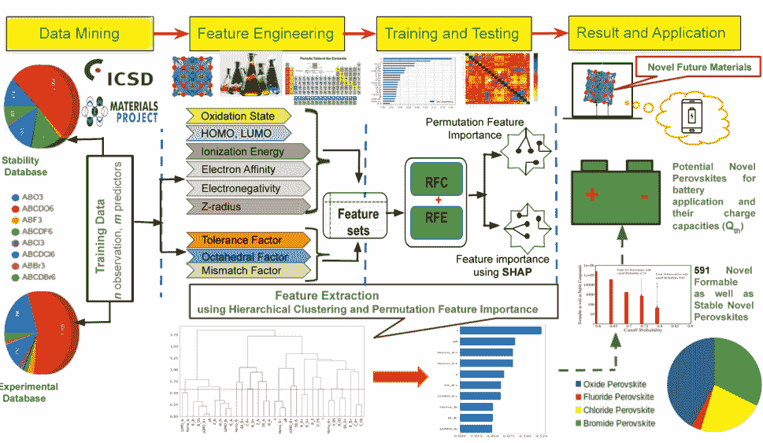

图 1. 用于探索新型钙钛矿化合物以进行储能应用的基于机器学习的研究工作流程。所提机器学习研究的工作流程包括使用层级机器学习模型进行数据挖掘、特征工程、训练和测试。该工作流程还描述了新型化合物的多样性作为结果。

此外，使用上述属性构建了一个机器学习模型来预测新型钙钛矿的稳定性和成型性。成型性和稳定性数据集中的化合物数量分别为 1962 和 4075。

为了预测新型钙钛矿化合物，利用铋（Bi）以下的元素（C、N、S、P 和惰性气体除外）[24]，制备了所有可能的 ABO3、AA'BB'O6、AA'B2O6、A2BB'O6、ABX3、A'ABB'X6、AA'B2X6、A2BB'X6（其中 X 为卤素元素）以及 ABF3、AA'BB'F6、AA'B'2F6、A2BB'F6 化合物组合。这些化合物组合基于电荷中性进行筛选。这表明，在单氧化物钙钛矿中，仅有价电子之和等于 6 的阳离子（A 和 B）以及在单卤化物钙钛矿中，价电子之和等于 3 的阳离子是唯一有效的化合物。同样，在双氧化物钙钛矿中，仅有价电子之和等于 12 的阳离子（A、A'、B 和 B'）以及在双卤化物钙钛矿中，价电子之和等于 6 的阳离子是唯一有效的化合物。由此得到的氧化物和卤化物钙钛矿数据集（Dp）包含 18,248,197 个化合物。

## 2.1. 成型性和稳定性数据库

成型性训练数据集包含 1962 个已实验验证的氧化物、氟化物和卤化物钙钛矿，分别为 ABO3、AA'BB'O6 和 AA'BB'X6 形式。在该数据集中，卤化物 X 由 Cl 和 Br 组成，包含 1453 个钙钛矿和 509 个非钙钛矿。该数据基于 Zhang et al. [34]、Balacharan et al. [38]、Vasala et al. [39]、Talapatra et al. [24]、Li et al. [40]、Li et al. [41] 等文献以及无机晶体结构数据库（Inorganic Crystal Structure Database, ICSD）等现有数据库编制而成。稳定性训练数据库由所有可能的化学组成组成，即 ABO3、AA'BB'O6、AA'B2O6 和 ABX3、AA'BB'X6、AA'B2X6、A2BB'X6 化合物。氧化物、氟化物和卤化物的总数为 4075 个化合物。其中，2053 个化合物在热力学上稳定，2022 个化合物在热力学上不稳定。图 2 展示了包含氧化物钙钛矿、氟化物钙钛矿、氯化物钙钛矿和溴化物钙钛矿的单钙钛矿和双钙钛矿的分布情况。图 2a 和 2b 分别展示了钙钛矿材料成型性数据库和稳定性数据库中各类化合物的分布情况。在成型性和稳定性分布中，可以看出本文献中氧化物钙钛矿占主导地位。该数据集通过材料项目应用程序编程接口（Materials Project Application Programming Interface, Materials API）编制而成，为每个化合物设定 hull 上方能量（\(\Delta E_h\)）为 50 meV/atom。Wu et al. [42] 发现，ICSD 中约 80% 的化合物的 hull 上方能量值小于 36 meV/atom。因此，为了更好的分析，本工作中选取了 \(\Delta E_h\) 值等于 50 meV/atom。

### 氧化物和卤化物钙钛矿的成型性数据库

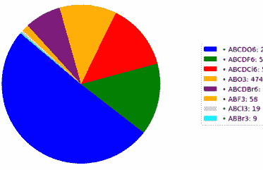

### 氧化物和卤化物钙钛矿的稳定性数据库

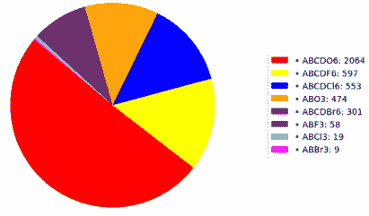

图 2. 钙钛矿的分布：(a) 成型性数据库 (b) 稳定性数据库。

## 2.2. 特征选择

氧化物、氟化物和卤化物钙钛矿成型性和稳定性数据库的编制由几何特征和原子特异特征组成。数据库中的特征由与钙钛矿相关的原子特征组成，例如单钙钛矿中的原子 A、B 和 X 以及双钙钛矿中的原子 A、A'、B、B' 和 X。Pilania et al. [43,44] 提出，对于双钙钛矿，给定性质 P 可以使用对称化合物特征（\(P_A+ = (P_A + P_{A'})/2\)）和反对称化合物特征（\(P_A - = (P_A - P_{A'})/2\)）来估算，其中 \(P_A\) 和 \(P_{A'}\) 分别为原子 A 和 A' 的性质。八种基本特征如图 3 所示。本研究中考虑每个原子（A、A'、B、B' 和 X 等）的所有特征集列表如表 1 所示。

大量几何和化学特征被用于训练两个模型。特征数据经过归一化处理，以使我们的模型更加稳健，并采用递归特征消除（RFE）[45]技术去除模型中权重最低的特征，此前 Talapatra et al. [24] 也已这样做。入选特征为最初考虑特征的子集。这些特征能够定义分类模型的成型性和稳定性。化合物的几何特征为 \(t\)、\(\mu\) 和 \(\mu_B\)。原子特异特征包括 Z\(_r\)、HOMO 能级、LUMO 能级、电负性（IX）[47]、电离能（IE）和电子亲和能（EA）。使用公式 [48] 分两步估计所有化合物特征的皮尔逊相关系数：

\(r = \Sigma(x_i - \bar{x})(y_i - \bar{y}) / \sqrt{\Sigma(x_i - \bar{x})^2(y_i - \bar{y})^2},\) (6)

其中 x 和 y 为具有各自均值 \(\bar{x}\) 和 \(\bar{y}\) 的两个数据集。A 展示了在 RFE 前后氧化物和卤化物钙钛矿特征稳定性分析的皮尔逊相关热图，随后是

| 特征 | 描述 | 模型描述符 |
|---|---|---|
| **几何特征** | | |
| \(t = (r_A + r_X)/\sqrt{2}(r_B + r_X)\) | 容忍因子 | t |
| \(\mu = r_B/r_X\) | 八面体因子 | \(\mu\) |
| \(\bar{\mu}_A = |r_A - r'_A|/2r_X\) | 不匹配因子 | \(\bar{\mu}_A\) |
| \(\bar{\mu}_B = |r_B - r'_B|/2r_X\) | 不匹配因子 | \(\bar{\mu}_B\) |
| **原子特异特征** | | |
| LUMO 能级 | 最低未占据分子轨道 | \(LUMO_{A\pm}, LUMO_{B\pm}\) |
| HOMO 能级 | 最高占据分子轨道 | \(HOMO_{A\pm}, HOMO_{B\pm}\) |
| EA | 电子亲和能 | \(EA_{A\pm}, EA_{B\pm}, EA_{X\pm}\) |
| IX | 电负性 | \(IX_{A\pm}, IX_{B\pm}, IX_{X\pm}\) |
| IE | 电离能 | \(IE_{A\pm}, IE_{B\pm}\) |
| \(Z_r\) | Zunger 伪势半径 | \(Z_r^{A\pm}, Z_r^{B\pm}\) |
| \(Oxi_{state}\) | 氧化态 | \(O_{A\pm}, O_{B\pm}, O_{X\pm}\) |

RFC [49] 模型。在 RFC 中，多个模型在数据集的多个子组上进行训练。模型的输出是通过结合所有模型的结果生成的。成型性分析中也进行了类似分析。首先，我们估计了所包含每个特征的皮尔逊相关系数（图 A.1a）。在第二部分，对 RFE 选出的前 20 个特征估计皮尔逊相关系数。通过改变前几个特征的数量从 16 到 26 来测试分类器模型的准确性。分类器模型在使用 20 个特征时表现出最佳性能。

# 3. 机器学习分类：技术细节

## 3.1. 使用随机森林分类器

在机器学习中，分类是根据给定输入数据集对数据集进行分类的过程。它需要一个包含多个输入和输出的训练数据集用于学习。在本工作中，使用 RFC 模型对新化合物的稳定性和成型性进行预测。随机森林（也称为随机决策森林）是一种受监督的机器学习技术，通过使用决策树进行回归分析和分类。RFC 方法结合了从随机选取的训练数据集子集中不同决策树的投票。模型的最终预测由得票最多的类别决定 [49]。

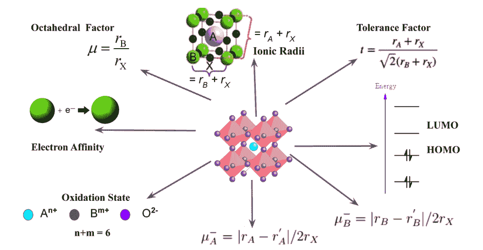

图 3. 定义钙钛矿的八个非常基本的特征 (a) 几何特征和 (b) 化学特征。

随机森林分类器（RFC）中的超参数为 (a) *决策树数量* 和 (b) 每个分裂节点的 *树深度*。使用 Scikit-learn 包 [45] 实现随机森林分类器。整个数据集分别按 80 和 20 的比例划分为训练集和测试集，用于稳定性和成型性分类。这意味着模型使用随机选择的 80% 数据集进行训练，并使用剩余 20% 数据集进行测试。通过验证测试结果，也对这些模型的稳健性进行了测试。在将 RFC 作为机器学习模型应用之前，我们对所有特征进行归一化处理，以确保均值为零并将标准差设置为单位。成型性和稳定性分类模型的估计器或树的数量（n-estimators）为 29。成型性分类的最大树深度（max-depth）为 22，稳定性分类为 19。两个 RFC 模型均使用 34 个特征进行研究，这些特征包含 30 个原子特异特征和 4 个几何特征。

两个分类的超参数均使用 5 折交叉验证（CV）进行调优，以增强模型的可靠性。在 5 折 CV 中，输入数据集被分为 5 个大小相同的不同子集。此外，四个子集用于训练所述模型，剩余一个子集用于测试结果。机器学习模型的最终性能通过平均测试结果得到。在本工作中，成型性分类模型的准确率为 0.946，而稳定性分类模型的准确率为 0.84。成功训练和测试模型后，两个模型同时应用于包含氧化物和卤化物的新化合物数据集，以预测新的可成型和稳定钙钛矿。

## 3.2. 钙钛矿的成型性和稳定性分类

图 4a 显示了作为 RFC 后跟 RFE 结果得到的氧化物和卤化物钙钛矿成型性分类的特征重要性。容忍因子（t）和八面体因子（\(\mu\)）是列表中最重要的特征。原子 ‘A’ 的对称关键特征为 \(EA_A, IE_A, Z^A_r, LUMO_A, IX_A\)，原子 ‘B’ 的对称关键特征为 \(Z^B_r, IX_B, LUMO_B, HOMO_B, IE_B, EA_B\)，这些特征定义了化合物作为钙钛矿是可成型还是不可成型。Zunger 伪势半径是 s 轨道和 p 轨道半径之和 [24]。图 4a 中以混淆矩阵（CM）形式给出了成型性分类模型的摘要，如 [50] 中所述。真值和假值预测的数量以矩阵形式汇总。矩阵的对角线元素（CM11 和 CM22）为真负值（TN）和真正值（TP），而非对角线元素（CM12 和 CM21）为假负值（FN）和假正值（FP）。此外，可以使用 CM 中元素的值来估计模型的精确率和准确率。模型预测正类或可成型类的能力可以通过精确率来分析。可以通过 TP 与 TP 和 FP 之和的比率来估算（即 Precision = TP/(TP + FP)）。模型的准确率有助于分析具有正确分类的预测能力。可以估算为 \(Accuracy = (TP + TN)/(TP + FN + FP + FN)\)。在成型性分类模型中，精确率和准确率的值分别为 0.9380 和 0.9465。Talapatra et al. [24] 对 1505 个单钙钛矿和双钙钛矿应用了 RFC 进行成型性分类，发现精确率和准确率的值分别为 0.9344 和 0.9401。该分类器的 AUC 为 0.869，相当良好。

图 4c 显示了作为 RFC 结果得到的氧化物和卤化物钙钛矿稳定性分类的‘特征重要性’。不稳定性分类中，容忍因子（t）是列表中最重要的特征。与 ‘B’-对称原子特异相关的特征占主导地位，例如不匹配因子（\(\mu_B\) 更具主导性，但

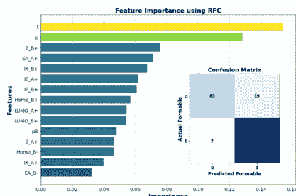

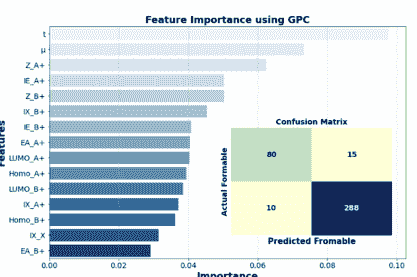

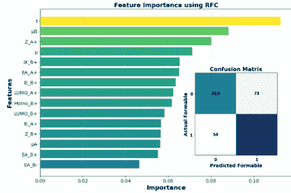

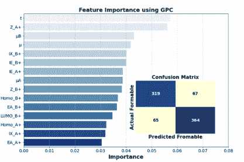

**图 4.** 非零值特征的特征重要性图和成型性混淆矩阵，使用 (a) 随机森林分类器模型和 (b) 高斯过程分类器，以及稳定性使用 (c) 随机森林分类器模型和 (d) 高斯过程分类器。

八面体因子 $\mu$)。列表中其他重要的‘B’对称原子特定特征包括 LUMO$_B$、HOMO$_B$、IX$_B$、Z$_B^r$ 和 IE$_B$。唯一占主导地位的‘A’对称特征是 Z$_A^r$。稳定性分类模型的混淆矩阵（CM）摘要如图 4c 所示。我们稳定性分类模型的精度和准确度分别为 0.8380 和 0.8465。很明显，两种分类模型的性能都相当好。这两种模型都能有效地分类钙钛矿的可成形性和稳定性，如所有矩阵所验证。

## 3.3. 高斯过程分类

为验证前一节讨论的分类器模型，采用了一种替代方法来测试计算方法和结果的可靠性。在本节中，广受认可且流行的高斯过程分类器（GPC）已被用于可成形性和稳定性的分类。

GPC 采用高斯过程（GPs）[51,52]构建概率分类模型。基本概念是使用 GP 对隐函数（f(x) ~ $\mathcal{KP}(0, k(x, x'))$）[52] 的值进行建模，然后应用链接函数 [52] 将这些隐值映射为类概率 [53]。GP 可定义为
f(x) ~ $\mathcal{KP}(m(x), k(x, x')),$ (7)

其中 m(x) 是均值函数，通常假设为 0，而 k(x, x’) 是协方差函数（或定义输入空间中两个不同点之间关系的核函数），适用于任何有限子集 x = {x1, x2, ..., xn} $\in$ X。GPC 通过检查核函数的学习参数来间接估计特征重要性。在高斯过程模型中，核函数捕获特征空间中数据点之间的关系。对这些关系贡献更大的特征会被考虑。为了公平验证 RFC 模型，RFC 和 GPC 在同一组数据上进行评估。两种分类模型中的训练-测试划分保持不变（即 80 和 20），且使用相同的随机状态（即 46）。此外，RFE 技术也用于删除 GPC 模型中权重最低的特征，以确保一致且可能更稳定的特征选择。两种分类的这些超参数均使用 5 折交叉验证（CV）进行调优，以增强模型的可靠性。在 5 折 CV 中，输入数据集被分成 5 个大小相同的不同子集。此外，四个子集用于训练所述模型，其余一个用于测试结果。ML 模型的最终性能通过平均测试结果提取。在这项工作中，可成形性分类模型的准确度为 0.946，而稳定性分类模型的准确度为 0.84。在成功训练和测试模型后，两个模型同时应用于包含氧化物和卤化物的新化合物数据集，以预测新的可成形和稳定的钙钛矿。

图 4b 显示了通过 GPC 后跟 RFE 获得的氧化物和卤化物钙钛矿可成形性分类的特征重要性。t 和 $\mu$ 也是 GPC 可成形性模型中最重要的特征。此外，其他最重要的特征属于原子‘A’和‘B’对称特征，这与 RFC 可成形性模型非常相似，仅特征重要性顺序有微小变化。在图 4b 中，还显示了混淆矩阵，GPC 可成形性模型的准确度为 0.938，这与使用 RFC 的可成形性模型的准确度（即 0.946）非常接近。图 4d 显示了使用 GPC 进行稳定性分类的特征重要性。在稳定性分类中，t 再次是列表中最重要的特征。其他主要特征也与使用 RFC 的稳定性模型一致，仅特征重要性顺序有微小变化。图 4d 中还显示了混淆矩阵，使用 GPC 的稳定性模型的准确度为 0.838，这与使用 RFC 的稳定性模型的准确度非常接近。

# 4. 特征重要性分析

## 4.1. 使用局部和全局 SHAP 值的特征重要性

使用 SHAP [54,55] 对模型预测进行了分析。SHAP 是一种基于博弈论的方法，使模型更易理解且更透明。它为每个数据点提供每个特征的重要性（称为局部解释），并提供模型的一般化行为（称为特征重要性的全局解释）。可成形性和稳定性特征的训练数据集局部解释也已提取，两者均提取了特征重要性的全局解释。可成形性和稳定性分析的局部分别在图 5a 和 5b 中给出。这些图表显示了顶层特征对各自模型输出影响的密集信息。图 5a 和 5b 中，每个特征的每个实例由一个点表示。t、$\mu$、EA$_{A+}$、IE$_{B+}$ 和 Z$_{B+}$ 是可成形性分析模型预测中最重要的特征，而 t、EA$_{A+}$、$\mu_B$、$\mu_A$、Z$_{A+}$ 和 HOMO$_{B+}$ 是稳定性分析模型预测中最重要的特征。

两个类别（类别 0 和类别 1）在特征重要性方面的一般化行为（对模型输出的平均影响）如图 5c 和 5d 所示。根据我们的全局模型，t、$\mu$、EA$_{A+}$、IX$_{B+}$ 和 IE$_{B+}$ 是可成形性模型预测中最重要的特征。此外，t、EA$_{A+}$、$\mu_A$、$\mu_B$、Z$_{A+}$ 和 IX$_{A+}$ 是稳定性分析模型预测中最重要的特征。

## 4.2. 使用随机森林分类器的排列特征重要性

对于任何分类模型，测量特征的预测值非常重要。它可以深入了解特征与目标之间的关系。排列特征重要性（PFI）与树特征重要性（TFI）一起在 RFC 模型中作为模型检查技术使用，以提取数据库中每个特征的重要性。在 PFI 方法中，特征的值被随机打乱，从而打破了目标与特征之间的关系。这会导致准确度下降，并由当前模型进行测量。因此，模型也可能会受损，因为可能存在相关特征。为了处理多重共线性，使用 Spearman 相关系数 Eq. (6) [56] 对特征进行了层次聚类。Spearman 相关性可以定义为排序特征之间的 Pearson 相关系数。

特征的进一步层次聚类使用 Ward 最小方差 [37] 实现。合并后，簇内方差最小的簇被配对。簇中心之间的方差变化以欧氏距离来测量。在对所有特征进行聚类后，以距离矩阵形式显示的特征欧氏距离图称为树状图 [57]。为了优化给定特征的准确度，在遍历簇距离时会选择一个阈值距离。在此过程中，从数据集中过滤掉高度相关的特征。为了更好地理解 PFI 对可成形性的影响，还绘制了部分依赖。本工作中使用开源 SciPy 工具 [58] 实现这些方法。

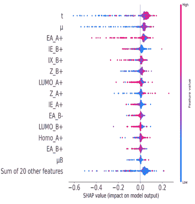

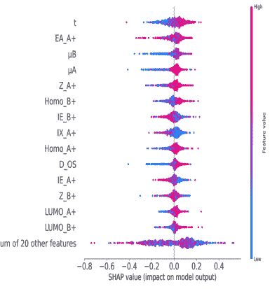

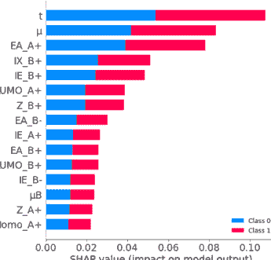

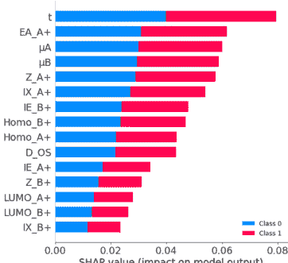

Fig. 5. 在 RFC 中使用 SHAP 进行局部和全局解释。(a) 可成形性和 (b) 稳定性的特征重要性局部解释。(c) 可成形性和 (d) 稳定性的特征重要性全局解释。

### 4.2.1. 面向可成形性的特征重要性

分析了用于分析单型和双型氧化物及卤化物钙钛矿可成形性的特征集。在图 6a 中，层次聚类前显示了 TFI 和 PFI。Spearman 秩次相关的层次聚类树状图在图 B 中显示。仅将层次聚类后保留的特征集包含在 PFI 中，如图 6b 所示。钙钛矿可成形性的主要贡献特征是两个几何特征，t 和 \(\mu\)。其他贡献特征包括 IX_B、IE_B 以及 B 位点原子的失配因子，以及 A 位点原子的 EA_A 和 LUMO_A。层次聚类后的 PFI 显示，如图 6b 所示的 HOMO_A 和 HOMO_B 对钙钛矿的可成形性很重要。适当定位的 HOMO_A 可以增强 A-O 键合，使钙钛矿结构在合成过程中更容易形成和稳定。排列良好的 HOMO_B 可确保与氧轨道有效重叠，从而促进稳定且有序的钙钛矿晶格的形成 [59]。这些轨道之间适当的能量匹配确保 A-O 和 B-O 键强且一致，有助于材料的可成形性。

层次聚类前重要特征的部分依赖图（PDP）如图 B 所示。在所有部分依赖中，贡献最大的特征 t 为公共横轴，其他重要特征位于纵轴。为了深入了解预测与特征之间的关系，PDP 非常有用。可以理解特定特征值对模型预测的影响。我们已展示了最重要特征对其他主导特征的影响。

热图形式的 Pearson 相关性分别在层次结构前后的图 C 中显示。热图中的 Pearson 相关系数表示特征集之间的多重共线性程度。层次聚类后，图 C.1b 中可以看到相关分数和特征数量的减少。多重共线性特征的消除基于图 B.1 所示树状图中选择的最佳截止值。如图 6 的 TFI 和 PFI 所示，容忍因子 (t)、八面体因子 (\(\mu\))、EA_A 和 \(Z_A^r\) 是预测钙钛矿可成形性的最重要特征。

从前 10 个特征中，选出了 6 个特征并绘制了它们

图 6. TFI（左）和 PFI（右）图（a）在钙钛矿特定特征的层次聚类前和（b）后，用于可成性预测。可成性对钙钛矿特征的偏依赖图（c）μ，（d）EA_A+，（e）Z_B+，（f）EA_B+，（g）IX_B- 和（h）Homo_B+。

与偏依赖图中最重要的特征相比。从 RFC 的特征集中选择了前 10 个特征。如图 6c-h 所示，在大多数偏依赖结果中，当 t 大于 0.25–0.3 时，形成钙钛矿的概率大于 0.76。当容忍因子 t 大于 0.28 时，钙钛矿的形成概率与 B 位原子的电子亲和力和电负性无关（图 6f 和 6g）。

### 4.2.2. 稳定性特征重要性

对稳定性进行了类似的一组几何和原子特定特征分析。层次聚类前，稳定性分析的 TFI 和 PFI 如图 7a 所示。Spearman 秩次相关的层次聚类树状图显示在 D 中。只有在层次聚类中存活的特征才被包含在图 7b 的特征重要性图中。如 TFI 和 PFI 图所示，对钙钛矿稳定性贡献最大的特征是容忍因子 t，而八面体因子 μ 也在两个图中占主导地位。关键特征在层次聚类前的偏依赖图显示在 D 中。稳定性的变化绘制在水平轴上最重要的特征 t 和垂直轴上其余关键特征的函数中。此外，稳定性数据库特征集之间的多重共线性如图 E、图 E.1a 所示。层次聚类后，图 E.1b 中相关性得分和特征数量的减少显而易见。

为消除多重共线性特征，如图 D 的图 D.1 所示，在树状图中选择了相对于准确度的最优截止值。如图 7b 的 TFI 和 PFI 所示，容忍因子 t 仍然是预测钙钛矿稳定性最重要的特征。错配因子 μ_A、HOMO_B 和 HOMO_A 是影响钙钛矿稳定性的其他主导特征。方程 (5) 表明，如果化合物的吉布斯自由能低于孤立组成原子的吉布斯自由能，则该化合物在热力学上是稳定的 [24]。因此，形成的成键分子轨道能量低于孤立原子的原始 HOMOs（HOMO_A 和 HOMO_B）。与可成性类似，我们从前 10 个特征中选出了 6 个特征，并将其绘制在偏依赖图中最重要的特征 t 上，如图 7c-h 所示。定义稳定性的前 10 个特征从 RFC 的特征集中选择。

图 8. (a) 截止概率内的可成和稳定化合物。(b) 截止概率内的可成且稳定化合物。

# 5. 结果与讨论

## 5.1. 预测可成形和稳定的钙钛矿

可成性和稳定性分类模型应用于氧化物和卤化物钙钛矿新数据集 ($D_p$)。该数据集 $D_p$ 包含 18,248,197 个不同化合物。可成性分类模型预测了 $D_p$ 数据集中 475024 个化合物为新的可成化合物，而稳定性分类模型预测了 194005 个化合物为新的稳定化合物。图 8a 显示了可能可成的化合物以及相对于截止概率的稳定化合物。图 8b 显示了同时具有截止概率的可成且稳定的最终化合物。图 8 中的 Y 轴是非线性的，因为化合物数量随截止概率的变化而变化较大。最终化合物使用 0.75 的截止概率制备，即具有 75% 概率同时可成且稳定的最终潜在候选物。这 591 个化合物被筛选为未来氧化物和卤化物钙钛矿的实验实现候选物。此外，这些筛选的化合物在下文中对电池应用进行了理论测试。

图 9. 稳定和不稳定化合物及其理论电荷容量。

## 5.2. 电池应用的潜在候选物

使用 ML 模型共发现了 591 个新颖的氧化物钙钛矿和卤化物钙钛矿化合物。最终化合物列表包含 247 个氧化物钙钛矿、19 个氟化物钙钛矿、132 个氯化物钙钛矿和 190 个溴化物钙钛矿。对于电池应用，电荷容量 [60] 使用以下公式给出的估算：

$Q = nF/(3600 * Mw)mAhg^{-1}$

其中 $F$ 是 *法拉代常数*，$n$ 是电荷载体的数量，$Mw$ 是用于电极的钙钛矿材料的分子量。考虑以下化学方程式：

$LiTaO_3 \longrightarrow Li^+ + TaO_3 + 1e^-$

n 的值为 1，LiTaO3 的分子量为 235.89 g/mol。因此使用上述方程，电荷容量为 113.62 mAhg⁻¹。

我们准备了一个单独的数据框来估算最终化合物的电荷容量。在所有卤化物钙钛矿中，最高电荷容量出现在一种氟化物钙钛矿中。电荷容量为 215.63 mAhg⁻¹，出现在双重卤化物钙钛矿 TlBTeGeF₆ 中。在其他卤化物钙钛矿中，例如在氯化物钙钛矿中，TlBTeGeCl₆ 的电荷容量最高，约为 170 mAhg⁻¹；在溴化物钙钛矿中，ReVTeGeBr₆ 的电荷容量为 116 mAhg⁻¹。而在氧化物钙钛矿中，RbTe-GeO₆ 显示所有化合物中最高的电荷容量，约为 380 mAhg⁻¹。新化合物列表中所有其他化合物的电荷容量可在图 F 的表 F.1 中找到。

| 化合物 | 可成或稳定 | 电荷容量 (mAhg⁻¹) | 来源 |
|---|---|---|---|
| RbTeGeO₆ | 两者均具 | 380 | 当前结果 |
| Ge₂NaAl₅O₆ | 两者均具 | 372 | 当前结果 |
| TcCaMnBeO₆ | 两者均具 | 359 | 当前结果 |
| ReCsAlCeO₆ | 两者均具 | 355 | 当前结果 |
| OsSeAlCo₆O₆ | 两者均具 | 352 | 当前结果 |
| TiH₃S₂O₆ | 稳定 | 602.37 | DFT 输入 |
| Al₂CaSiO₆ | 稳定 | 368.6 | DFT 输入 |
| VCdPHO₆ | 稳定 | 368 | DFT 输入 |
| MnZn₂SiO₆ | 稳定 | 346 | DFT 输入 |
| Y₃Sb₅O₆ | 稳定 | 319.7 | DFT 输入 |
| TlBTeGeF₆ | 两者均具 | 215.63 | 当前结果 |
| WTeBeAuF₆ | 两者均具 | 212.3 | 当前结果 |
| MnRBeGeF₆ | 两者均具 | 211.6 | 当前结果 |
| ReTeBeAuF₆ | 两者均具 | 211.5 | 当前结果 |
| FeTeBeGeF₆ | 两者均具 | 211.1 | 当前结果 |
| Ge₂NOF₆ | 稳定 | 464.91 | DFT 输入 |
| Na₂LiAlF₆ | 稳定 | 138 | DFT 输入 |
| NaLi₂TiF₆ | 稳定 | 134.8 | DFT 输入 |
| Na₂LiSCF₆ | 稳定 | 126.5 | DFT 输入 |
| Li₂AlCuCuF₆ | 稳定 | 122.7 | DFT 输入 |

从 Materials Project 获得的 DFT 数据库中，4075 个化合物的 hull 上方能量（Eₕ）已获得。图 9 显示了作为其计算电荷容量（mAhg⁻¹）函数的 hull 上方能量。稳定和不稳定的钙钛矿及其电荷容量一起显示。hull 上方能量的阈值设置为 50 meV 以划分稳定和不稳定的钙钛矿材料。来自报告的 DFT 数据库的材料对应的电荷容量已在图 9 中指示。从图中可以看出，稳定氧化物和卤化物钙钛矿对应的最大电荷容量分别为 602.37 mAhg⁻¹（TiH₃S₂O₆）和 464.91 mAhg⁻¹（Ge₂NOF₆）。使用预测化合物也观察到了相同的模式。值得注意的是，使用 ML 模型预测的化合物声称是可成且稳定的。然而，来自报告的 DFT 数据库的数据模式仅列出了稳定化合物。主要目标是探索具有高电荷密度的潜在新颖化合物。新化合物与 DFT 数据库稳定化合物的比较载于表 2。

# 6. 结论

本文介绍了一种系统分析，通过制备特征集和新数据库，利用机器学习的先进分类技术探索新颖的钙钛矿材料。可成性分类模型使用已知材料的现有实验数据库训练，并制备了单个和双重氧化物钙钛矿及卤化物钙钛矿的大型化学空间特征集。同样，稳定性分类模型使用基于 DFT 的数据库以及单个和双重钙钛矿的大型化学空间特征集进行训练。稳定性分类中仅考虑 DFT 数据集的立方对称性，并在能量凸壳中选择 50 meV 的能量阈值来定义 DFT 数据集中的稳定和不稳定化合物。通过增加阈值，可以调整稳定性范围，这会增加与可成性数据库的重叠。然而，这可能会增加将不稳定化合物添加到最终化合物列表中的风险。立方（Pm-3m）对称性是钙钛矿的原型相，尽管它们可以属于其他空间群，如四方（P4/mbm）和正交（Pmbn），但考虑多个空间群带来复杂挑战，需要开发更复杂的机器学习模型用于可成性和稳定性预测。稳定性数据库使用所有化合物的凸壳估计技术，利用 Material Project 数据库预测化合物的形状、不稳定和亚稳定性。

已制备了包含多个原子特定特征和几何特征集的数据库。可成性和稳定性分类模型基于随机森林（RF）技术构建。这些 ML 模型旨在最大化准确性并减少方差。另一个分类器，高斯过程分类器（GPC）也用于可成性和稳定性模型以验证 RF 分类器模型。可以看出，所提出的基于 RFC 的模型更加稳健可靠。此外，测量了特征的预测值以了解特征与真实结果之间的关系。使用层次聚类技术分析选定特征之间多重共线性的影响及其对钙钛矿可成性和稳定性的影响。可成性分类模型预测了 475024 个新的可成化合物，而稳定性分类模型预测了 437828 个新的稳定化合物。最后，筛选了 591 个化合物，因为它们具有极高的可成性和稳定性。这 591 个化合物是未来实验实现最有前景的新颖氧化物和卤化物钙钛矿。此外，这些筛选的化合物在能量储存应用方面进行了理论测试。最终化合物列表包含 247 个氧化物钙钛矿、19 个氟化物钙钛矿、132 个氯化物钙钛矿和 190 个溴化物钙钛矿。最高电荷容量出现在一种氟化物钙钛矿中，但总体最高电荷容量出现在氧化物钙钛矿中。使用这种 ML 方法，还可以研究其他晶体结构的新颖化合物的特性，用于不同的应用。ML 方法可以为广泛检验新颖化合物的功能性铺平道路。

# CRediT 作者贡献声明

Neelesh Gupta: 写作 – 审阅与编辑，写作 – 原始草稿，可视化，验证，方法论，调查，正式分析，数据管理，概念化。Ravi Kumar: 写作 – 审阅与编辑，监督，资源，项目管理，概念化。Alankar: 写作 – 审阅与编辑，监督，软件，资源，项目管理，方法论，调查，资金获取，概念化。

# 利益冲突声明

作者声明他们没有已知的可能影响本文所报告工作的竞争性财务利益或个人关系。

# 数据可用性

我们在手稿中提供了程序和数据的链接。

# 致谢

作者谨感谢“未来移动陶瓷技术”（项目编号：SB22231272MMETW0008702）提供的资助，这是 IIT Madras 的卓越研究院计划。

# 附录 A. 用于稳定性分析的氧化物和卤化物钙钛矿特征在 RFE 后随 RFC 前后的 Pearson 相关系数热图

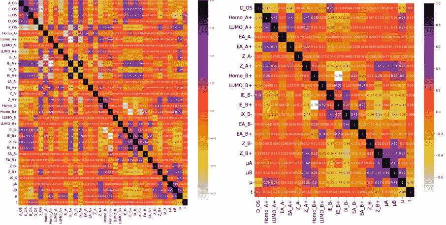

图 A.1. 氧化物和卤化物钙钛矿特征在 (a) RFE 后随 RFC 之前和 (b) 之后的 Pearson 相关系数热图，用于稳定性分析。

# B. 层级聚类前的成形性部分依赖图

## B.1. 面向成形性的特征层级聚类

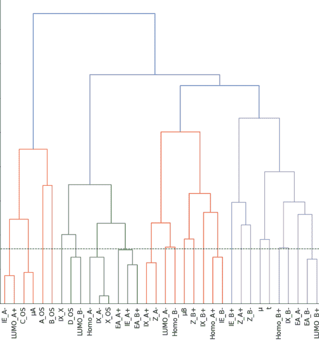

图 B.1. 使用钙钛矿特有特征进行成形性预测的 Spearman 秩相关层级聚类树状图。

## B.2. 层级聚类前用于成形性预测特征集的部分依赖图

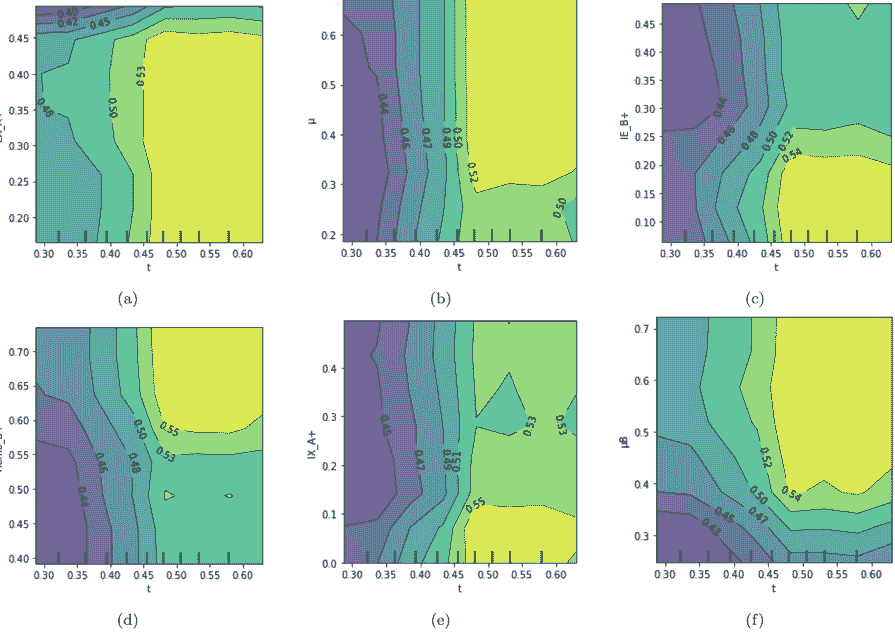

图 B.2. 层级聚类前钙钛矿特有特征上的成形性部分依赖图。(a) EA_A+，(b) μ，(c) IE_B+，(d) Homo_B+，(e) IX_A+ 和 (f) μB。

# C. 用于成形性预测的钙钛矿特有特征在层级聚类前后的 Pearson 相关系数热图

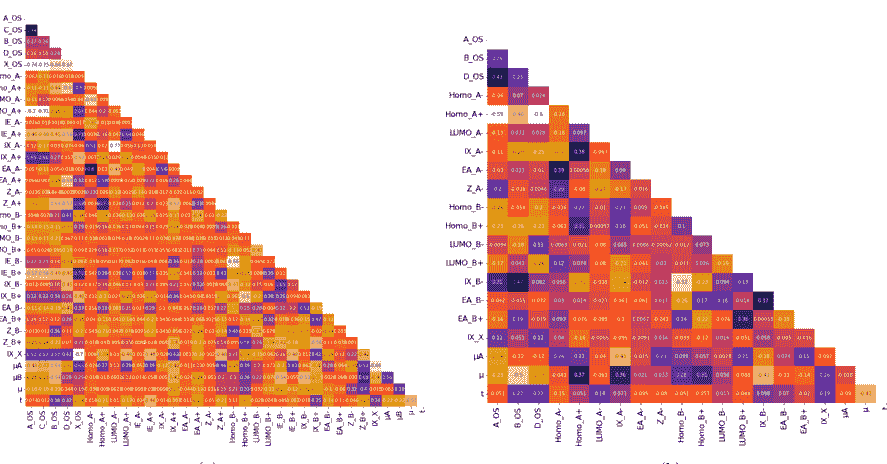

图 C.1. 用于成形性预测的钙钛矿特有特征在 (a) 层级聚类前和 (b) 后的 Pearson 相关系数热图。

# D. 层级聚类前的稳定性部分依赖图

## D.1. 面向稳定性的特征层级聚类

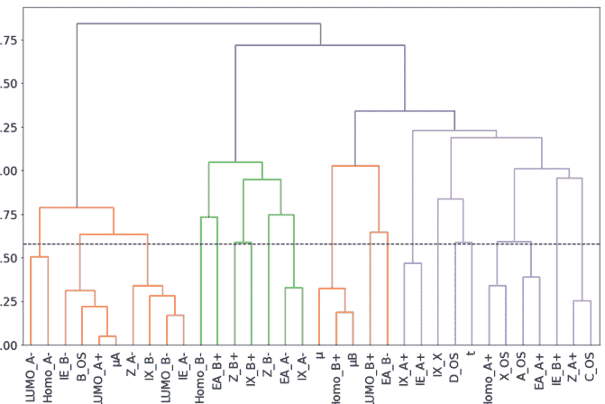

图 D.1. 使用钙钛矿特有特征进行稳定性预测的 Spearman 秩相关层级聚类树状图。

## D.2. 层级聚类前用于稳定性预测特征集的部分依赖图

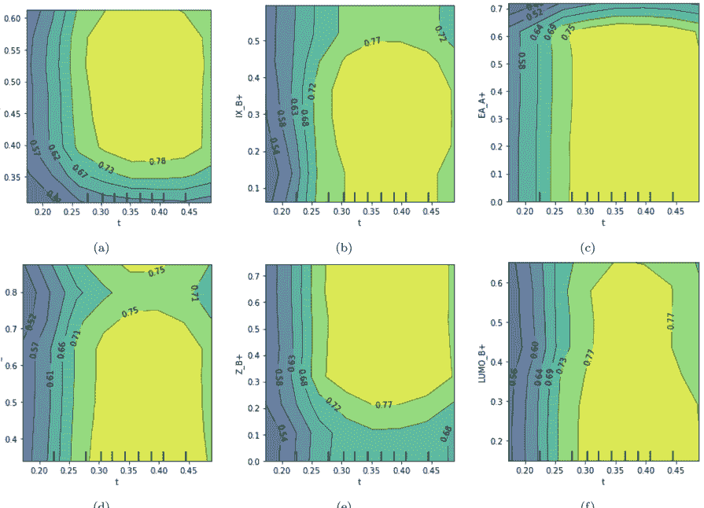

图 D.2. 层级聚类前钙钛矿特有特征上的稳定性部分依赖图。(a) μ，(b) IX_B+，(c) EA_A+，(d) LUMO_A+，(e) Z_B+ 和 (f) LUMO_B+。

对于每个特征集的成形性最大预测精度，最佳截断距离为 0.4，如图 B.1 所示树状图中的水平虚线所示。虚线下方的特征簇被替换为该簇中特征重要性得分最高的特征集。对于每个特征集的稳定性最大预测精度，最佳截断距离为 0.58，如图 D.1 所示树状图中的水平虚线所示。虚线下方的特征簇被替换为该簇中特征重要性得分最高的特征集。

# E. 用于稳定性预测的钙钛矿特有特征在层级聚类前后的 Pearson 相关系数热图

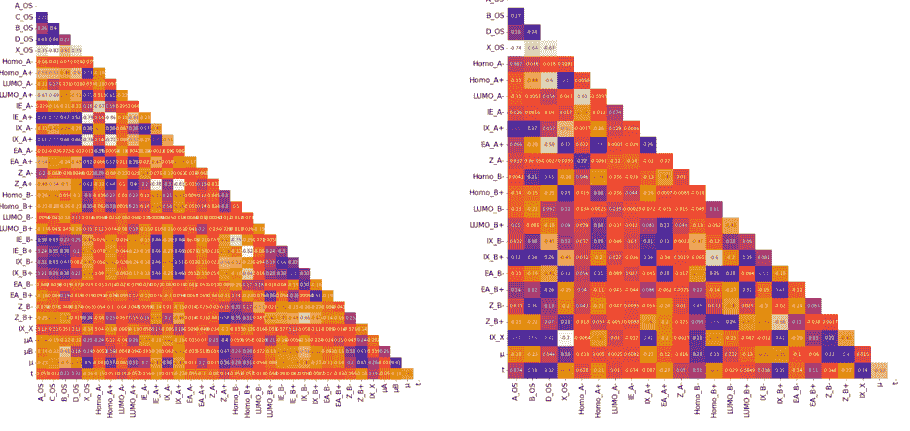

图 E.1. 用于稳定性预测的钙钛矿特有特征在 (a) 层级聚类前和 (b) 后的 Pearson 相关系数热图。

# F. 预测的可成形和稳定的氧化物及卤化物钙钛矿

| 化合物 (Qhb) | 化合物 (Qhb) | 化合物 (Qhb) |
| :--- | :--- | :--- |
| Re6TeO6 (380.39) | Ge2NaLO6 (372.33) | TcCaMnBeO6 (359.72) |
| ReSeAlCeO6 (355.14) | OsSeAlCeO6 (352.48) | ReSeGaCeO6 (328.56) |
| OsSeGaCeO6 (326.28) | ReNiTeSiO6 (323.83) | OsNiTeSiO6 (321.24) |
| ReSiTeO6 (315.02) | Ge2ZnGaO6 (287.1) | OsCaMnBeO6 (274.73) |
| ReVTeSiO6 (274.14) | TcBaMnBeO6 (271.22) | GeCsBNbO6 (264.57) |
| ReNbTeSiO6 (252.47) | TaRuTeSiO6 (251.09) | TaRhTeSiO6 (250.23) |
| ReTcTeSiO6 (250.07) | WRuTeSiO6 (249.73) | WRhTeSiO6 (248.88) |
| ReRuTeSiO6 (248.64) | ReHfTeSiO6 (247.8) | WKGaCrO6 (243.28) |
| ReAsTeGeO6 (240.45) | OsKGaVO6 (240.4) | OsKGaCrO6 (239.83) |
| ReCTeGeO6 (230.89) | WRuTeGeO6 (230.61) | WRhTeGeO6 (229.88) |
| ReRuTeGeO6 (229.68) | ReRhTeGeO6 (228.96) | MoKGaVO6 (228.62) |
| MoKGaCrO6 (227.94) | CaLaMnBeO6 (224.73) | RhKGaVO6 (224.18) |
| RhKGaCrO6 (223.52) | OsBaMnBeO6 (219.92) | OsLaMnBeO6 (219.21) |
| ReCrTeSiO6 (218.84) | TiBTeFeO6 (215.62) | WTeBeAuFe6 (212.23) |
| MnBTeFe6 (211.63) | ReFeBeAuFe6 (211.44) | FeTeGeFe6 (211.13) |
| WKin2rO6 (204.21) | OsKZnrO6 (201.77) | MoRbGaCrO6 (201.45) |
| ReMoTeSiO6 (200.82) | WLaPdBeO6 (200.77) | MnTcTeSiO6 (198.72) |
| ReMoTeGeO6 (198.64) | FeTcTeSiO6 (198.27) | OsIrTeGeO6 (197.47) |
| GeFeSi6O6 (191.03) | NbCuSeO6 (189.49) | CeCaAsSeO6 (186.95) |
| Nb3GeSeO6 (185.54) | ReMoTeGeO6 (185.37) | MoBaGaVO6 (178.71) |
| MoBaGaCrO6 (178.29) | SbCsNbO6 (176.96) | RhBaGaVO6 (175.98) |
| RhBaaCrO6 (175.58) | NbAgSeO6 (171.57) | CeCaSbGeO6 (170.88) |
| TiBTeGeCl6 (170.49) | In2GeSeO6 (168.5) | CeSrAsSeO6 (168.34) |
| MnBTeGeCl6 (167.98) | FeBTeGeCl6 (167.66) | Ge2SiMnO6 (165.34) |
| Ge2SiFeO6 (164.88) | TcGeIr2O6 (164.67) | Sb2GeSeO6 (163.74) |
| Ge2SiCoO6 (163.33) | ReNiTeGeCl6 (162.97) | ReCoTeGeCl6 (162.92) |
| Sn2CsIrO6 (162.8) | OsNiTeGeCl6 (161.99) | ReWTeGeO6 (160.91) |
| Sn6rIr2O6 (159.6) | TlScTeGeCl6 (158.98) | MgCuSe2O6 (156.84) |
| Ge2AsAlO6 (156.24) | CeSrSbGeO6 (155.2) | Ge2SiSeO6 (153.93) |
| Ge2rsIr2O6 (153.26) | MgGeSe2O6 (152.8) | GeBaAsSeO6 (152.48) |
| Ge2GeSe2O6 (152.34) | CeSePt2O6 (152.01) | Ta1TcTeSiO6 (151.53) |
| CeSnAu2O6 (151.21) | Mn2GeSeO6 (149.97) | Fe6GeSeO6 (149.21) |
| In2AlIrO6 (147.57) | MoLaPbBeO6 (146.98) | Ni2GeSeO6 (146.88) |
| TiCuSeO6 (146.71) | Co2GeSeO6 (146.69) | Ge2SiTcO6 (145.95) |
| VCuSe2O6 (145.5) | CrCuSe2O6 (145.09) | Ge2FeAsO6 (144.12) |
| MnCuS2O6 (143.94) | SrRuTeGeCl6 (143.85) | SrRhTeGeCl6 (143.38) |
| TiGeSe2O6 (143.17) | Gd2GeSeO6 (143.06) | Ge2SeMnO6 (142.91) |
| Ge2SeFeO6 (142.57) | NiCuSe2O6 (142.5) | NbNiTeGeCl6 (142.43) |
| VGe2Se2O6 (142.01) | MoNiTeGeCl6 (141.67) | CrGeSe2O6 (141.62) |
| Ge2SeCoO6 (141.41) | NbCuTeGeCl6 (141.22) | Sb2KrTO6 (140.86) |
| MnGeSe2O6 (140.53) | FeGeSe2O6 (140.19) | Sb2KPO6 (140.15) |
| TaTcTeGeO6 (139.8) | Sb2KAuO6 (139.7) | Ge2GeTeO6 (139.49) |
| NiGeSe2O6 (139.15) | CoGeSe2O6 (139.07) | Ge2ZnSeO6 (139.04) |
| PrAlTeGeCl6 (138.44) | NdAlTeGeCl6 (137.65) | Ge2SbAlO6 (137.48) |
| PrAlTeGeCl6 (137.47) | CuGeSe2O6 (137.43) | GeCuSe2O6 (137.43) |
| In2GaIrO6 (136.84) | Ge2ZnSe2O6 (136.78) | CeTlAlSbO6 (136.46) |
| SmAlTeGeCl6 (136.21) | EuAlTeGeCl6 (135.85) | In2GaAuO6 (135.74) |
| CePbAsSeO6 (134.64) | Ge2SeSeO6 (134.31) | Pr2SeTeGeCl6 (134.28) |
| ThAlTeGeCl6 (134.27) | Bi2BeSeO6 (133.58) | DyAlTeGeCl6 (133.48) |
| NbRuTeGeCl6 (132.49) | CeTiSrScBO6 (132.42) | NbRhTeGeCl6 (132.09) |
| Mn2GeTeO6 (132.01) | Ta2GeSeO6 (131.93) | MoRuTeGeCl6 (131.83) |
| MoRhTeGeCl6 (131.43) | Fe2GeTeO6 (131.42) | VSmRhBrO6 (130.98) |
| CePbMaOsO6 (130.91) | CePbTiAsO6 (130.48) | Sb2RhIrO6 (130.28) |
| Sb2SrTiO6 (129.82) | Sb2RbPtO6 (129.67) | Co2GeTeO6 (129.46) |
| Sb2BrAuO6 (129.28) | Sb2SrPtO6 (129.22) | PrGaTeGeCl6 (128.95) |
| CeTINTeO6 (128.28) | NdGaTeGeCl6 (128.26) | CeTlCoTeO6 (128.23) |
| PmGaTeGeCl6 (128.11) | SmGaTeGeCl6 (127.02) | EuGaTeGeCl6 (126.7) |
| Ge2TeMnO6 (126.51) | Ge2TeFeO6 (126.24) | MnFeTeGeF6 (126.13) |
| CePbSbGeO6 (126.09) | TbGaTeGeCl6 (125.33) | Ge2TeCoO6 (125.33) |
| Ge2CuTeO6 (123.99) | Ge2CdSeO6 (123.92) | DyTlPdCuF6 (123.55) |
| Ge2ZnTeO6 (123.46) | GeAgSe2O6 (123.4) | PrRhTeGeCl6 (122.43) |
| Ge2AsSbO6 (122.42) | Ge2SbAsO6 (122.42) | Ge2SnSeO6 (122.15) |
| Ge2CdSe2O6 (122.13) | Sb2CsIrO6 (120.98) | GaIr2O6 (120.91) |
| Bi2GeSe2O6 (120.82) | Sb2CsPtO6 (120.46) | CeTlPtSbO6 (120.25) |
| Sb2CsAuO6 (120.12) | Ge2TeSeO6 (119.72) | CePtPbTaSO6 (118.74) |
| BiNiTeGeCl6 (118.14) | VSeGaFeCl6 (118.14) | Ge2TeSe2O6 (118.04) |
| CrSeGaFeCl6 (117.86) | BiCuTeGeCl6 (117.3) | ReVTeGeBr6 (116.94) |
| Re2TeOGeBr6 (116.81) | Ge2SiSO6 (116.66) | MnFeTeAgF6 (116.47) |
| Ge2AlIrO6 (116.43) | ReFeTeGeBr6 (116.32) | Ge2SiIrO6 (116.15) |
| NiSeGaFeCl6 (116.15) | CoSeGaFeCl6 (116.09) | ReNiTeGeBr6 (115.96) |
| ReCoTeGeBr6 (115.93) | Ge2AlPtO6 (115.71) | TaRuTeGeCl6 (115.7) |
| OsNiTeGeBr6 (115.46) | Ge2SiPtO6 (115.44) | TaRhTeGeCl6 (115.4) |
| Ge2AlAuO6 (115.24) | CePbTaAsO6 (115) | CeTlPPmMnO6 (114.43) |
| Bi2CdSeO6 (114) | Mn2GeIrO6 (113.88) | CeTlPPbCoO6 (113.79) |
| Cd2GeSeO6 (113.48) | Mn2GePtO6 (113.19) | Ge2AgTeO6 (112.46) |
| Ni2GeIrO6 (112.09) | Co2GeIrO6 (111.98) | CrLaWBeO6 (111.73) |
| Ni2GePtO6 (111.42) | Ge2CdTeO6 (111.4) | Co2GePtO6 (111.32) |
| BiRuTeGeCl6 (111.22) | GeSeHfCaFe6 (110.72) | RePdTeGeBr6 (110.27) |
| TiSiTeGeCl6 (109.64) | VSmWbGeO6 (109.35) | VSiTeGeCl6 (108.96) |
| MnMgTeGeCl6 (108.92) | TiBTeGeBr6 (108.9) | CrSiTeGeCl6 (108.73) |
| MnSiTeGeCl6 (108.09) | FeSiTeGeCl6 (107.89) | MnBTeGeBr6 (107.87) |
| FeBTeGeBr6 (107.74) | YbGeSe2O6 (107.3) | DyTlPdCuCl6 (107.27) |
| NiSiTeGeCl6 (107.27) | CoSiTeGeCl6 (107.22) | Ge2SeTe2O6 (106.62) |
| Ge2GaIrO6 (106.54) | PdAlbVnO6 (106.04) | Ge2GaPtO6 (105.94) |
| Ge2GaAuO6 (105.55) | Ge2AsIrO6 (105.45) | Ge2SeOsO6 (105.03) |
| Ge2AsPtO6 (104.86) | TlVTeGeCl6 (104.74) | Ge2IrSeO6 (104.62) |
| Ge2SeIrO6 (104.62) | TiCrTeGeCl6 (104.53) | Ge2AsAuO6 (104.48) |
| Ge2SeAs2Cl6 (104.26) | TiSeTeGeBr6 (104.09) | Ge2SePtO6 (104.04) |
| VCrTeGeCl6 (103.91) | TiFeTeGeCl6 (103.75) | Eu2CaSeO6 (103.29) |
| TiNiTeGeCl6 (103.18) | TiCoTeGeCl6 (103.13) | Cd2GeTeO6 (102.88) |
| GePtSe2O6 (102.77) | Tm2BeSeO6 (102.72) | VNiTeGeCl6 (102.58) |
| VCoTeGeCl6 (102.53) | GeHgAgSeO6 (102.48) | CrNiTeGeCl6 (102.37) |
| MnFeTeGeCl6 (102.36) | MnNiTeGeCl6 (101.8) | MnCoTeGeCl6 (101.76) |
| HgGeSe2O6 (101.69) | CuCaMnBeO6 (101.69) | FeNiTeGeCl6 (101.63) |
| FeCoTeGeCl6 (101.58) | RePtTeGeBr6 (101.05) | CoNiTeGeCl6 (101.03) |
| GeSeHfSrFeO6 (100.82) | OsPtTeGeBr6 (100.67) | IrPtTeGeBr6 (100.48) |
| Pb2GeSe2O6 (100.44) | MgBaHfTcO6 (100.36) | GeCdTe2O6 (99.97) |
| Tm2MgSeO6 (99.8) | MgBaZrOsO6 (99.44) | Sc2TeGeBr6 (98.84) |
| TlYTeGeBr6 (98.48) | EuNdAsSeO6 (98.16) | TlVTeAgCl6 (97.99) |
| PbPdAlNbO6 (97.91) | TlCrTeAgCl6 (97.8) | Ge2InIrO6 (97.78) |
| ScRuTeGeBr6 (97.38) | Ge2InPtO6 (97.27) | Eu2GeSeO6 (97.2) |
| ScRhTeGeBr6 (97.17) | TiZrTeGeCl6 (97.1) | Ge2SnIrO6 (97.09) |
| Ge2InAuO6 (96.94) | TlNiBTeGeCl6 (96.81) | NbNiTeGeBr6 (96.73) |
| Ge2SnPtO6 (96.59) | Ge2SbIrO6 (96.56) | MoNiTeGeBr6 (96.38) |
| TlMoTeGeCl6 (96.28) | VNdTeGeCl6 (96.28) | NbCuTeGeBr6 (96.17) |
| TmLaAsSeO6 (96.11) | CrNbTeGeCl6 (96.1) | TlTcTeGeCl6 (95.92) |
| Mn2FeAgAgCl6 (95.9) | Ge2TeOsO6 (95.89) | VMoTeGeCl6 (95.76) |
| Ge2SbAuO6 (95.74) | CrMoTeGeCl6 (95.58) | Ge2TeIrO6 (95.55) |

| 化合物 ($Q_{th}$) | 化合物 ($Q_{th}$) | 化合物 ($Q_{th}$) |
| :--- | :--- | :--- |
| VTcTeGeCl$_{6}$ (95.4) | TiRuTeGeCl$_{6}$ (95.4) | FeNiTeAgCl$_{6}$ (95.25) |
| FeCoTeAgCl$_{6}$ (95.22) | TmNdAsSeO$_{6}$ (95.2) | TiRhTeGeCl$_{6}$ (95.09) |
| Ge$_{2}$PtFeO$_{6}$ (95.06) | Ge$_{2}$PtTeO$_{6}$ (95.06) | VRuTeGeCl$_{6}$ (94.89) |
| PrAlTeGeBr$_{6}$ (94.87) | CoNiTeAgCl$_{6}$ (94.74) | MnTcTeGeCl$_{6}$ (94.73) |
| CrRuTeGeCl$_{6}$ (94.71) | FeTcTeGeCl$_{6}$ (94.58) | VRhTeGeCl$_{6}$ (94.58) |
| TiPtTeGeCl$_{6}$ (94.5) | NdAlTeGeBr$_{6}$ (94.5) | Eu$_{2}$CaTeO$_{6}$ (94.44) |
| PmAlTeGeBr$_{6}$ (94.42) | CrRhTeGeCl$_{6}$ (94.4) | MnRuTeGeCl$_{6}$ (94.22) |
| FeRuTeGeCl$_{6}$ (94.07) | VPdTeGeCl$_{6}$ (94) | SmAlTeGeBr$_{6}$ (93.82) |
| EuAlTeGeBr$_{6}$ (93.65) | CoRuTeGeCl$_{6}$ (93.56) | GaInTeGeBr$_{6}$ (93.04) |
| PrScTeGeBr$_{6}$ (92.9) | TlAlTeGeBr$_{6}$ (92.9) | TmZnScO$_{6}$ (92.71) |
| DyAlTeGeBr$_{6}$ (92.52) | TiSnTeGeCl$_{6}$ (92.5) | PmScTeGeBr$_{6}$ (92.46) |
| NbRhTeGeBr$_{6}$ (92.04) | VSnTeGeCl$_{6}$ (92.02) | SmScTeGeBr$_{6}$ (91.89) |
| CrSnTeGeCl$_{6}$ (91.85) | NbRhTeGeBr$_{6}$ (91.85) | MoRuTeGeBr$_{6}$ (91.72) |
| MoRhTeGeBr$_{6}$ (91.53) | PrGaTeGeBr$_{6}$ (90.32) | YbGeSeO$_{6}$ (90.3) |
| LiCaAsSeO$_{6}$ (90.27) | ScGeTeGeBr$_{6}$ (90.16) | ScTmTeGeBr$_{6}$ (89.99) |
| ScTmTeGeBr$_{6}$ (89.99) | NdGaTeGeBr$_{6}$ (89.98) | PmGaTeGeBr$_{6}$ (89.9) |
| TiBrTeGeBr$_{6}$ (89.86) | ScLuTeGeBr$_{6}$ (89.38) | SmGaTeGeBr$_{6}$ (89.36) |
| Eu$_{2}$GeTeO$_{6}$ (89.32) | EuGaTeGeBr$_{6}$ (89.21) | TlLuTeGeBr$_{6}$ (89.09) |
| MnRuTaAgCl$_{6}$ (88.72) | FeRuTaAgCl$_{6}$ (88.58) | TbGaTeGeBr$_{6}$ (88.53) |
| PrYTeGeBr$_{6}$ (88.41) | CoRuTeAgCl$_{6}$ (88.14) | NdYTeGeBr$_{6}$ (88.09) |
| PmYTeGeBr$_{6}$ (88.02) | SmYTeGeBr$_{6}$ (87.5) | MnGeP$_{2}$O$_{6}$ (87.34) |
| PrRhTeGeBr$_{6}$ (87.07) | NiGePt$_{2}$O$_{6}$ (86.81) | CoGePt$_{2}$O$_{6}$ (86.78) |
| TbYTeGeBr$_{6}$ (86.69) | Ti$_{2}$TeGeCl$_{6}$ (86.49) | Li$_{2}$GeTeO$_{6}$ (86.44) |
| PrRuTeGeCl$_{6}$ (86.4) | PdRhTeGeCl$_{6}$ (86.15) | CuSrMnBeO$_{6}$ (86.15) |
| PrInTeGeBr$_{6}$ (85.96) | YErTeGeBr$_{6}$ (85.92) | GeZnPt$_{3}$O$_{6}$ (85.88) |
| YTmTeGeBr$_{6}$ (85.77) | Tm$_{2}$CdSeO$_{6}$ (85.73) | NdInTeGeBr$_{6}$ (85.66) |
| PmInTeGeBr$_{6}$ (85.59) | MgBaHfOsO$_{6}$ (85.58) | SmInTeGeBr$_{6}$ (85.1) |
| EuInTeGeBr$_{6}$ (84.96) | BiNiTeGeBr$_{6}$ (84.88) | BiCuTeGeBr$_{6}$ (84.45) |
| ThHfTeGeCl$_{6}$ (83.85) | TaRuTeGeBr$_{6}$ (83.61) | TiTaTeGeCl$_{6}$ (83.53) |
| YbZnTeO$_{6}$ (83.46) | TaRhTeGeBr$_{6}$ (83.45) | Pb$_{2}$SeSeO$_{6}$ (83.22) |
| TlWTeGeCl$_{6}$ (83.15) | VWTeGeCl$_{6}$ (82.76) | CrWTeGeCl$_{6}$ (82.62) |
| PrRuTaAgCl$_{6}$ (81.75) | PdRhTaAgCl$_{6}$ (81.53) | LaTmTeGeBr$_{6}$ (81.43) |
| PrErTeGeBr$_{6}$ (81.4) | PrTmTeGeBr$_{6}$ (81.26) | BiRuTeGeBr$_{6}$ (81.24) |
| NdErTeGeBr$_{6}$ (81.13) | PmErTeGeBr$_{6}$ (81.06) | NdTmTeGeBr$_{6}$ (80.99) |
| Pb$_{2}$GeSeO$_{6}$ (80.98) | PmTmTeGeBr$_{6}$ (80.93) | PrLuTeGeBr$_{6}$ (80.77) |
| SnBrTeGeBr$_{6}$ (80.62) | NdLuTeGeBr$_{6}$ (80.5) | SmTmTeGeBr$_{6}$ (80.49) |
| PmLuTeGeBr$_{6}$ (80.44) | SnLuTeGeBr$_{6}$ (80.01) | GdTmTeGeBr$_{6}$ (79.94) |
| TbErTeGeBr$_{6}$ (79.94) | EuLuTeGeBr$_{6}$ (79.88) | GeCdPt$_{3}$O$_{6}$ (79.86) |
| TbTmTeGeBr$_{6}$ (79.81) | GdLuTeGeBr$_{6}$ (79.46) | LiCaSbGeO$_{6}$ (79.45) |
| HoTmTeGeBr$_{6}$ (79.34) | TbLuTeGeBr$_{6}$ (79.33) | ErTmTeGeBr$_{6}$ (79.15) |
| DyTiPdCuBr$_{6}$ (79.12) | LuErTeGeBr$_{6}$ (78.69) | LuTmTeGeBr$_{6}$ (78.56) |
| TaTmTeGeBr$_{6}$ (78.1) | MnTlTaAgCl$_{6}$ (75.76) | MnPbTaAgCl$_{6}$ (75.46) |
| Pb$_{2}$GeTeO$_{6}$ (75.43) | PbRuTeGeCl$_{6}$ (74.33) | CuBaMnBeO$_{6}$ (74.28) |
| IrPtTaAgBr$_{6}$ (72.95) | TlSnTeGeBr$_{6}$ (70.94) | PbRuTaAgCl$_{6}$ (70.86) |
| VScTeGeBr$_{6}$ (70.66) | MnMgTeGeBr$_{6}$ (70.64) | CrSiTeGeBr$_{6}$ (70.56) |
| MnSiTeGeBr$_{6}$ (70.29) | FeSiTeGeBr$_{6}$ (70.2) | PbGePt$_{2}$O$_{6}$ (69.98) |
| NiSiTeGeBr$_{6}$ (69.94) | CoSiTeGeBr$_{6}$ (69.92) | TiVTeGeBr$_{6}$ (68.86) |
| TiGeTeGeBr$_{6}$ (68.76) | VCrTeGeBr$_{6}$ (68.5) | TiFeTeGeBr$_{6}$ (68.43) |
| TlNiTeGeBr$_{6}$ (68.18) | TiCoTeGeBr$_{6}$ (68.16) | VNiTeGeBr$_{6}$ (67.92) |
| VCoTeGeBr$_{6}$ (67.9) | CrNiTeGeBr$_{6}$ (67.83) | MnFeTeGeBr$_{6}$ (67.82) |
| MnNiTeGeBr$_{6}$ (67.57) | MnCoTeGeBr$_{6}$ (67.55) | FeNiTeGeBr$_{6}$ (67.5) |
| FeCoTeGeBr$_{6}$ (67.48) | CoNiTeGeBr$_{6}$ (67.24) | TiScTeAgBr$_{6}$ (66.36) |
| TiVTeAgBr$_{6}$ (65.87) | TiCrTeAgBr$_{6}$ (65.79) | TlZrTeGeCl$_{6}$ (65.47) |
| NbBaAsSeO$_{6}$ (65.34) | TiNbTeGeBr$_{6}$ (65.34) | TiMoTeGeBr$_{6}$ (65.1) |
| VNbTeGeBr$_{6}$ (65.09) | CrNbTeGeBr$_{6}$ (65.01) | TiTcTeGeBr$_{6}$ (64.93) |
| MnFeTaAgBr$_{6}$ (64.92) | VMoTeGeBr$_{6}$ (64.86) | CrMoTeGeBr$_{6}$ (64.77) |
| VTcTeGeBr$_{6}$ (64.69) | TiRuTeGeBr$_{6}$ (64.69) | FeNiTeAgBr$_{6}$ (64.63) |
| FeCoTeAgBr$_{6}$ (64.61) | TiRhTeGeBr$_{6}$ (64.55) | VRuTeGeBr$_{6}$ (64.46) |
| CoNiTeAgBr$_{6}$ (64.39) | MnTcTeGeBr$_{6}$ (64.38) | CrRuTeGeBr$_{6}$ (64.37) |
| VRhTeGeBr$_{6}$ (64.31) | FeTcTeGeBr$_{6}$ (64.31) | TlPdTeGeBr$_{6}$ (64.28) |
| CrRhTeGeBr$_{6}$ (64.23) | MnRuTeGeBr$_{6}$ (64.15) | FeRuTeGeBr$_{6}$ (64.08) |
| VPdTeGeBr$_{6}$ (64.05) | CoRuTeGeBr$_{6}$ (63.84) | TiSnTeGeBr$_{6}$ (63.35) |
| VSnTeGeBr$_{6}$ (63.12) | CrSnTeGeBr$_{6}$ (63.04) | TiNbTeAgBr$_{6}$ (62.64) |
| FeRuTaAgBr$_{6}$ (61.48) | CoRuTaAgBr$_{6}$ (61.27) | TiTbTeGeBr$_{6}$ (60.47) |
| PrRuTeGeBr$_{6}$ (60.43) | PdRhTeGeBr$_{6}$ (60.3) | TiHfTeGeBr$_{6}$ (59.16) |
| TiTcTeGeBr$_{6}$ (59) | TiWTeGeBr$_{6}$ (58.82) | VWTeGeBr$_{6}$ (58.62) |
| CrWTeGeBr$_{6}$ (58.55) | PdRuTeAgBr$_{6}$ (58.11) | PdRhTeAgBr$_{6}$ (58) |
| MnTlTaAgBr$_{6}$ (55.02) | MnPtBaAgBr$_{6}$ (54.86) | PbRuTeGeBr$_{6}$ (54.26) |
| PbRuTeAgBr$_{6}$ (52.39) | HgFeTiScO$_{6}$ (50.94) | HgNiTiScO$_{6}$ (50.67) |
| HgCoTiScO$_{6}$ (50.65) | HgFeTeGeBr$_{6}$ (46.97) | GeSnI$_{6}$ (46.91) |
| HgFeTaAgCl$_{6}$ (44.23) | HgFeScTiCl$_{6}$ (42.89) | HgNiTiScCl$_{6}$ (42.7) |
| HgCoTiScCl$_{6}$ (42.68) | PtSeIn$_{6}$ (42.37) | PbSeIn$_{6}$ (41.97) |
| HgGeSeO$_{6}$ (41.31) | TlGeSeO$_{6}$ (40.84) | HgFeTeGeCl$_{6}$ (40.04) |
| HgRuTiScCl$_{6}$ (40) | HgNiTeGeCl$_{6}$ (39.87) | HgCoTeGeCl$_{6}$ (39.86) |
| HgGeTeO$_{6}$ (38.43) | HgFeTaAgCl$_{6}$ (38.04) | TlZrGeO$_{6}$ (38.02) |
| HgNiAgCl$_{6}$ (37.88) | HgCoTeAgCl$_{6}$ (37.87) | HgTcTeGeCl$_{6}$ (37.67) |
| | | (下页继续) |

| 化合物 ($Q_{hn}$) | 化合物 ($Q_{hn}$) | 化合物 ($Q_{hn}$) |
| :--- | :--- | :--- |
| HgRhTeGeCl (37.51) | HgTcTeAgCl (35.89) | HgRuTeAgCl (35.74) |
| HgTeSiCl (35.21) | HgOsTeGeCl (33.35) | HgRuTcGeCl (33.26) |
| HgRhTeGeCl (33.15) | HgAuTeGeCl (33.07) | HgOsTeAgCl (31.95) |
| HgTeAgCl3 (31.87) | HgPtTeAgCl (31.76) | HgPtTeAgCl (31.31) |
| HgRhTeSiBr (30.06) | HgNiTeSiBr (29.97) | HgCoTeSiBr (29.96) |
| HgTeGeBr3 (28.63) | HgRuTiSiBr (28.61) | HgNiTeGeBr (28.55) |
| HgOsTeGeBr (28.54) | HgRuTeAgBr (27.59) | HgNiTeAgBr (27.51) |
| HgCoTeAgBr (27.51) | HgTcTeAgBr (27.4) | HgRuTeGeBr (27.31) |
| HgTcTeAgBr (26.44) | HgRuRuAgBr (26.37) | HgRhTiSiBr (26.07) |
| HgOsTeAgBr (25.04) | HgRhTeGeBr (24.99) | HgPtGeGeBr (24.92) |
| HgAuTeGeBr (24.88) | AuSeTeBr2 (24.82) | HgOsTeAgBr (24.24) |
| HgIrTeAgBr (24.2) | HgPtTeAgBr (24.13) | HgAuTeAgBr (24.09) |

# 参考文献

- [1] P. Würfel, U. Würfel, 《太阳电池物理：从基本原理到高级概念》, John Wiley & Sons, 2016, pp. 171–175, ch. 7.
- [2] G.J. Snyder, E.S. Toberer, 《复杂热电材料》, Nat. Mater. 7 (2) (2008) 105–114.
- [3] N. Gupta, R. Verma, 《电子声子耦合对单极锗烯输运性质的影响：热电视角》, Mater. Sci. Semicond. Process. 153 (2023) 107115.
- [4] M.R. Palacin, 《电池材料设计基础》, Acc. Mater. Res. 2 (5) (2021) 319–326.
- [5] R. Borah, F. Hughson, J. Johnston, T. Nann, 《关于电池材料和方法》, Mater. Today Adv. 6 (2020) 100046.
- [6] M. DiDomenico Jr., S. Wemple, 《铁电和抗铁电相中钙钛矿氧化物的光学性质》, Phys. Rev. 166 (2) (1968) 565.
- [7] K. Uchino, 《压电钙钛矿的辉煌》, Sci. Technol. Adv. Mater. 16 (4) (2015) 046001.
- [8] I. Grinberg, D.V. West, M. Torres, G. Gou, D.M. Stein, L. Wu, G. Chen, E.M. Gallo, A.R. Akbashev, P.K. Davies, et al., 《用于可见光吸收铁电和光伏材料的钙钛矿氧化物》, Nature 503 (7477) (2013) 509–512.
- [9] D. Amgar, S. Aharon, L. Etgar, 《无机和杂化有机金属钙钛矿纳米结构：合成、性能和应用》, Adv. Funct. Mater. 26 (47) (2016) 8576–8593.
- [10] Y. Fu, Z. Zhu, K. Chen, M.P. Hautzinger, X.-Y. Zhu, S. Jin, 《用于光电子应用和物理性质研究的金属卤化物钙钛矿纳米结构》, Nat. Rev. Mater. 4 (3) (2019) 169–188.
- [11] V.-H. Nguyen, H.H. Do, T. Van Nguyen, P. Singh, P. Raizada, A. Sharma, S.S. Sana, A.N. Grace, M. Shokouhimehr, S.H. Ahn, et al., 《基于钙钛矿氧化物的光催化剂用于太阳能驱动的氢气生产：进展与展望》, Sol. Energy 211 (2020) 584–599.
- [12] G. Hodes, 《基于钙钛矿的太阳电池》, Science 342 (6156) (2013) 317–318.
- [13] M.A. Haque, S. Kee, D.R. Villalva, W.-L. Ong, D. Baran, 《卤化物钙钛矿：热传输和热电前景》, Adv. Sci. 7 (10) (2020) 1903389.
- [14] S. Sun, N.T. Hartono, Z.D. Ren, F. Oviedo, A.M. Buscemi, M. Layurova, D.X. Chen, T. Ogunfunnmi, J. Thapa, S. Ramaswamy, et al., 《通过高通量合成和机器学习诊断加速钙钛矿灵感材料的发展》, Joule 3 (6) (2019) 1437–1451.
- [15] L. Zhang, J. Miao, J. Li, Q. Li, 《用于储能应用的卤化物钙钛矿材料》, Adv. Funct. Mater. 30 (40) (2020) 2003653.
- [16] G.R. Monama, K.E. Ramohlola, E.I. Iwuoha, K.D. Modibane, 《能源应用钙钛矿材料的进展》, Results Chem. 4 (2022) 100321.
- [17] S. Muthiah, A. Bhatia, M. Kannan, 《金属络合物的稳定性》, Stab. Appl. Coord. Compd. (2020) 1–18.
- [18] A.A. Emery, C. Wolverton, 《ABO3钙钛矿形成能、稳定性和氧空位形成能的高通量DFT计算》, Sci. Data 4 (1) (2017) 1–10.
- [19] F. Lehmann, A. Franz, D.M. Többens, S. Levcenco, T. Unold, A. Taubert, S. Schorr, 《通过同步辐射X射线衍射获得的混合卤化物(Br, I)杂化钙钛矿的相图》, RSC Adv. 9 (20) (2019) 11151–11159.
- [20] M. Mohan, N.P. Shitti, T.M. Aminabhavi, 《钙钛矿：用于储能应用的新一代电极材料》, J. Power Sources 574 (2023) 233166.
- [21] H. Kim, J.S. Han, J. Choi, S.Y. Kim, H.W. Jang, 《用于光伏以外应用的卤化物钙钛矿》, Small Methods 2 (3) (2018) 1700310.
- [22] F. Sahli, J. Werner, B.A. Kacmar, M. Bräuning, R. Monnard, B. Paviet-Salomon, L. Barraud, L. Ding, J.J. DiazLeon, D. Sacchetto, et al., 《具有25.2%功率转换效率的全纹理单片钙钛矿/硅叠层太阳电池》, Nat. Mater. 17 (9) (2018) 820–826.
- [23] S. Prasad, M.J. Aljafreh, A. Alshammari, M.A. Almutairi, J. Madhavan, M. S. AlSalhi, 《使用发光共轭聚合物DMN端基MDMO-PPV作为空穴传输材料的混合钙钛矿(MAPb1-xClx)太阳电池》, J. King Saud. Univ. - Sci. 34 (7) (2022) 102262.
- [24] A. Talapatra, B.P. Uberuaga, C.R. Stanek, G. Pilania, 《单钙钛矿和双钙钛矿氧化物成形性和热力学稳定性预测的机器学习方法》, Chem. Mater. 33 (3) (2021) 845–858.
- [25] H. Arandiyan, Y. Wang, H. Sun, M. Rezaei, H. Dai, 《用于新兴应用的有序介孔和大孔钙钛矿氧化物催化剂》, Chem. Commun. 54 (50) (2018) 6484–6502.
- [26] H. Megaw, 《晶体结构，一种工作方法》, Stud. Phys. Chem. 10 (1973).
- [27] Q.A. Akkerman, L. Manna, 《什么定义了卤化物钙钛矿？》, ACS Energy Lett. 5 (2) (2020) 604–610.
- [28] H. Fan, X. Zhang, Y. Wang, R. Gao, J. Lang, 《具有增强电容性能的Mn和Co掺杂钙钛矿氟化物KNiF3》, J. Colloid Interface Sci. 557 (2019) 546–555.
- [29] Z. Jia, W. Shi, R. Ding, W. Yu, Y. Li, C. Tan, X. Sun, E. Liu, 《用于先进水性超级电容器、电池和超级电容器的转化型NiCoMn三元钙钛矿氟化物》, Chem. Commun. 57 (64) (2021) 7962–7965.
- [30] A.-J. Jiao, J.-F. Gao, Z.-H. He, J.-F. Hou, L.-B. Kong, 《具有中空微球结构的钙钛矿氟化物NaNiF3作为锂离子电容器阳极》, Rare Met. 41 (10) (2022) 3370–3380.
- [31] K.-P. Cheng, R.-J. Gu, L.-X. Wen, 《集群逆流微通道反应器在制备非对称超级电容器用KMnF3钙钛矿中的应用》, RSC Adv. 10 (20) (2020) 11681–11693.
- [32] R.T. Shannon, C. Prewitt, 《有效离子半径修正值》, Acta Crystallogr. Sect. B: Struct. Crystallogr. Cryst. Chem. 26 (7) (1970) 1046–1048.
- [33] C. Li, K.C.K. Soh, P. Wu, 《ABO3钙钛矿的成形性》, J. Alloy. Compd. 372 (1-2) (2004) 40–48.
- [34] H. Zhang, N. Li, K. Li, D. Xue, 《ABO3型钙钛矿化合物的结构稳定性和成形性》, Acta Crystallogr. Sect. B: Struct. Sci. 63 (6) (2007) 812–818.
- [35] Q. Sun, W.-J. Yin, 《立方钙钛矿的热力学稳定性趋势》, J. Am. Chem. Soc. 139 (42) (2017) 14905–14908.
- [36] M.R. Filip, F. Giustino, 《钙钛矿的几何蓝图》, Proceedings of the National Academy of Sciences 115(21) (2018) 5397–5402.
- [37] G.S. Thompsell, A. Alankar, 《通过机器学习提取潜在机制来预测氧化物钙钛矿的形成和稳定性》, Comput. Mater. Sci. 211 (2022) 111506.
- [38] P.V. Balachandran, A.A. Emery, J.E. Gubernatis, T. Lookman, C. Wolverton, A. Zunger, 《结合机器学习和密度泛函理论预测新ABO3钙钛矿化合物》, Phys. Rev. Mater. 2 (4) (2018) 043802.
- [39] S. Vasala, M. Karppinen, 《A2B′B″O6钙钛矿：一篇综述》, Prog. Solid State Chem. 43 (1-2) (2015) 1–36.
- [40] C. Li, X. Lu, W. Ding, L. Feng, Y. Gao, Z. Guo, 《卤化物钙钛矿ABX3 (X = F, Cl, Br, I)的成形性》, Acta Crystallogr. Sect. B: Struct. Sci. 64 (6) (2008) 702–707.
- [41] Z. Li, Q. Xu, Q. Sun, Z. Hou, W.-J. Yin, 《通过高通量计算和机器学习探索卤化物双钙钛矿的热力学稳定性图景》, Adv. Funct. Mater. 29 (9) (2019) 1807280.
- [42] Y. Wu, P. Lazic, G. Hautier, K. Persson, G. Ceder, 《用于水分解光催化剂的氧氮化物高通量第一性原理筛选》, Energy Environ. Sci. 6 (1) (2013) 157–168.
- [43] G. Pilania, A. Mannodi-Kanakkithodi, B. Uberuaga, R. Ramprasad, J. Gubernatis, T. Lookman, 《双钙钛矿带隙的机器学习》, Sci. Rep. 6 (1) (2016) 1–10.
- [44] G. Pilania, P.V. Balachandran, J.E. Gubernatis, T. Lookman, 《材料设计与发现的数据驱动方法：基本思想和一般方法》, Synth. Lect. Mater. Opt. 1 (1) (2020) 1–188.
- [45] F. Pedregosa, G. Varoquaux, A. Gramfort, V. Michel, B. Thirion, O. Grisel, M. Blondel, P. Prettenhofer, R. Weiss, V. Dubourg, et al., 《Scikit-learn：Python中的机器学习》, J. Mach. Learn. Res. 12 (2011) 2825–2830.
- [46] H. Breuix, T. Madach, F. Richter, H. Vahrenkamp, 《关于金属-金属键的同分子轨道-抗同分子轨道性质的实验》, Angew. Chem. Int. Ed. Engl. 18 (9) (1979) 690–691.
- [47] A. Zunger, 《晶体电子和结构性质的赝势视角》, Struct. Bond. Cryt. 1 (1981) 73–135.
- [48] K. Pearson, Vii. 《双亲情况下的回归与遗传备注》, Proc. R. Soc. Lond. 58 (347–352) (1895) 240–242.
- [49] L. Breiman, 《随机森林》, Mach. Learn. 45 (1) (2001) 5–32.
- [50] A. Kulkarni, D. Chong, F.A. Barbersch, 《数据不平衡基础及数据民主化的解决方案》, Data democracy, Elsevier, 2020, pp. 83–106.
- [51] M. Seeger, 《机器学习高斯过程》, Int. J. Neural Syst. 14 (02) (2004) 69–106.

-   [52] C.K. Williams, C.E. Rasmussen, 机器学习的高斯过程, 第 2 卷, MIT Press, 剑桥, MA, 2006.
-   [53] G.S. Thoppil, J.-F. Nie, A. Alankar, 面向复杂浓缩合金中过程–结构–性能关联的可推断机器学习模型的贝叶斯方法, J. Alloy. Compd. 967 (2023) 171595.
-   [54] S.M. Lundberg, S.-I. Lee, 解释模型预测的统一方法, Adv. Neural Inf. Process. Syst. 30 (2017).
-   [55] S.M. Lundberg, G. Erion, H. Chen, A. De Grave, J.M. Prutkin, B. Nair, R. Katz, J. Himmelfarb, N. Bansal, S.-I. Lee, 基于可解释 AI 的树模型从局部解释到全局理解, Nat. Mach. Intell. 2 (1) (2020) 56–67.

-   [56] P. Sedgwick, 斯皮尔曼等级相关系数, Bmj 349 (2014).
-   [57] M. Haghir Chehreghani, M. Haghir Chehreghani, 从树状图中学习表示, Mach. Learn. 109 (9) (2020) 1779–1802.
-   [58] E.J.T.O.P. Peterson 等, Scipy: Python 开源科学工具. (2001), 参考来源 (2001).
-   [59] I.B. Bersuker, V. Polinger, 钙钛矿晶体: 铁电性、多铁性、介电性、挠电性和极性纳米区域的独特伪 Jahn–Teller 起源, Condens. Matter 5 (4) (2020) 68.
-   [60] H. Wenz, 电池 | 容量, 载于: J. Garche (编), 电化学动力源百科全书, Elsevier, 阿姆斯特丹, 2009, 第 395–400 页.
