# 机器学习：实用指南

## 关于作者

### C R Rene Robin

C R Rene Robin 在安纳大学金金迪工程学院获得硕士和博士学位（均涵盖计算机科学与工程）。他目前担任钦奈斯里塞拉姆工程学院计算机科学与工程系教授，并担任该学院的创新院长。他所擅长的专长领域包括数据科学、本体论工程、知识管理、电子学习和语义网。他是安纳大学认可的导师，负责指导计算机科学与工程方向的博士生。他还是安纳大学及其他大学的博士生委员会成员、IEEE 高级成员、印度技术教育协会（ISTE）终身成员以及多个专业机构的成员。他出版了三本书，并在国内外会议和期刊上发表了 100 多篇文章。他创建了一个与联合国可持续发展目标相结合的创新生态系统。


### Doreen Robin

Doreen Robin 是钦奈计算智能研究基金会（CIRF）的创始人兼院长。她是一位优秀的数据科学家，机器学习及深度学习领域丰富的培训师，也是一位著名的主旨演讲者。她在马德拉斯大学获得信息技术学士学位，在安纳大学获得计算机科学与工程硕士学位，并在同一机构获得计算机科学与工程博士学位。她的研究兴趣涵盖并行与分布式计算、点对点计算、网格计算、云计算、网络安全、区块链技术大数据分析。

通过向企业、教师和学生提供 500 多场主旨演讲、会议报告和实战培训，Doreen 分享数据工程、区块链、软件测试、网络安全、云计算以及用于教学的数字教育工具等领域的专业知识。她在国内外期刊和会议上发表了约 40 篇论文，是印度技术教育协会（ISTE）的终身成员。


### Chandra Mouli P V S S R

Chandra Mouli P V S S R 自 2019 年起任于泰米尔纳德邦中央大学计算机科学系。在此之前，他曾任职于贾姆谢浦国立理工学院和韦洛 VIT 大学。他于 2000 年在海德拉巴的奥斯曼尼亚大学获得计算机应用硕士学位。2010 年在提鲁奇里帕里国立理工学院（NIT）获得计算机科学博士学位。研究兴趣包括数字图像处理、数字水印、模式分类、机器学习和深度学习。他在 SCI/SCIE/Scopus 索引期刊上发表了约 35 篇论文，并在会议上发表了约 30 篇论文。他是 AICTE 推出的 ATAL 计划下各种教师发展计划的资源专家。他曾使用 `Keras` 和 `TensorFlow` 通过实际演示，进行了多次关于机器学习和深度学习的演讲。


## 前言

机器学习是计算机从数据和经验中学习，而不是通过显式编程。它在现代世界中非常重要，因为它可以帮助我们解决许多人类难以处理的复杂或规模巨大的问题。机器学习是一项迷人且强大的技术，可以在许多方面改善我们的生活。然而，它也存在我们必须注意的一些挑战和局限。

本书是机器学习的全面指南，涵盖了该领域的理论和实践方面。它面向想要学习机器学习基础和应用的学生、研究人员和从业者。读完本书后，你将对机器学习有深入的理解，并准备好将你的知识应用于现实问题。

全书分为 14 章，每章都涵盖机器学习的不同主题或方面。这种结构旨在提供对该领域的全面理解，从基础开始，逐渐过渡到更高级的主题。这种方法让读者建立坚实的基础，然后将知识应用于现实问题中。

第 1 章向你介绍了机器学习的基本定义、类型和挑战，以及一些示例和应用。第 2、3、4 章提供了理解和实现机器学习算法所需的数学背景和工具。这些章节引入了概率论和统计学的基本概念和工具，这些对于理解和分析数据至关重要。书中还涵盖了线性代数、算法和复杂的优化，这些是许多算法和模型的基础。

第 5 章探讨了计算学习理论，其定义、对象、历史和重要性以及使用的主要方法。第 6 章讨论了不同的机器学习模型类型，并突出了不同的特征类型。它还详细介绍了概念学习，简要介绍了神经网络、多层感知器和线性判别分析，并引入了回归类型和逻辑回归。

## 概述

第 7、8 和 9 章涵盖了两类主要的机器学习类别：无监督学习和监督学习。无监督学习是在未标记数据中寻找模式和结构的过程，而监督学习则是从标记数据中学习的过程。你将学习如何使用聚类、降维和关联规则来发现无标签数据中的模式和结构。你还将学习如何使用线性和非线性回归、分类和集成方法来训练能够从数据预测结果或标签的模型。

第 10 章介绍了机器学习模型中最强大且最流行的模型：人工神经网络。你将学习如何使用各种架构、激活函数、优化算法、正则化技术和损失函数来构建和训练神经网络。你还将学习如何将神经网络用于图像识别、自然语言处理和强化学习等任务。

第 11 章讨论了机器学习的趋势，包括强化学习、多任务学习、在线学习、序列学习、预测、装袋（Bagging）和提升（Boosting）。第 12 章关注机器学习在各行业中的应用，例如零售、物流、制造业、能源与公用事业、旅游、银行、金融和保险。

第 13 和 14 章涵盖了机器学习的实践方面，包括使用 `Python` 和 `R` 的终极项目、基于 Jupyter notebook 的程序以及各种作业。

本书适用于任何想要学习机器学习的人，无论你是学生、研究人员、开发者还是爱好者。你不需要任何机器学习的先验知识或经验，但你应该对编程（首选 `Python`）和数学（特别是代数）有一定的基础了解。本书的设计是自成体系的，但也为想要深入研究任何主题的读者提供了参考文献和进一步阅读的链接。本书还具有互动性，每章末尾都有练习和问题，帮助你测试理解能力并练习技能。

我们希望它能激发读者探索机器学习解决现实问题和为社会创造价值的潜力。

C R Rene Robin

Doreen Robin

Chandra Mouli P V S R

## 致谢

编写技术书籍是任何老师的愿望之一。它确保了教师的视角从“教学-学习”过程转向“学习-教学”过程。但如果没有家人的支持，这是无法实现的。我感谢我亲爱的妻子 Doreen Robin 博士。感谢我的女儿 Geona 和儿子 Joanez。我还要感谢 Sairam Institutions 的主席兼首席执行官 Sai Prakash LeoMuthu 博士以及我的同事们。我的博士生们为我提供了无价的支持，并成为我不断更新知识的动力。我深感谢出版商给我这次参与的绝佳机会。

C R Rene Robin

本书的成功交付证明了结果导向教育的力量和影响。编写它既是一段发现的之旅，也是一次奉献的劳动，这一切都得益于我最亲的人们无价的支持和鼓励。

首先，我要向我的丈夫 C. R. Rene Robin 博士表示最深切的感谢，感谢他在整个过程中给予的不懈支持、理解和动力。我亲爱的父母 N. Durairaj 博士和 Florance Durairaj 夫人，他们向我灌输了勤奋和坚持的价值观，我向他们表示由衷的感谢。他们一生的指导是我学术和个人努力的基石。我非常感谢我可爱的 Geona 和 Joanez，他们的耐心、爱和理解是力量和灵感的源泉。

此外，我对我在计算智能研究基金（CIRF）敬业的团队表示深表感谢。他们的共同承诺和努力工作对于项目的准备和完成至关重要。

最后，我想感谢出版团队的每一个人，感谢他们的专业精神、对细节的关注以及让这本书诞生的支持。每个人的努力都产生了重大影响，我非常感谢能有这样才华且敬业的团队与我合作。感谢所有为这本书成为现实的人。

Doreen Robin

我想向我的副校长 M. Krishnan 教授表示诚挚的感谢，他是我承担在感兴趣的迷人领域——机器学习贡献章节任务的灵感来源和动力。我感谢我的注册员 R. Thirumurugan 教授，他鼓励我并为我贡献这本书提供了平台。由衷地感谢我的同事、朋友和支持者 V. Madhurima 教授（泰米尔纳德邦中央大学物理系）和 Sangeetha Srira 博士（泰米尔纳德邦中央大学物理系），他们在一切活动中始终如一地提供支持。

言语不足以表达我对我的妻子 Santha Kumari 以及孩子们 Sree Lalitha 和 Saatwik Sravan 的无条件支持的感激。

Chandra Mouli P V S R

我们感谢主动出版这本书的 Universities Press。Universities Press 的 Thomas Mathew Rajesh、Kallol Das 和 Madhavi Sethathi 总是非常友好且体贴。Madhavi 用极大的耐心审阅了这本书，并帮助我们表达想说的内容，用心地完善了书的每一页。

## 第 2 章：概率

- 引言
- 概率
- 概率论
- 联合概率、边缘概率与条件概率
- 统计学
- 概率分布的核心概念
- 概率分布
- 概率分布示例
- 条件分布
- 联合分布
- 组合数学
- 概率规则与公理
- 矩生成函数
- 最大似然估计
- 密度函数
- 密度估计
- 机器学习中概率与统计的挑战与未来方向

## 第 3 章：线性代数

- 引言
- 线性回归
- 矩阵分解
- 向量与矩阵
- 特征值与特征向量
- 范与向量空间
- 优化
- 线性变换
- 克莱姆法则
- 高斯消元
- LU 分解
- QR 分解
- 特征分解
- 对称矩阵
- 正交化
- 线性代数的深度学习

## 第 4 章：算法与复杂优化

- 集合、关系与函数
- 凸集与凸函数
- 优化问题
- 凸优化
- 无约束优化
- 有约束优化
- 对偶优化问题
- 动态规划
- 亚线性算法
- 图
- 变换
- 信息论
- 流形

## 第 5 章：计算学习理论

- 引言
- 计算学习理论的目标
- 历史
- 计算学习理论的重要性
- 主要方法
- 概率近似正确学习 (PAC Learning)
- 机器学习复杂度理论
- 错误界模型
- 基于实例的学习
- 懒惰学习与急进学习
- 生成式学习
- 一致性学习
- 最坏情况（在线）学习
- 计算学习的应用
- 计算学习的评估指标
- 计算学习的未来方向

## 第 6 章：机器学习模型

- 引言
- 机器学习中的模型
- 特征
- 概念学习

## 第 7 章：无监督学习

- 引言
- 无监督学习的定义与意义
- 无监督学习的类型
- 马尔可夫模型
- 隐马尔可夫模型 (HMM)
- 矩阵分解与矩阵完成
- 生成模型
- 隐因子模型
- 推理模型
- 非负分解
- 无监督学习的优势
- 无监督学习的劣势

## 第 8 章：监督学习：分类

- 引言
- K-近邻 (`KNN`)
- 决策树
- 随机森林
- 线性分类器
- 监督学习的应用
- 监督学习的局限性与挑战

## 第 9 章：监督学习：回归

- 引言
- 线性回归与非线性回归
- 线性模型的类型
- 最小二乘法 (`LSM`)
- 多变量线性回归
- 非线性与核方法
- 广义线性模型
- AdaBoost (自适应提升)
- 正则化回归
- 反向传播
- 支持向量回归
- 决策树回归
- 随机森林回归
- 神经网络回归
- 多层传播
- 径基函数
- 样条
- 维度灾难
- 插值与基函数
- 多分类/结构化输出、排序

## 第 10 章：人工神经网络

- 神经网络简介
- 人工神经网络简介
- 人工神经网络的类型
- 其他类型的 `ANNs`
- 构建神经网络架构
- 使用反向传播训练神经网络
- 自动编码器
- `ANNs` 的应用
- `ANNs` 的未来

## 第 11 章：机器学习趋势

- 强化学习
- 多任务学习
- 在线学习
- 序列学习
- 预测学习
- 机器学习中的 Bagging 与 Boosting
- 机器学习技术趋势

## 第 12 章：机器学习在各行业的应用

### 机器学习解决的现实问题

- 机器学习在零售行业中的应用
- 机器学习在物流行业中的应用
- 机器学习在制造业中的应用
- 机器学习在能源和公用事业行业中的应用
- 机器学习在旅游业中的应用
- 机器学习在银行业中的应用
- 机器学习在金融业中的应用
- 机器学习在保险业中的应用

## 第 13 章：机器学习编程：使用 Python 和 R 的项目

- 简介
- 安装 Python
- `sklearn` 包
- Anaconda Navigator
- 鸢花数据集上的数据操作
- 寻找异常值
- 异常值
- 缺失值填充
- 异常值封顶
- 将数据分为训练集和测试集
- 模型训练与评估
- 防止过拟合的正则化技术
- 实现线性回归
- 实现逻辑回归
- 决策树分类器
- 实现 SVM
- 实现 PCA
- 实现最速下降法
- 实现随机森林
- 实现随机搜索
- 实现朴素贝叶斯
- 实现单层感知器学习算法
- 实现径基函数
- 实现线性分类器
- 实现贝叶斯分类器
- 实现 K 邻分类器
- 实现线性判别分析
- 实现局部保持投影
- 不使用感知器模型实现逻辑门
- 使用感知器模型实现逻辑门
- 使用 CNN 进行手写分类
- R 简介

## 第 14 章：使用 Jupyter Notebook 进行机器学习编程

- 简介
- 使用 Jupyter Notebook 的在线接口
- 数据类型使用的 Python 程序
- 请求用户输入并使用条件语句响应不同输出的 Python 程序
- 使用 `for` 循环打印数字序列并要求用户使用 `while` 循环执行相同操作的 Python 程序
- 定义一个 `function` 根据半径计算圆面积并用不同值调用该 `function` 的 Python 程序
- 创建项目列表 `List` 和键值对字典 `Dictionary` 并演示如何访问和修改元素的 Python 程序
- 读取文本文件、统计单词数并将结果写入新文件的 Python 程序
- 故意抛出错误并使用 `try-except` 块捕获错误，向用户打印提示性信息的程序
- 定义一个带有属性和方法的 Python `Class` 以演示面向对象编程 (OOP)
- 使用 `Matplotlib` 库根据给定点绘制图表，并添加标签和图例增强图表的程序
- 通过从 `Dictionary` 创建 `DataFrame` 并执行排序和过滤等基础数据操作来引入 `pandas` 库
- 使用鸢花数据集的基本操作
- 鸢花的加载与可视化
- 数据处理
- 特征选择
- 分类算法：SVM
- 分类算法：决策树
- 分类算法：KNN
- 分类算法：逻辑回归
- 模型评估
- 超参数调优
- 交叉验证
- 集成方法
- 聚类分析
- 深度学习
- 深度学习：Keras

## 附录 A 课程结构

## 附录 B 卷

本书献全能的神。

**C R Rene Robin**

献给

我的丈夫 C R Rene Robin 博士，他的坚定支持；我的父母 N Durairaj 博士和 Florance Durairaj 女士，持久的指导；以及我的孩子 Geona 和 Joanez，他们每天都给我灵感。

带着衷心的感谢，我将此作品献给你们每个人。

**Doreen Robin**

献给

我的父母 P V S Prasad 和 P Vara Lakshmi；我的妻子 M C Santha Kumari；我的孩子 P V S Sree Lalitha 和 P Saatwik Sravan；以及我的学生 Uzra Rahman 和 Puppala Sai Ratna。

**Chandra Mouli P V S R**

| 1 | 机器学习简介 |
| --- | --- |

## 学习目标

在本章结束时，你将能够：

- 定义机器学习的基本概念并解释其历史背景
- 解释机器学习在计算机科学中的意义及其在解决问题中的作用
- 阐述监督学习原理及其子类别——回归和分类
- 详细阐述无监督学习的概念，包括聚类和关联
- 解释强化学习的过程和目标
- 阐明迁移学习和元学习的概念及其在机器学习中的相关性
- 识别已机器学习解决的现实问题
- 讨论数据驱动解决方案的缺点和局限性
- 定义良好的机器学习问题
- 概述机器学习系统从设计到部署的生命周期

## 1.1 简介

计算机科学和统计学与机器学习相结合创建预测模型。机器学习利用算法处理海量数据以寻找模式，并在迭代过程中进行学习。理想情况下，是基于这些影响关键增长指标的洞察做出决策。

## 机器学习的历史

- **1967 年**：Cover 和 Hart 发表了一篇名为《最近邻域模式分类》的文章。该文章假设机器学习是一种归纳逻辑技术，可将输入对象分为两组。分类模式将项目分配到与其最近邻居相同的类别中。在这一技术的帮助下，根据各种属性对对象进行分类，其中许多属性是分类或数值型的，并且可能具有重叠的值。
- **1979 年**：斯坦福大学学生创建的“斯坦福小车”能够在空间中自主绕过障碍物。
- **随着 20 世纪 80 年代的开始**，研究人员开始探索机器如何在没有显式程序规则的情况下进行学习。
- **1981 年**：Gerald DeJong 基于解释的学习（`EBL`）利用计算机分析训练数据，并通过忽略无关数据生成其可以适用的通用规则。
- **1985 年**：Terry Sejnowski 和 Charles Rosenberg 创建了 `NETtalk`，这是一种神经网络，单周内学会了如何正确发音 20,000 个单词。
- **1986 年**：Geoffrey Hinton 和 David Rumelhart 提出了一种名为反向传播算法的新算法。这是首次使用人工神经网络从输入数据中学习的算法。
- **1997 年**：当 IBM 的深蓝号击败象棋大师加里·卡斯帕罗夫时，计算机首次击败人类象棋专家。
- **2006 年**：计算机科学家 Geoffrey Hinton 将神经网络研究重新命名为“深度学习”。从那时起，它成为最流行的技术之一。
- **2010 年**：得益于微软 Kinect 能够每秒 30 次的速度追踪 20 个人体特征，人们可以通过移动和手势与计算机交互。
- **2011 年**：IBM 的 Watson 在《危险一答》（Jeopardy）中击败了人类对手。
- **2012 年**：Google 开发了一种深度神经网络，学习了识别 YouTube 视频中人物和猫的图像。


- **2014 年**：聊天机器人 Eugene Goostman 通过了图灵测试。约 33% 的活动评审员认为 Goostman 是人类。Facebook 开发了一个名为 `DeepFace` 的深度神经网络，该公司声称其识别人物的精度可以达到人类。

- **2016 年**：Google 的人工智能算法击败了一位职业围棋手，这被认为是世界上最具挑战性的棋类，复杂程度是象棋数倍。在围棋比赛中，Google DeepMind 创建的 `AlphaGo` 算法赢得了所有五局。

- **2017 年**：Waymo 开始在美国测试无人驾驶车辆，但后部仅留有备份驾驶员。他们在同年晚些时候在菲尼克斯推出了全自动驾驶巡游车。

- **2017 年至今**：从 2017 到 2024 年，构建神经网络和深度学习算法推动了许多领域的发展。行业在 2020 年优先考虑 AI 伦理和可解释性，以提高算法的公平性、透明度和责任感。到 2022 年，随着机器学习业务的增长，生成模型主导了内容生产和仿真。AI 在图像分类、视觉推理和语言解释方面优于人类。然而，它缺乏竞争数学和常识逻辑等高级认知技能。预计机器学习市场到 2024 年将达到 210 亿美元，这说明了其快速增长和人工智能投资的趋势。

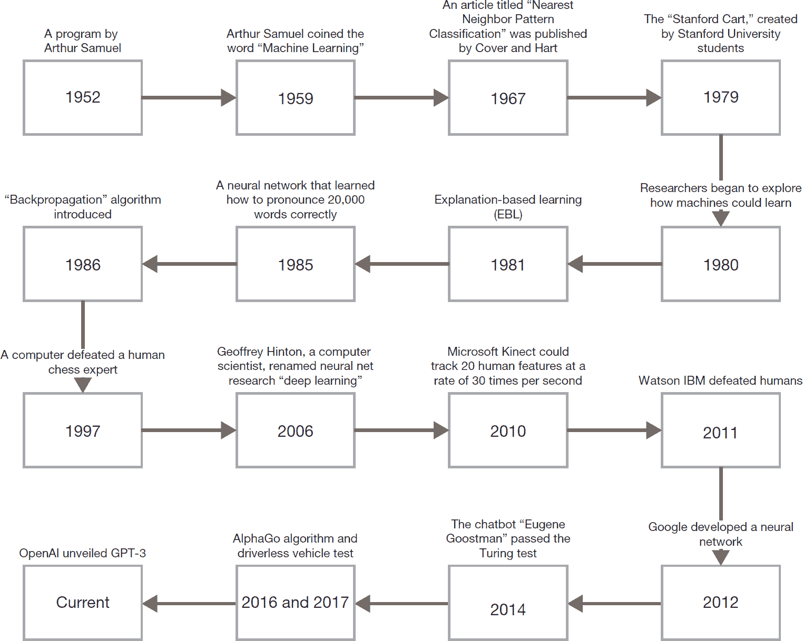

图 1.3 机器学习的历史

在动物身上观察到的学习原理也启发了机器学习算法的发展。避饵回避实验和斯金纳的鸽子迷信等实验说明了动物行为如何与数据采样和经验风险最小化等机器学习概念相关。通过理解这些原理，机器学习研究人员可以开发更有效的算法，使其从数据中学习并随着时间的推移提高准确性。

避饵回避实验涉及老鼠及其学习行为。实验表明，老鼠倾向于在吃一顿饱饭之前吃少量的食物。这种行为类似于机器学习中的数据采样概念。在机器学习中，数据采样涉及从较大的数据集中选择子集来训练模型。这个过程有助于降低模型的计算复杂度并提高其准确性。

斯金纳的鸽子迷信实验涉及鸽子及其对奖励的行为。实验显示，当鸽子随机收到奖励时，它们会产生迷信行为，即使奖励与它们的行为无关。这种行为类似于机器学习中的经验风险最小化概念。经验风险最小化涉及最小化模型预测输出与数据实际输出之间的差异。这个过程有助于提高模型的准确性并减少过拟合的风险。

## 今天的机器学习

机器学习在研究方面取得了巨大进展，渗透到我们生活的各个方面。例如自动驾驶汽车、亚马逊的 Alexa、聊天机器人、推荐系统等。它结合了聚类、分类、决策树以及监督学习、无监督学习和强化学习技术。例如，2020 年世界正在应对疫情时，OpenAI 发布了 `GPT-3`，这是一种革命性的自然语言处理算法，具有根据提示生成类似于人类语言文本的卓越能力。`GPT-3` 语言模型使用了 1750 亿参数并利用 Microsoft Azure AI 超级计算机进行训练，目前被认为是世界上最先进、最复杂的语言模型。

2022 年，采用 `GPT-3.5` 的 `ChatGPT` 作为免费研究预览，彻底改变了 AI 机器人的可用性和实用性。这一重大发布为开发者和 AI 爱好者提供了一个关键工具。OpenAI 在 2023 年推出了 `ChatGPT Plus`，这是一种具有更少停机时间和新功能的高级会员服务，显示了对高级 AI 的需求。同年，微软在对话式 AI 中加入了由 `ChatGPT` 驱动的 `Bing` 功能。开发者可能会使用 `API` 为其应用程序添加 `ChatGPT` 功能，从而扩展其用例。AI 的快速增长是惊人且令人鼓舞的，`ChatGPT` 和 `Bing` 中的 OpenAI `GPT-4` 承诺提供更好的可靠性、创造性和解决问题的能力。

在计算机科学中，机器学习（ML）被广泛用于处理大规模数据集或需要巨大计算能力的问题，例如图像识别或自然语言处理（NLP）。例如，假设有一组照片需要根据其内容进行标记。可以创建一个机器学习算法来检测图像中的特定方面，例如色彩组成和纹理。

这种算法技术明显快于人工标记，因为它不需要人类的经验；它只需要在相关数据集上进行训练，就能根据内容可靠地识别照片。此外，一旦在某一种类型的数据集上完成训练，相同的算法就可以频繁地重复用于类似的图像识别任务，而无需额外的训练，从而获得更高效的结果。

机器学习展现价值的另一个例子是通过分析由 `Google Analytics` 等大数据分析公司指出的历史趋势来预测用户行为。这有助于企业更好地理解用户如何与他们的服务/产品互动，从而定制产品以最大化用户参与度，同时最小化地减少与开发/营销相关的成本。

## 1.5 为什么需要机器学习？

机器需要学习的原因之一是为了执行超出人类能力的任务。例如，机器可以处理和分析人类无法处理的大量数据，如数千次科学实验的结果。机器还可以从自己的经验中学习并随着时间的推移提高性能，这被称为经验学习。

让我们考虑一个科学实验的例子，涉及测试不同的化学组合以产生所需的反应。人类科学家可能会进行多次试验并记录结果，但对科学家来说，分析变量之间所有可能的模式和相关性将非常困难且耗时。然而，机器可以使用数据挖掘技术来发现隐藏的见解并从数据中生成假设。机器还可以使用机器学习算法来测试、完善其假设并优化其结果。

机器需要学习的另一个原因是为了模拟人类的能力，例如语音识别和图像识别。这些任务要求机器理解和解释自然语言和视觉信息，而这些是非结构化且复杂的数据形式。

让我们考虑一个可以将语音转为文本的语音识别系统。人类听者可能理解说话者在说什么，但对他们来说，准确且快速地写每一个单词将是非常挑战性的。然而，机器可以使用语音识别技术将声波转换为数字信号，并从中提取特征。机器还可以使用 `NLP` 技术来解析句子并为单词赋予意义。机器可以从自己的错误和反馈中学习，并随着时间的推移提高准确性和速度。

机器学习的增长得益于几乎无限的可访问、负担得起的数据存储选项、计算能力的可访问性和负担能力、更廉且更强大的处理器的开发以及高速互联网的普及。得益于这些数字化转型因素，人们可以快速自动地创建能够快速准确分析大量复杂数据集的模型（图 1.4）。

机器学习使公司保持竞争另一种方法是自动化复杂流程，例如制造装配线或客户服务机器人。自动化可以提高效率，同时减少与劳动费用相关的成本。

由于其多功能性和可扩展性，机器学习被工业人士和学术界广泛拥抱。尽管在开发这些算法时仍面临挑战（解释性容易、避免过拟合），但机器学习继续改变我们解决问题的方式，提供比以往任何时候都更多的机会，准确分析状况并得出有意义的结论。

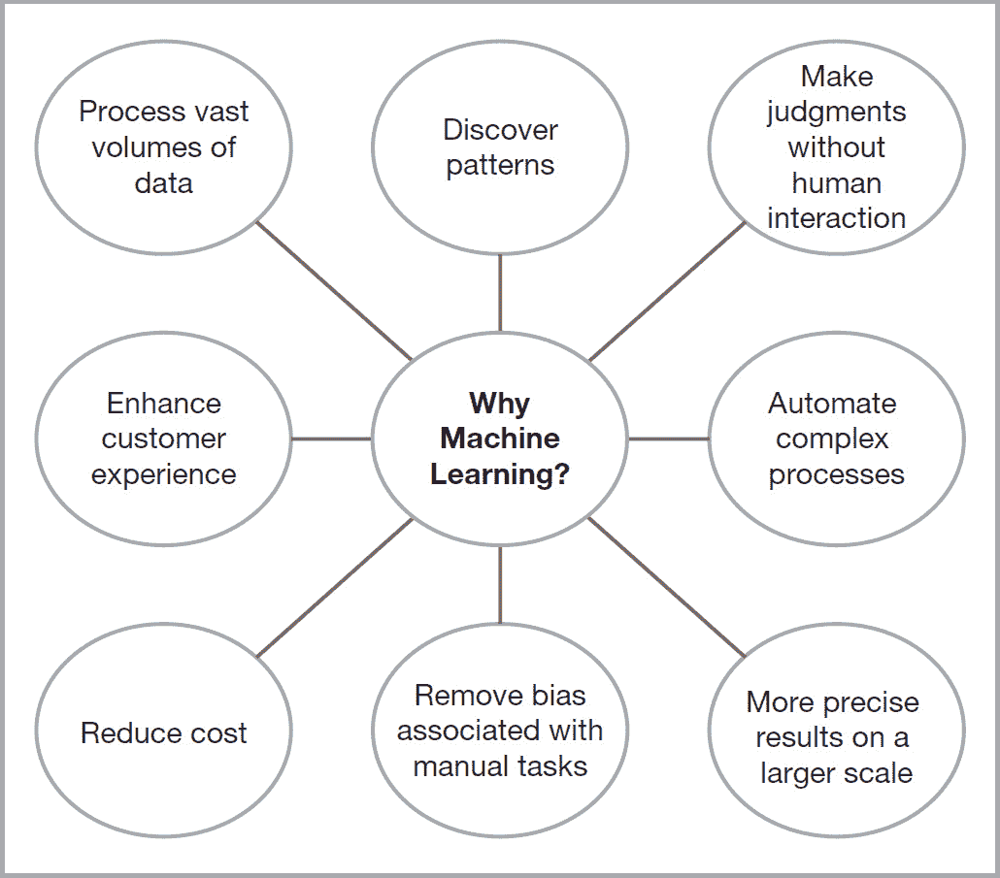

`图 1.4`

## 为什么需要机器学习？

机器学习的实际应用使用数据来驱动业务结果，对组织的底线产生重大影响。组织已经采用机器学习作为创建模型、制定策略和规划的最佳方法，并且需要一个系统来有效地分析它。此外，具有机器学习能力的自动化有助于消除与手动任务相关的偏差，手动任务中可能会发生人为错误。

机器学习可以快速准确地识别数据中的复杂关系，而手动这样做将花费大量的时间和精力。结果是组织可以更快速地发现良机的机会和潜在风险。最后，机器学习帮助零售等行业实现个性化体验，通过利用从客户与网站和移动应用程序互动中收集的行为分析数据，公司可以根据个人偏好定制产品，同时通过使用机器人的人工智能驱动自动对话提供更高效的客户服务；这为客户提供了快速解决方案，因为他们不需要等待可能几小时或几天的代表回复。

## 1.6 机器学习的适应性

适应性是指机器学习系统根据环境当前状态调整决策的能力，而不需要人工干预或从头开始训练。例如，用于垃圾邮件检测的自适应机器学习系统可以通过根据用户或电子邮件服务器的反馈更新模型，识别随时间出现的新类型垃圾邮件。机器学习的适应性可以通过不同的方式实现，取决于环境变化的类型和程度。常见方法如下：

- **在线学习**：这是一种增量学习的形式，机器学习系统在新的数据到达时持续更新其模型，而不存储或访问之前的数据。在线学习可以处理数据分布或任务的逐渐或中度变化，但如果变化是突然或剧烈的，可能会遭受灾难性遗忘。

- **主动学习**：这是一种选择性学习的形式，机器学习系统从无标记数据池中查询信息量最大或不确定性数据点，并从专家（如人类专家或模拟器）获取其标签。主动学习可以降低标注成本并提高模型准确性，特别是在数据稀缺或存在噪声的情况下。主动学习还可以通过关注最相关或新颖的数据点来处理数据分布或任务的变化。

- **强化学习**：这是一种交互式学习的形式，机器学习系统通过在环境中的自身行为及其后果进行学习，而不需要显式的标签或监督。强化学习可以优化长期目标或奖励，这可能取决于环境的状态和其他智能体的动作。强化学习可以通过探索不同的动作并利用最佳动作，来处理反馈或奖励函数的变化。

## 1.7 设计与学习

设计和学习是机器学习中两个不同的维度。解决问题的方法是它们之间的主要区别。通过从历史数据中学习来开发能够精确预测未来结果的预测模型，是学习的重点。另一方面，创建新的算法或架构来解决如图像识别、自然语言处理和自动驾驶等挑战性的现实世界问题，则是设计的重点。

设计要求原创性，并且经常涉及新算法或架构框架的创建。这可能涉及修改已使用的算法或从零开始构建完全全新的模型。与领域专家合作以理解要解决的问题并生成解决方案也可能是设计过程的一部分。设计是使用具有关于输入数据的特定参数或假设的算法或模板来创建模型。这包括设计深度神经网络（`DNN`），这是一种由由神经元连接的多个层组成的 AI 模型。设计者需要定义网络将使用哪些类型的层（例如卷积层）、这些层如何连接（例如跳跃连接），以及每层权重将使用什么值（这决定了神经元对另一个神经元的影响强度）。

设计意味着创建实现所需结果的新方法或技术。相比之下，学习可以认为是将当前的算法或架构应用于数据以推导出结果。

无监督学习和监督学习是学习的额外类别。监督学习需要标记数据，这意味着在创建模型之前，输入数据必须具有指定预期输出的标签。然后使用标记数据训练模型以发现输入与输出的映射。无监督学习则力于直接从数据中识别模式，不需要标记数据。在这个过程中，算法通过完善其内部参数来更好地模拟输入/输出之间的关系，以便在给定训练期间未见过的新输入时准确预测未来结果。使用诸如 `backpropagation`（反向传播）等技术有助于在处理大量数据或复杂问题时确保准确性，在这些情况下，传统方法可能会因为无法比爬山算法等手动优化技术更快地优化超参数等而失败。

设计和学习是机器学习开发项目中密切相关但又不同的概念。设计者创建具有适当架构的机器（`design`），而学习者使用这些设计加上现有数据集对它们进行完善。通过理解这两个概念，开发者可以快速、自适应且高效地构建解决方案，因为设计者专注于构建模型，而学习者致力于优化模型。综上所述，设计意味着开发新的算法或架构，而学习是将当前的算法或架构应用于输入数据以做出预测。

## 1.8 机器学习中的训练与测试

训练和测试是机器学习过程中两个关键组成部分，它们共同工作以产生可靠的模型。训练和测试是模型构建过程中的两个不同阶段。测试涉及评估模型在新数据上的性能，而训练涉及从训练数据中构建模型。换句话说，测试是使用以前见过的数据来验证模型，而训练是从数据中学习。

### 训练

训练是向模型提供输入数据以学习如何识别模式或识别变量之间关系的过程。这可以根据要解决的问题使用监督或无监督方法。在训练期间，将不同的算法应用于输入数据，并不断调整参数直到找到最优解决方案。训练的主要目标是确保模型在未见的示例或测试集上表现良好。因此，它涉及调整权重和超参数等参数，直到在提供的示例/数据点/输入的子集（`training set`）上得到满意的结果。

训练模型的过程涉及几个步骤：

1. **数据预处理**：这涉及将原始数据转换为模型可以使用的形式。`normalization`（归一化）、`scaling`（缩放）、`transformation`（转换）、`imputation`（插值）和 `encoding`（编码）等技术用于机器学习算法准备数据。统计学和数学帮助我们理解数据的属性和分布，并选择合适的数据处理方法。

2. **特征工程**：这涉及从现有数据中创建可以提高机器学习算法性能的新特征或变量。统计学和数学有助于识别相关特征、衡量其重要性，并应用 `dimensionality reduction`（降维）、`feature selection`（特征选择）、`feature extraction`（特征提取）和 `feature construction`（特征构建）等技术。

3. **模型选择**：这涉及为给数据集选择最佳模型。这需要理解数据类型以及最能解决问题的模型类型。需要为给定的问题和数据集选择最好的机器学习算法。统计学和数学有助于根据假设、复杂性、准确性、泛化能力和鲁棒性比较不同的算法。它们还有助于使用 `cross-validation`（交叉验证）、`grid search`（网格搜索）、`random search`（随机搜索）和 `Bayesian optimization`（贝叶斯优化）等方法调整算法的超参数。

4. **模型拟合**

这涉及到优化模型参数以拟合数据。这是通过梯度下降等优化算法完成的，该算法通过调整模型参数来最小化预测误差。`gradient descent` 是一种强大的优化技术，用于找到使损失函数最小化的参数最优值。在机器学习（ML）中，损失函数衡量模型与数据的拟合程度，目标是最小化模型预测值与实际结果之间的误差。`gradient descent` 的原理是沿着损失函数下降最快的方向迭代更新参数，并使用学习率来控制每次更新的步长。

`gradient descent` 的挑战之一是选择合适的学习率。如果学习率太小，算法将花费很长时间才能收敛到最优解；如果学习率太大，算法可能会越过最优解并导致发散。`gradient descent` 的另一个挑战是它可能会陷入局部最小值，在这些区域损失函数的值比周围的任何点都低，但并不一定是全局最低值。为了避免这个问题，研究人员开发了一些 `gradient descent` 的变体，它们使用不同的策略来探索损失函数的区域图并跳出局部最小值。以下是几种常见的 `gradient descent` 类型：

#### 批量梯度下降 (BGD)

这是 `gradient descent` 最简单的形式，它能确保算法收敛到全局最小值，但当数据集很大时，它的速度会非常慢且计算开销巨大。`BGD` 是一种迭代优化方法，涉及沿下降最快的方向移动，该方向由函数的负梯度决定。在机器学习中，该函数通常作为损失函数或误差函数，用于量化模型与数据之间的拟合程度。可以通过最小化损失函数从数据中获取模型参数。`BGD` 涉及在每次迭代中利用整个数据集来计算梯度。`BGD` 的优势是，只要学习率足够小，就能确保收敛到损失函数的全局最小值。另一个优点是 `BGD` 可以很容易地并行化并分布在许多机器或处理器上。当数据集非常大时，`BGD` 的局限性就会显现，会导致性能缓慢和计算成本高。此外，当数据集修改或加入新数据点时，算法必须利用整个数据集重新计算梯度，导致潜在的浪费和效率低下。另一个缺点是 `BGD` 可能对离群点和噪声数据点敏感，这可能导致性能不佳和解决方案不理想。

#### 随机梯度下降 (SGD)

`SGD` 采用了一种改进方法，不再利用整个数据集，而是在每次迭代中随机选择单个数据点（或一小组数据点）并基于此计算梯度。这最小化了计算成本并允许更快的更新。此外，当从随机子集计算梯度时，算法具有固有的变性和随机性。这种特性防止了算法陷入次优局部最小值或鞍点。`SGD` 可以适应不同的数据分布并有效处理噪声或冗余数据，性能优于传统的 `gradient descent` 方法。然而，`SGD` 也存在某些局限性和障碍。一个问题是从随机样本得出的梯度可能表现出显著的噪声和不准确，导致参数更新的波动和不稳定。另一个障碍是 `SGD` 对数据点的排列和选择非常敏感，影响其收敛性和整体效率。研究人员开发了许多 `SGD` 的变体和扩展来解决这些困难并增强其效率和鲁棒性。其中一种技术是 `momentum`，它将上一次更新的一部分纳入当前更新中，以加速收敛并减轻震荡。另一种技术是自适应学习率，它可以为每个参数动态调整学习率。

#### 小批量梯度下降

这是一种结合了 `BGD` 和 `SGD` 优点以优化机器学习模型参数的方法。小批量梯度下降将训练数据集划分为较小的子集，称为小批量（mini-batches）。然后在每次迭代中利用每个小批量来计算梯度并修改参数。实施这种技术可以减轻 `SGD` 中固有的噪声和变异性，同时增强批量梯度下降的速度和有效性。理想的小批量大小取决于几个方面，包括数据分布、模型架构和硬件设置。可以通过为每个参数采用不同的学习率，或利用根据先验梯度动态调整的自适应学习率来增强小批量梯度下降。这些技术的几个示例包括 `momentum`、`RMSProp`、`Adam` 和 `AdaGrad`。

#### 基于动量的梯度下降

这是 `gradient descent` 的另一种形式，有助于加速优化过程并防止其陷入局部最小值。它包含一个动量组件，通过缩放因子将先前的参数调整监控并纳入当前更新中。通过这种方法，算法可以在梯度保持稳定且平滑的区域有效积累速度，而在梯度频繁改变方向的区域减速。这有助于算法更快地跳出低梯度区域或局部最小值，并减轻最优点周围的震荡。基于动量的梯度下降是机器学习和深度学习中常用的优化方法，由于其能够提高神经网络和其他复杂模型的性能和效率，而被广泛应用。

## 自适应梯度下降

这是一类算法，它们根据每个参数的历史梯度自适应地调整每个参数的学习率。这意味着，更新大且频繁的参数将具有较低的学习率，而更新小且不频繁的参数将具有较高的学习率。通过这种方式，算法可以避免越过最优值或陷入局部最小值。一些示例包括 `AdaGrad`、`Adadelta`、`RMSProp` 和 `Adam`。

`AdaGrad` 是一种学习率缩放算法，与梯度平方和的平方根成反比。这意味着学习率随着梯度的时间累积而减小。这对于稀疏特征是有利的，但也可能导致学习率变得过小并停止学习过程。

`Adadelta` 是 `AdaGrad` 的扩展，解决了学习率递减的问题。它没有使用累积和，而是采用梯度平方的移动平均值。此外，它还提供了一个衰减率参数，以调节平均值衰减的速度。通过这种方式，算法可以适应变化的梯度并保持更稳健的学习率。

`RMSProp` 是另一个 `AdaGrad` 扩展，它也使用了梯度平方的移动平均值，但公式不同。平均值的平方根分割了学习率，并包含一个动量参数，将上一次更新的百分比整合到当前更新中。通过这种方法，算法可以加速收敛过程并克服优化过程中的停滞点。


`Adam` 是一种流行的算法，结合了 `Adadelta` 和 `RMSProp` 的思想。它同时使用梯度和梯度平方的移动平均，并引入了两个名为 `beta1` 和 `beta2` 的参数来控制这些平均值的衰减率。此外，它执行偏置校正以考虑这些平均值的初始值。通过这种方式，算法可以在极少超参数调优下实现快速稳定的收敛。

## 5. 模型评估

这涉及评估模型在未见数据上的表现。这意味着要使用 `accuracy`（准确率）、`precision`（精确率）、`recall`（召回率）、`F1-score`、`ROC curve`、`AUC`、`confusion matrix`（混合矩阵）、`MSE`（均方误差）、`MAE`（平均绝对误差）、`R2-score` 等指标来评估机器学习模型的质量和有效性。统计学和数学有助于解释这些指标，测试结果的显著性，并诊断过拟合、欠拟合、偏差和方差等潜在问题。

## 6. 模型解释

这涉及解释机器学习模型是如何工作的，以及它们为什么做出某些预测或决策。统计学和数学有助于理解算法的逻辑和机制，并使用 `feature importance`（特征重要性）、`partial dependence plots`（部分依赖图）、`SHAP values` 和 `LIME` 等方法可视化或量化它们的输出。

## 7. 测试

测试指的是评估机器学习算法在未见数据点或输入上的表现，与其训练时（估计）的性能相比。这种评估有助于判断给定算法得出的预测是否与人类对相似输入的预测结果相符（验证）。

测试通常包括将可用输入分为两个子集：一个用于训练，另一个用于测试；这有助于确保结果无偏见，因为两个集合都包含来自提供的数据集的随机分布示例（交叉验证）。测试阶段还允许我们衡量 `accuracy rate`（准确率得分）、`recall score`（召回率得分）和 `precision score`（精确率得分）等性能指标，然后可以将它们与基准值或早期迭代中实现的值进行比较，并在需要时调整参数以进一步改进。此外，它指示了与我们解决给定问题的方法相关的过拟合/欠拟合问题。此外，某些机器学习算法利用交叉验证技术，在“训练”与“测试”数据集之间的不同组合/划分中进行多次测试；这进一步有助于确保结果无偏见。

## 1.9 机器学习与自动化

机器学习和自动化是两个相关但不同的概念，在人工智能的背景下经常被互换使用。然而，它们具有不同的含义和影响。

机器学习是计算机科学的一个分支，涉及创建可以从数据中学习并随时间推移提高性能的系统或算法。它可以用于 `classification`（分类）、`regression`（回归）、`clustering`（聚类）、`recommendation`（推荐）、自然语言处理等任务。另一方面，自动化是一个更广泛的术语，指的是在没有人工干预的情况下使用技术来控制或运行过程。它可以应用于制造、交通和医疗保健等多个领域。

机器学习与自动化之间的主要区别在于，机器学习涉及从数据中学习，而自动化涉及执行预定义的规则或指令。机器学习可以使自动化适应变化的条件或情况，而自动化可以使机器学习扩展或加速其运行。机器学习和自动化还可以以各种方式互补。例如，机器学习可以用于优化或改进自动化系统的性能，而自动化可以用于为机器学习收集或标记数据。

机器学习和自动化都是重要且强大的技术具有具有各个行业和领域的潜力。然而，它们也带来了需要解决的挑战和限制。例如，机器学习可能需要大量的数据或计算资源，而自动化可能需要仔细的设计或监管。此外，机器学习和自动化可能会产生需要考虑的伦理或社会影响，例如对人类工作、隐私、安全和问责的影响。因此，理解机器学习和自动化之间的异同并负责任地使用它们是至关重要的。

## 1.11 与机器学习相关的某些术语

让我们用例子来解释这些术语。购买优质的秋葵手指时，应该注意以下几点：

• 颜色应该是亮绿色，没有任何棕色或黑色斑。
• 质地应该是坚实且脆的，而不是软的或糊烂的。
• 尺寸应该是中等的，不要太小或太大。
• 形状应该是直的且细的，而不是弯曲或扭曲。

这些因素是 `domain set`（域）的示例，它是特定属性或特征的可能值的集合。`domain set` 定义了属性可以取值的数值范围和类型。

`label`（标签）代表对象或观测值类别或分类的值。例如，在分类问题中，`label` 可以是是或否、正或负、垃圾邮件或非垃圾邮件等。`label` 通常是我们想要从数据中预测或学习的输出或目标变量。

`domain point`（域点）是属性或特征的具体值或实例。例如，如果属性是 `color`（颜色），那么 `domain point` 可以是 `green`（绿色）、`red`（红色）、`blue`（蓝色）等。`domain point` 通常是我们用于预测或学习 `label` 的输入或独立变量。

`mapping function`（映射函数）是一个将 `domain points` 与 `labels` 联系起来的数学函数。例如，如果我们有一个映射函数 `f(x) = y`，那么 `x` 就是 `domain point`，`y` 就是 `label`。`mapping function` 描述了输入如何影响输出，或者特征如何影响目标。

`learner`（学习器）是从数据中学习 `mapping function` 的算法或模型。例如，`learner` 可以是决策树、神经网络、逻辑回归等。`learner` 试图找到最拟合数据并使误差最小的 `mapping function`。

`predictor`（预测器）是一个使用学习到的 `mapping function` 来预测新 `domain point` 的 `label` 的函数。例如，如果我们有一个预测器 `p(x) = f(x)`，那么 `p(x)` 就是 `predictor`，`f(x)` 就是学习到的 `mapping function`。`predictor` 将 `mapping function` 应用于新输入并输出预测的 `label`。

## 1.12 机器学习的类型

机器学习中使用的算法和技术用于构建从数据中学习并做出预测或决策的模型。以下是机器学习的类型：监督学习、无监督学习、强化学习、迁移学习和元学习。

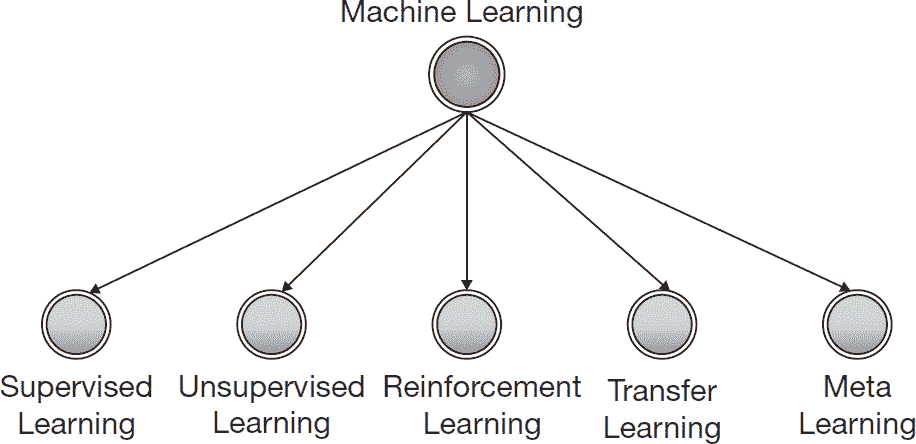

[图 1.5] 机器学习的类型

### 1.12.1 监督学习

监督学习是指使用良好的“标记”训练数据对机器进行训练，并它们根据这些数据预测输出。“标记数据”意味着某些已经标记了正确输出的输入数据。尽管这种方法需要准确的数据标记，但在适当应用时，监督学习非常有吸引力并能产生极的结果。监督者指导机器使用训练数据正确地预测输出。

训练数据集为算法提供了问题所需的标记参数，并与最终数据集共享许多特征。它为算法提供了有关问题、解决方案以及要处理的各种数据点的信息。为了建立数据变量之间的因果关系，机器学习算法随后寻找输入参数之间的关系。例如，监督学习算法的目标是找到一个映射函数，将输入变量 (`x`) 映射到输出变量 (`y`)。它所应用的概念类似于学生在老师的监督下学习。

当训练和处理完成后，我们通过提供样本数据来测试模型，看它是否能准确预测输出。系统使用标记数据构建模型以理解数据集并学习每条数据。在现实世界中，监督学习也可以用于风险评估、图像分类、欺诈检测和垃圾邮件过滤。当我们在 Amazon Prime Video 上播放电影或剧集时，我们也在告知机器学习算法根据我们的偏好寻找类似的节目。

监督学习可以进一步分为两类算法：回归和分类。分类和回归是用于解决广泛现实问题的两种基础机器学习问题类型。从本质上说，分类是一种目标是预测类别结果（分类）的问题类型，而回归是一种目标是预测连续结果的问题类型。

例如，如果一个人担心他们的儿子是否能找到工作，这是一个分类问题。结果是二元的：找到工作或不找到。同样，如果一个人想知道他们的儿子多大时会结婚，这是一个回归问题。输出将是一个数值。另一个分类问题的例子是，一个人想知道新娘来自哪个地区。答案将是一个城市或区域。

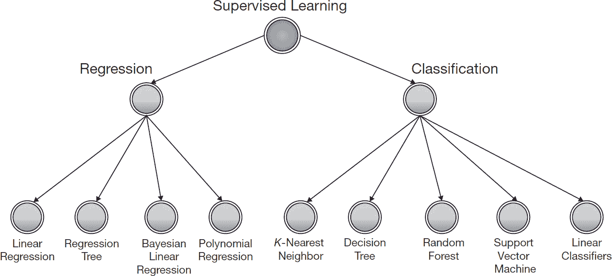

[图 1.6] 监督学习的类型

#### 1.12.1.1 回归

如果输入变量和输出变量之间存在关系，则使用回归算法。它用于预测连续变量，例如天气预报、市场趋势和股票价值。属于监督学习的一些流行回归算法包括线性回归、回归树、贝叶斯线性回归和多项式回归。

##### 线性回归

在这里，数学方程描述了两个或多个变量之间的关系。例如，研究了“因变量”和额外变量（“自变量”）。回归使用自变量对目标进行建模。这些模型根据它们使用的自变量数量以及它们考虑的关系类型而异。

考虑一种情况，你希望根据工作年限和教育背景预测你的月薪。月薪可以是线性回归中的因变量，而工作年限和教育背景可以被视为自变量。

为了对落在数据集值范围内的新观测进行预测，我们需要识别最能捕捉数据的数学方程。普通最小二法 (`OLS`) 是最流行的线性回归类型，它确定一条每个点与其估计线上对应值之间的平方距离和最小的直线。这种方法为我们模型的未知参数提供了一个估计，我们可以使用外推技术对数据集范围之外的新数据点进行此预测。

##### 回归树

使用回归树预测连续目标变量。根据输入特征的值，它递归地将数据划分为不同的分支，并使用每个叶节点中值的平均值或中位数来预测目标变量。决策树或回归树中的每个内部节点代表一个特征，树形结构中的每个叶节点代表一个预测值或类别。

回归树的根（第一个节点）包含了所有的训练数据。然后使用目标变量的平均值或中位数等标准将数据集分为两个部分，创建右、左子节点。

##### 贝叶斯回归

当数据集数据量过少或分布不均时，贝叶斯回归非常有帮助。与传统的回归技术（其输出仅源自单一属性值）不同，贝叶斯回归模型的输出源自一个概率分布。结果 `y` 由正态分布产生（其中均值和方差经过归一化）。贝叶斯线性回归旨在识别模型参数的“后验”分布，而不是参数本身。因此，假设模型参数除输出 `y` 之外还遵循某种分布。

##### 多项式回归

该模型将因变量 (`y`) 与自变量 (`x`) 之间的关系建模为 n 次多项式。与线性回归一样，多项式回归利用变量 `x` 和 `y` 之间的关系寻找数据点的最优路径。例如，它经常用于预测 COVID-19 等传染疾病的传播速度。存在多种多项式回归，因为多项式方程的次数没有上限，可以达到第 n 次。例如，多项式方程的二次项通常表示为二次方程。如所述，该次数可以达到第 n 次，你可以创建任意数量的方程。

#### 1.12.1.2 分类

第二类监督学习方法使用分类模型从观察到的类别值中得出结论。它利用输入训练数据预测新数据落入预定义类别之一的概率。将电子邮件过滤为“垃圾邮件”或“非垃圾邮件”是分类最用途之一。

在机器学习（ML）中，有两种不同的分类类型。当一个问题只有两个可能的类别时，被称为二分类类别（例如“猫或狗”、“是或否”）。如果有两个以上的潜在类别，则该问题是一个多分类分类器。

一些分类算法包括 K 近邻、决策树、随机森林、支持向量机 (`SVM`) 和线性分类器。

##### K 近邻 (KNN)

`KNN` 被归类为懒惰学习器，因为它不创建任何预测模型。相反，它存储所有训练数据，并根据新数据点与存储点的相似性对新数据点进行预测。这种技术将数据集中最近的对象分组，并识别最常见或平均的特征。它根据距离它最近的数据点属于哪个组，来确定该数据点加入任何组的概率。

##### 决策树

`decision tree` 最适用于解决分类问题；也可以用于处理回归难题。它每次将数据点分为两个相似组，从“树干”开始，通过“分支”，最后到“叶子”，直到组之间彼此密切。这种方法类似于流程图。树结构分类器中的内部节点代表数据集的特征，分支代表决策过程，每个叶子节点代表分类结果。它们不需要特征缩放，且易于理解。此外，与其他算法相比，对数据清洗的要求较低。它还剔除了不重要的特征。

##### 随机森林

`random forest` 是从随机选择的数据子集中抽取的许多棵决策树的集合，它可能比单个决策树更准确地预测结果。

##### 支持向量机 (SVM)

这种著名的机器学习算法经常用于分类和回归任务。具体而言，它被用于解决分类问题。在 N 维空间中寻找可以将数据点划类的最佳决策边界是 `SVM` 的主要目标，最佳决策边界被称为超平面。支持向量是 `SVM` 选择用于确定超平面的极端向量。`SVMs` 使用超平面根据共同特征对对象进行分组，并为 N 维空间中的每个对象生成坐标。

##### 线性分类器

这些分类器根据属性线性组合的值对对象进行分类。对象的特征也被称为特征值，它们通常以特征向量的形式显示给机器。此类分类器实现了与非线性分类器相当的准确率，同时训练和使用所需时间更少，成为解决文档分类等现实问题、更广泛地解决具有许多变量（特征）问题的极佳解决方案。

### 1.12.2 无监督学习

顾名思义，无监督学习没有数据标签，是在没有任何监督的情况下，从未标记数据中学习模式的过程。

例如，假设我们有一个商店销售交易数据集，想要找出哪些物品比其他物品卖得更频繁。我们不需要告诉计算机物品是什么。只需将数据输入到无监督学习算法（如聚类或关联规则挖掘），让计算机发现物品之间的模式和关系。无监督学习算法的输出可以帮助我们理解客户行为和偏好，并优化商店的库存和营销策略。

给机器的是一组未标记、未分类或分类的数据，算法需要在没有任何监督的情况下对这些数据进行操作。无监督学习的目标是找到输入数据中的结构和模式，根据相似性对数据进行分组，并以压缩格式表示该数据集。与监督学习相比，无监督机器学习服务并不流行，因为它们在日常生活中的应用较少。无监督学习创建隐藏结构。数据点之间的关系由算法随机或抽象地感知，完全不需要人类的输入。无监督学习算法可以适应数据，而不是一个特定的、定义的且固定的问题陈述。

假设给无监督学习算法一个包含不同类型牛和奶图像的输入数据集。该算法未在给定数据集上进行训练，这意味着它对数据集的特征一无所知。无监督学习算法的任务是独立识别图像特征。无监督学习算法通过根据图像之间的相似性将图像数据集聚类来完成此任务。

在无监督学习中，我们没有预定的结果。机器试图从海量数据中寻找有用的见解。它可以进一步分为两类：聚类和关联（图 1.7）。异常检测和降维也是其他类型。我们将在第 6 章详细讨论。

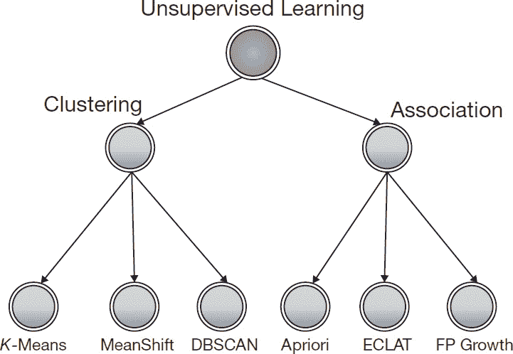

[图 1.7] 无监督学习算法类型

#### 1.12.2.1 聚类

将对象分组到不同的类中的过程，使得相似性最强的对象聚集在一起，并且与其他组的对象保持极少或没有相似性，这被称为聚类（Clustering）。类是指位置或放置得相互接近的关联项目或个体的集合。由于类中的每个点通常在这些特征上表现出相似性，机器学习（ML）可用于识别特征并区分这些类。聚类是许多解决各行业数据问题的机器学习应用的基础。在理想的世界里，机器能够根据物理特征识别各种对象并区分它们。因此，聚类算法可以广泛应用于图像分割、统计数据分析、医学科学中的疾病分类以及营销研究中的客户分类等任务。常用的聚类算法有 `K-means`、`MeanShift clustering` 和 `DBSCAN`。

##### K-Means 聚类

这是一种流行的数据探索和分析无监督机器学习技术。它用于将数据点分组或聚类为不同的类别。其目的是根据特定特征将数据集划分为有子组。算法检查每个数据点并根据属性相似性将其分配到若干组中的一组。

`K-means` 算法可以分析包含离散、连续、数值实体的数据。然而，该算法存在缺陷，包括在处理分类数据、离群值和非线性数据时的困难。此外，如果我们能预设想要多少个数据类，将会有帮助。最后，`K-means` 最适用于较小的数据集，因为它会对所有数据点进行迭代。结果是如果数据集包含许多数据点，对它们的分类将花费更长的时间。

考虑以下示例。假设一家公司生产运动鞋，并想将其客户分为两个不同的组：男性和女性。我们将从收集客户信息（如年龄、性别、购物偏好和消费模式等）开始，然后使用 `K-means clustering` 来确定不同的标准，决定谁应该去哪一组！

例如，假设数据表明 18 岁到 25 岁之间的消费者通常在运动鞋上花费更多。在这种情况下，这一特定年龄组可能被归为一类，其质心代表较高的支出。相比之下，30 岁或以上可能有不同购买模式的客户将形成另一个独立的类，其特征是代表鞋类支出减少的质心。这种区分使该机构能够通过考虑年龄来理解并预测客户行为。

##### MeanShift 聚类

与 `K-means` 算法不同，`MeanShift` 算法不需要我们指定类的数量。如果我们需要对数据中的模式进行澄清，算法会自动确定类的数量，这是相对于 `K-means` 的显著优势。密集数据点区域使用滑动窗口、基于质心的算法来定位中心组/类点。所有中心点候选者都是滑动窗口点的平均值。然后通过后处理对这些窗口进行排序，以删除重复项并给出最终的组中心点。图像分割任务是 `MeanShift clustering` 最频繁使用的地方。核密度估计是 `MeanShift` 算法的基础。

`MeanShift` 算法迭代地将每个数据点分配给最近的类质心，该质心是随机初始化的。然后，每个点在空间中根据点最多的地方（即模式）进行迭代移动。这与 `K-means` 算法相似。由于平均值是自动发现的，这种方法克服了组选择和类中心选择的问题。由于直观地收敛到数据点最多的区域，聚类结果也表现出数据感性。

##### DBSCAN

基于密度的应用空间聚类是一种根据数据点密度识别聚类的显著算法。`DBSCAN` 不需要预先指定类的数量。它适用于任意形状。

##### 关联

关联是第二种无监督学习。关联规则挖掘基于共现性发现关联。它确定了在事务数据中频繁出现的项目集。它被用于购物篮分析和网络挖掘。关联规则使得营销策略更具实用性；例如，购买 `X items`（例如刷子）的人也倾向于购买 `Y items`（例如牙膏）。

购物篮分析通过识别经常购买的项目来检查消费者购买模式。零售商通过分析这些内容创建营销策略。网络挖掘具有支持不同数据类型的独特能力。网络的许多方面产生了各种挖掘方法，包括网页、网页间的链接以及可以跟踪用户活动的网络服务器日志。关联规则学习可以分为三种算法：`Apriori`、`ECLAT` 和 `FP Growth`。

###### Apriori 算法

`Apriori` 算法使用关系数据库学习关联规则并挖掘频繁项目集。它有助于识别组合购买的产品，主要用于购物篮分析。


该算法使用广度优先搜索和哈希树高效确定项目集。其 `join`（连接）和 `prune`（剪枝）步骤压缩了搜索空间。它建立了两个对象之间连接的强度或弱点。从大型数据集中寻找频繁项目集涉及一个迭代过程。经常使用的项目集是那些支持度高于阈值或用户指定的最小支持度的。这意味着如果 `A` 和 `B` 共同构成频繁项目集，那么 `A` 和 `B` 单独也应该是频繁项目集。

这是关联学习算法中最简单、最易理解的算法。规则直观且易于与终端用户交流。然而，该算法的缺点是在处理大型数据集时，可能无法更快、更高效。它使用大量资源多次扫描数据库，生成许多候选集并检查每一个集。

### ECLAT 算法

`ECLAT` 代表等价类转换。它使用深度优先搜索技术在事务数据库中寻找频繁项目集。它的运行比 `Apriori` 算法快。`ECLAT` 算法只能应用于垂直格式的数据集。由于大多数数据集都是水平格式，为了应用 `ECLAT` 算法，我们必须首先将其转换为垂直格式。因此，`ECLAT` 算法在中小型数据集上运行更好。由于使用了深度优先搜索方法，`ECLAT` 算法与 `Apriori` 相比内存需求较低。`ECLAT` 算法的结果是带有支持度的频繁项目集。

### FP Growth 算法

`FP`（频繁模式）增长算法是 Apriori 算法的改进版本。该算法不再生成候选集，而是通过寻找频繁项集来提高性能。它采用了分治的策略。

### 1.12.3 强化学习

机器学习（ML）的一个显著缺点是训练模型需要海量的数据。模型越复杂，所需的数据可能越多。所需的数据可能不存在，或者我们无法获取正确的数据。此外，收集的数据可能需要更加可靠，它可能包含错误值或缺失值，或者需要更新。从动作的小子集中学习无法帮助扩展适用于特定问题的庞大解决方案。机器必须学会独立执行动作，而不仅仅向人类学习。这些问题通过强化学习（RL）得到了解决。

强化学习是机器学习的一个分支，通过一系列决策来训练模型返回问题的优化解决方案。强化学习与监督学习的区别在于，后者的训练数据带有答案，因此模型根据正确答案本身进行训练。相比之下，强化学习中没有答案，而是由强化智能体决定做什么来执行给定任务。在没有数据集的情况下，它必须从经验中学习。强化学习解决特定类型的问题，即决策是顺序的且目标是长期的，例如游戏、机器人等。

例如，你无法直接告诉狗该做什么，因为它无法听懂人类语言。因此，我们采取了不同的方法。例如，如果狗以符合要求的方式表现，我们就用食物奖励它。现在，每当狗遇到相同的情境时，它都会更热切地执行类似的动作，期待更大的奖励（食物）。这类似于发现狗从满意的体验中学习“该做什么”。同时，当面对负面体验时，狗也学会了“不该做什么”。在这种情况下，狗是暴露在环境（家）中的智能体。例如，当你的狗坐下时，你用特定的单词要求它去散步。智能体通过一个动作从一个“状态”移动到另一个“状态”。例如，你的狗从躺下转变为走动。

智能体的响应是一个动作，而策略（policy）是在给定状态下选择动作的方法，以获得更好的结果。在转换之后，它们可能会受到奖励或惩罚。强化有两种类型：正向强化是指由于外部事件导致行为的强度和频率增加；换句话说，它以良好的方式影响行为。负向强化是指由于不利条件的停止或避免而加强了行为。

[RL] 系统的主要元素有：

- 智能体或学习者（在这种情况下是狗）
- 智能体交互的环境（家）
- 智能体遵循以采取动作的策略
- 智能体在采取动作时观察到的奖励信号（食物）

智能体通过试错获得知识，并利用其经验改进性能。智能体不断重复这三件事——采取动作、改变状态或保持状态不变以及获取反馈——这有助于它学习和探索周围环境。

在强化学习中，必须指导智能体了解环境和适当的行动方案。然后智能体执行后续动作，并根据上一个动作的反馈修改其状态。结果，智能体可能会收到延迟奖励。为了最大化正奖励，智能体必须探索随机环境。在强化学习中，我们根据要解决的问题描述向受控环境中引入模型，而不是使用实际数据来解决。模型与该环境交互并独立地提出解决方案，不受人类干预。为了引导它朝着正确的方向发展，如果它执行了接近目标的动作，我们就给予它正奖励；如果它远离目标，则给予它负奖励。在机器学习中实现强化学习有三种方法：

- **基于价值的方法（Value-based approach）**：寻找最佳价值函数，或在任何策略下任何给定状态下可能的最大价值，是基于价值的方法的目标。因此，智能体会预期策略所涵盖的任何状态的长期回报。
- **基于策略的方法（Policy-based approach）**：在不使用价值函数的情况下，基于策略的方法识别出获得重大潜在奖励的最佳行动方案。在这种方法中，智能体尝试实施策略，使每个动作都有助于未来奖励的最大化。两种策略构成了基于策略的方法主体：确定性策略（任何状态的策略产生相同的动作）和随机策略（该策略中产生的动作由概率决定）。
- **基于模型的方法（Model-based approach）**：智能体通过与环境虚拟模型交互来学习环境。这种方法缺乏特定的解决方案或算法，因为每个环境的模型表示都是唯一的。

尽管监督学习和强化学习都使用输入和输出之间的映射，但强化学习使用奖励和惩罚作为优坏行为的信号，而监督学习则是为智能体提供执行任务正确行动方案的反馈。强化学习的目标与无监督学习不同。在无监督学习中，目标是识别数据点之间的相似性和差异。在强化学习中，目标是识别适当的动作模型，以最大化智能体的整体累积奖励。

### 1.12.4 迁移学习

监督机器学习模型通过标记数据开发和训练，以执行特定任务。算法接收映射后的输入和期望输出。随后模型可以使用识别出的模式和趋势来分析新数据。

这种方式创建的模型在与训练数据相同的环境中使用时将以高准确性解决问题。然而，如果现实应用中的条件或环境超出训练数据，其准确性将大幅下降。即使任务相似，可能也需要基于新训练数据的新模型。人类非常擅长任务之间的知识迁移。这意味着每当我们遇到新问题或任务时，我们都能识别它并应用来自以前学习经验的相关知识。这使得我们的工作变得简单，并能快速完成。例如，想象被要求学习你并不熟悉的 `Python` 语言，尽管你已经知道如何用 `Java` 写程序。在这种情况下，`Java` 语言的知识将用于管理 `Python` 语言的学习。这会让事情比初学者来说简单得多。这种观点在现实生活中是有益的，因为它们帮助我们变得更完美并增加经验。

相同的方法导致了机器学习中“迁移学习”一词的产生。在这里，从用于一个任务的模型中获得的信息可以再次作为另一个任务的基础。对于与图像或自然语言处理（NLP）相关的任务，从头开始训练模型是不常见的，因为迁移学习是广泛应用的。迁移学习使用模型中已经训练的相关部分来解决不同但相关的问题。这是模型运行所需的基础知识。程序员将需要确定哪些模型组件需要重新训练，哪些组件与新任务相关。此外，由于模型已经获取了可能对第二个任务有用的通用特征，这有助于防止过拟合。

迁移学习在任何学习中都是至关重要的。人类只被教了某些任务或问题以便在这些领域取得成功。我们所有人都会遇到未接触过的情况，但仍然能够以一种即兴的方式解决问题。从许多经验中学习并将“知识”导出到新环境的能力，正是迁移学习的核心所在。

迁移学习在结合一个能够识别图像集中特定主题的机器学习模型时最有可能成功。模型中处理主题识别的部分可以被保留。但用于突出显示特定主题以进行分类的算法组件则需要重新训练。在这种情况下，没有必要从头开始构建和重新训练 ML 算法。研究人员和数据科学家更倾向于从预训练模型开始，这种模型已经知道如何分类物体，并学习了图像中边缘和形状等通用特征。

源任务（source task）是将知识迁移到目标任务的任务。目标任务（target task）是指由于从源任务迁移知识而产生改进学习效果的任务。在迁移学习过程中，从源任务利用的知识和快速进展被用于改进到新目标任务的学习和开发。然而，如果迁移方法降低了新目标任务的性能，则被称为负迁移（negative transfer）。在使用迁移学习方法时，面临的挑战之一是在相关任务之间提供并确保正迁移，同时避免负迁移。为了理解需要迁移学习知识的哪些部分，我们需要弄清楚哪些部分的知识最能反映源和目标。我们的目标是提高目标任务的性能，而不是让它变差。

#### 使用迁移学习的原因

主要优点是不需要大量数据、节省训练时间以及提高神经网络的性能（在大多数情况下）。迁移学习可以应用于多个行业。由于数据可用性不足，获取数据始终是一个障碍。然而，使用足够的数据可以获得高性能。

当偶尔无法获取大量数据但又需要从头开始训练神经网络时，迁移学习会很有帮助。因为模型已经过训练，迁移学习允许使用较少的训练数据构建健壮的 ML 模型。这在 NLP 中特别有用，因为产生大量的标记数据集需要专家知识。此外，由于减少了训练时间，我们使用完成相关任务时发现的模式开始学习过程，而不是从头开始。如果两个模型是为了执行可比的任务而创建的，它们就可以共享通用知识。这种开发 ML 模型的方法需要更少的资源和更少的标记数据来训练新模型。

#### 迁移学习的缺点

只有当信息“合适”时才能进行迁移。在此语境下定义什么是“合适”需要付出努力，并且通常需要实验。例如，如果你不认为一个骑着玩具飞机飞翔的小孩可以处理真实的飞机，这将是有益的。同样的规则适用于迁移学习：尽管难以衡量，但迁移学习有一个最高水平。它只是适用于某些问题情况的解决方案。例如，如果两个任务差异巨大，或者两个任务之间的数据分布非常不同，预训练模型可能不适用于第二个任务。如果模型在第二个任务上微调过度，迁移学习可能会导致过拟合，因为它可能会学习到无法良好泛化到新数据的任务特有特征。最后，预训练模型和微调过程在计算上可能是昂贵的，并且需要专门的硬件。

#### 冻结与可训练层

我们现在如何决定训练哪些层以及冻结哪些层呢？简单的解决方案是更频繁地冻结层，当你有更多想要从预训练模型中继承的特征时。例如，如果预训练模型可以识别某些蔬菜品种，我们必须识别额外的蔬菜品种。在这种情况下，具有新物种的新数据集与已训练模型有许多共同特征。因此，我们冻结更多层，以便在新模型中使用它的大部分知识。

考虑另一种场景，预训练模型可以识别图像中的汽车，而我们希望应用该知识来识别人类。在这种情况下，由于数据集完全不同，冻结许多层并不是一个好主意，因为这将产生像汽车、轮胎类型等对新数据集无用的特征。结果，我们使用从基础网络复制的低层特征来训练整个网络。

让我们考虑目标任务的大小与基础网络不同的所有场景：

- **目标任务较小且与源任务相似**：由于数据集较小，我们可以微调网络。然而，这可能会导致过拟合。目标任务的类别数量可能会发生变化。因此，我们添加一个满足新类别数量的全连接层。现在我们冻结模型的其余部分，只训练最新的层。
- **目标任务较大且与源任务相似**：在这种情况下，由于数据集很大，没有过拟合的可能性。在这里，移除了先的全连接层，并添加了具有适当类别数量的新全连接层。我们现在使用新的数据集训练整个模型。这确保了在处理大型数据集时调整模型架构。
- **目标任务较小且与源任务不同**：预训练模型的高层特征无法使用，因为目标数据集不同。在这种情况下，从预训练模型的末尾移除大部分层，然后为新数据集添加具有适当类别数量的新全连接层。通过这种方式，我们可以利用之前训练模型的低层特征来训练剩余层以适应新数据集。有时，在末尾添加新层之前训练整个网络是有益的。

### 1.12.5 元学习

“元（meta）”一词通常指的是综合或抽象的东西。例如，元宇宙是一个虚拟世界或世界中的世界；元数据是关于其他数据的数据；以此类推。

良好的机器学习模型通常需要大量样本进行训练。而人类学习新概念和技能的速度要快得多。即使是孩子只见过几次猫和鸟，他们也能区分它们。会骑自行车的人可能很快就能学会骑摩托车，几乎不需要演示。因此，我们是否可以设计出具有相似属性的机器学习模型，即通过少量示例快速学习新概念和技能？这本质上就是元学习要解决的问题。

#### 元学习

在计算机科学中，元学习（meta learning），被称为“学习学习”，是 `ML` 的子集，它从其他 `ML` 算法的输出中学习。在 `ML` 中，我们经常需要找到哪些算法最适用于我们的数据这些算法通过从历史数据中学习来生成模型，然后这些模型可以被用于预测我们任务的结果。元学习算法不直接使用历史数据，而是从 `ML` 模型的输出中学习。元学习算法将学习算法的元数据作为输入。然后它们进行预测并提供关于这些学习算法性能的信息作为输出。例如，`ML` 模型将图像作为输入，如果目标是分类图像，则会预测类别。另一方面，元学习模型将这些 `ML` 模型的预测作为输入，并基于这些预测预测图像类别。

从这个意义上说，元学习发生在机器学习的上一层。它帮助研究人员理解哪些算法能从数据集中生成最佳/更好的预测。学习模型的性能取决于其训练数据集、算法和参数。为了找到性能最好的算法和算法参数，需要许多实验。元学习方法帮助他们发现并优化实验次数。结果是在更短的时间内获得更好的预测。学习模型中图像的元数据可以包括它的尺寸、分辨率、风格、创建日期和所有者。

我们期望一个优秀的元学习模型能够很好地适应或泛化到训练期间从未遇到过的新任务和环境。适应过程本质上是一个微型学习阶段，发生在测试期间，但对新任务配置的接触有限。最终，适应后的模型可以完成新任务。例如，一个在非狗图像上训练的分类器在看到几张狗的照片后，可以判断给定图像是否包含狗。一个游戏机器人（针对 `game 1`）可以快速学会一个新游戏（称为 `game 2`）。

### 1.13 被动学习与主动学习

被动学习是机器学习的一种，它不使用来自环境的反馈来调整学习者的行为。发送垃圾邮件是被动学习的一个例子，垃圾发送者在不知道信息是否有效的情况下发送信息。垃圾发送者依赖固定的规则或假设来生成信息，例如使用某些关键词或短语。归纳偏置（Inductive bias）是学习者从有限数据集进行预测或泛化时所使用的假设集。它对于学习是必要的，因为如果没有它，学习者将无法与数据一致的无限可能假设中进行选择。垃圾发送者用于生成信息的规则就是归纳偏置的一个例子。然而，这种归纳偏置可能不是最优的，因为它可能无法反映真实的偏好。主动学习（Active learning）是一种机器学习技术，旨在减少训练所需的标记数据。它通过从未标记数据中选择信息量丰富的示例来实现。异常检测（Anomaly detection）是一项机器学习任务，涉及识别偏离正常或预期的实例。异常可以指示问题，可以应用于网络安全、医疗保健、金融等领域。主动学习和异常检测可以结合起来创建一个强大稳健的系统，以检测复杂环境中的异常。例如，主动学习系统可以监控网络流量并在遇到可疑或异常模式时向管理员提供反馈。通过这种方式系统可以随时间更新其性能。

### 1.14 在线学习与批量学习

在线学习和批量学习是两种训练机器学习模型的不同方法。在线学习，也称为增量学习或在线学习，是一种模型在数据到达时从中学习的方法，而无需重新训练。批量学习，也称为离线学习或批量学习，是一种模型从固定数据集学习，然后将学到的知识应用于新数据的方法。在线学习的主要优势是它可以适应变化的数据和环境，并高效地处理流式数据。在线学习适用于推荐系统、垃圾过滤、欺诈检测和情感分析等应用，这些数据是动态变化的。在线学习的主要挑战是它需要仔细调整学习率和遗忘因子，这些因素决定了模型更新多少参数以及忘记多少知识。批量学习的主要优势是它可以利用整个数据集优化模型参数，并获得更高的准确性。批量学习适用于图像识别、自然语言处理和语音识别等应用，这些数据是相对静态且高质量的。批量学习的主要挑战是它的计算成本高且耗时，并且可能无法处理新数据。

### 1.15 机器学习模型与算法的区别

学者之间常见的困惑领域之一是 `ML` 模型和算法之间的区别。这是因为在 `ML` 和数据科学的各种情况下，这些术语是互用的。

算法可以被认为是告诉计算机如何执行任务的指令。算法可以使用任何编程语言编写，但它们通常使用 `Python` 或 `R` 等高级语言来定义输入和输出。算法定义了处理数据所需的步骤，包括预处理（清洗和归一化）、特征提取（识别价值特征）、参数估计（确定参数的最佳值）、训练（构建模型）和评估（测试准确性）。算法通过提供快速处理大量数据的有效手段，为大多数 `ML` 应用奠基础。

另一方面，模型是数据的表示，可用于 `ML` 中的预测或分类任务。模型是通过将算法应用于包含已知结果或类别的输入集来生成的；然后这些训练好的模型可以被应用于新的数据集，以对未知结果或类别进行预测。

算法定义了数据应当如何被处理，而模型则代表了现有数据集之间的关系，当应用于新数据时，这些关系可以提供对未知结果的洞察；两者在成功的 ML 应用中都起着至关重要的作用，但根据其在特定应用背景下的用途，它们通过不同的技术和方法来实现。算法与模型的概念也与处理大量数据的监督方法与无监督方法密切相关。监督方法涉及使用带标记的输入样本来训练算法。相比之下，无监督方法涉及在不要求任何标记示例的情况下识别模式。例如，支持向量机（`SVMs`）利用监督学习，意味着它需要标记的输入；在这里，人们可以将 `SVM` 描述为既是一种算法也是一种预测模型，因为它根据这些标签生成特定的决策边界，从而为可能标签的未来“未知”情况提供洞察（在这些情况下标签可能尚未存在）。相反，`K-means` 聚类属于无监督学习，意味着在应用之前不需要标签；在这里，`K-means` 通常仅被描述为算法方法，因为它的输出反映了模式而无法访问任何已知标签，与 `SVM` 相比，其洞察在预测未来案例方面的基础较弱。

最终，理解算法与模型的区别使我们能够根据手头的预期目标对选择合适的方案做出更好的决策——无论是利用监督/无监督方法结合相关的算法/模型结构来对真实世界场景做出准确预测。在实现方面，ML 模型通常使用 `TensorFlow` 或 `scikit-learn` 等 ML 库进行实现。相比之下，算法通常使用 `Python`、`Java` 或 `C++` 等编程语言实现。

### 1.16 数据驱动解决方案的缺点

尽管机器学习已应用于每个行业，并帮助组织做出比经典方法更有效、更明智且数据驱动的决策，但它仍然存在许多不忽视的问题。

#### 海量数据

其中一个缺点是它需要大量可靠且准确的数据才能产生价值。如果使用的数据是不完整或不准确的，那么得出的结果和结论将是无效的。此外，公司必须了解他们应该如何构建其数据集，以便他们能够从中推导出有意义的洞察。最后，组织需要具有经验的人员，他们知道如何正确地解释和利用这些信息。

#### 数据更新


这些系统需要频繁使用新数据集进行更新以保持其相关性——就像任何其他技术系统或业务流程一样，如果你不持续更新它，可能会随着时间的推移看到收益递减。此外，如果你过度依赖仅基于预测性分析的自动化决策，可能会出现关于模型中引入偏差的潜在担忧，这可能导致不准确的预测/建议。

## 隐私与安全问题

在实施任何形式的数字解决方案时都应考虑隐私和安全问题。例如，未能遵守《通用数据保护条例》（`GDPR`）可能会导致巨额罚款以及声誉损害，从而对业务运营产生负面影响。

## 训练数据不足

任何 `ML` 算法的输出质量高度依赖于其训练数据。如果训练数据不足或包含偏偏的样本，`ML` 模型将无法正确学习，其输出将是不准确的。此外，训练数据不足可能导致过拟合或欠拟合，这两种情况都会降低机器学习算法的性能。

## 数据质量差

数据在 `ML` 中至关重要，并且必须是高质量的。另一方面，低质量的数据会导致糟糕的结果并限制算法的有效性。低质量数据有多种形式：

*   **噪声数据**：噪声或无关的信息会对 `ML` 算法的性能产生重大的负面影响。训练示例中的噪声越多，模型可能会忽略特征之间的某些真实关系，导致预测准确率较低。这种噪声信息还会产生过拟合问题，因为模型很难从随机噪声中检测模式。为了减轻这种影响，在训练开始之前识别并从数据集中移除无关特征是关键的。

*   **不完整数据**：不完整的数据集是另一个常见问题，由于特定条目中缺失或记录错误的值引起。这些缺失值被称为数据集中的“空洞”，会对性能产生负面影响。此外，它们可能会导致模型根据不完整的信息做出错误的假设，当数据集中存在过多“空洞”时，会降低预测准确性。为了防止这些问题的出现，在使用这些数据进行训练之前识别并移除任何缺失值或异常条目是关键的；否则，应在训练早期考虑移除它们，以减少对准确性的潜在影响。

*   **不准确数据**：低质量数据集的另一个问题是不准确的条目，这些可能是由预处理阶段或手动输入错误（如拼写错误）造成的。这些不准确性会降低准确率水平并增加过拟合风险。如果在训练阶段或推理操作期间基于损坏的样本做出错误的假设，可能会产生错误结果。

*   **不洁数据**：不洁数据集主要指包含不一致性、离群值、重复条目和无关输入的数据。这些异常在建模系统中构成了严重风险，因为基于错误假设的准确预测可能会导致代价错误。此外，大型数据库中的异常会导致瘫痪，遇到异常记录时人类和计算机算法都不知道采取什么行动。因此，消除所有此类差异至关重要，以减少它们对建模操作的影响并最终提高预测准确性并减少伦理缺失。因此，拥有无错误异常的高质量清洁数据集是 ML 基础设施赖以生存的支柱之一。

## 非代表性训练数据

这是一个用于描述未能准确反映其旨在代表的人口的数据集的术语。这对于使用此类数据作为输入的 ML 模型可能会产生重大影响。通常，非代表性训练数据会导致不公平的模型预测、潜在的决策偏差以及对底层人口的估计不准确。如果 ML 模型使用不代表底层人口的数据集进行训练，那么它们可能无法无偏见地识别本质模式。

此外，非代表性的训练数据可能会导致对特定群体内部特征和行为的估计不准确。如果将其用于市场预测或经济政策决策等预测性分析，可能是危险的。当将其应用于推荐引擎和聊天机器人等生产系统时，它还会影响用户体验和信任度。这些问题会对依赖 AI 技术的企业产生严重影响，因此妥善筛选其数据集对它们至关重要。

## 过拟合

过拟合是机器学习工程师和数据科学家面临的一个常见问题。在这种情况下，模型学习并保留了过多的训练数据。结果是它在训练数据上表现良好，但在未知的测试数据上需要改进。此外，过拟合会降低机器学习系统的泛化能力，导致在对新数据集进行预测或分类时，对现实情况产生错误表述。通过使用线性性和参数化方法，我们可以防止机器学习模型出现过拟合。

### 解决过拟合的技术

为了解决过拟合问题，可以应用一些技术：

(a) **交叉验证**：在训练模型之前，将数据集划分为训练集和测试集，以确保它能记住输入内容。然后，使用 `k-fold`（k 折交叉验证）或 `Leave One Out (LOO)`（留法）等交叉验证方法，可以确定模型在接触新数据时的表现。

(b) **正则化**：这涉及到在训练过程中对参数施加限制，使其保持简单并开始记忆，而不是从输入中泛化。

(c) **特征选择**：在将特征输入机器学习模型以提高其在不同数据集上的泛化能力之前，使用特征选择方法来识别数据中的无关特征，这可以在降低复杂性的同时提高准确性，并降低与数据不必要特征相关的过拟合风险。它涉及使用如 `principal component analysis (PCA)`（主成分分析）、`stability selection`（稳定性选择）等算法，从大型特征空间中识别本质特征，其准确率得分高于传统的特征选择方法（如 `stepwise regression` 逐步回归），后者由于其在大特征空间中的线性性质，往往受到维数灾咒的困扰。

(d) **模型集成技术**：这些包括组合多个独立模型，通过减少集成架构中任何一个组件导致错误的概率来提高准确性。`Bagging`、`boosting`、`stacking` 以及其他技术被用于这些过程。然而，所有这些方法都基于相同的原理：组合许多“弱”或低准确率的个体模型，会产生预测能力优于任何单一组件的强学习器。

(e) **数据增强**：这是一个通过随机更改给定目标数据集中的现有示例，人为向现有数据集添加更多示例的过程，直到达到所需尺寸，同时保持与原始数据集目标标签或类别相同的分布模式。与不使用增强数据集相比，这显著提升了机器学习算法预测未见样本的能力。

总而言之，上述方法有助于降低简单的未正则化线性分类器的风险，防止它们在接触到新类型的输入样本/数据集时，变得过于复杂，并开始记忆输入而非从其输入中泛化。这不仅提高了预测能力，还增强了对部署阶段遇到的非预见未来场景的鲁棒性，从而获得更好的结果。

## 欠拟合

当使用较少的数据点训练机器学习模型时，它会产生不完整且错误的结果。这通常发生于我们拥有较小的数据集，并尝试用非线性数据开发线性模型时。在这种情况下，模型的复杂度被破坏，机器学习规则对于数据集来说变得过于简单而易应用，从而导致模型做出错误的预测。此外，欠拟合会导致高偏差（high bias），这意味着模型倾向于在不同的数据点上犯下相似的错误。为了避免欠拟合，机器学习工程师和从业者需要理解模型中应该构建多少灵活性，以及在使用适当的验证技术（如交叉验证、`k-fold validation` 和 `LOO validation`）时应使用多少正则化。

此外，特征工程在避免欠拟合方面发挥着至关重要的作用，通过帮助从噪声数据集中识别有意义的特征，并结合如 `PCA` 等降维技术，后者有助于在保留大部分有用信息的同时减少输入变量的数量。最后，也可以采用如 `AdaBoost` 等增强算法。

## 监控与维护

监控和维护模型对于实现机器学习应用的成功结果至关重要。通过适当的维护可以使模型变得可靠，从而产生准确的结果。监控允许我们检测模型何时出现问题。当由于环境变化或业务需求导致新数据进入系统时，我们使用诸如 `accuracy`、`recall` 和 `precision` 等指标来了解我们的系统相对于现有数据的表现如何。此外，监控还帮助我们跟踪不同的超参数如何随时间影响模型性能，以便我们在需要时对其进行调整以获得最佳性能。通过维护机器学习模型，我们可以在需要时应用定期更新，确保其在整个使用周期内保持准确和可靠。

## 数据漂移

在机器学习中，数据漂移是指用于训练模型的数据分布随时间推发生了偏移（无论是缓慢还是快速）。为了避免这个问题，企业必须使用相关技术制定策略，在数据漂移发生时立即进行检测和处理。处理这个问题有许多选择。

组织应该投资于监控工具，以跟踪数据集的变化，并在这些变化开始影响机器学习模型的准确性时发出警报。此外，企业应该使用新数据集持续重新训练其算法，以跟上不断变化的模式或趋势。对任何创建的新模型都应进行定期测试，以便企业在将其投入生产环境之前，能够衡量其相对于现有基准或性能标准的表现情况。

其次，公司必须确保机器学习算法使用的所有输入变量在同一数据集的整个生命周期内，不同版本之间保持一致；否则，输入可能会发生足够的变化，导致由给定算法早期版本生成的输出结果变得无效。

## 缺乏技能人才

机器学习是一个快速发展的领域，它正在改变着我们在日常生活中与技术和系统交互的方式。虽然机器学习的潜力巨大，但由于该领域缺乏技能人才，这些潜力尚未被完全实现。因此，随着公司寻找利用其能力并使其产品更智能的方法，对熟练机器学习专业人士的需求急剧增加。遗憾的是，需要更多既具备传统软件工程实践知识，又掌握机器学习成功开发产品所需的数据科学技术知识的合格人才。此外，构建高质量的模型需要多个学科的专业知识，包括数学和计算机科学。

数据科学家需要理解数学、计算机科学、数据科学技术和统计学。他们还需要理解建模技术（如监督/无监督分类）以及 `R` 或 Python 的 `scikit-learn` 等工具。

## 机器学习的过程复杂性

理解和操作机器学习系统的困难程度被称为过程复杂度。这是一个问题，因为它增加了开发过程的时间和成本，并增加了出现问题的风险。在机器学习中，过程复杂度通常是由数据管理不当或算法或特征选择不当引起的。它与运行时性能直接相关。此外，由于对每个组件缺乏足够的知识，工程师在设计这些组件时更容易出错。

处理复杂性导致机器学习问题的另一个例子是部署。在此背景下，部署是指将已训练的模型投入生产环境，用于图像识别和语音识别等现实任务。然而，部署机器学习系统需要复杂的环境架构。由于对流程缺乏理解，此阶段的任何错误都可能导致整个系统的崩溃。

## 数据偏差

机器学习中的数据偏差是一种现象，由于训练数据的问题导致模型产生了不准确的结果。当数据集中的某些元素被过度加权或需要比其他元素更重要时，这些错误就会存在。它通常是由不完整或不准确的数据集、数据点分布不均、数据分类错误，甚至是偏偏的算法引起的。偏差的数据会导致不准确的结果、倾斜的结果和其他分析错误。然而，我们可以通过确定数据集中实际偏差的何处来解决这一错误。

另一种常见的偏差形式涉及标记不正确或分类错误的数据集，这会导致模型在尝试从这些缺陷数据集中学习时误入歧途。最后，偏差的另一个主要来源源于算法本身——特别是那些根据预定义标准（如年龄段或种族/民族特征）设计的算法——它们根据预设参数而非实际证据人为地限制预测结果。

为了减少或消除机器学习模型中的数据偏差，可以使用几种技术：

- `Data balancing`（数据平衡）：涉及通过对少数类进行过采样和对多数类进行欠采样，确保数据集中所有类别都得到平等的表示。

- **数据增强 (Data augmentation)**：这涉及基于现有示例生成新示例，通过旋转和噪声注入等变换，创建代表真实场景的合成训练样本。

- **集成方法 (Ensemble methods)**：这些方法有助于处理类别不平衡问题，并减少由于特定子组或类别的样本有限的数据集引起的偏差，因为它们能够将多个模型组合成一个强大的预测系统，其性能优于任何单一模型。用于此目的最著名的集成方法是`boosting`，它将弱学习器组合成一个集成整体，每个学习器的强度随着每一轮预测的进行而增强，直到在测试时获得最佳结果。

- **正则化技术 (Regularization techniques)**：如`dropout`、`weight decay`（权重衰减）和`early stopping`（早停），也可用于在处理偏置数据集时通过惩罚复杂模型来减少过拟合，防止它们从训练数据中的噪声中学习无关的特征或模式，这些特征在测试阶段没有价值；

- **特征工程 (Feature engineering)**：这涉及通过探索性分析在数据集中寻找相关的特征（属性），然后选择那些最能捕捉每个类别核心信息的特征，以便将其有效地作为建模的输入变量，同时忽略冗余特征，因为如果不加检查，这些特征可能会增加偏差。

## 缺乏解释性

可解释性在机器学习（ML）系统中至关重要，因为它允许我们理解算法是如何以及为什么做出某些判断的。随着越来越多复杂的模型被用于预测分析和自动化决策，可解释性正变得越来越重要。

解决这一问题的策略之一是增加系统的透明度。这可能包括显示用于训练的数据，以及关于生成预测时考虑了哪些属性的信息。此外，允许用户通过可视化与模型交互，使他们能够更好地理解其输入如何影响输出，并据此调整参数。另一种策略是在可行的地方采用可解释模型而非复杂的模型。

最后，将领域知识引入我们的机器学习系统中，允许我们提供独特的见解。

## 良好的机器学习问题

良好的机器学习问题是一个能够从 `E` 学习并产生 `P` 的计算机程序。良好的机器学习问题的概念对于理解 `T` 至关重要，这涉及到根据数据产生更好的 `P`。

## 18 设计学习系统（机器学习生命周期）

机器学习使计算机系统能够在被显式编程的情况下进行学习。但机器学习到底是如何运作的？这可以通过机器学习生命周期来定义。这是一种开发机器学习项目的循环方法。

通常，机器学习模型用于解决分类、聚类或回归等问题。在开始之前必须明确项目目标。例如，如果目标是根据用户的观看历史创建一个推荐电影的系统，则应该明确输出的结构以及推荐电影的标准是什么。一旦知道了项目目标，拥有足够的数据来构建模型是非常重要的。如果没有足够的数据，构建模型将困难。数据的类型和数量取决于具体的问题和使用的模型。

机器学习程序的生命周期由六阶段组成。任何机器学习程序的成功取决于每个阶段的执行情况。

1. **理解业务问题**：在启动任何机器学习项目之前，理解预期结果和目标至关重要。从利益相关者那里收集所有信息。随后，与项目负责人合作确定需求和目标是工作的一部分。然后，确定业务的哪些方面需要机器学习解决方案，以及如何判断你已成功。

2. **数据收集**：在了解需要做什么之后，下一步是收集足够的相关数据，以便模型能够学习并应用于实时场景。这涉及收集与机器学习程序要解决的问题相关的标记数据集。根据你的用例，你可能需要从不同的来源收集数据，例如`网络爬虫`或购买第三方数据集，这些有助于你用高质量的数据集启动项目。学习机器学习算法需要清洁、充足的训练数据。你必须理解机器学习模型将如何以及是否与实时数据一起运行。

3. **数据准备与处理**

现在你已经确定了数据源，必须将这些信息转换为适用于机器学习训练的内容。这种方法涉及从许多源收集数据、对其进行标准化处理、识别并纠正错误信息、删除重复和不必要的信息，并将数据划分为训练集、测试集和验证集。我们还进行特征工程部分，通过提取新特征来提高模型的稳健性，从而帮助我们提高模型的的准确性。

4. **数据分析**

在此阶段，我们使用各种技术可视化不同变量之间的关系以及它们之间的相关性，以便从中提取有意义的见解。它还能帮助我们识别数据集中是否存在异常（如果有的话）。最后，它将帮助我们根据问题描述（例如分类与回归）选择合适的算法进行建模。

5. **训练**


在收集所有相关数据集后，训练阶段使用这些数据集作为输入构建模型。该模型将包含参数，这些参数会根据模型识别新输入数据（通常称为验证集）特征的准确性进行调整。在此步骤中，可能会进行一些预处理，例如归一化值或将其转换为更适合学习算法（如 `ANNs` 人工神经网络或 `DTs` 决策树）的格式。一些流行的机器学习框架如 `scikit-learn` 提供了许多易用工具，可以快速方便地执行这些类型的预处理任务。

### 6. 测试与部署模型

训练完成后，是时候将测试集应用于已训练的模型以验证其性能了；之后，根据在测试集上获得的结果，预测结果可以被接受或拒绝。这一过程被称为 `cross-validation`（交叉验证），其中通过比较预测结果与实际结果，对训练模型在未见过的实例进行测试，以便在将其部署到现实应用之前衡量训练模型的泛化能力（准确性）。这一阶段等同于应用程序开发的质量保证过程。最后一步将包括创建的模型集成为应用程序的形式，例如网页和移动应用。此外，将这些模型部署到云服务器等在线服务中，使得应用程序通过 `API calls` 在全球范围内可用，允许用户轻松访问。

持续对你的模型进行调整和迭代。持续监控并改进它。毕竟，技术在演变和变化，业务需求在改变，现实世界会定期制造意外状况。这些变量中的任何一个都可能导致额外的需求。将你的机器学习模型视为一个移动应用程序。程序将不断地需要调整、更新和改进。你的 ML 模型也是如此。

## 总结

- 机器学习 (`ML`) 由 Arthur Samuel 在 1959 年创立，是一门让计算机在没有显式编程的情况下进行学习的科学领域。它结合了聚类、分类、决策树、监督学习、无监督和强化强化技术来解决复杂问题。机器学习的增长得益于易用的、廉价的数据存储、计算能力、更低成本的处理能力以及高速互联网的普及。

- 设计和学习是 `ML` 的两个不同方面。学习侧重于开发可以预测未来结果的预测模型，而设计侧重于为图像识别和自动驾驶等现实问题创建新算法。

- `ML` 是一个迭代过程，涉及训练、测试和提高模型准确性。预测任务和描述性任务是机器学习任务的两大类型。

- 监督学习涉及机器使用标记良好的训练数据进行训练并预测输出。它可以被分为两类：回归和分类。回归算法用于预测连续变量。

- 无监督学习涉及机器使用未标记的数据进行训练。它可以被分为两类：聚类和关联。

- 强化学习是 `ML` 的分支，模型学习通过做出决策来获得最优解决方案。

## 练习

## A 部分（单选题）

1. 普通编程与机器学习编程之间的主要区别是什么？

a) 普通编程涉及执行程序员给出的指令，而机器学习程序教计算机如何思考和做出决策，而不需要显式指令。

b) 普通编程使用算法教导计算机如何思考和做出决策，而机器学习编程遵循程序员给出的精确指令。

c) 普通编程和机器学习编程都涉及执行程序员给出的指令。

d) 普通编程用于复杂任务，而机器学习编程用于简单任务。

2. 机器学习编程与普通编程有何不同？

a) 与普通编程相比，机器学习编程需要的计算能力较少。

b) 机器学习编程使用算法教导计算机如何做出决策，而普通编程涉及编写供计算机遵循的显式指令。

c) 机器学习编程用于简单任务，而普通编程用于复杂任务。

d) 机器学习编程涉及执行程序员给出的指令，而普通编程涉及训练计算机做出决策。

3. 算法在机器学习编程中起什么作用？

a) 算法用于提供供计算机遵循的显式指令。

b) 算法帮助计算机在不被明确告知该做什么的情况下进行学习和做出决策。

c) 算法仅用于普通编程，不用于机器学习编程。

d) `Algorithms` 被用于加速机器学习程序的执行。

4. 哪种类型的编程更侧重于教会计算机思考和做决策？

a) `Normal programming`

b) `Machine learning programming`

c) `Both normal programming and machine learning programming`

d) `None of the above`

5. 普通编程的主要目的是什么？

a) 教会计算机如何思考和做决策。

b) 执行程序员给出的指令。

c) 训练计算机从数据中学习。

d) 加速机器学习程序的执行。

6. 机器学习学习的主要关注点是什么？

a) 针对现实世界问题创建新新的算法。

b) 基于历史数据开发预测模型。

c) 为图像识别设计架构。

d) 解决自然语言处理中具有挑战性的问题。

7. 机器学习的哪个方面侧重于解决具有挑战性的现实世界问题？

a) `Learning`

b) `Designing`

c) `Both learning and designing`

d) `以上都不是`

8. 机器学习中，“学习”与“设计”的区别是什么？

a) 侧重于解决具有挑战性的现实世界问题。

b) 使用历史数据进行预测建模。

c) 创建新的算法和架构。

d) 机器学习在图像识别中的应用。

9. 机器学习的哪个方面涉及基于历史数据的精确预测？

a) `Learning`

b) `Designing`

c) `Both learning and designing`

d) `以上都不是`

10. 机器学习中设计的的主要目的是什么？

a) 基于历史数据开发预测模型。

b) 使用新算法解决具有挑战性的现实世界问题。

c) 为图像识别创建架构。

d) 解决自然语言处理中的问题。

11. 机器学习中训练阶段的主要目的是什么？

a) 评估模型在现有数据上的性能。

b) 使用未见的数据验证模型。

c) 从训练数据中构建模型。

d) 在训练数据上测试模型的预测结果。

12. 机器学习测试阶段的主要目标是什么？

a) 评估模型在现有数据上的性能。

b) 使用未见的数据验证模型。

c) 从测试数据中构建模型。

d) 在训练数据上测试模型的预测结果。

13. 机器学习过程中的哪个阶段涉及使用模型未见过的数据？

a) `Training phase`

b) `Testing phase`

c) `Both training and testing phases`

d) `以上都不是`

14. 机器学习中训练数据的目的是什么？

a) 验证模型的预测结果。

b) 测试模型的性能。

c) 构建模型。

d) 评估模型的泛化能力。

15. 机器学习测试阶段的主要目标是什么？

a) 评估模型在训练数据上的准确性。

b) 评估模型在未见数据上的泛化能力。

c) 使用新实例训练模型。

d) 在测试数据上验证模型的预测结果。

16. 哪种回归算法适用于模拟输入特征与目标变量之间的线性关系？

a) `Linear Regression`

17. 哪种回归算法能够捕捉非线性关系？

a) `Linear Regression`

b) `Decision Tree`

c) `Bayesian Regression`

d) `Polynomial Regression`

18. 哪种回归算法使用树形结构？

a) `Linear Regression`

b) `Decision Tree`

c) `Bayesian Regression`

d) `Polynomial Regression`

19. 哪种回归算法包含了关于数据的先验知识？

a) `Linear Regression`

b) `Decision Tree`

c) `Bayesian Regression`

d) `Polynomial Regression`

20. 哪种回归算法可以处理特征之间的交互？

a) `Linear Regression`

b) `Decision Tree`

c) `Bayesian Regression`

d) `Polynomial Regression`

21. 测试阶段的主要目标是什么？

a) `Linear Regression`

b) `Decision Tree`

c) `Bayesian Regression`

d) `Polynomial Regression`

22. 哪种分类算法使用了多决策决策树？

a) `Linear Regression`

b) `Decision Tree`

c) `Bayesian Regression`

d) `Polynomial Regression`

23. 哪种算法旨在寻找最优超平面？

a) `Linear Regression`

b) `Decision Tree`

c) `Bayesian Regression`

d) `Polynomial Regression`

24. 哪种分类算法使用了决策边界？

a) `Linear Regression`

b) `Decision Tree`

c) `Bayesian Regression`

d) `Polynomial Regression`

25. 聚类属于哪种学习？

a) `Supervised learning`

b) `Unsupervised learning`

c) `Reinforcement learning`

d) `Semi-supervised learning`

26. 聚类的主要目标是什么？

a) 识别离群值

b) 分类类别

c) 探索和分析数据

d) 将相似的点分组

27. 在 K-means 聚类中，什么决定了簇的数量？

a) 数据点之间的相似性度量

b) 数据中属性的数量

c) 可用的计算资源

d) 用户指定的数量

28. K-means 的主要目标是什么？

a) 识别离群值

b) 分类类别

c) 探索和分析数据

d) 将相似的点分组

29. 与 K-means 相比，MeanShift 的优势是什么？

a) 需要预先指定簇的数量。

b) 在计算上更快。

c) 能够自动确定簇的数量。

d) 更适用于图像分类。

30. MeanShift 常用于哪种任务？

a) 图像分割

b) 文本分类

c) 异常检测

d) 回归分析

31. DBSCAN 相比 K-means 的显著优势是什么？

a) 可以处理任意形状的簇。

b) 在计算上更快。

c) 需要预设簇的数量。

d) 更适用于文本分类。

32. DBSCAN 算法中，数据点被视为噪声的条件是什么？

a) 它与周围点相比密度较高。

b) 它与周围点相比密度较低。

c) 它被预分配了标签。

d) 它位于簇的中心。

33. Apriori 算法的主要目的是什么？

a) 识别数据集中的离群值

b) 执行回归分析

c) 发现频繁项和关联规则

d) 分类文档

34. 哪种类型的分析通常使用 Apriori 算法进行？

a) 情感分析

b) 图像识别

c) 购物篮分析

d) 时间序列预测

35. ECLAT 算法在什么种类型的数据上优于 Apriori 算法？

a) 水平

b) 垂直

c) 时间序列

d) 图像

36. ECLAT 算法利用哪种搜索技术来寻找频繁项？

a) 广度优先搜索

b) 深度优先搜索

c) 随机搜索

d) 二分搜索

37. 哪个算法被认为是 Apriori 算法的改进版本？

a) `ECLAT algorithm`

b) `K-means algorithm`

c) `FP Growth algorithm`

d) `MeanShift algorithm`

38. FP Growth 算法使用的关键数据结构是什么？

a) `Decision tree`

b) `Neural network`

c) `Frequent pattern (FP) tree`

d) `Support vector machine (SVM)`

40. 在以下哪些场景中，`reinforcement learning` 是一种合适的方法？

a) `客户评论的情感分析`

b) `预测股市价格`

c) `控制机器人的移动`

d) `将图像分类不同的类别`

41. `reinforcement learning` 与 `supervised learning` 有何不同？

a) `supervised learning` 使用带有标准答案的训练数据，而 `reinforcement learning` 则不使用。

b) `reinforcement learning` 用于图像分类任务，而 `supervised learning` 用于玩游戏。

c) `reinforcement learning` 依赖于预训练模型，而 `supervised learning` 从零开始训练模型。

d) `supervised learning` 适用于解决决策具有顺序性和长期的问题。

42. 下列哪种场景是 `transfer learning` 的示例？

a) 一个用于分类猫图像的模型被用于分类狗图像。

b) 一个用于预测股市价格的模型经过微调后用于预测加密货币价格。

c) 一个用于下棋的模型被用于玩完全不同的棋类游戏。

d) 一个用于识别手写数字的模型被用于识别语音。

43. `transfer learning` 与人类解决问题之间有什么关系？

a) 人类依赖 `transfer learning` 来解决熟悉的问题，但在面对新情况时感到很困难。

b) `transfer learning` 允许人类在没有先验知识或经验的情况下解决任何问题。

c) 人类只能在学术或教育环境中应用 `transfer learning`。

d) `transfer learning` 是机器学习特有的概念，与人类解决问题没有联系。

44. `meta learning` 的主要重点是什么？

a) 从历史数据中学习

b) 基于 `metadata` 生成模型

c) 从其他 `machine learning algorithms` 的输出中学习

d) 预测特定任务的结局

45. `meta-learning algorithms` 与传统的 `machine learning algorithms` 有何不同？

a) `meta-learning algorithms` 直接使用历史数据来生成模型。

b) `meta-learning algorithms` 仅依赖 `metadata` 进行预测。

c) `meta-learning algorithms` 从其他 `machine learning models` 的输出中学习。

d) `meta-learning algorithms` 不用于预测任务。

46. `machine learning` 中算法的主要目的是什么？

a) 为模型定义输入和输出

b) 为预测或分类任务表示数据

c) 为执行任务提供高级指令

d) 从输入数据集中生成模型

47. `model` 在 `machine learning` 中起什么作用？

a) 为算法定义输入和输出

b) 从输入数据集中生成算法

c) 为预测或分类任务表示数据

d) 为执行任务提供高级指令

48. 当用小数据集训练 `machine learning model` 时会发生什么？

a) 由于数据点有限，模型变得更准确了。

b) 模型产生不完整且错误的结果。

c) 模型捕捉了数据中的所有模式。

d) 模型变得更具活性，以准确地拟合数据。

49. `machine learning` 中的 `data drift` 是什么？

a) 使用偏移的数据训练 `machine learning model` 的过程。

b) 随着时间的推移，用于训练模型的数据分布发生的偏移。

c) 使用新数据更新 `machine learning model` 的过程。

d) 客户对推荐的期望发生的偏移。

50. `data drift` 对 `machine learning model` 有什么影响？

a) 模型随着时间的推移变得越来越准确。

b) 模型准确地捕捉了所有客户需求。

c) 无论数据如何偏移，模型保持不变。

d) 模型提供的建议与客户期望不符。

51. 什么会导致 `machine learning model` 产生不完整且错误的结果？

a) 使用大型数据集训练模型。

b) 对非线性数据使用 `linear model`。

c) 拥有一个灵活的模型来准确拟合数据。

d) 在训练期间捕捉了数据中的所有模式。

52. 使用小数据集训练 `machine learning model` 如何影响其准确性？

a) 由于数据点有限，它提高了模型的准确性。

b) 它对模型的准确性没有影响。

c) 它降低了模型的准确性。

d) 它使模型在准确拟合数据方面更具活性。

53. 什么是 `well-posed learning problem`？

a) 具有多个解决方案的问题。

b) 包含所有必要信息且具有单一解或一组解决方案的问题。

c) 缺乏必要信息的问题。

d) 它不从经验中学习。

54. `well-posed learning problem` 与 `AI` 有什么关系？

a) 它与 `AI` 无关。

b) 它确保学习算法产生更好的结果。

c) 它限制了学习算法的能力。

d) 它侧重数学。

55. `well-posed problem` 的关键特征是什么？

a) 它有多个解决方案。

b) 它缺乏必要信息。

c) 它包含所有必要信息。

d) 它不从经验中学习。

56. 哪个领域经常涉及 `well-posed problem`？

a) 数学。

b) 物理学。

c) 计算机科学。

d) 语言学。

57. `well-posed problem` 在 `AI` 中的目的是什么？

a) 限制学习算法的能力。

b) 确保学习算法产生更好的结果。

c) 侧重数学。

d) 侧重数学。

58. 哪种方法在任何策略下寻找价值函数？

a) `Value-based approach`

b) `Policy-based approach`

c) `Model-based approach`

d) `Supervised learning approach`

59. 哪种方法在不使用价值的情况下识别奖励？


# 机器学习考题与概率统计基础

## 选择题

### 59. 哪种方法通过与虚拟模型的互动学习环境？

a) `Value-based approach`

b) `Policy-based approach`

c) `Model-based approach`

d) `Supervised learning approach`

### 60. 哪种方法通过与虚拟模型的互动学习环境？

a) `Value-based approach`

b) `Policy-based approach`

c) `Model-based approach`

d) `Supervised learning approach`

## B 部分（简答题）

1. 区分普通编程与 `machine learning`。
2. 写一写当前场景下的 `machine learning`。
3. `machine learning` 是一个交叉学科。请解释一下。它有什么用？
4. 区分设计与学习。
5. 区分 `machine learning` 中的训练与测试。
6. 区分 `machine learning` 中的预测性与描述性任务。
7. 定义 `supervised learning`。
8. 定义 `machine learning` 中的 `regression algorithm`。
9. 列举一些 `regression algorithm` 的类型。
10. 定义 `linear regression`。
11. 定义 `regression tree`。
12. 定义贝叶斯线性回归。
13. 定义多项式回归。
14. 定义监督学习中的分类算法。
15. 列出分类算法的类型。
16. 定义 `KNN`。
17. 什么是决策树？
18. 定义随机森林。
19. 什么是支持向量机？
20. 定义线性分类器。
21. 定义无监督学习。
22. 定义聚类。
23. 什么是 `K-means` 聚类？
24. 什么是 `MeanShift` 聚类？
25. 定义 `DBSCAN`。
26. 什么是关联？
27. 定义 `Apriori` 算法。
28. 定义 `ECLAT` 算法。
29. 定义 `FP Growth` 算法。
30. 什么是强化学习？
31. 定义迁移学习。
32. 什么是元学习？
33. 区分模型和算法。
34. 定义欠拟合。
35. 定义数据漂移。
36. 什么是良定义机器学习问题的意义？

## Part C (论述题)

1. 解释机器学习在计算机科学和问题解决中的作用。
2. 为什么需要机器学习？
3. 解释设计与学习之间的区别。
4. 比较机器学习中的训练与测试。
5. 详细解释各种类型的回归算法。
6. 详细解释线性回归。
7. 结合示例解释 `KNN`（K-近邻）的概念。
8. 结合示例解释决策树的概念。
9. 什么是聚类？解释常用的聚类算法。
10. 什么是关联？解释常用的关联算法。
11. 详细解释强化学习及其组成要素。
12. 详细解释迁移学习的概念。
13. 详细解释元学习。
14. 解释机器学习在医疗领域解决的某些现实问题。
15. 解释机器学习在金融行业欺诈检测中解决的某些现实问题。
16. 解释机器学习在人脸识别技术中解决的某些现实问题。
17. 解释机器学习在预测未来市场趋势中解决的某些现实问题。
18. 解释机器学习在电子邮件垃圾邮件检测中解决的某些现实问题。
19. 解释机器学习在语音识别中解决的某些现实问题。
20. 解释机器学习在产品推荐中解决的某些现实问题。
21. 解释机器学习在客户细分中解决的某些现实问题。
22. 解释机器学习在需求预测中解决的某些现实问题。
23. 解释机器学习在虚拟个人助手中解决的某些现实问题。
24. 解释机器学习在情感分析中解决的某些现实问题。
25. 解释机器学习在交通预测中解决的某些现实问题。
26. 解释机器学习在自动语言翻译中解决的某些现实问题。
27. 详细解释良定义的机器学习问题。
28. 写一篇关于设计学习系统（机器学习的生命周期）的文章。

### Answer Key

#### Part A

1. (a)
2. (b)
3. (b)
4. (b)
5. (b)
6. (b)
7. (b)
8. (c)
9. (a)
10. (b)
11. (c)
12. (a)
13. (b)
14. (c)
15. (b)
16. (a)
17. (d)
18. (b)
19. (c)
20. (d)
21. (a)
22. (b)
23. (c)
24. (d)
25. (d)
26. (b)
27. (c)
28. (d)
29. (d)
30. (c)
31. (a)
32. (a)
33. (b)
34. (c)
35. (c)
36. (b)
37. (b)
38. (c)
39. (c)
40. (c)
41. (a)
42. (b)
43. (a)
44. (c)
45. (c)
46. (c)
47. (c)
48. (b)
49. (b)
50. (d)
51. (b)
52. (c)
53. (b)
54. (b)
55. (c)
56. (a)
57. (c)
58. (a)
59. (b)
60. (c)
61. (a)
62. (b)

# 机器学习中的概率与统计

## 学习目标

在本章结束时，你能够：

- 解释概率和统计的基础概念
- 定义联合概率、边缘概率和条件概率
- 识别离散和连续概率分布
- 使用贝叶斯定理更新概率估计
- 使用矩生成函数（`MGF`）描述概率分布
- 使用极大似然估计（`MLE`）估计参数
- 利用极大后验估计（`MAP`）进行贝叶斯推理
- 解释密度函数及其在概率中的作用

## 2.1 引言

概率论和统计学是机器学习（ML）和数据科学的基础。数据预处理、清洗和可视化都高度依赖概率和统计。因此，理解这些术语的定义对于了解它们是如何联系的至关重要。

随机现象的数学研究是概率论的主题。相反，被称为统计学的数学领域关注收集、检查、解释和展示数据。

监督学习算法如线性回归和平向量机（SVM）利用概率分布和统计推理技术根据过去的值预测未来。例如，某公司想使用线性回归算法预测股票。它首先收集不同期间的历史价格。然而，收集的数据包含内在噪声。因此，我们使用概率分布（如正态分布）来消除离群值。然后，我们运行多种统计检验来评估模型拟合的程度（如 F 检验）。基于此，我们评估性能并进行必要的调整，直到模型经过充分。之后，我们使用机器学习根据实际市场运动评估模型并进行必要的调整。

另一个例子是利用卷积神经网络（CNN）对照片进行分类。在将照片馈入 CNN 训练过程之前，我们首先需要标记好的图像或照片。我们可以通过使用 LabelImg 等程序进行手动标记、从在线图像集合（如 ImageNet）下载已标记的图像，或者从网站/社交媒体页面爬取无标记照片并使用众包服务（如亚马逊机械众）进行标记来获取。在这里，我们主要通过基于输入像素概率计算的卷积层执行特征提取。然后，我们将提取的特征通过带有感知器神经元的全连接层，这些神经元的权重将被调整数次，直到出现优化的概率，预测每个照片预期的类别。

## 2.2 概率

随机事件及其发生概率的研究被称为概率。它衡量特定事件发生的可能性，表示为 0 到 1 之间的数字，其中 0 表示不确定性（不可能性），1 表示确定性（可能性）。

### 引言

以抛掷一枚均匀硬币为例。出现正面的概率和反面的概率均为 0.5。因此，如果我们反复抛掷硬币，我们预计正反面出现的概率是相当的（表 2.1）。

**表 2.1 抛掷硬币及其可能的结果和概率**

| 可能的结果 | 结果数量 | 概率（结果数量/总结果数量） |
| --- | --- | --- |
| 正面 | 1 | 1/2 = 0.5 |
| 反面 | 1 | 1/2 = 0.5 |
| 总计 | 2 | |

另一个例子是掷六面骰。由于有六种可能的结果，其中只有一个 `1`，因此掷出 `1` 的概率是 1/6。骰子上有三个偶数，因此掷出偶数的概率是 3/6 或 ½（表 2.2）。

**表 2.2 掷骰子及其可能的结果和概率**

| 可能的结果 | 结果数量 | 概率（结果数量/总结果数量） |
| --- | --- | --- |
| 偶数 | 3(2, 4, 6) | 3/6 = 0.5 |
| 奇数 | 3(1, 3, 5) | 3/6 = 0.5 |
| 总计 | 6(1, 2, 3, 4, 5, 6) | |

此外，概率用于统计推断，统计推断是指从样本数据推断关于总体信息的过程。例如，如果我们想知道喜欢香草冰淇淋超过巧克力冰淇淋的人数百分比，我们可以对随机样本进行调查，并使用概率论对整个总体得出结论。概率是数学中的一个基本概念，广泛应用于机器学习（ML）和统计分析。它为我们提供了一个框架来建模和理解随机事件，并根据它们发生的概率做出明智的决策。

## 2.3 概率论

概率在机器学习中起着至关重要的作用，因为它为数据中不确定性的建模和推理提供了坚实的基础，而这是许多机器学习算法的基本方面。概率论允许我们通过以下方式量化不确定性，并根据概率推理做出明智的决策：

*   **监督学习**：概率论用于 `naive Bayes` 和 `logistic regression` 等技术，以估计输入属于特定类的概率。
*   **无监督学习**：在 `K-means` 和高斯混合模型等聚类算法中，概率分布用于对数据的底层结构建模。
*   **强化学习**：在这里，概率根据特定动作的奖励期望值来估计奖励函数。
*   **贝叶斯网络**：概率图模型用于表示和推理不确定性知识，这是许多现实应用中的共同特征。

## 2.4 联合概率、边缘概率和条件概率

概率是衡量某事发生可能性的一种方法。我们在日常生活中利用概率做出决策。

金融也是概率论发挥重要作用的领域之一。例如，我们可以使用概率论估计公司破产的可能性，或使用概率论计算股票投资组合的预期收益。

概率论在工程中用于构建可靠且耐用的系统，在物理学中用于模拟粒子和系统的行为。最后，它被应用于计算机科学，用于数据分类以及在人工智能（AI）和 `ML` 中生成预测。

## 2.5 统计学

数据收集、分析、解释、展示和组织都是统计学的范畴，统计学是数学的一个分支。它提供了一个基于数据进行理解和决策的框架，并应用于商业、科学、医学和社会科学等多个领域。例如，企业可能会采用统计分析，根据历史销售信息来预测客户对某种产品的需求。

统计学通过收集和检查数据集来对其进行推断。它涉及多种方法，包括聚类（将相关部分合并）、回归分析（识别变量之间的相关性）、描述性统计（比较平均值）和推断统计（形成预测）。此外，它在评估各种 `ML` 模型的有效性方面很有帮助。它还通过使用 `t-tests` 和卡方检验将模型的准确性与实际结果进行比较，从而提供了验证模型的策略。最后，在模型针对真实数据进行测试之前，统计学通过提供分析数据集的方法发挥了至关重要的作用。

统计学是 `ML` 中不可或缺的，因为它为分析和解释数据提供了框架。统计方法用于理解变量之间的关系，并识别可用于构建预测模型的模式。统计学在 `ML` 中的一些示例包括：

*   **数据探索与清洗**：在构建预测模型之前，需要对数据进行分析以识别模式并消除错误或不一致之处。可以使用描述性统计和图形化表示等统计方法来实现这一点。
*   **数据预处理**：特征缩放和归一化等统计技术可以转换数据，使 `ML` 算法能够更好地理解数据。
*   **模型选择**：使用统计方法比较不同模型的性能，并选择出提供最佳准确率的模型。
*   **模型评估**：使用交叉验证和假设检验等统计技术来评估模型的性能并确定其有效性。

结论是，统计学是在各个领域中检查数据并从数据得出结论的有效工具。

## 2.6 概率分布的核心概念

在处理概率分布时，理解某些关键概念和计算方法至关重要。

### 2.6.1 随机变量

随机变量是指那些根据情况而具有不同值的变量。它们是理解特定情况非理性的数学工具。此外，它们被用于 `ML` 中分析数据集并估计潜在的模式和相关性。

考虑一个包含多个变量的数据集，例如年龄、性别等。你可以将每个变量视为独立的随机变量（`RV`）。使用 `RV` 理论，你可以确定这组特定变量在未来发生的概率。例如，你可以使用 `RV` 计算某明年是女性且年龄为 25 岁的可能性。

随机变量在 `ML` 中至关重要，因为它们代表了概率模型中的数据点。它们可以模拟影响预测、分类或聚类任务结果的不确定或未知值。

`RVs` 也可以用于 `ML` 算法来测试假设，并利用历史数据集对未来事件做出预测。例如，假设我们有一个假设：“购买昂贵物品的人往往年龄偏大”。我们可以通过构建一个捕捉年龄信息的 `RV` 来测试这一假设，并将其与昂贵物品和廉价物品的购买记录进行比较。然后我们可以从这些结果中推导出一个统计量，根据这两个变量在相互比较时的关联紧密程度告诉我们我们的假设是真是假。

### 2.6.2 平均值

概率分布的平均值（或平均数）通过相加所有可能的结果并将总和除以结果的总数来计算。例如，通过相加所有学生的身高并除以总人数来得到平均身高。

例如，如果你同时投掷两次硬币 10 次，你预计会得到五次正面和五次反面（你的方差将显示你离这个理想结果有多近）。期望是随机变量中心趋势的度量。它是通过将变量的每个可能值与其发生的概率相乘，然后将这些乘积相加得到的。结果是变量的期望值。期望公式可以表示为：

`E(X) = ∑ x * P(X = x)`，其中 `X` 是随机变量，`x` 是 `X` 的一个可能值，`P(X = x)` 是 `X` 取值为 `x` 的概率。

例如，考虑一个均匀的六面骰子。掷骰子的可能结果是 1、2、3、4、5 和 6，每个结果的概率均为 `1/6`。骰子点数结果的期望值可以计算为：

`E(X) = (1 * 1/6) + (2 * 1/6) + (3 * 1/6) + (4 * 1/6) + (5 * 1/6) + (6 * 1/6) = 3.5`

这意味着，如果我们多次掷骰子，平均结果将是 3.5。

另一方面，方差衡量的是随机变量分布的离散程度。一组值（如从总体中抽样的观测值或样本）之间的差异被测量为方差。它衡量了数据点与其均值或平均值之间的离散程度。它可以用于判断一个观测数据点是由驱动其发生的底层因素导致的概率更大，还是由纯随机偶然导致的概率更大。

它是通过取偏离均值的平方的期望值计算的。方差的公式可以表示为：

`Var(X) = E[(X - E(X))²]`，其中 `X` 是随机变量，`E(X)` 是它的期望值。

继续以掷均匀六面骰子的例子，骰子结果的方差可以计算为：

```
Var(X) = E[(X - E(X))²]
= [(1 - 3.5)² * 1/6] + [(2 - 3.5)² * 1/6] + [(3 - 3.5)² * 1/6] + [(4 - 3.5)² * 1/6] + [(5 - 3.5)² * 1/6] + [(6 - 3.5)² * 1/6] = 35/12
```

方差的平方根被称为标准差，它是衡量分布离散程度的常用标准。

让我们假设，我们打算使用带有梯度下降优化的线性回归，根据邮政编码和中收入水平等局部特征来预测房价。在训练模型之前，我们可能会同时进行方差分析和期望分析。首先，我们将使用方差分析来识别房价显著高于或低于目标中值的区域，让我们知道在训练期间应该向哪些区域投入更多资源。接下来，我们将使用期望分析来确定在位置相关因素（如中收入水平或邮政编码变化）给出的情况下，房价增加或减少的幅度，允许我们适当调整模型直到其符合我们的预期。

高方差模型容易产生过拟合，在训练集上表现良好但在测试数据上表现较差。然而，低方差模型在训练和测试数据上表现良好，但可能对数据欠拟合。核 SVM 和决策树是高方差模型的例子，而线性回归是低方差模型。均方误差（`MSE`）是一种期望，用于衡量回归问题中实际值与预测值之间的差异。例如，期望值可以用于计算聚类算法的准确性。

总之，方差衡量了模型在感知训练数据后预测新数据的能力。期望则用于衡量算法和模型的性能。

## 2.7 概率分布

数字集合被称为标准分布，它们出现的频率比根据平均发生次数预测的要高。标准分布（也称为概率分布）经常用于数学、科学和经济学来描述随机变量并分析数据。此外，这些标准分布可以用于机器学习（ML）来理解数据趋势和模式，或对相关对象进行分组。

标准分布在机器学习中至关重要，因为它们有助于揭示数据趋势和模式的洞察，使企业和机构能够更有效地应对变化的业务需求。因此，企业可以通过应用正态分布、泊松分布和指数分布等统计建模技术，在最大化收益的同时最小化支出，最终获得更高的成功！

概率分布总体具有广泛的实际用途。例如，企业利用概率分布来模拟损益的分布，保险公司利用模拟理赔的分布。此外，科学家利用它们来模拟实验中数据的分布，气象预报员利用它们来预测特定天气模式的可能性。

假设检验是概率分布的一个典型用途。给定一个总体均值或比例，概率分布确定了获得特定样本均值或样本比例的概率。

根据样本对总体做出假设或推断被称为统计推断。例如，置信区间和 p 值帮助我们评估结果由偶然产生的可能性，它们是通过概率分布计算的。

概率分布可以是离散的，也可以是连续的。连续概率分布用于对可以在给定范围内取任何值的事件建模，而离散概率分布用于对只能取特定值的发生建模。我们现在将详细研究这些内容。

### 2.7.1 离散概率分布

对取特定值的概率的模型被称为离散概率分布。任何具有计数且有限结果的概率分布都是离散的。这表明变量的可能值是不同且相互独立的。

概率质量函数（`PMF`）用于描述离散分布，提供了每个可能结果的概率。例如，因为可能的结果只有 1 到 6，所以掷六面骰子的概率分布是离散的。

二项分布、多项分布、泊松分布和伯努利分布是离散概率分布的一些例子。

#### 2.7.1.1 二项分布

这是离散概率分布的一种，用于模拟在定义的独立试验中出现特定次数成功的概率。二项分布用于模拟只有两种可能结果的情况，如成功或失败。固定次数独立试验中成功的次数在统计学中经常被建模。例如，10 次硬币掷中正面的次数可以使用二项分布进行建模。

二项分布的 `PMF` 为：

```
P(X = k) = (n choose k) * p^k * (1 - p)^(n - k)
```


变量`X`、`n`、`p`、`k`和`(n choose k)`都是随机的。`X`是随机变量，`p`是成功概率，`n`是试验次数，`k`是成功的次数。在机器学习中，二项分布经常用于模拟点击率、转化率和流失率等二结果。例如，我们可能有一个包含1000名消费者的数据集，并根据他们的人口统计和行为信息估计有多少人会购买。带有二项分布的二分类逻辑回归模型可预测客户购买产品的概率。

A/B测试是二项分布在机器学习中的另一个应用。这里，我们随机将消费者分为两组，并向他们展示网站或应用的多个迭代。在测量每个组的转化率后，使用二项分布对偶然观察到转化率的概率进行建模。这使我们能够评估两组之间转化率差异的统计显著性。

通过了解二项分布，机器学习专家可以创建更稳健的模型和更精确的预测。它用于诸如二元分类等任务，其中涉及预测给定输入是否属于两个类别之一。此外，它有助于确定一组独立试验中每次试验成功或失败的概率。

### 2.7.1.2 多项分布

这用于建模具有超过两种可能结果的数据。这种方式是对二项分布的推广，二项分布描述的是具有两种可能结果的数据。例如，多项分布可以应用于自然语言处理，以模拟文档或文档语料库中单词的频率分布。在这种情况下，每个单词都可以被视为一个类别，多项分布可用于模拟每个单词在文档或语料库中重复出现的频率。

图像分类是多项分布在机器学习中的另一个应用。在这种情况下，一张图片可以用特征向量来表示，例如像素值或颜色直方图。可以利用多项分布来模拟这些特征的分布，其中每个特征都与一个类别相关联。

多项分布的众多特性使其在机器学习中具有价值。由于它是一个离散分布，因此可用于建模计数数据。由于它是多项似然函数的共轭先验，因此也可以用作贝叶斯推断中的先验分布。

假设我们有一组电子邮件数据，我们希望根据特定术语在电子邮件中出现的频率将每封电子邮件分类为垃圾邮件或非垃圾邮件。每封电子邮件可以表示为一个词频向量，其中向量中的每个项目代表特定单词在电子邮件中出现的频率。可以利用多项分布来模拟每个单词出现的频率，其中每个单词表示一个特定类别。

另一个例子是主题建模，这是一种探索大型文本数据集的流行技术。它基于这样一个想法：每个语料库文档都包含不同主题的混合，每个主题都表示为单词上的概率分布。在这种情况下，多项分布估计单词出现在特定主题中的可能性，从而有助于识别给定语料库最相关的主题。另一个应用是情感分析。例如，它可用于模拟文本语料库中积极、消极或中立态度的分布，并帮助将新文档根据最可能存在的情感分类为这三组之一。

### 2.7.1.3 泊松分布

这被广泛用于复制随时间发生的偶发事件，例如一小时内通过收费站的车辆数量或呼叫中心每天接到的电话数量。因此，泊松分布表示在给定平均发生率的情况下，事件随时间发生的可能性，例如顾客每周购买商品的次数或游客每月到达城市的次数。这使我们能够估计此类事件在此时间范围内发生的可能性，以便为库存需求等做出必要的计划。

假设我们每天平均有10位顾客光顾我们的商店。利用泊松分布和其他变量如季节性，我们可以估计此类事件在此时间范围内发生的可能性，以便为库存需求等做出必要的计划。

### 2.7.1.4 伯努利分布

这在机器学习中经常被使用。由于它是一个离散分布，成功或失败是唯一可能的结局。任何具有两种结果的二元事件，例如抛硬币，都可以使用伯努利分布进行建模。该分布仅接受一个参数，即成功的概率`p`。失败的可能性为`1-p`。

情感分析使用伯努利分布来评估文本是积极还是消极。例如，我们可以估计某个单词出现的可能性，以将新评论分类为积极或消极。想象一下，我们有一个包含100次抛硬币的数据集。获得正面或反面的可能性可以使用伯努利分布进行建模。假设正面出现的概率为`0.6`。之后，我们可以预测获得正面的可能性为：

```
P(X=1) = p = 0.6
P(X=0) = 1 - p = 0.4
```

另一个例子是欺诈检测。利用伯努利分布，我们可以预测一笔交易是否会是欺诈性的。如果某笔交易更可能为欺诈性而非非欺诈性，我们可以利用这些信息将未来交易分类为欺诈性或非欺诈性。

逻辑回归模型是伯努利分布在机器学习中的一个应用，这些模型经常用于分类任务，其中我们有一些数据点被标记为一个组，例如猫，而其他数据点被标记为另一个组，例如狗。

### 2.7.2 连续概率分布

一种连续概率分布，称为均匀分布，表示在特定范围内发生的随机变量具有相等的机会。连续分布由概率密度函数(`PDF`)描述，该函数提供了特定值发生的相对可能性。

例如，因为身高可以取指定范围内的任何值，因此特定人群中成年男性的身高概率分布是连续的。正态分布（通常称为高斯分布）是一种连续概率分布。许多现实世界中的现象（如IQ分数的分布）都是使用正态分布进行建模的。

### 2.7.2.1 正态分布

正态分布由于其在直方图中的形状，有时高斯分布或钟形曲线，是一种常见的标准分布类型。由于50%的值高于均值，50%的值低于均值，它关于均值对称。由于其遵循规律模式且易于预测特定结果的概率，这种分布在统计学中被频繁使用。例如，标准分布模型可以计算在已知70%的学生分数在80%到90%之间的情况下，能够在考试中获得A等级的学生人数。这是因为大多数结果可能会落在这一范围内，而不是落在两端（超过90%或低于80%）。

机器学习经常使用它来模拟现实世界的事件，如物理量的测量或传感器读取中的噪声。在股票市场分析中，高斯分布可用于模拟股票的收益分布，其中均值反映平均收益，标准差代表股票的波动性。均匀分布和高斯分布被应用于各种机器学习场景，包括：

*   **数据生成**：创建可能用于训练和测试机器学习模型的合成数据。例如，在图像识别案例中，可以使用均匀分布生成人工图像，以模拟图像中的像素值。
*   **聚类**：将相似的数据点聚集在一起。例如，高斯分布可以用于对具有相似购买模式的消费者进行聚类，并在客户细分的背景下代表客户购买的分布。
*   **特征选择**：使用特征选择方法评估数据集中特征的重要性。例如，在文本分类案例中，文档中的单词频率可以使用多项分布进行建模，只有概率最高的单词才能被作模型的特征。

正态分布可以代表各种现实世界的现象，包括成年男性身高和果实重量。

正态分布的PDF（概率密度函数）给出：

```
f(x) = (1 / (σ * sqrt(2π))) * exp(-((x - µ)²) / (2σ²))
```

其中`µ`=均值，`σ`=标准差。

### 2.7.2.2 指数分布

随时间随机且独立发生的事件之间的间隔，通常使用指数分布进行建模。假设你是一个呼叫中心员工，需要知道下一次客户来电之前的时间间隔。指数分布可以帮助确定客户在下一分钟、五分钟或任何其他时间来电的概率。

在机器学习中，它可以被用于，例如表示事件之间的间隔，如网站用户点击之间的间隔。通过检查这段时间，我们可能会发现更多关于用户行为的信息，并修改网站设计以提高用户参与度。

### 2.7.2.3 均匀分布

这类分布假设落在特定范围内的所有值发生的概率相等。这意味着，如果将每个值落在范围内的概率绘制成图，将产生一条平直的水平线。投掷公平骰子是均匀分布作用的一个说明。均匀分布可以描绘均匀的分布。

### 2.8 概率分布示例

*   **抛掷硬币**：抛掷硬币时，正面或反面的概率相等。例如，正面的出现概率为`1/2`。反面的出现概率为`1/2`。
*   **掷骰子**：投掷公平骰子时，每个数字出现的概率相等。例如，可以掷出`1`到`6`之间的任何数字。
*   **学生身高**：如果均值为`5`英尺，标准差为`0.5`英尺，则正态分布可以确定学生达到该高度的概率。
*   **完成任务所需的时间**：例如，如果完成某任务的平均时间为`10`分钟，我们可以使用指数分布来确定任务完成的概率。
*   **通过红灯的车辆数量**：如果我们知道每分钟通过红灯的平均车辆数为`10`，则泊松分布可以计算特定时间内通过红灯的特定数量车辆的概率。
*   **温度**：例如，如果平均温度为`70`度，标准差为`5`度，可以使用正态分布计算温度为特定值的概率。
*   **产品销售**：例如，如果我们知道销售概率为`0.2`，则可以使用二项分布来确定单日内成五笔交易的概率。
*   **产品缺陷数量**：例如，如果我们知道一个产品的平均缺陷数为`2`，则泊松分布可以计算特定产品具有特定数量缺陷的概率。
*   **客户到达时间**：例如，如果标准差为`15`分钟，平均到达时间为上午10点，我们可以使用正态分布计算客户在那个时间到达的概率。
*   **产品寿命**：例如，一个产品的平均寿命为五年。在这种情况下，我们可以使用指数分布来确定产品在给定时间内故障的概率。
*   **两点之间的距离**：如果我们知道平均距离为`100`米，标准差为`10`米，则可以使用正态分布来确定距离为特定值的概率。
*   **股票价格**：如果我们知道股票的均值和标准差，可以使用对数正态分布确定股票价格为特定值的概率。
*   **反应时间**：例如，如果平均反应时间为`0.3`秒，标准差为`0.05`秒，我们可以使用正态分布来确定反应时间在特定范围内的概率。
*   **交通流量**：如果我们知道通过通过特定交叉路口的平均车辆数为每分钟`20`架，我们就可以使用`Poisson`分布来确定在给定时间内通过特定数量车辆的概率。
*   **温度波动**：如果我们知道平均温度和温度波动的标准差，我们就可以使用正态分布来确定温度在特定范围内的概率。
*   **通话时长**：如果我们知道通话的平均时长，我们就可以使用指数分布来确定通话持续特定时间的概率。
*   **降水量**：如果我们知道平均降雨量以及伽马分布的尺度参数和形状参数，我们就可以使用伽马分布来确定发生特定量降雨的概率。
*   **贷款违约**：如果我们知道单笔贷款违约的概率以及投资组合中贷款的总数，二项分布可以计算该投资组合中特定数量贷款违约的概率。
*   **客户到达**：如果我们知道每小时或每天平均到达的客户数，`Poisson`分布可以计算在特定时间内有特定数量客户到达的概率。
*   **考试成绩**：如果我们知道考试成绩的平均值和标准差，我们就可以使用正态分布来确定特定分数或分数范围的概率。
*   **销售预测**：如果我们知道历史销售数据以及销售的平均值和标准差，我们就可以使用正态分布来确定未来销售在特定范围内的概率。
*   **网站流量**：如果我们知道网站每天或每小时平均访问人数，我们就可以使用`Poisson`分布来确定在给定时间内特定数量访问人数的概率。

概率分布对于理解和分析随机事件及现象至关重要。离散和连续概率分布有其特征和用途，不同类型的概率分布适用于不同事件的建模。

## 2.9 条件分布

条件分布描述了两个随机变量之间的联系。它显示了在另一个变量取值的情况下一个变量发生的概率。例如，如果我们有一个只能取值为`0`或`1`的随机变量`X`，另一个只能取值为`A`、`B`或`C`的随机变量`Y`，我们可以使用条件分布来解释在给定`X`时`Y`取每个值的概率。这种概率模型有助于我们理解各种变量之间的关系，并可预测未来数据。

取决于相关随机变量的类型，它可以是离散或连续的。如果相关的随机变量本身是离散的，则条件分布是离散的。相反，如果随机变量是连续的，则条件分布是连续的。例如，人的身高可以是一个连续随机变量，而性别是一个离散随机变量。

考虑掷两个硬币的简单情况。假设第一枚硬币出现正面后，我们也在寻找另一枚出现正面的概率。在这种情况下，第一枚硬币的结果决定了第二枚硬币的条件分布。如果第一枚硬币是反面，第二枚硬币的条件分布将会不同。

在统计学机器学习中，条件分布经常用于建模和预测。例如，它被用于自然语言处理（NLP），根据句子中之前的词来预测某个词出现的概率。它还用于图像识别，即在给定一组视觉特征的情况下预测特定对象的概率。

## 2.10 联合分布

与条件分布类似，联合分布表示两个（或多个）变量同时发生的联合概率。这些分布评估了示例变量`X`和`Y`在任何给定时刻为`0`或`1`的概率。通过联合分布，我们可以确定两个变量是否相关；例如，`X`的增加会导致`Y`的增加吗？其中一个的下降意味着另一个的下降吗？检查联合分布可以提供这类问题的答案。

联合分布可能是连续的或不连续的。如果随机变量是离散的（如掷硬币），联合分布对应于特定的值。相反，如果随机变量是连续的（如温度计上的温度），则必须对联合分布进行积分以表示概率密度。联合分布对于理解随机变量之间的相关性和依赖关系都有帮助。

例如，假设我们想研究学生的学习时间与特定主题成绩之间的相关性。我们可以将这些数据显示为表格或矩阵，其中行对应不同的学习时间，列对应不同的学生成绩（表2.3）。

### 表2.3：学生学习时间与主题成绩之间的相关性

| 学习时间 | A等 | B等 | C等 |
| --- | --- | --- | --- |
| 1 | 0.05 | 0.10 | 0.05 |
| 2 | 0.10 | 0.20 | 0.10 |
| 3 | 0.05 | 0.10 | 0.05 |

单元格中的数字代表了学生在学习特定小时数后获得特定成绩的联合概率。例如，一个学生学习两个小时后获得`B`等成绩的联合概率为`0.20`。

在这种情况下，我们还可以计算学习时间和单项成绩的边缘分布。无论成绩如何，学生都可以通过查看学习时间的边缘分布来确定他们学习特定小时数的概率。同样地，无论学习时间长短，成绩的边缘分布给出了学生获得特定成绩的概率。

许多统计学科，如回归分析、假设检验和机器学习，可能从联合分布的概念中获益。例如，联合分布用于机器学习训练贝叶斯网络和马尔可夫模型等概率模型，这些模型可以根据变量之间的关系预测未来发生。联合分布提供了一种理解两个或多个随机变量之间联系的方法，有助于预测行为。

## 2.11 组合数学

组合数学是概率论和统计学中各种情况可能结果的计数或计算研究。许多学科使用组合数学，包括游戏论、概率论、计算机科学和机器学习。

组合数学用于机器学习在大数据集中发现传统方法难以发现的模式。它涉及寻找不同的数据点组合，以揭示数据集中的趋势或相关性。

排列（Permutation）的概念是概率论中组合学的一个例子。排列是对象/项目按特定顺序的配置。例如，考虑“cat”这个词。“cat”一词中的字母有`3!`（3的阶乘）即六种不同的排列方式。可以出现六种组合：cat, cta, atc, act, tca, 和tac。排列在概率论中用于确定一组对象所有可能的排列方式。

组合（Combination）是从更广泛的集合中选择项目而不考虑其顺序。例如，假设你希望从五个大球（红、蓝、绿、黄、紫）中随机选择三个。可能有五种不同的组合；选择`3`个等于`10`。这`10`种可能的组合是（红、蓝、绿）、（红、蓝、黄）、（红、蓝、紫）、（红、绿、黄）、（红、绿、紫）、（红、黄、紫）、（蓝、绿、黄）、（蓝、绿、紫）、（蓝、黄、紫）和（绿、黄、紫）。在概率论中，组合用于计算从更大的集中选择子集的方法数。

组合学在机器学习（ML）中用于确定各种算法可能的结果数量。它可以用于确定决策树中潜在划分的数量以及每个划分的结果数量。

它还可以辅助特征工程，即研究人员通过以新颖的方式融合旧变量来创建新变量的过程。例如，研究人员可以通过将年龄和职业数据融合为单个变量，从而创建一个新的性别变量。通过采用组合技术，他们可以更精确地发现数据中的模式，从而使机器学习模型获得更好的预测结果。

## 2.12 概率规则与公理

概率有助于我们理解事件发生的可能性。它拥有公理和规则，使能够预测事件发生的概率。有助于理解概率的主要公理和规则如下：

*   **等式定律**：任何给定事件发生的概率必须在0到1之间；换句话之，`0 ≤ P(A) ≤ 1`，其中`P(A)`是事件A发生的概率。
*   **加法法则**：该规则有助于预测两个互斥事件发生时的结果；如果`A`和`B`是两个互斥事件，那么`P(A or B) = P(A) + P(B)`。因此，我们可以通过将它们各自的概率相加来计算两个互斥事件同时发生的概率。
*   **乘法法则**：该规则适用于两个相互依赖的事件；例如，如果事件`A`和`B`相互依赖，那么`P(A and B) = P(A) * P(B|A)`。在此例中，如果A发生，B也发生的概率由条件概率`B|A`表示。
*   **条件概率规则**：这是概率和统计学中的一个基本概念，处理在另一个事件已经发生的情况下某个事件发生的概率。条件概率的公式表示为`P(A|B) = P(A ∩ B) / P(B)`，其中`P(A|B)`是在事件B发生的情况下事件A发生的概率，`P(A ∩ B)`是联合概率。


# 概率规则与公理

概率有助于我们理解事件发生的可能性。它拥有公理和规则，能够预测事件发生的概率。有助于理解概率的主要公理和规则如下：

*   **等等定律 (Law of Equality)**：任何给定事件发生的概率必须在 0 到 1 之间；换句话之，`0 ≤ P(A) ≤ 1`，其中 `P(A)` 是事件 A 发生的概率。
*   **加法法则 (Law of Addition)**：该规则有助于预测两个独立事件发生时的结果；如果 `A` 和 `B` 是两个独立事件，那么 `P(A or B) = P(A) + P(B)`。因此，我们可以通过将它们各自的概率相加来计算两个独立事件同时发生的概率。
*   **乘法法则 (Multiplication Rule)**：该规则适用于两个相互依赖的事件；例如，如果事件 `A` 和 `B` 相互依赖，那么 `P(A and B) = P(A) * P(B|A)`。在此例中，如果 A 发生，B 也发生的概率由条件概率 `B|A` 表示。
*   **条件概率规则 (Rule of Conditional Probability)**：这是概率和统计学中的一个基本概念，处理在另一个事件已经发生的情况下某个事件发生的概率。条件概率的公式表示为 `P(A|B) = P(A ∩ B) / P(B)`，其中 `P(A|B)` 是在事件 B 发生的情况下事件 A 发生的概率，`P(A ∩ B)` 是联合概率。

## 2.12 概率规则与公理 (Continued)

条件概率的公式表示为 `P(A|B) = P(A ∩ B) / P(B)`，其中 `P(A|B)` 是在事件 B 发生的情况下事件 A 发生的概率，`P(A ∩ B)` 是联合概率。

### 概率规则 (Continued)

条件概率规则 (Rule of Conditional Probability)：这是概率和统计学中的一个基本概念，处理在另一个事件已经发生的情况下某个事件发生的概率。条件概率的公式表示为 `P(A|B) = P(A ∩ B) / P(B)`，其中 `P(A|B)` 是在事件 B 发生的情况下事件 A 发生的概率，`P(A ∩ B)` 是联合概率。

### 矩生成函数 (Moment Generating Function)

这是一个数学概念，用于描述概率和统计学中的随机变量。它是理解概率分布特征的有效工具，包括均值、方差、偏度和峰度。

## 示例 6：指数分布模拟了泊松过程中事件发生之间的时间

指数分布的矩生成函数（MGF）公式如下：

```
M(t) = λ / (λ - t)
```

我们可以通过对 `MGF` 求一阶导数并在 `t = 0` 处求值，来确定指数分布的期望值，即 `1/λ`。同样，我们可以通过求二阶导数并在 `t = 0` 处求值来获得方差，即 `1/λ²`。

均值、方差、偏度和峰度是可以通过 `MGFs` 理解的矩的示例。它们在机器学习（ML）中被广泛用于对数据建模和估计概率分布参数。

## 2.14 最大似然估计

极大似然估计（`MLE`）根据一组观测值计算概率分布的参数。在给定模型参数的情况下，最大化观测数据的似然是模型训练的一种常用机器学习技术。例如，`MLE` 可用于线性回归，以估计减少响应变量期望值与实际值之间`差异`的系数。此外，在逻辑回归中，也可以使用 `MLE` 来估计对于给定预测变量集检测二元结果似然最大的参数。

贝叶斯统计框架利用概率分布来模拟不确定性，它与先验分布和后验分布有联系。在贝叶斯统计中，先验分布代表我们对模型参数的预先认知，而后验分布代表我们根据数据观测得出的修正认知。

被称为极大后验概率（`MAP`）估计的贝叶斯技术利用先验分布和似然函数来确定最可能出现的参数值。由于 `MAP` 旨在将数据驱动的 `MLE` 方法与贝叶斯估计的先验信息相结合，它可以被视为 `MLE` 与贝叶斯估计之间的折中。`MAP` 估计经常在机器学习中用于逻辑回归和神经网络等模型的正则化。

采样技术被机器学习用于从复杂的概率分布中创建样本。例如，`MLE` 可用于线性回归，以估计减少响应变量期望值与实际值之间`差异`的系数。此外，在逻辑回归中，也可以使用 `MLE` 来估计对于给定预测变量集检测二元结果似然最大的参数。


# 采样技术与概率统计在机器学习中的应用

采样技术被机器学习用于从复杂的概率分布中创建样本。例如，`MLE` 可用于线性回归，以估计减少响应变量期望值与实际值之间`差异`的系数。此外，在逻辑回归中，也可以使用 `MLE` 来估计对于给定预测变量集检测二元结果似然最大的参数。

## 2.15 密度函数

采样技术被机器学习用于从复杂的概率分布中创建样本。例如，`MLE` 可用于线性回归，以估计减少响应变量期望值与实际值之间`差异`的系数。此外，在逻辑回归中，也可以使用 `MLE` 来估计对于给定预测变量集检测二元结果似然最大的参数。

## 2.16 密度估计

密度估计是一种统计技术，用于根据一组数据估计变量的概率密度函数（`PDF`）。`PDF` 描述了数值发生的相对概率。例如，如果我们想估计某个事件的概率，可以使用密度估计根据已有的数据进行计算。这些信息随后可以用于决策或根据特定概率制定策略。需要注意的是，密度估计并不是完美的科学，其准确性存在局限性。例如，估计的准确性可能取决于样本量和数据的分布。此外，不同的估计方法可能会产生偏差，并对同一组数据产生不同的结果。密度估计在许多领域都是很有用的工具，包括金融、工程和生物学。密度估计的方法，包括核密度估计、直方图和参数密度估计。

### 核密度估计 (KDE)

核密度估计是一种估计概率密度函数的非参数方法。它涉及在每个数据点放置一个核函数，并将这些核函数求和以获得 `PDF` 的估计。`KDE` 通过平滑观测数据的分布来估计随机变量的 `PDF`。它在数据科学和机器学习应用中非常常见。

让我们考虑一个估计连续变量密度的例子，例如学生的高度。我们首先从学生中收集高度样本，然后选择一个核函数，例如高斯函数。随后我们在每个数据点放置一个高斯核，并将它们求和以获得概率密度函数的估计。高斯核的带宽可以根据样本量所需的平滑程度进行选择。核函数和带宽的选择会影响结果。核密度估计的一些应用包括：

- 金融中股票收益率的密度估计
- 环境工程中粒径分布的密度估计
- 基因组学中基因表达水平的密度估计

### 直方图

直方图通过将数据范围划分为等距的区间，并统计落在每个区间的数据点数量来工作。每个区间的高度代表了该数值范围的估计概率密度。直方图易于计算和解释，但对箱宽（`bin size`）的选择和箱边界的位置敏感。每个箱的高度代表了该范围内数据点的密度。直方图的应用包括：

- 市场营销中估计客户年龄的概率密度
- 交通工程中估计道路交通流量的概率密度
- 水文学中估计降雨量的概率密度

### 参数化密度估计 (PDE)

这涉及对数据进行拟合一种参数化分布（如正态分布或指数分布），并使用拟合的分布来估计 `PDF`。与 `KDE` 和直方图等非参数方法相比，参数化方法可以提供更精确的概率密度函数估计。然而，它假设数据遵循特定的分布，而现实情况并不总是如此。参数化密度估计的应用包括：

- 金融领域中使用正态分布估计利率的概率密度
- 心理学领域中使用指数分布估计反应时间的概率密度
- 生态学中使用对数正态分布估计物种丰度的概率密度

## 2.17 机器学习中概率与统计的挑战与未来方向

必须记住，概率理论存在缺点和反对意见。其中之一是对对假设和简化的过度依赖，这无法充分反映自然世界的复杂性。例如，事件独立假设在实际情况下可能仅某些时候成立。

另一个批评意见是它有时会产生令人难以置信的结果。例如，著名的蒙提霍尔问题（Monty Hall dilemma）展示了即使主持人对实际奖项没有控制权，其行为如何影响获得奖励的概率。

尽管存在这些缺点和批评，概率理论仍然是许多领域关键且实用的工具。通过理解联合概率、边缘概率和条件概率的概念，我们可以在广泛的应用中做出明决策并找到解决方案。

同样重要的是，概率理论是一个不断发展和取得新进展的话题。其中一种进展是贝叶斯概率理论，它利用过去的知识和经验，在新的信息可用时更新概率。贝叶斯概率理论已用于遗传学和流行病学等领域以生成预测并分析数据。

尽管在概率和统计应用于机器学习方面取得了显著进展，但仍有几个挑战需要解决。重大挑战之一是机器学习模型的可解释性。随着模型变得越来越复杂，理解它们如何做出决策变得越来越困难。另一个挑战是由于用于训练的数据可能引入模型中的偏差。

该领域的未来方向包括：

- 开发更具可解释性的模型
- 提高机器学习算法的公平性和透明度
- 开发处理部分数据的方法

## 总结

- 概率理论和统计是机器学习和数据科学的基础，指导着数据预处理、清洗和可视化。关键概念包括联合概率、边缘概率、条件概率、概率分布（离散和连续）、密度估计、极大似然估计、极大似然回归和贝叶斯定理。
- 统计学是数学的一个分支，帮助人们在商业、科学、医学和社会科学等各个领域基于数据进行理解和做出决策。它涉及收集和检查数据集，并使用聚类、回归分析、描述性统计和推断统计等方法对数据进行推断。
- 随机变量是机器学习中使用的数学工具，用于分析数据集并估计潜在的模式和相关性。概率密度函数 (`PDF`) 说明了连续分布中事件或数值范围出现的概率。累积分布函数 (`CDF`) 描述了随机变量小于或等于给定值的概率。
- 期望根据概率分布评估随机变量在给定值集内的预期值。方差衡量了数据点与其均值或平均值之间的离散程度。概率分布在商业、保险公司、科学家和气象预报员中具有实际用途。
- 离散概率分布是只能取特定值的事件的概率模型，例如二项分布，它模拟了在定义次数的独立试验中特定次数成功的概率。多项分布模拟了具有两个以上可能结果的数据，而泊松分布则复制了随时间推移而发生的偶发事件。伯努利分布是机器学习中常用的概率分布，因为它只有两种可能的结果：成功或失败。
- 均匀分布是一种连续概率分布，表示在特定范围内发生几率相等的随机变量。它在机器学习中常被用于描述像素在 0 到 255 范围内具有特定值的几率。连续概率分布的示例包括正态分布、指数分布和均匀分布。
- 正态分布用于统计学中模拟自然现象，而指数分布用于模拟随时间推移随机且独立发生的事件之间的间隔。均匀分布假设落入特定范围内的所有值出现的概率相等，结果是一条平直的水平线。
- 组合学是概率论和统计学中对不同情况潜在结果进行计数或计算的研究。它被用于机器学习以发现大型数据集中的模式，这些模式对于传统方法来说可能复杂。贝叶斯定理是一个根据相关因素的先验知识计算条件概率的数学公式。
- 矩生成函数 (`MGFs`) 是用于描述概率论和统计中随机变量的数学概念。极大似然估计 (`MLE`) 是机器学习中一种统计技术，用于从观测中计算概率分布的参数。
- 密度函数在数据分析和机器学习方法中至关重要，特别是在无监督学习中。它们有助于估计数据的概率分布，识别模式和结构。概率密度估计是一种根据数据估计随机变量概率密度函数 (`PDF`) 的统计技术。核密度估计是非参数化方法，而直方图将数据划分为等距区间并统计数据点数量。参数化密度估计使用参数化分布来估计 `PDF`。

先验概率（Prior probability）是在考虑新证据之前事件发生的概率，而后验概率（Posterior probability）是在考虑新数据之后事件发生的概率。贝叶斯学习使用 `posterior_probability` 方法来提高对特定问题的理解。然而，概率理论存在局限性，例如对假设和简化的过度依赖，这可能无法准确反映自然世界的复杂性。此外，它有时会产生令人难以置信的结果，例如蒙提霍尔问题。

## 练习题

### A 部分（单选题）

1. 在一个用于情感分析的机器学习模型中，哪种概率概念可以根据某些词汇的出现情况，计算给定句子为正面或负面的概率？

   a) 联合概率
   b) 边缘概率
   c) 条件概率
   d) 以上都不是

2. 在推荐系统中，哪种概率概念可以根据用户的过去购买历史，计算其购买特定商品的概率？

   a) 联合概率
   b) 边缘概率
   c) 条件概率
   d) 以上都不是

3. 在欺诈检测系统中，哪种概率概念可以根据某些交易特征，计算交易为欺诈的概率？

   a) 联合概率
   b) 边缘概率
   c) 条件概率
   d) 以上都不是

4. 在天气预测模型中，哪种概率概念可以根据当前的天气状况，计算明天下雨的概率？

   a) 联合概率
   b) 边缘概率
   c) 条件概率
   d) 以上都不是

5. 在垃圾邮件分类系统中，哪种概率概念可以根据某些词汇和模式的出现，计算邮件为垃圾邮件的概率？

   a) 联合概率
   b) 边缘概率
   c) 条件概率
   d) 以上都不是

6. 为了识别并纠正数据集中的错误或不一致之处，哪种统计方法最合适？

   a) 特征缩放
   b) 交叉验证
   c) 描述性统计
   d) 模型选择

7. 哪种统计技术常用于转换数据，使其更适合机器学习算法？

   a) 特征缩放
   b) 模型评估
   c) 假设检验
   d) 数据探索

8. 能够采用哪种统计方法来比较不同模型的性能并选择最准确的一个？

   a) 特征缩放
   b) 描述性统计
   c) 模型选择
   d) 数据预处理

9. 假设你有一个随机变量 `X` 服从均值为 50、标准差为 10 的正态分布。在这种背景下，累积分布函数（`CDF`）代表什么？

   a) `X` 取特定值的概率。
   b) `X` 大于给定值的概率。
   c) `X` 小于或等于给定值的概率。
   d) `X` 在 `a` 和 `b` 范围之外的概率。

10. 考虑下限 `a = 0` 上限 `b = 10` 的均匀分布。该均匀分布的累积分布函数（`CDF`）是什么？

    a) `F(x) = x/10`
    b) `F(x) = (x - 0)/(10 - 0)`
    c) `F(x) = 10/(x - 0)`
    d) `F(x) = (x - 0)/10`

11. 如果随机变量的累积分布函数（`CDF`）为 `F(x) = 0.8`，这意味着什么？

    a) 随机变量服从均匀分布。
    b) 随机变量大于 `x` 的概率是 0.8。
    c) 随机变量小于或等于 `x` 的概率是 0.8。
    d) 随机变量的均值为 0.8。

12. 在机器学习模型中，如果随机变量的期望值为 0，这意味着什么？

    a) 模型过拟合了。
    b) 模型欠拟合了。
    c) 模型是无偏的。
    d) 模型是收敛的。

13. 你使用哪种统计量来评估偏离平均值的程度？

    a) 期望
    b) 标准差
    c) 方差
    d) 

14. 在回归模型中，如果残差方差很大，这意味着什么？

    a) 模型过拟合了。
    b) 模型欠拟合了。
    c) 模型预测是准确的。
    d) 模型是不一致的。

15. 你在分析学生成绩时，使用哪种统计量来衡量离散程度？

    a) 期望
    b) 标准差
    c) 方差
    d) 

16. 你有两个机器学习模型，`Model A` 和 `Model B`，用于预测股价。`Model A` 的方差更大。你可以推断出什么？

    a) `Model A` 有较低的预测准确率。
    b) `Model A` 有更高的预测准确率。
    c) `Model B` 有较低的预测准确率。
    d) 无法进行推断。

17. 哪种概率分布最适用于建模特定值的事件，例如每小时进入商店的顾客？

    a) 正态分布
    b) 泊松分布
    c) 指数分布
    d) 均匀分布

18. 在统计推断中，哪种概率分布常用于构建置信区间计算 p 值？

    a) 正态分布
    b) 泊松分布
    c) 指数分布
    d) 均匀分布

19. 企业想要模拟利润和损失的分布。哪种概率分布最适合这种目的？

    a) 正态分布
    b) 泊松分布
    c) 指数分布
    d) 均匀分布

20. 科学家正在进行实验并想要模拟结果的分布。哪种概率分布常用于这种目的？

    a) 正态分布
    b) 泊松分布
    c) 指数分布
    d) 均匀分布

21. 保险公司想要模拟理赔的分布。哪种概率分布最适合这种模拟？

    a) 正态分布
    b) 泊松分布
    c) 指数分布
    d) 均匀分布

22. 天气预报员想要预测特定天气模式的概率。哪种概率分布对这种目的很有用？

    a) 正态分布
    b) 泊松分布
    c) 指数分布
    d) 均匀分布

23. 在机器学习项目中，你想要根据人口统计信息模拟客户购买的概率。哪种概率分布常用于这种目的？

    a) 正态分布
    b) 泊松分布
    c) 指数分布
    d) 二项分布

24. 数据科学家正在进行 A/B 测试，以比较网站两个不同版本的点击率。哪种概率分布可以用于建模随机观察到点击率的概率？

    a) 正态分布
    b) 泊松分布
    c) 指数分布
    d) 二项分布

25. 一个机器学习模型根据某些标准训练预测邮件是否为垃圾邮件。哪种概率分布可以模拟邮件被归类为垃圾邮件的概率？

    a) 正态分布
    b) 泊松分布
    c) 指数分布
    d) 二项分布

26. 在逻辑回归（一种流行的机器学习算法）中，哪种概率分布可以模拟输入属于特定类别的概率？

    a) 正态分布
    b) 泊松分布
    c) 指数分布
    d) 二项分布

## 概率分布问题

### 27

你想模拟在 20 次独立试验中观察到特定数量成功事件的可能性。哪种概率分布适合此模拟？

a) 正态分布
b) 泊松分布
c) 指数分布
d) 二项分布

### 28

你正在分析客户流失率的数据集，并希望预测客户取消订阅的可能性。哪种概率分布通常用于建模二元流失结果？

a) 正态分布
b) 泊松分布
c) 指数分布
d) 二项分布

### 29

在自然语言处理中，哪种概率分布可用于建模文档或文档语料库中词语的频率分布？

a) 正态分布
b) 泊松分布
c) 指数分布
d) 多项分布

### 30

在机器学习的图像识别任务中，哪种概率分布可用于建模由特征向量表示的特征分布？

a) 正态分布
b) 泊松分布
c) 指数分布
d) 多项分布

### 31

在机器学习的哪种应用中，多项分布通常用于探索大型文本数据集并识别相关主题？

a) 情感分析
b) 自然语言处理
c) 图像识别
d) A/B 测试

### 32

哪种分布可用于模拟文本语料库中正面、负面或中性态度的分布，以进行情感分析？

a) 正态分布
b) 泊松分布
c) 指数分布
d) 多项分布

### 33

哪种概率分布在机器学习中常用于结果可以取两个以上值的情境？

a) 正态分布
b) 泊松分布
c) 指数分布
d) 多项分布

### 34

当似然函数遵循多项分布时，哪种分布可作为贝叶斯推断中的先验分布？

a) 正态分布
b) 泊松分布
c) 指数分布
d) 多项分布

### 35

在何种情境下，泊松分布可用于估计在给定平均发生率的情况下事件随时间发生的可能性？

a) 一小时内通过收费站的汽车数量
b) 商店库存中的产品数量
c) 公司中的员工数量
d) 马拉松的参与者数量

### 36

机器学习的哪个领域通常利用泊松分布来建模给定文档中特定词语或短语的频率？

a) 图像识别
b) 情感分析
c) 自然语言处理
d) 强化学习

### 37

哪种机器学习应用可利用泊松分布来建模图像中像素的频率和分布？

a) 对象识别
b) 语音识别
c) 异常检测
d) 时间序列预测

### 38

机器学习中哪种类型的数据通常使用泊松分布建模？

a) 连续数据
b) 分类数据
c) 二元数据
d) 计数数据

### 39

在何种情境下，泊松分布可用于根据客户数量的预期变化进行人员配置调整？

a) 预测股市趋势
b) 分析社交媒体情感
c) 管理呼叫中心运营
d) 优化搜索引擎排名

### 40

在何种情境下，伯努利分布可用于预测某个词出现在垃圾邮件或非垃圾邮件中的可能性？

a) 预测股市趋势
b) 分析社交媒体帖子的情感
c) 根据内容对图像进行分类
d) 识别欺诈交易

### 41

哪种机器学习技术通常利用伯努利分布进行二元分类任务？

a) K-means 聚类
b) 决策树回归
c) 逻辑回归
d) 随机森林分类

### 42

在评估机器学习算法的可靠性时，伯努利分布何时有用？

a) 确定图像相似度
b) 计算特征重要性
c) 跟踪算法随时间的准确性
d) 识别数据集中的异常值

### 43

在何种情境下，伯努利分布可与贝叶斯网络一起应用于决策？

a) 预测股市趋势
b) 推荐个性化产品
c) 评估客户评论中的情感
d) 根据事件可能性购买保险

### 44

哪种分布用于建模机器学习算法随时间的准确率？

a) 伯努利分布
b) 正态分布
c) 泊松分布
d) 二项分布

### 45

哪种概率分布通常用于建模人群中身高的分布？

a) 均匀分布
b) 指数分布
c) 正态分布
d) 泊松分布

### 46

哪种分布适合建模图像识别任务中像素具有特定值的可能性？

a) 均匀分布
b) 指数分布
c) 正态分布
d) 泊松分布

### 47

哪种概率分布具有无限多个连续的可能结果？

a) 均匀分布
b) 指数分布
c) 正态分布
d) 泊松分布

### 48

哪种概率分布由概率密度函数 `PDF` 描述？

a) 均匀分布
b) 指数分布
c) 正态分布
d) 泊松分布

### 49

哪种分布通常用于建模事件之间到达时间的分布？

a) 均匀分布
b) 指数分布
c) 正态分布


# 机器学习概率与统计题库

## 选择题

### 50
哪种分布适合建模特定人群中个人身高的可能性？

a) 均匀分布
b) 指数分布
c) 正态分布
d) 泊松分布

### 51
哪种分布通常用于建模智商分数的分布？

a) 均匀分布
b) 指数分布
c) 正态分布
d) 泊松分布

### 52
哪种分布适合建模完成一项任务所需时间的可能性？

a) 均匀分布
b) 指数分布
c) 正态分布
d) 泊松分布

### 53
哪种概率分布通常用于建模随机且独立地随时间发生的事件之间的间隔，例如呼叫中心客户的到达？

a) 均匀分布
b) 指数分布
c) 正态分布
d) 泊松分布

### 54
在机器学习的哪种应用中，指数分布可用于分析用户行为并优化网站设计？

a) 数据生成
b) 聚类
c) 特征选择
d) 用户参与度分析

### 55
哪种分布可用于预测用户完成网站或应用程序上的任务所需的时间？

a) 均匀分布
b) 指数分布
c) 正态分布
d) 泊松分布

### 56
哪种分布通常用于建模呼叫中心中客户来电之间的间隔？

a) 均匀分布
b) 指数分布
c) 正态分布
d) 泊松分布

### 57
哪种分布适合估计将获得 A 等级的学生人数，已知 70% 的学生在 80 到 90 分之间？

a) 均匀分布
b) 指数分布
c) 正态分布
d) 泊松分布

### 58
在机器学习的哪种应用中，正态分布可用于建模物理量或传感器读数中的噪声分布？

a) 数据生成
b) 聚类
c) 特征选择
d) 传感器校准

### 59
哪种分布可用于为训练和测试机器学习模型生成合成数据，例如用于图像识别的人工图像？

a) 均匀分布
b) 指数分布
c) 正态分布
d) 泊松分布

### 60
在哪种应用中可以使用均匀分布在指定范围内生成随机股价值？

a) 客户细分
b) 神经网络的数据生成
c) 蒙特卡洛模拟
d) 图像识别

### 61
哪种分布适合从数据集中随机抽样数据，以确保机器学习模型的训练数据多样且具有代表性？

a) 均匀分布
b) 指数分布
c) 正态分布
d) 泊松分布

### 62
在哪种应用中可以使用均匀分布为神经网络生成随机权重初始化？

a) 客户细分
b) 神经网络的数据生成
c) 蒙特卡洛模拟
d) 图像识别

### 63
哪种概率分布可用于模拟给定时间段内通过交通灯的车辆数量？

a) 均匀分布
b) 正态分布
c) 指数分布
d) 泊松分布

### 64
哪种概率分布可用于预测产品中特定数量缺陷的可能性，已知平均缺陷数？

a) 正态分布
b) 指数分布
c) 泊松分布
d) 二项分布

### 65
哪种概率分布适合预测任务在特定时间范围内完成的可能性？

a) 均匀分布
b) 指数分布
c) 正态分布
d) 二项分布

### 66
在哪种场景中可以使用正态分布来建模和预测结果？

a) 掷公平骰子
b) 模拟股价值
c) 预测产品中的缺陷数量
d) 确定客户到达时间

### 67
哪种概率分布适合模拟特定时期内的产品销售？

a) 正态分布
b) 指数分布
c) 二项分布
d) 泊松分布

### 68
哪种概率分布可用于模拟一组儿童的身高？

a) 均匀分布
b) 正态分布
c) 指数分布
d) 泊松分布

### 69
哪种概率分布可用于生成神经网络的随机权重初始化？

a) 均匀分布
b) 正态分布
c) 指数分布
d) 二项分布

### 70
在自然语言处理 NLP 中，条件分布有助于预测什么？

a) 给定句子中后续词语时某个词的可能性
b) 给定句子中之前词语时某个词的可能性
c) 给定词在语料库中的频率时某个词的可能性
d) 给定词的词性时某个词的可能性

### 71
什么类型的随机变量决定了条件分布的性质？

a) 条件分布中涉及的随机变量
b) 随机变量出现的频率
c) 用于建模的数据集大小
d) 所采用的机器学习算法类型

### 72
条件分布描述什么？

a) 两个随机变量之间的关系
b) 事件发生的概率
c) 随机变量的均值
d) 随机变量的标准差

### 73
抛两枚硬币时，什么决定了第二枚硬币的条件分布？

a) 第一枚硬币抛掷的结果
b) 硬币抛掷的总次数
c) 硬币的重量
d) 硬币的大小

### 74
条件分布在图像识别中帮助预测什么？

a) 给定一组视觉特征时特定对象的可能性
b) 给定颜色时特定对象的可能性
c) 给定大小时特定对象的可能性
d) 给定位置时特定对象的可能性

### 75
什么作为某人患糖尿病的可能性中的条件变量？

a) 年龄和身高
b) 年龄和性别
c) 体重和性别
d) 体重和身高

### 76
在哪个行业中经常使用条件分布的概念？

a) 银行
b) 制造业
c) 零售业
d) 运输业

### 77
在哪个领域通常使用条件分布来预测未来数据？

a) 机器学习
b) 物理学
c) 社会学
d) 音乐理论

### 78
哪种类型的随机变量决定了条件分布的特征？

a) 离散随机变量
b) 连续随机变量
c) 离散和连续随机变量
d) 以上都不是

### 79
条件分布描述什么？

a) 在给定另一个变量的值时一个变量发生的可能性
b) 概率实验中的总结果数
c) 随机变量的平均值
d) 概率分布的标准差

### 80
在哪个行业中条件分布用于自然语言处理？

a) 银行
b) 生物学
c) 机器学习
d) 音乐制作

### 81
在图像识别中使用条件分布的目的是什么？

a) 确定图像的颜色分布
b) 计算图像的平均亮度
c) 预测给定视觉特征时特定对象的可能性
d) 测量图像的分辨率

### 82
组合数学中用于确定一组对象的可能排列数的概念是什么？

a) 排列
b) 组合
c) 阶乘
d) 概率

### 83
在概率论中，组合代表什么？

a) 一组对象的可能排列数
b) 事件发生的可能性
c) 实验中的总结果数
d) 不考虑顺序的项目选择

### 84
组合数学如何在特征工程中使用？

a) 确定事件的概率
b) 统计数据集中潜在的结果
c) 识别数据中的模式或相关性
d) 计算变量的平均值

### 85
概率论中加法法则说明什么？

a) 任何事件的可能性都在 0 和 1 的范围内
b) 两个独立事件同时发生的概率是它们各自概率之和
c) 两个相互依赖事件同时发生的概率是它们各自概率之积
d) 事件发生的概率等于另一个事件的条件概率

### 86
概率论中乘法规则如何使用？

a) 计算两个独立事件同时发生的可能性
b) 计算两个相互依赖事件同时发生的可能性
c) 确定在另一事件发生时一个事件的条件概率
d) 确定随机变量的平均值

### 87
条件概率规则有助于确定什么？

a) 两个事件的交集或合取
b) 两个独立事件同时发生的可能性
c) 一个事件对另一个事件的影响程度，取决于其是否发生
d) 随机变量的平均值

### 88
概率规则和公理如何在决策树学习中应用？

a) 它们决定基于熵的信息获取技术
b) 它们计算数据集中不同类别/事件之间的条件概率
c) 它们以图形方式表示变量/类别之间的独立性假设
d) 它们估计机器学习算法中正确预测的可能性

### 89
在机器学习中使用贝叶斯网络的目的是什么？

a) 确定基于熵的信息获取技术
b) 估计算法中正确预测的可能性
c) 以图形方式表示变量/类别之间的独立性假设
d) 计算决策树学习中的条件概率

### 90
在机器学习中贝叶斯定理的目的是什么？

a) 计算事件的无条件概率
b) 根据新证据或信息更新信念
c) 对数据集执行线性回归分析
d) 在决策树中预测未知结果

### 91
在预测建模中如何使用贝叶斯定理？

a) 快速准确地分析大量数据
b) 将不同的统计方法与贝叶斯推断技术相结合
c) 使用线性回归执行图像识别任务
d) 根据标记数据集预测已知结果

### 92
在机器学习的哪些场景中可以应用贝叶斯定理？

a) 根据患者特征预测心脏病
b) 使用线性回归执行图像识别任务
c) 使用决策树分析大型数据集
d) 计算事件的无条件概率

### 93
贝叶斯定理如何有助于在机器学习中实现更高的准确性？

a) 在预测任务中一次考虑一个特征值
b) 将概率分布与从训练示例中提取的特征相结合
c) 准确计算事件的无条件概率
d) 快速准确地分析大量数据

### 94
在机器学习中使用贝叶斯定理的主要优势是什么？

a) 对大型数据集执行线性回归分析
b) 使用决策树准确预测未知结果
c) 允许根据新证据或信息更新信念
d) 无偏地计算无条件概率

### 95
可以从矩生成函数获得哪些统计特征？

a) 均值和方差
b) 中位数和众数
c) 偏度和峰度
d) 标准差和范围

### 96
在线性回归中，矩生成函数可以用于什么？

a) 估计随机变量的分布
b) 计算逻辑回归中的优势比
c) 计算回归模型的系数
d) 使用似然比检验统计量评估两个模型的拟合度

### 97
哪种分布可以使用矩生成函数建模？

a) 泊松分布
b) 均匀分布
c) 指数分布
d) 卡方分布

### 98
通过在 t=0 处评估矩生成函数的二阶导数可以确定什么？

a) 分布的均值
b) 分布的方差
c) 分布的偏度
d) 分布的峰度

### 99
矩生成函数的哪种应用与图像处理相关？

a) 逻辑回归中的二元分类
b) 线性回归中的回归分析
c) 聚类中估计聚类数量
d) 使用傅里叶分析寻找图像特征

### 100
哪种统计技术通常用于估计线性回归模型中的系数？

a) 最大似然估计 (`MLE`)
b) 最大后验估计 (`MAP`)
c) 马尔可夫链蒙特卡洛 (`MCMC`)
d) 贝叶斯估计

### 101
可以使用最大后验估计 (`MAP`) 建模哪种类型的分布？

a) 先验分布
b) 伯努利分布
c) 高斯混合模型
d) 后验分布

### 102
在贝叶斯推断中，常用哪种采样技术来近似参数的后验分布？

a) 最大似然估计 (`MLE`)
b) 最大后验估计 (`MAP`)
c) 马尔可夫链蒙特卡洛 (`MCMC`)
d) 密度估计

### 103
在哪种机器学习问题中，`MLE` 通常用于估计对类标签进行建模的概率分布的参数？

a) 回归
b) 分类
c) 聚类
d) 密度估计

### 104
密度估计在机器学习中的目的是什么？

a) 估计线性模型的系数
b) 估计概率分布的参数
c) 近似后验分布
d) 将数据点分类到聚类中

### 105
在哪种情况下会使用最大似然估计 (`MLE`)？

a) 估计聚类中的聚类数量
b) 在线性回归中估计房屋成本
c) 估计高斯混合模型的参数
d) 估计股票收益的概率分布

### 106
最大后验估计 (`MAP`) 旨在调和什么？

a) `MLE` 与先验信息
b) `MLE` 与贝叶斯估计
c) `MCMC` 与先验分布
d) 密度估计与似然函数

### 107
在哪种机器学习任务中，密度函数通常用于检测异常？

a) 回归分析
b) 聚类
c) 图像分类
d) 欺诈检测

### 108
密度聚类算法的主要目的是什么？

a) 估计数据的概率分布
b) 将数据分类到不同类别
c) 识别数据中的异常
d) 根据密度对相关数据点进行分组

### 109
密度函数如何应用于回归分析？

a) 估计数据的概率分布
b) 将数据分类到不同类别
c) 对预测变量与结果变量之间的关系进行建模
d) 检测数据中的异常

### 110
密度函数在无监督学习中的主要用途是什么？

a) 估计数据的概率分布
b) 将数据分类到不同类别
c) 识别数据中的异常
d) 检测数据中的模式和结构

### 111
密度函数如何应用于生成建模？

a) 估计数据的概率分布
b) 将数据分类到不同类别
c) 识别数据中的异常
d) 生成与现有数据相似的新数据点

### 112
哪种机器学习任务涉及使用密度函数估计特定数据集的概率分布？

a) 回归分析
b) 聚类
c) 概率估计
d) 图像分类

### 113
在哪种机器学习任务中，密度函数用于对图像中像素值的分布进行建模？

a) 回归分析
b) 聚类
c) 图像处理
d) 自然语言处理

### 114
在机器学习中，在考虑新证据或数据之前计算哪种概率？

a) 先验概率
b) 后验概率
c) 条件概率
d) 联合概率

### 115
哪种机器学习方法使用先验和后验概率对数据进行分类？

a) 朴素贝叶斯分类器
b) 决策树
c) 支持向量机
d) K-means 聚类

### 116
后验概率在贝叶斯学习中的目的是什么？

a) 在新证据出现前计算事件的似然
b) 估计事件的先验概率
c) 在考虑新数据后更新事件的概率
d) 将数据分类到不同类别

### 117
在哪种机器学习场景中，智能体的决策由后验概率分布指导？

a) 强化学习
b) 监督学习
c) 无监督学习
d) 迁移学习

### 118
在机器学习中，使用核函数估计概率密度函数的方法是什么？

a) 核密度估计
b) 朴素贝叶斯分类器
c) K-means 聚类
d) 决策树

### 119
核密度估计可以在哪种机器学习应用中使用？

a) 金融中估计股票收益
b) 图像分类
c) 语音识别
d) 强化学习

### 120
什么决定了核密度估计中估计的形状？

a) 核函数的带宽
b) 数据点的数量
c) 核函数的类型
d) 数据的维度

### 121
文中提到的概率论的一个批评是什么？

a) 它过于依赖数据
b) 它假设所有实际情况下事件独立
c) 它在现实世界场景中不适用
d) 它缺乏数学严谨性

### 122
哪个著名的概率问题展示了主持人行为对获得奖品可能性产生的影响？

a) 蒙提霍尔困境
b) 赌徒谬误
c) 生日悖论
d) 辛普森悖论

### 123
贝叶斯概率论的目的是什么？

a) 根据新信息更新概率
b) 挑战概率论的假设
c) 简化复杂的现实世界场景
d) 以高准确度预测未来事件

### 124
文中提到的机器学习的一个挑战是什么？

a) 模型可解释性
b) 数据可用性
c) 计算能力限制
d) 缺乏训练数据

### 125
文中提到的机器学习的一个未来方向是什么？

a) 开发更可解释的模型
b) 增加机器学习算法的复杂性
c) 收集更大规模的数据集
d) 更注重准确性而非可解释性

### 126
哪个领域利用了贝叶斯概率理论来生成预测和分析数据？

a) 遗传学
b) 机器人技术
c) 自然语言处理
d) 图像识别

### 127
贝叶斯概率理论在更新概率时依赖于什么？

a) 过去的知识和经验
b) 实时数据
c) 专家意见
d) 随机机会

## Part B (简答题)

1. 列出一些重要的机器学习相关概率概念。
2. 列出一些重要的机器学习相关统计概念。
3. 什么是概率？
4. 定义概率理论。
5. 什么是联合概率？举例说明。
6. 一个袋子里有三颗红色球和两颗蓝色球。未放回地从袋中抽取两颗球，这两颗球都是红色的可能性有多大？
7. A 和 B 是公司生产的两种不同产品。40% 的产品是 B 型，60% 是 A 型。A 型产品的 10% 和 B 型产品的 5% 存在缺陷。随机挑选一个有缺陷的产品，它是 A 型产品的可能性是多少？
8. 什么是联合概率、边缘概率和条件概率？
9. 联合概率在机器学习中如何使用？
10. 边缘概率在机器学习中如何使用？
11. 条件概率在机器学习中如何使用？
12. 统计在机器学习中如何使用？
13. 什么是随机变量？它在机器学习中如何使用？
14. 什么是概率密度函数？
15. 什么是累积分布函数？
16. 统计中的期望是什么？
17. 统计中的方差是什么？
18. 概率分布在商业中的用途是什么？
19. 定义离散概率分布。
20. 给出离散概率分布的例子。
21. 什么是二项分布？
22. 什么是多项分布？
23. 多项分布在机器学习中如何使用？
24. 泊松分布在机器学习中如何使用？
25. 什么是伯努利分布？
26. 什么是连续概率分布？
27. 什么是正态分布？
28. 什么是指数分布？
29. 给出指数分布的例子？
30. 什么是均匀分布？
31. 什么是条件分布？
32. 什么是联合分布？
33. 定义组合数学。
34. 什么是贝叶斯定理？
35. 什么是矩生成函数 (MGF)？
36. 什么是最大似然估计 (MLE)？
37. 什么是最大后验估计 (MAP)？
38. 给出密度函数的几个应用。
39. 什么是核密度估计？
40. 什么是先验概率和后验概率？

## Part C (论述题)

1. 给出一些概率起着关键作用的机器学习算法的例子。
2. 联合概率、边缘概率和条件概率的概念在机器学习中如何使用？
3. 解释累积分布函数 (CDF)。
4. 详细解释方差和期望。
5. 解释概率分布的概念及其用途。
6. 详细解释二项分布。
7. 详细解释多项分布。
8. 详细解释泊松分布。
9. 详细解释伯努利分布。
10. 伯努利分布在机器学习中的应用有哪些？
11. 解释连续概率分布的概念。
12. 详细解释正态分布。
13. 解释指数分布。
14. 解释均匀分布。
15. 给出现实世界中概率分布的一些例子。
16. 举例解释条件分布。
17. 详细解释组合数学。
18. 解释概率的公理。
19. 写一篇关于贝叶斯定理的论文。
20. 写一篇关于矩生成函数 (MGF) 的论文。
21. 解释最大似然估计 (MLE)。
22. 解释最大后验估计 (MAP)。
23. 解释密度函数及其在机器学习中的应用。
24. 解释核密度估计。
25. 解释先验概率和后验概率。
26. 概率和统计在机器学习中的挑战和未来方向是什么？


### Answer Key

#### Part A

1. (c)
2. (c)
3. (c)
4. (c)
5. (a)
6. (c)
7. (a)
8. (c)
9. (c)
10. (b)
11. (c)
12. (c)
13. (b)
14. (a)
15. (d)
16. (a)
17. (b)
18. (a)
19. (a)
20. (a)
21. (b)
22. (c)
23. (d)
24. (d)
25. (d)
26. (d)
27. (d)
28. (d)
29. (d)
30. (d)
31. (b)
32. (d)
33. (d)
34. (d)
35. (a)
36. (c)
37. (a)
38. (d)
39. (c)
40. (a)
41. (c)
42. (c)
43. (d)
44. (a)
45. (c)
46. (a)
47. (c)
48. (a)
49. (b)
50. (c)
51. (c)
52. (b)
53. (b)
54. (d)
55. (b)
56. (b)
57. (c)
58. (d)
59. (a)
60. (c)
61. (a)
62. (b)
63. (c)
64. (c)
65. (b)
66. (d)
67. (c)
68. (b)
69. (a)
70. (b)
71. (a)
72. (a)
73. (a)
74. (a)
75. (c)
76. (a)
77. (a)
78. (c)
79. (a)
80. (c)
81. (c)
82. (a)
83. (d)
84. (c)
85. (b)
86. (b)
87. (c)
88. (b)
89. (c)
90. (b)
91. (b)
92. (a)
93. (b)
94. (c)
95. (a)
96. (c)
97. (c)
98. (b)
99. (d)
100. (a)
101. (d)
102. (c)
103. (b)
104. (b)
105. (b)
106. (a)
107. (d)
108. (d)
109. (c)
110. (d)
111. (d)
112. (c)
113. (c)
114. (a)
115. (a)
116. (c)
117. (a)
118. (a)
119. (a)
120. (c)
121. (b)
122. (a)
123. (a)
124. (a)
125. (a)
126. (a)
127. (a)

| 3 | | 线性代数 |
| --- | --- | --- |

### Learning Objectives

在本章结束时，你将能够：

• 解释线性代数的基础及其应用
• 应用线性回归技术对数据进行建模和分析
• 执行矩阵运算，包括乘法，并理解其含义
• 计算并解释特征值和特征向量
• 阐述范数和向量空间的概念
• 实现高斯消元法求解矩阵
• 解释 `LU` 分解及其在矩阵分解中的用途
• 练习正交化并解释其在线性代数中的重要性
• 将线性代数原理整合到深度学习算法中

### 3.1 Introduction

许多机器学习 (`ML`) 算法依赖于线性代数概念，因为它是解决问题的关键工具。本章将探讨一些最重要的线性代数思想以及它们如何应用于 `ML`。

线性代数是一种用于表示和操作数据以便用于预测和决策的基本数学工具。线性代数在机器学习中的例子包括线性回归、矩阵分解、向量和矩阵、特征值和特征向量、向量空间、优化、线性变换、克拉默法则、高斯消元、矩阵分解、对称矩阵和正交化。

### 3.2 Linear Regression

在 `ML` 中，线性回归经常使用矩阵和向量。线性回归通过统计方法找到因变量与一个或多个自变量之间的关系。通过这种方法，用一条线连接最能描述变量之间关系的数据点。一个简单的线性回归方程如下所示：

```
y = m x + b
```

其中 `m` 是线的斜率，`b` 是 `y` 截距，`y` 是因变量，`x` 是自变量。

## 最小二乘法

`m` 和 `b` 的值是使用最小二乘法确定的。这些值必须被确定以最小化预期值和 `y` 的实际值之间平方差异的总和。向量和矩阵可用于此目的。矩阵 `X` 表示自变量，而向量 `Y` 表示因变量。例如，可以使用以下方程来找到系数向量，表示为：

`y = (X^T X)^-1 X^T Y`

其中 `(X^T X)^-1` 是由 `X^T` 和 `X` 构成的矩阵乘积的逆矩阵，而 `X^T` 是矩阵 `X` 的转置。然后一旦找到系数向量，就可确定 `m` 和 `b`。

例如，取一个房屋价格及其对应面积的数据集。每个房屋的面积可以建模为自变量（`x`），其价格为因变量（`y`）。因此，每个房屋的面积可以用矩阵 `X` 中的一列 1s 表示，其中也包含截距。相关变量 `y` 可以显示为向量。我们可以使用最小二乘法和上面的方程获得最准确反映房屋面积与其价格之间联系的 `m` 和 `b` 值。

矩阵和向量是线性代数中的基本概念，在机器学习中经常用于各种任务，包括数据表示、线性回归等。因此，对这些概念的扎实理解是必不可少的。

### 3.3 矩阵分解

矩阵分解是一种将矩阵分解为其组成部分的技术。它在 `ML` 中用于降低数据的维度、简化计算并提高算法的准确性。矩阵分解的例子包括主成分分析（`PCA`）和奇异值分解（`SVD`）。

#### 3.3.1 主成分分析

在此，识别出解释数据中大部分方差的主成分，并用于降低数据的维度。因此，它经常用于数据可视化和分析。`PCA` 必须找到数据协方差矩阵的特征值和特征向量。这是因为特征向量代表数据中方差最大的方向，而特征值代表每个特征向量所解释的方差量。协方差矩阵的特征向量和特征值是使用线性代数计算的。最后，使用特征向量和特征值为数据创建一个低维空间。

`PCA` 在各种 `ML` 应用中得到利用，包括生物信息学、文本挖掘以及图像和信号处理。例如，`PCA` 可用于图像处理以最小化图像的维度，同时保留最重要的细节，例如边缘和纹理。此外，`PCA` 可用于生物信息学来分析基因表达数据并找到与各种表型相关的模式。

异常检测是 `PCA` 在 `ML` 中的另一个应用。例如，`PCA` 可以通过比较低维空间中数据点之间的距离来找到数据集中的异常值。异常值是与大多数数据点显著不同的数据点，可能从数据集中删除。

`PCA` 用于自然语言处理（`NLP`）以降低文本数据的维度。例如，假设有一个包含数百万份文档的大型文本语料库。每个文档可以用词频向量表示，其中向量中的每个元素代表文档中特定单词的频率。然而，这种高维表示的处理可能计算成本高昂，并可能导致过拟合。

我们可以通过对词频向量使用 `PCA` 来降低数据的维度，同时保留最关键的信息。这可以缩短处理时间，使用更少的内存，并提高 `NLP` 模型的精度。

#### 3.3.2 奇异值分解

奇异值分解（`SVD`）将矩阵分解为三个矩阵。这些矩阵分别代表原始矩阵的奇异值、左奇异向量和右奇异向量。`SVD` 有许多应用，包括数据压缩、图像处理和 `ML`。

`SVD` 应用的一个例子是图像压缩。它识别图像中的基本信息并丢弃冗余信息。这是通过减少奇异值的数量并截断左奇异向量和右奇异向量来实现的。

例如，一个大小为 `1000 × 1000` 像素的图像可以用一个低维度的 `SVD` 矩阵表示，例如 `100 × 100`，而不会丢失图像的大部分基本结构。低维度的 `SVD` 矩阵占用更少的空间，这使得存储和传输更易于管理。

原始图片像素值之间的关系由矩阵 `U` 表示，而变换后图像像素值之间的关系由矩阵 `V` 表示。`SVD` 将图像矩阵分解为这三个矩阵：`U`、`S` 和 `V`。奇异值包含在对角矩阵 `S` 中，它们代表 `U` 和 `V` 矩阵的相对权重。

为了实现图像压缩，可以按递减顺序对 `S` 矩阵中的奇异值进行排序，并只保留其中几个。这是因为如果只保留最重要意义的唯一值，最终图像将具有更少的像素并占用更少的内存。

文本数据在 `NLP` 中使用 `SVD` 在低维空间中表示。通过这种方法，可以降低文本数据的维度，同时仍保留基本细节。此外，文本数据可以使用 `SVD` 转换为具有较低秩的矩阵，使其更适合 `ML` 技术。

### 3.4 向量和矩阵

数据矩阵和向量表示在 `ML` 中是基础的。由行和列排列的二维数字集合称为二维矩阵。图像、声学信号和数值数据是矩阵表示的各种数据类型示例。

矩阵是一个矩形数字数组，用方括号表示。例如：

```
A = [1 2 3]
    [4 5 6]
```

`A` 是一个 `2 × 3` 矩阵，这意味着它有两行三列。矩阵的元素是数字。矩阵在 `ML` 中经常代表诸如图片或数值数据等数据类型。线性变换的矩阵表示也是一个选项。线性变换是一种函数，它在保持特定特征的同时将一个向量转换为另一个向量。例如，图像的旋转是一种线性变换，它改变其方向，同时保持图像的大小和形状。

用户-项目交互的矩阵表示在推荐系统中也很常用。在这种方法中，每个矩阵元素代表用户与对象的交互或评分，矩阵的行代表用户，列代表产品。通过检查此矩阵，推荐系统可以根据用户的先前交互预测用户可能感兴趣的产品。

向量是一个只有一列或一行的矩阵。向量经常用于表示单个数据点或特征。例如，在学生成绩的数据集中，向量可以代表单个学生的成绩。同样，在图像识别中，图像的一个特征，例如其亮度或纹理，可以由向量表示。

例如：

```
b = [1 2 3]
```

由于只有一行和三列，因此 `b` 在此实例中是一个 `1 × 3` 行向量。

在机器学习中，数据点经常使用向量表示。例如，考虑一个场景，我们希望利用房产价格数据集来估算一栋新房的成本。每栋房屋都可以表示为一个向量，其中每个元素表示房屋的一个特征，例如卧室数量、平方英尺和位置。

此外，向量可以在空间中表示大小和方向。机器学习经常应用这一思想来开发优化算法，以确定理想的模型参数值。例如，我们希望找到能够减少线性回归中输出期望值与实际值之间差异的参数值。找到使误差最小化的向量的方向和大小，可以用来说明这一点。

向量嵌入是自然语言处理中表示词语的流行方法。根据这种方法，词语被表示为高维向量，其中每个维度代表词语的一个不同品质或特征。作为例证，单词‘king’可以被可视化为一个向量，其在属性‘male’、‘ruler’和‘powerful’上的值较高，而在属性‘female’、‘weak’和‘poor’上的值较低。

在各种应用中，包括图像识别，数据都可以使用矩阵和向量表示。在图像识别中，可以使用每个元素代表像素值的矩阵来表示图片。

例如：

```
I = [255 0 255]
    [0 255 0]
    [255 0 255]
```

在此示例中，`3 × 3` 矩阵显示了一幅黑白图像，其中 `255` 表示白色，`0` 表示黑色。该矩阵可以作为输入提供给机器学习算法，以识别图像中的模式或物体。

矩阵加法是最简单的运算之一，其中两个相同维度的矩阵通过相加对应元素进行组合。例如，如果我们有两个 `2 × 2` 矩阵 `A` 和 `B`，其中 `A = [[1, 2], [3, 4]]` 且 `B = [[5, 6], [7, 8]]`，它们的和 `A + B` 将为 `[[1 + 5, 2 + 6], [3 + 7, 4 + 8]]`，结果为 `[[6, 8], [10, 12]]`。该运算是可交换的，这意味着 `A + B` 等于 `B + A`。

## 3.4.1 矩阵的乘法

将两个矩阵相乘会产生一个新的矩阵。最终矩阵的行数等于第一个矩阵的行数，列数等于第二个矩阵的列数。矩阵乘法是线性代数中用于求解线性方程组和计算矩阵的逆等任务的工具。

矩阵乘法是许多机器学习技术的关键组成部分。作为例证，线性回归的目标是从一个或多个输入变量预测一个连续输出变量。这可以表示为矩阵乘法运算，其中系数作为矩阵 `W`，输入变量作为矩阵 `X`。矩阵乘积 `XW` 产生预期结果。

假设我们有以下两个矩阵 `A` 和 `B`：

```
A =
[[1, 2],
 [3, 4],
 [5, 6]]

B =
[[7, 8],
 [9, 10]]
```

在将这两个矩阵相乘之前，我们必须确保矩阵 `A` 的列数与矩阵 `B` 的行数相等。在此实例中，两个矩阵都有两列，因此我们可以将它们相乘。输出矩阵将由三行和两列组成。

我们取矩阵 `A` 的第一行与矩阵 `B` 的第一列的点积来计算矩阵 `A` 和 `B` 的乘积。这得到以下结果：

`(1*7) + (2*9) = 25`

类似地，我们可以得到矩阵 `B` 的第一列与矩阵 `A` 的第二行的点积：

`(3*7) + (4*9) = 57`

将矩阵 `A` 的第三行与矩阵 `B` 的第一列的点积相加，我们得到：

`(5*7) + (6*9) = 89`

这些值随后被添加到矩阵的第一列。最后，为了得到结果矩阵的第二列，我们对矩阵 `B` 的第二列重复此过程。对于上述示例，结果矩阵将为：

```
C =
[[25, 28],
 [57, 64],
 [89, 100]]
```

机器学习方法如 `PCA` 和 `SVD` 采用矩阵乘法。在这些算法中，数据被乘入矩阵以降低其维度，使其更易于分析和可视化。

矩阵乘法也用于神经网络中执行前向传播过程。神经网络中的每个神经元都与下一层的多个神经元相连。为了确定神经元的输出，输入乘以权重矩阵，相加，然后应用激活函数。对该层的每个神经元重复此过程以获得整个层的输出。此层的输出然后作为下一层的输入，依此类推，直到达到所需结果。

例如，考虑一个神经网络，具有两个输入变量，两个隐藏层，每个有三个神经元和一个输出神经元。矩阵 `W1` 的大小为 `(2,3)`，其中 `2` 是输入变量的数量，`3` 是第一隐藏层的神经元数量，可以用来表示连接输入层到第一隐藏层的权重。同样，大小为 `(3,3)` 的矩阵 `W2` 可以表示连接第一和第二隐藏层的权重。最后，大小为 `(3,1)` 的矩阵 `W3` 可以表示连接第二隐藏层到输出神经元的权重。

我们执行以下过程来获得第一隐藏层的输出：

`H1 = activation function(W1 * X + b1)`，

其中 `b1` 是大小为 `(3,1)` 的偏置向量，`X` 是大小为 `(2,1)` 的输入向量。`H1` 的第一隐藏层输出是一个大小为 `(3,1)` 的向量。我们重复此过程以获得第二隐藏层和输出神经元的输出。神经网络的最终输出是一个标量值。

总体而言，矩阵乘法是线性代数和机器学习中的关键运算，使对海量数据集上的复杂运算能够高效计算。

## 3.5 特征值和特征向量

在线性代数中，当一个非零向量与矩阵相乘时产生自身的标量倍数，则该向量称为特征向量。标量倍数被称为矩阵的特征值。特征值和特征向量是线性代数中的基本概念，在许多领域中广泛应用，包括机器学习。

机器学习中 `PCA` 和其他降维方法经常使用特征向量和特征值。例如，在 `PCA` 中，协方差矩阵的特征向量表示数据集中最显著变化的方向。利用这些特征向量，可以将数据集投影到低维空间，同时保留数据集的最重要属性。

例如，取一个具有年龄和收入作为两个属性的数据集。我们可以通过计算其协方差矩阵来确定该数据集的特征向量和特征值。具有最高特征值的特征向量表示数据集中方差最大的方向，在本例中，它是一个捕捉年龄和收入两者最大变化的方向。可以以这种方式将数据集投影，从而将其压缩为单个特征，同时保留最重要的数据。

聚类技术如 `K-means` 也使用特征向量和特征值。在这里，距离矩阵的特征向量可以表示聚类，每个特征向量代表一个不同的聚类。

考虑我们有一个客户交易的数据集，具有不同的变量，例如价格、日期和购买地点的情况。此数据可以表示为矩阵，并且可以确定其特征向量和特征值。这些使我们能够确定数据方差最大的方向，这可能对应于不同的客户细分。然后，我们可以使用聚类算法如 `K-means` 来收集相关的交易并发现消费者行为中的模式。

## 3.6 范数和向量空间

重要的线性代数概念如 `vector spaces` 和 `norms` 在 `ML` 中被应用于表示和量化数据。

一组可以进行标量乘法和相加的向量被称为 `vector space`。`Vector spaces` 在 `ML` 中用于表示数据点和特征。例如，在 `NLP` 中，词嵌入空间具有高维度，可以将短语中的每个词表示为一个向量。同样，每个像素在图像识别中都可以表示为高维空间中的一个向量。

相反，`norms` 用于量化向量的大小或幅度。此外，它们还作为衡量两个向量空间点之间分离程度的方法。在 `ML` 中，`norms` 是衡量两个数据点或特征集之间相似性的关键工具。例如，在 `NLP` 中常用的一个日常范数是 `cosine similarity` 指标。该指标根据词嵌入向量的夹角比较两个短语的相似性。例如，假设我们有两个短语：‘The cat sat on the mat’ 和 ‘The dog slept on the rug’。首先，我们可以将这些短语表示为高维空间中的向量，每个维度对应短语中的特定词。然后，利用词嵌入技术，我们可以生成一组实数值来表示短语中每个词的含义和上下文。一旦我们有了这些向量，我们就可以计算它们的 `cosine similarity`。这涉及将两个向量的点积除以它们模长的乘积。如果两个短语在含义上非常相似，它们的向量将在这个高维空间中彼此靠近，它们的 `cosine similarity` 将接近 1。

相反，如果两个短语在含义上不同，它们的向量将在该空间中相距甚远，它们的 `cosine similarity` 将接近 0。该技术在自然语言处理中很有说服力，因为它允许我们在不明确定义相似性的含义的情况下比较两个短语的相似性。相反，我们可以依赖语言本身的内在结构来指导我们的比较。

`Vector spaces` 和 `norms` 在 `ML` 中有多种应用。正则化方法如 `L1` 和 `L2`，它们使用惩罚项添加到 `loss function` 以防止模型过拟合，是典型用法的例子。惩罚项是基于模型权重或系数的范数计算的。

距离计算涉及使用 `vector spaces` 和 `norms`。数据点之间的距离是评估相似性和为许多机器学习算法提供预测的重要指标。一种流行的距离度量是欧几里得距离，基于向量的范数。


此外，`vector spaces` 和 `norms` 被用于 `SVD` 和 `QR` 分解，这两种矩阵分解技术。这些过程涉及将矩阵分解为正交矩阵的乘积，所用向量或矩阵的范数对于确定分解的特征至关重要。例如，`L2` 范数经常在图像处理中用于计算两幅图像之间的差异。利用一组选定的基图像来最小化原始图像与近似图像之间的 `L2` 范数，可以近似一幅图像以实现图像压缩技术。

## 3.7 优化

优化算法在开发和训练神经网络中发挥着至关重要的作用。这些算法，如 `gradient descent`，通过更新网络的参数来最小化 `loss function`。线性代数是此过程中使用的基本工具，向量微积分计算 `loss function` 相对于网络参数的梯度。

让我们通过一个简单的线性回归问题来理解优化算法的工作原理。假设我们有一个包含房屋价格和面积的数据集。我们打算开发一个模型，根据房屋的平方英尺来确定房屋的价格。我们首先随机初始化神经网络的权重。在这种情况下，`loss function` 将是预测价格与实际价格之间平方平均误差。网络权重然后使用 `gradient descent` 沿着 `loss function` 最陡下降的方向进行更新。

更新规则为：

`w = w - α ∆L`，

其中 `w` 是权重向量，`α` 是学习率，`∆L` 是权重 `loss function` 的梯度。

该过程重复进行，直到 `loss function` 最小化且网络权重得到优化。优化后的权重然后可以应用于新数据以进行预测。优化算法如 `gradient descent`、向量微积分和线性代数是在训练和开发神经网络中使用的基本工具。这些算法帮助我们最小化 `loss function` 并优化网络权重。在这些优化技术的帮助下，我们可以构建准确高效的神经网络，使其能够以高精度对新数据进行预测。

## 3.8 线性变换

线性变换在 `ML` 中有许多应用。其中最常见的使用是在数据表示中。线性变换的矩阵表示允许我们将数据变换到一个更容易处理的新空间中。例如，`PCA` 是一种使用线性变换来降低数据集维度的技术。通过找到原始变量的最关键线性组合，我们可以创建一个新的变量集，捕获数据中大部分变化。

另一个应用是在构建神经网络中，神经网络由相互连接的节点层组成，每个节点对其输入进行线性变换。通过将这些线性变换与非线性激活函数结合，神经网络可以学习输入和输出之间复杂、非线性的关系。

线性变换也可以用于图像处理。例如，卷积神经网络使用一系列线性变换从图像中提取特征。网络的每一层对图像执行线性变换，然后是非线性激活函数。通过堆叠这些层，网络可以学习识别图像中的模式，例如边缘、角和形状。

## 3.9 克拉默法则

在求解线性方程组时，数学家工具箱中最强大的工具之一是 `Cramer’s Rule`。该公式极其通用，可用于解决 `ML`、物理和工程领域的问题。特别是，它经常用于求解线性回归问题；即我们尝试找到描述两个或多个变量之间关系的最优拟合线或曲线的那些问题。通过使用 `Cramer’s Rule` 求解这些方程，我们可以找到回归模型系数的最优值，确保我们的模型尽可能准确和高效。

对于形式为 `Ax = b` 的线性方程组，其中 `A` 是系数方阵，`x` 是变量列向量，`b` 是常数列向量，`Cramer’s Rule` 允许我们通过将变量 `x` 表示为行列式的比率来求解变量。

`Cramer’s Rule` 指出，如果系数矩阵 `A` 的行列式非零，则方程组有唯一解，并且该解可以表示为用列向量 `b` 依次替换 `A` 的一列得到的矩阵的行列式之比。

Cramer’s Rule 不仅限于 ML；它还可用于许多其他应用。例如，它经常在物理和工程中使用来求解描述复杂系统行为的方程组。通过使用 Cramer’s Rule 求解这些方程的解，科学家和工程师可以更好地理解这些系统的行为并设计更高效、更有效的解决方案。

## 3.10 Gaussian Elimination

在 ML 中求解线性回归问题时，`Gaussian elimination` 是最常用的方法之一。这是因为线性回归旨在为一组数据点找到最佳拟合线，而 `Gaussian elimination` 通过将问题简化为更直接的形式来帮助实现这一目标。

`Gaussian elimination` 过程涉及将数据点矩阵变换为上三角矩阵，然后可以轻松求解。当处理大型数据集时，该方法是有益的，因为它有助于简化问题并降低计算复杂度。

除了线性回归之外，`Gaussian elimination` 还用于分类问题，其中目标是为给定的数据点集找到最佳决策边界。通过将矩阵变换为上三角矩阵，`Gaussian elimination` 可以帮助识别将数据集中不同类别分隔开的最优决策边界。

以银行的客户信息数据集为例。银行希望使用 ML 预测客户是否可能违约贷款。通过对该数据集应用 `Gaussian elimination`，银行可以识别出将可能违约的客户与不会违约的客户分隔开的最佳决策边界。

## 3.11 LU Decomposition

这是一种用于求解线性方程组的矩阵分解方法。该方法将矩阵分解为两个矩阵：上三角矩阵 `U` 和下三角矩阵 `L`。它经常用于数值分析和线性代数以及机器学习中执行诸如正则化和矩阵求逆等操作。

例如，考虑以下矩阵：

```
Matrix A = [2 -1 0] [4 -2 1]
           [8 -5 -1] [9 -6 -2]
```

使用 `LU decomposition`，我们可以将其分解为矩阵 `L` 和矩阵 `U`。

```
Matrix L = [1 0 0] [2 1 0]
           [4 3 1] [1 2 1]

Matrix U = [2 -1 0] [4 -2 1]
           [0 -1 -1] [0 0 -1]
```

然后我们可以使用这些矩阵来求解线性方程组。

`LU decomposition` 可应用于 ML 方法，如最小二乘法和线性回归。在线性回归中，标准方程使用 `LU decomposition` 求解以确定使残差平方和最小化的系数。我们首先需要将标准方程转换为矩阵形式。这涉及创建自变量矩阵 `X` 和因变量向量 `y`。然后我们可以使用 `LU decomposition` 将矩阵 `X` 分解为 `L` 和 `U` 矩阵。这涉及首先求解下三角矩阵方程 `Ly = b`，其中 `b` 是常数向量。然后，一旦我们求解出 `y`，我们就可以求解上三角矩阵方程 `Ux = y`，其中 `x` 是系数向量。得到的系数向量代表最佳拟合线，可用于对新数据进行预测。

另一个实例是正则化，其中 `LU decomposition` 可以通过包含惩罚项来修改目标函数以避免过拟合。岭回归和 LASSO 回归经常采用此方法。岭回归通过添加与系数幅度平方成反比的惩罚项来改变目标函数。该惩罚项将系数收缩至零，减少模型的方差并提高其泛化性能。LASSO 回归可以帮助识别对预测最重要的特征。

`LU decomposition` 在这些领域的一个基本用途是确定矩阵的逆，这对于 3D 计算机图形学确定变换和投影至关重要。`LU decomposition` 在 ML 中的另一个重要用途是在图像处理中。`LU decomposition` 通常用于将图像分解为其组成部分或各种颜色通道。这对于人脸识别、目标检测和医学成像等各种应用非常有用。

在 `PCA` 中，可以使用 `LU decomposition` 计算数据集的协方差矩阵。通过分解协方差矩阵，我们可以获得识别数据主要成分所需的特征向量和特征值。这种技术对于处理高维数据集非常有益，因为它可以降低数据的维度，使其更易于可视化和分析。

## 3.12 QR Decomposition

矩阵分解方法 `QR decomposition`，有时也称为 `QR factorization`，可将矩阵分解为正交矩阵和上三角矩阵。

在 ML 中，`QR decomposition` 通常用于求解线性回归问题中的常规方程。例如，我们希望确定线性模型 `y = w * x` 的系数 `w`，并且我们有一个包含输入变量 `x` 和 `y` 的数据集。通过将设计矩阵 `X` 分解为正交矩阵 `Q` 和上三角矩阵 `R`，使得 `X = QR`，我们可以利用 `QR decomposition` 求解系数 `w`。然后可以求解系数 `w` 的标准方程 `R * w = Q.T * y`。

`PCA` 可以使用 `QR decomposition` 进行。为此，我们必须首先对数据矩阵进行中心化。这意味着从所有数据点中减去每个变量的均值。然后，我们可以对中心化的数据矩阵应用 `QR decomposition` 以发现协方差矩阵的特征向量。协方差矩阵和特征向量代表数据的主要成分。它们代表数据偏离最多的轴。每个主成分对应的特征值显示该成分解释了多少变异。通过选择具有最高特征值的部分主成分，我们可以在保留大部分信息的同时降低数据的维度。

## 3.13 Eigen Decomposition

`Eigen decomposition` 是一种用于减少数据集中特征数量的技术；它用于降维。`PCA` 经常用于采用数据协方差矩阵的特征向量将数据投影到降维空间。因此，可以保留最能捕捉数据变异的最重要特征，而较不重要的特征可以被消除。

潜在语义分析 `LSA`，一种用于 `NLP` 的技术，采用词文档矩阵的特征向量来检测大量文本语料库中的潜在概念。因此，它可用于查找相关论文、分组相关文档或执行主题建模。`LSA` 可以检测词与文档之间可能不明显的关系。`LSA` 最重要的应用之一是在信息检索领域。通过分析文档集合中的潜在概念，`LSA` 可以识别并分组相关论文。因此，`LSA` 可以简化搜索过程，使快速高效地找到相关论文变得更容易。

`LSA` 的另一个应用是主题建模。通过识别文本语料库中的潜在概念，`LSA` 可以将相似文档分组并识别共同主题。这在各种情况下都很有用，从分析客户反馈到进行市场研究。通过识别关键主题和话题，企业可以深入了解客户的需求和偏好，并就产品开发和营销策略做出更明智的决策。

协同过滤是一种强大的方法，用于推荐系统，根据用户之前的交互向用户推荐项目。协同过滤中的一个关键技术是 `eigen decomposition`，这是一种数学过程，用于将复杂的数据结构分解为更简单的组件。为了说明其工作原理，想象一个用户在网站或应用程序上与多个项目进行交互。`user-item matrix` 包含这些交互的信息，包括用户对每个项目的评分。通过对该矩阵应用 `eigen decomposition`，系统可以识别数据中最相关的底层模式。利用这些信息，系统可以根据用户的偏好和行为向用户做出个性化推荐。

谱聚类是 ML 中的一种强大方法，它利用 `eigen decomposition` 根据图的 `Laplacian matrix` 的特征向量将数据划分为组。`Laplacian matrix` 封装了图的结构，其特征向量可用于识别图中连接点的组。例如，假设我们有一个包含水果特征的数据集，包括重量、颜色和纹理。谱聚类可以根据相似性将水果划分为组。`Laplacian matrix` 是通过将每个水果视为图中的一个节点，并用边连接相似的水果来构造的。然后可以利用 `Laplacian matrix` 的特征向量来识别相似水果的簇。另一个例子是图像分割，其中谱聚类可用于识别图像中相似的区域。图像表示为图，每个像素作为一个节点，边连接相邻像素。然后计算图的 `Laplacian matrix`，并使用其特征向量来识别具有相似像素强度的图像区域。

`eigen decomposition` 最显著的优点之一是它有助于分离输入数据中最关键的方面，从而更容易分析和理解。`eigen decomposition` 在深度学习中使用的一个例子是通过卷积神经网络 (`CNNs`) 的第一层。该层对输入图像应用滤波器并产生一组特征图作为输出。通过对这些特征图进行 `eigen decomposition` 分析，可以识别输入图像的最显著特征。例如，假设我们有一张猫的图像。当 `CNN` 的第一层对该图像应用滤波器时，它会产生一组突出猫的不同方面的特征图，例如其毛皮、耳朵和眼睛。

### 3.14 对称矩阵

等于其转置的方阵是对称的。换句话说，如果你将对称矩阵沿其对角线翻转，它等于原始矩阵。由于这一特性，对称矩阵在 ML 中对于图论和优化问题等多个应用非常有帮助。

例如，下面的矩阵是对称的：

```
[1 2 3]
[2 4 6]
[3 6 9]
```

在这个矩阵中，每行和每列中的条目相同，因此它是对称的。这对所有对称矩阵都是正确的：每行和每列中的条目相同。

`Hessian matrix` 是标量值函数或标量场的二阶偏导数的方阵。它描述了多变量函数的局部曲率。例如，考虑函数 `f(x, y) = x² + 4xy + y²`。该函数的 `Hessian matrix` 为：

```
[2 4]
[4 2]
```

该矩阵描述了函数 `f(x,y)` 的曲率。对角元素分别表示 x 轴和 y 轴方向上的曲率。非对角元素表示 xy 平面方向上的曲率。在此示例中，x 轴和 y 轴具有正曲率，而 xy 平面具有负曲率。

在图论中，对称矩阵表示图的 `adjacency matrix`。`adjacency matrix` 是一个方阵，其中包含有关图中节点之间连接的信息。例如，如果边连接节点 `i` 和 `j`，则 `adjacency matrix` 中第 `i` 行第 `j` 列的条目将为 `1`。否则，它将为 `0`。在无向图的情况下，`adjacency matrix` 是对称的，这意味着第 `i` 行和第 `j` 行中的条目与第 `j` 行和第 `i` 行中的条目相同。由于这种对称特性，矩阵可以使用特征值分解进行对角化。特征值分解的过程包括确定矩阵的特征值和特征向量。特征值是缩放因子，而特征向量是矩阵保持其结构的方向。在 `adjacency matrix` 的情况下，特征向量表示网络内部的不同社区或簇。同时，特征值显示这些社区之间连接的强度。例如，考虑一个有四个节点标记为 `A`、`B`、`C` 和 `D` 的图。该图的 `adjacency matrix` 为：

```
0 1 1 0
1 0 0 1
1 0 0 1
0 1 1 0
```

该矩阵是对称的，因此我们可以使用特征值分解对其进行对角化。该矩阵的特征向量和特征值为：

特征向量：

```
( 1 1 -1 -1) with eigenvalue 2
( 1 -1 1 -1) with eigenvalue 0
( 1 0 1 0) with eigenvalue -1
( 0 -1 0 1) with eigenvalue 2
```

这些特征向量表示图内的四个社区。第一个和第四个特征向量表示两个不同的簇，而第二个和第三个特征向量表示两个不相关且未连接的节点。特征值表示这些社区之间连接的强度，正特征值表示强连接，负特征值表示弱连接。然后可以根据 `adjacency matrix` 的特征向量根据其连接将图中的节点分组。

`covariance matrix` 用于表征数据集中多个变量之间的变异性，是对称矩阵在 ML 中使用的另一个例子。例如，`covariance matrix` 是对称的，因为变量 `i` 与变量 `j` 之间的协方差等于变量 `j` 与变量 `i` 之间的协方差。因此，可以使用 `covariance matrix` 的特征向量使用 `PCA` 进行降维。

对称矩阵的另一个用途是计算 `Mahalanobis distance`。该度量衡量多维空间中两点之间的距离。此外，它还考虑变量之间的协方差，该协方差使用对称矩阵计算。对称矩阵还用于计算 `Cholesky decomposition`。使用此技术将对称正定矩阵分解为较小三角矩阵与其转置之和的因子分解。这种因子分解有助于求解线性方程并生成具有特定分布的随机数。

### 3.15 正交化

正交化和标准正交化是两种常用的线性代数运算，常用于 ML 中的特征工程和数据准备。这些运算对于消除特征相关性、提供新鲜且独立的特征以及压缩数据至关重要。

正交化是一种数学技术，它将一组线性相关的向量转换为一组正交向量。换句话说，它将一组相关特征转换为不相关特征。这是通过将原始数据投影到一组彼此垂直的新向量上来完成的。当处理高维数据集时，此技术是有益的，其中特征的数量远大于观测值的数量。

## 正交归一化

`Orthonormalization` 是一种更高级的正交化形式，其中得到的向量不仅正交，而且归一化为长度为一。这种技术在处理具有许多特征的数据集或特征具有不同尺度时是有益的。归一化向量可确保每个特征无论其尺度如何都具有相同的权重。

正交化和正交归一化的一个常见应用是在 `PCA` 中。通过对数据应用正交化或正交归一化，我们可以识别最重要的特征，并利用它们构建一组新的独立特征，以捕捉原始数据中最关键的信息。这些技术的另一个应用是在图像压缩中。通过对图像的像素值应用正交化或正交归一化，我们可以识别最关键的特征并消除最不重要的特征。这使我们能够在不丢失太多信息的情况下压缩图像。通过在数据预处理期间消除数据集中特征之间的相关性，正交化可以增强 `ML` 模型的效率。

机器学习可以利用正交归一化为向量空间构建正交基。这可能有助于特征工程，其中涉及以线性方式组合现有特征以产生新特征。通过为特征空间建立正交基，可以保证新特征独立且不相关，从而增强机器学习模型的性能。

## 3.16 使用线性代数的深度学习

`Convolutional` 操作在 `CNNs` 中使用线性代数在输入图片上执行。首先，通过将输入图像矩阵与表示为矩阵的卷积滤波器的权重进行卷积，创建特征图。然后，矩阵乘法也在池化过程中使用，其中计算一组数据的最高或平均值。

反向传播算法使用向量微积分，通过改变权重来训练神经网络，以最小化预期输出和实际输出之间的误差。首先，使用向量微积分确定关于权重的误差梯度，然后用于更新权重。

除了 `CNNs` 之外，其他类型的神经网络也依赖于线性代数。例如，在循环神经网络（`RNNs`）中，使用线性代数执行反映隐藏状态与输入/输出层之间关系的矩阵乘法。然后，网络可以学习语音、音乐和文本等顺序输入中的时间依赖关系。

总体而言，将线性代数应用于深度学习已改变了人工智能领域，使能够开发出可以从海量数据中学习并执行以前不可能完成的任务的复杂模型。

### Summary


`Linear algebra` 是一种在机器学习中使用的关键数学工具，用于表示和操作数据以进行预测和决策。它用于各种算法，例如线性回归、矩阵分解、向量和矩阵、特征值和特征向量、向量空间、优化算法如梯度下降、线性变换、克拉默法则、高斯消元、用于推荐系统的矩阵分解、对称矩阵、正交化、和深度学习。

线性回归是一种监督学习算法，根据预测变量预测连续结果变量。矩阵分解减少数据维度，简化计算并提高算法准确性。向量和矩阵是线性代数中的基本概念，用于表示数据点和特征。特征值和特征向量表达矩阵的属性，并且经常用于 `PCA` 和聚类。

向量空间表示数据点和特征，而优化算法如梯度下降使用线性代数来更新神经网络的权重。线性变换是线性变换的矩阵表示，克拉默法则用于求解线性方程问题。高斯消元用于线性回归和分类问题。用于推荐系统的矩阵分解将矩阵分解为较小的矩阵，识别用户偏好并做出推荐。

对称矩阵在图论和优化问题中有用。正交化和正交归一化过程用于特征工程和数据预处理。深度学习中的线性代数对于神经网络操作至关重要，例如 `CNNs` 中的卷积和池化操作。

# EXERCISES

# Part A (Objective Questions)

1. 在线性回归中使用最小二乘法的目的是什么？

a) 最大化平方差异之和

b) 最小化平方差异之和

c) 找到因变量的最大值

d) 找到因变量的最小值

2. 在线性回归中矩阵 `X` 代表什么？

a) 自变量

b) 因变量

c) 系数向量

d) 截距

3. 哪个方程代表线性回归模型？

a) `y = mx + b`

b) `x = my + b`

c) `y = bx + m`

d) `x = by + m`

4. 线性回归中 `m` 和 `b` 的值是如何确定的？

a) 通过找到因变量的最大值

b) 通过找到因变量的最小值

c) 通过最小化平方差异之和

d) 通过最大化平方差异之和

5. 在线性回归中系数向量代表什么？

a) 自变量

b) 因变量

c) 截距

d) `m` 和 `b` 的值

6. 用于找到矩阵乘积 `XT` 和 `X` 的逆的方法是什么？

a) 最小二乘法

b) 转置方法

c) 逆方法

d) 点积方法

7. 在线性回归中向量 `Y` 代表什么？

a) 自变量

b) 因变量

c) 系数向量

d) 截距

8. 在给定的线性回归示例中，每个房子的大小代表什么？

a) 自变量

b) 因变量

c) 截距

d) 系数向量

9. 哪种技术通过识别解释大部分方差的主成分来减少数据的维度？

a) 主成分分析（`PCA`）

b) 奇异值分解（`SVD`）

c) 线性回归

d) 数据压缩

10. 在 `PCA` 中，特征值代表什么？

a) 主成分

b) 协方差矩阵

c) 解释的方差量

d) 数据维度

11. 哪个应用使用 `PCA` 在数据集中查找异常值？

a) 图像处理

b) 自然语言处理（`NLP`）

c) 异常检测

d) 数据压缩

12. 奇异值分解（`SVD`）的目的是什么？

a) 图像压缩

b) 数据可视化

c) 降维

d) 矩阵分解

13. 在使用 `SVD` 进行图像压缩时，哪个矩阵代表原始像素值和变换后像素值之间的关系？

a) `U`

b) `S`

c) `V`

d) 协方差矩阵

14. 使用 `SVD` 进行图像压缩的主要好处是什么？

a) 数据可视化

b) 降维

c) 无损压缩

d) 降低计算复杂度

15. 在 `PCA` 中，特征向量用于什么？

a) 数据压缩

b) 计算特征值

c) 降低计算复杂度

d) 将数据投影到低维空间

16. `PCA` 的哪个应用涉及在自然语言处理中减少文本数据的维度？

a) 数据压缩

b) 图像处理

c) 异常检测

d) 文本数据处理

17. 机器学习中哪些数据类型可以用矩阵表示？

a) 图像和声学信号

b) 文本数据和数值数据

c) 用户-项目交互和线性变换

d) 以上所有

18. 在推荐系统中，用户-项目交互如何使用矩阵表示？

a) 用户作为列，产品作为行

b) 用户作为行，产品作为列

c) 用户作为元素，产品作为行

d) 用户作为行，产品作为元素

19. 在给定的例子中，矩阵 `A` 的形状 `A = [1 2 3; 4 5 6]` 是什么？

a) `2 × 2`

b) `2 × 3`

c) `3 × 2`

d) `3 × 3`

20. 向量与矩阵有何不同？

a) 向量行数多于列数

b) 向量列数多于行数

c) 向量只有一列或一行

d) 向量行数和列数相等

21. 在机器学习中，向量可以代表什么？

a) 用户-商品交互

b) 房产数据集中房屋的特征

c) 空间中的大小和方向

d) 图像和声学信号

22. 在图像识别中，图像的亮度或纹理如何表示？

a) 矩阵

b) 向量

c) 线性变换

d) 用户-商品交互

23. 线性变换的矩阵表示可以代表什么？

a) 图像和声学信号

b) 用户-商品交互

c) 空间中的大小和方向

d) 文本数据和数值数据

24. 矩阵 `A` 与矩阵 `B` 相乘的结果是什么？

a) 具有 2 行 3 列的矩阵 `C`

b) 具有 3 行 2 列的矩阵 `C`

c) 具有 2 行 2 列的矩阵 `C`

d) 具有 3 行 3 列的矩阵 `C`

25. 矩阵乘法在神经网络中可以执行什么过程？

a) 计算输入和权重矩阵的点积

b) 计算权重矩阵的逆

c) 降低输入数据的维度

d) 以上所有

26. 矩阵乘法如何有助于线性回归？

a) 它有助于计算矩阵逆

b) 它求解线性方程组

c) 它根据输入变量预测输出变量

d) 它降低数据的维度

27. 哪些降维技术采用矩阵乘法？

a) 主成分分析

b) 奇异值分解

c) a 和 b 均是

d) 以上均不是

28. 在具有多个隐藏层的神经网络中，层之间的权重如何表示？

a) 由单个权重矩阵表示

b) 由多个权重矩阵表示

c) 由权重向量表示

d) 由权重标量表示

29. 在具有两个输入变量和第一隐藏层中三个神经元的神经网络中，矩阵 `W1` 的大小是多少？

a) `(2, 2)`

b) `(3, 2)`

c) `(2, 3)`

d) `(3, 3)`

30. 在像 `PCA` 这样的降维技术中，特征向量和特征值通常用于什么？

a) 表示数据集中最大方差的方向

b) 确定降维空间中的维度数

c) 识别数据中的异常值

d) 衡量属性之间的相关性

31. 在聚类算法中，特征向量代表什么？

a) 每个数据点的聚类标签

b) 聚类之间的距离

c) 聚类的方向

d) 每个聚类内的方差

32. 如何利用特征向量和特征值来理解交易数据中的消费者行为？

a) 确定客户细分的数量

b) 识别消费者支出的模式

c) 计算交易的总收入

d) 衡量客户满意度水平

33. 特征向量和特征值在图像压缩中的作用是什么？

a) 它们决定图像分辨率

b) 它们识别图像中的主导颜色

c) 它们表示具有最多信息的图像特征

d) 它们决定图像文件大小

34. 在 `PCA` 中，具有最高特征值的特征向量代表什么？

a) 数据集的平均值

b) 数据集中最大方差的方向

c) 数据集中最小的特征值

d) 数据集中所有特征值的总和

35. 特征值在线性代数中的主要目的是什么？

a) 确定矩阵的秩

b) 表示矩阵的尺度

c) 衡量矩阵的行列式

d) 计算矩阵的逆

36. 在自然语言处理中，词嵌入在机器学习模型中如何表示？

a) 作为高维向量空间中的向量

b) 作为表示词频的标量值

c) 作为词存在的二进制指示符

d) 作为字符字符串

37. 使用范数在机器学习中的目的是什么？

a) 在自然语言处理中表示词嵌入

b) 衡量两个数据点或特征集之间的相似性

c) 在计算机视觉中分类和识别图像

d) 在推荐系统中生成推荐

38. 在自然语言处理中，比较基于词嵌入的两个短语相似度时，常用哪种相似度度量？

a) 余弦相似度

b) 欧几里得距离

c) Jaccard 相似度

d) 曼哈顿距离

39. 范数如何在 `L1` 和 `L2` 正则化等正则化方法中被利用？

a) 根据模型权重或系数的范数计算惩罚项

b) 在模型训练期间调整学习率

c) 确定收敛所需的最佳迭代次数

d) 选择模型最相关的特征

40. 哪种距离度量常用于评估许多机器学习算法中数据点之间的相似性？

a) 欧几里得距离

b) 余弦相似度

c) 曼哈顿距离

d) Jaccard 相似度

41. 向量空间在计算机视觉中的作用是什么？

a) 在高维空间中表示图像特征，如边缘和形状

b) 根据像素值衡量图像之间的相似性

c) 为图像内容生成推荐

d) 根据文件大小对图像进行分类

42. 向量空间如何在推荐系统中被使用？

a) 根据其项目特征对用户偏好进行分类

b) 衡量用户和项目之间的距离

c) 在共享空间中表示用户偏好和项目特征

d) 根据用户人口统计数据生成推荐

43. 在哪个领域常用克拉默法则来求解线性回归问题？

a) 机器学习

b) 物理

c) 工程

d) 统计学

44. 使用克拉默法则解决线性回归问题的主要好处之一是什么？

a) 它保证准确的解

b) 它提供数据的可视化表示

c) 它处理变量之间的非线性关系

d) 它优化模型的效率

45. 除了机器学习之外，克拉默法则还常应用于哪里？

a) 数据可视化

b) 财务分析

c) 物理和工程

d) 图像处理

46. 克拉默法则可以解决哪种类型的问题？

a) 非线性回归问题

b) 分类问题

c) 优化问题

d) 线性方程组

47. 克拉默法则如何有助于解决线性回归问题？

a) 通过确定变量的重要性

b) 通过找到最佳拟合线或曲线

c) 通过处理缺失数据点

d) 通过计算离散的统计度量

48. 在哪个领域常用克拉默法则来理解复杂系统的行为？

a) 机器学习

b) 物理

c) 统计学

d) 金融

49. 克拉默法则的多功能性是什么？

a) 它可以求解非线性方程

b) 它可以优化机器学习模型

c) 它可以应用于各个领域

d) 它可以高效处理大数据集

50. 克拉默法则如何有助于机器学习中的优化？

a) 通过最小化损失函数

b) 通过处理数据中的异常值

c) 通过找到模型的最佳系数

d) 通过提高预测的准确性

51. 在机器学习中求解线性回归问题时常用哪种方法？

a) 高斯消元法

b) 主成分分析

c) 克拉默法则

d) 欧几里得距离

52. 使用高斯消元法进行线性回归的主要优势是什么？

a) 它降低了数据集的维度

b) 它保证准确的预测

c) 它简化了问题并降低了复杂性

d) 它处理变量之间的非线性关系

53. 除了线性回归之外，高斯消元法还常用于哪里？

a) 图像处理

b) 自然语言处理

c) 分类问题

d) 时间序列分析

54. 假设你有一家银行的客户信息数据集。哪个问题可以使用高斯消元法解决？

a) 客户细分

b) 贷款违约预测

c) 情感分析

d) 图像识别

55. 高斯消元法将数据矩阵变换为什么？

a) 一个下三角矩阵

b) 一个单位矩阵

c) 一个奇异值分解

d) 一个上三角矩阵

56. 高斯消元法在分类问题中的目的是什么？

a) 处理缺失数据点

b) 减少过拟合

c) 识别最优决策边界

d) 计算离散度统计量

57. 高斯消元法如何有助于解决机器学习中的复杂问题？

a) 通过降低计算复杂度

b) 通过处理高维数据

c) 通过改进特征选择

d) 通过优化模型参数

58. 什么使得高斯消元法成为机器学习中的基本技术？

a) 其处理非线性关系的能力

b) 其处理缺失数据的有效性

c) 其简洁性和降低复杂性

d) 其高效处理大数据集的能力

59. LU 分解在机器学习中用于什么？

a) 正则化

b) 矩阵分解

c) 降维

d) 非线性回归

60. 通过 LU 分解获得哪种类型的矩阵？

a) 方阵

b) 对角矩阵

c) 对称矩阵

d) 下三角和上三角矩阵

61. 在线性回归中，LU 分解用于求解哪些方程？

a) 特征值方程

b) 优化方程

c) 标准方程

d) 二次方程

62. 将 LU 分解应用于线性回归的好处是什么？

a) 改进特征选择

b) 减少过拟合

c) 简化方程求解

d) 非线性关系建模

63. 与矩阵求逆相比，哪种方法更数值稳定且更有效地求解线性回归问题？

a) LU 分解

b) 主成分分析

c) 奇异值分解

d) 欧几里得距离

64. LU 分解在机器学习中求解线性方程中发挥什么作用？

a) 它处理缺失数据点

b) 它正则化模型

c) 它将矩阵分解为两个三角矩阵

d) 它降低计算复杂度

65. LU 分解在机器学习中辅助哪种技术？

a) 图像分类

b) 聚类分析

c) 线性回归

d) 自然语言处理

66. LU 分解在分析更大数据集时提供什么优势？

a) 提高结果的可解释性

b) 降低所需的计算能力

c) 处理非线性关系的能力

d) 更好地处理缺失数据

67. QR 分解在机器学习中的目的是什么？

a) 矩阵求逆

b) 降维

c) 非线性回归

d) 特征值计算

68. 在线性回归中，QR 分解如何帮助确定系数？

a) 通过求解特征值

b) 通过执行矩阵求逆

c) 通过分解设计矩阵

d) 通过最小化残差平方和

69. 哪种矩阵分解技术通常用于执行主成分分析（PCA）？

a) LU 分解

b) QR 分解

c) 奇异值分解

d) Cholesky 分解

70. QR 分解在 PCA 中的降维中发挥什么作用？

a) 计算特征值

b) 选择最显著的特征

c) 中心化数据矩阵

d) 执行矩阵求逆

71. QR 分解如何用于降低数据集的维度？

a) 通过最小化残差平方和

b) 通过迭代求解特征值

c) 通过选择顶部主成分

d) 通过执行矩阵分解

72. QR 分解可迭代用于计算矩阵中的哪种技术？

a) 特征值

b) 梯度下降

c) 协方差矩阵

d) 最优权重

73. 在数值分析中应用 QR 分解的好处是什么？

a) 改进特征提取

b) 降低计算复杂度

c) 增强模型可解释性

d) 非线性关系建模

74. QR 分解如何帮助从高维数据中提取基本特征？

a) 通过最大化方差

b) 通过执行正则化

c) 通过最小化重构误差

d) 通过分解数据矩阵

75. 在哪个应用中特征分解通常用于减少数据集中的特征数量？

a) 图像处理

b) 自然语言处理

c) 推荐系统

d) 降维

76. 特征分解如何在图像处理中被利用？

a) 压缩图像

b) 增强图像质量

c) 去除图像噪声

d) 将图像分割成区域

77. 哪种数学过程通常用于推荐系统，根据用户之前的交互向用户推荐项目？

a) 卷积

b) 特征分解

c) 聚类

d) 回归

78. 特征分解如何帮助识别推荐系统中用户-项目交互中的相关模式？

a) 通过最小化预测评分与实际评分之间的误差

b) 通过聚类具有相似偏好的用户

c) 通过将数据投影到降维空间

d) 通过执行矩阵求逆

79. 卷积神经网络（CNN）的哪一层利用特征分解来识别输入图像中的显著特征？

a) 输出层

b) 隐藏层

c) 池化层

d) 第一层

80. 对特征图进行特征分解分析如何帮助改进深度学习中的图像识别？

a) 通过增加训练数据集大小

b) 通过增强激活函数

c) 通过分离图像的最关键特征

d) 通过降低学习率

81. 哪个应用受益于特征分解来分离输入数据最重要的方面？

a) 语音识别

b) 图像分割

c) 自然语言处理

d) 聚类分析

82. 特征分解在深度学习中的主要优势是什么？

a) 降低计算复杂度

b) 提高泛化能力

c) 分离数据的最关键方面

d) 增强模型可解释性

83. 哪种数学技术将一组相关特征转换为不相关特征？

a) 主成分分析（PCA）

b) 正交化

c) 正交归一化

d) 回归分析

84. 正交归一化相对于正交化的主要优势是什么？

a) 它完全消除特征相关性。

b) 它降低处理高维数据集的计算成本。

c) 它确保每个特征具有相同的权重，无论其尺度如何。

d) 它创建一组具有单位长度的归一化向量。

85. 在哪种情况下正交化在机器学习中是有益的？

a) 处理高维数据集时

b) 特征具有不同尺度时

c) 需要消除特征相关性时

d) 压缩图像数据时

86. 哪种线性代数运算通常用于主成分分析（PCA）？

a) 奇异值分解（SVD）

b) 特征分解

c) 正交化

d) 矩阵求逆

87. 正交化和正交归一化如何使特征工程受益？

a) 通过降低处理高维数据的计算成本

b) 通过识别最重要的特征并创建独立的特征

c) 通过完全消除特征相关性

d) 通过在不丢失太多信息的情况下压缩数据

88. 哪种技术对具有许多特征或特征尺度不同的数据集有用？

a) 主成分分析（PCA）

b) 奇异值分解（SVD）

c) 正交归一化

d) 回归分析

89. 在哪个应用中可以利用正交化和正交归一化来压缩数据？

a) 自然语言处理

b) 图像识别

c) 图像压缩

d) 聚类分析

90. 数据预处理中正交化的主要好处是什么？

a) 它降低了数据的维度。

b) 它提高了机器学习模型的解释性。

c) 它消除了特征相关性，增强了模型的有效性。

d) 它加快了机器学习模型的训练过程。

91. 卷积神经网络（CNNs）中用于从输入图像矩阵创建特征图的运算是什么？

a) 矩阵乘法

b) 矩阵求逆

c) 卷积

d) 池化


# 92. 矩阵乘法在 CNNs 的池化过程中的作用是什么？

a) 计算一组数据的平均值

b) 确定一组数据中的最高值

c) 将特征图合并成单个矩阵

d) 以上都不是

# 93. 反向传播算法用于更新神经网络权重时使用了哪一分支的数学？

a) 线性代数

b) 微积分

c) 概率论

d) 集合论

# 94. 在哪种类型的神经网络中，矩阵乘法用于反映隐藏状态与输入/输出层之间的关系？

a) 卷积神经网络（CNNs）

b) 循环神经网络（RNNs）

c) 前馈神经网络（FNNs）

d) 生成对抗网络（GANs）

# 95. 线性代数的应用如何改变了人工智能领域？

a) 它使开发复杂模型成为可能。

b) 它允许从大量数据中学习。

c) 它促进了以前不可能完成的任务。

d) 以上全部

# 96. 在卷积神经网络（CNNs）中，反向传播期间用于确定权重误差梯度的运算是什么？

a) 矩阵乘法

b) 卷积

c) 池化

d) 向量微积分

# 97. 循环神经网络（RNNs）可以在哪些类型的序列数据中使用线性代数学习时间依赖性？

a) 图像和视频

b) 语音和音乐

c) 文本和数值数据

d) 以上全部

# 98. 什么使深度学习模型能够从海量数据中学习？

a) 卷积运算

b) 池化过程

c) 反向传播算法

d) 线性代数

# 第 B 部分（简答题）

1. 给出机器学习中使用的线性代数概念的例子。

2. 什么是线性回归？

3. 什么是矩阵分解？给出矩阵分解的例子。

4. 解释 PCA 概念。

5. 什么是 SVD？它在机器学习中如何使用？

6. 什么是矩阵？给出一个例子。

7. 什么是向量？给出一个例子。

8. 乘以矩阵 `A` 和矩阵 `B` 来表示矩阵 `C`。

9. 什么是特征向量和特征值？

10. 什么是向量空间？

11. 线性变换如何在机器学习中使用？

12. 克莱姆法则如何在机器学习中使用？

13. 解释高斯消元法。

14. 什么是 LU 分解？

15. 什么是 QR 分解？

16. 定义特征分解。

17. 定义对称矩阵。

18. 什么是正交化和标准正交化？

# 第 C 部分（论述题）

1. 解释线性回归。

2. 详细解释矩阵分解并举例。

3. 解释向量和矩阵。

4. 解释矩阵乘法并举例，说明它在机器学习中如何使用。

5. 详细解释特征值和特征向量及其应用。

6. 写一篇关于范数和向量空间的论文。

7. 解释线性变换及其在机器学习中的应用。

8. 解释克莱姆法则。

9. 解释高斯消元法。

10. 解释 LU 分解。

11. 解释 QR 分解。

12. 写一篇关于特征分解的论文。

13. 写一篇关于正交化的论文。

14. 我们如何在深度学习中应用线性代数？

# 答案键

## 第 A 部分

1. (b)

2. (a)

3. (a)

4. (c)

5. (d)

6. (c)

7. (b)

8. (a)

9. (a)

10. (c)

11. (c)

12. (d)

13. (c)

14. (b)

15. (d)

16. (d)

17. (d)

18. (b)

19. (b)

20. (c)

21. (b)

22. (b)

23. (c)

24. (b)

25. (a)

26. (c)

27. (c)

28. (b)

29. (c)

30. (a)

31. (c)

32. (b)

33. (c)

34. (b)

35. (b)

36. (a)

37. (b)

38. (a)

39. (a)

40. (a)

41. (a)

42. (c)

43. (a)

44. (a)

45. (c)

46. (d)

47. (b)

48. (b)

49. (c)

50. (c)

51. (a)

52. (c)

53. (c)

54. (b)

55. (d)

56. (c)

57. (a)

58. (c)

59. (b)

60. (d)

61. (c)

62. (c)

63. (a)

64. (c)

65. (c)

66. (b)

67. (b)

68. (c)

69. (b)

70. (c)

71. (c)

72. (a)

73. (b)

74. (d)

75. (d)

76. (a)

77. (b)

78. (c)

79. (d)

80. (c)

81. (a)

82. (c)

83. (b)

84. (d)

85. (c)

86. (c)

87. (b)

88. (c)

89. (c)

90. (c)

91. (c)

92. (d)

93. (b)

94. (b)

95. (d)

96. (d)

97. (b)

98. (d)

| 4 | | 算法与复杂优化 |

| --- | --- | --- |

# 学习目标

在本章结束时，你将能够：

- 解释集合、关系和函数的基本概念及其在优化问题中的意义
- 在线性与非线性、约束与无约束，以及离散、连续和概率模型之间区分各种类型的优化问题
- 阐述约束优化的复杂性以及对偶优化问题的构建
- 利用动态规划技术并理解最优性原理以解决复杂问题
- 探索次线性算法及其在优化和数据处理中的应用
- 分析图的结构，包括有向图和子图，以及它们在数学建模中的相关性
- 深入信息论的原理，包括离散和连续随机变量
- 计算熵和信息增益以量化数据集中不确定性和信息含量

## 4.1 集合、关系和函数

集合、关系和函数都与机器学习（ML）相关，因为它们提供了一种表示数据的方式。例如，集合是元素的集合（对象），可用于对数据进行分类。

**集合：** 集合论由德国数学家格奥尔格·康托尔发展。集合是对象的明确定义的集合。

**示例 1：**

i. `A = {1,2,3,4,5}`

ii. `B = {}`

iii. `ℕ` : 自然数集合

iv. `ℤ` : 所有整数的集合

v. `ℝ` : 所有实数的集合

这里，(i) 是一个包含五个元素的集合。该集合中的元素数量是有限的；因此，它被称为有限集合。有限集合在 ML 中用于各种目的，例如分类、聚类和回归。在分类中，有限集合可用于将数据分离到不同的类别或标签（例如垃圾邮件与非垃圾邮件）。在聚类分析中，有限集合可用于根据其特征对相似数据进行分组（例如年龄组或性别）。有限集合可用于回归分析，以构建基于输入变量准确预测结果的模型（例如房屋价格或股票价格）。

集合 (ii) 没有元素；因此它被称为空集。在数学中，空集是一个没有元素的集合，可以用符号 `∅` 表示。在 ML 中，空集代表缺失、未知或无关的数据点。空 ML 集合的另一种用途是在 K-means 聚类算法中。这些算法需要在训练发生前对哪些数据集成员属于哪些聚类进行初始猜测。空集可用于作为运行算法时的初始猜测，以便它可以从零开始，而不是在人类输入之前就已经建立了一些预先确定的分组。

最后，空集还可用于异常检测算法，以帮助识别大型数据集中的异常值。如果没有明确标记为异常，单个观测值很容易被忽视。通过创建一个没有任何元素的显式组，任何特征与任何其他聚类中的特征不匹配的观测值将自动成为这个“异常值”类别的一部分，从而使我们人类更容易更快地发现它。

(iii)–(v) 中的集合是无限的。无限集合是指包含无限多个元素的集合。它是一个抽象概念，可以指代数字、向量或任何其他数据类型等对象。无限集合在处理大型数据集或连续数据（如图像或文本）时在机器学习中使用。这些数据集通常包含太多信息，传统机器学习算法无法高效处理。因此，使用无限集合有助于通过将其表示为单一实体而不是大量单独元素的集合来简化过程。

此外，无限集合可用于构建更复杂的模型，例如神经网络和深度学习系统，这些系统需要大量数据来学习模式并做出准确预测。这些模型可以利用集合内所有元素之间的属性和关系，从而使其能够比传统方法更好地在不同数据源之间进行泛化。

## 笛卡尔积

考虑两个非空集合 `A` 和 `B`，每个集合中都有元素。这两个集合的笛卡尔积，用 `A × B` 表示，定义为从 `A` 和 `B` 中元素组成的所有有序对的集合。

### 4.1

```
A × B = {(a1,b1),(a1,b2),(a1,b3),(a2,b1),(a2,b2),(a2,b3)}
```

在机器学习中，笛卡尔积常用于数据分析。它可以通过创建包含原始变量所有可能组合的扩展数据集来帮助识别大型数据集中变量之间的关系。然后可将其用于生成对数据中相关性或模式的洞察，这些相关性或模式否则可能无法被检测到。它还可以帮助减少数据集中的冗余，通过为大型数据集提供比传统方法更高效的存储解决方案，例如存储多个相同数据点或列的副本。使用笛卡尔积还可以更轻松地将多个数据集连接在一起，因为当组合时每个元素在所有不同数据集中都是唯一的。

## 关系

从非空集合 `A` 到非空集合 `B` 的关系 `R` 是笛卡尔积的子集。可以推导出有序对中第一个元素和第二个元素之间的关系。有序对中所有第一个元素的集合称为关系 `R` 的定义域。有序对中所有第二个元素的集合称为关系 `R` 的值域。整个集合 `B` 称为关系 `R` 的陪域。由此可推断出

`Range ⊆ Codomain`

在机器学习中，关系是有序对，表示两个元素之间的关系，并用于做出预测。这可以通过监督学习算法来实现，例如决策树、支持向量机（`SVMs`）和神经网络。通过分析包含输入变量的数据集来识别关系，可以识别它们的相关性。然后这些相关性可用于开发模型，使其能够从现有训练数据集中泛化知识并对未见数据点做出预测。

例如，人的年龄、身高、体重和健康状况之间可能存在关系。通过利用机器学习技术，如回归分析或聚类技术，可以建立这些变量如何相互作用，以便对所检查数据集中的未来结果或趋势做出更好的预测。

在机器学习中，关系 `R` 的定义域用于表示模型的输入数据。定义域是监督学习的重要组成部分，因为它提供了一组可用于从给定数据做出预测的值或属性。该集合包括连续值和离散值。在机器学习中使用定义域的主要目的是为模型提供训练数据。这也使模型能够在不同场景中进行泛化，因为它们不是在特定数据集上训练，而是在其定义域内的更一般参数上训练。在机器学习中使用定义域还有助于通过将潜在输入限制在特定范围内并限制其在做出预测时过拟合或欠拟合来降低模型的复杂性。

关系 `R` 的值域在机器学习中用于确定数据值之间的关系。例如，如果机器学习算法正在分析涉及两个变量的数据，例如 `x` 和 `y`。关系 `R` 的值域定义了 `y` 可以取的值范围，基于 `x` 取什么值。这有助于我们理解输入变量（`x`）如何影响输出变量（`y`）。它还有助于我们识别这些变量之间的任何模式或相关性，这有助于预测和分类任务。关系的值域可用于许多机器学习任务，例如神经网络、`SVMs`、决策树和回归分析。

在机器学习中，关系 `R` 的陪域用于表示函数的输出空间。也就是说，它用于指定给定函数可以输出哪些值。例如，如果我们有一个基于人工智能的系统预测股票价格，陪域可能包括该股票价格的所有可能未来值。陪域将有助于确定应使用何种类型的预测模型，以及需要多准确才能准确预测未来值。这种类型的表示在监督学习模型中常用，其中输入数据集根据预定规则或算法映射到某个输出空间。

## 示例 2

设 `Z = {1,2,3,4,5,6}`。定义一个关系 `R1`（Fig. 4.1）从 `Z` 到 `Z` 为 `R = {(x, y): y = x +1}`。则 `R = {(1,2),(2,3),(3,4),(4,5),(5,6)}`。

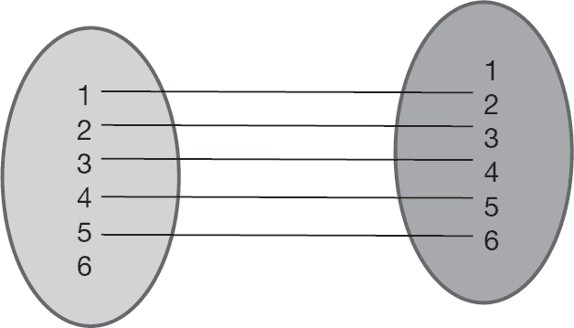

Figure 4.1 关系 `R1` 的文氏图表示

由于该关系是从集合 `Z` 定义到自身，并且根据定义，关系是两个非空子集的笛卡尔积的子集，在此示例中，应计算 `A` 与 `A` 的笛卡尔积。

```
Z × Z = {(1,1),(1,2),(1,3),(1,4),(1,5),(1,6),(2,1),(2,2),(2,3),(2,4),(2,5),(2,6),(3,1),(3,2),
(3,3),(3,4),(3,5),(3,6),(4,1),(4,2),(4,3),(4,4),(4,5),(4,6),(5,1),(5,2),(5,3),(5,4),
(5,5),(5,6),(6,1),(6,2),(6,3),(6,4),(6,5),(6,6)}
```

本示例中定义的关系是笛卡尔积的子集，即 `R ⊆ Z × Z`。

## 函数

函数是一种特殊类型关系。函数是从非空子集 `A` 到非空子集 `B` 定义的关系，使得函数的定义域为 `A`，并且没有两个不同的有序对具有相同的第一个元素。

如果 `f` 是从 `A` 到 `B` 的函数，且 `(a,b) ∈ f`，则 `f(a) = b`。

示例 2 中给出的关系 `R1` 不是函数，因为元素 `6` 没有象。

### 示例 3

关系 `R = {(1,1), (2,1), (3, 2)}` 是一个函数，因为函数定义域 `{1,2,3}` 具有唯一象。

### 示例 4

关系 `R = {(1,1), (1,2), (2, 3)}` 不是函数，因为函数定义域中的一个元素有两个不同的象。

所有三个数学构造（`sets`、`relations` 和 `functions`）为机器学习算法提供了一种识别数据中模式并基于这些模式预测未来结果的方法。

## 4.2 凸集和凸函数

凸集和凸函数是机器学习中的基本概念。它们用于机器学习算法中采用的许多优化技术，例如梯度下降和随机梯度下降。简而言之，凸集和函数使我们能够确定给定问题的最优解。使用凸集和函数，我们可以计算成本函数上的哪一点将为我们的优化问题提供最小值或成本。

在 ML 中，大多数优化问题都由一个具有多个变量（通常称为参数）的目标函数定义。我们希望优化该目标函数，以便所有参数都具有使某些性能度量（如准确率或损失）最小化或最大化的设定值。我们通过在目标函数所定义曲面上找到最小点或最大点来实现这一点；该过程分别称为最小化或最大化。

这类优化的一个主要问题是，通常很难找到全局最优解；即表示整体最佳结果的曲面上的单一点。这是因为许多 ML 模型（如神经网络）中存在非凸性问题。当目标函数在其整个定义域上只有一个全局最优解而不是在曲面上分布的多个局部最优点时，则称其为凸的。这使得我们更容易找到那个单一的全局最优解。通过使用凸集并应用额外的约束（确保所有值保持在特定界限内），我们可以确保任何优化问题只会产生一个全局最优值而不是几个局部最优值。

## Convex Set

集合 `CS` 被称为凸集，如果 `CS` 中任意两点连成的线段位于该集合内。数学上，凸集定义为 `CS = {s[1], s[2], ⋯ s[n]}` 使得

(4.2)

∀`s[i]`, `s[j]` ∈ `CS`, `α s[i] + (1−α) s[j]` ∈ `CS`, where `α` ∈ `[0,1]`

Example 5: `X = {x: x ≥ 0}`

对于任意两点 `x[1]`, `x[2]` ∈ `X`,.

凸集在 ML 中被广泛使用，因为它们提供了一种有效优化函数的方式。在凸优化中，目标是在某些约束条件下最小化或最大化一个函数。这可用于许多任务，包括分类、回归和聚类。凸优化相对于其他方法的关键优势在于它提供全局解。给定一些约束，解决几个线性或二次方程即可确定最优解，而无需搜索所有可能的參數值。

此外，凸优化确保即使数据集或参数随时间变化，最优解仍然有效。这意味着使用该方法训练的模型无需不断重新训练。

## Convex Function

对于凸集 `CS ⊆ ℝ^(n)`

(4.3)

`f(α s[i] + (1−α) s[j]) ≤ α f(s[i]) + (1−α) f(s[j])`

## Strictly Convex Function

对于凸集 `CS ⊆ ℝ^(n)`

(4.4)

`f(α s[i] + (1−α) s[j]) < α f(s[i]) + (1−α) f(s[j])`

Note: Notice the difference in the range of `α`.

`α ∈ [0,1] ⇒ 0 ≤ α ≤ 1`

严格凸函数在 ML 中作为优化过程的一部分使用。优化有助于降低给定任务的成本并提高其准确性。严格凸函数可通过设定某些条件来找到全局最小值，例如对定义域的所有点具有单一局部最小值并且在定义域上处处凸。这有助于 ML 算法快速从数据集中学习，发现模式并做出预测。

在优化过程中，严格凸函数相比其他函数具有优势，因为它们保证任何局部极小值也是全局极小值，这意味着除使用该函数找到的极小值外没有其他极小值。因此，该函数可用于准确确定 ML 算法中任务所需的参数，如 SVMs、人工神经网络（ANNs）和深度神经网络（DNNs）。

### Example 6

证明 `f(x) = 2x + 3`; `x ∈ ℝ` 是凸的（Fig. 4.2）。

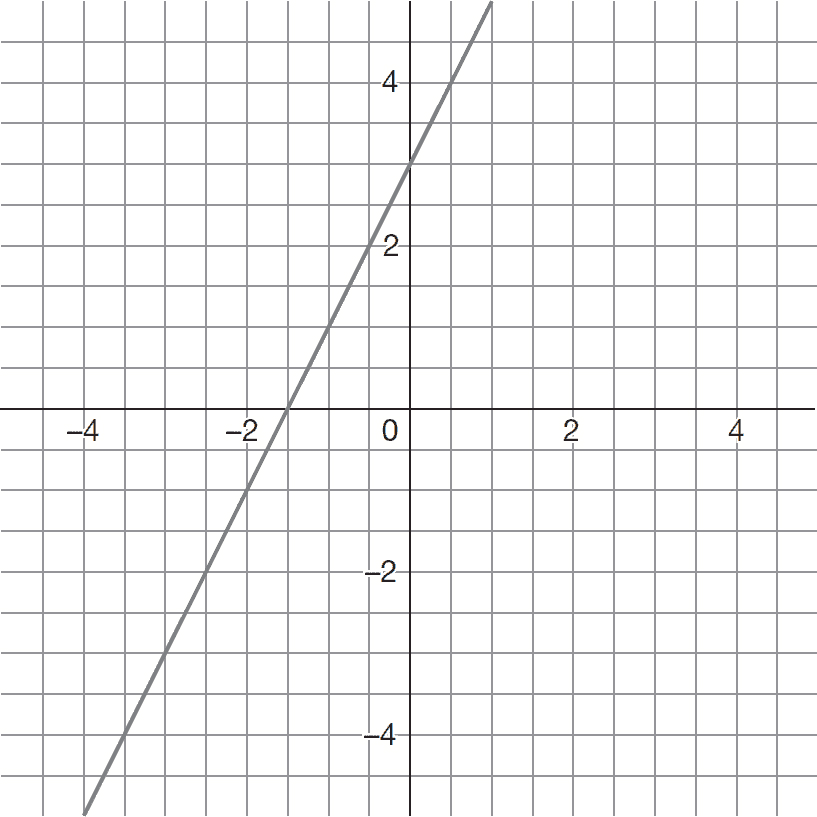

Figure 4.2  函数 2x + 3 的图形表示

Solution: 要证明一个函数是凸的，我们必须证明等式 (4.2) 中定义的 inequality。我们考虑 `α` 的三种不同值。设集合中的两点为 2 和 7。

Case 1: `α = 0`

⇒ `f(0×2 + (1−0)×7) ≤ 0×f(2) + (1−0)×f(7)`

⇒ `f(7) ≤ f(7)`

⇒ `17 ≤ 17`

Case 2: `α = 0.1`

⇒ `f(0.1×2 + (1−0.1)×7) ≤ 0.1×f(2) + (1−0.1)×f(7)`

⇒ `f(0.2 + 6.3) ≤ 0.1×7 + 0.9×17`

⇒ `f(6.5) ≤ 0.7 + 15.3`

⇒ `16 ≤ 16`

Case 3: `α = 0.5`

⇒ `f(0.5×2 + (1−0.5)×7) ≤ 0.5×f(2) + (1−0.5)×f(7)`

⇒ `f(1.0 + 3.5) ≤ 0.5×7 + 0.5×17`

⇒ `f(4.5) ≤ 3.5 + 8.5`

⇒ `12 = 12`

Case 4: `α = 1`

⇒ `f(1×2 + (1−1)×7) ≤ 1×f(2) + (0)×f(7)`

⇒ `f(2) ≤ 7 + 0`

⇒ `7 = 7`

已证明对于任意 `α ∈ [0,1]`, 是凸函数。

### Example 7

证明 `f(x) = x²`; `x ∈ ℝ` 是凸的（Fig. 4.3）。


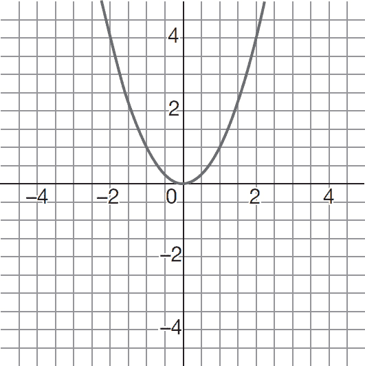

Figure 4.3 函数 `x²` 的图形表示

Solution: 我们考虑 `α` 的三种不同值。设集合中的两点为 2 和 7。

Case 1: `α = 0`

⇒ `f(0×2 + (1−0)×7) ≤ 0×f(2) + (1−0)×f(7)`

⇒ `f(7) ≤ 0×4 + 1×49`

⇒ `49 ≤ 49`

Case 2: `α = 0.1`

⇒ `f(0.1×2 + (1−0.1)×7) ≤ 0.1×f(2) + (1−0.1)×f(7)`

⇒ `f(0.2 + 6.3) ≤ 0.1×4 + 0.9×49`

⇒ `f(6.5) ≤ 0.4 + 44.1`

⇒ `42.25 ≤ 44.5`

Case 3: `α = 0.5`

⇒ `f(0.5×2 + (1−0.5)×7) ≤ 0.5×f(2) + (1−0.5)×f(7)`

⇒ `f(1.0 + 3.5) ≤ 0.5×4 + 0.5×289`

⇒ `f(4.5) ≤ 2.0 + 144.5`

⇒ `20.25 ≤ 146.5`

Case 4: `α = 1`

⇒ `f(1×2 + 0×7) ≤ 1×f(2) + 0×f(7)`

⇒ `f(2) ≤ 4 + 0`

⇒ `4 = 4`

已证明对于任意 `α ∈ [0,1]`，是严格凸函数。

### Example 8

证明 `f(x) = x⁴`; `x ∈ ℝ` 是凸的（Fig. 4.4）。


Figure 4.4 函数 `x⁴` 的图形表示

Solution: 我们考虑 `α` 的三种不同值。设集合中的两点为 2 和 7。

Case 1: `α = 0`

⇒ `f(0×2 + (1−0)×7) ≤ 0×f(2) + (1−0)×f(7)`

⇒ `f(7) ≤ 0 + 1×2401`

⇒ `2401 ≤ 2401`

Case 2: `α = 0.1`

⇒ `f(0.1×2 + (1−0.1)×7) ≤ 0.1×f(2) + (1−0.1)×f(7)`

⇒ `f(0.2 + 6.3) ≤ 0.1×16 + 0.9×2401`

⇒ `1785.0625 ≤ 1.6 + 2160.9`

⇒ `1785.0625 ≤ 1.6 + 2160.9`

⇒ `1785.0625 ≤ 2162.5`

Case 3: `α = 0.5`

⇒ `f(0.5×2 + (1−0.5)×7) ≤ 0.5×f(2) + (1−0.5)×f(7)`

⇒ `f(1.0 + 3.5) ≤ 0.5×16 + 0.5×2401`

⇒ `f(4.5) ≤ 8.0 + 1200.5`

⇒ `410.0625 ≤ 1208.5`

Case 4: `α = 1`

⇒ `f(1×2 + 0×7) ≤ 1×f(2) + 0×f(7)`

⇒ `f(2) ≤ 16 + 0`

⇒ `16 = 16`

已证明对于任意 `α ϵ [0,1]`，等式 (4.3) 中定义的不等式都成立。在边界条件下，即当 `α = 1` 时，不等式变为等式，而在其他所有情况下，它都是严格不等式。因此函数 `f(x) = x⁴; x ∈ ℝ` 是一个严格凸函数。

### Example 9

从理论上证明 `f(x) = |x|, x ∈ ℝ` 是凸的。

**Proof:** `f(α x[1] + (1−α) x[2]) = |α x[1] + (1−α) x[2]|`

⇒ ≤ `|α x[1]| + |(1−α) x[2]|` (by triangle inequality)

= `α |x[1]| + (1−α) |x[2]|`

= `α f(x[1]) + (1−α) f(x[2])`

故 `|x|` 是一个凸函数。它不是严格凸的。

给定一个函数的图像，可以很容易地判断该函数是否为凸。对于图像上每对点 `(s1, f(s1))` 和 `(s2, f(s2))`，如果线段始终位于图像上方，则函数是凸的。如果连接线段始终严格位于图像上方，则是严格凸的。

读者可以通过考虑任意一对点来检查 Fig. 4.2 至 4.4 中定义的函数图像的凸性或强凸性。

## 4.2.1 Properties of Convex Functions

• 设 `f[1], f[2], ..., f[p]` 为 `p` 个定义在 `ℝ^(n)→ℝ` 上的凸函数，定义为 `$g\left( x \right) = \sum\limits_{i = 1}^{p}\alpha_{i}f_{i}\left( x \right)$` 也是凸的。

• 如果 `f1` 是凸的且 `α ≥ 0`，也是凸的。

• 每个线性或仿射函数都是凸的。

• 如果 `f(x)` 和 `g(x)` 是凸函数，则 `f ○ g` 也是凸的。

Figure 4.5 显示了凸函数的几何可视化。

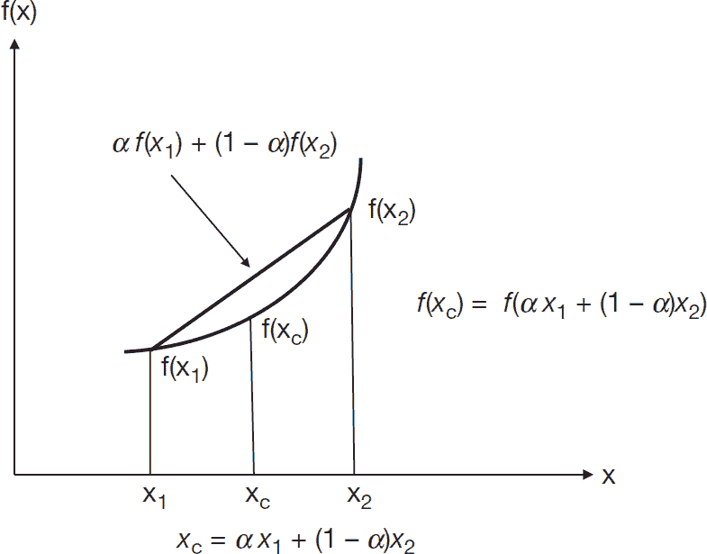

Figure 4.5 凸函数的几何可视化

## 4.2.2 Other Definitions

### Concave Function

函数 `f:ℝ^(n)→ℝ`

(4.5)

`f(α x + (1−α) y) ≥ α f(x) + (1−α) f(y)`

凹函数是一种在绘制时呈现凸形（向上开口）的数学函数。该函数在 ML 中有多种用途。在监督学习中，模型旨在根据输入特征预测目标变量，凹函数可以通过更容易检测局部最小值或最大值来帮助优化。当成本函数（衡量模型预测准确性的指标）绘制成图形时，其形状取决于模型的工作效果而是凸的或凹的。浅的凸曲线表明更多的训练会有所帮助，而深的曲线通常表明过拟合（模型对训练数据拟合得过于紧密）。

凹成本曲线通常比其凸对应物表明更好的性能，通过更容易识别具有较低值的区域来允许更高效的优化。此外，一些无监督学习模型（不使用目标变量）也依赖于使用凹函数最小化成本。

### Strictly Concave Function

函数 `f:ℝ^(n)→ℝ`

(4.6)

`f(α x + (1−α) y) > α f(x) + (1−α) f(y)`

注意：`f` 是凹的当且仅当 `f` 是凸的。类似地，`f` 是严格凹的当且仅当 `-f` 是严格凸的。

仿射函数 `f(x) = a^(T) x + b, (a ∈ ℝ^(n), b ∈ ℝ)` 是既凸又凹的函数。

在使用严格凹函数进行 ML 时，人们通常会查看目标函数值（成本）的变化，并通过在每一步考虑输入或参数的微小变化来逐步减少它们。严格凹函数使我们能够快速高效地分析任何变化对整体成本产生的影响，而无需对正在测试的每一种可能的输入或参数组合进行计算。严格凹函数快速分析复杂数据集的能力也使其能够作为更复杂的预测模型（如神经网络）的一部分使用，其中多个神经元层可以同时训练，每个层都从前一层接收反馈，了解其输出如何影响下游性能；这有助于使训练比传统方法更快、更准确，传统方法往往不需要这种对一个层在训练期间如何影响另一个层的洞察。

### Convex Combination

点集 `x[1], ⋯ x[k]` 的凸组合定义为 `$\sum\limits_{i = 1}^{k}\alpha_{i}x_{i}$` 使得 `$\alpha_{i} \geq 0\forall i = 1\cdots k\,\text{and}\,\sum\limits_{i = 1}^{k}\alpha_{i} = 0$`。

凸组合方法将不同的模型组合成一个，对所有单个模型取加权平均。分配给每个模型的权重基于每个模型的准确性以及它们协同工作的效果。

例如，假设你有三个不同的回归模型来预测股价，而不是只选择其中一个。在这种情况下，你可以用凸组合将它们组合起来，从组合结果中获得更准确的预测。相同的概念适用于 ML 的其他领域，例如分类或聚类算法。

该技术通过结合来自多个来源的信息而不是仅依赖一个来源来做出算法或系统所做的所有预测或决策，从而有助于创建更稳健、更准确的系统。此外，该方法在进行更改以优化结果时允许更大的灵活性，因为权重可以轻松调整，而无需从头重建整个模型。

### Convex Hull

集合 `S` 的凸包是 `S` 中点的所有凸组合的集合。

(4.7)

`$\left. conv\left( s \right) = \{\alpha_{1}x_{1} + \cdots + \alpha_{n}x_{n}\text{|}x_{i} \in \text{S},\alpha_{i} \geq 0,i = 1\cdots n,\sum\limits_{i = 1}^{n}\alpha_{i} = 1 \right\}$`

集合 `S` 的凸包是包含 `S` 的最小凸集。

凸包是数学和计算机科学中使用的概念。它描述了物体的形状，以可以绘制以包围它的边界线来表示。其思想是找到一组点，称为顶点，形成凸包，使得这些点包围区域内的任何点也属于凸包。

凸包在 ML 中有许多应用，因为它们可以检测数据集中的模式和聚类。例如，如果你想识别数据点更集中聚类的特定区域，你可以使用凸包技术在这些区域周围绘制边界，突出显示这些聚类的位置。这种类型的分析在欺诈检测中很有帮助，因为它有助于识别可能表明欺诈活动的聚类或异常行为。该技术还可以提高对新数据集进行分类的准确性，因为它允许我们快速轻松地将相似点分组到类别中，而无需逐个检查每个点。

### Gradient

函数 `f:ℝ^(n)→ℝ` 的梯度定义为

(4.8)

`$\nabla f\left( x \right): = \left\lbrack {\frac{\partial f\left( x \right)}{\partial x_{1}},\frac{\partial f\left( x \right)}{\partial x_{2}},\cdots,\frac{\partial f\left( x \right)}{\partial x_{n}}} \right\rbrack^{T}$`

换句话说，对于函数 `f:ℝ^(n)→ℝ`。

梯度向量是一种数学工具，有助于计算某些变量变化的方向和幅度。在 ML 中，梯度向量用于梯度下降等优化算法。梯度下降是一种迭代方法，通过计算相对于这些参数的导数来找到给定函数中特定参数的最优值。它使我们能够找到优化成本函数并最小化 ML 模型中误差的参数值。

在实践中，这意味着在训练复杂的模型 such `ANNs` 时，`backpropagation` 可用于计算每个层相对于每个参数（`weights` 和 `bias`）的导数，并将其与 `gradient vectors` 结合使用以在训练过程中减少误差。这促进了高效的搜索过程，因为我们不必在找到一组最优的 `weights` 和 `bias` 值用于我们的 `ANNs` 之前手动测试成千上万甚至数百万种组合。

### Properties of a gradient vector

• 与函数等值线正交

• 指向函数增长最快的方向

• 负梯度指向函数下降最快的方向

• 向量 `v` `v` 的点积

### Example 10: `f(x,y) = 4x² + 2y² − 5 xy`. Find the gradient at (2,3).

`∇ f(x,y) = [ 8x - 5y ; -5x + 4y ]`

Evaluating the gradient at (2, 3),

`∇ f(x,y) = [ 1 ; 2 ]`

### Stationary Point

点 `x̄ ∈ ℝⁿ` 被称为驻点。

### Example 11: `f(x,y) = x² + y²`

`∇f(x,y)=[2x,2y]ᵀ =0 ⇒ (x,y)=(0,0)`

即，原点是驻点。

优化涉及找到最优的 `weights` 和 `hyperparameters`，以便在未见数据上提供最准确的性能。实现此目的的一种方法是使用 `gradient descent`，其中我们朝着最优点迈出小步，最优点称为驻点或局部最小值。在 `gradient descent` 中，我们从初始猜测开始，并迭代地朝向更低的误差率移动，直到就该特定参数集而言无法再改进为止，这被称为在驻点处收敛。

驻点要么因为它们是局部最小值（其邻域中的最低点）而具有零梯度，要么因为它们位于平坦表面（平原区域）上而在所有方向上具有相等梯度。优化 ML 模型的主要目的是找到在未见数据上评估时产生最小误差的参数；因此，识别这些驻点有助于我们优化模型并产生比以前更准确的结果。

### Hessian Matrix

对于函数 `f:ℝⁿ→ℝ`。

`ℋ(x) = ∇[∇f(x)]ᵀ = ∇²f(x)`

(4.9)

```
ℋ(x) = [ ∂²f(x)/∂x₁²  ...  ∂²f(x)/∂x₁xₙ
         ⋮          ⋱    ⋮
         ∂²f(x)/∂xₙx₁ ... ∂²f(x)/∂xₙ² ]
```

### Example 12: `f(x,y) = 4x² + 2y² − 5 xy`. Find the Hessian matrix.

```
∇[ ∇f(x,y) ] = ∇[ [8x - 5y ; -5x + 4y] ] = [ 8  -5 ; -5  4 ]
```

Hessian 矩阵是给定函数的二阶偏导数矩阵（导数的导数）。在 ML 中，它对于通过确定底层函数是凸还是凹来确定某一点是否存在局部最大值或最小值至关重要。此外，它可以帮助识别哪些参数对于预测输出至关重要以及如何改进它们。

例如，我们希望确定使我们获得某些 ML 问题最大全局结果的参数。我们可以使用 Hessian 矩阵对每个参数关于目标函数求偏导数，然后计算其特征值。如果所有特征值都是正的，则意味着其对应的参数在预测输出中发挥着至关重要的作用，因为它有助于实现更好的结果；如果任何特征值为负，则其对应的参数对预测输出没有太大影响，应相应调整以获得更好的结果。

### 4.3 Optimization Problems

优化通常被定义为根据特定标准从一组备选方案或可用选择中选择最佳选择。一般而言，优化问题被定义为在某些约束条件下，对变量的良定义函数的最小化或最大化。优化问题在 ML 中被广泛用于帮助找到提供最佳可能结果的参数集。这是通过定义一个目标函数来实现的，该函数衡量给定模型的性能，然后优化该函数使其最大化或最小化。

例如，在处理分类或回归等监督学习任务时，通常使用优化问题来确定模型的最佳参数，从而在未见数据上实现最大准确率。这可以通过最小化某些误差度量（例如均方误差或对数损失）并找到使该度量最小化的参数来实现。

同样，无监督学习算法也使用诸如聚类算法之类的优化技术来识别没有关联标签的数据模式。优化问题对于在训练神经网络模型时进行超参数调优也很有帮助。它使我们能够在不同的超参数组合（例如层数和每层神经元数）中进行搜索，同时最大化我们的验证指标（例如准确率），从而使我们能够从模型中获得更好的性能。

优化可以大致分为三类：(a) 线性和非线性，(b) 约束和无约束，(c) 离散、连续和概率。

线性优化涉及为诸如最小化成本函数或最大化利润等问题找到最优解，以找到可能的最有效解。它通常用于创建监督 ML 模型，因为它有助于为线性问题找到最佳拟合解。它也可以用于无监督模型，其中它可以通过优化聚类算法或主成分分析中涉及的参数来识别数据中的聚类或趋势。

非线性优化寻找最优解而不需要精确的数学公式。它有助于更一般的任务，例如训练神经网络和其他深度学习架构，在这些任务中，传统的线性方法由于其处理非线性映射函数的局限性而无法提供准确的结果。非线性优化算法的工作方式是查看不同的输入如何影响输出，然后选择那些在给定特定标准的情况下产生最佳结果的输入，从而能够从复杂数据集中进行更准确的预测。

约束和无约束优化技术使我们能够通过设置在优化算法性能时需要满足的某些边界或约束来创建更准确的模型。无约束优化是指在不对参数施加任何限制或约束的情况下找到最优解。它用于许多类型的 ML 应用，其中所有参数都是未知的，例如监督学习算法如决策树和 SVM，以及深度学习技术如反向传播。这种技术涉及尝试每个参数的不同值，直到实现最优解。

另一方面，约束优化是指在对每个参数可用值施加限制或约束的同时寻找最优值。这种技术常用于回归和分类问题，其中一些一般信息（如特征范围）可以应用于缩小可能的解。 此外，还可以在目标函数上施加约束，例如线性或非线性约束，以找到比无约束优化技术更好的解，同时迭代/步骤更少；这显著降低了计算成本，同时仍能实现高精度。

离散、连续和概率优化帮助我们基于随机概率分布而不是预定值做出决策，例如梯度下降方法中的步长。 通过离散优化，我们可以基于代表数据集中类别的离散值而不是两点之间的连续值做出决策；这使我们能够更好地理解每个变量如何影响整体优化结果，从而为决策树等机器学习算法或 K-means 等聚类方法提供更好的准确性。

连续优化关注连续变量，其中在优化参数时考虑导数；这有助于识别全局最小值，从而通过从微积分相关运算中取导数进行仔细调优，进一步提升模型性能，例如在卷积神经网络 `CNNs` 等深度学习应用中广泛使用的梯度下降方法。

最后，概率优化试图通过使用概率分布近似函数而不是设定值来做出最佳猜测；这有助于我们在没有确切答案的情况下组合多个片段，仍能获得足够接近的结果，因为它能够模拟不同的分布，从而更准确地处理数据集中发现的不确定性。这使其非常适合处理来自自然语言处理 `NLP` 任务的非结构化数据集，例如情感分析应用。

## 4.3.1 符号和基本术语

`(4.10)`

```
Minimize f(x) subject to fi ≤ 0, i = 1⋯m, hj = 0, j = 1⋯p
```

方程 `(4.10)` 表示优化问题的基本符号。问题的目标是确定 `x`。

* `x ∈ ℝ^(n)` 称为优化变量。

* 函数 `f:ℝ^(n)→ℝ` 被称为目标函数或成本函数。

* 不等式 `fi ≤ 0` 称为不等式约束函数。

不等式约束可以应用于问题以求解。它们决定了解的变量值，从而为解提供边界。在机器学习中，不等式约束可用于解决优化和特征选择等问题。正确应用时可带来更准确的预测和更好的结果。

不等式约束也有助于提高分类和回归树 `CART` 等监督学习算法的性能。在 `CART` 模型中，不等式约束与成本敏感分裂规则一起使用，鼓励做出经济上有利的决策而非统计上最优的决策。总体而言，在模型训练期间使用适当的不等式约束可确保机器学习算法更好的泛化能力，同时避免因模型过于复杂而导致的潜在性能问题。


* 等式 `hj = 0` 称为等式约束，对应的函数 `h[j]:ℝ^(n)→ℝ` 称为等式约束函数。

等式约束是指要求两个值相等的任何限制。在机器学习中，等式约束在优化复杂模型时很有帮助。通过添加等式约束，算法可以使用数学方程和/或其他形式的逻辑更好地将数据转换为可用于预测分析或模型优化的信息。这使算法能够更高效、更准确地工作，同时考虑给定参数集内的所有可能解。

* 目标函数和所有约束都定义良好的点集称为优化问题的定义域。方程 `(4.10)` 中定义的优化问题的定义域为

`(4.11)`

```
$D = \left( {\underset{i = 1}{\overset{m}{\cap}}f_{i}} \right)\, \cap \left( {\underset{j = 1}{\overset{p}{\cap}}\, h_{j}} \right)~$
```

优化问题的定义域也有助于机器比人类更高效地识别大量数据中的模式。例如，在处理文本文档或图像等非结构化数据时，优化问题可以确定哪些特征对预测特定结果或根据内容正确分类项目最重要。这种方法通常用于深度学习应用中，研究人员依赖 `DNNs` 快速准确地从海量数据中提取有意义的信息，而无需太多人工工作。

优化算法对于帮助机器更快学习并基于给定输入做出准确预测至关重要，同时减少与传统分析方法相关的手动劳动成本，传统方法在每一步都需要大量人工参与。

* 点 `x ∈ D` 如果满足方程 `(4.10)` 中定义的所有约束，则称为可行点。

* 如果方程 `(4.10)` 定义的问题存在至少一个可行点，则称该问题为可行问题。否则称为不可行问题。

* 所有可行点的集合称为可行集。

可行集和问题是机器学习的重要组成部分。它们帮助我们理解数据以及数据之间的关系。可行集收集可用于解决给定问题的变量。这些变量可以包括分类、聚类、分类和回归，有助于机器学习算法优化结果。另一方面，可行问题是用于获得特定问题集最优解的数学方程或模型。例如，在处理线性回归问题时，我们使用最小二乘法来找到最佳拟合线，以根据过去的数据点预测未来值。

同样，在处理分类问题时，我们使用逻辑回归方法。在这两种情况下，模型都使用成本或损失函数进行优化，这有助于我们为问题获得最优解。

* 方程 `(4.10)` 定义的问题的最优值定义为

`(4.12)`

```
opt* = inf{ f(x) | fi ≤ 0, i = 1⋯m, hi = 0, i = 1⋯p },
```

其中 `inf` 表示下确界值或最小值

* 对于不可行问题，`opt* = ∞`

* 如果存在可行点 `x[k]` 使得 `f(x[k]) → -∞ as k → ∞`，则称此类问题为无界。

* 点 `x*` 如果是可行点并且求解方程 `(4.10)` 定义的问题使得 `f(x*) = opt*`，则称其为最优点。

* 如果点 `x` 可行且 `f(x) ≤ opt* + ϵ`，则 `x` 称为 `ϵ`-最优。

* 如果存在最优点，则问题是可解的。

* 优化问题也可以是最大化问题，通过考虑最小化问题中目标函数的否定。

## 4.3.2 标准形式下的优化问题表示

优化的标准形式是一种数学方法，用于通过最小化或最大化函数值来优化目标函数。这涉及在某些约束条件下找到方程的最大值或最小值或不等式。标准形式要求所有变量非负并且位于所有不等式的左侧，而任何限制解的值必须位于右侧。

例如，一个不等式如 `x + 2 ≤ 4` 在其标准形式中可以写成 `x ≤ 2`。在这种情况下，`2` 是一个约束，因为它必须从 `x` 中减去以符合所需格式。所有等式约束也必须等于零才能符合此形式。例如，如果我们有 `p = q + 3`，那么在其标准形式中，这将变为 `p – q = 3`，并且 `q` 将不再出现在任一侧，因为它已被 `0`（右手边）所取代。这种方法使我们能够快速识别哪些变量需要调整以实现我们期望的结果，并简化问题求解。

### Example 13: Consider the optimization problem

Minimize `f(x)`

subject to `low[i] ≤ x[i] ≤ high[i]`, `i = 1⋯n`, `x[i] ∈ ℝ^(n)`

This problem can be converted to the standard form as

Minimize `f(x)`

subject to `low[i] − x[i] ≤ 0`, `i = 1⋯n`

`x[i] − high[i] ≤ 0`, `i = 1⋯n`

### 4.3.3 Local Optima and Global Optima

A feasible point is said to be locally optimal if there are no other feasible points in its neighborhood with a lower objective value. A feasible point is said to be globally optimal if there are no other feasible points in its neighborhood with a lower objective value.

Formally they are defined as follows: A point `x` is called locally optimal if it is feasible and there exists some `R > 0` such that all feasible points `z` with `x – z[2] ≤ R` satisfy `f(x) ≤ f(z)`.

Note: `x – z[2]` represents the Euclidean norm.

A point `x` is called globally optimal if it is feasible and for all feasible points `z`, `f(x) ≤ f(z)`.

Local optima and global optima are concepts used in ML to determine the optimal solution to a problem. Local optima is the best solution within a particular region, while global optima is the best solution that could be achieved anywhere. Local optima can be seen as narrow valleys or hills in a landscape of possible solutions. Getting stuck in one of these local optima means that any changes made to improve one aspect of the solution will worsen other aspects, resulting in a worse outcome than staying at that optimum local state. The relative flatness and closeness of neighboring solutions mean that finding an even better solution than this local maximum requires big jumps across various parameters instead.

On the other hand, global optima are like being on top of a mountain peak from which every direction looks downwards – it is much easier to identify improvement areas and take steps towards them without risking getting stuck in another suboptimal state again. Furthermore, any changes will likely result in an improved overall outcome since all neighboring solutions look less attractive than this summit point.

ML algorithms use different techniques, such as `gradient descent` or `simulated annealing`, to search for local and global optima when solving problems involving multiple input variables (which can often yield thousands or even millions of possible combinations if left unchecked). This helps ensure they find both satisfactory and ‘best’ results by exploring all possible configurations before giving up on their search process – maximizing accuracy and effectiveness for tasks such as an image or speech recognition where solutions must be near perfect for successful completion.

For a convex optimization problem, all locally optimal points are globally optimal.

### 4.4 Convex Optimization

An optimization problem is convex if its objective function is a convex function, inequality constraints are convex and equality constraints are affine.

(4.13)

Minimize `f(x)` subject to `fi ≤ 0`, `hj = 0`, `i = 1⋯m`, `j = 1⋯p`,

where `fi ≤ 0` are convex sets and `hj = 0` are affine functions.

The three main requirements for a convex optimization problem are:

• Objective function should be convex

• Inequality constraints should be convex

• Equality constraints are affine functions only

The feasible set of a convex optimization problem is convex since its domain is defined as

(4.14)

```
$D = \text{domain}\left( f \right)\, \cap^{}\left( {\underset{i = 1}{\overset{m}{\cap}}f_{i}} \right) \cap^{}\left( {\underset{j = 1}{\overset{p}{\cap}}h_{j}} \right)$
```

The inequality constraints defined in Equation (4.13) should always be less than or equal to zero because the zero-sublevel set of `f[i]` is a convex set and hence the feasible region. If the constraints are greater than or equal to zero, it is no longer a convex set. The optimal value determined would no longer be a global optimum.

Convex optimization is preferred over general optimization due to the fundamental property that any locally optimal point is globally optimal.

Formally, if `x` is feasible and `x ∈ D` and satisfies all constraints and minimizes `f` in a local neighborhood, then

(4.15)

`f(x) ≤ f(y) ∀ feasibly, x − y[2] ≤ ρ`

Linear programming (`LP`), quadratic programming (`QP`) and semi-definite programming (`SDP`) are special cases of convex optimization problems.

### Example 14

Minimize `f(x) = x1² + x2²`

```
subject to f1(x) = x1 / (1 + x2²) ≤ 0; h1(x) = (x1 + x2)² = 0
```

### 4.5 Unconstrained Optimization

Minimization/Maximization problems defined over `f:ℝ^(n)→ℝ` without any constraints on the input are called unconstrained problems. Optimizing such unconstrained problems is called unconstrained optimization.

Depending on specific criteria and variables, unconstrained optimization is used to find the optimal solution to a problem or task. By using unconstrained optimization, it becomes easier to train models in ML and make them more accurate. In ML, the goal is to minimize a cost function or error rate. This is where unconstrained optimization comes into play; it helps us find the best possible parameters for our model so that our cost function can be minimized as much as possible (or at least be as close to minimal as possible).

Unconstrained optimization algorithms such as `gradient descent` are used since they efficiently find local and global minima of functions with many variables. Using unconstrained optimization techniques, we can find an optimal set of parameters to give us a minimum error rate throughout our training process. This enables us to create better models which are more accurate and precise when presented with unknown data points.

### Example 15

Find `x` that minimizes `f(x)`, where `x ∈ ℝ`, that is, `x` is a scalar.

Any local extremum will have the property `f′(x) = 0`. Such points are called stationary points or critical points. The stationary point may be (local) minimum, maximum or saddle point. The absolute lowest/highest level of `f(x)` is called the global minimum/maximum.

*If `f″(x) > 0` → the point is a local minimum*

*If `f″(x) < 0` → the point is a local maximum*

*If `f″(x) = 0` → the point is a saddle point*

The plot of the function looks like the one shown in Fig. 4.6.

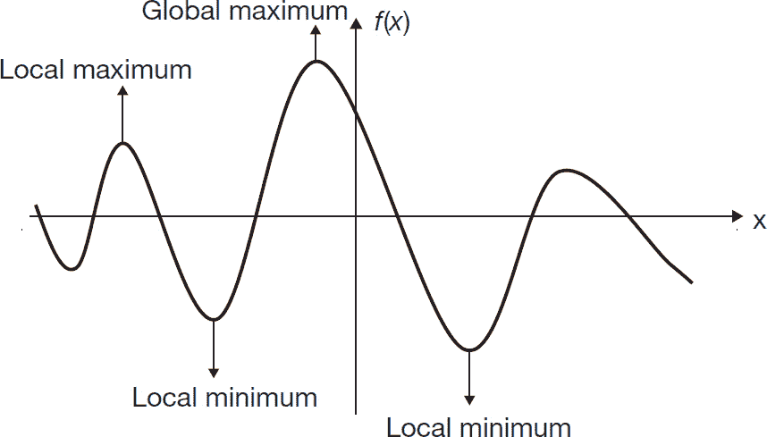


# Figure 4.6 A one-dimensional function plot

## Example 16

Find `x` that minimizes `f(x)`, where `x ∈ ℝ^(n)`, that is, `x` is a vector.

For a vector, gradient should be calculated. Any local extremum will have the property `∇f(x) = 0`. Such points are called stationary points or critical points. The stationary point may be (local) minimum, maximum or saddle point. The absolute lowest/highest level of `f(x)` is called the global minimum/maximum.

* If `ℋ` is positive definite → the point is a local minimum
* If `ℋ` is negative definite → the point is a local maximum
* If `ℋ` is indefinite (neither positive definite nor negative definite) → the point is a saddle point

如果海森矩阵 `ℋ` 的所有特征值都为正，则该矩阵被称为正定。

如果海森矩阵 `ℋ` 的所有特征值都小于零，则该矩阵被称为负定。

如果海森矩阵 `ℋ` 的某些特征值为正，而某些可能是负或零，则该矩阵被称为不定。

## 4.5.1 求解输入为标量的无约束优化问题

牛顿法是一种广泛使用的优化技术，用于在机器学习中寻找无约束优化问题的最小值。它是一种迭代方法，可用于求解非线性方程，并可应用于任何函数，无论其性质如何（线性、非线性、凸或非凸）。

在机器学习的无约束优化问题中，了解导数和梯度下降的概念很有帮助。当处理无约束问题时，我们通常旨在找到代价函数值最低的点。该点对应于该特定目标函数的全局最小值。梯度下降允许我们通过沿目标函数向下迈出小步，直到达到局部最小值；即偏导数等于 0 的位置。在数据量较小的情况下，该方法通常效果良好；然而，随着数据集变得更大、更复杂，梯度下降在收敛到最佳解之前可能需要相当长的时间（因为在搜索空间中每一步都可能相当重要）。这就是牛顿法发挥作用的地方。

与梯度下降那样尝试许多小步不同，牛顿法在每次迭代中利用搜索空间中一阶和二阶导数（或梯度）的信息，每次迭代朝着找到局部最小值迈出一步。这也有助于确保我们不会因目标函数中的平坦区域或鞍点而在搜索空间的任何点上陷入停滞——这会导致在尝试优化机器学习中的无约束问题时，传统方法如梯度上升/下降出现问题。相反，牛顿法可以通过使用一阶和二阶导数快速识别搜索空间内的潜在最优点。这使我们能够比其他技术，如梯度上升/下降，更快地找到更好的解！

假设函数 `f`: ℝ → ℝ。从初始估计 `x1` 开始，下一点可以近似得到。一般地，

(4.16)

```
$x_{k + 1} = x_{k} - \frac{f\left( x_{k} \right)}{f'\left( x_{k} \right)}$
```

该过程重复直至收敛。

例 17：求 `x`² − 2 = 0 的近似解。

| k | x | f(x) = x² − 2 | f'(x) = 2x |
| --- | --- | --- | --- |
| 1 | 2 | 2 | 4 |
| 2 | 1.5 | 0.25 | 3 |
| 3 | 1.416667 | 0.006944 | 2.833333 |
| 4 | 1.414216 | 0.000006 | 2.828431 |
| 5 | 1.414216 | 0 | 2.828427 |

该过程收敛，近似解为 `$1.414216 \approx \sqrt{2}$`

牛顿法对函数给出了良好的近似，但存在一些缺点：

i. 如果 `f'(x[k]) = 0`，则该方法失效。
ii. 在某些情况下，近似值可能重复。
iii. 它对初始选择敏感。
iv. 在某些情况下，`x[n]` 可能未定义。

## 4.5.2 梯度下降法（求解输入为向量的无约束优化问题）

梯度下降 GD 是一种一阶优化算法，用于确定给定多元函数的局部最小值/最大值。GD 是一种在机器学习中用于根据误差/损失函数更新模型参数的基础算法。该算法通过计算损失函数相对于每个参数的梯度，然后以降低损失函数值的方式更新每个参数。这种过程重复进行，直到我们达到一个点，进一步的更新不再改善模型的性能。

GD 通常用于监督学习任务，例如线性回归和逻辑回归或神经网络，其中你拥有可用于计算误差/损失的标记数据。通过优化这些参数，我们可以比仅使用试错方法更准确、更高效地进行预测。

GD 的要求是函数应可微且凸。如果函数可微，则其在定义域的每一点都有导数。对于一元函数来说，若连接任意两点的线段始终位于曲线之上或之上，则该函数为凸。检查一元函数是否凸的另一种方法是计算二阶导数并检查其是否大于零；即 `f''(x) > 0`。

例 18：`f(x) = x² + x − 5`

`f'(x) = 2x + 1`；`f''(x) = 2`

由于二阶导数大于零，给定函数是严格凸的。

例 19：`f(x) = x⁴ − 2x³ + 2`

`f'(x) = 4x³ − 6x² = x²(4x − 6)`

`f''(x) = 12x² − 12x = 12x(x − 1)`

如果 `f'(x) = 0`，这些点的斜率为零，因此它们是函数极值（最小值或最大值）的可能候选点。

如果 `f''(x) = 0`。

该函数在 `x < 0` 和 `x > 1` 时为凸。对于 0 和 1 之间的值，函数为凹，因为二阶导数小于零。

在点 `x = 0` 处，函数具有最小值。由于函数在某些点上是凸的，因此该函数称为拟凸。

对于多元函数，梯度是每个主方向上的偏导数向量。

例 20：`f(x, y) = 2x² + y²`

```
$\frac{\partial f\left( {x,y} \right)}{\partial x} = 4x$
$\frac{\partial f\left( {x,y} \right)}{\partial y} = 2y$
```

```
$\nabla f\left( {x,y} \right) = \begin{bmatrix} {4x} \\ {2y} \\ \end{bmatrix}$
```

点 (1, 2) 处的梯度为

```
$\nabla f\left( {1,2} \right) = \begin{bmatrix} 4 \\ 4 \\ \end{bmatrix}$
```

梯度向量表明斜率在 x- 和 y- 轴上是相同的。

工作机制：我们从一个任意点开始，寻找要移动到的下一个点。决策将基于方向和步长。方向有助于我们朝使函数收敛的方向移动。步长决定函数收敛的速度。该过程重复进行，直到函数收敛到一个稳定点。

从任意点 `x⁰` 开始

(4.17)

```
⇒ x^(k + 1) = x^(k) − λ∇f(x^(k))
```

由于目标是最小化给定的无约束函数，一个合理的方法是选择步长以使下一个点的值最小化。步长值过高可能不收敛或发散（将点射出区域）。步长值过低将缓慢地朝收敛进行。适中的值将朝收敛移动。

### 梯度下降算法

步骤 1：设 k = 0。

步骤 2：选择初始点 `x⁰`。

步骤 3：计算该点的梯度。

步骤 4：使用公式 (4.17) 在梯度的负方向或相反方向选择下一个点。

步骤 5：重复步骤 3 和 4，直到满足停止准则。

停止准则可以是固定迭代次数或 `∇f(x^(k))` ≥ `ε`。

例 21：最小化 `f(x) = x[1]² + x[2]²`

```
$\nabla f\left( x \right) = \begin{bmatrix} {2x_{1}} \\ {2x_{2}} \\ \end{bmatrix}$
```

选择 λ = 2 的逐步过程

| 迭代次数 # | 点 | ∇f(x) = [2x[1], 2x[2]]^T | f(x) | 新点 x^(k + 1) = x^(k) − λ∇f(x^(k)) |
| --- | --- | --- | --- | --- |
| 0 | [3, 4]^T | [6, 8]^T | 25 | [3, 4]^T − 2[6, 8]^T = [−9, −12]^T |
| 1 | [−9, −12]^T | [−18, −24]^T | 255 | [27, 36]^T |
| 2 | [27, 36]^T | [54, 72]^T | 2025 | [−81, −108]^T |
| | 函数发散 | | | |

### Step-by-step process choosing λ = 1

| Iteration # | Point | ∇f(x) = [2x[1], 2x[2]]^T | f(x) | New point x^(k + 1) = x^(k) − λ∇f(x^(k)) |
| --- | --- | --- | --- | --- |
| 0 | [3, 4]^T | [6, 8]^T | 25 | [3, 4]^T − 1[6, 8]^T = [−3, −4]^T |
| 1 | [−3, −4]^T | [−6, −8]^T | 25 | [3, 4]^T |
| | 函数完全不收敛 | | | |

### Step-by-step process choosing λ = 0.5

| Iteration # | Point | ∇f(x) = [2x[1], 2x[2]]^T | f(x) | New point x^(k + 1) = x^(k) − λ∇f(x^(k)) |
| --- | --- | --- | --- | --- |
| 0 | [3, 4]^T | [6, 8]^T | 25 | [3, 4]^T − 0.5[6, 8]^T = [0, 0]^T |
| 1 | [0, 0]^T | [0, 0]^T | 0 | [0, 0]^T |
| | 函数迅速收敛 | | | |

### Step-by-step process choosing λ = 0.1

| Iteration # | Point | ∇f(x) = [2x[1], 2x[2]]^T | f(x) | New point x^(k + 1) = x^(k) − λ∇f(x^(k)) |
| --- | --- | --- | --- | --- |
| 0 | [3, 4]^T | [6, 8]^T | 25 | [3, 4]^T − 0.1[6, 8]^T = [2.4, 3.2]^T |
| 1 | [2.4, 3.2]^T | [4.8, 6.4]^T | 16 | [1.92, 2.56]^T |
| 2 | [1.92, 2.56]^T | [3.84, 5.12]^T | 14.24 | [1.536, 2.048]^T |
| ⋮ | ⋮ | ⋮ | ⋮ | ⋮ |
| 30 | [0.0031, 0.005]^T | ⋮ | 0.000121 | ⋮ |
| | 函数收敛缓慢 | | | |

## 4.6 约束优化

机器学习问题是一个优化问题，我们在给定某些条件下寻求最佳结果。约束优化通过对远离最优点的位置引入约束来帮助找到此最优解。例如，神经网络中的常见约束是权重不能太小或太大，这有助于在训练模型时避免过拟合和欠拟合。约束优化还可以通过强制执行公平性约束，例如基于年龄或性别的非歧视，来帮助在训练期间避免偏差。这可以防止模型对某些人群做出不公平或有偏见的决定，并确保自动化决策过程的公平性。

约束优化技术还允许我们通过同时考虑多个目标来解决复杂问题，帮助我们在构建模型架构时快速识别不同目标和目标之间的权衡。最后，约束优化有助于结果的可解释性，这对于产生复杂输出的机器学习算法尤其重要，例如深度学习模型。通过添加简单的约束，如“保持特征相关”或“在合理时间内最大化模型准确性”，我们可以提高对各个部分如何促成整体性能的理解，而不会牺牲模型预测的稳定性或准确性。

约束优化问题的形式为

(4.18)

min f(x)

与此问题相关联的拉格朗日函数为

(4.19)

`L(x, λ, υ) = f(x) + ∑(i=1 to m) λ[i] g[i](x) + ∑(j=1 to p) υ[j] h[j](x)`

`λ[i]` and `υ[j]` 被称为拉格朗日乘子。拉格朗日在每个可行点上产生成本函数的族下界。

拉格朗日乘子通常用于机器学习中求解优化问题。它们通过采用限制并帮助塑造函数结果的约束来优化系统的参数。例如，机器学习算法通常采用正则化，这涉及在目标函数中引入惩罚项以减少过拟合并提高泛化能力。此惩罚项可以表示为拉格朗日乘子，其中可以为模型中的每个参数或特征集指定所需的正则化。此技术可以帮助模型避免过拟合，同时帮助它们在未见数据上表现更好。

另一个例子是使用神经网络进行分类任务时；拉格朗日乘子通常用于尝试通过对特定参数添加约束来优化类别之间的决策边界，以尝试提高准确性或减少误分类错误。在优化过程中通过这些惩罚项引入约束有助于算法找到不同类别之间更好的决策边界。

### Example 22: Minimize `x + y`

约束是一个外部因素。

与此问题相关联的拉格朗日函数为

`L(x, y, υ) = x + y + υ(x² + y² − 1)`

计算此函数的梯度以确定驻点。

```
$\nabla L\left( {x,y,\upsilon} \right) = \begin{pmatrix} {1 + 2\upsilon x} \\ {1 + 2\upsilon y} \\ {x^{2} + y^{2} - 1} \\ \end{pmatrix}$
```

`∇L(x, y, υ) = 0`

⇒ `1 + 2υx = 0`; `1 + 2υy = 0`; `x² + y² − 1 = 0`

求解这些，我们得到 `x = y = -1/(2υ)` 且 `υ = ± 1/√2`

驻点为 `(1/√2, 1/√2)` 和 `(-1/√2, -1/√2)`

### Example 23: Maximize `f(x, y) = x * y`

尽管这是一个约束优化问题，但问题看起来很简单。对于如此简单的问题，我们可以使用直接代入法。

直接代入允许我们将约束重写为单个变量。

重写给定的约束，我们得到 `y = 100 − x`。

现在问题被转换为 `f(x, 100 − x) = x(100 − x) = 100x − x²`

通过对 f 求微分，我们得到 `f'(x) = 100 − 2x`。

令 `f'(x) = 0`，

我们确定二阶导数 `f''(x) = −2 < 0`

因此函数将在 (50, 50) 处达到最大值。

同一问题也可以使用拉格朗日乘子求解。

`L(x, y, λ) = f(x, y) + λ(x + y − 100) = x*y + λ(x + y − 100)`

```
$L' = \begin{pmatrix} {y + \lambda} \\ {x + \lambda} \\ {x + y - 100} \\ \end{pmatrix}$
```

`L' = 0` ⇒ `x = y = −λ`，

`x + y = 100` ⇒ `−2λ = 100` ⇒ `λ = −50` ⇒ `x = y = 50`

## 4.7 对偶优化问题

对偶优化是机器学习的一种技术，同时优化两个目标。当同一优化问题中存在相互竞争的目标时，这可能很有用。例如，为网上购物者构建推荐系统可能需要优化结果的准确性和速度，或在欺诈检测算法中平衡最小化假阳性和假阴性。在对偶优化技术中，一个目标被视为“主要”，另一个被视为“次要”。首先优化主要目标，然后次要目标尝试改进通过优化主要目标找到的值。为了实现这一点，最优解的每一步都必须满足两个目标。在任何给定时间，可能需要稍微牺牲其中一个目标（同时仍高于某个阈值），以便它们随着时间的推移以相互兼容的解决方案得到满足。

使用对偶优化找到的最优解有时不会在两个目标之间完全平衡，但通常仍应提供令人满意的结果。通过使用对偶优化而不是传统的单目标方法，工程师可以确保其系统更稳健，并且可以在不牺牲任何单个指标过多的情况下同时考虑许多不同类型的需求。

## 对偶定理


# 线性规划与对偶理论

在线性规划（`LP`）中，每一个以标准形式定义的极大化问题（原问题）都将有一个称为对偶的 `LP` 极小化问题。原问题和对偶问题是关联的。一个问题的每一个可行解都会给出另一个问题的最优值的界限。这就是对偶定理。对偶定理是 `ML` 中用于做出更好决策的强大工具。它指出，如果两个优化问题相关，那么一个问题的解将与另一个问题的解相关。

在监督学习中，对偶定理常用于解决诸如回归或分类任务等 `LP` 问题。假设我们有一组数据点，具有某些特征（自变量）和特定的标签（因变量）。我们可以使用 `LP` 技术来确定哪些特征对正确预测标签更为重要。这使我们能够识别哪些特征具有更高的预测能力，并据此改进我们的模型。在无监督学习任务如聚类或异常检测中，对偶定理可以帮助我们确定两个数据集可能如何相关，即使它们可能不包含相同的标签或类别。这使我们能够发现否则会被忽视的数据模式。

在诸如游戏算法等强化学习任务中，对偶定理帮助我们通过比较基于智能体采取的不同行动（例如玩家）的预期奖励来创建最小化损失的策略。通过使用源自该定理的 `LP` 技术计算游戏环境中不同状态的预期奖励，我们可以比不使用它时更有效地优化不同情况的策略。最后，已发现神经网络在优化尝试期间将其纳入设计过程时也能受益，因为它有助于减少过拟合并提高在预测未见数据点时输出的准确性。

## 原问题和对偶问题

设方程 `(4.20)` 中定义的问题被视为原问题。

```
\text{Maximize}\sum\limits_{j = 1}^{n}c_{j}x_{j}
```

```
\text{subject to}\sum\limits_{j = 1}^{n}a_{ij}x_{j} \leq b_{i}\forall i = 1\cdots m
```

`(4.20)`

`x[j] >= 0`

原问题的对偶定义为

```
\text{Maximize}\sum\limits_{i = 1}^{m}( - b_{j})y_{i}
```

```
\text{subject to}\sum\limits_{j = 1}^{m}( - a_{ij})y_{i} \leq - c_{j}\forall j = 1\cdots n
```

`(4.21)`

`y[i] >= 0`

弱对偶定理指出，对偶问题的任何可行解都大于原问题的任何可行解。换句话说，一个问题的最优解不可能比其对偶问题的最优解更差。这意味着即使问题的精确解难以找到，也可以通过求解其对偶版本来获得最佳可能值的良好上界。在 `ML` 中，该定理可以解决与监督和无监督学习算法相关的优化问题。例如，在线性回归模型中最小化目标函数（或成本函数）需要找到模型参数的正确组合以最小化预测误差。求解该问题的对偶版本可能会产生不同的解。然而，它为我们提供了最小可能预测误差的下界，这使我们能够确定当前的模型参数是否足以获得良好的预测，或者是否需要更精细的调整。

类似地，在 `K-means` 和高斯混合模型（`GMM`）等聚类应用中，弱对偶定理可用于在计算最优聚类分配的闭式表达式不可用或计算成本过高时找到近似解。例如，在 `GMM` 中，通常不可能获得精确解，因为每个数据点必须与其概率分布相关联；然而，通过使用弱对偶定理，我们可以在不诉诸蒙特卡洛模拟/基于采样的算法等计算昂贵方法的情况下，为每个数据点构造参数的改进下界。最后，该定理已成功应用于马尔可夫决策过程（`MDPs`）。在 `MDPs` 中，我们需要解决涉及多个变量和约束的复杂优化问题；在这里，弱对偶同样帮助我们通过求解这些问题的更简单版本来获得最优值的更好估计，从而比仅依赖爬山等启发式搜索技术获得更好的近似。

## 强对偶定理

强对偶定理指出，如果原问题存在最优解（`x[1]*`,`x[2]*`,⋯,`x[n]*`）使得

`(4.22)`

```
\sum\limits_{j = 1}^{n}c_{j}x_{j}^{*} = \sum\limits_{i = 1}^{m}b_{i}y_{i}^{*}
```

强对偶定理在 `ML` 中用于为优化特定算法提供数学证明。该定理指出，对于任何给定的优化问题，都存在一个解能够最大化目标函数并同时满足问题的约束。换句话说，如果算法被设计为高效地找到满足特定标准或目标的解或解集，那么该解可以通过坚实的对偶性被证明是最优的。强对偶在诸如 `SVMs` 等特定 `ML` 算法中至关重要。在这些情况下，它保证任何提出的解都将满足其指定的目标，同时提供有关该最优解是如何找到的以及如何改进它的见解。例如，`SVM` 算法使用强对偶来确保它们能够通过找到一个最优超平面来准确分类数据点，该超平面最大化其与每个类别边界点的间隔距离。

## 原优化问题

考虑一个约束优化问题

```
Minimize f(x)
```

```
subject to gi <= 0, ∀i = 1⋯m
```

`(4.23)`

`hj = 0 ∀j = 1⋯p`

该问题也称为原优化问题。

原优化问题是一个数学问题，涉及为一组参数找到最优解。该问题可用于优化特定的 `ML` 算法和流程。原优化问题在深度学习中很有益，在那里它们被用来帮助创建和改进神经网络。例如，许多深度学习算法利用原优化问题来识别网络中权重和偏置的最佳组合。这有助于确保网络能够准确识别模式、在图像或视频中识别对象，或以最大准确度执行其他任务。原优化还可以确定在使用回归模型或监督 `ML` 方法时进行准确预测的最佳参数。

原优化问题还可以帮助减少过拟合，通过帮助研究人员找到神经网络的最佳模型大小和层数。通过使用这种技术，研究人员可以在层数过少导致欠拟合和层数过多导致过拟合之间找到理想的平衡。总体而言，原优化有效地允许研究人员和工程师以最小的努力优化 `ML` 算法。它使他们能够从各种可能性中快速识别出最优解，而无需进行耗费更多时间和资源的不必要的广泛试错测试方法。

## 拉格朗日对偶

给定某个优化问题的拉格朗日 `L(x,λ,ν)`，拉格朗日对偶定义为一个函数：

`(4.24)`

`F(λ,ν) = inf L(x,λ,ν),`

其中 `x` ϵ 原问题定义域 `D`。

对于上面定义的原优化问题，对偶优化问题定义为

`(4.25)`

`Maximize F (λ, v), subject to λ >= 0`

# 4.8 动态规划

## 动态规划

动态规划通过组合子问题的解来解决问题的。动态规划方法只对子问题或子子问题求解一次并将结果存储在类似表格的结构中。这种方法主要用于解决优化问题。

### 最优性原理

如果一个问题的最优解的子解本身对各自的子问题也是最优解，则称该问题满足最优性原理。最优性原理在机器学习中被广泛用于通过迭代过程寻找最佳模型结构。例如，它可用于为给定模型找到最优参数集，确定神经网络的最优规模和复杂度，或为给定问题定义最佳超参数。本质上，这种方法涉及在每次迭代中求解子问题，然后将它们的解组合起来，以获得比任何单个子问题解更好的解。该方法已成功解决诸如特征选择、半监督学习、强化学习优化和深度学习优化等具有挑战性的问题。

马尔可夫决策过程（`MDP`）由状态、动作、奖励以及每个状态下每个动作效果的描述组成。强化学习旨在学习最优策略，而 `MDP` 提供环境。在这种情况下，动态规划被用于确定最优解。

# 4.9 次线性算法

次线性算法是指通过读取输入的微小比例并在输出解之前以次线性时间处理输入来解决给定问题的算法。这些算法可能给出精确解，也可能通过随机化提供近似解。

次线性算法在机器学习中变得越来越流行。这些算法可用于传统方法无法处理的大型数据集。使用次线性算法的主要思想是减少从大型数据集中获得准确结果所需的计算次数。这有助于提高性能，减少处理时间，并最大限度地减少任务所需的资源。在机器学习中，次线性算法可用于各种任务，如特征选择、聚类、分类和回归。

### 示例 27

确定一个由 `{1∙∙∙n}` 的排列组成的给定数组 `A[1: n]` 中的奇数，其中 `n > 1`，并输出一个索引 `*i*`，使得 `A[i]` 为奇数。

确定性方法在 `O(n)` 时间内输出精确解。随机算法可能在 `O(1)` 时间内产生输出。思路很简单：随机选择一个元素并检查它是否为奇数。重复直到找到奇数。

流式算法是指通过读取流式输入（流式输入）并借助随机化给出精确解或近似解来解决给定问题的算法。这些算法根本不会存储输入序列；它们是‘即时’运行的。它们仅使用次线性量的内存处理流式输入。

与随机算法和近似算法的概念一样，次线性算法旨在在多项式时间内没有可用解时提供某种解。

# 4.10 图

图是一种非线性数据结构，由非空的顶点集合和边的集合组成。它表示为 `G = (V , E)` 图的示例如图 Fig. 4.7 所示。有四个顶点和七条边。

`V` = `{v[1],v[2],v[3],v[4]}`

图由邻接矩阵或邻接表表示。对于图 Fig. 4.7 所示的图，邻接矩阵（Table 4.1）以 `|V| × |V|` 的维度定义。

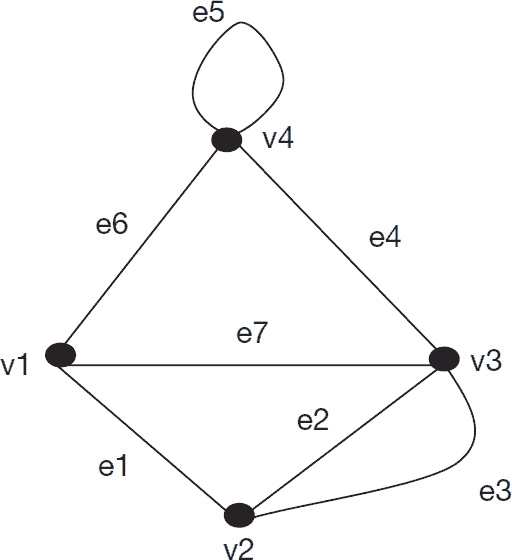

Figure 4.7  一个具有四个顶点和七条边的图

Table 4.1 图 Fig. 4.7 中给出的图的邻接矩阵。

|  | v1 | v2 | v3 | v4 |
| --- | --- | --- | --- | --- |
| v[1] | 0 | 1 | 1 | 1 |
| v[2] | 1 | 0 | 2 | 0 |
| v[3] | 1 | 2 | 0 | 1 |
| v[4] | 1 | 0 | 1 | 1 |

邻接矩阵中的条目表示对应顶点之间的边数。顶点 `v[2]` 和 `v[3]` 之间有两条边；因此邻接矩阵中为数字 2。

## 无向图

无向图中的边是无序的，即两个顶点之间的边用 `(u, v)` 或 `(v, u)` 表示是相同的。

无向图在机器学习中很有用，因为它们允许表示数据关系。特别是，它们可用于识别不同变量之间的模式并帮助决定哪些变量应用于模型中。例如，无向图可用于了解两个变量如何相互作用；如果一个变量对另一个变量有直接影响，则这两个变量将在图中具有直接连接。这种类型的分析在构建模型时很有帮助，因为它可以帮助确定哪些因素对给定结果最重要。

无向图还可以帮助通过将相似的数据点聚类在一起或识别需要进一步调查或从数据集中删除的异常值来分析复杂数据集。使用网络结构可以推断观察值之间的隐藏连接并揭示有关数据集的有见地的信息。这使得无向图对于模型构建过程中的探索性分析和特征选择至关重要。

## 有向图

有向图中的边是有序的或由有向对表示。有向图是机器学习的重要工具，因为它可以表示数据点之间的关系并探索从一个点到另一个点的不同路径。遍历图结构的能力使算法能够识别数据中的模式并从中得出有价值的结论。此外，有向图可用于聚类和分类等任务。例如，有向图可用于监督学习任务，如回归分析，其中必须根据一些自变量预测因变量的值。通过使用图结构中边表示的关系，算法可以学习改变对象或实体的某些特征如何影响其输出值。这使得更容易理解在预测值时哪些特征是必不可少的以及如何最好地使用该信息。

在无监督学习任务如聚类分析或自然语言处理中，有向图有助于识别数据片段之间一般模式，这些数据片段否则无关或难以手动分类。这有助于机器学习如何不同信息片段可能相关，从而能够根据已知的知识对未知数据点做出更准确的预测。

这里，顶点 `u` 和 `v` 之间的边表示为 `(u, v)`，其中边的尾部在 `u`，头部在 `v`。因此 `(u, v)` 和 `(v, u)` 是不同的。

## Self-loop 和 Multiple edges

一个从顶点指向自身的边称为 `self-loop`。`Self-loops` 可用于建模节点以某种方式与其自身相关的情况。例如，如果想建模两个人之间的友谊，可以有一条两端都指向同一顶点的边。如果一对顶点之间有多条边，则这些边称为 `multiple edges`。`Multiple edges` 在 ML 中用于捕捉并量化不同实体之间关系强度。例如，在社交网络中，`multiple edges` 可用于建模两个人联系的紧密程度或他们相互互动的可能性。在推荐系统中，`multiple edges` 可用于根据其类别或上下文对相关项目之间的亲和度进行评分。此信息可被诸如 `collaborative filtering` 或 `matrix factorization` 等算法用于做出推荐。`Multiple edges` 还使诸如 `neural graph networks` 等算法成为可能，这些算法有助于在图结构中编码实体之间的复杂关系，并利用这些复杂交互比传统方法更准确地做出预测。

对于具有 `n` 个顶点的图，最大不同边的数量为 $\frac{n\left( {n - 1} \right)}{2}$。

### Complete Graph

具有恰好 `n(n - 1)/2` 条边的无向图称为 `complete graph`。在 ML 中，`complete graphs` 有助于识别难以检测的数据模式。例如，我们想识别哪些变量彼此相关。在这种情况下，使用 `complete graph` 比分别检查变量的各个配对要容易得多。`complete graph` 为我们提供了整个数据集的概览，并使我们更容易看到不同变量如何相互作用。`Complete graphs` 还帮助机器基于大型数据集或多因素可能同时起作用的高维问题做出决策。通过分析 `complete graph` 内的模式，ML 算法可以更轻松地确定哪些因素对特定结果或决策贡献最大，并基于这些发现做出预测。最后，`complete graphs` 提供了一种有效的数据可视化方式，使人类能够更好地理解其结构和含义，并比没有此工具更快地识别异常值或异常。

### Subgraph

对于图 `G = (V, E)`，存在图 `G′` 使得 `V(G′)` ⊆ `V(G)` 且 `E(G′)` ⊆ `E(G)`。

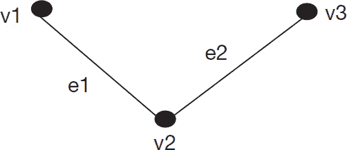

Figure 4.8  A subgraph of the graph given in Fig. 4.7

`Subgraphs` 在 ML 中很有帮助，因为它们允许机器识别数据中的模式和关系。`Subgraphs` 是包含原始图的部分或全部节点和边的子图（Fig. 4.8）。通过将主图分解为更小的组件，`subgraphs` 使机器能够轻松地在复杂数据集中找到模式。例如，假设我们试图使用客户交易数据集来预测信用卡欺诈。在这里，我们可以根据日期、商户类型或位置对客户交易进行分组来创建 `subgraphs`。这将使我们更好地了解客户支出模式并检测可能表明欺诈活动的异常。

`Subgraphs` 还使机器能够从先前学习过的模型中学习，同时仍能识别新的关系。通过从相似但不同的数据集中创建多个 `subgraphs`，机器可以将先前模型的结果与当前结果进行比较，并比以往更快、更准确地对未来数据点做出更好的预测。此外，`subgraph` 算法可用于降维，这有助于减少大型数据集中的噪声，以便机器专注于基本特征而不是被无关信息淹没。当处理难以让计算机从大量可用数据点中识别有意义模式的非结构化数据集时，这尤其有帮助，因为其 sheer volume 或复杂性。

### Path

从顶点 `v1` 到 `v3` 的路径是顶点序列，其中任意两个相邻顶点由一条边连接。

### Cycle

`cycle` 是初始顶点和最终顶点相同的路径。换句话说，序列的起点和终点相同。路径可以在返回起点之前经过许多顶点，从不访问任何顶点两次（除起点和终点外）。这意味着它形成一个闭合环。`Cycles` 在图论中至关重要，因为它们可以衡量诸如连通性或连通图中的两点之间的距离等属性。它们还解决特定问题，如寻找最小生成树或在有向图中识别强连通分量。

### Connected Graph

无向图被称为 `connected` 当且仅当每对不同顶点之间存在一条路径。无向图是 `connected` 的，如果从任何顶点到另一个顶点都有一条路径。这意味着对于图中的任意两个不同顶点，都可以通过不重新访问已访问节点的路径从一个到达另一个。换句话说，无向图中的每个节点都可以通过某种边或步骤序列从每个其他节点到达。如果两个不同顶点之间没有路径，则无向图不被视为 `connected`。

### Degree of a Vertex

无向图中与顶点关联的边的数量称为该顶点的 `degree`。顶点（也称为节点）是图上的一个点，该顶点的 `degree` 表示它连接到多少个其他节点。此数字可用于衡量节点之间连接的强度并理解它们之间的关系。在 ML 中，顶点的 `degree` 可帮助确定算法中最重要的连接，并更好地理解正在分析的数据。例如，假设一个节点相对于同一网络中的其他节点具有较高的 `degree`。这可能表明该节点对于使用算法做出正确预测或分类比其他节点更重要。

该概念也可以在构建诸如 `neural networks` 或 `decision trees` 等模型时使用，其中了解哪些特征最重要（因此应给予更多权重）有助于提高性能。在这些情况下，更高的 `degrees` 可能表示比 `degrees` 较低的特征更具预测性或更有意义的特征，表明它们不应受到模型的太多关注，因为它们对模型的预测/决策缺乏相关性。

对于有向图，顶点 `v` 的 `in-degree` 是以 `v` 为头的边的数量。顶点 `v` 的 `out-degree` 是以 `v` 为尾的边的数量。

# 4.11 Transforms

连续函数 `f(t)` 的傅里叶变换定义为

$F\left( \mu \right) = \int\limits_{- \infty}^{+ \infty}f\left( t \right)e^{- j2\pi\mu t}dt$,

其中 `t` 和 `µ` 是连续变量。

逆傅里叶变换定义为

$f\left( t \right) = \int\limits_{- \infty}^{+ \infty}f\left( t \right)e^{j2\pi\mu t}d\mu$

这两个方程表示一个傅里叶变换对。

欧拉公式，`e^(-j2πμt) = cos(2πμt) - j sin(2πμt)`

## 傅里叶变换


# 傅里叶变换

傅里叶变换是一种将任意给定函数分解为一系列正弦和余弦函数的数学技术。它是 `ML` 中的一项基本工具，因为它允许我们通过将数据从时域转换到频域来更有效地分析数据。在 `ML` 中，傅里叶变换可以将图像等复杂信号分解为计算机更容易解释和理解的更简单分量。通过将图像或声音片段分解为其基本元素，我们在使用 `ML` 算法时可以更好地决定模型或程序中应包含什么。例如，假设我们有一张某人面部的照片。傅里叶变换可以帮助将这张照片分解为眼睛、鼻子和嘴唇等单独部分，从而在构建用于识别目的的模型或程序时为这些不同部分赋予权重。

傅里叶变换还有助于减少数据集中的噪声，使仅保留相关特征，这些特征随后可使用 `SVMs` 和神经网络（`NNs`）等各种 `ML` 算法进行进一步处理。这样，噪声被消除，同时保留有意义的信息，以提高基于此类数据集构建的 `ML` 模型的预测准确性。

# 卷积

两个函数的卷积涉及将一个函数在其原点上叠加到另一个函数上并使其滑动通过另一个函数。在滑动过程中的每个位移位置，计算包括乘积之和。它定义为

```
(f*h)(t) = ∫_{-∞}^{+∞} f(τ) h(t - τ) dτ
```

卷积是一种 `ML` 技术，通过对不同输入执行数学运算来帮助我们识别数据中的模式。它常用于图像识别和分类任务，其中它有助于识别图像中可用于区分一个物体与另一个物体的特征。基本方法是取多个小数据窗口并对这些窗口应用一组数学运算，例如乘法、加法或减法，以检测某些模式或特征。重复此过程直至达到所需结果，从而产生代表图像特征的一组值。然后结果可用于进一步的分析和预测任务。

在 `ML` 应用中，卷积可以帮助计算机理解图像中哪些部分对于分类对象或预测结果很重要。例如，假设我们想根据过去一周的一系列天气图像预测明天是否会下雨。我们可以使用卷积滤波器来识别每张图片中哪些部分最可能与降雨相关——例如乌云或大雨——以便我们的算法在预测明天的天气时考虑这些模式。

## 卷积的性质

- 卷积是可交换的，即信号卷积的顺序对结果没有影响。

```
x(t) * y(t) = y(t) * x(t)
```

- 卷积对加法具有分配性。

```
x(t) * [y(t) + z(t)] = [x(t) * y(t)] + [x(t) * z(t)]
```

- 卷积是结合的。

```
x(t) * [y(t) * z(t)] = [x(t) * y(t)] * z(t)
```

- 平移性质：信号与时移的卷积会导致输出信号发生平移。

如果 `x(t) * y(t) = z(t)`，

# 离散余弦变换（DCT）

考虑序列 `p(n)`，0 ≤ `n` ≤ `N` − 1。该序列的一维 DCT 定义为

```
q(k) = α(k) Σ_{n=0}^{N-1} p(n) cos[π(2n+1)k / 2N], 0 ≤ k ≤ N-1
```

```
α(0) = 1/√N
```

```
α(k) = √(2/N), 1 ≤ k ≤ N-1
```

逆变换由下式给出

```
p(n) = Σ_{k=0}^{N-1} α(k) q(k) cos[π(2n+1)k / 2N], 0 ≤ n ≤ N-1
```

正变换和逆变换一起构成 DCT 对。

N × N 离散余弦变换矩阵由下式给出

```
c(k,n) = { 1/√N,                          k=0, 0≤n≤N-1
         { √(2/N) cos[π(2n+1)k / 2N],     1≤k≤N-1, 0≤n≤N-1
```

`DCT` 是一种常用的 `ML` 技术，通过从图像或音频信号中去除不太重要的信息来减少数据量。这允许更高效地存储和传输数据。此外，`DCT` 有助于保留大部分基本特征并减少信号中的噪声。在计算机视觉中，`DCT` 检测图像特征，如边缘、形状和纹理。它可应用于灰度图像和彩色图像，允许更快处理，因为它仅关注少数显著频率而不是图像内的所有频率。此外，与傅里叶变换或小波等其他方法相比，该技术可以用更少的参数实现更明确的目标识别。

它还可用于在数据通过网络传输或存储在磁盘驱动器上之前压缩大型数据集，因为减少数据大小可显著减少传输时间和存储成本。除了计算机视觉应用外，`DCT` 在语音处理任务中也很受欢迎，例如语音识别系统和文本转语音合成器，因为它能够从声波中提取人类耳朵无法检测到的显著特征，例如音高周期性模式和共振峰结构等。此外，提取的特征有助于机器以比其他方法（如傅里叶变换或小波分析技术）更高的准确率将语音信号转换为有意义的词语和句子。因此，它在自动语音识别系统中极为流行，这些系统使用 `DNNs`、`SVMs` 和隐马尔可夫模型（`HMMs`）等 `ML` 算法训练的模型。

离散余弦变换（`DCT`）和离散傅里叶变换（`DFT`）是信号处理不可或缺的部分。然而，它们服务于不同的目的并表现出不同的特征，特别是在优化算法的背景下。`DCT` 仅使用实数，与对称扩展序列的傅里叶级数系数密切相关，这使其非常适合受益于数据压缩的应用，例如图像和音频编码。这是因为 `DCT` 能够将信号能量集中到少数系数中，这一特性称为谱紧凑性。另一方面，`DFT` 使用复数，与周期性扩展序列的傅里叶级数系数相关，并在各个领域广泛用于频谱分析。

## DCT 的性质

- `DCT` 是实数且正交的。
- `DCT` 不是 `DFT` 的实部。
- `DCT` 对高度相关数据具有极佳的能量紧凑性。
- `DCT` 是一种快速变换。

# 离散正弦变换（DST）

一维序列的正弦变换对由下式给出

```
q(k) = √(2/(N+1)) Σ_{n=0}^{N-1} p(n) sin[π(k+1)(n+1) / (N+1)], 0 ≤ k ≤ N-1
```

```
p(n) = √(2/(N+1)) Σ_{k=0}^{N-1} q(k) sin[π(k+1)(n+1) / (N+1)], 0 ≤ n ≤ N-1
```

N × N `DST` 矩阵由下式给出

```
√(2/(N+1)) sin[π(k+1)(n+1) / (N+1)], 0 ≤ k,n ≤ N-1
```

## 离散正弦变换

`DST` 是一种强大的数学工具，用于 `ML` 和数据科学的其他领域。它将信号或图像转换为其频率分量，从而实现更高效的处理和分析。在 `ML` 中，`DST` 应用于数据集合，这些集合对于传统方法来说过大或过于复杂，无法快速处理。将数据集分解为其频率分量可以加快模式和相关性的计算。这使得识别数据中的聚类成为可能，从而使机器学习模型做出更好的预测或决策。`DST` 也已成功应用于图像处理应用，例如人脸识别和目标检测算法。

## DST 的性质

- 正弦变换是实数、对称和正交的。
- 正弦变换不是 `DFT` 的虚部。
- 正弦变换是一种快速变换。

# 信息论

## 信息论概述

信息论是数学的一个分支，处理信息的量化与操纵。它主要用于研究通信系统和数据压缩。近年来，信息论也已应用于 `ML`，其中它可以为学习算法及其性能提供见解。克劳德·香农于 1948 年在其开创性论文《通信的数学理论》中首次发展了信息论。香农定义了信息数学理论所需的核心概念：熵、互信息和信道容量。这些概念随后被用于研究电话网络、无线电广播和光纤电缆等通信系统。

在 `ML` 中，信息论的应用用于衡量数据集或算法需要从中学习或解决的任务的复杂性或不确定性；根据信息论指标，任务被认为越复杂，其熵值就越高。此外，`ML` 研究人员还能够使用这些相同的指标来评估各种问题的性能，以及根据它们在这些任务上的各自表现比较不同的学习算法，包括速度（训练时间）和准确性（成功率）。

互信息对于数据集内的特征选择很有帮助，这意味着在模型输入中不必包含所有特征，工程师将只选择相关特征，从而在保留变量之间重要关系的同时减少数据中的噪声。

## 随机变量

在随机实验的样本空间上定义的实值函数称为随机变量。它可以是离散的或连续的。随机变量在 `ML` 中是一个有价值的工具，因为它们可以量化与预测或结果相关的不确定性。例如，随机变量（如概率）可以为预测算法的不同结果分配概率。这使得 `ML` 系统能够为更可能的结果分配更高的概率，为不太可能的结果分配更低的概率。它还使人类更容易解释并根据算法的结果做出决策。随机变量也可以用于强化学习算法中的决策。通过应用特定的奖励值或惩罚值，模型可以根据其对随机变量的理解学习哪种操作产生最高的期望回报。这有助于通过使用随机变量分配的值权衡利弊来更好地控制决策，而不是完全依赖直觉或纯粹的试错方法。此外，随机变量提供了不同数据集在分析神经网络等复杂系统时如何相互作用的见解。它们提供了输入数据点与其各自的输出之间相关性的信息，这些输出来自使用它们训练的 `ML` 模型。这进一步使我们能够识别改进的领域，在创建模型时我们可以调整参数以提高准确性或效率，这有助于在开发 `ML` 算法时做出更明智的决策。

### 离散随机变量

取有限个不同值的随机变量称为离散随机变量。它之所以不同，是因为它只能取整数或来自有限列表的特定值，而与之相对，连续随机变量可以在区间内取任意值。这意味着离散随机变量在其范围内取任意值的概率必须总和为 1。例如，假设你有一个实验，你掷两颗骰子并计算点数总数（点数是可能的值）。点数可以是 2 到 12 之间的任意整数，给出 11 种可能的结果（2–12）。每个结果的概率将根据每个数字可用的组合数量而变化。例如，通过掷两颗骰子得到 7 有六种不同的方法：(1 + 6)、(2 + 5)、(3 + 4)、(4 + 3)、(5 + 2) 和 (6 + 1)。因此，掷出 7 的概率等于 6/36，即等于 1/6。总而言之，离散随机变量对于我们想要计算具有预定义结果的某些事件的概率的情况很有用，例如掷骰子或抛硬币。

### 连续随机变量

在区间上取无限个值定义的随机变量称为连续随机变量。它可以从给定区间内的无限集合的数字中取任意值。它与离散随机变量不同，后者只有有限的可能值。连续随机变量的例子包括摄氏温度、海洋中的水深和树干直径。连续随机变量通常用于描述与物理现象相关的概率，例如时间、空间或速度。此外，它们对于建模具有平滑和渐进变化的数据很有用，例如股价或人口增长。在处理连续随机变量时，我们通常使用概率密度函数（`PDFs`）而不是概率质量函数（`PMFs`）。`PDF` 为数轴上的区间而不是单个点分配概率，并帮助我们确定随机选择的数值落在某个范围内的机会。为了计算与连续分布相关的概率，我们可以使用积分而不是求和，因为它们是通过对所有可能的值进行积分获得的，而不是像离散分布那样简单地将所有可能性相加。当处理概率密度函数时，求和规则不再适用，因为它们没有固定的结果数量；这使得计算这种类型的分布的概率比离散分布要困难得多，在离散分布中，我们只需将与每个结果相关的所有可能性加起来即可获得所需的结果。

## 概率分布

`PD`：随机实验或事件的每个结果的可能性可以通过概率分布来衡量。

随机事件 `E` 具有概率 `P(E)`，包含 `I(E) = log(1/P(E)) = -log P(E)` 个信息单位。

如果 `P(E) = 1` 则 `I(E) = 0`，这表明没有信息被归于它，即该事件没有不确定性。`PD` 是 `ML` 中的一个关键概念，用于捕捉不确定性和随机性。它使我们能够估计事件发生或不发生的可能性，并衡量变量之间关系强弱。`PD` 可以在决策过程中发挥重要作用，帮助确定哪种模型架构或超参数将产生最佳结果。例如，在构建分类算法或神经网络等模型时，概率分布可用于选择具有最强预测能力的适当输入特征并最小化过拟合。`PD` 还可以通过测试模型是否对少量数据点的变化足够敏感来帮助验证模型。模型的预测准确性也受其预期性能的先验知识的影响，该知识可通过研究与特定参数的不同值相关联的概率分布来获得，例如正则化系数 `lambdas` 和学习率。最后，概率分布在从模型进行预测时发挥着重要作用——它有助于根据过去数据点计算出的概率而不是绝对值来创建未来可能发生情况的估计值（例如贝叶斯推断）。这种方法使我们能够构建更可靠的预测系统，这些系统不易因异常值或极端情况而出现错误，在这些情况下，输出与给定特定输入集的预期差异很大。

## 熵

离散随机变量 `x` 在概率分布 `p(x)` 下的熵定义为

```
H_x = - Σ_{x ∈ χ} p(x) log₂ p(x)
```

熵给出了随机变量不确定性的度量。

在信息论中，熵指定了编码实例类别所需的最小比特数。在 `ML` 中，熵提供了训练数据集合中不纯度的度量。熵用于衡量数据中包含的信息量。它可作为评估模型性能的评估指标，也被纳入用于决策和优化的许多算法中。熵在 `ML` 中的主要用途与决策树有关。决策树是一种使用层次结构对数据点进行分类的算法类型。熵衡量每个决策树分支内的不确定性，使我们能够决定哪个分支需要进一步探索，哪个应该被丢弃。这有助于我们评估模型对未见数据的表现，使其成为评估模型整体性能的重要组成部分。

熵在 `ML` 中的另一个常见应用是特征选择或特征重要性分析。通过计算不同特征的熵值，我们可以更好地理解它们包含多少信息，并确定哪些特征在预测目标变量时具有更重要的贡献。当处理具有许多特征的大型数据集时，计算熵可以帮助我们通过仅选择提供有关目标变量有用信息的相关特征来减少噪声。最后，熵在优化问题中发挥着重要作用；这包括神经网络或其他基于具有多个特征的数据集构建的复杂模型，在训练它们在未见数据点上以获得更好的泛化性能并避免过拟合问题之前，需要对它们应用一些正则化方法（例如 `L1`/`L2`）。熵可以帮助确定应为哪些权重分配更高值以减少计算复杂性，同时仍通过选择相关性更高（预测能力更强）的权重来优化性能水平。

例如，抛硬币是一个随机事件。两种可能的结果是正面和反面，概率相等均为 0.5。该事件的熵计算为

```
H_x = - Σ_{i=1}^{2} 0.5 * log₂(0.5)
    = - (0.5*(-1) + 0.5*(-1))
    = 1
```

事件结果的均匀概率产生最大不确定性，因此熵最大。

## 信息增益

由于根据特定属性对样本进行划分而导致熵的预期减少称为信息增益。它是 `ML` 中最关键的概念之一。它帮助机器通过评估数据质量并提供对给定数据集内所含信息量的洞察来做出决策。在 `ML` 中，信息增益决定了哪些属性在做出准确预测时最有用或最相关。这使我们能够识别并专注于在预测时对结果影响最大的特征。本质上，信息增益衡量了使用特定属性（或划分）与不使用它相比我们好在哪里。例如，如果根据属性对数据集进行划分会导致创建两个不同的子集，每个子集具有不同的分布（如果该属性与类别成员资格之间存在信息关系），则这将被视为信息增益，因为它将提供比划分数据集之前更多的信息。这使我们能够更好地从数据中学习，并在后续做出更准确的预测。为了衡量这种信息增益，可以使用熵等指标来计算给定数据集内的随机性或无序程度。这使我们能够量化在 `ML` 算法的训练阶段使用不同属性或划分时是否在准确性方面有任何实际收益，例如决策树归纳方法。例如，假设特定划分/属性与另一个相比没有提供任何实际收益。在这种情况下，它的信息增益会较低，而提供收益的属性可能会导致更高的增益。

设 `S` 为具有多个属性的训练样本集，由 `A` = {`A[1]`, `A[2]`, ⋯, `A[n]`} 表示。

```
Information Gain(S, A_i) = Entropy(S) - Σ_{v ∈ values of A_i} (|S_v| / |S|) Entropy(S_v)
```

第二项表示 `S` 之后的预期熵。

# 流形

机器学习处理的是与更高维度相关的数据。在更高维度可视化数据很难绘制。为了更好地理解和可视化数据，应减少数据的维度。用于降维的方法有很多。


流形是一种描述弯曲空间的数学结构。它是将欧几里得几何中用于描述在曲率可变的环境中移动物体的思想推广。流形可以被认为是一个抽象的数学对象，它平滑地连接多个点。为了更好地理解这一点，可以把它想象成一张纸；如果你弯曲一个角，整张纸都会变得弯曲，但它上面的所有点仍然以某种方式连接在一起。当我们使用流形来建模我们的世界时就会发生这种情况——即使空间在我们周围弯曲，我们仍然可以使用数学来理解它，通过连接它的所有点。流形还允许我们描述不同形状如何相互作用以及它们如何随时间和距离而变化。总之，流形为我们从实践和理论两个角度理解我们的宇宙提供了一个强大的工具！

### 4.13 Manifolds

## 流形学习

## 局部线性嵌入 (LLE)

对流形进行建模的过程称为流形学习。局部线性嵌入（`LLE`）是一种流形学习技术，用于非线性降维。`LLE` 通过将训练实例与其近邻关联来产生高维数据的低维嵌入。`LLE` 是一种非线性降维技术，用于在保留其原始结构和信息的同时降低数据维度。当数据具有高维度，使得可视化或分析具有挑战性时，这可能是有益的。`LLE` 技术目标是找到原始数据的低维表示，这些表示在局部相似的同时保留全局结构。局部相似意味着在进行降维后，数据集中相似的点仍然保持接近。这可以通过让每个点由其 `K-nearest neighbors` 表示来实现，因为这些点很可能在局部相似。为了保留全局结构并识别本质特征，在此过程中远距离点之间的距离不能被忽略。

要使用 `LLE` 降低数据集的维度，首先，每个数据点必须找到其 `K-nearest neighbors` 并用这些数据点形成一个 `n-dimensional` 向量（其中 `n` 等于样本数）。接下来，它将为每个邻居计算权重，以便所有 `n` 个向量主要沿其局部方向对齐，但仍保持彼此之间的远距离相关性；这是通过最小化一个称为重构误差的目标函数来完成的，该函数衡量每个点能够通过使用从 `K-nearest neighbors` 选择步骤构建的权重矩阵从其邻居重构的程度。最后，在为每个样本的对应邻居找到权重后，这些加权样本将使用奇异值分解（`SVD`）或其他技术如 `PCA` 投影到低维空间。

## 奇异值分解 (SVD)

`SVD` 是一种强大且多用途的方法，用于数学、计算机科学和工程的许多领域。`SVD` 是一种用于将矩阵分解为其构成部分的算法。它也被称为矩阵分解过程。此分解将原始矩阵分解为三个较小的矩阵：两个酉矩阵和一个包含奇异值的对角矩阵。`SVD` 算法已被用于各种应用，包括图像压缩、信号处理、人脸识别系统和文本挖掘。在图像处理中，例如，它可用于通过丢弃被认为对进一步分析或显示目的冗余或无用的信息来减小图片的大小。就文本挖掘应用而言，`SVD` 可用于通过术语-文档矩阵（`TDMs`）分析文档，从而捕捉其语义内容。通过将这些 `TDMs` 中不同文档的词组合在一起，我们可以正确分析这些文档的内容，通过识别其中讨论的话题以及这些话题是否在所有文档样本中得到充分代表；这使我们能够根据其内容或主题将相似的文档更准确地分组，而无需使用任何形式的聚类/分组算法，如 `KNN`/`K-means` 聚类方法。

`SVD` 还可应用于从音频信号中降低噪声，以及通过降低维度使数据更易于存储压缩；这有助于提高内存效率并加快计算时间。结果将包含原始庞大维度空间中的所有全局信息，并为我们提供压缩表示，降低到低维空间，同时不丢失任何本质的局部/全局结构，并且在计算上高效。

## 总结

- 集合是一个定义良好的对象集合，有限集合用于分类、聚类和回归。空集，用 `∅` 表示，表示缺失或无关的数据点。无限集，包含无限多个元素，用于机器学习中的大数据集或连续数据。集合的笛卡尔积用于数据分析以识别变量之间的关系。关系是笛卡尔积的子集，表示元素之间的关系，并用于使用监督学习算法如决策树、`SVM` 和神经网络进行预测。

- 函数允许机器基于不断变化的输入做出准确预测，尤其是在股票价格预测或图像识别等复杂任务中。凸函数，如严格凸函数和凸组合，最小化执行任务相关的总成本。凸组合方法结合多个模型，减少复杂性并提高准确性。凸包概念描述了物体在边界线方面的形状，顶点形成凸包。

- 梯度向量是机器学习中使用的数学工具，用于计算变量变化的方向和幅度。它们用于梯度下降等优化算法中，以找到给定函数中特定参数的最优值。Hessian 矩阵是给定函数二阶偏导数的矩阵，有助于识别局部最大值或最小值。优化可分为三类：线性和非线性、约束和无约束，以及离散、连续和概率。

- 局部和全局最优点被认为是局部和全局最优。约束优化有助于在考虑特定约束的同时找到最佳解决方案。双优化同时优化两个目标。弱对偶定理指出，任何对偶问题的可行解都大于原问题的任何可行解。强对偶定理为优化算法提供了数学证明。

- 动态规划通过组合子问题的解来解决问题的。亚线性算法通过读取输入的微小比例并在亚线性时间内处理它来解决问题的。完全图有助于识别数据中难以检测的模式。子图有助于识别数据中的模式和关系。傅里叶变换将函数分解为正弦和余弦函数，从而实现高效的数据分析。信息论是数学的一个分支，已应用于机器学习，以提供对学习算法和性能的见解。

## 练习

## Part A (客观题)

1. 在机器学习中，有限集合通常用于以下哪个目的？

   a) Classification

   b) Regression

   c) Clustering

   d) All of the above

2. 空集在机器学习中用于表示哪种类型的数据点？

   a) Missing values

   b) Outliers

   c) Irrelevant data

   d) All of the above

3. 哪种类型的集合通常在机器学习中用于处理大数据集或连续数据？

   a) Finite set

   b) Infinite set

   c) Empty set

   d) Singleton set

4. 使用有限集合进行回归分析时，模型旨在预测什么？

   a) Categories or labels

   b) Similar data groups

   c) Outliers or anomalies

   d) Outcome based on input variables

5. 哪个数学概念用于表示空集？

   a) Finite set

   b) Infinite set

   c) Singleton set

   d) None of the above

6. 在机器学习中，哪种算法可以从利用空集作为数据集分组的初始猜测中受益？

   a) Classification algorithms

   b) Regression algorithms

   c) Clustering algorithms

   d) Anomaly detection algorithms

7. 哪种类型的集合是在机器学习中具有有限数量可数元素的元素集合？

   a) Empty set

   b) Finite set

   c) Infinite set

   d) Singleton set

8. 无限集合如何简化机器学习中大数据集的处理？

   a) They represent data sets as a single entity.

   b) 它们降低了算法的复杂性。

   c) 它们在不同数据源之间概括模式。

   d) 以上所有

9. 在循环神经网络（RNNs）中，使用哪种类型的集合来反映隐藏状态与输入/输出层之间的关系？

   a) 有限集

   b) 无限集

   c) 空集

   d) 单例集

10. 使用有限集进行聚类分析时，基于其特征对相似数据进行分组的目标是什么？

    a) 回归

    b) 异常检测

    c) 模式识别

    d) 以上所有

11. 哪个数学概念用于表示包含无限多个元素的集合？

    a) 有限集

    b) 无限集

    c) 空集

    d) 单例集

12. 在 CNN 中，对输入图像矩阵与卷积滤波器的权重进行卷积操作执行什么？

    a) 分类

    b) 池化

    c) 特征提取

    d) 误差最小化

13. 在 K-means 聚类算法中使用空集的目的是什么？

    a) 初始化聚类质心

    b) 处理数据集中缺失值

    c) 识别数据中的异常值

    d) 允许并行处理

14. 机器学习中常用哪种类型的集合来表示缺失、未知或无关的数据点？

    a) 有限集

    b) 无限集

    c) 空集

    d) 单例集

15. 哪个数学概念用于在反向传播算法中更新权重？

    a) 线性代数

    b) 向量微积分

    c) 集合论

    d) 矩阵乘法

16. 有限集如何促进机器学习中的回归分析？

    a) 将数据分离为不同的类别或标签

    b) 根据特征对相似数据进行分组

    c) 基于输入变量预测结果

    d) 识别大型数据集中异常值

17. 在哪种类型的神经网络中，使用矩阵乘法来反映隐藏状态与输入/输出层之间的关系？

    a) 卷积神经网络（CNNs）

    b) 循环神经网络（RNNs）

    c) 深度神经网络（DNNs）

    d) 生成对抗网络（GANs）

18. 机器学习中使用哪种类型的集合来表示图像或文本等连续数据？

    a) 有限集

    b) 无限集

    c) 空集

    d) 单例集

19. 有限集如何促进机器学习中的分类过程？

    a) 将数据分离为不同的类别或标签

    b) 根据特征对相似数据进行分组

    c) 基于输入变量预测结果

    d) 识别大型数据集中异常值

20. 哪位数学家发展了集合论？

    a) 格奥尔格·康托尔

    b) 艾萨克·牛顿

    c) 阿尔伯特·爱因斯坦

    d) 艾伦·图灵

21. 用符号 `∅` 表示且代表没有成员的元素的集合是哪种类型的集合？

    a) 有限集

    b) 无限集

    c) 空集

    d) 单例集

22. 在处理包含缺失值的数据集时，空集在机器学习中可以表示什么？

    a) 无关数据点

    b) 大型数据集中的异常值

    c) 缺失或未知数据点

    d) 数据点之间复杂的关系

23. 空集如何在 K-means 聚类算法中使用？

    a) 识别大型数据集中异常值

    b) 根据特征对相似数据进行分组

    c) 在训练前初始化聚类分配

    d) 简化连续数据的表示

24. 机器学习在处理大型数据集或连续数据时使用哪种类型的集合？

    a) 有限集

    b) 无限集

    c) 空集

    d) 单例集

25. 在机器学习中，关系的域代表什么？

    a) 模型的输入数据

    b) 给定输入的可能输出集合

    c) 变量之间的相关性

    d) y 基于 x 可以取的值范围

26. 关系的范围在机器学习中代表什么？

    a) 模型的输入数据

    b) 给定输入的可能输出集合

    c) 变量之间的相关性

    d) y 基于 x 可以取的值范围

27. 关系的陪域如何在机器学习中使用？

    a) 表示模型的输入数据

    b) 指定变量之间的相关性

    c) 确定输出变量的值范围

    d) 将输入数据映射到函数的输出空间

28. 哪种类型的机器学习算法可以利用关系进行预测？

    a) 决策树和支持向量机

    b) 神经网络和回归分析

    c) 聚类技术和决策树

    d) 支持向量机和聚类技术

29. 关系的域在监督学习中提供什么？

    a) 聚类分析的值集合

    b) 模型的训练数据

    c) 输入-输出关系

    d) 变量之间的相关性

30. 使用域在机器学习中的主要目的是什么？

    a) 建立变量之间的相关性

    b) 从现有训练数据中概括知识

    c) 处理数据集中的缺失值

    d) 降低模型的复杂性

31. 哪种类型的机器学习算法可以利用关系进行预测？

    a) 无监督学习算法

    b) 强化学习算法

    c) 监督学习算法

    d) 半监督学习算法

32. 关系的域如何促进机器学习中的训练数据？

    a) 为聚类分析提供属性值

    b) 表示输入和输出变量之间的相关性

    c) 帮助创建准确的预测模型

    d) 降低机器学习模型的复杂性

33. 在机器学习模型中使用域的目的是什么？

    a) 处理数据集中的缺失值

    b) 识别输入变量之间的相关性

    c) 将潜在输入限制在特定范围内

    d) 从现有训练数据中概括知识

34. 机器学习中可以使用关系分析哪种类型的关系？

    a) 年龄与性别之间的关系

    b) 输入与输出变量之间的关系

    c) 薪资与职位之间的关系

    d) 离散值与连续值之间的关系

35. 关于关系的值域和陪域可以推断出什么？

    a) 值域 ⊆ 陪域

    b) 值域 ⊂ 陪域

    c) 值域 = 陪域

    d) 值域 ∩ 陪域 = Ø

36. 关系如何用于改进机器学习中的预测模型？

    a) 将输入变量聚类成组

    b) 分析变量之间的相关性

    c) 增加机器学习算法的复杂性

    d) 从模型中排除某些输入变量

37. 为什么凸集和函数在机器学习优化中很重要？

    a) 它们保证任何优化问题的全局最优解。

    b) 它们增加了机器学习模型的复杂性。

    c) 它们允许解空间中存在多个局部最优。

    d) 它们提高了机器学习算法的可解释性。

38. 凸优化相对于梯度下降在机器学习中有什么优势？

    a) 凸优化提供全局解。

    b) 凸优化对非凸函数效果更好。

    c) 梯度下降比凸优化更快。

    d) 梯度下降保证全局最小值。

39. 凸集如何促进机器学习中函数的有效优化？

    a) 凸集为输入变量提供边界。

    b) 凸集允许存在多个全局最小值。

    c) 凸集增加了优化算法的复杂性。

    d) 凸集限制了可行解空间。

40. 凸函数与非凸函数相比具有什么性质？

    a) 凸函数只有一个全局最小值。

    b) 凸函数有多个局部最小值。

    c) 非凸函数保证全局最小值。

    d) 非凸函数优化速度更快。

41. 为什么在机器学习优化中更喜欢严格凸函数？

    a) 严格凸函数计算速度更快。

    b) 严格凸函数允许存在多个局部最小值。

    c) 严格凸函数保证全局最小值。

    d) 严格凸函数能更好地处理非线性数据。

42. 凸集和函数如何有助于机器学习中的准确性提升？

    a) 它们提高了机器学习模型的解释性。

    b) 它们能有效处理数据集中的异常值。

    c) 它们为优化问题保证全局最优解。

    d) 它们增加了机器学习算法的复杂性。

43. 哪些机器学习算法可以从使用严格凸函数中受益？

    a) 线性回归和决策树

    b) 支持向量机（SVM）和神经网络

    c) 聚类算法和 k 近邻

    d) 强化学习和无监督学习

44. 凸优化在机器学习中在稳定性和适应性方面提供了什么优势？

    a) 凸优化保证无论参数如何变化都能得到全局解。

    b) 凸优化减少了训练模型的计算时间。

    c) 凸优化在优化过程中能有效处理异常值。

    d) 凸优化提供了更广范围的可能解。

45. 凹成本曲线如何指示机器学习模型的性能？

    a) 浅的凸曲线表示更好的性能。

    b) 深的凹曲线表示过拟合。

    c) 浅的凹曲线表示过拟合。

    d) 深的凸曲线表示更好的性能。

46. 在监督学习中，凹函数如何帮助优化模型？

    a) 更容易检测局部最小值或最大值。

    b) 增加模型的复杂性。

    c) 保证全局最小值。

    d) 减少训练时间。

47. 哪种类型的机器学习模型可以通过使用凹函数最小化成本而受益？

    a) 回归和决策树。

    b) 聚类和主成分分析（PCA）。

    c) 强化学习和无监督学习。

    d) 支持向量机（SVM）和神经网络。

48. 严格凹函数与凹函数相比具有什么特性？

    a) 严格凹函数具有多个局部最小值。

    b) 严格凹函数保证全局最小值。

    c) 凹函数的曲线比严格凹函数更陡峭。

    d) 凹函数具有更广范围的可能解。

49. 使用严格凹函数如何使神经网络的训练过程受益？

    a) 它增加了训练过程的复杂性。

    b) 它为神经网络保证全局最小值。

    c) 它减少了神经网络的训练时间。

    d) 它提高了神经网络的解释性。

50. 严格凹函数如何有助于机器学习模型准确性的提升？

    a) 它们在优化过程中能更有效地处理异常值。

    b) 它们为成本函数保证全局最小值。

    c) 它们允许解空间中存在多个局部最小值。

    d) 它们增加了机器学习算法的复杂性。

51. 哪种类型的成本曲线表示机器学习模型的更好性能？

    a) 浅的凸曲线。

    b) 深的凸曲线。

    c) 浅的凹曲线。

    d) 深的凹曲线。

52. 凹成本函数如何在无监督学习模型的优化中提供帮助？

    a) 它提高了无监督学习模型的解释性。

    b) 它减少了无监督学习的计算时间。

    c) 它有助于更轻松地识别具有较低值的区域。

    d) 它为无监督学习模型保证全局最小值。

53. 在机器学习中使用凸组合的目的是什么？

    a) 增加模型的复杂性。

    b) 降低模型的准确性。

    c) 组合多个模型并提高准确性。

    d) 去除模型训练的需求。

54. 凸包的概念如何在机器学习中促进欺诈检测？

    a) 凸包检测数据集中的模式和簇。

    b) 凸包可以快速将相似的数据点分组到类别中。

    c) 凸包可以识别数据点集中簇的区域。

    d) 凸包使机器能够理解数据中的复杂形状和模式。

55. 在机器学习中凸组合方法的主要目的是什么？

    a) 增加模型的复杂性。

    b) 降低模型的准确性。

    c) 结合来自多个模型的信息并提高准确性。

    d) 加快机器学习模型的训练过程。

56. 在机器学习中，凸包技术如何帮助对新数据集进行分类？

    a) 它识别数据点集中簇的区域。

    b) 它能快速轻松地将相似的数据点分组到类别中。

    c) 它有助于检测数据集中的欺诈活动。

    d) 它使机器能够理解数据中的复杂形状和模式。

57. 凸组合与机器学习中准确性之间的关系是什么？

    a) 凸组合由于模型复杂性而降低准确性。

    b) 凸组合通过组合多个模型来提高准确性。

    c) 凸组合对准确性没有影响。

    d) 凸组合仅在回归模型中提高准确性。

58. 凸包如何有助于机器学习中的模式和簇检测？

    a) 它们有助于识别簇内的欺诈活动。

    b) 它们使机器能够理解复杂的形状和模式。

    c) 它们能有效地将相似的数据点分组到类别中。

    d) 它们突出显示数据点更集中的区域。

59. 当对机器学习模型进行更改时，凸组合方法提供了什么优势？

    a) 它减少了从头重建整个模型的需要。

    b) 它随着每次更改而增加模型的复杂性。

    c) 它保证修改后模型的更高准确性。

    d) 它消除了优化过程中权重调整的需求。

60. 凸包的概念如何应用于提高聚类算法的准确性？

    a) 通过降低聚类模型的复杂性。

    b) 通过将相似的数据点分组到不同的簇中。

    c) 通过消除迭代优化的需求。

    d) 通过在数据集中生成随机簇。

61. 在机器学习中使用梯度向量的主要目的是什么？

    a) 计算变量变化的方向和幅度。

    b) 表示函数的轮廓。

    c) 优化成本函数并最小化误差。

    d) 在神经网络中执行反向传播。

62. 在机器学习中，哪种优化算法利用梯度向量？

    a) 反向传播。

    b) 梯度下降。

    c) 正交回归。

    d) 主成分分析（PCA）。


## 63. 梯度向量相对于函数指向哪个方向？

a) 函数增长最快的方向。

b) 函数下降最快的方向。

c) 与函数轮廓垂直。

d) 与函数轮廓平行。

## 64. 与梯度向量正交的向量的点积具有什么性质？

a) 它等于梯度向量的大小。

b) 它等于零。

c) 它与梯度向量平行。

d) 它与梯度向量垂直。

## 65. 哪种算法使用反向传播和梯度向量在训练期间减少误差？

a) K-means 聚类。

b) 主成分分析（PCA）。

c) 支持向量机（SVM）。

d) 人工神经网络（ANNs）。

## 66. 梯度下降在机器学习中旨在找到什么？

a) 成本函数的最大值。

b) 成本函数的最小值。

c) 成本函数的平均值。

d) 成本函数的导数。

## 67. 梯度下降如何有助于训练像人工神经网络这样的复杂模型？

a) 它使手动测试数千种参数组合成为可能。

b) 它自动化了调整模型复杂性的过程。

c) 它使用反向传播和梯度向量计算导数。

d) 它简化了神经网络的架构。

## 68. 梯度向量相对于函数的等高线提供了什么信息？

a) 它表示函数边界的形状。

b) 它指示函数中复杂性最高区域。

c) 它识别局部最小值和最大值区域。

d) 它确定函数的平均值。

## 69. 机器学习中优化问题的首要目标是什么？

a) 最大化给定模型的性能。

b) 最小化模型的复杂性。

c) 为问题找到最佳参数集。

d) 确定模型的准确性。

## 70. 机器学习中优化问题通常如何定义？

a) 作为寻找函数平均值的搜索。

b) 作为目标函数的最大化。

c) 作为目标函数的最小化。

d) 作为模型复杂性的最大化。

## 71. 优化问题在监督学习中发挥什么作用？

a) 确定神经网络中的层数。

b) 计算模型在未见数据上的准确性。

c) 为模型选择最佳超参数集。

d) 在没有标签信息的情况下识别数据模式。

## 72. 哪种类型的误差度量在监督学习优化问题中常被最小化？

a) 均方误差。

b) 对数损失。

c) F1 分数。

d) 精确率。

## 73. 优化在无监督学习中的目的是什么？

a) 将数据分类到不同类别。

b) 最大化标记数据点的数量。

c) 识别数据中的模式和聚类。

d) 计算模型的精确率和召回率。

## 74. 优化问题如何有助于神经网络中的超参数调优？

a) 通过降低神经网络模型的复杂性。

b) 通过自动化选择超参数的过程。

c) 通过计算模型在验证数据上的准确性。

d) 通过最大化网络中的隐藏层数量。

## 75. 在机器学习中解决优化问题的首要好处是什么？

a) 最大化模型的复杂性。

b) 最小化所需的计算资源。

c) 找到目标函数的全局最小值。

d) 为给定问题实现最佳可能的解决方案。

## 76. 以下哪项最能描述优化问题与模型可靠性之间的关系？

a) 优化问题对模型可靠性没有影响。

b) 优化问题可以提高模型可靠性。

c) 优化问题仅与复杂模型相关。

d) 优化问题会降低模型可靠性。

## 77. 线性优化在机器学习中何时常用？

a) 处理高度复杂问题时。

b) 求解非线性映射函数时。

c) 寻找线性问题的最优解时。

d) 训练神经网络时。

## 78. 线性优化可以应用于哪些类型的机器学习模型？

a) 仅监督学习模型。

b) 仅无监督学习模型。

c) 监督和无监督学习模型。

d) 仅深度学习架构。

## 79. 线性优化与非线性优化的主要区别是什么？

a) 线性优化需要精确的数学公式，而非线性优化不需要。

b) 线性优化用于微调超参数，而非线性优化用于优化神经网络中的权重。

c) 线性优化求解复杂问题，而非线性优化求解线性问题。

d) 线性优化可以处理多个变量之间的交互，而非线性优化不能。

## 80. 训练神经网络时常用哪种类型的优化？

a) 线性优化。

b) 非线性优化。

c) 线性和非线性优化。

d) 以上都不是。

## 81. 线性优化如何有助于无监督学习模型？

a) 通过优化超参数。

b) 通过识别数据中的聚类和趋势。

c) 通过微调神经网络中的权重。

d) 通过最小化成本函数。

## 82. 非线性优化在机器学习中的主要目的是什么？

a) 最小化机器学习模型的复杂性。

b) 最大化线性问题的利润。

c) 处理多个变量之间的交互。

d) 在深度学习架构中微调超参数。

## 83. 在机器学习中使用非线性优化的主要优势是什么？

a) 它可以为线性问题提供准确的结果。

b) 它可以处理多个变量之间的交互。

c) 它简化了深度学习中的优化过程。

d) 它比线性优化更具计算效率。

## 84. 线性优化在监督学习模型中发挥什么作用？

a) 它微调超参数。

b) 它优化神经网络中的权重。

c) 它最小化误差度量。

d) 它识别数据中的聚类。

## 85. 哪种类型的优化允许对机器学习模型的参数施加限制或约束？

a) 约束优化。

b) 无约束优化。

c) 约束和无约束优化。

d) 约束和无约束优化都不是。

## 86. 在哪种类型的机器学习应用中无约束优化常用？

a) 回归和分类问题。

b) 监督学习算法。

c) 深度学习技术。

d) 以上全部。

## 87. 约束优化的主要目标是什么？

a) 在更短时间内实现更高准确度的结果。

b) 对目标函数施加限制。

c) 移除约束以实现灵活建模。

d) 在特定边界内找到最优解。

## 88. 无约束优化与约束优化有何不同？

a) 无约束优化允许施加限制，而约束优化不允许。

b) 无约束优化需要的迭代/步骤比约束优化少。

c) 无约束优化用于监督学习，而约束优化用于无监督学习。

d) 无约束优化在不施加约束的情况下找到最优解，而约束优化考虑特定的边界或限制。

## 89. 约束优化在哪些类型的机器学习问题中可能特别有用？

a) 所有参数未知的问题。

b) 涉及聚类算法的问题。

c) 需要特征选择的问题。

d) 具有大搜索空间的问题。

## 90. 约束优化如何降低机器学习中的计算成本？

a) 通过简化优化过程。

b) 通过最小化迭代/步骤的数量。

c) 通过移除对目标函数的限制。

d) 通过对参数施加线性约束。

## 91. 无约束优化在机器学习中提供什么优势？

a) 它允许对参数施加限制。

b) 它在不牺牲准确性的情况下提高模型灵活性。

c) 它简化了深度学习架构的优化过程。

d) 它与约束优化相比降低了计算成本。

## 92. 决策树和支持向量机（SVMs）中常用哪种优化技术？

a) 约束优化。

b) 无约束优化。

c) 约束和无约束优化。

d) 约束和无约束优化都不是。

## 93. 离散优化在处理哪种类型的数据时特别有用？

a) 连续数据。

b) 分类数据。

c) 概率数据。

d) 以上都不是。

## 94. 哪种优化技术考虑导数并有助于识别全局最小值？

a) 离散优化。

b) 连续优化。

c) 概率优化。

d) 以上都不是。

## 95. 哪种优化方法适合处理数据集中不确定性，例如自然语言处理（NLP）任务中的数据？

a) 离散优化。

b) 连续优化。

c) 概率优化。

d) 以上都不是。

## 96. 哪种优化技术常用于决策树和 K-means 聚类？

a) 离散优化。

b) 连续优化。

c) 概率优化。

d) 以上都不是。

## 97. 哪种类型的优化考虑连续变量并考虑导数？

a) 离散优化。

b) 连续优化。

c) 概率优化。

d) 以上都不是。

## 98. 哪种优化方法通过使用概率分布而不是设定值来近似函数？

a) 离散优化。

b) 连续优化。

c) 概率优化。

d) 以上都不是。

## 99. 哪种类型的优化有助于理解机器学习算法中每个变量相对于整体结果的影响？

a) 离散优化。

b) 连续优化。

c) 概率优化。

d) 以上都不是。

## 100. 哪种优化技术涉及使用概率分布、导数和分类决策来近似函数？

a) 离散优化。

b) 连续优化。

c) 概率优化。

d) 以上都不是。

## 101. 可行点被称为局部最优，如果在其邻域内没有其他可行点的目标值 \_\_\_\_\_\_\_\_\_\_。

a) 更高

b) 更低

c) 相等

d) 以上都不是

## 102. 哪种类型的最优解是在任何地方都能达到的最佳解决方案？

a) 局部最优

b) 全局最优

c) 中间最优

d) 以上都不是

## 103. 机器学习中的局部最优可以与狭窄的山谷或山丘相比，因为它们：

a) 在整个数据集中具有最高的目标值

b) 代表数据集中最常见的解决方案

c) 是在特定区域内的最佳解决方案

d) 以上都不是

## 104. 如果优化问题是凸的，局部最优和全局最优之间有什么关系？

a) 局部最优总是优于全局最优。

b) 局部最优总是劣于全局最优。

c) 局部最优和全局最优是相同的。

d) 以上都不是。

## 105. 当陷入局部最优时，为什么改进解决方案具有挑战性？

a) 数据集的复杂性

b) 邻近解决方案的平坦性和接近性

c) 缺乏计算能力

d) 以上都不是

## 106. 哪种类型的最优解允许更轻松地识别改进区域并朝其迈进，而不会陷入困境？

a) 局部最优

b) 全局最优

c) 中间最优

d) 以上都不是

## 107. 机器学习中常用于搜索局部和全局最优的优化技术有哪些？

a) 梯度下降和模拟退火

b) 决策树和随机森林

c) 主成分分析（PCA）和聚类

d) 以上都不是

## 108. 局部和全局最优是机器学习中用于确定问题的 \_\_\_\_\_\_\_\_\_\_ 解决方案的概念。

a) 中位数

b) 最优

c) 平均值

d) 以上都不是

## 109. 凸优化问题的要求之一是什么？

a) 线性目标函数

b) 凸不等式约束

c) 非线性等式约束

d) 以上都不是

## 110. 在凸优化问题中，等式约束应为哪种类型的函数？

a) 凸函数

b) 凹函数

c) 仿射函数

d) 以上都不是

## 111. 为什么凸优化问题中的不等式约束应小于或等于零？

a) 它确保凸可行集

b) 它简化了优化过程

c) 它允许解决方案具有更大的灵活性

d) 以上都不是

## 112. 如果凸优化问题中的不等式约束大于或等于零，会发生什么？

a) 优化问题变得不可行

b) 优化问题变得非凸

c) 优化问题变得线性

d) 以上都不是

## 113. 为什么凸优化优于一般优化？

a) 它保证全局最优

b) 它求解速度更快

c) 它具有更少的约束

d) 以上都不是

## 114. 哪种类型的规划是凸优化的特例？

a) 线性规划（LP）

b) 非线性规划（NLP）

c) 遗传规划（GP）

d) 以上都不是

## 115. 凸优化问题的可行集是什么？

a) 所有可行解的集合

b) 由目标函数和约束的定义域定义的凸集

c) 随机生成的解的集合

d) 以上都不是

## 116. 在凸优化中，局部最优点具有什么性质？

a) 它是全局最优的

b) 它是唯一解

c) 它是不可行解

d) 以上都不是

## 117. 优化中的无约束问题是什么？

a) 输入没有任何约束的问题

b) 具有无限变量的问题

c) 无法解决的问题

d) 以上都不是

## 118. 无约束优化如何使机器学习受益？

a) 它有助于特征选择

b) 它提高模型的准确性

c) 它减少训练时间

d) 以上都不是

## 119. 机器学习中无约束优化的目标是什么？

a) 最大化成本函数

b) 最小化错误率

c) 找到所有可能的解决方案

d) 以上都不是

## 120. 机器学习中常用于无约束优化的优化算法是什么？

a) 梯度下降

b) 模拟退火

c) 遗传算法

d) 以上都不是

## 121. 无约束优化如何有助于创建更好的机器学习模型？

a) 它减少了所需的训练数据样本数量

b) 它提高了训练期间的内存消耗

c) 它有助于找到最小化误差的最优参数

d) 以上都不是

## 122. 无约束优化在训练机器学习模型中的作用是什么？

a) 它为成本函数找到全局最小值

b) 它有助于数据预处理和特征工程

c) 它优化模型的架构

d) 以上都不是

## 123. 为什么无约束优化对机器学习中的资源消耗很重要？

a) 它减少了模型的计算复杂度

b) 它最小化了训练期间的内存使用

c) 它加快了训练过程

d) 它允许我们删除这些约束以使模型更灵活，同时保持准确性

## 124. 无约束优化中牛顿法的目的是什么？

a) 找到函数的全局最大值

b) 近似函数的导数

c) 迭代找到函数的最小值

d) 以上都不是

## 125. 牛顿法在优化问题中何时特别有用？

a) 当目标函数是线性的

b) 当目标函数是凸的

c) 当目标函数是非线性的

d) 以上都不是

## 126. 牛顿法使用什么信息来找到局部最小值？

a) 一阶导数

b) 二阶导数

c) 一阶和二阶导数

d) 以上都不是

## 127. 牛顿法在优化中与梯度下降有何不同？

a) 牛顿法采取更小的步长

b) 牛顿法使用二阶导数

c) 牛顿法收敛更快

d) 以上都不是

## 128. 牛顿法相对于梯度下降的主要优势是什么？

a) 它适用于大型和复杂的数据集

b) 它保证收敛到全局最小值

c) 它需要更少的迭代次数才能达到解

d) 以上都不是

## 129. 牛顿法的收敛准则是什么？

a) 连续估计之间的差异变为零

b) 目标函数达到全局最小值

c) 迭代次数超过预定义限制

d) 以上都不是

## 130. 在牛顿法中，获得下一个点的更新方程是什么？

a) `x_(k+1) = x_k - f(x_k)`

b) `x_(k+1) = x_k - f’(x_k)`

c) `x_(k+1) = x_k - f(x_k)/f’(x_k)`

d) 以上都不是

## 131. 机器学习中牛顿法通常用于哪种类型的优化问题？

a) 约束优化

b) 无约束优化

c) 凸优化

d) 以上都不是

## 132. 在机器学习中，哪个优化算法用于根据误差/损失函数更新模型的参数？

a) 牛顿法

b) 梯度下降

c) 牛顿法和梯度下降两者

d) 以上都不是

## 133. 在机器学习中，哪个优化算法可以应用于任何性质的函数？

a) 牛顿法

b) 梯度下降

c) 牛顿法和梯度下降两者

d) 以上都不是

## 134. 牛顿法和梯度下降的主要区别是什么？

a) 牛顿法根据误差/损失函数更新参数，而梯度下降朝着找到局部最小值迈出显著的步伐。

b) 牛顿法用于线性函数，而梯度下降用于非线性函数。

c) 牛顿法使用一阶和二阶导数，而梯度下降仅使用一阶导数。

d) 以上都不是

## 135. 哪个优化算法对可微且凸的函数特别有用？

a) 牛顿法

b) 梯度下降

c) 牛顿法和梯度下降两者

d) 以上都不是

## 136. 哪个优化算法通过迭代改进模型的参数来降低损失函数的值？

a) 牛顿法

b) 梯度下降

c) 牛顿法和梯度下降两者

d) 以上都不是

## 137. 梯度下降中停止迭代的主要标准是什么？

a) 连续参数更新之间的差异变为零。

b) 误差/损失函数达到全局最小值。

c) 迭代次数超过预定义限制。

d) 以上都不是

## 138. 哪个算法可以在机器学习中更有效地处理大型和复杂的数据集？

a) 牛顿法

b) 梯度下降

c) 牛顿法和梯度下降两者

d) 以上都不是

## 139. 梯度下降如何在保证准确预测的同时确保更快的训练时间？

a) 通过朝着全局最小值迈出更大的步伐。

b) 通过在优化过程中使用二阶导数。

c) 通过根据误差/损失函数迭代改进模型参数。

d) 以上都不是

## 140. 约束优化在机器学习中很重要，因为它：

a) 有助于避免过拟合和欠拟合

b) 确保自动化决策的公平性

c) 允许解决具有多个目标的复杂问题

d) 以上全部

## 141. 哪种类型的约束有助于防止模型基于年龄或性别等特征做出有偏见的决策？

a) 正则化约束

b) 公平性约束

c) 准确性约束

d) 以上都不是

## 142. 约束优化如何有助于机器学习模型的解释性？

a) 通过提高稳定性和准确性

b) 通过在目标函数中引入惩罚项

c) 通过添加与特征相关性相关的约束

d) 以上都不是

## 143. 哪种类型的优化问题涉及同时考虑多个目标？

a) 无约束优化

b) 凸优化

c) 约束优化

d) 以上都不是

## 144. 拉格朗日乘子在机器学习优化中起什么作用？

a) 它们为正则化引入惩罚项

b) 它们有助于塑造函数的结果

c) 它们对模型参数施加约束

d) 以上都不是

## 145. 在机器学习中使用拉格朗日乘子解决的是哪种类型的优化问题？

a) 无约束优化

b) 凸优化

c) 约束优化

d) 以上都不是

## 146. 正则化在机器学习中起什么作用？

a) 提高训练数据的准确性

b) 减少过拟合并提高泛化能力

c) 强制执行公平性约束

d) 以上都不是

## 147. 拉格朗日乘子如何帮助防止机器学习中的过拟合？

a) 通过为正则化引入惩罚项

b) 通过在训练期间调整学习率

c) 通过对模型强制执行公平性约束

d) 以上都不是

## 148. 机器学习中使用对偶优化的情况是：

a) 同一优化问题中存在竞争目标

b) 需要同时优化多个目标

c) 需要在不同目标之间做出权衡

d) 以上全部

## 149. 在对偶优化中，哪个目标先被优化？

a) 主要目标

b) 次要目标

c) 两个目标同时被优化

d) 以上都不是

## 150. 对偶优化如何处理竞争目标之间的权衡？

a) 通过牺牲一个目标来换取另一个目标

b) 通过在目标之间找到完美平衡的解决方案

c) 通过确保两个目标都满足某个阈值以上

d) 以上都不是

## 151. 对偶定理在机器学习中的作用是什么？

a) 它将线性规划中的原问题和对偶问题联系起来

b) 它根据另一个问题的可行解为一个问题的最优值提供界限

c) 它有助于在机器学习的各个领域做出更好的决策

d) 以上全部

## 152. 对偶定理如何在监督学习任务中使用？

a) 为回归或分类中的线性规划问题求解

b) 识别用于正确预测标签的重要特征

c) 根据特征的预测能力改进模型

d) 以上全部

## 153. 在无监督学习中，对偶定理如何提供帮助？

a) 它允许在数据中寻找相似或不同的模式

b) 它在没有相同标签或类别的情况下关联数据集

c) 它协助聚类或异常检测等任务

d) 以上全部

## 154. 对偶定理中原问题和对偶问题的关系是什么？

a) 它们具有相同的解

b) 它们具有相似的目标函数

c) 它们相互关联，一个问题的解为另一个问题的最优值提供界限

d) 以上都不是

## 155. 机器学习中对偶定理通常用于解决哪种类型的优化问题？


# 计算学习理论

## 学习目标

本章结束时，你将能够：

- 解释计算学习理论的基本概念
- 描述计算学习理论的目标和历史发展
- 解释计算学习理论的意义和主要方法论，包括归纳、演绎、溯因和强化学习
- 解释 probably approximately correct (PAC) 学习模型及其相关性
- 分析机器学习的复杂性理论，涵盖计算、空间和样本复杂性
- 评估学习算法的时间复杂度和错误界学习模型
- 欣赏生成式学习的原理并将其与判别式模型进行对比
- 评估计算学习理论中使用的各种评估指标
- 预测计算学习理论的未来趋势和方向，包括深度学习、可解释 AI (XAI) 和量子机器学习

## 5.1 Introduction

计算学习理论（CLT）是人工智能（AI）的一个分支，专注于设计和分析从数据中学习的算法。这是一个相对较新的研究领域，但它已对机器学习（ML）和 AI 的发展产生了重大影响。其核心，计算学习理论关注的是理解支配学习过程的原理。它寻求理解机器如何从数据中学习，如何从数据中泛化，以及如何利用这些知识做出决策。它还寻求理解机器如何从经验中学习以及如何适应不断变化的环境。CLT 理论还关注学习算法的应用。这涉及理解学习算法如何在现实世界应用中使用，例如在机器人技术、自然语言处理（NLP）和计算机视觉中。

## 5.2 计算学习理论的目标

CLT 与统计学领域密切相关，统计学也处理数据的分析。计算学习理论的主要目标（目标）是开发能够从数据中学习并对未来数据做出预测的算法。

计算学习理论领域自 1950 年代以来就已存在，近年来取得了 tremendous 的增长。这归功于大型数据集的日益可用性、强大计算工具的发展以及强大 ML 算法的出现。其核心，计算学习理论关注的是开发能够从数据中学习的算法。这涉及开发能够识别数据中的模式并利用这些模式对未来数据做出预测的算法。这是通过使用各种技术完成的，例如监督学习、无监督学习、强化学习和深度学习。

监督学习涉及使用标记数据，其中标签是预先已知的。无监督学习涉及使用未标记数据，其中标签未知。这种类型的学习用于识别数据中的模式并将数据点聚类到组中。

强化学习是一种学习类型，其中智能体与环境交互并根据其行为获得奖励或惩罚。这种类型的学习用于开发能够学习在环境中执行任务的智能体。深度学习是一种使用人工神经网络（ANNs）从数据中学习的学习类型。这种类型的学习用于开发能够识别数据中的模式并对未来数据做出预测的模型。

CLT 的另一个目标（目标）是理解从数据中可以学习的内容的边界（限制）。这包括意识到学习算法的样本复杂度。学习算法必须遇到的用于学习一个函数的数据点的数量被称为样本复杂度。样本复杂度表示算法学习一个函数所需的数据量。这些指标根据学习挑战的特征而变化，例如学习者考虑的假设空间的大小或复杂性、接近目标概念所需的准确度程度，以及学习者生成合理假设的概率。

## 5.3 历史

CLT 的历史可以追溯到 1950 年代，当时艾伦·图灵提出了图灵测试来衡量计算机像人类一样思考的能力。图灵的工作为 AI 的发展奠定了基础。在 1960 年代，AI 研究人员开始探索使用计算机从数据中学习的概念。这导致了第一个 ML 算法的开发，例如决策树和神经网络。

1970 年代见证了监督学习算法的发展，例如线性回归和逻辑回归。这些算法能够从标记数据中学习并对未来做出预测。在 1980 年代，无监督学习算法，例如聚类和主成分分析，被开发出来。这些算法能够从未标记数据中学习并对未来做出预测。

在 1990 年代，第一个深度学习算法，例如卷积神经网络（CNNs）和循环神经网络（RNNs），被开发出来。这些算法能够从大量数据中学习并对未来做出预测。今天，计算学习理论是一个活跃的研究领域，并在各种应用中使用。

## 5.4 计算学习理论的重要性

CLT 的重要性在于它帮助我们理解 ML 和 AI 的基本原理。通过理解这些原理，我们可以开发能够从数据中学习并对未来事件做出预测的算法。这在 AI 中尤其重要，因为算法用于做出决策和解决问题。

CLT 还帮助我们理解 ML 算法的局限性，以便我们可以开发能够更高效、更准确地从数据中学习的更好算法。这在数据挖掘中很有用，其中算法用于识别大型数据集中的模式和趋势。

最后，使用 CLT，我们可以理解如何设计能够更有效、更高效地从数据中学习的算法。这在机器人技术中具有极大价值，其中算法用于控制机器人并做出决策。

因此，CLT 的目标是理解以下内容：

- 什么样的任务是可学习的？
- 可学习性需要什么样的数据？
- 学习算法的时间和空间需求是什么？

## 5.5 主要方法

其核心，CLT 关注的是理解从数据中学习的过程（Fig. 5.1）。这涉及理解可用于学习的数据类型、可用于从数据中学习的类型算法，以及这些算法在不同类型数据上的性能。特别是，CLT 关注理解算法如何以既准确又高效的方式从数据中学习。

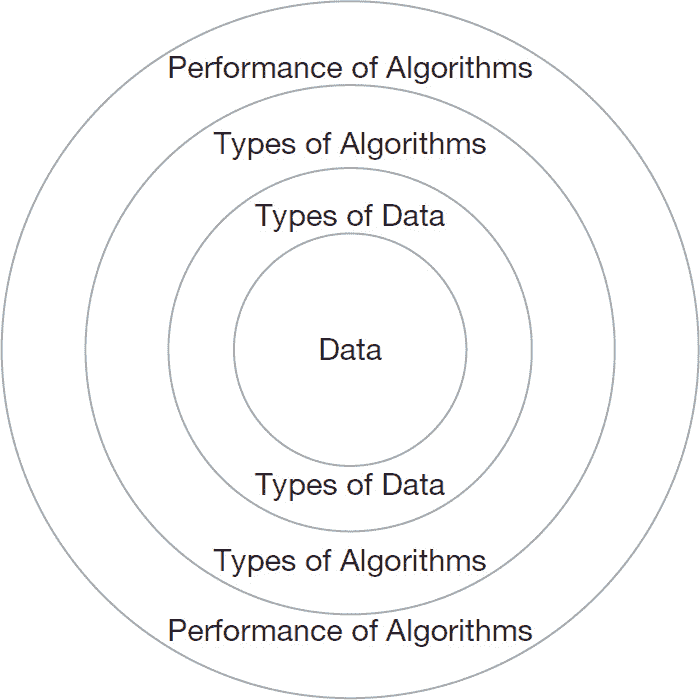

Figure 5.1 Core of computational learning

存在不同类型的 CLT，每种都关注从数据中学习的不同的方面。如前所述，监督算法从标记数据中学习，无监督算法从未标记数据中学习，强化算法从奖励和惩罚中学习，而进化算法则从进化过程中学习。CLT 还关注理解这些算法的性能。这涉及理解它们的准确性和效率，以及它们对新数据的泛化能力。

CLT 中使用的主要方法如下：

- **归纳学习**：这是 AI 中最常用的学习类型。在这里，计算机程序被赋予一组训练数据（正确输入和输出的具体示例），然后被要求生成一个通用规则或模型，可用于预测新输入的输出（Fig. 5.2）。
- **演绎学习**：在这里，计算机程序被赋予一组规则或模型（通用），然后被要求使用这些规则或模型为新输入生成正确输出（Fig. 5.2）。

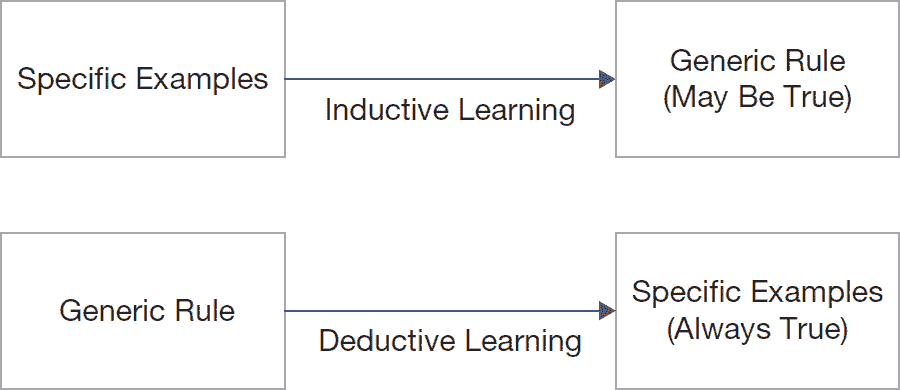

Figure 5.2 Inductive and deductive learning

- **溯因学习**：在这里，计算机程序被赋予一组训练数据（不完整观察），然后被要求生成一个假设（对数据的一种可能解释），该假设与数据一致（Fig. 5.3）。

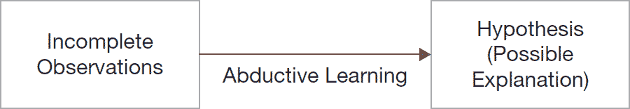

Figure 5.3 Abductive learning

### 强化学习

这里，一个计算机程序被给定一组奖励和惩罚，然后被要求学习一个 `policy`（一组规则），以最大化奖励并最小化惩罚。

我们现在将详细探讨其中的每一个。

### 5.5.1 归纳学习

归纳学习是人工智能中最常见的机器学习类型。这是一个计算机程序被给定一组训练数据，其中包含正确输入和输出的示例的过程。然后使用这些数据生成一个通用规则或模型，该模型可用于预测新输入的输出。

```
Inductive Learning = Experience + Knowledge + Reasoning
```

这种学习方式使用经验、知识和推理来得出结论并做出预测。归纳学习的过程类似于人类从经验中学习的方式。与人类一样，机器从示例中学习并利用这些信息预测新情况。

归纳学习的一个例子是电子邮件中使用 `spam filters`。首先，垃圾邮件过滤器在被标记为垃圾邮件或非垃圾邮件的电子邮件上进行训练。然后，基于这些电子邮件的特征，算法创建一个模型，可用于将新电子邮件分类为垃圾邮件或非垃圾邮件。

在归纳学习中，准确性取决于训练数据的质量。如果训练数据有偏差或不足，模型将无法精确预测新输入的输出。因此，必须拥有多样化且具有代表性的训练数据集，以确保模型能够做出准确的预测。

归纳学习有效这一想法在归纳学习假设中被正式表述。该假设断言，如果一个假设在大量且具有代表性的训练示例上拟合数据良好，那么它在全新的测试示例上也会拟合数据良好。例如，如果假设“所有鸟都会飞”与大多数鸟类训练示例相符，我们可以预期它也将与大多数鸟类测试案例相符。

然而，并非所有理论都一样。有些可能过于狭窄或过于宽泛，无法充分解释数据。例如，断言“所有鸟都是黑色的”过于狭窄，因为它忽略了不同鸟类颜色的存在。断言“所有动物都会飞”过于宽泛，因为它涵盖了鸟类以外的物种。一个有说服力的假设应该是恰到好处的。这被称为 `bias–variance trade-off`。

归纳学习算法寻求选择最能准确描述数据并将其推广到新数据的最佳假设。为此，它们必须浏览各种潜在假设并使用一组标准对其进行评估。一个标准可能是假设与训练数据集的匹配准确度。假设的复杂性或简洁程度也可能是额外的标准。`Occam’s razor`，即最佳假设是拟合事实最好的假设，是平衡这些要求的一种流行方法。

归纳学习在机器学习中很有帮助，因为它帮助我们从数据中学习，并根据所学做出预测或决策。例如，它可用于根据动物特征对动物照片进行分类，或根据客户兴趣向客户推荐产品。通过归纳学习，我们可以从我们可能之前没有注意到的事实中获得新知识或新见解。

### 5.5.2 演绎学习

这是一种机器学习类型，其中计算机程序被提供一组预定义规则或模型，它使用这些规则或模型为新输入生成准确输出。在这种方法中，计算机必须根据提供的规则或模型进行逻辑推理，以推断新信息并预测结果。

```
Deductive Learning = Knowledge + Reasoning
```

演绎学习是一种推理形式，其中结论是从一组前提或事实中得出的。在这里，如果前提为真，则结论必然为真。演绎学习的一个例子是在医学诊断中使用 `decision trees`。决策树是通过输入来自具有不同症状和结果的各种患者的数据而创建的。利用这些信息，计算机生成一个决策树，可用于根据新患者的症状预测其预后。这种方法已成功诊断出许多医学状况，包括心脏病和癌症。


## 另一个例子：金融中的专家系统

专家系统是旨在模拟人类专家在特定领域决策能力的计算机程序。在金融领域，专家系统可用于分析市场趋势并预测未来价格。通过输入来自各种来源的数据，包括新闻文章和财务报告，系统可以对市场方向做出明智的预测。

## 5.5.3 溯因学习

这涉及生成与一组训练数据一致的假设。这种学习方法近年来变得越来越流行，许多研究人员和开发人员都在探索其潜在应用。

它表示为 `P(H|E) = P(E|H) × P(H) / P(E)`。这表明在给定证据 `E` 的情况下假设 `H` 的概率等于在给定假设的情况下证据的概率乘以假设的概率除以证据的概率。换句话说，这是给定证据的假设的概率，同时考虑了假设的先验概率。

基本思想是计算机程序被给定一组训练数据，然后被要求生成一个解释数据的假设。此外，假设必须与数据一致，这意味着它必须能够根据训练数据中的模式准确预测新数据。

溯因学习使其在学习过程中具有更大的灵活性，这是其主要优势之一。与其他类型的机器学习不同，溯因学习不需要预定义的特征或变量集。相反，程序可以根据其在数据中观察到的模式生成自己的假设。

例如，一家公司希望预测未来一年内最有可能离职的员工。他们可以使用溯因学习来分析员工的工作满意度、薪水和其他因素，并生成关于哪些因素最有可能导致员工流失的假设。这些信息随后可用于制定保留员工和减少流失的策略。

另一个例子是在医学诊断中。医生可以使用溯因学习算法分析患者数据并根据症状和其他临床因素生成最可能的诊断假设。这可以帮助医生做出更精确的诊断和更有效的治疗计划。

## 5.5.4 强化学习

强化学习程序被指示根据奖励和惩罚做出决策。该程序必须发现一个 `policy` 或原则，以最大化奖励并最小化惩罚。这种学习类型经常用于机器人技术、游戏和其他计算机必须根据不完整或模糊数据做出决策的应用中。

`Bellman equation` 用于强化学习。它描述了给定行动的预期奖励与所有可能行动的预期未来奖励之间的关系。它指出，给定行动的预期奖励等于即时奖励加上未来可以采取的最佳行动的折扣预期奖励。它以 1957 年提出它的理查德·贝尔曼命名。

在数学上，它可以表示为：`V*(s) = max(Q(s,a)) + E[V*(s′) | s,a]`。在这个等式中，`V*(s)` 是状态 `s` 的最优值，`Q(s, a)` 是在状态 `s` 中采取行动 `a` 的预期值，而 `E[V*(s′) | s, a]` 是由此产生的状态的预期值，且 `a` 是状态 `s` 中的行动。

## 强化学习示例

强化学习的一个例子是训练机器人导航迷宫。机器人到达迷宫终点时会获得奖励，撞墙或卡住时会受到惩罚。通过试错，机器人学会了哪些行为会导致奖励，哪些会导致惩罚，并据此调整其行为。

另一个例子是训练计算机程序玩象棋之类的游戏。程序赢棋时会获得奖励，输棋时会受到惩罚。通过反复对弈和分析成功的策略，程序学会了哪些走法最有可能导致胜利，哪些应避免。

强化学习可以成为创建智能系统的有力工具，使其能够基于不完整或不确定的信息做出决策。然而，精心设计奖励和惩罚至关重要，以确保系统学习到期望的行为。

## 5.6 近似正确学习

学习是一个通过经验、学习或指导获取知识和技能的过程。近年来备受关注的一种学习类型是近似正确 `PAC`。当数据存在噪声或不完整时，该方法是有益的，因为它允许创建能够在输入不完美的情况下仍能准确预测结果的模型。

`PAC` 方程是描述从给定数据集学习过程的数学公式。它指出，给定一组数据点，学习算法可以用一定的概率和精度近似目标函数。该方程定义为：

`P(f(x) ≈ y) ≥ 1 - ε`，

其中 `P` 是概率，`f(x)` 是目标函数，`y` 是学习算法的输出，`ε` 是错误率。

`PAC` 学习的一个例子是语音识别。当一个人说话时，其声音会受到各种因素的影响，包括背景噪声、口音和言语障碍。为了准确识别语音，模型必须考虑这些变化。采用 `PAC` 学习方法，研究人员可以创建能够在音频数据不完美时仍识别语音模式的模型。

另一个例子是计算机视觉。这里的输入数据可以是图像或视频，可能包含各种失真或错误。例如，一只猫的照片可能拍摄角度异常、模糊或背景中有其他物体。为了准确识别图像中的猫，`PAC` 学习模型可以被训练以识别猫的特定特征，即使这些特征在输入数据中并不总是存在。

假设 `f`：`X`→`Y` 与训练样本 (`x`[1],`y`[1])，⋯，(`x`[*n*],`y`[*n*]) 一致 当且仅当 `f(x[i])` = `y[i]` ∀`i`。

给定任何一组标记示例 `S`，算法 `A` 与 `S` 一致，如果它存在并且输出‘无一致概念’，否则。`PAC` 模型的目标是定义假设 `h`，使得 `h` 在 `D` 上的误差很小。

给定样本集 `S` = {(`x`[1],`y`[1]),⋯(`x`[*m*],`y`[*m*])}，概念 `h` 相对于 `S` 的经验误差定义为

```
$err_{S}\left( h \right) = \frac{1}{m}\sum\limits_{i = 1}^{m}I\left\lbrack {h\left( x_{i} \right) \neq y_{i}} \right\rbrack$
```

`PAC` 模型的核心思想是假设训练样本来自单一的固定分布空间。目标是使用样本集 `S` 学习一个概念 `h`，使其在 `D` 上的真实误差很小。

`PAC` 学习旨在实现高效学习。为此，我们需要证明高效的学习算法能够确定一个与目标概念近似相同的假设。在此过程中，我们定义两个参数 `ε` 和 `δ`，并证明以至少 `(1 - δ)` 的概率，系统可以学习到误差最多为 `ε` 的概念。

如果算法在 `PAC` 模型中学习，则它很可能（置信度为 `(1 - δ)`）输出一个近似正确（风险最多为 `ε`）的假设。

### 有限一致假设空间的复杂度

```
$m \geq \frac{1}{\varepsilon}\left\lbrack {\ln\left( H \right) + \ln\left( \frac{1}{\delta} \right)} \right\rbrack$
```

这里，标记示例是足够的，因此以 `(1 - δ)` 的概率，所有 `h` ϵ `H` 且 `errorD` ≥ ∈ 具有 `errorS` > 0。

以至少 `(1 - δ)` 的概率，所有 `h` ϵ `H` 使得 `err[S]` (`h`) 意味着

```
$error_{D} \leq \frac{1}{m}\left\lbrack {\ln\left( H \right) + \ln\left( \frac{1}{\delta} \right)} \right\rbrack$
```

### 有限不一致假设空间的复杂度

```
$m \geq \frac{2}{2\varepsilon^{2}}\left\lbrack {\ln\left( H \right) + \ln\left( \frac{2}{\delta} \right)} \right\rbrack$
```

这里，标记示例是足够的，因此以 `(1 - δ)` 的概率，所有 `h` ϵ `H` 具有 `|errorD−errS|` < `ε`。

### 5.6.1 奥卡姆剃刀

可以表述为“偏好最能拟合数据的简单假设”。当在不同模型之间进行选择时，该原则常用于机器学习。解释最简单的模型通常最有可能正确。除非向模型添加更多假设（偏置），否则无法泛化到训练数据之外。

考虑一个定义为 `H`=`h`：`X`→`Y` 的假设。所有 `2^N` 实例都必须被标记。

假设 `h` 相对于目标概念 `C` 和观测分布 `D` 的真实误差是根据 `D` 抽取的实例被 `h` 误分类的概率。

`errorD` = `P[x ∼ D][c(x)≠h(x)]`

奥卡姆剃刀被用作机器学习中的归纳偏置。归纳偏置是机器学习算法为了形成假设或对一组训练实例进行泛化而做出的假设，目标是对未观察到的数据进行分类。为此，我们需要使用 `PAC` 学习来定义模型的设置。

## 5.7 机器学习复杂性理论

机器学习复杂性理论是人工智能的一个分支，研究复杂系统的行为。它关注算法如何与数据交互以及如何用于做出决策。机器学习复杂性理论是一个快速增长的领域，在金融、医疗保健和机器人等多个行业都有应用。例如，在金融领域，算法用于预测股价和做出投资决策。在医疗保健领域，算法用于诊断疾病和推荐治疗方法，而在机器人领域，这些算法用于控制机器人并决定它们应如何移动和与环境交互。

它基于这样一个思想：机器可以从数据中学习，并且数据的复杂性可用于做出预测和决策。这是通过使用算法分析数据并确定模式和趋势来实现的。然后数据复杂性可用于创建可用于决策的模型。

数据的复杂性由变量的数量和变量之间的关系数量决定。数据越复杂，做出预测和决策就越困难。

### 5.7.1 学习计算复杂度

学习算法的计算复杂度是指产生模型所需的时间和资源。这可能受多个变量的影响，例如数据集的规模和复杂性、必须分析的特征数量以及所采用的机器学习算法类型。

作为一个说明，假设一家银行想要使用机器学习算法来预测哪些借款人最有可能违约贷款。他们需要分析大量的数据，包括客户的信用历史、收入和其他相关因素的信息。如果银行使用简单的逻辑回归模型，就可以用相对较少的资源产生相当准确的预测。然而，如果他们选择更复杂的深度学习模型，则可能需要投资昂贵的硬件和软件，并投入大量时间和人力来训练模型。

学习算法的复杂性对于模型的准确性和可靠性也可能产生重要影响。在某些情况下，更复杂的模型可以产生更准确的预测或识别数据中更微妙的模式。然而，这些模型也可能更容易过拟合，即模型变得过于专门化于训练数据，无法推广到新的数据集。

更复杂的算法通常需要更长的时间来分析数据并生成模型。这可能会对需要实时预测或快速决策的应用造成实质性不利影响。机器学习研究人员和开发人员优化计算复杂性的一种方法是探索专门设计用于减少生成模型所需操作次数的新算法和技术。例如，诸如剪枝和量化之类的技术可用于简化复杂的神经网络并降低其计算复杂性，而不会牺牲准确性。另一种方法是仔细选择输入数据中要分析的特征。专注于最相关和最具信息量的特征可以大幅减少生成模型所需的操作次数，而不会损害其准确性。因此，学习算法的复杂性通常以时间和空间复杂度来衡量。时间复杂度衡量算法完成任务所需的时间，而空间复杂度衡量存储算法的数据和结果所需的内存量。

与学习算法计算复杂性相关的挑战包括设计高效算法、优化这些算法以及理解其行为的困难。解决这些挑战的一种潜在方案是使用近似算法，即产生近似结果而非精确结果的算法。近似算法通常比精确算法更快，并且需要的内存更少。另一种潜在解决方案是使用并行计算，这允许多个处理器同时处理同一问题。这可以显著降低算法的时间和空间复杂度。

## 5.7.2 学习算法的空间复杂度

空间复杂度衡量存储算法的数据和结果所需的内存量。它是计算学习中的一个重要考虑因素，因为它会显著影响算法的效率和有效性。例如，如果算法需要大量内存来存储数据和结果，则在特定设备或系统上运行可能会很慢甚至不可能。

空间复杂度模型的方程通常表示为 `S(n) = c*n`，其中 `S(n)` 是空间复杂度，`n` 是输入大小，`c` 是一个常数。该方程表明空间复杂度与输入大小成正比。换句话说，随着输入大小的增加，算法的空间复杂度会成比例地增加。

在计算学习中衡量空间复杂度有几种方法，包括表示数据所需的位数以及算法执行期间必须存储的中间结果的数量。空间复杂度还可能取决于算法的具体实现以及用于存储数据的数据结构。

减少计算学习中空间复杂度的一个常见方法是使用诸如数据压缩或降维之类的技术。这些技术减少了存储数据和结果所需的内存量，同时保持算法的准确性和有效性。另一个重要考虑因素是空间与时间的权衡。在某些情况下，使用更多内存来存储中间结果可能更有效地减少整体算法执行时间。然而，在其他情况下，权衡可能是相反的，使用更少的内存并接受更长的运行时间可能更有效。

## 5.7.3 学习算法的样本复杂度

样本复杂度与学习一项任务所需的样本数量有关。如果机器学习算法可以用少量样本学习一项任务，则可以说它具有较低的样本复杂度。相反，如果算法需要大量样本来学习一项任务，则可以说它具有较高的样本复杂度。样本复杂度由多个因素决定，包括任务的复杂性、所使用的数据类型、所使用的特征数量以及所使用的模型类型。

在机器学习中，任务的复杂性由多个因素决定，包括变量的数量、类别的数量以及这些变量之间的关系。用于预测天气模式的机器学习算法是复杂任务的典型例子。这是因为需要考虑的变量众多，例如温度、湿度和气压，以及这些变量之间可能影响结果的许多关系。另一方面，设计用于预测抛硬币结果的机器学习算法会简单得多。这是因为只有两种可能的结果，正面或反面，没有其他变量需要考虑。在这种情况下，算法需要分析过去的数据并使用概率来预测未来抛硬币的结果。

关于计算学习，所使用的数据类型对于实现准确结果至关重要。这是因为机器学习中使用的数据是算法基于其进行预测的基础。因此，所使用的数据必须与所做的预测相关。例如，设计用于预测股票价格的机器学习算法需要从财务数据中学习，而设计用于预测体育比赛结果的算法则需要体育数据。可用数据的数量也显著决定了机器学习算法中使用的特征数量。例如，设计用于预测信用评分的机器学习算法需要许多特征，例如收入、信用历史和就业状态，才能做出准确的预测。另一方面，设计用于预测特定事件结果的机器学习算法需要的特征更少。

计算学习涉及选择合适的算法和用于训练模型的优化方法。所选模型类型受需要解决的问题的影响。优化方法决定了算法如何调整其模型参数以最小化预测与实际结果之间的误差。例如，`stochastic gradient descent (SGD)` 是一种优化方法，它比 `batch gradient descent (BGD)` 优化更频繁地更新模型的参数。`SGD` 对于大数据集特别有用，因为批量优化在计算上可能很昂贵。

提高机器学习算法样本复杂度的一个技术是特征选择。这涉及从数据集中选择最关键的特征，这有助于减少算法需要学习的大量冗余或无关数据。例如，在客户购买习惯的数据集中，特征选择可能涉及识别最关键的变量，例如年龄、性别和收入，同时排除不太相关的变量，例如发色或鞋码。

另一种技术是 `feature engineering`，它涉及将数据转换为更适合 ML 算法的形式。这可能涉及归一化、缩放和降维技术。最后，超参数调优优化 ML 算法的参数以提高其性能。这可能涉及诸如 `grid search` 或 `random search` 等技术，有助于为给定算法识别最佳参数。

## 5.7.3.1 有限假设空间的样本复杂度

这是指从给定的假设空间准确学习一个概念所需的最少示例数量。样本复杂度取决于假设空间的大小和所需的准确度水平。

有限假设空间的样本复杂度方程如下：

`Sample Complexity = log(|H|) / ε`，

其中 `|H|` 是有限假设空间中的假设数量，`ε` 是所需的准确度。

该方程表明，空间中的假设数量和所需的准确度决定了有限假设空间的样本复杂度。假设数量越大，就需要更多的样本才能达到所需的准确度。同样，所需的准确度越高，就需要更多的样本才能实现。

例如，考虑一个二元分类问题，其中假设空间由二维空间中所有可能的线性分隔符组成。学习正确分隔符达到 90% 准确度所需的样本复杂度大约为 100 个示例。然而，如果假设空间由更复杂的函数组成，例如具有多层的神经网络，则实现相同准确度水平所需的样本复杂度可能显著更高。

另一个例子是用于分类的决策树算法。在这种情况下，假设空间由可从可用特征构建的所有可能决策树组成。学习具有一定准确度水平的决策树所需的样本复杂度取决于特征的数量和底层数据分布的复杂性。

## 5.7.3.2 无限假设空间的样本复杂度

对于无限假设空间而言，样本复杂度的问题变得至关重要。在这里，挑战在于确定需要多少个示例才能确保假设在长期内表现良好。

以下公式给出了无限假设空间的样本复杂度方程：

`Sample Complexity = log(H)/ε`，

其中 `H` 是假设空间中的假设数量，`ε` 是学习算法所需的准确度。

该方程表明，学习算法对无限假设空间的样本复杂度与假设数量的对数成正比。换句话说，假设越多，就需要更多的数据样本才能达到所需的准确度。

假设我们试图预测一个人是否会喜欢某部特定电影。无数因素会影响他们的意见，例如类型、演员、导演等。我们可以创建无限数量的假设来解释这些因素，每个假设都有其自己的参数和假设。

在这种情况下，样本复杂度是指我们必须调查多少名影迷才能准确预测新的人是否会喜欢这部电影。如果我们只调查了少数几个人，我们的结果可能会因偶然或个人偏好而产生偏差。但如果我们调查了数千人，我们对预测的信心就会更大。

无限假设空间的另一个例子可以在机器学习领域找到。想象我们试图训练一台计算机识别不同类型的动物，从狗和猫到斑马和长颈鹿。我们可以创建无限数量的假设来解释区分这些动物的各种特征，例如它们的毛皮图案、身体形状等。

在这种情况下，样本复杂度是指我们需要向 ML 算法输入多少张动物图像才能准确分类新图像。因此，如果我们只在几十张图像上训练算法，它可能难以推广到新数据。但如果我们在数千张图像上训练它，它就有更好的机会识别模式并做出准确的预测。

## 5.7.4 学习的时间复杂度

ML 中学习的时间复杂度是指 ML 算法从数据中学习并做出准确预测所需的时间。它是在为给定任务选择算法时需要考虑的重要因素。不同的算法具有不同的时间复杂度，选择能够快速准确学习的算法非常重要。

ML 中学习的时间复杂度由数据集的大小、任务的复杂性和所使用的算法类型决定。

任务越复杂、数据集越大，机器学习所需的时间就越长。想象你试图训练一台机器识别手写数字。如果我们只有少量样本可供使用（比如 100 个），那么学习的时间复杂度相对较低。这是因为机器能够快速处理数据并学习以相对较高的准确度识别数字。另一方面，如果你使用的是更广泛的数据集（比如 10,000 个样本），学习的时间复杂度会高得多。这是因为机器必须处理更多有意义的数据，这需要更多的时间和计算能力。

此外，如果手头的任务更复杂（例如识别手写字母而不是数字），学习的时间复杂度会进一步增加。值得注意的是，有办法减轻数据大小和任务复杂性对学习时间的影响。例如，可以预处理数据以减少其大小或复杂性，并且可以优化算法以使其更高效。然而，这些解决方案只能做到一定程度，最终，ML 中学习的时间复杂度由底层任务和数据集决定。


所使用的算法类型在确定学习时间复杂度方面也起着至关重要的作用。一些算法在从数据中快速准确学习方面比其他算法更有效。像 `SGD` 和 `mini-batch SGD` 这样的算法非常适合从大型数据集中学习，因为它们一次基于数据的小子集（或“迷你批次”）更新模型参数，这使得计算更快、更高效。

另一方面，像 `K-nearest neighbor` (`KNN`) 和 `decision trees` 这样的算法更适合较小的数据集。这是因为它们涉及大量的计算和内存使用，这在处理大量数据时会减慢学习过程。当然，一些算法介于这两个极端之间。例如，`support vector machines` (`SVMs`) 以其对小数据集和大数据集都高效而闻名，并且能够以高准确度处理复杂的决策边界。

## 5.8 基于错误的学习模型

这是一种试图捕捉人类从错误中学习本质的模型。这一范式背后的概念是我们学习时会犯错误，并且这些错误是学习过程不可或缺的一部分。此外，该模型假设我们有一些反馈机制来告诉我们何时犯了错误，并且我们利用这种反馈来调整未来的行为。

基于错误的学习模型是一种用于估计给定决策预期损失的算法。它使用一组数据点来根据过去犯的错误次数计算决策的预期损失。其方程如下：

`Expected Loss = (Number of Mistakes + 1) / (Number of Data Points + 2)`

## 5.9 基于实例的学习

基于实例的学习，也称为基于示例的学习，是一种机器学习形式，其中模型通过存储和分类单个示例来学习，而不是遵循预定义规则。它是一种懒惰学习形式，因为模型仅在引入新实例时才执行分类。基于实例学习模型的方程通常表示为：

`Predicted Output = f(Inputs, Instances)`

该方程表明，模型的预测输出是输入和实例的函数。实例是用于训练模型的数据点，可能包括输入值和输出值。模型会查看实例并利用它们来预测新输入的输出。

`K`-最近邻 (`KNN`) 是基于实例学习算法的一个例子。它是一种简单而有效的分类和回归技术。新的实例根据其在训练集中 `K` 个最近邻居的多数类别进行分类。例如，如果我们有一个包含花卉物种的数据集，其属性包括花瓣长度、宽度和萼片长度，我们就可以使用 `KNN` 根据其属性确定新花卉的物种。

另一个例子是基于案例的推理 (`CBR`)。这是一种利用过去经验（案例）来解决新问题的解决问题技术。`CBR` 通过从案例库中检索相似案例、调整解决方案以适应新问题，并将解决方案作为新案例保留以供将来使用来工作。例如，如果我们有一个医学诊断的案例库，我们就可以使用 `CBR` 根据患者的症状和病史诊断新患者。

当数据存在噪声或特征之间的关系复杂时，基于实例的学习是有益的。此外，它允许灵活和自适应学习，因为模型可以轻松地纳入新实例并相应地调整其分类规则。

然而，基于实例的学习也可能计算成本高昂，并且如果数据集过大或特征数量过高，容易出现过拟合。它还要求仔细选择距离度量，以确保相似实例能够被正确识别。

## 5.10 懒惰学习和急切学习

学习是我们生活不可或缺的一部分。我们从经验、周围的人以及各种知识来源中学习。在机器学习中，学习有两大类：懒惰学习和急切学习。

懒惰学习是一种在系统等待查询发出后再使用训练数据进行预测的学习类型。这也称为基于实例的学习，因为它使用特定的数据实例来进行预测。懒惰学习模型的方程如下：

```
F(x) = argmin h∈H Σi=1nL(h(x_i), (y_i))
```

该方程表明，懒惰学习模型的输出是从假设集 (`H`) 中选择使每个输入 (`x_i`) 及其对应输出 (`y_i`) 的损失 (`L`) 之和最小化的假设 (`h`)。换句话说，懒惰学习模型通过最小化总误差来找到最适合数据的假设。一个例子是 `K`-最近邻算法。在这里，系统等待查询发出，然后在训练数据中查找 `K` 个最近邻居，并利用它们的输出来进行预测。

另一方面，急切学习是一种在任何查询发出之前，系统就从训练数据中学习模型的 learning 类型。这也称为基于模型的学习。急切学习模型的方程如下：

`Loss = f(w) + λR(w)`

其中 `w` 表示模型的权重，`f(w)` 是损失函数，`λR(w)` 是正则化项。

损失函数量化了预测输出与实际输出之间的差异，而正则化项则惩罚较大的权重以防止过拟合。模型的目标是最小化损失函数和正则化项。急切学习的一个例子是决策树算法。在这里，系统从训练数据中构建一个树状模型，可用于预测任何查询。

这两种学习方式各有优缺点。懒惰学习在计算上成本较低，因为它不需要训练或构建模型。然而，在进行预测时可能较慢，因为它对每个查询都依赖训练数据。另一方面，急切学习在进行预测时速度更快，因为模型已经构建完成。然而，急切学习在计算上可能成本高昂，需要从训练数据中构建模型。

因此，当训练数据庞大且查询不频繁时，懒惰学习更合适。当查询频繁且训练数据较小时，急切学习更合适。最终，选择使用哪种学习方式取决于计算成本与预测准确性之间的权衡。

## 5.11 生成式学习

生成式学习是一种机器学习方法，其包括构建一个代表数据生成过程的模型。这是通过获取数据内部基本模式和联系的知识，然后利用这些信息生成与现有数据相似的新实例来实现的。生成式学习与判别式学习不同，因为它涉及构建能够预测特定样本类别标签的模型。

当数据稀缺或数据异常复杂时，生成式学习具有优势。通过理解其底层结构，生成模型能够生成与原始数据相似的新实例。例如，考虑一个包含手写数字的数据集。生成模型能够学习数据内部的基本模式和联系，然后利用这些信息生成与原始数据非常相似的手写数字新实例。

生成式学习模型有多种类型，如概率、生成、潜在变量和生成对抗网络。

概率模型采用概率论来阐明给定数据中变量之间的相互联系。一个实例是朴素贝叶斯分类器。它是一种常用的用于文本分类的简单概率模型。该模型获取每个词在每个类别中出现的可能性，然后利用这些信息预测给定文本样本的类别 designation。

换句话说，决策的期望损失是通过将过去犯的错误数量除以数据点数量加二来计算的。该方程有助于确保决策的期望损失不会过高或过低。

学习如何踩自行车踏板是基于错误（基于失误）的学习的一个例子。当我们第一次骑自行车时，我们很可能会犯许多错误。我们可能会从自行车上摔下来，失去平衡，或朝错误的方向转向。然而，每次我们犯错时，我们都会从中学习。我们调整平衡、转向和踏板，以避免重复同样的错误。

基于失误界限的学习模型在人工智能和机器学习中有许多应用。例如，它可用于训练算法识别数据中的模式。通过对错误提供反馈，算法可以学习区分不同类型的数据，并在未来做出更准确的预测。

生成模型获取数据内部的基本模式和连接的知识，然后利用这些知识生成数据的新实例。`Gaussian mixture models` 和 `hidden Markov models` 是生成模型的实例。`Gaussian mixture models` 估计数据的潜在分布并利用这一知识生成新的数据实例。`Hidden Markov models` 获取数据的潜在组织结构并利用这一知识生成数据的新序列。

涉及潜在变量的模型通过检测解释可观察数据的隐藏或潜在因素来揭示数据的根本框架。`Principal component analysis (PCA)` 和 `factor analysis` 是潜在变量模型的例子。`PCA` 使用主成分通过识别解释数据变异性的成分来揭示数据的潜在结构。`Factor analysis` 是一种统计方法，用于识别解释数据集中变量之间联系的基本因素。

`Generative adversarial networks (GANs)` 是一种生成模型，由两个神经网络组成。初始网络生成数据的新实例，而后续网络评估生成样本的质量。两个网络同时训练，以开发能够生成顶级数据实例的生成器网络。

### 5.11.1 Importance of Generative Learning in Machine Learning

生成学习在机器学习中的重要性源于其学习数据潜在结构的能力。这在数据量有限的情况下尤其有用。通过学习数据中的潜在模式和关系，生成模型可以生成与原始数据相似的新示例，即使只有少量数据可用。

例如，生成模型可用于创建现实中不存在但看起来逼真自然的人脸、动物或场景的合成图像。这些合成图像可用于各种任务，例如数据增强、图像编辑或风格迁移。

生成学习的另一个优势是它可以帮助我们理解和探索数据的潜在结构和模式。例如，生成模型可用于发现影响数据的隐藏因素或维度，例如人脸图像的姿势、表情或身份，或文本文档的主题、情感或语气。然后可以操纵或控制这些潜在因素以生成数据的不同变体。

然而，生成学习也面临一些挑战和局限性。其中一个主要挑战是确保生成数据质量和多样性。质量是指生成数据看起来或听起来有多逼真自然，而多样性是指生成数据彼此之间以及与原始数据有多不同和多变。平衡这两个方面通常很困难，因为增加一个可能会降低另一个。例如，如果我们生成太多相似的图像或文本，它们可能看起来逼真但缺乏多样性。另一方面，如果我们生成太多多样化的图像或文本，它们可能看起来不自然或不逼真。

另一个挑战是评估和衡量生成模型的性能。与判别模型不同，后者可以通过将预测与真实标签进行比较来评估，生成模型没有明确的目标或标准来评判其输出。因此，很难量化生成模型的好坏。评估生成模型的可能方法之一是使用人类判断，例如评分或偏好，或使用代理指标，例如似然或距离。然而，这些方法要么是主观的，要么是间接的，可能无法涵盖生成学习的各个方面。

### 5.11.2 Probabilistic Models

这些是用于表示数据中不确定性和随机性的数学模型。这些模型用于进行预测、识别模式和分类数据。概率模型主要有两种类型：生成式和判别式。

`Generative models` 用于对输入数据及其对应输出的联合概率分布进行建模。它们用于生成与训练数据相似的新数据点。例如，生成模型可用于生成与训练图像相似的新图像。

`Discriminative models` 用于对给定输入数据的输出的条件概率分布进行建模。它们用于将输入数据分类到不同类别。例如，判别模型可用于将电子邮件分类为垃圾邮件或非垃圾邮件。

`Bayes’ theorem` 是一个用于根据先验知识或证据计算事件发生的概率的公式。它以英国统计学家托马斯·贝叶斯命名。公式为：

```
P(A|B) = P(B|A) × P(A) / P(B)
```

其中 `P(A|B)` 是在事件 B 已发生的情况下事件 A 发生的概率；`P(B|A)` 是在事件 A 已发生的情况下事件 B 发生的概率；`P(A)` 是事件 A 发生的先验概率；`P(B)` 是事件 B 发生的先验概率。

`Maximum likelihood estimation (MLE)` 是一种用于估计统计模型参数的方法。它涉及找到使似然函数最大化的参数值。似然函数是衡量模型拟合观测数据程度的函数。例如，如果我们有一组人的身高数据，我们可以使用 `MLE` 来估计身高的均值和方差。均值是所有人的平均身高，方差是身高围绕均值的变化程度。方差越高，身高差异越大。

`MLE` 是统计学中非常有用且强大的方法。它可用于估计许多不同类型模型的参数，例如线性回归、逻辑回归或神经网络。它还可用于比较不同模型并查看哪个模型更适合我们的数据。

`Naive Bayes classifier` 是一种基于 `Bayes’ theorem` 的分类算法。它被称为“朴素”，因为它假设输入数据的特征彼此独立。该算法通过计算给定输入数据的每个类别的条件概率，然后选择概率最高的类别。例如，`naive Bayes classifier` 可用于根据电子邮件中使用的词语将电子邮件分类为垃圾邮件或非垃圾邮件。

### 5.11.3 Generative Models

`Generative models` 用于生成与训练数据相似的新数据点。它们用于各种应用，例如图像生成、文本生成和音乐生成。它们与判别模型不同，后者用于将输入数据分类到不同类别。

生成模型有几种类型，但其中一些最常见的是如下：

* `Gaussian Mixture Models (GMMs)`: 这些用于将复杂的数据分布建模为更简单的高斯分布的组合。它们通常用于图像和语音识别应用。例如，在图像识别中，`GMMs` 可用于对图像中肤色的分布进行建模。这在人脸检测等应用中很有用，其目标是将皮肤区域与非皮肤区域分离。同样，在语音识别中，`GMMs` 可用于对不同音素的分布进行建模，音素是语音的基本单位。通过对音素的分布进行建模，`GMMs` 可用于识别所说的话。

GMMs 也常用于聚类应用中，其目标是将相似的数据点分组。在这种情况下，GMM 可用于对数据的分布进行建模，然后根据数据点属于各个高斯分布的可能性对数据点进行聚类。

### Hidden Markov Models (HMMs)

这些模型用于对数据序列进行建模，其中系统的状态无法直接观察。它们常用于语音识别和 NLP 应用中。例如，HMM 可用于对某人的语音进行建模，然后识别该人所说的话。详细来说，HMM 由两种类型的变量组成：隐藏状态和观测。隐藏状态是影响观测数据的潜在变量，但它们无法直接测量。观测是被记录并可见的变量。隐藏状态与观测之间的关系使用概率分布进行建模。HMM 有两组概率：转移概率和发射概率。转移概率描述了从一个隐藏状态移动到另一个隐藏状态的可能性。发射概率描述了从一个隐藏状态生成一个观测的可能性。

例如，假设我们想用 HMM 来建模天气。我们可以定义两个隐藏状态：低压和高壓。我们还可以定义两个观测：下雨和干燥。转移概率告诉我们从低压转到高压，或反之的可能性。发射概率告诉我们在特定气压下下雨或干燥的可能性。

HMM 可以使用历史数据进行训练以估计转移概率和发射概率。这可以使用 Baum–Welch 或前向-后向等算法完成。训练完成后，HMM 可用于根据观测序列解码最可能的隐藏状态序列。这可以使用 Viterbi 算法等算法完成。

使用 HMM 的一些应用示例有：

- Speech recognition: An HMM can be used to model the speech signals of a person and then recognize the words they are saying.

- Activity recognition: An HMM can be used to model the actions of a person or an object from a video and then recognize what they are doing.

- Gene finding: An HMM can be used to model the DNA sequences of an organism and then find the regions that encode proteins.

HMMs 有用之处在于它们可以捕捉数据的序列特性并处理观测中的不确定性和变异性。然而，它们也有一些局限性：

- 它们假设隐藏状态遵循马尔可夫性质，这意味着当前状态仅取决于前一个状态，而不取决于任何其他过去状态。

- 它们假设在给定隐藏状态的情况下观测是独立的，这意味着不同观测之间没有相关性。

- 它们可能需要大量数据才能准确训练并避免过拟合或欠拟合。

### Autoencoders

Autoencoders 是训练用于重构输入数据的神经网络。它们用于学习输入数据的压缩表示，可用于图像生成和异常检测等任务。例如，autoencoder 可用于通过学习输入人脸图像的特征来生成新的面部图像。

## 5.11.4 Latent Variable Models

这是一种统计模型，通过引入未观测和隐藏变量的概念，即潜在变量，来描述不同变量之间复杂的关系。这些模型用于在数据中发现无法直接观察到的模式和结构。

有不同类型的潜在变量模型，但其中最常见的是 PCA、因子分析和潜在狄利克雷分配 (`LDA`)。

`PCA` 是一种统计方法，用于通过找到能解释数据中大部分方差的较少数量的变量来降低数据集的维度。`PCA` 常用于金融等领域，可用于从股市数据中提取信息，或在生物学中，可用于分析基因表达数据。

因子分析是另一种用于寻找解释观测变量之间相关性的潜在因子的方法。换句话说，它有助于识别影响观测变量的共同因子。例如，在心理学中，它可用于识别影响不同行为的潜在人格特征。

潜在狄利克雷分配是一种在 NLP 中用于识别文本语料库中主题的模型。它常用于情感分析等应用中，可用于识别文本的整体情感，或在主题建模中，可用于将相似的文章分组在一起。

## 5.11.5 Generative Adversarial Networks

生成对抗网络，或 GANs，是一种用于生成与原始训练数据相似的新数据的 ML 模型。GANs 由两个神经网络组成：生成器和判别器。生成器负责从随机噪声中创建新样本，而判别器负责区分生成样本和真实样本。

生成器神经网络以随机噪声向量作为输入并生成与训练数据相似的新样本。判别器神经网络然后以生成的样本和来自训练数据的真实样本作为输入并尝试区分它们。随着训练的进行，生成器网络变得更擅长生成可以欺骗判别器网络的逼真样本，而判别器网络变得更擅长区分真实样本和伪造样本。

GANs 有广泛的应用，其中一些列在下面：

- Image synthesis: To generate realistic images that can be used in a variety of applications, such as video games, movies, and virtual reality.

- Data augmentation: To generate new data samples that can be used to train ML models. This can be useful in cases where the amount of training data is limited.

- Style transfer: To transfer the style of one image onto another. This can be used to create new images with a specific style, such as converting a photograph into a painting.


- Text generation: To generate new text data, such as product descriptions or news articles.
- Drug discovery: To generate new molecules that can be used in drug discovery. This can help to speed up the process of discovering new drugs.

## 5.11.6 Future Directions in Generative Learning

生成学习在近年取得了长足进步，并且有几个令人兴奋的方向正在发展。生成学习的未来方向包括：

- Improved image synthesis: While GANs have been successful in generating realistic images, there is still room for improvement in terms of image quality and diversity. Future research in generative learning will focus on developing more advanced models that can generate higher quality and diverse images.
- Multimodal generation: Multimodal generation is the ability to generate data that combines multiple modalities, such as text, audio, and images. This can be useful in applications like virtual assistants, where the system needs to respond with a combination of text and audio.
- Video synthesis: While GANs have been successful in generating static images, there is still a long way to go in terms of video synthesis. Future research in generative learning will focus on developing models that can generate realistic and diverse videos.
- Improved text generation: Text generation is another area where generative learning has made significant progress. However, there is still scope for improvement in terms of generating text that is more coherent and human-like.
- 医疗保健的生成建模：生成建模正被用于医疗保健中生成可用于训练机器学习模型的合成数据。该领域未来的研究将重点开发能够生成逼真且多样化的医学图像和数据的模型。
- 对抗攻击：对抗攻击是一种网络攻击类型，攻击者可以通过对输入数据添加微小、难以察觉的更改来欺骗 ML 模型。生成学习可用于开发能够检测并防御对抗攻击的模型。

### 5.12 一致学习

算法 `A` 对于概念类 `C` 使用假设 `H` 而言是一致学习器，如果 ∀`n`，∀`c` ∈ `C[n]`，且∀`m`，给定(`x[1]`, `C(x[1])`)，⋯，(`x[m]`, `C(x[m])`) 作为输入，其中 `x[i]` ∈ `X[n]` 使得 ∀`i` = 1⋯`m`，`h(x[i])` = `c(x[i])`。如果 `A` 的运行时间在多项式 `n`、size (`C`) 和 `m` 中，则称 `A` 为高效一致学习器。

#### 5.12.1 Vapnik–Chervonenkis (VC) 维数

一致学习器可用于在输出假设来自规模不太大且为多项式的类时开发 PAC 学习算法。如果输出假设大小为无限，则上述结果无法应用。在这种情况下，使用 VC 维数。

破碎：假设我们有两个点。线性分类器能否正确分类这两个点的标记？这两个点可以以四种不同的方式进行标记（Fig. 5.4）。

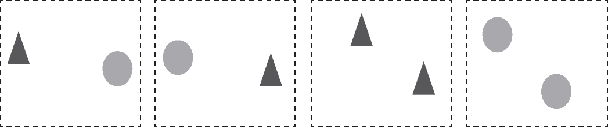

Figure 5.4 以四种方式表示的两类点

可以画一条线在四种方式下分离两类点（Fig. 5.5）。

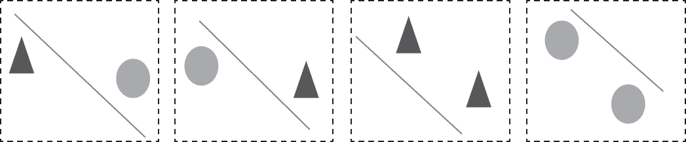

Figure 5.5 由一条线分隔的以四种方式表示的两类点

线性函数足够表达以破碎两个点。

考虑一个二分类问题的假设。N 个点或实例的集合可以以 2^N 种方式标记为 + 或 -。如果对于每种这样的标记，都可以在 ℋ 中确定一个函数。

一个例子集合 S 被函数集合 H 破碎，如果对于 S 中例子划分为正例和负例的每一种划分，都存在 H 中的一个函数对例子给出完全相同的标签。

示例 1：实轴上左有界区间的假设类 [0, a) 对于某个实数 `a` > 0（Fig. 5.6）。

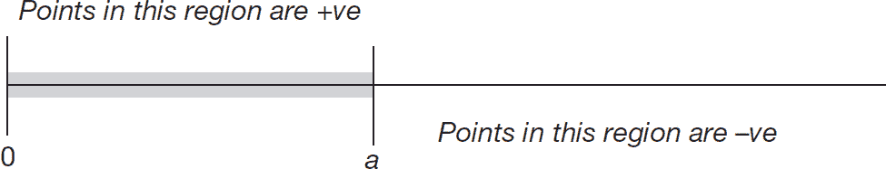

Figure 5.6 正区域和负区域

情况 1：假设我们有一个仅包含一个点的集合 S（Fig. 5.7）。

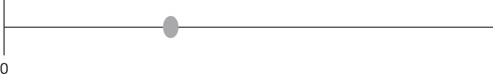

Figure 5.7 仅含一个点的集合 S

如果该点标记为 +ve，则可以找到一个位于该点右侧的点 `a`。这样的假设能正确将该点标记为 +ve。

如果该点标记为 -ve，则可以找到一个位于该点左侧的点 `a`。这样的假设能正确将该点标记为 -ve。

因此，任何单点集合都可以被破碎。

情况 2：假设我们有一个包含两个点的集合 S（Fig. 5.8）。

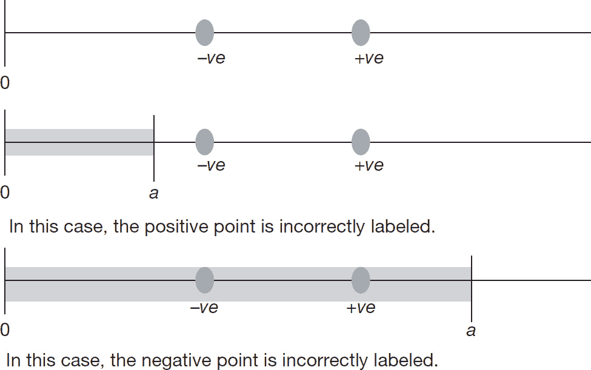

Figure 5.8 标记错误的点

我们可以对点进行标记，使得该类中没有任何假设与标签匹配。

示例 2：假设类是实轴上的区间集合 [a, b] 对于某个实数 `b` > `a`。范围 [a, b] 内的点标记为 +ve，范围外的标记为 -ve。

情况 1：假设我们有一个仅包含一个点的集合 S（Fig. 5.9）。

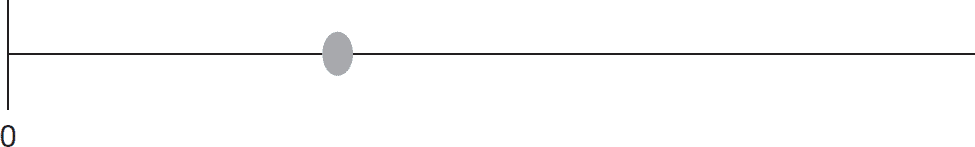

Figure 5.9 仅含一个点的集合 S

如果该点标记为 +ve，则可以找到两个点 `a` 和 `b`，使得 `a` 位于该点左侧，`b` 位于该点右侧。这样的假设能正确将该点标记为 +ve（Fig. 5.10）。

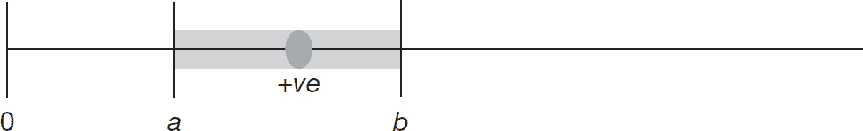

Figure 5.10 a 和 b 之间的一个正点

如果该点标记为 -ve，则可以找到两个位于该点右侧或左侧的点 `a` 和 `b`。这样的假设能正确将该点标记为 -ve。因此，任何单点集合都可以被破碎。

情况 2：假设我们有一个包含两个点的集合 S（Fig. 5.11）。

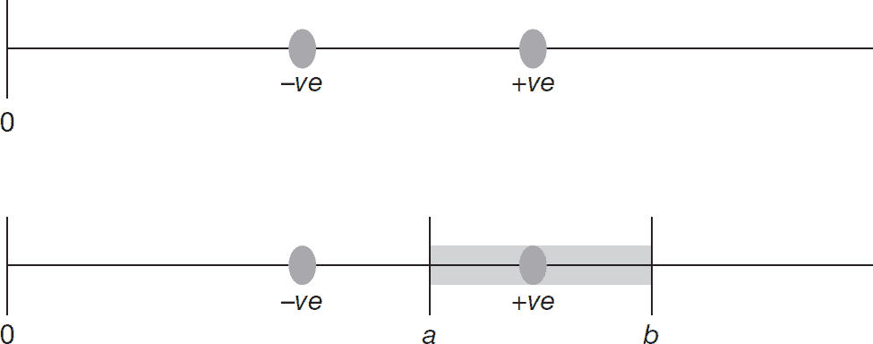

Figure 5.11 含两个点的集合 S

因此，任何两个点的集合都可以被破碎。

情况 3：假设我们有一个包含三个点的集合 S（Fig. 5.12）。

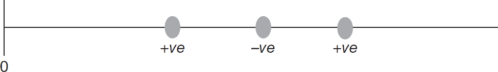

Figure 5.12 含三个点的集合 S

三个点的集合无法被破碎。

假设空间 H 在实例空间 X 上的 VC 维数是被 H 破碎的 X 的最大有限子集的大小。

如果存在大小为 `d` 的可被破碎的子集，则 `VC(H)` >= `d`。

如果不存在大小为 `d` 的可被破碎的子集，则 `VC(H) < d`。

对于无限假设空间，其 VC 维数表现类似于 log(|H|)。

VC 维数量化了分类器理解数据复杂模式的能力。分类器的 VC 维数与其破碎点集的能力密切相关。分类器的 VC 维数越大，破碎复杂点集的能力越高。如果分类器的 VC 维数较低，分类器难以理解数据的复杂模式，这会导致数据过拟合或欠拟合。

以 VC(H) 作为度量，我们可以为无限假设空间定义奥卡姆定理。给定一个包含 `m` 个例子的样本 D，找到与 `m` 个例子一致的 `h` ∈ H，其中

```
m > (1/ε) * (8 * VC(H) * log(13/ε) + 4 * log(2/δ))
```

则以 1-δ 的概率，假设空间的误差小于 ε。

### 5.13 最坏情况（在线）学习

预测不是一次性过程，而必须一再重复。预测必须针对新数据进行更新，并且决策制定必须根据新数据实现自动化。理想的解决方案是选择一个完全自动化的程序。该过程也必须具有鲁棒性。在线学习方法构成了一类用于进行一系列重复预测决策的算法。

在线学习在 ML 中指的是算法从数据流中顺序学习，随着新观测值的到来增量更新其模型的范式。虽然在线学习具有适应变化数据和资源效率等优势，但几种最坏情况会对其有效性产生影响：

- 概念漂移：如果数据中的潜在模式随时间显著变化，模型可能难以快速适应。这会导致模型性能下降。
- 灾难性遗忘：当模型用新数据更新自身时，它可能会忘记先前学习到的模式，尤其是在新数据与早期观测冲突时。
- 噪声数据：在线学习模型可能对噪声或错误数据敏感。如果传入数据包含高水平的噪声，可能导致错误的模型更新。
- 偏差或不平衡：如果传入数据有偏差或不平衡，模型可能偏向某些模式，难以从代表性不足的数据点中学习。
- 对抗攻击：在线学习系统可能容易受到对抗攻击，恶意构造的数据点会误导模型的学习过程。

在线学习可能在计算约束或内存有限的情况下遇到困难，尤其是在处理大量流式数据时。更复杂的模型可能需要大量的计算资源来对每个新数据点进行更新，使得它们不适用于实时学习。

为应对这些挑战，应采用不同的策略，如特征工程、稳健的模型架构、正则化技术，以及对模型性能和数据质量的持续监控。

#### 正则化技术

正则化方法如 `L1`/`L2` 正则化、`dropout` 或 `early stopping` 可以防止过拟合，并在存在噪声或变化数据的情况下帮助模型更好地泛化：

- `L1` 正则化 (`LASSO`)：在损失函数中添加与系数绝对值之和成比例的惩罚项。
- `L2` 正则化 (`Ridge`)：在损失函数中添加与系数平方和成比例的惩罚项。它惩罚大系数，但通常不会将其强制为零，从而平滑对模型的影响并减小系数的幅度。
- `Elastic net`：通过在损失函数中同时添加 `L1` 和 `L2` 惩罚来结合 `L1` 和 `L2` 正则化。该方法通过在特征选择 (`L1`) 和系数收缩 (`L2`) 之间取得平衡来克服 `L1` 和 `L2` 正则化的局限性。

#### 集成方法

采用集成方法，如 `bagging` 或 `boosting`，可以通过组合多个模型来提高模型性能，降低方差，并使系统对噪声数据或过拟合更具抵抗力。

#### 概念漂移检测

实施算法以尽早检测概念漂移。诸如监控统计度量或使用漂移检测算法等技术可以帮助识别数据分布发生偏移的时间，从而及时更新模型。

#### 在线特征选择

特征选择技术如 `information gain` 或 `recursive feature elimination` 在这方面可以提供帮助。

#### 稳健训练

使用对数据中的噪声或异常值不敏感的稳健优化方法。诸如 `robust regression` 或 `robust PCA` 等技术可以帮助减轻噪声观测的影响。

#### 平衡数据

通过采用诸如 `oversampling`、`undersampling` 或合成数据生成等技术来解决数据不平衡问题，以确保模型能够平等地从所有类别中学习。

#### 监控和更新

定期监控模型性能和数据质量，并增量更新模型以适应数据分布的变化。

#### 资源优化

通过使用增量学习技术、模型压缩等来优化计算资源，而不影响性能。

通过结合这些方法并持续改进模型的适应性和弹性，模型可以更有效地处理在线机器学习环境中的最坏情况。

## 5.14 计算学习理论的应用

CLT 在机器学习中的应用广泛而多样。它用于开发监督学习、无监督学习、强化学习和深度学习的算法。它还用于开发分类、聚类和回归的模型。此外，计算学习理论还用于开发特征选择、特征提取和模型选择的算法。

### 5.14.1 自然语言处理中的应用

机器翻译是将文本从一种语言自动翻译成另一种语言的过程。CLT 已被用于开发可以从大量翻译文本数据集中学习以提高机器翻译准确性的算法。这些算法可以从数据中的模式中学习，例如语言的语法和句法，以更好地理解文本的含义并产生更准确的翻译。

文本分类是将标签自动分配给文本文档的过程。CLT 已被用于开发可以从标记数据中学习以准确对文本文档进行分类的算法。这些算法可以从数据中的模式中学习，例如文本中使用的词语和短语，以更好地理解文本的含义并分配正确的标签。

情感分析是从文本中自动确定表达的情感或观点的过程。CLT 已被用于开发可以从标记数据中学习以准确识别文本中表达的情感的算法。这些算法可以从数据中的模式中学习，例如文本中使用的词语和短语，以更好地理解文本中表达的情感。

总之，由于其能够提供对语言结构和含义的洞察，CLT 已成为 NLP 中的重要工具。随着 NLP 领域的不断发展，计算学习理论将在新算法和应用的开发中继续发挥重要作用。

### 5.14.2 计算机视觉中的应用

计算机视觉是专注于开发能够解释和理解视觉数据的算法的研究领域。它被用于各种应用，例如人脸识别、物体识别和图像分割。为了实现这些任务，计算机视觉算法必须能够从数据中学习并做出预测。这就是计算学习理论发挥作用的地方。

例如，可以使用 CLT 开发计算机视觉算法来识别图像中的物体。该算法可以从数据中学习并预测图像中有哪些物体。图像分割是将图像基于某些特征划分为多个区域的过程。这可用于识别图像中的物体或将前景与背景分离。人脸识别是计算机视觉的重要应用，因为它可用于安全目的或识别个人。CLT 可用于开发可以从数据中学习并对面部特征做出预测的算法。

### 5.14.3 机器人技术中的应用

机器人技术是一个专注于机器人设计和开发的工程领域。机器人是设计用于自主或半自主执行任务的机器。随着机器人的不断进步，它们越来越多地被用于各种应用，例如制造、医疗保健和家庭自动化。

CLT 可用于提高机器人系统的性能。通过应用 CLT，机器人可以从其环境中学习并适应不断变化的条件。这可用于提高机器人运动的准确性和速度，以及识别物体和导航其环境的能力。

CLT 还可用于提高机器人系统的安全性。通过应用 CLT，机器人可以学习检测和避免障碍物，以及识别和应对危险情况。这有助于降低事故风险并提高机器人系统的安全性。

最后，CLT 可用于提高机器人系统的效率。通过应用 CLT，机器人可以学习识别模式并优化其运动以节省能源和时间。这有助于降低机器人系统的运行成本并提高其整体效率。

总之，CLT 可用于提高机器人系统的性能、安全性和效率。随着机器人的不断进步，CLT 将继续成为提高机器人系统性能的重要工具。

## 5.15 计算学习理论的评估指标

CLT 的评估指标对于评估机器学习算法的准确性和性能非常重要。评估指标提供了机器学习算法在给定任务上表现如何的定量度量。这对于理解不同算法的优缺点以及为特定应用选择最佳算法非常重要。

### 机器学习算法的评估指标

#### Accuracy

Accuracy 是最常用的 `ML` 算法评估指标之一。它是通过将正确分类的数据点数量除以数据点总数来计算的。当类别平衡时，Accuracy 是性能的一个良好衡量标准，但在类别不平衡时可能会具有误导性。

#### Precision and Recall

Precision 和 Recall 是 `ML` 算法的另外两个重要评估指标。Precision 衡量的是预测为正的结果中有多少是真正正确的。它是通过将真正例的数量除以预测为正的总数量来计算的。Recall 衡量的是实际正结果中有多少被正确预测。它是通过将真正例的数量除以实际正例的总数来计算的。

#### F-measure

F-measure 是 Precision 和 Recall 的组合。它是通过取 Precision 和 Recall 的调和平均数来计算的。F-measure 在类别不平衡时是评估 `ML` 算法的一个良好指标。

#### AUC-ROC

`AUC-ROC`（曲线下面积-接收者操作特征）是用于评估二元分类器性能的指标。它是通过绘制真正例率与假正例率的曲线来计算的。

## 5.16 计算学习理论的未来方向

`CLT` 是一个研究领域，专注于开发可用于从数据中学习的算法和技术。近年来，随着可用数据的数量呈指数级增长，它变得越来越重要。

最有前景的研究领域之一是深度学习算法的开发。这些算法可以从大量数据中学习，并可用于解决复杂问题。这些算法基于 `ANNs`，其结构模仿了人脑的结构。通过使用深度学习算法，机器可以学习识别数据中的模式并对未来结果做出预测。

另一个潜在方向是强化学习算法的开发。这些算法基于奖励和惩罚的思想，可用于教机器执行特定任务。最后，`CLT` 的另一个方向是迁移学习算法的开发，其基于从一个领域向另一个领域转移知识的思想。

所有这些方向都可用于提高 `ML` 算法的准确性并使其更高效。

### 5.16.1 与计算学习理论相关的深度学习进展

深度学习是 `AI` 中发展迅速的领域，近年来取得了巨大的增长。它基于使用 `ANNs` 模仿人类大脑工作方式的理念。深度学习已被用于解决各种问题，从图像识别到 `NLP`。特别是，深度学习的进展对 `CLT` 产生了重大影响。

与计算学习理论相关的深度学习最重要的进展之一是卷积神经网络（`CNNs`）的开发。`CNNs` 是一种专门设计用于识别图像中模式的神经网络类型。它们由相互连接的神经元层组成，使其能够识别图像中的模式。它们已被用于解决各种问题，例如对象识别、人脸识别和图像分割。

另一个重要进展是循环神经网络（`RNNs`）的开发。`RNNs` 是一种专门设计用于处理数据序列的神经网络类型。它们由相互连接的神经元层组成，使其能够处理序列。


### 5.16.2 与计算学习理论相关的可解释 AI

可解释 `AI`（`XAI`）是 `AI` 的一个分支，专注于使 `AI` 系统更透明和可解释。它与 `CLT` 密切相关。`CLT` 关注理解学习算法设计和分析背后的数学原理，而 `XAI` 则关注理解这些算法如何用于解释 `AI` 系统的行为。

`XAI` 的目标是使 `AI` 系统更透明和可解释，以便人类能够更好地理解和信任它们。这很重要，因为 `AI` 系统越来越多地被用于做出对人们生活产生重大影响的决策，例如在医疗保健、金融和刑事司法领域。

### 5.16.3 与计算学习理论相关的量子机器学习

量子机器学习（`QML`）是一个快速增长的研究领域，它将量子计算的强大功能与 `ML` 算法相结合，以创建解决复杂问题的新强大方法。`QML` 有潜力彻底改变我们对 `ML` 和 `CLT` 的思考方式。

量子计算基于量子力学原理，允许以比传统计算快得多的速度操纵信息。这使得开发能够在极短时间内解决复杂问题的算法成为可能。通过将量子计算与 `ML` 算法相结合，`QML` 可用于解决传统计算过于复杂的问题。

使用量子计算的优势包括能够快速处理大量数据、能够解决传统计算过于复杂的问题以及能够利用量子纠缠更快地解决问题。此外，量子计算可用于创建能够从数据中学习并适应变化条件的算法。

与量子计算相关的挑战包括创建准确可靠的算法的难度、需要专用硬件以及扩展量子计算系统的难度。此外，量子计算仍处于起步阶段，关于该技术还有很多需要学习的地方。

`QML` 的潜在应用非常广泛。`QML` 可用于创建能够分析大型数据集、识别数据中的模式并做出预测的算法。`QML` 还可用于创建能够识别和分类对象、检测数据中的异常并创建可用于决策的模型的算法。因此，`QML` 是一个快速增长的研究领域，有潜力彻底改变 `CLT`。

### Summary

* `Computational learning theory` 是人工智能的一个分支，专注于设计和分析从数据中学习的算法。它是一个相对较新的研究领域，但它已经对机器学习和人工智能的发展产生了重大影响。
* 主要目标是开发能够从数据中学习并对未来数据做出预测的算法。另一个目标是理解从数据中可以学习的内容的边界（限制）。这包括意识到学习算法的样本复杂度。
* 计算学习理论中使用的主要方法有归纳学习、演绎学习、溯因学习和强化学习。
* 学习算法的复杂性是指产生模型所需的时间和资源量。
* 学习算法的计算复杂度由其产生模型所需的操作数量决定。
* 误用界学习是一种试图捕捉人类如何从错误中学习的模型。
* 基于实例的学习，也称为基于示例的学习，是一种 `ML` 形式，其中模型通过存储和分类单个示例来学习，而不是遵循预定义规则。
* 急切学习是一种在任何查询之前，系统从训练数据中学习模型的学习类型。这也称为基于模型的学习。
* 生成学习是一种 `ML` 方法，其包括构建表示数据生成过程的模型。
* `CLT` 已应用于多个领域，包括机器人技术。
* 可解释人工智能（`XAI`）是人工智能的一个分支，专注于使人工智能系统更透明、更易解释。
* 量子机器学习（`QML`）是一个快速增长的研究领域，它将量子计算的强大功能与机器学习算法相结合，创造出解决复杂问题的新强大方法。

## 练习

## A 部分（客观题）

1. 哪个领域与计算学习理论密切相关，也涉及数据的分析？
   a) 计算机视觉
   b) 自然语言处理
   c) 统计学
   d) 机器人技术

2. 哪种类型的学习涉及使用未标记数据来识别模式并将数据点聚类到组中？
   a) 监督学习
   b) 无监督学习
   c) 强化学习
   d) 深度学习

3. 计算学习理论的主要目标是什么？
   a) 开发可以从数据中学习算法
   b) 理解从数据中可以学习的内容的边界
   c) 将机器学习算法应用于大型数据集
   d) 构建用于数据分析的强大计算工具

4. 哪种类型的学习涉及智能体与环境交互，并根据其行为获得奖励或惩罚？
   a) 监督学习
   b) 无监督学习
   c) 强化学习
   d) 深度学习

5. 计算学习理论中的样本复杂度是什么？
   a) 假设空间的大小或复杂性
   b) 接近目标概念所需的准确度
   c) 学习算法必须遇到的学习函数的数据点数量
   d) 学习者生成合理假设的概率

6. 哪个领域可以在计算机视觉和自然语言处理等应用中受益于计算学习理论？
   a) 机器人技术
   b) 计算机视觉
   c) 自然语言处理
   d) 统计学

7. 除了开发可以从数据中学习的算法之外，计算学习理论的另一个目标是什么？
   a) 理解人工智能系统的局限性
   b) 将机器学习算法应用于大型数据集
   c) 开发强大的计算工具
   d) 构建计算机视觉任务的模型

8. 哪种类型的学习使用人工神经网络来识别数据中的模式并对未来数据做出预测？
   a) 监督学习
   b) 无监督学习
   c) 强化学习
   d) 深度学习

9. 计算学习理论的主要关注点是什么？
   a) 设计数据挖掘算法
   b) 理解机器学习算法的局限性
   c) 开发机器人技术
   d) 创建可以从数据中学习算法

10. 为什么近年来计算学习理论变得越来越重要？
    a) 由于强大计算工具的可用性
    b) 因为数据的复杂性不断增长
    c) 用于设计机器人技术中的算法
    d) 为了理解人工智能的局限性

11. 计算学习理论在理解机器学习原理方面的作用是什么？
    a) 它有助于设计数据挖掘算法。
    b) 它有助于理解机器学习算法的局限性。
    c) 它有助于控制机器人并做出决策。
    d) 它有助于理解计算机如何从数据中学习。

12. 为什么理解机器学习算法的局限性很重要？
    a) 为了开发机器人技术
    b) 为了在人工智能中做出决策和解决问题
    c) 为了识别大型数据集中的模式和趋势
    d) 为了设计可以更有效地从数据中学习的算法

13. 计算学习理论在数据挖掘领域的重要性是什么？
    a) 它有助于理解机器学习的原理。
    b) 它有助于设计机器人技术算法。
    c) 它有助于识别大型数据集中的模式和趋势。
    d) 它有助于理解机器学习算法的局限性。

14. 哪个领域可以从理解机器学习原理中受益？
    a) 数据挖掘
    b) 人工智能
    c) 机器人技术
    d) 计算机视觉

15. 计算学习理论在设计算法中的作用是什么？
    a) 开发数据挖掘技术
    b) 控制机器人并做出决策
    c) 设计机器人技术算法
    d) 设计可以更有效地从数据中学习算法

16. 什么使计算学习理论成为计算机科学中的强大工具？
    a) 其对数据挖掘算法的关注
    b) 其控制机器人和做出决策的能力
    c) 其对机器学习原理的理解
    d) 其在设计机器人技术方面的角色

17. 归纳学习涉及的主要过程是什么？
    a) 收集大型数据集
    b) 从训练数据生成规则
    c) 分析和可视化数据
    d) 构建复杂的机器学习模型

18. 以下哪个领域广泛使用归纳学习？
    a) 计算机编程
    b) 机器人技术
    c) 数据可视化
    d) 人工智能

19. 经验和知识在归纳学习中的作用是什么？
    a) 它们用于得出结论和做出预测。
    b) 它们决定训练数据的准确性。
    c) 它们有助于生成复杂的机器学习模型。
    d) 它们对于数据可视化至关重要。

20. 使用归纳学习训练垃圾邮件过滤器的目的是什么？
    a) 生成新电子邮件
    b) 将电子邮件分类为垃圾邮件或非垃圾邮件
    c) 分析垃圾邮件的特征
    d) 可视化电子邮件中的数据模式

21. 归纳学习在图像识别中的应用是什么？
    a) 生成新图像
    b) 分析图像特征
    c) 增强图像分辨率
    d) 识别图像中的对象

22. 什么影响归纳学习模型的准确性？
    a) 机器的计算能力
    b) 训练数据的多样性和代表性
    c) 机器学习算法的复杂性
    d) 可用数据集的大小

23. 归纳学习在机器学习中的意义是什么？
    a) 生成复杂的编程代码
    b) 设计智能机器人
    c) 基于示例做出预测
    d) 分析大型数据集中的模式

24. 什么因素促进了归纳学习作用的增加？
    a) 多样化训练数据的可用性
    b) 复杂推理算法的使用
    c) 数据可视化技术的需求
    d) 先进编程语言的发展

25. 以下哪项最能描述演绎学习？
    a) 从训练数据生成新规则
    b) 基于示例做出预测
    c) 从预定义规则或模型中得出结论
    d) 识别大型数据集中的模式

26. 推理在演绎学习中的作用是什么？
    a) 它有助于为新输入生成准确输出。
    b) 它决定机器学习模型的复杂性。
    c) 它有助于识别训练数据中的模式。
    d) 它能够基于预定义规则或模型进行逻辑推断。

27. 哪个领域利用决策树进行演绎学习？
    a) 数据可视化
    b) 医学诊断
    c) 股票交易
    d) 风险管理

28. 在医学诊断中创建决策树的目的是什么？
    a) 可视化医学数据模式
    b) 预测未来股价
    c) 分析市场趋势
    d) 根据症状预测患者结果

29. 专家系统在金融中的主要功能是什么？
    a) 生成新的投资策略
    b) 分析市场趋势并做出预测
    c) 可视化金融数据模式
    d) 识别股票交易中的风险

30. 演绎学习中得出的结论的性质是什么？
    a) 暂定且概率性的
    b) 基于一般规则和具体情况
    c) 主观且基于意见
    d) 取决于可用数据集的大小

31. 演绎学习涉及哪种类型的推理？
    a) 逻辑推理
    b) 统计推理
    c) 归纳推理
    d) 启发式推理

## 测验题

### 32. 如果前提为真，演绎学习的结果是什么？
a) 暂定的预测
b) 统计分析
c) 准确且必要的结论
d) 基于意见的决策

### 33. 溯因学习的首要目标是什么？
a) 生成与训练数据一致的假设
b) 基于模式预测未来结果
c) 从数据中提取预定义特征
d) 分析数据集中统计关系

### 34. 哪一个方程表示溯因学习中在给定证据下假设的概率？
a) `P(E|H) × P(H) / P(E)`
b) `P(H|E) = P(E|H) × P(H) / P(E)`
c) `P(H|E) = P(H) / P(E)`
d) `P(E|H) = P(H) / P(E)`

### 35. 溯因学习相对于其他类型机器学习的一个优势是什么？
a) 它需要预定义的特征或变量集。
b) 它在生成假设方面提供更大的灵活性。
c) 它依赖于数据中的统计关系。
d) 它在没有先验知识的情况下提供准确的预测。

### 36. 在哪种情况下溯因学习可用于减少员工流失？
a) 分析客户满意度数据
b) 预测股市趋势
c) 评估工作满意度和薪资数据
d) 识别社交媒体帖子中的模式

### 37. 溯因学习如何促进医疗诊断？
a) 它可视化患者数据模式。
b) 它基于症状预测患者结果。
c) 它识别临床数据中的统计关系。
d) 它生成关于可能诊断的假设。

### 38. 溯因学习的哪个方面使其与其他类型的机器学习不同？
a) 需要大量训练数据集
b) 依赖于预定义的特征或变量
c) 专注于从数据中提取模式
d) 能够基于观察到的模式生成假设

### 39. 溯因学习中假设的先验概率的意义是什么？
a) 它决定机器学习模型的复杂性。
b) 它影响假设生成的灵活性。
c) 它确保在没有证据的情况下做出准确预测。
d) 它影响在给定证据下假设的概率。

### 40. 哪个领域可以从溯因学习的灵活性和适应性中受益？
a) 天气预测
b) 社交媒体营销
c) 供应链管理
d) 医疗保健

### 41. 在哪个领域可以经常使用强化学习？
a) 金融
b) 医疗保健
c) 机器人
d) 教育

### 42. 强化学习中奖励和惩罚的作用是什么？
a) 它们决定程序的输入数据。
b) 它们定义环境中可能采取的行动集合。
c) 它们引导程序最大化奖励并最小化惩罚。
d) 它们为程序提供完整且无歧义的数据。

### 43. 哪一个方程通常在强化学习中用于计算给定行动的预期奖励？
a) 毕达哥拉斯定理
b) Bellman 方程
c) 高斯分布方程
d) 逻辑回归方程

### 44. Bellman 方程在强化学习中描述什么？
a) 即时奖励与未来奖励之间的关系
b) 环境中状态与行动之间的关系
c) 最优策略与问题之间的关系
d) 输入数据与输出预测之间的关系

### 45. 哪种应用涉及使用强化学习训练计算机程序下棋？
a) 情感分析
b) 天气预报
c) 股市预测
d) 游戏

### 46. 强化学习中奖励和惩罚校准不当可能带来的后果是什么？
a) 程序可能无法做出任何决策。
b) 程序可能学习到非预期的行为。
c) 程序可能达到最佳性能。
d) 程序可能需要额外的训练数据。

### 47. 哪个因素决定强化学习中的最优策略？
a) 给定行动的即时奖励
b) 所有可能行动的预期未来奖励
c) 机器学习模型的复杂性
d) 训练数据的可用性

### 48. 强化学习在决策中的主要特征是什么？
a) 它依赖于完整且无歧义的数据。
b) 它避免试错学习。
c) 它最大化奖励并最小化惩罚。
d) 它需要预定义的规则集。

### 49. 哪个领域受益于概近正确学习中受益，以创建能够在不完美输入数据下准确预测结果的模型？
a) 机器人
b) 语音识别
c) 数据分析
d) 气候建模

### 50. PAC 学习方程描述什么？
a) 学习中完美准确性的概率
b) 输入数据与输出数据之间的关系
c) 以一定概率和准确度逼近目标函数
d) 输入数据中的噪声水平

### 51. 哪个领域利用 PAC 学习来准确识别图像或视频中的物体？
a) 自然语言处理
b) 语音识别
c) 机器人
d) 计算机视觉

### 52. PAC 学习方程中的误差率（ε）代表什么？
a) 学习中完美准确性的概率
b) 输入数据中的噪声水平
c) 学习算法逼近目标函数的概率
d) 学习算法犯错的概率

### 53. 哪个学科可以在自然语言处理中从 PAC 学习中受益？
a) 计算机视觉
b) 数据分析
c) 语音识别
d) 邮件垃圾邮件过滤

### 54. PAC 学习在处理不完美输入数据时的主要优势是什么？
a) 它消除了数据预处理的需要。
b) 它保证预测 100% 准确。
c) 它允许创建能够准确预测结果的模型。
d) 它提供输入数据中更高的噪声容忍度。

### 55. 当数据嘈杂或不完整时，哪种学习是合适的？
a) 监督学习
b) 无监督学习
c) 强化学习
d) 概近正确学习

### 56. 哪种应用可以从 PAC 学习在处理语音模式变化方面的能力中受益？
a) 气候建模
b) 股市预测
c) 语音识别
d) 情感分析

### 57. 哪个人工智能分支研究复杂系统的行为及其与数据交互？
a) 机器学习复杂性理论
b) 强化学习
c) 自然语言处理
d) 无监督学习

### 58. 机器学习复杂性理论中数据的复杂性由什么决定？
a) 变量的数量及其之间的关系
b) 数据集的大小
c) 使用的机器学习算法的类型
d) 所解决问题的复杂性

### 59. 机器学习复杂性理论可以在哪些行业中应用？
a) 金融、医疗保健和机器人
b) 零售、教育和交通
c) 能源、娱乐和农业
d) 制造业、酒店业和建筑业

### 60. 机器学习复杂性理论的主要目的是什么？
a) 分析复杂系统及其行为
b) 开发数据分析算法
c) 做出准确的预测和决策
d) 研究算法与数据之间的交互

### 61. 机器学习复杂性理论中预测和决策的难度由哪个因素决定？
a) 使用的机器学习算法的类型
b) 数据集的大小
c) 数据的复杂性
d) 计算资源的可用性

### 62. 在哪个行业使用算法来预测股价并做出投资决策？
a) 医疗保健
b) 机器人
c) 金融
d) 交通

### 63. 通过机器学习复杂性理论开发的算法在医疗保健中的作用是什么？
a) 诊断疾病并推荐治疗方案
b) 控制机器人并做出决策
c) 分析客户行为并做出推荐
d) 预测天气模式和自然灾害

### 64. 哪个领域受益于机器学习复杂性理论在控制机器人和做决策方面？
a) 农业
b) 娱乐
c) 机器人技术
d) 能源

### 65. 学习算法的计算复杂度是什么？
a) 生成模型所需的操作数
b) 数据集的大小
c) 算法的效率
d) 模型的准确性

### 66. 哪个因素不有助于学习算法的计算复杂度？
a) 数据集的大小
b) 被分析特征的复杂性
c) 所使用的算法类型
d) 模型的准确性

### 67. 计算复杂度如何影响学习算法的速度和效率？
a) 更复杂的算法更快更高效。
b) 更复杂的算法更慢更低效。
c) 计算复杂度对速度和效率没有影响。
d) 速度和效率仅由数据集的大小决定。

### 68. 哪种技术可用于降低深度神经网络的计算复杂度？
a) 近似
b) 剪枝和量化
c) 特征选择
d) 并行计算

### 69. 在学习算法的上下文中，时间复杂度是什么？
a) 存储数据和结果所需的内存量
b) 数据集的大小和复杂性
c) 算法完成所需的操作数
d) 算法的效率

### 70. 在学习算法的上下文中，空间复杂度是什么？
a) 算法完成所需的时间
b) 数据集的大小和复杂性
c) 算法的效率
d) 存储数据和结果所需的内存量

### 71. 哪个挑战与学习算法的计算复杂度无关？
a) 设计高效算法
b) 优化算法
c) 理解算法的行为
d) 平衡模型的准确性和精确度


## 72. 哪种解决方案可以帮助减少学习算法的时间和空间复杂度？

a) 使用近似算法
b) 增加数据集的大小
c) 使用更复杂的算法
d) 采用特征选择技术

## 73. 空间复杂度在计算学习中衡量什么？

a) 执行算法所需的时间
b) 算法执行的操作数
c) 存储数据和结果所需的内存量
d) 算法的准确性和有效性

## 74. 哪个方程代表计算学习中的空间复杂度模型？

a) `S(n) = c/n`
b) `S(n) = n²`
c) `S(n) = c*n`
d) `S(n) = log(n)`

## 75. 计算学习中高空间复杂度算法的结果可能是什么？

a) 更快的执行时间
b) 减少内存使用
c) 在特定设备上更慢或无法执行
d) 提高准确性和有效性

## 76. 减少计算学习中空间复杂度的一些方法是什么？

a) 增加输入大小
b) 使用数据压缩或降维技术
c) 添加更多中间结果
d) 使用复杂的数据结构

## 77. 空间复杂度如何与计算学习中的输入大小相关？

a) 空间复杂度与输入大小成反比。
b) 空间复杂度与输入大小无关。
c) 空间复杂度与输入大小成正比。
d) 空间复杂度无论输入大小如何都是恒定的。

## 78. 空间和时间复杂度的权衡是什么？

a) 更多内存使用减少整体执行时间。
b) 更多内存使用增加整体执行时间。
c) 更少内存使用减少整体执行时间。
d) 更少内存使用对整体执行时间没有影响。

## 79. 计算学习中高空间复杂度的后果可能是什么？

a) 提高准确性和有效性
b) 减少所需的计算资源
c) 更慢的执行时间
d) 更低的内存需求

## 80. 为什么空间复杂度是计算学习中的重要考虑因素？

a) 它直接影响算法的准确性和有效性。
b) 它决定了空间和时间复杂度的权衡。
c) 它影响算法的效率和有效性。
d) 它衡量算法执行的操作数。

## 81. 哪个因素决定机器学习任务的复杂性？

a) 使用的样本数
b) 使用的数据类型
c) 使用的特征数
d) 使用的模型类型

## 82. 机器学习中的样本复杂度是什么？

a) 机器学习算法中使用的特征数
b) 机器学习算法中的变量数
c) 学习任务所需的样本数
d) 被学习任务的复杂性

## 83. 哪种技术可以帮助改善机器学习算法的样本复杂度？

a) 特征选择
b) 超参数调优
c) 特征工程
d) 以上所有

## 84. 哪种模型类型可能适合预测足球比赛的结果？

a) 决策树
b) 神经网络
c) 支持向量机
d) `K-means` 聚类

## 85. 计算学习指什么？

a) 选择合适的优化方法
b) 构建可基于数据进行预测的模型
c) 特征工程和超参数调优
d) 分析机器学习任务的复杂性

## 86. 哪个因素不影响机器学习中的样本复杂度？

a) 任务中的类别数
b) 被学习任务的复杂性
c) 使用的模型类型
d) 使用的数据类型

## 87. 特征选择可以帮助减少机器学习中的什么？

a) 所需样本数
b) 所需特征数
c) 任务的复杂性
d) 使用的模型类型

## 88. 机器学习算法的成功或失败取决于什么？

a) 算法中的变量数
b) 使用的模型类型
c) 算法的样本复杂度
d) 使用的特征数

## 89. 确定机器学习中学习时间复杂性时不考虑哪个因素？

a) 数据集大小
b) 任务复杂性
c) 使用的算法类型
d) 学习过程中的迭代次数

## 90. 什么可以帮助减少大数据集机器学习中学习的时空复杂度？

a) 随机梯度下降 (`SGD`)
b) 决策树
c) `K-nearest neighbors` (`KNN`)
d) 支持向量机 (`SVM`)

## 91. 对于复杂任务且数据集较小的任务，哪种算法更合适？

a) 随机梯度下降 (`SGD`)
b) 决策树
c) `K-nearest neighbors` (`KNN`)
d) 支持向量机 (`SVM`)

## 92. 机器学习中学习的时空复杂度取决于什么？

a) 数据集大小
b) 任务复杂性
c) 使用的算法类型
d) 以上所有

## 93. 哪种算法以对小数据集和大数据集都高效而闻名？

a) 随机梯度下降 (`SGD`)
b) 决策树
c) `K-nearest neighbors` (`KNN`)
d) 支持向量机 (`SVM`)

## 94. 机器学习中学习的时空复杂度决定什么？

a) 预测的准确性
b) 使用的特征数
c) 机器学习所需的时间
d) 被学习任务的复杂性

## 95. 哪个因素在确定机器学习中学习的时空复杂度时起关键作用？

a) 数据集大小
b) 任务复杂性
c) 使用的算法类型
d) 学习过程中的迭代次数

## 96. 选择机器学习任务的算法时的目标是什么？

a) 最大化预测的准确性
b) 最小化学习的时空复杂度
c) 使用特定类型的算法
d) 平衡准确性和时空复杂度的权衡

## 97. 错误界学习模型用于什么？

a) 识别数据中的模式
b) 估计决策的预期损失
c) 根据反馈调整行为
d) 从语言习得中的错误中学习

## 98. 错误界学习模型中用于计算预期损失的方程是什么？

## 机器学习测验

## 基于错误数的学习

### 98. 哪一个方程表示期望损失？

a) `Expected Loss = Number of Mistakes / Number of Data Points`
b) `Expected Loss = Number of Mistakes + 1`
c) `Expected Loss = Number of Data Points / Number of Mistakes`
d) `Expected Loss = (Number of Mistakes + 1) / (Number of Data Points + 2)`

### 99. 哪个例子说明了基于错误的学习？

a) 学习骑自行车
b) 在数据中识别模式
c) 构建人工智能算法
d) 说一种新语言

### 100. 基于错误数的学习模型假设什么？

a) 错误在学习过程中不重要
b) 我们没有反馈机制来识别错误
c) 错误是学习过程不可或缺的一部分
d) 数据点的数量始终等于错误的数量

### 101. 在基于错误数的学习模型中，决策的期望损失取决于什么？

a) 过去犯的错误数量
b) 数据点数量加二
c) 做出的正确决策数量
d) 学习过程中的迭代次数

### 102. 基于错误数的学习模型在机器学习中的一个应用是什么？

a) 根据反馈调整行为
b) 在数据中识别模式
c) 估计决策的期望损失
d) 从语言习得中的错误中学习

### 103. 错误在基于错误数的学习模型中扮演什么角色？

a) 错误与学习过程无关
b) 错误有助于根据反馈调整行为
c) 错误阻碍学习过程
d) 错误仅在语言习得期间被考虑

### 104. 哪句话最能描述基于错误数的学习模型？

a) 在学习过程中不惜一切代价避免错误
b) 错误被忽略，因为它们对学习没有影响
c) 错误被视为学习过程中必不可少的一部分
d) 错误被视为随机发生且无意义的现象

## 基于实例的学习

### 105. 哪一个方程表示基于实例的学习模型？

a) `Predicted Output = f(Inputs, Instances)`
b) `Predicted Output = Inputs - Instances`
c) `Predicted Output = f(Inputs) + Instances`
d) `Predicted Output = Instances - Inputs`

### 106. 基于实例学习的关键特征是什么？

a) 遵循预定义规则
b) 存储和分类单个示例
c) 根据新输入调整模型
d) 使用多数投票进行分类

### 107. 哪种算法是基于实例学习的例子？

a) 决策树
b) 朴素贝叶斯
c) `K-nearest neighbors (KNN)`
d) 支持向量机 SVM

### 108. 基于案例的推理 CBR 是什么的例子？

a) 决策树学习
b) 强化学习
c) 基于实例的学习
d) 深度学习

### 109. 使基于实例学习有益的是什么？

a) 它需要大量数据集
b) 它适用于特征之间简单关系的情况
c) 它计算效率高
d) 它可以处理复杂和嘈杂的数据

### 110. 基于实例学习的一个缺点是什么？

a) 它需要大量特征
b) 它容易欠拟合
c) 它计算成本高
d) 它依赖于预定义规则

### 111. 基于实例学习模型的关键优势是什么？

a) 它灵活且适应性强
b) 它不易过拟合
c) 它使用预定义规则进行分类
d) 它可以高效处理小数据集

### 112. 基于实例学习中的一个重要考虑因素是什么？

a) 决策树的数量
b) 距离度量的选择
c) 训练迭代次数
d) 输入特征的复杂性

## 懒惰学习 vs 急切学习

### 113. 哪种学习类型在发出查询之前等待才做出预测？

a) 懒惰学习
b) 急切学习
c) 监督学习
d) 强化学习

### 114. 哪一个方程表示懒惰学习模型？

a) `F(x) = argminh ∈H Σi=1nL(h(x_i), y_i)`
b) `Loss = f(w) + lR(w)`
c) `Predicted Output = f (Inputs, Instances)`
d) 以上都不是

### 115. 哪种算法是懒惰学习的例子？

a) 决策树
b) 朴素贝叶斯
c) `K-nearest neighbors (KNN)`
d) 支持向量机 SVM

### 116. 急切学习的关键特征是什么？

a) 最小化总误差
b) 等待查询后再做出预测
c) 从训练数据构建模型
d) 使用 K 近邻进行预测

### 117. 哪一个方程表示基于急切的学习模型？

a) `F(x) = argminh ∈H Σi=1nL(h(x_i), y_i)`
b) `Loss = f (w) + lR(w)`
c) `Predicted Output = f (Inputs, Instances)`
d) 以上都不是

### 118. 哪种算法是急切学习的例子？

a) 决策树
b) 朴素贝叶斯
c) `K-nearest neighbors (KNN)`
d) 支持向量机 SVM

### 119. 哪种学习类型在计算上成本更低？

a) 懒惰学习
b) 急切学习
c) 两者成本相同
d) 取决于数据集

### 120. 哪种学习类型在做出预测时更快？

a) 懒惰学习
b) 急切学习
c) 两者速度相同
d) 取决于数据集

## 学习范式

### 121. 机器学习的哪个分支专注于开发用于从数据中学习算法和技术？

a) 强化学习
b) 无监督学习
c) 计算学习理论
d) 深度学习

### 122. 哪种学习算法使用标记数据来学习用于预测或决策的函数？

a) 监督学习
b) 无监督学习
c) 强化学习
d) 深度学习

### 123. 哪种学习算法从未标记数据中学习模式和趋势？

a) 监督学习
b) 无监督学习
c) 强化学习
d) 深度学习

### 124. 哪种学习算法使用来自环境的反馈来学习如何最大化奖励？

a) 监督学习
b) 无监督学习
c) 强化学习
d) 深度学习

### 125. 哪种学习算法用于从大型数据集中学习复杂模式和趋势？

a) 监督学习
b) 无监督学习
c) 强化学习
d) 深度学习

### 126. 哪种学习算法用于将数据分类到不同类别？

a) 监督学习
b) 无监督学习
c) 强化学习
d) 深度学习

### 127. 哪种学习算法用于在没有标记数据的情况下从大型数据集中学习？

a) 监督学习
b) 无监督学习
c) 强化学习
d) 深度学习

### 128. 机器学习的哪个分支结合计算机科学、数学和统计学来开发用于从数据中学习的模型和算法？

a) 强化学习
b) 无监督学习
c) 计算学习理论
d) 深度学习

## 计算机视觉与理论

### 129. 哪个研究领域专注于开发能够解释和理解视觉数据的算法？

a) 计算学习理论
b) 计算机视觉
c) 机器学习
d) 图像分割

### 130. 计算学习理论的主要关注点是什么？

a) 开发计算机视觉算法
b) 开发图像分割算法
c) 开发用于从数据中学习的算法
d) 开发人脸识别算法

### 131. 机器学习的哪个分支结合数学、计算机科学和统计学来开发能够从数据中学习的算法？

a) 监督学习
b) 强化学习
c) 计算学习理论
d) 深度学习

### 132. 计算机视觉的哪个应用涉及根据某些特征将图像划分为多个区域？

a) 物体识别
b) 人脸识别
c) 图像分割
d) 特征提取

### 133. 计算学习理论在计算机视觉中可以用于什么？

a) 在图像中识别物体
b) 识别面部特征
c) 图像分割
d) 以上所有

### 134. 计算机视觉的哪个应用涉及根据面部特征识别个人？

a) 物体识别
b) 人脸识别
c) 图像分割
d) 特征提取

### 135. 机器学习的哪个分支可用于开发从数据中学习并对图像中的物体做出预测的算法？

a) 监督学习
b) 无监督学习
c) 强化学习
d) 计算学习理论

## 计算机视觉与机器学习测验题

## Part A (Multiple Choice Questions)

### 136

计算机视觉的哪种应用涉及根据某些特征将图像分割成多个区域的过程？

a) 目标识别
b) 图像分割
c) 特征提取
d) 深度学习

### 137

通过将正确分类的数据点数除以数据点总数计算得出的评估指标是哪一个？

a) 精确率
b) 召回率
c) F 测度
d) 准确率

### 138

哪种评估指标衡量的是实际的正例中有多少被正确预测？

a) 精确率
b) 召回率
c) F 测度
d) AUC-ROC

### 139

通过取精确率和召回率的调和平均数计算得出的评估指标是哪一个？

a) 精确率
b) 召回率
c) F 测度
d) AUC-ROC

### 140

用于评估二分类器性能的评估指标是哪一个？

a) 精确率
b) 召回率
c) AUC-ROC
d) F 测度

### 141

哪种评估指标衡量的是预测为正例的结果中有多少是真正正确的？

a) 精确率
b) 召回率
c) F 测度
d) 准确率

### 142

当类别不平衡时，哪种评估指标是性能的良好衡量标准？

a) 精确率
b) 召回率
c) F 测度
d) 准确率

### 143

通过绘制真正例率与假正例率计算得出的评估指标是哪一个？

a) 精确率
b) 召回率
c) AUC-ROC
d) F 测度

### 144

当目标是评估模型对数据点进行准确分类的能力时，哪种评估指标最合适？

a) 精确率
b) 召回率
c) F 测度
d) 准确率

### 145

可解释人工智能（XAI）的目标是什么？

a) 使人工智能系统更透明和可解释。
b) 开发从数据中学习的算法。
c) 设计用于决策的人工智能系统。
d) 分析人工智能系统的行为。

### 146

哪个研究领域为 XAI 提供了理论基础？

a) 人工智能（AI）
b) 计算学习理论（CLT）
c) 计算机科学
d) 数学

### 147

在人工智能系统的背景下，为什么 XAI 很重要？

a) 提高人工智能系统的准确性。
b) 使人工智能系统更透明和可解释。
c) 开发复杂算法。
d) 自动化决策过程。

### 148

计算学习理论（CLT）的重点是什么？

a) 使人工智能系统可解释。
b) 分析人工智能系统的行为。
c) 设计学习算法。
d) 解释决策的原理。

### 149

哪个研究领域与 XAI 密切相关？

a) 机器人学
b) 数据科学
c) 计算学习理论（CLT）
d) 认知心理学

### 150

开发 XAI 的主要原因是什么？

a) 自动化决策过程。
b) 提高人工智能系统的准确性。
c) 使人工智能系统更透明和易于理解。
d) 取代人类决策。

### 151

XAI 可以在哪些领域产生重大影响？

a) 社交媒体和娱乐。
b) 金融和刑事司法。
c) 交通运输和物流。
d) 教育和医疗保健。

### 152

哪个研究领域为理解算法如何从数据中学习提供了框架？

a) 人工智能（AI）
b) 计算学习理论（CLT）
c) 计算机视觉
d) 自然语言处理（NLP）

### 153

在量子机器学习（QML）中使用量子计算的主要优势是什么？

a) 更快地处理大量数据。
b) 能够用传统计算解决复杂问题。
c) 创建准确可靠的算法。
d) 量子计算系统的可扩展性。

### 154

与量子机器学习（QML）中的量子计算相关的挑战之一是什么？

a) 能够创建准确可靠的算法。
b) 需要专用硬件。
c) 量子计算系统的可扩展性。
d) 操作信息的难度。

### 155

量子机器学习（QML）的潜在应用之一是什么？

a) 分析大型数据集并识别模式。
b) 解决传统计算过于复杂的问题。
c) 创建用于决策的模型。
d) 开发具有高准确性和可靠性的算法。

### 156

在量子机器学习（QML）中，量子计算相对于传统计算的主要优势是什么？

a) 能够准确处理信息。
b) 更快地解决复杂问题。
c) 计算系统更易于扩展。
d) 机器学习的更简单算法。

### 157

开发量子机器学习算法的挑战之一是什么？

a) 创建准确可靠算法的难度。
b) 需要专用软件。
c) 缺乏可用的量子计算硬件。
d) 与传统机器学习算法不兼容。

### 158

什么区分了量子机器学习与传统机器学习？

a) 量子机器学习更快且更可扩展。
b) 量子机器学习使用经典计算算法。
c) 量子机器学习依赖于量子纠缠。
d) 量子机器学习可以处理无限数据。

### 159

量子机器学习（QML）与哪种研究领域结合机器学习算法？

a) 量子力学。
b) 计算学习理论（CLT）。
c) 人工智能（AI）。
d) 数据科学。

### 160

量子机器学习（QML）的潜力是什么？

a) 彻底改变量子计算领域。
b) 解决传统计算过于复杂的问题。
c) 提高传统机器学习的准确性和可靠性。


d) 取代传统机器学习算法。

## Part B (Short Answer Questions)

1. 定义计算学习理论。

2. 定义归纳学习。

3. 定义演绎学习。

4. 定义溯因学习。

5. 定义强化学习。

6. 给出归纳学习的一个例子。

7. 给出演绎学习的一个例子。

8. 溯因学习的方程是什么？

9. 给出溯因学习的一个例子。

10. 给出强化学习的两个例子。

11. 定义 probably approximately correct (PAC) 学习。

12. PAC 学习 的数学方程是什么？

13. 给出 PAC 学习的一个例子。

14. 定义机器学习的复杂性理论。

15. 定义学习的计算复杂性。

16. 如何衡量学习算法的复杂性？

17. 与学习算法的计算复杂性相关的挑战是什么？

18. 定义计算学习的空间复杂性。

19. 计算学习空间复杂性的方程是什么？

20. 如何衡量计算学习的空间复杂性？

21. 解释学习的样本复杂性。

22. 定义学习的时空复杂性。决定其的因素是什么？

23. 定义错误边界学习模型。

24. 给出错误边界学习模型的一个例子。

25. 定义基于实例的学习。

26. 给出基于实例学习的一个例子。

27. 什么是懒惰学习？

28. 给出懒惰学习的一个例子。

29. 什么是急切学习？

30. 什么是可解释人工智能？

31. 什么是量子机器学习（QML）？

32. 定义量子计算。

## Part C (Essay Questions)

1. 计算学习理论的目标是什么？

2. 列出计算学习理论的重要性。

3. 计算学习理论中使用的主要方法有哪些？

4. 详细解释归纳学习。

5. 详细解释演绎学习。

6. 解释溯因学习。

7. 解释强化学习。

8. 解释 probably approximately correct (PAC) 学习。

9. 解释机器学习的复杂性理论。

10. 解释学习的计算复杂性。

11. 解释学习的空间复杂性。

12. 解释学习的样本复杂性。

13. 解释学习的时空复杂性。

14. 解释错误边界学习模型。

15. 解释基于实例的学习。

16. 写一篇关于懒惰学习和急切学习的论文。

17. 计算学习理论的应用有哪些？

18. 计算学习理论如何在自然语言处理中使用？

19. 写关于计算学习理论在计算机视觉中的应用。

20. 论述计算学习理论在机器人中的应用。

21. 计算学习理论可以使用哪些指标？

22. 论述与计算学习理论相关的深度学习进展。

23. 论述与计算学习理论相关的可解释人工智能。

24. 论述与计算学习理论相关的量子机器学习。

## 答案要点

### Part A

1. (c)
2. (b)
3. (a)
4. (c)
5. (c)
6. (b)
7. (a)
8. (d)
9. (d)
10. (b)
11. (d)
12. (b)
13. (c)
14. (b)
15. (d)
16. (c)
17. (b)
18. (d)
19. (a)
20. (b)
21. (d)
22. (b)
23. (c)
24. (a)
25. (c)
26. (d)
27. (b)
28. (d)
29. (b)
30. (b)
31. (a)
32. (c)
33. (a)
34. (b)
35. (b)
36. (c)
37. (d)
38. (d)
39. (d)
40. (d)
41. (c)
42. (c)
43. (b)
44. (a)
45. (d)
46. (b)
47. (b)
48. (c)
49. (b)
50. (c)
51. (d)
52. (d)
53. (d)
54. (c)
55. (d)
56. (c)
57. (a)
58. (a)
59. (a)
60. (c)
61. (c)
62. (c)
63. (a)
64. (c)
65. (a)
66. (d)
67. (b)
68. (b)
69. (c)
70. (d)
71. (d)
72. (a)
73. (c)
74. (c)
75. (c)
76. (b)
77. (c)
78. (a)
79. (c)
80. (c)
81. (b)
82. (c)
83. (a)
84. (a)
85. (b)
86. (a)
87. (b)
88. (c)
89. (d)
90. (a)
91. (b)
92. (d)
93. (d)
94. (c)
95. (b)
96. (d)
97. (b)
98. (d)
99. (a)
100. (c)
101. (a)
102. (b)
103. (b)
104. (c)
105. (a)
106. (b)
107. (c)
108. (c)
109. (d)
110. (c)
111. (a)
112. (b)
113. (a)
114. (a)
115. (c)
116. (c)
117. (b)
118. (a)
119. (a)
120. (b)
121. (c)
122. (a)
123. (b)
124. (c)
125. (d)
126. (a)
127. (b)
128. (c)
129. (b)
130. (c)
131. (c)
132. (c)
133. (d)
134. (b)
135. (d)
136. (b)
137. (d)
138. (b)
139. (c)
140. (c)
141. (a)
142. (c)
143. (c)
144. (d)
145. (a)
146. (b)
147. (b)
148. (c)
149. (c)
150. (c)
151. (b)
152. (b)
153. (a)
154. (b)
155. (c)
156. (b)
157. (a)
158. (c)
159. (a)
160. (b)

| 6 || Machine Learning Models |
| --- | --- | --- |

## 学习目标

在本章结束时，你将能够：

- 解释不同类型的机器学习模型，包括逻辑、几何、距离和概率模型
- 识别并处理各种类型的特征
- 对特征执行统计运算
- 应用特征转换技术，包括特征缩放和归一化
- 实现特征选择和特征学习方法
- 详细解释概念学习

### 6.1 Introduction

在上一章中，我们讨论了计算学习理论（`CLT`），它是理论计算机科学的一个分支，研究机器学习（`ML`）模型和算法的设计与分析。`ML`模型是数据的数学表示，可以用于预测、分类、聚类等。它们是可以从数据中学习并优化`ML`模型参数的程序。理解`CLT`、`ML`模型和`ML`算法之间的关系的一种方法是使用一个表格，沿着不同的维度对它们进行比较，如 Table 6.1 所示。

**Table 6.1 CLT、ML 算法和 ML 模型之间的差异**

| Dimension | CLT | ML algorithm | ML model |
| --- | --- | --- | --- |
| Goal | 提供关于 ML 方法性能和复杂度的理论保证和界限。 | 找到 ML 模型的最优或接近最优参数，使损失函数最小化或效用函数最大化。 | 捕捉数据的底层结构和规律性，并在此基础上进行预测或决策。 |
| Example | PAC 学习，VC 维数，Rademacher 复杂度等。 | 梯度下降，随机梯度下降，期望最大化，K-means 等。 | 线性回归，逻辑回归，神经网络，决策树等。 |
| Challenge | 处理表达能力与泛化之间的权衡，并应对数据中的不确定性和噪声。 | 找到能够在高维和大规模问题中收敛到良好解的高效可扩展算法。 | 选择合适的模型复杂度和避免数据的过拟合或欠拟合。 |

### 6.2 Models in Machine Learning

用于`ML`的数据通常由属性和标签组成。属性是描述数据的特征或变量，例如身高、体重、颜色。标签是我们想要预测或解释的结果或目标，例如类别、分类、分数。每个属性和标签的组合称为一个实例，表示数据中的单个观察或示例。

例如，如果我们想根据一个人的血压和血糖水平预测其是否患有糖尿病，那么每个人的血压和血糖水平就是属性，其糖尿病状态就是标签。

实例空间是从属性生成的全部可能实例的集合。结果空间是可以分配给实例的全部可能标签的集合。例如，如果我们有两个属性，血压和血糖水平，每个属性有 10 个可能值，则实例空间有 10 × 10 = 100 个可能实例。如果有两个可能标签，糖尿病或非糖尿病，则结果空间有两个可能结果。有时，实例空间和结果空间是相同的，例如当我们想根据相似性将实例聚类成组时。

`ML`模型在数学上表示特征与标签之间的关系。它可以被视为将实例映射到结果的函数。模型可以从数据中使用各种算法和技术进行学习。

总体而言，`ML`模型分为三类：逻辑、几何和概率。

#### 6.2.1 Logical Models

逻辑模型是使用规则或条件进行预测或分类的`ML`模型。它们也称为基于规则或树模型，因为它们通常具有树状结构，其中每个节点代表一个规则或条件，每个分支代表一个结果或决策。逻辑模型易于解释和说明，因为它们可以被翻译成遵循如果-那么逻辑的自然语言陈述。

考虑绘制以预测乳腺癌类型的数据，如 Fig. 6.1 所示。

该图显示了基于年龄和肿瘤大小的恶性和良性病例之间的明显分离。给定其年龄和肿瘤大小，我们可以使用此信息创建一个逻辑模型来预测新患者的癌症类型。这样的逻辑模型的一个可能规则可以是：

`if age > a1 and tumour size > t1, then malignant, else benign`

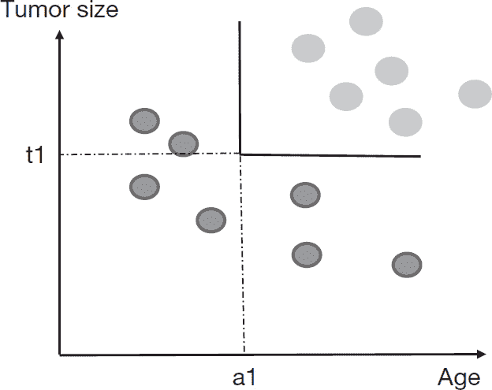

**Figure 6.1 年龄与肿瘤大小之间的数据图**

这是一个基于规则的模型或树模型的简单示例，其中条件（`age > a1 and tumor size > t1`）是根节点，结果（`malignant or benign`）是叶节点。条件可以进一步拆分为两个子条件（`age > a1 and tumour size > t1`），它们构成树的内部节点。

考虑 Table 6.2 所示的数据。它包含五个属性，其中四个是特征属性，一个是结果属性。有 14 个数据实例，结果属性是`Play_Tennis`，其取值可以是 yes 或 no。可以基于此数据构建一个逻辑树模型。由此形成的树称为决策树（Fig. 6.2）。最流行的决策树算法是迭代二分器 3.0（`ID3`）和分类与回归树（`CART`）。

**Table 6.2 目标概念`Play_Tennis`的训练样本**

| S. No | Sky | Temp | Humidity | Wind | Play_Tennis |
| --- | --- | --- | --- | --- | --- |
| 1 | Sunny | Hot | High | Weak | No |
| 2 | Sunny | Hot | High | Strong | No |
| 3 | Overcast | Hot | High | Weak | Yes |
| 4 | Rain | Mild | High | Weak | Yes |
| 5 | Rain | Cool | Normal | Weak | Yes |
| 6 | Rain | Cool | Normal | Strong | No |
| 7 | Overcast | Cool | Normal | Strong | Yes |
| 8 | Sunny | Mild | High | Weak | No |
| 9 | Sunny | Cool | Normal | Weak | Yes |
| 10 | Rain | Mild | Normal | Weak | Yes |
| 11 | Sunny | Mild | Normal | Strong | Yes |
| 12 | Overcast | Mild | High | Strong | Yes |
| 13 | Overcast | Hot | Normal | Weak | Yes |
| 14 | Rain | Mild | High | Strong | No |

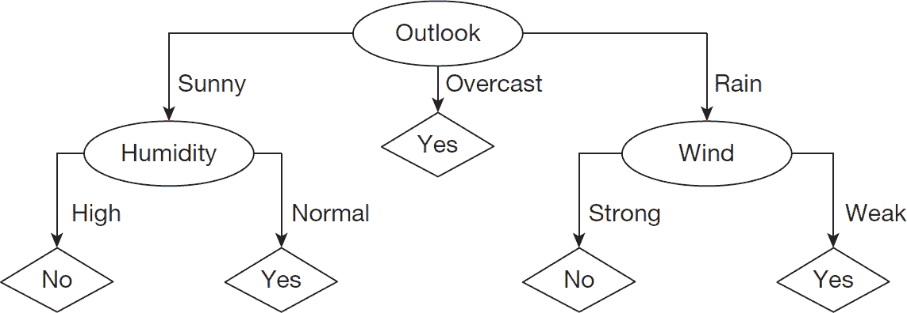

**图 6.2 Play_Tennis 数据的决策树**

从决策树生成的规则如下：

```
(if (`outlook` = overcast) then `play tennis` = yes) ∨
(if ((`outlook` = sunny) ∧ (`humidity` = high)) then `play tennis` = no) ∨
(if ((`outlook` = sunny) ∧ (`humidity` = normal)) then `play tennis` = yes) ∨
(if ((`outlook` = rain) ∧ (`wind` = strong)) then `play tennis` = no) ∨
(if ((`outlook` = rain) ∧ (`wind` = weak)) then `play tennis` = no)
```

所形成的规则可以被观察为由根到叶节点所形成的路径的析取的合取。每个叶节点都是结果标签，即 yes 或 no。

该决策树是逻辑模型的一个例子，它可以根据多个特征和类别进行预测或分类。它也很容易解释和说明，因为它可以被翻译成遵循 if-then 逻辑的自然语言陈述。

### 6.2.2 几何模型

在这里，数据在 2D 或 3D 超平面中表示。具有四个或更多属性的数据难以可视化，只能在虚拟空间中想象。几何模型在 ML 中很有帮助，因为它们使我们能够看到数据集的输入属性和输出标签之间的联系。我们可以通过将每个数据实例显示为超平面中的一个点来观察数据如何根据其类别标签分布和聚类。这可以帮助我们选择最佳的 ML 算法来分析数据并生成精确的预测。

线性模型是具有线性可分结果空间的几何模型。考虑具有两个属性和一个结果的简单数据。假设唯一结果的数量为两个。这称为二分类问题。每个实例都可以在二维平面中表示为一个点。该点基于类别标签表示。

例如，考虑 Table 6.3 中显示的简单逻辑 AND 数据。数据的可视化表示显示在 Fig. 6.3 中。这里，每个数据元组都显示为在 2D 平面中描绘类别标签的点。标签为 0 的点表示为圆圈，标签为 1 的点表示为正方形。在平面上绘制数据后，如果一条直线分隔数据点，则数据是线性可分的。否则，它是线性不可分的。

**Table 6.3 逻辑 AND 门的真值表**

| x1 | x2 | y |
| --- | --- | --- |
| 0 | 0 | 0 |
| 0 | 1 | 0 |
| 1 | 0 | 0 |
| 1 | 1 | 1 |

直线 `y = w^(T)x + w[0]` 的一般方程用于表示线性模型，其中 `w^(T) = [w[1], w[2]]` 是权重向量的转置，$x = \begin{bmatrix} x_1 \\ x_2 \end{bmatrix}$ 是输入向量，`w[0]` 是截距。

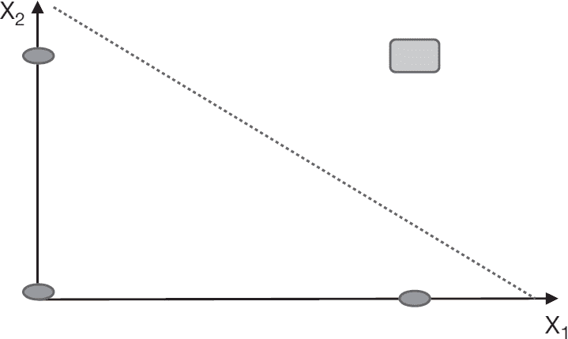

**图 6.3 逻辑 AND 门输入的分类**

权重是模型参数，其值在训练期间确定。逻辑回归和多层感知器是线性模型的几个例子。

如果数据不能线性分离，我们可能需要使用非线性模型，例如神经网络或决策树来进行分类。非线性模型寻找非线性边界（例如曲线或复杂形状）来将数据点划分为多个类别，而不是假设输入特征与输出标签之间存在线性关系。

考虑 XOR 问题。这里，数据只有两个维度，但它是线性不可分的。在这种情况下，核方法将数据在二维中投影到只能想象的高维空间中。像非线性支持向量机（`SVMs`）这样的 ML 算法在高维空间中对数据进行分类。XOR 输入显示在 Table 6.4 中，图显示在 Fig. 6.4 中。

**Table 6.4 逻辑 XOR 门的真值表**

| x1 | x2 | y |
| --- | --- | --- |
| 0 | 0 | 0 |
| 0 | 1 | 1 |
| 1 | 0 | 1 |
| 1 | 1 | 0 |

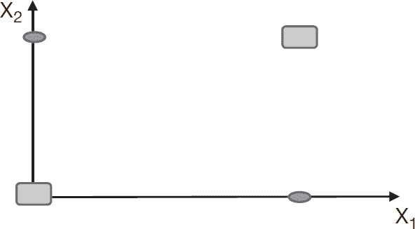

**图 6.4 逻辑 XOR 输入的图**

实时数据可能并不总是线性，并且通常具有更多属性。 Such 数据不必是线性可分的。核方法可以用来检查数据在高维空间中是否线性可分。

因此，通过使用几何模型，我们可以深入了解数据的性质，并为我们的问题选择合适的 ML 算法。

#### 6.2.2.1 距离模型

距离模型是一种几何模型，它使用距离度量来分离结果空间。距离度量决定了特定空间中两个点相距多远。例如，曼哈顿距离度量计算两个点坐标之间绝对差的总和，而欧几里得距离度量计算两个地方之间的直线距离。

数据根据特征或维度的数量绘制在 2D 平面或 3D 超平面上。2D 平面有两个特征，高度和重量，而 3D 超平面有三个特征：长度、宽度和深度。目标是找到一种方法根据它们的距离来分隔不同的数据组。

一种方法是计算每个数据组的质心。质心是一个组中所有点的平均值。它代表该组的质心或重心。计算两个组质心之间的距离可以让人确定它们相距多远。它们之间的距离越小，组就越相似。它们相距越远，差异就越明显。

基于距离的几何模型可用于聚类或分类任务。基于距离的几何模型在 ML 中很有用，因为它们可以帮助我们发现数据中的模式和结构，并降低数据的维度和复杂性。它们还可以帮助我们衡量数据点之间的相似性或不相似性，这可以帮助找到异常值、异常或相似性。这些距离在方程中定义。

假设有 n 个点绘制在 2D x-y 平面上。

- 欧几里得距离：$\sqrt{\sum\limits_{i = 1}^{n}\left( {x_i - y_i} \right)^{2}}$
- 曼哈顿距离：$\sqrt{\sum\limits_{i = 1}^{n}\left| {x_i - y_i} \right|}$
- 闵可夫斯基距离：$\left( {\sum\limits_{i = 1}^{n}\left| {x_i - y_i} \right|^{p}} \right)^{1/p}$


闵可夫斯基距离是一般的距离度量。通过将 `p = 1` 代入，我们得到曼哈顿距离。如果我们将 `p = 2` 代入，我们得到欧几里得距离。

## 6.2.3 概率模型

概率模型是一类在结构和预测中纳入不确定性和随机性的模型。它们在 ML 中被广泛用于捕捉现实世界数据的变异性和复杂性。概率模型可以分为两类：预测性和生成性。

### 预测模型 vs 生成模型

预测模型估计给定某些输入属性的情况下结果的条件概率。例如，预测模型可以回答诸如“在给定其年龄、性别和浏览历史的情况下，客户购买产品的概率是多少？”或“在给定其症状和检测结果的情况下，患者患病的概率是多少？”等问题。预测模型通常用于分类和回归任务，其目标是将标签或值分配给输入实例。

生成模型估计输入属性和结果属性的联合概率。例如，生成模型可以回答诸如“观察到具有特定年龄、性别和浏览历史的客户购买特定产品的概率是多少？”或“观察到具有特定症状和检测结果的患者患有特定疾病的概率是多少？”等问题。生成模型通常用于无监督学习任务，其目标是发现数据的底层结构和模式。

概率模型的一个优点是它们可以为其预测提供点估计、置信区间和误差界限。这有助于量化模型输出的不确定性和可靠性。另一个优点是它们可以使用贝叶斯推断将先验知识和信念纳入模型参数中。这有助于提高模型在数据稀缺或嘈杂时的性能和鲁棒性。

ML 中概率模型的某些示例是：

*   `Naive Bayes`：一种简单高效的预测模型，假设在给定结果的情况下输入属性之间条件独立。它使用贝叶斯定理计算给定输入属性的每个结果的后验概率。
*   `Logistic Regression`：一种预测模型，使用逻辑函数模拟给定一组输入特征的二元结果的可能性。它可以被视为广义线性模型的一个特定实例。
*   `Gaussian Mixture Model`：一种生成模型，假设数据由具有未识别参数的高斯分布组合产生。它将每个数据点分配给一个簇，并使用期望最大化方法估计混合模型的参数。
*   `Hidden Markov Model`：一种生成模型，假设数据由具有隐藏状态的马尔可夫链生成。它使用动态规划算法，如前向-后向算法和维特比算法来推断隐藏状态并估计马尔可夫链的参数。

令 `X` 表示特征值，`Y` 表示结果值。概率模型使用条件或联合概率建立 `X` 与 `Y` 之间的关系。

`P(Y | X)` 表示条件概率，读作“在给定 X 的情况下 Y 的概率”，即确定在给定特征值的情况下结果的概率。它是使用贝叶斯定理确定的。

```
$P\left( {Y\text{|}X} \right) = \frac{P\left( {X\text{|}Y} \right)P\left( Y \right)}{P\left( X \right)}$
```

描述性地读作

```
$\text{Posterior} = \frac{\text{Likelihood\*Prior}}{\text{Evidence}}$
```

`P(Y , X)` 表示联合概率。定义为

```
`P (Y , X ) = P(Y ∩ X ) = P (X|Y ) * P (Y) = P (Y |X ) * P (X)`
```

联合概率的概念用于生成数据点。这些概率模型将在第 7 章中详细讨论。

## 6.3 特征

特征是映射到结果的度量。数学上，特征可以定义为将属性的实例空间映射到属性可能值的函数。属性的所有可能值构成特征空间的域。特征根据其域空间进行分类。某些特征是实数或整数，而有些是离散值。

特征是输入到 ML 模型中以学习能够产生所需输出的函数。例如，要创建一个可以对狗和猫的照片进行分类的模型，我们必须首先从图像中提取有助于模型区分两个类别的元素。这些特征可能是图像的颜色、形状、大小、纹理或与任务相关的任何其他属性。特征的质量和数量会影响模型的性能。最好的特征是那些在减少噪声和冗余的同时捕获数据中最多的信息和变化的特征。

### 6.3.1 特征类型

根据其值，特征大致分为以下几类：

*   **数值特征**：这些特征具有离散或连续的数值。区间和比率特征是数值特征的子类别。区间特征缺乏绝对零点，但在它们之间具有显著的值差异（例如，摄氏或华氏温度）。比率特征存在绝对零点和显著差异（例如，身高、体重或财富）。
*   **分类特征**：这些特征具有属于组的定义值。名义和序数特征是子类别。名义特征是类别之间缺乏自然层级（例如，国籍或发色）。序数特征是属于特定层级或顺序（例如，客户满意度或教育水平）。数据可以使用分类属性进行分组、计数或比较。
*   **二元特征**：这是一种特定的分类特征，可以有两个可能的值。例如，婚姻状况、性别和疾病的存在与否。逻辑运算或分类都可以使用二元特征。
*   **时间特征**：这些是象征时间属性的特征，如日期、时间、持续时间和频率。时间属性可以确定数据趋势、模式、周期或季节性。
*   **文本特征**：这些用作文本数据的表示。文本特征包括产品评论、推文、新闻故事等。文本特征可用于自然语言处理（NLP）任务，如情感分析、主题建模和文本摘要。

### 6.3.2 特征上的统计运算

除了特征空间的域之外，其他重要方面还包括可以在特征上执行的运算类型。以两个元素 `employee_id` 和 `employee_salary` 为例。整数构成特征的域空间。对 `employee_salary` 变量使用均值等统计过程是有意义的。然而，均值和中位数等统计过程对 `employee_id` 没有意义。

可以执行的显著运算分为三个主要组：

*   **中心趋势度量**：用于为整个数据提供单一值。
*   **离散统计**：这确定数据与均值的偏差程度。它用于理解数据离散程度。
*   **形状度量**：这些描述数据在数据集中的分布或排列方式。

均值、中位数和众数是属于中心趋势度量下的三个主要运算。均值显示平均值。当所有值按升序排列时，中位数反映中间值。众数显示最高频值。虽然众数可以应用于任何域，但均值和中位数只能用于整数或实数域空间的特征值。

方差和标准差通常用于理解数据离散程度。百分位数是评估离散度的另一种方法。四分位数通常用于量化离散度。当四分位数乘以 25 时，它们被称为百分位数。为了理解数据分布的形式，使用直方图和累积分布图。

我们可以通过以下方面来阐明这些论断并通过示例展示其如何帮助机器学习：

*   对特征进行统计处理可以实现数据的有意义汇总、分析和可视化。它们还有助于我们定位数据异常，例如异常值、缺失值、偏态和其他可能损害机器学习模型有效性的不规则性。
*   例如，我们可以利用 `mean`、`median` 和 `mode` 来识别 `wage` 特征的集中趋势，并根据员工的经验、教育和才能预测其薪资。这可以帮助我们了解数据集的中位数、典型或平均薪资。我们还可以使用 `variance` 和 `standard deviation` 来确定工资与均值的偏差程度或其分布情况。这可以帮助我们理解薪资特征的范围和跨度。薪资特征也可以根据值使用 `quartiles` 或 `percentiles` 分成四个相等组。这使我们能够评估不同的工资特征子集并发现可能影响预测的异常值或极值。
*   同样，如果我们想根据内容识别一封电子邮件是否为垃圾邮件，我们可以使用直方图和累积分布图来分析诸如词数、标点符号、大写字母等数据的形状分布。这些图可以显示值在值范围内的分布情况以及它们在特征中出现的频率或不频繁程度。这可以帮助我们发现电子邮件特征中表明其是否为垃圾邮件的模式或趋势。
*   在使用任何机器学习算法之前，研究和理解数据至关重要。因此，在这方面，特征上的统计操作是有帮助的。它们还有助于我们预处理数据，例如缩放、归一化、编码等，以使其适合机器学习模型。它们还有助于我们根据其性能特征，如 `recall`、`accuracy` 和 `precision` 来比较和评估各种机器学习模型。

### 6.3.3 特征转换

改变数据集特征的域被称为特征转换。这有许多应用：

*   提高数据对机器学习模型的适用性。例如，某些模型需要特定的归一化、标准化或数据编码。
*   使数据更不复杂或多维。作为例证，某些元素可能是不必要的、不重要的或嘈杂的，可以被消除或与其他方面混合。
*   增强模型的性能或可解释性。一种方法是将某些特征转换为更好地捕捉这种关系，例如可能与目标变量具有非线性关系。
*   可视化数据的分布或组织。例如，具有高维度的某些特征可以使用主成分分析 (`PCA`) 或 t-分布随机邻域嵌入 (`t-SNE`) 等技术投影到低维空间。

特征缩放是常见的特征修改，它改变特征的范围或大小。当特征具有不同的单位或量级并且可能影响某些模型的学习方式时，这通常是必需的。考虑一个员工数据集，其中两个特征是年龄和收入。年龄可能在 25 到 100 年之间，收入可能在 25000 到 250000 INR 之间。如果将此类数据输入到使用基于距离的度量且其规模比年龄大得多的模型，如 `K-means` 聚类，收入因子将主导聚类结果。为了避免这种情况，可以使用特征缩放来使特征按比例缩放。

由于它可以提高数据的质量和可用性，并最终提高模型的性能和可解释性，因此特征转换是机器学习中的一个关键阶段。

#### 6.3.3.1 特征缩放或归一化

`MinMax` 缩放是一种数据科学家经常使用的方法。这种缩放函数将数据转换到范围 `[0, 1]`。因此，原始数据的最小值变为 0，最大值变为 1。其余值相应地在 0 到 1 之间缩放。例如，如果原始数据包含 10 到 100 之间的值，应用 `MinMax` 缩放将产生 0 到 1 之间的值，其中 10 变为 0，100 变为 1，50 变为 0.5。

在机器学习中，`MinMax` 缩放是有帮助的，因为它可以帮助规范化数据并减少异常值的影响。一些机器学习技术，如梯度下降和 `K-means` 聚类，可以在归一化数据上表现更好并更快收敛。与可能改变原始数据的其他缩放技术相比，`MinMax` 缩放还可以帮助保持数据的形状和分布。

`MinMax` 缩放器的定义如下：

(6.1)

```
$\frac{x - x_{min}}{x_{max} - x_{min}}$
```

当我们将公式 (6.1) 应用于 Table 6.5 中的数据时，缩放后的数据被归一化，如 Table 6.6 所示。

**Table 6.5 示例员工年龄和收入数据**

| Employee_age | Employee_income |
| --- | --- |
| 25 | 18000 |
| 28 | 22000 |
| 50 | 65000 |
| 44 | 75000 |

**Table 6.6 MinMax 缩放后归一化的员工年龄和收入**

| Employee_age | Employee_income |
| --- | --- |
| 0 | 0 |
| 0.12 | 0.0702 |
| 1 | 0.8246 |
| 0.76 | 1 |

**标准缩放**：机器学习从标准缩放中获得许多好处。首先去除每个特征的单位和尺度，使数据更具可比性。例如，如果我们有两个特征，一个以米为单位，另一个以公里为单位，标准缩放将使特征无量纲且处于同一尺度。通过按方差缩放数据并将其居中于零，也减少了异常值的影响。例如，标准缩放可以使远大于或小于特征其余部分极端值更接近均值且不那么显著。第三，它增强了依赖于特征大小或假设数据呈正态分布的一些机器学习方法的效果。例如，当数据标准化时，用于优化众多模型的梯度下降收敛更快。

标准缩放定义如下：

(6.2)

```
$\frac{x - x_{\text{mean}}}{\text{Standard~deviation}}$
```

**年龄的标准差**：标准差是衡量数据值与均值差异程度的指标。要计算给定数据的标准差，我们需要遵循以下步骤：

1.  通过将所有值相加并除以值的数量来求数据的均值。在这种情况下，均值为 `(25 + 28 + 50 + 44) / 4 = 36.75`。
2.  从每个值中减去均值并对结果求平方。这给出了与均值的平方偏差。例如，对于第一个值，我们有 `(25 – 36.75)² = 138.0625`。
3.  将所有平方偏差相加并除以值的数量。这给出了数据的方差。在这种情况下，方差为 `(138.0625 + 76.5625 + 175.5625 + 52.5625) / 4 = 110.6875`。
4.  取方差的平方根得到标准差。在这种情况下，标准差为 `sqrt(110.6875) = 10.52`。

因此，年龄的标准差为 10.52。

**收入的标准差**：

1.  通过将所有值相加并除以值的数量来求数据的均值。在这种情况下，均值为 `(18000 + 22000 + 65000 + 75000) / 4 = 45000`。
2.  通过从每个值中减去均值来求每个值与均值的偏差。偏差为 `-27000`、`-23000`、`20000` 和 `30000`。
3.  对每个偏差求平方以消除负号并使值更具可比性。平方偏差为 `729000000`、`529000000`、`400000000` 和 `900000000`。
4.  通过将它们相加来求平方偏差之和。总和为 `2558000000`。
5.  将总和除以值的数量得到方差，方差是衡量数据围绕均值分布分散程度的指标。方差为 `2558000000 / 4 = 639500000`。
6.  对方差取平方根得到标准差，其单位与原始数据相同。标准差为 `sqrt(639500000) = 25288.36`。

因此，4 人收入数据的标准差为 `25288.36`。

使用公式 (6.2) 对 Table 6.6 中给出的数据进行处理，缩放后的数据修改如下所示 Table 6.7。

**Table 6.7 标准缩放后员工年龄和收入的归一化值**

| Employee_age | Employee_income | Employee_age | Employee_income |
| --- | --- | --- | --- |
| 25 | 18000 | –1.11 | –1.068 |
| 28 | 22000 | –0.831 | –0.909 |
| 50 | 65000 | 1.26 | 0.791 |
| 44 | 75000 | 0.689 | 1.186 |

### 6.3.3.2 其他转换技术

**阈值处理**：使用截止值，阈值处理方法将数值或序数属性转换为二元特征。例如，使用阈值处理，我们可以根据现有特征 `age` 的范围 0 到 100，生成一个名为 `age_group` 的新特征，仅有两个值：0 表示年轻，1 表示老年。为此，我们必须选择一个阈值，例如 40，并将 `age` 低于 40 的所有实例的值设为 0，将 `age` 为 40 或更高的实例的值设为 1。在这种情况下，截止点为 40，可手动确定或通过检查 `age` 特征的分布来确定。

阈值处理在 ML 中有以下好处：

*   它可以将连续或序数特征转换为分类特征以降低数据的维度。这可能使数据的处理和可视化变得更容易。
*   它可以产生更具洞察力的特征，更好地反映数据的某些关键方面。例如，与使用精确的血压读数相比，阈值处理可用于生成一个特征，显示一个人是否患有高血压，以预测他们是否患有某种疾病。
*   它可以提高各种 ML 方法的性能，包括决策树和逻辑回归，这些方法在二元特征上表现更好。

**离散化**：定量特征值通过离散化转换为序数特征值。定量特征值，例如一个人的身高、体重或年龄，是一个数值，可以在范围内取任意值。序数特征值是一个具有自然顺序的分类值，例如小、中或大。定量特征的范围被离散化为区间，每个区间赋予一个序数值。每个区间都被视为一个具有相关序数值的 bin。例如，`age` 特征可以离散化为 `[0–10]`、`[11–20]`、`[21–30]` 等 bin，并且每个 bin 可以赋予年轻、青少年、成人等序数值。这种方法也称为分箱。

离散化对 ML 有多种好处。首先，合并相似的值可以减少数据中的噪声和异常值。通过限制可能值的范围，它可以使数据计算和分析更简单。第三，使用有意义的类别而不是数字可以帮助使数据更易于阅读和理解。它还可以提高 ML 方法的性能，例如决策树或朴素贝叶斯，这些方法对分类信息比数值特征表现更好。

根据区间如何指定以及序数值如何分配，有许多离散化技术。等宽离散化是一种将特征范围划分为等宽区间的技术。例如，如果我们希望创建 10 个 bin 且年龄范围为 `[0–100]`，每个 bin 的宽度将为 10。等频离散化是另一种技术，它将特征范围划分为具有固定实例数的区间。例如，如果我们有 100 个年龄实例并希望将它们划分为 10 个 bin，每个 bin 将有 10 个出现。虽然等频离散化可以防止创建空或稀疏的 bin，但它也可能导致区间大小不一。

## 6.3.4 特征构造

从数据集中已有的特征构建新特征称为特征创建。当数据集包含许多特征，但并非所有特征对于 ML 任务都同等重要或相关时，特征创建可能有所帮助。在这些情况下，通过组合现有特征添加新特征会使特征向量更具维度，这可能导致过拟合或计算效率低下。为了解决这个问题，可以使用特征选择技术，如过滤器或包装器方法，或降维技术，如主成分分析 (`PCA`) 来减少特征数量，同时保留最有用的特征。

当数据集包含分类特征，但 ML 模型需要数值输入时，可以使用特征构建。例如，如果数据集包含性别、颜色或国籍等变量，则这些变量不能直接用作回归或神经网络模型的输入。在这些情况下，可以使用特征编码技术，如独热编码、标签编码或哈希，将类别特征转换为数值值。然而，这些方法也可能使特征向量更具维度并增加稀疏性或冗余。因此，人们还可以使用特征创建技术将现有分类特征转换为捕获更有价值数据的新数值特征。

对任何现有特征应用算术运算，例如加法、减法、乘法或除法，是从现有特征快速创建新特征的一种方法。找到两个不同特征的笛卡尔积，例如连接或相乘，以及找到两个特征之间的比率，例如百分比或比例，是创建新特征的第三种方法。

表 6.8 显示了一个使用员工数据的示例。

**表 6.8 包含姓名、职位和性别属性的示例员工数据**

| Employee_name | Employee_desig | Employee_gender |
| --- | --- | --- |
| aaa | Manager | Male |
| bbb | Senior Manager | Female |
| ccc | Clerk | Male |
| ddd | Clerk | Female |

为了将 `employee_desig` 和 `employee_gender` 的值转换为数值，使用了独热编码。在此技术中，扫描并计数所有唯一值，并创建许多属性作为新特征，其值要么为 0 要么为 1。


`Employee_desig` 有三个唯一值 – Manager、Senior Manager 和 Clerk。同样，`Employee_gender` 有两个唯一值 – Male 和 Female。执行独热编码后，数据集将被转换，如表 6.9 所示。

表 6.9 独热编码后包含姓名、职位和性别属性的示例员工数据

| Employee_name | desig_manager | desig_sr_manager | desig_clerk | gender_male | gender_female |
| --- | --- | --- | --- | --- | --- |
| aaa | 1 | 0 | 0 | 1 | 0 |
| bbb | 0 | 1 | 0 | 0 | 1 |
| ccc | 0 | 0 | 1 | 1 | 0 |
| ddd | 0 | 0 | 1 | 0 | 1 |

## 6.3.5 特征选择

特征选择意味着从初始特征集中选择与学习过程相关且具有启发性的特征子集。特征创建在生成来自原始数据或现有特征的新特征之后，通常会进行特征选择。虽然特征选择可以帮助减少冗余和不相关的特征，但特征创建可以帮助提高特征集的质量和多样性。

## 特征选择

根据目标变量是否存在，特征选择可以应用于监督学习和无监督学习模型。在监督学习中，目标变量可作为特征选择的判据来评估特征的效用。在无监督学习中，可使用诸如聚类质量、信息含量或统计依赖性等其他判据进行特征选择。特征选择作为预处理步骤，被认为可为学习任务提供各种优势，包括：

- 降维：特征选择可以通过选择较少的特征来降低数据的维度，使数据更易于可视化、理解和管理。
- 降低计算成本和训练时间：特征选择，特别是对于具有多个参数和过程的复杂模型，可以通过减少特征数量来缩短训练时间。
- 减少过拟合：特征选择可以通过移除冗余或无关的特征来帮助防止过拟合。过拟合发生在模型从训练数据中的噪声或特定模式中学习过多，无法很好地推广到新数据或未知数据时。
- 提高泛化能力：选择信息丰富且具有代表性的特征可以帮助学习模型在新数据或未知数据上表现良好并准确执行，体现其在多种上下文和场景下良好泛化的能力。
- 简化学习模型的结构和复杂性：通过减少特征数量，特征选择可以帮助使学习模型更简单、更易于理解。

## 监督学习方法

监督学习中的特征选择可以使用多种方法执行，通常可分为三类：过滤、包装和内在方法。

### 过滤方法

该方法根据统计或信息论指标，如互信息、卡方检验和相关性，对特征进行排序和评估，而不使用学习模型。然后从得分高的特征中选择最终子集。过滤技术快速且可扩展，但必须考虑特征之间的交互或它们与学习模型的配合程度。

用于过滤的指标有信息增益、Fisher 得分、卡方检验等。这些指标是考虑每个属性和标记属性而使用的。信息增益确定熵的减少。每个特征属性与标记输出相关，并检查两个特征是正相关还是负相关。负相关的特征可相应丢弃。Fisher 得分根据 Fisher 准则对属性进行排序。Fisher 得分大的特征可被考虑，其他特征可被丢弃。卡方检验用于查找每个特征与标记特征之间的关系。

### 包装方法

这些方法使用学习模型作为黑箱来评估特征。它们在验证集上或利用交叉验证寻找能最大化特定性能参数（如准确率、精确率、召回率等）的最佳特征子集。与过滤方法相比，包装方法更精确、更灵活，但计算成本更高且更容易过拟合。在包装方法中，特征是通过特征空间的搜索机制来选择的。贪心方法用于包装方法的特征选择过程。它探索所有可能的组合并选择最佳特征。该过程将通过选择一组特征并使用这些特征训练模型来启动。可以根据输出添加或减去特征以提高模型的性能。该类别中用于特征选择的流行算法有前向选择、后向消除等。

### 内在学习方法

在训练阶段，这些方法要么改变目标函数，要么采用正则化方法来惩罚或删除不必要或冗余的特征。虽然内在方法有效且自适应，但它们是模型特定的，可能不适用于所有学习模型。内在方法可被视为一种混合方法，利用过滤和包装方法的优点。特征选择过程也是迭代的，并降低计算成本。特征被选择使得每个特征都有助于模型的性能。该类别中常用的方法有 LASSO 正则化和随机森林。

## 前向和后向选择

前向选择是一个迭代过程。它从单个特征开始，迭代地添加特征，并在每次迭代中评估模型。当新添加的特征不再改善模型的性能时，该过程结束。后向消除是前向选择的逆过程。该方法首先考虑所有特征，然后评估模型。该过程通过在每次迭代中移除最不重要的特征而重复。当模型性能没有改善时，迭代过程停止。

## 模型拟合与泛化

数据在超平面上绘制并找到最佳拟合线以确定数据之间的关系。该过程称为数据拟合。模型可以通过学习过程选择最佳拟合线。一旦模型被学习，就对其进行评估。这有助于我们了解模型是否过拟合或欠拟合。

当模型找到数据中的所有模式或关系并忽略随机数据点时，模型可以最好地拟合数据。如果模型覆盖了所有数据点和随机点，则称模型过拟合。如果模型未找到数据点之间的任何关系且无法确定测试数据属于哪个类别，则称模型欠拟合。

## 正则化

正则化意味着调整或调优 ML 模型以最小化损失函数，防止过拟合或欠拟合。

### LASSO 或 L1 正则化

最小绝对收缩和选择算子，或 LASSO，用于回归方法。LASSO 正则化通过向损失函数添加惩罚项来修改过拟合或欠拟合模型。惩罚项通常是模型中使用的系数的绝对值之和。其数学表示如下：

(6.3)

```
Cost = Loss + λ + ∑()w,
```

其中 `λ` 表示惩罚项，`w` 是数据上曲线拟合的斜率。

惩罚项是通过添加模型系数的绝对值来计算的。LASSO 正则化将系数收缩为零，也用于降维。它估计数据的中位数。LASSO 正则化产生稀疏模型，只有少数系数，因为其他系数被收缩为零。

### Ridge 或 L2 正则化

这里，惩罚项是系数的平方和。它也收缩系数，但不设为零。其数学表示为

(6.4)

```
Cost = Loss + λ + ∑()w²
```

## 概念学习

### 6.4 Concept Learning

概念学习寻求从输入数据中提取广泛类别的定义。例如，给定一批动物图像，概念学习可以训练识别哪些动物照片属于狗的类别。从给定数据中推断布尔值函数是另一种概念化学习的方式，其中该函数对属于该想法的示例返回 true，对不属于该想法的实例返回 false。因此，概念学习是识别与训练数据最匹配的输入特征-输出标签映射的过程。

根据数据的性质和结构、假设空间的复杂性和表达能力，以及最佳假设的选择标准，不同的概念可以以不同的方式学习。能够用于表达思想的一组潜在函数被称为假设空间。例如，如果概念由输入特征的线性组合指定，则假设空间是所有可行的线性函数的集合。概念学习的目标是找到一个函数，该函数在训练数据上最小化某个误差或损失函数，这可以被视为在假设空间上的搜索问题。

概念学习使机器学习受益，因为它使我们能够从特定示例推广到新颖和未预见的情况。通过从少量嘈杂的数据样本中学习概念，我们可以预测或分类以前从未见过的新数据。理解概念的基本结构和逻辑也有助于我们发现数据中的模式和规律。概念学习适用于许多领域和应用，包括生物信息学、计算机视觉、语音识别和自然语言处理。

## 6.4.1 概念学习问题表述

概念学习旨在从训练样本中近似一个布尔值函数。我们定义两个数据集；第一个是特定的，而第二个相对大于第一个。Table 6.10 显示了第一个数据集。类标记属性 `Enjoy_Sport` 被称为一个概念。给定的数据集中有四个元组，其中三个元组的 `Enjoy_Sport` 为 Yes，一个元组为 No。

Table 6.10 目标概念 `Enjoy_Sport` 的训练样本

| Attribute | Concept |
| --- | --- |
| Sky | Temp | Humidity | Wind | Water | Forecast | Enjoy_Sport |
| Sunny | Warm | Normal | Strong | Warm | Same | Yes |
| Sunny | Warm | High | Strong | Warm | Same | Yes |
| Rainy | Cool | High | Strong | Warm | Change | No |
| Sunny | Warm | High | Strong | Cool | Change | Yes |

有六个属性；因此，每个假设都是一个六元素向量。对于每个属性，假设可能是一个值、任何可接受的值或不可接受的值。

例如，对于属性 `Sky`，

- `Sky =` 表示一个值
- `Sky = ?` 表示任何可接受的值
- `Sky = ϕ` 表示没有值是可接受的

一个假设 (`h`) 是元组所有实例属性值的合取，即每个实例表示为属性值的合取。例如，(`Sunny`,`Warm`,`Normal`,`Strong`,`Warm`,`Same`) 表示一个实例。该实例的假设表示为

$$
\left( \begin{array}{l} {\left( {Sky = Sunny} \right) \land \left( {Temp = Warm} \right) \land \left( {Humidity = Normal} \right) \land \left( {Wind = Strong} \right) \land \left( {Water = Warm} \right)} \\ {\land \left( {Forecast = Same} \right)} \\ \end{array} \right)
$$

所有假设的集合称为每个属性的假设空间 (`ℋ`)。因此，对于 Table 6.10 中给出的示例，最一般的假设表示为 (`ϕ`,`ϕ`,`ϕ`,`ϕ`,`ϕ`,`ϕ`)。

记号：

- `X`: 数据或概念定义的属性集合。
- `X = {Sky,Temp,Humidity, Wind,Water, Forecast}`
- `C`: 待学习的概念；也称为目标概念。它被定义为 `X` 上的布尔值函数，即 `c: X → {0,1}`。对于表中给出的数据，`c (x) = 1 → enjoy_sport = yes` 且 `c (x) = 0 → enjoy_sport = no`
- `(x,c (x))`: 学习者尝试理解概念的输入。`x` 是 `X` 的一个实例。学习者接收一组实例和目标概念值。
- `D`: 训练数据。
- `ℋ`: 为学习者识别概念而呈现的所有可能假设的集合。
- `h(x)`: 它表示从集合 `ℋ` 中取出的特定假设。

假设空间具有假设的一般到具体的排序。概念学习的任务是将实例映射到目标函数。在示例中，目标属性或概念是 `Enjoy_Sport`，其值为 Yes 或 No。数学上表示为 *c*:*X*→{Yes, No}，其中 `c` 表示目标函数，`X` 表示一个实例。

总之，概念学习问题表述如下：

给定：实例集合及其对应的目标概念值 (`D`)

过程：通过将每个实例转换为等价的假设来创建假设空间

确定：检查一个随机给出的假设 (`h`)

## 6.4.2 概念学习问题作为搜索问题

考虑 Table 6.11 中定义的数据。

Table 6.11 `Enjoy_Sport` 训练数据的分析

| Attribute name | Distinct values | Distinct value count |
| --- | --- | --- |
| Sky | Sunny, Cloudy, Rainy | 3 |
| Temp | Warm, Cold | 2 |
| Humidity | Normal, High | 2 |
| Wind | Strong, Weak | 2 |
| Water | Warm, Cool | 2 |
| Forecast | Same, Change | 2 |

因此，构成总实例空间 `X` 的不同实例数可以计算为 3 × 2 × 2 × 2 × 2 × 2 = 96。在将实例表示为假设时，每个属性还有两个值 (?,.ϕ) 表示最一般和最具体的假设。因此，假设空间 (`ℋ`) 包含 5 × 4 × 4 × 4 × 4 × 4 = 5120 个语法上不同的假设。

然而，每个假设都包含一个或多个 (`ϕϕ`) 符号，表示被视为负类的空实例。通过将所有这些空实例视为单个实例，假设空间 (`ℋ`) 包含 1+ (4 × 3 × 3 × 3 × 3 × 3) = 973 个语义上不同的假设。`Enjoy_Sport` 是一个玩具数据集，具有小而有限的假设空间。

搜索假设空间的过程称为概念学习。问题的潜在答案集合称为假设空间。例如，假设空间可能包括偶数的所有可能定义，例如能被 2 整除的数，以 0、2、4、6 或 8 结尾的数等。

为了高效搜索假设空间，已经开发了许多技术。这些算法寻求识别最符合事实并且能够很好地推广到新情况的最佳理论。决策树、神经网络和遗传算法是这些算法的几个例子。

通过识别现有假设之间的联系，算法利用了假设空间。例如，一些假设可能比其他假设更一般，覆盖更多示例但精度较低。一些假设可能比其他假设更具体，虽然它们适用于更少的实例。一些假设可能是等价的，这意味着它们适用于相同的情况并且准确性相等。

假设空间的结构使其可以被探索。假设的排序是从一般到具体的。因此，假设按从最宽泛到最狭窄的层次呈现。在偶数概念的情况下，最一般的假设可以是所有数字，而最具体的假设只有 2。算法可以使用这种结构缩小搜索空间并集中在最有希望的假设上。

这种策略在机器学习中很有帮助，因为它可以减少寻找有效答案的难度和时间。此外，它还可以帮助防止过拟合和欠拟合，这些都是常见问题。当假设过于精确并且不能很好地推广到新数据时，就会发生过拟合。欠拟合发生在假设过于全面并且遗漏了数据的关键特征时。

## 6.4.3 假设空间表示为一般到具体的排序

通常被称为格的假设的从一般到具体的排序，用于表示假设空间。格中每对元素都有一个不同的最小上界和一个不同的最大下界。在 ML 中，最一般的假设比最小上界更具体，同时代表两者。相比之下，最大的下界代表最具体的假设，该假设比两者都更一般。例如，假设有两个假设 `H1` 和 `H2`，它们将某些示例分类为正例，其余分类为负例。它们的最小上界是假设该假设将 `H1` 或 `H2` 中任一分类为正例的所有实例分类为正例，其余分类为负例。同样，它们的最大下界是假设将 `H1` 和 `H2` 都分类为正例的所有出现分类为正例，其余实例分类为负例的假设。

将假设从一般到具体排序对 ML 有一定的优势。第一个好处是我们能够表述假设与一组训练实例之间一致性的概念。如果一个假设准确地对集合中的每个案例进行分类，则它与该集合一致。如果一个假设与另一个假设兼容的所有案例一致，并且可能更多，那么它比另一个假设更一般。如果一个假设与另一个假设一致的部分案例一致，那么它比另一个假设更具体。

在格中，将所有出现分类为正例的假设是最一般的，而将所有案例分类为负例的假设是最具体的。训练实例与最一般一致（`MGC`）假设一致，该假设具有最低的上界，而训练示例与最具体一致（`MSC`）假设一致，该假设具有最高的下界。

第二，通过将假设从一般到具体排列，我们可以指定一种缩小假设空间中可能假设的搜索方法。此方法从 `MGC` 开始，并迭代地推进到越来越具体的假设，直到发现满足某些标准（如准确性或简洁性）的假设。

另一种方法称为具体到通用搜索。它从 `MSC` 开始，并迭代地进行到更一般的假设，直到发现满足特定要求的假设。可以根据特定度量（如信息增益或熵）估计假设质量的启发式方法来指导任一策略。

一般到具体的排序通过示例进行解释。

### 更一般于关系 (≥[*g*])

它被正式定义为 `h[j]` 比 `h[i]` 更一般。

符号表示为 `h[j]≥[g]h[i]`

### 严格更一般于 (>[*g*])

假设 `h[j]` 比 `h[i]` 更一般当且仅当 (`h[j]≥[g]h[i]`) ∧ (`h[j]≱[g]h[i]`)。

考虑 `H` 假设空间中的三个假设（`h[1]`、`h[2]`、`h[3]`）。它们被给出为

- `h[1] = (Sunny,?,?,Strong,??)`
- `h[2] = (Sunny,?,?,?,??)`
- `h[3] = (Sunny,?,?,?,Cool,?)`

第一个假设对属性 Sky = Sunny 和 Wind = Strong imposed 两个约束。第二个假设仅对属性 Sky = Sunny imposed 一个约束。第三个假设对属性 Sky = Sunny 和 Water = Cool imposed 两个约束。假设 `h[2]` 相比 `h[1]` 有更少的约束。

从给出的假设可以看出 `h[2]≥[g]h[1]`，因为 `h[1]` 满足的每个实例也满足 `h[2]`。假设满足的每个实例意味着在示例中给出的六个属性中，`h[1]` Sky = Sunny 和 h2 Sky = Sunny。对给定假设中的其他属性也应适用相同情况。因此 `h[2]≥[g]h[1]`。同样，`h[2]≥[g]h[3]`。关系 `≥[g]` 是自反的，反对称的和传递的。

### 6.4.4 寻找最大特异性假设 (Find-S)

`Find-S` 算法是一种快速有效的技术，用于从一组有帮助的示例中理解一个主题。概念是一个布尔函数，例如电子邮件是否为垃圾邮件，将实例转换为二进制输出。该算法假设概念可以用属性值对的组合来表示，例如 `(subject contains ‘free’)` AND `(sender is unknown)`。该方法首先将所有特征与其值取反组合，例如 `(subject does not contain ‘free’)` AND `(sender is not unknown)` AND... 程序然后继续到更具体的假设，直到达到最具体的可行结论。任何时候进行测试，它将始终为假。然后算法反复遍历每个成功示例，并通过删除与示例冲突的任何属性值对来概括理论。


## Find-S 算法

例如，如果第一个正例的主题包含 ‘free offer’，算法将从假设中删除对 `(subject does not contain ‘free’)`。当假设覆盖所有正例时，算法停止。resulting 假设正确分类所有正例和非负例，与观察到的训练数据一致。它可能会过度拟合数据或遗漏某些关键特征，这可能需要对未观察到的情况更准确。

`Find-S` 方法采用比偏序更全面的排序关系来比较假设。根据这种连接，如果满足 `h2` 的每个实例也满足 `h1`，则假设 `h1` 比假设 `h2` 更通用。例如，假设 `(subject contains ‘free’)` 比假设 `(subject contains ‘free’)` AND `(sender is unknown)` 更具包容性，因为与后者匹配的任何电子邮件也与前者匹配，但反之则不然。它是一个偏序，因为更一般的关系是传递的、自反的和反对称的。在每次迭代中，`Find-S` 方法从更具体切换到更一般的假设，确保它不会与先前的示例冲突。

`Find-S` 算法在 ML 中很有帮助，因为它可以在没有任何先验信息或负实例的情况下快速找到给定想法的相容假设。由于仅限于简单的逻辑过程，它也易于实现和理解。`Find-S` 算法无法描述析取概念，对噪声和示例顺序敏感，并且容易过拟合，等等。因此，它经常用作基准或更复杂学习算法的基础。

### Find-S 算法步骤

```
i. Initialize h to the most specific hypothesis
ii. For each positive training instance x in the data set,
    For each attribute constraint a[i] on h
        If the constraint a[i] is satisfied by x, then
            Do nothing
        Else replace a[i] in h by the following the more general constraint that is satisfied by x
iii. Output hypothesis h
```

### 示例

示例：参考 Table 6.11 中给出的数据。

算法的第一步是用最具体的假设初始化 `h`。因此

`h[0] ← (ϕ,ϕ,ϕ,ϕ,ϕ)`

训练集中的第一个正实例是

`x[1] = (Sunny,Warm, Normal, Strong, Warm, Same)`

在 `Find-S` 算法的上下文中，初始假设是最具体的，这意味着它不会超出已见实例进行泛化。此初始假设在每个属性中由 ‘∅’ 表示，表示它尚未遇到任何可用于泛化的正例。

当遇到新实例时，例如 `x1 = (Sunny, Warm, Normal, Strong, Warm, Same)`，算法将此实例与当前假设进行比较。如果实例是正例且当前假设过于具体（如 ‘∅’ 所指示），则需要将假设泛化以适应新实例。

因此，新的假设 `h1` 变为 `(Sunny, Warm, Normal, Strong, Warm, Same)`，这与实例 `x1` 完全相同。这意味着假设现在接受该特定实例作为正例。然而，它仍然是特化的，因为它只覆盖这一个实例而不覆盖其他实例。

随着更多实例的出现，`Find-S` 算法将继续根据需要泛化假设，以覆盖正例的范围，同时保持尽可能具体。目标是找到最能解释所有正例而又不包含任何负例的假设。

第二个正例实例是 `x = (Sunny,Warm,High, Strong, Warm, Same)`。

对于该实例，湿度值为 `High`，与前一个实例中的值 `Normal` 不同。因此，该值被泛化，保持其余属性值不变。修改后的假设为

`h[2] ← (Sunny,Warm,?,Strong,Warm,Same)`

第三个实例没有目标概念，因此可以忽略。

第四个实例是 `x = (Sunny,Warm,High,Strong,Cool,Change)`。在此实例中，最后两个属性 water 和 forecast 的值发生了变化。因此这些属性也被泛化。得到的假设为

`h[3] ← (Sunny,Warm,?,Strong,?,?)`

由于训练集中不再有其他实例，最终假设为

`h[3] ← (Sunny,Warm,?,Strong,?,?)`

### Find-S 的局限性

`Find-S` 是一种识别最精确且符合所提供训练数据的理论的算法。然而，它存在显著缺陷，限制了其在 ML 中的适用性。

一个问题是 `Find-S` 不会评论它吸收材料的有效性。它不会说明它有多确定或观察了多少个例子；它只是报告最终假设。正因如此，评估 `Find-S` 的有效性并将其与其他算法进行对比是具有挑战性的。

另一个问题是 `Find-S` 无法处理矛盾或包含错误的训练数据。如果它遇到与当前假设偏离的例子，它只是丢弃该例子并继续处理剩余数据。这可能导致它学习错误的概念或丢失关键信息。

第三，虽然多个假设可能与数据一致，但 `Find-S` 只产生一个假设。例如，如果概念是“偶数”，它可能会产生假设“能被 2 整除的数”，但也可能输出假设“以 0、2、4、6 或 8 结尾的数”。这两个理论都是正确的，但 `Find-S` 并未考虑它们。因此，所教授的概念可能变得不那么通用或表达力不足。

由于这些问题，`Find-S` 是一个简单但受限的 ML 算法。它有助于学习没有例外的精确概念，但不适用于学习需要更多灵活性和鲁棒性的复杂或噪声概念。

## 6.4.5 一致假设和版本空间

`Find-S` 算法是寻找与训练集中正例一致的假设的一种简单方法。然而，它存在一些局限性：

* 它不考虑负例，而负例可能包含有助于细化假设的有用信息。
* 它不能保证找到的假设是最通用或唯一的。可能存在其他与正例一致但更通用或更具体的假设。
* 它不提供对所找到假设的置信度或不确定性的任何度量。它不会告诉我们假设在未见数据上的表现如何或其正确性的可能性有多大。

为了解决这些问题，我们可以使用一致假设和版本空间的概念。一致假设是指正确分类训练集中所有例子（正例和负例）的假设。版本空间是给定训练集的所有一致假设的集合。版本空间包含最具体的假设 `S`、最一般的假设 `G`，以及两者之间的所有假设 `H`。`S` 和 `G` 假设构成版本空间的边界，并在看到新例子时迭代更新。

一致假设和版本空间方法相对于 `Find-S` 算法有几个优势：

* 它同时考虑正例和负例，这有助于从假设中消除无关或矛盾的特征。
* 它维护一组假设而不是单一假设，这可以捕捉数据的多样性和复杂性。它还允许我们比较和对比不同假设，并根据某些标准（如简单性、准确性等）选择最佳假设。
* 它通过估计版本空间的大小和形状来提供对假设的置信度或不确定性的度量。版本空间越小越窄，我们对假设越有信心。版本空间越大越宽，我们对假设越不确定。

一致假设和版本空间方法在 ML 中很有用，因为它可以帮助我们找到不仅与数据一致而且可推广到新数据的假设。它还可以让我们评估和比较不同假设并为问题选择最合适的假设。此外，它可以帮助我们理解随着我们查看更多数据，我们的假设如何变化以及我们对它们的信心如何。

假设 `h` 当且仅当对 `D` 中的每个例子 `(x,c(x))` 都有 `h(x) = c(x)` 时，才被认为与 `D` 一致。

```
(6.5)
Consistent(h,D) = ∀(⟨x,c(x)⟩∈D) h(x) = c(x)
```

假设一致与假设被满足之间存在细微差别。当 `h(x) = 1` 时，训练实例满足假设，而不管它是正例还是负例。

考虑假设 `h = ⟨Sunny,Warm,?,Strong,?,?⟩`。要检查该假设是否一致，必须与所有训练实例进行比较。对于第一个、第二个和第四个实例，`Sky = Sunny`。对于这些实例，`Temp = Warm` 为真。`Wind = Strong` 对这些实例也为真且目标概念 `Enjoy_Sport = Yes`。因此，`h(x) = c(x)`，所以 `h` 是不一致的。

考虑假设 `h1 = ⟨?,?,?,Strong,?,?⟩`，因此 `h` 不一致。这是因为当 `Wind = Strong` 时，对于第一个、第二个和第四个实例，`Enjoy_Sport = Yes`，但对于第三个实例 `Enjoy_Sport = No`。

再考虑另一个假设 `h2 = ⟨?,Warm,?,Strong,?,?⟩`。第二个属性 `Temp = Warm` 对第一个、第二个和第四个实例为真，对于这些实例，`Wind = Strong` 且目标概念 `Enjoy_Sport = Yes`，因此 `h2` 一致。

版本空间表示所有假设 `ℋ` 的一个子集。它表示为

```
(6.6)
VS[ℋ, D] = { h ∈ ℋ | Consistent(h,D) }
```

只有其中两个假设是一致的；因此，`VS[ℋ, D] = {h, h2}`。

## 6.4.6 List-Then-Eliminate 算法

给定一组训练实例，list-then-eliminate 过程是一种在假设空间中定位最佳假设的技术。为使该方法发挥作用，与先前实例一致的候选假设被列入列表，任何与新例子不一致的假设都会被移除。该算法在所有例子都已处理完毕或列表中只剩下一个假设时停止。在 ML 中，list-then-eliminate 方法很有帮助，因为它确保如果存在，最佳假设将在有限步数内被发现。该方法还可以通过允许一定的误差容忍度来处理数据噪声。然而，该方法存在显著缺点，例如存储假设列表的内存需求以及在大规模或复杂假设空间中的低效性。

list-then-eliminate 算法可定义如下：

1. 创建一个包含每个假设的版本空间列表。
2. 对于每个训练例子 `⟨x,c(x)⟩`，从版本空间中删除任何满足 `h(x)` ≠ `c(x)` 的假设 `h`。
3. 输出更新后的版本空间列表。

对于表中的 Enjoy_Sport 数据，可能的假设集合如下：

第一步是创建版本空间列表。列表可以根据每个属性上的值频率以及属性的组合来生成。

`h1` = ⟨Sunny,?,?,?,?,?⟩

`h2` = ⟨?,Warm,?,??,?⟩

`h3` = ⟨?,?,High,?,?,?⟩

`h4` = ⟨?,?,?,Strong,?,?⟩

`h5` = ⟨?,?,?,?,Warm,?⟩

`h6` = ⟨Sunny,Warm,?,?,?,?⟩

`h7` = ⟨Sunny,?,?,Strong,?,?⟩

`h8` = ⟨Sunny,?,?,?,Warm,?⟩

`h9` = ⟨Sunny,Warm,?,Strong,?,?⟩

第二步是消除过程。

表 6.12 List-then-eliminate 算法追踪

| 版本空间列表 | c(x) | 备注 |
| --- | --- | --- |
| `h1` = ⟨Sunny,?,?,?,?,?⟩ | 是 (实例 1,2,4) | --- |
| `h2` = ⟨?,Warm,?,??,?⟩ | 是 (实例 1,2,4) | --- |
| `h3` = ⟨?,?,High,?,?,?⟩ | 是 (实例 2, 4) 否 (实例 3) | 消除该假设 |
| `h4` = ⟨?,?,?,Strong,?,?⟩ | 是 (实例 2, 4) 否 (实例 3) | 消除该假设 |
| `h5` = ⟨?,?,?,?,Warm,?⟩ | 是 (实例 1, 2) 否 (实例 3) | 消除该假设 |
| `h6` = ⟨Sunny,Warm,?,?,?,?⟩ | 是 (实例 1,2,4) | --- |
| `h7` = ⟨Sunny,?,?,Strong,?,?⟩ | 是 (实例 2, 4) 否 (实例 3) | 消除该假设 |
| `h8` = ⟨Sunny,?,?,?,Warm,?⟩ | 是 (实例 1, 2) 否 (实例 3) | 消除该假设 |
| `h9` = ⟨Sunny,Warm,?,Strong,?,?⟩ | 是 (实例 1,2,4) | --- |

更新后的版本空间列表如下：

`h1` = ⟨Sunny,?,?,?,?,?⟩

`h2` = ⟨?,Warm,?,??,?⟩

`h6` = ⟨Sunny,Warm,?,?,?,?⟩

`h9` = ⟨Sunny,Warm,?,Strong,?,?⟩

一般边界 (G)：ℋ 的一般边界

特定边界 (S)：ℋ 的一般边界

从 list-then-eliminate 算法的输出来看，假设 `h1` 和 `h2` 构成一般边界，而假设 `h9` 构成特定边界。

版本空间表示定理：∀`X`, ℋ, `c`, `D` 使得 G 和 S 被定义，并且版本空间定义如下

(6.7)

`VS`[ℋ, `D`] = {`h`∈ℋ|(∃`s`∈`S`)(∃`g`∈`G`)(`g`≥[`g`] `h`≥[`g`] `s`)}

它在图 6.5 中可视化。

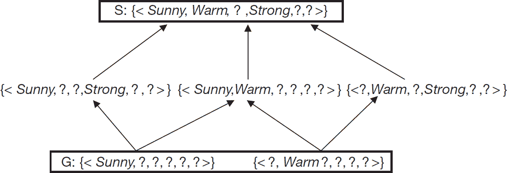

图 6.5 list-then-eliminate 算法后的版本空间表示

### 6.4.7 候选消除算法

使用候选消除过程来找到与给定训练示例集一致的所有假设的集合。算法维护的两个假设集合是一般边界 (`G`) 和特定边界 (`S`)。与正例一致的最一般假设在一般边界中找到，而与负实例一致的最具体假设在特定边界中找到。算法中最初的两个是覆盖一切的最一般假设 `G`，以及覆盖无物的最具体假设 `S`。然后算法对每个训练样本修改 `G` 和 `S`，删除任何不一致的假设并引入仍然一致的最小泛化或特化。过程在 `G` 和 `S` 在称为版本空间的假设集合上达成一致时结束。

候选消除算法能够处理不规则数据和概念漂移，使其在 ML 中有效。噪声数据的例子是错误或异常值，不能准确代表概念。当概念随时间演变，以至于先前的实例可能不再适用或准确时，就会发生概念漂移。候选消除技术可以通过在 `G` 和 `S` 中保留多种潜在假设而不是只确定一个来处理这些情况。然后系统可以适应新实例并丢弃不再有效的旧实例。通过评估版本空间的宽窄，算法还可以确定其预测的准确性。

算法如下：

将 `G` 初始化为最大一般假设的集合

将 `S` 初始化为最大具体假设的集合

对于每个训练样本 `d` ∈ `D`，执行

如果 `d` 是正例，则

从 `G` 中删除与 `d` 不一致的任何假设

对于每个与 `d` 不一致的假设 `s` ∈ `S`

从 `S` 中删除 `s`

将 `S` 的所有最小泛化 `h` 添加到 `S` 中，使得

`h` 与 `d` 一致，并且 `G` 的某个成员比 `h` 更一般

从 `S` 中删除任何比 `S` 中其他假设更一般的假设

如果 `d` 是负例，则

从 `S` 中删除与 `d` 不一致的任何假设

对于每个与 `d` 不一致的假设 `g` ∈ `G`

从 `G` 中删除 `g`

将 `g` 的所有最小泛化 `h` 添加到 `G` 中，使得

`h` 与 `d` 一致，并且 `S` 的某个成员比 `h` 更具体

从 `G` 中删除任何比其他假设更不一般的假设

下面的例子展示了如何使用候选消除过程解决一个简单的概念学习问题。给定一些具有天空、气温、湿度、风、水和预测等特征的日子实例，挑战是学习晴天的概念。特征可以是晴天、多云、温暖、寒冷、高、低、强、弱和温暖。晴天是正例的例子，而多云天是负例。

表 6.13 概念学习中的候选消除

| 示例 | 天空 | 气温 | 湿度 | 风 | 水 | 预报 | 类别 |
| --- | --- | --- | --- | --- | --- | --- | --- |
| E1 | Sunny | Warm | Normal | Strong | Warm | Same | + |
| E2 | Sunny | Warm | High | Strong | Warm | Same | + |
| E3 | Rainy | Cold | High | Strong | Warm | Change | - |
| E4 | Sunny | Warm | High | Strong | Cool | Change | + |

初始的 `G` 和 `S` 集合为：

`G` = {< ?, ?, ?, ?, ?, ?>}

`S` = {< Ø, Ø, Ø, Ø, Ø, Ø>}

看到 `E1` 后，`G` 和 `S` 变为：

`G` = {< ?, ?, ?, ?, ?, ?>}

`S` = {< Sunny, Warm, Normal, Strong, Warm, Same>}

看到 `E2` 后，`G` 和 `S` 变为：

`G` = {< ?, ?, ?, ?, ?, ?>}

`S` = {< Sunny, Warm, ?, Strong, Warm, Same>}

看到 `E3` 后，`G` 和 `S` 变为：

`G` = {< Sunny, ?, ?, ?, ?, ?>}

`S` = {< Sunny, Warm, ?, Strong, Warm, Same>}

看到 `E4` 后，`G` 和 `S` 变为：

`G` = {< Sunny, ?, ?, Strong, ?, ?>}

`S` = {< Sunny, Warm, ?, Strong, ?, ?>}

最终的版本空间为：

`VS` = {< Sunny, Warm, ?, Strong, ?, ?>}

### 6.4.8 关于版本空间和候选消除算法的说明

候选消除算法是一种用于发现与一组训练示例一致的假设的技术。算法维护的两个假设集合是一般边界 (`G`) 和特定边界 (`S`)。与所有正实例一致的最一般假设在一般边界中找到。相比之下，与所有正例一致的最具体假设在特定边界中找到。随着新例子的发现，算法修改初始的 `G` 和 `S`，它们持有最一般和假设。`G` 和 `S` 之间的版本空间是与我们见过的所有示例兼容的所有假设的集合。

只要满足两个条件，算法学习到的版本空间就会趋向于准确捕捉输入概念的假设：训练样本中没有错误，并且存在描述目标思想的假设。


算法可能无法识别一致的假设，如果这些条件被破坏。例如，如果训练数据存在缺陷，例如噪声或错误标记，算法可能会从 `G` 或 `S` 中移除一些准确的假设，或向 `G` 或 `S` 中添加一些错误假设。空的版本空间表示没有任何假设可以解释所有示例。或者，如果没有假设能够充分表达目标概念，例如概念过于复杂或无法在假设空间中表达，算法可能不会收敛到单一假设，而是收敛到庞大或无限的版本空间。

候选消除方法在 ML 中很有帮助，因为它可以从正实例和负实例中学习，并且目标概念可能会演变。通过报告有多少假设与示例一致，算法还可以提供对其学习假设的置信度水平。通过请求 `G` 或 `S` 之外的案例的标签，算法还可以为用户或教师产生新的查询，压缩版本空间并提高学习准确性。

## Summary

- 机器学习模型在数学上表示特征与标签之间的关系。模型的三个类别是逻辑、几何和概率。
- 逻辑模型是使用规则或条件进行预测或分类的模型。
- 在几何模型中，数据在 2D 或 3D 超平面中表示。具有四个或更多属性的数据难以可视化，只能在虚拟空间中想象。
- 距离模型是一种几何模型，使用距离度量来分离结果空间。决定特定空间中两点相距多远的称为距离度量。
- 预测模型是概率模型，用于估计给定某些输入属性的结果的条件概率。
- 生成模型是概率模型，用于估计输入和结果属性的联合概率。机器学习中概率模型的某些示例是朴素贝叶斯、逻辑回归、高斯混合模型和隐马尔可夫模型。
- 特征是任何 ML 应用的驱动力。它们代表数据的可测量特征，可进一步用于执行分类或聚类以进行预测或执行分析。最佳特征有助于模型实现高准确性。
- 将数据集特征的域更改称为特征转换。这有许多应用：
- 阈值化：使用截止值，此方法将数值或序数属性转换为二进制特征。
- 离散化：这里，定量特征值被转换为序数特征值。
- 从初始特征集中选择与学习任务相关且具有指导性的特征子集是特征选择过程。
- 过滤方法根据统计或信息论指标（如互信息、卡方检验、相关性等）对特征进行排序和评估，而不使用学习模型。
- 包装方法使用学习模型作为黑箱来评估特征。
- 内在学习方法在学习过程中包含特征选择。在训练阶段，它们要么改变目标函数，要么采用正则化方法来惩罚或删除不必要或冗余的特征。
- 前向选择是一个迭代过程。它从单个特征开始，迭代添加特征，并在每次迭代中评估模型。当新添加的特征不再提高模型的性能时，过程结束。
- 概念学习寻求从输入数据中提取广泛类别的定义。
- 使用候选消除算法来找到与给定训练示例集一致的所有假设的集合。

## EXERCISES

## Part A (Objective Questions)

1. 哪一类机器学习模型的特点是使用数学函数表示特征与标签之间的关系？

   a) Logical models
   b) Geometrical models
   c) Probabilistic models
   d) None of the above

2. 哪一类机器学习模型将实例映射到结果基于空间关系？

   a) Logical models
   b) Geometrical models
   c) Probabilistic models
   d) None of the above

3. 什么类型的模型使用算法和技术从数据中学习并在数学上表示特征与标签之间的关系？

   a) Logical models
   b) Geometrical models
   c) Probabilistic models
   d) All of the above

4. 哪一类机器学习模型专注于表示结果的不确定性和可能性？

   a) Logical models
   b) Geometrical models
   c) Probabilistic models
   d) None of the above

5. 几何机器学习模型的主要特征是什么？

   a) 表示不确定性
   b) 基于空间关系将实例映射到结果
   c) 使用算法进行逻辑推理
   d) All of the above

6. 哪一类机器学习模型依赖于逻辑推理和规则来做出预测？

   a) Logical models
   b) Geometrical models
   c) Probabilistic models
   d) All of the above

7. 什么区分了概率机器学习模型与其他类别？

   a) Logical reasoning
   b) Spatial relationships
   c) Representation of uncertainty
   d) Feature extraction techniques

8. 哪一类机器学习模型可以使用决策理论的算法来做出预测？

   a) Logical models
   b) Geometrical models
   c) Probabilistic models
   d) All of the above

9. 什么类型的度量计算几何模型中两点坐标绝对差的总和？

   a) Euclidean distance metric
   b) Manhattan distance metric
   c) Probabilistic distance metric
   d) Generative distance metric

10. 哪一类概率模型估计输入和结果属性的联合概率？

    a) Predictive models
    b) Generative models
    c) Discriminative models
    d) Descriptive models

11. 距离型几何模型如何帮助减少机器学习中数据的复杂性？

    a) By increasing dimensionality
    b) By introducing randomness
    c) By using distance metrics
    d) By creating outliers

12. 哪种类型的概率模型用于无监督学习任务？

    a) Predictive models
    b) Generative models
    c) Discriminative models
    d) Descriptive models

13. 机器学习中距离型几何模型的主要目的是什么？

    a) To generate new data points
    b) To predict future outcomes
    c) To measure similarity between data points
    d) To classify data points into categories

14. 哪种距离度量计算几何模型中两点之间的直线距离？

    a) Euclidean distance metric
    b) Manhattan distance metric
    c) Probabilistic distance metric
    d) Generative distance metric

15. 概率模型旨在捕捉机器学习中的哪种变异性和复杂性？

    a) Deterministic patterns
    b) Random patterns
    c) Geometrical patterns
    d) Predictable patterns

16. 哪种类型的概率模型用于回答关于观察特定属性的联合概率的问题？

    a) Predictive models
    b) Generative models
    c) Discriminative models
    d) Descriptive models

17. 哪种类型的特征在类别之间缺乏自然层级，包括国籍和发色等属性？

    a) Interval features
    b) Ordinal features
    c) Nominal features
    d) Ratio features

18. 什么类型的特征表示年龄、身高、体重和收入等特征，可用于数学运算和统计分析？

    a) Binary features
    b) Temporal features
    c) Text features
    d) Numerical features

19. 哪种类型的特征象征时间数据，包括日期、时间、持续时间和频率等属性？

    a) Binary features
    b) Temporal features
    c) Text features
    d) Categorical features

## Feature Types & Transformation

### 20. 哪种类型的特征包括产品评论、推文和新闻故事等属性，并用于情感分析和文本摘要等任务？

   a) `Binary features`
   b) `Temporal features`
   c) `Text features`
   d) `Categorical features`

### 21. 哪种数值特征的子类别缺乏绝对零点，但其测量值之间存在显著的数值差异？

   a) `Interval features`
   b) `Ordinal features`
   c) `Nominal features`
   d) `Ratio features`

### 22. 哪种类型的特征可以有两个可能的值，并用于逻辑运算或分类？

   a) `Numerical features`
   b) `Temporal features`
   c) `Binary features`
   d) `Categorical features`

### 23. 哪种分类特征的子类别落入一定的层级或顺序中，包括客户满意度或教育水平等属性？

   a) `Nominal features`
   b) `Ordinal features`
   c) `Binary features`
   d) `Interval features`

### 24. 通过分析数据中的日期、时间、频率等时间特征可以确定什么？

   a) `Binary characteristics`
   b) `Categorical traits`
   c) `Data trends and patterns`
   d) `Numerical values`

### 25. 哪种特征转换方法通过将范围离散化为区间，将定量特征值转换为序数特征值？

   a) `MinMax scaling`
   b) `Standard scaling`
   c) `Thresholding`
   d) `Discretization`

### 26. 特征转换中阈值处理的目的是什么？

   a) 将数据缩放到 0 到 1 之间
   b) 删除不必要的特征
   c) 将定量特征转换为序数特征
   d) 对数据应用标准缩放

### 27. 哪种缩放方法通过将最小值设为 0、最大值设为 1，将数据转换到范围 [0, 1]？

   a) `MinMax scaling`
   b) `Standard scaling`
   c) `Thresholding`
   d) `Discretization`

### 28. 标准缩放转换的数学方程是什么？

   a) `(x – x_mean) / (Standard deviation)`
   b) `(x + x_mean) * (Standard deviation)`
   c) `(x * x_mean) / (Standard deviation)`
   d) `(x – x_mean) * (Standard deviation)`

### 29. 哪种特征转换技术用于从数据中消除不必要、不重要或噪声的元素？

   a) `MinMax scaling`
   b) `Standard scaling`
   c) `Thresholding`
   d) `Discretization`

### 30. 特征转换在机器学习中的主要目的是什么？

   a) 创建新特征
   b) 增加数据复杂性
   c) 提高模型适用性和准确性
   d) 减少实例数量

### 31. 哪种转换方法最适合提高数据对某些机器学习模型的适用性？

   a) `MinMax scaling`
   b) `Standard scaling`
   c) `Thresholding`
   d) `Discretization`

### 32. 哪种转换技术涉及为区间分配序数值并将定量特征值转换为分类值？

   a) `MinMax scaling`
   b) `Standard scaling`
   c) `Thresholding`
   d) `Discretization`

### 33. 机器学习中特征构造的主要目标是什么？

   a) 减少数据集中特征的数量
   b) 从初始集合中选择相关特征
   c) 从现有特征构建新特征
   d) 使用学习模型评估特征

### 34. 哪种过程涉及从初始集合中选择特征子集以增强学习任务？

   a) `Feature construction`
   b) `Feature selection`
   c) `Filtering method`
   d) `Wrapper method`

### 35. 哪种方法基于统计指标对特征进行排名和评估，而不使用学习模型？

   a) `Feature construction`
   b) `Feature selection`
   c) `Filtering method`
   d) `Wrapper method`

### 36. 特征选择中包装方法的潜在缺点是什么？

   a) 它们计算成本高
   b) 它们缺乏精确度
   c) 它们不可适应
   d) 它们涉及过拟合

### 37. 包装方法在特征选择过程中如何评估特征？

   a) 使用统计指标
   b) 使用黑盒学习模型
   c) 基于信息论
   d) 通过应用交叉验证

### 38. 哪种方法更具可扩展性且不考虑特征之间的交互？

   a) `Feature construction`
   b) `Filtering method`
   c) `Feature selection`
   d) `Wrapper method`

### 39. 特征选择在机器学习中的主要优势是什么？

   a) 降低计算复杂度
   b) 创建新特征
   c) 增强特征交互
   d) 提高模型性能

### 40. 包装方法与过滤方法在特征评估方面有何不同？

   a) 包装方法使用统计指标
   b) 过滤方法涉及交叉验证
   c) 包装方法使用学习模型
   d) 过滤方法计算成本高

### 41. 哪种学习方法通过改变目标函数或使用正则化，将特征选择直接纳入学习过程？

   a) `Concept learning`
   b) `Candidate elimination algorithm`
   c) `Intrinsic learning methods`
   d) `List-then-eliminate procedure`

### 42. 机器学习中概念学习的主要目标是什么？

   a) 从数据中提取隐藏模式
   b) 从输入数据中识别特定类别
   c) 消除冗余特征
   d) 生成新假设

### 43. 哪种算法涉及维护一般和特定假设的集合，并根据训练示例修改它们以找到假设的版本空间？

   a) `List-then-eliminate procedure`
   b) `Concept Learning`
   c) `Intrinsic learning methods`
   d) `Candidate elimination algorithm`

### 44. 列表-然后-消除过程如何确保机器学习中假设的高效发现？

   a) 通过使用正则化技术
   b) 通过消除冗余特征
   c) 通过有效处理数据噪声
   d) 通过以列表形式处理一致的假设

### 45. 机器学习中候选消除算法的主要目的是什么？

   a) 生成新假设
   b) 消除数据噪声
   c) 找到假设的版本空间
   d) 处理大或复杂的假设空间

### 46. 内在学习方法与概念学习有何不同？

   a) 内在方法侧重于数据噪声处理
   b) 概念学习侧重于模型特定适应
   c) 内在方法涉及版本空间探索
   d) 概念学习从数据中识别特定类别

### 47. 候选消除算法发现的版本空间有何不同之处？

   a) 它仅包括特定假设
   b) 它仅包括最宽泛的假设
   c) 它是一组一致的假设
   d) 它是一组具有最大泛化能力的假设

### 48. 内在方法如何结合过滤和包装方法的优点？

   a) 通过使用正则化和特征缩放
   b) 通过直接改变目标函数
   c) 通过采用混合过滤和包装技术
   d) 通过修改假设的版本空间

## Part B Short Answer Questions

1. 什么是机器学习模型？其类别有哪些？
2. 什么是逻辑机器学习模型？
3. 什么是几何机器学习模型？
4. 机器学习中的距离模型是什么？
5. 基于距离的几何模型在机器学习中如何提供帮助？
6. 机器学习中的预测模型是什么？
7. 定义机器学习的生成模型。
8. 给出机器学习中概率模型的某些例子。
9. 定义机器学习空间中的特征。
10. 解释机器学习中特征的数值特征。
11. 解释机器学习中特征的分类特征。
12. 解释机器学习的时间和文本特征。
13. 什么是特征转换？写出其任何两个应用。
14. 什么是 MinMax 缩放？
15. 标准缩放的方程是什么？
16. 定义阈值处理。
17. 定义离散化。
18. 定义特征构造。
19. 定义特征选择。
20. 定义机器学习中特征的过滤方法。
21. 定义机器学习中特征的包装方法。
22. 定义机器学习的内在学习方法。
23. 什么是概念学习？
24. 定义列表-然后-消除算法。
25. 定义候选消除算法。

## Part C (Essay Questions)

1. 详细解释距离模型。
2. 详细解释概率模型并举例说明。
3. 解释特征及其类型。
4. 解释特征变换及其应用。
5. 解释 MinMax 缩放和标准缩放。
6. 解释阈值处理。
7. 详细解释离散化。
8. 解释特征构造。
9. 详细解释特征选择。
10. 在监督学习中执行特征选择的有哪些方法？
11. 撰写一篇关于将假设空间表示为一般到具体的排序的文章。
12. 撰写一篇关于寻找最大特异性假设（Find-S）的文章。
13. 撰写一篇关于一致假设和版本空间的文章。

## Answer Key

### Part A

1. (a)
2. (b)
3. (d)
4. (c)
5. (b)
6. (a)
7. (c)
8. (d)
9. (b)
10. (b)
11. (c)
12. (b)
13. (c)
14. (a)
15. (b)
16. (b)
17. (c)
18. (d)
19. (b)
20. (c)


## 7. Unsupervised Learning

### Learning Objectives

At the end of this chapter, you will be able to:

- Define unsupervised learning
- Identify the types of unsupervised learning: clustering, anomaly detection, dimension reduction, and association
- Differentiate between the types of clustering: hard and soft
- Explain the various clustering algorithms: `K-means` clustering, hierarchical clustering, fuzzy C-means clustering, `DBSCAN`, Gaussian mixture models (GMMs), MeanShift clustering, Gaussian mixture density estimation, and Markov random fields (MRFs)
- Describe the anomaly detection techniques: isolation forest algorithm, local outlier factor (LOF), and one-class support vector machine (OC SVM)
- Apply dimensionality reduction algorithms such as `PCA`, linear discriminant analysis (LDA), factor analysis (FA), and kernel principal component analysis (KPCA)
- Utilize association algorithms such as FP Growth, Apriori, and ECLAT
- Explain the Markov models and hidden Markov models (HMM)
- Explore matrix factorization and matrix completion models
- Discuss generative models and latent factor models
- Explain inference models and non-negative matrix factorization (NMF)
- Evaluate the advantages and disadvantages of unsupervised machine learning

## 7.1 Introduction

Unsupervised learning is a machine learning (ML) technique in which a machine is given unstructured data with no labels and asked to find patterns, similarities, and relationships between the data points. The output of this process is a model that can be used to make predictions or draw insights from the data. Unlike supervised learning, there is no human intervention. Instead, the algorithm must uncover hidden structures and relationships within the given data set.

Unsupervised learning algorithms are often used for clustering data sets into groups based on specific characteristics or dimensions or for anomaly detection, where outliers in the data set are identified. Unsupervised learning can also be used in natural language processing (NLP) tasks such as identifying topics within a document.

## 7.2 What and Why of Unsupervised Learning

Unsupervised learning is a type of ML where the computer program tries to find patterns and relationships in data without being given specific examples or labels to learn from. It is like trying to solve a puzzle without being given any hints. Instead, the program uses algorithms to explore the data and find patterns on its own.

For example, an unsupervised learning algorithm takes the input data set containing images of bulls and cows and performs analysis (Fig. 7.1). The algorithm observes the features of each image, such as shape, size, color, and texture. It then uses clustering techniques to group similar images into clusters. By doing this, it can recognize patterns in the data without knowing which categories of images belong to each cluster.

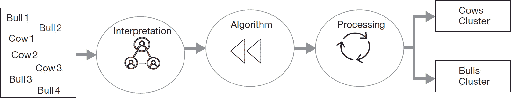

Figure 7.1 Unsupervised learning example

This technique can identify types of bulls or cows even if there is no clear distinction between them in the input data set. For example, suppose two cows have very similar shapes but differ slightly in color or texture. Unsupervised learning algorithms can still identify them as two distinct clusters despite their similarities.

Unsupervised learning is also helpful in separating a single object from its surroundings in an image by creating multiple clusters from that single object and its environment – this is known as segmentation. This technique can help computer vision applications accurately distinguish objects within an image, which is impossible with supervised learning approaches alone. Some examples of segmentation using unsupervised learning are image and document segmentation. In image segmentation, an image is separated into different regions or objects based on color, texture, edges, or other visual characteristics. Document segmentation is typically used to separate a document into its constituent parts, such as paragraphs, headings, and subheadings (Fig. 7.2).

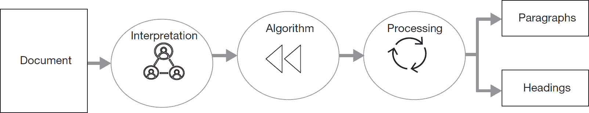

Figure 7.2 Documentation segmentation example

Overall, unsupervised learning algorithms are valuable tools that provide insights into data sets that, due to their complexity, would otherwise require manual analysis. This makes them an excellent tool for data scientists looking to gain insights quickly and effectively from large data sets.

It can also help detect anomalies and outliers in data sets or predict future behaviors by recognizing patterns from past events. In addition, unsupervised learning models can be used for marketing purposes by grouping customers with similar interests together so marketers can better target them with relevant offers and promotions.

Unsupervised learning allows us to uncover insights about our data without it needing to be labeled or categorized; this makes it helpful in dealing with real-world situations where not all information is already known beforehand.

## 7.3 Types of Unsupervised Learning

In ML, unsupervised learning allows computers to identify patterns in data without training data or human instruction. Clustering, anomaly detection, dimension reduction, and association rule learning are the four primary subcategories of this form of learning (Fig. 7.3).

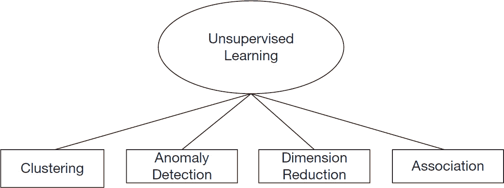

Figure 7.3 Types of unsupervised learning

Each of these types is now discussed in detail.

### 7.3.1 Clustering

Clustering algorithms are an essential type of unsupervised ML used to identify patterns in data and group similar data points together. Clustering is used to find structure in unlabeled data, such as trends and groupings, to understand the data set better. The main goal is to create clusters or groups of data points that are like each other and dissimilar from points in other clusters.

There are two main types of clustering algorithms (Fig. 7.4): hard (assigning a point to one cluster based on similarity) and soft (assigning a point to multiple clusters, allowing for overlap).

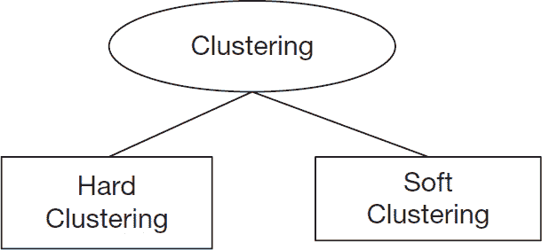

Figure 7.4 Types of clustering

硬聚类是指根据点与簇中其他点的相似性，将点分配到一个簇中。例如，如果你有一组水果，如苹果、橙子和香蕉，你可以使用硬聚类根据它们是甜还是酸来对水果进行分组。苹果将被归入甜类，而橙子则属于酸簇（Fig. 7.5）。

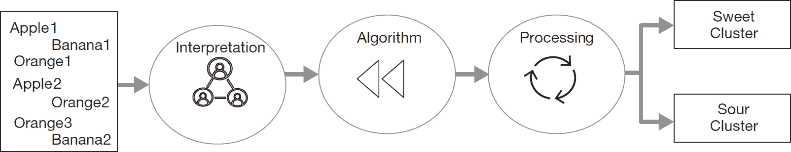

Figure 7.5 Hard clustering example

软聚类是指点可以同时被分配到多个簇中，并且簇之间允许重叠。例如，我们有一组动物，包括猫、狗、马、牛和山羊；我们可以对该数据集使用软聚类，通过创建一个宠物簇（猫、山羊和狗）以及一个农场动物簇（马、山羊和牛），两者重叠，因为山羊属于两个组（Fig. 7.6）。

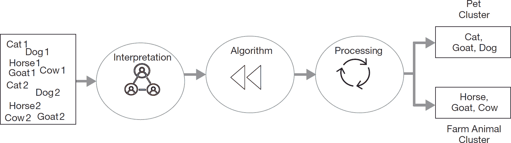

Figure 7.6 Soft clustering example

硬方法和软方法都可以帮助对相似的项目进行分组，从而使它们之间的模式更加明显。聚类后的数据随后可以进行详细研究，使我们能够理解趋势或在数据集中发现新知识。聚类算法可应用于各个领域，包括图像分割、市场研究的客户分类、发现数据趋势的统计分析，以及医学科学中的疾病分类。

有不同类型的聚类方法（Fig. 7.7），每种方法都有其自身的优缺点：

- 分区聚类：此方法将数据划分为非层次化的组，例如 `K-means`、`K-medoids` 等。每个数据点恰好属于一个簇，簇的数量是预先指定的。此方法适用于球形且分离良好的簇，但对于复杂形状或噪声数据可能效果不佳。
- 层次聚类：此方法创建簇的树状结构，例如凝聚或分裂聚类。每个数据点可以根据层次级别属于一个以上的簇。簇的数量可以通过在所需级别处剪切树来确定。此方法可以捕捉复杂形状和异常值，但可能计算成本高昂且对距离度量的选择敏感。
- 基于密度的聚类：此方法将簇识别为数据点的密集区域，由低密度区域分隔，例如 `DBSCAN`。每个数据点最多属于一个簇，一些数据点可能不属于任何簇（噪声）。簇的数量不是预先指定的，取决于密度参数。此方法可以处理任意形状和异常值，但对于变化的密度或高维数据可能效果不佳。
- 基于分布模型的聚类：此方法假设数据点由概率分布的混合生成，例如 `Gaussian mixture models`。每个数据点以一定的概率属于一个或多个簇，簇的数量是预先指定的或由模型选择标准确定。此方法可以捕捉数据的统计特性，但对于非高斯或重叠的簇可能效果不佳。
- 模糊聚类：此方法为每个数据点为每个簇分配隶属度，例如 `fuzzy C-means`。每个数据点以不同的隶属度属于一个或多个簇，簇的数量是预先指定的。此方法可以处理重叠和噪声数据，但可能对初始化和收敛标准敏感。

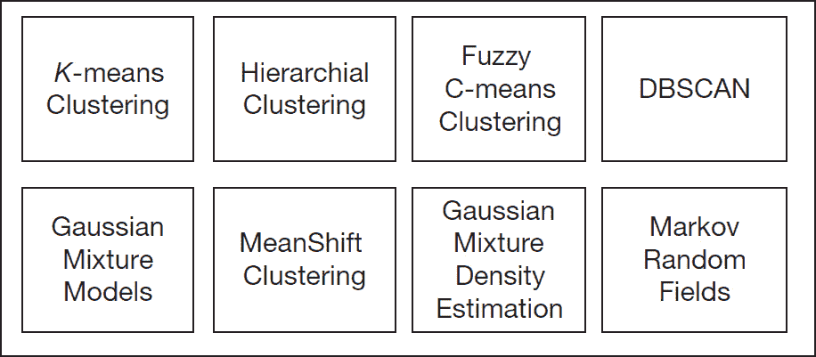

Figure 7.7 Types of clustering algorithms

### 7.3.1.1 K-means Clustering

这是一种流行的无监督机器学习技术，用于数据探索和分析。它用于将数据点分组或聚类到不同的簇或类别中。`K-means` 旨在根据特定特征将数据集划分为有意义的子组。该算法检查每个数据点并根据属性相似性将其分配到若干组之一。名称来源于它需要在运行算法之前指定特定数量的组（`K`）。因此，`K` 指定了必须生成的预定义簇的数量。之后，算法将通过确定每个簇的质心（或中心点）将数据集划分为 `K` 个簇。这是通过迭代过程实现的，在每次迭代中点被分配到其最近的质心。然后质心根据分配给它们的点的平均值进行更新。最后，簇数据点被分配到最近的质心，直到没有点未被分配。

质心是形状或物体的几何中心。它们可以通过求出构成形状或物体的所有点的坐标的平均值来计算。例如，要找到三角形的质心，我们可以使用公式：

```
(x, y) = ((x1 + x2 + x3) / 3, (y1 + y2 + y3) / 3)
```


其中 `(x1, y1)`、`(x2, y2)` 和 `(x3, y3)` 是三角形的顶点。该公式之所以有效，是因为质心将三角形的每条中线分为两段，比例为 2:1。中线是连接顶点与对边中点的线段。

下面是一个如何找到三角形质心的简单示例。假设我们有一个顶点为 `A(2, 4)`、`B(6, 8)` 和 `C(10, 4)` 的三角形。要找到质心，我们将坐标代入公式：

```
(x, y) = ( (2 + 6 + 10) / 3, (4 + 8 + 4) / 3)
(x, y) = (18 / 3, 16 / 3)
(x, y) = (6, 16/3)
```

因此，三角形的质心位于 `(6, 16/3)`。我们可以通过绘制中线并观察它们在此点相交来验证这一点。

`K-means` 算法通过基于数据点相似性将数据集划分为 `K` 个不同的簇来工作。它可以处理以下类型的数据：

• 离散数值数据：这些是可计数的数值，如售出产品的数量或网站访问次数。例如，如果你有不同地区售出产品的数量数据，`K-means` 可以对销售额相似的地区进行聚类。这有助于识别具有相似销售模式的区域。

• 连续数值数据：这些可测量的值可以在范围内取任意值，如温度或身高。例如，使用个人的年收入和年龄数据，`K-means` 可以对收入和年龄特征相似的个人进行聚类。这种实际应用对于市场细分特别有用，在那里你希望识别具有相似财务和人口特征的人群。

• 连续实体：这些是指可以在连续尺度上表示的数据点。例如，在图像处理中，像素强度是恒定值。`K-means` 可以根据像素强度将图像分割成不同的区域，这在目标检测和图像压缩应用中很有帮助。

然而，该算法在处理分类数据、异常值和非线性数据时存在困难。此外，你需要决定想要多少个数据簇。最后，`K-means` 最适合应用于较小的数据集，因为它会迭代所有数据点。因此，如果数据集包含许多数据点，对其进行分类将需要更长的时间。

## K-means 聚类输入与迭代过程

我们需要两个输入才能使 `K-means` 聚类正确工作：期望的簇/组数量以及一组带有相关值 `features` 的观测值。最初，我们必须随机为每个观测值/数据点/特征向量分配一个簇标签，通常为 0 或 1。然而，任何整数值都取决于我们希望将数据集划分为多少个簇 `K`。然后，对于每个组，我们需要计算 `centroid`，它代表其在每个维度上的平均位置，以及相对于数据集中所有其他组测量的整体大小/体积。

完成这些步骤后，我们可以开始多次循环遍历数据集，同时通过一种称为 `expectation maximization` 的迭代过程相应地调整质心。这通过为观测值分配新的标签来实现，最接近它们所属的组，在经历迄今为止的每次迭代之后，从而努力最小化簇内距离，同时最大化簇间距离。这为我们提供了越来越准确的预测，关于哪些观测值落在整个样本空间的哪些类别/子组中，使用 `Euclidean distance` 指标进行比较。

在预先指定的时间内没有迭代之间显著变化后，在有足够的计算资源的情况下，应该能迅速达到收敛，确保真正的分类准确性。

## 应用案例：运动鞋公司客户分组

假设一家公司生产运动鞋，想要将其客户分为两个不同的群体：男性和女性。我们将首先收集客户信息，例如年龄、性别、购物偏好和消费模式等，然后使用基于 `K-means` 聚类的方法来确定不同的标准以确定谁应该去哪里。

例如，大多数年龄在 18 至 25 岁之间的人倾向于在鞋子上花钱，而年龄在 30 岁以上的人则相反，从而仅基于年龄就产生了明显的区分。这表明两组年龄段的鞋类消费习惯存在显著差异：18–25 岁组和 30 岁及以上组。

### 观察要点

• 基于年龄的消费习惯：年轻人群 `18–25` 倾向于在鞋子上花费更多钱。这可能是由于时尚趋势、社会影响以及对个人外表的更高兴趣。老年人群 `30+` 不太可能在鞋子上花费同样多。他们可能会优先考虑其他开支，例如家庭需求、抵押贷款或储蓄。

• 基于性别的分析：一旦数据按性别分解，每个年龄组中男性和女性的数量与总体趋势完全一致。这种一致性为决策提供了坚实的基础，表明 18–25 岁的年轻男性和女性更有可能在鞋子上花费，而 30 岁以上的老年男性和女性则不太可能这样做。

• 假设和结论：根据消费模式，可以假设年轻人群 `18–25` 属于鞋类支出较高的类别，而老年人群 `30+` 属于鞋类支出较低的类别。这种区分使营销人员和企业能够量身定制其产品和营销策略，有效地针对适当的年龄组。

## K-means 执行步骤

### Step 1: Data Collection

第一步是收集客户数据。在这种情况下，我们收集客户信息，例如年龄、性别、购物偏好和消费模式。

### Step 2: Define K

接下来，我们需要定义我们想要形成的簇的数量 `K`。在这个例子中，我们希望将客户分为两个不同的群体：男性和女性。

### Step 3: Initialize Centroids

下一步是随机初始化 `K` 个质心。`centroid` 是簇中心的点。在我们的例子中，我们随机选择两个质心：一个用于男性，一个用于女性。

### Step 4: Assign Data Points to Clusters

下一步是根据 `Euclidean distance` 将每个数据点分配给其最近的质心。在我们的例子中，我们将计算每个客户与每个质心的距离，并根据性别将他们分配给最近的质心。

### Step 5: Update Centroids

在所有数据点都被分配到簇后，我们根据该簇中所有数据点的平均值更新每个簇的质心。这是为了确保质心位于簇的中心。

### Step 6: Reassign Data Points

然后我们根据更新后的质心值，将每个数据点重新分配给其最近的质心。此过程重复进行，直到质心不再移动，或达到最大迭代次数。

### Step 7: Interpret Results

最后一步是解释聚类算法的结果。在我们的例子中，我们将通过分析每个簇中客户的特征来解释结果，以确定决定谁应该去哪里的不同标准，基于性别。

## 示例 1：五条记录计算

让我们考虑我们有五个数据点 `records` 的例子：我们假设前三个数据点是男性，最后两个数据点是女性。每个数据点的鞋类支出和年龄在 Table 7.1 中给出。

Table 7.1 Spending pattern

| Customer ID | Age | Gender | Spending on shoes |
| --- | --- | --- | --- |
| 1 | 20 | Male | 500 |
| 2 | 25 | Male | 800 |
| 3 | 30 | Male | 400 |
| 4 | 35 | Female | 700 |
| 5 | 50 | Female | 300 |

男性簇的质心计算如下：

男性簇的平均年龄为 `(20 + 25 + 30)/3 = 25`

男性簇的平均鞋类支出为 `(500 + 800 + 400)/3 = 567`

因此，男性簇的质心为 `(25, 567)`。

女性簇的质心计算如下：

女性簇的平均年龄为 `(35 + 50)/2 = 42.5`

女性簇的平均鞋类支出为 `(700 + 300)/2 = 500`

因此，女性簇的质心为 `(42.5, 500)`。

重复步骤 4–6 直到收敛：我们现在重复步骤 4–6，直到质心不再发生变化。在我们只有五个数据点的例子中，我们已经收敛，并且我们找到了两个簇：

男性簇有客户 ID 1、2 和 3，质心为 `(25, 567)`

女性簇有客户 ID 4 和 5，质心为 `(42.5, 500)`

一旦我们确定了两个簇，我们就可以根据客户与两个质心的距离将客户分配到男性或女性簇。在实践中，我们将使用更多的数据点和超过两个簇以获得更准确的聚类。

接下来，算法计算每个簇的均值，这将作为新的质心。在我们的例子中，将计算每个簇中客户的平均支出和年龄，从而为男性和女性群体得出新的质心。我们根据其特征值将每个客户分配给最近的质心。计算每个客户与质心之间的距离，并将客户分配给最近质心的组。此过程重复进行，直到质心不再发生变化或达到最大迭代次数。

最终，我们将根据他们的消费模式和年龄拥有两个不同的群体，男性和女性。这些信息可由公司用于根据每个群体的偏好和需求量身定制其营销工作和产品供应。

## 示例 2：某人希望根据购买的频繁产品类型将客户分为两个不同的簇

他们可以输入之前购买产品的单个商品信息，并找到人们购买的商品之间的相关关系，以确定某些商品是否构成相同的部分簇，从而影响未来挑选不同商品的决策过程。假设我们有一组 5 位客户及其对不同产品的购买历史。列可以包括 `Customer ID`、`Product 1`、`Product 2`、`Product 3` 等，列数取决于公司销售的产品数量。我们可以使用 `K-means` 聚类根据客户购买最多的产品对客户进行分组。

#### 步骤

1. **选择簇的数量**：在本例中，我们希望根据客户购买最多的产品类型将客户分为两个簇。

2. **选择初始质心**：从数据集中随机选择两位客户作为每个簇的初始质心。

3. **计算距离**：计算每个客户与每个质心之间的距离。最常用的距离度量是 `Euclidean distance`。

4. **将客户分配到簇**：将每个客户分配到距离最近的质心的簇。

5. **计算新的质心**：重新计算每个簇的质心，作为分配给该簇的所有客户的均值。

6. **重复步骤 3–5**：重复步骤 3-5，直到质心不再发生变化，或达到最大迭代次数。

7. **解释结果**：一旦算法收敛，结果簇可以根据每个客户购买最频繁的产品进行解释。

例如，簇 1 可能由最频繁购买 `Product 1` 和 `Product 2` 的客户组成，而簇 2 可能由最频繁购买 `Product 3` 和 `Product 4` 的客户组成。公司随后可以利用这些信息相应地为每个簇量身定制营销策略。

例如，如果我们有 5 位客户和 4 种产品，我们的商品频率矩阵可能如下所示 Table 7.2。

Table 7.2 五位客户和四种产品

| Customer | Product 1 | Product 2 | Product 3 | Product 4 |
| --- | --- | --- | --- | --- |
| 1 | 3 | 2 | 1 | 4 |
| 2 | 0 | 1 | 4 | 2 |
| 3 | 2 | 3 | 0 | 1 |
| 4 | 1 | 2 | 3 | 2 |
| 5 | 3 | 1 | 2 | 0 |

计算每个数据点与每个质心之间的距离。在我们的示例中，我们将计算每个客户与两个质心之间的距离，这两个质心代表两个簇（产品 A 的频繁购买者和产品 B 的频繁购买者）。

将每个数据点分配到最近的质心。此步骤涉及根据上一步计算的距离对最接近每个质心的客户进行分组。例如，如果一位客户购买了两次产品 A 和一次产品 B，他们将被分配到经常购买产品 A 的客户簇。

根据步骤 5 中的新分组重新计算每个簇的质心。这涉及计算分配给每个质心的所有数据点的均值。在我们的示例中，我们将计算每个簇中每种产品的购买频率平均值。

当质心在迭代之间不再显著移动时，即达到收敛。此时算法停止，簇被视为已最终确定。一旦确定了簇，公司就可以利用这些信息做出有关产品开发、营销和销售策略的决策。

## 选择合适的簇数（K）

选择最佳簇数是聚类分析中的一个关键阶段，因为它决定了数据的划分方式以及可能从中提取的见解。因此，建立确定合适簇数的标准或程序至关重要。

选择的簇数可能受到先前信息或专业知识的影响。例如，在对大学学生的数据进行聚类时，我们可以利用院系或学院的数量作为初始参考。这种假设基于这样一种观点：来自不同院系的学生表现出不同的特征或行为。在根据两个特征对电影数据进行聚类时，即预算（高或低）和选角（明星或非明星），使用四个组是合适的，因为这些属性有四种潜在组合。

业务需求和资源限制是可能影响簇数选择的另外因素。有时，我们可能对聚类数据有一个明确的目标或目的，例如划分、分类或建议。在这种情况下，我们可能有一个预定的簇数量，我们希望实现，这由问题的规范或限制指导。例如，一位电影制作人可能会对电影进行分类以吸引不同的受众或市场。在这样做时，他们可能有一个预定的细分数量他们希望建立，例如主流、小众、艺术院线或独立。假设一位电影制作人在预算或时间方面资源有限。在这种情况下，他们可能会对电影进行聚类以确定最有利可图或可行的资金和选角组合。

然而，在缺乏任何先前信息或对分组数据明确目标的情况下，我们有多种情况。对于这种情况，有必要采用统计方法或标准来确定最合适的簇数。这些现在将详细讨论。

### 肘部法

肘部法通过计算每个数据点与其指定簇中心之间的平方距离之和（`SSD`）来确定聚类算法中最合适的簇。簇中心代表每个簇内的平均或典型位置，而 `SSD` 量化每个簇内的紧凑性或同质性。理想情况下，我们的目标是最小化 `SSD`，表明数据点接近其各自的簇中心并且与邻近簇明显分离。然而，当簇的数量增加时，`SSD` 将表现出更缓慢的下降，因为数据被逐步划分为越来越小的组。最终，增加簇的数量对改善 `SSD` 的收益将递减，并可能导致引入噪声或过拟合。

通过使用 `K-means` 聚类并使用不同的 `K` 值，我们可以生成每个 `K` 值的 `SSD` 曲线图。这可以如 Fig. 7.8 所示。

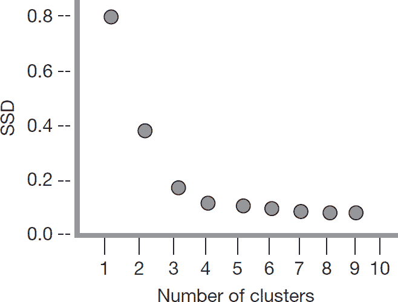

Figure 7.8 使用肘部法确定 K 值

### 轮廓系数法

轮廓系数法用于评估聚类结果的有效性。要使用轮廓系数法，需要计算每个数据点的轮廓分数。轮廓分数是衡量数据集中聚类质量的指标。

让我们表示数据点的索引。`a(i)` 表示 `i` 与同一簇中所有其他点之间的平均距离，而 `b(i)` 表示 `i` 与任何其他簇中所有其他点之间的最小平均距离。轮廓分数 `s(i)` 是一个介于 -1 到 1 之间的指标，-1 表示聚类效果差，1 表示簇分离良好。`s(i)` 的公式通过 `b(i)` 减去 `a(i)` 然后除以 `a(i)` 和 `b(i)` 中较大的值来计算。

接近 1 的数值表示该数据点与其自身簇高度相似（高内聚），且与其他簇差异显著（高分离）。值接近 0 的数据点表示其接近两个簇之间的边界，可能被分配到任一簇。约 –1 的数值表示该数据点在其簇内凝聚度低，且与其他簇的分离度低，表明差异程度高。

每个簇的轮廓分数计算为该簇内所有数据点轮廓分数的平均值。整个数据集的轮廓分数计算为各簇轮廓分数的平均值。理想的簇数是使给定数据集的轮廓分数最大化的那个。

考虑一个场景，我们拥有一个包含四个不同属性的数据集，我们的目标是将其分类为两个或三个不同的组。我们可以使用聚类技术获取聚类结果。随后，可采用轮廓方法来评估每个聚类结果的质量。Table 7.3 显示了各种情况下每个数据点和簇的轮廓评分。

Table 7.3 Silhouette rating example

| Data point | Cluster 1 (`K` = 2) | Cluster 2 (`K` = 2) | Cluster 1 (`K` = 3) | Cluster 2 (`K` = 3) | Cluster 3 (`K` = 3) |
| --- | --- | --- | --- | --- | --- |
| 1 | 0.65 | - | 0.65 | - | - |
| 2 | 0.55 | - | 0.55 | - | - |
| 3 | 0.60 | - | - | 0.60 | - |
| 4 | - | 0.70 | - | - | 0.70 |
| 5 | - | 0.75 | - | - | 0.75 |
| 6 | - | 0.80 | - | - | 0.85 |
| Cluster | 0.60 | 0.75 | 0.60 | 0.60 | 0.75 |
| Data set | `0.68` | | `0.65` | | |

很明显，当 `K` = 2 时，得分高于 `K` = 3 时。这表明两个簇比三个更适合该数据集。很明显，簇 2 中的数据点的轮廓分数高于簇 1 中的数据点，这表明簇 2 比簇 1 更紧密且更具区分性。

轮廓方法是有用的工具，但它也有某些局限。例如，对于簇重叠或形状非球形的数据集，或包含噪声或异常值的数据集，其性能可能不佳。因此，建议采用可视化检查、专业知识或统计分析等替代方法来补充轮廓方法。

### Gap Statistic

Gap Statistic 方法用于确定给定数据集中最合适的簇数。其基本概念是数据应表现出更多结构或模式，而非随机噪声。因此，通过对数据进行聚类，`SSD` 与其簇中心之间的距离应最小化。Gap Statistic 方法旨在通过比较实际数据的 `SSD` 与具有相似特征（如大小和形状）的随机生成数据的 `SSD` 来确定理想平衡。假设随机生成的数据缺乏任何可辨识的结构或簇，导致其 `SSD` 随簇数变化时变化很小。Gap Statistic 方法计算 gap，即衡量观察数据的 `log(SSD)` 与随机生成数据的 `log(SSD)` 之间差异的指标，对每个簇数而言。随着 gap 的增大，实际数据表现出比随机数据更大的模式或聚类程度。理想的簇数是使 gap 最大化的那个。

让我们考虑对一些二维数据点进行聚类的示例。我们可以通过对每个数据点与其簇中心之间的平方距离求和来计算每个聚类的 `SSD`。Table 7.4 显示了每个聚类的 `SSD` 值。

Table 7.4 SSD values for each clustering

| Number of clusters (`K`) | `SSD` |
| --- | --- |
| 2 | 9.2 |
| 3 | 6.4 |
| 4 | 4.8 |
| 5 | 3.6 |

`SSD` 值随着簇数增长而下降，正如预期的那样。然而，这些信息并不能提供理想的聚类解决方案，因为我们需要了解由随机噪声产生的预期 `SSD`。


为此，我们可以生成一组与原始数据大小和结构相匹配的随机数据，然后计算每个可能的簇数的 `SSD`。我们可以重复此过程以获得每个簇数量的平均 `SSD`。Table 7.5 说明了任意数据及其对应的平均 `SSD` 值。

### Table 7.5 Average `SSD` values for random data

| Number of clusters (`K`) | Average `SSD` |
| --- | --- |
| 2 | 8.9 |
| 3 | 8.7 |
| 4 | 8.6 |
| 5 | 8.5 |

随机数据的平均 `SSD` 几乎不受簇数影响，正如预期的那样。因此，对随机数据进行聚类对其离散度的降低影响很小。

现在，我们可以通过从随机数据的 `SSD` 的对数中减去实际数据的 `SSD` 的对数来计算每个簇数的 gap 统计量。Table 7.6 显示了对应于每个簇数的 gap 值。

### Table 7.6 Gap values for each cluster count

| Number of clusters (`K`) | Gap |
| --- | --- |
| 2 | -0.03 |
| 3 | -0.17 |
| 4 | -0.23 |
| 5 | -0.26 |

很明显，随着簇数的增加，差异扩大，但对于所有 `K` 值仍为负。因此，所有聚类的 `SSD` 都等于或高于随机噪声。因此，没有任何聚类具有可辨识的结构或模式。基于此场景，可以推断出没有确定的簇数最适合此特定数据集。

Gap Statistic 方法是确定给定数据集中最合适的簇数的常用方法。然而，该技术存在缺陷和一些局限性和假设，必须予以考虑。Gap Statistic 方法的一个基本前提是，随机创建的参考分布与真实数据共享相似属性，包括维度和形状。因此，随机数据必须具有与实际数据相同数量的特征和实例，并且应在相同的域内均匀分布。然而，在实践中实现这一目标可能具有挑战性和不可靠性，因为实际数据通常表现出复杂的结构和模式，而简单的随机模型无法充分代表。

另一个障碍在于我们生成能够忠实模拟噪声的随机数据的能力。噪声是指与任何簇无关的数据中不需要的波动或不准确。Gap Statistic 方法假设噪声是均匀分布的且与簇无关。然而，这一断言对于某些真实数据集可能不成立，因为噪声可能表现出可辨识的结构或模式，从而影响聚类结果。如果噪声与某些属性或数据相关，它可以生成新的簇或扭曲实际的簇。这可能导致不准确的 gap 值和对理想簇数的错误确定。

间隙统计方法（Gap Statistic 方法）的另一个限制是确定潜在聚类数范围，这可能具有挑战性。该范围应足够宽泛以涵盖真正的最佳值，同时避免过度的计算和错误的结果。如果范围过于有限，我们可能会错过最优值，最终得到不理想的聚类。在范围过宽的情况下，我们可能会面临过拟合或欠拟合的问题，即我们要么识别出过多的微小聚类，要么识别出有限数量的大聚类，这些聚类无法准确地代表实际的数据结构。

另一个局限性是其未能考虑影响聚类质量的额外因素，例如聚类的形状、大小或彼此之间的距离。分析仅集中于使用 `SSD` 来量化聚类内部的离散度。然而，`SSD` 可能无法全面或令人满意地捕捉不同聚类应用或场景中的所有复杂性或倾向。必须谨慎行事，并辅以其他技术或标准，以确保稳健可靠的聚类结果。

## 7.3.1.2 层次聚类

层次聚类是一种强大的无监督学习算法，它使用层次化方法将数据点分组到聚类中。它首先为每个数据点分配其聚类，然后在确定不同数据点之间的相似性和差异时，以层次树结构进行合并。因此，算法可以通过比较这些特征来识别模式并根据共享特征创建聚类。这种类型的聚类可用于各种应用，例如客户细分或识别大型数据集中的模式。

层次聚类的一个优点是它不需要关于数据集的先验知识或对其结构的任何假设，使其适合探索性分析。由于它可以捕捉到与其他方法相比物体组之间更细微的差异，因此通常比其他算法产生更准确的结果。用户可以通过更改相似性标准或链接方法等参数，轻松根据其特定需求修改聚类。

让我们考虑一个在线商店客户的数据集，其中每个客户由其年龄、性别、收入和购买历史描述。目标是根据这些特征的相似性对客户进行聚类。

#### 步骤

**步骤 1：距离计算。** 第一步是计算每对客户之间的距离。在这里，我们可以使用 `Euclidean distance` 作为客户之间相似性的度量。我们可以用表格形式表示数据集，其中每一行代表一个客户，列代表特征。Table 7.7 显示了五个客户的详细信息。

### Table 7.7 客户详情

| Customer | Age | Gender | Income | Purchase history |
| --- | --- | --- | --- | --- |
| 1 | 30 | Male | 50000 | Low |
| 2 | 35 | Female | 60000 | Medium |
| 3 | 25 | Female | 40000 | High |
| 4 | 45 | Male | 80000 | Low |
| 5 | 50 | Female | 90000 | High |

**步骤 2：创建距离矩阵。** 接下来，我们需要根据客户的特征定义客户之间的距离或相似性度量。一个可能的选择是 `Euclidean distance`，它是对应特征值平方差之和的平方根。例如，客户 1 和客户 2 之间的 `Euclidean distance` 为：

```
sqrt((30-35)² + (0-1)² + (50000-60000)² + (0-1)²) = 10001.41
```

其中我们已将性别和购买历史特征编码为二进制变量（0 表示男性/低，1 表示女性/高）。使用此距离度量，我们可以构建一个距离矩阵（Table 7.8），显示所有客户之间的成对距离。

### Table 7.8 距离矩阵

| Distance | 1 | 2 | 3 | 4 | 5 |
| --- | --- | --- | --- | --- | --- |
| 1 | 0 | 10001.41 | 10001.41 | 30001.41 | 40001.41 |
| 2 | 10001.41 | 0 | 20001.41 | 20001.41 | 30001.41 |
| 3 | 10001.41 | 20001.41 | 0 | 40001.41 | 50001.41 |
| 4 | 30001.41 | 20001.41 | 40001.41 | 0 | 10001.41 |
| 5 | 40001.41 | 30001.41 | 50001.41 | 10001.41 | 0 |

**步骤 3：构建树状图。** 树状图是一种树状图，显示客户基于其相似性的层次关系。我们首先将每个客户视为一个单独的聚类，然后合并最近的聚类，直到最终得到一个包含所有客户的单个聚类。

我们使用单链接、完全链接、平均链接或 Ward 方法等不同方法执行聚类算法。在这里，我们将使用单链接，它合并其成员任意一对之间的最小距离最小的聚类。

算法从每个客户作为一个单独的聚类开始：

`{1}`, `{2}`, `{3}`, `{4}`, `{5}`

矩阵中最小的距离是 `10001.41`，它出现在客户 1 和客户 3 之间，以及客户 2 和客户 4 之间。我们可以将这些对合并为两个聚类：

`{1, 3}`, `{2, 4}`, `{5}`

下一个最小的距离是 `20001.41`，它出现在客户 2 和客户 5 之间，以及客户 3 和客户 5 之间。我们可以将这些对合并为两个聚类：

`{1, 3, 5}`, `{2, 4}`

最后一步是将剩下的两个聚类合并为一个：

`{1, 3, 5, 2, 4}`

这是使用单链接层次聚类的最终聚类结果。此示例的树状图显示在 Fig. 7.9 中。

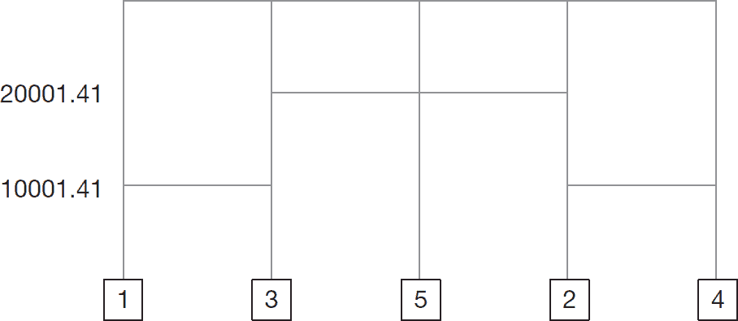

Figure 7.9 树状图示例

层次聚类可以应用于广泛的数据集，并且特别适用于识别大型和复杂数据集中的模式。它也可以用于数据可视化和探索性分析，因为生成的树状图提供了数据点之间关系清晰的可视化。

层次聚类的两种主要类型是凝聚聚类和分裂聚类（Fig. 7.10）。

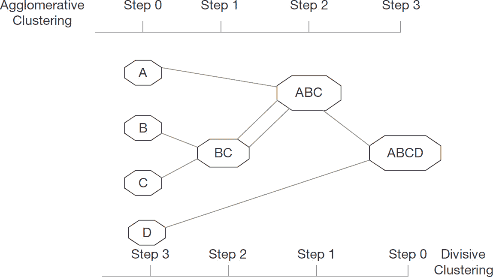

Figure 7.10 凝聚和分裂聚类

凝聚聚类是一种层次方法，它首先将每个数据点视为一个单独的聚类。然后它逐步合并最相似的聚类，直到达到特定数量的聚类或预定的停止条件。可以使用各种方法来量化聚类之间的相似性，包括单链接（最小距离）、完全链接（最大距离）、平均链接（平均距离）和 Ward 方法（最小方差）。

分裂聚类是一种层次方法，它首先将所有数据点分组到一个单一聚类中，然后迭代地将聚类划分为更小的聚类，直到达到指定的聚类数量或预定的停止条件。聚类可以使用多种标准进行划分，例如数据点之间的最大距离、数据点的最小密度或最小轮廓系数。

一种层次聚类的方法是对论文按照其各自的主题进行分类。凝聚聚类首先将每个文档视为其自身的簇，然后合并共享相似词语或概念的簇，直到达到预先确定的主题数量或相似度阈值。分裂聚类首先将所有文档分组到一个单一簇中，并根据词语或关键词的差异性将簇划分为更小的子簇。此过程一直持续到达到预先确定的主题数量或差异度阈值。

### 7.3.1.3 模糊 C 均值聚类

这是一种流行的数据挖掘技术，它使用模糊逻辑在大型、复杂的数据集中识别簇。与其他聚类算法不同，它不依赖于刚性边界来分配标签或定义每个簇的特征。相反，它利用数据点之间的概率关系，根据其属于每个类别的可能性将它们分配到组中。这种方法可以对复杂数据集进行更准确的分类。此外，它有助于发现标准方法可能忽略的细微模式。

该算法为每个数据点相对于数据集内所有其他点分配一个隶属度值或关联度。0 到 1 之间的概率通常用于表示该值，较高的值表示属于该簇的可能性更大，较低的值表示联系较弱。算法评估这些概率以确定应根据其相似性或差异性将哪些点分组。一旦完成，它就可以使用这些分组作为类别或标签，将新数据点分类到相应的组中。

由于模糊 C 均值聚类不需要为分配类别制定严格规则，因此在处理包含异常值和不规则值的复杂数据集时，可以允许更具创造性的解决方案。此外，其识别细微模式的能力使其成为许多需要模式识别的领域不可或缺的工具，例如计算机视觉应用和金融市场分析。与传统聚类方法相比，尽管它具有优势，但该算法仍存在一些缺点，例如需要大量的计算资源，如果应用于时间限制是问题的庞大数据集，其实用性可能会受到限制。

为了说明该聚类算法，让我们考虑一个假设场景，其中数据集包含客户及其在各种产品上的消费习惯。产品包括鞋子、服装和配饰。我们旨在根据其购买行为的相似性将客户细分为组，并为每个组设计定制营销策略。

#### 步骤

1. 首先，我们需要指定要创建的簇的数量并初始化 `fuzzy membership matrix`。`fuzzy membership matrix` 包含每个数据点对每个簇的隶属度。为了简化，让我们假设我们想要创建两个簇，并随机初始化 `fuzzy membership matrix`。

2. 接下来，我们需要根据初始 `fuzzy membership matrix` 计算两个簇的 `centroids`。簇的 `centroid` 是簇中所有数据点的加权平均值，其中权重为隶属度。`centroids` 代表每个簇的中心或原型。

3. 我们需要计算每个数据点与两个簇的 `centroids` 之间的距离。我们可以使用任何距离度量，例如 `Euclidean` 或 `Manhattan distance`。距离衡量数据点与簇 `centroid` 的远近。

4. 我们需要根据每个数据点与 `centroids` 之间的距离更新 `fuzzy membership matrix`。我们使用 `fuzzy membership function`，它为更接近簇 `centroid` 的数据点分配更高的隶属度，为远离簇 `centroid` 的数据点分配更低的隶属度。`fuzzy membership function` 还取决于 `fuzziness factor`，它控制簇之间的重叠程度。较高的 `fuzziness factor` 意味着更多的重叠，较低的 `fuzziness factor` 意味着更少的重叠。

5. 接下来，我们重复步骤二到四，直到算法收敛。算法收敛时，`fuzzy membership matrix` 或簇的 `centroids` 没有显著变化。

6. 最后，我们需要将每个数据点分配给隶属度最高的簇。这导致数据的软划分，其中每个数据点以不同的隶属度属于多个簇。然后我们可以分析每个簇的特征并识别每个簇中客户之间的共同模式。

为了解释其工作原理，让我们考虑数据点：`{(1, 2), (3, 5), (6, 8), (7, 10)}`。假设我们想将它们聚类为两个组：`A` 和 `B`。我们首先为每个数据点随机分配每个簇的隶属度值（Table 7.9）。

### Table 7.9 Fuzzy C-means data point and membership

| Data point | Membership in A | Membership in B |
| --- | --- | --- |
| (1,2) | 0.7 | 0.3 |
| (3,5) | 0.6 | 0.4 |
| (6,8) | 0.2 | 0.8 |
| (7,10) | 0.1 | 0.9 |

隶属度值表示每个数据点属于每个簇的强度。它们必须对每个数据点求和为一。接下来，我们根据数据点及其隶属度值的加权平均值计算每个簇的 `centroids`。例如，簇 `A` 的 `centroid` 为：

`(0.7 * 1 + 0.6 * 3 + 0.2 * 6 + 0.1 * 7) / (0.7 + 0.6 + 0.2 + 0.1) = 2.9`

`(0.7 * 2 + 0.6 * 5 + 0.2 * 8 + 0.1 * 10) / (0.7 + 0.6 + 0.2 + 0.1) = 4`

同样，簇 `B` 的 `centroid` 为：

`(0.3 * 1 + 0.4 * 3 + 0.8 * 6 + 0.9 * 7) / (0.3 + 0.4 + 0.8 + 0.9) = 5.9`

`(0.3 * 2 + 0.4 * 5 + 0.8 * 8 + 0.9 * 10) / (0.3 + 0.4 + 0.8 + 0.9) = 8`

然后，我们根据每个数据点到每个簇的 `centroids` 的距离，使用涉及一个称为 `fuzziness coefficient` 的参数的公式更新每个数据点的隶属度值，该参数控制簇的模糊程度。较高的 `fuzziness coefficient` 意味着簇之间更多的重叠，而较低的值意味着更多的分离。

数据点对簇的隶属度值与到该簇 `centroid` 的距离成反比，幂为 `m`，该幂控制聚类的模糊度。`m` 的较高值意味着更多的模糊，较低的值意味着更多的清晰。`m` 的常见选择是 `2`。

例如，`(1, 2)` 到簇 `A` 的 `centroid` 的距离为：

`sqrt((1 – 2.9)² + (2 – 4.5)²) = sqrt(5) = ~2.24`

`(1, 2)` 到簇 `B` 的 `centroid` 的距离为：

`sqrt((1 – 6.4)² + (2 – 8.9)²) = sqrt(58) = ~7.62`

`(1, 2)` 对簇 `A` 的隶属度值为：

`(1 / sqrt(5))^(2 / (m – 1)) / ((1 / sqrt(5))^(2 / (m – 1)) + (1 / sqrt(58))^(2 / (m – 1))) = ((sqrt(58))^m / ((sqrt(58))^m + (sqrt(5))^m))`

如果我们选择 `m = 2`，则变为：

`(sqrt(58)² / ((sqrt(58))² + (sqrt(5))²)) = ((58 / (58 + 5))) = ~0.92`

`(1, 2)` 对簇 `B` 的隶属度值为：

`(1 / sqrt(58))^(2 / (m - 1)) / ((1 / sqrt(5))^(2 / (m - 1)) + (1 / sqrt(58))^(2 / (m - 1)))`

`= ((sqrt(5))^m / ((sqrt(58))^m + (sqrt(5))^m))`

如果我们选择 `m = 2`，则变为：

`(sqrt(5)² / ((sqrt(58))² + (sqrt(5))²))`

`= ((5 / (58 + 5))) = ~0.08`

我们重复计算 `centroids` 和更新隶属度值的过程，直到隶属度值收敛或达到预定义阈值。结果是数据点被划分为两个簇的模糊划分，其中每个数据点对每个簇都有一个隶属度。

### 7.3.1.4 DBSCAN

## 基于密度的噪声应用空间聚类

基于密度的噪声诱导应用空间聚类是一种众所周知的基于密度的聚类算法。它比 `K-means` 更适合识别聚类，因为它会在更广泛的空间数据库中交叉检查其数据点的密度。该算法将低密度区域划分为高密度区域。

## 咖啡店示例

想象你有一个数据集，其中包含城市中所有咖啡店的地理坐标（纬度和经度）。当你将 `DBSCAN` 应用于此数据集时，算法会寻找咖啡店密集聚集的区域。例如，在市中心，由于人流量大和需求高，咖啡店很可能彼此靠近。`DBSCAN` 将识别这些咖啡店聚类为一个单一群体。

另一方面，在郊区，咖啡店可能分布得更分散。`DBSCAN` 将把这些识别为单独的聚类，甚至如果它们相距太远则视为噪声。例如，如果在广阔的郊区只有少数几家咖啡店散布，它们可能不会形成密集的聚类。

此外，`DBSCAN` 可以识别离群点。这些是远离任何其他咖啡店的咖啡店，例如偏远地区的一家孤立咖啡店。算法会将这些标记为噪声或离群点，因为它们不属于任何聚类。

因此，聚类可以在任意形状中找到。你需要在起始数据点的邻域内有最少数量的点才能开始聚类过程。否则，这些数据点将成为噪声。`DBSCAN` 算法也不需要预设的聚类数量。该算法选择一个任意点，然后识别该任意点附近的其他点。


随后，利用任意点识别出的数据点被识别为一个聚类。远离任意点的点（噪声/离群点）则用于识别聚类的其他迭代中。该算法对离群点具有鲁棒性，或不会将离群数据点包含在任何聚类中，这使其相对于 `K-means` 和 `MeanShift` 具有显著优势。`K-means` 对数据集中的每个实例进行聚类，而 `DBSCAN` 不会将噪声点（离群点）包含在合法聚类中。非全局聚类对 `K-means` 来说具有挑战性，而 `DBSCAN` 则能轻松处理。不同于 `DBSCAN`，`K-means` 算法并不预设数据集的数据点来自高斯分布。

## 演示数据

为了演示 `DBSCAN` 的运行，我们将检查 Table 7.10 中呈现的后续数据点。

Table 7.10 `DBSCAN` data points

| ID | X | Y |
| --- | --- | --- |
| 1 | 1 | 2 |
| 2 | 2 | 2 |
| 3 | 3 | 2 |
| 4 | 4 | 2 |
| 5 | 5 | 2 |
| 6 | 6 | 2 |
| 7 | 7 | 2 |
| 8 | 8 | 2 |
| 9 | 9 | 2 |
| 10 | 10 | 2 |

## 参数和过程

该算法由两个参数定义：epsilon (`eps`) 和最小点数 (`minPts`)。`eps` 表示两个点被归类为邻居的距离上限，而 `minPts` 表示建立聚类所需的最小点数。对于本例说明，我们假设 `eps` 的值为 1.5，`minPts` 的值为 3。

过程始于选择一个随机位置，指定为点 1，并识别在 `epsilon` 指定距离内的所有相邻点。在此情况下，点 2 是点 1 的唯一相邻点。由于邻居点的数量低于最小所需数量 (`minPts`)，点 1 被归类为噪声且未分配到任何聚类。

程序随后随机选择另一个点，例如点 4，并识别其在 `eps` 距离内的邻居点。在此情况下，点 3、4、5 和 6 与点 4 相邻。鉴于邻居点的数量等于或超过最小所需点数 (`minPts`)，点 4 被指定为核心点并分配到新形成的聚类，称为 `cluster A`。

过程通过迭代包含点 4 的所有邻居点，随后是它们各自的邻居，只要它们在 `eps` 距离内并且拥有至少 `minPts` 个邻居，就不断扩大 `cluster A`。在此实例中，点 3、5 和 6 被指定为核心点并包含在 `cluster A` 中。点 2 被指定为边界点并包含在 `cluster A` 中，因为它位于核心点指定的距离 (`eps`) 内。然而，它不具备最小邻居点数 (`minPts`)。

随后，程序随机选择另一个位置，记为点 8，并进行相同的操作。在此情况下，点 7、8、9 和 10 与点 8 相邻。鉴于邻居数量等于或超过最小点数 (`minPts`)，点 8 被归类为核心点并分配到新形成的聚类，称为 `cluster B`。算法通过以递归方式包含点 8 的所有相邻点及其各自的相邻点来扩大 `cluster B`。只要点在 `eps` 距离内并且拥有至少 `minPts` 个邻居，此扩展就会继续。在此实例中，点 7、9 和 10 被指定为核心点并包含在 `cluster B` 中。

程序随机选择另一个点，称为点 1，并确定它已处理完毕并被指定为噪声。一旦所有点都已处理，算法即结束。

最终结果中有两个聚类：`cluster A`，包含点 {2,3,4,5,6}，以及 `cluster B`，包含点 {7,8,9,10}。点 1 被视为无关数据而被忽略。

## 优点

`DBSCAN` 的主要好处之一是其能够在没有关于数据或聚类结构先验知识或假设的情况下检测各种形状、大小和密度的聚类。与 `K-means` 和层次聚类不同，`DBSCAN` 不要求用户事先指定聚类数量；相反，它会自动检测数据中的聚类数量。它对噪声也具有鲁棒性，因为它会忽略分布过于稀疏或与其他点隔离的点，因此不太可能属于任何有意义的结构。这使得 `DBSCAN` 成为分析具有噪声特征或离群点的复杂数据集的理想选择。

另一个优点是用户不必担心指定诸如距离阈值之类的参数，这些参数可能会极大地影响性能；相反，他们可以调整两个关键参数：`epsilon` (`ε`)，它决定了两个点必须有多接近才被视为“邻居”；以及 `minPts`，它指定每个点在一定半径内必须拥有的最小邻居数才能形成聚类。通过经验丰富的分析师适当设置这些参数，`DBSCAN` 可以轻松发现数据集中的隐藏模式，而无需依赖聚类结构的先验假设或需要人工用户干预。

## 缺点

`DBSCAN` 是聚类大型数据集的实用算法。然而，它可能对离群点敏感，导致点被错误分类并产生意外结果。如果 `DBSCAN` 将其参数设置得过低，这些离群点可能会被归类为噪声而不是聚类的一部分；如果设置过高，整个聚类可能会被遗漏或因其密度相似而被错误分组。为了避免这个问题，考虑数据集中存在的离群点并相应地调整参数至关重要。

例如，存在许多与附近点相比密度较低的聚集点。在这种情况下，增加 `epsilon` 和 `minPts` 可能有助于确保所有聚集点都能得到充分识别。同样，如果存在一个以上密度相似的组/簇，例如由重叠的簇或组/簇本身内部密度变化引起，则将 `epsilon` 设置得高于通常水平将有助于确保所有簇都能得到正确分配，尽管由于是离群点，一些对象仍可能落在各自边界之外。

最后，在处理包含多个重叠且各异簇的大型数据集时，建议不仅调整参数值，还应在运行 `DBSCAN` 之前先检查可能的离群点，因为这将提高准确性并减少不必要的计算。

### 7.3.1.5 高斯混合模型

高斯混合模型 (`GMM`) 结合概率分布来建模数据，每个分量代表数据中不同类型的模式。它是一个概率模型，根据观察值属于每个簇的可能性，将每个观测值分配给一个或多个簇。`GMM` 背后的基本假设是，所有数据点都可以用高斯分布的混合，或“簇”来解释。每个簇关联的均值和协方差矩阵定义了其在多维特征空间中的形状和分布。簇的数量不必事先指定，因为算法将在训练阶段确定这一点。

#### 步骤

1. `GMM` 的第一步涉及估计哪些分量最能解释输入数据，通过最大化由一组观测数据点给出的似然函数。这涉及估计每个分量的参数，如均值和协方差。

2. 在第二步中，观测值根据其似然度分配给簇；即在特定特征（如身高、体重等）上的取值下，它们属于特定分量/簇的概率有多大。例如，如果两个观测值具有非常相似的特征（它们的身高和体重都相似），它们很可能被分配到同一分量/簇，因为它们很可能源自同一个来源（而不是两个不同的来源）。这使我们能够在数据集中找到组，而无需标签，即使它们可能重叠（如果两个簇的均值重叠）。对多个簇具有较高似然度的观测值可能同时成为两个组的成员。

完成这些步骤后，我们可以利用这些信息进行进一步分析，甚至对未来行为做出预测。

理解 `GMM` 的一种方法是使用期望最大化 (`EM`) 算法，该算法迭代更新参数直至收敛。`EM` 算法包括两个步骤：E 步和 M 步。在 E 步中，算法根据当前参数计算每个数据点属于每个分量的后验概率。在 M 步中，算法通过最大化对数似然函数来更新参数，该函数是各分量对数似然的加权和。

例如，假设我们有一组 10 个人的身高和体重数据，如表 7.11 所示。

表 7.11 GMM 数据点

| Height | Weight |
| --- | --- |
| 170 | 65 |
| 180 | 75 |
| 190 | 85 |
| 160 | 55 |
| 165 | 60 |
| 175 | 70 |
| 185 | 80 |
| 195 | 90 |
| 155 | 50 |
| 150 | 45 |

我们可以使用 `GMM` 将此数据聚类为两组，假设每组遵循双变量高斯分布，然后从数据中估计这些分布的参数。我们需要估计的参数是：

• 每个组的均值向量，即包含该组平均身高和体重的二维向量。

• 每个组的协方差矩阵，即捕获该组内身高和体重变异性和相关性的二乘二矩阵。

• 每个组的混合系数，即表示属于该组的数据比例的标量。

我们可以随机初始化参数，例如：

– 组 1 的均值：`(160, 60)`

– 组 2 的均值：`(180, 80)`

– 组 1 的协方差：`[[100, 0], [0, 100]]`

– 组 2 的协方差：`[[100, 0], [0, 100]]`

– 组 1 的权重：`0.5`

– 组 2 的权重：`0.5`

可以使用 `EM` 算法估计这些参数：

1. 期望步骤：在此步骤中，我们计算每个数据点属于每个组的概率，给定参数的当前估计值。此概率也称为责任或后验概率。例如，如果我们有两个组，均值分别为 `(170,65)` 和 `(180,75)`，协方差和混合系数相等，则第一个数据点 `(170,65)` 属于第一个组的概率高于第二个组，因为它更接近其均值。计算此概率的公式基于贝叶斯定理和多元高斯密度函数。

2. 最大化步骤：在此步骤中，我们根据期望步骤计算的概率更新参数的估计值。我们使用这些概率作为权重来计算每个组的加权平均值和协方差。我们还对这些概率进行归一化以获得新的混合系数。更新参数的公式源于最大化数据的对数似然函数。

然后我们可以应用 `EM` 算法更新参数直至收敛。经过几次迭代后，我们可能会得到以下结果：

– 组 1 的均值：`(152.5, 47.5)`

– 组 2 的均值：`(182.5, 77.5)`

– 组 1 的协方差：`[[62.5, -12.5], [-12.5, 62.5]]`

– 组 2 的协方差：`[[62.5, -12.5], [-12.5, 62.5]]`

– 组 1 的权重：`0.4`

– 组 2 的权重：`0.6`

我们重复这两个步骤直至收敛，这意味着参数在迭代之间没有显著变化。参数的最终估计值定义了最适合数据的 `GMM`。

基于这些参数，我们可以将每个数据点分配给最可能的组，如 Table 7.12 所示。

Table 7.12 GMM 数据点与最终分类

| Height | Weight | Group |
| --- | --- | --- |
| 170 | 65 | 2 |
| 180 | 75 | 2 |
| 190 | 85 | 2 |
| 160 | 55 | 2 |
| 165 | 60 | 2 |
| 175 | 70 | 2 |
| 185 | 80 | 2 |
| 195 | 90 | 2 |
| 155 | 50 | 1 |
| 150 | 45 | 1 |

这是使用 `GMM` 的一种可能的聚类结果。`GMM` 的优点是它可以捕捉簇的形状和方向，而不像 `K-means` 等其他方法假设簇为球形。`GMM` 的缺点是它需要比其他方法更多的参数和计算，并且如果分量数量过大或数据稀疏，可能会出现过拟合。

### 7.3.1.6 MeanShift 聚类

这是一种迭代地将数据点的质心向更高密度区域移动的聚类算法。它不需要标记数据，也不涉及任何预定的目标或输出。与 `K-means` 算法不同，`MeanShift` 算法不需要我们指定簇的数量。假设你需要对数据中的模式进行澄清，算法会自动确定簇的数量。密集的数据点区域使用基于滑动窗口质心的算法来定位中心组/类点。所有中心点候选都被视为滑动窗口点的均值值。随后对这些窗口进行后处理排序以去除重复项并给出最终的组中心点。

## 均值漂移聚类最常用于图像分割任务

核密度估计是均值漂移算法的基础。该算法迭代地将每个数据点分配给最近的聚类质心，质心初始时是任意设定的。然后，每个点根据点最多的位置，即众数，在空间中迭代移动。这种方法克服了群组和聚类中心的选取，因为均值是自动发现的。聚类也表现出数据感知性，因为它们直观地收敛到数据点最多的区域。这里，窗口大小至关重要，因为它决定了聚类的尺度并直接影响检测到的聚类数量。较小的窗口大小可能导致许多小的聚类，而较大的窗口大小可能将不同的聚类合并为一个。因此，如果窗口大小太小，可能导致过拟合。如果窗口大小太大，可能导致欠拟合。因此，窗口大小的半径是一个关键因素，可能导致非平凡且有时不利的聚类结果。

随机选择的圆形滑动窗口被定义为具有核半径 `r` 的点 `C`。爬山式均值漂移算法通过连续迭代将核向更高密度的区域移动，并在收敛时重复该过程。最后，在后处理阶段，候选窗口会被过滤。该过程最终产生一组质心和分配的数据点组 (Table 7.13)。

Table 7.13 MeanShift clustering data points

| Height | Weight |
| --- | --- |
| 170 | 65 |
| 180 | 75 |
| 190 | 85 |
| 160 | 55 |
| 165 | 60 |
| 175 | 70 |
| 185 | 80 |
| 195 | 90 |
| 155 | 50 |
| 150 | 45 |

#### Steps

1. 将每个数据点初始化为聚类质心。

2. 对于每个数据点，计算以该数据点为中心、在一定半径内（带宽）的所有点的均值。例如，如果我们对身高使用 10 cm 的带宽，对体重使用 5 kg 的带宽，则第一个数据点（170 cm，65 kg）在此半径内的点的均值为（172.5 cm，67.5 kg）。

3. 将每个数据点移动到上一步计算的均值。例如，第一个数据点将从（170 cm，65 kg）移动到（172.5 cm，67.5 kg）。

4. 重复步骤 2 和 3，直到收敛或达到最大迭代次数。收敛意味着移动后数据点不再显著移动。

5. 将聚类质心识别为收敛后未移动的点。这些是密度函数的众数，表示数据中的聚类。

使用此算法，我们可以从给定数据中得到两个聚类：一个聚类有四个点围绕（195 cm，90 kg），另一个聚类有六个点围绕（165 cm，60 kg）。

### Advantages

均值漂移聚类是分析数据的有效且灵活的工具。它可以在无需事先了解数据的情况下，快速识别复杂数据集中任何大小或形状的聚类。均值漂移对噪声和异常值也具有鲁棒性，使其适用于现实世界的应用，其中数据可能包含错误或不一致，从而对其他聚类算法产生不利影响。这使其成为探索性分析的理想选择，用于尝试理解变量与数据集之间的关系。均值漂移聚类也因其灵活性及与 `K-means` 聚类等聚类算法相比的效率，而被广泛用于机器学习应用，如对象跟踪和图像分割。有了均值漂移，机器学习模型可以快速在大批量数据中识别模式，从而比使用传统方法可能实现的更准确的预测。

### Disadvantages

均值漂移聚类的主要缺点之一是其无法有效处理高维数据集。随着维度增加到 10 或 12 以上，算法对距离度量的依赖变得越来越无意义。它在处理更大数据集时需要更好的扩展性。另一个缺点是选择适当参数的难度，例如带宽和核函数，如果必须正确选择，则需要大量的领域知识或反复试验。这可能导致如果操作不当而产生次优结果，因此用户在开始分析之前必须了解这些参数如何影响聚类过程。最后，由于其依赖于爬山技术等局部优化方法，均值漂移聚类有时会收敛到局部最优而非全局最优——即使正确应用也可能导致不准确的聚类。

## 7.3.1.7 Gaussian Mixture Density Estimation

高斯混合密度估计（GMDE）是一种重要的无监督学习技术，用于在复杂数据集中寻找模式并在没有类别标签先验知识的情况下进行预测。它使用概率密度函数（PDF）对数据建模，将多个 PDF 组合成一个整体概率分布。PDF 是通过在每个聚类上拟合高斯分布来确定的，因为它们最适合表示此类数据集中数据点的形状。然后使用 EM 算法来估计每个混合模型组件的参数。

该算法首先假设每个组件的初始参数值，然后通过连续迭代调整它们，使其最好地拟合数据。每次迭代根据当前参数值计算给定点属于特定组件的概率。它在最大化步骤中相应地修改它们，以便对需要更好表示的数据集的某些部分产生更大影响。一旦该过程完成并获得稳定的参数估计，这些 PDF 就可以用于进一步分析，例如预测新观测值或深入了解数据集中的模式。

例如，我们想根据某人的过去购买习惯预测他们是否会购买某件商品。在这种情况下，我们将使用 GMDE 算法，如 `K-means` 聚类或 EM，它将帮助我们使用其概率密度识别数据集中的聚类，从而准确预测哪些客户可能属于买家或非买家，具体取决于他们所属的聚类。这一强大的工具帮助企业更好地了解其客户，通过识别不同变量之间的隐藏关系，最终使他们在产品开发或营销策略制定时能够做出更好的决策。GMDE 也可有效用于医学诊断。医生可以根据患者病史将具有相似特征的患者聚类在一起，根据其相关概率，在症状出现前及早检测疾病。

GMDE 通过估计多个高斯分布的参数来实现，这些高斯分布是看起来像钟形曲线的数学函数，以最好地拟合观测数据并确定其潜在结构。此过程称为最大似然估计（MLE）。它涉及调整每个组件的参数，直到它们达到给定各自观测聚类的最高可能似然。这种技术可以帮助我们在没有关于所研究潜在现象的额外训练或信息的情况下，基于过去的观测对新的观测做出更准确的预测。

例如，考虑你想根据今天的天气预测明天是否会下雨的情况。你可以使用 `MLE` 与 `GMDE` 来估计在温度和风速与今天相似的日子里通常降雨量的概率分布。一旦确定了该概率分布，你就可以根据当前条件对明天的降雨量落入特定范围的可能性做出更明智的决策。

完成后，这些组件可用于根据其关于每个组件 `PDFs` 的似然值将未见的观测值分类到相应的聚类中；较高的值表示与特定聚类关联的可能性更高。相比之下，较低的值会指向与特征空间中附近其他聚类的关联可能性较低。`GMDE` 还可以对未见数据点进行预测，或与 `K-means` 和层次聚类等其他 ML 算法结合时执行聚类任务，例如异常检测和异常识别。

## 7.3.1.8 Markov Random Field

`Markove` 随机场 (`MRF`) 是一种强大的数学工具，用于建模不同变量之间复杂的关联。它们在计算机视觉、`NLP`、医疗诊断等任务中至关重要。基本思想是每个变量与其局部环境相关联，而非其全局状态。例如，在图像模型中，每个像素将依赖于周围的像素；或在文本模型中，每个词将依赖于其邻近的词，而非整个文档。`MRFs` 允许我们捕捉数据中的长程相关性，从而比传统方法做出更好的预测。


除了用于天气预报或预测股票价格等复杂任务外，`MRFs` 还可用于更具体的学习活动，如解谜或玩游戏。例如，在解决拼图时，我们可以使用基于 `MRF` 的方法，根据不同拼块如何契合以及它们形成解决方案一部分的可能性为其分配概率。同样，在玩国际象棋或跳棋等棋盘游戏时，我们可以使用 `MRF` 结构，根据其在特定情况下对赢得游戏有利的可能性为某些走法分配权重。

## 7.3.2 异常检测

异常检测是指程序寻找与其它数据点不同的数据点。例如，如果你有人们在商店花费金额的数据，程序可能会寻找远高于或低于平均值的数据点。这对于识别欺诈或异常行为非常有用。

异常检测通过收集现有数据点的信息，将其用作参考，然后寻找偏离该参考集的新数据点来工作。根据单个点偏离被认为正常程度的大小，系统可以将其标记为潜在问题或不值得进一步调查。该技术不需要任何关于分布的先验知识——意味着无需指定应标记哪些类型的值——使其非常适合在不同领域和数据集上检测意外事件。

示例包括在银行记录中发现欺诈性金融活动，或在工业环境中识别故障机器。与监督学习等传统方法相比，异常检测在处理缺失值和大量噪声数据时具有诸多优势，而传统方法往往因依赖于包含每个观测值完整信息的标记训练集而失败，而这些信息可能并不总是可用。

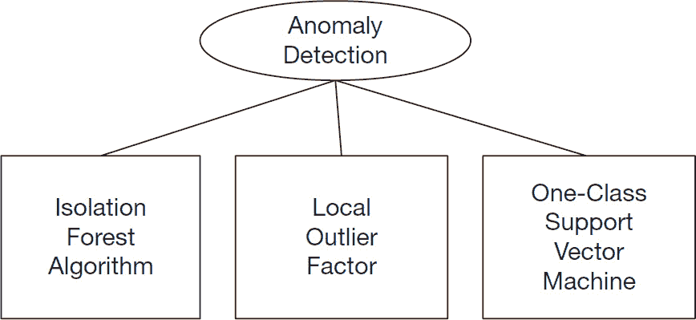

Figure 7.11 Types of anomaly detection algorithms

异常检测算法的类型（Fig. 7.11）为隔离森林算法、局部异常因子 (`LOF`) 和单类支持向量机 (`OC SVM`)。这些将在下面详细讨论。

### 7.3.2.1 隔离森林算法

顾名思义，隔离森林是一种集成方法，与随机森林有相似之处。换句话说，它通过对众多决策树的预测取平均值来为给定数据点授予最终异常分数。隔离森林与传统异常检测算法的不同之处在于，它立即尝试隔离异常数据点，而不是先定义什么是“正常”，然后将其他一切识别为异常。

假设我们有 Fig. 7.12 所示的数据点。

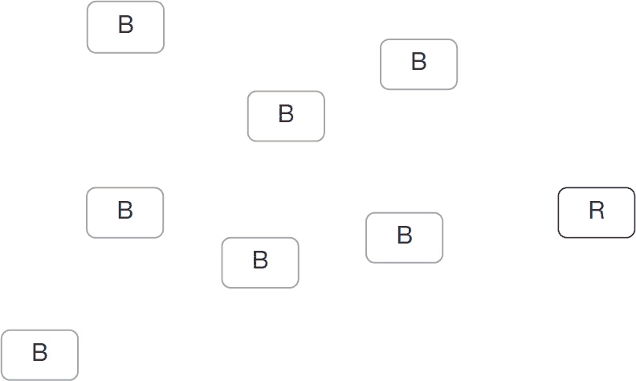

Figure 7.12 Isolation forest algorithm: Data points

隔离森林技术随机选择一个维度（具体来说，与 `x-axis` 相关的维度）并沿该维度随机分割数据（Fig. 7.13）。

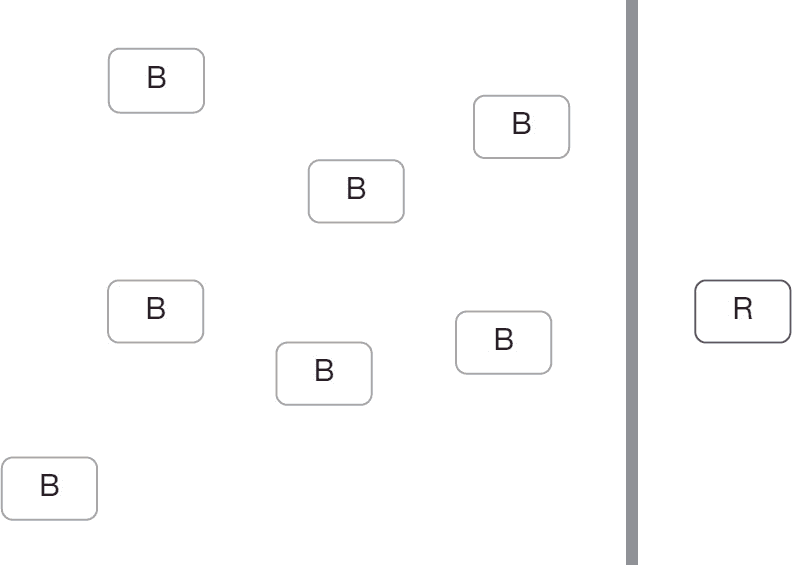

Figure 7.13 Isolation forest algorithm: Dimension linked to the `x-axis`

由此产生的两个子空间建立了不同的子树。在此实例中，切分是为了将单个点与数据集的其余部分分开。初始二叉树在第一层由两个节点组成。一个节点代表初始切分左侧的点的子树，而另一个节点代表右侧的单个点（Fig. 7.14）。

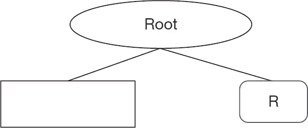

Figure 7.14 Isolation forest algorithm: Roots with isolation points

必须认识到，集成中的其余树将选择不同的初始分割。在给定的示例中，初始分割未能将异常值与数据其余部分分开（Fig. 7.15）。

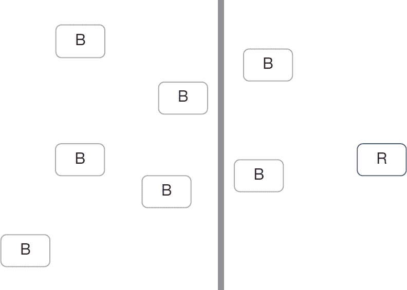

Figure 7.15 Isolation forest algorithm: Further splits

由此产生的树由两个节点组成（Fig. 7.16）：一个代表位于线左侧的点，另一个代表位于线右侧的点。

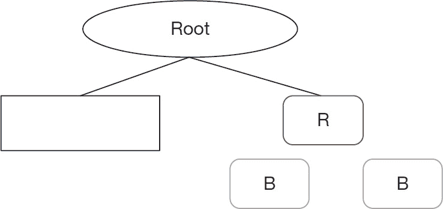

Figure 7.16 Isolation forest algorithm: With two nodes

该方法迭代进行，直到树的每个叶节点对应于数据集中的一个单独数据点。在我们给出的示例中，第二次迭代成功识别并分离出异常值与数据其余部分（Fig. 7.17）。

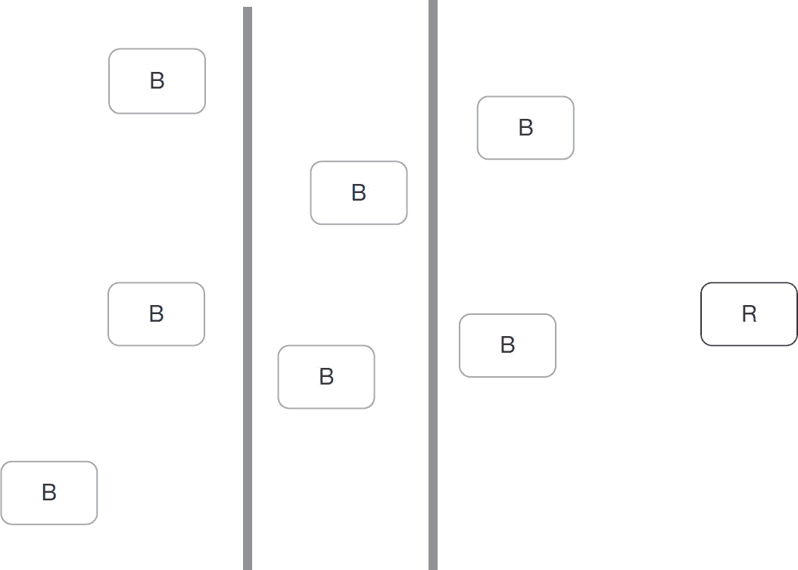

Figure 7.17 Isolation forest algorithm: Separating outliers from the rest

完成此阶段后，树将如 Fig. 7.18 所示。

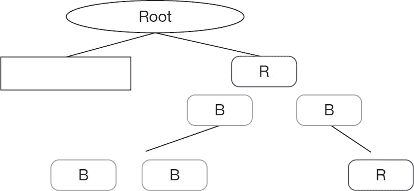

Figure 7.18 Isolation forest algorithm: With three nodes

需要注意的是，分割可以在另一个维度发生（Fig. 7.19），正如这个第三个决策树的情况。


Figure 7.19 Isolation forest algorithm: Split in multiple dimensions

通常，异常数据点会在较浅的树深度下被发现于较小的边界框中，与其他点相比。在使用训练好的隔离森林模型进行推理的过程中，最终的异常分数计算为每个单独决策树生成的分数的平均值。在上述情况下，隔离前的平均分割次数 = 3 (2+3+4/3)

### 分类变量

隔离森林技术可以通过将分类变量描绘为矩形来利用分类变量，每个矩形的大小与出现频率成正比。这使得可以识别出现频率较低的异常值（Fig. 7.20）。

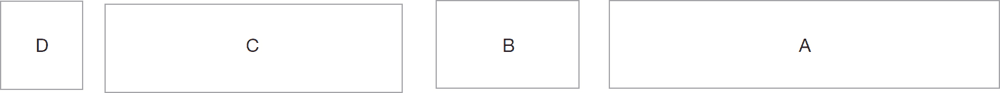

Figure 7.20 Isolation forest algorithm: Categorical variables, step 1

我们将潜在值的集合定义为从第一个值的中位数到最后一个值的中位数之间的范围（Fig. 7.21）。我们在域内随机选择一个点，然后确定指定矩形的最近边缘。这用于我们的分割。

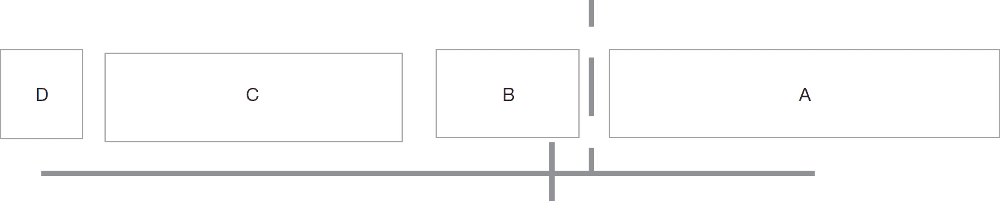

Figure 7.21 Isolation forest algorithm: Categorical variables, step 2

为了保持公平，森林中剩余的树将采用替代排序（Fig. 7.22）。

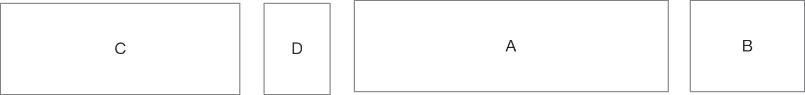

Figure 7.22 Isolation forest algorithm: Categorical variables, step 3

该算法的工作原理如下：

1. 它随机选择数据的一个子集，并通过基于随机选择的特征和该特征范围内随机选择的阈值来分割数据，从而构建一棵二叉树。
2. 它重复此过程，直到每个数据点被隔离在叶节点中或达到最大树深度。
3. 它计算从根节点到每个数据点的叶节点的路径长度，即隔离它所需的分割次数。
4. 它对这样的一片森林中的路径长度取平均值并进行归一化，以得到每个数据点的异常分数。异常分数范围为 0 到 1，其中较高的值表示更异常的数据点。

下面给出隔离森林的一个简单逐步示例：

1. 假设我们有一个包含两个特征 `x` 和 `y` 的数据集，我们想检测该数据集中的异常值。我们随机选择数据的一个子集，比如 10 个点，并将它们分配给一棵二叉树。
2. 我们随机选择一个特征，比如 `x`，以及 `x` 范围内的一个阈值，比如 3.5。我们根据其 `x` 值是否小于或大于 3.5 将数据分为两组。
3. 我们对每组重复此过程，随机选择一个特征和一个阈值。例如，对于 `x < 3.5` 的组，我们可能选择 `y` 作为特征并将 2 作为阈值，并根据其 `y` 值是否小于或大于 2 将该组分为两个子组。
4. 我们继续此过程，直到每个数据点被隔离在叶节点中或达到最大树深度。例如，如果最大树深度为 3，我们在分支的三个层级后停止分割。
5. 我们通过计算隔离每个数据点所需的分割次数来计算每个数据点的路径长度。例如，如果一个数据点在第一层被隔离，其路径长度为 1；如果它在第二层被隔离，其路径长度为 2；以此类推。
6. 我们对这样的一片森林中的路径长度取平均值并进行归一化，以得到每个数据点的异常分数。例如，如果我们构建 100 棵树并对其路径长度取平均值，我们可能会得到一个平均路径长度为 1.2 的数据点的异常分数 0.8，表明它很可能是异常值。

隔离树可以被视为一种数据结构，其中每个叶节点代表一个异常值（或异常）。例如，假设一个点似乎远离其周围的点。它被认为是非正常的，并在隔离树上形成其叶节点。此外，所有标准点，被其他常规点包围，在此决策树结构上形成其分支，从而使我们能够在没有事先标签或训练数据的情况下更轻松地识别数据集中的异常。

隔离森林算法相对于传统方法，如聚类，具有若干优势，因为它能够在没有任何先验知识的情况下检测甚至不明显的异常值，并且由于其对由噪声或测量误差引起的数据集中的异常值的鲁棒性，通常在欺诈检测等实际应用中发现。因此，这些原因，加上其与其它算法相比的效率，使其在当今的机器学习从业者中相当受欢迎。

### 7.3.2.2 局部异常因子

局部异常因子（`LOF`）算法使用基于密度的聚类，以无监督的方式通过查看特定数据点在其 `n` 维空间中与邻居的接近程度来识别异常值，其中 `n` 表示数据集中存在的特征数量。较高的值表明它比其邻居更有可能成为异常值，反之亦然；如果给出较低的值，这些点更可能是正常点，因为它们周围有更近的邻居。

`LOF` 算法是异常检测的强大工具。它是一种非参数方法，用于识别数据中的异常值，可以帮助分析人员检测与邻近点显著不同的点。局部异常因子衡量单个点与其直接区域相比的突出程度。

`LOF` 算法首先使用 `K` 最近邻估计计算每个点的局部密度。这意味着对于任何给定点，`LOF` 将查看 `K` 个最近的观测值并计算平均密度值，称为可达距离（`RD`）。然后，它将此 `RD` 值用于计算每个数据点的分数，称为“局部异常因子”或 `LOF`，并将这些值与其他所有点进行比较，以确定哪些是异常值，哪些不是。它有助于识别哪些观测值在与邻居或整个数据集相比时可被视为异常。

为了说明 `LOF` 算法的工作原理，让我们考虑一个包含两个特征 `x` 和 `y` 以及五个观测值 A、B、C、D 和 E 的示例数据集。该数据集显示在 Table 7.14。

Table 7.14 LOF base data

| Observation | X | Y |
| --- | --- | --- |
| A | 1 | 2 |
| B | 2 | 3 |
| C | 3 | 4 |
| D | 10 | 11 |
| E | 11 | 12 |

`LOF` 算法的第一步是使用 `K` 最近邻估计计算每个点的局部密度。为简单起见，假设 `K = 2`，这意味着我们将查看每个点的两个最近观测值。Table 7.15 显示了每个点与其两个最近邻居之间的距离，以及平均距离，即每个点的 `RD`。

Table 7.15 LOF nearest neighbor distances

| Observation | Nearest neighbours | Distances | Rd |
| --- | --- | --- | --- |
| A | B, C | 1.41, 2.83 | 2.12 |
| B | A, C | 1.41, 1.41 | 1.41 |
| C | B, D | 1.41, 9.90 | 5.66 |
| D | C, E | 9.90, 1.41 | 5.66 |
| E | D, C | 1.41, 11.31 | 6.36 |

`LOF` 算法的第二步是通过比较其 `RD` 值与其最近邻居的 `RD` 值来计算每个点的 `LOF` 分数。`LOF` 分数的公式为：

`LOF(p) = (Sum of RD values of p’s nearest neighbors / k) / RD(p)`

Table 7.16 显示了数据集中每个点的 `LOF` 分数。

Table 7.16 LOF scores of each data point

| Observation | LOF score |
| --- | --- |
| A | 0.33 |
| B | 0.50 |
| C | 0.50 |
| D | 1.76 |
| E | 1.77 |

最后一步是根据 `LOF` 分数识别异常值。如果一个点的 `LOF` 分数显著高于 1，则认为它是异常值，这意味着它的密度远低于其邻居或整个数据集。在本例中，点 `D` 和 `E` 的 `LOF` 分数较高，因此是异常值，而点 `A`、`B` 和 `C` 的 `LOF` 分数较低，因此是正常观测值。

除了是一种有效的异常检测方法外，`LOF` 相对简单：因为它仅使用一个参数 – `K-nearest neighbor` – 因此无需像其他机器学习算法那样进行复杂的调优或超参数优化。这使得 `LOF` 快速、高效，并且易于部署到真实世界的数据集上，无需花费太多精力或时间去调整参数，而这些参数在使用更复杂的算法如 `SVMs` 时可能会遇到。

### 7.3.2.3 一类支持向量机

`One-class support vector machine` (`OC SVM`) 使用一类模型根据数据点与其他数据点在数据集中的相似性对数据点进行分类。它使用非线性超平面作为正常观测值和异常观测值之间的决策边界。`OCSVM` 背后的基本概念是它在训练数据集周围创建 `n` 维超球面或边界，并将落在此边界之外的任何新观测值分离为异常值。该技术使用诸如多项式、线性、sigmoid 或径向基函数 (`RBF`) 等核函数来创建超球面。

`RBF` 核是最常用的，因为它能够正确捕捉数据集中的非线性，而其他核则不能。我们使用诸如 `gamma` 值、衡量误分类惩罚的代价因子 `C`，以及在使用多项式核时训练模型的度参数 `d` 等参数。`Gamma` 值决定每个训练样本对决策边界的影响程度，而代价因子 `C` 指定在确定最优决策面时应给予正则化参数更高权重还是训练精度；也就是说，当 `C = 0` 时，对误分类没有惩罚，而在高值时则对误分类错误施加更重的惩罚。因此，它有助于创建对过拟合问题如数据集中存在的噪声具有鲁棒性的模型。较高的 `gamma` 值表示每个样本对构建超平面有更大的影响。同时，较低的值会降低影响，但通过避免过拟合来提高泛化潜力。此外，度参数有助于我们根据数据集中特征的数量决定模型的复杂程度。

一旦确定了所有这些参数，我们就可以继续进行拟合/训练过程，在该过程中算法通过优化技术（如梯度下降）为给定问题找到最优解。获得最优解后，我们需要通过提供来自同一分布的一些新的未见数据点样本来测试训练好的模型，以便系统能够判断它们是否属于同一类。

## 7.3.3 降维

降维是一种简化复杂问题的有力工具，同时保留原始数据集的相关信息。随着数据集中变量数量的增加，理解和解释这些变量的复杂性也随之增加。

该技术可以降低数据分析的复杂性和计算成本，提高预测算法的准确性，并简化数据可视化。主成分分析 (`PCA`) 是降维最常用的方法之一。`PCA` 通过找到输入特征之间的线性组合来实现降维，使得它们之间解释的方差最大。通过这样做，我们可以显著减少特征空间，同时仅牺牲模型解释的总方差的一小部分。

其他方法包括线性判别分析 (`LDA`)、因子分析 (`FA`)、Sammon 映射和 `Isomap`。每种方法都有其优缺点，因此在开始任何项目之前研究每种方法都是值得的。例如，如果你的数据集中有六个变量 (`A`、`B`、`C`、`D`、`E` 和 `F`)，你可以使用降维将其减少到 `A-B-C-D` 或 `A-E-F`。这将使我们能够用比最初假设更少的维度捕捉模式，而不会丢失对原始数据集结构和可能被遗漏的有价值见解的理解。

`PCA`、`LDA` 和其他方法通常被归类为降维技术，但这并不是它们的首要目的。相反，它们是寻找数据有效且有意义的表示的方法，以捕捉最相关信息并丢弃噪声或冗余。降维是这一过程的结果，而非其本身的目标。

### 7.3.3.1 主成分分析

主成分分析 (`PCA`) 是一种用于在保留其最重要的特征的同时减少数据集维度的方法。换句话说，它可以将大量数据压缩为更少数量的变量，同时信息损失最小。`PCA` 找到原始变量的线性组合（或成分），这些组合解释了数据中最大量的方差。换句话说，它找到变量的最佳组合，以最好地捕捉关于数据集中所有其他变量的最多的信息。这意味着 `PCA` 将数百甚至数千个独立变量减少到少数几个，而不会丢失太多关于它们之间的关系以及它们所代表的内容的信息。

`PCA` 的思想是将复杂问题简化为更简单、更易于管理的形式。它通过识别不同变量之间的潜在模式和关系并删除对正确理解它们不太重要的变量来实现这一点。此外，`PCA` 还有助于特征选择；确定哪些特征的权重更大可以帮助研究人员识别在创建模型或对数据集进行分析时应重点关注哪些特征。

#### 步骤

##### 步骤 1：收集和预处理数据

这包括将数据组织成适当的格式，处理缺失值，删除异常值并对其进行标准化。预处理有助于确保所有变量都是数值型并且可用于进一步分析。

##### 步骤 2：计算变量之间的相关性

在预处理之后，每个变量需要在进行 `PCA` 分析之前与其对应的一个或多个变量进行相关性计算。这种两个或多个变量之间的相关性可以帮助识别它们之间的关系，表明它们在使用机器学习算法进行预测或分类任务时可能有多有用。

##### 步骤 3：计算协方差矩阵

一旦计算出相关性，就需要使用文献中可用的合适数学方程计算协方差矩阵。协方差矩阵告诉我们不同特征之间的变化程度。它解释了如果其他任何特征发生变化，某个特定特征会带来多少变化。高协方差值表示两个特征之间存在重要的依赖性，而低值则表示依赖性较弱。

##### 步骤 4：执行特征值分解

此步骤涉及从协方差矩阵计算特征值。在这里，每个列向量对应于特征列的特征向量，这些特征列包含与输入矩阵中发现的相同元素，但根据其相对于其他特征值的显著性以不同的方式排列。这使我们能够将重要特征与不太重要的特征分开，并相应地减少维度，而不会丢失原始数据集中包含的大量信息。

##### 步骤 5：选择主成分

这里，我们根据各特征向量对数据集中总方差的贡献，从所有先前计算的特征向量中选择最佳主成分，即应始终先选择解释方差比率最高的，随后选择第二高的，以此类推，直到达到所需的主成分数。由此我们保持累积解释方差比率高于某一阈值水平，这使我们能够在大幅降低处理过程中所涉及维度的同时保持预测任务所需的准确性。

##### 步骤 6：将数据投影到选定的主成分上


在确定了模型的最佳主成分后，就要将输入数据投影到这些仅由所选主成分组成的新创建的低维空间中。

例如，假设有一个包含四个变量 `X1`、`X2`、`X3` 和 `X4` 的样本数据集。该数据集有 10 个观测值，显示在 Table 7.17。

Table 7.17 PCA data points

| `X1` | `X2` | `X3` | `X4` |
| --- | --- | --- | --- |
| 2 | 3 | 4 | 5 |
| 3 | 4 | 5 | 6 |
| 4 | 5 | 6 | 7 |
| 5 | 6 | 7 | 8 |
| 6 | 7 | 8 | 9 |
| -2 | -3 | -4 | -5 |
| -3 | -4 | -5 | -6 |
| -4 | -5 | -6 | -7 |
| -5 | -6 | -7 | -8 |
| -6 | -7 | -8 | -9 |

我们可以使用以下步骤对该数据集应用 PCA：

1. 标准化数据。每个变量的均值和标准差显示在 Table 7.18。

Table 7.18 PCA data points: Standardized data

| Variable | Mean | Standard deviation |
| --- | --- | --- |
| `X1` | 0 | Square root (10) |
| `X2` | 0 | Square root (10) |
| `X3` | 0 | Square root (10) |
| `X4` | 0 | Square root (10) |

标准化数据是通过减去均值并除以每个变量的标准差得到的。标准化数据显示在 Table 7.19。

Table 7.19 PCA data points: Standardized data with Z values

| `Z1` | `Z2` | `Z3` | `Z4` |
| --- | --- | --- | --- |
| 0.6325 | 0.6325 | 0.6325 | 0.6325 |
| 0.9488 | 0.9488 | 0.9488 | 0.9488 |
| 1.2650 | 1.2650 | 1.2650 | 1.2650 |
| 1.5813 | 1.5813 | 1.5813 | 1.5813 |
| 1.8976 | 1.8976 | 1.8976 | 1.8976 |
| -0.6325 | -0.6325 | -0.6325 | -0.6325 |
| -0.9488 | -0.9488 | -0.9488 | -0.9488 |
| -1.2650 | -1.2650 | -1.2650 | -1.2650 |
| -1.5813 | -1.5813 | -1.5813 | -1.5813 |
| -1.8976 | -1.8976 | -1.8976 | -1.8976 |

2. 计算标准化数据的协方差矩阵。协方差矩阵显示在 Table 7.20。

Table 7.20 PCA data points: Covariance matrix

| | `Z1` | `Z2` | `Z3` | `Z4` |
| --- | --- | --- | --- | --- |
| `Z1` | 1 | 1 | 1 | 1 |
| `Z2` | 1 | 1 | 1 | 1 |
| `Z3` | 1 | 1 | 1 | 1 |
| `Z4` | 1 | 1 | 1 | 1 |

3. 求协方差矩阵的特征值和特征向量。特征值和特征向量显示在 Table 7.21。

Table 7.21 PCA data points: Eigenvalues and eigenvectors

| Eigenvalue | Eigenvector |
| --- | --- |
| 4 | (0.5, 0.5, 0.5, 0.5) |
| 0 | (-0.5, -0.5, -0.5, 0.5) |
| 0 | (-0.5, -0.5, 0.5, -0.5) |
| 0 | (-0.5, 0.5, -0.5, -0.5) |

4. 按降序排列特征值并选择要保留的 PC 数。特征值已按降序排列，我们可以看到只有一个特征值非零，意味着只有一个 PC 可以解释数据中的任何方差。因此，我们选择只保留一个 PC。

5. 通过将标准化数据矩阵乘以对应于所选特征值的特征向量矩阵来形成 PC 矩阵。由于我们只保留一个 PC，因此我们只需要将标准化数据乘以第一个特征向量，即 (0.5, 0.5, 0.5, 0.5)。PC 矩阵显示在 Table 7.22。

Table 7.22 PCA data points: Final PC matrix

| `PC1` |
| --- |
| 2.5302 |
| 3.7952 |
| 5.0602 |
| 6.3252 |
| 7.5902 |
| -2.5302 |
| -3.7952 |
| -5.0602 |
| -6.3252 |
| -7.5902 |

我们可以看到 PC 矩阵只有一个列，它代表数据集的第一个也是唯一一个 PC。

PCA 的应用不仅限于研究；企业也可能将其用于营销目的（识别客户细分）甚至风险管理（衡量投资组合波动性）。

### 7.3.3.2 Kernel Principal Component Analysis

使用核主成分分析（`KPCA`），数据可以在保留其大部分有价值特征的同时变得低维。`KPCA` 是 PCA 的非线性版本，用于监督和无监督学习任务。它使用核函数作为线性变换的替代方案，将数据变换到低维空间。

核函数是将输入变换为机器学习算法的非线性特征空间的数学运算。通过使用核，`KPCA` 可以从高维数据集中捕捉非线性关系，并允许检测使用线性方法如 PCA 否则无法观察到的模式。这使其非常适合分类、异常检测或图像识别，在这些任务中，简单的线性方法无法充分建模变量之间复杂的相互关系。

#### Steps

1. 选择一个核函数，例如高斯核，并计算核矩阵 `K`，其中 `K[i,j] = k(x[i], x[j])`，针对每对数据点 `x[i]` 和 `x[j]`。

2. 通过减去每一行和每一列的均值，并除以每一行和每一列的标准差来中心化核矩阵 `K`。这确保变换后的数据具有零均值和单位方差。

3. 对中心化的核矩阵 `K` 执行特征值分解并获得特征向量和特征值。特征向量是变换后数据的主成分，特征值表示每个分量所解释的方差量。

4. 选择对应于最大 `k` 个特征值的 top `k` 个特征向量，并将数据投影到这些特征向量上。所得向量是原始数据的降维特征。

例如，考虑一个具有两个特征 `x1` 和 `x2` 的数据集（Table 7.23）。

Table 7.23 KPCA: Data set with two features

| `X1` | `X2` |
| --- | --- |
| 0 | 0 |
| 1 | 0 |
| 0 | 1 |
| 1 | 1 |

如果我们应用参数为 `sigma = 0.5` 的高斯核，我们得到核矩阵 `K`（Table 7.24）。

Table 7.24 KPCA: Kernel matrix

| | `K[0]` | `K[1]` | `K[2]` | `K[3]` |
| --- | --- | --- | --- | --- |
| `K[0]` | 1 | 0.61 | 0.61 | 0.37 |
| `K[1]` | 0.61 | 1 | 0.37 | 0.61 |
| `K[2]` | 0.61 | 0.37 | 1 | 0.61 |
| `K[3]` | 0.37 | 0.61 | 0.61 | 1 |

在中心化和缩放后，我们得到 Table 7.25 所示的矩阵。

Table 7.25 KPCA: Kernel matrix after centering and scaling

| | `K[0]` | `K[1]` | `K[2]` | `K[3]` |
| --- | --- | --- | --- | --- |
| `K[0]` | 1.41 | -0.21 | -0.21 | -0.99 |
| `K[1]` | -0.21 | 1.41 | -0.99 | -0.21 |
| `K[2]` | -0.21 | -0.99 | 1.41 | -0.21 |
| `K[3]` | -0.99 | -0.21 | -0.21 | 1.41 |

该矩阵的特征值和特征向量为：

- `Lambda_1 = 3.73`, `v_1 = [0.5, -0.5, -0.5, 0.5]`
- `Lambda_2 = 3.73`, `v_2 = [-0.5, -0.5, -0.5, -0.5]`
- `Lambda_3 = -7e-17`, `v_3 = [0, -1, -1, -2]`
- `Lambda_4 = -7e-17`, `v_4 = [2, -1, -1, -4]`

如果我们选择 `k = 2`，我们可以将数据投影到 `v_1` 和 `v_2` 上并获得降维特征（Table 7.26）。

Table 7.26 KPCA: Kernel matrix with k=2

| Z1 | Z2 |
| --- | --- |
| -1 | -1 |
| -1 | +1 |
| +1 | -1 |
| +1 | +1 |

这些特征比 PCA 更能捕捉原始数据的非线性结构。

### 7.3.3.3 线性判别分析

线性判别分析（`LDA`）是一种通过寻找特征的最优线性组合来对数据进行分类的方法。它是一种监督学习技术，使用线性函数将两个或多个类别分开。`LDA` 旨在找到最佳的线性判别函数，以最好地将类别分离到不同的类别中。

`LDA` 首先计算每个类别的均值和方差，以确定哪些特征有助于区分它们。然后算法找到这些特征的最佳组合，以最好地区分它们，这就成为判别函数。最后，算法评估该函数将每个类别彼此分离的程度，以确定其作为分类器的准确性和有效性。

`LDA` 可用于降维、特征选择、异常检测和分类问题。由于其能够在保留数据集中重要信息的同时降低噪声，它已被证明在图像识别、人脸识别/检测和语音识别/合成等应用中非常有帮助。此外，它还在医学诊断中得到成功应用，可根据患者病历提供的症状和其他属性帮助诊断疾病。

#### 步骤

#### Step 1: Prepare the Data

这意味着在开始分析之前确保数据已得到适当的格式化和清理。数据集应包含所有相关的输入变量和期望的输出变量（如类别标签）。此外，确保没有缺失值或异常值会影响结果的准确性。

#### Step 2: Choose an Appropriate Distance Metric

接下来，你需要决定在计算点间距离以执行 `LDA` 分类时使用合适的距离度量。常用的方法包括欧几里得距离和曼哈顿距离；然而，根据你的应用需求和目标，其他选项也是可用的。

#### Step 3: Calculate the Mean Vectors for Each Class

你必须为数据集中每个类别的数据点计算均值向量；即，在每个希望由 `LDA` 分类标准分类的数据点“类别”组内的所有观测值中求平均值。然后均值向量用作参考点，可使用上述提到的多种度量之一（如欧几里得或曼哈顿）计算其他向量之间的距离。

#### Step 4: Compute the Between-Class Covariance Matrix

对于数据集中类别的每对组合，我们需要计算一个协方差矩阵，描述它们在比较所涉及的每个特征维度上相对于彼此的位置；这将使我们能够更好地捕捉类别之间的差异，而不仅仅是单个值，而是多个变量上的分布——这在执行像 `LDA` 这样更高级形式的统计推断时至关重要。然后我们将这些单独的协方差矩阵合并成一个更大的矩阵，称为“类间协方差矩阵”，它捕捉了在分析集中包含的所有特征上两个给定类别之间存在多少变化。

#### Step 5: Compute the Within-Class Covariance Matrix

接下来，你需要计算“类内协方差”，描述与自身相比单个组内的方差；即，同一组成员沿给定特征轴存在多少变化。这里同样，为每个成对组合类别分别计算矩阵，然后将它们合并为更大的“类内协方差”，捕捉本次练习中研究的每个不同分组内的方差。

#### Step 6: Compute the Linear Discriminants

最后，利用之前步骤收集的信息计算实际的线性判别式本身：利用类间和类内协方差来确定最佳方向轴，以便将不同组投影到该轴上以形成最优分离平面，使其在复杂的多维特征空间中彼此可区分。在确定这些方向轴后，应用标准超平面方程来定义基于过去分析中观察到的值区分簇的边界。通过应用在开发阶段考虑的模型训练集获得的线性判别式，任何 ML 解决方案都可以实现稳健的结果，获得与原始模型生成过程之外生成的新输入相关的预测。

下面是一个具有两个特征和三个类别的数据集（Table 7.27）的示例，以及 `LDA` 如何将其转换为一维空间。

Table 7.27 LDA base data

| Feature 1 | Feature 2 | Class |
| --- | --- | --- |
| 1.2 | 3.4 | A |
| 2.3 | 4.5 | A |
| 3.4 | 5.6 | A |
| 4.5 | 6.7 | B |
| 5.6 | 7.8 | B |
| 6.7 | 8.9 | B |
| 7.8 | 9.0 | C |
| 8.9 | 10.1 | C |
| 9.0 | 11.2 | C |

每个类别的均值向量显示在 Table 7.28 中。

Table 7.28 LDA mean vectors

| Feature 1 | Feature 2 |
| --- | --- |
| 2.3 | 4.5 |
| 5.6 | 7.8 |
| 8.6 | 10.1 |

总体均值向量显示在 Table 7.29 中。

Table 7.29 LDA overall mean vectors

| Feature 1 | Feature 2 |
| --- | --- |
| 5.5 | 7.8 |

类间协方差矩阵显示在 Table 7.30 中。

Table 7.30 LDA between-class covariance matrix

| Feature 1 | Feature 2 |
| --- | --- |
| 12 | -0 |
| -0 | -0 |

类内协方差矩阵显示在 Table 7.31 中。

Table 7.31 LDA within-class covariance matrix

| Feature 1 | Feature 2 |
| --- | --- |
| -0 | -0 |
| -0 | -0 |

类内协方差矩阵的逆矩阵显示在 Table 7.32 中。

Table 7.32 LDA inverse of within-class covariance matrix

| Feature 1 | Feature 2 |
| --- | --- |
| -inf | inf |
| inf | -inf |

类内协方差矩阵的逆矩阵与类间协方差矩阵的乘积显示在 Table 7.33 中。

Table 7.33 LDA of the product of the inverse of the within-class matrix and the between-class covariance matrix

| Feature 1 | Feature 2 |
| --- | --- |
| -inf *inf | -inf *inf |
| -inf *inf | -inf *inf |

该矩阵的特征向量和特征值显示在 Table 7.34 中。

Table 7.34 LDA eigenvectors and eigenvalues

| Eigen vector | Eigen value |
| --- | --- |
| [1,0] | inf |
| [0,1] | inf |

我们可以选择第一个特征向量作为线性判别式，并使用矩阵乘法将数据投影到其上。这将为我们提供一个具有一个特征和三个类别的新数据集（Table 7.35）。

Table 7.35 LDA new data sets with one feature and three classes

| Feature 1 | Class |
| --- | --- |
| 1.2 | A |
| 2.3 | A |
| 3.4 | A |
| 4.5 | B |
| 5.6 | B |
| 6.7 | B |
| 7.8 | C |
| 8.9 | C |
| 9.0 | C |

正如你所见，数据点现在已沿特征轴按其类别标签分离，可以通过简单的阈值或线性分类器轻松分类。

总体而言，`LDA` 为处理高维数据集提供了一种有效的方法，在传统方法因数据集中存在过多特征而难以区分不同类别时尤为适用。此外，通过准确识别来自嘈杂环境的高维数据集中的相关特征，可以获得比其他方法更准确的分类结果，例如逻辑回归或决策树算法，因为它们能够在保留数据集中点的重要信息的同时降低噪声。

## 7.3.3.4 因子分析


因子分析（`FA`）是一种用于识别变量之间潜在关系的统计技术。它常用于研究中，以帮助揭示观察数据背后的潜在结构。该技术已广泛应用于各个领域，包括心理学、经济学和教育学。其核心在于通过分析数据集中每个变量与其他变量的关系来减少变量数量。这有助于研究人员解释多个方面如何相互影响，并可在预测结果或现象时帮助他们了解哪些因素最重要。

在进行 `FA` 时，研究人员会收集参与者关于其研究主题或假设相关的不同特征或项目的数据。然后他们利用这些数据生成相关性，表示每个变量在集合内与其他变量的相关程度有多强。作为此过程的一部分，他们还会根据参与者在研究中包含的所有项目上的回答，为每个参与者计算因子得分。

为了使因子分析结果可靠且准确，研究人员必须确保收集的数据有效且可靠，即数据准确反映了所测量的内容，并且不因测量问题或信息收集或处理过程中的错误而包含误差。此外，必须有足够大的样本量，因为较小的样本量可能导致过拟合，即由于数据点分布稀疏而在不相关信息之间发现不准确的模式。最后，研究人员在解释 `FA` 研究结果时必须格外谨慎，因为结果可能并不总是反映真实的潜在关系，而可能是基于噪声的虚假关联。

因子分析有两种类型，探索性和验证性。

## 探索性因子分析 (`EFA`)

这可以将大量观察变量浓缩为一组较小的潜在因子，可用于解释观察变量之间的关系。`EFA` 的目标是识别一组相关变量之间的潜在模式和关系，并揭示解释它们之间变异的隐藏或“潜在”因子。

为实现此目的，`EFA` 比较成对测量项目之间的相关系数，以评估它们是否在多次观察中共享相似的模式，还是仅由偶然相关。`EFA` 不仅依赖于以测量变量作为预测因子，而是使用矩阵代数技术和线性模型来分析测量变量之间的相关性并提取其共同的潜在因子。这些因子代表研究数据集中不同但相关的概念或过程。通过揭示这些潜在结构，研究人员可以更好地理解单个变量如何相互作用以及它们如何影响整体结果，例如客户满意度调查或学业表现指标。此外，通过考虑由测量误差引起的噪声，`FA` 使研究人员能够快速高效地从复杂数据集中获得有意义的信息，而不会牺牲模型中的准确性或严谨性。这使其成为寻求对数据集更深入见解的研究人员以及需要快速减少预测变量数量而不牺牲结果质量的人们不可或缺的工具。它还有助于他们识别形成可用于进一步研究的独立因子的密切相关项目簇。

进行 `EFA` 的第一步是确定与分析相关的变量。通常，这些变量可以是数值型或分类型，并且它们之间应以某种方式相关。接下来，你需要确定这些相关性中是否有统计学意义——这可以通过在数据集上运行统计检验来实现，例如 `Pearson` 相关或 `Spearman` 秩相关检验。

一旦你确定了具有统计学意义的相关性，你需要决定要使用哪种 `FA` 模型——`EFA` 或 `CFA`。`EFA` 通常在对数据集中因子可能的样子知之甚少时使用；`CFA` 通常在先前研究中已识别出数据集结构和内容中的已知因子时使用。

接下来，你需要为模型选择因子提取方法——这包括根据你希望从数据集中提取多少因子以及在过程中使用每种算法进行多少次迭代，选择 `PCA`、`MLE`、迭代主成分提取方法 (`IPCEM`) 等。一旦选定，使用适当的统计软件包，如 `SPSS` 或 `R` 软件包如 `MLR` 或 `FactoMineR`，根据最适合你需求的语言，在数据集上运行所选的因子提取方法。

最后，在使用因子提取方法运行所有必要分析后，必须使用计算出的指标进行评估，例如 Kaiser–Meyer–Olkin (`KMO`) 抽样充分性度量和 Bartlett 球形检验、累积方差解释比例、碎石图等。评估研究后，解释研究结果。这意味着研究旋转方法、特征值、特征向量等，并通过其解释来理解它们。解释结果后，应根据探索性因子分析研究得出的发现得出结论。

`EFA` 是一种有价值的工具，可在不完全依赖回归模型等监督方法的情况下揭示数据集中变量之间的隐藏关系。

## 验证性因子分析 (`CFA`)

`CFA` 在 `EFA` 的基础上，通过检验已识别的因子是否在多个数据集或样本中保持一致，从而进行检验。这使研究人员能够确保其研究结果可靠，而不仅仅是由于测试样本中的偶然或随机性。例如，假设你想研究年龄如何影响客户对产品的满意度。在这种情况下，你可以使用 `CFA` 来确保你的结果在包含不同年龄组的多次调查中保持一致。`CFA` 是一种用于帮助识别一组变量潜在结构的统计技术。它检验关于观察变量之间关系的理论模型和假设，例如态度、行为和态度。`CFA` 常用于心理学研究中，以检验关于人格、认知过程、情绪和其他现象的理论。

`CFA` 首先指定一个模型或假设，说明各种观察变量如何相关。该模型应基于关于这些变量及其关系的现有知识或理论。然后研究人员使用统计技术分析来自各种来源的数据（调查和访谈），以确定所提出的模型是否与数据拟合。如果拟合，则意味着观察变量之间假设的关系得到了经验证据的支持——这就是为什么它被称为“验证性”分析！

下一步涉及评估该拟议模型解释数据集中观察到的变异性的程度（其拟合优度）。通常，研究人员会使用多种不同的拟合指标，例如卡方统计量、均方根误差近似值（`RMSEA`）、比较拟合指数（`CFI`）、 Tucker–Lewis 指数（`TLI`）、赤池信息准则（`AIC`）等。这些拟合指标提供了假设模型与数据集拟合程度的总体衡量，可以给出初始假设是否需要修改的线索。

最后，在确定 `CFA` 是否支持假设后，研究人员必须有意义地解释其结果并将其应用于现实生活情境中，因为 `CFA` 对观察变量之间因果关系或对不同群体/情境的具体影响几乎没有启示。总之，`CFA` 可以成为研究人员寻找其关于某些现象假设背后证据的强大工具，以指导对这些主题的进一步研究。

## 关联规则挖掘

一种称为关联规则挖掘的无监督学习方法可用于在数据集中查找各种元素之间的联系。它帮助零售商通过揭示客户经常一起购买的产品之间的联系来制定营销策略。

市场篮子分析是关联规则挖掘的常用应用，企业利用它来深入了解客户的购买模式。它可以提供产品频繁共同购买模式的见解。哪些商品表现出互补性或替代性？哪些产品适合交叉销售或向上销售？哪些策略可以增强商店布局或产品定位以最大化销售额？

考虑一个超市旨在检查其消费者在特定时间段内进行的交易的场景。从数据中得出的一个明确规则可能是：

`{bread, butter} -> {jam}`

该规则意味着购买面包和黄油的客户很可能也会购买果酱。该规则由两个部分组成：位于箭头左侧的先行项，以及位于箭头右侧的后行项。先行项表示情况或原因，而后行项表示结果或后果。

为了评估规则的质量，有必要量化其支持度和置信度。支持度是指数据集中包含先行项和后行项的交易比例。例如，如果数据集中有 1000 笔交易，其中 200 笔包含面包、黄油和果酱，则该规则的支持度计算为 200 除以 1000，得出 0.2 的值。支持度衡量规则在数据集中的频率。

置信度是指包含先行项和后行项的交易比例。例如，如果 300 笔交易包含面包和黄油，其中 200 笔交易也包含果酱，则该规则的置信度可计算为 200 除以 300，得出 0.67 的值。置信度是衡量规则根据先行项预测后行项的可靠性的指标。

商店可以通过遵循这些准则来制定营销策略以提高其收入。例如，它可以为购买面包和黄油的消费者提供果酱的折扣或代金券，或在商店中将果酱 strategically 放置在面包和黄油旁边以刺激冲动购买。此外，它可以检测一起购买频率低或销售不佳的产品，并制定策略以提高其可见度或吸引力。

Web mining 是关联规则挖掘的另一个应用。它系统地从网页、超链接和服务器日志等网络数据中提取有价值的信息。例如，可以制定关联规则如下：‘如果用户访问页面 A，则他们很可能也会访问页面 B。’

Web mining 可分为 Web 内容挖掘、Web 结构挖掘和 Web 使用挖掘。Web 内容挖掘涉及检查和解释互联网上发现的多种形式的数据，例如文本、照片、音频、视频和其他多媒体信息。Web 结构挖掘关注分析网站的链接和排列，包括其连接性和组织结构。Web 使用挖掘检查用户在互联网上的行为和参与度，包括其浏览历史、点击流数据和反馈。

Web mining 在众多领域和目标中具有多样化的应用和优势。它可以通过理解用户查询和偏好来提高网络搜索引擎的质量和相关性。它可以通过提供与用户资料和行为相符的定制内容和服务来改善定制化和推荐系统。Web mining 可以通过检测网络流量和交易中的不规则模式和异常来帮助识别欺诈活动和网络攻击。

关联规则学习可分为三种算法：`Apriori`、`ECLAT` 和 `FP Growth`。我们现在将详细介绍这三种算法。

### Apriori 算法

`Apriori` 算法是一种 `ML` 算法，可以揭示大型数据集中项目之间的关联。它由 Rakesh Agrawal 和 Ramakrishnan Srikant 于 1994 年开发。该算法的核心在于寻找频繁项集或经常一起出现的项目。这种技术基于这样一个前提：如果一个项集在数据集中经常出现，那么该项集的任何子集也经常出现。`Apriori` 算法最常用于市场篮子分析和推荐系统。

该算法首先扫描数据以找到所有单项集（包含一个元素的项集）。当这些单个项集满足最小用户定义频率或支持阈值时，它们被认为是“频繁”的，这意味着它们必须出现在给定数据集的所有交易中的至少某个预定百分比中。此初始阶段创建了一个库存列表，我们可以从中构建更强大和复杂的项集组合，这些组合也将通过我们的频率测试。

一旦确定了频繁的单项集，下一步就是寻找对（包含两个元素的项集）和三元组（包含三个元素的项集），其中每个新组合将我们之前确定的单项集列表中的一个元素与第一步生成的整个库存列表中的另一个新元素结合起来。

步骤

1. 执行数据库扫描并统计每个项目的频率。收集支持值等于或高于最小支持阈值的项目并将其放入名为 `L1` 的集合中，表示常见的 1-项集。

2. 通过将 `L1` 与自身组合来创建潜在的 2-项集。这涉及组合两个 1-项集，其中具有长度为 k – 1 的公共前缀，其中 k 是当前项集的大小。例如，`{apple}` 和 `{banana}` 的组合产生 `{apple, banana}`，而 `{apple}` 和 `{orange}` 无法组合，因为没有共享前缀。

3. 执行另一次数据库扫描并统计每个候选 2-项集的频率。消除支持低于最小支持水平的候选者并获得集合 `L2`，由频繁的 2-项集组成。

4. 重复步骤 2 和 3，直到无法再生成候选者或无法发现更多频繁项集。由所有 `Lk` 集合组成的集合等同于所有频繁项集的集合。

我们利用频繁项集来发现关联规则并强制执行最小置信度阈值。为了获得规则，我们遍历每个频繁项集 `X` 并构建 `X` 的所有非空子集。对于每个子集 `Y`，如果规则的置信度满足或超过最小置信度阈值，我们创建规则 `Y -> (X \ Y)`。

考虑一个水果店提供各种水果的场景，例如苹果、香蕉、橙子、葡萄和菠萝。在此背景下，让我们检查已发生的交易：

`T1`: {apple, banana, orange}

`T2`: {banana, grape}

`T3`: {apple, banana, grape}

`T4`: {apple, grape}

`T5`: {banana, pineapple}

对于 `Apriori` 方法，我们将使用最小支持度为 0.4，对应交易量的 40%，以及最小置信度阈值为 0.7，对应规则的 70%。

首先，我们彻底检查数据库并统计每个项目的出现频率。苹果出现在 3 笔交易中，香蕉出现在 4 笔交易中，橙子出现在 1 笔交易中，葡萄出现在 3 笔交易中，菠萝出现在 1 笔交易中。唯一支持度大于或等于 0.4 的水果是苹果、香蕉和葡萄。因此，`L1` = {{apple}, {banana}, {grape}}。

在第 2 步，我们通过将 `L1` 与自身结合来创建潜在的 2-项集。我们得到一组包含水果对的集合：{{apple, banana}, {apple, grape}, {banana, grape}}。

在第 3 步，我们执行第二次数据库搜索以统计每个候选 2-项集的频率。项集 {apple, banana} 出现在 2 笔交易中，{apple, grape} 出现在 3 笔交易中，{banana, grape} 出现在 2 笔交易中。在选项 {apple, grape} 中，只有苹果和葡萄的支持值大于或等于 0.4。因此，集合 `L2` 仅由 {{apple, grape}} 组成。

在第 4 步，生成额外的候选项或识别额外的频繁项集已不再可能；因此，我们终止该过程。所有频繁项集的集合可以表示为 `L` = `L1` ∪ `L2`，其中 `L1` 和 `L2` 是包含以下项目的集合：{apple}, {banana}, {grape}，和 {apple, grape}。

我们采用 `L` 方法来发现关联规则并强制执行最小置信度阈值。我们遍历 `L` 中每个频繁项集 `X` 以获得期望的结果。然后我们构建 `X` 的所有可行非空子集。对于每个子集 `Y`，如果规则的置信度等于或超过 0.7，我们创建规则 `Y` -> (`X` - `Y`)。我们获得的规则如下：

{apple} -> {grape} 置信度为 3/3 = 1

{grape} -> {apple} 置信度为 3/3 = 1。

这些原则表明，购买苹果的顾客也以 100% 的确定性购买葡萄，反之亦然。

计算此置信度百分比值需要除以 count(`X` `Y`)/ count(`X`)，其中 `X` 表示在先前步骤中收集的适用子集计数中直接位于 `Y` 之前的目标项集值。这本质上证明了相关项集在整个输入数据集中一起出现的频率，而不仅仅是随机独立地出现——从而成功地从最终输出结果中删除了误报，并最终导致更好的准确性。

`Apriori` 算法不需要关于数据结构的先验知识，由于其迭代性质，它可以快速处理庞大的数据集，并且产生人类可以轻松理解的清晰规则。缺点是，该方法无法很好地处理数值数据，并且倾向于生成大量误报，如果在它们到达结果阶段之前没有仔细过滤掉，就会导致不准确的结果。

### ECLAT 算法

`ECLAT` 代表 equivalence class transformation。该算法使用“深度优先”搜索在交易数据库中找到频繁项集。它的执行速度比 `Apriori` 算法更快。与适用于水平数据集的 `Apriori` 算法不同，`ECLAT` 算法仅适用于垂直格式的数据集。

`ECLAT` 算法是用于在交易数据库中查找频繁项集的方法。频繁项集是一组在超过指定最小交易次数中出现的项目。`ECLAT` 算法使用垂直数据格式，其中每个项目都与 `tidset` 相关联，`tidset` 是包含该项目的交易 ID 的集合。例如，苹果的 `tidset`（交易 ID 集）为 {`T1`, `T3`, `T4`}，香蕉的 `tidset` 为 {`T1`, `T2`, `T3`, `T5`}，依此类推。

#### 步骤

1. 从所有单项及其 `tidsets` 的集合开始。

2. 按 `tidset` 大小降序对项目进行排序。

3. 通过连接共享前 k – 2 个项目且具有频繁 `tidsets` 的大小为 k – 1 的项目集对来生成大小为 k 的候选项集。

4. 通过相交其父项集的 `tidsets` 来计算每个候选项集的 `tidset`。

5. 修剪任何 `tidset` 大小小于最小支持阈值的候选项集。

6. 重复步骤 3 到 5，直到无法再生成候选项或所有候选项都被修剪。

让我们将此算法应用于水果店中关联水果的示例，交易如下，最小支持度为 2。

`T1`: {apple, banana, orange}

`T2`: {banana, grape}

`T3`: {apple, banana, grape}

`T4`: {apple, grape}

`T5`: {banana, pineapple}

该算法从以下单项及其 `tidsets` 开始：

apple: {`T1`, `T3`, `T4`}

banana: {`T1`, `T2`, `T3`, `T5`}

grape: {`T2`, `T3`, `T4`}

orange: {`T1`}

pineapple: {`T5`}

该算法按 `tidset` 大小对项目进行排序：

banana: {`T1`, `T2`, `T3`, `T5`}

apple: {`T1`, `T3`, `T4`}

grape: {`T2`, `T3`, `T4`}

orange: {`T1`}

pineapple: {`T5`}

该算法通过连接共享第一个项目且具有频繁 `tidsets` 的项目对来生成大小为 2 的候选项集：

banana apple: {`T1`, `T3`}

banana grape: {`T2`, `T3`}

apple grape: {`T3`, `T4`}

该算法通过相交其父项目的 `tidsets` 来计算每个候选项集的 `tidset`：

banana apple: {`T1`} ∩ {`T1`, `T3`} = {`T1`}

banana grape: {`T1`, `T2`, `T3`, `T5`} ∩ {`T2`, `T3`, `T4`} = {`T2`, `T3`}

apple grape: {`T1`, `T3`, `T4`} ∩ {`T2`, `T3`, `T4`} = {`T3`, `T4`}

该算法修剪任何 `tidset` 大小小于 2 的候选项集：

banana apple: 已修剪

banana grape: 未修剪

apple grape: 未修剪

该算法对大小为 3 的项集重复该过程：

banana grape apple: 已修剪

grape apple banana: 已修剪

由于无法再生成候选项或所有候选项均被修剪，算法停止并返回以下频繁项集：

banana

apple

grape

banana grape

apple grape


最重要的结论是 `ECLAT` 与垂直数据格式兼容。由于大多数数据集采用水平格式，因此在应用此算法之前，我们必须先将它们转换为垂直格式。`Apriori` 在处理更广泛的数据集时通常表现最佳。因此，小型和中型数据集更适合 `ECLAT` 方法。在 `Apriori` 算法中，我们需要多次扫描数据库以查找频繁项集；使用垂直 `ECLAT` 数据集可减少此限制。`ECLAT` 中数据库只需扫描一次。由于使用了深度优先搜索，`ECLAT` 使用的内存比 `Apriori` 少。因此，它比 `Apriori` 更快。

### 7.3.4.3 FP Growth 算法

该算法是一种用于在交易数据集中发现频繁项集的数据挖掘技术。它是 `Apriori` 算法的扩展。`FP Growth` 算法收集每个交易中存在的项目列表，然后找出在许多交易中经常一起出现的项目模式。该算法非常高效，即使与 `Apriori` 等其他算法相比，也能快速处理大量数据。

它使用一种称为 `FP tree`（频繁模式树）的树结构来比传统的哈希表或位图更有效地存储交易。树结构使其能够高效、快速地识别频繁项集，因为它将有关其频率的所有信息存储在一个地方，而不是逐一查看单个交易。

#### 步骤

1. 计数步骤——计算每个项目的支持计数（在所有交易中出现的次数）。
2. 构造步骤 – 基于步骤 1 的结果构建 FP 树。

一旦使用这些步骤构建了 FP 树，算法就会通过修剪策略扫描它以寻找频繁模式，其中罕见的项目会被从考虑中移除，直到只剩下支持度足够的项目。

最后，在每个层级找到的模式可以组合成更大的模式，使其更容易被人类理解或在 `SQL` 或 `NoSQL` 等数据库系统内进行进一步分析。

### 算法步骤及水果店关联水果的示例

1. 扫描交易数据库并统计每个项目的频率。按频率降序对项目进行排序并丢弃任何不频繁的项目。例如，如果最小支持度为 3，则我们可以从交易中丢弃 `orange` 和 `pineapple`，并得到以下排序后的频繁项目列表：`{banana, apple, grape}`。

2. 通过按排序后频繁项目的顺序将每个交易作为路径插入树中来构造 FP 树。如果路径已存在，则增加对应节点的计数。例如，插入 `T1` 将创建路径 `{banana:1 -> apple:1 -> grape:1}`。插入 `T2` 将创建新分支 `{banana:2 -> grape:2}`。插入 `T3` 将与 `T1` 和 `T2` 共享前缀 `{banana:3}`，然后创建新节点 `{apple:2}`。插入 `T4` 将与 `T1` 共享前缀 `{apple:3}`，然后创建新节点 `{grape:3}`。插入 `T5` 将创建新分支 `{banana:4 -> pineapple:1}`。

最终的 FP 树如下所示：

```
banana:4

| \\
| pineapple:1
| /
apple:3
| \\
grape:3
|
grape:2
```

3. 通过递归地为每个项目寻找条件模式来挖掘 FP 树，从排序后频繁项目列表的底部开始。条件模式是树中通向某个项目的子路径，以及它的频率。例如，`grape` 的条件模式为：

- `{apple, banana}: 1`
- `{banana}: 2`
- `{apple}: 1`

4. 通过使用其条件模式作为交易并再次应用步骤 1 和 2，为每个项目构造条件 FP 树。例如，`grape` 的条件 FP 树为：

```
banana:3
|
apple:2
```

5. 通过将根项目与其分支的所有可能子集组合，从每个条件 FP 树中提取频繁项集。例如，从 `grape` 的条件 FP 树中得到的频繁项集为：

- `{grape}: 4` `support = 4/5 = 0.8`
- `{grape, banana}: 3` `support = 3/5 = 0.6`
- `{grape, apple}: 2` `support = 2/5 = 0.4`
- `{grape, apple, banana}: 1` `support = 1/5 = 0.2`

6. 对排序后频繁项目列表中的每个项目重复步骤 3 到 5，直到找到所有频繁项集。

`FP Growth` 算法是一种强大的工具，可以分析大型数据集并快速发现重要模式。其可扩展性和多功能性使其成为各种应用的理想选择，例如网络挖掘、市场篮子分析、推荐引擎以及文本挖掘任务，如情感分析和作者识别。凭借其能够部署在 `Hadoop` 集群等大量数据上的能力，该算法帮助组织在比传统数据库短得多的时间内从数据中发现重要见解。它被用于银行、零售、医疗保健部门以及其他需要从大型数据集中快速获得见解的行业。

## 7.4 马尔可夫模型

`Markov models` 是基于过去数据进行预测的数学工具。这些模型被用于各个领域，包括经济学、工程学和医学。

马尔可夫模型的核心概念是未来可预测地依赖于现在。因此，它们使用“状态转移”——随时间从一个状态到另一个状态的变化。所以，例如，如果你试图预测患者的健康状况如何随时间变化，你会查看他们的当前状况以及导致他们如此的因素 `such as diet or lifestyle choices`。然后你可以使用先前的数据和对未来的预测来估算接下来可能发生的情况。

马尔可夫模型本质上是一个考虑这些过去状态及其可能未来结果的方程。它通过查看在特定条件或参数下过去类似事件发生的频率来计算每个结果的概率。然后该概率可以根据某些条件和变量保持不变 `or close enough` 的情况预测接下来会发生什么。

除了进行预测之外，马尔可夫模型还可以用于决策过程，例如金融投资机会或针对特定疾病或病症患者的医疗治疗。模型有助于确定哪条路径更可能导致成功，根据其对随时间通过不同状态的各种路径的概率计算。

## 7.5 隐马尔可夫模型

隐马尔可夫模型 `HMM` 是一种强大且广泛使用的统计模型，可应用于许多任务，例如语音识别、机器翻译和生物信息学。`HMM` 模拟事件发生的概率，基于序列中的先前事件。它为无法直接观察的隐藏状态分配概率。

在其核心，`HMM` 是一个由两个组件组成的概率图模型：状态和转移。状态是无法直接观察的潜在未知事件。转移表示在一系列中从一个状态改变到另一个状态的机会。基于先前事件，这些状态的转移决定接下来会发生什么。

`HMM` 可用于许多应用，例如识别手写文本或语音识别，因为它允许我们在任何时间点考虑观察的多种可能解释，并在预测未来时考虑所有先前的观察。这使得 `HMM` 在处理具有可变长度或不完整信息的序列数据时非常强大，而其他模型可能因其更僵化的结构和对其内部数据分布的假设而难以应对。

`HMM` 也已成功用于机器翻译，因为它们可以从小数据集中快速学习复杂的语言模式。这归功于它们能够通过在预测句子或短语中单词顺序时考虑上下文相关信息而很好地在不同上下文和语言之间泛化，即使在训练过程中从未见过它们。此外，它们通常在生物信息学研究中用作分析 DNA 序列的工具，查看基因的转录调控网络。

### 7.5.1 学习 HMM 参数

学习 `HMM` 参数对于处理序列数据至关重要。这是因为 `HMM` 可以帮助我们发现序列中不同元素之间可能仍未被发现的隐藏模式。

首先，必须先确定模型所需的状态数和转换数。例如，如果我们要对基因表达进行建模，就需要多个表示不同基因表达水平的 state，例如 `active`、`inactive` 和 `transitioning`。每个 state 还可能有众多转换，这些转换决定了它如何随时间从一个 state 转变到另一个 state。一旦这些组件被确定，就必须通过收集在不同条件下观察到的序列数据并基于这些观察结果构建模型，来估计每个 state 或 state 之间转换的概率分布。这通常涉及在通过诸如 `EM algorithm` 等各种方法进行细化之前，根据先前的经验或直觉猜测这些概率可能是什么样子。`EM algorithm` 通过根据期望值调整估计值，直到它们收敛到最能拟合我们数据集的最优解的方式工作。一旦所有参数都已使用 `EM algorithm` 等适当方法充分估计，就可以使用这些信息来进行预测，这些预测需要在事先准确学习概率分布。

例如，该技术已被用于创建 `NLP` 应用，其中准确预测词语使用模式可实现与计算机更有效的通信，以及语音识别系统，其中准确的预测有助于计算机更准确地识别人类语音。总之，学习 `HMM` 参数是处理序列数据的重要组成部分，因为它帮助我们揭示序列中元素之间的隐藏关系，然后可用于需要事先准确学习概率分布的预测任务。

### 7.5.2 Decoding States from Observations

解码 `ML` 算法的状态可以为其决策过程提供宝贵的见解，并帮助研究人员优化其性能以最大化准确性。这是通过观察不同的输入如何影响模型的输出，然后解码每个状态以识别可能受益于改进或更改的区域来实现的。为此，研究人员使用可视化工具，例如热力图，它以对预测结果的影响来描绘每个状态，以及概率方法，例如 `Bayesian networks` 或 `Markov models`，它们使我们能够追溯导致任何给定结果的所有可能路径。通过从观察中解码状态，我们可以更好地理解为什么基于它们对结果的影响而做出某些决定而不是其他决定。例如，假设某个特定输入显著影响了输出。在这种情况下，我们知道它对于做出准确预测至关重要，并且在优化工作期间应给予更多关注。

此外，在进行更改或实施新功能之前识别可以改进的区域，使我们能够在不遇到意外后果的情况下测试什么效果最好。可视化对于帮助我们深入了解决策过程特别有用，因为它们使我们能够看到从数据中出现的模式或集群，这些模式或集群如果只是直接查看数据则不会明显。此外，像 `Bayesian networks` 和 `Markov models` 这样的概率方法在获得更深入的理解方面发挥着重要作用，因为它们同时考虑多个结果，而不是一次只考虑一个结果。

## 7.6 Matrix Factorization and Matrix Completion Models

`Matrix factorization` 和 `matrix completion` 模型可用于监督和无监督 `ML` 场景。在无监督学习中，`matrix factorization` 用于在无需标记数据的情况下发现数据集中的潜在模式或集群。例如，它可以识别文档集合中的主题或在推荐系统中对相似的组项目进行分组。在监督学习中，`matrix completion` 可以填补数据集中的缺失值，例如基于用户评分预测电影评分。在这种情况下，模型使用具有已知输出的现有数据进行训练，然后用于预测新数据中的缺失值。总之，这取决于 `matrix factorization` 和 `matrix completion` 模型的应用和用例是在监督或无监督学习上下文中使用。

`Matrix factorization` 和 `matrix completion` 是数据分析和 `ML` 中使用的两种技术，可用于解决复杂问题。`Matrix factorization` 用于将矩阵分解为其组成部分。相比之下，`matrix completion` 用于推断矩阵中的缺失值。

`Matrix factorization` 将原始矩阵分解为更简单的组件，例如主成分、潜在特征或奇异值。通过应用此方法，可以降低原始矩阵的维度（也称为特征选择），使其更容易分析，通过减少噪声并提高可解释性。例如，假设您有一个包含 10 个不同变量的输入数据集。您可以使用因子分析将此数据集减少到 5 个与模型构建过程更相关的变量。这还可以帮助提高预测性能，因为它降低了模型复杂性。

`Matrix completion` 使用统计方法，例如低秩近似或核范数最小化。低秩近似通过使用凸优化技术（如 `gradient descent` 或正则化最小二乘）最小化重建解的秩，从可用观测中重建完整数据。低秩近似背后的思想是用更少的独立分量（或变量）来近似数据。这减少了计算所需的内存和计算能力，简化了分析并使其更快。在低秩近似中，从数据集中选择一组特征子集，其中包含关于它的大部分信息。此子集可以使用诸如 `PCA` 或奇异值分解（`SVD`）等算法确定。这些方法找到捕获数据集中大部分方差的正交基，然后使用此基通过将每个表示为此正交基中其他特征的线性组合来降低其维度。这些简化表示比其完整对应物更容易存储和处理，允许在不牺牲太多准确性或有关原始输入特征的有意义信息的情况下实现更快的计算时间。

此外，低秩近似使算法开发更易于管理，因为它在减少可能压倒模型性能的噪声和无关细节的同时保留了数据集中的基本模式。例如，考虑诸如人脸识别或使用 `CNN` 的物体检测等图像检测算法。低秩近似在训练期间以及推理时都因其相对于传统方法（如 `SVM` 或逻辑回归）的计算效率优势而被广泛使用，传统方法需要更长的训练/推理时间，但与 `CNNs` 相比提供的准确性较低。

核范数最小化尝试通过最小化其核范数（奇异值之和）来恢复损坏数据集的底层低秩结构。与传统的插补方法（如均值插补）相比，这种技术的优势在于它只能选择那些最能解释数据中观察到的模式的条目，同时忽略异常值或无关变量。它利用两个主要组件：核范数正则化和凸优化。核范数正则化有助于减少过拟合，而凸优化有助于为给定问题找到最优解。从本质上讲，核范数最小化是一个迭代过程，即查看数据点并尝试将其拟合到预测模型或函数中。为了实现这一点，我们使用诸如凸优化的数学工具以及诸如 `L1` 或 `L2` 范数等正则化技术，这些技术有助于我们最小化过拟合。这样，我们就可以构建准确的模型，其参数比传统方法如线性回归或 `K-means` 聚类更少。这种方法的本质优势在于其能够准确预测结果，即使对用于训练模型的假设很少。

此外，由于它最小化错误而不是最大化准确性，因此比其他方法如支持向量机（`SVMs`）更不容易过拟合。这使其适合处理稀疏数据集，这些数据集对输入变量如何与输出变量相关知之甚少。

矩阵分解和矩阵补全因其能够帮助发现数据集中的隐藏特征、恢复损坏的图像和视频、预测用户偏好等任务而在近年来得到了广泛研究。

## 7.7 Generative Models

生成模型可用于监督和无监督学习任务。监督生成模型经过训练以利用标记数据，其中输出变量已知，例如分类或回归问题。监督生成模型的例子包括 `Gaussian naive Bayes` 和条件生成对抗网络（`CGAN`）。另一方面，无监督生成模型在未标记数据上训练，其中输出变量未知。这些生成模型通常用于聚类和降维任务。无监督生成模型的例子包括 `autoencoder`、`variational autoencoder`（`VAE`）和生成对抗网络（`GAN`）。无论模型是监督还是无监督，完全取决于提供给模型作为输入的数据类型和手头的任务。

生成模型通过发现现有数据的底层结构来生成新数据。这些模型能够从头创建逼真的数据。它们可用于各种任务，例如生成合成图像、语音合成、自然语言处理、文本生成和推荐系统。

混合模型是使用统计技术在训练集中发现聚类的生成模型。给定观察到的数据，它们允许您估计一组变量上的概率分布。混合模型可以使用从训练数据集中学习到的混合组件对未见数据点进行预测或分割决策。例如，它们可用于图像分类任务，其中我们希望识别不同的对象，或分割任务，其中我们希望区分图像中不同区域。

## 7.8 Latent Factor Models

潜在因子模型基于这样一个想法：不同变量或特征之间存在一种秘密关系，称为潜在因子。这种关系通常无法从原始数据中看到，但可以从中推断出来。例如，假设我们有一个包含人们电影偏好的数据集。我们可能会假设一个驱动这些偏好的底层潜在因子‘电影类型兴趣’，但这在原始数据中无法轻易看到。潜在因子模型允许我们通过分析数据集中不同变量或特征之间的相关性，然后推断哪些因子可以解释它们，从而揭示这种秘密关系。

潜在因子模型相对于传统方法如线性回归的主要优势在于，它们可以解释变量之间的非线性关系，并且由于它们仅使用少量‘潜在’（隐藏）因子而不是必须分别考虑每个变量，因此比传统方法更有效地处理大量数据。潜在因子模型在营销、金融、图像识别和自然语言处理（`NLP`）中有许多应用。

由于此模型的步骤涉及复杂的计算，大多数现代实现严重依赖于诸如图形处理单元（`GPUs`）的向量处理技术。除了与传统 `CPU` 相比显著加快计算速度外，`GPU` 还可以处理比通常可放入 `CPU` 内存中的更大数据集，这有助于促进更强大的分析。这与在计算周期期间传输大量数据时产生的较少开销成本相关，从而导致更快的收敛时间和整体改进的准确率。

## 7.9 Inference Models

图形模型中的推理和机器学习中的信念传播是密切相关的概念，因为它们都涉及从给定数据集中收集信息。图形模型，也称为贝叶斯网络，是表示变量之间关系的一种流行工具。该模型通过使用表示它们之间条件依赖性的图状结构，提供了一种有效表示多个变量的概率分布的方法。从这些模型进行推理涉及计算与变量的不同配置相关联的概率或值。最常见的方法称为信念传播或消息传递。

信念传播基于一种迭代算法，该算法使用在图中节点之间传递的消息来为关于由图表示的系统的任何给定查询得出最终答案。它首先用其关于其值的先验信念初始化每个节点，然后根据其邻居和先前的信念向其他节点传递消息，直到所有节点就其各自的值达成共识。将这些消息在所有节点中传播使得能够计算出准确反映图形模型底层概率分布的答案，即使由于数据可用性有限或特定系统中存在高度随机性（如天气预报）而存在相当大的不确定性。

该算法首先创建一个模型或信念网络，由表示不同变量及其之间可能关系的节点和边组成。每个节点包含有关其可能特定值的信息，具体取决于其与网络中其他节点的连接。信念网络可以表示为三个部分：

- 证据节点（包含观察到的数据）
- 决策节点（包含基于证据的决策）
- 效用节点（包含有关特定结果有多 desirable 的信息）

一旦这三个组件被定义，信念传播就会开始在节点之间传递消息，以计算与每个节点的状态或决策相关的概率或期望效用值。在每个处理周期中，消息会根据它们在网络中的连接从一个节点传递到另一个节点。这一过程将持续进行，直到所有消息都被处理完毕，并且只有一个可能的解释，其概率高于所有其他解释（或直到无法再改进为止）。此时算法停止处理，因为它已经得出结论。


在机器学习应用中，信念传播可用于根据观测到的数据点对未来事件或状态进行预测，而无需明确形成关于它们的概率假设（即，无需访问完整的领域知识）。此外，与传统的“暴力”方法相比，当面对包含高维输入和输出的大型数据集时，信念传播算法在效率上扩展得更好——即使面临此类挑战，也能让从业者比以前更快地应用推理技术，而不会牺牲准确性。

## 7.10 非负矩阵分解

非负矩阵分解（`NMF`）是一种分解技术，涉及将矩阵分解为两个具有非负元素的分量矩阵。`NMF`与其他分解方法（如`SVD`）的主要区别在于对分解分量元素的限制为非负。这种限制具有优势，例如可解释性得到改善，因为在许多现实世界应用中，负值比正值更有意义。

`NMF`背后的思想是，任何给定的复杂数据集都可以由构成其结构的更简单的部分或分量组成，然后可以使用该技术识别这些部分。为此，`NMF`首先用两个矩阵 `W` 和 `H` 表示原始数据集 `A`，它们的乘积近似于 `A`：`A ≈ WH`，其中 `W` 表示“权重”或“载荷”，`H` 表示“模式”或“特征”。此外，`W` 和 `H` 仅具有非负条目，这使得它们比来自 `SVD` 的对应物更易解释，因为在许多情况下负条目没有意义。

`NMF`通过最小化 `A` 与 `WH` 之间的距离来同时优化 `W` 和 `H`，通常通过平方弗罗贝尼乌斯范数 `||A–WH||2≤2²` 来衡量，通过迭代更新每个矩阵，直到它们收敛到不再根据某些指标（如均方误差 `MSE`）改善结果的点。一旦收敛，我们就得到了最优解，最优权重 `W∗` 和模式 `H∗` 近似于我们的原始数据集 `A ≈W∗H\*`。然后可以使用这些分量来揭示数据中可能以前不可见或不理解的隐藏模式，在对其应用 `NMF` 之前。

## 7.11 无监督学习的优势

无监督机器学习是一种人工智能形式，可以在没有任何外部指导或标签的情况下发现数据中的模式。这种类型的人工智能允许计算机独立学习并揭示数据集中的隐藏关系。它通过将相似的数据分组到簇中并使用算法识别这些簇内的模式来工作。通过这样做，计算机可以找到不同数据片段之间的相关性，并在没有人类帮助的情况下预测未来趋势。无监督机器学习的一个优势是其能够通过自动化否则需要大量人力的工作来节省时间和金钱。例如，假设一家公司拥有包含客户信息的大型数据集，例如年龄、性别、位置等。无监督机器学习算法可以分析该数据集并揭示不同因素之间隐藏的趋势或相关性，这些趋势或相关性对于人工查看数据集的人来说可能并不明显。这可以使公司根据这些发现做出更好的决策，从而增加利润或提高客户服务水平。

此外，它有助于降低计算成本，让机器为你做那些否则对人类分析师来说太昂贵或耗时的工作。无监督机器学习也可用于异常检测——识别数据集中可能表明欺诈活动或其他异常的异常模式——以及诸如面部识别软件等图像识别应用，该软件可以在不事先告知要查找的个人（即没有标签）的情况下从图像中识别个人。它还已被用于数据集中没有明确标签的聚类应用，例如市场细分，其中客户根据其相似性而不是人类事先给定的预定义特征（带标签）分组到类别中。

## 7.12 无监督学习的缺点

过拟合在机器学习中很常见，主要是在模型过于复杂或数据不足或失真时。过拟合发生在模型在拟合训练数据时表现出高准确性；然而，它难以将这种知识应用于新颖或未见过的数据。这意味着模型可以准确表示训练数据的外部信息或不重要方面，而不是基本模式或框架。让我们考虑一个场景，我们希望使用一种不需要标记数据的算法对一组动物照片进行分组。如果算法对像素的颜色或形状过于敏感，它可能会错误地根据这些特征对照片进行分组，而不是实际的动物组。将模型应用于具有不同颜色或形状的新图像将产生较差的性能。

无监督机器学习的另一个缺点是执行和微调这些算法所涉及的巨大计算费用。与依赖明确定义的客观函数或准确性指标来驱动学习过程的监督学习不同，无监督学习通常涉及在没有明确定义标准的情况下探索许多模型和参数。此过程可能非常耗时且资源密集，特别是处理大量和复杂的数据集时。要使用诸如 `PCA` 或 `t-分布随机邻居嵌入`（`t-SNE`）等无监督算法对高维数据集执行降维，可能需要尝试不同数量的分量或困惑度值。这是为了找到保留最多信息或捕获数据中最显著变化的最佳表示。

此外，无监督机器学习经常产生人类难以分析和理解的结果。无监督算法没有指定的标签或类别可以赋予数据。相反，它们使用相似性或距离度量生成自己的表示或簇。这些表示或簇可能与人类相关的或直观的概念不一致，或产生过于复杂的假设来证实或反驳。

### Summary

• 无监督学习是一种机器学习类型，其中计算机程序尝试在没有给定特定示例或标签进行学习的情况下在数据中寻找模式和关系。

## 聚类与无监督学习方法

`Clustering algorithms` 用于识别数据中的模式并将相似的数据点分组。`Hierarchical clustering algorithms` 用于将相似对象分组为聚类层次结构。`Fuzzy C-Means clustering` 使用模糊逻辑代替硬聚类边界，使其适用于具有重叠特征和类别的数据集，这些类别无法通过传统方法轻松分离。`DBSCAN` (`Density-Based Spatial Clustering of Applications with Noise`) 使用密度作为识别空间数据库中聚类的标准，例如包含地理信息系统 `GIS` 的数据库。

`Gaussian mixture models` (`GMMs`) 是概率模型，假设每个点属于 `k` 个高斯中的一个，并基于概率值分配权重，使点可同时分配到多个聚类。`MeanShift Clustering` 算法迭代地将数据点的质心向更高密度区域移动。它不需要标记数据或涉及任何预先确定的目标或输出。

`Gaussian mixture density estimation` 在复杂数据集中寻找模式并在没有类别标签先验知识的情况下进行预测。`Markov random fields` (`MRFs`) 模拟不同变量之间的复杂关系。

`Anomaly detection` 是程序查找与剩余数据点不同的数据点。`isolation forest` 算法使用决策树来识别数据中的异常。

`Local outlier factor` (`LOF`) 使用基于密度的聚类以无监督方式识别异常，通过查看特定数据点与其在 `n` 维空间中的邻居的接近程度，其中 `n` 表示数据集中存在的特征数量。

`One-class support vector machine` (`OC SVM`) 通过拟合一个最佳分离日常示例与异常示例的单一模型来识别异常，使用超平面分离技术，然后基于训练阶段使用 `SVM` 技术构建的此模型将任何新示例分类为一类或另一类。

`Dimensionality reduction` 是简化复杂问题同时保留原始数据集相关信息的强大工具。

`PCA`，或 `principal component analysis`，是用于在保留其最重要的特征的同时减少数据集维度的方法。`KPCA` 是 `PCA` 的非线性版本，使用核函数作为线性变换的替代方案将数据转换为低维空间。

`Linear discriminant analysis` (`LDA`) 是通过找到特征的最佳线性组合来对数据进行分类的方法。

`Factor analysis` (`FA`) 是识别变量之间潜在关系的统计技术。因子分析的两种主要方法是探索性和验证性。

`Association rule mining` 可用于在数据集中找到各种元素之间的连接。`FP Growth` 算法是发现事务数据库中频繁项集的有效方法。`Apriori` 算法可以揭示大型数据集中项目之间的关联。`ECLAT` (`equivalence class transformation`) 算法使用深度优先搜索在事务数据库中找到频繁项集。

在监督学习中，`Markov model` 使用标记数据进行训练，意味着数据具有目标或输出变量。然后模型用于对新的未标记数据进行预测。在无监督学习中，`Markov model` 仅使用输入数据进行训练，而不使用标记输出。`hidden Markov model` (`HMM`) 在无监督学习中使用未标记数据集进行训练。

`Unsupervised generative models` 在未标记数据上训练，其中输出变量未知。这些生成模型通常用于聚类和降维任务。

`Latent factor models` 是生成模型，使用潜在变量（未直接观察到的变量）来捕捉数据集中的模式并从中获得见解。

图形模型中的推理和 `ML` 中的信念传播是密切相关的概念，因为它们都指从给定数据集收集信息。

`Belief propagation` 是 `ML` 算法，专门用于为给定证据集找到最可能的解释。`belief network` 可以表示为三部分：证据节点（包含观察数据）、决策节点（包含基于证据的决策）和效用节点（包含特定结果有多 desirable 的信息）。

## EXERCISES

## Part A (Objective Questions)

1. 在 `K-means` 聚类算法中，数据收集的目的是什么？

   a) `To initialize centroids`

   b) `To define the number of clusters`

   c) `To gather information about customers`

   d) `To interpret the clustering results`

2. `K-means` 聚类中的 `K` 代表什么？

   a) `The number of data points`

   b) `The number of clusters to form`

   c) `The distance between data points`

   d) `The centroid value`

3. `K-means` 聚类中质心如何初始化？

   a) `Randomly`

   b) `Based on the mean of the data points`

   c) `According to the Euclidean distance`

   d) `By clustering similar data points`

4. `K-means` 聚类中将数据点分配给聚类的目的是什么？

   a) `To calculate the distance between data points`

   b) `To determine the number of iterations`

   c) `To find the optimal number of clusters`

   d) `To form distinct clusters based on proximity to centroids`

5. `K-means` 聚类中质心如何更新？

   a) `By reassigning data points to new clusters`

   b) `By calculating the mean of data points in each cluster`

   c) `By iteratively calculating the distance between centroids`

   d) `By increasing the number of clusters`

6. `K-means` 聚类的终止条件是什么？

   a) `The maximum number of iterations is reached`

   b) `The centroids remain unchanged`

   c) `All data points are assigned to a cluster`

   d) `The number of clusters reaches the predefined limit`

7. 如何解释 `K-means` 聚类的结果？

   a) `By analyzing the characteristics of the data points`

   b) `By calculating the Euclidean distance between clusters`

   c) `By increasing the number of iterations`

   d) `By randomizing the assignment of data points`

8. `K-means` 聚类的主要目标是什么？

   a) `To find the optimal number of clusters`

   b) `To minimize the distance between centroids`

   c) `To group similar data points together`

   d) `To maximize the number of iterations`

9. `K-means` 聚类算法中质心的角色是什么？

   a) `To label the data points`

   b) `To define the number of clusters`

   c) `To calculate the distance between data points`

   d) `To represent the center of each cluster`

10. `K-means` 聚类属于哪种类型的机器学习？

    a) `Supervised learning`

    b) `Unsupervised learning`

    c) `Reinforcement learning`

    d) `Semi-supervised learning`

11. `K-means` 聚类如何为每个数据点确定聚类？

    a) `By assigning data points to the nearest centroid`

    b) `By calculating the Euclidean distance between data points`

    c) `By analyzing the patterns in the data`

    d) `By using labels provided for the data points`

12. `K-means` 聚类相对于监督学习算法的优势是什么？

    a) `It can handle large data sets with many variables`

    b) `It provides accurate predictions for regression problems`

    c) `It requires labeled data points for training`

    d) `It can handle complex relationships between features`

13. `K-means` 聚类算法在多少次迭代后终止？

    a) `When all data points are assigned to a cluster`

    b) `When the centroids stop changing`

    c) `When the maximum number of clusters is reached`

    d) `When the distance between centroids is minimized`

14. 可以对 `K-means` 聚类的结果做什么？

    a) `Classification of data points`

    b) `Calculation of regression coefficients`

    c) `Exploration and analysis of patterns in data`

    d) `Generation of decision trees`

15. 哪些其他机器学习算法可以与 `K-means` 聚类结合使用？

    a) `Decision trees`

    b) `Neural networks`

    c) `Support vector machines`

    d) `All of the above`

### 16. 层次聚类的主要特征是什么？

a) 它需要事先了解数据集

b) 它使用层次树结构对数据点进行分组

c) 它假设数据点之间存在线性关系

d) 它专注于优化质心之间的距离

### 17. 层次聚类相对于 K-means 聚类的优势是什么？

a) 它需要更少的迭代才能收敛

b) 它能更高效地处理大型数据集

c) 它不需要对数据结构做出假设

d) 在回归问题中它能产生更准确的结果

### 18. 层次聚类属于哪种学习？

a) 监督学习

b) 无监督学习

c) 强化学习

d) 半监督学习

### 19. 层次聚类在准确性方面有什么优势？

a) 它能捕捉数据组之间更细微的差异

b) 它为所有数据集提供精确解

c) 它能自动消除数据集中的异常值

d) 它在分类任务中实现更高的精度

### 20. 用户如何在层次聚类中修改聚类？

a) 通过指定最大聚类数

b) 通过改变相似性标准或连接方法

c) 通过调整学习率参数

d) 通过提供标记数据点进行训练

### 21. 层次聚类的一个应用是什么？

a) 预测订阅服务中的客户流失

b) 在数据集中识别垃圾邮件

c) 在图像中识别手写数字

d) 根据购物偏好对客户进行细分

### 22. 层次聚类如何处理大型数据集？

a) 它对数据进行采样以进行聚类

b) 它将数据集划分为更小的块

c) 它利用并行处理以实现更快的计算

d) 它能高效处理大型数据集

### 23. 使用层次聚类进行探索性分析的好处是什么？

a) 它为每个数据点提供标记输出

b) 它降低数据集的维度

c) 它允许识别隐藏模式

d) 它为分类生成决策规则

### 24. 模糊 C 均值聚类的关键特征是什么？

a) 它为数据点分配刚性标签

b) 它依赖严格边界来定义聚类

c) 它使用概率关系进行聚类

d) 它仅适用于小型数据集

### 25. 模糊 C 均值聚类如何处理复杂数据集？

a) 它消除异常值和不符合的值

b) 它应用刚性规则分配类别

c) 它使用模糊逻辑和概率关系

d) 它降低数据集的维度


### 26. 模糊 C 均值聚类的输出是什么？

a) 具有严格标签的硬聚类

b) 具有隶属度的软聚类

c) 每个数据点的预测概率

d) 降维后的数据表示

### 27. 在模糊 C 均值聚类中，更高的隶属度值表示什么？

a) 与聚类的关联更强

b) 与聚类的关联更弱

c) 与任何聚类都没有关联

d) 隶属度计算中的错误

### 28. 模糊 C 均值聚类相对于传统方法的优势是什么？

a) 它需要更少的计算资源

b) 它提供刚性且清晰的聚类边界

c) 它能处理异常值和不符合的值

d) 它保证最优聚类结果

### 29. 模糊 C 均值聚类在哪些领域特别有用？

a) 计算机视觉应用

b) 语音识别系统

c) 自然语言处理任务

d) 时间序列预测

### 30. 模糊 C 均值聚类如何将数据点分配给聚类？

a) 基于到质心点的距离

b) 基于刚性分类规则

c) 基于属于每个聚类的概率

d) 基于邻近数据点的密度

### 31. DBSCAN 相对于传统聚类算法的一个优势是什么？

a) 它可以检测任意形状和大小的聚类

b) 它要求用户指定聚类数

c) 它对噪声和异常值不鲁棒

d) 它依赖于聚类结构的先验假设

### 32. DBSCAN 不要求用户指定什么？

a) 聚类的距离阈值

b) 每个点的最小邻居数

c) 数据中的聚类数

d) 数据点的密度

### 33. DBSCAN 如何处理噪声和异常值？

a) 它将噪声点分配给最近的聚类

b) 它从数据集中移除噪声点

c) 它忽略稀疏和孤立的点

d) 它将噪声点视为单独的聚类

### 34. DBSCAN 中可以调整的两个关键参数是什么？

a) Epsilon 和密度

b) 距离和聚类数

c) Epsilon 和 MinPts

d) 密度和聚类半径

### 35. 在 DBSCAN 中，参数 Epsilon 控制什么？

a) 聚类中的最大点数

b) 聚类之间的最小距离

c) 点连接的邻域半径

d) 算法中的最大迭代次数

### 36. DBSCAN 适合哪种数据集？

a) 具有预定义聚类结构的数据集

b) 具有少量特征的数据集

c) 具有噪声特征和异常值的数据集

d) 具有高维空间的数据集

### 37. DBSCAN 如何定义聚类？

a) 通过考虑距离足够近的点

b) 通过根据密度值分配标签

c) 通过要求点周围有严格边界

d) 通过使用点之间的概率关系

### 38. DBSCAN 关于参数调优的一个优势是什么？

a) 它需要同时调优多个参数

b) 它不需要任何参数调优

c) 它对参数值高度敏感

d) 它允许用户调优关键参数以优化性能

### 39. 异常值对 DBSCAN 聚类的影响是什么？

a) 异常值可能导致点被错误分类并产生意外结果。

b) 异常值对 DBSCAN 聚类没有影响。

c) 异常值增强了 DBSCAN 聚类的准确性。

d) 异常值改善了 DBSCAN 中聚类的识别。

### 40. 如果 DBSCAN 中的参数设置过低会怎样？

a) 异常值被正确分类为聚类的一部分。

b) 异常值被正确分类为噪声。

c) 整个聚类可能被遗漏或分组不当。

d) 即使密度变化，聚类也能被准确识别。

### 41. 如何在 DBSCAN 中调整以处理异常值？

a) 调整聚类的密度

b) 增加 Epsilon 和 MinPts

c) 减少 Epsilon 和 MinPts

d) 完全忽略异常值

### 42. 何时增加 DBSCAN 中的 Epsilon 值会有所帮助？

a) 当数据集中存在异常值时

b) 当聚类具有不同密度时

c) 当数据集很小时

d) 当存在重叠聚类时

### 43. 如何通过调整 DBSCAN 中的参数来提高大型数据集中的准确性？

a) 通过消除异常值以便考虑

b) 通过减少不必要的计算

c) 通过确保所有聚类点都被识别

d) 以上所有

### 44. 调整 DBSCAN 中参数值的作用是什么？

a) 提高算法的速度

b) 处理重叠聚类

c) 解决对异常值的敏感性

d) 减少所需的计算量

### 45. 处理包含多个重叠聚类的大型数据集时，推荐的方法是什么？

a) 调整参数值并忽略异常值

b) 调整参数值并检查异常值

c) 消除异常值并将参数值设为低

d) 执行特征选择以降低维度

### 46. 提前检查异常值如何使 DBSCAN 聚类受益？

a) 它提高了聚类结果的准确性。

b) 它减少了不必要的计算。

c) 它消除了由异常值引起的错误分类。

d) 以上所有。

### 47. 高斯混合模型 的主要假设是什么？

a) 所有数据点都可以用高斯分布的混合来解释。

b) 所有数据点都属于单个聚类。

### GMMs 相关陈述

c) `GMMs` 需要显式标签来进行聚类。

d) `GMMs` 只能处理小型数据集。

### Gaussian Mixture Model 问答

#### 48. 什么决定了高斯混合模型中每个簇的形状和分布？

a) 簇中观测值的数量。

b) 与簇相关的均值和协方差矩阵。

c) 观测值属于该簇的概率。

d) 观测值彼此相似的可能性。

#### 49. GMM 算法如何将观测值分配到簇中？

a) 通过最大化似然函数。

b) 通过计算观测值与簇中心之间的距离。

c) 通过将观测值分配给概率最高的簇。

d) 通过使用数据集中提供的显式标签。

#### 50. 高斯混合模型关于一个对象提供了什么信息？

a) 它拥有的特征数量。

b) 构成该对象的组件数量。

c) 该对象的具体标签。

d) 该对象与其他对象之间的距离。

#### 51. 哪些类型的问题可以从使用高斯混合模型中受益？

a) 聚类客户画像。

b) 图像分类。

c) 语音识别。

d) 情感分析。

#### 52. 高斯混合模型如何处理大型数据集？

a) 通过减少观测值的数量。

b) 通过增加簇的数量。

c) 通过使用特征工程技术。

d) 无论数据集大小如何，都能同样好地处理。

#### 53. 使用高斯混合模型进行聚类任务的好处是什么？

a) 不需要特征工程。

b) 需要显式标签才能进行准确聚类。

c) 数据中的所有组件必须具有相同的形状。

d) `GMMs` 不能处理重叠的簇。

#### 54. 高斯混合模型能否对部分标记的数据集执行聚类任务？

a) 可以，通过使用均值和协方差矩阵。

b) 不可以，所有观测值都需要显式标签。

c) 可以，但仅当簇是良好分离时。

d) 不可以，`GMMs` 只能与完全标记的数据集一起工作。

### MeanShift Clustering 问答

#### 55. 什么使得 MeanShift 聚类适合分析复杂数据集？

a) 它需要关于数据的先验知识。

b) 它可以处理任何大小或形状的簇。

c) 它仅适用于小型数据集。

d) 它对噪声和异常值不鲁棒。

#### 56. 在哪种情况下 MeanShift 聚类会特别有用？

a) 分析所有观测值都有显式标签的数据集。

b) 分析已知簇数量的数据集。

c) 分析具有噪声和异常值的数据集。

d) 分析具有低维特征空间的数据集。

#### 57. MeanShift 聚类如何帮助零售商通过销售数据分析实现目标？

a) 识别数据集中变量之间的相关性。

b) 对客户群进行细分以进行有针对性的营销。

c) 确定产品的最佳定价策略。

d) 以高精度预测未来销售额。

#### 58. 为什么 MeanShift 聚类适合像对象跟踪和图像分割这样的机器学习应用？

a) 它需要最少的计算资源。

b) 它能保证对任何数据集都做出准确的预测。

c) 与其他算法相比，它灵活且高效。

d) 它依赖于每个数据点的显式标签。

#### 59. MeanShift 聚类相对于 K-means 聚类的优势是什么？

a) `MeanShift` 聚类可以处理噪声和异常值。

b) `MeanShift` 聚类需要每个观测值的显式标签。

c) `MeanShift` 聚类仅适用于小型数据集。

d) `MeanShift` 聚类只能处理球形簇。

#### 60. MeanShift 聚类如何有助于探索性数据分析？

a) 通过简化数据集以便更易分析。

b) 通过自动识别变量之间的关系。

c) 通过揭示具有相似特征的数据点簇。

d) 通过基于历史数据预测未来趋势。

#### 61. MeanShift 聚类适用于哪种类型的数据集？

a) 具有大量特征的数据集。

b) 具有低维特征空间的数据集。

c) 具有未知簇数量的数据集。

d) 具有相等大小簇的数据集。

#### 62. MeanShift 聚类在可扩展性方面提供了什么优势？

a) 它可以同样好地处理大型和小型数据集。

b) 它需要显著更少的计算资源。

c) 它可以用最少的训练数据提供准确的预测。

d) 它不受数据集中异常值的影响。

#### 63. 当处理高维数据集时，MeanShift 聚类的一个主要缺点是什么？

a) 选择适当参数的困难。

b) 依赖于局部优化方法。

c) 无法有效地处理大型数据集。

d) 有意义距离度量的丧失。

#### 64. 为 MeanShift 聚类选择参数时存在什么挑战？

a) 解释聚类结果的困难。

b) 依赖于试错实验。

c) 无法有效地处理大型数据集。

d) 依赖于局部优化方法。

#### 65. 在哪种情况下 MeanShift 聚类可能导致不准确的簇？

a) 处理高维数据集时。

b) 选择适当参数时。

c) 分析大型数据集时。

d) 依赖于局部优化方法时。

#### 66. MeanShift 聚类在数据维度方面有什么局限性？

a) 它在高维数据集中更有效。

b) 它依赖于高维数据集中有意义的距离度量。

c) 超过一定维度数量后，它变得越来越无效。

d) 它需要在高维数据集中从定性特征获得额外上下文。

#### 67. MeanShift 聚类相对于其他聚类方法的一个优势是什么？

a) 实现简便。

b) 能够有效地处理高维数据集。

c) 无需参数选择。

d) 可靠地收敛到全局最优。

#### 68. 什么特征使 MeanShift 聚类成为数据分析的有吸引力的工具？

a) 能够有效地处理大型数据集。

b) 依赖于定性特征。

c) 能够用有限数据集做出准确预测。

d) 需要大量的领域知识。

#### 69. 当仅基于定量特征应用 MeanShift 聚类时可能出现什么问题？

a) 解释聚类结果的困难。

b) 簇分配准确性的丧失。

c) 过度强调领域知识。

d) 对数据集得出不准确的结论。

#### 70. MeanShift 聚类与算法可扩展性相关的缺点是什么？

a) 无法有效地处理大型数据集。

b) 依赖于试错实验。

c) 依赖于局部优化方法。

d) 选择适当参数的困难。

### Gaussian Mixture Density Estimation 问答

#### 71. 高斯混合密度估计（GMDE）的主要目标是什么？

a) 预测新观测值的类别标签。

b) 揭示复杂数据集中隐藏的模式。

c) 使用高斯分布对数据建模。

d) 找到数据的潜在结构。

#### 72. GMDE 如何估计每个混合模型组件的参数？

a) 通过在每个簇上拟合高斯分布。

b) 通过使用期望最大化算法。

c) 通过通过连续迭代调整参数。

d) 通过计算每个数据点的概率。

#### 73. 期望最大化算法在 GMDE 中的作用是什么？

a) 它使用高斯分布对数据建模。

b) 它确定数据的潜在结构。

c) 它估计每个混合模型组件的参数。

d) 它预测新观测值的类别标签。

#### 74. 在哪种情况下 GMDE 会有用？

a) 基于过去的观测值对新观测值做出预测。

b) 为聚类算法选择适当参数。

c) 有效地处理高维数据集。

d) 分析数据集中的分类变量。

#### 75. GMDE 相对于其他聚类方法的主要优势是什么？

a) 能够有效地处理高维数据集。

## Questions

b) 选择合适参数的便捷性。

c) 在复杂数据集中发现隐藏模式。

d) 快速收敛到全局最优。

### 76. GMDE 在医学领域可以用于什么？

a) 预测患者特征的类别标签。

b) 分析患者数据中的分类变量。

c) 基于患者病史及早检测疾病。

d) 处理高维医学数据集。

### 77. GMDE 在对未见过的观测进行分类时依赖于什么？

a) 最大似然估计。

b) 各成分的高斯分布。

c) 各成分概率密度函数的概率值。

d) 与附近聚类的特征空间关联。

### 78. MLE 在 GMDE 中的意义是什么？

a) 通过连续迭代调整参数。

b) 在每个聚类上拟合高斯分布。

c) 计算每个数据点的概率。

d) 估计高斯混合模型的参数。

### 79. 孤立森林算法的主要目的是什么？

a) 检测数据中的异常值或离群点。

b) 为分类任务训练决策树。

c) 将数据点聚类到不同的组中。

d) 处理机器学习模型中的噪声数据。

### 80. 在孤立森林算法中，数据点的异常分数是如何确定的？

a) 通过其与其他数据点的分离程度。

b) 通过其在决策树中的深度。

c) 通过其与特征最大值之间的接近程度。

d) 通过其出现在决策树中的数量。

### 81. 孤立森林算法相对于传统方法如聚类的优势是什么？

a) 能够处理现实应用中的噪声数据。

b) 无需先验知识即可高效检测不明显的离群点。

c) 准确地将数据点分类到不同的组中。

d) 对数据集中测量误差的鲁棒性。

### 82. 孤立森林算法如何创建孤立树？

a) 通过在数据集中随机选择特征分割。

b) 通过基于分割值递归划分数据集。

c) 通过将数据点聚类到单个节点。

d) 通过根据异常调整决策树参数。

### 83. 孤立树中的每个叶节点代表什么？

a) 一个观测值或一个异常。

b) 具有最高分割值的特征。

c) 被其他正常点包围的常规数据点。

d) 异常检测过程中做出的决策。

### 84. 孤立森林算法可以在哪种现实世界应用中发挥作用？

a) 基于过去购买预测客户偏好。

b) 分析社交媒体情绪以评估品牌声誉。

c) 检测金融交易中的欺诈。

d) 将图像分类到不同类别。

### 85. 什么使孤立森林算法在机器学习从业者中受欢迎？

a) 其能够处理现实应用中的噪声数据。

b) 其将数据点分类到不同组中的准确性。

c) 其与其他异常检测算法相比的效率。

d) 其对数据集中测量误差的鲁棒性。

### 86. 孤立森林算法在处理由噪声或测量误差引起的离群点时的主要优势是什么？

a) 它可以从数据集中移除离群点。

b) 它可以将离群点转化为常规数据点。

c) 它具有鲁棒性，受噪声或测量误差影响较小。

d) 它可以调整决策树参数以适应离群点。

### 87. 局部离群因子（LOF）算法测量什么？

a) 数据点之间的分离程度。

b) 邻近数据点的平均密度。

c) 数据点为离群点的可能性。

d) 数据点与其邻居之间的距离。

### 88. LOF 算法如何确定数据点是否为离群点？

a) 通过将其密度与邻居的平均密度进行比较。

b) 通过分析数据集中存在的特征数量。

c) 通过计算数据点与其邻居之间的距离。

d) 通过估计数据点的可达距离。

### 89. LOF 算法在离群点检测中的主要优势是什么？

a) 它可以处理具有大量特征的数据集。

b) 它需要最少的参数调优或优化。

c) 它可以根据数据点与其他点的距离检测离群点。

d) 即使在复杂数据集上也具有高度准确性。

### 90. LOF 算法如何估计数据点的局部密度？

a) 通过计算数据点与其邻居之间的距离。

b) 通过分析数据点周围邻居的数量。

c) 通过计算数据点与其 k 个最近邻居之间的平均距离。

d) 通过将数据点的特征与其邻居的特征进行比较。

### 91. 可达距离在 LOF 算法中的目的是什么？

a) 衡量数据点邻居的密度。

b) 确定数据集中的离群点数量。

c) 计算每个数据点的异常分数。

d) 识别数据点的最近邻居。

### 92. LOF 算法特别适用于哪种类型的数据集？

a) 具有大量特征的数据集。

b) 具有少量观测值的数据集。

c) 离群点分布平衡的数据集。

d) 具有密集聚类和稀疏离群点的数据集。

### 93. 什么使 LOF 算法具有成本效益且用户友好？

a) 其能够处理高维数据集。

b) 其识别所有类型离群点的准确性。

c) 其简单性和易于实现。

d) 其对噪声和测量误差的鲁棒性。

### 94. LOF 算法与支持向量机（SVM）相比提供了什么优势？

a) 它更快、更高效。

b) 它可以处理高维数据集。

c) 它在离群点检测中提供更好的准确性。

d) 它需要更少的计算资源。

### 95. 一类支持向量机（OC SVM）算法的主要目标是什么？

a) 将数据点分类到多个类别。

b) 识别并分离离群点与标准数据点。

c) 构建最佳分离不同类别的超平面。

d) 使用超平面分离技术拟合模型。

### 96. 由于其能够捕捉数据中的非线性，OC SVM 中常用哪种核函数？

a) 线性核。

b) 多项式核。

c) Sigmoid 核。

d) 径向基函数（RBF）核。

### 97. gamma 值在 OC SVM 中的目的是什么？

a) 确定模型的复杂度。

b) 指定误分类的成本因子。

c) 确定每个训练示例对决策边界的影响。

d) 衡量误分类错误的惩罚。

### 98. 成本因子 C 如何影响 OC SVM 模型？

a) 它决定应用于模型的正则化程度。

b) 它控制决策表面的复杂度。

c) 它衡量每个训练示例对决策边界的影响。

d) 它决定误分类错误的惩罚。

### 99. 在 OC SVM 中常用哪种优化技术来找到优化解？

a) 梯度下降。

b) 随机搜索。

c) 遗传算法。

d) K-means 聚类。

### 100. 使用多项式核时，OC SVM 中 degree 参数的目的是什么？

a) 确定每个训练示例对决策边界的影响。

b) 衡量误分类错误的惩罚。

c) 指定误分类的成本因子。

d) 根据特征数量控制模型的复杂度。

### 101. OC SVM 算法在训练阶段旨在实现什么？

a) 构建无误差的超平面。

b) 拟合单一模型以分离离群点与标准数据点。

c) 将新示例分类到不同类别。

d) 确定每个训练示例对决策边界的影响。

### 102. OC SVM 如何对新的未见数据点进行分类？

a) 基于其与数据集中其他数据点的相似性。


### 103. PCA 中数据预处理的目的是什么？

a) 将数据整理成适当的格式。
b) 计算变量之间的相关性。
c) 计算协方差矩阵。
d) 将数据投影到选定的主成分上。

### 104. PCA 中协方差矩阵告诉我们什么？

a) 不同特征之间的变化程度。
b) 变量之间的关系。
c) 数据集的特征值。
d) 数据在主成分上的投影。

### 105. PCA 中特征值分解的目的是什么？

a) 计算变量之间的相关性。
b) 计算协方差矩阵。
c) 选择主成分。
d) 将数据投影到低维空间。

### 106. PCA 中主成分是如何选择的？

a) 基于它们与目标变量的相关性。
b) 基于它们的特征值。
c) 基于它们的协方差值。
d) 基于它们在原始特征上的投影。

### 107. PCA 中将数据投影到选定的主成分上的目的是什么？

a) 计算协方差矩阵。
b) 计算变量之间的相关性。
c) 选择最佳主成分。
d) 获得数据的低维表示。

### 108. 累积解释方差比在选择主成分时有何意义？

a) 它决定了模型的复杂性。
b) 它衡量变量之间的相关性。
c) 它表示每个主成分对总方差的贡献。
d) 它有助于计算协方差矩阵。

### 109. PCA 如何帮助分类任务中的降维？

a) 通过计算特征值和特征向量。
b) 通过标准化数据。
c) 通过将数据投影到选定的主成分上。
d) 通过计算变量之间的相关性。

### 110. 在 KPCA 中选择合适的核函数的目的是什么？

a) 将数据转换到低维空间。
b) 计算特征值和特征向量。
c) 计算数据点之间的相似性。
d) 执行主成分分析。

### 111. 奇异值分解（SVD）在 KPCA 中扮演什么角色？

a) 它将数据转换到低维空间。
b) 它计算特征值和特征向量。
c) 它执行主成分分析。
d) 它构造核矩阵。

### 112. KPCA 中的超参数是如何确定的？

a) 基于数据集中数据点的数量。
b) 基于所解决问题的复杂性。
c) 基于核矩阵中使用的相似性度量。
d) 基于期望的主成分数量。

### 113. 在 KPCA 中将主成分投影到低维子空间的目的是什么？

a) 计算特征值和特征向量。
b) 最大化提取特征之间的方差。
c) 创建数据的更不紧凑的表示。
d) 将性能与其他方法进行比较。

### 114. 在 KPCA 中将主成分投影到低维子空间的推荐技术是什么？

a) 奇异值分解（SVD）。
b) Karhunen-Loeve 变换（KLT）。
c) 主成分分析（PCA）。
d) 线性判别分析（LDA）。

### 115. 如何验证 KPCA 中提取特征的有效性？

a) 通过将其与其他方法找到的结果进行比较。
b) 通过计算数据点之间的相似性度量。
c) 通过确定合适的核函数。
d) 通过执行奇异值分解（SVD）。

### 116. KPCA 的主要应用是什么？

a) 数据收集和预处理。
b) 异常检测。
c) 降维。
d) 计算协方差矩阵。

### 117. 使用核主成分分析（KPCA）相对于传统主成分分析（PCA）的首要优势是什么？

a) 它可以处理数据中的非线性关系。
b) 它需要更少的计算资源。
c) 它提供了数据的更简单解释。
d) 它更适合低维数据集。

### 118. KPCA 算法中哪一步涉及将原始数据集转换到低维空间？

a) 选择合适的核函数。
b) 执行奇异值分解（SVD）。
c) 创建核矩阵。
d) 投影主成分。

### 119. KPCA 中的超参数是如何确定的？

a) 基于数据集中数据点的数量。
b) 基于所解决问题的复杂性。
c) 基于核矩阵中使用的相似性度量。
d) 基于期望的主成分数量。

### 120. 在线性判别分析（LDA）中计算每个类的均值向量的目的是什么？

a) 确定最佳分离平面。
b) 计算类内协方差矩阵。
c) 执行奇异值分解（SVD）。
d) 将数据投影到低维子空间。

### 121. LDA 中哪一步涉及计算类间协方差矩阵？

a) 选择合适的距离度量。
b) 计算每个类的均值向量。
c) 计算类内协方差矩阵。
d) 将数据投影到低维子空间。

### 122. 核主成分分析（KPCA）的主要应用是什么？

a) 数据收集和预处理。
b) 异常检测。
c) 降维。
d) 计算协方差矩阵。

### 123. 探索性因子分析（EFA）的首要目标是什么？

a) 揭示数据集内变量之间的隐藏关系。
b) 基于观测变量预测未来结果。
c) 分析分类变量之间的相关性。
d) 使用回归模型确定统计显著性。

### 124. 哪些统计检验可用于评估 EFA 中变量之间相关性的统计显著性？

a) Pearson 相关和 Spearman 秩相关检验。
b) 方差分析（ANOVA）和卡方检验。
c) T 检验和 Z 检验。
d) 线性回归和逻辑回归。

### 125. 何时应选择验证性因子分析（CFA）而不是探索性因子分析（EFA）？

a) 当对数据集中因素知之甚少时。
b) 当在先前的研究工作中已识别出已知因素时。
c) 当数据集包含分类变量时。
d) 当回归模型已应用于数据集时。

### 126. EFA 中因子提取方法的目的是什么？

a) 识别变量之间统计显著的相关性。
b) 确定从数据集中提取的潜在因子数量。
c) 执行矩阵代数技术和线性模型。
d) 分析分类变量及其关系。

### 127. 哪种度量可用于评估数据集对因子分析的适用性？

a) Kaiser-Meyer-Olkin 取样充分性度量（KMO）。
b) Cronbach’s Alpha 系数。
c) Mahalanobis 距离。
d) Cohen’s Kappa 统计量。

### 128. 使用探索性因子分析（EFA）相对于回归模型的主要优势是什么？

a) EFA 可以揭示变量之间的隐藏关系。
b) EFA 可以基于观测变量预测未来结果。
c) EFA 可以更有效地处理分类变量。
d) EFA 可以对观测变量进行假设检验。

### 129. 在探索性因子分析中，碎石图有助于确定什么？

a) 变量之间相关性的统计显著性。
b) 分析中应保留的因子数量。
c) 每个因子解释的变异量。
d) 变量之间关系的线性。

### 130. 探索性因子分析（EFA）如何帮助数据探索和研究设计？

a) 它有助于识别形成不同因子的密切相关项目的簇。
b) 它基于观测变量对未来结果进行准确预测。
c) 它能够分析变量之间的非线性关系。
d) 它允许使用卡方检验来识别统计显著性。

### 131. 确认性因子分析（CFA）的主要目的是什么？

a) 测试关于观测变量之间关系的理论模型和假设。
b) 在数据集中识别隐藏因子。
c) 将复杂的数据集总结为更简单的成分。
d) 分析测量变量之间的相关性。

### 132. CFA 与 EFA 有何不同？

a) CFA 测试预先指定的模型，而 EFA 探索并识别潜在因子。
b) CFA 用于分类变量，而 EFA 用于数值变量。
c) CFA 比 EFA 需要更大的样本量。
d) CFA 不涉及统计检验，而 EFA 涉及。

### 133. 评估 CFA 中拟合优度的目的是什么？

a) 确定假设模型是否与数据拟合良好。
b) 识别从数据集中提取的因子数量。
c) 评估变量之间相关性的统计显著性。
d) 评估观测变量的可靠性。

### 134. 哪些拟合指数通常用于评估 CFA 中的模型拟合？

a) 卡方统计量、RMSEA、CFI、TLI、AIC。
b) Pearson 相关系数、Spearman 等级相关系数、ANOVA、卡方检验。
c) 回归系数、p 值、R 平方、调整后 R 平方。
d) Cronbach's Alpha、因子载荷、特征值、碎石图。

### 135. 如果 CFA 中的拟合优度指数显示拟合不佳意味着什么？

a) 假设模型与数据拟合不佳。
b) 观测变量的可靠性较低。
c) 数据集没有足够的变异性。
d) 潜在因子的数量太高。

### 136. CFA 关于观测变量提供了哪些见解？

a) 观测变量之间的因果关系。
b) 对不同群体或情境的具体影响。
c) 数据集中潜在因子的数量。
d) 观测变量的可靠性和一致性。

### 137. CFA 在哪个研究领域中常用？

a) 财务分析。
b) 市场研究。
c) 心理研究。
d) 流行病学研究。

### 138. CFA 在指导进一步研究中的作用是什么？

a) 它为现象的假设提供证据支持。
b) 它识别从数据集中提取的因子数量。
c) 它使用卡方检验确定统计显著性。
d) 它将复杂的数据集总结为更简单的成分。

### 139. ECLAT 算法相对于 Apriori 算法的主要优势是什么？

a) ECLAT 需要更少的数据库扫描。
b) ECLAT 采用深度优先搜索方法。
c) ECLAT 在水平数据集上效果良好。
d) ECLAT 更节省内存。

### 140. ECLAT 算法在何种类型的数据集格式下工作？

a) 水平数据集格式。
b) 垂直数据集格式。
c) 交易数据库格式。
d) 市场篮子格式。

### 141. ECLAT 算法遍历项集时使用什么方法？

a) 广度优先搜索。
b) 随机搜索。
c) 深度优先搜索。
d) 线性搜索。

### 142. ECLAT 算法如何确定项集的支持度？

a) 通过计算子集测试和子集生成。
b) 通过多次扫描数据库。
c) 通过使用 tid 集和相交交易列表。
d) 通过对频繁项集应用置信度度量。

### 143. 哪些数据集更适合 ECLAT 算法？

a) 小型和中型数据集。
b) 大型和复杂数据集。
c) 水平和交易数据集。
d) 支持计数低的数据集。

### 144. ECLAT 算法与 Apriori 算法在内存使用方面有何不同？

a) ECLAT 比 Apriori 使用更少的内存。
b) ECLAT 比 Apriori 使用更多的内存。
c) ECLAT 和 Apriori 的内存使用相似。
d) ECLAT 不需要内存分配。

### 145. ECLAT 算法的主要目标是什么？

a) 找到置信度最高的规则。
b) 识别最频繁的项集。
c) 将水平数据集转换为垂直格式。
d) 执行关联规则挖掘。

### 146. ECLAT 算法使用什么策略来优化搜索效率？

a) 子树剪枝。
b) 广度优先搜索。
c) 线性扫描。
d) 随机采样。

### 147. 在何种类型的学习中，Markov 模型使用标记数据进行训练？

a) 监督学习。
b) 无监督学习。
c) 强化学习。
d) 半监督学习。

### 148. Markov 模型的主要目的是什么？

a) 基于过去数据进行预测。
b) 识别数据中的模式和结构。
c) 将数据分类到簇中。
d) 训练神经网络。

### 149. 哪个领域可能从使用 Markov 模型进行决策中受益？

a) 营销和广告。
b) 天气预报。
c) 股票市场分析。
d) 随机数生成。

### 150. Markov 模型如何计算未来结果的概率？

a) 仅分析当前条件。
b) 考虑状态转移和过去事件。
c) 使用随机采样技术。
d) 在训练过程中纳入标记输出。

### 151. 当仅用输入数据训练时，Markov 模型使用何种类型的学习？

a) 无监督学习。
b) 强化学习。
c) 半监督学习。
d) 主动学习。

### 152. Markov 模型在预测未来结果时考虑什么？

a) 未来条件和变量。
b) 随机事件和偶然性。
c) 状态转移和过去事件。
d) 不相关因素和影响。

### 153. 哪种特征使 Markov 模型适合复杂系统预测？

a) 概率的线性计算。
b) 不考虑未知变量。
c) 能够纳入传统方法。
d) 考虑许多变量和场景。

### 154. Markov 模型利用何种类型的信息来预测未来？

a) 带有目标变量的标记数据。
b) 实时流数据。
c) 过去数据和状态转移。
d) 模拟合成数据。

### 155. 在何种类型的学习中，隐 Markov 模型（HMM）使用标记数据集进行训练？

a) 监督学习。
b) 无监督学习。
c) 强化学习。
d) 半监督学习。

### 156. 使用隐 Markov 模型进行无监督学习的主要目标是什么？

a) 为给定的观测序列发现最佳状态序列。
b) 基于隐藏状态生成新的观测序列。
c) 预测给定当前状态的未来观测。
d) 为隐藏状态分配概率。

### 157. 隐 Markov 模型（HMM）的两个主要组成部分是什么？

a) 观测和概率。
b) 隐藏状态和观测。
c) 隐藏状态和转移。
d) 转移和观测。

### 158. 隐 Markov 模型（HMMs）可在哪些应用中使用？

a) 语音识别和机器翻译。
b) 图像分类和自然语言处理。
c) 回归分析和异常检测。
d) 强化学习和深度神经网络。

### 159. 隐 Markov 模型（HMMs）在机器翻译中提供什么优势？

a) 能够从小数据集中学习复杂的语言模式。
b) 高效处理大规模数据集。
c) 准确预测图像分类。
d) 深度学习任务中高计算速度。

### 160. 隐 Markov 模型（HMMs）如何处理长度可变的数据序列？

a) 通过在预测时考虑所有先前的观测。
b) 假设所有数据序列长度固定。
c) 通过忽略序列中的不完整信息。
d) 通过使用深度学习技术进行序列对齐。

### 161. 什么使隐 Markov 模型（HMMs）适合生物信息学研究？

a) 它们能够高效分析图像数据集。
b) 它们能够处理高维数据。
c) 它们能够识别 DNA 序列中具有特殊功能的区域。
d) 它们对并行计算架构的支持。

### 162. 隐马尔可夫模型（HMM）在分析 DNA 序列时与传统方法相比提供了什么优势？

a) 更快的计算和处理能力。
b) 实现更简单，假设更少。
c) 考虑上下文相关信息以实现准确预测。
d) 能够处理实时流数据。

### 163. 解码机器学习算法的状态有什么目的？

a) 优化其性能并最大化准确性。
b) 可视化决策过程。
c) 识别改进领域。
d) 了解不同输入对输出的影响。

### 164. 哪种可视化工具常用于描绘每个状态对预测结果的影响？

a) 贝叶斯网络。
b) 热力图。
c) 马尔可夫模型。
d) 决策树。

### 165. 哪种概率方法允许研究人员追溯导致给定结果的所有可能路径？

a) 决策树。
b) 马尔可夫模型。
c) 神经网络。
d) 支持向量机（SVM）。

### 166. 可视化工具如何帮助理解机器学习算法的决策过程？

a) 它们揭示数据中的模式和聚类。
b) 它们为不同结果提供概率。
c) 它们优化算法的性能。
d) 它们识别改进领域。

### 167. 哪种类型的解码状态方法同时考虑多个结果？

a) 决策树。
b) 马尔可夫模型。
c) 支持向量机（SVM）。
d) 贝叶斯网络。

### 168. 为什么在对机器学习算法进行更改之前识别改进领域很重要？

a) 为了避免意外后果。
b) 为了加快计算和处理能力。
c) 为了简化算法的实现。
d) 为了改进可视化技术。

### 169. 概率方法与可视化工具在理解决策过程方面有何不同？

a) 概率方法同时考虑多个结果。
b) 可视化工具提供数据的直接视图。
c) 概率方法优化算法的性能。
d) 可视化工具识别改进领域。

### 170. 使用机器学习算法从观测中解码状态的最终目标是什么？

a) 优化算法的性能。
b) 最大化预测准确性。
c) 改进可视化技术。
d) 加快计算和处理能力。

### 171. 潜因子模型在哪个应用领域被广泛使用？

a) 推荐系统。
b) 图像识别。
c) 自然语言处理。
d) 金融预测。

### 172. 潜因子模型相对于传统线性回归方法的优势之一是什么？

a) 它们可以更高效地处理大量数据。
b) 它们可以解释变量之间的非线性关系。
c) 它们需要更少的计算资源。
d) 它们更容易解释。

### 173. 潜因子模型可以在哪种类型的学习中用于降维和数据聚类？

a) 有监督学习。
b) 无监督学习。
c) 强化学习。
d) 迁移学习。

### 174. 潜因子模型中的潜因子代表什么？

a) 数据中的隐藏模式。
b) 直接可观察的变量。
c) 分类标签。
d) 模型中的误差项。

### 175. 哪个应用领域可以通过在文本语料库中识别潜在主题而受益于潜因子模型？

a) 图像识别。
b) 情感分析。
c) 金融预测。
d) 推荐系统。

### 176. 潜因子模型可以在哪种类型的学习中用于回归和分类任务？

a) 有监督学习。
b) 无监督学习。
c) 强化学习。
d) 半监督学习。

### 177. 潜因子模型如何基于过去数据预测未来结果？

a) 通过直接分析原始数据。
b) 通过使用潜因子作为特征。
c) 通过利用标记信息。
d) 通过训练深度神经网络。

### 178. 潜因子模型在机器学习和人工智能应用中的主要目的是什么？

a) 降维。
b) 数据聚类。
c) 最大化预测准确性。
d) 特征工程。

### 179. 信念传播在图形模型中的主要目的是什么？

a) 计算与变量不同配置相关联的概率或值。
b) 用关于其值的先验信念初始化节点。
c) 创建图状结构以表示变量之间的条件依赖关系。
d) 从观测数据点收集信息。

### 180. 信念传播已成功应用于在没有明确概率假设的情况下处理复杂推理过程的领域是哪个？

a) 自然语言处理。
b) 图像识别。
c) 天气预报。
d) 金融预测。

### 181. 信念传播算法在机器学习中的目的是什么？

a) 找到给定证据集的最可能解释。
b) 在一个周期内处理观测数据并得出结论。
c) 创建包含证据、决策和效用节点的信念网络。
d) 基于完整的领域知识进行预测。

### 182


信念传播算法中信念网络的三个组成部分是什么？

a) 证据节点、决策节点和效用节点。

b) 先验信念、后验信念和条件依赖。

c) 观测、预测和概率。

d) 图节点、边权重和图结构。

## 183

信念传播如何处理复杂系统中的大量数据？

a) 通过对产生可观测证据的底层过程做出假设。

b) 通过使用暴力方法处理所有可能的数据组合。

c) 通过在节点之间传递消息来计算概率或期望效用值。

d) 通过依赖完整的领域知识做出准确预测。

## 184

信念传播算法在哪个应用领域中常用？

a) 医学诊断。

b) 金融预测。

c) 图像识别。

d) 语音合成。

## 185

利用信念传播算法从观测数据点进行推理的好处是什么？

a) 基于大量证据的改进决策。

b) 避免人类偏见或易出错的模型。

c) 降低高维输入/输出的计算复杂度。

d) 允许明确的概率假设。

## 186

信念传播算法相对于图形模型中传统方法的关键优势是什么？

a) 处理更快，计算资源更少。

b) 获取完整的领域知识以实现准确预测。

c) 能够处理不完整信息和不确定性。

d) 表示变量之间条件依赖关系的简单性。

## 187

无监督机器学习的主要特征是什么？

a) 它在没有外部指导或标签的情况下发现数据中的模式。

b) 它需要人类协助来识别数据集中的隐藏关系。

c) 它依赖人类提供的预定义特征。

d) 它自动化不需要模式识别的任务。

## 188

无监督机器学习如何节省时间和金钱？

a) 通过自动化需要大量人力的工作。

b) 通过消除数据分析的需要。

c) 通过依赖外部指导和标签进行准确预测。

d) 通过降低复杂任务的计算成本。

## 189

无监督机器学习的哪种应用涉及识别数据集中的异常模式？

a) 市场细分。

b) 异常检测。

c) 图像识别。

d) 聚类分析。

## 190

无监督机器学习如何用于图像识别？

a) 通过依赖预定义标签来识别特定个人。

b) 通过自动化图像分析中需要人力的工作。

# 无监督机器学习问题

c) 通过在没有事先告知要寻找的个体情况下识别图像。

d) 通过根据相似性对图像进行聚类。

## 191. 哪个领域可以从无监督机器学习用于市场细分中受益？

a) 异常检测。

b) 客户服务改进。

c) 图像识别。

d) 欺诈检测。

## 192. 无监督机器学习在降低计算成本方面提供什么优势？

a) 它自动化了对人类分析师来说过于昂贵或耗时的人工任务。

b) 它依赖于完整的外部指导来进行准确预测。

c) 它减少了数据聚类的需求。

d) 它也可以用于监督学习任务。

## 193. 哪种类型的 AI 允许计算机独立学习并揭示数据集中的隐藏关系？

a) 监督式机器学习。

b) 强化学习。

c) 无监督机器学习。

d) 深度学习。

## 194. 无监督机器学习在发现新信息方面提供什么优势？

a) 它依赖于预先存在的知识来进行准确预测。

b) 它在没有任何模式识别的情况下自动化任务。

c) 它可以揭示复杂数据集中隐藏的趋势或相关性。

d) 它消除了数据分析的需求。

## 195. 无监督机器学习算法的一个潜在缺点是什么？

a) 过拟合风险和泛化能力差。

b) 为数据标记带来高计算成本。

c) 无需额外工具即可清晰解释结果。

d) 无法解决复杂问题。

## 196. 为什么无监督机器学习算法可能在计算上昂贵？

a) 由于需要标记大量数据。

b) 因为它们需要广泛的特征探索。

c) 因为它们依赖于外部解释工具进行分析。

d) 因为它们具有有限的预测能力。

## 197. 无监督模型在解释性方面提出了什么挑战？

a) 它们缺乏清晰的解释并产生大量假设。

b) 它们在解释上严重依赖外部数据源。

c) 与监督模型相比，它们具有有限的分析能力。

d) 它们需要人类直觉来得出有意义的结论。

## 198. 无监督机器学习中过拟合的潜在后果是什么？

a) 对未见数据的预测不准确和性能差。

b) 高计算成本和缓慢的处理速度。

c) 有限的特征探索和预测能力。

d) 清晰的解释和易于泛化。

## 199. 无监督机器学习在数据需求方面有什么优势？

a) 与监督方法相比，它需要的数据最少。

b) 它消除了数据分析和解释的需求。

c) 它允许轻松标记数据。

d) 它降低了探索特征的计算成本。

## 200. 无监督模型中缺乏清晰解释如何影响决策？

a) 它导致更准确的预测和更好的性能。

b) 它需要大量的人为干预才能得出有意义的结论。

c) 它限制了在数据集中发现隐藏模式。

d) 它促进了对未见数据的易于泛化。

## 第 B 部分（简答题）

1. 给出无监督学习的一个常见现实世界例子。

2. 无监督学习的子类别有哪些？

3. 聚类算法的类型有哪些？

4. 什么是硬聚类？

5. 什么是软聚类？

6. 定义高斯混合模型（GMMs）

7. 什么是高斯混合密度估计？

8. 什么是马尔可夫随机场（MRFs）？

9. 定义层次聚类。

10. 定义模糊 C 均值聚类。

11. DBSCAN 聚类的优点是什么？

12. DBSCAN 聚类的缺点是什么？

13. 什么是高斯混合模型？

14. MeanShift 聚类的优点是什么？

15. MeanShift 聚类的缺点是什么？

16. 解释异常检测。

17. 什么是隔离森林算法？

18. 什么是局部异常因子（LOF）？

19. 定义单类支持向量机（OC SVM）。

20. 定义降维。

21. 什么是 KPCA？

22. 定义线性判别分析（LDA）。

23. 定义因子分析（FA）。

24. 定义探索性因子分析（EFA）。

25. 定义验证性因子分析（CFA）。

26. 定义马尔可夫模型。

27. 定义隐马尔可夫模型（HMM）。

28. 定义潜在因子模型。

29. 什么是推理模型？

30. 什么是非负矩阵分解（NMF）？

# 第 C 部分（论文题）

1. 解释 K 均值聚类的步骤。

2. 解释如何使用 K 均值聚类对未标记的项目进行分组。K 均值聚类的优点是什么？

3. 解释层次聚类的概念。

4. 详细解释模糊 C 均值聚类的概念。

5. 解释密度空间聚类的优点。

6. 解释 DBSCAN 聚类的缺点。

7. 解释高斯混合模型（GMMs）。

8. MeanShift 聚类的优点是什么？

9. MeanShift 聚类的缺点是什么？

10. 写一篇关于高斯混合密度估计（GMDE）的论文。

11. 写一篇关于隔离森林算法的论文。

12. 定义局部异常因子（LOF）。

13. 解释单类支持向量机（OC SVM）。

14. 解释 PCA 的步骤。

15. 解释核主成分分析（KPCA）。

16. 提供线性判别分析（LDA）的逐步指南。

17. 解释探索性因子分析（EFA）。

18. 解释验证性因子分析（CFA）。

19. 解释 ECLAT 算法。

20. 详细解释马尔可夫模型。

21. 详细解释隐马尔可夫模型（HMM）。

22. 解释从观测中解码状态。

23. 解释潜在因子模型。

24. 详细解释推理模型。

25. 解释无监督学习的优点。

26. 解释无监督学习的缺点。

## 答案键

## 第 A 部分

1. (c)

2. (b)

3. (a)

4. (d)

5. (b)

6. (b)

7. (a)

8. (c)

9. (d)

10. (b)

11. (a)

12. (a)

13. (b)

14. (c)

15. (d)

16. (b)

17. (c)

18. (b)

19. (a)

20. (b)

21. (d)

22. (d)

23. (c)

24. (c)

25. (c)

26. (b)

27. (a)

28. (c)

29. (a)

30. (c)

31. (a)

32. (c)

33. (c)

34. (c)

35. (c)

36. (c)

37. (a)

38. (d)

39. (a)

40. (c)

41. (b)

42. (b)

43. (d)

44. (c)

45. (b)

46. (d)

47. (a)

48. (b)

49. (c)

50. (b)

51. (a)

52. (d)

53. (a)

54. (a)

55. (b)

56. (c)

57. (b)

58. (c)

59. (a)

60. (c)

61. (c)

62. (a)

63. (d)

64. (b)

65. (d)

66. (c)

67. (a)

68. (c)

69. (d)

70. (a)

71. (b)

72. (b)

73. (c)

74. (a)

75. (c)

76. (c)

77. (c)

78. (d)

79. (a)

80. (b)

81. (b)

82. (b)

83. (a)

84. (c)

85. (c)

86. (c)

87. (c)

88. (a)

89. (b)

90. (c)

91. (c)

92. (d)

93. (c)

94. (a)

95. (b)

96. (d)

97. (c)

98. (a)

99. (a)

100. (d)

101. (b)

102. (c)

103. (a)

104. (a)

105. (c)

106. (b)

107. (d)

108. (c)

109. (c)

110. (c)

111. (c)

112. (b)

113. (b)

114. (b)

115. (a)

116. (c)

117. (a)

118. (d)

119. (b)

120. (a)

121. (c)

122. (c)

123. (a)

124. (a)

125. (b)

126. (b)

127. (a)

128. (a)

129. (b)

130. (a)

131. (a)

132. (a)

133. (a)

134. (a)

135. (a)

136. (d)

137. (c)

138. (a)

139. (d)

140. (b)

141. (c)

142. (c)

143. (a)

144. (a)

145. (b)

146. (a)

147. (a)

148. (a)

149. (c)

150. (b)

151. (a)

152. (c)

153. (d)

154. (c)

155. (a)

156. (a)

157. (b)

158. (a)

159. (a)

160. (a)

161. (c)

162. (c)

163. (a)

164. (b)

165. (b)

166. (a)

167. (d)

168. (a)

169. (a)

170. (b)

171. (a)

172. (b)

173. (b)

174. (a)

175. (b)

176. (a)

177. (b)

178. (c)

179. (a)

180. (a)

181. (a)

182. (a)

183. (c)

184. (a)

185. (a)

186. (c)

187. (a)

188. (a)

189. (b)

190. (c)

191. (b)

192. (a)

193. (c)

194. (c)

195. (a)

196. (b)

197. (a)

198. (a)

199. (a)

200. (b)

| 8 | | 监督学习：分类 |

| --- | --- |

## 学习目标

在本章结束时，你将能够：

• 描述监督学习的基础

• 描述监督学习算法涉及的步骤

• 解释 K\-最近邻（KNN）算法

• 解释决策树的结构和功能

• 讨论随机森林的概念和应用

• 识别不同类型的线性分类器

• 解释线性分类器的优势

• 学习如何确定线性分类器的权重

• 描述线性分类器的生成模型

• 描述线性判别分析（LDA）

• 描述线性判别分析（LDA）

• 解释朴素贝叶斯分类器

• 解释多项式回归

• 讨论多项式逻辑回归

• 解释序数逻辑回归

• 定义感知器及其激活函数

• 识别感知器模型的类型（单层和多层）

• 讨论感知器模型的局限性

• 解释支持向量机（SVM）及其类型（线性和非线性）

• 解释 SVM 中超平面和支持向量的概念

• 识别监督学习的各种应用

• 讨论监督学习的局限性和挑战

## 8.1 引言

监督机器学习（ML）是人工智能（AI）的一个分支，它使用标记数据来训练算法对数据进行分类或预测结果。标记数据意味着某些输入数据已经用正确的输出进行了标注，这有助于算法学习输入变量与输出变量之间的关系。监督学习的目的是找到一个映射函数，使其能够很好地推广到新数据。监督学习问题主要有两种类型：分类和回归。

分类问题涉及将数据分配到离散类别，例如垃圾邮件或非垃圾邮件，狗或猫，苹果或橙子（Fig. 8.1）。例如，监督学习算法可用于根据其内容和发送者对电子邮件进行分类。算法将从已被人类标记为垃圾邮件或非垃圾邮件的电子邮件训练集学习。然后，它将学习到的规则应用于新电子邮件并将其分配到适当的类别。


Figure 8.1 分类算法示例

回归问题涉及预测连续值，例如房屋价格或销售额。例如，监督学习算法可用于根据房屋的特征和位置预测房屋价格。算法将从已被人类标记了价格的房屋训练集学习。然后，它将学习到的函数应用于新房屋并估计其价格。

监督学习在图像分类、欺诈检测、风险评估、垃圾邮件过滤等各个领域都有许多应用。它可以帮助组织大规模、高精度地解决现实世界问题。然而，监督学习需要大量标记数据，而获取这些数据可能昂贵且耗时。它可能出现过拟合或欠拟合。如果数据或算法反映了某种潜在的歧视或偏见，它可能存在偏见或不公平。因此，监督学习需要仔细设计和评估以确保其有效性和可靠性。

#### Steps

1. 收集并标记训练数据，该数据应具有足够的特征和示例来代表问题域。特征是描述数据的属性或变量，例如身高、体重、颜色。标记数据意味着为每个示例分配一个目标值，例如类别、分数、评级等。目标值是算法旨在预测或分类的内容。训练数据应代表问题域，意味着它应捕捉现实世界数据的多样性和复杂性。

2. 根据数据类型、函数的复杂性和可用的计算资源，为问题选择合适的算法。监督学习算法有很多类型，例如线性回归、逻辑回归、决策树、支持向量机（`SVM`）和神经网络。每种算法都有其自身的优缺点，有些算法比其他算法更适合某些类型的数据或问题。函数的复杂性是指算法的灵活或表达能力，即它捕捉数据中非线性或复杂模式的能力。计算资源是指算法运行和从数据中学习所需的时间和内存。

3. 在训练数据上训练算法，通过调整其参数以最小化误差或损失函数，该函数衡量算法拟合数据的程度。参数是控制算法如何工作的变量，例如权重、偏差、阈值等。误差或损失函数是一个数学公式，用于量化算法的预测与实际目标值之间的差距。训练的目标是找到使误差或损失函数最小化的参数的最优值。这可以通过使用各种优化技术来实现，例如梯度下降、随机梯度下降、遗传算法等。

4. 在测试集上评估算法的性能，测试集是训练数据的一个子集，未用于训练。测试集用于衡量算法对新数据的泛化能力。泛化是指算法对未见过或新颖的数据做出准确预测的能力，这些数据不是训练数据的一部分。算法的性能可以通过使用各种指标来评估，例如准确率、精确率、召回率、F1 分数、均方误差等。

5. 使用算法对新数据进行预测，或通过调整其参数或使用更多数据来改进它。例如，如果算法被训练将动物图像分类为猫或狗，它可用于对训练集或测试集之外的新动物图像进行分类。或者，如果算法在测试集或新数据上的性能不令人满意，则可以通过调整其参数或使用更多数据来改进它。调整参数意味着稍微改变它们的值，看看是否能改善误差或损失函数。使用更多数据意味着向训练数据添加更多示例或特征，使其更具代表性和信息性。

一些最常见的监督分类算法类型是 K-最近邻（`KNN`）、决策树、随机森林、支持向量机（`SVM`）、线性分类器和神经网络。

## 8.2 K-最近邻

K-最近邻（`KNN`）是一种监督 ML 算法，可用于分类和回归任务。`KNN` 背后的主要思想是相似的数据点往往具有相似的标签或输出。因此，给定一个新数据点，`KNN` 可以通过查看特征空间中其 K 个最近邻居的标签或输出来预测其标签或输出。特征空间是 n 维空间，其中每个维度代表数据的特征或属性。例如，如果我们有关于花的数据，两个特征是花瓣长度和花瓣宽度，那么特征空间是一个 2D 平面，其中每个点代表一朵花。

# KNN 概述

`KNN` 的目标是通过在已正确标记的训练数据集中找到相似的案例并将这些标签应用于未知实例，从而正确分类未知实例。为此，我们必须首先定义一个距离度量来衡量两个数据点的接近程度，例如欧几里得距离或余弦相似度。其次，我们必须为 `K` 选择一个合适的值——这决定了在对未知实例进行预测时将使用多少个邻居。最后，我们必须决定在合并每个邻居的投票时应使用哪种类型的加权方案——均匀加权将所有邻居视为同等重要。相比之下，逆加权会比远处的邻居赋予更近的邻居更大的重要性。

`KNN` 也可用于回归任务；它不是根据邻域中的多数投票分配类别标签，而是计算它们之间的平均值或均值（逆权重仍可能适用）。

`KNN` 是最简单却强大的 ML 算法之一，它允许我们使用不同观测值之间的相似性度量对未见数据进行分类，同时避免了像一般线性模型等其他算法中所需的显式建模技术等耗费成本的参数估计程序。此外，由于没有对潜在分布做出先验假设，即使训练示例数量有限时也适用，使其成为一种稳健的模型，能够在不同场景下产生可靠的结果。此外，像 Netflix、Amazon、YouTube 等门户在其推荐引擎中使用它们。

## 距离度量

为了找到新数据点的 `K` 个最近邻居，`KNN` 使用欧几里得、曼哈顿或汉明等距离度量。这些距离在下面的等式中定义：

(8.1)

$\\text{Euclidean}\\,\\text{Distance:}\\sqrt{\\sum\\limits\_{i = 1}^{k}\\left( {x\_{i} - y} \\right)^{2}},$

(8.2)


曼哈顿距离：$\sum\limits_{i = 1}^{k}\left| {x_{i} - y} \right|$，

其中 `x[i]` 表示训练数据点，`y` 表示测试数据点。

距离度量衡量特征空间中两个数据点相距多远。距离越小，数据点越相似。


图 8.2 KNN 示例

考虑图 8.2。两个类别的训练点分别绘制为圆圈和三角形。测试实例显示为正方形。目标是将正方形分类为三角形或圆圈。首先，确定正方形与所有其他点（圆圈和三角形）之间的距离。以序号、训练点形状（圆圈、三角形）和距离为列，将其显示在表格中。按距离升序对表格进行排序。如果 `K = 3`，选择前 3 行（例如，圆圈、圆圈、圆圈）。因此，我们将正方形分类为属于圆圈类。如果 `K = 7`，选择前 7 行（4 个圆圈，3 个三角形）。这里我们也将正方形分类为属于圆圈类。

类 P 数据（表 8.1）显示为黑色圆圈，类 N 数据显示为灰色圆圈。最后一个输入的未知类用叉号表示（图 8.3）。

表 8.1 类 P 和 N 表示为 x 和 y

| x | y | Class |
| --- | --- | --- |
| 58 | 8 | P |
| 58 | 9 | P |
| 58 | 13 | P |
| 60 | 9 | P |
| 60 | 10 | P |
| 63 | 10 | P |
| 63 | 11 | P |
| 60 | 14 | N |
| 63 | 14 | N |
| 65 | 11 | N |
| 65 | 12 | N |
| 65 | 15 | N |
| 68 | 12 | N |
| 61 | 11 | ? |


图 8.3 类 P 和 N 表示为图形

要确定查询输入 (61,11) 的类别，我们需要确定每个点到查询输入的距离并按非降序对距离进行排序（表 8.2）。

表 8.2 x 和 y 与 (60,11) 之间的欧几里得距离

| x | y | Class | Euclidean distance between (x, y) and (60, 11) | Ranking distance |
| --- | --- | --- | --- | --- |
| 58 | 8 | P | 3.6 | 8 |
| 58 | 9 | P | 2.82 | 3 |
| 58 | 13 | P | 2.82 | 3 |
| 60 | 9 | P | 2 | 2 |
| 60 | 10 | P | 1 | 1 |
| 63 | 10 | P | 3.16 | 7 |
| 63 | 11 | P | 3 | 5 |
| 60 | 14 | N | 3 | 5 |
| 63 | 14 | N | 4.24 | 9 |
| 65 | 11 | N | 5 | 10 |
| 65 | 12 | N | 5.09 | 11 |
| 65 | 15 | N | 6.40 | 12 |
| 68 | 12 | N | 8.06 | 13 |

根据距离，如果我们选择 `K = 5`，所有三个最小距离都属于类 P，因此我们决定 (60, 11) 的类为 P。

如果我们选择 `K = 5`，在五个最小距离中，四个距离属于类 P，一个距离属于类 N。因此我们根据多数决定 (60,11) 的类为 P。

一旦找到 `K` 个最近邻居，`KNN` 就会进行多数投票以确定新数据点的标签或输出。这意味着 `KNN` 将 k 个邻居中最常见的标签或输出分配给新数据点。例如，如果我们有一个具有三个类别 A、B 和 C 的分类问题，并且我们设置 `K = 5`，那么 `KNN` 将查看新数据点的 5 个最近邻居的标签并统计每个标签出现的次数。如果有 3 个邻居的标签为 A，1 个邻居的标签为 B，1 个邻居的标签为 C，则 `KNN` 将预测新数据点属于类 A。

`KNN` 是一种简单直观的算法，可以处理多类问题，意味着它可以处理多于两个类别。它还可以处理类别之间的非线性边界，意味着它可以捕捉数据中的复杂模式。然而，`KNN` 也有一些缺点。其中之一是对于大型数据集来说计算成本很高，因为它必须计算每对数据点之间的距离并对它们进行排序以找到 k 个最近邻居。另一个缺点是它对数据中的噪声和异常值敏感，因为它们会影响多数投票。此外，`KNN` 会受到 `K` 和距离度量的选择影响，这会影响算法的准确性和性能。

## 餐厅选择示例

在本示例中，我们将使用 `KNN` 根据五个数据集的评分、价格和菜系来选择餐厅。数据集显示在表 8.3 中。

表 8.3 餐厅评分示例

| Restaurant | Rating | Price | Cuisine |
| --- | --- | --- | --- |
| A | 4.5 | $$$ | Italian |
| B | 3.0 | $$ | Chinese |
| C | 4.0 | $$ | Mexican |
| D | 3.5 | $ | Indian |
| E | 4.0 | $$$ | French |

假设我们想要选择一家评分高、价格适中且菜系我们喜欢的餐厅。我们可以使用 `KNN` 找到与我们偏好最相似的餐厅。我们首先需要定义一个距离度量来衡量基于其特征的两家餐厅的接近程度。一个可能的度量是欧几里得距离，计算方法为：

```
d = \sqrt{{(r_{1} - r_{2})}^{2} + {(p_{1} - p_{2})}^{2} + {(c_{1} - c_{2})}^{2}}
```

其中 `r`、`p` 和 `c` 分别是每家餐厅的评分、价格和菜系。菜系特征可以编码为数值，例如意大利菜为 1，中国菜为 2，等等。使用此度量，我们可以计算我们偏好与每家餐厅之间的距离（表 8.4）。

表 8.4 餐厅评分示例，距离计算

| Restaurant | Distance |
| --- | --- |
| A | 1.41 |
| B | 2.24 |
| C | 1.0 |
| D | 2.0 |
| E | 2.24 |

我们然后选择 `K` 个最近邻居，即距离最小的餐厅。在这种情况下，`K = 3`，因此我们选择 A、C 和 D 作为候选。

最后一步是根据邻居的多数投票为我们的偏好分配标签。由于三个邻居中有两个的评分为 4.0，我们可以将我们的偏好标记为评分为 4.0。同样，由于三个邻居中有两个的价格为 ，我们可以将我们的偏好标记为价格为 。最后，由于菜系没有明显的多数，我们可以选择我们最喜欢的一种或使用其他标准来打破平局。因此，基于 `KNN`，我们可以选择餐厅 C 作为最符合我们偏好的最佳选择。

## 8.3 决策树

决策树是一种流行且广泛使用的 ML 算法，可以执行分类和回归任务。它们基于根据某些标准将数据划分为更小且更同质的子集的想法，例如特征的值或测试的结果。结果是一个树状结构，其中每个节点代表数据的一个子集，每个分支代表一个决策规则，每个叶节点代表最终预测。

决策树从树的顶部（根节点）开始，通过遵循特定规则向下进行。决策树的根节点包含特定属性，然后在每个级别将其拆分为分支或路径，导致包含进一步属性的不同节点，直到一条路径导致特定结果或决策。构建此流程图模型首先从大型数据集中选择一个属性，然后根据某些条件将其拆分为多个层级，最后经过许多中间阶段/节点后得出结论。

例如，假设我们想根据温度、湿度、风速等各种输入预测明天印度金奈是否会下雨。为此，我们可以使用决策树，从最重要的输入开始，即温度。温度是一个很好的起点，因为研究表明它对天气模式有很大影响。

决策树将有一个代表温度的根节点，然后它将分为两个分支：一个用于低温，一个用于高温。每个分支然后将有另一个节点代表另一个输入，例如湿度。湿度也很重要，因为它会影响空气中存在的湿度，这可能导致降雨。决策树将根据湿度的值再次分为更多分支：低、中或高。

每个分支将继续分为更多节点和分支，直到我们到达叶节点，即最终预测。叶节点将根据导致它的输入组合告诉我们明天是否会下雨。

例如，如果温度低且湿度高，叶节点可能会说“是的，明天会下雨”。如果温度高且湿度低，叶节点可能会说“不，明天不会下雨”。要为上述场景绘制流程图，我们可以使用以下步骤：

1. Start with a start symbol (a circle or an oval) and write “Start” inside it.
2. Draw an arrow from the start symbol to a decision symbol (a diamond) and write “Temperature?” inside it. This symbol represents the question of whether the temperature is low or high.
3. Draw two arrows from the decision symbol, one pointing to the left and one pointing to the right. Label the left arrow as “Low” and the right arrow as “High”. These arrows represent the possible outcomes of the question.
4. Draw another decision symbol at the end of each arrow and write “Humidity?” inside them. These symbols represent the question of whether the humidity is low or high.
5. Draw two arrows from each decision symbol, one pointing down and one pointing up. Label the down arrows as “Low” and the up arrows as “High”. These arrows represent the possible outcomes of the question.
6. Draw a leaf node (a rectangle) at the end of each arrow and write the corresponding prediction inside them. For example, if the temperature is low and the humidity is high, write “Yes, it will rain tomorrow”. If the temperature is high and the humidity is low, write “No, it will not rain tomorrow”.
7. Draw an arrow from each leaf node to an end symbol (a circle or an oval) and write “End” inside it.

流程图应如下所示 Fig. 8.4。


Figure 8.4 Structure of a decision tree

决策树以高效处理分类数据和数值数据而闻名。此外，与线性回归等其他 ML 算法不同，它们在创建模型之前不需要任何初始化特征缩放。它们还由于模型中内置的非线性而与其它技术相比提供了更好的准确性。此外，在使用决策树技术时，关于缺失值的数据操作是可选的，因为它们即使在数据集中缺少一些值的情况下也能构建分类器。

另一个出色的应用是在医疗诊断系统中，在分析包含症状和治疗信息的庞大数据集时，它们在诊断患者疾病方面被证明非常有帮助且准确。

决策树可能会遇到诸如过拟合或欠拟合等问题。过拟合发生在模型过于复杂并且准确地拟合可用数据但无法有效推广到未见数据时。欠拟合是模型过于简单，无法充分捕捉数据，并在应用于新数据时表现出较差的性能。为了减轻这些问题，可以在决策树上采用特定方法，包括剪枝、正则化或集成方法。

剪枝是消除或减少树中不显著增加预测或增加误差的特定节点或分支。例如，如果一个节点只拥有少量样本或最小的信息增益，则可能将其剪枝以简化模型并降低过拟合的可能性。剪枝可以在树的构建期间进行（预剪枝）或在树结构化之后进行（后剪枝）。

正则化对树的增长施加限制或惩罚，例如限制深度、节点数量或每个节点所需的最小样本数。这些限制可以阻碍树的增长，防止其变得过大或过深并降低过拟合的风险。正则化还可以提高模型的计算效率和可解释性。

集成方法将许多决策树集成在一起，例如随机森林或提升，以构建更稳健和精确的模型。随机森林是一种集成技术，它使用各种特征和数据子集创建许多决策树。然后将这些树的预测进行平均以减少方差并提高准确性。提升是一种集成策略，它逐步生成许多决策树。每一棵树旨在纠正前一棵树产生的错误，然后以不同权重组合它们的预测以减少偏差并提高准确性。

因此，决策树算法可以在问题和数据符合以下要求时应用：

* When the instances are represented by attribute–value pairs
* When the target function has discrete output values
* When the training data contains errors
* When the training data has missing values

### 8.3.1 迭代二分器 3 (ID3) 算法

基本的决策树学习算法是迭代二分器 (ID) 算法。第三个版本非常流行，因此被称为 `ID3`。

`ID3` 通过自顶向下构建的方式学习决策树。正如名称所示，该算法是一种迭代方法。Dichotomiser 意为划分——算法根据决策树的构建方式将属性划分为两个或多个组。为了确定应将哪个属性作为根节点，会对所有属性进行统计评估。

#### 步骤

1. 计算整个数据集的熵。
2. 计算每个属性的信息增益。信息增益最大的属性为根节点。
3. 如果所有示例都属于同一类，则返回具有相应类标签的单个节点。
4. 否则使用信息增益最大的属性 `A` 将数据集拆分为子集。
5. 重复该过程，直到所有属性耗尽或无法进一步扩展树为止（当节点为叶节点时）。

`ID3` 算法用于选择决策树中节点属性的度量是信息增益和熵。

信息增益或增益计算熵的减少。信息增益最高的节点将被选中。其计算公式如下：

(8.3)

$\text{Gain}\left( {S,A} \right) = \text{Entropy}\left( S \right) - \sum\limits_{v\, \in \,\text{values}{(A)}}\frac{\left| S_{v} \right|}{\left| S \right|}\text{Entropy}\left( S_{v} \right),$

其中 `S` 表示整个数据集，`A` 表示属性，`S[v]` 表示属性 `A` 具有值 `S[v]` 的实例数。

在 ML 中，熵是数据集中随机性或无序性的度量。它量化数据中的不确定性或不纯度，有助于确定模型做出预测的能力。其计算公式如下：

(8.4)

$\text{Entropy}\left( S \right) = - \sum\limits_{i = 1}^{c}p_{i}\log_{2}p_{i},$

其中 `S` 表示整个数据集，`c` 表示类别数，`p[i]` 表示类别 `i` 的概率。

例如，考虑第 6 章中给出的 `play_tennis` 数据。它共有 14 个属性，其中 9 个正实例和 5 个负实例。

$\text{Entropy}\left( S \right) = - \left( {\frac{9}{14}\log_{2}\frac{9}{14} + \frac{5}{14}\log_{2}\frac{5}{14}} \right)$ = −(0.643 * (−0.6371) + 0.357 * (−1.486)) = −(−0.410+(−0.530)) = 0.940

接下来我们计算每个属性的信息增益（Table 8.5）。

Table 8.5 `Sky` 的信息增益，其值为（Sunny、Overcast 和 Rain）

| Attribute: `Sky` |
| --- |
| Values:{Sunny,Overcast, Rain} |
| Sunny 5 attributes → 2 instances with label yes and 3 instances with label no |
| Overcast 4 attributes → 4 instances with label yes and 0 instances with label no |
| Rain 5 attributes → 3 instances with label yes and 2 instances with label no |


# 决策树构建示例：信息增益计算

## 根节点选择

| Entropy (`Sky`[Sunny]) | $= - \left( {\frac{2}{5}\log_{2}\frac{2}{5} + \frac{3}{5}\log_{2}\frac{3}{5}} \right)$ = $-(0.4*(-1.322)+0.6*(-0.737))$ = $-(-0.528-0.442)$ = 0.970 |
| :--- | :--- |
| Entropy (`Sky`[Overcast]) | $= - \left( {\frac{4}{4}\log_{2}\frac{4}{4} + \frac{0}{4}\log_{2}\frac{0}{4}} \right) = 0$ |
| Entropy (`Sky`[Rain]) | $= - \left( {\frac{3}{5}\log_{2}\frac{3}{5} + \frac{2}{5}\log_{2}\frac{2}{5}} \right)$ = 0.970 |
| Entropy (S, `Sky`) | $= 0.940 - \left( {\frac{5}{14}*0.971 + \frac{4}{14}*0 + \frac{5}{14}*0.971} \right)$ = $0.940 - (0.357*0.971+0.357*0.971)$ = $0.940 - (0.347+0.347)$ = 0.246 |

同样，其他属性的信息增益也应计算（Tables 8.6、8.7 和 8.8）。

### Table 8.6 `Temp` 的信息增益，其值为（Hot、Mild 和 Cool）

| Attribute: `Temp` |
| :--- |
| Values: {Hot, Mild, Cool} |
| Hot: 4 attributes → 2 instances with label yes and 2 instances with label no |
| Mild: 6 attributes → 4 instances with label yes and 2 instances with label no |
| Cool: 4 attributes → 3 instances with label yes and 1 instance with label no |

| Entropy (`Temp`[Hot]) | $= - \left( {\frac{2}{4}\log_{2}\frac{2}{4} + \frac{2}{4}\log_{2}\frac{2}{4}} \right) = 1$ |
| :--- | :--- |
| Entropy (`Temp`[Cool]) | $= - \left( {\frac{3}{4}\log_{2}\frac{3}{4} + \frac{1}{4}\log_{2}\frac{1}{4}} \right)$ = $-(0.75*(-0.415)+0.25*(-2))$ = $-(-0.31125-0.5)$ = 0.81125 |
| Entropy (`Temp`[Mild]) | $= - \left( {\frac{4}{6}\log_{2}\frac{4}{6} + \frac{2}{6}\log_{2}\frac{2}{6}} \right)$ = $-(0.67*(-0.5778)+0.33*(-1.5995))$ = $-(-0.387-0.527)$ = 0.914 |
| Gain(S, `Temp`) | $= 0.940 - \left( {\frac{4}{14}*1 + \frac{6}{14}*0.81125 + \frac{4}{14}*0.914} \right)$ = $0.940 - (0.286+0.348+0.261)$ = $0.940 - 0.895$ = 0.045 |

### Table 8.7 `Humidity` 的信息增益，其值为（High 和 Normal）

| Attribute: `Humidity` |
| :--- |
| Values: {High, Normal} |
| High: 7 instances → 3 instances with label yes and 4 instances with label no |
| Normal: 7 instances → 6 instances with label yes and 1 instance with label no |

| Entropy (`Humidity`[High]) | $= - \left( {\frac{3}{7}\log_{2}\frac{3}{7} + \frac{4}{7}\log_{2}\frac{4}{7}} \right)$ = $-(0.428*(-1.2243)+0.571*(-0.8084))$ = $-(-0.524-0.461)$ = 0.988 |
| :--- | :--- |
| Entropy (`Humidity`[Normal]) | $= - \left( {\frac{6}{7}\log_{2}\frac{6}{7} + \frac{1}{7}\log_{2}\frac{1}{7}} \right)$ = $-(0.857*-0.22263+0.142*-2.816)$ = $-(-0.191-0.399)$ = 0.59 |
| Gain(S, `Humidity`) | $= 0.940 - \left( {\frac{7}{14}*0.988 + \frac{7}{14}*0.59} \right)$ = $0.940 - (0.494+0.295)$ = $0.940 - 0.789$ = 0.151 |

### Table 8.8 `Wind` 的信息增益，其值为（Weak 和 Strong）

| Attribute: `Wind` |
| :--- |
| Values: {Weak, Strong} |
| Weak: 8 instances → 6 instances with label yes and 2 instances with label no |
| Strong: 6 instances → 3 instances with label yes and 3 instances with label no |

| Entropy (`Wind`[Weak]) | $= - \left( {\frac{6}{8}\log_{2}\frac{6}{8} + \frac{2}{8}\log_{2}\frac{2}{8}} \right)$ = $-(0.75*(-0.415)+0.25*(-2))$ = $-(-0.31125-0.5)$ = 0.81125 |
| :--- | :--- |
| Entropy (`Wind`[Strong]) | $= - \left( {\frac{3}{6}\log_{2}\frac{3}{6} + \frac{3}{6}\log_{2}\frac{3}{6}} \right)$ = $-(-0.5-0.5)$ = 1 |
| Gain(S, `Wind`) | $= 0.940 - \left( {\frac{8}{14}*0.81125 + \frac{6}{14}*1} \right)$ = $0.940 - (0.463+0.428)$ = $0.940 - 0.891$ = 0.049 |

因此，属性 `Sky`、`Temp`、`Humidity` 和 `Wind` 的信息增益分别为 0.246、0.045、0.151 和 0.049。`Sky` 被选为根节点，因为它具有最大的信息增益。

此时决策树看起来如下图所示。


**Figure 8.5** 决策树的结构（降雨示例）

确定根节点后，应选择子节点。对于 Overcast 值，所有实例均为 yes，因此它成为叶节点。现在任务是确定子节点。该过程重复进行。不是使用整个数据集，我们选择条件为 `Sky` = Sunny 的子节点（Tables 8.12 和 8.13）。

### Table 8.9 `Temp` 的信息增益，其值为（Hot、Mild 和 Cool）以及 Sunny（2 Yes，3 No）

| Attribute: `Temp` with `Sky` = Sunny (2yes, 3no) |
| :--- |
| Values: {Hot, Mild, Cool} |
| Hot: 2 instances → 0 instances with label yes and 2 instances with label no |
| Mild: 2 instances → 1 instance with label yes and 1 instance with label no |
| Cool: 1 instance → 1 instance with label yes and 0 instance with label no |

| Entropy (Temp[Hot]) with respect to Sky=Sunny | $= - \left( {\frac{0}{2}\log_{2}\frac{0}{2} + \frac{2}{2}\log_{2}\frac{2}{2}} \right) = 0$ |
| :--- | :--- |
| Entropy (Temp[Cool]) with respect to Sky = Sunny | $= - \left( {\frac{1}{1}\log_{2}\frac{1}{1} + \frac{0}{1}\log_{2}\frac{0}{1}} \right) = 0$ |
| Entropy (Temp[Mild]) with respect to Sky = Sunny | $= - \left( {\frac{1}{2}\log_{2}\frac{1}{2} + \frac{1}{2}\log_{2}\frac{1}{2}} \right)$ |
| Gain(Sky \_ Sunny, `Temp`) | $= 0.970 - \left( {\frac{2}{5}*0 + \frac{2}{5}*1 + \frac{1}{5}*0} \right)$ = $0.970 - 0.40$ = 0.570 |

### Table 8.10 Information gain of `Humidity` with values (High, and Normal) and also Sunny (2 Yes, 3 No)

| Attribute: `Humidity` with Sky = Sunny (2yes, 3no) |
| :--- |
| Values: {High, Normal} |
| High: 3 instances → 0 instances with label yes and 3 instances with label no |
| Normal: 2 instances → 2 instances with label yes and 0 instance with label no |

| Entropy (`Humidity`[High]) with respect to Sky = Sunny | $= - \left( {\frac{0}{3}\log_{2}\frac{0}{3} + \frac{3}{3}\log_{2}\frac{3}{3}} \right) = 0$ |
| :--- | :--- |
| Entropy (`Humidity`[Normal]) | $= - \left( {\frac{2}{2}\log_{2}\frac{2}{2} + \frac{2}{2}\log_{2}\frac{2}{2}} \right) = 0$ |
| Gain(Sky \_ Sunny, `Humidity`) | $= 0.970 - (0) = 0.970$ |

### Table 8.11 Information gain of `Wind` with values (Weak, and Strong) and also Sunny

| Attribute: `Wind` with Sky = Sunny (2yes, 3no) |
| :--- |
| Values: {Weak, Strong} |
| Weak: 3 instances → 1 instance with label yes and 2 instances with label no |
| Strong: 2 instances → 1 instance with label yes and 1 instance with label no |

| Entropy (`Wind`[Weak]) with respect to Sky = Sunny | $= - \left( {\frac{1}{3}\log_{2}\frac{1}{3} + \frac{2}{3}\log_{2}\frac{2}{3}} \right)$ = $-(0.33*-1.5995+0.67*-0.5778)$ |
| :--- | :--- |
| Entropy (`Wind`[Strong]) | $= - \left( {\frac{1}{2}\log_{2}\frac{1}{2} + \frac{1}{2}\log_{2}\frac{1}{2}} \right) = 1$ |
| Gain(Sky \_ Sunny, `Wind`) | $= 0.970 - \left( {\frac{3}{5}*0.915 + \frac{2}{5}*1} \right) = 0.021$ |

在相对于 `Sky` = Sunny 计算的三个信息增益中，应选择属性 `Humidity`，因为它具有最大的信息增益。所有 3 个 `Humidity` = High 的实例标签均为 no，而 2 个 `Humidity` = Normal 的实例标签均为 yes。

现在决策树看起来如下图所示。


**Figure 8.6** 决策树开发中的中间阶段

### Table 8.12 Information gain of `Temp` with values (Hot, Mild and Cool) and also Rain (3 Yes, 2 No)

| Attribute: `Temp` (3yes, 2no) with Sky = Rain |
| :--- |
| Values: {Hot, Mild, Cool} |
| Hot: 0 instances → 0 instances with label yes and 0 instances with label no |
| Mild: 3 instances → 2 instances with label yes and 1 instance with label no |
| Cool: 2 instances → 1 instance with label yes and 1 instance with label no |

| Entropy (`Temp`[Hot]) with respect to Sky = Rain | = 0 |
| :--- | :--- |
| Entropy (`Temp`[Mild]) with respect to Sky = Rain | $= - \left( {\frac{2}{3}\log_{2}\frac{2}{3} + \frac{1}{3}\log_{2}\frac{1}{3}} \right) = 0.915$ |
| Entropy (`Temp`[Cool]) with respect to Sky = Rain | $= - \left( {\frac{1}{2}\log_{2}\frac{1}{2} + \frac{1}{2}\log_{2}\frac{1}{2}} \right)$ |
| Gain(Sky \_ Rain, `Temp`) | $= 0.970 - \left( {\frac{3}{5}*0.915 + \frac{2}{5}*1} \right)$ = $0.970 - 0.949$ = 0.021 |

### Table 8.13 Information gain of `Wind` with values (Weak and Strong) and also Rain (3 Yes, 2 No)

| Attribute: `Wind` with Sky = Rain (3yes, 2no) |
| :--- |
| Values: {Weak, Strong} |
| Weak: 3 instances → 3 instances with label yes and 0 instances with label no |
| Strong: 2 instances → 0 instances with label yes and 2 instances with label no |

| Entropy (`Wind`[Weak]) with respect to Sky = Rain | = 0 |
| :--- | :--- |
| Entropy (`Wind`[Strong]) | = 0 |
| Gain(Sky \_ Rain, `Wind`) | $= 0.970 - (0) = 0.970$ |

由于 `Wind` 相对于 `Sky` = Rain 具有较高的信息增益，因此 `Wind` 被选为子节点。现在决策树看起来如下图所示。


**Figure 8.7** 最终的决策树

决策树无法进一步扩展，因为所有叶节点都已达到。从决策树我们可以观察到，并非所有属性都需要参与决策树的构建。在这种情况下，属性 `Temp` 并未成为决策树的一部分；因此，我们可以推断 `Temp` 在做出决策时没有显著影响。

最后，决策规则可以从根节点到每个节点以析取-合取的方式生成。

玩家将打网球如果：

(`Sky` = Overcast) ∨ (`Sky` = Sunny ∧ `Humidity` = Normal) ∨ (`Sky` = Rain ∧ `Wind` = Weak)


# 决策树学习中的假设空间搜索

假设空间包括给定数据的所有可能的决策树。`ID3` 算法从简单到复杂搜索假设空间，类似于爬山法中的方法。它从一个空的决策树开始，选择根节点，进一步创建节点，采用爬山法，使用信息增益和熵度量。

`ID3` 搜索所有有限离散值函数的完整空间。它只维护一个假设。一个重要的关注点是它没有回溯选项。这表明它可能陷入局部最优，可能收敛到局部最小值。

它在每一步都使用所有训练样本。但在每一步中，每个属性都是基于已选属性进行评估。这意味着假设将在每一步中受到改进，并且由于这一特性，它对错误不敏感。

# 决策树学习中的归纳偏置

对于给定数据，可能存在与数据一致的决策树。`ID3` 偏好短树而不是大树。`ID3` 选择节点为具有高信息增益的属性的树。具有高信息增益的属性靠近根节点，并且此类属性优于其他属性。

`ID3` 与候选消除算法之间的基本区别是，`ID3` 不完全地搜索完整的假设空间（搜索所有可能的决策树），而候选消除算法完全地搜索不完整的假设空间。

# 8.3.2 The C4.5 Algorithm

`C4.5` 算法是对 `ID3` 算法的改进，解决了其若干局限性：

*   **Handling continuous attributes**: Unlike `ID3`, which can only handle nominal attributes, `C4.5` can handle continuous attributes by creating threshold-based splits. For example, if you have a data set with a continuous attribute like “age,” `C4.5` can determine a threshold (such as `age > 30`) to split the data.
*   **Handling missing data**: `C4.5` can handle missing data by using a probabilistic approach. It assigns the most probable value based on the distribution of known values. For example, assume there is a customer data set with missing values in the “income” attribute. `C4.5` assigns the most probable income value based on the distribution of known incomes in the data set.
*   **Overcoming overfitting**: `C4.5` uses pruning to reduce overfitting. It removes branches that have little importance, making the model more generalizable. For example, assume there is a weather data set used to predict whether to play tennis. `C4.5` removes branches that do not significantly improve the prediction accuracy, such as those based on rare weather conditions.
*   **Gain ratio**: `C4.5` uses the gain ratio instead of information gain to overcome the bias towards attributes with many values. The gain ratio normalizes information gain by the intrinsic information of a split. For example, assume there is a data set with attributes like color and size. `C4.5` uses the gain ratio to choose the best attribute for splitting, avoiding bias towards attributes with many unique values like color.

(8.5)

$$
\text{Split}\,\text{Info}_{A}\left( S \right) = - \sum\limits_{i = 1}^{v}\frac{\left| D_{i} \right|}{\left| D \right|} \times \log_{2}\left( \frac{\left| D_{i} \right|}{\left| D \right|} \right)
$$

`Split Info` 表示将数据集 `S` 按属性 `A` 的 `v` 个取值划分为 `v` 个子集时可能产生的潜在信息。

`C4.5` 使用的另一个度量是增益率，其定义为

(8.6)

$$
\text{Gain}\,\text{Ratio}\left( A \right) = \frac{\text{Gain}\left( A \right)}{\text{Split}\,\text{Info}_{A}\left( S \right)}
$$

再次取用相同的 `play_tennis` 数据，但部分属性取连续值。数据集见 Table 8.14。

**Table 8.14 Predictions about Play_Tennis**

| Sky | Temp | Humidity | Wind | Play_Tennis |
| --- | --- | --- | --- | --- |
| Sunny | 85 | 85 | Weak | No |
| Sunny | 80 | 90 | Strong | No |
| Overcast | 83 | 78 | Weak | Yes |
| Rain | 70 | 96 | Weak | Yes |
| Rain | 68 | 80 | Weak | Yes |
| Rain | 65 | 70 | Strong | No |
| Overcast | 64 | 65 | Strong | Yes |
| Sunny | 72 | 95 | Weak | No |
| Sunny | 69 | 70 | Weak | Yes |
| Rain | 75 | 80 | Weak | Yes |
| Sunny | 75 | 70 | Strong | Yes |
| Overcast | 72 | 90 | Strong | Yes |
| Overcast | 81 | 75 | Weak | Yes |
| Rain | 71 | 80 | Strong | No |

如果属性的取值是布尔型的，则该属性只有两个分支。相反，如果是分类型，则属性的分支数等于其不同取值的个数。如果取值是连续的，则会选择一个阈值 (`θ`) 将数据划分为 (`≤ θ`) 和 (`> θ`)。阈值的选择应谨慎。`Humidity` 设定的阈值为 75。

对于相同的 `play_tennis` 数据，属性 `Sky`、`Temp`、`Humidity` 和 `Wind` 的增益率分别为 1.71、0.052、0.191 和 0.05。最大增益率由属性 `Sky` 获得，因此它是 `C4.5` 生成的决策树的根节点 (Fig. 8.8)。


**Figure 8.8** Decision tree obtained using the C4.5 algorithm

### 8.3.3 The CART Algorithm

`CART` 代表分类与回归树。可用于分类和回归问题。如果目标变量设为类别标签，则使用所得决策树进行分类。另一方面，如果目标变量是数值或预测/估计某数量的数值，则使用所得决策树进行回归。

`CART` 使用基尼指数作为划分数据的度量。其定义为

(8.7)

$$
\text{Gini}\left( S \right) = 1 - \sum\limits_{i = 1}^{m}p_{i}^{2},
$$

其中 `p[i]` 是 `S` 中的一个实例属于类别标签 `c[i]` 的概率，总共有 `m` 个类别。`Gini(S)` 衡量给定数据集 `S` 的总不纯度。

为了找到划分，我们计算每个属性的基尼指数。设属性 `A` 根据两种取值划分为两组 `D1` 和 `D2`。则 `A` 的基尼指数计算为

(8.8)

$$
\text{Gini}_{A}\left( S \right) = \frac{\left| {D1} \right|}{\left| D \right|}\text{Gini}\left( {D1} \right) + \frac{\left| {D2} \right|}{\left| D \right|}\text{Gini}\left( {D2} \right)
$$

对于离散值属性，选择基尼指数最小的属性作为其划分子集。对于连续数据，采用与 `C4.5` 算法类似的策略。

在属性 `A` 上产生的纯度降低为

(8.9)

$$
\Delta\text{Gini}(A) = \text{Gini}(S) - \text{Gini}_A
$$

选择使纯度降低最大化的属性作为划分属性。

### 8.3.4 Drawbacks of Decision Tree Learning

决策树是分类问题中流行的 ML 技术。然而，它们也有一些需要解决的局限性：

*   **无法处理连续属性**：决策树只能根据属性的离散值对数据进行划分。这意味着如果一个属性具有连续的取值范围，如身高或体重，决策树必须将其离散化为箱或区间。这可能导致信息和精度的损失，以及树的复杂性增加。
*   **无法确定决策树生长的深度**：决策树如果数据中属性和类别很多，可能变得非常庞大和复杂。这可能导致过拟合，即树在训练数据上表现良好，但在新数据或未见数据上表现不佳。为了避免过拟合，决策树需要进行剪枝或在某一点停止生长。然而，确定何时停止生长树没有明确或最优的标准。不同的剪枝方法可能导致精度与复杂性之间的不同权衡。
*   **无法处理训练数据中存在缺失属性值的情况**：决策树要求训练数据中的每个实例对每个属性都有值。然而，在现实世界数据中，可能存在某些属性值缺失或未知的实例。这对决策树学习构成挑战，因为不清楚如何根据此类属性划分数据。处理缺失值的方法有多种，如忽略它们、用均值或众数值替换它们，或使用概率模型。然而，每种方法都有其假设和局限性。
*   **计算效率高**：决策树学习是一种贪心算法，试图在树的每个节点找到最佳划分。这意味着它必须在每个节点评估所有可能属性的所有可能划分。这在数据具有许多属性和实例时可能计算成本很高。此外，决策树学习并不能保证找到最优或全局解，因为它可能陷入局部最优。

# 8.4 Random Forests

随机森林是一种可执行分类和回归任务的 ML 算法。它基于集成学习的思想，即将多个弱学习器组合起来创建强学习器。弱学习器是一个简单的模型，可以做出预测，但错误率较高。强学习器是一个复杂的模型，可以做出准确的预测，但计算成本高。

随机森林中的弱学习器是决策树，它们是根据某些标准将数据划分为更小子集的图形模型。例如，如果我们想将一个人分类为患糖尿病或不患糖尿病，我们可以使用一个决策树来提问诸如“这个人的年龄是否超过 50 岁？”或“这个人的血糖水平是否超过 200？”之类的问题。每个问题导致树中的一个分支，每个分支以表示类别标签（糖尿病或无糖尿病）的叶节点结束。

随机森林使用许多不同的决策树。每个决策树在随机森林中进行预测，结果由获得最多票数的预测决定。此方法用于确定随机森林在分类任务中的结果 (Fig. 8.9)。


**Figure 8.9** Random forest example

为了说明随机森林的工作原理，让我们考虑一些例子：

想象一下，我们尝试从一组身高和体重数据中预测一个人的 `BMI`（身体质量指数）值。在这里，我们可以使用监督学习技术，例如 `linear regression`。然而，我们可以通过 `random forest` 将事情推进一步，考虑不同的输入参数，如年龄、性别、身高和体重，这可能会提高我们的预测准确性。为了实现这一点，我们将从这四个输入特征中随机选择一些子集，并将其对应的 `BMI` 值作为训练示例，即我们的“训练集”。然后，我们将使用这些子集作为每个树的输入或特征构建多个决策树，同时将其标记为 `BMI` 值，即我们希望模型在面对新数据点时能够准确预测的输出变量或目标标签。

假设你有一组大量图像，分为猫和狗两类，你希望每次呈现新图像时都能对其进行分类。当然，这可以使用其他监督学习算法来完成，例如 `SVM`。然而，由于其复杂性，它们不一定能产生最高的准确率分数。在这里，`random forest` 证明了其价值，因为它不仅能够定量分析像素值，还能够在多个猫-狗图像实例中对像素内的形状模式进行定性检查，从而提高图像分类的准确性。

`Random forests` 确实有一些缺点。它们可能过拟合数据，这意味着它们从数据中的噪声和异常值中学习得太多，无法推广到新数据。它们也可能不稳定，这意味着数据中的微小变化可能导致树结构的大幅变化。为了解决这些问题，`random forests` 使用两种技术：`bagging` 和 `feature selection`。

`Bagging` 指的是自助聚合，这意味着有放回地抽样数据并从这些样本中创建多个决策树。每个决策树都在不同的数据子集上训练，因此它们可能具有不同的错误和偏差。通过组合这些树，我们可以降低预测的方差并提高准确性。组合可以通过分类任务的投票或回归任务的平均来获得。例如，如果我们有 10 个决策树，其中 7 个预测糖尿病，3 个预测无糖尿病，我们可以使用多数投票并将糖尿病分配为最终预测。

`Feature selection` 意味着在决策树的每个节点随机选择一组特征（变量）来分割数据。这降低了树之间的相关性并增加了集成模型的多样性。例如，如果我们有 100 个特征，并且在每个节点选择 10 个特征，我们可以创建使用不同特征组合进行预测的不同树。

# 8.5 线性分类器

线性分类器是一种强大的 ML 技术，用于监督学习问题，根据数据的属性将新数据分类到广泛的类别中。标准的线性分类器包括线性 `SVMs` 和 `logistic regression`，它们使用线性决策边界将数据划分为不同的组。目标是识别将数据划分为不同组的决策边界，并在 `logistic regression` 的情况下，使用 sigmoid 函数将输出转换为 0 到 1 之间的概率。虽然这些方法对线性可分的数据集有帮助，但核方法，例如核技巧，可以用于将非线性可分的数据集映射到更高维空间。总体而言，线性分类器是分类问题的实用工具。然而，它们的有效性可能受到其对线性可分数据的需求以及依赖于单一线性决策边界的限制。

让我们考虑一个例子，我们有一个包含房屋价格信息的数据集，例如每栋房屋的平方英尺和卧室数量。鉴于他们的收入水平，我们希望利用这些信息来预测某人是否有能力购买其中一栋房屋。为此，我们可以使用线性分类器，例如 `logistic regression`，它将使用线性方程拟合我们的数据集，并根据其平方英尺和卧室数量的值与同一价格范围内其他房屋的比较，为每个观测值生成概率（得分更高的观测值更有可能）。

然后可以将此概率分数用于预测某人是否能够购买并负担得起我们给定数据集中的一栋房屋，不同的输入变量例如收入水平或邮政编码区域。例如，通过这种方法，我们可以根据不同标准生成一个人能够负担特定房产的可能性概率，这有助于我们在无需明确编程指令的情况下对潜在购房者的能力做出更准确的决策。

要了解线性分类器的工作原理，我们需要引入一些数学符号。设 `X` 为描述对象的 `d` 个特征的向量，例如电子邮件中的词频。设 `y` 为表示对象类别的分类变量，例如垃圾邮件或非垃圾邮件。设 `K` 为可能类别的数量，设 `w_k` 为类别 *k* 的权重向量。那么，给定 `X` 的类别 k 的分数为

(8.10)

```
sk = w[k]^T X
```

点积是衡量两个向量相似度的一种方法：当向量指向同一方向时，它很高，当它们指向相反方向时，它很低。基于其特征的分数 `sk`。

线性分类器然后将 `X` 分配给得分最高的类别：

(8.11)

```
y = argmax(k) sk
```

其中 `argmax(k)` 表示找到使 `sk` 最大的 `k` 的值。这意味着线性分类器将特征空间划分为由超平面分隔的区域，其中每个区域对应一个类别。超平面是二维中线的推广和三维中平面的推广：它是比原始空间低一维的子空间，将空间划分为两部分。例如，在 2D 中，超平面是一条线；在 3D 中，超平面是一个平面；在 4D 中，超平面是 3D 空间。

有不同的方式可以从一组带标签的训练数据中学习权重 `w_k`。一些方法基于生成模型，试图建模 `X` 和 `y` 的联合概率分布；一些方法基于判别模型，试图建模给定 `X` 的 `y` 的条件概率分布；一些方法基于优化技术，试图最小化衡量预测类别与真实类别之间误差的损失函数。

### 8.5.1 线性分类器的优点和缺点

线性分类器的优点是它们简单且训练和使用速度快，尤其是在特征数量很大时。它们还可以为许多实际问题实现高准确率，例如文档分类或图像识别、情感分析、垃圾邮件检测等。这意味着线性分类器可以高效处理高维数据，而无需太多计算资源或内存。

另一个优点是它们易于解释和说明。定义线性分类器决策边界的线性函数可以写成特征的加权和，其中权重表示每个特征对分类任务的重要性或相关性。

线性分类器不仅快速、简单、准确且可解释，而且灵活且可适应。它们可以扩展和修改以适应不同类型的数据和问题。例如，线性分类器可以与非线性变换或核函数结合，以处理线性不可分的数据。线性分类器还可以通过在目标函数中添加一个控制线性函数复杂性或平滑度的项来进行正则化或惩罚，以防止过拟合或欠拟合。线性分类器还可以与其他机器学习技术集成，例如集成方法、提升、装袋等，以提高其鲁棒性和多样性。它们还可以适应不同的学习场景，例如在线学习、主动学习、半监督学习等，通过根据新数据或反馈增量或选择性地更新其权重。


然而，线性分类器也存在一些局限性。例如，它们无法捕捉特征与类别之间复杂的非线性关系，并且可能对数据中的异常值或噪声敏感。因此，对于需要更具表达能力的模型的问题，例如图像识别、自然语言生成等，线性分类器可能效果不佳。

### 8.5.2 学习线性分类器的权重

有不同的方法可以从一组带标签的训练数据中学习线性分类器的权重。其中一些方法是生成模型，它们试图建模特征和类别的联合概率分布，而另一些是判别模型，它们试图建模给定特征的类别条件概率分布。

**生成模型的例子：**

*   `Linear discriminant analysis` (`LDA`)：该方法假设特征在每个类别内服从高斯分布，并试图找到一个线性投影以最大化类别之间的分离。
*   `Naive Bayes classifier`：该方法假设特征在给定类别下条件独立，并试图使用频率计数估计每个类别中每个特征值的概率。

**判别模型的例子：**

*   `Logistic regression`：该方法假设每个类别的分数是特征值的逻辑函数，并试图通过梯度下降或其他优化技术最大化观测数据的似然。
*   `Perceptron`：该方法根据训练数据上的错误迭代更新权重，直到没有错误或达到最大迭代次数。
*   `Support Vector Machine` (`SVM`)：该方法试图找到一个分离类别的超平面，使其间隔最大，使用二次规划或其他优化技术。

### 8.5.3 线性判别分析

`Linear discriminant analysis` (`LDA`) 是一种旨在找到高维特征空间到低维空间的线性投影的方法，该投影最大化不同类别数据之间的分离。

它基于两个假设：第一，特征在每个类别内服从高斯分布；第二，特征的协方差矩阵在所有类别中相等。这些假设意味着数据是线性可分的，即线性决策边界可以准确地分离不同的类别。

`LDA` 通过找到一组线性判别式来工作，这些判别式是特征空间中最好地区分不同类别的方向。`LDA` 通过最大化类间方差与类内方差的比率来实现这一点，该比率也称为 Fisher 准则。该比率衡量投影数据点按类别聚类的程度以及它们彼此之间的距离。

让我们考虑一个属于两个不同类别的二维数据点的例子。当我们在二维平面上绘制数据点时，我们可以看到没有一条直线可以完全分离这两个类别。然而，如果我们对该数据应用 `LDA`，我们可以找到一个线性判别式，将数据点投影到一维线上。在这条线上，我们可以看到投影的数据点按类别分离得比在原始平面上更好。

`LDA` 是一种广泛用于监督学习的用于将数据点根据其特征分类到不同组的方法。`LDA` 的优势在于其简单性和计算有效性。估计每个类的均值和协方差是 `LDA` 的唯一要求，这可以通过矩阵运算轻松完成。接下来，它将数据映射到低维空间以优化不同类之间的区分。通过降低问题的维度和复杂性，使其变得更快捷、更容易解决。

为了说明这一好处，让我们设想一个面部识别的案例。假设我们拥有一个包含不同个体面部照片的数据集，我们的目标是确定图像中每个人的身份。执行此任务的一种方法涉及利用每张图像的原始像素值作为特征，然后使用 `logistic regression` 或 `SVM` 等分类器。然而，这种策略存在几个局限性。首先，因素的数量非常庞大，相当于每张图像中的像素数量。因此，该问题在维度上变得复杂，需要大量的处理资源。此外，原始像素值可能无法涵盖每个面部的根本属性，例如其形状、颜色、纹理等。这加剧了问题，使其变得嘈杂而复杂。

`LDA` 可以通过将原始像素信息转换为更重要和更紧凑的表示来解决这些局限性。`LDA` 通过根据训练数据计算每个类（每个人的面部）的平均值和方差来实现这一点。均值是表示每个人面部算术平均值的统计量，而协方差量化每个像素偏离常态的程度。统计数据涵盖了每个面部的核心属性，包括其形状、颜色、纹理等。随后，`LDA` 识别出一个线性映射，通过将数据投影到维度更少的空间来优化类之间的区分。这意味着投影的数据点与其自身类的均值更接近，而不是其他类的均值。这简化了问题的分类，因为类定义更清晰，重叠更少。

`LDA` 发现的低维空间通常被称为判别空间，因为它能够区分不同的类。该空间的维度等于类别数减一。例如，当我们的数据集包含 10 个人时，`LDA` 将数据映射到 9 维空间。减少后的特征空间远小于原始空间，后者可能包含数百或数百万个维度，具体取决于图像分辨率。这极大地降低了任务的计算成本和复杂性。潜在狄利克雷分配 (`LDA`) 是一种简单而有效的方法，可以提高监督学习任务的准确性和效率。

## LDA 的优势

`LDA` 的一个优势在于其能够处理多重共线性，即当某些变量表现出强相关性时，导致模型内部不稳定和冗余。这些因素可能导致过拟合、将知识应用于新情况的能力受限，以及对特征重要性的评估不精确。`LDA` 使用合并协方差矩阵来解决此问题，合并协方差矩阵是每个类别特有的协方差矩阵的加权平均值。协方差矩阵量化了每个属性彼此之间变化的程度以及它们对类别分离的各自贡献。

`LDA` 的另一个优势在于其能够有效处理特征数量远超训练样本数量的情况。这种现象经常出现在高维数据集中，例如照片或文本，其中可以从数据中提取大量潜在特征，但有效学习的数据点却不足。`LDA` 适用于这种情况，因为它将数据的维度降低到与类别数量相符，防止过拟合并增强泛化能力。

## LDA 的局限性

然而，`LDA` 也有一些局限性。它依赖于某些假设，这些假设在现实世界中可能并不总是适用。其基本假设之一是数据呈现高斯分布，其特征为钟形曲线并且围绕均值对称分布。该假设预设数据中不存在任何异常值、偏态或多峰性，而这些都是众多数据集中常见的属性。异常值有可能影响数据的均值和方差，而均值和方差对于 `LDA` 计算最佳线性判别至关重要。

偏态量化了数据分布不对称的程度。数据的偏态可以是正的也可以是负的，这取决于数据在均值右侧或左侧的尾部更大。偏态可能会影响 `LDA` 对每个类别所假设的高斯曲线的形状和位置。

多峰性是指数据的分布呈现多个峰值或模式的特征。它表明数据在每个类别内存在多个子组或簇。多个模式的存在可能会与 `LDA` 假设每个类别遵循单峰高斯分布的假设相矛盾。

`LDA` 假设特征的协方差矩阵在所有类别中相等，这意味着特征在每个类别内的变异性和相关性相同。在某些情况下，该假设可能不现实，不同类别可能具有不同的变异和特征之间依赖性的模式。

`LDA` 还假设数据是线性可分的，这意味着存在一条线性边界可以将数据分离到不同的类别中。对于某些复杂数据集而言，该假设可能不成立，其中数据可能存在特征之间的非线性关系或交互。

`LDA` 在高维特征空间中可能表现不佳，其中特征数量远大于数据点数量。在这种情况下，`LDA` 可能遭受过拟合，即它对训练数据拟合得过于紧密，无法推广到新数据。此外，由于协方差矩阵的庞大尺寸以及算法中涉及的特征值分解，`LDA` 可能面临计算挑战。在这种情况下，其他方法如 `PCA` 可能更合适。

### 8.5.4 Naive Bayes 分类器

`Naive Bayes` 分类器是一种简单但强大的 ML 技术，可用于分类任务。它由两部分组成，即 naive 和 Bayes。

**Naive:** 它之所以被称为这样，是因为它做了一个简化假设，即用于预测结果的特征彼此独立，意味着它们以任何方式都不相互影响或依赖。这种假设在现实场景中通常不现实，但它使算法能够快速且易于实现。例如，假设我们想根据颜色、形状和味道将水果分类为苹果或橙子。朴素贝叶斯分类器会假设这三个特征彼此独立，并且每个特征对水果是苹果还是橙子的概率贡献相等。因此，如果我们观察到一个红色、球形且甜味的水果，分类器会将给定类别下每个特征的概率相乘并进行比较，以决定哪个类别更可能。在这种情况下，该水果将被分类为苹果，因为红色、球形和甜味在苹果中出现的可能性比在橙子中更高。然而，这种独立性假设在现实中可能并不总是成立。

**Bayes:** 它基于贝叶斯定理的应用，该定理指出在另一事件 B 发生的条件下事件 A 发生的概率等于在事件 A 发生的条件下事件 B 发生的概率乘以事件 A 的概率除以事件 B 的概率。换句话说，`P(A|B) = P(B|A) * P(A) / P(B)`。

在分类的上下文中，事件 A 是我们想要分配给实例的类别或类，而事件 B 是描述该实例的特征或属性集合。例如，如果我们想根据主题和发件人将电子邮件分类为垃圾邮件或非垃圾邮件，则 A 是垃圾邮件或非垃圾邮件标签，B 是主题和发件人信息。朴素贝叶斯分类器试图估计给定特征的每个类别的概率 `P(A|B)`，然后选择概率最高的类别作为预测。

然而，直接从数据估计 `P(A|B)` 可能很困难，特别是当存在许多特征和类别时。因此，朴素贝叶斯分类器做了一个简化假设，即在给定类别的条件下特征是条件独立的。这意味着在给定类别下观察到某组合特征的概率等于在该类别下每个特征概率的乘积。

例如，如果我们假设在给定垃圾邮件或非垃圾邮件标签的条件下主题和发件人是独立的，则 `P(subject and sender | spam) = P(subject | spam) * P(sender | spam)`。

利用此假设，我们可以重写贝叶斯定理如下：

```
P(A|B) = P(B|A) * P(A) / P(B)
= P(feature1 | A) * P(feature2 | A) *... * P(featuren | A) * P(A) / P(B)
```

我们可以根据训练数据中每个特征值和类别的频数来估计 `P(feature1 | A)` 和 `P(A)`。例如，如果我们总共有 100 封电子邮件，其中 40 封是垃圾邮件，60 封不是垃圾邮件，20 封垃圾邮件的主题中有‘free’一词，而 10 封非垃圾邮件的主题中有它，则 `P(spam) = 40/100 = 0.4` 且 `P(free | spam) = 20/40 = 0.5`。我们也可以通过对给定 B 的所有可能类别的概率求和来估计 `P(B)`。例如，如果我们想计算 `P(free)`，我们可以使用以下公式：

```
P(free) = P(free | spam) * P(spam) + P(free | not spam) * P(not spam)
= 0.5 * 0.4 + 0.1 * 0.6 = 0.26
```

一旦我们拥有了所有这些概率，我们就可以将它们代入贝叶斯定理并比较给定实例的不同类别的概率。例如，如果我们想对主题为‘free trial offer’且发件人为‘john@example.com’的电子邮件进行分类，我们可以计算以下概率：

```
P(spam | free trial offer and john@example.com)
= P(free trial offer and john@example.com | spam) * P(spam) / P(free trial offer and john@example.com)
= P(free trial offer | spam) * P(john@example.com | spam) * P(spam) / (P(free trial offer | spam) * P(john@example.com | spam) * P(spam) + P(free trial offer | not spam) * P(john@example.com | not spam) * P(not spam))
= 0.5 * 0.01 * 0.4 / (0.5 * 0.01 * 0.4 + 0.1 * 0.05 * 0.6) = 0.25

P(not spam | free trial offer and john@example.com)
= P(free trial offer and john@example.com | not spam) * P(not spam) / P(free trial offer and john@example.com)
= P(free trial offer | not spam) * P(john@example.com | not spam) * P(not spam) / (P(free trial offer | spam) * P(john@example.com | spam) * P(spam) + P(free trial offer | not spam) * P(john@example.com | not spam) * P(not spam))
= 0.1 * 0.05 * 0.6 / (0.5 * 0.01 * 0.4)
```

考虑下面给出的样本数据集：

| A | T | T | T | F | F | T | F | T |
|---|---|---|---|---|---|---|---|---|
| B | T | F | T | F | T | F | F | F |

$P\left( A \right) = \frac{4}{7};P\left( B \right) = \frac{3}{7};$

最大后验概率 MAP 假设是贝叶斯统计中用于估计未知数量的一种方法。它利用贝叶斯定理计算每个候选假设的后验概率，并选择后验概率最高的假设。这种方法将先验知识 先验概率 与观测数据 似然 相结合来进行推断。

```
h_{MAP} = \underset{h \in H}{\text{argmax}}P(h \middle| D)
\Rightarrow h_{MAP} = \underset{h \in H}{\text{argmax}}\frac{P\left( {D\text{|}h} \right)P\left( h \right)}{P\left( D \right)}\Rightarrow h_{MAP} = \underset{h \in H}{\text{argmax}}P\left( {D\text{|}h} \right)P\left( h \right)
```

对于给定的示例，`P(B|A) = 2/4; P(A|B) = 2/3; \Rightarrow h_{MAP} = P(A | B)`。

对于最大似然假设 `h[ML]`，如果所有假设的先验概率相等，则

```
h_{ML} = h_{MAP} = \underset{h \in H}{\arg\max}P\left( D \middle| h \right).
```

考虑 `play_tennis` 数据。

$\text{P}\left( {\text{play}\,\text{tennis} = \text{yes}} \right)\text{=}\frac{\text{9}}{\text{14}}$

$P\left( {\text{playtennis} = \text{no}} \right) = \frac{5}{14}$

**表 8.15 Sky、Temp、Wind 和 Humidity 不同取值组合的概率**

| $P(\text{Sky} = \text{sunny} \mid \text{playtennis} = \text{yes}) = \frac{2}{9}$ | $P(\text{Sky} = \text{sunny} \mid \text{playtennis} = \text{no}) = \frac{3}{5}$ |
|---|---|
| $P(\text{Sky} = \text{overcast} \mid \text{playtennis} = \text{yes}) = \frac{4}{9}$ | $P(\text{Sky} = \text{overcast} \mid \text{playtennis} = \text{no}) = \frac{0}{5}$ |
| $P(\text{Sky} = \text{rain} \mid \text{playtennis} = \text{yes}) = \frac{3}{9}$ | $P(\text{Sky} = \text{rain} \mid \text{play}\,\text{tennis} = \text{no}) = \frac{2}{5}$ |
| $P(\text{Temp} = \text{hot} \mid \text{playtennis} = \text{yes}) = \frac{2}{9}$ | $P(\text{Temp} = \text{hot} \mid \text{play}\,\text{tennis} = \text{no}) = \frac{2}{5}$ |
| $P(\text{Temp} = \text{mild} \mid \text{play}\,\text{tennis} = \text{yes}) = \frac{4}{9}$ | $P(\text{Temp} = \text{mild} \mid \text{play}\,\text{tennis} = \text{no}) = \frac{2}{5}$ |
| $P(\text{Temp} = \text{cool} \mid \text{play}\,\text{tennis} = \text{yes}) = \frac{3}{9}$ | $P(\text{Temp} = \text{cool} \mid \text{play}\,\text{tennis} = \text{no}) = \frac{1}{5}$ |


## 条件概率计算

| $\left. P\text{(Humidity} = \text{high} \middle| \text{play}\,\text{tennis} = \text{yes)} = \frac{3}{9} \right.$ | | $\left. P\text{(Humidity} = \text{high} \middle| \text{play}\,\text{tennis} = \text{no)} = \frac{4}{5} \right.$ |
|---|---|---|
| $\left. P\text{(Humidity} = \text{normal} \middle| \text{play}\,\text{tennis} = \text{yes)} = \frac{6}{9} \right.$ | | $\left. P(\text{Humidity} = \text{normal} \middle| \text{play}\,\text{tennis} = \text{no}) = \frac{1}{5} \right.$ |
| $\left. P(\text{Wind} = \text{weak} \middle| \text{play}\,\text{tennis} = \text{yes}) = \frac{6}{9} \right.$ | | $\left. P(\text{Wind} = \text{weak} \middle| \text{play}\,\text{tennis} = \text{no)} = \frac{2}{5} \right.$ |
| $\left. P(\text{Wind} = \text{strong} \middle| \text{play}\,\text{tennis} = \text{yes)} = \frac{3}{9} \right.$ | | $\left. P\text{(Wind} = \text{strong} \middle| \text{play}\,\text{tennis} = \text{no)} = \frac{3}{5} \right.$ |

现在，给定一个测试实例，每个属性都有可能取值，我们可以应用贝叶斯定理来确定给定的实例属于 `yes` 还是 `no` 类。

设测试实例为

`t = {Sky = sunny, Temp = cool, Humidity = high, wind = strong}`

我们需要确定这个测试实例是否允许玩家打网球。

`p(t) = max(p(t|yes), p(t|no))`

`P(sunny|yes) × P(cool|yes) × p(high|yes) × p(strong|yes) × p(yes)`

$\left. \Rightarrow\frac{2}{9} \times \frac{3}{9} \times \frac{3}{9} \times \frac{3}{9} \times \frac{9}{14} = 0.0053 \right.$

`P(sunny|no) × P(cool|no) × p(high|no) × p(strong|no) × p(no)`

$\left. \Rightarrow\frac{3}{5} \times \frac{1}{5} \times \frac{4}{5} \times \frac{3}{5} \times \frac{5}{14} = 0.0205 \right.$

对于给定的实例，`p(t|no) > p(t|yes)` 因此 `play tennis = no`

这种方法的最大缺点是它是一个耗时过程，如果假设空间非常大则不实用。虽然不实用，但它为比较其他概念学习算法的性能设定了标准。

为了进一步简化，我们在以下假设下进行公式化：

- 所有假设的概率相等，即 $P\left( h \right) = \frac{1}{\left| H \right|}\forall h \in H$
- 似然概率定义为 $P\left( {D\text{|}h} \right) = \left\{ \begin{matrix} {1,} & {\text{if}\, h\left( x_{i} \right) = c_{i}} \\ {0,} & \text{else} \\ \end{matrix} \right.$

如果 `h(x[i]) = c[i]` 则我们称该假设是一致的，否则它是不一致的。

基于假设，很明显对于所有不一致的假设，`P(h|D) = 0`。

对于一致的假设，按如下计算

$\left. P\left( {h\text{|}D} \right) = \frac{\text{Likelihood} \times \text{Prior}}{\text{Evidence}}\Rightarrow\frac{1 \times \frac{1}{\left| H \right|}}{P\left( D \right)} \right.$

证据按如下计算

$P\left( D \right) = \sum\limits_{h_{i} \in H}P\left( {D\text{|}h_{i}} \right)P\left( h_{i} \right)$

假设空间中的每个假设要么是一致的，要么是不一致的。

设 `H[1]` 表示所有一致假设的集合，`H[2]` 表示所有不一致假设的集合。设 `n[1]` 表示 `H[1]` 的基数，`n[2]` 表示 `H[2]` 的基数。则，

$P\left( D \right) = \sum\limits_{h_{i} \in H_{1}}P\left( {D\text{|}h_{i}} \right)P\left( h_{i} \right) + \sum\limits_{h_{i} \in H_{2}}P\left( {D\text{|}h_{i}} \right)P\left( h_{i} \right)$

$\left. \Rightarrow\sum\limits_{h_{i} \in H_{1}}1 \times \frac{1}{\left| H \right|} + \sum\limits_{h_{i} \in H_{2}}0 \times \frac{1}{\left| H \right|} \right.$

$\left. \Rightarrow\sum\limits_{h_{i} \in H_{1}}\frac{1}{\left| H \right|} \right.$

$\left. \Rightarrow\frac{n_{1}}{\left| H \right|} \right.$

因此，我们可以写出一致假设的后验概率为

$\left. P\left( {h\text{|}D} \right) = \frac{\text{Likelihood} \times \text{Prior}}{\text{Evidence}}\Rightarrow\frac{1 \times \frac{1}{\left| H \right|}}{P\left( D \right)}\Rightarrow\frac{1 \times \frac{1}{\left| H \right|}}{\frac{n_{1}}{\left| H \right|}}\Rightarrow\frac{1}{n_{1}} \right.$

## 8.5.4.1 Bayes’ Optimal Classifier

贝叶斯定理用于计算条件概率。同样的方法也用于确定最大后验概率（`MAP`）。出现的一个普遍问题是“最可能的假设是什么？”或“新实例最可能的分类是什么？”。为了解答这些问题，使用了贝叶斯最优分类器。

设训练集表示为 `D`，测试集表示为 `V`。设 `v[i] ∈ V` 为测试数据集 `V` 的一个实例。使用贝叶斯最优分类器对新实例 `v[i]` 的最优分类确定为

(8.12)

$\left. \begin{matrix} {\arg\max} \\ {v_{i} \in V} \\ \end{matrix}\sum\limits_{h_{j} \in H}P\left( v_{i} \middle| h_{j} \right)P(h_{j} \middle| D) \right.$

考虑三个假设 `h[1]`、`h[2]`、`h[3]`，其后验概率分别为 0.45、0.3 和 0.25，其中 `h[1]` 属于正类，而 `h[2]` 和 `h[3]` 属于负类。由于 `h[1]` 的后验概率较高，`h[MAP]` 一个新实例 `x` 被识别为 `x ∈ h[1]`。

`P(h[1]|D)=0.45`; `P(positive|h[1])=1`; `P(negative|h[1])=0`

`P(h[2]|D)=0.3`; `P(positive|h[2])=0`; `P(negative|h[2])=1`

`P(h[3]|D)=0.25`; `P(positive|h[3])=0`; `P(negative|h[3])=1`

$\left. \sum\limits_{h_{i} \in H}P\left( {\text{positive}\left| h_{i} \right.} \right)P(h_{i} \middle| D) = 0.45 \right.$

$\left. \sum\limits_{h_{i} \in H}P\left( {\text{negative}\left| h_{i} \right.} \right)P(h_{i} \middle| D) = 0.55 \right.$

然而，根据贝叶斯最优分类器，可以确定为

$\left. \begin{matrix} {\arg\max} \\ {v_{i} \in V} \\ \end{matrix}\sum\limits_{h_{j} \in H}P\left( v_{i} \middle| h_{j} \right)P(h_{j} \middle| D)\Rightarrow\begin{matrix} {\arg\max} \\ {v_{i} \in V} \\ \end{matrix}\left( {0.45,0.55} \right) = 0.55 \right.$

贝叶斯最优分类器表明新实例 `x` 属于负类。

## 8.5.4.2 贝叶斯信念网络

朴素贝叶斯分类器假设对于给定的目标值，所有变量或属性都是条件独立的，而贝叶斯信念网络允许对变量子集进行条件独立。贝叶斯信念网络或简称为贝叶斯网络提供了一组变量上的概率分布。

设 `X = (X[1], X[2], ..., X[n])` 表示一组随机变量，其中每个 `X[i] ∈ V(X[i])`。贝叶斯网络是一个有向无环图，它将 `X` 上的联合分布指定为每个节点上的条件分布的乘积。它表示为

(8.13)

$\left. P\left( {X_{1} = x_{1},X_{2} = x_{2},\cdots,X_{n} = x_{n}} \right) = \prod\limits_{i = 1}^{n}p(x_{i} \middle| \text{parents}\left( x_{i} \right)) \right.$

考虑一个简单的贝叶斯网络（Fig. 8.10）。


Figure 8.10 简单贝叶斯信念网络的示例

`P(A,B,C) = P(C|A,B)P(A)P(B)`

对于贝叶斯网络，存在两个组成部分——一个图形结构用于显示条件独立性假设，以及每个变量给定其父节点的概率值。有向边表示直接依赖。任意两个变量之间不存在边表示条件独立。

如果假设图仅有三个节点 `A`、`B` 和 `C` 且没有任何边，则表示所有变量 `A`、`B` 和 `C` 都是条件独立的。在这种情况下，边际独立性使用联合概率分布定义（概率的交叉乘积规则）为

`P(A,B,C) = P(A)P(B)P(C)`

考虑贝叶斯网络，其中 `B` 和 `C` 在给定 `A` 的条件下独立（Fig. 8.11）。


Figure 8.11 B 和 C 在给定 A 的条件下独立的贝叶斯网络

`P(A,B,C) = P(B|A)P(C|A)P(A)`

例如，`X` 在家中安装了报警器以检测其不在时发生的盗窃。报警器有时即使行人经过房屋也会响应。`Y` 和 `Z` 是 `X` 的邻居，他们向他保证当报警器响起时会打电话（Fig. 8.12）。


Figure 8.12 表示不同事件或状态的随机变量 T、PD、A、Y 和 Z

`P(T, PD, A, Y, Z) = P(Y|A)P(Z|A)P(A|T, PD)P(T)P(PD)`

给定条件独立性表为

`P(T = True) = 0.002 ⇒ P(T = False) = 0.998`

`P(PD = True) = 0.001 ⇒ P(PD = False) = 0.999`

### Table 8.16 Table with random variables T, PD, and P(A)

| T | PD | P(A = True) | P(A = False) |
|---|---|---|---|
| True | True | 0.94 | 0.06 |
| True | False | 0.95 | 0.05 |
| False | True | 0.69 | 0.31 |
| False | False | 0.001 | 0.999 |

### Table 8.17 Table with random variables Y and P(Y)

| A | P(Y = True) | P(Y = False) |
|---|---|---|
| True | 0.91 | 0.09 |
| False | 0.05 | 0.95 |

### Table 8.18 Table with random variables A and P(Z)

| A | P(Z = True) | P(Z = False) |
|---|---|---|
| True | 0.75 | 0.25 |
| False | 0.02 | 0.98 |

**问题陈述**：计算在无盗窃且无行人，但 `Y` 和 `Z` 给 `X` 打电话的情况下 `A` 的概率。

`P(Y, Z, A, ¬T, ¬PD) = P(Y|A)P(Z|A)P(A|¬T, ¬PD)P(¬T)P(¬PD)`

⇒ `P(Y, Z, A, ¬T, ¬PD) = 0.91 × 0.75 × 0.001 × 0.998 × 0.999 = 0.00068045`

因此，贝叶斯信念网络是一个表示联合分布的有向无环图。该网络中的推理或推理能够高效地计算适当的条件概率。

## 8.5.4.3 期望最大化算法

期望最大化（`EM`）和贝叶斯信念网络（`BBNs`）都是概率建模和统计推断领域中的两种强大框架。`EM` 是一种迭代方法，用于在统计模型依赖于未观测的潜在变量时寻找参数的最大似然或 `MAP` 估计。`BBNs` 另一方面是一种概率图模型，通过有向无环图表示一组变量及其条件依赖关系。`EM` 与 `BBNs` 之间的关系在于 `EM` 可用作在复杂 `BBNs` 中执行高效参数估计的计算方法，尤其是在处理不完整数据集时。

数据集包含两组变量，即观测变量和未观测变量。观测变量是直接测量的。未观测或隐藏变量是从观测变量推断出来的。隐藏变量也称为潜在变量。定义在同时具有观测变量和未观测变量的数据集上的模型称为潜在变量模型。

`EM` 算法可用于多种目的，如预测数据集中缺失值、寻找局部最大似然参数等。

### 步骤

**输入**：不完整数据

**步骤 1：初始化**：用初始值初始化所有参数。然后提供不完整数据。我们假设数据来自概率分布。

**步骤 2：期望**：基于观测数据猜测缺失数据的值。

**步骤 3：最大化**：将期望步骤中生成的数据补全以更新参数值。

**步骤 4：收敛检查**：如果值未收敛，则转到步骤 2 并重复直到收敛。

假设有两枚硬币，`C1` 和 `C2`。用 `C1` 抛硬币得到正面的概率为 `θ[1]`，用 `C2` 抛硬币得到正面的概率为 `θ[2]`。我们需要通过进行各种实验来找到 `θ[1]` 和 `θ[2]` 的值。

设每枚硬币抛 10 次，我们选择重复实验 5 次。每枚硬币在每次试验中的结果在 Table 8.19 中给出。

### Table 8.19 两个硬币（C1 和 C2）各抛掷 10 次的五次实验

| Experiment | Coin | Toss 1 | Toss 2 | Toss 3 | Toss 4 | Toss 5 | Toss 6 | Toss 7 | Toss 8 | Toss 9 | Toss 10 |
|---|---|---|---|---|---|---|---|---|---|---|---|
| Experiment – 1 | C1 | H | T | T | T | H | H | T | H | T | H |
| Experiment – 2 | C2 | H | H | H | H | T | H | H | H | H | H |
| Experiment – 3 | C1 | H | T | H | H | H | H | H | T | H | H |
| Experiment – 4 | C2 | H | T | H | T | T | T | H | H | T | T |
| Experiment – 5 | C1 | T | H | H | H | T | H | H | H | T | H |

$\theta_{1} = \frac{\text{Number of times head occurred using C1}}{\text{Total number of times C1 is tossed}}$

$\theta_{2} = \frac{\text{Number of times head occurred using C2}}{\text{Total number of times C2 is tossed}}$

### Table 8.20 两个硬币（C1 和 C2）各抛掷 10 次的五次实验（汇总视图）


# EM 算法示例：硬币投掷实验

## 实验数据

| Experiment | Coin | #H | #T |
| :--- | :--- | :--- | :--- |
| Experiment – 1 | C2 | 5H | 5T |
| Experiment – 2 | C1 | 9H | 1T |
| Experiment – 3 | C1 | 8H | 2T |
| Experiment – 4 | C2 | 4H | 6T |
| Experiment – 5 | C1 | 7H | 3T |

$P(\theta_{1}) = \frac{24}{30} = 0.8$

$P(\theta_{2}) = \frac{9}{20} = 0.45$

假设关于抛掷哪枚硬币的信息丢失了。那么问题变得具有挑战性。在这种情况下，可以应用 EM 算法。潜在变量是硬币的身份。

用一些随机值初始化参数是第一步。令 $\hat{\theta_{1}} = 0.60\,\text{and}\,\hat{\theta_{2}} = 0.50$。为了执行第二步，我们需要假设数据服从二项分布。这里，概率可以确定为

$P_{x} = \begin{pmatrix} n \\ x \\ \end{pmatrix}p^{x}q^{n - x}$,

其中 `P` 是二项概率，`x` 是 `n` 次试验中特定结果出现的次数，$\begin{pmatrix} n \\ x \\ \end{pmatrix}$ 是组合数，`p` 是单次试验成功的概率，`q` 是单次试验失败的概率。

## E 步：各实验后验概率计算

### Experiment 1

$P(E|C1) = \begin{pmatrix} 10 \\ 5 \\ \end{pmatrix} \times 0.6^{5} \times 0.4^{5} = 252 \times 0.078 \times 0.01 = 0.197$

$P(E|C2) = \begin{pmatrix} 10 \\ 9 \\ \end{pmatrix} \times 0.5^{9} \times 0.5^{1} = 252 \times 0.0019 \times 0.5 = 0.239$

$P(C1|E) = \frac{0.197}{0.431} = 0.45$

$P(C2|E) = \frac{0.239}{0.431} = 0.55$

### Experiment 2

$P(E|C1) = \begin{pmatrix} 10 \\ 9 \\ \end{pmatrix} \times 0.6^{9} \times 0.4^{1} = 10 \times 0.011 \times 0.4 = 0.44$

$P(E|C2) = \begin{pmatrix} 10 \\ 9 \\ \end{pmatrix} \times 0.5^{9} \times 0.5^{1} = 10 \times 0.00195 \times 0.5 = 0.0097$

$P(C1|E) = \frac{0.44}{0.4497} = 0.978$

$P(C2|E) = \frac{0.0097}{0.4497} = 0.022$

### Experiment 3

$P(E|C1) = \begin{pmatrix} 10 \\ 8 \\ \end{pmatrix} \times 0.6^{8} \times 0.4^{2} = 45 \times 0.016 \times 0.16 = 0.1152$

$P(E|C2) = \begin{pmatrix} 10 \\ 8 \\ \end{pmatrix} \times 0.5^{8} \times 0.5^{2} = 45 \times 0.0039 \times 0.25 = 0.043$

$P(C1|E) = \frac{0.1152}{0.1582} = 0.73$

$P(C2|E) = \frac{0.043}{0.1582} = 0.27$

### Experiment 4

$P(E|C1) = \begin{pmatrix} 10 \\ 4 \\ \end{pmatrix} \times 0.6^{4} \times 0.4^{6} = 210 \times 0.1296 \times 0.004 = 0.1088$

$P(E|C2) = \begin{pmatrix} 10 \\ 4 \\ \end{pmatrix} \times 0.5^{4} \times 0.5^{6} = 210 \times 0.0156 \times 0.0625 = 0.2048$

$P(C1|E) = \frac{0.1088}{0.3136} = 0.347$

$P(C2|E) = \frac{0.2048}{0.3136} = 0.653$

### Experiment 5

$P(E|C1) = \begin{pmatrix} 10 \\ 7 \\ \end{pmatrix} \times 0.6^{7} \times 0.4^{3} = 120 \times 0.0279 \times 0.064 = 0.21427$

$P(E|C2) = \begin{pmatrix} 10 \\ 7 \\ \end{pmatrix} \times 0.5^{7} \times 0.5^{3} = 120 \times 0.00781 \times 0.0125 = 0.01172$

$P(C1|E) = \frac{0.21427}{0.22644} = 0.948$

$P(C2|E) = \frac{0.01172}{0.22644} = 0.052$

## M 步：参数更新

### 表 8.21 硬币 A (C1) 实验分析

| Exp # | #H | #T | P(C1\|E) | Coin A (Expected H) | Coin A (Expected T) |
| :--- | :--- | :--- | :--- | :--- | :--- |
| Exp – 1 | 5H | 5T | 0.45 | 0.45 × 5 = 2.25H | 0.45 × 5 = 2.25T |
| Exp – 2 | 9H | 1T | 0.978 | 0.978 × 9 = 8.802H | 0.978 × 1 = 0.978T |
| Exp – 3 | 8H | 2T | 0.73 | 0.73 × 8 = 5.84H | 0.73 × 2 = 1.46T |
| Exp – 4 | 4H | 6T | 0.347 | 0.347 × 4 = 1.388H | 0.347 × 6 = 2.082T |
| Exp – 5 | 7H | 3T | 0.948 | 0.948 × 7 = 6.636H | 0.948 × 3 = 2.844T |
| **Total** | | | | **24.916H** | **9.614T** |

### 表 8.22 硬币 B (C2) 实验分析

| Exp # | #H | #T | P(C2\|E) | Coin B (Expected H) | Coin B (Expected T) |
| :--- | :--- | :--- | :--- | :--- | :--- |
| Exp – 1 | 5H | 5T | 0.55 | 0.55 × 5 = 2.75H | 0.55 × 5 = 2.75T |
| Exp – 2 | 9H | 1T | 0.022 | 0.022 × 9 = 0.198H | 0.022 × 1 = 0.022T |
| Exp – 3 | 8H | 2T | 0.27 | 0.27 × 8 = 2.16H | 0.27 × 2 = 0.54T |
| Exp – 4 | 4H | 6T | 0.653 | 0.653 × 4 = 2.612H | 0.653 × 6 = 3.918T |
| Exp – 5 | 7H | 3T | 0.052 | 0.052 × 7 = 0.364H | 0.052 × 3 = 1.56T |
| **Total** | | | | **8.084H** | **8.79T** |

$P\left( {\theta_{1}^{\prime}} \right) = \frac{24.916}{24.916 + 9.614} = \frac{24.916}{34.53} = 0.72$

$P\left( {\theta_{2}^{\prime}} \right) = \frac{8.084}{8.084 + 8.79} = \frac{8.084}{16.874} = 0.48$

由于 `0.72 > 0.48`，我们可以推断从硬币 `C1` 得到正面的概率大于硬币 `C2`。比较之下，`P(θ₁′)` = 0.72 的值更接近 `P(θ₁)` = 0.80，而 `P(θ₂′)` = 0.48 也更接近 `P(θ₂)` = 0.45。

使用算法的第 3 步，我们可以取新的值 0.72 和 0.48 并重复该过程，直到任意两次连续迭代的值变化可忽略不计或没有变化。

# 8.5.5 Logistic Regression

Logistic regression is a linear model used when the output variable is binary, meaning it has two possible values: yes or no. It attempts to model the likelihood of the output variable having one of two values. The equation for this model is as follows:

`log(odds) = β0 + β1x1 + β2x2 +... + βp xp`,

where `odds` is the probability of the output variable being one of the two values; `x1`, `x2`,..., `xp` are the input variables; `β0` is the intercept; and `β1`, `β2`,..., `βp` are the slopes.

For example, we can predict whether someone will buy a particular product (yes/no). In order to do that, we can look at past customer behavior, such as how often they purchased similar products from the same company or how much money they typically spent on products from the company. By looking at past information, we can create an ML model that can precisely predict the likelihood of someone purchasing our product based on their past behavior.

一旦模型创建完成，就必须使用现有数据对其进行测试，以查看其预测结果的准确性是否足以在实际应用中使用。如果模型表现足够好，我们就可以在没有访问客户全部历史行为的情况下使用它来做出关于客户的决策；这一过程被称为预测分析，目前许多企业都在使用它来更好地围绕营销活动和客户定位策略做出决策。

逻辑回归可以根据阶数分为三种类型（Table 8.23）。在二项式（二元）逻辑回归中，因变量只能有两种可能的类型。在多项式逻辑回归中，因变量可以有三种或更多种可能的无序类型。最后，在序数逻辑回归中，因变量可以有三种或更多种可能的顺序类型。

## Table 8.23 逻辑回归模型类型的特征

| Characteristics | Binary logistic regression | Multinomial logistic regression | Ordinal logistic regression |
| :--- | :--- | :--- | :--- |
| Outcome | Binary outcome | Multiple outcomes | Ordered outcomes |
| Estimation | Maximum likelihood | Maximum likelihood | Probit or logit link function |
| Error function | Cross-entropy | Softmax | Cumulative logit link function |
| Assumptions | Independence of errors, linearity of log odds, constant variance in the conditional distribution of the dependent variable given a value of the predictor variables | Same as binary LR + equal probabilities across categories | Same as binary LR + proportional odds assumption |
| Interpretation | Odds ratio | Probability ratios | Size measures effect |

### 8.5.5.1 Binary Logistic Regression

在二元逻辑回归中，因变量只能有两个值，通常编码为 0 和 1。目标是根据自变量的值预测因变量为 1 的概率。逻辑函数用于建模自变量与因变量之间的关系。它是一条 S 形曲线，将自变量的线性组合转换为 0 到 1 之间的概率值。

逻辑函数定义为：

```
P(Y=1) = 1 / (1 + e^-(b0+b1X1+b2X2+...+bnXn))
```

其中 `P(Y=1)` 是因变量为 1 的概率，`b0` 是截距，`b1`、`b2`、...、`bn` 是系数，`X1`、`X2`、...、`Xn` 是自变量。

在逻辑回归中，系数表示对应自变量每变化一个单位，因变量对数几率的变化。因变量为 1 的对数几率定义为：

```
log(odds) = log(P(Y=1) / (1-P(Y=1))) = b0+b1X1+b2X2+...+bnXn
```

二项式逻辑回归在机器学习中常用于预测客户流失，即客户停止使用产品或服务的概率。它也用于信用评分，以预测贷款违约的概率。

一家银行拥有之前贷款的历史数据，包括借款人的信用评分、收入、就业历史以及是否违约的信息。利用这些数据，银行希望建立一个二项式逻辑回归模型来预测未来贷款申请人的违约概率（Table 8.24）。

## Table 8.24 信用评分、收入和就业历史

| Credit score | Income (in thousands) | Employment history (in years) | Default |
| :--- | :--- | :--- | :--- |
| 650 | 50 | 5 | 0 |
| 700 | 60 | 7 | 0 |
| 600 | 40 | 3 | 1 |
| 550 | 35 | 2 | 1 |
| 750 | 70 | 10 | 0 |

在本例中我们有五个观测值，每个观测值有四个（4）个自变量和一个（1）个因变量（`default`）。我们的目标（二元逻辑回归）是创建模型以根据自变量预测违约。为了建立模型，我们可以使用二项式逻辑回归公式，该公式将二元响应变量（在本例中为违约）的概率建模为一个或多个自变量的函数。模型的输出是违约概率，范围从 0 到 1。模型方程看起来像这样：

```
logit(p) = b0 + b1*credit_score + b2*income + b3*employment_history
```

其中 `p` 是违约的概率，`b0` 是截距，`b1`、`b2` 和 `b3` 分别是自变量 `credit_score`、`income` 和 `employment_history` 的系数。

我们可以使用模型估计的系数为新的贷款申请人做出预测。例如，一名新申请人信用评分为 620，收入为 $45,000，就业历史为 4 年。我们可以将这些值代入模型方程以获得违约概率的估计值：

```
logit(p) = -2.576 + 0.002*620 + 0.056*45 - 0.690*4
logit(p) = -2.576 + 1.24
logit(p) = -1.336
p = 0.207
```

根据此模型，该申请人的违约概率估计为 0.207，即 20.7%。

### Polynomial Regression

考虑高度相关但本质上非线性的数据。在这种情况下，对数据执行多项式回归以拟合多项式方程。

多项式回归的一般方程形式为：

```
hθ = θ[0] + θ[1]x + θ[2]x² + ... + θ[m]x^m
```

多项式回归最好地近似了因变量与自变量之间的关系。多项式模型用于近似复杂的非线性关系。

为了找到模型多项式的合适次数，可以使用向前选择或向后选择。向前选择会增加次数直到达到最佳拟合。模型可以从二阶开始测试。在向后选择中，选择一个较高次数的多项式并降低多项式的阶数直到达到最佳拟合。

### 8.5.5.2 Multinomial Logistic Regression


# 多项逻辑回归（`MLR`）

多项逻辑回归（`MLR`）是二元逻辑回归的扩展版本，允许因变量具有多于两个可能的无序类别。模型的方程如下：

```
log(odds) = β0j + β1jx1 + β2jx2 +... + βpjxp
```

其中 `j` 是因变量的类别，`x1`、`x2`、...、`xp` 是自变量，`β0j` 是第 j 类别的截距，`β1j`、`β2j`、...、`βpj` 是第 j 类别的斜率。

然后使用 softmax 函数将几率转换为概率，该函数在可能类别上产生概率分布：

```
P(y=j | x) = e^(β0j + β1jx1 + β2jx2 +... + βpjxp) / (∑ k=1 to K e^(β0k + β1kx1 + β2kx2 +... + βpkxp))
```

其中 `y` 是因变量，`j` 是类别；`x1`、`x2`、...、`xp` 是自变量，`K` 是类别数；`β0k`、`β1k`、`β2k`、...、`βpk` 是第 k 类别的斜率。

## `MLR` 的应用场景

`MLR` 可用于：

- 自然语言处理（`NLP`），根据其内容确定文本的分类，例如新闻文章或推文。
- 图像，根据其属性的值预测图像的类别，例如动物或植物。
- 生物信息学，根据表达水平预测基因的类别成员资格。

`MLR` 可以处理分类变量和连续变量，使其灵活且适应不同的数据类型。它还可以处理缺失数据和异常值，这些在现实世界的数据集中很常见。

## `MLR` 在机器学习中的示例

### 情感分析

一家公司可以使用 `MLR` 根据原始文本内容本身预测客户评论的情感，例如积极、消极或中性。

假设一家公司想要分析其产品的客户评论以确定每条评论的情感。假设他们有一个包含 100 条评论的数据集，标记为正面、负面或中性。他们还有每个数据集的一组特征，例如正面和负面词的数量、评论的长度以及特定关键词的存在/缺失。

公司现在可以将此数据集拆分为训练集和测试集。然后，他们将使用训练集来训练模型，这涉及为每个特征找到权重，以最大化模型上观测数据的似然。一旦模型训练完成，公司就可以开始使用它来预测新评论的情感。

假设公司有一条具有以下特征的评论：

- 正面词数量：10
- 负面词数量：3
- 评论长度：100 词
- 关键词“love”的存在：是
- 关键词“hate”的存在：否

给定这些特征，模型将使用训练期间学习到的权重来计算每种情感（正面、负面或中性）的概率。例如，它可能会计算：

- 正面情感的概率：0.8
- 负面情感的概率：0.1
- 中性情感的概率：0.1

根据这些概率，模型将预测该评论的情感为正面。公司可以使用此多项逻辑回归模型来预测新评论的情感，并利用此信息改进其产品或营销策略。

### 图像识别

研究人员可以使用多项逻辑回归根据其特征，如颜色和形状，来预测图像中的鸟类物种。

### 基因表达分析

生物学家可以使用 MLR 根据其表达水平来预测基因的类别成员资格，是否与疾病相关。

# 8.5.5.3 序数逻辑回归

序数逻辑回归用于分类任务，其中因变量有超过两种可能的有序类别。它类似于二元和多项逻辑回归，但因变量是有序的。模型的方程如下：

```
log(odds) = β0j + β1jx1 + β2jx2 +... + βpjxp,
```

其中 `j` 是因变量的类别，`x1`、`x2`、...、`xp` 是自变量，`β0j` 是第 j 个类别的截距，`β1j`、`β2j`、...、`βpj` 是第 j 个类别的斜率。

然后将赔率通过累积分布函数转换为累积概率：

```
P(y≤j | x) = 1 / (1 + e^–(β0j + β1jx1 + β2jx2 +... + βpjxp)),
```

其中 `y` 被视为因变量，`j` 是类别，自变量为 `x1`、`x2`、... 和 `xp`。

序数逻辑回归在各个领域得到广泛应用，包括医疗保健、教育和社会科学。例如，序数逻辑回归可在医学领域用于根据多种临床因素，包括年龄、血压和胆固醇水平，预测疾病的严重程度。根据其学术成绩，如考试成绩、出勤率和参与度，教育中可使用序数逻辑回归预测学生的成绩。在社会科学中，序数逻辑回归可以根据人口统计变量如年龄、性别和教育，预测对政治问题的同意程度。

序数逻辑回归可以处理分类和连续变量，使其灵活且适应不同的数据类型。它还可以处理缺失数据和异常值，这些在现实世界的数据集中很常见。

## 序数逻辑回归在 ML 中的更多示例

- **疾病严重程度预测**：医疗服务提供者可以使用序数逻辑回归根据各种临床变量，如血压、胆固醇水平和年龄，预测疾病的严重程度，如轻度、中度或重度。
- **学生成绩预测**：教师可以使用序数逻辑回归根据其学术表现，如考试成绩、出勤率和参与度，预测学生的成绩，如 A、B 或 C。
- **政治同意预测**：研究人员可以使用序数逻辑回归根据人口统计变量，如年龄、性别和教育，预测对政治问题的同意程度，如强烈同意、同意或不同意。

# 8.5.6 感知机

感知机是一种 AI 技术，自 1960 年代以来一直用于二元分类任务。它通过将多个输入与其分配的权重相乘，然后将这些结果相加形成单一输出来工作。然后将此单一输出值与预定的阈值进行比较以做出最终的二元分类。通过调整每个输入的权重，算法可以从错误中学习并随着时间的推移提高其准确性。

感知机是一种线性回归算法，可用于线性和非线性分类任务。此外，通过引入输入特征的非线性变换，如多项式展开或核方法，感知机可以建模非线性决策边界，从而解决更复杂的分类问题。因此，通过对输入数据的适当特征工程，感知机可以处理线性和非线性回归任务。

感知机是一个节点和连接的人工神经网络，可用于 ML 解决分类问题。感知机接受图像文件及其相关数据/信息作为输入。感知机构建一个模型，该模型稍后可以使用学习到的参数生成输出。然后此输出可用于识别图像中的对象或对数据进行分类。

它由三个基本组件组成：输入层、权重和偏置，以及激活函数。输入层接收由感知机处理的数据。与此同时，每个特征都有与其关联的权重和偏置，在训练期间进行调整以获得最佳性能。最后，计算所有输入的加权和，该加权和通过激活函数传递以产生二元（0 或 1）或连续（0–1）输出。

## 激活函数

激活函数在神经网络中是必要的，因为它为模型引入非线性，使其能够从数据中学习复杂模式和特征。符号函数根据输入的符号返回+1 或-1，不是激活函数，因为它是线性的并且不保留输入幅度的任何信息。

最常用的激活函数是 sigmoid 函数和双曲正切（`tanh`）函数（Fig. 8.13）。


Figure 8.13 不同类型的函数

### Sigmoid 函数

此函数将输入映射到 0 到 1 之间的值，可解释为概率。它对二元分类问题有用，但有一些缺点，如容易饱和、梯度消失且不是零中心。

Sigmoid 函数可以定义为：

```
f(x) = 1 / (1 + exp(–x))
```

如果 sigmoid 函数的输入为 2，则输出将为 0.8808。如果输入为-2，则输出将为 0.1192。

### Tanh 函数

此函数将输入映射到-1 到 1 之间的值，类似于 sigmoid 但为零中心。它对分类问题也有用，但在极值处仍会遭受饱和和梯度消失。

### Sign 函数

此函数如果输入为正则输出+1，如果输入为负则输出-1。它创建一条 S 形曲线，值范围从 0 到 1。与此同时，tanh 产生对称的输出值范围在-1 到+1 之间。符号函数不是激活函数，因为它是线性的并且不保留输入幅度的任何信息。

在数学上，符号函数可以定义为：

```
f(x) = +1, if x > 0
      –1, if x < 0
```

如果 `sign` 函数的输入为 5，则输出将为 `+1`。如果输入为 –3，则输出将为 –1。

### Step function

它是一个分段函数，如果输入大于或等于零则输出 1，如果输入小于零则输出 0。数学上，阶跃函数可以定义为：

```
f(x) = 1, if x >= 0
      0, if x < 0
```

如果阶跃函数的输入为 3，则输出将为 1。如果输入为 –2，则输出将为 0。

### Other types of activation functions

* **`ReLU`**: 该函数如果输入为正则返回输入，否则返回 0。它简单、快速、易于实现，并且避免了饱和和梯度消失的问题。然而，它也可能导致某些神经元死亡，如果它们从未接收到正输入，会导致稀疏表示和资源浪费。
* **`Leaky ReLU`**: 该函数是 ReLU 的修改版本，对于负输入返回一个小的负值而不是 0。其目的是通过允许负输入的梯度流动来解决神经元死亡的问题。然而，它仍然不能保证所有神经元都会激活，并且负斜率的最佳值并不明确。
* **`ELU`**: 该函数是 ReLU 的另一个修改版本，对于负输入返回输入的指数减 1。它具有平滑、零中心且避免神经元死亡的好处。然而，它比 ReLU 和 Leaky ReLU 计算成本更高，并且如果输入过大，也可能导致梯度 overshooting。

## Working of Perceptron

### Step 1

将所有输入值与其对应的权重值相乘并相加以确定加权和。数学上，我们可以按如下方式计算加权和：

```
∑wi*xi = x1*w1 + x2*w2 +…wn*wn
```

向此加权和添加一个称为偏差 `b` 的特殊项以改善模型的性能。

```
∑wi*xi + b
```

### Step 2

在交替步骤中，对加权和应用激活函数，这给我们一个值，要么是双精度形式，要么是非停止值，如下所示：

```
Y = f(∑wi*xi + b)
```

根据层数，感知器模型分为两种类型：单层和多层。

### 8.5.6.1 Single-layer Perceptron Model

单层感知器模型是一种由前馈网络和激活阈值传递函数组成的人工神经网络类型。该模型用于用二进制输出分离线性可分对象。该算法不包含存储数据，而是为输入随机分配权重。在所有输入 `weights` 相加后，如果总和超过预定值，则输出将被激活并指示为 1。单层感知器只能学习线性可分离模式。

### 8.5.6.2 Multi-layer Perceptron Model

多层感知器 `MLP` 是一种用于确定输入和输出变量之间复杂关系的复杂 AI 工具。它可用于构建线性回归和非线性回归任务的预测模型。`MLP` 由相互连接的多个神经元层组成，每个层中的每个连接都分配有权重。输入层接收并将输入数据传递给后续层。另一方面，最终层产生预测输出。`MLP` 可以利用其众多神经元层对大型数据集中的复杂模式进行建模，使其能够有效地用于监督学习任务，例如分类和回归问题。因此，`MLPs` 可以为各种变量之间的关系提供宝贵的见解。

图像分类是 `MLPs` 在机器学习中的一个应用。`MLPs` 用于根据其内容对照片进行分类。首先，`MLP` 在一组标记图像上进行训练，并学习识别与不同类别相关的图像中的模式。训练后，`MLP` 可以根据其内容准确地对新照片进行分类。另一个例子是在语音识别中识别所说单词。`MLP` 在对一组所说单词的数据集进行训练后，可以识别与不同单词相关的音频信号中的模式。训练后，`MLP` 在识别新单词方面具有很高的准确度，这使其成为语音识别应用的宝贵工具。

以下是使用 `MLP` 的一些好处：

* `MLP` 可以将复杂的非线性问题分解为较小的子问题，然后分别解决每个子问题。这是通过使用多个节点和权重层实现的，每个层都处理前一层的输出以创建更复杂的输出。例如，`MLP` 可应用于自然语言处理、语音识别和图像识别。
* `MLP` 对各种问题具有灵活性，因为它对小输入数据和大输入数据都有效。此外，`MLP` 可以处理高维数据并从输入数据中提取相关特征。例如，`MLP` 可用于预测房屋价格，其中输入数据包括位置、卧室数量和平方英尺等各种因素。
* 一旦 `MLP` 训练完成，它可以快速高效地进行预测。这是因为权重和偏差已在训练期间学习，模型可以应用这些知识对新数据进行预测。
* `MLP` 能够在大型和小型数据集上保持相同的准确率。这是因为 `MLP` 不受数据集大小的限制，并且可以适应问题的复杂性。例如，`MLP` 可用于预测客户流失，其中数据集的大小可能因公司而异。

`MLP` 的缺点如下：

* `MLP` 需要大量的计算资源，尤其是在处理大型数据集或深度网络时。使用大量隐藏层的深度网络的训练可能是一个耗时的过程，并且需要强大的硬件。例如，使用多个 GPU 训练 `MLP` 对 `ImageNet` 等大型数据集中的图像进行分类可能需要数天甚至数周的时间。
* `MLP` 是一个黑盒模型，因此很难解释输入变量如何影响输出。此外，与线性模型或决策树不同，`MLP` 需要提供对模型中每个特征重要性的更清晰的见解。例如，假设使用 `MLP` 预测房屋价格。可能需要澄清哪些因素，例如卧室数量或位置，在决定价格方面最重要。
* 训练集的数据质量和模型选择的超参数会显著影响 `MLP` 性能。如果训练数据代表真实世界数据，模型的准确率将会提高。

### 8.5.6.3 Limitations of the Perceptron Model

感知器模型的一个限制是激活函数中使用的硬限传递函数将输出限制为仅两个可能值，0 或 1。这意味着感知器只能将输入向量分类为两个类别，并且无法指示与分类决策相关的确定性或概率程度。例如，我们正在尝试对猫和狗的图像进行分类。在这种情况下，感知器模型将仅为每张图像输出 0 或 1，而没有关于其决策的置信度的信息。

感知器模型的另一个限制是它只能用于对线性可分的输入向量集进行分类。换句话说，分离两个类别的决策边界必须是输入特征的线性函数。如果输入向量是非线性的，则感知器模型无法准确地对它们进行分类。例如，我们正在尝试对手写数字进行分类。感知器模型可能难以区分形状相似但曲线不同的数字，例如 6 和 8。同样，这是因为这两个数字之间的决策边界不是输入特征的线性函数。

为了克服这些局限性，通常会使用更先进的 ML 模型，例如神经网络、SVM 和决策树。

# 8.5.7 支持向量机

支持向量机或 SVM 是一种非线性模型，是用于分类和回归问题最受欢迎的有监督学习算法之一。SVM 算法的目的是产生优雅的线或决策边界，该边界可以将 n 维空间划分为类别，以便我们能够流畅地将新的数据点放入正确的顺序中。未来。这种优雅的决策边界称为超平面。SVM 选择有助于创建超平面的极值点向量。这些极端情况称为支持向量；因此得名算法。

SVM 用于 ML 任务，例如人脸检测、图像分割和文本分类。这使得 SVM 成为识别一只奇怪的猫科生物是猫还是犬科动物的完美模型。要使用 SVM 创建准确的模型，我们必须首先用许多猫和狗的图像训练我们的模型。这将使算法能够学习与每种动物相关的特征，从而能够区分它们。然后，我们可以通过向其提供有关我们奇怪生物的信息来测试此模型，并查看它为我们提供的输出。SVM 通过从每个组中选择称为支持向量的极端情况，在两组数据之间创建决策边界——在这种情况下，猫和犬科动物。

SVM 可以分为两种类型：线性和非线性。

## 线性 SVM

它将数据分为两个不同的类别。当数据点线性可分时效果最佳，这意味着它们可以通过画一条直线分为两组。线性 SVM 使用这条线来拟合模型并准确预测新数据点属于哪个组。例如，考虑一个基于各种特征（例如年龄、皮肤癌家族史等）预测某人是否患皮肤癌的应用程序。在这种情况下，所有特征都可以在一个图中组合并分为两组：患有皮肤癌的人和未患皮肤癌的人。线性 SVM 将在这张图上画一条直线，以准确区分这些组。需要注意的是，线性 SVM 仅适用于类别线性可分的数据集；如果类别之间没有明显的分界线，则必须使用其他更复杂的方法。此外，由于线性 SVM 依赖于通过多个点绘制直线来做出准确预测，因此在处理小数据集时预测的准确性较低。

考虑训练数据 `{(x[i] ,d[i] )}`, `i = 1..n`, 其中 `x[i]` 是输入模式，`d[i]` 是相应的标签。决策边界的方程为

(8.14)

`w^T x + b = 0`,

其中 `x` 是输入向量，`w` 是偏置。

对于类别 `d[i] = +1`，`w^T x[i] + b ≥ 0`

同样对于 `d[i] = -1`，`w^T x[i] + b < 0`

对于权重向量 `w` 和偏置 `b`，超平面与最近数据点之间的分离称为分离裕度 `ρ`。这种超平面称为最优超平面。超平面的几何构造：设 `w[0]` 和 `b[0]` 为最优权重向量和偏置。相应的超平面为 `w[0]^T x + b[0] = 0`。

判别函数定义为 `g(x) = w[0]^T x + b[0]`。该判别函数提供了从 `x` 到超平面的距离的代数度量（Fig. 8.14）。


图 8.14 超平面的几何

考虑一个点 `x`。设 `xp` 为 `x` 在超平面上的投影。点 `x` 可以表示为

```
$x = xp + r\frac{w_{0}}{w_{0}}$,
```

其中 `xp` 是 `x` 在超平面上的法向投影，`r` 是距离。

`r` 的值可以为正或负，具体取决于 `x` 的位置。投影点 `xp` 在超平面上。这意味着

`g(x) = w[0]^T x + b[0] = 0`

```
$= w_{0}^{T}\left( {xp + r\frac{w_{0}}{w_{0}}} \right) + b = 0$
$= w_{0}^{T}\left( {xp} \right) + w_{0}^{T}r\frac{w_{0}}{w_{0}} + b = 0$
= g(x_p) + r w[0] = 0
```

⇒ `g(x)=r w[0]` ∵ `g(x_p)=0` (`x_p` 位于线上)

```
$\Rightarrow r = \frac{g\left( x \right)}{w_{0}}$
```

我们需要确定一个最优超平面，以最大裕度分离数据，因此参数 `w[0]` 和 `b[0]` 的选择方式为，对于数据集 `{(x[i] ,d[i] )}` 中的任意点 `x[i]`

`w[0]^T x[i] + b[0] ≥ 1` 对于 `d[i] = +1`（或）

(8.15)

`w[0]^T x[i] + b[0] ≤ -1` 对于 `d[i] = -1`

满足方程的给定数据集中的点子集称为支持向量。这些数据点更接近决策边界，对分类器的可分性构成挑战，而其他数据点则很容易分离。

支持向量到最优超平面的代数距离为

(8.16)


$$
r = \left\{ \begin{matrix} {\frac{1}{w_{0}},} & {\text{if}\, d_{i} = + 1} \\ \frac{- 1}{w_{0}} & {\text{if}\, d_{i} = - 1} \\ \end{matrix} \right.
$$

最优分离裕度因此计算为 `2 / w[0]`。得到的最优超平面是唯一的；最优权重向量在两个类别之间提供最大分离裕度。

### 非线性 SVM

这是一种用于无法线性分离的数据集的 SVM 分类器。我们可以通过画一条直线来分离线性排列的数据，但我们无法为非线性数据创建一条直线。例如，在 Fig. 8.15 中，数据无法使用单条直线分离。


图 8.15 非线性分类数据图

因此，必须在传统线性分析的范围之外创建新的边界。所以我们需要增加另一个维度来区分这些数据值。我们对线性数据使用了两个维度，`x` 和 `y`，因此对于非线性数据，我们将添加第三个维度，`z`。它可以按如下方式计算：`z = x2 + y2`

通过包含第三个维度，样本空间将看起来像 Fig. 8.16。


图 8.16 具有另一个维度的非线性分类数据图

SVM 现在将以以下方式将数据集划分为类别。考虑 Fig. 8.17 中显示的图像。


图 8.17 具有三个维度的非线性分类数据图

由于我们处于三维空间中，它看起来像是平行于 `x` 轴的平面。如果我们将其平移到 `z=1` 的 2D 空间中，它将看起来像 Fig. 8.18。


图 8.18 具有三个维度的非线性分类数据图（2D 空间）

#### 核函数

核函数或核方法是在数据不可线性分离时进行模式分析的强大工具。它们允许我们将线性分类器，例如 SVM，应用于非线性问题，通过将数据映射到数据变得线性可分的高维特征空间。这种映射由核函数完成，该函数在不显式转换它们的情况下计算特征空间中两个数据点的内积。这被称为“核技巧”，它降低了分类器的计算复杂度和内存需求。

存在不同类型的核函数，例如多项式、高斯径向基函数（RBF）、sigmoid 等。每种核函数都有其优缺点，核函数的选择取决于数据的特征和问题的性质。例如，多项式核适用于具有多项式关系的数据，而 RBF 核非常适合具有聚类或局部模式的数据。Sigmoid 核在神经网络和逻辑回归中很有用。

核方法在支持向量机中被广泛使用。核方法也可以应用于其他机器学习技术，例如聚类、降维、特征提取等。

## 8.6 有监督学习的应用

由于其出色的准确性和效率，有监督学习已在许多不同的领域得到广泛应用。它涉及使用标记数据训练模型，其中输入和输出相互匹配。然后模型就能根据新的输入数据预测结果的能力。

### 图像分类

这是指根据内容为照片分配描述性标签。例如，描绘猫科动物的图像可以标记为‘cat’，而描绘犬科动物的图像可以标记为‘dog’。这是一种有监督学习的形式，其中模型从标记的照片集合中获取知识，然后将已接受的规则应用于新图像。

特征提取是图像分类中的关键步骤。因此，模型从图像的像素中辨别出相关数据，包括边缘、形状、颜色、纹理和模式。这些特征随后被用于将图片与当前标签进行比较并选择最合适的匹配。特征提取可以通过多种技术实现，包括卷积神经网络（CNN）。

评估是图像分类过程中的另一个关键阶段。这意味着模型对其从未遇到过的新图像的性能进行评估。评估可以利用多种标准进行，包括准确率、精确率、召回率和 F1 分数。这些指标代表被准确标记的图像数量、被错误标记的图片数量以及模型未能标记的图像数量。评估有助于识别模型的优势和劣势，从而实现有针对性的改进。

图像分类在不同领域提供了众多优势。例如，在医疗保健中，图像分类可以通过分析医学图像，包括 X 光、MRI 扫描和超声图像，帮助医生诊断疾病。图像分类有助于监测治疗进展并识别异常或不正常情况。

它可以通过及时识别和分类人脸、物体、车辆和活动来优化监控系统的安全性和有效性。图像分类可以通过准确识别涉案人员，以及在公共区域检测武器、爆炸物和潜在威胁，帮助预防犯罪和恐怖活动。

图像分类可以通过根据其努力提供交互式和量身定制的反馈来优化学习体验并提高学生成绩。图像分类通过利用照片，有助于开发逼真且引人入胜的虚拟环境，例如在电子游戏、电影和模拟中。

### 欺诈检测

有监督学习在检测欺诈活动方面发挥着至关重要的作用。例如，我们可以利用一个将交易分类为欺诈或非欺诈的数据集。模型随后可以学习表明交易可能具有欺骗性的模式或特征。

实施欺诈检测系统可以帮助金融机构减轻因欺诈活动造成的财务损失。欺诈是一个严重的问题，每年造成数十亿美元的费用。骗子采用多种策略欺骗或操纵个人向他们提供资金或个人数据。

### 风险评估

通过分析数据，有监督学习被用于风险评估，以预测特定事件发生的可能性。考虑我们希望确定借款人未能偿还从金融机构获得的贷款的概率的场景。这种情况被称为贷款违约，它可能给借款人和贷款人带来问题。为了防止这种情况，我们可以采用有监督学习来训练一个模型，该模型可以预测每个借款人的贷款违约可能性。模型从过去借款人的历史数据中学习，包括其收入、信用评分、贷款金额、还款历史等。随后，模型利用这些数据为每个潜在借款人分配一个数值，表示其风险水平。随着分数的增加，贷款违约的可能性也会增加。银行可以利用此分数来决定是否批准或拒绝贷款申请，或修改贷款的利率或其他条件。

### 垃圾邮件过滤

有监督学习可应用于垃圾邮件过滤，这涉及识别和消除来自电子邮件帐户的不可取或恶意消息。垃圾邮件通信可能令人烦恼、具有欺骗性或可能有害，因为它们可能包含恶意软件、网络钓鱼 URL 或欺诈计划。因此，拥有能够自主辨别和排除此类消息的程序是有利的，从而保护用户。

## 8.7 有监督学习的局限性和挑战

有监督学习面临过度拟合或欠拟合数据的困难。过拟合发生在算法过度纳入数据中的噪声或无关的随机变化，超过了准确预测所需的程度。因此，算法擅长准确匹配其所遇到的数据，但在将此知识应用于不熟悉的数据时却难以应对。各种策略，包括交叉验证和正则化，可以用来解决这个问题。

偏见或不公是指算法或数据对特定人群或情况表现出不公平或不准确。算法的预测或判断可能会对受影响的个人产生不利影响。偏见或不公平可能发生在用于训练算法的数据未能代表现实世界或其旨在解决的问题时。例如，假设人脸识别系统使用的数据集主要由白人后裔组成。在这种情况下，它可能无法有效地对肤色较深的个人进行识别。这是因为算法需要更多接触多样化的数据集才能培养区分不同肤色的能力。因此，认识有监督学习中偏见或不公平的可能来源和后果并采取措施避免或减轻它们至关重要。一些潜在措施包括：

• 收集更全面、更多样化和公平的数据，该数据准确代表现实世界和特定关注领域。

• 评估和验证算法在各种群体和环境中的性能和精度。

• 提供算法预测或判断的全面分析和解释，以及它们的理由和贡献要素。

• 监督和检查算法的结果和影响并纠正任何不准确或负面后果。

• 在设计和实施算法时，参与并征求多元利益相关者和专家的意见。

创建能够做出公平且精确结论的算法的一个障碍是保证其在适当的数据集上进行训练。并非所有数据集都同样适合此目标。特定数据集可能在偏见、不完整、过时或与算法旨在解决的主题无关方面表现出偏差。

# 摘要

• `Supervised machine learning` 是人工智能的一个分支，它使用标记数据来训练能够对数据进行分类或预测结果的算法。分类问题涉及将数据分配到离散类别，例如垃圾邮件或非垃圾邮件，狗或猫等。`KNN`、`decision tree`、`random forest`、`support vector machine` 和 `linear classifiers` 是分类的例子。

• `K-nearest neighbor` (`KNN`) 是一种算法，它根据特征空间中其 `k` 个最近邻居的多数投票来对数据输入进行分类。

• `decision trees` 算法构建一个树状结构，在每个节点根据某些标准对数据输入进行分割。它易于解释并且可以处理分类和数值特征，但容易过拟合或欠拟合。

• `random forests` 算法结合多个决策树，并使用投票或平均方案聚合它们的预测。

• `support vector machine` (`SVM`) 算法试图找到一个超平面，以最大间隔将数据输入分离到不同的类别。它可以通过使用不同的核，如多项式、径向基函数 (`RBF`) 或 sigmoid 来处理线性和非线性分类问题。`Soft margin SVM` 找到将数据分离为两个类别的最佳线性边界，该边界的间隔尽可能宽，同时允许一定程度的误分类。`Hard margin SVM` 试图找到一个超平面，以最大可能的间隔完全分离类别且没有重叠的数据点。

• `Linear discriminant analysis` (`LDA`) 是一种假设特征在每个类别内服从高斯分布的方法，并试图找到一个线性投影以最大化类别之间的分离。

• `Naive Bayes classifier` 是一种假设特征在给定类别下条件独立的方法，并试图使用频率计数来估计每个类别中每个特征值的概率。

• 判别模型学习直接从输入特征预测输出变量（例如类别标签），而不对输入和输出的联合分布进行建模。线性分类器的判别模型的例子有 `logistic regression`、`perceptron` 和 `support vector machine`。

• `Perceptron` 是一种方法，它根据训练数据上的错误迭代更新权重，直到没有错误或达到最大迭代次数为止。根据层数，感知器模型分为两种类型：单层和多层。

• `Neural networks` 由相互连接的节点层组成，这些节点使用激活函数和权重处理和转换数据输入。它们可以从数据中学习复杂和非线性模式，但可能难以调优和解释。

• `Activation function` 是神经网络中使用的数学工具，用于确定神经元是否应被触发。它为模型增加了非线性，并使其能够识别数据中的复杂模式。

## 练习

## Part A (Objective Questions)

1. 一家公司希望根据历史数据预测下一季度的销售额。这种情况代表哪种类型的机器学习问题？

a) Classification

b) Regression

c) Clustering

d) Association

2. 一家电子邮件服务提供商旨在将传入的电子邮件分类为垃圾邮件或非垃圾邮件。哪种类型的监督学习算法适合此任务？

a) `K-Means`

b) `Decision Tree`

c) `K-Nearest Neighbor` (`KNN`)

d) Association Rule Mining

3. 一名研究人员正在根据医学检查结果预测给定患者是否患有特定疾病。这是什么类型的机器学习问题？

a) Classification

b) Regression

c) Clustering

d) Reinforcement Learning

4. 一家公司希望根据各种申请人参数确定是否批准或拒绝贷款申请。哪种算法可能适合此任务？

a) Linear Regression

b) Random Forest

c) Support Vector Machine (`SVM`)

d) `K-Means`

5. 一名学生希望根据历史天气数据预测明天的温度。这代表什么类型的机器学习问题？

a) Regression

b) Clustering

c) Association

d) Reinforcement Learning

6. 一名学生希望根据历史贷款还款数据预测银行客户是否会违约。`KNN` 算法在这种情况下可能适合哪种距离度量？

a) Euclidean distance

b) Manhattan distance

c) Hamming distance

d) Minkowski distance

7. 一家公司正在处理一个包含大量数据点的数据集。`KNN` 的哪个缺点可能因这种情况而变得更加明显？

a) Sensitivity to outliers

b) Interpretability

c) Computationally expensive

d) Overfitting

8. 一名研究人员正在处理将数据分类为多个类别的问题。`KNN` 的哪个优点可能有利于处理此任务？

a) Handles non-linear data well

b) Simple and intuitive

c) Less sensitive to outliers

d) Low storage requirements

9. 一名数据科学家正在处理包含分类特征的数据集。哪种距离度量可用于在 `KNN` 算法中处理分类数据？

a) Euclidean distance

b) Manhattan distance

c) Hamming distance

d) Cosine similarity

10. 一名机器学习工程师正在处理特征尺度不同的数据集。`KNN` 的哪个缺点可能因特征尺度的这种变化而加剧？

a) Sensitivity to outliers

b) Interpretability

c) Sensitivity to feature scales

d) Overfitting

11. 一名数据科学家正在分析包含数值和分类特征的数据集。决策树的哪个特征使其适合处理这种多样化的数据？

a) Handles missing values effectively

b) Prone to overfitting

c) Only suitable for numerical features

d) Can handle both categorical and numerical features

12. 一家公司希望使用易于解释并向非技术利益相关者说明的机器学习算法。基于其可解释性，可能更喜欢哪种算法？

a) Support Vector Machine

b) Random Forest

c) Decision Tree

d) `K-Nearest Neighbor` (`KNN`)

13. 一名数据分析师担心决策树对数据的微小变化敏感，这可能导致完全不同的树。这被称为什么敏感性？

a) Overfitting

b) Underfitting

c) Unstable

d) Robustness

14. 一名研究人员正在处理具有缺失值和异常值的数据集。决策树的哪个特征可能有助于处理此类数据挑战？

a) Require imputation of missing values

b) Unable to handle outliers

c) Can handle missing values and outliers

d) Require outlier removal

15. 一个组织正在处理包含特征之间复杂非线性关系的数据集。决策树的哪个特征使其适合捕捉此类关系？

a) Only captures linear relationships

b) Prone to underfitting

c) Can capture complex non-linear relationships

d) Cannot handle complex patterns

16. 一名数据科学家正在进行一个项目，其中数据集包含相当多的缺失数据。随机森林的哪个特征使其适合处理缺失值？

a) Require imputation of missing values

b) Unable to handle missing values

c) Can handle missing values

d) Need explicit removal of missing values

17. 一家公司正在处理容易出现噪声和异常值的数据集。随机森林的哪个特征可能有助于减轻噪声数据的影响？

a) 易受噪声和异常值影响

b) 无法处理噪声和异常值

c) 对噪声和异常值具有鲁棒性

d) 需要对噪声进行大量预处理

18. 一名研究人员在使用随机森林时担心过拟合的风险。随机森林中通常采用什么技术来对抗过拟合？

a) Dropout 正则化

b) 提前停止

c) 特征缩放

d) 集成平均

19. 一名机器学习工程师希望在不显著增加计算成本的情况下提高模型性能。随机森林的哪种特性在这种情况下可能有益？

a) 需要复杂的计算资源

b) 计算成本有限

c) 对大数据集效率低下

d) 训练和测试极其缓慢

20. 一名分析师正在处理包含数值变量和分类变量混合的数据集。随机森林的哪个方面使其适合处理此类多样化数据？

a) 仅适用于数值变量

b) 无法处理分类变量

c) 处理数值和分类变量

d) 需要对分类数据进行大量预处理

21. 一名数据科学家正在处理一个问题，其中数据点在其当前特征空间中不是线性可分的。SVM 的哪种特性可能有助于处理这种情况？

a) 仅限于线性分类

b) 无法处理非线性问题

c) 可处理线性和非线性分类

d) 需要对非线性数据进行大量预处理

22. 一名研究人员希望采用一种算法来最大化数据中不同类别之间的间隔。SVM 中对应于最大化此间隔的概念是什么？

a) 超平面

b) 决策边界

c) 间隔边界

d) 核函数

23. 一名分析师正在处理包含异常值的数据集。SVM 的哪种特性可能有助于处理异常值？

a) 易受异常值影响

b) 对异常值具有鲁棒性

c) 无法处理异常值

d) 需要移除异常值

24. 一名机器学习工程师希望对具有少量特征的数据集进行分类。SVM 的哪个方面在这种情况下可能有益？

a) 对低维数据效率低下

b) 仅处理高维数据

c) 适用于低维数据

d) 无法使用少量特征

25. 一名数据分析师正在处理数据点表现出非线性关系的问题。SVM 中的哪种技术可能有助于捕捉此类非线性？

a) 特征缩放

b) 核技巧

c) 提前停止

d) 交叉验证

26. 一名数据科学家正在处理包含大量特征的数据集。线性分类器的哪种特性可能使其在处理此类数据集时具有优势？

a) 使用大量特征集时训练缓慢

b) 仅适用于少量特征集

c) 使用大量特征集时简单且快速

d) 需要对大量特征进行大量预处理

27.


# Part A 选择题

### 27.

一名分析师正在处理一个模型可解释性至关重要的分类问题。线性分类器的哪个方面在这种情况下可能有益？

a) 复杂且难以解释

b) 需要大量特征工程

c) 简单且易于解释

d) 无法提供解释

### 28.

一名研究人员正在处理特征缩放至关重要的数据集。线性分类器的哪种特性可能有助于处理不同尺度的特征？

a) 需要相同的特征尺度

b) 对特征尺度不敏感

c) 有效处理不同特征尺度

d) 在特征尺度变化时易于欠拟合

### 29.

一名机器学习工程师正在处理一个数据集包含连续和分类特征混合的问题。哪种类型的线性分类器可能适合处理此类多样化特征？

a) 仅适用于连续特征

b) 无法处理分类特征

c) 适用于连续和分类特征

d) 需要对分类数据进行单独预处理

### 30.

一名分析师担心模型训练中的计算复杂度。线性分类器的哪种特性在计算效率方面可能具有优势？

a) 需要大量计算资源

b) 复杂且计算需求高

c) 简单且训练快速

d) 训练极其缓慢

### 31.

一名数据科学家正在处理一个具有大量特征和相对较少数据点的分类问题。LDA 的什么优势可能使其适合这种场景？

a) 仅处理少量特征

b) 对小特征空间有效

c) 能够处理高维特征空间

d) 适用于少量数据点

### 32.

一名分析师正在处理特征分布呈现偏态和多峰性的数据集。在这种情况下，LDA 的什么局限性是相关的？

a) 假设特征服从高斯分布

b) 无法处理异常值

c) 对偏态分布有效

d) 适用于多峰数据

### 33.

一名研究人员正在进行一个数据点表现出多重共线性的项目。LDA 的什么优势可能有助于解决这个问题？

a) 无法解决多重共线性

b) 对多重共线性特征有效

c) 能够解决多重共线性

d) 适用于不相关的特征

### 34.

一名机器学习工程师正在分析具有大量潜在特征但数据样本有限的文本数据。LDA 的什么优势可能使其适合这种场景？

a) 无法处理大量特征

b) 对文本数据用途有限

c) 适用于特征高维且样本少的场景

d) 对大数据集有效

### 35.

一名分析师正在处理高维数据集，其中特征数量显著超过数据点数量。在这种情况下，LDA 的什么局限性可能适用？

a) 在高维特征空间中有效

b) 处理大特征与样本比

c) 在此类场景中倾向于表现良好

d) 不适用于特征丰富的数据集

### 36.

一名分析师正在进行文本分类任务，其中文档中单个词的出现会影响文档的类别。朴素贝叶斯分类器的哪种假设在这种情况下是相关的？

a) 假设特征条件依赖

b) 假设特征条件独立

c) 需要先验特征知识

d) 适用于相关特征

### 37.

一名机器学习工程师正在分析具有高度相关特征的数据集。朴素贝叶斯分类器的哪种特性可能在这种情况下构成挑战？

a) 对相关特征有效

b) 易于在高相关性下工作良好

c) 假设特征独立

d) 适用于条件依赖

### 38.

一名分析师正在处理包含缺失值的大型数据集。朴素贝叶斯分类器的什么优势可能有助于处理缺失数据？

a) 需要完整数据进行训练

b) 对包含缺失值的数据集有效

c) 处理缺失值良好

d) 适用于数据插补

### 39.

一名数据科学家正在处理训练数据量小的分类问题。朴素贝叶斯分类器的什么优势可能在这种情况下有益？

a) 需要大量训练数据

b) 对小训练数据集有效

c) 适用于高维数据集

d) 对小数据集无效

### 40.

一名分析师正在进行一个分类任务，其中假设特征在给定类别下彼此无关系。朴素贝叶斯分类器的哪种假设与此场景一致？

a) 假设特征条件依赖

b) 假设特征条件独立

c) 需要强特征关系

d) 适用于相互依赖的特征

### 41.

一名数据科学家正在处理输出变量具有多个无序类别的分类问题。哪种类型的逻辑回归适合这种场景？

a) 二项逻辑回归

b) 多项逻辑回归

c) 序次逻辑回归

d) 多项式逻辑回归

### 42.

一位分析师正在处理一个分类任务，其输出变量有三个有序类别。哪种类型的逻辑回归与此场景相关？

a) 二项逻辑回归

b) 多项逻辑回归

c) 序次逻辑回归

d) 层次逻辑回归

### 43.

一位机器学习工程师正在处理一个二分类问题。在这种情况下哪种类型的逻辑回归是合适的？

a) 多项逻辑回归

b) 序次逻辑回归

c) 二项逻辑回归

d) 多项式逻辑回归

### 44.

一位研究人员正在处理一个分类任务，需要输出类别的概率估计。以下哪种逻辑回归模型提供此类估计？

a) 二项逻辑回归

b) 多项逻辑回归

c) 序次逻辑回归

d) 以上全部

### 45.

一位分析师正在处理一个具有大量特征的分类问题。哪种线性分类器可能适用于此场景？

a) 感知器

b) 逻辑回归

c) 支持向量机

d) 以上均无

### 46.

一个数据集涉及根据客户的人口统计信息预测客户购买产品的可能性（是/否）。哪种类型的逻辑回归适合此二分类任务？

a) 二元逻辑回归

b) 多项逻辑回归

c) 序次逻辑回归

d) 多项式逻辑回归

### 47.

一位研究人员希望将电影类型分类为动作、喜剧或剧情等多个类别。哪种类型的逻辑回归最适合此多类分类问题？

a) 二元逻辑回归

b) 多项逻辑回归

c) 序次逻辑回归

d) 层次逻辑回归

### 48.

一位分析师正在处理一个将客户收入水平分为低、中、高的数据集。哪种类型的逻辑回归适合此序次分类问题？

a) 二元逻辑回归

b) 多项逻辑回归

c) 序次逻辑回归

d) 多项式逻辑回归

### 49.

一位机器学习工程师正在预测客户满意度水平为不满意、中立或满意。哪种类型的逻辑回归与此场景一致？

a) 二元逻辑回归

b) 多项逻辑回归

c) 序次逻辑回归

d) 多项式逻辑回归

### 50.

一个数据集包含天气预测，分为晴天、雨天或多云。预测这些天气类别适合哪种类型的逻辑回归模型？

a) 二元逻辑回归

b) 多项逻辑回归

c) 序次逻辑回归

d) 多项式逻辑回归

### 51.

在神经网络中，哪种激活函数产生的输出在 -1 到 +1 之间？

a) 符号函数

b) Sigmoid 函数

c) 双曲正切 tanh 函数

d) ReLU 函数

### 52.

哪种激活函数将输入值转换为 0 到 1 的范围，类似于“S”形曲线？

a) 符号函数

b) Sigmoid 函数

c) 双曲正切 tanh 函数

d) 阶跃函数

### 53.

在神经网络中，哪种激活函数对正输入输出 +1，对负输入输出 -1？

a) Sigmoid 函数

b) 双曲正切 tanh 函数

c) 符号函数

d) ReLU 函数

### 54.

哪种类型的感知器模型可以包含多个层？

a) 单层感知器模型

b) 多层感知器模型

c) 复杂层感知器模型

d) 堆叠层感知器模型

### 55.

在神经网络中，哪种激活函数不引入非线性？

a) Sigmoid 函数

b) 双曲正切 tanh 函数

c) 符号函数

d) 线性函数

### 56.

哪种类型的感知器模型可以处理线性可分模式并基于二元输出做出决策？

a) 单层感知器模型

b) 多层感知器模型

c) 堆叠感知器模型

d) 深度感知器模型

### 57.

哪种感知器模型涉及多个神经元层，能够在大型数据集中建模复杂模式？

a) 单层感知器模型

b) 多层感知器模型

c) 层次感知器模型

d) 复杂感知器模型

### 58.

哪种感知器模型以随机分配的权重初始化，并通过将输入之和与阈值进行比较来确定二元输出？

a) 单层感知器模型

b) 多层感知器模型

c) 顺序感知器模型

d) 高级感知器模型

### 59.

哪种感知器模型只能学习线性可分模式并根据训练数据中的错误更新权重？

a) 单层感知器模型

b) 多层感知器模型

c) 自适应感知器模型

d) 进化感知器模型

### 60.

哪种感知器模型用于确定输入和输出变量之间的复杂关系，并由多个相互连接的层组成？

a) 单层感知器模型

b) 多层感知器模型

c) 并行感知器模型

d) 深度学习感知器模型

### 61.

哪种模型使用二次规划或其他优化技术来找到不同类别之间具有最大间隔的最优线性边界？

a) 支持向量机 SVM

b) 神经网络

c) 决策树

d) K-最近邻 KNN

### 62.

哪种算法使用相互连接的节点从数据输入中学习复杂和非线性模式，但难以调优和解释？

a) 支持向量机 SVM

b) 神经网络

c) 随机森林

d) 逻辑回归

### 63.

哪种方法将间隔定义为超平面与最接近的数据点之间的距离，被称为支持向量？

a) K-最近邻 KNN

b) 决策树

c) 支持向量机 SVM

d) 线性回归

### 64.

哪种模型通过求解最小化铰链损失函数的二次优化问题来优化模型参数？

a) 随机森林

b) 支持向量机 SVM

c) 朴素贝叶斯分类器

d) 梯度提升

### 65.

哪种算法创建相互连接的节点层，使用激活函数处理数据，以学习复杂和非线性模式？

a) 决策树

b) 逻辑回归

c) 神经网络

d) K-最近邻 KNN

# Part B 短答题

1. 定义监督式机器学习。监督学习的类型有哪些？

2. 给出几个分类算法的例子。

3. 简述 KNN 分类算法。

4. 简述决策树算法。

5. 简述随机森林算法。

6. 解释 SVM 算法。

7. 什么是 LDA？

8. 简述朴素贝叶斯分类器。

9. 解释线性分类器的判别式模型。

10. 解释逻辑回归。

11. 逻辑回归的类型有哪些？

12. 定义二元逻辑回归。

13. 定义多项逻辑回归。

14. 解释序次逻辑回归。

15. 定义感知器。

16. 定义激活函数。

17. 感知器模型的类型有哪些？

18. 定义单层感知器模型。

19. 定义多层感知器模型。

20. 定义神经网络。

21. 监督学习的用途有哪些？

# Part C 论述题

1. 详细解释监督学习算法的步骤。

2. 详细解释 KNN。

3. 详细解释决策树的概念及其优点。

4. 详细解释迭代二叉化 ID3 算法。

5. 详细解释 C4.5 算法。

6. 详细解释 CART 算法。

7. 详细解释线性分类器。

8. 线性分类器的优点有哪些？

9. 解释线性分类器的生成式模型。

10. 解释线性判别分析 LDA。

11. 线性判别分析 LDA 的优点有哪些？

12. 线性判别分析 LDA 的缺点有哪些？

13. 解释朴素贝叶斯分类器。

14. 解释贝叶斯信念网络。

15. 解释期望最大化（EM）算法。

16. 解释线性分类器的判别式模型。

17. 解释逻辑回归。

18. 解释逻辑回归的类型。

19. 解释序数逻辑回归。

20. 详细解释感知机。

21. 解释激活函数。

22. 感知机是如何工作的？

23. 感知机模型的类型有哪些？

24. 多层感知机的优点是什么？

25. 多层感知机的缺点是什么？

26. 详细解释支持向量机。

27. 详细解释线性 SVM。

28. 详细解释非线性 SVM。

29. 有监督学习如何用于图像分类？

30. 有监督学习如何用于欺诈检测？

31. 有监督学习的局限性和挑战是什么？

## 答案键

### Part A

1. (b)

2. (c)

3. (a)

4. (c)

5. (a)

6. (a)

7. (c)

8. (b)

9. (c)

10. (c)

11. (d)

12. (c)

13. (c)

14. (c)

15. (c)

16. (c)

17. (b)

18. (b)

19. (b)

20. (c)

21. (c)

22. (a)

23. (b)

24. (c)

25. (b)

26. (c)

27. (c)

28. (c)

29. (c)

30. (c)

31. (c)

32. (a)

33. (b)

34. (c)

35. (d)

36. (b)

37. (c)

38. (c)

39. (b)

40. (b)

41. (b)

42. (c)

43. (c)

44. (d)

45. (b)

46. (a)

47. (b)

48. (c)

49. (c)

50. (b)

51. (c)

52. (b)

53. (c)

54. (b)

55. (d)

56. (a)

57. (b)

58. (a)

59. (a)

60. (b)

61. (a)

62. (b)

63. (c)

64. (b)

65. (c)

---

# 9 有监督学习：回归

## 学习目标

在本章结束时，你将能够：

- 解释线性回归和非线性回归的基本概念
- 区分简单线性回归、线性回归和泊松回归
- 应用最小二乘法进行数据拟合和预测
- 阐述多元线性回归及其应用
- 利用核方法进行模式分析和机器学习
- 解释广义线性模型及其在统计分析中的用途
- 实现 AdaBoost 以提高预测准确性
- 使用正则化回归防止模型训练中的过拟合
- 阐述神经网络中反向传播的原理
- 使用支持向量回归进行高维数据分析
- 开发决策树回归模型用于可解释的数据分析
- 集成随机森林回归用于稳健的预测建模
- 设计并训练神经网络回归模型用于复杂模式识别
- 应用多层传播构建深度学习架构
- 利用径向基函数（RBF）网络进行函数逼近
- 构建样条用于灵活的回归建模
- 分析维度灾难及其对数据分析的影响
- 执行插值并解释模型构建中的基函数
- 处理机器学习中的多类和结构化输出问题
- 解释回归分析中排序的技术

## 9.1 引言

线性模型是机器学习（ML）中最直接的模型之一。它是众多复杂 ML 算法（包括深度神经网络（`DNNs`））的结构基础。非线性回归与线性回归相反，是一种回归分析类型，用于检查因变量与一个或多个非线性自变量之间的联系。这意味着因变量不会与自变量成比例变化。本章中，我们将讨论线性模型和非线性模型。

## 9.2 线性回归与非线性回归

线性回归背后的基本思想是两个或多个变量之间存在某种线性关系，可以通过方程（`y = ax + b`）在数学上表示。这里，`y` 表示因变量（我们想要预测的变量），`x` 表示自变量（我们用于预测的变量），`a` 是系数，`b` 是截距项。该模型旨在准确估计给定 `x` 的某些值时 `y` 的值。

为此，它首先使用过去条件下已知的 `x` 和 `y` 的观测数据点，根据上述方程拟合一条直线——此过程称为训练。模型训练完成后，可以使用新的未知 `x` 值作为输入来预测 `y` 的值——此过程称为预测。

例如，假设你拥有一家汽车展厅，想根据发动机尺寸来确定销售汽车时的盈亏。在这种情况下，我们需要包含发动机尺寸以及售价等其他因素的历史记录，以便我们的线性回归算法有足够多的训练数据点来建立不同参数之间的关系。一旦使用这些历史记录训练，算法就可以在没有人工干预的情况下预测根据发动机尺寸销售汽车时应期望的盈亏，从而代表了线性回归在 ML 中的高效应用。

回归分析是一种统计方法，用于检查一个或多个自变量与因变量之间的联系。线性回归另一方面是一种回归分析类型，其中因变量和自变量呈线性关系。换句话说，线性回归模型假设因变量随自变量呈直线变化。

非线性回归相反，是一种回归分析类型，用于检查因变量与一个或多个非线性自变量之间的联系。这意味着因变量不会与自变量成比例变化。

例如，假设我们想了解温度与化学反应速率之间的联系。这里，我们可以使用非线性回归模型来研究这两个变量之间的关系，这可能不是线性的。例如，模型可能假设反应速率随温度呈指数增长，这将是非线性关系。

非线性回归模型有各种形状和大小，包括二次、指数和对数关系。这些模型可能比线性回归模型更复杂（Table 9.1），但在变量之间关系非线性的情况下，它们可以更好地捕捉数据。

### Table 9.1 线性回归模型与非线性回归模型之间的差异

| 特征 | 线性回归模型 | 非线性回归模型 |
| --- | --- | --- |
| 函数类型 | 假设输入变量与输出变量之间存在线性关系。示例：根据卧室数量预测房屋价格。 | 假设存在非线性关系。示例：根据降雨量和温度预测作物产量。 |
| 数据类型 | 适用于连续数据 | 适用于连续和离散数据 |
| 输出 | 预测连续输出变量 | 预测连续和分类输出变量 |
| 输入与输出之间的关系 | 假设输入与输出变量之间关系恒定 | 假设关系发生变化 |
| 多项式次数 | 次数为 1。示例：`y = mx + b` | 可以是任意次数。示例：`y = ax² + bx + c` |
| 自变量数量 | 只有一个自变量。 | 可以有多个自变量。 |
| 模型表示 | 表示简单。示例：`y = mx + b` | 表示更复杂。示例：`y = f(x)` |
| 参数 | 参数较少。示例：`y = mx + b` 中的 `m` 和 `b` | 参数较多。示例：`y = a0 + a1x + a2x² +... + anxn` 中的多项式系数 |
| 残差图 | 线性。示例：残差的散点图会形成一条直线。 | 非线性。示例：残差的散点图会形成一条曲线。 |
| 训练算法 | 更简单。示例：`ordinary least squares` | 更复杂。示例：`gradient descent` |
| 欠拟合和过拟合 | 更容易欠拟合。示例：对复杂数据集使用线性回归模型 | 更容易过拟合。示例：对小数据集使用高次多项式回归模型 |
| 可解释性 | 更可解释。示例：很容易理解自变量的增加会导致因变量成比例增加。 | 可解释性较差。示例：在复杂的非线性模型中，很难理解自变量和因变量之间的关系。 |

## 9.3 线性模型的类型

线性模型是机器学习中一种重要的算法类别，它采用输入和输出之间的线性关系来进行预测。各种类型的线性模型，包括简单线性回归、线性回归、泊松回归和逻辑回归（Table 9.2），在机器学习中是有益的。

### Table 9.2 线性模型类型的特征

| S. No | 特征 | 简单线性模型 | 线性回归 | 泊松回归 | 逻辑回归 |


# 9.3 回归模型对比

| 序号 | 特性 | 简单线性回归 | 多元线性回归 | 泊松回归 | 逻辑回归 |
| :--- | :--- | :--- | :--- | :--- | :--- |
| 1 | 输出类型 | 连续 | 连续 | 计数数据（非负整数值） | 二元或分类 |
| 2 | 对误差分布的假设 | 正态 | 正态 | 泊松 | 伯努利或二项式 |
| 3 | 因变量 | 连续 | 连续 | 计数数据（非负整数值） | 二元或分类 |
| 4 | 自变量 | 一个连续变量 | 一个或多个连续或分类变量 | 一个或多个连续或分类变量 | 一个或多个连续或分类变量 |
| 5 | 函数形式 | 线性 | 线性 | 指数 | S 形 |
| 6 | 关系类型 | 直接成比例 | 直接成比例 | 指数 | 非线性 |
| 7 | 系数的解释 | 直线的斜率 | 自变量每单位变化时因变量的变化 | 自变量每单位变化时对因变量的影响 | 优势比 |
| 8 | 适用场景 | 具有线性关系的连续数据 | 具有线性或非线性关系的连续数据 | 计数数据 | 二元或分类数据 |
| 9 | 示例 | 根据体重预测身高 | 根据位置、尺寸等预测房屋价格 | 根据交通流量、天气等预测交通事故数量 | 根据年龄、性别等预测客户是否会购买产品 |

## 9.3.1 简单线性模型（简单线性回归）

简单线性回归是一种回归分析类型，它使用一个自变量（例如，工作年限或薪水）来预测因变量。因为自变量与因变量无关，所以它被认为是独立的。另一方面，所预测的内容会影响因变量。简单线性回归为数据生成最佳拟合线，但确保线拟合良好至关重要。例如，如果数据点具有强烈的上升趋势并且分散很广，简单线性回归可能会产生一条过于陡峭的线，从而不能准确地代表数据。

我们可以使用简单线性回归模型根据广告支出预测产品销售额（Table 9.3）。一家公司可以通过收集广告总支出数据和由此产生的销售额来实现这一点。然后，利用足够的数据点，可以创建一个模型（函数），该模型可以根据给定的广告预算准确预测未来的销售额。

**Table 9.3 广告与销售额**

| 广告支出（X）：卢比 | 销售额（Y）：卢比 |
| :--- | :--- |
| 100 | 1000 |
| 200 | 1500 |
| 300 | 2000 |
| 400 | 2500 |
| 500 | 3000 |
| 600 | 3500 |
| 700 | 4000 |
| 800 | 4500 |
| 900 | 5000 |
| 1000 | 5500 |

用于根据广告支出预测产品销售额的简单线性回归模型的图表结构将有两个轴：一个用于广告支出，一个用于广告带来的销售额（Fig. 9.1）。

在此图表上，将绘制表示广告投入总额（$）和由此产生的销售额（$）的数据点。每个点代表一个单独的观测值。图表上的点会分散，因为广告支出与销售额之间的关系可能存在一些变化。然而，简单线性回归模型将通过这些点找到最佳拟合线。该线表示广告支出与销售额之间的预测关系。该线将具有截距（线与 `y` 轴的交点）和斜率（线的陡峭程度）。斜率将表示广告支出每增加一个单位时销售额的变化。截距将表示广告支出为零时预测的销售额。


**Figure 9.1 销售额与广告图**

在具有一个输入变量和一个输出变量的简单线性回归中，`b0` 和 `b1` 的值是通过最小化平方误差之和（`SSE`）来计算的，即实际输出值与其预测值之间差值的平方之和。这可以通过求解方程组或使用下面的公式来完成：

```
b1 = Σ[(xi - x)(yi - y)] / Σ[(xi - x)²]
b0 = y - b1*x
```

其中 `xi` 是单个数据点的输入值，`yi` 是其对应的输出值，`x` 是所有输入值的均值，`y` 是所有输出值的均值。

要使用简单线性回归计算广告支出 = 卢比 1100 时的销售额，我们首先需要使用以下公式计算斜率（`b1`）和截距（`b0`）：

```
b1 = Σ[(Xi - X)(Yi - Y)] / Σ[(Xi - X)²]
b0 = Y - b1*X
```

其中 `Xi` 是广告支出，`X` 是平均广告支出，`Yi` 是相应的销售额，`Y` 是平均销售额。

首先，我们计算均值：

`X` = (100 + 200 + 300 + 400 + 500 + 600 + 700 + 800 + 900 + 1000) / 10 = 550

`Y` = (1000 + 1500 + 2000 + 2500 + 3000 + 3500 + 4000 + 4500 + 5000 + 5500) / 10 = 3250

接下来，我们计算 `b1` 的值：

```
b1 = [(100 – 550)(1000 – 3250) + (200 – 550)(1500 – 3250) + (300 – 550)(2000 – 3250) + (400 – 550)(2500 – 3250) + (500 – 550)(3000 – 3250) + (600 – 550)(3500 – 3250) + (700 – 550)(4000 – 3250) + (800 – 550)(4500 – 3250) + (900 – 550)(5000 – 3250) + (1000 – 550)(5500 – 3250)] / [(100 – 550)² + (200 – 550)² + (300 – 550)² + (400 – 550)² + (500 – 550)² + (600 – 550)² + (700 – 550)² + (800 – 550)² + (900 – 550)² + (1000 – 550)²]
```

`b1` = 4125000 / 825000 = 5

现在，我们计算 `b0` 的值：

`b0` = 3250 - (5 * 550) = 500

因此，简单线性回归线的方程为：

`Y = 500 + 5 X`

最后，我们可以使用此方程预测广告支出为 1100 时的销售额：

`Y = 500 + 5*1100 = 6000`

因此，当广告支出为 1100 时，预测销售额为 6000。

## 9.3.2 线性回归

线性回归是一种具有多个输入变量和单个输出变量的更广义的线性模型。线性回归寻求找到最适合数据的直线。定义该直线的方程如下：

`y = β0 + β1x1 + β2x2 +... + βpxp`

其中 `y` 是输出变量；`x1`、`x2`、...、`xp` 是输入变量；`β0` 是截距；`β1`、`β2`、...、`βp` 是斜率。

线性回归在机器学习中常用于诸如根据教育、年龄和职业预测个人收入，或根据价格、广告支出和其他因素预测产品销售额等任务。线性回归的一些现实生活示例是：

- 房屋价格：线性回归可用于根据房屋的大小、位置、房间数量和其他特征预测房屋成本。
- 销售预测：线性回归可以根据历史销售数据、营销支出和其他因素预测未来销售额。
- 医学研究：线性回归可用于研究不同医学变量之间的关系并预测患某些疾病的风险。
- 金融：线性回归可以分析股票价格、利率和其他金融变量之间的关系。
- 质量控制：线性回归可用于分析制造过程中的数据，以识别影响产品质量的因素并提高效率。

假设我们有一个包含以下特征的数据集（表 9.4）：

- 房屋大小（平方英尺）
- 卧室数量
- 浴室数量
- 位置（表示为具有不同水平的分类变量）

**Table 9.4 房屋特征数据**

| Size (sq.ft) | Bedrooms | Bathrooms | Location | Price ($) |
| :--- | :--- | :--- | :--- | :--- |
| 1200 | 2 | 1 | Suburban | 150,000 |
| 1500 | 3 | 2 | Urban | 250,000 |
| 1800 | 3 | 2 | Rural | 200,000 |
| 2000 | 4 | 3 | Suburban | 300,000 |
| 2200 | 4 | 3 | Urban | 350,000 |

我们可以使用线性回归根据房屋的大小、卧室数量（数字）、浴室数量（数字）和位置（字符串）预测房屋价格。例如，我们想要预测具有以下特征的房屋的价格：

**Table 9.5 用于价格预测的基础房屋数据**

| Size (sq.ft) | Bedrooms | Bathrooms | Location |
| :--- | :--- | :--- | :--- |
| 1700 | 3 | 2 | Urban |

```
Price = b0 + b1 * size + b2 * bedrooms + b3 * bathrooms + b4 * location_suburban + b5 * location_rural
```

使用训练数据，模型可能会学习 Table 9.5 中给出的系数。

当我们的数据集（表）中存在分类数据时，我们需要将字符串值转换为数值数据（数字），以便机器学习模型能够处理它。机器学习模型更有效地使用数值值。一种方法是使用独热编码。该技术为分类变量中的每个可能类别生成二进制变量（0 或 1）作为结果。

例如，假设我们有一个名为 `location` 的分类变量，它有两个可能的类别：`suburban` 和 `rural`。要使用独热编码将此变量转换为数值数据，我们创建两个二进制变量，即 `location_suburban` 和 `location_rural`。如果 `location` 的值为 `suburban`，则 `location_suburban` 的值将设置为 1，类似地，`location_rural` 的值将设置为 0。如果位置为 `rural`，则 `location_rural` 的值将设置为 1，`location_suburban` 的值将设置为 0。

要预测新房屋的价格，我们将使用以下公式：

`Price = b0 + b1 * size + b2 * bedrooms + b3 * bathrooms + b4 * location_suburban + b5 * location_rural`

在具有多个变量的线性回归中，系数（`b0`、`b1`、`b2`、`b3`、`b4`、`b5` 等）的公式使用以下公式计算：

```
b0 = y_mean – b1*x1_mean – b2*x2_mean – b3*x3_mean – b4*x4_mean – b5*x5_mean -...
b1 = Σ((xi – x_mean)*(yi – y_mean)) / Σ((xi – x_mean)²)
b2 = Σ((xi – x_mean)*(zi – z_mean)) / Σ((xi – x_mean)²)
b3 = Σ((xi – x_mean)*(wi – w_mean)) / Σ((xi – x_mean)²)
b4 = Σ((xi – x_mean)*(ui – u_mean)) / Σ((xi – x_mean)²)
b5 = Σ((xi – x_mean)*(vi – v_mean)) / Σ((xi – x_mean)²)
```

`Σ` 表示求和运算，`x_mean`、`y_mean`、`z_mean`、`w_mean` 和 `v_mean` 是各自变量的均值。

在线性回归模型中，该公式可以计算任意数量的自变量的系数。

```
b0 = –12514.9
b1 = 123.15
b2 = –15893.5
b3 = 28835.8
b4 = 27012.5
b5 = –6968.6
```

将新房屋的值代入，我们得到以下结果：

```
Price = –12514.9 + 123.15 * 1700 + (–15893.5) * 3 + 28835.8 * 2 + 27012.5 * 0 + (–6968.6) * 0
      = 218,725.1
```

房屋的预测价格将为 $218,725.1

## 9.3.3 使用成本函数的线性回归

成本函数帮助我们找到最适合数据的最佳直线。考虑一个简单的线性回归。回归拟合也被称为假设，给定为 `hθ = θ[0] + θ[1]x` 其中 `θ = [θ[0], θ[1]]^T` 表示参数向量。假设 `ŷ = hθ = θ[0] + θ[1]x` 表示一条直线，其中 `θ[1]` 为斜率，`θ[0]` 为 y 截距。

考虑随机选取的房屋价格估计数据，该估计取决于房屋面积（Table 9.6）。

**Table 9.6 回归的样本住房数据**

| Area (in Sq. Ft.) | Price (in INR) |
| :--- | :--- |
| 2100 | 15.75 |
| 1200 | 10.20 |
| 2400 | 18.50 |
| 3600 | 24.85 |
| 750 | 9.25 |

图示在 Fig. 9.2 中显示。


**Figure 9.2 房屋面积和价格样本数据的图**

应用回归算法后，参数 `θ[0]` 和 `θ[1]` 的值被确定。`θ[0]` 的值表示 y 截距，可以解释为房屋的基础价格。

模型应开发以最小化成本函数。成本函数无非是实际价格与估计价格之间的平方误差。它表示为

`Minimize(y - ŷ)²`

对每个输入确定平方误差，并对整个训练数据集取平均。设训练数据集中的样本数为 `m`。

```
(1 / 2m) * Σ(i=1 to m) (y⁽ⁱ⁾ - ŷ⁽ⁱ⁾)²
```

在等式中，使用了额外的缩放因子 `1/2`。这有助于在计算导数或偏导数时消除平方项。

因此成本函数定义为

```
J(θ₀, θ₁) = (1 / 2m) * Σ(i=1 to m) (y⁽ⁱ⁾ - ŷ⁽ⁱ⁾)²
```

梯度下降算法最小化成本函数并确定参数的最优值。梯度下降算法的概述如下：

以 (`θ[0]`、`θ[1]`) 的初始值开始

```
repeat {
  θ₀ = θ₀ - η * ∂/∂θ₀ J(θ₀, θ₁)
  θ₁ = θ₁ - η * ∂/∂θ₁ J(θ₀, θ₁)
} 直到收敛为止
```

`η` 是学习率

将方程代入算法中，

以 (`θ[0]`、`θ[1]`) 的初始值开始。

```
repeat {
  θ₀ = θ₀ - η * ∂/∂θ₀ ( (1 / 2m) * Σ(i=1 to m) (y⁽ⁱ⁾ - h_θ(x⁽ⁱ⁾))² )
  θ₁ = θ₁ - η * ∂/∂θ₁ ( (1 / 2m) * Σ(i=1 to m) (y⁽ⁱ⁾ - h_θ(x⁽ⁱ⁾))² )
} 直到收敛为止
```

通过应用导数，算法变为

从 (`θ[0]`, `θ[1]`) 的初始值开始。

```
repeat {
  θ0 = θ0 - η * 1/m * Σ(i=1 to m) ( y⁽ⁱ⁾ - h_θ(x⁽ⁱ⁾) )
  θ1 = θ1 - η * 1/m * Σ(i=1 to m) ( y⁽ⁱ⁾ - h_θ(x⁽ⁱ⁾) ) * x⁽ⁱ⁾
} till convergence is reached
```

收敛性测试通常通过检查 `J(θ)` 来进行，如果在一轮迭代中其下降小于 `0.001`，或如果该过程重复了固定次数的迭代。

## 9.3.4 局部加权回归

线性回归尝试拟合最佳拟合线，如果数据是线性的。如果数据是非线性的，线性回归并不是最佳选择。在这种情况下，可以考虑局部加权回归来拟合非线性数据的曲线。

该模型通过拟合 `θ` 来训练，以最小化简单线性回归中的代价函数。在局部加权回归中，要预测点 `x`，请检查训练样本的局部邻域。拟合一条穿过该邻域中输出的直线并预测 `x`。

为了正式定义它，局部加权回归情况下的代价函数为

```
J(θ0, θ1) = Σ(i=1 to m) w⁽ⁱ⁾ (y⁽ⁱ⁾ - ŷ⁽ⁱ⁾)²
```

其中 `w⁽ⁱ⁾` 是分配给第 i 个训练样本的权重。`w⁽ⁱ⁾` ∈ `[0,1]`。该值使用高斯函数设置

```
w⁽ⁱ⁾ = exp( - (x⁽ⁱ⁾ - x)² / (2 τ²) )
```

其中 `τ` 是控制要考虑的邻域数量的带宽参数。

## 9.3.5 泊松回归

泊松回归是一种线性模型类型，用于输出变量为计数时。模型的方程为


# 泊松回归

```
log(μ) = β0 + β1 x1 + β2 x2 + ... + βp xp
```

其中 `μ` 是计数的期望值；`x1`、`x2`、...、`xp` 是输入变量，`β0` 是截距，`β1`、`β2`、...、`βp` 是斜率。

像根据天气、季节和其他特征预测某一天商店消费者数量等 ML 应用经常涉及使用泊松回归。该模型也用于结果被计数的场合。计数永远不会为零。泊松分布是唯一的并且具有各种属性。

泊松回归的例子包括根据各种参数预测特定道路路段在特定一天可能发生的交通事故数量：天气、一天中的时间、交通量和道路状况。其他例子包括预测制造过程中的缺陷数量，或根据给定条件预测呼叫中心一天内的客户投诉数量。

以下是可以如何操作的逐步示例：

## 数据收集

首先，收集有关该道路路段在一段时间（例如三到六个月）内发生的交通事故数量的数据/信息，以及可能影响事故数量的各种因素的数据，例如天气、一天中的时间、交通量和道路状况。

## 数据预处理

一旦我们收集了数据，清理并准备数据以进行进一步分析，其中包括删除任何缺失或错误的数据并将数据/信息转换到适当的格式。

## 模型构建

构建泊松回归模型来预测基于可用因素的事故数量。这涉及指定模型方程、估计各种参数并评估模型对数据的拟合度。

## 解释

使用模型参数来识别与该道路路段交通事故数量最密切相关的因素。

## 预测

使用模型来预测在相关因素的值的基础上，特定一天可能发生的交通事故数量。例如，我们有数据表明在特定一天将有大雨、高交通量和恶劣的道路状况。在这种情况下，我们可以使用模型来预测那天可能发生的事故数量。

泊松回归的公式为：

```
log(y) = b0 + b1 x1 + b2 x2 + ... + bk * xk
```

其中 `y` 是交通事故的数量；`x1`、`x2`、...、`xk` 是可能影响事故数量的因素（例如天气、一天中的时间、交通量和道路状况）；而 `b0`、`b1`、`b2`、...、`bk` 是回归系数。

要预测特定一天的交通事故数量，我们可以将相关因素的值代入方程，并使用所得方程计算 `y` 的期望值（事故数量）。例如，如果特定一天的因素值为：

- 天气：大雨（1）
- 一天中的时间：高峰时段（1）
- 交通量：高（1）
- 道路状况：差（1）

那么方程将为：

```
log(y) = b0 + b1 1 + b2 1 + b3 1 + b4 1
```

然后我们可以使用 `b0`、`b1`、`b2`、`b3` 和 `b4` 的估计值来计算这些因素值下 `y`（事故数量）的期望值。

假设仅在上个月，这段路上就发生了 10 起交通事故。我们还知道在此期间天气主要以晴天为主，偶尔有阵雨和雷暴；高峰时段交通繁忙，其他时间交通适中；虽然道路上有些坑洼，但总体维护良好。基于这些因素，我们现在可以生成一个泊松回归模型，将它们与事故水平联系起来——例如，显示降雨增加如何由于道路湿滑而增加事故的可能性。此外，该模型可以根据各种输入预测未来的事故水平，例如随着时间的推移天气条件的变化或交通量的增加。

# 9.4 最小二乘法

最小二乘法（LSM）是一种用于估计线性回归模型未知参数的统计方法。它依赖于最小化实际值与预测值之间平方误差之和。人工神经网络（ANN）或其他任何监督学习方法的最佳权重都是使用 ML 选择的。

例如，我们希望根据多个因素预测公司的股票回报，包括市值、债务权益比、收入和收益。我们收集有关这些方面的信息，时间跨度为过去五年，以及在此期间公司的股票回报信息。

然后我们使用 LSM 来计算最适合数据的线性回归方程的系数。该方程的形式为：

```
Stock returns = b0 + b1 * Revenue + b2 * Earnings + b3 * Debt-to-equity ratio + b4 * Market capitalization
```

系数 `b0`、`b1`、`b2`、`b3` 和 `b4` 将根据收集的数据确定。然后使用最小二乘法确定可减少预期和实际股票回报之间平方误差之和的系数值。

在我们知道系数后，我们就可以使用它们来根据后续期间特征的值预测股票回报。假设例如，公司下一季度的销售额、收益、债务权益比和市值的数据可用。在这种情况下，我们可以使用该方程来预测该季度的股票回报。

当然，这是一个简化的例子，还有许多其他因素会影响公司的股票回报。另请注意，过去的表现并不一定代表未来的表现，因此使用此方法做出的任何预测都应谨慎对待。

一旦你确定了哪些特征对预测回报最重要，你就需要相应地调整模型权重。这个过程可以通过调整每个特征的权重，直到它与现有数据点产生最佳拟合来完成；这就是最小二乘法在机器学习算法中常见的用法，例如 `ANNs` 和支持向量机 (`SVMs`)。

## 9.4.1 使用最小二乘回归进行分类

最小二乘回归 (`LSR`) 可以通过根据预测的常数输出值为每个输入分配二元标签来使用。阈值用于确定二元标签，其中预测值高于阈值的输入被分类为正向，而预测值低于阈值的输入被分类为不利。用于分类的最小二乘回归有几种变体，包括逻辑回归、probit 回归和 `SVM`。这些方法现在更受青睐，因为它们更适合二元分类问题，并且能提供更易解释的结果。

`LSR` 提供概率分类结果，这有助于决策者根据数据快速识别最可能的结果。此外，这种概率度量还有助于确定预测中的不确定性，使决策者能够考虑数据中的噪声或异常值等因素。这使其成为管理高维数据集的理想方法，在这些数据集中，传统方法可能因复杂性和对潜在模式或关系的缺乏了解而失败。

`LSR` 还可用于对其他领域进行分类，例如营销和销售。例如，它可以根据过去的行为和人口统计数据预测客户流失。该模型随后可以识别高风险客户，他们可能需要更多个性化关注或有针对性的优惠以保持对品牌的忠诚度。该技术也可用于医疗保健领域，在那里它可以通过分析患者的病史和其他相关数据点来帮助识别患慢性病如糖尿病的风险患者。

# 9.5 多元线性回归

多元线性回归在正确使用时可以成为强大的工具。它有潜力揭示多个特征与单个输出之间错综复杂的关系，然后可以利用这些关系做出更明智的决策和预测。此外，通过探索不同预测变量组合及其对输出的影响，你可以深入了解它们之间的潜在关系，这将帮助你构建更好的模型来预测未来结果。

例如，假设你想使用多元线性回归根据广告支出和客户评分等不同因素的历史数据来预测你业务的销售额。在这种情况下，你可以查看所有这些变量之间的过去相关性。例如，某些广告支出和客户评分的组合与更高的销售额持续相关，而其他组合则不然。这些信息随后可用于开发一个模型，该模型可根据这些变量的组合准确预测未来的销售额。此外，你还可以通过研究与你的业务随时间相关的其他因素，例如竞争活动或季节性趋势，来进一步提高模型预测未来数据的准确性。

# 9.6 非线性和核方法

核方法是一种检测数据中非线性的强大工具。它们提供了一种将数据转换到高维特征的方法，并且可以提高准确性。核方法广泛用于分类和回归任务，以及聚类应用。

让我们从一个核方法如何应用于非线性问题的例子开始。考虑从图像中对花卉类型进行分类的任务。我们可能希望能够区分玫瑰和雏菊。使用线性回归或任何其他线性模型解决这个问题是不可能的，因为这两个类别在线性上不可分。然而，通过应用径向基函数 (`RBF`) 或 `SVM` 等核函数，我们可以将数据点转换到更高维度，使其在由这些额外特征形成的新空间中线性可分。这使得我们能够更准确地对花卉类型进行分类。

核函数在 `K-means` 和高斯混合模型 (`GMMs`) 等聚类算法中也至关重要。这些算法依赖于测量点之间的距离并根据其相对邻近度对它们进行聚类——这使它们能够识别数据集中不明显但存在模式的簇。通过应用核函数，这些算法可能能够找到传统线性距离度量会遗漏的更复杂模式（例如非线性分布）。这种复杂程度的提高导致这些聚类算法在对具有复杂结构且无法仅使用传统方法轻松分类的真实数据集运行时性能更佳。

我们现在将讨论核方法的类型。

## 线性核

`SVMs` 使用线性核来解决分类和回归问题。它是比较两个向量以确定其相似度的点积。

`K(x, y) = x * y` 是线性核的数学表达式，其中 `x` 和 `y` 是两个输入数据点的特征向量。简单来说，这计算了两个向量的点积。

例如，我们有两个数据点，其值为 `x1 = (1, 2)` 和 `x2 = (3, 4)`。线性核函数可用于计算这两个数据点之间的相似度，如下所示：

`K(x1, x2) = (1 * 3) + (2 * 4) = 11`

这证明了这两个数据点之间相似度得分高达 11。

## 多项式核

这是 `SVMs` 中用于非线性分类任务的核函数。它使用多项式函数将原始数据点映射到更高维的特征空间。使用多项式核的主要优点是它可以捕捉线性核无法捕捉的数据点之间的非线性关系。

多项式核的公式为：

`K(x, y) = (x * y + c)^d`

其中 `x` 和 `y` 是要比较的数据点；`c` 是一个常数，它移动特征空间的原点，有助于在过拟合和欠拟合之间找到合适的平衡；`d` 是多项式的次数，它决定了转换后的特征空间中捕捉到的非线性程度。

假设我们有两个数据点，`x = [2,3]` 和 `y = [1,5]`。我们可以应用 `c = 1` 的 2 次多项式核将它们转换到更高维的特征空间：

`K(x, y) = (2*1 + 3*5 + 1)² = 169`

因此，`x` 和 `y` 在转换后的空间中的相似度得分为 169。

## 高斯核

也称为径向基函数 (`RBF`) 核，用于 `SVMs` 进行非线性分类和回归任务。它将输入数据点映射到更高维的特征空间，在该空间中数据更易分离。

高斯核的公式为：

`K(x, x') = exp(-gamma * ||x – x'||²)`

其中 `x` 和 `x'` 是输入数据点，`||.||` 是两点之间的欧几里得距离，`gamma` 是一个超参数，控制核的宽度。

`gamma` 值越高，核越窄，导致更复杂的决策边界，可能导致训练数据过拟合。相反，`gamma` 值越低，核越宽，决策边界越平滑，可能导致训练数据欠拟合。

使用高斯核的一个例子是图像分类。给定一张输入图像，使用高斯核的 SVM 可以根据其特征（如颜色和纹理）学习将图像分类到若干类别之一。此外，该核使 SVM 能够捕捉图像特征与类别之间的非线性关系。

## 指数核

该核的公式为：

`K(x, x´) = exp(-gamma * ||x – x´||)`，

其中 `x` 和 `x´` 是输入特征向量，`||.||` 表示特征向量之间的欧几里得距离，而 `gamma` 是控制核函数宽度的超参数。

指数核具有将输入特征映射到更高维特征空间的特性，在该空间中它们更易分离。当处理非线性不可分数据时，它是有优势的。

假设我们有一个二维点的数据集，包含两个类别，红色和蓝色。我们希望使用 SVM 根据它们在特征空间中的位置将新点分类为红色或蓝色。假设数据集具有以下点：

- 红色点：`(1,1)`，`(1,–1)`，`(–1,1)`，`(–1,–1)`
- 蓝色点：`(2,2)`，`(2,–2)`，`(–2,2)`，`(–2,–2)`

我们可以使用指数核将数据点变换到更高维的特征空间，使其更易分离。为简单起见，假设 `gamma = 1`。

红色点的变换后特征向量为：

`(1, exp(–1*sqrt(2)))`，`(1, exp(1*sqrt(2)))`，`(1, exp(1*sqrt(2)))`，`(1, exp(–1*sqrt(2)))`

类似地，蓝色点的变换后特征向量为：

`(1, exp(–4*sqrt(2)))`，`(1, exp(4*sqrt(2)))`，`(1, exp(4*sqrt(2)))`，`(1, exp(–4*sqrt(2)))`

我们现在可以使用这些变换后的特征向量训练一个 SVM 分类器，该分类器可以根据它们在更高维特征空间中的位置将新点分类为红色或蓝色。

## 拉普拉斯核

这在机器学习中被使用，特别是在图像处理和计算机视觉任务中。它定义为：

`K(x, y) = e^(–||x–y|| / sigma)`，

其中 `x` 和 `y` 是输入数据点，`||x – y||` 是它们之间的欧几里得距离，而 `sigma` 是决定核宽度的参数。

拉普拉斯核与高斯核相似。然而，与钟形曲线不同，它在零处有一个尖锐的峰值。随着远离零的距离增加，它衰减得更快。这使其可用于检测图像中的边缘和其他尖锐过渡。

让我们考虑一个使用拉普拉斯核检测灰度图像中边缘的例子。首先，使用卷积将拉普拉斯核应用于图像：

```
[[ 0, 1, 0],
[ 1, –4, 1],
[ 0, 1, 0]]
```

接下来，对卷积结果进行阈值处理，以生成边缘被高亮的二值图像：

```
[0, 0, 0, 0, 0, 0, 0, 0, 0, 0]
[0, 0, 0, 0, 0, 0, 0, 0, 0, 0]
[0, 0, 0, 0, 0, 0, 0, 0, 0, 0]
[0, 0, 0, 0, 1, 1, 1, 0, 0, 0]
[0, 0, 0, 0, 1, 1, 1, 0, 0, 0]
[0, 0, 0, 0, 1, 1, 1, 0, 0, 0]
[0, 0, 0, 0, 0, 0, 0, 0, 0, 0]
[0, 0, 0, 0, 0, 0, 0, 0, 0, 0]
[0, 0, 0, 0, 0, 0, 0, 0, 0, 0]
[0, 0, 0, 0, 0, 0, 0, 0, 0, 0]
```

在这个例子中，拉普拉斯核突出了图像中的边缘，这对于图像分割和其他计算机视觉任务是有帮助的。

## 双曲或 Sigmoid 核

该核在神经网络领域的机器学习中使用。Sigmoid 核的激活函数是双极 Sigmoid 函数。双曲核函数的方程为

`k(x,y) = tanh(*α**x* Ty + c)`

该核常与 SVM 一起使用。

## ANOVA 径向基核

这是一种基于两个数据点之间相似性的机器学习算法中使用的核方法。它是一种非线性核函数，常用于 SVM 以对具有复杂非线性关系模式进行分类。它衡量两个数据点之间的距离并根据其相似性分配权重。这与线性核相比可提高准确性，因为它可以捕捉更复杂的关系，例如数据类别之间的非线性决策边界。

ANOVA RBF 核使用以下公式计算两个数据点 `x` 和 `y` 之间的距离：

`K(x, y) = e^(–γ||x – y||2)`，

其中 `γ > 0` 是一个自由参数，决定一个点的影响如何迅速随其与另一点的距离而衰减。`γ` 越大，这种影响下降得越快，从而影响我们的决策边界将是多么“平滑”或“锯齿状”。

较大的 `γ` 值也会导致过拟合增加，我们必须小心不要将其设置得过高！另一方面，更低的值会产生更平滑的决策边界，过拟合的机会更少。然而，它们也可能导致特定数据集的准确性降低。

让我们考虑一个例子，其中我们有三个类别（A、B、C），它们可以使用单个超平面 H1 线性分离，显示为，`H1: W*X + b = 0`。我们可以使用线性核的 SVM 分类器沿此超平面 `H1`，这将给我们完美的结果，因为我们的数据集是线性可分的，类别 A 和 B 或 B 和 C 之间没有重叠；也就是说，没有异常值或错误标记的点会使事情进一步复杂化，但如果我们想要更好呢？我们可以尝试使用 ANOVA RBF，这可能允许我们捕捉更复杂的关系，例如异常值/错误标记的点，并比依赖上述线性模型提供更高的准确性。

为了理解其工作原理，让我们再看一个例子，其中我们的数据集由四个类别 A、B、C 和 D 组成，由于一些错误标记的点，它们不再线性可分。在这里我们可以看到，尽管这四个类别不是线性可分的，但它们仍然具有相对不同的分布，这主要归功于它们的标注结构彼此略有不同（A 比 B 多一个点等）。有了这些信息，我们可以尝试使用 ANOVA RBF：

`K(x,y)= e^(–γ||x – y||2)`

将 `γ` 设置为一，因为除非你处理的是非常嘈杂的数据集，否则它在平均情况下提供了良好的结果，增加 gamma 可能会有助于缓解由过拟合/噪声引起的性能问题。

# 9.7 广义线性模型

## 广义线性模型

广义线性模型（GLMs）是一种用于进行预测的有监督机器学习技术。通过使用非线性函数，GLMs 可以预测包含实例数据的输入向量 `x` 的结果，例如年龄或性别。逻辑回归模型是 GLM 的一个例子；它使用 Sigmoid 函数来确定输入向量属于一个组（例如坏信用）还是另一个组（好信用）。然后，相同的 Sigmoid 函数可以根据其特征预测未来结果。

GLMs 旨在创建准确反映任何给定数据集的模型。为实现这一目标，采用了各种技术——包括正则化和贝叶斯方法——所有这些都服务于不同的目的。正则化通过限制模型中使用的参数数量来帮助减少过拟合；贝叶斯方法在为新数据集进行预测时利用关于概率的先验知识，从而进一步提高准确性。

除了逻辑回归模型之外，其他类型的 GLM 还包括：

- `Poisson` 回归模型（用于预测计数数据）
- `Probit` 模型（用于二元分类任务）
- `Multinomial logistic regression` 模型（用于多类分类）

这些 GLM 共享相似的原理——它们都使用解释变量的线性组合来计算预测响应。然而，根据其特定的任务目标和数据要求，它们在这些组合的加权方式上有所不同。

与假设响应与预测变量之间存在直接关系的传统直接回归模型不同，GLM 通过使用不同的初始统计分布，允许进一步灵活的非线性连接。

GLM 的一些特征如下：

## GLMs 的应用与优势

GLMs can be used to model various relationships between response and predictor variables. For instance, `Poisson regression` enables the estimation of the count of an event, such as the number of car accidents in a given day, based on predictors such as traffic volume and weather conditions. Moreover, other GLMs allow for more specific analyses tailored to certain types of data sets or research questions.


GLMs are beneficial when handling outliers, as they provide more flexibility than traditional linear regression models. Unlike traditional linear regression, GLMs can accommodate non-normal distributions of the response variable, and robust regression methods like `Huber regression` can account for outliers that disproportionately influence the results. This is advantageous because even if there are extreme values in the data, GLMs can still estimate reasonable parameters without unduly affecting them.

GLMs are practical and adaptable data analysis tools. They provide valuable model fitting and validation techniques and can be applied to massive data sets and sophisticated models; in high-dimensional data sets with numerous predictors, regularized regression models, such as `LASSO` and `ridge`, aid in reducing overfitting. Decision-makers are empowered to make well-informed decisions based on precise forecasts thanks to the insights provided by GLMs into the relationships between variables.

## GLMs 的缺点

Some of the disadvantages of GLMs are as follows:

GLMs make certain assumptions about the distribution of the response variable that must be met to fit the data and make accurate predictions. For example, the linear component of GLMs assumes a linear relationship between the predictors and response variables. If this assumption is violated, it can lead to biased or inaccurate predictions. GLMs also assume that each observation is independent of one other, which may not be accurate in some cases, such as data collected from clustered or longitudinal designs. In these instances, it can be necessary to adjust the model accordingly to ensure accurate results and valid predictions.

Selecting an appropriate statistical distribution for the response variable can be challenging in GLMs. For instance, if the response variable is binary, a `logistic regression` model is suitable, whereas if the response variable is count data, a `Poisson regression` model is preferred. Choosing an incorrect distribution or a mis-specified model can lead to biased or inefficient parameter estimates, inaccurate predictions, and incorrect inference.

Globally, linear models such as GLMs are used for prediction and forecasting tasks. However, when an overly complex model is employed in the GLM or too many predictor variables are included, overfitting can occur. This leads to poor generalization performance when applied to new data, and inaccurate predictions may occur.

## 9.8 AdaBoost (Adaptive Boosting)

`AdaBoost` is a powerful non-linear meta-algorithm that improves the accuracy of classification models by combining the expertise of multiple weak learners. Developed in 1996 by Yoav Freund and Robert Schapire, `AdaBoost` combines multiple simple decision tree models, called ‘weak learners’, to form a robust classifier. These weak learners typically use decision stumps – decision trees with just one split – to make their predictions, which are combined using a weighted average to make the final prediction. By considering different kinds of evidence from each model, `AdaBoost` can produce more reliable results than any single method alone.

The `AdaBoost` algorithm works by iteratively training weak learners on subsets of the training data. In each iteration, the algorithm assigns weights to each training instance based on how well the current weak learner performed on that instance. Misclassified instances receive higher weights, while correctly classified instances receive lower weights. The next weak learner is trained on a weighted subset of the training data. Again, the weights are higher for the misclassified instances. After each iteration, the `AdaBoost` algorithm updates the weights of the training instances. It computes a weighted error rate for the current weak learner. The final classifier is composed of the weaker students, whose weights are based on their accuracy. The result is a robust classifier that is more accurate than any weak learner.

The main advantage of using `AdaBoost` for improving classification accuracy is its focus on producing highly accurate results with minimal computational resources required. It has also been shown to be robust against overfitting since it limits itself only to features that yield better results during each step in its process. Thus, instead of blindly applying all features available regardless of whether they contribute to better predictions, it carefully selects features that are expected to reduce generalization error over time while remaining computationally efficient.

To get one answer from all these weak classifiers, `AdaBoost` assigns `α` values to each of the classifiers. The `α` values are grounded on the error of each weak classifier.

The error `ε = Number of incorrectly classified examples / Total number of examples`

And `α` is given by

```
α = 1/2 * ln((1 - ε) / ε)
```

In `AdaBoost`, after calculating the weight of each weak classifier, `α`, the weight vector `D` is updated. `D` is a vector of weights assigned to each training example, indicating its importance in the subsequent training iterations. The weight vector `D` is updated such that the misclassified examples will have higher weights and the correctly classified examples will have lower weights. This allows the next weak classifier to focus on the misclassified examples and improve the overall performance of the model.

The updated weight vector `D` is calculated using the following formula:

```
D_i(t+1) = D_i(t) * exp(α_t * y_i * h_t(x_i)) / Z_t
```

where `D_i(t)` is the weight assigned to the ith training example at iteration t; `α_t` is the weight assigned to the tth weak classifier; `y_i` is the true label of the ith training example (+1 or –1); `h_t(x_i)` is the output of the tth weak classifier on the ith training example; and `Z_t` is a normalization factor to ensure that the sum of all weights equals 1.

For correctly classified examples, `y_i * h_t(x_i)` will be positive, resulting in a decrease in weight. For misclassified examples, `y_i * h_t(x_i)` will be negative, resulting in an increase in weight. This way, the model focuses more on the misclassified examples in the subsequent iterations.

For example, consider a binary classification problem with two features and 10 training examples. All examples are initially assigned an equal weight (`D_i = 0.1`). The first weak classifier is a decision tree that misclassifies 3 out of 10 examples. The weight assigned to this classifier is calculated as `α_1 = 0.5 * log((1–0.3)/0.3) = 0.425`. The weight vector `D` is then updated based on the misclassified examples. For example, if the first and fifth examples are misclassified, their weights would increase from 0.1 to 0.2. In contrast, the weights of the remaining examples would decrease from 0.1 to 0.0667. The next weak classifier will then focus more on the misclassified examples to improve the model’s overall performance.

The algorithm iterates this process of training weak classifiers, calculating their weights based on their accuracy, and then adjusting the example weights accordingly. This iterative process is repeated until one of two conditions is met: either the training error becomes zero, meaning all examples are correctly classified by the combined model, or the number of weak classifiers reaches a predefined limit set by the user, known as a stopping criterion.

AdaBoost 特别有效，因为它能够适应示例的“难度”。通过提高更难分类的示例的权重，它迫使后续的分类器专注于更困难的案例，从而整体提升模型的性能。这种适应性正是 AdaBoost 得名的原因，也是其作为机器学习中集成方法稳健性的来源。最终的集成模型通常比任何单个弱分类器单独使用时都要准确得多。

AdaBoost 可应用于众多分类任务，例如文档分类化（`email spam filtering`）、人脸识别系统、DNA 序列分析等，使其成为一种多用途的技术，在从医学科学到安全监控系统及更广泛的行业中具有巨大的潜在应用！

### 9.9 Regularized Regression


正则化是一种通过向损失函数添加惩罚项来避免回归模型过拟合的技术。在线性回归中，惩罚项被添加到系数平方和中，这被称为岭回归或 L2 正则化。由于自变量与因变量之间的关系是线性的，这种正则化回归仍然是线性的。相比之下，LASSO 回归或 L1 正则化使用系数的绝对值作为惩罚项（`Table 9.6`）。这可能导致自变量与因变量之间出现非线性关系，使其成为非线性回归方法。因此，正则化回归可以是线性或非线性的，具体取决于所使用的正则化类型。

### Table 9.6 岭回归和 LASSO 回归的特征

| S.No | Characteristics | Ridge regression | LASSO regression |
| --- | --- | --- | --- |
| 1 | Type of regression | 它是一种线性回归模型，在平方系数之和上添加惩罚项 | 它是一种线性回归模型，在系数绝对值之和上添加惩罚项 |
| 2 | Penalty term | 岭回归使用 L2 正则化，即在系数平方和乘以调优参数 λ 后添加 | LASSO 回归使用 L1 正则化，即在系数绝对值之和乘以调优参数 λ 后添加 |
| 3 | Objective function | 岭回归最小化残差平方和以及惩罚项 | LASSO 回归最小化残差平方和以及惩罚项 |
| 4 | Solution approach | 岭回归可以通过闭式解或梯度下降优化进行解析求解 | LASSO 回归无法解析求解，需要通过坐标下降优化求解 |
| 5 | Feature selection | 岭回归可以将系数收缩至零，但不能将其精确设为零，因此不适合特征选择 | LASSO 回归可以将某些系数精确设为零，因此可用于特征选择 |

在岭回归中，L2 范数惩罚（也称为权重衰减）被添加到平方和误差函数中，这会使参数值趋向于零，但不会消除任何特征被包含在模型中。LASSO 回归使用 L1 范数惩罚代替，这会鼓励稀疏性（某些特征权重变为零），降低方差，并提高具有大量特征或预测变量的复杂模型的泛化能力。

例如，假设你正在构建一个基于多个特征（如卧室数量、平方英尺等）预测你所在城市房屋价格的模型。如果不应用任何形式的正则化，你的预测能力在训练数据上可能表现良好，但在面对新的未见数据点时可能会失败，这是由于过拟合——这正是正则化方法发挥作用的地方。使用一种或两种类型的回归，你可以迫使特定参数值趋向于零，从而避免过拟合，同时保持与所有可用训练数据点的一致性。

## 9.10 Backpropagation

在非线性回归中，反向传播经常被使用，主要是在数据包含非线性特征时。它是一种监督学习方法，用于修改人工神经网络的权重，以减少预期输出与产生输出之间的差异。多次迭代此过程，直到达到可接受的准确度。此外，反向传播可用于线性回归模型，以修改模型中存在的任何非线性成分的参数，例如多项式系数。

为了推导反向传播算法，我们首先需要定义误差函数。误差函数定义为预测输出与实际输出之间的差异。数学上，我们可以将误差函数定义为：

```
E = 1/2 * (y - ŷ)²
```

其中 `E` 是误差，`y` 是实际输出，`ŷ` 是预测输出。

为了最小化误差函数，我们需要找到误差函数相对于权重的导数。我们可以使用微分链式法则来计算误差函数的导数。链式法则指出，两个函数复合的导数是每个函数的导数的乘积。数学上，我们可以将其表示为：

```
dE/dw = dE/dŷ * dŷ/dz * dz/dw
```

其中 `w` 是权重，`z` 是激活函数的输入，`ŷ` 是激活函数的输出。

我们可以按如下方式计算每个项的导数：

```
dE/dŷ = ŷ – y
dŷ/dz = f´(z), where f´(z) is the derivative of the activation function.
dz/dw = x, where x is the input to the neuron.
```

将这些值代入误差函数导数的方程中，我们得到：

```
dE/dw = (ŷ – y) * f´(z) * x
```

该方程给出了误差函数相对于权重的梯度。我们可以使用该梯度在训练期间更新权重。更新规则为：

```
w = w – α * dE/dw
```

其中 `α` 是学习率。

我们可以使用此更新规则迭代更新权重，直到误差函数收敛到最小值。

## 9.11 Support Vector Regression

支持向量回归（`SVR`）是一种机器学习技术，可用于对输入和输出变量之间复杂的非线性关系进行建模。与用于分类问题的 SVM 不同，SVR 旨在找到一个函数，以最小误差逼近数据点，同时允许与精确拟合有一定的偏差。

SVR 背后的主要思想是找到一个超平面，以最大间隔分离数据点，类似于 SVM。然而，在 SVR 中，间隔由称为 epsilon 的参数定义，它决定了容忍多少误差。位于 epsilon 间隔内的点称为支持向量，它们用于定义超平面。位于 epsilon 间隔之外的点被视为异常值，并由参数 `C` 进行惩罚，该参数控制复杂性与准确性之间的权衡。

SVR 的优点之一是它可以使用不同的核将输入空间转换到更高维的特征空间，在该空间中可以找到线性超平面。例如，径向基函数（`RBF`）核可用于捕捉数据中的非线性模式，而多项式核可用于建模多项式关系。核的选择取决于数据的性质和期望的性能。

为了说明 SVR 的工作原理，让我们考虑一些示例。在第一个示例中，我们有 `X` 与 `y` 之间简单的线性关系。在这种情况下，我们可以使用线性核来找到一个超平面，以最小误差拟合数据点。

线性核的公式相当直接：它只是向量 `X` 和 `Y` 的点积，加上一个常数项 `c`。在数学上，它可以表示为 `K(X,Y) = X.Y + c`，其中 `K` 表示核函数，而 `X` 和 `Y` 是输入向量。在线性核的情况下，这转化为超平面方程的形式 `y = w x + b`，其中 `w` 是权重向量，`x` 是输入特征向量，而 `b` 是偏置项。`SVR` 的目标是找到 `w` 和 `b` 的最优值，使得预测值与实际值 `y` 之间的误差最小化，同时确保大多数数据点位于 epsilon 容差范围内。

## 9.12 决策树回归

决策树回归是一种 ML 技术，可用于对输入和输出变量之间复杂的非线性关系进行建模。与假设输出变量为线性函数的线性回归不同，决策树回归可以通过使用树状结构来捕捉输入变量之间的非线性和交互作用。

决策树由节点和分支组成。节点代表对输入变量的测试或决策，例如一个人的年龄是否大于 30。分支代表输出变量的结果或值，例如一个人的薪水。根节点是树中的第一个节点，它包含整个数据集。叶节点是树中的最终节点，它们包含输出变量的预测值。

决策树回归算法通过根据某些标准递归地分割数据来工作，例如最小化输出变量的实际值与预测值之间的平方误差。算法从根节点开始，选择最佳输入变量和最佳分割点将数据划分为两个子集。然后，对于每个子集，算法重复相同的过程，直到达到叶节点或满足停止条件。停止条件可以基于树的深度、节点中的样本数量或节点的纯度。

决策树回归相对于其他回归技术具有若干优势。它可以处理数值和分类输入变量，可以处理缺失值和异常值，可以处理多重共线性和异方差性，并且可以提供可解释的结果。然而，决策树回归也有一些缺点。它容易过拟合，这意味着它可能捕捉数据中的噪声和无关细节，并在新数据上表现不佳。它也可能对数据的微小变化敏感，这可能导致不同的树结构。此外，它可能遭受高方差，这意味着它可能对数据的不同随机分割产生不同的结果。

为了克服这些限制，决策树回归可以与其他技术结合使用，例如剪枝、装袋、提升或随机森林。剪枝是一种通过移除对预测准确性贡献不大的节点来减小决策树的大小和复杂性的技术。装袋是一种从数据的不同自助样本创建多个决策树并平均其预测的技术。提升是一种顺序创建多个决策树的技术，其中每棵树试图纠正前一棵树的错误。随机森林是一种从输入变量的不同随机子集创建多个决策树并平均其预测的技术。

决策树回归是一种强大而灵活的技术，可用于各种应用，例如预测房价、客户满意度、股票回报或疾病诊断。

## 9.13 随机森林回归

随机森林回归是一种强大的 ML 技术，可以处理复杂和非线性数据。它基于结合多个决策树回归器的思想，这些回归器是根据某些标准将数据分割成分支的简单模型。每棵决策树可以捕捉数据的不同方面，但也可能对噪声和异常值过拟合。为了解决这个问题，随机森林回归使用两种技术：自助采样和特征选择。

自助采样是一种通过随机有放回地选择观测值从原始数据创建新数据集的方法。这意味着某些观测值可能出现多次，而其他观测值可能根本不出现。这在数据集之间创造了多样性，从而降低了决策树之间的相关性。特征选择是一种随机选择用于每棵决策树的特征子集的方法。这防止树使用相同的特征，使它们更加独立。

通过使用自助采样和特征选择创建一定数量的决策树，随机森林回归创建了一个多样且独立的模型集合。随机森林的最终预测是通过对所有决策树的预测进行平均得到的。这降低了方差并提高了模型的准确性，以及对噪声和异常值的鲁棒性。

## 9.14 神经网络回归

神经网络回归是一种复杂的 ML 技术，它使用连接的节点或神经元网络来表示输入和输出变量之间的关系。该算法经常用于根据数据分析在各个行业中生成预测和判断，包括银行、医疗保健和营销。

神经网络包含三个层：输入、隐藏和输出。首先，输入层接收输入信息，随后将其通过隐藏层进行计算。最后，输出层根据输入数据提供最终预测或结论。

神经网络中的每个节点对接收到的数据进行一些计算，然后将结果发送到下一层。通过利用梯度下降或其他优化技术来最小化均方误差等损失函数，算法学习每个节点的权重或参数。

神经网络回归技术在预测股票价格、销售收入和患者结果等连续变量方面表现出色。例如，医疗专业人员可以使用患者的病史和其他相关信息预测患者的住院时间。金融机构也可以使用此方法根据历史表现和其他市场变量预测股票的未来价值。

## 9.15 多层传播

多层神经网络因其能够学习特征之间复杂的潜在关系并从输入数据中提取高度准确的预测信息而变得越来越流行于建模非线性回归任务。这是通过使用多个由权重和偏置连接的神经元隐藏层来实现的。每一层的输出通过激活函数传递，在输出空间中创建非线性决策边界。构建这些更复杂的模型比线性模型需要更多的计算能力。然而，当使用得当时，它们可以提供更准确的预测。

### 多层神经网络在非线性回归中的应用

多层神经网络在非线性回归中的应用已被证明在准确性和训练速度方面优于更简单的线性回归架构，因为这些架构可以从数据中学习，而无需任何手工制作的特征或关于所解决任务的假设。它们还可以捕捉变量之间在使用单独线性方法时可能不明显的更高阶交互。此外，它们可以受益于批归一化，这确保了更快的训练收敛，同时避免了因诸如 dropout 层和权重衰减等正则化技术而导致的过拟合。此外，自适应学习率等高级优化策略允许在训练期间动态控制模型性能，使用户能够根据模型在任何给定时刻的行为即时调整参数。

### 多层传播

多层传播算法将输入或“示例”通过一系列层运行以识别模式并生成输出。在每一层，输入会通过一组节点传递，权重决定输入将如何被处理。在最简单的形式中，每一层都由权重乘以进入该层的数据点组成。这种权重乘法允许来自每一层的信号影响下一层，从而实现更深层次的学习。

### 激活函数

此外，激活函数可以应用于部分或全部层，以向网络的决策过程引入非线性。激活函数还可以通过引入影响给定层内多个节点间信号传播的阈值来帮助防止特定输入主导或过度拟合某些结果。

### 反向传播

最后，反向传播算法与多层传播一起使用，以识别错误，更新连接层内的权重，并在不从头重新训练的情况下将新示例与现有知识网络进行测试。这有助于显著提高准确性并缩短训练时间，同时仍保持在比仅使用传统机器学习方法通常能实现的更广泛数据集上的泛化能力。

## 9.16 径向基函数

径向基函数（`RBF`）网络是一种人工神经网络，使用径向基函数作为激活函数。`RBF` 网络是机器学习中流行的工具，因为它们可以学习输入和输出之间复杂的非线性映射。

`RBF` 网络由三层组成：输入层、隐藏层和输出层。输入层接收输入数据，该数据通过隐藏层传递，输出由输出层产生。隐藏层由神经元组成，每个神经元的激活函数都是径向基函数。输出层通常由单个神经元组成，产生网络的输出。

`RBF` 是一个仅取决于输入与中心点之间距离的函数。常用的径向基函数包括高斯函数、逆多二次函数和薄板样条。隐藏层中神经元的输出由下式给出：

```
h(x) = ϕ(||x – c||)
```

其中 `ϕ` 是径向基函数，`x` 是神经元的输入，`c` 是神经元的中心。

### RBF 网络的训练算法

`RBF` 网络的训练算法涉及三个步骤：聚类，确定径向基函数的中心和宽度，以及计算输出权重。在第一步中，聚类用于将输入数据划分为簇。各种算法如 `K-means` 或层次聚类可用于执行此任务。聚类完成后，每个簇的质心被用作隐藏层节点每个径向基函数的中心点。在第二步中，每个径向基函数的宽度通过计算其中心与其最近邻中心之间的距离来确定。这确保了 `RBF` 的输出重叠，并且可以用最小的复杂性有效地覆盖一系列输入。或者，手动设置或启发式方法也可以确定单个 `RBF` 的标准差。最后，通过线性回归计算输出权重。在这里，输入变量由隐藏层节点的激活组成，即在前两个步骤中设置的 `RBF` 的输出。回归过程得出的系数代表网络输出神经元/节点的最终输出权重。这里通常采用最小二乘法，该方法通过最小化模型预测与实际目标值比较得到的平方误差之和来估计系数。

### RBF 网络在机器学习中的有用性

`RBF` 网络可用于识别面部等系统的模式识别。例如，在这种情况下，面部图像的像素值可能是 `RBF` 网络的输入，而输出可能是对该面部的分类。通过从标记数据集中学习并随后在新照片中识别对象，`RBF` 网络还可以识别图像中的对象。最后，`RBF` 网络已被用于聚类和其他数据挖掘应用。`RBF` 网络在聚类任务中使用无监督学习在数据集上训练，其中它学习对接近的观测进行分类或聚类。这对于识别数据集内的结构和定位隐藏或意外的模式很重要。

此外，它们比传统方法如线性回归更有效，因为训练不需要像梯度下降这样的优化算法；相反，只需使用最小二乘法从训练数据样本中估计权重即可。此外，`RBF` 网络由于其快速收敛速度而能快速产生结果；这使其非常适合需要快速响应时间的实时应用。总的来说，`RBF` 网络是机器学习从业者的宝贵工具，感谢其在解决从金融建模到图像处理或数据压缩和降维等各种任务中输入和输出之间复杂非线性映射时的灵活性和强大功能。

## 9.17 样条

样条是一种流行的插值方法，它涉及在数据集内的区间上拟合低阶多项式，而不是像线性回归模型那样尝试对所有数据集点进行全局拟合。使用样条的一个优点是它们允许我们比线性回归模型更灵活，因为我们可以通过选择要在模型拟合中包含多少个节点（断点）来指定模型在数据集的不同部分应该有多光滑。此外，这使我们能够更好地控制每个部分如何拟合成一条连续曲线，而不是直接从所有可用数据点尝试线性组合，就像线性回归模型中那样做的那样。

样条还可以帮助避免诸如过拟合等问题，因为这些低阶多项式通常会使我们远离由于在模型拟合中拟合了过多的节点而导致过于复杂的解决方案的情况，这是由于数据集不同部分之间变化过大所致。因此，总的来说，样条在处理包含高度非线性趋势的数据集时提供了巨大的潜力，同时如果根据与该数据集中不同部分存在的特定类型变异相关的约束正确调整，仍能提供良好的准确性水平。

## 9.18 维度灾难

这种现象描述了随着数据集的特征数（或维度）增加，特定机器学习算法的性能会变差。这可能会影响线性和非线性回归模型。数据点变得更加稀疏，并且随着数据中维度的增加，空间的体积呈指数级增长。因此，模型可能会过拟合，即变得过于复杂并开始拟合数据噪声而非真正的信号。诸如 `feature selection`、`dimensionality reduction` 和 `regularization` 等技术可以限制特征数量并避免过拟合，从而解决此问题。线性和非线性回归模型都可以使用这些方法。

让我们考虑一个简单的例子。假设我们有两个数据集，每个数据集在二维（2D）空间中都有 10 个随机散布的点。我们想使用 `Euclidean distance` 来测量这些点之间的距离。在这种情况下，很容易计算所有 10 对点之间的距离，因为我们只需要考虑两个变量：`x` 和 `y` 坐标。

假设我们有相同的 10 个点散布在三维（3D）空间中。计算欧几里得距离变得困难得多，因为我们需要考虑三个变量：`x`、`y` 和 `z` 坐标。随着维度的增加，计算距离变得指数级困难，因为必须考虑的变量数量增加。因此，随着复杂性的增长，维度灾难就会出现。结果，计算成本显著增加，并且由于在更高维度上需要更多信息/数据或特征集，准确性会逐渐下降。

维度灾难可以根据使用的算法或使用机器学习模型尝试解决的问题类型以多种不同的形式表现出来。例如，假设一个机器学习模型使用 `linear regression`。在这种情况下，特征过多可能会导致过拟合或欠拟合问题。另一方面，如果使用诸如 `K-means` 聚类之类的无监督学习算法，则更多的维度将导致形成不必要的更多聚类，从而导致结果难以解释。另一个后果是，维度灾难使得某些算法，例如 `KNN`（`K-nearest neighbors`），几乎不可能有效工作，因为它无法处理更高维度的数据集。

最后，假设一个算法需要一个大的训练数据集。在这种情况下，更高的维度可能导致训练数据集大小变得更大，从而在处理时带来困难。底线是，维度灾难会非常不利地影响任何基于机器的学习模型，如果在预处理阶段没有妥善处理，就可能导致准确性性能不佳。

## 9.19 插值和基函数

在非线性回归中，自变量与因变量之间的关系无法使用线性方程建模。插值和基函数将数据转换到更高维空间，在该空间中，变量之间的关系可能更好地使用线性方程建模。

插值和基函数是机器学习中使用的强大工具。它们允许创建能够准确表示数据集的模型，而无需将整个数据集存储在内存中。相反，模型由基函数的组合构建，这些基函数近似数据点在一定范围内的行为。


# 插值与基函数

插值是一种从两者之间未知空间中的两个已知值重建有意义信息的技术。它通常用于通过在现有值之间进行插值来估计缺失值。然而，它也可以应用于建模复杂系统或根据当前趋势预测未来行为。为了有效插值，我们需要对数据在已知值之外的行为进行估计——这就是基函数发挥作用的地方。

基函数是近似给定数据集在其整个范围内行为的数学表达式。这些可以是线性的、多项式的，或根据您处理的数据类型以及希望模型具有的准确性类型而定的任何其他类型——更复杂的模型需要更复杂的基函数。例如，如果您试图预测随时间的股票市场价格，您需要将指数函数作为基函数，因为股票在时间间隔上绘制成图表时往往表现出这种行为。

使用插值和基函数的思想是，它们共同使我们能够更好地控制模型的准确性：而不是随机猜测值，我们可以利用我们对底层数据集应如何行为的理解（基于我们对基函数的选择）结合其中的特定点（通过插值）来创建看起来与之完全相同但占用空间更少的东西。这使我们能够节省内存并使模型更易于解释，因为其结构反映了我们事先已知的关于数据集的信息。

# 9.20 多类/结构化输出，排序

多类和结构化输出是一种监督学习，有助于机器学习算法学习将数据分类到多个类别或预测复杂输入的结构。这种类型的机器学习对于许多现实世界应用至关重要，例如 `NLP`、计算机视觉、机器人、金融建模和其他领域。多类分类帮助机器将输入分配到若干可能类别中的一个。它可用于图像识别任务，例如对图片中的动物、物体或场景进行分类；情感分析任务，例如在文本中识别积极或消极情感；以及欺诈检测任务，例如识别金融交易中的欺诈活动。

使用结构化输出允许机器通过预测底层结构并使用数值标签而不是仅分配单个类别标签来理解更复杂的输入。结构化输出技术用于输入数据包含序列（句子中的单词）或图（例如地图）时。它们有助于揭示元素之间的关系，以便可以进行进一步分析。例如，排序算法根据相关性或重要性分配分数，使机器能够为特定的业务决策（如产品推荐或客户细分）优先考虑某些项目。

随着机器学习的进步，我们可以期待多类和结构化输出有更多创新用途：从医疗诊断，多类分类用于从医学扫描中识别疾病；工程应用，机器人使用序列模型从示例中学习；到市场预测平台，排序器根据其随时间推移的潜在回报对股票进行评分。将强大的神经网络与这些尖端技术相结合，使得能够解决仅使用传统方法无法解决的具有挑战性的问题。

## Summary

* 线性回归背后的基本思想是，两个或多个变量之间存在某种线性关系，可以通过方程 `y = ax + b` 在数学上表示。非线性回归是一种回归分析，它检查因变量与一个或多个非线性自变量之间的联系。线性回归模型更容易欠拟合，而非线性回归模型更容易过拟合。

# 线性模型概述

线性模型有各种类型，包括 `simple linear regression`、`linear regression`、`Poisson regression` 和 `logistic regression`。`Simple linear regression` 是一种回归分析，使用一个自变量（例如工作年限）来预测因变量（例如薪水）。`Poisson regression` 的示例包括基于各种参数预测特定道路路段在给定日期可能发生的交通事故数量：天气、一天中的时间、交通量和道路状况。

`Multivariate linear regression` 有潜力揭示多个特征与单个输出之间错综复杂的关系，然后可以利用这些关系做出更明智的决策和预测。

`Linear classifiers` 是一种强大的机器学习技术，用于监督学习问题，根据数据的属性将新数据分类到广泛的类别中。

`Kernel methods` 是检测数据非线性的强大工具。

`Non-linear models` 包括广义线性模型（`GLMs`）。`Support vector machine` 或 `SVM` 是一种非线性模型，是用于分类和回归问题最受欢迎的监督素养算法之一。`AdaBoost` 是一种强大的非线性元算法，通过结合多个弱学习器的专业知识来提高分类模型的准确性。

`Regularization` 是一种通过向损失函数添加惩罚项来避免回归模型过拟合的技术。`Backpropagation` 是一种监督学习方法，用于修改人工神经网络的权重，以减少预期输出与产生输出之间的差异。

`Radial basis function`（`RBF`）是一种人工神经网络，使用径向基函数作为激活函数。

与 `linear regression` 不同，`splines` 可以通过为每个数据段拟合单独的多项式函数来捕捉数据中的突变。

被称为维度灾难的现象描述了特定机器学习算法随着数据集中特征（或维度）数量的增加而表现变差的情况。

# EXERCISES

## Part A (Objective Questions)

1. 哪种类型的回归适合根据降雨量和温度预测作物产量？

   a) `Linear regression`

   b) `Non-linear regression`

   c) Both linear and non-linear regression

   d) None of the above

2. 在哪种类型的回归中，连续数据和离散数据都适合建模？

   a) `Linear regression`

   b) `Non-linear regression`

   c) Both linear and non-linear regression

   d) None of the above

3. 线性回归模型的次数是多少？

   a) 0

   b) 1

   c) 2

   d) Any degree

4. 关于输入变量与输出变量之间的关系，线性回归模型和非线性回归模型的主要区别是什么？

   a) `Linear regression` 假设恒定关系，而 `non-linear regression` 假设变化关系。

   b) `Linear regression` 假设变化关系，而 `non-linear regression` 假设恒定关系。

   c) `Linear regression` 假设无关系，而 `non-linear regression` 假设有关系。

   d) `Linear regression` 假设线性关系，而 `non-linear regression` 假设非线性关系。

5. 哪种类型的回归可以有多个自变量？

   a) `Linear regression`

   b) `Non-linear regression`

   c) Both linear and non-linear regression

   d) None of the above

6. 哪种类型的回归容易欠拟合？

   a) `Linear regression`

   b) `Non-linear regression`

   c) Both linear and non-linear regression

   d) None of the above

7. 哪种类型的回归具有更简单的表示？

   a) `Linear regression`

   b) `Non-linear regression`

   c) Both linear and non-linear regression

   d) None of the above

8. 在可解释性方面，线性回归相对于非线性回归的主要优势是什么？

   a) `Linear regression` 模型更易解释。

   b) `Non-linear regression` 模型更易解释。

   c) 线性和非线性回归模型的可解释性相同。

   d) 线性和非线性回归模型都不可解释。

9. 简单线性回归的目的是什么？

   a) 使用多个自变量预测因变量。

   b) 使用一个自变量预测因变量。

   c) 分析多个因变量之间的关系。

   d) 分析多个自变量之间的关系。

10. 简单线性回归中的最佳拟合线是如何确定的？

    a) 通过最小化平方误差之和（`SSE`）。

    b) 通过最大化 R 平方值。

    c) 通过最小化残差误差。

    d) 通过最大化决定系数。

11. 简单线性回归中线过陡的后果是什么？

    a) 数据欠拟合。

    b) 数据过拟合。

    c) 准确表示数据。

    d) 以上都不是。

12. 简单线性回归中 `b0` 和 `b1` 的值是如何计算的？

    a) 通过求解方程组。

    b) 通过最大化似然函数。

    c) 通过最小化均方误差（`MSE`）。

    d) 通过最小化平方误差之和（`SSE`）。

13. 简单线性回归中用于计算截距（`b0`）的公式是哪个？

    a) `b0 = Σ[(Xi - X)(Yi - Y)] / Σ(Xi - X)²`

    b) `b0 = Y - b1*X`

    c) `b0 = Σ(XiYi) / Σ(Xi²)`

    d) `b0 = Σ(Yi - b1Xi) / n`

14. 简单线性回归中用于计算斜率（`b1`）的因素是哪个？

    a) `Σ[(Xi - X)(Yi - Y)]`

    b) `Σ(Xi - X)²`

    c) `X`

    d) `Y`

15. 在简单线性回归中，`SSE` 代表什么？

    a) Sum of Squared Errors

    b) Sum of Squared Exponents

    c) Standard Error of Estimate

    d) Squared Sum of Errors

16. 哪种情况适合使用简单线性回归？

    a) 使用一个自变量预测多个因变量。

    b) 使用多个自变量预测一个因变量。

    c) 使用一个自变量预测一个因变量。

    d) 使用多个自变量预测多个因变量。

17. 在线性回归中，斜率（`β`）代表什么？

    a) 直线的截距。

    b) 输出变量。

    c) 输入变量。

    d) 输入变量每单位变化时输出变量的变化。

18. 以下哪个是线性回归可以应用的示例？

    a) 根据社交媒体帖子预测客户情绪。

    b) 将图像分类到不同类别。

    c) 根据历史市场数据预测股价。

    d) 分析客户评论文本以识别情绪。

19. 线性回归中截距（`β0`）的目的是什么？

    a) 表示输入变量每单位变化时输出变量的变化。

    b) 表示模型中输入变量的数量。

    c) 当所有输入变量都为零时调整输出变量的基线值。

    d) 计算模型中的平方误差之和。

20. 以下哪个场景适合使用线性回归？

    a) 根据帖子内容预测 Facebook 点赞数。

    b) 将电子邮件消息分类为垃圾邮件或非垃圾邮件。

    c) 根据历史市场数据预测股价。

    d) 分析客户评论以识别关键主题和情绪。

21. 线性回归如何建模输入变量与输出变量之间的关系？

    a) 它假设输入和输出变量之间存在线性关系。

    b) 它假设输入和输出变量之间存在非线性关系。

    c) 它对输入和输出变量之间建模多项式关系。

    d) 它对输入和输出变量之间建模指数关系。

22. 在线性回归中，平方误差之和（`SSE`）的作用是什么？

    a) 计算截距（`β0`）。

    b) 确定斜率（`β`）系数的最优值。

    c) 评估模型的拟合优度。

    d) 标准化输入变量。

# 线性回归、泊松回归与逻辑回归问题

### 23. 在线性回归中，什么因素用于确定最佳拟合线？

   a) 输入变量的最高值。

   b) 输出变量的最低值。

   c) 残差平方和 (`SSE`) 的最小值。

   d) 截距 (`β0`) 的最大值。

### 24. 在线性回归中，截距 (`β0`) 代表什么？

   a) 输入变量的平均值。

   b) 输出变量的平均值。

   c) 当所有输入变量都为零时，输出变量的基线值。

   d) 当所有输出变量都为零时，输入变量的基线值。

### 25. 在泊松回归中，输出变量是什么类型的变量？

   a) 分类变量

   b) 连续变量

   c) 二元变量

   d) 计数变量

### 26. 以下哪个场景适合使用泊松回归？

   a) 预测 1-5 分量表上的客户满意度评分。

   b) 分析客户评论的情感。

   c) 预测每日网站访客数量。

   d) 将电子邮件分类为垃圾邮件或非垃圾邮件。

### 27. 对数函数在泊松回归中的作用是什么？

   a) 它将计数变量转换为连续变量。

   b) 它使输入变量与期望计数之间的关系线性化。

   c) 它标准化输入变量。

   d) 它将计数变量转换为二元变量。

### 28. 在泊松回归中，截距 (`b0`) 代表什么？

   a) 当所有输入变量都为零时的期望计数。

   b) 输入变量的平均值。

   c) 输出变量的平均值。

   d) 输出变量的基线值。

### 29. 泊松回归关联的是什么类型的分布？

   a) 高斯分布

   b) 二项分布

   c) 泊松分布

   d) 指数分布

### 30. 泊松回归与线性回归有何不同？

   a) 泊松回归用于连续变量，而线性回归用于计数变量。

   b) 泊松回归假设输入和输出变量之间存在线性关系，而线性回归不假设。

   c) 泊松回归适用于计数变量，而线性回归适用于连续变量。

   d) 泊松回归使用对数函数，而线性回归不使用。

### 31. 泊松回归中数据预处理的目的何在？

   a) 将计数变量转换为分类变量。

   b) 从输入变量中删除异常值。

   c) 将连续变量转换为计数变量。

   d) 通过删除缺失或错误数据来清理和准备数据以进行分析。

### 32. 如何使用泊松回归进行预测？

   a) 通过对预测计数应用对数函数的逆运算。

   b) 通过将计数变量转换为二元变量。

   c) 通过将截距 (`b0`) 加到预测计数上。

   d) 通过将输入变量的值代入模型方程。

### 33. 逻辑回归适合什么类型的输出变量？

   a) 连续变量

   b) 分类变量

   c) 计数变量

   d) 二元变量

### 34. 以下哪个场景适合使用逻辑回归？

   a) 根据房屋大小和位置预测房屋价格。

   b) 将电子邮件分类为垃圾邮件或非垃圾邮件。

   c) 预测每日网站访客数量。

   d) 根据产品评论分析客户情感。

### 35. 在逻辑回归中，`log(odds)` 代表什么？

   a) 输出变量为“是”的概率。

   b) 输出变量为“否”的概率。

   c) 输入变量的线性组合。

   d) 模型中的截距项。

### 36. 测试逻辑回归模型的目的何在？

   a) 评估模型预测的准确性。

   b) 确定模型中的截距值 (`β0`)。

   c) 验证模型中使用的输入变量。

   d) 评估所用算法的性能。

### 37. 逻辑回归与线性回归有何不同？

   a) 逻辑回归用于二元分类，而线性回归用于连续预测。

   b) 逻辑回归假设输入和输出变量之间存在线性关系，而线性回归不假设。

   c) 逻辑回归使用对数几率函数，而线性回归不使用。

   d) 逻辑回归需要分类输入变量，而线性回归需要连续输入变量。

### 38. 逻辑回归如何用于预测分析？

   a) 通过根据评论分析客户情感。

   b) 通过根据产品特征预测产品价格。

   c) 通过根据客户过去行为预测客户是否会购买产品。

   d) 通过分析广告对销售的影响。

### 39. 在逻辑回归中，截距 (`β0`) 的作用是什么？

   a) 它决定输出变量为“是”的概率。

   b) 它代表输入变量的平均值。

   c) 它为模型中的分类设定阈值。

   d) 它解释输出变量为“是”的基线概率。

### 40. 逻辑回归可以用于多类分类吗？

   a) 是的，通过使用多个逻辑回归模型。

   b) 是的，通过将输出变量转换为连续变量。

   c) 不，逻辑回归只能处理二元分类。

   d) 不，逻辑回归只能处理分类变量。

### 41. 在二元逻辑回归中，因变量可以有多少个取值？

   a) 0

   b) 1

   c) 2

   d) 多个

### 42. 逻辑函数在逻辑回归中的目的何在？

   a) 将自变量转换为因变量。

   b) 计算自变量的系数。

   c) 模拟自变量与因变量之间的关系。

   d) 标准化自变量的值。

### 43. 逻辑函数预测的概率范围是多少？

   a) 0 到 1

   b) 0 到无穷大

   c) -1 到 1

   d) 0 到 100

### 44. 在逻辑回归中，对数几率代表什么？

   a) 自变量每变化一个单位，因变量对数几率的变化。

   b) 因变量为一的概率。

   c) 自变量的系数取值。

   d) 模型中的截距值。

### 45. 以下哪个应用适合二项逻辑回归？

   a) 预测股市价格。

   b) 预测客户流失。

   c) 确定天气预报。

   d) 分析产品销售趋势。

### 46. 使用二项逻辑回归进行信用评分时，自变量是什么？

   a) 贷款金额和利率。

   b) 客户人口统计和购买历史。

   c) 信用评分和收入。

   d) 产品特征和客户满意度。

### 47. 使用二项逻辑回归进行信用评分时，因变量是什么？

   a) 贷款金额。

   b) 信用评分。

   c) 利率。

   d) 贷款违约状态。

### 48. 逻辑回归可以用来预测多个类别吗？

   a) 是的，通过使用多个逻辑回归模型。

   b) 是的，通过将因变量转换为连续变量。

   c) 不，逻辑回归只能处理二元分类。

   d) 不，逻辑回归需要分类自变量。

### 49. 多项逻辑回归的目的是什么？

   a) 处理二元分类问题。

   b) 预测因变量为一的概率。

   c) 将数据分类为两个以上无序类别。

   d) 将连续变量转换为分类变量。

### 50. 在多项逻辑回归中，哪个函数用于将几率转换为概率？

   a) Sigmoid 函数。

   b) Softmax 函数。

   c) Logistic 函数。

   d) 指数函数。

### 51. 多项逻辑回归中因变量的取值范围是多少？

   a) -1 到 1

   b) 0 到 1

   c) 0 到无穷大

   d) 多个类别

### 52. 机器学习中哪个领域可以从多项逻辑回归中受益？

   a) 信用评分。

   b) 目标检测。

   c) 文本中的情感分析。

   d) 股票市场预测。

### 53. 多项逻辑回归在真实世界数据集中处理得好的是什么？

   a) 连续变量。

   b) 异常值。

   c) 缺失数据。

   d) 分类变量。

### 54. 在哪种场景下可以使用多项逻辑回归？

   a) 根据房屋特征预测房屋价格。

   b) 检测邮箱中的垃圾邮件。

   c) 根据表达水平预测基因的类别成员。

   d) 分析电信公司的客户流失。

### 55. 在多项逻辑回归中用于建模自变量与因变量之间关系的函数是什么？

   a) 线性函数。

   b) Sigmoid 函数。

   c) Softmax 函数。

   d) 指数函数。

### 56. 多项逻辑回归能处理二分类问题吗？

   a) 可以，通过将因变量转换为多个类别。

   b) 可以，通过使用多个二元逻辑回归模型。

   c) 不可以，多项逻辑回归仅用于多类分类。

   d) 不可以，多项逻辑回归需要连续变量。


### 57. 有序逻辑回归与多项逻辑回归的主要区别是什么？

a) 使用的自变量数量。

b) 因变量类别的类型。

c) 因变量中的类别数量。

d) 使用的变换函数类型。

### 58. 在有序逻辑回归中，几率是如何转换为概率的？

a) 使用 sigmoid 函数。

b) 使用 softmax 函数。

c) 使用累积分布函数。

d) 使用指数函数。

### 59. 在哪个领域可以应用有序逻辑回归来预测疾病的严重程度？

a) 金融。

b) 营销。

c) 医疗保健。

d) 体育。

### 60. 有序逻辑回归可以处理什么类型的变量？

a) 仅连续变量。

b) 仅分类变量。

c) 分类变量和连续变量。

d) 仅有序变量。

### 61. 在哪个领域可以使用有序逻辑回归来预测学生的成绩？

a) 制造业。

b) 教育。

c) 农业。

d) 交通运输。

### 62. 在有序逻辑回归中，累积分布函数代表什么？

a) 因变量处于特定类别的概率。

b) 自变量的累积和。

c) 各类别几率的比率。

d) 数据集中观测值的总数。

### 63. 哪些人口统计变量可用于使用有序逻辑回归预测对政治问题的同意程度？

a) 年龄、性别和教育程度。

b) 收入、职业和婚姻状况。

c) 种族、民族和宗教。

d) 身高、体重和身体质量指数。

### 64. 有序逻辑回归能处理缺失数据和异常值吗？

a) 可以，有序逻辑回归可以处理缺失数据但不能处理异常值。

b) 可以，有序逻辑回归可以处理异常值但不能处理缺失数据。

c) 不可以，有序逻辑回归不能处理缺失数据或异常值。

d) 可以，有序逻辑回归可以处理缺失数据和异常值。

### 65. 线性回归中最小二乘法的目标是什么？

a) 最小化平方误差之和。

b) 最大化系数的值。

c) 最小化变量的数量。

d) 最大化预测值。

### 66. 如何使用最小二乘法确定系数？

a) 通过最大化预测值。

b) 通过最小化系数的值。

c) 通过最小化平方误差之和。

d) 通过最大化变量的数量。

### 67. 最小二乘法可以用于线性回归以外的其他监督学习方法吗？

a) 可以，可以用于任何监督学习方法。

b) 不可以，它专门用于线性回归。

c) 仅用于决策树算法。

d) 仅用于分类任务。

### 68. 系数在预测股票回报中起什么作用？

a) 它们决定预测的准确性。

b) 它们代表历史股票回报。

c) 它们用于计算平方误差之和。

d) 它们决定特征与股票回报之间的关系。

### 69. 最小二乘法在线性回归中有什么好处？

a) 它最大化系数的值以实现准确预测。

b) 它最小化回归方程中的变量数量。

c) 它能有效处理缺失数据和异常值。

d) 它最大化平方误差之和以改善预测。

### 70. 使用逻辑回归或 Probit 回归相对于简单最小二乘回归进行二分类的优势是什么？

a) 它们提供概率分类结果。

b) 它们能更有效地处理缺失数据和异常值。

c) 它们可以处理高维数据集。

d) 它们提供更易解释的结果。

### 71. 在哪种场景下，由于能够处理高维性，最小二乘回归特别有用？

a) 金融用于预测股价。

b) 营销用于预测客户行为。

c) 医疗保健用于疾病爆发预测。

d) 销售用于客户流失预测。

### 72. 最小二乘回归在复杂数据集分类方面的主要优势是什么？

a) 它提供概率结果。

b) 它处理非线性决策边界。

c) 它量化预测中的不确定性。

d) 它提供更易解释的结果。

### 73. 最小二乘回归可以在哪些领域应用以做出准确预测？

a) 金融和医学。

b) 营销和销售。

c) 医疗保健和金融。

d) 医学和营销。

### 74. 分类中最小二乘回归背后的主要原则是什么？

a) 最小化残差以找到最佳拟合参数。

b) 最大化预测值以实现准确分类。

c) 最小化变量数量以简化模型。

d) 最大化平方误差之和以获得稳健预测。

### 75. 当结果解释是关键因素时，首选哪种回归？

a) 逻辑回归。

b) Probit 回归。

c) 支持向量机。

d) 简单最小二乘回归。

### 76. 不确定性量化在最小二乘回归中起什么作用？

a) 它有助于有效处理缺失数据。

b) 它决定最佳拟合参数。

c) 它允许决策者考虑噪声或异常值等因素。

d) 它通过减少变量数量来简化模型。

### 77. 最小二乘回归在概率结果方面提供什么优势？

a) 它能高效处理非线性情况。

b) 它提供用户友好的方法。

c) 它有助于确定预测中的不确定性。

d) 它最小化模型的复杂性。

### 78. 使用多元线性回归预测企业销售额的优势是什么？

a) 它揭示了多个特征与输出之间错综复杂的关系。

b) 它在不探索不同预测变量的情况下提供准确预测。

c) 它通过忽略其他因素简化建模过程。

d) 它专注于单一特征以做出明智决策。

### 79. 企业如何利用多元线性回归改进其销售预测模型？

a) 通过调查竞争活动和季节性趋势。

b) 通过仅使用广告支出和客户评分的历史数据。

c) 通过仅关注客户评分与销售额之间的相关性。

d) 通过忽略其他因素并仅依赖广告支出。

### 80. 通过检查多元线性回归中变量之间的历史相关性，企业可以获得什么信息？

a) 广告支出对客户评分的影响。

b) 客户评分对历史销售额的影响。

c) 广告支出和客户评分对销售额的影响。

d) 竞争活动与广告支出之间的关系。

### 81. 企业如何利用多元线性回归做出更准确的预测？

a) 仅关注单一预测变量及其对输出的影响。

b) 使用历史数据而不考虑其他因素。

c) 探索不同预测变量组合及其对输出的影响。

d) 忽视预测变量与输出之间的潜在关系。

### 82. 理解多元线性回归中不同特征如何相互作用有什么好处？

a) 通过专注于单一特征来简化建模过程。

b) 使企业能够有效分配资源。

c) 消除调查竞争活动和季节性趋势的需要。

d) 在不考虑其他因素的情况下提供准确预测。

### 83. 使用多元线性回归用于机器学习的主要优势是什么？

a) 在不探索不同预测变量的情况下提供准确预测。

b) 通过忽略其他因素来简化建模过程。

c) 使企业能够揭示特征之间的复杂关系。

d) 专注于单一特征以做出明智决策。

### 84. 企业如何利用从多元线性回归中获得的知识？

a) 就特征重要性做出明智决策。

b) 忽视某些预测变量并专注于单一特征。

c) 通过排除其他因素来简化建模过程。

d) 忽略特征与输出之间的潜在关系。

### 85. 多元线性回归在预测销售额时使企业能够做什么？

a) 确定确切的未来销售额。

b) 识别对销售预测最具影响力的特征。

c) 揭示历史客户评分对销售的影响。

d) 理解不同特征如何相互作用影响销售。

### 86. MLP 通过将问题分解为较小的子问题可以有效处理哪种类型的问题？

a) 线性问题

b) 非线性问题

c) 小规模问题

d) 大规模问题

### 87. 使用 MLP 预测房产价格的一个优势是什么？

a) 它可以处理高维数据。

b) 训练后可以快速做出预测。

c) 在大和小数据集上保持相同的准确率。

d) 它可以处理线性和非线性问题。

### 88. MLP 训练完成后有什么好处？

a) 它可以解决复杂的非线性问题。

b) 它可以处理小和大输入数据。

c) 它可以快速高效地做出预测。

d) 它可以在不同数据集上保持相同的准确率。

### 89. 在哪种情况下 MLP 表现出相同的准确率？

a) 在小和大数据集上

b) 在线性和非线性问题上

c) 在高维数据上

d) 在不同的输入因素下

### 90. MLP 可以解决哪些简单线性模型无法解决的问题？

a) 线性问题

b) 非线性问题

c) 小规模问题

d) 大规模问题

### 91. 使用 MLP 进行自然语言处理、语音识别和图像识别的一个优势是什么？

a) 它可以将复杂问题分解为较小的子问题。

b) 它可以处理高维数据。

c) 训练后可以快速做出预测。

d) 它可以处理线性和非线性问题。

### 92. MLP 的哪种特性使其适合预测客户流失？

a) 处理小和大输入数据的能力

b) 训练后快速预测

c) 在不同数据集上保持相同的准确率

d) 将复杂问题分解为较小的子问题的能力

### 93. 什么使 MLP 在机器学习中成为热门选择？

a) 其有效解决线性问题的能力

b) 其快速高效的预测

c) 其处理大规模问题的能力

d) 其对各种问题的灵活性

### 94. 为什么在 MLP 中训练具有许多隐藏层的深度网络可能是一个耗时的过程？

a) MLP 需要强大的硬件

b) MLP 使用复杂的计算

c) MLP 处理大数据集

d) 以上所有

### 95. 哪个术语最能描述 MLP 中的可解释性挑战？

a) 计算复杂性

b) 黑箱特性

c) 训练集质量

d) 超参数选择

### 96. 当提到 MLP 缺乏对每个特征重要性的更清晰洞察时，这意味着什么？

a) 模型无法有效处理复杂问题。

b) 训练过程耗时。

c) 模型难以确定自变量对因变量的影响。

d) 模型需要高计算资源。

### 97. 什么显著影响 MLP 性能？

a) 训练数据的质量

b) 隐藏层的数量

c) 问题的复杂性

d) GPU 的可用性

### 98. 为什么 MLP 需要大量的计算机算力？

a) 由于模型的黑箱特性

b) 因为涉及复杂的计算

c) 为了解释每个特征的重要性

d) 处理大数据集时

### 99. 使用 MLP 解释不同因素对房价影响时可能面临的挑战是什么？

a) 耗时训练过程

b) 模型的黑箱特性

c) 缺乏代表性训练数据

d) 不足的计算资源

### 100. MLP 中训练的成功决定了什么？

a) 它可以解决问题的复杂性

b) 模型的准确性

c) 计算机算力的可用性

d) 模型的可解释性

### 101. 当从真实数据中外推某些类别时，MLP 准确执行所必需的因素是什么？

a) GPU 的可用性

b) 模型选择的超参数

c) 训练数据的质量和代表性

d) 隐藏层的数量

### 102. 哪种机器学习技术常用于分类问题并采用线性决策边界？

a) 线性分类器

b) 核方法

c) 逻辑回归

d) 支持向量机

### 103. 核技巧在机器学习中的目的是什么？

a) 将非线性可分的数据集转换为更高维空间

b) 简化线性分类器中的计算

c) 提高线性模型的可解释性

d) 处理数据集中的缺失数据

### 104. 逻辑回归将输出转换为表示概率的范围是多少？

a) -1 到 1

b) 0 到 1

c) 0 到无穷大

d) 负无穷大到正无穷大

### 105. 什么使线性分类器对大数据集特别有用？

a) 其处理缺失数据的能力

b) 其在复杂问题中的可解释性

c) 其提供预测的效率

d) 其处理非线性数据的能力

### 106. 哪种应用可能受益于使用线性分类器如逻辑回归？

a) 天气预报

b) 图像识别

c) 房屋价格预测

d) 欺诈检测

### 107. 线性分类器与决策树算法有何不同？

a) 线性分类器计算成本更高。

b) 线性分类器使用单一线性决策边界。

c) 线性分类器在非线性数据上表现更好。

d) 线性分类器需要明确的编程指令。

### 108. 什么限制了线性分类器的有效性？

a) 其对线性可分数据的需求

b) 其对核方法的依赖

c) 其在复杂问题中的可解释性

d) 其处理大数据集的能力

### 109. 线性分类器如何在机器学习任务中节省时间和精力？

a) 通过为复杂模型提供可解释性

b) 通过处理数据集中的缺失数据

c) 通过自动生成编程规则

d) 通过在大数据集上快速生成预测

### 110. Alice 正在使用 SVM 处理一个分类问题。她希望捕捉数据点之间复杂的非线性模式。Alice 应该使用哪种核函数？

a) 线性核

b) 多项式核

c) 高斯核

d) 指数核

# SVM 与 GLM 相关题目

## 111. Bob is working on an image recognition task using SVM. He wants to classify images based on color and texture features. Which kernel function is most suitable for his task?

a) `Linear Kernel`

b) `Polynomial Kernel`

c) `Gaussian Kernel`

d) `Laplacian Kernel`

## 112. Claire is working on a text classification problem using SVM. She wants to classify text documents that have non-linear decision boundaries. Which kernel function should Claire use?

a) `Linear Kernel`

b) `Polynomial Kernel`

c) `Gaussian Kernel`

d) `Laplacian Kernel`

## 113. David is working on a regression problem using SVM. He wants to capture non-linear patterns in the data. Which kernel function should David use?

a) `Linear Kernel`

b) `Polynomial Kernel`

c) `Gaussian Kernel`

d) `Exponential Kernel`

## 114. Emily is working on an SVM-based image processing task and wants to detect edges and sharp transitions in images. Which kernel function should Emily use?

a) `Linear Kernel`

b) `Polynomial Kernel`

c) `Gaussian Kernel`

d) `Laplacian Kernel`

## 115. Frank is working on a classification problem using SVM. He wants to handle highly non-linearly separable data. Which kernel function is most suitable for Frank’s task?

Options:

a) `Hyperbolic Kernel`

b) `Polynomial Kernel`

c) `ANOVA RBF Kernel`

d) `Exponential Kernel`

## 116. Gina is working on a classification task using SVM. She wants to classify data points with complex, non-linear relationships but is concerned about overfitting. Which kernel function should Gina choose?

a) `Polynomial Kernel`

b) `Gaussian Kernel`

c) `Laplacian Kernel`

d) `Exponential Kernel`

## 117. Henry is working on a regression problem using SVM. He wants to capture complex relationships in the data but needs to control the width of the kernel. Which kernel function should Henry choose?

a) `Linear Kernel`

b) `Gaussian Kernel`

c) `Laplacian Kernel`

d) `Exponential Kernel`

## 118. Lisa is working on a classification problem where the response variable follows a non-normal distribution. Which type of GLM should Lisa consider?

a) `Logistic regression model`

b) `Poisson regression model`

c) `Probit model`

d) `Multinomial logistic regression model`

## 119. Mark wants to build a regression model that can handle outliers in the data. Which type of GLM should Mark choose?

a) `Logistic regression model`

b) `Probit model`

c) `Multinomial logistic regression model`

d) `Huber regression model`

## 120. Sarah is working on a binary classification task with the goal of predicting whether a customer will churn or not. Which type of GLM should Sarah use?

a) `Logistic regression model`

b) `Poisson regression model`

c) `Probit model`


d) `Multinomial logistic regression model`

## 121. Jason is working on a regression problem where the response variable exhibits a non-linear relationship with the predictors. Which type of GLM should Jason consider?

a) `Logistic regression model`

b) `Probit model`

c) `Poisson regression model`

d) `Generalized additive model (GAM)`

## 122. Olivia wants to predict the probability of an event occurring based on a set of predictors. However, the relationship is not linear. Which type of GLM should Olivia choose?

a) `Logistic regression model`

b) `Multinomial logistic regression model`

c) `Poisson regression model`

d) `Probit model`

## 123. Ethan is working on a classification task where the response variable has multiple categories. Which type of GLM should Ethan use?

a) `Logistic regression model`

b) `Poisson regression model`

c) `Probit model`

d) `Multinomial logistic regression model`

## 124. Jessica is working with a large data set that has numerous predictors. She wants to avoid overfitting in her regression model. Which type of GLM should Jessica consider?

a) `Logistic regression model`

b) `Probit model`

c) `Multinomial logistic regression model`

d) `Regularized regression model (such as LASSO or ridge)`

## 125. Benjamin is analyzing a data set with a response variable that follows a non-normal distribution. He wants to estimate the count of an event based on predictor variables. Which type of GLM should Benjamin use?

a) `Logistic regression model`

b) `Poisson regression model`

c) `Probit model`

d) `Multinomial logistic regression model`

## 126. Emily is working on a data set with clustered observations, where each observation within a cluster may be correlated. Which assumption of GLMs is violated in this scenario?

a) `Linearity assumption`

b) `Independence assumption`

c) `Normality assumption`

d) `Homoscedasticity assumption`

## 127. Daniel is fitting a GLM with a binary response variable but mistakenly chooses a Poisson regression model. What issue is likely to occur with this model specification?

a) `Biased parameter estimates`

b) `Overfitting`

c) `Underfitting`

d) `Heteroscedasticity`

## 128. Olivia is fitting a GLM to predict count data but selects a logistic regression model. What issue is she likely to encounter?

a) `Biased parameter estimates`

b) `Overfitting`

c) `Violation of the linearity assumption`

d) `Inefficient inference`

## 129. Ethan is fitting a GLM with multiple predictor variables and a binary response variable. He wants to prevent overfitting in his model. Which technique should Ethan consider?

a) `Regularization (such as LASSO or ridge regression)`

b) `Interactions between predictors`

c) `Polynomial transformations of predictors`

d) `Adding more predictor variables`

## 130. Mia is fitting a GLM for a regression task but finds that the model fits the training data extremely well while performing poorly on new data. What issue is likely occurring?

a) `Biased parameter estimates`

b) `Underfitting`

c) `Overfitting`

d) `Violation of the normality assumption`

## 131. Noah is fitting a GLM to predict a continuous response variable. He wants to ensure that the variance of the residuals is constant across different predictor variable values. What assumption is he concerned about?

a) `Linearity assumption`

b) `Independence assumption`

c) `Normality assumption`

d) `Homoscedasticity assumption`

## 132. Sophie is fitting a GLM to predict a continuous response variable. She wants to capture non-linear relationships between the predictors and the response. What technique should Sophie consider?

a) `Regularization (such as LASSO or ridge regression)`

b) `Adding interactions between predictors`

c) `Polynomial transformations of predictors`

d) `Data standardization`

## 133. Liam is fitting a GLM with a binary response variable. He wants to ensure that the parameter estimates are unbiased and efficient. What assumption is crucial for achieving this?

a) `Linearity assumption`

b) `Independence assumption`

c) `Normality assumption`

d) `Homoscedasticity assumption`

## 134. John is working on a classification problem where the data points are not linearly separable. Which type of SVM should John consider using?

a) `Linear SVM`

b) `Non-linear SVM`

c) `Both linear and non-linear SVMs`

d) `None of the above`

## 135. Sarah has a data set where the classes are linearly separable, and she wants to classify the data points accurately. Which type of SVM should Sarah use?

a) `Linear SVM`

b) `Non-linear SVM`

c) `Both linear and non-linear SVMs`

d) `None of the above`

## 136. Michael is working on a small data set and wants to use SVM for classification. Which type of SVM is likely to be less accurate for his data set?

a) `Linear SVM`

b) `Non-linear SVM`

c) `Both linear and non-linear SVMs`

d) `None of the above`

## 137. Emma is working on a data set where the classes are not linearly separable. Which technique can help Emma achieve accurate classification with SVM?

a) `Using a linear SVM`

b) `Applying regularization techniques`

c) `Utilizing kernel trick functions`

d) `None of the above`

## 138. David is using SVM to classify data points in a two-dimensional space. He wants to find the hyperplane that maximizes the margin between classes. What type of SVM is David using?

a) `Linear SVM`

b) `Non-linear SVM`

c) `Both linear and non-linear SVMs`

d) `None of the above`

## 139. Olivia is working on a classification problem and wants to separate the classes using a non-linear boundary. Which type of SVM should Olivia choose?

a) `Linear SVM`

b) `Non-linear SVM`

c) `Both linear and non-linear SVMs`

d) `None of the above`

### 140

Ethan 在处理一个类别线性可分的数据集。然而，他想要探索超越画直线的更复杂方法。Ethan 应该考虑哪种类型的 SVM？

a) 线性 SVM

b) 非线性 SVM

c) 线性和非线性 SVM 都可以

d) 以上都不是

### 141

Ava 使用 SVM 进行分类，并希望最大化类别之间的间隔。她应该使用哪种类型的 SVM？

a) 线性 SVM

b) 非线性 SVM

c) 线性和非线性 SVM 都可以

d) 以上都不是

### 142

Maria 想通过结合多个弱学习器来提高分类模型的准确性。她应该考虑哪种算法？

a) K-means 聚类

b) 随机森林

c) AdaBoost

d) 主成分分析（PCA）

### 143

情景：Mark 想训练一个分类模型，但计算资源有限。哪种算法可以用最少的计算资源提供高度准确的结果？

a) K-means 聚类

b) 随机森林

c) AdaBoost

d) 主成分分析（PCA）

### 144

Sarah 想提高分类模型的泛化性能以避免过拟合。哪种算法可以帮助她实现这一目标？

a) K-means 聚类

b) 随机森林

c) AdaBoost

d) 主成分分析（PCA）

### 145

John 想构建一个分类模型，该模型可以结合来自每个模型的各种证据以产生可靠的结果。他应该使用哪种算法？

a) K-means 聚类

b) 随机森林

c) AdaBoost

d) 主成分分析（PCA）

### 146

Emma 想构建一个分类模型，该模型通过迭代过程实现更好的结果。哪种算法适合她的目标？

a) K-means 聚类

b) 随机森林

c) AdaBoost

d) 主成分分析（PCA）

### 147

David 想选择有助于更好预测同时保持计算效率的特征。他应该使用哪种算法？

a) K-means 聚类

b) 随机森林

c) AdaBoost

d) 主成分分析（PCA）

### 148

Olivia 想构建一个分类模型，该模型结合多个弱学习器的专业知识，例如仅有一个分裂的决策树。她应该使用哪种算法？

a) K-means 聚类

b) 随机森林

c) AdaBoost

d) 主成分分析（PCA）

### 149

Ethan 想通过考虑来自每个模型的不同类型的证据来提高分类模型的准确性。哪种算法可以帮助他实现这一目标？

a) K-means 聚类

b) 随机森林

c) AdaBoost

d) 主成分分析（PCA）

### 150

在以下哪种应用中，AdaBoost 可用于识别图像中的特征？

a) 情感分析

b) 物体识别

c) 股票市场预测

d) 天气预报

### 151

以下哪种应用利用 AdaBoost 根据内容将电子邮件分类为垃圾邮件或非垃圾邮件？

a) 语音识别

b) 人脸检测

c) 垃圾邮件过滤

d) 基因表达分析

### 152

AdaBoost 已被用于对基因表达数据进行分类的研究领域是哪个？

a) 计算机视觉

b) 自然语言处理

c) 生物信息学

d) 语音识别

### 153

以下哪种提升技术是最流行且最广泛使用的？

a) Bagging

b) AdaBoost

c) 梯度提升

d) 堆叠

### 154

AdaBoost 相对于 Bagging 的主要优势是什么？

a) 它可以处理复杂的数据集

b) 它在计算上更高效

c) 它适用于生物信息学应用

d) 它可以提高分类模型的准确性

### 155

以下哪个研究领域尚未广泛利用 AdaBoost？

a) 计算机视觉

b) 自然语言处理

c) 语音识别

d) 股票市场预测

### 156

是什么使 AdaBoost 与 Bagging 不同？

a) AdaBoost 使用所有分类器的加权和

b) AdaBoost 专注于之前被错误分类的数据

c) AdaBoost 结合不同类型的分类器

d) AdaBoost 在计算上更高效

### 157

AdaBoost 训练过程中的哪个方面有助于其处理复杂数据集的能力？

a) 分类器的顺序训练

b) 分类器的加权和

c) 不同弱学习器的选择

d) 专注于之前被错误分类的数据

### 158

在岭回归中，使用哪种类型的惩罚来鼓励参数值趋向于零而不消除任何特征？

a) L1 范数惩罚

b) L2 范数惩罚

c) LASSO 惩罚

d) 权重衰减惩罚

### 159

在 LASSO 回归中，使用哪种类型的惩罚来鼓励稀疏性并可能将特征权重减少到零？

a) L1 范数惩罚

b) L2 范数惩罚

c) 岭惩罚

d) 权重衰减惩罚

### 160

哪种形式的正则化适合具有大量特征或预测变量的复杂模型？

a) L1 范数惩罚

b) L2 范数惩罚

c) 岭惩罚

d) 权重衰减惩罚

### 161

你正在为房价构建预测模型，并希望在保持与训练数据一致的同时防止过拟合。哪种正则化方法适合？

a) 岭回归

b) LASSO 回归

c) 岭回归和 LASSO 回归都适合

d) 无需正则化方法

### 162

在什么情况下岭回归比 LASSO 回归更合适？

a) 当需要稀疏性时

b) 当处理高维数据集时


## 选择题

### 163
LASSO 回归相对于岭回归的主要优势是什么？

a) 它避免过拟合
b) 它降低方差
c) 它鼓励稀疏性
d) 它提高泛化能力

### 164
可以应用于岭回归和 LASSO 回归以控制正则化量的哪种正则化方法？

a) Elastic Net
b) 岭惩罚
c) L1 范数惩罚
d) 权重衰减惩罚

### 165
在处理大量特征时，哪种回归更适合特征选择？

a) 岭回归
b) LASSO 回归
c) Elastic Net 回归
d) 权重衰减回归

### 166
在何种类型的回归中，软间隔 SVM 找到具有更宽间隔的最优线性边界？

a) 线性回归
b) 逻辑回归
c) 非线性回归
d) 多项式回归

### 167
软间隔 SVM 在处理包含以下数据时很有用：

a) 线性可分的类别
b) 异常值或被错误分类的数据点
c) 仅两个类别
d) 无噪声或异常值

### 168
软间隔 SVM 可以处理分类任务中的非线性形状。以下哪种形状是合适的例子？

a) 直线
b) 圆和正方形
c) 抛物线
d) 椭圆

### 169
软间隔 SVM 不适合：

a) 线性回归
b) 逻辑回归
c) 文本分类
d) 大型数据集

### 170
软间隔 SVM 比以下哪种方法更能容忍异常值和错误分类？

a) 决策树
b) 随机森林
c) 硬间隔 SVM
d) K-means 聚类

### 171
软间隔 SVM 可以处理存在噪声或异常值的大型数据集，在以下哪种场景中？

a) 图像分类，使用干净的图像
b) 语音识别，无背景噪声
c) 文本分类，包含罕见词
d) 时间序列预测，无异常值

### 172
在机器学习任务中使用软间隔 SVM 的主要优势是什么？

a) 对噪声和异常值的鲁棒性
b) 处理高维数据的能力
c) 快速训练时间
d) 自动特征选择

### 173
软间隔 SVM 在处理具有大量以下数据时特别有用：

a) 特征
b) 类别
c) 异常值
d) 观测值

### 174
当数据线性可分且无异常值时，哪种类型的 SVM 适用？

a) 硬间隔 SVM
b) 软间隔 SVM
c) 硬间隔和软间隔 SVM 都适用
d) 以上都不是

### 175
在什么情况下软间隔 SVM 相比硬间隔 SVM 更稳健？

a) 当数据线性可分且无异常值时
b) 当数据包含异常值或错误分类时
c) 当数据是高维时
d) 当数据无噪声时

### 176
哪种 SVM 方法使用 `C` 参数来控制最大化间隔与最小化误分类之间的权衡？

a) 硬间隔 SVM
b) 软间隔 SVM
c) 硬间隔和软间隔 SVM 都适用
d) 以上都不是

### 177
哪种 SVM 方法使用核技巧将数据转换到更高维空间？

a) 硬间隔 SVM
b) 软间隔 SVM
c) 硬间隔和软间隔 SVM 都适用
d) 以上都不是

### 178
软间隔 SVM 比硬间隔 SVM 更适合的情况是？

Options:

a) 当数据在没有异常值的情况下线性可分时
b) 当数据无噪声时
c) 当数据是高维时
d) 当数据包含异常值或误分类时

### 179
哪种 SVM 方法不需要正则化？

a) 硬间隔 SVM
b) 软间隔 SVM
c) 硬间隔和软间隔 SVM 都适用
d) 以上都不是

### 180
哪种 SVM 方法训练速度更快？

a) 硬间隔 SVM
b) 软间隔 SVM
c) 硬间隔和软间隔 SVM 都适用
d) 取决于数据集

### 181
哪种 SVM 方法适用于具有重叠或噪声数据的复杂实际问题？

a) 硬间隔 SVM
b) 软间隔 SVM
c) 硬间隔和软间隔 SVM 都适用
d) 以上都不是

### 182
使用多层神经网络进行非线性回归任务的主要优势是什么？

a) 它们比线性模型需要的计算资源更少。
b) 它们可以学习特征之间复杂的潜在关系。
c) 它们依赖手工制作的特征来进行准确预测。
d) 它们与线性回归相比具有更快的训练速度。

### 183
激活函数在多层神经网络中发挥什么作用？

a) 它们在决策过程中引入非线性。
b) 它们决定网络的层数。
c) 它们控制网络的训练速度。
d) 它们定义输入数据的大小。

### 184
批归一化如何有助于多层神经网络的训练？

a) 它通过正则化网络来防止过拟合。
b) 它在训练过程中动态调整学习率。
c) 它加快训练收敛速度并避免过拟合。
d) 它控制用于训练的示例数量。

### 185
与多层传播一起用于更新权重并提高精度的算法是什么？

a) 反向传播
b) 批归一化
c) 自适应学习率
d) 激活函数

### 186
就准确性和训练速度而言，多层神经网络相对于线性回归架构有什么优势？

a) 它们可以捕捉变量之间高阶的交互作用。
b) 它们需要的计算能力更少。
c) 它们具有更快的训练速度。
d) 它们依赖手工制作的特征。

### 187
神经网络中多层传播算法的目的是什么？

a) 识别模式并生成输出
b) 更新连接层中的权重
c) 在决策过程中引入非线性
d) 在训练过程中动态调整学习率

### 188
多层传播在学习任务方面提供什么优势？

a) 它允许分别对每一层的参数和函数进行微调。
b) 它要求为每个新示例从头开始重新训练整个网络。
c) 它将预测的准确性限制在训练数据集中。
d) 它通过跳过某些层来加快学习过程。

### 189
就泛化能力而言，多层神经网络有什么优势？

a) 它们可以在更广泛的数据集上很好地泛化。
b) 它们比传统机器学习方法学习任务更快。
c) 它们对学习参数和函数有更大的控制权。
d) 它们可以在不牺牲精度的情况下处理高维数据。

### 190
RBF 网络可以在哪个应用中使用？

a) 股票价格预测
b) 文本分类
c) 语音识别
d) 垃圾邮件检测

### 191
RBF 网络相对于其他机器学习技术的一个关键优势是什么？

a) 它们需要像梯度下降这样的优化算法。
b) 它们可以在不显式定义数学方程的情况下捕捉复杂的非线性关系。
c) 它们只学习每个中心点周围的局部信息。
d) 它们即使在有噪声的数据集上也能很好地泛化。

### 192
就计算能力而言，RBF 网络与传统神经网络有何不同？

a) RBF 网络需要的计算能力更少。
b) 传统神经网络需要的计算能力更少。
c) RBF 网络和传统神经网络需要的计算能力相同。
d) 计算能力对 RBF 网络或传统神经网络都不是因素。

### 193
RBF 网络在无监督学习中的主要目的是什么？

a) 回归
b) 分类
c) 聚类
d) 降维

### 194
RBF 网络相对于线性回归在处理稀疏或噪声数据方面有什么优势？

a) RBF 网络需要优化算法进行训练。
b) RBF 网络可以捕捉复杂的非线性关系。
c) RBF 网络只学习每个中心点周围的局部信息。
d) RBF 网络在输入值略有变化时也能很好地泛化。

### 195
RBF 网络在图像处理中的一个应用是什么？

a) 情感分析
b) 人脸识别
c) 语音合成
d) 垃圾邮件过滤

### 196
RBF 网络在训练速度方面的优势是什么？

a) 它们需要像梯度下降这样的优化算法。
b) 它们具有快速的收敛速度。
c) 它们比传统方法需要更多的计算能力。
d) 它们具有复杂的参数化。

### 197
RBF 网络相对于传统神经网络的一个优势是什么？

a) 它们具有更简单的结构。
b) 它们需要更多的计算能力。
c) 它们可以捕捉复杂的线性关系。
d) 它们对回归任务更有效。

### 198
就捕捉数据中的突变而言，样条相对于线性回归有什么优势？

a) 样条可以为每个数据段拟合单独的多项式函数。
b) 样条需要更少的参数来实现准确性。
c) 样条在建模非线性数据方面具有更大的灵活性。
d) 样条可以外推超出观察到的数据点。

### 199
样条相对于神经网络和支持向量机的优势是什么？

a) 它们需要的训练时间更少。
b) 它们在建模非线性数据方面具有更大的灵活性。
c) 它们可以在数据集内的区间上拟合低阶多项式。
d) 它们需要更少的参数来实现准确性。

### 200
使用样条进行插值的一个优势是什么？

a) 它们可以捕捉数据中的突变。
b) 它们允许对观察数据点之外的预测。
c) 它们的参数比线性回归少。
d) 它们比神经网络需要的训练时间更少。

### 201
样条与线性回归相比如何提供更大的灵活性？

a) 通过在每个段内调整自由度。
b) 通过捕捉数据中的突变。
c) 通过需要更少的参数来实现准确性。
d) 通过允许对观察数据点之外的预测。

### 202
在样条模型中使用结的目的是什么？

a) 捕捉数据中的突变。
b) 指定模型在数据集不同部分的光滑度。
c) 减少过拟合问题。
d) 控制所需参数的数量。

### 203
哪种方法更适合包含高度非线性趋势的数据集？

a) 线性回归
b) 支持向量机
c) RBF 网络
d) 样条

### 204
样条在过拟合方面的优势是什么？

a) 它们捕捉数据中的突变。
b) 它们允许对观察数据点之外的预测。
c) 它们在数据集内的区间上拟合低阶多项式。
d) 它们通过控制结的数量来避免过于复杂的解决方案。

### 205
与神经网络相比，哪种方法需要的训练时间更少？

a) 线性回归
b) RBF 网络
c) 样条
d) 支持向量机

#### Part A

### 206
维度灾难对机器学习算法有什么影响？

a) 算法在维度越高时变得越准确。
b) 算法变得过拟合并拟合数据中的噪声。
c) 算法在维度越高时计算成本越低。
d) 算法在维度越高时可解释性越好。

### 207
哪种技术可以帮助缓解维度灾难？

a) 特征选择
b) 增加维度数量
c) 使用更复杂的算法
d) 向数据中添加噪声

### 208
随着维度数量的增加，空间的体积会发生什么变化？

a) 保持不变。
b) 线性减少。
c) 线性增加。
d) 指数增加。

### 209
由于维度灾难，哪个算法在处理高维数据集时可能会遇到困难？

a) `K Means clustering`
b) 线性回归
c) 决策树
d) 朴素贝叶斯

### 210
维度灾难如何影响算法的计算成本？

a) 降低计算成本。
b) 线性增加计算成本。
c) 指数增加计算成本。
d) 对计算成本没有影响。

### 211
当存在维度灾难时，结果的可解释性会发生什么？

a) 结果变得更易解释。
b) 结果变得更难解释。
c) 结果保持不变。
d) 可解释性不受影响。

### 212
使用高维数据集和维度灾难时可能会遇到哪种类型的问题？

a) 欠拟合问题
b) 过拟合问题
c) 没有问题，更高的维度会提高性能
d) 数据变得更稀疏

### 213
使用插值和基函数在非线性回归中的目的是什么？

a) 将数据转换到低维空间。
b) 使用线性方程近似变量之间的关系。
c) 过拟合数据并捕捉噪声。
d) 消除对训练数据的需求。

### 214
插值在机器学习中的目的是什么？

a) 估计缺失值。
b) 从数据集中消除异常值。
c) 创建基函数。
d) 降低数据的维度。

### 215
对随时间建模股票市场价格应使用哪种类型的基函数？

a) 线性函数
b) 指数函数
c) 多项式函数
d) 以上都不是

### 216
插值和基函数如何有助于机器学习中的模型准确性？

a) 它们消除了对训练数据的需求。
b) 它们降低了数据集的维度。
c) 它们提供了基于数据中模式预测结果的更大控制。
d) 它们增加了模型的复杂性。

### 217
基函数在机器学习中创建模型中的作用是什么？

a) 减少内存使用。
b) 在内存中存储整个数据集。
c) 近似范围内数据点的行为。
d) 消除对插值的需求。

### 218
基函数在机器学习中的目的是什么？

a) 在数据点之间进行插值。
b) 从数据集中消除噪声。
c) 建模复杂系统。
d) 降低算法的计算成本。

### 219
哪种技术有助于减少机器学习中模型的内存使用？

a) 插值
b) 增加维度数量
c) 特征选择
d) 使用更复杂的算法

### 220
插值和基函数如何有助于机器学习中的模型可解释性？

a) 它们增加了模型的可解释性。
b) 它们降低了模型的可解释性。
c) 它们对模型可解释性没有影响。
d) 它们只影响模型的准确性。

## Part B (简答题)

1. 定义线性模型。
2. 举例说明非线性回归。
3. 定义简单线性回归。
4. 定义线性回归。
5. 定义泊松回归。
6. 泊松回归在机器学习中有什么用处？
7. 给出泊松回归的例子。
8. 定义逻辑回归。
9. 给出逻辑回归的例子。
10. 逻辑回归的类型有哪些？
11. 定义二元逻辑回归。
12. 定义多项逻辑回归。
13. 多项逻辑回归的用途是什么？
14. 给出机器学习中序数逻辑回归的三个例子。
15. 定义最小二乘法（LSM）。
16. 什么是激活函数？
17. 定义线性分类器。
18. 解释非线性和核方法。
19. 定义线性核。
20. 定义多项式核。
21. 定义高斯核。
22. 定义指数核。
23. 定义 ANOVA 径向基核。
24. 解释广义线性模型。
25. 什么是线性 SVM？
26. 什么是非线性 SVM？
27. 定义 SVM 的超平面。
28. AdaBoost 背后的原理是什么？
29. 什么是软间隔 SVM？
30. 什么是反向传播？
31. 什么是径向基函数（RBF）？
32. 定义样条。
33. 定义维度灾难。
34. 什么是插值？
35. 解释基函数。

## Part C (论述题)

1. 解释线性回归和非线性回归的不同特征。
2. 解释简单线性模型（简单线性回归）。
3. 用现实世界的例子解释线性回归。
4. 定义泊松回归并举例说明应遵循的步骤。
5. 用现实世界的例子解释逻辑回归。
6. 用现实世界的例子解释二元逻辑回归。
7. 举例说明多项逻辑回归。
8. 用现实世界的例子解释序数逻辑回归。
9. 解释最小二乘法。
10. 最小二乘回归如何用于分类？
11. 解释多元线性回归。
12. 详细解释感知器的概念。
13. 详细解释激活函数。
14. 解释线性分类器。
15. 解释 SVM 中的不同类型核和方法。
16. 详细解释广义线性模型。
17. 列出 GLM 的一些缺点。
18. 解释不同类型的 SVM。
19. 解释 AdaBoost（自适应提升）。
20. 我们如何通过 AdaBoost 改进分类？
21. 解释正则化回归的两种形式。
22. 解释软间隔 SVM。
23. 解释硬间隔和软间隔之间的差异。
24. 详细解释多层传播。
25. 解释 RBF 网络在机器学习中的用途。
26. 详细解释样条。
27. 解释维度灾难。
28. 解释插值和基函数。

## 答案

#### Part A

1. (b)
2. (b)
3. (b)
4. (a)
5. (b)
6. (a)
7. (a)
8. (a)
9. (b)
10. (a)
11. (b)
12. (a)
13. (b)
14. (a)
15. (a)
16. (c)
17. (d)
18. (c)
19. (c)
20. (a)
21. (a)
22. (c)
23. (c)
24. (c)
25. (d)
26. (c)
27. (b)
28. (a)
29. (c)
30. (c)
31. (d)
32. (d)
33. (d)
34. (b)
35. (c)
36. (a)
37. (a)
38. (c)
39. (d)
40. (a)
41. (c)
42. (c)
43. (a)
44. (a)
45. (b)
46. (c)
47. (d)
48. (c)
49. (c)
50. (b)
51. (d)
52. (c)
53. (c)
54. (c)
55. (a)
56. (b)
57. (b)
58. (c)
59. (c)
60. (c)
61. (b)
62. (a)
63. (a)
64. (d)
65. (a)
66. (c)
67. (a)
68. (d)
69. (c)
70. (a)
71. (c)
72. (b)
73. (a)
74. (a)
75. (a)
76. (c)
77. (c)
78. (a)
79. (a)
80. (c)
81. (c)
82. (b)
83. (c)
84. (a)
85. (d)
86. (b)
87. (a)
88. (c)
89. (a)
90. (b)
91. (b)
92. (c)
93. (d)
94. (d)
95. (b)
96. (c)
97. (a)
98. (b)
99. (b)
100. (b)
101. (c)
102. (a)
103. (a)
104. (b)
105. (c)
106. (c)
107. (b)
108. (a)
109. (d)
110. (c)
111. (c)
112. (b)
113. (c)
114. (d)
115. (c)
116. (a)
117. (b)
118. (b)
119. (d)
120. (a)
121. (d)
122. (d)
123. (d)
124. (d)
125. (b)
126. (b)
127. (c)
128. (c)
129. (a)
130. (c)
131. (d)
132. (c)
133. (b)
134. (b)
135. (a)
136. (a)
137. (c)
138. (a)
139. (b)
140. (b)
141. (a)
142. (c)
143. (c)
144. (c)
145. (c)
146. (c)
147. (c)
148. (c)
149. (c)
150. (b)
151. (c)
152. (c)
153. (b)
154. (d)
155. (d)
156. (a)
157. (c)
158. (b)
159. (a)
160. (a)
161. (c)
162. (b)
163. (c)
164. (a)
165. (b)
166. (c)
167. (b)
168. (b)
169. (a)
170. (c)
171. (c)
172. (a)
173. (a)
174. (a)
175. (b)
176. (b)
177. (b)
178. (d)
179. (a)
180. (a)
181. (b)
182. (b)
183. (a)
184. (c)
185. (a)
186. (a)
187. (a)
188. (a)
189. (a)
190. (a)
191. (b)
192. (a)


# 10 人工神经网络

## 学习目标

在本章结束时，你将能够：

- 解释基本概念并给出人工神经网络（`ANNs`）的定义
- 描述 `ANNs` 的类型，包括前馈网络（`FNNs`）、卷积神经网络（`CNNs`）、循环神经网络（`RNNs`）、长短期记忆（`LSTM`）网络和生成对抗网络（`GANs`）
- 阐述自编码器的结构和功能：线性、去噪、稀疏、变分和对抗
- 列出 `ANNs` 在图像识别、自然语言处理、自动化决策、时间序列分析、网络安全和预测分析等领域的应用
- 提供对 `ANNs` 未来发展和潜在进步的见解

## 10.1 神经网络简介

在最基本的形式中，“神经元”处理信息。神经元连接使它们之间能够交换脉冲和信息。用于处理信息的机制基于神经元连接的强度；这些连接可能强也可能弱。此外，其他神经元的传入连接会影响每个神经元的内在状态。每个神经元都有一个激活函数，其取决于当前状态并有助于预测它将发送的信号。神经网络可以被可视化为由数学过程组成的计算图。

神经网络包含三个层：输入层、隐藏层和输出层。输入层接收输入信息，随后通过隐藏层进行计算。最后，输出层根据输入数据提供最终预测或结论。

神经网络中的每个节点对接收到的数据进行一些计算，然后将结果发送到下一层。通过利用 `gradient descent` 或其他优化技术来最小化诸如 `mean squared error` 之类的损失函数，该算法学习每个节点的权重或参数。可以将输入数据视为隐藏层的抽象图示。这些层帮助神经网络使用内部逻辑理解各种数据元素。由于神经网络的输出是数值向量，并且弥合了实际数据与网络对数据的表示之间的差距，因此我们需要一个明确的输出层。输出层可以被视为一个翻译器，有助于理解网络的逻辑并转换目标值。

神经网络由两个主要组成部分构成：架构和学习。架构是指神经元在网络中的排列和连接方式。根据任务和数据，有不同类型的架构：

- **前馈架构**：神经元按层组织，连接仅从一层到下一层。网络中没有循环或反馈。这种架构适用于不需要记忆或时间信息的简单任务，例如图像识别或分类。
- **循环架构**：神经元按层组织，但某些连接在层内或层间形成循环或反馈。这种架构允许网络存储和处理顺序或时间信息，例如自然语言语音识别或生成。
- **卷积架构**：网络有一个或多个卷积层，对输入数据应用滤波器以提取特征。这种架构特别适用于处理空间信息，例如图像或视频。
- **单层和多层架构**：单层网络只有一个神经元层，即输入或输出。这种架构简单，只能执行线性操作，例如逻辑函数或线性回归。多层架构网络在输入和输出层之间有多个隐藏层。这种架构可以捕捉数据中更复杂和非线性的模式，例如人脸识别或情感分析。

学习是指网络如何调整其权重和偏置以提高在给定任务上的性能。学习方法根据数据类型和反馈的可用性而不同。一些标准方法有：

- **监督学习**：网络同时获得输入和输出数据，并通过最小化衡量实际结果与期望结果之间误差的损失函数来学习将输入映射到输出。此方法需要标记数据和预定义的目标函数，例如 `mean squared error` 或 `cross-entropy`。
- **无监督学习**：网络仅获得输入数据，并在没有外部指导的情况下学习发现数据中的模式或结构。此方法不需要标记数据或预定义的目标函数。然而，它可能使用信息最大化或稀疏性等标准来评估学习表示的质量。
- **强化学习**：网络获得输入数据以及根据其行为或输出而给出的奖励或惩罚反馈。它通过最大化随时间的累积奖励来学习优化其行为。此方法不需要标记数据或预定义的目标函数，但需要动态环境和定义任务目标的奖励函数。

例如，执行手写数字识别的神经网络可能使用前馈多层架构，并基于 `backpropagation` 和 `gradient descent` 的监督学习方法。生成图像字幕的神经网络可能使用循环卷积架构，并基于 `policy gradient` 和奖励塑造的强化学习方法。

## 10.2 人工神经网络简介

人工神经网络（`ANNs`）是一种模仿生物神经网络（如大脑）形式和操作的计算系统。人工神经元是 `ANNs` 中发现的一组连接组件，它们处理并将信号传递给其他神经元。每个神经元都有一个非线性激活函数来定义其输出，每个连接都有一个权重来控制信号的强度。可以使用层来组织 `ANNs`，并且每层可以不同地改变输入。

通过根据学习算法修改其权重以减少计划输出和实际输出之间的误差，`ANNs` 可以从数据中学习。在这种监督学习中，使用具有已知输入和输出的示例来训练网络。`ANNs` 也能够进行无监督学习，这涉及在未标记数据中识别模式和特征。

想象一下，你正在学习如何区分不同类型的水果，例如苹果和橙子。当然，苹果通常是圆形的并且是红色的，而橙子通常是圆形的并且是橙色的。然而，有时会出现变种，区分它们可能具有挑战性。现在你有一个擅长识别水果的朋友。他可以通过外观来识别它们，并告诉你它们是苹果还是橙子。所以你决定请朋友教你，以便你能向他学习。你的朋友解释说，他会评估水果的许多方面，例如它们的质地、颜色和形状。然后，根据每个属性的重要性，他会给它一个特定的权重。例如，他可以给形状赋予比颜色或质地更大的权重，因为他认为这是最关键的方面。他还说，他会将这些特征与他对苹果和橙子的理解进行对比。例如，如果一种水果是球形且红色，则它很可能是苹果。如果它呈圆形且呈橙色，则是橙子。

你现在想要创建一个能够自行做出这些选择的系统。`ANN` 可以帮助做到这一点。`ANN` 模拟我们大脑的工作方式，由称为神经元的相互连接节点构成。在这种情况下，你将创建一个 `ANN`，它使用水果的特征（特性）作为输入（Table 10.1），就像你向朋友描述水果的形状、颜色和质地一样。

### Table 10.1 水果的特征及其权重

| S. No | Characteristic | Weight of the characteristic | Apple | Orange |
| --- | --- | --- | --- | --- |
| 1 | Color | 0.8 | Depends | Orange color |
| 2 | Skin texture | 0.9 | Smooth | Knobby |
| 3 | Visible seeds in fruit | 0.7 | Yes | Depends |
| 4 | Mean diameter of fruit | 0.2 | 7.9 cm | 7.6 cm |

然后，网络的神经元会被这些特征的信息所喂养。网络中的每个神经元都有一个权重，就像你的朋友分配给属性的权重一样。网络将这些权重与输入属性集成，以确定水果是苹果还是橙子。`ANN` 通过一个称为训练的过程改变这些权重，使用你提供的模型水果集。首先，它将预测与正确答案（由你提供）进行比较，以随着时间的推移提高其准确性。然后相应地修改权重。它用越来越多的实例重复此操作，直到掌握对这些水果的分类。一旦训练完成，`ANN` 将使用修改后的权重来确定它以前从未见过的新水果是苹果还是橙子。因此，`ANN` 相当于一个数学模型，它从实例中获取知识以做出预测或分类判断，就像你从朋友的专业知识中学会区分苹果和橙子一样。

`ANNs` 可用于解决各种问题，包括异常检测、降维、聚类、回归、分类等。例如，`ANNs` 可用于识别手写数字、识别疾病、预测股价、生成自然语言等。`ANNs` 的多功能性和可扩展性以及它们表示非线性和动态交互的能力是其优点之一。它们还可以处理复杂和嘈杂的数据。

另一方面，`ANNs` 的高计算成本、缺乏可解释性和可解释性，以及容易过拟合和局部最小值是一些缺点。还有一些限制如下：

- **数据和资源需求**：`ANNs` 通常需要大量标记数据才能有效训练并避免过拟合。收集和处理这些数据可能成本高昂且耗时。此外，`ANNs` 可能有数百万甚至数十亿个参数需要在训练期间更新，需要高性能硬件和软件。`ANNs` 的复杂性和规模也使它们难以在现实场景中部署和维护。
- **可解释性和可解释性**：`ANNs` 通常是黑盒模型，产生输出而不揭示底层逻辑或推理。这可能给理解 `ANNs` 如何做出决策、验证其正确性以及调试错误带来挑战。此外，`ANNs` 可能无法为其输出提供理由或证据，这会影响用户和利益相关者的信任和接受度。例如，诊断医疗状况的 `ANN` 可能无法解释它为何选择特定诊断或它认为哪些特征相关。
- **泛化和外推**：`ANNs` 旨在从数据中学习并推广到未见情况。然而，这并不总是如此，尤其是在数据嘈杂、有偏或不足时。`ANNs` 可能过度拟合训练数据，在新数据或不同数据上表现不佳。或者，`ANNs` 可能拟合不足，无法捕捉底层模式或关系。此外，`ANNs` 可能难以从数据中外推并处理新颖或意外的场景或事实。例如，识别人脸的 `ANN` 可能无法识别戴口罩的人脸或不同种族的人脸。

## 10.2.1 人工神经元的数学模型

人工神经元的一般数学模型如图 Fig. 10.1 所示。这里，`x[1]`、`x[2]`……和 `x[n]` 是人工神经元从外部源接收的输入。源可以是用户提供的输入或从数据中提取的特征。每个输入都与人工神经元通过标记有合适权重的有向边相连。因此对于输入 `x[1]`、`x[2]`……、`x[n]` 对应的权重为 `w[1]`、`w[2]`……、`w[n]`……人工神经元有两个部分：求和和激活。求和是输入与其对应权重的乘积之和。结果作为输入提供给激活，激活产生输出。


**Figure 10.1** 人工神经元的数学模型

描述该过程的数学方程如下所示：

(10.1)
$$t = \sum_{i = 1}^{n} x_i w_i$$

(10.2)
$$y = f(t)$$

激活函数可以被视为产生输出的非线性滤波器。其他常用的激活函数有：

(10.3)
$$f(t) = \begin{cases} 1, & t \geq \theta \\ 0, & t < \theta \end{cases}$$

(10.4)
$$f(t) = \frac{1}{1 + e^{-\alpha t}}$$

(10.5)
$$f(t) = \frac{e^{x} - e^{-x}}{e^{x} + e^{-x}}$$

(10.6)
$$f(t) = \begin{cases} 1, & t \geq 0 \\ 0, & t < 0 \end{cases}$$

不同类型的激活函数，例如 sigmoid（方程 10.4）、tanh（方程 10.5）和 ReLU（方程 10.3）具有不同的属性和应用。

### Sigmoid 函数

这是神经网络中最常用的激活函数。需要 sigmoid 函数的原因是许多学习算法要求激活函数可微分，因此连续。阶跃函数在这种情况下不适用，因为它不连续。详细来说，激活函数是将神经元输入转换为其输出的数学函数，它在模型中引入非线性，这反过来使神经网络能够学习更复杂的决策边界。Sigmoid 函数是最早且最常用（流行）的激活函数之一，因为它具有一些理想的特性：

- 它是非线性的。
- 它可以轻松用于基于梯度的优化方法。
- 它易于理解。
- 它易于实现，因为它具有简单的公式。

`sigmoid` 函数将任意输入值映射到 0 到 1 之间的值，并且对于二元分类以及逻辑回归问题很有用。它是一个 S 形曲线。随着输入值增加，输出值开始时缓慢增加，然后迅速接近 1，最后趋于平稳。sigmoid 函数也有一些局限性：

- 它可能遭受梯度消失问题，这意味着当输入值非常大或非常小时，函数的梯度变得非常小。这会减慢甚至阻止网络的学习过程。
- 它可能导致神经元饱和，这意味着当输入值非常大或非常小时，函数的输出变得非常接近 0 或 1。这会降低网络对输入变化的敏感度。
- 它不是零中心化的，这意味着函数的输出始终为正。这会在相邻层的梯度中引入不期望的相关性并影响网络的学习过程。

因此，提出了诸如 `tanh`、`ReLU`、`leaky ReLU` 等替代激活函数来克服这些缺点。然而，sigmoid 函数仍然是神经网络中一个重要的激活函数。

例如，一个人工神经元有两个输入 `x1` 和 `x2`，权重 `w1` 和 `w2`，以及偏置 `b`。其 sigmoid 激活函数如下所示：

```
Output = sigmoid(w1 * x1 + w2 * x2 + b)
```

该神经元的输出将是一个介于 0 和 1 之间的值，取决于输入、权重和偏置值。例如，如果 `w1 = 0.5`，`w2 = -0.3`，`b = -0.2`，`x1 = 0.8`，且 `x2 = 0.6`，则输出为：

```
Output = sigmoid(0.5 * 0.8 - 0.3 * 0.6 - 0.2) = sigmoid(0.04) = 0.51
```

这意味着这些输入略微激活了该神经元。

## 10.2.2 McCulloch–Pitts 神经元模型

这是人工神经元的第一个模型。它在 Fig. 10.2 中显示。像逻辑 AND、逻辑 OR 和逻辑 NOT 这样的简单电路门可以使用此模型进行模拟。逻辑 AND 的真值表在 Table 10.2 中显示。


**Figure 10.2** 用于模拟逻辑 AND 门的 McCulloch–Pitts 神经元模型

### Table 10.2 逻辑 AND 表

| x1 | x2 | y |
| --- | --- | --- |
| 0 | 0 | 0 |
| 0 | 1 | 0 |
| 1 | 0 | 0 |
| 1 | 1 | 1 |

该模型使用 signum 函数作为激活函数。考虑权重为 `[1,1]`，值被评估（Table 10.3）。

### Table 10.3 权重为 `[1,1]` 时 signum 函数作为激活函数

| x1 | w1 | x2 | w2 | x[1]w[1] + x[2]w[2] |
| --- | --- | --- | --- | --- |
| 0 | 1 | 0 | 1 | 0 |
| 0 | 1 | 1 | 1 | 1 |
| 1 | 1 | 0 | 1 | 1 |
| 1 | 1 | 1 | 1 | 2 |

通过将 signum 函数中的阈值固定为 2，方程变为

(10.7)
$$y = \begin{cases} 1, & t \geq 2 \\ 0, & t < 2 \end{cases}$$

通过选择权重向量为 `[1, 1]^T` 且 `θ = 2`，逻辑 AND 可以很容易地求解。方程变为 `x[1]w[1] + x[2]w[2] = 2`（或）`x[1]w[1] + x[2]w[2] - 2 = 0`。这是直线的方程。可以重写为

$$x_2 w_2 = 2 - x_1 w_1$$

(10.8)
$$\Rightarrow x_2 = \frac{2}{w_2} - x_1 \frac{w_1}{w_2}$$

$$\Rightarrow x_2 = 2 - x_1 \because w_1 = w_2 = 1$$

该方程的斜率为 -1，y 截距为 2。方程图在 Fig. 10.3 中可视化。


**Figure 10.3** 斜率为 -1 且 y 截距为 2 的方程图

该模型的局限性在于固定的权重不适合线性不可分的数据。如果所选权重无法分离数据，则应猜测另一组权重并重复。该过程仅适用于线性可分数据。

让我们看一个 X-OR 问题。逻辑 X-OR 的真值表在 Table 10.4 中显示，方程图在 Fig. 10.4 中显示。直线无法绘制并分离此数据的模式。因此，它是线性不可分的。

### Table 10.4 逻辑 X-OR 的真值表

| x1 | x2 | y |
| --- | --- | --- |
| 0 | 0 | 0 |
| 0 | 1 | 1 |
| 1 | 0 | 1 |
| 1 | 1 | 0 |


**Figure 10.4** 使用逻辑 X-OR 的真值表表示

## 10.2.3 感知器模型

感知器模型用于数据或模式分类。用于对逻辑 AND 输入进行分类的感知器模型的典型结构在 Fig. 10.5 中显示。


**Figure 10.5** 广义感知器模型

感知器神经元接收多个输入以及偏置输入，对每个输入应用权重并计算加权和。对加权和应用激活函数以确定输出。

### 感知器算法

1. 将权重初始化为零向量。
2. 取第一个输入并执行乘积之和。然后应用激活函数。
3. 如果预测输出与原始输出匹配，则不执行任何操作。
4. 如果预测输出与实际输出不匹配，则使用感知器学习规则调整权重。
5. 考虑下一个输入并重复该过程，直到完成一个输入周期。
6. 重复步骤 2 到 5 的过程，直到算法收敛。

如果数据是线性可分的，感知器算法保证收敛。感知器中使用的激活函数是阈值函数，定义在方程 (10.9) 中。

(10.9)
$$\hat{y} = \begin{cases} 1 & \text{sum} \geq \theta \\ -1 & \text{sum} < \theta \end{cases}$$


# 感知器学习规则

感知器学习规则：如果 `y ≠ ŷ` 则 `wi = wi + η × y × x[i]`，

其中 `η` = 学习率；值位于 `[0,1]` 之间；`y` = 实际输出；`x[i]` = 第 i 个输入模式；`wi` = 第 i 个输入模式的权重向量；且 `wi` = 调整后的第 i 个输入模式权重向量。

为了展示感知器对逻辑 AND 门的工作原理，采用双极输入而不是传统的二进制输入。考虑学习率 = 0.5 且阈值 = 0（Table 10.5 和 Fig. 10.6）。

## Table 10.5 逻辑 AND 门

| x0 | x1 | x2 | y |
| --- | --- | --- | --- |
| 1 | -1 | -1 | -1 |
| 1 | -1 | 1 | -1 |
| 1 | 1 | -1 | -1 |
| 1 | 1 | 1 | 1 |


Figure 10.6 逻辑 AND 门表示

一次输入称为一个 epoch。在零 epoch 中，权重初始化为零。表中的接下来四行表示所有可用数据输入的一个周期；因此构成一个 epoch。预测输出使用零阈值计算。因此，激活函数的方程变为

(10.10)

$$
\hat{y} = \begin{cases} 
1 & \text{sum} \geq 0 \\ 
-1 & \text{sum} < 0 
\end{cases}
$$

## Table 10.6 感知器学习算法的逐步计算

| Epoch | x0 | x1 | x2 | w0 | w1 | w2 | sum ∑ x[i]w[i] | Predicted output (`ŷ`) | Actual output (y) | ∆w0 | ∆w1 | ∆w2 |
| --- | --- | --- | --- | --- | --- | --- | --- | --- | --- | --- | --- | --- |
| | | | | | | | ∆w[i] = η × y × x[i] | | | | | |
| 0 | | | | 0 | 0 | 0 | | | | | | |
| 1 | 1 | -1 | -1 | 0 | 0 | 0 | 0 | 1 | -1 | -0.5 | 0.5 | 0.5 |
| 1 | -1 | 1 | -1 | -0.5 | 0.5 | 0.5 | -0.5 | -1 | -1 | 0 | 0 | 0 |
| 1 | 1 | -1 | -1 | -0.5 | 0.5 | 0.5 | -0.5 | -1 | -1 | 0 | 0 | 0 |
| 1 | 1 | 1 | 1 | -0.5 | 0.5 | 0.5 | 0.5 | 1 | 1 | 0 | 0 | 0 |
| 2 | 1 | -1 | -1 | -0.5 | 0.5 | 0.5 | -1.5 | -1 | -1 | 0 | 0 | 0 |

第一次输入后的权重调整变为 `[-0.5, 0.5, 0.5]^T`，完美地识别了另外三种模式（Table 10.6）。因此，在第二轮迭代中，权重将对第一个输入模式进行测试。对于该模式，无需进行权重调整；因此，第二轮迭代立即停止。

于是，判别线的方程（Fig. 10.7）变为

`-0.5x0 + 0.5x1 + 0.5x2 = 0`

⇒ `0.5[-x[0] + x[1] + x[2]] = 0`

⇒ `-x[0] + x[1] + x[2] = 0`

⇒ `x[2] = -x[1] + x[0]`

⇒ `x[2] = -x[1] + 1` ∵ `x[0] = 1`.


Figure 10.7 感知器逻辑与的判别线

感知器模型的主要局限性在于它仅适用于线性可分的数据。对于线性不可分的数据，感知器无法对输入模式进行分类。为克服这一问题，引入了前馈神经网络。

# 10.2.4 梯度下降

梯度下降是一种一阶优化问题。梯度是多元函数导数的推广。如果 `f(x[1], x[2]···, x[n])` 是若干变量的可微标量函数，则其梯度是一个向量，其分量为该函数 `f` 的 *n* 个偏导数。因此，它是一个向量值函数。

梯度表示函数图像切线的斜率。它指向函数增长最快的方向，其大小为图像的斜率。它通过最小化成本或损失函数来寻找模型的最佳参数或权重。这是一个迭代过程，其中参数在每次迭代中都被调整以达到最优值。

要使用梯度下降找到函数的局部最小值，我们应按当前点处函数梯度的负值成比例地取值。如果我们朝梯度的正方向移动，则会接近函数的局部最大值，称为梯度上升。

梯度下降也称为最速下降法。使用梯度下降的两个要求是函数应可微且为凸。

## 梯度下降算法

梯度下降算法的思路是，在每次迭代中，使用当前点和学习率计算下一个点。它减去该值，因为我们需要最小化成本函数。它用方程表示：

`p[n + 1] = p[n] - η∇f(p[n])`，

其中 `p[n]` 是当前点，`p[n+1]` 是下一个点，`η` 是学习率，`∇f(p[n])` 表示当前点的梯度。学习率的优点在于它控制收敛过程。如果值很小，则收敛会延迟。如果值很大，则收敛无法保证。

例如，`f(x) = x² - 3x`。

`f′(x) = 2x - 3` 且 `f′′(x) = 2`，这保证了函数是凸的。

函数的图像如图 Fig. 10.8 所示。


Figure 10.8 函数 `x² − 3x` 的图像

假设我们位于点 15。我们必须使用梯度下降算法从该点向局部最小值移动。

## Table 10.7 追踪梯度下降算法

| 当前点 | 使用梯度下降方程 `p[n+1] = p[n] - 0.1 * (2x - 3)` 的下一个点 | 当前点 | 使用梯度下降方程 `p[n+1] = p[n] - 0.1 * (2x - 3)` 的下一个点 |
| --- | --- | --- | --- |
| 2.0000 | 1.9000 | 1.5058 | 1.5046 |
| 1.9000 | 1.8200 | 1.5046 | 1.5037 |
| 1.8200 | 1.7560 | 1.5037 | 1.5030 |
| 1.7560 | 1.7048 | 1.5030 | 1.5024 |
| 1.7048 | 1.6638 | 1.5024 | 1.5019 |
| 1.6638 | 1.6311 | 1.5019 | 1.5015 |
| 1.6311 | 1.6049 | 1.5015 | 1.5012 |
| 1.6049 | 1.5839 | 1.5012 | 1.5010 |
| 1.5839 | 1.5671 | 1.5010 | 1.5008 |
| 1.5671 | 1.5537 | 1.5008 | 1.5006 |
| 1.5537 | 1.5429 | 1.5006 | 1.5005 |
| 1.5429 | 1.5344 | 1.5005 | 1.5004 |
| 1.5344 | 1.5275 | 1.5004 | 1.5003 |
| 1.5275 | 1.5220 | 1.5003 | 1.5003 |
| 1.5220 | 1.5176 | 1.5003 | 1.5002 |
| 1.5176 | 1.5141 | 1.5002 | 1.5002 |
| 1.5141 | 1.5113 | 1.5002 | 1.5001 |
| 1.5113 | 1.5090 | 1.5001 | 1.5001 |
| 1.5090 | 1.5072 | 1.5001 | 1.5001 |
| 1.5072 | 1.5058 | 1.5001 | 1.5001 |

你可以看到，函数无法从点 1.5001 进一步移动，尽管局部最小值在 0 处。这是我们能从收敛到 1.5001 的梯度下降算法达到的最小值。

梯度下降是一种强大的优化技术，它迭代地更新模型的参数以最小化损失函数。然而，它仍面临一些影响其性能的具体挑战：

- 它可能收敛到局部最优而非全局最优。这意味着算法可能在损失函数并非最低值而是被更高值包围的局部最小值处停止。这在损失函数为非凸且具有多个最小值时可能发生。
- 学习率值有显著影响。学习率是一个超参数，控制每次迭代中参数更新的幅度。如果学习率太小，算法可能需要很长时间才能收敛或陷入平坦区域。如果学习率太大，算法可能 overshoot 最优点并发散或振荡。
- 如果模型复杂，会出现过拟合问题。过拟合意味着模型在训练数据上表现良好，但在新数据或未见数据上表现不佳。这可能发生在模型具有太多参数或特征以至于捕捉到数据中的噪声或无关模式时。
- 对于大数据集或高维空间，收敛速度缓慢。这是因为梯度下降需要在每次迭代中计算损失函数关于所有参数的梯度，这对于大数据集或具有许多特征的模型来说在计算上昂贵且耗时。

# 10.3 人工神经网络的类型

## 前馈神经网络 Feedforward neural network (FNN)

你可以将其想象为一条单行道。没有循环或反馈，信息从输入流向输出。它类似于一个神经元网络，以单向携带数据。前馈神经网络经常用于语言处理或图像识别。

## 卷积神经网络 Convolutional neural network (CNN)

CNN 主要用于理解视觉数据，就像我们的大脑解释图像一样。它将滤波器或“特征检测器”应用于图像的各个部分以寻找模式和形状。例如，它可能识别图像中的边缘、角落或纹理。CNN 用于许多不同的应用，包括图像分类、对象识别和图像合成。

## 循环神经网络 Recurrent neural network (RNN)

RNN 是一种具备记忆的网络。它可以处理文本和其他序列数据类型，如时间序列。它具有形成循环的连接，使数据能够回流到早期过程。该网络在进行预测时会记住并考虑先前的数据。RNN 常用于情感分析、语音识别和语言翻译。

## 长短期记忆（LSTM）网络

它是一种 `RNN` 形式，在序列数据中识别长期依赖方面表现出色。传统 `RNNs` 的“短期记忆”限制得到了解决。由于 `LSTMs` 包含专门的记忆单元，它们可以通过在每个步骤中选择性地记住或遗忘来处理并在更长序列中保留相关信息。语言建模、语音识别和手写识别是 `LSTMs` 的突出应用。

## 生成对抗网络（GAN）

`GAN` 是一种独特的网络，其中两个模型，即生成器和判别器，被竞争性地相互对抗。生成器试图产生人工数据，例如照片，使其与实际数据非常相似，而判别器的任务是区分两者。通过这种对抗过程，`GANs` 可以产生极其逼真的数据，这使它们适用于图像合成、视频制作和数据增强等工作。

# 10.3.1 前馈神经网络（FNN）

又称为多层感知器，这里信息沿单一路径从输入层经过一个或多个隐藏层最终到达输出层（Fig. 10.9）。输入、隐藏和输出层是构成 `FNN` 架构的三种基本层类型。每个层由处理和发送信息的神经元（节点）组成。输入数据，例如样本的特征，被发送到输入层。然后，输入层中的每个神经元代表输入数据的一个方面。

位于输入层和输出层之间的是所谓的隐藏层。为了提取相关模式和特征，它们计算传入数据。隐藏层的总数以及每层中神经元的总数都可能根据问题的复杂程度而变化。


Figure 10.9 Feedforward network (FFN)

输出层产生网络的最终输出，可以是预测、分类或回归值。任务的类型决定了输出层中神经元的数量。例如，如果目标是将照片分类到不同的组中，则输出层中的每个神经元可以代表一个特定类别。每个神经元在 `FNN` 中执行的两个基本过程是输入的加权和以及激活函数。

每个输入的权重反映了其相对重要性，将其与前一层的输入相乘。计算这些加权输入的总和。然后将加权总和通过激活函数传递，这使得网络变得非线性。激活函数根据加权总和决定是否刺激神经元。它增加了适应性并使网络能够理解输入和输出之间的复杂关系。

## 前向传播

从输入层开始，前向传播过程涉及将输入数据通过网络的隐藏层移动，直到到达输出层。每个神经元计算其加权和以生成输出并应用激活函数。该过程一直持续到输出层，在那里这些输出作为下一层的输入。

## 训练

为了训练 `FNN`，我们需要一个包含输入数据及其应产生正确输出的标记数据集。在整个训练过程中，网络修改与每个神经元关联的权重，以减少其预测与正确输出之间的差异。这是通过使用损失函数和 `gradient descent` 等优化方法来衡量网络性能来实现的。

考虑这个用于手写数字识别的简单 `FNN` 示例。输入层中的神经元代表输入图像中的像素。隐藏层处理输入图像以提取特征，如边缘、曲线或模式。输出层由 10 个神经元组成，每个神经元代表 0 到 9 的一个数字。输出层中活动值最高的神经元表示预测的数字。通过在标记的手写数字数据集上进行训练，该 `FNN` 学会将输入模式与相关数字联系起来。训练后，它甚至可以在以前未见过的图像中识别手写数字。

`FNNs` 具有适应性，并经常用于各种任务，包括自然语言处理、图像识别以及许多其他需要模式检测和预测的应用。

# 10.3.2 卷积神经网络

卷积神经网络，也称为 `CNN`，是一种 `ANN` 类型，可以处理复杂且高维的输入，包括声音、图像、视频和口语。`CNNs` 明确设计用于分析和理解视觉数据，就像我们的大脑一样。

`CNNs` 由多个层组成，例如卷积、池化、激活和全连接层，每个层对输入数据执行不同的操作。

## 卷积层

卷积层是 `CNN` 的基本组成部分。它包含多个特征检测器或滤波器，这些滤波器有条不紊地在输入图像上滑动。每个滤波器使用卷积数学运算来识别特定模式或特征，例如边缘、纹理或形状。卷积涉及将滤波器权重与匹配的像素值相乘，并将滤波器应用于图像的小区域。所得值相加以提供一个指示该区域是否存在特定特征的值。通过在整个图像上重复此过程，会创建一个突出显示已识别特征的新特征图。

## 池化层

`CNN` 经常在卷积层之后添加池化层。该层在保留关键细节的同时降低特征图的维度。它使网络对识别特征的大小或位置变化更具抵抗力。`Max pooling` 是最常用的池化方法。对于特征图上的每个较小区域，选择最显著的值。通过这样做，特征图的大小被减小，同时保留最重要的信息。

卷积和池化层通常在 `CNN` 的末尾后跟一个或多个完全连接的层。这些层类似于传统的前馈神经网络中的层，其中每一层的每个神经元都与前一层的每个神经元相连。

## 神经元操作

与典型神经网络中的神经元一样，全连接层中的神经元计算前一层输入的加权和并将结果通过激活函数传递。这些神经元中的激活表示网络的最终输出。

## 训练

用于训练 `CNN` 的是包含输入图像及其相关标签的标记数据集。与其他神经网络一样，网络在训练过程中修改其偏差和权重以减少其预测与正确标签之间的差异。这是通过使用适当的损失函数和 `gradient descent` 等优化技术来实现的。

让我们看一个用于图像分类的 `CNN` 示例，可以区分猫和狗。`CNN` 的一部分层接收输入图像的像素值。连续的卷积层将识别图像的各个方面，例如边缘、纹理或形状。由于池化层，特征图将被缩小，同时仍包含必要的数据。通过在标记的猫和狗照片集合上进行训练，该 `CNN` 学会将猫和狗的视觉模式与其相应标签联系起来。此外，在训练后，它还能正确识别新的、未见过的狗或猫的照片。

CNNs 还能将从大量数据中学习到的知识推广到新颖且未研究过的材料。CNNs 汲取灵感于大脑视觉皮层的生物学设计和运作方式，视觉皮层由对各种视觉场刺激作出反应的神经元组成。CNNs 的基础是 `kernels`，有时也称为 `filters`。使用 `convolution` 方法，`kernels` 从输入中提取关键数据。

# 10.3.2.1 Convolutional Layer

`CNN` 中的 `convolutional layer` 对输入数据执行一种称为 `convolution` 的数学运算（Fig. 10.10）。


Figure 10.10 Convolutional layer

`Convolution` 指将 `filter`，也称为 `kernel`，应用于输入数据的局部区域，并产生输出值，该值是 `filter` 与输入值的加权和。`filter` 在输入数据上滑动，按称为 `strides` 的步长移动，并产生称为 `feature map` 的输出矩阵。`feature map` 捕获与当前任务相关的输入数据的空间模式和特征（Fig. 10.11）。


Figure 10.11 Image representation in a matrix


Figure 10.12 Convolution logic in the matrix format

假设我们有一个大小为 `6 x 6` 像素的输入图像。我们想应用一个具有大小为 `3 x 3` 像素的 `filter` 且 `stride` 为 `1` 的 `convolutional layer`。`filter` 将在输入图像上滑动，从左上角开始，并为图像的每个 `3 x 3` 区域产生一个输出值。输出 `feature map` 将包含由 `filter` 检测到的输入图像的边缘、角点和形状的信息（Fig. 10.12）。

一个 `convolutional layer` 可以有多个 `filters`，每个 `filter` 产生不同的 `feature map`。`feature maps` 沿深度维度堆叠在一起，形成 `convolutional layer` 的输出体积。`filters` 可以具有不同的大小、`strides` 和 `padding` 选项，以控制输出体积的形状和大小。`filters` 也是可学习参数，在训练过程中会更新以优化 `CNN` 的性能。

# 10.3.2.2 Pooling Layer


由`convolutional layers`生成的`feature maps`的大小由`pooling layer`减小，`pooling layer`是`CNN`的一部分。池化的主要优点是它提高了网络效率并通过减少参数数量和计算量来避免过拟合。它通过使网络对输入图像中特征的位置和方向变化更具弹性来改善泛化能力和平移不变性。

最常用的池化程序是`average`和`maximum pooling`。还有其他形式。`average pooling`确定平均值，而`maximum pooling`在被过滤的`feature map`的每个区域中选择最大值。例如，如果我们对一个`4 x 4` `feature map`应用`2 x 2`最大池化`filter`且`stride`为`2`，我们得到如Fig. 10.13所示的`2 x 2`输出。


Figure 10.13  Pooling by choosing maximum

如果我们对一个`4 x 4` `feature map`应用`2 x 2` `average pooling` `filter`且`stride`为`2`，我们得到如Fig. 10.14所示的`2 x 2`输出。


Figure 10.14  Pooling by choosing the average

`max pooling`保留每个区域中最显著的特征，而`average pooling`则使特征变得圆滑。这两种方法都有助于减少`feature maps`中的噪声和多余信息。在`global pooling`中，使用整个空间维度上的最高值或平均值，将`feature map`的每个通道减少为单个值（Fig. 10.15）。


Figure 10.15  Single-value pooling

这有助于产生特征的紧凑表示，或在完全连接层之前降低所需参数的数量。

在`CNN`架构中，`pooling layers`通常放置在一个或多个`convolutional layers`之后。它们可以根据所需的下采样程度具有各种`filter`大小和`strides`。`Pooling layers`是`CNNs`的基本组成部分，对于从图像中提取显著特征至关重要。

优点：`Pooling layers`是`CNNs`的常见组成部分，`CNNs`广泛用于图像识别和分类任务。`Pooling layers`对由`convolutional layers`产生的`feature maps`执行子采样操作，这为`CNN`模型带来了一些优势。`pooling layers`的三个主要优点是维度缩减、平移不变性和特征选择。

维度缩减是指减少数据集或模型中维数或变量数量的过程。这有助于提高模型的效率和性能，并防止过拟合。过拟合发生在模型从训练数据中学习过多而无法很好地推广到新数据或未见数据时。通过减少`feature maps`的空间维度，`pooling layers`可以降低模型的计算成本和内存使用，并减少需要学习的参数数量。

平移不变性是`pooling layers`可以帮助在`CNNs`中实现的另一个重要属性。平移不变性意味着模型能够识别和分类图像中的物体，而不论其在图像中的位置。这是有益的，因为我们希望模型对输入图像中的细微变化或位移具有鲁棒性，而这些在现实场景中很常见。`Pooling layers`可以通过聚合或汇总`feature map`中像素的局部邻域信息来提供平移不变性。

特征选择是从输入数据中选择或提取对特定任务或目标最相关或最具信息量的特征的过程。这有助于提高模型的准确性和可解释性，并减少噪声和冗余。`Pooling layers`可以通过对`feature maps`应用非线性函数来执行特征选择，从而根据其重要性或相关性增强或抑制某些特征。

缺点：`pooling layers`的第一个缺点是它们会导致信息丢失。`Pooling layers`对`feature map`的局部区域应用诸如max或average之类的函数并输出单个值。这意味着一些来自输入`feature map`的信息被丢弃，这可能对最终的分类或回归任务是必要的。`pooling layers`的第二个缺点是它们可能导致`feature maps`过度平滑。`Pooling layers`降低了`feature maps`的空间分辨率，这可能导致丢失对最终分类或回归任务很重要的精细细节。

池化层的第三个缺点是它们引入了需要调优以实现最佳性能的超参数。池化层有两个主要超参数：池化区域的大小和步长。池化区域的大小决定了在每个输出特征图中有多少空间信息被聚合和减少。步长决定了池化区域沿输入特征图移动的距离。这两个超参数都影响特征图的计算效率与表征能力之间的权衡。如果我们使用较小的池化区域或较小的步长，我们可以保留更多的空间信息并获得更多的输出特征图，但代价是更多的计算和内存。如果我们使用较大的池化区域或较大的步长，我们可以减少计算和内存需求，但代价是丢失更多的空间信息并获得更少的输出特征图。因此，找到这些超参数的最佳值需要一些试错和模型构建方面的专业知识。

### 10.3.2.3 激活函数

在CNN中，卷积层的输出会受到称为激活函数的数学运算的影响。它们为网络提供非线性，使其能够识别输入数据中的复杂模式和特征。此外，激活函数还控制输出值的范围和大小，这可能会影响网络的性能和稳定性。在CNN中可以应用各种类型的激活函数，每种都有其独特的优点和缺点。下面讨论最典型的一种。

#### Sigmoid

这种具有S形曲线的函数被称为sigmoid曲线，将结果转换为可理解为0到1之间值的概率。它对于人脸识别或图像分割等二元分类任务很有帮助。然而，它存在梯度消失问题，这使得在反向传播期间更新权重变得困难，因为梯度对于显著的正值或负值变得非常小。sigmoid函数的其他有利特性包括其可微性、单调性和单一拐点。逻辑函数是其中最常用的sigmoid函数之一，定义如下。

`f(x) = 1 / (1 + e^(-x))`

其中`x`是任意实数值，`e`是自然对数的底。

逻辑函数的图如图Fig. 10.16所示。


Figure 10.16  Logistic function graph

正如你所看到的，当`x`接近负无穷和正无穷时，逻辑函数分别接近0和1。拐点位于`y = 0.5`，也是逻辑函数的一条水平渐近线。该逻辑函数在机器学习中经常被使用，特别是在逻辑回归和人工神经网络中。逻辑函数可以用作人工神经网络中神经元的激活函数，决定神经元对输入的响应程度。逻辑函数可以模拟生物神经元的行为，生物神经元具有触发阈值和饱和点。此外，通过使用逻辑函数添加非线性，网络可以学习更复杂的模式。

#### Tanh

该函数被认为是一种缩放的sigmoid函数，将输出映射到-1和1之间的值。它也适用于分类任务，因为它产生零中心的结果，可以具有启发性。然而，它仍然存在梯度消失问题，尽管比sigmoid函数稍轻。`tanh`函数是双曲函数或三角等价物之一，其定义是使用双曲线而不是圆。`tanh`函数被称为`sinh`和`cosh`的比值，即双曲正弦和双曲余弦函数。`tanh`公式为：

`tanh(x) = sinh(x) / cosh(x)`

作为替代，我们也可以使用指数函数如下定义`tanh`：

`tanh(x)`等于`(e^x - e^-x) / (e^x + e^-x)`

`tanh`函数的一些有趣特征包括：

• 因为它是一个奇函数，`tanh(-x)`总等于`-tanh(x)`，无论`x`为何。

• 它的取值范围是`(-1, 1)`。因此，它永远不会超过或低于这些数字。

• 当`x`接近无穷大时，它在`y = 1`处有一条水平渐近线，而当`x`接近负无穷大时，它在`y = -1`处有一条渐近线。

• 它的周期为`pi * i`，其中`i`是虚数和周期单位。

#### ReLU

这代表修正线性单元。它是一种在CNN中常用的激活函数类型。激活函数是确定神经元基于其输入的输出的数学运算。`ReLU`有一个简单的公式：`f(x) = max(0, x)`。这意味着它取零和输入值的最大值并将其作为输出返回。例如，如果输入是`-2`，输出是`0`；如果输入是`3`，输出是`3`。`ReLU`相对于其他激活函数有几个优点。首先，它快速且易于计算，因为它只涉及比较操作。其次，它高效，因为它通过使输出稀疏化来降低网络的计算复杂度。第三，它有助于克服梯度消失问题，即网络的梯度变得非常小而阻止学习。这是因为某些激活函数，如`sigmoid`或`tanh`，其输出限定在`-1`和`1`之间，并且对于大输入，其导数接近于零。相反，`ReLU`对于正输入具有无界输出，其导数要么为`0`要么为`1`。这意味着它保留了正输入的梯度并允许学习继续。

然而，`ReLU`也存在一些缺点。其中之一是死亡`ReLU`问题，即某些神经元停止学习并变得不活跃。这是因为`ReLU`对于负输入具有零输出和零导数。如果神经元长时间只接收负输入，它将永远不会触发，其权重也不会被更新。这可能导致信息丢失和网络表达能力的降低。为避免此问题，已经提出了一些`ReLU`的变体，例如leaky `ReLU`或parametric `ReLU`，它们对于负输入具有轻微的正斜率。

#### Leaky ReLU

`Leaky ReLU`是一种激活函数，如果输入为正则简单返回输入，如果为负则返回零。然而，`ReLU`有一个被称为死亡`ReLU`问题的缺点，这意味着如果神经元长时间只接收负输入，一些神经元可能会变得不活跃并停止学习。这会降低网络的表达能力和准确性。为解决此问题，leaky `ReLU`为负输入引入了轻微的正斜率，而不是将它们设为零。这意味着leaky `ReLU`的输出如果输入为正则是输入本身，如果输入为负则是输入的一部分。分数通常选择为`0.01`，但可以是任何小的正数。通过这样做，leaky `ReLU`允许一些梯度流经负值，这有助于保持神经元活跃并学习。例如，如果输入是`-5`，`ReLU`的输出是`0`，但leaky `ReLU`的输出是`-0.05`。

`Leaky ReLU`可以提高CNN的稳定性和性能，特别是在具有许多层的较深网络中。`Leaky ReLU`可以防止梯度消失问题，即当梯度通过多层传播时变得太小而无法有效更新权重。`Leaky ReLU`还可以通过向网络引入一些噪声和随机性来减少过拟合问题，这起到了正则化的作用。

#### Softmax

该函数将输出转换为一个值向量，其范围从0到1，总和为1。它是`sigmoid`函数在多类分类问题（如图像识别或自然语言处理）中的推广。每个类别标签根据输出值的相对大小获得一个概率。它通常与`cross-entropy loss function`配对，作为`CNNs`中的最终激活函数。例如，我们有一个图像识别问题，需要将图像分类为四类之一：猫、狗、鸟或鱼。我们可以使用`CNN`从图像中提取特征并产生一个输出值向量，每个类别一个。然而，这些输出值不是概率且可能不在同一范围内。为了将它们转换为可能性，我们可以应用`softmax`函数。

`softmax`函数的工作原理是对每个输出值进行指数运算，然后除以所有指数值之和。这样，更大的输出值将具有更高的概率，而较小的输出值将具有更低的概率。`softmax`函数还具有这样的性质：它对输出向量加上或减去一个常数是不变的，这意味着它不依赖于输出值的绝对大小，而只依赖于它们的相对差异。例如，假设来自`CNN`的输出向量是`[2.3, 1.2, -0.8, 0.5]`。如果我们应用`softmax`函数，我们得到`[0.57, 0.21, 0.03, 0.18]`。这些是图像属于每个类别的概率。我们可以看到，`softmax`函数为第一类（猫）分配了最高概率，为第三类（鸟）分配了最低概率。所有概率之和为1。

`softmax`函数通常用作`CNNs`中多类分类问题的最终激活函数。这意味着我们可以在应用`softmax`函数后，使用损失函数比较预测概率与真实标签。`cross-entropy loss function`是一种常见的损失函数，用于衡量预测概率与真实标签的匹配程度。`cross-entropy loss function`会惩罚自信但错误的预测，并奖励自信且正确的预测。例如，假设图像的真实标签是猫（第一类）。`cross-entropy loss function`将计算猫的预测概率的负对数，即`-log(0.57) = 0.56`。这个相对较低的损失值表明预测接近真实标签。另一方面，如果真实标签是鸟（第三类），`cross-entropy loss function`将计算`-log(0.03) = 3.51`。这是一个很高的损失值，表明预测远离真实标签。

我们可以通过在图像和标签的训练集上最小化`cross-entropy loss function`来训练`CNN`学习产生对新图像准确预测的最优参数。

## 10.3.2.4 Training CNNs

`CNN`可以分析结构化数据，如文本、音频或图像。多个层构成`CNNs`，每个层对输入数据应用不同的操作。这些操作包括卷积、池化、激活、归一化和丢弃。`CNN`的目标是从数据中提取分层特征，这些特征可应用于分类、分割、检测和生成等各种任务。

图像分类或根据内容为图像命名，是`CNNs`最受欢迎的用途之一。当`CNN`正在训练时，模型会输入图像及其标签，并使用诸如随机梯度下降（`SGD`）或`Adam`之类的优化算法调整层权重。优化算法试图最小化的对象是计算预测标签与实际标签之间差异的损失函数。例如，`cross-entropy`、均方误差或铰链损失是一些可以根据任务和数据选择的损失函数。

### Steps in the training process

1. 使用预训练模型或随机种子设置层权重。

2. 重新排列并将数据集划分为标签和图像的组。

3. 对每个批次执行以下操作：

   a. 前向传播：运行照片通过模型的层并计算预测输出。

   b. 反向传播：使用链式法则确定损失函数关于权重的梯度。

   c. 更新：使用优化算法和学习率参数更新权重。

4. 继续执行步骤2和3，直到损失函数收敛或达到预定的轮数（遍历整个数据集的迭代次数）。

`CNN`的性能可以使用多种标准来评估：准确率、精确率、召回率和F1分数。这些指标可以从训练集验证或测试集分别计算。模型的超参数，如学习率、批大小和轮数，可以使用验证集进行调整。测试集可用于衡量模型对新数据的泛化能力。

## 10.3.2.5 Transfer Learning in CNN

机器学习模型可以使用从一项任务中获得的知识来帮助另一项任务，这就是迁移学习。迁移学习可以应用于`CNNs`以提高图像识别模型的效率和效果。

使用预训练的`CNN`模型作为新任务的特征提取器或微调器是迁移学习的核心概念。预训练的`CNN`模型是在大量且多样的数据集（如`ImageNet`）上训练后学会从图像中提取标准和高级特征的模型。这些属性对许多不同的图像识别任务都有帮助，例如目标检测、人脸识别或图像分割。此外，使用预训练的`CNN`模型使我们能够利用模型的现有知识，而无需从头开始训练新模型，这可能成本高昂且耗时。

特征提取和微调是迁移学习在`CNNs`中的两种典型应用。在特征提取期间，我们仅在预训练的`CNN`模型之上训练一个新的分类器，将其作为固定的特征提取器。这种情况适用于新任务与先前任务差异很大或数据集较小的场景。例如，如果我们想根据少量花卉图像的数据集对花卉进行分类，我们可以使用预训练的`CNN`模型从照片中提取特征，然后在其之上训练一个简单的线性分类器。在微调期间，我们在训练时更新预训练`CNN`模型的部分或全部参数。这种情况适用于新工作包含大量数据集或与旧任务相似时。

`CNNs`中的迁移学习应用：

• `FaceNet`：该`CNN`模型在大量带有人脸图像的数据集上训练，标签指示两个面孔是否属于同一个人。然后该模型可以通过在较小的目标人脸数据集上进行微调，用于特定的面部识别任务，如人脸验证、人脸聚类和人脸对齐。例如，`FaceNet`可以通过比较它们在欧几里得空间中的嵌入来验证两张照片是否显示同一个人。

• `Mask R-CNN`：该`CNN`模型执行实例分割，识别并分类图像中的每个对象，并为每个对象生成像素级掩码。该模型基于先前训练的用于目标检测的`CNN`模型（如`Faster R-CNN`）构建，然后添加一个新的分支用于分割掩码预测。该模型可以进一步在带有不同类别对象注释掩码的图像数据集上进行微调。例如，`Mask R-CNN`可以分割并标记空中图像中的每个人、汽车、树木和建筑物。

### Style transfer

该方法使用迁移学习将一张图像的内容与另一张图像的风格结合，创建新图像。该方法使用在大型自然图像数据集上训练用于图像分类的预训练`CNN`模型，例如`VGG-19`，从两张图像中提取内容和风格特征。然后使用梯度下降，该方法优化新图像以匹配原始图像的内容和风格特征。例如，风格迁移可用于创建艺术图像，将城市风光照片的内容与梵高《星夜》画作的风格融合。

## 10.3.2.6 Applications of CNNs

`CNN`s在许多领域得到广泛应用，包括计算机视觉、自然语言处理（`NLP`）、音频处理和生物医学成像。`CNN`应用的一些示例如下：

• **Face recognition**: `CNN`s可以学习在图片或视频中识别人脸并将其与已识别个人的数据库进行比较。这可应用于社交网络、安全或身份验证需求。例如，Facebook使用名为`DeepFace`的`CNN`来识别和标记照片中的人物。`DeepFace`在标准人脸识别基准上可达到97.35%的准确率。


• **Image captioning**: `CNN` 可以通过融合视觉和语言数据来生成图像的自然语言描述。这可以实现无障碍访问、教育或娱乐。例如，Google Photos 使用名为 `Show and Tell` 的 `CNN` 为用户上传的照片生成标题。`Show and Tell` 可以生成相关、有信息且语法正确的标题。

• **Object detection**: `CNN` 可以使用边界框或掩码在图片或电影中识别和分类物体。这可用于机器人技术、自动驾驶或间谍活动。例如，`YOLO` (`You Only Look Once`) 是一种 `CNN`，可以实时视频流中检测和定位多个物体。`YOLO` 在标准目标检测基准上可达到 45% 的平均平均精度。

• **Style transfer**: `CNN` 可以使用从多个层学习到的特征表示将一种图像的风格迁移到另一张图像。这可用于艺术、想象或个性化用途。例如，`Neural Style Transfer` 是一种可以将绘画的风格应用于照片的技术。`Neural Style Transfer` 可以创建视觉上吸引人且富有表现力的图像。

• **Medical diagnosis**: `CNN` 可以分析 X 射线、MRI 和超声波等诊断测试的图像以发现异常或疾病。这可应用于医疗护理、诊断或治疗。例如，`CheXNet` 是一种 `CNN`，可以从胸部 X 射线图像中诊断 14 种不同的胸部疾病。`CheXNet` 在某些疾病上可以优于放射科医生，在其他疾病上可以达到相当的性能。

`CNN` 是坚固且多功能的工具，可以处理复杂和多样化的数据。因此，它们继续激发新的研究和创新，同时革新众多领域和应用。

## 10.3.3 Recurrent Neural Networks

循环神经网络 (`RNN`) 是 `ANN` 的一个子集，能够处理顺序数据，包括语音、视频和自然语言。与前馈神经网络具有固定的输入和输出大小不同，`RNN` 通过保持一个依赖于先前输入的内部状态来处理可变长度的输入和输出。因此，`RNN` 可以捕捉数据中的时间模式并学习长期依赖关系。`RNN` 通常用于情感分析、语音识别和语言翻译。

**Memory and Feedback**：`RNN` 能够记住或保留其在序列中遇到的先前信息的上下文，这是其基本特征之一。这种记忆是通过使用反馈连接实现的，该连接允许序列中早期阶段的数据反馈到网络中。`RNN` 具有一个充当其上下文或记忆的隐藏状态。`RNN` 在序列的每个步骤接收输入，并根据该步骤的输入和前一步的隐藏状态生成输出。隐藏状态在每个步骤都会使用当前输入和先前的隐藏状态的数据进行更新。`RNN` 一步一步地处理序列，在每个阶段合并输入并根据需要更改隐藏状态。因此，由于它对每个序列步骤使用相同的权重和偏差集，因此它可以使用随时间推移的数据识别模式和依赖关系。

`RNN` 由循环单元组成，这些是简单的计算单元，接受输入向量并产生输出向量。每个循环单元还具有一个隐藏状态向量，用于保存来自先前输入的数据。在每个时间步，都会将非线性函数应用于当前输入和初始隐藏状态以更新向量。然后使用隐藏状态向量生成输出向量，可选择使用另一个非线性函数。

消失或爆炸梯度问题是 `RNN` 面临的基本困难之一，该问题发生在反向传播期间损失函数相对于网络参数的梯度变得非常小或非常大时。因此，很难在长序列上训练 `RNN`，因为梯度通常会随时间指数级衰减或增加。已经提出了多种方法来解决这个问题，包括梯度裁剪、`LSTM` (`long short-term memory`) 单元、`GRU` (`gated recurrent units`) 和注意力机制。

`CNN` 和 `RNN` 在某些方面有所不同：

• `CNN` 设计用于处理空间数据，例如图像、视频或 2D/3D 形状。`RNN` 设计用于处理顺序数据，例如文本、语音或时间序列。

• `CNN` 没有先前输入的记忆，只能从数据中学习局部特征。`RNN` 具有存储先前状态的记忆单元，可以从数据中学习长期依赖关系。

• `CNN` 需要固定大小的输入和输出，这意味着数据必须填充或裁剪以适应网络。`RNN` 可以处理可变长度的输入和输出，这意味着网络可以动态适应数据。

• `CNN` 更专业、有效、僵硬且受限，这意味着它可以在特定任务上表现良好，但很难推广到其他领域或任务。`RNN` 更具适应性、可泛化性、复杂且容易过拟合和梯度消失，这意味着它可以从多样化的数据源学习，但也更难训练和优化。

例如，`CNN` 可用于图像分类、目标检测、人脸识别或语义分割。`RNN` 可用于自然语言处理、语音识别、机器翻译或文本生成。

### 10.3.3.1 Long Short-Term Memory Networks

这是一种能够识别顺序输入中长期依赖关系的 `RNN` 类型。`RNN` 是通过迭代编码先前输入的隐藏状态来处理顺序数据的神经网络。然而，`RNN` 遇到的消失和膨胀梯度问题使得学习长期依赖关系变得困难。`LSTM` 网络使用三个控制信息在记忆单元进出流动的门和一个可以随时间存储和更新信息的记忆单元来解决这些问题：输入门、遗忘门和输出门（`Fig. 10.17`）。


Figure 10.17 LSTM logic

输出门决定应从单元输出什么数据，输入门决定应添加什么新数据，而遗忘门决定应从单元中删除什么过时数据。因此，`LSTM` 网络可以学习顺序数据中的复杂和持久模式，包括语音、视频和口语语言。

### 10.3.3.2 Gated Recurrent Unit Networks

RNN 的梯度消失或爆炸问题使得理解长期依赖变得困难。为了解决这个问题，重置门和更新门是门控循环单元（`GRU`）网络中使用的两种门类型（图 10.18）。


图 10.18 门控循环单元网络

这些门调节从当前输入和初始隐藏状态中记住或丢失多少数据。`GRU` 网络在许多任务上表现优于普通 RNN，因为它们可以被训练以选择性地在长序列上回忆或遗忘相关信息。

### 10.3.3.3 训练 RNN

使用带有序列数据和相应标签的标记数据集来训练 RNN。与其他神经网络一样，RNN 在训练期间修改其权重和偏差，以减少其预测与准确标签之间的差异。这是通过使用适当的损失函数和诸如梯度下降之类的优化技术实现的。消失或爆炸梯度的问题在通过时间反向传播（`BPTT`）期间出现，当损失函数相对于网络参数的梯度变得非常微小或非常大时就会发生这种情况。由于此原因，网络可能学习非常缓慢，或者变得不稳定并发散。已经提出了许多解决方案来解决这个问题，包括正则化、梯度裁剪以及 LSTM 和 GRU 等高级 RNN 设计。

### 10.3.3.4 RNN 的应用

NLP、语音识别、机器翻译、文本合成、图像描述、视频分析和音乐作曲只是 RNN 已成功使用的任务中的几个。此外，RNN 通常与其他神经网络架构结合使用，包括 Transformer 和 CNN，以受益于每个模型的特点。因此，RNN 是最强大和最通用的深度学习技术之一，不断激发新的研究和应用。

RNN 可以处理时间序列、语音、音频、视频和其他序列数据。由于 RNN 的记忆机制，它们可以模拟复杂和动态的过程，使其能够存储和使用来自先前输入的数据。NLP、语音识别、机器翻译、文本生成、情感分析、图片描述、视频分析、音乐合成等领域和应用已广泛使用 RNN。

RNN 由一组单元或神经元组成，这些单元或神经元以循环方式连接以形成有向循环。在每个时间步，每个单元接收一个输入向量并输出一个输出向量和一个隐藏状态向量。隐藏状态向量包含在同一单元或额外单元的下一个时间步的输入中。以这种方式，隐藏状态向量充当存储输入历史的记忆。根据任务，输出向量可用于预测句子中的下一个词、生成对问题的回答或对情感进行分类。

Elman 网络，通常称为简单循环网络（`SRN`），是最简单和最广泛使用的 RNN 架构之一。在此设计中，每个单元具有三组权重：连接隐藏状态向量到自身的循环权重、连接隐藏状态向量到输出向量的输出权重以及连接输入向量到隐藏状态向量的输入权重。首先，使用输入向量和前一个隐藏状态向量的加权和来计算隐藏状态向量，然后使用非线性激活函数（如 sigmoid 或 tanh）进行计算。最后，通过将另一个激活函数（如 softmax）添加到隐藏状态向量的加权和来计算输出向量。

其关键特征之一是 RNN 识别序列数据中长期依赖和上下文信息的能力。例如，在自然语言处理中使用时，RNN 可以学习语言的句法和语义规范并生成连贯且富有洞察力的短语。然而，RNN 的一个基本问题是由于梯度消失或爆炸问题，它们难以学习长期关系。当误差函数随时间传播时，关于权重的梯度变得极其微小或极其巨大，从而难以有效地更新权重时，就会产生这个问题。这个问题可能导致 RNN 忘记或忽视来自遥远输入的数据，或者导致它们变得不稳定并产生不规则的输出。

已经提出了许多 RNN 变体和扩展，包括 LSTM 网络、GRU、双向 RNN（`BRNN`）、注意力机制和 Transformer 网络，以解决这个问题。这些架构引入了各种机制来控制信息流和梯度随时间的变化，包括调节每个单元输入和输出的门、跳过某些时间步的连接、集中于重要输入序列段的对齐，以及识别所有输入之间相互依赖关系的全局自注意力。

RNN 的研究和开发在 ML 和 AI 中仍在进行中。RNN 研究的当前问题和潜在方向如下：

• 提高 RNN 的可扩展性和有效性，以用于大规模应用。

• 创建新的架构和方法来处理多模态和异构的序列数据。

• 寻找 RNN 可以提供新视角和解决方案的新领域和用途。

• 提高 RNN 的可解释性和可说明性以增强信心和理解。

• 在学习和创建 RNN 中纳入人类反馈和先验知识。

RNN 是序列事件和数据的实用建模工具。在各种应用和领域中已显示出令人印象深刻的结果。然而，它们也遇到一些限制和困难，需要进一步的研究和创新。尽管如此，通过扩展 RNN 研究，我们可以为人工智能和机器学习开辟新的途径和机遇。

### 10.3.3.5 RNN 的挑战

注意力机制是帮助 RNN 专注于每个输出的输入序列基本元素的另一种方法。它们根据输入对输出的贡献程度为每个输入赋予权重或分数。然后，使用这些权重创建的输入序列的加权平均值或摘要被馈送到输出层。以这种方式，它们可以在不依赖于网络的隐藏状态的情况下识别长期依赖。

外部记忆模块可以改善 RNN，这些模块可以使用记忆网络这一较新的技术在较长时间内存储和检索数据。这些记忆模块可通过网络控制的读写操作访问。这使个人能够保存诸如事实、规则或完成需要演绎和推理的困难任务所需的一般知识等信息。

梯度消失或爆炸的问题为 RNN 带来了额外的挑战。因此，在训练期间，学习可能会变得缓慢或不稳定，因为用于更新网络参数的梯度或错误可能会变得非常小或非常大。这发生在 RNN 使用 `BPTT` 在多个时间步上乘以多个矩阵来计算梯度时。如果这些矩阵的值接近于零或一，当梯度在网络中传播时，这些矩阵将表现出指数增长或收缩。

使用梯度裁剪、正则化或初始化方法是对此问题的一些解决方案。梯度裁剪是一种简单的方法，通过在梯度超过预定限制时对其进行缩放来限制梯度的大小。这可以防止它们变得过大或过小并造成数值问题。正则化是另一种减少过拟合并提高泛化能力的技术。

### 10.3.4 生成式 AI

# 生成式人工智能

生成式人工智能是人工智能的一个分支，专注于从零开始创建新的内容或数据，例如图像、文本、音乐、代码等。它之所以重要，有几个原因：它可以帮助我们探索新的可能性和场景，这些场景否则我们可能无法想象或模拟。例如，生成式人工智能可以创建不存在的人脸的逼真图像，或为产品、建筑物或艺术品生成新颖的设计。它可以通过提供灵感、反馈或帮助来增强我们的创造力和生产力。它可以帮助我们为各种目的生成高质量的数据，例如训练其他人工智能模型、测试软件或系统，或进行研究或分析。例如，生成式人工智能可以产生模仿真实世界数据但保护隐私和安全的人工合成数据。

存在不同类型的生成式人工智能模型：生成对抗网络（`GAN`）、变分自编码器（`VAE`）和 Transformer 模型。我们将详细研究 `GAN` 和 `VAE`。

Transformer 模型标志着机器学习领域的革命性进步。其独特的架构允许对序列进行并发处理，这与传统模型的顺序数据处理不同。研究社区目前正致力于研究 Transformer 的机制，这些努力使人们对 Transformer 模型的未来充满乐观。有关更多详细信息，请参阅第 11 章。

## 10.3.4.1 生成对抗网络

这种类型的神经网络可以从输入中输出逼真且多样化的数据。`GAN` 由两个组件组成：判别器和生成器（Fig. 10.19）。判别器的目标是正确分类数据，而生成器的目标是欺骗判别器。生成器旨在创建与正确数据相似的虚假数据，而判别器则努力区分真实数据和虚假数据。在对抗训练过程中，判别器和生成器相互竞争以变得更有效。


Figure 10.19 生成对抗网络（`GAN`）

众多领域，包括计算机视觉、NLP、音频合成等都使用 `GAN`。例如，`GAN` 可以生成逼真的人、动物、风景甚至艺术品的图像。此外，`GAN` 可以提高低分辨率照片的质量，从照片中消除噪声，或在图像之间交换风格。此外，`GAN` 可用于 NLP 生成文本，例如标题、摘要、故事或对话。从文本或其他输入创建语音或音乐是 `GAN` 的另一个应用。

### 训练 GAN

判别器和生成器以对抗的方式进行训练，判别器试图抓住生成器，而生成器试图欺骗判别器。目标/目的是达到一种状态，即判别器无法区分生成器产生的数据和实际数据。

`GAN` 训练的一个基本概念是损失函数，它衡量生成器和判别器的表现如何。这是因为生成器试图通过生成看起来像准确数据的虚假数据来欺骗判别器，而判别器则试图区分真实数据和虚假数据。损失函数反映了这两个目标之间的权衡。

另一个重要概念是正则化，它通过对模型参数或输出添加一些约束或惩罚来防止过拟合或欠拟合。例如，过拟合发生在模型记住训练数据并且无法推广到新输入时。同时，欠拟合发生在模型需要更复杂并且无法捕捉数据的复杂性时。正则化可以帮助平衡模型的复杂性和简单性，从而提高其泛化性能。

评估指标衡量生成数据的质量和多样性。评估 `GAN` 具有挑战性，因为需要对什么是良好的生成有一个明确的定义。

### 改进 GAN 训练的方法

让我们看看在低数据情况下改进 `GAN` 训练的一些最先进方法。其中一种方法是数据增强，它通过对现有数据应用一些转换或扰动来增加数据量和多样性。例如，可以旋转、裁剪、翻转或改变图像的颜色/亮度来创建新图像。数据增强可以减少过拟合并提高生成数据的鲁棒性和多样性。

另一种方法是自监督学习，即通过解决不需要人工标注的额外任务从无标签数据中学习良好的表示。例如，可以将图像块的旋转角度、颜色或位置预测作为自监督任务。自监督学习可以从有限数据中提取有意义的特征并提高生成数据的质量和真实性。第三种方法是迁移学习，它利用在大型数据集上预训练的模型的知识迁移到小型数据集上的新模型。

### 应用

`GAN` 已在各个领域中使用，包括创建 3D 物体、视频预测和图像。图像生成是 `GAN` 最广泛使用的用途之一。`GAN` 可以生成人类面孔、动物、风景和其他主题的逼真且多样的图像。

一种可以生成具有各种风格和特征的高质量人脸图像的 `GAN` 是 `StyleGAN`。它还可以修改现有照片，改变其年龄、性别、表情和头发颜色。另一个例子是图像到图像转换器 `CycleGAN`，它可以将图像更改为例如图片到绘画、马到斑马、夏季到冬季等。

### 挑战

`GAN` 训练是一项复杂的任务，我们可能会遇到多种困难，从而损害其性能和稳定性：

• **模式崩溃**：当生成器仅提供一小范围的输出，甚至对各种输入提供相同的输出时，就会发生模式崩溃。这表明生成器只关注少数几个可能欺骗判别器的模式，从而导致无法代表准确数据分布的多样性。模式崩溃可能源于多个问题，包括生成器和判别器之间的不平衡、目标函数的错误选择或参数初始化不正确。防止或减轻模式崩溃的潜在补救措施包括：

  ● `Wasserstein loss`：这种替代目标函数衡量实际和虚构数据分布之间的分离，而不是它们的重叠。即使判别器非常好或完美，`Wasserstein loss` 也能为生成器提供更平滑、更有洞察力的梯度信号。

  ● **展开 GANs**：这种方法调整生成器损失函数，使其考虑当前判别器的输出以及未来判别器迭代的输出。这可以防止生成器过度优化单个判别器，并迫使其考虑更长期的观点。

  ● **小批量判别**：这种技术允许判别器在小批量内比较不同样本，而不是单独检查它们。这使判别器能够识别模式崩溃并为生成器提供更有启发性的输入。

## 收敛性不足

当生成器和判别器在训练过程中振荡或发散，而不是达到稳定的平衡时，这被称为非收敛。结果，生成器可能产生质量低下或错误的输出，或者无法从数据中得出有效结论。许多因素都可能导致非收敛，包括不合适的学习率、生成器与判别器设计之间的不平衡，或不合适的优化算法。以下是一些可能加强或保证收敛的方法：

### 梯度惩罚

基于判别器的梯度范数，该正则化方法在目标函数中添加惩罚项。这有助于防止梯度爆炸或消失，并对判别器函数施加平滑限制。

### 谱归一化

该正则化方法归一化判别器中每一层权重矩阵的谱范数（最显著的奇异值）。这有助于保持梯度稳定并控制判别器函数的 Lipschitz 常数。

### Adam 优化器

该自适应优化算法根据每个参数先前的梯度和动量修改其学习率。`Adam` 优化器可以帮助处理噪声数据、稀疏梯度以及各种参数尺度。

## 3D 视角

在 3D 对象或设置中，GANs 通常发现理解和复制 3D 透视元素（如深度、遮挡、光照和阴影）具有挑战性。这可能导致平面或失真的视觉效果，可能与人类感知不符。此外，由于 GANs 必须获取高层次的几何和语义信息以及像素级特征，因此 3D 透视是一项具有挑战性的任务。以下是一些改善 3D 透视的潜在方法：

### 3D-GANs

这些 GANs 使用 3D 体素网格而不是 2D 像素网格。在不使用中间表示或 2D 投影的情况下，3D-GANs 可以直接从噪声向量生成 3D 形状。

### StyleGANs

这些 GANs 使用风格迁移方法来调节图像生成的多个方面，包括形状、纹理、颜色和姿态。`StyleGANs` 可以在不同抽象层级修改潜在代码并将其注入生成网络的各个层。

### CycleGANs


# CycleGANs

`CycleGANs` 是可以在没有配对数据的情况下学习域到域映射的 GANs。`CycleGANs` 可以将不同视角的图像进行转换，例如从正面视图到侧面视图或从空中视图到街景视图。

## GAN 的评估

GAN 评估技术的三大主要类别是定量、定性和混合。定量方法使用数值度量来评估生成样本的质量、多样性、保真度和相似性。在定性方法中，通过人类判断或视觉检查来评估生成样本的感知真实性和多样性。最后，混合技术结合定量和定性方法以进行更全面的分析。

定量方法比定性方法更客观、可扩展，但经常会忽略生成样本的感知特征。例如，一些定量指标可能更偏好模糊或噪声样本而不是清晰锐利的样本，或者它们可能需要考虑生成样本的语义相关性或连贯性。此外，由于不同的定量指标可能彼此不一致或与人类判断不一致，因此比较多个 GAN 模型并选择最佳模型可能具有挑战性。

与定量方法相比，定性方法更具同理心和直观性，但更容易产生偏见和不一致。例如，人类判断可能因任务、上下文、评估者的偏好和经验水平而有所不同。此外，进行定性方法通常耗时且成本高，尤其是在大规模或高维数据的情况下。

通过有效融合定量和定性方法，混合方法旨在克服各自的缺点。例如，一些混合方法使用定量指标对样本进行排序或选择以进行定性评估，而其他方法则使用定量测量来校准或验证定量指标。与单独使用定量或定性方法相比，混合方法可以提供对 GAN 的更全面和更可靠的评估。

设计有效的、高效的人机界面以收集人类反馈，在评估过程中平衡定量和定性方面，以及处理各种评估标准之间潜在的冲突或权衡，是混合方法必须克服的一些挑战。

## 10.4 其他类型的 ANN

其他独特类型的 ANN 是自组织映射 (`SOMs`) 和玻尔兹曼机 (`BMs`)。`SOMs`，有时称为 Kohonen 映射，是一类主要用于数据可视化和降维应用的无监督学习算法。它们最早由 Teuvo Kohonen 在 1980 年代使用，通过将高维数据离散化并排列到二维映射中，同时保持原始数据的拓扑特征。玻尔兹曼机 (`BMs`) 另一方面，是一种可用于特征学习、降维和联想记忆的随机循环神经网络。它们以统计力学中的玻尔兹曼分布命名，该分布用于其采样函数。

### 10.4.1 自组织映射 (SOMs)

这种无监督 ML 方法可以在保持数据拓扑结构的同时提供高维数据集合的低维表示。它是一种减少数据维度的方法。因此，`SOMs` 可以识别数据中的模式和相似性并将其显示在二维映射上，其中每个节点代表一组相关数据点。为了使 `SOMs` 发挥作用，必须首先创建一个具有与输入数据相同维度的权重向量的节点网格。在随机初始化后，节点根据竞争学习方法迭代更新。对于每个输入数据点，选择获胜节点及其邻近节点，并全部向数据点移动。随时间推移，邻域大小和学习率随着节点收敛到稳定位置而减小。

`SOMs` 可用于多种应用：

- **数据可视化**：通过将复杂的高维数据集转换到低维空间，其中节点之间的距离显示数据点之间的相似性，`SOMs` 可以帮助探索和理解大型复杂数据集。例如，`SOMs` 可用于可视化书面内容和客户细分。

- **数据压缩**：`SOMs` 可以通过将大数据集划分为更少的节点，每个节点代表一个原型或聚类质心来缩小其大小。例如，`SOMs` 可用于压缩图像、声音或电影。

- **异常检测**：`SOMs` 可以通过计算它们与最近节点的分离或它们在地图上的密度来定位异常数据点。例如，`SOMs` 可用于查找欺诈、网络渗透或疾病。

`SOMs` 有多种类型，例如：

- **U-matrix**：这种可视化方法使用不同的颜色或色调来表示地图上相邻节点之间的距离。U-matrix 可以显示聚类结构和数据集的边界。

- **分量平面**：这是一种可视化权重向量的方法，使用不同的颜色或色调在不同的映射中显示每个维度的值。分量平面显示数据集中每个属性的相关性和差异。

- **热力图**：这种可视化技术使用各种颜色或色调来表示每个节点被选为输入数据点的获胜节点的频率。数据集的分布和密度可以在命中图上看到。

### 10.4.2 玻尔兹曼机 (BMs)

这是一种 `ANN`，可以在无监督的情况下学习发现数据中的令人兴奋的特征。它们由对称且双向连接的节点组成，这意味着每个节点都可以向任何其他节点发送和接收信号。此外，节点可以是可见的或隐藏的，具体取决于它们代表可观察数据还是潜在变量。

`BM` 通常由多个可见层和隐藏层组成，其中每个可见层的节点都连接到每个隐藏层的节点。隐藏层中的每个节点都接收来自可见层节点的输出的输入（Fig. 10.20）。


Figure 10.20 玻尔兹曼机

`BMs` 是随机性和生成模型，这意味着它们可以根据连接的权重定义的概率分布和节点的激活函数随机采样网络的不同状态。`BMs` 中的学习旨在调整权重，以便网络可以生成与训练数据相似的数据。

`BMs` 的一个挑战是它们训练计算成本高，尤其是在它们具有许多隐藏节点层时。这是因为学习算法需要从网络的平衡分布中采样，这涉及多次更新所有节点，直到它们达到稳定状态。为了解决这个问题，提出了一种称为受限玻尔兹曼机 (`RBM`) 的变体，它限制节点之间的连接，使得同一层内没有连接（Fig. 10.21）。


Figure 10.21 受限玻尔兹曼机

`RBMs` 也可以堆叠在一起形成深度信念网络 (`DBNs`)，它们是分层模型，可以从数据中学习多个抽象级别。`DBNs` 可以逐层训练，使用一个 `RBM` 的输出作为另一个 `RBM` 的输入。这样，每个 `RBM` 都可以学习捕捉数据中高阶相关性的特征（Fig. 10.21）。

深度信念网络 (`DBNs`) 由众多隐藏层组成，这些隐藏层相互连接但不在同一层内。每一层都作为特征提取器，将输入数据转换为更高级别的表示。

预训练和微调是 `DBNs` 的两个训练步骤。首先，每个 `RBM` 使用对比散度方法单独进行预训练，减少数据与模型分布之间的差异。然后，为了完善分类或回归任务，整个 `DBN` 使用监督学习技术，如梯度下降或反向传播，进行集体训练。`DBN` 的应用包括语音识别、图像识别、自然语言处理和推荐系统。它们还可以增强以处理其他数据类型，例如连续、分类或时间数据。


Figure 10.21 RBM 网络作为深度信念网络 (`DBN`)

### 10.4.3 模块化神经网络 (MNNs)

`MNNs` 是一种人工神经网络，由执行不同任务或功能的多个模块或子网络组成（Fig. 10.22）。`MNNs` 旨在克服传统神经网络的一些局限性，例如可扩展性、复杂性和泛化能力。`MNNs` 使用分而治之的方法，将复杂问题分解为专门模块可以解决的更简单的子问题。模块可以通过各种机制进行通信，例如共享权重、中间输出或更高级别的表示。模块还可以具有不同的架构、学习算法和激活函数，具体取决于它们正在解决的子问题。


Figure 10.22 模块化神经网络 (`MNN`)

`MNNs` 的主要优点之一是它们可以降低训练和推理的计算成本和内存需求，因为每个模块可以独立或并行训练和更新。`MNNs` 还可以提高网络的泛化性能和鲁棒性，因为每个模块可以学习专注于与其实任务相关的输入数据的特定特征或方面。此外，`MNNs` 可以促进在不同领域或任务之间转移和重用知识，因为模块可以共享或适应新问题。

`MNNs` 的一些类型如下：

在分层模块化神经网络 (`HMNNs`) 中，模块按分层结构排列，例如树或金字塔（Fig. 10.23）。低层模块处理原始输入数据并提取低级特征。相比之下，高层模块整合低层模块的输出并提取高级特征或做出预测。`HMNN` 的一个例子是 `CNN`，其中每个卷积层都可以被视为执行特征提取和池化的模块。


Figure 10.23 分层模块化神经网络 (`HMNN`)

协同模块化神经网络 (`CMNNs`) 由众多模块组成，它们共同合作解决一个共同问题。每个模块可能负责单独的任务或职责，例如处理输入、产生输出、纠正错误或做出决策。模块还可以通过反馈回路或共识程序进行通信，使它们能够协调其行动并受益于彼此的知识。

循环神经网络 (`RNNs`)，通常用于时间序列分析、语音识别和 `NLP` 等应用中的序列数据处理，是 `CMNNs` 的一个例子。`RNN` 中的每个循环单元都是一个模块，它根据输入和先前状态更新隐藏状态，使其类似于 `CMNN`。模块的记忆或上下文，可以理解为隐藏状态，使其能够识别数据中的长期依赖关系和时间模式。沿序列传递的隐藏状态使循环单元之间能够进行通信。`RNN` 的输出层可以产生一个词或一个标签，也可以每一步产生输出。

在竞争模块化神经网络 (`CPMNNs`) 中，模块竞争解决问题。模块可以有不同的目标或标准，例如准确性、速度、多样性或新颖性。此外，模块可以通过奖励信号或选择机制相互影响。`CPMNN` 的一个例子是 `GAN`，其中生成器和判别器可以被视为竞争生成逼真样本并将其与真实样本区分开的模块。

## 10.5 构建神经网络架构

神经网络是强大的计算模型，可以从数据中学习并执行分类、回归、生成和强化学习等各种任务。然而，设计适用于不同问题和领域的神经网络架构并不是一项简单任务。它需要大量的试错、直觉和专业知识。

# 神经网络架构权衡与反向传播

## 复杂性与性能权衡

构建神经网络架构的主要挑战之一是在复杂性与性能之间进行权衡。一方面，更复杂的架构可以从数据中捕捉更多特征和模式，并实现更高的准确性和泛化能力。然而，另一方面，更复杂的架构也需要更多的计算资源，如内存、时间和能量，并且可能容易过拟合和不稳定。因此，在神经网络设计中找到复杂性与性能之间的最佳平衡至关重要。

## 正则化策略

克服这一困难的一种方法是使用诸如 `dropout`、`batch normalization`、`weight decay` 和提前停止的正则化策略。这些技术可以通过向网络参数或输出引入噪声或惩罚来帮助减少过拟合并改善泛化。例如，`dropout` 在训练期间随机丢弃网络中的某些单元，这可以防止特征的协同适应并迫使网络学习更鲁棒的表示。`Batch normalization` 将每一层的输入归一化为零均值和单位方差，这可以减少内部协变量偏移并加速收敛。`Weight decay` 通过包含一个惩罚项来改变损失函数，该惩罚项将网络权重减小到零，消除其过度增长并导致数值问题。最后，提前停止在验证误差停止下降或开始增加时停止训练过程，这可以避免对训练数据的过拟合。

## 架构搜索技术

架构搜索技术，包括 `grid search`、`random search`、进化算法、强化学习和基于梯度的方法，是解决此问题的另一种方法。这些技术通过探索大量可能的架构空间并根据标准或目标函数对它们进行评估，帮助自动化为给定问题和数据集找到最佳架构。例如，`grid search` 会穷举尝试所有预定义超参数的组合（如层数、单元数、激活函数等）。然后，它选择在验证集上取得最佳性能的那个。`Random search` 从预定义范围或分布中随机采样超参数并以类似方式选择最佳者。进化算法使用突变、交叉和选择等生物学概念在世代间构建结构种群。强化学习使用一个代理，该代理根据来自环境（如验证集上的性能）的奖励学习选择架构的策略。最后，基于梯度的方法使用关于架构参数的目标函数的梯度来迭代更新它们。

## 局限性

然而，这些技术也存在一些局限性和挑战。例如，正则化技术可能会向网络输出或参数引入一些偏差或方差，影响其可解释性或可迁移性。此外，架构搜索技术可能需要大量计算资源或时间来探索大量架构空间或在大型数据集上评估它们。此外，它们可能遭受局部最优或对验证集的过拟合。

因此，构建神经网络架构是一个技术问题，也是一门艺术和科学。它需要创造力、直觉、领域知识、实验、评估和迭代。

## 10.6 使用反向传播训练神经网络

神经网络是能够从输入中学习并执行多种操作的计算机模型，包括生成、回归和分类。根据期望输出的反馈更改神经网络的参数；然而，从数据中学习是必要的。反向传播是这种技术的名称，是人工智能中最重要的算法之一。

反向传播技术计算损失函数关于神经网络参数的梯度。神经网络的损失函数衡量神经网络在特定输入-输出对上的性能。梯度显示每个参数需要改变多少以减少损失。通过对参数进行微小调整并沿着梯度的反方向移动，神经网络可以逐步提高其性能。

反向传播已取代其他算法，成为训练具有多个非线性单元层的密集神经网络的首选方法。

### 多层感知器训练

多层感知器使用反向传播算法进行训练。该算法有三个主要阶段：

- 前向阶段
- 计算误差并将其向后传播
- 更新权重

考虑一个拓扑为 `(n + 1) - (p + 1)` 的 MLP，即输入层有 `n` 个神经元和一个偏置神经元，隐藏层有 `p` 个神经元和一个偏置神经元，输出层有 `m` 个神经元（Fig. 10.24）。


图 10.24 具有 n–p–m 拓扑的 MLP 模型

#### 记号

输入向量：`X = (x[1], x[2], ..., x[n])`

输出向量：`O = (O[1], O[2], ..., O[m])`

其中

- `m[ij]` : 连接输入层第 i 个神经元与隐藏层第 j 个神经元的权重
- `w[jk]` : 连接隐藏层第 j 个神经元与输出层第 k 个神经元的权重
- `h[j]` : 第 j 个隐藏神经元的求和输入
- `H[j]` : 第 j 个隐藏神经元的输出
- `y[k]` : 第 k 个输出神经元的求和输入
- `Y[k]` : 第 k 个输出神经元的输出
- `δ[k]` : 第 k 个输出神经元的误差项

#### 算法

1. 一次性初始化所有权重。
2. 输入层中的每个神经元（`x[i]`，`i = 1...n`）从外部源接收，通过权重提供给隐藏层的神经元。
3. 隐藏层中的每个神经元（`h[j]`，`j = 1...p`）计算输入和权重的乘积之和并应用激活函数以产生输出。

```
h_j = sum_{i = 1}^{n} x_i * m_ij + m_0j
H[j] = f (h[j])
```

4. 隐藏层中每个神经元的输出通过权重作为输入提供给输出层的神经元。
5. 输出层中的每个神经元（`y[k]`，`k = 1...m`）计算输入和权重的乘积之和并应用激活函数以产生输出。

```
y_k = sum_{j = 1}^{p} H_j * w_jk + w_0k
Y[k] = f ( y[k] )
```

6. 计算输出层中每个神经元的误差。

```
δ[k] = (O[k] - Y[k]) * f′( y[k] )
```

7. 计算隐藏层与输出层之间权重应进行的调整。

```
∆w [jk] = η * δ[k] * H[j]
∆w[0k] = η * δ[k]
```

8. 将误差向后传播到隐藏层。
9. 每个隐藏神经元（`h[j]`，`j = 1...p`）通过权重接收误差项并通过与其激活函数的导数相乘来计算误差信息项。

```
δh_j = sum_{k = 1}^{m} δ_k * w_jk
δH[j] = δh[j] * f′ (h[j])
```

10. 计算输入层与隐藏层之间权重应进行的调整。

```
∆m[ij] = η * δH[j] * x[i]
∆m[0j] = η * δH[j]
```

11. 一次性更新所有权重。

```
m[ij] (new) = m[ij] (old) + Δm[ij]
m[0j] (new) = m[0j] (old) + Δm[0j]
w[ij] (new) = w[ij] (old) + Δw[ij]
w[0j] (new) = w[0j] (old) + Δw[0j]
```

12. 重复从步骤 2 到 9 的过程，直到满足停止条件为止。

#### 使用的激活函数

MLP 中常用的激活函数是 `sigmoid` 和 `tanh`。Sigmoid 函数定义为

```
f( x ) = 1 / ( 1 + e^{- x} )
```

该函数的导数用函数本身表示。

$f^{\\prime}\\left( x \\right) = \\frac{- 1}{\\left( {1 + e^{- x}} \\right)^{2}}\\*e^{- x}\\*\\left( {- 1} \\right) = \\frac{e^{- x}}{\\left( {1 + e^{- x}} \\right)^{2}} = f\\left( x \\right)\\left( {1 - f\\left( x \\right)} \\right)$

图 10.25 显示了一个 MLP 的数值示例。


图 10.25 示例 MLP 数值示例

为简化计算过程，省略了偏置输入。但用户应牢记，在 MLP 的实现中应包含偏置。设学习率 `η` = 0.1，第一输入模式为 `[2,3]`，实际输出为 1。

`h[1] = x[1] * m[11] + x[2] * m[21] + m[01]` ⇒ `h[1] = 2 * 0.11 + 3 * 0.21 = 0.85`

`h[2] = x[1] * m[12] + x[2] * m[22] + m[02]` ⇒ `h[2] = 2 * 0.12 + 3 * 0.0.8 = 0.48`

$H_{1} = f\\left( h_{1} \\right) = \\frac{1}{\\left( {1 + e^{- h_{1}}} \\right)} = \\frac{1}{\\left( {1 + e^{- 0.85}} \\right)} = 0.70$

$H_{2} = f\\left( h_{2} \\right) = \\frac{1}{\\left( {1 + e^{- h_{2}}} \\right)} = \\frac{1}{\\left( {1 + e^{- 0.48}} \\right)} = 0.61$

`y[1] = h[1] * w[11] + h[2] * m[22] + w[01]` ⇒ `y[1] = 0.70 * 0.14 + 0.61 * 0.15 = 1.895`


$Y_{1} = f\left( y_{1} \right) = \frac{1}{\left( {1 + e^{- y_{1}}} \right)} = \frac{1}{\left( {1 + e^{- 0.895}} \right)} = 0.86$

### 误差项

```
δ[1] = (O[1] - Y[1]) * f′ = (O[1] - Y[1]) * f(y[1]) * (1- f(y[1]))
= (1- 0.86) * f(1.895) * (1 - f(1.895))
= 0.14 * 0.86 * 0.14 = 0.017
```

### 隐藏层与输出层之间的权重调整

```
Δw[11] = 0.1 * 0.017 * 0.70 = 0.0012
Δw[11] = 0.1 * 0.017 * 0.61 = 0.0001
```

### 从输出层到隐藏层的误差反向传播

```
δh[1] = δ[1] * w[11] = 0.017 * 0.14 = 0.0024
δh[2] = δ[1] * w[21] = 0.017 * 0.15 = 0.0025
δH[1] = δh[1] * f′(h[1]) = 0.0024 * 0.70 * 0.30 = 0.0050
δH[2] = δh[2] * f′(h[2]) = 0.0025 * 0.61 * 0.39 = 0.0006
```

### 输入层与隐藏层之间的权重调整

```
∆m[11] = 0.1 * 0.005 * 2 = 0.001
∆m[12] = 0.1 * 0.0006 * 2 = 0.00012
∆m[21] = 0.1 * 0.005 * 3 = 0.0015
∆m[12] = 0.1 * 0.0006 * 3 = 0.00018
```

### 所有权重的更新

```
w[11] (new) = w[11] (old ) + ∆w[11] = 0.14 + 0.0012 = 0.1412
w[21] (new) = w[21] (old ) + ∆w[21] = 0.15 + 0.0010 = 0.1510
m[11] (new) = m[11] (old ) + ∆m[11] = 0.11 + 0.001 = 0.111
m[12] (new) = m[12] (old ) + ∆m[12] = 0.12 + 0.00012 = 0.12012
m[21] (new) = m[21] (old ) + ∆m[21] = 0.21 + 0.0015 = 0.2115
m[22] (new) = m[22] (old ) + ∆m[22] = 0.08 + 0.00018 = 0.08018
```

反向传播伴随着一些挑战。其中，最显著的有如下几点：

- **选择正确的学习率**：学习率是一个超参数，决定了参数更新的频率。如果学习率需要更高，训练过程可能会延迟并陷入局部最小值。相反，如果学习率过高，训练过程可能会发散并在理想答案附近振荡。
- **处理消失和爆炸梯度**：随着梯度通过各种神经网络层级，它们可能会变得极小或非常巨大。这可能导致参数变化过少或过多，从而不利地影响性能或导致数值不稳定。
- **防止过拟合和欠拟合**：过拟合发生在神经网络被记忆性训练但无法推广到新数据时。相反，当神经网络欠拟合时，它在训练和测试数据集上都难以处理，无法从训练集中学习。可以使用多种正则化方法，包括 `dropout`、`weight decay`、`batch normalization` 和 `data augmentation`，来避免过拟合和欠拟合。

尽管存在这些障碍，反向传播仍然是训练神经网络的可靠且有价值的工具。凭借正确的设计决策和优化技术，反向传播可以帮助神经网络在各种任务和领域上表现出色。

## 10.7 自编码器

自编码器是一种无监督神经网络，可以学习编码和解码数据。它有助于特征提取、生成建模、数据压缩和降维。自编码器由编码器和解码器两个组件组成（图 10.26）。编码器将输入数据 `x` 转换为潜在表示 `z`，其通常比 `x` 更简单。解码器使用 `z` 尝试即时重建 `x`。重建误差被用作训练网络的反馈信号。自编码器旨在学习数据的简洁且有意义的表示，同时保持其基本特征。


图 10.26 简单自编码器

自编码器有各种类型：

- **线性自编码器**：这种自编码器是最简单的，使用线性变换同时进行编码和解码（图 10.27）。它与主成分分析 (`PCA`) 相当，后者识别数据中捕获最大方差的正交方向。解码器尝试创建与输入完全相同的输出。


图 10.27 线性自编码器

- **去噪自编码器**：这会向输入数据 (`x`) 引入噪声，然后尝试恢复原始干净数据。这迫使网络学习数据的基本结构并忽略不重要的像素（图 10.28）。


图 10.28 去噪自编码器

- **稀疏自编码器**：这种类型对潜在表示 `z` 施加稀疏约束，限制任何给定时间激活单元的数量。这使网络能够学习独立、稀疏且更易理解的特征（图 10.29）。


图 10.29 稀疏自编码器

- **变分自编码器**：这些自编码器将潜在表示 `z` 建模为随机分布而不是确定性向量。这使网络能够推断潜在变量并从学习到的分布中生成新样本（图 10.30）。


图 10.30 变分自编码器逻辑

- **对抗自编码器**：这里，自编码器采用对抗训练方法，其中编码器-解码器网络试图欺骗判别器网络。相反，判别器网络寻求区分真实样本和伪造样本。这种类型的结果是更准确和多样化的数据重建（图 10.31）。


图 10.31 对抗自编码器

自编码器用于各种应用，包括：

- **图像处理**：自编码器可用于人脸识别、人脸压缩、去噪、在画、超分辨率、着色和风格迁移。
- **NLP**：自编码器可执行文本摘要、释义、翻译、情感分析、主题建模和创作。
- **语音处理**：自编码器有助于增强、压缩、识别、合成和转换语音。
- **推荐系统**：自编码器可应用于基于内容、协同、混合和冷启动问题。
- **异常检测**：自编码器能够检测异常，如异常值、欺诈、入侵、错误和疾病。

然而，自编码器也面临一些挑战，例如：

### 自编码器挑战

- **过拟合**：自编码器可能会学习记忆输入数据，而不是对新数据进行泛化。像 `dropout`、`weight decay` 或 `early stopping` 这样的正则化策略可以帮助缓解这个问题。
- **欠拟合**：自编码器可能会遗漏复杂的数据结构或在编码时丢失一些关键信息。可以使用更深或更大的网络，以及添加 `classification` 或 `clustering` 等额外任务来改善这一点。
- **模式崩溃**：由于潜在空间缺乏多样性或表达能力，自编码器可能会对各种输入给出相似或相同的输出。利用对抗或变分方法并对潜在空间施加限制或惩罚可以防止这种情况。
- **可解释性**：自编码器可能会获得难以理解的潜在表示。可以通过可视化或探测潜在空间，或采用稀疏或可 `disentangled` 的表示来改善这一点。

因此，自编码器是一种强大且灵活的无监督学习工具，可以训练以高效有效地编码和解码数据。它们在许多领域和学科中有多种用途，但也存在重大问题和限制，需要进一步研究和改进。

# 10.8 ANNs 的应用

ANNs 可以从照片和视频中学习，以识别物体、人脸、场景、情绪和其他视觉方面。它可用于 NLP。让我们研究 ANN 的一些其他应用。

## 10.8.1 使用 ANNs 进行图像识别

识别和将图像分类到多个预定义类别之一的过程称为图像识别。它是 ANNs 最受欢迎的用途之一。ANNs 非常适合图像识别和其他计算机视觉问题，因为它们可以从示例中学习并在数据中发现模式。

使用 ANNs 进行图像分析和识别的一些优点如下：

- 它们在处理复杂和高维数据时需要较少的准备。
- 它们可以利用无监督或半监督学习技术从大量标记不足或未标记的数据中学习。
- 它们可以在各种基准上以先进的水平执行，并在某些活动中超过人类准确性。

然而，使用 ANNs 进行图像分析和识别存在一些困难和限制，例如：

- 它们需要大量内存/处理能力来运行和训练。
- 如果数据不够充分和具有代表性，它们容易过拟合和欠拟合。
- 它们容易受到对抗性攻击；其中恶意输入被用来欺骗或操纵它们。
- 它们的决策和结果不可解释或无法解释。

使用 ANNs 进行图像识别的主要步骤如下：

1. **图像预处理**：这涉及将原始图像数据转换为 ANNs 可使用的格式，例如通过调整大小、裁剪、归一化、增强等。
2. **特征提取**：此过程涉及筛选图像数据以查找和提取有意义的信息，例如边缘、角、形状、颜色、纹理等。`CNNs` 可用于自动或手动完成此任务。此外，特征检测器或滤波器可以被设计来手动完成此操作。
3. **分类**：这涉及根据其特征对图像进行标记，例如猫、狗、汽车等。可以使用全连接或 `softmax` 层，即可以线性或非线性地改变特征并输出每个类别概率的神经元层来完成此操作。
4. **评估**：这涉及衡量 ANN 在准确率、精确率、召回率、F1 分数和其他图像识别任务中的表现。这可以通过使用验证或测试集来实现，这些集合是未用于训练 ANN 的图像集合，而是用于衡量其泛化能力。

## 10.8.2 使用 ANNs 进行自然语言处理

自然语言处理（NLP）是 ANNs 的知名应用。ANNs 可以学习从文本或语音数据中理解和创建自然语言。它们可以执行各种任务，包括情感分析、机器翻译、文本摘要、问答、对话系统、文本生成等。

ANNs 能够从数据中学习而无需显式规则或特征是其主要优势之一。它们适合处理复杂和多样的自然语言输入，这些输入通常包含歧义、不确定性和噪声。我们必须将自然语言数据转换为人工神经元可以理解的数值格式才能使用 ANNs 进行 NLP；这可以通过词嵌入、字符嵌入和子词嵌入来实现。这些方法将单词或子词的语义和句法特征转换为整数向量。一旦我们有了它们的数值表示，我们就可以根据目的和架构将不同类型的 ANNs 馈入自然语言数据。

### NLP 中使用的 ANN 类型

- **前馈神经网络（FNNs）**：这些 ANNs 是最简单的类型，将信息从输入层通过一个或多个隐藏层传递到输出层。例如，当文本是输入，输出是标签或分数时，可以使用 FNNs 执行文本分类或情感分析等任务。
- **循环神经网络（RNNs）**：RNNs 能够处理顺序数据，例如句子或段落。RNNs 具有内存系统，使其能够保留和访问主要数据。RNNs 可用于输入和输出均为词序列的任务，如文本摘要或机器翻译。
- **卷积神经网络（CNNs）**：CNNs 能够检测输入数据中的细微变化和特征。CNNs 通过将滤波器或核应用于输入来创建特征图。当文本是输入，标签或分数是输出时，可以使用 CNNs 执行文本分类或情感分析等任务。
- **Transformer 网络**：Transformer 网络是 ANNs 的子集，它们通过使用注意力过程学习各种输入组件之间的连接。网络可以专注于对每个输出组件最相关的数据，这要归功于注意力过程。Transformer 网络可用于输入和输出均为词序列的应用，例如机器翻译或问答。

### ANNs 在 NLP 中的挑战

- 它们需要大量数据和计算能力来训练和竞争。
- 对于资源有限的语言或领域，它们可能遇到数据稀缺或稀疏的问题。
- 由于数据或模型中的错误或偏差，它们可能会产生荒谬或不合适的输出。
- 它们可能无法捕捉自然语言的细微差别或复杂性，例如讽刺、幽默、反讽或语用学。
- **数据质量和数量**：ANNs 为了训练良好，需要大量标记或未标记的数据。然而，并非所有自然语言数据都是可访问的、可靠的或具有代表性的。此外，一些自然语言数据中的偏差、不准确或不一致可能会影响 ANNs 的准确性和公平性。
- **可解释性和可解释性**：ANNs 有时被视为黑盒模型，因为它们不能清楚地解释或证明其选择或结果。当 ANNs 用于 NLP 中敏感或关键的任务时，这可能会带来伦理、法律和社会问题。这也可能阻止 ANNs 被修复和改进。
- **泛化和适应**：ANNs 可能难以适应与训练数据不同的新任务、语言或领域。这可能会限制它们在 NLP 中的使用和可扩展性。此外，动态或随时间变化的自然语言输入可能会使 ANNs 变得不那么适应。

以下是使用 ANNs 在 NLP 中的一些好处：

- 它们可以使用分布式表示来捕捉自然语言的语义和句法方面。
- 它们可以使用 `transformers` 或 `RNNs` 来模仿自然语言的顺序性和上下文相关性。
- 它们可以使用大型预训练模型，这些模型可以针对任务或领域进行定制，例如 `BERT` 或 `GPT-3`。
- 它们可以使用注意力机制或 beam search 生成流畅连贯的自然语言输出。
- **多模态和多模态**：`ANNs` 可以处理各种自然语言数据格式，包括文本、语音、照片和视频。这可能使 NLP 应用和交互更加多样化和丰富。此外，`ANNs` 可以使用多种模态的自然语言输入来提高其功能和性能。
- **迁移学习和预训练**：`ANNs` 可以利用其知识在新任务上表现更好或在现有任务上提高性能。这可以降低训练 `ANNs` 所需的信息量和计算量。此外，`ANNs` 可以在大量未标记数据上预先训练，以发现可以为特定任务完善的广泛表示。
- **生成新的连贯自然语言内容**，例如文本、诗歌、小说或对话，是 `ANNs` 的优势。这可能使 NLP 应用和交互更具想象力和表现力。此外，`ANNs` 生成的自然语言内容可以针对特定受众、情况或目标进行定制。

## 10.8.3 使用 ANNs 进行自动化决策

自动化决策 `ADM`，即在没有人工干预的情况下做出决策，是 `ANNs` 的新应用之一。`ADM` 在金融、医疗、安保和交通等需要可扩展性、精确性、一致性和速度的行业中可能很有帮助。然而，`ADM` 也伴随着若干风险和困难，包括道德、法律、社会和技术问题。

使用 `ANNs` 进行 `ADM` 有许多好处，包括其处理非线性和高维数据的能力。在无需显式特征工程或领域专业知识的情况下，`ANNs` 可以从庞大、多样的数据集中发现复杂的模式和相关性。这使它们适合处理涉及模糊性、不确定性和不确定性的问题。例如，`ANNs` 可以识别欺诈、识别疾病、提供产品推荐并个性化学习。

`ANNs` 用于 `ADM` 的多功能性和可扩展性是另一个优点。随着环境变化，`ANNs` 可以用新数据进行更新和训练，使其能够适应不断变化和动态的条件。此外，通过修改其架构、参数和激活函数，`ANNs` 也可以为各种任务和目标创建和优化。例如，`ANNs` 可用于优化资源分配、预测消费者行为、生成内容和管理机器人。

然而，使用 `ANNs` 进行 `ADM` 存在一些必须考虑的缺点。其中一个主要缺点是它们需要可解释性和透明度。`ANNs` 通常被视为黑箱，提供结果而不说明其得出结果的方式。这使得理解、验证和信任其判断变得困难，特别是当这些判断影响人们的生活和福祉时。例如，`ANNs` 可用于拒绝贷款、拒绝申请者、评分任务和解雇员工。

另一个缺点是使用 `ANNs` 进行 `ADM` 时可能存在偏见和错误。`ANNs` 在训练时继承并放大数据中已有的偏见和缺陷，可能导致不公平和错误的結果。此外，改变 `ANN` 输入或输出以造成伤害或麻烦的对抗性攻击也可能成为问题。例如，`ANNs` 可能偏袒少数群体、传播虚假信息、伪造图像并渗透计算机系统。

因此，使用 `ANNs` 进行 `ADM` 的利弊取决于领域和环境，必须仔细权衡。`ANNs` 可以为复杂问题提供稳健和灵活的解决方案，但也带来需要谨慎和责任感的伦理和技术问题。

在没有人工输入或监督的情况下，`ADM` 指的是基于数据和算法做出选择或采取行动。`ANNs` 和其他 AI 技术如基于规则的系统、决策树或机器学习可用于实现 `ADM`。`ADM` 可用于各种活动，包括自动驾驶汽车、推荐系统、互联网广告、欺诈检测等。

`ANNs` 和 `ADM` 具有以下共同特征：

- 它们是数据驱动的。它们使用大量数据来发现模式、预测未来或提供建议。
- 它们是可适应的。它们可以改变其参数或规则以适应新情况和环境。
- 它们可以扩展。它们可以成功处理复杂和高维数据集。
- 它们是开放和诚实的。它们可以证明或解释其选择或行为。

然而，`ANNs` 和 `ADM` 也面临一些困难和限制：

- 它们有偏见。它们使用的數據或算法中的偏见可能被它们继承或放大，这可能导致对特定群体或个人不公平或歧视性的结果。
- 它们容易出错。它们使用的数据或方法可能包含噪声、异常值、异常或对抗性攻击，导致它们出错或表现不佳。
- 它们需要更精确。由于其复杂性或缺乏支持文档或问责程序，它们可能难以理解或解释。
- 它们是道德的。它们对人权、价值观、自主性、尊严、隐私和安全的影响可能引发道德问题。

因此，为了确保其质量、可靠性、公平性、问责性和社会责任，`ANNs` 和 `ADM` 需要详细的设计、评估、监管和治理。

以下是 `ANNs` 和 `ADM` 应用的一些示例：

- **Google 的 DeepMind AlphaGo**：一个基于 `ANN` 的程序，在复杂的棋盘游戏围棋中击败了世界冠军。
- **IBM 的 Watson**：一个基于 `ANN` 的系统，使用大量结构化和非结构化数据源来回答各种主题的自然语言查询。
- **Facebook 的 News Feed**：一个基于 `ADM` 的系统，根据用户偏好和使用模式调整用户在社交媒体平台上看到的内容。
- **亚马逊的 Alexa**：一个基于 `ADM` 的系统，提供语音服务，包括信息检索、娱乐、商业和智能家居控制。

## 10.8.4 使用 ANNs 进行时间序列分析

通过时间分析顺序数据的模式和趋势的技术被称为时间序列分析。它在金融、经济、工程、医学等多个行业中有许多用途。时间序列分析的一些重要问题是数据中变量之间复杂和动态的相互作用，以及可能改变观测值的的不确定性和噪声。

`ANNs` 用于时间序列分析的主要优势如下：

- `ANNs` 可以处理数据中变量之间的非线性和复杂相互作用，而传统统计技术可能无法做到。
- `ANNs` 可以从大量数据中学习并很好地推广到新场景，从而提高预测能力和准确性。
- `ANNs` 可以处理缺失或嘈杂的数据并包含各种信息来源，这可以提高研究的准确性和可靠性。

使用 `ANNs` 进行时间序列分析有几个缺点：

- 训练和评估 `ANNs` 所需的时间/资源可能会限制其可扩展性和效率。


- `ANNs` 有时被称为黑箱模型，这意味着很难理解或分析其内部逻辑。
- 过拟合或欠拟合问题可能导致 `ANNs` 过度记忆训练数据或未能捕捉其基本特征。

### 时间序列分析中 ANN 的实际应用

- 预测 `stock prices`、`currency exchange rates`、`inflation rates` 等。
- 查找异常值、欺诈、奇异点等。
- 对语音信号、脑电图、心电图等进行分类。
- 生成文本、图形、音乐等。

## 10.8.5 使用 ANN 进行网络安全

网络安全是当代世界中最重要且最具挑战性的领域之一。随着数字设备和网络的使用增加，网络攻击、数据泄露和恶意软件感染的危害也在上升。网络安全专家需要利用各种技术和方法对这些攻击进行持续监控、检测和预防。

ANN 在网络安全应用中具有多种优势：

- 它们可以处理庞大、多样的数据集，包括网络流量、日志、图片、文本等。
- 它们无需手动升级，因为它们可以从新数据中学习并适应不断变化的情况。
- 它们可以捕捉到传统技术可能遗漏的细微模式和异常。
- 它们可以提供易于理解和解释的结果，帮助安全分析师确定风险的类型和来源。

让我们看看 ANN 如何应用于各种网络安全活动。

入侵检测是识别和响应网络或系统上可疑或恶意活动的过程。通过学习将网络流量或系统事件分类为正常或异常类别，ANN 可用于入侵检测。例如，ANN 可以使用网络数据包或系统日志的数据集进行训练，以识别指向攻击或入侵的模式。除了检测异常外，ANN 还可以生成警告或反应。

分析并理解恶意软件的特征和行为，例如病毒、蠕虫、特洛伊木马、勒索软件等的做法被称为恶意软件分析。通过训练它们根据特征或行为识别和分类恶意软件样本，ANN 可用于恶意软件分析。例如，ANN 可以使用恶意软件二进制文件或执行跟踪的数据集进行训练，以识别恶意软件的类型、家族或功能。ANN 还可用于生成签名或规则以检测或阻止恶意软件感染。

网络钓鱼检测是观察和阻止伪造的电子邮件或网站，这些电子邮件或网站试图欺骗用户泄露个人信息或执行破坏性行为。通过学习根据其内容或外观区分真实和网络钓鱼电子邮件或网站，ANN 可用于网络钓鱼检测。例如，ANN 可以在电子邮件或网页的数据集上进行训练，以识别指向网络钓鱼企图的特征，例如伪造的发件人地址、欺骗性链接、紧急请求等。ANN 可以向遇到网络钓鱼电子邮件或网站的用户发出警告或建议。

识别并从用户邮箱中删除不需要或未经请求的电子邮件的行为称为垃圾邮件过滤。通过学习根据其内容或元数据将电子邮件分类为垃圾邮件或正常邮件（非垃圾邮件），ANN 可用于垃圾邮件过滤。例如，ANN 可以在电子邮件集合上进行训练，以识别垃圾邮件特征，例如关键词、附件、发件人声誉等。ANN 可提示用户对收到的垃圾邮件采取反馈或操作，例如删除、报告或阻止它们。

因此，ANN 在多方面优于传统的网络安全技术。我们在使用 ANN 进行网络安全时面临的一些困难和限制如下：

- 可扩展性：ANN 需要大量数据和计算能力进行训练和运行。这对网络安全应用构成了障碍，因为数据可能稀疏、嘈杂、不平衡或动态。此外，由于网络威胁形势不断演变，ANN 必须经常适应和升级其模型。为了处理网络安全数据和事件的复杂性和多样性，ANN 必须具有可扩展性和适应性。
- 鲁棒性：由于 ANN 易受对抗性攻击的影响，即恶意行为者影响输入数据或模型参数，由 ANN 做出预测或决策可能不准确或具有误导性。例如，攻击者可以创建对抗性示例，即有效输入的轻微修改版本，以欺骗 ANN 错误地对其进行分类。这对网络安全应用可能产生重大影响，因为攻击者可以绕过监控或预防措施，触发误报，或错误诊断问题。因此，ANN 必须坚固且对敌对攻击具有抵抗力，以确保其在网络安全中的可靠性和准确性。
- 隐私：ANN 通常使用敏感和私密数据来训练和运行其模型。由于数据可能包含不应发布或泄露的私人或机密信息，这对网络安全应用提出了隐私问题。例如，ANN 需要访问用户行为或网络流量数据来查找异常或恶意活动。然而，这些数据也可能泄露相关用户或组织的身份或偏好。因此，ANN 必须尊重并保护数据提供者和用户的隐私，并确保其遵守所有适用的法律和法规。
- 伦理：ANN 可能改变网络安全应用中利益相关者的权利和义务，这可能对这些应用产生伦理影响。例如，ANN 可能会做出影响用户或组织安全或福祉的决策或建议。与此同时，这些决策或建议可能对审计员或人类用户来说并不明显或不可理解。此外，这些决策或建议可能对所有相关方都不公正或不公平。因此，ANN 必须维护伦理标准和价值观，并确保其对网络安全负责和问责。

## 10.8.6 使用 ANN 进行预测分析

预测分析是 ANN 的一种应用，它使用数据、统计方法和 ML 方法来发现模式和趋势。企业和组织可以利用预测分析来改善决策、简化流程、降低风险并提高生产力。

ANN 能够处理非线性和高维数据，这在许多行业中很常见，包括银行、医疗保健、营销和教育，这一点是其优势之一。

### 金融

ANN 有助于预测股票价格、汇率、信用风险、欺诈检测、投资组合优化等。例如，ANN 可以通过从历史数据和市场指数中学习来估计金融资产的未来走势。此外，金融机构可以使用 ANN 来评估客户的信用状况并发现欺诈活动。ANN 还必须在金融领域处理数据质量、可解释性、立法和伦理问题。

### 医学

ANN 可用于识别疾病、预测结果、建议疗法和个性化护理。例如，ANN 可以分析医学影像、基因组数据、电子健康记录和可穿戴设备，以识别异常、分类疾病并推荐干预措施。此外，ANN 可以帮助医疗从业者优化资源、控制成本并提高护理质量。然而，医疗保健 ANN 还必须处理数据保护、安全、可靠性和信任等问题。

### Marketing

`ANNs` 可应用于消费者细分、行为预测、产品或服务推荐以及活动优化。例如，`ANNs` 可通过学习客户数据（包括人口统计、偏好、购买历史和网络活动）来发现趋势和偏好。然后，基于每个客户的预期需求和兴趣，`ANNs` 可帮助营销人员定制其商品和信息。然而，`ANNs` 在其营销活动中还必须处理数据收集、同意、开放性和公平性问题。

### Education

`ANNs` 可用于评估学生的表现、提供建议或反馈、定制课程或内容，以及提高动机或参与度。例如，`ANNs` 可分析学生数据，包括测试结果、学习偏好、兴趣和目标，以评估其进展并提供量身定制的批评或帮助。基于每个学生的预期能力或偏好，`ANNs` 还可以帮助教育工作者为他们量身定制课程或教学法。`ANNs` 在教育中还必须应对数据可访问性、有效性、偏见和伦理等诸多问题。

### Predictive Analytics Benefits

使用 `ANNs` 进行预测分析有诸多益处。其中之一是其处理输入和输出变量之间复杂和非线性交互的能力。`ANNs` 可以泛化到新场景并从大量数据中学习。它们还可以根据新数据调整权重并适应不断变化的环境。`ANNs` 对于涉及推荐系统、自然语言处理、语音识别和图像识别的问题尤其有帮助。

### Predictive Analytics Challenges

`ANNs` 尽管如此，也给预测分析带来了困难。解释和描述 `ANNs` 如何做出预测的难度是其中之一。`ANNs` 通常被称为黑箱，因为它们在隐藏其底层逻辑或推理的同时产生结果。这可能会降低用户和利益相关者对预测的信心。数据欠拟合和过拟合的可能性是另一个困难。当 `ANN` 从训练数据中学习过多而无法泛化到新数据时，就会发生过拟合；当 `ANN` 从训练数据中学习不足时，就会欠拟合，需要赶上基本模式或特征。过拟合和欠拟合都可能导致预测需要纠正或提高准确性。

### Best Practices

因此，在将 `ANNs` 应用于预测分析时，遵循一些最佳实践至关重要。其中一些理想实践包括：

- 选择 `ANN` 的 exemplary 架构和设计，包括层数和类型、激活函数和学习算法。
- 预处理和清理数据，包括删除异常值、缺失数据、噪声和不重要特征。
- 将数据划分为训练集、验证集和测试集，并使用交叉验证方法评估 `ANN` 的性能。
- 对 `ANN` 进行正则化和微调以避免过拟合或欠拟合，使用诸如 dropout、权重衰减、提前停止和超参数调整等技术。
- 解释和阐述 `ANN` 的预测，例如，使用可视化工具、特征重要性指标或可解释 AI 方法来理解 `ANN` 的工作原理。

### Applications

`ANNs` 已在以下应用中成功用于预测分析：

- Netflix 采用 `ANNs` 根据用户评分、口味和行为推荐电影和电视节目。
- Google 使用 `ANNs` 根据用户的 demographics、搜索历史和浏览模式预测用户将点击哪些广告。
- Amazon 采用人工神经网络（`ANNs`）根据过往购买、浏览模式和推荐预测客户将购买的产品。
- 根据用户的点赞、评论、分享和兴趣，Facebook 采用 `ANNs` 预测他们会感兴趣的帖子或内容。

## 10.9 Future of ANNs

正如我们所见，`ANNs` 可以执行复杂的任务，包括分类、回归、聚类、生成、强化学习和从数据中学习。`ANNs` 已在多个领域得到广泛应用，包括机器人技术、计算机视觉、NLP、语音识别和医疗保健。我们现在将讨论 `ANNs` 对社会的影响、当前 `ANN` 研究趋势、`ANN` 技术的最新发展以及 `ANN` 的未来潜在方向。

### Effect on Society

`ANNs` 在许多领域对社会产生了重大影响。它们使得能够实现新的程序和服务，从而提高生产力和效率，激发创造力并提高生活质量。以下是这些应用和服务的几个实例：

- 人脸识别：`ANNs` 能准确快速地在图片和视频中识别人脸。这可用于安全、身份、身份验证和社交媒体。
- 机器翻译：`ANNs` 可准确地将语音/文本从一种语言翻译成另一种语言。这可应用于商业、旅游、教育和沟通。
- 自动驾驶汽车：`ANNs` 能够自主地操控、加速、制动和导航车辆。这可用于娱乐、便利、安全和交通。
- 图像生成：`ANNs` 可根据文本或草图生成逼真的视觉效果。这可用于教育、游戏、设计和艺术。
- 推荐系统：`ANNs` 能够分析用户行为和偏好，以提供针对商品、服务、信息或活动的个性化建议。这可应用于社交网络、电子商务、娱乐和教育。

虽然 `ANNs` 对社会带来了显著益处，但它们也带来了必须管理的重大风险和问题。其中这些困难和风险包括：

- 伦理问题：`ANNs` 可能引发涉及人类尊严、隐私、正义、问责和开放性的道德问题。例如，我们如何保护 `ANNs` 训练和推断所使用的私人信息？我们如何确保 `ANNs` 不会污名化或伤害特定种族或族群？我们如何追究 `ANNs` 或其创建者的行为或结果的责任？我们如何告知用户或其他利益相关者 `ANNs` 所做出的选择或行动？我们如何在尊重 `ANNs` 的同时保持人们的自主性和尊严？
- 社会影响：`ANNs` 可能影响就业、教育、文化和人际关系等社会方面。例如，`ANNs` 将如何影响劳动力市场和员工所需的技能？`ANNs` 将如何影响我们的教学和学习方式？`ANNs` 将对我们的社会和价值观产生什么影响？`ANNs` 将如何影响我们的情感和社交互动？
- 安全问题：`ANNs` 可能受到滥用或攻击，从而危及其完整性或功能。例如，我们如何阻止或识别导致 `ANNs` 分类或错误预测事物的对抗性示例？我们如何阻止或减少破坏或劫持 `ANNs` 的有害尝试？如何阻止或控制 `ANNs` 的未经授权或有害使用？

### Research Trends

`ANN` 研究领域活跃且动态，不断变化和改进。以下是 `ANN` 研究中的一些当前趋势：

- 深度学习：深度学习是 ML 的一个子集，使用深度神经网络（`DNNs`），它包含多个人工神经元层，可以学习数据的分层表示。`DNNs` 在图像识别、语音合成、自然语言理解和游戏玩法等多个任务中表现出色。`CNNs`、`RNNs`、`GANs`、Transformer 网络（`TNNs`）和图神经网络（`GNNs`）是一些常见的 `DNN` 类型。

### 元学习

元学习（使用神经网络从数据中学习。元学习的目的是增强神经网络在各种任务或领域中的泛化、适应和迁移能力。学习学习、神经架构搜索（`NAS`）和少样本学习是一些流行的元学习技术。

### 神经符号学习

机器学习的一个子领域，将符号思维与神经网络融合。神经符号学习通过将神经网络与程序、知识库和逻辑融合，力求提高神经网络的表现力、可解释性和鲁棒性。神经逻辑网络（`NLN`）、神经定理证明器（`NTP`）和神经符号概念学习器（`NSCL`）是神经符号学习的一些知名技术。

### 技术进展

`ANN` 技术不断发展和改进，以协助 `ANN` 应用和服务的创建与实现。`ANN` 技术的一些最新发展包括：

#### 硬件

硬件是 `ANN` 技术的重要组成部分，为大规模神经网络的训练和推理提供所需的计算能力和内存。提供 `ANN` 操作卓越性能和效率的专用芯片包括图形处理单元（`GPUs`）、张量处理单元（`TPUs`）、神经形态芯片和量子芯片。这些是硬件方面的一些最新突破。

#### 软件

软件为创建和实现神经网络提供所需的工具和框架，是 `ANN` 技术的另一个关键要素。开源库如 `TensorFlow`、`PyTorch`、`Keras` 和 `JAX`，提供 `ANN` 构建的高灵活性和易用性，是软件方面的最新进展之一。

#### 数据

数据是 `ANN` 技术的重要组成部分，因为它为神经网络提供训练和测试所需的知识和信息。用于 `ANN` 学习的大规模数据集包括 `ImageNet`、`Wikipedia2Vec`、`Common Crawl` 和 `Open AI Codex`，以及其他近期的数据创新。

### 其他前景

随着 `ANNs` 不断进步和变化以满足社会的需求和期望，它们拥有光明的前景。未来 `ANNs` 可能朝以下方向发展：

#### 类人智能

`ANN` 研究的长期目标是开发能够执行人类能够完成的任何智力工作的神经网络。为了拥有与人类相当的智能，神经网络必须具备常识、创造力、情感、意识和自我意识等技能。人工通用智能（`AGI`）、人工超智能（`ASI`）和人工意识（`AC`）是一些可用于开发类人智能的方法。

#### 脑机接口

这种 `ANN` 技术的尖端应用旨在将神经网络与人类大脑连接起来。脑机接口可能使人类与机器之间、以及个人之间实现交互和直接通信。脑机接口可改善认知、记忆、学习、感知和情感。潜在的缺点包括道德、社会和安全问题。

#### 人工生命

人工生命是 `ANN` 技术的未来应用，目标是创造具有生命特征的合成生物或生态系统。人工生命可能促进新形态、新模式或生命过程的演化。它可能为太空探索、生物工程、环境保护和科学研究提供优势。人工生命也可能在伦理、社会和安全方面带来挑战。

## 总结

- 神经网络由三层组成：输入层、隐藏层和输出层。
- 人工神经网络（`ANNs`）是一种模仿生物神经网络，如大脑的形式和运作的计算系统。`ANNs` 中存在一组相互连接的组件，称为人工神经元，它们处理并向其他神经元传递信号。通过根据学习算法调整权重以减少预期输出与实际输出之间的误差，`ANNs` 可以从数据中学习。
- 前馈神经网络（`FNN`）就像一条单行道。信息在没有任何循环或反馈的情况下从输入移动到输出。
- 卷积神经网络（`CNN`）主要用于理解视觉数据，就像我们的大脑解释图像一样。它对图像的各个部分应用滤波器或特征检测器以找到模式和形状。
- 循环神经网络（`RNN`）是一种具备记忆的网络。它可以处理文本和其他序列数据类型，如时间序列。
- 长短期记忆（`LSTM`）网络是一种 `RNN` 形式，擅长识别序列数据中的长期依赖关系。
- 生成对抗网络（`GAN`）是一种独特的网络，其中两个模型，生成器和判别器，被竞争性地相互对抗。
- 自组织映射（`SOMs`）在保持数据拓扑结构的同时，提供高维数据集合的低维表示。
- 玻尔兹曼机是一种 `ANN`，可以在无监督的情况下学习发现数据中的有趣特征。受限玻尔兹曼机（`RBMs`）可以堆叠形成深度信念网络（`DBNs`），这是一种分层模型，可以从数据中学习多个抽象层次。
- 模块化神经网络（`MNN`）由多个模块或子网络组成，执行不同的任务或功能。合作模块化神经网络（`CMNNs`）是一种特定的神经网络设计，由多个模块协作解决共同问题。
- 自编码器是一种无监督神经网络，可以学习编码和解码数据。线性自编码器是最简单的类型，它使用线性变换执行编码和解码。

## 练习

## Part A（客观题）

1. 人工神经元在人工神经网络（`ANNs`）中的作用是什么？

   a) 它们决定输入数据的颜色。
   b) 它们处理并向其他神经元传递信号。
   c) 它们修改连接的权重。
   d) 它们执行无监督学习。

2. 在 `ANN` 中为水果属性分配权重的目的是什么？

   a) 确定水果的颜色。
   b) 识别水果的纹理。
   c) 比较每个属性的重要性。
   d) 执行降维。

3. `ANN` 通过什么过程从数据中学习？

   a) 异常检测
   b) 回归
   c) 训练
   d) 聚类

4. `ANNs` 在处理复杂和嘈杂数据时的主要优势是什么？

   a) 它们需要的计算资源更少。
   b) 它们提供可解释和可说明的结果。
   c) 它们可以表示非线性和动态交互。
   d) 它们消除了对训练数据的需求。

5. 哪个领域会从使用 `ANNs` 识别疾病中受益？

   a) 推荐系统
   b) 自然语言处理
   c) 计算机视觉
   d) 医学诊断

6. `ANNs` 在决策和结果方面的一个缺点是什么？

   a) 缺乏计算资源
   b) 缺乏可解释性和可说明性
   c) 易于过拟合和欠拟合
   d) 需要从新情况进行外推

7. 哪种类型的学习涉及使用 `ANNs` 在无标签数据中识别模式？

   a) 有监督学习
   b) 强化学习
   c) 无监督学习
   d) 迁移学习

8. 当 `ANNs` 处理新颖或未经测试的情况或数据时面临的一个挑战是什么？

   a) 它们需要频繁正则化。
   b) 它们难以进行降维。
   c) 它们在外推方面需要帮助。
   d) 它们依赖于显式规则。

9. 哪种类型的人工神经网络最适合语言处理或图像识别？

   a) 前馈网络（`FNN`）
   b) 卷积神经网络（`CNN`）
   c) 循环神经网络（`RNN`）
   d) 长短期记忆（`LSTM`）网络

### 10. 哪种人工神经网络专门设计用于处理时间序列或文本等序列数据？

a) 前馈网络 (`FNN`)


### 10. 哪种类型的人工神经网络最适合处理图像数据？

a) 前馈网络 (FNN)
b) 卷积神经网络 (CNN)
c) 循环神经网络 (RNN)
d) 长短期记忆 (LSTM) 网络

### 11. 哪种人工神经网络解决了序列数据中长期依赖问题？

a) 前馈网络 (FNN)
b) 卷积神经网络 (CNN)
c) 循环神经网络 (RNN)
d) 长短期记忆 (LSTM) 网络

### 12. 哪种人工神经网络涉及两个相互竞争的模型，一个生成人工数据，另一个区分真实数据和虚假数据？

a) 前馈网络 (FNN)
b) 卷积神经网络 (CNN)
c) 循环神经网络 (RNN)
d) 生成对抗网络 (GAN)

### 13. 你想要分析视觉数据并在图像中识别模式和形状。应考虑使用哪种人工神经网络？

a) 前馈网络 (FNN)
b) 卷积神经网络 (CNN)
c) 循环神经网络 (RNN)
d) 长短期记忆 (LSTM) 网络

### 14. 你需要在序列数据中处理并在更长序列中保留相关信息。哪种人工神经网络最适合此任务？

a) 前馈网络 (FNN)
b) 卷积神经网络 (CNN)
c) 循环神经网络 (RNN)
d) 长短期记忆 (LSTM) 网络

### 15. 你想要创建一个用于图像识别或物体识别的模型。应选择哪种人工神经网络？

a) 前馈网络 (FNN)
b) 卷积神经网络 (CNN)
c) 循环神经网络 (RNN)
d) 生成对抗网络 (GAN)

### 16. 你需要生成与真实数据非常相似的人工数据。应使用哪种人工神经网络？

a) 前馈网络 (FNN)
b) 卷积神经网络 (CNN)
c) 循环神经网络 (RNN)
d) 生成对抗网络 (GAN)

### 17. 在前馈神经网络中，哪一层处理输入数据并计算加权和？

a) 输入层
b) 隐藏层
c) 输出层
d) 激活层

### 18. 什么决定了前馈神经网络输出层中神经元的数量？

a) 问题的复杂性
b) 隐藏层的数量
c) 使用的激活函数
d) 输入神经元的总数

### 19. 在前馈神经网络中，哪种过程涉及将输入数据通过网络的隐藏层传递以生成输出？

a) 加权和计算
b) 前向传播
c) 激活函数应用
d) 反向传播

### 20. 激活函数在前馈神经网络中的目的是什么？

a) 加权和计算
b) 前向传播
c) 非线性变换
d) 损失函数优化

### 21. 前馈神经网络在训练期间如何学习改进其预测？

a) 加权和计算
b) 前向传播
c) 激活函数应用
d) 通过优化调整权重

### 22. 哪种类型的任务要求前馈神经网络的输出层具有多个神经元代表不同类别？

a) 回归
b) 分类
c) 图像识别
d) 文本处理

### 23. 在为手写数字识别设计的前馈神经网络中，隐藏层中的神经元从输入图像中提取什么？

a) 像素值
b) 图像尺寸
c) 边缘、曲线或模式
d) 手写文本

### 24. 前馈神经网络的主要目的是什么？

a) 模式检测和预测
b) 图像生成
c) 语言翻译
d) 强化学习

### 25. 在卷积神经网络 (CNN) 中，哪一层识别输入图像中的特定模式或特征，例如边缘、纹理或形状？

a) 卷积层
b) 池化层
c) 激活层
d) 全连接层

### 26. 池化层在卷积神经网络 (CNN) 中的目的是什么？

a) 降低特征图的维度
b) 识别特定模式或特征
c) 计算输入的加权和
d) 应用激活函数

### 27. 在卷积神经网络 (CNN) 中，哪种类型的层负责计算输入的加权和并应用激活函数？

a) 卷积层
b) 池化层
c) 激活层
d) 全连接层

### 28. 训练卷积神经网络 (CNN) 的主要目的是什么？

a) 减少预测与正确标签之间的差异
b) 从输入数据中提取特定模式或特征
c) 降低特征图的维度
d) 计算输入的加权和

### 29. 在用于图像分类的 CNN 中，哪层负责识别图像的各个方面，例如边缘、纹理或形状？

a) 卷积层
b) 池化层
c) 激活层
d) 全连接层

### 30. 什么使卷积神经网络 (CNNs) 能够将从大量数据中学到的知识推广到新颖和未研究过的材料？

a) 核
b) 池化层
c) 全连接层
d) 特征检测器

### 31. 大脑视觉皮层的哪一部分启发了卷积神经网络 (CNNs) 的设计和运行？

a) 神经元
b) 核
c) 特征检测器
d) 池化层

### 32. 特征检测器或滤波器在卷积神经网络 (CNN) 中的目的是什么？

a) 计算输入的加权和
b) 在输入图像中识别特定模式或特征
c) 降低特征图的维度
d) 应用激活函数

### 33. 在卷积神经网络 (CNN) 中，哪种操作负责从文本、音频或图像等结构化数据中提取分层特征？

a) 池化
b) 激活
c) 卷积
d) Dropout

### 34. 在卷积神经网络 (CNN) 训练期间，优化算法的目的是什么？

a) 根据图像标签调整层权重
b) 计算预测标签与实际标签之间的差异
c) 最小化损失函数
d) 将图像通过模型的层运行

### 35. 哪一步不是卷积神经网络 (CNN) 训练过程的一部分？

a) 设置层权重
b) 重新排列和划分数据集
c) 通过模型的层进行前向传递
d) 使用指标评估模型性能

### 36. 卷积神经网络 (CNN) 的哪些超参数可以使用验证集进行调整？

a) 学习率和批量大小
b) 批量大小和训练轮数
c) 学习率和训练轮数
d) 学习率、批量大小和训练轮数

### 37. 与卷积神经网络 (CNNs) 相关的挑战或困难之一是什么？

a) 可扩展性
b) 分层特征提取
c) 损失函数计算
d) 图像分类

### 38. 哪种指标可用于评估卷积神经网络 (CNN) 的性能？

a) 精度
b) 学习率
c) Dropout
d) 链式法则

### 39. Dropout 操作在卷积神经网络 (CNN) 中的目的是什么？

a) 根据图像标签调整层权重
b) 计算预测标签与实际标签之间的差异
c) 最小化损失函数
d) 通过随机停用神经元防止过拟合

### 40. 验证集在训练卷积神经网络 (CNN) 中的作用是什么？

a) 设置层权重
b) 计算预测标签与实际标签之间的差异
c) 调整超参数
d) 将图像通过模型的层运行

### 41. 在卷积神经网络 (CNNs) 的迁移学习中，主要概念是什么？

a) 从头训练新模型
b) 使用预训练的 CNN 模型作为特征提取器或微调器
c) 从图像中提取特征
d) 利用现有知识进行物体检测

### 42. 在 CNN 中，特征提取何时是迁移学习的一个合适的应用？

a) 当新任务与先前任务相似时
b) 当新任务具有较短的数据集时
c) 在预训练的 CNN 模型之上训练新的分类器时
d) 在训练过程中更新预训练的 CNN 模型时

### 43. 在使用 CNN 进行迁移学习时，微调是什么？

a) 从头开始训练新模型
b) 在训练过程中更新预训练 CNN 模型的部分或全部参数
c) 从图像中提取特征
d) 将预训练的 CNN 模型用作固定的特征提取器

### 44. 哪种 CNN 迁移学习应用涉及将预训练模型从对象识别适配到实例分割？

a) 人脸识别
b) 风格迁移
c) 目标检测
d) 图像分类

### 45. 哪种 CNN 迁移学习的成功应用专注于将人脸图像映射到压缩的欧几里得空间以进行人脸相似度比较？

a) 风格迁移
b) FaceNet
c) Mask R-CNN
d) 图像分类

### 46. 在使用 CNN 进行迁移学习时，风格迁移方法旨在实现什么？

a) 基于庞大数据集对狗照片进行分类
b) 从图像中提取特征以进行分类
c) 创建结合不同图像内容和风格特征的图像
d) 增强图像中的对象识别和分割

### 47. 哪种 CNN 迁移学习应用涉及通过为分割掩码预测添加新分支来增强对象识别模型？

a) 人脸识别
b) 风格迁移
c) 目标检测
d) 图像分类

### 48. 在迁移学习中使用预训练 CNN 模型的优势是什么？

a) 避免从头开始训练新模型的需求
b) 从图像中提取高级特征
c) 减少训练所需成本和时间
d) 使模型能够很好地泛化到新数据

### 49. 在哪个领域可以使用 CNN 分析诊断测试图像并识别异常或疾病？

a) 自然语言处理
b) 生物医学成像
c) 计算机视觉
d) 音频处理

### 50. 哪种 CNN 应用涉及使用从多层学习到的特征表示将一种图像的风格迁移到另一幅图像？

a) 人脸识别
b) 图像描述
c) 目标检测
d) 风格迁移

### 51. CNN 可以通过结合视觉和语言数据来生成图像的自然语言描述。在哪种应用中这很有用？

a) 目标检测
b) 医学诊断
c) 图像描述
d) 人脸识别

### 52. 哪个领域可以从 CNN 识别图像或视频中的人脸并将其与已知个体数据库进行比较的能力中受益？

a) 身份验证系统
b) 机器人技术
c) 自动驾驶
d) 社交网络

### 53. CNN 在计算机视觉领域可以通过识别和分类图像或视频中的对象来做什么？

a) 加密数据
b) 生成标题
c) 执行语音识别
d) 实现目标检测

### 54. 在哪个领域可以分析音频数据并有效处理它？

a) 计算机视觉
b) 自然语言处理
c) 生物医学成像
d) 音频处理

### 55. CNN 分析 X 射线和 MRI 等诊断测试图像的能力可以应用于哪个领域？

a) 教育
b) 机器人技术
c) 医学诊断
d) 安全

### 56. 哪个方面使 CNN 成为处理复杂和多样化数据时强大且可适应的工具？

a) 能够革新众多领域
b) 能够生成艺术输出的能力
c) 分析语言数据的能力
d) 管理复杂和多样化数据的能力

### 57. 哪种类型的神经网络适合处理语音、视频和自然语言等序列数据？

a) 卷积神经网络（CNNs）
b) 循环神经网络（RNNs）
c) 深度神经网络（DNNs）
d) 前馈神经网络（FNNs）

### 58. RNN 的什么基本特征使其能够保留序列中先前信息的记忆或上下文？

a) 反馈连接
b) 隐藏状态
c) 门控单元
d) 长短期记忆（LSTM）

### 59. RNN 中哪种类型的单元可以调节信息流并选择性地记住或遗忘相关知识？

a) 长短期记忆（LSTM）
b) 门控循环单元（GRU）
c) 循环单元
d) 注意力机制

### 60. RNN 在训练期间面临的常见问题是什么，其中反向传播期间梯度变得非常小或非常大？

a) 过拟合
b) 欠拟合
c) 梯度消失
d) 梯度爆炸

### 61. 哪种类型的 RNN 单元可以解决梯度消失或爆炸的问题？

a) 门控循环单元（GRU）
b) 长短期记忆（LSTM）
c) 卷积神经网络（CNNs）
d) 注意力机制

### 62. 哪些应用可以从使用 RNN 中受益？

a) 情感分析
b) 目标检测
c) 人脸识别
d) 风格迁移

### 63. RNN 与前馈神经网络的主要区别是什么？

a) RNN 可以处理可变长度的输入和输出，而前馈神经网络具有固定的输入和输出大小。
b) RNN 使用卷积层，而前馈神经网络使用循环层。
c) RNN 可以处理图像，而前馈神经网络仅限于文本数据。
d) RNN 适用于分类任务，而前馈神经网络用于回归任务。

### 64. RNN 中哪种类型的单元使网络能够在完成任务时专注于相关信息，如在句子中回忆单词“India”的示例所示？

a) 注意力机制
b) 长短期记忆（LSTM）
c) 门控循环单元（GRU）
d) 循环单元

### 65. 哪种类型的 RNN 专门设计用于解决梯度消失和爆炸问题？

a) 门控循环单元（GRU）
b) 长短期记忆（LSTM）
c) 反馈循环神经网络
d) 双向循环神经网络

### 66. LSTM 网络中遗忘门的作用是什么？

a) 确定应从单元输出什么数据
b) 确定应向单元添加什么新数据
c) 确定应从单元中移除什么过时数据
d) 确定编码先前输入的隐藏状态

### 67. LSTM 网络可以从中有效学习复杂和持久模式的数据类型是什么？

a) 图像
b) 文本文档
c) 表格数据
d) 序列数据

### 68. 什么决定了 LSTM 网络中应从记忆单元输出的数据？

a) 输入门
b) 遗忘门
c) 输出门
d) 记忆单元

### 69. LSTM 网络中哪些门调节记忆单元的进出信息流？

a) 输入门、遗忘门和输出门
b) 输入门、输出门和隐藏门
c) 输入门、重置门和输出门
d) 遗忘门、输出门和隐藏门

### 70. 哪种类型的 RNN 专门设计用于解决梯度消失和爆炸问题？

a) 反馈循环神经网络
b) 双向循环神经网络
c) 门控循环单元（GRU）
d) 长短期记忆（LSTM）

### 71. LSTM 网络中记忆单元的主要功能是什么？

a) 确定编码先前输入的隐藏状态
b) 控制门控的信息流
c) 在时间上存储和更新信息
d) 输出网络的最终预测

### 72. LSTM 网络中哪些门决定应向记忆单元添加和移除什么新数据？

a) 输入门和遗忘门
b) 输入门和输出门
c) 遗忘门和输出门
d) 输入门和记忆单元

### 73. 哪些神经网络架构通常与 RNN 结合以利用各自的优势？

a) 卷积神经网络（CNNs）和 Transformer
b) 门控循环单元（GRUs）和 Transformer
c) 长短期记忆（LSTM）网络和 Transformer
d) Elman 网络和 Transformer

### 74. 哪种 RNN 架构具有三组权重：循环权重、输出权重和输入权重？

a) Elman 网络
b) 长短期记忆（LSTM）网络
c) 门控循环单元（GRU）
d) 双向 RNN

### 75. 传统 RNN 在学习长期关系时面临的一个关键挑战是什么？

a) 处理序列数据的困难
b) 无法识别上下文信息
c) 梯度消失或爆炸问题
d) 记忆容量有限

### 76. 哪种 RNN 变体引入了诸如门控之类的机制来调节信息和梯度在时间上的流动？

a) 长短期记忆（LSTM）网络
b) 门控循环单元（GRUs）
c) 双向 RNN（BRNNs）
d) Transformer 网络

### 77. 哪种类型的 RNN 架构允许信息在正向和反向两个方向流动？

a) Elman 网络
b) 长短期记忆（LSTM）网络
c) 门控循环单元（GRU）
d) 双向 RNN

### 78. RNN 未来研究的一个潜在方向是什么？

a) 扩展 RNN 的可扩展性和有效性
b) 为图像描述创建新架构
c) 提高 CNN 的可解释性
d) 在 CNN 训练中整合人类反馈

### 79. RNN 在自然语言处理领域可以有效执行哪项任务？

a) 图像分类
b) 情感分析
c) 人脸识别
d) 语音合成

### 80. 是什么使 RNN 成为强大且适应的深度学习技术？

a) 它们能够处理序列数据
b) 它们与 Transformer 的兼容性
c) 它们对动态过程的记忆机制
d) 它们的可解释性和可说明性

### 81. 生成对抗网络（GAN）的两个组成部分是什么？

a) 分类器和编码器
b) 判别器和生成器
c) 编码器和生成器
d) 判别器和分类器

### 82. 以下哪一项不是 GAN 具有各种应用的领域？

a) 计算机视觉
b) 自然语言处理
c) 语音识别
d) 音频合成

### 83. 在 GAN 训练期间，生成器或判别器停止学习时面临的一个挑战是什么？

a) 模式崩溃
b) 梯度消失
c) 不稳定性
d) 过拟合

### 84. 损失函数在 GAN 训练中的目的是什么？

a) 衡量生成数据的质量和多样性
b) 平衡模型的复杂性和简单性
c) 评估判别器和生成器的性能
d) 调节欺骗判别器与区分真实数据之间的权衡

### 85. 用于防止 GAN 训练中过拟合或欠拟合的一种技术是什么？

a) 正则化
b) 模式崩溃
c) 梯度消失
d) 评估指标

### 86. 哪种术语指的是生成器在 GAN 中产生有限多样性的情况？

a) 模式崩溃
b) 梯度消失
c) 不稳定性
d) 过拟合

### 87. 为什么评估 GAN 具有挑战性？

a) 缺乏对声音生成的明确定义
b) 生成数据的多样性有限
c) 训练判别器和生成器的难度
d) 无法衡量损失函数

### 88. 生成器在 GAN 训练中的主要目标是什么？

a) 正确分类数据
b) 欺骗判别器
c) 区分真实数据和伪造数据
d) 提高泛化性能

### 89. 哪种方法通过对现有数据应用变换或扰动来增加 GAN 训练中的数据量和多样性？

a) 迁移学习
b) 数据增强
c) 自监督学习
d) 无监督学习

### 90. GAN 训练中哪种方法涉及通过解决不需要人工标注的额外任务来从无标签数据中学习良好的表示？

a) 迁移学习
b) 数据增强
c) 自监督学习
d) 无监督学习

### 91. 在 GAN 训练中，迁移学习利用什么来提高在小规模数据集上的性能？

a) 人工标注
b) 无标签数据
c) 大规模数据集
d) 合成数据

### 92. GAN 训练中哪种方法可以减少过拟合并提高生成数据的多样性？

a) 迁移学习
b) 数据增强
c) 自监督学习
d) 无监督学习

### 93. GAN 训练中哪种方法专注于解决不需要人工标注的额外任务？

a) 迁移学习
b) 数据增强
c) 自监督学习
d) 无监督学习

### 94. GAN 训练中哪种方法涉及利用预训练模型的知识来提高在小规模数据集上的性能？

a) 迁移学习
b) 数据增强
c) 自监督学习
d) 无监督学习

### 95. 数据增强在 GAN 训练中的主要目的是什么？

a) 增加数据量和多样性
b) 从无标签数据中学习良好的表示
c) 提高生成数据的质量和真实性
d) 从有限数据中提取有意义的特征

### 96. GAN 训练中哪种方法可以从有限数据中提取有意义的特征并增强生成数据的质量和真实性？

a) 迁移学习
b) 数据增强
c) 自监督学习
d) 无监督学习


# 选择题

## 迁移学习与数据增强

a) 迁移学习

b) 数据增强

c) 自监督学习

d) 无监督学习

## GAN 模型

### 97

哪种 GAN 模型可以生成高质量的人脸图像，具有各种风格和特征，包括改变年龄、性别、表情和发色？

a) `StyleGAN`

b) `CycleGAN`

c) `3D-GAN`

d) 频谱归一化

### 98

在 GAN 训练中，当生成器专注于有限范围的输出或对各种输入产生相同输出时，使用什么术语来描述这种情况？

a) 模式崩溃

b) 不收敛

c) 3-D 透视

d) 梯度惩罚

### 99

哪种 GAN 模型专门设计用于在没有配对数据的情况下执行域到域映射？

a) `StyleGAN`

b) `CycleGAN`

c) `3D-GAN`

d) `Adam` 优化器

### 100

哪种正则化方法在 GAN 目标函数中基于判别器的梯度范数添加惩罚项？

a) `Wasserstein` 损失

b) `Unrolled GANs`

c) 梯度惩罚

d) 频谱归一化

### 101

哪种 GAN 模型使用 3-D 体素网格而不是 2-D 像素网格直接从噪声向量生成 3-D 形状？

a) `StyleGAN`

b) `CycleGAN`

c) `3D-GAN`

d) `Adam` 优化器

### 102

哪种 GAN 模型使用风格迁移方法来控制图像生成的各个方面，包括形状、纹理、颜色和姿态？

a) `StyleGAN`

b) `CycleGAN`

c) `3D-GAN`

d) 频谱归一化

### 103

哪种正则化方法对判别器中每一层权重矩阵的谱范数进行归一化以保持 GAN 训练中的梯度稳定？

a) `Wasserstein` 损失

b) `Unrolled GANs`

c) 频谱归一化

d) `Adam` 优化器

### 104

哪种 GAN 模型可以从不同视角转换图像，例如从正面视图到侧面视图或从航拍视图到街景视图？

a) `StyleGAN`

b) `CycleGAN`

c) `3D-GAN`

d) `Adam` 优化器

## 自组织映射 (SOMs)

### 105

自组织映射（SOMs）在无监督机器学习中的主要目的是什么？

a) 降低高维数据的维度

b) 可视化复杂数据集

c) 压缩大型数据集

d) 识别数据中的异常

### 106

自组织映射（SOMs）中哪种方法利用色调或色调来表示地图上相邻节点之间的距离？

a) `U-matrix`

b) 分量平面

c) 热力图

d) 竞争学习

### 107

在自组织映射（SOMs）中，哪种应用涉及将复杂的高维数据集转换为低维空间以帮助探索和理解？

a) 数据可视化

b) 数据压缩

c) 寻找异常

d) 竞争学习

### 108

自组织映射（SOMs）中哪种可视化技术使用各种颜色或色调来指示每个节点被选为输入数据点的获胜节点的频率？

a) `U-matrix`

b) 分量平面

c) 热力图

d) 竞争学习

### 109

在自组织映射（SOM）中，迭代更新过程开始前的节点的初始状态是什么？

a) 随机初始化

b) 最接近输入数据点

c) 分组为簇

d) 收敛到稳定位置

### 110

自组织映射（SOMs）的哪种应用涉及将大型数据集划分为更少的节点以表示原型或聚类质心？

a) 数据可视化

b) 数据压缩

c) 寻找异常

d) 竞争学习

# 神经网络问题

### 111

在 `self-organizing maps (SOMs)` 中，哪种方法可视化权重向量并使用不同的色调或色调在不同的映射中显示每个维度的值？

a) `U-matrix`

b) `Component planes`

c) `Heat map`

d) `Competitive learning`

### 112

`self-organizing maps (SOMs)` 在迭代过程中如何更新节点？

a) 基于竞争学习方法

b) 通过计算与最近节点的分离度

c) 通过减小邻域大小和学习率

d) 通过收敛到稳定位置

### 113

哪种类型的神经网络可以在没有监督的情况下学习发现数据中的特征？

a) `Convolutional Neural Networks (CNNs)`

b) `Recurrent Neural Networks (RNNs)`

c) `Boltzmann Machines (BMs)`

d) `Autoencoders`

### 114

与 `Boltzmann Machines (BMs)` 相比，`Restricted Boltzmann Machines (RBMs)` 的主要优势是什么？

a) `RBMs` 比 `BMs` 训练速度更快。

b) `RBMs` 可以处理连续数据，而 `BMs` 不能。

c) `RBMs` 比 `BMs` 具有更多的隐藏层。

d) `RBMs` 可以生成比 `BMs` 更接近训练数据的生成数据。

### 115

通过堆叠 `Restricted Boltzmann Machines (RBMs)` 可以形成哪种类型的神经网络？

a) `Convolutional Neural Networks (CNNs)`

b) `Recurrent Neural Networks (RNNs)`

c) `Boltzmann Machines (BMs)`

d) `Deep Belief Networks (DBNs)`

### 116

在 `Deep Belief Networks (DBNs)` 中预训练的目的是什么？

a) 调整网络中每个 `RBM` 的权重

b) 限制每个 `RBM` 中节点之间的连接

c) 使用监督学习对整个 `DBN` 进行微调

d) 将输入数据转换为更高级别的表示

### 117

`Deep Belief Networks (DBNs)` 可以处理哪种类型的数据？

a) 仅连续数据

b) 仅分类数据

c) 仅时序数据

d) 多种数据类型，例如连续、分类或时序数据

### 118

在 `Deep Belief Networks (DBNs)` 中微调的主要目的是什么？

a) 调整网络中每个 `RBM` 的权重

b) 限制每个 `RBM` 中节点之间的连接

c) 完善分类或回归任务

d) 将输入数据转换为更高级别的表示

### 119

哪种应用可以从 `Deep Belief Networks (DBNs)` 中受益？

a) 语音识别

b) 图像压缩

c) 情感分析

d) 机器人控制

### 120

`Deep Belief Network (DBN)` 中每一层的角色是什么？

a) 每一层都将输入数据转换为更高级别的表示。

b) 每一层都调整网络中 `RBMs` 的权重。

c) 每一层都限制 `RBMs` 中节点之间的连接。

d) 每一层都生成与训练数据相似的数据。

### 121

哪种类型的神经网络旨在通过将其分解为专门模块可以解决的更简单的子问题来解决复杂问题？

a) `Convolutional Neural Networks (CNNs)`

b) `Recurrent Neural Networks (RNNs)`

c) `Modular Neural Networks (MNNs)`

d) `Generative Adversarial Networks (GANs)`

### 122

就训练和推理而言，使用 `Modular Neural Networks (MNNs)` 的优势是什么？

a) `MNNs` 与传统神经网络相比需要的内存更少。

b) `MNNs` 允许模块的独立或并行训练和更新。

c) `MNNs` 与其他网络相比具有更优的泛化性能。

d) `MNNs` 消除了模块之间共享权重或表示的需求。

### 123

哪种类型的 `Modular Neural Network (MNN)` 将模块按层次结构排列，其中低级模块处理原始输入数据，而高级模块提取高级特征或做出预测？

a) `Hierarchical Modular Neural Networks (HMNNs)`

b) `Competitive Modular Neural Networks (CPMNNs)`

c) `Recurrent Neural Networks (RNNs)`

d) `Generative Adversarial Networks (GANs)`

### 124

哪种类型的 `Modular Neural Network (MNN)` 由多个模块组成，这些模块合作并相互通信以解决共同问题？

a) `Hierarchical Modular Neural Networks (HMNNs)`

b) `Competitive Modular Neural Networks (CPMNNs)`

c) `Recurrent Neural Networks (RNNs)`

d) `Generative Adversarial Networks (GANs)`

### 125

哪种类型的神经网络可以被视为 `Cooperative Modular Neural Networks (CMNNs)` 的示例？

a) `Convolutional Neural Networks (CNNs)`

b) `Recurrent Neural Networks (RNNs)`

c) `Modular Neural Networks (MNNs)`

d) `Generative Adversarial Networks (GANs)`

### 126

哪种类型的 `Modular Neural Network (MNN)` 可促进在不同领域或任务之间转移和重用知识？

a) `Hierarchical Modular Neural Networks (HMNNs)`

b) `Competitive Modular Neural Networks (CPMNNs)`

c) `Recurrent Neural Networks (RNNs)`

d) `Modular Neural Networks (MNNs)`

### 127

哪种类型的神经网络可以被视为 `Competitive Modular Neural Networks (CPMNNs)` 的示例？

a) `Convolutional Neural Networks (CNNs)`

b) `Recurrent Neural Networks (RNNs)`

c) `Modular Neural Networks (MNNs)`

d) `Generative Adversarial Networks (GANs)`

### 128

哪种类型的神经网络可以被视为 `Hierarchical Modular Neural Networks (HMNNs)` 的示例？

a) `Convolutional Neural Networks (CNNs)`

b) `Recurrent Neural Networks (RNNs)`

c) `Modular Neural Networks (MNNs)`

d) `Generative Adversarial Networks (GANs)`

### 129

哪种技术可以通过在训练期间随机移除特定的网络单元来防止神经网络过拟合？

a) 权重衰减

b) 批量归一化

c) `Dropout`

d) 提前停止

### 130

在训练神经网络时，反向传播技术相关的一个挑战是什么？

a) 选择正确的学习率

b) 处理梯度消失和爆炸

c) 防止欠拟合

d) 避免局部最小值

### 131

哪种正则化技术通过将每一层的输入归一化，从而实现零均值和单位方差，有助于防止过拟合？

a) 权重衰减

b) 批量归一化

c) `Dropout`

d) 提前停止

### 132

在架构搜索方法中，哪种技术涉及测试预定义超参数的每一种可能组合以找到最佳架构？

a) 网格搜索

b) 随机搜索

c) 进化算法

d) 强化学习

### 133

在训练神经网络时，提前停止的目的是什么？

a) 防止过拟合

b) 避免局部最小值

c) 处理梯度爆炸

d) 加速收敛

### 134

哪种技术可以通过向损失函数添加惩罚项来限制网络权重过度增加，从而在神经网络设计中解决复杂性与性能之间的权衡？

a) `Dropout`

b) 权重衰减

c) 批量归一化

d) 数据增强

### 135

在架构搜索方法中，哪种技术使用突变、交叉和选择等进化原理来迭代创建和评估一组结构？

a) 网格搜索

b) 随机搜索

c) 进化算法

d) 强化学习

### 136

哪种技术可以帮助神经网络通过对参数进行微小调整，使其朝梯度的反方向移动来增强其性能？

a) 权重衰减

b) 批量归一化

c) `Dropout`

d) 反向传播

### 137

哪种类型的自编码器在训练期间向输入数据引入噪声，以鼓励网络学习底层结构？

a) 线性自编码器

b) 去噪自编码器

c) 稀疏自编码器

d) 变分自编码器

### 138

哪种类型的自编码器对潜在表示施加稀疏约束以学习独立的稀疏特征？

a) 线性自编码器

b) 去噪自编码器

c) 稀疏自编码器

d) 变分自编码器

### 139

哪种类型的自编码器将潜在表示建模为随机分布而不是确定性向量？

a) 线性自编码器

b) 去噪自编码器

c) 稀疏自编码器

d) 变分自编码器

### 140

哪种类型的自编码器与主成分分析（PCA）相当，并使用线性变换进行编码和解码？

a) 线性自编码器

b) 去噪自编码器

c) 稀疏自编码器

d) 变分自编码器

### 141

哪种类型的自编码器采用编码器-解码器网络和判别器网络的对抗训练方法？

a) 线性自编码器

b) 去噪自编码器

c) 稀疏自编码器

d) 对抗自编码器

### 142

哪种类型的自编码器专注于学习数据的简洁且有意义的表示，同时保留其本质特征？

a) 线性自编码器

b) 去噪自编码器

c) 稀疏自编码器

d) 以上所有

### 143

哪种类型的自编码器特别适合学习独立的稀疏特征？

a) 线性自编码器

b) 去噪自编码器

c) 稀疏自编码器

d) 对抗自编码器

### 144

哪种类型的自编码器试图使用潜在表示立即重建输入数据？

a) 线性自编码器

b) 去噪自编码器

c) 稀疏自编码器

d) 变分自编码器

### 145

哪个行业可以从使用自编码器进行人脸识别、人脸压缩和风格迁移中受益？

a) 医疗保健

b) 金融

c) 零售

d) 图像处理

### 146

自然语言处理中的哪项任务可以使用自编码器完成？

a) 情感分析

b) 数据加密

c) 股票预测

d) 欺诈检测

### 147

在哪个领域，自编码器可以帮助增强、压缩、识别、合成和转换语音？

a) 计算机视觉

b) 语音处理

c) 机器人技术

d) 数据分析

### 148

在推荐系统中，自编码器可以应用于哪个问题？

a) 人脸识别

b) 情感分析

c) 异常检测

d) 冷启动问题

### 149

使用正则化策略如 `dropout`、权重衰减或早停可以缓解哪个问题？

a) 模式崩溃

b) 过拟合

c) 欠拟合

d) 可解释性

### 150

解决自编码器欠拟合问题的潜在解决方案是什么？

a) 利用对抗方法

b) 对潜在空间添加惩罚

c) 增加网络深度或规模

d) 可视化潜在空间

### 151

采用稀疏或可 `disentangled` 表示可以缓解自编码器中的哪个问题？

a) 模式崩溃

b) 过拟合

c) 欠拟合

d) 可解释性

### 152

哪个行业可以从使用自编码器发现异常（如离群点、欺诈、入侵、错误和疾病）中受益？

a) 制造业

b) 娱乐

c) 酒店业

d) 异常检测

### 153

哪种类型的人工神经网络（ANN）专门设计用于处理图像输入并提取分层特征？

a) 前馈神经网络（`FNNs`）

b) 卷积神经网络（`CNNs`）

c) 循环神经网络（`RNNs`）

d) 长短期记忆网络（`LSTMs`）

### 154

使用 ANNs 进行图像识别的哪一步涉及根据其特征对图像进行标注？

a) 图像预处理

b) 特征提取

c) 分类

d) 评估

### 155

哪种类型的 ANN 能够处理序列数据并捕捉时间依赖关系？

a) 前馈神经网络（`FNNs`）

b) 卷积神经网络（`CNNs`）

c) 循环神经网络（`RNNs`）

d) 长短期记忆网络（`LSTMs`）

### 156

使用 ANNs 进行图像识别的哪一步涉及使用验证集或测试集衡量 ANN 的性能？

a) 图像预处理

b) 特征提取

c) 分类

d) 评估

### 157

利用 ANNs 进行图像分析和识别的哪个优势表明它们在处理复杂和高维数据时需要较少的准备？

a) 它们可以利用无监督或半监督学习技术从大量标记不全或未标记的数据中学习。

b) 它们可以在各种基准上达到先进水平，并在某些活动中超过人类准确率。

c) 它们运行和训练所需的内存/处理能力更少。

d) 它们的决策和结果不可解释或无法说明。

### 158

采用 ANNs 进行图像分析和识别的哪个缺点表明它们容易受到对抗性攻击？

a) 它们运行和训练需要大量内存/处理能力。

b) 如果数据不够充分和具有代表性，它们容易过拟合和欠拟合。

c) 它们容易受到对抗性攻击；其中恶意输入被用来欺骗或操纵它们。

d) 它们的决策和结果不可解释或无法说明。

### 159

利用 ANNs 进行图像分析和识别的哪个优势表明它们可以在各种基准上达到先进水平，并在某些活动中超过人类准确率？

a) 它们在处理复杂和高维数据时需要较少的准备。

b) 它们可以利用无监督或半监督学习技术从大量标记不全或未标记的数据中学习。

c) 它们可以在各种基准上达到先进水平，并在某些活动中超过人类准确率。

d) 它们容易受到对抗性攻击；其中恶意输入被用来欺骗或操纵它们。

### 160

哪种类型的 ANN 在捕捉数据中的空间和时间联系方面受限，但可以学习输入和输出之间的非线性映射？

a) 前馈神经网络（`FNNs`）

b) 卷积神经网络（`CNNs`）

c) 循环神经网络（`RNNs`）

d) 长短期记忆网络（`LSTMs`）

### 161

哪个行业可以从利用人工神经网络（ANNs）实现自动化决策（ADM）以实现可扩展性、精确性、一致性和速度中受益？

a) 农业

b) 娱乐

c) 金融

d) 教育

### 162

使用 ANNs 进行自动化决策（ADM）的哪个好处使它们能够处理涉及模糊性、不可预测性和不确定性的问题，而无需显式特征工程？


a) 处理高维数据

b) 多功能性和可扩展性

c) 适应变化条件的能力

d) 发现复杂模式

### 163. 采用 ANNs 进行自动化决策（ADM）的哪个缺点指的是它们缺乏透明度和可解释性？

a) 偏见和错误

b) 对抗性攻击的潜在风险

c) 需要精确校准

d) 缺乏可解释性

### 164. 哪项活动是利用人工神经网络（ANNs）进行自动化决策（ADM）的示例？

a) 自动驾驶汽车导航

b) 新闻文章撰写

c) 作物灌溉调度

d) 社交媒体分享

### 165. 人工神经网络（ANNs）和自动化决策（ADM）共有的特征是什么？

a) 有偏见的

b) 数据驱动的

c) 复杂的

d) 不透明的

### 166. 采用 ANNs 进行自动化决策（ADM）的哪个缺点指的是数据中潜在的偏见和缺陷可能导致不公平和错误的结果？

a) 偏见和错误

b) 容易出错

c) 需要更精确

d) 道德影响

### 167. 哪个例子展示了基于人工神经网络（ANNs）的自动化决策（ADM）在提供基于语音的服务方面的应用？

a) Google 的 DeepMind AlphaGo

b) IBM 的 Watson

c) Facebook 的 News Feed

d) Amazon 的 Alexa

### 168. 使用 ANNs 进行自动化决策（ADM）的哪个好处使它们能够通过更新和用新数据训练来适应变化和动态条件？

a) 处理高维数据

b) 多功能性和可扩展性

c) 适应变化条件的能力

d) 发现复杂模式

### 169. 哪个行业可以从使用人工神经网络（ANNs）进行时间序列分析以预测股票价格、汇率和通胀率中受益？

a) 农业

b) 医疗保健

c) 金融

d) 教育

### 170. 人工神经网络（ANNs）为时间序列分析提供的优势是什么，体现在处理数据中变量之间复杂交互方面？

a) 处理缺失或噪声数据的能力

b) 包含各种信息来源的能力

c) 对复杂交互的非线性建模

d) 训练和评估中的可扩展性和效率

## 第 A 部分

171. 由于“黑箱”特性，使用人工神经网络（`ANNs`）进行时间序列分析存在哪种缺点？

a) 过拟合或欠拟合问题

b) 难以理解或分析内部逻辑

c) 可扩展性和效率限制

d) 无法处理缺失或噪声数据

172. 在处理缺失或噪声数据方面，使用人工神经网络（`ANNs`）进行时间序列分析具有什么优势？

a) 复杂交互的非线性建模

b) 训练和评估中的可扩展性和效率

c) 能够包含各种信息来源

d) 处理缺失或噪声数据

173. 哪个行业可以从使用人工神经网络（`ANNs`）进行时间序列分析中受益，以对语音信号、脑电图和心电图进行分类？

a) 农业

b) 医疗保健

c) 制造业

d) 零售

174. 由于过拟合或欠拟合问题，使用人工神经网络（`ANNs`）进行时间序列分析存在哪种缺点？

a) 难以理解或分析内部逻辑

b) 无法处理缺失或噪声数据

c) 可扩展性和效率限制

d) 过拟合或欠拟合问题

## 第 B 部分（简答题）

1. 定义人工神经网络。

2. 什么是前馈网络（`FNN`）？

3. 定义卷积神经网络（`CNN`）。

4. 定义循环神经网络（`RNN`）。

5. 定义长短期记忆（`LSTM`）网络。

6. 定义生成对抗网络（`GAN`）。

7. 什么是卷积神经网络（`CNN`）中的卷积层？

8. 什么是卷积神经网络（`CNN`）中的池化层？

9. 什么是 sigmoid？

10. 解释 `tanh` 函数。

11. 解释 `ReLU`。

12. 迁移学习在 `CNN` 中有何用处？

13. 什么是循环神经网络（`RNN`）？

14. `CNN` 和 `RNN` 有何不同？

15. 什么是生成对抗网络？

16. 什么是自组织映射（`SOM`）？

17. 定义玻尔兹曼机。

18. 定义模块化神经网络（`MNNs`）。

19. 什么是分层模块化神经网络（`HMNN`）？

20. 什么是协同模块化神经网络（`CMNN`）？

21. 什么是竞争模块化神经网络（`CPMNN`）？

22. 什么是稀疏自编码器？

23. 定义变分自编码器。

24. 定义对抗自编码器。

25. 什么是 `ADM`？

## 第 C 部分（论文题）

1. 解释人工神经网络的内涵和意义，并举例说明。

2. 人工神经网络的类型有哪些？

3. 详细解释前馈网络（`FNN`）。

4. 详细解释卷积神经网络（`CNN`）。

5. 论述卷积神经网络（`CNN`）的训练。

6. 解释 `CNN` 中的迁移学习。

7. 解释卷积神经网络的各种应用。

8. 详细解释 `RNN` 的工作原理。

9. 详细解释长短期记忆网络。

10. 循环神经网络的应用有哪些？

11. 循环神经网络的挑战有哪些？

12. 解释生成对抗网络及其训练方法。

13. 有哪些方法可以改进 `GAN` 训练？

14. 生成对抗网络的应用和挑战有哪些？我们如何克服这些挑战？

15. 论述自组织映射（`SOMs`）。

16. 论述玻尔兹曼机以及如何构建深度信念网络（`DBN`）。

17. 详细解释模块化神经网络（`MNN`）及其分类。

18. 论述神经网络的反向传播训练。

19. 解释自编码器及其类型。

20. 自编码器的应用及其挑战有哪些？

21. 神经网络（`NN`）与强化学习（`RL`）相关的挑战有哪些？

22. 人工神经网络如何用于图像识别？

23. 人工神经网络如何用于自然语言处理？

24. 人工神经网络如何用于自动化决策（`ADM`）？

25. 人工神经网络如何用于时间序列分析？

26. 人工神经网络如何用于网络安全？

27. 人工神经网络如何用于预测分析？

28. 解释人工神经网络对社会的影响。

29. 解释人工神经网络的各种研究趋势。

30. 解释人工神经网络技术的进步。

31. 解释人工神经网络未来的各种前景。

## 答案键

## 第 A 部分

1. (b)

2. (c)

3. (c)

4. (c)

5. (d)

6. (b)

7. (c)

8. (c)

9. (b)

10. (c)

11. (d)

12. (d)

13. (b)

14. (d)

15. (b)

16. (d)

17. (b)

18. (a)

19. (b)

20. (c)

21. (d)

22. (b)

23. (c)

24. (a)

25. (a)

26. (a)

27. (d)

28. (a)

29. (a)

30. (a)

31. (a)

32. (b)

33. (c)

34. (c)

35. (d)

36. (a)

37. (a)

38. (a)

39. (d)

40. (c)

41. (b)

42. (b)

43. (b)

44. (c)

45. (b)

46. (c)

47. (c)

48. (a)

49. (b)

50. (d)

51. (c)

52. (d)

53. (d)

54. (d)

55. (c)

56. (d)

57. (b)

58. (b)

59. (b)

60. (c)

61. (a)

62. (a)

63. (a)

64. (a)

65. (b)

66. (c)

67. (d)

68. (c)

69. (a)

70. (d)

71. (c)

72. (a)

73. (a)

74. (a)

75. (c)

76. (a)

77. (d)

78. (a)

79. (b)

80. (c)

81. (b)

82. (c)

83. (b)

84. (d)

85. (a)

86. (a)

87. (a)

88. (b)

89. (b)

90. (c)

91. (c)

92. (b)

93. (c)

94. (a)

95. (a)

96. (c)

97. (a)

98. (a)

99. (b)

100. (c)

101. (c)

102. (a)

103. (c)

104. (b)

105. (a)

106. (a)

107. (a)

108. (c)

109. (a)

110. (b)

111. (b)

112. (a)

113. (c)

114. (b)

115. (d)

116. (a)

117. (d)

118. (c)

119. (a)

120. (a)

121. (c)

122. (b)

123. (a)

124. (b)

125. (b)

126. (d)

127. (d)

128. (a)

129. (c)

130. (b)

131. (b)

132. (a)

133. (a)

134. (b)

135. (c)

136. (d)

137. (b)

138. (c)

139. (d)

140. (a)

141. (d)

142. (d)

143. (c)

144. (a)

145. (d)

146. (a)

147. (b)

148. (d)

149. (b)

150. (c)

151. (d)

152. (d)

153. (b)

154. (c)

155. (c)

156. (d)

157. (a)

158. (c)

159. (c)

160. (a)

161. (c)

162. (d)

163. (d)

164. (a)

165. (b)

166. (a)

167. (d)

168. (c)

169. (c)

170. (c)

171. (b)

172. (d)

173. (b)

174. (d)

| 11 | | 机器学习趋势 |

| --- | --- | --- |

## 学习目标

在本章结束时，你将能够：

• 解释强化学习的基础概念，包括基于模型和无模型方法

• 解释机器学习背景下 Q 学习和策略搜索的原理

• 描述马尔可夫决策过程及其在决策算法中的意义

• 将线性二次调节（`LQR`）和线性二次高斯（`LQG`）方法应用于控制系统

• 利用 Bellman 方程优化决策过程

• 实现值迭代和策略迭代技术以改进学习策略

• 分析部分可观察马尔可夫决策过程（`POMDP`）的复杂性

• 解释马尔可夫链和隐马尔可夫模型（`HMM`）的结构和应用

• 阐述多任务学习的重要性及其对机器学习效率的影响

• 识别在线学习的关键特征及其对实时数据处理的影响

• 探索序列学习及其在预测时变数据中的作用

• 列出预测学习在预测结果方面的益处

• 区分装袋和提升技术及其在提高模型准确性方面的用途

• 检查梯度提升方法及其在预测建模中的有效性

• 调查机器学习技术中的当前趋势，包括基础模型和多模态机器学习

• 评估 Transformer 和嵌入式机器学习在各个行业中的变革性影响

• 探索低代码和无代码解决方案及其对机器学习可访问性的民主化效应

• 分析数据流在为机器学习模型提供实时输入方面的作用

• 通过主动学习在较少标注数据的情况下提升模型性能

## 11.1 强化学习

11.1 Reinforcement Learning

强化学习（`RL`）是机器学习的一个分支，研究智能体如何通过自身的行动和奖励来学习以实现目标。在 `RL` 中，智能体与环境交互并学习策略，即将每个状态映射到动作的规则。智能体对每个动作都会收到奖励（Fig. 11.1），目标是最大化随时间的总奖励。


Figure 11.1 基本强化学习

强化学习算法可分为两类（Fig. 11.2）：基于模型和无模型。


Figure 11.2 强化学习算法分类

基于模型算法假设模型的转移和奖励函数已知或可学习，并利用它们进行前瞻规划以选择最佳动作。对 `RL` 问题建模最常见的框架之一是马尔可夫决策过程（`MDP`）。值迭代和策略迭代是寻找 `MDP` 最优值函数和策略的两种迭代方法。我们还将讨论贝尔曼方程，一组将 `MDP` 的最优值函数和策略联系起来的方程。线性二次调节（`LQR`）是 `MDP` 的一种特殊情况，其中状态和动作空间是连续且线性的，奖励函数为二次。线性二次高斯（`LQG`）是 `LQR` 的扩展，其中状态转移受高斯噪声影响。

无模型算法不依赖模型，而是通过与环境交互并观察结果，从试错中学习。无模型算法的一些例子是 `Q-learning`、值函数近似、策略搜索和部分可观测马尔可夫决策过程（`POMDP`）。

`Q-learning` 是一种无模型 `RL` 算法，直接从经验中学习动作-价值函数。动作-价值函数衡量在某一状态下采取某个动作并随后遵循固定策略的期望回报。`Q-learning` 使用来自探索的状态、动作、奖励和下一状态样本来更新动作-价值函数（Fig. 11.3）。在某些条件下，例如有足够的探索并使用合适的学习率，它会收敛到最优动作-价值函数。


Figure 11.3 Q-learning

`Q-learning` 的一个局限是它需要存储和更新每个状态-动作对的大量动作值表，这对于大状态和动作空间或连续状态和动作空间来说是不切实际的。解决此问题的方法是值函数近似，它使用参数化或非参数化函数来表示值或动作-价值函数。例如，可以使用神经网络从一组特征或基函数中近似值或动作-价值函数；这称为深度 `Q-learning`（Fig. 11.4）。


Figure 11.4 Deep Q-learning

值函数近似是一种使用函数来估计每个状态或状态-动作对的期望回报的技术，而不是使用表格存储值。这使算法能够处理大或连续的状态空间，而表格则不切实际或不可能。

策略搜索是一种直接优化策略的技术，即将状态映射到动作的函数，而不使用值函数（Fig. 11.5）。这使算法能够处理复杂或随机的策略，而值函数会不准确或效率低下。策略搜索方法比 `Q-learning` 方法更容易处理连续和高维动作空间，因为它们不需要离散化或枚举动作。策略搜索方法可分为两类：基于梯度和无梯度方法。基于梯度的方法使用梯度上升来更新策略参数，使其朝增加期望回报的方向变化。无梯度方法使用进化算法或其他随机优化技术在参数空间中搜索良好策略。


Figure 11.5 Policy search

`POMDP` 是一种扩展标准马尔可夫决策过程（`MDP`）以处理智能体对环境没有完全可观测性的情况的框架。智能体维护一个信念状态，即对可能状态的概率分布，并根据其动作和观察结果对其进行更新。然后智能体选择使信念状态下的期望回报最大化的动作。

我们现在将详细查看每个 `RL` 算法。

### 11.1.1 马尔可夫决策过程

11.1.1 Markov Decision Process

对 `RL` 问题建模最常见的框架之一是马尔可夫决策过程（`MDP`）。`MDP` 由一组状态、一组动作、一个指定在给定动作下从一个状态转移到另一个状态的概率的转移函数以及一个指定每个状态-动作对即时奖励的奖励函数定义（Fig. 11.6）。


Figure 11.6 MDP framework

`MDP` 满足马尔可夫性质，这意味着未来状态和奖励仅取决于当前状态和动作，而不取决于之前状态和动作的历史。`MDP` 中的一个关键概念是值函数（Fig. 11.7），它衡量在给定策略下每个状态的长期期望奖励。值函数满足贝尔曼方程，这是一组递归方程，将状态的值与其后继状态的值联系起来。


Figure 11.7 MDP value function

贝尔曼方程可用于找到最优值函数和策略，即使每个状态的值最大化的值函数和策略。求解贝尔曼方程主要有两种方法：值迭代和策略迭代。值迭代从任意值函数开始，并迭代使用贝尔曼方程更新它直到收敛。策略迭代在利用贝尔曼方程评估当前策略和通过为每个状态选择最佳动作来改进策略之间交替。

`MDP` 的一种特殊情况是线性二次调节（`LQR`），其中状态和动作空间是连续且线性的，奖励函数为二次（Fig. 11.8）。`LQR` 问题对最优值函数和策略有闭式解，可通过求解线性方程组获得。


Figure 11.8 Quadratic reward function

`LQR` 问题对于建模控制问题很有用，其中目标是最小化与期望状态或轨迹的偏差。`LQR` 的扩展是线性二次高斯（`LQG`），其中状态转移受高斯噪声影响（Fig. 11.9）。`LQG` 问题比 `LQR` 问题更现实，因为它们考虑了环境中的不确定性。然而，`LQG` 问题更具挑战性，因为它们需要使用卡尔曼滤波器从噪声观测中估计状态。


Figure 11.9 Quadratic reward function with Gaussian noise

`LQG` 问题的最优策略可以通过对估计状态应用线性反馈控制获得。

`MDP` 的关键组成部分：`MDP` 由以下内容定义：

• 一组状态

• 一组动作

• 一个转移函数

# 马尔可夫决策过程

转移函数指定了在给定动作的情况下从一个状态移动到另一个状态的概率，以及一个奖励函数，该函数指定了每个状态-动作对的即时奖励。

`MDP` 满足马尔可夫性质，这意味着未来状态和奖励仅取决于当前状态和动作，而不取决于之前状态和动作的历史。

## 组件

### 状态

状态是对智能体所处环境的一种表示。例如，在国际象棋游戏中，状态将是棋盘和棋子的配置。智能体需要知道状态才能决定下一步采取什么行动。

### 动作 (`A`)

动作是智能体在每个状态下可以做出的可能移动。例如，在国际象棋游戏中，动作将是智能体棋子的合法移动。智能体根据其策略和预期结果选择一个动作。

### 转移概率 (`T`)

转移概率是在给定当前状态和动作的情况下到达新状态的概率。例如，在国际象棋游戏中，转移概率将取决于游戏规则和对手的移动。智能体使用转移概率来估计未来状态和奖励。

### 奖励 (`R`)

奖励是智能体对每个动作所获得的数值反馈。例如，在国际象棋游戏中，奖励可以是赢得比赛时 +1，输掉比赛时 -1，和棋时 0。智能体的目标是最大化随时间的总奖励。

### 策略 (`P`)


# 策略与马尔可夫决策过程

策略是一个将每个状态映射到一个动作的函数。例如，在国际象棋游戏中，策略可以是一组规则或一个神经网络，用于确定每个棋盘位置的最佳走法。策略是通过试错学习或遵循最优策略而学习的。

一个 `MDP` 可以被视为在不确定性下建模顺序决策问题的数学框架。`MDP` 的动态由两个函数决定：

*   奖励函数 `R(s, a, s')`
*   转移函数 `T(s, a, s')`

奖励函数 `R(s, a, s')` 指定了智能体通过采取动作 `a` 从状态 `s` 移动到状态 `s'` 时所获得的即时回报。转移函数 `T(s, a, s')` 指定了智能体在状态 `s` 中采取动作 `a` 后最终处于状态 `s'` 的概率。这些函数捕捉了智能体动作对环境及其自身效用的影响。

例如，假设我们有一个 `MDP` 来模拟机器人在网格世界中的导航。状态是网格的单元，动作是向上、下、左或右移动，奖励是分配给某些单元的正值或负值。奖励函数 `R(s, a, s')` 可以定义为如果机器人通过从单元 `s` 采取动作 `a` 到达它，则为单元 `s'` 的值，否则为零。转移函数 `T(s, a, s')` 可以定义为如果机器人通过从单元 `s` 采取动作 `a` 成功移动到单元 `s'` 则为 1，否则为 0。然而，由于噪声或障碍，机器人的移动可能存在不确定性，因此转移函数也可以为除 `s'` 之外的其他单元分配非零概率。这些函数描述了机器人的动作如何影响其位置及其奖励。

`MDP` 可以表示为有向图，其中每个节点是一个状态，每个边是一个动作。从 `s` 到 `s'` 由 `a` 标记的边的权重等于 `T(s, a, s')`，注释等于 `R(s, a, s')`。

## 示例

考虑一个示例，其中 `MDP` 有四个状态：`S1`（初始状态）、`S2`（白方吃掉黑方兵）、`S3`（黑方吃掉白方兵）和 `S4`（终止状态）。有两个动作：`A1`（向前移动白方兵）和 `A2`（移动白方马）。奖励和转移在 Table 11.1 中给出。

**Table 11.1 MDP 逐步过程**

| s | a | S’ | R(s, a, S ′) | T(s, a, s′) |
| --- | --- | --- | --- | --- |
| S1 | A1 | S2 | +1 | 0.8 |
| S1 | A1 | S3 | –1 | 0.2 |
| S1 | A2 | S2 | +1 | 0.6 |
| S1 | A2 | S3 | –1 | 0.4 |
| S2 | A1 | S4 | +10 | 1 |
| S2 | A2 | S4 | +10 | 1 |
| S3 | A1 | S4 | –10 | 1 |
| S3 | A2 | S4 | –10 | 1 |

`MDP` 表显示了在给定动作的情况下从一个状态转换到另一个状态的预期奖励和概率。

状态代表国际象棋棋盘的不同配置，其中 `S1` 是初始状态，`S2` 是白方吃掉黑方兵时，`S3` 是黑方吃掉白方兵时，`S4` 是终止状态（将军或僵局）。动作是白方的可能走法，要么向前移动白方兵（`A1`），要么移动白方马（`A2`）。奖励函数 `R(s, a, s')` 给出了在状态 `s` 中采取动作 `a` 并最终到达状态 `s'` 的即时奖励。例如，`R(S1, A1, S2) = +1` 意味着向前移动白方兵并吃掉黑方兵的奖励为 +1。

转移函数 `T(s, a, s')` 给出了在采取动作 `a` 后从状态 `s` 转换到状态 `s'` 的概率。例如，`T(S1, A1, S2) = 0.8` 意味着通过向前移动白方兵吃掉黑方兵的概率为 80%。`MDP` 的目标是找到一个最优策略，以最大化随时间的预期总奖励。这可以通过使用值迭代或策略迭代等算法来实现，这些算法会迭代更新状态和动作的值，直到收敛。

## 11.1.1.1 Bellman Equations

Bellman 方程是一组数学表达式，用于描述如何为 `MDP` 找到最优值函数和策略。值函数是一个为 `MDP` 中的每个状态或状态-动作对分配数值值的函数，表示从该状态或状态-动作对开始的预期长期回报。策略是一个将每个状态映射到一个动作的函数，指示智能体在每个状态下应该做什么。最优值函数是为每个状态或状态-动作对给出最高值的函数，而最优策略是遵循最优值函数的策略。使用 Bellman 方程，最优策略可以分解为一系列最优子问题，并且可以通过递归应用同一原理来获得每个子问题的解。

Bellman 方程有两种类型：一种用于状态值函数，另一种用于动作值函数。状态值函数，用 `V(s)` 表示，是从状态 `s` 开始并遵循给定策略的预期回报。动作值函数，用 `Q(s, a)` 表示，是从状态 `s` 开始，采取动作 `a`，然后遵循给定策略的预期回报。

### Bellman Expectation Equation

值函数表示在给定策略下从特定状态开始的预期累积奖励。对于状态 `s`，Bellman 期望方程为：

```
V(s) = E[R(s, a) + γ * V(s') | s, a]
```

其中 `V(s)` 是状态 `s` 的值，`R(s, a)` 是在状态 `s` 中采取动作 `a` 所获得的即时奖励，`γ`（gamma）是介于 0 和 1 之间的折扣因子，用于权衡即时奖励和未来奖励，`s'` 是在状态 `s` 中采取行动后到达的后继状态。

动作值函数（`Q`-函数）表示在给定策略下从特定状态-动作对开始的预期累积奖励。对于状态-动作对（`s, a`），Bellman 期望方程为：

```
Q(s, a) = E[R(s, a) + γ * V(s') | s, a]
```

其中 `Q(s, a)` 是状态-动作对（`s, a`）的值，`R(s, a)` 是在状态 `s` 中采取动作 `a` 所获得的即时奖励，`γ`（gamma）是折扣因子，`s'` 是在状态 `s` 中采取动作 `a` 后到达的后继状态。

### Bellman Optimality Equation

最优值函数表示从特定状态开始可实现的最大预期累积奖励。Bellman 最优性方程为：

```
V*(s) = max_a {E[R(s, a) + γ * V*(s') | s, a]}
```

`where V*(s) is the optimal value of state s, and the max_a operator selects the action that maximizes the expression inside the curly braces.`

最优动作-价值函数表示从特定状态-动作对开始可实现的最大期望累积奖励。Bellman 最优性方程为：

`Q*(s, a) = E[R(s, a) + γ * max_a’ {Q*(s’, a’)} | s, a]`，

其中 `Q*(s, a)` 是状态-动作对 `(s, a)` 的最优值，而 `max_a’` 运算符选择使大括号内表达式最大化的动作。

Bellman 方程可用于通过两种方式找到 MDP 的最优值函数和策略：动态规划或强化学习。动态规划是一种通过将复杂问题分解为更简单的子问题并将解存储在表中来求解复杂问题的方法。强化学习是一种通过与环境交互并根据反馈更新值函数和策略来从经验中学习的方法。

Richard Bellman 在 1950 年代作为其动态规划理论的一部分提出了 Bellman 方程。他对在不确定性下寻找顺序决策问题的最优解感兴趣。他意识到许多此类问题可以建模为 MDP。Bellman 提出，使用他的方程，可以为任何 MDP 找到最优值函数和策略。

## 11.1.1.2 值迭代与策略迭代

值迭代和策略迭代是动态规划和 RL 中用于求解 MDP 的基本技术。虽然它们使用不同的方法，但两种算法都旨在确定实体与其环境交互时的最优行动路径。

### 值迭代

值迭代是一种通过迭代更新每个状态的值来为马尔可夫决策过程（MDP）找到最优值函数和策略的方法。值函数表示在给定策略下可以从每个状态获得的期望回报。算法首先为每个状态分配任意值，然后反复使用 Bellman 最优性方程更新它们，该方程通过考虑所有可能的动作及其结果来计算可以从每个状态获得的最大期望回报。算法在值收敛到稳定解时停止，即值变化低于某个阈值。然后可以从最优值函数中推导出最优策略，通过在每个状态中选择使期望回报最大化的动作。

值迭代是一种动态规划技术，通过将 MDP 问题分解为更小的子问题并重用先前子问题的解来求解。它在某些假设下保证找到最优值函数和策略，例如具有有限且离散的状态和动作空间以及平稳且完全可观测的环境。值迭代在计算时间和内存方面是高效的，但在大型或复杂 MDP 中收敛可能需要多次迭代。

### 策略迭代

策略迭代是通过反复执行两个步骤来找到马尔可夫决策过程的最优策略的方法：策略评估和策略改进。在策略评估中，通过求解由 Bellman 期望方程导出的线性方程组来估计当前策略的值函数。在策略改进中，策略会根据估计的值函数通过在每个状态中选择使期望回报最大化的动作来更新。此过程重复进行，直到策略收敛到最优策略，这也意味着值函数收敛到最优值函数。

策略迭代是一种可靠且完备的算法，保证为任何有限状态和动作空间找到最优策略和值函数。它在不再可能进一步改进之前交替改进策略并评估其价值。通过这样做，它避免了为所有可能的策略计算值函数，这对于大型问题来说是不可行的。

## 11.1.1.3 线性二次调节

MDP 的一种特殊情况是状态和动作空间连续且线性且奖励函数为二次。线性二次调节（LQR）是一种用于设计线性系统控制器的控制方法。它通常用作强化学习算法的基础或起点，即使它不是一种算法。

LQR 旨在确定最小化二次成本函数的最佳控制技术。系统的动态应该是线性的，但成本函数被认为是二次的。目标是识别在有限或无限时间范围内具有最低估计累积成本的最佳控制输入。LQR 方法通过迭代求解线性代数 Riccati 方程来找到最优控制策略。结果是一个依赖于系统状态的线性反馈控制器。

LQR 可用作 RL 中学习控制技术的基准。此外，它可作为 RL 试验中比较的基线。研究人员经常将他们的 RL 算法的性能与 LQR 控制器进行比较，以评估其方法的有效性。

`LQRPolicyIteration` 类在下面给出的代码中定义，以使用策略迭代技术求解 LQR 问题。使用 `solve_lqr` 方法重复策略评估和改进过程直到收敛。`get_policy` 方法返回最佳控制策略。

作为示例，我们定义成本矩阵 `Q` 和 `R` 以及系统动态矩阵 `A` 和 `B`。然后通过创建 `LQRPolicyIteration` 的实例并使用 `solve_lqr` 函数计算它来确定最佳行动。我们最后打印生成的策略。

```python
import numpy as np

class LQRPolicyIteration:

    def __init__(self, A, B, Q, R, gamma=1.0, max_iterations=1000, epsilon=1e-6):
        self.A = A
        self.B = B
        self.Q = Q
        self.R = R
        self.gamma = gamma
        self.max_iterations = max_iterations
        self.epsilon = epsilon
        self.V = None
        self.K = None

    def solve_lqr(self):
        n = self.A.shape[0]
        m = self.B.shape[1]
        # Initialize random policy
        K = np.random.rand(m, n)
        for _ in range(self.max_iterations):
            # Policy evaluation
            V = np.linalg.inv(np.eye(n) - self.gamma * (self.A - self.B @ K)) @ self.Q @ np.transpose(self.Q)
            V_new = np.copy(V)
            # Policy improvement
            K = np.linalg.inv(self.R + self.gamma * np.transpose(self.B) @ V @ self.B) @ self.gamma * np.transpose(self.B) @ V @ self.A
            K_new = np.copy(K)
            if np.max(np.abs(V_new - V)) < self.epsilon and np.max(np.abs(K_new - K)) < self.epsilon:
                break
            V = V_new
            K = K_new
        self.V = V
        self.K = K

    def get_policy(self):
        return self.K

# Example usage
A = np.array([[1.0, 0.5], [0.0, 0.8]])  # State transition matrix
B = np.array([[0.1], [0.2]])  # Control input matrix
Q = np.array([[1.0, 0.0], [0.0, 1.0]])  # State cost matrix
R = np.array([[0.1]])  # Control cost matrix

lqr_policy = LQRPolicyIteration(A, B, Q, R)
lqr_policy.solve_lqr()
policy = lqr_policy.get_policy()
print("Optimal policy:")
print(policy)
```

## 11.1.1.4 线性二次高斯

这是 LQR 的扩展，其中状态转移受高斯噪声影响。线性二次高斯（LQG）控制框架是一种经典控制方法，它将最优控制概念与状态估计相结合。它在控制理论中被广泛使用，并已应用于机器人技术和航空工程等各个领域。

在 RL 情境中，连续控制问题的控制器可以使用 `LQG` 框架构建。RL 算法选择的策略经常最大化累积奖励信号。基于 `LQG` 的 RL 旨在确定使二次代价函数最小化的最优控制方法。

在 `LQG` 形式化中假设了高斯噪声和线性动力系统。线性状态空间模型描述了系统的动力学，通常由以下方程表示。

状态动力学：`x(t+1) = Ax(t) + Bu(t) + w(t)`

观测模型：`y(t) = Cx(t) + v(t)`

其中 `x(t)` 表示时间 `t` 时的状态向量；`u(t)` 表示时间 `t` 时的控制输入；`w(t)` 和 `v(t)` 分别是高斯过程噪声和测量噪声；`A`、`B` 和 `C` 是定义系统动力学和观测模型的矩阵。

`LQG` 中的控制目标是最小化二次代价函数的期望值，该代价函数定义为状态代价项和控制代价项之和：

```
J = ∑[x(t)′Qx(t) + u(t)′Ru(t)]
```

其中 `Q` 是状态代价矩阵，`R` 是控制代价矩阵。

该方法分两步解决 `LQG` 控制问题：状态估计和控制。在状态估计阶段，使用 `Kalman filter` 或其变体根据可用数据估计当前状态。估计出的状态作为控制阶段的输入，确定最优控制方法。

基于 `LQG` 的技术将这种传统控制框架与强化学习算法相结合。`RL` 智能体可以通过与环境交互并根据可观察的奖励和状态进行修改来学习控制策略。基于模型的 `RL` 算法可以将 `LQG` 框架用作环境的模型，以学习和增强控制策略。

### 11.1.1.5 Q-learning

`Q-learning` 是一种无模型的 `RL` 方法，允许智能体通过迭代更新其动作-价值函数或 `Q-function` 来学习在给定环境中的最佳行动方式。在强化学习领域，它是一种广泛使用的算法。

智能体在预定的时间间隔内与环境交互，同时利用 `Q-learning`。在每个时间步，智能体观察环境的当前状态，采取行动，并由环境给予奖励。智能体通过确定每种情况下的最佳行动来最大化其长期累积奖励。

`Q-function` 表包含每对状态-动作的估计累积奖励。对状态-活动对 `(s, a)` 的 `Q-value` 表示智能体在状态 `s` 中行动并随后选择最佳行动方式所获得的预期累积奖励。由于 `Q-function` 最初未知，因此必须进行近似。

使用 Bellman 方程，`Q-learning` 迭代更新 `Q-values`。以下是状态-动作对 `(s, a)` 的 `Q-value` 更新规则：

```
Q(s, a) = Q(s, a) + a * (r + γ * max(Q(s′, a′)) - Q(s, a))
```

其中 `Q(s, a)` 是状态-动作对 `(s, a)` 的 `Q-value`；`a` `(alpha)` 是学习率，控制赋予新信息的权重，并决定新 `Q-value` 应在多大程度上影响现有值；`r` 是在状态 `s` 中采取行动后获得的即时奖励；`γ` `(gamma)` 是折扣因子，决定未来奖励的重要性，其值介于 0 和 1 之间 `(较高的 γ 值会更重视长期奖励，而较低的 γ 值则更侧重于即时奖励)`；`s′` 是智能体在状态 `s` 中采取行动后转换到的下一个状态；`a′` 是在下一个状态 `s′` 中使 `Q-value` 最大化的动作；`max(Q(s′, a′))` 是下一个状态 `s′` 中所有可能动作 `a′` 的最大 `Q-value`。


通过反复应用此更新规则并探索环境，`Q-learning` 最终会收敛到对应于最优策略的最优 `Q-values`。智能体随后可以在每个状态中选择具有最高 `Q-value` 的动作以遵循最优策略。

### 11.1.1.6 Value Function Approximation

这是一种使用参数化或非参数化函数（如神经网络或核方法）来表示价值函数的技术。在 `RL` 中，近似是指估计或粗略计算每个状态或状态-动作对的价值函数，而不是显式计算。价值函数表示处于给定状态或在特定状态下以特定方式行动的预期优势或效用。

在许多实际应用中，问题的状态空间可能非常大甚至是连续的，使得为每种情况找到精确的价值函数变得困难。价值函数近似方法通过使用较小的样本状态范围或函数近似技术（如逻辑回归、神经网络或决策树）来解决此问题。

价值函数近似的一般公式可表示为：

```
V̂(s) ≈ f(s, θ)
```

其中 `V̂(s)` 是状态 `s` 的估计值；`f(s, θ)` 是价值函数近似器，是具有参数 `θ` 的参数化函数；`s` 是正在估计值的状态；`θ` 是必须学习或优化的参数向量，以准确近似价值函数。

Temporal difference (`TD`) learning 是用于序列决策场景中预测和控制任务的 `RL` 技术的一个例子。它结合了蒙特卡洛方法和动态规划的思想，以从延迟和有缺陷的信息中学习。`TD` 学习的核心思想是根据观察到的奖励和后续状态的估计来更新状态值或状态-动作对的估计。`TD` 学习方法利用时间差异或一系列观察中连续状态的值估计的变化。`TD` 学习有两种主要变体：`TD(0)` 和 `TD(lambda)`。

在 `TD(0)` 中，也称为一步 `TD`，状态的值是根据观察到的即时奖励和下一个状态的估计来更新的。更新规则为：

```
V(S_t) = V(S_t) + alpha * (R_t+1 + gamma * V(S_t+1) – V(S_t))
```

其中 `V(S_t)` 是状态 `S_t` 的值估计；`alpha` 是学习率；`R_t+1` 是从状态 `S_t` 转换到 `S_t+1` 后观察到的即时奖励；`gamma` 是折扣因子，决定未来奖励的重要性。

`TD(lambda)` 是 `TD(0)` 的广义版本，在更新值估计时考虑未来多个步骤。它使用资格迹来为先前的状态或状态-动作对分配信用。`TD(lambda)` 中的更新规则结合了 `TD(0)` 更新和迹衰减因子 `lambda`：

```
V(S_t) = V(S_t) + alpha * (G_t – V(S_t))
```

其中 `G_t` 是 lambda-return，定义为未来奖励的加权和。

```
G_t = (1 – lambda) * (R_t+1 + gamma * V(S_t+1)) + lambda * G_t+1
```

这里，`G_t+1` 是下一个时间步的 lambda-return，而迹衰减因子 `lambda` 决定了给予未来奖励的权重。

### 11.1.1.7 Policy Search

这是一类直接优化策略而不使用价值函数的 `RL` 算法。它旨在找到最优策略，该策略将状态映射到动作，以最大化智能体与环境交互所获得的累积奖励。在策略搜索中，目标是专门识别有效策略，而不是估计价值或动作-价值函数。

智能体使用策略搜索迭代修改初始策略以提高性能。该过程通常涉及以下步骤：

#### 1. 策略参数化

策略参数化是一种通过修改其变量来控制策略行为的方法。策略是在给定情况下决定适当行动方案的规则或策略。例如，驾驶车辆的策略可能取决于 `speed`、车辆之间的 `distance` 以及 `traffic light`。策略的参数化指定了这些变量如何影响策略。例如，我们可以有一个参数来决定汽车是激进驾驶还是谨慎驾驶。策略可以由参数函数参数化，例如神经网络。它包含由权重和偏置连接的节点层（称为神经元）。它们决定网络如何将输入信号转换为输出信号。通过修改权重和偏置，我们可以改变神经网络的行为。由神经网络参数化的策略接收输入变量（例如 `speed`、`distance` 和 `traffic light`）并生成一个动作（例如 `accelerate`、`decelerate` 或 `turn left`）。数据或反馈教会神经网络策略的最佳权重和偏置。例如，它可以学习在交通信号灯为红色时或与下一辆车之间的距离较短时更谨慎地驾驶。

#### 2. 目标函数

目标函数衡量策略在特定环境中的运行效果。策略是决定在每种情况下应采取的最佳行动方案的规则或计划。目标函数由遵循该策略的预期总收益驱动，即每个状态-动作对的奖励之和。奖励代表结果的期望程度，作为标量值。目标函数还可能考虑其他因素，例如策略的成本、环境的不确定性或决策者的偏好。目标函数用于评估多个策略并选择使目标函数值最大化（或最小化）的最佳策略。

#### 3. 搜索方法

设计一种 RL 智能体的一种方法是指定一个衡量智能体表现的 goal function，然后搜索使该函数最大化的最优策略参数。然而，找到最优策略参数可能具有挑战性，尤其是在 goal function 复杂、噪声大或不光滑时。因此，提出了各种搜索方法来探索可能的策略参数空间并找到良好的解决方案。此类搜索方法的一些示例有：

##### 基于梯度的方法

这些方法使用 goal function 相对于策略参数的梯度来指导搜索。它们要求 goal function 可微分且梯度可计算或可估计。它们可以高效且精确，但可能陷入局部最优或面临数值问题。

##### 进化算法

这些方法通过维护候选策略参数的种群并应用选择、交叉和变异算子来生成新候选，从而模仿自然进化过程。它们不需要 goal function 可微分或光滑，并且可以通过引入多样性来逃离局部最优。然而，它们可能计算成本高昂，并且对算子和参数的选择敏感。

##### 随机搜索

这种方法只是从预定义的分布中随机采样策略参数并在 goal function 上对其进行评估。它简单易实现，并且对于低维问题效果良好。然而，对于高维或复杂问题，它可能效率低下且无效，因为它没有利用先前评估的任何信息。

##### 贝叶斯优化

这种方法使用概率模型来捕捉策略参数与 goal function 值之间的关系，然后使用采集函数来选择最有希望的策略参数进行下一次评估。它可以处理噪声和黑箱 goal function，并且可以平衡探索与利用。然而，选择合适的模型和采集函数可能很困难，并且可能遭受维度灾难。

#### 4. 策略评估

这是估计给定策略的值函数的过程，该函数衡量长期遵循该策略的有益程度。为了评估策略，我们需要使用该策略与环境交互并收集奖励和状态转移的数据。这的一种方法是运行多个 episodes，即从初始状态开始并在终止状态结束的状态、动作和奖励序列。通过对每个 episode 获得的总奖励进行平均，我们可以估计策略的预期回报，即未来奖励的折扣总和。预期回报越高，策略在环境中的表现越好。

#### 5. 策略更新

评估结果被用于修改策略的参数以提高策略的性能。搜索策略决定了具体的更新规则。例如，在基于梯度的方法中，使用梯度信息在目标函数最陡上升的方向上更新参数。这意味着在将策略应用于问题并衡量其有效性之后，通过更改其某些设置或特征来修改策略。这些更改的方式取决于用于探索可能策略空间的搜索策略类型。一种常见的搜索策略类型是基于梯度，梯度是数学工具，指示函数在其输入发生变化时变化多少。通过使用梯度，可以以使策略更接近最优解的方式更新策略，即使目标函数最大化的解。

#### 6. 收敛与终止

收敛是找到满足问题目标和标准的策略解。终止是策略分析结束时；不再需要进一步修改。策略审查和修订是促进收敛和终止的迭代措施。它们包括评估策略的性能和影响，识别空白或缺陷，并进行必要的调整或修订。审查和修订策略可以继续进行，直到发现完美或接近完美的解决方案。策略满足所有目标和标准，权衡或负面影响最小。或者，收敛和终止也可以由其他因素指示，例如预定的迭代次数、对策略参数的微小调整不会实质性地影响结果，或达到满足最低标准或期望的充分性能水平。终止和收敛确保策略分析是严格的、详尽的和有效的。

策略搜索技术的一个好处是，基于值函数的方法在处理高维和连续动作空间时可能效果较差。策略搜索在完全理解环境动态不可能或困难时也可能有所帮助。然而，策略搜索策略可能计算成本高昂，并且需要与环境进行多次交互才能获得最优策略。

### 11.1.1.8 部分可观察马尔可夫决策过程 (POMDP)

这是 MDP 的一种推广，其中学习者无法完全访问环境的 `state`。


图 11.10 Types of Markov models

POMDPs 用于建模智能体与不可预测环境交互时的决策问题（图 11.10）。在 POMDP 中，智能体的状态并非立即可见；相反，它被表示为在一系列可能状态上的概率分布。除了在每个时间步基于其当前信念状态采取行动外，智能体还接收到一个观察结果，该观察结果提供了有关环境实际状况的一些信息。根据概率，智能体根据其采取的行动和产生的状态获得奖励，并且环境会改变状态。智能体希望制定一种策略来最大化其预期总长期收益。

POMDPs 由于其模糊性和部分可观察性而难以求解。最常见的做法是使用信念状态表示，其中智能体维护一个信念状态，该状态象征其根据过去的观察和行动对环境实际状态的感知。进入的观察和贝叶斯规则迭代地更新信念状态。

蒙特卡洛技术是基于采样的估计值函数或 POMDP 策略的方法，它们采用随机模拟。基本概念是生成一组轨迹，由一系列行动、观察和奖励组成，然后对它们进行平均以估计值函数或策略。基于蒙特卡洛的方法可以处理大型和连续的状态空间，但它们容易出现高方差和缓慢收敛。

POMDPs 在计算上要求很高，特别是对于大型状态和观察空间。启发式和近似方法通常用于简化问题。此外，信念空间和在线规划等策略可以用于快速创建具有受限计算资源的有效策略。

### 11.1.1.9 马尔可夫链

马尔可夫链是事件序列的数学表示（图 11.11），其中转移到下一个事件的概率仅基于前一个事件。它是一种随机过程，可以检查各种系统，包括气候模式、股票市场波动和行为模式。


图 11.11 简单马尔可夫链

马尔可夫链可以通过查看多个状态之间的转移概率来提供有见地的分析和行为预测。马尔可夫链在实时应用中的示例显示在 图 11.12。


图 11.12 马尔可夫链示例

• If Cloudy today, then tomorrow:
• 30% probability for Sunny
• 55% probability for Rainy
• 15% probability for Cloudy

• If Rainy today, then tomorrow:
• 10% probability for Sunny
• 65% probability for Rainy
• 25% probability for Cloudy

• If Sunny today, then tomorrow:
• 40% probability for Sunny
• 15% probability for Rainy
• 45% probability for Cloudy

如果今天（星期二）是晴天，星期四下雨的概率是多少？

我们知道星期二是晴天，所以我们可以利用今天（星期二）是晴天时明天（星期三）的概率：

`P(Wednesday is Sunny | Tuesday is Sunny)=0.4`
`P(Wednesday is Rainy | Tuesday is Sunny)=0.15`
`P(Wednesday is Cloudy | Tuesday is Sunny)=0.45`

我们还知道星期三是晴天、下雨或多云时星期四的概率：

`P(Thursday is Rainy | Wednesday is Sunny)=0.15`
`P(Thursday is Rainy | Wednesday is Rainy)=0.65`
`P(Thursday is Rainy | Wednesday is Cloudy)=0.55`

现在我们可以将这些值代入公式并简化：

`P(Thursday is Rainy)=0.4×0.15+0.15×0.65+0.45×0.55`
`P(Thursday is Rainy)=0.06+0.0975+0.2475`
`P(Thursday is Rainy)=0.405`

因此，在星期二为晴天的条件下，星期四下雨的概率为 0.405，即 40.5%。

马尔可夫链在自然语言处理（`NLP`）中被广泛使用。例如，它们已被用于创建语言模型，预测某个词在短语中出现的概率，基于先前的评论。马尔可夫链也常用于金融中模拟期权定价和建模股价走势。总的来说，由于其多样性，马尔可夫链是理解和预测复杂系统行为的宝贵工具。

### 11.1.1.10 隐马尔可夫模型 (HMM)

在马尔可夫模型（`MM`）中所有状态都是可见的，而在 `HMM` 中某些状态是隐藏的。这种隐藏状态与可见状态之间的区别是这两种模型之间的关键区别。`HMM` 的隐藏状态代表潜在的、不可观察的变量，而观察到的输出是直接可观察的。


图 11.13 隐马尔可夫模型（`HMM`）示例

在 图 11.13 所示的示例中，Cloudy 和 Sunny 是隐藏状态。Go for a walk、Go to the mall 和 Clean the house 是观察结果。 图 11.14 中的 `HMM` 表示根据某天是 Cloudy 还是 Sunny 来预测某人当天会去散步、去商场还是打扫房子的过程。

表 11.2 列出了 图 11.14 中 `HMM` 的五个组成部分。

表 11.2 `HMM` 的组成部分和值

| S. No | Components | Values |
| --- | --- | --- |
| 1 | States | {Cloudy, Sunny} |
| 2 | Observations | {Walk, Mall, Clean} |
| 3 | Start probability | {Cloudy: 70%, Sunny: 30%} |
| 4 | Transition probability | {Cloudy: {Cloudy: 60%, Sunny: 40%}, Sunny: {Cloudy: 40%, Sunny: 60%}} |
| 5 | Emission probability | {Cloudy: {Walk: 10%, Mall: 30%, Clean: 60%}, Sunny: {Walk: 70%, Mall: 20%, Clean: 10%}} |

查看 表 11.2，我们可以注意到以下几点：

• 两个隐藏状态是 Cloudy 和 Sunny。
• 一个人是否去散步、去商场或打扫房子是作为过程输出（或）观察结果看到的。
• 起始概率是初始概率分布的表示。
• 在给定当前条件下，转移概率表示从一个状态（Cloudy 或 Sunny）到另一个状态的变化。
• 发射概率是在给定 Sunny 或 Cloudy 的天气条件下，看到输出（例如去散步、去商场或打扫房子）的可能性。

`HMM` 对于建模具有不可观察或潜在变量的系统特别有用，例如在语音识别或 DNA 测序中，其中隐藏因素（例如语音信号或 DNA 序列）影响观察到的输出（例如音素或遗传变异）。另一方面，在 `MM` 中，所有状态都是可见的，没有隐藏状态，使其更适合分析所有变量都直接可观察的系统。

`HMM` 和 `MM` 各有优缺点。`HMM` 的优势之一是其能够建模具有隐藏变量的系统，使其适合研究并非所有变量都直接可观察的复杂现象。`HMM` 可以捕捉数据中的潜在模式和依赖关系，从而实现更准确的预测和决策。然而，`HMM` 可能需要比 `MM` 更多计算资源和训练数据，并且估计隐藏变量可能具有挑战性。因此，`HMM` 和 `MM` 之间的选择应根据系统的性质和分析的目标仔细考虑。

此外，在需要对具有隐藏状态的序列数据进行建模时，`HMMs` 在语音识别、自然语言处理和生物信息学等应用中特别有帮助。另一方面，对于具有有限依赖关系和可观测变量的更简单系统，由于其简单性和易于实现，`MM` 可能是一个更合适的选择。最终，`HMM` 与 `MM` 之间的选择取决于计算复杂性与捕捉隐藏模式和依赖关系所需的准确性水平之间的权衡。

## HMMs 提供相对于其他模型的若干优势

• 用于建模变量之间复杂依赖关系的灵活框架。`HMMs` 可以表示线性和非线性关系以及离散和连续变量。`HMMs` 还可以通过边缘化隐藏状态来处理缺失数据和噪声观测。

• 语音识别。语音信号由音素序列组成，受上下文和说话者影响。`HMMs` 可以利用隐藏状态和发射概率来建模音素之间的转换以及每个音素的声学特征。`HMMs` 还可以利用先验概率和转移概率结合语言模型和语法规则。

• 自然语言理解。自然语言是一种复杂现象，涉及句法、语义、语用和篇章。`HMMs` 可以通过使用隐藏状态来表示词语和短语的句法类别、语义角色或篇章关系，从而捕捉其中的某些方面。`HMMs` 还可以通过使用无监督或半监督学习方法从大型文本语料库中学习。

• 手势识别任务。手势是一种非语言交流形式，传达信息和意图。`HMMs` 可以通过使用隐藏状态来表示手势的不同阶段或子动作，从而建模手势的动态和变异性。`HMMs` 还可以利用多个观测序列和发射概率从视觉、音频或触觉等其他模态中识别手势。

### 11.1.1.11 其他类型的强化学习

有许多 `RL` 算法，各有其优势和挑战。其中最常见的是策略梯度方法和 actor–critic 方法。

策略梯度方法直接优化策略，而不是通过价值函数间接优化。策略是一个函数，以状态作为输入并输出可能动作的概率分布。策略梯度方法旨在找到使状态和动作轨迹上期望累积奖励最大化的最优策略。实现这一目标的一种方法是使用梯度上升沿期望累积奖励梯度的方向更新策略参数。然而，该梯度通常未知，需要从数据中估计。策略梯度方法使用不同的技术来估计梯度，例如蒙特卡洛采样、时序差分学习和 actor–critic 方法。


最直接和直观的策略梯度方法之一是 `REINFORCE`，全称 REward Increment = Non-negative Factor × Offset Reinforcement × Characteristic Eligibility。`REINFORCE` 使用蒙特卡洛采样通过使用当前策略生成状态和动作的轨迹然后计算每条轨迹的回报来估计梯度。然后更新策略参数以提高导致更高回报的动作的概率并降低导致更低回报的动作的概率。这样，策略会逐渐改进并收敛到最优策略。

近端策略优化 (`PPO`) 是一种最先进的 `RL` 算法，建立在策略梯度方法的思想之上。策略梯度方法使用轨迹，即状态、动作和奖励的序列，来估计策略改进的方向，策略是映射状态到动作的函数。然而，像 `REINFORCE` 这样的策略梯度方法存在高方差和不稳定性问题，意味着它们会因采样的轨迹和应用的策略更新而产生截然不同的结果。`PPO` 通过使用多个轨迹来降低梯度估计的方差并通过应用裁剪机制来限制策略更新的幅度来解决这些问题。裁剪机制确保新策略与旧策略保持一致，否则可能导致性能变差甚至灾难性失败。通过这样做，`PPO` 在探索和利用之间取得平衡，这两者是强化学习的两个关键方面。

Actor–critic 方法结合了基于策略方法和基于价值方法的优点。基于策略方法学习策略，即在不使用价值函数的情况下将状态映射到动作的函数。基于价值方法学习价值函数，即在不使用策略的情况下衡量状态或动作好坏的函数。Actor–critic 方法同时使用策略和价值函数，并使用两个神经网络同时学习它们：actor 网络和 critic 网络。

Actor 网络学习策略，可以是随机或确定性的。Actor 网络以状态作为输入并输出要采取的动作。Critic 网络学习价值函数，可以是状态-价值或动作-价值。Critic 网络以状态和动作作为输入并输出该状态-动作对的价值。

Actor 网络利用 critic 网络的反馈来更新其策略。Actor 网络的目标是最大化期望回报，即折扣后未来奖励的总和。Actor 网络使用策略梯度更新其策略。策略梯度取决于 critic 网络估计的价值函数。Critic 网络提供一种称为优势函数的信号，衡量在该状态下某个动作相比平均动作好多少。优势函数通过从观测回报中减去价值函数来计算。Actor 网络使用优势函数来更新其策略以提高期望回报。

Critic 网络使用观测到的奖励和 actor 的动作来更新其价值函数。Critic 网络的目标是最小化其价值估计与观测回报之间的均方误差。Critic 网络使用时序差分学习更新其价值函数。Critic 网络使用目标网络，即缓慢更新的自身副本，来提供更稳定的价值估计。

# Advantage Actor–Critic (A2C)

`Advantage actor–critic` (`A2C`) 是一种强化学习算法，结合了基于策略方法和基于价值方法的优点。`Actor–critic` 方法使用 `policy network`（`actor`）和 `value network`（`critic`）来优化智能体的性能。`A2C` 是一种同步方法，意味着它使用多个并行智能体从不同环境中收集数据并同时更新共享的 `actor–critic` 网络。这使得 `A2C` 能够探索更多样化的状态和动作，避免陷入局部最优。`A2C` 还使用优势估计技术，将观察到的回报减去价值函数以降低策略梯度的方差。这有助于 `A2C` 平衡探索与利用的权衡，并更快地收敛到最优策略。`A2C` 是 `A3C` 的改进版本，`A3C` 是一种异步方法，使用多个并行智能体但异步更新 `actor–critic` 网络。`A3C` 存在梯度方差高和 CPU 核心利用效率低的问题，因为某些智能体可能比其他智能体更快或更慢，并且某些更新可能会覆盖或干扰其他更新。`A2C` 通过同步更新并使用更稳定的优势估计技术解决了这些问题。

# Deep Deterministic Policy Gradient (DDPG)

`Deep deterministic policy gradient` (`DDPG`) 可以处理具有连续动作的复杂、高维环境。与输出动作概率分布的随机策略不同，`DDPG` 学习一个确定性策略，直接将状态映射到最优动作。为了评估动作的质量，`DDPG` 使用一个评论网络来近似动作-价值函数，也称为 `Q-function`。`Q-function` 衡量在某个状态下采取某个动作并随后遵循策略的期望回报。`DDPG` 通过最小化预测的 `Q-value` 与目标 `Q-value` 之间的时序差分误差来更新评论网络，目标 `Q-value` 是使用奖励和下一个状态计算的。`DDPG` 还为 actor 和 critic 使用目标网络，它们是原始网络的延迟副本。目标网络通过将它们的权重与原始网络的权重混合来缓慢更新。该技术有助于稳定学习过程，避免振荡或发散。`DDPG` 基于一个更早的算法 `DPG`，该算法也使用离策略 Q 学习算法学习确定性策略。离策略意味着 `Q-function` 是从非当前策略生成的数据学习而来，而是由不同的行为策略生成。这使得 `DDPG` 能够使用回放缓冲器，即过去经验的记忆，可以随机采样以打破时间相关性并提高数据效率。

## 11.1.1.12 Applications of Reinforcement Learning

强化学习最受欢迎和最成功的应用之一是在游戏领域，在该领域中，强化学习智能体可以在没有人类指导的情况下学习玩复杂且具有挑战性的游戏。`AlphaGo` 是强化学习的杰出成就，它击败了围棋的最佳人类玩家，围棋的可能位置数量超过了宇宙中的原子数量。`AlphaGo` 使用深度神经网络（`DNNs`）和蒙特卡洛树搜索的组合来评估棋盘位置并选择移动。`AlphaZero` 是 `AlphaGo` 的扩展，可以仅凭规则和自我对弈机制学习任何棋盘游戏。`AlphaZero` 在国际象棋、将棋和围棋中超越了之前最先进算法的性能，展示了其通用性和多功能性。

### Robotics

机器人技术是强化学习具有许多应用的领域。在机器人技术中，强化学习智能体可以在现实世界环境中学习执行复杂的操控和运动任务，例如工厂、仓库或家庭。例如，机器人可以使用强化学习来发现各种任务的最优策略，例如抓取不同形状和大小的物体、绕过障碍物并避免碰撞，以及在未知或动态环境中导航。强化学习还可以帮助机器人适应其环境或身体的变化，例如损坏或磨损，通过根据新的观察和反馈更新其策略。强化学习有利于机器人技术，因为它不需要显式编程或监督，这对于许多机器人场景来说可能成本高昂、耗时或不切实际。

### Autonomous Driving

强化学习也可以应用于自动驾驶，在自动驾驶中，强化学习智能体可以学习控制能够在各种交通场景中自行行驶的车辆。强化学习算法可以帮助自动驾驶汽车发现安全、高效且对乘客舒适的驾驶行为。强化学习可以改进的一些驾驶行为示例有：

* `Lane-keeping`：这是汽车在不漂移或摆动的情况下保持在车道内位置的能力。强化学习智能体可以学习根据车道标记、道路曲率和周围车辆调整汽车的转向角度和速度。

* `Obstacle avoidance`：这是汽车检测并避免与其他物体碰撞的能力，例如行人、骑自行车的人或其他车辆。强化学习智能体可以学习在遇到障碍物时踩刹车、转向或变道。

* `Adaptive cruise control`：这是汽车在遵守限速和交通流的同时保持与前方车辆的安全舒适距离的能力。强化学习智能体可以学习根据前车距离和速度以及交通状况加速或减速汽车。

使用强化学习，自动驾驶汽车可以从经验中学习并适应不同情况，而不必依赖预定义规则或人类监督。这可以带来更稳健和智能的驾驶系统，从而提高乘客和其他道路使用者的安全性、效率和舒适度。

### Recommendation Systems

推荐系统是向用户提供他们可能感兴趣的个性化项目或服务建议的应用。强化学习也可以用于推荐系统，其中强化学习智能体可以学习根据用户的偏好和行为个性化客户推荐。强化学习可用于各种行业，例如在线广告、内容流媒体服务和电子商务，以提高客户满意度和忠诚度。强化学习智能体学习根据用户反馈，例如点击、评分或购买，对项目进行选择和排序，以最大化长期用户参与度和留存率。强化学习智能体还可以探索用户可能从未见过的新项目，并利用用户已表现出兴趣的事物。强化学习智能体可以适应不断变化的用户偏好和环境，并处理复杂和动态的场景。强化学习智能体还可以平衡探索与利用以及短期和长期奖励之间的权衡。

一些基于强化学习的推荐系统示例有：

* `Google Ads`：Google 使用强化学习根据用户点击和转化优化在线广告的投放和选择。强化学习智能体学习竞标广告位并为每个用户和上下文选择最佳广告。

* `Netflix`：Netflix 使用强化学习根据用户的观看历史和评分个性化每个用户的推荐内容。强化学习智能体学习对用户最有可能观看和享受的电影和节目进行排序。

* `Amazon`：Amazon 使用强化学习根据每个用户的浏览和购买行为推荐产品。强化学习智能体学习为每个用户建议相关、多样且新颖的项目。

金融是一个强化学习（RL）能够产生重大影响的领域，使智能体能够学会在复杂且动态的金融市场中进行有效交易。RL 可以帮助交易者基于市场数据和信号做出最优决策，例如价格、成交量、趋势或新闻。这些信号可能是嘈杂的、不完整的或延迟的，而市场状况可能迅速且不可预测地变化。RL 智能体可以学会应对这些挑战并适应不断变化的环境，以最大化利润并最小化风险。RL 智能体还可以从经验中学习并随着时间的推移提高性能，而无需显式的监督或反馈。RL 可以应用于金融的各个方面，例如投资组合优化、资产配置、风险管理、做市、算法交易和高频交易。RL 还可以用来模拟其他市场参与者的行为并预测他们的行动和反应。RL 可以为交易者在金融市场中提供竞争优势，因为它可以帮助他们利用机会、避免损失并实现更高的回报。

### 11.1.1.13 强化学习的优势

**通用性**：RL 可以通过试错学习，而无需显式监督或先验知识。RL 可以处理动态、不确定和非线性的问题，而传统方法可能失败或效率低下。RL 的主要优势之一是它可以应用于广泛的领域和任务，其中目标是优化某种奖励或性能指标。例如，RL 可以通过从自身经验和反馈中学习，训练自动驾驶汽车在各种交通条件下安全高效地行驶。RL 还可以教 AI 系统通过探索不同的走法和结果，并从自身的成功和失败中学习，来玩围棋和国际象棋等策略游戏。RL 甚至可以在这些领域超越人类专家，正如 `AlphaGo` 和 `AlphaZero` 所证明的那样。RL 的另一个好处是它可以处理获取标注数据困难或昂贵的问题，例如机器人技术、医疗保健或金融。在这些领域，RL 可以从稀疏或延迟的奖励中学习，例如任务的最终结果或长期目标。RL 还可以改善医疗保健结果并降低成本，通过为患有复杂和慢性疾病的患者学习最优治疗策略。RL 还可以通过从市场波动和风险因素中学习来优化金融决策和投资组合。

**适应性**：与依赖预先标注数据和固定目标函数的监督学习不同，RL 智能体与环境交互并通过奖励或惩罚获得反馈。这种反馈指导智能体改进其行为并实现其目标。RL 智能体可以适应不断变化的环境和情况，因为它们不假设静态或已知的数据分布。相反，它们从自身的经验和探索中学习，这可能导致发现新的更好策略。这使得 RL 适用于条件动态或不可预测的场景，例如在线广告、推荐系统或智能电网。在这些领域，智能体必须在探索与利用之间取得平衡，应对延迟或部分反馈，并应对非平稳或对抗性环境。RL 提供了一个通用框架和一套算法来应对这些挑战并使智能体能够有效学习和适应。

**详细规划**：RL 智能体从自身的经验和环境反馈中学习。RL 智能体旨在最大化其随时间的累积奖励，这要求它们进行规划并考虑其行动的未来结果。这使得 RL 适用于涉及顺序决策的问题，其中每个行动都会影响后续状态和奖励。此类问题的一些例子是导航、调度或资源分配。为了有效规划，RL 智能体需要在探索和利用之间取得平衡。探索意味着尝试可能在未来带来更好奖励的新行动，而利用意味着基于当前知识选择最佳行动。好的 RL 智能体应能够根据情况和不确定性在探索与利用之间进行权衡。RL 中规划的另一个方面是视界，它指的是智能体在评估行动价值时向前看多远。短视界意味着智能体只考虑行动的即时奖励，而长视界意味着智能体还假设该行动及其后果的预期未来奖励。好的 RL 智能体应能够根据问题特征和可用资源调整其视界。

**探索与利用**：这是 RL 中的一个基本困境。RL 算法旨在通过与环境交互学习一种策略，以最大化随时间的累积奖励。然而，智能体通常需要在探索可能在未来带来更好结果的新行动与利用当前知识以获得即时奖励之间进行权衡。探索对于发现新信息和避免次优解至关重要，而利用对于利用现有信息和实现高性能是必要的。RL 智能体通过最初探索大量可能的行动空间以找到最优策略，然后逐渐利用学习到的策略以实现最佳性能来平衡这种权衡。这使它们能够适应环境中的不确定性和可变性，这是现实世界问题中的常见挑战。

**在不确定场景中做决策**：AI 面临的挑战之一是设计能够在不确定场景中做出最优决策的智能体。RL 框架可以通过建模环境并使用概率推理来处理不确定场景。例如，MDPs 是标准 RL 问题模型，它捕捉了环境的随机本质和智能体的行动。RL 智能体可以使用贝叶斯推断来更新它们对环境的信念并选择使预期效用最大化的行动。鉴于证据，智能体可以将新观察纳入其先验知识并计算每个状态的后验概率。然后，智能体可以根据其当前信念状态和奖励函数选择具有最高期望值的行动。

### 11.1.1.15 强化学习的缺点

**低效性**：RL 算法通过与环境交互并为其行动获得奖励或惩罚来从经验中学习。然而，这种方法有一些限制，影响其效率和适用性。RL 的主要挑战之一是探索-利用权衡。探索对于发现新的更好策略至关重要，但也可能代价高昂且有风险。利用是安全可靠的，但也可能次优并阻止进一步改进。RL 的另一个挑战是数据效率问题。这意味着 RL 算法需要大量数据和反馈才能有效学习。然而，在某些领域，数据可能稀缺或收集成本高昂，或者反馈可能延迟或嘈杂。这使得 RL 对于需要快速准确解决方案的问题不切实际。解决这些挑战的一种可能方法是将在 RL 框架中纳入先验知识、迁移学习或仿真。

# 超参数调优

这是设计和实现 RL 算法中的一个关键步骤。超参数是控制算法各个方面的设置，例如学习速度有多快，对未来奖励的折扣程度有多大，多频繁地探索新动作等等。与算法从数据中学习的参数（如价值函数或策略）不同，用户或设计者在运行算法之前指定超参数。然而，找到这些超参数的最优值是一项具有挑战性的任务，因为它们可能会显著影响算法的性能和收敛性。此外，最优值可能因问题领域、算法类型和环境动态而异。因此，通过试错手动调优超参数可能效率低下且耗时。为了解决这一挑战，已开发并应用于 RL 问题的超参数调优自动化方法。这些方法旨在通过系统地搜索预定义的可取值空间，为给定问题找到最佳超参数。一些最常见的方法是：

## 网格搜索

该方法将超参数空间划分为离散值的网格，并对网格上的每种值组合评估算法的性能。产生最高性能的组合被选为最优组合。此过程简单直接，易于实现，但可能计算密集，特别是当超参数空间很大或维度很高时。

## 随机搜索

该方法从超参数空间中随机采样值，并对每个样本评估算法的性能。产生最高性能的样本被选为最优样本。该方法比网格搜索更高效，因为它不需要探索每一种可能的值组合。然而，由于随机性，它仍可能错过超参数空间中的某些良好区域。

## 贝叶斯优化

该方法使用概率模型来捕捉超参数与算法性能之间的关系。基于该模型，它通过平衡探索（尝试可能提高性能的新值）和利用（使用已知表现良好的值）来选择下一个要评估的值。模型在每次评估后更新，并重复该过程，直到达到令人满意的性能或达到预算限制。该方法比网格搜索和随机搜索更有效，因为它可以利用先验知识并自适应地关注超参数空间中有希望的区域。

# 缺乏收敛性和稳定性

学习过程中对收敛性和稳定性的需求可能会阻止智能体找到并遵循最佳策略。收敛性和稳定性是任何学习算法都期望具备的特性，因为它们确保算法最终会达到一个随时间变化不大的解。然而，在 RL 中实现这些特性并非易事，尤其是在使用函数逼近器来表示价值函数或策略时。函数逼近器，例如神经网络，可以在相似的状态或动作之间进行泛化，并学习价值函数或策略的紧凑且富有表现力的表示。然而，它们也会引入可能以不良方式影响学习过程的误差或偏差。此外，函数逼近器可能与贝尔曼最优方程不一致，后者定义了最优价值函数与最优策略之间的关系。这种不一致可能导致价值函数或策略振荡或发散，而不是收敛到一个不动点。RL 中不稳定性的另一个来源是探索与利用之间的相互作用。探索和利用对于找到最优策略都是必不可少的，但它们也可能相互冲突。已经提出了几种 RL 算法来克服这一挑战，在特定条件下保证收敛性和稳定性。时序差分学习、策略梯度方法和 actor-critic 方法是这些算法的类别。

# 稀疏奖励和信用分配

在 RL 中，智能体通过与环境交互并接收奖励来从经验中学习。奖励函数是学习过程的关键组成部分。然而，设计这样的奖励函数可能具有挑战性，尤其对于需要长期规划和推理的复杂任务。在某些情况下，奖励可能是稀疏的或延迟的，这意味着智能体仅在执行了长序列动作后或在回合结束时才收到反馈。

克服这一挑战的一种可能方法是使用奖励塑形技术，其旨在通过添加引导智能体朝向更好策略的额外奖励来修改或增强原始奖励函数。一种常见技术是基于势的塑形，它添加一个势函数来衡量智能体向目标状态的进展。势函数可以从领域知识、启发式方法或从数据中学习得出。另一种技术是逆强化学习，它试图从专家演示中推断奖励函数。其思想是假设专家根据某种未知的奖励函数进行最优行动，然后通过观察专家的行为来学习该奖励函数。这样，智能体可以模仿专家并实现类似的性能。

# 安全性和伦理

这些是 RL 的关键方面，因为 RL 智能体在通过试错学习时可能并不总是按预期或期望的方式行为。例如，RL 智能体可能会学会作弊或利用奖励函数或环境中的漏洞来获得更高的奖励，而不考虑其行为的长期影响或道德含义。这可能导致不良结果，例如违反伦理规范、破坏环境或伤害其他智能体。已提出安全 RL 技术来解决这一挑战，以确保 RL 智能体在学习过程中遵守特定的安全和伦理原则。一些安全 RL 技术的例子是：

## 风险感知 RL

该技术旨在通过将风险度量纳入奖励或价值函数中来最小化与智能体行为相关的风险或不确定性。例如，智能体可能会学习避免有较高概率造成伤害或失败或结果方差较高的行为。

## 约束 RL


该技术旨在通过向奖励或价值函数中添加惩罚项或拉格朗日乘子来对智能体的行为施加硬约束或软约束。例如，智能体可能会通过在违反时获得负奖励或更低的价值来学习尊重物理定律、环境边界或社会规范。

## 人在回路 RL

该技术涉及在智能体的学习过程中使用人类反馈或指导，使用人类演示、偏好、纠正或评估作为额外的输入或输出。例如，智能体可以通过模仿人类行为、遵循人类指令、根据人类反馈纠正其错误或根据人类偏好优化其奖励来学习使其目标和价值观与人类保持一致。

```python
import numpy as np

# Define the environment
num_states = 6
num_actions = 2
reward_matrix = np.array([[0, 0], [0, 0], [0, 0], [0, 0], [0, 0], [100, 0]])
transition_matrix = np.array([[1, 0], [1, 2], [2, 3], [3, 4], [4, 5], [5, 5]])

# Define the Q-table
q_table = np.zeros((num_states, num_actions))

# Define the hyperparameters
num_episodes = 1000
learning_rate = 0.1
discount_factor = 0.99
epsilon = 0.1

# Q-learning algorithm
for episode in range(num_episodes):
    state = 0  # starting state
    done = False
    while not done:
        # Choose an action using epsilon-greedy strategy
        if np.random.uniform(0, 1) < epsilon:
            action = np.random.randint(num_actions)
        else:
            action = np.argmax(q_table[state])
        # Perform the chosen action and observe the next state, and reward
        next_state = transition_matrix[state, action]
        reward = reward_matrix[state, action]
        # Update the Q-table
        q_table[state, action] = (1 - learning_rate) * q_table[state, action] + learning_rate * (
            reward + discount_factor * np.max(q_table[next_state]))
        state = next_state
        if state == num_states - 1:
            done = True

# Print the learned Q-table
print("Learned Q-table:")
print(q_table)
```

上文所示代码是对 `Q-learning` 算法的实现。`Q-table` 用零进行初始化。超参数包括学习过程的 episode 数量、决定新获取信息在多大程度上覆盖旧信息的 `learning_rate`、用于平衡即时奖励和未来奖励的 `discount_factor`，以及用于 epsilon-greedy 策略的 `epsilon`，该策略通过在随机动作和已知最佳动作之间进行选择来平衡探索与利用。

在每个 episode 期间，算法从初始状态开始，直到达到终止状态为止。在每一步中，动作是使用 epsilon-greedy 策略选择的。执行动作后，算法观察奖励和下一个状态，并更新 `Q-table` 值。该过程重复进行定义的 episode 次数，使 `Q-table` 收敛到最优动作值。最后，打印学习到的 `Q-table`，显示算法通过与环境交互所学习到的每个状态下每个动作的值。

## 11.2 多任务学习

多任务学习是一种 ML 技术，它指示单个模型同时执行多个相关任务（Fig. 11.14）。而不是为每个任务构建单独的模型，多任务学习利用任务间共享的信息来增强模型的性能和泛化能力。


Figure 11.14 Example of multitask learning

多任务学习有利于解决涉及多个相互依赖的子任务的现实世界问题，这些子任务可以相互受益。在计算机视觉中，目标检测、语义分割和图像描述可以通过一个共同的特征提取器和不同的输出层同时学习。通过从多个任务中获取知识，模型可以识别共享特征，使其能够构建更准确的表示并在某些或所有任务上表现更好。

可以应用多种技术来实现多任务学习。它们取决于共享程度和模型的结构。下面讨论其中一些技术的示例。

### 硬参数共享

这是一种可用于使用单个模型训练多个任务的技术。其思想是在所有任务之间共享模型的下层，同时为每个任务设置单独的上层。这样，下层可以学习对所有任务都有用的通用特征，例如词嵌入、句法结构或语义表示。相反，上层可以学习与每个任务相关的特定特征，例如情感分析、命名实体识别或机器翻译。通过共享下层，模型可以受益于以下优势：

*   它可以降低过拟合风险，因为下层接触到来自不同任务的更多数据。
*   它可以提高模型的泛化能力，因为下层可以捕获更多样化和更稳健的特征。
*   它可以节省计算和内存资源，因为模型有更少的参数需要训练和存储。

### 软参数共享

这是一种为每个任务使用不同层但将其归一化以便可比较的技术。这可以通过在损失函数中加入一个惩罚项来实现，该惩罚项衡量不同任务参数之间的距离。因此，模型可以在不发散或重复的情况下获取共享和任务特定的特征。这里，一个单一的神经网络被同时训练以执行多个相关任务。目标是利用任务之间的相似性和差异来增强模型的泛化能力和有效性。然而，将所有网络层在所有任务之间共享可能会导致干扰和混淆，因为不同任务可能需要不同的表示或特征。因此，软参数共享允许每个任务拥有自己的层，但通过在损失函数中加入正则化项来鼓励它们相似。该项惩罚每个任务的参数与其所有任务参数平均值的偏差。因此，模型可以在避免发散（不同任务的参数变得过于不同）和重复（不同任务的参数变得冗余）的同时获取共享和任务特定的特征。

### 任务特定注意力

这是一种允许多任务学习模型利用共享表示的优势同时避免干扰和混淆的劣势的技术。它在模型架构中添加一层，可以根据任务和输入选择性地关注共享表示的各个部分。注意力层计算共享表示的加权和，其中权重反映每个特征对每个任务的重要性，并且从数据中学习。因此，模型可以在利用任务间的共同信息的同时关注每个任务的特定方面。通过这样做，模型可以动态地适应各种任务，增强其性能和泛化能力。

改进的泛化、更高的数据效率和正则化都是多任务学习的优点。模型可以通过从多个任务中学习来利用任务之间的自然联系，从而对数据有更深入的理解。此外，由于多任务学习使模型能够在任务之间转移信息，因此在特定任务缺乏标记数据时可能有益。

然而，多任务学习也有其挑战。任务必须仔细选择和平衡，因为不相关的任务可能会相互干扰性能。分配资源给每个活动并创建典型架构可能具有挑战性。此外，多任务学习假设任务之间有足够的信息交流，而这并不总是成立。

多任务学习在 ML 中的示例如下：

### 目标检测与分类

此任务涉及训练一个机器学习模型来检测和分类图像中的物体，包括车辆、人类和动物。模型生成包围检测到的物体的轮廓以及类别标签。模型学习提取用于检测和分类的相关特征，并且可以处理各种物体和场景类型。

具体而言，此作业要求模型识别图像中的感兴趣区域，其中每个区域包含属于特定类别的物体。模型随后为每个区域分配一个概率分数，表示其包含物体的确定程度。此外，模型为每个区域预测一个类别 designation，例如汽车、狗或人类。模型输出具有高概率分数的区域作为边界轮廓和类别 designation。

模型学习提取诸如边缘、形状、颜色和纹理等特征，这些特征与检测和分类相关。模型可以适应众多的物体尺寸、方向、姿势、遮挡以及遮挡，以及多样化的场景背景和光照条件。

### 自然语言处理中的任务

自然语言处理（`NLP`）是一门跨学科学科，旨在使机器能够理解和产生自然语言，例如书面文本、口语和人类对话。`NLP` 包含大量涉及不同程度语言分析和表示的任务，包括：

#### 实体识别

这涉及从提供的文本中识别和提取命名实体，例如人、地点、组织、日期等。实体识别任务例如会在句子“Jakson was born in Hawaii on August 4, 1975.”中输出“Jakson”作为人物实体，“Hawaii”作为地点实体，以及“August 4, 1975”作为日期实体。

#### 文本分类

这涉及根据其主题或功能为给定文本指定预先确定的标签或类别。在句子“Please send me the most recent report by tomorrow,”中，文本分类任务会将文本标记为“request”。

#### 词性标注

这涉及根据词语在给定文本中的作用和上下文为每个词语指定一个语法类别或功能。词性标注任务会在句子“She runs quickly and jumps high.”中输出“she”作为代词，“runs”和“jumps”作为动词，“fast”和“high”作为副词，以及“and”作为连词。

### 自然语言处理中的多任务学习

多任务学习用于 `NLP` 以训练单个模型同时执行多个任务。其概念是，通过从各种信息来源和目标中学习，模型可以利用跨多个任务和领域的共同语言知识和特征。例如，多任务学习模型可以被训练为同时识别实体、分析情感、分类文本并识别给定文本中的词性。这可以增强模型的泛化能力和在每个任务上的性能。

### 图像分割与深度估计

分割将图像划分为有意义的区域或段，每个区域对应于不同的物体或场景组件。例如，我们希望将街景图像分割为天空、道路、建筑物、车辆和行人等区域。分割可以在不同的粒度上执行，包括像素、超像素和物体级别。

像素级分割根据像素所属的区域或类别为图像中的每个像素标记。超像素级别的分割将像素组织成具有相似特征的较大区域，例如颜色、纹理或形状。物体级分割检测、定位并在单个图像物体周围绘制边界框。

从摄像机推断图像中每个像素的距离或深度过程称为深度估计。深度估计可以提供有关场景的 3D 结构和几何形状的宝贵信息，使模型能够理解各种物体的相对位置和比例。

可以使用各种信号来估计深度，例如立体视觉、运动视差、阴影和纹理梯度。使用从略微不同视角捕获的两个或多个图像，立体视觉计算像素之间的视差，该视差与深度成反比。运动视差根据摄像机移动时物体位置的明显变化来估计物体的深度。阴影从物体表面的亮度或颜色变化推断物体的形状和深度。纹理梯度利用纹理图案在远离时大小或密度的变化来确定其深度。

我们需要训练一个模型，使其能够通过分割和深度估计来增强性能。模型应该能够推导出与两个任务都相关的视觉特征，并学习如何有意义地组合它们。此外，模型必须考虑不同的视角和遮挡，这会影响图像中各个区域和物体的可见性和外观。

模型应为每个输入图像生成两个输出：每个区域或类别的掩码以及整个图像的深度图。掩码应指示哪些像素属于哪个区域或类型，而深度图应显示每个像素与摄像机之间的距离。

```python
import tensorflow as tf
from tensorflow.keras.layers import Dense, Input
from tensorflow.keras.models import Model

# Define your multitask neural network architecture
def multitask_model(input_shape, num_tasks):
    inputs = Input(shape=input_shape)
    shared_layer = Dense(64, activation='relu')(inputs)
    # Create separate output layers for each task
    task_outputs = []
    for _ in range(num_tasks):
        task_layer = Dense(32, activation='relu')(shared_layer)
        task_output = Dense(1, activation='linear')(task_layer)
        task_outputs.append(task_output)
    # Create the model with multiple outputs
    model = Model(inputs=inputs, outputs=task_outputs)
    return model

# Create your dataset and split it into features and labels for each task
x_task1 = ...
y_task1 = ...
x_task2 = ...
y_task2 = ...

# Define the input shape and number of tasks
input_shape = x_task1.shape[1:]
num_tasks = 2

# Create the multitask model
model = multitask_model(input_shape, num_tasks)

# Compile the model
model.compile(optimizer='adam', loss='mse', metrics=['mae'])

# Train the multitask model
model.fit(x_task1, [y_task1, y_task2], batch_size=32, epochs=10)

# Make predictions for both tasks
predictions_task1, predictions_task2 = model.predict(x_task1)

# Evaluate the model
loss_task1, mae_task1 = model.evaluate(x_task1, y_task1)
loss_task2, mae_task2 = model.evaluate(x_task2, y_task2)
```

上文所示的代码是一个 Python 脚本，使用 TensorFlow 和 Keras 来定义、编译、训练和评估一个多任务神经网络模型。首先，脚本导入必要的 TensorFlow 模块。脚本随后为数据集（`x_task1`、`y_task1`、`x_task2`、`y_task2`）设置占位符，这些占位符在实际场景中将被实际数据填充。输入形状和任务数量被定义，并且多任务模型使用这些参数实例化。

模型使用 Adam 优化器和均方误差（`MSE`）损失函数进行编译，这对于回归任务是合适的。训练通过 `model.fit` 方法进行，其中模型学习从特征（`x_task1`）预测标签（`y_task1`、`y_task2`）。模型训练 10 个 epoch，批量大小为 32，这些超参数可以进行调优以获得更好的性能。

训练后，使用 `model.predict` 方法评估模型的预测性能，并使用 `model.evaluate` 方法评估结果，为每个任务提供损失和 MAE。

## 11.3 在线学习

在线学习（图 11.15）是一种机器学习类型，其中模型会随着新数据的加入而持续更新。它也被称为增量学习或流式学习。


图 11.15 在线学习的示例

在线学习实时进行，并且能够随着数据的到来而适应新数据。这与其他形式的计算机学习不同，因为模型是逐步更新的，而不是一次性更新。例如，如果你试图预测天气并且意外开始下雨，在线学习算法可以相应地调整其预测。

在线学习的另一个特点是它可以在不同时存储或访问所有数据的情况下管理海量数据。这类似于试图整理图书馆中的所有书籍。与其试图阅读每一本书，你可以简单地阅读每本书的摘要来确定其主题。最后，在线学习在利用其内存方面非常有效。它只需要保留最近的数据或数据的摘要，使其非常高效且快速。

在线学习算法的例子有在线梯度下降、随机梯度下降和在线随机森林。


```python
from sklearn.linear_model import SGDClassifier

from sklearn.datasets import make_classification

# Generate some synthetic data for demonstration

X, y = make_classification(n_samples=1000, n_features=10, random_state=42)

# Initialize the online learning model

model = SGDClassifier(loss='log', random_state=42)

# Perform online Learning

for i in range(X.shape[0]):

    # Extract a single data point
    x_i, y_i = X[i], y[i]

    # Update the model with the new data point
    model.partial_fit([x_i], [y_i], classes=[0, 1])

# Generate a new data point for prediction

new_data_point, true_label = X[0], y[0]

# Make predictions with the updated model

predicted_label = model.predict([new_data_point])

# Print the true label and predicted label

print("True Label:", true_label)

print("Predicted Label:", predicted_label)
```

这段代码是一个 Python 脚本，演示了如何使用 scikit-learn 库中的 `SGDClassifier` 执行在线学习。脚本首先导入 `SGDClassifier`，它是一个由随机梯度下降（`SGD`）优化的线性分类器，以及 `make_classification`，一个用于生成合成分类数据的实用函数。后者随后用于创建一个包含 1000 个样本的数据集，每个样本有 10 个特征。`random_state` 参数确保数据集的可重复性。

创建了一个使用对数损失函数的 `SGDClassifier` 实例。脚本进入一个循环，在其中遍历数据集中的每个样本。每次迭代时，它提取一个单一数据点（`x_i`）及其对应的标签（`y_i`）。然后使用 `partial_fit` 方法用新数据点更新模型。指定了 `classes` 参数以告知模型数据集中可能的类别。

在模型在所有数据点上训练后，选择一个新数据点进行预测。在这里，脚本重用了数据集中的第一个数据点作为新数据点。调用 `predict` 方法来预测新数据点的标签。最后，脚本打印出新数据点的真实标签和预测标签，让你将模型的预测与实际标签进行比较。

# 11.4 序列学习

序列学习是一种计算机程序，有助于预测或理解顺序数据。它类似于阅读故事书，你必须翻页才能理解发生了什么。序列学习的一个重要方面是它考虑数据的顺序。例如，要理解白天天气的变化，你必须按正确的顺序检查数据。你只能通过知道早上的温度来预测中午的温度。

数据的上下文也被考虑在内。这意味着它会检查之前的数据以预测接下来会发生什么。例如，如果你试图理解某人在对话中说了什么，你必须考虑他们已经说过的内容来预测他们接下来可能说什么。最后，序列学习可以适应不同长度的数据。这意味着它可以理解比其他序列更短或更长的序列。

序列学习的例子有循环神经网络（`RNNs`）、长短期记忆（`LSTM`）网络和 Transformer。

## 第 1 步：安装 TensorFlow

```bash
!pip install tensorflow
```

## 第 2 步：

```python
import numpy as np

from tensorflow.keras.models import Sequential

from tensorflow.keras.layers import LSTM, Dense

# Example input sequence

input_sequence = "Hello, how are you today?"

# Preprocessing: Create character-level vocabulary and encode the input sequence

vocab = sorted(set(input_sequence))

char_to_int = {c: i for i, c in enumerate(vocab)}

encoded_sequence = [char_to_int[c] for c in input_sequence]

# Generate training samples and labels

input_length = 10

sequences = []

labels = []

for i in range(len(encoded_sequence) - input_length):
    sequences.append(encoded_sequence[i: i + input_length])
    labels.append(encoded_sequence[i + input_length])

# Convert training data to numpy arrays

X = np.reshape(sequences, (len(sequences), input_length, 1))

y = np.array(labels)

# Build the RNN model

model = Sequential()

model.add(LSTM(128, input_shape=(input_length, 1)))

model.add(Dense(len(vocab), activation='softmax'))

# Compile the model

model.compile(loss='sparse_categorical_crossentropy', optimizer='adam')

# Train the model

model.fit(X, y, epochs=50, batch_size=64)

# Generate new text

seed = "Hello"

generated_text = seed

for _ in range(20):
    x = np.reshape([char_to_int[c] for c in seed[-input_length:]], (1, input_length, 1))
    prediction = model.predict(x)
    next_char = vocab[np.argmax(prediction)]
    generated_text += next_char
    seed += next_char

print("Generated text:", generated_text)
```

这段代码是一个 Python 程序，使用 TensorFlow 和 NumPy 库创建字符级 RNN 用于文本生成。最初，它从库中导入必要的模块。程序首先定义一个输入序列，即一段文本。然后它创建一个词汇表，即输入序列中唯一字符的排序列表。此词汇表用于创建字符到整数的映射（`char_to_int`），有效地将每个字符编码为数字。然后使用此映射对输入序列进行编码。

接下来，程序生成训练样本和标签。它通过从编码的输入序列中创建固定长度（`input_length`）的序列，并将输入序列中的下一个字符分配为每个序列的标签来实现这一点。这些序列和标签随后被转换为 NumPy 数组，适合用于训练模型。

模型使用适合分类的损失函数（`sparse_categorical_crossentropy`）和优化器（`adam`）进行编译。然后模型在准备好的数据上训练指定的轮数和批大小。训练后，程序使用模型生成新文本。它从种子字符串开始，迭代预测下一个字符，并将每个新字符添加到生成的文本中。此过程重复指定次数的字符（本例中为 20）。最后，打印出生成的文本。

表 11.3 列出了在线学习与序列学习之间的差异。

**表 11.3 在线学习与序列学习**

| | Online learning | Sequence learning |
| --- | --- | --- |
| 问题域 | 强调使用新鲜数据不断更新的模型。 | 强调对序列数据的建模和预测。 |
| 数据特征 | 经常使用渐进或流畅的信息，该信息并未明确建立时间关联。 | 序列数据中发现的时间联系被明确建模。 |
| 时间敏感性 | 快速响应新输入而更改模型。 | 考虑时间联系，在每个层级基于先前上下文提供预测。 |
| 学习过程 | 在在线学习方法中，模型参数通常在每个数据实例或小批量后进行修改。 | 为了找到相关性，这些模型通常会同时分析整个序列或子序列。 |
| 应用 | 用于欺诈检测、自适应控制和在线推荐系统。 | 用于情感分析、语音识别和机器翻译。 |

### 11.5 预测学习

预测是对输入或一组输入的结果或值的有根据的估计。ML 模型在训练期间利用其在历史数据中发现的模式和联系来预测新的、未受污染的数据结果。输入数据处理后，使用训练好的模型进行预测。模型通过数学运算和程序将输入转换为预测值或类别标签。

必须牢记，ML 做出预测并不总是准确的。训练数据的数量和质量、所解决问题的复杂性以及使用的算法或模型架构都会影响模型预测的准确性。ML 使用交叉验证、超参数调优和集成方法来持续评估和提高预测准确性。

ML 中的预测可以应用于各种任务，例如：

- 分类 `assigning labels or categories to inputs`
- 回归 `predicting continuous numerical values`
- 聚类 `grouping similar instances`

### 11.6 机器学习中的 Bagging 和 Boosting

我们在做决策时经常使用决策树方法。企业利用这些监督式 ML 技术来增强决策并提高盈余和利润。在使用单棵决策树之后，集成方法将多棵树组合起来以提供更好的预测结果。集成模型的基本前提是，一组弱学习器中可能会出现一个活跃学习器。下面列出的两种技术用于实现集成决策树。

**Bagging：** Bagging 用于当目标是减少决策树的方差时。在这种情况下，目标是将训练样本随机抽样并有放回地分成几个较小的数据集。我们使用每个数据子集构建其决策树，现在我们拥有了许多模型的集成。所有决策树的假设的平均值比仅一棵更有价值。

与 bagging 相比，随机森林更优。预测随机样本数据时涉及一个额外的步骤。此外，它随机挑选特征，而不是使用所有可能的特征创建树。当有多个随机树时，我们就得到了随机森林。

实现随机森林的步骤如下：

1. 考虑训练数据集的 `X` 观测值和 `Y` 属性。首先使用有放回的方式从训练数据集中随机选择一个模型。
2. 树已达到其完整大小。
3. 通过重复基于 `n` 棵树的预测组合来生成预测。

使用随机森林的优点：该方法的主要优点之一是能够有效地管理具有多个维度的数据集。这意味着它可以处理大量复杂数据并在不牺牲质量的情况下产生准确的结果。另一个优点是即使存在不完整数据也能保持准确性。这是因为该技术旨在控制缺失数量，即使数据集中缺少一些数据也能产生准确的结果。

使用随机森林的缺点：在使用随机森林技术时，必须记住最终预测可能并不总是提供精确的回归模型值。这是因为预后取决于子组树平均预测。例如，如果我们有一组患者的数据集，并希望预测他们患某种特定疾病的可能性，我们可以使用随机森林技术分析数据。由于最终预后基于子组树的平均预测，因此我们可能无法获得每个患者患病的精确概率值。相反，我们将根据所有子组树的平均可能性计算估计值。如果需要精确的患者特定预测，这可能是一个缺点。在使用随机森林技术时，仔细考虑准确性和速度之间的权衡至关重要。

**Boosting：** Boosting 是一种不同的集成方法，用于组装一组预测器。换句话说，在每一步，我们都努力通过拟合多个树，通常是随机选择的，来减少前一棵树的净误差。

当理论错误分类特定输入时，弱学习器会通过整合整个集合逐渐升级为性能更高的模型。因此，更有可能的是，下一个假设将正确分类该输入。梯度提升通过关注先前预测器的错误并在此基础上改进来增强提升过程。

`Gradient Boosting = Gradient Descent + Boosting`

该策略中使用的梯度下降方法可用于优化任何可微分的损失函数。通过逐步添加单个树来创建一组树。实际值与预测值之间的差异是下一棵树试图恢复的损失。

使用梯度提升的优点：它支持多种损失函数，可根据所解决问题的性质使用。例如，如果目标是最小化均方误差，则可以应用最小二乘损失函数。如果目标是预测概率，则对数损失函数可能更适用。另一个好处是其处理变量交互的能力。当处理变量可能具有非线性交互的复杂数据集时，这可能非常有益。在预测一个人患心脏病的可能性时，年龄、性别和吸烟状况等变量之间可能存在交互作用。使用梯度提升，我们可以构建一个考虑这些交互作用并生成更准确预测的模型。

使用梯度提升的缺点：它需要仔细调整多个超参数。这需要花费时间来微调参数以实现模型的最佳性能。图像分类是超参数优化至关重要的另一个应用。要使用梯度提升对图像进行分类，您必须尝试树数、叶中最小样本数和最大特征等参数的不同值。如果这些值未设置适当，您的模型可能无法准确预测图像的类别。

**表 11.4 Bagging 与 Boosting**

| Bagging | Boosting |
| --- | --- |
| 从完整的训练数据集中有放回地随机选择多个训练数据子集。 | 将完整的训练数据集划分为多个子组，然后有放回地随机选择。 |
| Bagging 努力解决过拟合问题。 | 偏差旨在减少。 |
| 如果分类器不稳定（方差高），必须使用 Bagging。 | 如果分类器可靠且简单（偏差高），我们必须使用 Boosting。 |
| 每个模型被赋予相同的权重。 | 模型根据其有效性进行评级。 |
| 偏见不是目标；目标是减少变异。 | 而不是努力减少波动性。 |
| 以这种方式链接相同类型的预测是最直接的方法。 | 它充当连接不同类别预测的手段。 |
| 每个模型都是从头开始构建的。 | 新模型的性能会受到之前模型的影响。 |

### 11.7 机器学习技术趋势

由于技术不断进步，预测某一年会需求何种技术具有挑战性。根据我们所见，以下是一些最有前景的 ML 进展。

#### 基础模型

这些模型是 AI 中的一种新范式，旨在利用大规模数据和计算能力创建多功能且可适应的系统。根据斯坦福研究人员的报告，基础模型是“可以轻松适应各种下游任务的模型，可能取代特定任务的模型并改变机器学习的发展过程和使用方式”。基础模型最突出的例子之一是大型语言模型（LLMs），例如 `GPT-4`、`Claude 2` 和 `Llama 2`，它们在海量文本数据上训练，可以为各种目的生成自然语言，例如写作、总结、翻译、回答问题和对话。基础模型的另一个例子是文本到图像模型，例如 Stability AI 的 `Stable Diffusion`，它可以根据自然语言描述生成逼真的图像。

基础模型不仅限于语言和视觉。它们还可以应用于其他模态，例如音频、视频、代码和图。例如，OpenAI 的 `Jukebox` 是一个基础模型，可以根据给定的流派、艺术家或情绪生成带歌词的音乐。微软的 `CodeBERT` 是一个基础模型，可以根据自然语言规范生成代码或反之。阿里巴巴的 `Graphormer` 是一个基础模型，可以从图结构数据中学习并执行分子属性预测和药物发现任务。

#### 多模态机器学习（MML）

这是一个旨在创建能够处理和整合来自不同模态信息，例如视觉、语音、文本、音频和手势的模型的 AI 分支。与依赖于单一模态（如图像或文本）的传统 ML 模型不同，MML 模型可以利用来自多个模态的互补和冗余信息来实现更好的性能和鲁棒性。

MML 的主要挑战之一是找到有效的方式来表示和融合来自不同模态的信息。MML 的另一个挑战是处理不同模态之间数据的异质性和不平衡。

MML 在各个领域具有许多潜在应用，例如计算机视觉、自然语言处理、语音识别、多媒体检索、人机交互和教育。一些 MML 任务的例子是：

- 图像描述：生成图像的自然语言描述
- 视频摘要：对长视频生成摘要
- 语音情感识别：从说话者的声音中识别说话者的情绪
- 多模态情感分析：从用户的文本、声音和面部表情中检测用户的情感
- 视觉问答：回答关于图像的自然语言问题
- 多模态对话：使用多种模态与用户进行自然语言对话

#### Transformer

Transformer 是一种 AI 架构，可以将一个数据序列转换为另一个数据序列。例如，它们可以将一种语言的句子翻译成另一种语言。Transformer 由两个主要组件组成：编码器和解码器。编码器处理输入数据并提取相关特征，而解码器基于编码器的特征生成输出数据。Transformer 被广泛用于开发基础模型，即可在不同领域执行各种任务的大规模 AI 模型。由于 Transformer 可以处理不同数据类型，例如文本、图像、音频和视频，因此它们必须为每个应用进行定制。

Transformer 属于一类称为 Seq2Seq 的模型，即序列到序列。这些模型通常用于 NLP 应用，例如文本摘要、机器翻译、语音识别和文本生成。Seq2Seq 模型可以捕捉单词序列的含义和结构，而不是孤立地处理每个单词。与其他 Seq2Seq 模型（`RNNs` 和 `CNNs`）相比，Transformer 具有优势，因为它们可以通过使用自注意力来学习单词之间的长期依赖关系而不丢失信息。自注意力允许每个单词关注序列中的每个其他单词。自注意力还实现了并行处理，这使得 Transformer 比 `RNNs` 或 `CNNs` 更快、更高效。


#### 嵌入式机器学习

得益于一个名为嵌入式机器学习的子领域，通常称为 `TinyML`，ML 技术可以在各种硬件上运行。家用电器、笔记本电脑、手机、智能家居系统和其他设备使用 `TinyML`。

制造芯片组的行业是推动嵌入式机器学习系统扩展的主要驱动力之一。十年前，摩尔定律预测它们每两年翻一番，这使我们能够预见计算能力的增加和芯片组上晶体管数量的增加。然而，我们在最近几年注意到晶体管密度每年增长 40–60%。我们认为，这种趋势将在未来几年持续下去。

#### 低代码和无代码解决方案

这些是平台或工具，允许用户在不编写太多或任何代码的情况下创建应用程序或模型。然而，尽管它们很受欢迎且方便，但与传统开发方法相比，低代码和无代码解决方案通常存在局限性和缺点。例如，对于复杂或敏感的项目，它们可能需要提供更多定制、灵活性、可扩展性或安全性。它们也可能依赖于预建组件或模板，这些组件或模板未针对最新技术或标准进行优化或更新。因此，与熟练的程序员或数据科学家开发的解决方案相比，低代码和无代码解决方案通常质量较低，后者可以微调和排除其代码的故障。

在创新和质量至关重要的 ML 市场中，能够克服这些挑战的初创公司将具有竞争优势。例如，一些初创公司使用 NLP 使用户能够通过用自然语言描述其目标或需求来创建模型或应用程序。其他公司使用自动化机器学习（`AutoML`）根据用户数据和偏好生成最佳模型或管道。

# 数据流

数据流是一种连续的数据流，它不属于固定或预定义的数据集，并且以实时方式逐渐且频繁地出现。各个行业广泛利用数据流，包括传感器网络、社交媒体信息流、金融交易和在线广告。管理数据流与传统的批量学习环境不同，在传统环境中数据被假定为可访问且静止的。相比之下，数据流中的数据通常太大而无法完全存储，并且其分布可能随时间改变。这种现象被称为概念漂移，它对必须适应不断变化的数据模式的机器学习算法构成了挑战。此外，数据流需要高效且实时的处理，因为数据必须在新数据到来之前迅速分析。这限制了算法的计算资源和内存利用。

# 主动学习

主动学习是一种机器学习范式，通过从未标记数据池中选择最具信息量和相关性的示例，减少训练模型所需的标记数据量。然后由诸如人类专家或可信信息来源之类的 oracle 对所选示例进行标记。因此，主动学习可以在标记大型数据集时节省时间、金钱和精力，尤其是在需要复杂或特定领域的注释的任务中。然而，在处理数据流时，主动学习面临额外的障碍。因此，主动学习方法必须能够适应不断变化的数据分布，并选择不仅具有启发性而且代表数据流当前状态的示例。此外，主动学习技术必须遵守数据流处理的实时约束，避免对数据流造成过度的延迟或中断。

# 摘要

- 强化学习（RL）是从行动和奖励中学习的过程；它在智能系统的发展中发挥着至关重要的作用。
- 马尔可夫决策过程（MDP）是一种数学框架，被广泛用于在不确定性下对现实世界的顺序决策问题进行建模和求解，使其成为各个领域中实用且有价值的工具。
- 多任务学习是一种强大的技术，使其能够使用共享的表示或模型同时学习多个相关任务，从而提高复杂学习场景中的效率和性能。
- 在线学习框架代表了在线学习问题的表述和目标，例如遗憾最小化、对抗性设置和专家建议设置。
- 序列预测框架代表了序列预测问题的表述和目标，例如下一个符号预测、下一个词预测、下一个动作预测等。
- Bagging 是一种通过对在数据自助样本上训练的多个学习器的预测进行平均来降低单个学习器方差的方法。
- Boosting 是一种通过迭代添加专注于之前学习器所犯错误的学习器来降低单个学习器偏差的方法。
- 基于模型算法假设模型的转移和奖励函数是已知的或可以被学习并用于规划和选择最佳动作。
- 无模型算法不依赖于模型，而是通过与环境交互并观察结果，从试错中学习。
- Q-learning 是一种无模型强化学习算法，可直接从经验中学习动作-价值函数。
- 价值函数近似是一种使用函数来估计每个状态或状态-动作对的预期回报的技术，而不是将值存储在表中。
- 策略搜索是一种直接优化策略的技术，策略是映射状态到动作的函数，而不使用价值函数。
- 部分可观测马尔可夫决策过程（POMDP）是一种框架，它扩展了标准的马尔可夫决策过程（MDP），以处理智能体对环境没有完全可观测性的情况。
- 马尔可夫决策过程的一个特例是线性二次调节（LQR），其中状态和动作空间是连续且线性的，并且奖励函数是二次的。
- LQR 的一个扩展是线性二次高斯（LQG），其中状态转移受高斯噪声影响。
- Bellman 方程是一组数学表达式，描述了如何为马尔可夫决策过程（MDP）找到最优价值函数和策略。
- 值迭代是一种通过迭代更新每个状态的值来为马尔可夫决策过程（MDP）找到最优价值函数和策略的方法。价值函数表示在给定策略下可以从每个状态获得的预期回报。
- 策略迭代是通过反复执行两个步骤来为马尔可夫决策过程找到最优策略：策略评估和策略改进。
- 策略搜索是一类直接优化策略而不使用价值函数的强化学习算法。
- 马尔可夫链是对一系列事件的数学表示，其中转移到后续事件的概率仅基于前一个事件。
- 策略梯度方法是一类强化学习算法，直接优化策略而不是通过价值函数间接优化。
- 演员-评论家方法是一类强化学习算法，结合了基于策略和基于价值方法的优点。
- 序列建模，通常称为序列学习，涉及模拟和预测序列数据，其中数据点的顺序至关重要。
- 在机器学习中，预测是对输入或一组输入的结果或值的有根据的估计。

## 练习

### Part A（客观题）

1. Alice 正在开发一个需要在复杂环境中导航的机器人。她想使用一种直接优化策略而不使用价值函数的强化学习算法。Alice 应该考虑使用哪种技术？

   a) Q-learning
   b) Value function approximation
   c) Policy search
   d) POMDP

2. Bob 正在为智能体没有环境完全可观测性的场景开发强化学习算法。智能体维护一个信念状态并根据动作和观察对其进行更新。Bob 使用的是哪种框架？

   a) MDP
   b) LQR
   c) POMDP
   d) LQG

3. Carla 正在处理一个强化学习问题，其中状态和动作空间是连续且线性的，并且奖励函数是二次的。Carla 处理的是 MDP 的哪种特定情况？

   a) LQR
   b) MDP
   c) LQG
   d) POMDP

4. David 正在设计强化学习算法，重点处理大型或连续状态空间。他想使用函数而不是表格来估计每个状态或状态-动作对的预期回报。David 应该采用哪种技术？

   a) Q-learning
   b) Policy search
   c) Value function approximation
   d) Value iteration

5. Emily 正在开发一种强化学习算法，该算法涉及直接从经验中学习动作-价值函数。她应该使用哪种无模型算法？

   a) Policy iteration
   b) Value function approximation
   c) Q-learning
   d) Model-based algorithm

6. Frank 正在开发强化学习算法，并考虑使用值迭代或策略迭代。他旨在找到 MDP 的最优价值函数和策略。Frank 应该使用哪种迭代方法？

   a) Q-learning and Policy search
   b) Value iteration and Q-learning
   c) Policy iteration and Value iteration
   d) Value function approximation and Policy iteration

# 强化学习测验

## 7. Grace 正在研究一个强化学习问题，其中智能体与环境交互并学习将状态映射到动作的规则以最大化奖励。Grace 试图学习哪种类型的策略？

   a) 价值策略
   b) 最优策略
   c) 转移策略
   d) 奖励策略

## 8. Henry 在学习强化学习时遇到了一些将 MDP 的最优价值函数和策略联系起来的方程。这些方程叫什么？

   a) Bellman 方程
   b) 转移方程
   c) Markov 方程
   d) 迭代方程

## 9. Alex 正在研究一个强化学习问题，其中智能体无法完全访问环境的真实状态，只能接收到部分或有噪声的观测。Alex 处理的是哪种数学表述？

   a) MDP
   b) LQR
   c) LQG
   d) POMDP

## 10. Beth 正在设计一种强化学习算法，希望使用一种不使用价值函数或动作价值函数即可直接优化策略的方法。Beth 应该考虑哪种方法？

   a) Q-learning
   b) 价值函数近似
   c) 策略搜索
   d) 梯度上升

## 11. Charlie 正在为具有连续且高维动作空间的问题实现强化学习算法。他希望找到一种可以有效处理此类场景的 Q-learning 替代方法。Charlie 应该探索哪种方法？

   a) 策略搜索
   b) 无梯度方法
   c) 价值函数近似
   d) 进化算法

## 12. Diana 担心 Q-learning 由于每个状态-动作对的庞大动作价值表而带来的内存和计算需求。Diana 可以使用哪种技术来缓解此问题？

   a) Deep Q learning
   b) 策略迭代
   c) 基于梯度的方法
   d) LQR

## 13. Emma 正在学习强化学习，希望采用一种使用梯度上升更新策略参数的方法。Emma 应该关注哪一类策略搜索方法？

   a) 无梯度方法
   b) 价值函数近似
   c) 进化算法
   d) 基于梯度的方法

## 14. Fred 正在开发一种强化学习算法，对一种无模型技术感兴趣，该技术使用状态、动作、奖励和下一状态的样本来更新动作价值函数。哪种算法适合 Fred？

   a) 策略迭代
   b) Q-learning
   c) 价值函数近似
   d) 策略搜索

## 15. Gina 正在学习强化学习，专注于一种使用函数表示价值或动作价值函数的技术，从而减少内存和计算需求的技术。Gina 正在研究哪种技术？

   a) Q-learning
   b) 策略搜索
   c) 价值函数近似
   d) 策略迭代

## 16. Harry 正在进行一个强化学习项目，希望算法在某些条件下收敛到最优动作价值函数。Harry 应该考虑使用哪种算法？

   a) 价值迭代
   b) 策略搜索
   c) Q-learning
   d) 基于梯度的方法

## 17. Alice 正在学习强化学习，对一种定义了转移函数、奖励函数、状态和动作以建模问题的框架感兴趣。Alice 正在学习哪种框架？

   a) 梯度下降过程 (GDP)
   b) 强化建模过程 (RMP)
   c) 马尔可夫决策过程 (MDP)
   d) 最优奖励框架 (ORF)

## 18. Bob 正在设计一个强化学习场景，其中未来状态和奖励仅取决于当前状态和动作，而不取决于先前状态和动作的历史。Bob 的场景满足哪种性质？

   a) 历史性质
   b) 长期性质
   c) 马尔可夫性质
   d) 顺序性质

## 19. Carla 正在处理一个问题，其目标是找到使每个状态的值最大化的最优价值函数和策略。Carla 可以使用哪些方法来解决这个问题？

   a) 基于梯度的方法和价值迭代
   b) 策略迭代和 Q-learning
   c) 价值迭代和策略迭代
   d) 策略搜索和 LQR

## 20. David 正在研究 MDP 的一种特殊情况，其中状态和动作空间是连续的且线性的，奖励函数是二次的。这种特殊情况叫什么？

   a) 二次决策过程 (QDP)
   b) 线性奖励框架 (LRF)
   c) 线性二次调节 (LQR)
   d) 连续价值优化 (CVO)

## 21. Emily 正在研究 LQR 的一种更现实的扩展，该扩展考虑了由于状态转移中的高斯噪声而导致的环境不确定性。这种扩展叫什么？

   a) 线性二次高斯 (LQG)
   b) 不确定二次调节 (UQR)
   c) 噪声线性框架 (NLF)
   d) 高斯状态增强 (GSE)

## 22. Frank 正在解决一个 LQG 问题，并将线性反馈控制应用于估计状态。Frank 试图获得什么？

   a) 最优价值函数
   b) 解析解
   c) 递归方程
   d) 最优策略

## 23. Grace 想要建模一个强化学习问题，其中价值函数衡量在给定策略下每个状态的长期期望奖励。Grace 应该关注什么概念？

   a) 转移函数
   b) 策略优化
   c) 奖励函数
   d) 价值函数

## 24. Henry 正在学习 Bellman 方程及其与状态价值的关系。Bellman 方程将状态的价值与什么联系起来？

   a) 状态的未来奖励
   b) 状态中动作的历史
   c) 状态的即时奖励
   d) 后继状态的值

## 25. Alex 正在学习一种定义了在给定动作下从一个状态移动到另一个状态的概率的强化学习框架。Alex 正在学习 MDP 的哪个组成部分？

   a) 奖励集合
   b) 转移概率
   c) 状态
   d) 动作

## 26. Beth 正在设计一个游戏，其中智能体的奖励取决于其所处的状态和采取的动作。这描述了 MDP 的哪个组成部分？

   a) 策略
   b) 奖励集合
   c) 转移概率
   d) 状态

## 27. Carla 正在向同事解释马尔可夫性质。她提到在马尔可夫性质下，未来状态和奖励仅取决于当前状态和动作，而不取决于先前状态和动作的历史。Carla 指的是什么关键特征？

   a) 历史依赖
   b) 长期依赖
   c) 顺序依赖
   d) 马尔可夫依赖

## 28. David 正在开发游戏 AI，需要确定智能体在每个状态下的最佳移动。他需要关注什么概念？

   a) 转移概率
   b) 策略
   c) 奖励集合
   d) 动作

## 29. Emily 正在为国际象棋游戏构建模型。她希望表示在给定当前状态和动作的情况下到达新状态的概率。Emily 关注 MDP 的哪个组成部分？

   a) 动作
   b) 奖励集合
   c) 策略
   d) 转移概率

## 30. Frank 正在向初学者解释 MDP 的动态。他提到两个决定智能体动作效果的函数。这两个函数是什么？

   a) 状态函数和动作函数
   b) 价值函数和策略函数
   c) 奖励函数和转移函数
   d) 探索函数和利用函数

## 31. Grace 正在为机器人在迷宫中导航创建基于 MDP 的模型。她希望捕捉机器人从一个单元移动到另一个单元的即时收益。Grace 需要定义什么？

   a) 策略函数
   b) 状态函数
   c) 价值函数
   d) 奖励函数

## 32. Henry 正与团队讨论 MDP 的关键要素。他提到两个捕捉智能体动作对环境影响的函数。这两个函数是什么？

   a) 探索函数和奖励函数
   b) 转移函数和策略函数
   c) 奖励函数和价值函数
   d) 转移函数和奖励函数

## 33. Alice 向朋友解释，最优价值函数表示从给定状态可实现的最大期望累积奖励。她描述的是什么概念？

   a) 策略函数
   b) 状态函数
   c) Bellman 最优方程
   d) 转移概率

### 34.

Bob 正在学习描述如何找到最优值函数和策略的两种类型的贝尔曼方程。他想知道哪一个方程用于最优动作值函数。你应该告诉他什么？

   a) Bellman expectation equation
   b) Bellman optimality equation
   c) Transition probability equation
   d) Reward equation

### 35.

Carla 正与她的同事讨论如何将贝尔曼方程应用于在 MDP 中找到最优值函数和策略。Carla 可以提到的两种主要方法是什么？

   a) Probability optimization and reinforcement learning
   b) Gradient descent and policy iteration
   c) Dynamic programming and reinforcement learning
   d) Value iteration and transition optimization

### 36.

David 正向他的团队解释贝尔曼方程在求解 MDP 中的意义。他强调这些方程根植于一个确保最优策略可以分解为最优子问题的原理。David 指的是什么原理？

   a) Decomposition principle
   b) Recursive principle
   c) Principle of optimality
   d) Subproblem principle

### 37.

Emily 正在开发一种强化学习算法，并希望使用贝尔曼方程根据反馈更新值函数和策略。Emily 计划使用什么方法？

   a) Evolutionary algorithms
   b) Gradient descent
   c) Value iteration
   d) Policy search

### 38.

Frank 正在研究贝尔曼方程背景下最优策略的概念。他想知道贝尔曼方程在 MDP 中对最优策略保证了什么。你可以告诉他什么？

   a) An optimal policy guarantees the maximum immediate rewards.
   b) An optimal policy guarantees the highest probability of success.
   c) An optimal policy guarantees the highest long-term rewards.
   d) An optimal policy guarantees optimal subproblem solutions.

### 39.

Grace 正在学习贝尔曼方程处理的函数类型。她想知道哪个函数为每个状态或状态-动作对分配一个数值，表示期望的长期回报。她询问的是什么函数？

   a) Transition function
   b) Policy function
   c) State function
   d) Value function

### 40.

Henry 正与同事讨论贝尔曼方程的起源。他提到 Richard Bellman 将这些方程作为动态规划理论的一部分引入。Bellman 开发这些方程的动机是什么？

   a) To establish a new branch of mathematics
   b) To solve complex mathematical problems


# 选择题集合

## 40. 目标
c) To find optimal solutions for sequential decision problems under uncertainty

d) To create a framework for machine learning algorithms

## 41. 策略迭代
Alice 正在研究强化学习中用于找到最优策略的迭代方法。她想知道哪种算法反复执行两个步骤：策略评估和策略改进。她问的是什么方法？

a) Gradient descent

b) Policy iteration

c) Value iteration

d) Bellman update

## 42. 价值迭代
Bob 正在学习用于求解马尔可夫决策过程的算法。他对一种将 MDP 问题分解为更小的子问题并使用贝尔曼方程迭代更新状态值的方法感兴趣。你应该告诉 Bob 哪种算法？

a) Value iteration

b) Policy search

c) Q-learning

d) Policy iteration

## 43. 策略迭代收敛性
Carla 正在研究寻找 MDP 最优策略的方法。她想知道哪种算法通过在策略评估和策略改进之间交替，保证能在任何有限状态和动作空间中找到最优策略。你应该提到哪种算法？

a) Q-learning

b) Value iteration

c) Policy search

d) Policy iteration

## 44. 策略迭代过程
David 正在使用一种方法求解 MDP，该方法估计当前策略的值函数并通过选择使期望回报最大化的动作来更新策略。David 使用的是什么方法？

a) Policy search

b) Value iteration

c) Policy iteration

d) Q-learning

## 45. 策略迭代推荐
Emily 正在寻找一种技术来找到马尔可夫决策过程的既最优值函数又最优策略。她希望确保她的算法最终会收敛到最优解。你应该向 Emily 推荐哪种算法？

a) Policy iteration

b) Q-learning

c) Policy search

d) Value iteration

## 46. 价值迭代方法
Frank 正在研究强化学习中使用的迭代方法。他正在寻找一种涉及基于从每个状态可以获得的最大期望回报迭代更新状态值的方法。你应该向 Frank 提及什么方法？

a) Policy iteration

b) Q-learning

c) Value iteration

d) Dynamic programming

## 47. 价值迭代收敛
Grace 正在比较两种求解 MDP 的迭代方法。她想知道哪种算法从任意状态值开始，并使用贝尔曼最优性方程更新它们直到收敛。Grace 问的是哪种算法？

a) Q-learning

b) Policy iteration

c) Value iteration

d) Evolutionary algorithms

## 48. 策略迭代交替
Henry 正与他的团队讨论求解 MDP 的迭代技术。他强调其中一种算法涉及在改进策略和评估其价值之间交替。Henry 指的是哪种算法？

a) Q-learning

b) Value iteration

c) Policy search

d) Dynamic programming

## 49. LQG 控制
Alex 正在探索控制技术，并想知道用于设计具有连续状态和动作空间的线性系统控制器的哪种方法。你应该向 Alex 提及哪种技术？

a) Q-learning

b) Linear Quadratic Gaussian (LQG)

c) Value iteration

d) Policy iteration

## 50. LQG 学习
Bella 正在学习一种将最优控制概念与状态估计相结合的控制方法，并且该方法在包括机器人学在内的各个领域中常用。Bella 正在学习哪种技术？

a) Policy iteration

b) Value iteration

c) Linear Quadratic Gaussian (LQG)

d) Q-learning

## 51. LQG 框架
Chris 正在研究一种最小化二次代价函数并假设线性状态转移和高斯噪声的控制方法。Chris 正在研究哪种控制框架？

a) Value iteration

b) Policy search

c) Linear Quadratic Gaussian (LQG)

d) Q-learning

## 52. LQR 目标
Dana 正在研究控制方法，并想知道哪种方法涉及确定最优控制技术以最小化二次代价函数。你应该提及哪种方法？

a) Value iteration

b) Q-learning

c) Policy search

d) Linear Quadratic Regulation (LQR)

## 53. LQR 反馈控制
Ethan 正与同事讨论控制策略，并想知道哪种算法使用基于系统状态的线性反馈控制器。你应该提及哪种算法？

a) Policy search

b) Value iteration

c) Q-learning

d) Linear Quadratic Regulation (LQR)

## 54. LQG 技术
Fiona 正在比较控制方法，并想知道哪种技术结合了最优控制概念与状态估计，假设高斯噪声和线性动力学。Fiona 问的是哪种技术？

a) Q-learning

b) Policy iteration

c) Linear Quadratic Gaussian (LQG)

d) Value iteration

## 55. LQG Riccati 方程
Greg 正在学习一种使用线性代数 Riccati 方程和迭代方法来找到最优控制策略的经典控制方法。Greg 正在学习哪种控制技术？

a) Policy search

b) Value iteration

c) Linear Quadratic Gaussian (LQG)

d) Policy iteration

## 56. LQG 框架
Hannah 正在研究一种将最优控制与状态估计相结合并使用线性状态空间模型来表示系统动力学的控制框架。Hannah 正在研究哪种控制框架？

a) Q-learning

b) Linear Quadratic Gaussian (LQG)

c) Value iteration

d) Policy iteration

## 57. LQR 主要目标
Linear Quadratic Regulation (LQR) 的主要目标是什么？

a) To maximize a quadratic cost function.

b) To determine the optimal control input with the highest cumulative reward.

c) To minimize a quadratic cost function.

d) To find the optimal policy for a non-linear system.

## 58. LQR 在 RL 中的应用
在强化学习的背景下，如何可以使用 Linear Quadratic Regulation (LQR)？

a) 作为求解最优控制问题的算法。

b) 作为学习控制技术的基线策略。

c) 作为最大化非线性奖励函数的方法。

d) 作为动态规划的替代方案。

## 59. LQG 与 LQR 区别
线性二次高斯控制 LQG 与线性二次调节 LQR 有何区别？

a) LQG 不考虑状态转移。

b) LQG 将最优控制与状态估计相结合，并考虑状态转移中的高斯噪声。

c) LQG 仅适用于线性系统。

d) LQG 使用非二次代价函数。

## 60. 价值函数近似
在处理大型或连续状态空间时，用于表示价值函数的技术是什么？

a) 蒙特卡洛模拟

b) 精确计算

c) 价值函数近似

d) 动态规划

## 61. TD 学习核心思想
时序差分 TD 学习背后的核心思想是什么？

a) 从延迟且有误的信息中学习。

b) 结合强化学习和监督学习。

c) 仅使用即时奖励进行学习。

d) 仅基于状态转移更新估计。

## 62. TD(0) 更新
在 TD(0) 学习中，状态的价值如何更新？

a) 仅使用下一状态的价值。

b) 仅使用即时奖励。

c) 使用即时奖励和下一状态价值的加权和。

d) 使用过去和未来奖励的组合。

## 63. TD(0) 与 TD(lambda) 区别
TD(0) 与 TD(lambda) 的主要区别是什么？

a) TD(lambda) 使用非线性更新规则。

b) TD(lambda) 仅基于观察到的奖励更新值。

c) TD(lambda) 在更新值时考虑未来多个步骤。

d) TD(lambda) 不使用折扣因子。

## 64. TD(lambda) 权重因子
在 TD(lambda) 学习中，什么因素决定了未来奖励的权重？

a) 学习率

b) 即时奖励

c) 迹衰减因子 lambda

d) 折扣因子 gamma

## 65. 策略搜索关注点
强化学习中策略搜索的主要关注点是什么？

a) 精确估计价值函数。

b) 直接优化策略而不使用价值函数。

c) 最大化每个状态中的即时奖励。

d) 找到最优状态转移动态。

## 66. 策略参数化目的
策略参数化在强化学习中的目的是什么？

a) 计算目标函数的梯度。

b) 为探索生成随机策略。

c) 修改影响策略行为的变量。

d) 直接估计价值函数。

## 67. 策略参数化技术
在策略搜索中，常用的策略参数化技术是什么？

a) 决策树

b) 随机采样

c) 神经网络

d) 梯度下降

## 68. 目标函数目的
策略搜索中目标函数的主要目的是什么？

a) 精确估计价值函数。

b) 衡量策略在特定环境中的表现如何。

c) 评估环境的动态。

d) 计算每个回合的平均奖励。

## 69. 基于梯度的搜索
策略搜索中哪种搜索方法使用目标函数的梯度？

a) 进化算法

b) 随机搜索

c) 基于梯度的方法

d) 贝叶斯优化

## 70. 策略评估
在策略评估中，策略的期望回报如何估计？

a) 通过计算折扣后未来奖励的总和。

b) 通过直接评估策略的参数。

c) 通过计算平均状态转移。

d) 通过从策略中随机采样。

## 71. 进化算法优势
进化算法在策略搜索中的主要优势是什么？

a) 它们适用于低维问题。

b) 它们要求目标函数可微分。

c) 它们能高效利用梯度信息。

d) 它们可以跳出局部最优并处理非光滑函数。

## 72. 收敛与终止作用
收敛和终止在策略分析中的作用是什么？

a) 它们确保策略快速更新。

b) 它们导致策略立即实施。

c) 它们指导迭代过程以达到令人满意的策略解。

d) 它们决定策略的初始参数。

## 73. MDP 与 POMDP 区别
马尔可夫决策过程 MDP 与部分可观察马尔可夫决策过程 POMDP 之间的关键区别是什么？

a) MDP 具有完全可观察的状态，而 POMDP 具有部分可观察的状态。

b) MDP 具有部分可观察性，而 POMDP 具有完全可观察的状态。

c) MDP 仅考虑有限状态空间，而 POMDP 处理连续状态空间。

d) MDP 需要价值函数，而 POMDP 依赖于策略优化。

## 74. POMDP 状态表示
在 POMDP 中，智能体的状态如何表示？

a) 作为固定的状态值。

b) 作为确定性的状态序列。

c) 作为可能状态上的概率分布。

d) 作为时间的连续函数。

## 75. POMDP 智能体目标
智能体在 POMDP 中的主要目标是什么？

a) 确定环境的精确状态。

b) 最大化每个状态中的即时奖励。

c) 维护一个表示其对环境感知的信念状态。

d) 探索所有可能的状态转移。

## 76. POMDP 求解算法
以下哪种用于求解 POMDP 的算法在策略评估和策略增强之间交替？

a) 值迭代

b) 蒙特卡洛方法

c) 策略迭代

d) 近似动态规划

## 77. POMDP 主要挑战
与 MDP 相比，求解 POMDP 的主要挑战是什么？

a) 计算成本高昂的信念更新。

b) 非平稳的策略优化。

c) POMDP 中动作空间有限。

d) 价值函数估计不可行。

## 78. 蒙特卡洛技术
在求解 POMDP 时，哪种技术使用随机模拟来估计价值函数或策略？

a) 值迭代

b) 基于梯度的方法

c) 蒙特卡洛技术

d) 进化算法

## 79. 计算复杂度处理
处理求解 POMDP 时计算复杂度的常见方法是什么？

a) 增加迭代次数。

b) 使用精确的价值函数计算。

c) 应用基于启发式的算法。

d) 采用确定性策略。

## 80. 近似动态规划
近似动态规划方法如何应对求解 POMDP 的挑战？

a) 它们使用精确的价值函数计算。

b) 它们应用确定性策略。

c) 它们引入偏差和不稳定性。

d) 它们使用精确的策略优化。

## 81. 马尔可夫链根本特征
马尔可夫链的根本特征是什么？

a) 它涉及彼此独立的事件。

b) 转移到下一个事件的概率仅取决于前一个事件。

c) 它涉及确定且可预测的事件。

d) 转移到下一个事件的概率受多个前一个事件的影响。

## 82. 马尔可夫链预测
马尔可夫链可以通过分析状态间的转移概率预测什么？

a) 未来事件的精确结果。

b) 气候变化的模式。

c) 股票市场的行为模式。

d) 行为洞察和行为预测。

## 83. 概率 0.405 含义
在给定的马尔可夫链示例中，概率 0.405 代表什么？

a) 星期四晴天的可能性。

b) 星期三多云的概率。

c) 在星期二晴天的条件下星期四下雨的几率。

d) 从多云到下雨的转移概率。

## 84. 条件概率计算
在给定的马尔可夫链中，如果星期二晴天，星期三下雨的概率是多少？

a) 0.15

b) 0.4

c) 0.55

d) 0.0975

## 85. NLP 应用
哪个应用领域利用马尔可夫链来预测句子中词语出现的可能性？

a) 气候预测

b) 股票市场分析

c) 自然语言处理

d) 期权定价

## 86. 金融应用
马尔可夫链在金融中通常如何应用？

a) 预测精确的股价。

b) 模拟气候模式。

c) 模拟语言模型。

d) 模拟期权定价和股价走势。

## 87. 主要好处
使用马尔可夫链来理解复杂系统的主要好处是什么？

a) 它们为复杂事件提供精确预测。

b) 它们消除了分析转移概率的需要。

c) 它们有助于预测确定性结果。

d) 它们提供对复杂系统行为的洞察并预测其行为。

## 88. 转移概率核心思想
马尔可夫链转移概率背后的核心思想是什么？

a) 事件由随机机会决定。

b) 当前事件受未来事件影响。

c) 当前事件受前序事件影响。

d) 事件彼此独立发生。

## 89. 基本特征 (重复)
马尔可夫链的基本特征是什么？

a) 它涉及彼此独立的事件。

b) 转移到下一个事件的概率仅取决于前一个事件。

c) 它涉及确定性和可预测的事件。

d) 转移到下一个事件的概率受多个前一个事件的影响。

## 90. 预测能力 (重复)
马尔可夫链通过分析状态之间的转移概率可以预测什么？

a) 未来事件的确切结果。

b) 气候变化的模式。

c) 股票市场的行为模式。

d) 行为洞察和行为预测。

## 91. 概率 0.405 含义 (重复)
在给定的马尔可夫链示例的上下文中，概率 0.405 表示什么？

a) 周四晴天的可能性。

b) 周三多云的概率。

c) 周二晴天的情况下周四下雨的几率。

d) 从多云转变为雨天的概率。

## 92. 条件概率计算 (重复)
在给定的马尔可夫链的上下文中，如果周二晴天，周三下雨的概率是多少？

a) 0.15

b) 0.4

c) 0.55

d) 0.0975

## 93. NLP 应用 (重复)
哪个应用领域利用马尔可夫链来预测句子中单词出现的可能性？

a) 气候预测

b) 股票市场分析

c) 自然语言处理

d) 期权定价

## 94. 金融应用 (重复)
马尔可夫链在金融中通常如何应用？

a) 预测确切的股价。

b) 模拟气候模式。

c) 模拟语言模型。

d) 模拟期权定价和股价走势。

## 95. 主要好处 (重复)
使用马尔可夫链来理解复杂系统的主要好处是什么？

a) 它们为复杂事件提供精确的预测。

b) 它们消除了分析转移概率的需要。

c) 它们有助于预测确定性结果。

d) 它们提供对复杂系统行为的洞察并预测其行为。

## 96. 核心思想 (重复)
马尔可夫链转移概率背后的核心思想是什么？

a) 事件由随机机会决定。

b) 当前事件受未来事件影响。

c) 当前事件受前一个事件影响。

d) 事件彼此独立发生。

## 97. 基本特征 (再次重复)
马尔可夫链的基本特征是什么？

a) 它涉及彼此独立的事件。

b) 转移到下一个事件的概率仅取决于前一个事件。

c) 它涉及确定性和可预测的事件。

d) 转移到下一个事件的概率受多个前一个事件的影响。

## 98. 预测能力 (再次重复)
马尔可夫链通过分析状态之间的转移概率可以预测什么？

a) 未来事件的确切结果。

b) 气候变化的模式。

c) 股票市场的行为模式。

d) 行为洞察和行为预测。

## 99. NLP 应用 (再次重复)
哪个应用领域利用马尔可夫链来预测句子中单词出现的可能性？

a) 气候预测

b) 股票市场分析

c) 自然语言处理

d) 期权定价

## 100. 金融应用 (再次重复)
马尔可夫链在金融中通常如何应用？

a) 预测确切的股价。

b) 模拟气候模式。

c) 模拟语言模型。

d) 模拟期权定价和股价走势。

## 101. 主要好处 (再次重复)
使用马尔可夫链来理解复杂系统的主要好处是什么？

a) 它们为复杂事件提供精确的预测。

b) 它们消除了分析转移概率的需要。

c) 它们有助于预测确定性结果。

d) 它们提供对复杂系统行为的洞察并预测其行为。

## 102. 核心思想 (再次重复)
马尔可夫链转移概率背后的核心思想是什么？

a) 事件由随机机会决定。

b) 当前事件受未来事件影响。

c) 当前事件受前一个事件影响。

d) 事件彼此独立发生。

## 103. 基本特征 (最终重复)
马尔可夫链的基本特征是什么？

a) 它涉及彼此独立的事件。

b) 转移到下一个事件的概率仅取决于前一个事件。

c) 它涉及确定性和可预测的事件。

d) 转移到下一个事件的概率受多个前一个事件的影响。

## 104. 预测能力 (最终重复)
马尔可夫链通过分析状态之间的转移概率可以预测什么？

a) 未来事件的确切结果。

b) 气候变化的模式。

c) 股票市场的行为模式。

d) 行为洞察和行为预测。

## 105. NLP 应用 (最终重复)
哪个应用领域利用马尔可夫链来预测句子中单词出现的可能性？

a) 气候预测

b) 股票市场分析

c) 自然语言处理

d) 期权定价

## 106. 低代码/无代码挑战
使用低代码和无代码解决方案进行机器学习时面临的主要挑战是什么？

a) 它们的质量低于传统开发。

b) 它们需要广泛的超参数调优。

c) 它们在处理嵌入式机器学习方面存在困难。

d) 它们不适合处理数据流。

## 107. HMM 隐藏状态
在隐马尔可夫模型中，隐藏状态代表什么？

a) 可观察变量

b) 天气状况

c) 潜在的不可观察变量

d) 股票市场趋势

## 108. 可观察系统模型
哪种类型的模型适合分析所有变量都直接可观察的系统？

a) 隐马尔可夫模型

b) 马尔可夫模型

c) 隐马尔可夫模型和马尔可夫模型都适用

d) 以上都不是


### 109. 隐马尔可夫模型相对于马尔可夫模型的主要优势是什么？

a) 简单性和易于实现
b) 适用于平稳数据
c) 能够对具有隐藏变量的系统进行建模
d) 适用于股票市场趋势

### 110. 隐马尔可夫模型中的哪个组成部分表示在给定天气状况下观察到输出的可能性？

a) 起始概率
b) 转移概率
c) 发射概率
d) 隐藏状态

### 111. 隐马尔可夫模型可能在何时特别有用？

a) 分析天气模式
b) 建模具有直接可观察变量的系统
c) DNA 测序
d) 分析股票市场趋势

### 112. 使用马尔可夫模型而不是隐马尔可夫模型的主要原因是什么？

a) 简单性和易于实现
b) 能够捕捉潜在模式
c) 适用于语音识别
d) 建模复杂依赖关系的灵活性

### 113. 哪种类型的模型更适合语音识别和自然语言理解等任务？

a) 马尔可夫模型
b) 隐马尔可夫模型
c) 马尔可夫模型和隐马尔可夫模型都适用
d) 以上都不是

### 114. 在哪种类型的数据场景中，马尔可夫模型最有益？

a) 具有不断演变的隐藏状态的非平稳数据
b) DNA 测序
c) 分析天气模式
d) 手势识别任务

### 115. 强化学习中策略梯度方法的主要关注点是什么？

a) 最大化价值函数
b) 学习 Q 函数
c) 直接优化策略
d) 平衡探索与利用

### 116. 哪种技术通常用于估计策略梯度方法中的梯度？

a) 裁剪机制
b) 时序差分学习
c) 行动者-评论者方法
d) 蒙特卡洛采样

### 117. 与其它策略梯度方法相比，近端策略优化的主要优势是什么？

a) 利用时序差分学习
b) 降低梯度估计的方差
c) 专注于确定性策略
d) 采用多个行动者-评论者网络

### 118. 在行动者-评论者方法中，评论者网络的作用是什么？

a) 学习确定性策略
b) 估计预期累积奖励
c) 更新策略参数
d) 生成状态转移

### 119. 哪种强化学习算法使用多个并行智能体来收集数据并更新共享网络？

a) 优势行动者-评论者
b) 深度确定性策略梯度
c) 近端策略优化
d) REINFORCE

### 120. 深度确定性策略梯度算法学习哪种类型的策略？

a) 随机策略
b) 确定性策略
c) 混合策略
d) 探索策略

# 强化学习问题

## 121

优势 Actor-Critic（A2C）算法具体旨在平衡强化学习的哪方面？

a) 探索与利用
b) 方差与不稳定性
c) 同步与异步更新
d) 策略与价值函数优化

## 122

目标网络如何有助于 Deep Deterministic Policy Gradient（DDPG）算法的稳定性？

a) 它们改善探索
b) 它们降低奖励的方差
c) 它们稳定策略更新
d) 它们提供更准确的价值估计

## 123

AlphaGo AI 在游戏领域的一项显著成就是什么？

a) 在国际象棋、将棋和围棋中获胜
b) 精通复杂的操纵
c) 在世界扑克系列赛中获胜
d) 战胜围棋人类冠军

## 124

强化学习可以在哪个领域应用来优化自动驾驶汽车的驾驶行为？

a) 在线广告
b) 机器人技术
c) 金融
d) 推荐系统

## 125

在推荐系统中使用强化学习的主要好处是什么？

a) 通过广告提高用户参与度
b) 提供预定义的用户偏好
c) 避免用户反馈
d) 根据行为个性化推荐

## 126

强化学习在金融领域的一个关键应用是什么？

a) 为交易员提供人工监督
b) 预测市场趋势
c) 算法交易和高频交易
d) 管理金融产品的用户偏好

## 127

哪个 AI 智能体通过从零开始学习并与自身对弈掌握了多个棋盘游戏？

a) AlphaGo
b) Google Ads
c) Netflix
d) AlphaZero

## 128

在现实世界任务中使用强化学习在机器人技术中的主要优势是什么？

a) 减少计算需求
b) 改进预定义编程
c) 在没有显式监督的情况下适应变化
d) 消除对传感器的需求

## 129

强化学习如何增强自动驾驶汽车的能力？

a) 通过实施僵化的预定义规则
b) 通过消除对传感器的需求
c) 通过实现对驾驶场景的实时适应
d) 完全依赖人类指导

## 130

AlphaGo 的成就是什么使得其在强化学习背景下具有重要意义？

a) 它学习了复杂的操纵任务
b) 它精通了所有流行的棋盘游戏
c) 它超越了人类直觉和创造力
d) 它展示了确定性策略的力量

## 131

强化学习（RL）的哪种优势使其能够处理机器人技术、医疗保健和金融等领域的问题？

a) 数据的预定义标注
b) 静态数据分布
c) 从稀疏或延迟奖励中学习
d) 完全依赖监督学习

## 132

在适应性方面，强化学习（RL）与监督学习有何区别？

a) RL 智能体依赖显式监督
b) RL 智能体与环境交互以获得反馈
c) RL 智能体假设静态数据分布
d) RL 智能体需要标注数据进行适应

## 133

强化学习的探索与利用困境在哪个领域可能产生重大影响？

a) 图像分类
b) 语言翻译
c) 自动驾驶
d) 电子商务推荐

## 134

强化学习规划中短视界意味着什么？

a) 仅关注即时奖励
b) 将未来奖励纳入决策
c) 完全忽略探索
d) 平衡探索与利用

## 135

强化学习如何应对不确定场景中做出决策的挑战？

a) 通过避免概率推理
b) 完全依赖确定性模型
c) 通过使用贝叶斯推理和概率推理
d) 通过避免建模不确定性

### 136

强化学习适应性的主要好处之一是什么？

a) 它确保固定的目标函数
b) 它消除了探索的需求
c) 它依赖于预标注数据
d) 它能有效处理变化的环境

### 137

在哪个领域强化学习由于能够处理非线性和不确定问题而表现出色？

a) 静态图像识别
b) 在线购物趋势预测
c) 线性回归任务
d) 自动驾驶汽车控制

### 138

什么主要特征使强化学习能够应用于广泛的领域和任务？

a) 依赖监督学习范式
b) 需要显式先验知识
c) 通过试错学习
d) 在已知数据分布内运行

### 139

强化学习中探索-利用权衡相关的首要挑战是什么？

a) 平衡探索和利用是不必要的
b) 探索总是带来更高的奖励
c) 探索可能有风险且成本高昂
d) 利用通常导致次优解

### 140

哪种方法旨在通过随机采样值来为强化学习算法找到最佳超参数？

a) 网格搜索
b) 贝叶斯优化
c) 自动调优
d) 随机搜索

### 141

函数近似误差引起的 instability 会阻碍强化学习的哪方面？

a) 探索
b) 收敛
c) 利用
d) 验证

### 142

当强化学习中的奖励反馈稀疏或延迟时会出现什么挑战？

a) 超参数调优变得复杂
b) 函数近似误差增加
c) 信用分配变得困难
d) 探索-利用权衡消失

### 143

哪种技术旨在修改原始奖励函数以在强化学习中为智能体提供额外指导？

a) 迁移学习
b) 奖励塑形
c) 策略梯度
d) 贝叶斯优化

### 144

安全强化学习旨在解决什么问题？

a) 收敛与稳定性
b) 超参数调优
c) 探索与利用权衡
d) 确保伦理行为

### 145

哪种技术涉及将风险度量纳入奖励函数以最小化强化学习中的不确定性？

a) 人在回路 RL
b) 逆强化学习
c) 风险感知 RL
d) 约束 RL

### 146

哪种技术涉及使用人类反馈或指导来改进强化学习中的学习过程？

a) 迁移学习
b) 逆强化学习
c) 约束 RL
d) 人在回路 RL

### 147

与为单个任务训练单独模型相比，使用多任务学习的主要好处是什么？

a) 在单个任务上增强性能
b) 降低计算成本
c) 简化模型架构
d) 任务的独立训练

### 148

在计算机视觉中，多任务学习中可以使用通用特征提取器和不同的输出层同时学习哪些任务？

a) 情感分析和语言翻译
b) 目标检测和图像分类
c) 语音识别和文本生成
d) 文档摘要和词性标注

### 149

多任务学习中哪种技术涉及在所有任务之间共享模型的下层，同时为每个任务设置单独的上层？

a) 硬参数共享
b) 软参数共享
c) 任务特定注意力
d) 共同特征提取

### 150

在软参数共享中，在损失函数中加入惩罚项的主要目的是什么？

a) 降低计算成本
b) 归一化参数
c) 鼓励参数发散
d) 促进任务特定参数的相似性

### 151

在多任务学习中，任务特定注意力层使模型能够做什么？

a) 为每个任务学习单独的模型
b) 专注于每个任务的特定方面
c) 为所有任务训练共享层
d) 避免使用特征提取器

### 152

多任务学习相关的一个挑战是什么？

a) 无法在任务之间共享信息
b) 由于共同特征导致过拟合
c) 缺乏计算资源
d) 选择不相关的任务

### 153

使用多任务学习处理自然语言处理（NLP）任务的主要优势是什么？

a) 减少对语言学知识的依赖
b) 每个任务的独立训练
c) 改进的泛化能力和性能
d) 简化的架构

### 154. 在计算机视觉中，哪些任务可以在多任务学习中有效结合，以增强对 3D 场景结构和物体定位的理解？

a) 情感识别和语音合成
b) 物体检测和情感分析
c) 图像分割和深度估计
d) 文本分类和词性标注

### 155. 什么区分了在线学习与其他机器学习方法？

a) 一次性处理整个数据集
b) 需要频繁重新训练
c) 使用新数据进行增量更新
d) 仅限于小数据集

### 156. 在线学习的哪种特性使其能够响应数据分布中不断变化的模式或偏移？

a) 增量更新
b) 可扩展性
c) 实时适应
d) 内存有效性

### 157. 就内存需求而言，在线学习算法的一个关键优势是什么？

a) 它们存储整个数据集用于训练
b) 它们需要很大的内存占用
c) 它们记住所有历史数据
d) 它们通常具有较小的内存占用

### 158. 哪种机器学习算法能够有效地处理大量数据并增量更新其模型？

a) K-means 聚类
b) 决策树
c) 在线梯度下降
d) 朴素贝叶斯

### 159. 在线学习的哪个方面使其能够有效地处理动态和非平稳的数据源？

a) 增量更新
b) 可扩展性
c) 实时适应
d) 内存有效性

### 160. 哪种类型的机器学习算法受益于在线学习适应新数据而不忘记先前知识的能力？

a) 传统批量学习算法
b) 深度强化学习算法
c) 集成学习算法
d) 在线学习算法

### 161. 就计算复杂度而言，在线学习算法的一个特征是什么？

a) 它们具有高计算复杂度
b) 它们只能处理低维数据
c) 它们需要频繁重新训练
d) 它们具有低计算复杂度

### 162. 哪种类型的机器学习技术是在线学习的例子，涉及以逐步方式使用新数据实例更新模型？

a) 批量学习
b) 无监督学习
c) 强化学习
d) 随机梯度下降

### 163. 序列建模区别于其他类型数据分析的一个关键方面是什么？

a) 空间依赖
b) 交叉验证技术
c) 时间依赖
d) 降维

### 164. 序列建模通常用于哪种类型的应用？

a) 图像分类
b) 表格数据分析
c) 时间序列数据和自然语言处理
d) 异常检测

### 165. 序列模型基于早期数据片段的上下文预测什么？

a) 即将到来的天气模式
b) 未来股价
c) 下一个数据项的含义
d) 数据中异常值的存在

### 166. 哪种神经网络架构由于能够考虑时间依赖性而非常适合序列建模任务？

a) 卷积神经网络（CNNs）
b) 多层感知器（MLPs）
c) 长短期记忆（LSTM）网络
d) 支持向量机（SVMs）

### 167. 序列模型在处理可变长度输入和输出方面的主要优势是什么？

a) 它们丢弃任何偏离平均长度的序列
b) 它们自动将序列填充到固定长度
c) 它们可以处理不同长度的输入序列并产生可变长度输出
d) 它们依赖外部库来管理可变长度

### 168. 哪种类型的神经网络通常用于序列建模，并且以其保持长期依赖的能力而闻名？

a) 前馈神经网络（FNNs）
b) 卷积神经网络（CNNs）
c) 循环神经网络（RNNs）
d) Transformer

### 169. 在序列建模中，模型在做出预测时考虑哪种信息？

a) 仅当前数据点
b) 先前数据点但不考虑顺序
c) 数据点的顺序和先前数据的上下文
d) 所有数据点同时

### 170. 哪种机器学习技术是序列建模的典型例子，并且非常适合处理句子和段落等顺序数据？

a) 聚类
b) 决策树
c) K-最近邻
d) Transformer

### 171. 预测在机器学习中的主要目的是什么？

a) 分析历史数据模式
b) 创建新的数据点
c) 对新数据结果做出有根据的估计
d) 验证训练数据的准确性

### 172. 哪种类型的机器学习任务涉及为输入分配标签或类别？

a) 分类
b) 回归
c) 聚类
d) 关联规则挖掘

### 173. 历史数据在使用机器学习进行预测时发挥什么作用？

a) 历史数据在预测期间被忽略
b) 历史数据用于创建新的数据点
c) 历史数据提供用于预测新数据结果的模式和联系
d) 历史数据仅用于聚类任务

### 174. 哪个因素会影响机器学习模型预测的准确性？

a) 训练数据的数量和质量
b) 所解决问题的复杂性
c) 用于可视化的算法
d) 编程语言的选择

### 175. 在机器学习中，用于描述调整模型参数以提高预测准确性的过程的术语是什么？

a) 特征提取
b) 超参数调优
c) 标签分配
d) 降维

### 176. 哪种机器学习任务涉及预测连续数值？

a) 分类
b) 回归
c) 聚类
d) 异常检测

### 177. 使用多个模型结合其预测以提高整体准确性的技术名称是什么？

a) 特征选择
b) 集成方法
c) 数据增强
d) 过拟合预防

### 178. 哪种类型的机器学习任务涉及根据其特征将相似实例分组在一起？

a) 分类
b) 回归
c) 聚类
d) 降维

### 179. 集成方法中主要采用 Bagging 的目的是：

a) 减少数据集中的特征数量。
b) 增加决策树之间的相关性。
c) 降低单个决策树的偏差。
d) 在梯度提升中引入随机性。

### 180. 在 Bagging 的上下文中，为什么随机森林被认为优于简单的 Bagging？

a) 它在集成中使用更少的决策树。
b) 它线性组合预测。
c) 它为每个决策树随机选择特征。
d) 它仅专注于降低方差。

### 181. 集成方法中提升的主要目标是什么？

a) 降低单个决策树的复杂性。
b) 增加决策树之间的相关性。
c) 增加单个决策树的偏差。
d) 迭代提高预测的准确性。

### 182. 梯度提升与传统提升技术有何不同？

a) 梯度提升为单个树添加更多随机性。
b) 梯度提升优化可微分的损失函数。
c) 梯度提升仅使用决策树进行提升。
d) 梯度提升旨在增加弱学习器的偏差。

### 183. 在集成方法中，“梯度提升”一词表示什么？

a) 它涉及组合多个决策树的梯度。
b) 它表示使用基于梯度的损失函数进行提升。
c) 它表示仅将梯度提升用于回归任务。
d) 它代表一种 Bagging 技术。

### 184. 随机森林技术相关的优势是什么？

a) 它有效地处理缺失数据并控制缺失数量。
b) 它需要仔细调整多个超参数。
c) 它特别适合小数据集。
d) 它专注于优化与梯度提升相同的损失函数。

## 第 A 部分（选择题）

### 185. Bagging 和 boosting 的主要区别是什么？

a) Bagging 旨在降低单个模型偏差，而 boosting 降低方差。
b) Bagging 将弱学习器组合成一个强模型，而 boosting 顺序训练弱学习器。
c) Bagging 专注于优化可微分的损失函数，而 boosting 使用特征的随机子集。
d) Bagging 使用梯度下降优化，而 boosting 使用基于梯度的损失函数。

### 186. 使用 Gradient Boosting 方法的主要缺点是什么？

a) 它需要最少的超参数调整。
b) 它仅支持有限范围的损失函数。
c) 它在处理特征之间的交互时存在困难。
d) 它不适合处理大型数据集。

### 187. 哪种机器学习进步涉及在与传统神经网络相比的大量数据上训练模型？

a) 多模态机器学习
b) Transformer
c) 数据流
d) 基础模型

### 188. 用来描述开发能够在各种模态下同时体验事件的机器学习模型的过程的术语是什么？

a) Gradient Boosting
b) Transformer
c) 数据流
d) 多模态机器学习

### 189. Transformer 在人工智能架构中的主要目的是什么？

a) 使用编码器和解码器将输入数据序列转换为另一种。
b) 专注于优化可微分的损失函数。
c) 处理动态和变化的数据分布。
d) 实时处理数据流。

### 190. 哪个机器学习子领域专注于在各种硬件上运行机器学习技术，包括家用电器和智能手机等设备？

a) 主动学习
b) 嵌入式机器学习
c) 数据流
d) 基础模型

### 191. 在机器学习中处理数据流时的主要挑战是什么？

a) 从一组未标记数据中选择最具信息量的示例。
b) 由于概念漂移而适应不断变化的数据模式。
c) 减少训练所需的标记数据量。
d) 处理机器学习模型中的方差。

### 192. 主动学习在机器学习中的主要优势是什么？

a) 由于概念漂移而适应不断变化的数据模式。
b) 处理数据流的实时处理。
c) 减少训练所需的标记数据量。
d) 在各种硬件上运行机器学习技术。

### 193. 哪种机器学习进步特别适合需要复杂或特定领域注释的任务？

a) Transformer
b) 数据流
c) 主动学习
d) 低代码和无代码解决方案

## 第 B 部分（简答题）

1. 什么是强化学习？

2. 什么是基于模型的算法？

3. 什么是无模型算法？

4. 政策搜索方法有哪些类型？

5. `MDP` 在强化学习中是什么意思？

6. 写下关于 Bellman 方程的笔记。


# 第 C 部分（论文题）

1. 写一篇关于 `MDP` 的论文。
2. 写一篇关于 Bellman 方程的论文。
3. 写一篇关于值迭代和策略迭代的论文。
4. 写一篇关于线性二次调节（`LQR`）的论文。
5. 写一篇关于线性二次高斯（`LQG`）的论文。
6. 写一篇关于 `Q-learning` 的论文。
7. 写一篇关于价值函数近似的论文。
8. 写一篇关于时序差分学习的论文。
9. 写一篇关于策略搜索的论文。
10. 写关于求解 `POMDPs` 的算法。
11. 比较和对比 `MM` 和 `HMM`。
12. 写关于策略梯度方法和 Actor-Critic 方法。
13. 什么是强化学习的应用？
14. 什么是强化学习的优点？
15. 什么是强化学习的缺点？
16. 写一篇关于多任务学习的论文。
17. 写一篇关于在线学习的论文。
18. 什么是序列学习？它的特征是什么？
19. 写一篇关于预测学习的论文。
20. 写一篇关于机器学习中 Bagging 的论文。
21. 写一篇关于机器学习中 Boosting 的论文。

## 答案键

## 第 A 部分

1. (c)
2. (c)
3. (a)
4. (c)
5. (c)
6. (c)
7. (b)
8. (a)
9. (d)
10. (c)
11. (a)
12. (a)
13. (d)
14. (b)
15. (c)
16. (c)
17. (c)
18. (c)
19. (c)
20. (c)
21. (a)
22. (d)
23. (d)
24. (d)
25. (b)
26. (b)
27. (d)
28. (b)
29. (d)
30. (c)
31. (d)
32. (d)
33. (c)
34. (b)
35. (c)
36. (c)
37. (c)
38. (d)
39. (d)
40. (c)
41. (b)
42. (a)
43. (d)
44. (c)
45. (a)
46. (c)
47. (c)
48. (b)
49. (b)
50. (c)
51. (c)
52. (d)
53. (d)
54. (c)
55. (c)
56. (b)
57. (b)
58. (b)
59. (b)
60. (c)
61. (a)
62. (c)
63. (c)
64. (c)
65. (b)
66. (c)
67. (c)
68. (b)
69. (c)
70. (a)
71. (d)
72. (c)
73. (a)
74. (c)
75. (c)
76. (c)
77. (a)
78. (c)
79. (c)
80. (c)
81. (b)
82. (d)
83. (c)
84. (d)
85. (c)
86. (d)
87. (d)
88. (c)
89. (b)
90. (d)
91. (c)
92. (d)
93. (c)
94. (d)
95. (d)
96. (c)
97. (b)
98. (d)
99. (c)
100. (d)
101. (d)
102. (c)
103. (b)
104. (d)
105. (c)
106. (a)
107. (c)
108. (b)
109. (c)
110. (c)
111. (c)
112. (a)
113. (b)
114. (c)
115. (c)
116. (d)
117. (b)
118. (b)
119. (a)
120. (b)
121. (a)
122. (c)
123. (d)
124. (b)
125. (d)
126. (c)
127. (d)
128. (c)
129. (c)
130. (c)
131. (c)
132. (b)
133. (d)
134. (a)
135. (c)
136. (d)
137. (d)
138. (c)
139. (c)
140. (d)
141. (b)
142. (c)
143. (b)
144. (d)
145. (c)
146. (d)
147. (b)
148. (d)
149. (a)
150. (d)
151. (b)
152. (d)
153. (c)
154. (c)
155. (c)
156. (c)
157. (d)
158. (c)
159. (c)
160. (d)
161. (d)
162. (d)
163. (c)
164. (c)
165. (c)
166. (c)
167. (c)
168. (c)
169. (c)
170. (d)
171. (c)
172. (a)
173. (c)
174. (a)
175. (b)
176. (b)
177. (b)
178. (c)
179. (c)
180. (c)
181. (d)
182. (b)
183. (b)
184. (a)
185. (b)
186. (c)
187. (d)
188. (d)
189. (a)
190. (b)
191. (b)
192. (c)
193. (c)

| 12 | | 各行业机器学习应用 |
| --- | --- | --- |

## 学习目标

在本章结束时，你将能够：

*   识别在各个行业中已使用机器学习技术解决的现实世界问题
*   解释机器学习如何通过个性化推荐、库存管理和客户行为分析来彻底改变零售部门
*   列出机器学习在物流中的应用，用于优化路线、预测交货时间并提高供应链效率
*   讨论机器学习在制造业中的作用，用于预测性维护、质量控制以及复杂流程的自动化
*   解释机器学习如何通过预测需求、检测异常以及高效管理资源为能源和公用事业做出贡献
*   描述机器学习对旅游业的影响，包括动态定价、客户服务聊天机器人和行程规划
*   评估机器学习在银行中用于欺诈检测、风险管理和客户细分的应用
*   评估机器学习在金融领域用于算法交易、信用评分和金融顾问服务的应用
*   分析机器学习在保险行业中用于个性化保单、理赔处理和防止欺诈的运用

# 12.1 机器学习解决的现实世界问题

## 医疗保健

机器学习 `ML` 在医疗领域具有多种应用，从诊断到药物发现和个性化治疗。`ML` 技术经常被用于诊断各种疾病，使医生能够就患者的治疗方案做出更好的决策。例如，一个常见的应用是用于分析医学图像（如 X 光或 CT 扫描）的计算机视觉算法。通过从这些图像中提取特征并将其作为输入输入到模型中，可以预测患者是否患有某些疾病或状况，如癌症或心血管疾病，其准确性远高于迄今为止仅由人类专家所取得的准确性。

与此同时，`ML` 工具也被应用于其他类型的临床数据，例如实验室结果、基因组序列和电子健康记录 `EHRs`。这些模型可以基于包含数十万甚至数百万例已由专家诊断的病例的大型数据集进行训练，并用于以远高于传统方法允许的效率准确识别新患者中的类似状况。

`ML` 可以有所帮助的另一个领域是药物发现和开发过程。在这里，神经网络可用于分析有关潜在药物的大量化学数据，并在它们进入临床试验阶段之前快速识别出有希望的候选药物用于进一步测试，从而在提高准确性的同时节省宝贵的时间。最后，`ML` 还可以帮助根据每个患者的独特特征（如年龄组、性别或种族/民族）创建个性化治疗计划。

## 欺诈检测

这是在线和金融安全的重要因素。欺诈活动每天都在增加，导致对更好的检测解决方案的需求日益增加，以实时检测和防止欺诈交易。`ML` 正在成为检测不同渠道欺诈交易的最强大的工具之一，例如信用卡交易和在线支付。由于来自不同来源的庞大数据量，传统用于欺诈检测的方法 `基于规则的算法` 已不足以应对欺诈计划不断变化的性质。这一差距为 `ML` 技术提供了机会，以识别可能表明可疑或欺诈交易的模式。

`ML` 模型使用大量客户信息、过去的交易历史和地理位置数据来帮助识别传入数据流中的异常，而这些异常使用更传统的方法则无法检测到。然后，这些模型可以将这些异常标记为潜在威胁或潜在机会，具体取决于模型的客观。信用卡欺诈涉及诸如伪造卡、被盗卡以及使用有效卡但在虚假身份下或使用被盗信息（如个人识别号码 `PINs`）进行的未经授权的购买等交易。`ML` 技术可以通过分析众多客户随时间推移的过去信用卡使用模式来检测与这些活动相关的模式，从而识别出与常规用户活动相比的任何异常行为。此外，`ML` 算法可用于实时监控正在进行的信用卡交易日志；如果出现任何可疑活动，它可以立即被标记，防止在为时已晚之前造成进一步损害。

在线支付由于可用的支付平台数量众多及其复杂性而带来了另一个挑战。`ML` 模型分析用户资料，包括过去时期的消费习惯，结合其他因素，如 IP 地址或地理位置数据；这有助于识别支付请求中的异常，可能表明恶意意图 `例如来自单个账户在短间隔内分散的多次付款`。同样的方法也适用于监控团体账户，其中多人访问一个账户。每个用户的通常行为都会被跟踪，因此任何变化都会导致警报系统在需要时触发适当的警报，提醒用户有关其账户周围可能的 安全问题（如有必要）。

## 自然语言处理 `NLP`

`NLP` 涵盖了广泛的任务，例如文本分类 `识别给定文本是否属于特定类别`、情感分析 `确定给定文本中表达的情感是积极还是消极`、以及自动摘要 `创建包含长文档最重要点的简短摘要` 等。所有这些任务都在客户服务自动化、自动决策、客户反馈分析等多个业务领域中找到了成功的应用，从而带来了显著的成本节约和效率提升。

## 人脸识别技术

人脸识别技术通过使用计算机算法根据人们面部的图像来识别人们，从而检测和打击欺诈。人脸识别技术将人们面部的数字照片与之前已注册的人脸数据集的数据库进行比较。然后程序将新图像与属于特定个人的先前识别的图像进行比较。如果成功，这将使人脸识别系统能够从照片或视频捕获中正确识别个人，即使他们在脸上佩戴奇怪的物品或其他试图掩盖其身份的形式的物品，也能实现这一点，从而改善身份验证和身份识别周围的安全流程。此外，这有助于公司检测欺诈行为，例如账户接管或身份盗窃企图。

除了识别之外，人脸识别还可用于生物识别认证，通过利用专门为此目的创建的活体检测特征，从而提高整体安全性。此外，要求试图访问的个人在认证时 physically 在场，而不是仅仅提供被盗凭证或其他冒充手段，将能够在无需任何物理验证要求的情况下进行访问。

大多数现代监控摄像头现在在其硬件组件中内置了 AI 驱动的功能，如年龄/性别检测能力，使用在主要由人脸组成的大型数据库上训练的深度学习算法。`ML` 可以在实时监控操作期间利用此功能，以便不仅可以检测受监控区域内发生的异常可疑活动，而且当已知的不法分子进入受监控场所时，还会发出适当的警告。

## 预测未来市场趋势和股票价格

预测未来市场趋势和预测股票价格是做出明智投资决策的重要组成部分，这使得机器学习成为这些任务的绝佳选择。它可以识别数据集中人类难以识别或耗时过长才能识别的模式。有了机器学习，投资者现在可以通过快速分析大量数据，例如股票价格和财务指标，来准确预测未来的市场事件。此外，机器学习中还使用了几种更先进的技术来预测未来市场趋势和预测股票价格——即循环神经网络（`RNNs`）。`RNNs` 通常用于时间序列分析，因为它们能够捕捉长序列中连续状态之间的时间依赖关系。这些网络使用的层与常规前馈神经网络不同（其中每个神经元都从其上方的所有节点获取输入）；相反，`RNNs` 使用神经元之间的时间连接，以便可以将来自之前时间戳的信息纳入后续计算中。

与任何机器学习任务一样，建模性能主要取决于获取高质量和数量充足的数据，并在将数据输入模型进行训练之前执行适当的数据预处理步骤。一些预处理步骤包括缺失值插补、对分类变量进行标签编码，以及在必要时进行缩放评估。

## 电子邮件垃圾邮件检测

许多企业用户都担心电子邮件垃圾邮件。随着每天发送的电子邮件数量不断增加，识别和防止垃圾邮件变得比以往任何时候都更加重要。通过识别被归类为垃圾邮件和有效邮件的数据中的模式，机器学习算法可用于将电子邮件分类为合法邮件或垃圾邮件。机器学习系统将根据从先前标记的电子邮件样本中获得的信息做出预测。

要开始训练用于电子邮件垃圾邮件检测的机器学习模型，您首先需要一个包含真实邮件和垃圾邮件的数据集，并且每个示例都已适当标记，以便您以后在分类过程中使用。一旦拥有该数据集，您就可以通过向其输入这些示例并让其学习电子邮件的合法发送与更可能是垃圾邮件发送者运行的恶意活动的一部分之间的区别来训练机器学习模型。训练好的机器学习模型在面对新的传入电子邮件时，会考虑所有这些学习到的知识，这些电子邮件以前从未见过，但可能包含在训练期间看到的类似特征。这些电子邮件应被视为可疑而不是合法的，从而在没有人工干预的情况下对其进行相应分类（这属于无监督学习）。

此外，同一个机器学习模型应该能够检测垃圾邮件发送者随时间所做的任何修改，因为垃圾邮件发送者经常知道特定的反垃圾邮件措施如何运作，从而使他们能够尝试其他方式/方法/方法。最后，机器学习算法可以识别并阻止最不受欢迎的电子邮件通信，使用其训练好的模型，帮助企业加强其对网络攻击和间谍活动的防御。

## 语音识别

语音或语音识别技术是机器识别语音模式、单词和短语的能力。用于语音识别的机器学习严重依赖于使用大量数据训练的 AI 算法。该系统从这些数据中“学习”如何识别特定声音、单词、句子和人类语言中的模式。这使它能够通过理解不同的口音、方言和语言来准确解释口语。应用机器学习进行语音识别的第一步是特征提取——这涉及从音频信号中提取关键特征，例如频率和振幅，可用作 AI 算法的输入。此过程还包括降噪技术，例如去除背景噪声，这有助于在对单词或短语进行分类时减少误报。下一步涉及在这些提取的特征上训练 AI 算法，以便根据之前对类似输入音频信号的经验，准确检测特定的声音模式、单词或短语。

机器学习可以与统计模型一起使用，例如隐马尔可夫模型（`HMMs`），以进一步提高准确性。`HMMs` 对于需要识别复杂序列的任务特别有用，例如识别自然语言对话系统中给出的命令，旨在用于亚马逊的 Alexa 等语音助手。

机器学习提高语音识别系统准确性的另一种方式是通过迁移学习技术，其中使用预训练模型，而不是每次都从头开始训练模型。最后，由于深度神经网络能够在训练周期中通过自学习能力准确识别复杂序列并减少错误，因此变得越来越受欢迎。

## 产品推荐

在线零售商广泛使用产品推荐系统来改善用户体验并增加销售额。通过利用机器学习算法，这些系统可以根据客户的过去购买和浏览行为做出高度个性化的推荐。这有助于客户找到他们可能感兴趣的商品，并帮助零售商通过有针对性的优惠接触到更多潜在客户。

产品推荐系统常用的方法之一是协同过滤（`CF`）。使用 `CF`，算法可以扫描用户资料以识别具有相似兴趣或行为的用户，并根据具有相似兴趣的其他用户过去购买或浏览的产品推荐产品。另一种使用的方法是基于内容的过滤（`CBF`）。使用这种方法，算法会查看属性，例如颜色或材质，当向尚未进行任何购买但根据其浏览行为对服装或电子产品等特定类别的商品表现出兴趣的客户推荐产品时。通过结合这两种方法，算法可以做出更准确的产品推荐，同时考虑到之前的购买的明确信号以及浏览行为的隐式信号。

除了做出个性化的产品推荐外，机器学习算法还可以训练在处理在线订单时检测欺诈活动，通过分析先前交易的数据，例如付款方式和送货地址，从而有助于防止身份盗窃或信用卡欺诈等欺诈活动。

## 虚拟个人助理 (VPA)

虚拟个人助理是一种人工智能技术，其作用类似于数字环境中的人类助理。机器学习使 VPA 能够从交互中学习并利用这些知识提高其性能。VPA 广泛用于安排约会、提供提醒以及根据用户数据做出推荐。VPA 可用于许多不同的任务，具体取决于特定的应用。例如，VPA 可能会为商务旅行或度假预订航班或酒店。它还可以用于与客户或同事安排会议并通过发送即将发生的事件的提醒来管理日历。

## 情感分析

`ML` 算法可以通过多种方式用于情感分析：探索词语之间的关系、理解上下文、识别文本中的模式、识别文档或对话中的主题、检测对特定主题的整体情感。借助基于 `ML` 的情感分析系统，可以检测传统方法可能遗漏的细微的观点差异。例如，`ML` 模型可以通过查看词语周围的上下文来识别讽刺或反讽，而仅凭阅读词语本身可能并不明显。它们还可以区分积极的观点（例如，“我爱这款产品！”）和中性的观点（例如，“还不错”）。这使得企业能够比传统方法获得对客户对其产品或服务的态度更精确的洞察。

此外，`ML` 驱动的情感分析系统还可以通过使用 `deep learning neural networks` 等先进技术快速准确地分析大量数据，从而对相似的情感进行分组以便进一步探索。

## Customer Service Automation


`ML` 可以帮助组织高效准确地自动化客户服务任务。通过利用 `ML` 算法的强大功能，公司可以轻松检测客户的常见咨询，并设置自动回复或机器人来回答常见问题，而无需人工参与。因此，自动化系统可以快速回答常见问题，同时为需要人工协助的更复杂问题腾出时间。此外，`ML` 算法可以监控客户行为并为其查询建议最佳解决方案。

`ML` 还提供预测分析，使组织能够在问题出现之前预测潜在问题，并在必要时采取预防措施。预测分析使用历史数据和先进算法，例如 `deep learning networks` 或 `support vector machines (SVMs)`，然后允许企业通过考虑过去经验中的模式来预测未来事件。

## Traffic Prediction

交通预测是许多城市中的重要因素，因为它可以改善出行时间、减少交通延误并优化道路网络。`ML` 算法可以以多种方式用于交通预测，例如预测车辆通过交叉口的流量、道路或高速公路沿线的速度和密度估计，以及高峰时段的潜在拥堵点。例如，`artificial neural networks` 可以使用车辆速度和变道行为的历史数据来预测车辆通过交叉口的流量。同样，`support vector machines` 可以使用 `GIS` 道路几何数据来估计道路或高速公路沿线的速度和密度。

`ML` 算法还可用于动态路由优化，这涉及在当前条件下找到最有效路线，包括实时交通流量。

## Automatic Language Translation

`ML` 算法使用一组数据来自动化两种语言之间的翻译，然后预测翻译最可能的结果。当我们访问新地区且不熟悉语言时，机器学习通过将文本转换为我们熟悉的语言来帮助我们。这种功能由 Google 的 `GNMT`（Google Neural Machine Translation）提供，这是一种神经 `ML`，它将文本转换为我们熟悉的语言，被称为自动翻译。

使用 `ML` 进行自动语言翻译的第一步是获取适当的数据集。此数据集应包括将被翻译成目标语言的源语言数据，以及已从源语言翻译而来的目标语言数据。一旦获得此数据集，它可以被拆分为训练数据集，用于训练 `ML` 模型，以及测试数据集，用于在训练完成后评估其性能。下一步是构建 `ML` 模型，以根据之前准备的训练数据集学习如何在两种语言之间进行翻译。

最后，一旦训练过程完成，并且所有超参数都根据测试数据集获得的评估指标进行了适当调整，我们就可以将模型部署到生产环境中，以便它可以开始准确地在两种不同语言之间生成自动翻译。

## 12.2 Applications of Machine Learning in the Retail Industry

`ML` 在零售行业有许多应用和益处，例如增强客户体验、优化库存管理、预测需求、检测欺诈以及个性化优惠。

### 12.2.1 Customer Experience Personalization

这涉及使用 `ML` 算法根据客户的行为、偏好、人口统计和其他因素对客户进行细分，然后为他们提供量身定制的推荐、促销和内容。

例如，亚马逊使用 `ML` 为其推荐引擎提供支持，该引擎根据客户的购买历史、浏览模式、评分和评论建议客户可能喜欢的产品。根据麦肯锡的一项研究，个性化可以使销售额增加 10% 或更多，并提高客户满意度和忠诚度。

`ML` 可以通过分析来自各种来源的大量数据来实现客户体验个性化，例如在线交易、网络分析、社交媒体、客户反馈和忠诚度计划。`ML` 然后可以使用这些数据创建反映不同客户群体特征、需求、偏好和行为的客户细分或人物画像。

`ML` 如何在零售中实现客户体验个性化的一些示例是：

• Recommendation systems: `ML` 可以使用协同过滤、基于内容的过滤或混合方法，根据每个客户的过去或当前行为、偏好或上下文推荐相关且有吸引力的产品或服务。

• Dynamic pricing: `ML` 可以使用需求预测、价格弹性估计或竞争分析，根据每个客户的支付意愿、需求水平、库存水平、竞争对手价格或其他因素动态调整价格。

• Personalized marketing: `ML` 可以使用客户细分、倾向建模或情感分析，根据每个客户的个人资料、行为、兴趣、需求或情绪为其创建个性化营销活动。

• Personalized content: `ML` 可以使用 `NLP`、计算机视觉 (`CV`) 或生成模型，根据每个客户的个人资料、行为、兴趣、需求或情绪为其创建个性化内容。

### References

• Enhance customer experience with personalization, Amazon Web Services, last accessed July 10, 2024. [`aws.amazon.com/machine-learning/ml-use-cases/personalization/`](https://aws.amazon.com/machine-learning/ml-use-cases/personalization/)

• Siegel, E. 2023. How Machine Learning Can Improve the Customer Experience. Harvard Business Review, last accessed July 10, 2024. [`hbr.org/2023/03/how-machine-learning-can-improve-the-customer-experience`](https://hbr.org/2023/03/how-machine-learning-can-improve-the-customer-experience)

• Clark, S. 2023. How AI/AML Transforms Ecommerce Customer Experience. CMSWire, last accessed July 10, 2024. [`www.cmswire.com/ecommerce/how-aiml-transforms-ecommerce-customer-experiences/`](https://www.cmswire.com/ecommerce/how-aiml-transforms-ecommerce-customer-experiences/)

### 12.2.2 Inventory and Supply Chain Optimization

## 库存管理

库存管理是确保在正确的时间、地点和数量提供合适的产品以满足客户需求的过程。库存管理对零售企业至关重要，因为它影响客户满意度、运营效率和盈利能力。然而，库存管理也具有挑战性，因为它涉及需求和供应方面的不确定性、复杂性和可变性。库存过多可能导致浪费、过时和存储成本增加，而库存不足可能导致销售损失、客户不满和忠诚度下降。因此，零售商需要在库存可用性和库存持有成本之间取得平衡。

## 供应链优化

供应链优化是设计和管理从供应商到客户的商品和服务流动，以最有效率和最有效的方式进行的过程。供应链优化旨在降低成本、增加收入、提高质量、增强灵活性和实现可持续发展目标。供应链优化涉及在供应链的不同阶段和参与者之间协调多个活动和流程，例如采购、生产、运输、仓储、分销和客户服务。供应链优化还要求适应不断变化的客户偏好、市场条件、环境因素和技术创新。

## 机器学习在库存和供应链中的应用

`ML` 可以帮助零售商通过提供数据驱动的洞察和解决方案来改善其库存管理和供应链优化，从而增强决策制定和绩效。`ML` 可以通过使用先进的统计方法和从各种数据源学习，帮助零售商更准确、动态地预测未来需求。例如，`ML` 可以帮助零售商将其需求预测模型纳入季节性模式、促销效果、天气影响、社交媒体趋势和客户反馈。`ML` 还可以通过使用优化技术和强化学习来平衡库存成本和服务水平，帮助零售商优化其库存水平和补货政策。

`ML` 还可以通过使用回归分析和博弈论来估计价格弹性和竞争效应，帮助零售商优化其定价和分销策略。

沃尔玛是使用 `ML` 来自动化其库存补货流程的零售商的一个例子。沃尔玛使用 `ML` 分析其销售点系统、仓库管理系统、天气预报、在线平台、社交媒体平台和其他来源的数据，以预测每个商店每种产品的未来需求。然后，沃尔玛使用 `ML` 生成补货订单，并自动将其发送给供应商和分销中心。这减少了库存过多和库存不足的问题，节省了成本，并改善了客户服务。根据 IBM 的一份报告，库存管理改进和供应链优化可以将成本降低 10% 至 40%，并将收入提高 2% 至 10%。

### 参考文献

• 超越炒作：了解并在您的业务中成功实施人工智能的指南。2019 年。IBM，最后访问日期为 2024 年 7 月 10 日。[`www.ibm.com/downloads/cas/8ZDXNKQ4`](https://www.ibm.com/downloads/cas/8ZDXNKQ4)

• 沃尔玛全球补货系统（GRS）。2020 年。8th & Walton，最后访问日期为 2024 年 7 月 10 日。[`www.8thandwalton.com/blog/the-global-replenishment-system/`](https://www.8thandwalton.com/blog/the-global-replenishment-system/)

### 12.2.3 Fraud Detection

`ML` 算法可以通过分析大量数据并找到指示可疑活动的模式或异常来帮助零售商检测欺诈。例如，eBay 使用 `ML` 监控每天数百万笔交易，并根据用户行为、交易模式、设备信息、位置数据和其他信号标记可疑活动。`ML` 算法还可以从反馈中学习并适应不断变化的欺诈场景和策略。

用于欺诈检测的一些常见 `ML` 技术是：

• 有监督学习：这涉及使用标记数据训练 `ML` 模型，其中每笔交易都被标记为欺诈或合法。模型然后根据训练数据的特征和标签学习对新交易进行分类。例如，逻辑回归模型可以为每笔交易分配概率分数，并将超过特定阈值的交易标记为欺诈。

• 无监督学习：这涉及在未标记数据中寻找模式或聚类，其中没有关于交易的先验信息。模型然后识别偏离正常行为或聚类的异常值或异常。例如，`K-means` 聚类算法可以根据交易的相似性对交易进行分组，并检测属于不同聚类的交易为欺诈。

• 半监督学习：这涉及使用标记数据和未标记数据的组合来训练 `ML` 模型。模型可以利用标记数据学习交易的特征和标签，并利用未标记数据提高其泛化和准确性。例如，深度神经网络可以使用标记和未标记数据来学习特征和标签之间复杂和非线性的关系。

与传统的基于规则的方法相比，基于 `ML` 的欺诈检测具有许多优势，例如：

• 可扩展性：`ML` 算法可以处理大量数据和交易，而不会影响速度或性能。

• 准确性：`ML` 算法可以通过从数据和反馈中学习并相应地调整其参数来减少误报和漏报。

• 适应性：`ML` 算法可以通过使用新数据和特征更新其模型来应对不断变化的欺诈模式和策略。

• 自动化：`ML` 算法可以自动化欺诈检测过程并减少人为干预和错误。

然而，基于 `ML` 的欺诈检测也面临一些挑战，例如：

• 数据质量：`ML` 算法依赖于其使用的数据的质量和数量。如果数据嘈杂、不完整、不平衡或过时，算法可能会产生不准确或有偏的结果。

• 可解释性：`ML` 算法的逻辑和决策过程可能复杂或不透明。这可能使向利益相关者或监管机构解释或证明其结果变得困难。

• 伦理：`ML` 算法可能引发隐私、公平、问责和透明度等伦理问题。例如，我们如何保护客户的个人数据免受滥用或误用？我们如何确保算法不会对某些群体或个人进行歧视？我们如何对算法或其创建者对其行为或结果负责？

因此，基于 `ML` 的欺诈检测需要仔细的设计、实施、评估和治理，以确保其有效性、可靠性和伦理性。

### References

• Lopez, M. 2016. eBay 如何使用大数据和机器学习推动业务价值，Forbes，最后访问日期为 2024 年 7 月 10 日。[`www.forbes.com/sites/maribellopez/2016/10/04/how-ebay-uses-big-data-and-machine-learning-to-drive-business-value/?sh=a1824171f354`](https://www.forbes.com/sites/maribellopez/2016/10/04/how-ebay-uses-big-data-and-machine-learning-to-drive-business-value/?sh=a1824171f354)

• Malone, C. 2019. 在线支付欺诈：市场预测、新兴威胁和细分分析 2023-2028，Juniper Research，最后访问日期为 2024 年 7 月 10 日。[`www.juniperresearch.com/researchstore/fintech-payments/online-payment-fraud`](https://www.juniperresearch.com/researchstore/fintech-payments/online-payment-fraud)

### 12.2.4 Customer Retention and Loyalty

Customer retention is the ability of a business to retain its customers over a period. It is a key indicator of customer satisfaction, profitability, and competitive advantage. Customer retention can be influenced by many factors, such as product quality, service quality, customer experience, brand image, loyalty programs, and marketing campaigns.

`ML` can analyze large and complex data sets of customer information, such as purchase history, browsing history, feedback, ratings, reviews, demographics, preferences, and interactions. `ML` can then use this data to identify patterns and trends, segment customers into groups based on their characteristics and behavior, and predict customer churn probability and lifetime value. `ML` can also generate insights and recommendations for effective retention strategies, such as personalized offers, discounts, coupons, rewards, incentives, content, messages, and notifications.

For example, Netflix is a leading online streaming service that uses `ML` to retain its customers and reduce churn. Netflix collects and processes massive amounts of data from its 200 million subscribers worldwide. Netflix uses `ML` to analyze customer viewing habits, preferences, feedback, and engagement levels to recommend content that matches their interests and tastes. Netflix also uses `ML` to create original content based on customer demand and feedback.

Thus, `ML` is a powerful tool that can help retailers retain their customers and increase their loyalty.

## References

• Reichheld, FF and Sasser Jr., WE. 1990. Zero Defections: Quality Comes to Services. Harvard Business Review, last accessed July 10, 2024. [`hbr.org/1990/09/zero-defections-quality-comes-to-services`](https://hbr.org/1990/09/zero-defections-quality-comes-to-services)

### 12.2.5 Markdown Selection


# Markdown Selection

Markdown selection is the process of applying discounts to products that are about to expire or go out of season, to maximize sales and profits. `ML` can help retailers optimize their markdown strategies by analyzing various factors that affect customer demand and price sensitivity, such as historical sales data, inventory levels, fashion trends, competitor prices, weather, and events. `ML` algorithms can then suggest the best time, amount, and type of markdown for each product, based on the predicted demand and profit margins.

One example of a retailer that uses `ML` for markdown selection is Zara, a fast-fashion brand that operates in more than 90 countries. Zara uses `ML` to monitor its sales data, inventory levels, customer feedback, fashion trends, and competitor prices on a daily basis. Based on this data, Zara decides which products to mark down, when to do it, and by how much. Zara also uses `ML` to adjust its markdowns in real time, depending on the performance of each product and store. This allows Zara to optimize its inventory turnover and reduce its unsold stock.

According to a study by MIT Sloan Management Review, markdown selection can have a significant impact on the performance of retailers. The study found that using `ML` for markdown selection can increase sales by 5% to 15% and margins by 2% to 5%, compared to traditional methods. The study also identified some best practices for implementing `ML` for markdown selection, such as integrating data from multiple sources, testing different algorithms and scenarios, and involving human experts in the decision-making process.

## References

• Agrawal, A, Gans, J and Goldfarb, A. 2018. Prediction Machines: The Simple Economics of Artificial Intelligence. Harvard Business Review Press.

• Ferreira, KJ, Lee, BHA and Simchi-Levi, D. 2016. Analytics for an Online Retailer: Demand Forecasting and Price Optimization. Harvard Business School, last accessed July 10, 2024. [`www.hbs.edu/ris/Publication%20Files/kris%20Analytics%20for%20an%20Online%20Retailer_6ef5f3e6-48e7-4923-a2d4-607d3a3d943c.pdf`](https://www.hbs.edu/ris/Publication%20Files/kris%20Analytics%20for%20an%20Online%20Retailer_6ef5f3e6-48e7-4923-a2d4-607d3a3d943c.pdf)

• Simchi-Levi, D and Zhao, Y. 2019. How Machine Learning Can Help with Demand Forecasting and Price Optimization. MIT Sloan Management Review.

# 12.3 Applications of Machine Learning in the Logistics Industry

Logistics is the process of planning, implementing, and controlling the efficient and effective flow and storage of goods and services from the point of origin to the point of consumption. We will discuss how `ML` can help optimize various aspects of logistics, such as demand forecasting, inventory management, routing and scheduling, delivery tracking, and customer service.

## 12.3.1 Demand Forecasting

Demand forecasting is a crucial task in logistics, as it influences the optimal planning and allocation of resources along the supply chain. However, demand forecasting is also a complex and uncertain process, as it depends on many factors that are often dynamic and interrelated.

`ML` can offer several advantages for demand forecasting, such as:

• Handling large and diverse data sources, such as historical sales, market trends, customer behavior, weather conditions, and other external factors that may affect the demand for goods and services.

• Capturing complex and nonlinear patterns, such as seasonal variations, promotional effects, product substitutions, and cross-selling opportunities that may not be easily modeled by traditional statistical methods.

• Adapting to changing environments, such as customer preferences, competitor actions, and supply chain disruptions, by updating the models with new data and feedback.

One example of how `ML` can improve demand forecasting is Amazon’s system, which uses `ML` to forecast the demand for millions of products across its global network of fulfillment centers, warehouses, and delivery stations. Amazon’s system can handle the challenges of forecasting at different levels of granularity (such as, product category, SKU, location), time horizons (such as, short-term, medium-term, long-term), and scenarios (such as, normal operations, peak seasons, emergencies). Amazon’s system can also incorporate various types of data, such as customer reviews, ratings, searches, clicks, purchases, returns, and inventory levels. Amazon’s system can also account for various factors that may affect the demand, such as price changes, promotions, product launches, substitutions, and cannibalization. Amazon claims that its `ML`-based demand forecasting system has reduced forecasting errors by 50% and improved inventory availability by 15%.

The types of `ML` techniques that can be used for demand forecasting are supervised learning (`regression`, `classification`), unsupervised learning (`clustering`, `anomaly detection`), and reinforcement learning (`multi-armed bandit`, `Markov decision process`).

## References

• Banerjee A, et al. 2019. Machine learning for forecasting at scale. In: Proceedings of the 25th ACM SIGKDD International Conference on Knowledge Discovery & Data Mining, Anchorage, AK, USA.

## 12.3.2 Inventory Management

Inventory management is a crucial aspect of logistics that involves planning, coordinating, and controlling the flow of goods from the point of origin to the point of consumption. Inventory management aims to ensure that the right amount and quality of goods are available at the right place and time to satisfy customer demand, while minimizing costs and maximizing profits. `ML` can help optimize inventory management by providing insights into various factors that affect inventory performance, such as inventory levels, replenishment cycles, stockouts, overstocking, and waste. `ML` can also help automate inventory tasks, such as demand forecasting, inventory allocation, replenishment planning, and inventory auditing.

### Inventory Management Examples

One example of how `ML` improves inventory management is Walmart’s shelf-monitoring system, which uses computer vision to track product shelf availability in real time. The system detects when products are running low or out of stock on shelves and alerts store associates to replenish them. The system can also identify misplaced or mislabeled products on shelves and notify associates to correct them. Walmart claims that its `ML`-based shelf-monitoring system has increased product availability by 20% and reduced labor costs by 7%.

Another example of how `ML` enhances inventory management is Amazon’s dynamic pricing system, which uses `ML` to adjust the prices of its products based on supply and demand, customer behavior, competitor prices, and other factors. The system can also predict how customers will react to price changes and adjust accordingly. Amazon’s dynamic pricing system helps optimize inventory levels, increase sales, and maximize profits.

### References

• Chen, L, Mislove, A and Wilson, C. 2018. An Empirical Analysis of Algorithmic Pricing on Amazon Marketplace, last accessed July 11, 2024. [`mislove.org/publications/Amazon-WWW.pdf`](https://mislove.org/publications/Amazon-WWW.pdf)

• How AI is Transforming Retail Marketing. 2020. Lemnisk, last accessed July 11, 2024. [`www.lemnisk.co/blog/ai-transforming-retail-marketing/`](https://www.lemnisk.co/blog/ai-transforming-retail-marketing/)

## 12.3.3 Routing and Scheduling

Routing and scheduling are critical aspects of logistics, as they affect the efficiency and effectiveness of delivering goods and services to customers. `ML` can improve routing and scheduling by considering various factors and objectives, such as traffic conditions, fuel consumption, delivery time windows, customer satisfaction, and environmental impact. `ML` can use data from historical records, real-time sensors, and user feedback to learn patterns and preferences, and then generate optimal or near-optimal solutions for routing and scheduling problems.

For example, UPS uses `ML` to optimize its delivery routes through a system called ORION (On-Road Integrated Optimization and Navigation). UPS’s `ML` system can analyze millions of possible routes and select the best ones based on distance, time, cost, and customer preferences. UPS claims that its `ML`-based routing system has reduced driving distance by 100 million miles per year and saved 10 million gallons of fuel per year (UPS, 2018).

Another example of how `ML` enhances routing and scheduling is Google Maps, which uses `ML` to provide users with the fastest and most convenient routes based on traffic data, road conditions, user preferences, and historical trends. Google Maps also uses `ML` to predict travel times and arrival times based on current and expected traffic patterns. In addition, Google Maps uses `ML` to suggest alternative routes or modes of transportation when there are delays or disruptions on the original route.

`ML` can also help with routing and scheduling in other domains, such as healthcare, education, manufacturing, and e-commerce.

### References

• Everything You Need to Know about UPS Route Optimization Software (ORION). 2021. Route4Me, last accessed July 11, 2024. [`blog.route4me.com/ups-route-optimization-software-orion/`](https://blog.route4me.com/ups-route-optimization-software-orion/)

• Lau, J. 2020. Google Maps 101: How AI helps predicts traffic and determine routes, Google, last accessed July 11, 2024. [`blog.google/products/maps/google-maps-101-how-ai-helps-predict-traffic-and-determine-routes/`](https://blog.google/products/maps/google-maps-101-how-ai-helps-predict-traffic-and-determine-routes/)

## 12.3.4 Delivery Tracking


交付跟踪是物流的关键方面，因为它使客户和物流提供商能够清晰准确地了解其货物和交付的状态和位置。ML 可以通过基于各种数据源和算法提供实时更新、预测和警报来增强交付跟踪。例如，FedEx 使用 ML 通过名为 SenseAware 的系统跟踪其包裹，该系统是一种基于传感器的物流服务，可在运输过程中监控包裹的物理状况和环境因素。FedEx 的 ML 系统可以测量包裹的各种参数，例如温度、湿度、压力、光照、冲击、振动和位置，并将此信息传输到可供客户和 FedEx 员工访问的云平台。FedEx 的 ML 系统还可以使用回归模型和神经网络，根据历史数据、天气条件、交通模式和其他因素预测包裹的预计到达时间（ETA）。通过使用基于 ML 的跟踪，FedEx 声称其客户满意度提高了 30%，索赔减少了 40%，因为它可以为其货物提供更多透明度、可靠性和安全性。

基于 ML 的交付跟踪可以为客户和物流提供商提供以下几个好处：

- 改善客户体验：客户可以对交付过程更有信心和信任，因为他们可以访问有关其包裹的实时信息，并在出现任何延误或问题时收到及时的通知和警报。客户还可以更灵活、更方便地管理其交付，因为他们可以根据包裹的预测 ETA 更改偏好或重新安排交付。
- 降低运营成本：物流提供商可以通过使用基于 ML 的交付跟踪来优化其路线和资源，因为他们可以避免可能影响交付时间的交通拥堵、道路封闭、事故或其他中断。物流提供商还可以通过使用基于 ML 的交付跟踪来减少燃油消耗和排放，因为他们可以为车辆规划最有效和最环保的路线。
- 增强风险管理：物流提供商可以通过使用基于 ML 的交付跟踪来降低丢失或损坏包裹的风险，因为他们可以监控包裹的物理状况和环境因素，并在检测到任何异常时及时干预。物流提供商还可以通过使用基于 ML 的交付跟踪来降低被盗或欺诈的可能性，因为他们可以验证收件人的身份和位置，并确保包裹交付给正确的人、正确的地点。

### 参考文献

- Real-time tracking with FedEx SenseAwareSM. 2019. FedEx, last accessed July 12, 2024. [`www.fedex.com/en-us/senseaware.html`](https://www.fedex.com/en-us/senseaware.html)

## 12.3.5 客户服务改进

ML 可以通过为客户的查询、问题和反馈提供定制化的建议、回复和解决方案来增强客户服务。例如，DHL 使用 ML 通过名为 DHLbot 的系统改善其客户服务。DHLbot 是一个 ML 系统，可以通过文本或语音理解客户的自然语言查询，并提供相关信息，例如跟踪状态、交付选项、价格和常见问题解答。DHLbot 如有必要，还可以将复杂或紧急事项转交给人工代理。DHL 报告称，其基于 ML 的客户服务系统使响应时间减少了 50%，客户保留率提高了 20%。

ML 如何在物流中改善客户服务的另一个例子是 DHL 的智能路由系统，该系统使用 ML 根据各种因素优化交付路线，例如交通状况、天气预报、道路封闭和客户偏好。

### 参考文献

- Saloodo Realtime Logistics. Your Digital Freight Platform Powered by DHL. DHL, last accessed July 12, 2024. [`www.dhl.com/content/dam/dhl/global/core/documents/pdf/glo-core-exhibition-saloodo-introduction-auto-mobility-digital.PDF`](https://www.dhl.com/content/dam/dhl/global/core/documents/pdf/glo-core-exhibition-saloodo-introduction-auto-mobility-digital.PDF)

# 12.4 机器学习在制造业中的应用

在本节中，我们将探讨机器学习在制造业中的一些应用，制造业是经济中最重要的行业之一。

## 12.4.1 预测性维护

机器学习在制造业的主要应用之一是预测性维护，其目标是通过使用数据驱动模型来预测机器的状况和性能，从而防止设备故障并减少停机时间。预测性维护可以帮助制造商节省成本、提高效率并提升产品质量。

预测性维护依赖于从传感器收集的各种类型的数据，例如温度、振动、声音、压力等，来监控机器的健康状况和性能。机器学习算法可以分析这些数据并识别出指示潜在故障或失效的模式或异常。基于这些洞察，算法可以提供预防性措施的建议，例如维修、更换或调整，在问题升级导致停机或缺陷之前。

预测性维护为制造商带来许多益处，例如：

- 节省成本：通过避免意外故障和减少停机时间，预测性维护可以降低维护成本并提高资产利用率。
- 提高效率：通过优化维护计划和资源，预测性维护可以提高制造过程的运营效率和生产率。
- 提升产品质量：通过及早检测和防止质量问题，预测性维护可以提高产品质量和客户满意度。

预测性维护是机器学习在制造业中的一个有前景的应用，可以为制造商提供显著的价值和竞争优势。然而，它也需要解决一些挑战，例如：

- 数据质量：预测模型的准确性和可靠性取决于从机器收集的数据的质量和数量。因此，确保数据干净、一致且能代表机器的状况和行为非常重要。
- 数据安全：从机器收集的数据可能包含敏感或专有信息，需要防止未经授权的访问或滥用。因此，实施适当的数据安全措施非常重要，例如加密、身份验证和授权。
- 数据集成：从不同机器或来源收集的数据可能具有不同的格式、结构或语义，需要进行协调和集成以实现有效分析。因此，使用标准数据格式和协议非常重要，例如 `OPC UA`（开放平台通信统一架构），这是一种广泛使用的工业通信标准，用于数据交换。
- 模型可解释性：预测模型可能使用复杂或非线性的机器学习技术，例如深度学习或集成方法，很难解释。因此，提供一定程度的模型可解释性或透明度非常重要，例如特征重要性或决策规则，以在用户和利益相关者中建立信任和信心。

### 参考文献

- Chui, M, Manyika, J, et al. 2018. Notes From the AI Frontier: Insights From Hundreds of Use Cases. McKinsey & Company, 最后访问日期 2024 年 7 月 12 日。 [`www.mckinsey.com/~/media/mckinsey/featured%20insights/artificial%20intelligence/notes%20from%20the%20ai%20frontier%20applications%20and%20value%20of%20deep%20learning/notes-from-the-ai-frontier-insights-from-hundreds-of-use-cases-discussion-paper.pdf`](https://www.mckinsey.com/~/media/mckinsey/featured%20insights/artificial%20intelligence/notes%20from%20the%20ai%20frontier%20applications%20and%20value%20of%20deep%20learning/notes-from-the-ai-frontier-insights-from-hundreds-of-use-cases-discussion-paper.pdf)
- Burke, R, Laaper, S, Hartigan, M and Sniderman, B. 2017. The smart factory. Deloitte, 最后访问日期 2024 年 7 月 12 日。 https://www.deloitte.com/global/en/our-thinking/insights/topics/digital-transformation/industry-4-0/smart-factory-connected-manufacturing.html
- Smart factories @ scale. CapGemini Research Institute, 最后访问日期 2024 年 7 月 12 日。 [`www.capgemini.com/wp-content/uploads/2019/11/Report-%E2%80%93-Smart-Factories.pdf`](https://www.capgemini.com/wp-content/uploads/2019/11/Report-%E2%80%93-Smart-Factories.pdf)
- Unified Architecture, OPC Foundation, 最后访问日期 2024 年 7 月 12 日。 [`opcfoundation.org/about/opc-technologies/opc-ua/`](https://opcfoundation.org/about/opc-technologies/opc-ua/)

## 12.4.2 质量控制

机器学习可以通过使用计算机视觉算法来增强和自动化质量控制过程，计算机视觉算法是使计算机能够分析和理解图像和视频的方法。计算机视觉算法可以训练以检测产品或过程中的缺陷、异常和与规格的偏差，例如裂纹、划痕、凹痕、不对齐或颜色变化。例如，计算机视觉算法可用于在汽车离开工厂前检查其表面是否存在任何缺陷。机器学习还可以从历史数据中学习以识别质量问题的根本原因并提出纠正措施。

训练计算机视觉算法用于质量控制有不同的方法。其中一种方法是使用监督学习，这需要标记数据来指示图像或视频是否包含缺陷。算法从标记数据中学习，然后对新数据进行预测。

另一种方法是使用无监督学习，这不需要标记数据。例如，无监督学习算法可以从其训练集中最常见的缺陷类型中学习，然后将新样本与它们进行比较。当缺陷频繁或可预测时，这种方法很有用。

基于机器学习的质量控制相比传统方法具有多个优势。基于机器学习的方法比人工检查或手动测试更快、更准确、更一致且更具可扩展性。基于机器学习的方法还可以通过从新数据和反馈中学习来适应不断变化的条件和要求。基于机器学习的方法还可以为质量问题及其解决方案提供洞察和解释。

然而，基于机器学习的质量控制也面临一些挑战和局限性。基于机器学习的方法需要大量数据来训练和验证算法，对于某些应用而言，这些数据可能不可用或无法访问。基于机器学习的方法也可能因数据中的偏差、噪声或错误而受损，从而影响其性能和可靠性。基于机器学习的方法也可能需要人工监督和干预以确保其安全性和伦理性。例如，人类专家可能需要审查算法的结果并确认其准确性和有效性。

### 参考文献

- Xiaojun, W and Cao,K. 2017. A Surface Defect Detection Based on Convolutional Neural Network. International Conference on Computer Vision Systems, 最后访问日期 2024 年 7 月 12 日。 [`www.researchgate.net/publication/320301708_A_Surface_Defect_Detection_Based_on_Convolutional_Neural_Network`](https://www.researchgate.net/publication/320301708_A_Surface_Defect_Detection_Based_on_Convolutional_Neural_Network)
- Zhang, J et al. 2021. CADN: A weakly supervised learning-based category-aware object detection network for surface defect detection. Pattern Recognition, 109: 107571, 最后访问日期 2024 年 7 月 12 日。 [`www.sciencedirect.com/science/article/abs/pii/S0031320320303745#:~:text=CADN%20is%20trained%20with%20image,information%20in%20a%20classification%20pipeline`](https://www.sciencedirect.com/science/article/abs/pii/S0031320320303745#:~:text=CADN%20is%20trained%20with%20image,information%20in%20a%20classification%20pipeline)

# 12.5 机器学习在能源和公用事业行业的应用

ML 在能源和公用事业行业有许多应用，例如优化能源消耗、预测需求和供应、检测异常和故障、增强安全性和可靠性，以及提高客户满意度。

## 12.5.1 优化能源消耗

ML 在能源和公用事业行业的主要应用之一是优化能源消耗。ML 可以通过分析智能电表、传感器、天气预报和其他来源的数据来减少能源浪费、提高效率并降低成本。

例如，Google 利用 ML 通过根据数千个传感器收集的数据调整制冷系统，将其数据中心的能源消耗减少了 40%。ML 模型能够在最小化能源消耗和最大化数据中心性能和可靠性之间找到最佳权衡。

另一个例子是 Nest，一款智能恒温器，它会从用户的行为和偏好中学习并相应地调整温度。Nest 使用 ML 算法从用户的手动调整、时间表、位置、天气和其他因素中学习，并为每个用户自动创建个性化的温度程序。

ML 可以为能源和公用事业行业带来许多好处，但也带来了一些挑战，例如确保数据质量、安全性和隐私，以及解释 ML 模型如何做出决策并确保其公平性和问责制。

### 参考文献

- J. Gao et al. 2014. Machine Learning Applications for Data Center Optimization. Google Research, last accessed July 12, 2024. [`research.google/pubs/pub42542`](https://research.google/pubs/pub42542)
- Khosrojerdi, F, Gagnon, S and Valverde, R. 2021. Applications of Artificial Intelligence in Smart Grids: Present and Future Research Domains. 2021 IEEE 9th International Conference on Smart Energy Grid Engineering (SEGE), last accessed July 12, 2024. [`www.researchgate.net/publication/354567973_Applications_of_Artificial_Intelligence_in_Smart_Grids_Present_and_Future_Research_Domains`](https://www.researchgate.net/publication/354567973_Applications_of_Artificial_Intelligence_in_Smart_Grids_Present_and_Future_Research_Domains)

## 12.5.2 预测电力需求和供应

在风电预测中，HyRef 是 IBM 开发的系统，可以提前 36 小时以 90% 的准确率预测风电场的发电量。HyRef 使用来自卫星、雷达、传感器和摄像机等多个来源的天气数据，在不同高度和位置创建风速和风向的高分辨率模型。然后 HyRef 将 ML 算法应用于这些模型，为每台风力涡轮机和风电场生成预测。HyRef 还可以通过检测异常和故障来优化风力涡轮机的运行和维护。通过使用 HyRef，公用事业公司可以更好地规划其发电组合和调度策略，并减少对化石燃料和温室气体排放的依赖。

太阳能预测中 ML 应用的另一个例子是由 Google 子公司 DeepMind 开发的系统，该系统可以根据卫星图像预测太阳能板的发电量。该系统还可以考虑每个面板的方向和效率，以及附近物体造成的遮挡效应。通过使用该系统，Google 可以优化其数据中心对太阳能的使用并减少其碳足迹。

### 参考文献

- Vestas. IBM Big Data Success Stories. IBM, last accessed on July 12, 2024. [`public.dhe.ibm.com/software/data/sw-library/big-data/ibm-big-data-success.pdf`](https://public.dhe.ibm.com/software/data/sw-library/big-data/ibm-big-data-success.pdf)
- Elkin C and Witherspoon, S. 2019. Machine learning can boost the value of wind energy. Google DeepMind, last accessed on July 12, 2024. [`deepmind.com/blog/article/machine-learning-can-boost-value-wind-energy`](https://deepmind.com/blog/article/machine-learning-can-boost-value-wind-energy)

## 12.5.3 能源基础设施维护

能源和公用事业行业面临的挑战之一是确保能源资产的正常运行和维护，例如风力涡轮机、发电厂、输电线路和管道。这些资产通常暴露在恶劣的环境条件、磨损和运行压力下，并且通常分布在广阔的地理区域，使得手动监控和检查变得困难且成本高昂。


ML 可以通过分析来自各种来源的数据提供此类解决方案，例如传感器、摄像机、无人机和其他设备收集的有关能源资产状态和性能的信息。ML 算法可以从历史和当前数据中学习，以识别指示资产正常或异常行为的模式、趋势和异常值。

用于能源和公用事业行业异常和故障检测的一些 ML 系统示例是：

• Siemens 的 MindSphere：这是一个基于云的平台，可连接和分析来自风力涡轮机和其他能源资产的数据。它使用 ML 来监控资产的健康状况和性能，并在出现任何问题或缺陷时提醒操作员。这有助于提高风电的可用性和可靠性并降低维护成本。

• GE Power 的 Predix：这是一个基于云的平台，可连接和分析来自发电厂和其他能源资产的数据。它使用 ML 来检测发电厂中的异常并提供纠正措施的建议。这有助于提高发电的安全性和效率并减少停机时间。

### 参考文献

• Siemens Insights Hub (MindSphere): The Power of Industrial IoT. Engineering Industries eXcellence, last accessed on July 12, 2024. [`www.indx.com/en/product/siemens-mindsphere-1`](https://www.indx.com/en/product/siemens-mindsphere-1)

• What is Predix Platform? GE Vernova, last accessed on July 12, 2024. [`www.ge.com/digital/documentation/edge-software/c_what_is_predix_platform.html`](https://www.ge.com/digital/documentation/edge-software/c_what_is_predix_platform.html)

## 12.5.4 能源和公用事业行业的其他应用

对能源基础设施的主要威胁之一是网络攻击，它可能危及能源公司的数据和运营，并导致电网中断或损坏。为了防止和减轻此类攻击，ML 可用于分析来自网络、系统、设备和用户的数据，并检测任何指示潜在网络攻击的异常或可疑活动。例如，Microsoft 开发了一款名为 Azure Sentinel 的 ML 系统，它可以收集和关联来自日志、电子邮件、云服务等各种来源的数据，并使用高级分析和自动化实时识别和响应网络威胁。这有助于确保能源公司的数据和运营安全，防止中断或损坏。

对能源基础设施的另一个威胁是物理攻击、自然灾害或人为错误，它们可能损坏电网或影响其性能。为了提高电网的弹性，ML 可用于识别脆弱区域并优先考虑升级投资。例如，美国最大的电力控股公司之一 Duke Energy 使用 ML 分析来自传感器、天气模型、历史记录等的数据，并识别电网中因风暴或其他事件最有可能失效或性能不佳的区域。这有助于降低因风暴或其他事件造成的停电或停电风险。

### 参考文献

• Microsoft Sentinel. Microsoft, last accessed on July 12, 2024. [`azure.microsoft.com/en-in/products/microsoft-sentinel`](https://azure.microsoft.com/en-in/products/microsoft-sentinel)

• Duke Energy 与 AWS 合作开发智能电网解决方案，以更好地服务客户并推动其清洁能源转型。2022. Duke Energy. 最后访问于 2024 年 7 月 12 日。 [`news.duke-energy.com/releases/duke-energy-collaborates-with-aws-to-develop-smart-grid-solutions-to-better-serve-customers-and-drive-its-clean-energy-transition`](https://news.duke-energy.com/releases/duke-energy-collaborates-with-aws-to-develop-smart-grid-solutions-to-better-serve-customers-and-drive-its-clean-energy-transition)

# 12.6 旅游业中机器学习的应用

`ML` 在各个领域都有许多应用，包括旅游业。在本节中，我们将探讨 `ML` 如何增强客户、企业和社会的旅行体验。

## 12.6.1 个性化

`ML` 如何在旅游业中实现个性化的一些示例是：

• 目的地推荐：`ML` 可以帮助旅行者发现符合其兴趣、预算、季节和其他标准的新目的地。例如，Expedia 使用 `ML` 分析其客户的浏览和预订行为，并根据他们的兴趣和过往行程为他们提供个性化推荐和优惠。

• 住宿推荐：`ML` 可以帮助旅行者为其行程找到最佳住宿选择，例如酒店、公寓或民宿。例如，Airbnb 使用 `ML` 将旅行者与符合其偏好和期望的主机和房产进行匹配。

• 活动推荐：`ML` 可以帮助旅行者规划行程并发现目的地最佳的活动和景点。例如，TripAdvisor 使用 `ML` 对其平台上的数百万条评论和照片进行排序和筛选，并为旅行者提供个性化的游玩、观光和用餐建议。

• 交通推荐：`ML` 可以帮助旅行者为其行程找到最佳交通选择，例如航班、火车、巴士或租车。例如，Skyscanner 使用 `ML` 比较和预测不同出行方式的价格和可用性，并为旅行者提供个性化提醒和提示。

### 参考文献

• Rooney, P. 2023. Expedia poised to take flight with generative AI. CIO, 最后访问于 2024 年 7 月 12 日。 [`www.cio.com/article/481289/expedia-poised-to-take-flight-with-generative-ai.html`](https://www.cio.com/article/481289/expedia-poised-to-take-flight-with-generative-ai.html)

• Murthy, R. 2023. Unlocking the Value of AI and Generative AI in Travel. Medium, 最后访问于 2024 年 7 月 12 日。 [`medium.com/expedia-group-tech/unlocking-the-value-of-ai-and-generative-ai-in-travel-2994712d0a0`](https://medium.com/expedia-group-tech/unlocking-the-value-of-ai-and-generative-ai-in-travel-2994712d0a0)

• Hinek, JP. 2022. How does Airbnb use machine learning (ML). Medium, 最后访问于 2024 年 7 月 12 日。 [`m.mage.ai/how-does-airbnb-use-machine-learning-ml-fdcc7d18297a`](https://m.mage.ai/how-does-airbnb-use-machine-learning-ml-fdcc7d18297a)

• Dharma, Renata. 2019. The driving force behind Skyscanner? Data Science. Medium, 最后访问于 2024 年 7 月 12 日。 [`medium.com/smubia/the-driving-force-behind-skyscanner-data-science-d7eecc8cc6fe`](https://medium.com/smubia/the-driving-force-behind-skyscanner-data-science-d7eecc8cc6fe)

## 12.6.2 优化

`ML` 可以通过分析大量数据并根据数据做出预测或推荐，帮助优化旅游企业和组织的运营和绩效，例如航空公司、酒店、旅游运营商等。

旅游业中 `ML` 优化的一个例子是航空公司优化。`ML` 可以帮助航空公司通过考虑需求、天气、竞争等因素来优化其航班时刻表、定价、座位分配、燃油消耗等。`ML` 还可以通过根据天气条件和燃油价格预测每趟航班的最佳航线、速度和高度来帮助航空公司优化燃油消耗。

`ML` 可以帮助酒店通过根据市场状况和客户反馈调整其价格、可用性、设施等来优化其入住率、收入、客户满意度等。`ML` 还可以通过推荐为不同渠道或细分市场预留或释放的最佳房间数量来帮助酒店。

### 参考文献

• Liang Chen et al. 2021. Machine Learning for Airline Optimization, IEEE Transactions on Intelligent Transportation Systems 22.

• Zeynep Akşin et al. 2021. Machine Learning for Hotel Optimization, Journal of Revenue and Pricing Management 20.

## 12.6.3 创新

`ML` 可以帮助创建新的创新旅游产品和服务，从而增强旅行体验并解决现有或新兴问题。例如，`ML` 可以帮助创建虚拟助手，使用自然语言处理和语音识别帮助旅行者完成预订、规划、导航等各种任务。旅游业中使用 `ML` 的虚拟助手的示例有：

• Google Assistant：一个语音激活的助手，可以使用 Google 的服务（如 Google Flights、Google Hotels、Google Maps 等）帮助旅行者完成预订航班、酒店、餐厅等各种任务。

• Romie：一个基于文本的助手，可以使用 Expedia 的服务（如 [Expedia.com](http://Expedia.com)、Expedia Rewards、Expedia Local Expert 等）帮助旅行者完成管理预订、查询航班状态、查找附近景点等各种任务。

• Mebzi：一个基于聊天的助手，可以使用 `ML` 算法分析旅行者的偏好和行为，帮助旅行者查找航班、酒店、租车等最佳优惠。

同样，`ML` 可以帮助创建智能设备，监控和改善旅行者的安全性和舒适度，例如可穿戴传感器、智能行李箱、智能锁等。旅游业中使用 `ML` 的智能设备的示例有：

• Bluesmart：一个智能行李箱，可以使用智能手机应用程序或指纹扫描仪远程锁定和解锁。它还内置 GPS 追踪器、数字秤、电池充电器和接近传感器。

• Hilton’s Connected Room：一个智能酒店客房，允许客人使用智能手机应用程序或通过 Amazon Alexa 的语音命令控制温度、照明、电视频道、音乐流媒体服务等。

• Fitbit：一个智能手表，可以追踪心率、消耗卡路里、步数、睡眠质量等各种健康指标。它还具有 GPS 导航、音乐控制、来自智能手机应用程序或电话/短信/电子邮件的通知等功能。

### 参考文献

• Gupta, S. 2021. Machine Learning, AI & Big Data Analytics in the Travel & Hospitality Industry: Applications, Scopes, and Impact on the Job Market. Economic Times. CIO, 最后访问于 2024 年 7 月。 [`cio.economictimes.indiatimes.com/news/next-gen-technologies/machine-learning-ai-big-data-analytics-in-the-travel-hospitality-industry-applications-scopes-and-impact-on-the-job-market/86389867`](https://cio.economictimes.indiatimes.com/news/next-gen-technologies/machine-learning-ai-big-data-analytics-in-the-travel-hospitality-industry-applications-scopes-and-impact-on-the-job-market/86389867)

• Parvez, MO. 2021. Use of machine learning technology for tourist and organizational services: high-tech innovation in the hospitality industry. Journal of Tourism Futures, 最后访问于 2024 年 7 月。 [`doi.org/10.1108/JTF-09-2019-0083`](https://doi.org/10.1108/JTF-09-2019-0083)

• Chawla, S. 2019. 7 Successful Applications of AI & Machine Learning in the Travel Industry. Hacker Noon, 最后访问于 2024 年 7 月。 [`hackernoon.com/successful-implications-of-ai-machine-learning-in-travel-industry-3040f3e1d48c`](https://hackernoon.com/successful-implications-of-ai-machine-learning-in-travel-industry-3040f3e1d48c)

• Biswas, J. 2018. AI Is Fast Disrupting The Travel Industry. Here’s How. Analytics India Magazine, last accessed on July 2024. [`analyticsindiamag.com/artificial-intelligence-travel-industry-hospitality/`](https://analyticsindiamag.com/artificial-intelligence-travel-industry-hospitality/)

• Bulanov, O. 2024. The Benefits of Using ML & AI in the Travel Industry. Django Stars, last accessed on July 2024. [`djangostars.com/blog/benefits-of-the-use-of-machine-learning-and-ai-in-the-travel-industry/`](https://djangostars.com/blog/benefits-of-the-use-of-machine-learning-and-ai-in-the-travel-industry/)

# 12.7 机器学习在银行业的应用

`ML` 已被各个行业广泛采用，包括银行业，以改善其业务流程、客户体验和风险管理。本节将探讨 `ML` 在银行业的一些应用，并提供示例和案例研究来说明其益处和挑战。

## 12.7.1 信用审批

信用审批是评估借款人信用状况并确定贷款条款和条件的过程。对银行而言，这是一个至关重要的职能，因为它影响其盈利能力、风险管理和客户满意度。

传统上，信用审批依赖于对财务报表、信用评分和其他因素的手工分析。然而，这种方法可能耗时、成本高昂，并且容易出现错误和偏见。此外，它可能排除那些没有足够信用历史或属于服务不足群体（如低收入或农村人口）的潜在客户。

`ML` 可以通过自动化对大量复杂数据集的分析来增强信用审批，例如交易记录、社交媒体活动、手机使用情况和替代数据源。`ML` 还可以提供更准确、一致的信用风险评估，以及贷款的个性化和动态定价。此外，`ML` 可以通过扩大传统方法下被忽视的客户的信贷获取来促进金融包容。

例如，`Zest AI` 是一家为信用审批提供 `ML` 解决方案的公司。`Zest AI` 声称其平台可以将贷款损失减少 25%，将批准率提高 15%，并将偏见减少 30%。`Zest AI` 与多家银行和贷款机构合作，例如 `Discover`、`BMO Harris Bank` 和 `Prestige Financial Services`。另一个例子是 `LenddoEFL`，它使用心理测量测试、行为数据和替代数据来评估新兴市场客户的信用状况。

`ML` 在信用审批中具有许多益处，但也带来了一些挑战和风险。例如，`ML` 模型可能复杂且不透明，使得难以解释其决策过程或确保符合法规。`ML` 模型还可能继承或放大数据或算法中的偏见和错误，导致不公平或歧视性结果。此外，`ML` 模型可能容易受到网络攻击或对抗性操纵，损害其安全性和可靠性。

因此，`ML` 在信用审批中需要谨慎的设计、验证、监控和治理。

### 参考文献

• `Zest AI`: Machine learning for credit underwriting, Zest, last accessed on July 12, 2024. [`www.zest.ai/product/underwriting/`](https://www.zest.ai/product/underwriting/)

• The looming credit-gap in a post-Covid world. 2020. `LenddoEFL`, last accessed on July 12, 2024. [`lenddoefl.com/news/tag/Credit+Scoring`](https://lenddoefl.com/news/tag/Credit+Scoring)


• Yao, G et al. 2022. Using social media information to predict the credit risk of listed enterprises in the supply chain. Kybernetes, last accessed on July 12, 2024. [`www.x-mol.net/paper/article/1540080193452744704`](https://www.x-mol.net/paper/article/1540080193452744704)

• Chien, T et al. 2016. `XGBoost`: A Scalable Tree Boosting System. Proceedings of the 22nd ACM SIGKDD International Conference on Knowledge Discovery and Data Mining, last accessed on July 12, 2024. [`dl.acm.org/doi/10.1145/2939672.2939785`](https://dl.acm.org/doi/10.1145/2939672.2939785)

• Barocas, S et al. 2023. Fairness and Machine Learning: Limitations and Opportunities. MIT Press, last accessed on July 12, 2024. [`fairmlbook.org/`](https://fairmlbook.org/)

• `Zest AI Resources`. Getting AI Done: A Case Study with 5Point Credit Union. Zest, last accessed on July 12, 2024. [`www.zest.ai/resources/getting-ai-done-a-conversation-with-a-credit-union-ceo`](https://www.zest.ai/resources/getting-ai-done-a-conversation-with-a-credit-union-ceo)

### 12.7.2 欺诈检测

传统的欺诈检测方法，如基于规则的系统和统计模型，可能无效、低效且缺乏灵活性。它们可能产生误报、遗漏新型欺诈模式，并需要不断更新。相比之下，机器学习可以为银行业欺诈检测提供以下优势：

• 能够处理来自多个来源和渠道的大量复杂数据集
• 能够从历史数据中学习并适应新数据和场景
• 能够检测偏离正常行为的异常值和离群点
• 通过提高准确性和精确度来减少误报和漏报

银行业中基于 `ML` 的欺诈检测系统的一些示例是：

• `KSTAR`: 这是韩国的一个核聚变反应堆，于 2022 年实现了 1 亿°C 持续 30 秒。它使用了 `CatBoost`、`XGBoost`、`LightGBM`、深度学习和贝叶斯优化等 `ML` 技术来提高对真实世界数据的欺诈检测性能。

• `IITCEE`: 这是 2023 年举办的智能与创新计算、电气和电子技术国际会议。它提出了一种基于机器学习的方法，使用在公共数据集上训练的各种智能算法来检测银行交易中的欺诈。

• `Binariks`: 这是一家软件开发公司，提供使用机器学习的金融欺诈检测解决方案。它帮助银行识别不同设备上的异常支付活动并保障移动支付安全。

• `Emerj`: 这是一家人工智能研究公司，提供银行业基于人工智能的欺诈检测的见解和趋势。它涵盖了机器学习用于欺诈预防和检测的各种用例和应用。

• `Accord Business Group`: 这是一家商业咨询公司，提供数据分析和机器学习服务。它解释了如何使用机器学习和数据分析以及各种技术和工具来检测银行欺诈。

`ML` 可以通过使用能够从历史和实时数据中学习并适应不断变化的欺诈场景的算法来改善欺诈检测。`ML` 还可以使用异常检测、分类、聚类和自然语言处理等技术来识别欺诈行为并标记可疑交易。

#### 参考文献

• Hashemi, SK et al. 2022. Fraud Detection in Banking Data by Machine Learning Techniques. IEEE Access, last accessed on July 12, 2024. [`ieeexplore.ieee.org/stamp/stamp.jsp?arnumber=9999220`](https://ieeexplore.ieee.org/stamp/stamp.jsp?arnumber=9999220)

• Achary, R and Shelke, C. 2023. Fraud Detection in Banking Transactions Using Machine Learning. IEEE Xplore, last accessed on July 12, 2024. [`ieeexplore.ieee.org/document/10091067`](https://ieeexplore.ieee.org/document/10091067)

• Financial Fraud Detection Using Machine Learning. 2023, `Binariks`, last accessed on July 12, 2024. [`binariks.com/blog/financial-fraud-detection-machine-learning/`](https://binariks.com/blog/financial-fraud-detection-machine-learning/)

• Mejia, N. 2020. AI-Based Fraud Detection in Banking – Current Applications and Trends. Emerj, 最后访问于 2024 年 7 月 12 日。 [`emerj.com/ai-sector-overviews/artificial-intelligence-fraud-banking/`](https://emerj.com/ai-sector-overviews/artificial-intelligence-fraud-banking/)

• How to Detect Bank Frauds with Machine Learning and Data Analysis. 2023. Accord Business Group, 最后访问于 2024 年 7 月 12 日。 [`accordbgroup.com/how-to-detect-bank-frauds-with-machine-learning-and-data-analysis`](https://accordbgroup.com/how-to-detect-bank-frauds-with-machine-learning-and-data-analysis)

## 12.7.3 超个性化

超个性化是指根据客户的偏好、行为和需求，向客户提供定制化产品、服务和体验的过程。然而，由于客户数据的复杂性和多样性，以及客户期望的动态性，实现超个性化具有挑战性。

机器学习可以通过使用能够根据客户的属性和行为对客户进行细分、根据客户的兴趣和目标生成推荐、并根据客户的支付意愿优化价格和优惠的算法来实现超个性化。机器学习还可以使用自然语言生成、情感分析和聊天机器人等技术来创建与客户的个性化内容和互动。例如，Capital One 是一家利用机器学习在数字渠道实现超个性化的银行。其机器学习系统使用自然语言生成，根据客户的消费模式、财务状况和生活事件为客户创建个性化信息。

机器学习可以根据客户的兴趣和目标生成推荐。例如，机器学习可以使用协同过滤技术推荐与客户之前购买或查看过的产品或服务相似或互补的产品或服务。或者，机器学习可以使用基于内容的过滤技术推荐与客户表达兴趣的内容或主题相关的产品或服务。

机器学习还可以通过根据客户的支付意愿优化价格和优惠来实现超个性化。例如，Uber 使用机器学习根据司机和乘客的供需动态调整其车费。机器学习实现超个性化的另一种方式是通过使用自然语言生成 `NLG`、情感分析 `SA` 和聊天机器人创建与客户的个性化内容和互动。

### 参考文献

• Hyper-personalizing the customer experience using data, analytics, and AI. Deloitte, 最后访问于 2024 年 7 月 12 日。 [`www2.deloitte.com/content/dam/Deloitte/ca/Documents/deloitte-analytics/ca-en-omnia-ai-marketing-pov-fin-jun24-aoda.pdf`](https://www2.deloitte.com/content/dam/Deloitte/ca/Documents/deloitte-analytics/ca-en-omnia-ai-marketing-pov-fin-jun24-aoda.pdf)

• Hyper-personalization in banking: 6 ways to success. Giesekt+Devrient, 最后访问于 2024 年 7 月 12 日。 [`www.gi-de.com/en/spotlight/financial-platforms/hyper-personalization-in-banking-6-ways-to-success`](https://www.gi-de.com/en/spotlight/financial-platforms/hyper-personalization-in-banking-6-ways-to-success)

• The future of retail banking: The hyper-personalization imperative. 2020. Deloitte, 最后访问于 2024 年 7 月 12 日。 [`www2.deloitte.com/content/dam/Deloitte/uk/Documents/financial-services/deloitte-uk-hp-the-future-of-retail-banking.pdf`](https://www2.deloitte.com/content/dam/Deloitte/uk/Documents/financial-services/deloitte-uk-hp-the-future-of-retail-banking.pdf)

• Shmat, D. Machine Learning in Banking: 8 Use Cases & Adoption Guide. Itransition, 最后访问于 2024 年 7 月 12 日。 [`www.itransition.com/machine-learning/banking`](https://www.itransition.com/machine-learning/banking)

• Use Of Machine Learning (ML) In The Banking Industry Has Become a Necessity. 2023. TechNews, 最后访问于 2024 年 7 月 12 日。 [`www.techbusinessnews.com.au/blog/the-use-of-machine-learning-ml-in-the-banking-industry/`](https://www.techbusinessnews.com.au/blog/the-use-of-machine-learning-ml-in-the-banking-industry/)

• North, R. 2019. 6 Ways Banking Sector Uses Machine Learning Technology. Enterprise Edges, 最后访问于 2024 年 7 月 12 日。 [`www.enterpriseedges.com/machine-learning-uses-banking-sector`](https://www.enterpriseedges.com/machine-learning-uses-banking-sector)

## 12.8 机器学习在金融行业的应用

机器学习在金融行业有许多应用，例如风险管理、欺诈检测、客户服务和交易。本节将探讨机器学习在金融中的一些用例，以及它们如何使行业及其客户受益。

### 12.8.1 风险管理

机器学习在金融中最常见的应用之一是信用风险评估。信用风险是指借款人或交易对手违约或不付款的风险。传统上，贷款机构使用信用评分，例如 `FICO` 评分，根据借款人的付款历史、债务水平、收入和其他因素来评估借款人的信用状况。然而，信用评分可能无法反映借款人财务状况或行为的全貌，尤其是对于无银行账户或银行服务不足的人群。机器学习可以帮助贷款机构通过使用替代数据源，例如社交媒体活动、在线行为或交易历史，从而改善其信用风险评估，这些数据源可能为借款人的个性、偏好和习惯提供更多见解。例如，`LenddoEFL` 是一家成立于 2011 年的金融科技公司，它使用心理测量测试和智能手机数据来评估在新兴市场缺乏传统信用记录的借款人的信用风险。

机器学习在金融中的另一个应用是市场风险管理。市场风险管理涉及分析市场趋势、波动性和不同资产之间的相关性，以优化投资组合配置和对冲策略。机器学习可以通过使用能够从历史和实时数据中学习以预测市场走势并识别最佳交易机会的算法来帮助投资者增强其市场风险管理。例如，`Sentient Technologies` 是一家成立于 2007 年的人工智能公司，它使用进化算法和深度学习创建自主交易系统，能够适应不断变化的市场条件并在多个资产类别中执行交易。

机器学习在金融中的第三个应用是运营风险管理。运营风险管理涉及识别、衡量、监控和控制组织内部的运营风险来源。机器学习可以通过使用自然语言处理 `NLP`、计算机视觉和异常检测等技术来帮助金融机构降低运营风险，从而自动化容易出现人为错误或欺诈的任务，例如文档处理、合规监控、欺诈检测或网络安全。例如，`Compliance.ai` 是一家成立于 2016 年的硅谷初创公司，提供一个由机器学习驱动的平台，帮助银行跟上监管变化，通过从数千份文档中提取相关信息并提供可操作的见解。

#### 参考文献

• Investment Strategy. Sentient Equity Partners, 最后访问于 2024 年 7 月 12 日。 [`sentientep.com/strategy.php`](https://sentientep.com/strategy.php)

• Expert-in-the-Loop Machine Learning. Compliance.AI, 最后访问于 2024 年 7 月 12 日。 [`www.compliance.ai/expert-in-the-loop/#expert`](https://www.compliance.ai/expert-in-the-loop/#expert)

### 12.8.2 流程自动化

流程自动化涉及自动化重复或手动任务，可提高金融运营的效率和准确性。`ML` 可以帮助金融机构通过使用机器人流程自动化 `RPA` 来自动化各种流程，`RPA` 是一种使用软件机器人或数字员工执行模仿人类操作的任务的技术。例如，`ML` 可以帮助会计师事务所通过使用光学字符识别 `OCR` 来自动化数据录入和对账，`OCR` 是一种可以将扫描图像或文档转换为可编辑文本的技术，用于从发票、收据或银行对账单中提取数据。`ML` 还可以帮助税务顾问通过使用 `NLP` 来自动化税务准备和申报，`NLP` 用于解释税法和法规并生成税务表格。

### References

• Machine Learning in Finance: 10 Applications and Use Cases. 2024. Coursera, last accessed on July 12, 2024. [`www.coursera.org/articles/machine-learning-in-finance`](https://www.coursera.org/articles/machine-learning-in-finance)

• Machine Learning (in Finance). Corporate Finance Institute, last accessed on July 12, 2024. [`corporatefinanceinstitute.com/resources/data-science/machine-learning-in-finance/`](https://corporatefinanceinstitute.com/resources/data-science/machine-learning-in-finance/)

• Optical character recognition, Wikipedia, last accessed on July 12, 2024. https://en.wikipedia.org/wiki/Optical_character_recognition: Natural language processing – Wikipedia.

## 12.8.3 Data Analytics

`ML` 可以帮助金融机构通过使用能够处理非结构化或复杂数据并提供可执行建议的高级技术，更有效地利用数据分析。

推荐系统是根据用户偏好或行为建议产品或服务的算法。它们在电子商务、娱乐和社交媒体平台中广泛使用。在金融领域，推荐系统可以通过使用 `ML` 分析客户的财务目标、风险承受能力、投资历史和市场趋势，帮助财富管理者为客户提供个性化的财务建议。

在金融领域，强化学习可以通过使用 `ML` 优化交易策略，帮助交易员更快更智能地执行交易。


这些只是 `ML` 如何帮助金融数据分析的两个例子。在该领域还有许多其他应用和益处，例如欺诈检测、信用评分、情感分析和风险管理。`ML` 可以帮助金融机构获得竞争优势、提高客户满意度并提高效率和盈利能力。

### References

• Ricci, F et al. 2011. Recommender Systems Handbook. Springer, last accessed on July 12, 2024. [`www.cse.iitk.ac.in/users/nsrivast/HCC/Recommender_systems_handbook.pdf`](https://www.cse.iitk.ac.in/users/nsrivast/HCC/Recommender_systems_handbook.pdf)

• Moody, J and Saffell, M. Reinforcement Learning for Trading. NeurIPS Proceedings, last accessed on July 12, 2024. [`proceedings.neurips.cc/paper_files/paper/1998/file/4e6cd95227cb0c280e99a195be5f6615-Paper.pdf`](https://proceedings.neurips.cc/paper_files/paper/1998/file/4e6cd95227cb0c280e99a195be5f6615-Paper.pdf)

## 12.8.4 Customer Support

`ML` 可以通过使用聊天机器人来改善客户支持，聊天机器人是能够通过文本或语音模仿人类对话的软件应用程序。`ML` 还可以通过使用能够从客户收集信息、验证其身份并启动理赔流程的聊天机器人，帮助保险公司提供更快的理赔处理。

聊天机器人基于 `NLP`，`NLP` 处理分析和生成自然语言。`NLP` 使聊天机器人能够理解客户查询的含义和意图，并提供相关且准确的答案。`NLP` 还允许聊天机器人适应不同的语言、方言和上下文，并从客户反馈中学习。

一个使用 `ML` 进行客户支持的聊天机器人示例是 Erica，它是由美国银行开发的虚拟助手。Erica 可以帮助客户完成各种银行任务，例如查询账户余额、支付账单、转账或安排预约。Erica 还可以提供个性化的财务建议，例如建议节俭、减少债务或提高信用评分的方法。Erica 使用 `NLP` 来理解客户请求并以对话方式做出响应。Erica 还使用 `ML` 从客户互动中学习并随着时间的推移提高其性能。

### References

• Erica® is here for you and your life goals. Bank of America, last accessed on July 12, 2024. [`promotions.bankofamerica.com/digitalbanking/mobilebanking/erica`](https://promotions.bankofamerica.com/digitalbanking/mobilebanking/erica)

• Machine Learning in Finance: 10 Applications and Use Cases. 2024. Coursera, last accessed on July 12, 2024. [`www.coursera.org/articles/machine-learning-in-finance`](https://www.coursera.org/articles/machine-learning-in-finance)

• Machine Learning (in Finance). Corporate Finance Institute, last accessed on July 12, 2024. [`corporatefinanceinstitute.com/resources/data-science/machine-learning-in-finance/`](https://corporatefinanceinstitute.com/resources/data-science/machine-learning-in-finance/)

• Beatrice, A. 2020. Top 10 Applications of Machine Learning in Finance & FinTech. Analytics Insight, last accessed on July 12, 2024. [`www.analyticsinsight.net/top-10-applications-machine-learning-finance-fintech/`](https://www.analyticsinsight.net/top-10-applications-machine-learning-finance-fintech/)

## 12.9 Applications of Machine Learning in the Insurance Industry

`ML` 在保险行业有许多应用，例如自动化客户服务、处理理赔、检测欺诈、评估风险、预测客户终身价值等。

以下是 `ML` 如何使保险行业受益的一些示例：

• Customer service: `ML` 可以通过使用聊天机器人、`NLP` 和情感分析来帮助简化客户服务，为客户的查询和投诉提供快速且个性化的响应。例如，美国保险公司 Lemonade 使用名为 Maya 的聊天机器人来处理购买和管理保险单的整个流程，并声称将签发保单的平均时间从 17 天缩短到 90 秒。

• Claims processing: `ML` 可以通过使用计算机视觉、`OCR` 和 `NLP` 从文档、图像和视频中提取信息并验证索赔的有效性和严重程度来加快理赔处理。例如，英国公司 Tractable 使用计算机视觉和人工智能从照片中评估车辆损坏，并在几分钟内提供维修估算和建议。

• Fraud detection: `ML` 可以通过使用异常检测、模式识别和网络分析来识别可疑行为和交易，从而帮助检测欺诈。例如，法国公司 Shift Technology 使用人工智能和大数据分析数百万份索赔并检测欺诈指标，例如不一致或矛盾的信息、隐藏的联系或异常行为。

### References

• Wininger, S. Introducing the Lemonade Crypto Climate Coalition. Lemonade, last accessed on July 12, 2024. [`www.lemonade.com/blog/crypto-climate-coalition/`](https://www.lemonade.com/blog/crypto-climate-coalition/)

• Tomorrow’s technology today. Tractable, last accessed on July 12, 2024. [`tractable.ai/en/technology`](https://tractable.ai/en/technology)

• AI for Insurance Decisions. Shift Technology, last accessed on July 12, 2024. [`www.shift-technology.com/`](https://www.shift-technology.com/)

## 12.9.1 Risk Assessment and Customer Lifetime Value (CLV)

### 风险评估

`Risk assessment` 是评估可能由于各种事件（如事故、自然灾害、疾病、欺诈等）而发生的损失的可能性和严重程度的过程。`ML` 可以通过使用回归、分类和聚类技术来分析来自人口统计、信用评分、医疗记录、社交媒体等各种来源的历史和实时数据，并为客户分配风险评分和保费，从而改善风险评估。

### 客户终身价值

客户终身价值 (`CLV`) 是客户在其整个关系期间为企业产生的未来现金流的净现值。`CLV` 是保险公司的重要指标，因为它有助于他们优化营销策略、客户保留和交叉销售机会。`ML` 可以通过使用生存分析、流失分析以及推荐系统来预测 `CLV`，以估计客户将在保险公司停留多久，他们续保或取消保单的可能性有多大，以及他们对哪些产品或服务感兴趣。

### 挑战与局限性

然而，保险中的 `ML` 也面临一些需要解决的挑战和局限性。例如，`ML` 模型需要大量高质量的数据来训练和验证其性能。因此，保险公司需要确保其拥有适当的数据治理框架和实践，以确保数据的安全性、合规性、完整性和可用性。另一个挑战是 `ML` 模型需要可解释和可说明，以确保利益相关者之间的信任和透明度。

### 数字保险与客户服务

`ML` 可以改善客户服务的领域之一是数字保险。利用 `ML` 的数字保险公司的显著例子是 Lemonade。Lemonade 通过其网站和移动应用程序提供房客和房主保险。Lemonade 使用名为 Maya 和 Jim 的人工智能驱动聊天机器人来处理客户互动。

### 理赔处理

`ML` 可以增强理赔处理的另一个领域是按里程计费的汽车保险。利用 `ML` 的按里程计费汽车保险公司的领先例子是 Metromile。Metromile 提供根据客户驾驶里程计费的汽车保险。Metromile 使用安装在客户汽车中的车联网设备来收集驾驶数据并监控事故。当事故发生时，Metromile 的人工智能理赔助手 Ava 会分析数据并向客户的智能手机发送推送通知，要求他们确认事件的详细信息。Ava 然后引导客户完成理赔流程并安排维修或付款。通过使用 `ML`，Metromile 可以自动化理赔处理、减少欺诈，并提供个性化的定价和保障。

### 欺诈检测

`ML` 可以协助保险软件解决方案中的欺诈检测。提供 `ML` 欺诈检测保险解决方案的知名软件公司示例是 Shift Technology。Shift Technology 使用高级分析和机器学习处理来自保单文件、理赔记录、社交媒体、地理位置等各种来源的大量数据。通过使用 `ML`，Shift Technology 可以帮助保险公司识别和防止欺诈、节省资金并提高客户忠诚度。

## 参考文献

• Bolton, R et al. 2004. The Theoretical Underpinnings of Customer Asset Management: A Framework and Propositions for Future Research. Journal of the Academy of Marketing Science, 32(3):271-292, last accessed on July 12, 2024. [`www.researchgate.net/publication/248770300_The_Theoretical_Underpinnings_of_Customer_Asset_Management_A_Framework_and_Propositions_for_Future_Research`](https://www.researchgate.net/publication/248770300_The_Theoretical_Underpinnings_of_Customer_Asset_Management_A_Framework_and_Propositions_for_Future_Research)

• Kumar, V and Rajan, B. 2011. Social coupons as a marketing strategy: A multifaceted perspective. Journal of the Academy of Marketing Science, 40: 120-136, last accessed on July 12, 2024. [`link.springer.com/article/10.1007/s11747-011-0283-0`](https://link.springer.com/article/10.1007/s11747-011-0283-0)

• Ngai, EWT et al. 2009. Application of data mining techniques in customer relationship management: A literature review and classification. Expert Systems with Applications, 36: 2592-2602, last accessed on July 12, 2024. [`didawiki.di.unipi.it/lib/exe/fetch.php/dm/crm_dm-survey.pdf`](http://didawiki.di.unipi.it/lib/exe/fetch.php/dm/crm_dm-survey.pdf)

• Zhang, C and Zhang S. Association Rule Mining: Models and Algorithms. Lecture Notes in Artificial Intelligence, Springer, last accessed on July 12, 2024. [`doc.lagout.org/Others/Data%20Mining/Association%20Rule%20Mining_%20Models%20and%20Algorithms%20%5BZhang%20%26%20Zhang%202002-05-28%5D.pdf`](https://doc.lagout.org/Others/Data%20Mining/Association%20Rule%20Mining_%20Models%20and%20Algorithms%20%5BZhang%20%26%20Zhang%202002-05-28%5D.pdf)

## 摘要

• 机器学习 (`ML`) 在各个行业中有众多应用，包括诊断、药物发现、个性化治疗、欺诈检测和语音识别。

• `ML` 算法可以分析大量客户信息数据集，识别模式和趋势，根据客户的特征和行为对客户进行细分，并优化降价策略。

• 它还可用于物流行业，用于需求预测、库存管理、路由和调度、交付跟踪以及客户服务改进。

• 在制造业中，`ML` 算法可以通过分析大量客户信息数据集来提高效率和产品质量。

• 在能源和公用事业行业，`ML` 可以优化能源消耗、预测需求和供应，并整合可再生能源。

• 在旅游业中，`ML` 算法可以帮助个性化和优化服务。

• 在银行业，`ML` 可帮助信用承销、欺诈检测和超个性化。

• 在金融领域，`ML` 可帮助信用风险评估、流程自动化和客户支持。

• 在保险行业，`ML` 可以自动化客户服务、处理理赔、检测欺诈、评估风险并预测客户终身价值。

| 13 || Machine Learning Programming: Capstone Projects Using Python and R |

| --- | --- |

## 学习目标

在本章结束时，你将能够：

• 解释 Python 编程及其生态系统的基础知识

• 描述如何使用 Anaconda Navigator 安装 Python 并管理包

• 解释 Python 中数据类型、控制结构、函数和数学运算的基础知识

• 利用 Spyder IDE 编写和测试 Python 程序

• 对鸢尾花数据集执行数据操作技术，包括查找和处理异常值

• 使用数据预处理方法，如插补空值和限制异常值

• 解释如何将数据集拆分为训练集和测试集以进行模型评估

• 在 Python 中实现各种机器学习模型，包括线性回归和逻辑回归、决策树、SVM 等

• 解释诸如最陡下降法、PCA、随机森林和各种搜索算法等高级技术

• 阐述 R 编程的原则以及如何安装 R 和 R Studio

• 利用 `glmnet`、`caret`、`e1071`、`ggplot2` 等 R 包进行统计建模和数据可视化

• 应用正则化技术和线性分类器于 R

• 解释使用 R 构建和评估贝叶斯分类器、KNN 分类器和逻辑门

• 描述在 R 中开发机器学习算法，包括线性回归、逻辑回归、SVM 和感知器模型

• 探索 R 中的高级算法，如 RBF、PCA 和局部保持投影

### 13.1 Introduction

Python 是一种流行的编程语言，被广泛应用于机器学习（`ML`）等众多领域。Python 语法简洁，使其易于分析和使用。它可用于创建可用于做出预测或选择的 `ML` 模型。此外，它拥有丰富多样的库和框架，包括 `scikit-learn`、`TensorFlow` 和 `Keras`，使得实现 `ML` 算法变得简单。

Python 还可用于编写系统学习任务的自定义算法。它拥有庞大的开发者社区，可在出现任何问题或困难时提供帮助。

## 13.2 安装 Python

要在 Windows 环境中部署 Python，您可以从官方 Python 网站（[`www.python.org/downloads/`](https://www.python.org/downloads/)）下载最新版本。下载完成后，打开安装程序并按照说明在您的电脑上安装 Python。安装完成后，您可以使用 Python 解释器运行您的软件。

对于 Windows：

1. 从 Python 网站下载 Windows 安装程序。

2. 双击下载的文件以开始安装方法。

3. 按照屏幕上的说明将 Python 安装到默认位置。

4. 安装完成后，打开命令提示符并输入 `python` 以确认设置。

对于 Mac：

1. 从 Python 网站下载 macOS 安装程序。

2. 双击下载的文件以开始设置过程。

3. 按照屏幕上的说明将 Python 安装到默认位置。

4. 设置完成后，打开终端并输入 `python` 以验证安装。

对于 Linux：大多数 Linux 发行版已预装 Python。

1. 通过打开终端并输入 `python` 或 `python3` 检查是否已安装 Python。


## 2. Python 安装

如果未安装 Python，请使用您发行版的包管理器安装 Python。例如，在 Ubuntu 中，在终端中输入 `sudo apt-get install python3`。

## 3. 验证安装

Python 安装后，打开终端并输入 `python` 以验证安装。

## 13.3 sklearn 包

Python `scikit-learn`（`sklearn` 是更新版本）是一个广泛使用且功能强大的 `ML` 包，提供各种用于数据分析、预处理、特征提取、模型选择、评估和部署等任务的工具和方法。它使用 `NumPy`、`SciPy` 和 `Matplotlib` 构建，并可无缝与 `pandas` 和 `TensorFlow` 等其他 Python 框架接口。`scikit-learn` 的目标是为常见的 `ML` 任务提供简单统一的接口，包括分类、回归、聚类、降维和异常检测。此外，它还提供详尽的文档以及丰富的示例和教程，帮助用户入门并掌握最佳技术。

`scikit-learn` 包提供了一个重要优势，即高层抽象，它隐藏了底层算法的复杂性。这使用户能够专注于问题域和数据，而无需担心复杂性。它遵循 fit–transform–predict 原则，其中大多数估计器（实现 `ML` 算法的对象）包含三个主要方法：`fit`，使用提供的数据训练模型；`transform`，应用特定的数据转换，如缩放、编码或特征提取；以及 `predict`，使用训练好的模型对新数据生成预测。这便于将多个估计器串联成管道，然后作为一个整体进行训练和评估。

`scikit-learn` 包具有与各种 Python 库和工具兼容的优势。它兼容多种数据类型，包括 `NumPy` 数组、`pandas` DataFrames、稀疏矩阵和 Python 字典。它还可以通过包装器或转换器与 `TensorFlow` 或 `PyTorch` 等其他 `ML` 框架连接，使用户能够利用每个平台提供的功能。

`scikit-learn` 包可以执行以下 `ML` 任务：

- **分类**：这是指根据预定标准为输入分配特定标签。`scikit-learn` 包提供各种分类算法，包括支持向量机（`SVMs`）、逻辑回归、决策树和朴素贝叶斯。
- **回归**：这是指使用特定特征预测给定输入的连续值。`scikit-learn` 包提供各种回归算法，包括线性回归、岭回归和 `LASSO` 回归。
- **聚类**：这是指使用相似性或距离度量对相关输入进行分类。`scikit-learn` 包提供各种聚类算法，包括 `K-means`、层次聚类和谱聚类。
- **降维**：这是指在保留尽可能多信息的同时减少数据中的特征或维度数量。`scikit-learn` 包提供各种降维算法，包括主成分分析（`PCA`）和非负矩阵分解（`NMF`）。
- **模型选择**：这涉及使用特定评估标准为给定情况选择最佳模型或参数。`scikit-learn` 包提供各种模型选择算法，包括交叉验证和网格搜索。
- **预处理**：这是指将数据转换为适合 `ML` 的格式的过程。`scikit-learn` 包提供各种预处理算法，包括特征缩放、标签编码和独热编码。

此外，`scikit-learn` 还提供一系列用于数据分析的工具，例如数据可视化和特征选择。它设计为易于使用且高效，已成为 Python 最受欢迎的 `ML` 库。

## 13.4 Anaconda Navigator

`Anaconda Navigator` 是一个图形用户界面（`GUI`），允许我们在不使用命令行情况下启动应用程序并管理 `conda` 包、环境和频道。

### 13.4.1 Windows 安装步骤

要在 Windows 上安装 `Anaconda Navigator`，请按照以下步骤操作：

1. 前往 [`www.anaconda.com/products/individual`](https://www.anaconda.com/products/individual) 并下载适用于 Windows 的最新版 `Anaconda`。为您的系统架构（32 位或 64 位）选择 Python 3.7 版本。
2. 运行下载的文件并按照屏幕上的说明操作。您可以接受默认选项或按需自定义。
3. 在高级安装选项屏幕上，勾选“将 Anaconda 添加到我的 PATH 环境变量”复选框。这将允许您从任何终端窗口使用 `conda` 命令。
4. 单击“安装”按钮并等待安装完成。
5. 安装完成后，您可以从开始菜单启动 `Anaconda Navigator` 或在终端窗口中输入 `anaconda-navigator`。`Anaconda Navigator` 将随即启动（图 13.1）。


**图 13.1** Anaconda Navigator home screen

### 13.4.2 常用 Python 包

包是一个包含多个模块的文件夹，模块是包含 Python 代码的文件。包也可以有子包，即包内的文件夹。要使用包，我们需要导入它或其模块。Python 中最常见的包包括：

- **`pandas`**：该包提供用于数据分析的数据结构和工具。它允许我们以表格或多维格式操作、过滤、分组、聚合和可视化数据。它还支持从各种来源读取和写入数据，例如 CSV、Excel、SQL 和 JSON。
- **`NumPy`**：该包为 Python 提供数值计算工具。它允许我们处理数组、矩阵、线性代数、随机数、统计等。它还支持广播、向量化以及与其他包（如 `pandas` 和 `Matplotlib`）的集成。
- **`matplotlib.pyplot`**：该包为 Python 提供绘图和可视化工具。它允许我们创建各种类型的图形，例如折线图、条形图、直方图、散点图和饼图。它还支持颜色、样式、标签、图例、坐标轴等的自定义。
- **`sklearn`**：该包为 Python 提供机器学习工具。它允许我们执行分类、回归、聚类、降维、特征提取、模型选择和评估等任务。它还支持各种算法，例如线性模型、决策树、支持向量机、神经网络等。
- **`seaborn`**：该包为 Python 提供统计数据可视化工具。它基于 `matplotlib.pyplot` 和 `pandas` 构建，以创建美观且信息丰富的图表。它还支持分类数据分析、分布分析、相关性分析、回归分析等。
- **`TensorFlow`**：该包为 Python 提供深度学习工具。它允许我们使用张量，即多维数据数组，来构建和训练神经网络。它还支持各种操作，例如激活函数、损失函数、优化器、指标等。它还支持 GPU 加速和分布式计算。
- **`IPython`**：该包为 Python 提供交互式 shell。它允许我们交互式和动态地执行 Python 代码。它还支持语法高亮、自动补全、调试、分析、魔法命令等功能。它还与 `NumPy` 和 `matplotlib.pyplot` 等其他包集成。

**表 13.1** Python 语言的流行包

| S. No | Package name | Features |
| --- | --- | --- |
| 1 | `pandas` | 用于数据分析的数据结构和工具 |
| 2 | `numpy` | Python 的数值计算工具 |
| 3 | `matplotlib.pyplot` | Python 的绘图和可视化工具 |
| 4 | `sklearn` | Python 的机器学习工具 |
| 5 | `seaborn` | Python 的统计数据可视化工具 |
| 6 | `TensorFlow` | Python 的深度学习工具 |
| 7 | `IPython` | Python 的交互式 shell |

### 13.4.3 使用 Anaconda Navigator 安装包

通过 Anaconda Navigator 安装包非常简单方便。以下是需要遵循的步骤：

1. 从“开始”菜单或桌面快捷方式启动 Anaconda Navigator。
2. 选择要安装包的环境（图 13.2）。您可以通过单击列表底部的“Create”按钮创建新环境。
3. 单击“Home”选项卡，然后单击包名称旁边的“Install”按钮。您可以通过在搜索框中输入包名来搜索包。（示例：`sklearn`）
4. 等待安装完成。您可以在“conda”选项卡中查看安装的进度和状态。
5. 要验证包是否已安装，您可以在同一环境中打开终端（`Spyder`）或 Jupyter notebook 并导入该包。


**图 13.2** Anaconda Navigator 包安装

### 13.4.4 从 Anaconda Navigator 打开 Spyder

Spyder 是随 Anaconda Navigator 提供的 Python 集成开发环境（IDE）。要从 Anaconda Navigator 打开 Spyder 终端，您需要遵循以下步骤：

1. 从“开始”菜单或桌面快捷方式启动 Anaconda Navigator。您应该会看到一个窗口，其中包含 Jupyter Notebook、RStudio、VS Code 和 Spyder 等不同应用程序的图标（图 13.1）。
2. 单击 Spyder 图标。您应该会在图标下方看到一个写着“Launch”的按钮。如果安装了多个版本的 Spyder，您可以从按钮旁边的下拉菜单中选择要启动的版本。
3. 单击“Launch”按钮并等待 Spyder 打开。您应该会看到一个包含四个窗格的窗口：编辑器、控制台、变量资源管理器和帮助查看器。
4. 要在 Spyder 中打开终端，请转到菜单栏并单击 Tools > Open a Terminal。或者，您也可以使用键盘快捷键 `Ctrl+Alt+T`（Windows）或 `Cmd+Alt+T`（Mac）。
5. 一个带有终端提示符的新选项卡（图 13.3）应该会在控制台窗格中出现。此终端可以运行命令、安装包并与 Python 环境交互。


**图 13.3** Spyder 终端

#### Spyder 终端主要菜单说明

- **`File`**：此菜单允许用户创建、打开、保存、关闭、打印和运行 Python 文件。它还具有切换项目、重启内核和退出 Spyder 的选项。
- **`Edit`**：此菜单让用户编辑代码，例如撤销、重做、剪切、复制、粘贴、删除、注释、缩进、格式化和重构。它还具有查找和替换文本、转到特定行或定义以及管理书签的选项。
- **`Source`**：此菜单提供分析和执行代码的工具，例如代码补全、代码检查、调试、分析、测试和运行单元格。它还具有显示或隐藏大纲资源管理器、代码分析窗格和代码折叠指示器的选项。
- **`Run`**：此菜单允许用户以不同方式运行当前文件或选定的配置，例如在新的专用控制台中、在外部系统终端中或使用命令行参数。它还具有配置运行设置（例如工作目录、环境变量和解释器）的选项。
- **`Debug`**：此菜单让用户使用断点、条件断点、监视和命令调试代码。它还具有显示或隐藏调试工具栏和变量资源管理器的选项。
- **`Consoles`**：此菜单提供对不同类型控制台的访问以进行交互式编码，例如 Python 控制台、IPython 控制台和系统终端。它还具有连接到现有内核、打开特定控制台（例如 Qt 或 Spyder）以及管理控制台设置的选项。
- **`Projects`**：此菜单允许用户创建、打开、关闭、删除和导入项目。项目是为特定任务或目的组织文件和设置的一种方式。它还具有编辑项目属性（例如名称、位置、依赖项和 `PYTHONPATH`）的选项。
- **`Tools`**：此菜单提供各种工具和实用程序以增强用户体验，例如首选项、键盘快捷键、在线帮助、内部控制台、依赖项管理器、模块资源管理器和在线文档。它还具有更新 Spyder 和报告问题的选项。
- **`View`**：此菜单使用户能够自定义 Spyder 终端的外观和布局。它可以显示或隐藏工具栏和窗格（例如编辑器、控制台、帮助）、放大或缩小文本大小、切换全屏或窗口模式（适用于 macOS）以及在预设布局之间切换。
- **`Help`**：此菜单提供对 Spyder 终端信息和支持的各种来源的访问。它具有显示教程（面向初学者）、Spyder 文档（面向高级用户）、常见问题解答（常见问题）和关于对话框（用于鸣谢和许可证）的选项。

### 13.4.5 Python 中的基本数据类型

Python 有五种标准数据类型：

- `Number`
- `String`
- `List`
- `Tuple`
- `Dictionary`

Python 变量无需显式声明即可保留内存空间。声明在您将值赋给变量时自动发生。等号（`=`）用于将值赋给变量。`=` 左侧的操作数是变量的名称，`=` 右侧的操作数是存储在变量中的值。

#### 示例

```
>>> var1 = 24
>>> var2 = 28.72
>>> var3 = "Machine Learning"
>>> type(var1)
Out[38]: int
>>> print(var1)
24
>>> type(var2)
Out[39]: float
>>> print(var2)
28.72
>>> type(var3)
Out[40]: str
>>> print(var3)
Machine Learning
```

Python 变量可以通过使用数据类型名称作为函数（实际上是一个包装类）并将要转换类型的变量作为参数传递来轻松地从一种数据类型转换为另一种数据类型。然而，并非所有数据类型都可以相互转换；例如，字符串到整数/数字是不可能的。

```
>>> var2 = int(var2)
>>> print(var2)
28
>>> type(var2)
Out[42]: int
```

### 13.4.6 for 和 while 循环以及 if-else 语句

#### for 循环

语法：

```
for i in range(<lowerbound>, <upperbound>, <interval>):
    print(i*i)
```

例如，打印 1 到 4 的所有整数的平方。

```
for i in range(1, 5):
    print(i*i)
```

输出：
```
1
4
9
16
```

```
for i in range(1, 20, 5):
    print(i)
```

输出：
```
1
6
11
16
```

#### while 循环

语法：

```
while <condition>:
    <do something>
```

例如，打印 1 到 3 的所有整数的立方。

```
i = 1
while i < 4:
    print(i*i*i)
    i = i + 1
```

输出：
```
1
8
27
```

#### if-else 语句

语法：

```
if <condition>:
    <do something>
else:
    <do something else>
```

例如，如果一个数字为负数则打印其平方。如果是正数，则打印该数字。

```
i = -5
if i < 0:
    print(i*i)
else:
    print(i)
```

输出：
```
25
```

### 13.4.7 编写函数

语法：

```
def functionname(parametername, ...):
    (function_body)
```

例如，计算输入数字 n 的阶乘的函数。

```
def factorial(n):
    fact = 1
    for i in range(1, n+1):
        fact = fact * i
    return fact

k = factorial(4)
print(k)
```

输出：
```
24
```

### 13.4.8 数据类型上的数学运算

```
>>> n = 20
>>> m = 15
>>> n + m    # addition
Out[53]: 35
>>> n - m    # subtraction
Out[55]: 5
>>> n * m    # multiplication
Out[56]: 300
>>> n / m    # division
Out[57]: 1.333333
```

### 13.4.9 使用 Spyder 编写 Python 程序

我们将使用 Spyder 终端编写所有机器学习程序。Spyder 终端（图 13.3）是一个工具，允许用户在交互式环境中编写和运行 Python 程序。它包含两个主要窗格：编辑器窗格和控制台窗格。编辑器窗格位于终端左侧，用户可以在此使用语法高亮、代码补全和调试等各种功能编写 Python 代码。控制台窗格位于终端右侧，分为两个子窗格：绘图窗格和 I/O 窗格。绘图窗格位于终端右上角，用户可以在此查看 Python 程序的图形输出，如图表、图形和图像。I/O 窗格位于终端右下角，用户可以在此查看 Python 程序的终端输出，如打印语句、错误和警告。I/O 窗格也可以用于输入 Python 程序的终端输入，如命令行参数或用户输入。

## 13.5 对鸢尾花数据集进行数据操作

鸢尾花数据集是一个经典数据集，包含三种鸢尾花物种的信息：setosa、versicolor 和 virginia。每个物种都有 50 个观测值，包含四个特征：花萼长度、花萼宽度、花瓣长度和花瓣宽度，均以厘米为单位计量。统计学家 Ronald Fisher 于 1936 年将该数据集引入，作为线性判别分析的示例。

该数据集可从各种来源获得，例如 UCI 机器学习库、Kaggle、`scikit-learn` 等。它可能具有不同的格式，例如 CSV、JSON、pickle 或 Python 对象，具体取决于来源。

要免费下载数据集，我们可以使用以下方法之一：

- **来自 UCI 机器学习库**：前往 [`archive.ics.uci.edu/ml/datasets/Iris`](https://archive.ics.uci.edu/ml/datasets/Iris) 并点击“Data Folder”。然后下载文件“iris.data”，其中包含数据集的逗号分隔值。可选地下载文件“iris.names”，其中包含数据集的描述。


• 来自 Kaggle：前往 [`www.kaggle.com/uciml/iris`](https://www.kaggle.com/uciml/iris) 并点击“Download (4 KB)”。然后解压文件“iris.zip”，其中包含 CSV 文件“Iris.csv”及其数据集。

• 来自 scikit-learn：使用 Python 库 scikit-learn，该库提供了一个函数将鸢尾花数据集作为 Python 对象加载。为此，导入模块 `sklearn` 并调用函数 `load_iris()`。

### 13.5.1 读取鸢尾花数据集并显示前五行

```python
# This line imports the pandas library and gives it the alias pd
import pandas as pd

# This line reads a CSV file named iris.csv and stores it in a variable called data
data = pd.read_csv("iris.csv")

# This line assigns new names to the columns of the data
data.columns = ['Sepal_Length','Sepal_Width','Petal_Length','Petal_Width','Class']

#This line displays the first five rows of the data
display(data.head())
```

上面的程序是一个 Python 脚本，使用 pandas 库加载和操作 `iris.csv` 中包含的数据集。程序首先将 pandas 库导入为 `pd`，这是 pandas 的常用别名。然后，它使用 `pd.read_csv()` 函数读取 `iris.csv` 文件并将其存储在名为 `data` 的变量中。`data` 变量是一个 pandas DataFrame，它是一个二维数据结构，可以按行和列存储数据。程序随后使用 `data.columns` 属性为 DataFrame 的列分配新名称。新的名称为 `Sepal_Length`、`Sepal_Width`、`Petal_Length`、`Petal_Width` 和 `Class`。这些名称更具描述性，并遵循 Python 使用下划线而不是空格的命名约定。最后，程序使用 `display()` 函数显示 DataFrame 的最后五行。`display()` 函数是一个内置函数，是运行 Python 代码的交互式环境。它可以以带颜色和边框的表格格式显示 DataFrame。`display(data.head())` 函数显示 DataFrame 的前五行。

输出：

|  | Sepal_Length | Sepal_Width | Petal_Length | Petal_Width | Class |
| --- | --- | --- | --- | --- | --- |
| 0 | 4.9 | 3.0 | 1.4 | 0.2 | Iris-setosa |
| 1 | 4.7 | 3.2 | 1.3 | 0.2 | Iris-setosa |
| 2 | 4.6 | 3.1 | 1.5 | 0.2 | Iris-setosa |
| 3 | 5.0 | 3.6 | 1.4 | 0.2 | Iris-setosa |
| 4 | 5.4 | 3.9 | 1.7 | 0.4 | Iris-setosa |

### 13.5.2 读取鸢尾花数据集并显示十行的随机样本

```python
# This line imports the pandas library and gives it the alias pd
import pandas as pd

# This line reads a CSV file named iris.csv and stores it in a variable called data
data = pd.read_csv("iris.csv")

# This line assigns new names to the columns of the data
data.columns = ['Sepal_Length','Sepal_Width','Petal_Length','Petal_Width','Class']

# Display a random sample of 10 rows from the data
display(data.sample(10))
```

`display(data.sample(10))` # Display a random sample of 10 rows from the data

输出：

|  | Sepal_Length | Sepal_Width | Petal_Length | Petal_Width | Class |
| --- | --- | --- | --- | --- | --- |
| 136 | 6.4 | 3.1 | 5.5 | 1.8 | Iris-virginica |
| 119 | 6.9 | 3.2 | 5.7 | 2.3 | Iris-virginica |
| 137 | 6.0 | 3.0 | 4.8 | 1.8 | Iris-virginica |
| 135 | 6.3 | 3.4 | 5.6 | 2.4 | Iris-virginica |
| 75 | 6.8 | 2.8 | 4.8 | 1.4 | Iris-versicolor |
| 101 | 7.1 | 3.0 | 5.9 | 2.1 | Iris-virginica |
| 123 | 6.7 | 3.3 | 5.7 | 2.1 | Iris-virginica |
| 7 | 4.4 | 2.9 | 1.4 | 0.2 | Iris-setosa |
| 82 | 6.0 | 2.7 | 5.1 | 1.6 | Iris-versicolor |
| 39 | 5.0 | 3.5 | 1.3 | 0.3 | Iris-setosa |

### 13.5.3 读取鸢尾花数据集并显示列名

### 13.5.4 读取鸢尾花数据集并显示列的数据类型

```python
# This line imports the pandas library and gives it the alias pd
import pandas as pd

# This line reads a CSV file named iris.csv and stores it in a variable called data
data = pd.read_csv("iris.csv")

# This line assigns new names to the columns of the data
data.columns = ['Sepal_Length','Sepal_Width','Petal_Length','Petal_Width','Class']

# Display the data types of each column using the dtypes attribute
display(data.dtypes)
```

输出显示所有列的类型均为 `float64`，除了 `Class` 列，其类型为 `object`。这意味着 `Class` 列包含字符串或分类值，而其他列包含数值。

Output:

| Sepal_Length | Float64 |
| --- | --- |
| Sepal_Width | Float64 |
| Petal_Length | Float64 |
| Petal_Width | Float64 |
| Class | Objects |
| dtype: object |

## 13.5.5 读取鸢尾花数据集并显示最后五行

```python
# This line imports the pandas library and gives it the alias pd
import pandas as pd

# This line reads a CSV file named iris.csv and stores it in a variable called data
data = pd.read_csv("iris.csv")

# This line assigns new names to the columns of the data
data.columns = ['Sepal_Length','Sepal_Width','Petal_Length','Petal_Width','Class']

# Display the last five rows of the DataFrame
display(data.tail())
```

`display(data.tail())` # This line displays the last five rows of the DataFrame using the `display()` function. The `tail` method returns a new DataFrame with only the last n rows, where n is specified as an argument. In this case, n is not given, so the default value of 5 is used. The `display()` function shows the DataFrame in a formatted way in the output cell.

Output:

|  | Sepal_Length | Sepal_Width | Petal_Length | Petal_Width | Class |
| --- | --- | --- | --- | --- | --- |
| 144 | 6.7 | 3.0 | 5.2 | 2.3 | Iris-virginica |
| 145 | 6.3 | 2.5 | 5.0 | 1.9 | Iris-virginica |
| 146 | 6.5 | 3.0 | 5.2 | 2.0 | Iris-virginica |
| 147 | 6.2 | 3.4 | 5.4 | 2.3 | Iris-virginica |
| 148 | 5.9 | 3.0 | 5.1 | 1.8 | Iris-virginica |

## 13.5.6 读取鸢尾花数据集并显示第 10 到 20 行

```python
# This line imports the pandas library and gives it the alias pd
import pandas as pd

# This line reads a CSV file named iris.csv and stores it in a variable called data
data = pd.read_csv("iris.csv")

# This line assigns new names to the columns of the data
data.columns = ['Sepal_Length','Sepal_Width','Petal_Length','Petal_Width','Class']

# data[start:end]
# start is inclusive whereas end is exclusive
print(data[10:21])

# it will print the rows from 10 to 20.
# data[start:end]# This is a comment that explains how to slice the DataFrame by row. The start and end parameters are integers that specify the index of the rows to be selected. The start index is inclusive, meaning that the row with that index is included in the slice. The end index is exclusive, meaning that the row with that index is not included in the slice.
print(data[10:21])

# This line prints the slice of the DataFrame that contains the rows from index 10 to index 20. This will show 11 rows of data, with each row representing an iris flower and its attributes.
```

Output:

|  | Sepal_Length | Sepal_Width | Petal_Length | Petal_Width | Class |
| --- | --- | --- | --- | --- | --- |
| 10 | 4.8 | 3.4 | 1.6 | 0.2 | Iris-setosa |
| 11 | 4.8 | 3.0 | 1.4 | 0.1 | Iris-setosa |
| 12 | 4.3 | 3.0 | 1.1 | 0.1 | Iris-setosa |
| 13 | 5.8 | 4.0 | 1.2 | 0.2 | Iris-setosa |
| 14 | 5.7 | 4.4 | 1.5 | 0.4 | Iris-setosa |
| 15 | 5.4 | 3.9 | 1.3 | 0.4 | Iris-setosa |
| 16 | 5.1 | 3.5 | 1.4 | 0.3 | Iris-setosa |
| 17 | 5.7 | 3.8 | 1.7 | 0.3 | Iris-setosa |
| 18 | 5.1 | 3.8 | 1.5 | 0.3 | Iris-setosa |
| 19 | 5.4 | 3.4 | 1.7 | 0.2 | Iris-setosa |
| 20 | 5.1 | 3.7 | 1.5 | 0.4 | Iris-setosa |

## 13.5.7 读取鸢尾花数据集并垂直切片数据

```python
# This line imports the pandas library and gives it the alias pd
import pandas as pd

# This line reads a CSV file named iris.csv and stores it in a variable called data
data = pd.read_csv("iris.csv")

# This line assigns new names to the columns of the data
data.columns = ['Sepal_Length','Sepal_Width','Petal_Length','Petal_Width','Class']

#we will save Iris dataset in another variable named "sliced data" only with 2 coloumns
sliced_data = data[["Petal_Length","Class"]]

#now we will print the first 10 columns of the sliced_data dataframe.
print(sliced_data.head(10))
```

我们创建一个名为 `sliced_data` 的新变量，它是 `data` 变量的一个子集，仅包含两列：`Petal_Length` 和 `Class`。这是通过使用方括号并向 `data` 变量传递列名列表来实现的。这样，我们就可以专注于鸢尾花花瓣长度与类别之间的关系。我们使用 `head()` 方法打印 `sliced_data` 变量的前 10 行。

Output:

|  | Petal_Length | Class |
| --- | --- | --- |
| 0 | 1.4 | Iris-setosa |
| 1 | 1.3 | Iris-setosa |
| 2 | 1.5 | Iris-setosa |
| 3 | 1.4 | Iris-setosa |
| 4 | 1.7 | Iris-setosa |
| 5 | 1.4 | Iris-setosa |
| 6 | 1.5 | Iris-setosa |
| 7 | 1.4 | Iris-setosa |
| 8 | 1.5 | Iris-setosa |
| 9 | 1.5 | Iris-setosa |

## 13.5.8 读取鸢尾花数据集并显示特定行的数据

```python
# This line imports the pandas library and gives it the alias pd
```


```python
import pandas as pd
```

`# This line reads a CSV file named iris.csv and stores it in a variable called data`

```python
data = pd.read_csv("iris.csv")
```

`# This line assigns new names to the columns of the data`

```python
data.columns = ['Sepal_Length','Sepal_Width','Petal_Length','Petal_Width','Class']
```

`# Displays the data of the sixth row (index 5) of the data`

`#The iloc method is used to access a specific row by its integer index`

```python
display(data.iloc[5])
```

`iloc()` 方法用于通过整数索引访问特定行。为了显示第六行的数据，我们使用 `data` 的 (索引 5) 并使用命令 `display(data.iloc[5])`。

Output:

| Column Name | Value |
| --- | --- |
| Sepal_Length | 4.6 |
| Sepal_Width | 3.4 |
| Petal_Length | 1.4 |
| Petal_Width | 0.3 |
| Class | Iris-setosa |
| Name: 5, dtype: object |

## 13.5.9 读取鸢尾花数据集并显示某列的出现次数

`# This line imports the pandas library and gives it the alias pd`

```python
import pandas as pd
```

`# This line reads a CSV file named iris.csv and stores it in a variable called data`

```python
data = pd.read_csv("iris.csv")
```

`# This line assigns new names to the columns of the data`

```python
data.columns = ['Sepal_Length','Sepal_Width','Petal_Length','Petal_Width','Class']
```

`# data["Class"] expression selects the Class column from the DataFrame.`

`# value_counts method counts the number of occurrences of each unique value in a Series object.`

```python
display(data["Class"].value_counts())
```

`Display(data["Class"].value_counts())` 显示 Class 列中每个唯一值的出现次数。要查看数据中每种物种的花朵数量，我们使用 `data["Class"]` 表达式，它从 DataFrame 中选择 Class 列。然后我们使用 `value_counts()` 方法，它计算 Series 对象中每个唯一值的出现次数。Series 是一种一维数据结构，用于存储单列或单行数据。`value_counts()` 方法返回另一个 Series 对象，其索引为唯一值，值为其计数。为了显示此 Series 对象，我们使用 `display()` 函数，它以格式化方式打印它。

Output:

| Class | Count |
| --- | --- |
| Iris-versicolor | 50 |
| Iris-virginica | 50 |
| Iris-setosa | 49 |
| Name: count, dtype: int64 |

## 13.5.10 读取 Iris 数据集并计算列的和、均值、中位数、最小值和最大值

```python
# This line imports the pandas library and gives it the alias pd
import pandas as pd

# This line reads a CSV file named iris.csv and stores it in a variable called data
data = pd.read_csv("iris.csv")

# This line assigns new names to the columns of the data
data.columns = ['Sepal_Length','Sepal_Width','Petal_Length','Petal_Width','Class']

# Calculate sum, mean and median of a coloumn titled "Sepal_Length"
sum_data=data["Sepal_Length"].sum()
mean_data=data["Sepal_Length"].mean()
median_data=data["Sepal_Length"].median()
min_data=data["Sepal_Length"].min()
max_data=data["Sepal_Length"].max()

print("Sum:",sum_data, "\nMean:", mean_data, "\nMedian:",median_data, "\nMinimum:",min_data, "\nMaximum:",max_data)
```

```python
sum_data = data["Sepal_Length"].sum() # This line calculates the sum of the Sepal_Length column and stores it in a variable called sum_data.
mean_data = data["Sepal_Length"].mean() # This line calculates the mean of the Sepal_Length column and stores it in a variable called mean_data.
median_data = data["Sepal_Length"].median() # This line calculates the median of the Sepal_Length column and stores it in a variable called median_data.
min_data=data["Sepal_Length"].min() # This line calculates the minimum of the Sepal_Length column and stores it in a variable called min_data.
max_data=data["Sepal_Length"].max() # This line calculates the maximum of the Sepal_Length column and stores it in a variable called max_data.
```

Output:

| Metric | Value |
| --- | --- |
| Sum | 871.4 |
| Mean | 5.8483221476510066 |
| Median | 5.8 |
| Minimum | 4.3 |
| Maximum | 7.9 |

## 13.5.11 读取 Iris 数据集并显示数据形状（行和列）

```python
# This line imports the pandas library and gives it the alias pd
import pandas as pd

# This line reads a CSV file named iris.csv and stores it in a variable called data
data = pd.read_csv("iris.csv")

# This line assigns new names to the columns of the data
data.columns = ['Sepal_Length','Sepal_Width','Petal_Length','Petal_Width','Class']

# Display the shape of the data set using the data shape attribute, which returns a tuple of(rows, columns)
display(data.shape)

# Display the number of rows in the data set using the data.shape[0] expression, which returns the first element of the tuple
display(data.shape[0])

# Display the number of columns in the data set using the data.shape[1] expression, which returns the second element of the tuple
display(data.shape[1])

# Display the names of the columns in the data set using the data.columns attribute, which returns an index object
display(data.columns)

# Display the list of column names in the data set using the list(data.columns.values) expression, which converts the index object to a list
Display (list(data.columns.values))
```

Output:

```
(149, 5)
149
5
Index(['Sepal_Length', 'Sepal_Width', 'Petal_Length', 'Petal_Width', 'Class'], dtype='object')
['Sepal_Length', 'Sepal_Width', 'Petal_Length', 'Petal_Width', 'Class']
```

## 13.5.12 读取 Iris 数据集并显示行/列的单个值

```python
# This line imports the pandas library and gives it the alias pd
import pandas as pd

# This line reads a CSV file named iris.csv and stores it in a variable called data
data = pd.read_csv("iris.csv")

# This line assigns new names to the columns of the data
data.columns = ['Sepal_Length','Sepal_Width','Petal_Length','Petal_Width','Class']

# Display the value of the Class column at the 100th row of the dataframe using the at method
# The at method allows accessing a single value for a row/column label pair
# The output is Iris-virginica, which means the 100th iris flower belongs to that species
display(data.at[100, 'Class'])

# Create a new dataframe object named data_class that contains only the Class column of the original dataframe
# Use the loc method to select all rows and only the Class column by its label
data_class=data.loc[:, "Class"]

# The head method returns the first n rows of a dataframe, where n is an optional parameter that defaults to 5
display(data_class.head())
```

Output:

```
'Iris-virginica'

   Sepal_Length  Sepal_Width  Petal_Length  Petal_Width      Class
0           0.2          0.2           0.2          0.2  Iris-setosa
1           0.2          0.2           0.2          0.2  Iris-setosa
2           0.2          0.2           0.2          0.2  Iris-setosa
3           0.2          0.2           0.2          0.2  Iris-setosa
4           0.4          0.2           0.2          0.2  Iris-setosa
Name: Class, dtype: object
```

## 13.5.13 读取 Iris 数据集并选择 DataFrame 的多个列

```python
# This line imports the pandas library and gives it the alias pd
import pandas as pd

# This line reads a CSV file named iris.csv and stores it in a variable called data
data = pd.read_csv("iris.csv")

# This line assigns new names to the columns of the data
data.columns = ['Sepal_Length','Sepal_Width','Petal_Length','Petal_Width','Class']

# Create a new data frame named data_class that contains only two columns: petal width and class
data_class = data[ ["Petal_Width", "Class"] ]

# Display the first five rows of the data_class data frame using the display() function,
display(data_class.head())
```

The program performes the following steps:

它导入 pandas 模块并为其提供别名 `pd` 以便使用。它读取名为 `iris.csv` 的 CSV 文件，其中包含有关不同鸢尾花物种及其测量的数据。CSV 文件有五列：萼片长度、萼片宽度、花瓣长度、花瓣宽度和类别（物种名称）。它将 `pd.read_csv()` 返回的 DataFrame 对象分配给名为 `data` 的变量。它使用 `data.columns` 属性和字符串列表更改 DataFrame 中列的名称以匹配 CSV 文件中的名称。它创建一个名为 `data_class` 的新 DataFrame，其中仅包含两列：花瓣宽度和类别。它通过使用方括号和列名列表来选择原始数据帧的子集来实现这一点。它使用 `display()` 函数显示 `data_class` DataFrame 的前五行，该函数在输出中显示格式化的表格。

Output:

| | Petal_Width | Class |
| --- | --- | --- |
| 0 | 0.2 | Iris-setosa |
| 1 | 0.2 | Iris-setosa |
| 2 | 0.2 | Iris-setosa |
| 3 | 0.2 | Iris-setosa |
| 4 | 0.4 | Iris-setosa |

## 13.5.14 读取 Iris 数据集并提取特定行

```python
# This line imports the pandas library and gives it the alias pd
import pandas as pd

# This line reads a CSV file named iris.csv and stores it in a variable called data
data = pd.read_csv("iris.csv")

# This line assigns new names to the columns of the data
data.columns = ['Sepal_Length','Sepal_Width','Petal_Length','Petal_Width','Class']

# This slice selects the rows from index 1 to index 2 (inclusive) of the DataFrame.
display (data[1:3])
```


This program uses the `pandas` library to load and manipulate a data set of iris flowers. The data set contains 150 rows and 5 columns, where each row represents an iris flower and each column represents a feature of the flower, such as sepal length, sepal width, petal length, petal width and class. The `Class` column indicates the species of the iris flower, which can be one of three types: `Iris-setosa`, `Iris-versicolor` or `Iris-virginica`.

The program first imports the `pandas` library as `pd`, which is a common alias for `pandas`. Then, it uses the `pd.read_csv()` function to read the `iris.csv` file and store it in a variable called `data`. The `iris.csv` file is a comma-separated values file that contains the iris data set. The `pd.read_csv()` function returns a pandas `DataFrame` object, which is a two-dimensional tabular data structure with labeled axes.

Next, the program assigns a list of strings to the `data.columns` attribute, which is used to rename the columns of the `DataFrame`. The list contains the names of the features and the `Class` column, in the same order as they appear in the `iris.csv` file. By renaming the columns, the program makes the `DataFrame` more readable and easier to work with.

Finally, the program uses the `display()` function to print a subset of the `DataFrame`. This is a built-in function in Jupyter Notebook that renders a `DataFrame` in an attractive format. The program passes a slice of the `DataFrame` as an argument to the `display()` function, using the syntax `data[1:3]`. This slice selects the rows from index 1 to index 2 (inclusive) of the `DataFrame`, which correspond to the second and third iris flowers in the data set. The slice also selects all the columns of the `DataFrame`, since no column index is specified. The `display()` function then prints these two rows and five columns of the `DataFrame` in a tabular format.

Output:

| | Sepal_Length | Sepal_Width | Petal_Length | Petal_Width | Class |
| --- | --- | --- | --- | --- | --- |
| 1 | 4.7 | 3.2 | 1.3 | 0.2 | Iris-setosa |
| 2 | 4.6 | 3.1 | 1.5 | 0.2 | Iris-setosa |

## 13.5.15 Read the Iris Data Set and Display the Column Value of the Specified Index

### This line imports the pandas library and gives it the alias pd

```python
import pandas as pd
```

### This line reads a CSV file named iris.csv and stores it in a variable called data

```python
data = pd.read_csv("iris.csv")
```

### This line assigns new names to the columns of the data

```python
data.columns = ['Sepal_Length','Sepal_Width','Petal_Length','Petal_Width','Class']
```

### Display the column value of the row with index 1

```python
display(data.loc[1, :])
```

The program consists of the following steps:

1. The program imports the `pandas` library and assigns it an alias of `pd`. This allows the program to use the functions and methods of `pandas` without typing the full name every time.
2. The program uses the `pd.read_csv()` function to read a comma-separated values (CSV) file named `iris.csv` and store it in a variable called `data`. The CSV file contains data about the iris flower species, such as the sepal length, sepal width, petal length, petal width, and class (setosa, versicolor, or virginica).
3. The program uses the `data.columns` attribute to assign new names to the columns of the `data` variable. The new names are more descriptive and follow the Python naming convention of using underscores instead of spaces.
4. The program uses the `display()` function to print the row with index 1 of the `data` variable. This is a built-in function in Jupyter Notebook, an interactive environment for running Python code, that shows a formatted output of a pandas object. The row with index 1 contains the values `[4.9, 3.0, 1.4, 0.2, 'setosa']` for the sepal length, sepal width, petal length, petal width, and class columns, respectively.

Output:

| Column Name | Value |
| --- | --- |
| Sepal_Length | 4.7 |
| Sepal_Width | 3.2 |
| Petal_Length | 1.3 |
| Petal_Width | 0.2 |
| Class | Iris-setosa |
| Name: 1, dtype: object | |

## 13.5.16 Read the Iris Data Set and Combine Sets of Rows

### This line imports the pandas library and gives it the alias pd

```python
import pandas as pd
```

### This line reads a CSV file named iris.csv and stores it in a variable called data

```python
data = pd.read_csv("iris.csv")
```

### This line assigns new names to the columns of the data

```python
data.columns = ['Sepal_Length','Sepal_Width','Petal_Length','Petal_Width','Class']
```

### Create a new variable called data1, which is a subset of the data variable that contains only the first two rows.

```python
data1 = data[0:2]
```

```python
display(data1.head)
```

### Create a new variable called data2 that contains only the rows from index 50 to 51 (inclusive)

```python
data2 = data[50:52]
```

```python
display(data2.head)
```

### Concatenation of the data1 and data2 variables.

```python
data3 = pd.concat([data1, data2])
```

```python
display(data3.head)
```

The program creates a new variable called `data1`, which is a subset of the `data` `DataFrame` that contains only the first two rows. To select a subset of rows from a `DataFrame`, we can use slicing notation with square brackets. The slicing notation `[0:2]` means to select the rows from index 0 to index 1 (inclusive), where index is the position of the row in the `DataFrame`. The index starts from 0 and ends at n - 1, where n is the number of rows in the `DataFrame`. In this case, n is 150, so the last index is 149. We assign the sliced `DataFrame` to the variable `data1`.

The program creates another variable called `data2` that contains only the rows from index 50 to 51 (inclusive) from the `data` `DataFrame`. To select these rows, we use slicing notation again with `[50:52]`, which means to select the rows from index 50 to index 51 (inclusive). We assign the sliced `DataFrame` to the variable `data2`.

The program concatenates or combines the `data1` and `data2` `DataFrames` into a new `DataFrame` called `data3`. To concatenate `DataFrames`, we use the `pd.concat()` function, which takes a list of `DataFrames` as an argument and returns a new `DataFrame` with all the rows from each `DataFrame` in order. We pass `[data1, data2]` as an argument to `pd.concat`, which means concatenate `data1` and `data2` in that order. We assign the concatenated `DataFrame` to the variable `data3`.

Output:

| | Sepal_Length | Sepal_Width | Petal_Length | Petal_Width | Class |
| --- | --- | --- | --- | --- | --- |
| 0 | 4.9 | 3.0 | 1.4 | 0.2 | Iris-setosa |
| 1 | 4.7 | 3.2 | 1.3 | 0.2 | Iris-setosa |

| | Sepal_Length | Sepal_Width | Petal_Length | Petal_Width | Class |
| --- | --- | --- | --- | --- | --- |
| 50 | 6.4 | 3.2 | 4.5 | 1.5 | Iris-versicolor |
| 51 | 6.9 | 3.1 | 4.9 | 1.5 | Iris-versicolor |

| | Sepal_Length | Sepal_Width | Petal_Length | Petal_Width | Class |
| --- | --- | --- | --- | --- | --- |
| 0 | 4.9 | 3.0 | 1.4 | 0.2 | Iris-setosa |
| 1 | 4.7 | 3.2 | 1.3 | 0.2 | Iris-setosa |
| 50 | 6.4 | 3.2 | 4.5 | 1.5 | Iris-versicolor |
| 51 | 6.9 | 3.1 | 4.9 | 1.5 | Iris-versicolor |

## 13.5.17 Read the Iris Data Set and Combine Sets of Columns

### This line imports the pandas library and gives it the alias pd

```python
import pandas as pd
```

### This line reads a CSV file named iris.csv and stores it in a variable called data

```python
data = pd.read_csv("iris.csv")
```

### This line assigns new names to the columns of the data

```python
data.columns = ['Sepal_Length','Sepal_Width','Petal_Length','Petal_Width','Class']
```

### Create a new dataframe called data1 that contains only the petal width column

```python
data1 = data[["Petal_Width"]]
```

```python
display(data1.head)
```

### Create another dataframe called data2 that contains only the class column

```python
data2 = data[["Class"]]
```

```python
display(data2.head)
```

### Concatenate data1 and data2 along the horizontal axis (axis=1) to create a new dataframe called data3


```python
data3 = pd.concat([data1.reset_index(drop=True), data2], axis=1)
```

```python
display(data3.head)
```

我们创建一个名为 `data1` 的新 DataFrame，其中只包含花瓣宽度列：`data1 = data[["Petal_Width"]]`。我们使用 `display()` 函数显示 `data1` 的前五行。类似地，我们创建另一个名为 `data2` 的 DataFrame，其中只包含类列：`data2 = data[["Class"]]`。我们也显示 `data2` 的前五行。最后，我们沿水平轴 (`axis=1`) 拼接 `data1` 和 `data2`，创建一个名为 `data3` 的新 DataFrame。我们使用 `reset_index` 函数删除 `data1` 的原始索引并分配新的索引。我们显示 `data3` 的前五行，其中显示每朵花的花瓣宽度和类别。

Output:

| | Petal_Width | | Class | | Petal_Width | Class |
| --- | --- | --- | --- | --- | --- | --- |
| 0 | 0.2 | 0 | Iris-setosa | 0 | 0.2 | Iris-setosa |
| 1 | 0.2 | 1 | Iris-setosa | 1 | 0.2 | Iris-setosa |
| 2 | 0.2 | 2 | Iris-setosa | 2 | 0.2 | Iris-setosa |
| 3 | 0.2 | 3 | Iris-setosa | 3 | 0.2 | Iris-setosa |
| … | … | … | … | … | … | … |
| 146 | 2.0 | 146 | Iris-virginica | 146 | 2.0 | Iris-virginica |
| 147 | 2.3 | 147 | Iris-virginica | 147 | 2.3 | Iris-virginica |
| 148 | 1.8 | 148 | Iris-virginica | 148 | 1.8 | Iris-virginica |

### 13.5.18 Displaying DataFrame Information

```python
# This line imports the pandas library and gives it the alias pd
import pandas as pd

# This line reads a CSV file named iris.csv and stores it in a variable called data
data = pd.read_csv("iris.csv")

# This line assigns new names to the columns of the data
data.columns = ['Sepal_Length','Sepal_Width','Petal_Length','Petal_Width','Class']

# displays the summary information of the data using the data.info method
display(data.info)
```

Output:

| | Sepal_Length | Sepal_Width | Petal_Length | Petal_Width | Class |
| --- | --- | --- | --- | --- | --- |
| 0 | 4.9 | 3.0 | 1.4 | 0.2 | Iris-setosa |
| 1 | 4.7 | 3.2 | 1.3 | 0.2 | Iris-setosa |
| 2 | 4.6 | 3.1 | 1.5 | 0.2 | Iris-setosa |
| 3 | 5.0 | 3.6 | 1.4 | 0.2 | Iris-setosa |
| 4 | 5.4 | 3.9 | 1.7 | 0.4 | Iris-setosa |
| ………………………. | | | | | |
| 144 | 6.7 | 3.0 | 5.2 | 2.3 | Iris-virginica |
| 145 | 6.3 | 2.5 | 5.0 | 1.9 | Iris-virginica |
| 146 | 6.5 | 3.0 | 5.2 | 2.0 | Iris-virginica |
| 147 | 6.2 | 3.4 | 5.4 | 2.3 | Iris-virginica |
| 148 | 5.9 | 3.0 | 5.1 | 1.8 | Iris-virginica |

### 13.5.19 Finding the Mean and Median of a Column

```python
# This line imports the pandas library and gives it the alias pd
import pandas as pd

# This line reads a CSV file named iris.csv and stores it in a variable called data
data = pd.read_csv("iris.csv")

# This line assigns new names to the columns of the data
data.columns = ['Sepal_Length','Sepal_Width','Petal_Length','Petal_Width','Class']

# Use the median function from numpy to calculate the median value of the petal length column
display(np.median(data[["Petal_Length"]]))

# Use the mean function from numpy to calculate the mean value of the petal length column
display(np.mean(data[["Petal_Length"]]))

# Use the axis parameter to specify that we want to calculate the variance
# Variance is calculated along the rows (axis=0) rather than along the columns (axis=1)
display(np.var(data[["Petal_Length"]], axis=0))
```

我们使用 `display()` 函数以格式化的方式打印以下表达式的输出。我们使用 NumPy 中的 `median()` 函数来计算 `Petal_Length` 列的中位数。中位数是有序数字列表的中间值，如果列表元素个数为偶数，则为中间两个值的平均值：`display(np.median(data[["Petal_Length"]]))`。

我们使用 NumPy 中的 `mean()` 函数来计算 `Petal_Length` 列的平均值。平均值是所有值的总和除以值的数量：`display(np.mean(data[["Petal_Length"]]))`。

我们使用 NumPy 中的 `var` 函数来计算 `Petal_Length` 列的方差。方差是衡量值与均值偏离程度的指标。它是通过取每个值与均值之差的平方的平均值来计算的。我们使用 `axis` 参数指定我们希望沿行 (`axis=0`) 而非沿列 (`axis=1`) 计算方差：`display(np.var(data[["Petal_Length"]], axis=0))`。

Output:

```
4.4
3.774496644295302
Petal_Length 3.075591
dtype: float64
```

### 13.5.20 Displaying Boxplot using Matplotlib

```python
# This line imports the pandas and matplot library
import pandas as pd
import matplotlib.pyplot as plt

# This line reads a CSV file named iris.csv and stores it in a variable called data
data = pd.read_csv("iris.csv")

# This line assigns new names to the columns of the data
data.columns = ['Sepal_Length','Sepal_Width','Petal_Length','Petal_Width','Class']

boxplot = data.boxplot(figsize=(5,5))
```

该程序导入了两个模块：`matplotlib.pyplot` 和 `pandas`。这些模块是分别提供绘图函数和操作 DataFrame 函数的库。它使用 pandas 函数 `read_csv` 将 `iris.csv` 文件加载到名为 `data` 的 DataFrame 对象中。`iris.csv` 文件包含来自三种不同物种的 150 朵鸢尾花的萼片长度、萼片宽度、花瓣长度、花瓣宽度和类别的数据：setosa、versicolor 和 virginica。它使用 `data.columns` 属性为 DataFrame 的列分配新名称。新的名称为 `Sepal_Length`、`Sepal_Width`、`Petal_Length`、`Petal_Width` 和 `Class`。它使用 `data.boxplot` 方法创建四个数值变量的箱线图：萼片长度、萼片宽度、花瓣长度和花瓣宽度。箱线图是变量分布的图形表示，显示最小值、最大值、中位数、第一四分位数和第三四分位数的值，以及任何异常值。`boxplot()` 方法接受一个参数 `figsize`，指定以英寸为单位的图形大小。它使用 `matplotlib.pyplot` 中的 `plt.show` 函数在屏幕上显示箱线图。

Output:


### 13.5.21 Displaying Histogram using Matplotlib

```python
# This line imports the pandas and matplot library
import pandas as pd
import matplotlib.pyplot as plt

# This line reads a CSV file named iris.csv and stores it in a variable called data
data = pd.read_csv("iris.csv")

# This line assigns new names to the columns of the data
data.columns = ['Sepal_Length','Sepal_Width','Petal_Length','Petal_Width','Class']

# It uses the data['Sepal_Length'].plot() method to create a plot object of the sepal length column of the data frame.
# It specifies the kind argument as 'hist' to make it a histogram.
data['Sepal_Length'].plot(kind='hist')
```

它将 `matplotlib.pyplot` 模块导入为 `plt`，这是一个用于在 Python 中创建各种类型绘图和图形的库。它将 `pandas` 模块导入为 `pd`，这是一个用于 Python 中数据分析和操作的库。它使用 `data['Sepal_Length'].plot()` 方法创建 DataFrame 的 `Sepal_Length` 列的绘图对象，并指定 `kind` 参数为 `hist` 以使其成为直方图。它使用 `plt.show()` 函数在屏幕上显示直方图。

Output:


### 13.5.22 Displaying Scatter Diagrams

```python
# This line imports the pandas and matplot library
import pandas as pd
import matplotlib.pyplot as plt

# This line reads a CSV file named iris.csv and stores it in a variable called data
data = pd.read_csv("iris.csv")

import numpy as np

# This line assigns new names to the columns of the data
data.columns = ['Sepal_Length','Sepal_Width','Petal_Length','Petal_Width','Class']

# Generate random X and Y values
x = np.random.randn(1000)
y = np.random.randn(1000)

# Create customized scatter plot
plt.scatter(data[["Petal_Width"]], data[["Petal_Length"]], c='r', marker='x')
plt.xlabel('Petal Width')
plt.ylabel('Petal Length')
plt.title('Scatter Plot')
plt.show()
```

以上程序详细解释了如何使用 Matplotlib、pandas 和 NumPy 模块创建鸢尾花数据集的自定义散点图。它首先导入必要的模块并从 csv 文件读取数据。然后它重命名数据列以匹配鸢尾花数据集的属性。接下来，它生成两个随机数数组用作虚拟数据。最后，它创建鸢尾花数据集的花瓣宽度和花瓣长度的散点图，并相应地标注和标题化该图。

Output:


### 13.6 Finding Outliers

```python
def find_outlier(ds, col):
    quart1 = ds[col].quantile(0.25)
    quart3 = ds[col].quantile(0.75)
    IQR = quart3 - quart1  # Inter-quartile range
    low_val = quart1 - 1.5 * IQR
    high_val = quart3 + 1.5 * IQR
    ds = ds.loc[(ds[col] < low_val) | (ds[col] > high_val)]
    return ds
```

我们想要编写一个函数来查找数据集中的异常值：`def find_outlier(ds, col)`。该函数将数据集 (`ds`) 和列名 (`col`) 作为输入参数。它返回数据集的一个子集，其中仅包含给定列中的异常值。异常值定义为与第一或第三四分位数相距超过 1.5 倍四分位距 (`IQR`) 的值。`IQR` 是列值的第 75 百分位数 (`quart3`) 与第 25 百分位数 (`quart1`) 之间的差值。第一四分位数是通过在列上调用 `quantile()` 方法并将 0.25 作为参数来计算的。第三四分位数是通过在列上调用 `quantile()` 方法并将 0.75 作为参数来计算的。异常值的下界 (`low_val`) 是通过从第一四分位数减去 1.5 倍 `IQR` 计算得出的。异常值的上界 (`high_val`) 是通过向第三四分位数加上 1.5 倍 `IQR` 计算得出的。`loc()` 方法用于通过选择列值小于 `low_val` 或大于 `high_val` 的行来过滤数据集。过滤后的数据集作为函数的输出返回。

### 13.7 Removing Outliers

```python
def remove_outlier(ds, col):
    quart1 = ds[col].quantile(0.25)
    quart3 = ds[col].quantile(0.75)
    IQR = quart3 - quart1  # Inter-quartile range
    low_val = quart1 - 1.5 * IQR
    high_val = quart3 + 1.5 * IQR
    df_out = ds.loc[(ds[col] > low_val) & (ds[col] < high_val)]
    df_out.dropna(axis=0, how='any')
    return df_out
```

该程序是一个函数，接受两个参数：数据集 (`ds`) 和列名 (`col`)。该函数旨在使用四分位距 (`IQR`) 方法从数据集的给定列中移除异常值。函数执行以下步骤。


它使用 `quantile()` 方法计算列值的第一四分位数 (`quart1`) 和第三四分位数 (`quart3`)。它将 `IQR` 计算为第三四分位数与第一四分位数之间的差值。它将异常值的下界和上界定义为分别在第一和第三四分位数下方和上方 1.5 倍 `IQR`。它使用 `loc()` 方法过滤掉数据集的列值在下界和上界之内的行，并将它们分配给新的 DataFrame (`df_out`)。它使用 `dropna()` 方法删除任何列中存在缺失值的行。它返回新的 DataFrame (`df_out`)，其中仅包含给定列的非异常值。Table 13.2 列出了与删除行相关的各种函数。

### Table 13.2 Various functions related to removing rows

| S.No | Function | Explanation |
| --- | --- | --- |
| 1 | `data = data.drop_duplicates()` | Removing duplicate rows |
| 2 | `data = data.dropna(axis=0, how='all')` | Removing all rows where the values of any columns are NaN |
| 3 | `data = data.dropna(axis=1, how='all')` | Removing all columns where the values of any rows are NaN |
| 4 | `data = data.dropna(axis=0, how='any')` | Removing all rows where the values of any columns are NaN |
| 5 | `data = data.dropna(axis=1, how='any')` | Removing all columns where the values of any row are NaN |

### 13.8 Imputing Null Values

```python
def impute_nullvalues(ds, col):
    hp_mean = np.mean(data[col])
    imputedrows = data[data[col].isnull()]
    imputedrows = imputedrows.replace(np.nan, hp_mean)
    # Then the portion of the data set not having any missing row is kept apart.
    missval_removed_rows = data.dropna(subset=[col])
    # Then join back the imputed rows and the remaining part of the data set.
    data_mod = pd.concat([missval_removed_rows, imputedrows])
    # data_mod = missval_removed_rows.append(imputedrows, ignore_index=True)
    return data_mod
```

在移除异常值后，我们可以使用函数 `impute_nullvalues(ds, col)` 对列中的空值进行处理，用该列的均值替换。该函数接受数据集 (`ds`) 和列名 (`col`) 作为参数。它返回一个修改后的数据集，其中列中的缺失值被非缺失值的均值替换。

首先，它使用 NumPy 计算列中非缺失值的均值：`hp_mean = np.mean(data[col])`。然后，它使用 pandas 创建数据集的一个子集，其中列具有缺失值：`imputedrows = data[data[col].isnull()]`。接下来，它使用 pandas 用均值替换缺失值：`imputedrows = imputedrows.replace(np.nan, hp_mean)`。然后，它使用 pandas 创建数据集的另一个子集，其中列没有缺失值：`missval_removed_rows = data.dropna(subset=[col])`。最后，它使用 pandas 将两个子集连接起来形成修改后的数据集：`data_mod = pd.concat([missval_removed_rows, imputedrows])`。

或者，它也可以使用 `append()` 方法连接两个子集：`data_mod = missval_removed_rows.append(imputedrows, ignore_index=True)`。它将修改后的数据集作为函数的输出返回：`return data_mod`。

### 13.9 Capping the Outlier Values

```python
def cap_outlier(ds, col):
    outliers = find_outlier(ds, col)
    quart1 = data[col].quantile(0.25)
    quart3 = data[col].quantile(0.75)
    IQR = quart3 - quart1  # Getting the value of IQR
    outliers.loc[:, col] = 1.5 * IQR  # Capping the outlier values with 1.5 times IQR value...
    outlier_removed_rows = remove_outlier(data, col)
    data_mod = pd.concat([outlier_removed_rows, outliers])
    # data_mod = outlier_removed_rows.append(outliers, ignore_index=True)
    return data_mod
```

该函数接受数据集 (`ds`) 和列名 (`col`) 作为输入。它返回一个修改后的数据集，其中给定列中的异常值被限制。限制意味着用某个阈值替换异常值。这可以帮助减少异常值对数据分析的影响。

`outliers = find_outlier(ds, col)`

此行调用另一个函数来查找列中的异常值。

`quart1 = data[col].quantile(0.25)`

此行计算列的第一四分位数，即数据下半部分的中位数。

`quart3 = data[col].quantile(0.75)`

此行计算列的第三四分位数，即数据上半部分的中位数。`IQR = quart3 - quart1`。此行计算四分位距 (`IQR`)，即第三四分位数与第一四分位数之间的差值。

`outliers.loc[:, col] = 1.5 * IQR`

此行用 1.5 倍 `IQR` 值替换异常值，这是限制异常值的常见方法。

`outlier_removed_rows = remove_outlier(data, col)`

此行调用另一个函数从原始数据集中删除包含异常值的行。

`data_mod = pd.concat([outlier_removed_rows, outliers])`

此行将不含异常值的数据集和已限制的异常值连接（合并）成一个新数据集。

`data_mod = outlier_removed_rows.append(outliers, ignore_index=True)`

这行被注释掉了，这意味着它不会被执行。它是连接两个数据集的另一种方式，但会忽略行的原始索引。`return data_mod`。这行将修改后的数据集作为函数的输出返回。

### 13.10 将数据拆分为训练集和测试集

将数据拆分为训练集和测试集是机器学习中的常见做法。这样做的主要原因是评估模型的性能和泛化能力。训练数据用于拟合模型参数，而测试数据则衡量模型预测新数据和未见数据的能力。通过拆分数据，我们可以避免过拟合，即模型从训练数据中学习过多而无法泛化到新数据。

拆分数据的优势如下：

- 它使我们能够估计模型在新数据上的准确率和错误率，这对于选择最佳模型和调整其超参数至关重要。
- 它帮助我们检测和防止过拟合，从而导致性能不佳和预测不可靠。
- 它使我们能够根据测试结果比较不同的模型和算法，这有助于我们为问题选择最合适的模型。
- 它为我们提供了一种验证我们对数据和模型的假设和假设的方法，这可以提高我们对结果的理解和解释。

#### 代码示例

```python
X_train, X_test, Y_train, Y_test = train_test_split(X_scaled, Y, test_size=0.2, random_state=42)
```

```python
# The parameter, test_size sets the ratio of test data to the input data to 0.2 or 20% and random_state sets
# the seed for random number generator
```

此程序使用 `sklearn.model_selection` 模块中的 `train_test_split()` 函数将数据拆分为训练集和测试集。该函数接受四个参数：`X_scaled`、`Y`、`test_size` 和 `random_state`。`X_scaled` 是已缩放为零均值和单位方差的输入数据。`Y` 是输出数据或目标变量。`test_size` 是一个介于 0 和 1 之间的浮点值，指定用作测试集的数据比例。在本例中，`test_size` 设置为 0.2，这意味着 20% 的数据将用于测试，其余 80% 将用于训练。`random_state` 是一个整数值，设置在拆分前对数据进行洗牌的随机数生成器的种子。通过将 `random_state` 设置为固定值，例如 42，我们可以确保每次运行程序时都能重现相同的拆分。该函数返回四个值：`X_train`、`X_test`、`Y_train` 和 `Y_test`。这些分别是训练集和测试集的输入和输出数据。

### 13.11 训练和评估模型

我们必须在机器学习中训练和评估模型，以确保其在新数据和未见数据上表现良好。训练模型涉及在给定的训练数据集上找到使损失函数最小化的最优参数。评估模型包括在未用于训练的单独验证集或测试集上衡量模型的性能。

训练和评估模型的优势如下：

- 训练模型使我们能够从数据中学习并发现可用于预测或推理的模式或关系。
- 评估模型使我们能够评估模型对新数据的泛化程度并避免过拟合或欠拟合问题。
- 训练和评估模型可以帮助我们比较不同的模型或算法并为我们的任务或问题选择最佳模型。
- 训练和评估模型可以帮助我们通过调整超参数、添加正则化或使用更多数据来改进模型。

#### 训练逻辑回归模型

```python
model = LogisticRegression()
model.fit(X_train, Y_train)
# making predictions on the test set
Y_pred = model.predict(X_test)
# Evaluating the model performance
from sklearn.metrics import accuracy_score, confusion_matrix, classification_report
print(accuracy_score(Y_test, Y_pred))  # 1.0
print(confusion_matrix(Y_test, Y_pred))  # [[1 0 0 0] [0 9 0] [0 0 11]]
print(classification_report(Y_test, Y_pred))
```

上述程序是使用逻辑回归将数据分类为三个类别的示例。该程序执行以下步骤：

1. 它从 `sklearn.linear_model` 模块导入 `LogisticRegression` 类并创建名为 `model` 的实例。
2. 它使用模型的 `fit` 方法在训练数据上训练它，训练数据由两个数组组成：`X_train` 和 `Y_train`。`X_train` 包含每个样本的输入特征，`Y_train` 包含相应的类别标签（0、1 或 2）。
3. 它使用模型的 `predict()` 方法对测试数据进行预测，测试数据是另一个名为 `X_test` 的数组。预测结果存储在名为 `Y_pred` 的数组中。
4. 它通过使用 `sklearn.metrics` 模块中的各种指标来评估模型性能。
5. 它导入 `accuracy_score`、`confusion_matrix` 和 `classification_report` 函数并打印其结果。

`accuracy_score()` 函数返回正确预测的比例，在本例中为 1.0。`confusion_matrix()` 函数返回一个矩阵，显示每个类别有多少样本被正确或错误分类。对角线元素代表真正例，而非对角线元素代表假正例和假负例。`classification_report` 函数返回一个文本报告，总结每个类别的精确率、召回率、f1 分数和支持度。精确率是真正例与所有预测为正例的比例，召回率是真正例与所有实际为正例的比例，F1 分数是精确率和召回率的调和平均值，支持度是每个类别中的样本数。

### 13.12 防止过拟合的正则化技术

正则化技术是修改学习算法或模型以降低复杂性并防止过拟合的方法。正则化技术可以通过向模型参数添加约束或惩罚来帮助避免过拟合，例如将它们收缩到零或限制其大小。正则化技术的一些示例是 L1 和 L2 正则化、dropout、提前停止和数据增强。

不同的因素，例如训练集和验证集之间的性能差距、模型的复杂性、数据的大小和质量以及问题的领域知识，可以指示要使用的正则化技术。

Ridge 和 LASSO 都是帮助防止线性回归模型过拟合的正则化技术。以下是演示这些正则化技术的 Python 程序：

```python
# Import necessary libraries
import numpy as np
import pandas as pd
from sklearn.linear_model import Ridge, Lasso
from sklearn.model_selection import train_test_split
from sklearn.metrics import mean_squared_error

# Load the dataset
data = pd.read_csv('data.csv')
print(data.shape)
data.head()

# Checking for any null values in dataset
data.isnull().sum()

# Split the dataset into training and testing sets
X_train, X_test, y_train, y_test = train_test_split(data.drop('target', axis=1), data['target'], test_size=0.2, random_state=42)

# Ridge Regression
ridge = Ridge(alpha=0.5)
ridge.fit(X_train, y_train)

# Lasso Regression
lasso = Lasso(alpha=0.5)
lasso.fit(X_train, y_train)

# Evaluate the models
ridge_pred = ridge.predict(X_test)
lasso_pred = lasso.predict(X_test)
ridge_mse = mean_squared_error(y_test, ridge_pred)
lasso_mse = mean_squared_error(y_test, lasso_pred)
print("Ridge MSE:", ridge_mse)
print("Lasso MSE:", lasso_mse)
```

输出：

```
# Ridge MSE: 0.034
# Lasso MSE: 0.041
```

在本程序中，我们首先导入必要的库。然后我们加载数据集并使用 `train_test_split` 函数将其拆分为训练集和测试集。随后我们使用 `alpha` 值设为 `0.5` 创建岭回归和 LASSO 回归模型。我们将这些模型拟合到训练数据上并预测测试集的目标值。最后，我们使用均方误差 (`MSE`) 评估模型并打印结果。

ML 程序的输出表明，岭回归模型的均方误差 (`MSE`) 低于 LASSO 回归模型。这意味着岭模型对数据的拟合更好，且比 lasso 模型更不容易过拟合。岭模型通过将特征系数的平方值添加到损失函数中来惩罚系数，而 LASSO 模型则通过添加其绝对值来惩罚系数。LASSO 模型可以将某些系数收缩为零，从而实现特征选择，但它也可能引入偏差和方差。岭模型保留所有特征，但也可以降低它们对预测的影响。因此，正则化参数 (`alpha`) 的选择对两个模型都至关重要，因为它决定了偏差与方差之间的权衡。可以使用交叉验证技术来找到使两个模型的 `MSE` 最小的最佳 `alpha` 值。

## 13.13 实现线性回归

以下是实现线性回归的完整 Python 程序：


```python
# Import necessary libraries

import numpy as np

import pandas as pd

from sklearn.linear_model import LinearRegression

import matplotlib.pyplot as plt

# Load dataset

data = pd.read_csv("Salary_Data.csv")

# Exploring dataset

data.head()

data.shape

# Checking for any Null values in the imported Datasets

data.isnull().sum()

# Split data into features and target

X = data.iloc[:,:-1].values

y = data.iloc[:,-1].values

# Create Linear Regression model

model = LinearRegression()

# Fit the model to the data

model.fit(X,y)

# Predict new values

new_data = np.array([[5], [10], [15]])

predictions = model.predict(new_data)

# Print the predictions

print(predictions)

# Plot dataset

plt.scatter(X, y, color= 'blue')

plt.plot(X, model.predict(X), color='red')

plt.title('SALARY VS EXPERIENCE (training set)')

plt.xlabel('Experience in Years')

plt.ylabel('Salary in Rupees')

plt.show()
```

程序遵循以下步骤：

1. 导入必要的库：程序导入 `NumPy`、`pandas`、`sklearn` 和 `Matplotlib`，因为它们为数据操作、分析、建模和可视化提供了有用的函数和方法。
2. 加载数据集：程序从 `Salary_Data.csv` 读取数据并将其存储在名为 `data` 的 pandas DataFrame 中。
3. 探索数据集：程序使用 `head()` 和 `shape()` 方法分别显示前五行和数据的维度。
4. 检查导入数据集中是否存在空值：程序使用 `isnull()` 和 `sum()` 方法统计数据中每个列的缺失值数量。
5. 将数据拆分为特征和目标：程序使用 `iloc()` 方法选择第一列作为特征变量 `X`（经验）和第二列作为目标变量 `y`（薪水）。
6. 创建线性回归模型：程序从 `sklearn.linear_model` 模块创建 `LinearRegression` 类的实例并将其分配给名为 `model` 的变量。
7. 将模型拟合到数据：程序使用 `fit()` 方法在特征和目标变量上训练模型。
8. 预测新值：程序创建一个名为 `new_data` 的 `NumPy` 数组，其中包含三个新的经验值（5、10 和 15 年），并使用 `predict()` 方法基于模型生成相应的薪水预测。
9. 打印预测值：程序使用 `print()` 函数显示新经验值的预测薪水。
10. 绘制数据集：程序使用 `matplotlib.pyplot` 模块创建原始数据点（蓝色点）的散点图和模型预测的线图。程序还使用 `plt.title()`、`plt.xlabel()`、`plt.ylabel()` 和 `plt.show()` 函数为图表添加标题、标签和图例。

输出：


## 13.14 实现逻辑回归

```python
# Python Program to Implement Logistic Regression
# First, we import necessary libraries

import numpy as np

import pandas as pd

from sklearn.model_selection import train_test_split

from sklearn.linear_model import LogisticRegression

from sklearn import metrics

import seaborn as sn

# Load the dataset
# Data set does not contain the harder and hence the header is given here

col_names = ['pregnant', 'glucose', 'bp', 'skin', 'insulin', 'bmi', 'pedigree', 'age', 'label']

data = pd.read_csv('diabetes.csv', header=None, names=col_names)

print(data.shape)

data.head()

# Checking for any null values in dataset

data.isnull().sum()

# Assigning dependent and independent variables

feature_cols = ['pregnant', 'insulin', 'bmi', 'age', 'glucose', 'bp', 'pedigree']

x=data[feature_cols]

y=data.label

# splitting the dataset into Training and Testing Dataset

x_train, x_test, y_train, y_test = train_test_split(x,y, test_size=0.2, random_state=5)

display(x_train.shape, y_train.shape, x_test.shape, y_test.shape)

# Fitting the Model (Logistic Regression)

model=LogisticRegression(solver= 'lbfgs', max_iter=1000)

model.fit(x_train, y_train)

y_pred=model.predict(x_test)

# Evaluation Metrics

conf_mat=metrics.confusion_matrix(y_test, y_pred)

print('Confusion Matrix:', conf_mat)

Accuracy_score=metrics.accuracy_score(y_test, y_pred)

print('Accuracy Score:', Accuracy_score)

print('Accuracy in Percentage:', int(Accuracy_score*100), '%')

conf_mat=pd.crosstab(y_test, y_pred, rownames=['Actual'], colnames=['Predicted'])

sn.heatmap(conf_mat, annot=True)
```

上述程序是实现逻辑回归的一个示例。程序执行以下步骤：

1. 首先，它导入必要的库，如 `NumPy`、`pandas`、`sklearn`、`metrics` 和 `seaborn`，它们为数据操作、模型构建、评估和可视化提供了各种函数和工具。
2. 它从 csv 文件加载数据集，其中包含有关糖尿病患者的信息。数据集有九列，命名为 `pregnant`、`glucose`、`bp`、`skin`、`insulin`、`bmi`、`pedigree`、`age` 和 `label`。`label` 列表示患者是否患有糖尿病（1）或不患（0）。
3. 程序打印数据集的形状，为 (768, 9)，并使用 `head()` 方法显示前五行。然后，它使用 `isnull().sum()` 方法检查数据集中是否存在空值，所有列均返回零，表明没有缺失值。
4. 之后，它为逻辑回归模型分配因变量和自变量。因变量是 `label` 列，存储在 `y` 中。自变量是其他八列，存储在 `x` 中。程序仅选择其中七列作为特征列，即 `pregnant`、`insulin`、`bmi`、`age`、`glucose`、`bp` 和 `pedigree`。这些是用于预测标签的变量。
5. 接下来，它使用 `sklearn` 中的 `train_test_split()` 函数将数据集拆分为训练集和测试集。`test_size` 设为 `0.2`，意味着 20% 的数据用于测试，80% 用于训练。`random_state` 设为 `5`，意味着在拆分前数据将以固定方式随机排列。该函数返回四个数组：`x_train`、`x_test`、`y_train` 和 `y_test`，它们分别是训练集和测试集的特征和标签。

### 6. 逻辑回归模型训练

程序使用 `shape` 属性显示这些数组的形状。然后，它使用 `sklearn` 中的 `LogisticRegression()` 类拟合逻辑回归模型。`solver` 参数设置为 `lbfgs`，这是一种用于优化模型参数的算法。`max_iter` 参数设置为 `1000`，这是求解器收敛的最大迭代次数。程序创建了一个名为 `model` 的类实例并在其上调用 `fit()` 方法，将 `x_train` 和 `y_train` 作为参数。这在训练数据上训练模型。

### 7. 在测试数据上预测

接下来，它使用 `model` 的 `predict()` 方法对测试数据进行预测，参数为 `x_test`。这会返回一个名为 `y_pred` 的预测标签数组。

### 8. 模型评估

最后，它使用 `sklearn` 中的各种指标评估模型的性能。它使用 `confusion_matrix()` 函数计算并打印混淆矩阵，参数为 `y_test` 和 `y_pred`。

混淆矩阵显示模型预测了多少个真正例（`TP`）、真负例（`TN`）、假正例（`FP`）和假负例（`FN`）。它还使用 `accuracy_score()` 函数计算并打印准确率分数，参数为 `y_test` 和 `y_pred`。准确率分数是正确预测标签数与标签总数的比率。它还通过将准确率分数乘以 `100` 并转换为整数来以百分比形式打印准确率分数。它还使用 pandas 的 `crosstab()` 函数创建实际标签和预测标签的交叉表，参数为 `y_test` 和 `y_pred`。然后它使用 seaborn 的 `heatmap()` 函数绘制该表的热力图，参数为 `annot=True`。这显示了模型对每个类别的预测效果如何。

#### 输出

```
(768, 9)

(614, 7)

(614,)

(154, 7)

(154,)
```

Confusion Matrix: [[88 12]

  [19 35]]

Accuracy Score: 0.7987012987012987

Accuracy in Percentage: 79 %


### 13.15 决策树分类器

```python
import pandas as pd

from sklearn.model_selection import train_test_split

from sklearn.tree import DecisionTreeClassifier

from sklearn import metrics

import seaborn as sn

from IPython.display import display

# Importing (Reading) data sets
col_names = ['pregnant', 'glucose', 'bp', 'skin', 'insulin', 'bmi', 'pedigree', 'age', 'label']
data = pd.read_csv('diabets.csv', header= None, names=col_names)

print(data.shape)
data.head()

# Checking for any null values in data set
data.isnull().sum()

# Assigning dependent and independent variables
feature_cols = ['pregnant','insulin', 'bmi', 'age','glucose','bp', 'pedigree']
x=data[feature_cols]
y=data.label

# Splitting the data set into training and testing data sets
x_train, x_test, y_train, y_test = train_test_split(x,y, test_size=0.2, random_state=5)

display(x_train.shape, y_train.shape, x_test.shape, y_test.shape)

# Fitting the model (Decision Tree Classifier)
model= DecisionTreeClassifier(criterion='entropy',random_state=5)
model.fit(x_train, y_train)
y_pred=model.predict(x_test)
print('y_pred: ', y_pred)

# Evaluation Metrics
conf_mat=metrics.confusion_matrix(y_test, y_pred)
print('Confusion Matrix: ', conf_mat)

Accuracy_score=metrics.accuracy_score(y_test, y_pred)
print('Accuracy Score: ', Accuracy_score)
print('Accuracy in Percentage: ', int(Accuracy_score*100),'%')

conf_mat=pd.crosstab(y_test, y_pred, rownames=['Actual'],
colnames=['Predicted'])
sn.heatmap(conf_mat, annot=True)
```

上述程序旨在根据某些特征对一个人是否患有糖尿病进行分类。程序遵循以下步骤：

1. 它导入了一些用于数据操作、模型构建、评估和可视化的库。`pandas` 用于读取和处理数据，`sklearn` 用于分割数据和创建决策树分类器，`metrics` 用于计算准确率和混淆矩阵，`seaborn` 用于绘制混淆矩阵的热力图，`IPython` 用于在笔记本中显示结果。
2. 它从名为 `diabets.csv` 的 csv 文件中读取数据，该文件包含 9 列：`pregnant`（怀孕次数）、`glucose`（血浆葡萄糖浓度）、`bp`（舒张血压）、`skin`（皮肤厚度）、`insulin`（2 小时血清胰岛素）、`bmi`（体重指数）、`pedigree`（糖尿病系谱功能）、`age`，以及 `label`（0 表示无糖尿病，1 表示糖尿病）。它使用名为 `col_names` 的列表分配列名并打印数据的形状（768 行和 9 列）。它还使用 `head()` 方法显示数据的前 5 行。
3. 它使用 `isnull().sum()` 方法检查数据中是否存在空值。它对所有列返回零，意味着数据中没有缺失值。
4. 它为模型分配因变量和自变量。因变量是 `label` 列，即要预测的目标类别。自变量是用于模型输入的 `feature_cols`。它从 9 个特征中选择了 7 个：`pregnant`、`insulin`、`bmi`、`age`、`glucose`、`bp` 和 `pedigree`。它分别将它们分配给 `x` 和 `y` 变量。
5. 它使用 `sklearn` 中的 `train_test_split()` 函数将数据拆分为训练集和测试集。它将 `test_size` 设置为 `0.2`，意味着 20% 的数据将用于测试，80% 用于训练。它还将 `random_state` 设置为 `5`，意味着拆分是可复现的。它显示四个结果集的形状：`x_train`（614 行和 7 列）、`y_train`（614 行和 1 列）、`x_test`（154 行和 7 列）以及 `y_test`（154 行和 1 列）。
6. 它使用 `sklearn` 中的 `DecisionTreeClassifier()` 类拟合模型。它将 `criterion` 设置为 `entropy`，意味着它将使用信息增益作为每次拆分的质量度量。它还将 `random_state` 设置为 `5`，意味着树是可复现的。它使用 `fit()` 方法在训练数据上拟合模型，并使用 `predict()` 方法在测试数据上进行预测。它将预测标签作为名为 `y_pred` 的数组打印出来。
7. 它使用 `sklearn` 中的一些指标评估模型。它使用 `confusion_matrix()` 函数计算并打印混淆矩阵，该矩阵显示模型做出了多少个真正例、真负例、假正例和假负例。它还使用 `accuracy_score()` 函数计算并打印准确率分数，该分数显示所有预测中有多少预测是正确的。它通过将准确率分数乘以 `100` 并四舍五入为整数将其转换为百分比。它还使用 pandas 的 `crosstab()` 函数创建实际标签和预测标签的交叉表，并使用 seaborn 的 `heatmap()` 函数绘制其热力图，并带注释。

#### 输出


### 13.16 实现 SVM

```python
import pandas as pd
from sklearn.model_selection import train_test_split
from sklearn.svm import SVC
from sklearn.metrics import classification_report
from sklearn import metrics
import seaborn as sn
from IPython.display import display

# Next, we need to load our data set into a pandas DataFrame.
# This data set will be used for training our SVM model.
# Load data set
col_names = ['pregnant', 'glucose', 'bp', 'skin', 'insulin',
'bmi', 'pedigree', 'age', 'label']
data = pd.read_csv('diabets.csv', header=None,
names=col_names)

print(data.shape)
data.head()

# Checking for any null values in data set
```

`data.isnull().sum()`

# 分配因变量和自变量

`feature_cols = ['pregnant','insulin', 'bmi', 'age','glucose','bp', 'pedigree']`

`x = data[feature_cols]`

`y = data.label`

# 一旦我们加载了数据集，就需要将其拆分为训练集和测试集。我们将使用 70% 的数据进行训练，30% 用于测试。

`x_train, x_test, y_train, y_test = train_test_split(x, y, test_size=0.3, random_state=5)`

`display(x_train.shape, y_train.shape, x_test.shape, y_test.shape)`

# 使用 StandardScale 对数据进行预处理

```python
from sklearn.preprocessing import StandardScaler

sc = StandardScaler()

x_train = sc.fit_transform(x_train)

x_test = sc.transform(x_test)
```

# 创建 SVM 实例并拟合训练数据

```python
model = SVC(kernel='rbf', random_state=0)

model.fit(x_train, y_train)

svc_prediction = model.predict(x_test)

print('svc_prediction: ', svc_prediction)
```

# 'rbf' 内核的评估指标

```python
conf_mat_rbf = metrics.confusion_matrix(y_test, svc_prediction)

print('SVC [kernel - rbf]')

print('Confusion Matrix: \n', conf_mat_rbf)

accuracy_score_rbf = metrics.accuracy_score(y_test, svc_prediction)

print('Accuracy Score: ', accuracy_score_rbf)

print('Accuracy in Percentage: ', int(accuracy_score_rbf * 100), '%')

print(classification_report(y_test, svc_prediction))
```

# 'rbf' 内核混淆矩阵的可视化

```python
conf_mat_rbf_vis = pd.crosstab(y_test, svc_prediction, rownames=['Actual'], colnames=['Predicted'])

sn.heatmap(conf_mat_rbf_vis, annot=True).set(title='SVC [rbf]')
```

# 使用 'linear' 内核拟合模型（SVM）

```python
model_linear = SVC(kernel='linear', random_state=0)

model_linear.fit(x_train, y_train)

svc_prediction_linear = model_linear.predict(x_test)

print('svc_prediction_linear: ', svc_prediction_linear)
```

# 'linear' 内核的评估指标

```python
conf_mat_linear = metrics.confusion_matrix(y_test, svc_prediction_linear)

print('SVC [kernel - linear]')

print('Confusion Matrix: \n', conf_mat_linear)

accuracy_score_linear = metrics.accuracy_score(y_test, svc_prediction_linear)

print('Accuracy Score: ', accuracy_score_linear)

print('Accuracy in Percentage: ', int(accuracy_score_linear * 100), '%')

print(classification_report(y_test, svc_prediction_linear))
```

# 'linear' 内核混淆矩阵的可视化

```python
conf_mat_linear_vis = pd.crosstab(y_test, svc_prediction_linear, rownames=['Actual'], colnames=['Predicted'])

sn.heatmap(conf_mat_linear_vis, annot=True).set(title='SVC [linear]')
```

Output:

```
(768, 9)
(537, 7)
(537,)
(231, 7)
(231,)
svc_prediction:
[0 0 0 0 0 0 1 1 1 1 0 0 1 0 0 0 0 1 0 0 0 1 0 1 0 0 0 0 0 1 0 0 0 0 1 0 0
 0 0 0 0 0 0 1 0 1 1 0 0 0 1 0 1 0 0 0 0 0 1 0 1 1 1 0 0 0 0 1 1 0 1 0 0 1
 1 0 0 1 1 0 1 1 1 1 0 0 0 0 0 0 1 0 0 0 0 1 1 0 0 0 0 0 1 1 0 1 0 0 1 0 0
 1 0 0 0 0 0 1 0 0 1 1 0 0 1 0 0 0 0 0 1 0 1 0 0 0 1 0 1 0 0 1 0 1 0 0 0 0
 0 0 1 1 0 1 0 0 0 0 0 1 0 0 0 0 0 0 0 0 0 0 0 0 0 1 0 0 0 0 0 1 0 0 0 1 0
 0 1 1 1 0 1 1 0 1 0 1 0 0 0 0 0 0 0 1 0 0 0 1 0 1 0 0 0 1 1 0 0 1 0 1 1 0
 1 1 0 0 1 0 0 0 1]
SVC [kernel - rbf]
Confusion Matrix:
 [[135  25]
 [ 22  49]]
Accuracy Score:  0.7965367965367965
Accuracy in Percentage:  79 %
              precision    recall  f1-score   support
           0       0.86      0.84      0.85       160
           1       0.66      0.69      0.68        71
    accuracy                          0.80       231
   macro avg       0.76      0.77      0.76       231
weighted avg       0.80      0.80      0.80       231
svc_prediction_linear:
[0 0 0 0 0 0 1 1 1 0 0 0 1 0 0 0 0 1 0 0 0 1 0 1 0 0 0 0 0 1 0 0 0 0 1 0 0
 0 0 0 0 0 0 1 0 1 1 0 0 0 1 0 1 0 0 1 0 0 1 0 1 1 1 0 1 0 0 0 1 0 1 0 0 1
 1 0 0 1 1 0 0 1 1 1 0 0 0 0 0 0 1 0 0 0 0 1 1 0 0 0 0 0 1 1 0 1 0 0 1 0 0
 1 0 0 0 0 0 1 0 0 1 1 0 0 1 0 0 0 0 0 0 0 1 0 0 0 1 0 1 0 0 1 0 1 0 0 0 0
 0 0 1 1 0 1 0 0 0 0 0 1 0 0 0 0 0 0 1 0 0 0 0 0 0 1 0 0 0 0 0 1 0 0 0 1 1
 0 1 1 1 0 1 1 0 0 0 1 0 0 0 0 0 0 0 1 0 0 0 1 0 1 0 0 0 1 1 0 0 1 0 1 1 0
 1 1 0 0 0 0 0 0 1]
SVC [kernel - linear]
Confusion Matrix:
 [[136  24]
 [ 23  48]]
Accuracy Score:  0.7965367965367965
Accuracy in Percentage:  79 %
              precision    recall  f1-score   support
           0       0.86      0.85      0.85       160
           1       0.67      0.68      0.67        71
    accuracy                          0.80       231
   macro avg       0.76      0.76      0.76       231
weighted avg       0.80      0.80      0.80       231
```


### 13.17 实现 PCA

```python
import pandas as pd
import matplotlib.pyplot as plt
from sklearn.decomposition import PCA
from sklearn.preprocessing import StandardScaler

# Next, we can load the data set that we want to perform PCA on.
from sklearn.datasets import load_breast_cancer

data = load_breast_cancer()
data.keys()

# AssignED variables
print(data['target_names'])
print(data['feature_names'])

# Creating dataframe
df1 = pd.DataFrame(data['data'], columns=data['feature_names'])

# Standard Scaler and PCA
sc = StandardScaler()
sc.fit(df1)
scaled_data = sc.transform(df1)

# Now, we can perform PCA on our scaled data. We can specify the number of components we want to extract as a parameter. In this example, let us say we want to extract 3 components.
principal = PCA(n_components=3)
principal.fit(scaled_data)
x = principal.transform(scaled_data)
print(x.shape)

# Scattering the clusters
principal.components_

plt.figure(figsize=(10,10))
plt.title('PCA 2D')
plt.scatter(x[:,0], x[:,1], c=data['target'], cmap='plasma')
plt.xlabel('pc1')
plt.ylabel('pc2')

from mpl_toolkits.mplot3d import Axes3D
fig = plt.figure(figsize=(10,10))
axis = fig.add_subplot(111, projection='3d')
axis.scatter(x[:,0], x[:,1], x[:,2], c=data['target'], cmap='plasma')
axis.set_xlabel('PC1', fontsize=10)

print(principal.explained_variance_ratio_)
```

该程序对我们的数据集执行 PCA 并创建一个包含提取的主成分的新 DataFrame。

Output:

```
['malignant' 'benign']
['mean radius' 'mean texture' 'mean perimeter' 'mean area'
 'mean smoothness' 'mean compactness' 'mean concavity'
 'mean concave points' 'mean symmetry' 'mean fractal dimension'
 'radius error' 'texture error' 'perimeter error' 'area error'
 'smoothness error' 'compactness error' 'concavity error'
 'concave points error' 'symmetry error' 'fractal dimension error'
 'worst radius' 'worst texture' 'worst perimeter' 'worst area'
 'worst smoothness' 'worst compactness' 'worst concavity'
 'worst concave points' 'worst symmetry' 'worst fractal dimension']
(569, 3)
[0.44272026 0.18971182 0.09393163]
```


### 13.18 实现最陡下降法


```python
# Python implementation of Steepest Descent algorithm
# Import required libraries
import numpy as np
from scipy import optimize

# Define the objective function
def objective(x):
    return (x[0]**2 + x[1]**2)

# Define the gradient of the objective function
def gradient(x):
    return np.array([2*x[0], 2*x[1]])

# Define the steepest descent algorithm
def steepest_descent(x0, objective, gradient, max_iter=100, tol=1e-6):
    # Define initial values
    x = x0
    iter_count = 0
    # Iterate until convergence
    while iter_count < max_iter:
        # Compute the gradient at the current point
        grad = gradient(x)
        # Compute the step size using line search
        alpha = optimize.line_search(objective, gradient, x, -grad)[0]
        # Compute the new point by taking a step in the direction of the negative gradient
        x_new = x - alpha*grad
        # Check for convergence
        if np.linalg.norm(x_new - x) < tol:
            break
        # Update the point and iteration count
        x = x_new
        iter_count += 1
    return x, iter_count
```

## 定义初始点

```python
x0 = np.array([1, 2])
```

## 运行最速下降算法

```python
x_opt, iter_count = steepest_descent(x0, objective, gradient)
```

## 打印结果

```python
print('Optimal solution:', x_opt)
print('Number of iterations:', iter_count)
```

上述程序是对最速下降算法的实现，该算法是一种用于寻找可微函数局部最小值的方法。程序包含以下步骤：

1. 它导入 `NumPy` 库用于数值计算，并导入 `SciPy` 库用于优化工具。
2. 它定义了需要最小化的目标函数。在本例中，它是一个关于两个变量的简单二次函数：`f(x) = x[0]**2 + x[1]**2`。目标函数以 `NumPy` 数组作为输入并返回标量值作为输出。
3. 它定义了目标函数的梯度，它是一个指向函数最陡上升方向的向量。梯度通过对目标函数关于每个变量求偏导数来计算：`grad(x) = [2*x[0], 2*x[1]]`。梯度函数也以 `NumPy` 数组作为输入并返回 `NumPy` 数组作为输出。
4. 它定义了最速下降算法，它是一个函数，接受四个参数：`x0`（初始点）、`objective`（目标函数）、`gradient`（梯度函数），以及可选的 `max_iter`（最大迭代次数）和 `tol`（收敛容差）。算法的工作方式如下。它将当前点初始化为 `x0` 并将迭代计数设为零。它重复以下步骤，直到迭代计数达到 `max_iter` 或点的变化小于 `tol`。它在当前点评估梯度并将其存储在名为 `grad` 的变量中。它使用 `SciPy` 的线搜索函数沿负梯度方向找到使目标函数最小化的最优步长。线搜索函数返回一个名为 `alpha` 的标量值。它通过从当前点中减去 `alpha` 乘以 `grad` 来更新当前点。这使点更接近目标函数的局部最小值。它将迭代计数增加一。它以元组形式返回最终点和迭代次数。
5. 它定义了一个初始点作为起点。在本例中，它是一个值为 `[1, 2]` 的 `NumPy` 数组。
6. 它使用初始点、目标函数和梯度函数作为参数调用最速下降算法。它将返回的值存储在两个变量中：`x_opt`（最优解）和 `iter_count`（迭代次数）。
7. 它打印出最优解和迭代次数以显示结果。

输出：

Optimal solution: `[0. 0.]`

Number of iterations: `1`

## 13.19 实现随机森林

```python
import pandas as pd
from sklearn.model_selection import train_test_split
from sklearn.preprocessing import StandardScaler
from sklearn.ensemble import RandomForestClassifier
from sklearn import metrics
from sklearn.metrics import confusion_matrix, accuracy_score
from sklearn.metrics import classification_report
import seaborn as sn
import matplotlib.pyplot as plt
from sklearn import tree
import pydotplus
from IPython.display import Image
```

```python
data = pd.read_csv('Breast Cancer Detection Classification Master.csv')
print(data.shape)
data.head()
```

### 分配因变量和自变量

```python
x = data.iloc[:, :-1].values
y = data.iloc[:, -1].values
```

### 将数据集拆分为训练集和测试集

```python
x_train, x_test, y_train, y_test = train_test_split(x, y, test_size=0.3, random_state=41)
```

### 使用 StandardScaler 预处理数据

```python
sc = StandardScaler()
x_train = sc.fit_transform(x_train)
x_test = sc.transform(x_test)
```

### 拟合模型随机森林分类器

```python
model = RandomForestClassifier(n_estimators=10, criterion='entropy', random_state=0)
model.fit(x_train, y_train)
y_pred = model.predict(x_test)
```

### 评估指标

```python
print('Random Forest Classifier')
conf_mat = metrics.confusion_matrix(y_test, y_pred)
print('\n Confusion Matrix: \n', conf_mat)
Accuracy_score = accuracy_score(y_test, y_pred)
print('Accuracy Score: ', Accuracy_score)
print('Accuracy in Percentage: ', int(Accuracy_score*100), '%')
print('\n', classification_report(y_pred, y_test))
conf_mat = pd.crosstab(y_test, y_pred, rownames=['Actual'], colnames=['Predicted'])
sn.heatmap(conf_mat, annot=True).set(title='Random Forest Classifier')
```

### 可视化形成的树

#### 创建 DOT 数据

```python
dot_data = tree.export_graphviz(model.estimators_[0], out_file=None,
                                feature_names=data.columns[:-1], class_names=['0', '1'],
                                filled=True, rounded=True, special_characters=True)
```

#### 从 DOT 数据创建图

```python
graph = pydotplus.graph_from_dot_data(dot_data)
```

#### 生成图像

```python
Image(graph.create_png())
```

输出：

`(569, 32)`

Confusion Matrix:

```
[[110   0]
 [  1  60]]
```

Accuracy Score: `0.9941520467836257`

Accuracy in Percentage: `99 %`

```
precision    recall  f1-score   support
0          1.00      0.99      1.00       111
1          0.98      1.00      0.99        60
accuracy                              0.99       171
macro avg      0.99      1.00      0.99       171
weighted avg   0.99      0.99      0.99       171
```


## 13.20 实现随机搜索

### 导入所需库

```python
import numpy as np
from sklearn.model_selection import RandomizedSearchCV
from sklearn.ensemble import RandomForestRegressor
```

### 加载数据集

```python
dataset = np.loadtxt("dataset.csv", delimiter=",")
```

### 分离特征和目标变量

```python
X = dataset[:, 0:4]
y = dataset[:, 4]
```

### 定义模型

```python
model = RandomForestRegressor()
```

### 定义要调优的超参数

```python
n_estimators = [int(x) for x in np.linspace(start=200, stop=2000, num=10)]
max_features = ['auto', 'sqrt']
max_depth = [int(x) for x in np.linspace(10, 110, num=11)]
max_depth.append(None)
min_samples_split = [2, 5, 10]
min_samples_leaf = [1, 2, 4]
bootstrap = [True, False]
```

### 定义超参数网格

```python
random_grid = {'n_estimators': n_estimators,
               'max_features': max_features,
               'max_depth': max_depth,
               'min_samples_split': min_samples_split,
               'min_samples_leaf': min_samples_leaf,
               'bootstrap': bootstrap}
```

### 应用随机搜索以找到最佳超参数

```python
rf_random = RandomizedSearchCV(estimator=model, param_distributions=random_grid,
                               n_iter=100, cv=3, verbose=2, random_state=42, n_jobs=-1)
```

### 在数据集上拟合模型

```python
rf_random.fit(X, y)
```

### 打印最佳超参数

```python
print(rf_random.best_params_)
```

## 13.21 实现朴素贝叶斯

朴素贝叶斯是一种用于分类任务的机器学习算法。它基于贝叶斯概率理论并假设特征彼此独立。要在 Python 中实现此算法，我们首先需要导入必要的库。我们将使用 `scikit-learn` 库，它提供了朴素贝叶斯实现。以下是导入库的代码：

### 导入必要库

```python
from sklearn.datasets import make_classification
from sklearn.model_selection import train_test_split
from sklearn.naive_bayes import GaussianNB
from sklearn import metrics
```

### 生成用于演示的合成数据集

```python
X, y = make_classification(n_samples=1000, n_features=5, n_classes=2, random_state=42)
```

### 将数据集拆分为训练集和测试集

```python
X_train, X_test, y_train, y_test = train_test_split(X, y, test_size=0.3, random_state=42)
```

### 创建高斯朴素贝叶斯分类器实例

```python
nb_classifier = GaussianNB()
```

### 训练朴素贝叶斯分类器

```python
nb_classifier.fit(X_train, y_train)
```

### 在测试集上进行预测

```python
y_pred = nb_classifier.predict(X_test)
```

### 计算并打印准确率

```python
accuracy = metrics.accuracy_score(y_test, y_pred)
print(f'Accuracy: {accuracy:.2f}')
```

### 如果需要，你也可以打印其他指标，如精确率、召回率和 F1 分数

```python
print(metrics.classification_report(y_test, y_pred))
```

Output:

Accuracy: 0.85

```
precision    recall  f1-score   support
0       0.81      0.90      0.85       146
1       0.90      0.80      0.85       154
accuracy                           0.85       300
macro avg 0.85  0.85      0.85       300
weighted avg0.85   0.85      0.85       300
```

## 13.22 实现单层感知器学习算法

以下是实现单层感知器学习算法的 Python 程序：


# 单层感知机学习算法

```python
# Importing necessary libraries
import numpy as np

# Defining the single layer perceptron learning algorithm function
def perceptron_learning(training_data, targets, learning_rate, epochs):
    # Initializing the weights and bias
    weights = np.zeros(training_data.shape[1])
    bias = 0.0
    # Iterating for the given number of epochs
    for i in range(epochs):
        # Iterating over the training data
        for j, x in enumerate(training_data):
            # Calculating the predicted output
            y_predicted = np.dot(weights, x) + bias
            # Updating the weights and bias based on the error
            if targets[j]*y_predicted <= 0:
                weights += learning_rate * targets[j] * x
                bias += learning_rate * targets[j]
    # Returning the learned weights and bias
    return weights, bias

# Testing the function with sample data
training_data = np.array([[0, 0], [0, 1], [1, 0], [1, 1]])
targets = np.array([-1, -1, -1, 1])
learning_rate = 0.1
epochs = 10
weights, bias = perceptron_learning(training_data, targets, learning_rate, epochs)

print("Learned weights:", weights)
print("Learned bias:", bias)
```

Output:

```
Learned weights: [0.2 0.1]
Learned bias: -0.20000000000000004
```

在这个程序中，我们首先导入 `NumPy` 库，用于数学运算。然后我们定义一个名为 `perceptron_learning()` 的函数，它接收训练数据、目标、学习率和 epoch 数作为输入。在函数内部，我们将权重和偏置初始化为零，并对给定的 epoch 数遍历训练数据。对于每次迭代，我们计算预测输出，根据误差更新权重和偏置，并继续直到收敛。最后，我们返回学习到的权重和偏置。

为了测试该函数，我们使用包含四个输入向量及其对应目标输出的样本数据。我们将学习率和 epoch 数分别设置为 0.1 和 10。然后我们使用样本数据调用 `perceptron_learning()` 函数并打印学习到的权重和偏置。

# 13.23 实现径向基函数

以下是实现径向基函数的示例 Python 代码：

```python
import numpy as np

# Define the radial basis function
def rbf(x, c, s):
    return np.exp(-1 / (2 * s**2) * (x-c)**2)

# Generate sample data
x = np.linspace(-5, 5, 100)
y = np.sin(x)

# Define the centers and standard deviation of the radial basis functions
centers = np.linspace(-5, 5, 9)
sigma = 0.5

# Create the design matrix
X = np.zeros((len(x), len(centers)))
for i in range(len(x)):
    for j in range(len(centers)):
        X[i,j] = rbf(x[i], centers[j], sigma)

# Solve for the weights
w = np.linalg.solve(np.dot(X.T, X), np.dot(X.T, y))

# Predict using the model
y_pred = np.dot(X, w)

# Plot the results
import matplotlib.pyplot as plt
plt.plot(x, y, label='True function')
plt.plot(x, y_pred, label='Predicted function')
plt.legend()
plt.show()
```

Output:


此代码将径向基函数 `RBF` 定义为具有中心 `c` 和标准差 `s` 的高斯函数。然后它生成样本数据 `x` 和 `y` 并定义 `RBF` 的中心和标准差。设计矩阵 `X` 通过将 `RBF` 应用于每个数据点和中心而创建，权重 `w` 使用线性回归求解。最后，使用模型预测 `y_pred` 并绘制结果。

# 13.24 实现线性分类器

线性分类器：scikit-learn 的 `SGDClassifier`

贝叶斯分类器：scikit-learn 的 `GaussianNB`

K-NN 分类器：scikit-learn 的 `KNeighborsClassifier`

> **注意**：线性分类器和线性回归是不同的。线性分类器是用于分类任务的机器学习算法，这意味着它用于预测离散值（是/否，0/1）。线性回归另一方面是用于回归任务的机器学习算法，这意味着它用于预测连续值（价格、温度）。两者主要区别在于线性分类器使用阈值来确定输出，而线性回归不使用。

## 使用 scikit-learn 的 SGDClassifier 的线性分类器 Python 程序

```python
# Import necessary libraries
from sklearn.linear_model import SGDClassifier
from sklearn.metrics import accuracy_score
from sklearn.model_selection import train_test_split
from sklearn.preprocessing import StandardScaler
import pandas as pd

# Load data set
data = pd.read_csv('dataset.csv')
print(data.shape)
data.head()

# Checking for any null values in data set
data.isnull().sum()

# Separate features and target variable
X = data.iloc[:,:-1]
y = data.iloc[:, -1]

# Split data set into training and testing sets
X_train, X_test, y_train, y_test = train_test_split(X, y, test_size=0.2, random_state=42)

# Standardize the data
scaler = StandardScaler()
X_train = scaler.fit_transform(X_train)
X_test = scaler.transform(X_test)

# Create SGDClassifier object
sgd_clf = SGDClassifier(loss='hinge', random_state=42)

# Train the classifier
sgd_clf.fit(X_train, y_train)

# Predict on test set
y_pred = sgd_clf.predict(X_test)

# Evaluate accuracy of the classifier
accuracy = accuracy_score(y_test, y_pred)
print('Accuracy:', accuracy)
```

# 13.25 实现贝叶斯分类器

以下是使用 scikit-learn 的 `GaussianNB` 实现贝叶斯分类器的 Python 程序。

```python
# Importing the necessary libraries
from sklearn.naive_bayes import GaussianNB
from sklearn.datasets import load_iris
from sklearn.model_selection import train_test_split

# Loading the iris data set
iris = load_iris()

# Splitting the data set into training and testing sets
X_train, X_test, y_train, y_test = train_test_split(iris.data, iris.target, test_size=0.2)

# Creating an instance of GaussainNB classifier
gnb = GaussianNB()

# Training the model using the training data
gnb.fit(X_train, y_train)

# Predicting the target values of the test data
y_pred = gnb.predict(X_test)

# Calculating the accuracy of the model
accuracy = gnb.score(X_test, y_test)

# Printing the accuracy of the model
print("Accuracy:", accuracy)
```

Output:

```
Accuracy: 0.9666666666666667
```

首先，我们导入实现分类器所需的库。我们加载鸢尾花数据集。我们使用 `sklearn` 库中的 `train_test_split()` 函数将数据集拆分为训练集和测试集。我们创建 `GaussianNB` 分类器的实例，它是一种假设特征彼此独立的朴素贝叶斯分类器。我们使用训练数据通过 `fit` 函数训练模型。我们使用 `predict` 函数预测测试数据的目标值。我们使用 `score` 函数计算模型的准确率，该函数计算给定测试数据和标签上的平均准确率。最后，我们打印模型的准确率。总体而言，此程序演示了如何使用 scikit-learn 的 `GaussianNB` 实现贝叶斯分类器，并提供了目标值的准确预测。

## 13.26 实现 K-最近邻分类器

K-NN 分类器：scikit-learn 的 `KNeighborsClassifier`

```python
import pandas as pd
from sklearn.model_selection import train_test_split
from sklearn.neighbors import KNeighborsClassifier
from sklearn.metrics import classification_report, confusion_matrix, accuracy_score
import seaborn as sn
```

### 导入（读取）数据集

```python
data = pd.read_csv('Breast Cancer Detection Classification Master.csv')
print(data.shape)
data.head()
```

### 检查数据集中是否存在空值

```python
data.isnull().sum()
```

### 分配因变量和自变量

```python
x = data.iloc[:,:-1].values
y = data.iloc[:,-1].values
```

### 将数据集拆分为训练集和测试集

```python
x_train, x_test, y_train, y_test = train_test_split(x, y, test_size=0.3, random_state=0)
display(x_train.shape, y_train.shape, x_test.shape, y_test.shape)
```

### 使用 StandardScaler 对数据进行预处理

```python
from sklearn.preprocessing import StandardScaler
sc = StandardScaler()
x_train = sc.fit_transform(x_train)
x_test = sc.transform(x_test)
```

### 使用 KNN（minkowski）训练模型

```python
results = []
for i in [1, 2, 3, 4, 5]:
    model = KNeighborsClassifier(n_neighbors=i, metric='minkowski', p=2)
    model.fit(x_train, y_train)
    y_pred = model.predict(x_test)
    accuracy_score_val = accuracy_score(y_test, y_pred)
    results.append(accuracy_score_val)
    print('KNN [ minkowski ]')
    print(f'for n_neighbors={i}:')
    conf_mat = confusion_matrix(y_test, y_pred)
    print('Confusion Matrix: \n', conf_mat)
    print('Accuracy Score: ', accuracy_score_val)
    print('Accuracy in Percentage: ', int(accuracy_score_val * 100), '%')
    print(classification_report(y_test, y_pred))
    print(results)
```

### 在 DataFrame 中显示结果

```python
models = pd.DataFrame({'n_neighbors': ['1', '2', '3', '4', '5'], 'Accuracy Score': results})
models['Accuracy Score'] = models['Accuracy Score'] * 100  # Multiply by 100 for percentage
models = models.sort_values(by='Accuracy Score')
print(models.to_string(index=False))
```

### 可视化混淆矩阵

```python
conf_mat = confusion_matrix(y_test, y_pred)
sn.heatmap(conf_mat, annot=True, fmt='d', cmap='Blues').set(title='KNN [ minkowski, neighbor=5 ]')
```

Output:


# KNN 模型评估结果

## 实验数据分布
```
(569, 32)
(398, 31)
(398,)
(171, 31)
(171,)
```

## 不同 `n_neighbors` 参数下的 KNN [ minkowski ] 性能对比

### n_neighbors=1
**Confusion Matrix:**
```
[[101   7]
 [  5  58]]
```
**Accuracy Score:** `0.9298245614035088` (92%)

|           | precision | recall | f1-score | support |
|-----------|-----------|--------|----------|---------|
| 0         | 0.95      | 0.94   | 0.94     | 108     |
| 1         | 0.89      | 0.92   | 0.91     | 63      |
| accuracy  |           |        | 0.93     | 171     |
| macro avg | 0.92      | 0.93   | 0.93     | 171     |
| weighted avg | 0.93   | 0.93   | 0.93     | 171     |

### n_neighbors=2
**Confusion Matrix:**
```
[[106   2]
 [  9  54]]
```
**Accuracy Score:** `0.935672514619883` (93%)

|           | precision | recall | f1-score | support |
|-----------|-----------|--------|----------|---------|
| 0         | 0.92      | 0.98   | 0.95     | 108     |
| 1         | 0.96      | 0.86   | 0.91     | 63      |
| accuracy  |           |        | 0.94     | 171     |
| macro avg | 0.94      | 0.92   | 0.93     | 171     |
| weighted avg | 0.94   | 0.94   | 0.93     | 171     |

### n_neighbors=3
**Confusion Matrix:**
```
[[105   3]
 [  8  55]]
```
**Accuracy Score:** `0.935672514619883` (93%)

|           | precision | recall | f1-score | support |
|-----------|-----------|--------|----------|---------|
| 0         | 0.93      | 0.97   | 0.95     | 108     |
| 1         | 0.95      | 0.87   | 0.91     | 63      |
| accuracy  |           |        | 0.94     | 171     |
| macro avg | 0.94      | 0.92   | 0.93     | 171     |
| weighted avg | 0.94   | 0.94   | 0.94     | 171     |

### n_neighbors=4
**Confusion Matrix:**
```
[[108   0]
 [  9  54]]
```
**Accuracy Score:** `0.9473684210526315` (94%)

|           | precision | recall | f1-score | support |
|-----------|-----------|--------|----------|---------|
| 0         | 0.92      | 1.00   | 0.96     | 108     |
| 1         | 1.00      | 0.86   | 0.92     | 63      |
| accuracy  |           |        | 0.95     | 171     |
| macro avg | 0.96      | 0.93   | 0.94     | 171     |
| weighted avg | 0.95   | 0.95   | 0.95     | 171     |

### n_neighbors=5
**Confusion Matrix:**
```
[[107   1]
 [  6  57]]
```
**Accuracy Score:** `0.9590643274853801` (95%)

|           | precision | recall | f1-score | support |
|-----------|-----------|--------|----------|---------|
| 0         | 0.95      | 0.99   | 0.97     | 108     |
| 1         | 0.98      | 0.90   | 0.94     | 63      |
| accuracy  |           |        | 0.96     | 171     |
| macro avg | 0.96      | 0.95   | 0.96     | 171     |
| weighted avg | 0.96   | 0.96   | 0.96     | 171     |

## 准确率汇总表

| n_neighbors | Accuracy Score |
|-------------|----------------|
| 1           | 92.982456      |
| 2           | 93.567251      |
| 3           | 93.567251      |
| 4           | 94.736842      |
| 5           | 95.906433      |


---

# 13.27 实现线性判别分析

**线性判别分析（LDA）** 是另一种降维技术，用于通过将数据投影到低维空间来减少数据集中的特征数量。它使用 `scikit-learn` 库在 Python 中实现。

下面是一个用于 LDA 的 Python 程序示例：

```python
# Import necessary libraries
import numpy as np
from sklearn.discriminant_analysis import LinearDiscriminantAnalysis

# Create some sample data
X = np.array([[1, 2], [2, 3], [3, 4], [4, 5]])
y = np.array([0, 0, 1, 1])

# Create an instance of the LDA model
lda = LinearDiscriminantAnalysis()

# Fit the model to the data
lda.fit(X, y)

# Use the model to predict the class of the new data
X_test = np.array([[1, 1], [2, 2], [5, 5]])
y_pred = lda.predict(X_test)

# Print the predicted classes
print(y_pred)
```

**Output:**
```
[0 0 1]
```

在此程序中，我们首先导入必要的库 —— NumPy 和来自 `sklearn` 库的 `LinearDiscriminantAnalysis`。然后，我们以数组 `X` 及其对应标签 `y` 的形式创建一些样本数据。我们创建 LDA 模型的实例，将其拟合到数据，然后使用它来预测新数据的类别。最后，我们打印预测的类别。

---

# 13.28 实现局部保持投影

**局部保持投影（LPP）** 是一种降维技术，用于通过保持数据的局部结构来减少数据集中的特征数量。它使用 `scikit-learn` 库在 Python 中实现。

下面是一个带有解释和注释的 LPP Python 程序：

```python
import numpy as np
from sklearn.neighbors import NearestNeighbors

def LPP(X, n_components):
    # 局部保持投影 (LPP)

    # 参数：
    # X (array-like, shape (n_samples, n_features)): 输入数据。
    # n_components (int): 输出数据的期望维度。

    # 返回：
    # X_lpp (array-like, shape (n_samples, n_components)): 投影后的数据。

    ## Step 1: Compute the affinity matrix W
    n_samples, n_features = X.shape

    knn = NearestNeighbors(n_neighbors=n_samples, algorithm='auto').fit(X)
    _, indices = knn.kneighbors(X)

    W = np.zeros((n_samples, n_samples))

    for i in range(n_samples):
        xi = X[i]
        xi_neighbors = X[indices[i]][1:]

        for j in range(n_samples):
            xj = X[j]
            xj_neighbors = X[indices[j]][1:]

            if j in indices[i]:
                W[i, j] = 1
            elif j in indices[indices[i]]:
                W[i, j] = 0.5 / (np.linalg.norm(xi - xj) ** 2)
            else:
                W[i, j] = 0

    ## Step 2: Compute the graph Laplacian L
    D = np.diag(W.sum(axis=1))
    L = D - W

    ## Step 3: Compute the eigenvectors of L
    eigenvalues, eigenvectors = np.linalg.eig(L)

    ## Step 4: Choose the eigenvectors corresponding to the n_components smallest eigenvalues
    indices = np.argsort(eigenvalues)[:n_components]
    X_lpp = eigenvectors[:, indices].real

    return X_lpp
```

`LPP` 函数接收形状为 `(n_samples, n_features)` 的输入数据数组和期望的输出维度 `n_components`。它返回形状为 `(n_samples, n_components)` 的投影数据数组 `X_lpp`。LPP 算法包含四个步骤：

1.  **计算亲和矩阵 `W`**：对于 `X` 中的每个样本 `xi`，使用 `sklearn.neighbors.NearestNeighbors` 在 `X` 中找到其 `n_samples` 个最近邻。对于样本 `xi` 和 `xj` 的每一对，按如下方式计算其亲和权重 `W[i, j]`：
    *   如果 `xj` 是 `xi` 的最近邻之一，则设 `W[i, j] = 1`。
    *   如果 `xj` 是 `xi` 的最近邻之一的最近邻之一（`xj` 是 `xi` 的二阶邻居），则设 `W[i, j] = 0.5 / ||xi - xj||²`，其中 `||.||` 表示欧几里得距离。
    *   否则，设 `W[i, j] = 0`。

2.  **计算图拉普拉斯 `L`**：计算对角矩阵 `D`，其第 i 个对角元素为 `W` 第 i 行之和。计算 `L = D - W`。

3.  **计算 `L` 的特征向量**：计算 `L` 的特征值和特征向量。

4.  **选择对应于 `n_components` 个最小特征值的特征向量**：将特征值按升序排序并选择对应于 `n_components` 个最小特征值的特征向量。返回这些特征向量作为列的矩阵作为 `X_lpp`。

---

# 13.29 不使用感知机模型实现逻辑门

下面是一个包含解释和注释的逻辑门 Python 程序：

```python
# Logic gate program

# Define the AND gate function
def and_gate(input1, input2):
    if input1 == 1 and input2 == 1:
        return 1
    else:
        return 0

# Define the OR gate function
def or_gate(input1, input2):
    if input1 == 0 and input2 == 0:
        return 0
    else:
        return 1

# Define the NOR gate function
def nor_gate(input1, input2):
    if input1 == 0 and input2 == 0:
        return 1
    else:
        return 0

# Define the XOR gate function
def xor_gate(input1, input2):
    if input1 != input2:
        return 1
    else:
        return 0

# Test the logic gate functions
print("AND gate:")
print(and_gate(0,0)) # Output: 0
print(and_gate(0,1)) # Output: 0
print(and_gate(1,0)) # Output: 0
print(and_gate(1,1)) # Output: 1
print("OR gate:")
print(or_gate(0,0)) # Output: 0
print(or_gate(0,1)) # Output: 1
print(or_gate(1,0)) # Output: 1
print(or_gate(1,1)) # Output: 1
print("NOR gate:")
print(nor_gate(0,0)) # Output: 1
print(nor_gate(0,1)) # Output: 0
print(nor_gate(1,0)) # Output: 0
print(nor_gate(1,1)) # Output: 0
print("XOR gate:")
print(xor_gate(0,0)) # Output: 0
print(xor_gate(0,1)) # Output: 1
print(xor_gate(1,0)) # Output: 1
print(xor_gate(1,1)) # Output: 0
```

该程序定义了四个逻辑门函数：`and_gate()`、`or_gate()`、`nor_gate()` 和 `xor_gate()`。每个函数接收两个输入并根据门的特定逻辑返回二进制输出。程序还包含对每个门的测试以验证其功能。

---

# 13.30 使用感知机模型实现逻辑门

Python 实现的逻辑门（`AND`/`OR`/`NOR`/`XOR`）基于感知机方法，可以通过线性代数和激活函数的组合来实现。基于感知机的方法使用输入和权重的线性组合来产生输出。然后将输出通过激活函数以产生所需的输出。

`XOR` 无法使用单层感知机实现，因为它是一个非线性函数。`XOR` 需要两层感知机来产生所需的输出。第一层用于产生输入和权重的线性组合，第二层用于产生非线性输出。


To implement an AND gate using perceptron-based methods, we can assign weights and biases to the inputs in such a way that the perceptron produces a positive output only if both inputs are positive. For example, we can set the weights to 1 and the bias to -1.5. This ensures that the output is positive only if both inputs are positive.

Here is a Python program for implementing an AND gate using perceptron-based methods:

```
def perceptron_AND(x1, x2):
    w1, w2, bias = 1, 1, -1.5
    output = x1*w1 + x2*w2 + bias
    if output > 0:
        return 1
    else:
        return 0

# Example usage
print(perceptron_AND(0, 0)) # Output: 0
print(perceptron_AND(0, 1)) # Output: 0
print(perceptron_AND(1, 0)) # Output: 0
print(perceptron_AND(1, 1)) # Output: 1
```

Here is a Python program for implementing an OR gate using perceptron-based methods:

```
def perceptron_OR(x1, x2):
    w1, w2, bias = 1, 1, -0.5
    output = x1*w1 + x2*w2 + bias
    if output > 0:
        return 1
    else:
        return 0

# Example usage
print(perceptron_OR(0, 0)) # Output: 0
print(perceptron_OR(0, 1)) # Output: 1
print(perceptron_OR(1, 0)) # Output: 1
print(perceptron_OR(1, 1)) # Output: 1
```

To implement a NOR gate, we can simply invert the output of the OR gate using the NOT operator. For example:

```
def perceptron_NOR(x1, x2):
    return not perceptron_OR(x1, x2)

# Example usage
print(perceptron_NOR(0, 0)) # Output: 1
print(perceptron_NOR(0, 1)) # Output: 0
print(perceptron_NOR(1, 0)) # Output: 0
print(perceptron_NOR(1, 1)) # Output: 0
```

Finally, to implement an XOR gate using perceptron-based methods, we need to use multiple perceptrons. One way to do this is to use two perceptrons to implement the AND and OR functions, and then combine their outputs using another perceptron.

Here is a Python program for implementing an XOR gate using perceptron-based methods:

```
def perceptron_XOR(x1, x2):
    and_output = perceptron_AND(x1, x2)
    or_output = perceptron_OR(x1, x2)
    return perceptron_AND(not and_output, or_output)

# Example usage
print(perceptron_XOR(0, 0)) # Output: 0
print(perceptron_XOR(0, 1)) # Output: 1
print(perceptron_XOR(1, 0)) # Output: 1
print(perceptron_XOR(1, 1)) # Output: 0
```

# 13.31 Handwritten Classification using CNN

Here is a Python program for handwritten classification using CNN:

```
import tensorflow as tf
from tensorflow import keras
from tensorflow.keras import layers

# Load the MNIST data set
(x_train, y_train), (x_test, y_test) = keras.datasets.mnist.load_data()

# Preprocess the data
x_train = x_train.astype("float32") / 255
x_test = x_test.astype("float32") / 255
x_train = x_train.reshape((x_train.shape[0], 28, 28, 1))
x_test = x_test.reshape((x_test.shape[0], 28, 28, 1))
y_train = keras.utils.to_categorical(y_train, 10)
y_test = keras.utils.to_categorical(y_test, 10)
```

## 定义 CNN 模型

```python
model = keras.Sequential(
    [
        layers.Conv2D(32, (3, 3), activation="relu", input_shape=(28, 28, 1)),
        layers.MaxPooling2D(pool_size=(2, 2)),
        layers.Conv2D(64, (3, 3), activation="relu"),
        layers.MaxPooling2D(pool_size=(2, 2)),
        layers.Flatten(),
        layers.Dense(10, activation="softmax"),
    ]
)
```

## 编译模型

```python
model.compile(loss="categorical_crossentropy", optimizer="adam", metrics=["accuracy"])
```

## 训练模型

```python
model.fit(x_train, y_train, epochs=5, batch_size=64, validation_split=0.1)
```

## 在测试集上评估模型

```python
test_loss, test_acc = model.evaluate(x_test, y_test)
print(f"Test accuracy: {test_acc}")
```

Output:

Downloading data from `https://storage.googleapis.com/tensorflow/tf-keras-datasets/mnist.npz`

`11490434/11490434 [==============================] - 5s 0us/step`

Epoch 1/5

`844/844 [==============================] - 19s 21ms/step - loss: 0.2133 - accuracy: 0.9386 - val_loss: 0.0711 - val_accuracy: 0.9802`

Epoch 2/5

`844/844 [==============================] - 17s 20ms/step - loss: 0.0635 - accuracy: 0.9811 - val_loss: 0.0558 - val_accuracy: 0.9857`

Epoch 3/5

`844/844 [==============================] - 16s 19ms/step - loss: 0.0470 - accuracy: 0.9854 - val_loss: 0.0450 - val_accuracy: 0.9872`

Epoch 4/5

`844/844 [==============================] - 17s 20ms/step - loss: 0.0359 - accuracy: 0.9888 - val_loss: 0.0410 - val_accuracy: 0.9888`

Epoch 5/5

`844/844 [==============================] - 16s 19ms/step - loss: 0.0290 - accuracy: 0.9908 - val_loss: 0.0366 - val_accuracy: 0.9910`

`313/313 [==============================] - 3s 8ms/step - loss: 0.0316 - accuracy: 0.9888`

Test accuracy: 0.9887999892234802

## 13.32 R 编程简介

R 是一种编程语言和免费软件，由 Ross Ihaka 和 Robert Gentleman 于 1993 年在新西兰奥克兰大学开发。R 是 S 编程语言的实现，该语言由 John Chambers 等人在 1970 年代在贝尔实验室创建。R 还融合了其他语言的特性，例如来自 Scheme 的词法作用域。R 广泛用于统计计算和图形，以及数据分析和 ML。

R 可以安装在各种操作系统上，例如 Windows、Linux 和 Mac OS X。R 的官方网站提供下载和安装最新版本的说明和链接。或者，R 可以通过基于网络的平台在线使用，例如 RStudio Cloud，它允许用户在浏览器中创建、共享和协作 R 项目。

R 对 ML 有用，因为它提供了一个庞大的包集合，实现了用于数据挖掘、分类、聚类、回归、神经网络、深度学习等各种算法和技术。R 还提供数据操作、可视化和报告工具，这些工具对于探索和传达机器学习模型的结果至关重要。

R 是一种多功能且功能强大的语言，可以处理复杂和大规模的数据分析问题。它还拥有一个充满活力且活跃的用户和开发者社区，为其开发和改进做出贡献。R 是世界上最受欢迎的数据科学和 ML 语言之一。

### 13.32.1 安装 R

要在 Windows 上安装 R，您需要执行以下步骤：

1. 转到 CRAN 网站 (`https://cran.r-project.org/`) 并点击“Download R for Windows”链接。

2. 点击“Install R for the first time”链接下载 R 可执行文件 (`R-4.3.1-win.exe`)。

3. 运行 R 可执行文件并允许该应用对您的设备进行更改。选择安装语言并按照安装说明进行操作。

4. 安装完成后，您可以通过点击桌面或开始菜单上的 R 图标启动 R。

要测试安装是否正常工作，您可以在 R 控制台中尝试一些简单命令，例如：

`print("Hello, world!")` - 打印一条消息。

`2 + 2` - 执行算术运算。

`sessionInfo()` - 检查您的 R 会话的版本和详细信息。

### 13.32.2 安装 RStudio

如果您想使用更用户友好的界面来编写和执行 R 代码，您还可以安装 RStudio，它是 R 的集成开发环境（IDE）。要安装 RStudio，您需要执行以下步骤：

1. 转到 RStudio 网站 (`https://rstudio.com/`) 并点击下载按钮。

2. 选择适用于 Windows 的免费版 RStudio Desktop 并点击下载按钮。

3. 运行 RStudio 可执行文件 (`RStudio-X.X.X.exe`) 并按照安装说明进行操作。

4. 安装完成后，您可以通过点击桌面或开始菜单上的 RStudio 图标启动 RStudio。

要测试 RStudio 是否正常工作，您可以通过点击文件菜单并选择新建文件然后选择 R 脚本来创建一个新的 R 脚本文件。您可以在脚本编辑器中编写一些 R 代码并通过点击运行按钮或按 `Ctrl+Enter` 来运行它。您应该在控制台中查看代码的输出。

您现在已成功在 Windows 操作系统上安装了 R 和 RStudio 并测试了它们是否正常工作。

RStudio 也可以直接从 Anaconda Navigator 使用（参见第 13.1 节）：

1. 从开始菜单（Windows）或应用程序文件夹（MacOS）启动 Anaconda Navigator

2. 点击导航器窗口左侧的环境选项卡。

3. 点击窗口底部的创建按钮并为您的新环境命名（例如 `R_env`）

4. 在软件包列表中，选择 R 并点击应用。

5. 等待安装完成，然后点击主页选项卡。

6. 在应用程序列表中，选择 RStudio 并点击安装。

7. 等待安装完成，然后点击启动。

您现在可以在 Anaconda 环境中使用 RStudio 进行 R 编程。

### 13.32.3 R 中的 glmnet 包

R 中的 `glmnet` 包是用于拟合具有 L1 和 L2 正则化的线性和逻辑回归模型的工具。`glmnet` 包提供了该技术的有效且可扩展的实现，使其成为 ML 和数据科学应用的热门选择。

该库的目的是拟合具有不同类型正则化的广义线性模型（GLMs），例如 LASSO、岭回归或弹性网络。这些方法可以帮助降低模型的复杂性并提高性能，尤其是在处理高维或稀疏数据时。`glmnet` 包可以处理各种类型的响应变量，例如高斯、二项式、泊松、Cox 和多项式。

`glmnet` 包可在 ML 中用于各种任务，例如特征选择、分类、回归、生存分析或聚类。该包提供了一个易于使用的接口，用于使用 `glmnet()` 函数拟合正则化模型，该函数将响应变量、预测变量以及正则化的类型和强度作为参数。该包还提供交叉验证、预测、绘图和模型选择的功能。

`glmnet` 包基于 Friedman 等人在 2010 年发表的一篇论文，该论文描述了正则化 GLM 的算法和理论。该包可在 CRAN 上获得，可使用以下命令安装和加载：

```r
install.packages("glmnet", repos ="https://cran.us.r-project.org")
library(glmnet)
```

### 13.32.4 R 中的 caret 包

The caret package is a popular and powerful package for ML in R. The name `caret` stands for classification and regression training, and it provides a consistent interface for training, tuning, and evaluating various types of models. The `caret` package can handle many tasks related to ML, such as data preprocessing, feature selection, cross-validation, model selection, and performance assessment.


One of the main advantages of the `caret` package is that it allows the user to access and compare many different algorithms from different R packages using a common syntax and set of arguments. For example, the `train()` function can be used to fit a wide range of models by specifying the `method` argument. Some of the available methods include linear regression, logistic regression, decision trees, random forests, support vector machines, and neural networks. The `train()` function also performs automatic tuning of model hyperparameters using grid search or random search, and evaluates model performance using resampling techniques such as K-fold cross-validation or bootstrapping.

Another useful feature of the `caret` package is that it offers several functions for data preprocessing, such as centering, scaling, imputation, transformation, and encoding. These functions can be applied to the training data and then automatically applied to any new data using the `preprocess` and `predict` functions. This ensures that the data is processed consistently and avoids errors or inconsistencies when applying the model to new data.

The `caret` package offers several methods for feature selection, such as filter methods (based on correlation or importance scores), wrapper methods (based on recursive feature elimination or genetic algorithms), and embedded methods (based on regularization techniques such as lasso or elastic net).

The `caret` package has detailed documentation and a website ([`topepo.github.io/caret/`](https://topepo.github.io/caret/)) that contains many examples and tutorials on how to use the package for various tasks and applications.

## 13.32.5 R Program for Regularization Techniques

Here is an R program to demonstrate the regularization techniques, Ridge and LASSO. Ridge uses L2 norm, which adds the square of the coefficients to the loss function while LASSO uses L1 norm, which adds the absolute value of the coefficients to the loss function. Ridge tends to shrink all the coefficients equally, while LASSO tends to make some coefficients zero. This makes LASSO more suitable for feature selection and sparse models.

```
# Load the libraries

library(glmnet)

library(caret)

# Generate some data with 10 features and 100 observations

set.seed(123)

X <- matrix(rnorm(1000), ncol = 10)

y <- X %*% c(1, 2, 3, 4, 5, 0, 0, 0, 0, 0) + rnorm(100)

# Split the data into training and testing sets

train_index <- createDataPartition(y, p = 0.8, list = FALSE)

X_train <- X[train_index, ]

y_train <- y[train_index]

X_test <- X[-train_index, ]

y_test <- y[-train_index]

# Fit a linear model without regularization

lm_model <- lm(y_train ~ X_train)

summary(lm_model)

# Fit a linear model with ridge regularization
# Use cross-validation to find the optimal value of lambda (the penalty parameter)

ridge_model <- cv.glmnet(X_train, y_train, alpha = 0, family = "gaussian")

plot(ridge_model)

# Fit a linear model with LASSO regularization
# Use cross-validation to find the optimal value of lambda (the penalty parameter)

lasso_model <- cv.glmnet(X_train, y_train, alpha = 1, family = "gaussian")

plot(lasso_model)

# Compare the coefficients of the three models

coef(lm_model)

coef(ridge_model, s = "lambda.min")

coef(lasso_model, s = "lambda.min")

# Compare the prediction errors of the three models on the test set

lm_pred <- predict(lm_model, newdata = X_test)

ridge_pred <- predict(ridge_model, newx = X_test, s = "lambda.min")

lasso_pred <- predict(lasso_model, newx = X_test, s = "lambda.min")

mean((lm_pred - y_test)²) # Mean squared error of linear model

mean((ridge_pred - y_test)²) # Mean squared error of Ridge model

mean((lasso_pred - y_test)²) # Mean squared error of Lasso model
```

## 13.32.6 R Program for Linear Classifiers

The Iris data set is a classic example of multivariate data analysis. The purpose of this data set is to demonstrate various techniques of exploratory data analysis, such as summary statistics, visualization, clustering and classification. It can be used in ML to train and test different models of supervised learning, such as linear regression, logistic regression, K-nearest neighbors, decision trees and neural networks. The Iris data set is built-in to the R programming language and can be accessed by typing `data(iris)` in the console.

This is an R program that demonstrates the linear classifier ML algorithm. The goal is to find the line that maximizes the margin between the classes. We will only use two features (`sepal length` and `width`) and two classes (`setosa` and `versicolor`) of the Iris data set.

```
# Load the iris data set

data(iris)

# Subset the data to only include setosa and versicolor

iris <- subset(iris, Species %in% c("setosa", "versicolor"))

# Plot the data and color by species

plot(iris$Sepal.Length, iris$Sepal.Width, col = iris$Species, pch = 19, xlab = "Sepal Length", ylab = "Sepal Width")

legend("topright", legend = c("setosa", "versicolor"), col = c("black", "red"), pch = 19)

# Convert the species factor to a numeric variable, where setosa is 1 and versicolor is -1

y <- as.numeric(iris$Species)

y[y == 2] <- -1

# Create a matrix of features with a column of ones for the intercept

X <- cbind(1, iris[, c("Sepal.Length", "Sepal.Width")])

# Initialize the weights vector to zero

w <- rep(0, ncol(X))

# Define the learning rate and the number of iterations

alpha <- 0.01

iter <- 1000

# Define a function to calculate the prediction error

error <- function(w, X, y) {
  # The prediction is the sign of the dot product of X and w
  pred <- sign(X %*% w)
  # The error is the sum of the absolute values of the differences between the prediction and the true label
  err <- sum(abs(pred - y))/2
  return(err)
}

# Define a function to update the weights using gradient descent

update <- function(w, X, y, alpha) {
  # The gradient is the average of the product of X and y for the misclassified points
  misclassified <- which(sign(X %*% w) != y)
  grad <- colMeans(X[misclassified, ] * y[misclassified])
  # The new weights are the old weights plus the product of the learning rate and the gradient
  w_new <- w + alpha * grad
  return(w_new)
}

# Run the gradient descent algorithm for a fixed number of iterations

for (i in 1:iter) {
  # Update the weights
  w <- update(w, X, y, alpha)
  # Print the error and the weights at every 100 iterations
  if (i %% 100 == 0) {
    cat("Iteration:", i, "\n")
    cat("Error:", error(w, X, y), "\n")
    cat("Weights:", w, "\n")
  }
}

# Plot the data and the decision boundary

plot(iris$Sepal.Length, iris$Sepal.Width, col = iris$Species, pch = 19, xlab = "Sepal Length", ylab = "Sepal Width")

legend("topright", legend = c("setosa", "versicolor"), col = c("black", "red"), pch = 19)

abline(a = -w[1]/w[3], b = -w[2]/w[3], lty = 2)

# Sample input: sepal length = 5.5, sepal width = 2.5
# Sample output: versicolor (red point below the line)
```

## 13.32.7 The e1071 Package of R

The `e1071` package is a collection of miscellaneous functions for statistics and ML in R. It was developed by the Department of Statistics, Probability Theory Group (Formerly: E1071) at TU Wien, Austria. The package includes functions for latent class analysis, short-time Fourier transform, fuzzy clustering, SVM, shortest path computation, bagged clustering, naive Bayes classifier, generalized K-nearest neighbour classifier and more.

`e1071` 包最受欢迎的功能之一是其对 `libsvm` 库的接口，该库为分类和回归问题提供了 SVM 的高效实现。`e1071` 包允许用户为 SVM 模型指定各种参数，例如核的类型、误分类成本、多项式核的次数、径向基核的 gamma 参数等。该包还提供了使用交叉验证或自助法调整 SVM 模型超参数的功能。

`e1071` 包可用于需要基于复杂数据构建稳健且准确的预测模型的机器学习应用中。例如，该包可使用不同类型的核和 SVM 算法对文本文档、图像、基因表达数据等进行分类。该包还可使用 epsilon- 或 nu- 回归 SVM 对数值或顺序数据执行回归分析。该包提供多种方法来评估 SVM 模型的性能，例如混淆矩阵、ROC 曲线、敏感性和特异性度量等。

## 13.32.8 R程序演示贝叶斯分类器

下面是一个演示贝叶斯分类器机器学习算法的 R 程序。分类器预测具有最高后验概率的类别，后验概率是先验和似然的乘积。


# R 语言机器学习算法演示

## 朴素贝叶斯分类器

```r
# Load the e1071 package, which contains a function for creating and using a naive Bayes classifier
library(e1071)

# Create some synthetic data for illustration purposes
# The data has two features (x and y) and two classes (A and B)
set.seed(123) # Set the random seed for reproducibility
n <- 100 # Number of instances
x <- rnorm(n) # Generate random values for x from a normal distribution
y <- rnorm(n) # Generate random values for y from a normal distribution
class <- sample(c("A", "B"), n, replace = TRUE) # Assign random class labels to each instance
data <- data.frame(x, y, class) # Create a data frame with the features and the class

# Plot the data to visualize the distribution of the classes and the features
plot(data$x, data$y, col = data$class, pch = 19, xlab = "x", ylab = "y")
legend("topleft", legend = c("A", "B"), col = c("black", "red"), pch = 19)

# Split the data into training and testing sets
train_index <- sample(1:n, 0.8 * n) # Randomly select 80% of the instances for training
train_data <- data[train_index, ] # Subset the data frame for training
test_data <- data[-train_index, ] # Subset the data frame for testing

# Create a naive Bayes classifier using the training data
model <- naiveBayes(class ~ x + y, data = train_data)

# Print the model to see the estimated prior probabilities and the conditional probabilities of each feature given each class
print(model)

# Predict the class labels for the testing data using the model
pred <- predict(model, test_data)

# Compare the predicted labels with the actual labels to evaluate the accuracy of the model
table(pred, test_data$class)

# Compute the accuracy as the proportion of correct predictions
accuracy <- sum(pred == test_data$class) / length(test_data$class)
cat("The accuracy of the model is", accuracy, "\n")

# Create a new instance with some arbitrary values for x and y
new_instance <- data.frame(x = 0.5, y = -0.5)

# Predict the class label for the new instance using the model
pred_new <- predict(model, new_instance)
cat("The predicted class for the new instance is", pred_new, "\n")

# Compute the posterior probabilities for each class given the new instance using the model
posterior <- predict(model, new_instance, type = "raw")
cat("The posterior probabilities for each class are", posterior, "\n")
```

## 13.32.9 R 程序演示 KNN 分类器

这是一个演示 KNN 分类器机器学习算法的 R 程序。`k` 参数可通过交叉验证或其他方法选择。距离度量可以是欧几里得、曼哈顿、闵可夫斯基或其他用户自定义函数。

```r
# Load the required packages
library(class)
library(ggplot2)

# Generate some sample data for two classes
set.seed(123) # Set the random seed for reproducibility
x1 <- rnorm(50, mean = 0, sd = 1) # Generate 50 random numbers from a normal distribution with mean 0 and sd 1
y1 <- rnorm(50, mean = 0, sd = 1) # Generate 50 random numbers from a normal distribution with mean 0 and sd 1
x2 <- rnorm(50, mean = 3, sd = 1) # Generate 50 random numbers from a normal distribution with mean 3 and sd 1
y2 <- rnorm(50, mean = 3, sd = 1) # Generate 50 random numbers from a normal distribution with mean 3 and sd 1
class <- c(rep("A", 50), rep("B", 50)) # Assign the class labels A and B to the data points
data <- data.frame(x = c(x1, x2), y = c(y1, y2), class = class) # Combine the data into a data frame

# Plot the data using ggplot2
ggplot(data, aes(x = x, y = y, color = class)) + geom_point() + ggtitle("Sample data")

# Split the data into training and testing sets
train_index <- sample(1:100, size = 80) # Randomly select 80 indices for the training set
train_data <- data[train_index, ] # Subset the data frame by the training indices
test_data <- data[-train_index, ] # Subset the data frame by the testing indices

# Apply the k-NN classifier to the test data using k = 5 and Euclidean distance
pred_class <- knn(train = train_data[, c("x", "y")], test = test_data[, c("x", "y")], cl = train_data$class, k = 5)

# Compare the predicted class with the true class
table(pred_class, test_data$class)

# Calculate the accuracy of the classifier
accuracy <- sum(pred_class == test_data$class) / length(test_data$class)
accuracy

# Plot the test data with the predicted class
ggplot(test_data, aes(x = x, y = y, color = pred_class)) + geom_point() + ggtitle("Test data with predicted class")
```

## 13.32.10 ggplot2 简介

`ggplot2` 是一个基于图形语法声明式创建图形的系统。它是 R 编程语言中的一个包，使你能够使用一致且连贯的语法创建数据可视化。你可以用它创建简单的散点图、条形图和线图等数据可视化，以及更高级和复杂的数据可视化，如详细地图。

`ggplot2` 的目的是提供一个用于创建图形的框架，这些图形具有表现力、优雅且易于修改。它遵循图形语法原则，这是一组指定如何将数据映射到美学、使用哪些图形元素以及如何协调多个视图的规则。通过使用这种语法，你可以创建广泛的图形，以满足你的特定需求。

`ggplot2` 可用于机器学习中探索和理解数据，以及传达分析结果。例如，你可以使用 `ggplot2` 创建直方图、箱线图、散点图或密度图来检查变量的分布和关系。你还可以使用 `ggplot2` 创建热图、等高线图或曲面图来可视化复杂函数或模型。你还可以使用 `ggplot2` 通过 `plotly` 或 `shiny` 等包创建交互式图形。

## 13.32.11 使用 R 实现 PCA

下面是一个演示 PCA 机器学习的 R 语言程序。该程序对鸢尾花数据集执行 PCA，这是多元数据分析的常见示例。

该程序使用 `caret` 和 `ggplot2` 库执行 PCA、训练 KNN 分类器并可视化结果。该程序还使用混淆矩阵评估分类器的准确性。该程序表明 PCA 可以帮助根据花瓣和萼片的测量值分离不同类别的鸢尾花。

```r
# Load the required libraries
library(caret)
library(ggplot2)

# Load the iris data set
data(iris)

# Split the data into training and testing sets
set.seed(123)
trainIndex <- createDataPartition(iris$Species, p = 0.8, list = FALSE)
trainData <- iris[trainIndex, ]
testData <- iris[-trainIndex, ]
```

### 对数值特征执行 PCA

```r
preProc <- preProcess(trainData[, -5], method = "pca", thresh = 0.95)
trainPC <- predict(preProc, trainData[, -5])
testPC <- predict(preProc, testData[, -5])
```

### 将类别标签添加到 PCA 数据中

```r
trainPC$Species <- trainData$Species
testPC$Species <- testData$Species
```

### 在 PCA 数据上训练 k 近邻分类器

```r
knnFit <- train(Species ~., data = trainPC, method = "knn", tuneLength = 10)
```

### 在测试 PCA 数据上预测类别标签

```r
knnPred <- predict(knnFit, testPC)
```

### 评估分类器的准确率

```r
confusionMatrix(knnPred, testPC$Species)
```

### 绘制带有类别标签的 PCA 数据

```r
ggplot(trainPC, aes(PC1, PC2, color = Species)) +
  geom_point() +
  labs(title = "PCA of iris data")
```

## 13.32.12 使用 R 实现 LDA

LDA 通过找到能最大化类别间分离的特征线性组合来工作。在本示例中，我们将使用鸢尾花数据集。

### 加载所需的包

```r
library(MASS) # for lda function
library(ggplot2) # for plotting
```

### 加载鸢尾花数据集

```r
data(iris)
```

### 将数据拆分为训练集和测试集（分别为 80% 和 20%）

```r
set.seed(123) # for reproducibility
train_index <- sample(1:nrow(iris), 0.8 * nrow(iris))
train_data <- iris[train_index, ]
test_data <- iris[-train_index, ]
```

### 使用全部四个特征在训练数据上执行 LDA

```r
model <- lda(Species ~., data = train_data)
```

### 打印模型摘要

```r
print(model)
```

模型摘要显示每个类别的先验概率、每个特征的组均值以及线性判别式的系数。线性判别式的系数是用于将原始特征变换到能最大化类别分离的低维空间中的权重。在本例中，有两个线性判别式，因为我们有三个类别，而线性判别式的数量比类别数少一个。

### 绘制数据投影到前两个线性判别式上的图

```r
plot(model)
```

该图显示第一个线性判别式 `LD1` 将 setosa 与其他两个物种分开，而第二个线性判别式 `LD2` 将 versicolor 和 virginica 分开。该图还显示了每个类别的 95% 置信椭圆。

### 使用模型预测测试数据的类别标签

```r
pred <- predict(model, test_data)
```

### 打印混淆矩阵

```r
table(pred$class, test_data$Species)
```

混淆矩阵显示模型正确或错误分类的每个类别的观测数量。在本例中，模型正确分类了全部 30 个测试观测。

### 计算模型在测试数据上的准确率

```r
accuracy <- sum(diag(table(pred$class, test_data$Species))) / nrow(test_data)
print(accuracy)
```

准确率为 100%，这意味着模型完美地分类了测试数据。

## 13.32.13 R 中的 kernlab 包

`kernlab` 包是用于分类、回归、聚类、新颖性检测、分位数回归和降维的基于核的 ML 方法的综合集合。它包括 SVM、谱聚类、核 PCA、高斯过程和 QP 求解器等流行算法。

`kernlab` 包的目的是为在 R 中实现和使用核方法提供统一的框架。它利用 R 的新 S4 对象模型，并允许用户创建自定义核和算法。

该包可用于需要非线性和灵活模型来捕捉数据中复杂模式的 ML 应用。例如，可以使用 `ksvm` 函数使用不同的核函数和超参数执行分类或回归。或者，可以使用 `kpca` 函数使用核主成分分析执行降维或特征提取。`kernlab` 包还支持诸如 `onlearn` 之类的在线学习算法，可以在不重新训练的情况下用新数据更新模型。

## 13.32.14 R.matlab 包

`R.matlab` 是一个 R 包，提供读取和写入 MAT 文件的方法，MAT 文件是存储 MATLAB 数据的二进制文件。它还允许用户从 R 内部控制 MATLAB 并通过 TCP/IP 连接或文件系统在 R 和 MATLAB 之间交换数据。

`R.matlab` 的目的是促进 R 和 MATLAB 之间互操作性，这两种语言都是科学计算和数据分析的流行语言。`R.matlab` 可用于希望利用两种语言优势的用户，例如 R 丰富的统计和图形功能以及 MATLAB 的数值和工程工具。

`R.matlab` 可在 ML 中以多种方式使用：

- 读取和写入包含 ML 数据集或模型的 MAT 文件，例如神经网络、支持向量机或决策树。
- 从 R 内部运行执行 ML 任务的 MATLAB 脚本或函数，例如训练、测试或评估。
- 在 R 和 MATLAB 之间传输 ML 对象，例如矩阵、向量或列表，以便进一步处理或可视化。

要使用 `R.matlab`，用户需要从 CRAN 安装该包，并在其系统上安装 MATLAB v6 或更高版本。用户还需要在 MATLAB 端加载一个小型 Java 插件以启用 TCP/IP 通信。有关如何使用 `R.matlab` 的更多详细信息，用户可以查阅包文档或一些在线教程。

## 13.32.15 R 中 LPP 的实现

此 R 程序演示了 LPP ML 方法。LPP 可以通过使用核函数应用于具有非线性结构复杂数据。

### 加载所需的包


# R 语言代码示例集

## 加载样本数据（USPS 手写数字）

```r
library(kernlab)
library(R.matlab)

data <- readMat("usps.mat")
X <- data$fea # feature matrix (256 x 9298)
y <- data$gnd # label vector (9298 x 1)
```

## 归一化特征矩阵

```r
X <- scale(X)
```

## 定义最近邻数量（k）和降维数（d）

```r
k <- 10
d <- 2
```

## 使用 k 近邻构建邻接图

```r
W <- knn.graph(X, k, directed = FALSE)
```

## 计算度矩阵（以 W 行和为对角线的对角矩阵）

```r
D <- diag(rowSums(W))
```

## 计算拉普拉斯矩阵（L = D - W）

```r
L <- D - W
```

## 求解广义特征值问题：X' * L * X * alpha = lambda * X' * D * X * alpha

```r
eig <- geigen(t(X) %*% L %*% X, t(X) %*% D %*% X, symmetric = TRUE)
```

## 按升序对特征值排序并选择 d 个最小值（除第一个零特征值外）

```r
eig$values <- sort(eig$values, index.return = TRUE)
eig$values <- eig$values$x[2:(d + 1)]
eig$vectors <- eig$vectors[, eig$values$ix[2:(d + 1)]]
```

## 从特征向量获得变换矩阵（alpha）

```r
alpha <- eig$vectors
```

## 使用 alpha 将原始数据投影到降维子空间

```r
Z <- X %*% alpha
```

## 绘制带有不同标签不同颜色的投影数据

```r
plot(Z, col = y, pch = 19, xlab = "First dimension", ylab = "Second dimension", main = "LPP projection of USPS data")
```

**输入**：大小为 `256 x 9298` 的特征矩阵 `X` 和大小为 `9298 x 1` 的标签向量 `y`  
**输出**：大小为 `9298 x 2` 的投影数据 `Z` 的图，不同标签用不同颜色

---

## 13.32.16 在 R 中实现逻辑门

### 定义 NOT 门的函数

`NOT` 门接受一个输入并返回相反的输出。例如，`NOT(0) = 1` 且 `NOT(1) = 0`。

```r
not_gate <- function(x) {
  # Check if the input is valid (either 0 or 1)
  if (x == 0) {
    # Return the opposite value (1)
    return(1)
  } else if (x == 1) {
    # Return the opposite value (0)
    return(0)
  } else {
    # Return an error message if the input is invalid
    return("Invalid input")
  }
}
```

### 定义 AND 门的函数

`AND` 门接受两个输入，仅当两个输入都为 1 时返回 1。例如，`AND(0, 0) = 0`，`AND(0, 1) = 0`，`AND(1, 0) = 0`，`AND(1, 1) = 1`。

```r
and_gate <- function(x, y) {
  # 检查两个输入是否有效（均为 0 或 1）
  if ((x == 0 || x == 1) && (y == 0 || y == 1)) {
    # Return the product of the inputs (which is equivalent to the logical AND operation)
    return(x * y)
  } else {
    # Return an error message if any input is invalid
    return("Invalid input")
  }
}
```

### 定义 OR 门的函数

`OR` 门接收两个输入，如果任一或两个输入为 1，则返回 1。例如，`OR(0, 0) = 0`，`OR(0, 1) = 1`，`OR(1, 0) = 1`，`OR(1, 1) = 1`。

```r
or_gate <- function(x, y) {
  # Check if both inputs are valid (either 0 or 1)
  if ((x == 0 || x == 1) && (y == 0 || y == 1)) {
    # Return the sum of the inputs minus their product (which is equivalent to the logical OR operation)
    return(x + y - x * y)
  } else {
    # Return an error message if any input is invalid
    return("Invalid input")
  }
}
```

### 定义 XOR 门的函数

`XOR` 门接收两个输入，如果只有一个输入为 1，则返回 1。例如，`XOR(0, 0) = 0`，`XOR(0, 1) = 1`，`XOR(1, 0) = 1`，`XOR(1, 1) = 0`。

```r
xor_gate <- function(x, y) {
  # Check if both inputs are valid (either 0 or 1)
  if ((x == 0 || x == 1) && (y == 0 || y == 1)) {
    # Return the sum of the inputs modulo by two (which is equivalent to the logical XOR operation)
    return((x + y) %% 2)
  } else {
    # Return an error message if any input is invalid
    return("Invalid input")
  }
}
```

### 使用一些示例输入和输出测试函数

```r
print(not_gate(0)) # Expected output: [1]
print(not_gate(1)) # Expected output: [2]
print(not_gate(2)) # Expected output: [3] Invalid input
```

---

## 13.32.17 R 中的感知机

感知机是一种神经元的简单模型，可以学习执行二元分类。逻辑门是接收一个或多个二元输入并产生二元输出的函数。我们可以通过调整感知机的权重和偏置来使用感知机实现逻辑门。

例如，`AND` 门如果两个输入都为 1 则返回 1，否则返回 0。我们可以使用权重 `w1 = 1`、`w2 = 1` 和偏置 `b = -1.5` 的感知机实现 `AND` 门。感知机输出由公式 `y = step(w1 * x1 + w2 * x2 + b)` 给出，其中 `step` 是一个函数，如果参数为正则返回 1，否则返回 0。

以下是使用感知机实现 `AND` 门的 R 代码：

```r
# Define the step function
step <- function(x) {
  if (x > 0) {
    return(1)
  } else {
    return(0)
  }
}

# Define the perceptron function for the AND gate
AND <- function(x1, x2) {
  # Set the weights and bias
  w1 <- 1
  w2 <- 1
  b <- -1.5
  # Compute the output
  y <- step(w1 * x1 + w2 * x2 + b)
  return(y)
}
```

```r
# Test the AND gate with some inputs and outputs
inputs <- c(0, 0, 0, 1, 1, 0, 1, 1)
outputs <- c(0, 0, 0, 0, 0, 0, 0, 1)

for (i in seq(1, length(inputs), by = 2)) {
  x1 <- inputs[i]
  x2 <- inputs[i + 1]
  y <- outputs[i + 1]
  print(paste("AND(", x1, ",", x2, ") =", AND(x1, x2), "Expected:", y))
}
```

同样，我们可以使用不同的权重和偏置通过感知机实现其他逻辑门。例如，`OR` 门如果任一或两个输入为 1 则返回 1，否则返回 0。我们可以使用权重 `w1 = 1`、`w2 = 1` 和偏置 `b = -0.5` 的感知机实现 `OR` 门。感知机输出由相同的公式 `y = step(w1 * x1 + w2 * x2 + b)` 给出。

以下是使用感知机实现 `OR` 门的 R 代码：

```r
# Define the perceptron function for the OR gate
OR <- function(x1, x2) {
  # Set the weights and bias
  w1 <- 1
  w2 <- 1
  b <- -0.5
  # Compute the output
  y <- step(w1 * x1 + w2 * x2 + b)
  return(y)
}
```

```r
# Test the OR gate with some inputs and outputs
inputs <- c(0, 0, 0, 1, 1, 0, 1, 1)
outputs <- c(0, 0, 0, 1, 0, 1, 0)
```

---

## 13.32.18 R 中的线性回归

此程序执行以下步骤：

1. 它从 csv 文件加载数据集，其中包含两个变量：`x` 和 `y`。
2. 它绘制 `x` 和 `y` 的散点图以可视化它们之间的关系。
3. 它使用 `lm` 函数拟合线性模型，该函数对 `x` 回归 `y`。
4. 它打印模型的摘要，其中显示系数、R 平方和其他统计信息。
5. 它从模型系数中提取直线的截距和斜率。
6. 它使用截距和斜率值打印直线的方程。
7. 它使用 `predict` 函数为一些给定的 `x` 值预测新的 `y` 值。
8. 它打印预测值以及相应的 `x` 值。
9. 它使用 `abline` 函数在散点图顶部绘制拟合直线。

### 输入和输出示例

```text
> data
x y
1 1 2
2 2 4
3 3 5
4 4 7
5 5 8
> plot(data$x, data$y, main = "Scatterplot of x and y", xlab = "x", ylab = "y")
> model <- lm(y ~ x, data = data)
> summary(model)
Call:
lm(formula = y ~ x, data = data)

Residuals:
1 2 3 4 5
-0.20 -0.30 -0.10 -0.10 -0.30

Coefficients:
Estimate Std. Error t value Pr(>|t|)
(Intercept) -0.20 0.61 -0.33 0.765
x 1.70 0.16 10.37 0.001 ***

---
Signif. codes:
0 '***' 0.001 '**' 0.01 '*' 0.05 '.' 0.1 ' ' 1

Residual standard error: 0.25 on
3 degrees of freedom

Multiple R-squared: 0.97, Adjusted R-squared: 0.96
F-statistic: 108 on
1 and
3 DF,
p-value:
0.001
> intercept <- model$coefficients[1]
> slope <- model$coefficients[2]
> cat("The equation of the line is y =", intercept, "+", slope, "* x\n")
The equation of the line is y = -0.2 +
1.7 * x
> new_x <- c(10,
20,
30)
> new_y <- predict(model, newdata = data.frame(x = new_x))
> cat("The predicted y values for x =", new_x, "are", new_y, "\n")
The predicted y values for x =
10
20
30 are
16.8
33.8
50.8
> abline(model, col = "red")
```

### R 代码实现

```r
# Load the data
data <- read.csv("data.csv")

# Plot the data
plot(data$x, data$y, main = "Scatterplot of x and y", xlab = "x", ylab = "y")

# Fit a linear model
model <- lm(y ~ x, data = data)

# Print the model summary
summary(model)

# Extract the coefficients
intercept <- model$coefficients[1]
slope <- model$coefficients[2]

# Print the equation of the line
cat("The equation of the line is y =", intercept, "+", slope, "* x\n")

# Predict y values for new x values
new_x <- c(10, 20, 30)
new_y <- predict(model, newdata = data.frame(x = new_x))

# Print the predicted values
cat("The predicted y values for x =", new_x, "are", new_y, "\n")

# Plot the fitted line
abline(model, col = "red")
```

---

## 13.32.19 R 中的逻辑回归

逻辑回归是一种回归分析类型，它根据一个或多个预测变量（例如年龄、性别、收入等）对二元结果（例如是/否、成功/失败等）的概率进行建模。逻辑回归模型使用逻辑函数（也称为 sigmoid 函数）将预测变量的线性组合映射到 0 到 1 之间的值，表示结果为 1 的概率。逻辑函数形式为：`p = 1 / (1 + exp(-z))`，其中 `z` 是预测变量及其系数的线性组合。逻辑回归模型的系数可以使用最大似然估计来估计，该方法找到使观察到的数据的可能性最大化的值。

在 R 中，我们可以使用 `glm` 函数拟合逻辑回归模型，将 `family` 参数指定为 `binomial`。例如，假设我们有一个名为 `students` 的数据集，其中包含 100 名学生的信息，例如他们的性别（男或女）、他们的数学成绩（满分 100 分）以及他们是否通过或未通过课程（通过或未通过）。我们希望根据学生的性别和数学成绩对通过课程的概率进行建模。我们可以使用以下代码拟合逻辑回归模型：

```r
# Load the data
students <- read.csv("students.csv")

# Fit the model
model <- glm(pass ~ gender + math, data = students, family = binomial)

# Summarize the model
summary(model)
```

The summary output shows the estimated coefficients, their standard errors, z-values, and p-values. The coefficients indicate how much the log-odds of passing the course change for a unit change in the predictor variable, holding other variables constant. For example, the coefficient for `gendermale` is `-0.76`, which means that male students have lower log-odds of passing the course than female students by 0.76 units, on average.


The p-value for `gendermale` is 0.04, which means that this effect is statistically significant at the 5% level. The coefficient for `math` is 0.08, which means that for every one point increase in `math` score, the log-odds of passing the course increase by 0.08 units, on average. The p-value for `math` is 0.001, which means that this effect is also statistically significant at the 5% level. To obtain the predicted probabilities of passing the course for each student, we can use the `predict` function with the `type` argument set to `response`.

For example, to get the predicted probabilities for the first 10 students in the dataset, we can use:

```r
predict(model, newdata = students[1:10,], type = "response")
```

The output shows that the first student has a predicted probability of 0.82 of passing the course, while the second student has a predicted probability of 0.54, and so on.

To evaluate the performance of the logistic regression model, we can use various metrics such as accuracy, sensitivity, specificity, precision, recall, F1-score, ROC curve, AUC, etc. These metrics compare the predicted outcomes with the actual outcomes and measure how well the model classifies the data.

In R, we can use various packages and functions to calculate these metrics. For example, we can use the `caret` package and its `confusionMatrix` function to obtain a confusion matrix and some metrics such as accuracy and kappa.

```r
# Load the caret package
library(caret)

# Create a vector of predicted outcomes based on a cutoff value of 0.5
pred <- ifelse(predict(model, type = "response") > 0.5, "pass", "fail")

# Create a confusion matrix and print some metrics
confusionMatrix(pred, students$pass)
```

The output shows that the model has an accuracy of 0.81 and a kappa of 0.61, which are both reasonably good values. The confusion matrix shows that out of 100 students, 41 were correctly classified as pass (true positives), 40 were correctly classified as fail (true negatives), 9 were incorrectly classified as pass (false positives), and 10 were incorrectly classified as fail (false negatives).

## 13.32.20 SVM in R

```r
# Load the e1071 package that contains the svm() function
library(e1071)

# Load the iris data set that contains four features and one class label
data(iris)

# Split the data set into 80% training and 20% testing sets
set.seed(123) # Set a random seed for reproducibility
train_index <- sample(1:nrow(iris), 0.8 * nrow(iris)) # Generate random indices for the training set
train_data <- iris[train_index, ] # Subset the training data
test_data <- iris[-train_index, ] # Subset the testing data

# Train a SVM model using the default parameters (radial kernel, cost = 1, gamma = 1 / number of features)
model <- svm(Species ~., data = train_data) # Use the formula interface to specify the features and the label

# Print the model summary
print(model)

# Make predictions on the testing data
pred <- predict(model, test_data)

# Evaluate the accuracy of the predictions
acc <- mean(pred == test_data$Species) # Compute the proportion of correct predictions
print(paste("Accuracy:", acc)) # Print the accuracy

# Plot the decision boundaries of the SVM model using the first two features
plot(model, train_data, Petal.Length ~ Petal.Width,
     main = "SVM Decision Boundaries") # Use the plot() method for svm objects
```

## 13.32.21 Steepest Descent Algorithm in R

This program implements the steepest descent algorithm for minimizing a function `f(x)`. The algorithm starts from an initial point `x0` and iteratively updates `x` by moving in the direction of the negative gradient of `f` at `x`. The algorithm stops when the norm of the gradient is less than a tolerance `epsilon` or when the maximum number of iterations is reached.

```r
# Define the function to be minimized
f <- function(x) {
  # Example: Rosenbrock function
  return(100 * (x[2] - x[1]^2)^2 + (1 - x[1])^2)
}

# Define the gradient of the function
grad_f <- function(x) {
  # Example: Gradient of Rosenbrock function
  return(c(-400 * x[1] * (x[2] - x[1]^2) - 2 * (1 - x[1]), 200 * (x[2] - x[1]^2)))
}

# Define the parameters for the algorithm
x0 <- c(-1, 1) # Initial point
epsilon <- 1e-6 # Tolerance for stopping criterion
alpha <- 0.001 # Step size
max_iter <- 1000 # Maximum number of iterations

# Initialize the variables
x <- x0 # Current point
k <- 0 # Iteration counter
g <- grad_f(x) # Current gradient

# Main loop of the algorithm
while (norm(g, type = "2") > epsilon && k < max_iter) {
  # Update x by moving in the direction of the negative gradient
  x <- x - alpha * g
  # Update the gradient at the new point
  g <- grad_f(x)
  # Increment the iteration counter
  k <- k + 1
  # Print the current point and function value
  cat("Iteration:", k, "\n")
  cat("Point:", x, "\n")
  cat("Function value:", f(x), "\n")
}

# Print the final results
cat("The algorithm converged to a local minimum after", k, "iterations.\n")
cat("The local minimum is at", x, "with a function value of", f(x), ".\n")
```

## 13.32.22 Random Search Algorithm in R

This algorithm tries to find the optimal solution for a given objective function by randomly sampling points from a feasible region and evaluating them.

```r
# Define the objective function
# For example, we want to minimize the function f(x) = x^2 - 4x + 4
f <- function(x) {
  return(x^2 - 4*x + 4)
}

# Define the feasible region
# For example, we assume that x is bounded between -10 and 10
lower <- -10
upper <- 10

# Define the number of iterations
# For example, we try 100 random points
n <- 100

# Initialize the best solution and its value
best_x <- NULL
best_f <- Inf

# Loop over the iterations
for (i in 1:n) {
  # Generate a random point within the feasible region
  x <- runif(1, lower, upper)
  # Evaluate the objective function at this point
  f_x <- f(x)
  # Compare with the current best solution and update if necessary
  if (f_x < best_f) {
    best_x <- x
    best_f <- f_x
  }
}

# Print the final result
cat("The optimal solution is x =", best_x, "\n")
cat("The optimal value is f(x) =", best_f, "\n")
```

### Input and output sample

The input is the objective function, the feasible region and the number of iterations.

The output is the optimal solution and its value.

For example, using the above settings, we get:

The optimal solution is x = 1.999

The optimal value is f(x) = 0.000001

## 13.32.23 Naive Bayes Algorithm in R

```r
# Loading the required packages
library(e1071) # For naiveBayes function
library(caret) # For confusionMatrix function

# Loading the iris data set
data(iris)

# Splitting the data set into training and testing sets
set.seed(123) # Setting seed for reproducibility
train_index <- createDataPartition(iris$Species, p = 0.7, list = FALSE) # Creating a 70-30 split
train <- iris[train_index, ] # Training set
test <- iris[-train_index, ] # Testing set

# Fitting a naive Bayes model on the training set
model <- naiveBayes(Species ~., data = train)

# Printing the model summary
model

# Predicting the species for the testing set
pred <- predict(model, newdata = test)

# Printing the predicted values
pred

# Evaluating the model performance using a confusion matrix
cm <- confusionMatrix(pred, test$Species)

# Printing the confusion matrix
cm
```

### Output

```r
> model
Naive Bayes Classifier for Discrete Predictors

Call:
naiveBayes.default(x = X, y = Y, laplace = laplace)

A-priori probabilities:

Y
setosa versicolor virginica
0.3333333 0.3238095 0.3428571

Conditional probabilities:

Sepal.Length
Y [,1] [,2]
setosa 5.006667 0.35248969
versicolor 5.920635 0.51098337
virginica 6.546429 0.62948868

Sepal.Width
Y [,1] [,2]
setosa 3.428571 0.37906437
versicolor 2.800000 0.31098359
virginica 2.957143 0.31925538

Petal.Length
Y [,1] [,2]
setosa 1.467619 0.17506011
versicolor 4.246032 0.46518813
virginica 5.507143 0.55032827

Petal.Width
Y [,1] [,2]
setosa 0.2533333 0.10538559
versicolor 1.3269841 0.19775268
virginica 2.0428571 0.27465005
```


> `pred`

[1] setosa setosa setosa setosa setosa setosa setosa

[8] setosa setosa setosa versicolor versicolor versicolor versicolor

[15] versicolor versicolor versicolor versicolor versicolor versicolor versicolor

[22] versicolor virginica virginica virginica virginica virginica

[29] virginica

Levels: setosa versicolor virginica

> `cm`

混淆矩阵和统计信息

Reference

Prediction setosa versicolor virginica

setosa NA NA NA

versicolor NA NA NA

virginica NA NA NA

总体统计

Accuracy: NA

Kappa: NA

Accuracy Lower Limit: NA

Accuracy Upper Limit: NA

Accuracy Null: NA

Accuracy P-Value: NA

Mcnemar P-Value: NA

按类别的统计：

Class: setosa Class: versicolor Class: virginica

Sensitivity NaN NaN NaN

Specificity NaN NaN NaN

Pos Pred Value NaN NaN NaN

Neg Pred Value NaN NaN NaN

Precision NaN NaN NaN

Recall NaN NaN NaN

F1 NaN NaN NaN

Prevalence NaN NaN NaN

Detection Rate NaN NaN NaN

Detection Prevalence NaN NaN NaN

Balanced Accuracy NaN NaN NaN

# 13.32.24 在 R 中通过创建数据框实现朴素贝叶斯

## 加载包含 `naiveBayes` 函数的 `e1071` 包

```r
library(e1071)
```

## 创建一个包含一些样本数据的数据框

数据有四个属性：`outlook`、`temperature`、`humidity` 和 `windy`

类别标签是 `play`，表示是否打网球

```r
data <- data.frame(outlook = c("sunny", "sunny", "overcast", "rainy", "rainy", "rainy", "overcast", "sunny", "sunny", "rainy", "sunny", "overcast", "overcast", "rainy"),
                   temperature = c("hot", "hot", "hot", "mild", "cool", "cool", "cool", "mild", "cool", "mild", "mild", "mild", "hot", "mild"),
                   humidity = c("high", "high", "high", "high", "normal", "normal", "normal", "high", "normal", "normal", "normal", "high", "normal", "high"),
                   windy = c("false", "true", "false", "false", "false", "true", "true", "false", "false","false","true","true","false","true"),
                   play = c("no","no","yes","yes","yes","no","yes","no", "yes","yes","yes","yes","yes","no"))
```

## 打印数据框

```r
print(data)
```

## 使用数据框训练朴素贝叶斯模型

公式指定 `play` 为因变量，其余为自变量

`laplace` 参数添加平滑因子以避免零概率

```r
model <- naiveBayes(play ~., data = data, laplace = 1)
```

## 打印模型

```r
print(model)
```

## 预测新实例的类别标签

新实例的 `outlook = sunny`，`temperature = cool`，`humidity = high`，`windy = true`

```r
new_instance <- data.frame(outlook = "sunny",
                           temperature = "cool",
                           humidity = "high",
                           windy = true)
```

## 使用模型和新实例使用 `predict` 函数

`type` 参数指定我们想要类别标签，而不是概率

```r
prediction <- predict(model, new_instance, type = "class")
```

## 打印预测结果

```r
print(prediction)
```

输出：

outlook temperature humidity windy play

1 sunny hot high false no

2 sunny hot high true no

3 overcast hot high false yes

4 rainy mild high false yes

5 rainy cool normal false yes

6 rainy cool normal true no

7 overcast cool normal true yes

8 sunny mild high false no

9 sunny cool normal false yes

10 rainy mild normal false yes

11 sunny mild normal true yes

12 overcast mild high true yes

13 overcast hot normal false yes

14 rainy mild high true no

离散预测变量的朴素贝叶斯分类器

调用：

`naiveBayes.default(x = X, y = Y, laplace = laplace)`

先验概率：

Y

no yes

0.36 0.64

条件概率：

outlook

Y overcast rainy sunny

no 0.0000000000 0.6666667 0.3333333

yes 0.4444444444 0.3333333 0.2222222

temperature

Y cool hot mild

no 0.3333333333 0.3333333 0.3333333

yes 0.4444444444 0.2222222 0.3333333

humidity

Y high normal

no 0.6666666667 0.3333333

yes 0.3333333333 0.6666667

windy

Y false true

no 0.3333333 0.6666667

yes 0.6666667 0.3333333

[1] no

Levels: no yes

该程序使用 `e1071` 包中的朴素贝叶斯函数在具有四个属性和二元类别标签的样本数据集上训练朴素贝叶斯分类器。然后程序使用 `predict` 函数根据训练好的模型对新实例进行分类。程序打印数据集、模型和预测结果。程序还添加注释来解释每一步以及用于平滑的 Laplace 参数。

# 13.32.25 R 中的单层感知器学习算法

单层感知器是一种人工神经网络类型，可以学习对线性可分模式进行分类。它由输入层、单个输出节点以及一组由学习规则更新的权重和偏置组成。

## 定义激活函数

```r
sigmoid <- function(x) {
  1 / (1 + exp(-x))
}
```

## 定义激活函数的导数

```r
sigmoid_prime <- function(x) {
  sigmoid(x) * (1 - sigmoid(x))
}
```

## 定义学习率

```r
eta <- 0.1
```

## 定义 epoch 数

```r
epochs <- 100
```

## 定义输入模式和期望输出

```r
X <- matrix(c(0,0,0,1,1,0,1,1), nrow = 4, ncol = 2, byrow = TRUE)
Y <- c(0,1,1,0)
```

## 随机初始化权重和偏置

```r
W <- runif(2, -1, 1)
b <- runif(1, -1, 1)
```

## 训练感知器

```r
for (i in 1:epochs) {
  for (j in 1:nrow(X)) {
    Z <- X[j,] %*% W + b
    A <- sigmoid(Z)
    E <- Y[j] - A
    W <- W + eta * E * sigmoid_prime(Z) * X[j,]
    b <- b + eta * E * sigmoid_prime(Z)
  }
  cat("Epoch:", i, "Error:", sum((Y - sigmoid(X %*% W + b))^2), "\n")
}
```

## 在输入模式上测试感知器

```r
cat("Output:", sigmoid(X %*% W + b), "\n")
```

# 13.32.26 R 中的 RBF 算法

## 加载径向基函数库

```r
library(rbf)
```

## 定义输入数据矩阵 `X` 和输出向量 `y`

```r
X <- matrix(c(1, 2, 3, 4, 5, 6), nrow = 3, ncol = 2)
y <- c(7, 8, 9)
```

## 打印输入数据

```r
print("Input data:")
print(X)
print(y)
```

## 创建具有高斯核和 `sigma = 0.5` 的径向基函数模型

```r
model <- rbf(X, y, kernel = "gaussian", sigma = 0.5)
```

## 打印模型参数

```r
print("Model parameters:")
print(model$beta)
print(model$centers)
print(model$sigma)
```

## 预测新输入向量 `x_new` 的输出

```r
x_new <- c(2.5, 3.5)
y_pred <- predict(model, x_new)
```

## 打印预测结果

```r
print("Prediction:")
print(x_new)
print(y_pred)
```

## 总结

- 要在 Windows 环境中部署 Python，请从官方网站 (`https://www.python.org/downloads/`) 下载。下载完成后，打开安装程序并按照说明在您的 PC 上安装 Python。安装完成后，您可以使用 Python 解释器运行您的软件。

- Anaconda Navigator 是一个图形用户界面 (GUI)，允许我们在不使用命令行情况下启动应用程序和管理 conda 包、环境和频道。

# 使用 Jupyter Notebook 进行机器学习编程

## Overview

- 一个包是一个包含多个模块的文件夹，模块是包含 Python 代码的文件。包也可以有子包，即包内部的文件夹。要使用一个包，我们需要导入它或其模块。一些流行的 Python 包有 `pandas`、`NumPy`、`Matplotlib.PyPlot`、`sklearn`、`seaborn`、`TensorFlow` 和 `IPython`。

- Spyder 是一个用于 Python 的集成开发环境（IDE），也随 Anaconda Navigator 一起提供。

- Iris 数据集是一个经典数据集，包含三种不同鸢尾花物种的信息：setosa、versicolor 和 virginica。每个物种都有 50 个观测值，包含四个特征：花萼长度、花萼宽度、花瓣长度和花瓣宽度，均以厘米为单位计量。统计学家 Ronald Fisher 在 1936 年引入该数据集，作为线性判别分析的示例。

- R 是一种编程语言和自由软件，由 Ross Ihaka 和 Robert Gentleman 于 1993 年在新西兰奥克兰大学开发。它广泛用于统计计算和图形，以及数据分析和 ML。

- R 中的 `glmnet` 包是用于拟合具有 L1 和 L2 正则化的线性回归和逻辑回归模型的工具。`caret` 包为训练、调优和评估各种类型的模型提供了一致的接口。`e1071` 包是 R 中用于统计和 ML 的各种函数的集合。

### Learning Objectives

在本章结束时，你将能够：

- 使用 Jupyter Notebook 编写一个简单的程序

- 解释如何使用 `Matplotlib` 库绘制一个简单的图形

- 描述 Iris 数据集的加载、可视化、数据处理、特征选择和模型评估

- 解释聚类分析

- 使用 `TensorFlow` 和 `Keras` 编写深度学习程序

## 14.1 Introduction

Jupyter Notebook 是数据科学工具包的重要组成部分，提供了一个基于 Web 的交互式计算平台，可无缝集成实时代码、方程、叙述性文本和可视化。该多功能工具支持超过 40 种编程语言，包括 Python，后者广泛用于机器学习（ML）应用。凭借其用户友好的界面，Jupyter Notebook 促进了包含实时代码的文档的创建、共享和协作，使其成为开发 ML 模型的理想环境。

在 ML 领域，Jupyter Notebook 充当动态画布，数据科学家可以在此实验算法、可视化数据并迭代模型。Python 丰富的 ML 库生态系统，如 `scikit-learn`、`TensorFlow` 和 `PyTorch`，可以在笔记本中轻松利用。用户可以在单元格中编写 Python 代码，执行它并立即看到结果，这对于需要频繁调整和即时反馈的 ML 任务特别有用。

对于初学者，Jupyter Notebook 为 ML 的复杂性提供了温和的入门。他们可以先使用 `pandas` 和 `NumPy` 进行简单的数据操作，逐步使用 `scikit-learn` 构建回归或分类模型，最终探索神经网络和深度学习架构。Jupyter Notebook 将解释性文本与代码和输出结合的能力使其成为优秀的教育工具，使新手能够跟随教程和示例。高级用户可以从其处理大数据集成以及与 `Apache Spark` 等数据处理工具的兼容性中受益。这使得能够开发能够处理大型数据集的复杂 ML 模型，这在图像识别、自然语言处理和预测分析等领域至关重要。

此外，Jupyter Notebook 不仅限于个人使用。它还可以使用 `JupyterHub` 在更大规模上部署，可为多个用户服务，例如在课堂或研究实验室环境中。这允许集中部署和管理文件，促进协作环境，在此代码、数据和见解可以被同行共享和审查。Jupyter Notebook 的交互式输出功能对 ML 特别有益，因为它允许创建交互式可视化，有助于理解复杂的数据集和模型。用户可以在其文件中包含 HTML、图像、视频，甚至自定义 MIME 类型，这对于向更广泛的受众展示 ML 发现非常有帮助。

## 14.2 Using the Online Interface of Jupyter Notebook

访问网站 [`https://jupyter.org`](https://jupyter.org) 以安装 JupyterLab（Fig. 14.1）。我们也可以使用其在线浏览器运行 ML 程序。点击“Try it in your browser”按钮。


Figure 14.1 Jupyter Notebook 在线主页

Figure 14.2 显示了点击“Try it in your browser”按钮后出现的屏幕。如果此屏幕未出现，请点击左上角的 `+` 符号。点击“Python”按钮加载 Python 屏幕。


Figure 14.2 Jupyter Notebook 的主页，网页版

Figure 14.3 显示了接下来出现的屏幕，在此我们可以编写 Python 程序并使用“Run”箭头运行它。


Figure 14.3 Jupyter Notebook 的主页，编码页面

## 14.3 A Python Program that Demonstrates the Use of Data Types


上面给出的程序为每种数据类型定义了变量并打印它们。`my_integer` 变量是整数的示例，是一个没有小数点的整数。`my_float` 变量表示浮点数，即包含小数点以获得更高精度的数字。`my_string` 变量是字符串，用于文本，用引号括起来。最后，`my_boolean` 变量显示布尔值，可以是 `True` 或 `False`，通常用于条件语句。你可以在 Jupyter Notebook 单元格中运行此代码以查看每种数据类型的输出。

## 14.4 A Python Program that Asks for User Input and Uses Conditional Statements to Respond with Different Outputs


要在 Jupyter Notebook 中运行此程序，只需将代码复制并粘贴到新单元格中并按 `Shift + Enter`。程序会提示你输入一个数字。在你输入值后，它会检查该值是否为数字，然后使用一系列条件语句打印出与你的数字所属范围相对应的响应。如果输入不是数字，它将打印错误消息。这是一个基本的例子，说明如何使用条件语句处理用户输入并提供反馈。记住始终测试你的代码以确保其按预期运行。

## 14.5 A Python Program that Prints Out a Sequence of Numbers using a for Loop and then Asks the User to Do the Same with a while Loop

要在 Jupyter Notebook 中运行下面程序，只需将代码复制并粘贴到新单元格中并执行它。程序的第一部分将自动打印从 1 到 10 的数字。之后，程序会等待你输入一个数字，然后使用 while 循环打印到该数字的序列。记住在输入数字后按 `Enter` 以查看输出。


## 14.6 A Python Program that Defines a Function to Calculate the Area of a Circle, Given its Radius, and then Calls that Function with Different Values


要使用此程序，只需将其复制并粘贴到 `Jupyter Notebook` 的新单元格中并运行该单元格即可。输出将显示指定半径的圆的区域。请记住确保在你的 Python 环境中可用 `math` 模块，因为它对于 `pi` 常数和指数运算是必需的。

## 14.7 一个创建项目列表和键值对字典的 Python 程序，并演示如何访问和修改元素


此程序演示了在 Python 中访问和修改列表和字典中的元素等基本操作，这些是 Python 中的基本数据结构。请记住在使用此代码进行项目时，将示例项目替换为你的实际数据。

## 14.8 一个读取文本文件、统计单词数并将结果写入新文件的 Python 程序


要使此程序正常工作，你需要有两个文件：

* `input.txt` - 一个包含要统计单词数的文本内容的文本文件。


图 14.4 `input.txt` 文件内容的示例

* `output.txt` - 单词计数将被写入的文件。

以下是 `input.txt` 的示例内容：`Hello world. This is a sample text file.`

运行程序后，`output.txt` 将包含：`Word Count: 8`


图 14.5 基于 `input.txt` 文件的示例输出结果

这表明 `input.txt` 文件中有八个单词。

请记住将两个文本文件放在与 `Jupyter Notebook` 相同的目录中，或在代码中提供它们的正确路径。

## 14.9 一个故意引发错误然后用 try-except 块捕获并向用户打印信息性消息的 Python 程序


函数 `check_positive_integer` 接收一个输入值并尝试验证它是否为正整数。它将输入转换为整数并检查它是否小于或等于零。如果条件为真，则会引发 `ValueError`，并附带一条解释输入必须是正整数的消息。在程序的主体部分，`user_input` 变量被设置为 `"-5"` 以模拟不正确的输入。`try` 块包含对 `check_positive_integer` 函数的调用，参数为 `user_input`。`except` 块捕获 `ValueError` 并向用户打印一条信息性消息，其中包括来自异常的错误消息。请记住在实际场景中实现时，将 `user_input` 替换为实际的用户输入。

## 14.10 一个定义 Python 类以演示 OOP 的程序，具有属性和方法


此 Python 程序定义了一个类 `Vehicle`，具有属性 `make`、`model` 和 `year`。`__init__` 方法在创建 `Vehicle` 对象时初始化这些属性。`display_info` 方法返回包含车辆详细信息的格式化字符串，而 `update_model` 方法允许我们更改车辆的 `model` 属性。为了演示面向对象编程，我们通过使用示例输入值创建对象 `my_vehicle` 来实例化 `Vehicle` 类。然后我们调用 `display_info` 方法打印车辆的详细信息。接下来，我们使用 `update_model` 方法更改车辆的型号并再次调用 `display_info` 以显示更新后的信息。此示例可以在 `Jupyter Notebook` 中运行，以交互方式查看每次方法调用的输出，从而清晰地演示 Python 中类和对象的工作原理。

## 14.11 一个使用 Matplotlib 库根据给定数据点绘制图形并通过标签和图例增强图形的程序


图 14.6 Matplotlib 中素数的示例图形

当你在 `Jupyter Notebook` 中运行此程序时，它将显示一条折线图，绘制 y 值与 x 值的关系。x 轴标记为 `Index`，y 轴标记为 `Prime Numbers`。图形的标题为 `Simple Plot of Prime Numbers`，并且包含一个图例来标识该线为 `Prime Numbers`。`plt.plot()` 函数用于绘制数据点。`plt.xlabel()`、`plt.ylabel()` 和 `plt.title()` 函数用于为图形添加标签和标题。`plt.legend()` 函数为图形添加图例，而 `plt.show()` 显示绘图。你可以用自己的数据点替换 x 和 y 列表以绘制不同的信息。

## 14.12 一个通过从字典创建 DataFrame 并执行排序和过滤等基本数据操作来介绍 pandas 库的程序


我们首先导入 `pandas` 库，它是数据操作和分析的强大工具。然后我们创建一个 `DataFrame`，它是一个二维、可变大小且可能异构的表格数据结构，具有标记的轴（行和列）。在这里，我们从字典创建它，其中键成为列标签，值是数据条目。`print` 语句用于在各个阶段显示 `DataFrame`。`sort_values` 方法根据指定列的值对 `DataFrame` 进行排序；在本例中为 `Age`。过滤是通过布尔索引执行的，其中我们指定一个条件（`Age > 25`）来过滤 `DataFrame` 的行。请记住在你的环境中安装 `pandas`；你可以使用 `pip install pandas` 安装它。

## 14.13 使用 Iris 数据集的基本操作


当你在 `Jupyter Notebook` 中运行此程序时，它将首先导入必要的库并将 Iris 数据集加载到 `pandas DataFrame` 中。`head()` 函数用于显示数据集的前五行，让你了解数据结构。`describe()` 函数提供基本统计细节，如计数、均值、std（标准差）、最小值、四分位数和最大值。它是快速了解数据分布的一种方法。示例输入演示了过滤花瓣长度大于 1.5 cm 的数据。此操作在你想要根据某些条件分析数据子集时很有用。最后，示例输出计算了过滤后数据的花瓣宽度的均值。这给出了花瓣长度大于 1.5 cm 时花瓣宽度的平均值，这对于进一步分析或比较可能很有用。请记住安装 `pandas` 和 `scikit-learn` 库，因为运行此程序需要它们。

## 14.14 Iris 数据加载和可视化

首先加载 Iris 数据集并可视化不同的特征。这可以包括创建散点图和直方图以了解不同 Iris 物种的萼片和花瓣大小的分布。


图 14.7 数据加载和可视化程序的输出

该程序首先导入所需的库：`seaborn` 用于绘图，`Matplotlib` 用于额外定制，以及来自 `scikit-learn` 的 `load_iris` 用于访问数据集。Iris 数据集随后被加载到 `DataFrame` 中以便轻松操作。`head()` 函数用于打印数据集的前五行，以验证其是否已正确加载。接下来，使用 `pairplot` 创建散点图矩阵，这有助于可视化每个物种不同特征之间的关系。`hue` 参数设置为 `species` 以根据鸢尾花物种对数据点进行颜色编码。最后，对 `DataFrame` 调用 `hist` 函数为数据集中的每个数值特征生成直方图。这些直方图提供了数据分布的视觉表示，突出了特征大小的范围和常见性。该程序提供了 Iris 数据集特征的全面概述，有助于理解物种之间的特征差异。


图 14.8 Iris 数据集特征的直方图

## 14.15 Data Processing

这涉及对数据进行归一化或标准化，处理缺失值（如有），并将数据集拆分为训练集和测试集。


Iris 数据集使用 `load_iris()` 从 `sklearn.datasets` 加载。检查缺失值并用列均值替换，确保没有数据点被遗漏。`StandardScaler` 来自 `sklearn.preprocessing` 用于归一化数据集，使每个特征的均值为 0，标准差为 1。数据集以 80:20 的比例使用 `train_test_split` 从 `sklearn.model_selection` 拆分为训练集和测试集。训练集和测试集的形状被打印出来以验证拆分。此代码确保 Iris 数据集已准备好进行任何 ML 模型训练和评估。在运行程序之前，请使用 `pip install pandas scikit-learn numpy` 安装所需的库。

## 14.16 Feature Selection

在此，我们使用诸如主成分分析 `PCA` 等技术来降低数据集的维度，同时保留大部分信息。


图 14.9 PCA 程序的输出

Iris 数据集使用 `load_iris` 从 `sklearn.datasets` 加载。然后将数据转换为 pandas `DataFrame` 以便更好地处理和可视化。`PCA` 使用 `sklearn.decomposition` 中的 `PCA` 应用于数据集，将特征空间减少到两个维度。`PCA` 对象的 `explained_variance_ratio_` 属性给出了每个所选分量所解释的方差百分比。最后，散点图可视化了降维空间中的数据，不同颜色代表不同的类别。输入是 Iris 数据集，直接在程序中加载。输出是 Iris 数据集的 `PCA` 降维版本，以及显示新特征空间中类别分布的图。此程序可在 Jupyter Notebook 中运行，输出将与代码单元内联显示。在运行程序之前，请安装所需的库（`pandas`、`sklearn`、`Matplotlib`）。

## 14.17 Classification Algorithm: SVM

在此我们使用支持向量机 `SVM` 实现分类算法，根据特征对 Iris 物种进行分类。


我们首先导入处理数据集、拆分数据、预处理和实现 `SVM` 所需的库。Iris 数据集从 `sklearn.datasets` 加载。数据集被分为特征 `X` 和标签 `y`。我们将数据拆分为训练集和测试集，其中 70% 的数据用于训练，30% 用于测试。执行特征缩放以归一化特征值并确保更好的 `SVM` 性能。`SVM` 分类器使用线性核初始化。分类器在训练数据上进行训练。对测试数据进行预测。最后，使用混淆矩阵和分类报告评估模型的性能，这些报告提供了每个 Iris 物种类别的准确率、精确率、召回率和 F1 分数的见解。

`SVM` 分类器的输入是 Iris 数据集的特征集，包括萼片长度、萼片宽度、花瓣长度和花瓣宽度。输出是 Iris 物种的预测类别，可以是 setosa、versicolor 或 virginica。当你在 Jupyter Notebook 中运行此程序时，你可以查看混淆矩阵和分类报告作为输出，这将为你提供模型的详细性能指标。请记住安装 `scikit-learn` 库，因为它包含 `SVM` 实现和 Iris 数据集。

## 14.18 Classification Algorithm: Decision Tree

我们可以使用决策树实现分类算法，根据特征对 Iris 物种进行分类。


分类器的输入是来自 Iris 数据集的特征，包括萼片长度、萼片宽度、花瓣长度和花瓣宽度。输出将是分类报告，显示每个类别的精确率、召回率、F1 分数和支持度，以及显示分类器性能的混淆矩阵。此程序首先从 `sklearn` 导入必要的模块。然后加载 Iris 数据集并将其拆分为训练集和测试集。初始化决策树分类器并使用训练数据拟合。然后使用该模型预测测试集中鸢尾花的物种。最后，程序打印出分类报告和混淆矩阵以评估分类器的性能。请记住通过在 Jupyter Notebook 中运行 `pip install scikit-learn` 安装 `sklearn` 库。

## 14.19 Classification Algorithm: KNN

我们可以使用 K-最近邻 `KNN` 实现分类算法，根据特征对 Iris 物种进行分类。


`KNN` 分类器的输入是来自测试集的鸢尾花特征，此处未显示。输出是 Iris 物种的预测分类。程序首先导入必要的模块。加载 Iris 数据集，然后拆分为训练集和测试集。`KNN` 分类器使用三个邻居初始化并拟合到训练数据。然后它根据测试数据预测鸢尾花的物种。分类报告为每个类别提供精确率、召回率和 F1 分数，指示分类器的准确性。混淆矩阵显示每个类别的正确和错误预测数量，对角线代表正确预测。在此示例输出中，分类器已完美分类所有测试样本。

## 14.20 Classification Algorithm: Logistic Regression

我们可以使用逻辑回归实现分类算法，根据特征对 Iris 物种进行分类。


使用 `load_iris()` 从 `sklearn.datasets` 加载 Iris 数据集。数据集被拆分为特征 (`X`) 和标签 (`y`)，然后再拆分为训练集和测试集。创建了一个逻辑回归模型并在训练数据上进行训练。对测试数据进行预测，并使用混淆矩阵和分类报告评估模型的性能。提供了一个样本输入给模型以预测鸢尾花物种，展示了如何对单个预测使用模型。此代码将根据提供的特征对鸢尾花物种进行分类，输出将指示模型的准确率以及样本输入的预测类别。在 Jupyter Notebook 中运行代码前请记得安装所需的库。

### 14.21 模型评估

我们可以使用准确率、精确率、召回率、F1 分数和混淆矩阵等指标来评估模型的性能。


该程序首先导入用于数据处理、模型创建和评估的必要模块。加载 Iris 数据集并拆分为训练集和测试集。初始化随机森林分类器模型并在训练数据上进行训练。然后使用模型的预测来计算准确率、精确率、召回率、F1 分数和混淆矩阵。最后，提供一个样本输入以及模型的预测和过程说明。此程序使用指定的指标对 Iris 数据集上的模型性能进行了全面评估。样本输入和输出演示了如何使用模型预测新样本的类别，注释解释了过程的每个步骤。

### 14.22 超参数调优

我们可以使用网格搜索或随机搜索来找到分类模型的最佳超参数。


当你在 Jupyter Notebook 中运行此程序时，它将输出网格搜索找到的最佳超参数以及包含精确率、召回率和 F1 分数等指标的分类报告。在这种情况下的样本输入是 Iris 数据集。输出将是 SVM 分类器的最佳超参数，即导致根据网格搜索获得最佳模型性能的 `C`、`gamma` 和 `kernel` 的值。分类报告提供了对模型在输入数据上性能的详细分析。

此示例是对使用网格搜索进行超参数调优的简单演示。在实践中，你会将数据集拆分为训练集和测试集，以在未见数据上评估模型的性能。此外，你可能希望探索更广泛的超参数值和更复杂的模型，具体取决于数据集的复杂性和你试图解决的问题。

### 14.23 交叉验证

我们可以应用交叉验证技术来评估机器学习模型的鲁棒性。


在此程序中，我们首先导入必要的模块。我们使用 Iris 数据集。然后使用 100 棵树初始化随机森林分类器。`cross_val_score` 函数用于执行 5 折交叉验证，该方法将数据集分为 5 部分，在 4 部分上训练模型，并在剩余的 1 部分上进行测试。此过程重复 5 次，以便每个部分都用于测试一次。输出将显示每个折的准确率，这让我们了解模型在不同数据子集上的表现。平均准确率也会打印出来，提供模型性能的整体评估。输出表明我们的模型相当鲁棒，在所有折上都具有较高的准确率。

### 14.24 集成方法

我们可以探索随机森林和梯度提升等集成方法，以提高模型的预测性能。


输入是由 scikit-learn 的 `make_classification` 函数生成的合成数据集，该函数创建了一个具有 1000 个样本、20 个特征、2 个信息特征和 10 个冗余特征的二分类问题。输出将是在训练和测试数据集后随机森林和梯度提升模型的准确率分数。由于数据集生成的随机性和算法中的随机过程，每次运行程序时实际数字都会有所不同。


此程序首先从 scikit-learn 导入必要的模块。然后生成适合二分类的合成数据集。数据集被拆分为训练集和测试集。两个集成分类器，随机森林和梯度提升，被初始化并在训练数据上拟合。然后使用模型预测测试集的类别标签。最后计算并打印每个模型的准确率，提供它们在数据集上预测性能的简单比较。在 Jupyter 环境中运行此程序之前，请记得使用笔记本单元中的命令 `!pip install scikit-learn` 安装 scikit-learn。

### 14.25 聚类分析

我们可以使用层次聚类对相似样本进行分组。


图 14.10 聚类分析程序的输出

程序首先导入必要的库：NumPy 用于数据操作，Matplotlib 用于绘图，pandas 用于数据结构，以及 SciPy 用于层次聚类。创建样本数据 `X`，代表 10 个样本，每个样本有 2 个特征。这些数据随后被转换为 pandas DataFrame 以便于使用。SciPy 中的 `linkage` 函数用于使用 'single' 方法执行层次聚类，该方法最小化成对聚类之间最近成员的距离。最后绘制树状图以可视化层次聚类。

树状图中的每个叶节点代表一个样本，y 轴代表聚类之间的距离或不相似性。输入是程序中定义的数组 `X`，代表二维空间中 10 个样本的坐标。输出是显示样本层次聚类的树状图。绘图不会在文本响应中显示，但在 Jupyter Notebook 中运行代码时，它将内联显示。

### 14.26 深度学习


此程序首先导入必要的库并加载 Iris 数据集。然后通过独热编码目标值并将数据集拆分为训练集和测试集来预处理数据。神经网络模型构建了两个隐藏层，每个隐藏层有 10 个神经元，以及一个具有 3 个神经元的输出层，对应于三种鸢尾花物种。模型使用 Adam 优化器和分类交叉熵损失函数进行编译。训练模型 100 个 epoch 后，在测试集上进行评估并打印准确率。最后，程序对样本输入进行预测并打印预测类别和实际类别以进行比较。在 Jupyter Notebook 中运行此程序前请记得安装 TensorFlow 和所需的库。你可以使用 `pip install tensorflow` 安装 TensorFlow。

### 14.27 深度学习：Keras

我们可以使用 Keras 等库实现一个简单的神经网络来对鸢尾花物种进行分类。


该程序首先导入必要的库并加载 `Iris` 数据集。目标变量被进行 one-hot 编码，以便将其转换为可提供给神经网络的格式。然后将数据集拆分为训练集和测试集。定义了一个 `sequential` 模型，具有两个隐藏层，每个隐藏层有 10 个神经元并使用 `ReLU` 激活函数。输出层有 3 个神经元，对应于 `Iris` 的 3 个物种，并使用 `SoftMax` 激活函数输出概率。模型使用 `Adam` 优化器编译，并在训练数据上训练 200 个 epoch。最后，在测试数据上评估模型，并打印出损失和准确率。

### Summary

- `Jupyter Notebook` 是数据科学工具包不可或缺的一部分，提供了一个基于 Web 的交互式计算平台，可无缝集成实时代码、方程、叙述性文本和可视化。
- Python 丰富的机器学习库生态系统，如 `scikit-learn`、`TensorFlow` 和 `PyTorch`，可以在笔记本中轻松利用。
- 用户可以在单元格中编写 Python 代码，执行它，并立即看到结果，这对于需要频繁调整和即时反馈的机器学习任务特别有用。
- `Jupyter Notebook` 的交互式输出功能对机器学习特别有益，因为它允许创建交互式可视化，有助于理解复杂的数据集和模型。

| APPENDIXA || Model Course Structure |
| --- | --- | --- |

### Option 1

Credits: 5

Contacts per week: 3 lectures

#### Module I

机器学习导论：什么是机器学习，机器学习历史，机器学习在计算机科学和问题解决中的作用，为什么机器学习，设计与学习，机器学习中的训练与测试，机器学习中的预测和描述性任务，机器学习任务的特征，数据驱动解决方案的缺点，良好的机器学习问题，设计学习系统（机器学习生命周期）。

#### Module II

计算学习理论：计算学习的定义，计算学习理论的目标，计算学习理论的历史，计算学习理论的重要性，计算学习理论中使用的主要方法（`Inductive Learning`、`Deductive Learning`、`Abductive Learning`、`Reinforcement Learning`），Probably Approximately Correct（`PAC`）学习，机器学习复杂性理论（学习的计算复杂性，空间复杂性，学习的样本复杂性（有限假设空间，无限假设空间），学习的时空复杂性，错误界学习模型，基于实例的学习，惰性与急切学习，生成式学习，计算学习理论的应用（`NLP`、计算机视觉、机器人），计算学习理论的评估指标，计算学习理论的未来方向（深度学习，可解释人工智能（`XAI`）、量子机器学习）。

#### Module III

无监督学习：什么是无监督学习，无监督学习的类型：聚类、异常检测、降维和关联。聚类的类型包括硬聚类和软聚类，`K-Means` 聚类，层次聚类，模糊 C 均值聚类，`DBSCAN`，高斯混合模型（`GMMs`），均值漂移聚类，高斯混合密度估计，马尔可夫随机场（`MRFs`），异常检测类型包括隔离森林算法，局部异常因子（`LOF`），单类支持向量机（`OC SVM`），降维算法包括 `PCA`，线性判别分析（`LDA`），因子分析（`FA`），核主成分分析（`KPCA`）。`FP-Growth` 算法，`Apriori` 算法，`ECLAT` 算法，马尔可夫模型，隐马尔可夫模型（`HMM`），矩阵分解和矩阵补全模型，生成模型，潜在因子模型，推理模型，非负矩阵分解（`NMF`）。无监督机器学习的优点和缺点。

#### Module IV

监督学习，分类：导论，监督学习算法步骤，`K-Nearest neighbors`（`KNN`），决策树，随机森林，线性分类器，线性分类器的优点，学习线性分类器的权重，线性分类器的生成模型，线性判别分析（`LDA`），朴素贝叶斯分类器，多项式回归，多项式逻辑回归，有序逻辑回归，感知机，激活函数，感知机模型的类型（单层、多层），感知机模型的局限性，支持向量机，SVM 的类型（线性、非线性），SVM 算法中的超平面和支持向量，监督学习的应用，监督学习的局限性和挑战。

监督学习，回归：简单线性回归，线性回归，泊松回归，最小二乘法，多元线性回归，核方法，广义线性模型，AdaBoost，带正则化的回归，反向传播，支持向量回归，决策树回归，随机森林回归，神经网络回归，多层传播，径向基函数（`RBF`），样条，维度灾难，插值和基函数，多类和结构化输出，排序。

#### Module V

人工神经网络：定义，人工神经网络的类型：前馈网络（`FNN`），卷积神经网络（`CNN`），循环神经网络（`RNN`），长短期记忆（`LSTM`）网络，生成对抗网络（`GAN`），自编码器（线性、去噪、稀疏、变分、对抗），人工神经网络的应用（图像识别、自然语言处理、自动化决策、时间序列分析、网络安全、预测分析），人工神经网络的未来。

### Option 2

Credits: 5

Contacts per week: 3 lectures

#### Module I

机器学习导论：什么是机器学习，机器学习历史，机器学习在计算机科学和问题解决中的作用，为什么机器学习，设计与学习，机器学习中的训练与测试，工业中机器学习的成功案例，数据驱动解决方案的缺点，良好的机器学习问题，设计学习系统（机器学习生命周期）。

概率，概率论，联合、边缘和条件概率，统计学导论，概率分布的关键概念（随机变量，均值，方差和期望）。

线性回归，矩阵分解（主成分分析，奇异值分解）。

#### Module II

无监督学习：什么是无监督学习，无监督学习的类型：聚类、异常检测、降维和关联。聚类的类型包括硬聚类和软聚类，`K-Means` 聚类，层次聚类，模糊 C 均值聚类，`DBSCAN`，高斯混合模型（`GMMs`），均值漂移聚类，高斯混合密度估计，马尔可夫随机场（`MRFs`），异常检测类型包括隔离森林算法，局部异常因子（`LOF`），单类支持向量机（`OC SVM`），降维算法包括 `PCA`，线性判别分析（`LDA`），因子分析（`FA`），核主成分分析（`KPCA`）。`FP-Growth` 算法，`Apriori` 算法，`ECLAT` 算法，马尔可夫模型，隐马尔可夫模型（`HMM`），矩阵分解和矩阵补全模型，生成模型，潜在因子模型，推理模型，非负矩阵分解（`NMF`）。无监督机器学习的优点和缺点。

#### Module III

### 监督学习，分类

介绍，监督学习算法步骤，K-最近邻（KNN），决策树，随机森林，线性分类器，线性分类器的优势，学习线性分类器的权重，线性分类器的生成模型，线性判别分析（LDA），朴素贝叶斯分类器，多项式回归，多项式逻辑回归，有序逻辑回归，感知器，激活函数，感知器模型的类型（单层，多层），感知器模型的局限性，支持向量机，SVM 的类型（线性，非线性），SVM 算法中的超平面和支持向量，监督学习的应用，监督学习的局限性和挑战。

### 模块 IV

监督学习，回归：简单线性回归，线性回归，泊松回归，最小二乘法，多元线性回归，核方法，广义线性模型，AdaBoost，岭回归，反向传播，支持向量回归，决策树回归，随机森林回归，神经网络回归，多层传播，径向基函数（RBF），样条，维度灾难，插值和基函数，多类和结构化输出，排序。

### 模块 V

机器学习趋势：强化学习（基于模型和无模型），Q 学习和策略搜索，马尔可夫决策过程，线性二次调节（LQR），线性二次高斯（LQG），贝尔曼方程，值迭代，策略迭代，价值函数近似，策略搜索，部分可观察马尔可夫决策过程（POMDP），马尔可夫链，隐马尔可夫模型（HMM），多任务学习，在线学习的关键特征，序列学习，预测学习，机器学习中的 Bagging 和 Boosting，梯度提升方法，机器学习技术趋势（基础模型，多模态机器学习，Transformer，嵌入式机器学习，低代码和无代码解决方案，数据流，主动学习）。

### 选修 3

学分：5

每周课时：3 次讲座

## 模块 I

机器学习导论：什么是机器学习，机器学习历史，机器学习在计算机科学和问题解决中的作用，为什么需要机器学习，设计与学习，机器学习中的训练与测试，机器学习中的预测和描述性任务。

概率，概率论，联合、边缘和条件概率，统计学导论，概率分布的关键概念（随机变量，均值，方差和期望），概率分布（离散概率分布：二项式，多项式，泊松和伯努利分布。

线性回归，矩阵分解（主成分分析，奇异值分解），向量和矩阵（矩阵乘法），特征值和特征向量，范数和向量空间，优化，线性变换，克拉默法则，高斯消元法，LU 分解，QR 分解，特征分解，对称矩阵，正交化，线性代数中的深度学习。

## 模块 II

无监督学习：什么是无监督学习，无监督学习的类型：聚类，异常检测，降维和关联。包括硬聚类和软聚类的聚类类型，K-均值聚类，层次聚类，模糊 C 均值聚类，DBSCAN，高斯混合模型（GMMs），均值漂移聚类，高斯混合密度估计，马尔可夫随机场（MRFs），包括孤立森林算法的异常检测类型，局部异常因子（LOF），单类支持向量机（OC SVM），包括 PCA 的降维算法，线性判别分析（LDA），因子分析（FA），核主成分分析（KPCA）。FP-Growth 算法，先验算法，ECLAT 算法，马尔可夫模型，隐马尔可夫模型（HMM），矩阵分解和矩阵补全模型，生成模型，潜在因子模型，推理模型，非负矩阵分解（NMF）。无监督机器学习的优缺点。

## 模块 III

监督学习，分类：介绍，监督学习算法步骤，K-最近邻（KNN），决策树，随机森林，线性分类器，线性分类器的优势，学习线性分类器的权重，线性分类器的生成模型，线性判别分析（LDA），朴素贝叶斯分类器，多项式回归，多项式逻辑回归，有序逻辑回归，感知器，激活函数，感知器模型的类型（单层，多层），感知器模型的局限性，支持向量机，SVM 的类型（线性，非线性），SVM 算法中的超平面和支持向量，监督学习的应用，监督学习的局限性和挑战。

监督学习，回归：简单线性回归，线性回归，泊松回归，最小二乘法，多元线性回归，核方法，广义线性模型，AdaBoost，岭回归，反向传播，支持向量回归，决策树回归，随机森林回归，神经网络回归，多层传播，径向基函数（RBF），样条，维度灾难，插值和基函数，多类和结构化输出，排序。

## 模块 IV

人工神经网络：定义，人工神经网络的类型：前馈网络（FNN），卷积神经网络（CNN），循环神经网络（RNN），长短期记忆（LSTM）网络，生成对抗网络（GAN），自编码器（线性，降噪，稀疏，变分，对抗），人工神经网络的应用（图像识别，自然语言处理，自动化决策，时间序列分析，网络安全，预测分析），人工神经网络的未来。

## 模块 V

机器学习趋势：强化学习（基于模型和无模型），Q 学习和策略搜索，马尔可夫决策过程，线性二次调节（LQR），线性二次高斯（LQG），贝尔曼方程，值迭代，策略迭代，价值函数近似，策略搜索，部分可观察马尔可夫决策过程（POMDP），马尔可夫链，隐马尔可夫模型（HMM），多任务学习，在线学习的批判性特征，序列学习，预测学习，机器学习中的 Bagging 和 Boosting，梯度提升方法，机器学习技术趋势（基础模型，多模态机器学习，Transformer，嵌入式机器学习，低代码和无代码解决方案，数据流，主动学习）。

机器学习的应用：各行业的应用，包括机器学习解决的现实世界问题，零售、物流、制造、能源和公用事业、旅行、银行、金融和保险中的应用。

# 附录

模型考卷

| 附录 B | | 模型考卷 |
| --- | --- | --- |

## 模型试卷 1

学院名称

期末考试 – （XXXX）

| 专业：XXXXX | | 课程代码：XXXXX |
| --- | --- | --- |

课程名称：XXXXX

| 时长：3 小时 | | 满分：75 |
| --- | --- | --- |

### Part-A (10 × 1 = 10)

回答所有问题

1. 普通编程和机器学习编程的主要区别是什么？

a) 普通编程涉及执行程序员给出的指令，而机器学习程序教会计算机如何在没有明确指令的情况下思考和做出决策。

b) 普通编程使用算法教会计算机如何思考和做出决策，而机器学习编程遵循程序员给出的精确指令。

c) 普通编程和机器学习编程都涉及执行程序员给出的指令。

d) 正常编程用于复杂任务，而机器学习编程用于简单任务。

2. 在用于情感分析的机器学习模型中，哪种概率概念可用于根据某些词的出现计算给定句子为正面或负面的可能性？

a) 联合概率

b) 边际概率

c) 条件概率

d) 以上都不是

3. 在线性回归中使用最小二乘法的目的是什么？

a) 最大化平方差异之和

b) 最小化平方差异之和

c) 找到因变量的最大值

d) 找到因变量的最小值

4. 在机器学习中，有限集通常用于以下哪个目的？

a) 分类

b) 回归

c) 聚类

d) 以上全部

5. 哪个领域与计算学习理论密切相关，也涉及数据分析？

a) 计算机视觉

b) 自然语言处理

c) 统计学

d) 机器人技术

6. 哪一类机器学习模型的特点是使用数学函数表示特征与标签之间的关系？

a) 逻辑模型

b) 几何模型

c) 概率模型

d) 以上都不是

7. 在 K-means 聚类算法中，数据收集的目的是什么？

a) 初始化质心

b) 定义聚类数量

c) 收集有关客户的信息

d) 解释聚类结果

8. 一家公司希望根据历史数据预测下一季度的销售额。这种情况代表哪种类型的机器学习问题？

a) 分类

b) 回归

c) 聚类

d) 关联

9. 预测作物产量基于降雨量和温度时，哪种类型的回归是合适的？

a) 线性回归

b) 非线性回归

c) 线性和非线性回归都适用

d) 以上都不是

10. 人工神经元在人工神经网络（ANNs）中的作用是什么？

a) 它们确定输入数据的颜色。

b) 它们处理并向其他神经元传递信号。

c) 它们修改连接的权重。

d) 它们执行无监督学习。

### Part-B (5 × 2 = 10)

回答所有问题

11) 区分正常编程与机器学习。

12) 列出一些重要的机器学习相关概率概念。

13) 什么是线性回归？

14) 什么是集合，什么是有限集？

15) 定义计算学习理论。

### Part-C (5 × 5 = 25)

回答任意 FIVE 道问题

16) 解释 MinMax 缩放和标准缩放

17) MeanShift 聚类的优点是什么？

18) 感知器模型的局限性是什么？

19) 写一篇关于 Q-learning 的文章。

20) 解释机器学习在预测未来市场趋势中解决的一些现实世界问题。

21) 详细解释泊松分布。

22) 解释克拉默法则。

### Part-D (3 × 10 = 30)

回答任意 THREE 道问题

23) 详细解释各种类型的回归算法。

24) 概率和统计在机器学习中的挑战和未来方向是什么？

25) 写一篇关于正交化的文章。

26) 强化学习的应用是什么？

27) 人工神经网络如何用于预测分析？

## 模型试卷 2

学院名称

学期末 – (XXXX)

| Programme: XXXXX | | Course Code: XXXXX |
| --- | --- | --- |

| Course Title: XXXXX | | |
| --- | --- | --- |

| Duration: 3 Hrs | | Max Marks: 75 |
| --- | --- | --- |

### Part-A (10 × 1 = 10)

回答所有问题

1. MeanShift 聚类通常用于哪种类型的任务？

a) 图像分割

b) 文本分类

c) 异常检测

d) 回归分析


# 试题

## Part-A (10 × 1 = 10)

**2. 哪种概率分布可用于模拟给定时间段内通过交通灯的车辆数量？**

a) 均匀分布
b) 正态分布
c) 指数分布
d) 泊松分布

**3. 在推荐系统中，常用哪种数学过程根据用户之前的交互向用户推荐项目？**

a) 卷积
b) 特征分解
c) 聚类
d) 回归

**4. 哪种类型的优化允许对机器学习模型的参数施加限制或约束？**

a) 约束优化
b) 无约束优化
c) 约束和无约束优化都适用
d) 约束和无约束优化都不适用

**5. 为什么空间复杂度在计算学习中是一个重要的考虑因素？**

A) 它直接影响算法的准确性和有效性。
B) 它决定了空间和时间复杂度之间的权衡。
C) 它影响算法的效率和有效性。
D) 它衡量算法执行的运算次数。

**6. 通过分析数据中的时间特征，如日期、时间和频率，可以确定什么？**

a) 二元特征
b) 分类特征
c) 数据趋势和模式
d) 数值

**7. 使用多项式核时，OC-SVM 中 `degree` 参数的目的是什么？**

a) 确定每个训练示例对决策边界的影响。
b) 衡量误分类错误的惩罚。
c) 指定误分类的成本因子。
d) 根据特征数量控制模型的复杂度。

**8. 为什么 MLP 需要大量的计算能力？**

a) 由于模型的黑箱特性
b) 因为涉及复杂的计算
c) 为了解释每个特征的重要性
d) 处理大型数据集时

**9. 机器学习工程师正在处理一个问题，其中数据集包含连续和分类特征的混合。哪种类型的线性分类器可能适合处理这种多样化的特征？**

a) 仅适用于连续特征
b) 无法处理分类特征
c) 适用于连续和分类特征
d) 需要对分类数据进行单独预处理

**10. 在 GAN 训练中，迁移学习利用什么来提高在小规模数据集上的性能？**

a) 人工标注
b) 未标记数据
c) 大规模数据集
d) 合成数据

## Part-B (5 × 2 = 10)

回答所有问题

11) 定义随机森林。

12) 定义离散概率分布。

13) 什么是特征向量和特征值？

14) 什么是策略搜索？

15) 定义感知器。

## Part-C (5 × 5 = 25)

回答任意 FIVE 道问题

16) 给出统计学在机器学习中使用的例子。

17) 解释高斯消元法。

18) 什么是优化，以及它在机器学习中有什么用？

19) 解释机器学习的复杂性理论。

20) 提高 GAN 训练的方法有哪些？

21) 用现实世界的例子解释序数逻辑回归。

22) 解释 K-means 聚类的步骤。

23) 解释阈值处理。

## Part-D (3 × 10 = 30)

回答任意 THREE 道问题

24) 详细解释良态机器学习问题。

25) 详细解释正态分布。

26) 解释 LU 分解。

27) 解释学习的计算复杂度。

28) 详细解释模糊 C 均值聚类的概念。
