# 机器学习辅助纤维悬液多尺度力学


# Publications and citation

This publication based thesis contains contents from the following publications, which are available under the CC BY 4.0 license¹:

- Sterr, B. and Wicht, D. and Hrymak, A. and Schneider, M. and Böhlke, T., 2023.
- Homogenizing the viscosity of shear-thinning fiber suspensions with an FFT-based computational method.
- Journal of Non-Newtonian Fluid Mechanics 321, 105101
- https://doi.org/10.1016/j.jnnfm.2023.105101
- Sterr, B. and Hrymak, A. and Schneider, M. and Böhlke, T., 2024.
- Machine learning assisted discovery of effective viscous material laws for shear-thinning fiber suspensions.
- Computational Mechanics
- https://doi.org/10.1007/s00466-024-02490-4
- Sterr, B. and Gajek, S. and Hrymak, A. and Schneider, M. and Böhlke, T., 2024.
- Deep material networks for fiber suspensions with infinite material contrast.
- arXiv:2406.11662
- https://doi.org/10.48550/arXiv.2406.11662
- Accepted in International Journal for Numerical Methods in Engineering in February 2025

Whenever content from these publications is used, this is indicated by a footnote in the corresponding chapter or section heading. To specify the manner in which the publication content is utilized, we define and use the clause *based on* as follows.

¹ https://creativecommons.org/licenses/by/4.0/

- Chapters or sections *based on* one or multiple publications include, but are not restricted to, selected content from the referenced publications. The sections from which the publication content was taken are given in the footnotes.
- Notation, spelling, and citation style of the publication content were homogenized throughout the thesis, and references to other chapters in this thesis were introduced.
- Repeating content was omitted and replaced with references to other sections of this thesis where appropriate.
- The numbering of equations, figures, and tables was adapted.

Additionally, the captions of figures and tables taken from the above publications are furnished with the clause *adapted from*. The formatting of figures and tables *adapted from* publications may have been changed and homogenized. The respective reference publication and the respective figure or table number are provided in the captions.

Another published article, which was *not* used in this thesis, is listed here according to the doctoral regulations for Mechanical Engineering (2017) §12 (1):

- Sterr, B. and Mahravan, E. and Kim, D., 2021.
- Uncertainty quantification of heat transfer in a microchannel heat sink with random surface roughness.
- *International Journal of Heat and Mass Transfer* 174, 121307.
- https://doi.org/10.1016/j.ijheatmasstransfer.2021.121307

# Zusammenfassung

In Formungsprozessen von faserverstärkten Kunststoffbauteilen beeinflusst die Fasersuspensionsviskosität verschiedene Prozessparameter und physikalische Felder, die sich wiederum auf die Eigenschaften des fertigen Bauteils auswirken. Beispielsweise beeinflusst die Fasersuspensionsviskosität die Schneckendrehzahl beim Spritzgießen, die Presskraft beim Formpressen und allgemein das Strömungsfeld. Deshalb ist ein genaues Verständnis der Fasersuspensionsviskosität von entscheidender Bedeutung für die Modellierung von Fertigungsprozessen und die Vorhersagegenauigkeit von digitalen Prozessketten. Allerdings ist die experimentelle und analytische Untersuchung der Fasersuspensionsviskosität mit erheblichen Schwierigkeiten verbunden. Insbesondere ist es während rheologischer Experimente eine Herausforderung, einen bestimmten Orientierungszustand der Fasern zu gewährleisten. Außerdem erschweren die stark nichtlinearen Eigenschaften von Polymerschmelzen und die komplexe Geometrie der Suspensionsmikrostruktur analytische Bemühungen.

In dieser Arbeit werden rechnergestützte Homogenisierungsansätze mit maschinellem Lernen kombiniert, um das anisotrope, viskose Verhalten von Fasersuspensionen zu untersuchen und zu modellieren. Genauer gesagt werden Fast-Fourier-Transformation (FFT) basierte Methoden verwendet, um die effektive Spannungsantwort von Fasersuspensionen für ein bestimmtes Strömungsszenario zu berechnen. Anschließend wird maschinelles Lernen genutzt, um rechnerisch effiziente Ersatzmodelle für das Effektivverhalten der Suspensionen zu entwickeln. Aufgrund der industriellen Relevanz von faserverstärkten Polyamid 6 (PA6) Materialsystemen, sind die Untersuchungen in dieser Arbeit auf Fasersuspensionen mit scherverdünnendem PA6 Matrixmaterial fokussiert.

Eine bestehende FFT-basierte Methode für Suspensionen mit Newtonschen Lösungsmitteln wird auf Suspensionen mit nicht-Newtonschen Lösungsmitteln erweitert. Insbesondere wird die Legendre-Fenchel-Transformation genutzt, um eine duale Formulierung des zugehörigen Variationsproblems zu erhalten, das effizient mit FFTs und einem Newton-CG-Ansatz gelöst wird.

Die FFT-basierte Methode wird mit überwachtem, maschinellem Lernen kombiniert, um Modelle für das Effektivverhalten von Fasersuspensionen mit einem scherverdünnenden PA6 Matrixmaterial zu entwickeln. Dazu wird das anisotrope Scherverdünnungsverhalten von Fasersuspensionen für 109 verschiedene Faserorientierungszustände untersucht. Basierend auf den Ergebnissen der Untersuchungen werden vier Modellkandidaten für die effektive Viskosität formuliert und die Modellparameter mit überwachtem, maschinellem Lernen identifiziert.

Darüber hinaus wird eine neuartige Deep Material Network (DMN)-Architektur für die Behandlung von Fasersuspensionen mit unendlichem Materialkontrast vorgeschlagen. Insbesondere werden zweiphasige, geschichtete Emulsionen als DMN-Bausteine verwendet und deren geschlossene Homogenisierungsfunktionen hergeleitet. Um unendlichem Materialkontrast zu behandeln, werden zweiphasige, geschichtete Emulsionen auf spezielle Art und Weise wiederholt geschichtet. Unter Verwendung der abgeleiteten geschichteten Materialien wird das direct DMN Framework auf die Flexible DMN (FDMN) Architektur erweitert. Anschließend werden FDMNs zur Vorhersage des effektiven viskosen Verhaltens von Fasersuspensionen mit einem scherverdünnendem PA6 Matrixmaterial verwendet.


# 摘要

在纤维增强聚合物（FRP）部件成型过程中，纤维悬浮液黏度影响各种工艺参数和物理场，进而影响最终零件性能。例如，悬浮液黏度影响注塑中的螺杆转速、压缩成型中的压制力，以及一般来说的流场。因此，对纤维悬浮液黏度的准确理解对于制造工艺建模和数字化工艺链预测精度至关重要。然而，纤维悬浮液黏度的实验和分析研究面临重大挑战。特别是，在流变学实验中难以确保特定的纤维取向状态。此外，聚合物熔体的高度非线性特性以及纤维悬浮液微结构的复杂几何形状使分析工作复杂化。

本论文将计算均质化方法与机器学习技术相结合，以研究和建模纤维悬浮液各向异性黏性行为。更准确地说，采用基于快速傅里叶变换（FFT）的计算技术来计算给定流动场景下纤维悬浮液的有效应力响应。随后，利用机器学习为有效悬浮液响应构建计算高效的代理模型。由于纤维增强尼龙6（PA6）材料体系具有工业相关性，本论文的研究聚焦于具有剪切稀释 PA6 基体材料的纤维悬浮液。

现有的基于 FFT 的牛顿溶剂悬浮液均质化方法已扩展至非牛顿溶剂悬浮液。特别是，利用 Legendre–Fenchel 变换获得相关变分单元问题的双重公式，并利用 FFT 和 Newton-CG 方法高效求解。

基于 FFT 的方法与监督机器学习相结合，以开发具有剪切稀释 PA6 基体材料的纤维悬浮液有效行为的模型。为此，研究了 109 种不同纤维取向状态下纤维悬浮液的各向异性剪切稀释行为。基于调查结果，提出了四种有效黏度模型候选方案，并利用监督机器学习策略识别模型参数。此外，提出了一种用于处理非牛顿介质中刚性纤维悬浮液的新型深度材料网络（DMN）架构。特别是，利用两相层状乳液作为 DMN 构建单元，并推导了其封闭形式均质化函数。为了处理无限材料对比度，两相层状乳液以特定方式反复层状排列。所导出的层状材料被用于将直接 DMN 框架扩展到柔性 DMN（FDMN）架构。最后，利用 FDMN 预测具有剪切稀释 PA6 基体材料的纤维悬浮液的有效黏性响应。

# 致谢

我衷心感谢我的导师 Thomas Böhlke、Matti Schneider 和 Andrew Hrymak 的学术和个人指导与支持，这使得本论文得以完成。特别是，我要感谢 Thomas Böhlke 激发了我对连续介质力学的兴趣，指导我在这个领域进行科学探索，以及我们就广泛话题进行的宝贵讨论。我要感谢 Matti Schneider 让我认识到数学和科学思维的各个方面，这些对我科学工作至关重要，并深刻影响我解决科学和非科学问题的方法。我也要感谢 Andrew Hrymak 提供关于聚合物加工的见解和专业知识，这对本论文贡献很大。此外，非常感谢他安排我在加拿大安大略省西安大略大学进行出色的研究访问。

此外，我要感谢连续介质力学 ITM 教授席全体工作人员，感谢我们共度的美好时光。我非常珍惜我们共同活动的回忆和分享的经历，我将非常怀念我们关于研究和各种其他话题的讨论。能与那些头脑聪慧、在每次讨论中都带来多样且深思熟虑观点的人在一起，真是一种莫大的快乐。非常感谢你们提供的所有支持，无论是个人、组织还是研究方面的支持。我也感谢 IRTG 2078 的所有成员，感谢在各种 IRTG 活动和研讨会上进行的激动人心的科学讨论和愉快时光。能够深入了解许多具有挑战性的研究问题是一个难得且宝贵的机会，这帮助我对自己研究周围的话题有了更广阔的视角。

我要感谢所有家人和朋友，在需要时倾听我的心声，并提供宝贵的放松和外部视角。我们共度的每一刻都在完成本论文的过程中发挥了关键作用。特别是，我要感谢 Lukas、Florian、Timo、Alex、Moritz 和 Jihoo，多年来我们共度的美好时光以及作为如此支持我的朋友。此外，我要感谢 Martina 和 Klaus 的深刻建议，感谢我的祖母无条件的理解和支持，以及 Marius 始终积极且面向解决方案，无论面临何种情况。你们都激励我充分利用每一个情况，并始终向前迈进。

此外，我衷心感谢 Franziska 始终陪伴在我身边。你的同理心在困难时期一直是我力量的源泉，你轻松愉快的笑容让欢乐时光更加欢乐。真的，谢谢你在我人生的起起落落中始终陪伴在我身边。

此外，我要向父母表达我最深切、最衷心的感激之情。非常感谢你们不仅在本论文期间，而且在我的整个人生中，始终如一的支持、亲切的话语和无尽的耐心。你们使我能够并鼓励我追随梦想，并从更广阔的视角思考生活。我真心感谢一切。

本论文记载的研究已由德国研究基金会（DFG）在国际研究培训小组“连续-不连续长纤维增强聚合物结构的集成工程”（GRK 2078）框架下资助。谨感谢德国研究基金会（DFG）的支持。

卡尔斯鲁厄，2025 年 3 月 Benedikt Serr

# 第1章

## 引言

## 1.1 动机与目标

尤其是由于其高比刚度，纤维增强复合材料被广泛用于轻量化设计，特别是在运输和能源领域（Swolfs, 2017；Wazeer et al., 2023）。在纤维增强复合材料部件的设计过程中，成型模拟与结构模拟的结合是核心，旨在通过数字孪生（Botin-Sanabria et al., 2022）和虚拟过程链（Henning et al., 2019；Göthofer et al., 2019；Meyer et al., 2023）促进符合用例且面向材料的设计。在纤维增强复合材料零件的成型模拟中，准确预测局部纤维悬液黏度对于正确估计工艺参数（Castro and Tomlinson, 1990；Goodship, 2017）及其他工程量至关重要。特别是，纤维取向和纤维体积分布（Tseng et al., 2018）、流场（Karl et al., 2021）以及最终零件性能（Mortazavian and Fatemi, 2015；Böhlke et al., 2019；Karl et al., 2021）都取决于悬液黏度。然而，在部件尺度模拟中，计算上

本章基于相关出版物第1节的内容：“基于FFT计算方法的剪切稀化纤维悬液黏度均相化”（Sterr et al., 2023），“机器学习辅助发现剪切稀化纤维悬液有效黏性材料定律”（Sterr et al., 2024b），“具有无限材料对比度的纤维悬液深度材料网络”（Sterr et al., 2024a）


完全求解感兴趣整个区域的微观结构以计算悬浮液粘度，在计算上是不可行的。为此，解析和计算均质化方法是为成形模拟提供粘度估计的宝贵工具。然而，悬浮液粘度的整体解析建模面临重大挑战，因为悬浮液粘度取决于局部微观结构（Karl and Böhlke, 2022）、纤维体积分数（Sepehr et al., 2004）和纤维取向状态（Dinh and Armstrong, 1984）。此外，流场（Cross, 1965; Sterr et al., 2023）和熔体温度（Williams et al., 1955）也会影响悬浮液粘度。此外，纤维悬浮液中的典型基体材料表现出非牛顿行为，这增加了推导适当悬浮液粘度模型的复杂性。

除了具有挑战性的解析处理外，通过流变实验研究纤维悬浮液也很困难。由于纤维悬浮液成形过程中的瞬态效应（包括纤维断裂和取向状态改变），很难确定特定微观结构和载荷情况下的悬浮液粘度（Binding, 1991; Schelleis et al., 2023）。此外，纤维与测量装置的相互作用（Eschbach, 1993）会影响测量量。

总的来说，纤维悬浮液粘性行为的实验和解析研究伴随着相当大的困难。因此，计算方法经常被用来研究悬浮液的粘性行为。在文献中，各种计算技术被用于悬浮液的研究，例如边界元方法（Marin et al., 2012）、有限元方法（Domurath et al., 2015; 2020; Traxl et al., 2020）、格子玻尔兹曼方法（Švec et al., 2012）以及基于快速傅里叶变换（Fast-Fourier-Transform, FFT）的方法（Bertóti et al., 2021）。特别是，基于FFT的方法被确立为高效率的方法（Kabel et al., 2014; Wicht et al., 2020a; Wicht, 2022），且不需要界面拟合网格，这使得它们广泛适用于复杂的合成或真实微观结构（Schneider, 2021）。迄今为止，使用基于FFT的方法研究纤维悬浮液仅限于具有牛顿基体材料的悬浮液。因此，基于FFT的方法只能被用于具有牛顿基体材料的悬浮液的基于数据的建模方法中。然而，工程部件成形模拟经常需要用于具有非牛顿基体材料的纤维悬浮液粘性行为的模型（Wittemann et al., 2019）。这正是我们开发用于处理具有非牛顿基体材料的悬浮液的基于FFT的技术，以及开发基于基于FFT的计算数据的计算高效替代模型的动机。我们实现这些目标的方法结构如下：

- 我们旨在将用于牛顿基体材料中刚性颗粒悬浮液均质化的基于FFT的方法扩展到具有非牛顿基体材料的悬浮液。特别是，我们考虑其应力响应作为耗散势密度相对于应变速率张量的导数的非牛顿基体材料。我们利用Legendre–Fenchel变换来获取相关非线性均质化问题的双重公式（Bhattacharya and Suquet, 2005）。

- 我们采用开发的基于FFT的方法来研究具有聚酰胺6（PA6）基体材料的纤维悬浮液的有效粘性行为。特别是，我们研究有效悬浮液粘度的三维表示，以及材料各向异性的程度及其对剪切速率的依赖。为此，我们引入了基于Böhlke and Brügemann (2001)概念的方向依赖伸长粘度。

- 基于基于FFT的方法获得的数据和理解，我们推导了用于部件尺度成形模拟的有效悬浮液粘度模型。我们提出了四种建模复杂度各异的解析形式模型，并利用机器学习技术识别模型参数。此外，我们将模型的准确性与基于FFT的仿真数据在多种纤维取向状态下进行了比较。

- 为了利用深度学习领域的发展，我们扩展了深度材料网络（Deep Material Network, DMN）架构，用于处理具有非牛顿基体材料的纤维悬浮液。为此，我们推导了能够处理具有不可压缩流体相和无限材料对比度的双相层状材料的均质化模块。利用推导的均质化模块，我们提出了新型的灵活DMN（Flexible DMN, FDMN）架构，并训练FDMN来预测具有剪切稀化PA6基体材料的纤维悬浮液的有效应力响应。最后，我们将FDMN替代模型与本论文中提出的解析形式模型进行了比较。

## 1.2 最新研究进展

### 1.2.1 纤维悬浮液有效粘度的解析建模

自Sutherland (1905)和Einstein (1905)关于牛顿流体中球形颗粒稀释悬浮液有效标量粘度的研究以来，人们提出了各种模拟悬浮液完整张量粘度的解析方法。对于牛顿流体中细长杆的稀释和半稀释悬浮液，已有Batchelor (1970; 1971)、Dinh and Armstrong (1984)以及Shaqfeh and Fredrickson (1990)等人提出的模型。关于牛顿流体中颗粒悬浮液各向异性平均场均质化模型的概述，我们请读者参考Karl and Böhlke (2022)。Petrie (1999)详细介绍了其他各种模型。

总的来说，寻找纤维悬浮液有效粘度的解析模型是一项具有挑战性的任务，部分原因在于悬浮液内部的局部非均匀流场，以及纤维之间的水动力相互作用（Rahnama et al., 1995）和机械接触（Sundararajakumar and Koch, 1997）。此外，悬浮液粘度也强烈依赖于局部微观结构，即纤维几何形状（Karl and Böhlke, 2022）、纤维体积分数（Sepehr et al., 2004）和纤维取向状态（Dinh and Armstrong, 1984）。就外部影响而言，加载方向、剪切速率（Cross, 1965; Sterr et al., 2023）和熔体温度（Williams et al., 1955）也会影响悬浮液粘度。尤其是对于具有非牛顿溶剂且纤维浓度超出半稀释范围的悬浮液，在单个解析模型中捕捉大量效应是一项困难的任务。根据悬浮液的纤维浓度和基体材料的行为，已提出了不同的均质化方法。根据Pipes et al. (1994, §1)，纤维浓度范围可以使用纤维体积分数c_F和纤维长径比r_a定义如下。稀释范围定义为c_F < (1/r_a)^2，半稀释范围定义为(1/r_a)^2 < c_F < 1/r_a，浓缩范围定义为1/r_a < c_F。Pipes et al. (1994, §1)对长径比r_a > 100的纤维排列定义了超浓缩范围，对于方形纤维阵列为\pi/16 < c_F < \pi/4，对于六角纤维阵列为\pi/(8\sqrt{3}) < c_F < \pi/(2\sqrt{3})。基于Batchelor (1970; 1971)关于具有牛顿基体行为的纤维悬浮液的工作，Goddard (1976a;b)提出了具有幂律剪切稀化基体行为的稀释和半稀释纤维悬浮液的自洽解析模型。虽然模型预测在定性上与实验结果吻合良好，正如Goddard (1978)和Mobuchon et al. (2005)所发现的，但定量精度仍可提高。后来，Souloumiac and Vincent (1998)将纤维取向


将分布纳入适用于稀释、半稀释和浓缩纤维悬浮液的自一致建模方法中。然而，在与收敛通道流中实验结果的对比中，模型的预测准确性与剪切速率和纤维体积分数密切相关。更近期地，Fére et al. (2016) 提出了具有 Ellis 和 Carreau 类型基体行为的纤维悬浮液的半解析与数值自一致模型。尽管半解析模型能够准确复现简单剪切流模拟的稳态解，但这些模型尚未在其他流场景中成功应用。Pipes et al. (Pipes et al., 1991; Pipes, 1992; Coffin and Pipes, 1991; Pipes et al., 1994) 专注于浓缩和超浓缩体系，开发了准直纤维悬浮液模型，包括采用取向平均（Ericksen, 1960; Tucker III, 1991）方法的均匀分布纤维失配。模型预测与 Binding (1991) 的实验结果吻合良好，但该模型的适用性仅限于准直纤维阵列。为了通过小修改改进现有的成型模拟求解器，Favarolo et al. (2018) 将取向平均与变形模式和显微结构依赖的各向同性黏度相结合，并成功预测了纤维悬浮液成型中常见的壳-芯效应。然而，模型误差强烈依赖于所应用的变形模式和近似各向异性黏度。因此，包括最近的发展（Tseng, 2021; Khan et al., 2023），在工程系统的广泛应用需求中实现高模型预测准确性被证明是困难的。

### 1.2.2 纤维悬浮液黏性行为的计算研究

如前几节 1.1 和 1.2.1 所讨论，有效纤维悬浮液黏度的解析与实验研究面临各种困难。因此，计算技术可以提供难以通过其他方式获得的纤维悬浮液黏性行为的有价值洞察。由于纤维悬浮液问题通常涉及 Stokes 流，因此专注于 Stokes 流体系中问题的计算技术特别受到关注。Marin et al. (2012) 引入了一种高精度的边界元法（Boundary Element Method, BEM）来处理受限 Stokes 流，并成功将其应用于悬浮在牛顿流体中的单个球体问题。随后，Marin et al. (2012) 使用的基于 BEM 的方法也可扩展至不同几何形状和多个悬浮体。为了处理悬浮在牛顿流体中的复杂颗粒几何形状，Balboa Usabiaga et al. (2017) 采用了一种方法，其中颗粒通过称为 "multiblob" 的刚性连接球体集合建模。Balboa Usabiaga et al. (2017) 成功地将其 multiblob 方法应用于壁面和通道附近的 Stokes 流问题，涉及球体和圆柱体等不同几何形状的 multiblobs。此外，最早在固体力学中普及的基于快速傅里叶变换（Fast Fourier Transform, FFT）的计算技术（Moulinec and Suquet, 1994; 1998）也成功应用于涉及牛顿流体的 Stokes 流问题。结合 RVE 方法（Kanit et al., 2003），基于 FFT 的计算方法被用于求解多孔介质问题（Willot, 2015; Mezhoud et al., 2020; Tu et al., 2022），并计算具有牛顿基体行为的纤维悬浮液的有效黏度（Bertóti et al., 2021）。关于基于 FFT 的技术的更多细节可参见近期综述文章（Segurado et al., 2018; Schneider, 2021; Lucarini et al., 2021）。

计算方法也被用于处理具有非牛顿基体流体的悬浮液。Švec et al. (2012) 结合用于自由表面表示的质量跟踪算法、用于流体流动的格子玻尔兹曼法以及用于流体与刚性颗粒之间相互作用的浸润边界过程，研究了悬浮在 Bingham 类型流体中的刚性纤维和刚性球形颗粒的沉降测试。他们将悬浮液的沉降测试与纯基体材料的沉降测试进行了比较，并观察到悬浮材料测试中展开度较小、高度增加，这意味着悬浮液中的有效屈服应力增加。Domurath et al. (2020) 采用基于有限元法（Finite Element Method, FEM）的方法研究了 Ericksen (1960) 的各向异性流体方程。他们研究了流变系数，并发现 Souloumiac and Vincent (1998) 的模型高估了流变系数的取向依赖性。在 Bertóti et al. (2021) 关于牛顿溶剂悬浮液的工作基础上，Sterr et al. (2023) 使用基于快速傅里叶变换（Fast Fourier Transform, FFT）的计算技术（Schneider, 2021）和 RVE 方法（Kanit et al., 2003）来研究具有非牛顿溶剂的纤维悬浮液的有效黏度。他们研究了各向异性剪切稀释对不同纤维体积分数、剪切速率和流场景下的有效悬浮液黏度的影响。

### 1.2.3 颗粒悬浮液行为的基于数据的代理模型

对复合材料微观行为的精确计算预测通常需要巨大的计算开销（Renard and Marmonier, 1987; Feyel, 2003; Spahn et al., 2014; Kochmann et al., 2016; Sorić et al., 2018），这促使在构件尺度模拟中使用快速基于数据的代理模型（Gajek et al., 2021）。Ashwin et al. (2022; 2024) 在颗粒分辨模拟数据上训练了多层感知机（Multi-Layer-Perceptron）、卷积神经网络（Convolutional Neural Network）和 U-Net（Ronneberger et al., 2015），以预测致密椭球形颗粒悬浮液中的流体力。他们限制在牛顿基体行为，并在各种雷诺数和纤维体积分数的数据上训练了网络。根据所考虑的雷诺数和颗粒体积分数组合，代理模型的预测准确性各不相同。Boodaghidezaji et al. (2022) 使用带有神经网络和高斯过程的多保真度方法来预测具有牛顿溶剂的纤维悬浮液的稳态黏度。为了构建训练数据集，他们将本构方程中的低保真度估计与通过数值求解涉及的偏微分方程组获得的高保真度数据相结合。多保真度神经网络和多保真度高斯过程对简单剪切流的预测准确性强烈依赖于所研究的参数，尤其是纤维体积分数。Sterr et al. (2024b) 通过将基于 FFT 的计算同质化技术与监督机器学习相结合，推导了四种具有 Cross 类型基体流体的纤维悬浮液模型。他们通过计算实验研究了各种纤维取向状态下悬浮液黏度的各向异性剪切稀释特性，并根据观察到的现象制定了模型候选项。使用监督机器学习技术，他们从计算数据中识别了模型参数，因此四种模型中的三种能够对广泛的工程载荷案例中的纤维悬浮液黏度进行达到工程精度的预测。一般而言，除了准确估计外，超出训练数据的外推以及确保热力学一致性在构建代理模型中也被证明是具有挑战性的。

### 1.2.4 深度材料网络

在没有运动学约束的固体材料背景下，Liu et al. (Liu et al., 2019b; Liu and Wu, 2019) 提出了深度材料网络（Deep Material Networks, DMNs），作为微结构材料全场计算同质化的代理模型。他们的方法基于在 N 相层积板的 N 叉树结构中嵌入旋转层积板，从而构建一种受微观力学启发的深度学习架构。DMN 的体积分数和旋转


随后通过对线性弹性数据进行监督机器学习来识别。值得注意的是，即使 DMN 是在求解线性同质化问题得到的数据上训练的，DMN 对非线性同质化问题的预测也异常准确。Gajek et al. (2020) 进一步将 DMN 架构发展为无旋转直接 DMN 架构。直接 DMN 具有更快、更鲁棒的训练过程，以及针对非线性问题的高效评估方案。Gajek et al. (2020) 还证明，层合板的热力学一致性在（直接）DMN 中得到保持，因此得到的 DMN 也具有热力学一致性。此外，Gajek et al. (2020) 证明，对于两相材料，非线性同质化由线性同质化的一阶决定。在后续文章中，Gajek et al. (2021) 使用直接 DMN 加速纤维增强复合材料的两尺度 FE 仿真，方法是引入 Köbler et al. (2018) 提出的纤维取向插值概念来增强直接 DMN。或者，DMN 参数可以根据 Liu et al. (2019c) 和 Huang et al. (2022) 提出的后验插值方法，按微结构参数进行插值，或者通过 Li (2024) 提出的将神经网络增强到 DMN 中的方法进行插值。为了利用直接 DMN 在复合材料组件并发热力学机械两尺度仿真中的能力，Gajek et al. (2022) 进一步扩展了直接 DMN 架构以纳入热力学机械耦合。同样是在热力学机械背景下，Shin et al. (2024) 在线性热弹性数据而非线性弹性数据上训练了 DMN，这提高了有效热膨胀性能的拟合质量，但仅略微影响了 DMN 的非线性预测质量。此外，他们还使用 DMN 进行不确定性量化，以及为了达到所需的热弹塑粘塑响应而优化热边界条件的逆问题。通过为 DMN 开发非弹性感知训练策略，Dey et al. (2022) 成功预测了纤维增强热塑性材料的蠕变行为，该行为涉及空间和时间上的多个尺度。这使得可以使用 DMN 作为代用模型，对原本昂贵的基于 FFT 的计算进行蠕变和塑性本构方程参数的逆标定 (Dey et al., 2023)。此外，Dey et al. (2024) 将 DMN 与纤维取向插值 (Köhler et al., 2018) 相结合，以表征包括损伤、塑性和蠕变在内的纤维增强热塑性材料的行为。总体而言，DMN 已被扩展并应用于处理各种问题，例如界面损伤 (Liu, 2020)、多尺度应变定位的建模 (Liu, 2021)、涉及织造材料 (Wu et al., 2021) 和多孔材料 (Nguyen and Noels, 2022a) 的问题，以及多相复合材料的架构独立处理 (Nguyen and Noels, 2022b)。

## 1.3 本论文的大纲与贡献

- 在第 2 章中，我们总结了连续介质力学的基础知识，这是本论文所呈现调查的基础。具体来说，我们讨论了以不可压缩流为重点的运动学和守恒方程。此外，我们简要讨论了使用纤维取向张量描述纤维取向状态的方法。

- 在第 3 章中，我们介绍了一种基于 FFT 的计算同质化方法，用于处理非牛顿基体材料的纤维悬浮液。采用所提出的基于 FFT 的方法，我们研究了剪切稀释 PA6 基体中刚性纤维悬浮液的各向异性剪切稀释行为。更具体地，我们研究了特定横向各向同性纤维取向状态和多个纤维体积分数下的非线性有效行为。我们发现，对于更高的纤维体积分数，各向异性剪切稀释更为显著，并且随着剪切速率增加，各向异性程度会降低，直至达到某些剪切速率。

- 在第 4 章中，我们将第 3 章的调查扩展到 PA6 基体材料纤维悬浮液的 109 种不同纤维取向状态的各向异性剪切稀释。我们引入了一种非线性各向异性度量，并发现有效黏度及其对剪切速率的依赖性与纤维取向状态有强烈的变化。将我们的结果与文献中的见解相结合，我们制定了四种剪切稀释纤维悬浮液有效黏性行为的模型候选者。我们采用监督机器学习策略，从第 3 章中提出的基于 FFT 的计算方法所获得的数据中学习模型参数。最后，我们评估了模型对所有考虑的纤维取向状态和广泛工程流动场景的预测精度。总体而言，所提出的四种模型中有三种能以工程精度预测有效悬浮液行为，而其中一种模型表现不佳。

- 在第 5 章中，我们介绍了一种新型 DMN 架构，用于处理悬浮在不可压缩非牛顿介质中的刚性纤维。为此，我们推导了有限材料对比度的层状乳液线性同质化函数的封闭形式表达式。对于无限材料对比度的处理，我们依赖于一种特定的层状材料，即包覆层状材料。我们推导了包覆层状材料（具有不可压缩相位）有效行为非奇异的必要条件和充分条件，即使其核心相位是刚性的。使用所考虑的层状材料作为同质化模块，我们将 FDMN 架构呈现为层状材料的嵌套树。我们在具有剪切稀释 PA6 基体材料的纤维悬浮液线性同质化数据上训练 FDMN，以预测悬浮液的非线性黏性行为。最后，我们将 FDMN 的预测精度和适用性与第 4 章中提出的封闭形式模型进行比较。

- 在第 6 章中，我们总结了最重要的研究结果，并以一些结语结束。

## 1.4 符号和常用运算

所有缩写在各章首次出现时定义。同样，对于本论文中定义的每个量，我们在该量在各章中首次出现时提供定义。定义可能包括函数的定义域和值域、集合的超集、量所在的向量空间或量的张量阶等属性。此外，我们通过符号来编码量的张量阶。我们使用非粗体字母或希腊字母表示标量量和可变阶量 \(r \in \mathbb{N}_{\ge 0}\)，例如 \(a, b\) 或 \(\alpha, \beta\)，并在量首次出现时提供完全定义该量所需的信息。另外，我们将包含零的自然数集表示为 \(\mathbb{N}_{\ge 0}\)，将不包含零的自然数集表示为 \(\mathbb{N}_{> 0}\)。对于一阶张量和张量场，我们使用粗体小写字母，例如 \(\boldsymbol{a}\) 或 \(\boldsymbol{b}\)。对于二阶张量和张量场，我们使用粗体大写字母，例如 \(\boldsymbol{A}\) 或 \(\boldsymbol{B}\)，对于四阶张量和张量场，我们使用双击板大写字母，例如 \(\mathbb{A}\) 或 \(\mathbb{B}\)。对于固定阶 \(r \notin \{0, 1, 2, 4\}\) 的量，我们也使用双击板大写字母，并通过索引指示阶数，例如，\(\mathbb{T}_8\) 表示八阶张量。我们对所有维度 \(d \in \mathbb{N}_{> 0}\) 的 \(d\) 维欧几里得空间 \(\mathbb{R}^d\) 的标准基记为 \(\boldsymbol{e}_i\)，并遵循对相同指标求和的爱因斯坦求和惯例。此外，我们使用在标准基 \(\boldsymbol{e}_i\) 中给出的张量分量定义了以下常用运算：

- 一阶张量的点积和由 \(\cdot\) 表示的 Frobenius 内积，例如，\(\boldsymbol{a} \cdot \boldsymbol{b} = a_i b_i\) 和 \(\boldsymbol{D} \cdot \boldsymbol{D} = D_{ij} D_{ij}\)。


- 由二阶张量映射的一阶张量 \(\boldsymbol{B}\boldsymbol{a} = B_{ij}a_j \boldsymbol{e}_i\).
- 由四阶张量映射的二阶张量 \(\mathbb{C}[\boldsymbol{B}] = C_{ijkl}B_{kl} \boldsymbol{e}_i \otimes \boldsymbol{e}_j\).
- 两个二阶张量的合成 \(\boldsymbol{A}\boldsymbol{B} = A_{ij}B_{jk} \boldsymbol{e}_i \otimes \boldsymbol{e}_k\)
- 两个四阶张量的合成 \(\mathbb{A}\mathbb{C} = A_{ijkl}C_{klmn} \boldsymbol{e}_i \otimes \boldsymbol{e}_j \otimes \boldsymbol{e}_m \otimes \boldsymbol{e}_n\).

此外，我们用 \((\cdot)^\mathsf{T}\) 表示量的转置，用 \(\otimes\) 表示张量积，用 \(\times\) 表示直接积。算子 \((\cdot)^{\otimes a}\) 构建 \(a\) 阶张量空间，例如 \(\mathbb{R}^{(\otimes 5)}\)，并且对于所有维度 \(d \in \mathbb{N}_{>0}\)，我们定义 \((\mathbb{R}^d)^{\otimes 0} \equiv \mathbb{R}\)。此外，我们定义标量 \(a\) 与一阶张量 \(\boldsymbol{v}\) 的张量积，使得 \(a \otimes \boldsymbol{v} \equiv av_i \boldsymbol{e}_i\)。最后，我们分别用下划线表示向量和矩阵，例如 \(\underline{a}\) 和 \(\underline{\underline{A}}\)。

# 第二章

基础

## 2.1 引言

本章简要总结了连续介质力学中的基础概念，这些概念构成了本论文所呈现研究的基础。更具体地说，我们讨论了支配连续介质行为的运动学和平衡方程，重点关注不可压缩等温流。此外，我们讨论了纤维增强介质中纤维取向状态的数学描述，这作为纤维微观结构研究与生成的中心量。关于连续介质力学中广泛方面的详细讨论，我们将读者引向 Šilhavý (1997)、Haupt (2002)、Liu (2002)、Steinmann (2015) 以及 Morro and Giorgi (2023)。

## 2.2 Kinematics

对于占据体积 \(Y_0 \subset \mathbb{R}^d\) 的 \(d\) 维材料体，令 \(\mathbf{X} \in Y_0\) 表示材料体中材料点的参考配置，其中 \(d \in \{2, 3\}\)（Steinmann, 2015）。然后，连续可微且可逆的函数

$$
\chi : Y_0 \times [0, T] \to \mathbb{R}^d, \quad (\mathbf{X}, t) \mapsto \chi(\mathbf{X}, t) \tag{2.1}
$$

使用参考配置 \(\boldsymbol{X}\) 和时间 \(t \in [0, T]\) 描述材料体的运动（Steinmann, 2015）。这里，时间 \(t\) 与最远考虑的时间点 \(T \in (0, \infty]\) 位于仿射延伸实数轴上。当前配置 \(\boldsymbol{x}\) 定义为

$$
\boldsymbol{x} = \boldsymbol{\chi}(\boldsymbol{X}, t), \quad (2.2)
$$

由此，材料体的当前配置 \(Y_t\) 定义为（Steinmann, 2015）

$$
Y_t = \{ \boldsymbol{x} = \boldsymbol{\chi}(\boldsymbol{X}, t) \mid \boldsymbol{X} \in Y_0 \text{ and } t \in [0, T] \}. \quad (2.3)
$$

因此，材料体上阶数为 \(n \in \mathbb{N}_{\ge 0}\) 的张量场 \(\Lambda\) 可以用参考配置 \(Y_0\) 表示（Haupt, 2002），即

$$
\Lambda_{\mathrm{L}} : Y_0 \times [0, T] \rightarrow (\mathbb{R}^d)^{\otimes n}, \quad (2.4)
$$

以及用当前配置 \(Y_t\) 表示，即

$$
\Lambda_{\mathrm{E}} : Y_t \times [0, T] \rightarrow (\mathbb{R}^d)^{\otimes n}. \quad (2.5)
$$

这里，参数化 \(\Lambda_{\mathrm{L}}\) 和 \(\Lambda_{\mathrm{E}}\) 分别表示张量场 \(\Lambda\) 的拉格朗日描述和欧拉描述。此外，利用关系式（Steinmann, 2015）

$$
\Lambda_{\mathrm{E}}(\boldsymbol{x}, t) = \Lambda_{\mathrm{L}}(\boldsymbol{\chi}^{-1}(\boldsymbol{x}, t), t) \quad \text{and} \quad \Lambda_{\mathrm{L}}(\boldsymbol{X}, t) = \Lambda_{\mathrm{E}}(\boldsymbol{\chi}(\boldsymbol{X}, t), t), \quad (2.6)
$$

可将一种参数化转换为另一种。由参考配置 \(\boldsymbol{X}\) 参数化的张量 \(\Lambda_{\mathrm{L}}(\boldsymbol{X}, t)\) 的时间变化通过材料时间导数定义（Haupt, 2002）

$$
\dot{\Lambda}_{\mathrm{L}}(\boldsymbol{X}, t) = \frac{\partial \Lambda_{\mathrm{L}}}{\partial t}(\boldsymbol{X}, t). \quad (2.7)
$$

关于当前配置 \(\boldsymbol{x}\)，张量 \(\Lambda_{\mathrm{E}}(\boldsymbol{x}, t)\) 的材料时间导数由（Haupt, 2002）

\(\dot{\Lambda}_{\mathrm{E}}(\boldsymbol{x}, t) = \frac{\partial \Lambda_{\mathrm{E}}}{\partial t}(\boldsymbol{x}, t) + \frac{\partial \Lambda_{\mathrm{E}}}{\partial \boldsymbol{x}}(\boldsymbol{x}, t) \cdot \boldsymbol{v}_{\mathrm{E}}(\boldsymbol{x}, t),\quad (2.8)\)

给出，其中欧拉速度 \(\boldsymbol{v}_{\mathrm{E}}(\boldsymbol{x}, t)\) 与拉格朗日速度

\(\boldsymbol{v}_{\mathrm{L}}(\boldsymbol{X}, t) = \frac{\partial \boldsymbol{\chi}}{\partial t}(\boldsymbol{X}, t)\quad (2.9)\)

通过方程（2.6）相关。在以下内容中，我们省略欧拉量和拉格朗日量的显式声明，而是通过所讨论量的参数来定义参数化。欧拉量通过参数 \(\boldsymbol{x}\) 定义，拉格朗日量通过参数 \(\boldsymbol{X}\) 定义。为了捕捉材料体各点运动中的局部变化，我们使用运动 \(\boldsymbol{\chi}\) 的第一阶空间导数，定义为变形梯度场 \(\boldsymbol{F}\)（Steinmann, 2015）

\(\boldsymbol{F}: Y_0 \times [0, T] \rightarrow (\mathbb{R}^d)^{\otimes 2},\quad (\boldsymbol{X}, t) \mapsto \frac{\partial \boldsymbol{\chi}}{\partial \boldsymbol{X}}(\boldsymbol{X}, t).\quad (2.10)\)

滥用符号并设置 \(\boldsymbol{F} = \boldsymbol{F}(\boldsymbol{X}, t)\)，关系式（Steinmann, 2015）

\(\mathrm{d}\boldsymbol{x} = \boldsymbol{F} \, \mathrm{d}\boldsymbol{X},\quad \mathrm{d}a = \det(\boldsymbol{F})\boldsymbol{F}^{-\top} \mathrm{d}A,\quad \text{and} \quad \mathrm{d}v = \det(\boldsymbol{F}) \, \mathrm{d}V,\quad (2.11)\)

描述了从参考配置 \(Y_0\) 到当前配置 \(Y_t\) 的无穷小线段 \(\mathrm{d}\boldsymbol{X}\)、无穷小面元 \(\mathrm{d}A\) 和无穷小体元 \(\mathrm{d}V\) 的映射。我们可以将变形梯度 \(\boldsymbol{F}(\boldsymbol{X}, t)\) 分解为对称正定张量 \(\boldsymbol{U}(\boldsymbol{X}, t) \in \text{Sym}^+(d)\) 和 \(\boldsymbol{V}(\boldsymbol{X}, t) \in \text{Sym}^+(d)\)，以及正交张量 \(\boldsymbol{R}(\boldsymbol{X}, t) \in SO(d)\)，使得（Steinmann, 2015）

\(\boldsymbol{F}(\boldsymbol{X}, t) = \boldsymbol{U}(\boldsymbol{X}, t)\boldsymbol{R}(\boldsymbol{X}, t) = \boldsymbol{R}(\boldsymbol{X}, t)\boldsymbol{V}(\boldsymbol{X}, t).\quad (2.12)\)

这里 \(\text{Sym}^+(d)\) 表示维度为 \(d\) 的对称正定二阶张量空间，\(SO(d)\) 表示维度为 \(d\) 的特殊正交群（Steinmann, 2015）。左伸展张量 \(\boldsymbol{U}(\boldsymbol{X}, t)\) 和右伸展张量 \(\boldsymbol{V}(\boldsymbol{X}, t)\) 编码局部伸展，张量 \(\boldsymbol{R}(\boldsymbol{X}, t)\) 编码局部旋转。为了提高可读性，在以下内容中，我们省略张量 \(\boldsymbol{F}\)、\(\boldsymbol{U}\)、\(\boldsymbol{V}\) 和 \(\boldsymbol{R}\) 对空间和时间的依赖。变形梯度 \(\boldsymbol{F}\) 可用于表示速度梯度 \(\boldsymbol{L} \in (\mathbb{R}^d)^{\otimes 2}\)（Haupt, 2002）

$$
\boldsymbol{L} = \frac{\partial \boldsymbol{v}(\boldsymbol{x}, t)}{\partial \boldsymbol{x}} = \dot{\boldsymbol{F}} \boldsymbol{F}^{-1} \tag{2.13}
$$

该梯度可分解为对称部分 \(\boldsymbol{D} = (\boldsymbol{L} + \boldsymbol{L}^\mathsf{T})/2\) 和反对称部分 \(\boldsymbol{W} = (\boldsymbol{L} - \boldsymbol{L}^\mathsf{T})/2\)，使得

$$
\boldsymbol{L} = \boldsymbol{D} + \boldsymbol{W}, \quad \text{and} \quad \boldsymbol{D} \cdot \boldsymbol{W} = 0 \tag{2.14}
$$

应变率张量 \(\boldsymbol{D}\) 编码剪切和伸展速率，转动张量 \(\boldsymbol{W}\) 编码旋转速率。

## 2.3 Balance equations

### 2.3.1 General balance equation

平衡方程编码了物理定律，这些定律支配着工程和科学中感兴趣的过程。在本论文中，我们仅处理纯机械系统，即不考虑热效应。关于能量和熵的平衡方程的讨论，以及连续介质热力学的全面描述，我们参考 Krawietz (2013)。在以下内容中，我们考虑具有边界 \(\partial \Omega\) 的任意有界体积 \(\Omega_t\)，并讨论平衡方程的一般形式，以及质量平衡和


在所考虑体积 \(\Omega_t\) 上的线性动量平衡。\(n\) 阶张量场 \(\psi : Y_t \times [0, T] \to (\mathbb{R}^d)^{\otimes n}\) 在体积 \(\Omega_t\) 上的一般平衡方程读作（Liu, 2002）

\[
\frac{\mathrm{d}}{\mathrm{d}t} \int_{\Omega_t} \psi \, \mathrm{d}\Omega_t(\boldsymbol{x}) = \int_{\Omega_t} p_\psi + s_\psi \, \mathrm{d}\Omega_t(\boldsymbol{x}) + \int_{\partial\Omega_t} \boldsymbol{q}_\psi \odot \boldsymbol{n} \, \mathrm{d}A_t(\boldsymbol{x}), \quad (2.15)
\]

其中 \(\odot\) 表示一阶张量收缩。三个张量场 \(p_\psi : \Omega_t \times [0, T] \to (\mathbb{R}^d)^{\otimes n}\)、\(s_\psi : \Omega_t \times [0, T] \to (\mathbb{R}^d)^{\otimes n}\) 和 \(\boldsymbol{q} : \Omega_t \times [0, T] \to (\mathbb{R}^d)^{\otimes (n+1)}\) 分别代表量 \(\psi\) 的内部生成场、外部供给场和非对流通量场。利用雷诺输运定理和散度定理（Bertram, 2012），一般平衡方程（2.15）在常规点的局部形式（Liu, 2002）

\[
\frac{\partial \psi}{\partial t} + \text{div}(\psi \otimes \boldsymbol{v}) = p_\psi + s_\psi + \text{div}(\boldsymbol{q}_\psi), \quad (2.16)
\]

源自方程（2.15）。这里，\(\boldsymbol{v} : \Omega_t \times [0, T] \to \mathbb{R}^d\) 表示速度场。如果体积 \(\Omega_t\) 包含材料奇异面 \(\mathcal{S}_t\)，则材料奇异面 \(\mathcal{S}_t\) 上点 \(\boldsymbol{x} \in \mathcal{S}_t\) 的跳跃条件（Morro and Giorgi, 2023）

\[
[[\boldsymbol{q}_\psi]] \cdot \boldsymbol{n} = \boldsymbol{0} \quad (2.17)
\]

成立。这里，量 \(q\) 跨越具有法向量 \(\boldsymbol{n}\) 的材料奇异面 \(\mathcal{S}_t\) 的跳跃 \([[q]]\) 为

\[
[[q]] = q^+ - q^-, \quad (2.18)
\]

这里，我们用 \(q^+\) 和 \(q^-\) 分别表示量 \(q\) 的左侧和右侧极限。

### 2.3.2 质量平衡

我们将质量密度 \(\rho : \Omega_t \times [0, T] \rightarrow \mathbb{R}\) 作为平衡方程（2.16）的主体 \(\psi\)。由于内部生成 \(p_\rho\)、外部供给 \(s_\rho\) 和非对流通量 \(\mathbf{q}_\rho\) 均消失（Morro and Giorgi, 2023），常规点的质量平衡局部形式读作

\[
\dot{\rho} + \rho \operatorname{div} (\mathbf{v}) = 0. \quad (2.19)
\]

由于我们要求满足跳跃条件（2.17），奇异点 \(\mathbf{x} \in \mathcal{S}_t\) 的质量平衡得到满足。对于不可压缩流动，质量密度 \(\rho\) 的物质导数 \(\dot{\rho}\) 消失，质量平衡简化为（Landau and Lifshitz, 2013）

\[
\operatorname{div} (\mathbf{v}) = 0. \quad (2.20)
\]

特别是，不可压缩流动可能源于具有空间-时间均匀质量密度 \(\rho\) 的不可压缩材料的运动。然而，具有空间-时间不均匀质量密度 \(\rho\) 的可压缩材料也可能发生不可压缩流动，因为物质时间导数

\[
\dot{\rho} = \frac{\partial \rho}{\partial t} + \frac{\partial \rho}{\partial \mathbf{x}} \cdot \mathbf{v} \quad (2.21)
\]

应当消失，而不仅仅是各个单独项 \(\partial \rho / \partial t\) 和 \((\partial \rho / \partial \mathbf{x}) \cdot \mathbf{v}\)（Spurk and Aksel, 2007）。

### 2.3.3 线性和角动量平衡

将线性动量密度 \(\rho \mathbf{v}\) 作为平衡方程（2.16）的主体 \(\psi\)，常规点的线性动量密度 \(\rho \dot{\mathbf{v}}\) 的局部平衡读作（Morro and Giorgi, 2023）

\[
\rho \dot{\mathbf{v}} = \text{div} (\boldsymbol{\sigma}) + \mathbf{b}, \quad (2.22)
\]

其中 \(\boldsymbol{\sigma} : \Omega_t \times [0, T] \to \text{Sym}(d)\) 表示柯西应力张量场，\(\text{Sym}(d)\) 代表维度 \(d\) 的对称二阶张量空间，\(\mathbf{b} : \Omega_t \times [0, T] \to \mathbb{R}^d\) 是体力密度场。牵引场

\[
\mathbf{t} = \boldsymbol{\sigma} \mathbf{n} \quad (2.23)
\]

根据跳跃条件（2.17），牵引场在材料奇异面 \(\mathcal{S}_t\) 上是连续的，因为成立

\[
[\![\boldsymbol{\sigma}]\!]\mathbf{n} = 0 \quad \Longleftrightarrow \quad \boldsymbol{\sigma}^+ \mathbf{n} = \boldsymbol{\sigma}^- \mathbf{n}. \quad (2.24)
\]

在本论文中，我们考虑不含体力密度的稳态过程，因此供给项 \(\mathbf{b}\) 和速度的物质导数 \(\dot{v}\) 均消失，线性动量平衡简化为

\[
\text{div} (\boldsymbol{\sigma}) = 0. \quad (2.25)
\]

为了将应力场 \(\boldsymbol{\sigma}\) 的球形和偏差贡献分离，我们引入加性分解

\[
\boldsymbol{\sigma} = \boldsymbol{\tau} - p\mathbf{I}, \quad (2.26)
\]

为粘应力场 \(\boldsymbol{\tau} : \Omega_t \times [0, T] \to \text{Sym}_0(d)\) 和压力场 \(p : \Omega_t \times [0, T] \to \mathbb{R}\)。这里，\(\mathbf{I}\) 表示二阶单位张量，\(\text{Sym}_0(d)\) 表示维度 \(d\) 的无痕对称二阶张量空间。因此，将加性分解（2.26）代入线性动量平衡（2.25）得到

\[
\text{div} (\boldsymbol{\tau}) = \nabla p. \quad (2.27)
\]

此外，对于参考点 $x_0 \in \Omega_t$，我们将角动量密度 $(x - x_0) \times \rho v$ 作为平衡方程（2.16）的主体 \(\psi\)。此时，角动量平衡归约为（Liu, 2002）

$$
\sigma = \sigma^{\top},
$$

前提是线性动量平衡（2.22）得到满足。因此，柯西应力张量的对称性保证了非极性材料的角动量守恒，即没有动量密度作用于体积 \(\Omega_t\) 的情况。

## 2.4 纤维取向状态描述

由于纤维悬浮液的有效行为取决于悬浮液中的纤维取向统计特性，因此对取向状态进行数学描述对于研究纤维悬浮液至关重要。下文中，我们使用纤维取向分布函数（Kanatani, 1984）

\[
\rho: S^2 \rightarrow \mathbb{R}, \quad n \mapsto \rho(n),
\]

用于编码纤维在 2 球面 $S^2$ 上沿方向 $n$ 取向的概率，从而描述纤维悬浮液的取向状态。取向分布函数 \(\rho\) 的时空演化由偏微分方程，即 Fokker–Planck 方程（Fokker, 1914）所支配。然而，在构件成型模拟中，使用 Fokker–Planck 方程计算取向分布函数 \(\rho\) 的演化需要巨大的计算开销。相反，（Kennedy and Zheng, 2013）中常用二阶纤维取向张量（Kanatani, 1984; Advani and Tucker III, 1987）

\[
N = \int_{S^2} n \otimes n \rho(n) \, dS(n), \quad (2.30)
\]

作为纤维取向状态的度量。张量 N 是对称的、半正定的，且迹为单位，因此

\[
N_{ii} = \lambda_1 + \lambda_2 + \lambda_3 = 1, \quad (2.31)
\]

其中 \(\lambda_1\)、\(\lambda_2\) 和 \(\lambda_3\) 表示张量 N 的特征值。通过对特征值进行排序

\[
\lambda_1 \ge \lambda_2 \ge \lambda_3, \quad (2.32)
\]

并考虑方程（2.31），最大特征值 \(\lambda_1\) 的界限如下

\[
1 \ge \lambda_1 \ge \frac{1}{3}. \quad (2.33)
\]

此外，特征值 \(\lambda_2\) 的上界源于张量 N 的半正定性，下界可通过利用方程（2.31）从方程（2.32）中消去 \(\lambda_3\) 得出，即

\[
\min(\lambda_1, 1 - \lambda_1) \ge \lambda_2 \ge \frac{1 - \lambda_1}{2}. \quad (2.34)
\]

因此，我们可以通过其两个特征值 \(\lambda_1\) 和 \(\lambda_2\) 以及特征分解中的旋转 Q 来参数化张量 N

\[
N = Q \, \text{diag}(\lambda_1, \lambda_2, \lambda_3) \, Q^{\text{T}}, \quad (2.35)
\]

其中 diag 算子在 \(\mathbb{R}^3\) 的标准基下构造一个二阶张量。根据客观性，本论文的结果推广到所有旋转 Q，为简化起见，我们选择

\[
Q = I. \quad (2.36)
\]


因此，任何二阶纤维取向张量 \(\boldsymbol{N}\) 都可以由向量 \(\underline{\lambda} = (\lambda_1, \lambda_2)^{\text{T}}\) 编码，并表示纤维取向三角形 \(S_{\text{T}}\) 中的一个点，该三角形通过方程（2.33）和（2.34）定义，使得

\(S_{\text{T}} = \left\{ \underline{\lambda} = (\lambda_1, \lambda_2)^{\text{T}} \mid 1 \ge \lambda_1 \ge \frac{1}{3} \text{ and } \min (\lambda_1, 1 - \lambda_1) \ge \lambda_2 \ge \frac{1 - \lambda_1}{2} \right\}.\) (2.37)

关于纤维取向状态描述的深入讨论，我们请读者参考 Kanatani (1984)、Bauer and Böhlke (2022) 以及 Bauer et al. (2023)。

# 基于 FFT 计算方法的剪切稀疏纤维悬浮液黏度均质化

¹ 本章基于出版物“基于 FFT 计算方法的剪切稀疏纤维悬浮液黏度均质化”（Sterr et al., 2023）的第 1 至 5 部分。

## 3.1 引言

尽管悬浮液黏度是直接工程关注的量，但通过实验方法难以确定完整的黏度张量。这部分是因为在流变学实验中难以确保特定的纤维取向状态（Binding, 1991），且悬浮液黏度强烈依赖于纤维取向（Poslinski et al., 1988）。此外，纤维在流变计研究过程中会断裂，这也会影响悬浮液黏度（Binding, 1991）。最后，悬浮液黏度对剪切速率和温度的依赖（Krishnan et al., 2010）进一步使问题复杂化。因此，张量和标量解析均质化方法通常与标量实验结合使用，以理解和预测局部悬浮液黏度。

对于具有非牛顿基质行为的悬浮液，已根据二阶流体理论开发了多种模型（Leal, 1975; Kaloni and Stastna, 1983; Brunn, 1977; 1980）。然而，这些模型仅限于单个悬浮颗粒。Brunn (1980) 还将其单颗粒模型应用于稀释悬浮液，并发现该模型无法捕捉颗粒-颗粒的水动力相互作用。在剪切稀疏幂律设定中，Goddard (1976b;a) 开发了一种用于稀释悬浮液的模型，该模型被其本人（Goddard, 1978）和 Mobuchon et al. (2005) 认为定性有前景但定量不准确。后来，Pipes et al. (1991; 1994) 在幂律设定中提出了一种用于浓缩和超浓缩体系的模型。尽管结果与 Binding (1991) 的实验数据吻合良好，但该模型受其单向且固定纤维阵列假设的限制。Souloumiac and Vincent (1998) 的另一种幂律模型的预测精度随剪切速率和纤维体积分数而强烈变化，使其难以适当应用。此外，更近期的模型（Férec et al., 2016; Tseng, 2021; Férec et al., 2017; Favarolo et al., 2018）尚未被确立为在广泛温度、剪切速率、纤维取向状态和纤维长径比范围内有效。总体而言，对纤维悬浮液中所有物理效应的整体理论处理证明是一项艰巨的任务。

因此，计算方法也被用于处理具有非牛顿基质流体的悬浮液。Domurath et al. (2015) 使用有限元法（FEM）研究了悬浮在 Bird-Carreau 流体中的单个球形颗粒的稀释悬浮液的有效黏度。对于非稀释悬浮液，Traxl et al. (2020) 使用基于 FEM 的方法研究了广义牛顿流体中非胶体棱角颗粒以及球形孔隙和颗粒悬浮液的有效黏度。Traxl et al. (2020) 的研究涉及球形、六面体和四面体颗粒的悬浮液，以及具有牛顿、幂律、Cross 型和 von Mises 型行为的基质流体。Švec et al. (2012) 研究了悬浮在牛顿和非牛顿基质流体中的刚性球形颗粒和纤维悬浮液的流变性能。为此，Švec et al. (2012) 使用了一种计算框架，结合了用于流体流动的格子玻尔兹曼法、用于自由表面表示的质量跟踪算法，以及用于考虑流体与颗粒之间相互作用的浸入边界方法。

在本章中，鉴于具有非牛顿基质行为的纤维悬浮液在实验和理论处理方面的困难，我们应用基于 FFT 的计算方法来研究此类悬浮液的黏度。使用基于 FFT 的计算方法使我们能够利用高效的 FFT 实现、强大的非线性方程求解器以及规则网格离散化。这使得能够研究具有微观结构的纤维悬浮液，这些微观结构否则难以使用界面拟合网格方法进行离散和调查。因此，我们将 Bertóti et al. (2021) 详细阐述的用于牛顿基质行为悬浮液的方法扩展到非牛顿、Cross 型（Cross, 1965; 1970）剪切稀疏流体的悬浮液。在第 3.2 节中，我们从理论和计算两个角度探讨有效悬浮液黏度，并利用基于插值的矩阵方程，从有限数量的计算实验中估计各向异性非牛顿悬浮液黏度。作为我们研究的物理基础，我们使用 Cross 型材料定律来模拟市售 PA6 的黏度行为，并研究长径比为十的纤维悬浮液微观结构。在用于确定离散化悬浮液微观结构分辨率的初步调查中，我们发现有效应力的分辨率误差可能有利地依赖于剪切速率，见第 3.3.2 节。通过体积元素尺寸研究，我们发现，对于工程考虑，特定牛顿案例和所研究的非牛顿案例所需的体积元素尺寸高度相似，见第 3.3.3 节。作为我们的主要贡献，我们在第 3.4 节中可视化和讨论剪切速率和纤维体积分数如何影响悬浮液黏度的幅度和各向异性程度。我们观察到，黏度幅度随剪切速率降低，直到达到 Cross 型模型固有的最小黏度。相比之下，各向异性程度取决于基质表现非线性的程度。此外，我们发现，对于较高的纤维体积分数，幅度和各向异性程度对剪切速率的依赖性都会增加。在解析平均场模型与我们的计算结果之间的比较中，我们观察到预测黏度存在较大差异。

## 3.2 计算悬浮于非线性黏性介质中的颗粒的有效黏度

### 3.2.1 非线性黏度张量

对于不可压缩牛顿流体，应变速率张量 \(D \in \text{Sym}_0(3)\) 和非平衡黏性应力张量 \(\tau \in \text{Sym}_0(3)\) 通过本构定律相关联，

\[
\tau = 2\eta D,
\]

涉及剪切黏度 \(\eta\)。这里，\(\text{Sym}_0(3)\) 表示对称且迹为零的二阶张量的向量空间。更一般地，可以考虑非牛顿模型（Krishnan et al., 2010），其中黏度取决于标量剪切速率 \(\dot{\gamma} = \sqrt{2}\|D\|\)，其范数为 \(\|D\| = \sqrt{D \cdot D}\)。Cross 型（Cross, 1965; 1970）材料模型能够准确预测聚合物的剪切稀疏流变学（Krishnan et al., 2010）。

其黏度由以下形式的表达式控制：

$$\eta(\dot{\gamma}) = \eta_\infty + \frac{\eta_0 - \eta_\infty}{1 + (k\dot{\gamma})^m}, \tag{3.2}$$

具有正材料参数 \(\eta_0 \ge \eta_\infty, k,\) 和 \(m\)。对于剪切速率极限 \(\dot{\gamma} \rightarrow 0\) 和 \(\dot{\gamma} \rightarrow \infty\)，标量黏度 \(\eta(\dot{\gamma})\) 分别趋近于初始黏度 \(\eta_0\) 和渐近黏度 \(\eta_\infty\)。两个材料参数 \(k\) 和 \(m\) 控制黏度 \(\eta_0\) 和 \(\eta_\infty\) 之间的过渡区域。

为了描述非球形颗粒悬浮液，考虑更一般的各向异性黏度张量 \(\mathbb{V} \in L(\text{Sym}_0(3))\) 和形式（Ericksen, 1959; 1960）的本构关系是方便的。

$$\boldsymbol{\tau} = \mathbb{V}[\boldsymbol{D}], \tag{3.3}$$

其中 \(L\) 指的是给定向量空间上的线性变换，黏度张量 \(\mathbb{V}\) 取决于纤维排列和纤维取向分布。如果悬浮流体本身是非牛顿流体，那么悬浮液通常由形式的本构关系控制：

$$\boldsymbol{\tau} = \mathbb{V}[\boldsymbol{D}][\boldsymbol{D}] \tag{3.4}$$

具有额外取决于剪切速率张量 \(\boldsymbol{D}\) 的黏度张量 \(\mathbb{V}\)。根据耗散不等式，黏度张量 \(\mathbb{V}(\boldsymbol{D})\) 对所有剪切速率 \(\boldsymbol{D}\) 必须是半正定的，而在线性情况下，黏度张量 \(\mathbb{V}(\boldsymbol{D})\) 的主要对称性是满足 Onsager 关系所必需的（Šilhavý, 1997）。耗散势的存在是非线性情况下黏度张量 \(\mathbb{V}(\boldsymbol{D})\) 主要对称性的充分条件，见 Šilhavý (1997, Sec. 12.3.1)。关于具有温度和质量密度依赖性的耗散势的通用表述，也见 Šilhavý (1997, Sec. 12.3.1)。对于后续推导，我们将研究一种特例，即


足以满足我们的目的。假设对于恒定温度和密度，给定了一个二阶连续可微的耗散势密度 \(\Psi : \text{Sym}_0(3) \to \mathbb{R}\)，并且它还满足条件

\(\frac{\partial \Psi}{\partial \mathbf{D}}(\mathbf{0}) = \mathbf{0}.\)

然后，非平衡粘性应力 \(\boldsymbol{\tau}\) 由以下关系式控制

\(\boldsymbol{\tau} = \frac{\partial \Psi}{\partial \mathbf{D}}(\mathbf{D}),\)

根据微积分基本定理，我们可以写成

\(\frac{\partial \Psi}{\partial \mathbf{D}}(\mathbf{D}) = \int_0^1 \frac{\mathrm{d}}{\mathrm{d}s} \left[ \frac{\partial \Psi}{\partial \mathbf{D}}(s\mathbf{D}) \right] \mathrm{d}s = \int_0^1 \frac{\partial^2 \Psi}{\partial \mathbf{D}^2}(s\mathbf{D}) \mathrm{d}s \, [\mathbf{D}] \equiv \mathbb{V}(\mathbf{D})[\mathbf{D}].\)

因此，粘度张量

\(\mathbb{V}(\mathbf{D}) \equiv \int_0^1 \frac{\partial^2 \Psi}{\partial \mathbf{D}^2}(s\mathbf{D}) \mathrm{d}s\)

具有主对称性，这是根据施瓦茨定理关于二阶连续可微函数的二阶偏导数可交换性得到的结果。因此，对于任何给定的耗散势密度，相关的粘度张量（3.8）自动具有主对称性。为了简洁起见，我们将在整个论文中将*耗散势密度*称为*耗散势*。

构建牛顿模型（3.1）和 Cross 模型（3.2）的耗散势并不困难，即，

\(\Psi(\mathbf{D}) = \left( \eta_\infty + (\eta_0 - \eta_\infty) \, {}_2F_1 \left( 1, \frac{2}{m}, \frac{2+m}{m}, -(k\dot{\gamma})^m \right) \right) \frac{\dot{\gamma}^2}{2}\) 涉及超几何函数 \(_2F_1\)。在牛顿情况下，有 \(\eta = \eta_0 = \eta_\infty\)，因此

\(\Psi(\boldsymbol{D}) = \eta \ \boldsymbol{D} \cdot \boldsymbol{D}\) (3.10)

使用由耗散势表示的优势在于，这种势的形式在尺度变化下保持不变，即通过同质化（Suquet, 1985; 1987）。随后，粘度张量可以通过后处理步骤获得，参见方程（3.8）。

实际上，由于存在无限粘性包含物，使用互补势 \(\Phi\) 更为方便，它作为 Legendre-Fenchel 对偶产生

\(\Phi(\boldsymbol{\tau}) := \sup \{ \boldsymbol{\tau} \cdot \boldsymbol{D} - \Psi(\boldsymbol{D}) \mid \boldsymbol{D} \in \text{Sym}_0(3) \}\) (3.11)

关于耗散势 \(\Psi\)。势 \(\Psi\) 必须超线性增长且非负，才能使 \(\Phi\) 成为一个正规函数，即，不是到处都是无穷大。然后，作为 Fenchel-Moreau 恒等式（Chambolle and Pock, 2016, Eq. (3.8)）的结果，本构定律（3.6）可以写成对偶形式

\(\boldsymbol{D} = \frac{\partial \Phi}{\partial \boldsymbol{\tau}}(\boldsymbol{\tau}).\) (3.12)

由此，类似于粘度 \(\mathbb{V}\)，流动性张量 \(\mathbb{F}\) 如下给出

\(\mathbb{F}(\boldsymbol{\tau}) \equiv \int_0^1 \frac{\partial^2 \Phi}{\partial \boldsymbol{\tau}^2}(s\boldsymbol{\tau}) \ ds.\) (3.13)

在牛顿情况下，粘度 \(\mathbb{V}\) 和流动性 \(\mathbb{F}\) 构成动力学系数（Šilhavý, 1997）。除了上述背景之外，前述势框架也可以应用于多晶的刚性-塑性粘性建模中。参见，例如，Böhlke and Bertram (2003) 和 Böhlke (2004)，其中单晶和多晶的塑性粘性行为通过非线性粘性方法进行建模。

### 3.2.2 非线性粘度中的尺度过渡

局部地，线性动量守恒

div \( (\boldsymbol{\tau}) - \nabla p = \mathbf{0} \quad \text{(3.14)}\)

源于将材料内部的应力 \(\boldsymbol{\sigma}\) 分解为未知的周期压力场 \(p: Y \rightarrow \mathbb{R}\) 和局部粘性应力场

\(\boldsymbol{\tau} = \mathcal{T}(\cdot, \bar{\mathbf{D}} + \nabla^s \boldsymbol{v}), \quad \text{(3.15)}\)

并且需要满足。在这里，压力 \(p\) 作为由于不可压缩性的反作用应力。我们考虑一个矩形体积 \(Y \subseteq \mathbb{R}^3\)，并假设给定了一个非均匀耗散势 \(\Psi: Y \times \text{Sym}_0(3) \rightarrow \mathbb{R}\)，它在逐点处满足前一节讨论的条件。相关的应力算子如下

\(\mathcal{T}: Y \times \text{Sym}_0(3) \rightarrow \text{Sym}_0(3), \quad \text{(3.16)}\)

\((x, \mathbf{D}) \mapsto \frac{\partial \Psi}{\partial \mathbf{D}}(x, \mathbf{D}). \quad \text{(3.17)}\)

有效耗散势定义为

\(\bar{\Psi}(\bar{\mathbf{D}}) = \inf \left\langle \Psi(\cdot, \bar{\mathbf{D}} + \nabla^s \boldsymbol{v}) \right\rangle_Y \quad \text{for } \bar{\mathbf{D}} \in \text{Sym}_0(3), \quad \text{(3.18)}\)

其中下确界是在所有周期速度场 \(\boldsymbol{v}: Y \rightarrow \mathbb{R}^3\) 上取得，这些速度场的散度消失，并且算子 \(\langle \cdot \rangle_Y\) 表示空间平均值

\(\langle \cdot \rangle_Y \equiv \frac{1}{|Y|} \int_Y (\cdot) \, \mathrm{d}Y(\boldsymbol{x}) \quad \text{with} \quad |Y| \equiv \int_Y \, \mathrm{d}Y(\boldsymbol{x}). \quad \text{(3.19)}\)

然后，有效剪切应力 \(\bar{\boldsymbol{\tau}} \in \text{Sym}_0(3)\) 由以下关系给出

\(\bar{\boldsymbol{\tau}}(\bar{\boldsymbol{D}}) = \frac{\partial \bar{\Psi}}{\partial \bar{\boldsymbol{D}}}(\bar{\boldsymbol{D}}),\)
(3.20)

这与方程（3.6）类似。等价地，有效应力可以通过平均局部剪切应力来计算

\(\bar{\boldsymbol{\tau}}(\bar{\boldsymbol{D}}) = \left\langle \mathcal{T}(\cdot, \bar{\boldsymbol{D}} + \nabla^{\text{s}}\boldsymbol{v}) \right\rangle_{Y},\)
(3.21)

其中周期速度场 \(\boldsymbol{v}\) 求解变分问题（3.18）的欧拉-拉格朗日方程

\(\text{div } (\boldsymbol{\tau}) - \nabla p = \mathbf{0},\)
(3.22)

这等于线性动量守恒（3.14）。所述程序允许计算粘性材料混合物的有效粘度。然而，我们感兴趣的是悬浮液的有效粘度，即涉及刚性包含物的混合物。因为这些包含物内部的粘度是无限的，微分方程（3.14）在本构上没有定义。为了处理这个问题，我们转向对偶公式。在无限粘性包含物内部，流动性，即粘度的倒数，处处消失。因此，相关的方程在本构上是有定义的。

而不是有效耗散势（3.18），可以考虑有效互补势 \(\bar{\Phi}\)，它是有效剪切应力 \(\bar{\boldsymbol{\tau}}\) 的函数，从中产生本构定律

\(\bar{\boldsymbol{D}}(\bar{\boldsymbol{\tau}}) = \frac{\partial \bar{\Phi}}{\partial \bar{\boldsymbol{\tau}}}(\bar{\boldsymbol{\tau}}),\)
(3.23)

与原始关系（3.20）对偶产生。为了获得有效粘度，基于有效互补势的策略需要反演有效定律（3.23）。为了避免这个困难，我们使用混合“边界条件”（Kabel et al., 2016a），即，我们考虑对偶变分原理，但指定有效剪切率张量 \(\bar{D}\)。变分问题（3.18）的凸对偶如下

$$\langle \Phi(., \tau) - \tau \cdot \bar{D} \rangle_Y \longrightarrow \inf, $$ (3.24)

其中下确界是在所有应力场 \(\tau : Y \to \text{Sym}_0(3)\) 上取得，这些应力场对于合适的压力场满足平衡方程（3.14），参见 Wicht et al. (2020b, §4 and Appendix B)。

### 3.2.3 计算方面与设置

在讨论了前一节的理论方面后，本节专门针对纤维悬浮液微结构和基于 FFT 的程序的选定计算方面，从凸对偶变分问题（3.24）的求解方案开始。

凸对偶变分问题（3.24）的欧拉-拉格朗日方程如下

$$\mathbb{P}_{\mathcal{E}} \left[ \frac{\partial \Phi}{\partial \tau} (\tau_k) - \bar{D} \right] = \mathbf{0}, $$ (3.25)

其中 \(\mathbb{P}_{\mathcal{E}}\) 表示投影到满足平衡方程（3.14）的剪切应力上的 \(L^2\) 投影算子。对于任意步长 \(\alpha\)，欧拉-拉格朗日方程（3.25）的极小值点是梯度下降方案的固定点

$$\tau_{k+1} = \tau_k - \alpha \mathbb{P}_{\mathcal{E}} \left[ \frac{\partial \Phi}{\partial \tau} (\tau_k) - \bar{D} \right], $$ (3.26)

只要优化问题（3.24）是严格凸的，它就有一个唯一的固定点。关于 \(\mathbb{P}_{\mathcal{E}}\) 在傅里叶空间中的作用的封闭形式表达式，以及线性情况下固定点方案的类似推导，我们参考 Bertóti et al. (2021)。基于梯度下降迭代（3.26）的数值方案需要计算应变率


D resulting from a shear stress \(\tau\) at every continuum point \(\boldsymbol{x}\) and for every iteration. Treating fibers is particularly simple: the strain rate \(\mathbf{D}\) vanishes since the inclusions are rigid.

To solve the equation

\[
\tau = 2\eta(\dot{\gamma}) \mathbf{D} \tag{3.27}
\]

for the strain rate \(\mathbf{D}\), compare equation (3.1), we first take norms on both sides to arrive at the equation

\[
\|\boldsymbol{\tau}\| = 2\eta(\dot{\gamma}) \|\mathbf{D}\| \equiv \sqrt{2}\eta(\dot{\gamma})\dot{\gamma}. \tag{3.28}
\]

We use Newton's method to find a root of the function

\[
g(\dot{\gamma}) = \|\boldsymbol{\tau}\| - \sqrt{2}\eta(\dot{\gamma})\dot{\gamma}, \tag{3.29}
\]

and thus compute iteratively

\[
\dot{\gamma}_{n+1} = \dot{\gamma}_n - s_n \frac{g(\dot{\gamma}_n)}{g'(\dot{\gamma}_n)}. \tag{3.30}
\]

Using backtracking for the step size \(s_n\) to ensure that the Armijo-Goldstein inequality (Armijo, 1966; Goldstein, 1965) holds. For the Cross fluid (3.2), the derivative of the function \(g\) computes as

\[
g'(\dot{\gamma}) = -\sqrt{2} \left( \eta(\dot{\gamma}) - \frac{m(\eta_0 - \eta_\infty)(k\dot{\gamma})^m}{(1+(k\dot{\gamma})^m)^2} \right). \tag{3.31}
\]

Once the scalar shear rate \(\dot{\gamma}\) is identified, we compute the strain rate tensor \(\mathbf{D}\) via

\[
\mathbf{D} = \frac{\boldsymbol{\tau}}{2\eta(\dot{\gamma})}. \tag{3.32}
\]

The fiber suspension microstructures were generated with the sequential addition and migration method (Schneider, 2017), and discretized on a staggered grid (Harlow and Welch, 1965) to ensure stability for incompressible material models. The resulting equation system was solved with the Barzilai-Borwein method (Barzilai and Borwein, 1988; Bertóti et al., 2021) in the Newtonian case, while a non-linear Newton-CG approach (Dembo et al., 1982; Schneider, 2020a) was used in the Cross-type case. For validation purposes, we compared computational results of the presented FFT-based approach with computational results from literature (Traxl et al., 2020), see section 3.3.1. For a detailed overview on solvers for the non-linear Lippmann-Schwinger equation in the closely related case of solid mechanics (3.26), see Schneider (2020b). For proofs on the existence and uniqueness of solutions to the considered non-linear homogenization problem (3.24), we refer to Schneider (2016). Further details on the employed FFT-based homogenization approach including solvers and discretization, we refer to Bertóti et al. (2021) and Schneider (2020a).

To numerically obtain an effective viscosity or fluidity with the integral equations (3.8) and (3.13), the respective integral, and the derivatives occurring in the integrand need to be discretized. In combination with the costly computation of the effective stresses or strains this renders the required computational effort to obtain an effective viscosity prohibitively large. Instead, we employ equation (3.7) to estimate an effective, viscosity-like quantity solely from computationally obtained effective stresses \(\bar{\tau}\), by using the following equation in Mandel's notation (Bertóti et al., 2021)

\[
\bar{\tau} = \underline{\underline{V}} \bar{\bar{D}}, \quad \text{i.e.,} \quad \underline{\underline{V}} = \bar{\bar{\tau}} \bar{\bar{D}}^\dagger.
\]

Here, \((\cdot)^\dagger\) denotes the Moore-Penrose pseudoinverse which is equal to an inversion on \(\text{Sym}_0(3)\), \(\underline{\overline{\tau}}\) collects the computed effective stresses

\[
\underline{\overline{\tau}} = \begin{bmatrix} \bar{\bar{\tau}}_{11}^{(1)} & \bar{\bar{\tau}}_{11}^{(2)} & \bar{\bar{\tau}}_{11}^{(3)} & \bar{\bar{\tau}}_{11}^{(4)} & \bar{\bar{\tau}}_{11}^{(5)} & \bar{\bar{\tau}}_{11}^{(6)} \\ \bar{\bar{\tau}}_{22}^{(1)} & \bar{\bar{\tau}}_{22}^{(2)} & \bar{\bar{\tau}}_{22}^{(3)} & \bar{\bar{\tau}}_{22}^{(4)} & \bar{\bar{\tau}}_{22}^{(5)} & \bar{\bar{\tau}}_{22}^{(6)} \\ \bar{\bar{\tau}}_{33}^{(1)} & \bar{\bar{\tau}}_{33}^{(2)} & \bar{\bar{\tau}}_{33}^{(3)} & \bar{\bar{\tau}}_{33}^{(4)} & \bar{\bar{\tau}}_{33}^{(5)} & \bar{\bar{\tau}}_{33}^{(6)} \\ \sqrt{2}\bar{\bar{\tau}}_{23}^{(1)} & \sqrt{2}\bar{\bar{\tau}}_{23}^{(2)} & \sqrt{2}\bar{\bar{\tau}}_{23}^{(3)} & \sqrt{2}\bar{\bar{\tau}}_{23}^{(4)} & \sqrt{2}\bar{\bar{\tau}}_{23}^{(5)} & \sqrt{2}\bar{\bar{\tau}}_{23}^{(6)} \\ \sqrt{2}\bar{\bar{\tau}}_{13}^{(1)} & \sqrt{2}\bar{\bar{\tau}}_{13}^{(2)} & \sqrt{2}\bar{\bar{\tau}}_{13}^{(3)} & \sqrt{2}\bar{\bar{\tau}}_{13}^{(4)} & \sqrt{2}\bar{\bar{\tau}}_{13}^{(5)} & \sqrt{2}\bar{\bar{\tau}}_{13}^{(6)} \\ \sqrt{2}\bar{\bar{\tau}}_{12}^{(1)} & \sqrt{2}\bar{\bar{\tau}}_{12}^{(2)} & \sqrt{2}\bar{\bar{\tau}}_{12}^{(3)} & \sqrt{2}\bar{\bar{\tau}}_{12}^{(4)} & \sqrt{2}\bar{\bar{\tau}}_{12}^{(5)} & \sqrt{2}\bar{\bar{\tau}}_{12}^{(6)} \end{bmatrix} . \tag{3.34}
\]

and \(\underline{\overline{D}}\) collects the investigated load cases

\[
\underline{\overline{D}} = \dot{\gamma}\sqrt{\frac{2}{3}} \begin{bmatrix} 1 & -\frac{1}{2} & -\frac{1}{2} & 0 & 0 & 0 \\ -\frac{1}{2} & 1 & -\frac{1}{2} & 0 & 0 & 0 \\ -\frac{1}{2} & -\frac{1}{2} & 1 & 0 & 0 & 0 \\ 0 & 0 & 0 & \sqrt{\frac{3}{2}} & 0 & 0 \\ 0 & 0 & 0 & 0 & \sqrt{\frac{3}{2}} & 0 \\ 0 & 0 & 0 & 0 & 0 & \sqrt{\frac{3}{2}} \end{bmatrix} . \tag{3.35}
\]

The \(i\)-th column in the matrix \(\underline{\overline{\tau}}\) contains the effective shear stress corresponding to the particular applied shear rate that is listed in the \(i\)-th column of the matrix \(\underline{\overline{D}}\). In the Newtonian case, the matrix \(\underline{\overline{V}}\) encodes the components of the viscosity tensor because of superposition. Since superposition is not generally valid in the non-Newtonian case, the matrix \(\underline{\overline{V}}\) acts as an interpolation between the six calculated effective stresses \(\underline{\overline{\tau}}\). Additionally, the load cases \(\underline{\overline{D}}\) are not uniquely defined and interpolation between the effective stresses \(\underline{\overline{\tau}}\) is qualitative in nature. However, the matrix \(\underline{\overline{V}}\) provides quantitatively robust information in the load cases collected in \(\underline{\overline{D}}\), and its interpolating property allows us to draw intuition for the results in between. Thus, even in the non-Newtonian case, the matrix \(\underline{\overline{V}}\) may be used to investigate the viscous suspension behavior. We will refer to \(\bar{\underline{V}}\) as the suspension viscosity throughout the article.

### 3.2.4 A model for the fiber suspension viscosity

Typically, it is not feasible to take the large amount of information contained in the fiber orientation distribution function (2.29) into account at every spatial element of component-scale simulations. To reduce the necessary computational effort in treating fiber orientation states, it is common to use the fiber orientation tensors of second and fourth order (Advani and Tucker III, 1987; Kanatani, 1984)

\[
\bar{\boldsymbol{N}} = \int_{S^2} \boldsymbol{n} \otimes \boldsymbol{n} \, \rho(\boldsymbol{n}) \, \mathrm{d}S(\boldsymbol{n}), \quad (3.36)
\]

\[
\bar{\tilde{\boldsymbol{N}}} = \int_{S^2} \boldsymbol{n} \otimes \boldsymbol{n} \otimes \boldsymbol{n} \otimes \boldsymbol{n} \, \rho(\boldsymbol{n}) \, \mathrm{d}S(\boldsymbol{n}). \quad (3.37)
\]

Both tensors \(\boldsymbol{N}\) and \(\mathbb{N}\) are completely symmetric, positive semi-definite, and contract with the second-order unity tensor \(\mathbf{1}\) such that

\[
\bar{\boldsymbol{N}} \cdot \mathbf{1} = 1, \quad (3.38)
\]

\[
\bar{\tilde{\boldsymbol{N}}}[\mathbf{1}] = \boldsymbol{N}. \quad (3.39)
\]

With these two descriptors at hand, a large variety of anisotropic mean-field models has been built to model material behavior (Karl and Böhlke, 2022). In the case of a transversely isotropic fluid with constant viscosity, a convenient approximation of the popular Mori-Tanaka model is

\[
\mathbb{V}_{MT} = 2\eta_{MF} \left( \mathbb{P}_2 + N_p^{MF} \mathbb{P}_2 \mathbb{N} \mathbb{P}_2 \right),
\]
\[
\eta_{MF} = \frac{1 + c_F}{1 - c_F} \eta,
\]
\[
N_p^{MF} = \frac{c_F}{1 + c_F} \frac{r_a^2}{2(\ln(2r_a) - 3/2)}.
\]

Here, \(\eta_{MF}\) is the effective scalar viscosity, and \(N_p^{MF}\) is the particle number. This model is derived by decomposing the microstructure into \(m\) transversely isotropic pseudo domains containing a single fiber and the matrix material. In a first step, the unidirectional effective viscosities \(\mathbb{V}_{UD}^m\) of these \(m\) pseudodomains are approximated with the Mori-Tanaka method by

\[
\mathbb{V}_{UD}^m = 2\eta \mathbb{P}_2 + \frac{c_F}{1 - c_F} \mathbb{P}_m^{-1},
\]

where \(\mathbb{P}_m\) is the polarization tensor depending on the matrix material properties and the fiber geometry. The expression equals the lower Hashin-Shtrikman bound (Willis, 1977). In a second step, the effective viscosity of the volume element is calculated by orientation averaging the unidirectional effective viscosities \(\mathbb{V}_{UD}^m\) via

\[
\mathbb{V}_{MT} = \frac{1}{M} \sum_{m=1}^M \boldsymbol{V}_{UD}^m.
\]

The Voigt-type average yields an upper bound on the dissipation (Bertóti and Böhlke, 2017). However, this model is only applicable for fluids with constant viscosity, since it does not depend on the shear rate \(\dot{\gamma}\). One possible extension to incorporate shear rate dependency in the case of rigid fibers is (Karl and Böhlke, 2022)

\[
\eta_{MF} = \frac{1 + c_F}{1 - c_F} \eta \left( \frac{\dot{\gamma}}{1 - c_F} \right),
\]


考虑的 Cross-type 情况中，剪切速率极限 \(\dot{\gamma} \rightarrow 0\) 和 \(\dot{\gamma} \rightarrow \infty\) 下可恢复牛顿情况。在第 3.4.3 节，将基于牛顿 (3.40) 和 Cross-type (3.43) 莫里-田中模型得到的结果与第 3.2.3 节中提出的基于 FFT 的计算方法的结果进行了比较。

### 3.2.5 材料参数

在前几节 3.2.2 和 3.2.4 中，我们讨论了基于 FFT 的均质化和纤维悬液解析建模的一些方面。在本节中，我们描述了本章中考虑的材料和微结构性能。接下来，我们关注纤维聚合物悬液的微结构，并在所有计算研究中将商业上可用的聚酰胺 6 (PA6) (BASF, 2020) 用作基体材料。将 Cross-type 材料定律 (3.2) 拟合到温度为 \(250^{\circ}\text{C}\) 时剪切速率 \(\dot{\gamma}\) 在区间 \([1.7, 16300] \text{ s}^{-1}\) 内可用的 PA6 材料数据上。可用材料数据及其拟合在图 3.1 中可视化，得到的模型参数为 \(\eta_0 = 288.9 \text{ Pa s}\)、\(\eta_\infty = 15.0 \text{ Pa s}\)、\(k = 10.9 \cdot 10^{-4}\) 和 \(m = 1.1\)。对于所有研究的具有牛顿基体行为的案例，剪切速率相关的基体粘度 \(\eta\) 被选为 \(\eta = \eta_0\)。

压缩成形过程中的典型剪切速率 \(\dot{\gamma}\) 低于 \(5 \cdot 10^1 \text{ s}^{-1}\)，而注塑成形过程中的剪切速率对于大多数材料通常保持在 \(1 \cdot 10^5 \text{ s}^{-1}\) 以下 (Valero, 2020, 第 21.6.8 节)，但在薄壁和微注塑中可高达 \(1 \cdot 10^6 \text{ s}^{-1}\) 以上 (Friesenbichler et al., 2011)。为了涵盖压缩和注塑成形过程中的一些工艺相关剪切速率区间，对宏观标量剪切速率进行了计算研究：

\[
\dot{\gamma} \in S_{\dot{\gamma}} = \{a \cdot 10^b \text{ s}^{-1} | a = 1, 2, 5; b = 1, 2, 3, 4\} \cup \{10^5\}. \tag{3.44}
\]

由于当剪切速率 \(\dot{\gamma}\) 大于 \(1 \cdot 10^5 \text{ s}^{-1}\) 时，Cross-type 基体粘度仅略有变化，因此未研究高于 \(1 \cdot 10^5 \text{ s}^{-1}\) 的剪切速率。

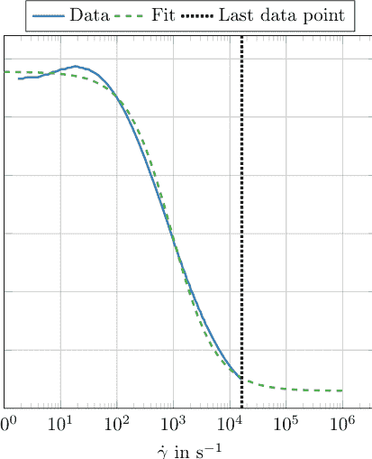

图 3.1: Ultramid®B3K 的材料数据与 Cross-type 拟合。图改编自 Sterr et al. (2023, 图 1)。

总体而言，对悬液粘度进行取向态相关的彻底调查需要大量计算资源。鉴于本章的重点是识别剪切稀化流变学对纤维悬液粘度的潜在影响，我们的研究考虑了一个特定的取向态。由于强取向纤维取向态在注塑和压缩成形中非常常见 (Vincent et al., 2005; Park et al., 2001)，所考虑微结构的二阶纤维取向张量 N 被选为横向各向同性，使得

\[
N = \begin{bmatrix} 0.8 & 0 & 0 \\ 0 & 0.1 & 0 \\ 0 & 0 & 0.1 \end{bmatrix} \tag{3.45}
\]

虽然这种特定的纤维取向态选择是强取向的，但其他纤维取向态也具有研究和工程价值。然而，为了专注于 Cross-type 基体材料对非牛顿纤维悬液粘度的特殊性及其影响，我们将本章的范围限定在给定的取向态上。底层微结构的对称性也体现在悬液粘度 V̲ 中。因此，如果计算体元选取足够大，我们预计计算得到的悬液粘度 V̲ 也将是横向各向同性的。我们在第 3.4 节利用此事实来补充第 3.3.3 节中详细介绍的体元研究。

## 3.3 初步研究

### 3.3.1 针对文献计算结果的验证

Traxler et al. (2020) 使用有限元法研究了悬浮在非牛顿基体流体中的刚性球体的悬液粘度。为进行验证，我们将所提出的基于 FFT 的均质化方法得到的结果与 Traxler et al. (2020) 的结果进行比较。感兴趣的微结构包含二十个球体，球体体积分数 c_S = 10%，并基于 Williams-Philipse 的机械收缩方法生成 (Williams and Philipse, 2003)。球体悬浮在 Cross-type (3.2) 基体流体中，其参数与 Traxler et al. (2020) 相同：\(\eta_0 = 1.5 \mathrm{~Pa} \mathrm{~s}, \eta_{\infty} = 0.5 \mathrm{~Pa} \mathrm{~s}, k=2, n=0.8\)。为了复制 Traxler et al. (2020) 中详细介绍的程序，生成并以 \(256^3\) 个体素求解了五种不同的微结构实现，见图 3.2。作为有效载荷，

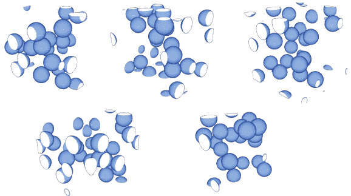

图 3.2: 球体体积分数 \(c_{\mathrm{F}}=10 \%\) 的五种微结构。图改编自 Serr et al. (2023, 图 2)。

将二十一种有效应力 \(\bar{\underline{\tau}}\) 应用于每个微结构，形式为 \(\bar{\underline{\tau}}=[0, 0, 0, 0, 0, \bar{\tau}_{12}]\)，其中有效应力分量 \(\bar{\tau}_{12}\) 在区间 \([0.089, 0.914] \mathrm{Pa}\) 上线性间隔分布。此处，有效应力分量 \(\bar{\tau}_{12}\) 的区间界限从 Traxler et al. (2020) 的结果中提取。对于每个微结构 \(m\)，测量了响应载荷 \(\bar{\underline{\tau}}\) 的有效剪切速率 \(\dot{\gamma}_{m}^{\mathrm{FFT}}(\bar{\tau}_{12})\)，并随后用于通过

\[
\dot{\gamma}_{\mathrm{A}}^{\mathrm{FFT}}(\bar{\tau}_{12})=\frac{1}{5} \sum_{i=1}^{5} \dot{\gamma}_i^{\mathrm{FFT}}(\bar{\tau}_{12}). \tag{3.46}
\]

随后，通过偏差 \(d_{num}\) 将平均有效剪切速率 \(\dot{\gamma}_A^{\text{FFT}}(\bar{\tau}_{12})\) 与 Traxler et al. (2020) 中给出的平均有效剪切速率 \(\dot{\gamma}_A^{\text{lit}}(\bar{\tau}_{12})\) 进行比较，我们定义该偏差为

\[
d_{num} = \frac{|\dot{\gamma}_A^{lit}(\bar{\tau}_{12}) - \dot{\gamma}_A^{FFT}(\bar{\tau}_{12})|}{\dot{\gamma}_A^{lit}(\bar{\tau}_{12})}. \tag{3.47}
\]

基于 FFT 方法得到的有效剪切速率-应力曲线与 Traxler et al. (2020) 的结果高度一致，见图 3.3a。这一点由偏差 \(d_{num}\) 强调，该偏差对于所有研究的有效载荷 \(\overline{\underline{\tau}}\) 均低于 2.3%，见图 3.3b。

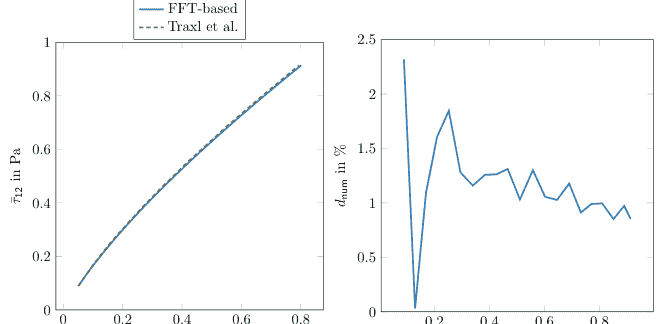

(a) 有效剪切速率-应力曲线

(b) 偏差 \(d_{num}\)

图 3.3: Traxler et al. (2020) 给出的有效剪切速率-应力曲线与基于 FFT 模拟得到的有效剪切速率-应力曲线的比较，以及有效应力分量 \(\bar{\tau}_{12} \in [0.089, 0.914] \text{Pa}\) 的偏差 \(d_{num}\)。图改编自 Storr et al. (2023, 图 3)。

### 3.3.2 分辨率研究

微结构离散化的分辨率受计算资源（即内存和运行时间）的限制。为了确定既能适应有限资源又能保持适当小误差的合适分辨率，我们针对牛顿和 Cross-type (3.2) 基体行为的案例开展了分辨率研究。该研究针对固定纤维长径比 \(r_a = 10\) 和纤维体积分数 \(c_F \in \{5\%, 10\%, 15\%, 20\%, 25\%\}\) 进行。由于纤维间距随着体积分数 \(c_F\) 的增加而减小，预计对于较高的纤维体积分数 \(c_F\)，悬液的有效应力 \(\bar{\tau}\) 对分辨率影响更为敏感。因此，我们在分辨率研究的所有体元中都选择了最大考虑体积分数 \(c_F = 25\%\)。为了减少所需体素的数量，我们研究了两种体素离散化类型，即二进制体素和复合体素 (Kabel et al., 2017)。对于复合体素，我们使用了一般双混合规则

\[
\bar{\tau}_V = c_M \tau_M + (1 - c_M)\tau_F \tag{3.48}
\]

其中 \(\bar{\tau}_V, c_M, \tau_M\) 和 \(\tau_F\) 分别是复合体素内的有效应力、基体体积分数、基体应力和纤维应力。在刚性纤维的特殊情况下，纤维应力 \(\tau_F\) 为零。因此，一般复合体素混合规则 (3.48) 简化为

\[
\bar{\tau}_V = c_M \tau_M. \tag{3.49}
\]

与 Bertóti et al. (2021) 类似，我们以倍数步骤增加了二进制体素每纤维直径的体素数 \(v/d\)，使得 \(v/d \in \{5, 10, 20, 40\}\)，见图 3.4。

因此，一个微结构以二进制体素的分辨率 \(v/d \in \{5, 10, 20, 40\}\) 和复合体素的分辨率 \(v/d \in \{5, 10, 20\}\) 进行离散化


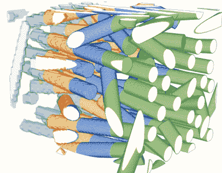

图 3.4：微观结构，其中四个不同颜色的片段以每纤维直径不同的体素数 $v/d$ 显示。从左到右的片段：灰色 ($v/d = 5$)，橙色 ($v/d = 10$)，蓝色 ($v/d = 20$)，绿色 ($v/d = 40$)。图改编自 Stett et al. (2023, Figure 4)。

voxels，并对所有考虑的剪切率和加载方向计算了有效应力 $\bar{\tau}$。

我们定义由分辨率引起的相对误差为

$e_{\text{res}} = \frac{\|\bar{\tau} - \bar{\tau}_{\text{fine}}\|_2}{\|\bar{\tau}_{\text{fine}}\|_2}, \quad (3.50)$

其中 $\bar{\tau}$ 是任意分辨率 $v/d < 40$ 的有效应力，$\bar{\tau}_{\text{fine}}$ 是分辨率 $v/d = 40$ 的二进制体素结果。因此，对每个分辨率、体素类型和加载情况的有效应力 $\bar{\tau}$ 与特定于加载的参考应力 $\bar{\tau}_{\text{fine}}$ 进行比较。对于特定的体素类型和给定分辨率 $v/d$，我们定义集合 $S_{\text{e}}$，用于收集所有 investigated 加载情况的分辨率误差 $e_{\text{res}}$，如

$S_{\text{e}} = \left\{ e_{\text{res}} \left( \bar{\tau}^{(i)}(\dot{\gamma}), \bar{\tau}_{\text{fine}}^{(i)}(\dot{\gamma}) \right) \mid i = 1, 2, 3, 4, 5, 6, \dot{\gamma} \in S_{\dot{\gamma}} \right\}, \quad (3.51)$

其中 $\bar{\tau}^{(i)}(\dot{\gamma})$ 是材料对收集在 $\underline{\underline{D}}(\dot{\gamma})$ 第 $i$ 列的加载情况的响应，参见方程 (3.35)，$\bar{\tau}^{(i)}_{\text{fine}}(\dot{\gamma})$ 是相应的参考应力。此外，我们为特定体素类型和特定分辨率定义最小、最大和平均误差为

$e_{\min} = \min S_e, \quad e_{\max} = \max S_e, \quad e_{\text{mean}} = \sum_{e_{\text{res}} \in S_e} e_{\text{res}} / |S_e|, \quad (3.52)$

其中 $|S_e|$ 表示集合 $S_e$ 的基数。误差度量 $e_{\min}, e_{\max}$ 和 $e_{\text{mean}}$ 的定量值在图 3.5 中对二进制体素和复合体素以及分辨率 $v/d \in \{5, 10, 20, 40\}$ 进行了可视化。对于所有分辨率，最小误差、最大误差和平均误差 $e_{\min}, e_{\max}$ 和 $e_{\text{mean}}$ 随分辨率 $v/d$ 的降低而降低。在牛顿型和 Cross 型两种情况下，且对于所有分辨率 \(v/d\)，三个误差 (3.52) 的值对于复合体素均低于二进制体素。值得注意的是，对于二进制体素模型，最大误差 \(e_\text{max}\) 在分辨率 \(v/d = 20\) 时低于 5%，而使用复合体素时，已在分辨率 \(v/d = 10\) 时满足此条件。

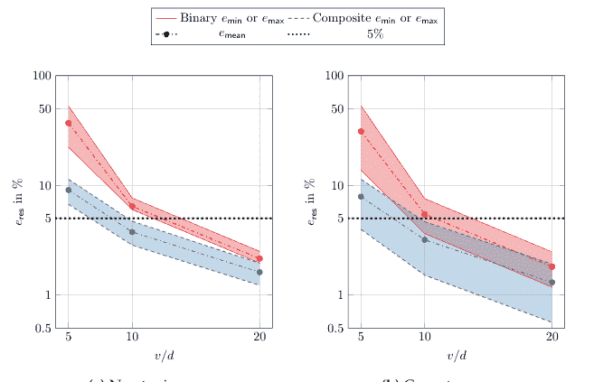

**图 3.5：** 牛顿型情况 (a) 和 Cross 型情况 (b) 的相对分辨率误差 (3.50) 收敛性。图改编自 Storr et al. (2023, Figure 5)。

有趣的是，Cross 型情况中的最小误差 \(e_\text{min}\) 始终低于牛顿型情况，而最大误差 \(e_\text{max}$ 保持在相似水平。我们注意到，最低误差 \(e_\text{min}$ 独立于分辨率 \(v/d$ 出现在纯剪切加载情况 \(\overline{D} = \dot{\gamma}[0\ 0\ 0\ 0\ 1\ 0]$ 中，剪切率为 \(\dot{\gamma} = 2 \cdot 10^3\text{s}^{-1}$。最大误差 \(e_\text{max}$ 出现在最低的 investigated 剪切率 \(\dot{\gamma} = 10\text{s}^{-1}$ 的伸长加载情况中，这些情况收集在 \(\overline{D}$ 的第 1、2 和 3 列，参见方程 (3.35)。因此，一些 investigated 加载情况导致了较低的分辨率要求，或者参考解的精度较低，这一效应也在固体力学中的弹塑性材料模型 (Schneider and Wicht, 2023) 中被观察到。为了确保所有加载情况的分辨率误差 \(e_\text{res}$ 低于 5%，所有后续计算均选用了分辨率 \(v/d = 15$。

### 3.3.3 体元大小

与微观结构离散化的分辨率一样，正在研究的体元大小受计算资源的限制。Bertóti et al. (2021) 研究了具有牛顿型基体行为、纵横比 \(r_\text{a} = 10$ 和纤维体积分数 \(c_\text{F}$ 高达 25% 的纤维悬浮液的适当体元大小。取决于纤维取向，Bertóti et al. (2021) 确定了不同的代表性体元大小，在纤维排列的情况下，形式为 \(2.2\ell \times 20d \times 20d$ 的体元被确定为足够具有代表性。在此基础上，我们进行了一项研究，以确定 Cross 型情况下所考虑的各向异性取向状态（纤维纵横比 \(r_a = 10$，纤维体积分数 \(c_F \in \{5\%, 10\%, 15\%, 20\%, 25\%\}\)）的合适体元大小。由于所需体元大小随纤维体积分数 \(c_F$ 增大，我们为体元研究选择了 \(c_F = 25\%$。我们研究了形式为 \(L \times W \times W$ 的体元，其中 \(L \in \{1.1\ell, 2.2\ell, 3.2\ell\}$ 和 \(W \in \{5d, 10d, 20d\}$，\(\ell$ 为纤维长度，\(d$ 为纤维直径，参见图 3.6。为了离散化微观结构，我们采用了复合体素并使用了前一部分确定的分辨率 \(v/d = 15$。

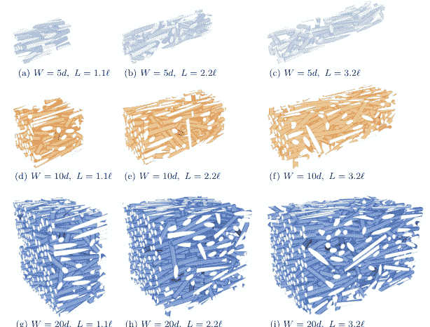

图 3.6：尺寸为 \(L \times W \times W$、长度为 \(L \in \{1.1\ell, 2.2\ell, 3.2\ell\}$ 和宽度为 \(W \in \{5d, 10d, 20d\}$ 的微观结构比较。图改编自 Sterr et al. (2023, Figure 6)。

对于长度 \(L$ 和宽度 \(W$ 的每种组合，生成了十种不同的微观结构，并对所有考虑的剪切率 (3.44) 和加载方向 (3.35) 计算了它们的有效应力 \(\bar{\tau}$。我们定义由体元大小引起的相对误差为

\( e_{\text{VE}} = \frac{\|\bar{\tau} - \bar{\tau}_{\text{ref}}\|_2}{\|\bar{\tau}_{\text{ref}}\|_2} \quad (3.53) \)

对于每个单独的加载情况，对长度 \(L = 3.2\ell$ 和宽度 \(W = 20d$ 的十个最大微观结构的有效应力 \(\bar{\tau}$ 取平均值并选为参考应力 \(\bar{\tau}_{\text{ref}}$。因此，对于每个体元大小，十个实现中每个的有效应力 \(\bar{\tau}$ 都与平均参考应力 \(\bar{\tau}_{\text{ref}}$ 进行比较。这使我们能够计算长度 \(L$ 和宽度 \(W$ 的每种组合的相对误差 \(e_{\text{VE}}$ 的均值和标准差，这些内容收录于表 3.1 中。

首先，我们注意到相对误差 \(e_{\text{VE}}$ 的均值和标准差随宽度 \(W$ 的减小速度比随长度 \(L$ 的减小速度更快。\(e_{\text{VE}}$ 的均值和标准差的最大下降发生在宽度 \(W$ 从 \(W=5$ 增加到 \(W=10$ 时。因此，适当选择体元宽度对于获得稳健结果至关重要。总体而言，我们观察到，对于尺寸 \(L = 2.2\ell, W = 20d$ 和 \(L = 3.2\ell, W = 20d$，误差 \(e_{\text{VE}}$ 的最大值低于工程界限 5%，其中误差 \(e_{\text{VE}}$ 的最大值分别为 4.06% 和 3.05%。

均值误差分别为 1.75% 和 1.14%，误差标准差分别为 0.82% 和 0.51%，两种尺寸 \(L = 2.2\ell, W = 20d$ 和 \(L = 3.2\ell, W = 20d$ 表现出相似的误差特征。因此，我们认为体元大小 \(L = 2.2\ell, W = 20d$ 足够，这与 Bertóti et al. (2021) 在牛顿型情况下对排列纤维的结果一致。相应地，我们为所有进一步调查选择了 \(L = 2.2\ell, W = 20d$。

| L | W | 均值 ± 标准差 | 最大值 | L | W | 均值 ± 标准差 | 最大值 |
|---|---|---|---|---|---|---|---|
| 1.1ℓ | 5d | 37.48 ± 19.0 | 106.21 | 2.2ℓ | 5d | 29.76 ± 15.68 | 78.97 |
| | 10d | 5.06 ± 4.03 | 23.89 | | 10d | 3.75 ± 2.5 | 11.11 |
| | 20d | 3.62 ± 2.28 | 10.96 | | 20d | 1.75 ± 0.82 | 4.06 |

| L | W | 均值 ± 标准差 | 最大值 |
|---|---|---|---|
| 3.2ℓ | 5d | 9.71 ± 5.52 | 27.73 |
| | 10d | 3.28 ± 1.68 | 8.55 |
| | 20d | 1.14 ± 0.51 | 3.05 |

表 3.1：相对误差 \(e_{\text{VE}}\) (3.53) 的均值、标准差和最大值（百分比），按长度因子 \(l$ 和宽度因子 \(w$ 的每种组合计算，每种组合十个实现。表改编自 Stür et al. (2023, Table 1)。

## 3.4 计算调查

### 3.4.1 通过标量伸长粘度对悬浮液粘度的空间表示

Böhlke and Brüggemann (2001) 引入了一种可视化各向异性刚度张量的简单方法。我们修改了该方法，通过伸长粘度 \(\eta_{\text{app}}$ 计算纤维聚合物悬浮液在特定方向上对伸长流动的阻力。在一般非牛顿型情况下，我们定义一种方向依赖的伸长粘度 \(\eta_{\text{app}}\)

\(\eta_{\text{app}}(\dot{\gamma}, \mathbf{c}_{\text{F}}, \boldsymbol{d}) = \underline{a}(\boldsymbol{d})^{\mathsf{T}} \overline{\underline{\mathbb{V}}}(\dot{\gamma}, \mathbf{c}_{\text{F}}) \underline{a}(\boldsymbol{d}) \approx \mathbb{V}(\dot{\gamma}, \mathbf{c}_{\text{F}})\cdot(\boldsymbol{d} \otimes \boldsymbol{d} \otimes \boldsymbol{d} \otimes \boldsymbol{d}), \quad (3.54)\)

其中 \(\underline{a}(\boldsymbol{d})$ 表示 \(\boldsymbol{d} \otimes \boldsymbol{d}$ 在 Mandel 记法中的分量，\(\boldsymbol{d}$ 是伸长方向，悬浮液粘度 \(\overline{\underline{\mathbb{V}}}(\dot{\gamma}, \mathbf{c}_{\text{F}}$) 通过方程 (3.33) 计算，作为真实悬浮液粘度张量 \(\mathbb{V}(\dot{\gamma}, \mathbf{c}_{\text{F}}$) 的近似。由于真实悬浮液粘度张量 \(\mathbb{V}$ 具有小对称和大对称性，它由 21 个分量定义。因此，悬浮液粘度 \(\overline{\underline{\mathbb{V}}}(\dot{\gamma}, \mathbf{c}_{\text{F}}$) 可以由一个标量伸长粘度和一个标量体积粘度完全描述。


黏度，参见 He and Curnier (1995, 第 4.3 节)。然后，延伸黏度和体积黏度分别包含悬浮液黏度 \(\underline{\underline{V}}(\dot{\gamma}, c_F)\) 的 15 个和 6 个分量的信息。然而，由于不可压缩性，悬浮液黏度 \(\underline{\underline{V}}(\dot{\gamma}, c_F)\) 中包含的所有信息均通过延伸黏度 \(\eta_{app}(\dot{\gamma}, c_F, \boldsymbol{d})\) 完整且唯一地编码（He and Curnier, 1995, 第 4.3 节）。这在牛顿型和 Cross 型两种情况下均成立。因此，在以下内容中，我们使用延伸黏度 \(\eta_{app}(\dot{\gamma}, c_F)\) 作为工具，以完全可视化和定性理解悬浮液黏度 \(\underline{\underline{V}}(\dot{\gamma}, c_F)\)。

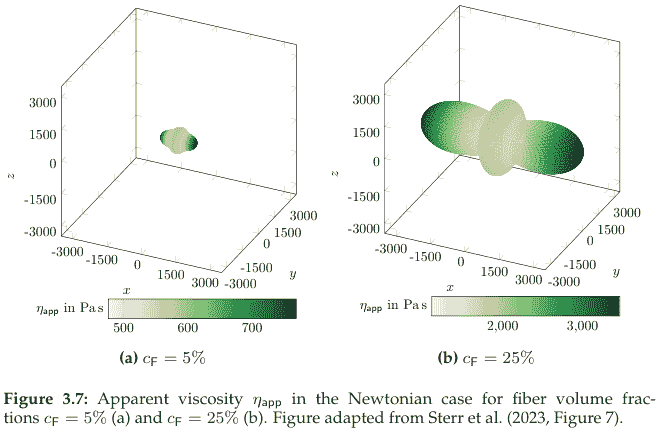

对于各向同性悬浮液黏度和单轴延伸方向 \(\boldsymbol{d}\) 的特殊情况，延伸黏度 \(\eta_{app}(\dot{\gamma}, \boldsymbol{d})\) 与剪切黏度 \(\eta(\dot{\gamma})\) (3.2) 的关系为 \(\eta_{app}(\dot{\gamma}, \boldsymbol{d}) = 4\eta(\dot{\gamma})/3\)。在牛顿型情况下，黏度张量分量 \(\underline{\underline{V}}(\dot{\gamma}, c_F)\) 与剪切速率 \(\dot{\gamma}\) 无关。

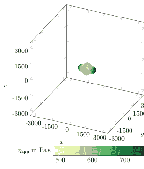

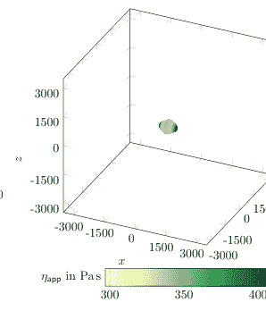

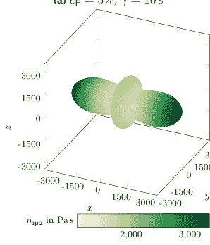

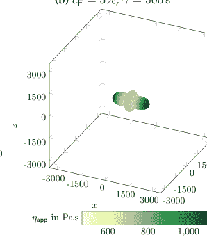

**Figure 3.8:** Cross 型情况下表观黏度 \(\eta_{app}\)，纤维体积分数 \(c_F\) 和剪切速率 \(\dot{\gamma}\) 的组合：(a) \(c_F = 5\%, \dot{\gamma} = 10\ \text{s}^{-1}\) (b)、\(c_F = 25\%, \dot{\gamma} = 10\ \text{s}^{-1}\) (c) 和 \(c_F = 25\%, \dot{\gamma} = 500\ \text{s}^{-1}\) (d)。图改编自 Sterr et al. (2023, Figure 8)。

为了符号表述的清晰性，将不再赘述延伸黏度 \(\eta_{app}(\dot{\gamma}, c_F, \boldsymbol{d})\) 和悬浮液黏度 \(\underline{\underline{V}}(\dot{\gamma}, c_F)\) 对剪切速率 \(\dot{\gamma}\)、纤维体积分数 \(c_F\) 及延伸方向 \(\boldsymbol{d}\) 的依赖关系。请注意，图 3.7 和 3.8 中的颜色映射限值旨在突出延伸黏度 \(\eta_\text{app}\) 的各自极值，且大小差异通过黏度体的尺寸进行可视化。在图 3.7 和 3.8 中，我们观察到，在牛顿型和 Cross 型两种情况下，当方向 \(\boldsymbol{d}\) 沿主纤维取向轴对齐时，延伸黏度 \(\eta_\text{app}\) 较大。这是可以预期的，因为沿圆柱形纤维的流动阻力高于其他流动方向。此外，在两种情况下，延伸黏度 \(\eta_\text{app}\) 随纤维体积分数 \(c_\text{F}\) 增加而在所有方向 \(\boldsymbol{d}\) 中增加。然而，在 Cross 型情况下，延伸黏度 \(\eta_\text{app}\) 随剪切速率 \(\dot{\gamma}\) 在所有方向 \(\boldsymbol{d}\) 中降低。取决于剪切速率 \(\dot{\gamma}\) 的值，一种效应会压倒另一种效应。请注意，在两种情况下，延伸黏度 \(\eta_\text{app}\) 的最小值均不出现在主纤维取向轴 \(x\) 的垂直方向，因为存在不可压缩性。

### 3.4.2 极坐标表示与材料各向异性

尽管延伸黏度 \(\eta_\text{app}\) 的空间表示提供了对底层黏度矩阵 \(\overline{\underline{V}}\) 的直觉和定性理解，但前一节所示黏度体的切片允许对出现的效应进行更集中的讨论。如前一节所述，纤维体积分数 \(c_\text{F}\) 对悬浮液黏度 \(\overline{\underline{V}}\) 有强烈影响。由于矩阵 \(\overline{\underline{V}}\) 应为横向各向同性，参见第 3.2.5 节，我们将通过关注 \(x\) 和 \(y\) 方向上的延伸黏度 \(\eta_\text{app}^x\) 和 \(\eta_\text{app}^y\)，来讨论纤维体积分数 \(c_\text{F}\) 和剪切速率 \(\dot{\gamma}\) 对悬浮液黏度 \(\overline{\underline{V}}\) 的影响。在 3.4.1 节中我们指出，延伸黏度 \(\eta_\text{app}\) 随所有方向 \(\boldsymbol{d}\) 中的纤维体积分数 \(c_\text{F}\) 增加而增加。此外，如图 3.9 和 3.10 所示，延伸黏度 \(\eta_\text{app}^y\) 和 \(\eta_\text{app}^x\) 随纤维体积分数 \(c_\text{F}\) 的变化本身也随纤维体积分数 \(c_\text{F}\) 的增加而增大。在牛顿型情况下，黏度 \(\eta_{app}^y\) 从 530 Pa·s 增加到 1581 Pa·s，当纤维体积分数 \(c_\mathrm{F}\) 从 5% 变化到 25% 时。相比之下，延伸黏度 \(\eta_{app}^x\) 从 769 Pa·s 增加到 3468 Pa·s，当纤维体积分数 \(c_\mathrm{F}\) 从 5% 增加到 25% 时。因此，延伸黏度 \(\eta_{app}^y\) 和 \(\eta_{app}^x\) 分别增加了 198% 和 351%。

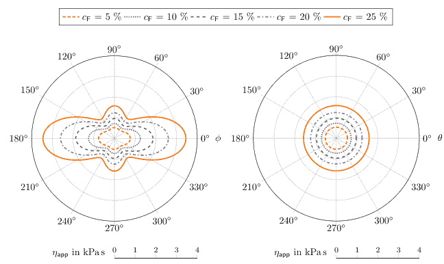

(a) $x-y$ 平面上的 $\eta_{app}$ (b) $y-z$ 平面上的 $\eta_{app}$

**Figure 3.9:** 牛顿型情况下纤维体积分数 $c_\mathrm{F} \in \{5, 10, 15, 20, 25\}\%$ 的 $x-y$ 和 $y-z$ 平面上的表观黏度 $\eta_{app}$。图改编自 Sterr et al. (2023, Figure 9)。

| $c_\mathrm{F}$（%） | 5 | 10 | 15 | 20 | 25 |
|---|---|---|---|---|---|
| $\eta_{app}^y$（Pa·s） | 530 | 726 | 964 | 1243 | 1581 |
| $\eta_{app}^x$（Pa·s） | 769 | 1258 | 1872 | 2615 | 3468 |

**表 3.2:** 牛顿型情况下纤维体积分数 $c_\mathrm{F} \in \{5, 10, 15, 20, 25\}\%$ 的表观黏度 $\eta_{app}^y$ 和 $\eta_{app}^x$。表改编自 Sterr et al. (2023, Table 2)。

在 Cross 型情况下，延伸黏度 \(\eta_{app}\) 依赖于剪切速率 \(\dot{\gamma}\)，如图 3.10 和表 3.3 所示。在纤维体积分数 \(c_F = 5\%\) 时，延伸黏度 \(\eta_{app}^y\) 从 529 Pa·s 降低到 30 Pa·s，当剪切速率 \(\dot{\gamma}\) 从 \(10\ \text{s}^{-1}\) 变化到 \(10^5\ \text{s}^{-1}$ 时。

- \(\dot{\gamma} = 10^1 s^{-1} \cdots \dot{\gamma} = 10^2 s^{-1} \cdots \dot{\gamma} = 10^3 s^{-1} \cdots \dot{\gamma} = 10^4 s^{-1} \cdots \dot{\gamma} = 10^5 s^{-1}\)

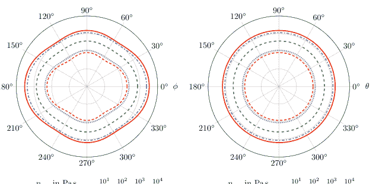

(a) \(\eta_{app}$ 在 \(x\text{-}y$ 平面上 (b) \(\eta_{app}$ 在 \(y\text{-}z$ 平面上

**Figure 3.10:** 纤维体积分数 \(c_F = 25\%\) 和剪切速率 \(\dot{\gamma} \in \{10^1, 10^2, 10^3, 10^4, 10^5\}\ \text{s}^{-1}$ 的 Cross 型延伸黏度体在 \(x\text{-}y$ 和 \(y\text{-}z$ 平面上的切片。图改编自 Sterr et al. (2023, Figure 10)。

| $c_F$（%） | 5 | 5 | 5 | 15 | 15 | 15 | 25 | 25 | 25 |
|---|---|---|---|---|---|---|---|---|---|
| $\dot{\gamma}$（$\text{s}^{-1}$） | $10^1$ | $10^3$ | $10^5$ | $10^1$ | $10^3$ | $10^5$ | $10^1$ | $10^3$ | $10^5$ |
| $\eta_{app}^y$（Pa·s） | 529 | 226 | 30 | 939 | 295 | 52 | 1515 | 379 | 84 |
| $\eta_{app}^x$（Pa·s） | 759 | 287 | 43 | 1818 | 494 | 101 | 3336 | 729 | 185 |

**表 3.3:** Cross 型情况下纤维体积分数 \(c_F \in \{5, 10, 15, 20, 25\}\%$ 和剪切速率 \(\dot{\gamma} \in \{10, 10^3, 10^5\}\ \text{s}^{-1}$ 的表观黏度 \(\eta_{app}^y$ 和 \(\eta_{app}^x$。表改编自 Sterr et al. (2023, Table 3)。

相比之下，延伸黏度 \(\eta_{app}^x$ 从 759 Pa·s 降低到 43 Pa·s，当剪切速率 \(\dot{\gamma}$ 从 \(10\ \text{s}^{-1}$ 变化到 \(10^5\ \text{s}^{-1}$ 时。因此，两种延伸黏度 \(\eta_{app}^y$ 和 \(\eta_{app}^x$ 均下降了约 94% 的相同比例。然而，对于较低的剪切速率 \(\dot{\gamma} = 10^3\ \text{s}^{-1}$，延伸黏度 \(\eta_{app}^y$ 和 \(\eta_{app}^x$ 分别以 57% 和 62% 的不同比例下降。我们观察到较高纤维体积分数 \(c_F = 25\%$ 出现类似变化。在这种情况下，当剪切速率 \(\dot{\gamma}$ 从 \(10\ \text{s}^{-1}$ 变化到 \(10^5\ \text{s}^{-1}$ 时，延伸黏度 \(\eta_{app}^y$ 和 \(\eta_{app}^x$ 也均下降了约 94%。同样，对于较低的剪切速率 \(\dot{\gamma} = 10^3\ \text{s}^{-1}$，延伸黏度 \(\eta_{app}^y$ 和 \(\eta_{app}^x$ 分别以 75% 和 78% 的不同比例下降。因此，我们得出结论：对于表现出非牛顿行为的剪切速率 \(\dot{\gamma}$，较高纤维体积分数 \(c_F$ 时延伸黏度 \(\eta_{app}^x$ 和 \(\eta_{app}^y$ 随剪切速率的变化更为显著。此外，由于在牛顿型和 Cross 型两种情况下，剪切速率 \(\dot{\gamma} = 10^3\ \text{s}^{-1}$ 时延伸黏度 \(\eta_{app}^y$ 和 \(\eta_{app}^x$ 的变化比例不同，材料各向异性随纤维体积分数 \(c_F$ 和剪切速率 \(\dot{\gamma}$ 的变化而变化，参见图 3.11。我们将在以下内容中讨论这些变化。

对于悬浮液黏度 \(\overline{\underline{V}}$ 的横向各向同性对称性，其各向异性由延伸黏度 \(\eta_{app}^x$ 和 \(\eta_{app}^y$ 表征。为进一步研究，我们还使用 \(z$ 方向上的第三个延伸黏度 \(\eta_{app}^z$。每个参数分别代表延伸方向 \(\boldsymbol{d}$ 沿 \(x$、\(y$ 和 \(z$ 方向时延伸黏度 \(\eta_{app}$ 的值。因此，分数

\(f_1 = \frac{\eta_{app}^x}{\eta_{app}^y}, \quad \text{以及} \quad f_2 = \frac{\eta_{app}^x}{\eta_{app}^z} \tag{3.55}\)

作为方向各向异性的度量。对于理论上完全横向各向同性的悬浮液黏度，两个分数 \(f_1$ 和 \(f_2$ 均取相同的值。如第 3.2.5 节所述，我们为所有 con-


考虑了微观结构。因此，如果计算研究中的体积元素尺寸选取得足够大，我们也期望得到横各向同性悬浮液粘度 $\bar{V}$。

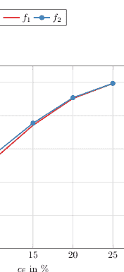

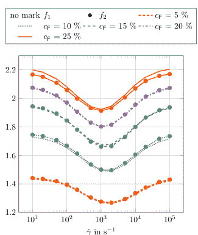

(a) 牛顿情况的 $f_1$ 和 $f_2$

(b) Cross型情况的 $f_1$ 和 $f_2$

图 3.11：牛顿和Cross型情况的各向异性分数 $f_1$ 和 $f_2$ (3.55)，$c_F \in \{5, 10, 15, 20, 25\}\%$，$\dot{\gamma} \in [10, 10^5]\text{s}^{-1}$。图改编自 Sterr et al. (2023, 图 11)。

为了检验体积元素尺寸是否选取合适，我们定义相对偏差

$e_{\text{dev}} = \frac{|f_1 - f_2|}{|f_1|}, \quad (3.56)$

并对牛顿和Cross型两种情况评估相对偏差 $e_{\text{dev}}$。对于所有考虑的剪切率 $\dot{\gamma}$ 和体积分数 $c_F$，在牛顿和Cross型两种情况下，偏差 $e_{\text{dev}}$ 均小于 2%。因此，分数 $f_1$ 和 $f_2$ 的值彼此仅略有不同，材料的预期对称性以足够小的误差（适用于工程目的）被捕捉。如图 3.9b 和 3.10b 所示，$y-z$ 平面上的伸长粘度 $\eta_{app}$ 进一步说明了材料对称性，因为对于所有纤维体积分数 $c_F$ 和剪切率 $\dot{\gamma}$，伸长粘度 $\eta_{app}$ 的极坐标图均为圆形。由于我们将体积元素视为代表性元素，我们将讨论分数 $f_1$ 和 $f_2$ 对纤维体积分数 $c_F$ 和剪切率 $\dot{\gamma}$ 的依赖关系，如图 3.11 所示。

在牛顿情况中，分数 $f_1$ 和 $f_2$ 两者均从体积分数 $c_F = 5\%$ 处的 1.45 显著增长至体积分数 $c_F = 25\%$ 处的 2.19。因为在低剪切率 $\dot{\gamma}$ 下，Cross型情况中的基体行为近似为牛顿行为，所以在剪切率 $\dot{\gamma} = 10\ s^{-1}$ 时，Cross型情况中分数 $f_1$ 和 $f_2$ 的值与牛顿情况中的值相似。随着剪切率 $\dot{\gamma}$ 增大，分数 $f_1$ 和 $f_2$ 的值随之下降，直至达到剪切率 $\dot{\gamma}_{min} \approx 10^3\ s^{-1}$，此时它们分别达到各自的最小值。由于对于较高体积分数 $c_F$，更多纤维可能彼此紧密排列，因此在较低宏观剪切率 $\dot{\gamma}$ 下会出现较高速度梯度。反过来，这会降低局部基体粘度。因此，随着纤维体积分数增大，分数 $f_1$ 和 $f_2$ 的最小值出现在较低剪切率处。对于纤维体积分数 $c_F = 25\%$，分数 $f_1$ 和 $f_2$ 的最小值在剪切率 $\dot{\gamma} = 10^3\ s^{-1}$ 处达到；而对于纤维体积分数 $c_F = 5\%$，最小值在剪切率 $\dot{\gamma} = 2 \cdot 10^3\ s^{-1}$ 处达到。此外，最大绝对变化

\(\Delta f(c_F) = f(c_F, 10\ s^{-1}) - f(c_F, \dot{\gamma}_{min})\) (3.57)

随纤维体积分数 $c_F$ 增大，例如，纤维体积分数 $c_F$ 分别为 5% 和 25% 时，$\Delta f(c_F) = 17\%$ 和 $\Delta f(c_F) = 28\%$。相比之下，对于所有考察的纤维体积分数，最大相对变化

\(\Delta f(c_{\mathrm{F}}) = \frac{f(c_{\mathrm{F}}, 10\ \mathrm{s}^{-1}) - f(c_{\mathrm{F}}, \dot{\gamma}_{\min})}{f(c_{\mathrm{F}}, 10\ \mathrm{s}^{-1})} \quad (3.58)\)

介于 12% 至 14% 之间。

### 3.4.3 与平均场结果的比较

接下来，我们将计算结果与平均场估计进行比较。在牛顿和Cross型情况中，我们使用 Mori-Tanaka 模型 (3.40) 计算表观平均场粘度 \(\eta_{\mathrm{app}}^{\mathrm{MF}}\)。然后，通过偏差

\(e_{\mathrm{MF}} = \frac{\left| \eta_{\mathrm{app}}^{\mathrm{MF}} - \eta_{\mathrm{app}}^{\mathrm{FFT}} \right|}{\eta_{\mathrm{app}}^{\mathrm{FFT}}}. \quad (3.59)\)

将表观平均场粘度 \(\eta_{\mathrm{app}}^{\mathrm{MF}}\) 与表观计算粘度 \(\eta_{\mathrm{app}}^{\mathrm{FFT}}\) 进行比较。

为降低维度，并避免因潜在插值误差影响比较（如第 3.4.1 节所述），我们将讨论集中在两个标量量 \(\eta_{\mathrm{app}}^{x}\) 和 \(\eta_{\mathrm{app}}^{y}$ 上。牛顿和Cross型情况的结果分别见图 3.12 和 3.13 以及图 3.14。在牛顿情况中，通过平均场方法获得的伸长粘度 $\eta_{\mathrm{app}}^{x}$ 和 $\eta_{\mathrm{app}}^{y}$ 低于通过基于 FFT 的计算方法获得的值。此外，对于纤维体积分数 $c_{\mathrm{F}} = 5\%$，$\eta_{\mathrm{app}}^{x}$ 和 $\eta_{\mathrm{app}}^{y}$ 的平均场和基于 FFT 的结果仍可视为用于工程目的的相似结果，因为偏差 $e_{\mathrm{MF}}$ 低于 5.7%。但是，随着纤维体积分数 $c_{\mathrm{F}}$ 增大，偏差 $e_{\mathrm{MF}}$ 单调增加，对于伸长粘度 $\eta_{\mathrm{app}}^{x}$ 高达 26.8%，对于伸长粘度 $\eta_{\mathrm{app}}^{y}$ 高达 23.5%。

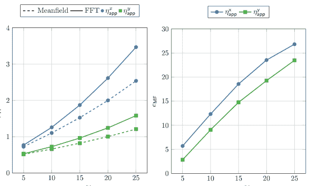

(a) 表观粘度 \(\eta_{app}^x\) 和 \(\eta_{app}^y\)

(b) 偏差 \(e_{MF}\)

图 3.12：牛顿情况中平均场模型和基于 FFT 的计算方法的表观粘度 \(\eta_{app}^x\) 和 \(\eta_{app}^y$，以及纤维体积分数 \(c_F \in \{5, 10, 15, 20, 25\}\%$ 的偏差 \(e_{MF}$ (3.59)。图改编自 Sterr et al. (2023, 图 12)。

在Cross型情况中，对于剪切率 \(\dot{\gamma} \approx 10 \text{ s}^{-1}$ 和 \(\dot{\gamma} \approx 10^5 \text{ s}^{-1}$，我们观察到与牛顿情况相同的偏差 \(e_{MF}$ 结果。这是Cross型基体粘度 \(\eta$ 在剪切率极限 \(\dot{\gamma} \to 0 \text{ s}^{-1}$ 和 \(\dot{\gamma} \to \infty \text{ s}^{-1}$ 处的两个牛顿区域的直接结果。最大偏差 \(e_{MF}$ 出现在剪切率 \(\dot{\gamma} = 10^3 \text{ s}^{-1}$ 处，此时基体非线性最高。正如我们在 3.4.1 节中已经观察到的各向异性指标 \(f_1$ 和 \(f_2$ 一样，纤维体积分数 \(c_F$ 影响最大偏差 \(e_{MF}$ 出现的剪切率 \(\dot{\gamma}$。特别是，对于两种伸长粘度 \(\eta_{app}^x$ 和 \(\eta_{app}^y$，纤维体积分数 \(c_F = 25\%\) 时观察到的最大偏差出现在较低剪切率 \(\dot{\gamma} = 10^3 \text{ s}^{-1}$ 处，而它出现在剪切率

\(\dot{\gamma} = 2 \cdot 10^3 \text{ s}^{-1}$ 处，适用于纤维体积分数 \(c_F = 5\%\)。

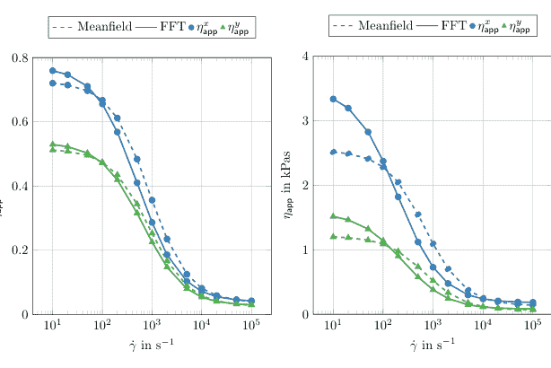

**图 3.13：** Cross型情况中纤维体积分数 \(c_F \in \{5, 25\}\%$ 和剪切率 \(\dot{\gamma} \in [10, 10^5] \text{ s}^{-1}$ 下，平均场模型和基于 FFT 的计算方法的表观粘度 \(\eta_{app}^x$ 和 \(\eta_{app}^y$。图改编自 Sterr et al. (2023, 图 13)。

作为Cross型材料定律 (3.2) 的进一步结果，两种计算方法的伸长粘度 \(\eta_{app}^x$ 和 \(\eta_{app}^y$ 曲线相交两次。对于纤维体积分数 \(c_F = 5\%\) 和 \(c_F = 25\%\)，第一次相交发生在剪切率 \(\dot{\gamma} \approx 10^2 \text{ s}^{-1}$ 处，而第二次相交发生在剪切率区间 \([10^4, 5 \cdot 10^4] \text{ s}^{-1}$ 内，具体取决于纤维体积分数 \(c_F$。对于较高纤维体积分数 \(c_F$，第二次相交发生在较低宏观剪切率 \(\dot{\gamma}$ 处，因为纤维间距减小导致显微剪切率升高。因此，我们观察到在较低剪切率处提前进入第二个牛顿体系。


速率极限 \(\dot{\gamma} \to \infty \text{ s}^{-1}\)。在延伸粘度曲线的交点之间，通过平均场模型获得的延伸粘度 \(\eta_{\text{app}}\) 高于计算方法。

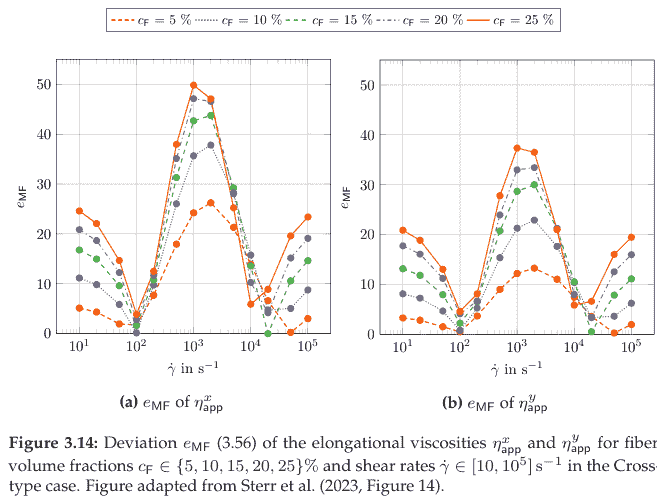

## 3.5 Conclusions

## 3.5 结论

本章致力于研究剪切稀疏基体行为对纤维悬浮液有效粘度的影响。我们将考虑重点放在工程制造工艺（如注塑和压缩成型）感兴趣的剪切速率上。为开展研究，我们采用了Cross型粘度模型和基于FFT的计算方法，以确定纤维悬浮液在广泛剪切速率范围内的有效粘度。我们发现，微观结构离散的分辨率误差取决于剪切速率和加载方向，在中等剪切速率和纯剪切载荷下出现最小分辨率误差。出乎意料的是，我们发现，在具有配向微观结构的牛顿情况与具有横各向同性微观结构的Cross型情况中，代表体元尺寸高度相似。在所考虑的剪切速率区间内，我们发现Cross型悬浮液粘度在幅值和各向异性程度上变化强烈。最后，我们观察到，计算估计与Mori-Tanaka型平均场估计对于悬浮液粘度之间存在显著偏差。

# Chapter 4

# 第4章

# Machine learning assisted discovery of effective viscous material laws for shear-thinning fiber suspensions

# 基于机器学习的剪切稀疏纤维悬浮液有效粘性材料定律发现

¹ This chapter is based on the sections 1 to 5 of the publication "Machine learning assisted discovery of effective viscous material laws for shear-thinning fiber suspensions" (Sterr et al., 2024b).

¹ 本章基于论文《基于机器学习的剪切稀疏纤维悬浮液有效粘性材料定律发现》（Sterr et al., 2024b）的第1至5节。

Viscosity models for fiber polymer suspensions are widely used in molding process simulations of composite parts (Kennedy and Zheng, 2013), which play a major role in the lightweight design of engineering systems, i.e., in the automotive, aerospace, and energy sectors (Henning et al., 2019; Qureshi, 2022). Molding process simulations are an established tool in composite part engineering, partly because of the industrial benefits of digital twins (Botín-Sanabria et al., 2022) and virtual process chains (Henning et al., 2019; Görthofer et al., 2019; Meyer et al., 2023). In molding simulations for fiber reinforced plastics, accurate modeling of the suspension viscosity is crucial to predict various parameters of engineering interest. The suspension viscosity influences manufacturing process parameters (Castro and Tomlinson, 1990; Goodship, 2017), as well as fiber orientation and fiber volume distributions (Tseng et al., 2018). Consequently, flow fields (Karl et al., 2021) and final part properties (Böhlke et al., 2019; Karl et al., 2021) are also affected by the suspension viscosity. In light of the analytical and experimental difficulties involved when studying the viscosity of fiber suspensions with non-Newtonian solvents, computational approaches provide insights and observations that are otherwise hard to obtain. Švec et al. (2012) combined the lattice Boltzmann method for fluid flow, an immersed boundary procedure for the interaction between fluid and rigid particles, and a mass tracking algorithm for the free surface representation to simulate slump tests of a suspension of rigid spherical particles and fibers suspended in a Bingham-type fluid. In comparison with a slump test of pure matrix material, they observed a smaller spread and increased height in the slump test of the suspension, suggesting an increased effective yield stress. Using a Finite Element Method (FEM) based approach, Domurath et al. (2020) investigated the rheological coefficients of the transversely isotropic fluid equation by Ericksen (1960) in the context of rigid fibers suspended in a power-law fluid. In a simple shear flow, they found the model by Souloumiac and Vincent (1998) to overpredict the orientation dependence of a rheological coefficient. Combining the RVE method (Kanit et al., 2003) and Fast Fourier Transform (FFT) based computational techniques (Schneider, 2021), Sterr et al. (2023) extended work by Bertóti et al. (2021) on Newtonian fiber suspensions to suspensions with non-Newtonian solvents. They visualized the anisotropic viscosity tensor in the case of a Cross-type matrix fluid and studied the effects of fiber volume fraction and shear rate on the suspension viscosity.

纤维聚合物悬浮液的粘度模型广泛用于复合部件成型过程模拟（Kennedy and Zheng, 2013），这些模拟在工程系统的轻量化设计中发挥着重要作用，即在汽车、航空航天和能源领域（Henning et al., 2019; Qureshi, 2022）。成型过程模拟是复合部件工程中一种成熟的工具，这在一定程度上归功于数字孪生（Botín-Sanabria et al., 2022）和虚拟工艺链（Henning et al., 2019; Görthofer et al., 2019; Meyer et al., 2023）的工业优势。在纤维增强塑料的成型模拟中，对悬浮液粘度进行准确建模对于预测各种工程感兴趣的参数至关重要。悬浮液粘度影响制造工艺参数（Castro and Tomlinson, 1990; Goodship, 2017）以及纤维取向和纤维体积分布（Tseng et al., 2018）。因此，流场（Karl et al., 2021）和最终部件性能（Böhlke et al., 2019; Karl et al., 2021）也受悬浮液粘度的影响。鉴于在研究非牛顿溶剂中纤维悬浮液粘度时所涉及的分析和实验困难，计算方法提供了否则难以获得的洞察和观察。Švec et al.（2012）结合了用于流体流动的格玻尔兹曼法、用于流体与刚性颗粒相互作用的浸入边界法以及用于自由表面表示的质量跟踪算法，模拟了悬浮于Bingham型流体中的刚性球形颗粒和纤维悬浮液的坍落试验。与纯基体材料的坍落试验相比，他们在悬浮液的坍落试验中观察到更小的扩展和更高的高度，表明有效屈服应力增加。采用基于有限元法（FEM）的方法，Domurath et al.（2020）研究了刚性纤维悬浮于幂律流体中时，Ericksen（1960）各向异性流体方程的流变学系数。在简单剪切流中，他们发现Souloumiac和Vincent（1998）的模型高估了流变学系数的取向依赖性。结合RVE方法（Kanit et al., 2003）和基于快速傅里叶变换（FFT）的计算技术（Schneider, 2021），Sterr et al.（2023）将Bertóti et al.（2021）关于牛顿纤维悬浮液的工作扩展到具有非牛顿溶剂的悬浮液。他们可视化了Cross型基体流体情况下的各向异性粘度张量，并研究了纤维体积分数和剪切速率对悬浮液粘度的影响。

In this chapter, we combine high fidelity, FFT-based computational methods and a supervised machine learning strategy to discover material models for the effective viscosity of shear-thinning fiber suspensions. To do so, we study the anisotropic and shear rate dependent effective viscosity of fiber suspensions with a Cross-type matrix behavior and a fiber volume fraction of 25%. In section 4.2 we outline the setup for the FFT-based computational investigations, where we compute the effective material response for 109 different fiber orientation states and a variety of loading states. In terms of computational scope, this constitutes a significant extension to previous FFT-based work on shear-thinning fiber suspensions, in which a single fiber orientation state was considered (Sterr et al., 2023). Based on the computational data, we visualize the suspension viscosity tensor in three dimensions and formulate an anisotropy criterion applicable in a non-linear setting using a loading direction and shear rate dependent scalar viscosity, see section 4.3. We find that the anisotropy of the suspension viscosity shows a significantly different shear rate dependence for different fiber orientation states. Also, for all investigated microstructures, we confirm that the anisotropy of the suspension viscosity depends on the degree of non-linearity of the matrix material, which was previously only studied for a transversely isotropic microstructure (Sterr et al., 2023). In section 4.4, based on the insights into the shear rate and orientation state dependence of the suspension viscosity, we formulate requirements a model of the suspension viscosity needs to fulfill. According to the formulated requirements we propose four models with different numbers of parameters, as well as different phenomenological and theoretical motivations. Using the ADAM algorithm, we employ supervised machine learning techniques for non-convex optimization to learn the parameters of the model candidates. Overall, three models achieve similar maximum validation errors below 5.15 %, while one model based on superposition and orientation averaging performs unfavorably.

在本章中，我们结合高保真、基于FFT的计算方法和受监督机器学习策略，以发现剪切稀疏纤维悬浮液有效粘度的材料模型。为此，我们研究了具有Cross型基体行为和25%纤维体积分数的纤维悬浮液的各向异性及剪切速率依赖有效粘度。在4.2节中，我们概述了基于FFT的计算研究设置，其中我们针对109种不同的纤维取向状态和多种加载状态计算了有效材料响应。从计算范围来看，这对以前基于FFT的剪切稀疏纤维悬浮液工作（Sterr et al., 2023）构成了重大扩展，该工作仅考虑了单一纤维取向状态。基于计算数据，我们以三维可视化了悬浮液粘度张量，并利用加载方向和剪切速率依赖的标量粘度，制定了适用于非线性场景的各向异性准则，见4.3节。我们发现，悬浮液粘度的各向异性对不同纤维取向状态表现出显著不同的剪切速率依赖性。此外，对于所有被研究的微观结构，我们证实悬浮液粘度的各向异性取决于基体材料的非线性程度，此前这只针对横各向同性微观结构进行过研究（Sterr et al., 2023）。在4.4节中，基于对悬浮液粘度剪切速率和取向状态依赖性的洞察，我们制定了悬浮液粘度模型需要满足的要求。根据制定的要求，我们提出了四种具有不同参数数量以及不同现象学和理论动机的模型。使用ADAM算法，我们采用受监督机器学习技术进行非凸优化，以学习模型候选项的参数。总体而言，三种模型达到相似的最大验证误差，均低于5.15%，而一种基于叠加和取向平均的模型表现不佳。

## 4.2 A computational study of the effective behavior of shear-thinning fiber suspensions

## 4.2 剪切稀疏纤维悬浮液有效行为的计算研究

### 4.2.1 Computational homogenization procedure

### 4.2.1 计算同质化程序

In this chapter, we consider incompressible, shear-thinning fiber suspensions, occupying a rectangular volume \( Y \subseteq \mathbb{R}^3 \). First, we give a short summary of the numerical procedure for the homogenization of shear-thinning fiber suspensions detailed in section 3.2. We are interested in computing the effective viscous stress \( \bar{\tau} \in \text{Sym}_0(3) \) of the suspension in response to an applied, effective shear rate tensor \( \bar{D} \in \text{Sym}_0(3) \), where \( \text{Sym}_0(3) \) denotes the vector space of symmetric and traceless second-order tensors. For a pressure field \( p : Y \rightarrow \mathbb{R} \), a solenoidal velocity field \( v : Y \rightarrow \mathbb{R}^3 \) and a local viscous stress field

\( \tau = \mathcal{T}(\cdot, \bar{D} + \nabla^s v), \quad (4.1) \)

with associated stress operator

\(\begin{aligned} \mathcal{T} : Y \times \text{Sym}_0(3) \rightarrow \text{Sym}_0(3), \quad (4.2) \\ (x, D) \mapsto \frac{\partial \Psi}{\partial D}(x, D), \quad (4.3) \end{aligned}\)

and dissipation potential \( \Psi : Y \times \text{Sym}_0(3) \rightarrow \mathbb{R} \), the local balance of linear momentum without inertial effects

\( \text{div}(\tau) - \nabla p = 0, \quad (4.4) \)

needs to be fulfilled. In the context of suspensions with rigid inclusions, the local viscous stress \( \tau \) in equation (4.4) is, constitutively, not well-defined inside the rigid inclusions. We address this issue by changing to a dual formulation as follows. With the complementary dissipation

在本章中，我们考虑占据矩形体积 \( Y \subseteq \mathbb{R}^3 \) 的不可压缩、剪切稀疏纤维悬浮液。首先，我们简要总结3.2节中详细介绍的剪切稀疏纤维悬浮液同质化数值程序。我们感兴趣的是计算悬浮液在施加的有效剪切速率张量 \( \bar{D} \in \text{Sym}_0(3) \) 作用下的有效粘应力 \( \bar{\tau} \in \text{Sym}_0(3) \)，其中 \( \text{Sym}_0(3) \) 表示对称无迹二阶张量的向量空间。对于压力场 \( p : Y \rightarrow \mathbb{R} \)、无散度速度场 \( v : Y \rightarrow \mathbb{R}^3 \) 和局部粘应力场

\( \tau = \mathcal{T}(\cdot, \bar{D} + \nabla^s v), \quad (4.1) \)

及相关应力算子

\(\begin{aligned} \mathcal{T} : Y \times \text{Sym}_0(3) \rightarrow \text{Sym}_0(3), \quad (4.2) \\ (x, D) \mapsto \frac{\partial \Psi}{\partial D}(x, D), \quad (4.3) \end{aligned}\)

和耗散势 \( \Psi : Y \times \text{Sym}_0(3) \rightarrow \mathbb{R} \)，需要满足不含惯性效应的局部线性动量平衡

\( \text{div}(\tau) - \nabla p = 0, \quad (4.4) \)

。在包含刚性包容体的悬浮液背景下，方程（4.4）中的局部粘应力 \( \tau \）在构成上在刚性包容体内部定义不明确。我们通过切换到如下双重公式来解决这个问题。利用互补耗散


势

\[\Phi(\tau) := \sup \left\{ \tau \cdot \boldsymbol{D} - \Psi(\boldsymbol{D}) \mid \boldsymbol{D} \in \text{Sym}_0(3) \right\}\] (4.5)

作为耗散势 $\Psi$ 的 Legendre–Fenchel 对偶产生，我们寻求变分问题的极小点

\[\langle \Phi(\cdot, \tau) - \tau \cdot \bar{\boldsymbol{D}} \rangle_Y \longrightarrow \inf\] (4.6)

这里，$\langle \cdot \rangle_Y$ 表示空间平均

\[\langle \cdot \rangle_Y \equiv \frac{1}{|Y|} \int_Y (\cdot) \, \mathrm{d}Y(\boldsymbol{x}) \quad \text{with} \quad |Y| \equiv \int_Y \mathrm{d}Y(\boldsymbol{x})\] (4.7)

下确界对所有满足平衡方程 (4.4) 的应力场 $\tau$ 取值。变分问题 (4.6) 的极小点满足欧拉–拉格朗日方程

\[\mathbb{P}_{\mathcal{E}} \left[ \frac{\partial \Phi}{\partial \tau}(\tau_k) - \bar{\boldsymbol{D}} \right] = \mathbf{0}\] (4.8)

其中 $\mathbb{P}_{\mathcal{E}}$ 是指投影到满足平衡方程 (4.4) 的剪切应力上的 $L^2$ 算子。关于 $\mathbb{P}_{\mathcal{E}}$ 在傅里叶空间中的作用的封闭形式表达式，我们参见 Bertóti et al. (2021, §2)。对于含有刚性颗粒的悬浮液，剪切速率张量 $\boldsymbol{D}$ 以及导数 $\partial \Phi / \partial \tau$ 在颗粒内部消失。因此，基于互补耗散势 $\Phi$ 的优化问题 (4.6) 表述对于基于欧拉–拉格朗日方程 (4.8) 的数值方案具有优势。如果优化问题 (4.6) 是凸的，则可以使用梯度下降法 (Sterr et al., 2023)、Barzilai–Borwein 方法 (Barzilai and Borwein, 1988) 或 Newton-CG 方法 (Dembo et al., 1982; Schneider, 2020a) 来找到极小点。最后，有效粘应力 $\bar{\tau}$ 可通过空间平均计算，如下所示

\[\bar{\tau} = \langle \tau \rangle_Y\] (4.9)

### 4.2.2 计算研究设置与材料参数

为了研究各种微结构剪切稀释纤维悬浮液的材料响应，我们使用逐次添加与迁移法 (Schneider, 2017) 生成了纤维取向三角形 $S_T$ (2.37) 上 109 个点的纤维悬浮液微结构，参见图 4.1a 和 4.2。

遵循 Köbler et al. (2018)，我们使用 CMYK 上色方案来可视化纤维取向三角形 $S_T$ 内部的纤维取向状态。

各向同性、单向和各向平面同性取向状态分别代表纤维取向三角形的三个角，并分别着青色、品红色和黄色。

在 Sterr et al. (2023) 的研究基础上，我们选择商用聚酰胺 6 (BASF, 2020) 作为基体材料，并将 Cross 型材料定律 (3.2) 拟合到剪切速率 $\dot{\gamma}$ 在区间 $[1.7, 16300] \text{ s}^{-1}$ 且温度为 $250^\circ\text{C}$ 时的可用材料数据中。

得到的模型参数汇总于表 4.1，并与 3.2.1 节中给出的参数相同。

| $\eta_0$ | $\eta_\infty$ | $k$ | $m$ |
| :--- | :--- | :--- | :--- |
| 288.9 Pa s | 15.0 Pa s | $10.9 \cdot 10^{-4}$ | 1.1 |

**表 4.1:** 商用聚酰胺 6 (BASF, 2020) 的 Cross 型材料定律 (3.2) 参数。表格改编自 Sterr et al. (2024b, 表 1)。

黏度 $\eta_0$ 和 $\eta_\infty$ 分别定义了剪切速率 $\dot{\gamma} = 0$ 和 $\dot{\gamma} \rightarrow \infty$ 时的材料行为，而参数 $k$ 和 $m$ 控制 $\eta_0$ 和 $\eta_\infty$ 之间的非线性过渡。

悬浮液微结构使用复合体素 (Kabel et al., 2017) 在错网格 (Harlow and Welch, 1965) 上进行离散化，针对刚性颗粒的特殊情况采用了一般双重混合规则 (Sterr et al., 2023)。

得到的非线性方程组采用 Newton-CG 方法求解。

为限制所需的计算工作量，我们限制在纤维体积分数 $c_F = 25\%$ 的微结构中，所有纤维具有相同的长度 $\ell$ 和直径 $d$。

更准确地说，我们规定长径比 $r_a = \ell/d$ 为 10。

微结构体元的分辨率和尺寸根据 Sterr et al. (2023) 的研究进行选择，使得每纤维直径的体素数为 $v/d = 15$ 且立方体元的棱长为 $L = 2.2\ell$。

o 评估点：109 个点

— 数据 - - 拟合 ······ 最后一个数据点

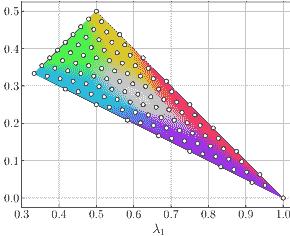

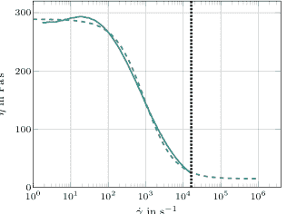

(a) 纤维取向三角形 $S_T$

(b) Cross 型拟合

图 4.1: 带有 109 个评估点的 CMYK 上色纤维取向三角形 $S_T$ (a)，以及 Ultramid®B3K 的材料数据与 Cross 型拟合 (b)。图改编自 Sterr et al. (2024b, 图 1)。

此外，我们考虑与前一章第 3 章相同的流场景。更具体地说，对于研究剪切速率集合 $S_{\dot{\gamma}}$ (3.44) 中的每个宏观标量剪切速率 $\dot{\gamma}$，我们调查矩阵 $\underline{\underline{D}}$ (3.35) 中收集的六种工况。

研究的剪切速率集合 $S_{\dot{\gamma}}$ 旨在覆盖广泛的工程过程剪切速率，并受压缩成型、标准注塑成型以及薄壁和微注塑成型中典型剪切速率的启发 (Valero, 2020; Friesenbichler et al., 2011)。

对于剪切速率 $\dot{\gamma}$，当基体行为主要为牛顿流体且材料响应的叠加有效时，我们计算并收集有效粘度张量 \(\vec{\mathbb{V}}\) 的分量到矩阵 \(\underline{\underline{V}}\) 中，如下所示

\(\bar{\underline{\tau}} = \underline{\underline{V}} \underline{\underline{D}}, \quad \text{i.e.,} \quad \underline{\underline{V}} = \bar{\underline{\tau}} \underline{\underline{D}}^{\dagger}.\) (4.10)

这里，$(\cdot)^\dagger$ 代表 Moore-Penrose 伪逆，$\bar{\underline{\tau}}$ 收集计算得到的有效应力

\(\bar{\underline{\tau}} = \begin{bmatrix} \bar{\tau}_{11}^{(1)} & \bar{\tau}_{11}^{(2)} & \bar{\tau}_{11}^{(3)} & \bar{\tau}_{11}^{(4)} & \bar{\tau}_{11}^{(5)} & \bar{\tau}_{11}^{(6)} \\ \bar{\tau}_{22}^{(1)} & \bar{\tau}_{22}^{(2)} & \bar{\tau}_{22}^{(3)} & \bar{\tau}_{22}^{(4)} & \bar{\tau}_{22}^{(5)} & \bar{\tau}_{22}^{(6)} \\ \bar{\tau}_{33}^{(1)} & \bar{\tau}_{33}^{(2)} & \bar{\tau}_{33}^{(3)} & \bar{\tau}_{33}^{(4)} & \bar{\tau}_{33}^{(5)} & \bar{\tau}_{33}^{(6)} \\ \sqrt{2}\bar{\tau}_{23}^{(1)} & \sqrt{2}\bar{\tau}_{23}^{(2)} & \sqrt{2}\bar{\tau}_{23}^{(3)} & \sqrt{2}\bar{\tau}_{23}^{(4)} & \sqrt{2}\bar{\tau}_{23}^{(5)} & \sqrt{2}\bar{\tau}_{23}^{(6)} \\ \sqrt{2}\bar{\tau}_{13}^{(1)} & \sqrt{2}\bar{\tau}_{13}^{(2)} & \sqrt{2}\bar{\tau}_{13}^{(3)} & \sqrt{2}\bar{\tau}_{13}^{(4)} & \sqrt{2}\bar{\tau}_{13}^{(5)} & \sqrt{2}\bar{\tau}_{13}^{(6)} \\ \sqrt{2}\bar{\tau}_{12}^{(1)} & \sqrt{2}\bar{\tau}_{12}^{(2)} & \sqrt{2}\bar{\tau}_{12}^{(3)} & \sqrt{2}\bar{\tau}_{12}^{(4)} & \sqrt{2}\bar{\tau}_{12}^{(5)} & \sqrt{2}\bar{\tau}_{12}^{(6)} \end{bmatrix} .\) (4.11)

## 4.3 有效悬浮液粘度的空间表征与各向异性

为了建模剪切稀释纤维悬浮液的有效行为，首先必须理解此类悬浮液的各向异性有效粘度及其对纤维取向状态 \(\underline{\Lambda}\) 和剪切速率 $\dot{\gamma}$ 的依赖关系。因此，我们首先可视化有效粘度并研究其在低剪切速率 $\dot{\gamma}$ 下的各向异性，随后再研究非线性剪切稀释的影响。

为降低研究有效粘度时的维度复杂性，我们使用标量伸长粘度 $\eta_{\text{app}}$。

遵循 Serr et al. (2023, §4)，我们基于 Böhlke 和 Brüggemann (2001) 的修正方法定义粘度 $\eta_{\text{app}}$，如下所示

\(\eta_{\text{app}}(\dot{\gamma}, \underline{\Lambda}, \boldsymbol{d}) = \tilde{\mathbb{W}}(\dot{\gamma}, \underline{\Lambda}) \cdot (\boldsymbol{d} \otimes \boldsymbol{d} \otimes \boldsymbol{d} \otimes \boldsymbol{d}),\) (4.12)


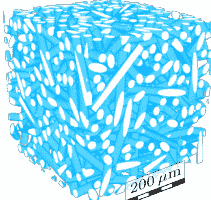

(a) \(\lambda_1 = 0.33, \lambda_2 = 0.33\)

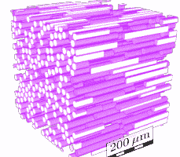

(b) \(\lambda_1 = 1, \lambda_2 = 0\)

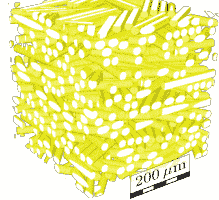

(c) \(\lambda_1 = 0.5, \lambda_2 = 0.5\)

**图 4.2:** 研究了各向同性 (a)、单向 (b) 和各向平面同性 (c) 纤维取向状态的显微组织。图改编自 Sterr et al. (2024b, Figure 2)。

where \(\mathbf{d} \in S^2\) denotes the direction of elongation, \(\lambda \in S_T\) refers to the fiber orientation state, and \(S_T\) is the fiber orientation triangle defined in equation (2.37). We use equation (4.10) to approximate the effective viscosity \(\bar{\mathbb{V}}\) and thus the elongational viscosity \(\eta_{\text{app}}\) with

\[
\eta_{\text{app}}(\dot{\gamma}, \lambda, \mathbf{d}) \approx \underline{a}(\mathbf{d})^{\top} \underline{\underline{\mathbb{V}}}(\dot{\gamma}, \lambda) \underline{a}(\mathbf{d}),\quad (4.13)
\]

where \(\underline{a}(\mathbf{d})\) denotes the components of \(\mathbf{d} \otimes \mathbf{d}\) in Mandel notation. In addition to the elongational viscosity \(\eta_{\text{app}}\), the bulk viscosity

\[
\eta_{\text{b}}(\dot{\gamma}, \lambda, \mathbf{d}) = \mathbf{I} \cdot \bar{\mathbb{V}}(\dot{\gamma}, \lambda)(\mathbf{d} \otimes \mathbf{d}) = (\mathbf{d} \otimes \mathbf{d}) \cdot \bar{\mathbb{V}}[\mathbf{I}],\quad (4.14)
\]

is required to capture all information contained in the effective viscosity \(\bar{\mathbb{V}}\) (He and Curnier, 1995, Sec. 4.3) if the effective material is compressible. However, as we consider incompressible material behavior, the bulk viscosity \(\eta_b\) vanishes, since

\[
\bar{\mathbb{V}}[\mathbf{I}] = 0.\quad (4.15)
\]

Hence, the elongational viscosity \(\eta_{\text{app}}\) encodes all information contained in the matrix \(\bar{\underline{\bar{V}}}(\dot{\gamma}, \underline{\lambda})\), and allows us to study the anisotropic flow resistance of the suspension in a complete manner. For the elongational viscosity and related quantities we omit denoting the dependence on the shear rate \(\dot{\gamma}\), the fiber orientation state \(\underline{\lambda}\) and the direction of elongation \(\boldsymbol{d}\) explicitly. Because of the interpolating property of equation (4.10), we may visualize the direction-dependent material behavior for load cases not collected in \(\underline{\bar{D}}\), and develop intuition for the influence of different fiber orientation states on the elongational viscosity \(\eta_{\text{app}}\). For a discussion on the applicability of equation (4.10) in the case of non-linear material behavior, we Sterr et al. (2023, §2.3, §4). For the visualization of the elongational viscosity \(\eta_{\text{app}}\), we restrict to a shear rate \(\dot{\gamma} = 10 \, \text{s}^{-1}\), where the material behavior is mostly linear and the superposition principle encoded in equation (4.10) holds. The elongational viscosity bodies for the isotropic, the planar isotropic, the transversely isotropic, and the unidirectional fiber orientation states are visualized in Figure 4.3 for a shear rate \(\dot{\gamma} = 10 \, \text{s}^{-1}\). To study the suspension anisotropy at the same shear rate \(\dot{\gamma} = 10 \, \text{s}^{-1}\), for each orientation state and over all directions \(\boldsymbol{d}\), we compute the range \(\Delta\eta_{\text{app}}\) and the ratio \(r_{\text{app}}\)

\[
\Delta\eta_{\text{app}} = \max(\eta_{\text{app}}) - \min(\eta_{\text{app}}), \quad r_{\text{app}} = \frac{\max(\eta_{\text{app}})}{\min(\eta_{\text{app}})},\quad (4.16)
\]

and collect the results in Table 4.2.

For the isotropic state, the elongational viscosity \(\eta_{\text{app}}\) lies between 1513 Pa s to 1576 Pa s, resulting in a range \(\Delta\eta_{\text{app}} = 63 \, \text{Pa s}\) and a ratio \(r_{\text{app}} = 1.04\). Because there is no principal fiber orientation axis in the isotropic state, the maximum viscosity \(\eta_{\text{app}}\), the range \(\Delta\eta_{\text{app}}\), and the ratio \(r_{\text{app}}\) are lower than in the more strongly oriented states, see Figure 4.3a. In contrast, the maxima of the elongational viscosity \(\eta_{\text{app}}\) occur in the principal fiber orientation axes clearly visible in Figures 4.3b to 4.3d. For the planar isotropic state, the maximum of the elongational viscosity \(\eta_{\text{app}}\) occurs in the \(x\)-\(y\) plane with 1947 Pa s, and for the transversely isotropic and unidirectional cases, the maxima occur in the \(x\) direction with 2973 Pa s and 4845 Pa s, respectively. Also, with increasing degree of orientation, the range \(\Delta\eta_{\text{app}}\) and ratio \(r_{\text{app}}\) grow from 977 Pa s and 2.01 in the planar isotropic state, 1810 Pa s and 2.56 in the transversely isotropic state, and up to 4130 Pa s and 6.78 in the unidirectional state. The strong dependence of the maximum elongational viscosity, the range \(\Delta\eta_{\text{app}}\), and the ratio \(r_{\text{app}}\) on the orientation state highlights the influence of the fibers on the anisotropy and magnitude of the effective viscous material behavior. Furthermore, the location and magnitude of the minimum elongational viscosity \(\eta_{\text{app}}\) depend on the orientation state as well.

| | Iso | Piso | Tiso | UD |
|---|---|---|---|---|
| \(\Delta\eta_{\text{app}}\) | 63 | 977 | 1810 | 4130 |
| \(r_{\text{app}}\) | 1.04 | 2.01 | 2.56 | 6.78 |

表 4.2: 剪切率 \(\dot{\gamma} = 10 \, \text{s}^{-1}\) 下各向同性 (Iso)、各向平面同性 (Piso)、横向各向同性 (Tiso) 和单向 (UD) 纤维取向状态的长伸粘度 \(\eta_{\text{app}}\) 的范围 \(\Delta\eta_{\text{app}}\) (4.16) 和比值 \(r_{\text{app}}\) (4.16)。表改编自 Sterr et al. (2024b, Table 2)。

### (a) \(\lambda_1 = 0.33, \lambda_2 = 0.33\)

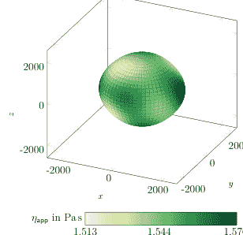

### (b) \(\lambda_1 = 0.5, \lambda_2 = 0.5\)

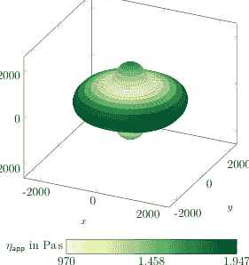

### (c) \(\lambda_1 = 0.75, \lambda_2 = 0.125\)

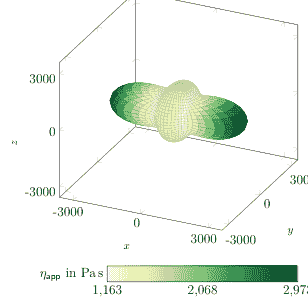

### (d) \(\lambda_1 = 1, \lambda_2 = 0\)

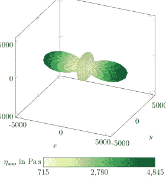

图 4.3: 剪切率 \(\dot{\gamma} = 10 \, \text{s}^{-1}\) 下各向同性 (a)、各向平面同性 (b)、横向各向同性 (c) 和单向 (d) 纤维取向状态的长伸粘度 \(\eta_{\text{app}}\)。图改编自 Sterr et al. (2024b, Figure 3)。

In an isotropic volume element, the fibers increase the elongational viscosity \(\eta_{\text{app}}\) uniformly across orientation space. Consequently, with a magnitude of 1513 Pa s, the minimum of the effective viscosity \(\eta_{\text{app}}\) in the isotropic state is larger than in the other orientation states. In comparison, the minima of the effective viscosity \(\eta_{\text{app}}\) are 970 Pa s in the planar isotropic state, 1163 Pa s in the transversely isotropic state, and 715 Pa s in the unidirectional state. Interestingly, the minima of the elongational viscosity \(\eta_{\text{app}}\) occur in directions where there is the least flow along the main fiber orientation directions. Because of incompressibility, the direction with the least flow in fiber direction is not perpendicular to the principal fiber orientation axis. Rather, it occurs at a specific angle which depends on the orientation state.

So far, we investigated the effective viscosity of selected fiber suspensions for a relatively low shear rate \(\dot{\gamma} = 10 \, \text{s}^{-1}\) using the elongational viscosity \(\eta_{\text{app}}\), the range \(\Delta \eta_{\text{app}}\), and the ratio \(r_{\text{app}}\). However, the ratio \(r_{\text{app}}\) or popular anisotropy measures used in crystal elasticity (Kube, 2016; Ranganathan and Ostojá-Starzewski, 2008; Zener and Siegel, 1949) rely on the existence of load independent stiffness and compliance tensors. To model the effective suspension viscosity, we want to study its load dependence for all shear rates \(\dot{\gamma} \in S_{\dot{\gamma}}\) in the set \(S_{\dot{\gamma}}\), which includes shear rates where the effective material behavior is non-linear. Thus, a way of computing the suspension anisotropy without relying on the interpolative properties of equation (4.10) is necessary and is introduced in the following. A convenient expression for the elongational viscosity \(\eta_{\text{app}}\) in terms of the investigated load cases collected in the matrix \(\underline{\underline{D}}\) follows from equation (4.12) with \(\bar{\boldsymbol{D}} = \dot{\gamma}/\sqrt{2} \, \boldsymbol{d} \otimes \boldsymbol{d}\) and \(\bar{\boldsymbol{\tau}} = \bar{\mathbb{V}}[\bar{\boldsymbol{D}}]\), such that

\[
\eta_{\text{app}}(\dot{\gamma}, \underline{\lambda}, \bar{\boldsymbol{D}}) = 2 \frac{\bar{\boldsymbol{D}} \cdot \bar{\boldsymbol{\tau}}}{\bar{\boldsymbol{D}} \cdot \bar{\boldsymbol{D}}}.\quad (4.17)
\]

We use this expression (4.17) to define a vector \(\underline{\eta}\) for all studied shear rates \(\dot{\gamma}\)

\[
\underline{\eta}(\dot{\gamma}, \underline{\lambda}) = (\eta_{\text{app}}(\dot{\gamma}, \underline{\lambda}, \bar{\boldsymbol{D}}_1), \eta_{\text{app}}(\dot{\gamma}, \underline{\lambda}, \bar{\boldsymbol{D}}_2), ..., \eta_{\text{app}}(\dot{\gamma}, \underline{\lambda}, \bar{\boldsymbol{D}}_6))^{\text{T}},\quad (4.18)
\]


包含收集在矩阵 \(\underline{\overline{D}}\) 列中的每个载荷案例 \(\bar{D}_i\) 的延伸粘度 \(\eta_{\text{app}}\)。为了测量收集在向量 \(\underline{\eta}\) 中的延伸粘度 \(\eta_{\text{app}}\) 的平均幅值和离散程度，我们计算均值 \(\mu_\eta\) 和标准差 \(s_\eta\)

\(\mu_\eta(\dot{\gamma}, \underline{\lambda}) = \frac{1}{6} \sum_{i=1}^6 \eta_{\text{app},i}(\dot{\gamma}, \underline{\lambda}),\quad (4.19)\)

\(s_\eta(\dot{\gamma}, \underline{\lambda}) = \sqrt{\frac{1}{6} \sum_{i=1}^6 (\eta_{\text{app},i}(\dot{\gamma}, \underline{\lambda}) - \mu_\eta(\dot{\gamma}, \underline{\lambda}))^2}.\quad (4.20)\)

标准差 \(s_\eta\) 不是无量纲量，其幅值是离散的名义度量。因此，标准差 \(s_\eta\) 不适合用于解释与向量 \(\underline{\eta}\) 中数值的幅值相关的离散程度。相反，我们使用由以下方程定义的变异系数 \(C_\eta\)

\(C_\eta(\dot{\gamma}, \underline{\lambda}) = \frac{s_\eta(\dot{\gamma}, \underline{\lambda})}{\mu_\eta(\dot{\gamma}, \underline{\lambda})},\quad (4.21)\)

以将标准差 \(s_\eta\) 与均值 \(\mu_\eta\) 相关联，从而计算给定纤维取向状态下悬浮液粘度的无量纲各向异性度量。

此外，变异系数 \(C_\eta\) 是一种有用的量，可用于比较具有不同幅值的延伸粘度 \(\eta_{\text{app}}\) 的纤维取向状态的各向异性。为了研究给定纤维取向状态下各向异性的最大载荷相关变化，我们定义了所有剪切速率上的范围 \(\Delta C_\eta\)

\(\Delta C_\eta(\underline{\lambda}) = \max_{\dot{\gamma}}(C_\eta(\dot{\gamma}, \underline{\lambda})) - \min_{\dot{\gamma}}(C_\eta(\dot{\gamma}, \underline{\lambda})).\quad (4.22)\)

所选取向状态下随剪切速率 \(\dot{\gamma}_r\) 变化的变异系数 \(C_\eta\) 以及所有纤维取向状态的范围 \(\Delta C_\eta\) 如图 4.4 所示。对于所有研究的剪切速率和取向状态，变异系数 \(C_\eta\) 在单向状态下最大，在各向同性状态下最小，参见图 4.4(a)。所有其他研究的取向状态下的变异系数 \(C_\eta\) 介于这些界限之间。从定性上看，变异系数 \(C_\eta\)，因此在给定剪切速率下的各向异性程度，随着剪切速率 \(\dot{\gamma} \approx 10^3\) s\(^{-1}\) 对所有取向状态均降低。系数 \(C_\eta\) 的这种降低表明，在沿纤维取向方向流动时，局部速度梯度增加，从而导致基质中更强的剪切稀释作用。从定量上看，范围 \(\Delta C_\eta\) 取决于取向状态，并在单向状态下最大，参见图 4.4(b)。

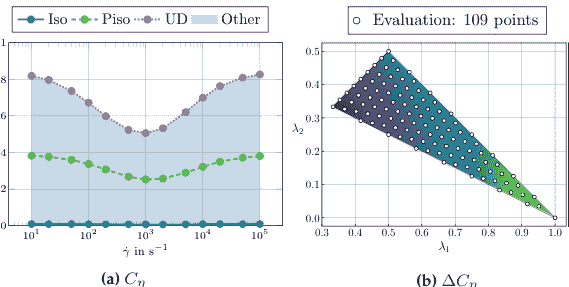

图 4.4: 剪切速率 \(\dot{\gamma} \in [10, 10^5]\) s\(^{-1}\) (a) 的变异系数 \(C_\eta\)，以及纤维取向三角形 \(S_T\) 上的变异系数范围 \(\Delta C_\eta\) (b)。图改编自 Sterr 等人 (2024b, 图 4)。

在各向同性状态下，对于所有研究的剪切速率，变异系数 \(C_\eta\) 及其范围 \(\Delta C_\eta\) 均接近于零，表明非线性剪切稀释效应以等效强度发生，与载荷方向无关。随着取向程度的增加，变异系数 \(C_\eta\) 及其范围 \(\Delta C_\eta\) 增大。在平面各向同性状态下，变异系数 \(C_\eta\) 随范围 \(\Delta C_\eta = 0.13\) 变化，在剪切速率 \(\dot{\gamma} = 10 \, \text{s}^{-1}\) 时 \(C_\eta = 0.38\)，在剪切速率 \(\dot{\gamma} = 10^3 \, \text{s}^{-1}\) 时 \(C_\eta = 0.25\)。范围 \(\Delta C_\eta\) 在单向状态下最大，变异系数 \(C_\eta\) 变化显著，范围 \(\Delta C_\eta = 0.32\)，在剪切速率 \(\dot{\gamma} = 10 \, \text{s}^{-1}\) 时 \(C_\eta = 0.82\)，在剪切速率 \(\dot{\gamma} = 10^3 \, \text{s}^{-1}\) 时 \(C_\eta = 0.50\)。所研究纤维取向状态之间变异系数 \(C_\eta\) 和范围 \(\Delta C_\eta\) 的显著差异突出了纤维取向对有效材料行为幅值和各向异性的强烈影响。作为 Cross 型材料定律 (3.2) 和聚合物基质中速度梯度增加的结果，对于大于 \(10^3 \, \text{s}^{-1}\) 的剪切速率 \(\dot{\gamma}\)，变异系数 \(C_\eta\) 增加，直到与剪切速率 \(\dot{\gamma} = 10 \, \text{s}^{-1}\) 时观察到的值相近。因此，本节讨论的结果强调了在建模悬浮液粘度时需要考虑悬浮液随剪切速率和载荷方向变化的剪切稀释行为。这与文献中的研究结果一致（Koch, 1995; Favarolo 等人, 2018; Pipes, 1992; Pipes 等人, 1994），其中使用纤维取向统计来估计悬浮纤维对基质剪切速率的影响。在下一节中，我们将采用不同的方法，并讨论如何基于基于 FFT 的同质化的计算结果和局部 Cross 型材料定律的知识，利用监督机器学习来表征各向异性剪切稀释效应。

## 4.4 建模有效悬浮液粘度

### 4.4.1 模型要求

基于前一节 4.3 所呈现的结果，我们希望以分析方式建模剪切稀释纤维悬浮液的有效粘度，并利用监督机器学习识别模型参数。为此，我们首先总结了有效粘性行为模型应满足的关键标准。模型应当

- (I) 为张量型，即客观地捕捉剪切速率和载荷方向依赖性。

- (II) 在宏观尺度上复制局部 Cross 型材料行为，即模型应在剪切速率极限 \(\dot{\gamma} \to 0 s^{-1}\) 和 \(\dot{\gamma} \to \infty s^{-1}\) 下表现出牛顿行为，并捕捉两个牛顿极限之间随剪切速率和载荷方向变化的非线性过渡。该要求基于 Starr 等人 (2023, §4) 的研究、前一节 4.3 中各向异性调查的结果以及文献中的考虑（Koch, 1995; Favarolo 等人, 2018; Pipes, 1992; Pipes 等人, 1994）。

- (III) 产生不可压缩和各向异性有效粘度 \(\bar{\mathbb{V}}\)。由于生成微结构的四阶纤维取向张量是各向异性的，参见 Schneider (2017) 和 Montgomery-Smith 等人 (2011)，悬浮液的有效粘度 \(\bar{\mathbb{V}}\) 也是各向异性的。

- (IV) 适用于整个纤维取向三角形 \(S_T\)，如方程 (2.37) 所定义。

根据要求 (I) 和 (II)，我们将调查限制为以下类型的张量模型

\(\bar{\mathbb{V}}(\boldsymbol{D}, \underline{a}) = \bar{\mathbb{V}}_{\infty}(\underline{a}) + \mathbb{T}_{8}(\boldsymbol{D}, \underline{a}) \left[ \bar{\mathbb{V}}_{0}(\underline{a}) - \bar{\mathbb{V}}_{\infty}(\underline{a}) \right], \quad (4.23)\)

其中，\(\underline{a} \in \mathbb{R}^m\)，\(m \in \mathbb{N}\)，是模型参数向量，\(\mathbb{T}_{8} : \text{Sym}_0(3) \times \mathbb{R}^m \to (\mathbb{R}^3)^{\otimes 8}\) 表示一个八阶张量函数，而 \(\bar{\mathbb{V}}_{0} : \mathbb{R}^m \to \text{Sym}_0(3)\) 以及 \(\bar{\mathbb{V}}_{\infty} : \mathbb{R}^m \to \text{Sym}_0(3)\) 表示四阶张量函数。函数 \(\bar{\mathbb{V}}_0\) 和 \(\bar{\mathbb{V}}_{\infty}\) 用于分别在剪切速率极限 \(\dot{\gamma} \to 0 s^{-1}\) 和 \(\dot{\gamma} \to \infty s^{-1}\) 下构建牛顿粘度张量 \(\bar{\mathbb{V}}_0(\underline{a})\) 和 \(\bar{\mathbb{V}}_{\infty}(\underline{a})\)。方程 (4.23)


是Cross-type材料定律(3.2)的张量值推广，其中标量牛顿黏度被黏度张量$\mathbb{V}_0(a)$和$\mathbb{V}_\infty(a)$所取代，并引入了函数$\mathbb{T}_8$来对两个牛顿黏度张量$\mathbb{V}_0(a)$和$\mathbb{V}_\infty(a)$之间的非线性过渡进行建模。函数$\mathbb{T}_8$在各个模型之间有所不同，并按照要求(II)所述对模型的方向依赖非线性进行编码。总之，需要对Ansatz (4.23)中的三个对象进行建模：牛顿黏度张量$\mathbb{V}_0(a)$和$\mathbb{V}_\infty(a)$，以及控制各向异性和非线性剪切速率依赖的八阶张量函数$\mathbb{T}_8$。在以下各节中，我们将讨论这三个对象各自的建模方法。

### 4.4.2 对有效悬浊液黏度牛顿极限进行建模

为了将正交各向异性和不可压缩性根据要求(III)集成到模型中，我们首先考虑具有小对称和大对称的第四阶不可压缩张量的向量空间$\mathbb{V}_0$

\(\mathbb{V}_0 = \{ \mathbb{X} \mid \mathbb{X} \in (\mathbb{R}^3)^{\otimes 4}, \text{ and } \mathbb{X}[\mathbb{I}] = 0 \\ \text{ and } \mathbb{X}^{\text{T}_{\text{H}}}=\mathbb{X}^{\text{T}_{\text{L}}} = \mathbb{X}^{\text{T}_{\text{R}}} = \mathbb{X} \},\) (4.24)

其中$(\cdot)^{\text{T}_{\text{H}}}, (\cdot)^{\text{T}_{\text{L}}}, \text{ 和 } (\cdot)^{\text{T}_{\text{R}}}$分别代表大转置、左转置和右转置。其次，我们定义空间$\mathbb{V}_0$的基底$\mathcal{B}$

\(\underline{\underline{\mathcal{B}}} = \begin{bmatrix} 0 & \frac{-2}{\sqrt{6}} & 0 & 0 & 0 \\ \frac{-1}{\sqrt{2}} & \frac{1}{\sqrt{6}} & 0 & 0 & 0 \\ \frac{1}{\sqrt{2}} & \frac{1}{\sqrt{6}} & 0 & 0 & 0 \\ 0 & 0 & 1 & 0 & 0 \\ 0 & 0 & 0 & 1 & 0 \\ 0 & 0 & 0 & 0 & 1 \end{bmatrix},\) (4.25)

使得矩阵\(\underline{\underline{B}}\)的列在Mandel表示法中表示$\mathcal{B}$的基向量。最后，使用基底$\mathcal{B}$，我们定义一个函数

\(\mathbb{A} : \mathbb{R}^6 \to \mathsf{V}_0^+(3),\) (4.26)

\(\underline{a} \mapsto \mathcal{P}_{\mathcal{B}}^+ \mathbb{M}(\underline{a}) = \mathcal{P}_{\mathcal{B}}^+ \begin{bmatrix} a_1 & a_2 & 0 & 0 & 0 \\ a_2 & a_3 & 0 & 0 & 0 \\ 0 & 0 & a_4 & 0 & 0 \\ 0 & 0 & 0 & a_5 & 0 \\ 0 & 0 & 0 & 0 & a_6 \end{bmatrix}_{\mathcal{B}},\) (4.27)

该函数使用模型参数向量$\underline{a}$的分量$a_i$和非唯一投影算子$\mathcal{P}_{\mathcal{B}}^+$构建一个正交各向异性四阶张量，该投影算子映射到空间$\mathsf{V}_0^+$中，即在由基底$\mathcal{B}$张成的空间上正定的四阶张量空间。采用特征分解，我们定义投影算子$\mathcal{P}_{\mathcal{B}}^+$的作用为

\(\mathcal{P}_{\mathcal{B}}^+ [\mathbb{X}] = \mathcal{P}_{\mathcal{B}}^+ \left[ \sum_{i=0}^5 \lambda_i \mathbf{p}_i \otimes \mathbf{p}_i \right] = \sum_{i=0}^5 \max(\lambda_i, \beta) \mathbf{p}_i \otimes \mathbf{p}_i,\) (4.28)

其中$\lambda_i$和$\mathbf{p}_i$表示四阶张量$\mathbb{X}$在由基底$\mathcal{B}$张成的空间上的特征值-特征张量对，且$\beta \in \mathbb{R}_{>0}$是一个小的正实常数。投影算子$\mathcal{P}_{\mathcal{B}}^+$的定义涉及一个可调常数$\beta$，该常数对于数值目的而言是必需的。事实上，正式地将$\beta$设为零会导致投影到正半定张量，即那些可能退化的张量。然而，在不可压缩子空间$\mathcal{B}$上，正定性优于正半定性，原因如下，基于以下物理和数值原因。我们希望使用张量函数$\mathbb{A}$从六个模型参数构建四阶张量$\mathbb{X} \in \mathsf{V}_0^+$，即黏度张量$\bar{\mathbb{V}}_0(\underline{a})$和$\bar{\mathbb{V}}_\infty(\underline{a})$。因此，通过消失特征值来编码消失的应力响应不会遵循本论文背景下所考虑的物理模型。

### 4.4.3 对有效悬浊液黏度各向异性和非线性剪切速率依赖进行建模

为了根据要求(II)捕捉各向异性和非线性黏性行为，我们将从零载荷开始的广义距离$g$纳入模型中

$g : \text{Sym}_0(3) \times \mathbb{R}^7 \rightarrow \mathbb{R},$ (4.29)

\((\boldsymbol{D}, \underline{a}) \mapsto (\boldsymbol{D} \cdot \mathbb{A}(\underline{a})[\boldsymbol{D}])^{\alpha_T},\) (4.30)

纳入模型中，这类似于统计学中流行的马哈拉诺比斯距离（Mahalanobis, 1936）。广义距离$g$取决于收集在模型参数向量$\underline{a}$中的分量$a_i$，以及剪切速率张量$\boldsymbol{D}$的大小和方向。基于这些特性，我们使用广义距离$g$作为模型构建模块，以编码有效悬浊液黏度特定纤维取向状态的各向异性剪切速率依赖。然而，对于指数$a_7 < 1$，当$\boldsymbol{D} \cdot \mathbb{A}(\underline{a})[\boldsymbol{D}]$消失时，该广义距离$g$的梯度是奇异的，这在基于梯度的模型参数$\underline{a}$学习过程中会带来问题。这种奇异性通过函数$\mathbb{A}$构建的张量所强制执行的正定性以及非消失载荷$\boldsymbol{D}$来规避。在这里，常数$\beta$作为张量$\mathbb{A}(\underline{a})$特征值的下界，如等式(4.26)和(4.28)所示，并限制了可以从模型参数$\underline{a}$构建的可能张量$\mathbb{A}(\underline{a})$的空间。因此，对常数$\beta$的不当选择，例如$\beta$大于最优张量$\mathbb{A}(\underline{a})$的最小特征值，可能会影响拟合质量。然而，由于我们希望从同质化数据中学习模型参数$\underline{a}$，最优张量$\mathbb{A}(\underline{a})$及其最小特征值并非事先已知。因此，常数$\beta$应选择为一个小数，我们名义上在关联特征值$\lambda_i$的单位中选择$\beta = 10^{-6}$。为了使用广义距离$g$来对各向异性Cross-type非线性进行建模，我们通过其对正交各向异性张量$\mathbb{X} \in \text{Sym}_0$的作用来定义两个非线性八阶张量函数$\mathbb{T}_8^{(1)}$和$\mathbb{T}_8^{(2)}$。我们通过以下方式定义函数$\mathbb{T}_8^{(1)}$

$$\mathbb{T}_8^{(1)}(\boldsymbol{D}, \underline{a})[\mathbb{X}] = \frac{\mathbb{X}}{1 + g(\boldsymbol{D}, \underline{a})}, \quad \underline{a} \in \mathbb{R}^7, \tag{4.31}$$

这使得Cross-type模型(3.2)的标量剪切速率依赖被广义距离$g$ (4.29)所取代。因此，函数$\mathbb{T}_8^{(1)}$均匀地缩放正交各向异性张量$\mathbb{X}$的所有分量，取决于载荷$\boldsymbol{D}$和模型参数向量$\underline{a}$。由于张量$\mathbb{X}$的所有分量都被均匀缩放，张量$\mathbb{X}$的各向异性在函数$\mathbb{T}_8^{(1)}$作用下保持不变。然而，函数$\mathbb{T}_8^{(1)}$中编码的非线性剪切速率依赖可能是各向异性的，因为缩放的幅度取决于函数$g$，进而取决于可能是各向异性的张量$\mathbb{A}(\underline{a})$和载荷$\boldsymbol{D}$。在收集在模型参数向量$\underline{a}$中的七个模型参数中，六个模型参数控制载荷$\boldsymbol{D}$的方向对缩放的影响，一个参数控制剪切速率$\dot{\gamma} \to 0$和$\dot{\gamma} \to \infty$的牛顿极限之间的过渡速率。

为了在正交各向异性张量$\mathbb{X}$的缩放中提供更大的灵活性，我们还通过以下方式定义张量函数$\mathbb{T}_8^{(2)}$

$$\mathbb{T}_8^{(2)}(\boldsymbol{D}, \underline{a})[\mathbb{X}] = \begin{bmatrix} z_{11} & z_{12} & 0 & 0 & 0 \\ z_{12} & z_{22} & 0 & 0 & 0 \\ 0 & 0 & z_{33} & 0 & 0 \\ 0 & 0 & 0 & z_{44} & 0 \\ 0 & 0 & 0 & 0 & z_{55} \end{bmatrix}_{\mathcal{B}}, \quad \underline{a} \in \mathbb{R}^{42}, \tag{4.32}$$

$$\begin{aligned} z_{11} &= h_1(\boldsymbol{D}, \underline{a})X_{11}, & z_{12} &= h_2(\boldsymbol{D}, \underline{a})X_{12}, \\ z_{22} &= h_3(\boldsymbol{D}, \underline{a})X_{22}, & z_{33} &= h_4(\boldsymbol{D}, \underline{a})X_{33}, \\ z_{44} &= h_5(\boldsymbol{D}, \underline{a})X_{44}, & z_{55} &= h_6(\boldsymbol{D}, \underline{a})X_{55}, \end{aligned}


这样，张量 X 的六个分量分别由标量 \( h_i(\boldsymbol{D}, a), i \in \{1, 2, 3, 4, 5, 6\} \) 单独缩放，定义如下

\[
h_i(\boldsymbol{D}, a) = \frac{1}{1 + g(\boldsymbol{D}, \underline{f}_{\underline{i}})}, \quad \underline{f}_{\underline{i}} = (a_{7(i-1)+1}, \dots, a_{7i}) \in \mathbb{R}^7. \tag{4.36}
\]

与函数 \( \mathbb{T}_8^{(1)} \) 中的缩放因子类似，标量 \( h_i(\boldsymbol{D}, a) \) 均由七个模型参数、剪切速率张量 \( \boldsymbol{D} \) 和函数 \( g \) 计算得到。因此，张量 X 在函数 \( \mathbb{T}_8^{(2)} \) 作用下不仅被缩放，其各向异性也可能随函数 \( \mathbb{T}_8^{(2)} \) 而改变。从这个意义上说，函数 \( \mathbb{T}_8^{(1)} \) 是函数 \( \mathbb{T}_8^{(2)} \) 的一种特例，其中所有标量 \( h_i(\boldsymbol{D}, a) \) 相等。使用函数 \( \mathbb{T}_8^{(2)} \) 对张量 X 进行缩放时，更高的灵活性需要 36 个参数来控制载荷方向 \( \boldsymbol{D} \) 的影响，以及 6 个参数来控制剪切速率 \( \dot{\gamma} \rightarrow 0 \) 和 \( \dot{\gamma} \rightarrow \infty \) 的牛顿极限之间的过渡速率。这导致函数 \( \mathbb{T}_8^{(2)} \) 总共包含 42 个参数。

### 4.4.4 有效悬浊液粘度模型的定义

在以下部分，我们将前几节 4.4.2 和 4.4.3 的定义与 Ansatz (4.23) 相结合，构建四种有效悬浊液粘度模型。其中符号 ++ 表示向量的拼接，下文将介绍表 4.3 中列出的四种模型并对其进行描述。

| 模型 1 | 模型 2 | 模型 3 | 模型 4 |
| :--- | :--- | :--- | :--- |
| 参数: m = 19, \(b,c \in \mathbb{R}^6\), \(d \in \mathbb{R}^7\)<br>\(\bar{\mathbb{V}}_0(b) = \mathbb{A}(b)\)<br>\(\bar{\mathbb{V}}_\infty(c) = \mathbb{A}(c)\)<br>\(\mathbb{T}_8(\boldsymbol{D}, d) = \mathbb{T}_8^{(1)}(\boldsymbol{D}, d)\) | 参数: m = 14, \(b \in \mathbb{R}^1\), \(c \in \mathbb{R}^6\), \(d \in \mathbb{R}^7\)<br>\(\bar{\mathbb{V}}_0(b) = b_1 \bar{\mathbb{V}}_\infty(c)\)<br>\(\bar{\mathbb{V}}_\infty(c) = \mathbb{A}(c)\)<br>\(\mathbb{T}_8(\boldsymbol{D}, d) = \mathbb{T}_8^{(1)}(\boldsymbol{D}, d)\) | 参数: m = 11, \(b \in \mathbb{R}^1\), \(c \in \mathbb{R}^3\), \(d \in \mathbb{R}^7\)<br>\(\bar{\mathbb{V}}_0(b) = \mathbb{P}_2(c_1 \mathbb{P}_2 + c_2 \mathbf{I} \square_s \boldsymbol{N} + c_3 \mathbb{N}) \mathbb{P}_2\)<br>\(\mathbb{T}_8(\boldsymbol{D}, d) = \mathbb{T}_8^{(1)}(\boldsymbol{D}, d)\)<br>\(\bar{\mathbb{V}}(\boldsymbol{D}, a) = \mathbb{A}(c) + \dots\) | 参数: m = 49, \(b \in \mathbb{R}^1\), \(c \in \mathbb{R}^6\), \(d \in \mathbb{R}^{42}\)<br>\(\bar{\mathbb{V}}_0(b) = b_1 \bar{\mathbb{V}}_\infty(c)\)<br>\(\bar{\mathbb{V}}_\infty(c) = \mathbb{A}(c)\)<br>\(\mathbb{T}_8(\boldsymbol{D}, d) = \mathbb{T}_8^{(2)}(\boldsymbol{D}, d)\)<br>\(\bar{\mathbb{V}}(\boldsymbol{D}, a) = \bar{\mathbb{V}}_\infty(c)(1 + \dots)\) |

表 4.3: 参数 m 的数量，函数 \(\bar{\mathbb{V}}_0\)、\(\bar{\mathbb{V}}_\infty\) 和 \(\mathbb{T}_8\) 的选择，以及模型 1、2、3 和 4 的有效粘度张量 \(\bar{\mathbb{V}}(\boldsymbol{D}, a)\) 的完整表达式。该表改编自 Sterr et al. (2024b, Table 3)。

#### 模型 1

在模型 1 中，我们使用函数 A (4.26) 从向量 \( b \in \mathbb{R}^6 \) 和 \( c \in \mathbb{R}^6 \) 中收集的十二个模型参数构建牛顿粘度张量 \( \bar{\mathbb{V}}_0(b) \) 和 \( \bar{\mathbb{V}}_\infty(c) \)。此外，我们使用带有七个参数（收集在向量 \( d \in \mathbb{R}^7 \) 中）的函数 \( \mathbb{T}_8^{(1)} \) (4.31) 来建模有效悬浊液粘度的各向异性和非线性剪切速率依赖性。总体而言，模型 1 有 19 个参数，是使用函数 \(\mathbb{T}_8^{(1)}\) 的最通用考虑模型。

#### 模型 2

与模型 1 类似，我们使用函数 \(\mathbb{A}\) 从六个模型参数构建剪切速率极限 \(\dot{\gamma} \to \infty \,\text{s}^{-1}\) 下的牛顿粘度张量 \(\bar{\mathbb{V}}_\infty(\underline{c})\)，并使用非线性函数 \(\mathbb{T}_8^{(1)}\) 带有七个模型参数来建模牛顿极限之间的非线性过渡。这 13 个参数收集在向量 \(\underline{c} \in \mathbb{R}^6\) 和 \(\underline{d} \in \mathbb{R}^7\) 中。然而，在模型 1 中，剪切速率极限 \(\dot{\gamma} \to 0 \,\text{s}^{-1}\) 下的粘度张量 \(\bar{\mathbb{V}}_0(\underline{b})\) 也使用函数 \(\mathbb{A}\) (4.26) 构建，使用六个模型参数。在模型 2 中，我们利用粘度张量 \(\bar{\mathbb{V}}_0(\underline{b})\) 和 \(\bar{\mathbb{V}}_\infty(\underline{c})\) 在剪切速率极限 \(\dot{\gamma} \to 0 \,\text{s}^{-1}\) 和 \(\dot{\gamma} \to \infty \,\text{s}^{-1}\) 下共享相同的各向异性这一事实（参见图 4.4 和 Sterr et al. (2023)），并将粘度张量 \(\bar{\mathbb{V}}_0(\underline{b})\) 表示为张量 \(\bar{\mathbb{V}}_\infty(\underline{c})\) 的标量倍数，使得条件

\[
\bar{\mathbb{V}}_0(\underline{b}) = b_1 \bar{\mathbb{V}}_\infty(\underline{c}), \tag{4.37}
\]

得到满足。该关系将参数数量从模型 1 中的 19 个减少到模型 2 中的 14 个。我们发现这一调整仅引入很小的误差，如我们在 4.4.6 节中更详细地讨论，并在模型 3 和模型 4 中也使用方程 (4.37)。

#### 模型 3

在模型 3 中，与模型 1 和模型 2 类似，我们使用函数 \(\mathbb{T}_8^{(1)}\) 来建模牛顿极限之间的非线性过渡，使用七个收集在向量 \(\underline{d} \in \mathbb{R}^7\) 中的模型参数。此外，与模型 2 类似，我们使用方程 (4.37) 通过收集在向量 \(\underline{b} \in \mathbb{R}^1\) 中的标量系数来关联粘度张量 \(\bar{\mathbb{V}}_0(\underline{b})\) 和 \(\bar{\mathbb{V}}_\infty(\underline{c})\)。为了进一步通过叠加和取向平均（Ericksen, 1960; Tucker III, 1991; Bertóti et al., 2021）的物理考虑来减少模型参数的数量，我们引入方程

\[
\bar{\mathbb{V}}_\infty(\underline{c}) = \mathbb{P}_2 \left(c_1 \mathbb{P}_2 + c_2 \mathbf{I} \square_s \boldsymbol{N} + c_3 \mathbb{N}\right) \mathbb{P}_2, \tag{4.38}
\]

用于粘度张量 \(\bar{\mathbb{V}}_\infty(\underline{c})\)，其中 \(\mathbb{P}_2\) 表示空间 \(\text{Sym}_0(3)\) 上的恒等算子。算子 \(\square_s\) 表示对称化盒积，对于二阶张量 \(\boldsymbol{A}, \boldsymbol{B}, \boldsymbol{C} \in (\mathbb{R}^3)^{\otimes 2}\)，其定义为

\[
\boldsymbol{A} \square_s \boldsymbol{B} = \frac{1}{2}\left(\boldsymbol{A} \square \boldsymbol{B} + \boldsymbol{B} \square \boldsymbol{A}\right), \quad \text{where } (\boldsymbol{A} \square \boldsymbol{B})[\boldsymbol{C}] = \boldsymbol{A} \boldsymbol{C} \boldsymbol{B}. \tag{4.39}
\]

总体而言，这将参数数量从模型 2 中的 14 个减少到模型 3 中的 11 个。

#### 模型 4

在模型 4 中，与模型 1、2 和 3 相反，我们使用函数 \(\mathbb{T}_8^{(2)}\) 而不是函数 \(\mathbb{T}_8^{(1)}\) 来建模牛顿极限之间的非线性过渡。如前一节 4.4.3 所讨论，这以更多模型参数为代价换取了更大的灵活性，使模型 4 成为所考虑模型中最通用的一个。与模型 2 和模型 3 类似，我们使用收集在向量 \(\underline{b} \in \mathbb{R}^1\) 和 \(\underline{c} \in \mathbb{R}^6\) 中的七个参数来建模粘度张量 \(\bar{\mathbb{V}}_0(\underline{b})\) 和 \(\bar{\mathbb{V}}_\infty(\underline{c})\)。

结合函数 \(\mathbb{T}_8^{(2)}\) 的 42 个输入参数（收集在向量 \(\underline{d}\) 中），这导致模型 4 总共有 49 个模型参数。总体而言，每个模型参数都控制模型的一个不同效应或量。换句话说，模型 4 无法使用更少的参数来表达，同时保持相同类型的非线性和相同的建模灵活性程度。

### 4.4.5 模型参数的监督学习

在前几节 4.4.1 和 4.4.4 中，我们描述了有效悬浊液粘度模型的要求，并提出了四个满足这些要求的模型候选方案。在本节中，我们讨论用于识别模型参数的监督机器学习策略。为了从基于 FFT 的计算均匀化所获得的数据中学习模型参数，我们首先构建一个损失函数 \(\mathcal{L}\) 来衡量模型预测与基于 FFT 的计算结果之间的差异，然后使用 ADAM (Kingma and Ba, 2014) 优化算法最小化损失 \(\mathcal{L}\)。我们考虑集合 \(S_T^{109} \subset S_T\) 中所有的纤维取向状态 \(\underline{\lambda} \in S_T^{109}\)，该集合包含图 4.1a 和 4.4(b) 所示的离散化纤维取向三角形的 109 个点。对于每个工况 \(\bar{\boldsymbol{D}}\)、纤维取向状态 \(\underline{\lambda}\) 和参数向量 \(\underline{a}\)，我们定义损失 \(\mathcal{L}\)

\[
\mathcal{L}(\bar{\boldsymbol{D}}, \underline{\lambda}, \underline{a}) = \frac{\| \bar{\boldsymbol{\tau}}^{\text{FFT}}(\bar{\boldsymbol{D}}, \underline{\lambda}) - \bar{\boldsymbol{\tau}}^{\text{Model}}(\bar{\boldsymbol{D}}, \underline{\lambda}, \underline{a}) \|_2}{\| \bar{\boldsymbol{\tau}}^{\text{FFT}}(\bar{\boldsymbol{D}}, \underline{\lambda}) \|_2}, \tag{4.40}
\]

其中 \(\| \cdot \|_2\) 表示欧氏范数，\(\bar{\boldsymbol{\tau}}^{\text{model}} : \text{Sym}_0(3) \times \mathbb{R}^2 \times \mathbb{R}^m \rightarrow \text{Sym}_0(3)\) 是特定模型预测的有效应力，\(\bar{\boldsymbol{\tau}}^{\text{FFT}} : \text{Sym}_0(3) \times \mathbb{R}^2 \rightarrow \text{Sym}_0(3)\) 是使用基于 FFT 的计算均匀化获得的有效应力。与 4.3 节类似，我们为了更好的可读性和简洁性，省略了损失 \(\mathcal{L}\) 及其派生量对各种变量的依赖。对于每个模型和纤维取向


状态 \(\underline{\lambda}\)，我们希望识别模型参数 \(\underline{a}\)，以最小化所研究载荷情况集 \(\tilde{\boldsymbol{D}}_\gamma\) 的最坏情况损失 \(\mathcal{L}\)，使得

\(\underline{a}(\lambda) = \underset{\underline{a} \in \mathbb{R}^m}{\text{argmin}} \max_{\underline{D} \in \tilde{\mathcal{D}}_\gamma} \mathcal{L}(\tilde{\underline{D}}, \underline{\lambda}, \underline{a}).\quad (4.41)\)

这里，所研究载荷情况集 \(\tilde{\boldsymbol{D}}_\gamma\) 通过方程 (3.44) 和 (3.35) 定义。然而，由于前一节描述的模型关于模型参数 \(\underline{a}\) 不是凸的，并且具有多个局部极小值，因此精确极小值 \(\underline{a}\) 难以确定。在开始我们的研究之前，我们首先提出一个警告：基于计算多尺度模拟识别模型参数并不能被视为一个数学意义上良设问题（Kabanikhin, 2008），原因有多种。首先，可能不存在唯一解，而且学习过程的结果，即模型参数，可能会对数据的微小变化产生剧烈变化。此外，学习到的模型参数还可能因优化算法和优化超参数的不同而有所变化。因此，本章所介绍的监督学习程序得到的模型参数可能并非优化问题 (4.41) 的全局极小值点。

然而，正如我们在下一节 4.4.6 中所示，所介绍的监督学习程序可以用于成功识别模型参数，这些参数能使模型预测达到工程精度。为了利用非凸优化和机器学习领域的最新进展，我们使用 Python 编程语言和机器学习框架 PyTorch (Paszke et al., 2019) 的 1.12 版本来识别模型参数 \(\underline{a}\)。撰写本章时，已有更新的 PyTorch 版本可用，它们具有即时（JIT）编译功能，可能提升自定义代码模块的性能。然而，为了与现有代码兼容，我们使用 1.12 版本。对于每个模型和纤维取向状态 \(\underline{\lambda}\)，我们随机初始化了 5000 个参数向量 \(\underline{a}\) 的实现，然后使用经检验的 ADAM (Kingma and Ba, 2014) 算法改进初始猜测，从而生成极小化参数向量集 \(S_{\min}\)。

我们从 PyTorch 框架中可用的优化算法中选择了 ADAM 算法，因为 ADAM 算法将自适应学习率与基于经典动量 (Polyak, 1964) 的方法相结合。这相比于标准梯度下降法 (Kabel et al., 2014; Ruder, 2016) 以及仅依赖自适应学习率的算法（如 AdaGrad (Duchi et al., 2011)、AdaDelta (Zeiler, 2012) 和 RMSprop (Tieleman et al., 2012)）具有优势。关于 ADAM 算法及其变体的收敛特性的详细讨论，我们请读者参考 Chen et al. (2018) 的文章。此外，关于机器学习中各种其他优化算法的概述，我们请读者参考 Sun et al. (2019) 的综述。

方便的是，ADAM 算法的学习率超参数是优化步长的近似边界。利用这一特性，我们使用 PyTorch 的选项来定义参数组，为不同数量级的参数设置单独变化的学习选项，以便标称大参数的步长不受标称小参数步长的限制。作为一阶优化技术的可行替代方案，PyTorch 还提供了强大的二阶优化算法 L-BFGS (Liu and Nocedal, 1989)。然而，撰写本章时，PyTorch 的 L-BFGS 算法不支持多个学习率和参数组，而我们发现这些对于加速收敛很有价值。因此，我们决定使用一阶优化算法 ADAM。

总体而言，我们使用四个参数组，分别对应函数 \(\bar{\mathbb{V}}_0\) 和 \(\bar{\mathbb{V}}_\infty\) 的参数各一组，以及与各向异性和张量函数 \(\mathbb{T}_8\) 中编码的非线性过渡速率相关的参数各一组，参见方程 (4.31)、(4.32) 和 (4.36)。我们使用符号 \(G_8^{\text{aniso}}\) 区分与张量函数 \(\mathbb{T}_8\) 相关的两个参数组，该组在函数 \(\mathbb{T}_8^{(1)}\) 的情况下包含六个参数，在函数 \(\mathbb{T}_8^{(2)}\) 的情况下包含 36 个参数；以及组 $G_8^{\text{expo}}$，分别为函数 \(\mathbb{T}_8^{(1)}\) 和 \(\mathbb{T}_8^{(2)}\) 包含一个和六个参数。除了 Model 1 以外，各参数组的学习率选择如表 4.4 所示。特别是对于 Model 1，与函数 \(\bar{\mathbb{V}}_0\) 相关的参数的学习率选为 0.5，因为 Model 1 不使用标量关系 (4.37)。我们通过试错法确定了每个参数组的学习率数值。

为了在学习过程中提高向极小值收敛的速度 (Darken and Moody, 1990; Darken et al., 1992)，我们使用了 PyTorch 的 ReduceLROnPlateau 学习率调度器，如果损失 $\mathcal{L}$ 在 200 个 epoch 内未改善，则将学习率减半。该规则的冷却期为 400 个 epoch，其他所有选项均保持默认。对于 ADAM 算法，除学习率外，使用了标准超参数，使得两个动量系数 $\beta_1$ 和 $\beta_2$ 分别设置为 $\beta_1 = 0.9$ 和 $\beta_2 = 0.999$，稳定常数 $\varepsilon$ 设置为 $\varepsilon = 10^{-8}$。最后，当损失 $\mathcal{L}$ 在 2000 个 epoch 内未改善时，我们认为学习过程结束。

| | $\bar{\mathbb{V}}_0$ | $\bar{\mathbb{V}}_\infty$ | $G_8^{\text{aniso}}$ | $G_8^{\text{expo}}$ |
|---|---|---|---|---|
| 学习率 | $5 \cdot 10^{-3}$ | $5 \cdot 10^{-1}$ | $5 \cdot 10^{-7}$ | $5 \cdot 10^{-2}$ |

**表 4.4：** 用于 ADAM 算法的各参数组学习率超参数。表改编自 Serr et al. (2024b, Table 4)。

### 4.4.6 模型精度

为了比较所介绍模型的精度，我们在以下部分定义误差度量并描述验证程序。由于为问题 (4.41) 寻找全局最小值很困难，我们将范围限制在极小化参数集 $S_{\min}$，并识别参数 \(\underline{a}^{\min} \in S_{\min}\)，使其最小化所研究载荷情况集 \(\bar{D}_{\dot{\gamma}}\) 上的最坏情况损失 \(\mathcal{L}\)，使得

\(\underline{a}^{\text{min}}(\underline{\lambda}) = \underset{\underline{a} \in S_{\text{min}}}{\text{argmin}} \underset{\bar{\mathbf{D}} \in \bar{\mathcal{D}}_{\dot{\gamma}}}{\text{max}} \mathcal{L}(\bar{\mathbf{D}}, \underline{\lambda}, \underline{a}).\) (4.42)

极小化参数 \(\underline{a}^{\text{min}}\) 仅在具有同质化数据的给定离散点 \(\underline{\lambda}\) 上可用。然而，按照要求 (IV)，我们有兴趣将给定模型推广到没有可用极小化参数 \(\underline{a}^{\text{min}}\) 的纤维取向状态 \(\underline{\lambda}\)。为此，我们遵循 Köbler et al. (2018) 并使用凸线性组合来插值应力，如下所示。假设节点 \(\underline{\lambda}_1, \underline{\lambda}_2,\) 和 \(\underline{\lambda}_3\) 构成一个三角形，并且在该等节点中已知极小化参数 \(\underline{a}^{\text{min}}\)。然后我们在某一点 \(\underline{\lambda}\) 处计算有效应力 \(\bar{\tau}^{\text{C}}\)：

\(\bar{\tau}^{\text{C}}(\bar{\mathbf{D}}, \underline{\lambda}) = \sum_{i=1}^{3} s_i \bar{\tau}^{\text{model}}(\bar{\mathbf{D}}, \underline{\lambda}_i, \underline{a}^{\text{min}}(\underline{\lambda}_i)),\) (4.43)

\(\underline{\lambda} = s_1 \underline{\lambda}_1 + s_2 \underline{\lambda}_2 + s_3 \underline{\lambda}_3, \quad s_i \ge 0, i \in 1, 2, 3, \sum_{i=1}^{3} s_i = 1,\) (4.44)

通过对点 \(\underline{\lambda}_1, \underline{\lambda}_2,\) 和 \(\underline{\lambda}_3\) 处的模型应力 \(\bar{\tau}^{\text{model}}\) 进行插值得到。

除了在整个纤维取向三角形 \(S_{\text{T}}\) 上推广模型外，我们还使用方程 (4.43) 来验证基于 FFT 的计算同质化所得数据中的模型。为此，我们以类似于损失 \(\mathcal{L}\) 的方式定义验证误差 \(e_{\text{V}}\)，即定义

\(e_{\text{V}}(\bar{\mathbf{D}}, \underline{\lambda}) = \frac{\| \bar{\tau}^{\text{FFT}}(\bar{\mathbf{D}}, \underline{\lambda}) - \bar{\tau}^{\text{C}}(\bar{\mathbf{D}}, \underline{\lambda}) \|_2}{\| \bar{\tau}^{\text{FFT}}(\bar{\mathbf{D}}, \underline{\lambda}) \|_2},\) (4.45)

对每个考虑的模型。在集合 \(S_{\text{T}}^{109}\) 包含的 109 个三角剖分点 \(\underline{\lambda}\) 中，我们指定 45 个点作为拟合点 \(\underline{\lambda}^{\text{F}}\) 的集合 \(S_{\text{T}}^{\text{F}} \subset S_{\text{T}}^{109}\)，见图 4.5。为验证目的，我们指定


以拟合点 $\lambda^{\mathrm{F}}$ 构成的三角形的重心作为验证点，定义了包含 64 个验证点 $\lambda^{\mathrm{V}}$ 的集合 \(S_{\mathrm{T}}^{\mathrm{V}} \subset S_{\mathrm{T}}^{109}\)。根据插值定义（4.43），损失 $\mathcal{L}$ 在拟合点 $\lambda^{\mathrm{F}}$ 处与验证错误 \(e_{\mathrm{V}}\) 重合。为研究拟合质量和应力插值质量，我们定义最大损失 \(\mathcal{L}^{\mathrm{max}}\) 和最大验证错误 \(e_{\mathrm{V}}^{\mathrm{max}}\)

$$
\mathcal{L}^{\mathrm{max}} = \max_{\underline{\lambda} \in S_{\mathrm{T}}^{109}} \max_{\bar{\boldsymbol{D}} \in \bar{\mathcal{D}}_{\hat{\gamma}}} \mathcal{L}(\bar{\boldsymbol{D}}, \underline{\lambda}, \underline{a}^{\mathrm{min}}(\underline{\lambda})), \quad e_{\mathrm{V}}^{\mathrm{max}} = \max_{\underline{\lambda} \in S_{\mathrm{T}}^{109}} \max_{\bar{\boldsymbol{D}} \in \bar{\mathcal{D}}_{\hat{\gamma}}} e_{\mathrm{V}}(\bar{\boldsymbol{D}}, \underline{\lambda}).
$$

此外，我们在所研究工况集合 \(\bar{\boldsymbol{D}}_{\hat{\gamma}}\) 上定义平均验证错误 \(e_{\mathrm{V}}^{\mathrm{mean}}\) 和最大验证错误 \(e_{\mathrm{V}}^{\bar{D}}\)

$$
e_{\mathrm{V}}^{\mathrm{mean}} = \frac{1}{109} \sum_{\underline{\lambda} \in S_{\mathrm{T}}^{109}} \max_{\bar{\boldsymbol{D}} \in \bar{\boldsymbol{D}}_{\hat{\gamma}}} e_{\mathrm{V}}(\bar{\boldsymbol{D}}, \underline{\lambda}), \quad e_{\mathrm{V}}^{\bar{D}}(\underline{\lambda}) = \max_{\bar{\boldsymbol{D}} \in \bar{\boldsymbol{D}}_{\hat{\gamma}}} e_{\mathrm{V}}(\bar{\boldsymbol{D}}, \underline{\lambda}),
$$

这些错误出现在离散纤维取向三角形上的给定模型中。在详细讨论所提出模型的预测精度之前，我们简要总结上一节 4.4.5 中介绍的监督学习流程，以及上文讨论的应力插值（4.43）验证方法。对于每个模型，以及在每个研究的 109 个三角化点 \(\underline{\lambda} \in S_{\mathrm{T}}^{109}\) 上，我们针对最小化问题（4.41）进行了 5000 次优化运行，从而得到了极小化参数向量 \(\underline{a}\) 的集合 \(S_{\min}\)。从集合 \(S_{\min}\) 中，我们识别出单个最佳参数向量 \(\underline{a}^{\mathrm{min}} \in S_{\min}\)（4.42），它与固定三角化点 \(\underline{\lambda}\) 处模型的最小最坏情况损失相关联。为研究应力插值（4.43）是否可用于将模型推广到参数 $\underline{a}^{\mathrm{min}}$ 可用的点之外，我们指定 45 个点 $\underline{\lambda}^{\mathrm{F}} \in S_{\mathrm{T}}^{\mathrm{F}}$ 作为拟合点，64 个点 $\underline{\lambda}^{\mathrm{V}} \in S_{\mathrm{T}}^{\mathrm{V}}$ 作为验证点。在这些点 $\underline{\lambda}^{\mathrm{F}}$ 和 $\underline{\lambda}^{\mathrm{V}}$ 上，我们使用通过方程（4.43）和（4.44）定义的应力插值程序计算验证错误 \(e_{\mathrm{V}}\)（4.45），这样仅使用拟合点处的参数向量 $\underline{a}^{\mathrm{min}}$。最后，为研究模型是否恰当捕捉了底层材料行为、应力插值如何影响预测质量以及预测质量如何在纤维取向三角形 $S_{\mathrm{T}}$ 上变化，我们关注错误指标 $\mathcal{L}^{\mathrm{max}}$、$e_{\mathrm{V}}^{\max}$、$e_{\mathrm{V}}^{\text{mean}}$ 和 $e_{\mathrm{V}}^{\bar{D}}$。因此，我们在表 4.5 中列出最大损失 $\mathcal{L}^{\mathrm{max}}$ 以及验证错误 $e_{\mathrm{V}}^{\max}$ 和 $e_{\mathrm{V}}^{\text{mean}}$，在图 4.5 中可视化纤维取向三角形 $S_{\mathrm{T}}$ 上的验证错误 $e_{\mathrm{V}}^{\bar{D}}$，并在下文中讨论这些错误。

- 拟合：45 个点 • 验证：64 个点

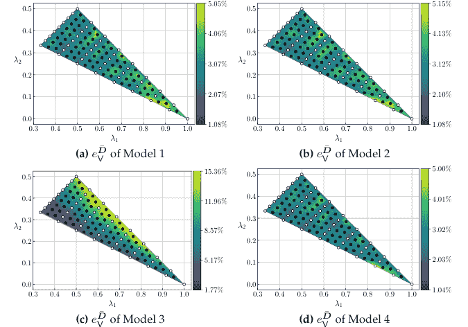

图 4.5：模型 1 至 4 的纤维取向三角形 $S_{\mathrm{T}}$ 上的验证错误 $e_{\mathrm{V}}^{\bar{D}}$。图改编自 Starr et al.（2024b，图 5）。

| | 模型 1 | 模型 2 | 模型 3 | 模型 4 |
|---|---|---|---|---|
| $\mathcal{L}^{\max}$ （%） | 5.00 | 5.00 | 15.36 | 5.00 |
| $e_{\mathrm{V}}^{\max}$ （%） | 5.05 | 5.15 | 15.36 | 5.00 |
| $e_{\mathrm{V}}^{\text{mean}}$ （%） | 2.65 | 2.73 | 7.76 | 2.28 |

表 4.5：模型 1 至 4 的最大损失 $\mathcal{L}^{\max}$ 以及验证错误 $e_{\mathrm{V}}^{\max}$ 和 $e_{\mathrm{V}}^{\text{mean}}$。表改编自 Sterr et al.（2024b，表 5）。

模型 1 和模型 2 仅在黏度张量 $\bar{\mathbb{V}}_0(\underline{b})$ 的建模方法上有所不同，其中模型 1 中正交张量 $\bar{\mathbb{V}}_0(\underline{b}) = \mathbb{A}(\underline{b})$ 的基于参数的构造被模型 2 中的标量关系（4.37）所取代。这种维度的降低并未增加损失 $\mathcal{L}$，因为模型 1 和模型 2 的最大损失 $\mathcal{L}^{\max}$ 均为 5.00%。此外，模型 2 的最大验证错误 $e_{\mathrm{V}}^{\max} = 5.15\%$ 和平均验证错误 $e_{\mathrm{V}}^{\text{mean}} = 2.73\%$ 分别仅比模型 1 的错误 $e_{\mathrm{V}}^{\max} = 5.05\%$ 和 $e_{\mathrm{V}}^{\text{mean}} = 2.65\%$ 大 0.10% 和 0.08%。因此，由方程（4.37）定义的标量关系在所研究的物理和微结构背景下似乎是一个有效的假设。模型 1 和模型 2 的最大损失 $\mathcal{L}^{\max}$ 均出现在取向状态 $\underline{\lambda} = (0.83, 0.08)^\top$ 处。相比之下，模型 1 的最大验证错误 $e_{\mathrm{V}}^{\max}$ 出现在取向状态 $\underline{\lambda} = (0.90, 0.07)^\top$ 处，模型 2 出现在 $\underline{\lambda} = (0.59, 0.38)^\top$ 处。对于所选的纤维取向三角形 $S_{\mathrm{T}}$ 离散化，应力插值引入了微小的额外错误，这从模型 1 和模型 2 的最大损失 $\mathcal{L}^{\max}$ 与最大验证错误 $e_{\mathrm{V}}^{\max}$ 之间的微小差异中可见。在所研究的模型中，模型 3 显示出最大的损失和最大的验证错误，$\mathcal{L}^{\max} = 15.36\%$ 和 $e_{\mathrm{V}}^{\max} = 15.36\%$，出现在取向状态 $\underline{\lambda} = (0.69, 0.31)^\top$ 处。对于指向纤维取向三角形 $S_{\mathrm{T}}$ 下边和左边的取向状态，模型 3 的验证错误 $e_{\mathrm{V}}^{\bar{D}}$ 幅度与其他模型相当，参见图 4.5。然而，平均验证错误 $e_{\mathrm{V}}^{\text{mean}} = 7.76\%$ 与纤维取向三角形 $S_{\mathrm{T}}$ 上边取向状态处出现的相对较大的验证错误 $e_{\mathrm{V}}^{\bar{D}}$ 相结合，表明方程（4.38）并非对整个纤维取向三角形 $S_{\mathrm{T}}$ 足够准确的近似。对于最通用的模型，模型 4，在取向状态 $\underline{\lambda} = (0.83, 0.08)^{\top}$ 处，最大损失 $\mathcal{L}^{\max}$ 和最大验证错误 $e_{\mathrm{V}}^{\max}$ 均为 5.00%。因此，与模型 1 和模型 2 相比，模型 4 增强的各向异性能力仅略微提高了拟合和预测质量，尽管模型 4 使用了更多参数。模型 4 的平均验证错误 $e_{\mathrm{V}}^{\text{mean}} = 2.28\%$ 也仅比模型 1 和模型 2 低 0.37% 和 0.45%。总之，模型 3 在所研究的模型中表现最差，模型 4 表现最好。模型 3 中包含的取向平均降低了预测精度，而各向异性函数 $\mathbb{T}^{(2)}$ 提高了模型 4 的预测精度。然而，模型 1 和模型 2 使用的参数比模型 4 少，且显示出相当相似的预测精度。因此，模型 1 和模型 2 中编码的各向异性非线性程度似乎足以在所研究的工况中以工程精度捕捉有效黏性行为。就实际实现、计算效率和预测精度平衡而言，我们认为模型 2 是所研究模型中的最佳选择，因为它使用了适量的参数，并获得了与模型 4 相当的精度。

## 4.5 结论

在本章中，我们使用监督机器学习和基于 FFT 的计算技术，发现了具有剪切稀疏基体行为的纤维悬浮液有效悬浮液黏度的模型。我们首先将以前工作的计算研究扩展到多种纤维取向状态。对于所有考虑的取向状态，我们研究了各向异性和剪切速率对 the


suspension viscosity over a wide range of shear rates of engineering interest. Confirming previous observations in the case of a transversely isotropic orientation state, we found that the anisotropy of the suspension viscosity for a particular orientation state varies substantially depending on the load direction and shear rate. Furthermore, the degree of non-linearity of the matrix material in the studied volume elements influences the anisotropy of the suspension viscosity strongly. Based on the observed material behavior, we introduced four requirements a model of the suspension viscosity should satisfy, and formulated four model candidates according to these requirements. Using supervised machine learning techniques for non-convex optimization, we identified the model parameters based on the high-fidelity FFT-based computational results, and found that three of the four presented models achieve validation errors below 5.15 %. One model containing an approximation of the suspension viscosity based on superposition and orientation averaging did not perform favorably when compared with the other presented models.

# 第 5 章

# 无限材料对比纤维悬浮液的深度材料网络

## 5.1 引言

For composites with kinematically unconstrained solid phases, the literature presented in section 1.2.4 provides compelling evidence for the accuracy and versatility of (direct) DMNs. However, the (direct) DMN architecture has yet to be applied to composites involving fluids or infinite material contrast, which is required for suspensions of rigid fibers. Because (direct) DMNs are based on laminates of solids, the treatment of fluids with a DMN architecture requires a different type of building block. Additionally, treatment of infinite material contrast with DMNs is challenging, because the rank-one laminates of a DMN have singular effective properties if one of the phases is singular, i.e., rigid. Therefore, the singular effective properties of the rank-one laminates may propagate through the whole DMN during the training and evaluation processes, rendering the effective properties of the DMN singular as well. In this chapter we address these issues and propose an architecture to treat suspensions of rigid fibers.

¹ 本章基于出版物“无限材料对比纤维悬浮液的深度材料网络”（Serr et al., 2024b）中的第 1 至 5 节。

We extend the direct DMN architecture for kinematically unconstrained solid phases with finite material contrast to an architecture that is able to treat suspensions of rigid fibers. In particular, this task requires the treatment of fluid phases and infinite material contrast. We name this architecture the Flexible DMN (FDMN) architecture. To treat fluid materials with FDMNs, we derive homogenization blocks for layered emulsions that are governed by Stokes flow, and consist of possibly incompressible phases with finite material contrast. In section 5.2.1, we establish that the velocity field in this type of layered material is phase-wise affine, if the dissipation potentials of the phases are strictly rank-one convex. We use this result and follow an analytical procedure described by Milton (2002, §9) to derive the closed form linear homogenization function of the considered layered emulsions in section 5.2.2. To treat infinite material contrast, we study a particular type of layered material, namely, coated layered materials (CLMs), in section 5.2.3. We obtain closed form homogenization functions for CLMs with kinematically unconstrained or incompressible phases. With the objective of using CLMs as FDMN building blocks in the presence of rigid fibers, we derive conditions for the required number of layering directions and their orientation, such that the effective properties of CLM are non-singular. We do so for CLMs with incompressible and rigid phases.

In section 5.3, we present the FDMN architecture as an extension of the (direct) DMN architecture. An FDMN arises by replacing the rank-one laminates of a (direct) DMN with rank-one layered materials capable of treating fluids, and non-singular CLMs capable of treating infinite material contrast. Also, we discuss the material sampling, the offline training procedure, as well as the online evaluation of FDMNs in the context of incompressible rigid fiber suspensions. We apply FDMNs to predict the viscous response of fiber polymer suspensions in section 5.4, demonstrating both the ability to handle incompressible fluid phases and infinite material contrast. We use FFT-based computational homogenization techniques to generate linear training data and non-linear validation data for shear-thinning fiber suspensions with a Cross-type matrix behavior, and a fiber volume fraction of 25%. We consider 31 different fiber orientation states and a variety of incompressible elongational and shear flows. Using the computational data, we train FDMNs for all fiber orientation states, and study the prediction accuracy of the FDMNs in the non-linear case. For all investigated load cases and microstructures, the FDMNs achieve validation errors below 4.31% over a wide range of shear rates relevant to engineering processes. Not considering the time required to generate the training data and to train an FDMN, the FDMNs achieve speedup factors between 11785 and 17225 compared to FFT-based computations. Finally, we compare the prediction accuracy of the FDMN based approach with a different machine learning approach by Sterr et al. (2024b), and find that FDMNs offer better accuracy and flexibility at a higher computational cost for the considered material and flow scenarios.

## 5.2 无限材料对比分层乳液的均匀化

### 5.2.1 层合板和乳液中的相分段位移场和速度场

Like for (direct) DMNs, the building blocks of an FDMN should admit linear homogenization functions in closed form, and there should exist efficient solution schemes to compute the stress response of the building blocks in case their phases are non-linear. In analogy to the laminate based architecture of the (direct) DMN, we thus consider layered emulsions as the building blocks of the FDMN architecture. Like laminates, layered emulsions consist of multiple, possibly non-linear, fluid materials, that are arranged such that every phase boundary between the phases is orthogonal to the layering direction \(\boldsymbol{n} \in S^2\), on the 2-sphere \(S^2\). For the offline training and the online evaluation of an FDMN with layered emulsions as building blocks, knowing the homogenization functions of layered emulsions with linear and non-linear phases is necessary. Primarily, we look for similarities between the homogenization of layered emulsions and solid laminates that can be leveraged. In laminates, the displacement fields are phase-wise affine, and we wish to know if the velocity fields in layered emulsions belong to a particular class of fields as well. If the velocity fields are phase-wise affine, established solution techniques on (direct) DMN architectures (Gajek et al., 2020) can be employed for the online evaluation of the FDMN, and convenient linear homogenization equations can be employed for the offline training. We follow a procedure detailed by Kabel et al. (2016b) on the homogenization of laminates, and establish the existence and uniqueness of phase-wise affine velocity fields in a particular type of emulsion. We consider a \(K\)-phase layered emulsion with layering direction \(\boldsymbol{n}\), which, similar to a laminate, is constructed by arranging \(K\)-phases so that the direction \(\boldsymbol{n}\) is orthogonal to all phase boundaries. The emulsion occupies a rectangular and periodic volume \(Y \subset \mathbb{R}^3\), and consists of non-Newtonian phases with rank-one convex dissipation potential \(\Psi_k : (\mathbb{R}^3)^{\otimes 2} \to \mathbb{R}\), such that

```
$$\Psi_k(\boldsymbol{L} + \beta \boldsymbol{a} \otimes \boldsymbol{b}) \le \beta \Psi_k(\boldsymbol{L} + \boldsymbol{a} \otimes \boldsymbol{b}) + (1 - \beta) \Psi_k(\boldsymbol{L}),
\forall \beta \in [0, 1], \quad \boldsymbol{a}, \boldsymbol{b} \in \mathbb{R}^3 \setminus \{ \boldsymbol{0} \}, \quad (5.1)$$
```

where \(\boldsymbol{L} \in (\mathbb{R}^3)^{\otimes 2}\) denotes the velocity gradient, and the operator \((\cdot)^{\otimes a}\) constructs a tensor space of \(a\)-th order. Also, \(Y_k \subset Y\) denotes the sub


第 $k$ 相的体积，且各相不相交，即，

$$Y_j \cap Y_k = \varnothing \quad \text{当 } \quad j \neq k,$$ (5.2)

并构成体积 $Y$，使得

$$Y = \bigcup_{j=1}^K Y_j.$$ (5.3)

令算子 $\langle \cdot \rangle_Y$ 表示对体积 $Y$ 上的量进行体积平均，即，

$$\langle \cdot \rangle_Y \equiv \frac{1}{|Y|} \int_Y (\cdot) \, \mathrm{d}Y(\boldsymbol{x}) \quad \text{其中} \quad |Y| \equiv \int_Y \, \mathrm{d}Y(\boldsymbol{x}).$$ (5.4)

然后，我们将速度场 $\boldsymbol{v} : Y \to \mathbb{R}^3$ 表示为

$$\boldsymbol{v} = \bar{\boldsymbol{L}} \boldsymbol{x} + \hat{\boldsymbol{v}}, \quad \text{其中} \quad \langle \nabla \hat{\boldsymbol{v}} \rangle_Y = \mathbf{0},$$ (5.5)

其中 $\bar{\boldsymbol{L}} \in (\mathbb{R}^3)^{\otimes 2}$ 表示规定的有效速度梯度，$\hat{\boldsymbol{v}}$ 是速度波动场。相应地，乳液的周期耗散势函数 $\Psi : Y \times (\mathbb{R}^3)^{\otimes 2} \to \mathbb{R}$ 通过以下方式定义

$$\Psi(\boldsymbol{x}, \nabla^s \boldsymbol{v}) = \sum_{k=1}^K \chi_k(\boldsymbol{x}) \Psi_k(\boldsymbol{x}, \nabla^s \boldsymbol{v}),$$ (5.6)

其中 $\chi_k : Y \to \{0, 1\}$ 是子体积 $Y_k$ 的特征函数，$\nabla^s$ 表示对称化梯度。设乳液内部的流动由斯托克斯流控制，即，分层乳液中的对流力相对于黏性力很小，则稳态质量守恒

$$\operatorname{div}(\rho \boldsymbol{v}) = 0,$$ (5.7)

其中 \(\rho : Y \rightarrow \mathbb{R}\) 表示质量密度场，得到满足。另外，应力场

$$\boldsymbol{\sigma} = \mathcal{S}(\cdot, \bar{\boldsymbol{D}} + \nabla^s \hat{\boldsymbol{v}}) \tag{5.8}$$

关于有效应变率张量 \(\bar{\boldsymbol{D}} = (\bar{\boldsymbol{L}} + \bar{\boldsymbol{L}}^{\mathsf{T}})/2$ 以及在对称二阶张量空间 \(\mathrm{Sym}(3) \subset (\mathbb{R}^3)^{\otimes 2}$ 上的相关应力算子 \(\mathcal{S}$ (Edelen, 1973)

$$\mathcal{S} : Y \times \mathrm{Sym}(3) \rightarrow \mathrm{Sym}(3), \tag{5.9}$$

$$(\boldsymbol{x}, \boldsymbol{D}) \mapsto \frac{\partial \Psi}{\partial \boldsymbol{D}}(\boldsymbol{x}, \boldsymbol{D}), \tag{5.10}$$

满足无惯性效应和体力影响下的线性动量守恒

$$\text{div }(\boldsymbol{\sigma}) = \boldsymbol{0}. \tag{5.11}$$

因此，乳液的有效响应由以下极小化问题得到

$$\langle \Psi(\boldsymbol{x}, \bar{\boldsymbol{D}} + \nabla^s \hat{\boldsymbol{v}}) \rangle_Y \longrightarrow \min_{\hat{v} \in \mathcal{A}}, \tag{5.12}$$

其中 \(\mathcal{A}$ 表示可接受集

$$\mathcal{A} = \big\{ \hat{v} : Y \rightarrow \mathbb{R}^3 \mid \text{div }(\rho v) = 0 \text{ 且 } \langle \nabla \hat{v} \rangle_Y = \boldsymbol{0} \big\} \tag{5.13}$$

因此，假设各相之间无滑移，Kabel et al. (2016b, §2) 的证明可推广到具有有限材料对比的分层乳液。因此，如果耗散势 \(\Psi_k$ 为严格秩一凸，则在分段仿射速度场类中存在唯一极小点 \(\hat{v}$。作为特例，这对于不可压缩斯托克斯流也成立，对于这类流动，质量守恒简化为

$$\text{div }(\boldsymbol{v}) = 0. \tag{5.14}$$

在以下内容中，我们仅将*分层乳液*一词用于上述定义的乳液类型。

### 5.2.2 具有牛顿相的双相分层乳液

与线性弹性固体材料的双相层板类似，我们希望找到双相分层乳液线性同质化函数的方便闭式表达式。为了将分层乳液用作 FDMN 的构建模块，我们将本节专门用于推导具有运动学无约束或不可压缩牛顿相的双相分层乳液的此类闭式表达式。为此，我们采用上一节 5.2.1 的结果，并扩展 Milton (2002, §9) 针对线性弹性相双相层板的现有同质化方法。为了强调层板线性同质化与分层乳液之间的联系，我们定义了线性材料类 $\mathcal{M}$，并并行研究固体和流体的分层材料。线性材料类 $\mathcal{M}$ 中的材料 $m_k$ 由原构材料张量 $\mathbb{M}_k$ 或其对偶张量 $\mathbb{K}_k \equiv \mathbb{M}_k^{-1}$ 表征，使得

$$(\mathbb{M}_k, \mathbb{K}_k) \in \{(\mathbb{M}^+)^2, (\mathbb{M}_0^+)^2\}. \tag{5.15}$$

这里，凸锥 $\mathbb{M}^+ \subset (\mathbb{R}^3)^{\otimes 4}$ 和 $\mathbb{M}_0^+ \subset (\mathbb{R}^3)^{\otimes 4}$ 包含所有四阶张量 $\mathbb{X} \in (\mathbb{R}^3)^{\otimes 4}$，它们分别在对称二阶张量向量空间 $\text{Sym}(3)$ 和迹零对称二阶张量向量空间 $\text{Sym}_0(3) \subset \text{Sym}(3)$ 上为正定。此外，张量 $\mathbb{X} \in \{\mathbb{M}^+, \mathbb{M}_0^+\}$ 具有小对称和大对称性

$$\mathbb{X} = \mathbb{X}^{\text{Th}} = \mathbb{X}^{\text{Tl}} = \mathbb{X}^{\text{Tr}}, \tag{5.16}$$

且张量 \(\mathbb{X} \in \mathsf{M}_0^+$ 将二阶单位张量 \(\boldsymbol{I}$ 映射为零，使得

$$\ker \mathbb{X} = \boldsymbol{I}, \quad \text{即，} \quad \mathbb{X}[\boldsymbol{I}] = \boldsymbol{0}. \tag{5.17}$$

在这里，我们以分量形式并在 $\mathbb{R}^3$ 的标准基下定义映射 \(\mathbb{T}[\boldsymbol{Y}]\) 为

$$\mathbb{T}[\boldsymbol{Y}] \hat{=} T_{ijkl} Y_{kl}, \quad \text{对某些} \quad \boldsymbol{Y} \in (\mathbb{R}^3)^{\otimes 2}, \mathbb{T} \in (\mathbb{R}^3)^{\otimes 4}. \tag{5.18}$$

任何材料 \(m_k \in \mathcal{M}$ 都遵循线性本构方程

$$\boldsymbol{\sigma}^{co} = \mathbb{M}_k[\nabla^s \boldsymbol{w}] \quad \text{且} \quad \nabla^s \boldsymbol{w} = \mathbb{K}_k[\boldsymbol{\sigma}^{co}], \tag{5.19}$$

如果材料 \(m_k$ 不受运动学约束，或本构方程

$$\boldsymbol{\sigma}^{ico} = \boldsymbol{\tau} - p \boldsymbol{I} = \mathbb{M}_k[\nabla^s \boldsymbol{w}] - p \boldsymbol{I}, \quad \text{且} \quad \nabla^s \boldsymbol{w} = \mathbb{K}_k[\boldsymbol{\tau}], \tag{5.20}$$

如果材料 \(m_k$ 是不可压缩的。这里，\(\boldsymbol{w}$ 表示与材料 \(m_k$ 类型相关的场，即，线性弹性固体的位移场 \(\boldsymbol{u}$ 或线性黏性流体的速度场 \(\boldsymbol{v}$。对于本构方程 (5.20)，我们对应力场 \(\boldsymbol{\sigma}$ 使用加法分解

$$\boldsymbol{\sigma} = \boldsymbol{\tau} - p \boldsymbol{I}, \tag{5.21}$$

为偏应力场 \(\boldsymbol{\tau} : Y \to \text{Sym}_0(3)$ 和压力场 \(p : Y \to \mathbb{R}$。这里，我们使用 \(Y \subset \mathbb{R}^3\) 表示双相分层材料所占据的体积，即层板或分层乳液，并使用 \(Y_1, Y_2 \subset Y$ 表示分层材料两个相 \(m_1, m_2 \in \mathcal{M}$ 所占据的体积。我们按 Hill-Mandel 条件 (Hill, 1963; Mandel, 1966) 的意义定义分层材料的有效性质 \((\bar{\mathbb{M}}, \bar{\mathbb{K}}) \in \{(\mathsf{M}^+)^2, (\mathsf{M}_0^+)^2\}$

$$\langle \boldsymbol{\sigma} \cdot \nabla^s \boldsymbol{w} \rangle_Y = \langle \boldsymbol{\sigma} \rangle_Y \cdot \langle \nabla^s \boldsymbol{w} \rangle_Y \equiv \bar{\mathbb{M}} : (\langle \nabla^s \boldsymbol{w} \rangle_Y \otimes \langle \nabla^s \boldsymbol{w} \rangle_Y). \tag{5.22}$$

然后，对于没有运动学约束的线性固体材料完美结合层板，可以使用 Milton (2002, §9) 详细说明的程序推导层板的原构或对偶有效性质 \(\bar{\mathbb{A}} \in [\mathbb{M}, \bar{\mathbb{K}}]$ 的闭式表达式，使得

$$\left( (\bar{\mathbb{A}} - \mathbb{A}_0)^{-1} + \Gamma_{\mathbb{A}_0}(\boldsymbol{n}) \right)^{-1} = \left\langle \left( (\mathbb{A}(\boldsymbol{x}) - \mathbb{A}_0)^{-1} + \Gamma_{\mathbb{A}_0}(\boldsymbol{n}) \right)^{-1} \right\rangle. \tag{5.23}$$

这里，逆运算在 \(\bar{\mathbb{A}} \in \mathsf{M}^+$ 所在的空间 \(\mathsf{M}^+$ 上进行，\(\mathbb{A} : Y \to \mathsf{M}^+$ 表示逐相原构或对偶材料性质的场

$$\mathbb{A} : Y \to \mathsf{M}^+, \quad \boldsymbol{x} \mapsto \begin{cases} \mathbb{A}_1 & \text{当 } \boldsymbol{x} \in Y_1, \\ \mathbb{A}_2 & \text{当 } \boldsymbol{x} \in Y_2, \end{cases} \tag{5.24}$$

并且 \(\mathbb{A}_0 \in \mathsf{M}^+$ 是任意参考材料张量，使得术语 \((\mathbb{A}(\boldsymbol{x}) - \mathbb{A}_0)$ 可逆。另外，算子 \(\Gamma_{\mathbb{A}_0}(\boldsymbol{n}) \in (\mathbb{R}^3)^{\otimes 4}$ 定义为

$$\Gamma_{\mathbb{A}_0}(\boldsymbol{n}) = \Gamma_{\mathbb{I}}(\boldsymbol{n}) \left[ \Gamma_{\mathbb{I}}(\boldsymbol{n}) \mathbb{A}_0 \Gamma_{\mathbb{I}}(\boldsymbol{n}) \right]^{\dagger} \Gamma_{\mathbb{I}}(\boldsymbol{n}), \tag{5.25}$$

其中 \((\cdot)^\dagger$ 表示 Moore–Penrose 伪逆，且算子 \(\Gamma_{\mathbb{A}_0}(\boldsymbol{n})$ 和 \(\Gamma_{\mathbb{I}}(\boldsymbol{n})$ 相对于不同的内积投影到同一子空间。更具体地说，算子 \(\Gamma_{\mathbb{A}_0}(\boldsymbol{n})$ 是相对于 \(\mathbb{A}_0$-加权内积的正交投影算子

$$\langle \boldsymbol{X}, \boldsymbol{X} \rangle_{\mathbb{A}_0} = \boldsymbol{X} \cdot \mathbb{A}_0[\boldsymbol{X}], \quad \boldsymbol{X} \in \text{Sym}(3), \tag{5.26}$$

且算子 \(\Gamma_{\mathbb{I}}(\boldsymbol{n})$ 是相对于 Frobenius 内积的正交投影算子

$$\langle \boldsymbol{X}, \boldsymbol{X} \rangle_{\text{F}} = \boldsymbol{X} \cdot \mathbb{I}[\boldsymbol{X}] = \boldsymbol{X} \cdot \boldsymbol{X}, \quad \boldsymbol{X} \in \text{Sym}(3). \tag{5.27}


其中 \(\mathbb{I} \in (\mathbb{R}^3)^{\otimes 4}\) 表示四阶单位张量。算子 \(\mathbb{I}_{\mathbb{I}}(\boldsymbol{n})\) 编码了由层合板的周期性、各相间的完美粘结、动量平衡 (5.11) 以及本构方程 (5.19) 所施加的约束。取决于我们希望计算层合板的原始有效性质还是对偶有效性质，需要不同的算子 \(\mathbb{I}_{\mathbb{I}}(\boldsymbol{n})\)。对于原始有效性质的均质化，即 \(\bar{\mathbb{A}} = \bar{\mathbb{M}}\)，算子 \(\mathbb{I}_{\mathbb{I}}(\boldsymbol{n})\) 等于算子 \(\mathbb{I}_1^{\text{co}}(\boldsymbol{n})\)。对于对偶有效性质的均质化，即 \(\bar{\mathbb{A}} = \bar{\mathbb{K}}\)，算子 \(\mathbb{I}_{\mathbb{I}}(\boldsymbol{n})\) 等于算子 \(\mathbb{I}_2^{\text{co}}(\boldsymbol{n})\)。算子 \(\mathbb{I}_1^{\text{co}}\) 和 \(\mathbb{I}_2^{\text{co}}\) 通过其对二阶张量 \(\boldsymbol{X} \in \text{Sym}(3)\) 的作用来定义

\(\mathbb{I}_1^{\text{co}}(\boldsymbol{n})[\boldsymbol{X}] = 2(\boldsymbol{X}\boldsymbol{n}) \otimes_s \boldsymbol{n} - (\boldsymbol{n} \cdot \boldsymbol{X}\boldsymbol{n})\boldsymbol{n} \otimes \boldsymbol{n} \quad \text{(5.28)}\)

和

\(\mathbb{I}_2^{\text{co}}(\boldsymbol{n})[\boldsymbol{X}] = \boldsymbol{X} - \mathbb{I}_1^{\text{co}}(\boldsymbol{n})\boldsymbol{X}, \quad \text{(5.29)}\)

其中 \(\otimes_s\) 表示对称化 dyadic 乘积。算子 \(\mathbb{I}_1^{\text{co}}\) 和 \(\mathbb{I}_2^{\text{co}}\) 投影到子空间

\(\mathcal{E}^\text{co} = \{ \text{Sym}(3) \ni \boldsymbol{X} = \boldsymbol{d} \otimes \boldsymbol{n} + \boldsymbol{n} \otimes \boldsymbol{d} \mid \boldsymbol{d} \in \mathbb{R}^3 \} \quad \text{(5.30)}\)

和

\(\mathcal{S}^\text{co} = \{ \text{Sym}(3) \ni \boldsymbol{X} \mid \boldsymbol{X}\boldsymbol{n} = \boldsymbol{0} \}, \quad \text{(5.31)}\)

并源于字段 \([[\nabla^s w]] \in \mathcal{E}^\text{co}\) 的跳跃的事实

\([[\nabla^s w]] = [[\nabla w \boldsymbol{n}]] \otimes_s \boldsymbol{n}, \quad \text{(5.32)}\)

以及应力 \([[\boldsymbol{\sigma}]] \in \mathcal{S}^\text{co}\) 的跳跃存在于互正交子空间上（Milton, 2002, §9），因为有

\([[\boldsymbol{\sigma}\boldsymbol{n}]] = \boldsymbol{0}. \quad \text{(5.33)}\)

有趣的是，运动学无约束线性弹性固体和线性黏性流体的本构方程具有相同的结构，参见方程 (5.19)。此外，方程 (5.32) 和 (5.33) 对分层乳液来说按定义满足，因为各相之间没有滑移，且动量平衡 (5.11) 得到满足。因此，所考虑分层乳液的均质化问题与层合板的均质化问题具有相同的结构。结果，由运动学无约束材料 \(m_1, m_2 \in \mathcal{M}\) 组成的两相分层乳液的有效性质 \(\bar{\mathbb{A}} \in \mathbf{M}^+\) 可以用方程 (5.23) 计算。如果运动学场 \(w\) 是无散度的，使得不可压缩质量守恒 (5.14) 得到满足，则由方程 (5.32) 可得

\(\left[\left[\nabla^s w n\right]\right] \cdot n = 0.\) (5.34)

另外，如果材料 \(m_1, m_2 \in \mathcal{M}\) 是不可压缩的，则由方程 (5.21) 和 (5.33) 可得

\(\left[\left[\sigma n\right]\right] = \mathbf{0} \quad \Longleftrightarrow \quad \left[\left[\tau n\right]\right] = \left[\left[p\right]\right] n.\) (5.35)

因此，跳跃 \(\left[\left[\nabla^s w\right]\right] \in \mathcal{E}^{\text{ico}}\) 和 \(\left[\left[\sigma\right]\right] \in \mathcal{S}^{\text{ico}}\) 存在于互正交空间中

\(\mathcal{E}^{\text{ico}} = \{ \text{Sym}_0(3) \ni X = 2 d \otimes_s n - 2(d \cdot n)n \otimes n \mid d \in \mathbb{R}^3 \}\) (5.36)

和

\(\mathcal{S}^{\text{ico}} = \{ \text{Sym}_0(3) \ni X \mid X n = a n, \ a \in \mathbb{R} \}.\) (5.37)

两个算子 \(\Gamma_1^{\text{ico}}(n)\) 和 \(\Gamma_2^{\text{ico}}(n)\)，通过其对迹为零的二阶张量 \(X \in \text{Sym}_0(3)\) 的作用定义，

\(\Gamma_1^{\text{ico}}(n)[X] = 2(Xn) \otimes_s n - 2(n \cdot Xn)n \otimes n\) (5.38)

和

\(\Gamma_2^{\text{ico}}(n)[X] = X - \Gamma_1^{\text{ico}}(n)[X],\) (5.39)

分别投影到空间 $\mathcal{E}^{\text{ico}}$ 和 $\mathcal{S}^{\text{ico}}$。因此，可以使用 Milton (2002) 中详细介绍的方法来计算由不可压缩组分组成的分层材料的有效性质 \(\bar{\mathbb{A}} \in \text{M}_0^+\)。在此背景下，均质化方程 (5.23) 适用，前提是属性场 \(\mathbb{A} : Y \to \text{M}_0^+\)、参考属性 \(\mathbb{A}_0 \in \text{M}_0^+\) 和算子 \(\mathbb{\Gamma}_{\text{I}}(\boldsymbol{n}) \in (\mathbb{\Gamma}_1^{\text{ico}}(\boldsymbol{n}), \mathbb{\Gamma}_2^{\text{ico}}(\boldsymbol{n}))\) 根据张量 \(\bar{\mathbb{A}}\) 表示原始有效性质还是对偶有效性质来选择。总之，对于由线性材料 \(m_1, m_2 \in \mathcal{M}\) 组成的分层材料，有效材料性质 \((\bar{\mathbb{M}}, \bar{\mathbb{K}}) \in \{(\text{M}^+)^2, (\text{M}_0^+)^2\}\) 可以用均质化方程 (5.23) 计算。算子 \(\mathbb{\Gamma}_{\text{I}}(\boldsymbol{n})\) 的选择取决于各相是可压缩还是不可压缩，以及是寻求原始有效张量还是对偶有效张量。

### 5.2.3 涂层分层材料

由于我们有兴趣为刚性颗粒悬浮液构建 FDMN，因此 FDMN 的架构应能够处理无限黏性，即刚性，相。在本节中，我们利用均质化方程 (5.23) 研究在存在刚性相时反复分层材料的均质化。我们在下文定义并使用分层材料的 *rank*（级）术语，以更好地区分构建分层材料的可能方式。分层材料的级 \(R \in \text{N}_{\ge 0}\) 定义了使用分层方向 \(\boldsymbol{n}_r \in \mathcal{S}^2\) 构建材料所需的分层步骤数，使得索引 \(r\) 从 1 开始到 \(R\) 结束，即 \(r \in \{1, \dots, R\}\)。按定义，0 级分层材料只是一种单相材料，没有任何分层。另外，每个分层步骤中分层的材料不必相同。例如，设 2 级分层材料的第一层由材料 \(m_1\) 和 \(m_2\) 组成。那么，第二层可以由材料 \(m_1\) 和 \(m_2\)（以第一层的形式）以及第三种材料 \(m_3\) 组成。

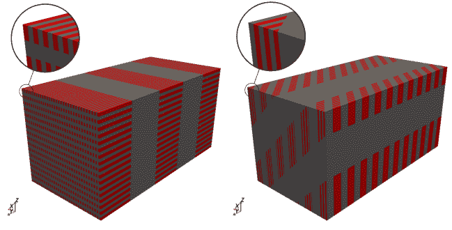

图 5.1：具有正交分层方向（a）和非正交分层方向（b）的三级涂层分层材料。核心材料显示为红色，涂层材料显示为灰色。我们通过层厚的选择暗示材料层之间的长度尺分离。图改编自 Storr et al. (2024a, Figure 1)。

在材料对比无限的情况下，一级两相分层材料不适合作为 DMN 的构建块，因为如果其中一相是奇异的，其有效性质总是奇异的。为了寻找能够处理刚性相的构建块，我们遵循 Milton (2002, §9) 详细介绍的术语和分析方法，研究一种特定类型的分层材料的有效性质。我们将这种特定类型的分层材料称为涂层分层材料（CLMs）。构建 CLM 时，一种材料 \(m_2\)（称为涂层）反复分层到另一种材料 \(m_1\)（称为核心）上。分层过程分为多个步骤，使得第 \(r\) 个分层步骤在方向 \(\boldsymbol{n}_r\) 上应用，且分层步骤的总数等于 CLM 的级 \(R\)。例如，图 5.1 描绘了两个三级 CLM，其中分层方向 \(\boldsymbol{n}_r \in \mathcal{N}_1\)

图 5.1a 所示材料的

$$\mathcal{N}_1 = \{(1, 0, 0)_{(\mathbf{e}_i)}, (0, 0, 1)_{(\mathbf{e}_i)}, (0, 1, 0)_{(\mathbf{e}_i)}\}, \quad (5.40)$$

以及图 5.1b 所示材料的层叠方向 \(\mathbf{n}_r \in \mathcal{N}_2\) 为

$$\mathcal{N}_2 = \left\{ (1, 0, 0)_{(\mathbf{e}_i)}, \frac{1}{\sqrt{2}} (1, 1, 0)_{(\mathbf{e}_i)}, \frac{1}{\sqrt{2}} (1, 0, 1)_{(\mathbf{e}_i)} \right\}. \quad (5.41)$$

如所述，灰色涂层材料 \(m_2\) 以层叠方式反复施加，因此对于 \(r > 1\)，秩三 CLM 的第 \(r\) 层子层是通过将秩-\((r - 1)\) 层叠材料与涂层材料 \(m_2\) 层叠而构建的。按定义，秩三 CLM 的第 0 层子层完全由核心材料 \(m_1\) 组成。我们希望通过反复应用同质化方程 (5.23) 来计算涂层层叠材料的有效性质 \(\bar{\mathbb{A}}\)。为了使秩一同质化公式 (5.23) 的递归应用有效，每个同质化步骤中的各相必须在相应的层叠步骤的长度尺度上是均匀的。这要求长度尺度的分离，即秩-\(r\) 子层中的材料段厚度 \(\delta_r\) 远小于下一子层中材料段的厚度 \(\delta_{r+1}\)，即 \(\delta_r \ll \delta_{r+1}\)。在图 5.1 中，我们通过层厚的选择暗示了材料层之间的这种长度尺度分离。尽管如此，我们仍保留可见的不均匀程度，以便层结构可用于说明目的而被区分开。

在反复应用方程 (5.23) 以推导有效性质 \(\bar{\mathbb{A}}\) 的表达式之前，我们首先针对当前情况简化表达式 (5.23)。我们令方程 (5.23) 中的参考材料性质 \(\mathbb{A}_0\) 趋近于涂层材料 \(m_2\) 的性质 \(\mathbb{A}_2$，从而得到方程（Milton, 2002, §9）

```
(1 - f_2)(\bar{\mathbb{A}} - \mathbb{A}_2)^{-1} = (\mathbb{A}_1 - \mathbb{A}_2)^{-1} + f_2 \Gamma_{\mathbb{A}_2}(\mathbf{n}).
```

此处，涂层材料 \(m_2\) 不能是刚性材料或空隙，张量 \((\mathbb{A}_1 - \mathbb{A}_2)\) 必须可逆，且 \(f_2\) 表示涂层材料 \(m_2\) 的体积分数。此外，四阶张量 \(\Gamma_{\mathbb{A}_2}(\mathbf{n}_r) \in (\mathbb{R}^3)^{\otimes 4}\) 由方程 (5.25) 定义如下

```
\Gamma_{\mathbb{A}_2}(\mathbf{n}_r) = \Gamma_{\mathbb{I}}(\mathbf{n}_r) [\Gamma_{\mathbb{I}}(\mathbf{n}_r) \mathbb{A}_2 \Gamma_{\mathbb{I}}(\mathbf{n}_r)]^\dagger \Gamma_{\mathbb{I}}(\mathbf{n}_r),
```

其中，逆是在 \(\Gamma_\mathbb{I}\) 投影到的子空间上取的。为了计算秩-\(R\) CLM 的有效性质 \(\bar{\mathbb{A}}\)，我们对秩一层叠材料的有效材料性质递归应用方程 (5.42)，以便（Milton, 2002, §9）

```
(1 - f_2)(\bar{\mathbb{A}} - \mathbb{A}_2)^{-1} = (\mathbb{A}_1 - \mathbb{A}_2)^{-1} + f_2 \sum_{r=1}^R c_r \Gamma_{\mathbb{A}_2}(\mathbf{n}_r).
```

此处，标量 \(c_r\) 是根据秩三 CLM 中秩-\(r\) 子层内核心材料 \(m_1\) 的体积分数 \(f_1^{(r)}\) 计算的，使得

```
c_r = \frac{f_1^{(r-1)} - f_1^{(r)}}{f_2},
```

即，性质

```
\sum_{r=1}^R c_r = 1 \quad \text{and} \quad c_r > 0,
```

成立。由于秩-0 子层按定义完全由核心材料 \(m_1\) 组成，体积分数 \(f^{(0)} = 1\) 为一。方程 (5.44) 对于计算具有无穷材料对比度的层叠材料的有效性质至关重要，因此对于使用 DMN 架构处理此类材料也是如此。在附录 A 中，我们使用方程 (5.44) 来研究当核心材料 \(m_1\) 为刚性时，CLM 的有效性质 \(\bar{\mathbb{A}}\) 为奇异的条件。出于将 FDMNs 应用于刚性纤维悬浮液的目的，我们用以下陈述总结了具有刚性核心材料 \(m_1\) 和不可压缩涂层材料 \(m_2\) 的秩-\(R\) CLM 的相关结果。

- 1. 秩 \(R < 3\) 的 CLM 的有效性质 \(\bar{\mathbb{A}}\) 总是奇异的。
- 2. 对于秩-3 CLMs，如果至少一个层叠方向与另外两个层叠方向正交，或至少两个层叠方向共线，则有效性质 \(\bar{\mathbb{A}}\) 为奇异的。
- 3. 具有互不正交且互不共线的层叠方向 \(n_1, n_2\) 和 \(n_3\) 的秩-3 CLMs 具有非奇异有效性质。因此，在本论文的语境下，我们要求

```
0 < |n_1 \cdot n_2| < 1, \quad 0 < |n_1 \cdot n_3| < 1, \quad 0 < |n_2 \cdot n_3| < 1. (5.47)
```

陈述 1-3 对于使用 DMN 架构处理刚性颗粒不可压缩悬浮液至关重要。由此可知，具有不可压缩涂层材料和刚性核心材料的 CLM 应至少为秩 \(R = 3\)，并具有非共线且互不正交的层叠方向，才能非奇异。因此，我们在 FDMN 架构中利用此类非奇异秩-3 CLM 来处理刚性纤维悬浮液，如我们在第 5.3.2 节中所解释的。

## 5.3 识别刚性纤维悬浮液的深度材料网络

### 5.3.1 直接深度材料网络架构

由于 FDMN 架构扩展了（直接）DMN 框架，我们在本节中简要总结直接 DMN 架构，然后在下一节 5.3.2 中介绍 FDMN 架构。有关直接 DMN 架构的深入讨论和解释，我们将读者引向 Gajek et al. (2020; 2021; 2022) 的文章。双相直接 DMN 被定义为一棵完美二叉树，由双相层压材料 \(\mathcal{B}_k^i\) 作为节点组成，参见图 5.2a。层压材料 \(\mathcal{B}_k^i\) 由单个层压方向 \(\boldsymbol{n}_k^i\) 和两个体积分数 \(c_{k,1}^1\) 和 \(c_{k,1}^2\) 定义。DMN 树是有序的、有根的，并具有深度 \(K\)。我们使用字母 \(k = 1, ..., K\) 表示节点的深度，使用字母 \(i = 1, ..., 2^{k-1}\) 表示节点在相应层中的水平位置。我们通过两个向量 $\underline{n} \in (\mathbb{R}^3)^{2^K-1}$ 参数化直接 DMN

\(\underline{n} = (\boldsymbol{n}_K^1, \dots, \boldsymbol{n}_K^{2^{K-1}}, \boldsymbol{n}_{K-1}^1, \dots, \boldsymbol{n}_{K-1}^{2^{K-2}}, \dots, \boldsymbol{n}_1^1),\) (5.48)

和 $\underline{w} \in \mathbb{R}^{2^K}$

\(\underline{w} = (w_{K+1}^1, \dots, w_{K+1}^{2^K}).\) (5.49)

与层压体积分数不同，直接 DMN 通过权重 \(w^i_{K+1}\) 进行参数化，以在训练过程中提高数值稳定性（Liu et al., 2019b; Liu and Wu, 2019）。第 \(k\) 层中的第 \(i\) 个权重是通过前一层 \(k+1\) 中权重的两两求和计算得出的，参见图 5.2a，即

\(w^i_k = w^{2i-1}_{k+1} + w^{2i}_{k+1},\) (5.50)

体积分数 \(c^i_{k,1}\) 和 \(c^i_{k,2}\) 由以下公式得出

\(c^i_{k,1} = \frac{w^{2i-1}_{k+1}}{w^{2i-1}_{k+1} + w^{2i}_{k+1}},\) and \(c^i_{k,2} = 1 - c^i_{k,1}.\) (5.51)

此外，权重 \(w^i_{K+1}\) 需为正且总和为一，即

\(w^i_{K+1} \ge 0\) and \(\sum_i^{2^K} w^i_{K+1} = 1.\) (5.52)

向量 $\underline{n}$ 和 $\underline{w}$ 完全参数化深度为 \(K\) 的直接 DMN，并通过将 DMN 的线性同质化函数与感兴趣微观结构的线性同质化函数拟合来识别。拟合过程采用监督机器学习进行，我们将此过程称为 *离线训练*。在离线训练期间，为了评估 DMN 的线性同质化函数，输入刚度对通过同质化块 \(\mathcal{B}^i_k\) 网络传播，参见图 5.2b。因此，如果同质化块 \(\mathcal{B}^i_k\) 的刚度 \(\mathbb{C}^i_k\) 为奇异，则该奇异刚度可以传播

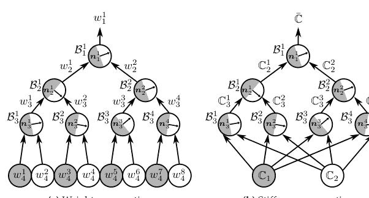

图 5.2：深度 K = 3 的双相直接 DMN（Gajek et al., 2021）中的权重和刚度传播（自底向上），引自 Gajek et al. (2022, 图 1），根据 CC BY 4.0 许可


贯穿整个 DMN，这对于离线训练是不希望的。一旦参数向量 $\underline{n}$ 和 $\underline{w}$ 已知，它们将保持不变，并在 *在线评估* 中用于预测所研究材料的非线性响应。在第 5.3.4、5.4.2 和 5.3.5 节中，我们讨论了拟议 FDMN 架构的离线训练和在线评估。

### 5.3.2 柔性深材料网络架构

在掌握前面第 5.2.1-5.2.3 节的结果后，我们提出了一种扩展的 DMN 架构，能够处理流体相位和无限材料对比。与图 5.2 所示的（直接）DMN 架构相比，最底层的层合板被一层秩-$R$ 的 CLM $\mathcal{C}_R$ 所取代，参见图 5.3。CLM $\mathcal{C}_R$ 的秩 $R$ 及其

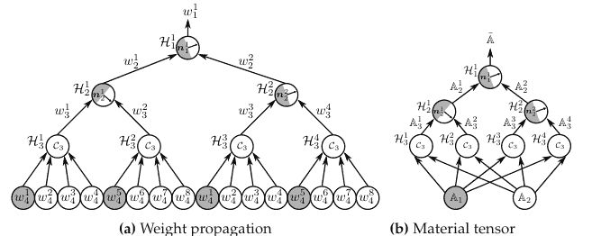

图 5.3：两相 FDMN（深度为 $K=3$，采用秩-3 CLM）（Gajek et al., 2021）中从底向上的权重和材料属性传播。图改编自 Sterr et al. (2024a, 图 3)。

对其层方向 $\boldsymbol{n}_r$ 的限制取决于具体问题，并选择使得非奇异性条件 (A.11) 得以满足。这保证只有非奇异材料张量 $\mathbb{A}^i_k$ 会在网络中传播。如果所有相位在运动学上均不受约束、为固体且非奇异，则可以使用秩一 CLM 来恢复直接 DMN 架构。然而，在不可压缩刚性颗粒悬浮液的情况下，CLM 的秩为 \(R=3\) 且具有互不共线且非正交的层方向 \(n_r\)，如说明 1-3 所述。此外，均质化块 \(\mathcal{H}_k^i\) 实现了由公式 (5.23) 定义的通用均质化函数，其中投影函数 \(\mathbb{I}_{\parallel}\) 取决于所研究问题的物理特性。这允许处理由线性材料 \(m \in \mathcal{M}\) 组成的复合材料，包括不可压缩线性黏性流体。对于涉及两相材料的问题，每个 CLM 分配 \(R+1\) 个权重和两种材料。深度为 \(K\)、采用秩-\(R\) CLM 的两相 FDMN 中的层方向数量 \(N_n$ 和输入权重数量 \(N_w$ 为

```
\(N_n = 2^{K-1}(R+1) - 1, \quad N_w = 2^{K-1}(R+1). \quad (5.53)\)
```

例如，图 5.3a 和 5.3b 显示了深度为 \(K=3\)、底层为秩 \(R=3\) 的两相 CLM 的两相 FDMN 的权重和材料属性传播。在秩-3 CLM 的四个权重中，一个与核心材料 \(m_1$ 相关联，三个与包覆材料 \(m_2$ 相关联。与相同深度 \(K$ 的 DMN 相比，采用秩-3 CLM 的 FDMN 的权重数量翻了一番。此外，每个秩-3 CLM 块 \(\mathcal{C}_3$ 具有三个层方向 \(n_r$，而不是像秩一层合板那样只有一个层方向。为了减少自由参数的数量并确保 CLM 是非奇异的，层方向 \(n_r$ 之间的相对角度是固定的，而它们在空间中的共同方向则通过离线训练确定，如我们在第 5.3.4 节中更详细地解释的那样。由于 CLM 基于秩一层状材料的重复层状结构，深度为 \(K$ 的 FDMN 可以被视为带有广义均质化块的深度为 \(K+(R-1)$ 的（直接）DMN 的特例。然后，CLM 表示深度为 $K + (R - 1)$ 的 DMN 的一棵子树，其中某些相位的权重 $w_k^i$ 被设置为零，从而产生 CLM，参见图 5.4。特别是，

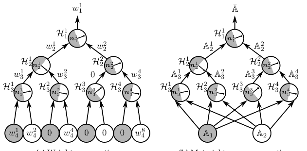

图 5.4：深度为 $K=3$ 的两相 DMN 中从底向上的权重和材料属性传播，代表两相秩-3 CLM。图改编自 Sterr et al. (2024a, 图 4)。

除一种相位外，与奇异核心材料 $m_1$ 相关联的权重均设置为零。此外，与非奇异包覆材料 $m_2$ 相关联的 $R$ 个权重必须非零，以维持 CLM 的秩 $R$。从技术上讲，（直接）DMN 因此固有地能够处理无限材料对比。然而，权重 $w_k^i$ 需要在离线训练期间识别，并且可能并非总是具有适当的值来生成具有所需秩的 CLM，以至于奇异材料张量 $\mathbb{A}_k^i$ 可能贯穿整个 DMN。同样，如果层法线未选择得当，奇异材料属性也可能贯穿整个 DMN。因此，通过实现 CLM 块而不是学习来控制权重和法线，以防止离线训练期间的奇异性，是更可取的。此外，与等效深度为 $K + R - 1$ 的 DMN 相比，深度为 $K$ 的 FDMN 具有更少的自由参数，这也有助于离线训练。

假设，所提出的 FDMN 架构也可以应用于涉及两种以上相位的问题。令 N_R 表示非奇异相位的数量，N_S 表示奇异相位的数量。然后，对于每个奇异相位，FDMN 需要包含至少一个 CLM，该 CLM 分配了该相位并具有非奇异有效属性。这需要至少 N_S 个 CLM。此外，CLM 的包覆层可以通过混合非奇异相位来构建，可能通过构建 N_R 相层状材料。然而，将 FDMN 应用于具有空隙或两种以上相位的材料超出了本论文的范围，因为我们专注于刚性纤维悬浮液。

### 5.3.3 材料采样

对于具有固体相的材料，DMN 通过使用随机生成的输入材料对感兴趣微观结构的线性弹性均质化函数进行采样（Liu et al., 2019b; Liu and Wu, 2019; Gajek et al., 2021; 2022），并拟合 DMN 参数以复制所需的均质化函数来进行训练。同样，对于悬浮在黏性介质中的刚性颗粒，我们训练 FDMN 以学习线性黏性均质化函数，目的是预测非线性黏性行为。因此，我们使用随机生成的线性黏性输入材料对线性黏性均质化函数进行采样。我们的采样策略基于 Gajek et al. (2021) 采用的方法。在 Gajek et al. (2021) 关于玻璃纤维增强聚酰胺复合材料的文章中，作者将纤维材料的刚度样本选择为各向同性，将聚酰胺基体的刚度样本选择为横向各向同性。与 Liu et al. (2019b) 和 Liu and Wu (2019) 建议对纤维和基体材料都采样各向异性刚度相比，这种策略导致了更小的采样空间。为了进一步降低所考虑的纤维悬浮液案例的采样计算成本，我们只为基体材料生成样本黏度，并在所有计算中将悬浮纤维视为刚性。为基体材料生成样本时，我们遵循 Gajek et al. (2021) 并将第 $s$ 个样本的样本黏度 $\mathbb{V}^s$ 选择为横向各向同性，使得

```
$$\mathbb{V}^s = 2\eta_2 \left( \mathbb{P}_2 - g \boldsymbol{A}'(\underline{a}) \otimes \boldsymbol{A}'(\underline{a}) \right) ,$$
```

其中标量 $g \in [0, 1)$ 定义了由单位且轴偏张量 $\boldsymbol{A}'(\underline{a}) \in \text{Sym}_0(3)$ 引起的扰动大小，向量 $\underline{a} \in \mathbb{R}^4$ 收集四个角度，并且我们考虑标量黏度

```
$$\eta_2 = 10^p \text{GPa}, \quad p \in [-3, 3].$$
```

对于纤维增强聚酰胺，Gajek et al. (2021) 采用了形式为 (5.54) 的 ansatz 来对 J2-弹塑性基体材料的材料切线进行采样。同样，为了将 FDMN 应用于具有剪切稀化聚酰胺基体的纤维悬浮液（如第 5.4.1 节详细所述），我们使用公式 (5.54) 来对 Cross 型 (3.2) 基体材料的材料切线进行采样。张量函数 $\boldsymbol{A}'$ 通过特征值分解定义（Gajek et al., 2021）

```
$$\boldsymbol{A}' : \mathbb{R}^4 \to \text{Sym}_0(3),$$
```

```
$$(a_1, a_2, a_3, a_4)^\top \mapsto \boldsymbol{Q}(a_2, a_3, a_4) \boldsymbol{A}(a_1) \boldsymbol{Q}(a_2, a_3, a_4)^\top ,$$
```

分解为正交张量 $\boldsymbol{Q}(a_2, a_3, a_4)$ 和对角张量 $\boldsymbol{A}(a_1)$，其中向量 $\underline{a} = (a_1, a_2, a_3, a_4)^\top$。张量 $\boldsymbol{A}(a_1)$ 构造为


从角度 \(a_1\) 通过 (Gajek et al., 2021)

$$\mathbf{A} = \frac{1}{\sqrt{\frac{\xi_1+1}{2\xi_1+1}}} \mathbf{diag} \left( \xi_2 \cos \left(a_1\right), \xi_2 \sin \left(a_1\right), \frac{1}{\sqrt{2}} \right), \quad (5.58)$$

$$\xi_1 = \cos \left(a_1\right) \sin \left(a_1\right), \quad \xi_2 = \frac{-\sqrt{2}}{2 \cos \left(a_1\right) + 2 \sin \left(a_1\right)}, \quad (5.59)$$

和张量 \(\boldsymbol{Q}(a_2, a_3, a_4)\) 表示绕方向 \(\boldsymbol{n}\) 的旋转，使得

$$\boldsymbol{Q}(a_2, a_3, a_4) : \mathbb{R}^3 \to \mathbb{R}^3 \quad (5.60)$$

$$\boldsymbol{x} \mapsto \cos \left(a_2\right) \boldsymbol{x} + \sin \left(a_2\right) \boldsymbol{n} \times \boldsymbol{x} + \left(1 - \cos \left(a_2\right)\right) (\boldsymbol{n} \cdot \boldsymbol{x}) \boldsymbol{n}, \quad (5.61)$$

$$\boldsymbol{n} = \sin \left(a_3\right) \cos \left(a_4\right) \boldsymbol{e}_1 + \sin \left(a_3\right) \sin \left(a_4\right) \boldsymbol{e}_2 + \cos \left(a_3\right) \boldsymbol{e}_3. \quad (5.62)$$

在这里，算子 diag 在 \(\mathbb{R}^3\) 的标准基 \(\boldsymbol{e}_i\) 中构造一个二阶张量，且向量 \(\underline{a}\) 的分量位于以下区间

$$a_1 \in [0, 2\pi], \quad a_2 - \sin(a_2) \in [0, \pi], \quad a_3 \in [0, \pi], \quad a_4 \in [0, 2\pi]. \quad (5.63)$$

我们使用乱序 Sobol 序列 (Owen, 1998; Sobol, 1967) 采样变量 \(p\) 和 \(\underline{a}\) 的空间，并采用基于 FFT 的计算过程来计算得到的有效粘度 \(\bar{\mathbb{V}}^s\) (Bertóti et al., 2021; Sterr et al., 2023)，参见第 5.4 节。

### 5.3.4 离线训练

使用上一节 5.3.3 中描述的材料采样程序，我们希望针对训练数据集优化 FDMN 的参数。对于悬浮在粘性介质中的刚性纤维情况，我们考虑以 rank-3 CLM 作为底层的 FDMN，这些 FDMN 满足第 A.2 节推导的要求。我们将 FDMN 的所有层状方向收集在一个向量中

$\underline{n} = (n_K^1, ..., n_K^{3(2^{K-1})}, n_{K-1}^1, ..., n_{K-1}^{2^{K-2}}, ..., n_2^1, n_2^2, n_1^1)$, (5.64)

其中我们利用了这样的事实：当 $k < K$ 时，第 $k$ 层包含 $2^{k-1}$ 个法向量，而第 $K$ 层包含 $3(2^{K-1})$ 个法向量。由于第 $K$ 层中的均匀化块是三阶 CLM，法向量的数量与其他层不同。对于 $k < K$ 的第 $k$ 层中的每个法向量 $n_k^i$，均通过两个角度 $a_k^i$ 和 $b_k^i$ 构造，如下

$n_k^i = \sin(b_k^i) \cos(a_k^i) e_1 + \sin(b_k^i) \sin(a_k^i) e_2 + \cos(b_k^i) e_3$. (5.65)

然而，对于第 $K$ 层中的法向量 $n_K^i$，程序有所不同。为了在评估 FDMN 时避免奇异的有效性质，并遵循第 5.2.3 节和 A.2 节的讨论，我们确保一个三阶 CLM 块的三个层状法向量既不互相正交也不互相共线，具体方法如下。首先，对于每个三阶 CLM 块 \(\mathcal{C}_3^i\)，我们使用三个欧拉角 \(c_K^i, d_K^i, e_K^i \in [0, 2\pi]\)，通过以下方式计算正交张量 \(Q^i\) 在标准基 \(\{e_i\}\) 中的分量 \(Q_{op}^i\)：

$Q_{op}^i = G_{om}^i T_{mn}^i W_{np}^i$ (5.66)

$G_{om}^i = \begin{bmatrix} 1 & 0 & 0 \\ 0 & \cos(c_K^i) & -\sin(c_K^i) \\ 0 & \sin(c_K^i) & \cos(c_K^i) \end{bmatrix}$, (5.67)

$T_{mn}^i = \begin{bmatrix} \cos(d_K^i) & 0 & \sin(d_K^i) \\ 0 & 1 & 0 \\ -\sin(d_K^i) & 0 & \cos(d_K^i) \end{bmatrix}$, (5.68)

$W_{np}^i = \begin{bmatrix} \cos(e_K^i) & -\sin(e_K^i) & 0 \\ \sin(e_K^i) & \cos(e_K^i) & 0 \\ 0 & 0 & 1 \end{bmatrix}$. (5.69)

然后，我们通过以下方式计算三阶 CLM \(\mathcal{C}_3^i\) 的层状方向 \( n_K^{3(i-1)+1}, n_K^{3(i-1)+2}, n_K^{3(i-1)+3} \)：

\( n_K^{3(i-1)+1} = q_1^i, \tag{5.70} \)

\( n_K^{3(i-1)+2} = \frac{1}{\sqrt{2}} \left( q_1^i + q_2^i \right), \tag{5.71} \)

\( n_K^{3(i-1)+3} = \frac{1}{\sqrt{2}} \left( q_1^i + q_3^i \right), \tag{5.72} \)

其中 \( q_1^i, q_2^i, \) 和 \( q_3^i \) 分别是张量 \(\boldsymbol{Q}^i\) 在标准基 \(\boldsymbol{e}_i\) 中的第一、第二和第三列向量。这导致总共有 \( N_\alpha \) 个角度，如下

\( N_\alpha = 5(2^{K-1}) - 2. \tag{5.73} \)

每个 CLM \(\mathcal{C}_3\) 的层状方向之间的角度是固定的，但在训练期间三个层状方向会一起旋转。除此处介绍的程序之外，其他程序也是可行的，只要构造的向量 \( n_K^{3(i-1)+1}, n_K^{3(i-1)+2}, \text{和 } n_K^{3(i-1)+3} \) 互不共线且不正交。或者，可以为三个层状方向 \( n_K^{3(i-1)+1}, n_K^{3(i-1)+2}, \text{和 } n_K^{3(i-1)+3} \) 中的每个分别使用两个角度进行参数化，并独立识别这些角度。那么，CLM \(\mathcal{C}_3^i\) 的有效性质几乎可以肯定是非奇异的，因为三个层状方向中任意两个共线或一个向量与另外两个正交的概率为零。然而，为三个层状方向中的每个使用两个角度进行参数化，所需的角度数量是所介绍程序在 FDMN 的 CLM 层中所用角度数量的两倍。

为了定义 FDMN 的线性均匀化函数，我们将层状方向的所有 \( N_\alpha \) 个角度收集在向量 \( \underline{\alpha} \) 中

\( \underline{\alpha} = \left( c_K^1, d_K^1, e_K^1, \dots, c_K^{3(2^{K-1})}, d_K^{3(2^{K-1})}, e_K^{3(2^{K-1})}, \right. \)

\( \left. a_{K-1}^1, b_{K-1}^1, \dots, a_{K-1}^{2^{K-2}}, b_{K-1}^{2^{K-2}}, \dots, a_1^1, b_1^1 \right), \tag{5.74} \)

并将 FDMN 的所有 $N_w$ 个输入权重收集在向量中

$\underline{w} = (w_{K+1}^1, ..., w_{K+1}^{N_w}).$ (5.75)

我们遵循 Gajek et al. (2020) 并定义损失函数 \(\mathcal{L} : \mathbb{R}^{\otimes N_\alpha} \times \mathbb{R}^{\otimes N_w} \to \mathbb{R}\)，用 FDMN 的线性均匀化函数 \(\mathcal{DMN}_{\text{L}} : \mathcal{A} \times \mathcal{A} \times \mathbb{R}^{\otimes N_\alpha} \times \mathbb{R}^{\otimes N_w} \to \mathcal{A}\) 表示如下

$\mathcal{L} (\underline{\alpha}, \underline{w}) = \frac{1}{N_b} \sqrt[q]{\sum_{s=1}^{N_b} \left( \frac{ \left\| \bar{\bar{\mathsf{A}}}^s - \mathcal{DMN}_{\text{L}} \left( \mathsf{A}^s_1, \mathsf{A}^s_2, \underline{\alpha}; \underline{w} \right) \right\|_p }{ \left\| \bar{\bar{\mathsf{A}}}^s \right\|_p } \right)^q } + \lambda \left( \sum_{i=1}^{N_w} w^i_{K+1} - 1 \right)^2$ (5.76)

其中 \(N_b\) 是样本数量，\(\mathsf{A}^s_1, \mathsf{A}^s_2 \in \mathcal{A}\) 表示样本各相位的材料张量，\(\bar{\bar{\mathsf{A}}}^s \in \mathcal{A}\) 表示样本的有效材料张量。此外，材料张量的类别 \(\mathcal{A} \in \{ \mathsf{M}, \mathsf{M}_0 \}\) 取决于所考虑的问题，我们遵循 Gajek et al. (2020) 并选择常数 \(p, q \in \mathbb{N}_{\ge 0}\) 为 \(p = 1\) 和 \(q = 10\)，算子 \(\| \cdot \|_1$ 指的是 Mandel 表示法中分量的 \(\ell^1\)-范数。方程 (5.76) 中的第二项以二次罚项形式对 DMN 的权重进行单纯形约束编码

$\sum_{i=1}^{N_w} w^i_{K+1} = 1, \quad \text{where} \quad w^i_{K+1} \ge 0,$ (5.77)

罚项参数为 \(\lambda > 0$。我们使用 Python 编程语言实现离线训练，并使用机器学习框架 PyTorch (Paszke et al., 2019) 来识别向量 \(\underline{\alpha}\) 和 \(\underline{w}\)。为此，我们利用 PyTorch 的自动微分功能来求解极小化问题

$\mathcal{L} (\underline{\alpha}, \underline{w}) \to \min_{\underline{\alpha}, \underline{w}},$ (5.78)

使用 RAdam (Liu et al., 2019a) 优化器。我们使用 \(N_\text{b}$ 个样本的小批量来计算参数更新

\(\underline{\alpha}_{q+1} = \underline{\alpha}_q - \kappa_{q,\alpha} \frac{\partial \mathcal{L}}{\partial \underline{\alpha}}(\underline{\alpha}, \underline{w}), \quad \underline{w}_{q+1} = \underline{w}_q - \kappa_{q,w} \frac{\partial \mathcal{L}}{\partial \underline{w}}(\underline{\alpha}, \underline{w}) \quad (5.79)\)

对于每个时代 \(q$。此外，我们遵循以前的工作 (Liu et al., 2019b; Liu and Wu, 2019; Gajek et al., 2020) 并使用无树压缩的完美二叉树 (Liu et al., 2019b; Liu and Wu, 2019; Gajek et al., 2021)

### 5.3.5 在线评估

在第 5.2.1 节中，我们表明分层乳液中的速度场是逐相位仿射的，因此如果各相位在运动学上未受约束，直接 DMN 的在线评估程序也可用于 FDMN。然而，对于具有不可压缩相位的 FDMN，在线评估程序需要进行调整，如下文所述。我们定义线性算子 \(\underline{\underline{A}} : (\mathbb{R}^3)^{\otimes N_n} \to (\text{Sym}_0(3))^{N_w}$，它将速度梯度的乳液级跳跃 \(\underline{b} \in (\mathbb{R}^3)^{\otimes N_n}$ 映射到逐相位应变率波动。此外，我们将 FDMN 的有效耗散势 \(\overline{\Psi} : (\text{Sym}_0(3))^{N_w} \to \mathbb{R}$ 表示为逐相位耗散势 \(\Psi_i : \text{Sym}_0(3) \to \mathbb{R}$、各自的权重 \(w^i_{K+1}$ 和逐相位应变率张量 \(\boldsymbol{D}_i \in \text{Sym}_0(3)$，如下

\(\overline{\Psi} \left( \underline{\underline{D}} + \underline{\underline{A}}\underline{b} \right) = \sum_{i=1}^{N_w} w^i_{K+1} \Psi_i(\boldsymbol{D}_i), \quad (5.80)\)

其中向量 \(\underline{D} \in (\text{Sym}_0(3))^{N_w}$ 的所有条目均等于有效应变率 \(\bar{\boldsymbol{D}}$，即：

\(\underline{\underline{D}} = (\bar{\underline{D}}, \bar{\underline{D}}, ..., \bar{\underline{D}}). \quad (5.81)\)


因此，FDMN 的在线非线性评估的极小化问题是

$$ \overline{\underline{\Psi}} \left( \overline{\underline{D}} + \underline{\underline{A}}b \right) \rightarrow \min_{b \in (\mathbb{R}^3)^{\otimes N_n}}, \quad (5.82) $$

且问题 (5.82) 的欧拉–拉格朗日方程为

$$ \frac{\partial \overline{\underline{\Psi}}}{\partial \underline{b}} \left( \overline{\underline{D}} + \underline{\underline{A}}b \right) = \underline{\underline{A}}^{\top} \frac{\partial \overline{\underline{\Psi}}}{\partial \underline{D}} \left( \overline{\underline{D}} + \underline{\underline{A}}b \right) = \underline{0}. \quad (5.83) $$

关于由其对向量 \(\underline{d} \in (\text{Sym}_0(3))^{N_w}\) 的作用定义的权重矩阵 \(\underline{\underline{W}} : (\text{Sym}_0(3))^{N_w} \rightarrow (\text{Sym}_0(3))^{N_w}\)

$$ \underline{\underline{W}} \, \underline{d} = \left( w_{K+1}^1 d_1, w_{K+1}^2 d_2, ..., w_{K+1}^{N_w} d_K \right), \quad (5.84) $$

我们可以将欧拉–拉格朗日方程 (5.83) 写为

$$ \underline{\underline{A}}^{\top} \underline{\underline{W}} \, \underline{\tau} \left( \overline{\underline{D}} + \underline{\underline{A}}b \right) = \underline{0}, \quad (5.85) $$

其中各相应力向量 \(\underline{\tau} \left( \overline{\underline{D}} + \underline{\underline{A}}b \right) \in (\text{Sym}_0(3))^{N_w}\)。因此，满足方程 (5.85) 的跳跃向量 \(\underline{b}\) 采用带有更新规则的牛顿法求解

$$ \underline{b}_{n+1} = \underline{b}_n + s_n \Delta \underline{b}_n, \quad (5.86) $$

其中包含迭代计数 \(n\)、回溯因子 \(s_n\) 和更新方向 \(\Delta \underline{b}_n\)。更新方向 \(\Delta \underline{b}_n\) 求解线性方程组

$$ \underline{\underline{H}} \Delta \underline{b}_n = \left( \underline{\underline{A}}^{\top} \underline{\underline{W}} \, \underline{\tau} \left( \overline{\underline{D}} + \underline{\underline{A}}b \right) \underline{\underline{A}} \right) \Delta \underline{b}_n = \underline{\underline{A}}^{\top} \underline{\underline{W}} \, \underline{\tau} \left( \overline{\underline{D}} + \underline{\underline{A}}b \right). \quad (5.87) $$

迄今为止，该程序与以前工作（Gajek et al., 2020; 2021; 2022）中提出的（直接）DMN 方法完全类似。

然而，对于不可压缩相，矩阵 \(\underline{\underline{A}}\) 是对称但奇异的，方程组 (5.87) 的解不是唯一的。

然而，由于不可压缩性，我们知道跳跃向量 $\underline{b}$ 的第 \(i\) 个分量 \(\underline{b}_i\) 与层理法向量 \(\underline{n}\) 的第 \(i\) 个分量 $\boldsymbol{n}_i$ 正交，即，

\(\boldsymbol{b}_i \cdot \boldsymbol{n}_i = 0.\)

因此，我们构造块对角矩阵 $\underline{\underline{N}} : (\mathbb{R}^3)^{\otimes N_n} \to (\mathbb{R}^3)^{\otimes N_n}$，其主对角线上由 $N_w$ 个块 $\boldsymbol{N}_i$ 组成，定义为

\(\boldsymbol{N}_i = \beta_i \boldsymbol{n}_i \otimes \boldsymbol{n}_i, \quad i \in \{1, ..., N_w\}\)

其中常数 $\beta_i \in \mathbb{R}_{>0}$。根据定义，有

\(\boldsymbol{N}_i \boldsymbol{b}_i = \boldsymbol{0},\)

且跳跃向量 $\underline{b}$ 在 $\underline{\underline{N}}$ 的零空间中，使得

\(\underline{\underline{N}} \underline{b} = \underline{0}.\)

因此，我们将方程 (5.87) 和 (5.91) 相加，使得得到的更新规则的解 $\Delta \underline{b}_n$

\((\underline{\underline{H}} + \underline{\underline{N}}) \Delta \underline{b}_n = \underline{A}^\top \underline{W} \underline{\tau} (\bar{\underline{D}} + \underline{A} \underline{b}) ,\)

是唯一的。然而，如果求和的数值数量级相差很大，浮点精度在对算子 $\underline{\underline{H}}$ 和 $\underline{\underline{N}}$ 进行相加时可能会引起问题。为解决此问题，标量 $\beta_i$ 需要根据矩阵 $\underline{\underline{H}}$ 中的条目量级来选择。此外，在训练过程中，某些输入权重 $w_{K+1}^i$ 可能变为零或接近零，这可能导致系统矩阵 $(\underline{\underline{H}} + \underline{\underline{N}})$ 病态。因此，通过求解方程 (5.92) 获得准确的更新方向 $\Delta \underline{b}_n$ 可能会很困难。虽然通常可以通过移除体积分数消失或近似消失的相来剪枝 FDMN 树（Liu and Wu, 2019），但这可能会将底层 FDMN 层的秩-3 CLMs 坍塌为较低秩的层状材料。

在无限材料对比的情况下，这可能导致奇异有效性质通过 FDMN 传播。因此，优先使用可能病态的体系，并采用适当的方法求解病态体系（Neumaier, 1998）。或者，可以训练多个 FDMN 并选择在线评估结果最好的一个。在本论文中，我们采用后一种方法。

## 5.4 应用于悬浮于聚酰胺 6 中的刚性纤维

### 5.4.1 材料描述与计算方面

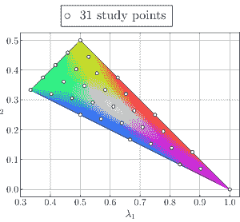

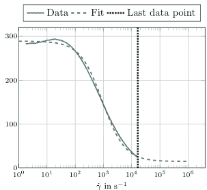

**图 5.5：** 采用 CMYK 着色且含 31 个评估点的纤维取向三角形 \( S_T \)（a），以及用于 Ultramid®B3K 的交叉型拟合材料数据（b）。图改编自 Sterr et al. (2024a, 图 5)。

为生成 FDMN 的训练数据和在线验证数据，我们使用基于 FFT 的计算程序来计算纤维悬浮液的有效黏性响应（Bertóti et al., 2021; Storr et al., 2023）。我们使用逐次添加与迁移法（Schneider, 2017）生成纤维取向三角形 $S_T$ 中 31 个取向状态 $\underline{\lambda}$ 所需的纤维悬浮液微结构，见图 5.5a。对于定义在方程 (2.37) 中的取向三角形 $S_T$ 的可视化，我们遵循 Köbler et al. (2018)，并采用 CMYK 着色方案。为保持计算有效黏性响应的工作量可行，我们将纤维体积分数限制为 25%，并为所有纤维赋予长度 $\ell$ 和直径 $d$。此外，我们将所有纤维的长径比 $r_a = \ell/d$ 设为 10，并采用 Storr et al. (2023) 关于所需微结构体元分辨率和尺寸的结果。因此，我们选择每纤维直径 15 个体素的分辨率，以及边长为 $L = 2.2\ell$ 的立方体体元。关于基体材料，我们基于 Storr et al. (2023; 2024b) 的研究，并规定商用聚酰胺 6（BASF, 2020）作为基体材料。与前几章 3 和 4 一样，我们使用收录于表 4.1 中的材料参数的交叉型本构方程 (3.2)。此外，我们还研究与前几章 3 和 4 相同的流动场景。更具体地说，对于所有非牛顿考虑，我们对研究剪切率集合 $S_{\dot{\gamma}}$ (3.44) 中的每个宏观标量剪切率 $\dot{\gamma}$，调查矩阵 $\overline{\underline{D}}$ (3.35) 中收录的六种载荷工况。因此，所有调查载荷工况的集合 $\dot{\overline{\mathcal{D}}}_\gamma$ 由方程 (3.35) 和 (3.44) 定义。由于刚性纤维内部的黏性应力在本构上定义不明确（Storr et al., 2023），我们采用相关齐化问题的双重公式用于基于 FFT 的计算。我们在错位网格（Harlow and Welch, 1965）上离散微结构，并对线性计算使用共轭梯度法（CG）求解得到的方程组，对非线性计算使用牛顿-CG 方法。旨在为图 5.5a 所示的 31 个纤维取向状态中的每一个训练一个 FDMN，


我们按照第 5.3.3 节所述的程序生成 32 个样品黏度，并计算相应的有效黏度。计算单个有效黏度需要进行五次基于 FFT 的计算（Bertóti 等人，2021），总计 4960 次计算，并得到 992 个计算出的有效黏度。在前几节 5.2.3 和 5.3.2 中，我们研究了 CLM 的线性同质化函数，并提出了 FDMN 架构来处理无限材料对比和不可压缩材料。在以下内容中，我们讨论了刚性颗粒悬浮液中 FDMN 的离线训练材料采样、离线训练过程以及在线评估。

### 5.4.2 离线训练

有了线性训练数据后，我们希望训练 FDMN 以预测剪切稀化纤维聚合物悬浮液的非牛顿黏性行为。我们遵循之前的工作（Gajek 等人，2020；2021），并将 FDMN 的深度选择为 \( K = 8 \)，以实现非线性计算的足够预测质量。深度为 \( K = 8 \)、秩为 \( R = 3 \) 的 CLM 的 FDMN 拥有 512 个权重和 638 个角度作为自由参数，符合方程 (5.53) 和 (5.73)。对于每个微结构，我们将训练数据 \(\mathcal{S}^D\) 定义为

\[
\mathcal{S}^D = \{(\mathbb{V}_1^s, \mathbb{V}_F, \bar{\mathbb{V}}^s) \mid s \in (1, ..., 32)\}, \quad (5.93)
\]

其中 \(\mathbb{V}_1^s\) 表示用方程 (5.54) 生成的样品黏度，\(\mathbb{V}_F\) 表示刚性纤维的无限黏度，\(\bar{\mathbb{V}}^s\) 代表样品 \( s \) 的有效黏度。对于每个微结构，我们将训练数据 \(\mathcal{S}^D\) 分为训练集 \(\mathcal{S}^t \subset \mathcal{S}^D\) 和验证集 \(\mathcal{S}^v \subset \mathcal{S}^D\)，分别占总训练数据的 90% 和 10%。训练集 \(\mathcal{S}^t\) 和验证集 \(\mathcal{S}^v\) 不共享任何样本，即 \(\mathcal{S}^t \cap \mathcal{S}^v = \varnothing\)。

作为 FDMN 参数的初始猜测，我们从各自的区间中均匀采样所有角度 $\underline{\alpha}$ 和权重 $\underline{w}$，并重新缩放权重 $\underline{w}$ 使其总和为单位。由于我们使用相对较小的 32 个样本作为训练数据，我们将其中很大一部分用于训练集 $\mathcal{S}^t$，并选择每个纤维取向状态 $\underline{\lambda}$ 训练 20 个 FDMN。此外，我们使用大小为 $N_{\mathrm{b}} = 8$ 的小型批次训练 FDMN，从训练集 $\mathcal{S}^t$ 中随机抽取。如果最后一个批次少于 8 个样本，则丢弃该批次。由于参数向量 $\underline{\alpha}$ 和 $\underline{w}$ 的初始化以及离线训练过程都是随机的，FDMN 的参数和拟合质量各不相同。通过每个纤维取向状态训练 20 个 FDMN，我们利用这种随机性，以获得拟合质量高的 FDMN。该策略旨在减少获得足够准确的 FDMN 所需的总计算工作量，因为在 32 个样本上反复训练 FDMN 所需的计算资源少于对较大样本量进行全场模拟。为了最小化损失函数 $\mathcal{L}$，我们选择 RAdam 算法（Liu 等人，2019a），并使用学习率扫除（Smith 和 Topin，2019）来确定学习率 $\kappa_{0, \alpha}$ 和 $\kappa_{0, w}$。通过学习率扫除，我们为两个参数组 $\underline{\alpha}$ 和 $\underline{w}$ 获得高度相似的学习率，使得 $\kappa_{0, \alpha} = \kappa_{0, w} = 1 \cdot 10^{-2}$。随着学习过程的推进，我们使用 PyTorch 的 StepLR 学习率调度器来改善向极小值的收敛（Darken 和 Moody，1990；Darken 等人，1992）。为此，我们每 150 个时代将学习率 $\kappa_{0, \alpha}$ 和 $\kappa_{0, w}$ 乘以常数因子 $f_{LR} = 0.75$。除了学习率外，我们对两个动量系数 $\beta_1 = 0.9$ 和 $\beta_2 = 0.999$ 以及稳定常数 $\varepsilon = 10^{-8}$ 使用了标准超参数。总体而言，我们对每个 FDMN 总共训练 2000 个时代。

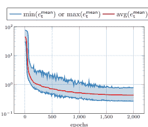

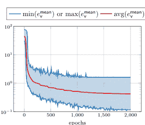

(a) 训练集 $\mathcal{S}^{\text{t}}$

(b) 验证集 $\mathcal{S}^{\text{v}}$

图 5.6: 所有训练 FDMN 在训练集 \( \mathcal{S}^{\text{t}} \) (a) 和验证集 \( \mathcal{S}^{\text{v}} \) (b) 上的最小、最大和平均均值误差 \( e^{\text{mean}} \)。图改编自 Sterr 等人（2024a，图 6）。

为了衡量拟合质量，我们定义了训练数据 \(\mathcal{S}^{\text{D}}\) 子集 \( \mathcal{S} \) 上的平均误差 \( e^{\text{mean}} \) 为

\[
e^{\text{mean}} = \frac{1}{|\mathcal{S}|} \sum_{(\mathbb{V}_1^s, \mathbb{V}_F, \bar{\mathbb{V}}^s) \in \mathcal{S}} \frac{\|\mathcal{DMN}_{\text{L}}(\mathbb{V}_1^s, \mathbb{V}_F, \underline{\alpha}, \underline{w}) - \bar{\mathbb{V}}^s\|_1}{\|\bar{\mathbb{V}}^s\|_1}, \quad (5.94)
\]

其中 \( |\mathcal{S}| \) 是集合 \( \mathcal{S} \) 的基数。取决于纤维取向状态 \( \underline{\lambda} \) 以及角度 \( \underline{\alpha} \) 和权重 \( \underline{w} \) 的初始猜测，每个 DMN 的拟合质量各不相同。因此，针对所有 620 个 FDMN 的整个训练过程，我们在图 5.6 中按时代可视化了训练集和验证集 \( \mathcal{S}^{\text{t}} \) 和 \( \mathcal{S}^{\text{v}} \) 的最小平均误差 \( \min(e^{\text{mean}}) \)、最大平均误差 \( \max(e^{\text{mean}}) \) 和平均平均误差 \( \text{avg}(e^{\text{mean}}) \)。对于训练集和验证集，我们观察到，所考虑的三种误差指标在训练开始时迅速下降，并随着训练继续而不断改善。由于 1500 个时代以后的学习率较小，训练过程结束时误差变化不显著，而最小平均误差 \(\min(e_{\text{t}}^{\text{mean}})\) 降至 0.3% 以下。这表明所有 FDMN 在训练集 \(\mathcal{S}^\text{t}\) 上都具有较高的拟合质量。与训练集 \(\mathcal{S}^\text{t}\) 相比，验证集 \(\mathcal{S}^\text{v}\) 的最大平均误差 \(\max(e_{\text{v}}^{\text{mean}})\) 和最小平均误差 \(\min(e_{\text{v}}^{\text{mean}})\) 之间的差异更大。然而，对于所有考虑的 FDMN，最大平均误差 \(\max(e_{\text{v}}^{\text{mean}})\) 始终保持在 2% 以下，且不会大幅波动。此外，平均平均误差 \(\text{avg}(e_{\text{v}}^{\text{mean}})\) 在训练过程中持续下降。因此，随着训练的推进，训练集和验证集上的预测质量平均得到改善，尽管最大平均验证误差 \(\max(e_{\text{v}}^{\text{mean}})\) 在 1250 个训练时代后没有显著改善。总体而言，这表明对训练数据集 \(\mathcal{S}^\text{t}\) 没有发生明显的过拟合。

### 5.4.3 在线评估

为了衡量 FDMN 的在线性能，我们定义在线误差函数 \(e_{\text{on}} : \text{Sym}_0(3) \rightarrow \mathbb{R}\) 为

\[
e_{\text{on}}(\bar{D}) = \frac{\|\sigma^{DMN}(\bar{D}) - \sigma^{FFT}(\bar{D})\|_2}{\|\sigma^{FFT}(\bar{D})\|_2}, \tag{5.95}
\]

其中 \(\|\cdot\|_2\) 表示曼德尔表示法中分量的 \(\ell^2\)-范数，\(\bar{D}\) 代表规定的有效应变速率张量，\(\sigma^{DMN} : \text{Sym}_0(3) \rightarrow \text{Sym}_0(3)\) 和 \(\sigma^{FFT} : \text{Sym}_0(3) \rightarrow \text{Sym}_0(3)\) 分别是 FDMN 和基于 FFT 的同质化的应力函数。然后我们选择所有加载情况中的最大误差 \(e_{\text{on}}^{\max}\) 和所有加载情况中的平均误差 \(e_{\text{on}}^{\text{mean}}\)

\[
e_{\text{on}}^{\max} = \max_{\bar{D} \in \bar{D}_\gamma} e_{\text{on}}, \quad e_{\text{on}}^{\text{mean}} = \frac{1}{|\bar{D}_\gamma|} \sum_{\bar{D} \in \bar{D}_\gamma} e_{\text{on}}(\bar{D}), \tag{5.96}
\]

以研究不同 FDMN 的性能。对于每个研究的取向状态 \(\underline{\lambda}\)，我们确定具有最小最大


误差 \( e_{on}^{\max} \) 并可视化纤维取向三角形上的相关误差 \( e_{on}^{\text{mean}} \) 和 \( e_{on}^{\max} \)，参见图 5.7a 和 5.7b。

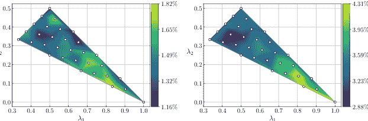

(a) 平均误差 \( e_{on}^{\text{mean}} \)   (b) 最大误差 \( e_{on}^{\max} \)

图 5.7: 纤维取向三角形上最佳 FDMN 的平均在线误差 \( e_{on}^{\text{mean}} \)（a）和最大在线误差 \( e_{on}^{\max} \)（b）。图改编自 Störr et al. (2024a, 图 7)。

最佳 FDMN 的最大误差 \( e_{on}^{\max} \) 在取向状态 \( \underline{\lambda} = (0.4444, 0.3611)^\top \) 时为 2.88%，在纤维取向状态 \( \underline{\lambda} = (0.8055, 0.1389)^\top \) 时为 4.31%。因此，对于所研究的取向状态，FDMN 在广泛的剪切速率 \( \dot{\gamma} \in [10, 10^5] \text{s}^{-1} \) 范围内满足工程要求的预测精度。此外，相对较低的最大误差 \( e_{on}^{\max} \) 表明，与固体材料以前的研究（例如 Liu et al. (2019b) 和 Liu and Wu (2019) 或 Gajek et al. (2020; 2021; 2022)）相比，使用更少的样本即可为刚性纤维悬浮液生成足够精确的 FDMN。一般而言，纤维取向三角形右下方更强取向状态的最大误差 \( e_{on}^{\max} \) 大于左上方取向较弱状态的最大误差。平均误差 \( e_{on}^{\text{mean}} \) 在取向状态 \( \underline{\lambda} = (0.8334, 0.0833)^\top \) 时为 1.16%，在取向状态 \( \lambda = (0.6528, 0.3194)^\top \) 时为 1.82%，这凸显了 FDMN 的预测精度。

为讨论一个具体示例，我们更详细地考察了在纤维取向状态 \(\lambda = (0.8055, 0.1389)^\top\) 处最佳 FDMN 的性能，该状态下出现最大最大误差 \(e_{on}^{\max} = 4.31\%\)。设应变率张量 \(\bar{D}_i \in \text{Sym}_0(3)\) 在标准基 \(\{e_i\}\) 和 Mandel 记法下的分量由矩阵 \(\bar{\underline{D}}/\dot{\gamma}\) 的第 \(i\) 列给出，参见公式 (3.35)。则张量 \(\bar{D}_i\) 表示单模长荷载，我们将张量 \(\bar{D}_i\) 称为工况。在以下部分，我们讨论了所有考虑的剪切速率 (3.44) 和公式 (3.35) 定义的六个工况下的观察应力响应及 FDMN 的预测质量，参见图 5.8。由于纤维在坐标方向 \(e_1\) 沿线强烈排列，工况 \(\bar{D}_{1}\) 的应力范数最大，该工况对应坐标方向 \(e_1\) 中的不可压缩伸长流，参见图 5.8a。

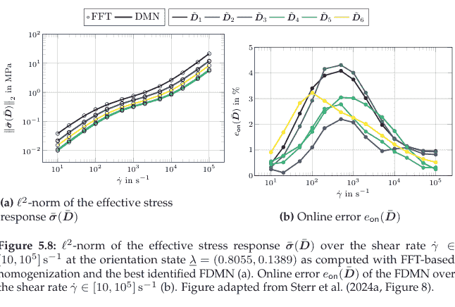

沿坐标方向 \(\boldsymbol{e}_2\) 和 \(\boldsymbol{e}_3\) 的伸长流应力响应的范数，即工况 \(\tilde{\boldsymbol{D}}_2\) 和 \(\tilde{\boldsymbol{D}}_3\)，相对较小。对于所考虑的最大剪切速率 \(\dot{\gamma} = 10^5 \text{ s}^{-1}\)，工况 \(\tilde{\boldsymbol{D}}_1\) 的应力范数为 21 MPa，工况 \(\tilde{\boldsymbol{D}}_2\) 和 \(\tilde{\boldsymbol{D}}_3\) 的应力范数分别为 11.8 MPa 和 12.1 MPa。由于坐标方向 \(\boldsymbol{e}_2\) 和 \(\boldsymbol{e}_3\) 沿线的纤维排列程度相似，工况 \(\tilde{\boldsymbol{D}}_2\) 和 \(\tilde{\boldsymbol{D}}_3\) 相关的应力范数仅略有不同。此外，工况 \(\tilde{\boldsymbol{D}}_4\) 和 \(\tilde{\boldsymbol{D}}_5\) 中剪切响应的应力范数小于工况 \(\tilde{\boldsymbol{D}}_6\) 中剪切响应的应力范数。同样，这是由坐标方向 \(\boldsymbol{e}_1\) 沿线纤维的强烈排列引起的，其在 \(\boldsymbol{e}_1\)-\(\boldsymbol{e}_2\) 平面中的流动阻力比其他剪切平面更大 (Sterr et al., 2024b)。对于所考虑的最大剪切速率 \(\dot{\gamma} = 10^5 \text{ s}^{-1}\)，工况 \(\tilde{\boldsymbol{D}}_4\)、\(\tilde{\boldsymbol{D}}_5\) 和 \(\tilde{\boldsymbol{D}}_6\) 的应力范数分别为 5.5 MPa、6.0 MPa 和 8.4 MPa。总体而言，FDMN 的有效应力响应 \(\bar{\boldsymbol{\sigma}}^{DMN}\) 的预测 \(\ell^2\)-范数与通过基于 FFT 的同质化计算的有效应力 \(\bar{\boldsymbol{\sigma}}^{FFT}\) 对所有研究的载荷方向 \(\tilde{\boldsymbol{D}}_i\)、\(i \in \{1, ..., 6\}\) 和剪切速率 \(\dot{\gamma} \in S_{\dot{\gamma}}\) 高度一致，参见图 5.8a。

FDMN 不仅预测了有效应力响应的 \(\ell^2\)-范数，还预测了其方向。这从图 5.8b 中显示的相对较小的在线误差 \(e_{\text{on}}(\tilde{\boldsymbol{D}})\) 可以看出。在各工况下，误差 \(e_{\text{on}}\) 会在区间 \([10^2, 10^3] \text{ s}^{-1}\) 内的某一点增加，随后在更高剪切速率下再次降低。最大误差出现在伸长工况 \(\tilde{\boldsymbol{D}}_3\)，为 4.31%，紧随其后的是伸长工况 \(\tilde{\boldsymbol{D}}_1\) 的 4.08%。对于剪切工况 \(\tilde{\boldsymbol{D}}_4\)、\(\tilde{\boldsymbol{D}}_5\) 和 \(\tilde{\boldsymbol{D}}_6\)，最大误差分别为 3.05%、2.78% 和 3.23%，而伸长工况 \(\tilde{\boldsymbol{D}}_2\) 的最大误差为 2.2%。剪切工况 \(\tilde{\boldsymbol{D}}_6\) 的最大误差出现在剪切速率 \(\dot{\gamma} = 10^2 \text{ s}^{-1}\) 处，而所有其他工况的最大误差均出现在剪切速率 \(\dot{\gamma} = 5 \cdot 10^2 \text{ s}^{-1}\) 处。这与 Cross 类型本构方程 (3.2) 直接相关，该方程在低剪切速率和高剪切速率下具有两个牛顿高原，中间具有非线性过渡。因此，对于大剪切速率 \(\dot{\gamma} \to \infty\)，基质行为呈牛顿流体，微结构的同质化函数趋近于线性同质化函数。由于 FDMN 对微结构非线性同质化函数进行一阶近似 (Gajek et al., 2020)，预测质量取决于基质表现出非线性行为的程度。这与之前关于剪切稀化纤维悬浮液建模的观察一致 (Sterr et al., 2023; 2024b)。

### 5.4.4 计算加速

| | 采样总计 | 每个取向的采样（平均） | 训练 |
|---|---|---|---|
| CPU 小时 | 24415 | 788 | 0.08 |
| 墙钟时间 (h) | 305 | 9.8 | 0.08 |

表 5.1: 使用基于 FFT 的同质化训练一个 FDMN 并采样有效粘度 \(\mathbb{V}^s\) 的 CPU 小时和墙钟时间。表改编自 Sterr et al. (2024a, 表 2)。

| | FFT (h) | DMN (ms) | 加速比 |
|---|---|---|---|
| Min | 2.08 | 600 | 11785 |
| Mean | 2.61 | 630 | 14828 |
| Max | 3.07 | 650 | 17225 |

表 5.2: 使用基于 FFT 的同质化评估单个工况与使用 FDMN 的加速比和墙钟时间。表改编自 Sterr et al. (2024a, 表 3)。

对于对 31 个考虑的纤维取向状态 \(\underline{\lambda} \in S_T\) 的线性同质化函数进行采样，我们使用了一台配备两个 AMD EPYC 7552 48 核心处理器和 1024 GB DRAM 的工作站。每个基于 FFT 的计算依赖单个线程，并行运行 80 个计算。总计，计算耗时 24415 CPU 小时，墙钟时间为 305 小时，参见表 5.1。对所有 31 个考虑的取向 \(\underline{\lambda}\) 取平均值，每个取向的计算量为 788 CPU 小时和 9.8 h 墙钟时间。对于 FDMN 的训练和在线评估以及非线性基于 FFT 的计算，我们使用了一台配备两个 AMD EPYC 9534 64 核心处理器和 1024 GB DRAM 的工作站，并在单个线程上运行所有计算。对单个纤维取向状态 \(\underline{\lambda}\) 按顺序评估所有六个工况 \(\boldsymbol{D}_i, i=1,\dots,6\) 和 13 个剪切速率 \(\dot{\gamma} \in S_{\dot{\gamma}}\) 的墙钟时间列于表 5.2。基于 FFT 的计算的墙钟时间从 2.08 h 到 3.07 h 不等，所有考虑的取向状态 \(\underline{\lambda}\) 的平均墙钟时间为 2.61 h。相比之下，FDMN 的在线评估耗时 600 ms 到 630 ms，平均值为 650 ms。因此，加速因子在 11785 到 17225 之间，平均值为 14828。这种显著的加速是通过将计算资源投入到微结构线性同质化函数的采样来实现的。对于所考虑的设置，判断这一投资是否合理很简单。对于一个微结构，生成训练数据并训练一个单一 FDMN 平均耗时 9.88 h 墙钟时间，而非线性基于 FFT 的计算平均耗时 2.61 h 墙钟时间。因此，假设非线性计算如所展示的设置一样在一个线程上运行，平均需要进行四次非线性计算才能抵消对 FDMN 的初始投资。鉴于元件规模模拟通常需要数千或数百万个微观计算 (Gajek et al., 2021; 2022)，在工程问题中采样和训练工作量很容易被抵消。


### 5.4.5 与机器学习辅助解析模型的比较

在本节中，我们将基于 FDMN 的预测纤维悬浮液有效行为的方法与 Sterr 等人（2024b）提出的另一种机器学习方法进行比较。作者提出了四种不同的剪切稀化纤维悬浮液有效粘度解析本构方程，并使用受监督机器学习识别了模型参数。模型参数是从使用基于 FFT 的计算技术获得的仿真数据中学习的，材料与本章所考虑的相同：悬浮在具有表 4.1 所示参数的 Cross 型基体材料中的刚性纤维。然而，FDMN 方法与解析方法遵循非常不同的范式。FDMN 通过学习相应的线性均质化函数来训练以近似微观结构的非线性均质化函数，无需预先了解实际本构方程。相比之下，解析模型的参数是从悬浮液的非线性应力响应中学习的，并且解析模型融入了关于预期材料行为的知识。尽管两种方法遵循不同的策略，但它们实现了可比的预测精度。对于本章考虑的载荷情况 $\bar{D}_{\dot{\gamma}}$ 和纤维取向状态 $\underline{\lambda}$，FDMN 的最大验证误差为 4.31%，出现在纤维取向状态 $\underline{\lambda} = (0.8055, 0.1389)^{\top}$。对于相同的载荷情况 $\bar{D}_{\dot{\gamma}}$ 和相同的纤维取向状态集 $\underline{\lambda}$，Sterr 等人（2024b）提出的四个解析模型中的三个达到最大预测误差 5.00%，出现在纤维取向状态 $\underline{\lambda} = (0.8334, 0.0833)^{\top}$。第四个模型与其他三个模型相比不尽理想，因为内置的应力-应变率叠加和取向平均假设对所考虑的悬浮液并不十分适用（Sterr 等人，2024b）。因此，FDMN 对于本论文所考虑的纤维悬浮液类型实现了略高的预测精度。此外，在一阶近似的限制条件下，FDMN 可以泛化到不同的本构方程，而所提出的解析模型不能，从而减少了 FDMN 所需的建模工作量。然而，本论文中使用的 FDMN 使用 1150 个自由参数，而解析模型使用 11 到 49 个参数。

就计算成本而言，为单个微观结构生成训练数据并训练一个 FDMN 平均耗时 9.88h 挂钟时间，见表 5.1。单个微观结构的解析模型参数是基于六个非线性基于 FFT 的仿真识别的，平均耗时 2.61h 挂钟时间。如果所有必需的仿真在一个线程上串行运行，则平均总挂钟时间为 15.70h，并分配 0.04h 来识别模型参数。然而，在所考虑的设置下，非线性基于 FFT 的仿真可以并行运行，因此解析模型参数可以比 FDMN 更快地获得。总之，FDMN 在所考虑的本构方程方面提供了更高的精度和灵活性，但需要更多的计算资源和更大数量的参数。此外，FDMN 固有地具有热力学一致性（Gajek 等人，2020，§3.1），并且固有地来自其相位的应力-应变率单调性（Gajek 等人，2020，附录 C）。相比之下，在本构模型中，热力学一致性和应力-应变率单调性都必须手动确保。

## 5.5 结论

在本章中，我们将直接 DMN 架构扩展到柔性 DMN（FDMN）架构，用于处理具有无限材料对比度和剪切稀化基体行为的纤维悬浮液。为此，我们为由 Stokes 流控制并由线性黏性相组成的双相层状乳液推导了线性均质化函数。更具体地，我们利用 Kabel 等人（2016b）和 Milton（2002）关于层合板均质化的结果，为这类层状乳液的有效性质推导了闭式解析表达式。由于一级层状材料在无限材料对比度的情况下不适合作为 DMN 的构建块，我们研究了涂层层状材料（CLM）的有效性质。我们利用一级层状材料的线性均质化函数，并研究了在什么条件下，如果核心材料是刚性的，CLM 的有效行为是非奇异的。这些条件取决于所用材料的物理约束，并涉及 CLM 的秩和层状方向的相对取向。对于不可压缩纤维悬浮液的相关情况，CLM 由不可压缩的涂层材料和刚性核心材料组成。然后，如果三个层状方向相互非正交且相互非共线，三级 CLM 的有效粘度是非奇异的。

利用层状材料和 CLM 的推导均质化函数，我们通过将（直接）DMN 中的一级层合板最底层替换为非奇异 CLM，并将其他一级层合板替换为能够处理流体的一级层状材料，将（直接）DMN 架构扩展到 FDMN 架构。对于 FDMN 的离线训练，我们提出了一种策略，即固定 CLM 层状方向的相对角度，以减少自由参数的数量并保证非奇异 CLM。此外，我们修改了直接 DMN 的在线评估策略，以考虑不可压缩相位。我们利用 FDMN 架构来预测具有 Cross 型基体材料的纤维悬浮液的非线性有效行为。与基于 FFT 的计算技术的直接数值仿真相比，FDMN 对 31 种纤维取向状态、六种不同的载荷情况以及与工程过程相关的广泛剪切速率范围实现了低于 4.31% 的验证误差。

如果不考虑生成训练数据和训练 FDMN 所需的时间，与基于 FFT 的仿真相比，FDMN 实现了平均 14828 倍的加速因子。此外，对于相同的复合材料，FDMN 达到了比 Sterr 等人（2024b）的另一种基于机器学习的方法更高的精度。然而，这种具有竞争力的精度提升是以增加获取 FDMN 训练数据的计算工作量为代价的。

# 第 6 章

# 总结、结论与展望

在本论文中，我们将高保真计算技术与机器学习相结合，以研究和模拟非牛顿纤维悬浮液的黏性行为。首先，我们开发了一种基于 FFT 的方法，用于非牛顿介质中刚性纤维悬浮液的计算均质化。我们采用开发的基于 FFT 的方法，研究了具有聚酰胺 6（PA6）基体材料的横各向同性纤维悬浮液在广泛工程流场景下的各向异性剪切稀化行为。其次，我们将纤维悬浮液各向异性剪切稀化行为的研究范围扩展到总共 109 种纤维取向状态，从而生成了用于机器学习技术的丰富数据集。我们将黏性纤维悬浮液行为编码在四个解析模型中，并使用受监督机器学习策略从生成的数据集中学习了模型参数。最后，我们开发了一种热力学一致的深度材料网络（DMN）架构，用于处理非牛顿介质中刚性纤维悬浮液。为此，我们为具有有限材料对比度的一级双相层状乳液推导了线性均质化函数。为了考虑无限材料对比度，我们为具有不可压缩相位的涂层层状材料推导了有效粘度的闭式表达式。在我们对可能的


在未来的研究中，我们将在下文总结每章的关键方面和发现。

# 第 3 章

- 由于我们考虑的是刚性悬浮纤维，变分问题 (3.18) 在构成上并不适定。我们表明，通过利用 Legendre–Fenchel 变换并切换到对偶公式 (3.24)，可以解决这个问题。使用错开网格处理不可压缩流体，以及采用双混合规则的复合体素，我们证明了双问题 (3.24) 可以使用基于 FFT 的技术和 Newton-CG 方法高效求解。这使得研究悬浮在非牛顿基体材料中的刚性纤维成为可能，而这此前无法实现。

- 通过有限数量的计算实验，可利用基于插值的矩阵方程和方向相关的伸长粘度来估计和可视化纤维悬浮液的有效粘度。

- 对于特定的横向各向同性取向状态和剪切稀化 PA6 基体材料，有效悬浮液粘度的各向异性程度随剪切速率和加载方向的变化而显著变化。在更高的纤维体积分数下，这种效应更为明显。

# 第 4 章

- 对于固定的纤维体积分数，有效粘度的各向异性及其对剪切速率的依赖性随纤维取向状态而显著变化。我们发现，取向更强的纤维取向状态会出现更强的变化，并且观察到单向状态下的变化最为强烈。

- 通过利用自动微分和基于梯度的学习的灵活性，我们建立了三个复杂程度各异的有效悬浮液粘度模型。针对 109 种不同的纤维取向状态，三个模型的误差均低于 5.15%。另一种基于 Mori-Tanaka 形式主义的模型表现并不理想。

- 我们证明了所考虑悬浮液的各向异性剪切稀化行为可以使用广义距离以工程精度进行编码，该广义距离取决于特定于取向状态的各向异性张量和应变速率张量。

# 第 5 章

- 通过利用线性弹性层合板的结果，我们推导了具有线性黏性相的分层乳液有效粘度的闭式表达式。这为开发用于处理纤维悬浮液的 DMN 铺平了道路。

- 对于不可压缩相，我们推导了涂覆层状材料的级数和层状方向的充分必要条件，使其有效性质非奇异，即使核心相是刚性的。特别是，涂覆层状材料的级数必须大于 2，且层状方向必须两两非正交且两两非共线。

- 我们将灵活深材料网络 (FDMN) 架构作为直接 DMN 框架的扩展进行了介绍。在 FDMN 中，最低同质化层由涂覆层状材料组成，而不是像典型直接 DMN 中那样由一级层状材料组成。这使得对无限材料对比度的实际处理成为可能，此前这非常困难。与直接 DMN 类似，FDMN 的其余层由一级层状材料组成。

- 针对 31 种纤维取向状态，我们证明了 FDMN 在预测悬浮在剪切稀化 PA6 基体中的刚性纤维的黏性行为方面具有竞争性的预测精度。我们观察到最大误差为 4.31%，低于第 4 章中所介绍模型的预测误差。

- 与第 4 章中所介绍的模型相比，FDMN 是在线性同质化数据上训练的，并且不包含对悬浮液预期材料行为的知识。此外，本论文中的 FDMN 是在比以往基于 DMN 的研究更小的数据集上训练的。这些考虑凸显了 FDMN 在非线性材料行为方面卓越的预测能力。

通过我们的工作，我们为非牛顿基体材料中纤维悬浮液的数值研究和建模做出了贡献。我们的主要贡献包括开发基于 FFT 的计算同质化方法、识别闭式有效粘度模型以及开发 FDMN 架构。总体而言，我们建模方法的适用性和规模主要受制于使用基于 FFT 的方法生成训练数据的计算成本。这凸显了进一步研究高效基于 FFT 的技术以及其他高效计算方法的必要性。特别是，降低计算需求将允许考虑具有更高纤维长径比的更大系统，或考虑额外的复杂物理。利用计算生成的数据，本论文中所介绍的闭式模型和 FDMN 架构能够实现高效的两尺度成形模拟。这可以用于复合材料制造中各种工艺过程模拟，例如注射成形和压缩成形。由于纤维在加工过程中可能会断裂，将闭式模型和 FDMN 架构与包含纤维长度分布的合成微观结构 (Mehta and Schneider, 2022) 和成形模拟 (Phelps et al., 2013) 相结合将非常有意义。

此外，开发的 FDMN 框架可以应用于涉及两个以上相和多个奇异相的问题，并可对此进行扩展。这包括诸如包含气态相的纤维悬浮液 (Shuler et al., 1994; Cui and Grace, 2007)、包含空隙的材料 (Mehdikhani et al., 2019; Sika et al., 2020) 或包含液体包裹体的固体 (Style et al., 2015; Wang and Henann, 2016) 等材料系统。特别是，当与纤维取向插值技术 (Gajek et al., 2021; Huang et al., 2022; Dey et al., 2024) 结合使用时，所介绍的 FDMN 可能实现新型的多尺度模拟。

# 附录 A

# 具有奇异核心的涂覆层状材料

## A.1 具有奇异核心的涂覆层状材料的奇异性条件

在 CLM 的核心材料 \(m_1\) 为刚性或代表空隙的特殊情况下，双或原始材料属性 \(\mathbb{K}_1\) 或 \(\mathbb{M}_1\) 分别趋于零。因此，更一般地，我们让材料张量 \(\mathbb{A}_1\) 趋于零，并将方程 (5.44) 改写为

\[
\lim_{\mathbb{A}_1 \to \mathbf{0}} \bar{\mathbb{A}} = \mathbb{A}_2 \left( \mathbb{I} + (1 - f_2) \left( -\mathbb{I} + f_2 \sum_{r=1}^R c_r \mathbb{\Gamma}_{\mathbb{A}_2}(\mathbf{n}_r) \mathbb{A}_2 \right)^{-1} \right). \tag{A.1}
\]

在下文中，我们研究了秩-\(R\) CLM 的有效材料属性 \(\bar{\mathbb{A}}\) 在什么条件下是奇异的。有效材料属性 \(\bar{\mathbb{A}}\) 当且仅当存在有效张量 \(\bar{\mathbf{g}} \in \{ \text{Sym}(3), \text{Sym}_0(3) \}\)，使得

\[
\bar{\mathbb{A}}[\bar{\mathbf{g}}] = \mathbf{0}. \tag{A.2}
\]

利用定义 (A.1)，方程 (A.2) 可以等价地改写为形式

\[
\left( \sum_{r=1}^R c_r \Gamma_{\mathbb{A}_2}(\boldsymbol{n}_r)\mathbb{A}_2 \right) [\bar{\boldsymbol{g}}] = \bar{\boldsymbol{g}}. \tag{A.3}
\]

方程 (A.3) 当且仅当 \(\bar{\boldsymbol{g}}\) 位于所有子空间 \(\mathcal{E}_r^A\) 的交集时满足，即

\[
\bar{\boldsymbol{g}} \in \bigcap_{r=1}^R \mathcal{E}_r^A, \tag{A.4}
\]

或，等价地，

\[
\Gamma_{\mathbb{I}}(\boldsymbol{n}_r)[\bar{\boldsymbol{g}}] = \bar{\boldsymbol{g}}, \quad \forall r \in \{1, ..., R\}. \tag{A.5}
\]

我们证明如下。首先，如果 \(\bar{\boldsymbol{g}}\) 位于满足 (A.4) 的所有子空间的交集中，则根据方程 (A.5) 和算子 \(\Gamma_{\mathbb{A}_2}(\boldsymbol{n}_r)\) (5.43) 的定义，可得

\[
\begin{aligned}
\left( \sum_{r=1}^R c_r \Gamma_{\mathbb{A}_2}(\boldsymbol{n}_r) \mathbb{A}_2 \right) [\bar{\boldsymbol{g}}] &= \left( \sum_{r=1}^R c_r \Gamma_{\mathbb{A}_2}(\boldsymbol{n}_r) \mathbb{A}_2 \Gamma_{\mathbb{I}}(\boldsymbol{n}_r)[\bar{\boldsymbol{g}}] \right) \\
&= \sum_{r=1}^R c_r \bar{\boldsymbol{g}} = \bar{\boldsymbol{g}},
\end{aligned} \tag{A.6}
\]

因此，方程 (A.3) 得到满足。其次，我们希望证明逆命题也成立，即，如果方程 (A.3) 得到满足，则方程 (A.4) 也得到满足。令 \(\mathbb{T}_{\mathbb{A}_2}\) 表示投影算子 \(\Gamma_{\mathbb{A}_2}(\boldsymbol{n}_r)\mathbb{A}_2\) 的凸组合，即

\[
\mathbb{T}_{\mathbb{A}_2} = \left( \sum_{r=1}^R c_r \Gamma_{\mathbb{A}_2}(\boldsymbol{n}_r) \mathbb{A}_2 \right), \tag{A.7}
\]

其中

\[
c_r > 0 \quad \text{and} \quad \sum_{r=1}^R c_r = 1. \tag{A.8}


然后，算子 \(\mathbb{T}_{\mathbb{A}_2}\) 的不动点属于集合 (Reich, 1983, Lemma 1.4)

\(\mathcal{E} = \bigcap_{r=1}^R \mathcal{E}_r^{\mathsf{A}}.\) (A.9)

因此，算子 \(\mathbb{T}_{\mathbb{A}_2}$ 对应于特征值 1 的任何特征向量都必须位于子空间 \(\mathcal{E}_r^{\mathsf{A}}\) 的交集中，我们用 \(\mathcal{E}$ 表示该交集。特别是，如果满足方程 (A.3)，则元素 \(\bar{\boldsymbol{g}}$ 位于 \(\mathcal{E}$ 中，即，

\(\mathbb{T}_{\mathbb{A}_2}[\bar{\boldsymbol{g}}] = \bar{\boldsymbol{g}}, \implies \bar{\boldsymbol{g}} \in \mathcal{E}\) (A.10)

且方程 (A.4) 亦满足。

有了结果 (A.10)，我们观察到，R 阶 CLM 正则性的一个充要条件是空间 \(\mathcal{E}$ 为平凡空间，即，

\(\mathcal{E} = \{ \mathbf{0} \}.\) (A.11)

在以下内容中，我们将方程 (A.11) 称为 *非奇异性条件*。在线性弹性和线性粘性材料的背景下，我们对空间 \(\mathcal{E}_r^{\mathsf{A}}\) 推导了非奇异性条件 (A.11)，使得

\(\mathcal{E}_r^{\mathsf{A}} \subset \text{Sym}(3), \forall r \in \{1, ..., R\} \text{ or } \mathcal{E}_r^{\mathsf{A}} \subset \text{Sym}_0(3), \forall r \in \{1, ..., R\}.\) (A.12)

然而，所提出的证明扩展到其他可以用方程 (A.1) 形式表述的问题，例如热弹性或压电问题 (Milton, 2002, §9)。以 CLM 作为 DMN 架构中的构建块为目标，我们有兴趣了解是否存在特定的层状方向 \(\boldsymbol{n}_r$ 和 CLM 阶数 \(R$ 的选择，使得 CLM 的有效性质始终是非奇异的，即，满足非奇异性条件 (A.11)。对于刚性纤维的不可压缩悬浮液，我们研究了具有刚性核心材料 \(m_1$ 和不可压缩包覆材料 \(m_2$ 的 CLM 的这一问题。

## A.2 具有不可压缩包覆材料和刚性核心材料的包覆层状材料

对于涉及不可压缩介质中刚性包含体的应用，我们考虑具有不可压缩包覆材料 \(m_2$ 和刚性核心材料 \(m_1$ 的 CLM。因此，空间 \(\mathcal{E}_r^A \subset \text{Sym}_0(3)$ 具有形式

\(\mathcal{E}_r^A = \{ B \in \text{Sym}_0(3) \mid B \cdot (n_r \otimes_s a) = 0,\)
\(\forall a \in \mathbb{R}^3 \text{ with } a \cdot n_r = 0 \},\) (A.13)

空间 \(\mathcal{E}_r^A$ 和 \(\text{Sym}_0(3)$ 的尺寸由以下给出

\(\text{dim}(\mathcal{E}_r^A) = 3, \text{ and } \text{dim}(\text{Sym}_0(3)) = 5.\) (A.14)

因为维度 \(\text{dim}(\mathcal{E}_1^A + \mathcal{E}_2^A)$ 被空间 \(\text{Sym}_0(3)$ 的维度所界限，使得

\(\text{dim}(\mathcal{E}_1^A + \mathcal{E}_2^A) \le 5,\) (A.15)

根据两个空间 \(\mathcal{E}_1^A$ 和 \(\mathcal{E}_2^A$ 交集的维度

\(\text{dim}(\mathcal{E}_1^A \cap \mathcal{E}_2^A) = \text{dim}(\mathcal{E}_1^A) + \text{dim}(\mathcal{E}_2^A) - \text{dim}(\mathcal{E}_1^A + \mathcal{E}_2^A),\) (A.16)

可得

\(\text{dim}(\mathcal{E}_1^A \cap \mathcal{E}_2^A) \ge 3 + 3 - 5 = 1.\) (A.17)

换句话说，空间 \(\mathcal{E}_1^A$ 和 \(\mathcal{E}_2^A$ 的交集至少为一维。因此，两个层状方向不足以满足条件 (A.11)。除了所需的层数之外，我们还想知道层状方向之间的角度是否存在限制。假设一个层状方向与另外两个方向正交。我们讨论方向 \(\boldsymbol{n}_3$ 与法向量 \(\boldsymbol{n}_1$ 和 \(\boldsymbol{n}_2$ 正交的情况。其他情况通过变换索引类似处理。此时有

\(\boldsymbol{n}_3 \cdot \boldsymbol{n}_1 = 0, \quad \text{and} \quad \boldsymbol{n}_3 \cdot \boldsymbol{n}_2 = 0,\) (A.18)

且交集 \(\mathcal{E}_1^{\text{A}} \cap \mathcal{E}_2^{\text{A}} \cap \mathcal{E}_3^{\text{A}}$ 不仅包含零元素 \(\mathbf{0}$。因此，条件 (A.11) 被违反。为证明这一点，我们考虑空间 \(\mathcal{E}_r^{\text{A}}$ 的替代描述

\(\mathcal{E}_r^{\text{A}} = \{ \boldsymbol{B} \in \text{Sym}_0(3) \mid \boldsymbol{B}\boldsymbol{n}_r = \alpha \boldsymbol{n}_r \quad \text{for some} \quad \alpha \in \mathbb{R} \}\) (A.19)

这与方程 (A.13) 等价，并通过所有具有层状方向 \(\boldsymbol{n}_r$ 作为特征向量的张量 \(\boldsymbol{B} \in \mathcal{E}_r^{\text{A}}$ 来表征空间 \(\mathcal{E}_r^{\text{A}}\)。那么张量

\(\boldsymbol{B} = \boldsymbol{n}_1 \otimes \boldsymbol{n}_1 + \boldsymbol{m}_2 \otimes \boldsymbol{m}_2 - 2\boldsymbol{n}_3 \otimes \boldsymbol{n}_3,\) (A.20)

其中层状方向 \(\boldsymbol{m}_2$ 通过正交化构造，使得

\(\boldsymbol{m}_2 = \boldsymbol{n}_2 - (\boldsymbol{n}_1 \cdot \boldsymbol{n}_2)\boldsymbol{n}_1,\) (A.21)

是交集 \(\mathcal{E}_1^{\text{A}} \cap \mathcal{E}_2^{\text{A}} \cap \mathcal{E}_3^{\text{A}}$ 的一个元素。这是因为

\(\text{tr}(\boldsymbol{B}) = 0, \boldsymbol{B}\boldsymbol{n}_1 = \boldsymbol{n}_1, \quad \boldsymbol{B}\boldsymbol{n}_2 = \boldsymbol{n}_2, \quad \boldsymbol{B}\boldsymbol{n}_3 = \boldsymbol{n}_3,\) (A.22)

因此条件 (A.11) 被违反。换句话说，具有不可压缩包覆材料和刚性核心材料的三阶 CLM 的有效性质 \(\bar{\mathbb{A}}$，其中一个层状方向 \(\boldsymbol{n}_3$ 与另外两个层状方向 \(\boldsymbol{n}_1$ 和 \(\boldsymbol{n}_2$ 正交，总是奇异的。特别是，如果所有三个层状方向相互正交，则三阶 CLM 的有效性质 \(\bar{\mathbb{A}}$ 是奇异的。

相比之下，设三个层状方向相互非正交且相互非共线，即，

\(0 < |\boldsymbol{n}_1 \cdot \boldsymbol{n}_2| < 1, \quad 0 < |\boldsymbol{n}_1 \cdot \boldsymbol{n}_3| < 1, \quad 0 < |\boldsymbol{n}_2 \cdot \boldsymbol{n}_3| < 1.\) (A.23)

我们考虑交集 \(\mathcal{E}_1^{\text{A}} \cap \mathcal{E}_2^{\text{A}} \cap \mathcal{E}_3^{\text{A}}$ 中的一个元素 \(\boldsymbol{B}$，并希望证明张量 \(\boldsymbol{B}$ 消失，从而满足非奇异性条件 (A.11)。因为张量 \(\boldsymbol{B}$ 是对称的，其对应于不同特征值的特征向量相互正交。因此，如果特征值互异，则层状方向需要相互正交。然而，这与我们的假设 (A.23) 矛盾。因此，张量 \(\boldsymbol{B}$ 具有一个特征值 \(\alpha$ 及其对应的特征空间 \(\mathbb{R}^3$，即，张量 \(\boldsymbol{B}$ 具有形式

\(\boldsymbol{B} = \alpha \boldsymbol{I}, \quad \alpha \in \mathbb{R}.\) (A.24)

此外，因为张量 \(\boldsymbol{B}$ 的迹消失，即 \(\text{tr}(\boldsymbol{B}) = 0$，可得特征值 \(\alpha$ 为零。因此，张量 \(\boldsymbol{B}$ 必须消失，非奇异性条件 (A.11) 得以满足，并且具有不可压缩包覆材料 \(m_2$ 和刚性核心材料 \(m_1$ 的三阶 CLM 的有效性质 \(\bar{\mathbb{A}}$ 是非奇异的，前提是三个层状方向相互非正交且非共线。

# 参考文献

Advani, S. G., Tucker III, C. L., 1987. 使用张量描述和预测短纤维复合材料中的纤维取向. Journal of Rheology 31 (8), 751–784.

Armijo, L., 1966. 具有利普希茨连续一阶偏导数的函数的最小化. Pacific Journal of Mathematics 16 (1), 1–3.

Ashwin, N. R., Cao, Z., Muralidhar, N., Tafti, D., Karpatne, A., 2022. 预测致密颗粒悬浮液中流体力的深度学习方法. Powder Technology 401, 117303.

Ashwin, N. R., Tafti, D., Muralidhar, N., Cao, Z., 2024. 致密椭球颗粒悬浮液中流动和力预测的物理信息深度学习. Powder Technology 439, 119684.

Balboa Usabiaga, F., Kallemov, B., Delmotte, B., Bhalla, A., Griffith, B., Donev, A., 2017. 被动和主动刚性颗粒悬浮液的流体力学：一种刚性多团块方法. Communications in Applied Mathematics and Computational Science 11 (2), 217–296.

Barzilai, J., Borwein, J. M., 1988. 两点步长梯度方法. IMA Journal of Numerical Analysis 8 (1), 141–148.

BASF, 2020. Ultramid®B3K 聚酰胺 6 材料数据. https://www.campusplastics.com/campus/de/datasheet/Ultramid%C2%AE+B3K/BASF/20/3a22f000, 访问日期: 2020-09-26.

Batchelor, G., 1970. 无力颗粒悬浮液中的应力系统. Journal of Fluid Mechanics 41 (3), 545–570.


Batchelor, G., 1971. 纯应变运动下非稀释延长颗粒悬浮液产生的应力. 流体力学杂志 46 (4), 813–829.

Bauer, J. K., Böhlke, T., 2022. 纤维取向张量的多样性. 固体力学与数学 27 (7), 1185–1211.

Bauer, J. K., Schneider, M., Böhlke, T., 2023. 四阶纤维取向张量相空间研究. 弹性力学杂志 153 (2), 161–184.

Bertóti, R., 2021. 基于平均场和全场均质化的纤维悬浮液流动诱导各向异性有效粘度建模. 博士论文, KIT科学出版社, 德国卡尔斯鲁厄.

Bertóti, R., Böhlke, T., 2017. 短FRP中的流动诱导各向异性粘度. 先进材料与现代工艺力学 3 (1), 1–12.

Bertóti, R., Wicht, D., Hrymak, A., Schneider, M., Böhlke, T., 2021. 基于FFT的短纤维增强热塑性塑料有效粘度计算研究. 欧洲力学期刊-B/流体 90, 99–113.

Bertram, A., 2012. 大变形的弹性与塑性. 施普林格, 德国柏林、海德尔堡.

Bhattacharya, K., Suquet, P., 2005. 关于形状记忆多晶体可恢复应变的模型问题. 皇家学会学报A：数学、物理与工程科学 461 (2061), 2797–2816.

Binding, D., 1991. 长(玻璃)纤维增强聚丙烯的毛细流与收缩流. 复合材料制造 2 (3-4), 243–252.

Böhlke, T., 2004. 各向同性粘塑性FCC多晶体应力势的福伊特界. 力学档案 56 (6), 425–445.

Böhlke, T., Bertram, A., 2003. 粘塑性FCC多晶体应变率势的罗伊斯界. 技术力学-欧洲工程力学期刊 23 (2-4), 184–194.

Böhlke, T., Brüggemann, C., 2001. 广义胡克定律的图形表示. 技术力学 21 (2), 145–158.

Böhlke, T., Henning, F., Hrymak, A. N., Kärger, L., Weidenmann, K., Wood, J. T., 2019. 连续-不连续纤维增强聚合物：一种综合工程方法. 卡尔·汉泽出版有限公司, 德国慕尼黑.

Boodaghidezaji, M., Khan, M., Ardekani, A. M., 2022. 基于神经网络和高斯过程的纤维悬浮液流变性能多保真度预测建模. 流体物理 34 (5).

Botín-Sanabria, D. M., Mihaita, A.-S., Peimbert-García, R. E., Ramírez-Moreno, M. A., Ramírez-Mendoza, R. A., Lozoya-Santos, J. d. J., 2022. 数字孪生技术的挑战与应用：全面综述. 遥感 14 (6), 1335.

Brunn, P., 1977. 二级流体中刚性颗粒的缓慢运动. 流体力学杂志 82 (3), 529–547.

Brunn, P., 1980. 粘弹性流体中刚性颗粒的运动. 非牛顿流体力学期刊 7 (4), 271–288.

Castro, J., Tomlinson, G., 1990. SMC压缩成型中的成型力预测. 聚合物工程与科学 30 (24), 1568–1573.

Chambolle, A., Pock, T., 2016. 成像连续优化导论. 数值学报 25, 161–319.

Chen, X., Liu, S., Sun, R., Hong, M., 2018. 一类用于非凸优化的ADAM型算法收敛性研究. arXiv:1808.02941.

Coffin, D., Pipes, R. B., 1991. 排列不连续纤维复合材料的本构关系. 复合材料制造 2 (3-4), 141–146.

Cross, M. M., 1965. 非牛顿流体流变学：假塑性系统的新流动方程. 胶体科学期刊 20 (5), 417–437.

Cross, M. M., 1970. 非牛顿流动的动力学解释. 胶体与界面科学期刊 33 (1), 30–35.

Cui, H., Grace, J. R., 2007. 木浆纤维悬浮液和浆体的流动：综述. 多相流国际期刊 33 (9), 921–934.

Darken, C., Chang, J., Moody, J., 等, 1992. 用于加速随机梯度搜索的学习率调度. 信号处理神经网络 2, 3–12.

Darken, C., Moody, J., 1990. 关于随机优化学习率调度的说明. 神经信息处理系统进展 3, 832–838.

Dembo, R. S., Eisenstat, S. C., Steihaug, T., 1982. 不精确牛顿法. 数值分析SIAM期刊 19 (2), 400–408.

Dey, A. P., Welschinger, F., Schneider, M., Gajek, S., Böhlke, T., 2022. 基于非弹性告知策略训练深度材料网络以复现短纤维增强热塑性塑料的蠕变加载. 应用力学档案 92 (9), 2733–2755.

Dey, A. P., Welschinger, F., Schneider, M., Gajek, S., Böhlke, T., 2023. 基于深度材料网络的短纤维增强热塑性塑料粘塑性和蠕变行为多尺度模型快速反标定. 塑性国际期刊 160, 103484.

Dey, A. P., Welschinger, F., Schneider, M., Köbler, J., Böhlke, T., 2024. 深度材料网络在强非线性载荷工况下短纤维增强热塑性塑料多尺度虚拟表征中的有效性研究. 应用力学档案 94, 1177–1202.

Dinh, S. M., Armstrong, R. C., 1984. 半浓纤维悬浮液的流变状态方程. 流变学期刊 28 (3), 207–227.

Domurath, J., Ausias, G., Féré, J., Saphiannikova, M., 2020. 幂律流体中刚性杆稀释悬浮液的数值研究. 非牛顿流体力学期刊 280, 104280.

Domurath, J., Saphiannikova, M., Féré, J., Ausias, G., Heinrich, G., 2015. 基于Bird–Carreau模型的球形颗粒稀释悬浮液中的应力与应变放大. 非牛顿流体力学期刊 221, 95–102.

Duchi, J., Hazan, E., Singer, Y., 2011. 用于在线学习和随机优化的自适应子梯度方法. 机器学习研究期刊 12 (7), 2121–2159.

Edelen, D. G., 1973. 关于对称关系和耗散势存在性的研究. 合理力学与分析档案 51, 218–227.

Einstein, A., 1905. 分子尺寸的新测定. 博士论文, ETH苏黎世, 瑞士苏黎世.

Ericksen, J., 1959. 各向异性流体. 合理力学与分析档案 4 (1), 231–237.

Ericksen, J., 1960. 横向各向异性流体. 胶体杂志 173 (2), 117–122.

Eschbach, A. R., 1993年12月21日. 动态剪切流变仪及方法. 美国专利 5,271,266.

Favaloro, A. J., Tseng, H.-C., Pipes, R. B., 2018. 复合材料成型模拟的新型各向异性粘性本构模型. 复合材料A部分：应用科学与制造 115, 112–122.

Férec, J., Bertevas, E., Khoo, B. C., Ausias, G., Phan-Thien, N., 2016. 剪切稀薄行为对充填流体中杆状颗粒取向的影响. 流体力学杂志 798, 350–370.

Férec, J., Bertevas, E., Khoo, B. C., Ausias, G., Phan-Thien, N., 2017. Bingham流体中半浓杆状悬浮液的流变本构模型. 流体物理 29 (7), 073103.

Feyel, F., 2003. 基于广义连续介质的多层有限元方法(FE2)用于描述高度非线性结构的响应. 应用力学与工程中的计算机方法 192 (28-30), 3233–3244.

Fokker, A. D., 1914. 辐射场中旋转电偶极子的平均能量. 物理年鉴 348 (5), 810–820.

Friesenbichler, W., Duretek, I., Rajganesh, J., Kumar, S. R., 2011. 使用新型流变注射模具在高剪切速率下测量压力相关粘度. 聚合物 56 (1), 58–62.

Gajek, S., Schneider, M., Böhlke, T., 2020. 深度材料网络的微观力学研究. 固体力学与物理期刊 142, 103984.

Gajek, S., Schneider, M., Böhlke, T., 2021. 短纤维增强塑料构件多尺度分析的FE-DMN方法. 应用力学与工程中的计算机方法 384, 113952.

Gajek, S., Schneider, M., Böhlke, T., 2022. 热力学复合材料多尺度分析的FE-DMN方法. 计算力学 69 (5), 1087–1113.


- Goddard, J., 1976a. 由非牛顿延伸流定向的细长颗粒的应力场。流体力学杂志 78 (1), 177–206.

- Goddard, J., 1978. 含定向细长纤维的幂律流体的拉伸行为。流变学杂志 22 (6), 615–622.

- Goddard, J. D., 1976b. 非牛顿流体中流向定向细长颗粒的拉伸应力贡献。非牛顿流体力学杂志 1, 1–17.

- Goldstein, A. A., 1965. 关于最速下降法。工业与应用数学学会杂志，A系列：控制 3 (1), 147–151.

- Goodship, V., 2017. ARBURG注塑实用指南。Smithers Rapra，英国肖斯伯里.

- Görthofer, J., Meyer, N., Pallicity, T. D., Schöttl, L., Trauth, A., Schemmann, M., Hohberg, M., Pinter, P., Elsner, P., Henning, F., et al., 2019. 片状模塑料复材的虚拟工艺链：开发、验证与前景。复合材料 Part B：工程 169, 133–147.

- Harlow, F. H., Welch, J. E., 1965. 带自由表面流体时间相关黏性不可压缩流动的数值计算。流体物理 8 (12), 2182–2189.

- Haupt, P., 2002. 连续介质力学与材料理论。Springer，德国柏林、海德尔堡.

- He, Q.-C., Curnier, A., 1995. 受损弹性应力-应变关系的更根本方法。固体与结构国际期刊 32 (10), 1433–1457.

- Henning, F., Kärger, L., Dörr, D., Schirmaier, F. J., Seuffert, J., Bernath, A., 2019. 汽车结构复合材料部件的快速成型与连续模拟。复合材料科学与技术 171, 261–279.

- Hill, R., 1963. 增强固体的弹性能：一些理论原理。固体力学与物理学杂志 11 (5), 357–372.

- Huang, T., Liu, Z., Wu, C., Chen, W., 2022. 微结构引导的深度材料网络，用于快速非线性材料建模与不确定性定量。应用力学与工程计算机方法 398, 115197.

- Kabanikhin, S. I., 2008. 逆问题与不适定问题的定义与示例。逆问题与不适定问题杂志 16, 317–357.

- Kabel, M., Böhlke, T., Schneider, M., 2014. 用于大变形弹性FFT基齐次化的高效定点与Newton–Krylov求解器。计算力学 54 (6), 1497–1514.

- Kabel, M., Fink, A., Schneider, M., 2017. 非弹性问题的复合体素技术。应用力学与工程计算机方法 322, 396–418.

- Kabel, M., Fliegenner, S., Schneider, M., 2016a. 有限应变FFT基齐次化的混合边界条件。计算力学 57 (2), 193–210.

- Kabel, M., Ospald, F., Schneider, M., 2016b. 在常规网格上利用超弹性层合板近似界面的有限应变计算齐次化模型阶梯缩减方法。应用力学与工程计算机方法 309, 476–496.

- Kaloni, P., Stastna, V., 1983. 球形颗粒在二阶流体中悬浮液的稳定剪切流变行为。聚合物工程与科学 23 (8), 465–470.

- Kanatani, K., 1984. 方向数据分布与织构张量。工程科学国际期刊 22 (2), 149–164.

- Kanit, T., Forest, S., Galliet, I., Mounoury, V., Jeulin, D., 2003. 随机复材代表体积单元尺寸的确定：统计与数值方法。固体与结构国际期刊 40 (13-14), 3647–3679.

- Karl, T., Böhlke, T., 2022. 粘性短纤维悬浮液与固体短纤维增强复材的统一平均场建模。应用力学档案 92 (12), 3695–3727.

- Karl, T., Gatti, D., Böhlke, T., Frohnapfel, B., 2021. 短纤维增强复材流动诱导黏性与弹性各向异性的耦合模拟。力学学报 232 (6), 2249–2268.

- Kennedy, P., Zheng, R., 2013. 注塑模流分析。Carl Hanser Verlag GmbH Co KG，德国慕尼黑.

- Khan, M., More, R. V., Ardekani, A. M., 2023. 剪切稠密纤维悬浮液的构成模型。流体物理 35 (1), 013337.

- Kingma, D. P., Ba, J., 2014. Adam：一种随机优化方法。arXiv:1412.6980

- Köbler, J., Schneider, M., Ospald, F., Andrä, H., Müller, R., 2018. 短纤维增强复材部件多尺度分析的纤维取向插值。计算力学 61, 729–750.

- Koch, D. L., 1995. 纤维悬浮液取向扩散模型。流体物理 7 (8), 2086–2088.

- Kochmann, J., Wulfinghoff, S., Reese, S., Mianroodi, J. R., Svendsen, B., 2016. 基于双尺度FE–FFT与相场的体相微结构演化与宏观材料行为计算建模。应用力学与工程计算机方法 305, 89–110.

- Krawietz, A., 2013. 材料理论：现象学热机械行为的数学描述。Springer，德国柏林、海德尔堡.

- Krishnan, J. M., Deshpande, A. P., Kumar, P. S., 2010. 复杂流体流变学。Springer，德国柏林、海德尔堡.

- Kube, C. M., 2016. 晶体的弹性各向异性。AIP Advances 6 (9), 095209.

- Landau, L. D., Lifshitz, E. M., 2013. 流体力学。第6卷。Elsevier，荷兰阿姆斯特丹.

- Leal, L., 1975. 二阶流体中细长棒状颗粒的慢运动。流体力学杂志 69 (2), 305–337.

- Li, T., 2024. 微观力学信导的参数化深度材料网络，用于变形态异质材料物理行为预测。应用力学与工程计算机方法 419, 116687.

- Liu, D. C., Nocedal, J., 1989. 大规模优化的有限内存BFGS方法。数学规划 45 (1), 503–528.

- Liu, I.-S., 2002. 连续介质力学。第5卷。Springer，德国柏林、海德尔堡.

- Liu, L., Jiang, H., He, P., Chen, W., Liu, X., Gao, J., Han, J., 2019a. 自适应学习率方差及其之外。arXiv:1908.03265

- Liu, Z., 2020. 带凝聚层的深度材料网络：多阶段训练与界面失效分析。应用力学与工程计算机方法 363, 112913.

- Liu, Z., 2021. 应用于多尺度应变定位建模的深度材料网络中的细胞分裂。应用力学与工程计算机方法 384, 113914.

- Liu, Z., Wu, C., 2019. 探索数据驱动多尺度力学中深度材料网络的3D架构。固体力学与物理学杂志 127, 20–46.

- Liu, Z., Wu, C., Koishi, M., 2019b. 用于异质材料多维拓扑学习与加速非线性建模的深度材料网络。应用力学与工程计算机方法 345, 1138–1168.

- Liu, Z., Wu, C., Koishi, M., 2019c. 用于无缝结构–性质预测的深度材料网络迁移学习。计算力学 64 (2), 451–465.

- Lucarini, S., Upadhyay, M. V., Segurado, J., 2021. 微观力学中基于FFT的方法：基础、方法与应用。材料科学与工程中的建模与仿真 30 (2), 023002.

- Mahalanobis, P. C., 1936. 统计学中的广义距离。载于：印度国家科学院论文集。第2卷.

- Mandel, J., 1966. 关于加工硬化与塑性流动定律研究的理论贡献。载于：应用力学：第十一届国际应用力学大会论文集，1964年德国慕尼黑。Springer，德国柏林、海德尔堡.

- Marin, O., Gustavsson, K., Tornberg, A.-K., 2012. 受限Stokes流动的高精度边界处理。计算机与流体 66, 215–230.

- Mehdikhani, M., Gorbatikh, L., Verpoest, I., Lomov, S. V., 2019. 纤维增强聚合物复材中的空隙：其形成、特征及对力学性能影响的综述。复合材料杂志 53 (12), 1579–1669.


Mehta, A., Schneider, M., 2022. 用于生成具有规定长度分布的短纤维显微组织的顺序添加与迁移方法. Computational Mechanics 70 (4), 829–851.

Meyer, N., Gajek, S., Görthofer, J., Hrymak, A., Kärger, L., Henning, F., Schneider, M., Bohlke, T., 2023. 用于量化片状模塑料工艺诱导不确定性的概率虚拟工艺链. Composites Part B: Engineering 249, 110380.

Mezhoud, S., Monchiet, V., Bornert, M., Grande, D., 2020. 基于FFT的数值均匀化法计算双孔隙介质宏观渗透率. European Journal of Mechanics-B/Fluids 83, 141–155.

Milton, G. W., 2002. 复合材料理论. Cambridge University Press, Cambridge, United Kingdom.

Mobuchon, C., Carreau, P. J., Heuzey, M.-C., Sepehr, M., Ausias, G., 2005. 短玻璃纤维增强聚丙烯的剪切和伸长性能. Polymer Composites 26 (3), 247–264.

Montgomery-Smith, S., He, W., Jack, D. A., Smith, D. E., 2011. 三维Jeffery方程的精确张量封闭. Journal of Fluid Mechanics 680, 321–335.

Morro, A., Giorgi, C., 2023. 连续介质物理的数学建模. Springer, Berlin, Heidelberg, Germany.

Mortazavian, S., Fatemi, A., 2015. 短纤维增强聚合物复合材料中纤维取向和各向异性对拉伸强度和弹性模量的影响. Composites Part B: Engineering 72, 116–129.

Moulinec, H., Suquet, P., 1994. 计算复合材料线性和非线性力学性能的快速数值方法. Comptes Rendus de l'Académie des sciences. Série II. Mécanique, physique, chimie, astronomie, hal-03019226.

Moulinec, H., Suquet, P., 1998. 计算具有复杂微结构的非线性复合材料整体响应的数值方法. Computer Methods in Applied Mechanics and Engineering 157 (1-2), 69–94.

Neumaier, A., 1998. 求解病态和奇异线性方程组：正则化教程. SIAM Review 40 (3), 636–666.

Nguyen, V. D., Noels, L., 2022a. 基于相互作用的材料网络：(多孔)微结构材料的通用框架. Computer Methods in Applied Mechanics and Engineering 389, 114300.

Nguyen, V. D., Noels, L., 2022b. 从相互作用视角重新审视基于微观力学的材料网络：多相复合材料的鲁棒高效实现. European Journal of Mechanics-A/Solids 91, 104384.

Owen, A. B., 1998. Sobol’和Niederreiter–Xing点的扰动. Journal of Complexity 14 (4), 466–489.

Park, C., Lee, W., Yoo, Y., Kim, E., 2001. 纤维增强聚合物复合材料压缩成型中纤维取向的研究. Journal of Materials Processing Technology 111 (1-3), 233–239.

Paszke, A., Gross, S., Massa, F., Lerer, A., Bradbury, J., Chanan, G., Killeen, T., Lin, Z., Gimelshein, N., Antiga, L., Desmaison, A., Kopf, A., Yang, E., DeVito, Z., Raison, M., Tejani, A., Chilamkurthy, S., Steiner, B., Fang, L., Bai, J., Chintala, S., 2019. PyTorch：一种命令式风格的高性能深度学习库. In: 神经信息处理系统进展 32. Curran Associates, Inc., pp. 8024–8035. URL http://papers.neurips.cc/paper/9015-pytorch-an-imperative-style-high-performance-deep-learning-library.pdf

Petric, C. J., 1999. 纤维悬浮液的流变学. Journal of Non-Newtonian Fluid Mechanics 87 (2-3), 369–402.

Phelps, J. H., Abd El-Rahman, A. I., Kunc, V., Tucker, C. L., 2013. 注射成型长纤维复合材料中纤维长度损耗模型. Composites Part A: Applied Science and Manufacturing 51, 11–21.

Pipes, R. B., 1992. 具有幂律基体的取向纤维复合材料的各向异性粘度. Journal of Composite Materials 26 (10), 1536–1552.

Pipes, R. B., Coffin, D. W., Shuler, S. F., Šimáček, P., 1994. 超浓缩纤维悬浮液的非牛顿本构关系. Journal of Composite Materials 28 (4), 343–351.

Pipes, R. B., Hearle, J., Beaussart, A., Sastry, A., Okine, R., 1991. 取向纤维组装体黏性流动的本构关系. Journal of Composite Materials 25 (9), 1204–1217.

Polyak, B. T., 1964. 加速迭代方法收敛的若干方法. USSR Computational Mathematics and Mathematical Physics 4 (5), 1–17.

Poslinski, A., Ryan, M., Gupta, R., Seshadri, S., Frechette, F., 1988. 填充聚合物体系的流变行为 I. 屈服应力和剪切稀效应. Journal of Rheology 32 (7), 703–735.

Qureshi, J., 2022. 纤维增强聚合物结构综述. Fibers 10 (3), 27.

Rahnama, M., Koch, D. L., Shaqfeh, E. S., 1995. 简单剪切流动中纤维悬浮液取向分布对水动力相互作用的影响. Physics of Fluids 7 (3), 487–506.

Ranganathan, S. I., Ostoja-Starzewski, M., 2008. 通用弹性各向异性指数. Physical Review Letters 101 (5), 055504.

Reich, S., 1983. 投影的极限定理. Linear and Multilinear Algebra 13 (3), 281–290.

Renard, J., Marmonier, M., 1987. 基于均匀化法研究复合材料基体中损伤启动. La Recherche aérospatiale (6), 43–51.

Ronneberger, O., Fischer, P., Brox, T., 2015. U-net：用于生物医学图像分割的卷积网络. In: 医学图像计算和计算机辅助干预–MICCAI 2015：第18届国际会议，德国慕尼黑，2015年10月5-9日，论文集，第三部分 18. Springer.

Ruder, S., 2016. 梯度下降优化算法概述. arXiv:1609.04747

Scheleis, C., Hrymak, A., Henning, F., 2023. 玻璃纤维增强聚碳酸酯LFT-D复合材料加工参数优化. 材料与工艺工程促进协会欧洲会议

Schneider, M., 2016. 关于周期悬浮液有效粘度的研究——牛顿和非牛顿溶剂原始与双重公式分析. Mathematical Methods in the Applied Sciences 39 (12), 3309–3327.

Schneider, M., 2017. 用于生成短纤维增强塑料均匀化代表体积元的顺序添加与迁移方法. Computational Mechanics 59 (2), 247–263.

Schneider, M., 2020a. 非线性共轭梯度方法的动态视角及其在基于FFT的计算微观力学中的应用. Computational Mechanics 66 (1), 239–257.

Schneider, M., 2020b. 用于含孔隙材料计算均匀化的Lippmann-Schwinger求解器. International Journal for Numerical Methods in Engineering 121 (22), 5017–5041.

Schneider, M., 2021. 基于非线性FFT的计算均匀化方法综述. Acta Mechanica 232 (6), 2051–2100.

Schneider, M., Wicht, D., 2023. 非弹性材料计算均匀化中有效柯西应力的超收敛性. International Journal for Numerical Methods in Engineering 124 (4), 959–978.

Segurado, J., Lebensohn, R. A., LLorca, J., 2018. 多晶体的计算均匀化. Advances in Applied Mechanics 51, 1–114.

Sepehr, M., Carreau, P. J., Moan, M., Ausias, G., 2004. 短纤维模型悬浮液的流变性能. Journal of Rheology 48 (5), 1023–1048.

Shaqfeh, E. S., Fredrickson, G. H., 1990. 棒状悬浮液中的水动力应力. Physics of Fluids A: Fluid Dynamics 2 (1), 7–24.

Shin, D., Alberdi, R., Lebensohn, R. A., Dingreville, R., 2024. 基于深度材料网络的复合材料热力学响应预测方法. Composites Part B: Engineering 272, 111177.

Shuler, S. F., Binding, D. M., Byron Pipes, R., 1994. 二相和三相纤维悬浮液的流变行为. Polymer Composites 15 (6), 427–435.

Sika, R., Rogalewicz, M., Popielarski, P., Czarnecka-Komorowska, D., Przystacki, D., Gawdzińska, K., Szymański, P., 2020. 金属基复合材料铸件缺陷评估领域的决策支持系统. Materials 13 (16), 3552.

Šilhavý, M., 1997. 连续介质力学与热力学. Springer, Berlin, Heidelberg, Germany.

Smith, L. N., Topin, N., 2019. 超收敛：使用大学习率进行神经网络极快训练. In: 多域作战应用的人工智能与机器学习. Vol. 11006. SPIE.

Sobol, I. M., 1967. 关于立方体中点的分布及积分的近似计算. USSR Computational Mathematics and Mathematical Physics 7 (4), 86–112.

Sorić, J., Wriggers, P., Allix, O., 2018. 非均匀结构的多尺度建模. Springer, Berlin, Heidelberg, Germany.

Souloumiac, B., Vincent, M., 1998. 热塑性塑料中短纤维悬浮液的稳态剪切粘度. Rheologica Acta 37 (3), 289–98.

Spahn, J., Andrä, H., Kabel, M., Müller, R., 2014. 基于快速傅里叶变换的复合材料累积损伤多尺度建模方法. Computer Methods in Applied Mechanics and Engineering 268, 871–883.

Spurk, J., Aksel, N., 2007. 流体力学. Springer, Berlin, Heidelberg, Germany.

Steinmann, P., 2015. 连续介质力学的几何基础. 第2卷. Springer, Berlin, Heidelberg, Germany.

Stier, B., Gajek, S., Hrymak, A., Schneider, M., Böhlke, T., 2024a. 无限材料对比度纤维悬浮液的深度材料网络. arXiv:2406.11662


- Sterr, B., Hrymak, A., Schneider, M., Böhlke, T., 2024b. 基于机器学习的剪切稀疏纤维悬浮液有效粘性材料定律发现。计算力学, 1–19.

- Sterr, B., Wicht, D., Hrymak, A., Schneider, M., Böhlke, T., 2023. 基于 FFT 计算方法的剪切稀疏纤维悬浮液粘度同质化。非牛顿流体力学期刊 321, 105101.

- Style, R. W., Wettlaufer, J. S., Dufresne, E. R., 2015. 柔性固体中液体包裹体的表面张力与力学。软物质 11 (4), 672–679.

- Sun, S., Cao, Z., Zhu, H., Zhao, J., 2019. 机器学习视角下的优化方法综述。IEEE 赛博控制交易 50 (8), 3668–3681.

- Sundararajakumar, R., Koch, D. L., 1997. 具有机械接触的剪切纤维悬浮液的结构与性能。非牛顿流体力学期刊 73 (3), 205–239.

- Suquet, P., 1985. 塑性数学理论中的局部与全局方面。塑性今日, 279–309.

- Suquet, P., 1987. 非弹性固体力学同质化要素。载于: 复合材料同质化技术 第 4 章. Springer, 柏林, 海德堡, 德国.

- Sutherland, W., 1905. 非电解质扩散动力学理论及白蛋白分子量。伦敦、爱丁堡和都柏林哲学杂志与科学期刊 9 (54), 781–785.

- Švec, O., Skoček, J., Stang, H., Geiker, M. R., Roussel, N., 2012. 非牛顿流体中刚性颗粒悬浮液的自由表面流：格子玻尔兹曼方法。非牛顿流体力学期刊 179, 32–42.

- Swolfs, Y., 2017. 风能应用中纤维混合复合材料的前景。材料 10 (11), 1281.

- Tieleman, T., Hinton, G., 等, 2012. 第 6.5 讲 RMSProp：用梯度近期幅值的移动平均值除以梯度。COURSERA: 机器学习神经网络 4 (2), 26–31.

- Traxl, R., Pichler, C., Lackner, R., 2020. 基于微观力学的嵌入非胶体角形/球形孔隙和颗粒的广义牛顿流体悬浮液有效粘度评估。流变学期刊 64 (4), 899–913.

- Tseng, H.-C., 2021. 粘弹性介质中纤维悬浮液的本构方程。流体物理学 33 (7), 071702.

- Tseng, H.-C., Chang, R.-Y., Hsu, C.-H., 2018. 纤维增强复合材料注射成型模拟中纤维浓度预测。热塑性复合材料期刊 31 (11), 1529–1544.

- Tu, F., Tong, J., Wang, M., Chen, Z., Qi, S., 2022. 多孔材料有效渗透率的基于 FFT 的加勒金方法。工程数值方法国际期刊 123 (20), 4893–4915.

- Tucker III, C. L., 1991. 狭窄间隙中纤维悬浮液的流动模式。非牛顿流体力学期刊 39 (3), 239–268.

- Valero, J. R. L., 2020. 塑料注射成型：科学成型、建议与最佳实践。Carl Hanser Verlag GmbH Co KG, 慕尼黑, 德国.

- Vincent, M., Giroud, T., Clarke, A., Eberhardt, C., 2005. 纤维增强热塑性塑料注射成型中纤维取向的描述与建模。聚合物 46 (17), 6719–6725.

- Wang, Y., Henann, D. L., 2016. 含液体包裹体软固体的有限元建模。极端力学快报 9, 147–157.

- Wazeer, A., Das, A., Abeykoon, C., Sinha, A., Karmakar, A., 2023. 电动汽车及汽车领域的复合材料：综述。绿色能源与智能交通 2 (1), 100043.

- Wicht, D., 2022. 用于计算应用材料热机械行为的基于快速傅里叶变换的高效求解器。博士论文, KIT 科学出版社, 卡尔斯鲁厄, 德国.

- Wicht, D., Schneider, M., Böhlke, T., 2020a. 双重框架中小应变晶弹塑粘性的高效求解方案。应用力学与工程计算机方法 358, 112611.

- Wicht, D., Schneider, M., Böhlke, T., 2020b. 双重框架中小应变晶弹塑粘性的高效求解方案。应用力学与工程计算机方法 358, 112611.

- Williams, M. L., Landel, R. F., Ferry, J. D., 1955. 无定形聚合物及其他成玻璃液体中弛豫机制的温度依赖性。美国化学会期刊 77 (14), 3701–3707.

- Williams, S., Philipse, A., 2003. 机械收缩模拟的球体和胶囊体随机堆积。物理评论 E 67 (5), 051301.

- Willis, J. R., 1977. 各向异性复合材料整体性能的界限与自洽估计。固体力学与物理期刊 25 (3), 185–202.

- Willot, F., 2015. 基于傅里叶的计算具有精确局部场的复合材料力学响应方案。力学学报快报 343 (3), 232–245.

- Wittemann, F., Maertens, R., Kärger, L., Henning, F., 2019. 具有各向异性和非牛顿流动行为的短纤维增强热固性树脂注射成型模拟。复合材料 A：应用科学与制造 124, 105476.

- Wu, L., Adam, L., Noels, L., 2021. 编织复合材料多尺度分析的微观力学与数据驱动基础简阶模型。复合结构 270, 114058.

- Zeiler, M. D., 2012. Adadelta：自适应学习率方法。arXiv:1212.5701.

- Zener, C. M., Siegel, S., 1949. 金属的弹性与非弹性。物理化学期刊 53 (9), 1468–1468.

# 机械工程连续介质力学丛书

卡尔斯鲁厄理工学院 (KIT)
(ISSN 2192-693X)

- **第 1 卷** Felix Fritzen
  微异质材料物理线性与非线性本构行为的微结构建模与计算同质化。
  ISBN 978-3-86644-699-1

- **第 2 卷** Rumena Tsotsova
  基于织构的各向异性流势建模。
  ISBN 978-3-86644-764-6

- **第 3 卷** Johannes Wippler
  氮化硅中裂纹扩展的微观力学有限元模拟。
  ISBN 978-3-86644-818-6

- **第 4 卷** Katja Jöchen
  多晶体线性与非线性力学行为的同质化。
  ISBN 978-3-86644-971-8

- **第 5 卷** Stephan Wulfinghoff
  具有晶界屈服准则和位错基础加工硬化的数值高效梯度晶塑性。
  ISBN 978-3-7315-0245-6

- **第 6 卷** Viktor Müller
  短纤维增强复合材料的微观力学建模。
  ISBN 978-3-7315-0454-2

- **第 7 卷** Florian Rieger
  双相钢的加工硬化。
  ISBN 978-3-7315-0513-6

- **第 8 卷** Vedran Glavas
  成形过程的微观力学建模与模拟。
  ISBN 978-3-7315-0602-7

- **第 9 卷** Eric Bayerschen
  具有累积塑性滑移的单晶梯度塑性：理论与应用。
  ISBN 978-3-7315-0606-5

- **第 10 卷** Bartholomäus Brylka
  长纤维增强聚丙烯刚度的表征与建模。
  ISBN 978-3-7315-0680-5

- **第 11 卷** Rudolf Neumann
  热冲压的两尺度热机械模拟。
  ISBN 978-3-7315-0714-7

- **第 12 卷** Mauricio Lobos Fernández
  基于线性行为零阶、一阶和二阶界限的纹理材料力学性能同质化与材料设计。
  ISBN 978-3-7315-0770-3

- **第 13 卷** Malte Schemmann
  片状模塑料复合材料的双轴表征与基于平均场的损伤建模。
  ISBN 978-3-7315-0818-2

- **第 14 卷** Jürgen Albiez
  高温多相材料中基于位错的塑性与扩散的有限元模拟。
  ISBN 978-3-7315-0918-9

- **第 15 卷** Maria Loredana Kehrer
  长纤维增强片状模塑料复合材料的热机械平均场建模与实验表征。
  ISBN 978-3-7315-0924-0

- **第 16 卷** Peter Hölz
  赛车动力装置温度和疲劳行为的动态与统计分析 – 不同热力学状态的影响。
  ISBN 978-3-7315-0988-2

- **第 17 卷** Andreas Prahs
  基于扩展能量平衡的梯度晶塑性理论。
  ISBN 978-3-7315-1025-3

- **第 18 卷** Johannes Ruck
  基于锐界面理论的双相钢马氏体相变建模。
  ISBN 978-3-7315-1072-7

- **第 19 卷** Hannes Erdle
  梯度晶塑性理论中位错 - 晶界相互作用建模。
  ISBN 978-3-7315-1196-0

- **第 20 卷** Johannes Göthofer
  片状模塑料复合材料的微结构生成与微观力学建模。
  ISBN 978-3-7315-1205-9

- **第 21 卷** Daniel Wicht
  用于计算应用材料热机械行为的基于快速傅里叶变换的高效求解器。
  ISBN 978-3-7315-1220-2

- **第 22 卷** Juliane Lang
  片状模塑料复合材料的热机械建模与实验表征。
  ISBN 978-3-7315-1232-5


- 第23卷 Julian Karl Bauer. 纤维取向张量与中场均匀化：片状模塑料应用。ISBN 978-3-7315-1262-2

- 第24卷 Sebastian Gajek. 用于固体热力学模拟中高效多尺度桥接的深度材料网络。ISBN 978-3-7315-1278-3

- 第25卷 Jannick Kuhn. 用于预测多晶金属循环力学行为的微观结构建模与晶体塑性参数识别。ISBN 978-3-7315-1272-1

- 第26卷 Felix Ernesti. 脆性材料的计算多尺度方法。ISBN 978-3-7315-1285-1

- 第27卷 Patrick Arthur Hessman. 短玻璃纤维增强热塑性塑料疲劳的多尺度建模。ISBN 978-3-7315-1398-8

- 第28卷 Benedikt Sterr. 纤维悬液的机器学习辅助多尺度力学。ISBN 978-3-7315-11421-3

我们将计算均匀化技术与机器学习相结合，以研究和建模非牛顿溶剂中纤维悬液的各向异性粘性行为。为此，我们将现有的基于快速傅里叶变换（FFT）的牛顿溶剂悬液均匀化方法扩展到非牛顿溶剂悬液。特别是，我们使用快速傅里叶变换（FFT）和Newton-CG方法求解变分单元问题的双重表述。我们将扩展的基于FFT的方法与机器学习相结合，以识别带有剪切稀释PA6基体材料的纤维悬液的有效粘度模型。针对各种流动场景和纤维取向，我们计算悬液行为，并提出适合的有效粘度解析模型。然后，我们使用监督机器学习策略识别模型参数。

此外，我们引入了一种用于处理非牛顿溶剂中纤维悬液的新型深度材料网络（DMN）架构。我们将两相层状乳液作为DMN构建模块，并以特定方式反复分层它们，以处理无限材料对比。通过此方式，我们将直接DMN框架扩展到柔性DMN（FDMN）架构。我们使用FDMN来预测带有剪切稀释PA6基体材料的纤维悬液的有效粘性响应。最后，我们将解析模型与FDMN进行比较。

