# 基于分子相似性的缺失信息混合数据特征空间聚类的机器学习算法

## 摘要

聚类算法因其强大的能力在机器学习应用中受到了极大的关注。尽管如此，现有的算法仍存在一些需要进一步解决的问题。例如，大多数现有算法将一种类型的特征转换为另一种类型，这忽略了信息的显式属性。此外，大多数算法都考虑全部特征，这可能导致计算困难并产生次优性能。为解决上述困难，本文提出了一种基于缺失信息混合数据特征空间聚类的分类和数值特征聚类新技术（FSCMMI）。该过程包含三个阶段。最初，FSCMMI根据实例和特征类型中的缺失信息对给定数据集进行划分。第二阶段使用决策树过程来识别实例之间的关联。最后，第三阶段用于计算数值特征和分类特征的接近度度量。同时，我们提出了一种新的训练算法来聚类混合数据集。基准数据集上的大量实验结果表明，所提出的 FSCMMI 在准确性和效率方面优于几种最先进的聚类方法。

## 1. 引言

由于能够在无监督学习环境中智能地从数据中发现有用信息，聚类被视为数据挖掘领域中的重要过程，并已广泛应用于化学信息学、生物信息学等多种科学领域 [1-6]。因此，经常提出一些聚类方法来解决不同领域中的复杂和现实世界问题。

总体而言，与监督学习中分类的发展 [7-9] 相比，聚类研究要求数据实例由一组相关特征描述，这些特征描述了对学习任务有用的实例属性。随着聚类需求的不断增加，出现了两个主要挑战。第一，大多数现有聚类方法仅接受数值形式的<|message|> 特征 [10-13]。然而，由于需要从健康、商业、工业和公共部门收集全面的测量数据，我们通常需要处理来自性别、血压、血糖水平和疾病类型等最小值的不常规名义特征 [13]。在现有聚类过程中，此类特征被称为分类特征。因此，同时包含数值和分类特征的数据称为混合特征。

为解决混合特征问题，最直接的方法是将一种类型的特征转换为另一种类型。即要么通过离散化过程将数值系统转换为分类系统，要么通过编码过程将分类系统转换为数值系统。尽管如此，转换结构会丢失原始特征值中包含的相似性信息，因此无法准确揭示数据集的结构 [13,14]。此外，研究人员已广泛研究了混合数据聚类研究的最新流程，并在 [13] 和 [15-20] 中提出了一些流程。然而，由于所有这些流程在聚类实践中以相同方式处理信息，它们造成了额外的问题，即无关特征可能对从实际数据中发现真实聚类的贡献不同。例如，如果我们旨在按疾病类型对患者进行分组，性别数据在不同条件下将是一个重要特征，尽管对其他条件不重要。更准确地说，特征空间聚类是解决此问题的有希望的方法 [21]。

这种聚类系统旨在根据数据的特征空间而不是整个数据集将数据实例划分为聚类。尽管诸如降维等智能系统导致相关度量，但在特征空间聚类中，通常从不同的特征子集学习多个聚类。实际上，如果聚类过程中实际数据集非常大，则预处理阶段用于使用降维方法减少实例的维度 [22-26]。

使用降维增强了特征空间聚类过程中的星座效应。根据稳定的若干组方法，特征空间聚类实践可分为两组。首先，使用硬特征空间聚类算法来搜索真实聚类的实际特征子集。标准形式包括 [27-34]。第二类是软特征空间聚类，它从完整数据集中训练数据集，但在聚类过程中为每个特征分配不同的权重以控制其对发现不同聚类的影响。经典方法建议在 [35-40] 中。尽管如此，上述所有特征空间聚类过程都仅用于对数值类型进行分组，这限制了存在分类类型的实际应用。同样，很少有前人研究关注仅具有分类特征的实例的特征空间聚类。一个例子包含 [41-44] 中提出的分类特征的硬特征空间聚类算法和 [45-47] 中提出的软特征空间算法。相反，混合特征的特征空间聚类研究范围仍然有限。

更准确地说，几乎所有现有聚类方法都需要输入聚类数。不幸的是，从应用角度来看，这种重要信息并不总是可用的。因此，如何在不知道实际聚类数的情况下执行聚类任务也是聚类领域中的重要问题 [48]。为解决这一困难，已经提出了许多方法，可以估计数值或分类实例的聚类数 [49-53]。然而，如何在聚类期间自动选择混合特征的聚类数很少被考虑。此外，由于最大的特征子组和聚类数相结合，该问题在特征空间聚类中变得更加复杂，即不同的聚类结果影响不同的特征子组 [54]。

因此，本提出的过程将重点放在没有聚类数的混合数据聚类上。此外，建议采用特征加权学习模型，并提出了一种创新的特征加权方法以及实例-聚类接近度度量聚类算法。这些特征权重衡量了各种数值和分类类型对发现真实聚类的影响。特定聚类的特征权重由两个特征决定。首要特征是类间接近度度量，它反映了特定聚类的特征与其它聚类区分的能力。随后特征是类内接近度度量，它衡量聚类内部相似性的程度。这种增量方法与聚类过程的基本思想一致。例如，使用统一原则量化数值和分类类型的类间差异和类内相似性；因此，所提出系统可应用于混合特征、数值特征和分类特征。此外，有效的惩罚性竞争训练过程也被纳入所提出的特征空间聚类过程中，使其能够在聚类分配期间自动学习聚类数。随后，特征空间聚类关联和最佳聚类数可以从单个学习模型中同时获得。此外，使用 k-means 系统中随机初始化获得的聚类效果仍然不稳定，并且相关工作中尚未考虑混合类型的改进初始化技术，我们还引入了一种初始化技术，该技术提供显著的聚类效果并提高 k-means 类型方法在混合、分类和数值类型上的性能。所提出方法的有效性已通过与现有方法相比在各种基准数据集上的实验得到验证。

本工作的主要贡献可总结如下：
- 我们提出了一种利用缺失信息的好处来提高聚类结果质量的新型聚类过程。最初，所提出的算法根据实例和特征类型中的缺失信息对给定数据集进行划分。此外，该算法使用决策树过程来识别实例之间的关联。
- 我们提出了一种基于实例聚类接近度度量的缺失信息特征加权聚类过程，用于特征空间聚类。该过程适用于具有缺失信息的三种不同类型的特征：例如纯数值特征、纯分类特征或混合数据特征。
- 为混合特征引入了一种创新的特征加权方案，该方案采用统一度量来计算不同分类或数值特征对检测每个单个聚类的影响。该加权方案是第一个基于似然分布模型同时反映不同类型聚类可分性和类内密度的方案。
- 我们在所提出的聚类过程中引入了一种新颖的基于惩罚竞争的过程。惩罚竞争过程用于自动确定聚类数。
- 随后，引入了一种有利于混合类型、数值或分类类型的初始化导向过程。该方法可以提高 k-means 类型聚类系统在各种类型数据集上的稳定性和准确性。
- 我们证明了我们的算法在基准数据集上与最先进技术相比具有相当甚至更好的性能。

本文其余部分组织如下。第 2 节讨论相关工作和特征空间聚类。第 3 节解释预备知识和问题陈述。第 4 节首先介绍了一种用于混合特征特征空间聚类的新型特征加权聚类系统。第 5 节描述了用于训练聚类数的惩罚程序的竞争训练方法。此外，第 6 节介绍了一种新颖的初始化过程。第 7 节提供了广泛的聚类结果。最后，第 8 节得出结论。

## 2. 相关工作

### 2.1. 使用分类和混合特征的聚类探索

用于聚类混合类型的现有方法可分为三类。首先，常用方法已用于将分类类型转换为数值类型，以便可以直接应用数值类型的通用方法。例如，[55] 中提出的编码方法将分类类型转换为向量，其中特定位置的 1 表示特征值，其余向量元素为 0。基于密度的逻辑回归方法 [56] 使用与类标签相关联的直方图转换所有分类类型。此外，张等人 [57] 引入了一种多样化的传递距离学习和嵌入框架来学习分类特征值之间的成对不相似性。因此，每个分类实例都可以使用各种学习技术表示为数值指示符。

在后续的类别中，这些方法针对纯分类数据而开发，尽管它们已通过离散化方案将数值类型转换为分类类型后应用于混合数据。该类方法自然旨在基于接近度度量、图划分或信息熵实现分类数据的聚类。例如，ROCK 算法 [58] 是一种基于接近邻居和链接概念的凝聚层次聚类系统。同样，CLICK 算法 [59] 通过将数据集表示为加权图来发现分类数据的特征空间聚类。此外，COOLCAT 算法是一种在 [60] 中提出的基于熵的方法，它使用数据熵来衡量实例之间的接近程度，并旨在通过降低聚类的期望熵来找到实现聚类的结构。此外，一种名为 LIMBO [61] 的分类数据聚类方法基于数据块组织 [62]，引入了互信息思想，通过最小化期望数据成本来确定聚类。总体而言，所有上述方法均可通过离散化方案应用于混合数据，这可能会导致信息损失，例如数值之间的区别。

在第三类中，建议了一种适用于混合类型的通用聚类框架。例如，SBAC 系统 [13] 使用 Goodall 相似性度量 [63] 来计算混合类型数据实例之间的相似性。He 等人 [17] 提出了一种 USM-Squeezer 方案用于聚类混合类型，这是 Squeezer 聚类的扩展。在 [18] 中，基于谱聚类方法的研究通过将统计相似性度量纳入谱聚类框架应用于混合类型聚类。近期，推荐了一种基于对象-聚类相似性度量的聚类方法；一种适用于分类和数值类型的统一相似性度量已被提出 [20]。此外，从贝叶斯统计视角出发的聚类模型也被提出用于混合类型 [64]，其中聚类结果取决于量化数据的连续划分，最终划分通过贪婪方法获得。此外，为解决大规模混合数据的聚类问题，Sangam 和 Om [65] 推荐了一种混合相似性度量来确定数据实例与聚类之间的对应关系，据此还提出了一种混合数据聚类系统，为未验证的数据实例分配适当的聚类标签。在此类方法中，普遍采用的是基于距离的方法，它为分类数据定义相似性或不相似性度量，然后应用 k-means 方法进行聚类分析。在 K-prototype 系统 [16] 中，实例之间的相似性是使用 Hamming 距离度量计算的。相关工作中可用的其他相似性度量包括基于关联的距离度量、Ahmad 的相似性度量、基于视角的相似性度量以及 [19] 中提出的相似性度量。

K-prototypes 算法 [16] 是一种基于划分的聚类算法，结合了 K-means [66] 和 K-modes [67] 用于处理混合数据集。该算法依赖于 K-means 算法的概念，并消除了该算法对数值数据的限制。数据实例根据 K-prototype 进行聚类，并动态改变 K-prototype 以最大化实例的簇内相似性。最初，从给定数据集中为 k 个聚类选择 K 个实例。每个实例根据不相似性度量被分配到原型最近的组。在每个实例分配后，聚类原型会被修改。然后再次进行实例相似性度量的计算。如果任何实例更接近另一个聚类，则将其移动到该聚类。计算相似性度量的过程重复进行，直到聚类不再发生变化。提出了一种名为 Evolutionary K-Prototype (EKP) [68] 的基于 k-prototype 方案的进化方法，用于混合特征，其性能优于 k-prototype 系统。Kullback-Leibler Fuzzy C-Means Gaussian Mixture Models (KL-FCM-GM) 算法 [69] 是一种用于有效处理混合数据集的模糊聚类算法。该算法对混合数据集使用概率不相似函数。该算法使用基于 Kullback-Leibler 散度归一化的模糊目标函数，并根据关于继承聚类过程的一组似然假设表达。给定的目标函数在模糊隶属函数、参数和聚类权重上进行优化。Fuzzy K-prototype 算法 [70] 是一种模糊聚类算法，用于通过结合均值和模糊质心来表示聚类原型。数据和特征使用各种隶属函数被分组到不同的聚类中。最初，算法的输入为聚类数、最大迭代次数和阈值。聚类原型分为两部分。第一部分计算数值特征的均值，而第二部分计算分类特征的模糊质心。计算两个对象之间的不相似性度量，并将相似的数据对象分组到单个聚类中。聚类过程重复进行，直到达到最大迭代次数或停止准则。基于对象-聚类相似性的迭代聚类学习（OCIL）算法 [71] 描述了一种基于实例相似性概念的混合特征集成相似性度量；以及一种无参数聚类方案

K-Means Clustering for Mixed Datasets (KMCMD) 算法 [19] 是一种基于划分的聚类算法，它去除了 K-means 算法的数值数据限制并克服了 K-prototypes 算法的复杂性。提出了一种基于数据特征共现的相似性度量和成本函数。该算法随机为所有实例分配聚类编号。此外，计算聚类中心并将每个实例分配到最近的聚类。每当包含新实例时，聚类中心都会被计算。实例分配和聚类中心计算重复进行，直到实例的聚类不再发生变化。与 K-prototypes 算法不同，特征的重要性是通过离散化数值特征来计算的。数值或分类特征的贡献是从相似性度量中计算得出，而不是由用户定义。该算法适用于纯数值、纯分类和混合特征。

K-Harmonic Means type Clustering algorithm for Mixed Datasets (KHMCMD) 算法 [72] 是 K-Harmonic Means (KHM) 算法 [73] 的扩展。KMCMD 算法在聚类中心的初始化方面存在问题。聚类算法的结果仅取决于聚类中心初始选择的。聚类中心的随机初始化是一种标准方法。然而，聚类算法的结果对聚类中心的不同的初始化并不稳健。该问题仅在数值特征的 KHM 算法中得到解决。KHMCMD 算法用于解决混合数据集聚类中心初始化的问题。最初，数值数据特征被离散化以形成分类特征。不相似性度量在混合数据集的模糊场景中计算成本函数。每个实例被分配到聚类，直到没有数据点改变聚类成员关系或达到最大迭代次数。Khan 和 Amir [74] 提出了一种聚类中心初始化算法。该算法基于不同特征中的特征信息计算数据的多次聚类，并产生确定性模式用作初始聚类中心。此外，该算法选择最相关的特征，并将其与现有方法进行比较以找到显著特征并对数据进行多次聚类以找到初始聚类中心。Liang Bai 等人 [75] 提出了一种用于分类特征的初始化方法，该方法应用于 k-modes 算法。该方法结合相似性和密度来选择初始聚类中心。

### 2.2. 特征空间聚类

总体而言，特征空间聚类是指组织特征

### 表 1
符号列表。

| 符号 | 描述 |
|---|---|
| k | 聚类数 |
| χ | 混合数据集 |
| I_p | 索引为 p 的混合实例 |
| I_p^NF | 实例 I_p 的数值特征 |
| I_p^CF | 实例 I_p 的分类特征 |
| F_N | 数值特征 |
| F_C | 分类特征 |
| F_M | 混合特征 (F_N + F_C) |
| F_d | 数据集 χ 的第 d 个特征 |
| F_d^NF | 数据集 χ 的第 d 个数值特征 |
| F_d^CF | 数据集 χ 的第 d 个分类特征 |
| I_pq | 第 p 个实例的第 q 个特征的值 |
| I_pq^v | 第 v 个聚类中第 p 个实例的第 q 个特征的值 |
| CLO(I_p, C_v) | 实例 I_p 与聚类 C_v 之间的接近度 |
| Y_v | 分类特征的第 v 个聚类的中心 |
| W_q | 第 q 个分类特征的权重 |
| C_v | 第 v 个聚类 |

在可以识别聚类的任何地方形成较小组，并从杂乱特征的较小组中确定不同的聚类 [46]。通过识别特征子组，剩余的分组策略可以分为两个组织：硬特征空间聚类和软特征空间聚类 [40,76-79]。

#### 2.2.1. 硬特征空间聚类

许多硬特征空间聚类方法采用基于网格布局的系统。经典系统包括 CLIQUE [27]、MAFIA [29,80] 和 ENCLUS [28]。特征空间聚类的最先进方法是 CLIQUE [27]。首先，它将空间划分为可比较位置网格上的不可区分的度量实体。因此，只有包含可量化程度的典型证据的基本要素才被视为压缩，聚类可以通过逐步分组相应的压缩特征来揭示。

CLIQUE 方法的扩展是 ENCLUS [28]，它提供了对特征空间感知的认识，该感知用于缓解具有不足聚类效果的特征空间。通常，特征空间感知被定义为特征空间中三种有意义组合的结果，即，大信息披露、极高密度和伴随可能性。经过普通组合的特征空间将具有较低的熵，并将被选中以实现分组。此外，CLIQUE 的扩展是 MAFIA 聚类方法 [29,80]，它在每个分区中达到适应性和不一致的维度情况。这些情况在确定多特征空间中的聚类时是相互关联的，采用生成-测试安排。改变组织的分辨率使 MAFIA 方法能够缓解时间复杂性并扩展聚类突出性。此外，nCluster [34] 是 CLIQUE 的一种特殊方案，它采用更灵活的结构来分配层级，并允许一个分量的各种情况之间具有相似性。通过这种结构，效果可能在明显额外的情况下会显著；只有理想的 delta-nClusters 才会被挖掘，以避免生成极多的组。总体而言，这些基于网格的方法的完善性和能力通常由布局的粒度级和顺序决定。更好的网格组织将产生更好的聚类结果，但会提高计算速率。网格构造的一种特殊解决方案是 SUBCLU 方法 [81]，它依赖于与密度相关的集合，并使用 DBSCAN [82] 在特征空间中搜索组。这使 SUBCLU 能够以随意系统和度量找到组。然而，SUBCLU 的效率非常高，这限制了其可能性 [83]。

#### 2.2.2. 软特征空间聚类

与区分特定特征空间的硬特征空间聚类相比；软特征空间聚类主要为所有特征分配权重向量，以衡量其在各种组扩展中的关联。通常，特征加权分组方法的扩展 [54,84,85] 是软特征空间聚类，它仅执行单一权重级别以调整特征对整体聚类结构的贡献 [45]。最近，合作探索反应对软特征空间聚类表现出热情，并且在 [69] 和 [86] 中引入了各种系统。实际上，许多方法都是基于 k-means 型结构中权重向量的增强而构建的。例如，LAC [38] 方案根据对应聚类中各种幅度附近数据的内部关系，将占据负载分配给特征。通常，每个特征的负担是根据每个分量之间聚类间接近度数量的通常原则计算的。[36] 中介绍了一种新方法，使得复杂的权重向量赋予聚类的压缩特征，其中相关程度之间的计算相似性小于所有程度之间通常计算的相似性。然而，[39,40] 和 [87] 中的系统已利用熵的知识用于特征权重向量，并引入了熵模式，使得集合中特征的质量被认为是该点在产生集合中的影响前景。然而，大多数方法利用类内证据来计算特征权重向量标准；Deng 等 [86] 提出了一种改进的方法，该方法结合了类内密度和类间分离，以开发一种创新的模糊解释。

此外，所有上述软特征空间聚类系统仅适用于数值类型。此外，Chen 等 [88] 提出了一种常见系统，该系统采用互 k-means 系统的过程来计算特征加权相似度度量。因此，如果使用 Hamming 距离 [89] 来衡量分类类型之间的接近度，则特殊特征空间聚类过程也可以通过利用 k-modes 系统 [90] 和 k-prototypes [16] 系统的方案而有利于分类和混合类型。然而，由于分类数据之间的接近度度量被限制为 0 或 1，并且特征原则是用类内接近度度量定义的，分类类型的权重含义有过度可能为 0 或 1，并且这种感知在聚类任务的评估操作点上不会合理。因此，Bai 等 [45] 和 Cao 等 [46] 提出了 k-modes 过程的其他特征增量结构，以在分类类型上统一软特征空间聚类。然而，混合类型尚未被他们重视。

## 3. 预备知识和问题陈述

设 χ 表示训练向量 χ ≡ {I1, I2, ..., IN} 的广泛集合划分为 K 个不相交的聚类。混合数据集 Ip（Ip 是实例集合且 p = 1,2,..., N）通过 F 个不同特征组成，包含 FN 个数值特征和 FC 个分类特征。因此，Ip 可以表示为 [IpCF^T, IpNF^T]^T，其中 IpCF = (Ip1CF Ip2CF ..., IpFC)^T 且 IpNF = (Ip1NF Ip2NF ..., IpFNNF)^T。数值特征 IpqNF（q = 1,2,...,Fn）适用于 R，分类特征 IpqCF 具有其域使得 DOM(Fq) = Iq（|Iq| > 1）。更具体地说，在混合数据特征 Ip 的聚类过程中，数值特征 IpNF 被视为整体，而分类特征 Fc 必须独立检查。因此，Ip 的混合数据集的维度为 FM，且 Fc +1 是可用于聚类过程统计观察的特征总数（即 Fc 个分类特征和 1 个数值向量（FM = Fc + 1））。表 1 显示了本文使用的符号列表。表 2 显示了一个包含缺失值的示例混合数值和分类数据集。表 3 显示了完整的分类特征。

### 表 2
一个包含缺失值的示例混合数值和分类数据集。

| 实例 (I) | F1 | F2 | F3 | F4 | F5 | F6 |
|---|---|---|---|---|---|---|
| I1 | x | v | z | y | 7 | 14 |
| I2 | v | v | w | y | 6 | 13 |
| I3 | v | v | w | y | 2 | 13 |
| I4 | u | v | u | v | 5 | 13 |
| I5 | w | u | z | x | 2 | 14 |
| I6 | x | v | z | ? | ? | 14 |
| I7 | u | u | w | y | 1 | 14 |
| I8 | v | u | ? | ? | ? | 12 |
| I9 | w | v | u | w | 5 | 14 |
| I10 | v | ? | x | y | 5 | 7 |
| I11 | x | u | x | w | 10 | 13 |
| I12 | x | v | x | x | 3 | 12 |
| I13 | ? | v | u | y | 2 | ? |
| I14 | u | u | x | x | 2 | 18 |
| I15 | v | u | z | y | 2 | 14 |

### 表 3
完整的分类特征。

| 实例 (I) | F1^CF | F2^CF | F3^CF | F4^CF |
|---|---|---|---|---|
| I1^CF | x | v | z | y |
| I2^CF | v | v | w | y |
| I3^CF | v | v | w | y |
| I4^CF | u | v | u | v |
| I5^CF | w | u | z | x |
| I7^CF | u | u | w | y |
| I9^CF | w | v | u | w |
| I11^CF | x | u | x | w |
| I12^CF | x | v | x | x |
| I14^CF | u | u | x | x |
| I15^CF | v | u | z | y |

### 定义 1：聚类
混合数据集 χ = {I1, I2, ..., IN} 用于聚类问题。设 C = {C1, C2, ..., CK} 为 K 个独立子聚类的聚类。Cv 被定义为 χ 的聚类当且仅当 Cv ∩ Cv' = ∅ ∀ v ≠ v' 且 χ = ∪v=1^K Cv

### 示例 1：
假设指定实例位于三个子集：C1 = {I1, I2, I3, I5, I7, I15}，C2 = {I4, I6, I8, I9, I10, I11, I12, I13, I14} 和 C3 = {I1, I2, I3}。此时，{C1, C2} 属于聚类，而 {C1, C3}、{C2, C3} 和 {C1, C2, C3} 则不属于。

### 定义 2：递推关系
对于给定的分类数据集 χCAT，集合 Ipq 在 χCAT 的第 q 个特征上的递推关系表示并定义为：RR(Ipq) = # (Ipq) / N

RRv(Ipq^v) = #v(Ipq^v) / Nv

其中 #v(Ipq^v) 是在 Cv 中第 q 个特征包含 Ipq^v 的实例数。

### 示例 2：
在表 2 中，假设聚类 C1 = {I1, I2, I3, I5, I7, I15}，则特征 F1 中分类值“v”的递推关系为 RRv(v) = 3/6 = 0.5。

### 定义 3：数值特征的均值
设数值特征 INFp = (INFp1, INFp2, ..., INFpN)^T 属于聚类 Cv，且 Yv 是聚类 Cv 的中心。聚类中每个特征 Fd^NF 的均值确定如下：Yd^NF = 1/N sum p=1^N I'pq。

### 示例 3：
在表 2 中，假设聚类 C1 = {I1, I2, I3, I5, I7, I15}，则特征 F6 的均值为 Y6^NF = (14+13+13+14+14+14)/6 = 13.67。

### 定义 4：核定向方法
设 Iq^v 和 p(Iq^v) 分别表示与在聚类 Cv 的第 q 个特征中出现的注释 I_pq（1 ≤ p ≤ Nv）相关的无差别参数和具体性的可能性。

### 定义 5：平滑容量因子
给定聚类 Cv，平滑容量因子用于减少该聚类中实例的后果评估的总体误差。Cv 的峰值平滑因子表示并定义为：θv = 1/(Nv-1) * sum...

### 定义 6：聚类中心

聚类 C_v 的中心被符号化并明确定义为：

Y_v = {y_1^v, y_2^v, ..., y_M^v}, (7)

其中 Y_v 的第 q 个分量的显著性是对 I_q^v 的似然分布，由核定向方法根据公式 (5) 估计得到，并明确定义为：

y_q^v = [P_q^v(I_{1q}^v), P_q^v(I_{2q}^v), ..., P_q^v(I_{|I_q|}^v)] . (8)

每个类别特征 I_{pq}^v (1 ≤ p ≤ |I_q^v|) 的显著性通过公式 (4)、(5) 和 (6) 计算如下：

P_q^v(I_{pq}^v) = { θ_v 1/|I_q^v| + (1 - θ_v) RR_v(I_{pq}^v) if I_{pq}^v ∈ I_q^v ; 0 otherwise } . (9)

## 示例 4：
假设表 2 中的实例被分配到聚类 C_1 = {I_1, I_2, I_3, I_5, I_7, I_15}。平滑容量因子为 θ_1 = 0.4827。因此，Y_1 的类别特征聚类中心计算为 F_1 = {u = 0.2069, v = 0.3793, w = 0.2069, x = 0.2069}，F_2 = {u = 0.5, v = 0.5}，F_3 = {w = 0.5, z = 0.5}，F_4 = {x = 0.3275, y = 0.6724}，数值特征分别计算为 0.35556 和 14.1111。

## 定义 7：两类别之间的接近度
A 与 B 之间的接近度由陈述 A 与 B 统一所需的事实数量以及完全定义 A 与 B 所需的统计量计算得出。一般而言，A 与 B 之间的接近度确定为：

CLO(A,B) = log P(common(A,B)) / log P(description(A,B)), (10)

其中 P(s) 是陈述的概率，s 中包含的信息由 [-log P(s)] 计算得出。

设在第 q 个特征上，两个实例 I_p 和 I_p' 中出现两个簇 I_{pq} 和 I'_{pq}。簇之间的接近度符号化并明确定义为：

CLO_q(I_{pq}, I'_{pq}) = 2 log RR(I_{pq}, I'_{pq}) / (log RR(I_{pq}) + log RR(I'_{pq})). (11)

且递推关系定义为：

RR(I_{pq}, I'_{pq}) = # (I_{pq}, I'_{pq}) / |X_CAT| , (12)

## 示例 5：
基于表 2，仅考虑完整实例，因此特征 F_1 中类别值 y 和 v 的接近度度量为 CLO_q('y''', 'v''') = 2 log R_1 / (log R_1 + log R_1) = 0.4665。

## 定义 8：数值特征的接近度度量
数值特征 I_p^{NF} 与聚类 C_v 之间的实例-聚类接近度，p = 1,2,...,N，v = 1,2,...,K，表示为：

CLO(I_p^{NF}, C_v) = exp(-0.5 ||I_p^{NF} - c_v||^2) / sum_{i=1}^k exp(-0.5 ||I_p^{NF} - c_i||^2). (13)

## 定义 9：类别特征的接近度度量
表达如下：

CLO_q(I_{pq}^{CF}, C_v) = sum_{I_{pq} ∈ I_q^v} P_q^v(I_{pq}) CLO_q(I_{pq}, I'_{pq}). (14)

I_p 与聚类中心 Y_v 之间的接近度度量可表达如下：

CLO(I_p^{CF}, Y_v) = sum_{q=1}^M CLO_q(I_{pq}^{CF}, C_v). (15)

## 定义 10：混合特征的接近度度量
设实例 I_p 与聚类 C_v 之间的实例-聚类接近度度量表示为 CLO(I_p, C_v)，它是基于每个特征计算的平均接近度度量。则，

CLO(I_p, C_v) = 1/F_M [ CLO(I_{p1}^{CF}, C_v) + CLO(I_{p2}^{CF}, C_v) + ... + CLO(I_{pF_c}^{CF}, C_v) + CLO(I_p^{NF}, C_v) ] . (16)

CLO(I_p, C_v) = 1/F_M sum_{q=1}^{F_c} CLO(I_{pq}^{CF}, C_v) + 1/F_M CLO(I_p^{NF}, C_v), (17) 其中 F_M = F_c + 1。

## 定义 11：插补接近度度量 (ICM)
混合数据集 χ = {I_1, I_2, ..., I_N} 包含实例的完整信息和缺失信息。设 F' = {F'_1, F'_2, ..., F'_M} 为完整特征，F'' = {F''_1, F''_2, ..., F''_M'} 为特征的缺失信息，使得 {F'_M', F''_M'} ⊂ F'_M，M' < M。对于所有 f = {f'_1, f'_2, ..., f'_{M'}} ∈ F'_1 × F'_2 × ... × F'_M 和 f'' = {f''_1, f''_2, ..., f''_{M'}} ∈ F''_1 × F''_2 × ... × F''_{M'}，f' 与 f'' 之间的 ICM 定义为：

ICM(f', f'') = Support(f', f'') / sqrt(Support(f') × Support(f'')). (18)

## 定义 12：缺失完整接近度度量 (MCCM)
设混合数据集 χ 包含实例的完整信息和缺失信息。两个类别值之间的接近度定义为：

CLO_d^{mis}(I_{pd}, I'_{pd}) = { 2 log RR(I_{pd}, I'_{pd}) / (log RR(I_{pd}) + log RR(I'_{pd})) if I_{pd} ≠ ? and I'_{pd} ≠ ? ; 0 otherwise } (20)

设 I = {I_1, I_2, ..., I_M} 为完整实例，I' = {I'_1, I'_2, ..., I'_{M'}} 为实例的缺失信息。I 与 I' 之间的 MCCM 定义为：

MCCM(I, I') = sum_{d=1}^M CLO_d^{mis}(I_{pd}, I'_{pd}) (21)

## 示例 6：
表 3 显示从表 2 中提取的完整信息。让我们选择类别实例 I_6^{CF} = {x, v, z, ?} 作为缺失信息。决策树使用 F_4^{CF} 作为在表 3 上为 I_6^{CF} 生成的类特征。实例 I_6^{CF} 然后被分配到子节点 7。与 I_6^{CF} 关联的类别实例的全部信息为 {I_1, I_2, I_3, I_5, I_7, I_15}。类别的完整信息

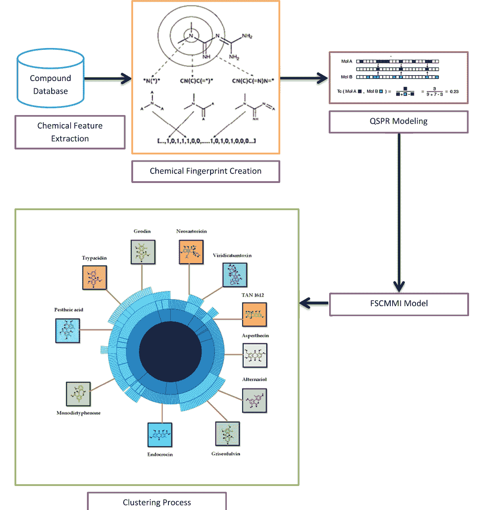

## 图 1. 分子相似性的聚类过程。
特征包含 $F_1^{CF} = \{v, v, w\}$，$F_2^{CF} = \{u, u, w\}$ 和 $F_3^{CF} = \{v, u, z\}$。类别特征 $F_4^{CF}$ 的缺失信息包含 $\{y\}$。计算信息的似然仅为 y。因此，$I_6^{CF}$ 上的缺失信息为 $\{x, v, z, y\}$。

与 $I_8^{CF}$ 关联的类别实例的全部信息为 $\{I_5, I_{15}\}$。对于特征 $F_4^{CF}$ 中的缺失信息，实例 $I_8^{CF}$ 被分配到子节点 1。类别特征 $F_1^{CF}$ 和 $F_2^{CF}$ 的完整信息包含 $\{v, v\}$、$\{w, u\}$ 和 $\{v, u\}$。类别特征 $F_3^{CF}$ 和 $F_4^{CF}$ 的缺失信息包含 $\{w, y\}$、$\{z, x\}$ 和 $\{z, y\}$。

## 示例 7：
接下来，让我们选择类别实例 $I_8^{CF} = \{v, u, ?, ?\}$ 作为缺失信息。$I_8^{CF}$ 中存在两个缺失信息，如 $F_3^{CF}$ 和 $F_4^{CF}$。因此，两个决策树使用 $F_3^{CF}$ 和 $F_4^{CF}$ 作为在表 3 上为 $I_8^{CF}$ 生成的类特征。对于特征 $F_3^{CF}$ 中的缺失信息，实例 $I_8^{CF}$ 被分配到子节点 8。

完整信息和缺失信息中每个类别信息集合的 ICM 和 MCCM 度量为：

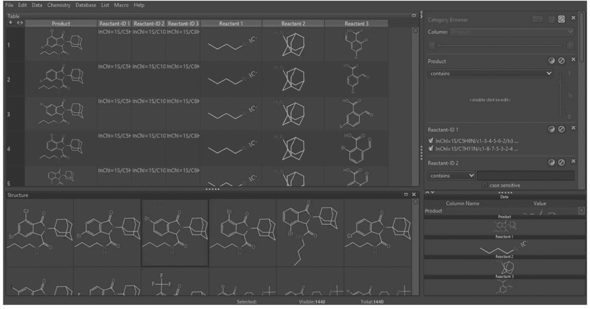

图 2. 一个示例化学信息学数据集。

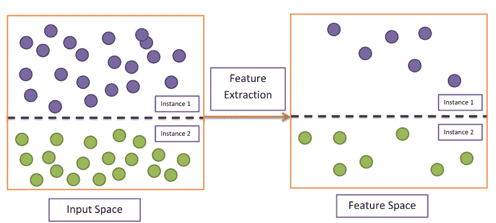

图 3. 数据向高维特征空间的投影。

ICM{ {v, v}, {w, y} } = 0.5 / sqrt(0.5 × 0.5) = 1, ICM{ {w, u}, {z, x} } = 0.25 / sqrt(0.25 × 0.25) = 1
= 1,

ICM{ {v, u}, {z, y} } = 0.25 / sqrt(0.25 × 0.25) = 1,

MCCM(f₂^CF, f₈^CF) = MCCM(f₅^CF, f₈^CF) = (2 log 0.8)/(log 0.8 + log 0.8) + (2 log 1)/(log 0.4 + log 0.6) + 0 + 0 = 1

MCCM(f₅^CF, f₈^CF) = (2 log 1)/(log 0.8 + log 0.8) + (2 log 0.6)/(log 0.6 + log 0.6) + 0 + 0 = 1

MCCM(f₁₅^CF, f₈^CF) = (2 log 0.8)/(log 0.8 + log 0.8) + (2 log 0.6)/(log 0.6 + log 0.6) + 0 + 0 = 2

{w,y}、{z,x} 和 {z,y} 的计算信息似然分别为 0.2857、0.2857 和 0.4286。因此，{z,y} 有可能被选为 f₈^CF 的实际缺失信息。

## 4. 聚类过程
处理聚类的常见工作是将指定的实例分类到众多组中，使得等价集合中实例之间的相似性很大，而不同集合中实例之间的相似性很小。分子相似性的聚类过程如图 1 所示。一个示例化学信息学数据集如图 2 所示。数据向高维特征空间的投影如图 3 所示。

设 χ 表示训练向量 χ ≡ {I₁, I₂, …, I_N} 的一个广泛集合，分为 K 个不相交的组，其中 I_f ∈ R^N，使得

## 表 4
### 混合数据集插补 (MDI) 算法。
混合数据集插补 (MDI) 算法

输入：
𝒳 = (I₁, I₂, ..., I_N)：一个具有缺失信息的混合数据集
输出：
一个具有完整信息的混合数据集 𝒳
算法：
1. 分成两个子集，𝒳 = 𝒳₁（完整集合）+ 𝒳₂（缺失信息集合）
2. 将 𝒳₁ 中的完整实例提取为 𝒳₁^NF 和 𝒳₁^CF，分别包含数值和类别实例。
3. 将 𝒳₂ 中的缺失实例提取为 𝒳₂^NF 和 𝒳₂^CF，分别包含数值和类别实例。
4. 对 𝒳₂^CF 中的每个实例 𝒳₂ 执行
5. 根据公式 (18) 计算缺失类别特征的 ICM 度量。
6. 根据公式 (21) 计算缺失类别特征的 MCCM 度量。
基于 ICM 和 MCCM 计算采样似然值。
7. 结束循环
8. 对 𝒳₂^NF 中的每个实例 𝒳₂ 执行
9. 使用公式 (3) 用数值均值替换缺失信息
10. 结束循环
11. 𝒳 = 合并 𝒳₁ 和 𝒳₂
12. 返回具有完整信息的混合数据集 𝒳。

## 表 5
### 缺失信息混合数据特征空间聚类算法。
缺失信息混合数据特征空间聚类 (FSCMMI) 算法

输入：
𝒳 = (I₁, I₂, ..., I_N)：一个具有缺失信息的混合数据集
k：用户定义的数量
输出：
聚类标签向量 Y = {y₁, y₂, ..., y_N} 和特征聚类权重矩阵 W
算法：
1. 混合数据集 𝒳 = MDI(𝒳)
2. 初始化 Y = {0,0,...,0}，选择 K 个初始实例，并为每个聚类设置 W_qv = 1/F
3. 重复
4. 对于 p = 1 到 N 执行
5. 对于 v = 1 到 K 执行
6. 计算 y_p = argmax [Z_pv, CLO_W(I_p, C_v)]
7. 更新聚类 y_v，包括每个类别特征的递推关系率和数值特征的聚类中心
8. 结束循环
9. 结束循环
10. 根据公式 (39)、(40)、(42) 和 (43) 更新 W_qv。
11. 直到划分不再改变。

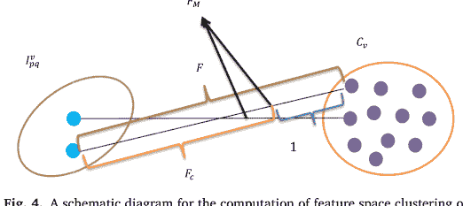

图 4. 缺失信息混合数据特征空间聚类计算的示意图。

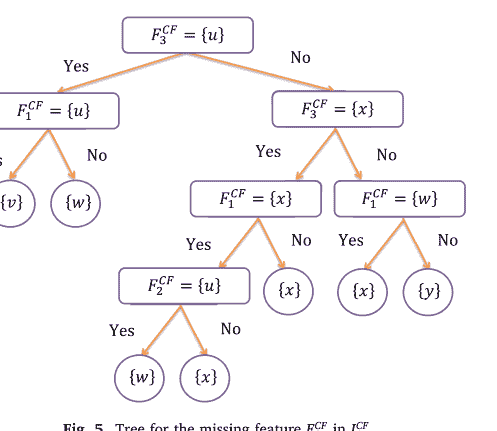

图 5. T₆^CF 中缺失特征 F₄^CF 的树。

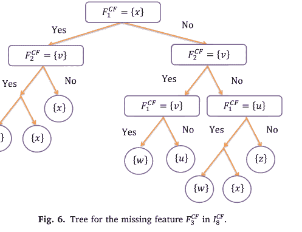

图 6. T₈^CF 中缺失特征 F₃^CF 的树。

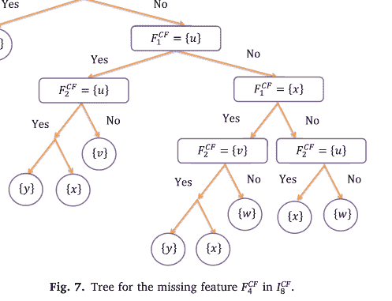

图 7. T₈^CF 中缺失特征 F₄^CF 的树。

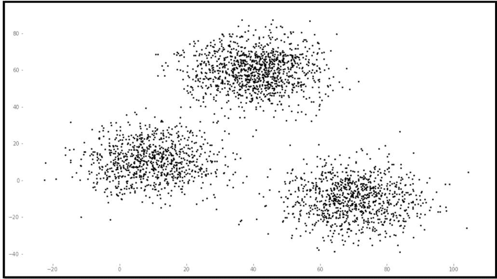

图 8. 聚类过程的初始阶段。

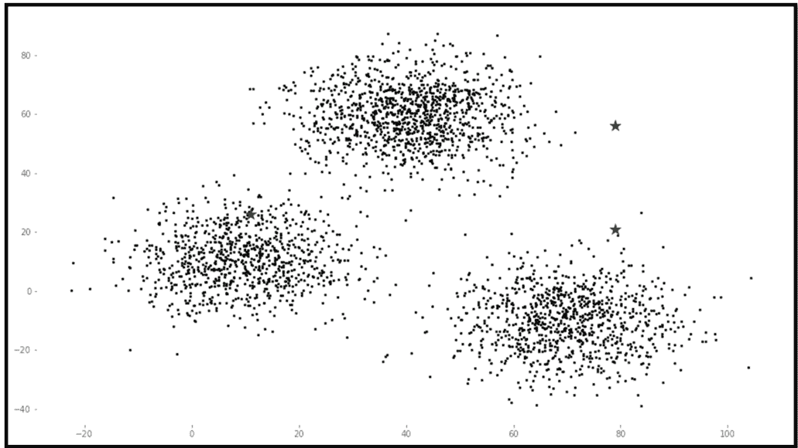

图 9. 聚类中心的初始化。

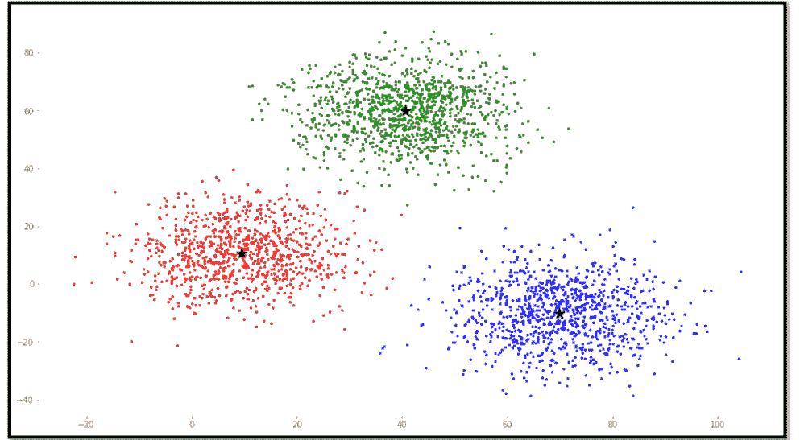

图 10. K = 3 时聚类中心的计算。

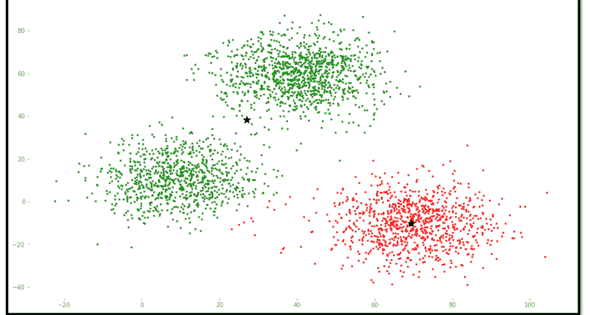

图 11. K = 2 时聚类中心的计算。

I_f = \begin{bmatrix} I_f^{(1)} \\ I_f^{(2)} \\ . \\ . \\ I_f^{(m)} \end{bmatrix} (22)

其中 I_f 定义实例 (f = 1,2,...,N)，m 是特征的总数。

软特征空间聚类的最终思想是将特征-聚类权重明确纳入分组过程，以计算各个特征在演化不同聚类中的作用。因此，基于软特征空间聚类的混合数据缺失信息实例聚类接近度度量是利用以下连续目标函数的潜力：

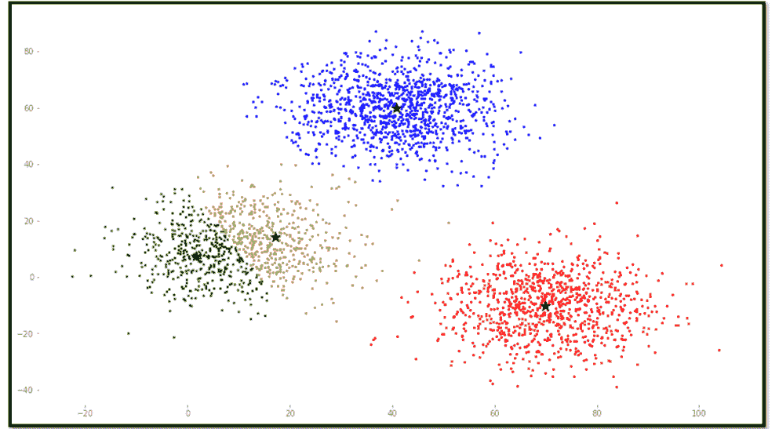

图 12. K = 4 时聚类中心的计算。

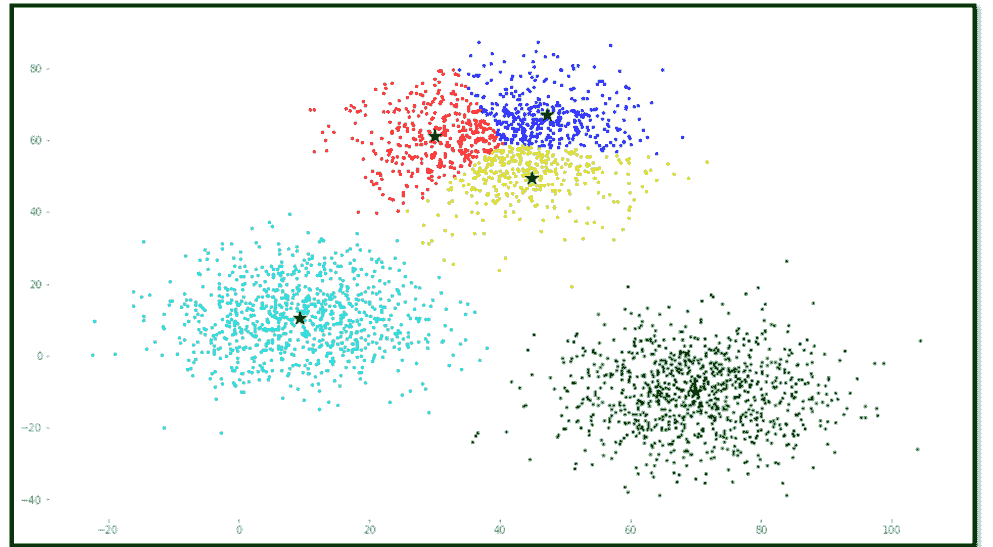

图 13. K = 5 时聚类中心的计算。

$\varphi^* = \underset{\varphi,W}{\operatorname{argmax}} \left[ \sum_{v=1}^{K} \sum_{p=1}^{N} Z_{pv} CLO_W(I_p, C_v) \right]. \quad (23)$

$\sum_{v=1}^{K} Z_{pv} = 1, \quad \text{and} \quad 0 < \sum_{p=1}^{N} Z_{p v} < N, \quad (24)$

其中 $CLO_W(I_p, C_v)$ 是实例 $I_p$ 与聚类 $C_v$ 之间的接近度，$W = W_{qv}$ 是一个 $F \times K$ 权重矩阵，且 $\varphi = Z_{pv}$ 是一个实现以下形式的 $N \times K$ 分区矩阵：

with

$Z_{pv} \in [0,1], p = 1,2,\dots,N, v = 1,2,\dots,K. \quad (25)$

设实例 Ip 与聚类 Cv 之间的特征加权实例-聚类接近度度量表示为：

CLO_W(Ip, Cv) = 1/F_M [ Σ_{q=1}^{Fc} CLO_W(I_{pq}^{CF}, Cv) + CLO_W(I_p^{NF}, Cv) ] . (26)

其中特征加权接近度 CLO_W(I_{pq}^{CF}, Cv) 通过以下方式计算

CLO_W(I_{pq}^{CF}, Cv) = W_{qv}^{CF} CLO(I_{pq}^{CF}, Cv). (27)

这里，W_{qv}^{CF}, q = 1, 2, ..., Fc 表示类别特征 F_q^C 对聚类 Cv 的权重，满足 0 ≤ W_{qv}^{CF} ≤ 1。

类别片段上的特征加权实例-聚类接近度度量可以表示为

CLO_q(I_{pq}, I_{p'q}) = 2 log RR(I_{pq}, I_{p'q}) / [log RR(I_{pq}) + log RR(I_{p'q})]. (28)

且递推关系定义为：

RR(I_{pq}, I_{p'q}) = # (I_{pq}, I_{p'q}) / |X_CAT| . (29)

其中 # (I_{pq}, I_{p'q}) 是类别数据集 X_CAT 中实例的数量，该数量在第 q 个特征上接受比率适用于 {I_{pq}, I_{p'q}}。

数值上的特征加权实例-聚类接近度度量

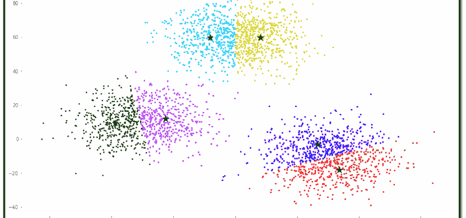

## 图 14. K = 6 时聚类中心的计算。

## 表 6

混合数据缺失信息特征空间聚类的竞争惩罚程序算法。

混合数据缺失信息特征空间聚类的竞争惩罚程序 (RP-FSCMMI) 算法
Input:
  χ = {I1, I2, ..., IN}: 一个具有缺失信息的混合数据集，学习率 σ，以及 k 的初始值 (k ≥ k*)
Output:
  聚类标签向量 Y = {y1, y2, ..., yN}，聚类数 k*，权重矩阵 W
Algorithm:
1. 混合数据集 χ = MDI(χ)
2. 初始化 Y = {0,0,...,0} 并选择 K 个初始实例，每个聚类一个
3. 初始化集合 Wqv = 1/F，WT = 1，且 ωv = 1，v = 1,2,...,K
4. 重复
5. for p = 1 to N do
6. for v = 1 to K do
7. 计算 G = argmax_{1≤v≤K} [(1 - δv) |g| CLO_W(Ip, Cv)]
8. 计算 AC = argmin_{1≤v≤K, G} [(1 - δv) |g| CLO_W(Ip, Cv)]
9. 令 yp = G，基于 Ip 更新聚类 yv
10. 更新 ωv^new = ωv^old + σ 并更新 ωv^AC = (ωv^old - σ CLO_W(Ip, CAC))
11. end for
12. end for
13. 根据公式 (39)、(40)、(42) 和 (43) 更新 Wqv。
14. 直到分区不再变化

## 表 7

混合数据缺失信息特征空间聚类的初始化自适应程序算法。

混合数据缺失信息特征空间聚类的初始化自适应程序 (IA-FSCMMI) 算法
Input:
  χ = {I1, I2, ..., IN}: 一个具有缺失信息的混合数据集，聚类数 k。
Output:
  初始核参数集合 KA = {β1, β2, ..., βn}
Algorithm:
1. 混合数据集 χ = MDI(χ)
2. 计算 I_up^NF = (I_up1^NF, I_up2^NF, ..., I_upFn^NF)^T 和 I_lo^NF = (I_lo1^NF, I_lo2^NF, ..., I_loFn^NF)^T
3. for each instance in χ,
4. 计算 CLO(I_p^CF, χ) = 1/Fc Σ_{q=1}^{Fc} CLO(I_{pq}^CF, χ)
5. 计算 CLO(I_p^NF, χ) = 1 - min_{1≤q≤K} ECM(I_p^NF, C_q^NK) / ECM(I_up^NF, I_lo^NF)
6. 根据 (41) 从 χ 中选择 βi，令 KA = β1，且 Counter = 1
7. While Counter < k do
8. 对于每个实例，计算 Imp(Ip) = Imp(I_p^CF) + Imp(I_p^NF)
9. 令 Ip* = argmax_{Ip∈χ} [Imp(Ip)]，KA = KA ∪ {Ip*}，且
10. Counter = Counter + 1
11. end While

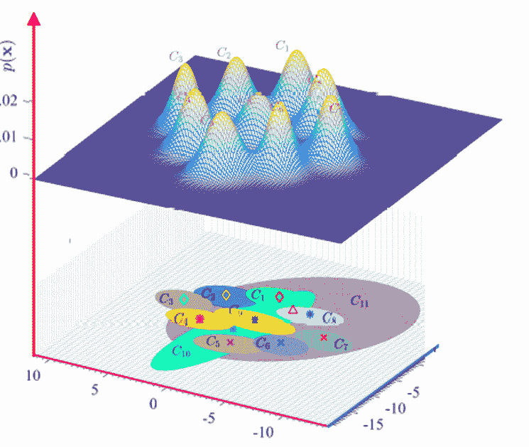

图 15. 混合数据集上聚类过程的可视化。

## 表 8

来自 MSD (Merk & Co., Inc., Kenilworth, NJ U.S.A) 的四个测定集合

| 数据集 | 化合物数量 | 任务数量 |
|---|---|---|
| Kaggle | 100 000 | 15 |
| Factors | 1500 | 12 |
| Kinase | 2500 | 99 |
| UV | 10 000 | 190 |

## 表 9

分子数据集按 ACC、RI、NMI 的聚类性能。

算法 | Kaggle 数据集 |  |  | Factors 数据集 |  |  
| | ACC | RI | NMI | ACC | RI | NMI |
EKP | 0.557 | 0.442 | 0.163 | 0.542 | 0.429 | 0.029
K-Prototype | 0.558 | 0.437 | 0.147 | 0.573 | 0.483 | 0.032
KL-FCM-GM | 0.663 | 0.519 | 0.174 | 0.752 | 0.725 | 0.267
Fuzzy K-Prototype | 0.737 | 0.592 | 0.212 | 0.831 | 0.767 | 0.494
OCIL | 0.765 | 0.645 | 0.243 | 0.692 | 0.639 | 0.189
KMC MD | 0.834 | 0.742 | 0.435 | 0.812 | 0.753 | 0.583
KHMC MD | 0.843 | 0.752 | 0.445 | 0.821 | 0.792 | 0.591
FSCMMI | 0.897 | 0.816 | 0.722 | 0.864 | 0.852 | 0.684
RP-FSCMMI | 0.902 | 0.824 | 0.749 | 0.873 | 0.869 | 0.712
IA-FSCMMI | 0.929 | 0.839 | 0.771 | 0.881 | 0.884 | 0.773

算法 | Kinase 数据集 |  |  | UV 数据集 |  |  
| | ACC | RI | NMI | ACC | RI | NMI |
EKP | 0.654 | 0.561 | 0.093 | 0.525 | 0.430 | 0.133
K-Prototype | 0.530 | 0.501 | 0.062 | 0.536 | 0.432 | 0.134
KL-FCM-GM | 0.532 | 0.512 | 0.051 | 0.658 | 0.532 | 0.163
Fuzzy K-Prototype | 0.804 | 0.802 | 0.622 | 0.719 | 0.551 | 0.206
OCIL | 0.665 | 0.596 | 0.151 | 0.763 | 0.626 | 0.218
KMC MD | 0.792 | 0.798 | 0.601 | 0.847 | 0.739 | 0.398
KHMC MD | 0.835 | 0.803 | 0.601 | 0.843 | 0.731 | 0.409
FSCMMI | 0.868 | 0.841 | 0.712 | 0.885 | 0.771 | 0.704
RP-FSCMMI | 0.872 | 0.849 | 0.727 | 0.892 | 0.795 | 0.741
IA-FSCMMI | 0.886 | 0.868 | 0.766 | 0.938 | 0.892 | 0.798

片段可以表示为

CLO_W( I_{pq}^{NF}, C_v ) = exp( -0.5 Σ_{q=1}^{F_n} W_{qv}^{NF} ( I_{pq}^{NF} - C_{vq} )^2 ) / Σ_{i=1}^{k} exp( -0.5 Σ_{q=1}^{F_n} W_{qv}^{NF} ( I_{pq}^{NF} - C_{iq} )^2 )   (30)

这里，W_{qv}^{NF}, q = 1, 2, ..., F_n 表示第 q 个数值特征对聚类 C_v 的权重，满足 0 ≤ W_{qv}^{NF} ≤ 1。

通常，分配给特定聚类 C_v 的完整特征权重之和应为 1。也就是说，W_{qv}^{CF} 和 W_{qv}^{NF} 满足

Σ_{q=1}^{F} W_{qv}^{CF} + Σ_{q=1}^{F_n} W_{qv}^{NF} = 1,   q = 1, 2, ..., k.   (31)

利用简明的表示 W_{qv} 来表示随机特征 F_q 对聚类 C_v 的权重，我们将有

Σ_{q=1}^{F} W_{qv} = 1,   q = 1, 2, ..., k.   (32)

为了有效地计算 W_{qv} (q = 1, 2, ..., F, v = 1, 2, ..., k)，将考察第 q 个特征对聚类 C_v 发现的影响，记为 D_{qv}。

基于聚类探索的相互发展，在评估精确特征的启发时已限制了两种关键类型。首先，簇间接近度表征为 E_{qv}，它估计特征 F_q 在特定组 C_v 中相对于替代聚类的影响。其次，簇内接近度表征为 S_{qv}，它估计组 C_v 在特征 F_q 下是否具有紧密关联。

最初，为了计算簇间差异 E_{qv}，组内特征 F_q 的分布与组外相关。聚类之间的显著差异是 C_v 的改进组安排。因此，我们解释 Hellinger 相似性度量，该度量源自 [91] 并发展为计算两个似然分配之间不相似性的改进度量 [92,93]。设 L_1 和 L_2 表示两个似然分配，则

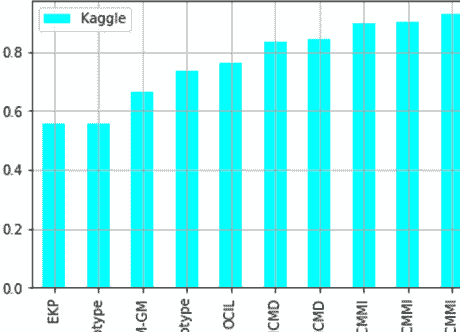
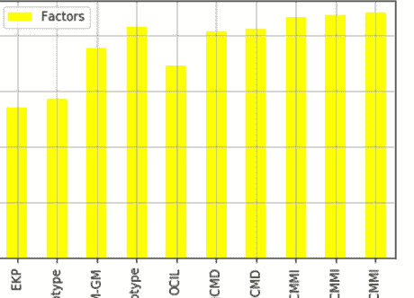
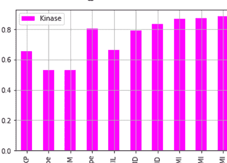
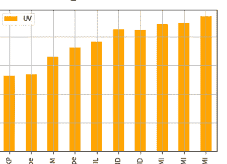

图 16. 不同算法在分子数据集上的 ACC 聚类性能。

Hellinger 相似度 HS(L1, L2) 之间满足 0 ≤ HS(L1, L2) ≤ 1。类别特征 Fq 在组 Cv 内的分配表示为 L1^CF(q, v)，组外的分配表示为 L2^CF(q, v)。先前，L1^CF(q, v) 与 L2^CF(q, v) 之间的 Hellinger 相似度计算为 HS(L1^CF(q, v), L2^CF(q, v)) = 1/√2 √((CLO(Ipq^CF, Cv) - CLO(Ipq, Cv))^2)。(33) 数值特征 Fq 在组内和组外的分配借助高斯函数计算。ρ1 = 1/DIq Σ_{Ipq∈Cv} Ipq (34) ρ2 = 1/(DI - DIq) Σ_{Ipq∉Cv} Ipq (35) α1^2 = 1/(DIq -1) Σ_{Ipq∈Cv} (Ipq - ρ1)^2. (36)

α2^2 = 1/(DI - DIq -1) Σ_{Ipq∉Cv} (Ipq - ρ2)^2 (37) 其中 DIq 表示组 Cv 中数据实例的总数量。因此，L1^NF(q, v) 与 L2^NF(q, v) 之间的 Hellinger 相似度计算为 HS(L1^NF(q, v), L2^NF(q, v)) = √[1 - √(2α1α2/(α1^2+α2^2)) exp(-1/4 (ρ1-ρ2)^2/(α1^2+α2^2))] (38) 因此，簇间变异 Eqv 可计算为 Eqv = { HS(L1^CF(q, v), L2^CF(q, v)), if Fq is categorical; HS(L1^NF(q, v), L2^NF(q, v)), if Fq is numerical. } (39) 其次，实例-簇接近度度量可用于计算组 Cv 中特征 Fq 的簇内接近度 Sqv。此外，Sqv 可通过特征 Fq 在组 Cv 中的平均接近度度量表示为 Sqv = 1/DIq Σ_{Ipq∈Cv} CLO(Ipq, Cv). (40)

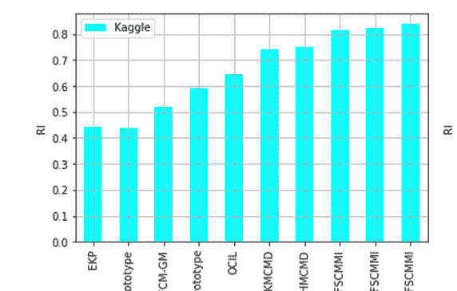
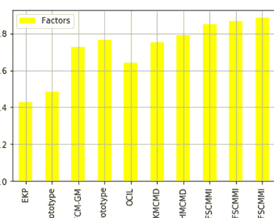
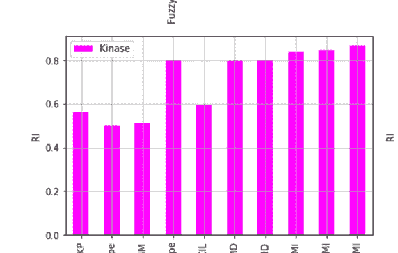
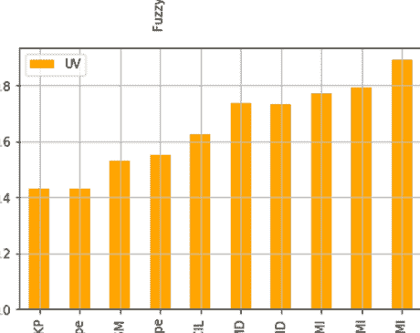

图 17. 不同算法在分子数据集上的 RI 聚类性能。

其中，

CLO(I_{pq}, C_v) = { 2logRR(I_{pq}, I_{p q}) / [logRR(I_{pq}) + logRR(I_{p q})], if F_q is categorical ; exp(-0.5(I_{pq} - C_{vq})^2), if F_q is numerical. } (41)

E_{qv} 与 S_{qv} 协同取得较大值表明特征 F_q 对簇 C_v 的发现具有重要作用。特征 F_q 对组 C_v 的 D_{qv} 计算为

D_{qv} = E_{qv} S_{qv}. (42)

随后 0 ≤ E_{qv} ≤ 1 且 0 ≤ S_{qv} ≤ 1，我们有 0 ≤ D_{qv} ≤ 1。此外，特征权重 W_{qv} 可确定为

W_{qv} = D_{qv} / Σ_{i=1}^{F} D_{iv}, 其中 q = 1,2,...,F，且 v = 1,2,...,K. (43)

为了实现特征子空间聚类算法，将预先设计一种重复方法以增强目标函数 [20]。特征权重 W_{qv} 的值在每次训练步骤后更新。开始时，特征权重向量值设为 W_{qv} = (1/F)，其中 q = 1,2,...,F，且 v = 1,2,...,K。我们分析了所提出的算法能快速收敛到更好的精度。表 4 显示了混合数据插补算法。具有缺失信息的混合数据集的特征空间聚类（FSCMMI）算法在表 5 中描述。图 4 显示了混合数据缺失信息特征空间聚类计算的示意图。图 5 显示了 I_6^{CF} 中缺失特征 F_4^{CF} 的树。图 6 显示了 I_8^{CF} 中缺失特征 F_3^{CF} 的树。图 7 显示了 I_8^{CF} 中缺失特征 F_4^{CF} 的树。

## 5. 训练簇数

与现有的极端特征子空间聚类方法不同，所提出系统要求簇数 k 正确固定以匹配合适的数量；否则将得出不合适的聚类结论。

为了解释这一问题，我们估计了具有自动训练簇数能力的特征加权实例-簇接近度度量过程。惩罚过程已在 [51] 中得到证明，主要用于通过逐步淘汰闲置簇来帮助该过程在训练方法中自动指示簇数。因此，我们使用该惩罚过程来解决自动选择簇数的问题。

此外，一组权重将与目标函数一起呈现， resulting objective function is denoted as,

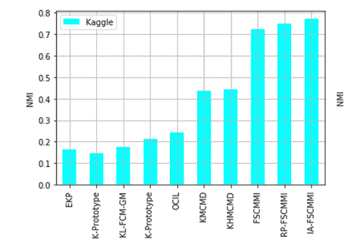
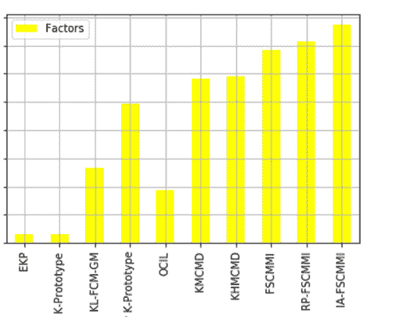
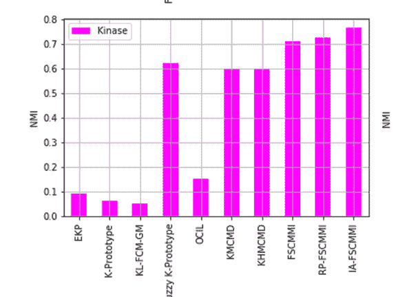
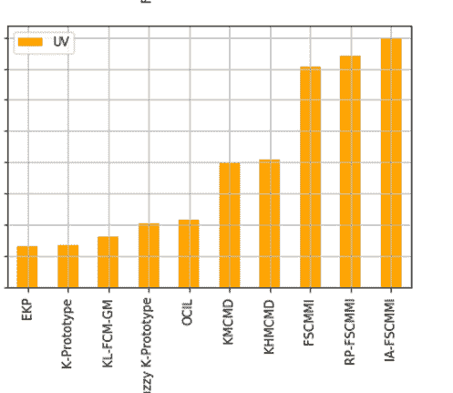

图 18. 不同算法在分子数据集上的 NMI 聚类性能。

φ* = argmax_{φ,W} [ Σ_{v=1}^{K} Σ_{p=1}^{N} Z_{pv} g_v CLO_W(I_p, C_v) ] . (44)

G = argmax_{1 ≤ v ≤ k} [ g_v CLO_W(I_p, C_v) ] (45)

其中 g_v 是组 C_v 的权重，v = 1, 2, ..., K，满足条件 0 ≤ g_v ≤ 1。簇 C_v 对整个数据集的基本信息借助 g_v 计算。

更具体地说，由于上述标准，部分实例将无法获得训练而“死亡”。为克服此问题，可以降低实例的获胜可能性。

惩罚增长背后的重要统计是，对于实例 I_p 的每次参与，获胜簇以及与获胜簇相关的挑战簇（即亚军）也会根据明确标准受到批评。根据该惩罚过程，簇数 k 的初始化应始终满足水平（k ≥ k*），并且必要的持续性是移除闲置簇。因此，权重被分配给我们算法的每个簇。每个簇的后果是根据整个簇关联的该权重计算的。更精确地说，每个簇具有相等权重意味着它们在簇关系中的参与是不可区分的。相反，对于权重较低的任何簇，分配给该簇的实例数量将下降，最终该簇将从组织中变得无动于衷。

因此，式（45）可修改为，

G = argmax_{1 ≤ v ≤ k} [ (1 - δ_v) g_v CLO_W(I_p, C_v) ] (46)

然后，给定实例 I_p，获胜簇 C_v 应满足以下标准：

δ_v 的相对频率定义为

δ_v = WT_v / Σ_{i=1}^{k} WT_i . (47)

其中 WT_v 是簇 C_v 在先前过程中获胜的次数。

同时，其相邻竞争簇 G_AC 定义为：

AC = argmin_{1 ≤ v ≤ k, v ≠ G} [ (1 - δ_v) g_v CLO_W(I_p, C_v) ] (48)

在选择簇的获胜者后，我们需要将实例分配给获胜簇，并修改获胜簇的统计观察以及获胜簇的复发率。

权重 g_v 值以间接方法修改。此外，

## 表 10

混合数据集的 ACC、RI、NMI 聚类性能。

| Algorithms | Heart Disease Dataset ACC | RI | NMI | Statlog Heart Dataset ACC | RI | NMI | Credit Approval Dataset ACC | RI | NMI |
|---|---|---|---|---|---|---|---|---|---|
| EKP | 0.545 | 0.432 | 0.143 | 0.545 | 0.428 | 0.023 | 0.682 | 0.595 | 0.102 |
| K-Prototype | 0.546 | 0.435 | 0.144 | 0.577 | 0.483 | 0.029 | 0.562 | 0.528 | 0.092 |
| KL-FCM-GM | 0.653 | 0.529 | 0.178 | 0.758 | 0.723 | 0.265 | 0.584 | 0.547 | 0.081 |
| Fuzzy K-Prototype | 0.717 | 0.582 | 0.210 | 0.835 | 0.765 | 0.498 | 0.838 | 0.819 | 0.652 |
| OCIL | 0.769 | 0.647 | 0.233 | 0.697 | 0.638 | 0.181 | 0.697 | 0.606 | 0.181 |
| KMC MD | 0.838 | 0.749 | 0.438 | 0.807 | 0.773 | 0.578 | 0.822 | 0.812 | 0.617 |
| KHMC MD | 0.841 | 0.762 | 0.449 | 0.816 | 0.782 | 0.582 | 0.855 | 0.826 | 0.677 |
| FSCMMI | 0.883 | 0.788 | 0.728 | 0.853 | 0.802 | 0.675 | 0.878 | 0.849 | 0.746 |
| RP-FSCMMI | 0.892 | 0.810 | 0.775 | 0.880 | 0.808 | 0.729 | 0.889 | 0.872 | 0.758 |
| IA-FSCMMI | 0.937 | 0.842 | 0.792 | 0.897 | 0.844 | 0.761 | 0.912 | 0.879 | 0.798 |

| Algorithms | German Credit Dataset ACC | RI | NMI | Adult Dataset ACC | RI | NMI | Dermatology Dataset ACC | RI | NMI |
|---|---|---|---|---|---|---|---|---|---|
| EKP | 0.652 | 0.521 | 0.001 | 0.549 | 0.502 | 0.001 | 0.524 | 0.636 | 0.603 |
| K-Prototype | 0.512 | 0.428 | 0.001 | 0.578 | 0.539 | 0.001 | 0.548 | 0.658 | 0.612 |
| KL-FCM-GM | 0.554 | 0.485 | 0.001 | 0.614 | 0.582 | 0.001 | 0.617 | 0.726 | 0.695 |
| Fuzzy K-Prototype | 0.625 | 0.547 | 0.001 | 0.629 | 0.594 | 0.001 | 0.632 | 0.732 | 0.698 |
| OCIL | 0.667 | 0.559 | 0.002 | 0.667 | 0.624 | 0.003 | 0.659 | 0.883 | 0.796 |
| KMC MD | 0.617 | 0.529 | 0.217 | 0.653 | 0.618 | 0.202 | 0.658 | 0.765 | 0.735 |
| KHMC MD | 0.626 | 0.536 | 0.323 | 0.656 | 0.616 | 0.222 | 0.661 | 0.769 | 0.736 |
| FSCMMI | 0.749 | 0.708 | 0.489 | 0.791 | 0.742 | 0.456 | 0.792 | 0.903 | 0.875 |
| RP-FSCMMI | 0.771 | 0.716 | 0.582 | 0.813 | 0.768 | 0.592 | 0.811 | 0.915 | 0.888 |
| IA-FSCMMI | 0.795 | 0.727 | 0.748 | 0.824 | 0.789 | 0.721 | 0.823 | 0.929 | 0.895 |

我们使用一个称为 sigmoid 函数的函数将 g_v 转换为 ω_v。

相反，获胜者通过基于 ω_v^new = ω_v^old + σ 提高其权重而感到满意。（49）

并且通过基于 ω_AC^new = (ω_AC^old - σ CLO_W (I_p, C_AC)) 降低其权重来惩罚相邻竞争簇 C_AC。（50）

其中 σ 表示学习率。不同簇的聚类质心计算显示在图 8、图 9、图 10、图 11、图 12、图 13 和图 14 中。混合数据集缺失信息的特征空间聚类的竞争惩罚过程（RP-FSCMMI）算法在表 6 中描述。

## 6. 初始化自适应方法

一般而言，在大多数现有方法中，我们需要初始化簇数。然而，动态初始化是非正式且典型的方法。由于实例初始化的不确定性，聚类结论不相等。为了计算一种方法的性能，我们需要使用频繁的初始化值迭代运行算法以获取统计事实。这一问题在特征子空间聚类过程中可能更困难。通过不幸的簇初始化，聚类效果降低。因此，簇中特征权重的训练将被制造。许多现有算法如 [94-99] 被提出以解决此问题。然而，混合特征的初始化非常少且尚未强大。

一般来说，如果我们需要获得更好的聚类过程结果，我们通常认为主要核实例之间的变化很高，因此它们更可能来自不同的组。然而，如果我们简单地寻找复杂的差异，大约会选择确保对聚类进展产生不良影响的异常值。因此，当我们评估一个实例被提名为主要核参数的重要性时，我们必须立即考虑两个特征：该实例与先前提名的核参数之间的差异，以及该实例与完整数据集之间的接近度。

设 KA = {β1, β2, ..., βn} 为先前提名的核参数，其中 n < k，且 k 为所需的核参数数量。同样，每个不同的 β_v (v ∈ {1,2,...,n}) 可定义为 [β_v^CF, β_v^NF]^T，其中 β_v^CF 表示数值特征，β_v^NF 表示类别特征。

在挑选程序中，如果我们需要挑选一个额外的核参数并将其添加到 KA，我们必须首先评估数据集中每个实例的影响选择，然后选择影响最高的一个。设 Imp(I_p) 表示实例 I_p 的影响选择。随后，I_p 包含数值和类别特征，Imp(I_p) 可确定为 Imp(I_p) = Imp(I_p^CF) + Imp(I_p^NF)。(51)

因此，给定 Imp(I_p^CF) 和 (I_p^NF) 的近似值，我们可以开发 I_p 的影响。

首先，为了开发 I_p^CF 的影响，我们必须评估 I_p^CF 与 KA 之间的差异以及 I_p^CF 与 χ 之间的接近度度量。类别特征的实例-簇接近度度量可用于计算实例组。因此，相关于 (26) 和 (27)，I_p^CF 与 KA 之间的接近度可通过 CLO(I_p^CF, KA) = 1/F_c Σ_{q=1}^{F_c} CLO(I_pq^CF, KA) 计算。(52)

此外，I_p^CF 与 χ 之间的接近度度量表示为 CLO(I_p^CF, χ) = 1/F_c Σ_{q=1}^{F_c} CLO(I_pq^CF, χ)。(53)

此外，I_pq^CF 的影响可通过 Imp(I_p^CF) = DIV(I_p^CF, KA) + CLO(I_p^CF, χ) = (1 - CLO(I_p^CF, KA)) + CLO(I_p^CF, χ) 计算。(54) Imp(I_p^CF) = (1 - 1/F_c Σ_{q=1}^{F_c} CLO(I_pq^CF, KA)) + (1/F_c Σ_{q=1}^{F_c} CLO(I_pq^CF, χ))。(55)

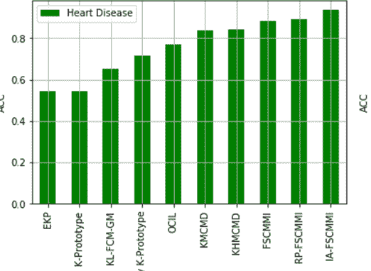

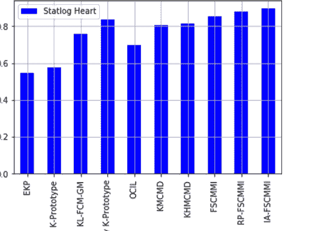

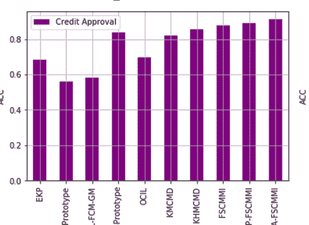

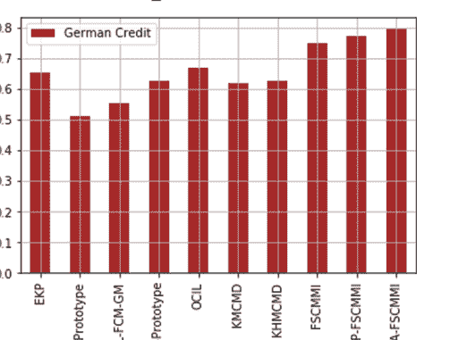

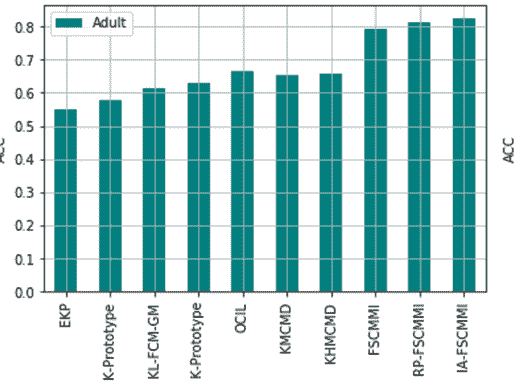

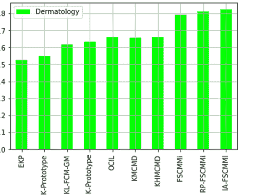

图 19. 不同算法在混合数据集上的聚类性能（以 ACC 计）。

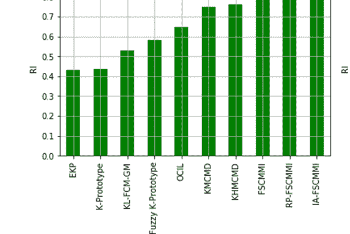

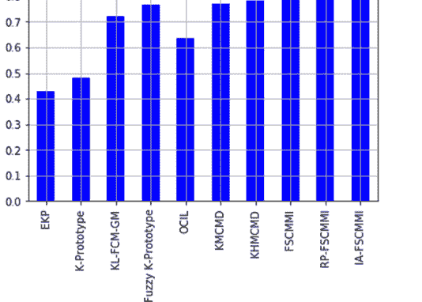

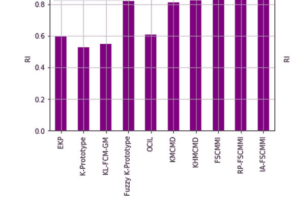

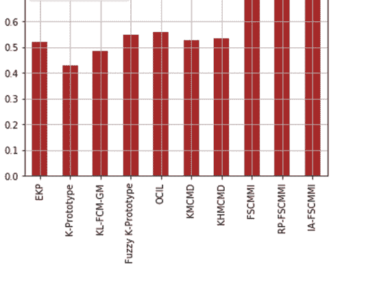

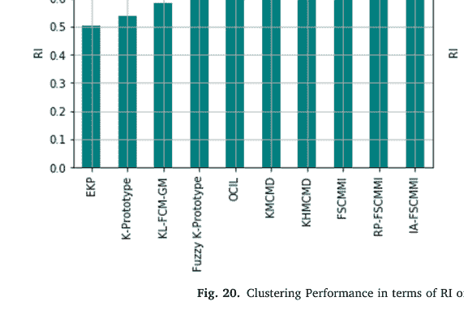

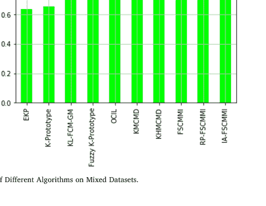

图 20. 不同算法在混合数据集上的聚类性能（以 RI 计）。

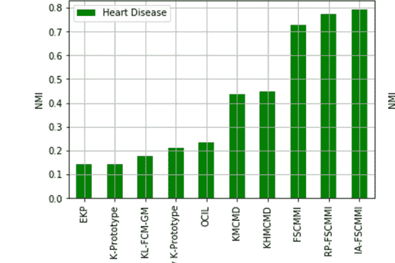

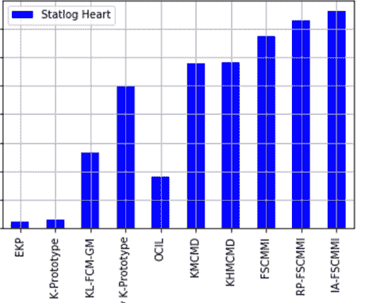

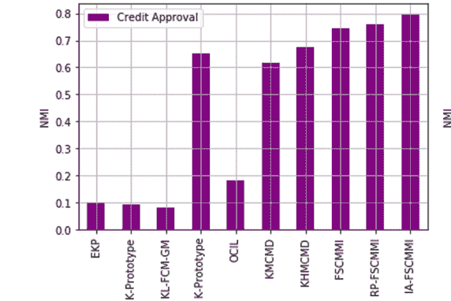

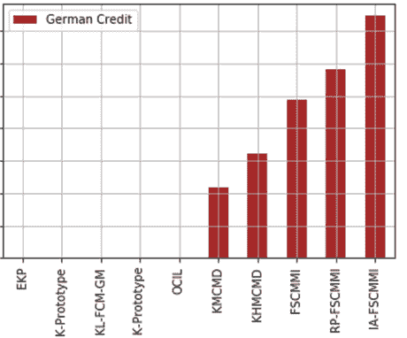

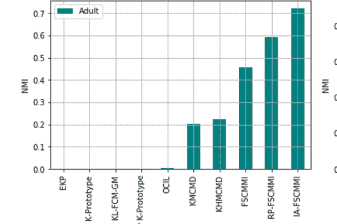

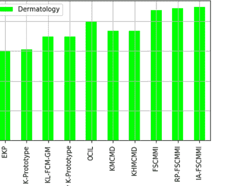

图 21. 不同算法在混合数据集上的聚类性能（以 NMI 计）。

## 表 11

分类数据集上不同算法的聚类性能（以 ACC、RI、NMI 计）。

| 算法 | 大豆数据集 ACC | RI | NMI | 蘑菇数据集 ACC | RI | NMI | 皮肤病学数据集 ACC | RI | NMI |
|---|---|---|---|---|---|---|---|---|---|
| EKP | 0.536 | 0.435 | 0.138 | 0.553 | 0.432 | 0.025 | 0.682 | 0.595 | 0.102 |
| K-Prototype | 0.542 | 0.439 | 0.141 | 0.581 | 0.487 | 0.032 | 0.562 | 0.528 | 0.092 |
| KL-FCM-GM | 0.648 | 0.518 | 0.172 | 0.764 | 0.724 | 0.273 | 0.584 | 0.547 | 0.081 |
| Fuzzy K-Prototype | 0.712 | 0.577 | 0.203 | 0.841 | 0.770 | 0.518 | 0.838 | 0.819 | 0.652 |
| OCIL | 0.834 | 0.909 | 0.745 | 0.818 | 0.759 | 0.649 | 0.697 | 0.606 | 0.181 |
| KMC MD | 0.838 | 0.749 | 0.438 | 0.807 | 0.773 | 0.578 | 0.822 | 0.812 | 0.617 |
| KHMC MD | 0.841 | 0.762 | 0.449 | 0.886 | 0.782 | 0.582 | 0.855 | 0.826 | 0.677 |
| Khan & Ahmad | 0.957 | 0.928 | 0.917 | 0.881 | 0.832 | 0.829 | 0.773 | 0.763 | 0.742 |
| Liang Bai et al. | 1.000 | 1.000 | 1.000 | 0.890 | 0.878 | 0.872 | 0.776 | 0.749 | 0.737 |
| FSCMMI | 1.000 | 1.000 | 1.000 | 0.920 | 0.918 | 0.910 | 0.862 | 0.851 | 0.838 |
| RP-FSCMMI | 1.000 | 1.000 | 1.000 | 0.931 | 0.923 | 0.919 | 0.869 | 0.860 | 0.852 |
| IA-FSCMMI | 1.000 | 1.000 | 1.000 | 0.954 | 0.949 | 0.924 | 0.884 | 0.881 | 0.871 |

| 算法 | 乳腺癌数据集 ACC | RI | NMI | 肺癌数据集 ACC | RI | NMI | 动物园数据集 ACC | RI | NMI |
|---|---|---|---|---|---|---|---|---|---|
| EKP | 0.542 | 0.529 | 0.517 | 0.551 | 0.532 | 0.519 | 0.678 | 0.652 | 0.647 |
| K-Prototype | 0.548 | 0.531 | 0.522 | 0.574 | 0.529 | 0.523 | 0.565 | 0.554 | 0.549 |
| KL-FCM-GM | 0.653 | 0.628 | 0.610 | 0.749 | 0.720 | 0.716 | 0.589 | 0.578 | 0.563 |
| Fuzzy K-Prototype | 0.722 | 0.719 | 0.708 | 0.832 | 0.818 | 0.797 | 0.837 | 0.826 | 0.820 |
| OCIL | 0.829 | 0.812 | 0.802 | 0.812 | 0.798 | 0.782 | 0.859 | 0.852 | 0.835 |
| KMC MD | 0.921 | 0.915 | 0.905 | 0.518 | 0.502 | 0.496 | 0.862 | 0.849 | 0.829 |
| KHMC MD | 0.963 | 0.947 | 0.938 | 0.611 | 0.597 | 0.581 | 0.869 | 0.851 | 0.844 |
| Khan & Ahmad | 0.912 | 0.896 | 0.870 | 0.500 | 0.487 | 0.472 | 0.891 | 0.875 | 0.852 |
| Liang Bai et al. | 0.939 | 0.925 | 0.911 | 0.687 | 0.671 | 0.667 | 0.920 | 0.902 | 0.899 |
| FSCMMI | 0.956 | 0.942 | 0.936 | 0.871 | 0.865 | 0.849 | 0.938 | 0.917 | 0.904 |
| RP-FSCMMI | 0.962 | 0.956 | 0.942 | 0.883 | 0.873 | 0.862 | 0.952 | 0.944 | 0.937 |
| IA-FSCMMI | 0.971 | 0.961 | 0.951 | 0.926 | 0.912 | 0.905 | 0.967 | 0.953 | 0.941 |

其中 DIV(I_p^{CF}, KA) = (1 - CLO(I_p^{CF}, KA)) 表示 I_p^{CF} 与 KA 之间的差异。随后，我们需要计算数值特征 Imp(I_p^{NF}) 的影响。设 I_up^{NF} = (I_{up,1}^{NF}, I_{up,2}^{NF}, ..., I_{up,F_n}^{NF})^T 和 I_lo^{NF} = (I_{lo,1}^{NF}, I_{lo,2}^{NF}, ..., I_{lo,F_n}^{NF})^T 分别为对应的上、下限值。这些值可通过，I_{up,q}^{NF} = max_{1 <= p <= M} (I_{p,q}^{NF}) 和 I_{lo,q}^{NF} = min_{1 <= p <= M} (I_{p,q}^{NF}) (56) 计算，其中 q = 1,2,...,F。设 ECM(I_{up,q}^{NF}, I_{lo,q}^{NF}) 表示 I_{up,q}^{NF} 与 I_{lo,q}^{NF} 之间的欧几里得接近度量。χ 中 I_p^{NF} 与 I_q^{NF} 的数值特征可表示为，ECM(I_p^{NF}, I_q^{NF}) <= ECM(I_{up}^{NF}, I_{lo}^{NF})。 (57) 此外，I_p^{NF} 与核参数 KA 之间的差异可确定为，DIV(I_p^{NF}, KA) = min_{1 <= q <= n} ECM(I_p^{NF}, β_q^{NF}) / ECM(I_{up}^{NF}, I_{lo}^{NF}) (58) 其中 DIV(I_p^{NF}, KA) 由 I_p^{NF} 与数值核参数 KA 之间的最小接近度量定义。I_p^{NF} 与聚类中心 C^{NF} 之间的接近度量可确定为 CLO(I_p^{NF}, χ) = CLO(I_p^{NF}, C^{NF}) = 1 - DIV(I_p^{NF}, C^{NF}) (59)

CLO(I_p^{NF}, χ) = 1 - min_{1 <= q <= k} ECM(I_p^{NF}, C_q^{NF}) / ECM(I_{up}^{NF}, I_{lo}^{NF})。 (60) 然后，我们有 Imp(I_p^{NF}) = DIV(I_p^{NF}, KA) + CLO(I_p^{NF}, χ)。 (61) Imp(I_p^{NF}) = min_{1 <= q <= n} ECM(I_p^{NF}, β_q^{NF}) / ECM(I_{up}^{NF}, I_{lo}^{NF}) + (1 - min_{1 <= q <= k} ECM(I_p^{NF}, C_q^{NF}) / ECM(I_{up}^{NF}, I_{lo}^{NF}))。 (62) 最后，混合数据 I_p 被选为聚类核参数的影响计算为，Imp(I_p) = Imp(I_p^{CF}) + Imp(I_p^{NF})。 (63) Imp(I_p) = (1 - 1/F_c sum_{q=1}^{F_c} CLO(I_{pq}^{CF}, KA)) + (1/F_c sum_{q=1}^{F_c} CLO(I_{pq}^{CF}, χ)) + min_{1 <= q <= n} ECM(I_p^{NF}, β_q^{NF}) / ECM(I_{up}^{NF}, I_{lo}^{NF}) + (1 - min_{1 <= q <= k} ECM(I_p^{NF}, C_q^{NF}) / ECM(I_{up}^{NF}, I_{lo}^{NF}))。 (64) 更具体地，在选择初始核参数即空组时，应评估 I_p 与 χ 之间的接近度。即初始核参数 β_1 基于，β_1 = argmax_{I_p ∈ χ} [CLO(I_p^{CF}, χ) + CLO(I_p^{NF}, χ)] (65) 指定。此外，混合特征的初始化自适应方法的流程可总结于表 7。所提方法的时空复杂度优于现有算法。随后，所提算法不会产生大量计算开销。

## 7. 实验

本节中，我们评估我们的实例-聚类

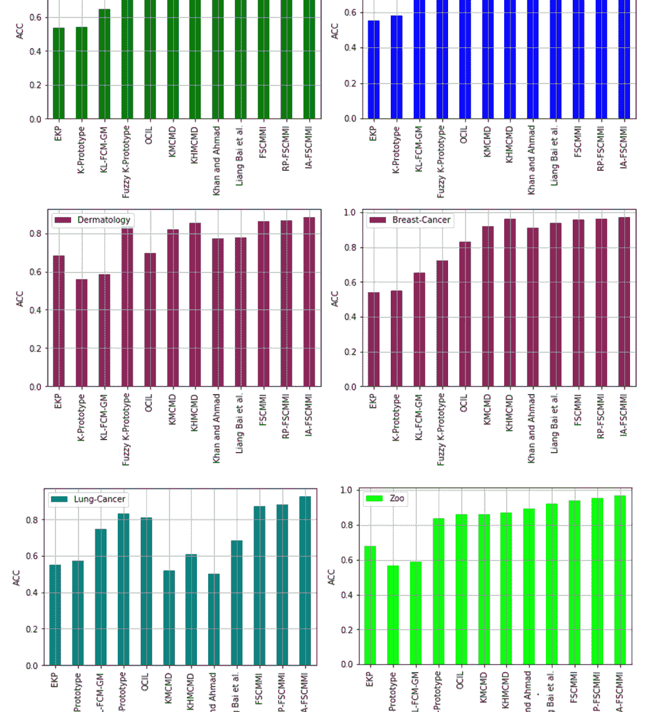

图 22. 不同算法在分类数据集上的聚类性能（以 ACC 计）。

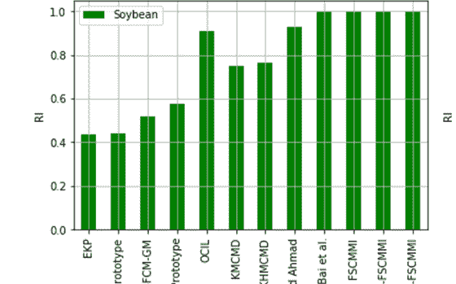

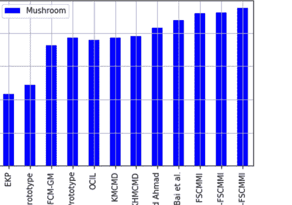

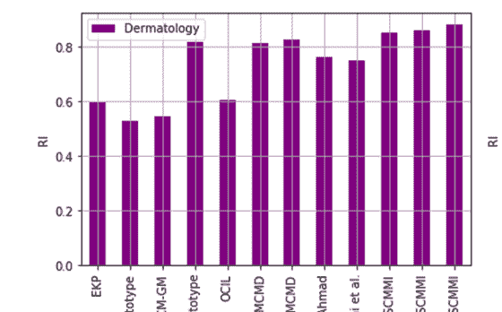

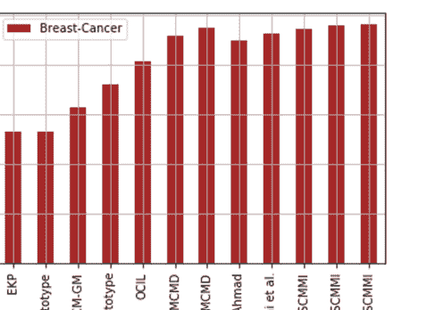

图 23. 不同算法在分类数据集上的聚类性能（以 RI 计）。

图 24. 不同算法在分类数据集上的聚类性能（以 NMI 计）。

## 表 12

不同算法在分子数据集上的平均执行时间比较（以秒计）。

| 算法 | Kaggle | Factors | Kinase | UV |
|---|---|---|---|---|
| EKP | 2.4931 | 2.7100 | 1.6391 | 1.5892 |
| K-Prototype | 1.6402 | 1.7290 | 1.4210 | 1.4797 |
| KL-FCM-GM | 1.3511 | 1.4325 | 1.2096 | 1.2409 |
| Fuzzy K-Prototype | 1.1928 | 1.2591 | 1.1080 | 1.1037 |
| OCIL | 0.1038 | 0.1075 | 0.1042 | 0.0987 |
| KMC MD | 0.1026 | 0.1049 | 0.1021 | 0.0923 |
| KHMC MD | 0.1019 | 0.1036 | 0.1004 | 0.0916 |
| FSCMMI | **0.0924** | **0.0988** | **0.0903** | **0.0819** |
| RP-FSCMMI | **0.0918** | **0.0929** | **0.0788** | **0.0724** |
| IA-FSCMMI | **0.0862** | **0.0917** | **0.0722** | **0.0716** |

接近度量算法在混合数据集上的性能，通过将其与代表性和最先进算法的性能进行比较。所提算法与现有算法进行比较，如 EKP [68]、K-prototype [16]、KL-FCM-GM [69]、Fuzzy K-prototype [70]、OCIL [71]、KMC MD [19] 和 KHMC MD [72]。

### 7.1. 分子数据集上的实验

所提算法为更好地理解化学结构及其关系提供了一种方法。从数据库检索的化合物由化学亚结构片段表征。特定亚结构片段的存在与否用于创建化学指纹以进行相似性比较。给定已知的化合物性质，化学特征可用于训练深度学习模型以预测化合物性质。聚类过程的可视化如图 15 所示。来自 MSD（Merk & Co., Inc., Kenilworth, NJ U.S.A）的四个测定集合如表 8 所示。不同算法在分子数据集上的聚类性能（以 ACC、RI 和 NMI 计）如表 9 所示。结果在图 16、图 17 和图 18 中可视化。

- 1. Kaggle 数据集：它包含 100,000 个具有 15 种酶抑制的 ADME/Tox 化合物。
- 2. Factors 数据集：它包含具有 12 种丝氨酸蛋白酶抑制的 1500 个化合物。
- 3. Kinase 数据集：它包含具有 99 种蛋白激酶抑制的 2500 个化合物。
- 4. UV 数据集：它包含具有 190 个波长的 10,000 个化合物。

### 7.2. 混合数据集上的实验

不同算法在混合数据集上的聚类性能（以 ACC、RI 和 NMI 计）如表 10 所示。结果在图 19、图 20 和图 21 中可视化。

- 1. 心脏病数据集：它包含 303 个实例，具有 7 个分类特征和 6 个数值特征。心脏病数据集与心脏病诊断相关，并分为两类：健康 164 个实例，患病 139 个实例。
- 2. Statlog 心脏病数据集：它包含 270 个实例，具有 7 个分类特征和 6 个数值特征，与心脏病相关。
- 3. 信用审批数据集：它包含 690 个实例，具有 9 个分类特征和 6 个数值特征，与信用卡申请相关。
- 4. 德国信用数据集：它包含 1000 个实例，具有 13 个分类属性和 7 个数值特征。实例分为两组：良好或不良信用风险。
- 5. 成人数据集：它包含 45,222 个实例，具有 8 个分类特征和 6 个数值特征，实例分为两组。
- 6. 皮肤病学数据集：它包含 366 个实例，具有 1 个分类特征和 33 个数值特征。该数据集以 6 种红皮病-鳞屑病为特征。

### 7.3. 分类数据集上的实验

不同算法在分类数据集上的聚类性能（以 ACC、RI 和 NMI 计）如表 11 所示。结果

## 表 13

不同算法在混合数据集上的平均执行时间比较（以秒计）

| 算法 | 心脏病 | Statlog 心脏病 | 信用审批 | 德国信用 | 成人 | 皮肤病学 |
|---|---|---|---|---|---|---|
| EKP | 1.9981 | 1.9924 | 2.0172 | 2.4502 | 4.4912 | 2.1924 |
| K-Prototype | 1.5972 | 1.5612 | 1.9238 | 4.1826 | 1.7182 |
| KL-FCM-GM | 1.2973 | 1.2790 | 1.3012 | 1.7421 | 4.0301 | 1.5192 |
| Fuzzy K-Prototype | 0.0942 | 0.0964 | 1.1926 | 1.1210 | 4.0012 | 0.2671 |
| OCIL | 0.0863 | 0.0875 | 0.1030 | 0.4376 | 3.2949 | 0.1864 |
| KMC MD | 0.0782 | 0.0791 | 0.1012 | 0.3921 | 2.6491 | 0.1683 |
| KHMC MD | 0.0774 | 0.0785 | 0.1008 | 0.3892 | 2.4201 | 0.1642 |
| FSCMMI | **0.0702** | **0.0723** | **0.0902** | **0.2643** | **2.2859** | **0.1563** |
| RP-FSCMMI | **0.0685** | **0.0716** | **0.0891** | **0.2472** | **2.2633** | **0.1516** |
| IA-FSCMMI | **0.0672** | **0.0702** | **0.0882** | **0.2251** | **2.1839** | **0.1432** |

## 表 14

不同算法在分类数据集上的平均执行时间比较（以秒计）

| 算法 | 大豆 | 蘑菇 | 皮肤病学 | 乳腺癌 | 肺癌 | 动物园 |
|---|---|---|---|---|---|---|
| EKP | 1.8862 | 1.9719 | 2.1871 | 2.4491 | 4.4901 | 2.0159 |
| K-Prototype | 1.5814 | 1.5591 | 1.7029 | 1.9227 | 4.1814 | 1.6143 |
| KL-FCM-GM | 1.2743 | 1.2683 | 1.5028 | 1.7416 | 4.0288 | 1.3003 |
| Fuzzy K-Prototype | 0.0939 | 0.0942 | 0.2639 | 1.1203 | 4.0003 | 1.1914 |
| OCIL | 0.0846 | 0.0867 | 0.1846 | 0.4365 | 3.2927 | 0.1017 |
| KMC MD | 0.0778 | 0.0774 | 0.1672 | 0.3915 | 2.6473 | 0.1004 |
| KHMC MD | 0.0762 | 0.0772 | 0.1636 | 0.3883 | 2.4188 | 0.1001 |
| Khan & Ahmad | 0.0775 | 0.0763 | 0.1657 | 0.3895 | 2.5194 | 0.1003 |
| Liang Bai et al. | 0.0769 | 0.0774 | 0.1648 | 0.3912 | 2.6297 | 0.1006 |
| FSCMMI | **0.0672** | **0.0714** | **0.1542** | **0.2626** | **2.2827** | **0.0874** |
| RP-FSCMMI | **0.0661** | **0.0709** | **0.1503** | **0.2467** | **2.2619** | **0.0866** |
| IA-FSCMMI | **0.0653** | **0.0672** | **0.1429** | **0.2242** | **2.1822** | **0.0853** |

在图 22、图 23 和图 24 中可视化。

- 1. 大豆数据集：它包含 47 个实例，具有 35 个分类特征。
- 2. 蘑菇数据集：它包含 8124 个实例，具有 23 个分类特征。
- 3. 皮肤病学数据集：它包含 366 个实例，具有 1 个分类特征和 33 个数值特征。该数据集以 6 种红皮病鳞屑病为特征。
- 4. 肺癌数据集：它包含 32 个实例，具有 56 个分类属性。
- 5. 乳腺癌数据集：它包含 699 个实例，具有 9 个分类特征。
- 6. 动物园数据集：它包含 101 个实例，具有 16 个分类特征。

### 7.4. 拟议算法的复杂度

FSCMMI 算法和 RP-FSCMMI 算法的复杂度均为 O(TkFN)，其中 T 是训练步数，k 是聚类总数，F 是特征总数，N 是实例数。IA-FSCMMI 算法的时间复杂度为 O(kNF + (1/2)k²NF_NF)，其中 k 是聚类总数，F 是特征总数，F_NF 是数值特征的数量，N 是实例数。所有三种算法的空间复杂度均为 O(k(F_NF + N + FM - F_NF M) + FN)，其中 k 是聚类数，F 是特征总数，F_NF 为数值特征，M 为最大类别数，N 为数据实例数。

不同算法在分子数据集上的平均执行时间比较在表 12 中描绘。不同算法在混合数据集上的平均执行时间比较在表 13 中描绘。不同算法在分类数据集上的平均执行时间比较在表 14 中描绘。

## 8. 结论

在本文中，我们提出了一种新颖的聚类过程，利用缺失信息的优势来增强聚类结果的特征。最初，所提出的算法根据实例和特征类型中的缺失信息对给定数据集进行划分。此外，该算法使用决策树程序来识别实例之间的关联。我们提出了一种基于实例聚类接近度度量原型、针对缺失信息准备的特征加权聚类过程，可用于特征空间聚类。该过程适用于具有缺失信息的三种不同类型的特征：例如纯数值特征、纯分类特征或混合数据特征。针对混合特征提出了一种创新的特征加权组织，该组织在统一度量上达成一致，以计算不同分类或数值特征对每个聚类检测的影响。该加权结构是主要结构，同时反映了基于似然分布模型构建的各种类型的聚类特征能力和类内密度。我们在建议的分组过程中引入了一种显著的基于惩罚竞争的过程。显著的惩罚竞争过程用于自动计算聚类数量。随后，引入了一种以初始化为导向的程序，该程序有利于混合类型、数值或分类类型。这种分类可以提高 k-means 型聚类系统在各种类型数据集上的稳健性和准确性。我们证明了我们的算法在基准数据集上实现了与最先进方法相当甚至更好的性能。

## CRediT 作者贡献声明

K. Balaji: 概念化，数据收集，形式分析，调查，方法学，项目管理，资源，软件，监督，验证，可视化，写作 - 原稿，写作 - 审阅与编辑。

## 竞争利益声明

作者声明他们没有任何已知的竞争性财务利益或个人关系，可能影响本文所述工作的报告。

## 参考文献

- [1] A.K. Jain, M.N. Murty, P.J. Flynn, 数据聚类：综述, ACM Comput. Surv. 31 (3) (1999) 264-323.
- [2] R.S. Michalski, I. Bratko, M. Kubat, 机器学习与数据挖掘：方法与应用, Wiley, New York, 1998.
- [3] W. Cai, S. Chen, D. Zhang, 结合局部信息的快速鲁棒模糊 c 均值聚类算法用于图像分割, Pattern Recogn. 40 (3) (2007) 825-838.
- [4] K. Balaji, K. Lavanya, 混合数据集的聚类算法：综述, Int. J. Pure Appl. Math. 18 (2018) 547-556.
- [5] K. Balaji, K. Lavanya, A. Geetha Mary, 使用密度峰值和自组织生成对抗网络的混合数据集聚类算法, Chemometrics Intell. Lab. Syst. 203 (2020), 104070.
- [6] K. Balaji, K. Lavanya, A.G. Mary, 用于心脏病和化学信息学数据集聚类的机器学习算法, Comput. Chem. Eng. 143 (2020) 107068, https://doi.org/10.1016/j.compchemeng.2020.107068.
- [7] T.C. Silva, L. Zhao, 基于网络的高级数据分类, IEEE Trans. Neural Netw. Learn. Syst. 23 (6) (Jun. 2012) 954-970.
- [8] Y. Wang, S. Chen, Z.-H. Zhou, 基于改进聚类假设的新半监督分类方法, IEEE Trans. Neural Netw. Learn. Syst. 23 (5) (May 2012) 689-702.
- [9] J. Gui, T. Liu, D. Tao, Z. Sun, T. Tan, 代表向量机：经典分类器的统一框架, IEEE Trans. Cybern. 46 (8) (Aug. 2016) 1877-1888, https://doi.org/10.1109/TCYB.2015.2457234.
- [10] Y.-M. Cheung, k-means：一种新的广义 K 均值聚类算法, Pattern Recognit. Lett. 24 (15) (Aug. 2003) 2883-2893.
- [11] H. Zeng, Y.-M. Cheung, 使用完备似然最小消息长度准则学习聚类混合模型, Pattern Recognit. 47 (5) (2014) 2011-2030.
- [12] H. Jia, Y.-M. Cheung, J. Liu, 合作与惩罚竞争学习及其在基于核聚类中的应用, Pattern Recognit. 47 (9) (2014) 3060-3069.
- [13] C. Li, G. Biswas, 混合数值和名义数据的无监督学习, IEEE Trans. Knowl. Data Eng. 14 (4) (2002) 673-690.
- [14] C.-C. Hsu, 分类数据的自组织映射推广, IEEE Trans. Neural Netw. 17 (2) (2006) 294-304.
- [15] P. Cheeseman, J. Stutz, 贝叶斯分类（autoclass）：理论与结果. 知识发现与数据挖掘进展, American Association for Artificial Intelligence, Menlo Park, CA, USA, 1996.
- [16] Z. Huang, 混合数值和分类值的聚类大数据集, in: Proc. 1st Pacific-Asia Conf. Knowl. Discovery Data Mining, 1997, pp. 21-34.
- [17] Z. He, X. Xu, S. Deng, 具有混合类型属性的大规模数据集聚类的可扩展算法, Int. J. Intell. Syst. 20 (10) (2005) 1077-1089.
- [18] H. Luo, F. Kong, Y. Li, 基于证据累积的混合数据聚类, in: X. Li, O.R. Zaiane, Z. Li (Eds.), 高级数据挖掘与应用 (Lecture Notes in Computer Science), vol. 4093, Springer, New York, NY, USA, 2006, pp. 348-355.
- [19] A. Ahmad, D. Dey, 混合数值和分类数据的 k-mean 聚类算法, Data Knowl. Eng. 63 (2) (2007) 503-527.
- [20] Y.-M. Cheung, H. Jia, 基于统一相似度度量且无需已知聚类数的分类与数值属性数据聚类, Pattern Recognit. 46 (8) (2013) 2228-2238.
- [21] L. Parsons, E. Haque, H. Liu, 高维数据的子空间聚类：综述, ACM SIGKDD Explorations Newsl. 6 (1) (2004) 90-105.
- [22] S. Yan, D. Xu, B. Zhang, H.-J. Zhang, Q. Yang, S. Lin, 图嵌入及其扩展：降维的通用框架, IEEE Trans. Pattern Anal. Mach. Intell. 29 (1) (2007) 40-51.
- [23] D. Tao, X. Li, X. Wu, S.J. Maybank, 子空间选择的几何平均, IEEE Trans. Pattern Anal. Mach. Intell. 31 (2) (Feb. 2009) 260-274.
- [24] J. Gui, S.-L. Wang, Y.-K. Lei, 使用基因表达数据的多步降维和半监督基于图的肿瘤分类, Artif. Intell. Med. 50 (3) (2010) 181-191.
- [25] H. Zeng, Y.-M. Cheung, 基于局部学习的聚类的特征选择与核学习, IEEE Trans. Pattern Anal. Mach. Intell. 33 (8) (Aug. 2011) 1532-1547.
- [26] J. Gui, Z. Sun, J. Cheng, S. Ji, X. Wu, 如何估计谱回归判别分析及其核版本的正则化参数？, IEEE Trans. Circuits Syst. Video Technol. 24 (2) (2014) 211-223.

- [27] R. Agrawal, J. Gehrke, D. Gunopulos, P. Raghavan, 高维数据的自动子空间聚类用于数据挖掘应用, 载于：ACM SIGMOD 国际数据管理会议论文集, 1998, 页 94–105.

- [28] C.-H. Cheng, A. W. Fu, Y. Zhang, 基于熵的子空间聚类用于数值数据挖掘, 载于：第5届 ACM SIGKDD 国际知识发现与数据挖掘会议论文集, 1999, 页 84–93.

- [29] S. Goil, H. Nagesh, A. Choudhary, MAFIA：非常大数据集的高效可扩展子空间聚类, 西北大学, 美国华盛顿州柯克兰, 美国, 技术报告 CPDC-TR-9906-010, 1999.

- [30] C.C. Aggarwal, J.L. Wolf, P.S. Yu, 投影聚类的快速算法, 载于：ACM SIGMOD 国际数据管理会议论文集, 1999, 页 61–72.

- [31] C.C. Aggarwal, P.S. Yu, 在高维空间中寻找广义投影聚类, 载于：ACM SIGMOD 国际数据管理会议论文集, 2000, 页 70–81.

- [32] K. Woo, J. Lee, FINDIT：一种使用维度投票的快速智能子空间聚类算法, 博士论文, 电气工程与计算机科学系, 韩国先进科学技术学院, 大田, 韩国, 2002.

- [33] J. Yang, W. Wang, H. Wang, P. Yu, δ-聚类：捕捉大型数据集中的子空间相关性, 载于：第18届国际数据工程会议论文集, 2002, 页 517–528.

- [34] G. Liu, J. Li, K. Sim, L. Wong, 基于距离的子空间聚类，具有灵活的维度划分, 载于：第23届国际数据工程会议论文集, 2007, 页 1250–1254.

- [35] D.S. Modha, W.S. Spangler, k-means 聚类中的特征加权, 机器学习 52 (3) (2003) 217–237.

- [36] H. Frigui, O. Nasraoui, 原型和属性权重的无监督学习, 模式识别 37 (3) (2004) 567–581.

- [37] H. Frigui, O. Nasraoui, 文本文档的同时聚类和动态关键词加权, 载于：M. Berry (编), 文本挖掘调查, Springer, 美国纽约, 2004, 页 45–70.

- [38] C. Domeniconi, D. Papadopoulos, D. Gunopulos, S. Ma, 高维数据的子空间聚类, 载于：SIAM 国际数据挖掘会议论文集, 2004, 页 517–521.

- [39] J.H. Friedman, J.J. Meulman, 在属性子集上聚类对象, 英国皇家统计学会期刊 B 66 (4) (2004年11月) 815–849.

- [40] L. Jing, M.K. Ng, J.Z. Huang, 一种用于高维稀疏数据子空间聚类的熵加权 k-means 算法, IEEE 知识与数据工程汇刊 19 (8) (2007年8月) 1026–1041.

- [41] G. Gan, J. Wu, 高维分类数据的子空间聚类, ACM SIGKDD 探索通讯 6 (2) (2004) 87–94.

- [42] M. Kim, R.S. Ramakrishna, 分类数据集的投影聚类, 模式识别快报 27 (12) (2006年9月) 1405–1417.

- [43] G. Gan, J. Wu, Z. Yang, PARTCAT：一种用于高维分类数据的子空间聚类算法, 载于：国际联合神经网络会议论文集, 2006, 页 16–21.

- [44] M.J. Zaki, M. Peters, I. Assent, T. Seidl, CLICKS：一种在分类数据集中挖掘子空间聚类的有效算法, 数据与知识工程 60 (1) (2007) 51–70.

- [45] L. Bai, J. Liang, C. Dang, F. Cao, 一种用于高维分类数据聚类的新颖属性加权算法, 模式识别 44 (12) (2011年12月) 2843–2861.

- [46] F. Cao, J. Liang, D. Li, X. Zhao, 一种用于分类数据子空间聚类的加权 k-modes 算法, 神经计算 108 (2013) 23–30.

- [47] L. Chen, S. Wang, 具有自动特征加权的分类数据的中心聚类, 载于：第23届国际人工智能联合会议论文集, 2013, 页 1260–1266.

- [48] A.K. Jain, 数据聚类：K-means 之外的 50 年, 模式识别快报 31 (8) (2010) 651–666.

- [49] G. Hamerly, C. Elkan, 学习 k-means 中的 k, 载于：第17届神经信息处理系统年会论文集, 2003, 页 281–288.

- [50] C.A. Sugar, G.M. James, 寻找数据集中的聚类数：一种信息论方法, 美国统计学会期刊 98 (463) (2003) 750–763.

- [51] Y.-M. Cheung, 通过竞争惩罚 EM 进行最大加权似然，用于具有自动模型选择的密度混合聚类, IEEE 知识与数据工程汇刊 17 (6) (2005年6月) 750–761.

- [52] L. Wang, C. Leckie, K. Ramamohanarao, J. Bezdek, 自动确定无标签数据集中的聚类数, IEEE 知识与数据工程汇刊 21 (3) (2009) 335–350.

- [53] H.-Y. Liao, M.K. Ng, 具有自动聚类数选择的分类数据聚类, 模糊信息工程 1 (1) (2009) 5–25.

- [54] H. Zeng, Y.-M. Cheung, 高斯混合聚类的一种新特征选择方法, 模式识别 42 (2) (2009) 243–250.

- [55] J. Cohen, P. Cohen, S.G. West, L.S. Aiken, 行为科学应用多元回归/相关分析, 第3版, Routledge, 美国伊利诺伊州埃文斯顿, 2003.

- [56] W. Chen, Y. Chen, Y. Mao, B. Guo, 基于密度的逻辑回归, 载于：第19届 ACM SIGKDD 国际知识发现与数据挖掘会议论文集, 芝加哥, 美国伊利诺伊州, 2013, 页 140–148.

- [57] K. Zhang et al., 从分类到数值：多重传递距离学习与嵌入, 载于：SIAM 国际数据挖掘会议论文集, 温哥华, 加拿大不列颠哥伦比亚省, 2015, 页 1–9.

- [58] S. Guha, R. Rastogi, K. Shim, ROCK：一种用于分类属性的稳健聚类算法, 信息系统 25 (5) (2000) 345–366.

- [59] M. J. Zaki, M. Peters, CLICK：通过 k-部最大团在分类数据中挖掘子空间聚类, 载于：第21届国际数据工程会议论文集, 2005, 页 355–356.

- [60] D. Barbará, J. Couto, Y. Li, COOLCAT：一种基于熵的分类聚类算法, 载于：第11届 ACM 信息与知识管理会议论文集, 2002, 页 582–589.

- [61] P. Andritsos, P. Tsaparas, R.J. Miller, K.C. Sevcik, LIMBO：分类数据的可扩展聚类, 载于：第9届扩展数据库技术国际会议论文集, 2004, 页 123–146.

- [62] N. Tishby, F.C. Pereira, W. Bialek, 信息瓶颈方法, 载于：第37届 Allerton 通信、控制与计算年会论文集, 1999, 页 368–377.

- [63] D.W. Goodall, 一种基于概率的新相似性指数, 生物统计学 22 (4) (1966) 882–907.

- [64] P. Blomstedt, J. Tang, J. Xiong, C. Granlund, J. Corander, 一种用于混合离散和连续类型数据聚类的贝叶斯预测模型, IEEE 模式分析与机器智能汇刊 37 (3) (2015年3月) 489–498.

- [65] R.S. Sangam, H. Om, 用于聚类大型混合类型数据的混合数据标记算法, 智能信息系统期刊 45 (2) (2015年10月) 273–293.

- [66] J. MacQueen, 多元观测分类和分析的一些方法, 第五届伯克利数学统计概率研讨会论文集 1 (1967) 281–297.

- [67] Z.X. Huang, 用于具有分类值的非常大数据集聚类的 K-means 算法扩展, 数据挖掘与知识发现 2 (3) (1998) 283–304.

- [68] Z. Zheng, M. Gong, J. Ma, L. Jiao, Q. Wu, 混合类型数据的无监督进化聚类算法, 2010 IEEE 进化计算大会论文集, 2010.

- [69] S.P. Chatzis, 采用概率 dissimilarity 函数对具有混合数值和分类属性的数据进行聚类的模糊 c-means 型算法, 专家系统与应用 38 (2011) 8684–8689.

- [70] J. Ji, W. Pang, C. Zhou, 混合数值和分类数据的模糊 k-原型聚类算法, 知识基础系统 30 (2012) 129–135.

- [71] Y.M. Cheung, H. Jia, 数据聚类中分类和数值属性的统一度量, 载于：第17届亚太知识发现与数据挖掘会议论文集, 2013, 页 135–146.

- [72] A. Ahmad, Sarosh Hashmi, 混合数据集的 K-调和均值型聚类算法, 应用软计算 48 (2016) 39–49.

- [73] B. Zhang, 广义 K-调和均值, 惠普实验室技术报告 (2000).

- [74] S.S. Khan, A. Ahmad, K-modes 聚类的聚类中心初始化算法, 专家系统与应用 40 (18) (2013) 7444–7456.

- [75] L. Bai, J. Liang, C. Dang, F. Cao, 分类数据聚类的聚类中心初始化方法, 专家系统与应用 39 (9) (2012) 8022–8029.

- [76] S.Q. Le, T.B. Ho, 分类数据的基于关联的 dissimilarity 度量, 模式识别快报 26 (16) (2005) 2549–2557.

- [77] D. Ienco, R.G. Pensa, R. Meo, 从上下文到距离：学习分类数据聚类的 dissimilarity, ACM 知识发现与数据挖掘汇刊 6 (1) (2012年3月) 1–25.

- [78] H. Jia, Y.-M. Cheung, J. Liu, 无监督学习分类数据的一种新距离度量, IEEE 神经网络与学习系统汇刊 27 (5) (2016年5月) 1065–1079.

- [79] H.-P. Kriegel, P. Kröger, A. Zimek, 高维数据聚类调查：子空间聚类、模式基础聚类和相关聚类, ACM 知识发现与数据挖掘汇刊 3 (1) (2009).

- [80] H.S. Nagesh, S. Goil, A. Choudhary, 用于聚类海量数据集的自适应网格, 载于：SIAM 国际数据挖掘会议论文集, 2001, 页 1–17.

- [81] K. Kailing, H.-P. Kriegel, P. Kröger, 高维数据的密度连接子空间聚类, 载于：SIAM 国际数据挖掘会议论文集, 2004, 页 246–257.

- [82] M. Ester, H.P. Kriegel, J. Sander, X. Xu, 用于在大型空间数据库中发现噪声聚类的基于密度的算法, 载于：第2届国际知识发现与数据挖掘会议论文集, 1996, 页 226–231.

- [83] Y.H. Chu, Y.J. Chen, D.N. Yang, M.S. Chen, 减少子空间聚类中的冗余, IEEE 知识与数据工程汇刊 21 (10) (2009年10月) 1432–1446.

- [84] M.H.C. Law, M.A.T. Figueiredo, A.K. Jain, 使用混合模型同时进行特征选择和聚类, IEEE 模式分析与机器智能汇刊 26 (9) (2004年9月) 1154–1166.

- [85] J.Z. Huang, M.K. Ng, H. Rong, Z. Li, k-means 聚类的自动化变量加权, IEEE 模式分析与机器智能汇刊 27 (5) (2005年5月) 657–668.

- [86] Z. Deng, K.-S. Choi, F.-L. Chung, S. Wang, 增强的软子空间聚类，整合类内和类间信息, 模式识别 43 (3) (2010) 767–781.

- [87] C. Domeniconi, D. Gunopulos, S. Ma, B. Yan, M. Al-Razgan, D. Papadopoulos, 高维数据聚类的局部自适应度量, 数据挖掘与知识发现 14 (1) (2007年2月) 63–97.

- [88] E.Y. Chan, W.K. Ching, M.K. Ng, J.Z. Huang, 使用加权 dissimilarity 度量进行聚类的优化算法, 模式识别 37 (5) (2004) 943–952.

- [89] F. Esposito, D. Malerba, V. Tamma, H.-H. Bock, 经典相似度度量, 载于：H.H. Bock, E. Diday (编), 符号数据分析. 从复杂数据中提取统计信息的探索方法, Springer, 德国柏林, 2002, 页 139–152.

- [90] Z. Huang, 用于在数据挖掘中聚类非常大分类数据集的快速聚类算法, 载于：SIGMOD 数据挖掘与知识发现研究问题研讨会论文集, 1997, 页 1–8.

- [91] A. Bhattacharyya, 关于由概率分布定义的两个统计总体之间散度的一种度量, 加尔各答数学学会公报 35 (1) (1943) 99–109.

- [92] J. Oosterhoff, W.R. van Zwet, 关于相邻性和 Hellinger 距离的一个注记, 载于：概率与统计选集, Springer, 美国纽约, 2011, 页 63–72.

- [93] A. Bhattacharya, 数据库索引与搜索基础, CRC Press, 美国佛罗里达州博卡拉顿, 2014.

- [94] J.M. Pena, J.A. Lozano, P. Larrañaga, k-means 算法四种初始化方法的实证比较, 模式识别快报 20 (10) (1999) 1027–1040.

- [95] A. Likas, N. Vlassis, J.J. Verbeek, 全局 k-means 聚类算法, 模式识别 36 (2) (2003年2月) 451–461.

[96] S.S. Khan, S. Kant, 使用证据累积计算 K-modes 聚类算法的初始模式, 载于：第20届国际人工智能联合会议论文集 (IJCAI), 2007, 页 2784–2789.

[97] F. Cao, J. Liang, L. Bai, 一种用于分类数据聚类的新的初始化方法, 专家系统与应用 36 (7) (2009) 10223–10228.

[98] R.E. Higgs, K.G. Bemis, I.A. Watson, J.H. Wikel, 用于从大型化学数据库中选择分子的实验设计, 化学信息与计算机科学杂志 37 (5) (1997) 861–870.

[99] X. He, D. Cai, P. Niyogi, 特征选择的拉普拉斯评分, 载于：先进神经信息处理系统论文集, 第 17 卷. 温哥华, BC, 加拿大, 2005 年 12 月, 页 507–514.
