# 工程中的机器学习算法与应用


机器学习（ML）是人工智能的一个分支，它利用软计算和算法使计算机能够自主学习并识别观测数据中的模式、构建解释世界的模型，并在没有显式预设规则和模型的情况下进行预测。本书讨论了机器学习在各个工程领域的各种应用，以及利用机器学习算法解决从生物医学、交通、供应链和物流到制造和工业等各种挑战性工程问题。通过大量的案例研究，本书将帮助研究人员和从业者为管理组织任务选择正确的方案和策略。

特征：

- 包含了关于机器学习观点和应用的最新研究贡献。
- 遵循机器学习数据分析的算法方法，并包含了实时工程案例研究。
- 解决了计算领域的新兴问题，如深度学习、物联网和数据分析。
- 专注于针对商业增值研究应用中未见和可见集的无监督及半监督机器学习技术。
- 讨论了数据科学和计算领域的进步如何为跨学科连接带来可能性。

本书将受益于计算机与工程、生物医学、机械、电气、交通、制造和工业工程领域的专业人士、学术研究人员以及研究生。


Jayaprad,

# 序言

工程领域的某些决策（从生物信息学到风险分析）都是基于获得的信息的支持。在过去的几十年里，学术和私人机构都试图在数据中心汇聚信息，旨在从中提取具有代表性的知识。特别是信息存储资源的改进，使得几乎每个机构都可以存储和保存与其日常服务相关的大量数据。正如预期的，存储在数据中心中的原始数据是无用的，需要通过高级算法进行分析。在21世纪，这些算法取得了显著发展，超越了传统的统计方法。机器学习（ML）和大数据技术已成为超出传统计算能力的海量信息处理需求的解决方案。它们具有三个特征：体量（产生大量数据）、速度（获取和访问这些数据的速度）和多样性（来自不同来源的数据多样性；例如结构化、非结构化、多媒体、文本）。在本书中，我们将展示机器学习方法在实践中极其相关的工程问题中的几种创新应用，范围从医疗保健到风险分析。


# 图书结构

本书共分为 18 章。下面是每个章节的简要描述。

第一章报告了智能医疗保健领域中成功的机器学习（ML）模型，通过医疗诊断、精准医疗或健康监测等临床应用，并分析了这些模型的潜力与局限性。随着超级计算机算力的增强，机器学习的发展将为健康管理提供恰当的环境，例如实现精确且早的疾病检测、改进诊断以及提供更好的治疗方案。

第二章提出了预测性机器学习模型，以确保在识别和测绘洪水灾害区域时具有准确的模型。通过机器学习技术获得的计算结果可以实现灾害耗尽分析、布局建议、减少宝贵生命的损失，并防止与洪水相关的财产损害产生。

第三章的主要目的是识别当前空气质量的缺陷，并提出相应的措施或政策以改善其状况，确保饮用安全。由于每个国家采用的评估标准不同，本文利用印度中央污染控制委员会（Central Pollution Control Board of India）提供的数据来分析调查区域的空气水平。

第四章实现了一个专家系统模型，用于解决自动驾驶车辆动态轨迹精确预测相关的问题。这是通过推导一种确定侧向轮胎力的新方程，并在路路测试条件下调整某些车辆参数实现的。本章还介绍了一种用于外部控制的电子转向（EPS）逆向工程的通用方法。

第五章提出了一种语音识别模型，该模型汇编了关于手势和各种肢体语言检测的当代知识，同时提出了提高更广泛受众包容性的方法，并重点关注了沟通障碍。此外，本章的工作可能导致现实应用的发展，例如实时确定学生的注意力水平。

第六章涵盖了脑机接口作为一种新兴技术的基本现象，该技术可能帮助通过现代技术将梦境转化为真实的梦境成为可能。本章仅包含了用于开发基于深度学习的梦境内容映射模型的本质概念和理论。章节的第一部分阐述了梦的理论及相关的皮层区域，第二部分则简要集中于作为支柱技术的脑机接口。

第七章提出了利用机器学习算法通过挖掘现有癌症数据更高效地对乳腺癌进行分类。本章研究了从图像中获取癌症患者数据、数据如何进行预处理、如何训练不同的机器学习模型，并选择了训练最好的模型用于乳腺癌的分类。目前的研究不仅有助于识别分类癌症的最佳机器学习模型，还能根据从乳腺癌原始图像获取的预处理数据制定出乳腺癌的诊断流程。

第八章侧重于蛋白质功能的预测，从计算机科学（基于机器学习）的角度解决问题。事实上，它可以被看作是对蛋白质功能预测主题的概述，专门针对从事机器学习的计算机科学家和研究人员。它将尝试正式定义蛋白质功能预测的多标签分类问题，解释其规模和重要性，以及为什么它在今天仍然是一个开放且具有挑战性的问题。

第九章从机器学习的角度讨论了剖面注入攻击方法、推荐系统中的协同过滤以及水军攻击（shilling attack）检测方案。水军攻击检测技术涉及两个参数，即评分参数和评分与时间间隔。根据工作参数，已对水军攻击检测技术进行了分类。这些技术还根据输出结果进行了分类。书中还对每种方案进行了简要讨论。

第十章强调了某些主要的时间序列数据挖掘任务，其中时间序列预处理、分段或预测在文献中被广泛应用。机器学习技术与其他时间序列方法一起，在了一系列现实应用中进行了详细说明，例如波高时间序列重建、古气候时间序列中转折点的检测与预测、由于雾胶或对流天气引起的低能见度事件的预测等。

第十一章使用机器学习算法根据选择性激光烧结（SLS）产生的最小收缩率来预测产品质量。

其他时间序列方法，在了一系列现实应用中进行了详细说明，例如波高时间序列重建、古气候时间序列中转折点的检测与预测、由于雾胶或对流天气引起的低能见度事件的预测等。

第十二章使用机器学习算法根据选择性激光烧结（SLS）产生的最小收缩率来预测产品质量。

使用机器学习算法根据选择性激光烧结（SLS）产生的最小收缩率来预测产品质量。

注：目前的研究不仅有助于识别分类癌症的最佳机器学习模型，还能根据从乳腺癌原始图像获取的预处理数据制定出乳腺癌的诊断流程。

第十三章提出了一种分区方法来预测性能。

第十四章强调了人工智能与机器学习的集成。

第十五章聚焦了根据从乳腺癌原始图像获取的预处理数据制定出乳腺癌的诊断流程。

第十六章使用了机器学习方法来预测质量。

第十七章的目标是开发一个基于深度学习的梦境内容映射模型。

第十八章展示了一种用于学习视觉表示的通用方法，这是一种自监督学习的对比框架。


Prasenjit Chatterjee 目前担任印度孟加拉 MCKV 工程学院的研究与咨询院长。他在国际期刊和同行评审会议上发表了 120 多篇研究论文。他编写并编辑了关于智能决策、供应链管理、优化技术、风险和可持续性的 22 本书籍。他获得了许多奖励，包括论文奖、优秀评审奖、最佳论文奖、优秀研究人员奖以及大学金奖。Chatterjee 是《Decision Analytics and Intelligence》杂志的主编。他还担任多个 SCI/Scopus/ESCI 类期刊的特刊编辑。他是《Smart and Intelligent Science》（Chapman and Hall / CRC Press）的主编，以及《Concise Introductions to AI and Data Science》（Scrivener-Wiley）的创办系列编辑；AAP Research Notes on Optimization and Decision Making Theories；Frontiers of Mechanical and Industrial Engineering（Apple Academic Press，与 CRC Press, Taylor and Francis Group 联合）以及 River Publishers Series in Industrial Manufacturing and Systems Engineering 的编辑。Chatterjee 是多目标决策方法 MARCOS 和通过准则子区间映射到单一区间进行方案排序的 RAFSI 方法的开发者之一。

Morteza Yazzani 目前在西班牙马德里自治大学担任助理教授。他曾在 ESIC 大学和洛约比亚大学工作多年。Yazzani 的研究侧重于管理和运营，特别是决策理论、供应链管理和可持续发展。Yazzani 是《International Journal of Productivity and Performance Management》的编辑委员会成员。他教授运营管理和统计学等课程。

Javier Pérez Rodríguez 是计算机科学工程师（科尔尔多瓦大学），拥有软计算与智能系统硕士学位（格拉纳达大学）以及信息通信技术博士学位（格拉纳达大学）。他的研究和教学领域包括：计算机科学以及人工智能与生物信息学。Pérez 在期刊上发表了 13 篇文章，涵盖领域，所有领域都具有高影响因子（Q1）。他的教学经验主要涵盖安达卢西亚洛锡亚大学定量方法系分配的正式教学负载内的不同多样化的本科课程。

弗朗西斯科·费尔南德兹-纳瓦罗（Francisco Fernández-Navarro）是安达卢西亚洛锡亚大学的副教授，IEEE计算机学会会员。曾是荷兰欧洲空间局创新动力与计算经济学高级概念团队的研究员。他在马拉加大学获得人工智能和软件工程的博士学位。他教授预测、机器学习、数学和统计学等课程。费尔南德兹-纳瓦罗在《专家系统与应用》、《应用软性计算》和《神经计算与应用》等顶级期刊上发表过论文。他还指导了多篇博士论文。

# 1 用于智能医疗的机器学习

Rehab A. Rayan

埃及亚历山大大学公共卫生高等学院流行病学系

rayan@alexu.edu.eg

## 1.1 引言

机器学习（ML）结合了处理异构大数据的先进算法，用以揭示即使是资深专家也难以发现的价值趋势。如今，机器学习的应用催生了多个学科，如游戏（Silver et al. 2018）、播客推荐（Batmaz et al. 2019）和自动驾驶汽车（Bojarski et al. 2016），而在医学领域，案例包括人类基因组计划（Venter et al. 2001）和癌症组学（基因组学和蛋白质组学）（Zhang et al. 2019; Ellis et al. 2013）。收集和探索健康相关的大数据潜力将医学转变为以数据为中心和以结果为导向的领域，并在疾病检测、诊断和管理方面取得进展。开发的分子和表型数据集涵盖了用于个体化癌症治疗的基因检查、高分辨率三维解剖身体部位图像、活检组织学检查，以及带有监测心率和异常警报生物传感器的智能手表。

DOI: 10.1201/9781003104858-1

# 工程中的机器学习算法与应用

（Shilo et al. 2020）。此类大数据为未来的早期、精准诊断、定制化疗法和健康的持续监测提供了原始材料。

机器学习可以通过释放大数据的潜力来促进健康。此前机器学习在诊断和护理中的应用在从 X 光片中检测乳腺癌（McKinney et al. 2020）、发现新抗生素（Stokes et al. 2020）、从数字医疗记录中预测妊娠糖尿病（Artzi et al. 2020）以及确定具有共同治疗反应分子特征的患者（Zitnik et al. 2019）方面展现了前景。机器学习的数字模式识别可以在手动探索不可行且无效的情况下处理复杂的健康数据。某些疾病涉及复杂的变异，这些变异在患者之间的表现稳健且各异，需要对不同大数据进行尽的探索和审慎评估，以确定独特的模式进行诊断和管理，从而帮助医疗提供者和研究人员从此类大数据中发现并描述价值的见解（Rajkumar et al. 2019）。新算法的功能可以通过之前定量生物标志物或定性数据（随人口统计数据和生态暴露而异）与患者健康结果之间的关联进行严格评估。

已经开发了更多模型用于收集和汇总与健康状况相关的大数据，这些模型可用于机器学习技术的训练和测试。癌症模型可以从测试框架或患者样本中积累与诊断、治疗和预后相关的分子谱；例如，癌症依赖图（Cancer Dependency Map）已从数千个癌症细胞系收集了基因组稳定性、多模态分子谱和治疗反应的数据。通过应用创新算法，这些模型可以带来知识的转变，尽管在进展和预测健康结果方面（Tsernniak et al. 2017）。

机器学习源于人工智能（AI），涉及促进类似于人类的机器学习和推理的技术。机器学习强调构建从数据中学习的算法。主要类别包括：监督学习，即数据集与特定结果相关；分类使用分类技术，如“健康”或“疾病”，而连续性技术应用于回归模型以响应治疗水平；半监督或无监督技术，将数据分类为特定集合，这些集合可以被手动标记并链接到输出；集成学习，通过整合来自许多数字框架的促进框架实现许多精确估算，从而获得最终建议，并增强扩展到新数据的能力；深度学习（DL），应用受人类大脑类似网络启发的人工神经网络，来识别数据中的趋势和关系，这在对文本、语音或图像等非结构化数据进行操作时非常有价值；以及贝叶斯学习，将先验信息加密到学习过程中，特别是在处理低质量数据时（Goecks et al. 2020）。

多个健康数据集是巨大的，具有许多维度。减少数据集的维度通过选择合适的数据变量或将变量合并为较低数量、获取数据差、可视化数据或预测模型，可以增强机器学习的功能。在机器学习中，联邦学习技术可以逐渐学习分布多个位置且无法合并到一个数据集的数据（Yang et al. 2019）。联邦学习对于处理受保护或敏感健康数据的应用至关重要。近期，对结构化健康数据的访问以及数据工具的技术进步促进了这些技术的增长（Camacho et al. 2018）。根据访问的数据以及其目标应用选择机器学习技术。

随着日益强大的超级计算机和收集分析数据的基础设施，机器学习技术将在管理健康方面发挥关键作用，例如精确检测疾病、改进诊断和更好的疗法。学习数据的质量可以通过采用专门为机器学习开发的标准化和大规模电子健康记录（EHR）得到极大提高。通过智能手机、家用辅助设备（如 Google Home 或 Amazon Echo）以及其他数字设备收集家庭数据将有助于更先进的医疗机器学习。图 1.1 展示了复杂的算法如何应用于健康大数据以实现智能的结果驱动型医疗保健。在某些情况下，机器学习可以早期检测疾病、监测合从性和治疗反应；而在医院中，机器学习可以使医疗提供者对在不同环境中移动的患者进行诊断和个性化护理。

本章将讨论机器学习如何通过更好的医学诊断、精准健康和健康监测来促进医疗保健，强调机会和成功的早期应用，并以阻碍实现机器学习全部潜力的挑战作为结论。

## 1.2 机器学习在医疗领域的主要应用

### 1.2.1 医学诊断

如今，得益于医疗保健的进步，医学检查产生比以往任何时候都的数据。高保真扫描生成组织和器官的巨大二维、三维或四维图像，分子检查可以分析数百到数千个基因或蛋白质。机器学习可以数字化分析此类数据的诊断特征，以预测疾病或治疗的反应。深度学习（DL）可以分析和解释医学图像，许多后期研究表明，应用机器学习（ML）的程序（如计算机辅助检测 CAD）对放射学扫描的解读能力可以与放射科医生相当。例如，基于深度学习的程序可以精确检测糖尿病视网膜变（Gulshan et al. 2016），并确定原位或浸润性乳腺癌的所有分级，其程度与医学专家相当（McKinney et al. 2020）。因此，随着数据量的增加，基于深度学习的技术在医学影像的一系列去噪工作中可以像专业人士一样工作且具有高精度（Liu et al. 2019）。

分子检测可以确定基因异常，并测量组织、唾液或血液等不同样本中的基因表达阶段和丰富蛋白质的水平，其中机器学习可以识别与不同疾病相关的复杂生物标志物，为患者的预后提供信息，并确定适当的管理方案。例如，在癌症生物学中，应用血液中的定位核体（Heitzer et al. 2019）和 DNA 甲基化（Kang et al. 2017），通过活检或其他样本估计肿瘤的源组织，测量细胞通路中的诱导阶段（Way and Greene 2018），应用磁共振成像来估计脑瘤的遗传特征（P. Chang et al. 2018），并将影像与组学相结合，以预测癌症患者的预后（Chaudhary et al. 2018; Mobadersny et al. 2018）。机器学习可以通过探索血液 mRNA 来识别睡眠剥夺的患者，表明睡眠的负面影响（Laing et al. 2019）。在不同来源协调数据和生物标志物的帮助下，机器学习模型有望比目前的技术更精确地工作，目前的技术通常受限于仅反映复杂疾病有限见解的低水平生物标志物而困扰。

人机协作诊断技术如图 1.1 所示，在利用人类和机器共同优势方面具有广阔前景，医疗提供人员可以通过结合所有访问的数据（包括由机器学习平台生成的数据）来得出诊断（Ahuja 2019）。因此，机器学习可以彻底改变诊断，标记需要进一步人工干预的困难病例，并提供更有价值的数据以达到目标（Arida et al. 2019）。因此，整合来自医疗专家和创新算法的知识将促进诊断。然而，有必要评估这些功能的生物学效用。通过特定算法的优化目标、质量、可测量的功能和限制条件以及它们的验证过程，来控制机器学习应用的透明度至关重要（Cal et al. 2019）。因此，协助医疗提供人员应用机器学习程序以获得正确的结论可以增强决策。基于机器学习的程序可以增加对医疗系统的信任，使人们对疾病中的生物通路有更多了解（Ching et al. 2018）。

机器学习与临床调查技术更先进的进展相结合，需要考虑疾病检出率、患者预后以及影响健康和生活质量的独特元素之间的平衡。应用机器学习技术可以提高疾病检测率，而与轻微疾病的区分对于确定疾病亚群、选择高效的疗法以及消除过度治疗是必要的。为了让机器学习促进医疗保健，需要深思熟虑地制定临床目标以及相关的测试和验证措施。

### 1.2.2 精准健康

在精准健康这一极具前景的机器学习应用中，医疗保健是根据患者的疾病概况进行定制的。在精准癌症学中，精准癌症的机器学习初始模型是根据肿瘤的分子特征进行管理的。最近，针对受试者的分子标志物（如基因表达水平或物理变化）通常会指导疗法的选择，但表观基因组、基因组和解剖学疾病特征的变化导致了很大不同的个体反应（Brown et al. 2019）。数百种可能的药物和治疗方案可能并不适用于所有情况（Knit et al. 2018）。


# 多尺度预测框架与精准医疗

多尺度预测框架是处理主观变异性方面极具前景的机器学习技术。例如，单一目的框架可以预测生物学改变的功能结果，如基因突变对剪接和遗传表达的影响（Xiong et al. 2015）以及转录因子结合（K. M. Chen et al. 2019）。机器学习技术还可以在细胞系预测治疗反应（Y. Chang et al. 2018），将预测转化到患者肿瘤（Chiu et al. 2019），并根据临床结果预测对治疗的反应（Huang et al. 2018）。精准医学建模领域即将的创新在几个针对严峻需求的维度上工作充满前景。多尺度建模将使用生物学数据来分析通过时间和空间独特方面生长的有机体。现在已经有了人病毒相互作用的数字框架（Lasso et al. 2019）、肿瘤细胞与免疫细胞之间的细胞间相互作用，或整个细胞模型（Metzcar et al. 2019）。因此，器官甚至整个生物体的数字框架（被称为数字孪生，Björnsson et al. 2019）具有未来潜力，它们可以预测各种药物混合物的效力（这些组合从未被尝试过），并模拟疾病对各种器官的影响。

然而，某些多因素框架将有助于直接应用于治疗的精确预测，它们可能达到一个中间水平，即机器学习技术创建一个分级的推荐治疗列表，以指导熟练且合格的医疗提供人员。这种混合技术对于包容性和精准健康监测具有广阔前景。

在患者数据集和出版物中应用机器学习将推进精准健康（Rajkumar et al. 2019）。患者数据集通常位于电子健康记录（EHR）中，是诊断、治疗和反应数据的丰富资源。之前尝试自然语言处理算法挖掘文献（Dong et al. 2018）、电子健康记录（Shickel et al. 2018）和医学笔记（Kreimer et al. 2017），产生了关于生物机制与基于生物标志物的治疗之间关系的有趣信息，或使用结构化 EHR 数据预测疾病的发生（Artzi et al. 2020）。机器学习可以通过优越的技术利用此类知识应用于精准健康，这些技术可以处理 EHR 和已作品的非结构化数据和元数据。然而，现有数据是不完整或不准确的，使得产生意义的关系变得困难。

## 健康监测

治疗复杂疾病将从治疗转向管理。这种广泛的健康方法将保护多种疾病和自然衰老过程。健康管理需要对可能疾病的所有健康方面进行持续监测，并根据患者的反应和机器学习的角色进行个性化治疗。图 1.2 显示了整合数据和机器学习进行包容性和精准健康监测，在家里或诊所收集的数据对于更好的性能更有前景，因为它们整合了更具包容性的框架来管理个人数据并适应任何环境。

在临床环境之外，可穿戴设备和智能家用电器可用于管理健康，通过收集大量的健康相关数据，供机器学习技术用于建议及时干预、改变生活方式或转诊医疗人员。今天，可穿戴设备具有内置生物传感器，监测运动、脉搏、呼吸率以及氧水平、体温和血压等指标。测试模型显示

**图 1.2** 包容性 ML 框架。

## 机器学习算法在工程中的应用

来自可穿戴设备的数据可用于糖尿病管理（Chang 等人 2016）、心律失颤检测（Bumgarner 等人 2018）或帕金森病的早期诊断（Lonini 等人 2016）、血液中胆固醇水平追踪（Fu and Guo 2018）、遵循治疗方案（Car 等人 2017）以及促进心脏骤停警报（Sahoo, Thakkar, and Lee 2017）。基于语音的家庭应用可以识别濒死呼吸，这是心脏发作的早期听觉迹象（Chan 等人 2019）。不久后，应用将在从音频和可穿戴传感器数据中检测更多生物标志物方面展现广前景，可能通过整合各种平台之间的数据，深度学习（DL）和经典监督学习可以根据此类数据设计模型。

通过智能手机对收集的数据应用机器学习对于诊断也具有广前景。深度学习技术可以分析智能手机拍摄的照片以检测各种形式的皮肤肿瘤（Esteva 等人 2017）并识别视网膜病变（Michechetti 等人 2016）。最近，研究人员发现，智能手机生成的传感器数据（如语音、响应时间和加速度计数据）可以使用机器学习处理，以监测帕金森病的症状和进展（Ginis 等人 2016）。这些测试表明，基于机器学习的可穿戴设备、家庭设备和智能手机可以收集价值信息：生物识别指标、图像、饮食消费和生态数据（Vermeulen 等人 2020）。通过将此类数据与诊断相结合，机器学习可以识别数据中的模式并指向特定的诊断。

健康管理意味着通过可穿戴设备和家庭设备对受试的功能和行为进行持续监测，并结合定期血液检查的结果。利用基准活动和功能，可以通过将人群框架调整为收集的个人数据来生成个性化框架，从而能够积累个人基准和偏差，这些可能反映健康状况的变化。应用个性化框架，机器学习技术可以监测人的异常，并在应拒绝与医疗保健提供者的咨询时发出警报。此外，跟踪在线自报告健康问题的个体（如体重减轻、支气管炎、咳嗽、胸痛等），结合机器训练的模式，可用于检测胰腺和肺肿瘤（White and Horvitz 2017; Paparazzo, White, and Horitz 2016），如果进一步严重的病情可能传达表面搜索的症状，则通知健康专业人员或患者建议寻求医疗护理。然而，预计会出现严重的隐私相关问题。

使用机器学习，医疗保健提供者能够解释高分子水平检测和成像，以识别重要的生物标志物并得出最终诊断。针对不同患者的数字搜索结果和多维建模将能够诊断需要治疗的疾病并提供知情方案。诊断治疗之后，健康管理再次从对个人健康的持续监测开始。

## 智慧医疗中的机器学习

然而，一个机器学习框架应该监测个人的治疗反应，观察任何副作用，并监测整体健康或偏离正常的异常。机器学习将协助实施处理诊断和治疗的首个个性化框架，生成被视为新疗法的估计方向。

机器学习可以通过数字化和智能化地整合和建模数据来管理一生范围内的个人健康。健康管理包括创建用于监测和精确发现异常的个性化框架，支持医疗提供者使用患者数据进行数字诊断和治疗，并根据最新的诊断和治疗更新个人框架。因此，这是一个需要数字模式来识别复杂数据集的数据密集型过程。健康管理将是一个持续的学习过程，因为框架将随着新数据的不断更新。因此，为了识别此类技术在各种应用中的潜力和障碍，需要创建新的预测框架或在付出进一步努力的基础上升级现有框架。

## 机会与局限性

机器学习可以为诊断和治疗的变革性方法做出贡献；然而，需要建立结构良好且高质量的数据集以增强机器学习技术的预测能力，并限制训练所需数据和输出表示的复杂性。图像识别机器学习技术的加速发生在 ImageNet 引入期间，这是一组带有标签的图像，医学领域也需要此类努力（Deng et al. 2009）。

高质量的机器学习诊断和治疗数据集需要解决数据分散和非标准数据的问题。联邦学习可以在技术上通过不移动数据的情况下解决这一问题，从而个人隐私可以得到保护。

## 智能医疗领域的机器学习

通过精确分析数据，机器学习技术将在健康管理中发挥关键作用，例如精准且早的疾病检测、改进诊断以及提供更好的治疗方案。通过采用专为机器学习开发的标准化、大规模电子健康记录（EHRs），可以极大提高学习数据的质量。尽管存在重大的局限性，但这个问题是可以解决的。目前已经开发出更多模型，用于收集和组装与健康状况相关的大数据，这些模型可以应用于机器学习技术的训练和测试。通过应用创新算法，这些模型可以带来疾病知识的转变，并推进对结果的预测。为了实现充满前景的、严谨的以结果为中心的医疗保健未来，还需要付出更多努力，即通过机器学习根据个人和生态多样性调整检测、诊断和治疗方案，并实现包容性的健康管理。机器学习将协助实施第一个包含诊断和治疗数据的个体化框架，生成一种被视为新常态的治疗估计方向。

# 参考文献

- Ahuja, Abhimanyu S. 2019. “人工智能对医学中医生未来角色的影响.” PeerJ 7 (October). doi:10.7717/peerj.7702

- Ardila, Atilla P. Kiray, Sujeeth Bharadwaj, Bokkyung Choi, Joshua J. Reicher, Lily Peng, Daniel Tiele, et al. 2019. “基于低剂量胸部CT的深度学习端到端肺筛.” Nature Medicine 25 (6): 954–661. doi:10.1038/s41591-019-0447-x

- Artzi, Nitzin Shalom, Smadar Shilo, Eran D. Balicer, Beckman Feldman, Aaron Wznitzer, and Eran Segal. 2020. “基于全国电子健康记录的妊娠糖尿病预测.” Nature Medicine 26 (1): 71–76. doi:10.1038/s41519-019-0724-8

- Batzney, Zayn Urekli, Ali Bile, and Chan Kalei. 2019. “推荐系统学习回顾：挑战与补救.” Artificial Intelligence Review 52(1): 1–37. doi:10.1007/s10462-018-9654-y

- Björnsson, Bergthor, Carl Borreback, Nils Elander, Thomas Gustafson, Danuta R. Gawel, Mika Gustafsson, Rebeka Jörnstein, et al. 2019. “用于个性化的数字孪生.” Genome Medicine 12(4): 1. doi:10.1186/s13073-019-0701-3

- Bojarski, Mariusz, Davide De Tel, Daniel Dworakowski, Bernhard Finner, Beat Flepp, Prosper Lawson, David Jackson, et al. 2016. “自动驾驶汽车端到端.” arXiv:1604.07316 [cs], April. http://arxiv.org/abs/1604.07316

- Brown, Benjamin P, Yun-Kai Zhang, David Westover, Yingjun Yan, Huan Qiao, Vincent Huang, Zheng Du, 2019. “原始EGFR激活突变上的等位基因特异性突变对突变选择性EGFR抑制剂奥西替尼的靶向性.” Clinical Cancer Research American. Joseph M., Association for Cancer Research. doi:10.1158/1078-0432. CCR-18-3829

- Bumgarner, Cameron T. Lambert, Ayman Hussein, Daniel. Cantillon, Bryan Baranowski, Kathy Wolski, Bruce D. Lindsay, Oussama M. Wazni, and Aldoun G. Tarajki. 2018. “用于自动检测心房颤动的智能手表算法.” Journal of the American College of Cardiology 71 (2): 2381–2338. doi:10.1016/jacc.2018.03.003

- Cai, Carrie J., Samantha Winter, David Steiner, Lauren Wilcox, and Michael Terry. 2019. “你好AI：克服医疗从业人员人机协作决策入入需求.” Proceedings of the ACM on Human-Computer Interaction 3 (CSCW): 1044:1–104:24. doi:10.1145/33592016

- Camacho, Diego M., Matthew K. Collins, Rani Powers, James C. Costello, and James J. Collins. 2018. “用于生物网络的下一代机器学习.” 173(7): 1581–1592. doi:10.1016/j.cell.2018.05.015

- Car, Josh, Woosh Shin Tan, Zhilian Huang, Peter Sleot, and Bryan Dean Franklin. 2017. “疾病管理未来的电子健康：个性化、监测和依从性.” BMC Medicine 15 (April). doi:10.1186/s12916-017-0388-0

- Chan, Justin, Thomas, Shyamnath Gokalata, and Jacob E. Sunshine. 2019. “使用智能设备进行无接触性心脏停动检测.” NPJ Digital Medicine 2: 52. doi:10.1038/s41724-019-0052-z

- Chang, P, J. Grindland, D. Weinberg, M. Bardis, G. Cadena, M. Su, et al. 2018. “深度学习神经网络分类基因突变.” AJNR. American Journal of Neurology 39(7): 1201–07. doi:10.1010/ajnr.5867

- Chang, Shih-Hao, Rui-Dong Chang, Shih-Jung Wu, and Wei-teng Chang. 2018. “用于糖尿病的上下文感知健康系统.” ITP 18(3): 14–22. doi:10.1109/ITP.2016.48

- Chaudhary, Kumar, P. Oliver, Liangquan Lu, and Lina X. 2018. “基于深度学习的多组学整合稳健预测肝癌生存.” Cancer Research 24(6): 1248–259. doi:10.1158/1078-0432.17-853

- Chen, Kathleen M., Evan C. Zhou, and Olga Troyovskaya. 2019. “Selene: 基于PyTorch的深度学习序列数据.” Nature Methods 16(4): 315–18. doi:10.1038/s41592-019-0360

- Chevers, Daniel S., Hellmann, Brett K. Bealeau, Alexander K. Kalinin, Gregory P. Wang, Enrico Ferrari, et al. 2018. “生物学与医学中深度学习的机遇与挑战.” Journal of the Royal Society Interface 15(147):2087. doi:10.1098/rs.2017

- Chu, Chiao, Hung-Yi Chang, Tinghe Zhang, Songyao Zhang, Aparna Garth, Li-Ju Wang, Wei Huang, and Yidong Chen. 2019. “通过整合基因组谱预测肿瘤药物反应.” BMC Medical Genomics 12(1): 18. doi:10.1186/s12916-018-0460-9

- Deng, Jia Wei, Richard So, Li-Jia Li, Kai Li, and Fei Li. 2009. “ImageNet: 大规模层次图像数据库.” 2009 Conference on Computer Vision and Pattern Recognition, 248–255. doi:10.1109/CVPR.2009.502684

- Dong, Xiaoling Wang, Ziqiang Zhang, and Huangming Yang. 2018. “‘1%计划’遗产：人类基因组参考序列.” Journal of Genetics and Genomics 45(11): 565–68. doi:10.1016/jgg.2018.1003

- Ellis, Matthew J., Michelle Gillette, Steve A. Carr, Amanda G. Paulovich, Richard D. Smith, Karin K. Rodland, Reid Townsend, et al. 2013. “通过蛋白质组学将基因关联连接癌症：NCI临床蛋白质组联盟.” Cancer Discovery 3(10): 1108–1112. doi:10.1158/2159-8290.CD-13-0219

- Esteva, Andre, Brett Kuper, Roberto A. Novak, Justin Ko, Susan M. Sutter, Helen M. Blau, and Sebastian Thun. 2017. “用深度神经网络进行皮肤科级别的皮肤癌分类.” Nature 542 (7639): 115–18. doi:10.1038/nature21056

- Fu, Yusheng and Jheng Guo. 2018. “使用智能手机作为微型电化学分析仪进行心血管疾病预防血固醇监测.” IEEE Transactions on Biomedical Circuits and Systems 12(4): 784–790. doi:10.1109/TBICAS.2848856

- Ginis, Pieter, Alice Nieboer, Moran Dorfman, Alberto Ferrari, Eran Gazit, Colleen C. Canning, Laura Rocchi, Lorenzo Chiari, Jeffrey M. Hausdorff, and Anil Mireman. 2016. “居家帕金森病步态自动反馈训练的可行性和效果：试点随机试验.” Parkinsonism & Related Disorders 22 (January): 28–34. doi:10.1016/j.parkrel.2015.11.004

- Goeks, Emery, Wahid Jalili, Laura M. Heiser, and Joe W. Gray. 2020. “机器学习将如何变革医学.” Cell 181(1): 92–101. doi:10.1016/j.cell.2020.032


# 工程领域中的机器学习算法与应用

## 参考文献

- Gulshan, Varun, Martin C. Stump, Arun Naranummy, Subashini Venugalan, et al. 2016. “视网膜照片中糖尿病网膜病变学习算法的开发与验证.” *JAMA* 316(22): 2402–2410. doi:10.1001/jama.2016.1722

- Heitzer, Ellen, Imran S. Rocha, Charles E. Roberts, and Michael R. Spiegel. 2019. “基因组学液体活检现状与未来.” *Nature Genetics* 20(2): 71–88. doi:10.1038/s41586-017-0051-x

- Huang, Eva A. Clayton, Lily V. Matyunina, L. Deette McDonald, Benedict B. Benigno, Friedrich Venberg, and John F. McDonald. 2018. “机器学习高精度预测患者药物反应.” *Scientific Reports* 8(1): 16444. doi:10.1038/s41598-018-3475-5

- Kang, Shuli, Qiao Li, Yongchang Zhou, Stacy Park, Gina Lee, Brandon Grimes, et al. 2017. “CancerLocator：利用游离DNA甲基化谱进行非侵入性癌症诊断和来源预测.” *Genome Biology* 18(1): 3. doi:10.1186/s13059-017-191-5

- Kreimer, Katy, Matthew Forsee, Abhishek Panja, Ninya Arya, Gwendolyn Hoffman, Sandra J. Jones, Richard Forshee, Mark Waldherr, and Taxcharis Botis. 2017. “用于捕获和标准化非结构化信息的自然语言处理系统：系统性回顾.” *Journal of Biomedical Informatics* 73: 14–29. doi:10.1016/j.jbi.2017.07.002

- Kurnit, Catherine C., Ecaterina E. Ileana Dubna, Beate Litzenburger, Yekaterina B. Khotskaya, Amber M. Johnson, Timothy A. Yap, Jordi Orden, et al. 2018. “精准决策支持中心：美国癌症协会官方期刊未来.” *Clinical Cancer Research* 24(12): 2719–2731. doi:10.1158/1078-0432.CCR-24-3829

- Laing, Emma E., Carla S. Müller-Lettet, Derk-Jan Dijk, and Simon N. Archer. 2019. “人类急性和慢性睡眠不足的血液 mRNA 生物标志物的识别与验证：一种机器学习方法.” *睡眠* 42(1). doi:10.1093/sleep/zzy386

- Lasso, Gorka, Sandra V. Mayer, Andrew R. Winkelmann, Tim Chu, Oliver Elliott, Juan Angel Latino-Galino, Kernym Park, Raul Rababan, Barry Hongi, and Sagi D. Shapira. 2019. “人-病毒相互作用结构统一图谱.” *Cell* 178(6): 1526–1541. doi:10.1016/j.cell.2019.08.005

- Li, Xiaoxuan, Fiona Fies, U Kale, Siegfried K Wagner, Dun Jack Fu, Alice Bruynseels, Thushika Maender, et al. 2019. “深度学习与医疗专业人员在医学影像疾病检测中的对比：系统性综述与元分析.” *Lancet数字健康* (6): e271–e297. doi:10.1016/S2589-7500(19)30123-2

- Lonini, Luca, Dai, Andrew, Nichols, et al. “帕金森病的可穿戴设备：哪些数据适用于模型训练.” *npJ Digital Med* 1, 64 (2018). doi:10.1038/s41746-018-0071-z

- Mcinney, Scott Mayer, Martin Siernik, Raul Vardon, Jonathan Godwin, Natasha Antropova, Urban Ashrafian, Trevor Back, et al. 2020. “癌症筛选AI系统的国际评估.” *Nature* 577(7788): 89–94. doi:10.1038/s41586-019-1799-6

- Metzcar, John, Alexei Wang, Handy Reid, and Paul Macklin. 2019. “癌症生物学中基于细胞计算建模综述.” *JCO临床癌症信息* 3: 1–13. doi:10.1200/CCI.180069

- Micheletti, J Morgan, Andrew M. Henry, Farah N. Khan, David C. Ziemer, and Francisco J. Pastel. 2016. “糖尿病视网膜的当前及下一代可编程筛选模型：可行性研究.” *糖尿病科学与技术杂志* 10(2): 295–300. doi:10.1177/023296816629218

- Moobadany, Paula, Safoora Yusufi, Mohamed Amjad, David A. Gutman, Jill S. Barnholtz-Solano, José Elena Vega, Daniel J. Brat, and Lee A. Cooper. 2018. “利用卷积神经网络根据历史和基因组学预测癌症结果.” *美国科学院院报* 115(E27): E2970–E2975. doi:10.1073/pnas.1731913115

- Paparizzis, John, Ryan White, and Eric Horwitz. 2016. “利用网络搜索结果筛选胰腺腺癌.” *临床肿瘤杂志* 32(8): 737–744. doi:10.1200/JOP.2015.010504

- Rajkumar, Edwin Jeffrey, and Isaac Kohane. 2019. “医学中的机器学习.” *新英格兰医学杂志*. 4月. 马萨诸塞州医学学会: www.nejjm.org/10.1056/NEJM1814259

- Sahoo, Prasad Kiran, Huren Takmar, and Ming-Yah Lee. 2017. “一种带有多通道EEG和ECG监测的移动健康心脏早期预警系统.” *传感器* 17(4). doi:10.3390/s1704071

- Shickel, Benjamin, Patrick Tighe, Azra Bihorar, and Parisa Rashidi. 2018. “深度EHR：电子健康记录 (EHR) 分析深度学习技术的进展综述.” *IEEE生物医学与健康信息杂志* 22(5): 1589–1604. doi:10.1109/JBHI.2017.2760763

- Shilo, Madrid, Hagai Rossman, and Eran Segal. 2020. “变革之势：医疗保健中大数据的挑战与承诺.” *自然医学* 26(1): 29–38. doi:10.1038/s41591-019-0727-5

# 医疗保健机器学习

- Silver, David, Thomas Hubert, Julian Health, Matthew Lai, Arthur Geol, Marc Lacton, et al. 2018. “一种通过自弈精通象棋、将棋和围棋的通用强化学习算法.” *Science* 362(6419): 1140–1144. doi:10.1126/science.aar604

- Stokes, Jonathan, Kevin Yang, Kyle Swanson, Wengjin Jin, Andres-Ruiz, Nia M. Dong, Emma L. Shymanski, R Macair, et al. 2022. “抗生素发现的深度学习方法.” *Cell* 180(4): 688–702. doi:10.1016/j.cell.2020.0121

- Tsherniak, Aidan, Francisco Vasquez, Philip G. Montgomery, Riley W. Krylov, Sidney Gill, et al. 2017. “定义疾病依赖图.” *Cell* 170(3): 554

- Venter, J C., Adams, F. W. Myers, et al. 2001. “人类基因组序列.” *Science* (New York) 291(5507): 1304

- Meermeulen, Roel, Emma Shymanski, Albert Barabási, and Michael H. Hoffman. 2020. “暴露组与健康的深度.” *Science* 367(6218): 392. doi:10.1126/science.aar316

- Zitnik, Marinka, Frances Nguyen, Bo Wang, J Leskovec, and Anna Goldenberg. 2019. “用于医疗数据整合的机器学习.” *信息融合* 50: 71–91. doi:10.1016/j.inffus.2018.09.012

- White, R., and Eric Horwitz. 2016. “利用网络搜索筛选胰腺癌.” *临床肿瘤杂志* 3(3): 398–401. doi:10.1200/CCI.18006911

- Zhang, Qiang, Yi Zhao, Xiangke Shi, Kenli Li, Quan Zhou, and Shaoling Peng. 2019. “基因组学中的深度学习：综述与指南.” *功能基因组学快报* 18(1): 41–57. doi:10.1093/bfgp/bly03


# 利用机器学习方法的洪灾风险预测分析

Aditya Singh,¹ Sunil Khatri, Sanhya Save,³ and Hemant Kasturiwari⁴

¹坎达维尔工程学院电子工程系，印度

²坎达维尔工程学院电子工程系助理，印度

³坎达维尔工程学院电子工程系教授，印度

⁴坎达维尔工程学院电子工程系副教授，印度

## 2.1 引言

土地覆盖是指地表面的覆盖情况，无论是植被、水体还是裸露土壤。简而言之，土地覆盖表示土地的物理类型（水体、雪、草地、土壤）。土地利用是指与土地直接相关的人类活动（农田、运河、建筑区和其他人为特征）。它们共同构成了一种被称为土地利用与土地覆盖（LULC）的格局。这种格局是社会经济和自然因素以及人类在时空上对这些因素利用的结果[1]。进行土地利用和覆盖制图是为了研究土地利用模式以及未来土地资源的规划与管理，以避免因自然因素导致的经济损失，或改善系统的生态平衡。它还被用于地块的规划与开发。对未来的土地利用和基础设施建设进行风险评估并制定风险图。这可以检测土地利用覆盖（LULC）格局的变化。这种格局受到特定地区发生洪水的影响。洪水会给人类生命、财产和财物造成毁灭性打击，并中断通信。当降雨量大、吸收率低且溢流无法控制时，就会发生洪水。洪水的其他因素还包括无规律降雨、低洼地区增加、海平面上升、下水道系统不完善以及土壤吸收能力低。通过预测分析和遥感方法，可以提前预测洪水，这不仅有助于发现即将发生的模式，还将帮助我们提前做好准备以应对此类情况，并制定合理的应急预案。我们计划利用图像处理和预测分析来建模并预测未来的影响以及洪水的发生频率。

早期，在没有遥感数据和计算机辅助的情况下，通过手工绘图和地形图来检测土地利用/土地覆盖。但这种方法既繁琐、低效又不准确。研究大区域需要投入大量的精力和时间。用于土地制图的传统方法是劳动密集型的、耗时的，且频率较低的[2]。随着卫星遥感技术的出现，允许在不同尺度和分辨率上收集数据，编制准确的土地利用覆盖图变得可行。此外，在固定时间间隔监测变化也变得相对简单。对于无法到达的地区，获取所需数据的唯一方法就是应用这项技术。遥感和地理信息系统（GIS）技术使生态学家和自然资源管理者能够获取及时数据并观察周期性变化。在任何位置预测洪水一直是一个长期挑战，它在应急管理中起着主要作用。

## 洪水风险制图的预测分析

遥感使得定位在大范围内扩散的洪水更容易，从而能够更快地规划救援任务。此外，与传统方法相比，遥感是一种相对廉价且高效的方法。预测分析提供了一个独特的机会来识别用于确定未来结果的趋势和模式。随着预测建模技术的出现及其与其他技术的简单结合，预测制图技术的实施变得更加容易。因此，通过结合遥感和预测分析，可以创建一个有助于提前检测洪水的模型。

高分辨率卫星图像可以与社会经济数据相结合，以建立环境、经济和社会威胁预测模型。使用这些模型，可以构建需求驱动的应用，帮助公共和私营组织及时地理解、准备和应对经济、社会和人道主义损失。此类模型可以通过添加额外的响应工具层（如警报和指令）来实现近实时遥感应用。理想情况下，这些技术将从局部扩展到全球，用于应急管理和风险管理。它能提供的某些收益包括减少灾害、用于及时响应和恢复的事件预测，允许利益相关者更好地针对目标投资并保护资产。在该研究的帮助下，政府可以制定符合人民利益的政策，并将帮助我们实现生态稳定。

在所有灾难性事件中，洪水在对人类生命、基础、农业和财务框架造成严重伤害方面是最危险的[1]。开展洪水风险分析是为了研究土地利用，也用于未来土地资源的规划和管理，其目的是防止由于自然原因导致的经济损失，或增强系统的生态平衡。使用预测分析不仅有助于发现即将发生的模式，还将帮助我们提前做好准备以应对此类情况并制定合理的应急计划。随着预测建模技术的出现及其与其他技术的简单结合，预测制图技术的实施变得简单[1]。稳健且精确的预测显著促进了水资源管理策略、政策建议和研究，以及进一步的预测和疏散。政府实际上面临着建立可靠精确的洪水区域地图并进一步准备有效管理水的压力[1]。在该研究的帮助下，政府能够制定符合人民利益的适当政策，最终有助于实现生态稳定。

### 2.1.1 机器学习 (ML)

数据驱动模型是一种使用机器学习技术建立输入与输出数据之间关系的模型，而不需要过多担心底层过程。机器学习是人工智能（AI）过程的一部分，用于归纳规律和模式，使实施更简单、计算成本低、训练、验证、测试和评估速度快、与物理模型相比性能更高，且与物理模型相比复杂程度较低。机器学习算法必须考虑的特征之一是，这些模型的好坏取决于它们的训练，即系统基于过去的数据学习目标任务[1]。

如果数据是稀疏的未涵盖各种任务，它们的学习能力将受到限制，因此在投入工作时将无法很好运行。

### 2.1.2 用于洪水风险制图的机器学习算法

#### 2.1.2.1 人工神经网络

人工神经网络是一种基于生物神经网络结构和功能的计算模型。它们被视为一种统计数据的非线性建模工具，其中输入和输出之间的复杂关联是经过设计或与之关联的[1]。作为最流行的学习算法之一，人工神经网络在机器学习方法中以对具有大容错性和准确近似的复杂过程建模灵活且高效著称。神经网络利用历史数据，对于洪水预测更加可靠。与其他模型相比，人工神经网络提供了最合适的建模技术以及良好的泛化能力和速度。人工神经网络的每一层本质上执行了从一个向量空间到另一个空间的非线性变换。

#### 2.1.2.2 多层感知机

对于更复杂的建模方法，多层感知学习算法单独计算隐藏网络节点中的传播误差。非线性激活函数通过允许反向传播，解决了线性激活的主要缺点，因为它们具有与输入相关的导数函数[1]。而且它们允许不同层级的神经元堆叠以创建深度神经网络。

## 洪水风险制图的预测分析

#### 2.1.2.3 自适应神经模糊推理系统 (ANFIS)

模糊逻辑作为一种简化的数学模型，能够将专家知识整合到流动的推理系统中。模糊推理系统通过不那么复杂的近似特征进一步限制了人类学习，这为洪水等极端水文事件的非线性设计提供了巨大的潜力。神经模糊（Neurofuzz）具有反向传播神经网络（BPNN）变体和最小二乘误差检验，实施快速简便，学习效果良好且泛化能力强[1]。

#### 2.1.2.4 小波神经网络 (WNN)

小波变换（WT）可用于分析局部时间序列变化以从不同的数据源提取信息。为了提高数据质量，它支持对原始时间序列进行精确分解。这将小波理论与神经网络（NN）整合在一个理论中。结合了 WT 和前馈神经网络（FFNN）的 WNN 以及结合了 WT 和多元线性回归（LR）的小波回归模型被用于预测时间序列中的洪水[1]。

#### 2.1.2.5 支持向量机 (SVM)

SVM 是一种基于统计学习理论和结构风险最小化规则的监督学习函数。由于在水文学家中广泛用于洪水预测，SVM 和 SVR 被用人工神经网络（ANN）的替代机器学习方法[1]。它是线性和非线性分类以及高效映射输入到特征空间的理想工具。然而，高计算成本和令人失望的性能使其成为次优选择。

表 2.1 展示了对早期研究人员在相似领域所工作的文献综述。

## 2.2 方法论

### 2.2.1 研究区域

孟买是马哈拉哈特拉邦的首府，该邦人口最多的州之一。它位于印度西岸的半岛上，南部和西部面邻阿拉伯海，北部邻 Mira Bhayander 和 Thane，东部邻纳维孟买[2]。根据 2011 年的人口普查，研究区域（即孟买郊区）面积为 446 平方公里，人口为 9,356,962 人[3]。孟买郊区的人口密度为每平方公里 20,980 人。该市海拔在 10 米到 15 米之间，通常位于海平面以上，平均海拔为 14 米[4, 5]。这使得该市极易发生洪水和内涝。图 2.1 显示了孟买的地图。

## 表 2.1

不同作者在相似领域的工作文献综述


| 发表场合 | 年份 | 题目 | 作者 | 推理结论 |
| :--- | :--- | :--- | :--- | :--- |
| 环境保护与生态杂志 | 2018 | 气候相关农业风险管理中的遥感与地理信息系统 | M. T. Esetili, Y. Kurucu, G. Cicek, O. Demirtas | 预测通过监测和评估可能发生的产量减产。 |
| 国际遥感杂志杂志 | 2009 | 利用遥感和 GIS 分析城市增长模式 | B. Bhatta | 城市增长模式研究 |
| 德里大学（新德里） | 2018 | 线性回归分析与研究 | Khushbu Kumari, Sunni Yadav | 理解了相关性和线性回归的概念，并获得了它们之间的关系。 |
| G. Rudolph 等人 | 2008 | 使用线性回归和马尔可夫链进行预测 | AnabelaSimoes, Ernesto Costa | 马尔可夫链的理解和动态环境预测 |
| 景观与城市规划 55 | 2001 | 预测城市边缘土地覆盖类型的变化 | Erna Lo'peza, Gerardo Bocao, Mendooza, Emilia Duhaub | 应用马尔可夫链预测土地特征的变化 |
| 计算机网络 33 | 2000 | 使用马尔可夫链进行链路预测和路径分析 | Ramesh R. Sarukkai | 马尔可夫链算法的基础 |
| R Journal | 2017 | RQGIS: 将 R 与 QGIS 集用于统计地理计算 | JannesMuenchow, PatrikSchatz, Alexander Brenning | 理解 R 包 RQGIS |
| 地学杂志 | 2019 | 利用遥感和景观指标分析城市增长的空间模式 | Akintunde John Akinrinola | 寻求批判性地理解城市增长模式 |
| 可持续性 | 2017 | 中国沿海地区土地覆盖变化建模及后续生态系统价值变化的预测 | Wei Wu, Eshet Yirsaw, Xiaoping Shi, Habatam Temesen, Bele Bekele | 探索使用 CA-Markov模型的未来 LULC 模拟 |
| 劳尔克国立技术学院 | 2011 | 利用遥感和 GIS 检测 Sukinda 谷的土地利用和覆盖变化 | Biswaj Majumdar | 土地利用和覆盖模式的制图 |
| 应用环境管理杂志 | 2018 | 基于马尔可夫模型的 Eleleye 水库土地利用/覆盖变化分析 | Bello Ho | 相对于水体的基于 LULC 的变化 |
| 国际多学科科学会议 | 2018 | 内陆水检测准确性分析 | Marina Gudelj, Mateo Gasparovic, Mladenzrinjski | 该项目的工作流 |
| 景观与环境 10 | 2016 | 反分类反映的 NDVI、NDWI 和 MNDWI 特定特征 | Sziland Szabo, Zoltan Gasci, Boglarkalasz | LUL 研究的 NDVI, NDVI, MNDWI 覆盖范围 |


图 2.1 孟买郊区地区。

## 2.2.2 遥感

早期，在没有遥感数据的情况下，通过追踪纸质和地形图来检测 LULC 模式的变化。但这种方法速度缓慢、效果不且不可靠。大量区域的研究涉及了大量的时间、精力和成本 [5, 6]。传统的解决方案费力、耗时且提供频率较低。因此，随着卫星遥感的出现，制备详细的土地覆盖地图并进行定期调整变得相对简单。

# 工程中的机器学习算法与应用

运行时间

其中 N = 输入图像数量

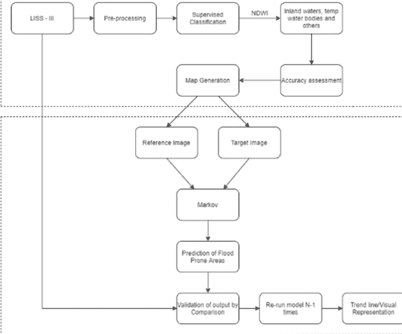

**图 2.3**

所提模型的框图。

监督式分类。在此模块中计算 NDWI（归一化水体指数）。在准确性评估后，生成相应的地图 [17]。马尔可夫模型取决于并需要在固定数量状态之间的转移。状态被分为瞬态态和吸收态 [18]。吸收态标记着过程的结束，因此需要进行相应的选择。初始状态转移概率基于特定状态的初始土地覆盖情况来确定。转移矩阵可以通过第一次迭代的变化来确定。这决定了状态的数量，或者在现实世界中，过程进入吸收态所需的时间 [20]。由于给定的问题是一个吸收态问题，这显然存在于所有状态中，但我们将估计在有限时间内向吸收态的转移。将将进行多次迭代，最终我们能够看到该模型将遵循的趋势或模式 [21, 22]。图 2.3 显示了所提模型的框图。

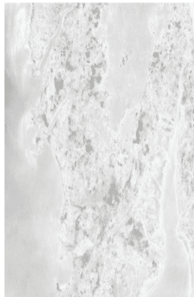

图 2.4

2011 年的 NDWI 图。

## 2.3 结果

使用 QGIS 软件作为遥感工具，对研究区域从 2011 年到 2015 年的五年进行了分析。在此分析期间，计算了每年的 NDWI 值并生成了相应的地图。图 2.4 显示了2011 年的 NDWI 图。2011–2015 年的 NDWI 图和降水数据如图 2.5 所示。为了清晰研究区域的水体，使用了 LISS-III 卫星的第 5 波段进行短波红外传感。这些 NDWI 值结合上述年份的降水数据被作为使用马尔可夫链模型进行预测分析的参数或变量。图 2.6 显示了2015 年的 NDWI 图，而图 2.7 显示了2015 年的降水数据。

马尔可夫模型是一种基于状态的随机转移模型，用于两种不同的状态。这些状态需要从现有的土地利用覆盖（LULC）图中清晰地区分，因为这将提供更高的准确性。在这种情况下，决定了两个状态。第一个状态是洪没状态 (A)，下一个状态是非洪没状态 (B)。所以，基本上有两个状态，即 A 和 B。将根据这些状态计算转移概率并形成转移矩阵。图 2011–2015 年计算的转移矩阵如图 2.8 所示。

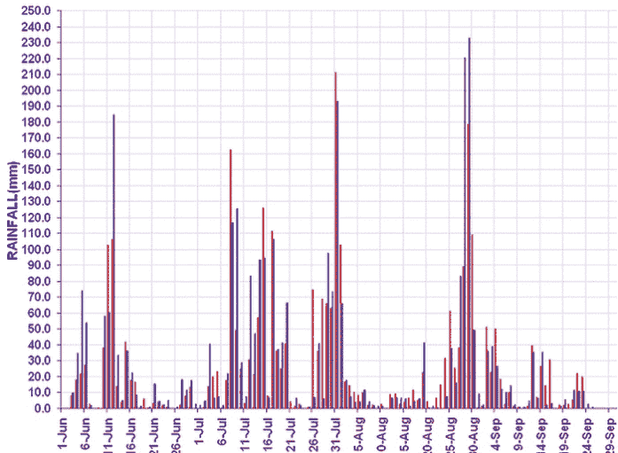

图 2.5

2011 年的降水数据。

图 2.9 显示了使用 MATLAB 仿真工具实现的双状态马尔可夫模型。仿真的时间步为 5，每个元素的转移概率在仿真中均有描述。

## 2.4 结论

对研究区域进行了地理分析（即覆盖面积、人口和海拔），以便对洪涝和内涝发生的可能性进行预测。将高质量的卫星图像与社会经济数据相结合，以建立环境、经济和社会威胁预测模型。图像处理和分类使用 QGIS 版本 3.3 Zanzibar 完成。图像处理是基于归一化水体指数（NDWI）值的计算进行的，其使用了绿光和近红外（NIR）波长。马尔可夫链提供了应用于单个粒子的离散模型，这种离散提供了所有数据的价值模型。基于马尔可夫链的模型提供了洪水状况的准确预测。

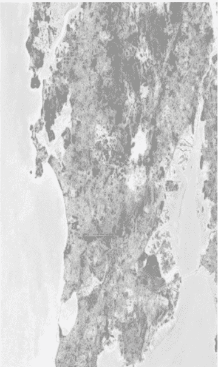

**图 2.6**

2015 年的 NDWI 图。

此类模型可以通过添加响应层（如警报和建议）来实现近实时遥感应用，用于灾害风险管理。更多的训练数据可以提高该模型的准确性。

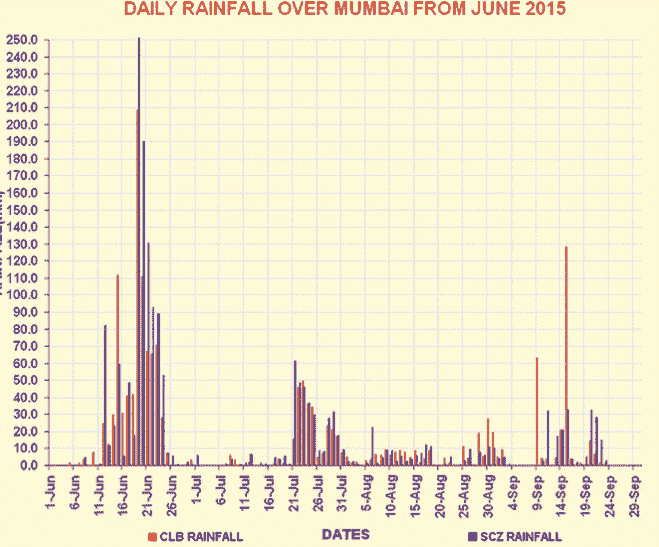

图 2.7

2015 年的降水数据。

### 2011:

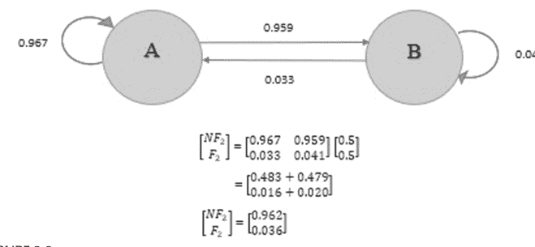

```
$NF_1 = \begin{bmatrix} 0.967 & 0.959 \\ 0.033 & 0.041 \end{bmatrix}$
$F_2 = \begin{bmatrix} 0.483 & 0.479 \\ 0.016 & 0.020 \end{bmatrix}$
$F_3 = \begin{bmatrix} 0.962 & 0.036 \end{bmatrix}$
```

图 2.8a

2011–2015 年的双状态模型。

### 2015:

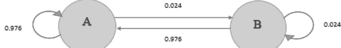

```
$NF_0 = \begin{bmatrix} 0.976 & 0.976 \\ 0.024 + 0.016 + 0.023 + 0.0004 \end{bmatrix}, NF_k = \begin{bmatrix} 0.965 & 0.017 \end{bmatrix}$
```

图 2.8b

双状态模型。

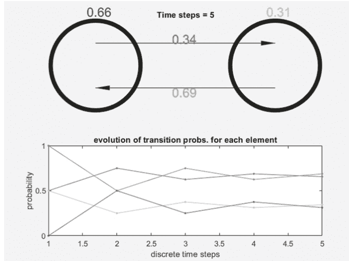

图 2.9

MATLAB 上的模型实现。

- [1] Musavi, A., Ozturk, P.; Chau, K.-W. Flood Prediction Using Machine Learning Models: Literature Review. Water 2018, 10, 1536.
- [2] https://www.census2011.com/census/357-mumbai-city.html
- [3] http://mumbai.gov.in/English/PDF/E2013-PR98
- [4] Biswajit Majdar, "Land use and cover detection at Sukinda Valley using remote sensing and GIS", National Institute of Technology Rourkela, 2011, 66–76.
- [5] Rahel Hamad, Heiko Balzer, Kamal Kolo, "Predicting land/cover changes using a CA-Markov model under two different scenarios", Sustainability, 2018.
- [6] Jamie Muenchench, Patrik Schratz, Alexander Brenner, "R-GIS: Integrating R with QGIS for statistical computing," R Journal 2017.
- [7] S Unajida, Sulaiman and Siti Hajar, Wahab (2018) Heavy Rainfall Using Artificial Neural Network for Area. In: IT Convergence and Security 2017. Notes in Electrical Engineering, 449, p. 68–76.
- [8] S Khatri and H Kastwari, "Quality assessment of Median filtering techniques to remove noise from digital images," 2016 International Conference on Advanced Computing and Communication Systems (ICACCS), 2016, p. 1–4, doi: 10.1109/ICACCS.2016.758633.
- [9] Abbott, J. Marahy, "Selection and optimization for morning rainfall-falling runoff techniques–deterministic, statistical, and artificial neural networks." Atmospheric Research, in Queensland, Australia, using artificial neural networks, 166–178, 2014.
- [10] A. Jain, S. Prasad, Closure to "comparative analysis of event-based runoff techniques–deterministic, statistical, and artificial neural networks." Journal of Hydrologic Engineering, vol. 9, p. 551–553, 2004.
- [11] R.C. Deo, M. Sahin, Application of the neural network model for prediction of monthly precipitation and evapotranspiration using hydrological parameters and climate indices in eastern Australia. Atmospheric Research, p. 65–81, 2015.
- [12] M.K. Tiwari, C. Chatterjee, Development of an accurate and reliable flood forecasting model using wavelet-bootstrap– ANN (WBANNs) hybrid approach. Journal of Hydrology, p. 458–470, 2010.
- [13] C.A. Guaimães, Santos, G.B.D. Silva. Daily stream forecasting using a wavelet transform and artificial neural network hybrid models. Hydrological Sciences Journal, p. 312–324, 2014.
- [14] S. Supratid, T. Aribang, S. Supharatid. Integration of stationary wavelet transform and nonlinear autoregressive neural network with exogenous input for baseline and forecasting of reservoir inflow. Water Resources Management, vol. 31, p. 4023–4043, 2017.
- [15] E. Dubass, J.H. Freedman, J.T. Ormerod, M.P. Wand. Wavelet-based gradient boosting. Statistics and Computing, vol. 26, p. 93–105, 2016.
- [16] Kasivaswanathan, J.; He.; K. Sudheer, J.-H. Tay. Potential application of wavelet neural network ensemble to forecast flood management. Journal of Hydrology, p. 161–173, 2016.

# 洪水风险制预测分析 33

- [18] P.S. Yu, T.C. Yang, S.Y. Chen, C.M. Kuo, H.W. Tseng, 随机森林与支持向量机在实时雷达降水预测中的比较。Journal of Hydrology, vol. 552, pp. 92–104, 2017.
- [19] S. Li, K. Ma, Z. Jin, Y. Zhu. 一基于 svm 和提升学习算法的新型洪水预测模型，Evolutionary Computation (CEC), IEEE Conference, pp. 1343–1348, 2016.
- [20] E. Danso-Amao, M. Scholz, N. Kalimeris, Q. Yang, J. Shao. 为可持续蓄洪水区预测大坝溃决风险：大曼彻斯特地区的通用案例研究。Computers, Environment and Urban Systems, Vol. 36, pp. 423–433, 2012.
- [21] Y.B. Dibike, S. Velikov, D. Solomatine, M.B. Abbott. 使用支持向量机进行建模：介绍与应用。Journal of Computing in Civil Engineering, vol.15, pp. 208–216, 2001.
- [22] Rahel Hamad, Heiko Balzter, Kamal Kolo, 在两种场景下使用 CA-Markov 模型预测土地利用/土地变化，2018。


# 3 用于风险分析的机器学习

Parita Jain,1* Puneet Kumar Aggarwal,2 Kshiraj Makar,3 Riya Garg,3

Jaya Mehta,3 and Poorvi Chaudhary,3

¹KIET 学院, UP, 印度

2ABES 工程学院, UP, 印度

³HMRITM, Delhi,印度

*paritajain23@gmail.com

# 目录

## 3.1 引言

机器学习（ML）是技术领域的新发展。它具有取代设备显式编程的能力。其核心概念是提供大量数据，并基于这些数据和某些算法对机器进行训练，从而构建不同的机器模块。

DOI: 10.12101/9781003104858-3

根据提供的数据由机器做出的决策极其高效且准确。随着技术使用的增加，精密的犯罪和风险也在升级。在现代世界中，最需要关注的要素是风险管理，其日益强化的产出提供了关于机器学习如何应用于风险评估的所有信息（Apostolakis, 2004; Ave, 2012）。


大型组织、公司和机构容易受到欺诈的影响；因此，他们正坚持使用各种机器学习技术，以防止或减轻这些欺诈或风险。本章结合了改变风险评估视角的各种策略。基于机器学习的风险评估，本章展示了涵盖不同方面的各种案例研究。这些案例研究有效地刻描绘了风险评估的重要性。案例研究阐明了减少风险的构建技术，并作为未来的参考。本章还纳入了未来的应用，这使我们认识到在各个行业和组织中，为了防止大量的欺诈和欺骗，将机器学习引入这一特殊领域的风险评估具有重要意义（Chen, 2008; Cheng, 2016）。

本章的本质在于为文献中发现的风险提供解决方案，随后给出一个结论，从而将机器学习整体引入了风险管理领域。

## 3.1.1 机器学习

机器学习可以描述为人工智能（AI）的一个分支，其主要重点是检查和识别数据中的模式和排列，以便在不受干预的情况下实现训练、思考、决策、学习和研究等功能。机器学习允许用户通过计算机算法处理海量数据，并允许计算机根据接收到的输入做出建议。如果某些功能需要重新设计，则对其进行分类和改进，以实现未来更好的设计（Creedy, 2011; Comfort, 2019）。

该技术的主要目标是产生一种易于使用的、用于决策的机制。变量、算法和创新负责决策的做出。为了更好地学习系统，需要对解决方案保持警觉。在算法实施的初始阶段，如果结果已知，则向机器输入输入或数据（Diemann, 1992; Durga, 2009; Goodfellow, 2016）。

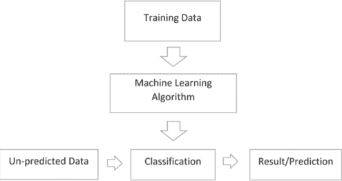

图 3.1 机器学习过程。结果的效率取决于输入机器的数据量和数量，如图 3.1 所示。

## 3.1.2 风险分析

风险是指在项目运行期间发生非预期事件，这对目标的实现产生负面影响。风险是不预期或有害事件发生的可能性。风险分析通过采用不同的方法来检查风险发生的概率，其目的是消除或最大限地减少有害事件发生的概率。风险分析是理想的，因为风险的发生与项目面临的损失金额直接正比。每项技术或项目都有同样的成功或失败的机会，因此通过分析来降低这种机会（Kaplan 1981; Hastie, 2009; Hauge, 2015; Haugen, 2015; Khazad, 2015）。

风险分析包括识别与项目相关的危害类型，可能是化学危害、机械危害甚至是技术危害。这是一个本质上是分析的过程，目标是获取与意外事件相关的所有信息。它涉及对过去发生的危害以及未来发生概率的分析（Khazad, 2013a; 2013b）。它不仅分析危害，还分析其对系统的影响，以便采取适当措施。主要目标是增加成功的机会，同时最大限度地减少项目的成本或投资。由于风险分析如此重要，执行也更加困难。使用员工传统方法需要大量时间来完成过程（King, 2001; Kongsvik, 2015; Landducci, 2016a, 2016b）。但现在随着工业的发展，产生的数据量非常高，项目上执行的操作比以前多得多，但完成该项目的时间缩短了。因此，为了满足需求与时间的比例，应使用如机器学习（ML）等技术且更可靠的方法。有多种进行风险分析的方法。这些方法如下：

- (i) **定性方法**：这是一种通常在决策过程中或决策之前使用的方法。它涉及基于以往经验的各种预测；项目的不同成员会对风险做出不同的判断。这不是一种非常准确的方法，通常在项目的初始阶段进行（J, 2018; 2019）。其主要目标是根据过去的经验提高项目质量。当没有时间限制且风险水平较低时，建议使用这种方法。这种方法不使用任何算法或数值数据，通过头脑风暴、问卷调查或访谈来进行。

- (ii) **定量方法**：这种方法比定性方法更具数值化且更可靠。在这种方法中，根据发生的概率对识别出的不同风险分配不同的数值，并执行算法来计算项目的风险水平（Aggrawal 2018; Aggrawal 2019; Jain 2020）。在这种方法中，我们不假设会发生什么。它涉及分析发生次数的概率、后果分析以及解决方案的后续影响。这种方法由于需要机器和计算机系统，成本较高，但结果非常准确。

- (iii) **半定量方法**：这些方法既不是定性的，也不是完全基于数值或算法的。这是一种根据项目和客户需求调整的折中方法。所使用的方法取决于项目的风险水平。在这种方法中，各种项目被归类为低风险、中风险或高风险项目。这种方法用于小型项目，或客户不了解要求因此无法预测相关风险的准确水平的情况。

风险分析的主要组件包括危害识别、风险评估、风险管理和风险沟通（Nivolianitou, 2004), Nobre, 2009; Musgrave, 2013; Lasi, 2014）。分步过程如图 3.2 所示。

- (i) **危害识别**：迈向风险分析的第一步是识别未来可能面临的问题、风险或危害。危害的数量决定了项目的风险水平。危害越多，风险水平越高。一旦完成识别，接下来的阶段是风险感知，意味着对识别出的风险表示接受。

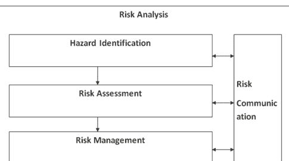

**图 3.2** 风险分析的组件。

风险感知因人而异，也取决于风险的特征。如果客户希望项目成功并盈利，他/她必须接受风险并采取适当措施将其降至最低。为了首先解决问题，我们需要了解问题；同样，为了首先消除风险，需要将危害识别为已接受而非忽视。

- (ii) **风险评估**：当风险水平增加时，有必要对这些风险进行评估，以便在及时找到解决方案。这样做是为了确保项目以及工用户的安全（Paltrinieri, 2015）。

- (iii) **风险管理**：这指的是管理正在评估和分析的风险。使用不同的策略来管理风险。这些策略旨在管理风险的负面影响并提高生产力（Pasman, 2014）。

- (iv) **风险沟通**：这通过在客户、开发者和用户之间交换和传输相关信息，使该过程具有互动性。该阶段涉及直接或间接参与项目的人员的积极参与，从低级到高级别，以使过程高效并满足所有阶段的需求。这个阶段很重要，因为它使过程变得高效并满足所有阶段的需求。

# 工程中的机器学习算法与应用

传统的风险管理和分析方法需要进行修改。企业面临的主要风险如下：

- (i) **战略风险**：顾名思，战略风险与策略有关，即规划不适用于业务的成功发展。这是由于社会的技术变革、具有现代技术的新竞争者进入市场、客户需求领域的快速变化以及原材料成本的增加导致的。研究展示了遭受战略风险的企业案例。有些公司通过训练模型获得了成功，而另一些则没有。一个相似的例子是柯达（Kodak），它在摄影市场曾拥有相当的地位。当工程师开发出数码相机时，这对其核心营销模式构成了威胁，而柯达未能对其修改。如果柯达能更彻底地考虑战略风险，本将为公司带来更好的未来。处理战略风险并不总是破坏性的，因为有许多品牌能够将其视为变化的契机，例如施乐克斯（Xerox）。该公司曾通过单一且满意的产品（即复印机）取得了成功，随后公司尝试增加激光打印机来增强业务模式，并准备好面对统计风险。由于良好的规划，公司看到了变化的积极的一面。

- (ii) **合规风险**：任何公司都试图增加利润和业务前景，但在这样做的同时必须遵守法律。法律随时间推移而不断变化，需要进行监管。例如，某人在工厂生产化妆品并销销至全国。此人在行业中表现良好，因此想将业务扩展到另一个国家。现在该业务面临着合规风险。各国对产品进口有一些规定，这些规则和法规可能会产生费用，并且其利润率可能低于预期利润。如果生产线发生变化，也会出现类似的情况。

- (iii) **运营风险**：这种风险由于公司运营中的意外故障导致。风险包括机械故障、技术故障或人为因素导致的故障。如果给某人的工资是 `¥10,000`，却只给了一张 `¥1,000` 的支票，那么这就是流程和人员失败。在示例中这看起来像是一个小问题，但在大型行业中，可能会导致大金额的问题。自然灾害和停电等其他问题会导致运营损害。通过这些例子，运营风险可以定义为任何损害业务功能或运行的故障或风险（Villa, 2016a, 2016b）。

- (iv) **财务风险**：大多数情况下，企业面临的风险被归类为财务风险，即财务问题导致收入低和利润减少。假设一个客户有30天的信用延期期，并且是公司收入的大来源（Marchi, 1999）。在这种情况下，公司面临着财务风险，因为如果按时付款，可能会造成巨大的麻烦。当特定公司负巨债时，情况也是如此。国际业务面临着巨大的财务风险。我们可以回到化妆品的例子，此人想在国际市场上销售产品，如果此人尝试在美国、英国、法国和印度销售货物，公司可能不得不承担这些不同货币的汇率费用。这种类型的例子也属于财务风险。

- **声誉风险**：所有企业的一个共同点是它们的声誉，无论是小规模企业还是跨国公司都是如此。如果声誉是正面的，那么商品的销售和员工的招聘将变得更容易。如果声誉受损，收入将立即损失，员工可能会离开公司。广告代理机构可能对与公司相关的工作感兴趣，等等（Yang, 2015）。

## 3.3.1 风险管理领域的模型

针对不同场景的风险管理，已经提出了多种模型。其中一些模型的解释如下：

- **可解释性**：机器学习设计具有产生难以理解或评估结果的特征。为了提高这种能力，使用了某些模型：

  - **线性单调模型**：线性系数为输出的展示提供了巨大的支持。线性回归模型属于此类。

  - **非线性单调模型**：对数据进行限制，使我们看到下降或上升的全局关系，其中变量被简化以产生结果。梯度提升模型（Gradient boosting model）就是此类示例。

  - **非线性单调模型**：如局部可解释无关说明（LIME）或沙普利值（Shapley values）等方法有助于确保可解释性。示例包括无约束的深度学习模型。

- **偏差**：该特征关注系统的真实性。根据需求，通常使用四种方法：

  - **人口统计盲目**：结算时利用与受保护类别相关的限制性特征组合。

  - **人口统计平衡**：对于每个受保护类别，结果比例相同。

  - **机会均等**：对于每个受保护类别，真阳性标准是相似的。

  - **均等**：对于每个受保护类别，真阳性率和假阳性率相等。

- (iii) **特征工程**：这是一种管理数据的方法，以创建可以使用机器学习算法执行的创新。机器学习中特征工程模型的开发与传统使用的模型相比要复杂得多。第一个原因是机器学习模型可以结合大量信息。另一个原因是，在训练方法开始之前，预处理阶段需要对无组织数据进行特征工程。

- (iv) **超参数**：定义系统组成并决定网络训练方法的变量即为超参数。理解这些变量并确定适当的超参数选择非常重要。选择超参数的方法包括行业最新实践和专家判断。

- (v) **生产就绪**：机器学习模型尽管是算法性的，但大量的计算。这一元素通常在模型开发过程中考虑。预先进行验证以评估与其用途相关的各种模型风险，对于机器学习，它们需要对通过模型的数据流设置限制，并考虑运行时间和模型架构。

- (vi) **动态模型校准**：有时，某些类型模型的参数会发生动态变化。验证人员可以很容易判断哪种动态校准最适合公司。评估的因素包括制定监控计划，确保根据模型的使用进行适当的控制。

## 3.4 用于风险管理和评估的机器学习技术

风险分析使用了两种类型的机器学习技术。在监督机器学习技术中，输入在监督条件下是预定义的并产生预期的输出（Wolpert, 2002; Jain 2020）。在无监督机器学习（ML）技术中，通过在未定义的集合给出各种类型的输入并产生意料之外的输出。

- (i) **监督学习技术**：回归技术用于定义在评估期间预测的风险所分配的变量之间的关系。例如，基于信誉的评估的回归方程可以定义为分配给贷款未还款的变量，通过使用一系列独立且分配给特定功能（如个人的就业状况、过去的还款历史和财产）的变量进行进一步的分析和排序。

这种方法非常有用，因为独立变量促进了管理过程，而且它比传统方法要好得多，因为它具有自解释性，且理论性较少而更具实践性。这种方法适用于大数据集，因为未使用的变量会被自动删除。另一种主要技术是以前决策树和数据流图的形式对风险进行优先级排序和表示。由于具有视觉化表法，这种方法既简单又更全面，因此在管理上所需的时间更少。

这种模型可以被技术人员和非技术人员共同理解。风险根据百分比分支成不同的类别，这些百分比表示各种风险和危害发生的概率。这种分类和细分技术也有助于确定后期的后果。这使得排序可以在更短的时间完成，因为它只包含基于数据/无类型的问题。该模块唯一的局限性是其预测能力较低，这意味着它有助于分析，但不能像传统方法那样预测何时发生风险。

- (ii) **无监督学习技术**：这种方法进一步归类为聚类。这同样基于细分，但它形成了相似的组且不预测任何输出。这是一种没有预测功能的分组技术。这种技术的示例是电子邮件中的垃圾邮件检测。所有外观相似的邮件形成一个簇，如果某封邮件被认为是垃圾邮件，那么所有相似的邮件都将被聚类为垃圾邮件。这种变量的分配是缺失的，导致它无法检测或预测任何内容。这有助于分析师找出功能之间的模式和相似性。

机器学习技术构成了各种模型，这些模型在性质上相当复杂，因为与生成的输出相比，它们使用了许多变量和其他参数，使其像图 3.3 所示既沉重又复杂。由于设计的复杂性，解释时间也随之增加，这是不利的。一个良好的预测模型通常很难分析。为了高效的风险评估和管理，解释与预测同样重要。因此，可以对这些模型应用某些方法，与参数或输入相比，增加观测值的权重，以便生成更多的输出。这种方法被称为“增强（boosting）”。另一种方法是在不同的数据集上运行模型，使其对相同数据集产生不同的预测。这被称为“装箱法（bagging）”。理想的模型是增强和装箱法的平均值，以便其能够同时进行预测和解释。

为了消除所有复杂性，机器学习与深度学习的某些技术相结合，导致了技术的进步。这些通常被称为实务方法或无理论方法，因为它们不涉及太多的解释，因为它们大多是自解释的。在深度学习中，所有算法的配置方式都代表数据的某个特定方面，并增强对该部分数据的预测。这就是如何使用机器学习技术轻松地预测数据，并在深度学习技术的细微帮助下进行解释，而不会增加任何复杂性。这允许对即使是低质量和非结构化的数据进行于解释，这些数据存在于海量数据，使得分析师和非技术用户都能易于理解。这种集成方法允许所有特征作为一个系统一起运行并执行相关分析。研究人员用于解决各种风险的各种机器学习算法如表 3.1 所示。

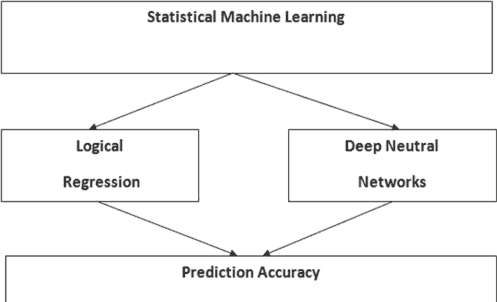

图 3.3 机器学习评估模型技术。

### 3.4.1 机器学习在风险管理中的挑战

在风险分析和管理中使用机器学习的所有案例和优势之外，还存在一些需要考虑的主要问题。

**表 3.1 用于风险管理的机器学习算法**

| 风险类型 | 机器学习算法 |
|---|---|
| 信贷风险 | 神经网络、SVM、KNN、随机森林、Lasso回归、聚类分析 |
| 流动性风险 | SVM、ANN、贝叶斯网络 |
| 市场风险 | GELM、聚类分析、SOM、高斯混合、聚类分析 |
| 运营风险 | 非线性聚类方法、神经网络、k-最近邻、朴素贝叶斯、决策树 |

行业所面临的风险管理中机器学习的某些挑战如下：

- **数据的可用性**：最重大的挑战之一是获取用于处理的相关且合适的数据。机器学习包在通过读取所有类型的数据来处理图像和自然语言方面执行多项任务具有巨大潜力，但在数据内部维持纪律变得困难。此外，数据共享是困难的，因为信息存储在具有不同限制的不同系统中，使得信息检索更具挑战性。此外，也许信息可能没有正式存储。

- **熟练员工的可用性**：随着新技术的演进，对熟练劳动力的需求非常高。高级功能和解决方案的实施、理解和运行极其重要。由于为非熟练员工提供培训非常耗时，目前正尝试解决这个问题，通过在印度建立一个拥有约 7,000 人的校园为志向者提供课程，那里这些技能频繁出现。

- **机器学习技术的准确性**：这并不如表面那么简单。

- **透明度与伦理**：这是经常发生的问题之一。从事实可以看出，模型在初始输入和最终输出之间工作。这可能由于性别、种族和性歧视而导致大量风险。


### 3.4.2 金融领域的机器学习用例

本节分析并详细描述了机器学习在金融领域的各种用例，如欺诈检测、信贷风险、行为监管和市场滥用（Tanwar, 2020）。

- (i) **欺诈检测**：机器学习现在经常用于欺诈检测领域，主要用于检测信用卡欺诈。到目前为止，这获得了更高的成功率。银行建立了各种监控和监控系统以确保安全。这些系统跟踪频繁发生的支付欺诈活动。该欺诈模型根据历史算法运行，一旦检测到欺诈交易就会进行拦截。

- (ii) **信贷风险**：“信贷风险”术语意味着借款人未还款导致的损失前景。因此，实施了信贷风险管理系统（`CRMS`），通过分析银行的公平性、资本以及贷款损失部门来应对损失。该系统增强了金融领域所要求的透明度。

# 用于风险分析的机器学习

早些，在初始阶段，系统的性能仅限于检查单笔交易的行为。但随着时间的推移，各种新的机器学习方法被应用，机器可以识别海量复杂数据并分析整个投资组合。除了进行此类分析外，系统还能够通过电子邮件流、日历项目、开发签入和签出时间以及通话将不同的交易事实联系起来。自动分析是使用深度学习和文本挖掘技术完成的，这使得系统具有机器可读性。

## 3.5 了解机器学习在风险管理中作用的案例

### i) 案例研究1：银行

平均而言，银行容易受到各种风险，如信用风险、市场风险、外汇风险、海外风险、欺诈等。这些风险对银行的声誉和其价值程序构成了威胁。这些风险是银行的潜伏威胁，银行的义务可能会受到质疑。风险是不可预测的，并且可能随时间推移而发生。如果风险能被指定或预测，结果将会怎样？为了提前指定即将发生的风险，可以实施机器学习。首先对所有可能的风险进行分析和审查。在分析这些风险的过程中，会收集大量本质上是非结构化的数据。这些数据从市场信息、客户评论、元数据中收集。

机器学习的核心在于与数据工作。它处理这些数据以供机器使用。机器将根据处理过的输入产生所需的输出。当机器学习结合某些算法应用于大量的非结构化数据时，机器将以数据为基础进行交互并生成输出。这种生成的输出将是对近期可能出现的未来风险的一种预测。

为了从系统中获得准确的结果，以完美的方式对收集的大非结构化数据进行训练至关重要。训练完成后，数据被转换为结构化数据或标记数据。在这些最终数据集上，会处理各种算法。这些算法基本上将数据建模成一个过程框架，并在该框架的基础上生成最终输出。最终输出中收集的数据类型也将属于相同的类别。

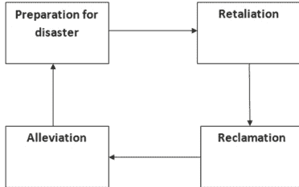

图 3.4

机器学习在灾害管理风险管理中的作用。

机器学习具有兼容性、动态性，并可以防止银行遭受此类狡猾的风险。在风险评估领域，借助机器学习的帮助，可以轻松理解许多问题。

### ii) 案例研究2：灾害管理

灾害可以被定义为导致各种人员、环境和财产损失的自然灾害。这些灾害是不可预测的，但目前已有几种技术运行以预测此类灾难的大致时间。为机器学习收集的标记数据用于以其发生序列的形式来预测灾害。如图 3.4 所示，有各种过程可以根据发生的概率预测灾害的发生。在这些过程中，可能会发生若干错误。这种衡量表明设备或仪器的误操作、保护过度、补充工作量等等。

这些预测即将发生的灾害的机器和人类无法承受风险，因为每个人都依赖它们的最终输出。因此，风险评估在灾害管理等领域的角色变得必要，以保护特定区域免受突发悲剧和不可弥回的损失。机器学习包含了多种技术，负责该领域此类风险的预防。

除了所有问题和困难，考虑情况中的积极因素也是一个至关重要的部分。考虑机器学习在风险管理中的未来是值得的。这从开发成本的降低显而易见。此外，这一过程的耗时性在更高程度上也有减少。这样一个例子是西班牙的金融服务公司比尔巴鄂毕斯阿尔萨银行（`BBVA`）。这家跨国公司正在向合规员工投入巨资。因此，使用了多种机器学习技术来减少这项支出。这项技术使重复性任务自动化。对于组织而言，数据聚类以及高级数据的恢复是机器学习的一些能力，将为公司带来巨大的利益。

## 3.6 结论

在整个章节中，讨论了用于风险评估领域以改进这一过程的机器学习各种方面和技术。机器学习在风险评估中的重要性得到了充分认可。机器学习通过结合系统化的程序和模型，能够有效监控大型复杂数据集，为风险分析创建准确的结果，从而具有创造奇迹的潜力。机器学习在该领域的应用得出的结论是这些方法或技术可以用于高效的预测分析来分析海量数据。还讨论了各种用例，如交易中的行为监管和市场滥用、欺诈检测以及信用风险。

本章涵盖的各种模型描述和案例研究是机器学习在不同行业和组织（如银行风险管理和灾害管理风险管理领域）利用的蓝图。通过采用技术应对风险可以解决的主要问题是，机器学习提供了各种模型和技术，可以最小化或防止此类风险。这些技术和模型会根据程序的需要随着不同的标记数据集而改变。它在该领域提供了稳定性，并在保护可以被视为高度机密的人类和国家信息方面提供了保障。风险评估领域的研究仍在进行，若干措施已经实施。仍有机器学习尚未触及的领域。这可能会导致压力，最后，只能说风险并不远，这将是有益的。

- Apostolis, G. 2004. Risk analysis: from artificial intelligence. Int. J. Proj. Manag. 10,75–80.

- Aggarwal, P.K., Grover, P., Ahuja, L. 2018. The impact of agile software development process on the quality of software product. In: Proceedings of the International Conference on Reliability, Infocom Technologies and Optimization (Trends and Future Directions) (ICRITO), pp. 812–815.

- Jain, P., Sharma, S. 2019. Prioritizing factors in designing of test cases: An ISM-MIC based analysis.

- Durga Rao, K., Sanyasi Rao, R., Kushabha, H., Verma, A.K., Srivya, A. 2009. Dynamic tree analysis using Monte Carlo simulation in probabilistic safety assessment. Reliab. Eng. Saf. 94:882–883.

- De Marchi, B., Ravet, J. 1999. Risk management and governance: a post-normal science. Futures 31:743–757.

- Goodfellow, I., Bengio, Y., Courville, A. 2016. Deep Learning. The MIT Press, Cambridge, MA.

- Hastie, T., Tibshirani, R., Friedman, J. 2009. Unsupervised learning. In: The Elements of Statistical Learning, Berlin, pp. 485–585.

- Hausgen, S., Vinme, J.E. 2015. Perspectives on the unseen and the unforeseen. Reliab. Eng. Saf. 137:1–5.

- Bucelli, M., Paltrineri, N. 2018. Safety of dynamic positioning on offshore units. Journal of Advanced Research 15:377–390.

- Chen, H.-T., Mao, T., Verhoven, H. 2008. Assessing quality of mobile applications. Journal of Advanced Research 11:5–5.

- Greedy, D. 2011. Quantitative risk assessment: how realistic are these assumptions? J Loss Ind. 24:203–207.

- Aven, T. 2012. Risk concept—historical and recent development. Reliab. Eng. Saf. 99:33–44.

# 风险分析中的机器学习

Jain, P., Sharma, A., Aggrawal, P.K. 2020. 高质量移动应用的属性。在 Proceedings of the International Conference on Cloud Computing, Data Science and Engineering Conference, 50–54.

Kaplan, S., Garrick, B.J., 1981. 风险的定量定义。Risk Anal. 1: 11–27.

Khazad, N. 2015. 动态贝叶斯网络在化学基础设施多米诺效应风险分析中的应用。Reliab. Eng. Syst. Saf. 138: 263–272.

Khazad, N., Khan, F, Amyotte, P. 2013. 基于离散时间贝叶斯网络的工艺系统风险设计。Reliab. Eng. Syst. Saf. 109: 5–17.

Khazad, N., Khan, F, Amyotte, P. 2013b. 海洋钻探的定量风险分析：贝叶斯方法。Saf. Sci. 57: 108–117.

King, G., Zeng, L. 2001. 稀有事件数据中的逻辑回归。Polit. Anal. 9: 137–163.

Kongsvik, T., Almkov, P., Haavik, T., Haugen, S., Vinnen, J.E., Schiefloe, P.M. 2015. 过程工业中重大事故预防的决策与决策支持。J. Loss Prev. Process Ind. 35: 85–94.

Lancucci, G., Paltrineri, N. 2016. 专门用于油气部门的频率偏好方法。Environ. Process. Saf. 104: 123–141.

Lancucci, G., Paltrineri, N. 2016. 风险的动态评估：从安全指标到主动技术。Chem. Eng. Trans. 53: 169–174.

Lasi, H., Fette, P., Kemper, H.-G., Hofmann, M. 2014. 工业 4.0。Bus. Inf. Syst. Eng. 239–262.

Musgrave, G.L. 2013. Owen Theather，华尔街的盈利能力：预测不可预测之物的历史。Econ. 48: 203–204.

Nivolianov, S., Leonopoulos, V.N., Konstantidou, M. 2004. 危险系统事故情景分析技术的比较。J. Loss Prev. Process Ind. 17: 467–475.

Nobre, F.S., 2009. 设计未来的信息管理系统。IG Global.

Noh, Y., Chang, K., Seo, Y., Chang, D. 2014. 基于过程模拟结合蒙特卡洛方法的 LNG 储罐压力风险基设计设计。Reli. Eng. Syst. Saf. 72: 76–82.

Nývt, O., Haugen, S., Ferkl, L. 2015. 随机化的特里网建模和分析的复杂事故场景。Reliab. Eng. Syst. Saf. 142: 539–555.

Nývt, O., Raus, 2012. 特里网趋势中的事件依赖性。Reliab. Eng. Syst. Saf. 54: 45–57.

Øen, K., Utne, I.B., Herrera, I.A. 2011. 构建安全指标：第一部分——理论基础。Safety Sci. 49: 148–161.

Paltrineri, N., Khan, F, Cozzani, V. 2015. 动态风险管理先进技术的耦合。J. Risk. 18: 910–930.

Paltrineri, N., Giers, G. 2017. Seveso 场地的动态风险分析。J. Loss Prev Process Ind. 49: Part A: 111–119.

Paltereria, N., Comfortb, L., Reniers, G. 2019. 学习风险：用于风险评估的机器学习。Safety Sci. 118: 475–486.

Pasman, H., Reniers, G. 2014. 定量风险评估（QRA）的现状与未来及其从土地利用规划（LUP）中获得的激励。J. Loss Prev. Ind. 28: 2–9.

Svozil, D., Kvasnicka, V., Pospichal, J. 1997. 多层前馈神经网络介绍。Chemon. Intell. Lab. Syst. 39: 43–62.

Tanwar, S., Bhatia, Q., Patel, P., Kumari, A., Singh, P.K., Hong, W.C. 2020. 基于区块链的智能应用中的机器学习采用：挑战与未来道路。*IEEE Access*. 8: 474–488.

Villa, V., Paltrineri, N., Khan, F., Cozzani, V. 2016a. 迈向动态风险分析：化学工业风险评估方法及其局限性综述。Saf. Sci. 118: 475–486.

Wolpert, D., Vapnik, V. 2002. 机器学习没有免费午餐。Neural Comput. 14(5):111–128.

Yang, X., Haugen, S., Ferkl, L. 2015. 随机化的特里网建模和分析的复杂事故场景。Reliab. Eng. Syst. Saf. 142: 539–555.

## 机器学习赋能

Shyamalagri Muresan 和 Revathy Jayaskar

¹埃罗工程学院（自治），计算机科学系副教授

²SASTRA 大学，坦久尔 邮箱：shyamalagri2011@gmail.com; revathyabaskar@gmail.com

# 机器学习技术赋能电动汽车

然而，面对大量的数据，团队面临的一个主要挑战是：人类专家需要大约 32 周才能筛选电动汽车用户的评论，以便从自由文本中提取出有用的见解。

因此，我们几乎是在业余时间开始尝试深度自然语言处理技术来解锁一些见解。事实证明，评论数据是一个尚未开发的研发创新来源。我们很快意识到，将 AI/ML 应用于这些数据可以加速政策分析，并降低科技（S&T）研究的评估成本。

通过持续部署深度学习技术来分析这些电动汽车用户评论，我们能够展示机器学习工具如何用于快速分析政策以进行实时评估，并为重要的电动汽车充电基础设施政策提供新见解，因为目前需要关注用户体验的质量，以及支持公众参与电动汽车充电网络建设的证据支持。

通过取代汽油和柴油燃料，电动汽车和电动车队减少了交通部门的排放，提供了重要的公共健康益处。然而，公众对充电基础设施可靠性的信心仍然是其采用的一个根本性障碍。利用来自 12,270 个电动汽车（EV）充电站的大规模社交数据和机器学习，我们提供了国家级的证据，说明在美国 651 个基于核心的统计区域内，现有的充电基础设施如何服务于快速增长的电动汽车驾驶群体的需求。我们部署了监督机器学习算法来自动对电动汽车用户生成的非结构文本进行分类。鉴于流数据的分类成本很高，在人口规模上提取行为见解一直具有挑战性。通过计算方法，我们将研究评估的处理时间从人类处理的几周缩短到了几分钟的计算。与理论预测相反，我们发现公共充电地点的站点表现并没有优于政府提供的公共充电点。总体而言，在公共充电基础设施早期增长阶段，近一半的充电站存在问题，随着电气化和可持续交通市场的扩大，这是一个需要解决的问题。

这项研究于 2020 年 2 月 19 日发表在《自然》杂志上，是斯坦福大学、麻省理工学院（MIT）和丰田研究院科学家之间的一项大型合作的一部分，该合作将基础学术研究与现实工业应用相结合。其目标是：找到一种能够在 10 分钟内为电动电池充电的最佳方法，并使电池整体寿命最大化。研究人员编写了一个程序，仅根据几次充电循环就能预测电池对不同充电方式的反应。该软件还会实时决定重点关注或忽略哪些充电方式。通过减少试验的长度和次数，研究人员将测试过程从近两年缩短到了 16 天。

## 4.1.2 人工智能助力电动汽车开发加速

电池性能可以决定电动汽车的体验优劣，从续航里程到汽车的充电寿命。现在，人工智能已让在加油站停站的时间内为电动汽车充电成为更有可能的现实，并可以改进电池技术的其他方面。

几十年来，电动汽车电池的进步一直受限于一个瓶颈：评估时间。在电池开发过程每一个阶段，新技术都要经过数月或数年的测试，以确定其使用寿命。现在，由 Stefano Ermon 和 William Chang 领导的团队开发了一种基于学习的方法，将这些测试时间缩短了 98%。尽管该小组在电池充电速度上测试了他们的方法，但他们表示该方法适用于电池开发流水线中的许多其他部分，甚至适用于非能源技术。

“在测试中，你必须尝试大量的尝试，因为你获得的性能差异非常剧烈，”计算机科学助理教授 Ermon 说，“通过 AI，我们能够快速识别出有前景的方法并过滤掉许多不必要的实验。”

## 4.1.3 更智能的电池测试方法

设计超快充电池是一项重大挑战，主要因为很难让它们耐用。快速充电器的高强度会对电池造成压力，通常会导致其损坏。为了防止电池包（占据电动汽车总成本很大一部分）遭受损坏，电池工程师必须测试一系列详尽的充电方法，以找到最佳的一种。

这项研究旨在优化这一过程。起，团队发现快充优化涉及许多试错测试——这对于人类来说是低效的，但对机器来说却是完美的问题。


“机器学习是试错，但是以一种更智能的方式进行，”共同领导该研究的计算机科学研究生 `Aditya Grover` 说，“计算机在判断何时进行‘探索’（尝试新颖不同的方法）以及何时进行‘利用’（专注于最有前景的方法）方面比我们远优得多。”

团队在两个关键方面利用了这种力量。首先，他们利用它来缩短每次循环实验的时间。在之前的一项研究中，研究人员发现，不需要对每个电池反复充电和再充电直到其失效（测试电池寿命的常用方法），他们只需要预测电池在前 100 次充电循环中持续多久。这是因为机器学习系统在对几个循环至失效的电池进行训练后，可以在早期数据中找到预示电池寿命的模式。

其次，机器学习减少了他们需要测试的方法。计算机不再平均地测试每可能的充电方法，也不依赖直觉，而是从经验中学习，快速找到要测试的最优方案。

通过对更少的方法进行更少的循环，论文作者很快为他们的电池找到了一种优的超快充方案。`Ermon` 表示，除了大幅加快了测试过程外，计算机的解决方案也比科学家构思的更好，且更奇特。

> “它给了我们一个惊地简单的充电方案——这是我们没有预想到的，”`Ermon` 说。算法的解决方案不是在充电初期使用最大电流，而是在充电中间使用最大电流。这就是人类与机器的区别。机器不会受到人类直觉的影响，而直觉虽然强大，但有时会误导我们。”

## 4.1.4 更广泛的应用

研究人员表示，他们的方法可以加速电池开发流水线上的几乎每一个环节：从电池化学设计到确定其尺寸和形状，再到寻找更好的制造和存储系统。这不仅对电动汽车产生深远影响，对其他类型的储能也是如此，这是在全球范围内转向风能和太阳能的要求。

> “这是一种开发电池的新方法，”该研究共同作者、丰田研究院科学家 `Patrick Herring` 说，“拥有这种可以在学术界和工业界大量人员之间分享并进行自动分析的内容，将使创新更加快速。”

`Herring` 补充说，该研究的机器学习和数据收集系统将开放给未来的电池科学家免费使用。他说，通过使用该系统利用机器学习优化流程的其他部分，电池开发——以及新的、更好技术的出现——可能会加速一个数量级甚至更多。

`Ermon` 表示，该研究方法的潜力已超出了电池领域。其他大数据测试问题，从药物开发到 X 射线和激光的性能优化，也可以通过机器学习优化的应用发生革命性的变化。最终，他表示，这甚至可以帮助优化所有最基础的过程之一。

“更大的希望是帮助科学发现过程本身，”`Ermon` 说，“我们正在问：我们是否可以设计这些方法来自动与假设配合使用？它们是否能帮助提取人类无法提取的知识？随着我们的算法变得越来越好，我们希望整个科学发现过程能够大幅加速。”

## 4.1.5 电动交通工具基于 AI 的电池管理系统综述

随着数字化进程以及提供可靠数据的可靠信息源可用，人工智能（AI）已运而生，用解决以前具有挑战性的复杂现实计算问题。人工神经网络（ANNs）在数字处理中发挥着非常有效的作用。然而，`ANN` 需要严苛的主处理器和高内存带宽，无法提供预期的性能水平。因此，图形处理器（GPU）、现场可编程门阵列（FPGA）和专用集成电路（ASIC）等硬件加速器被用于提高基于 AI 应用的整体性能。`FPGA` 被广泛用于 AI 实现，因为 `FPGA` 具有高速加速和低功耗等特性，这些是中央处理器和 GPU 无法实现的。`FPGA` 与中央处理器、GPU 和 ASIC 不同，它是可编程的。在电动汽车（E-Mobility）中，电池管理系统（BMS）对锂离子电池（LiBs）执行不同的操作以更好地利用能量。锂离子电池是一种非线性电化学系统，其本质上非常复杂且多变。由于这种特性，电量状态（SoC）、健康状态（SoH）和剩余使用寿命（RUL）的估计非常困难。这促使研究人员设计和开发不同的算法，以解决锂离子电池状态估计的挑战。本章旨在综述用于预测电池的 AI 数据驱动方法和硬件加速器。目标是选择合适的算法来开发一种先进的基于 AI 的 BMS，使其能够精确指示锂离子电池状态，并用于电动交通工具。本文还提供了电动和混合动力电动汽车智能电池管理系统的最新概述。重点是数学原理、方法和实际实现。智能电池管理系统旨在延长电池包的使用寿命并增强电动和混合动力电动汽车驾驶员的安全。本章了三个主要研究课题：电池包的电量状态（SoC）、健康状态（SoH）以及剩余行驶里程估计。

## 4.2 用于电力转向的 AI 逆向工程

汽车行业情景中一个显著的谜团是，车辆制造者对竞争对手车辆的每一个细节都充满好奇和渴望。为了发现这些细微之处，通常包括对产品艺术的研究和逐件拆解整辆车辆的概念。车辆制造商有自己的内部小组，购买竞争对手的车辆并将其拆解，或者付费给外部机构进行操作。车辆逆向工程是一些专门从事此领域的公司实施的概念。他们乐于购买任何车辆的最新型号，并梦幻般地像许多乐高积木一样拆解它。

除了乐趣，逆向工程概念可以通过他们的尝试带来巨额利润。他们将向其他车辆制造商提供有关竞争对手车辆的解决方案。提供进入车辆的每个部分的完整报告文档，以及如每个部分可能成本等宝贵的附加见解。此外，他们还可以评估收集部件的成本，并让汽车制造商了解竞争对手正在进行何种组装。

制造商需要更多地关注获取关于车主的足够知识，并肯定知道他们是如何组装车主的以及成本是多少。然而，查看外部所做的评估往往非常方便。客户的评价可能高可能低，或者在任何情况下都不那么苛刻。了解他们正在告诉竞争对手什么也很有帮助。这样就可以让他们进行相关性分析，因为逆向工程可以传达客户需要考虑的关于车辆的任何事情，每个部分的重量、尺寸、成本以及该部分的功能。关于部件制造商和部件本身的数据，例如，还可以提供不同金属组件的速率。对车辆的整体设计还有额外的关注。凭借目前先进的 CAD 框架，能够从任何角度查看车辆并进入车辆的整个设计中。一些非常现代的 CAD 框架将允许将设计导入到测试系统中。

在 Cybernetic AI 自动驾驶汽车学院，他们正在为自动驾驶车辆创建 AI 框架，这揭示了类似的全行业追求目前正在进行。准备 AI 自动驾驶车辆部件的关键阶段是传感器数据评估和翻译、传感器融合、虚拟模型更新、AI 计划刷新和汽车指令执行。AI 自动驾驶车辆最显著的物理部分是传感器。AI 自动驾驶车辆上有着大量的传感器，包括雷达传感器、声学传感器、激光雷达（LIDAR）、惯性测量单元（IMUs）和各种传感器。每个汽车制造商和科技公司都非常想知道其他组织在其自动驾驶车辆中使用哪些传感器。现在是一场相当自由的竞争，因为可以确定，制造适用于 AI 自动驾驶车辆传感器的不同组织正在激烈的战斗中，试图为自己的传感器赢得市场。

## 4.3 增强 EV 生产和电动汽车部署的人工智能技术

通过人工智能制造的新型 AI 技术用于现代电动汽车制造，以改进电池的开发和组装。电动汽车电池包由大量的单个电池单元组成，通过各种焊接点固定和电气连接。由于焊接质量问题，高电阻会导致潜在的安全问题，并降低电池的效率。因此，AI 技术在最终组装前评估每个焊点的表面缺陷和电阻值，从而节省了制造商的时间和成本，同时也确保了电池的安全。

# 赋能电动汽车的机器学习技术

它支持订单管理，并相应地有助于提高来自不规则环保能源的能源利用率，让客户能够在各种区域为车辆补能。然而，为了实现这些优势，必须解决各种挑战。从一个角度来看，考虑到充电电动汽车电池的成本，必须制定能够限制成本的计算和方法，同时避免客户感到不满。此外，应该对电动汽车群进行协调，以避免电网出现峰值，这可能会导致高昂的电费成本并使局部配电网过载。

## 4.4 人工智能助力助力电动汽车电池的发展

电池运行可能是决定电动汽车体验的关键，从续航里程到充电时间再到车辆寿命都是如此。目前，人工智能已经让在加油站停留的时间内为电动汽车充电的梦想更成为现实，并可以帮助改进电池技术的其他方面。长期以来，电动汽车电池的进展一直受到一个重大瓶颈——评估时间。

设计超快充电池是一项巨大的挑战，本质上是因为很难延长它们的使用寿命。快速充电的强度会对电池产生更大的压力，这通常会导致其过早失效。为了防止这种情况发生在电池包上（这是电动汽车总成本中很大的一部分），电池工程师应该测试充电技术的全面方案，以找到效果最好的方案。这项新研究试图优化这一过程。起初，团队发现快速充电导致了大量的实验测试，这对于人类来说是效率低下的，但对机器来说却是理想的。然而，机器学习是以更智能的方式进行实验，而且计算机在筛选何时调查、尝试新的各种方法以及何时深入或专注于最有前景的方案方面比人类好得多。该团队在两个关键指标上利用了这种能力。

首先，他们利用它来缩短每次循环的时间。在之前的报告中，科学家们发现，与对每个电池充电直到失效的测试电池寿命的标准方法相比，我们可以在前 100 次充电循环后预测电池可以使用多久。这是因为 AI 框架在对几个循环至故障的电池进行训练后，可以发现早期数据中预示电池寿命多久的模式。

# 工程中的机器学习算法与应用

其次，机器学习减少了他们需要测试的策略数量。计算机不再同样测试每种可能的充电技术或依赖直觉，而是从其经验中获益，快速找到要测试的最佳方案。

通过更少循环的测试策略，研究者立即为他们的电池找到了一种最优充电方案。尽管显著加快了测试周期，计算机的答案也比电池研究人员几乎可能想到的要独特且高效得多。它给了我们这个令人惊讶的简单充电方案，这是我们没有预料到的。计算方案不是在充电开始时使用最大电流，而是利用充电过程中最显著的电流。这就是人类与机器的区别：机器不会受到人类直觉的限制，而直觉虽然是突破性的，但有时也是误导性的。

专家表示，他们的方法流程可以快速验证决定电池尺寸和形状的电池改进部分，找到组装和容量上更好的电池。这将对电动汽车以及各种类型的储能产生深远影响，这是全球范围内转向风能和太阳能能源的关键需求。`Herring` 补充说，研究的 AI 和数据收集框架将向未来的电池研究人员开放。通过使用这一框架利用 AI 改进周期的不同部分，电池的发展和更好的创新可以加速很大甚至更多。该研究策略的能力甚至超越了电池领域。

电动汽车电池的进展一直受到评估时间这一巨大瓶颈的限制。在电池测量的每个阶段，新技术都要经过很长时间的测试才能确定它们可以使用多久。现在，斯坦福大学的分析师们建立了一种基于 AI 的策略，将这些测试时间缩短了 98%。专家们将该策略应用于电池充电速度，但它可以应用于电池改进的许多不同部分。这种改进策略可能使在服务站停留时间内为电动电池充电的梦想成为更有可能的现实。人工智能已准备通过加速电池创新的升级为电动汽车增添动力。

专家们正接近交付让电动汽车设计者和营销人员极力寻求大幅改进的电池：比目前使用的锂离子电池更安全、更快速且更具实用性的电池。专家们表示，在五年内，电动汽车将达到与……

## 赋能电动汽车的机器学习技术

传统燃油汽车的价值，这在很大程度上归功于 AI 所扮演的角色。电池占电动汽车总成本的 25%，其中一半的成本是材料。利用 AI，电池研究人员可以加速对大量材料定义的研究和测试。结果是，创新现在成为可能。

电池科学家正在致力于更快速、更安全、更出色的电动汽车，利用 AI 来加速对更好材料的探索和测试周期。以下是 AI 如何改进锂离子电池的简览。要理解正在发生的进展，观察电池研究的方向会有帮助，对于具有三个基本部分的锂离子电池，每个部分由许多材料制成。当研究人员需要尝试提高价值、安全或性能时，这构成了一个近乎无限的可能替代材料世界。在 AI 之前，新材料的探索是通过传统的测量分析完成的，这受限于处理能力和专家从信息中收集数据的能力。人工智能（或 AI）改变了这一切。快速计算机从代码中过滤掉海量特定示例，利用材料数据库、结果分析和长期的逻辑写作，以一种强大的方式识别哪些电池科学可能会胜出，哪些可能会失败。

在加利福尼亚阿尔马登的研究中心，国际商业机器公司（IBM）有 94% 的研究人员利用 AI 改进一种更快速且不含重金属的锂离子电池。与其使用镍和钴（这些材料昂贵、供应有限且难以回收），IBM 说他们找到了一种使用可以从咸水中提取的碘基材料的方法，可能使这种电池的制造成本比目前的锂离子电池低得多。一种用于电解质的最新潜在材料组合是

# 工程中的机器学习算法与应用

在电流的时代，大约有 20,000 种可能的混合物。使用传统的计算技术来筛选这些竞争者可能花费五年，而 AI 仅用九天时间就完成了评估。随着我们改变溶剂和电解质以提高结合性和使用寿命，由于我们有了更多机会进行准备，AI 的作用变得越来越重要。

除了协助材料研究外，AI 还缩短了电池测试所需的时间。过去，优化新的电池单元设计是一个通常需要长时间充电和多次放电的循环过程。现在，AI 快速调查电池测试期间收集的信息的能力，使研究人员能够对性能做出更快速、更长的预测，从而减少了需要运行的测试数量。负极储存锂，并在电池放电时释放锂离子（失去一个电子的锂）。隔膜允许锂离子通过，而电子被迫独立传输，从而产生电流。此外，AI 还使专家们能够识别出可能增强负极储锂能力的复合混合物。正极在电池充电时工作，锂离子和电子以不同的方式进入负极。在 AI 的帮助下，科学家们正在开发一种碘基方案，以替代大多数锂离子电池中使用的昂贵且难以回收的钴。电解质通常是盐和溶剂的混合物，促进了锂离子的迁移。通过 AI，科学家可以更快地测试电解质方案，帮助他们区分出具有更高电压和更高火焰目标的混合物。频繁充电会损害电极，缩短电池寿命并可能引发火灾。人工智能有助于找到调整充电、速度、充电频率和电池寿命的“甜点”。

全球的研究人员和分析师正日益转向人工智能（AI）和所谓的机器人科学家，来帮助他们处理从新型抗感染剂、药物到太阳能电池板材料和疫苗的一切工作，因此，AI 目前被用于帮助开发新型电池技术并不令人意外。“在测试中，当你需要尝试无数事物时，因为你将不断改变，”麻理工学院（MIT）软件工程副教授 `Ermon` 说道，他指的是传统上如何选择电池突破方法，并主持了这项新任务，利用 AI 帮助为电动汽车制造电池。“有了 AI，我们准备好快速识别出最有前景的方法，并消除大量的无效实验。”这项发表在《自然》杂志上的研究，对于斯坦福大学、麻理工学院和丰田研究院研究人员之间更大范围的合作至关重要，该合作涵盖了学术探索和真实的工业应用，他们的目标是：找到短时间内为电动汽车电池充电并增加电池整体寿命的最佳策略。

## 4.6 机器学习助力电池开发

分析师编写了一个 AI 程序，根据几次充电循环预测电池将如何对各种充电方案做出反应。该产品还选择关注哪些充电或忽略哪些充电。通过减少实验的长度和数量，分析师将测试周期从近两年缩短到 16 天。

## 4.7 适用于电动交通的基于 AI 的预测性电池管理系统

本章还作为另一项承诺，介绍了在未来阶段提高电动汽车效率、稳定性和安全性的专门研究和新兴技术。电动汽车的优势在于这些车辆能够通过电网持续其能量需求，而不是使用石油产品。此外，环境研究表明，电驱动（E-drive）提供了最高的环保性，随后是最低的温室气体排放。由于在运输活动中使用，全球柴油、石油和其他再生能源的储量正在迅速减少。传统能源产生大量的二氧化碳，这对气候产生有害影响，例如消耗臭氧物质排放和危险的大气偏离。此外，交通领域需要辅助燃料热点，例如电动汽车（EV）、新能源汽车（NEVs）、插电式混合动力汽车（PHEVs）、纯电动汽车（BEVs）和燃料电池汽车（FCEVs）。最近，动力电池因在 EVs、HEVs 和 PHEVs 中的吸引受到了极大关注。通过利用可持续能源，这些交通工具可以减少高达 40% 的温室气体排放。可选燃料源，例如波能、风能、水电和太阳能是有间性的，因此这些能源资产还需要储能系统（ESS）来保持稳定可靠的供应。

# 工程中的机器学习算法与应用

电池管理系统（BMS）是电动和混合动力汽车的基础部分。BMS 背后的动力是确保电池的安全可靠运行。为了保持电池的安全性和稳定性，状态监测与评估、充电控制和单体调整是 BMS 中激活的功能。作为一种电化学产品，电池在不同的运行和自然条件下工作方式不同。电池表现的脆弱性对这些功能的执行构成了挑战。

随着数字化发展和可靠数据源的普及，这些数据被用于解决一个以前具有启发性的复杂计算问题。人工神经网络（ANNs）在数字信号处理中发挥着极其重要的作用。`ANNs` 需要通过处理器和高内存数据传输能力，因此无法提供预期的执行程度。图形处理器（GPUs）、现场可编程门阵列（FPGAs）和专用集成电路（ASICs）已被用于提高基于 AI 应用的整体性能。用于 AI 应用的 `FPGAs` 通常具有快速加速和低功耗利用等特点，这在使用本地处理器和 GPU 时是无法实现的。`FPGAs` 与处理器、GPU 和 ASIC 不同，它是可编程的。在电动汽车（e-mobility）中，BMS 执行任务以更好地利用锂离子电池（Libs）中存储的能量

`LiBs` 是一种非线性电化学系统，极其复杂且具有时间变性。由于这种特性，评估电量状态（SoC）、健康状态（SoH）和剩余使用寿命（RUL）等状态具有挑战性。

额定电压、功率密度和成本。在电动汽车（EV）中，智能电池管理系统（BMS）是基础部分之一；它精确测量电池状态，还能确保安全运行并延长电池寿命。锂离子电池电量状态（SOC）的精确评估是一项极具挑战性的任务，因为锂电池具有高度的时间变性、非线性和复杂的电化学结构。

本节阐明了锂电池的功能，概述了智能 BMS 的特性，并详细调查了其 SOC 评估技术。这些 SOC 评估技术根据其侧重点被分为四大基本类。文中对不同研究中的优点、局限性及评估误差进行了关键的说明。此外，还推荐了一些基于创新技术进步的提议，以改进在线评估。本节关注了当前 BMS 面临的问题。电池状态评估（包括电量状态、健康状态和寿命状态）是 BMS 的一项基本任务。通过研究最新的电池状态评估系统，介绍了 BMS 面临的未来挑战并提出了潜在的解决方案。

## 4.8 人工智能在电动汽车控制应用中的用途

电动汽车（EV）正成为应对日益紧迫的能源和环境问题的最佳创新车型。为了减少对石油和自然污染的依赖，许多国家加速了电动汽车的开发与整合。电动汽车的实施，特别是纯电动汽车，被视为解决新兴能源和环境问题的答案。本章重点介绍了电动汽车的专业化发展及其未来应用中的先进技术。文中总结了关于电池、充电技术、电动机及控制以及电动汽车充电基础设施的关键进展。

本节介绍了一种新型电动汽车（EV）速度控制方案，以提高在各种道路条件下的性能和稳健性。指导 PI 控制器运行的参数通过模糊控制进行逐步调整。总而言之，包括纯电动和混合动力汽车在内的电动汽车已作为能源和生态问题的解决方案得到了快速发展。驱动型电动汽车通过变速箱和差速器由电动机控制，而简单的确定车辆

#### 机器学习算法在工程中的应用


通过轮毂驱动，或者简单来说，通过轮电机驱动。本研究的基本车辆配置在纯电动汽车的驱动轮内引入并运行了两个简单的确定性轮电机。这些轮电机可以独立控制，并对指令做出快速准确的响应，与传统的电动汽车相比，车辆底盘或运动控制变得更加稳定有力。通过对轮电机扭矩分配控制的进一步研究，轮电机为四轮电机驱动的电动汽车提供了强大的理想反作用扭矩控制，从而提升了操控性和稳定性。分析表明，电动汽车控制技术（例如 `PI` 控制）可以在整个操作和干扰范围内运行，并且在车辆扭矩一致的情况下是可行的。此外，非线性车辆并非固定的且会任意变化。然而，采用常规 `PI` 控制的电动汽车在这些快速波动的情况下可能表现不佳，系统性能会恶化。此外，由于控制系统的高度复杂性和非线性，很难在保持电动汽车扭矩稳定的同时选择合适的边界 `Kp` 和 `K` 以获得理想补偿结果。这是 `PI` 控制的两个主要缺点。为了克服这些挑战，基于模糊控制的自适应 `PI` 控制器已应用于固定和严格限制条件下，并且改进了电动汽车的整体表现。

直接转矩控制（`DTC`）方法是交流电动机的一种高性能算法，由于其结构简单且能够实现磁链和扭矩的快速响应，近年来引起了关注。带有 `PI` 控制器的无滞带直接转矩控制 `DTC-SVM` 可以充分减少扭矩纹波；然而，其系统稳健性会限制其改进。`DTC-SVM` 策略可以提高系统稳健性，明显减少扭矩和磁链纹波，并充分提高动态响应。`DC-DC` 变换器与控制方法配合，以确保电动汽车和驱动系统的能量需求。本节的目的是增加对某些情况下电动汽车后桥驱动轮基于直接转矩控制的空间矢量平衡的智能模糊 `PI` 控制器的理解。

电动汽车混合动力汽车（`EV/HEV`）的商业化目前正在接受性能和成本测试。应将成本下降作为一个理想计划进行研究。其他重点研究包括绿色驱动方案，其中包括整合可能的持续再生能源源以制造环保绿色汽车，类似于基于物联网（`IoT`）的 `EV/HEV` 方法。手势研究涉及电气设备的多学科。

## 4.9 结论

对可扩展和自主系统的需求日益增长。我们提出了一种基于人工智能的电动汽车，这将消除化石燃料（汽油和柴油）的消耗。此目的设计了一种用于执行电动转向（`EPS`）反向工程的通用方法。相关研究的主要目标是解决与自动驾驶车辆动态轨迹精确预测的问题，这项任务通过推导出确定侧轮胎力的新方程并调整某些车辆参数完成。通过引入带有逻辑推理的混合人工智能，专家系统在当前应用中变得更加灵活和有效。该创新为自动运输车辆在发生碰撞时的重大责任问题提供了解决方案。


# 既有技术及其在手势识别领域的对比分析

Muskan Jindal, Eshan Bajal 和 Shilpi Sharma

计算机科学与工程系，Amity 大学，

印度北方邦德邦

E-mail: muskan.jindal@student.amity.edu, eshan.bajal@student.amity.edu,

sharma22@amity.edu

## 目录

+   5.1 引言........................................................................................... 74
+   5.2 挑战与改进领域....................................................................... 76
    +   5.2.1 图像采集挑战............................................................... 76
    +   5.2.2 手势跟踪、分割与识别挑战............................................................... 76
    +   5.2.3 手势检测与识别中的特征提取挑战............................................................................... 77
    +   5.2.4 手势分级或分类中的局限性与挑战............................................................................... 78
    +   5.2.5 终端用户手势定制的局限性.......................................................... 79
+   5.3 相关领域与特别说明........................................................... 79
    +   5.3.1 基于多阶特征分析的手势识别与 3D 手姿态估计协同学习............................................................................... 79
    +   5.3.2 手势分析与组织研究：自然场景协议的发展与应用............................................................................... 80
    +   5.3.3 早期发育中的手势与语言轨迹：基于自闭症角度的概述 ................................................................ 80
    +   5.3.4 学习对话手势的个人风格........................................... 81

## 74 机器学习算法在工程中的应用

+   5.3.5 教室监控系统中的睡眠手势检测 ......... 81
+   5.3.6 迈向无标记和自动运动特征分析：手势与运动研究工具包................................................ 82
+   5.4 手势检测相关当代文献分析............................................................... 82
+   5.5 结论................................................................................................87

## 5.1 引言

在如今的日常对话与任务中，信息的强化与澄清起着关键作用，而手语正是实现这一媒介。手语是日常交流中不可或缺的组成部分，它可以具有视觉动作或手势等多种形式，但其目的是传递相同的信息并实现信息强化的目的。它包括多个部位，其中最常用手指和手，但也包含了面部表情、头部、躯干和手臂，这些在日常交流中可能较为人知。对于听力、听觉或视觉障碍的人士来说，手语是交流和表达的唯一手段。但由于这些人完全依赖手语与外部世界互动，由于许多人并不了解手语的完整内涵，导致这种互动变得繁琐。此外，虽然手语的使用和知识在视觉障碍群体中很常见，但在听力障碍群体中并不广泛普及。这为这些群体与外部世界进行互动或向其传达信息带来了挑战，因为他们完全依赖手语，而这一问题直到今天仍未得到解决。

虽然大多数手语涵盖了身体的一半 [1]，但某些手语方法在整个身体上使用多样的形状和多次变化 [2]。最常用的手势是手势，可以分为多种类型，即对话性手势、控制性手势、操作性手势和交流性手势 [3]。鉴于手语高度结构化和组织化的属性，计算机视觉领域及其各种算法非常适合它 [4]。本文的研究汇编了关于手势检测的当代专业知识，实施了监督学习和图像分割算法以及相关的姿态，同时为了提高更广泛受众的包容性提出了改进，并重点关注了交流障碍人士。此外，本章所的工作可能最终导致现实应用的发展，例如实时确定学生的出勤情况，这在后疫情时代的在线互动中是不可或缺的资产。用于手势分析的计算机视觉算法实施，适用于手语交流期间执行的各种手势的识别、监控和跟踪的全过程，因为该过程的复杂性和结构化特征可以通过计算机视觉方法的本质得到最好的解释。尽管该领域看起来还且处于起步阶段，但一些最早的研究文献已于1933年发表，当时利用了多种手势分析技术对现有的语音和手写材料进行分析和识别。Pentland 和 Darrell 执行了部分技术，通过使用优化的动态时间规整 [5] 辅助识别了多种动态结构；实施了隐马尔可夫模型（`HMMs`）来理解和分析各种细微属性或特性，以便对各种手语的形状和轨迹进行分类。此外，另一篇文献通过从不同的签名者处收集 262 个签名来获取并计算出 94% 的准确率，证明了该方法的可行性。将特定个人的符号视为多个符号的原因是，观察到训练集增加了模型的实际准确率 [6]。后来在 `HMM` 概念的基础上，另一对活跃研究人员（即 Vogler 和 Metaxas [7]）阐明了在使用依赖模型时 `HMM` 的多重局限性。[8] Ascension Technologies 的鸟群算法在多个作者的帮助下碰撞了手势的三维平移旋转数据，以便研究人员进一步分析该领域。

手势分析的另一个非常流行且发展的领域（特别是手势检测）是人机交互，这是通过处理单元辅助的 `UI/UX` 界面实现的，通过相机或成像仪等视觉或传感器设备收集数据 [9]。多个接收设备，例如用于数据采集的数据采集数据手套 [10]，它们为手势分析或检测提供了准确且丰富的访问。其他传感器接收设备（包括相机）解决了手势动作瞬间的问题（这是数据手套的局限性），但又创造了自身的问题，如相机取向、背景光线和前景干扰。因此，数据采集仍然是手势检测过程中一个繁琐的步骤，但可以通过 `Microsoft Kinect` [11]、`Leap motion` 控制器 [12] 和 `Asus Xeon` [10] 等多个设备和框架来缓解。下一步是轻松学习获取的数据，以理解和识别模式、相似性并从中推导出结论。这种从原始数据中学习的任务可以通过应用各种学习算法来实现，如深度学习、卷积神经网络（`CNN`）、自适应卷积神经网络（`ADCNN`）和循环神经网络（`RNN`） [13,14]。

## 5.2 挑战与改进领域

虽然多位作者描述了手势分析的多个步骤，但某些分级步骤比其他方法带来了更多挑战。在查阅了迄今发表的多篇研究论文和文献后，以下选出的方法在手势分析和识别过程中制造了更多挑战。

### 5.2.1 图像采集挑战

图像的捕捉或获取通过相机或其他图像采集设备从多个源完成。这是任何手势分析或识别框架及算法的首步。当从人员或研究人员处捕捉图像时，会考虑角度和背景颜色对比等物理因素，但当这项任务由自动机器执行时，图像采集可能无法有效进行 [15]。图像帧和背景颜色对比等问题会在手势检测和唯一手势识别等步骤中产生进一步的问题。虽然手势检测框架变得稳健且有效，计算机视觉对人们来说仍然是一个抽象概念，且图像采集相机是由个人使用 Sa 随机放置的。因此，相机的放置会在手势分析、检测和识别的后期阶段产生问题 [16]。图像采集的其他问题包括深度丢失、执行者速度不异、无法识别两个手势之间的差异以及空间或时间的不一致性 [17]。虽然上述限制是特定场景的，但在过程中也会许多日常问题，包括复杂的或繁忙的背景、繁忙背景导致失焦、实时监控限制等。图像采集对象（即相机）及其规格在图像获取中也起着至关重要的作用，其属性如颜色、质量、分辨率和单位帧数或帧率。3D 图像捕捉放大了这些限制，因为这里需要更准确和高分辨率的相机。

### 5.2.2 手势跟踪、分割与识别挑战

手势具有旋转旋转，即它们自由移动的程度或方向半径；旋转程度越高，手势分析和识别的复杂性就越高。尽管这看起来

# 手势检测技术的对比分析

作为手势检测领域面临的主要挑战之一，其他局限性还包括手势速度不一致 [18]、无法区分手势的开始和结束，以及皮肤纹理或肤色的变化。其他图像分割挑战包括背景的不一致性，如光照变化、杂乱或移动的背景，以及背景颜色模式的持续差异 [19]。

### 5.2.3 手势检测与识别中的特征提取挑战

通过多样化方法提取的多种特征面临着各种挑战，而基于图的特征在由于复杂背景或光照不均的情况下提取时会存在局限性 [19]。手势的混合或特征的混合也导致了若干局限性。虽然旋转程度被各种手势检测算法很好地适应，但突然的手势或超出定义的边界会产生问题。这种局限性的递进也为识别连续手势时引入了挑战和问题，因为检测器将其视为一个连续的手势，而不是独特的手势。针对这种连续手势的解决方案是引入了基于系统的自动暂停；这些暂停可能与与人员实际采取的暂停并不重合。此外，很多时候由于个人习惯，一些人在执行手势时几乎或没有暂停，而另一些人则带有最佳数量的暂停执行手势 [20]。这些差异导致了人类执行手势时识别的不一致性，但如果由人工设备执行，这类不一致性问题往往可以被避免 [21]。除了上述之外，另一类型的手势，即“对话手势”，在手势识别和分割方面也存在类似的问题，因为它们根据个人使用对话手势的方式而有多种变化；速度、频率以及不同方言和地区影响导致了所用对话手势类型的差异。实时对话手势还根据环境（如公共手势和私密手势）有很大不同，这在识别和分割方面都会产生进一步的差异。此外，对手势的影响也是造成这种不一致性的因素 [22,23]。某些手势类别创造了人类在日常对话中执行的有意识和无意识手势的模式。虽然这可以被视为对话手势的一个子类，但当单独考虑它们时，可以更有效地进行考量 [24]。因此，实时手势识别、分析和分割是一项繁重且复杂的任务，通过长期的持续训练可以得到改进。

# 机器学习算法在工程中的应用

### 5.2.4 手势分级或分类的局限性与挑战

手势检测算法的最终分级是将累积的手势归分为多个类别，即监督分类和无监督分类。在此阶段发生的挑战主要出现在处理大规模数据点时，例如高复杂度数据点、将模糊的数据集归类为预定义的分类、识别满足大多数数据点的数据集、离群数据点以及处理模糊手势等其他局限性 [25]。在分类手势时，实现各种分类器和过滤器会遇到多种挑战。在实现如动态时间规整（`DTW`）分类器时，高数量数据集的匮乏及其词汇量形成了局限性。对于基于距离的算法（如 k 近邻），这使得计算复杂度呈指数级增加，消耗了算法的整体性能。与 `DTW` 算法类似，基于深度学习的分类方法也会因为数据集稀乏而降低性能，并且需要巨大的训练或验证集来提供最佳性能。原始或经典的分类方法（如有限状态机）具有非常僵化的转换状态和边界，这是一个明显的局限性。基于聚类的分类器（如 k-means 分类方法）主要取决于初始聚类及其属性，还会受到分类器存在的负面影响。因此，选择一个合适的“k”值是一项繁琐的任务。被称为支持向量机（`SVM`）的兄弟分类器也面临选择最优值的相似问题，其中选择合适的内核值变成了一项艰巨的任务。此外，`SVM` 还有其他局限性，如其计算复杂度高，增加了成本，而且由于本质上是二分类器，因此在处理多类分类时需要成对分类，如图 5.1 所示。

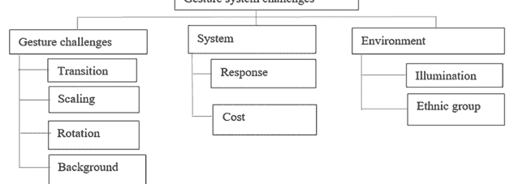

图 5.1

手势分级或分类中的局限性与挑战通过图片详细说明。

### 5.2.5 用户手势分析定制的局限性

这是手势分析、识别和分割领域一个相对特殊且细分的发展方向。它讨论了终端用户要求纳入特定手势或根据这些手势进一步推进其活动的情况 [26]。Wobreck 创建了 27 种新颖的手势，并根据执行这些手势的反应制定了相应的活动。随后，许多作者开始在其工作中添加自定义手势以及随后的反应作为响应 [27]。这些以及许多后续研究的结论是，与其创建个人或特定的用户手势，开发一种可以被大量人员普遍理解的手势是唯一可行的途径，因为它包含了手势创建的概念。虽然有研究包含了自定义手势 [28-31]，但大多数提到的研究并未提供对手势创建的包含。相反，个人手势要么被预训练并包含在框架中，供终端用户直接使用，要么提供给用户以供其自身的训练。自定义手势提供了多个应用领域，如密码、特定动作或泛泛地执行日常性任务。

## 5.3 领域领域与特别说明

在对手势分析广泛技术进行主要文献综述的同时，本节处理了手势分析领域某些最新先进文献的描述和分析，同时关注了它们的具体应用领域。

### 5.3.1 手势识别与 3D 手估计的协作学习 [32]

当手势分析和识别本身是一项极具挑战性的任务时，实时估计 3D 手部姿开启了新的挑战领域。这项最新的先进研究探索了具有多种特征的 3D 手部姿态。它还通过描述这些缓解了数据匮乏的问题。提出的框架结构良好，并配有适当的图说明，有助于识别性能的创新。

### 5.3.2 手势分析与组织研究：自然场景下的协议开发与应用 [33]

这项独特的研究工作执行了一项极其复杂的任务：对人们使用的手势进行分析、解释并得出结论，以获取关于其行为、意图和动机的见解。呈现的工作可能无法提供细节和确切含义，但它通过视频输入成功地阐明了一些通用协议和有用输出。它可以通过使用语言或非指标对观察对象、主题领域、环境的强度以及正式/非正式讨论环境做出非常敏锐的观察。经过适当训练，它成功地通过分析演讲者的手势及其肢体语言将创业和领导任务归分为不同的主题。此外，它还可以通过独特的手势、身体和语言风格识别特定的作者。

### 5.3.3 早期发育中的手势与语言轨迹：基于自闭症谱系角的概述 [34]

该研究描述了手势分析和识别领域一个少为人知但重要的应用领域，即自闭症谱系障碍（`ASD`）及其与手势分析的密切关系。手势识别和肢体语言分析结合非零通信参数在早期诊断 `ASD` 及其症状复发中起关键作用。旨在实现该领域的两个主要目的，即验证手势分析有助于诊断 `ASD` 的有效性，并从定量角度理解不同类型自闭症在儿童早期语言缺失轨迹之间的显著差异。研究结束时，作者成功验证了该观点的有效性，并确认手势反应的不一致或延迟预示着 `ASD` 的早期发育。

# 手势识别技术比较分析

这不仅有助于互动，还能建立他们的信心，进一步辅助该疾病的治疗。通过识别手势分析中的差异，研究识别了自闭症谱系障碍（`ASD`）不同阶段手势频率轨迹的多种差异，以及基于患者年龄的差异。追踪轨迹还可以指示治疗的进展、速度和有效性（如果有的话）。除外，早期诊断和检测还与患者在疾病复发或处于休眠状态时遵循的神经通路有关。这些见解对于找到各自疾病的治疗方法具有重要意义。

## 5.3.4 对话手势个人风格的学习 [35]


尽管有很多研究论文探索了对话风格、非语言手势、肢体语言以及在训练模型后预测观察对象后续手势的多变模型，但该研究在多扬者领域提供了突破性的结果。它讨论了针对 144 小时视频图像的特定说话者数据集，并采用数据驱动技术进行分析和训练，以保持数据的清洁、预处理和标注。后续步骤，它结合了多种方法：使用`U-Net`架构进行语音转手势转换，结合回归模型预测观察对象（视频中的说话者）的后续运动以获得预测的姿态序列，并最终评估获得的结果。为了进一步验证所提算法和方法的稳健性，利用`Amazon Mechanical Turk`通过提供输入来开展真实与虚假的手势分析。虽然预测的手势序列取决于观察对象，并受到不同说话者之间其他不同人际风格的影响，但该模型成功地为多种说话者和风格提供了高性能。研究结束时，它为数据集提供了定性和定量的实时手势分析，并具有突破性的性能。

## 5.3.5 教室监控系统中的睡眠手势检测 [36]

睡眠手势识别一直是手势分析的一个潜在应用或扩展应用领域，由于面临多种挑战且其广泛的现实应用需求，该领域尚未得到充分探索。这项研究克服了睡眠手势识别的局限性，如遮挡挑战、睡眠手势的多样性、与其他自然手势的误识别，以及在现实数据中实现模型的能力。所的最先进的研究收集了上海真实案例的数据，进行预处理，并实施了结合特征金字塔和可变形卷积的优化`R-FCN`进行手势识别，克服了在使用真实数据时遇到的特定挑战，如识别微小的睡眠手势，以及部分识别学生在睡眠手势发生前或后的注意力跨度缺失。这种方法不仅在以噪声视频或数字图像作为输入时提供了突破性的性能。

## 5.3.6 迈向无标记和自动运动特征分析：手势与运动研究工具包 [37]

鉴于执行稳健运动检测的框架匮乏，本工作解决了现实世界数据的空间特征识别问题。其由于由于使用硬编码导致了稳健性的丢失，由于距离限制、一次一次处理的方法和处理速度限制而无法识别空间特征。这些挑战被所提方法敏锐地识别并处理，该方法捕捉观察对象的频繁使用或重复的特征、空间和运动属性。由于其稳健和动态的特性，它具有广泛的应用和用途。

## 5.4 手势识别相关当代文献分析

在本节中，考虑了在任何形式上利用基于人工网络的学习技术造福人类的众多文献中脱颖而出的论文。尽管上述文献的作品成果无法在如此小的空间内吸收，但每篇文献都经过详细解释，以对这些论文提供敏锐的见解，而无需深入研究每一篇。

`Razieh`等人 [38] 对目前现有的深度学习-手势检测框架进行了彻底调查。该章节开始列出用于确定框架的所有可用特征，随后对参数进行了简要介绍。在下一节中，所有材料均根据分析方法的输入类型（二维或三维）以及使用的颜色通道数量进行分类。其他参数，如视觉模态和静态与动态图像之间的差异也经过了简要介绍，通过图表描述了所有论文的分析、使用的对应数据集以及结果在百分比或相似度和置信度指标中的准确率。这比较了从 2001 年到 2019 年的论文，并包含了如`NYU`、`ICVL`、`MSRA`、`LSP`、`FLIC`、`ITOP`、`STB`和`isoGD`在内的知名数据集。多个讨论部分涉及了处理手势分析模型工作的不同方面。第一部分讨论了面部特征的重要性并辅以合适的示例，阐明了其在语义分析中的重要性。第二个讨论部分涉及了可用模型及其结构重要性，例如使用`ANN`优于`CNN`的优势；第三部分讨论了与使用经典分类器与基于深度学习的描述符相结合的混合方法相关的工作。

`Mohammed`在他的研究 [39] 中回顾了模型，重点关注了阿拉伯手语，并回顾了所有深入该领域的文献页面。探索了各种学习框架，如`CNN`、`RNN`、`MLP`、`LDA`、`HMM`、`ANN`、`SVM`、`CNN`和`SLR`系统，并对每一个进行了详细说明和相应的准确率。需要注意的一个因素是，与美国对应物不同，阿拉伯手语系统需要双手来传达某些字母，这意味着在模型部分需要更多的空间感知。在 45 篇论文中，其他论文的平均分为 91.2%。从这项工作中得出结论，基于学习的框架可以匹敌人类的分析能力，工作在多层感知器上的神经网络具有最高的需求性能。

`Murat`等人 [40] 在手势领域深度学习的另一个现实应用是基于`Tensorflow`框架和`Keras`库的手手势检测。所提出的`CNN`模型首先将彩色图像转换为`YbCr`空间以使用颜色检测手。接下来的凸包算法确定手的位置和位置，以便对图像进行调整大小并加载进行分类。这两个步骤同时执行，之后灰度图在 30 毫秒循环中馈入机器。该系统非常强大，在验证集上得分为 99.44% 到 100%。通过图表和图像，阐明了系统的实时工作原理。

`Hamid`等人 [41] 创建了一个腕部佩戴设备以捕捉手部运动数据并通过深度神经网络进行处理。使用安装在主体手部的惯性测量设备上的三轴加速度计和陀螺仪收集了采集过程中的被动数据，并进一步处理以分析执行的动作。通过识别采集帧和高峰活动帧的两步过程，评估了 100 个人的数据。在考虑了重力差异后，数据由四层`CNN`进行处理。根据结果，该系统达到了 88% 的峰值准确率，范围波动。该论文的主要缺点是系统会错误标记如吹气等不确定动作。更多池化层的存在并没有剧烈改变性能，`FLOP`参数的变化也没有。未来的工作提到了老年患者治疗中心作为此类系统的潜在受益者。

# 工程领域中的机器学习算法与应用

`Andrea`等人 [42] 为自闭症障碍的视频图形检测设计了一种`LSTM`模型。该研究针对 20 名被诊断患有自闭症的个体，向神经网络输入了同时显示健康参与者和自闭症参与者的短视频片段。实验由 48 次抓取物体的中性手势尝试组成，并对差异进行了过滤。对 0.5 到 0.95 之间的阈值进行评估，得到的后续准确率值为 83.33%，召回率为 85%。这些框架被认为是先进的，可与以下模型相比：

`Ahmest-Artizabal`等人 [43] 通过计算机视觉开发了一种面部表情动作分析系统，用于早期检测癫痫。该系统由一个视频流组成，以每秒 25 帧记录眨眼、咀嚼、注视和视频运动；一个使用深度`CNN`进行特征提取并训练的`R-CNN`，以及一个带有多对一层的`LSTM`用于用于评估。在生成结果方面，采用了多折交叉验证方法，该方法同时衡量了系统的可靠性和一致性。讨论的结果显示平均准确率为 96.58%，`AUC`值为 0.9926。作者认为基于`MTLE`的检测是成功的；然而，由于缺乏大型公共癫痫面部表情数据集，正如论文本身所提到的，结果中留下了过拟合偏差的空间。

`Ye` [44] 在其论文中将 3D 卷积神经网络与循环神经网络的多模态特征相结合，以获得优越的网络。该模型被用于从美国手语（`ASL`）通信的短视频片段中提取度量数据。通过贪心方法将置信分最高的片段拼接在一起，提出的混合框架`3DRCNN`可以训练并处理存在的任何`ASL`变体。对于数据集，团队与`ASL`协会合作创建了一个改进的`Kinect`传感器，并创建了 99 种不同手势的片段以及 100 个时长仅为几分钟的句子视频片段。在`Sports1M`数据集上训练后，在人员相关比较中测试准确率为 69.2%，在人员无关的分析中测试准确率为 65.2%。这两个得分与其他系统（`LRCN`和仅有`C3D`方法）相比，均未被败。

在`Rastagou` [45] 的另一篇论文中，团队首先建立了一个由 10 名参与者组成的数据集，他们提供了 10,000 个包含 90 多种手势的波斯语`RGB`视频。对于模型，流水线系统从`CNN`开始，使用关键点和平面上的手骨骼边界框提取手部特征，然后输入到名为`3DCNN`的建议框架。总共有五个这样的并行流生成一个模态关节热图，然后通过`LSTM`网络进行处理。数据流与`LSTM`的所有可能组合（包括修改流的数量）均已记录，其中使用五流多视图投影预过滤的系统实现了 99.80% 的最佳准确率。该系统与最先进的系统进行了多次比较，其中也考虑了`2DCNN`。在所有情况下，提出的框架得分都具有竞争力。

`Gomez-Donozo`等人 [46] 创建了一个基于`CNN`的手部近似估计系统，平均误差小于 5 mm。该系统由 2 个`CNN`组成，能够从任何摄像头的视角在空间坐标系中准确预测用户手所有关节的位置。作者进一步声称该系统可以与`Leap Motion`设备相比。用于该系统训练和测试的数据集是一个新数据集`LSMVHandPos`，它包含 20,500 帧中四种颜色的 21 个序列，这些帧经过人工标注，并与预测的 2D 计算机系统进行了比较。论文提到了长视频片段中引入的抖动缺点，并建议在未来的迭代中解决此问题。

另一个 3D 手部模型估计流水线由`Spur`等人 [47] 提出。该 3D 模型估计流水线使用半监督学习方法来克服空间域的问题。为了更直接地连接之前的迭代，框架使用了`LSTM`。对于评估，创建了斯坦福跟踪数据集（`STB`）[48] 和渲染手部数据集（`RHD`）[49]。该方法主要用于重建人体框架是可用的，但该框架留下了许多未探索的领域，尽管该框架改进了 35%。`Jadooski` [56] 展示了一种通过神经网络进行特征提取和动作检测的简单系统。`Simon`等人 [50] 在其工作中取得了重大成就，该框架利用多个相机进行详细说明，并对不同阶段进行了改进。

`Haque` [52] 与其团队团队设计了一种判别性模型，用于预测人体的 3D 模型。该研究的主要目标是克服局部补丁的问题，框架使用了`LSTM`来减少时间依赖。使用数据集进行了评估，并与随机森林 [53]、随机树（`RTW`）[54] 以及迭代反馈（`IEF`）[55] 进行了比较。正确百分比（`PCKh`）的性能略优于竞争对手，最高增长出现在较低的情况下。`RF`不是一个合适的选择，因为它比提出的框架得分低 40%。该框架的另一个特征是，"Glimps"在每次迭代中增加了更多数据，并显著提高了热图的清晰度。

`Priya`等人 [57] 提出了一个项目框架，用于在笔记本系统中实现基于`ASL`的文本输入。这与之前讨论的研究略有不同，因为论文没有关注参数的准确性和层的池化，而是主要关注系统能够在现实应用中运行的要求。

# 手势检测技术对比分析 87

手势指令。该系统使用`PIC`微控制器配合附着在腕部作为可穿戴设备的加速度计来收集输入。微控制器可以通过射频与各种继电器进行通信，因此不需要与受控的电器处于同一房间内。目前该系统处于初级阶段，能够开启或关闭电器。在适当的软件支持下，该系统能够执行更复杂的指令，如设置提醒和报警。该研究旨在为运动功能有限的瘫痪患者带来便利，但它适用于任何将手势作为主要通信手段的场景。

## 5.5 结论

在本章中，讨论重点集中在已在现实场景中提出、开发和实现的手势检测框架。手势检测有许多用途，从本章开头提到的原因到目前尚未被发现的新型直观实现，层不完。考虑到在数字技术已渗透到社会每一个角落的今天，访问摄像头以及使用摄像头的能力已极其易得，这并不令人意外。因为任何人都可以利用手势分析领域的早期研究成果，而其主要重点仍集中在"美国手语"领域，这是使用手掌和手手势进行通信最广泛使用的技术之一。

在本章中，讨论了数据集获取和处理中的不同挑战，并举例详细说明了原因。随后，还审阅了系统开发可用且高效框架过程中的不同需求，并介绍了手势分析对系统的益处。如前所述，显而易见，这项技术最重要且明显的用途是为某些方面面临困难的人士开发通信工具；然而，这项技术也可以用于新方法，例如自闭症的检测和治疗。另一个被简要提到的领域是用于检测参加在线课程学生的睡眠和疲劳程度，以及从简单图像生成复杂动作的 3D 模型。毫无疑问，随着时间的推移，这些技术将在社区的工作下不断完善，带来其他丰硕的发现。

# 工程中的机器学习算法与应用

## 参考文献

- [1] Bellugi U, Fischer S (1972) 手语与口语的对比. *Cognition 1:73–200*.
- [2] Yang R, Sarkar S, Loeding B (2010) 使用嵌套动态规划处理连续手语识别中的运动插入和分割歧义. *IEEE Trans Pattern Anal Mach 32: 462–477*.
- [3] Wu Y, Huang TS (1999) 基于视觉的手势识别：综述. In: *International Gesture Workshop*, Springer, pp. 103–115.
- [4] Wu Y, Huang TS (1999) HCI 背景下的人手建模、动画和动画. In: *Image Processing, ICIP 99. Proceedings. 1999 International Conference*, IEEE, pp. 6–10.
- [5] Starner T, Jaeger J, Pentland A (1998) 使用桌面式和可穿戴式计算机视频进行实时手语识别. *IEEE Trans Pattern Anal Mach Intel 20:1371–1375*.
- [6] Grobel K, Assad M (1997) 使用隐马尔可夫模型进行孤立手语识别. In: *Systems, Man, and Cybernetics, 1997 Computational cybernetics and simulation. 1997 International Conference*, IEEE, pp. 162–167.
- [7] Vogler C, Metakas D (1998) 基于 HMM 与 3d 分析耦合的 ASL 识别. In: *Computer Vision, 1998. Sixth international conference*, IEEE, pp. 363–369.
- [8] Vogler C, Metakas D (1997) 使用三维计算机视觉方法适配隐马尔可夫模型用于 ASL 识别. In: *Systems, Man, and Cybernetics, Computational analytics and simulation. 1997 IEEE international conference*, IEEE, pp. 156–161.
- [9] Suarez J, Robin R (2012) 深度图像手势识别：综述. *IEEE RO-MAN: The 21st International Symposium on Robot and Human Interactive Communication Spet*.
- [10] Ferreira A, Maita F, Maiolo, and Arquilla M (2016) 基于应变传感器的手势识别可穿戴带. *IEEE RAS/EMBS International Conference on Biomedical Robotics and Biromechanics 26–29 June*.

# 工程领域中的机器学习算法与应用

[30] Döring T, Kern D, Marshall P, Pfeiffer M, Schöning J, Grohn V, Schmidt, A. (2011). 方向方向盘上的手势交互——减少视觉需求。Proc. CHI '11, 483–492.

[31] Fiebrik R, Cook PR, Trueman D. (2011). 交互式监督学习中的人类模型评估。Proc, CHI '11, 147–156.

[32] Yang S, Liu J, Lu S, Er MH, Kot AC. (2020, 8). 基于多阶特征分析的手势识别与 3D 手姿态估计的协同学习。欧洲计算机视觉会议论文 (ECCV)。

[33] Clarke JS, Llewellyn N, Cornissen J, Viney R. (2019). 手势分析与组织研究：一种真实场景方案的开发与应用。组织研究方法, 109442819887450。

[34] Ramos-Cabo S, Vulchanov V, Vulchanova, M. (2019). 早期发育中的手势与语言轨迹：自闭症谱系障碍角的概述。心理学视角, 10, 1211。

[35] Ginosar Sar A, Kohavi G, Chan C, Owens A. (2019). 个人手势交流风格的学习。IEEE 计算机视觉与模式识别会议论文, 3497–3560.

[36] Li W, Jiang F, Shen R. (2019). 五月. 教室监控系统中的手势检测。ICASSP 2019–2019 IEEE 国际声、语音和信号处理会议 (ICASSP), pp. 7640–7644. IEEE。

[37] Trujillo JP, Vaitonen J, Simonova I, Özyrek A. (2019). 迈向学特征的无标记自动分析：用于手势与运动研究的工具包。行为研究方法 51(2):769–777。

[38] Rastgoo R, Kiani K, Escalera S, (2020). 手语识别：深度综述。专家系统应用, 1137394。

[39] Mustafa M. (2020). 使用高级机器语言分类器的阿拉伯手语识别研究。智能智能与人类计算期刊, 1–15。

[40] Taskirer M, Ilieoglu M, Kahraman N. (2020, 7). 一种用于深度学习的美国手语实时实时系统。2018 年 4 月国际电信与信号处理会议 (TSP) (pp. 1–5)。 IEEE。

[41] Heydarian R, Rouvast P, Adam MT, Burrows T, Collins CE, Rollo ME (2020). 基于腕戴式惯性传感器的手势检测深度学习：数据处理、传感器模态和传感器位置的影响。IEEE Access, 163949–163949。

[42] Zunino A, Merorio P, Ansuini C, Podda J, Battaglia F, Murino V. (2018, 8). 用于自闭症谱系检测的视频手势分析。2018 第 24 届国际模式识别会议 (ICPR) (pp. 3421–3426)。 IEEE。

[43] Ahmed-Artizabal J, Fookes C, Nguyen K, Demman S, Sridharan S, Dionisio, S. (2018). 深度脸部分析：利用计算机视觉的新癫痫评估。癫痫与行为, 82, 17–24。

[44] Ye Y, Tian Yuenferferauth M, Liu J. (2018). 从连续视频中识别美国手语手势。IEEE 计算机视觉与模式识别会议论文集 (pp. 2064–2073)。


[45] Rastgoo R, Kiani K, Escalera S. (2020). 多视图手骨。专家系统应用, 113336.

# 手势检测技术的比较分析

- [46] Gomez-Donoso F, Orts-Escalano S, Cazorla M. (2019). 基于单目 RGB 摄像头用于机器人手操作的准确高效 3D 手姿态回归。专家系统应用, 136, 327–337.
- [47] Spurr A, Jong J, Park S, Hilliges O. (2018). 用于手姿态估计的跨模态深度变分。IEEE 计算机视觉与模式识别会议论文 (pp. 89–98).
- [48] Zhang J, Jiao J, Chen M, Lu X, Yang Q. (2017, 9). 基于立体匹配的手姿态跟踪基准。2017 IEEE 国际图像处理会议 (ICIP) (pp. 982–986). IEEE.
- [49] Zimmermann C, Ceylan D, Jung J, Russell B, Argus M, Brox T. (2019). Freihand：用于从单 RGB 图像无标记捕捉手姿态和形状的数据集.
- [50] Zimmermann C, Ceylan D, Jung J, Russell B, Argus M, Brox T. (2019). Freihand：用于从单 RGB 图像无标记捕捉手姿态和形状的数据集.
- [51] Zimmermann C, Ceylan D, Jung J, Russell B, Argus M, Brox T. (2019). Freihand：用于从单 RGB 图像无标记捕捉手姿态和形状的数据集.
- [52] Zimmermann C, Ceylan D, Jung J, Russell B, Argus M, Brox T. (2019). Freihand：用于从单 RGB 图像无标记捕捉手姿态和形状的数据集.
- [53] Zimmermann C, Ceylan D, Jung J, Russell B, Argus M, Brox T. (2019). Freihand：用于从单 RGB 图像无标记捕捉手姿态和形状的数据集.
- [54] Zimmermann C, Ceylan D, Jung J, Russell B, Argus M, Brox T. (2019). Freihand：用于从单 RGB 图像无标记捕捉手姿态和形状的数据集.
- [55] Zimmermann C, Ceylan D, Jung J, Russell B, Argus M, Brox T. (2019). Freihand：用于从单 RGB 图像无标记捕捉手姿态和形状的数据集.
- [56] Zimmermann C, Ceylan D, Jung J, Russell B, Argus M, Brox T. (2019). Freihand：用于从单 RGB 图像无标记捕捉手姿态和形状的数据集.
- [57] Zimmermann C, Ceylan D, Jung J, Russell B, Argus M, Brox T. (2019). Freihand：用于从单 RGB 图像无标记捕捉手姿态和形状的数据集.
- [58] Zimmermann C, Ceylan D, Jung J, Russell B, Argus M, Brox T. (2019). Freihand：用于从单 RGB 图像无标记捕捉手姿态和形状的数据集.

# 工程中的机器学习算法与应用

- 6.3 深度学习 ............................................................................ 104
- 6.3.1 深度学习模型 ................................................................ 105
- 6.3.1.1 深度置信网络 (DBN)................................................ 105
- 6.3.1.2 递归神经网络 (RNN)............................................ 106
- 6.3.1.3 卷积神经网络 (CNN)................................................. 106
- 6.3.1.4 生成对抗网络 (GAN)................................................. 106
- 6.3.2 深度学习框架 ........................................................ 107
- 6.3.2.1 Keras ................................................................................. 108
- 6.3.2.2 Caffe ....................................................................................... 108
- 6.3.2.3 PyTorch ................................................................................ 108
- 6.3.2.4 MATLAB ................................................................................ 109
- 6.4 结论 ................................................................................ 110

## 6.1 梦：引言

全球哲学家认为，梦是人类最奇特的事情之一[1]。梦是睡眠期间大脑内部发生的图像和声音的连续出现[2]。研究人员发现，在大脑的某些睡眠阶段，视觉和听觉刺激是活跃的[3]。一些研究人员在工作中发现，海马体、杏仁核、视觉皮层、听觉皮层和运动皮层是睡眠物体期间活跃的主要区域[4]。然而，大多数梦学者在各种文章中致力于认为梦源于位于中心的干区域，但与其他重要的皮层区域相关。

我脑海中许多关于梦的未来研究想法，相信如果能实现其中一些，可能对我们的社区有益。假设一个梦者每晚睡眠六到八小时，他在白天工作生存的时间也几乎相等[5]。因此，问题是，是否可能以任何方式利用睡眠时间。梦可能是让睡眠时间变得有用的解决方案；这意味着如果能够控制梦活动和内容，将帮助人类通过增加有效工作来实现财务上的增长。

## 6.1.1 梦的理论

自16世纪初以来，科学家们一直努力了解梦发生的根本原因，但仍然没有人确定这一点[6]。各种科学家和哲学家不时提出各种哲学理论，这里简要描述了一些流行的梦的理论（图 6.1）。

## 用于梦境可视化的脑机接口

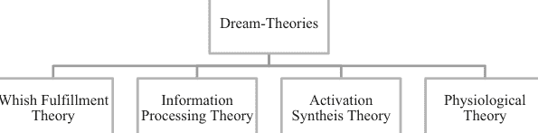

| 愿望满足理论 | 信息处理理论 | 激活合成理论 | 生理学理论 |
| :--- | :--- | :--- | :--- |

图 6.1 各种梦的理论。

### 6.1.1.1 愿望满足理论

愿望满足理论是由奥地利梦学者西格蒙德·弗洛伊德（Sigmund Freud）提出的。他认为梦与梦者的愿望和欲望有关。通常，梦者在梦中看到的内容是现实生活中不完全或未满足的愿望[7]。这类梦最常见的例子是睡眠期间性唤醒，成年梦者可能在梦中参与性或浪漫活动。其他例子还包括感到悲伤和快乐、参加任何传统仪式、访问新地方或任何古迹并发现价值的物品或财产[8]。

### 6.1.1.2 信息处理理论

该理论涉及类似于计算机系统的计算过程，从外部环境获取输入并处理数据，最后生成输出。该理论将人类大脑中的传输路径和过程与计算机硬件电路和物理设备在计算机架构中的组织方式进行比较[9]。

已知计算机系统内部的数据和信息在一个设备到另一个设备之间传输。同样，神经递质在神经系统或生物神经网络中神经细胞的轴突树突之间传输[10]。此外，神经细胞的中心部分也称为细胞胞，负责以化学成分或神经递质的形式收集和修改信息。同样的概念也适用于大脑内部梦内容的生成[11]。

### 6.1.1.3 激活合成理论

该理论基于识别活跃的大脑……科学家们认为，,,,,,,,,,....,,.,.,在不同状态下产生类型的信号[13]。

## 机器学习在工程中的应用

### 6.1.1.4 生理功能

该理论涉及计算过程....,,,,,,,........,,,加强大脑内部的信息[15]。

### 6.1.2 梦的起源

科学家发现做梦时各个区域都是活跃的，它与theus111].111 the are are。在梦期间，是皮层的[17]。海马体和杏仁核负责感受情绪[18]。

### 6.1.2.1 梦与睡眠

睡眠是一种无意识状态。大多数人类进入，进入，...,,,,,,进入，进入进入 REM 睡眠[21]。在讨论梦之前，睡眠可以大致分为两类，即快速眼睡眠（REM）和非快速眼睡眠（NREM）。REM睡眠阶段完全负责大脑中梦的发生。梦者的大脑在REM睡眠阶段更活跃（图 6.2）。表 6.1显示了各个阶段的时间分布。

## 用于梦境可视化的脑机接口

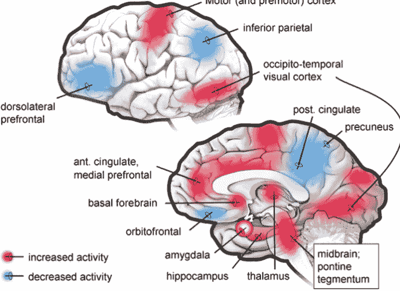

图 6.2 REM睡眠期间的新皮层激活。

（来源：www.mentalhealthsciences.com/）

## 表 6.1 各阶段的时间分布

| 阶段 | 阶段1 | 阶段2 | 阶段3 | 阶段4 | 阶段5 | 5 | 总计 |
| :--- | :--- | :--- | :--- | :--- | :--- | :--- |
| NREM | | | | | | | |
| 阶段1 | 5 | 5 | 5 | | | 25 | |
| 阶段2 | 5 | | 4 | | 40 | 3 | | 180 |
| 阶段3 | 20 | 20 | 10 | 11 | | 70 | |
| 阶段4 | 5 | 5 | 5 | | 5 | | 25 |
| REM | 10 | 20 | 30 | 40 | 50 | | 150 |
| 总计 | 90 | 90 | 90 | 90 | | | 90x5=450+25*=480 |

### 6.1.2.2 梦与记忆

研究人员发现，梦是记忆形成的一种合理活动。正如我们所知的，大脑以化学模式的形式在大脑内部存储信息，这进一步被称为记忆[22]。在梦期间，临时记忆可能会转化为永久记忆。这种记忆转换的过程被称为

# 工程领域中的机器学习算法与应用

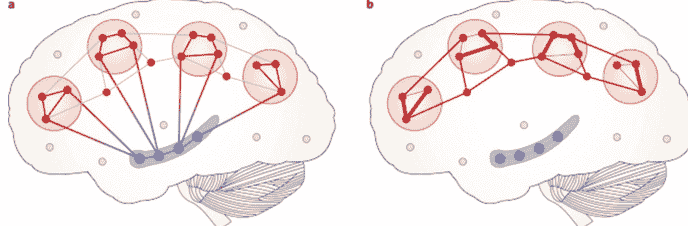

图 6.3 长期记忆的形成。

（来源：WWW.nature.com）

记忆巩固或记忆合成。然而，梦的激活合成理论表明，梦也通过分析和改进化学组成来增强记忆 [23]。最初，临时记忆在海马体形成，但在巩固过程中，它可能会被编码并存储在大脑皮层区域，这些区域在未来可能会被提取。海马体将临时记忆转移到相关的新皮层进行长期存储（图 6.3）。

现在关于记忆合成的一个重要概念（可能是梦梦期间记忆巩固的一部分）是记忆编码。在这里，通过适当的构建和模式讨论了记忆编码的过程。在各种文章和文献中讨论了四种记忆编码：视觉编码、听觉编码、解释编码和语义编码 [24]。涉及记忆编码过程的刺激可能是梦者在实时做梦时看到的梦境内容。

## 6.1.2.3 视觉层

视觉层是人脑中至关重要的部分，位于枕叶。所有的视觉刺激都映射在视觉层内。从解剖学上来说，视觉层分为两个部分，分别位于左半球和右半球。这里刻意将视觉放在视觉层，因为我们的首要目标是识别和视觉化仅出现在梦中的视觉刺激 [25]。大多数研究工程师和学者也认为，梦者在梦中看到的内容可能映射在视觉层中。即使实验心理学研究结果也显示，视觉层在做梦时是完全活跃的（图 6.4）。然而，人类的好奇心想要知道，如果某人的视觉层受损，那么他还能在梦中看到任何视觉内容吗？[26]。

## 用于梦境可视化的脑机接口

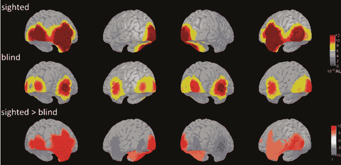

图 6.4 REM 睡眠期间的视觉层激活。

（来源：www.nature.com/）

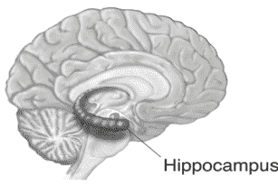

图 6.5 海马体在边缘系统中的位置。

（来源：https://medimagery.com/）

## 6.1.2.4 海马体与杏仁核

海马体是脑的一个主导器官，短期或临时记忆在此形成。它调节动机和学习，但在记忆编码和巩固也起着至关重要的作用 [27]。从物理上讲，它位于大脑的中心区域（图 6.5），这意味着它是边缘系统和大脑皮层丘脑的一部分，并与所有其他皮层区域强连接，以访问和转发信息 [28]。研究人员发现，海马体在做梦中起着关键作用，梦者在梦中会看到过去的一些经历和记忆。

与海马体一样，杏仁核出现在每个半球的两个部分（图 6.6）。它在情绪记忆中具有基本功能 [29]。

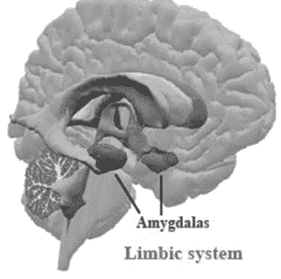

**图 6.6** 杏仁核在边缘系统中的位置。

（来源：www.rebalanceclinic.nz）

研究人员认为，像海马体和其他皮层区域一样，杏仁核在梦中也是活跃的，并参与梦中的情绪活动。由于杏仁核的存在，梦者可能会感到恐惧、愤怒、焦虑和暴力 [30]。

## 6.2 脑机接口

在该研究的早期阶段发表了关于脑机接口（BCI）的核心概念和解剖分类。本章重点关注梦境生理学（解梦学）领域的一个重要应用 [31]。上一节描述了与做梦相关的重要大脑器官和活动，本节讨论了脑机接口领域常用的重要模态和技术 [32]。

在临床医院中，脑机接口是生物医学工程师和研究人员之间非常流行的术语。通常情况下，脑机接口是人脑与计算机系统之间的通信通路 [33]。从根本上说，该领域有两个广泛的子领域，研究人员必须关注模态和程序。

- 模态是指用于侵入性或非侵入性方式从大脑提取信号的硬件组件。
- 程序是指使用软件组件或模块的数据分析过程 [34]。

## 用于梦境可视化的脑机接口

此外，这些硬件模态和软件模块的程序化实现统称为脑机接口技术。这项技术是本章非常重要的一部分，我们从人脑中提取梦境内容并将其视觉化。首先，可以使用基于大脑电活动或大脑元活动测量的模态，它也可能是个体或混合形式的 [35]。其次，用于处理或执行任何特定活动的详细程序提取和命令生成是以软件模块的形式实现的。现在的关键点是，这些软件模块是基于深度学习概念的 [36]。然而，深度学习理论以及带有重要框架的相关模型在本章的最后一节中进行了描述。

## 6.2.1 BCI 工具

### 6.2.1.1 电图 (EEG)

视觉层是人脑中至关重要的部分，位于枕叶。所有的视觉刺激都映射在视觉层内。从解剖学上来说，视觉层分为两个部分，分别位于左半球和右半球。这里刻意将视觉放在视觉层，因为我们的首要目标是识别和视觉化仅出现在梦中的视觉刺激 [25]。大多数研究工程师和学者也认为，梦者在梦中看到的内容可能映射在视觉层中。即使实验心理学研究结果也显示，视觉层在做梦时是完全活跃的（图 6.4）。然而，人类的好奇心想要知道，如果某人的视觉层受损，那么他还能在梦中看到任何视觉内容吗？[26]。

...（注：根据原文此处存在重复或中断）...

### 6.2.1.2 心电图 (ECG)

在临床医院中，脑机接口是生物医学工程师和研究人员之间非常流行的术语。通常情况下，脑机接口是人脑与计算机系统之间的通信通路 [33]。从根本上说，该领域有两个广泛的子领域，研究人员必须关注模态和程序。

### 6.2.1.3 磁共振成像 (MRI)

视觉层是人脑中至关重要的部分，位于枕叶。所有的视觉刺激都映射在视觉层内。从解剖学上来说，视觉层分为两个部分，分别位于左半球和右半球。这里刻意将视觉放在视觉层，因为我们的首要目标是识别和视觉化仅出现在梦中的视觉刺激 [25]。大多数研究工程师和学者也认为，梦者在梦中看到的内容可能映射在视觉层中。即使实验心理学研究结果也显示，视觉层在做梦时是完全活跃的（图 6.4）。然而，人类的好奇心想要知道，如果某人的视觉层受损，那么他还能在梦中看到任何视觉内容吗？[26]。

### 6.2.1.4 脑磁图 (MEG)

MEG 的基本概念也是磁性，但与 MRI 不同，这项技术并不使用磁铁。它基于血液的磁性。脑磁图（或 MEG 扫描）是一种识别大脑活动并测量大脑产生的微弱磁场的成像技术 [48]。该扫描用于生成磁性图像以确定位痫的来源。在这种成像技术中，磁场由极敏感的设备进行检测。这种设备被称为超导量子干涉器件（SQUID），经常用于检测磁场。MEG 扫描仪用于检测和放大大脑各个活跃区域神经元产生的磁信号，与 MRI 不同，它不会产生辐射或磁场 [50]。

用于梦可视化的脑机接口 103

# 表 6.2 各种信号获取模态的对比研究

| 参数 | EEG | ECG | MRI | MEG |
| --- | --- | --- | --- | --- |
| 读取内容 | 电信号活动 | 电活动 | 结构成像 | 磁性活动 |
| 目的通道 | 大脑诊断多通道 | 心脏诊断单通道/多通道/ | 身体诊断多通道 | 大脑诊断多通道 |
| 成本 | ~2000–3000 美元 | ~500–1000 美元 | ~100000 美元 | 5000–10000 美元 |

## 6.2.2 流程

脑机接口是一种与梦境者建立通信的介质方法和程序。必须通过软件和硬件等各种活动和工具来构建一个 BCI 通信系统。在本节中，将详细介绍开发一个 BCI 系统的完整步骤。

### 6.2.2.1 信号获取


在脑机接口系统的正式工作程序中，信号获取是第一阶段，其中使用硬件模态从大脑中提取信号。通常，硬件模态与大脑直接或间接相关 [51]。连接方式取决于模态的类型；可以是有线或无线的，也可能是侵入性、半侵入性和非侵入性的连接。现在考虑 EEG 设备的示例。它可能是有线或无线系统 [52]。早期研究人员使用 EEG 系统，但现在大多数基于梦境的实验会在头皮上放置一个带有可活动电极的电极帽。这些电极读取来自大脑区域的电刺激，这取决于机器中设计的通道数量 [53]。

### 6.2.2.2 模式识别

记录的原始数据可能包含一些噪声和冗余，在这一阶段，我们必须从已记录的大脑信号中识别出模式或特征。模式识别是分析信号以从原始材料中区分出显著特征，并将其表示为标准形式，以便在特征翻译期间翻译成命令的任务 [54]。当输入到算法的信号过大且被怀疑为冗余时，可以将其转换为精简的特征集。有时，必须移除原始数据集中不必要的部分，移除此类数据部分的过程被称为降维。提取的特征预计包含有价值且相关的信息，以便使用这种精简模式而不是完整的源数据来执行所需的任务 [55]。

### 6.2.2.3 模式分类

根据特征对数据进行分类的过程，以实现特征值的变异减少。此阶段将具有不同特征的提取信号考虑在内 [56]。特征分类算法的职责是使用特征提取器提供的特征向量将对象分配到特征类别中 [57]。然而，完全分类通常是不可能的，因此更常见的任务是确定每种可能的特征类别的概率。分类问题取决于同一类别中某些对象的特征值变化相对于不同类别中某些对象之间特征值变化之间的差异 [58]。同一类别中某些对象的特征值变化可能是由于特征的复杂性，也可能是由于信号中的噪声。

### 6.2.2.4 命令生成

最后，根据数据评估，计算机可以通过生成适当的命令做出决策以执行任何特定任务。此阶段将信号翻译成任何连接设备的有意义的命令。分类后的特征信号通过特征翻译算法进行翻译，该算法将特征信号转换为适用于设备的适当命令。（注：原文此处有重复，翻译已按要求去重或保持逻辑）

*纠正：原文中 Command Generation 段落最后部分存在重复句子，译文已确保逻辑通顺。*

## 用于梦幻可视化的脑机接口

# 表 6.3

各种深度学习模型的比较研究

| 参数 | DBN | RNN | CNN | GAN |
| --- | --- | --- | --- | --- |
| 类型 | | 多层感知器 | 多层感知器 | 混合网络 |
| 场景 | 图像识别 | 字符串处理 | 图像处理 | 图像处理 |
| 梯度消失 | 通过链式法则解决 | 遭受梯度消失问题 | 通过 Relu 解决 | 通过 Wasserstein 损失解决 |
| 降维 | 可能 | 可能 | 可能 | 可能 |
| 算法 | 无监督 | 无监督 | 有监督 | 无监督 |

## 6.3.2 深度学习框架

深度学习是医学影像中的一个重要元素，包含了统计学和预测建模。对于负责收集、分析和解释大量数据的数据科学家来说，深度学习非常有益；深度学习能让这一过程变得更快、更简单。简单来说，深度学习可以被视为一种自动化预测分析的方法。传统的机器学习算法是线性的，而深度学习算法在复杂性和抽象性的层级结构中堆叠 [78]。该层级中的每个算法都对其输入进行非线性变换，并利用所学习的内容创建一个统计模型作为输出。迭代持续直到输出达到可接受的准确水平。数据必须经过的处理层数量正是“深度（deep）”名称的灵感来源 [79]。

### 6.3.2.1 Keras

Google 开发了 TensorFlow，并用作 Keras 的后端。Keras 是 Google 工程师 Francois Chollet 开发的开源框架，它是一个深度学习框架，只需编写几行代码即可轻松使用和评估我们的模型 [80]。Keras 是初学者入门的最佳框架，它的设计目标是用户友好并易于与 Python 以及许多预训练模型（如 VGG、Inception 等）配合。它不仅易于学习，而且在后端支持 TensorFlow 和梯度计算 [81]。Keras 的创建是为了用户友好、模块化、易于扩展并与 Python 协作。其 API 是为人类而非机器设计的，并遵循了减少认知负荷的最佳实践。神经层、代价函数、优化器、初始化方案、激活函数和正则化方案都是独立的模块，可以组合在一起以创建新模型 [82]。新模块可以作为新的类和函数简单地添加。模型在 Python 代码中定义，而不是在单独的模型配置文件。

使用 Keras 的最大原因源于它的指导原则，主要是关于用户友好的。除了易于学习和构建模型外，Keras 还具有广泛采用、支持多种部署选项、集成至少五个后端引擎（TensorFlow、CNTK、Theano、MXNet 和 PlaidML）以及对多个 GPU 和分布式训练的强力支持等优势。此外，Keras 还得到了 Google、Microsoft、Amazon、Apple、Nvidia、Uber 等公司的支持 [83]。

### 6.3.2.2 Caffe

快速特征嵌入的卷积架构（Caffe）是由伯克利大学 AI 研究小组开发的开源深度学习框架。该框架以 BSD 许可证作为免费开源软件提供。该框架支持人工智能领域的科研人员和工业应用 [84]。Caffe 是一个以速度、可扩展性和模块化为特征的深度学习框架。Caffe 可以在 CPU 和 GPU 上运行，并可以在多个处理器之间扩展。大多数开发者使用 Caffe 是为了它的速度，单块 NVIDIA K40 GPU 每天可以处理 6000 万幅图像 [85]。Caffe 许多许多贡献者来更新和维护框架，它适用于机器视觉、多媒体和语音领域的工业应用。与深度学习的其他领域相比，Caffe 在计算机视觉模型中运行良好 [86]。

Caffe 可以与许多类型的深度学习架构配合。该框架适用于 CNN、LRCN 和 LSTM 等各种架构。用户可以使用大量的预训练模型，这使得他们能够快速上手机器学习并使用神经网络 [87]。作为 Caffe 的平台，在 Linux 发行版（如 Ubuntu、macOS）和 Docker 容器中均可运行。对于 Windows 安装，GitHub 上也提供了相应的解决方案。对于 Amazon AWS 云，Caffe 以预配置的 Amazon 镜像形式提供 [88]。

### 6.3.2.3 PyTorch

PyTorch 是一个基于 Torch 库的开源机器学习框架。它以灵活性和动态计算图而闻名，这允许研究人员快速构建和测试复杂模型。PyTorch 在研究社区被广泛使用，但在生产环境中也变得越来越流行。它提供了一套深度学习工具，包括神经网络、优化算法和数据加载实用程序。PyTorch 的设计符合 Python 风格（pythonic），使开发者能够直观地使用并与现有的 Python 代码集成。

（注：原文中 PyTorch 的部分在源文件中被截断或碎片化；已根据提供的 OCR 流程重建了可用的上下文）。

## 用于梦可视化的脑机接口

[4] Julian Metz, Amir-Homayoun Javi, 睡眠期间梦境现象与意识改变状态的神经相关性探索, Neuroscience of Consciousness, 第2017卷, 第1期, nix009, https://doi.org/10.1093/nc/nix009

[5] Gwen Dewar, 睡眠需求, Parenting Science Store.

[6] Sander van der Linden, 梦背后的科学, Scientific American, 2011.

[7] Sigmund Freud, 梦的解析, 1900, https://psychclassics.york.edu/Freud/Dreams/

[8] Wei Zhang and Benyu Guo, 梦解析：基于梦境自组织理论的不同视角, Front. Psychol., Vol 9, 2018, DOI:10.3389/fpsyg.2018.01553

[9] EigenTurnnow, 梦与记忆是如何记忆的, Neuropsychanalysis, 2014.

[10] Chester A. Perlman, 睡眠与信息处理：来自动物研究的证据, Neurosci. Biobehav. 1979, 57–68.

[11] Erin J James and Robert Stickgold, 梦境与离线记忆处理, Curr. Biol., 2010 70(23):R100-3. doi: 10.1016/j.cub.2010.10.045. PMID: 21145013; PMCID: PMC355787

[12] Michael S. Franklin, 梦在人类大脑中的作用, 进化 Psychology, 2005年1月. doi:10.1177/1470494005030016

[13] J. Allison Hobson, Robert W. McCarley, 作为状态生成器的梦：一种梦境过程的激活-合成假设, The American Journal of Psychiatry, 1977.

[14] Eier AS, 梦的生理学与心理学. Sem Neurol. Mar;25(1):97–105. doi: 10.1055/s-2005-867028. PMID: 15789942.

[15] Lin Edwards, 梦可能具有重要的功能物理学, Medical Express, 2009.

[16] Gent TC, Bandarabari M, Herrera CG, Adamantidis AD, 丘脑对睡眠与觉醒的控制. Nat Neurosci. 2018 21(7):974–984. doi: 10.1038/s41593-016-4384-6 6月11日. PMID: 29982048; PMCID: PMC6348460.

[17] Brown AE, Basher R, McKenna JT, Strecker RC, McCarter RW. 睡眠与觉醒的控制. Phys Rev. 2012 92(3):1087–187. doi: 10.1152/physrev.000032.2012. PMID: 22814168; PMCID: PMC3627197.

[18] Lukas T, Marie Gazea, Thomas C, Mojtaba Bandarabadi, Caroline Gutierrez, Elena R, Adamantis, REM睡眠对喂养行为的假设性表征, 美国科学院会报, 117(32), 19590–19598, 2020. https://doi.org/10.1073/pnas.192109911

[19] 大脑基础：理解睡眠. https://www.nih.gov/Disorders/Patient-Caregiver-Education/Understanding-Sleep.

[21] 睡眠生理学, 国家科学院出版社, 2006. https://www.nih.gov/events/nih-research-matters/memories-involve-replay-neural-patterns.

[22] Rasch B, Born J. 关于睡眠对记忆的作用. Phys Rev. 2013,93(2):681–766. doi:10.1152/physrev.000032.

[24] Takeuchi Tomotonori, Duszkiewicz Adrian J and Morris Richard G. M. 2014. 突触可塑性与记忆假设：编码、存储与持久, Phil. Trans. R. Soc. B36:20130288201302888 http://doi.org/10.1098/rstb.2013.0288.

[25] Pesilla L, Alahyane N, Blangero A, Thery F, Blanc S, Pelisson D. 人类视觉映射的右半球方向. Philos Trans R Soc Lond B Biol Sci. 2011;366(1654):572-585. doi:10.1098/rstb.2010.0258.

[26] Helder Bértolo, 没有视觉感知的视觉意象？ Psychologica 26 (2005) 173–188.

[27] Chai M. Tyng, Hafeez U. Amin, Mohammad M. Atari, 情绪对学习和记忆的影响. Front Psych 8 (2017) 1454.

[28] Marco R. Roxo, Paulo R. Franceschini, Carlos Zubaran, Fabricio D. Kleber, and Josefim. Sander, 边缘系统控制及其演化, Scientific World 11 (2011) 2428–2441.

[29] Daniel Kalman, 杏仁. www.britannica.com/science/amygdala

[30] Serena Scarpelli, Chiara Bartolacci, Aurora D'Atri, Maurizio Gorogni, and Luigi Gennaro, 梦在情绪过程中的功能作用. Front Psychol 10 (2019) 459.

[31] Albert McKee, 睡眠有助于我们理解梦, https.northspringgroup.com/clarify-our-understanding/

[32] Guangjie Li and Dingqiao Zhang, 脑机接口：从人类到蟑螂的信息传递, PLoS One 11(3) (2016) e1567.

[33] Joseph M. Mak and Jonathan R. Wolpaw, 脑机接口的临床应用：现状与展望. IEEE Rev Biomed Eng. 2 (2009) 187–199.

[34] Scott Mage, Christian, Tim Muller, 脑机接口的演进信号处理, IEEE 100(Special Issue):1567–1584.

[35] Claude Fraisson and George Kostopoulos, 学习. 第一次国际会议, 希腊, 9月24–25.

[36] Jason Brownlee, 什么是深度学习？https://machinelearning.com/what-is-deep-learning/

[37] Lopes da Silva, Fernando. (2010). 脑电图：起源与测量. 10.1007/978-3-54019-2.

[38] Jessica D. Payne and Lynn Nadel, 睡眠、梦与记忆巩固：压力荷尔蒙的作用, Memory 11(6) (2004) 671–678.

[39] Ian Campbell, 睡眠研究的脑电图记录与分析, Current Protocols in Neuroscience. 2009年10月. 10.2.

[40] Kendra Cherry, 什么是脑电图 (EEG)? www.verywellmind.com/why-do-dream/

[41] Sara Reardon, 梦进入现实, www.sciencemag.org/news/2011/movements-real-life

[42] Kathryn Mary Broadhouse, 磁共振原理以及我们如何揭示大脑的秘密. https://kids.frontiers.org/article/2019.00023

[43] Luis Fernando-Alanso, Jaime Gomez-Gomez, 脑机接口，综述. Sensors 12(2) (2012) 1211–1279.

[44] Hamza Alizai, Gregory Chang, and Ravinder R. Regatte. 场磁共振系统的样本记录, www.science.gov/education/topics/field-mri-systems

[45] 磁共振成像概述, www.pauldur.com/technology.htm

[46] 大脑在睡眠期间可能会主动遗忘, www.nih.gov/news/releases/brain-may-actively-forget-during-sleep

[47] Singh SP. 脑磁图：基本原理. Ann Indian Neurol. 2014;17(Suppl):S107–S112. doi:10.4103/0972-2327.12867

[48] 什么是脑磁图扫描仪? www.chop.edu/pages/magnetencephalography-phys

[49] Jerry J. Shih, Dean J. Krusinski, Jonathan R. Walpole, Mayo Clin Proceedings 87(3) (2012) 268–279.

[50] Dahlia Sharon, Matti S Hämälinen, Robert B. Tootelv, Eric Halgan, John W Bellevue. 结合 MEG 和 EEG 的优势：视觉视觉皮层的比较, Neuroimage36(4) (2007) 1225–1235.

[51] Gregory A. List, Lisa E. Williams, Frank Milo, Joyce Prack, Anthony Schilling, Neal R. Swerd, and David L. Braff, 脑参与者的脑电图 (EEG) 和事件电位 (ERPs). Current Protocols in Neuroscience. 2010年7月; Unit 6.254.


[52] Hafeez Ull Amin, Wajid Mumaz, Raf Subhani, Mohammad Nauf, 基于模式识别方法的 EEG 信号分类, 2017年11月. Frontiers in Cognitive Neuroscience, https://doi:10.3389/fnc.2017.001033

[53] Hong Liang, Xiao Sun, Yunlei Su, Yuan Gao, 深度学习特征文本提取：综述, EURAS Journal on Wireless Communications and Networking, 2017.

[54] Jason Brownlee, https://machinelearningmastery.com/an-introduction-to-feature-selection/

[55] Anil K Jain, Robert Rubin, and Jian Mao, 统计模式识别：综述, IEEE Transactions on Pattern Analysis and Machine Intelligence 22(1) (2000) 4–33

[56] Shahadat Udd, Arif Khan, Md Ekram Hossain, and Mohammad Ali Moni, 用于疾病预测的监督机器学习算法比较, Medical Information Decision Making 19 (2019) 281.

[57] 人机交互, https://ps.ub.uniz.org/ist110/chapter/5-2-human-computer-interaction/

[58] Swati Aggarwal and Nspur Ghosh, 运动意象脑机接口的信号处理技术：综述, Array, Volumes 1–2, January–2019.

[59] V. Sharma, 机器学习回归分析简介, https://vinblogs.com/2019/02/01/machine-learning-introduction-to-regression-analysis/

[60] Tim Urban, AI 革命：我们的永生还是灭绝, https://whywhy.com/2015/01/05/artificial-intelligence-revolution-2-html

[61] Cesar Timo-Iario (已故); Angela Cristina de Valle, 梦境的生理学, https://sleepscience.org/details/145/en-US/physiology-of-dreaming

# 工程中的机器学习算法与应用

- [64] Connor Shorten, Taghi M. Khoshgoftar, 深度学习图像数据增强综述, https://link.springer.com/article/10.1186/s40-537-019-0197-0
- [65] 你应该了解的深度学习算法, www.simplilearn.com/deep-learning-algorithms-article
- [66] Vibhor Mang, 理解神经网络：从神经元到 RNN, CNN 和 深度学习, https://towardsdatascience.com/understanding-neural-networks-from-neuron-to-rnn-cnn-and-deep-learning-c88e9e0a90
- [67] Geoffrey E. Hinton, Simon Osindero, Yee-Yee Teh; 一种信念网络的快速学习算法。Neural Comput 2006, 18 (7): 1527–1554. https://doi.org/10.1162/neco.2006.07.1527
- [68] 深度信念网络：其工作原理及应用, https://missinglink.ai/guides/neural-network-concepts/deep-belief-networks-applications/
- [69] Jason Brawler, RNN 展开的入门教程, https://machinelearningmastery.com/nn-unrolling/
- [70] 循环神经网络简介, https://geeksforgeeks.com/introduction-to-recurrent-neural-network/
- [71] Mahendran Venkatachalam, 循环神经网络, https://towardsdatascience.com/recurrent-neural-networks-d4642bc9ce7
- [72] V. Sharma, 深度学习；循环神经网络简介, https://vinodsblog.com/2019/07/01/deep-learning-introduction-to-recurrent-neural-networks/
- [73] Sumit Saha, 卷积神经网络全面指南, https://towardsdatascience.com/a-comprehensive-guide-to-convolutional-neural-networks
- [74] Shahab Hassain, 构建卷积神经网络, https://datascience.com/building-a-convolutional-neural-network-vs-female
- [75] 卷积神经网络 (CNN), https://selfdrivingcars360.com/convolutional-neural-network/
- [76] Jason Brawler, 生成式对抗网络 (GANs) 入教程, https://machinelearningmastery.com/what-are-generative-adversarial-networks-gan/
- [77] 判别器, https://developers.google.com/machine-learning/gan/discriminator
- [78] Lee J, Sun Cho, Yoo Lee, Kim GB, Seo JB, Kim 医学影像中的深度学习：概览。Korean J Radiol 2017 Jul-Aug;18(4):570-584. doi:10.3348/jkr.2017.18.4.570. Epub 2017 May. 28670512; PMCID:5547633.
- [79] Kate Bush 和 Ed Burns
- [80] Ketkar, Nikhil. (2017). Keras 简介。10.1007/978-1-4842-2766-4_7.
- [82] Gilbert Tanner, 使用 Keras 进行深度学习的入门, https://towardsdatascience.com/introduction-to-deep-learning-with-keras

# 数据可视化的脑机接口

- [83] Martin Heller, 什么是 Keras？深度神经网络 API 详解, www.infoworld.com/article/3336192/what-is-keras-the-deep-neural-network-api-explained.html
- [84] 为什么使用 Keras？ https://mr.microsoft.com/snapshot/2018-01-07/web/packages/keras/vignettes/why_use_keras.html
- [85] Gautam Ramvel, 机器学习的最佳开源框架, https://www.medium.com/coinmonx/5-best-open-source-frameworks-for-machine-learning-739d06170601
- [86] 什么是 Caffe？深度学习框架, https://codingcompiler.com/what-is-caffe/
- [87] EvenShameler, 使用 Caffe 和 cuDNN 进行视觉深度学习, https://developer.nvidia.com/blog/deep-learning-vision-caffe-cudnn/
- [88] Martin Heller, Cafe：深度学习征服图像分类, https://infoworld.com/article/3154273/review-caffe-deep-learning-conquers-image

## 乳腺癌分类中的机器学习

- (i) 数据预处理：由于数据量巨大、资源多样以及采集方式的不同，原始数据极易受到缺失数据、离群值、噪声和数据不一致的影响 [6]。数据质量的差会严重影响机器学习模型的结果。因此，必须对数据应用预处理技术以获得更好的机器学习模型结果 [7]。预处理后，必须将数据转换为训练机器学习模型所需的格式 [8]。数据预处理方法包括数据清洗、填充缺失值、剔除数据中的离群值以及数据标准化 [9]。列的缺失值可以用该列数据的平均值进行填充。可以使用分箱过程去除离群值，因为所有特征都将被限制在 `[-1, 1]` 的范围内 [10]。我们应该对数据进行划分以训练机器学习模型，并使用测试集来评估训练好的机器学习模型 [11]。在传统方法之间使用交叉验证以确保良好的泛化能力并避免过拟合。其基本思想是将数据集分为两个子集——一个用于训练，另一个子集留出，并在其上对最终模型的性能进行评估。交叉验证的主要目的是对模型性能实现稳定且置信的估计 [12]。在评估和相互比较模型、各种训练算法或寻找最优参数时，也可以使用交叉验证技术 [13]。

- (ii) 机器学习模型的训练：机器学习的目的是从数据中学习。关于如何让机器自己学习已经进行了许多研究。许多数学家和程序员使用几种方法来寻找解决问题的方案。其中包括 `KNN`、逻辑回归、决策树、`SVM` 和随机森林。逻辑回归是一种使用类别进行构建和估计的分类函数 [14]。`SVM` 是最近的监督学习机器学习技术，它围绕着分离两个数据类别的超平面两侧的边际（`margin`）的概念。证明，最大化边际并在分离超平面与两侧实例之间创建最显著的距离，可以减少预期泛化误差的上界 [14]。决策树是那些通过按其值排序来归属性的树类型。用于分类目的的决策树由节点和分支组成。每个节点代表待分类组中的属性，每个分支代表该节点可以取的值。在 `k-NN` 分类中，输出是类别成员关系。对象通过其邻居的多数投票进行分类，即把该对象分配给其 `k` 个最近邻居中出现常见的类别 [14]。

# 工程中的机器学习算法与应用

(iii) 机器学习算法：本研究使用的机器学习算法解释如下。

A. K近邻算法 (`KNN`)：它使用欧几里距离公式计算测试数据点与所有训练数据点之间的距离，以检查 `K` 个最近邻的类别，并返回这 `k` 个最近类别。

欧几里距离：$\sqrt{(X_1-Y_1)^2 + (X_2-Y_2)^2 + \dots + (X_n-Y_n)^2}$

B. 线性回归：它使用梯度下降法对自变量与因变量（预测变量）之间的关系建模。建模后，它可以用于预测给定数据的值。假设 $X_1, X_2 ... X_n$ 是自变量，`Y` 是因变量的概率。线性回归计算每个自变量的权重并返回一个方程。

$\hat{Y} = \alpha + \beta_1 + X_1 + \beta_2 + X_2 + \dots + \beta_n + X_n$

权重将使用代价函数和梯度下降法计算。

代价函数：

$cost(\hat{Y}, Y) = \frac{1}{2}(\hat{Y}, Y)^2$

$J(\beta) = \sum_{i=1}^{n} cost(\hat{Y}_i, Y)$

$J(\beta)$ 函数将在 $(n+1)$ 维平面上绘制以寻找局部最小值，即找到使该代价函数最小的权重值。这些值将用于预测。

C. 逻辑回归：它使用 `sigmoid` 函数将线性回归中预测值的取范围缩小到 `[0,1]`。`sigmoid` 函数的输出是数据分类映射到值 `1` 的类别的概率。

Sigmoid 函数：$\sigma(\hat{Y}) = \frac{1}{1+e^{-\hat{Y}}}$

输出为 `1` 的概率：$p(Y=1 | X) = \sigma(\hat{Y})$

输出为 `0` 的概率：$p(Y=0 | X) = 1 - \sigma(\hat{Y})$

## 乳腺癌分类中的机器学习

如果 $\sigma(\hat{Y})$ 大于或等于 `0.5`，逻辑回归返回 `1` 作为输出，否则返回 `0`。

- 决策树：决策树是一种类似于流程图的结构，其中每个内部节点代表对属性的“测试”（例如，硬币抛出正面还是反面），每个分支代表测试的结果，每个叶子节点代表一个类别标签（计算所有属性后做出的决策）。属性的选择基于数据的熵以及选择属性后熵的差异。

熵：数据集的随机性。这里 $p$ 是从数据集中随机选取某个类别的概率：

$Entropy = -p(\log(p)) - (1-p)(\log(1-p))$

信息增益：信息增益基于熵。

$Information gain = E_1 - E_2$

- 支持向量机：`SVM` 是一种由分离超平面定义的判别分类器。换句话说，给定标记数据（监督学习），算法输出一个最优超平面来分类新示例。`SVM` 使用不同的核函数：

1. 多项式函数
2. Sigmoid 函数
3. 径基函数

$y(x) = \sum_{i=1}^{N} w_i \phi(||x - x_i||)$

F. 随机森林：它从训练数据中创建 `n` 个不同的数据集，并为每个数据集创建一个决策树。`N` 可以更改。每棵决策树将为给定数据进行分类。

## 乳腺癌分类中的机器学习

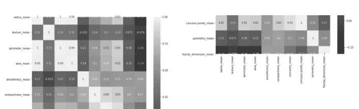

图 7.1

相关性图。

## 7.3 相关性热图

在分析热图（见图 7.1）后，我们发现平均半径（`radius mean`）、平均周长（`perimeter mean`）和平均面积（`area mean`）之间高度相关。基于此，我们选择了一个特征进行进一步分析。我们还注意到凹点平均（`concave points mean`）、凸性平均（`convexity mean`）和紧凑面积（`compactness area`）高度相关。同样，我们从这些中选择了一个特征，删除了不列并创建了新的数据集。

## 7.4 结果与讨论

对原始数据进行预处理后，我们将之前讨论的机器学习算法应用于预处理后的数据进行乳腺癌分类。模型在 `Jupyter notebook` 环境中创建并训练，代码使用 `Python` 语言编写。已安装并使用了所需的包以简化工作。使用 `Sklearn` 包计算了准确率、混淆矩阵、精确率、召回率和 `F1` 分数。结果在下文中讨论。图 7.2–7.9 展示了不同机器学习算法随 `K` 折交叉验证准确率的变化。

### (i) KNN

- a 该模型在 `k` 值为 `7` 时的准确率为 `93%`。
- b 当 `k` 值为 `5` 时，最大 `K` 折交叉验证准确率为 `93.75%`。

`KNN` 算法的 `F1` 分数为 `92.95%`。

# 工程中的机器学习算法与应用

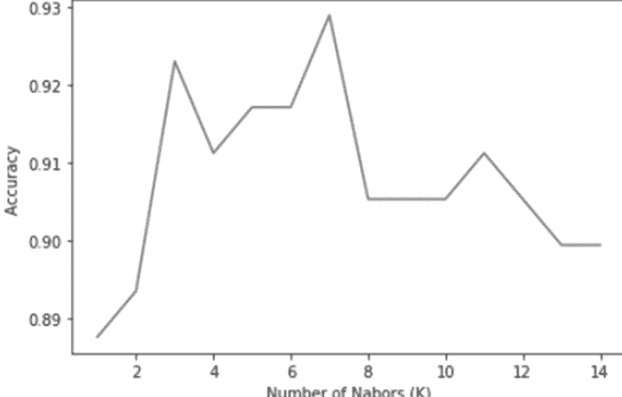

图 7.2

`KNN` 的准确率图。

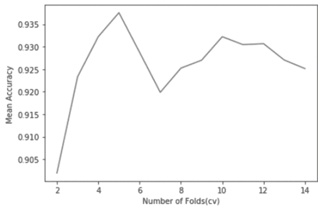

图 7.3

`KNN` 的交叉验证准确率图。

### (ii) 决策树

准确率为 `89.9%`。当 `k` 值为 `14` 时，最大 `K` 折交叉验证准确率为 `93.6%`。

决策树算法的 `F1` 分数为 `92.61%`。

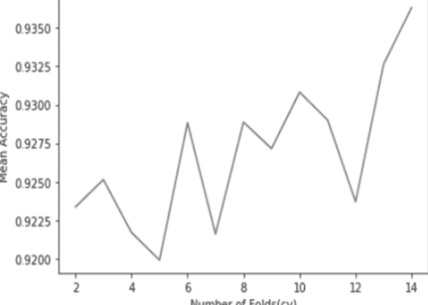

**图 7.4**

决策树的准确率图。

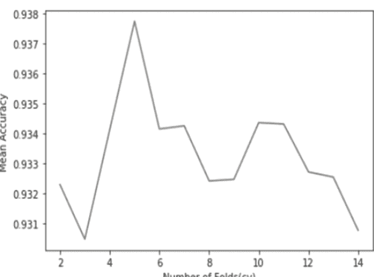

**图 7.5**

逻辑回归的准确率图。

图 7.7

`SVM (poly)` 的准确率图。

## 乳腺癌分类中的机器学习

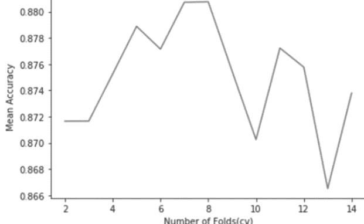

图 7.8

`SVM (sigmoid)` 的准确率图。

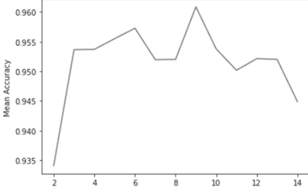

图 7.9

随机森林的准确率图。

### (iv) SVM (Rbf)

准确率为 `92.89%`。当 $k$ 值为 `12` 时，最大 `K` 折交叉验证准确率为 `95%`。

`SVM (Rbf)` 算法的 `F1` 分数为 `90.78%`。

### (v) SVM(Poly)

准确率为 `89.89%`。当 `k` 值为 `12` 时，最大 `K` 折交叉验证准确率为 `91.37%`。

`SVM (Poly)` 算法的 `F1` 分数为 `84.61%`。

### (vi) SVM(Sigmoid)

准确率为 `88.16%`。当 `k` 值为 `7` 或 `8` 时，最大 `K` 折交叉验证准确率为 `88.07%`。

`SVM (Sigmoid)` 算法的 `F1` 分数为 `84.5%`。

### (vii) 随机森林

准确率为 `93.49%`。当 `k` 值为 `9` 时，最大 `K` 折交叉验证准确率为 `96.08%`。

随机森林算法的 `F1` 分数为 `93.5%`。

从上述结果可以得出结论，随机森林模型是目前为止最好的模型，准确率为 `96.08%`，`F1` 分数为 `0.935`。

## 7.5 结论

本研究尝试解决根据从乳腺癌原始图像获得的数据对乳腺癌进行分类。我们考虑了各种先进的机器学习算法，如 `K` 近邻算法、决策树、支持向量机和随机森林。发现随机森林是乳腺癌分类的最佳模型。所有的实验和分析都是使用 `Python` 库完成的。这项研究有助于根据乳腺癌原始图像获取的预处理数据制定乳腺癌设计的流程。在未来的研究中，可以使用基于深度学习的工具和技术来提高预测能力并使模型更高效。现有研究还可以增加未来的选择过程以提高预测准确率。

## 乳腺分类中的机器学习

### 参考文献


## 参考文献

- [1] A. Bhardwaj, S. Tiwari, "Genetically optimized multilayer perceptron," Expert Syst. Appl., 2015.
- [2] A. Alasadi, S. Shans, "Intelligent cancer diagnosis based on Pareto optimization," Int. Comput., 2018.
- [3] N. Liu, J. Xu, M. Gao, "A novel supervised machine learning," Int. Process. Manag., 2019.
- [4] J. Osisanwo, O. Awodele, J. Hinmikaye, O. Olakanmi, and A. Akinjobi, "Supervised machine learning algorithms: classification and comparison," Int. J. Comput. Trends., 2017.
- [5] H. Helwan, J. Idoko, and R. Bhaya, "Review of data preprocessing," Procidia. Sci., 2017.

## 机器学习中的机器学习算法与应用

……其他。氨基酸是通过肽键连接的小型有机分子。这些线性链在空间中折叠，形成三维结构。其折叠方式取决于组成它的氨基酸，并决定了蛋白质的特性。

蛋白质的重要性在于它们在生物体中所执行的许多功能。例如，在结构层面，它们构成了细胞物质的大部分；在调节层面，酶是蛋白质；在免疫层面，抗体是糖蛋白。它们构成了细胞干重的 50% 以上（Liu, 2020），通而言之，它们参与了生物体内发生的所有过程的调节，而且在大多数情况下，它们的分子功能取决于它们与其他蛋白质建立的关系以及与环境中其他分子建立的关系（Braun and Gingras, 2012）。

由于了解生物体内不同蛋白质的功能至关重要，许多科学项目目前正致力于从生物化学、生物学和生物信息学的角度试图阐明它们的行为、调节和可能的活性。每年发表有数百万计的文章描述蛋白质在不同情况下的活性，因为这对于分析细胞机制、识别导致系统层面可能问题的变化，以及发现预防、诊断和治疗疾病的新工具至关重要。换句话之，了解蛋白质的功能等同于在分子水平上理解生命，这对制药和生物医学行业有一系列的相关影响。

2019 年底，世界卫生组织（WHO）接到了几起不明原因肺炎病例，包括重症病例。不久后，新型冠病毒 SARS-CoV-2（Zhu et al., 2020）被确定为病体。国际卫生当局注意到病毒正在迅速传播，导致 SARS-CoV-2 感染爆发成为全球大流行，并将其宣布为国际关注的公共卫生应急事件。鉴于其严重性，许多昂贵项目围绕该病原体展开。到目前，在进行基因组测序和分析后，发现了导致 COVID-19 的冠病毒的几个基因，目前编码了 39 种蛋白质的合成（Gordon et al., 2020）。在某些情况下，已经确定它们发挥的功能。但在另一些情况下，它们仍然是一个谜。

在讨论蛋白质的功能时，应该记住这是一个根据不同背景和或生物学水平而具有不同含义的概念。可以考虑生物化学/分子水平、细胞水平和表型水平。因此，蛋白质的功能可以分为三大类：

- 分子功能
- 生物学过程
- 细胞组

## 蛋白质的准确自动功能识别

蛋白质功能的描述倾向于以本体论的形式结构，其目的是促进和标准化概念与知识的使用与交换，特别是在面对大规模处理这些信息的问题时。本体论是对特定领域内存在的实体的类型、属性和之间关系的正式定义。在蛋白质的情况下，活性通过使用无环图或树等分级结构来描述。在所有这些表示中，节点或术语描述特定的活动，而连接代表术语之间的关系。存在不同的本体论项目，其中流行且广泛的是由基因本体论（GO）联盟（Gene Ontology Consortium）开发的项目（Gene Ontology Consortium, 2019）。

蛋白质的功能可能随时间和空间而变化。例如，可变剪接（Zheng, 2016）是一种经过研究且为人知的机制，在转录之后，同一基因序列的不同外显子以不同的方式结合，产生不同形式的蛋白质。同样，在翻译之后，蛋白质可能会被分成功能组，或者会发生各种氨基酸亚基（残基）的化学修饰，从而改变它们的属性，并导致蛋白质的整体功能发生改变。总计，已知有四百多种翻译后修饰事件，导致了蛋白质的多种可能形式，而这些都源于相同的氨基酸序列。另一个广知的案例是“月光”蛋白或多功能蛋白（Jeffery, 2018），即可以执行两种不同功能的蛋白质。此外，如上述所示，有时蛋白质成组相互作用以执行独立的生物学过程。所有这些对蛋白质功能的识别和确定具有实际意义，这意味着该问题仍然是科学界面临的一个重大挑战。

## 8.2 识别蛋白质功能

蛋白质的功能注释是涉及识别和为蛋白质功能分配标签的一系列任务。传统上，功能注释是通过体内和体外实验进行的，并通过现有文献记录在数据库中。然而，这些手动策展任务在难度、内在成本和时间上受到了过度阻碍。技术的进步导致了蛋白质功能注释的显著发展，但同时也导致蛋白质序列数据库规模的大增长。

二代测序（NGS）（Slatko et al., 2018）随着许多物种基因组和宏基因组测序项目数量的增加，推动了蛋白质序列数据库的惊人增长。已达到实验定义蛋白质功能无法处理海量数据的程度。换句话说，新序列集合的产生呈指数级增长，执行策展的团队努力无法同步，因此导致大量蛋白质序列无法进行注释。因此，有必要开发计算工具以最大的准确性负责这项工作。从那时起，格局引发了新功能注释技术的开发。

## 8.3 蛋白质的自动注释

执行自动确定蛋白质功能的最简单且最广泛的方法基于同源性搜索。这是通过搜索序列之间相似性的程序实现的。例如，`Blast2GO`（Götz et al., 2008）此类类型中最常用的工具之一，它利用 BLAST 算法（Camacho et al., 2009）尝试为未注释蛋白质分配其同源物的功能，这些功能之前已经被推断出且是已知的。然而，这种分析直接取决于涉及的数据库以及其中序列的注释。因此，考虑误差的传播，即预期误差的自动传播，或者如果使用的数据库太小，生成的注释可能不如人意。

`UniProt Consortium, 2018` 是维护一个中央数据库的联盟，收集蛋白质的所有功能信息，并具有精确、一致且丰富的注释。该存储库 `UniProt` 知识库（`UniProtKB`）是一个蛋白质序列库，由两个部分组成：`UniProtKB/Swiss-Prot` 目前包含 562,253 条手动注释和审查的条目；`UniProtKB/TrEMBL` 包含 180,694,447 条通过无监督计算机技术注释的条目，因此需要完全的手动注释。

然而，在与任何已知蛋白质都没有显著相似性的未知蛋白质情况下，可以使用计算方法来预测蛋白质序列或结构信息，以推断相同功能蛋白质的共同属性。这些方法假设相同功能的蛋白质以相似的方式适应相同条件。它们使用了诸如信息

# 蛋白质准确自动功能识别

基于氨基酸链本身（Kulmanov et al., 2018）、三维结构（Yang et al., 2015）、结合属性、结构灵活性（Peled et al., 2016）、蛋白质-蛋白质相互作用网络（Kulmanov et al., 2018）或其他分子和功能因素（Rivarola）。尽管这些方法并非直接如此，但可能部分依赖于具有已知功能的蛋白质数据库。此类方法依赖于监督学习模型，并能够发现特征与功能之间显著的相关性。

从计算的角度来看，蛋白质功能的预测可以被视为一个多标签分类问题（Toumakas and Katakis, 2007）。在传统的分类学习模型中，每个实例只关联一个类。然而，多标签分类模型允许每个实例同时关联到多个类，这使得多标签问题比其单类对应（无论是二分类还是多分类）更加复杂且有所不同。

形式上，多标签问题被定义如下（Spolaor et al., 2013）：设 `D` 为由 `N` 个示例 `(x,Y), n=1...N` 组成的数据。每个实例 `E_i` 关联一个特征向量 `x=(x^1,x^2,...,x^M)`，该向量由 `M` 个特征 `x=1...M` 描述，以及标签子集 `Y⊆L`，其中 `L=(y_1,y_2,...,y_M)`。在这种情况下，多标签分类任务包括生成一个分类器 `H`，该分类器在给定一个未见实例 `E=(x,?)` 时，能够准确地预测其标签子集 `Y`，即 `H(E)→Y`。

多标签问题比其单类对应问题（无论是二分类还是多分类）更复杂且不同。问题的巨大规模极大复杂化了旨在解决它的任何数据驱动方法。表 8.1 显示了目前可用性能最高的方法之一（Kulmanov et al., 2018）所采用的数据集特征。

同时，应当考虑处理来自不同且异构源的信息整合时出现的情况，此时需要处理各种生物数据（序列、结构、相互作用等）。此外，大多数物种尚未获得充足的数据量。这使得使用单一物种的序列进行训练的模型在推断其他物种时变得难以应用。传统上，对功能分配进行手动验证的局限性导致大多数可用资源集中在极高度相关的物种上（人类，20,365；普通小鼠，17,038；拟南芥，19,552 或酿酒酵母，6721），这意味着在被认为不那么重要和/或不紧的物种中，修订后的功能数据可用性存在巨大差距。最后，关于如何评估注释方法的性能尚没有明确的程序，因为必要在本体中的对子组之间开发良好的相似性函数。

## 表 8.1

按子本体划分的数据组中具有实验注释的序列（模式）数量

| MFO | BPO | CCO | 全部 |
|---|---|---|---|
| 训练集大小 | 36,110 | 53,500 | 50,596 | 66,841 |
| 测试集大小 | 1137 | 2392 | 1265 | 3328 |
| 标签数量 | 677 | 3992 | 551 | 5220 |

# 机器学习算法及其在工程中的应用

功能预测算法，无论是基于同源性的还是基于机器学习的，从计算角度来看，在开发方面、特别是在应用方面，都是非常昂贵的。尽管今天计算能力的增加（无论是基于 CPU 的还是日益基于 GPU 的）使得比较新算法并将其应用于更大的分子和分子组装变得更加容易。在许多情况下，训练集中的序列数量往往受限于计算资源的缺乏，这影响了方法的性能（Rifaiooglu et al., 2019）。

在对当前方法的预测结果（图 8.1）（Radivojak et al., 2013）进行分析后，可以得出该领域仍有巨大的改进空间。功能注释化学评估（CAFA）是一项旨在大规模评估蛋白质组功能预测的自动方法的倡议。它目前正处于第四版（2019–2020 CAFA4），尽管第一版是在 2010 年至 2011 年之间组织的。在他们发起的挑战中，向社区提供一个功能尚未通过实验知的蛋白质序列数据库。这些盲数据可以通过任何计算模型处理，以预测每个序列具有哪些功能。每个参与者可以使用他们认为适合此任务的信息源和程序。征集结束后，将公布一篇关于每个参与方法精确度的文章。CAFA3（2016–2017）和 CAFA 3.14–IP（2017–2018）的结果。

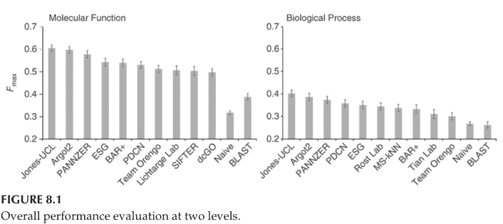

图 8.1 两个级别的整体性能评估。

## 8.4 挑战

鉴于上述，在对蛋白质功能预测问题的特定文献进行详尽回顾后，已经确定了一些参与该主题研究项目的科学家可能感兴趣的挑战。首先，为自动功能注释问题提出新的评估指标。在此点，模型传统上使用自精确率（precision）和召回率（recall）的指标进行评估。这些指标往往倾向于多数类，并且没有考虑问题中存在的类别层次结构。为用于解决自动蛋白质功能预测问题的监督分类器提出新的评估指标将非常有意义。在该领域，模型传统上使用自精确率和召回率的指标进行评估。此类指标（例如 F-score）倾向于多数类（正确分类率 (CCR) 也是如此）。它还假设与类别分布相关的分布与预测分布之间是相等的。简而言之，F-score 不是在具有多个类且类之间存在不平衡问题的生物信息学场景中衡量分类器拟合优良的指标。此外，此问题呈现出层次类，因此分类错误不应具有相同的权重。

其次，认为有必要为研究的问题开发可扩展的机器学习模型。蛋白质功能注释是一个由一个多个类组成的分类问题。为了解决这些问题，开发可扩展的机器学习模型。由于在本体中的对子组之间开发良好的相似性函数是必要的。最后，还应当考虑处理来自不同且异构源的信息整合时出现的情况，此时需要处理各种生物数据（序列、结构、相互作用等）。机器学习算法及其在工程中的应用

## 注释

- 1. 折叠方式并不取决于氨基酸序列。例如，环境会影响折叠的结果。

## 参考文献

- 蛋白质相互作用的历史：从蛋到复杂。Proteomics, 12(10), 1478-1498.
- BLAST+: 架构与应用。BMC Bioinformatics, 10, 421.
- 基因资源：20 年依然强劲。Nucleic Research, 47(D1), D330–D38.
- SARS-CoV-2 蛋白质相互作用图揭示了药物靶点。Nature 583, 459–468.
- 使用 Blast2GO 工具进行高通量功能注释和数据挖掘。Nucleic Research, 36(10), 3420–3435.
- 蛋白质启示：它是什么，为什么重要？Philosophical Transactions of the Royal Society: Biological Sciences, 373(1738), 20160523.
- DeepGO：从序列和相互作用通过深度感知分类器预测蛋白质功能。Bioinformatics, 34(4), 660–668.
- 生物工艺工程：动力学、可持续性和反应器设计。Elsevier。
- 序列和基因组分析。Bioinformatics. Cold Spring Laboratory Press: Cold Spring Harbour, 2.
- 细胞生物学要素。Cambridge, MA: NPG Education, 1, 54.

## 蛋白质准确自动功能识别

Peled, S., Leiderman, O., Charar, R., Efroni, G., Shah-Val, T., and Ofran, Y. (2016). Using DNA binding and RNA binding as a test case de novo protein function prediction. Nature Communications, 7(1), 1–9.

Radivoaj, P., Clark, W.T., Oron, T.R., Schnee, A. M., Witkop, T., Sokolov, A. ... and Pandey. (2013). A large-scale evaluation of computational protein function prediction. Nature Methods, 10(3), 221–227.

Rifaioglu, A.S., Doğan, T., Martin, M.J., Cetin-Alay, R. and Atalay, V. (2019). DeepPEED: Automated protein function prediction with multi-task feed-forward neural networks. Scientific Reports, 9(1), 1–16.

Slatko, B.E., Gardner, A.F. and Ausibel, F.M. (2018). Overview of next-generation sequencing technologies. Current Protocols in Molecular Biology, 122(1), e59.

Spolaor, N., Cherman, E.A., Mon, M.C. and Lee, H.D. (2013). A comparison of multi-label feature selection methods using the problem transformation approach. Electronic Notes in Theoretical Computer Science, 292, 135–151.

Tsoumakas, G. and Katakis, I. (2007). Multi-label classification: An overview. International Journal of Data Warehousing and Mining (IJDWM), 3(3), 1–13.

UniProt Consortium (2018). UniProt: the universal protein knowledgebase. Nucleic Acids Research, 46(5), 2699.

Yang, J., Yan, R., Roy, A., Xu, D., Poisson, J. and Zhang, Y. (2015). The I-TASSER: protein structure and function prediction. Nature Methods, 12(1), 7.

Zheng, S. (2016). IRAS: High-throughput identification of novel alternative splicing regulators. Methods in Enzymology (Vol. 572, pp. 269–289). Academic Press.

Zhu, N., Zhang, D., Wang, W., Li, X., Yang, B., Song, J., ... and Niu, P. (2020). A novel coronavirus from patients with pneumonia in China, 2019. New England Journal of Medicine, 382 (8), pp. 727–733.


# 推荐系统中欺诈性攻击检测技术的分类

Abhishek Majumder, Keya Chowdhury, and Joy Lal Sarkar

Tripura 大学，计算机科学与工程系，

Suryamanagar, Tripura

# 目录

- 9.1 引言.................................................................................................... 142
- 9.1.1 推荐系统中的协同过滤 ................................ 143
- 9.1.1.1 基于用户的协同过滤 (UBCF) ........................ 143
- 9.1.1.2 基于物品的协同过滤 (IBCF) ........................ 143
- 9.2 注入方法...................................................................... 145
- 9.3 欺诈性攻击............................................................................... 146
- 9.4 评分...................................................................................... 146
- 9.5 时间间隔............................................................................... 146
- 9.6 分类...................................................................................... 147
- 9.6.1 使用评分.............................................................................. 147
- 9.6.2 检测................................................................................ 147
- 9.6.2.1 亥尔伯特变换与支持向量机 (HHT-SVM) ................. 148
- 9.6.2.2 缩放 AdaBoost....................................................... 148
- 9.6.2.3 变长分区域........................................................................... 148
- 9.6.2.4 主成分............................................................................... 149
- 9.6.2.5 离散小波变换与支持向量 (DWTS) .................... 149
- 9.6.2.6 主成分............................................................................... 149
- 9.6.2.7 半监督学习使用欺诈性攻击 (SEAD) ................. 150
- 9.6.2.8 支持向量机与目标兴趣 (TIA) ........................ 150
- 9.6.2.9 评分离离值....................................................... 150
- 9.6.2.10 新颖欺诈性攻击.................................................. 150

# 机器学习与应用

- 9.6.3 物品............................................................................... 151
- 9.6.4 物品............................................................................... 151
- 9.6.4.1 双重模型 (DMD) 与异构信息 (HIN) ............ 151
- 9.6.5 使用评分和时间间隔............................................... 151
- 9.6.6 分类...................................................................... 151
- 9.6.6.1 检测................................................................................ 152
- 9.6.6.2 无监督技术....................................................... 152
- 9.6.6.3 时间序列........................................................................... 153
- 9.6.7 物品............................................................................... 153
- 9.6.7.1 时间间隔........................................................................... 153
- 9.6.7.2 主成分............................................................................... 153
- 9.7 优点与缺点....................................................... 153
- 9.7 结论................................................................................... 157
- 9.7.1 未来方向....................................................................... 158

## 9.1 引言

在过去的20年里，推荐系统已成为处理信息的一种有效技术之一，对客户非常有帮助。协同过滤（CF）被认为是最受欢迎的技术之一。然而，它们容易受到配置注入或欺诈性攻击。

### 9.1.1 推荐系统中的协同过滤

协同过滤是一种帮助用户选择合适产品的通用建议技术。它通过制造极其准确的预测来处理信息过载。协同过滤的核心假设是，具有相似经验的用户倾向于对新物品达成一致（Bilge et al. 2014a）。协同过滤利用极其稀疏的 `p × 用户-物品` 矩阵。系统根据用户的偏好来提供建议。

### 9.1.1.1 基于用户的协同过滤 (UBCF)

基于用户的协同过滤 (UBCF) 主要通过寻找相似的用户来向活跃用户提供推荐。图 9.1

# 工程中的机器学习算法与应用

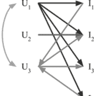

**图 9.1**

基于用户的协同过滤（UBCF）框架。

图中展示了 UBCF 的框架。对于这种技术，需要完成两个任务。首先，通过相似性函数找到用户的 `k` 个最近邻（kNN）。基于 kNN 的算法是最流行的协同过滤（CF）算法。数据表示为一个 `u × i` 的用户-项目矩阵。其中 `(u, i)` 表示用户 `u` 对项目 `i` 的评分，如果进行了评分则显示分数，否则为空值。使用公式 (9.1) 给出的皮尔逊相关系数，它可以计算用户之间的相似性（Chirita et al. 2005）

```
$W_{ij} = \frac{\sum_{kel}(R_{ik} - \hat{R}_i)(R_{jk} - \hat{R}_j)}{\sqrt{\sum_{kel}(R_{ik} - \hat{R}_i)^2 \sum_{kel}(R_{jk} - \hat{R}_j)^2}} \quad (9.1)$
```

其中 `I` 代表项目集合，`R_{ik}` 和 `R_{jk}` 是用户 `i` 和 `j` 给项目 `k` 的评分。`\hat{R}_i` 和 `\hat{R}_j` 分别是用户 `i` 和 `j` 的平均评分。

最后，使用 kNN 公式可以计算用户 `i` 和项目 `b` 的预测值

```
$P_{it} = \bar{R}_i + \sum_{j=1}^k \frac{W_{ij}(R_{jk} - \bar{R}_j)}{\sum_{j=1}^k W_{ij}} \quad (9.2)$
```

### 9.1.1.2 基于项目的协同过滤 (IBCF)

基于项目的协同过滤（IBCF）算法基于项目间的相似性，而不是使用相似用户。图 9.2 显示了 IBCF 的框架。该算法需要两个任务。首先，根据公式 (9.3) 计算项目 `i` 和 `j` 之间的相似性 [8]。寻找项目间相似性有不同类型的策略。其他相似性计算技术还包括基于余弦的相似性、调整余弦相似性、基于相关性的相似性和 1-jaccard 距离。

## 推荐系统中的垃圾攻击检测技术

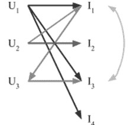

**图 9.2**

基于项目的协同过滤（IBCF）框架。

```
sim(i, j) = \frac{\dot{i},j}{\|i\|\|j\|} \quad (9.3)
```

然后，通过加权和计算项目的预测。这里，`R_{ub}` 是用户评分的加权平均值。因此，预测评分使用以下公式计算：

```
$P_{ui} = \frac{\sum_{\text{all similar items,a}} R_{au}sim(i,a)}{\sum_{\text{all similar items,a}} |sim(i,a)|} \quad (9.4)$
```

## 9.2 画像注入攻击方法

协同过滤推荐（CFRS）广泛应用于电子商务市场，在此期间对手可能会误导推荐框架。攻击者将垃圾画像（Shilling profiles）注入到目标项目中，以增加或减少推荐频率（Lam et al. 2004）。垃圾画像也被用作训练样本，以为真实客户生成推荐。因此，目标项目以更高的频率或更低的频率被提名（Gunes et al. 2014）。表 9.1 展示了垃圾攻击中的通用画像特征。

为了消除检测，垃圾画像可以以合法画像的形式出现。一个垃圾画像（SP）主要由四个元素组成：(i) 选项目（iA）及其评分分布 `\delta(iA)`；(ii) 填充项目（iD）及其评分分布 `\sigma(ID)`；(iii) 未评分的项目（`\iota`）为空评分；以及 (iv) 目标项目（iP）及其评分分布 `\gamma(iIP)`（Bhaumik et al. 2006, 2007, 2011）。`iA` 用于特定的攻击方法。`ID` 随机选择，攻击者会精心设计自己的品味以伪装成合法画像。`ia` 处理未评分项目。`ip` 是给出最高或最低评分的项目。

### 表 9.1：通用垃圾画像

| 项目 | iA | ... | iA | iD | ... | iD | iq | ... | iP |
| :--- | :--- | :--- | :--- | :--- | :--- | :--- | :--- | :--- | :--- |
| 评分 | δ(iA) | ... | δ(iA) | σ(iD) | ... | σ(iD) | Null | Null | γ(iP) |

垃圾攻击（SA）的强度由填充项目的大小和攻击的大小来描述。画像中被评分的项目范围与整个项目多样性之间的比例代表了填充的大小。垃圾画像质量的比例与所有画像总数之比表示了攻击的大小。填充的大小和攻击的大小通常并不大。

### 9.3 垃圾攻击检测

为了减少协同过滤推荐（CFRs）中垃圾攻击（SA）的影响，有两种常用技术。一种方法是解构以下内容。

## 9.4 评分

评分是对质量的衡量，特别是与其他项目相比时。

## 9.5 时间间隔

时钟将时间分为小时和秒。间隔是时间的衡量单位。

## 9.6 分类

在本节中介绍了一种分类方法。根据使用的参数，技术被分为两类：(i) 使用评分参数和 (ii) 使用时间间隔。这些技术进一步分为三类：(i) 攻击检测，(ii) 攻击画像检测和 (iii) 项目检测。分类如图 9.3 所示。

### 9.6.1 使用评分参数

在这种类型中，使用评分参数检测垃圾攻击。

### 9.6.2 攻击画像检测

这类技术使用了希尔伯特-黄变换和支持向量机

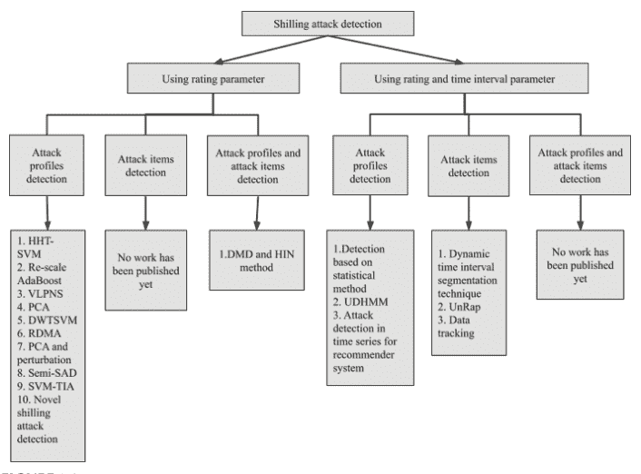

**图 9.3** 分类。

### 9.6.2.1 希尔伯特-黄变换与支持向量机 (HHT-SVM)

希尔伯特-黄变换和支持向量机（HHT-SVM）技术（Fuzi and Zhou 2014）已被用于通过支持机和希尔伯特-黄变换的结合来识别画像注入攻击。HHT 习惯于对单个画像评分序列进行变换以表征画像攻击。这种方法的缺点是，随着新类型攻击的出现，SVM 需要重新训练。在协同过滤推荐的背景下，HHT-SVM 有必要能够增量地了解新类型的攻击。

### 9.6.2.2 重缩 AdaBoost (Re-scale AdaBoost)

这种检测方法从两个方面改进了整体性能。首先，它从客户属性中发现结构良好的特征。然后，它使困难的情况变得更简单。随后，参考重缩加法（RBoosting）和 AdaBoost 的通用思想，它倾向于使用 AdaBoost 的变体，即重缩 AdaBoost（RAdaBoost）（Yang et al. 2016）。RAdaBoost 检测技术支持提取的特征。这意味着如果参数选择得当，RBoosting 技术本质上是一种优的 Boosting 类分类。RAdaBoost 可以与其他机器学习（ML）算法结合使用，提升识别攻击的能力。这种技术也增加了针对攻击的压力。在困难的分类任务上，它将显著提高预测能力。

### 9.6.2.3 可变长度邻居选择

可变长度邻居选择（VLPNS）算法（Wei and Shen 2016）旨在减少协同过滤推荐技术应对垃圾攻击时的不确定预测准确性问题。它依赖于阈值设置。VLPNS 具有使用软决策程序的特殊属性

# 推荐系统中的灌水攻击检测技术

### 9.6.2.4 主成分分析

检测灌水攻击可以提高推荐系统的安全性（Lam et al. 2004）。主成分分析（PCA）检测（Deng et al. 2016）旨在检测推荐系统中的灌水画像（Mehta 2007; Mehta et al. 2007; Mehta 2009）。PCA 可以定义为一种直接的降维方法，通常用于将数据投影到另一个低维空间上。维度之间的高方差通常被视为冗余信息并需要移除。因此，原始空间中的信息重复减少了（Jolliffe 2011）。PCA 观察用户-物品矩阵。通过这种方式，由线性组合组成的画像具有更高的被检测概率。PCA 检测对于识别使用平均攻击、从众攻击和随机攻击创建的灌水画像效果良好（Mehta 2007）。

### 9.6.2.5 离散小波变换与支持向量机

该检测技术基本上是一种结合了小波变换和支持向量机的混合方法（Karthikeyan 2016）。为了对虚假或合法客户进行分类，DWTSVM 方法利用物品的流行度和新颖性构建每个客户评分。在这种方法中，通过评分物品的流行度和新颖性建立的非平稳信号作为 DWT 的输入。DWT 信号的瞬时频率、幅值相位特征集。然后由 SVM 将用户分类为虚假或真实。

### 9.6.2.6 主成分分析与扰动

PCA 和扰动（Deng et al. 2016）是一种无监督的灌水攻击检测技术。PCA 通常在每个用户画像之初以及应用高斯噪声之后应用。因此，通过合并两次 PCA 的结果来发现灌水攻击（SAs）。由于灌水画像与平均评分的偏差较小，该技术在实验中实现了更高的准确率。向画像中注入扰动的影响应当大于对合法画像的影响。实验结果证明了该技术优于初始 PCA。注入扰动对于灌水攻击检测很有用。

## 9.6.2.7 基于灌水攻击检测的半监督学习 (SEMI-SAD)

基于半监督学习的攻击检测技术（SEMI-SAD）（Wu et al. 2021）由灌水攻击检测算法辅助。它利用了每种信息。首先，它使用朴素贝叶（NB）分类器训练一小部分标记客户，然后使用期望最大化（EM）整合未标记客户以升级 NB 分类器。与其他技术相比，SEMI-SAD 能够轻松区分多种灌水攻击，特别是混淆和混合灌水攻击。该技术以初始检测器的形式优化朴素贝叶，并通过增强 EM 来增强检测器。该算法从每个已标记和未标记的客户画像中获取知识。通过结合朴素贝叶分类器和未标记数据，利用 EM 来增加标记信息的权重。

### 9.6.2.8 支持向量机与目标物品分析 (SVM-TIA)

这种灌水攻击检测技术（Zhou et al. 2016）在推荐系统中使用了支持向量机和物品分析。它基于 Border-SMOTE 策略工作，该策略用于减少分类中的类别不平衡缺陷。因此，分析了微调部分，该部分用于针对潜在攻击画像集中的物品。该系统通过分析物品评分来观察攻击画像。然而，该技术的缺点是某些真实画像被误判为攻击画像。

### 9.6.2.9 评分与均值偏差的一致性

评分与均值偏差一致性（RDMA）技术（Si and Li 2020; R. Burke et al. 2006）观察攻击者测试每个物品画像的平均偏差。它通过物品评分数量的倒数进行加权，以检测攻击。


# 9.6.2.10 基于时间间隔的新灌水攻击检测

新型灌水攻击检测方法（Bilge et al. 2014）利用时间间隔聚类特定攻击。它使用均值聚类算法分配二分决策树（BDT）来收集攻击画像。通过递归聚类训练数据构建二分决策树，将用户-物品矩阵划分为两个不同的簇。在每个层级计算簇内相关系数。直到叶节点中留有预设数量的用户。通过遍历 BDT 并根据相关系数检测异常。

# 9.6.3 物品检测

尚未引入用于检测物品的技术。

# 9.6.4 攻击画像与物品检测

这种技术设计用于检测攻击画像和物品。

## 9.6.4.1 双检测器 (DMD) 与异构网络 (HIN)

双检测器（DMD）技术（Zhang et al. 2019）通过矩阵分解分解用户-物品矩阵。它设计了许多路径控制异构网络（HIN），并使用 skip-gram 方法获取嵌入。为了获取因子，针对核心性、度和 H 指设计了显著路径。最后，利用嵌入和因子训练检测器以检测攻击画像。

# 9.6.5 使用评分和时间间隔

在这种技术中，利用评分和时间间隔检测灌水攻击。

# 9.6.6 画像检测

此类技术用于检测攻击画像。此类技术的示例包括基于统计模型、UD-HMM 和时间序列检测。

## 9.6.6.1 基于统计模型

统计检测算法（Wang et al. 2018）首先根据其时间顺序评分序列分割每个物品的特征。设计统计分布以获取相关的时间间隔。该技术通常被画分为假设检测和动态时间间隔策略（Xia et al. 2015）。基于成功的攻击会改变目标物品属性的核心假设，该识别器想要获取评分序列的不规则性。在分割序列后采用假设检验来检查不规则组。

## 9.6.6.2 使用隐马尔可夫模型和层次聚类的无监督技术

灌水识别依赖于隐马尔可夫模型（HMM）和层次聚类（Zhang et al. 2018）。该技术通过构建每个用户的评分序列来衡量用户行为的差异。然后使用 HMM 获取每个用户的偏好序列，以计算每个用户的匹配程度。计算每个物品的熵以发现检测攻击画像的用户度。该技术的局限性是在采样数据集上检测协同攻击者时性能并不理想。

## 9.6.6.3 时间序列攻击检测

时间序列攻击检测技术（Zhang et al. 2006）使用大小为 `k*` 的窗口构建物品评分的时间序列。它将连续的评分聚类到不重叠的窗口中。然后确定窗口的样本熵和样本平均值。如果攻击画像数量，可以推导出理论上的最佳窗口大小以用于观察攻击事件。

# 推荐系统中的水纵攻击（Shilling Attack）检测技术

## 9.6.7 攻击物品检测

此类技术用于检测攻击性画像。此类技术的示例包括动态时间分段技术、攻击画像无监督检索（UnRAP）以及数据跟踪。

### 9.6.7.1 动态时间间隔分段技术

动态时间间隔分段技术（Xia et al 2015）用于直接定位被恶意画像攻击的物品。该技术的整个框架包含两个部分，即区间分段和异常区间检测。时间间隔分段技术在检查点（checkpoint）动态地将每个物品的生命周期划分为时间间隔。异常区间检测方法通过假设检验检测异常物品。这种检测技术提高了针对目标转移攻击（target shifting attack）的检测性能。

### 9.6.7.2 攻击画像无监督检索

这种攻击画像无监督检索（UnRAP）检测技术（Si and Li 2020）是一种无监督学习方法。该技术通过分析目标时间点的评分偏差来检测水纵攻击。该技术可以单独检测特定时间点的攻击用户画像。

### 9.6.7.3 数据跟踪

这种数据跟踪检测技术（Qi et al 2018）用于海量信息环境。该技术支持新信息特征。该技术使用扩展卡尔曼滤波，能够快速跟踪并准确预测受支持物品的评分状态，支持了两个新的检测属性：短期平均变化活跃度（SACA）和短期方差变化活跃度（SVCA）。检测器通过比较预测评分与实际评分来检测异常物品。

## 9.6.8 攻击画像与攻击物品检测

目前尚未引入基于攻击画像和攻击物品检测作为输出的技术。

## 9.6.9 优缺点

在本节中，表 9.2 展示了水纵攻击检测技术的优缺点。

## 表 9.2

优缺点

| 水纵攻击检测技术 | 优点 | 缺点 |
| --- | --- | --- |
| 1. 新型水纵攻击检测 (Bilge et al. 2014b)。 | 1. 该方法对几乎所有的填充大小和攻击规模都给出了理想的结果。 | 1. 该方法仅检测特定的三种攻击，即跟众攻击（bandband）、分段攻击和平均攻击。2. 当系统中的所有画像都是真实的时，该技术会将真实画像误判为恶意画像。 |
| 2. 希尔伯特-黄变换与支持向量机 (HHT-SVM) (Fuzhi et al. 2014)。 | 1. 该方法对每个评分序列进行分解。它还提取了基于希尔伯特频谱的特征来表征画像攻击。2. 这里 SVM 区分了真实用户画像和攻击者画像。 | 1. 在这种方法中，一旦出现新类型的攻击，SVM 分类器就需要离线重新训练。 |
| 3. 重新缩放 AdaBoost (Yang et al. 2016)。 | 1. 该方法从用户画像提取设计良好的特征。为了提高检测性能，这些画像是基于各种攻击模型的统计属性建立的。2. 它使得场景执行更容易进行。 | 1. 该方法对于攻击规模和填充大小较小的攻击检测率较低。2. 重缩放 AdaBoost 无法有效检测高权限用户攻击-聚合相似性（PUA-AS）、高权限用户攻击-评分数量（PUA-NR）和高权限用户攻击-入度（PUA-ID）攻击。3. 该技术中通用特征和特定类型特征是提取性特征，不足以描述它们的本质特征。 |
| 4. 均值一致评分偏差 (RDMA) (Si and Li 2020); Burke et al. 2006)。 | 1. 该算法成功检测了随机的、平均的和跟众的攻击画像。 | 1. 它无法检测分段攻击和爱/恨攻击（love/hate attack）。 |
| 5. 带邻域选择的可变长度划分 (VLPNS) (Wei and Shen 2016) | 1. 该技术不是检测可疑的伪造者，而是对它们进行标记并降低假阳性率。这一过程的执行方式使得被误分类的正常用户仍然参与相似性计算。结果是将正常用户误认为伪造者的概率降低了。2. 该方法的预测准确性很高。 | 1. VLPNS 的时间复杂度更高。2. 该算法没有提高假阴性率。 |
| 6. 主成分分析 (PCA) (Deng et al. 2016) | 1. PCA 对孤立攻击（stand attacks）执行非常高效。2. 该方法在识别跟众攻击、随机攻击和平均模型中的画像表现非常好。 | 1. PCA 的适用性受到其推导过程中某些假设的限制。2. 另一种方法是在构建 PCA 协方差矩阵之前进行均值消除过程。 |
| 7. 离散小波变换与支持向量机 (DWTSM) (Karthikeyan et al. 2016) | 1. 该方法形成了单个用户的评分序列。该评分序列参考物品的流行度和新颖性形成。根据时间将用户分类为伪造或真实，因此检测率容易获得。2. 为了获取特征，在评分序列上应用了离散小波变换。 | 1. 该方法应用了奈奎斯特规则。一半的……2. DWT 是计算密集型的。这是很自然的。3. SVM 的维度可能非常高。 |
| 8. 主成分分析与扰动 (Deng et al. 2016)。 | 1. 利用扰动技术可以分离攻击和合法画像。2. 该方法有效、简单且易于实施。 | 1. 在这种方法中，PCA 的适用性受到其推导过程中某些假设的限制。2. 当扰动时，状态值较高。 |

# 机器学习算法在工程中的应用

表 9.2（续）

优缺点

| 水纵攻击检测技术 | 优点 | 缺点 |
| --- | --- | --- |
| 9. 半监督学习水纵攻击检测 (SE-SAD) (Wu et al. 2011)。 | 1. 该技术通过使用极大化（EM）检测画像来改进朴素贝叶斯分类器。2. SE-SAD 非常有效。 | 1. 大数据的分类是一个真正的挑战。2. 训练需要大量的计算。 |
| 10. 支持向量机与物品分析 (SVM-TIA) (Zhou et al. 2016)。 | 1. 该方法缓解了分类中的类别偏差问题。 | 1. 分析潜在攻击画像集，导致真实画像被误判为攻击画像。 |
| 11. 双检测器 (DMD) 与异构信息网络 (HIN) 方法 (Zhang et al. 2019)。 | 1. DMD 利用 HIN 利用客户端-物品和客户端-客户端之间的互连。它实现了协同过滤推荐（CFR）的攻击识别。2. 该方法在关注关系攻击的同时检测评分攻击。3. DMD 对混合攻击也是有效的。 | 1. 该系统需要对不同类型的对象进行测量。 |
| 12. 基于统计模型的检测 (Wang et al. 2018) | 1. 统计模型是物品评分生成过程的理想形式。2. 任何事件的概率可以通过构成统计模型的统计假设计算。 | 1. 该模型需要与数据集评分相关的信息。2. 随着数据规模扩大，时间消耗受到影响。3. 处理困难会导致时间偏差和长度偏差采样。 |
| 13. 使用隐马马尔可夫模型和层次聚类的无监督方法 (UD-HMM) (Fuzhi et al. 2018)。 | 1. 由于于该技术仅考虑当前状态，不需要任何先验知识。2. 它使用 HMM 根据评分对真实用户和攻击者进行聚类。 | 1. 该方法在采样数据集上检测合谋垃圾邮件者时执行效率不高。 |

## 推荐系统中的灌水攻击检测技术

## 表格 9.2（续）

优点与缺点

| 灌水攻击检测技术 | 优点 | 缺点 |
| --- | --- | --- |
| 14. 时间序列攻击检测 (Zhang 等，2006)。 | 1. 通过这些样本平均特征和样本熵特征的时间序列，对其持续时间做出合理假设来暴露攻击事件。<br>2. 只有在已知攻击特征数量的情况下，理论上才能推导出最佳窗口大小。这样做是为了最好识别由攻击引起的分布变化。 | 1. 在攻击期间，有时正常用户的评分模式也会发生，这可能难以识别灌水攻击者。 |
| 15. 动态时间间隔分段技术 (Xia 等，2015)。 | 1. 该技术将每个物品的生命周期分为若干个区间。这是在检查点动态完成的。<br>2. 它通过假设检测异常物品。 | 1. 在这种方法中，提高针对目标偏移攻击（target shifting attack）的检测性能存在存在问题。<br>2. 在识别出每个物品的可疑区间后，无法有效减少攻击的影响。 |
| 16. UnRap (Si 和 Li，2020)。 | 1. 该方法通过分析用户画像在目标物品上的评分偏差来识别灌水攻击特征。 | 1. 它仅针对单次检测攻击用户画像。 |
| 17. 数据跟踪 (Qi 等，2018) | 1. 这种技术采用了大数据处理方法。<br>2. 数据跟踪方法的检测效率很高。 | 1. 数据跟踪不适用于处理分布式系统中的海量数据。 |

## 9.7 结论

推荐系统（RS）是一种帮助用户从互联网选择产品的应用程序。为了减少灌水攻击带来的损害并保持良好的推荐质量，推荐系统的安全性是一个重要问题。然而，由 SA（灌水）方法创建的虚假用户画像可以通过的 SA 检测技术进行准确检测。这些 SA 技术的评分模式与真实用户不同。协同过滤（CFR）是处理信息过载问题最有效的方法之一，但由于系统中插入了各种恶意用户画像，它们非常容易受到大量灌水攻击的影响，从而影响用户推荐。在本章中，首先讨论了画像注入攻击技术、推荐系统中的协同过滤以及灌水攻击检测方案。其次，根据评分参数和其工作的时间间隔两个参数对灌水攻击检测技术进行了分类。灌水攻击检测技术还根据其输出算法进行了分类，如攻击特征检测、攻击物品检测和攻击画像检测。对每种灌水攻击检测技术都进行了简要讨论。对这些技术进行了分析，并比较了它们的优缺点。

## 9.7.1 未来方向

未来的研究方向在于改进这些灌水攻击检测技术的缺点。例如在动态时间间隔分段技术中，针对目标偏移攻击的检测性能还需要增强。数据跟踪技术的缺点是它不适用于处理分布式系统中的巨数据。HHT-SVM 的问题在于，当进行新型攻击时，很难检测到攻击特征。SVM 还需要在离线进行重新训练。克服这些问题是未来的发展方向。

## 参考文献

- Bhaumik R, Burke R, Mobasher B (2007). Effectiveness of crawling attacks against web-based recommender systems. Proceedings of the 5th workshop on intelligence techniques for web personalization (ITWP-07).

- Bhaumik R, Mobasher B, Burke R (2011). A clustering approach to unsupervised attack in collaborative recommender systems. Proceedings of the International Conference on Data Mining (DMIN). The Steering Committee of the World Congress in Computer Science, Computer Engineering and Applied Computing (World Comp), p. 1.

- Bhaumik R, Williams C, Mobasher B, Burke R (2006). Securing collaborative filtering against malicious attacks through anomaly detection. In Proceedings of 4th Workshop on Intelligent Techniques for Web Personalization (ITWP'06), Boston. vol. 6.

- Bilge A, Gunes I, Polat, H. (2014a) Robustness of privacy-preserving recommendation schemes. Expert Syst Appl, 41(8): 3671–3681.

- Bilge A, Ozdemir Z, Polat H (2014b). A novel attack detection method. Proc Computer Science, 31: 165–174.

- Bilge, Polat H. (2013) A comparison of clustering-privacy-preserving collaborative filtering schemes. ApJ Soft Comput, 13(5): 2478–2489.

- Rourke, Mobasher, Williams C. (2006). Classification features for attack detection in collaborative recommender systems. International Conference on Knowledge Discovery and Data Mining, pp. 17–20.

- Chirita P-A, Nejdl W, Zamfir C (2005). Preventing shilling attacks in online recommender systems. Proceedings of 7th annual ACM workshop on Web information and data management, pp. 67–74.

- Deng, J. J., Zhang, F., & Wang, S. (2016). Shilling attack detection in collaborative recommender system by PCA and perturbation. In International Conference on Wavelet Analysis and Pattern Recognition (CWAPR), pp. 213–218.

- Fuzhi Z, Zen Z, Peng Z (2013). UD-HHM: An unsupervised method for shilling attack based on hidden Markov model and hierarchical clustering. Knowledge-Based Systems, 148: 146–166.

- Fuzhi Z, Zhou Q (2014). HHT-VS: An online method for detecting profile injection in collaborative recommender systems. Knowledge-Based Systems 65: 96–105.

- Gunes I, Kaleli B, Bilge B, et al. (2014). Shilling attacks against recommender systems: a comprehensive survey. Artificial Intelligence Review, 42(4): 767–799.

- Jolliffe I. (2011). Principal Component Analysis. Springer, Berlin, pp. 1094–1096.

- Karthikeyan P, Selvi ST, Neeraja G, Vincent A, Abinaya V. (2017, January). Prevention of shilling attacks against recommender systems using discrete wavelet transform and vector machine. In 2016 International Conference on Parallel and Distributed Computing, Applications and Technologies, pp. 99–104. (注：原文此处为页码99-104)


- Lam SK, Riedl J (2004). Shilling recommender systems for fun. Proceedings of the 13th ACM SIGDD conference, pp. 393–402.

- Mehta B, Hofmann T, Jankhauser P (2007). Unsupervised detection for collaborative filtering. In Proceedings of the 12th ACM SIGKDD, pp. 14–21.

- Mehta B, Nejdl W (2009). Unsupervised strategies for collaborative filtering. User Modeling and User-Adaptive, 19(1–2): 65–97.

- O’Mahony, Michael P. (2004). Robust and efficient collaborative filtering, PhD diss., University College.

- Qi L, Huang H, Wang P (2018). Attack Detection Based on Data Tracking. In 2018 13th International Conference on Computer Science and Education (ICCE), pp. 1–4.

- Sarwar, B., Karypis, G., Konstan, J., & Riedl, J. (2001, April). Item-based collaborative algorithms. In of the 10th ACM conference on Web, pp. 285–295.

- Si, M., & Li, Q. (2020). Shilling-shilling attacks against recommender systems: a review. Artificial Intelligence Review, 53(1), 291–319.

- Wei R, Shen H (2016). An Improved Collaborative Filtering Recommendation Shilling Attacks. In 17th International Conference on Parallel and Distributed Computing, Applications and Technologies, pp. 330–335.

- Wang Y et al. (2018). A comparative study on detection methods for trust-worthy recommendations. Journal of Systems Science and Systems Engineering 27(4): 458–478.

- W Z, Cao J, Mao B, Wang Y (2011, October). Semi-SAD: applying semi-supervised learning to shilling attack. In Proceedings of the fifth ACM conference on Recommender systems. ACM, pp. 289–292.

- Xia H., Fang B, Gao M, Ma H, Tang Y, Wen J. (2015). A novel item anomaly detection approach against shilling attacks in collaborative recommendation systems 306: 150–165.

- X, Z, Hong X, Yuqi S (2019). Meta-path and matrix factorization based shilling detection for collaborative filtering. International Conference on Collaborative Computing: Networking, Applications and Worksharing. Springer, Cham, pp. 3–16.

- Y, Z., et al. (2016). Re-scale AdaBoost for attack detection in collaborative recommender systems. Knowledge-based Systems 100: 74–88.

- Zhang, S, Chakrabrabarti A, Ford J, Madeon F (2006). Attack detection in time series for recommender systems. In Proceedings of the 12th ACM SIGKDD international conference on Knowledge discovery and data mining, ACM. pp. 809–814.

- Zhou W et al. (2016). SVM-TIA a shilling attack detection method based on SVM target item analysis in recommender systems. Neurocomputing 210: pp. 197–205.

# 10

## 真实时间序列问题中的机器学习应用

Antonio Manuel Durán-Rosal¹* 和 David Guijo-Rubio²

¹安达卢西亚皇家洛约拉大学定量方法系，科尔多，西班牙

²科尔多大学计算机科学与数值分析系，科尔多，西班牙

*amduran@uloyola.es

# 目录

- 10.1 引言............................................................................................... 161

- 10.2 使用机器学习算法的 TSDM 现实应用....................................... 164

- 10.2.1 波高时间序列中的大规模缺失数据重建.............................. 164

- 10.2.2 拐点的检测与预测 ................................. 165

- 10.2.3 雾形成的预测 ................................................................ 167

- 10.2.4 其他对流天气状况的预测 ............................................ 169

- 10.3 总结及其他工作............................................................... 170

## 10.1 引言

本节介绍了所呈现的主题以及相关的最先进进展。时间序列数据挖掘（TSDM）主要包含以下任务：异常检测（Blazquez-García et al., 2020）、分类（Ismail-Fawaz et al., 2019）、分析与预处理（Hamilton, 1994）、分段（Keogh et al., 2004）、聚类（Liao, 2005）和预测（Weigend, 2018）。更具体地说，本章专注于时间序列预处理、分段和预测在现实问题中的应用。

时间序列分析和预处理被认为是其他 TSDM 任务的前置步骤。最重要的任务之一是时间序列缺失值的插补，这对于后续方法的成功应用至关重要。真实时间序列（尤其是由传感器、浮标或真实物理系统收集的数据）经常由于各种原因停止工作而导致信息空白。在这种背景下，近年来提出了许多应用。通常，缺失值的插补是通过对观测特征进行插值完成的，而不考虑任何隐藏动态。Zhou 和 Huang (2018) 了一种可以通过新型迭代插补网络捕捉潜在复杂性的模型，并通过其在气象基准数据集上的应用证明了优于先进方法的性能。最近，遵循从时间序列中捕捉动态的想法，Belda 等人 (2020) 开发了一个名为 DATimeS 的软件，该软件使用了高斯过程回归（GPR）等机器学习拟合算法。它为重建植被时间序列提供了强大的软件，这些序列在云层覆盖下是非连续的。

时间序列分段是将时间序列划分为若干连续的子序列，以实现不同的目标。更正式地，它们的定义如下：给定一个时间序列 `Y={y_i}`，对于时间索引 `i=1..N`，程序尝试将 `Y` 的值划分为 `l` 个段。在此过程中，时间索引被拆分为 `s_1={y_1,...,y_{i_1}}, s_2={y_{i_1},..,y_{i_2}},..,s_l={y_{i_{l-1}},..,y_N}`，其中升序排列的断点表示为 `\hat{t}_1<\hat{t}_2<\dots<\hat{t}_{l-1}`。考虑到

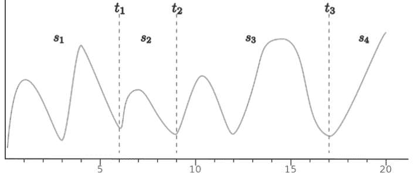

图 10.1

长度为 N=20 且分为 4 段的时间序列的分段过程。

`s_1={y_1,y_2,y_3,y_4,y_5,y_6}, s_2={y_6,y_7,y_8,y_9}, s_3={y_{10},y_{11},y_{12},y_{13},y_{14},y_{15},y_{16},y_{17}}`, 以及 `s_4={y_{18},y_{19},y_{20}}`, 由断点 `\hat{t}_1=6,\hat{t}_2=9` 和 `\hat{t}_3=17` 产生。

从一个段到另一个段的过渡，每个断点都属于两个段，使得它们属于前一个段和下一个段。图 10.1 图形化地表示分分过程。

如上所述，分段用于实现不同的目标。在文献中，目标主要分为两类。一方面，执行这种技术是为了发现时间上的群体相似性或有用模式。这种背景下的方法是优化时间序列的划分，然后将段分组成不同的簇。在过去的二十年里已经提出了许多方法。Abyoni 等人 (2003) 指出，时间序列中属于同一簇的所有点在时间上是连续的。之后，许多作者提出了对段而非点进行分组的方法。Tseng 等人 (2009) 开发了一种算法，考虑小波空间中的相似性来引导分段，导致了不同长度段的聚类。此外，通过两种高效方法解决了后续时间序列的重要聚类问题（Rakthan et al., 2012）。

## 10.2 使用机器学习算法的 TSDM 现实应用

### 10.2.1 波高时间序列中的大规模数据重建

海洋浮标是用于测量不同属性的仪器。它们的准确性和可用性对于许多操作（如沿海航行）至关重要。尽管许多机构提供浮标支持，如美国国家浮标中心（NDBC）的情况，但许多意外事件会导致浮标损坏（例如风暴、事故、长期维护）。在这种情况下，它导致了数据缺失，直到浮标修复。尽管在时间序列存在缺失数据的情况下可以使用这些方法，但完整数据的需求更高（Thomson and Emery, 2014）。因此，缺失值的重建引起了该领域的极大关注。

# 机器学习在真实世界时间序列问题中的应用

成功应用于安大略湖之上。最后，物理方法也已与机器学习方法相结合，用于波高估计（Casa-Prat 等人，2014）。

由于大多数机器学习模型缺乏这些技术所固有的解释性，我们在 Duran-Rosal 等人（2015）的研究中提出了一种新方法。在本文中，通过两个阶段程序提出了一种由进化算法训练的乘积单元神经网络（EPUNN）。该方法被应用于美国阿拉斯加湾的六个浮标。

第一阶段包括使用传递函数和邻域相关性法进行初始重构。一方面，传递函数基于相关性分析，并通过完整时间序列对缺失时间序列进行估计（注意，它们之间的相关性需要高于预定义的阈值）。另一方面，邻域相关性法通过添加来自高度相关浮标的信息来估计这些缺失值。

这两种方法都恢复了缺失值，我们保留每个时间序列中的最佳结果作为第二阶段 EPUNN 的输入。从这个意义上说，使用两个相关相关的输入（涉及原始时间序列）来获得最终的重构时间序列。

在阿拉斯加湾六个浮标获得的结果表明，考虑到其准确性和解释性，EPUNN 适用于这类问题。此外，通过对输入应用自然对数，可以将其表示为线性模型，以便于理解和解释。注意的是，沿岸浮标的重构效果更好，因为其值的可用性更高。

## 10.2.2 临界点的检测与预测

古气候学是古地理科学的一个热门领域；它由对地球气候特征的研究组成，具体而言，旨在为历史时期的气候提供尽可能可能的描述。此外，古气候学承认了显著的气候变化及其背后的原因。不可逆点、阈值和相变在自然界广泛存在且通常是非线性的。这些可能对地球气候产生巨大影响且难以预测（Wassmann and Lentio, 2012）。

针对这一问题，动态系统（如气候系统）的若干研究人员声称它们呈现出关键转换。这些转换通常被称为临界点（TPs），也被“能产生巨大影响的小事”。当气候系统中的微小变化引起内部动力学产生强非线性响应，导致其未来状态发生改变时，被称为气候临界点。从这个意义上说，地球上的主要气候变化由温度时间序列中的转换点或其代理指标之一（如冰川中氧同位素浓度）决定，这些点使其从一个稳定状态转变为另一个状态。

通过分析临界点的产生及发生过程来对其进行早期检测被认为具有重大影响，因为它们会影响数百万人的生活。Lenton (2011) 提出了许多类型临界点的分类，并展示了一些可能有助于检测它们的指标，如值的相关性增加。此外，Dakos 等人（2012）引入了与数据处理和指标相关的更具体的技术。他们研究了使用模拟生态数据等若干种方法，并得出了初步结论：没有单一的最佳指标可以检测转换，且所有方法都需要特定的数据处理。之前的工作有两个主要缺点：需要对数据进行密集处理，以及对每种类型的临界点应用特定的处理。在这方面，我们提出了两项工作。

在第一项工作中

该方法不仅在合成数据集上进行了测试，还对两个真实的古气候氧同位素数据集进行了测试：GIS2（格陵兰冰盖二）和 NGRIP（北格陵兰冰芯计划）`\delta^{O}` 时间序列，分辨率为 20 年，平均 5 个点以减少短期波动。实验结果有效地检测并发现了这些临界点动态表征中的相似点和差异，这些点被称为丹斯斯加德-奥斯格尔（DO）事件。实验表明自相关性的增加、方差和均方误差可以作为预警信号。

在第二项工作中，我们引入了一些改进，并基于观测开发了预测模型（Pérez-Ortiz 等人，2019）。在分段阶段完成后，通过领域专家对算法的稳定性进行了评估。算法还提供了聚类指标以增强预测性。在预测阶段，模型被转换为二分类问题，以检测 DO 事件。

# 机器学习在真实世界时间序列问题中的应用

结果证实，EPUNN 在数据集中优于其他两个临界点。实验还证明，所提出的诊断预测模型（特别是决策树）是可行的，并产生了非常有前景的结果。这种行为产生于持续数十年的系统，且包含了该类型的突然气候变化。上述方面开启了一个有趣的研究领域。

## 10.2.3 雾的预测

众所周知，航空是受不利天气影响最大的交通工具之一。有很多降低能见度的现象，如沙尘暴或暴雨。然而，无疑，最重要且常见的是雾形成。雾是一种空气中悬浮微小水滴的气象现象，导致地表水平能见度降低。已从不同观点对其探讨（Román-Gáón，2015）。

雾天气会导致航空流量中断、航班延误甚至事故。更具体而言，它对机场运营（如滑行、起飞和着陆）（Berot 等人，2007）。旨在确保足够的可靠信息以预测这些现象。一些研究提出了开发用于检测和预测雾形成的可靠系统。

预测雾形成最广泛的方法之一是使用数值天气（NWP）模型（Román-Gáón 等人，2016）。然而，NWP 计算成本很高。近年来，机器学习方法已成功应用于雾预测问题。Fabbian 等人（2007）提出用神经网络预测堪培国际机场 18 小时计划内的雾事件。同样，Marban 等人（2007）使用神经网络整合三个信息源，预测美国西北 39 个机场的云底和能见度。同一年，Bremnes 和 Michaelides（2007）在挪威应用另一种神经网络方法预测跨度达 6 小时的雾形成。随后，贝叶斯模型被成功引入到美国太平洋西北跨度达 12 小时的雾预测中（Chmieleck and Rafferty, 2021）。最近，Colabone 等人（2015）提出了一种多层感知机，利用气象数据帮助空军学院（AFA）规划活动。在 Cornejo-Bueno 等人（2017）中，不同的机器学习回归技术已应用于西班牙的雾预测。这些工作通过回归方法处理雾形成问题。

# 工程中的机器学习算法与应用

尽管机场有许多传感器在收集气象数据（如风速、风向、温度、湿度和压力），但其他传感器为了支持机场运行，跑道视程（RVR）是最重要的。RVR 是一种天气变量，定义为在跑道中心线的飞机飞行员能够看到跑道表面标记或勾勒跑道边界并识别其中心线的灯光的范围。

考虑到此前的工作和 RVR 变量，我们提出了两项工作，其意义是将雾天预测视为类别区间，分别导致一个二分类问题和一个序数分类问题。这两项工作均位于巴利亚利亚利亚德机场，因为该地是冷季节雾形成形成的关键点。

第一项工作侧重于对传感器采集的 RVR 变量进行预测，预测时长为 6 小时（Durán-Roral 等人，2018）。当 RVR 小于 190 米时考虑雾天事件。因此，该问题变成一个二分类问题，如果发生雾天则输出为 1，否则输出为 0。鉴于数据的不平衡性（即雾天事件远少于晴天事件），开发了一种多目标进化算法（MOEA）来训练人工神经网络（ANN）的结构，使用 PU、sigmoid 单元（SU）和径向基函数（RBF）作为基函数。该算法通过训练优化整体准确率和敏感性，以解决不平衡问题。

通过 MOEA 获得的最佳模型是一个具有 PU 基函数的 ANN。这种组合实现了 82.24% 的全局准确率，正确分类的事件百分比为 84.83%。生成的 ANN 隐藏层仅有两个神经元，显示出模型的高度可解释性（见图 10.2），可以从雾形成的物理属性角度对其进行解释。


在第二项工作（Guijo-Rubio 等人，2018）中，考虑了三个有序类别，增加了问题的难度。考虑这三个类别的目的是为了作为决策支持系统提供更精确的信息：雾 `FOG`（`RVR` 在 `[0, 1000]` 米范围内）、雾 `MIST`（`RVR` 在 `[1000, 1900]` 米范围内）和晴 `CLEAR`（`RVR` 大于或等于 190 米）。此外，预测是根据 24 小时的计划进行的。

该工作基于自回归（`AR`）模型的哲学，模型在预测给定值时需要一些之前的值。为了确定这些之前值的数量，提出了三种不同类型的窗口：固定窗口（`FW`）、基于标签变化的动态窗口（`DWLC`）以及基于方差变化的动态窗口（`DWVC`）。由于问题是在序数范式下处理的，所提出的解决问题的算法包括：比例优势模型（`POM`）、支持向量机（`SVM`）、考虑显式约束的支持向量序回归（`SVOREX`）、考虑隐式约束的支持向量序回归（`SVORIM`）以及用于回归的核判别学习。

## ML 在现实世界时间序列问题中的应用

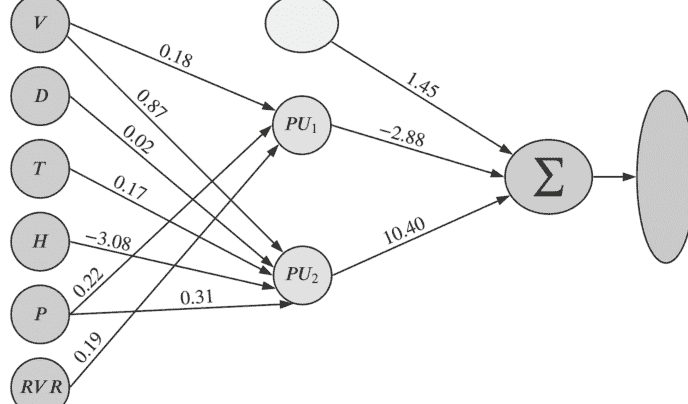

**图 10.2** 使用 `PU` 作为基函数获得的最佳 `ANN`。`V` 和 `D` 分别代表速度和风向，`T` 对应温度，`H` 代表湿度，`P` 是压力，`RVR` 是之前定义的跑道视程。

结果显示，`FW` 与 `DW` 与 `KDLOR` 算法的组合非常出色，在最小敏感性和 `AMAE`（每类分类误差的平均值）方面产生了最佳结果。这种方法可以提高机场因低见度事件导致的航空运行的安全性和盈利能力。

### 10.2.4 其他对流情况的预测

如第 10.2.3 节所述，有大量干扰机场正常运行的现象。它们不仅导致了排队，还增加了操作人员和工作人员的工作负量（Cao and Cai，2016）。因此，预判这类现象在如今具有重大影响。通过这样，文献中提出了多项建议，试图增加我们对对流情况的了解，并改进现有系统（Wang 等人，2014）。目前，大多数方法基于从温度和湿度得出的稳定性指数，例如上升指数或对流可用位能指数。尽管这些指数已被证明在预测与对流相关的状况方面有效，但通过将它们与机器学习技术相结合可以提高它们的性能，而机器学习技术在处理大气问题时也被证明是极佳的（McGovern 等人，2017）。

本章作者考虑了一个对流云形成问题。利用从马德里-巴拉哈斯机场（西班牙）收集的五年（2011年至2015年）数据，向文献中介绍了两种新方法。问题中考虑的输入是垂直方向测得的大气变量与某些适当稳定性指数的结合。研究的主要目标是预测 2 小时跨度的对流情况。在这方面，针对该问题提出了两项建议：第一个（Guizo-Rubio 等人，2020b）是从普通分类的角度解决问题。每个事件被赋予了以下类别之一：晴（未观测到对流云）、`TCU`（观测到积雨云）、`CB`（积雨云）和 `TS`（雷雨）。鉴于数据的不平衡性，即雾天事件远少于晴天事件，开发了一种多目标进化算法（`MOEA`）来训练 `ANN` 的结构，使用 `PU`、sigmoid 单元（`SU`）和径向基函数（`RBF`）作为基函数。该算法通过训练优化整体准确率和敏感性以解决不平衡问题。

通过 `MOEA` 获得的最佳模型是一个具有 `PU` 基函数的 `ANN`。这种组合实现了 82.24% 的全局准确率，正确分类的事件百分比为 84.83%。生成的 `ANN` 隐藏层仅有两个神经元，显示出模型的高度可解释性（见图 10.2），可以从雾形成的物理属性角度对其进行解释。

另一方面，第二个建议（Guizo-Rubio 等人，2020b）是从普通分类的角度处理。每个事件被赋予以下类别：晴（未观测到对流云）、`TCU`（观测到积雨云）、`CB`（积雨云）和 `TS`（雷雨）。鉴于数据的不平衡性，即雾天事件远少于晴天事件，开发了一种多目标进化算法（`MOEA`）来训练 `ANN` 的结构，使用 `PU`、sigmoid 单元（`SU`）和径向基函数（`RBF`）作为基函数。该算法通过训练优化整体准确率和敏感性解决不平衡问题。

在第二项工作（Guijo-Rubio 等人，2018）中，考虑了三个有序类别，增加了问题的难度。考虑这三个类别的目的是作为决策支持系统提供更精确的信息：雾 `FOG`（`RVR` 在 `[0, 1000]` 米范围内）、雾 `MIST`（`RVR` 在 `[1000, 1900]` 米范围内）和晴 `CLEAR`（`RVR` 大于或等于 190 米）。此外，预测是根据 24 小时的计划进行的。该工作基于自回归（`AR`）模型的哲学，模型在预测给定值时需要一些之前的值。为了确定这些之前值的数量，提出了三种不同类型的窗口：固定窗口（`FW`）、基于标签变化的动态窗口（`DWLC`）以及基于方差变化的动态窗口（`DWVC`）。由于问题是在序数范式下处理的，所提出的解决问题的算法包括：比例优势模型（`POM`）、支持向量机（`SVM`）、考虑显式约束的支持向量序回归（`SVOREX`）、考虑隐式约束的支持向量序回归（`SVORIM`）以及用于回归的核判别学习。

## 10.3 总结与其他工作

结果显示，`FW` 与 `DW` 与 `KDLOR` 算法的组合非常出色，在最小敏感性和 `AMAE`（每类分类误差的平均值）方面产生了最佳结果。这种方法可以提高机场因低见度事件导致的航空运行的安全性和盈利能力。

结果显示，`FW` 与 `DW` 与 `KDLOR` 算法的组合非常出色，在最小敏感性和 `AMAE`（每类分类误差的平均值）方面产生了最佳结果。这种方法可以提高机场因低见度事件导致的航空运行的安全性和盈利能力。

结果显示，`FW` 与 `DW` 与 `KDLOR` 算法的组合非常出色，在最小敏感性和 `AMAE`（每类分类误差的平均值）方面产生了最佳结果。这种方法可以提高机场因低见度事件导致的航空运行的安全性和盈利能力。

结果显示，`FW` 与 `DW` 与 `KDLOR` 算法的组合非常出色，在最小敏感性和 `AMAE`（每类分类误差的平均值）方面产生了最佳结果。这种方法可以提高机场因低见度事件导致的航空运行的安全性和盈利能力。

结果显示，`FW` 与 `DW` 与 `KDLOR` 算法的组合非常出色，在最小敏感性和 `AMAE`（每类分类误差的平均值）方面产生了最佳结果。这种方法可以提高机场因低见度事件导致的航空运行的安全性和盈利能力。

结果显示，`FW` 与 `DW` 与 `KDLOR` 算法的组合非常出色，在最小敏感性和 `AMAE`（每类分类误差的平均值）方面产生了最佳结果。这种方法可以提高机场因低见度事件导致的航空运行的安全性和盈利能力。

结果显示，`FW` 与 `DW` 与 `KDLOR` 算法的组合非常出色，在最小敏感性和 `AMAE`（每类分类误差的平均值）方面产生了最佳结果。这种方法可以提高机场因低见度事件导致的航空运行的安全性和盈利能力。

结果显示，`FW` 与 `DW` 与 `KDLOR` 算法的组合非常出色，在最小敏感性和 `AMAE`（每类分类误差的平均值）方面产生了最佳结果。这种方法可以提高机场因低见度事件导致的航空运行的安全性和盈利能力。

结果显示，`FW` 与 `DW` 与 `KDLOR` 算法的组合非常出色，在最小敏感性和 `AMAE`（每类分类误差的平均值）方面产生了最佳结果。这种方法可以提高机场因低见度事件导致的航空运行的安全性和盈利能力。

结果显示，`FW` 与 `DW` 与 `KDLOR` 算法的组合非常出色，在最小敏感性和 `AMAE`（每类分类误差的平均值）方面产生了最佳结果。这种方法可以提高机场因低见度事件导致的航空运行的安全性和盈利能力。

结果显示，`FW` 与 `DW` 与 `KDLOR` 算法的组合非常出色，在最小敏感性和 `AMAE`（每类分类误差的平均值）方面产生了最佳结果。这种方法可以提高机场因低见度事件导致的航空运行的安全性和盈利能力。

结果显示，`FW` 与 `DW` 与 `KDLOR` 算法的组合非常出色，在最小敏感性和 `AMAE`（每类分类误差的平均值）方面产生了最佳结果。这种方法可以提高机场因低见度事件导致的航空运行的安全性和盈利能力。

# 工程中的机器学习算法与应用

Blázquez-Garcia, A., Conde, A., Mori, U., Lozano, J. A. 2020. 时间序列数据中的离群值/异常检测综述。arXiv:2002.04236 [Cs], https://arxiv.org/abs/2002.04236

Bremnes, J. B., Michaelides, S. C. 2007. 使用神经网络进行概率预测。In Fog and Boundary Clouds: Fog Visibility and Forecasting. Springer, pp 1365–1381. https://doi.org/10.1007/s00024-007-0223-6

Cao, Z., Cai, H. 2016. 通过高分辨率数值模拟识别对流启动山的动力学机制。大气科学进展 (Advances in Atmospheric Sciences), 33(10), 1104. https://doi.org/10.1007/s0036-616-9-4118-4

Casas-Prat, M., Wang, X. L., Sierra, J. P. 2014. 基于物理的海波高建模统计方法。海洋建模 (Ocean Modelling), 73, 59–75. https://doi.org/10.1016/j.ocean.2013.10.008

Chandra, R., Chand, S. 2016. 用于金融移动应用程序的时间序列预测的协同进化神经工作架构评估。应用软计算 (Applied Soft Computing), 49, 462–473. https://doi.org/10.1016/jasc.2016.08.029

Chmielecki, R. M., Raftery, A. E. 2011. 使用贝叶斯空中模型进行概率预测。月度天气评论 (Monthly Weather Review), 139, 1626–1636. https://doi.org/10.1175/1971-6206(2011)03

Colabone, R. D., Ferrari, A. L., Vecchia, F. A. D. S., Tech, A. R. B. 2015. 人工网络在植被预测中的应用。航空航技术与管理期刊 (Journal of Aerospace Technology and Management), 7, 220–246. https://10.5028/jatm.v7i2.446

Cornejo-Bueno, L., Casanova-Mateo, C., Sanz-justo, J., Cerro-Prada, E., Salcedo-Sanz, S. 2017. 使用机器学习高效预测机场低能见度事件。边界层气象 (Boundary-Layer Meteorology), 165, 349–370. https://doi.org/10.1007/s01455-017-0268-9

Dakos, V., Carpenter, S. R., Bock, W. A., Ellison, A. M., Gutsman, V., Ives, A. R., Kefi, S., Livina, V., Seckele, D. A., Van Nes, E. H., et al. 2012. 利用模拟生态数据说明时间序列关键转折早期预警的方法。PLOS一 (PLoS One), 7(7), e410010. https://doi.org/10.1371/journal.pone.041010

Durán-Rosal, A. M., Hernández-Martínez, C., Tallón-Ballesteros, A. J., Martínez-Estudillo, E. A., Salcedo-Sanz, 2015. 使用进化产品单元神经网络在海湾进行海量数据重建。海洋工程 (Ocean Engineering), 117, 292-301. https://doi.org/10.1016/j.oceaneng.2016.06.031

Durán-Rosal, A. M., de la Paz-Marín, M., Gutiérrez, P. A., Hernández-Martínez, C. 2017a. 使用混合分割算法识别欧洲股票指数时间序列中的市场行为。神经处理快报 (Neural Processing Letters), 46(3), 677–790. https://doi.org/10.1007/s01063-017-9952-8

Durán-Rosal, A. M., Fernández, J. C., Gutiérrez, P. A., Casanova-Mateo, C., Sanz-justo, J., Salcedo-Sanz, S., Hernández-Martínez, C. 2018. 使用多目标进化神经网络进行高效波预测。应用软计算 (Applied Soft Computing), 70, 347–358. https://10.1016/j.asoc.2017.05.035.

# 实时序列问题中的机器学习应用

Fabbian, D., de Dear, R., Lelytty, S., 2007. 人工神经网络预测在预测堪伯拉国际机场雾天气的应用。天气预报 (Weather Forecast), 22, 372–381. https://doi.org/10.1175/WAF980.1.

Fu, T. C. (2021). 时间序列数据挖掘综述。人工智能工程应用 (Engineering Applications of Artificial Intelligence), 24(1), 164–181.

Guijo-Rubio, D., Gutiérrez, P. A., Casanova-Mateo, C., Sanz-Justo, J., Salcedo-Sanz, S., Hervás-Martínez, C. 2018. 使用有序分类预测因雾导致的低能见度事件。大气研究 (Atmospheric Research), 21, 64–73. https://doi.org/10.1016/j.atmosfer.2018.07.017.

Guijo-Rubio, D., Durán-Rosal, A. M., Gutiérrez, P. A., Troncoco, A., Hervás-Martínez, C. 2020. 基于段类型特征的时间序列聚类。IEEE网络系统学 (IEEE Transactions on Cyber) (早期访问)。 http://doi.org/10.1109/TCYB.2019.2962584

Guijo-Rubio, D., Gutiérrez, P. A., Casanova-Mateo, C., et al. 2020. 使用进化计算预测对流云。神经计算与应用 (Neural Computing and Applications), 33, 13917–13992. https://doi.org/10.1007/s00521-020-4

Guijo-Rubio, D., Casanova-Mateo, C., Sanz-Justo, J., Cornejo-Bueno, S., Hervás, C., Salcedo-Sanz, S. 2020. 用于马德里-巴哈哈机场对流事件的有序回归算法。大气研究 (Atmospheric Research), 36, 10478. https://doi.org/10.1016/j.atmosres.2019.10478

Guijo-Rubio, D., Durán-Rosal, A. M., Gutiérrez, P. A., et al. 2020. 用于精确太阳预测的进化神经网络。能量 (Energy), 210, 118374. https://doi.org/10.1016/j.energy.2020.11837

Gunay, K. 2008. 使用人工网络估计有效波高。海洋工程 (Ocean Engineering), 35(14–15), 4016–4415. https://doi.org/10.1016/j.oceaneng.2008.025

Karevan, Z., & Skens, J. (2020). 用于时间序列预测的 LSTM。神经网络 (Neural Networks), 125, 1–9.

Hamilton, J. 1994. 时间序列分析。普林斯顿出版社。

Iwamaz, H., Hart, S., Forestier, G., Weber, J. 2019. 用于时间序列分析的深度学习。数据与知识发现 (Data and Knowledge Discovery), 33, 917–963. https://doi.org/10.1007/s10618-069

Keogh, E., Chu, S., Pazzani, M. 2002. 时间序列匹配：一种新方法。时间数据库数据挖掘 (Data mining in Time Databases), 1–21. https://doi.org/10.1007/97891265

Lenton, T. M. 2021. 临界点的预警。自然气候变化 (Natural Climate Change), 1, 209. https://doi.org/10.1038/ncl-143

Liao, T. W. 2005. 时间序列聚类。模式识别 (Pattern Recognition), 38(11), 1857–1884. https://doi.org/10.1016/j.pat.2005.025

Lond, S. 2008. 用于波高实时估计的软计算方法。海洋工程 (Ocean Engineering), 35(11–12), 1080–1089. https://doi.org/10.1016/j.oceaneng.2008.005

# 工程中的机器学习算法与应用

Mahjoobi, J., Etemad-Shahidi, A., Kazemhad, M. 2008. 使用不同的软计算进行波参数预测。海洋研究 (Ocean Research), 30(1), 28–36. https://doi.org/10.1016/j.apor.2008.032


McGovern, A., Elmore, K., Dagne, D., Haupt, S., Karstens, R. 2017. 使用人工智能改进影响天气的实时决策。气象学会快报 (Bulletin of the Meteorological Society), 98(10), 2073–2090. https://doi.org/10.1175/BAMS-16-23

Marzan, C., Dayton, S., Colman, B. 2007. 通过神经网络实现能见度预测。天气预报 (Weather Forecasting), 22, 466–479.

Nikolau, A., Gutiérrez, P. A., Durán, A., Dicaire, I., Fernández-Navarro, F., Hernández-Martínez, S. 2015. 使用遗传分割检测古气候数据中的早期预警信号。气候动力学 (Climate Dynamics), 44(7), 1919–1993.

Pérez-Ortiz, M., Durán-Rosal, A. M., Gutiérrez, P. A., Sánchez-Monedero, J., Nikolau, A., Fernández-Navarro, F. 2019. 关于进化时间序列分析在古气候数据分割中的应用。神经计算 (Neurocomputing), 32, 326–327. https://1/10.1016/j.neucom.2018.11

Rakkanthan, K., Keogh, E., Lonardi, S., Evans, V. 2012. 基于 MDL 的时间序列聚类。知识与信息系统 (Knowledge and Information Systems), 33(2), 371–399. https://doi.org/10.1007/s10115-012-058

Román-Gasm, C. 2016. 辐射雾、重力波与大气边界层的相互作用。博士论文，马德里大学。

Román-Gasm, C., Steeneveld, G., Yagie, C., Sastre, M., Arrillaga, J., Maqueda, G. 2016. 气候对比地点的雾预测：统计方法和 WRF 的评估。皇家气象学会季 (Quarterly of the Royal Meteorological Society), 142(695), 1048–1063. https://doi.org/10.1002/qmr2708

Setiawan, N., Kettachalam, P., Pani, A. 2008. 基于人工神经网络和粗集理论缺失属性值预测。生物医学工程与信息国际会议 (ME2008), 1, 306–310. https://10.1109/BEME.2008.332

Thomson, R. E., Emery, W. J. 2014. 物理海洋学数据分析方法。圣地亚哥，加利福尼亚州。

Tseng, S. V., Chen, C. H., Huang, P. C., Hong, T. P. 2009. 基于 DWT 的聚类时间序列聚类。模式识别快报 (Pattern Recognition Letters), 30(13), 1190–1197.

Zhao, H., Dong, Z., Li, T., Wang, X., Pang, C. 2016. 最大误差界限下连接线时间序列分割。《信息科学》(Information Sciences), 345, 1–8. https://doi.org/10.1016/j.ins.2015.09.017

Zhou, J., Huang, Z. 2018. 用迭代插补恢复缺失的传感器数据。在第32届 AAAI 人工智能会议工作会上。


# 11 使用深度学习进行选择性激光烧结零件质量预测

Lokesh Kumar Saxena¹ 和 Pramod Kumar Jain²

¹机械工程系，J.M.I.，印度，新德里

²机械与工业工程系，印度理工学院，鲁尔基，印度 247667

*通讯作者。电子邮箱: lokeshkrsax@rediffmail.com, lokeshkrsaxiitr@gmail.com

## 目录

- 11.1 引言....................................................................................................................................... 177
- 11.1.1 本章目标................................................................................................................................ 180
- 11.2 选择性激光烧结增材制造............................................................... 180
- 11.3 机器学习...................................................................................................................... 181
- 11.3.1 数据...................................................................................................................................................... 182
- 11.3.2 模型.................................................................................................................................................... 182
- 11.3.3 训练............................................................................................................................................. 182
- 11.3.4 学习类型......................................................................................................................................... 183
- 深度神经网络学习......................................................................................................................... 183
- 11.4 案例说明............................................................................................................................................... 184
- 11.5.1 本章数据集....................................................................................................................... 185
- 11.5.2 深度神经网络参数............................................................................................... 185
- 11.5.3 深度神经网络训练的 K 折验证....................................................
  .................................................................................................................................................. 187
- 11.5.4 过拟合......................................................................................................................................... 187
- 11.5.5 结果与讨论........................................................................................................................... 188
- 11.6 结论............................................................................................................................................. 189

## 11.1 引言

制造业是经济的支柱，将原材料转化为产品。制造业面临着对个性化、质量、灵活性和效率日益增长的需求。DOI: 10.1201/9781003104858-11 177

许多国家已对战略计划表现出浓厚兴趣，以加速从现有机械化、半自动或自动制造向智能制造的快速转型，例如美国的“先进制造伙伴关系”和德国的“工业4.0”。智能制造尚未被正式定义。但其核心概念已被研究人员认同，即利用网络-物理系统 (CPS)、物联网 (IoT)、大数据、数据分析和对机器的重要智能来监控、集成和优化制造过程。[1–4] 

传统上，制造业（实质性制造）是从原材料毛坯表面去除材料以制造产品。相比之下，增材制造（AM）是一种重要的现代数字制造工业范式。它在制造领域引起了浓厚兴趣。增材制造（AM）通过逐层添加材料，利用计算机辅助设计（CAD）软件制造具有复杂的拓扑结构，并产生铸造、锻造等传统方法难以实现的优点，如各向异性、孔隙、缺陷、残留应变和畸变。由于温度梯度和冷却速率，收缩影响了材料性能。因此，需要通过数学技术确定这些参数之间的关系。选择性激光烧结（SLS）的参数对收缩的影响很大，例如扫描速度、层厚度、扫描间距、激光功率等参数影响了收缩。收缩导致了诸如陶瓷、聚合物、蜡、玻璃等材料。[17]。神经网络在深度学习中用于提取概率特征应用。深度神经网络学习是多层感知神经网络的扩展版本，包含更多的隐藏层。它包含了更高效的信息处理、更强的计算能力和非线性函数。通过使用大量且多样化的数据来训练深度神经网络，深度神经网络具有自动提取特征的能力。

（注：由于原文后半部分内容存在大量逻辑重复的句子，翻译时已根据“不要重复输出原文”的原则进行了整合与优化。）

## 11.1.1 本章目标

本章回顾了将神经网络（NN）算法应用于增材制造（AM）的进展。作者认为，关于深度学习在增材制造中应用将对学术界、研究人员和生产工程师有所帮助，帮助他们理解深度学习。因此，本章通过展示模型开发和数据分析，帮助学习应用深度神经网络学习来预测增材制造的制品质量。在本章中，深度神经网络被展示为确定选择性激光烧结（SLS）参数与收缩率之间关系（收缩率是预期值减去实际值与预期值的比值）的加工技术。使用深度神经网络开发的 SLS 模型能够根据特定的 SLS 参数预测导致部件产生的收缩量。因此，在进行产品实际制造之前提供先验信息。

后续章节的结构如下：第 11.2节介绍了增材制造技术。第 11.3节解释了深度学习技术的基础。第 11.4节演示了利用深度神经网络学习解决增材制造问题的方法。第 11.5节给出了一个案例。第 11.6节给出了结论。

## 11.2 选择性激光烧结增材制造

粉末床融合（PBF）是一种增材制造工艺。它在选择性激光烧结增材制造过程中利用激光能量源来熔化并融合粉末床的选择区域。典型的 SLS 增材制造过程如图 11.1 所示。制造 AM 部件需要进行许多准备工作，包括数字 CAD 模型处理、STL 文件生成、在 AM 设备中导入 STL 文件以及数据处理、材料粉末准备、保护氛围和 AM 机器预热。在 SLS 过程中，部件在金属平台上构建的，以防止热应力引起的变形，并确保正确的取向以减少支撑结构。现在，平台上保持有一层薄粉末。接下来，使用高功率激光束扫描切片后的 CAD 模型横截面，以部分熔化并融合粉末层。在这里，激光斑沿扫描路径移动。扫描图案是使用产品的 CAD 模型生成的。然后，平台向下移动一个层厚度的距离。

现在，粉末供给层在粉末供给口向上移动，以将粉末传输到构建平台上。AM 机器中的辊子在构建平台上形成新的粉末层。粉末去除平台向下移动，以从机器中去除过量的金属粉末。这两个过程——粉末铺层和粉末熔化——交替进行，直到生产所有产品。最后，每一层通过激光能量融合材料与相邻层连接。然后，将构建平台上的部件从 AM 机器中取出。机器现在进行清洁以供下一个 AM 部件的生产。接下来，构建平台通常经过彻底的热处理以消除热应力。最后，将部件从平台上切下，执行去除支撑结构和表面抛光等后处理措施。

选择性激光烧结（SLS）具有回收剩余未处理金属粉末、时间效率高、能量效率以及产品设计几何自由等优点。SLS 是一种极具航天和汽车制造等各种应用前景的增材制造工艺。

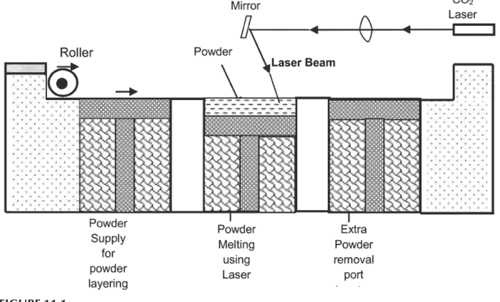

图 11.1

典型的 SLS 增材制造过程。

## 11.3 机器学习

机器学习是一个非常有前景的领域，它利用现有数据来预测/响应未来数据。机器学习用于计算统计、模式识别和人工智能。机器学习对于许多领域至关重要，例如垃圾过滤、人脸识别以及其他无法构建算法来完成任务的领域。机器学习是一种使用机器（即带有软件的计算机）从现有数据中发现见解的技术。它也指机器从环境中学习的能力。自文明开始以来，机器已被用于辅助人类。机器学习是一种使用机器从现有数据中发现见解的技术。它也指机器从环境中学习的能力。本节描述了机器学习中的关键术语。

### 11.3.1 数据

机器学习是基于数据的学习技术。数据用于机器学习系统进行训练的。数据集可能非常大。机器学习系统通过传感器获取数据来处理数据。

### 11.3.2 模型

模型通常用于机器学习系统。模型是由人类提供的框架。它们依赖于人类的观察。例如，在没有正确答案的情况下，通过输入图像来生成模型。

### 11.3.3 训练

机器学习是根据输入数据生成输出的过程。为了完成任务，机器学习系统需要训练。如果未能提供足够多样性的训练数据，它可能会面临问题。

### 11.3.4 学习类型

本节描述了以下学习类型：

- **监督学习**：监督学习是一种应用特定训练数据集来训练机器学习系统的学习。在这里，由于训练数据是人工标注的，因此被称为监督学习。它不需要人类来验证结果。换句话说，直接指示结果是否正确或为预期输出。这需要非常仔细确保训练数据足够。这些必须包含完整的输入类型。训练后，应用测试数据来验证结果。结果被用作训练集并重复该过程。例如，一个人专门接受了机械工程训练。如果让他处理土木工程问题，结果将不符合预期，因为他没有经过适当的土木工程训练。

- **半监督学习**：在半监督方法中，数据集的一部分具有标记，而另一部分没有标记。实际上，输入数据集是经过标注的，因为标注需要专业人员。这个较小的标记数据集被用于解释未标记数据集。

- **无监督学习**：无监督学习是一种不采用训练数据集的学习类型。它通常用于在没有现有正确答案的情况下识别数据中的模式。例如，向识别系统输入成千上万的图像，机器学习系统可以将这些图像分组。

## 11.4 深度神经网络学习

深度神经网络技术是从传统的神经网络方法演变而来的。主要区别在于，深度神经网络比浅层神经网络多出两个隐藏层。

在本节中，通过一个预测打印部件质量的示例，来说明深度学习在增材制造中的应用。如前所述，良好的部件质量至关重要，因此作者对其进行了预测。SLS（选择性激光烧结）是一个具有许多参数的复杂增材制造过程。收缩率作为部件质量的衡量，取决于许多 SLS 参数。重要的 SLS 参数[47] 包括环境温度 ($T_s$)、层厚 ($l_s$)、激光功率 ($w$)、扫描间距 ($d_h$)、扫描速度 ($v$) 和间隔时间 ($T_i$)。SLS 参数通过向量 X 建模如下。

## 深度学习在选择性激光烧结部件质量预测中的应用

```
$X = [w, l, d, v, V_s, T_s, M_s] \quad (11.1)$
```

收缩率 Y 被建模为关于自变量 X 的函数 $G$：

```
$Y = G(X) \quad (11.2)$
```

方程 (11.2) 的数学模型展示了 SLS 参数对产品质量（即收缩率）的影响。当函数 $G$ 由深度神经网络 $G_n$ 表示时，其估算为：

```
$Y = G_n(X) \quad (11.3)$
```

此处，深度神经网络能够表达收缩率与 SLS 参数之间的关系。本章考虑了一项用于演示深度学习的研究$^{47}$。具体而言，本章的材料采用了 HBI，即研究$^{47}$ 中的聚苯乙烯复合材料。收缩率$^{47}$ 定义为：

```
$Y\% = [(S_D - S_M)/S_D] \times 100 \quad (11.4)$
```

其中 $S_D$ 和 $S_M$ 分别是 CAD 模型值和测量值。

### 11.5.1 本章数据集


在本节中，通过一个预测打印部件质量的示例，来说明深度学习在增材制造中的应用。如前所述，良好的部件质量至关重要，因此作者对其进行了预测。SLS（选择性激光烧结）是一个具有许多参数的增材制造过程。收缩率作为部件质量的衡量，取决于许多 SLS 参数。重要的 SLS 参数[47] 包括环境温度（$T_s$）、层厚（$l_s$）、激光功率（$w$）、扫描间距（$d_h$）、扫描速度（$v$）和间隔时间（$T_i$）。SLS 参数通过向量 $X$ 建模如下。

## 深度学习在选择性激光烧结部件质量预测中的应用

```
$X = [w, l, d, v, V_s, T_s, M_s] \quad (11.1)$
```

收缩率 $Y$ 被建模为关于自变量 $X$ 的函数 $G$：

```
$Y = G(X) \quad (11.2)$
```

方程 (11.2) 的数学模型展示了 SLS 参数对产品质量（即收缩率）的影响。当函数 $G$ 由深度神经网络 $G_n$ 表示时，其估算为：

```
$Y = G_n(X) \quad (11.3)$
```

此处，深度神经网络能够表达收缩率与 SLS 参数之间的关系。本章考虑了一项用于演示深度学习的研究$^{47}$。具体而言，本章的材料采用了 HBI，即研究$^{47}$ 中的聚苯乙烯复合材料。收缩率$^{47}$ 定义为：

```
$Y\% = [(S_D - S_M)/S_D] \times 100 \quad (11.4)$
```

其中 $S_D$ 和 $S_M$ 分别是 CAD 模型值和测量值。

### 11.5.1 本章数据集

实验设计的选择对深度学习至关重要。实验数据集必须对问题具有广泛的代表性$^{47}$。在本章中，待检查的工艺参数有五个，如表 11.1 所示。每个工艺参数的水平是通过具有经验的文献$^{47}$ 选择的。

### 11.5.2 深度神经网络参数

在本章中，使用 Python 编程语言$^{49}$ 中的 TensorFlow 库$^{48}$ 完成了深度神经网络的实现、训练和验证。深度神经网络具有七个输入节点（对应七个 SLS 工艺参数），输出节点具有

## 表 11.1

| 参数 | 水平 | 范围 |
| --- | --- | --- |
| 层厚 (mm) | 1,16, 2, 24 | 1–24 |
| 激光功率 (W) | 8,8,5,9,10,11,15,12,15,14,15,18,20 | 8–20 |
| 扫描速度 (m/s) | 1300,1800,2000,2400,3000 | 1300–3000 |
| 扫描间距 (mm) | .08,1,12,14,15 | 08–15 |
| 间隔时间 (s) | 0,1,2,4 | 0–4 |
| 工作环境温度 (°C) | 78,80,84,87,95 | 78–95 |
| 扫描模式 | | 1–2 |

来自 A&D 公司（日本东京）的 GR-200 电子天平和 AD-1653 密度测定盒$^{47}$ 是测量打印产品密度的合适设备。SLS 打印部件的密度根据产品在空气介质中的重量确定。

SLS 参数水平 [47] 发现，对于输入 SLS 参数值的巨大变化以及作为产品质量特征的输出（收缩率），深度神经网络的学习过程产生了一个深度神经网络。因此，输入特征和输出特征都应处理为如下的标准化形式。

根据特征 $X_i$ 的均值和样本量 $N$，$X_{mean}$ 的计算公式：

```
$X_{mean} = \frac{\sum_{i=1}^{N} X_{i}}{N} \quad (11.5)$
```

特征 $X_i$ 的标准差确定为：

```
$X_{sd} = \sqrt{\frac{\sum_{i=1}^{N}(X_{i}-X_{mean})^{2}}{N}} \quad (11.6)$
```

特征 $X_i$ 以标准化形式计算：

```
$X_{NormDeviate} = \frac{X_{i}-X_{mean}}{X_{sd}} \quad (11.7)$
```

修正线性单元 (ReLU) $f(Z_{NormDeviate}) = max(0, Z_{NormDeviate})$ 是一种激活函数，用于从一层移动到下一层 [50]。由于其在具有多层神经元的深度神经网络中具有快速学习能力，该激活函数是一种非常流行的非线性函数。sigmoid 激活函数 $f(Z_{NormDeviate}) = 1/(1+exp(-Z_{NormDeviate}))$ 用于深度神经网络的输出层，输出真实值。在深度神经网络训练的超参数优化中，采用均方误差作为损失函数，使用 Adam 优化器方法 [52]。损失函数计算为：

```
$$E_{od}(w) = \sqrt{\frac{1}{N}\sum_{i=1}^{N} (Y_{Predicted} - Y_{Real})^2} \quad (11.8)$$
```

其中 $Y'_{real}$、$Y'_{predicted}$ 和 $N$ 分别是实验输出值、预测值以及 SLS 打印部件的总数。

### 11.5.3 深度神经网络的 K 折交叉验证

为了训练深度神经网络模型，数据集被分为两部分：训练数据集和测试集。训练数据集具有已知输出数据。深度神经网络模型获得了已知输出数据。

## 深度学习在选择性激光烧结零件质量预测中的 189

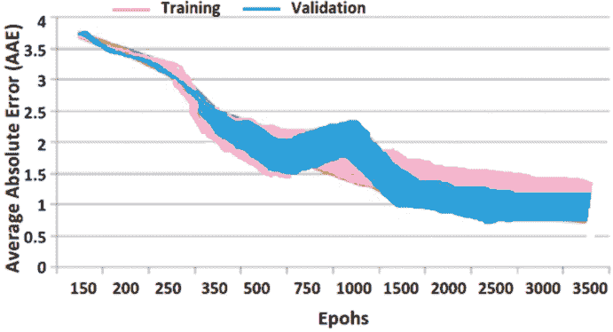

图 11.2

深度神经网络的8折交叉策略。

这表明训练阶段和验证阶段的平均 AAE 具有相似性。训练阶段的标准差值为 0.21。较低的标准差表明深度神经网络不会随着不同的训练子集数据而发生显著变化。这指示出深度神经网络具有良好的预测能力。

## 11.2 结论

在本章中，根据选择性激光烧结（SLS）的关键参数（如环境工作温度、激光扫描速度、层厚、扫描模式、光间距、激光功率和间隔时间），预测了以最小收缩率衡量的产品质量。由于 SLS 变量被认为是且且非线性的，因此深度神经网络对 SLS 参数与收缩率之间的关系进行了建模。在本章中，机器学习系统采用了监督深度学习，将工艺参数作为输入特征，以最小收缩率衡量的产品质量作为输出特征。采用了权重衰减和丢（dropout）技术来克服深度神经网络技术中发现的过拟合问题。预测特征与实际特征进行了比较。深度神经网络发现的收缩率可用于确定 SLS 过程中收缩补偿的信息。

## 190 工程中的机器学习 算法与应用

## 参考文献

- [1] Kang, H.S., J.Y. Lee, S. Choi, H. Kim, J.H. Park, and J.Y. Son et al. 2016. Smart manufacturing: past research, present findings, and future directions. Int J Precis Eng Muf Green Technol, 3 (January (2011)):111–128.
- [2] Kusak, A. 2017. Smart manufacturing must embrace big data. Nature, 544 (7648): 23–25.
- [3] Lee, J., B. Bagheri, and H.A. Kao. 2015. Cyber-physical systems architecture for industry 4.0 manufacturing systems. Manuf Lett, 3 (January): 18–23.
- [4] Lee, J., H. Davari, J. Singh, and V. Pandhare. 2018. Industrial intelligence for industry 4.0-based manufacturing systems. Manuf Lett, 18 (October): 20–23.
- [5] Kumar, L. and P.K. Jain. 2010. Selection of additive manufacturing technology. Ad Production Eng Muf Janit, 5(2): 75–84.
- [6] Kumar, L. and P.K. Jain Jain (2006). Rapid prototyping: a review, issues and problems, International Conference on CARS & FOVEIT, India, 1: 126–138.
- [7] Kumar, L. and R. A. Khan (2004). Rapid design and manufacturing. Global Conference on Flexible System Management (GLOGIFT) MJMI, Delhi, Delhi, 1: 13–15.
- [8] Kumar, L., M. Shoeb, A. Haleem, and M. Javaid (2022). An overview of additive manufacturing technologies. Studies in Indian Names, 40(10), 441–450. Context in Industrial and Manufacturing Systems, NIT Jalandhar, Punjab, India, Lecture Notes on Multidisciplinary Industrial Engineering, Springer, 491–503, ISBN 978-3-030-7394-7.
- [9] Kumar and P.K. Jain (2022). Carbon conscious and additive immune system optimization of metal powder additive manufacturing scheduling. In Computational Intelligence for Manufacturing Process Advancements, eds. P. Chatterjee, D.P. Jelriko-Stević, S. Chakraborty, and S. Bhattachararyya, Taylor & Francis, CRC (Accepted for publication by Editor).
- [10] Lu, B. D., Li, and X. Tian. 2015. Development trends in additive manufacturing and 3D printing. Engineering, 1(1):85–89.
- [11] Derby, B. 2015. Additive manufacturing of ceramic components by ink jet printing. Engineering, 1(1):113–123.
- [12] Gu, D. C., Ma, X. Xia, D, and Q. Shi. 2017. A multi scale understanding of the thermodynamic and kinetic mechanisms of laser additive manufacturing, Engineering, 3(5): 675–684.
- [13] Herzog, D., V. Seymour, E. Ewyc, and C. Emmelman. 2016. Additive manufacturing of metals. Acta Mater, 117(1):371–392.
- [14] Liu, L., Q. Ding, Y. Zhong, J. Wu, and L. Chiu et al. 2018. Dislocation network in additive manufactured steels strength-ductility trade-off. Mater Today, 21(4):354–361.
- [15] Gorse, S., C. Hutchinson, M. Gouné, and R. Banerjee. 2017. Additive manufacturing of materials: a brief review of the microstructures and properties of steels, Ti-6Al-4V and alloys. Sci Technol Adv, 18(1):584–610.
- [16] Santosa, E.C., K. Osakada, and T. Laoui. 2006. Rapid manufacturing of metal components by laser forming. Int Mach Tools Manuf, 46(12–13):1459–1468.
- [17] Chen, X., C. Wang, Y. Xiao, and S. Huang. 2001. Direct slicing from power for rapid prototyping. Int J Mach Technol, 17(7):543–543. doi:10.1007/s001700156


## 参考文献

- [18] Li, Y.S., M. Han, and Y.H. 2001. Modeling and distortion for SLS processes. Chin J Mech Eng, 28(8):877–889.
- [19] John, D.W. and R.D. 1998. Advances in modifying the effects of selected parameters on SLS process. Rapid Prototyping, 4, (2):90–96. doi:10.1108/135524980227
- [20] Yang, H.J., P.J. Huang, and S.H. Lee. 2002. A study of shrinkage on SLS using Taguchi technique. Int Mach Tools Manuf, 42(10):1203–1212. doi:10.1016/S0924-0136(02)0007
- [21] Masood, S., W. Ratan, and P. Iovenitti. 2003. A genetic algorithm for best orientation system for complex parts. J Mater Technol, 139(3):110–116. doi:10.1016/S0924-0136(03)0190
- [22] Bai, P.K., J. Cheng, and W.F. Wang. 2006. Numerical simulation of temperature field during laser sintering of polymer coated powder. Trans Nonuniform Met Sci, 16 (3):603–607. doi:10.1016/S1003-6326(06)0264
- [23] Arni, R.K. and S.K. Gupta. 1999. Manufacturing analysis for solid fabrication. In: Proceedings of DETC 1999 ASME Design Technical conference, Vegas, NV, 1–12.
- [24] Armillotta, A. and G.F. Biggiglio. 2001. Control of prototyping surface through graphical simulation. In: Proceedings of the 7th ADM International Conference, Hotel Rimini, Italy,7–24.
- [25] Shi, Y., J. Liu, and S. Huang. 2002. The research of the SLS optimization based on the hybrid of neural network and expert system. In: Proceedings of the International Conference on Manufacturing Automation, 409–418.
- [26] Zheng, H.Z., J. Zhang, S.Q. Lu, G.H. Wang, and Z.F. Xu. 2006. Effect of composite particles on the sintering behavior and properties of nano-Al2O3/polyester composite produced by SLS. Mater Lett, 60(9–10):1219–1223. doi:10.1016/j.matlet.2005.11.003
- [27] Kohavi, and R. Fovost. 1998. Hands-on Learning with ScikitLearn and Tensor Flow: Concepts, Tools, and Techniques to Build Intelligent Systems. Boston, MA: O’Reilly Media Inc.
- [28] Géron, A. 2017. Pre-training of deep bidirectional transformers for language understanding. arXiv, 1810.04805.
- [29] Devlin, J., M. Chang, K. Lee, and K.B. Toutanova. 2018. Speech recognition by machine - a review.
- [30] Anusaya, M.A. and S.K. Titi. 2020. Speech recognition. arXiv, 1001–2267.
- [31] Krizhevsky, A., I. Sutskever, and G.E. Hinton. 2012. Image Net classification with deep convolutional neural networks. In: F. Pereira, C.J. Burgess, L. Bottou, and K.Q. Weinberg, eds. Advances in Neural Information Processing Systems 25, Proceedings of Neural Information Processing Systems, 2012, December 3–6, Lake Tahoe, NV, 1097–1110.

## 192 工程中的机器学习 算法与应用

- [32] Ondruska, P. and P. Liu. 2016. Numerical simulation of temperature field during laser sintering of polymer coated powder. Trans Nonuniform Met Sci, 16 (3):603–607. doi:10.1016/S1003-6326(06)0264
- [33] Mehrotra, P. 2015. Manufacturing analysis for solid fabrication. In: Proceedings of DETC 1999 ASME Design Technical conference, Vegas, NV, 1–12.
- [34] Kumar, L. and P.K. Jain. 2010. Selection of additive manufacturing technology. Ad Production Eng Muf Janit, 5(2): 75–84.
- [35] Kumar, L. and P.K. Jain Jain (2006). Rapid prototyping: a review, issues and problems, International Conference on CARS & FOVEIT, India, 1: 126–138.
- [36] Kumar, L. and R. A. Khan (2004). Rapid design and manufacturing. Global Conference on Flexible System Management (GLOGIFT) MJMI, Delhi, Delhi, 1: 13–15.
- [37] Kumar, L., M. Shoeb, A. Haleem, and M. Javaid (2022). An overview of additive manufacturing technologies. Studies in Indian Names, 40(10), 441–450. Context in Industrial and Manufacturing Systems, NIT Jalandhar, Punjab, India, Lecture Notes on Multidisciplinary Industrial Engineering, Springer, 491–503, ISBN 978-3-030-7394-7.
- [38] Kumar and P.K. Jain (2022). Carbon conscious and additive immune system optimization of metal powder additive manufacturing scheduling. In Computational Intelligence for Manufacturing Process Advancements, eds. P. Chatterjee, D.P. Jelriko-Stević, S. Chakraborty, and S. Bhattachararyya, Taylor & Francis, CRC (Accepted for publication by Editor).
- [39] Lu, B. D., Li, and X. Tian. 2015. Development trends in additive manufacturing and 3D printing. Engineering, 1(1):85–89.
- [40] Derby, B. 2015. Additive manufacturing of ceramic components by ink jet printing. Engineering, 1(1):113–123.
- [41] Gu, D. C., Ma, X. Xia, D, and Q. Shi. 2017. A multi scale understanding of the thermodynamic and kinetic mechanisms of laser additive manufacturing, Engineering, 3(5): 675–684.
- [42] Herzog, D., V. Seymour, E. Ewyc, and C. Emmelman. 2016. Additive manufacturing of metals. Acta Mater, 117(1):371–392.
- [43] Liu, L., Q. Ding, Y. Zhong, J. Wu, and L. Chiu et al. 2018. Dislocation network in additive manufactured steels strength-ductility trade-off. Mater Today, 21(4):354–361.
- [44] Gorse, S., C. Hutchinson, M. Gouné, and R. Banerjee. 2017. Additive manufacturing of materials: a brief review of the microstructures and properties of steels, Ti-6Al-4V and alloys. Sci Technol Adv, 18(1):584–610.
- [45] Santosa, E.C., K. Osakada, and T. Laoui. 2006. Rapid manufacturing of metal components by laser forming. Int Mach Tools Manuf, 46(12–13):1459–1468.
- [46] Chen, X., C. Wang, Y. Xiao, and S. Huang. 2001. Direct slicing from power for rapid prototyping. Int J Mach Technol, 17(7):543–543. doi:10.1007/s001700156
- [47] Li, Y.S., M. Han, and Y.H. 2001. Modeling and distortion for SLS processes. Chin J Mech Eng, 28(8):877–889.
- [48] John, D.W. and R.D. 1998. Advances in modifying the effects of selected parameters on SLS process. Rapid Prototyping, 4, (2):90–96. doi:10.1108/135524980227
- [49] Yang, H.J., P.J. Huang, and S.H. Lee. 2002. A study of shrinkage on SLS using Taguchi technique. Int Mach Tools Manuf, 42(10):1203–1212. doi:10.1016/S0924-0136(02)0007
- [50] Masood, S., W. Ratan, and P. Iovenitti. 2003. A genetic algorithm for best orientation system for complex parts. J Mater Technol, 139(3):110–116. doi:10.1016/S0924-0136(03)0190
- [51] Bai, P.K., J. Cheng, and W.F. Wang. 2006. Numerical simulation of temperature field during laser sintering of polymer coated powder. Trans Nonuniform Met Sci, 16 (3):603–607. doi:10.1016/S1003-6326(06)0264
- [52] Arni, R.K. and S.K. Gupta. 1999. Manufacturing analysis for solid fabrication. In: Proceedings of DETC 1999 ASME Design Technical conference, Vegas, NV, 1–12.
- [53] Armillotta, A. and G.F. Biggiglio. 2001. Control of prototyping surface through graphical simulation. In: Proceedings of the 7th ADM International Conference, Hotel Rimini, Italy,7–24.
- [54] Shi, Y., J. Liu, and S. Huang. 2002. The research of the SLS optimization based on the hybrid of neural network and expert system. In: Proceedings of the International Conference on Manufacturing Automation, 409–418.
- [55] Zheng, H.Z., J. Zhang, S.Q. Lu, G.H. Wang, and Z.F. Xu. 2006. Effect of composite particles on the sintering behavior and properties of nano-Al2O3/polyester composite produced by SLS. Mater Lett, 60(9–10):1219–1223. doi:10.1016/j.matlet.2005.11.003
- [56] Kohavi, and R. Fovost. 1998. Hands-on Learning with ScikitLearn and Tensor Flow: Concepts, Tools, and Techniques to Build Intelligent Systems. Boston, MA: O’Reilly Media Inc.
- [57] Géron, A. 2017. Pre-training of deep bidirectional transformers for language understanding. arXiv, 1810.04805.
- [58] Devlin, J., M. Chang, K. Lee, and K.B. Toutanova. 2018. Speech recognition by machine - a review.
- [59] Anusaya, M.A. and S.K. Titi. 2020. Speech recognition. arXiv, 1001–2267.
- [60] Krizhevsky, A., I. Sutskever, and G.E. Hinton. 2012. Image Net classification with deep convolutional neural networks. In: F. Pereira, C.J. Burgess, L. Bottou, and K.Q. Weinberg, eds. Advances in Neural Information Processing Systems 25, Proceedings of Neural Information Processing Systems, 2012, December 3–6, Lake Tahoe, NV, 1097–1110.


# 参考文献

- [61] Ondruska, P. and P. Liu. 2016. Numerical simulation of temperature field during laser sintering of polymer coated powder. *Trans Nonuniform Met Sci*, 16 (3):603–607. doi:10.1016/S1003-6326(06)0264

- [62] Mehrotra, P. 2015. Manufacturing analysis for solid fabrication. In: Proceedings of DETC 1999 ASME Design Technical conference, Vegas, NV, 1–12.

- [63] Kumar, L. and P.K. Jain. 2010. Selection of additive manufacturing technology. *Ad Production Eng Muf Janit*, 5(2): 75–84.

- [64] Kumar, L. and P.K. Jain Jain (2006). Rapid prototyping: a review, issues and problems, International Conference on CARS & FOVEIT, India, 1: 126–138.

- [65] Kumar, L. and R. A. Khan (2004). Rapid design and manufacturing. Global Conference on Flexible System Management (GLOGIFT) MJMI, Delhi, Delhi, 1: 13–15.

- [66] Kumar, L., M. Shoeb, A. Haleem, and M. Javaid (2022). An overview of additive manufacturing technologies. *Studies in Indian Names*, 40(10), 441–450. Context in Industrial and Manufacturing Systems, NIT Jalandhar, Punjab, India, Lecture Notes on Multidisciplinary Industrial Engineering, Springer, 491–503, ISBN 978-3-030-7394-7.

- [67] Kumar and P.K. Jain (2022). Carbon conscious and additive immune system optimization of metal powder additive manufacturing scheduling. In Computational Intelligence for Manufacturing Process Advancements, eds. P. Chatterjee, D.P. Jelriko-Stević, S. Chakraborty, and S. Bhattachararyya, Taylor & Francis, CRC (Accepted for publication by Editor).

- [68] Lu, B. D., Li, and X. Tian. 2015. Development trends in additive manufacturing and 3D printing. *Engineering*, 1(1):85–89.

- [69] Derby, B. 2015. Additive manufacturing of ceramic components by ink jet printing. *Engineering*, 1(1):113–123.

- [70] Gu, D. C., Ma, X. Xia, D, and Q. Shi. 2017. A multi scale understanding of the thermodynamic and kinetic mechanisms of laser additive manufacturing, *Engineering*, 3(5): 675–684.

- [71] Herzog, D., V. Seymour, E. Ewyc, and C. Emmelman. 2016. Additive manufacturing of metals. *Acta Mater*, 117(1):371–392.

- [72] Liu, L., Q. Ding, Y. Zhong, J. Wu, and L. Chiu et al. 2018. Dislocation network in additive manufactured steels strength-ductility trade-off. *Mater Today*, 21(4):354–361.

- [73] Gorse, S., C. Hutchinson, M. Gouné, and R. Banerjee. 2017. Additive manufacturing of materials: a brief review of the microstructures and properties of steels, Ti-6Al-4V and alloys. *Sci Technol Adv*, 18(1):584–610.

- [74] Santosa, E.C., K. Osakada, and T. Laoui. 2006. Rapid manufacturing of metal components by laser forming. *Int Mach Tools Manuf*, 46(12–13):1459–1468.

- [75] Chen, X., C. Wang, Y. Xiao, and S. Huang. 2001. Direct slicing from power for rapid prototyping. *Int J Mach Technol*, 17(7):543–543. doi:10.1007/s001700156

- [76] Li, Y.S., M. Han, and Y.H. 2001. Modeling and distortion for SLS processes. *Chin J Mech Eng*, 28(8):877–889.

- [77] John, D.W. and R.D. 1998. Advances in modifying the effects of selected parameters on SLS process. *Rapid Prototyping*, 4, (2):90–96. doi:10.1108/135524980227

- [78] Yang, H.J., P.J. Huang, and S.H. Lee. 2002. A study of shrinkage on SLS using Taguchi technique. *Int Mach Tools Manuf*, 42(10):1203–1212. doi:10.1016/S0924-0136(02)0007

- [79] Masood, S., W. Ratan, and P. Iovenitti. 2003. A genetic algorithm for best orientation system for complex parts. *J Mater Technol*, 139(3):110–116. doi:10.1016/S0924-0136(03)0190

- [80] Bai, P.K., J. Cheng, and W.F. Wang. 2006. Numerical simulation of temperature field during laser sintering of polymer coated powder. *Trans Nonuniform Met Sci*, 16 (3):603–607. doi:10.1016/S1003-6326(06)0264

- [81] Arni, R.K. and S.K. Gupta. 1999. Manufacturing analysis for solid fabrication. In: Proceedings of DETC 1999 ASME Design Technical conference, Vegas, NV, 1–12.

- [82] Armillotta, A. and G.F. Biggiglio. 2001. Control of prototyping surface through graphical simulation. In: Proceedings of the 7th ADM International Conference, Hotel Rimini, Italy,7–24.

- [83] Shi, Y., J. Liu, and S. Huang. 2002. The research of the SLS optimization based on the hybrid of neural network and expert system. In: Proceedings of the International Conference on Manufacturing Automation, 409–418.

- [84] Zheng, H.Z., J. Zhang, S.Q. Lu, G.H. Wang, and Z.F. Xu. 2006. Effect of composite particles on the sintering behavior and properties of nano-Al2O3/polyester composite produced by SLS. *Mater Lett*, 60(9–10):1219–1223. doi:10.1016/j.matlet.2005.11.003

- [85] Kohavi, and R. Fovost. 1998. Hands-on Learning with ScikitLearn and Tensor Flow: Concepts, Tools, and Techniques to Build Intelligent Systems. Boston, MA: O’Reilly Media Inc.

- [86] Géron, A. 2017. Pre-training of deep bidirectional transformers for language understanding. arXiv, 1810.04805.

- [87] Devlin, J., M. Chang, K. Lee, and K.B. Toutanova. 2018. Speech recognition by machine - a review.

- [88] Anusaya, M.A. and S.K. Titi. 2020. Speech recognition. arXiv, 1001–2267.

- [89] Krizhevsky, A., I. Sutskever, and G.E. Hinton. 2012. Image Net classification with deep convolutional neural networks. In: F. Pereira, C.J. Burgess, L. Bottou, and K.Q. Weinberg, eds. Advances in Neural Information Processing Systems 25, Proceedings of Neural Information Processing Systems, 2012, December 3–6, Lake Tahoe, NV, 1097–1110.

# 深度学习在选择激光烧结零件质量预测中的

- [53] James, G., D. Witten, T. Hastie, and R. Tibshirani. 2013. 《统计学习导论》，第 103 。纽约: Springer-Verlag. https://doi.org/10.1007/978-1-46147138-7

- [54] Zur, R.M., Y. Jiang, L.L. Pence, and K. Drukker. 2009. 训练人工神经网络的噪声注入：权重衰减与早期停止的比较。*Med Phys*, 36: 4810–4818. https://doi.org/10.1118/1.3213517

- [55] Krogh, A., and J.A. Hertz. 1992. 简单的权重衰减可以提高泛化能力。*Adv Neural Inf Process Syst*, 950–957. doi:https://dl.acm.org/citation.cm7id=2987033

- [56] Srivastava, N., G. Hinton, A. Krizhevsky, I. Sutskever, and R. Salakhutdinov. 2014. Dropout：一种防止神经网络过拟合的简单方法。*J Mach Learn Res*, 15:1929–1958. https://doi.org/10.1214/12-AOS1000

- [57] Dahl, G.E., T.N. Sainath, and G.E. Hinton. 2013. 使用修正线性单元和 Dropout 改进用于 LVCSUR 的深度神经网络。ICASSP IEEE Int. Conf. Acoust. Speech Signal Process. Proc., 8609–8613. https://doi.org/10.1109/ICA2013.663346

- [58] Dososa, G.H., J.P. Papa, and X.S. Yang. 2018. 使用元启发式算法处理卷积神经网络中的概率估计。*Soft Comput*, 22:6147–6156. https://doi.org/10.1007/s00500-017-2678-4


# 12

CBPP：一种用于多敏感属性的 1:M 微数据隐私保护发布高效算法

Jayapradhha Jayaram¹*, Prakash Manickam²,, Apoorva Gupta³, and Madhuri Rudrabhatla⁴

¹计算机科学与工程系，工程与技术学院，工程与技术学院，SRM 科学技术学院, SRM Nagar, Kattankulathur, Kanchipuram, Chennai, TN, India

²计算机科学与工程系，工程与技术学院，工程与技术学院，SRM 科学技术学院, SRM Nagar, Kattankulathur, Kanchipuram, Chennai, TN, India

³计算机科学与工程系，SRM 科学技术学院, Kattankulathur, Tamil Nadu, India

⁴计算机科学与工程系，SRM 科学技术学院, Kattankulathur, Tamil Nadu, India

E-mail: jayapraj@srmit.edu.in; prakasham2@srmit.edu.in; as5866@srmit.edu.in; rr7127@srmit.edu.in

# 目录

- 12.1 引言 ................................................................................................................ 196
- 12.2 相关工作 ................................................................................................................. 197
- 12.3 贡献 ..................................................................................................................... 200
- 12.4 相关攻击及相关场景 ................................................................................ 200
- 12.5 所提 CBPP 算法的实现........................................................... 202
  - 12.5.1 批量 ID 的泛化与分配............................................................... 204
- 12.6 CBPP 算法................................................................................................ 205
- 12.7 评估 ....................................................................................................... 207
- 12.8 信息损失的测量 ........................................................................ 207
  - 12.8.1 查询准确率........................................................................... 207


# 12.9 结论与未来方向

工程中的机器学习算法与应用

## 12.1 引言

在数据传输给第三方的期间和之后，保护个人隐私是一个至关重要的问题。在数字时代，数据所有者对数据隐私感到困扰。随着数据生成的增加，在不泄露个人敏感信息的情况下进行数据掩码已成为了一项挑战性任务。医疗部门、医药机构和政府部门经常与研究人员和第三方共享数据以进行分析。因此，数据发布者需要在数据发布过程中承担保护隐私的责任。数据发布者 [1] 必须是可靠的。数据发布者在发布数据之前需要对隐私法律有充分的了解。

## 工程化表格中的机器学习算法与应用

表格和解决方案的复杂性随之增加 [12]。基于切片（slicing）的匿名化是一种有效的方法，可以用较少的信息损失划分数据集。该方法可以保护隐私，并包含许多敏感属性 [13]。已提出 (QI-MHSA) 泛化算法用于对具有多个敏感属性的微数据进行匿名化。研究人员采用了垂直划分，并提出了不同的模型对分类属性和数值属性进行匿名化 [14]。针对多个敏感属性提出了 `$L_c$`-多样性模型。除了 `$L_c$`-多样性模型，还提出了三种贪心算法来显著降低匿名发布数据的可用性。尽管随着数据增长，其可用性保持稳定，但其运行时间略有增加 [15]。

分解模型 [16,17] 等模型也被提出用于具有多个敏感属性的隐私保护数据发布。切片和分解为匿名化提供了解决方案。然而，它们缺乏可用性且存在严重的信息丢失。当在不使用任何匿名方法的情况下实施切片时，会导致信息丢失；元组抑制与切片结合 [18]；为了阻止指纹关联攻击，提出了 `$(p,k)$`-匿名化的改进方法 `$(k)$`-匿名化。它将 `$(p,k)$`-匿名化中的一一对应关系改进为一多对应关系 [19]。传统的匿名化技术也已应用于医疗保健领域，提供了比传统和简单方法更好的安全性 [21]。传统的 `$k$`-匿名性技术无法用于高维数据，因为它会导致更高的信息丢失 [22]。研究人员还实施并讨论了各种数据匿名化技术，以将高维数据集还原为较小维集合 [23,24]。随后，研究人员专注于 1:M 数据集并开展工作在隐私和可用性之间提供最佳平衡。提出了一种新的隐私模型 `$(k,l)$`-多样性以解决发布中的识别风险，并提出了 1:M 泛化以保护数据可用性和隐私。`$(k,l)$`-多样性模型旨在实现隐私与可用性之间的最佳平衡。INFORMS 和 YouTube 数据集已用于实验分析。然而，提出了关注单个敏感属性桶的隐私模型 (QIAB-IMSB) 以实现隐私与可用性的最佳平衡。QIAB-IMSB 算法的最终目标是用较少的可用性损失和高隐私性对多值记录进行匿名化。在原始数据集上应用垂直划分，并在准标识符桶上实施匿名化，在敏感属性桶上实施 `$(k,l)$`-多样性 [26]。提出了一种 `$f$`-切片模型对 1:M 数据集进行匿名化。实施了一种名为“f-slicing”的有效匿名化方法。

### 表 2.1 样本数据集 T*

| 姓名 | Pid | 性别 | 年龄 | 邮编 | 疾病 | 治疗 | 症状 | 医生 | 诊断方法 |
|---|---|---|---|---|---|---|---|---|---|
| tp1 | Avan | 1 | * | 20-30 | 142** | HIV | ART | 感染 | John | Elisa Test |
| tp2 | Avan | 1 | * | 20-30 | 142** | 流感 | 药物 | 发热 | Alice | RITD Test |
| tp3 | Avan | 1 | M | 2* | 142** | 消化不良 | 抗生素 | 腹痛 | Victor | 超声波 |
| tp4 | Becon | 2 | M | 2* | 142** | 肺癌 | 射线 | 体重减轻 | Alice | MRI Scan |
| tp5 | Becon | 2 | M | 2* | 1420* | 流感 | 药物 | 发热 | Alice | RITD Test |
| tp6 | Canty | 3 | M, F | 28 | 1420* | HIV | Art | | John | Elisa Test |
| tp7 | Denny | 4 | M | 25-42 | 胃癌 | 化疗 | 腹痛 | Bob | 胸部X光 |
| tp8 | Emy | 5 | F | 23-45 | Covid19 | 抗生素 | | Dave | RT-PCR Test |
| tp9 | Emy | M, F | 24-45 | 哮喘 | 药物 | 胸闷 | Alice | Methacholine Challenge Test |
| tp10 | Frank | 6 | M | | | | | | | |
| tp11 | | | | | | | | | | |
| tp12 | | | | | | | | | | |
| tp13 | | | | | | | | | | |
| tp14 | | | | | | | | | | |

## 202 机器学习算法及其工程中的应用

- (2) 使用准标识符相关性进行攻击：入侵者可以通过关联年龄、邮政编码和性别等准标识符值，来推断个人的敏感值和个人的完整信息。场景 1 和场景 2 解释了准标识符相关性攻击。
- (3) 使用非成员相关性进行攻击：如果入侵者能够从数据集中推断出某人的不存在，就可以进行非成员相关性攻击。场景 1、2 和 3 解释了非成员相关性攻击。

场景 1：如果入侵者拥有某个人的基本信息，入侵者知道 Emy 是女性，年龄40 岁，邮政编码为 13084，他可以轻松推断出 Emy 属于表 12.2 中的等价类 4 或 5。如果入侵者还具有强烈的背景知识，知道 Emy 经常呼吸困难，那么从等价类 4 和 5 推断 Emy 记录的概率很高。

场景 2：如果入侵者拥有关于该人的背景知识和准标识符信息，他可以利用准标识符信息轻松地链接到个人的敏感属性。入侵者知道 Beon 是男性，年龄>25 岁，邮政编码为 14206，入侵者可以轻松推断出 Beon 属于表 12.2 中的等价类 2 和 3。凭借强大的背景知识，他可以快速识别出 Beon 的敏感属性。

场景 3：如果入侵者具有强大的背景知识并拥有关于该人的准标识符信息，即 Avan 是男性，年龄<30 岁，邮政编码为 14248，且 Avan 感染了致命疾病，那么他就可以轻松推断出 Avan 的记录属于表 12.2 中的等价类 1 和 2。因此，确定了个人 Avan 的存在，导致隐私泄露。传统方法和算法无法阻止 1:M 数据集中的隐私泄露。

## 12.5 所提 CBPP 算法的实现

考虑具有多个敏感属性的 1:M 数据集。当使用 `k`-匿名（`k-anonymity`）等传统方法时，入侵者可以轻松推断出个人的敏感值，如表 12.2 所示。表 12.2 中隐私泄露发生的概率在前节中也讨论过。

## 用于隐私保护的数据发布的 CBPP 203

当传统模型和算法应用于 1:M 数据集时，可能会导致隐私泄露。因此，提出了一种高效的 CBPP 算法来抵抗背景知识攻击、非成员相关性攻击和准标识符相关性攻击。CBPP 将原始数据集分为两个表：准标识符表和敏感属性表。两者通过 batch id 链接，将进一步解释。

考虑表 12.1 中的原始样本数据集 `$T^s$`。它将原始数据集转换为两个表。原始数据集 `$T^s$` 包含特定成员敏感属性，并共享相同的准标识符，如年龄、邮政编码和性别。Patient ID 用于参考，数据发布期间将被移除。具有相同 patient id 的记录被合并。例如，表 12.1 中 patient id 为 1 的前三记录被合并（即 `$tp^{1U1} tp^{2U2} tp^{3U3}$`）。在合并个人的记录后，形成了一个聚合的 `$T^s$`。对匿名化数据集 `$T^s$` 进行结构剖析并将数据集分为两个表：(1) 准标识符 `$T^{qi}$` 和 (2) 敏感属性 `$T^s$`。准标识符属性为 `$(q^{v^1}, q^{v^2}, q^{v^3})$`。准标识符表 `$T^{qi}$` 包含年龄、性别和邮政编码。

`$S^s$` 为 `$T^s$` 的敏感属性集，敏感属性为 `$(s^{v^1}, s^{v^2}, s^{v^3})$`。敏感属性是疾病、治疗、症状、医生和诊断方法。准标识符属性值经过泛化并分配了 batch id，如表 12.4 所示，根据敏感属性形成如下。在 batch id 匿名化过程中，数据会被洗牌。因此，分配 batch id 用于链接准标识符表和敏感属性表中的记录。

## 表 12.3

### 准标识符表 `$T^{qi}$`

| 性别 | 年龄 | 邮政编码 | Batch Id |
|---|---|---|---|
| M | 25-45 | 13000-15000 | 2 |
| M | 25-45 | 13000-15000 | 2 |
| F | 25-45 | 13000-15000 | 2 |
| M | 25-45 | 13000-15000 | 2 |
| F | 41-60 | 13000-15000 | 3 |
| M | 41-60 | 13000-15000 | 3 |
| F | 15-24 | 13000-15000 | 1 |
| M | 15-24 | 13000-15000 | 1 |

## 表 12.4

### 机器学习算法及其应用

| 疾病 | 治疗 | 症状 | 医生 | Batch Id |
|---|---|---|---|---|
| 流感 | 药物 | 呼吸困难 | John | 1 |
| 哮喘 | 放射 | 腹痛 | Susan | 2 |
| 艾滋 | 化学疗 | 发热 | David | 3 |

## 12.5 泛化与 Batch Id 的分配

传统方法和算法无法阻止 1:M 数据集中的隐私泄露。（等待，文本在此处重复或在 OCR 中重叠，遵循逻辑流）。

*注：提供的 OCR 文本在跨页面之间存在显著的重叠和碎片部分。我已根据逻辑流合并了内容。*

# 206 工程中的机器学习算法与应用

批次 ID。对所有敏感属性执行相似的程序，并将敏感值聚类到批次 id。

算法 1：从原始聚合表创建准标识符表

```
1. Input(T)
2. T ← T.groupby(patient_id)
3. anatomization(T)
4. T ← ["sex", "age", "zipcode"]
5. age_class ← []
6. zip_class ← []
7. Batch_id ← []
8. For x in range(length(Tqi))
   a ← Tqi.loc[i,age]
   If(a > 15) and (a < 25)
     age_class.append(15-24)
     batch_id.append(1)
9. If(a>=25) and (a<=40)
   age_class.append(25-40)
   batch_id.append(2)
10. If(a>=41) and (a<60)
    age_class.append(41-60)
    batch_id.append(3)
11. for y in range(length(Tqi))
   b ← df.gen.loc[i, 'ZIPCODE']
   if (b < 13000) and (b < 16000)
   zip_class.append("10000-13000")
12. elif (b>=13000) and (b < 16000)
   zip_class.append("13000-16000")
   else:
   zip_class.append("16000-19000")
13. df.drop(i)
14. Tqi.drop(age, age, zipcode)
```

算法 2：从聚合表创建敏感属性表


```
1) Input(df)
2) s41 ← []
3) s42 ← []
4) s43 ← []
5) for i in range(length(df):
   age ← df.loc[i,age]
   if (age >= 15) and (age < 26):
     # Disease
     d ← df.loc[i,'disease']
     slist ← d.split(',')
     for dis in slist:
       if dis not in dis_1:
         dis1.append(dis)
6) END
```

## 12.7 评估

CBPP 算法使用 Python 实现，并在具有 8 GB RAM、1 TB 存储和 128 GB SSD 的机器上进行实验。CBPP 算法应用于真实的 1:M 数据集。INFORMS 数据中有 230,231 条记录。在对记录进行去重后，数据集的大小为 40,126。出生年份、性别和种族被选为准标识符，教育程度、收入和贫困线被视为敏感属性。使用查询准确率衡量信息损失。

## 12.8 信息损失的测量

### 12.8.1 查询准确率

由于信息损失需要从 (i) 准标识符和 (ii) 敏感属性两个表进行衡量，传统的效用方法无法执行。因此，我们使用查询准确率计算算法的效用。查询准确率通过聚合查询的结果衡量信息损失。

> Query Error = \frac{\sum(QI) - \sum(Org)}{\text{count(Org)}} (12.1)

查询误差通过对原始数据微数据集执行 COUNT 查询来衡量信息损失。在这种情况下，批 ID 总数为 9。其中，只有一种特定的组合连接了准标识符表和敏感表。因此，批 id 是保护的第一线。攻击者找到完美组合的概率为 1/9 = 0.11，这非常低。批 id 的组合可以通过增加年龄和性别进一步增加。在图 12.3 中清楚地显示信息损失与数量成反比。然而，在 k-匿名性中，信息损失随着维度的增加而增加 [18]，如图 12.3 所示。考虑到某些情况下，攻击者可以通过批 ID。入侵者还需要对所有打乱的数据进行合理的组合。


图 12.3 信息损失。


图 12.4 准标识符组合与分布数量的识别概率。获取关于个人的正确且完整的敏感值。分布与破解组合的关系如图 12.4 所示。

## 12.9 结论与未来方向

本研究提出了一种用于 1:M 数据隐私保护发布的有效算法。提出的 CBPP 算法解决了三种关联攻击，即背景攻击、准标识符攻击和非成员攻击。章节中的案例说明了传统方法无法应用于 1:M 数据集。在真实的 INFORMS 数据集上进行了实验，表明与传统方法相比，CBPP 提供更少的信息损失。尽管如此，未来方向仍有待研究：准标识符也可以通过批 id 进行更改。

## 参考文献

- Rashid A. and Yasin N., Privacy data publishing: review, International Journal of Physical Sciences, 10(7), 239 (2015).
- Sheppard, E., Data Privacy is a collective concern, 2020. https://medium.com/opendatache/data-privacy-is-a-concern-8bad
- Vasudevan, L., Sukanya, S., and Aarti N., Privacy preserving data mining using cryptographic role access control, Proceedings of the International Conference on Computer Scientists, Hong Kong, 2008, p. 47.
- Ramesh, P. and Ambika, V., A systematic review on privacy-preserving data techniques, Journal of Engineering and Technology, 12(6), 17–25 (2019).
- Li, T., Li, N., and Molloy, I., Slicing: a new approach for privacy-preserving data publishing, IEEE Transactions on Knowledge Data Engineering, 24(3), 561–575 (2019).
- Zheng, Y., Tongtong Lu, Yong Ma, and Chunjia Jia, K-anonymity algorithm based on improved clustering, International Conference on Algorithms and Parallel Processing, 1135, 426–476 (2018).
- Elanshar, N. and Shedge, R., An effective anonymization technique using suppression method, International Conference on Data Analytics and Soft Computing (ICDS), 2500–2504 (2017).
- Radha, D. and Valli Vatsayi, Bucketize: sensitive value, Advances in Computational Sciences, 10(5), 991–1008 (2017).
- Khan, A., Ahmad, N., Malik, U., Privacy preserving for relational data, Computer Science, 32, 45 (2019).
- Khan, R., Tao, X., Anjum, A., Sajjad, H., Khan, A., and Amiri, F., Privacy preserving for sensitive attributes against fingerprint correlation satisfying c-closeness, Wireless Communications and Mobile, 1–18 (2020).
- Benn Benn, S., Y, Chen, Dong Li, and Guo Wei., Sensitive label for data publishing, IEEE Transactions on Dependable and Secure Computing, 18(2), 904–917 (2019).
- Wang, R., Zhu, Y., Chen, and Chang, C., Privacy-preserving algorithms for multiple sensitive attributes satisfying t-closeness, Journal of Computer Science 33, 1231–1242 (2018).
- Qiyuan Gong, Junzhu Luo, Ming Yang, Weiwei Ni, and Xiao-Bai Li, Anonymizing 1:1M microdata with high utility, Knowledge-Based Systems, 119, 1–12 (2016).
- Yuele Xiao and Hai Li, Privacy publishing for multiple sensitive attributes, Information, MDPI, 11, 1–27 (2020).
- Jayapradha, J. and Prakash, M. An efficient privacy-preserving data publishing in health care records with multiple sensitive attributes, 6th International Conference on Inventive Computation Technologies, 623–629 (2021).
- Jayapradha, J. and Prakash, M, f-slip: An efficient privacy-preserving data, publishing framework for 1:M microdata with multiple sensitive attributes, Soft Computing, pp. 1–18, (2021).

# 13 ISP 链路上的网络流量分类与 COVID-19 期间的网络带宽分析

V. Ajantha Devi,¹ Yogendra Malgundkar,² and Bandana Mahapatra³

¹AP3 Solutions 研究主管，切金奈，印度
²Symbiosis Skills and Professional University, 印度
电子邮箱：ap3solutionsresearch@gmail.com

# 目录

- 13.1 引言 ................................................................................ 214
- 13.2 方法论............................................................................................... 214
    - 13.2.1 网络拓扑............................................................................... 217
    - 13.2.2 数据清洗与预处理........................................................... 218
    - 13.2.3 使用 Tableau 进行数据可视化........................................................... 218
- 13.3 使用分类算法进行流量分类 ........................ 220
    - 13.3.1 分类器的比较.................................................................. 222
- 13.4 使用时间序列模型 (ARIMA) 预测带宽需求........................................................................... 223
    - 13.4.1 特征提取选择............................................................... 223
    - 13.4.2 自回归移动平均模型 (ARIMA)................................................................................. 224
    - 13.4.3 时间序列数据：趋势与季节性............................................... 225
    - 13.4.4 时间序列数据：季节性模式..................................................... 227
- 13.5 实现 ARIMA 模型............................................................... 230
    - 13.5.1 构建 ARIMA 模型....................................................................... 231
    - 13.5.2 打印带宽预测值...................................... 232
    - 13.5.3 模型评估............................................................... 234
- 13.6 结论：模型的业务效益........................................... 234
    - 13.6.1 网络流量分类....................................................... 234
    - 13.6.2 时间序列预测.................................................................. 235

DOI: 10.1201/9781003104858-13 213

# 工程中的机器学习算法与应用

# 13.1 引言

如今，ISP 网络比以前更加复杂，运行在客户端/服务器上的应用程序数量不断增加，导致了网络资源管理问题。负责维护网络的 IT 专业人员在确定哪些应用程序消耗了资源或降低了网络性能方面面临着严峻挑战。仅使用传统方法分析从客户端/服务器收集的性能指标，不足以正确判断应用程序是否消耗了更多的网络资源。提高网络性能并非一项易事，网络带宽升级可能并不是解决高网络利用率问题的优化方案。

在本研究中，我们利用机器学习、商业智能和数据分析来比较并展示在分析网络性能指标时使用这些技术的优势，收集了来自真实 ISP 网络的性能指标。将对清洗后的性能指标数据进行分析，以发现模式和相关性，从而更好地理解应用程序和网络性能。该数据集将用于应用机器学习算法，预测特定条件下未来的网络性能。未来这些技术的实施将降低网络运行成本，缩短问题发生时的调查时间，并让专业人员的工作更加轻松。

由于 COVID-19 的情况，大多数机构和各类企业几乎 100% 的员工都在居家/远程办公。这导致 ISP 侧互联网带宽利用密集。因此，对于 ISP 来说，理解并分类通过其网络的许多类型的网络流量至关重要。互联网服务提供商可以使用这种分类成功控制其互联网线路的性能，并为消费者提供高质量的服务，从而获得高客户满意度。

网络流量分类对于网络安全以及确定入侵检测、QoS（服务质量）和其他特性也具有重要意义。预测互联网需求将极大协助 ISP 规划其网络资源。ISP 对集中化测量以及在特定客户投诉困难之前（如果可能，在消费者发现问题之前）检测问题感兴趣。

# 13.2 方法论

将进行一项实验，通过提取性能指标来确定应用程序对网络资源消耗的影响。使用机器学习和数据分析技术对数据进行分析，对 COVID-19 期间 ISP 链路上的网络流量进行分类，并寻找这些指标之间存在的任何相关性。性能指标从客户端和服务器提取。客户端通过互联网链路访问文件或 Web 应用。方法概述如下：

- 数据收集
- 解析数据——根据需要进行数据清洗、缩放和归一化
- 生成图表——发现利用率的趋势和模式，寻找相关性
- 使用 ML 技术进行数据建模以预测预测带宽需求
- 分析技术：包括机器学习分类器。

数据收集方法：这是最关键的第一步，包含数据收集。在这一步中记录实时网络流量。有多个程序可以捕获网络流量；但 TCP dump 工具可以捕获实时信息。利用 SolarW 数据包捕获和分析程序来收集网络流量。记录了 WWW、DNS、FTP、P2P 和 Telnet 等应用程序流量。如图 13.1 所示，捕获了整年的随机连接详情。


图 13.1 2019 年 7 月旬至 2020 年 7 月中旬捕获的随机连接流量。

# 216 工程中的机器学习算法与应用

Zoom 1h 12h 24h


图 13.2 为 ISP 的其中一条链路收集的网络流量数据。

如图 13.2 所示，为 ISP 的其中一条链路在定义时间内收集了网络流量数据。这是通过掩码处理客户端信息完成的，以避免合规问题。数据集信息：分析集中可用以下属性。

* 网络流量分类数据集

| 变量 | 描述 |
|---|---|
| Flow ID | 端到端生成的网络流量信息 |
| Source IP | 源主机 IP 地址 |
| Source Port | 源端口号 |
| Destination IP | 目标主机/服务器 IP 地址 |
| Destination Port | 目标端口号 |
| Protocol | 网络协议号 |
| Protocol Type | 协议类型：TCP / UDP |
| L/protocol | 连接中使用的 OSI 层协议 |
| Application name | 网络会话中访问的目标属性 |

对九个网络属性进行了 1048575 次观测。

* 网络带宽数据集

| 变量 | 描述 |
|---|---|
| Timestamp | 捕获详情的日期时间 |
| Average TX Mbps | 该天链路的平均发送速率 (Mbps) |
| Average RX Mbps | 该天链路的平均接收速率 (Mbps) |

# COVID-19 期间 ISP 链路网络流量分类

| 变量 | 描述 |
| --- | --- |
| Peak TX Mbps | 该天链路峰值传输速率（单位：Mbps） |
| Peak RX Mbps | 该天链路峰值接收速率（单位：Mbps） |
| Max_users | 天最大连接数 |
| Bandwidth | 每天链路利用带宽 |

总共有 356 条观测记录，包含时间序列细节在内的 7 个属性。带宽详情按天记录了一年时间——从 2019 年 7 月 17 日到 2020 年 7 月 6 日。

## 13.2.1 网络拓扑

网络和应用性能通过多种性能指标进行衡量，例如带宽、吞吐量、磁盘时间、每秒发送/接收包数以及每秒发送/接收字节数。实验中使用的网络具有多种工具来收集网络和应用指标，如图 13.3 所示。这些指标在主机以及两点之间的通信链上采集。

下表显示了按使用的工具分类的性能指标：

| 网络监控器 | 性能监控器 |
| --- | --- |
| Flow ID | 带宽 |
| Source IP | 传输率 |
| Destination IP | 接收率 |
| Source port | |

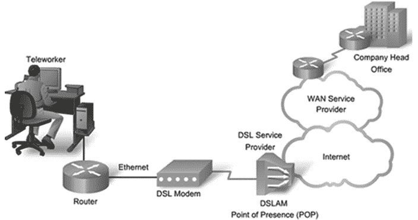

图 13.3 网络性能指标工具。

### 13.2.2 数据清洗与预处理

预处理是将真实世界数据转换为可用格式的关键步奏。显然，真实世界的数据在特定行为上往往是不完整且带有噪声的。换句话说，从真实世界中获取的用于数据挖掘技术进行分析的大部分数据是不完整且不一致的（包含错误、离群值）。因此，在使用数据挖掘技术之前，需要预处理程序来提高数据质量，从而有助于提高最终数据挖掘任务的准确性和效率。由于网络流量模式具有多种格式和维度，预处理技术在网络流量分析中是必要且重要的。所有分类变量都已转换为数值变量。除了作为分类目标变量“应用名称”（Application Name）外，所有类别均已转换为数值水平。

### 13.2.3 使用 Tableau 进行数据可视化

观察到，如图 13.4 所示，Google、HTTP 和 SSL 连接是网络中的前五个应用。YouTube、Windows 更新和 Skype 也是互联网流量的主要贡献者。从上述趋势可以看出，如图 13.5 所示，带宽从 2020 年 3 月开始呈指数级增长。这可能与 COVID-19 导致的封锁情况有关，当时许多机构的大部分员工被迫居家办公。这增加了全球范围内的互联网利用。如图 13.6 所示，用户数量从 2020 年 4 月开始大幅增加。在 2020 年 5 月至 7 月期间，连接用户高达 7,000 到 12,000 名。如图 13.7 所示，峰值传输和接收速率与这一年的带宽使用情况保持一致。在此期间，传输速率大幅增加。

## 热门应用

| 应用名称 (Application_Name) |
| --- |
| GOOGLE |
| HTTPS |
| HTTP_PROXY |
| SSL |
| HTTP_CONNECT |
| YOUTUBE |
| MICROSOFT |
| AMAZON |
| WINDOW_UPDATE |
| SKYPY |
| YAHO |
| FACEBOOK |
| DROPBOX |
| TWITTER |
| CLOUDFLAR |
| MSN |
| APPLE |
| CONTENT_FLASH |
| OFFICE_365 |
| INSTAGRAM |
| WHATSAPP |
| WIRED |
| NETFLIX |
| MS_ONDRIVE |
| DNS |
| ICLOUD |
| APPLE_TUNES |
| EBAY |
| APPLE_CLOUD |

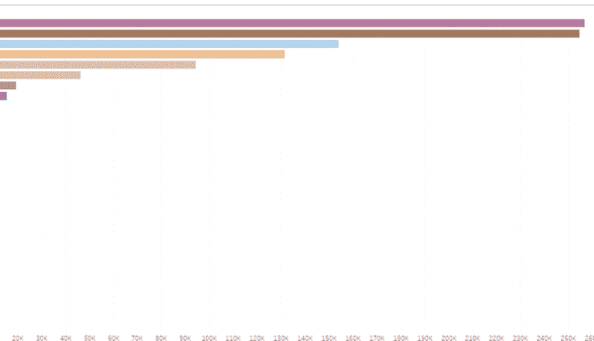

图 13.4 网络流量中的前五个应用。

## 13.3 使用算法进行流量分类

网络流量分类模型的流程如下（图 13.8）：

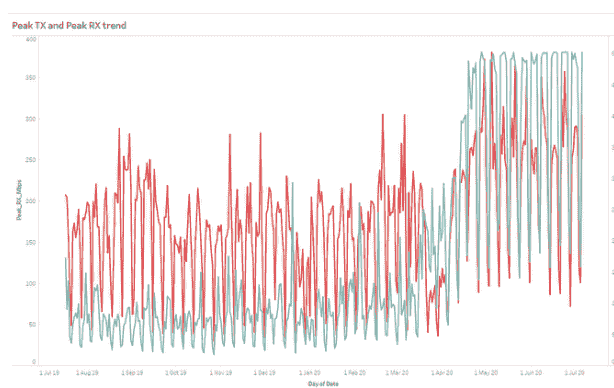

图 13.7 封锁期间大幅增加。

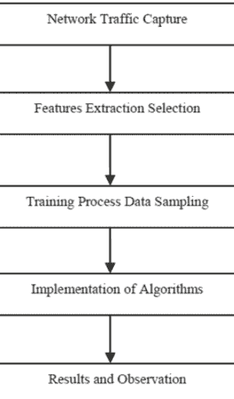

图 13.8 网络流量分类模型。

## 机器学习算法与应用

清洗后的数据已准备好分类如下：


1 `Network.head()`

| FlowID | Source_IP | Source_Port | Destination_IP | Destination_Port | Protocol | Protocol_Type | L7_Protocol | Application_Name |
| --- | --- | --- | --- | --- | --- | --- | --- | --- |
| 0 33547 | 13 | 80 | 34 | 36240 | 6 | 1 | 7 | 18 |
| 1 432768 | 25 | 38687 | 5757 | | | | | |
| 2 | | | | | | | | |
| 3 | | | | | | | | |
| 4 | | | | | | | | |

*（注：由于原文表格数据行不完整，此处保留结构并翻译表头）*

### 13.3 分类器对比

清洗后的数据已准备好分类如下。

（此处对应原文关于分类器对比的描述）与逻辑分类器相比，随机森林提供了更精确的结果。与支持机相比，随机森林达到了 99% 的准确率。通过交叉验证，随机森林达到了 98% 的准确率。

### 13.3.1 分类器的性能评估

图 13.9 比较展示了不同分类器的性能比较。

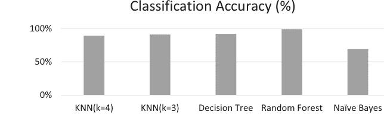

图 13.9 应用结果。

## 13.4 使用时间序列模型进行带宽预测

链路的时间序列数据如下所示：

| 时间戳 (TimeStamp) | 平均传输 (Mbps) | 平均接收 (Mbps) | 峰值传输 (Mbps) | 峰值接收 (Mbps) | 最大用户 | 带宽 (GB) |
| --- | --- | --- | --- | --- | --- | --- |
| 2019-07-17 15:00 | 71.75 | 117.1 | 172.6 | 207.39 | 6509 | 782.06 |
| 2019-07-18 15:00 | 47.06 | 106.67 | 90.46 | 204.74 | 6661 | 747.22 |
| 2019-07-19 15:00 | 44.98 | 36.31 | 135.53 | 153.86 | 6895 | 781.23 |
| 2019-07-20 15:00 | 27.96 | 44.31 | 45.54 | 94.64 | 6052 | 711.90 |
| 2019-07-21 15:00 | 17.48 | 30.51 | 36.36 | 48.91 | 5864 | 707.87 |
| 2019-07-22 15:00 | 36.77 | 81.78 | 64.52 | 163.03 | 6309 | 716.80 |
| 2019-07-23 15:00 | 41.96 | 97.95 | 77.84 | 173.13 | 6217 | 733.06 |

没有空值，因为这是来自工具的 TCP 倾储。指定时间捕获的所有网络参数均所示。

### 13.4.1 特征提取选择

在使用数据挖掘技术之前，特征提取选择被用作预处理策略。它通过移除冗余或无关的特征来提高数据挖掘算法的性能。通过选择原始字符的子集，特征提取方法生成了新的属性集。其主要目的是最小化

# 工程领域中的机器学习算法与应用

为了改进网络流量分析，降低了数据集的维度。通过获取数据集中变量的相关矩阵，识别出预测带宽相关的特征。从相关系数中可以观察到以下结果：

- 平均 TX（发送）速度与带宽之间存在高正相关
- 峰值 TX（发送）速度与带宽之间存在高正相关
- 最大用户数与带宽之间存在高正相关
- RX（接收）速度与带宽之间存在中度关系

因此，传输速度参数和用户数量被用作预测模型的特征。

- 平均 TX 速度 (Mbps)
- 峰值 TX 速度 (Mbps)
- 最大用户数

为了进一步建模，从数据集中删除了 RX 参数。然后将时间戳列设置为数据集的索引，这是时间序列建模所要求的。

```python
df['timeStamp'] = pd.to_datetime(df['timeStamp'])
df.head()
```

| timestamp | Average_TX_Mbps | Peak_TX_Mbps | Max_Users | Bandwidth_GB |
|---|---|---|---|---|
| 2019-07-17 15:00:00 | 71.75 | 172.66 | 6509 | 782.06 |
| 2019-07-18 15:00:00 | 47.06 | 90.46 | 6661 | 747.22 |
| 2019-07-19 15:00:00 | 44.98 | 135.63 | 6895 | 781.23 |
| 2019-07-20 15:00:00 | 27.96 | 45.54 | 6052 | 711.90 |
| 2019-07-21 15:00:00 | 17.48 | 36.36 | 5864 | 707.87 |

```python
BW_df = df.set_index('timeStamp')
```

变量相对于索引（时间戳）的子图提供了数据变化以及网络吞吐量增长趋势的洞察，如图 13.10 所示。

2020 年 4 月之后，吞吐量大幅增加。这恰恰是大多数国家开始在线办公的时间。由于全球几乎所有员工都在像办公室一样远程工作，这给 ISP（互联网服务提供商）带来了沉重的负载。

## 13.4.2 自回归积分移动平均模型 (ARIMA)

为了预测网络流量，将 ARIMA 模型与时间序列模型结合。为了预测带宽需求，我们将

# COVID-19 期间 ISP 链路网络流量分类

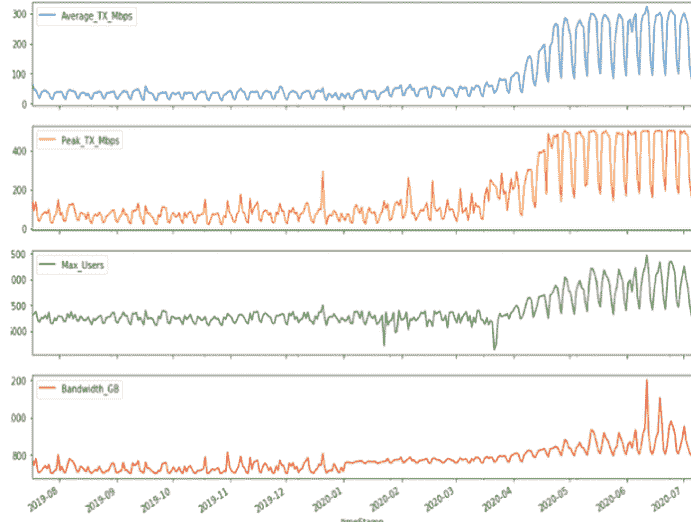

**图 13.10** 时间戳索引的子图。

利用 Python 中的 ARIMA 模块来创建时间序列模型。在进一步构建 TS 模型之前，检查时间序列数据的趋势和季节性至关重要。

与 2019 年和 2020 年相比，带宽利用率存在显著差异，如图 13.11 所示。

### 13.4.3 时间序列数据：趋势与季节性

寻找时间序列中的趋势有多种方法。滚动平均是一种常用技术，它包含了每个时间点两侧数据点的平均值。值得注意的是，数据点的噪声受所选窗口大小的影响。通过使用平均值，噪声和季节性得到了平滑。考虑带宽使用的趋势线也显示出随时间推移的逐渐上升。因此，与图 13.11 中的之前的图表相比，大部分季节性已经像图 13.12 所示被消除了。TX（发送）速度的相同图表可以在图 13.13 中可视化，连接到 ISP 链路的用户数可以在图 13.14 中可视化。

工程领域中的机器学习算法与应用

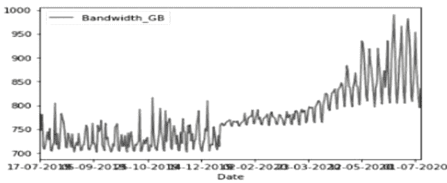

**图 13.11** 带宽差异。

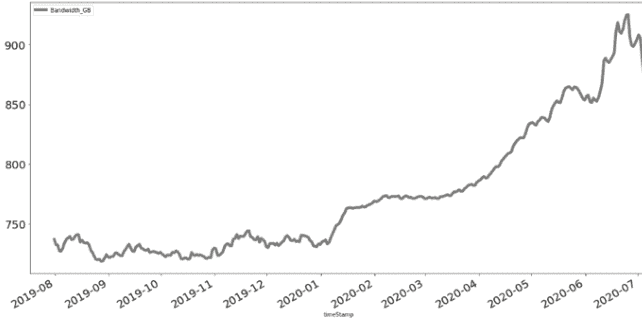

**图 13.12** 消除季节性。

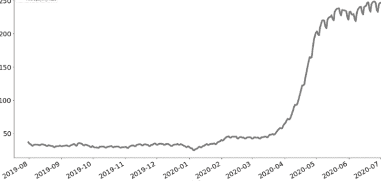

**图 13.13** TX 速度下的可视化。

# COVID-19 期间 ISP 链路网络流量分类

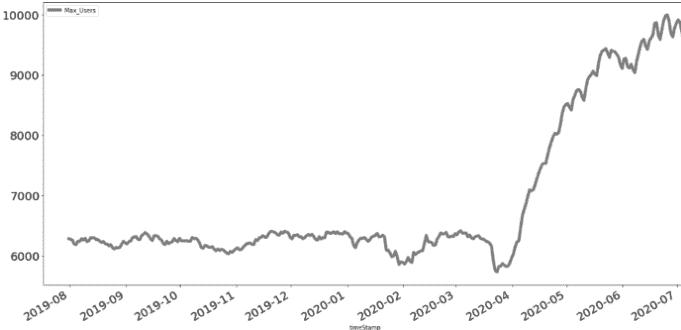

图 13.14 最大用户数。

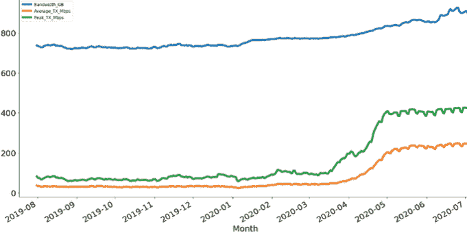

图 13.15 从 2020 年 4 月起单个网络的上升趋势。

为了比较单个网络参数的趋势，将所有滚动平均值绘制在一个图中。观察到，从 2020 年 4 月开始，所有参数都呈现上升趋势。

### 13.4.4 时间序列数据：季节模式

为了方便分析季节性，请从时间序列中移除趋势。这是考虑你白天季节性元素的方法之一。然而，从你计算的趋势中减去原始信号时，平均数据点的数量会影响这些数据。

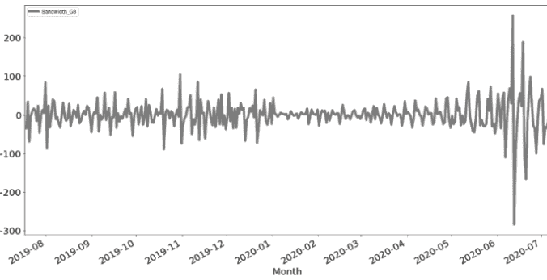

图 13.16 “带宽”数据序列的一阶差分。

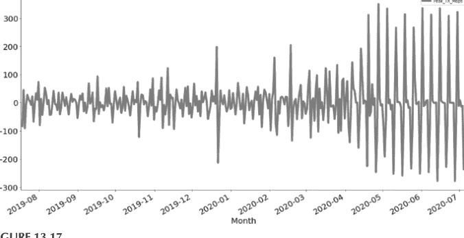

图 13.17 TX 速度的一阶差分图。

移除趋势的另一种方法是“差分”，它涉及比较连续数据点之间的差异，你只是在将一个数据点与前一个数据点进行比较。同样，图 13.16 所示的 TX 速度一阶差分图显示了数据中的某些季节性。

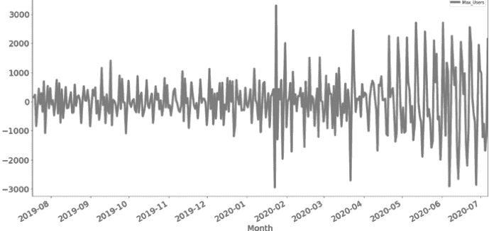

图 13.18 最大用户数的一阶差分图。

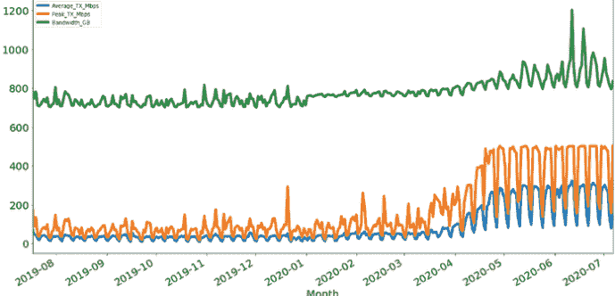

图 13.19 所有网络参数的一阶差分再次绘制在同一图中，以查看它们看起来如何。所有网络参数的一阶差分如图 13.19 所示绘制在一个张图中，以重新检查季节性模式。从上述可视化中，可以观察到所有变量的时间序列数据中存在一定程度的季节性（如图 13.20 所示），并且从 2020 年第二季度开始存在上升趋势。

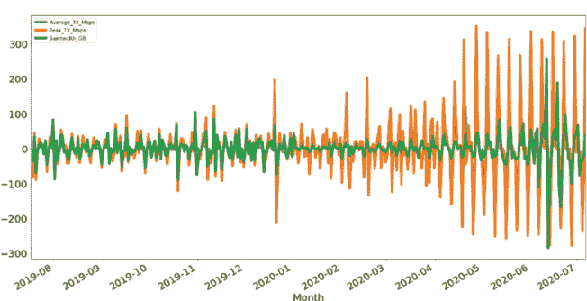

图 13.20 所有变量时间序列数据中的季节性。

## 13.5 实现 ARIMA 模型

将数据分为训练集和测试集

| timeStamp | Average_MBps | Peak_MBps | Max_Users | Bandwidth_GB |
|---|---|---|---|---|
| 2019-07-17 15:00:00 | 71.75 | 172.66 | 6509 | 782.06 |
| 2019-07-18 15:00:00 | 47.06 | 80.48 | 6661 | 747.22 |
| 2019-07-19 15:00:00 | 44.98 | 135.63 | 6895 | 781.23 |
| 2019-07-20 15:00:00 | 27.96 | 45.54 | 6052 | 711.90 |
| 2019-07-21 15:00:00 | 17.48 | 36.36 | 5864 | 707.87 |
| 2020-06-26 15:00:00 | 294.92 | 501.81 | 10659 | 918.17 |
| 2020-06-27 15:00:00 | 138.53 | 224.61 | 7803 | 818.29 |
| 2020-06-28 15:00:00 | 98.68 | 180.00 | 7293 | 805.18 |
| 2020-06-29 15:00:00 | 263.09 | 502.08 | 9231 | 845.28 |
| 2020-06-30 15:00:00 | 290.02 | 490.94 | 10302 | 887.56 |

训练数据

| timeStamp | Average_MBps | Peak_MBps | Max_Users | Bandwidth_GB |
|---|---|---|---|---|
| 2020-07-01 15:00:00 | 301.74 | 500.26 | 11271 | 954.16 |
| 2020-07-02 15:00:00 | 281.16 | 486.70 | 10047 | 878.10 |
| 2020-07-03 15:00:00 | 265.37 | 539.18 | 9282 | 846.60 |
| 2020-07-04 15:00:00 | 126.68 | 399.53 | 7599 | 812.17 |
| 2020-07-05 15:00:00 | 201.92 | 511.02 | 8568 | 835.48 |

测试数据

# COVID-19 期间 ISP 链路网络流量分类

构建 ARIMA 耗时 8.62 秒。

```python
model1.fit("Bandwidth_GB")
```


为了预测未来六个带宽值，数据集中有六个观测值。我们将这些预测值映射到测试数据的起始索引以进行比较。

## 13.5.2 打印带宽预测值

| 时间戳 | 预测值 |
|---|---|
| 2020-07-01 15:00:00 | 895.349462 |
| 2020-07-02 15:00:00 | 910.456485 |
| 2020-07-03 15:00:00 | 898.725879 |
| 2020-07-04 15:00:00 | 877.606389 |
| 2020-07-05 15:00:00 | 777.374204 |
| 2020-07-06 15:00:00 | 857.398884 |

我们将预测帧与原始数据帧合并并进行绘图（图 13.21）。

使用已构建的 ARIMA 模型对未来两个月的带宽需求进行了预测，并检查这些预测是否与由于 COVID 疫情导致的网络利用率激增相符。通过对这两个月的预测图与原始数据集进行对比绘图，计算出 2020 年 8 月和 9 月所需的带宽，如图 13.22 所示。还观察到预测值的范围显示了未来日期预测值可能落的区间。如图 13.23 所示，根据时间序列模型，在 2020 年 8 月和 9 月期间，带宽需求将保持在 800 到 1000 之间。


**图 13.21** 预测结果与 2020 年高带宽利用率相符。


**图 13.22** 2020 年 8 月和 9 月所需的带宽。


**图 13.23** 2020 年 8 月和 9 月期间 800–1000 的带宽范围。


**图 13.24** 使用诊断图对所提模型进行评估。

### 13.5.3 模型评估

使用诊断图对所提模型进行评估结果如图 13.24 所示。

- **标准化残差**：残差误差似乎具有均匀的方差，并围绕零均值波动。密度图显示出均值为零的正态分布。
- **正态性**：Q-Q 图上的点应该与红线完全对齐。任何大的方差都表明存在偏态分布。
- **ACF 图**（也称为相关图）说明残差误差不具有自相关性。任何自相关性都意味着残差误差存在模型无法解释的模式。因此，你可能需要在模型中添加更多的 Xs（预测变量）。总的来说，这似乎是一个不错的匹配。

## 13.6 结论：模型的业务效益

### 13.6.1 网络流量分类

网络流量分类是一种根据各种标准（如端口号或协议）将计算机网络流量分为不同类别的方法。通过分类的网络流量，你可以执行监控、发现、控制和优化等任务。网络流量分类的总体目的是提高网络性能。

一旦数据包被分类为属于特定应用程序，就可以对其进行标记。这些标记或标志将帮助网络路由器为某些网络流确定适当的服务策略。

本研究的分类方法可以与网络或数据监控软件结合使用。这允许我们创建一个实时仪表板，实时显示特定应用程序的网络使用情况。这将有助于任何互联网链路上流量的快速高效调节。

### 13.6.2 时间序列预测

由于新技术、行业和应用的引入，互联网流量在过去十年中急剧增加。物联网 (IoT)、云计算和数据中心应用程序都变得日益流行。网络在应对不断增长的流量需求的同时，为用户维持水平的服务。因此，有效利用网络设备变得至关重要。如果网络流量能够得到妥善预测，这项任务就可以有效地完成。许多网络领域，如节能、网络资源管理和无线传感器，都能从准确的流量预测中受益。

## 参考文献

[16] Ubik, Sven, and Petr Ježdl. "Evaluating application-layer classification using a machine learning technique over different high-speed networks." In 2010 5th International Conference on Systems and Networks Communications, 387–391. IEEE, 2010.

[17] Blowaj, Tomasz, and Jens Myrup Pedersen. "Multilevel classification and accounting of traffic in computer networks." Classification and Analysis of Computer Network 167.

[18] Blowaj, Tomasz, and Jens Myrup Pedersen. "A practical method for multilevel classification and accounting of traffic in computer networks" Aalborg Universet (2014).

[19] Jun, Li Shuny, Lu Yanqing, and Zhang Ziling. "Internet traffic classification using machine learning." In 2007 2nd International Conference on Communications and Networking in China, pp. 229–234. IEEE, 2007.

[20] Blowaj, Tomasz, and Valentin Carela-Espanol. "Comparison of deep packet inspection (DPI) tools for traffic classification" (UPC-DAC-RR-CBA-2013-3 ed.). Universitat Politica de Catalunya. http://www.acup.edu/app/research_center_index-CBA-2013.html

[21] Dusi, Mauricio, Francesco Gringoli, and Luca Sagarelli. "Quantifying the accuracy of the ground truth associated with Internet traffic flows." Computer Networks 55, no. 1 (2015): 1158–1167.

[22] Cascarino, Nicolo, Luigi Gimini, and Fulvio Risso. "Optimizing deep packet inspection for high-speed traffic analysis." Journal of Network and Systems Management 19, no. 1 (2017): 7–31.

[23] Alcock, Shane, and Richard Nelson. "Measuring the accuracy of open-source payload-based traffic classifiers using popular applications." In 38th Annual IEEE Conference on Local Networks-Workshops, pp. 956–963. IEEE, 2013.

[24] Ross, Ryan, and Reinhardt Botha. "Deep packet inspection—Fear of the unknown." In 2010 International Security for South Africa, pp. 1–5. IEEE, 2010.

[25] Valenti, Dario Rossi Rossi, Alberto Dainantoi, Antonio Pascepè, Alessandro Finamore, and Marco Melissa. "Reviewing traffic classification." In Data Traffic Monitoring and Analysis, pp. 123–147. Springer, Berlin, Heidelberg, 2013.

[26] Wei, Yong, Yun-Feng, and Li-chiao Guo. "Analysis of message identification for OpenDPI." Computer Engineering (2011): S1.

[27] Alcock, Shane, and Richard Nelson. "Traffic Classification Using Lightweight Packet Inspection. Technical report, University of Waikato, 2012.

[28] Levandoski, Justin. "Application layer classifier for Linux." http://17-fil-sourceforge.net/. (2008).

[29] Dainotti, Alberto, Walter De Porto, and Antonio Pascepé. "Tie: A community-oriented traffic classification platform." In International Workshop on Traffic Monitoring and Analysis, pp. 64–74. Springer, Berlin, Heidelberg, 2009.

[30] Khakpour, Amir R., and Alex X. Liu. "High-speed flow nature identification." In 2009 29th IEEE International Conference on Distributed Computing Systems, pp. 510–517. IEEE, 2009.

[31] Kim, Hyunchul, Kimberly C. Claffy, Marina Fomenkov, Dhiman Barman, Michal Faloutski.

# 5G 中的 AI/ML 集成：面向智能连接、安全与挑战

- 14.1 引言 ................................................ 240
- 14.2 5G 概述 ............................................ 240
- 14.2.1 赋能技术 ................................................ 241
- 14.2.2 5G 关键赋能因素 ...................................... 241
- 14.2.3 5G 需求 ................................................ 243
- 14.3 人工智能 (AI) 与机器学习 ............................ 243
- 14.3.1 5G 中的 AI 和 ML 融合 ................................ 244
- 14.3.2 安全与隐私 ...................................... 244
- 14.3.3 基于学习的 5G 方案 ............................ 246
- 14.4 无线 AI ................................................. 246
- 14.5 5G 背景下的 AI ........................................ 248
- 14.6 智能连接 ............................................. 249
- 14.7 5G 安全 .................................................. 250
- 14.8 挑战 ...................................................... 250
- 14.8.1 5G 复杂度 ............................................. 250
- 14.8.2 安全与隐私 ...................................... 251
- 14.8.3 速度权衡 ............................................. 251
- 14.9 研究范围 .................................................. 251
- 14.10 结论 .................................................... 252

## 14.1 引言

在不断发展的网络工程中，协调不同领域的卓越需求带来了许多困难。5G 的新进展正在通过提供更高的信息速率来配合信息的生动发展。5G 现在是许多先进技术的核心，如物联网、智能电网和自动驾驶汽车。需要高适应性来满足这种异构网络不断增长的需求。

## 14.2 5G 概述

5G 的快速普及带来了惊人的设备数量。根据 Cisco 年度互联网报告（2018–2023）预计，"机器通信（M2M）将增长 2.4 倍，从 2018 年的 61 亿增长到 2023 年的 147 亿。全球每每个人将拥有 1.8 个 M2M 设备。"

## 5G 技术中 AI/ML 的集成

假设得妥善管理，物联网及其连接到互联网的设备可能对组织的安全构成真正的威胁 [5,6]。与其原型网络相比，5G 网络被寄用于实现更高水平的异构性（在设备和网络方面）。例如，5G 支持智能车辆、智能家居、明智建筑和智慧城市区。此外，5G 设计中的物联网将包含更广泛和更通用的策略，以处理组织侧和设备侧的基础安全问题。由于外部干扰以及近距离干扰的存在，此类网络的安全性将变得相当复杂。人工智能和机器学习（ML）可以通过对中间的敏感安全连接进行分组（例如表征、验证和确认）来提供解决方案。5G-IoT 的安全和隐私将覆盖每一个层，如特征认证、安全以及端到端用户保护。例如，从终端设备到核心网再到专家协作的密钥验证系统，在隐藏密钥标识符的同时，仍然是一个极其困难的问题。AI 和 ML 同样可以在密钥验证中发挥重要作用，有效伪装针对伪装的攻击。

### 14.2.1 赋能技术

5G 将赋能其在物联网及相关世界中的数十亿设备可用性。因此，5G 有三种主要的应用场景分类：

- **大量机器通信**：它还被认为是物联网的一部分，包括在没有人工干预的情况下，以前所未见的规模连接数十亿设备。这涉及尖端的现代交互和应用，包括农业生产、制造业和业务通信。
- **低延迟与高可靠性**：它包含了对设备的实时控制、先进机械，车辆车辆通信（V2V）开启了另一个远程医疗、策略和治疗成为可能的现实。
- **增强型宽带**：它为连接的世界提供了更快的信息传输速率和更高的容量。智能应用将包括家庭的固定远程网络接入以及针对移动人员的户外应用网络。

### 14.2.2 5G 的关键赋能技术

关键赋能技术已在表 14.1 中详细说明了其适用性。这些关键赋能技术帮助 5G 网络构建更具认知性和灵活的面向应用的网络。

**表 14.1 5G 网络关键赋能技术**

| 序号 | 技术 | 适用性 | 对网络的支持 | 挑战 |
| --- | --- | --- | --- | --- |
| 1 | NFV（网络功能虚拟化） | 提高资源利用吞吐量，节省能源，降低 CAPEX/OPEX，提升 QoE，更简单的移动/支持。 | 以数据为中心的通信（万物即服务） | 解耦、资源标识、安全性、收益/价值提升、管理的灵活性 |
| 2 | C-RAN（云无线接入） | 灵活能量/功率节省，增加吞吐量，降低延迟，适应动态流量，降低 CAPEX/OPEX，更简单的用用设备管理 | 与异构网络 (HetNet) 的网元通信 | BBU 管理（例如参与、互连、规划），节能型资源标识 |
| 3 | HetNet（异构网络） | 增加吞吐量，提高能源效率，扩展接入 | 小小区网络、D2D/M2M 通信、物联网 | 缓解干扰的功率控制、动态模式选择和卸载组织、设备发现、联合 MAC 计划 |
| 4 | FDC（全双工通信） | 范围效率、降低空闲、能量效率 | 小小区网络、D2D/M2M、智能无线网络、多路径传输 | SIC 减少、跨层资源管理、功率划分、抑制干扰、根据 FD 传输设置的同步和时间变化、动态模式决策、MAC 协议规划 |
| 5 | RF-EH（射频能量采集） | 高能效的绿色通信 | 小小区网络、D2D/M2M 通信 | 多客户端规划、高级通道安全、能量波束成形、采集/通信时间变化、抑制干扰、SWIFT 赋能的资源分配 |

**表 14.2**

| 序号 | 领域 | 备注 |
|---|---|-|
| 1 | 速度 | 现场终端 1–10 Gbps 连接（例如，非理论最大值） |
| 2 | 延迟 | 1 毫秒端到端全周期延迟——空闲 |
| 3 | 带宽利用 | 每单位传输速度提升 1000 倍 |
| 4 | 连接设备 | 10–100 个关联设备 |
| 5 | 可用性 | 99.999% 可用性感知 |
| 6 | 覆盖 | 100% |
| 7 | 能源使用 | 网络能量消耗减少 90% |
| 8 | 设备电池寿命 | 低功耗机器类设备拥有长达十年的电池寿命 |

### 14.2.3 5G 要求

最近，关于 5G 技术应该采取的确定框架有几种观点。关于 5G 应该是什么，存在两种主要观点：

- **超连接**：这种对 5G 远程框架要求的观点意味着通过获取现有的技术（包括 2G、3G、4G、Wi-Fi 和其他主要的远程框架）提供更高的接入率和可用性，同时连接更密的组织。从提供传统类型服务的需求来看，关键区别在于赋能了如机器机器（M2M）应用以及物联网（IoT）应用 [7]。这种 5G 配置可能需要另一种无线技术来赋能电池寿命为十年或更长的低功率设备。
- **无线接入技术 (RAT)**：这种对 5G 要求的观点采取了更多技术驱动的视角，并设定了速率、延迟和其他关键边界的细节。这些 5G 要求将使 4G 或其他框架与新的 5G 远程框架之间产生明确的边界 [8, 9]。

## 14.3 人工智能 (AI) 与机器学习

在安全领域中使用 AI 和 ML 的想法并不新，但其可行性和执行普及率随着深度学习 (DL) 算法的发展引起了关注。以前改进 DL 的策略很大程度上致力于展示具有非本质特征的特定攻击设计，但通过 AI 和 ML，框架通常会对这些攻击变得更强大。

## 5G 技术中 AI/ML 的集成

中间，例如身份识别、确认和保护用户详情。5G-IoT 中的安全和隐私将覆盖每一个层：个性化保护、保护以及端到端（E2E）保护。对于这些具有极其独特安全先决条件的各种框架，满足信息的安全和保护需求成为了一项单调的任务 [15]。通过 SBA（服务体系架构）概述和针对不同终端框架的安全先决条件，AI 和 ML 可以通过安排和聚类突发性风险，从而逐步解决这些问题。AI 和 ML 可以通过创建信任模型、设备安全和信息确认来帮助构建工具，从而为整个 5G-IoT 网络提供精确的安全保障 [16,17]。

**表 14.3 用于 5G 的 AI 技术**

| 序号 | AI 学习方案 | 学习或训练模型 | 应用 |
|---|---|---|---|
| 1 | 监督学习 | ML 和统计逻辑 | 自协调 LTE 小小区布局中的动态循环复用和传输速率部分。路径损耗 |
| | | SVM（支持向量机） | 路径损耗估计的预测 |
| | | 基于神经网络 | 通道学习，从已知信道提取不可检测的信道状态信息 (CSI) |
| | | ANN 和 MLPs | 现代网络接口调度和扩展失真的真实容量的演示。 |
| 2 | 无监督学习 | 高斯混合模型 (GMM) 分层聚类 (HCM) 亲和聚类模型 (ACM) | 车辆网络的协作频谱感知；故障检测 |
| 3 | 强化学习 | 长期记忆模型 | LTE-U 网络中的主动资源分配，形成非协作游戏，使基站（SB）能够利用未授权信道，前提是信道中长时间的 WLAN 活动和 LTE-U 流量负载 |
| | | 梯度跟随者 (GF) 和 MBM | 使赋微小区 (FCs) 在异构网络 (HetNets) 中独立且智能地检测无线环境并调整其边界，以减少内/层间阻抗 |

### 14.3.3 基于 AI 学习的 5G 方案

- **(a) 监督学习方案**：在监督学习中，每个训练模型必须与其单独的标签一起考虑。其思想是学习模型的训练是具有已知最优值的样本情况的示例，然后使用该模型来感知新案例的理想答案。定向学习的一种平均方法是在给定一组特征（称为指标）的情况下预测一个目标数值。这种对任务的描述被称为回归。迁移学习是一种经常用于对向量聚类的常用程序。基本上，人们会在极其巨大的数据集（例如 Image Net [14]）上训练卷积神经网络 (CNN)，然后在另一个数据集上调整该 CNN。这里的关键部分是，目前在大型数据集上进行训练是由某些人完成的，他们将学习到的权重公开出来以供公共审查使用。[16–18]

- **(b) 无监督学习方案**：在无监督学习中，信息是未标记的，框架必须尝试在没有指导的情况下学习。这种策略在我们需要区分具有相似属性的群体时特别有用。我们从不建议计算尝试去识别相关特征的群体；计算会在不互不相交的情况下处理这种关联 [16,17]。

- **(c) 强化学习方案**：它依赖于通常被称为"智能体"的学习框架，智能体对环境做出反应。智能体执行动作并根据其动作获得奖励或惩罚（负奖励）。这意味着智能体需要在没有他人帮助的情况下学习，制定一种表征智能体在特定情况下应该选择的动作的方法。强化学习任务的在于长期扩大上述奖励 [16,17]。

## 14.4 无线 AI

机器学习和深度学习实现了 5G 通信和网络管理。对于每个模型，AI 赋能策略的优缺点讨论如下：

- **(a) M-MIMO 和波束成形**：大规模 MIMO 是 5G 的元素之一。通过使用无数辐射天线，5G 可以将信号功率的传输和接收集中在微小区域。然而，这项技术发现了一些问题。AI/ML 已应用于大规模 MIMO 以克服这些问题。例如，在大规模 MIMO 中，通过基本的评估策略和合理的数量的导频来训练对信道的精确测量：最小二乘法 (LS) 评估器无法实现良好的性能，而均方误差 (MMSE) 信道评估则极其复杂。AI 和深度学习也被研究用于增强大规模 MIMO 中接收天线的负载。深度学习和 AI 可以预测用户均衡，并同样改进天线组件的负载，这些组件可以在多小区情况下协同工作 [5, 19]。

- **(b) 集中编码**：5G 空口的一个可见组件是使用新的信道编码：数据信道使用低密度奇偶校验 (LDPC)，控制信道使用极化码 (polar codes) [8]。例如，极化码可以实现惊人的性能；但实现这一点需要时间，而且完全无法预测极化码多快达到这种理想表现。深度学习因这种并行结构而著名，它可以执行单次编码/解码。随后，许多专家预测基于深度学习的信道编码是赋能 5G NR 的希望技术。基于深度学习的信道编码可以实现良好范围的执行复杂度折中，只要通过词长过拟合和欠拟合的决策有效地进行训练 [8, 9, 20]。

- **(c) 节能型网络**：ICT 的使用占 2007 年全球能源消耗的 2–10%，并依赖于其进一步发展 [21]。此外，超过 80% 的发展依赖于此。AI 和 ML 可以预测用户均衡并同样改进天线组件的负载，这些组件可以在多小区情况下协同工作。

- **(d) 网络切片**：网络切片和缓存是 5G 的两个可见元素。网络切片允许提供不同类型的网络。最后是利用 AI 和 ML 来满足用户需求。

- **(e) 感知无线**：无线接入是稀缺的，且对频谱的需求正在增长。智能无线是未来的方向。AI/ML 可以是赋能 5G 频谱利用、多接入和流量阻塞的希望技术。

- **(f) 调制**：AMC 是非协作通信中的一个核心元素。调制控制是一个有助于安排接收信号类型的任务，它是理解无线环境的重要阶段。基于深度学习的 AMC 框架包含三个部分：初始信号处理以增强接收均衡；后续部分包括幅度、相位和频率的提取。最后一部分是信号分类器：平衡类型的表征。AI/ML 可以完成调制的精确度。

## 14.6 智能连接

这是一个新理念，基于三项重大创新——5G 和物联网（IoT）的结合，旨在加速复杂的计算机化管理的进展。这一新理念通过快速、低延迟的移动网络（即 5G）实现设备关联，而通过机器和传感器收集先进数据的功能是 IoT 的能力。随后，通过 AI/ML 进行分析和上下文化产生对客户有帮助的重要结果 [25,26]。这将为大多数行业带来新的突破性能力，例如交通、制造、医疗保健、公共卫生、安全等。

- **(a) 网络规划**：运营商将利用 AI 进一步优化网络范围量化并改进网络执行。人工智能和 ML 可以通过识别流量模式以及在网络上进行此类学习来预测和预测流量，并协助决策的自动化。这避免了像传统网络限制性规划那样的过度配置需求 [27]。
- **(b) 网络性能监控**：这允许网络调节器在升级网络的同时获取实际信息。
- **(c) 客户满意度**：AI 将利用 IoT 数据揭示有关实时情况的重要客户洞察，帮助改进和处理客户体验。这有助于购买者并为他们提供量身定制的体验 [27,28]。
- **(d) 产品生命周期**：AI/ML 利用描述当前和记录的产品体验、主要驱动因素和关系、未来结果以及建议升级的信息，协助管理和进一步开发产品生命周期。这有助于产品生命周期从执行工具中的信息转向认知连接的有见动态系统 [28,29]。
- **(e) 收益产生**：AI/ML 在 5G 中的集成目前正在进行，并将减少资本消耗，从而进一步增加收入流并以更低的能量消耗更有效地利用设备 [29,30]。

## 14.7 5G 安全

AI 和 ML 计算本质上是数据渴求的，这意味着需要数据来准备模型以进行强大的运行。在 5G 数据时代，由于我们拥有高计算能力、卓越的数据开发和数据源，数据的存储和管理变得容易。利用 AI 和 ML，可以在较低的计算成本和合理的框架对网络进行维护、访问和分析，以发现潜在的威胁、攻击和漏洞 [21, 30–32]。

利用 AI 和 ML 模型通过分析网络运动的模式和边界来持续识别可疑活动。排序计算可以通过观察吞吐量和网络错误日志等网络边界来识别不一致之处。聚类算法可用于分类不同类型的危险以及网络安全豁免条款。例如，模型可以测量感应攻击，生成对抗网络（GAN）可以创建伪造数据集，这些是新的安全努力，例如测试和实施先进的安全策略和算法。创建私有 AI 和 ML 模型的研究在安全计算、加密、保护和联邦学习方面取得了巨大的进步。混合模型通过从多个领域采用方法创建，使模型更有效、更快且更完善 [21, 33, 34]。

## 14.8 挑战

### 14.8.1 5G 复杂性

AI/ML 算法应在无线设备进行适当通信时部署。尽管如此，许多远程设备的内存和注册能力有限，不适用于复杂的计算。大型示例的收集和学习模型的准备需要长时间，这对于向某些功率和能力的远程设备传输它们是一个巨大的障碍。通常，测试越多、准备时间越长，信号识别和网络特征的准确性越高。需要获取更慢的输入并花费更长时间准备模型。因此，机器学习模型应该旨在通过较少的示例和在短的时间范围内实现最佳精度 [34]。

### 14.8.2 安全与隐私

保护客户的安全是移动和专业协作的核心关注点。远程 AI 中的主要挑战之一在于如何在不共享信息且危及客户个人数据的情况下，授权在包含客户位置的数据集上进行训练。有一个安全的方法来处理远程变化中深度学习的混合是非常重要的 [35]。AI/ML 模型本身的安全是另一个挑战，因为神经网络受到对抗性攻击的影响。攻击者可以通过注入伪造数据集来影响训练过程；这种注入会降低模型的准确性并产生错误的计划，可能会影响组织的执行。关于安全的 ML 或 AI 的研究，从很大程度上说，仍然很浅 [35,36]。

### 14.8.3 速度权衡

这些程序的可靠性在处理某些远程变化问题时，绝不完全符合便利的操作策略。例如，深度学习可以处理大规模 MIMO 远程预测中的 LS 和 MMSE；然而，延迟输入展示了这些方法。AI/ML 归可能会延长框架响应时间。这是因为大多数远程设备接入云计算，无论情况如何，与云服务器的通信都会导致额外的延迟。[37–40]。

## 14.9 研究范围

为了促进 AI/ML 的开发，需要研究范围。例如，深度学习可以处理大规模 MIMO 远程预测中的 LS 和 MMSE；然而，延迟输入展示了这些方法。AI/ML 归可能会延长框架响应时间。这是因为大多数远程设备接入云计算，无论情况如何，与云服务器的通信都会导致额外的延迟。[37–40]。

## 14.10 结论

在本章中，我们关注了 AI/ML 在 5G 中的集成。总之，AI 驱动的 5G 是一种很有前景的方法，可以为客户提供更好的体验、效率和安全性。如今，在 AI/ML 的推动下，5G 将将改变连接的格局。AI/ML 的未来在于这些技术的无缝集成，以应对 5G 世界新挑战的需求，在那里即使是数据的力量也会产生影响。

## 参考文献

[8] Devas Pradhan 和 R. Rajeswari, "用于高效利用功率和认知能力的 5G 绿色无线网络"，见 Jennifer S. Raj (编.), International Conference on Mobile Computing and Sustainable Informatics. Springer Switzerland AG 2021:Springer, pp. 325–330.

[9] Devas Pradhan, P. K. Sahu, A. Dash, and Hla Myo Tun, "基于射频能量技术的 D2D 通信的 5G 绿色网络可持续性"，2021 International Conference on Intelligent Technologies (CONIT), 2021, pp. 1–10, doi:10.1109/CONIT51840.2021.499828

[10] Y. Wang, M. Rasani, and R. W. Shih, "基于情知的毫米波波束预测：一种机器学习方法"，见 2018 IEEE 19th International Workshop on Signal Processing in Wireless Communications (SPAWC), IEEE, 2018, pp. 1–5.

[11] E. Balevi and J. G. Andrews, "用于维度信号的深度学习通道估计"，arXiv preprint arXiv:1904.09346, 2019.

[12] H. Ce, C.-K. Wen, S. Jin, and J. Y. Li, "用于波波毫米波系统的深度学习通道估计"，IEEE Wireless Communications Letters, vol. 7, no. 5, pp. 842–855, 2018.

[13] M. S. Safari and V. Pourahdami, "Deep u2li：从上行链路到下行链路的传输"，arXiv preprint arXiv:1812.07518, 2018.

[14] C.-K. Wen, W.-T. Shih, and S. Jin, "用于大规模毫米波回变的深度学习"，IEEE Wireless Communications Letters, vol. 7, no. 5, pp. 748–751, 2018.

[15] M. Khanani, M. Alizadeh, J. Hoydis, and F. Primling, "用于大规模 MIMO 的自适应神经信号检测"，arXiv preprint arXiv:1906.04610, 2019.

[16] G. Gao, D. Kong, and N. Liu, "用于大规模 MIMO 的稀疏连接神经网络"，EasyChair, Tech. Rep., 2018.

[17] M. Alrabiah and A. Alkhateeb, "用于 TD 和 FDD MIMO 的深度学习：空间和频率中的通道映射"，arXiv preprint arXiv:1905.03761, 2019.

[18] C. Zhang, P. Pathar, and H. Haddadi, "移动和无线网络中的深度学习：综述"，IEEE Communications Tutorials, vol. 21, pp. 2224–2287, 2019.

[19] L. Huang, A. D. Joseph, B. Nelson, I. Rubinstein, and J. D. Tyler, "对抗性机器学习"，见第 4 次 ACM 安全与人工智能工作讨会论文集，pp. 43–58, ACM, 2017.

[20] Devas Pradhan, P. K. Sahu, K. Rajeswari, and Hla Myo Tun, "面向未来蜂窝通信的 5G 绿色网络 (5-5G) 定位研究"，第 3 次 International Conference on Communication, Devices and Computing (ICCDC 2021)，2021年8月16日至18日。

[21] G. A, "一种低效的真相"。Global Action Plan Report, 2007.

[22] Hla My Tun, "基于物理约束的 5G 电信系统无线规划与优化"，Journal of Computer Science Research,3(1), 2021年1月。https://doi.org/10.30534/jcsr.v3i1.2701

[23] W. Song, F. Zeng, J. Hu, and X. Mao, "用于城市车辆网络中多跳无线广播中继的无监督学习方法"，IEEE Vehicular Technology, 2017.

[24] Prvasadhan, Sahu, P. K., Dash, A., Tun, H. M. (2021). "基于射频能量技术的 D2D 通信的 5G 绿色网络可持续性"，2021 International Conference on Intelligent Technologies (CONIT), pp. 1–10.

[25] M. S. Parvez, D. Rawat, and M. Garuba, "用于移动无线用户活动分析和异常检测的大数据分析"，IEEE Transactions on Industrial Informatics, vol. 13, no. 4, pp. 2058–2065, 2017.

[26] L.-C. Wang and S. Cheng, "超密集小区的数据驱动资源管理：一种亲性聚类方法"，IEEE Transactions on Network Science and Engineering, vol. 4, no. 7, pp. 1–15, 2018.

[27] U. Challita, L. Dong, and W. Saad, "用于 LTE 网络主动资源分配的深度学习"，第 23 次欧洲会议，2017.

[28] R. Pasancu, T. Mikolov, and Y. Bengio, "关于循环网络的训练难度"，Tech. Rep., 2013.

[29] Q. V. Jaitly, and G. E. Hinton, "初始化循环单元的简单方法"，Tech. Rep., 2015.

[30] G. Almanami, K. Moesner, "用于基于 LTE 小小区接入的动态学习"，IEEE Transactions on Wireless Communications, vol. 14, no. 4, pp. 2294–2308, 2015.

[31] D. N. Nguyen, H. X. Nguyen, and L. B. White, "用于用户反馈的强化学习"，IEEE Transactions on Wireless Communications, vol. 16, no. 9, pp. 6062–6076, 2017.

[32] H. Sun, X. Chen, M. Hong, and N. D. Sididulos, "学习：用于干扰管理的深度神经网络"，IEEE Transactions on Signal Processing, vol. 66, no. 20, pp. 5438–5453, 2018.

[33] Y. Yunhong and J. Zhang, "基于异构网络的站激活的深度强化学习"，IEEE Transactions on Mobile Computing, vol. 10, no. 9, pp. 2076–2087, 2019.

[34] J. Liu, B. Krishnamachari, R. Mcwilliam, R. Santos-Rodriguez, and R. Piechocki, "用于无线传感器网络的强化学习效率"，arXiv preprint: Internet of Things, vol. 5, no. 6, pp. 4273–4282, 2018.

[35] M. Kozlowski, R. Mcwilliam, R. Santos-Rodriguez, and R. Piechocki, "用于无线传感器网络的强化学习效率"，arXiv preprint arXiv:1812.02538, 2018.

[36] B. Mattheiesen, A. Zhou, E. A. Joswick, and M. Debbah, "用于无线干扰网络的最能效功率控制的深度学习"，arXiv preprint arXiv:1812.06920, 2018.

[37] C. Gutterman, E. Grinpun, S. Sharma, and G. Zussman, "用于 5G 切片的资源预测"，见第 20 次 ACM Symposium on Mobile Ad Networking and Computing. ACM, 2019, pp. 231–240.

[38] M. Chen, W. Saad, C. Yin, and M. Debbah, "用于云端无线接入主动缓存的回态网络"，IEEE Transactions on Wireless Communications, vol. 16, no. 6, pp. 3520–3535, 2017.

[39] X. Lu, L. Xiao, C. Dai, and H. Dai, "抗干扰的 UAV 辅助蜂窝通信"，arXiv preprint arXiv:1805.06628, 2018.

[40] M. Sadeghi and E. Larsson, "针对端到端自动器通信系统的物理对抗攻击"，IEEE Communications Letters, vol. 23, no. 5, pp. 847–850, 2019.

# 15 使用机器学习算法进行电力预测

Swastik Mishra, Kanika Prasad,* 和 Anand Mukut Tigga

生产与工业工程系，国立技术学院，Jamshedpur，印度

*kprasad.prod@nitjsr.ac.in

## 目录

- 15.1 引言 ............................................. 256
- 15.2 文献综述 ......................................... 257
- 15.3 方法论 ............................................. 258
- 15.3.1 单变量预测模型 ................................... 258
- 15.3.1.1 自回归模型 ................................................ 258
- 15.3.1.2 移动平均 (MA) ............................................. 259
- 15.3.1.3 ARMA ...................................................... 259
- 15.3.1.4 ARIMA ..................................................... 259
- 15.3.1.5 LSTM ...................................................... 260
- 15.3.2 多变量预测模型 ........................................... 260
- 15.3.2.1 DNN ...................................................... 260
- 15.3.2.2 CNN ...................................................... 261
- 15.3.2.3 CNN-LSTM ................................................. 261
- 15.3.2.4 CNN-LSTM-DNN ............................................... 261
- 15.4 电力需求预测 ............................................ 261
- 15.4.1 数据集 ..................................................... 261
- 15.4.2 数据预处理 ................................................... 262
- 15.4.3 实验 ...................................................... 262
- 15.4.3.1 单变量时间序列预测 ....................................... 262
- 15.4.3.2 多变量时间序列预测 ..................................... 264
- 15.5 结果与讨论 .............................................. 264
- 15.5.1 对于单变量模型 ............................................. 264
- 15.5.2 对于多变量模型 ............................................. 266
- 15.6 结论 ....................................................... 267
- 15.7 局限性与未来展望 ............................................... 268

## 15.1 引言

能源对于任何国家的经济发展都至关重要。对于发展中国家而言，能源部门具有着至关重要的地位，因为不断增长的能源需求需要巨大的投资来维持。电力改变了我们的日常生活和工业生产，电力为大型机器提供动力，这些机器提供了基本的公用事业以及工业和消费产品。电力是任何国家经济发展的基础，因为稳定可靠的电源可以创造各种业务机会和就业机会。它还提供了获取资源和信息的途径。

电力是一种二次能源，因为它是由从不同来源产生的能量转化来的，例如可再生能源如太阳能、水能、陆上和海上风能，以及不可再生能源如煤炭、褐煤、天然气和化石燃料。由于其特性，电力无法大量储存。有时，电能发电和供应之间存在不平衡，这导致了电价的波动。极端波动迫使发电机不仅要对冲电量风险，还要对冲价格风险。从提前几小时到几个月的价格预测对电力组合经理具有特别的价值。能够以合理准确水平预测批发价格的发电公司可以调整其策略和生产或消费计划，以在日前交易中降低风险或实现利润化。它有助于管理层做出正确的决策，相应地管理资源并解决短缺问题。发电能力不足、输配基础设施不完善、偏远地区供应成本高或用电负担能力差是扩展电网电力的最大障碍。电力价格预测在电力行业中起着至关重要的作用，因为它为电力系统规划和运行决策提供了依据。

电力价格预测是一个时间序列预测问题。因此，在本研究中，通过机器学习（ML）算法结合开源数据集对电价进行预测。经典模型以及递归神经网络（RNN）与卷积神经网络（CNN）的结合用于价格预测。移动平均、自回归移动平均（ARIMA）和长短期记忆（LSTM）等经典模型被用于价格预测。电价受不同变量（价格决定因素）的影响。因此，在应用经典预测模型和 RNN 之后，在同一数据集上应用了多变量预测模型。随后，根据单变量模型和多变量模型的平均绝对百分比误差（MAPE）和平均绝对误差（MAE）值对应用模型的结果进行了比较。还绘制了实际价格和预测价格的图表，以可视化获得的结果。

## 15.2 文献综述

研究人员已经应用机器学习算法来预测价格变化。Rolnick 等定义了气候变化问题，并鼓励使用机器学习算法来预测气候变化的负面影响 [1]。Nef Nti 等人对预测方法分类为工业方法和人工智能（AI）方法进行了综述 [2]。Aishwarya 等人应用了机器学习模型，如贝叶斯线性回归、提升树回归、森林回归和统计分析方法，在无处不在的环境中根据内部数据和外部数据预测客户数量 [3]。Mir 等人的比较性综述显示，时间序列建模方法已广泛用于中长期预测。基于人工智能的短期预测技术在文献中仍然盛行 [4]。Johannesen 等根据最低 MAPE 值比较了各种回归工具并得出结论：随机森林回归器提供了更好的短期预测（30 分钟），而 K 近邻算法（KNN）提供了相对较好的长期负载预测（24 小时）[5]。Ahmad 和 Chen 确定，虽然某些因素导致了家庭、商业和工业部门能源消耗模式的变化，但 LSBoost 在季节性和年度提前预测的跨度上性能优于 LMSR 和 NARM [6]。Fattah 等人使用–Jenkins 时间序列方法开发了一个用于产品需求预测的 ARIMA 模型 [7]。为了理解时间序列的性质和分析目标，Athiyar 等解释并应用了 LSTM、ARIMA 和 CNN 的概念 [8]。Kaushik 等评估了预测患者在某些镇痛药物每周平均支的能力。使用了两个统计模型（持续性（基准）和 ARIMA）、多层感知机模型、LSTM 和集成模型来预测两个不同患者的支出 [9]。Ahmad 等人使用人工神经网络（ANN）结合非线性自回归多变量输入模型、多元线性回归模型和自适应提升模型预测智能电网环境下的能源需求 [10]。Allee 等人使用数据驱动的方法进行需求预测调查，并使用了 1,378 名坦桑尼亚微电网客户的智能电表数据。应用支持向量机来预测热带地区的建筑能耗 [11]。Dong 等人提出了支持向量机（SVM）一种新型神经算法来预测建筑能耗 [12]。Jamii 应用了 ARIMA 模型对 1971 年至 2020 年的年度电耗进行建模 [13]。Hasanah 等人比较了两种方法在电负载需求预测中的性能。遗传算法支持向量机（GA-SVM）和 ARIMA 方法被应用于印度尼西亚马拉孟市的日负载预测 [14]。Aurna 等人使用 ARIMA 和 Holt Winters 模型考虑了不同时期（每日、每周、每月）的能耗 [15]。Velasco 等人使用 ARIMA 和 ANN 作为预测模型预测日前电负载。通过电负载数据准备、模型实现和预测评估，评估模型的预测是否符合可接受的误差公差 [16]。

从综述可以看出，大多数研究工作已应用单变量预测模型进行价格预测。由于电力预测是一个单变量预测问题，因此应用了多变量预测模型。使用 MAE 和 MAPE 对获得的结果进行了比较。

## 15.3 方法论

本节介绍了单变量和多变量预测的各种模型。

### 15.3.1 单变量模型

#### 15.3.1.1 自回归 (AR) 模型

自回归（AR）模型根据过去值预测未来。由以下方程表示：

$$P_t = \delta + \varphi_1 P_{t-1} + \varphi_2 P_{t-2} + \dots + \varphi_p P_{t-p} + A_t \quad (15.1)$$

其中
- $P_{t-1}, P_{t-2} \dots P_t$ 是过去值（滞后项），
- $A_t$ 是白噪声，
- $\delta$ 定义如下：
$$\delta = (1 - \sum \varphi_i)\mu \quad (1 \le p) (15.2)$$

#### 15.3.1.2 移动平均 (MA)

MA 是基础模型之一，标记为 MA(a)，其中 a 是模型的阶数。MA 模型认为当前值线性依赖于当前和过去的误差项。同样假设误差项是相互独立且呈正态分布的。方程 15.3 表示使用 MA 技术：

$$P_t = \mu + \varphi_1 \alpha_{t-1} + \varphi_2 \alpha_{t-2} + \dots + \varphi_a \alpha_{t-a} \quad (15.3)$$

其中
- $P_t$ = 当前值
- $\mu$ = 序列均值
- $\varphi$ = 过去误差对当前值的影响幅度
- $\alpha$ = 当前误差项和过去误差项
- $a$ = 序列阶数

#### 15.3.1.3 ARMA

ARMA 模型用于通过两个多项式描述弱平稳随机时间序列。这些项式中的第一个是自回归的：

$$P_t = \beta_1^* P_{t-1} + \alpha_1^* \varepsilon_{t-1} + \beta_2^* P_{t-2} + \alpha_2^* \varepsilon_{t-2} + \beta_3^* P_{t-3} + \alpha_3^* \varepsilon_{t-3} + \dots + \beta^* P_{t-k} + \alpha^* \varepsilon_{t-k} \quad (15.4)$$

其中
- $\beta$ = AR 模型的系数
- $\alpha$ = MA 模型的系数

方程 15.5–15.7 可用于预测未来值。当时间序列的均值不稳定时（即时间序列是非平稳的），使用 ARIMA 模型。因此，通过一定程度的差分处理数据使其变得平稳，即消除对回归模型产生负面影响的趋势和季节结构。


$Z_t = a_{t-1} - a_t$$

(15.5)

```
$Z_t = \phi_1^*Z_{t-1} + \theta_1\epsilon_{t-1} + \epsilon_t$
```

(15.6)

```
$a_i = \sum_{i=1}^{k} Z_{k-i} + a_i$
```

(15.7)

其中：

- `$a_i$` = 非平稳时间序列上的数据点
- `$\phi_1^*Z_{i-1}$` = 代表自回归部分
- `$\theta_1\epsilon_{i-1}$` = 代表移动平均部分
- `$\epsilon_i$` = 发生的误差

### 15.3.1 LSTM

`LSTM` 是一种特殊的循环神经网络（`RNN`），专门设计用于避免问题中的长程依赖问题。它们可以记住更长时间的信息，这是其设计意图属性。它们拥有一个 `sigmoid` 神经网络层和一个逐点乘法操作。`sigmoid` 层输出 0 到 1 之间的数字，描述了每个组件应允许通过的比例。值 0 表示“允许通过”，而值 1 表示“允许所有通过！”通过实现带有隐藏状态的三个门，减少了梯度消失效应。实现的三个门通常称为输入门、输出门和遗忘门。`LSTM` 具有这些门来保护和控制单元状态。`LSTM` 网络的有效应用可以于人类轨迹预测、交通预测、语音识别和天气预测等研究领域。

## 15.3.2 多变量预测模型

### 15.3.2.1 DNN

`DNN` 是卷积神经网络的增强版本。由于它们在不仅学习非线性输入输出映射，还能学习输入数据向量的底层结构方面具有卓越的性能，近年来变得非常流行。这类模型可以近似任何函数的行为（通用逼近定理）。`DNN` 的输出可以通过以下方程解释：

```
$p'_i = f(\sum_{j=1}^{n}(w_{i,j}q_j + b_i))$$
```

(15.8)

其中 `$p$` 是当前层神经元的输出，`$q$` 是前一层的输出，`$w$` 是权重集，`$b$` 是偏置，`$f$` 是非线性激活函数，`$i$` 是当前神经元，`$l$` 是当前层，`$k$` 是前一层。

### 15.3.2.2 CNN

`CNN` 传统上为图像检测系统设计，也可以作为时间序列预测模型。`CNN` 中的神经元可以持有高维数据，因此该性能优于其他神经网络。`CNN` 模型具有三个属性：(i) 卷积层，(ii) 池化层和 (iii) 展平层。展平层用于卷积层和全连接层之间，将特征图还原为单个一维向量。

### 15.3.2.3 CNN-LSTM

这种架构也被称为长期递归卷积网络（`LRCN`）模型。`CNN-LSTM` 架构使用 `CNN` 层对输入数据进行特征提取，并结合 `LSTM` 支持序列预测。`CNN-LSTM` 可以定义为在前添加 `CNN` 层，后面接 `LSTM` 层，并在输出处设置密集层。这些模型是为视觉时间序列预测问题开发的。

### 15.3.2.4 CNN-LSTM-DNN

为了执行复杂任务，神经网络需要训练得更深。当更深的网络开始收敛时，会出现退化问题。在退化过程中，随着网络深度的增加，精度达到饱和然后迅速下降。意外的是，这种退化并不是由过拟合引起的，在足够深的模型上添加更多层会导致更高的训练误差。引入跳跃连接（也称为快捷连接）来克服这个问题。这种连接跳过了神经网络中的某些层，并将一层的输出作为下一层的输入。在 `CNN-LSTM` 模型中，输出被直接跳跃到常用的 `DNN`。

## 15.4 电力需求预测

### 15.4.1 数据集

研究中使用的数据集包含西班牙四年的用电消耗、发电、定价和天气数据。消耗和发电数据检索自 `ENTSOE`，这是一个输电业务运营商（`TSO`）数据的公共门户。该数据集是独特的，因为它包含了电价的小时数据，以及 `TSO` 对消耗和定价的相应预测。工作重点是预测比现有数据预测得更好的电价。我们用于比较的指标是下面定义的 `MAPE` 和 `MAE`：

```
MAPE = \frac{100%}{n} \sum_{t=1}^{n} \frac{At - Ft}{At} \quad (15.9)
```

```
MAE = \sum_{i=1}^{n} \frac{|At - Ft|}{n} \quad (15.10)
```


# 使用机器学习算法预测电价

其中：

- `A$_t$` = 实际值
- `F$_t$` = 预测值
- `n` = 点的总数

## 15.4.2 预处理

为了应用机器学习（ML），首先对原始数据进行清洗和预处理。清洗后，数据集分为两个部分：80% 用于训练，20% 用于测试。对于单变量预测，提取单个特征。对于多变量预测，提取了能源消耗、价格、日期和年份等多个特征并进行了 `min-max` 缩放。

## 15.4.3 实验

在本节中，解释了所有应用的模型。所有模型都使用了相同的最后两层并带有丢弃（`dropout`）。所有模型的独特层如下：

1. 三层 `DNN`（加上公共底部两层）
2. 带有 1D 卷积和最大池化的 `CNN`
3. 带有 `LSTM` 层的 `LSTM`
4. 将模型 2 和 3 的层输入到公共 `DNN` 层。我们将 `CNN` 作为输入堆叠到 `LSTM`。
5. 带有到公共 `DNN` 层跳跃连接的 `CNN` 叠 `LSTM`。相同的 `CNN` 和 `LSTM` 层直接跳跃连接到公共 `DNN` 层。

图 15.2 显示 `LSTM` 与其他模型相比，波动频率更高。`CNN` 叠 `LSTM` 显示了模型的两个日内波动属性是如何结合的。表 15.2 显示了不同模型获得的 `MAE` 值。


**图 15.1：** 图中绘制了实际价格和预测价格

**表 15.1：** 每个单变量模型的 `MAPE`、`RMSE` 和 `MAE` 值

| 模型 | MAPE | MAE |
| :--- | :--- | :--- |
| 自回归 (AR) | 20.0674 | 12.4224 |
| 移动平均 (MA) | 11.7187 | 0.0484 |
| ARMA | 12.4534 | 20.4573 |
| ARIMA | 84.8715 | 55.6936 |
| LSTM | 4.1564 | 2.6708 |


**图 15.2** 使用多变量预测模型对未来两周价格进行预测。

**表 15.2** 不同多变量模型所获得的 `MAPE` 值

| 模型 | DNN | CNN | CNN-LSTM 堆叠 | CNN-LSTM 跳跃 |
| --- | --- | --- | --- | --- |
| MAPE | 25.7879 | 21.4385 | 22.7875 | 23.6760 |
| MAE | 0.0877 | 0.0789 | 0.0828 | 0.0882 |


**图 15.3** 基于 `MAE` 的应用单变量模型对比。

与所有其他预测模型的比较。如果以 `MAPE` 作为比较指标，`LSTM` 模型给出了最低的 `MAPE`。较低的 `MAPE` 表明与其他模型相比，`LSTM` 的预测结果更接近实际价格。图 15.4 显示了所有单变量模型的 `MAPE` 值，可以看出 `ARIMA` 的 `MAPE` 最大，即 `ARIMA` 模型的准确性最低。图 15.1 显示了实际价格与预测价格的对比，可以看到 `LSTM` 预测的价格与实际价格图表重叠。图 15.3 显示了所有应用单变量模型获得的 `MAE`，可以看出 `ARIMA` 的 `MAE` 值最大。

## 15.5.2 用于多变量模型

与 `LSTM` 跳跃方法相比，`CNN` 堆叠 `LSTM` 输出了最佳结果。`CNN` 和 `DNN` 的表现也异常出色。基于 `MAPE` 和 `MAE` 指标对模型进行了比较。图 15.5 显示了所有模型的 `MAPE` 值，可以看出 `CNN` 堆叠 `LSTM` 的 `MAPE` 低于 `LSTM` 跳跃，且 `CNN` 的 `MAPE` 最低。图 15.6 显示了所应用多变量模型获得的 `MAE` 值。`CNN` 方法获得的 `MAE` 值在所有方法中是最低的，因此该模型表现非常出色。


**图 15.4** 基于 `MAPE` 的应用单变量模型对比。


**图 15.5** 基于 `MAPE` 的应用多变量模型对比。

`LSTM` 跳跃的 `MAE` 大于 `CNN` 堆叠，这就是为什么与 `CNN` 跳跃相比，从 `CNN` 堆叠中获得的预测值更接近真实值。

## 15.6 结论

电力在任何国家的经济发展中都起着关键作用。市场中所有的发电公司都旨在充分利用所有可用资源，并改进发电、消费和供应，以实现利润最大化。电价预测对于实现发电公司的目标起着至关重要的作用。准确预测电价使电力经理能够就使用的原材料以及电力生产和供应做出决策。在本章中，目的是应用不同的单变量和多变量机器学习算法进行电价预测。使用 `Jupyter notebook`（一个开源工作台）进行编码和结果可视化。电价预测涉及负荷以及以小时、天和周为单位的历史数据。机器学习算法运行良好并能够处理大量数据。在多变量模型中，`LSTM` 优于所有其他方法。在多变量模型中，`LSTM skip` 优于 `LSTM stacked`。`CNN` 和 `DNN` 给出了满意的结果。由于经理们旨在理解市场动态，他们可以使用本章讨论的方法为他们的决策建立坚实的基础。较低的预测误差可以实现资源规划和容量规划，从而提高发电公司的利润份额。

## 15.7 局限性与未来范围

在这项研究中，未纳入天气对预测模型的影响。此外，一旦获得数据集，相同的技术也可以应用于印度背景下的电价预测。

# 参考文献

- [1] Rolnick, D., Donti, P., Kaack, L., Lacoste, K., Ross, A., Milojevic-Dupont, N., Jaques, R., Waldman-Brown, A., and Lucioni, A. 2019. Tackling climate change with machine learning arXiv preprint:1906.05433.
- [2] Iti, I., Teimeh, M., My-Boateng, O., and Adeokoya, A. 2020. Electricity load forecasting: a systematic review. Journal of Electrical Systems and Information Technology, 7(1), 1–19.
- [3] Aishwaya, K., Aishwarya Rao, Nikita Kumari, Akshit M., and Rashmi R., 2020. Food demand prediction using machine learning, Research Journal of Engineering and Technology.
- [4] Mir, A., Alghab, M., Ullah, K., Khan, Z., Lu, Y., and Imran M. 2020. Review of electricity demand in low and middle countries: Sustainability.
- [5] Johannesen, N., Kolme, M., and Goodwin, J. 2019. Potential of three variant machine-learning models.
- [6] Ahmad, T., and Chen, H. 2019. Relative evaluation of regression rules.
- [7] Fattah, J., Ezzine, L., Aman, Z., Moussami, H., and Lachhab, H. 2018. Forecasting of demand using ARIMA model.
- [8] Athiyavar, S., Pol, M., and Krishnaswamy, S. 2020. Time series analysis of energy.
- [9] Kaushik, S., Chouddhury, A., Sheron, P., and Dasupta, N. 2020. In healthcare: forecasting using.
- [10] Ahmad, T., and Chen, H. 2018. Medium and long-term energy in smart grid.
- [11] Allee, A., Williams, N., Davis, A., and Jaramillo, P. 2021. Predicting electricity demand in off-Tanzanian communities.
- [12] Dong, B., Bao, C., and Lee, S.E. 2005. Applying support vectors to predict energy consumption.
- [13] Mohammed, J. and Mohamed, M. 2021. The forecasting of electrical energy in Morocco with an autoregressive moving average approach.
- [14] Hasanah, R.R., Inatam, D., Suyono, H., Shidi, M., and Ahmed-Akker, M. 2020. Performance of genetic algorithm-support vector machine (GA-SVM) and autoregressive integrating moving (ARIMA) in electric load forecasting.
- [15] Aurna, M. D.F., Rubel, T.M., Siddiki, T.A., Karim, T., Saika, S., M. Arifeen, M. Mahbub, T.N., Salim Rezaza, S.M., and Kabir H. 2021. Time series analysis of electric energy consumption using autoregressive moving average model and Holt Winters model.
- [16] Velasco, L.C.P., Polestico, D.L.L., Macasieb, G.P.O., Reyes, M.B.V., and Vasquez Jr., F. 2018. Load forecasting using autoregressive moving average and artificial neural network.

# 预测降解速率的机器学习应用

**表 16.1** 不同类型的骨折及其内科固定物

| 骨折类型 | 内科固定物 |
| --- | --- |
| 颅骨骨折 | 钢丝、钉和板 |
| 颅面骨折 | 钢丝、螺钉和板 |
| 骨盆骨折 | 螺钉、板和外固定器 |
| 脊柱骨折 | 棒、椎弓螺钉和板 |
| 上、下肢骨折 | 板和钉 |


**图 16.1** 骨愈合过程。

例如板、螺钉、钉或钢丝 [2]。用于骨折愈合的不同类型植入设备如表 16.1 所示。

这些植入物分为两种：非降解性和可降解性。非降解植入物在骨折愈合后必须通过第二次手术移除。而生物降解植入物在人体内部降解，因此骨骼愈合后不需要第二次手术。生物植入材料的降解是在电解质存在的情况下通过电化学反应发生的，导致氧化物、氢氧化物、氢或其他化合物的形成，如图 16.1 所示。金属作为非降解植入材料，用于固定裂纹、变形、磨损或断裂的骨骼。

人工替代物由金属、聚合物或陶瓷制成，具有日常运动所需的强度和柔活性，如图 16.2 所示。因此，在选择材料时，必须确定其机械强度、柔性和生物相容性。生物材料是合成材料，本质上可能是降解的或不可降解的，但如果要在人体内使用，必须具备良好的承载能力 [3–5]。

骨科材料植入在骨折部位附近以提供支撑并愈合骨组织。骨折末端与植入设备连接，并用金属钉或螺钉固定。骨折愈合后，将移除这些螺钉和钉。如果这些螺钉是由非降解材料制成的，愈合后需要通过第二次手术移除。


**图 16.2** 骨折植入材料、问题和研究范围。

因此，为了避免第二次手术，人员对开发可作为植入物的可降解材料产生了兴趣。作为植入物的生物降解螺钉、钉、钉、板和钢丝在骨折愈合后通常留在体内，并在人体内降解 [6]。由于材料留在体内，在将其作为植入设备使用之前，必须分析医学材料的细胞毒性影响。人员正在探索可以改善组织再生过程的可降解材料。

但首先，需要了解人工替代设备或植入物必需的属性。所需的属性如下：

- (i) 植入物需要具有良好的生物相容性。
- (ii) 植入物在骨愈合过程中需要具备良好的机械性能，如强度。
- (iii) 植入物应表现出良好的导热性。
- (iv) 植入物在植入部位产生的摩擦应最小。
- (v) 植入物需要具有抗机械冲击的能力。

植入物在替换过程中必须具备上述属性 [7]。在设计任何骨折植入物设备时，必须研究其表面和机械性能。如果材料或其合金成分的选择不准确，则可能导致植入物因松动、骨质溶解、磨损或毒性作用而失效 [8]。

随后，需要分析植入设备放置部位的周围环境和组织。因此，为了使医学植入物具有更好的功能，选择合适的材料具有高度重要性。

植入材料的选择是成功实现长期植入的关键步骤。为了治疗成功，需要重点关注植入物材料及其属性。

研究的植入物特性包括弹性模量、抗压强度、拉强度、剪切强度、屈服、疲强度、延展性、硬度、腐蚀性能（缝隙腐蚀、点蚀、电偶腐蚀、电化学腐蚀）、表面张力、表面能量和表面粗糙度 [8]。表 16.2 显示了可以考虑植入的材料属性。

化学降解过程通过断裂聚合物分子链、断裂交联结构或干扰其结晶度来实现。

**表 16.2** 生物材料分类

| 材料本质 | 金属 | 陶瓷 | 聚合物 |
| :--- | :--- | :--- | :--- |
| 生物毒性 | 黄金<br>铬钴合金<br>不锈钢<br>铌<br>钽 | | 聚乙烯<br>聚酰胺<br>聚丙烯酸甲酯<br>四氟乙烯<br>聚氨酯 |
| 生物惰性 | 纯钛<br>钛合金 (Ti-6AL-4U) | 氧化铝<br>氧化锆 | |
| 生物活性 | | | |
| 可生物降解性 | 镁、锌、钙、铁 | 羟基磷灰石<br>三磷酸钙<br>生物玻璃<br>碳化硅<br>磷酸钙、二氧化硅<br>二氧化硅、氧化铝 | 丝、胶原、乳酸 |

整体降解或表面降解发生在体内。在整体降解的情况下，由于亲水性聚合物转化为溶性聚合物，降解速率较快。表面降解发生在疏水聚合物中，其目的是保持内部结构完整并提供更好的降解速率控制 [3]。

在生物水平的降解情况下，材料暴露于体液中，导致聚合物化学成分发生变化。降解可以通过酶、氧化或水解方法进行。

然而，组织与植入物的相互作用取决于其物理、生物和化学性质。根据性质，植入设备材料分类如下：

- **生物毒性：** 由于这种性质，周围的组织会死亡。
- **生物惰性：** 此类材料与周围细胞或组织的相互作用最小。它们不会产生任何不良生物反应。
- **生物活性：** 此类材料本质上无毒，但通过释放某些离子表现出生物反应。
- **可吸收/可生物降解：** 此类材料本质上无毒，会在体内溶解。这些材料在生物学上替代或再生周围组织 [5,6]。

植入物。实验结果显示其拉伸强度约为 `53.9 MPa`，腐蚀速率为 `0.1272 mm/year`，伸长率约为 `1.2%`。

`Watrob` 等人 [13] 实验性设计了一种增强型 `Zn-Ag-Zr` 合金，作为潜在的可生物降解材料，其腐蚀速率为 `17.1 ± 1.0 µm/year`，还能抑制细菌生长。

`Dandan Xia` 等人 [14] 研究了用于骨植入应用的 `Mg-Li-Ca` 合金，并在小鼠的股骨上进行了实验实施。该合金表现出生物相容性。

`Suryavanshi` 等人 [15] 开发了一种使用金属-聚合物-生物降解复合材料的骨钉，用于骨科应用。对其速率进行了实验分析，未观察到毒性影响。

`Zhang` 等人 [16] 分析了镁纳米复合材料的力学性能，这些材料具有均匀性、较高的强度和延展性。这两个性能降低了材料的伸长百分比。

`Hongtao Yang` 等人 [17] 制备了可生物降解锌，作为负载应用的可生物降解植入物。

`Razzaghi` 等人 [18] 研究了用于植入应用的纳米合金的微观结构、力学性能和生物相容性。观察到腐蚀速率大幅增加。

根据文献，通过实验分析确定了适用于植入设计的材料及其属性。一些研究人员专注于应用机器学习方法优化性能参数。以下讨论了机器学习应用和植入物设计领域的一些贡献。

`Borgiani` 等人 [19] 研究并优化了髋假体的应力屏蔽效应。通过人工神经网络（`ANN`）和支持向量机（`SVM`）等机器学习技术实现了植入物几何设计的优化。总长度、厚度以及植入物颈与柄表面距离等等被用于优化。这些参数直接影响应力屏蔽效应。

`Chat` 等人 [20] 分析了两种情况下（即植入前后）体内的应变偏差。为了优化应变偏差，通过使用人工神经网络（`ANN`）寻找植入物与其有限元模拟数据之间的相关性，应用了遗传算法。在设计必须针对特定患者的植入设备时，使用了不同的身体状况来决定具体的准则。

`Niculescu` 等人 [21] 通过深度学习和支持向量机研究了骨科植入物的生物力学行为。此外，还进行了机械测试以分析植入物的刚度。

`Borjali` 等人 [22] 和 `Bedi` 等人 [23] 使用机器学习方法预测生物医学植入物的磨损率，并通过量化预测误差对其进行验证。

## 16.3 提出的方法论

面临以下问题：

- 对于不同类型的骨折选择哪种材料。
- 材料的生物相容性和力学性能。
- 需要什么成分材料。
- 检查降解行为需要很长时间。

机器学习是一项革命性的应用，可以以不同的方式应用于不同的行业。在本章中，机器学习被用于预测身体不同部位骨折后的骨愈合过程。为此，可生物降解材料的选择及其降解速率是需要预测和优化以实现快速愈合的重要因素。

在选择制造植入设备的材料时，需要研究其一些属性。

**弹性模量：** 弹性必须与天然骨相当，即约 `20GPa`，以实现植入物的均匀应力分布，减少植入物-骨界面的相对运动。

**拉伸强度：** 植入物应具有高拉伸强度，以降低骨折界面的应力。

**屈服强度：** 植入物应具有高屈服强度，以防止在循环载荷下发生脆断。

**伸长率：** 它是植入物变形的衡量，决定了延展性。

**降解速率：** 降解速率应与愈合速率相关。植入物材料取决于其在体内停留的时间。

**细胞毒性：** 植入物不应对细胞或组织产生毒性。

在本章中，提出了一种根据应用领域预测材料属性及其愈合过程的算法。决定植入物材料及其成分是一项非常困惑的任务，例如哪种材料适合作为基础材料及其成分。研究人员为了使植入物工作更久，需要进行机械测试以分析植入物的刚度。机械强度必须与天然骨兼容。在任何情况下，如果材料测试失败，整个努力将是徒劳。为了减少时间消耗，使用了机器学习方法用于植入设计。图 16.3 展示了训练过程。同样，图 16.4 代表了测试过程。

**算法：降解预测**

- 初始化
  选择植入位置
  机械和生物属性
- 形成组
  主循环
  当 `iter < max iteration`
  选择特征
  执行训练
  聚合结果
  更新决策
  结束


**图 16.3** 训练过程。


**图 16.4** 测试过程。

在集成学习中，随机森林通过多种方法进行聚合，这会扩展。在训练阶段，每个随机森林都是独立进行训练的。这种方法在预测问题上表现更好。相互不同。每个随机森林可以使用不同的材料参数进行训练。`Bagging`、随机选择和提升策略可用于训练样本。在提出的架构中，`Bagging` 规则作为集成的基础。在测试阶段，所有学习模块之间的投票将决定测试标签。在集成架构中，构建了 `n` 个训练集以实现更高的效率。

## 16.4 结论

生物医学植入物用于许多应用，如髋关节置换、股骨置换和牙科植入。研究一直在一直在选择最佳材料以延长寿命，同时减少身体的反应。为了骨骼的愈合，植入设备需要提供机械强度和稳定性。选择正确的材料制造植入设备可以提高整合。机械强度或拉伸强度必须与天然骨兼容。但手动选择材料及其降解速率的实验分析需要很长时间。这项工作的重点是利用机器学习的力量无副作用地实现骨愈合。机器学习的使用有助于决定合适的材料以实现骨折的快速愈合。

# 参考文献

- [1] Claes, L. and Ignatius, A. (2002). https://doi.org/10.1007/S00104-002-0543-.
- [2] Li, C., Guo, C., Fitzpatrick, V., Ibrahim, A., Zwierstra, M.J., Hanna, A., Rechtig, A., Nazarian, A., Lin, S.J., and Kaplan, D.L. Design of biodegradable, implantable devices towards clinical translation. Nat. Rev. Mater. 55(1), 61–81 (2019). https://doi.org/10.1038/s41578-019-0150-z.
- [3] Hoffman, G.O. Biodegradable implants in traumatology: a review on the state-of-the-art. Arch. Orthop. Trauma Surg. 114 (113), 123–132 (1995). https://doi.org/10.1007/BF0044335.
- [4] Liu, Y., Zheng, Y., and Hayes, B. 可降解、可吸收或可吸收——对于最终被人体包裹的植入物，最好的语法修饰词是什么？Sci China Mater. 60, 377–391 (2017). https://doi.org/10.1017/S040843-017-9023-9
- [5] Karpozous, A., Diamantis, E., Farmaki, P., Savvanis, S., and Troupis, T. 骨健康与骨折愈合营养方面。J. Osteoporos (2017). https://doi.org/10.1155/2021428472
- [6] Radha, R. and Sreekanth, D. 镁合金与复合材料在骨科植入物中的洞察——综述。J. Mater. Alloys. 5, 286–312 (2017). https://doi.org/10.1016/jima.2017.08.003
- [7] Wang, W., Han, J., Yang, X., Li, M., Wan, P., Tan, L., Zhang, Y., and Wang, K. 具有营养合金元素 Si、Ca 和 Sr 的新型生物相容性镁合金结构与性能表征。Mater. Sci. Eng. 81, 214–26 (2016). https://doi.org/10.1016/j.jmseb.2016.08.005.
- [8] Li, H., Wang, H., Zheng, Y., Zhou, F., Qiu, K., and Wang, X. IIA 营养合金元素 Mg 和 Ca 的生物降解锌合金的设计与特性。Mater. Des. 83, 95–102 (2015). https://doi.org/10.1016/jmatdes.2015.05.069
- [9] Dehestani, M., Adolphi, E., and Stanciu, L. 用于生物降解植入物的粉末冶金铁-羟基灰石的力学性能和腐蚀行为。Mater. Des. 109, 559–666 (2016). https://doi.org/10.1016/j.matdes.2016.07.092.
- [10] Kottupambil, R.R., Bontha, S., Garasasaiah, R.M., Arya, S.B., Jana, A. Das., Balla, V.K., Amrithaling, S., and Prabhu, T.R. 锌和稀土镁的有效。J. Mater. Res. 33, 3466–3478 (2018). https://doi.org/10.1057/JMR.2018.311.
- [11] Dveret, R., Zhukov, Y., Malikova, P., Dubinsky, S., Korotitsky, A., Pustov, Y., and Prokshkin, S. 用于生物降解医疗植入物的 Fe-Mn 合金的马氏体变及力学和腐蚀性能。MMTA. 49, 1006–1013 (2018). https://doi.org/10.1007/s11061-017-4458-2
- [12] Tong, X., Zhang, D., Zhang, X., Shi, Z., Wang, K., Lin, J., Li, Y., Lin, J., and Wen, C. 用于生物降解植入材料的新型 Zn-5 合金的力学性能、生物相容性以及体外腐蚀和降解行为。Acta Biomater. 82, 197–204 (2018). https://doi.org/10.1016/j.actbio.2018.10.015.
- [13] Watroba, M., Bednarycz, Y., Kawalcko, J., Mech, K., Marciszko, M., Boelter, G., Banachf, M., and Bala, P. 增强强性的新型 Zn-Ag 合金作为生物降解植入材料的设计。Mater. Des. 183, 108154 (2019). https://doi.org/10.1016/j.matdes.2019.108154
- [14] Xia, D., Liu, Y., Wang, S., Zeng, R.C., Liu, Y., Zheng, Y., and Zhou, Y. 用于骨应用的生物降解 Mg-Li-Ca 合金的体内外研究。Sci. China Mater. 62, 256–272 (2018). https://doi.org/10.1007/S040-017-9823-3
- [15] Suryanshi, A., Khanna, K., Sindhu, K.R., Kellare, J., and Srivastava, R. 使用新型生物降解复合骨科材料开发骨螺钉：从材料设计到体外生物力学和体内评估。Biomed. Mater. 14 (2019). https://doi.org/10.1088/1748-605X/AB16FE
- [16] Zhang, Z., Guo, Y., Zhao, Y., Chen, G., Wu, J., and Liu, M. 金冶中增强相空间分布对 MgO/ZK6 纳米复合材料力学性能的影响。Mater. Charact. 150, 229–235 (2019). https://doi.org/10.1016/j.matchchar2019.0224
- [17] Yang, H., Jia, B., Zhang, Z., Qu, X., Li, G., Lin, W., Dai, K., and Zheng, Y. 作为负载承载应用的前景骨植入物的生物降解锌合金化。Nat. Commun. 11, 1–16 (2020). https://doi.org/10.1038/s41467-019-1453-7
- [18] Razzaghi, M., Kasiri-Asgarani, A., Bakshihesh, H.R., and Ghayour, H. 纳米纤维增强合金的微观结构、力学性能和体外兼容性。通过添加营养元素 Mg 和 Ca 设计生物降解锌基合金的特性。Mater. Des. 83, 95–102 (2015). https://doi.org/10.1016/jmatdes.2015.05.069
- [19] Cilla, M., Morgiani, E., Martínez, J. 用于植入物设计的生物降解镁合金的微观结构研究。PLoS One. 12 (2017). https://doi.org/10.1371/pone.018375
- [20] Chatterjee, S., Dey, S., Majumder, S., Roychowury, A., and Datta, S. 用于不同关节状况的机器学习。Int. J. Numer. Method. 35 (2018). https://doi.org/10.1002/cnm.311
- [21] Niculescu, B., Faur, T., Tataru, B., and Diaconu, S. 用于膝关节骨折修复的机器学习应用。Appl. Sci. 10, 1467 (2019). https://doi.org/10.3390/app109467
- [22] Bedi, A., Monson, K. 用于生物降解植入物的力学性能、生物相容性和体外腐蚀和降解行为。Mater. Des. 109, 110 (2016). https://doi.org/10.1016/j.matdes.2016.07.092. (注: 此处原文重复修正) Mechanical properties and corrosion behavior of powder metallurgy iron-hydroxyapatite for biodegradable implants. 用于生物降解植入物的粉末冶金铁-羟基灰石的力学性能和腐蚀行为。Mater. Des. 109, 559–666 (2016). https://doi.org/10.1016/j.matdes.2016.07.092.
- [23] Watroba, M., Bednarycz, Y., Kawalcko, J., Mech, K., Marciszko, M., Boelter, G., Banachf, M., and Bala, P. 增强强性的新型 Zn-Ag 合金作为生物降解植入材料的设计。Mater. Des. 183, 108154 (2019). https://doi.org/10.1016/j.matdes.2019.108154

# 预测心肌梗死的结果

- 17.1 引言...............................................................................................284
- 17.2 神经网络......................................................................................284
- 17.3 文献综述......................................................................................286
- 17.4 研究缺口与目标...............................................................................289
- 17.5 数据采集......................................................................................289
- 17.6 数据分析......................................................................................289
  - 17.6.1 属性 113 (FIBR)..........................................................290
  - 17.6.2 属性 114 (PREDS)........................................................290
  - 17.6.3 属性 115 (JELUD)........................................................290
  - 17.6.4 属性 116 (FIBR-JELUD).................................................291
  - 17.6.5 属性 117 (A-V-BLOK)......................................................291
  - 17.6.6 属性 118 (OTEK-LANC)...................................................291
  - 17.6.7 属性 119 (RAZIV)........................................................291
  - 17.6.8 属性 120 (DRESSLER)......................................................291
  - 17.6.9 属性 121 (ZSN)..........................................................291
  - 17.6.10 属性 122 (REC-IM)......................................................292
  - 17.6.11 属性 123 (P-IM-STEN)...................................................292
  - 17.6.12 属性 124 (LET-JS)......................................................292
- 17.7 模型训练......................................................................292
  - 17.7.1 用于模型训练的参数.....................................................292
  - 17.7.2 用于训练神经网络决策树的参数.........................................293
  - 17.7.3 用于训练神经网络森林模型.................................................293
- 17.8 结果...............................................................................................293
- 17.9 结论...............................................................................................294

钱加尔大学
计算机与工程系
莫哈里，旁遮普邦
Akdeep Singh 和 Ravinder Saini
akashdeep1478@gmail.com; ravindersaini@cum.in

## 17.1 引言

心肌梗死（MI）已成为当今严重的“沉默杀手”。预测遭受心肌梗死的患者的可能结果非常困难。其中涉及许多因素，如糖尿病、过度饮酒、高血压、缺乏运动、高胆固醇、吸烟以及饮食不当。大多数患有心肌梗死的患者都患有冠状动脉疾病（CAD）。心肌梗死通常由冠状动脉阻塞引起，这是由于动脉样硬化斑块破裂导致的。因此，通过心电图（ECGs）、血常规检查和冠状动脉造影等检查进行早期诊断，有助于发现疾病的存在。通常，胸痛是心肌梗死可能出现的症状之一，并可能扩散到肩膀、手臂，甚至背部。感到昏晕、呼吸短、冷汗或疲劳是患者身上可以观察到的其他症状。心肌梗死可能导致心脏骤停、心衰竭，甚至是心律失常。

预测心肌梗死的结果非常有挑战性，因为有许多因素影响着它们。急性心肌梗死（AMI）患者在第一年的死亡率很高。许多人在到达医院之前就死于 AMI。这是因为对心肌梗死并发症和结果的预测存在巨大的不确定性。它可能不发生并发症，也可能发生并发症。同时观察到，急性或亚急性心肌梗死患者中，并发症会导致病情恶化，甚至导致患者死亡。即使对于经验丰富的专家，预测并发症也是困难的。通过深度学习和使用患者之前的数据等一些技术，在某种程度上是可行的。

## 17.2 神经决策森林

神经决策森林（NDFs）基于两种方法。一种是卷积神经网络（CNNs），第二种是随机森林。分析视觉图像时最常用的人工神经网络是 CNN。CNN 的工作原理是特征图，特征图无非是沿输入特征滑动的滤波器产生的平移等变响应。它对应于卷积核的共享权重架构。CNN 用于计算机视觉、视频处理、图像处理和自然语言处理领域。第二种方法由随机森林组成，这是一种分类、回归及许多方法，是一种集成学习技术。随机森林是相互连接的树的组合，每棵树都将为作为输入的数据集做出预测。随机森林或随机决策森林在训练时会创建大量的决策树。在分类任务中，大多数树所选的类别是随机森林的输出。而在回归情况下，单棵树的平均预测值是输出。在 NDF 中使用随机森林概念的目的是减少对训练数据集的过拟合。深度神经决策森林（deep NDF）技术通过以端到端的方式训练这些树，成为了分类树与表示学习方法之间的桥梁。在这里，可微性概念和随机决策树模型发挥了作用。它传播了组织在（深度）CNN 初始层中的表示学习。

深度 NDF 是大量相互连接的决策树，每棵树都对给定的样本输入做出预测，通过对所有这些预测取平均值得到随机森林。图 17.1 显示了单个神经决策树的架构。换句话说，可以认为随机森林使用了分而治的策略，并具有具有性能极高的简单模型。

在模型中，有许多同时训练的神经决策树。树的平均输出被计算为 NDF 的最终输出。

NDF 由许多神经决策树组成，其中每棵树必须学习两种类型的权重，“pi”和“decision_fn”。“pi”代表树叶子中存在的类别的概率分布，而“decision_fn”代表进入每个叶子节点的概率。神经决策树的工作有四个步骤。在第一步中，模型以单个向量的形式获取输入特征，该向量包含批次中实例的所有特征。该向量是借助 CNN 生成的。在第二步中，模型使用“used_features_mask”随机选择输入特征的子集。在第三步中，对于取第二步的每个输入实例，模型计算到达叶子树的概率（mu）。模型在整个树层中迭代地执行随机路由。最后，在第四步中，我们通过将叶子处的类别概率与到达叶子的概率相结合来获得最终输出。


**图 17.1** 神经决策树的架构。

## 17.3 文献综述

Ibrahim 等人 [1] 指出，需要对 AMI 进行早期准确检测，以便患者能够及时获得医疗干预，这对于降低死亡率至关重要。众周知，机器学习在辅助疾病诊断方面证明了其潜力。Luja Ibrahim 等人 [1] 使用从纵向全面的 ECG-VIEW 数据库提取的 73,147 个 ECG 样本及其辅助数据来预测 AMI。作者还联系了使用 XGBoost 的研究，这是一种基于决策的模型。该研究围绕创建一个可用于早期检测 AMI 的框架展开。对于性能最佳的 CNN、递归神经网络（RNN）和 XGBoost 模型，预测准确率分别为 89.9%、84.6% 和 96.5%。机器学习技术在预测疾病方面的应用已被证明是很有价值的。

可能会揭示低血压

Panju [5] 关注了有助于增加或降低心肌梗死（AMI）概率的特征。所选特征包括病史、患者体格检查和心电图数据。研究中包含心电图数据是因为医生通常将结果解读为对患者状况的初始临床评估。在第一步中，根据急性胸痛对患者进行了三组诊断分组，然后与是否存在心肌梗死（MI）时的胸痛分类进行对比。文章简要描述了心肌梗死的症状，以及心肌梗死的胸痛机制和通常与其他MI相关症状并存的情况。论文详细讨论了病史、患者体格检查和心电图数据在识别心肌梗死中准确性和精确率的作用。与这些特征相关的临床数据及其相关的似然比（LRs）被用于心肌梗死的预测规则，并具有广泛的入组标准。论文得出结论认为，最关键的临床特征是向手臂放射的胸痛，这增加了心肌梗死的概率。准确而言，患有左臂放射性胸痛的患者概率是非患有心肌梗死患者的两倍。同时，向右臂放射性胸痛的概率是三倍，向双臂放射性胸痛的概率是

Rossiev 等人 [6] 讨论了计算机专家系统，用于预测心肌梗死患者在住院期间可能出现的四种不同并发症。文中使用的神经网络在真实病例的输入数据上训练时收集经验。数据集包含四类高优先级或更重要的属性。他们将主任务分为八个子任务，其中包含四个二子任务，结果为 1 或 0，分别代表是否有并发症；另外四个用于网络训练的子任务，该任务使用了反向传播技术。训练的目标是最小化估计函数（取全局最小值）。本文的结论是，利用神经网络创建一个神经专家系统来预测心肌梗死的并发症具有巨大的潜力，并且加速了专家系统的创建过程，无需为解决每个任务编写数学算法。该专家系统的输出是概率性的。医生可以通过向专家系统输入数据来帮助，随后做出自己的决定。

## 17.4 研究缺口与研究目标

从文献综述发现，针对心肌梗死数据集的研究较少，该数据集包含 111 个输入参数和 12 个结果属性（并发症）。要在许多属性之间建立关系并对对结果进行预测非常困难。文献综述中讨论的方法、技术、方案和算法都没有处理数据集中的缺失值，且在处理缺失值时准确率和性能较低。此外，算法训练模型通常需要更长的时间，这并不理想。

本研究的主要目标是建立一个解决上述三个问题的模型。该模型能够处理大量的输入属性，并且在包含缺失值的数据集上表现良好。模型在数据集上的训练所需的时间应较短，并且以最少的迭代次数（epochs）给出高性能性能。

## 17.5 数据收集

心肌梗死并发症数据集取自 UCI 机器学习平台 [7]。该数据集包含 1,700 个实例和 124 个唯一属性，但也有一些缺失值（约 7.6%）。图 17.2 显示了数据集的前 20 个实例，第一行标题是属性名称，每个属性都以唯一的 ID 开始。

在 124 个属性中，第一列指定为患者 ID，第 2–112 列属性用作预测的输入数据，第 113–124 列属性是待预测的属性，即可能的结果（并发症）。预测是在 72 小时结束时（入院 72 小时后）进行的，使用第 (2–112) 列作为预测输入。

## 17.6 数据分析

由于数据使用了许多属性，我们只讨论了待预测的属性（并发症）。我们提供了关于属性值及其它们与心肌梗死相关性的详细信息，

| ID | ID,AGE,INF_ANAM,STENOK_AN,FK_STENOK,FBS_POST,FBS_NASL,GR |
| :--- | :--- |
| 1 | 17,7,1,2,1,1,2,3,7,0,0,0,0,0,0,0,0,0,0,0,0,0 |
| 2 | 25,5,1,0,0,0,0,0,0,0,0,0,0,0,0,0,0,0,0,0,0,0 |
| 3 | 3,5,1,0,0,0,2,2,2,0,0,0,0,0,0,0,0,0,0,0,0 |
| 4 | 4,6,8,0,0,0,2,2,3,1,0,0,0,0,0,0,0,0,0,0,1 |
| 5 | 5,6,0,1,1,1,2,2,3,7,0,0,0,0,0,0,0,0,0,0 |
| 6 | 6,6,4,1,0,1,2,2,7,0,0,0,0,0,0,0,0,0 |
| 7 | 7,0,1,1,1,2,2,7,0,0,0,0,0,0,0,0,0 |
| 8 | 8,6,5,1,1,1,2,2,7,0,0,0,0,0,0,0,0 |
| 9 | 9,6,0,0,1,2,2,3,0,0,0,0,0,0,0,0 |
| 10 | 10,7,0,0,1,2,2,3,0,6,0,0,0,0,0,0,1 |
| 11 | 11,7,1,1,0,2,2,7,0,0,0,0,0,0,0,0,1 |
| 12 | 12,5,8,0,0,1,2,2,7,0,2,3,0,0,0,0,0 |
| 13 | 13,6,1,1,0,2,2,7,0,2,2,6,0,0,0,0,0 |
| 14 | 14,5,7,1,0,0,2,2,0,6,0,0,0,0,0,0 |
| 15 | 15,5,5,1,1,1,2,2,7,0,2,1,0,0,0,0,0,1 |
| 16 | 16,5,7,1,3,0,2,2,7,0,2,2,6,0,0,0,0,0 |
| 17 | 17,5,2,1,0,2,2,7,0,2,8,0,0,0,0,0,0 |
| 18 | 18,5,2,0,1,1,3,2,2,7,0,2,2,6,0,0,0,0,0 |
| 19 | 19,5,4,1,0,1,3,2,2,7,0,2,2,6,0,0,0,0 |
| 20 | 20,7,1,0,1,4,2,2,7,0,0,0,0,0,0,0,0,0,0 |

**图 17.2** 数据集的前 20 个实例。

实例的数量及其在数据集中的百分比。在数据集中，缺失值不存在于待预测属性（并发症），但存在于作为输入的其他属性中。以下是数据集中待预测的 12 个属性（113–124）的简要描述。

### 17.6.1 属性 113 `FIBR_PREDS`

代表房颤，值为“0”或“1”。在这里，“0”代表“否”，占 1,530 个实例（90.00%），而“1”代表“是”，占 170 个实例（10.00%），且没有缺失值。

### 17.6.2 属性 114 `PREDS_TAH`

代表室性过速，值为“0”或“1”。在这里，“0”代表“否”，占 1,680 个实例（98.82%），而“1”代表“是”，占 20 个实例（1.18%），且没有缺失值。

### 17.6.3 属性 115 `JELUD_TAH`

代表室心性过速，值为“0”或“1”。在这里，“0”代表“否”，占 1,658 个实例（97.53%），而“1”代表“是”，占 42 个实例（2.47%），且没有缺失值。

### 17.6.4 属性 116 `FIBR_JELUD`

代表室心颤，值为“0”或“1”。在这里，“0”代表“否”，占 1,629 个实例（95.82%），而“1”代表“是”，占 71 个实例（4.18%），且没有缺失值。

### 17.6.5 属性 117 `A_V_BLOK`

代表三度房传阻，值为“0”或“1”。在这里，“0”代表“否”，占 1,643 个实例（96.65%），而“1”代表“是”，占 57 个实例（3.35%），且没有缺失值。

### 17.6.6 属性 118 `OTEK_LANC`

代表三度肺肿，值为“0”或“1”。在这里，“0”代表“否”，占 1,541 个实例（90.65%），而“1”代表“是”，占 159 个实例（9.35%），且没有缺失值。

### 17.6.7 属性 119 `RAZIV`

代表心肌破裂，值为“0”或“1”。在这里，“0”代表“否”，占 1,646 个实例（96.82%），而“1”代表“是”，占 54 个实例（3.18%），且没有缺失值。

### 17.6.8 属性 120 `DRESSLER`

代表德莱勒综合征，值为“0”或“1”。在这里，“0”代表“否”，占 1,625 个实例（95.59%），而“1”代表“是”，占 75 个实例（4.41%），且没有缺失值。

### 17.6.9 属性 121 `ZSN`

代表心力衰竭，值为“0”或“1”。在这里，“0”代表“否”，占 1,306 个实例（76.82%），而“1”代表“是”，占 394 个实例（23.18%），且没有缺失值。

### 17.6.10 属性 122 `REC_IM`

它代表心肌梗死（MI）复发，值为“0”和“1”。在这里，“0”代表“否”，包含 1,541 个实例（90.65%），而“1”代表“是”，包含 159 个实例（9.35%），且没有缺失值。

### 17.6.11 属性 123 `P_IM_STEN`

它代表梗死后心绞绞痛，值为“0”和“1”。在这里，“0”代表“否”，包含 1,552 个实例（91.29%），而“1”代表“是”，包含 148 个实例（8.71%），且没有缺失值。

### 17.6.12 属性 124 `LET_IS`

它代表致命性结果，值为“0”、“1”、“2”、“3”、“4”、“5”、“6”和“7”。该属性有八个可能的值。在这里，“0”代表“存活”，包含 1,429 个实例（84.06%），“1”代表“心源性休克”，包含 110 个实例（6.47%），“2”代表“肺水肿”，包含 18 个实例（1.0%），“3”代表“心肌破裂”，包含 54 个实例（3.18%），“4”代表“充血性心衰竭”，包含 23 个实例（1.35%），“5”代表“血栓栓”，包含 12 个实例（0.71%），“6”代表“停搏”，包含 27 个实例（1.59%），“7”代表“心性颤动”，包含 27 个实例（1.59%），且没有缺失值。

## 17.7 模型训练

为了训练模型，我们使用了 80–20 的比例分别进行训练和测试。第 111–124 列的属性分别从数据集中提取。我们通过改变不同的参数（如 epoch 的数量、树的数量和树的深度），计算了模型在不同实例上的性能。研究目标是找到最佳 NDF 模型，通过改变下文讨论的各种参数，为预测属性 113–124（并发症）提供最高性能性能。

### 17.7.1 训练模型使用的参数

- `batch_size`: 100
- `num_epoch`: 10

### 17.7.2 训练神经决策树模型的参数

- `depth`: 5
- `used_feature_rate`: 1.0

### 17.7.3 训练神经决策森林模型的参数

- `num_trees`: 15
- `deep`: 5
- `used_feature_rate`: 0.50

通过改变变量“used_features_rate”的值，我们可以更改每棵树所选的特征数量。在训练单个神经决策树时，使用的树深度为 5，并且通过定义 `used_feature` 等于 1，将所有输入特征都选为模型的输入。在训练 NDF 模型时，树的数量（`num_trees`）等于 15，每棵树的深度等于 5。在训练神经决策森林时，我们通过定义 `used_feature_rate` 等于 0.5，为每棵树随机选择了 50% 的输入特征。具有这些值的参数提供了最佳性能。

## 17.8 结果

我们在不同参数的输入数据对模型进行了评估。基本上，我们检查了模型的稀疏分类准确率，并为目标数据找到了最合适的参数。通过取 `batch size` 为 100，`epoch` 数为 10，实现了最佳性能。在单个神经决策树的情况下，我们使用深度 5 且取所有输入特征（`used_feature_rate = 1.0`）。在神经决策森林的情况下，我们使用树的数量为 10（`num_trees=10`）且深度为 10，同时取一半的输入特征（`used_feature_rate = 0.5`）。单个神经决策树使用第 2–112 列特征预测属性 113–124（见上文）的性能如表 17.1 所示。`epoch` 数为 10，树深度为 5。NDF 由许多神经决策树组成，我们使用第 2–112 列特征预测属性 113–124（见上文）的性能如表 17.2 所示。`epoch` 数为 10，树的数量为 5。

**表 17.1** 单个神经决策树模型的性能

| S.No. | 预测属性 | Loss | 稀疏分类准确率 | 测试准确率 |
|---|---|---|---|---|
| 1 | FIBR_PREDS | 0.5234 | 0.8059 | 80.59% |
| 2 | PREDS_TAH | 0.1115 | 0.9824 | 98.24% |
| 3 | JELUD_TAH | 0.1669 | 0.9647 | 96.47% |
| 4 | FIBR_JELUD | 0.2706 | 0.9235 | 92.35% |
| 5 | A_V_BLOCK | 0.239 | 0.9353 | 93.53% |
| 6 | OTEC_LANK | 0.6142 | 0.6176 | 61.76% |
| 7 | RAZIV | 0.5007 | 0.8412 | 84.12% |
| 8 | DRESSLER | 0.1405 | 0.9824 | 98.24% |
| 9 | ZSN | 0.6586 | 0.6441 | 64.41% |
| 10 | REC_IM | 0.4775 | 0.8029 | 80.00% |
| 11 | P_IM_STEN | 0.338 | 0.9 | 90.00% |
| 12 | LET_IS | 0.865 | 0.8324 | 83.24% |

**表 17.2** 神经决策森林的性能

| S.No. | 预测属性 | Loss | 稀疏分类准确率 | 测试准确率 (%) |
|---|---|---|---|---|
| 1 | FIBR_PREDS | 0.5429 | 0.8324 | 83.24% |
| 2 | PREDS_TAH | 0.1073 | 0.9824 | 98.24% |
| 3 | JELUD_TAH | 0.1603 | 0.9647 | 96.47% |
| 4 | FIBR_JELUD | 0.2711 | 0.9235 | 92.35% |
| 5 | A_V_BLOCK | 0.2396 | 0.9353 | 93.53% |
| 6 | OTEC_LANK | 0.4113 | 0.8559 | 85.59% |
| 7 | RAZIV | 0.5033 | 0.8412 | 84.12% |
| 8 | DRESSLER | 0.1536 | 0.9824 | 98.24% |
| 9 | ZSN | 0.5476 | 0.7941 | 79.41% |
| 10 | REC_IM | 0.4634 | 0.8441 | 84.41% |
| 11 | P_IM_STEN | 0.336 | 0.9 | 90.00% |
| 12 | LET_IS | 0.9169 | 0.7353 | 73.53% |

## 17.9 结论

机器学习在医疗保健和医学领域的应用显示了非常好的结果，并为社会的利益开启了巨大的可能性。机器学习还提供了与疾病相关的线索，这些线索通过数学计算很难预测。通过使用 NDF 方法，疾病的可能结果（并发症）变得容易，且对于输入数据具有高准确率。这让患者有机会提前意识到疾病症状并尽早做好准备。在未来的工作中，需要创建更复杂的机器学习算法以提高预测效率。此外，还需要创建一种不仅适用于特定地理区域，也适用于属于不同社区、地点和地理位置的人。为了避免过拟合，数据集应该包含有关人口统计学、生活方式、年龄和病史的实例。

# 参考文献

- [1] Ibrahim L,Mesin M, Yang K-W, Eid MA. Explainable prediction of acute infarction using machine learning and Shapley values, IEEE Access, 2020;8:21040-21041, doi: 10.1109/ACCESS.2020.304061.
- [2] Lenseink C,Ties D,Pleijhuis R, van der Harst P. Validation and comparison of 28 risk prediction models for coronary artery disease, Eur. J. Prev. Cardiol., 2021, doi: 10.1093/euric/zwab095.
- [3] Smith LN et, Acute myocardial readmission risk, Circles. Cardiov. Qual. Outcomes, 2018;11(3). doi: 10.1161/CIRCOM.17.0385
- [4] Mechanic OJ, Gavin M, Grossman SA. Acute Myocardial Infarction [Updated 2022 May 9]. In: StatPears [Internet]. Treasure Island (FL): StatPears Publishing; 2022 Jan. Available from: https://www.nci.nih.gov/books/NB45269/
- [5] Panju AA,Is this patient having a myocardial infarction? JAMA, 1998;280(14):1256, doi:10.1001/jama.280.1225
- [6] Chandler AB, Chapman I, Erhardt LT, et al. Coronary thrombosis in myocardial infarction. Report of a workshop on the role of coronary thrombosis in the pathogenesis of acute myocardial infarction. Am. J. Cardiol. 1974;34(7):823–833.
- [11] Thygesen K, Albert JS, AS, et al.: 心肌梗死的第三次通用定义。Circulation. 2012;12(16):2020–35. doi:10.1161/CIR.0b013e3182e6058
- [12] DeWood M, Spokes J, Notske R, et al. 穿壁性心肌梗早期早期预防冠状动脉完全闭塞。N Engl Med. 1980;303(16):897–902. doi:10.1056/NEJM198010106031601
- [13] Ambrose JA, Najafi A. 冠状血管并发症的预防策略：我们可以做得更好吗？Am J Med. 2018; pii:S0002–9343(18)30382-6. doi:10.1016/j.ajmed.2018.04.006
- [14] Bassand JP, Hammm CW, Ardinino D, et al. 非ST段抬高急性冠脉综合征诊断与治疗指南：欧洲心脏学会非ST段抬高急性冠脉综合征诊断与治疗工作组。Eur Heart J 2007;28:1598–660.
- [15] Mandelzwe L, Battler A, Boyko V, et al. 第二次欧洲急性冠脉综合征心脏调查：2004年欧洲及地中海地区ACS患者的特征、治疗和结果。Eur Heart J 2006;27:2285–2293.
- [16] Sanchis-Gomar F, Perez-Quilis C, Leischik R, Lucia A. 冠状心心病和急性冠脉综合征的流行病学。Ann Transl Med 2016;4:256–256.
- [17] Frohich ED, Quinlan PJ. 冠心病风险因素：初始风险和后期公布风险对公众的影响。Ochsner J 2014;14:532–537。

# 18 基于对比学习的图像分类

**Abhyuday Trivedi, Anjali Hembrom, Arkajit Saha, Tahreem Fatima, Shreya Dey, Monideepa Roy, and Sujoj Datta**
KIIT Deemed University 计算机工程学院, Bhubaneswar, Odisha, India
monideepafcs@kiit.ac.in

## 目录

- 18.1 引言 ................................................................................ 298
- 18.2 背景 ................................................................................ 298
- 18.3 实现 ............................................................................ 300
  - 18.3.1 自监督学习 ................................................................ 300
  - 18.3.2 对比学习 ....................................................... 300
  - 18.3.3 SimCLR ....................................................... 301
    - 18.3.3.1 数据集 ................................................................ 302
    - 18.3.3.2 数据增强 ................................................ 302
    - 18.3.3.3 使用神经网络编码器提取表示向量 ..................................................... 303
    - 18.3.3.4 非线性投影头 ................................... 306
    - 18.3.3.5 用于对比预测的归一化温度缩放交叉熵损失函数 ........................................ 307
    - 18.3.3.6 使用 NT-Xent Loss 训练 ResNet18 ........... 308
- 18.4 结果与讨论 ................................... 309
  - 18.4.1 数据增强：原始与增强图像 .... 309
  - 18.4.2 神经网络基础编码器和投影头的层 .......................................................... 310
  - 18.4.3 训练损失 ....................................... 311
  - 18.4.4 使用 NT-Xent Loss 训练 ResNet18 ................... 312
- 18.5 结论与未来工作 ....................................... 312

## 18.1 引言

在没有人类监督的情况下有效学习视觉表示的问题可以通过对比学习来实现。这项工作基于使用 SimCLR 框架 [1] 学习视觉表示。

视觉表示是图像向量，可以在这些向量上训练监督或无监督分类器，以实现准确的图像识别和分类。这些表示可以通过在 ImageNet 等标记数据集上训练 ResNet 等深度学习模型来学习。但数据的标记和标注是一个耗时且复杂的过程，可以通过自监督学习等替代学习技术来避免，通过发现和利用各种输入特征之间的相关性来自动对训练数据标记。

视觉表示的对比学习可以通过高效地寻找相似和不相似的图像来实现。为了理解对比表示学习，我们解释了 SimCLR 框架的关键要素，结果表明：

- 各种不同数据增强操作的结合对于对比预测任务产生有效表示至关重要，且无监督对比学习比监督学习具有更强的数据增强益处。
- 引入了非线性变换，它能够在插图说明与对比损失之间进行学习，并显著提升了质量。
- 用于对比预测的归一化温度缩放交叉熵损失函数改进了结果。
- 使用 NT-Xent Loss 训练 ResNet18 有益于学习。

本章其余部分将描述相关背景；SimCLR 框架的使用情况；可视化以及未来展望。

## 18.2 背景

在本章中，我们探索并强调了名为 SimCLR [1] 的简单视觉表示对比框架如何帮助我们学习视觉表示。我们使用了 ResNet18 并训练了 20 个 epoch 以获得收敛，以及 SimCLR 如何比监督学习更有益。

基于相互变换的相似性对图像表示进行分类的思想追溯到这些方法 [2]，这些方法将正样本对对比负样本对，而 SimCLR 通过突出数据增强、神经网络架构和对比损失的最新进展扩展了它们。SimCLR 的各个组件已经过研究，但此处使用了多种设计选择的集成版本，并在结果与讨论部分进行了描述。

SimCLR 被用作对比学习的方法。SimCLR 优于之前提出的对比表示方法的许多方面包括：

- DIM/AMDIM [3][4] 修改了 ResNet 并对卷积神经网络的感受野进行了限制（例如将 3x3 卷积替换为 1x1 卷积）。在 SimCLR 框架中，需要预测的解耦任务以及基础编码器架构使用两个图像向量的最终向量进行预测。
- CPC v1 和 v2 [5][6] 使用确定性策略定义上下文预测任务和聚合网络（例如 Pixel-CNN）。SimCLR 框架不需要这样的聚合网络，因为它解耦了预测任务和神经网络编码器。在讨论不同方法的两种情况下，重要的是 SimCLR 使用了简单的数据增强，其 NT-Xent 损失函数使用归一化和温度调整来获得更好的相似性。
- InstDisc、MoCo 和 PIRL [7][8][9] 推广了 [10] 最初提出的示例方法并利用了显式内存库。相反，SimCLR 不使用内存库而是利用批内采样。
- CMC [11] 为每个视图使用单独的网络，而 SimCLR 在所有随机增强视图之间共享同一个网络。
- 原始图像增强与未增强副本之间的相似性被增强到最大值，但 SimCLR 对其框架的两个对称分支均应用了数据增强 [12]。

## 18.3 实现

### 18.3.1 自监督学习

自监督学习方法使用标记数据来训练计算机执行任务，而无需手动提供标记数据（图 18.1）。它是无监督学习的一个子集，通过对信息进行标记、分类并最终分析来得出结果。结论是由机器自身在连接和相关性的基础上得出的。系统通过对任何对象进行编码来学习并获得识别其不同部分的能力，从而从任何角度进行识别。只有这样，才能正确分类对象，并为后续分析提供上下文，以得出所需的输出。

### 18.3.2 对比学习

对比学习是一种用于寻找相似和不相似事物的方法，通过训练机器学习模型来学习相似和不相似图像之间的分类（图 18.2）。对比学习通过将正样本对与负样本对进行对比来学习表示。这种学习方法首先从无标记数据集中学习图像的通用表示，然后使用带有标记图像的小型数据集进行微调以用于分类。对比学习可以通过以下方式应用：


**图 18.3** SimCLR 框架。

两组对应的视图。这包含了数据增强模块。

- SimCLR 使用神经网络基础编码器函数从增强后的图像中计算图像表示向量，为此目的，选择了基于 ResNet-18 架构的卷积神经网络（CNN）变体。
- 它使用全连接网络（即 MLP，多层感知器）的神经网络投影头（projection head）对图像表示进行非线性投影，这放大了不变特征，并最大化了对同一张图像不同变换的识别能力。
- 然后，使用随机梯度下降来更新 CNN 和 MLP，以最小化对比预测任务中对比目标的损失函数。

该框架的组件已在以下子节中得到实现并重点介绍。

### 18.3.3.1 数据集

我们使用了手动创建的包含 1250 张图像的 ImageNet 数据集进行训练（5 个类别中的每个类别 250 张图像）以及 250 张图像进行测试（五个类别中的每个类别 50 张图像）。用于 SimCLR 框架分析的五个类别是汽车、狗、熊、甜圈和牛仔裤。

### 18.3.3.2 数据增强

数据增强之前已用于有监督或无监督的表示学习 [4,6,13]，通过改变架构来执行对比预测任务。在 SimCLR 应用中，通常对于一组 N 张图像，通过应用下述数据增强操作的组合，可以获得 2N 张增强后的图像，如图 18.4 所示。然后，对于 2N 张图像中的某一个特定图像对 (i, j)，2(N−1) 张图像被视为负样本对 (i, j) 示例，如图 18.5 所示。

在我们的分析中，ImageNet 图像的大小始终不相同；我们数据集中的每张图像都经过了第一次数据增强操作，被裁剪并缩放为 224 × 224 像素（图 18.6）。这是通过标准随机裁剪 [14] 对原始尺寸进行随机面积为 1.0 的裁剪，然后对裁剪后的图像进行缩放的。因此，我们获得了第一组增强图像。该实现是在 PyTorch 中进行的，并使用了 PyTorch 库 `transforms` 包中的 `RandomResizedCrop` 类，如图 18.7 中的伪代码所示。此外，在另一个数据增强操作中，进行了颜色失真以获得另一组增强图像，其中颜色失真由使用强度参数控制的强颜色抖动和颜色丢失组成。


**图 18.4** 执行数据增强操作后从批次 N 张图像形成的 2N 张图像。


**图 18.5** 从 2N 张图像中，2(N−1) 张图像被视为负样本对。

### 18.3.3.3 使用神经网络编码器提取表示向量

框架的下一个组件将之前一个过程中获得的每个正样本对输入到任何神经网络（标准 ResNets）编码器中。


**图 18.6** 主 SimCLR 算法中重点显示的数据增强。


```


# 在图像中执行颜色失真的函数

它在 SimCLR 中与随机裁剪一起使用，`s` 是颜色失真的强度。

```python
def color_distortion(s):
    # 它在 SimCLR 中与随机裁剪一起使用
    # s 是颜色失真的强度
    pass
```

# 这是 SimCLR 算法的伪代码

```python
class MyDataset(Dataset):
    def __init__(self, root_dir, filenames, labels, mutation):
        self.root_dir = root_dir
        self.filenames = filenames
        self.labels = labels
        self.mutation = mutation

    def __len__(self):
        return len(self.filenames)

    def __getitem__(self, idx):
        # 加载图像并应用变换
        pass
```

图 18.7 伪代码中的数据增强。


# 使用对比学习进行图像分类

| 算法 | 描述 |
| :--- | :--- |
| SimCLR | 用于对比表示的框架。 |
| ResNet-18 | 作为编码器的神经网络架构。 |
| MLP | 作为投影头的多层感知器。 |

图 2：对比学习的简单框架。从同一族采样的两个表示增强（$\tilde{x} \sim T$ 和 $\tilde{x}' \sim T$）被应用于每个示例以获得两个视图。训练编码器网络以最大化一致性。训练完成后，我们移除投影头 $g(\cdot)$ 并使用编码器 $f(\cdot)$ 处理下游任务。

图 18.8

SimCLR 算法中表示向量的编码器函数。

```python
# 定义我们的深度学习架构
resnet = resnet18(pretrained=False)
classifier = nn.Sequential(OrderedDict(
    ('fc1', nn.Linear(resnet.fc.in_features, 100)),
    ('added_relu1', nn.ReLU(inplace=True)),
    ('fc2', nn.Linear(100, 100)),
    ('added_relu2', nn.ReLU(inplace=True)),
    ('fc3', nn.Linear(100, 25))
))
resnet.fc = classifier
```

```python
# 将 resnet 架构移动到设备
resnet.to(device)
```

图 18.9

顶层由全连接层连接且最后一层替换为非线性分类器的 ResNet-18。

所示 $f$ 获取表示向量，如图 18.8 所示。表示向量是在平均池化层之后获得的输出。

我们修改了 SimCLR 框架，使用神经网络基础编码器函数从增强后的图像中计算表示向量，但对于本次分析，选择了基于 ResNet-18 [15] 架构的卷积神经网络（CNN）变体，如图 18.9 所示，其顶层被一些全连接层替换。

# 306 工程中的机器学习算法与应用

## 18.3.3.4 非线性投影头

该框架的这一组件使用了从标准编码层 $f$ 获取的表示向量 $h$，并使用非线性投影头 $g$（图 18.10）。由于非线性投影头之前的隐藏层比之后的隐藏层具有更好的表示能力，因此倾向于使用隐藏层进行表示。作为 $z$ 获取的向量经过训练，在数据变换后保持不变。在使用投影头 $g$ 时，在 $h$ 处形成并保留了更多信息；由于对比损失 [1]，由于 $g$ 包含了更多信息，表示 $h$ 在非线性投影头之前被使用。正如在框架的上述组件中所提到的，我们使用 ResNet-18 作为编码网络，并使用两层 MLP 投影头来进一步投影表示。图 18.1 显示了如何逐个移除最后一层和 ReLU 激活函数，并使用 tSNE 可视化进行可视化，同时 18.12


### SimCLR - 算法

算法 1 SimCLR 的主要学习算法
输入：batch size $N$，$f, g, T$ 的恒定结构
对于采样批次 $(x_i)_{i=1}^N$
  绘制两个增强变换 $t \sim T, t' \sim T$
  # 第一个增强
  $z_i = f(t(x_i))$
  $h_i = g(z_i)$ # 投影
  $z'_i = f(t'(x_i))$
  $h'_i = g(z'_i)$ # 投影
  对于所有 $i \in \{1,...,N\}$ 和 $j \in \{1,...,N\}$ 且 $i \neq j$
    sim = z_i/||z_i|| \cdot z_j/||z_j||$ # 两对相似度
    $L = -1/N \sum \log(\exp(sim_i,z'_i)/sum(\exp(sim_i,z'_k)))$
  更新网络 $f$ 和 $g$ 以最小化 $L$
  返回编码网络 $f(\cdot)$，并丢弃 $g(\cdot)$

非线性投影

图 18.10 SimCLR 算法中表示后的非线性投影头。

```python
# Removing the last layer and the roi, we remove layers incrementally and look at tSNE visualizations
resnet.fc = Sequential(list(resnet.fc.children())[-2:])
```

```python
# if TSNE:
  for (_, sampled_batch) in enumerate(dataloader_training_dataset):
    x = sampled_batch['image']
    x = x.to(device)
    y = tsne(x)
    y_tsne = tsne.transform(x.cpu(),data)
    labels = sampled_batch['label']
    plot_vec_n(labels,y_tsne,t_second_last_layer.png())
```

图 18.11 移除残差层和 ReLU 层以查看 tSNE 可视化结果。

# 使用对比学习进行图像分类

显示了移除最后一个投影头及其影响，可以使用 tSNE 可视化进行可视化。

## 18.3.5 用于对比预测的归一化温度尺度交叉熵损失函数

我们的目标是最小化正样本对的归一化温度尺度交叉熵率 NT-Xent Loss [1]，这可以最大化向量 $z$ 和 $z'$ 之间的相似性，同时使与其他所有向量的差异显而易见。图 18.13 显示

为了最大化图像向量 $z$ 和 $z'$ 之间的一致性，分析中使用了 SGD 优化器优化的 NT-Xent，学习率为 1.2 (Batch size * 0.075)且权重衰减值为 $10^{-4}$ (图 18.14)。我们。

```python
# removing one more layer, our projection head will be removed after
resnet.f = nn.Sequential(list(resnet.fc.children())[:-1]))
if TSNE:
    for _, sample_batched in enumerate(dataloader_training_dataset):
        x = sample_batched['image']
        x = x.to(device)
        y = reset(x)
        y_name = tsne.fit_transform(y.cpu().data)
        labels = sample_batched['label']
        plot_vec_labels(y_name, labels, 'tsne_hidden_train.png')
```

**图 18.12** 移除最后的投影以及查看 tSNE 可视化的方法。

### SimCLR 算法

算法 1 SimCLR 的主要学习算法。
输入：batch size $N$，$f, g, T$ 的结构
对于采样小批次 $(x_i)_{i=1}^{2N}$
  对于所有 $i \in \{1, \dots, N\}$
    绘制两个增强变换 $t, t' \sim T$
    在第一次增强之前
    $z_{2i-1} = f(t_{2i-1})$ # 投影
    $z_{2i} = f(t_{2i})$ # 投影
    $y_{2i-1} = g(t_{2i-1})$
    $y_{2i} = g(t_{2i})$
    相似度 $\frac{z_{2i-1} \cdot z_{2i}}{\|z_{2i-1}\|\|z_{2i}\|}$ # 投影
    损失 $\frac{-1}{2N} \sum_{i=1}^{N} \sum_{k \in \{2i-1, 2i\}, k \neq 2i-1} \log \frac{\exp(z_{2i-1} \cdot z_k / \tau)}{\sum_{j=1}^{2N} \exp(z_{2i-1} \cdot z_j / \tau)}$ # 两对相似度
  更新网络 $f$ 和 $g$ 以最小化 $L$
  返回编码网络 $f(\cdot)$，并丢弃 $g(\cdot)$


**图 18.13** 向量之间相似性最大化的损失函数。

308 工程中的机器学习算法与应用

```python
# Code for NT-Xent Loss function, explained in more detail in the article
tau = 0.05
def loss_function(a, b):
    a_norm = torch.norm(a, dim=1).reshape(-1, 1)
    a_cap = torch.div(a, a_norm)
    b_norm = torch.norm(b, dim=1).reshape(-1, 1)
    b_cap = torch.div(b, b_norm)
    a_cap_b = torch.cat((a_cap, b_cap), dim=0)
    a_cap_b_transpose = torch.cat((a_cap_b.transpose()), dim=1)
    sim = torch.mm(a_cap_b, a_cap_b_transpose)
    sim_by_tau = torch.div(sim, tau)
    exp_by_tau = torch.exp(sim_by_tau)
    sum_of_rows = torch.sum(exp_by_tau, dim=1)
    exp_sim_by_diag = exp_by_tau * torch.diag(sum_of_rows)
    numerators = exp_by_tau - exp_sim_by_diag
    denominators = torch.sum(exp_by_tau, dim=1).unsqueeze(1) - sum_of_rows
    num_by_den = torch.div(numerators, denominators)
    nelog_num_by_den = torch.log(num_by_den)
    return nelog_num_by_den
```

**图 18.14** NT-Xent 损失函数代码。

```python
# Boolean variable to control whether to train the linear classifier or not
LINEAR = True
class LinearNet(nn.Module):
    def __init__(self):
        super(LinearNet, self).__init__()
        self.fci = torch.Linear(100, 5)
    def forward(self, x):
        x = self.fci(x)
        return(x)
```

**图 18.15** 线性分类器代码。

使用云 GPU 训练 batch size 256 并执行无重启的余弦衰减学习率。我们使用 SGD 优化器配合平方根学习率；为了分析，我们考虑了较小的 batch size 和较少的 epoch 数，但在较大的 batch size 下使用 SGD 训练变得不稳定；此时可以使用 LARS 优化器 [1]。图 18.14 显示了损失函数的代码，其中 `tau` 是超参数，它使得损失函数更有表现力，这里向量 $a$ 和 $b$ 之间的相似性是它们各自单位向量 `a_cap` 和 `b_cap` 的点积。

## 18.3.3.6 使用 NT-Xent Loss 训练 ResNet-18

在投影头第二层获取的表示上训练的线性分类器优于其之后，代码见图 18.15。生成的训练和测试准确率与 epoch 数量的关系图将在下一节讨论。

# 18.4 结果与讨论

在本章中，我们分析了不同组件如何作用于数据集以产生结果，这有助于我们得出结论。在这里，我们将强调并讨论结果及相关的推理。

## 18.4.1 数据增强：原始图像与增强图像

我们应用了两种数据增强组合：首先是随机裁剪和缩放，其次是色真；每张图像执行两次以获得两个新图像。以下是获得的结果（表 18.1）。

# 表 18.1

通过在原始图片上应用随机裁剪、缩放和色真组合，从“甜甜圈”和“熊”类别各获得两张图像

| 原始图像 | 应用组合后 | 带有随机裁剪和缩放的 | 执行一次随机裁剪、缩放及色真 |
| :--- | :--- | :--- | :--- |


# 工程中的机器学习算法与应用

此处的结论是，尽管正样本对被高效地识别出来，但没有任何一种通过数据增强后获得的单一变换足以学习到良好的表示；然而，上述讨论的组合有助于学习具有泛化能力的特征。

## 18.4.2 神经网络基础编码器和投影头的层

在图像进行增强后，我们将每个正样本对输入到具有 ResNet-18 架构和两层投影头的卷积神经网络中，以进一步投影表示。图 18.11 显示了如何移除最后一层和 ReLU 激活层，而图 18.12 显示了投影头最后一层的移除。上述操作的 t-SNE 可视化结果显示于表 18.2 和表 18.3。

训练数据集的 t-SNE 可视化，测试集的 t-SNE 可视化

从上述讨论和结果得出的结论如下：

- 在投影头之前移除隐藏层和 ReLU 激活层对图像向量有更好的表示。
- 上述可视化图中聚类的存在说明正确的图像对正在被识别。

### TABLE 18.2
训练集（10% 的 1,250 = 125）和测试集（250）图像最后一层向量的 t-SNE 可视化

| 训练集的 t-SNE 可视化 | 测试集的 t-SNE 可视化 |
| :--- | :--- |
|  | |

## 使用对比学习进行图像分类

### TABLE 18.3
训练集（10% 的 1250 = 125）和测试集（250）图像第二层向量的 t-SNE 可视化

| 训练集的 t-SNE 可视化 | 测试集的 t-SNE 可视化 |
| :--- | :--- |
|  | |

```python
# 绘制训练损失图并保存
fig = plt.figure(figsize=(10, 10))
sns.set_style('darkgrid')
plt.plot([losses_train])
plt.legend(['Training Losses'])
plt.savefig('losses.png')
plt.show()

# 存储模型和优化器文件
torch.save(resnet.state_dict(), 'results/model.pth')
torch.save(optimizer.state_dict(), 'results/optimizer.pth')
np.save('results/jossesfile', np.array(losses_train))
```


# 可视化训练损失图的代码

- 表格右侧的数据集可视化被认为是低秩的 [1]，因为与表格另一侧的数据集相比，它们的分离较差。

## 18.4.3 使用 NT-Xent Loss 训练 ResNet-18

我们通过将 `Resnet-18` 模型的顶层和最后一层替换为全连接层和分类器，修改了其架构。在训练 `Resnet-18` 模型时，使用 `matplotlib.pyplot` 可视化了由 `NT-Xent Loss` 函数计算的某些训练损失以及训练的轮数（epochs）（见图 18.16 和 18.17）。


**FIGURE 18.17**  
训练损失随轮数的变化图。

## 18.4.4 使用 NT-Xent Loss 训练 ResNet-18

在从投影头第二层获得的表示上训练一个线性分类器，因为该层的表示优于其后一层的，其代码见图 18.15。表 18.4 生成了训练和测试准确率以及损失随轮数（此处使用的轮数=20）的变化图。

在使用 `NT-Xent Loss` 训练 `ResNet-18` 时，我们获得了 64.8% 的测试准确率，这比使用监督分类器训练 `ResNet-18` 得到的 76.8% 准确率低了 12%。

## 18.5 结论与展望

在这工作中，我们提出了一种简单的对比视觉表示学习框架，这是我们用于图像识别和分类的改进技术。这是一种高精度的模型，使用标记样本来优化模型参数。

## 使用对比学习进行图像分类

### TABLE 18.4
在 10% 的有标记训练数据上训练线性分类器时绘制的准确率和损失图


我们仔细观察了其组件并展示了各种设计选择的结果。我们在自监督、半监督和迁移学习之前的方法的基础上，并将结果和分析整合其中。数据增强、在神经网络末端使用非线性头以及归一化损失函数，将我们的方法与 `ImageNet` 数据集上的普通监督学习区分开来。

随着人脸识别、自动驾驶车辆、医疗疾病检测甚至教育的应用，使用 `SimCLR` 的图像识别增强了在线可见性。因此，图像识别系统前景广阔。

自动驾驶车辆以及人脸识别机制已经引入，使用 `SimCLR` 的图像识别增强了在线可见性。因此，图像识别系统前景广阔。

自动驾驶车辆以及人脸识别机制已经引入，使用 `SimCLR` 的图像识别增强了在线可见性。因此，图像识别系统前景广阔。

自动驾驶车辆以及人脸识别机制已经引入，使用 `SimCLR` 的图像识别增强了在线可见性。因此，图像识别系统前景广阔。

自动驾驶车辆以及人脸识别机制已经引入，使用 `SimCLR` 的图像识别增强了在线可见性。因此，图像识别系统前景广阔。

自动驾驶车辆以及人脸识别机制已经引入，使用 `SimCLR` 的图像识别增强了在线可见性。因此，图像识别系统前景广阔。

自动驾驶车辆以及人脸识别机制已经引入，使用 `SimCLR` 的图像识别增强了在线可见性。因此，图像识别系统前景广阔。

自动驾驶车辆以及人脸识别机制已经引入，使用 `SimCLR` 的图像识别增强了在线可见性。因此，图像识别系统前景广阔。

自动驾驶车辆以及人脸识别机制已经引入，使用 `SimCLR` 的图像识别增强了在线可见性。因此，图像识别系统前景广阔。

自动驾驶车辆以及人脸识别机制已经引入，使用 `SimCLR` 的图像识别增强了在线可见性。因此，图像识别系统前景广阔。

自动驾驶车辆以及人脸识别机制已经引入，使用 `SimCLR` 的图像识别增强了在线可见性。因此，图像识别系统前景广阔。

自动驾驶车辆以及人脸识别机制已经引入，使用 `SimCLR` 的图像识别增强了在线可见性。因此，图像识别系统前景广阔。

自动驾驶车辆以及人脸识别机制已经引入，使用 `SimCLR` 的图像识别增强了在线可见性。因此，图像识别系统前景广阔。

自动驾驶车辆以及人脸识别机制已经引入，使用 `SimCLR` 的图像识别增强了在线可见性。因此，图像识别系统前景广阔。

自动驾驶车辆以及人脸识别机制已经引入，使用 `SimCLR` 的图像识别增强了在线可见性。因此，图像识别系统前景广阔。

自动驾驶车辆以及人脸识别机制已经引入，使用 `SimCLR` 的图像识别增强了在线可见性。因此，图像识别系统前景广阔。

自动驾驶车辆以及人脸识别机制已经引入，使用 `SimCLR` 的图像识别增强了在线可见性。因此，图像识别系统前景广阔。

自动驾驶车辆以及人脸识别机制已经引入，使用 `SimCLR` 的图像识别增强了在线可见性。因此，图像识别系统前景广阔。

自动驾驶车辆以及人脸识别机制已经引入，使用 `SimCLR` 的图像识别增强了在线可见性。因此，图像识别系统前景广阔。

自动驾驶车辆以及人脸识别机制已经引入，使用 `SimCLR` 的图像识别增强了在线可见性。因此，图像识别系统前景广阔。

自动驾驶车辆以及人脸识别机制已经引入，使用 `SimCLR` 的图像识别增强了在线可见性。因此，图像识别系统前景广阔。

自动驾驶车辆以及人脸识别机制已经引入，使用 `SimCLR` 的图像识别增强了在线可见性。因此，图像识别系统前景广阔。

自动驾驶车辆以及人脸识别机制已经引入，使用 `SimCLR` 的图像识别增强了在线可见性。因此，图像识别系统前景广阔。

自动驾驶车辆以及人脸识别机制已经引入，使用 `SimCLR` 的图像识别增强了在线可见性。因此，图像识别系统前景广阔。

自动驾驶车辆以及人脸识别机制已经引入，使用 `SimCLR` 的图像识别增强了在线可见性。因此，图像识别系统前景广阔。

自动驾驶车辆以及人脸识别机制已经引入，使用 `SimCLR` 的图像识别增强了在线可见性。因此，图像识别系统前景广阔。

## 314 机器学习算法与应用

使用 `SimCLR` 的图像识别增强了在线可见性。因此，图像识别系统前景广阔。图像识别成为可能。

## 参考文献

1. A simple framework for contrastive learning of visual representations, by Chen, Lu, and He, in the Proceedings of the 37th International Conference on Machine Learning, Vienna, 2020.

2. Dimensionality reduction, by Krizhevsky, Sutskever, and Hinton, 2012.

3. Deepative learning with convolutional networks, by Szegedy, Liu, Jia, Sargent, Reed, Anguelov, Erhan, Vanhcke, and Rabinovich, in the Proceedings of the IEEE Conference on Computer Vision and Pattern Recognition, 2015.

4. Unsupervised feature learning with convolutional networks, by Dosovitskiy, Fischer, Springenberg, Riedmiller, and Brox, in Advances in Information Processing Systems, 2014.

5. Contrastive Mutual coding, by Tian, Krishna, and Isola, arXiv:1906.05849, 2019.

6. Data-efficient image recognition, by Chen, Lu, and He, in Proceedings of the 37th International Conference on Machine Learning, Vienna, 2020.

7. Unsupervised learning via instance discrimination, by Wu, Xiong, and Lin, in the Proceedings of the IEEE Conference on Computer Vision and Pattern Recognition, 2018.

8. Momentum contrast for unsupervised representation, by Chen and Girsh, arXiv:1911.0572.

9. Self-supervised learning of pretex-invariant representations, by Mishra and Maat, arXiv:1912.0191, 2019.

10. Unsupervised embedding via invariant and spanning instance feature, by Ye, Zhang, Yuan, and Chang, in the Proceedings of the IEEE Conference on Computer Vision and Pattern Recognition, 2019.

## 索引

注：**粗体**页码表示表格，*斜体*页码表示图表。

- 准确率 (accuracy) 122
- ACF 图 (ACF plot) 234
- 激活合成理论 (activation synthesis theory) 95–6
- 急性心肌梗死 (AMI) 284
- 自适应卷积神经网络 (ADCNN) 75
- 自适应神经模糊推理系统 (ANFIS) 21
- 增材制造 (AM)：各向异性微观结构 (anisotropic microstructure) 178；优势 (benefits) 275；数字制造工业范式 178
- AI 和 ML 过程：攻击者 (aggressors) 244；混合 (amalgam of) 244；强化学习方案 (reinforcement learning scheme) 246；安全与隐私 (security and privacy) 244–5；学习方案 (learning scheme) 246；无监督学习方案 (unsupervised learning scheme) 246
- 机场运营 (airport operations) 168
- 算法过程 (algorithm process), ML 37
- 所谓的机器人科学家 (alleged robo-scientists) 66
- Amazon Echo 设备 3
- 亚马逊众包 (Amazon Mechanical Turk) 81
- 动画方法 (animation method) 197–8
- 专用集成电路 (ASICs) 60, 68
- 应用支持向量方法 (applied support vector methods) 257–8
- 人工智能 (AI) 2, 36；描述 (description) 20；EV 用户 56；大规模政府调查 56；国家政策 57；科学评估 57；研究人员 57；科学技术 (S&T) 研究 57；超级充电开发 (supercharge development) 58–62；另见反向工程人工神经网络 (ANNs) 20
- ASUS Xeon 框架 75
- 攻击项目 (attack items)：DMD 和 HIN 151；动态时间段分割技术 (dynamic time segmentation technique) 153
- 攻击概况 (attack profiles)：分类 147, 147–8；数据跟踪检测技术 (data tracking detection technique) 153；DWTSM 149；希尔伯特-黄变换支持向量机 (HHT-SVM) 148；HMM 和分层聚类 152；新颖攻击检测 150–1；PCA 和扰动 149–150；RDMA 150；缩放 AdaBoost 148；统计检测算法 152；SVM-TIA 150；时间序列中的 152；UnRAP 148–9
- 音频处理 179
- 自闭症谱系障碍 (ASD) 80–9
- 匿名驾驶 (anonymous driving) 179
- 自回归积分移动平均 (ARIMA) 模型 163；带宽利用率 (bandwidth utilization) 223；带宽差异 225, 226；特征提取选择 223–4, 225；带宽预测值 232–4, 232–4；模型构建 231；评估 234, 234；时间序列数据：最大用户数 225, 227；季节性 225, 226；季节模式 227–30；TX 规格 225, 226
- 自回归 (AR) 模型 168
- 自回归移动平均 (ARMA) 模型 256, 259–60
- 年龄绝对误差 (AAE) 188
- 平均频段 (average bands) 49–50
- 反向传播神经网络 (BPNN) 21
- 装袋法 (bagging method) 46
- 阿根廷比尔利亚银行 (BBVA) 50–1
- 电池电动汽车 (BEVs) 67
- 电池管理系统 (BMS) 60, 68–9
- 电池测试 58–89
- 波束成形 (beamforming) 246–77
- 行为预测 (behavior prediction) 278–280
- 偏见 (bias)：人口统计盲点 43；人口统计平等 (demographic parity) 43；均等机会 (equal odds) 44；均等机会 (equal opportunity) 44
- 二叉决策树 (BDT) 150–1
- 生物信息学 (bioinformatics)：高级计算方法 131；细胞机制分析 132；冠病毒 SARS-CoV-2 132；另见描述 131；蛋白质 131–2；另见生物医学技术的功能注释 179
- BLAST 算法 134
- 提升法 (boosting method) 66
- 脑接口 (BCI)：生物医学工程师和研究人员 100；命令生成 104；通信系统 103；定义 101；ECG 102；EEG 101；MEG 102, 103；模态和步骤 100；MRI 102；模式分类 104；模式识别 103–4；信号获取 103
- 乳腺癌：分类 117；描述 122；数据处理树 119；决策树 121；前馈神经网络 118；热图 123；IoT 和 118；K-近邻 (KNN) 120；线性回归 120；逻辑回归 120–1；ML 评估 122；随机森林分类 125；SVM 121；ML 模型的训练 119
- 桶 (bucket)：个体敏感属性快速查询 (QIAB-IMSB) 198
- 商业世界：123–4；合规风险 42；综合业务 41；计划动态模型分类 44；特征工程 44；财务风险 42–3；超参数 44；可解释性 43；运营风险 42；生产就绪 44；声誉 43；战略 207；非成员相关性 202；隐私保护数据发布 200；准标识符相关性 202, 203–5；敏感属性表 204, 205–6；另见信息
- 信道编码 (channel coding) 247
- 思科年度互联网报告 (2018–2023) 240, (c,λ)-匿名化 198
- 分类技术 (classification technique) 45
- 教室监员/监控器 (classroom monitor) 81–2
- 基于聚类的分类器 78
- 认知比率 (cognitive ratio) 24–8
- 基于协同过滤 (CF) 的系统 142；决策 142, 143；IBCF 144–5, 145；UBCF 143–4, 144
- 协同过滤推荐系统 (CFRS) 142
- 集合隐私保护 (collective privacy preservation) 196
- 命令生成 (command generation) 104
- 交流手势 (communicative gestures) 74, 77, 81
- 计算算法 (computational algorithm) 36, 108–9
- 计算机辅助检测 (CAD) 4
- 计算机视觉 (CV) 79
- 基于内容的推荐 (content-based recommendation) 142
- 对比学习 (contrastive learning)：方法 300, 300–1；`ResNet-18` 模型 299；`SimCLR` 框架 298, 299；视觉表示 298；无监督 298
- 控制手势 (controlling gestures) 74
- 用于快速特征嵌入的卷积架构 (Caffe) 108
- 卷积神经网络 (CNN) 75, 106, 179, 256, 261, 284
- 协作人机 5
- 正确率 (CCR) 137
- 信用风险管理系统 (CRMS) 48
- 关键评估 (CAFA) 136
- CBPP 算法：匿名化 201, 202；背景知识 200；b² 204–5
- 信息的物理系统 (CPS) 178
- 细胞毒性 (cytotoxicity) 277
- 离散小波变换支持向量机 (DWTSVM) 149
- Daard-Oeschger (DO) 事件 166
- 数据分析：`Attribute` 117；`Attribute_BLOK` 211；`Attribute_FIBR_ELUD` 291；`Attribute_FIBR_PREDS` 290；`Attribute_FIBR_LAH` 290；`Attribute_LET_IS` 292；`Attribute_OTEK-LANC` 291；`Attribute_P_STEN` 292；`Attribute_RAIV-TAH` 290；`Attribute_REC_JM` 292
- 数据匿名化 (data anonymization) 196
- 数据预处理 (data preprocessing) 119
- 数据发布者 (data publisher) 196
- 数据跟踪检测 (data tracking detection) 153
- 双检测器 (DMD) 技术 151
- 3DRCNN, 混合框架 84
- 梦 (dream) 理论：激活合成 95–6；描述 94, 95；信息处理理论 95；生理功能 96；满足理论 95；另见梦驱动 EVs 69–70
- 基于变化的 DW (DWWC) 168
- 动态模型校准 (dynamic model calibration) 44
- 动态时间间隔分割技术 (dynamic time interval segmentation technique) 153
- 动态时间规整/扭曲 (DTW) 75, 78
- 基于标签改变的动态窗口 (DWLC) 168
- DC-DC 转换器 70
- 决策支持系统 168
- 决策树算法 118, 119, 121, 124, 125
- 深度置信网络 (DNN) 105
- 深度学习 (DL)：DBN 105；GAN 106；CNN 105, 106；DBN 105；75；人工神经网络 (ANNs) 2：caffe 108, 107；人神经系统 105；Keras 107–8；MATLAB 109, 110；医学影像 107；模型 PyTorch 108–9；4；循环神经网络 (RNN) 106, 105, 106
- 深度神经网络 179, 183–4
- 降解率 (degradation rate) 277
- 人口统计盲点 43
- 人口统计平等 43
- 因变量 (dependent variable) 104
- 直接转矩控制 (DTC) 方法论 70
- 电需求预测：数据预处理 262；数据集 261–2；多变量时间序列预测 264, 265；单变量时间序列预测 264, 264
- 电驱动 (E-drive) 67
- 极端：极端价格波动 256；功率价格 256；电价预测性能 56, 58；电池测试 58–9；生产和部署 62–3；更广泛的应用 59–60；另见人工智能 (AI)
- 电动/混合电动汽车 (EV/HEV) 70
- 心电图 (ECC) 101–2
- 脑电图 (EEG) 101
- 电子记录 EHRs：结构化数据和元数据 6–7；患者数据集 6
- 延长 (elongation) 277
- 灾害管理：阿根廷比尔利亚银行 (BBVA) 50–1；定义 50；机器学习 (ML) 的作用 50
- 离散余弦变换 (DCT) 方法 86
- E-Mobile：EV 的优势 67；辅助 67；交通 67；电池管理系统 (BMS) 68
- 端用户分析定制 79
- 节能型 247
- 储能系统 (ESS) 67
- 人口统计平等 44
- 均等机会 44
- 能量切片 (energy-slicing) 198
- 燃料电池汽车 (FCEVs) 67
- 蛋白质的功能注释：自动 134–7, 135；NGS 134；体外和体内实验 133
- 进化算法 (EPUNN) 162
- 进化人工神经网络 (EANNS) 164
- 期望极大 (EM) 150
- 高斯过程回归 (GPR) 162
- 基因本体 (GO) 133
- 生成对抗网络 (GAN) 250
- 联邦学习 (federated learning) 3, 25
- 特征工程 44
- 现场可编程门阵列 (FPGAs) 60
- 金融领域：行为滥用 48–9；信用风险 48；欺诈检测 48
- 细针吸 (FNA) 117
- 固定窗口 (66)
- 洪水风险制图：自适应神经模糊系统 (ANFIS) 21；人工神经网络 (ANNs) 20；描述 19；LULC 图 24, 24；马尔可夫模型 25；多层感知 20；遥感 24；状态选择 24；研究区域 21, 23；支持向量机 (SVM) 21, 22–3；转移矩阵计算 25–7；小波神经网络 (WNN) 21
- 遗传算法 (GA) 166
- 遗传算法支持向量机 (GA-SVM) 258
- 遗传优化神经网络 (GONN) 118
- 地理信息系统 (GIS)
- 手势：自闭症谱系障碍 (ASD) 80–1；图像获取 76；端用户分析定制 79；特征提取挑战 77；手手势 74；人机交互 75；学习特征 83；学习风格 81；局限性与挑战 78；LSTM 模型 84；运动研究 82；多阶特征分析 79–80；自然场景 80；传感器接收设备 75；跟踪、分割和识别 76–7；另见图像获取
- 5G 网络切片 24

# 索引

- Google Home 设备 3
- 政府部门 196
- 生成对抗网络 (GAN) 105, 106, 107
- 图形处理器 (GPUs) 60, 68
- 格陵兰冰盖计划 (GISP2) 166
- 5G 技术：方法 248；复杂性 250；通用宽带 241；以及物联网 (IoT) 241；关键赋能者 241, 242；超可靠性低延迟 241；通信 240, 241；网络性能 249；网络规划 249；产品周期 244；RAT 243；需求 243；收益产生 249；安全与隐私 251；速度上的权衡 251；通用网络 240；另见 AI 和 ML
- 手手势 74
- Hartano 技术 83
- 危险识别 39, 39–40
- 医疗保健：语言学 9–10；医学诊断 3–5, 4；监控 7, 7–9；精准健康 5–7
- 医疗部门 196
- 异构信息网络
- 隐藏马尔可夫模型 (HMMs) 75, 152
- 层次聚类 152
- 高分辨率卫星图像 99
- 高保真成像 3
- 希尔伯特黄变换与支持向量机 (HHT-SVM) 148
- 人类视觉皮层 98, 99
- 混合推荐方法 142
- 羟灰石石 (HA) 复合材料 275
- inner 参数 44
- 信息增益 121
- 信息损失，查询准确率 207–8, 208
- 信息处理理论 95
- INFORMS 数据集 198, 199
- 智能交通系统 (ITS) 68
- 国际商业机器公司 (IBM) 65
- 基于物联网 (IoT) 方法 70, 178
- 互联网服务提供商 (ISPs)：客户端/服务器 214；数据集方法 215–16, 215–16；数据可视化 216–17, 219–20；网络拓扑表 218, 219；拓扑 217, 217–18；网络流量分类 214；预处理 218；另见分类
- 解释性：线性单调模型 43；非线性单调模型 43；非线性单调模型 43
- 基于物品的协同过滤 (IBCF) 算法 144–5, 145
- 迭代误差反馈 (IEF) 86
- Jupyter notebook 环境 198
- Keras，开源框架 107–8
- 序数回归核判别学习 (KDR) 168
- (k, km)-匿名方法 197
- k-means 分类方法 78
- k-近邻 (KNN) 算法 118, 123–4, 124, 144
- 土地覆盖 18
- 土地利用 18
- 土地利用与覆盖 (LULC) 模式 18
- l-多样性 198
- leap motion 控制器 75
- 激光雷达 (LIDAR) 62
- 似然比 (LRs) 288
- 线性分类器代码 308
- 线性单调模型 43
- ImageNet 9
- 因变量 104
- 个体变量 196
- 工业 4.0 智能制造 178
- 惯性测量单元 (IMUs) 62
- 线性回归 (LR) 21, 120
- 锂离子电池 (LiBs) 60, 65, 68–9
- 逻辑回归算法 118, 120–126
- 长短期记忆 (LSTM) 163–4, 256, 260
- 损失函数 187
- 低密度高奇校验检查码 (LDPC) 码 247
- $L_r$-多样性模型 198
- LSMHandPoses 数据集 85
- LUL 地图创建 24, 24
- 机器机器 (M2M) 通信 240
- 磁共振成像 (MRI) 102
- 脑磁图 (MEG) 102, 103
- 操控性手势 74
- 人工智能 65
- 制造业 177–8
- 马尔可夫模型 25, 27, 30, 31
- 马省诸理工学院 (MIT) 57
- 大规模 MIMO (M-MIMO) 246–7
- MATLAB 软件 28, 31, 109, 110
- Matplotlib (数据可视化) 117–8
- 平均绝对误差 (MAE) 256–7
- 机械危险 37
- 记忆 vs 梦境：定义 97；编码 8；长期记忆形成 98；时间性 97–8
- Microsoft Kinect 框架 75
- 模型训练；神经决策模型 293；神经决策树 293；参数 92
- 弹性模量 277
- 分子表型数据集 1
- 分子测定 4
- 心肌梗死 (MI)：数据集 289, 290；早期诊断 284；结果预测 284；研究 289；无形杀手 24；症状 288；另见神经决策函数 (NDFs)
- 朴叶贝斯 (NB) 算法 150, 222
- 国家数据浮标中心 (NDBC) 164
- 自然语言处理 (NLP) 179
- NDWI 年 2015 29
- 网络流量分类方法 234
- 神经决策函数 (NDFs)：架构 285；CNN 和随机森林 284；性能 294；权重类型 285–6；XGBoost 286
- 自然语言处理 (NLP) 108–9
- 神经网络 (NN) 21, 179
- 新能源汽车 (NEVs) 67
- 下一代序列 (NCS) 134
- 非线性激活函数 20
- 非线性单调模型 43
- 非线性单调阶 43
- 非敏感属性 196
- 非技术成员 45
- 归一化差异指数 (NDWI) 24
- 北格陵兰冰芯计划 (NGIP) 166
- 新颖攻击检测 150–1
- 快速眼动 (REM) 睡眠 96, 97
- NT-X 损失函数 308, 312
- 数值天气预报 (NWP) 模型 167
- NumPy (数学运算) 117–8
- 海洋学浮标 164
- tology 133
- 起源：皮层区域和杏仁核 96
- 海马体和杏仁核 94, 99–100；人类视觉皮层 98, 99；对比记忆 97–8；对比睡眠 96–7, 97
- 过拟合 187–8
- 移动平均 (MA) 259
- 问题 135
- 多层感知器 (MLPs) 20, 164
- 多目标进化算法 (MOEA) 168
- 多阶特征分析 79–80
- 多变量预测模型：CNN 261；CNN-LSTM 架构 261；CNN-LSTM-DNN 261；DNNs 260–1
- 多变量模型 266, 268
- 古气候学 165
- Pandas (数据操作和分析) 117–18
- 模式分类 104
- 模式识别 103–4
- 正确百分比 (PK) 86
- 制药机构 196
- 生理学理论 96
- 插电汽车 (PHEVs) 67
- 多项式函数 121, 126, 128
- 粉末床熔健康 122；数字框架 6；多尺度预测框架
- 预测智能电池系统 (PIBMS) 68
- 预测建模技术 19
- 主成分分析 (PCA) 149
- 隐私保护发布 197
- 隐私保护协同过滤 (PCF) 系统 143
- 隐私健康信息 (PHI) 99
- 生产就绪 44
- 比例优势模型 (POM) 168
- PyTorch 框架 108–9
- 快速眼动 (REM) 睡眠阶段 96, 97
- 推荐系统 (RSs)：协同过滤 (CF) 122
- 评分偏离均值 (RDMA) 150
- 整流线性单元 (ReLu) 86
- 递归神经网络 (RNN) 75, 106, 164, 256, 260
- 剩余寿命 (RUL) 60, 68
- 遥感 19, 24
- 渲染手势数据集 (RHD) 85
- 重尺度-AdaBoost (AdaBoost) 148
- ResNet 网络 143, 308, 9–12
- 逆向工程：自动驾驶汽车 62；制造商 61
- 风险分析：评估 39；通信 39；组件 39；管理 39；危险类型 37
- 风险沟通 39
- 风险管理 39–41
- 机器学习技术准确性 47；数据可用性 74；技能可用性 47；案例研究：平均 49–50，灾害管理 50, 50–1；透明度与伦理 47；金融部门
- 风险预测 (RPMs) 286–7
- 跑道视程 (RVR) 168
- 定性方法 38
- 量子地理系统 (QGIS) 24, 27
- 雷达传感器 62
- 径向基函数 (RBFs) 121
- 径向接入网络 (RAN) 247
- 无线接入技术 (RAT) 243
- 降雨数据：2011 年 27；2015 年 30
- 随机森林 128, 284
- 随机树 (RTW) 86
- 科学技术 (S&T) 57
- Seaborn (制作头盔) 117–18
- 选择激光烧结 (SLS)：收缩率 185；数据集 182；神经网络参数 185–7；描述 178–9；过拟合 187–8；分级参数 15, 186；PBF 过程 180–1；监督学习 183；收缩率 185；监督学习 183；训练 182；无监督学习 183
- 多尺度预测框架
- 自监督学习方法 300, 300
- 敏感属性 196
- 填充攻击配置 (SPs)：优势 145–7；元素 145–6；减少 145；通用 145；评分时间 146；评分参数 147；大小 146；时间间隔 146
- 时间平均变化活动 (SACA) 153
- 方差变化活动 (SVCA) 153
- 收缩率 185
- sigmoid 函数 121, 127, 128
- sigmoid 单元 (SUs) 168
- 信号采集 103
- 手语 74
- SimCLR 框架 298；增强版本 301；数据增强 302–3, 303, 304；神经网络编码器 303, 305；非线性投影头 306, 305；归一化温度交叉熵损失 307–8；ResNet-18 308, 309

# 索引 323

- t-SNE 可视化：末层向量 310；倒数第二层向量 311
- UniProtKB/Swiss-Prot 联盟 134
- 单变量模型 264–6, 266
- 无监督学习 45, 46, 183
- 无监督攻击特征检索 (UnRAP) 检测技术 153
- 基于用户的聚类分析 (CA) 算法 142
- 基于用户的协同过滤 (UBCF) 143–4, 144
- 波高时间序列：海洋学浮标 164；两阶段程序
- 小波神经网络 (WNN) 21
- 无线 AI：信道编码 247；认知无线电 247–8；节能网络 247；5G 网络切片 247；M-MIMO 和波束成形 246–7；调制调节 248
- 愿望达成理论 95
- 带邻域选择的可变长度划分 (VLPNS) 算法 148–9
- 屈服强度 277
- YouTube 数据集 198, 199


