# 机器学习算法与应用：理论与应用

For more information about Scrivener publications please visit [www.scrivenerpublishing.com](http://www.scrivenerpublishing.com).

All rights reserved. No part of this publication may be reproduced, stored in a retrieval system, or transmitted, in any form or by any means, electronic, mechanical, photocopying, recording, or otherwise, except as permitted by law. Advice on how to obtain permission to reuse material from this title is available at [`www.wiley.com/go/permissions`](http://www.wiley.com/go/permissions).

**Wiley Global Headquarters**

111 River Street, Hoboken, NJ 07030, USA

For details of our global editorial offices, customer services, and more information about Wiley products visit us at [www.wiley.com](http://www.wiley.com).

**Limit of Liability/Disclaimer of Warranty**

While the publisher and authors have used their best efforts in preparing this work, they make no representations or warranties with respect to the accuracy or completeness of the contents of this work and specifically disclaim all warranties, including without limitation any implied warranties of merchantability or fitness for a particular purpose. No warranty may be created or extended by sales representatives, written sales materials, or promotional statements for this work. The fact that an organization, website, or product is referred to in this work as a citation and/or potential source of further information does not mean that the publisher and authors endorse the information or services the organization, website, or product may provide or recommendations it may make. This work is sold with the understanding that the publisher is not engaged in rendering professional services. The advice and strategies contained herein may not be suitable for your situation. You should consult with a specialist where appropriate. Neither the publisher nor authors shall be liable for any loss of profit or any other commercial damages, including but not limited to special, incidental, consequential, or other damages. Further, readers should be aware that websites listed in this work may have changed or disappeared between when this work was written and when it is read.

***Library of Congress Cataloging-in-Publication Data***

ISBN 978-1-119-76885-2

Cover image: [Pixabay.Com](http://www.Pixabay.Com)

Cover design by Russell Richardson

## Acknowledgments

This book is based on research conducted at various leading technical institutions on different topics regarding the machine and deep learning platforms used throughout India. We are grateful to the many authors and co-authors who contributed their research work for use in the successful completion of this book. We are also grateful to our colleagues for their encouragement to start the process of working on the book, persevere throughout it, and finally publish it.

We gratefully acknowledge NIT Warangal and the Faculty of Science & Technology, ICFAI Foundation for Higher Education, Hyderabad, for providing the use of their facilities to carry out the work on this book. Finally, we would like to acknowledge with gratitude, the support and love from our parents, life partners and children.

## Preface

Nowadays, machine learning has become an essential part of many commercial and industrial applications and research developments. It has expanded its roots in areas ranging from automatic medical diagnosis in healthcare to product recommendations in social networks. Many people think that machine learning can only be applied by large companies with extensive research teams. In this book, we try to show you how you yourself can easily adopt machine learning to build solutions for small applications and the best way to go about it. With the knowledge presented herein, you can build your own system to find the faults in a company's manufactured products and the fake profiles in social networks. This book clearly explains the various applications of machine and deep learning for use in the medical field, animal classification, gene selection from microarray gene expression data, sentiment analysis, fake profile detection in social media, farming sectors, etc.

For the ambitious machine learning specialists of today who are looking to implement solutions to real-world machine learning problems, this book thoroughly discusses the various applications of machine and deep learning techniques. Each chapter deals with the novel approach of machine learning architecture for a specific application and its results, including comparisons with previous algorithms. In order to present a unified treatment of machine learning problems and solutions, many methods based in different fields are discussed, including statistics, pattern recognition, neural networks, artificial intelligence, sentiment analysis, control, and data mining. Furthermore, all learning algorithms are explained in a way that makes it easy for students to move from the equations in the book to a computer program.

**The Editors**

June 2020

# Part 1: MACHINE LEARNING FOR INDUSTRIAL APPLICATIONS

# Chapter 1: A Learning-Based Visualization Application for Air Quality Evaluation During COVID-19 Pandemic in Open Data Centric Services

**Priyank Jain\* and Gagandeep Kaur^(†)**

*Dept. of CSE & IT, Jaypee Institute of Information Technology, Noida, Uttar Pradesh, India*

> **Abstract**
>
> Air pollution has become a major concern in many developing countries. There are various factors that affect the quality of air. Some of them are Nitrogen Dioxide (`NO[2]`), Ozone (`O[3]`), Particulate Matter 10 (`PM[10]`), Particulate Matter 2.5 (`PM[2.5]`), Sulfur Dioxide (`SO[2]`), and Carbon Monoxide (`CO`). The Government of India under the Open Data Initiative provides data related to air pollution. Interpretation of this data requires analysis, visualization, and prediction. This study proposes machine learning and visualization techniques for air pollution. Both supervised and unsupervised learning techniques have been used for prediction and analysis of air quality at major places in India. The data used in this research contains the presence of six major air pollutants in a given area. The work has been extended to study the impact of lockdown on air pollution in Indian cities as well.
>
> **Keywords:** Open Data, `JSON API`, OpenAQ, clustering, `SVM`, `LSTM`, prediction, Heat Map visualizations

## 1.1 Introduction

### 1.1.1 Open Government Data Initiative

-   [开放政府数据（OGD）](https://example.org)[正在]获得动力，通过使公共机构的公开数据和信息以系统可处理的格式提供给私人公民，从而实现共享知识，让公民能够自由使用并进行再利用，以实现双方互利。`OGD` 是全球性运动，其根源可追溯至 2009 年美国总统发起的《透明与公开政府备忘录》倡议，旨在通过公共行政和行业向私人公民共享数据，提高政府项目和合作的透明度。印度政府也加入了这一倡议，并提供免费的数据访问，以促进应用程序的开发等，从而实现行业与政府的共同增长。开放数据是政府、行业、以及非政府组织、科研机构和教育组织所提供的原始数据，因此它并非个人的财产。

The growth in the field of Open Data surely asks for new tools and techniques that can support it. Digital transformation needs companies to look out for new tools and techniques so as to be able to support the increasing need for faster delivery of services at large numbers of delivery points. Technologies like `SaaS`, mobile, and `Internet of Things` are gaining grounds in providing increase in endpoints and thus enabling the success of Open Data Initiative.

### 1.1.2 Air Quality

A report, State of Global Air 2017, by Institute for Health Metrics published recently [1] stated that, in the year 2015, there have been 1,090,400 deaths in India only due to an increase in `PM[2.5]`. High concentration of `PM[2.5]` in the air is majorly caused by burning of petroleum fuels, household fuels, wooden fuels, agricultural fires, and industry related pollutants and contaminants. In 2015, India and Bangladesh came next to North African and Middle East countries in terms of places with high concentration of `PM[2.5]` in air.


The report compares the ambient concentrations to the air quality guidelines established by the WHO in 2005. Based on the report by WHO, in the year 2015, 92% of the world’s population and 86% of Indian population lived in unsafe areas exceeding safe limits. It is therefore need of the hour to develop tools that can provide better forecasting and easy understanding of the surrounding environment to naive users with lowest cost possible. Air Quality Index (`AQI`) is a commonly used index by agencies to provide information about quality of air in the vicinity to its residents.

The irony of today’s Internet world is that even when we are inundated with large quantities of data or information, we as humans still struggle with its rightful interpretation. Extracting meaningful information from plain textual data in old tabular formats is an extraneous task. It is under these circumstances that data visualizations play a vital role.

The objective of this work was to build a machine learning–based visualization app for air quality evaluation and air pollution assessment by assessing various parameters by which air is getting polluted. Existing approaches did not account for variations in values of parameters at different locations. That is why we have trained different models for different locations to capture the trends better.

## 1.1.3 Impact of Lockdown on Air Quality

COVID-19 is a highly infectious disease caused by a newly discovered Coronavirus which was firstly identified in Wuhan, Central China. It has taken more than 460,000 lives as on 20th June, 2020, around the world. Due to this pandemic, a nationwide lockdown was imposed in India from 24th March, 2020, which extended up to several weeks. It is observed that lockdown could help in reducing pollution levels to a certain extent. This study tries to capture the variations in air pollution levels with and without lockdown.

## 1.2 Literature Survey

Air pollution occurs when particulates (`pm[2.5]` and `pm[10]`), biological molecules, and other harmful substances are introduced into Earth’s atmosphere. Natural processes and human activities can both generate air pollution. Air pollution can be further classified into two sections: visible air pollution and invisible air pollution.

Proactive monitoring and control of our natural and built environments is important in various application scenarios. Semantic Sensor Web technologies have been well researched and used for environmental monitoring applications to expose sensor data for analysis in order to provide responsive actions in situations of interest [2]. A sliding window approach that employs the Multilayer Perceptron model to predict short-term PM 2.5 pollution situations is integrated into the proactive monitoring and control framework [2]. Time series data in practical applications always contain missing values due to sensor malfunction, network failure, outliers, etc. [3]. A spatiotemporal prediction framework based on missing value processing algorithms and deep recurrent neural network (`DRNN`) has been proposed [3]. A generic methodology for weather forecasting is proposed by the help of incremental K-means clustering algorithm in [4]. Air pollution data are available to the public as numeric values on the concentration of pollutants in the air on a web page [5, 6]. The numeric information is not conducive to determining the air pollution level intuitively [6]. To address this problem, the study developed and implemented a program for visualizing the air pollution level for six pollutants by obtaining real-time air pollution data using `API` and generating a keyhole markup language (`KML`) file defined to visualize the data on Google Earth intuitively [6]. Visualization method is intuitive and reliable through data quality checking and information sharing with multi-perspective air pollution graphs [7]. This method allows the data to be easily understood by the public and inspire or aid further studies in other fields [7]. As the tools are invented using spatial-temporal visualization and visual analytics for general visualization purposes of geo-referenced time series data of air quality and environmental data, they can be applied to other environmental monitoring data (temperature, precipitation, etc.) through some configurations [8].

According to a survey mentioned in [9], pollution levels in many cities across the country reduced down drastically only after a few days of imposing lockdown. Also, as discussed in the study [10], lockdown could be the effective alternative measure to be implemented for controlling air pollution.

The results above show us that all these machine learning techniques can be used for prediction and evaluating air pollution thereafter. Implementation details are described in the next section.

## 1.3 Implementation Details

There are several paradigms that can be implemented to classify the quality of air. The novelty of the application is to predict the future air quality of different places in detail with estimated values of various parameters along with its air quality and `AQI`. The application is able to visualize data in an efficient and descriptive way which is hard to analyze numerically in its raw form.

## 1.3.1 Proposed Methodology

Our proposed methodology steps have been discussed as follows:

1.  Fetch real-time air quality data through an `API` of Open Data.
2.  Clustering of air quality data based on `AQI` and assigning classes of air quality from good to severe.
3.  Train a Support Vector Machine (`SVM`) model on the previously clustered data.
4.  Train different time series Long Short-Term Memory (`LSTM`), a Recurrent Neural Network (`RNN`) model for different places to predict the future air quality of that place based on the previous trend.
5.  Assign air quality and `AQI` to the observed/predicted values of the parameters. `AQI` is assigned based on the worst 24-hour average of all the parameters.
6.  不同可视化方式展示历史数据和未来预测，如热力图、图表等。
7.  比较不同参数在不同地点对空气污染的变化情况。
8.  提供一个用户友好的 Web 应用，用于预测和分析空气质量。

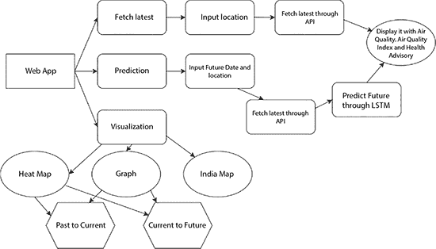

**Figure 1.1** 工作流程。

Figure 1.1 展示了应用的详细工作流程。最新的特定位置/地点数据通过 Open Data Repository 的 Restful `API` 以 `JSON` 格式获取。利用历史值对未来空气质量进行预测，预测结果通过 Web 应用以适当的消息形式展示给用户。可视化部分通过生成热力图并依据 WHO 指南显示相应消息实现，同时通过图表展示不同值之间的关联。最终输出也显示在印度地图上。

## 1.3.2 系统规格

主要硬件要求是高性能 CPU，如 Intel i5/i7 处理器或同等规格。系统需满足主存储和次存储的高内存需求，约 50 GB 硬盘和 4–8 GB RAM。主要软件要求包括任意开源操作系统、Python 语言及 `scikit-learn`、`pandas`、`numpy`、`matplotlib`、`bokeh`、`flask`、`tensorflow`、`theano` 等库。

## 1.3.3 算法

*   **1.** `K-Means Clustering`: `K-means` 算法接收一组输入值，根据参数 `k` 将值聚类为 `k` 个簇。聚类依据相似度指数进行，相似度指数接近的值被归入同一簇，另一组值归入另一簇 [11]。常用的相似度度量包括 `Euclidean`、`Manhattan` 和 `Minkowski`。我们使用聚类是因为数据需要被划分为类别。我们选择六类：*Good*、*Satisfactory*、*Moderately Polluted*、*Poor*、*Very Poor*、*Severe*。
*   **2.** `Support Vector Machine Algorithm (SVMA) for Prediction`: `SVM` 是用于解决分类和回归问题的经典算法。它提供监督学习模型，用于分析数据模式。`SVM` 通过将非线性类边界线性化来实现，即在高维特征空间中通过选择合适的核函数将高维特征向量降维。核函数的选择是 `SVM` 的关键部分。我们在实验中使用了线性核和径向基函数（`RBF`）。结果在后续章节讨论。考虑的两大类 `SVM` 分别是基于线性模型和基于非线性模型。
*   **3.** `Recurrent Neural Network LSTM Algorithm (LSTM-RNN)`: 当代神经网络（如前馈神经网络 `FFNN`s）与循环神经网络 `RNN`s 的区别在于后者在训练时使用标记数据，并且前向传播一直进行直到损失最小化。

`RNN`s 与 `FFNN`s 的区别在于，阶段 *t* − 1 的输出会影响阶段 *t* 的输出。`RNN` 有两个输入：当前输入值和最近的过去值，两者共同用于计算新的输出。

Figure 1.2 展示了 `RNN` 的简化形式。隐藏状态 `h[t]` 本身是非线性变换，可通过当前输入值 `I[t]` 与前一时刻的隐藏值 `h[t‑1]` 的线性组合计算。输出 `O[t]` 依赖于在 `RNN` 最后一层计算的概率 `p[t]`，该概率由 `softmax` 函数生成。`softmax` 仅在 `RNN`‑based 分类的最后一层计算，随后得到最终结果。

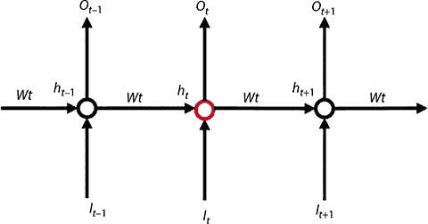

**Figure 1.2** 循环神经网络的基本步骤。

由于 `RNN` 本身存在消失梯度和爆炸梯度两大问题，因此提出了两种改进：`LSTM` 和 Gated Recurrent Unit（`GRU`）。本文采用了 `LSTM` [12]。

我们的任务是基于时间序列的历史污染数据预测未来值，这些数据包含滞后（lags），因此 `LSTM` 非常适合此场景。`LSTM` 能够从历史数据中学习不仅进行分类，还能处理结果并预测未来得分，而不受梯度问题的影响。

## 1.4 结果与讨论


# 开放数据与空气质量分析

## 数据来源

开放数据由 `OpenAQ` 组织 [13] 提供，其目标是通过开放数据和开源工具帮助人们对抗空气污染。数据来源于政府机构和科研团体，并由 OpenAQ 进行聚合。我们使用 OpenAQ API 获取最新数据，存储为 DataFrame 并以 CSV 格式保存，以便后续计算。Figure 1.3 展示了 2020 年 6 月 6 日在 Visakhapatnam、印度获取的数据快照。

**Table 1.1** AQI 类别范围。

| **AQI category (range)** | **PM[10] (24hr)** | **PM[2.5] (24hr)** | **NO[2] (24hr)** | **O[3] (8hr)** | **CO (8hr)** | **SO[2] (24hr)** | **NH[3] (24hr)** | **Pb (24hr)** |
|---|---|---|---|---|---|---|---|---|
| Good (0–50) | 0–50 | 0–30 | 0–40 | 0–50 | 0–1.0 | 0–40 | 0–200 | 0–0.5 |
| Satisfactory (51–100) | 51–100 | 31–60 | 41–80 | 51–100 | 1.1–2.0 | 41–80 | 201–400 | 0.5–1.0 |
| Moderately polluted (101–200) | 101–250 | 61–90 | 81–180 | 101–168 | 2.1–10 | 81–380 | 401–800 | 1.1–2.0 |
| Poor (201–300) | 251–350 | 91–120 | 181–280 | 169–208 | 10–17 | 381–800 | 801–1200 | 2.1–3.0 |
| 非常差 (301–400) | 351–430 | 121–250 | 281–400 | 209–748 | 17–34 | 801–1,600 | 1,200–1,800 | 3.1–3.5 |
| Severe (401–500) | 430+ | 250+ | 400+ | 748+ | 34+ | 1600+ | 1800+ | 3.5+ |

## 实验结果与分析

### 1. K-Means 聚类结果

如方法章节所述，我们使用 K-means 聚类来确定非监督数据的类别。为了找出所需的最优簇数，我们计算了 Silhouette 系数。Silhouette 系数使用每个样本的簇内平均距离 (`a`) 和最近簇的平均距离 (`b`) 计算，其中 `b` 是样本与其所在簇之外最近簇之间的距离。样本的 Silhouette 系数值为 `(*b* – *a*) / *max* (*a, b*)`。在我们的实验中，我们通过轮廓法将其保持为 7。聚类后，我们使用 AQI 表为空气质量赋予标签。不同空气控制参数的要求范围如下表 1.1 所示。

我们关注六个参数，即 `NO[2]`、`O[3]`、`PM[10]`、`PM[2.5]`、`SO[2]` 和 `CO`。为构建 LSTM 模型，我们在印度的 14 个不同地点进行训练，分别是 Visakhapatnam (GVMC Ram Nagar)、Ajmer (Civil Lines)、Alwar、Vasundhara (Ghaziabad)、Gurgaon (Vikas Sadan)、Bandra (Maharashtra)、Bhiwadi Industrial Area、Bengaluru (BWSSB Kadabesanaha)、Amritsar (Golden Temple)、Anand Vihar、R K Puram、Punjabi Bagh、NSIT (Dwarka) 和 Sector 62 Noida。首先，我们应用了 K-means 聚类。

### 2. SVM 结果

数据值 (1,870) 被划分为训练集和测试集。我们使用 80% 作为训练集，20% 作为测试集。聚类后的数据在 Sklearn 库中对空气质量进行了 SVM 训练，以便根据所有参数的值来确定空气质量。[14] 使用了 Sklearn 库。SVM 采用 `GridSearchCV` (k = 10) 进行交叉验证。在 374 个测试样本上的结果可见表 1.2。最佳参数集合为 `{`c`: 0.1, `gamma`: 0.001, `kernel`: linear}`。

### 3. LSTM 结果

为构建 LSTM 模型，我们在印度的 14 个不同地点进行训练，分别是 Visakhapatnam (GVMC Ram Nagar)、Ajmer (Civil Lines)、Alwar、Vasundhara (Ghaziabad)、Gurgaon (Vikas Sadan)、Bandra (Maharashtra)、Bhiwadi Industrial Area、Bengaluru (BWSSB Kadabesanaha)、Amritsar (Golden Temple)、Anand Vihar、R K Puram、Punjabi Bagh、NSIT (Dwarka) 和 Sector 62 Noida。每个模型使用 5000 个样本进行训练，500 个样本进行测试。

每个模型在高参数调优时对不同参数（如 kernel 初始化、批大小、epochs）有不同的取值。我们使用 Keras 库在 Python 中实现 [15]。评估指标为均方误差 (MAE) 和均方根误差 (RMSE)。表 1.3 显示了得到的 MAE 和 RMSE 值。MAE 计算公式为 `(\u2211|y \u2212 x|) / n`，RMSE 计算公式为 `\u221a(\u2211(y \u2212 x)\u00b2) / n`，其中 `y` 为预测值，`x` 为实际值。

图 1.4 显示孟加拉鲁 (Bengaluru) 当前小时的预测值以及 2017 年 12 月 13 日之后 2 天 3 小时的预测值。图 1.5 显示 2020 年 6 月 6 日之后 2 天 3 小时的预测值。我们发现，平均而言孟加拉鲁比其他城市更清洁，即使在 11 月和 12 月期间也是如此。这可能是因为雨天天气。孟加拉鲁几乎每天都有雨，雨水会把大多数空气污染物冲洗掉，从而降低空气污染。

图 1.6 显示 Anand Vihar, New Delhi 当前小时和未来一天 3 小时的预测值（2017 年 12 月 13 日之后）。新德里空气污染严重，观测到的空气质量非常差。`PM[2.5]` 水平仍然很高，使空气不仅有毒，还容易引发呼吸问题。我们还为应用程序用户生成了建议。图 1.7 显示 2020 年 6 月 6 日之后 1 天 3 小时的预测值。可以明显看出，由于实施封锁，污染水平大幅下降，空气质量也随之改善，因为交通和工业废气减少。

实验在批大小为 10、24、15、8 和 6，以及 epoch 为 10 和 100 时进行。LSTM 超参数对 `NO[2]`、`O[3]`、`PM[10]`、`PM[2.5]` 和 `SO[2]` 的 MAE 得分在表 1.4 中显示，经过仔细分析后，我们选择了偏差最小的批大小。

### 4. 数据可视化

本项目的主要目标之一是为那些无法解读不同空气污染物数值之间关系的普通人提供更好的可视化。因此，我们生成了不同参数的热力图。单个参数热力图以及参数组合热力图均已提供。

图 1.8 显示 2017 年 12 月 12 日和 13 日的臭氧气体 `O[3]` 热力图。从图中可以看出，`O[3]` 在白天和夜间之间波动最大，`O[3]` 水平在午夜时下降，而在 12 月 13 日傍晚时升高。这可能是因为傍晚时段车辆交通量大。图 1.9 显示 2020 年 6 月 6 日至 8 日的 `O[3]` 热力图，清晰表明在车辆少和工业排放减少时 `O[3]` 水平有所下降。

图 1.10 显示 2017 年 12 月 11、12、13 日在 Noida Sector 62 的所有参数热力图。从热力图可以看出，`PM[2.5]` 是空气中的主要污染参数。它在所有天数以及白天和夜间均保持在危险水平。图 1.11 显示 2020 年 6 月 6、7、8 日在 Noida Sector 62 的所有参数热力图。由于实施封锁，所有污染物的水平明显下降。但 `PM[2.5]` 仍然是该地区污染的主要贡献因素。

图 1.12 显示 2017 年 12 月 Anand Vihar, New Delhi 的 `O[3]` 预测值，可以观察到 `O[3]` 水平在下降。图 1.13 显示 2020 年 6 月 Sector 62, Noida 的 `PM[10]` 预测值，可以观察到水平下降。

图 1.14 展示了印度主要城市的空气质量预测，用户可以在全国范围内研究空气质量。图中的蓝点表示空气质量良好，红点表示中等，绿点表示满意，黄点表示非常差，洋红点表示极差。我们发现，印度的小城市、镇和乡村空气质量良好，只有大都市区及其周边地区空气质量最差。

## 重要结论

在我们的项目中，我们发现了一些重要的结论。发现不同参数的空气值取决于最近的历史记录（几天到一个月），而不取决于许多之前的月份。在通过 API 检索不同参数的实时值时，有时会出现空值或零值。这可能是传感器故障或不适当的天气条件导致的。某些参数（如 `O[3]`）在夜间可能会与其他化学物质混合形成新化合物，从而导致其值下降。`NO[2]` 和 `SO[2]` 有时也会相互作用，导致突变的值。原始数据通过可视化对普通人来说更易于理解。此外，预计封锁将是控制空气污染的有效替代措施。

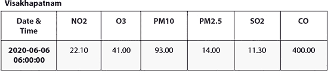

**Figure 1.3** Screenshot of fetched data.

**Table 1.2** Precision, recall, and F1-score.

| **Classes** | **Precision** | **Recall** | **F1-Score** |
|---|---|---|---|
| Moderate | 1.0 | 0.99 | 0.99 |
| Poor | 1.0 | 0.95 | 0.97 |
| Satisfactory | 0.98 | 1.0 | 0.99 |
| Severe | 1.0 | 1.0 | 1.0 |
| Very Poor | 1.0 | 1.0 | 1.0 |
| Avg/total | 0.99 | 0.99 | 0.99 |
| **Final Accuracy: 0.9893** | | | |

**Table 1.3** MAE and RMSE scores for different epochs.

| **Metric** | **Value** |
|---|---|
| Test MAE for 1 | 8.864 |
| Test RMSE for 1 | 12.122 |
| Test MAE for 2 | 17.996 |
| Test RMSE for 2 | 35.390 |
| Test MAE for 3 | 23.820 |
| Test RMSE for 3 | 35.938 |
| Test MAE for 4 | 6.021 |
| Test RMSE for 4 | 9.269 |

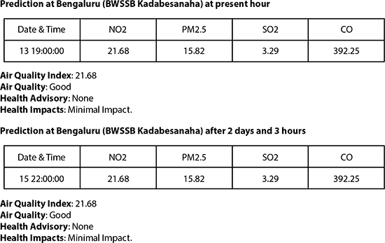

**Figure 1.4** Predicted values in Bengaluru in December, 2017.

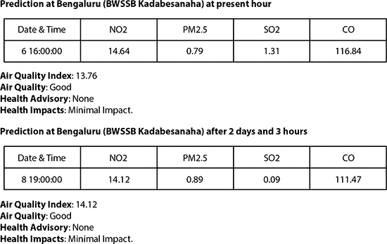

**Figure 1.5** Predicted values in Bengaluru in June, 2020.

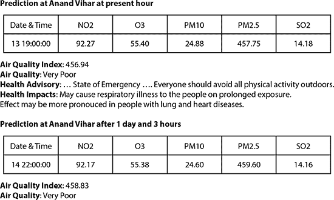

**Figure 1.6** Predicted values in New Delhi in December, 2017.

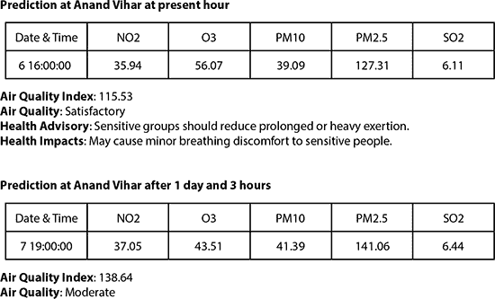

**Figure 1.7** Predicted values in New Delhi in June, 2020.

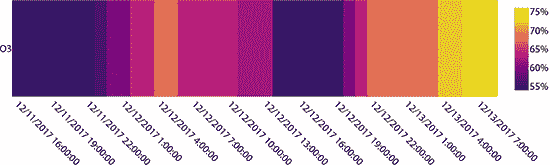

**Figure 1.8** Heat map for ozone `O[3]` for day and night in December, 2017.

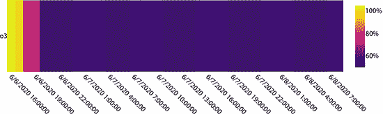

**Figure 1.9** Heat map for ozone `O[3]` for day and night in June, 2020.

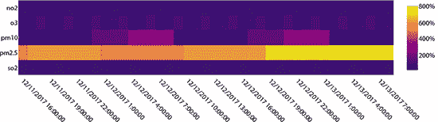

**Figure 1.10** Heat map for all parameters for 3 days and nights in December, 2017.

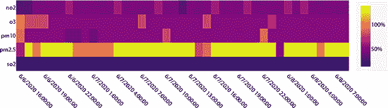

**Figure 1.11** Heat map for all parameters for 3 days and nights in June, 2020.

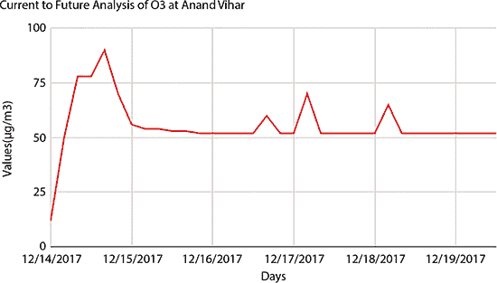

**Figure 1.12** Predicted values for `O[3]` for Anand Vihar, New Delhi.

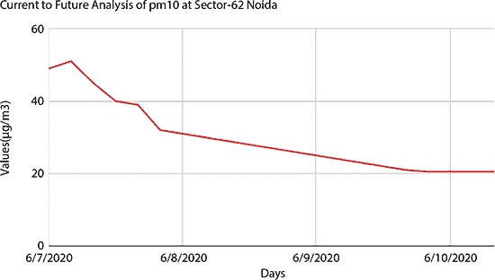

**Figure 1.13** Predicted values for `PM[10]` for Sector 62, Noida.

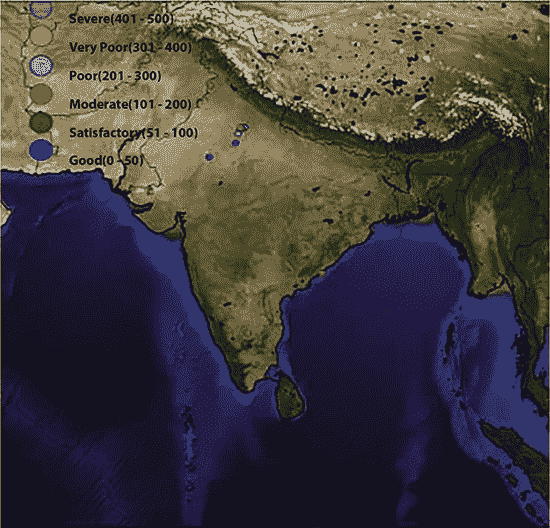

**Figure 1.14** Pollution levels in major Indian cities.

## 1.5 Conclusion

After applying K-means clustering using Silhouette coefficient, the data is divided into seven clusters. The SVM is successfully able to classify the data into its respective air quality class with accuracy of 99%. The LSTM models for different places have been tuned accordingly to minimize MAE and RMSE. The proposed model could be used for various purposes like predicting future trends of air quality, assessing past trends of air quality, visualizing data in an effective way, issuing health advisory, and providing health effects (if any) based on the current air quality. Various parameters can be compared and it could be determined which pollutant is affecting more in a particular area and accordingly actions could be taken beforehand. Anyone could get inference from the data easily which is tough to analyze numerically and could take certain actions to control air pollution in any area.

## References

1. IHME and HEI State of Global Air/2017, A special report on global exposure to air pollution and its disease burden. State of Global Air, vol. 1, 1–17, 2017.

2. Li, H., Fan, H., Mao, F., A visualization approach to air pollution data exploration—a case study of air quality index (PM2.5) in Beijing, China. *Atmosphere*, 7, 3, 35, 2016.


3. Lu, W., Ai, T., Zhang, X., He, Y., An interactive web mapping visualization of urban air quality monitoring data of China. *Atmosphere*, 8, 8, 148, 2017.

4. Kumar, A., Sinha, R., Bhattacherjee, V., Verma, D. S., & Singh, S., Modeling using K-means clustering algorithm. *1st International Conference on Recent Advances in Information Technology (RAIT)*, vol. 1, 554–558, IEEE, 2012.

5. Fan, J., Li, Q., Hou, J., Feng, X., Karimian, H., Lin, S., A spatiotemporal prediction framework for air pollution based on deep RNN. *ISPRS Annals of the Photogrammetry, Remote Sensing and Spatial Information Sciences*, vol. 4, p. 15, 2017.

6. Pereira, R.L., Sousa, P.C., Barata, R., Oliveira, A., Monsieur, G., CitySDK Tourism API-building value around open data. *J. Internet Serv. Appl*., 6, 1, 1–13, 2015.

7. Adeleke, J.A., Moodley, D., Rens, G., Adewumi, A.O., Integrating statistical machine learning in a semantic sensor web for proactive monitoring and control. *Sensors*, 17, 4, 807, 2017.

8. Kim, S.H., Choi, J.W., Han, G.T., Air pollution data visualization method based on google earth and KML for Seoul air quality monitoring in realtime. *Int. J. Software Eng. Its Appl*., 10, 10, 117–128, 2016.

9. Sharma, S., Zhang, M., Gao, J., Zhang, H., Kota, S.H., Effect of restricted emissions during COVID-19 on air quality in India. *Sci. Total Environ*., 728, 138878, 2020.

10. Mahato, S., Pal, S., Ghosh, K.G., Effect of lockdown amid COVID-19 pandemic on air quality of the megacity Delhi, India. *Sci. Total Environ*., 730, 139086, 2020.

11. Lloyd, S., Least squares quantization in PCM. *IEEE Trans. Inf. Theory*, 28, 2, 129–137, 1982.

12. Hochreiter, S. and Schmidhuber, J., Long short-term memory. *Neural Comput*., 9, 8, 1735–1780, 1997.

13. Hasenkopf, C. A., Flasher, J. C., Veerman, O., & DeWitt, H. L., OpenAQ: A Platform to Aggregate and Freely Share Global Air Quality Data. *AGU Fall Meeting Abstracts*, 2015, A31D-0097, 2015.

14. Pedregosa, F., Varoquaux, G., Gramfort, A., Michel, V., Thirion, B., Grisel, O., Vanderplas, J., Scikit-learn: Machine learning in Python. *J. Mach. Learn. Res*., 12, 2825–2830, 2011.

15. Manaswi, N. K., Understanding and working with Keras, *Deep Learning with Applications Using Python*, vol. 1, pp. 31–43, Springer, 2018.

1. **Corresponding author**: `priyankjn62@gmail.com`

2. **Corresponding author**: `gagandeep.kaur@jiit.ac.in`

## 自动计数与分类桑蚕卵的深度学习方法

**Shreedhar Rangappa**<sup>1</sup>, Ajay A.<sup>1</sup> and G. S. Rajanna<sup>2</sup>

<sup>1</sup>Intelligent Vision Technology, Bengaluru, India

<sup>2</sup>Maharani Cluster University, Sheshadri Road, Bengaluru, India

> **摘要**

> 利用卷积神经网络（`CNN`）识别并量化雌性丝绸蛾在纸张上产下的桑蚕卵的方法。该方法还能够分割单个卵，并将其分类为已孵化卵和未孵化卵，从而超越以往的图像处理技术。对以往技术的局限性进行了描述，并展示了通过数字扫描的均匀照明来提高准确性的尝试。本文简要讨论了使用标准标记键（`key marker`）将任意桑蚕卵纸张转换为标准图像的方法，该图像可作为训练好的卷积神经网络模型的输入，以获取预测。深度学习模型在超过 100K 张图像的桑蚕数据集上进行训练，每类别约 100K 张。在测试图像集上的实验结果表明，我们的方法实现了 97%以上的准确率，并且具有高度的可重复性。

> **关键词：** 深度学习、卷积神经网络、数据集、准确率、桑蚕、产卵率、孵化率

## 2.1 引言

过去十年，机器学习在工程等多个领域的受欢迎程度已超过了以往任何时候都达到的水平，而顺序编程方法在过去一个世纪中也未能达到如此高度。深度学习/卷积神经网络（`CNN`）是一种无需显式提供特征的机器学习方法，能够直接解决给定问题并生成有用结果。这些高级技术主要部署在工程领域，但医学成像 <sup>[1]</sup>、微生物学 <sup>[2]</sup> 和金融 <sup>[3]</sup> 等学科也大量采用机器学习以取得更优的结果。

此外，仍有部分科学领域继续采用传统的解决问题方式，其中丝绸养殖（`sericulture`）就是其中之一。丝绸养殖行业涉及饲养寄主植物以及饲养蚕虫以生产天然丝绸产品。丝绸是纺织品之王，全球印度是四种不同丝绸的第二大生产国。因此，丝绸养殖是经济、社会、科学、政治和知识层面进步的基础 <sup>[4]</sup>。产卵数（即受精雌蛾产下的卵数）、孵化率（蚕虫的出生率）、存活率（抗病和抗环境能力）以及丝绸产量是整个丝绸产业赖以生存的几个经济特征（参数）。手动计数卵已成为量化产卵数和孵化率的常用方法。许多自动化方法（图像处理和新硬件设计）已尝试，但准确率较低 <sup>[5]</sup>。本文描述了一种新的自动计数和分类卵的方法，能够准确量化产卵数和孵化率，为 successful silk cocoon crops（成功的丝绸茧）提供必要的饲养信息。

本章节介绍了一些传统方法及其局限性，并进一步介绍本文采用的 `CNN` 方法及各模型的具体配置，以期超越其他图像处理技术的结果。

## 2.2 传统的桑蚕卵检测方法

在印度、中国、泰国及其他亚洲国家，手动计数桑蚕卵仍是常规做法 <sup>[6]</sup>。桑蚕卵体积小 <sup>[5]</sup>，直径约 2–3 mm，常以密集小群的形式出现。因此，手动计数过程耗时且易受人为误差影响。产卵数和孵化率的不一致会影响整体茧的产量和丝绸产量。

为测量卵的数量，已实施多种技术，如设计专用硬件 <sup>[6, 7]</sup> 和使用图像处理技术。以往发表的论文主要集中在通过不同图像处理方法对卵与背景进行分割，包括低对比度图像调整 <sup>[8]</sup>、对比度增强后结合形态学操作 <sup>[7]</sup>、图像补片质心分析 <sup>[6]</sup>、从 `RGB` 转换为 `HSV` 以识别感兴趣区域（`ROI`） <sup>[9]</sup>、使用高斯混合模型 <sup>[10]</sup>、以及使用 Hough 变换（blob 分析） <sup>[11, 12]</sup>。这些技术的准确性完全取决于实验条件的稳定性，如卵所在纸张的颜色、卵的大小以及拍摄时的均匀照明。只要改变其中任何一个参数，结果就会显著变化，因此为每种可能的场景设计图像处理算法十分繁琐。此外，传统方法采用人工操作的数码相机拍摄卵的数字数据，未设定固定照明参数，导致准确性低。

## 2.3 拟议方法

在数字图像采集中，影响结果的两大主要参数是卵的大小和光照的均匀性。首先，图像处理（包括 blob 分析）算法是针对特定卵大小或大小范围设计的，若卵尺寸超出该范围会导致最终结果出错。由于未在前人研究中设定相机与卵纸张之间的固定距离，卵在图像中的像素尺寸随距离变化，进而影响算法表现。此外，光照在感兴趣区域（`ROI`）上的不均匀分布会导致数码相机记录的数据出现过曝或欠曝，使得对比度拉伸和直方图均衡等算法在有限场景下表现良好，却无法完全提升低质量数据的可信度。

为解决上述问题，本文采用恒定光源并以纸张扫描仪的固定距离捕获桑蚕卵纸张的数字数据。由于扫描仪的相机阵列距离固定，卵的像素尺寸可被限制在特定范围内，即约 28–36 像素直径（在本实验中）。然而，并非所有扫描仪制造商在设计时严格遵循尺寸标准，导致不同扫描仪采集的卵尺寸差异显著。例如，`Canon®` 扫描仪在相同分辨率和 dpi 下的卵直径约为 28–32 像素，而 `Hewlett‑Packard®`（`HP`）扫描仪则约为 36–40 像素。

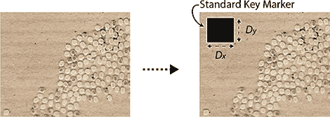

**Figure 2.1** 在桑蚕卵纸张上添加标记键。

为了准确计数蚕茧，必须进行前景-背景（`FB`）分割。以往的尝试是基于蚕茧的亮度值对背景进行分割。背景是指没有对应于蚕茧的像素区域，在图像处理阶段会被视为背景并被丢弃。然而，这种方法在所有情况下并不理想，因为蚕茧可能会沾染蚕蛾的尿液，导致背景变色。尿液干燥后形成一层白色物质，在 8 位灰度图像中，其像素强度接近 230。

输入给 `CNN` 模型的数字数据分辨率也是进行背景分割的原因之一。蚕茧在扫描后大小约为 32×32 像素，而整张蚕茧纸的大小为 5008×6984 像素（在本实验中）。如果将整张纸输入 `CNN` 模型，使用 32×32 像素的滑动窗口方法，模型需要对 3500 万张图像进行分类，这在没有 `GPU` 支持的系统上计算成本过高。

为了解决这个问题，`FB-CNN` 模型在 128×128 像素、三通道 `RGB` 图像的输入数据上进行训练，如 Figure 2.3 所示，使用 `softmax` 激活函数输出类别结果。部分 `FB-CNN` 模型的规格在 Table 2.1 中给出，并附有准确率得分。使用 128×128 像素作为输入时，整张蚕茧纸被分成以 128 为步长的 128×128 像素方格，结果得到约 2000 张图像，需进行分类以判断是前景（egg）还是背景。Figure 2.4 展示了整张蚕茧纸的分割结果，绿色（pixels）表示前景（存在 egg），红色表示背景（absence of egg）。进一步处理仅针对绿色像素，这既减少计算时间，又提高最终准确率，因为背景像素被排除在数据处理循环之外。

**Table 2.1** 前景-背景（`FB`）分割 `CNN` 模型的规格。

| **Input image** | **Activation/output** | **Training samples** | **Test samples** | **Validation samples** | **Test loss** | **Accuracy on the test set** | **Accuracy on the validation set** |
| --- | --- | --- | --- | --- | --- | --- | --- |
| 128 × 128 | SoftMax 2 class-(0/1) | 142 × 10³ | 64.3 × 10³ | 9.6 × 10³ | 0.1242 | 96.1554% | 96.6422% |

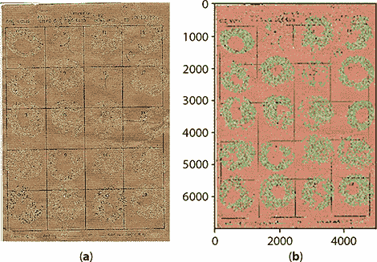

**Figure 2.4** 整张蚕茧纸的前景-背景分割（a）（输入）和（b）（输出）。

## 2.3.3 蛋位置预测器

在对鸡蛋像素与背景像素进行分割后，下一步是确定蛋的位置。诸多 `CNN` 模型已被引入，如 `Fast‑RCNN` [13] 和 `YOLO` [14]，它们利用交并比（`IoU`）方法预测目标的位置。不考虑这些知名技术的主要原因有两点。首先，这些方法的目标/感兴趣区域尺寸通常超过 100 × 100 像素，尺寸不一，且在不同尺寸的边界框上已进行训练，这使得它们难以用于确定鸡蛋的位置，因为鸡蛋的平均尺寸仅为 28 × 28 到 36 × 36 像素，形状相对稳定，可忽略微小变形；因此，针对不同尺寸的边界框进行训练并不会产生良好结果。其次，这些方法受限于单个边界框内可识别的同类物体数量，`YOLO` [14] 仅能在一个框内识别两个物体；由于鸡蛋体积小，在 100 × 100 的网格中会出现许多同类鸡蛋，导致难以检测。

蛋位置预测 `CNN` 模型的规格如 Table 2.2 所示，核心 `CNN` 的输入已改为 32 × 32 像素的三通道 `RGB` 图像。其输出是一个回归值，提供蛋中心的坐标 (`x, y`) 而非四个角点的边界框。训练数据集包含类图像，即已孵化鸡蛋和未孵化鸡蛋。正样本为完整可见的单个鸡蛋图像，负样本为部分可见且包含多个鸡蛋的图像。Figure 2.5 展示了用于判别正负样本的分类器模型，正样本随后用像素值预测蛋中心位置进行训练。实际应用时，预测的蛋中心位置用于裁剪单个蛋数据，输入到分类器中判断该蛋属于 `HC`（已孵化）或 `UHC`（未孵化）。Figure 2.6 展示了使用蛋位置预测 `CNN` 模型在测试数据集中定位所有蛋中心的整体结果，所有蛋中心均以蓝点标记。采用步长为 (4, 4) 的 32 × 32 滑动窗口实现了上述结果。

## 2.3.4 蛋类预测

滑动窗口方法用于生成输入图像，单个鸡蛋可能对应多个 32 × 32 的图像窗口。使用欧氏距离公式

```
images
```

结合用户定义的距离上限，从而选择蛋中心。(`x`1, `y`1) 为参考像素点，(`x`2, `y`2) 为被考虑的像素点。由于鸡蛋直径在 28–32 像素范围内，距离上限设为蛋的半径，即 16 像素。任何落在该范围内的中心位置都被视为同一只鸡蛋，因而通过对其进行平均，得到单个蛋的最终位置，随后使用 Equations (2.4) 到 (2.7)（(`x`[a], `y`[a]) 为在距离上限内所有预测中心的平均值）将原始位置 (`x, y`) 与裁剪图像的宽度 `w`、高度 `h`（均为 32 像素）结合，生成用于输入鸡蛋类别预测 `CNN` 模型的图像。该模型输出类别标签，将输入图像划分为 `HC` 或 `UHC`。蛋类别预测 `CNN` 模型的规格如 Table 2.3 所示。

(2.4) 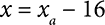(2.5) 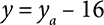(2.6) 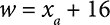(2.7) 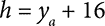

**Table 2.2** 蛋位置预测 `CNN` 模型的规格。

| **输入图像** | **激活/输出** | **训练样本** | **测试样本** | **验证样本** | **测试损失** | **验证损失** |
| --- | --- | --- | --- | --- | --- | --- |
| 32 × 32 | 回归蛋中心 (`x, y`) | 439 × 10³ | 51.6 × 10³ | 25.8 × 10³ | 0.5488 | 0.5450 |

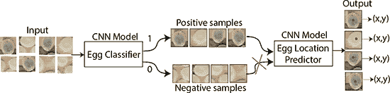

**Figure 2.5** `CNN` 训练模型用于以像素值形式预测蛋位置。

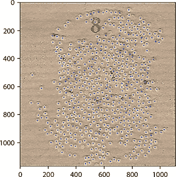

**Figure 2.6** 蛋位置预测 `CNN` 模型的结果。

**Table 2.3** 蛋类别预测 `CNN` 模型的规格。

| **输入图像** | **激活/输出** | **训练样本** | **测试样本** | **验证样本** | **测试损失** | **测试集准确率** | **验证集准确率** |
| --- | --- | --- | --- | --- | --- | --- | --- |


| 32 × 32 | SoftMax 2 类-(0/1) | 2.4 × 10⁶ | 80.2 × 10³ | 30 × 10³ | 0.0077 | 99.8115% | 99.7981% |

整体鸡蛋分类与计数的准确率超过 97%，Figure 2.7 展示了所提方法的结果，绿点代表已孵化鸡蛋，红点代表未孵化鸡蛋。由于输入图像过大无法完整显示，部分区域已放大并在 Figure 2.7 中单独展示，以便观察细小的鸡蛋特征。

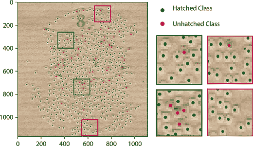

**Figure 2.7** 所提方法生成的鸡蛋分类结果。

## 2.4 数据集生成

与传统的数字图像直接提取鸡蛋计数、几乎不需要训练数据的方法相比，所提 CNN 方法需要大量数据集来自动学习特征并提供所需结果。CNN 方法在隐藏层数增加时，需要丰富的训练数据以及测试和验证数据集。

市面上有许多免费可下载的数据集，可用于训练自己的 CNN 模型以识别手写数字、识别物体等。但针对蚕卵计数或分类的专用公开数据集并不存在。因此，在本工作中，训练数据集通过从蚕卵纸中裁剪类图像并添加类标签、蛋中心位置等必要特征来生成。为蛋位置和分类（HC 与 UHC）分别生成了超过 40 万张图像的数据集，以及 10 万张用于单类（HC 和 UHC）的图像。同时实施了数据增强以扩大数据规模。

## 2.5 结果

The trained CNN models were tested with new silkworm egg sheets that were scanned using a Canon`^` paper scanner at 600 dpi, to classify and count the number of eggs. These digital datasets were completely isolated from the training step; thereby, the trained CNN models had to predict the results than providing learned results. Table 2.4 represents the performance of the overall CNN model trained using our datasets. The performance of a few datasets is shown due to space restriction. It can be observed that CNN models trained with two hidden layers perform superior to the conventional techniques by providing accuracy of over 97%. The accuracy shown in Table 2.4 is the accuracy of the number of eggs counted and accuracy in classifying the eggs. The model consistently outperforms the conventional computer vision/image processing technique of silkworm counting and classification with accuracy over 97% for newer data of the same breed. The inference time shown in Table 2.4 was performed on an Nvidia GPU (GTX 1060).

The model performance drops to newer egg data that are completely different in color and texture, which were not available in the training dataset. This happens due to the nature of different breed eggs that are spatially different from the trained model. Collecting and training a deep learning model to a different breed of silkworm eggs will resolve these issues, which is under action.

**Table 2.4** Performance of the CNN model results on test datasets.

| **Test sample** | **True count** | **Count prediction** | **Time (sec)** | **Class scores** | **Accuracy (%)** |
| --- | --- | --- | --- | --- | --- |
| | **HC** | **UHC** | | | |

| MSR1_001.jpg | 588 | 586 | 11.83 | 437 | 149 | 99.65 |
| MSR1_002.jpg | 534 | 526 | 8.99 | 473 | 53 | 98.68 |
| MSR1_003.jpg | 554 | 556 | 10.42 | 491 | 65 | 99.28 |
| MSR1_004.jpg | 539 | 528 | 9.81 | 501 | 27 | 97.95 |
| MSR1_005.jpg | 597 | 588 | 11.14 | 562 | 26 | 98.32 |

## 2.6 Conclusion

In this paper, CNN-based silkworm egg counting and classification model that overcomes many issues found with conventional image processing techniques is explained. The main contribution of this paper is in fourfolds. First, a method to generalize the method of capturing silkworm egg sheet data in a digital format using normal paper scanners rather than designing extra hardware, which eliminates the need for additional light sources to provide uniform illumination while recording data and maintain high repeatability.

Second, the scanned digital data can be transformed into standard size by using key markers stamped onto the egg sheets before scanning. This allows the user to resize the dimension of digital data and later use it in an image processing algorithm or CNN without introducing dimensionality error.

A dataset has been put together containing over 400K images representing different features of silkworm eggs. The CNN and other models that need a lot of training, testing and validation data can easily use this dataset to skip the data generation phase which is the third contribution.

Fourth, a CNN model has been trained using the dataset that is designed to predict the egg class and count the number of eggs per egg sheet. With over 97% accuracy the model outperforms many conventional approaches with only 4 hidden layers and a fully connected layer.

The model performs accurately in quantifying (counting) different breed silkworm eggs, but new datasets become necessary to predict the class labels for new silkworm breed for which the model is not trained. This is because HC class eggs have high pixel intensity throughout the egg surface while UHC has dark pixels at the center surrounded with high-value pixels for the egg breed used on our experiment. This color feature may not be the same as other breed silkworm eggs, and hence, additional data becomes important that can be fed into already trained CNN using transfer learning. Also, the egg location model performs well with new breed data, the training dataset to determining the class of eggs can be easily generated with minimal human effort.

## Acknowledgment

The authors would like to thank Smt. R. Latha S-B and Mr. P. B. Vijayakumar S-C of KSSRDI, KA, IN for providing silkworm egg sheets for this study.

## References

1. Xue, Y. and Ray, N., Cell Detection in Microscopy Images with Deep Convolutional Neural Network and Compressed Sensing, `CoRR`, abs/1708.03307, `arXiv preprint arXiv:1708.03307`, 2017.

2. Zieliński, B., Plichta, A., Misztal, K., Spurek, P., Brzychczy-Włoch, M., Ochońska, D., Deep learning approach to bacterial colony classification. `PLoS One`, 12, 9, e0184554, 2017.

3. Abe, M. and Nakayama, H., Deep learning for forecasting stock returns in the cross-section, in: `Lecture Notes in Computer Science (including subseries Lecture Notes in Artificial Intelligence and Lecture Notes in Bioinformatics)`, vol. 10937 LNAI, pp. 273–284, 2018.

4. Kumar, D.A., Silkworm Growth Monitoring Smart Sericulture System based on Internet of Things (IOT) and Image Processing. `Int. J. Comput. Appl`., 180, 18, 975–8887, 2018.

5. S.P., Rajanna, G.S., Chethan, D., Application of Image Analysis methods for Quantification of Fecundity in Silkworm Bombyx mori L, in: `International Sericulture Commission`, Research Papers, 2015 ([`www.inserco.org/en/previous_issue`](http://www.inserco.org/en/previous_issue)).

6. Kiratiratanapruk, K., Watcharapinchai, N., Methasate, I., Sinthupinyo, W., Silkworm eggs detection and classification using image analysis, in: `2014 International Computer Science and Engineering Conference, ICSEC 2014`, pp. 340–345, 2014.

7. Pandit, A., Rangole, J., Shastri, R., Deosarkar, S., Vision system for automatic counting of silkworm eggs, `2014 International Conference on Information Communication and Embedded Systems, ICICES 2014`, no. 978, pp. 1–5, 2015.

8. Kiratiratanapruk, K. and Sinthupinyo, W., Worm egg segmentation based centroid detection in low contrast image, in: `2012 International Symposium on Communications and Information Technologies, ISCIT 2012`, pp. 1139–1143, 2012.

9. Pathan, S., Harale, A., Student, P.G., A Method of Automatic Silkworm Eggs Counting System. `Int. J. Innovative Res. Comput. Commun. Eng`., 4, 12, 25, 2016.

10. K.P.R., Sanjeev Poojary, L., M.G.V., S.N.K., An Image Processing Algorithm for Silkworm Egg Counting. `Perspect. Commun. Embedded-Syst. Signal-Process. (PiCES)`, 1, 4, 2566–932, 2017.

11. Matas, J., Galambos, C., Kittler, J., Robust Detection of Lines Using the Progressive Probabilistic Hough Transform. `Comput. Vision Image Understanding`, 78, 1, 119–137, Apr. 2000.

12. Nikitha, R.N., Srinidhi, R.G., Harshith, R., Amar, T., Raghavendra, C.G., Reckoning the hatch rate of multivoltine silkworm eggs by differentiating yellow grains from white shells using blob analysis technique, in: `Advances in Intelligent Systems and Computing`, vol. 709, pp. 497–506, 2018.

13. F. und T. des L. N.-W. Ministerium für Innovation and Wissenschaft, Faster R-CNN: Towards Real-Time Object Detection with Region Proposal Networks. `Advances in neural information processing systems`, 2015.

14. Özdener, A.E. and Rivkin, A., You Only Look Once: Unified, Real-Time Object Detection Joseph. `Drug Des. Devel. Ther`., abs/1506.02640, 11, 2827–2840, 2015.


1. `\*Corresponding author`: `44shree@gmail.com`

# A Wind Speed Prediction System Using Deep Neural Networks

**Jaseena K. U^(1,2)\* and Binsu C. Kovoor¹**

*¹Division of Information Technology, School of Engineering, Cochin University of Science and Technology, Kochi, Kerala, India*

*²Department of Computer Applications, MES College Marampally, Aluva, Kochi, Kerala, India*

> **摘要**
>
> 随着化石燃料以惊人的速度枯竭，对可再生能源的需求显著提升。传统能源的使用正在使环境更加污染。因此，风能等可再生能源变得更为重要和受到追捧。低成本和高可获得性是风能成为最具主导性可再生能源的关键因素。风速预测在风力发电站、农业、海军和机场等多个领域都有应用。风速可以根据露点、湿度、温度和气压等环境因素进行预测。深度神经网络（DNN）是一种特殊类型的神经网络，能够通过一系列经过训练的算法处理和分析海量数据，并能够基于历史数据进行预测。本章提出了一种基于大量数据的深度神经网络模型，用于预测日平均风速。用于评估预测系统准确性的指标包括平均绝对误差、均方根误差和 R²。将所提模型与人工神经网络、支持向量机和随机森林进行性能比较，实验结果表明所提模型更高效、更有效。
>
> **关键词**：风速预测、人工神经网络、深度学习、深度神经网络

## 3.1 入

能源是每个发展中国家进行工业和农业活动的不可或缺的一部分。风能被认为是最有前景且对环境友好、可用于发电的可再生能源。风速预测是一项重要活动，因为风在农业、工业、海洋、军事和机场等多个领域都有广泛应用。在风力发电机组中，精确且可靠的风速预测是产生电能的必要条件。某些作物的种植也取决于风速。在火箭发射过程中，风速同样起着重要作用。风速预测可以利用历史风速数据来实现。风速受天气影响，风速的循环行为使得准确预测成为一项挑战性任务 [1]。因此，开发准确的风速预测模型显得尤为重要，已有多个系统被实施以提高准确性。在大数据时代，传统的智能计算模型在从大数据集中提取相关信息时可能耗时较长。然而，深度学习的惊人潜力能够处理和分析广泛的数据集，实现更好的特征学习和模式分析。

当前的预测系统可分为四类，即物理、统计、人工智能（AI）和混合系统，这取决于所采用的预测方法 [2]。物理系统利用数学模型来预测未来状态。统计模型是线性模型，适合短期风速预测。最常用的统计模型包括自回归整合移动平均（ARIMA）、多元回归和向量自回归（VAR）。人工智能的发展启发了智能预测模型的研发，这些模型在与统计模型相比时表现出更强的稳健性和有效性。AI 模型能够高效处理非线性数据集，并展现更好的预测性能。AI 系统进一步细分为机器学习预测器和深度学习预测器。人工神经网络（ANN）、极端学习机（ELM）和支持向量机（SVM）是用于风速预测的流行机器学习模型。机器学习技术在预测系统中普遍使用，ANN 经常被用于学习非线性函数。深度学习使用具有深层结构的神经网络，涵盖多层非线性处理阶段。随后，深度神经网络（DNN）因其高预测精度而被成功应用于风速预测。

He 和 Xu [3] 构建了一个使用两种核函数（多项式和小波核函数）的 SVM 模型来预测风速。结果证明，结合多种学习函数优于单一学习函数。

Yang *et al*. [4] 推荐了一种利用代表单元方法的风力发电预测模型，其中采用了最小二乘 SVM（LSSVM）方法进行风力发电预测。

Finamore *et al*. [5] 建议使用前馈神经网络模型预测风力，并将其性能与持续模型进行了比较。

Yu *et al*. [6] 构建了一个基于波形包分解（WPD）和 Elman 神经网络的混合模型来预测风速。

由 Filik 和 Filik [7] 开发的 ANN 模型利用温度、风速和气压等天气参数，并研究了这些变量的影响。

Tarade 和 Katti [8] 对现有基于 ARIMA、ANN 和多项式曲线拟合的风速预测模型进行了深入调查。

Liu *et al*. [9] 提出了一种结合小波、小波包、时间序列和 ANN 的混合模型。Wavelet Packet ANN 模型在所有其他模型中表现最佳。

Ramasamy *et al*. [10] 详细描述了一个使用 ANN 预测印度喜马偕尔邦十一个地点风速的系统。

Ghorbani *et al*. [11] 建议基于 ANN 和遗传编程（GEP）的小时风速预测模型，使用 2005‑2012 年美国科罗拉多州 8 年的数据，并将其结果与多元线性回归模型和持续模型进行了比较。

Mi *et al*. [2] 定义了一种新的混合方法，结合小波、ELM 和异常校正算法，以在小波域中减少数据失真。

Khandelwal `et al` [12] 推荐了一种使用离散小波变换（DWT）、ARIMA 和 ANN 的风速预测系统，其中原始信号通过 DWT 分解为低频和高频组分。低频组分随后使用 ARIMA 进行训练，而高频组分则使用 ANN 进行训练。Yousefi `et al` [13] 设计了一种利用小波变换（WT）和 ANN 的风速预测系统。结果表明，预测精度显著提升，从而验证了所提模型的有效性。Shao `et al` [14] 展示了一种基于 AdaBoost 神经网络的风速预测系统，该系统首先使用 WT 对风速数据进行降噪以提高精度。Cui `et al` [15] 建议采用神经网络进行风速预测，其中采用增强经验模态分解（EMD）对输入数据进行分解。模型参数使用鲸算法（bat algorithm）进行优化，仿真结果表明该模型优于其他模型。Senthil [16] 开发了三种基于机器学习的风速预测模型。作者使用了反向传播神经网络（backpropagation neural network）、径向基函数（RBF）以及非线性自回归外部输入模型（NARX）来预测风速。结果证明 NARX 模型在风速预测中超越了其他两种模型。采用互信息特征选择方法后，NARX 模型的预测精度进一步提升。Hui `et al` [17] 提出了一种两阶段风力发电量预测模型，该模型利用模糊聚类和 RBF 网络来预测风力发电量。

在文献中大多数模型均采用单隐藏层结构。要训练具有多个隐藏层的神经网络，则需采用深度学习架构。深度学习利用计算能力的提升以及能够自动从海量数据中提取关键特征的神经网络类型。Bali `et al` [18] 对多种基于深度学习的风速预测系统进行了详尽全面的调查。该调查提供了更高效、更可靠的评估风速预测方法有效性的手段。Coa `et al` [19] 通过将循环神经网络（RNN）与多变量和单变量 ARIMA 模型相结合，对风速预测模型的准确性进行了全面回顾。作者指出，非线性 RNN 模型的表现优于 ARIMA 模型。Khodayar 和 Teshnehlab [20] 推荐了一种堆叠自编码器（stacked autoencoder）DNN 模型，用于极短期（即几天内）的风速预测，适用于美国科罗拉多州。Sergio 和 Ludermir [21] 以及 Liu `et al` [22] 描述了基于深度学习的风速预测模型。Hu `et al` [23] 实现的基于迁移学习的模型采用了具有共享隐藏层的 DNN 架构，特别适合数据稀缺的数据集。

文献分析表明，通过采用隐藏层更多的神经网络，预测性能可以得到提升。更多的隐藏层使系统能够更准确地学习特征。因此，本章提出了一种针对加州斯坦福气象站日均风速的最优深度神经网络（DNN）系统。首先，通过实验确定 DNN 模型的可靠且最优配置。随后，将该模型的效果与其他主流机器学习模型进行对比分析。本章的主要亮点如下。

* (1) 研究了 DNN 的最优配置方案。
* (2) 通过定量误差指标和覆盖率百分比数值，评估了所提系统的效率。
* (3) 将推荐模型与其他主流机器学习模型进行对比评估。
* (4) 仿真结果显示，所提系统在其他系统中表现占优势。

本章组织如下。所提方法在 Section 3.2 中阐述。系统的实验结果在 Section 3.3 中描述，结论在 Section 3.4 中给出。

## 3.2 Methodology

所提框架在本节中介绍，并对深度神经网络（DNN）进行了概述。主要目标是使用最优的 DNN 架构预测日均风速。为确定 DNN 架构的最佳配置，首先开展了对各网络参数的参数研究。研究考虑的参数包括隐藏层数量、每个隐藏层的神经元数量以及学习率。随后，将所提最优模型的准确性与常见且广泛使用的机器学习模型（如 ANN、随机森林（RF）、决策树（DT）、支持向量机（SVM）和线性回归（LR））进行比较。

### 3.2.1 Deep Neural Networks

深度学习是机器学习的一个子集，包含多层神经网络，能够从海量数据中学习。深度学习具有层级结构，能够以非线性方式处理数据 [24]。深度学习的主要优势是随着数据量的增加，其性能会提升。图 3.1 显示了一个包含四个隐藏层的 DNN 架构。输入层的神经元接收特征输入，随后传递到下一隐藏层。每个神经元对其输入应用非线性变换，借助激活函数生成输出。输出层负责分类和回归任务。输入 X 与第 i 层的输出 Y 的关联可表示为 Equation (3.1)。

(3.1) 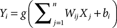

其中 `W[ij]` 表示连接神经元的权重，`b[i]` 表示神经元 i 的偏置，`g` 为激活函数。

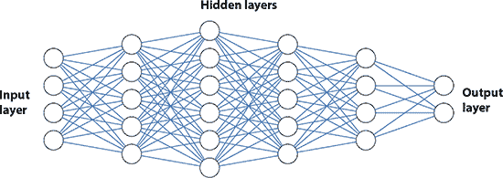

**Figure 3.1** Deep Neural Network architecture.

隐藏层和输出层的每个神经元会汇聚其输入值，然后应用激活函数。rectified linear unit（ReLU）是大多数 DNN 模型中常用的非线性激活函数，主要用于隐藏层。ReLU 激活函数的公式如下 Equation (3.2)。

(3.2) 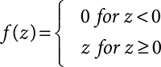

在学习过程中，网络通过优化算法调整连接权重，以实现期望输出。激活函数的选择和优化算法对 DNN 的质量和学习能力至关重要。Adagrad 是一种基于梯度的优化算法，用于优化神经网络的目标函数 [25]。在该算法中，参数 ∅（即所有权重 `W` 和偏置 `b` 的向量，记作 `[W,b]`），通过 Equations (3.3) 和 (3.4) 更新，以优化目标函数 f(∅)。

(3.3) 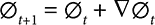
(3.4) 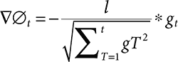

- `[W]` 代表权重，`[b]` 代表偏差，`[∇∅[t]]` 是参数 `[∅[t]]` 的变化，`[l]` 是控制步长方向的负梯度的学习率，`[g[t]]` 表示第 `[t]` 次迭代时参数的梯度。所有之前的梯度的 L2 范数由 Equation (3.4) 的分母计算。学习率在整个学习过程中并不恒定。每次新的学习率都通过将当前梯度除以该组件过去观测梯度的 L2 范数来计算 [25]。这一特性主要用于训练深度神经网络（DNN）。

### 3.2.2 The Proposed Method

所提框架的不同阶段在 Figure 3.2 中展示。阶段包括数据获取、数据预处理、模型选择与训练、性能评估以及可视化。

#### 3.2.2.1 Data Acquisition

数据获取是一个必不可少的步骤，因为收集到的数据质量和数量直接决定了我们预测模型的质量。美国加利福尼亚州斯坦福（位于圣克拉拉县）气象站自 1996 年 1 月至 2018 年 3 月的气象观测数据被选用于本研究。斯坦福（CA, USA）位于 37.42°N，122.17°W，海拔 7 ft。实验数据集从 [www.wunderground.com](http://www.wunderground.com) 下载。气象因子包括风速、温度、海平面气压、露点、湿度和能见度，均按日采集。Table 3.1 提供了斯坦福气象站收集数据的统计信息。平均风速在 1996 年 1 月至 2018 年 3 月的分布通过分布图和直方图如 Figure 3.3 所示呈现。

特征名称在 Table 3.1 中使用缩写表示。缩写 T、DP、H、SP、V、WS 分别代表温度、露点、湿度、海平面气压、能见度和风速。变量 low、avg、high 分别对应最小值、平均值和最大值。

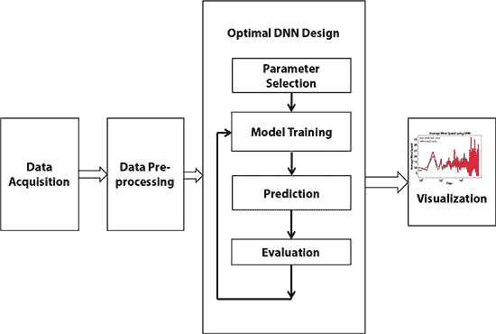

**Figure 3.2** Framework of the proposed methodology.

#### 3.2.2.2 Data Pre-Processing

真实世界数据常因未记录值或数据损坏等原因出现缺失值，缺失值会影响结果质量。因此，在处理数据前必须先用均值进行缺失值填补。本研究中，缺失值使用均值进行插补。缺失值填补后，采用 MinMax 归一化技术对数据进行标准化。MinMax 归一化将数据压缩到 0 与 1 之间，公式如 Equation (3.5) 所示。

(3.5) 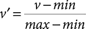

其中 `v` 为原始值，`v'` 为归一化后的值。变量 `min` 与 `max` 分别表示样本的最小值和最大值。

**Table 3.1** 斯坦福站收集数据的统计信息。

| **Feature** | **Units** | **Parameter type** | **Mean** | **Std** | **Min** | **Max** |
| --- | --- | --- | --- | --- | --- | --- |
| T_high | Degree Celsius | Input | 20.53 | 5.09 | 0 | 42 |
| T_avg | Degree Celsius | Input | 15.42 | 4.26 | 0 | 31 |
| T_low | Degree Celsius | Input | 10.68 | 4.34 | −4 | 24 |
| DP_high | Degree Celsius | Input | 11.93 | 4.05 | −6 | 26 |
| DP_avg | Degree Celsius | Input | 9.78 | 4.27 | −11 | 21 |
| DP_low | Degree Celsius | Input | 7.19 | 4.85 | −43 | 19 |
| H_high | Percentage | Input | 87.50 | 9.46 | 18 | 100 |
| H_avg | Percentage | Input | 67.30 | 11.62 | 17 | 100 |
| H_low | Percentage | Input | 50.13 | 14.31 | 4 | 100 |
| SP_high | Hectopascals | Input | 1018.31 | 4.99 | 993 | 1055 |
| SP_avg | Hectopascals | Input | 1016.66 | 4.81 | 989 | 1035 |
| SP_low | Hectopascals | Input | 1015.03 | 5.00 | 970 | 1034 |
| V_high | Kilometer | Input | 26.19 | 7.17 | 1 | 32 |
| V_avg | Kilometer | Input | 20.88 | 6.84 | 0 | 32 |
| V_low | Kilometer | Input | 15.66 | 8.24 | 0 | 32 |
| WS_high | Kilometer/Hr | Input | 25.13 | 12.14 | 0 | 230 |
| WS_avg | Kilometer/Hr | Output | 11.98 | 4.74 | 0 | 35 |

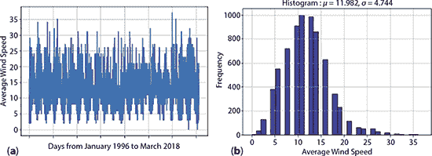

**Figure 3.3** Average wind speed distribution: (a) distribution chart and (b) histogram.

#### 3.2.2.3 Model Selection and Training


为处理大数据而选择合适的模型以预测风速。所提模型采用四层隐藏层的深度神经网络（DNN），学习率为 `0.01`，激活函数为 `ReLU`。通过试错法确定最优配置：第一层 `25` 个神经元，第二层 `20` 个，第三层 `10` 个，第四层 `5` 个。该方法在 Section 3.3.1 中描述。输入层的神经元数等于输入数据集的特征数，输出层为单个神经元，用于预测风速。DNN 架构在 Figure 3.4 中展示。图中输入层接收温度、湿度、露点、气压、能见度和高风速等特征。每个隐藏层从输入中提取抽象特征并传递给下一层，最终输出层返回预测的平均风速。

模型使用 `1996` 至 `2013` 年的数据进行训练，`2014` 至 `2018` 年的数据用于评估预测精度。由于数据为时间序列，采用六折时间序列交叉验证来评估模型准确性。数据按顺序划分为不同折叠，每折分别训练和评估。模型的预测精度随后与多种机器学习模型进行比较。用于比较的人工神经网络（ANN）模型拥有两层隐藏层，每层 `20` 个神经元，学习率为 `0.001`。

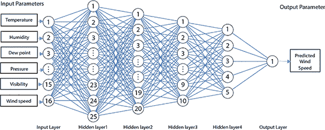

**Figure 3.4** Proposed DNN model architecture.

## 3.2.2.4 Performance Evaluation

评估在任何预测模型中都至关重要。因此，对所提 DNN 系统的性能进行评估以验证其有效性。模型的预测精度通过以下指标衡量：根平均平方误差（RMSE）、平均绝对误差（MAE）和 `R²`。RMSE 定义为预测值（`ŷ`）与实际值（`y`）之间平方差的平均值的平方根，公式见 Equation (3.6)。

(3.6) 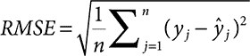

MAE 表示预测值（`y^`）与实际值（`y`）之间的绝对差异，如 Equation (3.7) 所示。

(3.7) 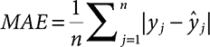

`R²`，亦称决定系数，衡量数据与回归直线 closeness。它通过 equation (3.8) 计算，范围从 `0%` 到 `100%`。更高的 `R²` 值表明观测值与预测值的差异更小。

(3.8) 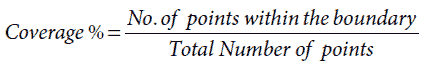

## 3.2.2.5 Visualization

可视化是任何预测系统的另一步关键步骤。在本研究中，采用散点图和半对数图来可视化结果。散点图用于直观分析实际值与预测值之间的差异，并进一步用于评估系统的效率。实际值与预测值的变化可以通过半对数图更精确地可视化。

## 3.3. 结果与讨论

## 3.3.1 参数选择

最优 DNN 模型的构建基于学习率、输入数、输出数、隐藏层数量以及每个隐藏层的神经元数量的选择。最初选择了四层隐藏层的 DNN 架构，随后通过改变学习率和每个隐藏层的神经元数量进行实验。随机选取了四种隐藏神经元数量组合，如 `(20,20,20,10)`、`(25,20,15,10)`、`(25,20,10,5)` 和 `(25,25,10,5)`。研究中考虑的不同学习率为 `0.01`、`0.02`、`0.001` 和 `0.002`。Table 3.2 展示了实验中所调参数的影响。可以观察到，在学习率为 `0.01` 时，隐藏层神经元数量为 `(25, 20, 10, 5)` 的架构实现了较低的 RMSE 和 MAE 值以及较高的 `R²` 值。该架构在隐藏层神经元为 `(25, 20, 10, 5)` 且学习率为 `0.01` 时，获得了 RMSE 为 `2.8207`、MAE 为 `2.0781`、`R²` 为 `66.56` 的数值。因此，该配置被选为最优配置。最优架构的 DNN 系统在 Table 3.3 中表示。

**Table 3.2** 参数影响。

| **隐藏层神经元数量** || **学习率** || **RMSE** || **MAE** || **R²** |
| --- | --- | --- | --- | --- | --- |
| (20, 20, 20, 10) || 0.01 || 2.8684 || 2.1118 || 64.90 |
| (20, 20, 20, 10) || 0.02 || 2.8777 || 2.1111 || 64.67 |
| (20, 20, 20, 10) || 0.001 || 2.8775 || 2.1134 || 64.64 |
| (20, 20, 20, 10) || 0.002 || 2.8602 || 2.1049 || 65.01 |
| (25, 20, 15, 10) || 0.01 || 3.0012 || 2.1808 || 61.57 |
| (25, 20, 15, 10) || 0.02 || 2.9748 || 2.2055 || 62.25 |
| (25, 20, 15, 10) || 0.001 || 4.0504 || 2.9430 || 30.01 |
| (25, 20, 15, 10) || 0.002 || 3.7289 || 2.6933 || 40.68 |
| **(25, 20, 10, 5)** || **0.01** || **2.8207** || **2.0781** || **66.56** |
| (25, 20, 10, 5) || 0.02 || 2.8425 || 2.0894 || 65.53 |
| (25, 20, 10, 5) || 0.001 || 2.8355 || 2.0810 || 65.70 |
| (25, 20, 10, 5) || 0.002 || 2.9370 || 2.1642 || 63.20 |
| (25, 25, 10, 5) || 0.01 || 2.9315 || 2.1890 || 63.34 |
| (25, 25, 10, 5) || 0.02 || 2.8898 || 2.1307 || 64.37 |
| (25, 25, 10, 5) || 0.001 || 3.6713 || 2.6243 || 42.50 |
| (25, 25, 10, 5) || 0.002 || 2.8411 || 2.1003 || 65.56 |

**Table 3.3** 最优配置。

| **参数** || **数值** |
| --- | --- |
| 输入层神经元数量 || 16 |
| 隐藏层数量 || 4 |
| 隐藏层神经元数量 || (25, 20, 10, 5) |
| 学习率 || 0.01 |
| 输出层神经元数量 || 1 |

## 3.3.2 模型比较

拟议的 DNN 系统用于预测平均风速，并与其他机器学习模型进行比较，以评估其有效性。通过定量误差指标 RMSE、MAE 和 `R²` 对预测值与实际值进行比较，评估拟开发 DNN 模型的质量。Table 3.4 展示了各模型的性能评估结果。RMSE 和 MAE 的数值越小，预测精度越高；`R²` 越大，预测值与实际值之间的线性关系越强。从表中可以看出，拟议的 DNN 模型在 RMSE 和 MAE 上达到最小误差，且 `R²` 最大，优于其他模型。表中数据表明，实现的 DNN 系统在预测平均风速时，RMSE 最小为 `2.8207`，MAE 最小为 `2.0781`，且 `R²` 较高，说明模型效果良好。预测精度以 RMSE、MAE 和 `R²` 表示的各模型结果在 Figure 3.5 中以图形形式展示。图中显示，拟开发的 DNN 系统在 MAE 和 RMSE 上表现最佳，`R²` 最高。

拟开发的 DNN、ANN、RF 和 SVM 模型的预测能力通过散点图进行图形分析，将预测数据与实际（记录）数据进行对比。由于这四种模型的结果相近，故选择 DNN、ANN、RF 和 SVM 进行可视化。散点图展示了使用不同模型预测风速的每日预测数据与实际记录数据的对比，详见 Figure 3.6。

**Table 3.4** 模型比较。

| **算法** || **平均风速** |
| --- | --- |
| **RMSE** || **MAE** || **R² (%)** |
| DT || 3.0062 || 2.2845 || 60 |
| RF || 2.8892 || 2.2182 || 63 |
| SVM || 2.8612 || 2.1102 || 64 |
| ANN || 3.0626 || 2.2943 || 62 |
| LR || 3.3207 || 2.4431 || 51 |
| **DNN** || **2.8207** || **2.0781** || **67** |

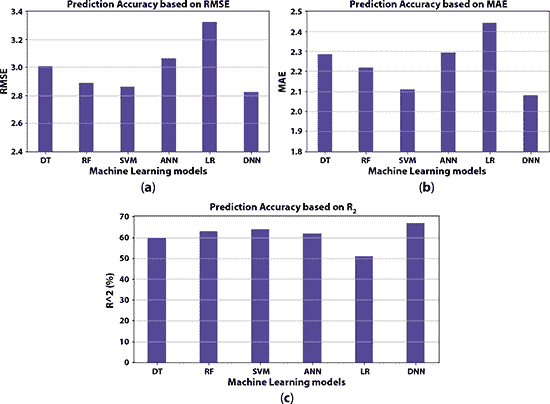

**Figure 3.5** 预测精度基于 (a) RMSE、(b) MAE 和 (c) `R²`。

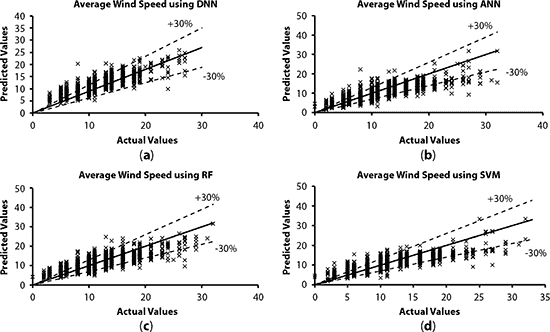

**Figure 3.6** 预测值与实际值的对比 (a) 使用 DNN 的平均风速 (b) 使用 ANN 的平均风速 (c) 使用 RF 的平均风速 (d) 使用 SVM 的平均风速。

模型的有效性还可以通过从原点出发、斜率分别为 `1.3` 和 `0.7` 的两条直线靠近回归线绘制来进一步评估。模型的良好程度可以通过统计位于回归线 ±30% 边界线内的数据点数量来计算。因此，位于 ±30% 边界线内的数据点百分比可以通过公式 (3.9) 计算。各风速预测模型的百分比覆盖率在 Table 3.5 中给出。观察表明，DNN 模型中 `83.95%` 的点位于回归线 ±30% 边界线内。而 ANN、RF 和 SVM 模型中，仅有 `78.42%`、`76.31%` 和 `81.15%` 的点位于该范围内。因此可以得出结论：拟议的 DNN 系统在其他模型中表现出更好的预测精度。

**Table 3.5** 回归线 ±30% 边界内的点覆盖率。

| **算法** || **位于 ±30% 边界内的点数（共 1427 点）** || **覆盖率 %** |
| --- | --- | --- |
| ANN || 1119 || 78.42 |
| RF || 1089 || 76.31 |
| SVM || 1158 || 81.15 |
| **DNN** || **1198** || **83.95** |

(3.9) 

半对数图用于更精确地可视化观测值与记录值的变化。DNN、ANN、RF 和 SVM 模型的预测平均风速数据与实际记录数据的半对数图在 Figure 3.7 中展示。观察到，拟议的 DNN 模型在预测值与实际值之间的偏差略小于其他机器学习模型。预测值与实际值的差异在 SVM、ANN 和 RF 模型中似乎更大。由于相较于 SVM、ANN 和 RF 模型，DNN 的预测精度更高，因此本研究结论是：深度神经网络（DNN）可以有效用于预测每日平均风速。

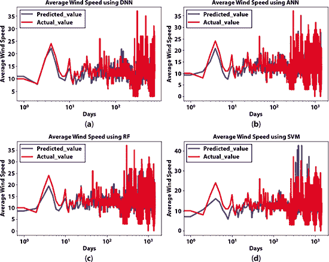

**Figure 3.7** Comparison of prediction accuracy of DNN and other models (a)Average wind speed using DNN (b) Average wind speed using ANN (c) Average wind speed using RF (d) Average wind speed using SVM.

## 3.4 Conclusion

The proposed framework investigates the effects of various model parameters and selects an architecture with low RMSE and MAE value as the most appropriate architecture for predicting average wind speed. The data collected from Stanford weather station has been utilized for the experiments. The optimal DNN architecture with hidden neurons (25, 20, 10, and 5) in the hidden layers from 1 to 4 is employed for the study. Performance comparison of the proposed DNN model is performed with the benchmark models, such as SVM, ANN, and RF models. The developed DNN model outperforms the other prediction models with a minimum RMSE value of `2.8207`, MAE of `2.0781`, and a maximum `R²` value of `67%`. Analysis of the experimental outcomes illustrates the effectiveness of the proposed DNN system for predicting wind speed. Optimization algorithms to enhance further the performance of the predictive model will be deliberated in future works. Other deep learning–based wind speed forecasting models using RNNs will also be considered as future directions.

## References

1. Wang, X., Guo, P., Huang, X., A review of wind power forecasting models. *Energy Proc*., 12, 770–778, 2011, [`doi.org/10.1016/j.egypro.2011.10.103`](https://doi.org/10.1016/j.egypro.2011.10.103).

2. Mi, X.W., Liu, H., Li, Y.F., Wind speed forecasting method using wavelet, extreme learning machine and outlier correction algorithm. *Energy Convers. Manage*., 151, 709–722, 2017, [`doi.org/10.1016/j.enconman.2017.09.034`](https://doi.org/10.1016/j.enconman.2017.09.034).

3. He, J. and Xu, J., Ultra-short-term wind speed forecasting based on support vector machine with combined kernel function and similar data. *EURASIP J. Wirel. Commun. Netw*., 2019, 1, 248, 2019, [`doi.org/10.1186/s13638-019-1559-1`](https://doi.org/10.1186/s13638-019-1559-1).

4. Yang, M., Liu, L., Cui, Y., Su, X., Ultra-Short-Term Multistep Prediction of Wind Power Based on Representative Unit Method. *Math. Probl. Eng*., 2018, 1936565, 11, 2018, [`doi.org/10.1155/2018/1936565`](https://doi.org/10.1155/2018/1936565).

5. Finamore, A.R., Galdi, V., Calderaro, V., Piccolo, A., Conio, G., Grasso, S., Artificial neural network application in wind forecasting: An one-hour-ahead wind speed prediction, *5th IET International Conference on Renewable Power Generation (RPG) 2016*, 1–6, 2016, [`doi.org/10.1049/cp.2016.0545`](https://doi.org/10.1049/cp.2016.0545).


## References

6. Yu, C., Li, Y., Xiang, H., Zhang, M., Data mining-assisted short-term wind speed forecasting by wavelet packet decomposition and Elman neural network. *J. Wind Eng. Ind. Aerodyn*., 175, 136–143, 2018, [`doi.org/10.1016/j.jweia.2018.01.020`](https://doi.org/10.1016/j.jweia.2018.01.020).

7. Filik, Ü. B. and Filik, T., Wind speed prediction using artificial neural networks based on multiple local measurements in Eskisehir. *Energy Proc*., 107, 264–269, 2017, [`doi.org/10.1016/j.egypro.2016.12.147`](https://doi.org/10.1016/j.egypro.2016.12.147).

8. Tarade, R.S. and Katti, P.K., A comparative analysis for wind speed prediction, in: *2011 International Conference on Energy, Automation and Signal*, 2011, December, IEEE, pp. 1–6, [`doi.org/10.1109/iceas.2011.6147167`](https://doi.org/10.1109/iceas.2011.6147167).

9. Liu, H., Tian, H.Q., Pan, D.F., Li, Y.F., Forecasting models for wind speed using wavelet, wavelet packet, time series and Artificial Neural Networks. *Appl. Energy*, 107, 191–208, 2013, [`doi.org/10.1016/j.apenergy.2013.02.002`](https://doi.org/10.1016/j.apenergy.2013.02.002).

10. Ramasamy, P., Chandel, S.S., Yadav, A.K., Wind speed prediction in the mountainous region of India using an artificial neural network model. *Renewable Energy*, 80, 338–347, 2015, [`doi.org/10.1016/j.renene.2015.02.034`](https://doi.org/10.1016/j.renene.2015.02.034).

11. Ghorbani, M.A., Khatibi, R., FazeliFard, M.H., Naghipour, L., Makarynskyy, O., Short-term wind speed predictions with machine learning techniques. *Meteorol. Atmos. Phys*., 128, 1, 57–72, 2016, [`doi.org/10.1007/s00703-015-0398-9`](https://doi.org/10.1007/s00703-015-0398-9).

12. Khandelwal, I., Adhikari, R., Verma, G., Time series forecasting using hybrid ARIMA and ANN models based on DWT decomposition. *Proc. Comput. Sci*., 48, 1, 173–179, 2015, [`doi.org/10.1016/j.procs.2015.04.167`](https://doi.org/10.1016/j.procs.2015.04.167).

13. Yousefi, M., Hooshyar, D., Yousefi, M., Khaksar, W., Sahari, K.S.M., Alnaimi, F.B., II, An artificial neural network hybrid with wavelet transform for shortterm wind speed forecasting: A preliminary case study, in: *2015 International Conference on Science in Information Technology (ICSITech)*, 2015, October, IEEE, pp. 95–99, [`doi.org/10.1109/icsitech.2015.7407784`](https://doi.org/10.1109/icsitech.2015.7407784).

14. Shao, H., Wei, H., Deng, X., Xing, S., Short-term wind speed forecasting using wavelet transformation and AdaBoosting neural networks in Yunnan wind farm. *IET Renewable Power Gener*., 11, 4, 374–381, 2016, [`doi.org/10.1049/iet-rpg.2016.0118`](https://doi.org/10.1049/iet-rpg.2016.0118).

15. Cui, Y., Huang, C., Cui, Y., A novel compound wind speed forecasting model based on the back propagation neural network optimized by bat algorithm. *Environ. Sci. Pollut. Res*., 27, 7, 7353–7365, 2020, [`doi.org/10.1007/s11356-019-07402-1`](https://doi.org/10.1007/s11356-019-07402-1).

16. Senthil, K.P., Improved prediction of wind speed using machine learning. *EAI Endorsed Trans. Energy Web*, 6, 23, 1–7, 2019, [`doi.org/10.4108/eai.13-7-2018.157033`](https://doi.org/10.4108/eai.13-7-2018.157033).

17. Hui, H., Rong, J., Songkai, W., Ultra-Short-Term Prediction of Wind Power Based on Fuzzy Clustering and RBF Neural Network. *Adv. Fuzzy Syst*., 2018, 9805748, 7, 2018, [`doi.org/10.1155/2018/9805748`](https://doi.org/10.1155/2018/9805748).

18. Bali, V., Kumar, A., Gangwar, S., Deep learning based wind speed forecasting-A review, in: *2019 9th International Conference on Cloud Computing, Data Science & Engineering (Confluence)*, 2019, January, IEEE, pp. 426–431, [`doi.org/10.1109/confluence.2019.8776923`](https://doi.org/10.1109/confluence.2019.8776923).

19. Cao, Q., Ewing, B.T., Thompson, M.A., Forecasting wind speed with recurrent neural networks. *Eur. J. Oper. Res*., 221, 1, 148–154, 2012, [`doi.org/10.1016/j.ejor.2012.02.042`](https://doi.org/10.1016/j.ejor.2012.02.042).

20. Khodayar, M. and Teshnehlab, M., Robust deep neural network for wind speed prediction, in: *2015 4th Iranian Joint Congress on Fuzzy and Intelligent Systems (CFIS)*, 2015, September, IEEE, pp. 1–5, [`doi.org/10.1109/cfis.2015.7391664`](https://doi.org/10.1109/cfis.2015.7391664).

21. Sergio, A.T. and Ludermir, T.B., Deep learning for wind speed forecasting in northeastern region of Brazil, in: *2015 Brazilian Conference on Intelligent Systems (BRACIS)*, 2015, November, IEEE, pp. 322–327, [`doi.org/10.1109/bracis.2015.40`](https://doi.org/10.1109/bracis.2015.40).

22. Liu, H., Mi, X., Li, Y., Smart deep learning based wind speed prediction model using wavelet packet decomposition, convolutional neural network and convolutional long short term memory network. *Energy Convers. Manage*., 166, 120–131, 2018, [`doi.org/10.1016/j.enconman.2018.04.021`](https://doi.org/10.1016/j.enconman.2018.04.021).

23. Hu, Q., Zhang, R., Zhou, Y., *Transfer learning for short-term wind speed prediction with deep neural networks*. *Renewable Energy*, 85, 83–95, 2016, [`doi.org/10.1016/j.renene.2015.06.034`](https://doi.org/10.1016/j.renene.2015.06.034).

24. Nielsen, M.A., *Neural networks and deep learning*, vol. 2018, Determination press, San Francisco, CA, 2015.

25. Zeiler, M.D., Adadelta: an adaptive learning rate method. arXiv:1212.5701. [`arxiv.org/abs/1212.5701`](https://arxiv.org/abs/1212.5701), 2012.

1. **Corresponding author**: `jaseena.mes@gmail.com`

# Res-SE-Net: Boosting Performance of ResNets by Enhancing Bridge Connections

**Varshaneya V.\*, S. Balasubramanian^(†) and Darshan Gera^(‡)**

*Department of Mathematics and Computer Science, Sri Sathya Sai Institute of Higher Learning, Prasanthi Nilayam, Anantapur District, India*

> **Abstract**
>
> One of the ways to train deep neural networks effectively is to use residual connections. Residual connections can be classified as being either identity connections or bridge connections with a reshaping convolution. Empirical observations on CIFAR-10 and CIFAR-100 datasets using a baseline ResNet model, with bridge connections removed, have shown a significant reduction in accuracy. This reduction is due to lack of contribution, in the form of feature maps, by the bridge connections. Hence, bridge connections are vital for ResNet. However, all feature maps in the bridge connections are equally important. In this work, an upgraded architecture "Res-SE-Net" is proposed to further strengthen the contribution from the bridge connections by quantifying the importance of each feature map and weighting them accordingly using Squeeze-and-Excitation (SE) block. It is demonstrated that Res-SE-Net generalizes much better than ResNet and SE-ResNet on the benchmark CIFAR-10 and CIFAR-100 datasets.
>
> **Keywords:** Deep residual learning, weighting activations, bridge connections, ResNet, Squeeze-and-Excitation Net

## 4.1 Introduction

Deep neural networks are increasingly being used in a number of computer vision tasks. One great disadvantage of training a very deep network is the vanishing gradient problem which delays the convergence. This is alleviated to some extent by initialization techniques mentioned in [1] and [2] and batch normalization [8]. It is observed in [3] that accuracy stagnates and degrades subsequently as the network becomes deeper. They argue that this degradation is not caused by over-fitting and that adding more layers to an already "deep" model results in an increase in train and test errors. Therefore, in order to make training of deep networks possible, they introduce "ResNets". ResNet [3] attends to this problem by emphasizing on learning residual mapping rather than directly fit input to output. This is achieved by introducing skip connections which ensure a larger gradient is flown back during the backpropagation.


After ResNet, a plethora of variants like ResNeXt [14], DenseNet [7], ResNet with stochastic depth [6], and preactivated ResNet [4] have been proposed that make training very deep networks possible. All these variants have either focused on pre-activation or split-transform-merge paradigm or dense skip connections or dropping layers at random. But none have investigated the bridge connections in ResNet that connect two blocks with a varying number of feature maps. In this work, the effect of bridge connections in ResNet is investigated, and subsequently, a novel network architecture called `Res-SE-Net` is proposed that outperforms the baseline ResNet and SE-ResNet.

## 4.2 Related Work

Training deep networks had been a concern until ResNets [3] were introduced. ResNet emphasizes learning residual mappings rather than directly fitting input to output. After ResNet, a lot of its variants have been proposed. Fully preactivated ResNet [4] performs activation before addition of identity to the residue to facilitate unhindered gradient flow through the shortcut connections to earlier layers. This makes training of a 1001-layered deep network possible. ResNeXt [14] follows a model which is like Inception net [13], by splitting the input to ResNet block into multiple transformation paths and subsequently merging them before identity addition. The number of paths is a new hyperparameter that characterizes model capacity. With higher capacity, the authors have demonstrated improved performance without going much wider or deeper. DenseNet [7] further exploits the effect of skip-connections by densely connecting through skip-connections the output of every earlier layer to every other following layer. The connections are made using depth concatenation and not addition. The authors argue that such connections would help in feature reuse and thereby an unhindered information flow. In Ref. [6], the weight layers in the ResNet block are randomly dropped thereby only keeping skip-connections active in these layers. This gives rise to an ensemble of ResNets similar to dropout [12]. Dropping weight layers depend on "survival probability". This idea outperforms the baseline ResNet. Another important architecture that won the 2017 ILSVRC competition is SE-ResNet [5]. This winning architecture has in its base a ResNet with an SE block introduced between the layers of ResNet. This block quantifies the importance of feature maps instead of considering all of them equally likely. This has resulted in a significant level of improvement in performance of the ResNet.

Though ResNet has been studied in detail, to the best of our knowledge there has not been any work focusing on bridge connections in ResNet. In this work, the effectiveness of bridge connections is investigated and a novel architecture namely "Res-SE-Net" is proposed. This architecture consists of an SE block in the bridge connection to weigh the importance of feature maps. The proposed architecture demonstrates a superior performance on CIFAR-10 and CIFAR-100 benchmark datasets over baseline ResNet and SE-ResNet.

## 4.3 Preliminaries

### 4.3.1 ResNet

The idea behind ResNets [3] is to make a shallow architecture deeper by adding identity mapping from a previous layer to the current layer and then applying a suitable non-linear activation. Addition of skip-connections facilitates larger gradient flow to earlier layers thereby addressing the degradation problem as mentioned in [3]. The building block of a ResNet is depicted in Figure 4.1. Here, `x` is identity and `F(x)` is called the residual mapping.

ResNet comprises a stack of these blocks. A part of the 34-layer ResNet is shown in Figure 4.2. The skip-connections that carry activations within a block are referred to as identity skip-connections and those that carry from block to another are called bridge connections.

![Figure 4.1 ResNet module (adapted from [3]).](images/fig4-1.jpg)

**Figure 4.1** ResNet module (adapted from [3]).

![Figure 4.2 Bridge connection in ResNet (adapted from [3]).](images/fig4-2.jpg)

**Figure 4.2** Bridge connection in ResNet (adapted from [3]).

The dotted connection is an example of a bridge connection. It involves a `1×1` convolution to increase the number of feature maps from 64 to 128 and a down sampling operation to reduce their spatial dimension. In its absence, `F(x)` and `x` will have incompatible dimensions to be added.

### 4.3.2 Squeeze-and-Excitation Block

Filters in a convolutional layer capture local spatial relationships in the form of feature maps. These feature maps are further used as they are, without any importance being attached to them. In other words, each feature map is treated independently and equally. This may allow insignificant features that are not globally relevant to propagate through the network, thereby affecting the accuracy. Hence, to model the relationship between the feature maps, SE block is introduced in [5]. This enhances the quality of representations produced by a convolutional neural network. SE block performs a recalibration of features so that the global information is used to weight features from the feature map that are more "informative" than the rest.

The SE block has two operations, *viz*., squeeze and excitation. Features are first passed to the "squeeze" operation to produce a descriptor for each of the feature maps by aggregating along each of their spatial dimensions [5]. The descriptor produces an embedding of a global distribution of channel-wise feature responses. This allows information from the global receptive field of the network to be used by all its layers. The squeeze operation is followed by an "excitation" operation, wherein the embedding produced is used to get a collection of modulation weights for every feature map. These weights are applied to the feature maps to generate weighted feature maps as shown in Figure 4.3. In Figure 4.3, the input `X ∈ R^(H×W×C)` is fed to global pooling function which outputs a vector of dimension `1 × 1 × C`. Its dimension is further reduced by `r` using a fully connected layer, which is followed by ReLU activation [10]. This constitutes a squeeze operation. The output of squeeze operation is then upsampled to dimension `1 × 1 × C` using another fully connected layer followed by sigmoid activation which gives weights for each of the channels. This constitutes an excitation operation. The input `X` is thus rescaled using the output of excitation to get the weighted feature map which is 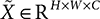 as shown in Figure 4.3.

![Figure 4.3 Squeeze-and-Excitation block (adapted from [5]).](images/fig4-3.jpg)

**Figure 4.3** Squeeze-and-Excitation block (adapted from [5]).

SE blocks add negligible extra computation and can be included in any part of the network [5]. SE-ResNet module is a ResNet module with each residual mapping passing through a SE block which is added with identity connection. SE-ResNet is a stack of SE-ResNet modules.

## 4.4 Proposed Model

The motivation for the proposed model is presented prior to its elucidation. As shown in Figure 4.2, bridge connections (represented as dotted lines) connect two blocks of ResNet that have a different number of feature maps and different spatial dimensions. The following subsection discusses the effect of bridge connections in ResNet.

## 4.4.1 Effect of Bridge Connections in ResNet


## 4.4.1 Bridge Connections Analysis

Tables 4.1 and 4.2 compare the performance of various ResNet architectures with and without bridge connections, respectively. The performance without bridge connections drastically drops, particularly in ResNet-56 and ResNet-110. This comparison stresses the importance of bridge connections. However, in the original ResNet [3], all feature maps in the bridge connections are weighted equally. It is to be noted that SE-ResNet [5] weights the feature maps along the non-skip connections, based on their importance. The importance is learnt using a simple feed forward network that adds negligible computations. This idea motivated us to quantify the importance of feature maps that arise in bridge connections.

**Table 4.1** Performance of baseline ResNets.

| **Architecture** | **CIFAR-10 Top-1 (Acc %)** | **CIFAR-10 Top-5 (Acc %)** | **CIFAR-100 Top-1 (Acc %)** | **CIFAR-100 Top-5 (Acc %)** |
| --- | --- | --- | --- | --- |
| Res-20 | 91.4 | 99.74 | 67.37 | 91.06 |
| Res-32 | 92.32 | 99.73 | 69.8 | 91.25 |
| Res-44 | 93.57 | 99.81 | 73.15 | 92.9 |
| Res-56 | 93.16 | 99.82 | 73.8 | 92.99 |
| Res-110 | 93.66 | 99.77 | 73.33 | 92.7 |

**Table 4.2** Performance of baseline ResNets without bridge connections.

| **Architecture** | **CIFAR-10 Top-1 (Acc %)** | **CIFAR-10 Top-5 (Acc %)** | **CIFAR-100 Top-1 (Acc %)** | **CIFAR-100 Top-5 (Acc %)** |
| --- | --- | --- | --- | --- |
| Res-20 | 90.48 | 99.71 | 67.37 | 91.06 |
| Res-32 | 90.38 | 99.62 | 69.8 | 91.25 |
| Res-44 | 87.62 | 99.51 | 73.15 | 92.9 |
| Res-56 | 77.46 | 98.55 | 48.65 | 76.67 |
| Res-110 | 92.42 | 99.83 | 1.00 | 5.00 |

## 4.4.2 Res-SE-Net: Proposed Architecture

The novel architecture incorporates an `SE` block in each of the bridge connection of a ResNet. Figure 4.4 shows an illustration of a modified bridge connection. The proposed model `Res-SE-Net` has a similar architecture as mentioned in [3]. Specifically, our architecture is as follows.

The input image is of the size 32 × 32. The first layer is a 3 × 3 convolutional layer, which is followed by batch normalization [8] and ReLU [10]. This is followed by a stack of ResNet modules. A group of ResNet modules within the stack which have the same number of feature maps constitute a block. Average-pooling follows the stack of ResNet modules. The final layer is a fully connected layer followed by softmax activation, which predicts the probability of an input belonging to a class. The sub-sampling of feature-maps is done in the first convolutional layer of every block, by performing the convolution with a stride of 2. There is a reduction in the size of feature maps and an increase in their number from one block to another. Hence, to take activations from one block to another, the bridge connection downsamples the feature map size and increases their number by using 1 × 1 convolution with stride 2.

An `SE` block [5] is added on to the bridge connection just after downsampling. This ensures that when the feature maps are taken from one block to another, they are weighted according to the content that they carry. Hence, those features that are more relevant are given higher importance. The downsampled feature maps are sent from the previous block to the next one, so the weighting process must be done after downsampling in order to give more importance to the downsampled feature maps. Doing this before downsampling would reduce the significance of the weighted features. This is the primary reason for adding `SE` layer after downsampling and not before. It is also found empirically that adding `SE` layer before the downsampling process gives less accuracy compared to adding it after downsampling.

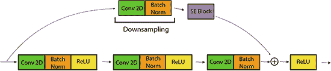

**Figure 4.4** Modified bridge connection.^(2)

## 4.5 Experiments

### 4.5.1 Datasets

All experiments are conducted on CIFAR-10 [9] and CIFAR-100 [9] datasets. The CIFAR-10 dataset consists of 50,000 training images and 10,000 test images in 10 classes, with 5,000 training images and 1,000 test images per class. The CIFAR-100 dataset consists of 50,000 training images and 10,000 test images in 100 classes, with 500 training images and 100 test images per class. There are 20 main classes which contain these classes. The size of images in both the datasets is 32 × 32 and all of them are RGB images.

### 4.5.2 Experimental Setup

The experiments on ResNets considered ResNets of varying depths such as 20, 32, 44, 56, and 110 layers. The implementations are coded in `Pytorch` [11]. The code for baseline ResNet^(3) and SE-ResNet^(4) have been adapted from existing implementations and modified. The following data augmentation techniques are used:

## 4.6 结果

Tables 4.1, 4.4, and 4.5 报告了基线 ResNets、基线 SE-ResNets 和 Res-SE-Nets 所取得的准确率。

As 可以 从 Table 4.1 看出，表现最佳的 ResNet 是 ResNet-110，在 CIFAR-10 和 CIFAR-100 上的 Top-1 准确率分别为 93.66% 和 73.33%。

Similarly, 从 Table 4.4 可以看出，表现最佳的 SE-ResNet 是 SE-ResNet-110，在 CIFAR-10 和 CIFAR-100 上的 Top-1 准确率分别为 93.79% 和 72.99%。

It is clear from Table 4.5 that, our model, Res-SE-Net-110 reporting Top-1 accuracies of 94.53% and 74.93% on CIFAR-10 and CIFAR-100 datasets respectively, significantly overwhelms the baseline ResNets and SE-ResNets.

It can further be observed from Table 4.5, that Res-SE-Net-44 performs exceedingly well compared to baseline ResNets and SE-ResNets.

In fact, Res-SE-Net-44 can outperform ResNet-110 and SE-ResNet-110 by a significant margin of 0.42% and 0.29% on CIFAR-10 dataset, respectively. On CIFAR-100 dataset, Res-SE-Net-44 dominates over ResNet-110 and SE-ResNet-110 by a margin of 0.5% and 0.84%.

It is to be noted that Res-SE-Net-44 has 61.75% and 62.06% lesser number of parameters compared to ResNet-110 and SE-ResNet-110, respectively.

Res-SE-Net-56 too exhibits outstanding performance on CIFAR-100 dataset compared to baseline ResNets and SE-ResNets, and near on-par performance on CIFAR-10 dataset with baseline ResNets and SE-ResNets.

This strongly emphasizes the gravity of the proposed idea to activate the feature maps in bridge connections by their importance. The proposed idea enables a reasonably deep network with lesser number of parameters to outperform very deep networks.

**Table 4.4** Performance of baseline SE-ResNets.

| **Architecture** | **CIFAR-10 Top-1 (Acc %)** | **CIFAR-10 Top-5 (Acc %)** | **CIFAR-100 Top-1 (Acc %)** | **CIFAR-100 Top-5 (Acc %)** |
| --- | --- | --- | --- | --- |
| SE-ResNet-20 | 92.1 | 99.7 | 68.31 | 90.69 |
| SE-ResNet-32 | 93.08 | 99.83 | 70.09 | 92.12 |
| SE-ResNet-44 | 93.71 | 99.77 | 71.2 | 91.78 |
| SE-ResNet-56 | 93.64 | 99.76 | 71.42 | 91.28 |
| SE-ResNet-110 | 93.79 | 99.74 | 72.99 | 92.71 |

**Table 4.5** Performance of proposed model.

| **Architecture** | **CIFAR-10 Top-1 (Acc%)** | **CIFAR-10 Top-5 (Acc%)** | **CIFAR-100 Top-1 (Acc%)** | **CIFAR-100 Top-5 (Acc%)** |
| --- | --- | --- | --- | --- |
| Res-SE-Net-20 | 91.9 | 99.75 | 67.99 | 91.03 |
| Res-SE-Net-32 | 92.79 | 99.82 | 69.93 | 91.95 |
| Res-SE-Net-44 | 94.08 | 99.83 | 73.83 | 93.54 |
| Res-SE-Net-56 | 93.64 | 99.87 | 74.29 | 93.45 |
| Res-SE-Net-110 | 94.53 | 99.87 | 74.93 | 93.48 |

The improvement in accuracies of Res-SE-Nets, for both the datasets in comparison to baseline ResNets [3] and SE-ResNets [5] are tabulated in Tables 4.6 and 4.7, respectively. Res-SE-Net outperforms baseline ResNet by 0.566%, i.e., about 56 images on CIFAR-10 and by 0.704%, i.e., about 70 images on CIFAR-100 datasets on an average. Res-SE-Net-110 has achieved the maximum improvement in accuracy of 0.87% on CIFAR-10 and 1.6% on CIFAR-100 over Res-110. Similarly, Res-SE-Net outperforms SE-ResNet by 0.124% on CIFAR-10 and by 1.392% on CIFAR-100 datasets, respectively. Res-SE-Net-110 has achieved maximum overall improvement over SE-ResNet-110 with an increase in accuracy of 0.74% on CIFAR-10 and of 1.94% on CIFAR-100 datasets, respectively.

**Table 4.6** Performance improvement from baseline ResNet.


## Table 4.7 Performance improvement from baseline SE-ResNet

| **Architecture** | **CIFAR-10 (%)** | | **CIFAR-100 (%)** | |
| :--- | :---: | :---: | :---: | :---: |
| | **Top-1** | **Top-5** | **Top-1** | **Top-5** |
| Res-SE-Net-20 | 0.5 | 0.01 | 0.62 | −0.03 |
| Res-SE-Net-32 | 0.47 | 0.09 | 0.13 | 0.7 |
| Res-SE-Net-44 | 0.51 | 0.02 | 0.68 | 0.55 |
| Res-SE-Net-56 | 0.48 | 0.05 | 0.49 | 0.46 |
| **Res-SE-Net-110** | **0.87** | **0.1** | **1.6** | **0.78** |
| Average Improvement | 0.566 | 0.504 | 0.704 | 0.492 |

## Table 4.8 Performance improvement with SE blocks in skip connections

| **Architecture** | **CIFAR-10 (%)** | | **CIFAR-100 (%)** | |
| :--- | :---: | :---: | :---: | :---: |
| | **Top-1** | **Top-5** | **Top-1** | **Top-5** |
| Res-SE-Net-20 | −0.2 | 0.05 | −0.32 | 0.34 |
| Res-SE-Net-32 | −0.29 | −0.01 | −0.16 | −0.17 |
| **Res-SE-Net-44** | **0.37** | **0.06** | **2.63** | **1.76** |
| Res-SE-Net-56 | 0.0 | 0.11 | 2.87 | 2.17 |
| **Res-SE-Net-110** | **0.74** | **0.13** | **1.94** | **0.77** |
| Average Improvement | 0.124 | 0.068 | 1.392 | 0.974 |

With the improvement that addition of SE block provides, one might want to add SE blocks to all the skip-connections to make the performance even better. But it has been empirically found that adding an SE block to every identity skip connection degrades the performance on CIFAR-10 and CIFAR-100 datasets as the depth increases. Also, as for the reasons mentioned in Section 4.4, the addition of SE block before downsampling does not give better results either.

The analysis of the training phase of `Res-SE-Net` is done by plotting training losses for all the aforesaid depths and for both the datasets. From Figures 4.5 to 4.7, it can be concluded that training of `Res-SE-Net` has taken place smoothly. There is no abrupt increase in training loss of `Res-SE-Net` models. This shows that gradient flow has not been hindered by the introduction of an SE block in bridge connections, maintaining the principle of `ResNet` (base of our `Res-SE-Net`) that skip-connections facilitate smooth training of deep networks.

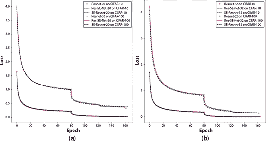

**Figure 4.5** (a) Training losses plotted for depth of 20 layers. (b) Training losses plotted for depth of 32 layers.

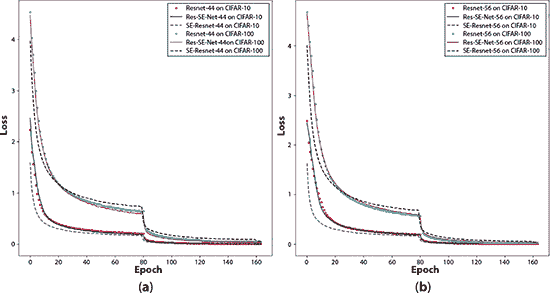

**Figure 4.6** (a) Training losses plotted for depth of 44 layers. (b) Training losses plotted for depth of 56 layers.

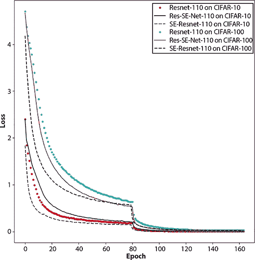

**Figure 4.7** Training losses plotted for depth of 110 layers.

在这项工作中，提出了一种名为“`Res-SE-Net`”的新型架构，该架构通过在每个 `ResNet` 的桥接连接中加入 SE 块，使桥接连接更具影响力。`Res-SE-Net` 在 CIFAR-10 和 CIFAR-100 数据集上超越了基线 `ResNet` 和 SE-ResNets 的性能，并表明，具有对桥接连接产生积极贡献的适度大小的深度网络可以超过非常深的网络。此外，添加 SE 块不会影响训练。未来，可以探索其他使 `ResNet` 桥接连接更具影响力的方法，以提升整体性能。

## References

1. Glorot, X. and Bengio, Y., Understanding the difficulty of training deep feedforward neural networks, in: Proceedings of the thirteenth international conference on artificial intelligence and statistics, pp. 249–256, 2010.
2. He, K., Zhang, X., Ren, S., Sun, J., Delving deep into rectifiers: Surpassing human-level performance on imagenet classification, in: Proceedings of the IEEE international conference on computer vision, pp. 1026–1034, 2015.
3. He, K., Zhang, X., Ren, S., Sun, J., Deep residual learning for image recognition, in: Proceedings of the IEEE conference on computer vision and pattern recognition, pp. 770–778, 2016.
4. He, K., Zhang, X., Ren, S., Sun, J., Identity mappings in deep residual networks, in: European conference on computer vision, Springer, pp. 630–645, 2016.
5. Hu, J., Shen, L., Sun, G., Squeeze-and-excitation networks, in: Proceedings of the IEEE conference on computer vision and pattern recognition, pp. 7132–7141, 2018.
6. Huang, G., Sun, Y., Liu, Z., Sedra, D., Weinberger, K.Q., Deep networks with stochastic depth, in: European conference on computer vision, Springer, pp. 646–661, 2016.
7. Huang, G., Liu, Z., Van Der Maaten, L., Weinberger, K.Q., Densely connected convolutional networks, in: Proceedings of the IEEE conference on computer vision and pattern recognition, pp. 4700–4708, 2017.
8. Ioffe, S. and Szegedy, C., Batch normalization: Accelerating deep network training by reducing internal covariate shift. CoRR, International conference on machine learning, 2015.
9. Krizhevsky, A., Hinton, G. *et al*., Learning multiple layers of features from tiny images. Technical report, Citeseer, 2009.
10. Nair, V. and Hinton, G.E., Rectified linear units improve restricted boltzmann machines, in: ICML, 2010.
11. Paszke, A., Gross, S., Massa, F., Lerer, A., Bradbury, J., Chanan, G., Killeen, T., Lin, Z., Gimelshein, N., Antiga, L., Desmaison, A., Kopf, A., Yang, E., DeVito, Z., Raison, M., Tejani, A., Chilamkurthy, S., Steiner, B., Fang, L., Bai, J., Chintala, S., Pytorch: An imperative style, high-performance deep learning library, in: Advances in Neural Information Processing Systems, vol. 32, H. Wallach, H. Larochelle, A. Beygelzimer, F. d’Alché-Buc, E. Fox, R. Garnett (Eds.), pp. 8024–8035, Curran Associates, Inc., NeurIPS, 2019, URL [`papers.neurips.cc/paper/9015-pytorch-an-imperative-style-high-performance-deep-learning-library.pdf`](http://papers.neurips.cc/paper/9015-pytorch-an-imperative-style-high-performance-deep-learning-library.pdf).
12. Srivastava, N., Hinton, G., Krizhevsky, A., Sutskever, I., Salakhutdinov, R., Dropout: A simple way to prevent neural networks from overfitting. *J. Mach. Learn. Res*., 15, 1, 1929–1958, 2014.
13. Szegedy, C., Liu, W., Jia, Y., Sermanet, P., Reed, S., Anguelov, D., Erhan, D., Vanhoucke, V., Rabinovich, A., Going deeper with convolutions, in: Proceedings of the IEEE conference on computer vision and pattern recognition, pp. 1–9, 2015.
14. Xie, S., Girshick, R., Dollár, P., Tu, Z., He, K., Aggregated residual transformations for deep neural networks, in: Proceedings of the IEEE conference on computer vision and pattern recognition, pp. 1492–1500, 2017.

1. ¹ [`image-net.org/challenges/LSVRC/`](http://image-net.org/challenges/LSVRC/)
2. ² Image from Andrew Ng’s Deep Learning course and modified with an SE block.
3. ³ Adapted from [`github.com/bearpaw/pytorch-classification`](https://github.com/bearpaw/pytorch-classification).
4. ⁴ Adapted from [`github.com/moskomule/senet.pytorch`](https://github.com/moskomule/senet.pytorch).
5. *\*Corresponding author*: `varshaneya.v@gmail.com`
6. *^†Corresponding author*: `sbalasubramanian@sssihl.edu.in`
7. *^‡Corresponding author*: `darshangera@sssihl.edu.in`

# Chapter 5: Hitting the Success Notes of Deep Learning

**Sakshi Aggarwal¹\*, Navjot Singh² and K.K. Mishra¹**

*¹Department of Computer Science and Engineering, Motilal Nehru National Institute of Technology, Allahabad, India*

*²Department of Information Technology, Indian Institute of Information Technology, Allahabad, India*

> **Abstract**
>


> During past decade, the Machine Learning (ML) has been driving with different pace. Nowadays, it is disguised in a novel term that has been a buzzing around market, named as `Deep Learning` (DL). Basically, the concept of DL has been derived from human neurological traits. Humans are the masters of. The learning will occur continuously and thoroughly by generating output and compare them with true values. The parameters of model are updated automatically if they are differed by wide margin. It tends to push the prediction closer to true observations. The training is an iterative, automatic process and continues to generate output until average difference converges to small value.

After getting the big picture of ANN, we are now in the position to evaluate its architecture. The NN is employed on several layers, consist of neurons. There are mainly three types of layers, *viz*., input layer, hidden layer, and output layers. The input layer is for parameter feeding and output layer is obvious for target production. The hidden layers are responsible for processing data and establishing correlation among inputs and outputs. It is carried out using weights assigned to each parameter and pass to the computational units thereafter. Weights are enlarged or reduced according to the relevance of the response. The whole scenario is depicted in Figure 5.1.

Any network-based model and ML-based model emphasize on two tasks, i.e., learning and application. While learning, model tries to extract similarities within training data to accomplish a specific task. It could be understood by an example of Facebook plugin, where learning is incorporated to make blind person describe the photos. On the other hand, application stage sends you the response after employing on utilized data. For example, a music-app keeps suggesting playlist to a user on weekly basis when it discovers his/her music taste. Both learning and application are integrated to make a way for the systems developing their own intellect and conscience.

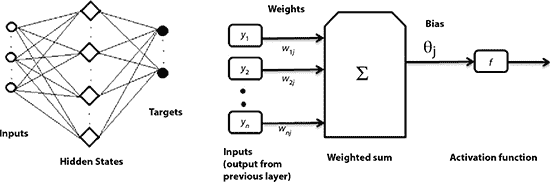

**Figure 5.1** Uncovering the network layers for final computation.

## 5.3 Delineating the Cornerstones


The evolution in the business such as digital marketing is appeared as a part of ML revolution through its direct involvement with the stakeholders. ML is a broader and active area, merely referred to as a branch of science but not its recent state and evolution. It is crucial to understand what makes ML so reputed in the current trend and clarify the misconceptions. Particularly, NNs and DL [11–14] have hyped the ML paradigms and consequently accelerated the mystery around key-notes. In fact, markets and businesses are flourished with the demands of disruptive technologies, yet it brought confusion around terminologies because core concepts of Data Science (DS) (as illustrated in Figure 5.2) are profoundly interweaved and concerned with each other in several aspects.

We have come across several resources like blogs, articles, journals, magazines, chapters, and inferred that preliminaries are impeccably highlighted but little is known about their differences and it remains uncovered. So, let us shift the focus from palpable discussion towards demarcating and disentangling the threads of DS cornerstones.

## 5.3.1 Artificial Neural Network vs. Machine Learning

The most significant and encouraging technique for big data processing is ML. It is phenomenal in analysis with experience or newly data addition and reveals the pattern of interest. When we talk about ML, we talk about a generic term that refers to making systems learn about self-adaption. On the other hand, ANN stems from ML that can frame the algorithms that simulates human brain. It processes the data through multiple layers as mentioned above. Enormous amount of data, normally shared through ubiquitous applications and in unstructured format, is difficult to grasp. But through DL, it becomes least challenging when it comes to unravel this wealth of data. In few words, if ML builds a model around several parameters and triggers the results, those results can be served further to start building ANN model.

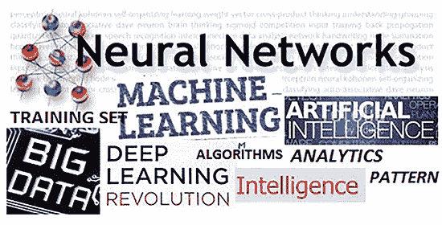

**Figure 5.2** Terms attach with DS.

## 5.3.2 Machine Learning vs. Deep Learning

One of the most unprecedented yet least emphasized topics of discussion is ML vs. DL. They are not poles apart; instead, they share the common umbrella of DS. In fact, DL is observed as one of the core facet of ML that sharply works on data semantics. The representation of data in DL is, however, hierarchical, and therefore best suited for unlabelled or unstructured data. It carries out data processing with nonlinear approach enabling machines to translate extracted features effortlessly. It is widely adapted for feature engineering and feature transformation. Thus, it is recommendable for developing major CV applications that can pertain to real-world data such as images, sounds, texts, or languages.

## 5.3.3 人工神经网络 vs. 深度学习

人工神经网络（NN）和深度学习（DL）都是前沿技术，在研究领域中占据重要地位。我们经常在不知不觉中将这两个词互换使用，却没有意识到它们之间的微妙差异。它们在概念上相似，但各自也有独立的特点。我们必须认识到，ANN 和 DL 之间存在一条微妙的界限。ANN 种类繁多，而 DL 是一种更复杂的 ANN 形式。区别仅仅在于网络的深度，这体现在其架构中，如图 Figure 5.3 所示。所谓“复杂”，是指信息可以在整个模型中传播的详细程度。模型越复杂，使用的内部层数越多。层数的增加不仅用于利用多余的信息，还用于优化以实现更好的性能。

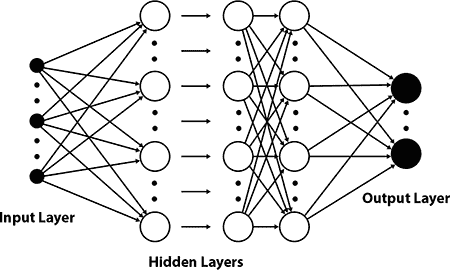

**Figure 5.3** ANN serves as a base for DL.

最后，深度学习（DS）的三大基石——机器学习（ML）、人工神经网络（ANN）和深度学习（DL）——在一句话中被区分开来：DL 是 ML 的一个子领域，利用层次化的 ANN 视角实现 ML 过程。

## 5.4 深度学习架构

## 5.4.1 无监督预训练网络

在基于学习的模型中，直接使用某些变体进行监督学习训练网络可能耗时且效率不高。事实上，可以通过先使用不同的无监督训练策略“预训练”，再借助监督学习算法进行微调，从而缓解这一问题。它加速了计算过程，并大幅降低了对数据的依赖。无监督学习得到的结果可用于提取许多视觉任务（如分类、检测或识别）的高层特征。它能够快速实现更好的优化和收敛，使网络适合高层表示。研究人员在受限玻尔兹曼机（RBM）[15]和自动编码器（AE）[16, 17]中采用预训练方法。Figure 5.4 展示了预训练网络的绝对流程。

![Figure 5.4 Flow for pre-trained network-based learning model [18].](images/fig5-4.jpg)

**Figure 5.4** Flow for pre-trained network-based learning model [18].

## 5.4.2 卷积神经网络

随着深度学习的发展，它提升了人工系统的潜力。它在功能多样性方面具有可扩展性，能够像人类一样观察世界、理解它、并将知识应用于多种任务（如目标检测、识别和视频摘要）。计算机视觉（CV）领域达到了新的高度，尤其是基于卷积神经网络（ConvNet/CNN）[32–35, 38–42]。传统的 CV 算法依赖于手工设计的特征，而 CNN 能够提供对图像更全面的理解，类似于人类的视觉方式。CNN 的处理流程如图 Figure 5.5 所示。它的处理时间更短，因为观测次数减少且具有偏向重用性。

![Figure 5.5 Typical CNN process [19].](images/fig5-5.jpg)

**Figure 5.5** Typical CNN process [19].

## 5.4.3 循环神经网络

前面提到的 DL 类别假设所有输入（以及输出）之间的影响最小。但如果我们想构建一个语义和语法正确的句子呢？单词在句子中隐含依赖，以形成完美句子。这需要两步过程：首先，基于实际世界中词的出现规律进行先验知识；其次，维护“记忆”状态，估算已计算信息的量，以预测句子中的下一个词。循环神经网络（RNN）[20]，其典型架构如图 Figure 5.6 所示，专为处理序列信息（如时间序列）设计。它对序列的每个元素执行相同的任务，输出高度依赖于过去的计算。RNN 能够构建语言模型[21]，并可能用于自然语言处理（NLP）或语言翻译系统（LTSs）。

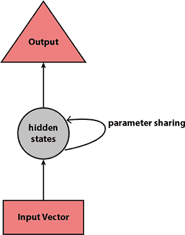

**Figure 5.6** Primitive RNN architecture.

## 5.4.4 递归神经网络

递归神经网络（Recursive Neural Network）比 RNN 更为通用。它以层次化方式解析数据（Figure 5.7）。其主要优势在于能够处理通过树形或图形表示的模式，这与固定长度向量形成鲜明对比。向量长度固定，所有数据必须遵守相同长度；而图形则提供了灵活确定任意数量的节点和边的能力。它在 NLP 和图像分析中已取得成功[22]。具体而言，图形中的节点用于表征与实数及绝对值相关的变量向量；而节点之间的边则标记节点间信息的逻辑关联。

## 5.5 为什么 CNN 更适合计算机视觉应用？

计算机视觉（CV）是一门旨在在计算机系统中模拟人类视觉皮层（HVC）的科学分支。它处理图像并提取内在细节，类似于人脑的处理方式。CV 最初仅用于模拟 HVC，但人工智能的革命使其拓展到银行、监控、医疗和汽车等多个领域。

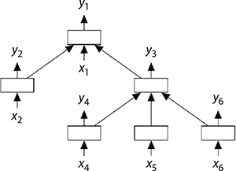

**Figure 5.7** Graph-based representation in recursive NN.

传统的 ML 算法对于繁琐且难以管理的任务不足以胜任。例如，大多数问题涉及目标分类，即根据图像中物体的显著性为其赋予标签。这会导致计算时间增加或系统开销增大，从而降低吞吐量。深度学习在图像处理活动（如图像分析、分割、分类和识别）方面具有巨大的潜力，广泛嵌入 CV 模型和应用中。CNN 作为 DL 的一个类别，被全球用于辅助 CV 应用，通过分析图像模式实现此目的。其动机是通过多层卷积和池化层逐步缩小图像尺寸，直至由全连接层实现。CNN 架构围绕多种层类展开，下面将简要说明。

## 5.5.1 卷积层

该层执行卷积操作，即在输入图像矩阵上滑动一个小矩阵（通常称为卷积核、滤波器或掩码）(Figure 5.8)。滑动过程中，它将值与初始像素值相乘，然后求和得到一个数值。该过程会重复多次，遍历所有像素值。添加该层的目的在于获得比原始矩阵更小的矩阵尺寸。

## 5.5.2 非线性层

该层紧随卷积层之后，用于引入非线性或数据不一致性。如果网络缺乏非线性，则多层结构等同于单层，因此需要非线性来增强网络对复杂图像的处理能力，从而揭示新的模式。常用的非线性激活函数是 ReLU，但也存在多种激活函数可供选择。

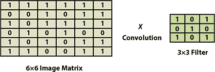

Figure 5.8 3 × 3 filter convolve over 6 × 6 image matrix.

## 5.5.3 Pooling Layer

This layer is also helpful in downsizing the image matrix. It is more helpful in reducing the number of parameters and thus, decreasing the computation overhead in the network. The most common method used for pooling is `MaxPooling` (Figure 5.9).

## 5.5.4 Fully Connected Layer

It works similar to conventional ANN and Multilayer Perceptron (MLP), given in Figure 5.10. However, only difference is that now the image matrix is more simplified, optimized and in shape due to pre-processing offered by early layers of CNN. The classification decision is driven by this layer.

By varying the number of convolutional layer, pooling layer, and fully connected layer, we can maximize the network performance for given image processing task such as restoration or classification. There exist many CNNbased architectures which are developed for accelerating training speed that ultimately leads to high accuracy and low error rate. It is bit hard to conceptualise the architecture thoroughly and beyond the scope of chapter, yet we extract some relevant information and summarize it in Table 5.1.

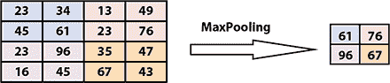

Figure 5.9 Pooling reduces the size of transition matrix.


Figure 5.10 Multi-layer neural network.

Table 5.1 CNN-based different architectures.

| **Architecture** | **Year** | **Group/Authors** | **Error rate (in %)** | **Activation function used** | **No. of parameters (in million)** |
| --- | --- | --- | --- | --- | --- |
| AlexNet [25] | 2012 | SuperVision | 15.3 | ReLU | 62.3 |
| GoogLeNet [26] | 2014 | Google | 6.67 | ReLU | 4 |
| VGGNet [27] | 2014 | Visual Geometry Group | 7.32 | ReLU | 138 |
| ResNet [28] | 2015 | Kaiming He *et al*. | 3.57 | ReLU | 23 |

## 5.6 Unravel Deep Learning in Medical Diagnostic Systems


Nowadays, CV and DL are together conquering greater heights in many areas. The cutting-edge researches influenced by these two frameworks shows promising results in every application, be it agriculture, remote sensing, or autonomous vehicles. Considering the current scenario where the entire globe is grappling with health crisis spread from novel Coronavirus [29], healthcare is emerging as a serious concern among research community. In fact, the virus is not novice for virologists or clinical practitioner, the world has been gone through several zoonotic attacks [30, 31] before 2020 corona pandemic. However, CV and DL in conjunction with simulations gained success in countering the adverse health problems. It was proved effective in aiding doctors and health workers to break the array of misapprehensions. They are widely utilized in developing computer-aided diagnostic (CADS) systems. Therefore, we are leading this section with state-of-the-art techniques stem from image processing and DL in early diagnosis of plausible diseases.

Medical imaging, sometimes, known as diagnostic imaging, such as X-rays, MRIs, CT scans, and mammograms, plays an imperative role in healthcare systems. It is an assortment of techniques and processes to capture visual representations of human parts, organs, or tissues for critical analysis, diagnostics, and clinical treatment. Health disorders like pneumonia, brain tumor, cancer, and Parkinson’s disease are being successfully diagnosed with high precision, possible through medical imaging. It thus allows early stage treatment or even nullifying the probability of reoccurring. Not only diagnosis but doctors have embraced the benefits of CV for surgery itself. It has a key role in analysing the damages and loss to body tissues before making any preparation to the surgery. The procedures are positively non-invasive, painless and life-saving. The combination of diagnostic imaging and DL has revolutionized the healthcare sector. It causes researcher and doctor adhere to the patient history, biological data, symptoms, along with microorganism biological cycle or patterns of replication to attain the crucial parameters which are further helpful in drug discovery. Medical imaging also contributes in tracking the effectiveness of patient’s on-going treatment and aids the physician to make changes in the dozes, if required. Table 5.2 reviews some state-of-art models for CAD covering relevant diseases.

### Table 5.2 Some CAD references driven by deep learning and medical imaging.

| **Reference** | **Algorithm(s) used** | **Performance (in %)** | **Description** |
| --- | --- | --- | --- |
| [32] | CNN, K-Nearest Neighbor, Support Vector Machine | Accuracy = 98 to 99 | MRI is used to investigate whether the patient is vulnerable to Alzheimer’s disease or not. |
| [33] | CNN | Accuracy = 97.5 | Brain tumor detection by MRI scans |
| [34] | Deep Neural Network (DNN), Principal Component-Analysis, Discrete Wavelet Transform | Accuracy = 96.97, Precision = 97 | Classification of brain tumors using MRI |
| [35] | CNN | Area Under Curve (AUC) = 87 to 94 | Chest radiographs are exploited for pathology detection |
| [36] | DNN, Linear Discriminate Analysis | Sensitivity = 96.2, Specificity = 94.2, Accuracy = 94.56 | Lung cancer diagnosis using CT scans |
| [37] | Heterogeneous Modified ANN | Accuracy = 97.5, Prediction ratio = 99.7, AUC = 92.2 | Kidney disease diagnosis by utilizing CT scans |
| [38] | CNN | Sensitivity = 90 above | MRI is used to evaluate brain tumors |
| [39] | Hybridized DL, Composite Monte-Carlo, Fuzzy-rule | RMSE = 37.77 | Devise critical decision process for epidemic by deterministic and nondeterministic data |
| [40] | CNN | Accuracy = 96.78, Sensitivity = 98.66, Specificity = 96.46 | COVID-19 diagnosis using X-rays |
| [41] | CNN, Bayesian optimization | Accuracy = 98.26, Correctness = 98.26, Specificity = 99.13, Completeness = 98.26 | Detection model for COVID-19 based on X-rays |
| [42] | CNN | Accuracy = 87.02, Sensitivity = 85.35, Specificity = 92.18, Precision = 89.96 | COVID-19 detection model driven by available X-rays |
| [43] | Deep Learning | NA | Drug-target interaction model to identify the drug that could work on SARS-CoV-2 |
| [44] | Deep Learning, Bayesian function | Accuracy = 86.7 | Classification of CT images into COVID-19 and other irrelevant groups |
| [45] | Deep Learning | Category-wise results are mentioned, e.g., Lung cancer: Sensitivity = 62.5 Prostate: Sensitivity = 87 Melanoma = 60 | The Bone Scan Index (BSI) is embedded to evaluate different tumors (e.g., prostate cancer, breast cancer, and lung cancer) |
| [46] | CNN Long short-term memory | Accuracy = 98.5 | Exploitation of ECG signals to classify cardiovascular disease |
| [47] | Deep Learning | Accuracy = 99.5 | 3D stereophotogrammetry and deep learning are combined to study craniosynostosis condition in infants |
| [48] | Deep Learning | Accuracy = 72.5, AUC = 81, Specificity = 66.7, Sensitivity = 78.4 | To detect appendicitis, a 3D model is developed with pretraining on natural videos |
| [49] | CNN, ResNet-50, InceptionResNet-V2, YOLO | Average Accuracy = 94.5, 95.83, 97.5 respectively (for the DDSM dataset), Average Accuracy = 88.74%, 92.55%, 95.32%, respectively (for the INbreast dataset) | A promising breast lesion diagnostic system is proposed from digital mammograms |
| [50] | CNN | Accuracy = 82.8, Sensitivity = 80.2, Specificity = 83, AUROC = 88.4 | CT 扫描基于颈部淋巴结转移诊断在甲状腺癌患者中的应用 |

## 5.7 挑战与未来展望

近年来，我们目睹了深度学习（DL）部署的实证激增。然而，事实上，由于数据采集、预处理、实现、数据集不平衡以及分类器评估等原因，缺乏充分论述挑战与期望的文章仍显不足。例如，使用卷积神经网络（CNN）时，需要调谐大量超参数来提取特征，这本身就极具挑战性。另一个突出问题为数据集不平衡，在医疗监测中尤为突出，可能源于数据扭曲或校准错误，从而影响 DL 的实现，进而导致性能下降。数据标准化与互操作性同样是主要障碍。由于图像获取受传感器等因素影响，分类精度和模型学习均受损。为增加数据多样性并获得足够体量，不同数据集常被合并，但互操作性仍属虚幻。另一个深层次问题是“黑盒”特性：虽然构建网络并不复杂，但理解输出背后的机制却极为繁琐。DL 仍在持续取得更好结果，但解释“为什么”和“如何”仍颇具难度。此外，隐私与法律问题亦是制约因素。随着大数据尤其是医疗领域的兴起，1996 年《健康保险可携性与责任法案》（HIPAA）对患者个人或匿名信息的保护日益严格，限制了此类信息的使用，进而使得获取个体数据变得更为困难。另一种替代方案是差分隐私，它限制敏感数据的使用，防止泄露与医疗史或可识别信息相关的数据。遗憾的是，上述因素共同作用，限制了能够对分析模型产生负面影响的内容，既受法律也受伦理视角的制约。

从上述讨论可知，开放挑战仍待进一步审视，研究方向需更明确。医学研究中数据不足是最大挑战之一。模糊或缺乏足够医学案例的数据会阻碍对罕见疾病的研究与解决。因此，监管机构亟需制定健康数据标准，并具备在不同提供方之间共享的能力。相关组织在评估健康记录时，也应遵循这些标准。

## 5.8 结论

由于数据科学（DS）的各个基石相互交织，单独在基层层面逐一审查它们往往需要长时间的讨论。然而，通过本文，我们得以凸显出这些“基石”之间的显著差异，特别关注深度学习（DL）与人工神经网络（ANN）。虽然 ANN 借助计算单元（即神经元）控制信息从输入到输出的流动，DL 则专注于特征捕获与转换，从而建立输入刺激与神经结果之间的关系。根据模型需求与目标，可选用多种神经网络架构。最基础的 DL 类别为卷积网络（ConvNet），它在计算机视觉（CV）任务中发挥重要作用，如图像预处理、目标分析、目标检测与识别。本文提供了通用的 CNN 多层架构及其各功能的概述，并指出不同团队或作者提出的层级细微变体。CNN 架构之所以有用，是因为它们能够在训练耗时上大幅降低，通过提供预训练网络实现这一点。

随后，本文讨论了医疗应用，阐释了 DL 在医疗领域解决问题的有效性。从阿尔茨海默病到动物传染病、脑肿瘤分类到慢性肾脏病诊断，DL 图像处理技术在医学信息学、生物信息学或健康数据分析中呈现出“银线”优势。但我们不应过度庆祝其增长，因为可能阻碍其蓬勃发展的障碍仍然存在。我们列举了在以 ANN 为基础的学习中，尤其是医疗领域常见的主要挑战。解决方案不应局限于单一视角，因为创新空间始终存在。我们期待未来更多以 DL 为驱动的研究，持续推动该领域发展。

## References

1. Mohan, S. *et al*., Effective heart disease prediction using hybrid machine learning techniques. Special Section on Smart Caching, Communications, Computing and Cybersecurity for Information-Centric. *Internet Things*, 7, 81542–81554, 2019.

2. Stephenson, N. *et al*., Survey of machine learning techniques in drug discovery. *Curr. Drug Metab*., 9, 20, 185–193, 2019.

3. Hamedan, F. *et al*., Clinical decision support system to predict chronic kidney disease: A fuzzy expert system approach. *Int. J. Med. Inf*., Elsevier, 138, 1–9, 2020.

4. Bhatti, G., Machine learning based localization in large-scale wireless sensor networks. *Sensors*, 18, 4179, 2018.

5. Mosavi, A. and Varkonyi-Koczy, A.R., Integration of machine learning and optimization for robot learning. *Adv. Intell. Syst. Comput*., 519, 349–355, 2017.

6. Smarter with Gartner, Gartner top 10 strategic technology trends for 2019. Homepage [`www.gartner.com/smarterwithgartner`](https://www.gartner.com/smarterwithgartner).


# 6 Two-Stage Credit Scoring Model Based on Evolutionary Feature Selection and Ensemble Neural Networks

**Diwakar Tripathi¹\*, Damodar Reddy Edla², Annushree Bablani² and Venkatanareshbabu Kuppili²**

*¹Thapar Institute of Engineering & Technology Patiala, Punjab, India*

*²National Institute of Technology Goa, Ponda, India*

> ***Abstract***
>
> Credit scoring is a progression to estimate the risk accompanying with a credit merchandise. Nowadays, huge number of credit application data with different features set is available of various credit products, as credit industries are issuing various credit product. So, key challenge is to discover insight on how to improve the performance ahead of time using data mining techniques, as it directly effects to viability of that industry. Foremost emphasis of this article is to improve the analytical performance of credit scoring model. Toward that, this article introduces a two-stage credit scoring model. First stage focuses for reduction of irrelevant and noisy features because they may affect model's performances. In second stage, ensemble of neural networks is utilized for categorizing credit applicant. For feature selection, an evolutionary approach by utilizing "Hybrid Binary Particle Swarm Optimization and Gravitational Search Algorithm (BPSOGSA)" is proposed and correlation coefficient is considered as criteria function to compute the fitness value against each search agent generated by BPSOGSA algorithm. Further, proposed credit scoring model is validated on four different credit applicants' realworld credit scoring datasets.
>
> ***Keywords*:** Correlation coefficient, neural networks, ensemble learning, feature selection

## 6.1 Introduction

信用评分是一种与信用产品（如信用卡和贷款）相关的风险近似方法，基于申请人的历史数据进行估计 [1]。正如 Thomas *et al*. [2] 所规定的，“信用评分是一组决策模型及其底层技术的集合，帮助信贷机构发放信用” [3]。信用评分努力孤立因非法行为和不还款而导致的不同申请人特征的后果。信用评分的核心是判断申请人是否属于财务健康的群体。信用是指申请人从金融机构获得的金额，如“信用额度是根据客户的年收入、房产等资质估算的”。信用评分为金融机构带来诸多优势，包括“评估并降低信用风险”、“做出管理决策”和“改善现金流” [4, 5]，其性能直接影响信用行业的盈利能力。它并非单一步骤，金融机构通常以多个步骤实施，例如：

*   • Application Scoring：用于评估新申请人的真实性和可信度，基于提交申请时收集的社会、经济及其他证据进行估算。
*   • Behavioral Scoring：与前一步类似，但针对现有客户，帮助其分析个人行为模式，以支持动态资产管理流程。
*   • Collection Scoring：类似于前一步，但旨在根据客户行为变化将其分类为若干群体（如高频、中频、无频等），金融机构据此关注特定群体的客户。

## 6.1.1 Motivation

根据印度储备银行（RBI）的统计数据 [7]，2012–2016 年信用卡用户数量如 Figure 6.1 所示。


• 2015–2016、2014–2015 和 2013–2014 财政年度的信用卡持有人数量分别为 2450 万、2111 万和 1918 万 [7]。

• 2009–2010 财政年度的住房贷款账户总数为 57.38 万 [8]。


**Figure 6.1** Rise in issuing of credit cards during 2012–2016.

除了信用卡，各类贷款、抵押贷款、小额和微额融资等信用产品也由各金融机构提供。由于新申请人数量庞大且现有客户众多，手动进行信用评分极为困难，或需要大量具备领域知识和客户行为专业能力的管理人员。目前，“信用评分不仅限于银行或信用行业，电信、房地产等其他领域也采用信用评分模型来评估客户行为”。因此，“人工智能可能解决手动信用评分的问题”。提升模型预测性能，特别是针对可信度低的申请人群体，对金融机构具有重要意义 [9, 10]。本文旨在通过剔除冗余和噪声特征，提升模型的分类性能。

文章其余部分组织如下：`Section 6.2` 简要回顾相关文献；`Section 6.3` 介绍“拟议信用评分模型”；`Section 6.4` 展示拟议方法的实验结果，并据此给出结论性 remarks。

## 6.2 Literature Survey

大多数学者将信用风险估计视为二分类问题（信用 worthy 或 non-creditworthy），并发现其能够可靠地发现信用评分数据中的隐藏模式。这些系统帮助专家提升对信用风险的认知。在此背景下，多种机器学习（ML）方法被用于构建风险估计系统。诸如“人工神经网络（ANN）”和“支持向量机（SVM）”等分类方法已成功应用于信用风险预测模型。

`SVM` [11] 具有“优越的泛化能力”和“全局优化”特性，因此被广泛用作分类工具，不仅在信用评分领域，也在其他领域中被大量研究。`Li et al.` [12] 通过数据预处理，以 `SVM` 为分类手段构建信用风险评估模型，用于区分消费者抵押贷款的可能申请人。`Gestel et al.` [13] 采用“最小二步支持向量机（LS-SVM）”评估企业客户的信用 worthiness。`West` [14] 发表了一篇关于各类分类方法的综述，并评估了分类器在信用评分数据集上的表现。`Xiao and Fei` [15] 提出一种基于“SVM 与最优参数值”的方法。`Kuppili et al.` [16] 利用极端学习机器（Extreme Learning Machine）对信用评分数据进行分析，并结合脉冲神经元模型进行聚合。同样，`Zhou et al.` [17] 采用“加权 SVM”构建信用评分模型。

将多种方法结合形成混合模型是一种动态的、综合不同步骤的方案，旨在提升特定结论的质量。在信用评分数据集中，包含诸如申请人社会与财务状况等异构特征（如类别型、小范围数值型、大范围数值型），这些特征可能存在冗余或无关，从而降低模型性能。因此，许多研究者提出了数据预处理步骤，如“特征选择”和“异常值检测”，以增强预测性能，相关方法描述如下。

混合信用评分模型将聚合 `SVM` 与“多变量自适应回归分段（MARS）”和“F-score”特征选择方法相结合，在文章 [18] 中进行评估。类似地，文章 [19] 和 [20] 分别将“逐步回归（SR）”和“MARS”与人工神经网络（ANN）相结合，用于信用评分。`Oreski 和 Oreski` [21] 提出一种基于“遗传算法（GA）”的特征选择方法，并与分类方法混合。`Wang et al.` [22] 和 `Huang and Dun` [23] 分别采用“模糊集与禁搜索”以及“二进制粒子群优化（BPSO）”对有价值特征集进行优化，并与 `SVM` 结合进行分类。

`Section 6.3` 节提出的信用评分模型如图 6.2 所示。该模型在第一阶段采用进化特征选择，第二阶段采用集成分类，具体细节如下小节讨论。在特征选择前，数据集需进行预处理，因为信用评分数据集包含异构数据类型。本文使用神经网络作为分类工具，该工具以向量形式处理数据。因此，数据预处理包括数据清洗（消除缺失值）、数据转换（将类别值转换为数值）以及数据离散化（将长尾数值转换为小范围值）。


**Figure 6.2** Proposed two-stage credit scoring model.

## 6.3.1 Stage-1: Feature Selection

本文采用进化算法 `BPSOGSA` [24] 进行有价值特征的选择。文献 [29] 中的作者提出了 `PSOGSA`，这是一种融合粒子群优化（PSO）的社会思维（gbest）能力和进化型基于重力搜索算法（GSA）的开发能力的混合方法。`PSOGSA` 在探索和开发能力方面优于 `PSO` 和 `GSA` [24]。

在 `PSOGSA` [29] 中，所有搜索代理在每次迭代中从一个位置移动到另一个位置，搜索空间为连续空间，并用位置向量表示。这里，`PSOGSA` 用于特征选择，位置向量应以二进制格式表示，其中 0 表示对应特征不存在，1 表示存在。为将连续向量转换为二进制位置向量，需要使用转移函数，该函数结合搜索代理的可能速度 [25] 进行调整。文献中有多种转移函数，属于两类，即 `S` 形和 `V` 形 [26]。`V`‑形转移函数在收敛速度上优于 `S`‑形转移函数 [27]。`V`‑形转移函数如在 Equations (6.1)–(6.4) [26] 所示。

(6.1)  (6.2)  (6.3)  (6.4) 

其中  表示搜索代理 *i* 在迭代 *k* 时的速度。

上述所有转移函数均用于在 `BPSOGSA` 中调整搜索代理的速度，进而将其转换为位置向量元素翻转的概率。进一步，搜索代理的位置向量的概率被用于将其转换为二进制格式，并依据 Equation (6.5) 的规则更新。

(6.5) 

其中 *X[i]* 表示第 *i* 个搜索代理的位置。

## 6.3.2 Proposed Criteria Function

相关系数（Corr）用于衡量两个变量之间的关系 [28–30]，可通过 Equation (6.6) 计算。Corr 的取值范围为 -1 到 +1，其中 +1 表示最强正相关，-1 表示最强负相关，0 表示两个特征之间不存在线性关系。拟议的标准函数如在 Equation (6.9)，其依赖于搜索代理中特征的类间相关系数（Inter[ccc]）和类内相关系数（Intra[ccc]）的比例。Inter[ccc] 表示特征与类标签之间的相关性，Intra[ccc] 表示特征之间的相关性，分别由 Equations (6.7) 和 (6.8) 计算。

(6.6) 

其中 *P* 和 *Q* 表示特征，*n* 表示这些特征的值数量。

(6.7)  (6.8) 

此处 *F[i]* 表示第 *i* 个特征，*Y* 表示目标标签。

(6.9) 

其中 fitness value[i] 表示第 *i* 个搜索代理的适应度值。

## 6.3.3 Stage-2: Ensemble Classifier

在机器学习领域，对数据分类的研究已相当丰富，文献中可得到多种分类方法。然而，并没有明确的过程来判断哪种分类器在特定数据集上表现最佳。某一特定分类器可能适合某些数据集，但在其他数据集上可能表现不佳；相反，另一种分类器可能在这些数据集上表现更好。 ensemble 方法能够在每个数据集上提供接近最优的结果。利用 ensemble 分类器的基本意图是，当多个分类器做出决策时，而不是仅依赖单一分类器的决策，不同的基学习者可能从不同角度观察同一模式，从而相互补充预测信息，结合多个分类器的决策进行最终判断。参与决策的所有分类器均称为基分类器（base classifiers）。

最常见的基分类器决策聚合方式有三种：一致投票（UV）、多数投票（MV）和加权投票（WV）。在 UV 方式下，若给定类别为 class-1，当所有分类器均将样本归类为 class-1 时，UV 将最终决策定为 class-1。在 MV 方式下，最终输出为获得最多票数的类别。WV 的最终输出是基分类器输出的加权和，权重与该基分类器的性能（如分类准确率）成正比。ensemble 可以分为同质框架（基分类器同类型）或异质框架（基分类器不同类型）。在同质或异质框架下，使用 MV 或 UV 时，预测能力对特定类别标签表现良好 [31]。

人工神经网络（ANN）是受人脑信息处理和学习能力启发的强大分类方法，因其在学习和识别输入‑输出数据的复杂非线性关联方面表现出色 [32]。在第二阶段，三个基于神经网络的异质分类器被通过 WV 方法聚合，分别是 “多层前馈神经网络（MLFN）[6, 33]”、 “时延神经网络（TDNN）[34, 35]” 和 “径向基功能神经网络（RBFN）[36, 37]”。

## 6.4 结果与讨论

This section offers the explanation of datasets together with performance measures utilized to validate the proposed approach and comprehensive outcome investigation on four credit scoring datasets.

## 6.4.1 Experimental Datasets and Performance Measures

Two-stage credit scoring model is experimented on four credit scoring datasets, *viz*., “Australian credit approval (AUS)”, “German-categorical loan approval (GCD)”, “Japanese credit screening (JPD)”, and “Germannumerical loan approval (GND)”. All aforementioned datasets are obtained from the “UCI Machine Learning Repository [38]” and comprehensive descriptions are as tabularized in Table 6.1. All datasets are binary class datasets in which positive and negative classes signify as accepted not accepted applications.

Here, accuracy and G-measure are utilized to measure and compare the performances of proposed approach with other approaches. Accuracy \as in [Equation (6.10)] shows the “predictive performance of classifier”, and it is not sufficient as a performance measure, if there is noteworthy class disproportion on the way to a class in the dataset. G-measure \as in [Equation (6.11)] is a measure which takes “both the positive and negative classes accuracies” in account to calculate the score, where specificity (Spe) and sensitivity (Sen) represent the predictive performance toward the positive and negative class, respectively.

(6.10)  (6.11) 

where “TP”, “FP”, “TN”, and “FN” indicate as “True Positive”, “False Positive”, “True Negative”, and “False Negative”, respectively, and , .

**Table 6.1** Description about experimental datasets.

| **S. no.** | **Dataset** | **Instances** | **+ve/−ve** | **No. of features** |
| --- | --- | --- | --- | --- |
| 1 | AUS | 690 | 307/383 | 14 |
| 2 | GCD | 1,000 | 700/300 | 20 |
| 3 | JPD | 690 | 307/383 | 15 |
| 4 | GND | 1,000 | 700/300 | 24 |

## 6.4.2 Classification Results With Feature Selection

Pre-processing is the initial and most significant phase in data mining. For pre-processing the data, data cleaning, transformation, and discretization processes are applied. Toward the data-cleaning, data samples with missing value are eliminated. Toward the data-transformation distinct nominal values of an attribute is replaced by a unique integer number. Because, neural network-based classifiers require the data samples as a vector of real numbers. Numerical feature value is rescaled in a predefined interval respectively. With the purpose of anticipating to the features with wide-ranging numeric values overlook the features with narrow-ranging numeric values, features are rescaled between a range using discretization procedure by applying Boolean Reasoning Algorithm [39].

**Table 6.2** Performances of MLFN, RBFN, DTNN, and ensemble approaches with features selection on Australian datasets.

| **Classifier** | **Measure** | **ALL** | **CFS** | **V1** | **V2** | **V3** | **V4** |
| --- | --- | --- | --- | --- | --- | --- | --- |
| MLFN | ACC | 83.12 | 84.35 | 84.34 | 82.13 | 85.57 | 83.31 |
| | G-M | 83.41 | 84.93 | 84.32 | 830.1 | 85.66 | 84.41 |
| DTNN | ACC | 89.16 | 90.57 | 91.81 | 91.53 | 91.43 | 91.04 |
| | G-M | 90.39 | 91.08 | 92.11 | 92.05 | 92.09 | 91.25 |
| RBFN | ACC | 85.59 | 87.23 | 87.6 | 86.48 | 87.76 | 87.39 |
| | G-M | 86.19 | 88.36 | 87.74 | 87.59 | 88.06 | 87.96 |
| MV | ACC | 89.43 | 90.56 | 91.88 | 91.86 | 91.58 | 91.63 |
| | G-M | 89.15 | 90.93 | 92.33 | 92.48 | 92.23 | 92.29 |
| WV | ACC | 90.02 | 90.86 | 91.92 | 91.89 | 91.79 | 91.69 |
| | G-M | 90.67 | 91.26 | 92.36 | 92.54 | 92.46 | 92.61 |


## 两阶段模型描述

根据所提出的两阶段模型，在第一阶段，预处理后的数据集被输入用于特征选择。正如前文所述，需要一个转移函数将搜索空间从连续空间转换为二进制空间。因为特征选择是二进制优化问题，其中 0 和 1 分别表示对应特征在搜索代理中不存在和存在。根据文献，V 形函数优于 *S* 形函数。

文献中提供了多种 V 形函数，但不清楚哪种函数在特征选择情况下表现更好。因此，本文应用了四种 V 形转移函数（即 `V1`、`V2`、`V3` 和 `V4`）将连续搜索空间转换为二进制搜索空间。所提出方法选择的特征与最先进的特征选择方法“基于相关性的特征选择（CFS）[40]”进行了比较。此外，包含所选特征的数据集被传递到下一阶段进行分类，`MLFN`、`RBFN` 和 `TDNN` 预测的输出通过 `WV` 方法进行聚合。在 `WV` 方法中，基分类器需要权重。为了计算基分类器的权重，使用分类器准确率作为参数，最初向所有分类器分配相等的权重。随后，根据分类器在整个迭代过程中的分类性能，通过公式 (6.12) 更新分类器的权重 [41]。相同过程持续 *n* 次迭代，最后一轮迭代将权重分配给相应的分类器。

### 公式 (6.12)

```
w[iu] = w[io] * acc[i]
```

其中 `w[io]` 和 `w[iu]` 分别表示第 *n* 次迭代中第 *i* 个分类器的旧权重和更新后的权重，`acc[i]` 表示第 *i* 个分类器的准确率。

## 实验结果

### 表 6.3：德国分类数据集上 MLFN、RBFN、DTNN 及集成方法在特征选择下的性能

| Classifier | Measure | ALL | CFS | V1 | V2 | V3 | V4 |
| :--- | :--- | :--- | :--- | :--- | :--- | :--- | :--- |
| MLFN | ACC | 70.53 | 72.22 | 72.58 | 72.63 | 72.69 | 72.36 |
| | G-M | 58.23 | 59.63 | 61.23 | 61.36 | 61.53 | 60.88 |
| DTNN | ACC | 80.36 | 81.22 | 82.03 | 82.36 | 82.65 | 82.33 |
| | G-M | 69.35 | 70.22 | 70.99 | 71.06 | 71.77 | 70.89 |
| RBFN | ACC | 74.64 | 76.25 | 76.35 | 76.55 | 76.83 | 76.22 |
| | G-M | 63.77 | 64.96 | 65.23 | 65.96 | 66.36 | 65.84 |
| MV | ACC | 81.25 | 82.36 | 83.11 | 83.26 | 83.69 | 83.06 |
| | G-M | 78.32 | 79.53 | 79.65 | 79.89 | 79.58 | 78.98 |
| WV | ACC | 81.25 | 82.36 | 83.11 | 83.26 | 83.69 | 83.06 |
| | G-M | 79.02 | 79.56 | 79.99 | 80.13 | 80.24 | 79.36 |
| UV | ACC | 80.13 | 81.19 | 81.66 | 81.63 | 81.81 | 81.21 |
| | G-M | 77.69 | 78.64 | 78.59 | 78.69 | 78.49 | 79.07 |

### 表 6.4：日本数据集上 MLFN、RBFN、DTNN 及集成方法在特征选择下的性能

| Classifier | Measure | ALL | CFS | V1 | V2 | V3 | V4 |
| :--- | :--- | :--- | :--- | :--- | :--- | :--- | :--- |
| MLFN | ACC | 84.36 | 85.89 | 85.79 | 86.27 | 86.83 | 86.42 |
| | G-M | 84.53 | 86.16 | 86.09 | 86.13 | 86.88 | 86.39 |
| DTNN | ACC | 87.16 | 88.86 | 88.84 | 88.78 | 89.56 | 89.13 |
| | G-M | 88.86 | 89.38 | 89.36 | 89.20 | 89.93 | 88.96 |
| RBFN | ACC | 84.83 | 85.02 | 85.36 | 85.39 | 86.07 | 85.86 |
| | G-M | 85.31 | 86.69 | 86.83 | 86.91 | 87.32 | 87.09 |
| MV | ACC | 88.53 | 89.77 | 89.91 | 89.86 | 90.08 | 90.12 |
| | G-M | 89.21 | 89.96 | 90.01 | 90.14 | 90.68 | 90.13 |
| WV | ACC | 88.76 | 89.65 | 89.89 | 89.93 | 90.06 | 89.26 |
| | G-M | 90.67 | 90.15 | 89.79 | 90.39 | 90.61 | 89.97 |
| UV | ACC | 88.06 | 89.16 | 89.15 | 89.12 | 89.31 | 88.77 |
| | G-M | 88.69 | 89.74 | 90.11 | 90.24 | 89.44 | 89.74 |

## 参考文献

20. `Lee`, `T.S.` 和 `Chen`, `I.F.`，A two-stage hybrid credit scoring model using artificial neural networks and multivariate adaptive regression splines. *Expert Syst. Appl*., *28*, 4, 743–752, 2005.

21. `Oreski`, `S.` 和 `Oreski`, `G.`，Genetic algorithm-based heuristic for feature selection in credit risk assessment. *Expert Syst. Appl*., *41*, 4, 2052–2064, 2014.

22. `Wang`, `J.`，`Guo`, `K.`，`Wang`, `S.`，Rough set and Tabu search based feature selection for credit scoring. *Proc. Comput. Sci*., *1*, 1, 2425–2432, 2010.

23. `Huang`, `C.L.` 和 `Dun`, `J.F.`，A distributed PSO–SVM hybrid system with feature selection and parameter optimization. *Appl. Soft Comput*., *8*, 4, 1381–1391, 2008.

24. `Mirjalili`, `S.`，`Wang`, `G.G.`，`Coelho`, `L.D.S.`，Binary optimization using hybrid particle swarm optimization and gravitational search algorithm. *Neural Comput. Appl*., *25*, 6, 1423–1435, 2014.

25. `Rashedi`, `E.`，`Nezamabadi-Pour`, `H.`，`Saryazdi`, `S.`，BGSA: binary gravitational search algorithm. *Natural Comput*., *9*, 3, 727–745, 2010.

26. `Mirjalili`, `S.` 和 `Lewis`, `A.`，S-shaped versus V-shaped transfer functions for binary particle swarm optimization. *Swarm Evol. Comput*., *9*, 1–14, 2013.

27. `Mirjalili`, `S.`，`Mirjalili`, `S.M.`，`Yang`, `X.S.`，Binary bat algorithm. *Neural Comput. Appl*., *25*, 3–4, 663–681, 2014.

28. `Cohen`, `J.`，`Cohen`, `P.`，`West`, `S.G.`，`Aiken`, `L.S.`，*Applied multiple regression/correlation analysis for the behavioral sciences*，Routledge，2013.

29. `Bluman`, `A.G.`，*Elementary statistics: A step by step approach*，McGraw-Hill Higher Education，New York, NY，2009.

30. `Tripathi`, `D.`，`Edla`, `D.R.`，`Kuppili`, `V.`，`Bablani`, `A.`，`Dharavath`, `R.`，Credit scoring model based on weighted voting and cluster-based feature selection. *Proc. Comput. Sci*., *132*, 22–31, 2018.

31. `Tsai`, `C.F.`，`Lin`, `Y.C.`，`Yen`, `D.C.`，`Chen`, `Y.M.`，Predicting stock returns by classifier ensembles. *Appl. Soft Comput*., *11*, 2, 2452–2459, 2011.

32. `Haykin`, `S.`，*Neural networks: a comprehensive foundation*，Prentice-Hall, Inc.，2007.

33. `Hornik`, `K.`，`Stinchcombe`, `M.`，`White`, `H.`，Multilayer feedforward networks are universal approximators. *Neural Networks*, *2*, 5, 359–366, 1989.

34. `Edla`, `D.R.`，`Tripathi`, `D.`，`Cheruku`, `R.`，`Kuppili`, `V.`，`Dharavath`, `R.`，An efficient multi-layer ensemble framework with BPSOGSA-based feature selection for credit scoring data analysis. *Arab. J. Sci. Eng*., *43*, 12, 6909–6928, 2018.

35. `Waibel`, `A.`，`Sawai`, `H.`，`Shikano`, `K.`，Modularity and...


28. `Cohen`, `J.`，`Cohen`, `P.`，`West`, `S.G.`，`Aiken`, `L.S.`，*Applied multiple regression/correlation analysis for the behavioral sciences*，Routledge，2013.

29. `Bluman`, `A.G.`，*Elementary statistics: A step by step approach*，McGraw-Hill Higher Education，New York, NY，2009.

30. `Tripathi`, `D.`，`Edla`, `D.R.`，`Kuppili`, `V.`，`Bablani`, `A.`，`Dharavath`, `R.`，Credit scoring model based on weighted voting and cluster-based feature selection. *Proc. Comput. Sci*., *132*, 22–31, 2018.

31. `Tsai`, `C.F.`，`Lin`, `Y.C.`，`Yen`, `D.C.`，`Chen`, `Y.M.`，Predicting stock returns by classifier ensembles. *Appl. Soft Comput*., *11*, 2, 2452–2459, 2011.

32. `Haykin`, `S.`，*Neural networks: a comprehensive foundation*，Prentice-Hall, Inc.，2007.

33. `Hornik`, `K.`，`Stinchcombe`, `M.`，`White`, `H.`，Multilayer feedforward networks are universal approximators. *Neural Networks*, *2*, 5, 359–366, 1989.

34. `Edla`, `D.R.`，`Tripathi`, `D.`，`Cheruku`, `R.`，`Kuppili`, `V.`，`Dharavath`, `R.`，An efficient multi-layer ensemble framework with BPSOGSA-based feature selection for credit scoring data analysis. *Arab. J. Sci. Eng*., *43*, 12, 6909–6928, 2018.

35. `Waibel`, `A.`，`Sawai`, `H.`，`Shikano`, `K.`，Modularity and scaling in large phonemic neural networks. *IEEE Trans. Acoust. Speech Signal Process*., *37*, 12, 1888–1898, 1989.

36. `Kala`, `R.`，`Vazirani`, `H.`，`Khanwalkar`, `N.`，`Bhattacharya`, `M.`，Evolutionary Radial Basis Function Network for Classificatory Problems. *IJCSA*, *7*, 4, 34–49, 2010.

37. `Broomhead`, `D.S.` 和 `Lowe`, `D.`，*Radial basis functions, multi-variable functional interpolation and adaptive networks* (No. RSRE-MEMO-4148)，Royal Signals and Radar Establishment Malvern (United Kingdom)，1988.

38. `UCI machine learning repository` (Last Accessed 2019/09/25)，[`archive.ics.uci.edu/ml/index.php`](https://archive.ics.uci.edu/ml/index.php).

39. `Nguyen`, `H.S.`，*Dicretization of Real Value Attributes: Boolean Reasoning Approach* [Ph. D Dissertaion]，Warsaw University，Poland，1997.

40. `Hall`, `M.A.`，Correlation-based feature selection of discrete and numeric class machine learning，University of Waikato，Department of Computer Science，2000.

41. `Tripathi`, `D.`，`Cheruku`, `R.`，`Bablani`, `A.`，Relative performance evaluation of ensemble classification with feature reduction in credit scoring datasets，in: *Advances in Machine Learning and Data Science*，pp. 293–304，Springer，Singapore，2018.

1.  *\*Corresponding author*: diwakarnitgoa@gmail.com

# 7 Enhanced Block-Based Feature Agglomeration Clustering for Video Summarization

**Sreeja M. U.\* and Binsu C. Kovoor**

*Department of Information Technology, Cochin University of Science and Technology, Kerala, India*

> ***Abstract***
>
> Video summarization is the process of automatically extracting relevant frames or segments from a video that can best represent the contents of the video. In the proposed framework, a modified block-based clustering technique is implemented for video summarization. The clustering technique employed is feature agglomeration clustering which results in dimensionality reduction and makes the system an optimized one. The sampled frames from the video are divided into varying number of blocks and clustering is employed on corresponding block sets of all frames rather than clustering frames as a whole. Additionally, image compression based on Discrete Cosine Transform is applied on the individual frames. Results prove that the proposed framework can produce optimum results by varying the block sizes in a computationally efficient manner for videos of different duration. Moreover, the division of frames into blocks before applying clustering ensures that maximum information is retained in the summary.
>
> ***Keywords*:** Feature agglomeration, block based, hierarchical clustering, video abstraction, key frames, static summaries, shot boundaries, video summarization

## 7.1 Introduction

Video summarization plays a crucial role in effective information exploitation. The growing amount of video data being created and uploaded on the Internet has resulted in an exploding amount of digital information. Availability and ease of access to all sorts of recording devices has led to an increased pace at which videos are generated. The amount of video information being shared and processed on a day to day basis has substantially increased due to which the demand for video processing techniques has become a growing concern. Video summarization, a highly relevant branch of video processing techniques, aims at automatically generating an abstract view of the video so the user can go through the main events of the video in less time. Video summaries aim at providing a gist of the original video in a short duration of time.

Video summaries are typically of two types which are static and dynamic. Static summaries are generated by combining stationary key frames, whereas dynamic summaries are formed by combining key segments from the original video. Strategies adopted to identify and extract the key frames or segments from videos vary among different categories of videos. Similarly, the type of output summary suitable for different categories of videos also varies accordingly. The most effective and computationally efficient technique for video summarization is by employing clustering. Clustering is an unsupervised machine learning technique used for naturally grouping information based on similarity or dissimilarity metrics that differ according to the clustering method. The most common forms of clustering techniques utilized in video summarization are k-means, DBSCAN (density-based spatial clustering of applications with noise), hierarchical, and nearest neighbor algorithm. The distance metric or similarity computation is the factor that changes with each clustering method. The clustering algorithm adopted for summarizing videos vary significantly among applications. The importance of clustering algorithms in video summarization is well emphasized in the literature [1–3]. The various types of clustering methods used along with its effectiveness in different video summarization applications can also be examined. The effectiveness of various clustering techniques and how it varies according to each category of videos can also be observed in the existing works which further substantiates the relevance of conventional clustering approaches in all categories of video summarization [4].

为视频总结取得成功至关重要，需要以极细的粒度捕捉每个帧的细节，以最大程度减少信息损失。除了最小化信息损失外，还必须确保所产生的计算成本也尽可能低。因此，在拟议系统中，提出了一种修改后的块聚类方法，使用的聚类算法为特征聚类（feature agglomeration）。视频的每个输入帧都被分割成若干块，并且对所有帧的相应块集合进行聚类。这确保了视频中最大量的信息被保留在摘要中。同样，操作在压缩域中进行，对每个单独帧进行离散余弦变换（DCT）压缩，从而降低计算成本。本文在 VSUMM 数据集上，基于定量和定性参数（即视频总结中常见的参数）进行了全面评估，并分析了结果。此外，还对块大小的最优值进行了基于块的比较分析。

主要亮点如下：

* 1. `层次化框架`，利用修改后的块聚类方法用于关键帧检测，并结合直方图方法用于镜头边界检测。
* 2. `离散总结框架`，采用特征聚类聚类技术，区别于传统的聚类方法。
* 3. `压缩域优化视频总结框架`，使用离散余弦变换（DCT）实现。

Section 7.2 总结了视频总结中以聚类为主要技术的最近工作。Section 7.3 介绍了特征聚类聚类技术。拟议系统的方法论详细阐述在 Section 7.4，其中包含各个阶段和算法。Section 7.5 详细分析了定量和定性评估结果，随后在 Section 7.6 给出结论及未来展望。

## 7.2 相关工作


# 视频总结中以聚类为主要技术的最近工作亮点

De Avila *et al.* [5] 提出一种使用 k-means 聚类的视频总结框架。从单个帧中提取 HSV 色彩特征，并对其进行 k-means 聚类。每个聚类的中心被选为该聚类的最终关键帧。k-means 聚类的缺点是需要事先确定聚类数量。

Kumar *et al.* [6] 实现了另一种基于 k-means 聚类的框架。这里，k-means 聚类分两阶段进行：第一阶段对整个视频进行聚类，形成关键帧组；第二阶段将帧划分为等大小的分区，然后对每个分区进行聚类。

Mundur *et al.* [7] 采用德拉姆三角化聚类用于总结，而不是传统的聚类方法。德拉姆三角化根据内容重要性形成大小不一的聚类，且无需事先设定聚类数量。

Cirne 和 Pedrini [8] 描述了一种基于光谱聚类的视频总结框架。光谱聚类利用谱（特征值）进行聚类。光谱聚类在所有领域均表现更好。

Mishra 和 Singh [9] 通过寻找最优聚类算法实现事件总结，选择靠近聚类中心的帧作为关键帧。

Guimaraes 和 Gomes [10] 实现了基于图理论分割聚类和构建最小生成树的关键帧选择框架，而不是将视频划分为镜头。

Sachan [11] 提出一种框架，先将帧集合分组为少量相似的连续帧，然后对这些帧集合进行层次聚类。聚类的重要性由聚类中帧的数量决定。

Gharbi *et al.* [12] 实现了一个框架，首先通过窗口规则选择候选摘要帧，随后从候选集中选取 SURF 特征。构建一个重复性表，视为视频相似性图，并在图模块度上对其进行聚类。

Wu *et al.* [14] 的框架基于高密度峰值搜索聚类算法 [15] 进行视频表示。

Majumdar *et al.* [16] 采用期望-最大化聚类用于视频总结，并通过修改后的色彩布局描述符检测镜头边界 [17]。

Zhao *et al.* [18] 设计了一种用于监控领域的视频总结框架，采用 DBSCAN 聚类技术并结合背景减除。该方法利用 HSV 色彩特征，聚类后进行背景减除以识别关键帧。

John *et al.* [19] 综述了当前视频总结中使用的各种聚类技术的详细分析。

---

进入 `/path/to/xxx` 目录，找到 `xxx.json`。

在表达式 `cvar = avar + bvar` 中，加法运算符（`+`）将 `avar` 与 `bvar` 相加，得到它们的和 `cvar`。

在 `List.of(arg0, arg1, arg2)` 中，`List` 接口的工厂方法 `of()` 接受一系列的元素，返回包含它们的只读列表。

之后我们这样调用 `cmd` 命令：`cmd arg0 arg1 arg2`。

```
if (condVar > someVal) {console.log("xxx")}
```

---

Fei *et al.* [20] put forth a key frame extraction model combining sparse frame selection and agglomerative hierarchical clustering. Sparse frame selection is applied initially to obtain the first set of key frames. The criteria for clustering are content loss minimization and representativeness ranking. The clustering algorithm incorporated is also known as an improved mutual information-based agglomerative hierarchical clustering.

Sony *et al.* [21] builds a video summarization framework based on clustering similar frames using Euclidean distance. The length of the summary is governed by user defined criteria. A fraction of frames with a comparatively larger Euclidean distance from each cluster is extracted to form the summary sequence. Iterative node segmentation algorithm is used for summarizing the video.

Lv and Huang [22] extract key frames from personal videos using nearest neighbor clustering algorithm. Clustering is performed on frames based on the nearest neighbor algorithm which has the additional advantage of not setting the number of clusters beforehand. The clustering is not perfect but compared to other unsupervised clustering methods it performs better.

Majumdar *et al.* [23] put forth a novel clustering algorithm named CURE (clustering using representativeness) hierarchical clustering. Cure clustering algorithm is applied for video summarization in healthcare application and big data and the extracted summaries are used for disease analysis and prediction.

Chamasemani *et al.* [24] develop a video summarization framework using density-based clustering algorithm for surveillance videos. Global features such as color, texture, and energy, as well as local SURF features extracted for applying the clustering algorithm. The combined approach has resulted in a more informative summary compared to the state of the art.

Kuanar *et al.* [25] propose a multi-view video summarization framework preferably for surveillance videos based on graph theory approach. Features are extracted on the basis of bag of words as well as color, texture, and shape before applying Gaussian entropy-based filtering. Clustering is performed by optimum path forest algorithm. The results prove that the summaries demonstrate the effectiveness of the semantic feature set extracted and the clustering employed.

On a similar note, several works have emphasized the significance of hybrid clustering approaches. Srinivas and Mohan [26] put forth such a model where two clustering models based on incremental and hierarchical principles are combined. A novel cohesion metric is introduced for computing the inter-cluster distance. The significance of similarity measures for content-based image and video analysis is also described by Srinivas and Mohan [27] where efficient medical image classification is performed on the basis of a combined feature set with three different types of similarity measures.

## 7.3 Feature Agglomeration Clustering

Hierarchical clustering is a general family of clustering algorithms that build nested clusters by merging or splitting them successively. The root of the tree is the unique cluster that gathers all the samples, the leaves being the clusters with only one sample data. Hierarchical clustering algorithms can be divided into two classes: top-down approach and bottom-up approach. Bottom-up approach progresses by viewing each sample of data as one single cluster and continuously agglomerate or combine pairs of clusters until all the clusters have been combined into a single cluster. This single cluster consists of all the sample data. Hence, bottom-up hierarchical clustering is also termed as hierarchical agglomerative clustering. The Agglomerative clustering object performs a hierarchical clustering by starting in its own cluster, and clusters are successively merged together. A tree representation of this hierarchy of clusters is known as dendrogram. In feature agglomeration, instead of samples, features are merged. It is a dimensionality reduction tool. The prime difference between standard agglomeration and feature agglomeration is that, instead of clustering the samples in the received data matrix as done in standard agglomeration clustering, feature agglomeration performs clustering on the transpose of the standard matrix, thereby actually clustering the features rather than the samples. Euclidean distance is the default distance metric used for performing clustering on the features which are the sample data in the standard matrix. The linkage criterion determines the metric used for the merge strategy. The various linkage criteria are single, complete, average, ward’s, etc. One main advantage of hierarchical clustering is that the number of clusters need not be specified beforehand. It can also be specified according to the application requirements. The choice of distance metric also does not influence the performance of the clustering as it is seen that all the metrics almost perform equally well. The choice of distance metric is crucial in other clustering algorithms. Hierarchical clustering is more preferable when the underlying dataset has a hierarchical structure which needs to be exploited for best results.

## 7.4 Proposed Methodology

The detailed framework of the proposed system is shown in Figure 7.1. The proposed framework performs video summarization in two phases, namely, (a) pre-processing and shot boundary detection and (b) modified block clustering using feature agglomeration technique for summarization. The latter phase involves three stages, namely, (a) modified block clustering, (b) key frame extraction, and (c) post-processing and summary generation.


**Figure 7.1** Proposed framework.

## 7.4.1 Pre-Processing

Video pre-processing is an essential step in every video processing application. The pre-processing stage in the proposed model consists of down sampling the frames, converting the extracted frames to compressed domain and identifying the shot boundaries.


# Down Sampling and Frame Compression

A video comprises a set of frames which, when put together, gives the user a notion of continuity and motion. It is evident that the majority of the time there is not much difference between consecutive frames. Hence, not all frames need to be processed and analyzed for their possibility of being a key frame. Instead, the video is typically down sampled so that it reduces the chances of processing redundant frames, thereby making the model computationally efficient. The strategy for down sampling varies for different applications. In the proposed model, once the input video is divided into individual frames, the frames are down sampled at one frame per frame rate of the video, and compression is performed on the down sampled frames. The compression technique applied is DCT. The DCT transforms a frame from the spatial domain to the frequency domain as in Equations (7.1) and (7.2).

(7.1) 
(7.2) 

where `u, v, x, y` = 0,1,2, … `N` − 1 and


`x,y` and `u,v` are coordinates in the spatial and frequency domain, respectively. `M` and `N` are the size of the frame that the DCT is done on. The equation calculates one entry `(x,y)^(th)` of the transformed image from the pixel values of the frame matrix.

# 射线边界检测

射线边界检测是大多数视频总结框架的关键步骤。然而，在某些类别的视频中，它并不是必需的。当连续帧的背景和前景出现重大变化时，就会检测到一个镜头。可以使用直方图比较和聚类等多种技术来检测射线边界。在所提模型中，射线边界通过比较连续下采样帧的直方图来检测。

在获得下采样帧的 DCT 后，会计算每个帧的颜色直方图。使用直方图比较方法计算连续直方图之间的距离。所使用的距离度量是 Bhattacharya 距离，如 Equation (7.3)。

(7.3) 

其中 `N` 是直方图的 bin 数量，`H[1]` 和 `H[2]` 是被比较的直方图。距离值高于阈值的帧被识别为射线边界，射线边界的数量随之获取。Figure 7.2 展示了使用直方图比较在名为 “Jumps.mp4” 的示例视频中检测射线边界的过程。红线表示阈值，而位于阈值之上的峰值点对应的帧号是直方图差异最大的帧。这表明该点处的场景或镜头发生变化，因为可以辨认出连续帧在该点的颜色分布整体发生了变化。这些帧可以被视为射线边界。射线边界的阈值是通过直方图差值的平均值与标准差之和计算得到的。X 轴显示帧号，Y 轴显示视频中连续帧的直方图差值。


**Figure 7.2** Plot of histogram comparison for shot boundary detection.

## 7.4.2 使用特征聚合技术的修改块聚类

压缩域中的块聚类。已采样并压缩的帧被分为 `m*m` 块，其中 `m` 是将帧分割的块数量。为相应块从连续帧中计算 RGB 颜色模型的直方图。第 `i` 次聚类操作定义在由所有帧的第 `i` 块形成的直方图集合上。直方图是最简单的分类器，用于根据颜色分布区分图像。

所使用的聚类方法是特征聚合聚类，如 Section 7.3 所述。所使用的连接准则是 Ward 标准。这里，需要达到最优值的目标函数是所考虑聚类下的方差。通过 Lance Williams 公式实现离散聚类 `C[i]`、`C[j]`、`C[k]`，其大小分别为 `n[i]`、`n[j]`、`n[k]`，如在 Equation (7.4) 中所示。

(7.4) 

所使用的距离度量是欧氏距离，如 Equation (7.5) 所示。

(7.5) 

相应块从帧中分别聚类，从而形成 `m*m` 个集群集合。需要从每个集群集合中选取一个代表帧，称为候选帧。假设，对于帧的第 `i` 块，其形成的集群集合如在 Equation (7.6) 所示。

(7.6) 

其中 `k[i]` 是第 `i` 块形成的集群数量。

形成的集群集合数量为 `m*m`。假设从  中的集群中选取的代表帧为 `x[i1]`，则每个块每个集群的候选帧可以表示为在 Equation (7.7) 中所示。

(7.7) 

其中 `x[ij]` 是第 `i` 块第 `j` 个集群中的代表帧，`i` = 1 到 `m*m`，`j` = 1 到 `k[i]`。从每个集群中选取的候选帧是集群中索引最大的帧。从每个集群形成的候选帧集合会出现重叠帧。因此，需要制定一种策略，以便从这些集合中提取关键帧。

关键帧提取。下一阶段是从每个集群的候选帧集合中提取关键帧。由于集群集合的数量为 `m*m`，可以明确指出，如果一个帧在超过一半的集合中出现，则该帧可以被视为关键帧。Equation (7.8) 展示了关键帧的表示。

(7.8) 

其中 `m*m` 是将帧分割的块数量。

## 7.4.3 后处理与摘要生成

后处理。为消除在得到的关键帧集合中相似的帧，模型中进行了最终的后处理。目标是找出高度相似的帧并将其丢弃，以避免冗余。可以采用多种指标来实现此目标。在所提模型中，实验表明 Structural Similarity Index（结构相似性指数）[28]，如在 Equation (7.9)，给出了最佳结果。

(7.9) 

其中 `μ[x]` 和 `μ[y]` 分别是 `x` 和 `y` 的平均值。

 和  分别是 `x` 和 `y` 的相应方差。

`σ[xy]` 是协方差，`c[1]` 和 `c[2]` 是常数。

在关键帧集合中计算帧之间的 SSIM。SSIM 值范围在 -1 到 1 之间，其中 1 表示完全相似。如果 SSIM 值约为 1，则只保留其中一个帧作为关键帧。将 SSIM 索引设为 0.5，大于该值的帧被视为相似并被丢弃。所提框架在样本视频 “v11.flv”（属于卡通类别且时长小于 1 分钟）在后处理前后提取的关键帧如 Figures 7.3a 和 b 所示。可以明显看出 Figure 7.3b 在后处理阶段消除了冗余帧。


**Figure 7.3** Key frames extracted by the proposed framework: (a) before post-processing and (b) after post-processing.

摘要生成。最终的关键帧集合被组合形成最终静态摘要。所提系统和 VSUMM [5] 框架为样本视频 “v100.avi”（属于新闻类别且时长在 1 到 3 分钟之间）生成的摘要如 Figures 7.4a 和 b 所示。很明显，与对比相比，所提框架能够检索出大多数相关帧，但系统识别出的关键帧总数相对较高。这导致系统的精度下降，但显著提高了摘要的享受性和连贯性。所提模型的工作流程详细算法在 Algorithms 7.1 和 7.2 中详细描述。


**Algorithm 7.1** Pre-processing and shot boundary detection.


**图 7.4** (a) 拟议系统概要。(b) VSUMM 概要。


**算法 7.2** 压缩域块聚类及概括的修改版。

## 7.5 结果与分析

为分析拟议模型的效率，本节详细阐述了为评估而进行的各项实验。定量与定性评估指标在评估部分详细说明，随后是评估结果的比较。

## 7.5.1 实验设置与使用的数据集

框架在 Python Spyder IDE 上在 Intel i5 处理器、4GB RAM 和 64 位操作系统上实现并进行实验。实验使用的视频属于不同类别，包括卡通、新闻、纪录片、电视节目等，时长各异，均来自基准 VSUMM 数据库。评估标准和拟议框架的实验结果在随后章节中详细说明。

## 7.5.2 评估指标

目前，视频摘要框架缺乏统一的评估标准。评估通常基于定量度量、定性度量或二者的结合。拟议框架采用定量与定性两类指标进行评估。

**定量指标**。用于性能评估的定量指标包括计算时间（CT）、压缩比（CR）、精确率、召回率和 F‑score。此外，框架会对帧进行不同大小的块进行聚类，因此也对不同块大小的影响进行了详细定量分析。

CT 定义为从输入视频到生成摘要的时间，即系统处理视频以自动生成摘要的运行时间。CR 定义为被选为最终摘要关键帧的帧数占源视频总帧数的比例，即最终关键帧数与源视频总帧数之比。CR 依据 方程 (7.10) 计算。

(7.10) 

精确率定义为在检索的帧中相关帧的比例，依据 方程 (7.11) 计算。

(7.11) 

召回率是被检索的相关实例占所有相关实例总数的比例，依据 方程 (7.12) 计算。

(7.12) 

F‑score 是精确率和召回率的调和平均值，兼顾两者的优缺点，依据 方程 (7.13) 计算。

(7.13) 

需要注意的是，上述所有指标中，数值越高表示性能越理想，唯一例外是 CT，数值越低越好。

**定性指标**。用于评估的定性指标包括信息性、可享受性、连贯性、多样性、覆盖率以及整体得分，具体定义如下。

*信息性*。信息性衡量生成的摘要在多大程度上提供了关于原始视频的信息。

*可享受性*。可享受性衡量摘要覆盖了提供娱乐性的帧数，尤其适用于电影类视频。

*覆盖率*。覆盖率评估摘要在多大程度上涵盖了原始视频中的重要事件。

*连贯性*。连贯性定义为在组合关键帧时，场景保持一致或连续流畅的程度。

*多样性*。多样性评估摘要中包含多种事件或场景的程度，并确保帧间的最小冗余。

*整体得分*。整体得分是上述主观指标的综合得分。

与定量指标相同，定性指标的数值越高表示理想的视频摘要框架。

## 7.5.3 评估

**定量分析**。基于不同块大小、CT、CR、精确率、召回率和 F‑score 的定量分析在下文详细说明。

*不同块大小*。拟议模型的聚类是基于块的方式，即将帧划分为块，并对连续帧射击中的对应块进行聚类。通过变换块大小，寻找能够达到最佳结果的理想块大小。表 7.1 展示了在块大小范围 1 到 6（TF 为视频总帧数）内，对若干样本视频的关键帧数（KF#）、CT 和 CR 的结果。样本视频用 S1、S2、S3、S4、S5 表示，分别对应 v11.flv、v100.avi、Jumps.mp4、v103.avi、greatwebofwater.mpg。实验得到最佳结果的块大小以 **粗体** 标记。可以观察到，时长不足 1 分钟的视频，最佳块大小在 3 之后不再产生显著变化；而时长较长的视频，较大的块大小能够提供更好的摘要质量。例如，时长超过 3 分钟的样本视频 S5，最佳块大小为 5 和 6。

由此可见，对于更长时长的视频，增大块大小会提升摘要质量；而对于较短视频，增大块大小可能仅增加计算开销而不改善结果。

**表 7.1.** 基于不同块大小的比较。

```markdown
| **Sl. no.** | **Sample video** | **Duration** | **TF#** | **Block size m** | **m*m** | **KF#** | **CR** | **Average CT (seconds)** |
| --- | --- | --- | --- | --- | --- | --- | --- | --- |
| 1 | S1 | 46s | 1,155 | 1 | 1 | 12 | 1.4 | 1.195 |
| 2 | | | | 2 | 4 | 11 | 0.96 | 2.105 |
| **3** | | | | **3** | **9** | **9** | **0.8** | **2.905** |
| 4 | | | | 4 | 16 | 10 | 0.9 | 3.605 |
| 5 | | | | 5 | 25 | 8 | 0.7 | 4.205 |
| 6 | | | | 6 | 36 | 8 | 0.7 | 5.095 |
| 1 | S2 | 1m12s | 2,180 | 1 | 1 | 18 | 0.83 | 3.2 |
| 2 | | | | 2 | 4 | 10 | 1.3 | 5.1 |
| 3 | | | | 3 | 9 | 9 | 0.5 | 5.8 |
| 4 | | | | 4 | 16 | 8 | 0.5 | 6 |
| **5** | | | | **5** | **25** | **8** | **0.5** | **7.2** |
| 6 | | | | 6 | 36 | 8 | 0.5 | 7.3 |
| 1 | S3 | 38s | 950 | 1 | 1 | 10 | 1.1 | 2.57 |
| 2 | | | | 2 | 4 | 9 | 1 | 3.44 |
| **3** | | | | **3** | **9** | **8** | **0.9** | **3.86** |
| 4 | | | | 4 | 16 | 6 | 0.7 | 4.78 |
| 5 | | | | 5 | 25 | 6 | 0.5 | 5.47 |
| 6 | | | | 6 | 36 | 5 | 0.5 | 6.47 |
| 1 | S4 | 3m55s | 5,875 | 1 | 1 | 60 | 1 | 5.658 |
| 2 | | | | 2 | 4 | 99 | 1.7 | 11.04 |
| 3 | | | | 3 | 9 | 87 | 1.5 | 14.2 |
| 4 | | | | 4 | 16 | 65 | 1.2 | 17 |
| **5** | | | | **5** | **25** | **55** | **1.1** | **22** |
| **6** | | | | **6** | **36** | **52** | **1** | **33** |
| 1 | S5 | 1m49s | 3,291 | 1 | 1 | 48 | 1.5 | 5.51 |
| 2 | | | | 2 | 4 | 48 | 1.5 | 9.2 |
| 3 | | | | 3 | 9 | 36 | 1.1 | 9.5 |
| 4 | | | | 4 | 16 | 36 | 1.1 | 11.9 |
| **5** | | | | **5** | **25** | **20** | **0.7** | **13.9** |
| **6** | | | | **6** | **36** | **19** | **0.5** | **17.9** |
```

-   [计算时间（CT）和压缩比（CR）]。所提框架在不同时长视频中的平均 CR 和 CT 如图 `Figures 7.5a` 和 `b` 所示。DCT 压缩阶段的存在显著降低了 CT。CT 的降低也可归因于采用一种变体的常规聚类技术进行概括。即使视频时长较长，CT 也未显著增加。CR 的结果同样令人期待。提取的摘要小于原始视频的 5%，这是视频摘要的理想属性。


**Figure 7.5** 所提框架的性能基于 (a) 平均压缩比和 (b) 平均计算时间。


## 精确率、召回率和 F-分数

通过将所提框架生成的摘要与数据集中样本视频的基准摘要进行比较，计算精确率、召回率和 F-分数。所提系统和现有框架的精确率、召回率和 F-分数的平均结果如图 `Figure 7.6` 所示。所提框架与之比较的现有框架包括 `VSUMM` [5]、`Delaunay Triangulation` [7] 和 `VRCVS` [14]。所提系统的平均 F-分数为 72%，相较于以往系统相对较高。F-分数始终是视频摘要框架性能的理想因素。F-分数在信息检索系统中权衡了仅使用精确率和召回率的缺点。然而，可观察到所提框架的平均精确率并非最佳。原因是所提框架提取的关键帧数量相较于比较模型更多。由于精确率是相关帧在提取的关键帧中的比例，当提取的帧数稍多时，精确率值倾向于降低，因为两者成反比。另一方面，召回率出现较大回升。召回率是相关帧在提取的关键帧中占所有相关帧的比例，较高值表明所提模型提取的关键帧数量较多。可观察到平均召回率为 88%，这表明所提系统能够识别并提取更大比例的基准真实相关帧。总体而言，定量分析结果证明，该模型在保持较低复杂度的前提下表现优异。


**Figure 7.6** 所提系统与现有系统在定量指标方面的比较。

## 定性分析

对 20 名用户进行定性评估。评估参数包括信息性、可享受性、多样性、连贯性和整体得分，每项均在 1 至 5 之间，5 为最佳。用户需对每个参数根据生成的摘要与原始视频给出评分，结果取平均值。定性参数的评估结果如图 `Figure 7.7` 所示。可观察到，信息性参数在所有视频类别中均较高，表明摘要内容信息丰富。可享受性参数的结果也令人期待，说明该模型在商业视频（如卡通）中能够提取既提供有用信息又具备娱乐性的帧。多样性和连贯性的结果也属可接受，但并非最佳。多样性较低是因为提取的关键帧数量稍高；连贯性较低则是由于输出为静态摘要，信息流动不连续。然而，所提框架的整体得分在所有视频类别中均较高，验证了模型的可接受性。


**Figure 7.7** 所提系统在定性指标方面的性能。

## 7.6 结论

视频摘要旨在通过自动识别视频中的相关帧或片段，为用户提供视频的概述。理想的视频摘要应具备信息性、代表性，同时保持简洁。所提系统基于特征聚类实现关键帧导向的视频摘要框架，聚类作用于已采样帧的单个块集合上。结果表明，由于所采用的聚类技术和嵌入的压缩阶段，系统计算效率高。此外，当聚类作用于不同块大小时，能够确保从视频中提取最大信息。在定量分析中，框架的 F-分数相对较高，优于现有系统。通过根据视频时长调整块大小，结果可进一步提升。定性分析也表明，该系统能够生成多样、信息丰富且有趣的摘要。使系统实时化是尚未实现的目标，这将进一步提升空间和时间的计算效率。同样，利用深度学习技术——近年来因在各领域表现出色而备受关注——也是未来潜在的研究方向。

## 参考文献

1. Ajmal, M., Ashraf, M.H., Shakir, M., Abbas, Y., Shah, F.A., Video summarization: techniques and classification, in: *International Conference on Computer Vision and Graphics*, Springer, Berlin, Heidelberg, pp. 1–13, 2012.

2. Kaur, P. and Kumar, R., Analysis of video summarization techniques. *Int. J. Res. Appl. Sci. Eng. Technol., (IJRASET)*, 6, 1, 1157–1162, 2018.

3. Moses, T.M. and Balachandran, K., A classified study on semantic analysis of video summarization, in: *2017 International Conference on Algorithms, Methodology, Models and Applications in Emerging Technologies (ICAMMAET)*, IEEE, pp. 1–6, 2017.

4. Sreeja, M.U. and Kovoor, B.C., Towards genre-specific frameworks for video summarization: A survey. *J. Visual Commun. Image Represent*., 62, 340–358, 2019.

5. De Avila, S.E.F., Lopes, A.P.B., da Luz Jr., A., de Albuquerque Araújo, A., VSUMM: A mechanism designed to produce static video summaries and a novel evaluation method. *Pattern Recognit. Lett*., 32, 1, 56–68, 2011.

6. Kumar, K., Shrimankar, D.D., Singh, N., Equal partition based clustering approach for event summarization in videos, in: *Signal-Image Technology & Internet-Based Systems (SITIS), 12th International Conference on*, IEEE, pp. 119–126, 2016.

7. Mundur, P., Rao, Y., Yesha, Y., Keyframe-based video summarization using Delaunay clustering. *Int. J. Digit. Libr*., 6, 2, 219–232, 2006.

8. Cirne, M.V.M. and Pedrini, H., A Video Summarization Method Based on Spectral Clustering, in: *Iberoamerican Congress on Pattern Recognition*, pp. 479–486, Springer, Berlin, Heidelberg, 2013.

9. Mishra, D.K. and Singh, N., Parameter Free Clustering Approach for Event Summarization in Videos, in: *Proceedings of International Conference on Computer Vision and Image Processing*, Springer, Singapore, pp. 389–397, 2017.

10. Guimarães, S.J.F. and Gomes, W., A static video summarization method based on hierarchical clustering, in: *Iberoamerican Congress on Pattern Recognition*, pp. 46–54, Springer, Berlin, Heidelberg, 2010.

11. Sachan, P.R., Frame clustering technique towards single video summarization, in: *Cognitive Computing and Information Processing (CCIP), Second International Conference on*, IEEE, pp. 1–5, 2016.

12. Gharbi, H., Bahroun, S., Massaoudi, M., Zagrouba, E., Key frames extraction using graph modularity clustering for efficient video summarization, in: *Acoustics, Speech and Signal Processing (ICASSP), IEEE International Conference on*, pp. 1502–1506, 2017.

13. Bay, H., Ess, A., Tuytelaars, T., Van Gool, L., Speeded-up robust features (SURF). *Comput. Vision Image Understanding*, 110, 3, 346–359, 2008.

14. Wu, J., Zhong, S.H., Jiang, J., Yang, Y., A novel clustering method for static video summarization. *Multimed. Tools Appl*., 76, 7, 9625–9641, 2017.

15. Rodriguez, A. and Laio, A., Clustering by fast search and find of density peaks. *Science*, 344, 6191, 1492–1496, 2014.

16. Majumdar, J., Kumar, K.S., Venkatesh, G.M., Analysis of video shot detection using color layout descriptor and video summarization based on expectation-maximization clustering, in: *Cognitive Computing and Information Processing (CCIP), International Conference on*, IEEE, pp. 1–5, 2015.

17. Cvetkovic, S., Jelenkovic, M., Nikolic, S.V., Video summarization using color features and efficient adaptive threshold technique. *Prz. Elektrotech*., 89, 2, 247–250, 2013.

18. Zhao, Y., Lv, G., Ma, T., Ji, H., Zheng, H., A novel method of surveillance video Summarization based on clustering and background subtraction, in: *Image and Signal Processing (CISP), 8th International Congress on*, IEEE, pp. 131–136, 2015.

19. John, A.A., Nair, B.B., Kumar, P.N., Application of Clustering Techniques for Video Summarization–An Empirical Study, in: *Computer Science On-line Conference*, Springer, Cham, pp. 494–506, 2017.

20. Fei, M., Jiang, W., Mao, W., Song, Z., New fusional framework combining sparse selection and clustering for key frame extraction. *IET Comput. Vision*, 10, 4, 280–288, 2016.

21. Sony, A., Ajith, K., Thomas, K., Thomas, T., Thomas, T., Deepa, P.L., Video summarization by clustering using Euclidean distance, in: *2011 International Conference on Signal Processing, Communication, Computing and Networking Technologies*, IEEE, pp. 642–646, 2011.

22. Lv, C. and Huang, Y., Effective Keyframe Extraction from Personal Video by Using Nearest Neighbor Clustering, in: *2018 11th International Congress on Image and Signal Processing, BioMedical Engineering and Informatics (CISPBMEI)*, IEEE, pp. 1–4, 2018.

23. Majumdar, J., Udandakar, S., Bai, B.M., Implementation of Cure Clustering Algorithm for Video Summarization and Healthcare Applications in Big Data, in: *Emerging Research in Computing, Information, Communication and Applications*, pp. 553–564, Springer, Singapore, 2019.

24. Chamasemani, F.F., Affendey, L.S., Mustapha, N., Khalid, F., Video abstraction using density-based clustering algorithm. *Vis. Comput*., 34, 10, 1299–1314, 2018.

25. Kuanar, S.K., Ranga, K.B., Chowdhury, A.S., Multi-view video summarization using bipartite matching constrained optimum-path forest clustering. *IEEE Trans. Multimedia*, 17, 8, 1166–1173, 2015.

26. Srinivas, M. and Mohan, C.K., Efficient clustering approach using incremental and hierarchical clustering methods. *International Joint Conference on Neural Networks (IJCNN)*, Barcelona, pp. 1–7, 2010.

27. Srinivas, M. and Mohan, C.K., Medical Image Indexing and Retrieval Using Multiple Features, in: *International Conference on Computational Intelligence and Information Technology*, October 2013.

28. Wang, Z., Bovik, A.C., Sheikh, H.R., Simoncelli, E.P., Image quality assessment: from error visibility to structural similarity. *IEEE Trans. Image Process*., 13, 4, 600–612, 2004.

1. *Corresponding author*: kishan.sreeja@gmail.com

# Part 2

## MACHINE LEARNING FOR HEALTHCARE SYSTEMS

# 8

## Cardiac Arrhythmia Detection and Classification From ECG Signals Using XGBoost Classifier

**Saroj Kumar Pandeyz\*, Rekh Ram Janghel and Vaibhav Gupta**

*Department of Information Technology, National Institute of Technology, Raipur, India (C.G.) India*

> ***Abstract***
>


> In this paper, we propose an effective electrocardiogram (ECG) signal classification method using `XGBoost` classifier. The ECG signals are passed through four phases of data acquisition, noise filtering, feature extraction, and classification. In first phase, dataset is collected from the MIT-BIH arrhythmia database. In second phase, noise is removed using baseline wandering removal filter. In next phase, 45 descriptors from four prominent features which showed good results in previous work, namely, wavelets, higher order statistics (HOS), morphological descriptors, and R-R intervals, are being employed. Using these features as an input to the `XGBoost` classifier, the signals are being classified into four classes (N, S, V, and F) as per the ANSI-AAMI standards; of all the classifiers, `XGBoost` shows best result with an accuracy of 99.43%.
>
> **Keywords:** Arrhythmia, `XGBoost`, ECG, wavelet, morphology, R-R interval

## 8.1 Introduction

Arrhythmia is defined as an abnormality in normal heart rate; it is a general indication of cardiovascular diseases which can be severe in most cases if left unattended. It signifies that the heart is not beating at its normal rate or it is beating with an irregular pattern [1]. Timely detection of this irregularity is helpful in curing it and saving the patient from cardiovascular diseases [2].

Electrocardiogram (ECG) signal, which is the result of electrical activity in the heart due to its depolarization and repolarization, is used. It is measured by putting electrodes at various points of the body and is recorded when the heart goes through its cardiac cycle. ECGs from healthy persons have a characteristic natural shape; any kind of abnormality can change the electrical activity of the heart which, in turn, leads to change in ECG shape. Diseases like abnormal heart rhythms, heart attack can be detected using arrhythmia detection. Classification of ECG signals as normal or arrhythmic is a challenging task and, if done manually, can lead to a lot of errors and wrong detection. This is why a lot of work is needed in this field of arrhythmia detection [3].

Different papers have taken the ECG signals from different databases; two of the most common ones are MIT-BIH and ECG-ID arrhythmia database. The dataset from these sources are not completely pure as they have various high frequency noises. These are unwanted and can affect our results if not removed. So, the dataset is made to go through the process of de-noising. Generally, noises include power line interference of 50/60 Hz that is caused by electromagnetic interference of power line, electromyography (EMG) noise that comes at the time of muscle activity and baseline wandering which is the low-frequency component is present in ECG system. To get rid of these noises, different filters have been employed in different papers like digital Infinite Impulse Response (IIR) filter, which is a type of notch filter capable of removing power line interference, along with that Finite Impulse Response (FIR) filters, which have also been used [4].

从数据库中获取无噪声的数据集后，下一步是特征提取；特征是基本定义数据集条件的描述符。许多不同的特征提取技术在不同论文中被使用；大多数基于频率和时间技术。时间域提取的特征包括心跳间隔、持续时间参数（`PR`、`QT`、`QRS`）以及幅度特征（`ST` 和 `QRS`）。时间域提取的特征作为分类器的特征并不十分出色。取而代之的是频率域方法是更好的替代方案；因此，功率谱密度（`PSD`）和傅里叶变换等技术在该领域很受欢迎，但频率方法的缺点是它们不提供 ECG 信号的时间信息。在所有频率域方法中，小波变换是最广泛使用的方法 [5]。

Mahmoud *et al*. [6] 提出了一种使用非 fiducial 特征集合、 fiducial 特征集合以及非 fiducial 与 fiducial 特征融合的技术，并使用三种分类器——人工神经网络（`ANN`）、K 最近邻（`KNN`）和支持向量机（`SVM`）进行分类。Rajagopal *et al*. [7] 使用了一组特征，包括 1) 心跳的时间特征，如 `P-Q` 间隔、`QRS` 间隔、`S-T` 间隔、`Q-R` 间隔以及相邻心跳之间的 `R-R` 间隔；2) 幅度特征；3) 小波变换基于的特征，如 Harr 小波和 Daubechies 小波；4) Stockwell 变换基于的特征，并使用结合 `KNN` 和 `SVM` 的协同决策模型进行分类。

Mondejarr-Guerra *et al*. [8] 展示了使用小波、高阶统计（`HOS`）、1D 局部二值模式、形态学描述符以及 `R-R` 间隔作为特征进行分类；分类器是一个 `SVM` ensemble，其中每个特征分别输入 `SVM`，结果通过 One-Versus-One（`OVO`）投票策略合并，得到最终类别。

Mathews *et al*. [9] 使用了深度信念网络（`DBN`）和受限玻尔兹曼机（`RBM`）进行 supraventricular 和 ventricular 心跳的分类。Sannino *et al*. [10] 提出了深度神经网络，并与 11 个 `WEKA` 工具进行了比较，结果显示其准确率更高。Diker *et al*. [12] 采用了 Pan Tompkins 方法和离散小波变换（`DWT`）方法提取关键点，然后将这些关键点输入传统的极限学习机算法进行分类。

本文讨论 ECG 分类，组织方式如下：Section 8.2 讨论用于 ECG 分类的特征选择及理论背景概述。Section 8.2 同时介绍本文使用的主要分类器及其架构。Section 8.3 重点展示实验结果以及与其他现有工作的对比。结论在 Section 8.4 中给出。

## 8.2 Materials and Methods

The dataset has been taken from MIT-BIH database and is pre-processed first to remove the noises. Then, features are extracted from the dataset which are used by the classifier to classify the signals into four classes (N, S, V, and F) as per the ANSI-AAMI standard. Different steps involved in the process can be summarized by the following workflow diagram Figure 8.1.


**Figure 8.1** Workflow diagram describing the approach to ECG classification used in the paper.

## 8.2.1 MIT-BIH Arrhythmia Database

The database contains ECG signals from 47 patients of about 30 minutes which is sampled at 360 Hz at 11-bit resolution. There are two signals in each record modified-lead II (ML II), and one of V1, V2, V4, or V5. As ML II is common in all the records, only it is considered while doing the classification, and there are approximately 110,000 beats. These beats have been classified into five classes [11]. There are certain records that contain paced beats which are not considered for the process of classification. The database is highly imbalanced with majority of beats belonging to Normal (N) class. The database distribution is presented in Table 8.1. The unknown beat (Q) class has been ignored in this work as it is practically nonexistent with very rare samples belonging to this class [12, 13]. The database has been used using the intra-patient's scheme where the dataset is taken together and from that collection some are used for training and some for testing. In this work, only out of signals from all the other electrodes only lead II are taken into consideration [14].

**Table 8.1** Classes present in MIT-BIH database with their percentage.

| **Classes** | **Records (%)** |
| --- | --- |
| N | 90 |
| SVEB | 3 |
| VEB | 6 |
| F | 1 |

## 8.2.2 Signal Pre-Processing

Pre-processing is the step in which we filter the signals so that the features extracted from the signal are pure and without any noise and disturbances. This is crucial as this directly affects the classification results. Median filter are useful in reducing random noise using the median value in the segmented window. In this paper, baseline wandering removal using the median filter with a local window size of kernel size 180 has been proposed.

## 8.2.3 Feature Extraction

In this paper, for the purpose of extraction of features, symmetric window of size 180 was taken around the R-peak and features were extracted from the window. The features extracted were as follows.

Wavelets: Wavelets are the descriptor of the waveform of the ECG signal so they contain information of the time as well as frequency domain, Daubechies wavelet function (db1) with 3 levels of decomposition has been applied here. It provides in total 23 descriptors. This is proved to give relevant information by different authors [15].

RR-Interval: The highest point in the amplitude of the ECG signal is the R-peak, distance between the successive R-peaks can give useful information about the state of ECG signals, and it is categorized into four types, namely, Pre-RR, which is the distance between current and preceding R peak, Post-RR, that is the distance between current and following R peak, local RR, which is the mean value of previous 10 pre-RR values, and global-RR, which I the mean value of the pre-RR values of last twenty minutes. In addition to these, their normalized values are also used so total 8 features are extracted from the RR-Interval [16].


## Higher Order Statistics (HOS)

HOS is particularly useful in estimation of the shape parameters such as skewness and kurtosis; here, the functions uses third or higher powers unlike the lower order statistics which uses zeroth, linear, and quadratic functions. Skewness refers to the asymmetry of the probability distribution about the mean, while kurtosis is a measure of tailenders of the probability distribution. Here, each beat is divided into five intervals and from each interval a 10-dimensional feature is created; now, from these intervals, skewness and kurtosis values are calculated [17].

## Morphological descriptor

The signal is segmented to a window size of 180 and values from this segment is taken. It is the Euclidean distance of the R-peaks and four different points taken from the beats. Four amplitude values are considered which are 10 maximum from beat `[0,40]`, minimum from beat `[75, 85]`, minimum from beat `(95,105)`, and maximum from beat `(150, 180)`.

## 8.2.4 Classification

- [XGBoost]和[AdaBoost]已被用于对`MIT-BIH Arrhythmia`数据库进行分类。下文介绍了`XGBoost`分类器和[AdaBoost]分类器的工作原理。

### 8.2.4.1 XGBoost 分类器

`XGBoost`分类器是一个梯度提升决策树的实现，使用集成机器学习算法。它通过提升弱学习者来实现良好的分类，采用梯度下降架构。提升是一种集成技术，新模型被加入以纠正前序模型的错误。与其他梯度提升实现相比，它通常更快，并且在结构化或表格数据集上表现更优越[17]。`XGBoost`最初是由一组分类和回归树（CART）构建的集合分类器。当`XGBoost`用于数据集的分类时，模型使用训练数据集`x`来预测输出`Ŷ[out]`，具体形式如下：

(8.1)

```

```

其中`I`表示总树的数量，`f[i]`是功能空间`A`中的一个函数，对应第`i`个树，`A`是包含所有可能 CART 的集合。在训练过程中，每个已训练的 CART 都会尝试补充远端的残差。目标函数`D`在`(n+1)`个 CART 处的优化如下：

(8.2)

```

```

其中`l()`是训练损失函数，`y[k]`是实际输出值，``是时间步`n`时的预测值。函数`Ω()`是正则化项，描述如下：

(8.3)

```

```

其中`L`表示叶子的数量，`w[i]`是第`l`个叶子上的得分。当方程(8.3)被优化时，梯度下降可以作用于微分损失函数，因为它使用泰勒展开。此外，XGBoost 模型无需特征选择，因为良好特征会作为树的节点自动选取。本研究中，我们使用 Python 编程结合 scikit-learn 库对`XGBoost`分类器进行实现。每个心跳样本包含 45 个特征，并将输出分类为四个不同的类别。模型的学习率设为 1，boosting 阶段数（即 n-estimator）固定为 50。

### 8.2.4.2 AdaBoost 分类器

`AdaBoost`是一种机器学习元算法，由`Robert Schapire`和`Yoavfreund`开发，是自适应增强算法的简称。它基本遵循将弱分类器组合成加权和的原则，从而形成强学习者[18]。该分类器的主要目的是通过引入新分类器来降低弱分类器的错误率。`Adaboost`是最敏感的算法，对噪声数据尤为敏感：

(8.4)

```

```

其中

- `f[m]`：第`m`个弱分类器。
- `θ[m]`：对应的权重。

## 8.3 结果与讨论

遵循 AAMI 规范，混淆矩阵被用于评估性能。混淆矩阵，也称为误差矩阵，是一种特定的表格布局，有助于可视化算法的性能。它完整描述了分类性能。从混淆矩阵中可以计算出多种参数用于性能分析。本文使用三个指标评估我们方法的性能：准确率、特异性和灵敏度。

(8.5)

```

```

(8.6)

```

```

(8.7)

```

```

以下实验在配备核心 i5 处理器（主频 1.6-GHz）和 8GB 内存的系统上进行，操作系统为 Ubuntu 18.04.03 LTS 64 位。本文采用患者内部方案从`MIT-BIH`数据库中获取训练和测试数据集；该方案将数据库按特定比例划分，一部分用于训练分类器，另一部分用于测试预测。下表 8.2 至 8.6 展示了在不同比例下划分数据库后的实验结果。

Table 8.2 展示了在 60-40 比例下划分数据库的实验结果。约 60,414 条记录用于训练分类器，约 40,277 条记录用于测试预测。整体准确率为 99.26%，精确率为 99.36%。

从 Table 8.2 可以看出，`XGBoost`模型按照 ANSI-AAMI 标准对`MIT-BIH`心律数据库进行四类分类，平均准确率为 99.81%，平均灵敏度为 99.07%，平均精确率为 99.36%。

Table 8.3 展示了在 50-50 比例下划分数据库的实验结果。约 50,345 条记录用于训练，约 50,346 条记录用于测试。整体准确率为 99.24%，精确率为 99.35%。

Table 8.4 展示了在 70-30 比例下划分数据库的实验结果。约 70,483 条记录用于训练，约 30,208 条记录用于测试。整体准确率为 99.28%，精确率为 99.45%。

**Table 8.2** `XGBoost`模型在`MIT-BIH`心律数据库上进行心跳分类的表现（训练-测试比例 60:40）。

| **Heartbeat types** | **Evaluation parameters** |
| --- | --- |
| | **Accuracy** | **Sensitivity** | **Precision** |
| Normal (N) | 99.66 | 99.84 | 99.72 |
| SVEB (S) | 99.95 | 99.61 | 99.85 |
| VEB (V) | 99.93 | 99.44 | 99.61 |
| Fusion (F) | 99.70 | 97.40 | 98.27 |
| Mean | 99.81 | 99.07 | 99.36 |
| Overall accuracy | 99.26 | | |

**Table 8.3** `XGBoost`模型在`MIT-BIH`心律数据库上进行心跳分类的表现（训练-测试比例 50:50）。

| **Heartbeat types** | **Evaluation parameters** |
| --- | --- |
| | **Accuracy** | **Sensitivity** | **Precision** |
| Normal (N) | 99.63 | 99.83 | 99.69 |
| SVEB (S) | 99.94 | 99.39 | 99.85 |
| VEB (V) | 99.94 | 99.44 | 99.80 |
| Fusion (F) | 99.68 | 97.44 | 98.04 |
| Mean | 99.80 | 99.025 | 99.35 |
| Overall accuracy | 99.24 | | |

**Table 8.4** `XGBoost`模型在`MIT-BIH`心律数据库上进行心跳分类的表现（训练-测试比例 70:30）。

| **Heartbeat types** | **Evaluation parameters** |
| --- | --- |
| | **Accuracy** | **Sensitivity** | **Precision** |
| Normal (N) | 99.68 | 99.86 | 99.72 |
| SVEB (S) | 99.96 | 99.68 | 99.80 |
| VEB (V) | 99.94 | 99.44 | 99.76 |
| Fusion (F) | 99.72 | 97.46 | 98.52 |
| Mean | 99.82 | 99.11 | 99.45 |
| Overall accuracy | 99.28 | | |

**Table 8.5** `XGBoost`模型在`MIT-BIH`心律数据库上进行心跳分类的表现（训练-测试比例 80:20）。

| **Heartbeat types** | **Evaluation parameters** |
| --- | --- |
| | **Accuracy** | **Sensitivity** | **Precision** |
| Normal (N) | 99.73 | 99.92 | 99.74 |
| SVEB (S) | 99.97 | 99.70 | 99.94 |
| VEB (V) | 99.95 | 99.72 | 99.58 |
| Fusion (F) | 99.72 | 97.67 | 98.95 |
| Mean | 99.84 | 99.25 | 99.55 |
| Overall accuracy | 99.33 | | |

Table 8.7 显示 AdaBoost 模型和 XGBoost 模型的结果对比。本研究还使用 AdaBoost 分类器将 MIT‑BIH 心律数据库分为四个不同类别，采用不同的训练‑测试比例，与 XGBoost 分类器同样处理。AdaBoost 与 XGBoost 模型的整体准确率如下表所示，使用不同的训练‑测试比例。

结果清楚表明，XGBoost 在所有划分比例下均完全超越了 AdaBoost。AdaBoost 在 70‑30 的训练‑测试比例下表现最佳，准确率为 93.29%；而 XGBoost 在 90‑10 的训练‑测试比例下取得最佳结果，准确率为 99.43%。下图展示了在 MIT‑BIH 心律数据库上，使用不同训练‑测试比例时 XGBoost 与 AdaBoost 分类器的准确率对比（如图 8.2 所示）。

**Table 8.6** XGBoost 模型在 MIT‑BIH 心律数据库上使用 90:10 训练‑测试比例进行心跳分类的表现。

| **心跳类型** | **评估指标** |
| --- | --- |
| | **准确率** | **灵敏度** | **精确率** |
| 正常 (N) | 99.77 | 99.90 | 99.80 |
| SVEB (S) | 99.99 | 99.88 | 100 |
| VEB (V) | 99.97 | 99.71 | 99.86 |
| Fusion (F) | 99.79 | 97.98 | 98.74 |
| 平均值 | 99.88 | 99.36 | 99.60 |
| 整体准确率 | 99.43 | | |

**Table 8.7** 表 8.7 对比了使用 MIT‑BIH 心律数据库的不同训练‑测试比例时，XGBoost 与 AdaBoost 分类器的整体准确率。

| **训练‑测试比例** | **准确率 (%)** |
| --- | --- |
| | **XGBoost** | **AdaBoost** |
| 50-50 | 99.24 | 89.55 |
| 60-40 | 99.26 | 87.22 |
| 70-30 | 99.28 | 93.29 |
| 80-20 | 99.33 | 91.12 |
| 90-10 | 99.43 | 90.60 |

Table 8.8 对比了拟议工作与文献中已有的最新技术在自动 ECG 分类中的表现。

| **作者** | **准确率 (%)** |
| --- | --- |
| U Rajendra *et al*. [19] | 98.97 |
| Nahian *et al*. [20] | 97.7 |
| Hamidofujita *et al*. [21] | 97.78 |
| Kachuee *et al*. [22] | 93.4 |
| Yang *et al*. [23] | 97.94 |
| Shadman *et al*. [24] | 97 |
| 拟议工作 | 99.43 |

```

```

**Figure 8.2** XGBoost 与 AdaBoost 分类器准确率对比图。

**Table 8.8** 拟议工作与其他最新技术的分类准确率对比。

**Figure 8.3** 拟议工作与文献中已有技术的对比图。

## 8.4 结论

本文提出利用 XGBoost 分类器对 ECG 信号进行四类分类：正常 (N)、 supraventricular ectopic beat (SVEB)、 ventricular ectopic beat (VEB) 和 fusion (F)。数据预处理通过消除基线漂移实现，随后通过信号分段提取特征。

实验在 MIT‑BIH 数据库上进行，采用 intra‑patient 方案进行记录选择。用于分类的特征包括 R‑R 间期、小波、HOS 以及我们自定义的形态描述符。拟议方法仅使用单导联（lead 2）数据并通过分段提取特征，这比大多数最新方法更为简洁，因为后者通常需要多导联输入并进行更复杂的分段（如计算 P、QRS、T 波），复杂的分段步骤往往导致更高的错误概率。XGBoost 分类器的结果优于许多最新方法，在 90‑10 的数据分割下我们获得 99.43% 的整体准确率。因此，拟议的 ECG 分类方法优于其他最新技术。

本文的未来工作将集中在改进 interpatient 数据库方案上，即将记录按患者划分为两组：一组用于训练，另一组用于测试，从而评估跨患者的泛化性能。

## 参考文献

1. Luz, E.J.D.S., Nunes, T.M., De Albuquerque, V.H.C., Papa, J.P., Menotti, D., ECG arrhythmia classification based on optimum-path forest. *Expert Syst. Appl*., 40, 9, 3561–3573, 2013.

2. Singh, S., Pandey, S.K., Pawar, U., Janghel, R.R., Classification of ECG arrhythmia using recurrent neural networks. *Proc. Comput. Sci*., 132, 1290–1297, 2018.

3. Pandey, S.K. and Janghel, R.R., ECG arrhythmia classification using artificial neural networks, in: *Proceedings of 2nd International Conference on Communication, Computing and Networking*, Springer, Singapore, pp. 645–652, 2019.

4. Thalkar, S. and Upasani, D., Various techniques for removal of power line interference from ECG signal. *Int. J. Sci. Eng. Res*., 4, 12, 12–23, 2013.

5. Elhaj, F.A., Salim, N., Harris, A.R., Swee, T.T., Ahmed, T., Arrhythmia recognition and classification using combined linear and nonlinear features of ECG signals. *Comput. Methods Programs Biomed*., 127, 52–63, 2016.

6. Bassiouni, M.M., El-Dahshan, E.S.A., Khalefa, W., Salem, A.M., Intelligent hybrid approaches for human ECG signals identification. *Signal Image Video Process*., 12, 5, 941–949, 2018.


# 9 GSA-Based Approach for Gene Selection from Microarray Gene Expression Data

**Pintu Kumar Ram\* and Pratyay Kuila**[[†]](#c09.xhtml#cori2)

*Department of Computer Science and Engineering, National Institute of Technology, Ravangla, Sikkim, India*

> **Abstract**
>
> Selection of gene is the most effective method that plays a vital role to detect the cancers. Due to non-redundant data set, it is very difficult to extract the optimal features or genes from microarray data. In this paper, we have proposed a new model to extract the best features subset with high accuracy based on Gravitational Search Algorithm (`GSA`) with machine learning classifiers. An extensive simulation is performed to evaluate the performance of the proposed algorithm. Simulation results are compared with the Particle Swarm Optimization Algorithm (`PSO`). The superiority of the proposed algorithm has been observed.
>
> **Keywords:** Microarray, `GSA`, Signal-to-Noise Ratio (`SNR`), machine learning classifier

## 9.1 Introduction

Nowadays, it has been found that almost 1.8 million cases of cancer have to be diagnosed in the USA [1]. Normally, cancer is caused due to the abnormal growth of cell and damaged the DNA (Deoxyribo Nucleic Acid) [2]. It is necessary to detect the abnormal cell at initial stage to prevent the cancers. Microarray technology is the great invention in the molecular biology to address this issue. This technology focuses on identification of cancerous cell by gene expressed data and draws an enormous attention of the researchers and computer scientist to classify the cancers from microarray gene expressed data. However, it is a challenging issue for the researcher to classify or detect the cancers from large microarray gene expressed data. Many computer researchers have been developing different types of models or approach to classify the features or gene from gene expression data [3].

Microarray is a 2D array matrix, where row represents the samples and column represents the genes. Formation of microarray technology is shown in Figure 9.1. Few samples are taken from both the cell (normal cell and tumor cell). Both samples are hybridized with different color. Then, hybridized samples are put in a silicon chip (also known as microarray chip). Normally, gene expression is the process where DNA holds the codes that determine which genes will be expressed to make a cell specialized. For an example, if the switch of light is on, then gene is expressed to perform the specialized cell, and in case of off, it is not. Some factors can influence which genes are turned on or off. These factors can be internal or external. External factors are effected by the human body. If the cell is not expressed, then it may be formed as diseases as shown in Figure 9.2.

In this paper, we propose a Gravitational Search Algorithm (`GSA`)–based approach to develop a model that can extract the optimal features from microarray data for cancer detection. Our main contributions in this paper are as follows:

1.  We have used Signal-to-Noise Ratio (`SNR`) technique to extract the N number of features from microarray data.
2.  A `GSA`-based approach is used to extract the subset of optimal features from training data.
3.  Derived an efficient fitness function to evaluate the features obtained by `GSA`.
4.  Efficient agents are represented with real values.
5.  An extensive simulation is performed and results are compared with `PSO`.
6.  Biological behavior of selected features is analyzed by the heat map.


**Figure 9.1** Microarray technology.


**Figure 9.2** Basic information for gene expression, (a) how gene is expressed, and (b) external effect by gene expression to produced diseases.

The rest of this paper is organized as follows. In Section 9.2, we have explored the literature. An overview of `GSA` is given in Section 9.3. In Section 9.4, the proposed model has been depicted. The simulation results are shown in Section 9.5. Finally, we conclude the research in Section 9.6.

## 9.2 Related Works


# 高维数据的特征选择

[高维数据的特征选择](https://www.biolab.si/supp/bi-cancer/projections/info/)正在引起学术界、研究人员和工业界的兴趣。最佳特征提供了合适的解决方案。因此，从微阵列基因表达数据中进行特征分类是研究人员的一个挑战性问题 [4]。因此，需要识别从少量特征子集中特征的行为，因为它在不同领域中提供了近似解 [5, 6]。许多研究者使用了不同数量的特征子集进行实验性能分析。在 [7, 8] 中，作者使用了 100、150 和 500 个特征进行分析。在 [9] 中，特征是基于基因表达数据的定性互信息选择的。在 [10] 中，特征是基于高维不平衡微阵列数据的粗糙集特征选择方法选取的。在 [11] 中，基因是通过递归特征选择方法选取的。Tang *et al*. [12] 使用互信息选择最佳特征。在 [13] 中，特征是基于微阵列基因表达数据的粗糙集方法选取的。在 [14] 中，递归模型被用于选择特征。此外，作者在 [15] 中尝试通过应用 mRMR 方法寻找最佳特征。在 [16] 中，作者使用信息增益方法选择特征。作者在 [17] 中使用了 Fisher 比率来分析特征。此外，在 [18] 中，采用了基于相关性的特征选择方法。Zhu *et al*. [19] 使用马尔可夫毯模型获取冗余特征。该模型在实际操作中实现困难。

许多研究者使用了一些混合（过滤器和包装方法的组合）策略，并结合元启发算法。在 [20] 中，采用了 PSO 和 ACO based 混合方法来选择特征数量。在 [21] 中，作者介绍了一种结合 PSO 和 k-means 的模型。

## 9.3 重力搜索算法概述

GSA 基于牛顿第二定律的运动规律。它遵循在搜索空间中具有特定质量的粒子的运动。这些粒子（也称为代理）之间因引力相互吸引。每个粒子都受到其他粒子的吸引并朝力的方向移动。此外，两个粒子之间的相互吸引会产生加速度。质量较小的粒子倾向于朝质量较大的粒子移动。粒子的质量由其适应度值表示。因此，最优解是由粒子的较大质量（如在 Figure 9.3）所决定的。主要，GSA [22] 基于两个基本方面：探索和开发。探索是扩展搜索空间，开发是寻找围绕更好解决方案的最优值。通过在质量上使用阈值（以避免过拟合），GSA 能够更高效地探索搜索空间，从而避免陷入局部最优，并加快收敛到最优解的速度。


**Figure 9.3** Foundation of GSA in (a) mass attraction, and (b) flowchart of GSA.

## 9.4 拟议模型

在我们的拟议模型中，如 Figure 9.4 所示，包含以下阶段。

### 9.4.1 预处理

在该阶段，我们探索冗余数据以获取非冗余特征集合。我们使用 SNR 技术从微阵列基因表达数据中获得最佳特征集合。通过 Equation (9.1)，其中 μ 和 σ 表示类 *c*[1] 和 *c*[2] 的均值和标准差，我们选择 SNR 值较高的 N 个特征。随后，我们使用 Equation (9.2) 对这些特征子集进行归一化，其中 *g[st]* 是第 *s* 个样本在第 *t* 个基因的表达值，*g[t]* 是第 *t* 个基因在所有样本中的表达值。

(9.1) 
(9.2) 


**Figure 9.4** Proposed model.

### 9.4.2 基于 GSA 的特征选择

**初始化代理**：我们通过在 `[0, 1]` 之间生成随机数来编码代理。代理的位置由  定义，这是第 *i* 个代理的位置，而  是第 *i* 个代理在第 *d* 维中的位置。质量较大的代理在搜索空间中移动较慢，从而在移动过程中产生自适应学习率以趋向最优解。

**质量计算**：每个代理都有其质量，`Mass[i]`。质量是基于代理自身的适应度、最佳适应代理和最差适应代理的适应度计算的，公式如下：

(9.3) 

其中 `fitness_i` 是第 *t* 个迭代时第 *i* 个代理的适应度，`best_fitness(t)` 是人口中最佳适应度值，`worst_fitness(t)` 是最差适应度值。

**引力计算**：我们使用 Equation (9.4) 计算第 *d* 维中从 `A[i]` 到 `A[j]` 的引力。

(9.4) 

引力常数计算为 ，其中 `G[0] = 10`，∝ = 20。最大迭代次数为 T，设定 ∈ = 0.5，`R[ij] = |A[i](t), A[j](t)|`，即两个代理在第 *t* 代迭代时的欧几里得距离。然后，我们需要分别计算个体引力和整体引力在第 *d* 维中，使用 Equation (9.5)。

(9.5) 

**加速度计算**：在评估引力后，我们通过  计算加速度。

**位置和速度更新**：在每次迭代中，代理的位置和速度通过 Equations (9.6) 和 (9.7) 更新。

(9.6) 
(9.7) 


**Figure 9.5** Fitness evaluation.

**适应度函数推导**：为了评估代理的适应度，使用五倍交叉验证技术结合支持向量机（SVM）。在 Figure 9.5 中，数据被划分为五个子集，其中四个子集用于训练集，一个子集用于测试集。因此，对于每个数据集，模型使用训练集在测试集数据上构建，然后计算准确率。

## 9.5 实验结果

在本工作中，使用了五个真实基因数据集（Prostate、DLBCL、Child All、Gastric 和 Lymphoma and Leukemia）。相应的数据集可从 [www.biolab.si/supp/bi-cancer/projections/info/](http://www.biolab.si/supp/bi-cancer/projections/info/) 获取，包含以下基因和样本数量：

- **Prostate**：总基因数为 12,533。包含两类样本：正常样本 50 个，肿瘤样本 52 个。
- **DLBCL**（弥漫性大细胞淋巴瘤）：总基因数为 7,070。包含两类样本：DLBCL = 58，FL（滤泡性淋巴瘤）= 19。
- **Child All**：包含 8,280 个基因和 110 个样本，分为两类（治疗前 = 50，治疗后 = 60）。
- **GSE2685**（胃癌）：这是一种二分类数据集，胃癌肿瘤 = 22，正常细胞 = 8。总基因数为 4,522。
- **GSE1577**（淋巴瘤和白血病）：它包括总基因数为 15,434 个。包含 29 个样本，其中 9 个样本为 T-LL（淋巴细胞性淋巴瘤的 T 细胞）属于第 1 类，10 个样本为 T-ALL（急性淋巴细胞性白血病的 T 细胞）属于第 2 类，另外 10 个样本为 B-ALL（急性淋巴细胞性白血病骨髓样本）属于第 3 类。

1. 在对数据集进行预处理后，我们将选定的特征集在训练集和测试集之间按 80:20 的比例进行划分。随后，我们在训练数据上应用了 GSA（遗传算法）。种群规模设为 50，并将所提算法与 SVM、KNN（K 近邻）以及 PSO 等分类器进行比较，评估敏感性、特异性、准确率和 F-score。可以观察到，从 Table 9.1 到 9.5 可知，所提算法（GSA 与 SVM 结合）在敏感性、特异性、准确率和 F-score 方面，优于基于 PSO 与 SVM 以及 KNN 的方法。

**Table 9.1** 乳腺癌数据结果。

| **Algorithm** | **Sensitivity** | **Specificity** | **Accuracy** | **F-score** |
| --- | --- | --- | --- | --- |
| Proposed GSA + SVM | 0.94 | 0.90 | 0.92 | 0.94 |
| Proposed GSA + KNN | 0.90 | 0.89 | 0.90 | 0.91 |
| PSO + SVM | 0.92 | 0.90 | 0.90 | 0.92 |
| PSO + KNN | 0.90 | 0.90 | 0.89 | 0.90 |

**Table 9.2** DLBCL 数据结果。

| **Algorithm** | **Sensitivity** | **Specificity** | **Accuracy** | **F-score** |
| --- | --- | --- | --- | --- |
| Proposed GSA + SVM | 0.92 | 0.90 | 0.90 | 0.89 |
| Proposed GSA + KNN | 0.91 | 0.86 | 0.89 | 0.90 |
| PSO + SVM | 0.90 | 0.86 | 0.90 | 0.90 |
| PSO + KNN | 0.86 | 0.89 | 0.89 | 0.88 |

**Table 9.3** 儿童 ALL 数据结果。

| **Algorithm** | **Sensitivity** | **Specificity** | **Accuracy** | **F-score** |
| --- | --- | --- | --- | --- |
| Proposed GSA + SVM | 0.91 | 0.90 | 0.94 | 0.90 |
| Proposed GSA + KNN | 0.85 | 0.80 | 0.89 | 0.89 |
| PSO + SVM | 0.91 | 0.90 | 0.90 | 0.90 |
| PSO + KNN | 0.90 | 0.89 | 0.89 | 0.89 |

**Table 9.4** 胃癌数据结果。

| **Algorithm** | **Sensitivity** | **Specificity** | **Accuracy** | **F-score** |
| --- | --- | --- | --- | --- |
| Proposed GSA + SVM | 0.92 | 0.90 | 0.92 | 0.89 |
| Proposed GSA + KNN | 0.88 | 0.86 | 0.89 | 0.88 |
| PSO + SVM | 0.91 | 0.90 | 0.91 | 0.88 |
| PSO + KNN | 0.88 | 0.89 | 0.88 | 0.88 |

**Table 9.5** 淋巴瘤和白血病数据结果。

| **Algorithm** | **Sensitivity** | **Specificity** | **Accuracy** | **F-score** |
| --- | --- | --- | --- | --- |
| Proposed GSA + SVM | 0.90 | 0.89 | 0.89 | 0.90 |
| Proposed GSA + KNN | 0.89 | 0.88 | 0.90 | 0.89 |
| PSO + SVM | 0.90 | 0.88 | 0.88 | 0.88 |
| PSO + KNN | 0.90 | 0.89 | 0.89 | 0.86 |

在 Figure 9.6，我们绘制了所有数据集迭代次数的适应度值，并配置了我们的方法（GSA）优于 PSO。同时，我们在 Figure 9.7 中展示了不同分类器的准确率柱状图。

### 9.5.1 生物学分析

在此，我们探讨了选取特征的生物学意义。在 Figure 9.8，我们使用热图展示了所有数据集的选取特征。热图以颜色表示基因的表达水平：红色表示高表达水平（即癌性），绿色表示低表达水平（即非癌性），黑色表示基因无表达。对于前列腺数据，我们得到 5 个特征（39939_at、41288_at、38028_at、37720_at、38634_at），其中黑色占比最高的是特征 39939_at，其余四个特征呈现绿黑色，因此难以判断癌性或非癌性特征。对于 DLBCL 数据，我们得到 3 个特征（X62078_at、X02152_at、X56494_at），其中 X62078_at 和 X02152_at 的基因表达水平较低，因为黑色占比较高；X56494_at 的绿色占比较高，表示低表达水平（即非癌性或正常特征）。对于儿童 ALL 数据，我们得到 4 个特征（38464_at、32264_at、36651_at、39994_at），所有特征的绿色占比均高于红色或黑色，因此倾向于非癌性特征。对于胃癌数据和淋巴瘤及白血病数据集，我们分别获得了 3 个（M63154_at、M62628_s_at、D78132_s_at）和 2 个（203492_at、203380_X_at）特征，其中胃癌数据的所有特征绿色占比较高，表明非癌性；在淋巴瘤及白血病数据中，203380_X_at 特征表现出低表达水平，而 203492_X_at 特征无法准确反映表达水平。


**Figure 9.6** 适应度与迭代关系图，分别展示前列腺数据、DLBCL 数据、胃癌数据、淋巴瘤及白血病数据以及儿童 ALL 数据的迭代趋势。


**Figure 9.7** 不同分类器的准确率柱状图，分别展示前列腺数据、DLBCL 数据、淋巴瘤及白血病数据、胃癌数据以及儿童 ALL 数据的分类器准确率比较。


**Figure 9.8** 各数据集的热图，展示了儿童 ALL 数据、DLBCL 数据、前列腺数据、胃癌数据和淋巴瘤及白血病数据的基因表达热图。

## 9.6 结论

本文提出了一种基于大规模基因表达数据特征选择的模型，采用 GSA（遗传算法）进行特征筛选。我们使用 SNR 对数据进行预处理，选择少量基因以实现最大准确率。同时，采用 5 倍交叉验证对模型性能进行评估。此外，我们将机器学习分类器（SVM 和 KNN）结合 10 倍交叉验证，在降维后最大化准确率。为比较，我们实现了 PSO 算法。

## 参考文献

1. Islami, F., Sauer, A.G., Miller, K.D., Siegel, R.L., Fedewa, S.A., Jacobs, E.J., McCullough, M.L., Patel, A.V., Ma, J., Soerjomataram, I. *et al*., Proportion and number of cancer cases and deaths attributable to potentially modifiable risk factors in the united states. *CA: Cancer J. Clin*., 68, 1, 31–54, 2018.
2. Ruskin, H.J., Computational modeling and analysis of microarray data: New horizons 26, 2016.
3. Ram, P.K. and Kuila, P., Feature selection from microarray data: Genetic algorithm based approach. *J. Inf. Optim. Sci*., 40, 8, 1599–1610, 2019.
4. Lee, J.W., Lee, J.B., Park, M., Song, S.H., An extensive comparison of recent classification tools applied to microarray data. *Comput. Stat. Data Anal*., 48, 4, 869–885, 2005.


5. Ding, C. and Peng, H., Minimum redundancy feature selection from microarray gene expression data. *J. Bioinf. Comput. Biol*., 3, 02, 185–205, 2005.

6. Hua, J., Tembe, W.D., Dougherty, E.R., Performance of feature-selection methods in the classification of high-dimension data. *Pattern Recognit*., 42, 3, 409–424, 2009.

7. Yang, C.-S., Chuang, L.-Y., Ke, C.-H., Yang, C.-H., A hybrid feature selection method for microarray classification. *IAENG Int. J. Comput. Sci*., 35, 3, 2008.

8. Wang, S.-L, Li, X.-L, Fang, J, Finding minimum gene subsets with heuristic breadth-first search algorithm for robust tumor classification. *BMC Bioinf*., 13, 1, 178, 2012.

9. Nagpal, A and Singh, V, A feature selection algorithm based on qualitative mutual information for cancer microarray data. *Proc. Comput. Sci*., 132, 244–252, 2018.

10. Chinnaswamy, A, Srinivasan, R, Poolakkaparambil, S.M, Rough set based variable tolerance attribute selection on high dimensional microarray imbalanced data, in: *Data-Enabled Discovery and Applications*, vol. 2(1), p. 7, 2018.

11. Prasad, Y, Biswas, K.K, Hanmandlu, M, A recursive pso scheme for gene selection in microarray data. *Appl. Soft Comput*., 71, 213–225, 2018.

12. Tang, J and Zhou, S, A new approach for feature selection from microarray data based on mutual information. *IEEE/ACM Trans. Comput. Biol. Bioinform*., 13, 6, 1004–1015, 2016.

13. Banerjee, M, Mitra, S, Banka, H, Evolutionary rough feature selection in gene expression data. *IEEE Trans. Syst. Man Cybern., Part C (Appl. Rev.)*, 37, 4, 622–632, 2007.

14. Li, F and Yang, Y, Analysis of recursive gene selection approaches from microarray data. *Bioinformatics*, 21, 19, 3741–3747, 2005.

15. Peng, H, Long, F, Ding, C, Feature selection based on mutual information criteria of max-dependency, max-relevance, and min-redundancy. *IEEE Trans. Pattern Anal. Mach. Intell*., 27, 8, 1226–1238, 2005.

16. Xing, E.P, Jordan, M, II, Karp, R.M. *et al*., Feature selection for highdimensional genomic microarray data, in: *ICML*, vol. 1, Citeseer, pp. 601–608, 2001.

17. Guyon, I and Elissee, A, An introduction to variable and feature selection. *J. Mach. Learn. Res*., 3, Mar, 1157–1182, 2003.

18. Yu, L and Liu, H, Feature selection for high-dimensional data: A fast correlation-based filter solution, in: *Proceedings of the 20th international conference on machine learning (ICML-03)*, pp. 856–863, 2003.

19. Zhu, Z, Ong, Y.-S, Dash, M, Markov blanket-embedded genetic algorithm for gene selection. *Pattern Recognit*., 40, 11, 3236–3248, 2007.

20. Shen, Q, Shi, W.-M, Kong, W, Hybrid particle swarm optimization and tabu search approach for selecting genes for tumor classification using gene expression data. *Comput. Biol. Chem*., 32, 1, 53–60, 2008.

21. Niknam, T and Amiri, B, An efficient hybrid approach based on PSO, ACO and k-means for cluster analysis. *Appl. Soft Comput*., 10, 1, 183–197, 2010.

22. Rashedi, E, Nezamabadi-Pour, H, Saryazdi, S, GSA: a gravitational search algorithm. *Inf. Sci*., 179, 13, 2232–2248, 2009.

1. *Corresponding author: `rampintu570@gmail.com`

2. †Corresponding author: `pratyay_kuila@yahoo.com`

# Part 3: MACHINE LEARNING FOR SECURITY SYSTEMS

## 10: On Fusion of NIR and VW Information for Cross-Spectral Iris Matching

**Ritesh Vyas¹*, Tirupathiraju Kanumuri², Gyanendra Sheoran² and Pawan Dubey²**

*¹Bennett University, Greater Noida, India*

*²NIT Delhi, Delhi, India*

> **Abstract**
>
> Iris has been the most promising biometric trait when it comes to personal authentication. But there are certain situations where iris images captured in one spectrum or wavelength must be matched against the templates of feature vectors created from iris images from another spectrum or wavelength. Representation of iris texture using different spectrum is significantly different. Therefore, this paper investigates the application of different fusion strategies in combining the information from near infrared and visible wavelength images to enhance the recognition performance. Two benchmark cross-spectral iris databases are used in the experimentation, namely, PolyU cross spectral database and Cross-Eyed database. Fusion schemes at two different levels, feature level and score level, are adopted to validate the hypothesis of performance improvement through combination of information from different spectrum. Results show that fusion helps in improvement of cross-spectral iris matching.
>
> **Keywords:** Iris recognition, cross-spectral, near infrared (NIR), visible wavelength (VW), information fusion

### 10.1 Introduction

Since its inception [1, 2], iris recognition has been the choice of researchers working in the field of biometric authentication. Reasons behind such popularity of iris biometric are the uniqueness, randomness, and stability of iris features. The core steps of any iris recognition system comprise of segmentation (i.e., localizing the iris boundaries), normalization (i.e., transforming the nearly circular iris into rectangular templates for achieving the scale invariance), feature extraction (i.e., representing the iris texture in most distinctive manner), and matching (i.e., measuring the similarity between two different feature templates) [3].

Traditionally, iris-dependent biometric applications employ iris images obtained in the near infrared (NIR) wavelength band, as this band is good at revealing the pigmentation of the iris and offers more physical comfort to the user as compared to other illuminations. Moreover, it also works for dark irides, where intensity difference between that of pupil and iris is not much. However, there have been studies like refs. [4, 5] which have explored the potentials of iris recognition in multiple spectra other than traditional NIR spectrum. In recent past, researchers have turned their attention toward efficient iris recognition in visible wavelength (VW; 400–700 nm). Despite various noise factors being added to the iris images due to VW imaging, there exists a firm rationale that endorses its use in iris recognition. First is that VW cameras are cost-effective in providing higher resolution images. Besides, large-scale surveillance/monitoring often incorporates visible range cameras [6]. Extensive application of hand-held devices like smartphones has also drawn the attention of research community toward enhanced iris recognition through VW-based imaging.

Therefore, due to the transfer of iris recognition technology from NIR to VW spectrum, there arise some situations where iris samples captured in one wavelength (NIR/VW) need to be matched against those of acquired in the other (VW/NIR). The most suitable example of such situations is the application of surveillance, where live stream of people is acquired through advanced VW cameras and images from this stream are matched against the stored databases which have NIR-based images. This sort of cross-spectral matching causes decadence in the overall recognition performance, reason behind which is the uncorrelated information present in different wavelengths' images.

#### 10.1.1 Related Works

There have been many efforts in the literature, which have dealt with the challenging issue of cross-spectral iris matchings. Boyce *et al*. [7] reported a phenomenal explication of the iris structure at different wavelengths. Additionally, it was suggested in [7, 8] that the system performance varies inversely with the relative wavelength between two channels being compared. Feature-level fusion using augmentation and ordered weighted average (OWA) was used in [9] to combine the features of NIR and VW images.


Burge and Monaco [10] 实现了不同谱带图像的像素级融合，以提取特征。此外，还利用多阶段监督学习，基于 VW 图像的特征预测 NIR 眼底图像。Zuo *et al.* [11] 的工作中，利用非线性多变量自适应映射和前馈神经网络，从彩色图像中预测 NIR 通道信息。Abdullah *et al.* [12, 13] 提出了一个基于三个独立描述符和 1D log-Gabor 滤波器的显著跨谱眼底识别框架。Nalla 和 Kumar [6] 提出了基于马尔可夫随机场模型的域自适应框架。最近，Vyas *et al.* [14] 提出了利用多尺度和多方向 Gabor 滤波的眼底图像差分方差（DoV）方法。

本文研究了 NIR 与 VW 眼底图像信息的结合，旨在提升跨谱眼底匹配的性能。Xor-Sum Code 方法最初用于 NIR 眼底识别 [15]，现已扩展用于跨谱眼底识别。同时，提出了一个更通用的框架，基于两个基准跨谱眼底数据库。信息融合分别在特征层面和得分层面进行。与其他跨谱眼底识别工作不同，本文无需任何训练或模型即可结合 NIR 与 VW 信息，而是首次通过传统的信息融合方法实现跨谱眼底匹配的巨大性能提升。

本章余下部分的组织如下。Section 10.2 提供 Xor-Sum Code 的基础知识。Section 10.3 展示实验结果，Section 10.4 总结全文。

## 10.2 Preliminary Details

Xor-Sum Code 描述符使用 2D Gabor 滤波器，在不同方向上揭示眼底模板的纹理模式（参见 eq. (10.1)）。数学表达式见 eq. (10.2)，由于其能够有效建模人眼视觉系统，Gabor 滤波器被认为是图像纹理分析的首选工具 [16]。从描述符名称可知，它包含两个重要操作：1）在特定方向上对实部和虚部过滤后的眼底图像进行 **Exclusive-OR** 操作（表示为 eq. (10.3)），用于融合实部和虚部在该方向的信息；2）对所有方向的 Xor 操作结果进行 **Sum** 操作（表示为 eq. (10.4)），将各方向的 Xor 结果累加。随后，Sum 操作的输出被编码为二进制特征向量的不同平面（参见 eq. (10.5)），对应输入的眼底模板。Xor-Sum Code 方法的四个核心步骤（过滤、Exclusive OR、Sum、Encoding）及其数学表达如下：

### Filtering

(10.1) 

其中 `I` 表示输入眼底图像，`G` 表示 Gabor 滤波器。参数 `x`、`y`、`σ`、`f`、`θ[n]` 分别表示空间坐标、尺度、频率和方向。Gabor 滤波器 `G` 的正式定义如下：

(10.2) 

其中 `n` = (0,1,…,N − 1)，`N` 为方向数量。最佳 2D Gabor 滤波器参数列于 Table 10.1。

### Exclusive OR

(10.3) 

### Sum

(10.4) 

### Encoding

(10.5) 

其中 `b` = 1,2,…,B，且 B = ⌈(N + 1)/2⌉。

**Table 10.1** 2D Gabor 最佳参数表。

| size | f | σ | θ | n | N |
| --- | --- | --- | --- | --- | --- |
| 15 × 15 | 0.1833 | 2.8090 | n*π/N | 0, 1, …, N‑1 | 4 |

随后，采用 Hamming 距离（$D_h$）计算两个模板（如 `P` 与 `Q`）的相似度得分，公式如下：

(10.6) 

## 10.2.1 Fusion

信息融合可在两个可能的层次进行：特征层面和得分层面。由于提取的特征模板是二进制的，利用两种常见的二进制运算（即 **OR** 与 **AND**）来组合特征。简要而言，OR 融合在任意位点若 VW 或 NIR 特征模板中有“1”时，该位点输出“1”；而 AND 融合仅在两个特征模板在该位点均为“1”时输出“1”。在得分层面，采用 SUM 与 PROD（乘积）规则进行融合，以展示跨谱眼底匹配性能的提升。数学上，本文使用的四种融合方案可写作：

*   **特征层面融合：**

    (10.7) 

    其中 `F`[1] 与 `F`[2] 分别表示 VW 与 NIR 照明眼底图像的 XOR‑SUM 特征。

*   **得分层面融合：**

    (10.8) 

    其中 `S`[1] 与 `S`[2] 分别为 VW 与 NIR 特征的 Hamming 距离匹配得分。

## 10.3 Experiments and Results

本节首先描述用于实验的数据库，随后对不同匹配方式进行验证，以评估融合在跨谱眼底匹配中的作用。

### 10.3.1 Databases

本文使用两个主要的跨谱眼底数据库进行实验。第一个数据库是 **The Hong Kong PolyU 跨谱数据库** [17]，包含 6,270 张图像，来自 209 位主体（或 418 类），每位主体约 30 张（每类约 15 张）。每张图像分辨率为 640 × 480。第二个数据库是 **Cross-Eyed 数据库** [18]，包含 1,920 张图像，来自 240 类，每类 8 张。图像分辨率为 400 × 300。两个数据库均提供带有注册眼底的像素级一致的 VW 与 NIR 通道图像。样本图像在 Figure 10.1 中展示。本文从 PolyU 数据库中选取 1,050 张、来自 35 位主体的图像，从 Cross-Eyed 数据库中选取 1,000 张、来自 125 位主体的图像。分割任务采用文献 [19] 所提方法。

### 10.3.2 Experimental Results

评估指标包括 **equal error rate (EER)** 与 **receiver operating characteristic (ROC) 曲线**。ROC 曲线绘制于 **false acceptance rate (FAR)**（横轴）与 **genuine acceptance rate (GAR)**（纵轴）之间。GAR 等于 1 − false rejection rate (FRR)。FAR 与 FRR 分别表示错误接受和错误拒绝的用户比例，在不同决策阈值下变化。为研究融合策略对跨谱眼底匹配系统性能的提升，本文考虑以下几种匹配场景：


**Figure 10.1** Sample images from both the employed databases.

#### 10.3.2.1 Same Spectral Matchings

### 10.3.4 分数级融合

另一种在本论文中使用的融合方式是分数级融合，即结合 VW 图像的不同频道以及 NIR 图像的匹配分数。总共通过 SUM 和 PROD 融合规则实验了 11 种不同的分数组合，以获得改进的结果。这些组合包括 VW 图像的红、绿、蓝频道的分数以及 NIR 图像的分数。不同组合的匹配分数的 EER 值列于 Table 10.4。从表 10.4 中可以观察到，使用 PolyU 和 Cross-Eyed 数据库的红、绿、NIR 频道组合可获得最佳的 EER 值。使用 PolyU 数据库时，SUM 和 PROD 融合规则分别得到的最佳 EER 值为 4.34% 和 4.35%。而在 Cross-Eyed 数据库中，使用 SUM 和 PROD 融合分别得到的最佳 EER 值为 2.05% 和 2.02%。这些 EER 值明确表明，分数级融合能够提升识别系统的性能。

**Table 10.4** 分数级融合使用的 EER（%）值。

| **Database**→ | | **PolyU** | | **Cross-Eyed** | |
| --- | --- | --- | --- | --- | --- |
| **Channels**↓ | | **SUM** | **PROD** | **SUM** | **PROD** |
| (R,G) | | 6.32 | 6.36 | 3.63 | 3.64 |
| (R,B) | | 6.16 | 6.21 | 4.38 | 4.40 |
| (G,B) | | 7.13 | 7.10 | 4.57 | 4.56 |
| (R,NIR) | | 4.72 | 4.53 | 2.54 | 2.51 |
| (G,NIR) | | 4.72 | 4.71 | 2.55 | 2.37 |
| (B,NIR) | | 5.41 | 5.19 | 3.69 | 3.62 |
| (R,G,B) | | 6.10 | 6.16 | 4.01 | 3.95 |
| (R,G,NIR) | | 4.34 | 4.35 | 2.05 | 2.02 |
| (R,B,NIR) | | **4.03** | **4.01** | **2.11** | **2.07** |
| (G,B,NIR) | | 4.26 | 4.34 | 2.32 | 2.21 |
| (R,G,B,NIR) | | 4.16 | 4.16 | 2.16 | 2.04 |

## 10.4 Conclusions

本文研究了利用 NIR 图像和 VW 图像提取的信息进行跨光谱虹膜识别的可行性。本文采用了 PolyU 跨光谱数据库和 Cross-Eyed 数据库进行验证。通过 Xor-Sum Code 提取两种光谱下的虹膜图像二进制特征。实现了二进制特征的特征级融合和分数级融合，以整合不同光谱的信息。结果表明，不同波长二进制特征的 AND 融合优于 OR 融合。在分数级融合方面，当 NIR 与 VW 图像的红色和绿色频道分数融合时，获得的 EER 最佳。最终，本文的核心结论是：如果结合不同光谱的信息，跨光谱虹膜匹配的性能可以显著提升。未来，可采用诸如基于学习的融合方案等更高级的融合策略，进一步提高识别准确率。

## References

1. Flom, L. and Safir, A., Iris recognition system. U.S. Patent No. 4, 641, 349, 1987.
2. Daugman, J.G., High Confidence Visual Recognition of Persons by a test of statistical independence. *IEEE Trans. Pattern Anal. Mach. Intell*., 15, 11, 1148–1161, 1993.
3. Bowyer, K.W., Hollingsworth, K., Flynn, P.J., Image understanding for iris biometrics: A survey. *Comput. Vis. Image Underst*., 110, 2, 281–307, 2008.
4. Ross, A., Pasula, R., Hornak, L., Exploring multispectral iris recognition beyond 900nm, in: *IEEE 3rd International Conference on Biometrics: Theory, Applications and Systems, BTAS 2009*, pp. 1–8, 2009.
5. Ives, R.W., Ngo, H.T., Winchell, S.D., Matey, J.R., Preliminary evaluation of multispectral iris imagery, in: *IET Conference on Image Processing (IPR 2012)*, pp. 1–5, 2012.
6. Nalla, P.R. and Kumar, A., Towards More Accurate Iris Recognition using Cross-Spectral Matching. *IEEE Trans. Image Process*., 26, 1, 208–221, Jan. 2017.
7. Boyce, C., Ross, A., Monaco, M., Hornak, L., Xin, L., Multispectral iris analysis: A preliminary study, in: *2006 IEEE Conference on Computer Vision and Pattern Recognition Workshop (CVPRW'06)*, pp. 51–51, 2006.
8. Trokielewicz, M., Czajka, A., Maciejewicz, P., Cataract influence on iris recognition performance. *Proc. SPIE - Int. Soc. Opt. Eng*., vol. 9290, pp. 1–14, 2014.
9. Tajbakhsh, N., Araabi, B.N., Soltanianzadeh, H., Feature Fusion as a Practical Solution toward Noncooperative Iris Recognition, in: *11th IEEE International Conference on Information Fusion*, pp. 1–7, 2008.
10. Burge, M.J. and Monaco, M.K., Multispectral iris fusion for enhancement, interoperability, and cross wavelength matching, in: *Algorithms and Technologies for Multispectral, Hyperspectral and Ultraspectral Imagery*, vol. 7334, pp. 73341D-1-73341D–8, 2009.
11. Zuo, J., Nicolo, F., Schmid, N.A., Cross spectral iris matching based on predictive image mapping, in: *2010 Fourth IEEE International Conference on Biometrics: Theory, Applications and Systems (BTAS)*, pp. 1–5, 2010.
12. Abdullah, M.A.M., Dlay, S.S., Woo, W.L., Chambers, J.A., A novel framework for cross-spectral iris matching. *IPSJ Trans. Comput. Vis. Appl*., 8, 1, 9, 2016.
13. Abdullah, M.A.M., Al-Nima, R.R., Dlay, S.S., Woo, W.L., Chambers, J.A., Cross-Spectral Iris Matching for Surveillance Applications, in: *Surveillance in Action, Advanced Sciences and Technologies for Security Applications*, P. Karampelas and T. Bourlai (Eds.), pp. 105–125, Springer, Cham, 2018.
14. Vyas, R., Kanumuri, T., Sheoran, G., Cross spectral iris recognition for surveillance based applications. *Multimed. Tools Appl*., 78, 5, 5681–5699, 2019.
15. Vyas, R., Kanumuri, T., Sheoran, G., Iris recognition using 2-D Gabor filter and XOR-SUM code, in: *2016 IEEE 1st India International Conference on Information Processing (IICIP)*, pp. 1–5, 2016.
16. Lee, T.S., Tai Sing, L., Lee, T.S., Image representation using 2D Gabor wavelets. *IEEE Trans. Pattern Anal. Mach. Intell*., 18, 10, 959–971, 1996.
17. The Hong Kong Polytechnic University Cross-Spectral Iris Images Database. [Online]. Available: [`www4.comp.polyu.edu.hk/~csajaykr/polyuiris.htm`](http://www4.comp.polyu.edu.hk/~csajaykr/polyuiris.htm).


18. Sequeira, A.F. *et al*., Cross-Eyed - Cross-Spectral Iris/Periocular Recognition Database and Competition, in: *5th International conference of the Biometrics Special Interest Group (BIOSIG 2016)*, pp. 1–5, 2016, [Online]. Available: [`sites.google.com/site/crossspectrumcompetition/home`](https://sites.google.com/site/crossspectrumcompetition/home).

19. Zhao, Z. and Kumar, A., An accurate iris segmentation framework under relaxed imaging constraints using total variation model, in: *IEEE International Conference on Computer Vision*, pp. 3828–3836, 2015.

1. **Corresponding author**: `ritesh.vyas157@gmail.com`

# 11 Fake Social Media Profile Detection

**Umita Deepak Joshi¹, Vanshika², Ajay Pratap Singh³, Tushar Rajesh Pahuja⁴, Smita Naval⁵ and Gaurav Singal⁶***

*¹College of Engineering, Pune, India*
*²Maharaja Surajmal Institute of Technology, Delhi, India*
*³Galgotias University, Greater Noida, India*
*⁴Thadomal Shahani Engineering College, Mumbai, India*
*⁵Malaviya National Institute of Technology, Jaipur, India*
*⁶Bennett University, Greater Noida, India*

> **Abstract**
>
> 社交媒体如 `Twitter`、`Facebook`、`Instagram` 和 `LinkedIn` 是我们生活中不可或缺的一部分。全球的人们都在积极使用这些社交媒体平台。但与此同时，它面临着假账户的问题。假账户通常是由人类生成、机器生成或半人半机（`cyborgs`）生成，用于传播谣言、网络钓鱼、数据泄露和身份盗窃。因此，本文讨论假账户检测模型。这些模型基于可见特征（如关注者数量、好友数量、状态数量等）在 `Twitter` 上区分假账户和真实账户。我们使用多种机器学习方法构建模型，包括 `MIB` dataset（`Twitter` 账户）、`TFP`、`E13` 用于真实账户，`INT`、`TWT`、`FSF` 用于假账户。在此，我们测试了多种机器学习方法，如神经网络、随机森林、`XG Boost` 和 `LSTM`。我们选择决定社交媒体账户真实性的重要特征。结果，输出为 `0` 表示真实账户，`1` 表示假账户。准确率为 `XG Boost` 达到 99.46%，神经网络为 98%。检测到的假账户可以阻止或删除，以避免未来的网络安全威胁。
>
> **Keywords:** `Neural Network`, `Random Forest`, `XG Boost`, `social media`, `fake profile`, `machine learning`, `social media`

## 11.1 Introduction

社交媒体已成为我们生活的重要组成部分。从分享吸引人的奢华照片以关注名人，到与亲近和遥远的朋友聊天，人人都在使用社交媒体。它是分享信息和与他人互动的绝佳平台。但一切都有两面性。随着社交媒体在我们生活中站稳脚跟，它也带来了更大的问题。

`Twitter` 有 3.3 亿月活跃用户和 1.45 亿日活跃用户。`Facebook` 每天新增约 50 万用户，每秒新增六位用户。每天在 `Twitter` 上分享大量信息，从热门话题、最新标签和新闻，到个人最近的旅行，应有尽有。用户通过点赞、评论、分享观点和表达意见，在 280 个字符的限制内互动。社交媒体用户讨论真实问题，但有时也会流传谣言，导致社会不同部分产生冲突。隐私泄露、滥用、网络欺凌 [1]、虚假信息等问题在近期凸显。假账户会进行这些行为。假账户可能是人工生成、计算机生成或半人半机 [2]。半人半机是指最初由人类创建，后由计算机操作的账户。

假账户通常使用假名创建，并通过误导性和攻击性的帖子和图片来操纵社会或推广反疫苗阴谋论等。当前，所有社交媒体平台都面临假账户的问题。创建假账户的主要目的是垃圾信息（`spamming`）[3]、网络钓鱼和获取更多关注者。恶意账户有能力实施网络犯罪。假账户构成身份盗窃和数据泄露的重大威胁 [4]。这些假账户向人们发送各种链接，访问后会将用户数据发送到远程服务器，可能被用于针对个人的攻击。此外，伪装成组织或个人的假账户会损害声誉，导致点赞和关注者减少。除了这些，社交媒体操纵也是一个障碍。假账户导致误导和不适当信息传播，进而引发冲突。

这些欺诈账户创建的目的之一是获取更多关注者。谁不想在社交媒体上很“潮”？为了获得高关注者数，人们会寻找假关注者 [5]。总体而言，研究结果表明，假账户的危害大于其他任何网络犯罪。因此，在用户被通知之前就检测假账户非常重要。为了对抗假账户的创建，常见的防御措施包括 [6]：

1. 在社交媒体账户创建时，必须将用户验证（`user verification`）纳入流程。
2. 为了检测异常行为，必须采用用户行为分析。基于实时 `AI` 的机器人检测方案将会很有帮助。
3. 必须使用自动化机器人防护工具。

在此背景下，我们讨论 `Twitter` 上的假账户检测：

* 采用 `Twitter` 账户的 `E13` 和 `TFP` 数据集作为真实账户，`INT`、`TWT`、`FSF` 作为假账户。
* 作为技术贡献，我们设计了一个多层神经网络模型 [7]、随机森林模型、`XG Boost` 模型和 `LSTM` 模型。上述模型均为监督机器学习模型。
* 此外，`LSTM` 深度学习模型基于推文进行分类，未来可以与卷积神经网络（`CNN`）结合 [8]。

本论文结构如下。现有工作总结在 Section 11.2。数据预处理和方法论在 Section 11.3 显示，实验结果在 Section 11.4 给出，包括模型的准确率。最后一节描述结论和未来工作。

## 11.2 Related Work

社交媒体：是福是祸，这个问题一直存在。所有公司都致力于提供错误最少、体验更好的平台。因此，每天都有新的发展和更新。看到目前为止，针对像 `Twitter` 等社交媒体平台上检测假人身份的工作仍然不足 [9]，我们转向过去研究类似问题的研究。一些方法根据账户活动分类账户，其他方法则关注请求响应数、发送的消息数等。这些模型使用图形系统。一些研究还旨在区分机器人和半人半机。下面列出一些过去的研究。

如果在信息中出现特定词汇，则该信息被视为垃圾邮件（`Spam`）。这一概念已被用于社交媒体上假账户的检测 [10]。为了在社交媒体上检测这些词汇，使用了模式匹配技术。但其显著缺点是，随着时间的推移，新词汇不断出现和使用。同时，像 `lol`、`gbu`、`gn` 这样的缩写在 `Twitter` 上越来越流行。

`Sybil Guard` [11] 于 2008 年开发，旨在通过社交媒体限制 `Sybil` 攻击的腐蚀性影响。它通过每个节点的受限随机游走实现，基于随机走动交互的发生。使用的数据集是 `Kleinberg` 的合成社交网络。除了 `Sybil Guard`，同期还开发了另一种方法——`Sybil Limit` [12]。与 `Sybil Guard` 类似，它也基于非 `Sybil` 区域是快速混合的假设。它通过每个节点的多次随机走行，并以走行交叉的出现为依据进行排名。

`Sybil-infer` [13] 于 2009 年开发。它使用贪心算法、贝叶斯推断技术和蒙特卡罗采样，并基于非 `Sybil` 区域快速混合、随机走行快速混合的假设。选择技术基于概率的阈值。`Mislove` 的算法（2010 年）在 `Facebook` 数据集上使用贪心搜索，并通过归一化度量导 `conductance` 选择账户。2011 年，出现了 `Facebook` 免疫系统，使用随机森林、`SVM` 和提升技术。它也使用 `Facebook` 数据集，特征循环为选择技术。

一个算法被 `Facebook` 用于根据朋友数量来检测机器人，朋友数量可能与标记或关系历史有关 [14]。上述规则可以识别机器人账户，但对由人类创建的假账户却不成功。非监督机器学习被用于检测机器人 [9]。在此技术中，而不是标记，信息是基于亲密度聚合的。由于共同属性，机器人通过聚合函数被识别。

`Sybil rank` [11, 15] 于 2012 年设计，基于图形系统。个人资料是根据互动、标签和墙帖进行排名的。排名高的个人资料被标记为真实，排名低的被标记为假。但该方法不可靠，因为曾出现过真实个人资料被排名低的情况。随后，开发了另一个模型——`Sybil frame` [12]。它采用多阶段层次分类。工作流程分两步：首先基于内容的方法，其次基于结构的方法。

过滤也是过去方法之一 [16]。当检测到新的威胁或恶意活动时，账户会被加入黑名单。但就人类制造的假账户而言，它们会适应并以某种方式规避黑名单。研究也针对基于参与率和人工活动检测假账户 [17]。参与率是观众与帖子互动的百分比。参与率计算为（总互动次数/总粉丝数）× 100。互动可以是点赞、转发或评论的形式。

人工活动是基于特定账户所做的点赞、转发和评论的数量。邮箱验证状态不足以及邮箱验证状态也被视为人工活动。在之前的假账户检测方法中，以下特征被检查：

* 如果账户拥有超过 30 名粉丝，则被声明为恶意。与用户名相比，关联邮箱与用户名不相似，则该用户个人资料被声明为假。
* 用户设定的地理位置与实际使用的地理位置不一致，会导致账户被判定为假。

## 11.3 Methodology

为了检测假的 `Twitter` 个人资料，我们结合了多种监督方法，所有模型的目标相同但准确率不同。每个模型仅凭可见特征判断假个人资料。所有监督模型均使用相同的数据集，并绘制相应的准确率和损失曲线。此外，还给出了不同模型准确率的对比图。模型采用合适的优化器、损失函数和激活函数进行训练。下面列出使用的模型。

### 11.3.1 Dataset

我们使用了 `MIB` 提供的数据集 [18]。数据集包含 3,474 个真实个人资料和 3,351 个假个人资料。选取的数据集为 `TFP` 与 `E13`（真实），`INT`、`TWT` 与 `FSF`（假）。数据以 `CSV` 文件格式存储，便于机器读取。

X 轴的所有标签表示用于检测假个人资料的特征，这些特征在预处理阶段被选取。Y 轴表示每个特征在数据集中对应的条目数量，如图 11.1 所示 Figure 11.1。


**Figure 11.1** Dataset description.

### 11.3.2 Pre-Processing

在进入模型之前，我们会进行一个预处理步骤，即数据预处理。数据集在喂入模型前会先进行预处理。为了特征提取，我们使用了主成分分析（`PCA`）方法。`PCA` 是一种维度 reduction 方法，用于降低大数据集的维度。它将包含许多变量的数据集转换为较小的变量集，这些较小的变量仍保留关键信息（Figure 11.2）。在可视化和分析较小数据集时，几乎不影响原始数据集的准确性。

* `PCA` 的第一步是对初始变量的取值范围进行标准化，使每个变量对分析的贡献相等。取值范围大的变量会主导取值范围小的变量。公式如下（11.1）
* `PCA` 的第二步是计算协方差矩阵，以理解变量之间的关系，因为密切相关的变量可能包含冗余信息。由此可以了解输入数据集变量相对于均值的变化情况。
* 最后一步是计算协方差矩阵的特征向量和特征值。


**Figure 11.2** Explained variance ratio of fitted principal components.

在完成主成分分析后，七个特征（朋友数、粉丝数、状态数、列表数、喜欢数、地理位置启用、语言编号）构成了 96% 的总方差。

我们的模型基于可见特征判断个人资料是欺诈还是真实。因此，所有精确的特征都确定。只选择数值型数据，丢弃类别特征。以下特征被选取 [19]，随后合并为包含“`is Fake`”布尔标签的单一数据集，该标签表示个人资料的真实性。最终存储在 `Y` 变量中，代表个人资料 `X` 的响应。空值或 `NaN` 被替换为 `0`。

### 11.3.3 Artificial Neural Network

神经网络 [7] 是一种深度学习模型，工作方式类似于人脑神经元网络。神经网络由层组成，每层包含神经元（节点）。我们使用 `Keras` 的顺序模型。模型设计包含输入层、三个隐藏层和输出层，隐藏层全部使用 `ReLU` 激活函数，输出层使用 `Sigmoid` 激活函数。模型采用 `Adam` 优化器、二元交叉熵损失函数进行编译。在我们的模型（Figure 11.3）中，使用所述架构的人工神经网络（`ANN`）。

`Sigmoid` 函数最终输出在 0 到 1 之间的值，根据对特定个人资料的预测，将其标记为假或真实。


**Figure 11.3** ANN architecture.

#### Hyperparameters

1. **Rectified Linear Units (ReLU)**: `ReLU` 是一段线性分段函数。`ReLU`（Figure 11.4）是许多神经网络的默认激活函数，因为它更易训练且效果更好。（11.2）
2. **Sigmoid Function**: 也称为 `logistic function`，当需要 0.0 到 1.0 的值时使用。它是非线性且可微的激活函数，可在任意两点之间求导，从而得到斜率。（11.3）


**Figure 11.4** Rectified linear units.


**Figure 11.5** Sigmoid function.

* 当 `z` 非常大时，`e^z` 接近零，对应公式 (11.4) 
* 当 `z` 非常小时，`e^z` 很大，对应公式 (11.5) 

### 11.3.4 随机森林

随机森林也称为随机决策树，是一种对应于集成学习方法的方法。该方法因其在解决回归问题和分类问题方面的简便性而在机器学习中被使用（Figure 11.6）。

与决策树方法不同，随机森林生成多个决策树，最终输出是所有决策树结果的集合。同样，我们采用了随机森林 [20] 方法进行个人资料检测。数据被输入模型，相应的输出随即得到。在训练阶段，采用了自助聚合算法，针对给定的 `X = x[1], x[2], …, x[n]` 和 `Y = y[1], y[2], …, y[n]` 响应，重复 `B` 次随机抽样并将树 `f[b]` 适合于抽样。训练完成后，给定样本 `x^j` 的预测值由下面公式计算：

(11.6) 


**Figure 11.6** 随机森林架构。

### 11.3.5 极端梯度提升

`XG Boost` 是另一种用于回归的集成学习方法。它实现了随机梯度提升算法。随机森林的缺点是它只在所有输入都可用时（即没有缺失值）才高效。为克服这一问题，我们使用梯度提升算法。按照提升算法，首先 `F[0] (x)` 被初始化。

(11.7) 

随后，进行损失函数的梯度迭代计算

(11.8) 

最后，定义了提升模型 `Fm`：

(11.9) 

`α` 是学习率，`γ[m]` 是乘数因子。

### 11.3.6 长短期记忆网络

`LSTM` 是一种循环神经网络架构。该架构能够学习长期依赖。在我们的工作中，我们开发了一个基于 `LSTM` 的模型，用于根据推特判断个人资料是假的还是真实的。在训练 `LSTM` 之前，我们通过将每条推特的 `token` 组合成字符串来预处理数据。

* 我们将所有 `token` 转换为小写。
* 我们从推特中移除了停用词。

然后，我们将这些分词后的推特转换为嵌入层，生成单词向量。得到的向量序列随后输入 `LSTM`，输出一个 32 维的单一向量，该向量再通过 `sigmoid` 激活层传递，得到最终输出。


在我们的模型中，我们使用了多层神经网络、随机森林 `[20]` 方法以及 XG Boost，它们基于个人资料的可见特征工作。这些提取的特征存储在逗号分隔的文件（CSV）中，易于模型读取。最终，经过训练、测试和评估后，模型可以标记个人资料为合法或不合法。我们考虑的特征包括好友数、粉丝数、状态数、列表数、喜欢数、地理定位、语言数量。如果账户的所有参数（如好友数、粉丝数、状态数、列表数、喜欢数）数量非常少（或少于中等），且 geo-enabled 为 0 或无，则我们将该账户标记为假。

## 11.4 实验结果

最终，我们得到了实验结果。这些结果是通过在选定数据集上运行机器学习模型获得的。结果以图表、比较图表或 ROC 曲线的形式呈现。对每个模型，我们讨论了准确率或损失趋势。训练和验证期间计算的准确率或损失进一步讨论。我们在 Google Colab 上训练模型，因为 Google 提供免费 GPU 使用。Google Colab 12GB NVIDIA Tesla K80 GPU 可连续使用长达 12 小时。所有模型均使用 Python3 语言编写。

在训练和测试所有模型后，得到以下结果。神经网络 LSTM 的模型准确率和损失与 epoch 图表已绘制；随机森林、XG Boost 及其他方法的准确率比较和 ROC 曲线也已呈现。

**神经网络**：模型的准确率和损失图已在 `Figures 11.7` 和 `11.8` 中展示。经过 15 个 epoch 的运行，得到上述准确率和损失图。初始准确率为 0.97，随训练过程变化，最终达到最大值 0.98。同样，测试数据的损失从 1 开始，验证数据的损失从 4 开始，最终下降至最小值，小于 0.5。损失使用二元交叉熵函数计算。最初，随机权重被分配给每个特征，最终机器为每个特征分配唯一的权重。


**Figure 11.7** 模型准确率。


**Figure 11.8** 模型损失。

**随机森林和其他方法**：在比较图 (`Figure 11.9`) 中，我们观察到随机森林、XG Boost、Ada Boost 和决策树等模型的准确率。最大准确率由 XG Boost 实现，达到 0.996。此外，决策树和随机森林的准确率约相同，均为 0.99。Ada Boost 模型的准确率最低。准确率对比的直方图和 ROC 曲线在 `Figures 11.9` 到 `11.11` 中展示。


**Figure 11.9** 不同模型的准确率。


**Figure 11.10** XG Boost 的 ROC 曲线。


**Figure 11.11** 随机森林的 ROC 曲线。

## 11.5 结论与未来工作

随着社交媒体需求的日益增长，假个人资料成为常见问题。人们通过创建他人的假用户个人资料来骚扰他人。在本工作中，我们实现了神经网络、随机森林和 XG Boost 机器学习方法，训练系统基于可见数据检测假的 Twitter 个人资料。在 MIB 数据集上训练、验证和测试模型后，我们得出结论：XG Boost 方法实现的最高准确率为 99.46%，其次是人工神经网络和随机森林，如结果分析所示。

进一步工作可以通过将个人资料图片与分类和数值数据结合，并使用卷积神经网络（CNN）进行实现。此外，引入其他超参数、结合不同模型以及构建实时模型可能获得更好的结果。

**致谢**

我们向导师在本工作中的耐心指导和有用批评表示衷心感谢。他们的热情鼓励帮助我们按计划推进工作。

**参考文献**

1. Elyusufi, Y., Elyusufi, Z., Kbir, M.A., Social networks fake profiles detection based on account setting and activity, in: *Proceedings of the 4th International Conference on Smart City Applications (SCA ‘19)*, Association for Computing Machinery, New York, NY, USA, Article 37, p. 15, 2019.

2. Van Der Walt, E. and Eloff, J., Using machine learning to detect fake identities: Bots vs humans. *IEEE Access*, 6, 6540–6549, 2018.

3. Mitter, S., Wagner, C., Strohmaier, M., A categorization scheme for socialbot attacks in online social networks. arXiv preprint arXiv:1402.6288, 2014.

4. Singh, N., Sharma, T., Thakral, A., Choudhury, T., Detection of fake profile in online social networks using machine learning, in: *2018 International Conference on Advances in Computing and Communication Engineering (ICACCE)*, IEEE, pp. 231–234, 2018.

5. `Cresci, S.`, `Di Pietro, R.`, `Petrocchi, M.`, `Spognardi, A.`, `Tesconi, M.`, `Fake for sale: Efficient detection of fake Twitter followers`. *Decis. Support Syst*., Elsevier, 80, 56–71, 2015.

6. `Fire, M.`, `Goldschmidt, R.`, `Elovici, Y.`, `Online social networks: threats and solutions`. *IEEE Commun. Surv. Tutorials*, 16, 4, 2019–2036, 2014.

7. `Likitha, M.`, `Rahul, K.`, `Prudhvi Sai, A.`, `Mallikarjuna Reddy, A.`, `Design and Development of Artificial Neural Networks to Identify Fake Profiles`. *Purakala with ISSN 0971–2143 is an UGC CARE Journal*, vol. 31, no. 21, pp. 831–836, 2020.

8. `Kudugunta, S.` and `Ferrara, E.`, `Deep neural networks for bot detection`. *Inf. Sci*., 467, 312–322, 2018.

9. `Abokhodair, N.`, `Yoo, D.`, `McDonald, D.W.`, `Dissecting a social botnet: Growth, content and influence in Twitter`, in: *Proceedings of the 18th ACM conference on computer supported cooperative work & social computing*, pp. 839–851, 2015.

10. `Romanov, A.`, `Semenov, A.`, `Mazhelis, O.`, `Veijalainen, J.`, `Detection of fake profiles in social media-Literature review`, in: *International Conference on Web Information Systems and Technologies*, vol. 2, SCITEPRESS, pp. 363–369, 2017.

11. `Ramalingam, D.` and `Chinnaiah, V.`, `Fake profile detection techniques in large-scale online social networks: A comprehensive review`. *Comput. Electr. Eng*., 65, 165–177, 2018.

12. `Yu, H.`, `Gibbons, P.B.`, `Kaminsky, M.`, `Xiao, F.`, `Sybillimit: A near-optimal social network defense against sybil attacks`, in: *2008 IEEE Symposium on Security and Privacy (sp 2008)*, IEEE, pp. 3–17, 2008.

13. `Mulamba, D.`, `Ray, I.`, `Ray, I.`, `Sybilradar: A graph-structure based framework for sybil detection in on-line social networks`, in: *IFIP International Conference on ICT Systems Security and Privacy Protection*, Springer, Cham, pp. 179–193, 2016.

14. `Romanov, A.`, `Semenov, A.`, `Veijalainen, J.`, `Revealing fake profiles in social networks by longitudinal data analysis`, in: *International Conference on Web Information Systems and Technologies*, vol. 2, SCITEPRESS, pp. 51–58, 2017.

15. `Hajdu, G.`, `Minoso, Y.`, `Lopez, R.`, `Acosta, M.`, `Elleithy, A.`, `Use of Artificial Neural Networks to Identify Fake Profiles`, in: *2019 IEEE Long Island Systems, Applications and Technology Conference (LISAT)*, IEEE, pp. 1–4, 2019.

16. `Kharaji, M.Y.` and `Rizi, F.S.`, `An iac approach for detecting profile cloning in online social networks`. arXiv preprint arXiv:1403.2006, 2014.

17. `Raturi, R.`, `Machine learning implementation for identifying fake accounts in social network`. *Int. J. Pure Appl. Math*., 118, 20, 4785–4797, 2018.

18. `Cresci, S.`, `Di Pietro, R.`, `Petrocchi, M.`, `Spognardi, A.`, `Tesconi, M.`, `The Paradigm-Shift of Social Spambots: Evidence, Theories, and Tools for the Arms Race`, in: *In Proceedings of the 26th International Conference on World Wide Web Companion (WWW ‘17 Companion)*, International World Wide Web Conferences Steering Committee, Republic and Canton of Geneva, CHE, 963972, 2017.

19. `Elyusufi, Y.` and `Elyusufi, Z.`, `Social Networks Fake Profiles Detection Using Machine Learning Algorithms`. *The Proceedings of the Third International Conference on Smart City Applications*, Springer, Cham, 2019.

20. `Jyothi, V.`, `Hamsini, K.`, `Reddy, G.S.`, `Vasireddy, B.K.`, `Fake Profile Identification Using Machine Learning`. *Tathapi with ISSN 2320-0693 is an UGC CARE Journal*, vol. 19(8), pp. 714–720, 2020.

1. *Corresponding author*: `gauravsingal789@gmail.com`

# 12 Extraction of the Features of Fingerprints Using Conventional Methods and Convolutional Neural Networks

**E. M. V. Naga Karthik* and Madan Gopal**

*Shiv Nadar University, Gautam Buddha Nagar, U.P., India*

> **Abstract**
>
> Fingerprints are one of the most common biometric identifiers. Until recently, the conventional image processing methods were being used in extracting the features of the fingerprints for the fingerprint classification problem. However, with the rise of artificial intelligence, deep learning models such as the Convolutional Neural Networks (CNNs) have shown promising results in image classification problems. In this paper, we explain why CNNs are performing better by visualizing the features learned by its convolutional layers, and comparing them with the fingerprints’ features extracted by estimating the local orientation map and detecting the singular regions. A 17-layer CNN model is proposed, which obtains a classification accuracy of 92.45% on the NIST-DB4 fingerprint dataset. We conclude that the first two convolutional layers are learning features that are similar to the ones obtained after using the above techniques, while the remaining layers are learning abstract and more complex features that are class-specific. This explains why the deep learning models are performing better. The results are promising as they bring us one step closer in demystifying the inner functioning of the CNNs.
>
> **Keywords:** `Deep learning`, `CNNs`, `fingerprints`, `image processing`, `feature visualization`

## 12.1 Introduction


# Biometrics and Fingerprint Classification

Biometrics plays an important role in securing user data and maintaining its privacy. Each individual has a unique biometric trait which can be used for quick recognition and easy identification. Fingerprint identification technology has seen tremendous success in recent times due to its low cost of acquisition and the availability of abundant computational resources. Fingerprints are characterized by their continuous ridge and valley patterns that are seen as dark and white regions respectively, in fingerprint images. The Henry system [1] of fingerprint classification consists of five classes of fingerprints: Arch (A), Tented Arch (T), Whorl (W), Left loop (L), and Right loop (R). Figure 12.1 shows the examples of fingerprints from the NIST DB-4 dataset containing those five classes. Each class shows a different visual pattern, and the distribution of these fingerprints, in general, is unequal. This is shown in Table 12.1. The fingerprint distribution shows that the whorl, left loop, and right loop class patterns make up to 93.4%, while the remaining classes comprise only 6.6% of all fingerprints [2].

There are two main levels in fingerprint analysis: the global level and the minutiae level. By using the location of singular points as features, fingerprint classification is done by analysing the global structure of fingerprints. On the other hand, the fingerprint minutiae are used for identification and recognition tasks.


**Figure 12.1** Sample images from the NIST DB-4 dataset showing all five classes.

**Table 12.1** The percentage of each class of fingerprints [2].

| Class | Percentage |
| --- | --- |
| Whorl | 27.9% |
| Left Loop | 33.8% |
| Right Loop | 31.7% |
| Arch | 3.7% |
| Tented Arch | 2.9% |

The classification of fingerprints is a two-step process, namely, feature extraction and classification on the basis of the extracted features [3]. First, a pre-processing stage involves division of an image into blocks and a subsequent normalization of each block. This facilitates the feature extraction step. The extracted features are then used for classification using support vector machines (SVMs) or fully connected neural networks (NNs). However, one major limitation of these methods is that manual extraction of the features considers only specific regions of the fingerprint by discarding some subtler features, thereby resulting in a loss of information. Hence, extraction of features using conventional image processing methods is a difficult task.

- 另一方面，深度神经网络（`DNNs`）因其能够准确分类包含数百万幅图像的数据集而受到关注。使用 `DNNs` 的优势在于每一层的神经元能够自动隐式检测特征。在卷积神经网络（`CNNs`）中，图像直接作为输入，从而减少了将图像转换为一维向量所需的额外计算，这通常是完全连接网络的情况。

- 本章节结构如下。对该领域以往工作的总结在 `Section 12.2` 讨论。`Section 12.3` 介绍了所提方法及使用的数据集概述。`Section 12.4` 展示了我们方法的结果以及通过可视化比较特征，而 `Section 12.5` 给出结论。

## 12.2 相关工作

- 传统方法中的指纹分类基于全局特征，即局部方向图、特征点区域以及脊-谷结构。基于梯度的方法 [4–7] 用于获取方向图，而泊伊森指数法 [4, 8, 9] 用于特征点区域检测。

- Hong *et al*. [6] 对指纹图像进行归一化并使用最小二乘法估计方向图。基于 [10] 中定义的索引值范围的固定标准，Kawagoe 和 Tojo [8] 以及 Bo *et al*. [9] 计算了泊伊森指数值并定位图像中的特征点区域。Jain *et al*. [4] 提出了名为 `FingerCode` 的算法，以有效表示细节特征和全局脊-谷结构。Bay *et al*. [11] 提出了 `SURF`（Speeded-up Robust Features），利用黑森矩阵自动检测感兴趣的本地图像特征。Srinivas 和 Mohan [12] 提出了基于边缘和补丁的特征提取方法，用于医学图像的内容检索。在细粒度目标检测的语境下，Srinivas *et al*. [13] 使用在线字典学习的稀疏高效特征表示结合 `CNN`。Wang *et al*. [14] 使用堆叠稀疏自动编码器进行指纹分类，并在 `NIST DB-4` 数据集上实现 93.1% 的准确率。模型的输入特征为方向图。Peralta *et al*. [3] 使用 `CaffeNet` 进行指纹分类，并与使用 `SVM` 和 `k-NN` 的结果进行比较。研究中采用了真实（`NIST-DB-4`）和合成（`SFinGe`）指纹数据集。Simonyan *et al*. [15] 提出一种方法，给定一个已训练的 `CNN` 与感兴趣的类别，生成能够最大化该类别得分的图像，并伴随一张独特的类显著图。Zeiler *et al*. [16] 提出了 `De-Convolutional Neural Network`（`DeConvNet`），用于通过将激活映射回输入像素空间实现可视化。通过将特征映射回输入像素，可得到导致特征图中激活的图像部分。

- 我们可以通过以下两种方式可视化 `CNN` 的学习过程：(i) 可视化层激活；(ii) 可视化网络每一层的权重。本研究中，我们可视化了层激活和初始卷积层的卷积核。这为我们提供了在指纹图像的每个阶段 `CNN` 学习了什么的洞察。

- 我们的方法的新颖性在于，目前尚无任何研究探讨 `CNN` 的学习过程用于指纹分类问题。虽然文献中有大量关于新方法及其高分类准确率的结果，但没有任何研究讨论 *如何* 这些 `CNN` 能够产生如此高的准确率。因此，本论文的主要工作在于比较传统提取的特征——即使用泊伊森指数方法 [9] 计算的特征点区域和使用最小二乘法 [6] 获得的局部方向图——与 `CNN` 学习的特征。我们可视化了 `CNN` 初始卷积层的特征，并发现传统提取特征与深度网络所学习的特征之间存在相关性。

## 12.3 方法与材料

### 12.3.1 使用 SURF 的特征提取

- `SURF` 是一种自动特征检测方法，利用黑森矩阵寻找感兴趣的点。更具体地说，该算法使用积分图对黑森矩阵 blob 检测器的行列式近似值进行计算。它包含三个主要步骤：(i) 兴趣点检测，(ii) 局部邻域描述，(iii) 匹配。黑森矩阵的一个重要应用是，其行列式可以准确测量感兴趣点附近的局部变化。将 `SURF` 算法应用于指纹图像后的结果如 Figure 12.2 所示。

- 可以观察到，在四张图像中，检测到的感兴趣点分布不均匀。例如，第一行图像中，检测到的特征位于图像边缘附近；而右下角图像中，特征分布在图像中心以及部分边缘。这种不均匀性使得在所有指纹类别中准确定位特征变得困难，这促使我们使用传统方法提取指纹特征。

- 

- **Figure 12.2** 使用 `SURF` 算法后的结果。绿色标记显示检测到的关键点，围绕每个关键点绘制圆圈，圆圈大小取决于检测到的关键点的相对权重。请注意，大多数特征偏向图像的角落。

### 12.3.2 使用传统方法的特征提取

- 为了减少指纹图像中不规则强度，所有指纹均进行归一化，使得脊状区域的均值为零，标准差为一。归一化前后的输入指纹图像及其归一化版本如 Figure 12.3 所示。

#### 12.3.2.1 局部方向估计

- 定义像素坐标 (`i,j`) 与水平轴之间的夹角 `θ(i,j)` 为该像素的局部脊线方向。指纹图像的方向场表示脊线的方向性，解释了指纹中脊线的模式。采用 [6] 中提出的最小二乘法的逐步细节用于估计局部方向。

- 1. 归一化图像 `I[norm](i,j)` 被分割成特定尺寸的块。

- 2. 对图像中每个像素计算 `x` 方向和 `y` 方向的梯度，分别为 `δx` 与 `δy`。

- 3. 以像素 (`i,j`) 为中心的局部方向 `θ(i,j)` 通过公式 `θ(i,j) = 0.5 * tan^(−1) (Vy/Vx)` 估计，其中

```
(12.1) 
(12.2) 
```
其中 `w` 表示块的大小。使用低通滤波器修正梯度方向。方程 `ϕ[x](i,j)` 和 `ϕ[y](i,j)` 用于将方向图转换为连续的向量场。它们如下所示：

```
(12.3) 
(12.4) 
```
下面的公式进行低通滤波：

```
(12.5) 
(12.6) 
```
其中 `W` 是一个二维低通滤波器，其大小为 `w[ϕ] × w[ϕ]`。

- 4. 最后，像素 (`i,j`) 的局部方向由 (12.7) 给出。

```
(12.7) 
```
原始指纹及其估计的方向图在 Figure 12.4 中显示。


**Figure 12.3** 左：原始、原始指纹图像。右：归一化图像。


**Figure 12.4** 左：原始、原始指纹图像。右：估计的局部方向。

#### 12.3.2.2 Singular Region Detection

在指纹图像中，常用的 `singular region detection` 方法是 `Poincaré index`，最早在 [8] 中提出。设 `θ(i,j)` 表示像素 (`i,j`) 在 `N × N` 指纹图像中的方向。`Poincaré index` 在像素 (`i,j`) 处的计算如下：

```
(12.8) 
```
其中

```
(12.9) 
```


**Figure 12.5** 左：Tented Arch 指纹。右：Whorl 指纹。绿色圆圈表示循环，红色三角形表示 delta。

如果 `Poincaré(i,j) = 0.5`，包含该像素的区域可能包含核心点（或循环）。如果 `Poincaré(i,j) = −0.5`，则对应的区域可能包含 delta 点。否则，该区域不包含任何 singular points。然而，关于任何指纹图像中 singular points 的数量有三点重要说明 [10]：(i) 拱形类（Arch）没有循环或 delta；(ii) delta 在 tented arch 类中靠近图像中心，左循环靠近右侧，右循环靠近左侧。所有上述类各有一个循环；(iii) 环形类（Whorl）较为复杂，可能包含两个循环和两个 delta。Figure 12.5 展示了 singular points 在原始指纹上的位置。

### 12.3.3 Proposed CNN Architecture

我们的指纹分类 `CNN` 架构在 Table 12.2 中给出。原始图像（尺寸 512 × 512）被裁剪并缩放为 224 × 224 的图像。架构总计 17 层，包括 6 层卷积层、3 层最大池化、批量归一化、全连接层各 1 层，以及 2 层 `dropout` [17]。`ReLU` 非线性激活函数用于 Table 12.2 中所示的层，除了全连接层使用 `softmax` 层。训练网络时，采用了一些在线数据增强方法，如缩放、宽度偏移和高度偏移，以提升模型在测试集上的性能。用于指纹分类的超参数如下：模型运行 150 个 epoch，批量大小为 32。优化器使用 `Stochastic Gradient Descent (SGD)`，学习率为 0.001。

**Table 12.2** 拟议的 CNN 架构。

| Layer type | Size | Stride | Activation |
| --- | --- | --- | --- |
| Convolutional | 222 × 222 × 32 | 1 | ReLU |
| Convolutional | 220 × 220 × 32 | 1 | ReLU |
| Batch Normalization | 220 × 220 × 32 | - | - |
| Max Pooling | 110 × 110 × 32 | 2 | - |
| Convolutional | 108 × 108 × 64 | 1 | ReLU |
| Convolutional | 106 × 106 × 128 | 1 | ReLU |
| Batch Normalization | 106 × 106 × 128 | - | - |
| Max Pooling | 53 × 53 × 128 | 2 | - |
| Convolutional | 51 × 51 × 128 | 1 | ReLU |
| Convolutional | 49 × 49 × 128 | 1 | ReLU |
| Batch Normalization | 49 × 49 × 128 | - | - |
| Max Pooling | 49 × 49 × 128 | 2 | - |
| Fully Connected | 256 | - | ReLU |
| Dropout | 0.5 | - | - |
| Fully Connected | 128 | - | ReLU |
| Dropout | 0.25 | - | - |
| Fully Connected | 5 | - | Softmax |

### 12.3.4 Dataset


本研究使用的数据集是 `NIST Special Database 4 (NIST DB-4)` [18]。数据集包含 4,000 张 PNG 格式的指纹图像。每张图像对应左、右手的 10 只手指，每只手指有两幅印记“F”和“S”。每幅指纹图像的大小为 512×512 像素，底部有 32 行白色空白。每个类别的指纹数量相同（400），即共有 800 幅指纹图像。在剔除损坏图像后，共使用了 3,816 幅图像。这些图像随机划分为 3,316 张用于训练，500 张用于测试。Tables 12.3 和 12.4 显示了用于训练和测试的各指纹类别的图像数量。

## 12.4 Results

Figure 12.6 显示了分类后得到的混淆矩阵。`Whorl` 类和左循环类的误分类误差最低，约为 2.7%，表明模型正确学习了这些指纹类别的特征。拱形类（`Arch`）的误分类误差为 4.9%，其中部分图像被归类为 `Tented arches`。最高的误分类误差出现在右循环类，约 15.6% 的指纹被错误归类为 `Tented arches`。另一个重要观察是，大量图像被错误归类为 `Tented arch` 指纹。根据 Table 12.1，拱形和 `Tented arch` 指纹相对稀有，而 `Whorl`、左循环和右循环指纹则最为常见。因此，我们认为图像缺乏变异性导致了这些类别的高误分类率。

Table 12.5 显示我们的 `CNN` 架构的性能。获得了 92.45% 的准确率。我们还将我们的结果与文献中报告的分类准确率进行比较。“F” 和 “S” 后缀表示原始数据集被分成了两个不同的数据库，包含同一指纹的两种不同印象。这在 Table 12.6 中显示。`Wang et al` [14] 使用了繁琐的传统特征提取和分类方法，即特征是手动提取并输入 `NN` 分类器，而我们的模型直接在输入指纹图像上训练，并且性能优于 [3]。值得注意的是，[14] 报告他们的模型在合并 `Arch` 和 `Tented arch` 指纹为同一类的四类分类问题上的表现。这本质上减少了数据集的类不平衡，从而导致更高的准确率。我们的模型在所有五个类别上也取得了类似的表现。


**Figure 12.6** 混淆矩阵。对角线元素显示每个类别正确预测的指纹数量。

**Table 12.5** 模型性能评估。

| | **Proposed CNN architecture** |
| --- | --- |
| Input Image Size | 224 × 224 |
| Accuracy | 92.45% |
| Training Time | 2H 15M |

**Table 12.6** 分类准确率比较。

| | **Accuracy** |
| --- | --- |
| Proposed CNN architecture | 92.45% (NIST-DB4) |
| Peralta *et al*. [3] | 90.73% (NIST-DB4 F) 88.91% (NIST-DB4 S) |
| Wang *et al*. [14] | 93.1% (NIST-DB4) |

## 12.4.1 特征提取与可视化

为了理解 `CNN` 正在学习什么，我们采用了简单的方法——可视化卷积层的激活值。由于模型在训练时会自动学习最佳特征，我们在每个卷积层的输出处提取激活值，以观察输入图像是如何逐步去除冗余特征而下采样的。Figure 12.7（左）展示了从第 1 层到第 5 层卷积层提取的输出激活值的子集。第 1 层卷积层的输出（a1 和 a2 在 Figure 12.7）包含 32 个特征图，其中 16 个随机选取并绘制。随着网络深入，特征图数量增加；然而，我们仍然对后续卷积层的输出（b1、b2；c1、c2；d1、d2；e1、e2 在 Figure 12.7）使用相同的随机选取 16 个激活值的方法进行绘制。之所以选择这种方法，是因为在单张图片中展示所有特征图是不实际的。在 Figure 12.7（右），每层输出的第 16 个激活值被放大，以可视化 `CNN` 在每一层学习的图像类型。


**Figure 12.7** 第 1 层到第 5 层卷积层的输出。图 a1 和 a2：第 1 层卷积层输出及第 16 个激活值放大。图 b1 和 b2：第 2 层卷积层输出及第 16 个激活值放大。图 c1 和 c2：第 3 层卷积层输出及第 16 个激活值放大。图 d1 和 d2：第 4 层卷积层输出及第 16 个激活值放大。图 e1 和 e2：第 5 层卷积层输出及第 16 个激活值放大。

观察第 1 层卷积层输出的提取激活值时，可以看到有些激活值完全是黑色的，这意味着这些是“死”激活值，未能帮助网络学习。相反，也有几个激活值与原始输入相似。将这些激活值作为输入来估计方向图并定位奇异区域时，观察到一个有趣的现象（见 Figure 12.8）。激活值的方向图保持不变，同时奇异区域的位置也保持完整。当对第二层卷积层的输出激活值重复该过程时，我们又能看到与传统方法在 Section 12.3.2 中提取的特征相似的现象。但需要注意几个重要点。与原始图像相比，第二层卷积层的输出更暗且更模糊。在模糊区域，方向图无法正确估计，导致 `ridge direction`（脊线方向）出错，进而导致奇异区域错误检测，并在后处理时被移除。不过，图像中心仍保持完整，这对检测奇异区域至关重要。Figure 12.8 展示了使用测试集中“tented arch”类别的指纹图像以及第 1 层和第 2 层卷积层的激活输出的对比。


**Figure 12.8** (a–c) 帐篷拱指纹类别的原始指纹图像、其方向图以及奇异区域的位置。 (d–f) 第 1 层卷积层的 32 个输出激活值中的一个，其方向图及奇异区域位置。 (g–i) 第二层卷积层的一个激活值，其方向图及奇异区域位置（建议彩色观看）。

## 12.5 结论

在本研究中，我们成功提取了指纹的局部方向图和奇异区域。提出了一种 17 层的 `CNN` 架构用于指纹分类，并获得了 92.45% 的准确率。`CNN` 学到的特征通过可视化卷积层输出的激活值进行解释。我们还对比了 `CNN` 学到的特征与传统方法提取的特征。从结果解释来看，使用 `SVM` 和 `k-NN` 进行分类的特征在网络的前两层中被学习。其余层学习的是更复杂的输入表示，难以理解。与手动输入编码特征向量不同，`CNN` 会自行学习类特定特征，这使得准确率如此之高。

## 致谢

`NIST-DB4` 指纹数据集目前已停用，无法在线获取。但可应请求提供该数据集。本工作部分由机械工程系能源科学实验室提供的工作站协助完成。

## 参考文献

1. Henry, E., *Classification and Uses of Fingerprints*, 2nd ed., George Routledge and Sons, London, 1900.

2. Wilson, C.L., Candela, G.T., Watson, C. I., Journal for Artificial Neural Networks, 1, 2 1994.

3. Peralta, D., Triguero, I., García, S., Saeys, Y., Benítez, J., Herrera, F., On the use of convolutional neural networks for robust classification of multiple fingerprint captures. *Int. J. Intell. Syst*., 33, 213–230, 2018.

4. Jain, A.K., Prabhakar, S., Hong, L., A multichannel approach to fingerprint classification. *IEEE Trans. Pattern Anal. Mach. Intell*., 21, 348–359, Apr. 1999.

5. Bazen, A.M. and Gerez, S.H., Systematic methods for the computation of the directional fields and singular points of fingerprints. *IEEE Trans. Pattern Anal. Mach. Intell*., 24, 905–919, July 2002.

6. Hong, L., Wan, Y., Jain, A., Fingerprint image enhancement: Algorithm and performance evaluation. *IEEE Trans. Pattern Anal. Mach. Intell*., 20, 777–789, Aug. 1998.

7. Thai, R., *Fingerprint image enhancement and minutiae extraction*, Dissertation report, The University of Western Australia, 2003.

8. Kawagoe, M. and Tojo, A., Fingerprint pattern classification. *Pattern Recognit*., 17, 295–303, June 1984.

9. Bo, J., Ping, T.H., Lan, X.M., Fingerprint singular point detection algorithm by poincaré index. *WTOS*, 7, 1453–1462, Dec. 2008.

10. Maltoni, D., Maio, D., Jain, A.K., Prabhakar, S., Handbook of Fingerprint Recognition, 2nd ed., Springer Publishing Company, Springer-Verlag, London, 2009.

11. Bay, H., Ess, A., Tuytelaars, T., Van Gool, L., Speeded-up robust features (surf). *Comput. Vis. Image Underst*., 110, 346–359, June 2008.

12. Srinivas, M. and Mohan, D.K., Medical image indexing and retrieval using multiple features, *Proceedings of the International Conference on Computational Intelligence and Information Technology*, 2013.

13. Srinivas, M., Lin, Y., Liao, H.M., Learning deep and sparse feature representation for fine-grained object recognition, in: *2017 IEEE International Conference on Multimedia and Expo (ICME)*, pp. 1458–1463, 2017.

14. Wang, R., Congying, H., Yanping, W., Tiande, G., Fingerprint classification based on depth neural network. *CoRR*, abs/1409.5188, 2014, [`arxiv.org/pdf/1409.5188.pdf`](https://arxiv.org/pdf/1409.5188.pdf).

15. Simonyan, K., Vedaldi, A., Zisserman, A., Deep inside convolutional networks: Visualising image classification models and saliency maps, in: *Computer Vision – ECCV 2014*, ECCV 2014, (Washington, DC, USA), D. Fleet, T. Pajdla, B. Schiele, T. Tuytelaars (Eds.), pp. 2018–2025, Springer, Cham, 2013.

16. Zeiler, M.D., Taylor, G.W., Fergus, R., Adaptive deconvolutional networks for mid and high level feature learning, in: *Proceedings of the 2011 International Conference on Computer Vision, ICCV ‘11*, IEEE Computer Society, Washington, DC, USA, pp. 2018–2025, 2011.

17. Srivastava, N., Hinton, G., Krizhevsky, A., Sutskever, I., Salakhutdinov, R., Dropout: A simple way to prevent neural networks from overfitting. *J. Mach. Learn. Res*., 15, 1929–1958, Jan. 2014.

18. Watson, C.I. and Wilson, C., *Nist special database*, National Institute of Standards and Technology, U.S.A, 4, p. 11, 1992.

1.  *Corresponding author*: muni-venkata-naga-karthik.enamundram.1@etsmtl.net

# 13

Facial Expression Recognition Using Fusion of Deep Learning and Multiple Features

**M. Srinivas*, Sanjeev Saurav, Akshay Nayak and Murukessan A. P.**

*Department of Computer Science and Engineering, National Institute of Technology Warangal, Telangana, India*

> ***Abstract***
>


> Facial emotion recognition plays an important role in machine learning and artificial intelligence applications. Based on the human facial expressions of information, machines can provide personalized services. There are many applications, like virtual reality, personalized recommendations, and customer satisfaction that depend on reliable and an efficient way to recognize the facial expressions. With the help of automated facial emotion recognition, it achieves improvement in the human-machine interface. Emotions are categorized into seven categories and that are anger, disgust, fear, happy, neutral, sad, and surprise. Facial emotion recognition is a very important challenging problem because every individual facial expression varies greatly by slightly change in the head pose, environmental conditions, and so on, and it attracted many researchers for years. In this work, we are proposing deep learning as well as handcraft-based model to detect the facial expressions. In this model, we are using `CNN` which is a deep learning model, `BOVW`, and `HOG` which is handcrafted methods to detect the facial feature. Finally, we use the Support Vector Machine (`SVM`) classification method to classify the facial expressions. We have evaluated testing results on standard FER 2013 datasets. The proposed method gives promising results compared with other well-known methods.
>
> **Keywords:** Support vector machine, classification, facial expressions, histogram of gradients, landmark descriptors, convolutional neural networks

## 13.1 Introduction

Many components contribute to the transmission of an individual’s emotions, and some of them are pose, speech, facial expressions, behaviors, and activities. However, facial expressions are of higher significance from others. In communicating with others, humans can recognize emotions with a considerable level of accuracy. If we can use computer science to find practical solutions for automatic recognition of facial emotions, then we would be able to attain accuracy that is virtually comparable to the human perception.

Facial expression is the most powerful signal using which human beings can express their emotional states and intentions. Emotions can be expressed in three forms such as word of message, vocal part, and facial expression of the speaker. Among these, researchers have found facial expressions of the speaker contribute 55% of the facial emotions. This shows facial expression leaves a major impact on human communication. Many studies have been carried out on automatic facial expression analysis (`AFEA`) due to its practical uses in social robotics, medical treatment, driver suggestion, and many other human-computer interaction (`HCI`). Based on cultural studies, seven basic emotions have found. The term basic expression refers to a set of expressions that convey universal emotions they are: neutral, disgust, fear, sadness, happiness, anger, and surprise. Seven basic facial expression sample images are shown in Figure 13.1.

In the course of recent years, numerous FER-related algorithms have been proposed in the article, including perceiving emotions from facial frontal and non-frontal pictures. Non-frontal FER is more testing than frontal FER and increasingly relevant in reality. In general, emotion recognition from previous work can be done in three ways, that includes detecting a face in the image, extracting facial features from the image, and classification of expression in the emotion categories. For classification, the most popular classifiers are used is the Support Vector Machine (`SVM`) [1] and Bayes classifiers, together with some unsupervised learning techniques [2].

![Figure 13.1 Seven basic emotional expressions [22].](images/fig13-1.jpg)

**Figure 13.1** Seven basic emotional expressions [22].

然而，在没有任何延迟或努力的情况下，人类很容易识别面部表情，但机器表情识别仍然是一个充满挑战的任务。自动面部表情识别是一个复杂的任务，因为面部会因个体之间的年龄和种族而有所不同。即使表情识别是基于文化特定因素（如眼镜的存在），面部毛发也会使这一任务变得复杂。

另一个挑战是表情识别中输入图像的大小和面部朝向的变化。这限制了在图像中寻找固定模式的能力。面部姿态可能因摄像机角度而不同，可能有正面或非正面的面部。面部可能处于不同的角度，隐藏了一些面部特征。我们可以使用一些良好的预处理技术，这些技术能够对输入图像的缩放、旋转和平移具有良好的鲁棒性。目前，许多基于局部空间分析或面部几何信息的面部表情识别（`FER`）方法使用了诸如直方图均值化、`DCT` 归一化和排名归一化等预处理方法，以克服输入图像中光照变化的影响。

在本工作中，我们采用深度学习方法从面部情感数据中提取特征，并提高自动情感识别的性能。深度学习的主要优势在于能够完全或基本消除依赖物理模型的预处理技术，通过“端到端”学习直接从输入图像中提取特征。这也是深度学习在面部识别、物体检测、场景理解以及 `FER` 等多个领域中取得最先进的结果的原因。

给定一个图像数据集，其中每个数据集条目包含图像及其对应的情感标签，我们的任务是创建一个机器学习模型，将图像分类为代表通用人类情感的七个离散情感类别之一。

## 13.2 相关工作

近年来，提出了许多用于自动情感识别的方法，包括线性判别分析、主成分分析、人工神经网络、伽马波纹和嵌入式隐藏马尔可夫模型。使用这些方法时，精度和性能会受到光照、姿态、老化和对齐条件的影响。这些算法主要基于人工设计的特征。然而，在实际应用中，人工设计的特征存在诸多局限性。

FER Challenge 2013 [3]，许多深度学习方法用于 `FER`，其中深度卷积神经网络（`CNN`）是得分最高的系统，而人工设计模型在 2013 年 `FER` 挑战中排名第四。当前使用深度学习方法的方法已证明其性能显著优于人工设计特征 [4]。

Mariana Iuliana Georgescu *et al*. 提出了一种结合自动特征学习和手工特征的方法 [5]。作者使用卷积神经网络（`CNN`）作为自动特征学习器，使用视觉词袋（`BOVW`）作为手工特征学习器，以实现最先进的结果。为了获得自动特征，作者在多种 `CNN` 架构、预训练模型和训练程序上进行了实验。首先，图像特征从 `CNN` 的最后一层密集层以及视觉词袋中提取。然后，这些特征向量合并。接着，合并后的特征向量用于训练多类支持向量机（`SVM`）。最后，使用 `SVM` 分类器预测类别标签。

J. Zhang *et al*. 开发了一种完全端到端卷积网络（`FEC-CNN`），用于面部关键点检测 [6]。拟议的 `FEC-CNN` 包含多个子 `CNN`，每个子 `CNN` 使用更精细的建模来细化形状预测，每个 `CNN` 直接接收输入图像并使用前一阶段的输出形状。最终，梯度可以从损失层向每个阶段的所有单元传播，在野外数据上实现了令人期待的性能用于面部关键点检测。

Fuzil Khan *et al*. 提出了一种面部表情分类方法 [7]。最初进行面部定位，然后进行关键点检测和特征提取，关键点是如眼睛、嘴唇和鼻子等流动特征。利用梯度算子和 Shi Tomasi 点检测结合 Hough 变换进行关键点检测。使用欧氏距离特征向量在多层感知器（`MLP`）上进行分类。

S. L. Happy *et al*. 描述了一种基于选定面部补丁的表情识别新方法 [8]。根据面部关键点的位置，在情感引发过程中提取特定的面部补丁。利用这些面部补丁，获得显著补丁，每个显著补丁在表情类中有所不同。采用多类分类方法进行分类。该方法在 CK+和 JAFFE 数据集上进行了测试。

Nazil Praveen *et al*. 提出了一种无控制框架用于自发表情识别 [9]。最初训练通用属性模型（`UAM`），这是一种大高斯模型，用于学习不同表情的影响。不同面部肌肉运动（称为属性）组合形成特定的面部表情。之后，为每个表情片段构建超表情向量（`SEV`），通过最大 `UAM` 后验适应实现。`SEV` 包含表情属性的高维表示。随后，`SEV` 分解为低维表示，仅保留特定片段。在 BP4D 和 AFEW 等表情属性数据集上，实验结果表明，表情向量的准确率高于当前最先进的技术。

Tong Zang *et al*. 提出了用于面部情感识别的 `CNN` [10]。本研究的目的是将每张面部图像分类为七个被认为的面部情感类别之一。作者使用 Kaggle 网站的灰度图像训练了不同深度的 `CNN` 模型。为加速训练过程，作者在 Torch 中开发了模型并利用 GPU 计算。除了直接基于原始像素数据的网络外，作者还采用混合特征策略，将原始像素数据和直方图梯度（`HOG`）特征结合，训练新的 `CNN` 模型。除了 L2 正则化外，作者还使用了多种技术减少模型过拟合，包括丢弃和批量归一化。为确定最佳超参数，作者应用交叉验证，并通过查看训练历史来评估模型的性能。作者还展示了网络不同层的可视化，展示了 `CNN` 模型从面部特征中学习到了什么。

- Yuanyuan Ding 等人描述了[11]一种双局部二进制模式（`DLBP`）。该 `DLBP` 方法能够成功地减少减少时间，并且体积小。另一种方式是使用 `LBP`（Logarithm-Laplace，`LL`）来处理光照变化。它是一种稳健的面部检测特征。最后，首先使用泰勒展开定理来提取面部表情的特征。作者提出了一种基于泰勒特征模式（`TFP`）的方法，该方法利用 `LBP` 和泰勒展开来从泰勒特征图的特征图中获得精确的面部特征。实验结果表明，`TFP` 方法在 JAFFE 和 Kohn-Kanade 数据集上比一些最先进的特征提取方法更精确。

`B. Sun 等人`提议了一种连续情感识别（`FER`）的方法 [12]。在该方法中，作者需要结合 `SIFT` 特征和多模态特征，以便能够从图像序列中识别情感。为了从视频帧中识别静态面部表情，作者使用密集的 `SIFT CNN` 特征。为了分类情感，作者训练线性 `SVM` 和部分最小二乘回归。然后，将所有分类器的输出结合到融合网络中。

`W. Wang 等人`提出了一种基于证据理论和局部纹理的表情识别方法 [13]。在该方法中，面部图像被分割成包含重要特征的单元，然后从局部二进制模式（`LBP`）中分离出单元的纹理特征。随后，将所有局部区域的 `LBP` 直方图连接成一个单一的直方图列表，并使用卡方距离来测量相似性，以进行证据综合。最后，为了实现所有模块特征向量的组合，应用了 Dempster-Shafer 证据推理理论（`D-S` 证据理论），并进行了面部表情的类别判断。几乎所有的深度学习模型都使用 softmax 激活函数来预测并最小化分类任务的交叉熵损失。陈宇李等人在[14]中通过将 softmax 层替换为线性支持向量机（`SVM`）来进行小幅修改。这种新方法最小化的是基于边界的损失，而不是交叉熵损失。尽管过去有许多神经网络和 `SVM`，但仅仅用 `SVM` 替换 softmax 即可在流行的面部表情数据集上获得显著提升。

Amol S. Jumde 等人提出了一种基于数据挖掘的面部检测方法 [15]。该方法采用两阶段训练和检测过程。训练阶段将图像转换为边缘图和非边缘图。使用最大频繁项集算法挖掘正负特征的边缘和非边缘图案。根据挖掘出的特征模式构建面部检测器，以去除非面部候选者。在检测阶段，使用不同尺度的滑动窗口对测试图像进行处理。FEI 面部检测数据库显示良好的结果。

大部分以往工作基于正面面部图像。`S. Moore 等人`提出了一种适用于非正面图像的方法 [16]。该方法研究了不同面部表情（位置、分辨率、全局和局部特征）的多种因素。使用局部二进制模式及其变体作为纹理描述符进行调查。该特征对方向和多视角情感识别具有影响。作者采用基于外观的方法，将图像分割为子块，然后使用支持向量机（`SVM`）学习如何根据姿态依赖的面部表情进行分类。

Carlos Orrite 等人 [17]描述了一种从单张图像中进行情感检测的方法。使用 `HOG` 来获取局部外观和面部形状。首先，作者使用贝叶斯公式在调整后的训练集上计算类别明确的边缘传播和对整个训练集的对数映射。然后，通过自下而上技术反复地在每个维度上聚合并混合类别，形成一个渐进的决策树。利用对数概率图支持树中可能具有歧视性的 `HOG` 特征列表，以增强偏向区域。最终，使用 `SVM` 在半受控环境下的静态图像中识别人类情感。作者使用 Kohn-KanadeAU 编码的面部表情数据库。

## 13.3.1 Proposed Method

我们提出了一种新的方法，包含自动特征提取（`AFEA`）和手工制作特征。本文采用 `CNN` 作为 `AFEA`，使用 `HOG` 和 Landmark 检测器作为手工制作方法，从图像中提取特征。随后，将这三类特征融合，并使用 `SVM` 预测情感标签。所提模型的流程图如下 Figure 13.2。

在我们的模型中，我们使用基于 VGG 的卷积神经网络（`CNN`）来提取尺寸相同的图像的自动特征表示。本文使用 FER2013 面部情感识别数据集，所有图像尺寸相同，即宽度=48，高度=48。

`HOG` 是一个用于在图像中检测特征的特征探测器。`HOG` 特征描述器的工作方式如下：首先，将图像分割为小区域，每个区域应保持连通。对于每个小区域，我们找出该区域内每个像素的边缘方向或 `HOG` 方向。接着，使用块-wise 模式对结果进行归一化。最后，为每个区域得到一个描述符。我们将此过程应用于整个图像，得到每张图像的独立描述符向量。第三类特征是基于 landmark 的特征。在提取这三类特征后，将它们融合并输入 `SVM` 分类器以预测情感。


**Figure 13.2** Pipeline approach on automatic and handcraft method.

## 13.3.1 Convolutional Neural Network

CNN 是一种在深度学习领域中非常强大的机器学习技术，广泛用于大规模、分类多样的数据集，并通过这些图像进行训练。CNN 具有自学能力，并且能够为大规模数据集提供丰富的特征表示。这些表示通常优于手工设计的经典特征提取方法（如纹理、形状或颜色）。CNN 的结构与人工神经网络类似，但它假设输入为图像，因此在模型架构中会利用图像的特定属性。深度学习中的 CNN 可以自动提取图像特征 [18]。CNN 模型包含四层：卷积层、Relu 层、池化层和全连接层。

### 13.3.1.1 Convolution Layer

卷积层由一组可学习的滤波器组成，这些滤波器会在整个输入图像上滚动，生成不同类型的特征图用于激活。卷积操作的三大主要优势是：局部连接性，能够捕捉相邻像素之间的关系；特征图的权重共享，大幅减少需要学习的参数数量；以及平移不变性，用于定位目标。通常，传统的卷积层用于提取图像特征。数学上，卷积操作表示为 Equation (13.1)。

(13.1) 

其中 `I` 表示图像，`W` 是核权重或滤波器权重，`B` 是偏置，`C` 是通道数，`p` 和 `q` 是滤波器的尺寸。

### 13.3.1.2 Pooling Layer

池化层用于卷积层之后。它用于减小特征图的大小和网络的计算成本。最大池化和平均池化通常用于下采样以实现翻译不变性。

步骤如下：

- 我们选择一个窗口大小（通常是 2 或 3）
- 选择一个步长来在图像上移动（通常是 2）
- 我们在整张图像上滑动窗口
- 从每个窗口中选择最大值（最大池化）或最小值（最小池化）

它将图像分为 `b × b` 个单元格，并从每个单元格中选择最大值。每个通道独立使用。池化操作的数学表示在 Equation (13.2)：

(13.2) 

其中 `Pool(I)` 是对图像 `I` 进行池化，而 `I` 是图像。

池化操作的主要功能是对图像变形的不变性。当图案改变时，池化后的值保持不变，但最大值仍保留在相同的单元格中。其优势是网络在平移或旋转出现轻微变化时仍保持稳健。然而，通过池化操作，空间信息被移除。尽管空间信息在标志定位和检测中很重要，但我们仍然从最大池化中受益。

### 13.3.1.3 ReLU Layer

Rectified Linear Layer 也就是激活函数。它用于在输入超过一定阈值时激活特定节点。当输入值低于零时，输出为零；当输入值超过某个范围（阈值）时，它与依赖变量呈线性关系。ReLU 层执行两个主要任务：它移除过滤图像中的负值并将其设为零。这通常是为了防止值累加为零。数学上，ReLU 层在 Equation (13.3) 中表示。Figure 13.3 展示了非线性函数的工作原理，并用图表表示。

(13.3) 

其中 `g` 是激活函数。

### 13.3.1.4 Fully Connected Layer

我们在卷积层和池化层之后添加几个全连接层来包装 CNN 架构。这相当于一种完全关联的人工神经网络架构。由于卷积层和池化层的输出是 3D 卷，而全连接层预期一个 1D 数值向量，因此最后池化层的输出被展平为向量，并作为全连接层的输入。展平仅仅将 3D 向量转换为 1D 向量，这里没有复杂的操作。


**Figure 13.3** Gradient computation depending on kernel.

现在，输出将以 `1 × 1` 图像的形式出现，包含 `2n` 个通道，`n` 是关键点的数量。输入数据通过一系列变换传递。Equation (13.4) 展示了数据在 CNN 中的传递方式。

(13.4) 

其中 `fi` 可以是 `Conv[Wi,Bi]`、`pool[b]` 或 `s`，而 `I^t` 是输入图像。

为了衡量网络输出与真实标签之间的差异，定义了一个损失函数。我们使用 L[2] 损失函数，它累加平方差。Equation (13.5) 表示该损失函数。

(13.5) 

其中 `L` 是网络中的损失，`f` 是卷积网络中的计算，`X` 和 `Y` 是一对数据。当我们称一个网络为 10 层 CNN 时，我们指的是该网络包含 10 组 `W` 和 `B`。

## 13.3.2 Histogram of Gradient

HOG 是一种广泛用于通过形状描述物体的特征描述符，在多个领域中都有应用。局部物体的外观和形状通常可以通过局部强度的梯度或边缘方向分布来描述。为了提高对象搜索的效果，图像的伽马和颜色应进行标准化。对象搜索取决于所应用的检测技术，它基于小图像（由滑动指示器窗口定义），这些小图像在原始输入图像区域和其缩放版本中逐个采样。在 HOG 识别中，初始步骤是将源图像划分为块（例如 `16 × 16` 像素）。这些小区域称为单元（例如 `8 × 8` 像素），将每个方块进一步细分。通常，块会相互重叠，以便几个块可能包含相似的单元。对每个单元中的每个像素，计算垂直和水平梯度。使用 1D Sobel 垂直和水平算子是最简单的方法。数学上，Equation (13.6) 展示了目标像素位置 `(x, y)` 的梯度向量的计算，并在 Figure 13.3 中给出。

(13.6) 

其中 `Y(y, x)` 是坐标 `x` 和 `y` 处的像素强度，`H[x](y, x)` 是水平梯度，`H[y](y, x)` 是垂直梯度。

梯度的幅度和相位由 Equation (13.7) 确定。

(13.7) 

接下来，为每个单元创建 HOG。对于直方图，选择角 `Q` 个 bins（例如 `Q = 9`）。通常使用 unsigned 方向，这会将 `0°` 以下的角度增加 `180°`。由于不同图像的对比度可能不同，标准化对比度非常有用。标准化在块内对直方图向量 `v` 进行。每个探测窗口被分配一个描述符。该描述符由探测窗口内每个块的所有单元组成。该窗口用于对象识别信息。利用该描述符，进行训练和测试。有许多方法可以使用该描述符对物体进行分类，如 SVM 和神经网络。

## 13.3.3 Facial Landmark Detection

我们关注描述面部属性（如眼睛、眉毛、鼻子、嘴巴和下巴）状态的关键点。这些点能够提供对面部结构的深入洞察，对广泛的应用非常有用，包括人脸识别、人脸动画、情感识别、眨眼检测和摄影。有许多技术可以识别这些点：一些通过分析从 2D 图像中分离出的 3D 面部模型实现高精度和鲁棒性，一些依赖于 CNN 或 RNN（循环神经网络）的力量，而另一些则使用基础（但快速）特征来估计点的位置。

Dlib 的 Face Landmark Detection 算法是 2014 年 Kazemi 和 Sullivan 的回归树集合（ERT）[19] 的实现。该技术使用简单快速的特征（像素强度差异）直接估计关键点位置。随后，这些估计位置通过一系列回归器的级联过程进行精炼，每次迭代尝试减少估计点的对齐错误。该算法运行非常快速。[19]

- 从一组图像、注释和训练选项中，可以生成一个形状预测器。一个注释是指被标记的面部区域和我们想要定位的点。任何面部检测算法（如 OpenCV、HaarCascade、Dlib HOG Detector 和 CNN 检测器）都可以轻松获得面部区域，但点必须手动标记或通过已有的关键点检测器和模型（如 ERT 与 SP68）进行检测。最终，训练选项是定义训练模型特性的一组参数。这些参数可以适当调整，以获得更或少期望的模型行为。

## 13.3.4 支持向量机

SVM 算法的目标是在 N 维空间（N 为特征数）中找到一个超平面，以区分数据点。图 13.4（链接）展示了 SVM 在两个向量上的分类。图 13.4a（链接）中有三条超平面 H1、H2 和 H3，我们需要选择距离特征点最大的那条超平面。图 13.4b（链接）中 H2 是最佳超平面，我们将选择它用于分类。


**Figure 13.4** SVM 分类器用于两个特征。

可以选择许多可能的超平面来分离两类数据点。我们的目标是找到一个具有最大边界的平面，即两类数据点之间的最大距离。最大化边界距离可以增强对未来数据点进行更自信分类的能力。

## 13.3.5 模型合并与学习

在学习阶段，我们通过在各自特征描述符上追加，将深度模型与手工制作模型（关键点检测器和 HOG）合并。为了从预先准备好的 CNN 模型中获取特征，我们会移除 softmax 分类层，并将最后剩余的全连接层的激活图视为特征。对每张图像，我们会从最后全连接层获取特征向量，并使用 L2 范数对其进行归一化。Bag-of-visual-words 和 HOG 特征描述符属于手工制作的特征，我们也对其使用 L2 范数归一化。学习：我们使用 SVM 分类器来学习模型。我们使用训练数据进行训练，即使用连接后的特征向量。SVM 是一种歧视性配对分类器，尝试发现权重向量和偏置项，以描述将训练模型的向量与超平面隔离的参数。

## 13.4 实验结果

### 13.4.1 数据集

本文使用了 FER 2013 数据集 [20]。该数据集包含 28,709 张训练图像、3,589 张公开测试图像和 3,589 张验证图像。图像尺寸为 `48 × 48` 像素。图像属于七种情绪类别：悲伤、快乐、惊讶、厌恶、愤怒、恐惧和中性。我们选择 FER 2013 数据集，因为它具有挑战性。图像未对齐，且部分图像标记不正确，此外，部分样本不包含面部。我们使用的表情标签为：0 = 生气，1 = 高兴，2 = 悲伤，3 = 惊讶，4 = 中性，5 = 厌恶，6 = 恐惧。本文通过准确率指标计算结果。准确率可由下式定义：


本文使用了多种特征，如 CNN、HoG 和基于关键点的描述符，以高效识别面部情绪。首先，我们使用自动 FER CNN 进行面部情绪识别，并将 CNN 的最后一层 softmax 作为情绪标签分类层。CNN 在五种情绪上进行训练，结果如 [Table 13.1]（链接）所示。

[Table 13.1]（链接）展示了基于 CNN 的分类结果性能。本文采用 VGG 模型提取特征表示，并使用 softmax 层预测面部情绪。基于 CNN 特征的实验结果表明，惊讶情绪的识别率最高。使用该方法，实现了 68.57% 的平均准确率。

我们使用自动 FER CNN 提取面部特征。我们从 CNN 的最后全连接层提取这些特征。最后，这些提取的特征用于 SVM 进行分类。我们使用 dlib 库实现的 68 个关键点检测器（手工制作方法），从面部图像中检测出 68 个关键点。随后，这些 68 个关键点用于训练 SVM，并在测试数据上进行情绪标签分类。接下来，我们使用像 HoG 这样的手工制作方法从图像中提取特征。提取完 HoG 特征后，我们将其用于 SVM 进行情绪分类。CNN 特征与 SVM 分类器的结果，以及 HoG 特征与 SVM 分类器的结果在七种情绪标签上如 [Table 13.2]（链接）所示。

**Table 13.2** 不同特征与 SVM 分类方法在 FER 2013 数据集上的准确率（%）。

| **情绪标签** | **CNN + SVM 准确率 (%)** | **关键点 + SVM 准确率 (%)** | **HoG + SVM 准确率 (%)** |
| --- | --- | --- | --- |
| 0 | 66 | 51 | 50 |
| 1 | 79 | 77 | 71 |
| 2 | 57 | 43 | 44 |
| 3 | 87 | 74 | 75 |
| 4 | 61 | 50 | 51 |
| 5 | 65 | 61 | 64 |
| 6 | 68 | 59 | 62 |
| **平均** | **69** | **59.2** | **59.5** |

[Table 13.2]（链接）展示了不同特征与 SVM 分类方法在情绪数据集上的准确率结果。在 CNN 特征与 SVM 分类方法中，结果优于其他特征。CNN 特征与 SVM 分类方法的平均准确率为 69%，最高；关键点描述符和 HoG 特征与 SVM 分类的平均结果分别为 59.2% 和 59.5%。

我们结合了 CNN（自动）与 HoG 与关键点检测器（手工制作）的特征。在收集每张图像的特征向量后，CNN、HoG 和关键点检测器对应的特征合并，形成一个融合特征向量。最后，我们将该融合特征向量用于 SVM 进行表情分类。结果如 [Table 13.3]（链接）所示。

**Table 13.3** 融合 CNN、关键点和 HoG 特征与 SVM 分类准确率结果。

| **方法** | **准确率 (%)** |
| --- | --- |
| Proposed Method (CNN + HoG + Landmark) | 72 |

## 13.5 结论

In this work, we addressed the task of FER and our aim is to classify images of faces into any of seven discrete emotion categories that represent universal human emotions. We have used automatic as well as handcraft methods to extract features from images. We have used a convolution neural network as automatic feature extraction and histogram of oriented and landmark detector as a handcraft feature detector. After that, we merge all three features and we get a merged feature vector. Then, we train the SVM using the merged feature vector for classification. The purpose method is accurately classified emotions compared with the individual facial features results.

## Acknowledgement

The authors would like to thank the anonymous reviewers for their thorough review and valuable comments. This work was supported, in part, by grants Government of India, Ministry of Human Resource Development and NIT Warangal under NITW/CS/CSE-RSM/2018/908/3118 project.

## References

1. Srinivas, M., Basil, T., Krishna Mohan, C., Adaptive learning based heartbeat classification. *Bio-med. Mater. Eng*., 26, 1–2, 49–55, 2015.

2. Srinivas, M. and Krishna Mohan, C., Efficient clustering approach using incremental and hierarchical clustering methods. *The 2010 International Joint Conference on Neural Networks (IJCNN)*, IEEE, 2010.

3. Goodfellow, J., Erhan, D., Carrier, P.L., Courville, A., Mirza, M., Hamner, B., Cukierski, W., Tang, Y., Thaler, D., Lee, D.-H., Zhou, Y., Ramaiah, C., Feng, F., Li, R., Wang, X., Athanasakis, D., Shawe-Taylor, J., Milakov, M., Park, J., Ionescu, R.T., Popescu, M., Grozea, C., Bergstra, J., Xie, J., Romaszko, L., Xu, B., Bengio, Y., Challenges in Representation Learning: A report on three machine learning contests, in: *Proceedings of ICONIP*, vol. 8228, LNCS Springer-Verlag, pp. 117–124, 2013.


# 14 AnimNet: An Animal Classification Network using Deep Learning

**Kanak Manjari**¹`*`, `Kriti Singhal`², `Madhushi Verma`¹ and `Gaurav Singal`¹

*¹Computer Science Engineering Bennett University, Gr. Noida, India*

*²Computer Science Engineering Galgotias University, Gr. Noida, India*

> **Abstract**
>
> Image classification is a combination of technologies: Image Processing (`IP`), Machine Learning (`ML`), and Computer Vision (`CV`). The classification of animals has been done in this work that are commonly found in the Indian scenario using two approaches: transfer learning and a custom-built classification network, i.e., AnimNet. For transfer learning, we have used VGG16, VGG19, and Xception network that are existing pre-trained networks and compared the results of the custom-built AnimNet network with these existing networks. The comparison was done on the basis of the accuracy and size of the models as the size of network is as important as the accuracy of network in this era of mobile computing. A lightweight network with good performance is the most optimal choice nowadays. The accuracy was observed to be highest for the Xception network whereas the AnimNet network is lightweight, i.e., 5X smaller than the Xception model with second-highest accuracy.
>
> **Keywords**: Image classification, animal detection, VGG16, VGG19, computer vision, deep learning

## 14.1 Introduction

分类是一种基于图像不同类别特征的系统性图像分类方法。一些分类器是二元的，得出的结论是“是/否”。其他是多类的，能够将物体分类到众多分类中的某一类。图像分类的出现是为了通过使用数据训练计算机，从而缩小计算机与人类视觉之间的差距。传统的图像分类方法属于人工智能（AI）领域的机器学习（ML）细分领域。ML 包含两个模块：特征提取模块和分类模块。特征提取模块负责提取如纹理和边缘等可行的特征。分类模块基于提取出的特征进行分类。分类是 ML 中非常常见的情况；分类算法用于解决电子邮件垃圾邮件过滤、文档分类、语音识别、图像识别和手写体识别等问题。ML 的主要缺点是需要大量的训练数据，且数据应无偏且质量上乘。这一问题通过深度学习（DL）得到解决。

DL 是 ML 的一个子领域，能够通过自身的计算方式进行学习。DL 使用复杂的、由多种算法组成的框架，表示为人工神经网络（ANN）。ANN 的结构模拟了生物神经网络，使得 DL 比传统的 ML 模型更具优势。在 DL 中，我们考虑能够基于其特征识别图像的神经网络 [1]。这通过构建一个完整的特征提取模型实现，该模型能够解决传统方法所面临的困难。在 DL 中，为了执行分类任务，计算机模型直接从图像、文本或声音中学习。DL 模型往往超过人类水平的效率，可能达到最先进的精度。模型使用大量标记数据和包含多层结构的神经网络架构进行训练。

### 14.1.1 特征提取

特征提取是一种降维过程，将初始的未处理数据集减少为更便于处理的更小的特征组。大规模数据集的一个特点是变量数量庞大，需要大量的计算资源进行处理。特征提取是指选择并合并变量为特征的方法，同时降低需要处理的数据量，并且仍能准确、完整地描述原始未处理数据。

### 14.1.2 人工神经网络

在 DL 中，模型首先从图片、文本图像和音频中学习，以执行分类任务 [2]。DL 模型可以实现前所未有的精度，往往超过人类水平。DL 模型使用大量标记数据和包含许多层的神经网络架构进行训练。ANN [3] 是一种信息处理的价值系统，灵感来源于我们自己的神经系统，例如大脑处理过程如图 Figure 14.1 所示。ANN 的构建类似于人脑，由相互连接的神经节点组成，如网状结构。


**Figure 14.1** Artificial neural network.

ANN 包含数百或数千个人工神经元，这些神经元通过称为处理单元的节点相互连接。输入层和输出层由这些处理单元组成。基于内部加权方案，输入单元获得不同类型和结构的信息，神经网络尝试学习所提供的信息以生成一个输出报告。ANN 通常使用一系列称为反向传播的学习规则来优化其性能，正如人类需要规则和指导才能达成结果或表现一样。在训练和监督过程中，ANN 被教导在训练和监督过程中应关注什么以及其性能应达到什么水平，使用二元数字的“是/否”查询类型。我们通过提供输入图像并将其输出传递给网络来训练网络的数据。

### 14.1.3 迁移学习

迁移学习 [4] 是一种 ML 表述，指在为特定问题设计的模型被重用于第二个问题作为基模型。在 DL 中，这是一种流行的方法，因为使用已经预训练的模型可以节省巨大的计算和时间成本，并且在相关问题上提供巨大的技术跃迁 [5]。迁移学习是一种优化技术、时间节省的快捷方式或性能优化手段。主要用于有效图像分类的预训练模型类型包括 VGG16、VGG19 和 Xception。

在此，我们提出了一个用于分类印度常见动物种类的网络。目标是构建一个精度良好且轻量级的网络，以便适用于实时应用。我们使用迁移学习方法开发了名为 AnimNet 的定制网络，它既轻量又能提供良好的精度。Section 14.2 描述了最近的相关工作。本章剩余部分的组织方式如下：拟议方法在 Section 14.3 中说明，详细包括数据集准备和模型开发。Section 14.4 描述所得结果，随后在 Section 14.5 中给出结论。

## 14.2 相关工作

大量工作已开展以实现动物分类和检测。以下简要讨论其中一些。作者在 [6] 尝试解决基于区分狗和猫图像的 CAPTCHA 挑战。他们使用了密集 SIFT 特征，结合密集 SIFT 和色彩特征，以及从卷积神经网络（CNN）中学习的特征。他们使用支持向量机（SVM）分类器实现了 94% 的准确率。

作者在 [7] 提出了一种全连接双深度卷积神经网络（DCNN）的新方法，该方法在大规模上提取和分析图像特征。该方法能够处理大量数据集并提取比以往更多特征，包括批量归一化层和指数线性单位（ELU）层。所提 DCNN 的性能优于其它方法，因为计算成本更低，并且实现了 92% 的准确率。在 [8] 中，作者尝试利用深度学习技术研究家养动物的行为和体态，旨在判断动物是否患病并及时提供帮助。他们使用 VGG16 进行迁移学习，准确率从 80% 提升至 95% 以上。

作者在 [9] 选择了一种强健的学习方法，用于在极其杂乱的自然环境中捕获的图像进行动物分类，这些图像标记有噪声。为了根据不同特征划分训练样本，他们使用了 k‑means 聚类，然后用该聚类训练多个网络。评估了两个公开的摄像机陷阱图像数据集：Snapshot Serengeti [10] 和巴拿马-尼德兰数据集。结果表明，作者选择的方法超过了文献中的最先进的方法，并提高了摄像机陷阱图像中包含噪声的动物种类分类精度。

在论文[11]中，作者开发了一种用于分类真实动物图像的分类系统。利用动物的玩具照片来考虑除了动物的外观之外的其他因素，模型在预处理图像后使用 k-means 聚类技术进行分割。分割完成后，从分割图像中提取 HOG 特征。提取的特征随后用于通过监督多 SVM 分类器将图像分类到合适的类别中。在论文[12]中，作者介绍了不同的特征提取方法及其提取的特征，以实现高效的识别和分类。他们展示了在包含 111,467 张照片的数据集上训练 CNN 以识别 20 种非洲野生动物物种的实验结果，整体准确率为 87.5%。为了生成已知生物的视觉相似性树状图，还使用了对每张图像关联的特征向量的层次聚类。

在处理仅包含少量分类图像的相机陷阱数据集时，如何处理这些难以建模的数据集，并将训练好的模型应用于实时在线公民科学项目，作者在[13]发现深度学习的准确性。为了区分各种动物物种、人类或车辆图像以及空白图像，使用了 CNN。对空白图像的识别准确率在 91.2%至 98.0%之间，对单个生物的识别准确率在 88.7%至 92.7%之间。

作者在[14]尝试解决 CNN 基于细粒度识别所面临的挑战。通常，需要大量的训练数据集以及学习的高维特征表示，导致效率低下。作者建议在 CNN 中加入在线字典学习，以解决这些问题。可以从互联网上获取大量弱标签信息，并通过增量过程在字典中学习。

在细粒度图像分类中，作者在论文[15]讨论了类间相似度提高和类内变异性广泛的问题。他们还提出了一种用于细粒度图像分类的系统，用于鸟类物种识别。提出了一种在线字典学习算法，将稀疏概念纳入双线性卷积神经网络（BCNN）分类中。该方法基于稀疏性进行分类，较少的字典原子即可反映训练数据。


尽管已有现有网络，但它们都不够轻量，无法部署在边缘设备上。`AnimNet` 网络准确且轻量，优于现有网络，是本工作的核心贡献。`AnimNet` 网络比 `Xception` 模型轻五倍，能够准确分类在印度常见的各类动物。

## 14.3 Proposed Methodology

拟议的方法包括数据收集、准备以及模型性能评估。每个程序简要说明如下。

### 14.3.1 Dataset Preparation

数据集为自创，包含印度常见的六类动物。这六类动物包括猫、牛、狗、马、山羊和猴子。图像在非常常见的环境下拍摄。每类的样本来自不同场景，包含高分辨率和低分辨率图像。这些图像来源于树莓派和 `Mi Note 8 Pro` 手机，以实现高低分辨率的组合。数据集不仅关注动物在自然栖息地的图像，还包含动物在常见环境中的照片。例如，马的图像来源于谷仓、道路以及路边，以提供更自然和常见的背景。数据集被分为两组：训练图像和测试图像，分别包含 2,519 和 629 张图片。

### 14.3.2 Training the Model

我们在构建印度场景动物分类模型时使用了两种方法：1) 迁移学习和 2) 自定义模型（`AnimNet`）。

#### 1) Using Transfer Learning

我们使用现有的预训练模型，即 `VGG19`、`VGG16` 和 `Xception`，对我们的数据集进行训练。本节将介绍这些模型的结构，并在此自建数据集上进行训练。使用迁移学习时，首先在基础数据集上训练基网络，然后将学习到的特征转移到目标网络进行训练。如果特征是通用的，这种机制在两个任务中都表现良好，而不是仅限于基础任务。这里，我们使用预训练权重，并使用自建数据集重新训练网络，从而提高准确率。后续章节将对所得结果进行分析。

`VGG16`[16]是由 K. Simonyan 和 A. Zisserman 开发的模型。`ImageNet`[17]是一个包含超过 1400 万张图像、1000 个类别的数据集，测试准确率为 92.7%。输入到 `conv1` 层的图像大小固定为 224×224。图像通过一系列卷积层处理，使用的卷积核大小为 3×3，这是能够捕捉上下、中心、左右的最小尺寸。卷积层的填充为一像素。随后的卷积层包含五个最大池化层。最大池化使用 2×2 的窗口，步长为 2。全连接层的设计与其他网络类似。所有隐藏层均应用整流（`ReLU`）非线性。除了一个网络外，其他网络均不提供局部响应标准化（`LRN`），虽然 `LRN` 在 `ILSVRC` 数据集上未能提升效率，但会增加内存使用和计算时间。

在 Figure 14.2 中，展示了 `VGG16` 和 `VGG19` 的架构。两者的区别在于 `VGG16` 有 16 层 3×3 卷积，而 `VGG19` 有 19 层 3×3 卷积。这意味着 `VGG16` 包含 16 个有权重的层，而 `VGG19` 包含 19 个有权重的层。`VGG16` 是一个大网络，参数总数约为 138 百万。参数量很大，训练量也大。`VGG19` 网络比 `VGG16` 更大，但由于 `VGG16` 的表现与 `VGG19` 相当，因此 `VGG16` 更受人气。不过，为了获得更高的准确率，`VGG19` 在某些情况下更受青睐。

`VGG19` [18] 是一个具有 19 层的卷积神经网络。`ImageNet` 数据库提供了一个在一百万张图像上预训练的网络版本。预训练的网络已学习了大规模图像数据集的准确属性表示。其输入帧大小为 224 × 224。已将固定大小的 RGB 图像（224 × 224）输入该网络。这表明矩阵的形状应为 (224,224,3)。对每个像素减去了均值 RGB 值。使用了 3 × 3 大小、步长为 1 像素的卷积核，这使得能够覆盖整个图像概念成为可能。借助空间填充保留了图像的空间信息。使用了 2 × 2 像素的窗口、步长为 2 进行最大池化。随后使用了整流线性单元（`ReLU`）以增加非线性。相比于使用 `tanh` 或 `sigmoid` 函数作为非线性的模型，`ReLU` 更好，因为它能降低计算时间。实现了三个全连接层：前两层各有 4,096 个通道，第三层用于 `ILSVRC` 1,000 类分类，因此每 1,000 个类别对应 1 个通道。最后一层应用 `Softmax` 用于分类。


**Figure 14.2** Layers of VGG16 and VGG19 network.

`Xception` [19] 是一个包含 71 层的卷积深度神经网络。它完全依赖于深度可分离卷积层的 CNN 架构。可以从 `ImageNet` 数据库（包含一百万以上图像）加载该网络的预训练版本。因此，网络已学习了大量图像的丰富特征表示。网络输入尺寸为 299 × 299。它是一种完全基于深度可分离卷积层的卷积架构。随后提出了如下假设：在 CNN 的特征图中，跨通道相关性和空间相关性的映射可以完全解耦。该假设是对 `Inception` 架构假设的更坚实版本，因此该架构被命名为“Xception”，意为“极端 Inception”。该架构包含 36 个卷积层，用于提取特征。这 36 层被组织成十四个模块，除第一个和最后一个模块外，其他模块都有残差线性连接。

#### 2) Creating a Custom Model (AnimNet)

开发自定义模型的主要目标是获得性能良好且轻量级的模型，以便适用于移动设备。`AnimNet` 在训练时不需要预训练权重。该模型从零开始训练，通过调整权重、添加自定义层，并尽可能减少参数数量，同时保持足够的神经元以实现高效特征提取和良好精度。卷积后跟最大池化，随后加入了 0.5 的 `dropout`。输入形状为 (128 × 128 × 3)，卷积核为 (3 × 3)，使用了 `l2` 正则化 0.01。随后进行展平，并添加了全连接层和 `dropout`。使用了 `RMSprop` 作为优化器，`ReLU` 作为激活函数，并使用了类别交叉熵作为损失函数。Figure 14.3 展示了典型的分类与定位网络架构，并在右上角加入了一个 CNN 分类网络的回归头。


**Figure 14.3** The architecture of convolution neural network.

## 14.4 Results

本节展示了使用迁移学习以及 `AnimNet` 所取得的结果。模型的训练、验证和测试性能通过图表和表格展示。训练损失、训练准确率、验证损失、验证准确率以及网络尺寸是本章用于评估网络性能的参数。我们使用这些参数比较各网络在训练和验证过程中的表现。除了损失和准确率，网络尺寸也被用来评估其在移动设备上的兼容性。下面简要讨论这些评估参数：

*   **Training Loss**: 每个训练 epoch 期间遇到的损失，良好模型的损失呈下降趋势，称为训练损失。
*   **Training Accuracy**: 每个训练 epoch 期间达到的准确率，良好模型的准确率呈上升趋势，称为训练准确率。
*   **Validation Loss**: 在训练过程结束后、测试过程开始前进行的验证过程中的损失，称为验证损失。
*   **Validation Accuracy**: 在验证过程中的准确率，称为验证准确率。
*   **Size**: 训练和验证完成后网络的总体尺寸。尺寸越小，越适合移动设备。

### 14.4.1 Using Pre-Trained Networks

如 Table 14.1 所示，在所有模型中，`Xception` 模型的训练准确率最高（训练 - 89%，验证 - 92%），且训练损失最低（训练 - 0.354，验证 - 0.0862）。未观察到过拟合或欠拟合现象，因此当模型尺寸不是问题时，`Xception` 是首选。它的验证损失和训练损失均最低。使用 `VGG19` 网络进行训练时出现的最高损失是最大的。

训练和验证过程中的损失在 Figure 14.4a 所示的图中呈现，验证准确率在 Figure 14.4b 所示的图中展示。可以明显看出，验证损失低于训练损失，验证准确率高于训练准确率。

### 14.4.2 Using AnimNet

我们使用了自创数据集、自定义层以及调整的神经元来开发自定义网络。训练过程比使用预训练模型的时间更长。`AnimNet` 使用了 `conv2D` 和 `dense` 层，神经元数量少于预训练模型，以保持轻量。虽然 `Xception` 模型的准确率高于 `AnimNet`，但该网络仅 16 MB，比 `Xception` 模型轻约五倍，如 Table 14.2 所示。主要原因之一是我们使用的数据集图像数量有限（≤3,200）。

**Table 14.1** 预训练网络的结果。

| **Pre-trained network** | **Training loss** | **Training accuracy** | **Validation loss** | **Validation accuracy** | **Size (mb)** |
| --- | --- | --- | --- | --- | --- |
| VGG16 | 0.6125 | 0.7345 | 0.5326 | 0.8231 | 89 |
| VGG19 | 1.0318 | 0.6748 | 0.9873 | 0.8154 | 93 |
| Xception | 0.354 | 0.8849 | 0.0862 | 0.9201 | 87 |


**Figure 14.4** Plots of Xception network. (a) Training loss of Xception network (b) accuracy of Xception network.

**Table 14.2** AnimNet 网络的结果。

| **Training loss** | **Training accuracy** | **Validation loss** | **Validation accuracy** | **Size (mb)** |
| --- | --- | --- | --- | --- |
| 1.2617 | 0.7948 | 0.6797 | 0.8467 | 16 |

*   `AnimNet` 网络在训练和验证期间的损失和准确率以图表形式显示在 `Figures 14.5a and b`。观察到验证损失低于 1，而训练损失则更高。此外，验证准确率高于训练准确率，这在图中清晰可见。

### 14.4.3 测试分析

本节展示了 `Xception`（预训练）和 `AnimNet`（自定义构建）网络在测试数据上的定性性能分析。通过使用预训练网络，即 `Xception` 和 `AnimNet` 网络，获得的测试准确率差异已显示。分类结果按类别显示，即针对六个类别。两个网络对每张图像的分类时间几乎相同，即 9–11 ms/step。通过观察这两个模型的验证准确率，可以假设 `Xception` 模型在预测我们测试数据集中的图像时会提供更高的准确率。尽管 `Xception` 网络实现了最高准确率，`AnimNet` 的准确率也令人接受。然而，如果需要轻量级且准确的模型，则所提议的网络（`AnimNet`）可能更受青睐。


**Figure 14.5** Plots of AnimNet network. (a) Training loss of AnimNet network (b) accuracy of AnimNet networks.

模型在测试图像上的测试结果及每个类别的准确率也已显示。`Xception` 和 `AnimNet`（自定义构建）网络在测试图像上的测试结果已分别在 `Figures 14.6`、`14.7`、`14.8`、`14.9`、`14.10` 和 `14.11` 中展示。这些结果是在我们自创数据集上训练所有模型后获得的。从测试结果中观察到，当使用预训练的 `Xception` 模型时，准确率更高。尽管 `AnimNet` 网络的准确率低于 `Xception`，但它仍可用于模型大小受限的场景。`Xception` 网络相当笨重，即 87 mb，使其比 `AnimNet` 重五倍，`AnimNet` 大小为 16 mb。根据需求和要求，用户可选择 `Xception` 或 `AnimNet` 网络。


**Figure 14.6** Accuracy of class “dog” (size of image = 200*200 pixels). (a) Using Xception network (b) using AnimNet network.


**Figure 14.7** Accuracy of class “cat” (size of image = 200*200 pixels). (a) Using Xception network (b) using AnimNet network.


**Figure 14.8** Accuracy of class “cow” (size of image = 200*200 pixels). (a) Using Xception network (b) using AnimNet network.


**Figure 14.9** Accuracy of class “horse” (size of image = 200*200 pixels). (a) Using Xception network (b) using AnimNet network.


**Figure 14.10** Accuracy of class “goat” (size of image = 200*200 pixels). (a) Using Xception network (b) using AnimNet network.


**Figure 14.11** Accuracy of class “monkey” (size of image = 200*200 pixels). (a) Using Xception network (b) using AnimNet network.

## 14.5 结论

本章提供了预训练网络和 `AnimNet` 的定量及定性性能分析，以便清晰理解。从结果分析可以看出，`AnimNet` 网络的准确率非常良好，尽管图像中除了动物外还有人类和车辆等其他元素。深度神经网络这一技术展示了其能够提取有价值特征以分类大量真实世界对象的能力，包括人体内部肿瘤等。观察到 `Xception` 模型在不同动物类别的测试准确率上优于 `AnimNet`。还可得出结论：`AnimNet` 网络在预测来自数据集的测试图像方面表现良好，分类重点聚焦于在印度场景中常见的动物。`AnimNet` 可用于资源受限的边缘设备上进行分类。预训练模型在特征提取方面始终能提供更高准确率，因为它们在大规模数据集上训练；然而，`AnimNet` 网络在有限时间内仍能实现良好准确率。此外，`AnimNet` 网络的体积是 `Xception` 模型的五分之一。因此，网络的选择完全取决于最终用户的选择。未来工作方面，`AnimNet`

1. Manjari, K., Verma, M., Singal, G., A Survey on Assistive Technology for Visually Impaired. *Internet Things*, Elsevier, 11, 100188, 2020.


2. Manjari, K., Verma, M., Singal, G., A Travel Aid for Visually Impaired: R-Cane, in: *International Conference on Smart City and Informatization*, 2019, November, Springer, Singapore, pp. 404–417.

3. Jain, A.K., Mao, J., Mohiuddin, K.M., Artificial neural networks: A tutorial. *Computer*, 29, 3, 31–44, 1996.

4. Torrey, L. and Shavlik, J., Transfer learning, in: *Handbook of research on machine learning applications and trends: algorithms, methods, and techniques*, pp. 242–264, IGI Global, New York, 2010.

5. Manjari, K., Verma, M., Singal, G., CREATION: Computational ConstRained Travel Aid for Object Detection in Outdoor eNvironment, in: *2019 15th IEEE International Conference on Signal-Image Technology & Internet-Based Systems (SITIS)*, 2019, November, pp. 247–254, 2020.

6. Suryawanshi, M.S., Jogdande, M.V., Mane, M.A., Animal classification using Deep learning. *Int. J. Eng. Appl. Sci. Technol*., 6, 305–307, 2020.

7. Khan, R.H., Kang, K.W., Lim, S.J., Youn, S.D., Kwon, O.J., Lee, S.H., Kwon, K.R., Animal Face Classification using Dual Deep Convolutional Neural Network. *J. Korea Multimed. Soc*., 23, 4, Korea multimedia society, 525–538, 2020.

8. Lin, L. and Link, Y., *Household Animals Classification Using Deep Learning*, CS230: Deep Learning, Winter 2020, Stanford University, CA, 2020.

9. Ahmed, A., Yousif, H., Kays, R., He, Z., Animal species classification using deep neural networks with noise labels. *Ecol. Inf*., 57, 101063, 2020.

10. Swanson, A., Kosmala, M., Lintott, C., Simpson, R., Smith, A., Packer, C., Snapshot Serengeti, high-frequency annotated camera trap images of 40 mammalian species in an African savanna. *Sci. Data*, 2, 1, 1–14, 2015.

11. Nanditha, D. and Manohar, N., Classification of Animals Using Toy Images, in: *2020 4th International Conference on Intelligent Computing and Control Systems (ICICCS)*, IEEE, pp. 680–684, 2020, May.

12. 苗, Z., Gaynor, K.M., 王, J., 刘, Z., 穆勒克莱因, O., 努鲁扎德, M.S., 因斯, W.M., 使用深度学习对野生动物进行分类的见解和方法. *Sci. Rep*., 9, 1, 1–9, 2019.

13. Willi, M., Pitman, R.T., 卡多索, A.W., 洛克, C., スワンソン, A., ボイヤー, A., フォートソン, L., 使用深度学习和公民科学识别相机陷阱图像中的动物物种. *Methods Ecol. Evol*., Wiley, 10, 1, 80–91, 2019.

14. Srinivas, M., Lin, Y.Y., 廖, H.Y.M., 学习深度和稀疏特征表示用于细粒物体识别, in: *2017 IEEE International Conference on Multimedia and Expo (ICME)*, IEEE, pp. 1458–1463, 2017, 7 月.

15. Srinivas, M., Lin, Y.Y., 廖, H.Y.M., 深度词典学习用于细粒图像分类, in: *2017 IEEE International Conference on Image Processing (ICIP)*, IEEE, pp. 835–839, 2017, 9 月.

16. Alippi, C., Disabato, S., Roveri, M., 将卷积神经网络移植到嵌入式系统：AlexNet 和 VGG-16 案例, in: *2018 17th ACM/IEEE International Conference on Information Processing in Sensor Networks (IPSN)*, pp. 212–223, 2018, 4 月.

17. Deng, J., Dong, W., Socher, R., Li, L.J., Li, K., 费·费, L., ImageNet：一个大规模层次化图像数据库, in: *2009 IEEE conference on computer vision and pattern recognition*, pp. 248–255, 2009, 6 月.

18. Carvalho, T., De Rezende, E.R., Alves, M.T., Balieiro, F.K., Sovat, R.B., 通过 VGG19 CNN 的转移学习对眼睛区域分类，以揭示计算机生成图像, in: *2017 16th IEEE International Conference on Machine Learning and Applications (ICMLA)*, 2017, 12 月, pp. 866–870.

19. Chollet, F., Xception：使用深度可分离卷积的深度学习, in: *Proceedings of the IEEE*, 2017.

1. *\*Corresponding author*: KM5723@bennett.edu.in

# 15

混合方法用于从评论中提取特征以进行情感分析

**Alok Kumar\* 和 Renu Jain^†**

*计算机科学与工程系，工程与技术学院，CSJM 大学，坎普尔，印度*

> ***摘要***
>
> 本章提出了一种混合方法，用于从产品或服务或专业的文本评论/反馈中提取重要属性（即特征）。该方法利用主题建模概念以及自然语言处理工具中文本内嵌的语言知识。已实现并测试了系统，使用两个不同领域的反馈：教师反馈和笔记本电脑反馈。系统尝试提取用户在评论中表达观点的所有特征（单词和多词）。特征的语法类别和频率决定其重要性，并且为每个识别特征生成一个在 0 到 1 之间的数值，称为权重，表示其重要性。所提系统的结果与手动从文本中提取时的结果可比。
>
> ***关键词***: 特征识别, 方面提取, 情感分析, 自然语言处理, 项目总体情感评分, 文本挖掘, PLSA

## 15.1 介绍

情感分析是一种理解和量化用户从文本（即评论）中表达的情感或情绪的过程。它试图根据不同用户通过书面通信共享的经验来量化产品/服务/专业的有效性和有用性。情感分析可以简单地将某物归类为好或坏，但特征基础的情感分析通过对每个特征根据预定义尺度评估情感来进行细粒度分析。特征基础分析的输入是一个特征列表，然后对每个特征，根据某些预定义尺度评估相应的情感。传统上，为了获取用户的反馈，会使用基于问卷的方法（Kumar *et al*. [6]），即给用户一份包含一系列与项目相关问题的表格，每个问题代表一个重要的方面或属性（即一个特征）。根据用户的回答，对项目及所需问题基础分析进行整体分析。然而，通过问卷，用户仅能就表格中提到的属性/特征表达意见，而对其他任何方面（如果有的话）则感到受限。准确识别项目的特征至关重要。

虽然没有标准方法来决定问卷中应包含的特征列表，但大多数情况下，权威人士会根据其知识和经验决定特征。如果我们思考如何撰写关于某人或某产品的反馈，我们倾向于只写那些对我们重要的特征，而其他人可能会评论完全不同的特征集，这取决于他们的需求。因此，准确地从反馈本身提取特征是最佳方式。此外，每个特征的重要性可能因领域/环境而异。例如，“知识”和“着装得体”是教师的两个特征，但计算教师的有效情感评分时它们的权重会不同。因此，要准确评估任何产品或个人的整体有用性/表现，就需要识别并分类相关特征为强特征和弱特征。

本章提出了一种基于统计的无监督方法，从反馈中识别相关特征。为每个特征估计一个统计权重，表示其重要性。实现工作基于两组数据：一组是笔记本电脑反馈，另一组是教师反馈。笔记本电脑反馈来源于公共仓库 “SemEval-2014” [18]，教师反馈则来自三个来源：美国教师反馈的在线平台 [17]、印度教师反馈的在线平台 [10]，以及我院工程专业学生收集的反馈 [2]。本章大致分为五个部分：引言、相关工作、拟议系统、结果和结论与参考文献。

## 15.2 相关工作

特征提取方法可分为三类，即基于规则的方法、监督机器学习方法和非监督机器学习方法。在基于规则的方法中，研究人员定义一套规则，用于从文本反馈中识别相关特征。规则是基于句子中词之间的语法和语义关系而形成的。在监督机器学习方法中，系统被训练来判断一个词是否为特征，训练需要一个标记数据集（训练集）。在非监督方法中，词根据语法和语义相似性被分组，每个分组称为簇，簇中心代表一个特征。

Poria *et al*. [14] 提出了一种基于规则的方法，用于从产品评论中提取产品特征。作者提出了十二条规则，用于识别评论中的显式特征。这些规则是基于句子中词元的语法关系，并采用聚类方法识别隐式特征。Pavlopoulos *et al*. [12] 为三个不同的领域开发了三套新的公开数据集，供研究人员使用。作者实现了三种最流行的基线方法来处理新开发的数据集。作者结合了连续空间向量表示的词和短语，以提高系统的性能。

Qiu *et al*. [16] 提出了一种基于语法关系的双传播系统，用于提取方面词和情感词。通过使用已知的情感词（seed words）以及方面词和情感词之间的语法模式，新的方面词被识别。基于识别出的方面和方面词与情感词之间的语法模式，新的情感词被识别，该过程持续进行，直到识别出方面词或情感词，或者说方面词和情感词的集合同时扩展。

Liu *et al*. [7] 通过引入语义相似性以及方面词和方面关联知识，对 Qiu *et al*. [16] 提出的双传播算法进行了修改。该算法比基线算法表现更好，并且能够高精度地捕获多词方面词。

Siqueira *et al*. [19] 提出了一种从服务评论中提取特征的方法，该方法用于设计原型系统“What Matter”。通过语言学知识识别有效特征。该方法分为四个步骤：高频名词识别、相关名词识别、特征指示器映射和无关名词移除。

Hamdan *et al*. [4] 提出了一种基于条件随机场（CRF）的系统，用于从评论中提取多词方面词。作者在评论句子中使用 IOB（Inside, Beginning, and the Outside）标记法。每个单词都提取出一组特征，并基于提取的特征决定该单词是否为有效方面词。系统使用 CRF 套件实现。

Wang *et al*. [20] 提出了一种基于受限玻尔兹曼机的模型，用于在无监督设置中提取方面词和情感词。模型由神经网络的三种类型的隐藏层组成。隐藏层分别代表方面、情感和背景。

Poria *et al*. [13] 提出了一种方法，用于将评论中的每个词标记为方面词或非方面词。作者使用了七层深度卷积神经网络，并结合语言模式与神经网络一起使用。Chen *et al*. [1] 提出了一种基于聚类的特征提取和特征分类方法，能够同时进行特征提取和分类。特征是根据其域相似性和合并约束进行分组。域相似性通过公共词典 WordNet 实现。Hamdan [3] 使用 CRF 学习特征提取系统。主要特征包括词本身、词性标签、词形（大写字母、小写字母、数字、标点符号和其他符号）、词类（大写、数字、符号和组合）、前缀（长度为 1 到 4 的所有前缀）以及后缀（长度为 1 到 4 的所有后缀），以及停用词（是否为停用词）。

Pranali 和 Borikar [15] 建议使用人工神经网络系统对电影评论进行分类。作者使用公开的 IMDB 电影评论数据集训练和测试系统。在该系统中，模糊逻辑用于处理否定情感词，如 no、not、never。模糊逻辑与人工神经网络的集成提高了系统的准确率。

Huey 和 Renganathan [5] 提出了一种基于中文电子产品评论情感极性的系统。系统采用最大熵方法实现。作者还分析了使用最大熵概念对中文评论的特征选择和预处理。

Muqtar *et al*. [9] 提出了一种基于无监督机器学习的方法，用于将推特分为正负两类。该方法使用 K-means 算法创建聚类，并通过层次聚类可视化系统生成的结果。作者给出的结果表明，该方法的性能与 SVM 相当。

## 15.3 The Proposed System

一个混合方法被提出，用于识别项目的特征。该方法结合了主题建模的概念和从文本中提取的语言知识，以找出重要特征。拟议系统能够从文本反馈中动态识别产品/服务/专业的特征，并且每个特征的重要性是基于文本中统计知识决定的。拟议系统的架构如下 `Figure 15.1`。主要模块包括反馈采集器、反馈预处理器、特征选择器、特征验证器和特征结论者。


```
**Figure 15.1** Basic architecture of proposed system.
```

反馈采集器负责从指定来源收集文本反馈。反馈预处理器对收集到的反馈进行基本处理。反馈采集器和反馈预处理器均使用自然语言工具包（NLTK）[11]实现。特征选择器模块用于生成单词的 K 个概率分布，其中每个概率分布代表一个主题/特征。该模块的实现基于概率潜在语义分析（PLSA）这一主题建模方法。通过特征验证器模块，利用各种语言测试对特征选择器生成的可能词进行验证，从而识别出产品、服务或个人的有效特征。特征结论者模块统计估计每个特征的重要性或权重。各模块的实现细节和基本功能在下文的子章节中描述。

## 15.3.1 Feedback Collector

该模块负责从本地或远程源收集项目的所有反馈。模块可以从多种文档类型（如 html、xml、pdf 和 doc）中收集文本反馈。输入到该模块的内容包括反馈的源地址、文档类型以及反馈模板，该模板指定了反馈在源地址中的存储方式。为实现该模块，我们使用了标准的 Python 库以及 NLTK。

## 15.3.2 Feedback Pre-Processor

反馈采集器收集到的反馈处于原始形式，可能包含不需要的字符、符号、评论、标签等。该模块的主要功能是去除不需要的字符、符号、评论和标签。此外，该模块还执行文本正常化、去除停用词以及对反馈中的拼写错误进行纠正等重要任务。

- 预处理后的反馈输入和一个整数 K（可能主题数） 在这一模块中，假设所有句子都来源于 K 个不同的主题。每个主题/特征通过词汇概率分布来表示。使用 PLSA（一种基于主题建模的技术）预测出 K 个主题（词汇概率分布）。PLSA 是一种无监督方法，其基本直觉是句子的主题或特征可以通过词汇的概率分布来捕捉。对于某一特征，与其他特征相比，某些词汇的概率更高。在句子中，学生可能会突出多个特征，例如：“Presentation and knowledge is awesome but he is not punctual”。在这句话中，提到了三个特征，即“Presentation”、“Knowledge”和“Punctual”。

PLSA 以词分布的形式提取相关特征，并统计每个主题在所有句子中的覆盖范围。模型的输入是一个语料库（即反馈集合）以及用户指定的一个数值 K。令 C = {s[1], s[2], … , s[n]} 表示输入句子的集合，*π*[i1], *π*[i2] … *π*[ij] … *π*[ik] 表示第 i 句由第 j 个主题覆盖的概率。词汇表 V 会自动从语料库中识别。语料库中任意一个句子中的词汇可以从 K 个可能的主题（Θ[1], Θ[2], … , Θ[k]）中生成，假设词汇表 V 中有 **m** 个词。词“w”出现的概率记为 P(w)，并通过考虑不同主题的概率以及该主题的覆盖情况来估计，如 方程 (15.1) 所示。

(15.1) 

其中 π[sj] 是句子 s 由主题 j 覆盖的概率，P(w|Θ[j]) 是主题 j 中词 w 的概率分布。由于正常概率值约为 10^(−5)，因此使用对数概率进行计算以保持精度。句子的对数概率（Log(P(s)）定义如下：


(15.2) 

其中 `C(w,s)` 是句子 `s` 中词“`w`”的频率，`π[sj]` 和 `P(w|Θ[j])` 与方程 (1) 中定义相同。整个语料库的对数概率是所有单句对数概率之和，即 `P(C)`，如方程 (15.3) 所示。

(15.3) 

采用期望-最大化算法（Algorithm 15.1）来估计主题模型参数（`Λ`），即每个主题的词分布 `{Θ[1], Θ[2] … Θ[k]}` 以及每个句子被各主题覆盖的概率 `{π[i1], π[i2] … π[ij] … π[ik]}`，使得整个语料库的概率 `P(C| Λ)` 最大化，即 `Λ* = argmax[Λ] P(C| Λ)`。这本质上是一个受约束优化问题，模型包含两个约束条件：

*   (i) 每个主题 `j`（1 ≤ `j` ≤ `K`）中，所有词的概率之和必须为 1，如 images 所示。
*   (ii) 每个句子 `s`（属于 `C`）中，所有主题的覆盖概率之和也必须为 1，如 images 所示。

本问题中包含 `K` 个隐变量，分别对应 `K` 个主题。期望-最大化算法由 E 步和 M 步组成：在 E 步中，引入隐变量并估计从隐态生成每个词的概率；E 步初始时使用参数的随机初始值，随后循环使用 M 步计算得到的值。

## 15.3.4 Feature Validator

从每个主题的概率词分布（由 PLSA 生成）中选取概率较高的固定数量的词，并将其插入待定特征列表。随后应用一套基于语言学性质和上下文知识的算法对待定列表进行过滤，以挑选出最显著的特征。该算法使用如 Figure 15.2 所示的不同过滤方式，每种过滤方式用于从可能的特征列表中移除无关内容。

### 15.3.4.1 Removal of Terms From Tentative List of Features on the Basis of Syntactic Knowledge

通常，特征的语法类别为名词、形容词或副词。因此，作为第一步，会先移除一些常见的情感词（如“good”、“awesome”、“bad”、“worst”），这些词性为形容词或副词。随后，所有语法类别不是名词、形容词或副词的词汇也会从待定特征列表中移除。


**Algorithm 15.1** Expectation-Maximization to estimate topic model parameters.


**Figure 15.2** Filtering based on linguistic knowledge.

### 15.3.4.2 Removal of Least Significant Terms on the Basis of Contextual Knowledge

观察发现，许多有效的特征是范畴词（paradigmatic words），即在相同语境下可以相互替换而不违背句法结构或句子可接受性的词。词的范畴关系体现了词汇邻域之间的契合程度，通常这些范畴词的词性相同。为提取最显著的特征词，我们在待定特征列表中为每个有效语法类别（即名词、形容词、副词）添加两个知名的种子特征词，作为种子特征，并计算待定列表与种子列表之间的上下文相似度。上下文相似度使用余弦相似度计算，其中词的上下文向量通过 TF-IDF 权重的词频表示。与种子特征列表中词汇相似度较高的词会被加入最终特征列表。随后，再计算最终特征列表中词汇与待定列表中词汇的上下文相似度，并将高度相似的待定列表词汇加入最终列表。此过程会持续进行，直到不再有新词加入。例如，在教师反馈（横轴）中，“Punctual”与其上下文相似度（纵轴）显示的范畴词如 Figure 15.3 所示。


**Figure 15.3** Contextually similar terms of word “Punctual”。

从 Figure 15.3 可以看出，“Regular”和“Disciplined”比“Sweet”和“slowly”更相关。

### 15.3.4.3 Removal of Less Significant Terms on the Basis of Association With Sentiment Words

已知特征词与情感词经常共现，即特征词和带情感的词是 syntagmatic（syntagmatic）词。在此步骤中，我们会移除最终特征列表中语法类别为名词且与情感词关联较弱的词。关联通过点向互信息（PMI）来衡量，计算最终特征列表中的词与情感词列表之间的 PMI。情感词列表包含如“good”、“bad”、“worst”、“excellent”等通用情感词。教师反馈和“笔记本电脑”反馈中强关联与弱关联的词分别在 Tables 15.1 和 15.2 中显示。

**Table 15.1** 教师反馈中最强烈和最弱情感关联的词汇。

| **Terms strongly associated with sentiment words *(Kept in final feature list)*** | **Terms weakly associated with sentiment words *(Removed from feature list)*** |
| --- | --- |
| **Words** | **Degree of association** | **Words** | **Degree of association** |
| Teaching | 0.96 | Book | 0.487805 |
| Knowledge | 0.918221 | Board | 0.328694 |
| Presentation | 0.859541 | Bit | 0.128694 |
| Skills | 0.837565 | Minutes | 0.028694 |
| Regular | 0.812575 | Class | 0.114347 |

**Table 15.2** Most strongly and weakly sentiment associated words in laptops’ feedbacks.

| **Terms strongly associated with sentiment words *(Kept in final feature list)*** | **Terms weakly associated with sentiment words *(Removed from final feature list)*** |
| --- | --- |
| **Words** | **Degree of association** | **Words** | **Degree of association** |
| Price | 0.898234 | Store | 0.037645 |
| Touchpad | 0.897215 | Power | 0.026792 |
| Size | 0.783419 | Night | 0.024876 |
| Screen | 0.718394 | Area | 0.018721 |
| Keyboard | 0.688890 | Network | 0.012543 |

### 15.3.4.4 Removal of Terms Having Similar Sense

In this step, redundant features are removed by using sense similarities between words in final feature list. Sense similarities between words are computed using “Wordnet” lexicon. In the analysis of teachers’ feedback, we have found that words “skill”, “way”, “method”, and “style” have same sense. Therefore, we are retaining only one word out of four similar words.

### 15.3.4.5 Removal of Terms Having Same Root

We also observed that sometimes different syntactic forms of a same root word (like knowledge and knowledgeable) are present in final feature list. To remove such terms, first we find root form of all the terms present in final feature list and retain only one term having syntactic category noun. We have used NLTK stammer to find root word of all words present in the final feature list.

### 15.3.4.6 Identification of Multi-Term Features

In this step, we try to join two or more terms to form a new feature. Words are joined on the basis of their co-occurrences. Highly co-occurring words are considered as a single valid feature. Point wise mutual information gain is used to estimate co-occurrences between the terms present in final feature list. “Paper Pattern”, “Teaching Way”, and “Communication Skill” are valid features in teachers’ feedback while “Battery Life”, “Screen Size”, and “Hard Drive” are valid features in laptops’ feedback.

### 15.3.4.7 Identification of Less Frequent Feature

In this step, less frequent and missing features of an item are identified on the basis of syntactic and semantic relations between terms in final feature list and sentiment words. All other words of feedbacks having similar relations are treated as significant features and are added in final feature list. Algorithm used in implementation of Feature Validator (Algorithm 15.2) is given below.


**Algorithm 15.2** Feature Validator.

## 15.3.5 Feature Concluder

This module is responsible to estimate the importance of each feature. In estimation of importance of features, we assume that users try to mention all important features in their feedback during writing textual feedback of any item while less important features are ignored or we can say that degree of inclusion of a feature in feedbacks represents its importance. Most significant features of teachers’ with their importance are shown in Figure 15.5. Weight of feature plays significant role during the computation of overall sentiment score of product/service/professional. Overall sentiment score of an item should be estimated by taking the weighted average of sentiment score of all the significant features. Role of features’ weights in estimation of overall sentiment score of an item is demonstrated below. Let there be two items having five features, where weights and sentiment scores are given in Table 15.3. Feature weights are considered in the range of 0 to 1 while sentiment scores are in the range of 1 to 10. It seems in Table 15.3 that item 2 is better than item 1 because sentiment scores of all features of item 2 are better than item 1 except feature F1 and average sentiment score of item 2 is also better than item 1 but if weights of features are taken into account, then it can be seen that the effective sentiment score of item 1 is better than item 2.

**Table 15.3** Estimation of overall sentiment score of an item.

| **Feature** | **Weight** | **Feature sentiment score of item 1** | **Feature sentiment score of item 2** | **Effective sentiment score item 1** | **Effective sentiment score item 2** |
| --- | --- | --- | --- | --- | --- |
| **F1** | 0.9 | 8 | 3 | **Average sentiment score without considering weights** = (8 + 8 + 8 + 3 + 2 /5 = 5.8<br>**Weighted average sentiment score with considering weights** = (8 × 0.9 + 8 × 0.8 + 8 × 0.6 + 3× 0.3 +2 × 0.2)/5 = 3.94 | **Average sentiment score without considering weights** = (3 + 8 + 9 + 5 + 7)/5 = 6.4<br>**Weighted average sentiment score with considering weights** = (3 × 0.9 + 8 × 0.8 + 9 × 0.6 + 5 × 0.3 + 7 × 0.2)/5 = 3.48 |
| **F2** | 0.8 | 8 | 8 | | |
| **F3** | 0.6 | 8 | 9 | | |
| **F4** | 0.3 | 3 | 5 | | |
| **F5** | 0.2 | 2 | 7 | | |


**Figure 15.4** Teachers’ features with its importance.


It can be easily seen from Figure 15.4 that dominating or most important features like “Knowledge”, “Presentation”, and “Intelligent” having higher weights in comparison to the features “Young”, “Hair Style”, “Notes”, etc.

## 15.4 Result Analysis

We have processed feedback in two different domains. In the first domain, we have processed textual feedbacks of product, i.e., laptops, and in the second domain, we have processed feedbacks of professionals, i.e., teachers. Summary of results accomplished by different important modules/phases/steps are given in Table 15.4.

To measure the effectiveness of proposed system, we have compared features identified by our system with pre tagged features. In laptops’ feedback dataset, each sentence is labeled with appropriate aspect term and its sentiments while in teachers’ feedback, we have manually assigned related aspect term with each sentence. In our experiment, we have found that our system is performing better than baseline method [8]. To estimate system performance, we have divided feedbacks of teachers and laptops into training and test sets in the ratio of 3:1. System is trained by using statistical and linguistic knowledge extracted from the training set. Average accuracy, precision, and recall of our proposed system for teachers and laptops are shown in Figure 15.5.

**Table 15.4** Summary of results accomplished by different important modules/steps.

| **Module/phase/step** | **Processing remark** | **No. of words are treated as valid features in teachers feedbacks** | **No. of words are treated as valid features in laptops feedbacks** |
| --- | --- | --- | --- |
| **Data Collection** | Feedback collection from specified remote location. | No of Sentences: 7,342 Total words: 66,767 Unique words: 6,047 | No of Sentences: 3,048 Total words: 29,623 Unique words: 3,005 |
| **Feature Selector (Topic modeling)** | Number of topics has taken, i.e., K (20). | Words from each topic = 15 Total no of words = 15 × 20 = 300 | Words from each topic = 15 Total no of words = 15 × 20 = 300 |

# 16 Spark-增强深度神经网络框架用于医学短语嵌入

**Amol P. Bhopale**`\*` 和 **Ashish Tiwari**

*计算机科学与工程系，Visvesvaraya 国立工程学院，Nagpur，印度*

> **摘要**
>
> 信息检索（IR）技术的核心问题是查询词的有限集合，使用这些词时无法帮助检索到具有相似上下文词的文档。虽然词嵌入在自然语言处理（NLP）领域取得了巨大的进步，但它无法处理上下文相似的短语。本文提出了一种基于深度神经网络的嵌入式解决方案，它不仅考虑相似的上下文词，还能处理语义短语。为确保可扩展性，本文采用基于 `Spark` 的 `map-reduce` 框架，利用 NLP 技术提取短语并构建新的标注数据集。本文使用 `Word2Vec` 连续词袋（CBOW）模型在标注数据集上学习嵌入，并从中提取上下文相似的短语。鉴于医学领域的进步以及临床决策支持对有效信息检索技术的需求，本方法在 `TREC-2014 CDS` 轨道提供的数据集上进行评估。该数据集包含 733,125 篇 PubMed 文章，已在众多信息检索实验中使用。实验结果表明，有意义的短语及其上下文相似形式均可观察到，这些短语可进一步用于查询扩展任务。
>
> ***Keywords***: `Phrase embedding`, `information retrieval`, `medical concept`, `deep neural network`, `spark`

## 16.1 Introduction

在诸多 NLP 应用，如情感分析、网络检索和语言翻译中，短语被视为重要的语言单元。假设在相似上下文中出现的词通常含义相近 [1]。深度神经网络技术的进步使词向量表示能够在更具信息的上下文中呈现相似形式。与象征性语言表示相比，这些富含信息的嵌入式在各种 NLP 任务中提供了帮助 [2]。低维词嵌入的巨大成功也被广泛用于其他领域，如网络 [3] 和用户 [4] 嵌入。最初，嵌入仅为单词生成，近年来也扩展到短语。在信息检索（IR）任务中，短语嵌入通过将词的含义丰富为其上下文相似形式来发挥作用，具有许多科学和医学领域的应用，技术概念常以多词术语的形式出现。

本文的动机是进行医学短语嵌入，以应对互联网上日益庞大的关于患者、疾病和医疗报告的数字内容。实践者常因查询词数量少或仅使用缩写而难以检索决策支持文档。短语嵌入可以推断其包含的上下文属性，并捕捉非组成性语义。本文研究了在大规模数据集上训练短语嵌入模型的方法，并通过相似度得分实现基于相似短语的提取，以辅助查询扩展任务，提高检索文档的质量。

为实现可扩展性，本文采用 `Spark` `map-reduce` 框架，利用其多线程架构利用 CPU 处理海量数据。`map` 函数用于将数据集划分并生成短语，该过程通过在特殊字符和停用词处识别短语边界（即所谓的 chunking）来实现。`reduce` 函数收集高频短语并与显式标注的语料库一起，生成用于学习短语嵌入的标注数据集。为学习短语嵌入，本文将短语视为一个整体，并采用与文中 [5] 所述词嵌入技术相同的方式进行嵌入学习。本文的主要贡献如下：

*   提出一种无监督的短语生成技术，用于提取有意义的短语并在数据集中进行标注。
*   采用基于 `Spark` 的 `map-reduce` 框架高效处理大规模数据集，实现短语提取和语料库标注。
*   提出一种基于 `word2vec CBOW` 的短语嵌入模型，能够在同一向量空间中学习短语和词的嵌入。
*   在 `TREC-CDS 2014` 数据集上评估所提模型的有效性。

本文其余部分组织如下。在 Section 16.2 中讨论相关工作，随后在 Section 16.3 中介绍短语提取与嵌入技术。Section 16.4 描述实验设置，Section 16.5 展示结果并讨论 outcomes，Section 16.6 给出结论，最后列出参考文献。

## 16.2 Related Work

文档表示有着悠久的历史。在文献 [6] 中，作者提出了潜在语义分析（LSA）技术，将文档表示为低维词空间；通过奇异值分解将大规模词‑文档矩阵分解为一组正交因子。在潜在狄里克雷分配（LDA）中，term 依赖通过潜在变量来表示 [7]。这些技术的主要挑战在于它们仅考虑文档层面的词共现，来计算 term 之间的关联。

更近期，词嵌入被用作表示词在低维向量空间的一种解决方案，可能提升 term‑dependency 模型的表现。已有多种基于计数和基于预测的方法用于学习嵌入 [8]。在 [5] 中，作者利用神经语言模型最大化词与其上下文共现概率来学习词嵌入。

受词嵌入启发，分布式方法被提出用于短语嵌入 [9]，将短语视为一个整体。然而，短语对于捕捉词义在许多任务中至关重要。在 [10] 中，作者提出了特征丰富的组合转换（FCT）模型，该模型对每种短语类型使用词向量加权求和来构建短语表示。Zhao 等人 [11] 提出了一种组合模型，用于构建短语或句子意义，采用了向量‑张量‑向量乘法来学习短语表示。在 [12] 中，短语嵌入被用于从长篇科学论文中提取和排序关键词。在 [13] 中，作者提出了一种混合方法，通过线性组合分布式分量和组合分量，并加入个性化短语组合约束，学习短语嵌入表示。

## 16.3 Proposed Approach

短语嵌入是一个三阶段过程（如 Figure 16.1 所示）：第一阶段，从语料库中发现高频短语；第二阶段，在捕获的短语基础上对语料库进行标注；第三阶段，使用新标注的数据集在 `word2vec` 模型上进行训练。

### 16.3.1 Phrase Extraction

生成短语嵌入的第一步是从语料库中提取短语，即由一组词组成的集合。文献 [14] 提出“chunking”作为最具语言学重量的检测短语的方法。如 Figure 16.2 所示，第一步是根据特殊字符（如句号、分号、逗号）的出现将整个语料库划分为若干段落。停用词用于为每个候选短语设定边界。该过程产生大量候选短语，随后根据频率进行过滤。

```
The very first step in generating phrase embedding is to extract phrases which are made up of a group of words. In [14] has proposed “chunking” as one of the most linguistically heavy approach of detecting phrases. As shown in Figure 16.2, the first step is to split-up entire corpus into segments based on the occurrences of special characters such as a period, semicolon, and comma. Stop words are used to set the boundary for each candidate phrase. This process produces a large number of candidate phrases which are filtered out based on the frequency count.
```

本研究采用了内置的多线程基于 `Spark` 的轻量级方法，以确保可扩展性和效率。因此，使用 `PySpark` 包来在 Python 中获取 `Spark` 环境。如图 16.3 所示，多个 `map` 线程读取文本文档并应用基本 NLP 技术，如将文本转换为小写并将停用词视为边界，以生成候选短语。`Reduce` 函数收集所有满足最小频率计数的短语。


**Figure 16.1** The three-phase proposed approach.


**Figure 16.2** Phrase extraction sequence.


**Figure 16.3** Map-reduce framework.

### 16.3.2 语料标注

这是对语料中的短语进行高亮的过程。有两种标注语料的方式：第一种是对整个语料预先标注短语并构建新的标注语料；第二种是在神经网络中增加一层，在学习嵌入之前对文档进行标注。本文遵循第一种方式以简化流程，构建了新的标注语料。在语料中，每个短语出现的位置，子词之间的空格被下划线“_”字符替换，如图 16.4 所示。

### 16.3.3 短语嵌入

显式标记的短语语料用于学习短语嵌入并训练神经网络模型。采用 `Word2Vec CBOW`–基于训练模型进行向量化和建模预标注短语语料。`CBOW` 模型最初在 [5] 中提出，用于在向量空间中高效表示词。它是一个迭代模型，继承了在 [15] 中提出的神经网络语言模型。`CBOW` 模型预测给定上下文词窗口中缺失词的概率。它还有助于提取语义丰富的二元组集合。

`CBOW` 模型包含三个可辨识的层，即输入层、隐藏层和输出层，如图 16.5 所示。这是一个三阶段过程；在第一阶段，使用前向传播技术训练模型。输入层和输出层的节点数取决于词汇量，而隐藏层的节点数代表向量维度。训练神经网络时，将上下文词的 one-hot 向量输入输入层，使用前向传播技术计算隐藏层的神经元值。与传统的人工神经网络不同，隐藏层神经元的权重仅通过考虑输入参数与输入层每个神经元的权重之和的乘积来计算，不考虑激活函数。在输出层，使用隐藏层与输出层之间的加权向量矩阵计算各神经元的概率值。在输出层，对每个上下文向量得到的概率值相加，以预测目标词向量，如图 16.5 所示的 Equation (16.1)。


**Figure 16.4** Sample annotated document.


**Figure 16.5** Single context CBOW model.

(16.1) 

其中 *c* 为上下文窗口的大小，*w[t]* 为目标词，*V* 为词汇量。输出层的概率用软最大函数表示，如 Equation (16.2) 所示。

(16.2) 

此处，*u[w]* 是 *w[t]* 的目标嵌入向量，*v[w]* 是上下文嵌入向量。向量 *u[w]* 是最终嵌入向量，保存为结果；而 *v[w]* 被视为副产物。


**Figure 16.6** Generalized CBOW model.

在第二阶段，计算输出层之间的实际目标词向量值与累加值之间的误差。如果检测到误差，则在第三阶段进行传统的反向传播。训练模型的目标是最大化在给定输入上下文词 *w[c]* 的情况下观测到实际输出词 *w[t]* 的条件概率。因此，损失函数定义为 *max(p(w[t]|w[c]))*。该损失函数也可以被视为两个概率分布之间交叉熵测度的特殊情况。通过梯度下降优化算法更新神经元的权重。在 `CBOW` 模型中，输入到隐藏层以及隐藏层到输出层的权重矩阵本质上是词向量，它们在训练过程中被学习。该过程以迭代方式进行，直到所有神经元达到最优权重。这些层间的学习向量也称为嵌入。模型训练完成后，可根据上下文序列预测词汇。图 16.6 给出了带有 *C* 上下文的广义 `CBOW` 模型。

## 16.4 实验设置

本节简要讨论数据收集和预处理所遵循的流程。后半部分介绍进行实验所需的参数调优。

### 16.4.1 数据集准备

为评估拟议工作，使用了广为人知的信息检索数据集，即 `TREC-Clinical Decision Support` 数据集，包含 733,138 篇 PubMed 文章。文章采用 NXML 格式，因此解析以提取标题和摘要为文本文件格式。每篇文章通过应用 NLP 技术（如小写化、去除特殊字符）进行预处理，并将整个 Trec 语料合并为一条文档一行的单一文本文档。

### 16.4.2 参数设置

使用 `Spark` 框架对短语提取过程进行并行化，以确保可扩展性。通过使用 10 个 `map-reduce` 函数线程，将给定语料分区，并执行不同的 NLP 操作以生成短语并标注数据集。停用词用于标记短语边界，每个 `mapper` 函数根据边界将句子划分为短语，而 `reduce` 函数收集频率大于 50 的短语。本研究使用 Python `gensim` 库实现 `word2vec CBOW` 模型。它通过表示每个词或短语的 150 维向量来获取词汇表，然后设置上下文窗口大小为 10，并训练嵌入模型 10 个时代。Table 16.1 总结了参数详情及其值。

**Table 16.1** 参数详情及其值。

| **Parameter** | **Description** | **Value** |
| --- | --- | --- |


## 参数配置

| 参数 | 说明 | 默认值 |
| :--- | :--- | :--- |
| Threads used in Spark | It is the number of map-reduce function threads. | 10 |
| Phrase Frequency Count | Minimum threshold value to be considered for phrase extraction. | 50 |
| Vector Length | The length of vector for representation of word or phrase. | 150 |
| Context Window Size | Number of words to be considered on both side of the target word/phrase. | 10 (5 on each side) |
| Epoch Count | It is the number of allowed iterations to be performed for training the model. | 10 |

## 16.5 结果

本研究的目标是学习短语嵌入，而非词嵌入。本节描述结果，即从 TREC 数据集中使用分块技术和 Spark 架构提取的短语。后半部分展示了拟议短语嵌入模型生成的样本短语和词嵌入。

### 16.5.1 短语提取

表 16.2 显示从语料库中提取的示例短语。如表所示，所提方法提取了二元组、三元组，在某些情况下还有更高阶的 n-gram。从表中可以看出，许多有意义的候选短语被提取。

### 16.5.2 短语嵌入

短语嵌入与词嵌入非常相似。表 16.3 和表 16.4 分别展示了所提嵌入模型对短语和词的样本结果。所提短语嵌入模型同时适用于短语和词。从表 16.4 可以看出，针对任意目标词，相似的短语会与该词一起被提取。结果显示，为每个目标短语和词都得到了高度相关且有意义的医学概念及其相似度评分。

**表 16.2** 语料库中提取的示例候选短语。

| Gene associated | Patient treated | Prospectively included |
| :--- | :--- | :--- |
| Review attempts | Measles virus | Stochastic model |
| Kidney diseases | Therapeutic agent | Cold acclimation |
| Neural basis | Iron homeostasis | Ocean acidification |
| Radiation exposure | Risk assessment | Detailed review |
| Spinal surgery | Investigate effects | Personality traits |
| Proteolytic cleavage | Specific differences | Gren syndrome |
| Major goals | Deep venous thrombosis | Cardiac arrest |
| Optimal level | Different processes | Synapse formation |
| Highest affinity | Large parts | Clinical consequences |
| Showed improvement | Large range | Differentially regulated genes |
| Functional networks | Tumor regression | Obsessive compulsive disorder |
| Rheumatoid arthritis | Warranted conclusion | Retrospectively reviewed patients |
| Clinically suspected | Chemical carcinogens | Inter xadmolecular inter xadactions |

**表 16.3** 示例短语及其嵌入的相似度评分。

| **Contextually similar to “chest pain”** | | **Contextually similar to “human_genome”** | |
| :--- | :--- | :--- | :--- |
| **Word/phrase** | **Similarity score** | **Word/phrase** | **Similarity score** |
| Palpitations | 0.700 | Genome | 0.742 |
| Syncope | 0.699 | Mouse genome | 0.710 |
| Dyspnea | 0.693 | Human genes | 0.706 |
| Epigastric pain | 0.681 | Entire genome | 0.657 |
| Haemoptysis | 0.670 | Genomes | 0.656 |
| Abdominal pain | 0.662 | Yeast genome | 0.643 |
| Dyspnoea | 0.658 | Human genomes | 0.642 |
| Palpitation | 0.647 | Coding regions | 0.621 |
| Pleuritic | 0.646 | Mouse genomes | 0.609 |
| Exertional | 0.645 | Plant genomes | 0.608 |

| **Contextually similar to “measles_virus”** | | **Contextually similar to “kidney_diseases”** | |
| :--- | :--- | :--- | :--- |
| **Word/phrase** | **Similarity score** | **Word/phrase** | **Similarity score** |
| Poliovirus | 0.661 | Renal_diseases | 0.700 |
| Virus | 0.627 | Kidney_disease | 0.624 |
| Paramyxovirus | 0.600 | Renal_disease | 0.613 |
| Edmonston | 0.590 | Nephropathies | 0.609 |
| Vaccinia_virus | 0.590 | Nephropathy | 0.547 |
| Influenza_virus | 0.587 | Kidney_failure | 0.533 |
| Viral | 0.581 | Renal | 0.528 |
| Measles_viruses | 0.568 | Glomerulopathy | 0.523 |
| Reovirus | 0.566 | Kidney | 0.516 |
| Ectromelia | 0.563 | Hyperfiltration | 0.509 |

| **Contextually similar to “spinal_surgery”** | | **Contextually similar to “cardiac_arrest”** | |
| :--- | :--- | :--- | :--- |
| **Word/phrase** | **Similarity score** | **Word/phrase** | **Similarity score** |
| Spine_surgery | 0.791 | Ohca | 0.727 |
| Spinal_fusion | 0.725 | Resuscitation | 0.718 |
| Discectomy | 0.674 | cpr | 0.689 |
| Laminoplasty | 0.661 | Asystole | 0.680 |
| Surgery | 0.642 | rosc | 0.673 |
| Microdiscectomy | 0.625 | Cardiac_arrests | 0.672 |
| Decompression | 0.609 | Pulseless | 0.650 |
| Durotomy | 0.609 | Comatose | 0.629 |
| Thyroid_surgery | 0.605 | Asystolic | 0.624 |
| Arthrodesis | 0.598 | Hypothermia | 0.616 |

**表 16.4** 示例词及其嵌入的相似度评分。

| **Contextually similar to “tachycardic”** | | **Contextually similar to “ribosomal”** | |
| :--- | :--- | :--- | :--- |
| **Word/phrase** | **Similarity score** | **Word/phrase** | **Similarity score** |
| Tachypneic | 0.719 | rrna | 0.743 |
| Pulse rate | 0.678 | Large subunit | 0.659 |
| Tachypnea | 0.646 | Small subunit | 0.651 |
| Afebrile | 0.642 | ssu | 0.626 |
| Diaphoretic | 0.640 | Ribosome | 0.614 |
| Vitals | 0.606 | lsu | 0.598 |
| Tachypnoea | 0.605 | rrna genes | 0.571 |
| Drowsy | 0.582 | rdna | 0.571 |
| Hypotensive | 0.571 | rrnas | 0.570 |
| Diaphoresis | 0.562 | Processome | 0.560 |

| **Contextually similar to “echocardiogram”** | | **Contextually similar to “dermatologist”** | |
| :--- | :--- | :--- | :--- |
| **Word/phrase** | **Similarity score** | **Word/phrase** | **Similarity score** |
| Angiogram | 0.655 | Dermatologists | 0.785 |
| Echocardiograms | 0.654 | Dermatology | 0.687 |
| Cardiomegaly | 0.655 | Dermatological | 0.600 |
| Transesophageal | 0.639 | Rheumatologist | 0.574 |
| Transthoracic | 0.619 | Acral | 0.573 |
| Murmur | 0.612 | Dermoscopy | 0.571 |
| ekg | 0.603 | Allergist | 0.568 |
| tte | 0.600 | Dermatoses | 0.560 |
| Hypokinesis | 0.579 | Skin_lesions | 0.559 |
| Physical_exam | 0.573 | Artefacta | 0.550 |

| **Contextually similar to “distress”** | | **Contextually similar to “diabetes”** | |
| :--- | :--- | :--- | :--- |
| **Word/phrase** | **Similarity score** | **Word/phrase** | **Similarity score** |
| Anxiety | 0.708 | dm | 0.796 |
| Psychological | 0.664 | Type diabetes | 0.767 |
| Depression | 0.643 | Hypertension | 0.714 |
| Psychosocial | 0.642 | Obesity | 0.706 |
| Feelings | 0.629 | cvd | 0.704 |
| Emotional | 0.599 | Dysglycemia | 0.699 |
| Hopelessness | 0.593 | Hyperglycemia | 0.688 |
| Physical stress | 0.593 | Prediabetes | 0.688 |
| Social problems | 0.590 | Diabetic | 0.685 |
| Somatization | 0.586 | Dyslipidemia | 0.677 |

## 16.6 结论

本文提出了一种基于预注解语料库的短语嵌入方法。采用基于 Spark 的 MapReduce 框架实现大规模数据集的可扩展性，并应用分块技术从中提取高频词组。采用 word2vec CBOW 模型的短语嵌入方法在同一向量空间中学习短语和词的表示，捕捉有意义的概念。这些概念在信息检索和推荐系统领域具有广泛的应用。可以广泛用于查询扩展。未来计划研究在临床决策支持领域利用短语嵌入技术进行医疗查询扩展的效果。

## 参考文献

1. Harris, Z.S., Distributional structure. *Word*, 10, 2–3, 146–162, 1954.
2. Collobert, R., Weston, J., Bottou, L., Karlen, M., Kavukcuoglu, K., Kuksa, P., Natural language processing (almost) from scratch. *J. Mach. Learn. Res*., 12, 2493–2537, 2011, Aug.
3. Grover, A. and Leskovec, J., node2vec: Scalable feature learning for networks. *Proceedings of the 22nd ACM SIGKDD international conference on Knowledge discovery and data mining*, 2016.
4. Yu, Y., Wan, X., Zhou, X., User embedding for scholarly microblog recommendation. *Proceedings of the 54th Annual Meeting of the Association for Computational Linguistics (Volume 2: Short Papers)*, 2016.
5. Mikolov, T., Chen, K., Corrado, G., Dean, J., Efficient estimation of word representations in vector space, *1st International Conference on Learning Representations (ICLR) Scottsdale*, Arizona, USA, Workshop Track Proceedings, [`arxiv.org/abs/1301.3781`](http://arxiv.org/abs/1301.3781), 2013.
6. Deerwester, S., Dumais, S.T., Furnas, G.W., Landauer, T.K. and Harshman, R., Indexing by latent semantic analysis. `JASIST`, 41, 6, 391–407, 1990.
7. Blei, D.M., Ng, A.Y., Jordan, M., II, Latent dirichlet allocation. `J. Mach. Learn. Res`., 3, 993–1022, 2003, Jan.
8. Baroni, M., Dinu, G., Kruszewski, G., Don’t count, predict! A systematic comparison of context-counting vs. context-predicting semantic vectors, in: `Proceedings of the 52nd Annual Meeting of the Association for Computational Linguistics (Volume 1: Long Papers)`, pp. 238–247, 2014.
9. Yin, W. and Schtze, H., An exploration of embeddings for generalized phrases, in: `Proceedings of the ACL Student Research Workshop`, pp. 41–47, 2014.
10. Yu, M. and Dredze, M., Learning composition models for phrase embeddings. `Trans. Assoc. Comput. Linguist`., 3, 227–242, 2015.


## References

11. Zhao, Y., Liu, Z., Sun, M., Phrase Type Sensitive Tensor Indexing Model for Semantic Composition, in: `Twenty-Ninth AAAI Conference on Artificial Intelligence`, 2015.

12. Mahata, D., Shah, R.R., Kuriakose, J., Zimmermann, R., Talburt, J.R., Theme-weighted Ranking of Keywords from Text Documents using Phrase Embeddings, in: `2018 IEEE Conference on Multimedia Information Processing and Retrieval (MIPR)`, IEEE, pp. 184–189, 2018.

13. Li, M., Lu, Q., Xiong, D., Long, Y., Phrase embedding learning based on external and internal context with compositionality constraint. `Knowledge-Based Syst`., 152, 107–116, 2018.

14. Abney, S.P., Parsing by chunks. Principle-based parsing, in: `Principle-based parsing`, pp. 257–278, Springer Dordrecht, 1991.

15. Bengio, Y., Ducharme, R., Vincent, P., Jauvin, C., A neural probabilistic language model. `J. Mach. Learn. Res`., 3, 1137–1155, Feb 2003.

---

# 17 Image Anonymization Using Deep Convolutional Generative Adversarial Network

**`Ashish Undirwade*`** and `Sujit Das†`

`Dept. of Computer Science and Engineering, NIT Warangal, Warangal, India`

> **Abstract**
>
> Advancement in deep learning requires significantly huge amount of data for training purpose, where protection of individual data plays a key role in data privacy and publication. Recent developments in deep learning demonstrate a huge challenge for traditionally used approach for image anonymization, such as model inversion attack, where adversary repeatedly query the model, in order to reconstruct the original image from the anonymized image. In order to apply more protection on image anonymization, an approach is presented here to convert the input (raw) image into a new synthetic image by applying optimized noise to the latent space representation (LSR) of the original image. The synthetic image is anonymized by adding well-designed noise calculated over the gradient during the learning process, where the resultant image is both realistic and immune to model inversion attack. More precisely, we extend the approach proposed by T. Kim and J. Yang (2019) by using Deep Convolutional Generative Adversarial Network (DCGAN) in order to make the approach more efficient. Our aim is to improve the efficiency of the model by changing the loss function to achieve optimal privacy in less time and computation. Finally, the proposed approach is demonstrated using a benchmark dataset. The experimental study presents that the proposed method can efficiently convert the input image into another synthetic image which is of high quality as well as immune to model inversion attack.
>
> **Keywords**: Adversarial learning, generative adversarial network, data privacy, deep learning, model inversion attack, machine learning

## 17.1 Introduction

Image anonymization technique has been developed to make it more difficult to identify a particular image from provided altered image. In image anonymization, one is provided with the original image, and our task is to convert that original image into some another anonymized image by changing the pixel or adding random noise, etc., in such a way that an image recognition model or a human eye, would not be able to label/recognize the original image. Image anonymization plays an important role in today's world, as many tasks in today's world require realistic data and these realistic data may contain confidential information of an individual and the particular individual does not want to disclose the information because making this dataset public will affect the privacy of the individual. Even if the dataset is made private, but if the model is not constructed properly, there are some attacks possible over these private datasets to capture the original image by continuously querying the model.

Social media is also one of the domains, where confidential data may be captured in an image, which alarms the privacy issue. Usually, social media get millions of images from all his users, and these images may contain some confidential information of a person, which he/she does not want to disclose. This raises to a privacy issue and may lead to legal actions. Image anonymization is one of the tasks which can be carried out to prevent such privacy issue and legal actions. Machine learning also requires big amount of data to prepare their model; more precisely, this large amount of data is required to train the weights of the model so that, for some random data also, their model should work. Therefore, big amount of data is necessary to train these types of machine learning model. This large amount of data can be made public or just be used to train the model only making this dataset private. Public dataset is available to the entire user in the world who has access to the link to download the same and should not contain any sensitive information corresponding to a user. But private dataset is considered to be having confidential data; therefore, privacy of these dataset is also an important task while training the model. Recent researches on the field of adversarial machine learning reveal that training data can also be fetched form the trained model creating privacy issue for the training data. One of such attack is model inversion attack in which the adversary tries to query the trained machine learning model over a random image and changes the random image according to the confidence value attain.

Another major importance of image anonymization is because of the new European law, GDPR. In which, an organization/institute, cannot use any personal information of a respective person, without its concern/approval. As machine learning requires large amount of such data, where fetching such approval would be a tedious task. To avoid violating this rule, researchers/developers have used image anonymization model, which will change the original image into one another anonymized image, providing no relationship between original and anonymized image. Consequently, those large datasets can be used effectively to train our model and these generated anonymized datasets are real and immune to model inversion attack.

## 17.2 背景信息

本节简要介绍了本章节涉及的若干重要概念，包括黑盒攻击与白盒攻击、模型倒置攻击、差分隐私、GAN、Wasserstein 距离、WGAN、WGAN-GP、KL 与 JS 差异，以及最后的 DCGAN。

## 17.2.1 黑盒攻击与白盒攻击


# 白盒攻击与黑盒攻击的主要区别

“白盒”攻击与“黑盒”攻击的主要区别在于对手所掌握的知识基础，即对手是否知晓模型的内部工作原理。

## 白盒攻击

在白盒攻击中，对手试图从模型中获取敏感信息，此时对手拥有对模型内部工作原理的完全访问权限（底层代码和属性，但不包括训练数据）。

**示例**：某些组织/公司将完整的预训练机器学习模型提供给第三方，用于其业务领域。该机器学习模型需要使用第三方自己的私有数据进行训练以提高效率。在白盒攻击中，对手可以访问机器学习模型的代码和属性（但无法访问第三方的私有训练数据），并利用这些信息从模型中推断敏感信息。

## 黑盒攻击

在黑盒攻击中，对手不掌握模型内部工作原理的信息（模型的代码和属性对对手未知）。此时，对手只能查询模型，并试图建立输入与输出之间的关系，以推断敏感信息。

**示例**：许多组织/公司通过 API 提供对机器学习模型的访问，客户/用户可借此在线查询模型并获得输出响应。此时，对手会持续使用精心设计的随机样本查询机器学习模型，以从模型中推断敏感信息。

## 总结

白盒攻击可由生产者、客户或任何能够访问模型内部（代码和属性）的人实施；而黑盒攻击可由任何能够查询模型以生成输出的人实施。

# 17.2.2 模型反演攻击

模型反演攻击是一种攻击类型，其中对手可以访问拥有少量私有数据集的训练好机器学习模型，并可查询模型以生成输出。对手试图通过寻找模型输入与输出之间的关系，从私有数据集中获取某些敏感信息。

**人脸识别系统示例**：攻击者事先拥有包含在训练数据中的特定个体的某些个人数据（如姓名），利用这些信息，攻击者可通过观察机器学习模型输入与输出之间的关系，推断出这些同一个体的进一步个人信息（如图像）。

**模糊/匿名化模型示例**：将一张图像输入机器学习模型，模型输出一张匿名化图像。此时，对手可通过持续使用精心设计的图像查询模型，构建匿名化模型的逆模型，从而重建原始图像。

模型反演攻击的核心概念在于：对手试图通过观察输入与输出之间的关系来推断敏感信息。Fredrikson 等人 [14] 表明，对手可利用模型反演攻击，通过机器学习 API 从训练数据中访问敏感/机密信息。他们还提供了一种算法，利用关于用户的某些个人信息/非敏感信息（如姓名），从人脸识别系统中推断敏感信息。这表明模型反演攻击在机器学习 API 中是可行的。

模型反演攻击主要分为两类：重构攻击和去模糊攻击。

*   **重构攻击**：对手通过持续使用精心设计的原始输入查询机器学习模型，并根据该输入值的置信度在每次输出后优化输入，试图获取敏感信息或原始图像。基于置信度，对手会修改精心设计的输入以达到最大置信度。通过这种方式，对手可在一定程度上捕获敏感信息或原始图像。针对人脸识别系统的攻击即属于重构攻击。
*   **去模糊攻击**：对手拥有模型访问权限，通过观察输入与输出之间的关系，试图为给定的机器学习模型构建一个逆模型。该逆模型将基于通过获取输入输出关系观察到的参数，撤销原模型所做的更改。

# 17.2.3 差分隐私

21 世纪发生了许多数据泄露事件，这凸显了数据集隐私的重要性。尽管研究人员和开发者需要大量数据来训练机器学习模型，但这些数据集可能包含关于某些个体的机密信息。此类数据的不当披露可能导致灾难性后果和法律诉讼。为避免此类情况，我们采用了诸如差分隐私之类的隐私模型，只要满足差分隐私约束，即可保证给定数据集中的敏感信息受到保护。

Dwork 等人 [2, 15, 16] 首次提出了差分隐私，它是聚合数据库的一种强隐私度量。差分隐私被广泛用于指定聚合数据库算法的隐私保证。它被用于衡量当某个体的数据存储在应用此类算法的数据库中时，该个体隐私面临的风险。差分隐私基本上度量的是某条个体记录在参与数据库时的隐私程度。它最初是为仅相差一条记录的两个数据库定义的。

## 17.2.3.1 定义

“若随机机制 `M:D→R`（定义域 `D`，值域 `R`）满足：对于任意两个相邻输入 `d, d′ ∈ D` 及任意输出子集 `S ⊆ R`，均有

(17.1) 

则称该机制满足 `(ϵ,δ)`-差分隐私。”

实值函数 `f: D->R` 基本上是借助高斯和拉普拉斯噪声机制（见表 17.1 和表 17.2）进行近似的，这是通过添加基于 `f` 的敏感度 `s[f]` 计算出的噪声来完成的。`s[f]` 可通过从 `d` 和 `d'` 的绝对差值中取最大值来计算，其中 `d` 和 `d'` 是两个相邻输入。因此，可定义 `s[f] = Max |f(d) − f(d’)|`。

本文在噪声放大模块中使用了高斯噪声机制。我们可以通过改变 `ϵ` 和 `δ` 的值来改变噪声的强度。也可以通过分别乘以 `b` 或 `σ`，将 `lap (0,1)` 或 `N (0,1)` 的噪声放大为 `lap (0,b)` 或 `N(0, σ²)`。

### 表 17.1 拉普拉斯噪声机制


### 表 17.2 高斯噪声机制


# 17.2.4 生成对抗网络


# GAN

GAN [17–23] 是一种由两个神经网络相互对抗以实现自然真实的新数据实例的架构。GAN 广泛用于从提供的训练数据中生成新的图像、视频和语音。要理解 GAN，需要熟悉生成算法和描述算法。描述算法类似于分类器，它会对给定的输入数据进行标签预测。当输入特征已给出时，描述算法应能够指定该输入数据实例属于哪个标签或类别。例如，你的任务是区分垃圾邮件与其余邮件；你的输入数据实例将是一封邮件的内容。你会在输入数据中寻找特定的关系或规则，以判断该邮件是否为垃圾邮件。因此，我们可以说它像是一个双向分类器。同样地，GAN 中的描述网络会在真实图像和假图像上进行训练，判别器的任务是将真实图像标记为 1（真实），将假图像标记为假（0）。与判别器不同，生成器网络试图预测图像的特征，使这些特征看起来真实，或能够通过判别器网络被视作真实图像特征。生成器网络试图生成与真实数据分布相似的特征。生成器网络试图预测真实数据分布应有的特征。例如，在相同的邮件垃圾分类任务中，我们的生成器会尝试生成最可能是垃圾邮件的邮件。因此，我们可以说生成器在回答：给定邮件是否为垃圾邮件，其特征有多大概率。基于此，生成器会生成最可能被标记为垃圾邮件的邮件，因为它们包含垃圾邮件的特征。GAN 本质上由两个神经网络组成：生成器（或保护者）网络和判别器（或评论者）网络。生成器网络生成随机样本，任务是生成最可能被分类为真实数据的样本。生成器的任务是优化其网络权重，使得在给定随机样本输入生成器网络时，它能够产生与真实数据具有相似特征的新数据实例，或者当该实例传递给判别器时，判别器将把该实例分类为真实数据实例。判别器或评论者网络会将数据实例分类为真实或假。根据其从真实数据集获得的训练，它能够自信地将真实数据实例分类为真实图像（1）。我们首先训练判别器网络，使其将真实图像分类为真实，将假图像分类为假，此时生成器模块处于不可训练状态，即针对真实和假数据实例，我们不会优化与生成器网络相关的权重，而是优化与判别器网络相关的权重。随后，生成器网络被训练生成从随机噪声中得到的图像，并尝试优化生成器网络，构建这些合成图像，使其能够通过判别器被视作真实图像。训练生成器网络时，我们的判别器网络保持不可训练。在所提方法中，假图像是通过在真实图像上添加噪声生成的，使其成为匿名化图像。下面给出了 GAN 生成新数据样本的步骤：

1. 生成随机数并从该随机样本构建图像。
2. 使用真实数据样本以及上述生成的假图像训练判别器网络。
3. 判别器网络会返回概率，指示给定图像是真实（1）还是假（0）。
4. 判别器关联一个反馈循环，使用已知的图像真实情况。
5. 生成器处于与判别器关联的反馈循环中。

GAN 的块图如图 Figure 17.2 所示。


**Figure 17.2** GAN.

当今，GAN 用于生成真实图像，这些图像可作为机器学习模型的训练数据集。GAN 的核心概念是能够在对抗模式下训练我们的生成器和判别器。GAN 是两个玩家（生成器和判别器）之间的最小-最大游戏，旨在最小化真实分布 `P[r]` 与模型分布 `P[θ]` 之间的 divergence（差异）或 distance（距离）。Wasserstein GAN（WGAN）和 WGAN‑GP 的目标函数采用 Earth Mover（EM）距离，并实现最先进的性能。GAN 广泛用于风格迁移领域，其中预定义的图像风格或特征从一张图像转移到另一张图像，使得新的合成图像保持相同的风格/特征。实现部分包含深度卷积编码器‑解码器网络，该网络既作为生成器用于寻找两个不同图像域之间的关系，也作为判别器用于评估映射后图像的质量。这里，我们同样致力于在两个图像域之间建立一种映射，从而生成一个真实的匿名化图像。本研究还采用了带有噪声放大模块的深度卷积编码器‑解码器网络，该噪声放大器会在编码器网络产生的潜在空间上添加优化的随机噪声，使得对手难以从匿名化图像重建原始图像。本研究还引入了一个对抗网络，与编码器‑解码器网络协同工作，试图重建原始图像；而生成器被训练使得从生成的匿名化图像中无法重建原始图像，从而保护模型免受去模糊攻击。

## 17.2.5 Earth-Mover (EM) Distance/Wasserstein Metric

Wasserstein 距离是将随机数据分布 `q` 转换为真实数据分布 `p` 所需的最小距离。简单来说，它是将一种数据分布堆转换为另一种数据分布（假设每个数据分布的量为单位）所需的最小成本。数学上，可以表示为（对于单次移动）：

距离 = `dirt` 已移动的距离 × 平均移动距离。

如上所述，Wasserstein 距离是所有运输计划中最小的距离。Wasserstein 距离（如图 Figure 17.3 所示）定义为

(17.2) 

其中 `P[r]` 为真实数据分布，`P[g]` 为生成的数据分布，`infimum` 表示所有运输计划中的最小下界。


**Figure 17.3** Wasserstein distance.

例如，假设需要将图 Figure 17.3 中的方块从位置 1、2、3 移动到 7、8、9、10，并使其在目的位置形成指定形状。完成此任务的方式有很多，每种方式都称为运输计划，每个计划的运输成本通过（源位置 `i` – 目的位置 `j`）× 移动的块数（`i`、`j` 位置的数值）计算。通过计算每个运输计划的成本，最小的成本即为 Wasserstein 距离。

## 17.2.6 Wasserstein GAN

传统的 GAN 存在消失梯度问题，或者说在概率分布之间没有重叠时，鉴于 KL 散度和 JS 散度会保持恒定，鉴别器将无法学习任何东西。为了解决这个问题，本文采用 Wasserstein 距离来计算两个分布之间的距离。这类 GAN 被称为 WGAN [24]，它们的新损失函数如下：

(17.3) 

其中 `f` 必须是 1-利普希茨函数，因此必须满足下面给出的方程。

(17.4) 

为了强制执行这个约束，对 `f` 的输出进行剪切，使其在某个范围 `c` 和 `-c` 之间，其中 `c` 是一个超参数。

## 17.2.7 改进的 Wasserstein GAN (WGAN-GP)

在 WGAN 中，剪切被用来强制执行 1-利普希茨约束。但是，由于剪切，模型可能产生不佳结果并可能无法收敛。模型的性能也取决于超参数“c”，如果“c”的值很大，模型需要更长时间才能使其权重达到极限；如果“c”的值很小，当层数很多或未使用批归一化时，可能会出现消失梯度。因此，可以得出结论，模型的性能也取决于超参数“c”。为了避免这种情况，我们可以使用梯度惩罚来替代剪切，以强制执行 1-利普希茨约束。

(17.5) 

## 17.2.8 KL 散度和 JS 散度

KL 散度是计算两个统计对象（如概率分布）之间统计差异的一种方法。KL 散度主要用于在训练 GAN 时计算两个概率分布之间的距离。如果两个分布完全匹配，那么它们的 KL 散度为 0。KL 散度的范围是从 0 到无穷大。KL 散度越低，两个统计分布之间的距离越小。KL 散度定义为：

(17.6) 

其中 `DKL` 是 KL 散度的符号，`P` 和 `Q` 是两个不同的分布。KL 散度的主要直觉是，当 `P` 的概率大但 `Q` 的概率小时，会出现大的差异；同样，当 `Q` 的概率大但 `P` 的概率小时，也会出现大的差异。通过这种方式，我们有一个度量来量化两个分布之间的距离。KL 散度本质上是不对称的，即 `KL(P || Q) != KL(Q || P)`。JS 散度利用 KL 散度进行标准化，使其具有对称性，即在 JS 散度中，从 `p` 到 `q` 的差异与从 `q` 到 `p` 的差异相同，即 `JS(P || Q) == JS(Q || P)`。JS 散度可以通过以下公式计算：

(17.7) 

JS 散度的一个主要优势是，它产生平滑且标准化的 KL 散度版本，当使用以 2 为底的对数时，得分在 0 到 1 之间。KL 散度和 JS 散度在两个数据分布不重叠时会出现梯度消失问题。

## 17.2.9 DCGAN

DCGAN [25] 被认为是 GAN 的扩展，在模型上进行了几项修改，主要变化是将卷积层和卷积转置层用于鉴别器和生成器网络，分别。在 DCGAN 中，鉴别器由卷积层、批归一化层和泄漏 ReLU 激活函数组成。鉴别器的输入是一张图像，输出是一个标量，表示该图像是否来自真实数据分布。生成器由卷积转置层、批归一化层和 ReLU 激活函数组成，它接收一个随机潜在向量作为输入，并使用带有步幅的卷积转置层将随机潜在向量转换为图像。DCGAN 存在一个生成器和鉴别器之间的最小最大游戏。生成器接收随机样本，真实样本也提供给鉴别器，真实样本的标签为 1，假样本的标签为 0。因此，我们的生成器在训练时使用假图像，标签为 1。因此，我们的鉴别器试图正确标记假图像，而生成器则试图生成标签值为 1 的图像。下面给出 DCGAN 使用的损失函数：

(17.8) 

### 图像匿名化以防止模型倒置攻击

图像匿名化是一种图像清理方式，其中原始图像被修改，使得新的匿名图像与原始图像在匹配时不再指向原始图像。图像匿名化在保护训练数据隐私方面发挥关键作用，因为许多图像被公开用于测试算法的效率。随着深度学习的最新发展，对手可以尝试从匿名化图像中重建原始图像。这里，提出了一种图像匿名化方法，它将原始图像 `I` 转换为另一张合成图像 `I'`，该合成图像既逼真又能抵抗机器学习攻击。该模型如 Figure 17.4 所示，由三个部分组成：保护器 `M`、攻击者 `N` 和评论者 `O`，其中 `M` 接收原始图像 `I`，将其匿名化为另一张图像 `I'`，`N` 尝试从新的匿名化图像 `I'` 中重建原始图像 `I`，`O` 检查 `I'` 的质量。


**Figure 17.4** Image anonymization to prevent model inversion attack.

噪声放大器被添加到生成器模块中，使其能够生成匿名化图像，同时防止对训练好的机器学习模型进行倒置攻击。噪声放大器被训练，使其能够生成优化的噪声，从而实现微分隐私。传统的使用 GAN 和噪声放大器进行图像匿名化的方法在 [6] 中被介绍，但它们使用 WGAP-GP 作为损失函数。WGAP-GP 能够生成有效的匿名化图像，但比传统 GAN 更耗时，且需要更多的计算能力。这是因为梯度惩罚的计算，它用于定义鉴别器损失。梯度惩罚的计算使模型更耗时，且需要更多的计算能力。此外，WGAP-GP 的鉴别器需要在一个时代中训练“n”次鉴别器损失，而生成器损失只训练一次。这使得 WGAP-GP 的鉴别器更耗时，因此整体训练时间增加。与使用 WGAN-GP 不同，我们使用 DCGAN 损失函数来训练我们的模型。DCGAN 损失函数如下：

(17.9) 

DCGAN 损失函数只需要一个额外参数，即从鉴别器获取 sigmoid 输出。从 DCGAN 损失函数可以看出，不需要计算梯度惩罚，使得我们的损失函数更少耗时，且所需的计算能力更少。此外，DCGAN 不需要在一个时代中训练鉴别器“n”次，只需在一个时代中训练生成器和鉴别器各一次。

## 17.3.1 算法


拟议模型由三个网络组成：

1.  **保护者**：由编码器-解码器网络组成，其中编码器用于将图像转换为其向量表示（`z`）。同时还有一个噪声放大器，会对图像的向量表示添加噪声，最后解码器将修改后的向量表示转换为一张新图像，这张图像是原始图像的匿名化图像。
2.  **攻击者**：由编码器-解码器网络组成，尝试从攻击者提供的匿名化图像中重建原始图像。
3.  **评判者**：DCGAN 评判者通过评估图像的质量，引导保护者网络生成逼真的图像。

LSR 是图像的向量表示，能够捕捉图像的关键特征，如发型、发色、面部表情和肤色，这些特征可以通过卷积自动编码器提取。

## 17.3.2 训练

为评估攻击者网络的性能，我们定义了一个新术语“隐私增益”，其中隐私增益可以通过原始图像和重构图像之间的 L2 损失来计算。对抗网络的主要目标是最小化该隐私增益（`L[priv]`）。隐私增益可以表示为 `L[Priv] = || x - x' ||²`，其中 `x` 是原始图像，`x'` 是匿名化图像。判别器将原始图像归类为真实（标签 = 1），将匿名化图像归类为假（标签 = 0）。由于我们在原始图像上添加了额外噪声，因此这两张图像的数据分布会有重叠。因此，我们使用 DCGAN 损失函数。DCGAN 损失函数表示为

(17.10) 

其中 `x(i)` 是第 `i` 张原始图像，`D(x(i))` 是该图像被归类为真实图像的概率值，`z(i)` 是原始图像的 LSR 加上噪声后的结果，`G(z(i))` 是匿名化图像，而 `(1 − D(G(z(i))))` 是该匿名化图像被归类为非真实图像的概率值。在我们的实验中，生成器在每个判别器训练 epoch 中会训练两次。生成器网络希望生成的图像能够通过判别器被视为真实图像。生成器网络试图最大化 `log(D(G(z(i))))`。生成器损失（`L_P`）可以定义为

(17.11) 

攻击者的任务是最小化 `L[Priv]`，即 `L[A] ≠ L[priv]`，攻击者网络会尝试最小化这一距离。当模型训练开始时，首先会对保护者、评判者和攻击者网络的所有权重进行微调，通过进行对抗性训练实现。随后，我们会尝试收敛保护者的参数，当达到此目标时，保护者会被优化生成具有现实感且免受模型倒置攻击的合成图像。

## 17.3.3 噪声放大器

噪声放大器本质上是一个模块，位于生成器的编码器和解码器之间。生成器的编码器输出将 LSR 与经过优化的噪声相加后的结果，并将其输入解码器以重构一张新的匿名化图像。噪声放大器是一个神经网络，它尝试找到最优值 `σ*`，可以被视为一个缩放因子。该缩放因子随后会与从概率分布中生成的噪声样本相乘，生成整体噪声，再将其加入生成器编码器产生的 LSR 中，从而生成匿名化图像。数学表达式为 `z[d]' = z[d] + σ* n`，其中 `z[d]` 是生成器编码器网络产生的 LSR（维度为 `d`），`σ*` 是最优缩放因子，`n` 是从概率分布中生成的随机噪声，`z[d]'` 是匿名化图像的 LSR，提供给解码器网络以生成匿名化图像。随机噪声可以使用拉普拉斯或高斯分布生成。我们可以通过将 `Lap(0,1)` 乘以 `b` 获取 `Lap(0,b)` 的值，将 `N(0, σ)` 乘以 `σ` 获取 `N(0, σ)` 的值。下面的公式展示了如何在噪声放大器中生成随机噪声：

(17.12) 
(17.13) 

要找到精确的敏感度值，首先我们会对数据集中的所有图像使用 L2 损失最小化对自动编码器进行预训练。这一步很重要，因为在使用未知编码器权重的情况下，无法确定精确的敏感度值。因此，必须对所有图像预训练自动编码器。在此基础上，可以得到精确的敏感度值：

(17.14) 

其中 `x[i]` 和 `x[j]` 都属于样本集 `S[t]`。在匿名化向量上添加敏感度值后，会得到 `z[i]'` 的值：

(17.15) 

其中 `z[i]` 是第 `i` 张图像的原始 LSR，`s[e]` 是相应的敏感度，`σ` 是噪声放大器函数，`n[0]` 是初始噪声。`ϵ` 的值为 1，`δ` 的值为 `1e-8`。

## 17.3.4 数据集

本文使用了 MNIST 数据集，该数据集从 `tensor-flow.examples.tutorials.mnist` 库通过 `input_data()` 函数下载，并分为三个部分：55,000 个训练数据点（`mnist.train`）、10,000 个测试数据点（`mnist.test`）以及 5,000 个验证数据点（`mnist.validation`）。

## 17.3.5 模型架构

生成器 `P` 和攻击者 `A` 的编码器部分包含五个 5×5 卷积层，步长为 2，随后是批量归一化和泄漏 ReLU 激活函数。生成器 `P` 的编码器部分额外包含一个可添加噪声层和噪声放大器。该噪声放大器位于编码器和解码器之间，用于在解码前对图像的潜在特征向量添加噪声，以便在解码后得到匿名化图像。编码器的最终输出会转换为 128 维向量 `z`，随后将噪声放大器生成的噪声加入该向量，从而改变原始图像的特征向量。生成器 `P` 和攻击者 `A` 的解码器部分包含五个转置卷积层，每个层为 5×5 且步长为 2，随后是批量归一化和 ReLU 激活函数。为使最终解码图像的值域在 [0, 1] 范围内，解码器的最后激活函数使用 sigmoid 替代 ReLU（在攻击者中）。判别器网络接收生成器网络生成的图像 `x'`（大小为 `N×N×k`），判断其是伪造还是真实。判别器 `C` 包含四个或五个卷积层，每个层为 5×5 且步长为 2，随后是批量归一化和泄漏 ReLU。对于 64×64×3（即彩色图像）的图像，使用五个卷积层；对于其他尺寸的图像，使用四个卷积层。判别器网络的输出会经过 sigmoid 层。

## 17.3.6 工作流

生成器侧的编码器会将大小为 `N×N×K` 的图像转换为该图像的向量表示（`z`）。在该向量表示上，我们会使用噪声放大器生成的噪声进行修改，然后将修改后的向量输入生成器的解码器，以生成修改后的图像，即我们的匿名化图像。攻击者是一个编码器-解码器网络，输入为上述匿名化图像，并尝试重建原始图像。生成器网络生成的图像会输入判别器进行评估，即判断生成器生成的图像是真实还是假。判别器评估生成器网络的性能，使得生成器能够生成更具逼真感的图像，从而使攻击者更难以从中重建原始图像。

## 17.3.7 隐私增益


本研究使用对抗网络来检查我们模型的隐私保护性能。该网络由去噪自编码器组成，旨在从提供给它的噪声图像中重建原始图像。模型对这些攻击的效率被分类为隐私增益，基本上是原始图像与重构图像之间的 `L2` 损失。当模型的隐私增益更高时，匿名化图像会更好。简单来说，隐私增益越高，匿名化图像越好。T. Kim [6] 证明，使用去噪自编码器可以对模糊化图像进行重构攻击。对像素级模糊等模糊化模糊处理在机器学习攻击中是脆弱的。因此，我们使用经过训练的神经网络生成的优化随机噪声，在 `LSR` 处对原始图像进行模糊处理。实验表明，我们的模型在 `MNIST` 数据集上使用 `WGAN-GP` 和 `DCGAN` 损失函数进行训练。两种损失函数几乎产生相同的隐私增益，但 `DCGAN` 耗时更少、计算量更小。

## 17.4 结果与分析

在此，我们使用 `DCGAN` 损失函数训练模型，并使用同一数据集的图像进行测试，得到高度匿名化的图像。我们还将我们的模型的隐私增益与传统的图像模糊化模型（用于防止模型倒置攻击）进行比较，发现我们的模型在达到相同的隐私增益所需时间和计算量上要少于传统模型。Figure 17.5 展示了上述图像模糊化技术的结果，顶部图像为原始图像，中间图像为匿名化图像，底部图像为攻击者构造的图像。

本研究还将我们提出的模型的隐私增益与传统的图像模糊化模型（防止模型倒置攻击）进行比较，从 Figure 17.6 的图表中可以看出，我们在更短的时间和更少的计算量下，就能达到与传统模型相同的隐私增益。`WGAN-GP` 在每个 epoch 中需要额外计算梯度惩罚，而我们的方法不需要；此外，`WGAN-GP` 要求判别器在每个 epoch 中训练 “n” 次，这同样不适用于我们的方法。

主要的加速原因在于 `DCGAN` 使用 `KL` 差异，而 `WGAN-GP` 使用地球（`EM`）距离来区分/比较两个分布。`EM` 距离（或 `WGAP-GP`）在数据分布在初始阶段不重叠、出现消失梯度的问题时更受青睐；但在我们的情形中（如下图所示 Figure 17.7），我们总是有重叠的数据分布，因为我们在原始图像上添加噪声，并且该噪声首先经过优化。因此，从 Figure 17.7 可以得出结论：`DCGAN` 能在更短的时间内提供相同的隐私增益，并且所需的计算量更少。


**Figure 17.5** Result over MNIST dataset.


**Figure 17.6** Comparing privacy gain for WGAN-GP and DCGAN.

Figure 17.7 包含匿名化图像（最左侧）、原始图像（中间）以及匿名化图像（红色）与原始图像（蓝色）的数据分布图。这些图像取自我们在训练初期给模型的前几张图片。由此可得出结论：由于数据分布不重叠，我们的模型不会出现消失梯度问题。因此，与 `WGAN-GP` 相比，我们可以使用 `DCGAN` 损失函数训练模型。


**Figure 17.7** MNIST data distribution: left-hand figure shows anonymized data, middle one shows original data, and right figure shows overlapping between these two images.

## 17.5 结论

图像模糊化是一种重要的隐私保护手段，用于在拍摄图像时（有或无用户同意）隐藏用户隐私，并允许这些图像用于项目开发，主要是用于训练机器学习模型。它还使组织在不担心欧洲通用数据保护条例（`GDPR`）的前提下处理这些图像。因此，对图像进行模糊处理以保护用户隐私并确保符合 `GDPR` 非常重要。本研究提出了一种训练模型，通过在潜在特征向量上添加噪声，生成新的真实且免受模型倒置攻击的匿名化图像。更精确地说，我们展示了一种防止模型倒置攻击的图像模糊化方法，该方法所需的时间和计算资源少于传统的图像模糊化方法。未来，为提升网络效率或增强隐私增益，可考虑在每个卷积层上使用循环神经网络（`RNN`）结构添加噪声，并通过密集层进行优化。项目的未来方向还可以包括面部和背景模糊化、步态、语音、视频、文本模糊化等，并探索不同领域的应用。

## References

1. Chaudhuri, K., Monteleoni, C., Sarwate, A.D., Differentially private empirical risk minimization. *J. Mach. Learn. Res*., 12, 1069–1109, 2011.

2. Dwork, C., Differential privacy, in: *Automata languages and programming*, pp. 1–12, Springer, Berlin, Germany, 2006.

3. Beaulieu-Jones, B.K., Wu, Z.S., Williams, C., Greene, C.S., Privacy-preserving generative deep neural networks support clinical data sharing. *BioRxiv*, 2017.

4. Li, H., Xiong, L.,

14. Fredrikson, M., Jha, S., Ristenpart, T., Model inversion attacks that exploit confidence information and basic countermeasures, in: `Proceedings of the 22nd ACM SIGSAC Conference on Computer and Communication`, 2015.

15. Dwork, C., McSherry, C.F., Nissim, K., Smith, A., Calibrating noise to sensitivity in private data analysis, in: `Theory Cryptography`, pp. 265–284, Springer, Berlin, Germany, 2006.

16. Dwork, C., Differential privacy: A survey of results, in: `Theory and Applications of Models of Computation`, pp. 1–19, Springer, Berlin, Germany, 2008.

17. Goodfellow, I., Pouget-Abadie, J., Mirza, M., Xu, B., Warde-Farley, D., Ozair, S., Courville, A., Bengio, Y., Generative Adversarial Networks. `Proceedings of the International Conference on Neural Information Processing Systems`, pp. 2672–2680, 2014.

18. Salimans, T., Goodfellow, I., Zaremba, W., Cheung, V., Radford, A., Chen, X., Improved Techniques for Training GANs. `arXiv:1606.03498 [cs.LG]`, 2016.

19. Isola, P., Zhu, J.-Y., Zhou, T., Efros, A., Image-to-image translation with conditional adversarial nets. `Computer vision and pattern recognition`, 2017.

20. Ho, J. and Ermon, S., Generative adversarial imitation learning. `Adv. Neural Inf. Process. Syst`., 4565–4573, 2016.

21. Zhao, J.J., Mathieu, M., LeCun, Y., Energy-based generative adversarial network. `CoRR`, 2016. `arXiv:1609.03126`.

22. Radford, A., Metz, L., Chintala, S., Unsupervised representation learning with deep convolutional generative adversarial networks. `CoRR`, 2015. `arXiv:1511.06434`.

23. Odena, A., Olah, C., Shlens, J., Conditional image synthesis with auxiliary classifier GANs, `arXiv:1610.09585`, 2016.

24. Arjovsky, M., Chintala, S., Bottou, L., `Wasserstein GAN`, Courant Institute of Mathematical Sciences 2Facebook AI Research, 2017.

25. Mehralian, M. and Karasfi, B., RDCGAN Unsupervised representation learning with regularized deep convolutional generative adversarial networks. `9th Conference on artificial intelligence and robotics and 2nd Asia-Pacific international symposium`, Kish Island, Iran, pp. 31–38, 2018.

1. `*Corresponding author`: `ashishundirwade37@gmail.com`

2. `*Corresponding author`: `sujit.das@nitw.ac.in`

## Index


*   `Accuracy`, `[190`, `205`, `211`, `222`–`223`, `226`, `258`–`259`
*   `Activation`, `[220`, `224`–`226`
*   `Adagrad`, `46`
*   `AFEW`, `233`
*   `AI models`, `42`
*   `Air quality index (AQI)`, `5`
*   `ANN`, `77`–`79`, `81`, `82`, `87`, `90`, `95`
*   `Arch`, `212`–`213`, `219`, `221`–`222`
*   `Arrhythmia`, `143`, `151`–`155`
*   `Artificial activity`, `197`
*   `Artificial intelligence`, `229`, `246`
*   `Artificial neural networks (ANN)`, `41`–`42`, `199`, `232`, `236`
*   `Association of aspect terms with sentiment words`, `277`
*   `Authentication`, `177`
*   `Automatic facial expression analysis (AFEA)`, `230`, `235`
*   `Automatic facial point localization`, `231`
*   `Batch normalization`, `233`
*   `Bayes classifiers`, `231`
*   `Biometrics`, `177`
*   `Black box attack`, `310`
*   `BOVW`, `229`
*   `BP4D`, `233`
*   `Chi-square distance`, `234`
*   `Classification`, `34`, `35`, `37`, `229`, `231`–`234`, `241`–`246`
*   `Classification results with feature selection`, `108`
*   `Clustering`, `118`
*   `CNN`, `83`–`88`, `90`–`95`, `257`
*   `Combination`, `177`, `179`, `186`, `189`
*   `Computer vision (CV)`, `35`, `78`, `81`, `83`, `85`, `86`, `89`, `95`
*   `Confusion matrix`, `222`
*   `Contextual similarities`, `276`
*   `Contrast enhancement`, `25`
*   `Convolution layer`, `236`
*   `Convolutional neural networks (CNN)`, `23`, `211`, `213`, `219`, `229`, `232`–`236`, `238`–`239`, `241`–`246`
*   `Covid-19`, `5`
*   `Cross-entropy loss`, `234`
*   `Cross-spectral`, `177`–`179`, `182`, `188`, `190`
*   `Cross-validation`, `233`
*   `Data acquisition`, `47`
*   `Data pre-processing`, `48`
*   `Database`, `177`–`179`, `182`–`185`, `188`–`190`
*   `Datasets`, `197`, `229`, `232`–`234`, `242`–`243`
    *   `CK+`, `233`
    *   `FEI face detection database`, `234`
    *   `FER 2013`, `229`, `242`–`244`
    *   `JAFFE`, `233`–`234`
    *   `Kohn-Kanade`, `234`–`235`
    *   `Kohn-Kanade AU-coded facial expression database`, `235`
*   `De-blurring attack`, `311`
*   `Deep convolutional generative adversarial network`, `305`, `319`
*   `Deep learning (DL)`, `23`, `27`, `37`, `42`, `44`, `45`, `77`, `79`–`84`, `86`, `89`, `91`, `94`, `95`, `250`
*   `Deep neural networks (DNN)`, `41`, `42`, `45`
*   `Dempster-Shafer evidence inference theory (D-S evidence theory)`, `234`
*   `Detection`, `252`
*   `Differential privacy`, `312`–`313`
*   `Discrete cosine transform (DCT)`, `124`
*   `Discriminator`, `314`
*   `DLBCL (diffuse large B-cell lymphoma)`, `166`–`172`
*   `Dlib HOG detector`, `[241]`
*   `Driver suggestion`, `[230]`
*   `Dropout`, `[233]`
*   `Dual local binary pattern (DLBP)`, `[233]`
*   `Dynamic summary`, `[118]`
*   `Earth-mover (EM) distance/Wasserstein metric`, `[316]`
*   `ECG`, `[143]`–`[146]`, `[152]`–`[153]`, `[155]`
*   `Embeddings`
    *   `medical phrase embedding`, `[290]`
    *   `phrase embedding`, `[290]`–`[292]`, `[294]`, `[298]`, `[303]`
    *   `word embedding`, `[289]`–`[291]`, `[298]`
*   `Ensemble of regression trees (ERT)`, `[241]`
*   `Equal error rate (EER)`, `[182]`–`[190]`
*   `Estimation of overall sentiment score`, `[281]`
*   `Euclidean distance`, `[126]`, `[233]`
*   `Exclusive-OR operation`, `[179]`
*   `Expectation maximization`, `[275]`
*   `Experimental datasets and performance measures`, `[107]`
*   `Experiments`, `[182]`
    *   `datasets`, `[68]`
    *   `experimental setup`, `[68]`
*   `Extreme gradient boost`, `[202]`
*   `Facial emotion recognition`, `[229]`, `[233]`, `[235]`, `[243]`
*   `Facial expression recognition (FER)`, `[229]`–`[235]`, `[237]`, `[239]`, `[241]`–`[245]`
*   `Facial landmark detection`, `[232]`, `[240]`, `[246]`
*   `Fake profiles`, `[194]`
*   `False acceptance rate (FAR)`, `[183]`, `[186]`
*   `Feature extraction`, `[213]`–`[216]`, `[221]`–`[223]`, `[232]`, `[234]`, `[236]`, `[243]`, `[245]`
    *   `Hough transformation`, `[233]`
    *   `Shi Tomasi point detection`, `[233]`
    *   `Sobel operator`, `[233]`
*   `Feature identification`, `[271]`
*   `Feature importance`, `[281]`
*   `Feature selection`, `[161]`–`[162]`, `[164]`–`[166]`
*   `Feature validator`, `[279]`
*   `Features`, `[177]`, `[179]`, `[181]`, `[183]`–`[184]`, `[186]`, `[188]`, `[190]`
*   `Fecundity`, `[23]`, `[24]`, `[38]`
*   `Filtering`, `[196]`
*   `Fingerprints`, `[211]`, `[212]`
*   `Fisher ratio`, `[162]`
*   `FSF`, `[197]`
*   `Fully connected layer`, `[236]`, `[238]`, `[242]`
*   `Fully end-to-end convolutionary network (FEC-CNN)`, `[232]`
*   `Fusion`, `[177]`–`[179]`, `[181]`
    *   `feature-level fusion`, `[181]`, `[186]`
    *   `score-level fusion`, `[181]`, `[189]`
*   `Gabor filter`, `[179]`, `[180]`
*   `Gabor wavelets`, `[232]`
*   `Gastric cancer data`, `[168]`, `[169]`, `[170]`, `[171]`
*   `Gaussian noise mechanism`, `[313]`
*   `GDPR`, `[306]`, `[328]`
*   `Generative adversarial network`, `[313]`–`[316]`
*   `Generator`, `[314]`
*   `Genuine acceptance rate (GAR)`, `[183]`, `[186]`
*   `Google colab`, `[204]`
*   `GPU`, `[204]`
*   `Graphics processing unit (GPU)`, `[233]`
*   `Gravitational search algorithm (GSA)`
    *   `overview`, `[160]`–`[161]`, `[162]`
    *   `proposed model`, `[163]`–`[166]`
    *   `related works`, `[161]`–`[162]`
    *   `simulation results`, `[166]`–`[169]`, `[172]`
*   `HaarCascade`, `[241]`
*   `Hamming distance`, `[181]`
*   `Handcrafted features`, `[232]`, `[245]`
*   `Hatched eggs`, `[27]`, `[31]`, `[34]`
*   `Heat maps`, `[17]`, `[18]`, `[168]`–`[169]`
*   `Henry system`, `[212]`
*   `Hessian`, `[215]`
*   `Hidden Markov models`, `[232]`
*   `Hierarchical clustering`, `[118]`, `[122]`
    *   `agglomerative clustering`, `[122]`
    *   `feature agglomeration clustering`, `[122]`
    *   `Ward’s criterion`, `[126]`
*   `Histogram comparison, Bhattacharya distance`, `[124]`
*   `Histogram of oriented gradient (HOG)`, `[229]`, `[233]`, `[235]`–`[236]`, `[240]`–`[244]`, `[246]`
*   `Human-computer interaction (HCI)`, `[230]`
*   `Hybrid models`, `[43]`
*   `Hyperparameters`, `[200]`, `[233]`
*   `Image classification`, `[250]`
*   `Image processing`, `[23]`–`[27]`, `[35]`, `[37]`
*   `Improved Wasserstein GAN (WGAN-GP)`, `[317]`–`[318]`
*   `INT`, `[197]`
*   `Iris recognition`, `[177]`–`[179]`, `[190]`
*   `JS divergence`, `[318]`–`[319]`
*   `Kaggle`, `[233]`
*   `Key frames`, `[118]`
*   `Key segments`, `[118]`
*   `KL divergence`, `[318]`–`[319]`
*   `K-means`, `[8]`
*   `L2 regularization`, `[233]`
*   `Landmark descriptors`, `[229]`
*   `Landmark detector`, `[235]`–`[236]`, `[242]`, `[244]`–`[245]`
*   `Laplace noise mechanism`, `[313]`
*   `Latent space representation`, `[305]`, `[308]`
*   `Learning`, `[179]`, `[190]`
*   `Left loop`, `[212]`–`[213]`, `[219]`, `[221]`–`[222]`
*   `Leukemia data`, `[169]`, `[170]`, `[171]`
*   `Linear discrimination analysis`, `[232]`
*   `Local binary patterns (LBP)`, `[234]`
*   `Local spatial analysis`, `[231]`
*   `Lockdown`, `[3`, `5]`–`6`, `15`, `21`
*   `Logarithm-Laplace (LL)`, `234`
*   `Loss`, `205`, `258`–`259`
*   `LSTM`, `204`
*   `Machine learning`, `23`, `24`, `26`, `229`–`230`, `232`, `234`, `236`, `238`, `240`, `242`, `244`–`246`
*   `Machine learning algorithms`. *see* `gravitational search algorithm (GSA)`
*   `Markov blanket model`, `162`
*   `Matching`, `177`–`179`, `181`–`184`, `186`, `188`–`190`
*   `Mean absolute error`, `14`
*   `Medical concept, concepts`, `290`, `303`
*   `Meta-heuristic algorithm`, `162`
*   `MIB`, `197`
*   `Microarray chip`, `160`
*   `MinMax normalization`, `48`
*   `Minutiae`, `212`, `214`
*   `Model inversion attack`, `305`, `306`, `311`–`312`
*   `Model selection and training`, `50`
*   `Morphological operations`, `25`
*   `Morphology`, `147`
*   `mRMR method`, `162`
*   `Multi-layer perceptron (MLP)`, `233`
*   `Near infrared (NIR)`, `177`–`179`, `181`–`182`, `184`–`186`
*   `Neurons`, `200`
*   `NIST DB-4`, `211`, `221`, `223`, `226`
*   `Noise amplifier`, `323`–`324`
*   `Normalization`, `178`
*   `NVIDIA`, `204`
*   `Object detection`, `231`
*   `Open government data (OGD)`, `4`


*   `OpenAQ`, `11`
*   `OpenCV`, `241`
*   `Optimal parameters`, `180`
*   `Orientation`, `211`, `214`, `216`–`218`, `224`–`226`
*   `PCA`, `198`
*   `Performance analysis`, `260`
*   `Performance evaluation`
    *   `mean absolute error`, `51`
    *   `R²`, `51`
    *   `root mean squared error`, `51`
*   `Phrase extraction`
    *   `chunking`, `292`
*   `Pixel level image anonymizaton`, `307`
*   `Poincare index`, `214`, `218`–`219`
*   `Pooling layer`, `236`–`238`
*   `Preliminaries`
    *   `ResNet`, `63`
    *   `squeeze-and-excitation block`, `64`
*   `Pre-processing`, `198`
*   `Pre-processing technique`, `231`
    *   `DCT normalization`, `231`
    *   `histogram equalization`, `231`
    *   `rank normalization`, `231`
    *   `rotation`, `231`, `237`
    *   `scaling`, `231`
    *   `translation`, `231`, `237`
*   `Principle component analysis`, `232`
*   `Privacy gain`, `322`, `325`–`326`
*   `Probabilistic latent semantic analysis (PLSA)`, `273`
*   `Proposed model`
    *   `effect of bridge connections in ResNet`, `66`
    *   `Res-SE-Net: proposed architecture`, `67`
*   `Proposed model for credit scoring`, `103`–`107`
    *   `proposed criteria function`, `105`
    *   `stage-1: feature selection`, `104`
    *   `stage-2: ensemble classifier`, `106`
*   `Quantitative metrics`
    *   `compression ratio`, `130`, `135`
    *   `computation time`, `130`, `135`
    *   `f-score`, `131`, `136`
    *   `precision`, `130`, `136`
    *   `recall`, `130`, `136`
*   `Questionnaire`, `268`
*   `Random forests (RF)`, `41`, `45`, `202`
*   `Receiver operator characteristic (ROC)`
*   `curves`, `182`–`184`
*   `Reconstruction attack`, `311`
*   `Recurrent neural network`, `9`
*   `Registered iris images`, `182`
*   `ReLU`, `200`
*   `ReLU layer`, `236`, `238`
*   `Right loop`, `212`–`213`, `221`–`222`
*   `RNNs (recurrent neural networks)`, `241`
*   `RoC`, `204`
*   `Root mean square error`, `14`
*   `Rough set method`, `162`
*   `R-R interval`, `144`, `147`
*   `Scene understanding`, `231`
*   `Segmentation`, `26`–`30`, `178`, `182`
*   `Sentiment analysis`, `268`
*   `Sericulture`, `24`, `27`, `35`
*   `Shot boundary detection`, `124`, `125`
*   `Sigmoid`, `201`
*   `Signal-to-noise ratio (SNR) technique`, `160`, `163`–`164`
*   `Silhouette coefficient`, `11`
*   `Social media`, `194`
*   `Social robotics`, `230`
*   `Softmax`, `234`, `242`–`243`
*   `Spark map-reduce`, `290`–`293`, `297`–`298`, `303`
*   `Spectrum`, `177`–`179`, `183`, `190`
*   `Stanford`, `47`
*   `Static summary`, `118`, `128`
*   `Statistical models`, `42`
*   `Structural similarity index (SSIM)`, `127`
*   `Super expression vector (SEV)`, `233`
*   `Support vector machine (SVM)`, `8`–`9`, `41`–`42`, `166`, `229`, `231`–`232`, `234`–`236`, `240`–`245`
*   `SURF`, `214`–`215`
*   `Sybil guard`, `196`
*   `Sybil rank`, `196`

## WILEY 最终用户许可协议

前往 [`www.wiley.com/go/eula`](http://www.wiley.com/go/eula) 以访问 Wiley 的电子书 EULA。
