# 机器学习算法与应用

## 10. 索引

## 11. 最终用户许可协议

## 图列表

## 第 12 章

## 第 13 章

## 第 17 章

## 表列表

4. 表 15.4 不同重要模块/步骤完成的结果汇总

2. 表 17.2 高斯噪声机制

260. 267

261. 268

262. 269

263. 270

264. 271

460. 468

461. 469

462. 470

463. 471

464. 472

561. 569

562. 570

563. 571

564. 572

565. 573

566. 574

567. 575

568. 576

569. 577

570. 578

571. 579

572. 580

573. 581

574. 582

575. 583

576. 584

577. 585

578. 586

579. 587

580. 588

581. 589

582. 590

583. 591

584. 592

585. 593

586. 594

587. 595

588. 596

589. 597

590. 598

591. 599

592. 600

593. 601

594. 602

595. 603

596. 604

597. 605

598. 606

599. 607

600. 608

601. 609

602. 610

603. 611

604. 612

605. 613

606. 614

607. 615

608. 616

609. 617

610. 618

611. 619

612. 620

613. 621

614. 622

615. 623

616. 624

617. 625

618. 626

619. 627

620. 628

621. 629

622. 630

623. 631

624. 632

625. 633

626. 634

627. 635

628. 636

629. 637

630. 638

631. 639

632. 640

633. 641

634. 642

635. 643

636. 644

637. 645

638. 646

639. 647

640. 648

641. 649

642. 650

643. 651

644. 652

645. 653

646. 654

647. 655

648. 656

649. 657

650. 658

651. 659

652. 660

653. 661

654. 662

655. 663

656. 664

657. 665

658. 666

659. 667

660. 668

661. 669

662. 670

663. 671

664. 672

665. 673

666. 674

667. 675

668. 676

669. 677

670. 678

671. 679

672. 680

673. 681

674. 682

675. 683

676. 684

677. 685

678. 686

679. 687

680. 688

681. 689

682. 690

683. 691

684. 692

685. 693

686. 694

687. 695

688. 696

689. 697

690. 698

691. 699

692. 700

# 持续计算与优化

本系列的目标是汇聚全球范围内可持续计算与优化领域的学者、专家和科学家，分享他们在这些领域的知识和经验。系列旨在为全球研究界提供一个黄金机会，向广泛读者分享他们的研究成果、发现和创新。系列将主要关注可以通过这些范式解决的工程和管理领域的现实问题。

## 系列提交

**Prasenjit Chatterjee 博士**

机械系，MCKV 工程学院，豪尔 - 711204，西孟加拉，印度

邮箱：`dr.prasenitchatterjee6@gmail.com`

**Morteza Yazdani 博士**

管理系，安达卢西亚洛约比亚大学，塞维利亚

邮箱：`morteza_yazdani21@yahoo.com`

**Dilbagh Panchal 博士**

工业与生产工程系，比尔·R·阿姆别德国家技术学院（NIT）贾兰普尔，旁遮普，印度

邮箱：`panchald@nitj.ac.in`

*Scrivener 出版*

Martin Scrivener（`martin@scrivenerpublishing.com`）

Phillip Carmical（`pcarmical@scrivenerpublishing.com`）

本版于 2021 年由 John Wiley & Sons, Inc.（美国 111 River Street, Hoboken, NJ 07030, USA）和 Scrivener Publishing LLC（美国 100 Cummings Center, Suite 541J, Beverly, MA 01915, USA）首次出版。

© 2021 Scrivener Publishing LLC

更多关于 Scrivener 出版的信息，请访问 [www.scrivenerpublishing.com](http://www.scrivenerpublishing.com)。

版权所有。除法律允许外，本书的任何部分均不得复制、存储在检索系统中，或以任何形式或通过方式（电子、机械、复印、录制或其他）进行传输。有关如何获得许可重用本书材料的建议，请参阅 [http://www.wiley.com/go/permissions]。

## Wiley（威立）全球总部

111 River Street, Hoboken, NJ 07030, USA

有关我们全球各编辑部、客户服务以及更多关于 Wiley 产品的信息，请访问 [www.wiley.com]。

## 责任限制/保修免责声明

尽管出版商和作者在编写本书时已付出了最大努力，但他们对本书内容的准确性或完整性不作任何陈述或保证，并明确否认所有保证，包括但不限于对可销性或特定特定用途适用性的任何暗示保证。销售代表、书面销售材料或对本书的促销性声明均不得创建或扩展任何保证。书中提到某个机构、网站或产品作为引用和/或潜在进一步信息来源，并不意味着出版商和作者认可该机构、网站或产品可能提供的信息或服务，或其可能做出的建议。本书的销售基于以下理解：出版商并不从事专业服务。书中包含的建议和策略可能不适用于您的情况。您应在适当咨询专家。出版商和作者均不对任何利润损失或其他任何商业损害承担责任，包括但不限于特殊的、间接的、性的或其他损害。此外，读者应注意，书中列出的网站在本书编写与阅读期间可能已经发生变化或消失。

## 美国国会图书馆编排数据

ISBN 978-1-119-76885-2

封面图像：[Pixabay.Com](http://Pixabay.Com)

封面设计：Russell Richardson

字号为 11pt，字体为 Minion Pro，由 Manila Typesetting Company 设计（菲律宾马提拉）

印于美国

10 9 8 7 6 5 4 3 2 1

## 致谢

本书基于在多个领先技术机构针对全印度范围内使用的机器学习和深度学习平台的不同主题进行的研究。我们非常感谢许多贡献研究工作以确保本书顺利完成的作者和合著者。我们还感谢同事们的鼓励，让我们开启了本书的创作过程，并坚持完成直至最终出版。

我们由衷感谢 NIT Warangal 和 ICFAI 高等教育基金会技术学院（海得拉巴）提供设施以进行本书的工作。最后，我们衷心感谢父母、生活伴侣和孩子的支持与爱。

# 前言

如今，机器学习已成为许多商业和工业应用以及研发发展的重要组成部分。它的根已扩展到从医疗保健领域的自动医疗诊断到社交网络中的产品推荐等领域。许多人认为机器学习只能由拥有广泛研究团队的大公司应用。在书中，我们尝试向你展示如何自己轻松地采用机器学习为小型应用程序构建解决方案，以及实现它的最佳方法。通过书中介绍的知识，你可以建立自己的系统来发现公司制造产品的缺陷以及社交网络中的虚假信息。本书清晰地解释了机器学习和深度学习在医学领域、动物分类、微阵列基因表达数据基因选择、情感分析、社交媒体虚假信息检测、农业部门等领域的各种应用。

对于今天寻求解决现实机器学习问题解决方案的有野心的机器学习专家，本书深入讨论了机器学习和深度学习技术的各种应用。每一章都探讨了针对特定应用的机器学习架构新方法及其结果，包括与以往算法的比较。为了对机器学习问题和解决方案进行统一处理，书中讨论了许多基于领域的方法，包括统计学、模式识别、神经网络、人工智能、情感分析、控制和数据挖掘。此外，所有学习算法的解释方式使学生易于从书中的方程转换为计算机程序。

**编辑部**

2020 年 6 月

# 第一部分：面向工业应用的机器学习

# 1. 一种用于开放数据中心化服务中新冠肺炎期间空气质量评估的基于学习的可视化应用

**Priyank Jain\* 和 Gagandeep Kaur^(†)**

*CSE & IT 部门，Jaypee Institute of Information Technology, Noida, Uttar Pradesh, India*

> **摘要**
>
> 空气污染已成为许多发展中国家的主要关注问题。多种因素影响空气质量。其中包括二氧化氮（`NO[2]`）、臭氧（`O[3]`）、颗粒物 10（`PM[10]`）、颗粒物 2.5（`PM[2.5]`）、二氧化硫（`SO[2]`）和一氧化碳（`CO`）。印度政府在开放数据倡议下提供了与空气污染相关的数据。对这些数据的解读需要分析、可视化和预测。本研究提出了用于空气污染的机器学习和可视化技术。监督学习和无监督学习技术已用于印度主要地区空气质量的预测和分析。本研究使用的数据包含给定区域内六种主要空气污染物的存在。该工作还扩展到研究封锁对印度城市空气污染的影响。
>
> **关键词**：开放数据、JSON API、OpenAQ、聚类、SVM、LSTM、预测、热图可视化

## 1.1 引言

### 1.1.1 开放政府数据倡议

如今，开放政府数据（`OGD`）正在加速发展，通过将政府机构的公共数据和信息以系统可处理的格式免费提供给私人公民，以便为了共同利益进行重用。OGD 是一项全球运动，其根源于美国总统在 2009 年发起的一项关于透明度和开放政府的备忘录，该倡议通过公共管理和行业向私人公民共享数据，为政府项目和合作提供透明度。印度政府也加入了这项倡议，并为开发应用程序等提供免费数据访问，以便能够为了工业和政府的共同增长重用信息。

开放数据领域的发展无疑需要支持它的新工具和技术。数字化转型需要公司寻找新的工具和技术，以支持大量交付点对快速交付服务日益增长的需求。`SaaS`、移动技术和物联网等技术正在增加端点，从而促进了开放数据倡议的成功。

### 1.1.2 空气质量

健康指标与（Institute for Health Metrics）近期发表的《2017 年全球空气状况》报告[1]指出，在 2015 年，印度仅因 `PM[2.5]` 浓度增加导致了 1,090,400 人死亡。空气中高浓度的 `PM[2.5]` 主要由石油燃料、家庭燃料、木质燃料、农业焚烧以及工业相关的污染物和有害引起。2015 年，印度和孟加拉在空气 `PM[2.5]` 高浓度地区位居北非和中东国家之后。报告将环境浓度与世界卫生组织（WHO）于 2005 年建立的空气质量指南进行了比较。根据 WHO 的报告，2015 年全球 92% 的人口和印度 86% 的人住在超过安全标准的非安全地区。因此，当务之急是开发出能够以最低成本为普通用户提供更好的预测并易于理解周围环境的工具。空气质量指数（`AQI`）是机构常用的向居民提供周边空气质量信息的指数。

当今互联网世界的讽刺之处在于，即使我们被海量数据或信息所淹没，人类仍然在如何进行正确解读方面感到挣扎。从旧表格格式的纯文本数据中提取有意义的信息是一项额外任务。正是在这种情况下，数据可视化发挥了至关重要的作用。

这项工作的目标是构建一个基于机器学习的可视化应用，通过评估导致空气污染的各种参数来进行空气质量评价和空气污染评估。现有方法没有考虑到不同地点参数值的变化。因此，我们针对不同的地点训练了不同的模型，以更好地捕捉趋势。

### 1.1.3 封锁对空气质量的影响

COVID-19 是一种由新发现的冠状病毒引起的高度传染性疾病，该病毒最早在中国武汉被识别。截至 2020 年 6 月 20 日，全球已夺取了超过 460,000 人的生命。由于这场疫情，印度从 2020 年 3 月 24 日起实施了全国性封锁，持续了数周。观察发现，封锁可以在一定程度上帮助降低污染水平。本研究试图捕捉封锁与未封锁空气污染水平的变化。

## 1.2 文献综述

当颗粒物（`pm[2.5]` 和 `pm[10]`）、生物分子和其他有害物质进入地球大气层时，就会产生空气污染。自然过程和人类活动都会产生空气污染。空气污染可进一步分为两部分：可见空气污染和不可见空气污染。

在各种应用场景中，对我们的自然环境和建筑环境进行主动监测和控制至关重要。语义传感器网络技术已得到充分研究并应用于环境监测领域，通过暴露传感器数据进行分析，以便在感兴趣的情况下提供响应措施[2]。一种采用多层感知器模型预测短期 `PM 2.5` 污染状况的滑动窗口方法被集成到主动监测和控制框架中[2]。实际应用中的时间序列数据始终由于传感器故障、网络故障、异常值等原因包含缺失值[3]。提出了一种基于缺失值处理算法和深度循环神经网络（`DRNN`）的时空预测框架[3]。[4]中通过增量 K-means 聚类算法提出了一种通用的天气预报方法。空气污染数据以空气中污染物浓度的数值的形式在网页上向公布[5, 6]。数值信息不利于直观地判断空气污染水平[6]。为了解决这个问题，该研究开发并实现了一个程序，通过 `API` 获取实时空气污染数据，并生成定义的密钥标记语言（`KML`）文件，以便在 Google Earth 上直观地可视化六种污染物的空气污染水平[6]。通过数据质量检查和多视角空气污染图的信息共享，可视化方法是直观且可靠的[7]。这种方法让公众能够轻松理解数据，并启发或辅助其他领域的进一步研究[7]。由于这些工具是使用时空可视化和视觉分析对地理参考空气质量和环境数据时间序列进行通用可视化而发明的，可以通过某些配置应用于其他环境监测数据（温度、降水等）[8]。

根据[9]中提到的调查，该国许多城市的污染水平仅在实施封锁几天后才大幅下降。此外，正如研究[10]中讨论的那样，封锁可以作为控制空气污染的有效替代措施。

上述结果告诉我们，所有这些机器学习技术都可以用于后续预测和评估空气污染。实现细节将在下一节描述。

## 1.3 实现细节

可以实现多种范式对空气质量进行分类。该应用新颖之处在于，通过各种参数的估计值及其空气质量和 `AQI`，详细预测不同地点未来的空气质量。该应用能够以高效且描述性的方式可视化数据，而这些数据在原始形式下很难进行数值分析。

### 1.3.1 拟议的方法

我们提出的方法步骤讨论如下：

1. 通过开放数据的 `API` 获取实时空气质量数据。
2. 基于 `AQI` 对空气质量数据进行聚类，并分配从从到到严重的空气质量等级。
3. 在之前聚类的数据上训练支持向量机（`SVM`）模型。
4. 针对不同地点训练不同的时间序列长短期记忆（`LSTM`）、循环神经网络（`RNN`）模型，根据之前的趋势预测该地未来的空气质量。
5. 为观测/预测的参数值分配空气质量和 `AQI`。`AQI` 根据所有参数的最差 24 小时平均值分配。
6. 使用热图、图表等对过去数据和未来预测进行不同的可视化。
7. 比较导致不同地点空气污染的各种参数的变化。
8. 提供一个易用的 Web 应用程序来预测和分析空气质量。

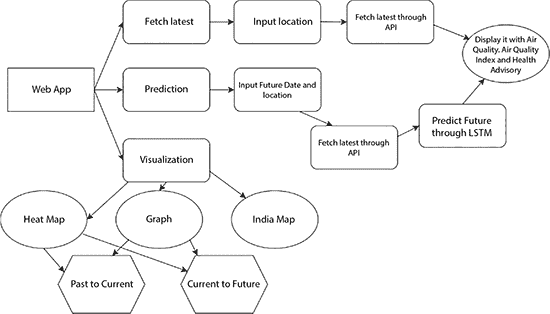

**图 1.1** 应用的工作流。

图 1.1 显示了应用程序运行的详细描述。从开放数据仓库通过 `JSON` 格式的 Restful `API` 获取特定位置/地点的最新数据。还根据过去的值对未来空气质量进行预测。预测数据通过 Web 应用程序向用户显示适当的消息。

### 1.3.2 系统规格

主要的硬件要求是高计算能力的 CPU，例如 Intel i5/i7 处理器或同等设备。系统必须能够满足主要和次要的高内存需求，约为 50-GB 硬盘和 4–8 GB 内存。主要的软件要求包括任何操作系统、`Python` 语言以及 `scikit-learn` 等依赖项，以及 `pandas`、`numpy`、`matplotlib`、`bokeh`、`flask`、`tensorflow` 和 `theano` 等其他包和库。

### 1.3.3 算法

1. **K-Means 聚类**：Kmeans 算法接收一组输入值并根据参数 `k` 将值划分为 `k` 个簇。将值划分为 `k` 个簇是基于相似性指数的，相似的数据值被归为一类，另一组值被归为另一类 [11]。`Euclidean`、`Manhattan` 和 `Minkowski` 等距离度量是用于聚类的某些相似性指数。我们使用聚类是因为我们的数据集值需要被分为不同的类别。我们选择了六个类别，即：良好、良好、中度污染、差、很差和严重。

2. **支持向量机算法（SVMA）用于预测**：SVMA 是用于解决分类和回归问题的经典且卓越的算法。SVM 提供了一种监督学习模型，用于分析数据中的模式。在 SVM 中，应用线性模型将非线性分类边界转换为线性类别。这是通过减少高维特征向量空间来实现的。核选择是 SVM 中不可或缺的一部分。存在不同的内核，我们在实验中使用了线性核和 `Radial Basis Function`（`RBF`）。输出已在结果部分进行讨论。因此，考虑的两种主要类型的 SVM 是基于线性的建模和基于非线性的建模。

3. **循环神经网络 LSTM 算法（LSTM-RNN）**：当代神经网络（如前馈神经网络 FFNNs）与循环神经网络（RNNs）不同，因为它们是在标记数据上训练的，并使用前向馈直到预测误差降至最小。


RNN 与 FFNNs 不同，因为阶段 `t - 1` 接收到的输出或结果会影响阶段 `t` 接收到的输出或结果。在 RNN 中，有两个输入值：第一个是当前输入值，第二个是最近过去的值。这两个输入都用于计算新的输出。

图 1.2 显示了 RNN 的简单形式。对于一个本身是非线性变换的隐藏状态（`h[t]`），可以使用线性输入值（`I[t]`) 和最近的隐藏过去值（`h[t] - 1`）的组合来计算。从图中可以观察到输出结果可以使用当前依赖隐藏状态 `h[t]` 计算。输出 `O[t]` 依赖于概率 `p[t]`，该概率是使用名为 `softmax` 的函数计算的。在接收到最终结果之前，`softmax` 仅在基于 RNN 的分类的最后一层进行计算。

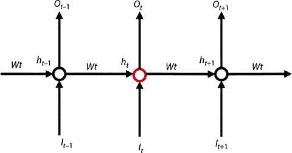

图 1.2 循环神经网络的基本步骤。

由于 RNN 本身受到梯度消失和梯度爆炸两个梯度问题的影响，因此对基础 RNN 进行了两种改进。提供了门控机制来控制主要导致梯度增加（爆炸，乘因子大于 1）或减少（消失，乘因子小于 1）的影响。我们现在有了 LSTM 和门控循环单元（`GRU`）。我们在工作中使用 LSTM，是因为我们正试图根据当前和过去污染值的滞后来预测未来值。

### 1.3.4 控制流

在控制流方面，我们模型的工作可以根据模型训练和模型测试来解释：

1. 训练模型：作为模型训练的第一步，从 `OpenAQ` 获取数据并进行预处理以去除数据中的任何噪声。清洗后的数据被传递给 K-means 聚类。在设置簇的数量之前，测量了轮廓系数（Silhouette coefficient）以确定最佳数量。另一方面，清洗后的单条数据传递到不同的地方。世界数据聚类的输出和单点的训练被用于使用 `MAE` 和 `RMSE` 测量性能。此外，聚类后的世界数据使用 AQI 表分配标签。然后将数据分为测试数据和训练数据。SVM 训练以值作为输入，空气质量作为输出。最后，使用混淆矩阵、精确率和召回率进行了 10 折交叉验证。

2. 测试模型：在测试下，使用 `API` 获取新数据。将其传递到相应的地方。LSTM 预测了所有参数的未来值。这些值被作为输入传递 SVM，最终结果是空气质量分配的预测。

## 1.4 结果与讨论

开放数据由 `OpenAQ` 提供。他们的目标是通过提供数据帮助人们对抗空气污染。数据来自政府机构以及研究小组，并由 `OpenAQ` 聚合。使用 `OpenAQ API` 获取帧中的最新数据并保存为 `.csv` 格式。图 1.3 显示了 2020 年 6 月 6 日为印度维沙卡帕特南（Visakhapatnam）获取的数据。

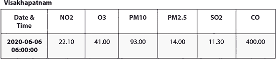

图 1.3 获取的数据截图。

表 1.1 AQI 范围。

| AQI 类别 (范围) | PM[10] (24hr) | PM[2.5] (24hr) | NO[2] (24hr) | O[3] (8hr) | CO (8hr) | SO[2] (24hr) | NH[3] (24hr) | Pb (24hr) |
| :--- | :--- | :--- | :--- | :--- | :--- | :--- | :--- | :--- |
| 良好 (0–50) | 0–50 | 0–30 | 0–40 | 0–50 | 0 | | | |
| 良好 (51–100) | 51–100 | 31–60 | 41–80 | 51–100 | 1.0 | 0 | | |
| 中度污染 (101–200) | 101–250 | 61–90 | 81–180 | 101–168 | 1.1 | 2.0 | 80 | |
| 差 (201–300) | 251–350 | 91–120 | 181–280 | 169–208 | 2.1 | 10 | 17 | |
| 很差 (301–400) | 351–430 | 121–250 | 281–400 | 209–748 | 3.1 | 17 | 34 | |
| 严重 (401–500) | 430+ | 250+ | 400+ | 748+ | 34+ | 1600+ | 1800+ | 3.5+ |

*(注：根据要求，表格内容已尽可能翻译)*

1. K-Means 聚类结果：如方法论部分所示，我们应用 K-means 聚类为我们的无监督数据通过簇确定类别。为了找到所需的最佳簇数量，计算了轮廓系数。轮廓系数是使用平均簇内距离 (a) 和平均最近簇距离 (b) 计算的，其中 b 是样本与其不属于的最近簇之间的距离。样本的轮廓系数值为 (*b* – *a*)/*max* (*a, b*)。在我们的实验中，我们使用手肘法将其保持为 7。聚类后，使用 AQI 表为聚类数据分配了空气质量标签。

## 2. 参数选择

我们研究了六个参数，即 `NO[2]`、`O[3]`、`PM[10]`、`PM[2.5]`、`SO[2]` 和 `CO`。为了构建 `LSTM` 模型，我们对印度的 14 个不同地点进行了训练，分别是：维沙卡帕特南 (GVMC Ram Nagar)、阿梅尔 (Civil Lines)、Alwar、Vasundhara (Ghaziabad)、古拉冈 (Vikas Sadan)、Bandra (Maharashtra)、Bhiwadi 工业区、班加罗尔 (BWSSB Kadabesanaha)、itsar (Golden Temple)、Anand Vihar、R K Puram、Punjabi Bagh、NSIT (Dwarka) 以及 Noida 第 62 区。首先，应用了 K-means 聚类。

## 3. SVM 结果

数据值（1,870）被分为训练集和测试集。我们取 80%作为训练集，20%作为测试集。对聚类数据使用 `SVM` 进行空气质量对比训练，以便根据所有参数的值来确定空气质量。使用了 `Sklearn` 库 [14]。使用 `GridSearchCV(k = 10)` 技术对 `SVM` 进行了交叉验证。374 个测试样本的结果可参见表 1.2。找到的最佳参数集为 `{c: 0.1, gamma: 0.001, kernel: linear}`。

## 4. LSTM 结果

为了构建 `LSTM` 模型，我们对印度的 14 个不同地点进行了训练，分别是：维沙卡帕特南 (GVMC Ram Nagar)、阿梅尔 (Civil Lines)、Alwar、Vasundhara (Ghaziabad)、古拉冈 (Vikas Sadan)、Bandra (Maharashtra)、Bhiwadi 工业区、班加罗尔 (BWSSB Kadabesanaha)、itsar (Golden Temple)、Anand Vihar、R K Puram、Punjabi Bagh、NSIT (Dwarka) 以及 Noida 第 62 区。每个模型使用了 5000 个样本进行训练，500 个样本进行测试。

## 5. 模型评估

超参数调优期间，每个模型对于不同参数（如内核初始化器、批量大小和轮数）都有不同的值。我们在 `Python` 中使用了 `Keras` 库 [15]。性能通过两个指标进行评估：平均绝对误差 (MAE) 和均方根误差 (RMSE)。表 1.3 显示了获得的 MAE 和 RMSE 值。`MAE` 通过 `(∑|y - x|)/n` 计算，`RMSE` 通过 `√(∑|y - x)²/n` 计算，其中 `y` 是预测值，`x` 是实际值。

## 6. 班加罗尔案例研究

图 1.4 显示了班加罗尔市当前以及 2017 年 12 月 13 日后 2 天 3 小时的预测值。图 1.5 显示了 2020 年 6 月 6 日后 2 天 3 小时的预测值。我们观察到，即使在 11 月和 12 月，班加罗尔平均与其他城市相比是一个更清洁的城市。我们意识到这可能是由于雨天气导致的。班加罗尔几乎每天都会下雨，这导致大部分空气污染物被冲刷，从而减少了空气污染。

## 7. 新德里分析

图 1.6 显示了新德里 Anand Vihar 在 2017 年 12 月 13 日后当前小时以及未来 1 天 3 小时的预测值。新德里饱受严重污染的困扰，因此空气质量非常差。`PM[2.5]` 水平保持在较高水平，使空气不仅具有毒性，而且容易引发呼吸系统问题。我们还为应用的用户生成了建议。图 1.7 显示了 2020 年 6 月 6 日后新德里 Anand Vihar 1 天 3 小时的预测值。可以清楚地看到，由于封锁导致交通和工业排放的减少，污染水平大幅下降，空气质量也得到了改善。

## 8. 实验

实验针对批量大小为 10、24、15、8 和 6 的情况，以及轮数为 10 和 100 的情况进行了。`LSTM` 用于 `NO[2]`、`O[3]`、`PM[10]`、`PM[2.5]` 和 `SO[2]` 超参数的 `MAE` 分数如（表 1.4](#c01.xhtml#tab1-4））所示，在对 `LSTM` 超参数进行仔细分析后，确定了偏差最小的批量大小。

## 9. 数据可视化

项目的主要目标之一是为无法解释空气污染物不同值之间关系的普通人提供更好的可视化方案。因此，我们生成了不同参数的热力图。提供了各个参数单独的热力图以及参数组合的热力图。

## 10. 臭氧水平

图 1.8 显示了 2017 年 12 月 12 日和 13 日臭氧气 `O[3]` 的热力图。从图中我们可以观察到 `O[3]` 在昼夜间隙之间的波动最大。`O[3]` 水平在午夜降低，并在 12 月 13 日晚上非常高。由于交通因素，`O[3]` 在夜间波动最为显著。图 9.1 显示了 2020 年 6 月 6 日后 `O[3]` 的波动情况。

## 11. 污染因素

图 10.1 显示了 2017 年 12 月 12 日和 13 日期间参数的热力图。从图中我们可以观察到 `O[3]` 在昼夜间隙之间的波动最大。`O[3]` 水平在午夜降低，并在 12 月 13 日晚上非常高。这可能是由于交通因素导致的。图 11.1 显示了 2020 年 6 月 6 日后 `O[3]` 的波动情况。

## 12. 未来趋势

图 12.1 显示了 2017 年 12 月 `O[3]` 的波动情况。图 13.1 显示了 2020 年 6 月 `O[3]` 的波动情况。

# 13. 国家空气质量

空气质量如图 14.1 所示，这有助于研究全国范围内的空气状况。

# 14. 主要发现

从我们的项目中，我们发现了一些主要结果。发现空气参数的值取决于最近的记录（几天）。通过 `API` 获取不同参数的实时值，有时会出现空值或零。这可能是由于传感器故障或天气状况引起的。大城市和地区遭受着最严重的空气质量问题。

图 1.4 2017 年 12 月班加罗尔（Bengaluru）的预测值。

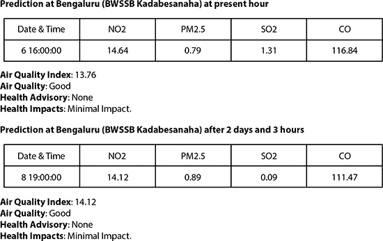

图 1.5 2020 年 6 月班加罗尔的预测值。

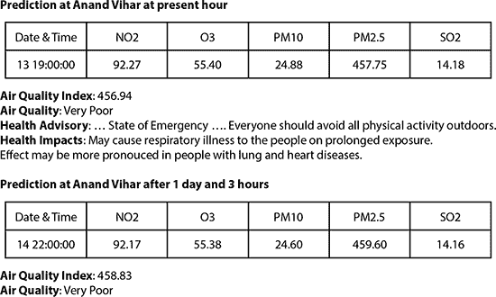

图 1.6 2017 年 12 月新德里的的预测值。

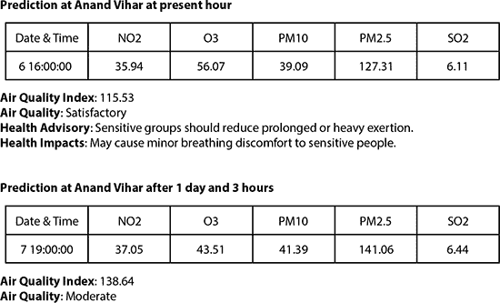

图 1.7 2020 年 6 月新德里的的预测值。

表 1.4 LSTM 超参数的 MAE 评分。

| **批大小 (Batch size)** | **迭代次数 (Epochs)** | **NO[2]** | **O[3]** | **PM[10]** | **PM[2.5]** | **SO[2]** |
| :--- | :--- | :--- | :--- | :--- | :--- | :--- |
| 10 | 10 | 22 | 52 | 142 | 64 | 14 |
| 24 | 100 | 17 | 22 | 142 | 52 | 13 |
| 15 | 100 | 13 | 19 | 139 | 51 | 13 |
| 8 | 10 | 16.8 | 25.4 | 124 | 44.8 | 13 |
| 6 | 10 | 13 | 25 | 119.7 | 44 | 13 |

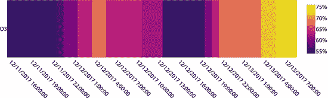

图 1.8 2017 年 12 月白天夜间臭氧 O[3] 热力图。

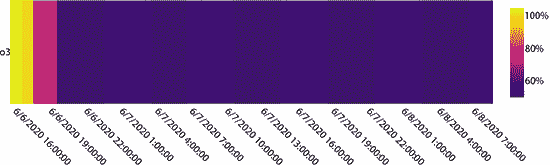

图 1.9 2020 年 6 月白天夜间臭氧 O[3] 热力图。

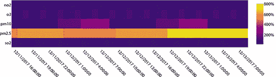

图 1.10 2017 年 12 月 3 昼夜的所有参数热力图。

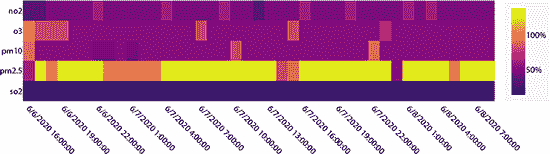

图 1.11 2020 年 6 月 3 昼夜的所有参数热力图。

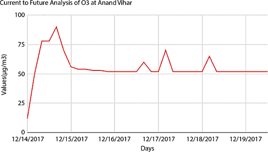

图 1.12 新德里阿南维哈尔的 O[3] 预测值。

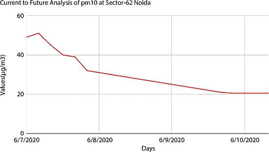

图 1.13 诺伊拉第 62 区的 PM[10] 预测值。

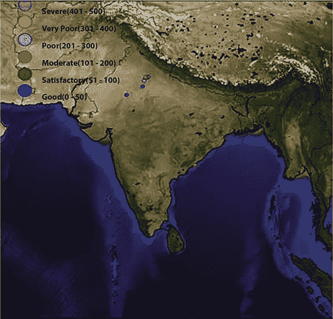

图 1.14 印度主要城市的污染水平。

## 1.5 结论

在应用 `Silhouette` 系数进行 `K-means` 聚类后，数据被分成了七类。`SVM` 成功地以 99% 的准确率将数据分类到各自的空气质量类别。针对不同地区的 `LSTM` 模型已经过相应的调整，以最小化 `MAE` 和 `RMSE`。所提出的模型可用于多种用途，例如预测未来趋势、评估过去趋势、有效的方式可视化数据、发布健康建议，并可以比较各种参数以确定哪种污染物对特定区域的影响更大，从而此提前采取措施。任何人都可以轻松从数据中获得推论，而这在数值分析上是困难的。

## 参考文献

1. `IHME` 和 `HEI` 全球状况/2017，关于全球空气污染暴露及其疾病负担的特别报告，第 1 卷。
2. `Li, H.`, `Fan, H.`, `Mao, F.`, 一种探索空气污染的可视化方法——中国北京空气质量指数（PM2.5）案例研究。`Atmosphere`, 7, 35。
3. `Lu, W.`, `Ai, T.`, `Zhang, X.`, `He, Y.`, 城市空气监测数据的交互式地图。`Atmosphere`, 8, 148。
4. `Kumar, A.`, `Sinha, R.`, `Bhattacherjee, V.`, `Verma, D.`, `Singh, S.`, 使用 `K-means` 算法建模。`信息技术最新进展国际会议 (RAIT)`，第 1 卷，554–558。
5. `Fan, J.`, `Li, Q.`, `Hou, J.`, `Kariman, H.`, `Lin, S.`, 基于深度 RNN 的空气污染时空预测框架。`ISPRS Annals of Photogrammetry, Remote Sensing and Spatial Sciences`，第 4 卷，15。
6. `Pereira, R.`, `Sousa, P.C.`, `Barata, R.`, `Oliveira, A.`, `Monsieur, G.`, 围绕开放数据的 CitySDK 价值。`J. Internet Serv. Appl.`, 6, 1–13。
7. `Adeleke, J.`, `Moodley, D.`, `Rens, G.`, `Adewumi, A.O.`, 将机器学习集成到语义传感器中用于主动监测和控制。`Sensors`, 17, 807。
8. `Kim, S.`, `Choi, J.W.`, `Han, G.T.`, 基于 google earth 和 `KML` 的实时空气质量监测空气污染可视化方法。`Int. J. Software Eng. Appl.`, 10, 117–128。
9. `Sharma, S.`, `Zhang, M.`, `Gao, J.`, `Zhang, H.`, `Kota, S.`, COVID-19 期间排放限制对印度空气质量的影响。`Sci. Total Environ.`, 728, 138878。
10. `Mahato, S.`, `Pal, S.`, `Ghosh, K.G.`, COVID-19 疫情期间封锁对印度大城市德里空气质量的影响。`Sci. Total Environ.`, 730, 139086。
11. `Lloyd, S.`, PCM 中的最小二乘量化。`IEEE Trans. Inf. Theory`, 28, 129–137。
12. `Hochreiter, S.` 和 `Schmidhuber, J.`, 长短期记忆。`Neural Comput.`, 9, 1735–1780。
13. `Hasenkopf, C. A.`, `Flasher, J.`, `Veerman, O.`, `DeWitt, H.`, OpenAQ：聚合和免费共享全球空气数据的平台。`AGU 秋季会议`,2015, A31D-097。
14. `Pedregosa, F.`, `Varoquaux, G.`, `Gramfort, A.`, `Michel, V.`, `Thirion, B.`, `Grisel, O.`, `Vanderplas, J.`, Scikit-learn: Python 机器学习。`J. Mach. Learn. Res.`, 12, 2825–2830。
15. `Manaswi, N. K.`, 理解和使用 `Keras`，`Deep Learning with Applications Using Python`,第 1 卷，31–43，Springer。

1. *通讯作者*：`priyankjn62@gmail.com`
2. †通讯作者*：`gagandeep.kaur@jiit.ac.in`

# 2 基于深度学习的蚕茧自动计数与分类

**Shreedhar Rangappa[¹], Ajay A.[¹] 和 G. S. Rajanna[²]**


[¹] Intelligent Vision Technology, Bengaluru, India

[²] Maharani Cluster University, Sheshadri Road, Bengaluru, India

### 摘要

本文介绍了一种利用卷积神经网络识别和量化雌蛾产在纸张上的蚕茧的方法。该方法能够分割单个蚕茧并将其分类为已孵化类和未孵化类，因此优于早期的图像处理技术。文中描述了早期技术的局限性，并阐述了通过数字扫描仪均匀照明来提高准确性的尝试。简要讨论了使用标准关键标记来将任何蚕茧图转换为标准图像，并作为训练好的卷积神经网络模型的输入以获取预测的方法。该深度学习模型针对每个类别超过 10 万张图像的蚕茧数据集进行了训练。测试图像集上的实验结果表明，我们的方法准确率高于 97%，且具有良好的重复性。

**关键词：** 深度学习、卷积神经网络、数据集、准确率、蚕、产量、孵化率

## 2.1 引言

在过去的十年中，机器学习在各个工程领域获得的人普及程度是任何顺序编程方法在过去世纪内都无法比拟的。深度学习/卷积（CNN）是机器学习方法的一种，它能够在不显式提供待考虑特征的情况下，解决特定问题并生成有用的结果。这些先进技术主要部署在工程领域。然而，诸如医学成像 [1]、微生物学 [2] 和金融业 [3] 等学科正广泛采用机器学习来获得卓越的。

此外，某些科学领域仍在使用传统方法来解决问题，桑业就是其中之一。桑业涉及寄主植物栽培的艺术与科学，以及蚕的养殖，以生产天然丝织品。丝绸是纺织品之王，印度是全球第二大四种丝绸的生产国。因此，桑业是经济、社会、科学、政治和学术进步的基础 [4]。产卵量（雌性家蛾产卵数）、孵化率（蚕出生率）、成活率（对疾病和环境的耐受性）以及丝产量是整个丝绸行业繁荣的几个经济特征（参数）。目前盛流行人工计数卵来量化产卵量和孵化率参数。许多自动方法（图像处理和新硬件设计）已尝试过，但准确性较低 [5]。本文描述了一种自动计数和分类卵的新方法，以准确量化产卵量和孵化率，从而为成功的蚕茧收获提供所需的养殖信息。

本章描述了一些传统方法及其缺点，并进一步介绍了本文采用的 CNN 方法，并解释了每个训练模型的规格，以使其能够超越其他图像处理技术提供的结果。

## 2.2 传统蚕卵检测方法

人工计数蚕卵在印度、中国、泰国等其他亚洲国家已投入实际应用 [6]。蚕卵很小 [5]，直径约为 2 到 3 毫米，密密地聚集在小群落中。因此，人工计数过程会非常费力，伴随着长时间的消耗，并且容易产生人为错误。产卵量和孵化率确定的不一致性会影响整个茧作的性能和丝产量。

目前已有许多技术被用于测量产卵数量，例如设计硬件 [6, 7] 以及使用图像处理技术。之前发表的论文重点是使用不同的图像处理技术将蚕卵从背景中分割，例如低对比度图像设置 [8]、对比度增强后的图像形态学操作 [7]、图像块质心分析 [6]、从 RGB 到 HSV 的图像通道转换以识别感兴趣区域 (ROI) [9]、使用高斯混合模型 [10] 以及使用霍夫变换（斑点分析）[11, 12]。这些技术所实现的准确性完全取决于实验条件的一致性，例如放置蚕卵的底板颜色、卵的大小，以及在采集蚕卵数字图像时的均匀光照。通过改变这些参数中的任何一个，结果都会发生剧烈变化，因此为每种可能的场景设计图像处理算法变得费时费力。此外，这些技术用于采集蚕卵数字数据的方法是使用手动操作的数码相机，没有任何预设的光照参数，因此导致准确率较差。

## 2.3 提出的方法

在采集图像处理的数字数据时，变化的两个主要参数是蚕卵的大小和跨越图像的均匀照明。首先，由于图像处理（包括斑点分析）算法是为了识别特定的卵大小或卵大小范围而设计的，超过此限制会导致最终结果出现误差。由于卵茧和相机之间没有设定恒定距离，在之前的任何论文中，捕获的卵的像素大小各不相同，这给图像处理算法带来了问题。此外，ROI 上光照的不均匀分布会导致数码相机记录数据的方式略有不同，这可能导致 ROI 过饱和或欠饱和。对比度拉伸和直方图均衡化等图像处理算法在有限场景下表现良好，无法为增强低质量数据提供完全信心。

为了克服这些问题，使用恒定照明源并在扫描仪相机与卵茧之间保持固定距离，以采集卵茧的数字数据。由于扫描仪相机阵列之间的距离是固定的，卵的大小可以近似保持在特定范围内，即在我们的实验中直径约为 28 到 36 像素。然而，并非所有扫描仪制造商在设计时都遵循严格的尺寸，因此使用不同扫描仪的的蚕结果不同。例如，在相同的分辨率和每英寸点数（dpi）下，用佳能扫描仪扫描的直径为 28 到 32 像素，而用惠尔-包装（HP）扫描仪扫描的则为 36 到 40 像素。

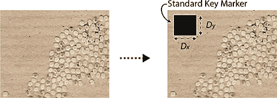

图 2.1 在蚕卵上添加关键标记。

此外，通过改变扫描仪参数（如分辨率和 dpi），同一扫描仪得到的卵像素大小也不同。因此，在扫描之前在卵茧上打印关键标记，以数字格式采集细节。关键标记的尺寸为 100 × 100 像素（10 × 10 毫米），在我们的实验中被标准尺寸。设 *R*(`hxw`) 为图像处理算法所需的标准分辨率，而 *R′*(`h’*x*w’`) 为扫描卵茧的分辨率，`R″` 为生成图像的分辨率。

# 引言

为了解决第 2.2 节提到的传统图像处理算法的问题，采用了机器学习（ML）技术将卵从背景（卵茧）中分割出来。用于分割的特征如颜色（灰度像素值）、卵的直径等是通过图像处理和特征工程手动收集的，随后输入各种机器学习算法（`KNN`、`decision trees` 和 `SVM`）。机器学习算法提供的准确率超过 90%，但当输入数据与算法训练时的类别不同（在蚕茧领域指品种）时，它们就会失效，因为不同品种的蚕卵颜色并不相同。为了克服这个问题，使用了一种有监督 CNN 技术，该技术需要真实标签，而特征则是自动选择。我们方法的主要目标是准确计数给定数字图像中的若干个蚕卵，并将其进一步分类为相应的类别，如已孵化和未孵化。图 2.2 展示了卵的样本数字图像，其中用特定颜色手动标记了不同类别的卵。标记为绿色的卵代表`已孵化类`(HC)，而标记为红色的卵代表`未孵化类`(UHC)。

为了识别卵的核心特征以将其从背景底中分割出来并归入相应的类别，使用了一种具有四个隐藏层的简单深度学习技术，以提供比传统方法准确得的结果。深度学习模型使用 `TensorFlow` 框架进行训练，提供三种不同的结果，如前景-背景分割、卵检测以及检测到的卵分类。

我们在实验中使用的核心深度学习模型所示图 2.3。该模型由卷积层、最大池化层和全连接层组成。这些层被训练用于识别卵的特征，而最后一层被修改为提供分类或连续数据。核心 CNN 模型使用步长为 `(2 × 2)`、卷积核为 `(5 × 5)` 的卷积训练，配合 `(2 × 2)` 最大池化和由 3200 个神经元组成的全连接层。CNN 模型的输入是维度为 `32 × 32` 具有三个颜色通道（RGB）的图像。

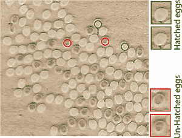

**图 2.2**](#c02.xhtml#rfig2-2) 蚕卵分类：已孵化的卵和未孵化的卵。

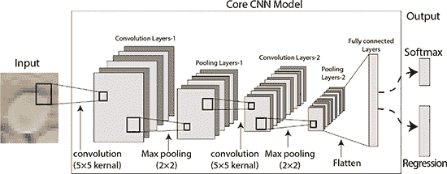

**图 2.3**](#c02.xhtml#rfig2-3) 核心 CNN 模型。

### 2.3.2 前景-背景分割

准确计数蚕卵的基本要求是执行前景-背景（FB）分割。在之前的尝试中，背景是根据卵的强度值进行分割的 [8]。没有对应卵的像素值的区域被视为背景，并在图像处理阶段之前被丢弃。然而，这在所有情况下都不是理想的，因为产在丝茧上的蚕卵可能还含有蚕的尿液，导致背景变色。被尿液过的背景干燥后会形成白色层，对于 8 位灰度图像，其值类似于接近 230 的卵像素强度值。

输入 CNN 模型的数字数据分辨率是在确定卵类别之前执行背景分割的另一个原因。扫描后，卵的大小约为 `32 × 32` 像素，而整个蚕茧的大小为 `5008 × 6984` 像素（在我们的实验中）。如果使用滑动窗口方法将输入尺寸为 `32 × 32` 像素的整个蚕茧输入 CNN 模型，那么模型必须对 3500 万张图像进行分类，这对于没有 GPU 支持的系统来说计算开销将是。

为了克服这个问题，FB CNN 模型使用 `128 × 128` 像素的三通道 RGB 图像作为输入数据进行训练，并输入核心 CNN 模型，如图 2.3 所示，使用 `softmax` 激活函数提供分类输出。FB CNN 模型的一些相应规格在表 2.1 中给出，以及准确率评分。使用 `128 × 128` 像素输入 FB CNN 模型，整个蚕茧被划分为步长为 `128` 的 `128 × 128` 正方形网格，产生一个包含 2K 张图像的图像集，这些图像必须经过处理以获得前景或背景类别的分类结果。图 2.4 表示了整个蚕茧的分割，其中前景（存在卵）和背景（无卵）分别用绿色和红色表示。仅对绿色颜色的像素进行进一步处理，这减少了计算时间并提高了最终的准确率。

**表 2.1**](#c02.xhtml#rtab2-1) 前景-背景（FB）分割 CNN 模型规格。

| 输入图像 | 激活/输出 | 训练样本 | 测试样本 | 验证样本 | 测试损失 | 测试集准确率 | 验证集准确率 |

| :--- | :--- | :--- | :--- | :--- | :--- | :--- |

| `128 × 128` | `SoftMax 2 class-(0/1)` | `142 × 10³` | `64.3 × 10³` | `9.6 × 10³` | `0.1242` | `96.1554%` | `96.6422%` |

蛋位置预测器 CNN 模型的规格见表 2.2，其中核心 CNN 模型的输入已更改为 `32 × 32` 像素的三通道 RGB 图像。在这里，输出是一个回归，提供蛋中心 `(x, y)` 的位置，而不是边界框（四个角点）。训练数据集包含类别图像，即孵化蛋和未孵化蛋。正样本由完全可见单个蛋的图像组成，而负样本由部分可见且具有多个蛋条目的蛋组成。图 2.5 展示了用于确定正、负样本的分类器模型，随后对正样本进行训练以以像素值预测蛋中心位置。此外，在实际应用中，预测的蛋中心位置被用于裁剪单个蛋数据，并输入分类器，该分类器确定所选蛋的类别是 `HC` 还是 `UHC`。图 2.6 展示了使用蛋位置预测器 CNN 模型定位蛋中心的一个测试数据表的整体结果，其中所有蛋中心都用蓝点标记。使用了步长为 `(4, 4)` 的 `(32 × 32)` 滑动窗口来实现结果。

### 2.3.4 预测蛋类别

使用滑动窗口法来生成输入图像，单个蛋可能由许多大小为 `32 × 32` 的图像窗口表示。欧几里得距离方程 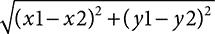 用于结合所有落在特定用户定义距离限制内的蛋位置预测结果来选择蛋中心。`(x1, y1)` 和 `(x2, y2)` 是参考像素和考虑的像素。由于蛋的直径完全在 28 到 32 像素的范围内，因此设置的距离限制等于蛋的半径，即 `16` 像素。任何落在此限制内的中心位置均被认为代表同一个蛋，因此合并以生成单个蛋位置，然后可以使用公式 (2.4) 到 (2.7) 进行裁剪，其中 `(xa, ya)` 是对所有落在距离限制内的预测蛋位置取平均后的结果蛋位置。`(x, y)` 像素是原始位置，而 `w, h` 代表要裁剪的图像宽度和高度，等于 `32` 像素。生成的图像输入蛋类别预测器 CNN 模型，该模型提供分类数据将输入图像区分为类别 `HC` 或 `UHC`。蛋类别预测器 CNN 模型的规格见表 2.3。

(2.4) 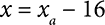(2.5) 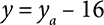(2.6) 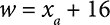(2.7) 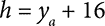

表 2.2 蛋位置 CNN 模型规格。

| 输入图像 | 激活/输出 | 训练样本 | 测试样本 | 验证样本 | 测试损失 | 验证损失 |

| :--- | :--- | :--- | :--- | :--- | :--- | :--- |

| 32 × 32 | 蛋的 `(x, y)` 回归 | `439 × 10³` | `51.6 × 10³` | `25.8 × 10³` | `0.5488` | `0.5450` |

 图 2.5 以像素值预测蛋位置的 CNN 训练模型。

 图 2.6 蛋位置 CNN 模型的结果。

表 2.3 蛋类别预测模型规格。

| 输入图像 | 激活/输出 | 训练样本 | 测试样本 | 验证样本 | 测试损失 | 测试集准确率 | 验证集准确率 |

| :--- | :--- | :--- | :--- | :--- | :--- | :--- | :--- |

| 32 × 32 | `SoftMax` 类别`(0/1)` | `2.4 × 10⁶` | `80.2 × 10³` | `30 × 10³` | `0.007` | |

| MSR1_003.jpg | 554 | 556 | 10.42 | 491 | 65 | 99.28 |

| MSR1_004.jpg | 539 | 528 | 9.81 | 501 | 27 | 97.95 |

| MSR1_005.jpg | 597 | 588 | 11.14 | 562 | 26 | 98.32 |

## 2.6 结论

本文解释了一种基于 CNN 的蚕卵计数与分类模型，该模型克服了传统图像处理技术中存在的许多问题。本文的主要贡献体现在四个方面。首先，提出了一种通用方法，使用普通纸质扫描仪以数字格式采集蚕卵茧数据，而无需设计额外的硬件，这消除了在记录数据时需要额外光源来提供均匀照明的需求，并保持了高可重复性。

其次，通过在扫描前在卵茧上加盖关键标记，可以将扫描后的数字数据转换为标准尺寸。这允许用户调整数字数据的维度，并在随后将其用于图像处理算法或 CNN 时，而不会引入维度误差。

构建了一个包含超过 40 万张图像的数据集，这些图像代表了蚕卵的不同特征。需要大量训练、测试和验证数据的 CNN 及其他模型可以轻松使用该数据集，从而跳过数据生成阶段，这是第三点贡献。

第四，使用该数据集训练了一个 CNN 模型，用于预测卵的类别并计算每个卵茧的卵数量。该模型准确率超过 97%，仅需 4 个隐藏层和一个全连接层，其性能就优于许多传统方法。

该模型在对不同品种蚕卵进行定量（计数）方面表现准确，但对于模型未训练过的新蚕品种，需要新的数据集来预测其类别标签。这是因为 HC 类卵在整个卵表面具有较高的像素强度，而我们实验中使用的蚕品种 UHC 中心有深色像素，周围被高值像素围绕。这种颜色特征可能与其他品种蚕卵不同，因此，通过迁移学习输入到已训练 CNN 中的额外数据变得至关重要。此外，卵位置模型在新品种数据上表现良好，用于确定卵类别的训练数据集可以以极少的人力轻松生成。

## 致谢

作者感谢来自印度 KSSRDI 的 Smt. R. Latha S-B 和 Mr. P. B. Vijayakumar S-C 为本研究提供蚕茧。

## 参考文献

1. Xue, Y. and Ray, N., Cell Detection in Microscopy Images with Deep Convolutional Neural Network and Compressed Sensing, *CoRR*, abs/1708.03307, *arXiv preprint arXiv:1708.03307*, 2017.

2. Zieliński, B., Plichta, A., Misztal, K., Spurek, P., Brzychczy-Włoch, M., Ochońska, D., Deep learning approach to bacterial colony classification. *PLoS One*, 12, 9, e0184554, 2017.

3. Abe, M. and Nakayama, H., Deep learning for forecasting stock returns in the cross-section, in: *Lecture Notes in Computer Science (including subseries Lecture Notes in Artificial Intelligence and Lecture Notes in Bioinformatics)*, vol. 10937 LNAI, pp. 273–284, 2018.

4. Kumar, D.A., Silkworm Growth Monitoring Smart Sericulture System based on Internet of Things (IOT) and Image Processing. *Int. J. Comput. Appl.*, 180, 18, 975–8887, 2018.

5. S.P., Rajanna, G.S., Chethan, D., Application of Image Analysis methods for Quantification of Fecundity in Silkworm Bombyx mori L, in: *International Sericulture Commission*, Research Papers, 2015 ([`www.inserco.org/en/previous_issue`](http://www.inserco.org/en/previous_issue)).

6. Kiratiratanapruk, K., Watcharapinchai, N., Methasate, I., Sinthupiny, K., 2015.

7. Patil, D.A., Rajanna, G.S., Chethan, D., 2015.

8. Kiratiratanapruk, K., Watcharapinchai, N., Methasate, I., Sinthupiny, K., 2014.

9. Patil, D.A., Rajanna, G.S., Chethan, D., 2016.

10. S.P., Rajanna, G.S., Chethan, D., 2017.


11. Matas, J., Galambos, C., Kittler, J., 2000.

12. Nikitha, R., Srinidhi, R., Harshith, R., Amar, T., 2018.

13. F. and T. des L., 2015.

14. Özdener, A. and Rivkin, A., 2015.

能源是每个发展中国家工业和农业活动不可或缺的一部分。风能被认为是最具前景且最环保的可再生能源，可用于发电。风速预测是一项至关重要的活动，因为风能已经在农业、工业、海洋应用、军事和机场应用等多个领域广泛应用。在风力发电机中，有效且精确的风速预测是发电的必要条件。某些作物的生长也依赖于风速。它在火箭发射过程中也起着重要作用。风速预测可以在历史风速数据的帮助下完成。风速取决于天气，而风速的周期性行为使得准确预测成为了一项挑战性任务 [1]。因此，开发准确的风速预测模型变得更具意义，目前已有多个系统被实施以提高准确性。在大数据时代，传统的计算智能模型可能需要大量时间从大数据集中提取相关信息。然而，深度学习的巨大潜力有助于处理和分析海量数据集，以实现更好的特征学习和模式分析。

根据采用的预测方法，当前的预测系统可以分为四类，即物理系统、统计系统、人工智能（AI）和混合系统 [2]。物理系统利用数学模型预测未来状态。统计模型是线性模型，适用于短期风速预测。最常用于风速预测的统计模型是自回归积分移动平均模型（`ARIMA`）、多元回归和向量自回归（`VAR`）。人工智能的发展启发了智能预测模型的发展。与统计模型相比，这些模型被证明是稳健且有效的。AI 模型可以高效地管理非线性数据集，并展现出更好的预测性能。AI 系统进一步分为机器学习预测器和深度学习预测器。人工神经网络（`ANNs`）、极限学习机（`ELM`）和支持向量机（`SVM`）是用于预测风速的流行机器学习模型。机器学习技术在预测系统中非常普遍，其中 `ANNs` 经常被采用，因为它们可以学习非线性函数。深度学习使用具有深度架构的神经网络，这些架构涵盖了许多层非线性处理阶段。随后，深度神经网络（`DNNs`）因其高预测精度被成功用于风速预测。混合模型通过结合两个或多个线性或非线性模型形成。这些是提供最佳性能的最新模型。文献中另一种基于预测期的分类是短期、中期和长期。

He 和 Xu [3] 构建了一个使用具有两种核函数（即多项式核和小波核函数）的 `SVM` 来预测风速的模型。结果证明了使用组合学习函数比单一函数更有效。Yang 等人 [4] 推荐了一种使用代表性单元法预测风电的模型，其中采用了最小二乘 SVM（`LSSVM`）方法来预测风电。Finamore 等人 [5] 建议使用前馈神经网络模型来预测风电，并将其性能与持续性模型进行了比较。Yu 等人 [6] 构建了一个基于 `WPD`（小波包分解）和 Elman 神经网络的混合风速预测模型。Filik 和 Filik [7] 开发的 `ANN` 模型利用温度、风速和压力等天气参数，并研究了这些变量的影响。Tarade 和 Katti [8] 对基于 `ARIMA`、`ANN` 和多项式曲线拟合的现有风速预测模型进行了深入调查。Liu 等人 [9] 提出了一种采用小波、小波包、时间序列和 `ANN` 的混合模型。小波包 `ANN` 模型优于所有其他模型。Ramasamy 等人 [10] 详细介绍了一个使用 `ANN` 预测希马恰尔普拉什邦十个地点风速的预测系统。Ghorbani 等人 [11] 提出了一种基于 `ANN` 和遗传表达编程（`GEP`）、利用美国科罗拉多 2005 年至 2012 年 8 月数据的小时风速预测模型，并将结果与多元线性回归模型和持续性模型进行了比较。Mi 等人 [2] 定义了一种采用小波、`ELM` 和离群值修正算法的新混合方法。通过应用小波域减少了数据集中的失真。

Khandelwal 等人 [12] 推荐了一种使用离散小波变换（`DWT`）、`ARIMA` 和 `ANN` 的风速预测系统，其中使用 `DWT` 将原始信号分为低频和高频成分。然后使用 `ARIMA` 训练低频成分，使用 `ANN` 训练高频成分。Yousefi 等人 [13] 设计了一个使用小波变换（`WT`）和 `ANN` 的风速预测系统。结果显示预测精度显著提高，测试了所提模型的有效性。Shao 等人 [14] 展示了一个基于 `AdaBoost` 神经网络的风速预测系统，该系统最初使用 `WT` 对风速数据去噪以提高精度。Cui 等人 [15] 建议了一种使用神经网络进行风速预测的模型，采用增强经验模式分解来分解输入数据。使用蚂蚁算法优化模型参数，仿真结果揭示了所提模型的优越性。Senthil [16] 开发了三种基于机器学习的不同风速预测模型。作者采用了反向传播神经网络、径基函数（`RBF`）和带外输入的非线性模型（`NARX`）来预测风速。结果证明 `NARX` 模型在风速预测超过了另外另外模型。互信息特征选择方法的应用增加了 `NARX` 模型的精度。Hui 等人 [17] 提出了一种两阶段风电预测模型，采用模糊聚类和 `RBF` 网络来预测风电。

在文献介绍的大多数模型中使用单隐藏层架构。为了训练具有更多隐藏层的神经网络，必须采用深度学习架构。深度学习利用了计算能力的进步以及能够从海量数据集中自动提取关键特征的独特神经网络。Bali 等人 [18] 对各种基于深度学习的风速预测系统进行了详细且全面的综述。所提综述为评估风速预测方法的有效性提供了更好高效的方法。Coa 等人 [19] 通过结合循环神经网络（`RNN`）与多元和单变量 `ARIMA` 模型对风速预测模型的准确性进行了全面回顾。作者认为非线性 `RNN` 模型的效果优于 `ARIMA` 模型。Khodayar 和 Teshnehlab [20] 为美国科罗拉多的极短期风速推荐了一种堆叠自编码器 `DNN` 模型。Sergio 和 Ludermir [21] 以及 Liu 等人 [22] 描述了基于深度学习的风速预测模型。Hu 等人 [23] 实现的迁移学习模型使用了共享隐藏层的 `DNN` 架构，适用于数据缺失的数据集。

文献分析表明，通过采用具有更多隐藏层的神经网络，可以提高模型的预测性能。此外，随着隐藏层的增加，系统将能够更准确地学习特征。因此，在本章中提出了一种基于 `DNN` 的优化系统，用于预测加利福尼亚州斯坦福某气象站的日平均风速。首先，通过实验确定 `DNN` 模型可靠且最优的配置。然后，与其他流行的机器学习模型对该模型的有效性进行分析。本章的主要亮点介绍如下：

1. 进行了一项研究，以寻找 `DNNs` 的最优配置。
2. 使用定量误差指标和覆盖百分比值对所提系统的效率进行了调查。
3. 与其他流行的机器学习模型对推荐模型进行了评估。
4. 仿真结果显示了所提系统优于其他系统的主导地位。

本章的结构如下：所提的方法将在第 3.2 节中解释。系统获得的结果在第 3.3 节中描述，随后在第 3.4 节中给出结论。

## 3.2 方法

本节介绍了所提的框架并对 `DNNs` 进行了介绍。主要目标是使用最优的 `DNN` 架构预测日平均风速。为了找到 `DNN` 架构的最优配置，首先对各种网络参数进行了参数化研究。研究考虑的参数包括隐藏层数量、每个隐藏层中的神经元数量以及学习率。然后，将所提最优模型的准确性与流行且广泛使用的机器学习模型如 `ANNs`、`随机森林 (RF)`、`决策树 (DT)`、`SVM` 和 `线性回归 (LR)` 进行比较。

### 3.2.1 深度神经网络

深度学习是机器学习的一个子集，由许多层神经网络组成，能够从海量数据中学习。深度学习具有分层的神经网络结构，通过这种非线性方法处理数据 [24]。深度学习的主要优势是其性能随着数据量的增加而提高。具有四个隐藏层的 `DNN` 架构所示图 3.1。输入层神经元接收特征作为输入，然后传输到下一个隐藏层。每个神经元在激活函数的帮助下对其输入进行非线性变换以产生输出。输出层执行分类和回归任务。神经网络第 `i` 层的输入 `X` 和输出 `Y` 之间的关联可以如公式 (3.1) 所示。

(3.1) 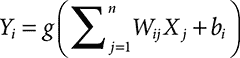

其中 `W[ij]` 代表神经元之间连接的权重，`b[i]` 代表神经元 `i` 的偏置，`g` 是激活函数。

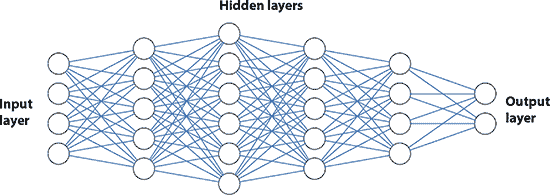

**图 3.1** 深度神经网络架构。

隐藏层和输出层中的每个神经元聚合其输入值，然后对其应用激活函数。整线性单元（`ReLU`）是一种在大多数 `DNN` 模型中使用的非线性激活函数。它被用于神经网络的隐藏层。`ReLU` 激活函数的方程由公式 (3.2) 给出。

(3.2) 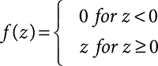

在学习过程中，网络通过使用优化算法调整连接权重来学习预期的输出。激活函数和优化算法的选择对于评估 `DNN` 的质量和学习能力至关重要。`Adagrad` 是一种基于梯度的优化算法，用于优化神经网络中的目标函数 [25]。在该算法中，参数 `∅`（其中 `∅` 是 `W` 和 `b` 的向量，即 `[W,b]`）通过公式 (3.3) 和公式 (3.4) 更新，以优化目标函数 `f(∅)`。

(3.3) 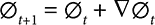

(3.4) 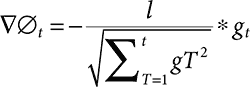

其中 `W` 代表权重，`b` 代表偏置，`∇∅[t]` 是参数 `∅[t]` 的变化，`l` 是控制负梯度方向步长的学习率，`g[t]` 代表第 `t^(th)` 次迭代时参数的梯度。所有先验梯度的 `L2` 范数通过公式 (3.4) 的分母计算。学习率在整个学习过程中不是恒定的。每次通过将每个当前梯度除以该分量过去观测到的梯度的 `L2` 范数来计算新的学习率 [25]。这一特性对于训练 `DNNs` 主要具有重要价值。

### 3.2.2 所提方法

所提框架的不同阶段所示图 3.2。这些阶段包括数据获取和数据预处理。

#### 3.2.2.1 数据获取

数据获取是一个至关重要的步骤，因为数据的质量和数量决定了预测模型的质量。加利福尼亚州斯坦福的气象站位于北纬 37.42°，西经 122.17°，海拔高于海平面 7 英尺。实验数据集从 [www.underground.com](http://www.underground.com) 下载。风速、温度、气压、露点和可见度等环境因素每天采集一次。表 3.1 提供了斯坦福数据的统计信息。1996 年至 2018 年平均风速的分布如图 3.3 中的分布图和直方图所示。

特征名称在表 3.1 中用缩写表示。`T`、`DP`、`H`、`SP`、`V` 和 `WS` 分别代表温度、露点、湿度、气压、可见度和风速。变量 `low`、`avg` 和 `high` 是最小、平均和最大同义词。

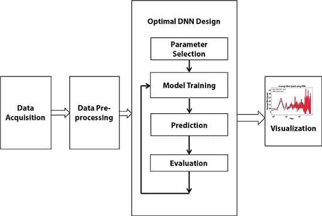

**图 3.2** 所提方法的框架。

#### 3.2.2.2 数据预处理

真实世界的数据往往由于各种原因存在缺失值，例如未记录的值和数据损坏。缺失值可能会影响结果质量。因此，在处理数据之前需要对缺失值进行插值。在本研究中，使用平均值对缺失值进行插值。

| 特征 | 单位 | 类型 | 平均值 | 标准差 | 最小值 | 最大值 |
| --- | --- | --- | ---: | ---: | ---: | ---: |
| `T_avg` | 摄氏度 | 输入 | 15.42 | 4.26 | 0 | 31 |
| `T_low` | 摄氏度 | 输入 | 10.68 | 4.34 | −4 | 24 |
| `DP_high` | 摄氏度 | 输入 | 11.93 | 4.05 | −6 | 26 |
| `DP_avg` | 摄氏度 | 输入 | 9.78 | 4.27 | −11 | 21 |
| `DP_low` | 摄氏度 | 输入 | 7.19 | 4.85 | −43 | 19 |
| `H_high` | 百分比 | 输入 | 87.50 | 9.46 | 18 | 100 |
| `H_avg` | 百分比 | 输入 | 67.30 | 11.62 | 17 | 100 |
| `H_low` | 百分比 | 输入 | 50.13 | 14.31 | 4 | 100 |
| `SP_high` | 百帕 | 输入 | 1018.31 | 4.99 | 993 | 1055 |
| `SP_avg` | 百帕 | 输入 | 1016.66 | 4.81 | 989 | 1035 |
| `SP_low` | 百帕 | 输入 | 1015.03 | 5.00 | 970 | 1034 |
| `V_high` | 公里 | 输入 | 26.19 | 7.17 | 1 | 32 |
| `V_avg` | 公里 | 输入 | 20.88 | 6.84 | 0 | 32 |
| `V_low` | 公里 | 输入 | 15.66 | 8.24 | 0 | 32 |
| `WS_high` | 公里/小时 | 输入 | 25.13 | 12.14 | 0 | 230 |
| `WS_avg` | 公里/小时 | 输出 | 11.98 | 4.74 | 0 | 35 |


**图 3.3** 平均风速的分布：(a)分布图和(b)直方图。

### 模型选择与训练

选择了适用于大数据的模型来预测风速。所提模型采用具有四个隐藏层的 `DNN`，使用 `0.01` 作为学习率，并以 `ReLU` 作为激活函数。通过试错法选择了最优配置，即第一、第二、第三和第四层隐藏层分别具有 `25`、`20`、`10` 和 `5` 个神经元。本研究用于寻找最优配置的方法在第 3.3.1 节中描述。输入层的神经元数量对应于特征的数量。输出层有一个神经元，对应于预测的风速。`DNN` 架构的配置如图 3.4 所示。在图中，温度、露点、能度和高风速等特征作为输入到 `DNN` 架构。每个隐藏层从输入中提取抽象特征并将其传递给下一个隐藏层。最后，输出层将预测的风速作为输出。

模型使用 `1996` 年至 `2013` 年的数据进行训练，然后使用 `2014` 年至 `2018` 年的数据评估模型的预测准确性。由于收集的数据是时间序列数据，因此采用了六折时间序列交叉验证来评估模型准确性。数据集被顺序划分为不同的折，并分别进行训练和评估。然后将模型的预测准确性与各种学习模型进行比较。用于比较的 `ANN` 模型具有两个隐藏层，每层有 `20` 个神经元，学习率为 `0.001`。


**图 3.4** 所提 `DNN` 模型的架构。

### 性能评估

评估在任何预测模型中都起着至关重要的作用。因此，对所提 `DNN` 系统进行了性能评估以评价其有效性。模型的预测准确性通过误差指标均方根误差（`RMSE`）、平均绝对误差（`MAE`）和 `R²` 进行计算。`RMSE` 定义为预测数据 `ŷ` 与实际数据 `y` 之间差平方平均值的平方根，如公式 (3.6) 所示。

`MAE` 是预测 `y` 与实际数据 `y` 之间的绝对偏差，如公式 (3.7) 所示。

`R²` 是判定系数，是一个衡量数据与回归线接近程度的指标。它使用公式 (3.8) 计算，用于衡量模型的有效性。其范围从 `0%` 到 `100%`。`R²` 值越高，观测值与预测值之间的差异越小。

### 可视化

可视化是任何预测系统的另一个要素。在本研究中，采用了散点图和半对数图来可视化结果。散点图用于图形化分析实际值与预测值之间的差异，并进一步用于评估系统的效率。使用半对数图可以更精确地可视化预测值的变化。

## 结果与讨论

### 参数选择

最优 `DNN` 模型的构建基于对学习率、输入输出数量、隐藏层数量以及每个隐藏层神经元数量的选择。最初选择了一个具有四个隐藏层的 `DNN` 架构，然后通过更改学习率和每个隐藏层的神经元数量进行实验。随机选择了四种隐藏层神经元组合，如 `(20,20,20,10)`、`(25,20,15,10)`、`(25,20,10,5)` 和 `(25,25,10,5)`。考虑的不同学习率有 `0.01`、`0.02`、`0.001` 和 `0.002`。表 3.2 展示了实验的影响。可以观察到，当学习率为 `0.01` 且隐藏层配置为 `(25,20,10,5)` 时达到了最低的 `RMSE` 和 `MAE` 值。

**表 3.2** 实验参数的影响

| 隐藏层神经元数量 | 学习率 | RMSE | MAE | R² |
| --- | ---: | ---: | ---: | ---: |
| `(20,20,20,10)` | 0.01 | 2.8602 | 2.049 | 64.90 |
| `(20,20,20,10)` | 0.02 | 2.8777 | 2.111 | 64.67 |
| `(20,20,20,10)` | 0.001 | 3.0012 | 2.1808 | 61.57 |
| `(20,20,20,10)` | 0.002 | 2.9748 | 2.2055 | 62.25 |
| `(25,20,15,10)` | 0.01 | 3.0504 | 2.9430 | 30.01 |
| `(25,20,15,10)` | 0.02 | 3.7289 | 2.6933 | 40.68 |
| `(25,20,15,10)` | 0.001 | 4.0504 | 3.112 | 30.01 |
| `(25,20,15,10)` | 0.002 | 3.6713 | 3.6243 | 42.50 |
| `(25,20,10,5)` | 0.01 | 2.8207 | 2.0781 | 66.56 |
| `(25,20,10,5)` | 0.02 | 2.8425 | 2.0894 | 65.53 |
| `(25,20,10,5)` | 0.001 | 2.8355 | 2.0810 | 65.70 |
| `(25,20,10,5)` | 0.002 | 2.9370 | 2.1642 | 63.20 |
| `(25,25,10,5)` | 0.01 | 2.9315 | 2.1890 | 63.34 |
| `(25,25,10,5)` | 0.02 | 2.8898 | 2.1307 | 64.37 |
| `(25,25,10,5)` | 0.001 | 3.6713 | 3.6243 | 42.50 |
| `(25,25,10,5)` | 0.002 | 2.8411 | 2.1003 | 65.56 |


所提出的用于预测平均风速的`DNN`系统与其他机器学习模型进行了比较，以评估其有效性。通过使用定量误差指标`RMSE`、`MAE`和`R²`比较预测值与实际值，以评估所开发的`DNN`模型的质量。表 3.4 展示了所开发模型获取的性能评估结果。`RMSE`和`MAE`的值越小表示预测精度越高，而`R²`值越大表示预测值与实际值之间的线性关系越强。从表中可以发现，与其他模型相比，建议的`DNN`模型在`RMSE`和`MAE`方面达到了最小误差值，且`R²`值最大。表中所展示的结果表明，实施的`DNN`系统在预测平均风速方面非常高效，最小`RMSE`为 2.8207，`MAE`为 2.0781。较高的`R²`值也证实了所开发`DNN`模型的有效性。各种模型在`RMSE`、`MAE`和`R²`方面的预测精度见图 3.5。该图说明所开发的`DNN`系统性能良好，具有最低的`MAE`和`RMSE`值以及最高的`R²`值。

通过使用散点图将预测数据与记录（实际）数据进行绘图，分析了所开发的`DNN`、`ANN`、`RF`和`SVM`模型的预测能力。由于`DNN`、`ANN`、`RF`和`SVM`模型产生了可比性的结果，因此进行了可视化。使用各种模型预测风速的每日预测数据与记录数据的散点图见图 3.6。

### 表 3.4 模型比较

| 算法 | RMSE | MAE | R² (%) |
| --- | --- | --- | --- |
| DT | 3.0062 | 2.2845 | 60 |
| RF | 2.8892 | 2.2182 | 63 |
| SVM | 2.8612 | 2.1102 | 64 |
| ANN | 3.0626 | 2.2943 | 62 |
| LR | 3.3207 | 2.4431 | 51 |
| **DNN** | **2.8207** | **2.0781** | **67** |

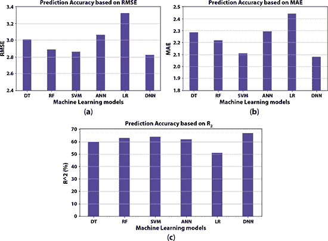

### 图 3.5 基于 (a) RMSE、(b) MAE 和 (c) R2 的预测精度

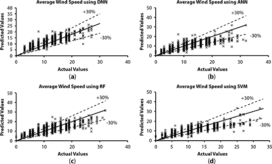

### 图 3.6 预测值与实际值的比较 (a) 使用 DNN 的平均风速 (b) 使用 ANN 的平均风速 (c) 使用 RF 的平均风速 (d) 使用 SVM 的平均风速

可以通过从原点开始、斜率分别为 1.3 和 0.7 的绘制两条更接近回归线的线来进一步评估模型的有效性。可以通过计算 ±30% 边界内的数据点数量来计算模型的优劣。因此，±30% 边界内数据点的百分比覆盖率可以使用`3.9`中的公式来确定。各种风速模型的 ±30% 边界内数据点百分比覆盖率见表 3.5。观测表明，在`DNN`模型的情况下，83.95% 的点位于回归线的 ±30% 范围内；而`ANN`、`RF`和`SVM`模型分别有 78.42%、76.31% 和 81.15% 的点位于 ±30% 范围内。因此可以得出，与其他模型相比，所提出的`DNN`系统具有更好的预测精度。

### 表 3.5 回归线边界内的覆盖率

| 算法 | ±30% 边界内的点数 (1427) | 覆盖率 % |
| --- | --- | --- |
| ANN | 1119 | 78.42 |
| RF | 1089 | 76.31 |
| SVM | 1158 | 81.15 |
| **DNN** | **1198** | **83.95** |

`3.9` 

使用半对数图精确可视化观测值的变化。`DNN`、`RF`和`SVM`模型的预测数据与记录数据的半对数图见图 3.7。观测到，与其他机器学习模型相比，所提出的`DNN`模型预测值与实际值之间存在微小偏差。对于`SVM`、`ANN`和`RF`模型，预测值与实际值的偏差似乎较高。因为与`SVM`、`ANN`和`RF`模型相比预测精度很高，研究得出`DNN`可有效地预测风速。

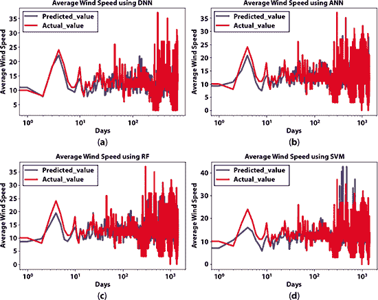

### 图 3.7 DNN 与其他模型的预测精度比较 (a) 使用 DNN 的平均风速 (b) 使用 ANN 的平均风速 (c) 使用 RF 的平均风速 (d) 使用 SVM 的平均风速

## 结论

所提出的框架研究了各种模型参数的影响，并选择了低`RMSE`和`MAE`值的架构来预测平均风速。实验使用了斯坦福天气站收集的数据。研究采用了在 1 到 4 层隐藏层中具有神经元（25、20、10 和 5）的最优`DNN`架构。与`SVM`、`ANN`和`RF`等基准模型对所提出的`DNN`模型进行了性能比较。开发的`DNN`模型优于其他预测模型，最小`RMSE`为 2.8207，`MAE`为 2.0781，最大`R²`为 67%。实验结果分析说明了所提出的`DNN`系统预测风速的有效性。未来的工作将讨论增强预测模型性能的优化算法。基于深度学习的风速预测模型也被认为是未来的方向。

## 参考文献

1. Wang, X., Guo, P., Huang, X., A review of wind power forecasting models. *Energy Proc.*, 12, 770–778, 2011, [`doi.org/10.1016/j.egypro.2011.1003`](https://doi.org/10.1016/j.egypro.2011.1003).
2. Mi, X.W., Liu, H., Li, Y.F., Wind speed forecasting method using wavelet, extreme learning machine and outlier correction algorithm. *Energy Convers. Manage.*, 151, 709–722, 2017, [`doi.org/10.1016/j.enconman.2017.09034`](https://doi.org/10.1016/j.enconman.2017.09034).
3. He, J. and Xu, J., Ultra-short-term wind speed forecasting based on support vector machine with combined kernel function and similar data. *EURASIP J. Wirel. Commun. Netw.*, 2019, 1, 248, 2019, [`doi.org/10.1186/s13638-019-1559-1`](https://doi.org/10.1186/s13638-019-1559-1).
4. Yang, M., Liu, L., Cui, Y., Su, X., Ultra-Short-Term Multistep Prediction of Wind Power Based on Representative Unit Method. *Math. Probl. Eng.*, 2018, 1936565, 11, 2018, [`doi.org/10.1155/2018/1936565`](https://doi.org/10.1155/2018/1936565).
5. Finamaya, A.R., Galdi, V., Calderaro, V., Piccolo, A., Conio, G., Grasso, S., Artificial neural network application in wind forecasting: An one-hour-ahead wind speed prediction, *5th IET International Conference on Renewable Power Generation (RPG) 2016*, 1–6, 2016, [`doi.org/10.1049/cp.2016.0545`](https://doi.org/10.1049/cp.2016.0545).
6. Yu, C., Li, Y., Xiang, H., Zhang, M., 基于小波包分解和 Elman 神经网络的数据挖掘辅助的短期风速预测。*J. Wind Eng. Ind. Aerodyn.*, 175, 136–143, 2018, [`doi.org/10.1016/j.jweia.2018.01.020`](https://doi.org/10.1016/j.jweia.2018.01.020).
7. Filik, Ü. B. and Filik, T., 基于 Eskisehir 多处局部测量的人工神经网络风速预测。*Energy Proc.*, 107, 264–269, 2017, [`doi.org/10.1016/j.egypro.2016.12.147`](https://doi.org/10.1016/j.egypro.2016.12.147).
8. Tarade, R.S. and Katti, P.K., 风速预测的对比分析，in：*2011 年国际能源、自动化与信号会议*, 2011 年, 12 月, IEEE, pp. 1–6, [`doi.org/10.1109/iceas.2011.6147167`](https://doi.org/10.1109/iceas.2011.6147167).
9. Liu, H., Tian, H.Q., Pan, D.F., Li, Y.F., 使用小波、小波包、时间序列和人工神经网络的风速预测模型。*Appl. Energy*, 107, 191–208, 2013, [`doi.org/10.1016/j.apenergy.2013.02.002`](https://doi.org/10.1016/j.apenergy.2013.02.002).
10. Ramasamy, P., Chandel, S.S., Yadav, A.K., 使用人工神经网络模型对印度山区的风速预测。*Renewable Energy*, 80, 338–347, 2015, [`doi.org/10.1016/j.renene.2015.02.034`](https://doi.org/10.1016/j.renene.2015.02.034).
11. Ghorbani, M.A., Khatibi, R., FazeliFard, M.H., Naghipour, L., Makarynskyy, O., 机器学习技术的短期风速预测。*Meteorol. Atmos. Phys.*, 128, 1, 57–72, 2016, [`doi.org/10.1007/s00703-015-0398-9`](https://doi.org/10.1007/s00703-015-0398-9).
12. Khandelwal, I., Adhikari, R., Verma, G., 基于离散小波变换（DWT）的混合 ARIMA 和 ANN 模型时间序列预测。*Proc. Comput. Sci.*, 48, 1, 173–179, 2015, [`doi.org/10.1016/j.procs.2015.04.167`](https://doi.org/10.1016/j.procs.2015.04.167).
13. Yousefi, M., Hoosar, D., Yousefi, M., Sahari, K., 基于小波变换的人工神经网络风速预测，in：*2015 年信息技术国际会议 (ICSIT)*, 2015, pp. 95–99, [`doi.org/10.1109/icsitech.2015`](https://doi.org/10.1109/icsitech.2015).
14. Shao, H., Wei, H., Deng, S., 使用小波变换的改进型神经网络风速预测。*IET Renewable Power*, 11, 374–381, 2016, [`doi.org/10.1109/ietpg.2016`](https://doi.org/10.1109/ietpg.2016).
15. Cui, Y., Huang, C., Cui, Y., 基于蝙蝠算法优化的深度学习风速预测模型。*Environ. Sci. Pollut.*, 27, 7353–7365, 2020, [`doi.org/10.1007/s1356`](https://doi.org/10.1007/s1356).
16. Senthil, K., 机器学习的风速预测。*Adv. Sci.*, 6, 23, 2019, [`doi.org/10.4108/eai`](https://doi.org/10.4108/eai).
17. Hui, H., Rong, J., 基于 RBF 神经网络的短期风速预测。*Soft Comput.*, 9, 98, 2018, [`doi.org/10.1109/ietpg`](https://doi.org/10.1109/ietpg).
18. Bali, V., Kumar, A., Gangwar, S., 深度学习风速预测研究，in：*2019 年第 9 届云计算科学工程会议 (Confluence)*, 2019, IEEE, pp. 426–431, [`doi.org/10.1109/confluence`](https://doi.org/10.1109/confluence).
19. Cao, Q., Ewing, B., Thompson, M.A., 使用循环神经网络的风速预测。*Eur. J. Oper. Res.*, 221, 148–154, 2012, [`doi.org/10.1016/j.ejor`](https://doi.org/10.1016/j.ejor).
20. Khodayar, M. and Teshneh, M., 鲁棒深度神经网络风速预测，in：*2015 年第四届伊朗模糊与智能会议 (CFIS)*, 2015, pp. 1–5, [`doi.org/10.1109/cfis`](https://doi.org/10.1109/cfis).
21. Sergio, A.T. and Ludermir, T., 巴西东北部深度学习风速预测，in：*2015 年巴西智能系统会议 (BRACIS)*, 2015, pp. 322–327, [`doi.org/10.1109/bracis`](https://doi.org/10.1109/bracis).
22. Liu, H., Mi, X., Li, Y., 基于小波包分解、卷积神经网络和卷积长短期记忆网络的智能深度学习风速预测模型。*Energy Convers. Manage.*, 166, 120–131, 2018, [`doi.org/10.1016/j.enconman`](https://doi.org/10.1016/j.enconman).
23. Hu, Q., Zhang, R., Zhou, Y., 基于深度学习神经网络的短期风速预测。*Renewable Energy*, 85, 83–95, 2016, [`doi.org/10.1016/j.renene`](https://doi.org/10.1016/j.renene).
24. Nielsen, M.A., *神经网络与深度学习*, 第 2018 卷, Determination press, San Francisco, CA.
25. Zeiler, M.D., Adadelta:一种自适应学习率方法。arXiv:1212.5701. [`arxiv.org/abs/1212.5701`](https://arxiv.org/abs/1212.5701), 2012.

深度神经网络正越来越多地应用于许多计算机视觉任务。训练非常深层网络的一个巨大缺点是梯度消失问题，这会延迟收敛。这一问题通过 [1] 和 [2] 中提到的初始化技术以及批归一化 [8] 在很大程度上得到了缓解。在 [3] 中观察到，随着网络变得越来越深，准确率会停滞并随后下降。他们认为，这种退化并不是由过拟合引起的，而且在已经“深层”的模型上添加更多层会导致训练和测试误差的增加。因此，为了使深度网络的训练成为可能，他们引入了“ResNets”。ResNet [3] 通过强调学习残差映射而不是直接将输入拟合到输出来关注这个问题。这是通过引入跳跃连接（skip connections）实现的，确保了在反向传播过程中有更大的梯度回流。

在 ResNet 之后，研究者提出了许多变体，如 ResNeXt [14]、DenseNet [7]、带有随机深度的 ResNet [6] 以及预激活 ResNet [4]，使得训练非常深层网络成为可能。所有这些变体要么关注预激活或分割-变换-合并范式，要么关注密集跳跃连接或随机丢弃层。但还没有人研究过 ResNet 中连接两个具有不同数量特征图的桥接连接（bridge connections）。在这项工作中，研究了 ResNet 中桥接连接的影响，并提出了一种名为`Res-SE-Net`的新型网络架构，其性能优于基准 ResNet 和 SE-ResNet。

## 4.2 相关工作


在 `ResNets` [3] 引入之前，训练深度网络一直是关注的问题。`ResNet` 强调学习残差映射，而不是直接将输入拟合到输出。在 `ResNet` 之后，出现了许多变体。全预激活 `ResNet` [4] 在将恒等映射加到残差之前执行激活，以促进通过快捷连接到更早层的不受阻碍的梯度流。这使得训练 1001 层深网络成为可能。`ResNeXt` [14] 遵循了一种类似于 `Inception` 网络 [13] 的模型，将 `ResNet` 块的输入分为多个变换路径，并在恒等相加之前将它们合并。路径的数量是一个表征模型容量的新超参数。作者证明，通过更高的容量，可以在不显著增加宽度或深度的情况下提高性能。`DenseNet` [7] 进一步利用了跳跃连接的效果，通过跳跃连接将每个较早层的输出密集地连接到后续的每一个层。这些连接是通过深度拼接（depth concatenation）而不是相加的。作者认为，这种连接有助于特征重用，从而实现不受阻碍的信息流。在文献 [6] 中，`ResNet` 块中的权重层被随机丢弃，从而仅在这些层中保持跳跃连接激活。这产生了类似于 `dropout` [12] 的 `ResNet` 集成。丢弃权重层取决于“生存概率”。这一想法优于基准 `ResNet`。另一个赢得 SVRC 竞赛的重要架构是 `SE-ResNet` [5]。这种获胜架构的基础是 `ResNet`，在 `ResNet` 的层之间引入了 `SE` 块。该块量化了特征图的重要性，而不是认为所有特征图的可能性是相等的。这导致 `ResNet` 性能的显著提升。

尽管 `ResNet` 已经得到了详细研究，但据我们所知，还没有任何专注于桥接连接的工作。在这项工作中，研究了桥接连接的有效性，并提出了一种名为 `Res-SE-Net` 的新架构。该架构在 `CIFAR-10` 上表现出优性能。

## 4.3 基础知识

### 4.3.1 ResNet

`ResNets` [3] 背后的思想是通过跳跃连接添加来自更早层的恒等映射，使浅层架构更深，这解决了 [3] 中提到的退化问题。`ResNet` 的构建如图 4.1 所示。在这里，`x` 是恒等映射，`F(x)` 是残差映射。输出是 `F(x) + x`。

```text
Figure 4.1 ResNet
```

`ResNet` 栈由这些块组成。一个块的输出通过适当的非线性激活传递到下一层。`ResNet` 的这种架构如图 4.2 所示。跳跃连接被称为桥接连接。它涉及一个 1×1 卷积以减少特征图的数量。其维度通过全连接层使用 `r` 进一步缩小，随后是 `ReLU` 激活。这构成了挤压操作（squeeze operation）。挤压操作的输出随后被上采样到原始维度。

```text
Figure 4.2 ResNet
```

### 4.3.2 挤压-激励块（Squeeze-and-Excitation Block）

卷积层中的滤波器捕获局部空间关系。这些特征图被独立且相等地对待，这可能允许不重要的特征传播整个网络，从而影响准确性。因此，为了建模特征图之间的关系，引入了 `SE` 块 [5]。

`SE` 块有两个操作，即挤压和激励。特征首先通过“挤压”操作，通过在每个空间维度上聚合来为每个特征图生成一个描述符 [5]。该描述符产生通道级特征响应全局分布的嵌入。这使得网络全局感受野的信息可以被其所有层使用。

挤压操作之后是“激励”操作，其中产生的嵌入用于获取每个特征图的调制权重集合。这些权重应用于特征图以生成加权特征图，如图 4.3 所示。在图 4.3 中，输入 `X` ∈ R(`H`×`W`×`C`) 输入全局池化函数，该函数输出一个维度为 1 × 1 × `C` 的向量。其维度通过全连接层使用 `r` 进一步缩小，随后是 `ReLU` 激活 [10]。这构成了挤压操作。挤压操作的输出随后通过另一个全连接层和随后的 `sigmoid` 激活上采样到维度 1 × 1 × `C`，为每个通道提供权重。输入 `X` 因此使用激励的输出进行重放，以获得加权特征图。

```text
Figure 4.3 Squeeze-and-Excitation Block
```

`SE` 块增加的额外计算量忽略不计，并且可以包含在网络的任何部分 [5]。`SE-ResNet` 模块是一个 `ResNet` 模块，其每个残差映射都通过一个 `SE` 块，并与恒等连接相结合。`SE-ResNet` 是 `SE-ResNet` 模块的堆叠。

## 4.4 提议模型

在阐述提议模型之前，将介绍该模型的动机。如图 4.2 所示，桥接连接（用虚线表示）连接了两个具有不同特征图数量和空间维的 `ResNet` 块。接下来的节将讨论桥接连接在 `ResNet` 中的作用。

### 4.4.1 桥接连接在 ResNet 中的作用

表 4.1 和 4.2 分别比较了具有和不具有桥接连接的各种 `ResNet` 架构的性能。没有桥接连接的性能大幅下降，特别是在 `ResNet-56` 和 `ResNet-110` 中。这一对比强调了桥接连接的重要性。然而，在原始的 `ResNet` [3] 中，桥接连接中的所有特征图都是等权重的。

需要注意的是，`SE-ResNet` [5] 根据其重要性对非跳跃连接的特征图进行加权。重要性是通过使用一个简单的前馈网络学习的，该网络增加的量忽略。这一想法启发了我们量化桥接连接中出现的特征图的重要性。

#### 表 4.1 基准 ResNets 的性能

| 架构 | CIFAR-10 Top-1 | CIFAR-10 Top-5 | CIFAR-100 Top-1 | CIFAR-100 Top-5 |
| --- | ---: | ---: | ---: | ---: |
| Res-20 | 91.4 | 99.74 | 67.37 | 91.06 |
| Res-32 | 92.32 | 99.73 | 69.8 | 91.25 |
| Res-44 | 93.57 | 99.81 | 73.15 | 92.9 |
| Res-56 | 93.16 | 99.82 | 73.8 | 92.99 |
| Res-110 | 93.66 | 99.77 | 73.33 | 92.7 |

#### 表 4.2 不含桥接连接的基准 ResNets 性能

| 架构 | CIFAR-10 Top-1 | CIFAR-10 Top-5 | CIFAR-100 Top-1 | CIFAR-100 Top-5 |
| --- | ---: | ---: | ---: | ---: |
| Res-20 | 90.48 | 99.71 | 67.37 | 91.06 |
| Res-32 | 90.38 | 99.62 | 69.8 | 91.25 |
| Res-44 | 87.62 | 99.51 | 73.15 | 92.9 |
| Res-56 | 77.46 | 98.55 | 48.65 | 76.67 |
| Res-110 | 92.42 | 99.83 | 1.00 | 5.00 |

### 4.4.2 Res-SE-Net：提议架构

这种新架构在 `ResNet` 的每个桥接连接中整合了一个 `SE` 块。图 4.4 展示了改进后桥接连接的插图。提议的模型 `Res-SE-Net` 具有与 [3] 中提到的类似的架构。具体而言，我们的架构如下：

输入图像的大小为 32 × 32。第一层是 3 × 3 卷积层，随后是 `batch normalization` [8] 和 `ReLU` [10]。紧接着是一堆 `ResNet` 模块。堆叠中具有相同特征图数量的一组 `ResNet` 模块构成一个块。`Average-pooling` 跟在 `ResNet` 模块堆叠之后。最后层是全连接层，随后是 `softmax` 激活函数，它预测输入属于某个类别的概率。

特征图的下采样是在每个块的第一卷积层中完成的，通过执行步长为 2 的卷积。从一个块到另一个块，特征图的大小减小而数量增加。因此，为了将激活值从一个块传递到另一个块，桥接连接通过步长为 2 的 1 × 1 卷积对特征图大小进行下采样并增加其数量。

在下采样之后的桥接连接上添加了 `SE` 块 [5]。这确保了当提取特征图时，会根据它们携带的内容进行加权。因此，更相关的特征被赋予更高的重要性。下采样的特征图从上一个块发送到下一个块。


图 4.4 修改后的桥接连接。

## 4.5 实验

### 4.5.1 数据集

所有实验都在 `CIFAR-10` [9] 和 `CIFAR-100` [9] 数据集上进行。`CIFAR-10` 数据集包含 50,000 张训练图像和 10,000 张测试图像，10 个类别，每类 5,000 张训练图像和 1,000 张测试图像。`CIFAR-100` 数据集包含 50,000 张训练图像和 10,000 张测试图像，100 个类别，每类 500 张训练图像和 100 张测试图像。

### 4.5.2 实验设置

对 `ResNet` 的实验考虑了深度为 20、32、44、56 和 110 的层。实现使用 `Porch` 编写。基准 `ResNet` (`c04.xhtml#c04-003`) 和 `SE-ResNet` (`c04.xhtml#c04-004`) 的代码从现有实现中进行了改进。

使用了以下数据增强技术：

- 周边填充 4 像素。
- 从填充图像随机裁剪到 32 × 32。
- 随机水平翻转。
- 标准归一化。

#### 表 4.3 超参数

| 超参数 | 值 |
| --- | ---: |
| 初始学习率 | 0.1 |
| 权重衰减 | 0.0001 |
| 动量 | 0.9 |
| 批量大小 | 128 |

图像仅在测试时进行归一化。网络的输入大小为 32 × 32。所使用的网络架构在第 4.4 节（`#c04.xhtml#sec4-4`）中提到。训练从 0.1 的初始学习率开始，随后在 32,000 和 48,000 次迭代时除以 10。训练最多进行 64,000 次迭代。使用随机梯度下降（`SGD`）更新权重。模型中的权重通过 [2] 中描述的方法进行初始化，并进一步采用了 `batch normalization` [8]。

表 4.1、4.4 和 4.5 分别报告了基准 `ResNets`、基准 `SE-ResNets` 和 `Res-SE-Nets` 的准确率。从表 4.1 可以看出，性能最好的 `ResNet` 是 `ResNet-110`，其在 `CIFAR-10` 和 `CIFAR-100` 上的 Top-1 准确率分别为 93.66% 和 73.33%。

同样，从表 4.4 可以看出，性能最好的 `SE-ResNet` 是 `SE-ResNet-110`，其在 `CIFAR-10` 和 `CIFAR-100` 上的 Top-1 准确率分别为 93.79% 和 72.99%。

从表 4.5 可以明显看出，我们的模型 `Res-SE-Net-110` 在 `CIFAR-10` 和 `CIFAR-100` 数据集上的 Top-1 准确率分别为 94.53% 和 74.93%，显著超过了基准 `ResNets` 和 `SE-ResNets`。

从表 4.5 进一步观察到，`Res-SE-Net-44` 与基准 `ResNets` 和 `SE-ResNets` 相比表现非常出色。事实上，`Res-SE-Net-44` 在 `CIFAR-10` 数据集上分别优于 `ResNet-110` 和 `SE-ResNet-110` 高出 0.42% 和 0.29%。在 `CIFAR-100` 数据集上，`Res-SE-Net-44` 以 0.5% 和 0.84% 的优势领先于 `ResNet-110` 和 `SE-ResNet-110`。

注意的是，`Res-SE-Net-44` 的参数量分别比 `ResNet-110` 和 `SE-ResNet-110` 少了 61.75% 和 62.06%。`Res-SE-Net-56` 在 `CIFAR-100` 数据集上也比基准 `ResNets` 和 `SE-ResNets` 表现出色的性能，并且在 `CIFAR-10` 数据集上的性能与基准模型相当。

这强烈强调了所提出的通过重要性激活桥接连接中特征图的重要性。所提出的想法使得参数较少的深层网络能够优于极深网络。

#### 表 4.4 基准 SE-ResNets 的性能

| Architecture | CIFAR-10 Top-1 | CIFAR-10 Top-5 | CIFAR-100 Top-1 | CIFAR-100 Top-5 |
| --- | ---: | ---: | ---: | ---: |
| SE-ResNet-20 | 92.1 | 99.7 | 68.31 | 90.69 |
| SE-ResNet-32 | 93.08 | 99.83 | 70.09 | 92.12 |
| SE-ResNet-44 | 93.71 | 99.77 | 71.2 | 91.78 |
| SE-ResNet-56 | 93.64 | 99.76 | 71.42 | 91.28 |
| SE-ResNet-110 | 93.79 | 99.74 | 72.99 | 92.71 |

#### 表 4.5 所提模型的性能

| Architecture | CIFAR-10 Top-1 | CIFAR-10 Top-5 | CIFAR-100 Top-1 | CIFAR-100 Top-5 |
| --- | ---: | ---: | ---: | ---: |
| Res-SE-Net-20 | 91.9 | 99.75 | 67.99 | 91.03 |
| Res-SE-Net-32 | 92.79 | 99.82 | 69.93 | 91.95 |
| Res-SE-Net-44 | 94.08 | 99.83 | 73.83 | 93.54 |
| Res-SE-Net-56 | 93.64 | 99.87 | 74.29 | 93.45 |
| Res-SE-Net-110 | 94.53 | 99.87 | 74.93 | 93.48 |

`Res-SE-Nets` 在两个数据集上相对于基准 `ResNets` [3] 和 `SE-ResNets` [5] 的准确率提升列于表 4.6 和表 4.7。`Res-SE-Net` 在 `CIFAR-10` 数据集上平均优于基准 `ResNets` 0.566%，在 `CIFAR-100` 数据集上平均优于 0.704%。`Res-SE-Net-110` 在 `CIFAR-10` 上实现了 0.87% 的最大提升。同样，`Res-SE-Net` 在 `CIFAR-10` 上优于 `SE-ResNets` 0.74%，在 `CIFAR-100` 上优于 1.94%。

#### 表 4.6 相对于基准 ResNet 的提升

| Architecture | CIFAR-10 Top-1 | CIFAR-10 Top-5 | CIFAR-100 Top-1 | CIFAR-100 Top-5 |
| --- | ---: | ---: | ---: | ---: |
| Res-SE-Net-20 | 0.5 | 0.01 | 0.62 | -0.03 |
| Res-SE-Net-32 | 0.47 | 0.09 | 0.13 | 0.7 |
| Res-SE-Net-44 | 0.51 | 0.02 | 0.68 | 0.55 |
| Res-SE-Net-56 | 0.48 | 0.05 | 0.49 | 0.46 |
| Res-SE-Net-110 | 0.87 | 0.1 | 1.6 | 0.78 |
| Average Improvement | 0.566 | 0.504 | 0.704 | 0.49 |

#### 表 4.7 相对于基准 SE-ResNet 的提升

| Architecture | CIFAR-10 Top-1 | CIFAR-10 Top-5 | CIFAR-100 Top-1 | CIFAR-100 Top-5 |
| --- | ---: | ---: | ---: | ---: |
| Res-SE-Net-20 | -0.2 | 0.05 | -0.32 | 0.34 |
| Res-SE-Net-32 | -0.29 | -0.01 | -0.16 | -0.17 |
| Res-SE-Net-44 | 0.37 | 0.06 | 2.63 | 1.76 |
| Res-SE-Net-56 | 0.0 | 0.11 | 2.87 | 2.17 |
| Res-SE-Net-110 | 0.74 | 0.13 | 1.94 | 0.77 |
| Average Improvement | 0.124 | 0.068 | 1.392 | 0.974 |

随着添加 `SE` 模块带来的改进，人们可能想在所有的跳跃连接中添加 `SE` 模块以获得更好的性能。但实验发现，在每个恒等跳跃连接中添加 `SE` 模块会降低 `CIFAR-10` 和 `CIFAR-100` 的性能。

## 参考文献

4. He, K., Zhang, X., Ren, S., Sun, J., Identity mappings in deep residual networks, in: European conference on computer vision, Springer, pp. 630–645, 2016.
5. Hu, J., Shen, L., Sun, G., Squeeze-and-excitation networks, in: Proceedings of the IEEE conference on computer vision and pattern recognition, pp. 7132–7141, 2018.


6. Huang, G., Sun, Y., Liu, Z., Sedra, D., Weinberger, K.Q., Deep networks with stochastic depth, in: European conference on computer vision, Springer, pp. 646–661, 2016.

7. Huang, G., Liu, Z., Van Der Maaten, L., Weinberger, K.Q., Densely connected convolutional networks, in: Proceedings of the IEEE conference on computer vision and pattern recognition, pp. 4700–4708, 2017.

8. Ioffe, S. and Szegedy, C., Batch normalization: Accelerating deep network training by reducing internal covariate shift. CoRR, International conference on machine learning, 2015.

9. Krizhevsky, A., Hinton, G. et al., Learning multiple layers of features from tiny images. Technical report, Citeseer, 2009.

10. Nair, V. and Hinton, G.E., Rectified linear units improve restricted boltzmann machines, in: ICML, 2010.

11. Paszke, A., Gross, S., Massa, F., Lerer, A., Bradbury, J., Chanan, G., Killeen, T., Lin, Z., Gimelshein, N., Antiga, L., Desmaison, A., Kopf, A., Yang, E., DeVito, Z., Raison, M., Tejani, A., Chilamkurthy, S., Steiner, B., Fang, L., Bai, J., Chintala, S., Pytorch: An imperative style, high-performance deep learning library, in: Advances in Neural Information Processing Systems, vol. 32. H. Wallach, H. Larochelle, A. Beygelzimer, F. d’Alché-Buc, E. Fox, R. Garnett (Eds.), pp. 8024–8035, Curran Associates, Inc., NeurIPS, 2019, URL `http://papers.neurips.cc/paper/9015-pytorch-an-imperative-style-high-performance-deep-learning-library.pdf`.

12. Srivastava, N., Hinton, G., Krizhevsky, A., Sutskever, I., Salakhutdinov, R., Dropout: A simple way to prevent neural networks from overfitting. J. Mach. Learn. Res., 15, 1, 1929–1958, 2014.

13. Szegedy, C., Liu, W., Jia, Y., Sermanet, P., Reed, S., Anguelov, D., Erhan, D., Vanhoucke, V., Rabinovich, A., Going deeper with convolutions, in: Proceedings of the IEEE conference on computer vision and pattern recognition, pp. 1–9, 2015.

14. Xie, S., Girshick, R., Dollár, P., Tu, Z., He, K., Aggregated residual transformations for deep neural networks, in: Proceedings of the IEEE conference on computer vision and pattern recognition, pp. 1492–1500, 2017.

1. ¹ `http://image-net.org/challenges/LSVRC/`.

2. ² 源自吴恩达（Andrew Ng）深度学习课程并经过 SE 块修改的图片。

3. ³ 改自 `https://github.com/bearpaw/pytorch-classification`。

4. ⁴ 改自 `https://github.com/moskomule/senet.pytorch`。

5. 通讯作者：`varshaneya.v@gmail.com`

6. ^†通讯作者：`sbalasubramanian@sssihl.edu.in`

7. ^‡通讯作者：`darshangera@sssihl.edu.in`

# 5 掌握深度学习成功的秘诀

`Sakshi Aggarwal¹`、Navjot Singh² 和 K.K. Mishra¹

`¹印度，阿勒拉巴德，莫蒂拉尔·内赫鲁国立理工学院，计算机科学与工程系`

`²印度，阿勒拉巴德，印度信息技术学院，信息技术系`

> **摘要**
>
> 在过去的十年里，机器学习（ML）以不同的节奏驱动着发展。如今，它隐藏在一个在市场上引起轰动的新颖术语中，被称为深度学习（DL）。基本上，DL 的概念源于人类的特征。人类是思考、分析、表达、行动以及最重要的是即兴发挥的主。这些活动由被称为大脑的单一单元控制。根据神经元的运作，一种被称为人工神经网络（ANN）的独特概念诞生了。这是一门引导人工智能使其可靠、稳健、高效且自适应的艺术。这门艺术确实需要从多个方面进行全面综述。因此，我们对该主题进行了研究，并形成了本章节。关键词：机器学习，人工神经网络，深度学习，卷积网络

## 5.1 起源

假设你拥有大量数据，但不知道如何利用它们或得出推论。一种方法是部署涉及均值、方差或偏度的统计模型。但这里的问题是结果确实依赖于平均值。另一种方法是使用目前最具影响力的技术，即机器学习（ML）[1–5]。这个词本身包含了理解其背后概念所需的所有术语，但主要是指让机器在没有或很少人类帮助的情况下工作的科学。在更广泛、更深层次，程序是以这种方式开发并引入系统的，使其能够通过数据进行学习并改变与用户交互的方式。

许多机器学习算法被用于处理数据并寻找隐藏的见解，而无需明确的指令。我们经常遇到机器学习，甚至没有意识到。事实上，它被使用的程度远超预期。机器学习在几乎所有领域的广泛应用，包括自动驾驶、虚拟助手、信息娱乐、医学影像、目标跟踪、计算机视觉（CV）等，这是其在程序员中被接受的证据。根据 Gartner 2019 年报告中的一篇文章 [6]，机器学习在过去几年一直是组织的首要任务。事实上，领先科技巨头通过采用机器学习实现业务扩张的巨大成功已增长了三倍。从谷歌设计自动驾驶汽车到通过语音命令使用 Apple Siri，再到亚马逊的现场产品推荐，机器学习被誉为关键支柱。该领域的发展如此迅速，以至于领导者必须转移注意力，偏离他们应对市场挑战的方式。如果他们不在业务模式上努力工作，到 2023 年可能会落后甚至不存在，微软所揭示的那样 [7]。

过去十年应用的兴起无疑与系统剧烈的处理能力以及解读难度日益增加的复杂数据集有关。应用的目标通常是在没有被显式给出过量指令的情况下学习模型，并通过获得的智能对未标记数据进行泛化。这里所指的智能是指我们所说的自学习，它真正源于人工神经网络（ANN）[8–10]，这是一系列机器学习（ML）算法，其中模型严重依赖于特征工程。它类比于生物体的大脑，其中神经元是不可或缺的元素。它们负责人类生物系统中的信息分布和通信。神经元相互连接，构成了人体至关重要的支持系统。类似于人脑，人工系统也可以改进从经验和知识中获得的学习，而且整个功能是在纯粹在极少或没有人类交互的情况下运行的。

## 5.2 全局观：神经网络

在揭示深度学习（DL）之前，让我们稍微深入一点，揭示 `ANN` 的机制。正如其名所示，神经网络（`NN`）构建在神经元或节点之上。它代表了输入数据集（从图像、信号或文本不等）以及与每个观测集相关的真实答案。网络根据其接收到的输入进行调整，以估计真实答案。一个简单的说明是：假设我们给了若干汽车的变量，如`里程`、`品牌`、`生产年份`、`收购价值`和`二手价值`。现在，假设我们的目标是开发一个可以预测二手价值的模型。简而言之，我们需要设计一个能够最好关联观测值和响应的网络。学习将通过生成输出并与真实值进行比较持续且彻底地进行。如果模型参数差异巨大，则会自动更新。这倾向于使预测更接近真实观测值。训练是一个迭代的自动过程，并持续生成输出，直到平均差异收敛到一个很小的值。

在获取 `ANN` 的全局观后，我们现在可以评估其架构了。`NN` 被应用于多个层，由神经元组成。主要有三类型的层，即输入层、隐藏层和输出层。输入层用于参数馈，输出层显而易见用于目标生成。隐藏层负责处理数据并建立输入与输出之间的相关性。这是通过分配给每个参数的权重实现的，随后传递给计算单元。权重根据响应的相关性被放大或缩小。整个场景在图 5.1 中描述。

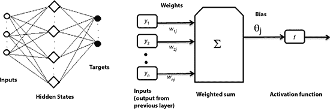

**图 5.1** 为最终计算揭示网络层。

任何基于网络的模型和基于机器学习的模型都强调两个任务，即学习和应用。在学习过程中，模型试图从训练数据中提取相似性以完成特定任务。可以通过 Facebook 插件的示例来理解，其中学习被整合以让盲人描述照片。另一方面，应用阶段在利用数据上投入使用后向你发送响应。例如，当音乐应用发现用户的他/她的音乐品味时，会每周向用户推荐播放列表。学习和应用都整合在一起，为系统开发自己的智力和自我意识开辟了道路。

## 5.3 描绘基石

业务的演进（如数字营销）通过其与利益相关者的直接参与，作为机器学习革命的一部分出现。机器学习是一个更广泛且活跃的领域，仅仅被称为科学的一个分支，但不能代表其最近的状态和演变。理解什么让机器学习在当前趋势中如此声誉并澄清误解至关重要。特别是，`NNs` 和 `DL` [11–14] 炒了机器学习范式，并加速了围绕核心要点的神秘感。事实上，市场和业务随着颠覆性技术的需求而繁荣，但这给术语带来了困惑，因为数据科学（DS）的核心概念（如图 5.2

**图 5.2** 与 DS 相关的术语。

### 5.3.2 机器学习 vs. 深度学习

最前所未有但最少强调的话题之一是机器学习与 `DL`。它们并不是对立的；相反，它们共享数据科学的共同伞。事实上，`DL` 被视为机器学习的一个核心方面，严锐地处理数据。然而，`DL` 中的数据表示是层次化的，因此最适用于未标记或非结构化数据。它通过非线性方法处理数据，使机器能够轻松转换特征。它被广泛应用于特征工程和特征转换。因此，它建议用于开发与现实世界数据（如图像、声音、文本或语言）相关的重大视觉应用。

### 5.3.3 人工神经网络 vs. 深度学习

`NN` 和 `DL` 都是前沿技术，并在研究中占据特殊地位。我们经常交替使用这些术语，而不意识到它们的细微差别。然而，它们在概念上有相似之处，但在各自范围内也是独立的。我们必须理解 `ANN` 和 `DL` 之间有一条界线。`ANN` 有多种，而 `DL` 被学习为 `ANN` 更复杂的形式。区别仅仅在于网络的深度，这在图 5.3 的架构中所示。说复杂，归因于可以在整个模型中的详细信息。模型越复杂，使用的内部层越多。层数的增加不仅是为了利用过度信息，还为了优化以获得更好的性能。

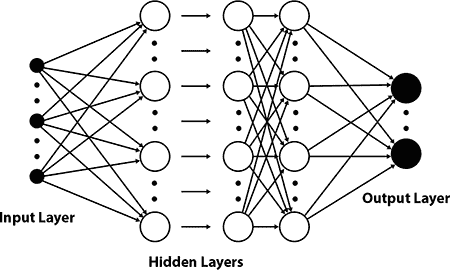

**图 5.3** ANN 是 DL 的基础。

最后，数据科学的三个基石，即机器学习、`ANN` 和 `DL`，通过一句话区分：`DL` 作为机器学习的一个子领域，利用 `ANN` 的层次视图来实现机器学习的过程。

## 5.4 深度学习架构

### 5.4.1 无监督预训练网络

在基于学习的模型中，如果直接利用监督学习方法引入某些变体来训练网络，可能会耗时很长或者效率不高。实际上，可以通过首先使用不同的无监督训练策略进行“预训练”，然后在监督学习算法的辅助下进行微调来缓解这一问题。这加速了计算过程并大幅降低了对数据的依赖。通过无监督学习获得的结果可以为许多视觉任务（如分类、检测或识别）提取高层属性。它能够快速地实现更好的优化和收敛，为高层表征构建网络形状。研究人员在受限玻尔兹曼机（RBM）[15] 和自动编码器（AE）[16, 17] 中使用了预训练学习方法。图 5.4 描述了预训练网络的绝对流程图。

![图 5.4 基于预训练网络的学习模型流程 [18].](images/fig5-4.jpg)

图 5.4 基于预训练网络的学习模型流程 [18]。

### 5.4.2 卷积神经网络

随着深度学习（DL）的发展，它提升了人工智能系统的潜力。它在功能上提供了扩展性，可以像人类一样观察世界，以自己的方式理解它，甚至为目标检测、识别以及视频摘要等任务簇提供知识支持。计算机视觉（CV）领域已达到新的高度，特别是通过一种算法，即卷积神经网络或 ConvNet/CNN [32–35, 38–42]。传统的 CV 算法依赖于手工特征，而 CNN 则对包含更复杂特征的图像提供了全面的理解，正如人类这样做一样。CNN 过程的流程如图 5.5。

**图 5.5** 典型的 CNN 流程 [19]。

### 5.4.3 循环神经网络

上述深度学习类别假设所有输入（以及输出）对彼此的影响最小。但如果我们想形成一个具有足够语义和语法正确性的句子，会发生什么呢？单词之间存在隐含的相互依赖关系，以创建一个完美的句子。这需要一个双阶段的过程：首先是基于它们在现实世界中可能发生方式的先验知识；其次是某种“记忆”状态，用于估计目前为止计算了多少信息，以预测句子中的下一个单词。循环神经网络（RNN）[20] 的典型架构如图 5.6 所示，用于处理如时间序列等顺序信息。它对序列中的每个元素应用相似的任务，并产生输出高度依赖于过去的计算。RNN 能够构建语言模型 [21]，并可能用于自然语言处理（NLP）或语言翻译系统（LTSs）。

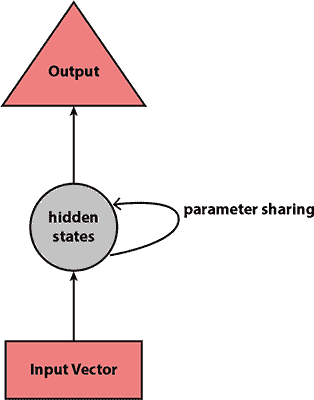

图 5.6 原始 RNN 架构。

### 5.4.4 递归神经网络

递归神经网络比 RNN 更具通用性。这种神经网络以分层方式解析数据（图 5.7）。其主要优势是可以与通过树或图表示的模式工作，与固定大小的向量形成完全对比。向量被限制特定长度，集合中的所有数据必须遵循该长度；而图提供了确定任意数量节点和边的灵活性。它在 NLP 和图像分析中也取得了成功 [22]。具体来说，节点以图的形式组织了信息。然而，图的边标记了节点之间的逻辑关联。

## 5.5 为什么 CNN 优于计算机视觉？

计算机视觉 [23, 24] 是一种模拟人类视觉皮层（HVC）的科学。它处理图像并提取细节，就像人类大脑一样。当 CV 被引入时是为了模拟 HVC，现在已应用于银行、医疗和汽车等领域。典型的机器学习算法无法处理复杂的任务，例如目标分类。深度学习对于图像分析、分割、分类和识别等活动具有巨大的潜力。CNN 作为 DL 的一类，通过分析模式被广泛采用。它最终为对象分配标签。

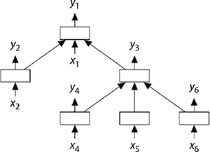

图 5.7 递归神经网络的图表示。

CNN 架构围绕几种类型的层构建，在后续章节中要说明。

### 5.5.1 卷积层

该层执行卷积操作，即在输入图像矩阵上滑动一个小矩阵（通常称为内核、滤波器或掩码）（图 5.8）。在滑动过程中，它与初始像素值相乘并最终求和得到一个数值。此过程通过多个单元遍历所有像素值。添加此层的思想是获得相对于原始矩阵小得多的矩阵。

### 5.5.2 非线性层

该层位于卷积层之后，为数据引入非线性或不一致性。如果网络不支持非线性，我们就不需要多个层，因为合并多个层将等同于单层。此外，非线性增强了为揭示复杂图像创建的网络。为了添加非线性，最常用的激活函数是 `ReLU`。

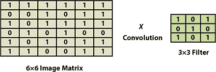

图 5.8 3 × 3 滤波器卷积 6 × 6 图像矩阵。

### 5.5.3 池化层

该层也有助于缩小图像矩阵。它更有助于减少参数数量，从而减少网络中的计算开销。用于池化的最常用方法是 `MaxPooling`（图 5.9）。

### 5.5.4 全连接层

它的工作方式类似于传统的 ANN 和多层感知器（MLP），如图 [图 5.10](#c05.xhtml#fig5-10）所示。然而，唯一的区别是由于 CNN 早期层提供的预处理，现在的图像矩阵更加简化、优化且形状规整。分类决策由该层驱动。

通过改变卷积层、池化层和全连接层的数量，我们可以针对特定的图像处理任务（如修复或分类）最大化网络性能。目前已经存在许多基于 CNN 的架构旨在加速训练速度，并最终实现了高准确率和低错误率。要彻底构思这些架构有些困难，且超出了本章的范围，但我们提取了一些相关信息并汇总在表 5.1 中。

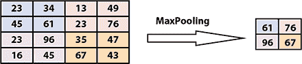

图 5.9 池化减小了转换矩阵的大小。

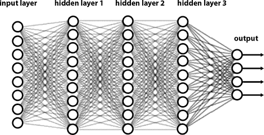

图 5.10 多层神经网络。

表 5.1 基于 CNN 的不同架构。

| 架构 | 年份 | 分组/作者 | 错误率（百分比） | 使用的激活函数 | 参数数量（百万） |
| --- | --- | --- | --- | --- | --- |
| AlexNet [25] | 2012 | SuperVision | 15.3 | `ReLU` | 62.3 |


| 模型 | 年份 | 提出者 | 误差率 | 激活函数 | 参数量 |
| --- | --- | --- | ---: | --- | ---: |
| GoogLeNet [26] | 2014 | Google | 6.67 | ReLU | 4 |
| VGGNet [27] | 2014 | Visual Geometry Group | 7.32 | ReLU | 138 |
| ResNet [28] | 2015 | Kaiming He *et al.* | 3.57 | ReLU | 23 |

## 5.6 深入解析医疗诊断系统中的深度学习

如今，计算机视觉（CV）和深度学习（DL）正在许多领域共同追求更高的高度。受这两个框架影响的尖端研究在农业、遥感或自动驾驶汽车等每个应用中都显示了具有前景的结果。考虑到当前全球正应对由新型冠状病毒 [29] 引起的健康危机的形势，医疗保健正成为研究界关注的严肃问题。事实上，这种病毒对于病毒学家或临床执业者来说并不陌生，在 2020 年新冠大流行之前，世界已经经历过几次人畜共 zoonotic 攻击 [30, 31]。然而，CV 与 DL 结合模拟在对抗不利健康问题方面取得了成功。事实证明，这些方法有助于医生和医护工作人员消除一系列误解。它们被广泛用于开发计算机辅助诊断（CADS）系统。因此，我们本节将重点介绍来自图像处理和 DL 的先进技术在潜在疾病早期诊断中的应用。

医学影像有时被称为诊断成像，如 X 光、磁共振成像（MRI）、CT 扫描和乳腺摄影，在医疗系统中起着至关重要的作用。它是系列技术和过程，用于捕捉人体部位、器官或组织的视觉表示，以便进行关键分析、诊断和临床治疗。肺炎、脑瘤、癌症和帕金森病等健康疾病已通过医学影像实现了高精度的成功诊断。这使得早期阶段治疗成为可能，甚至可以消除复发的概率。不仅是诊断，医生们还接受了 CV 在手术本身中的益处。它在进行任何手术准备之前分析身体组织的损伤和损失方面起着关键作用。这些程序是积极的非侵入性、无痛且拯救生命的。诊断成像与 DL 的结合彻底改变了医疗行业。它促使研究人员和医生遵循病史、生物数据、症状，以及微生物的生物周期或复制模式，以获得关键参数，这些参数对药物发现更有帮助。医学影像还有助于跟踪患者正在进行的治疗的效果，并在需要时帮助医生调整剂量。表 5.2 回顾了某些用于涵盖相关疾病的计算机辅助诊断（CAD）先进模型。

**表 5.2** 由深度学习和医学影像驱动的一些 CAD 参考文献。

| 参考文献 | 使用的算法 | 性能（百分比） | 描述 |
| --- | --- | --- | --- |
| [32] | CNN、K-近邻、支持向量机 | 准确率 = 98 到 99 | 使用 MRI 调查患者是否易患阿尔茨海默病。 |
| [33] | CNN | 准确率 = 97.5 | 通过 MRI 扫描检测脑瘤 |
| [34] | 深度神经网络（DNN）、主成分分析、离散小波变换 |  | 使用 MRI 分类脑瘤 |
| [35] | CNN | 曲线下面积（AUC）= 87 | 利用 X 光片进行检测 |
| [36] | DNN、线性判别分析 | 灵敏度 = 96.2 | 使用 CT 扫描诊断肺癌 |
| [37] | 异构 ANN | 准确率 = 97.5 | 使用 CT 扫描诊断肾脏疾病 |
| [38] | CNN | 灵敏度 = 90 | 使用 MRI 评估肿瘤 |
| [39] | 混合 DL、卡特洛规则 | RMSE = 37.77 | 用于非确定性数据的流行决策 |
| [40] | CNN | 准确率 = 96.78；灵敏度 = 98.66；特异性 = 96.46 | 使用 X 光诊断 COVID-19 |
| [41] | CNN、贝叶斯优化 | 准确率 = 98.26；正确率 = 98.26；特异性 = 99.13；完整性 = 98.26 | 基于 X 光的 COVID-19 检测模型 |
| [42] | CNN | 准确率 = 87.02；灵敏度 = 85.35；特异性 = 92.18；精确率 = 89.96 | 使用 X 光检测 COVID-19 |
| [43] | 深度学习 |  | 识别可用于 SARS-CoV-2 的药物靶点相互模型 |
| [44] | 深度学习、贝叶斯函数 | 准确率 = 86.7 | 将 CT 图像分为 COVID-19 和无关组 |
| [45] | 深度学习 | 提到的分类结果，例如：肺癌灵敏度 = 62.5；前列腺癌灵敏度 = 87；黑色素 = 60 | 嵌入骨扫描指数（BSI）以评估不同肿瘤（例如前列腺癌、乳腺癌和肺癌） |
| [46] | CNN、长短期记忆 | 准确率 = 98.5 | 利用 ECG 信号分类心血管疾病 |
| [47] | 深度学习 | 准确率 = 99.5 | 结合 3D 立体摄影和深度学习研究婴儿颅骨融合症 |
| [48] | 深度学习 | 准确率 = 72.5；AUC = 81；特异性 = 66.7；灵敏度 = 78.4 | 为了检测阑尾炎，在自然视频上进行预训练开发了 3D 模型 |
| [49] | CNN、ResNet-50、InceptionResNet-V2、YOLO | 平均准确率分别为 94.5、95.83、97.5（对于 DDSM 数据集）；平均准确率分别为 88.74%、92.55%、95.32%（对于 INbreast 数据集） | 从数字乳腺摄影提出了一种有前景的乳腺病变诊断系统 |
| [50] | CNN | 准确率 = 82.8；灵敏度 = 80.2；特异性 = 83；AUROC = 88.4 | 基于 CT 扫描诊断甲状腺癌颈淋巴结转移 |

## 5.7 挑战与未来展望

近年来，我们看到了深度学习（DL）部署的经验性激增。但事实上，缺乏足够的文章探讨数据获取、预处理、实现、数据集不平衡以及分类器评估带来的挑战和预期。例如，在使用 `CNN` 时非常具有挑战性，因为它需要大量的超参数来调整特征。另一个问题是数据集不平衡问题，这在医疗监控中非常突出。它可能是由失真或数据校准引起的，从而影响深度学习的实现。结果导致性能下降。数据标准和数据互操作性也是主要障碍。由于图像采集受传感器和其他指标的影响差异很大，导致了分类准确率和模型学习能力的低下。合并不同的数据集是为了引入多样性并获得大量数据，但互操作性仍然是一个概念层面。另一个深度洞察是黑箱问题。构建网络似乎并不复杂，但理解达到输出的过程确实非常困难。深度学习不断提供更好的结果，但很难回答为什么以及如何做到。此外，隐私和法律问题也阻碍了这一过程。随着大数据的兴起，特别是在健康领域，`HIPAA`（1996 年健康保险流通性与责任法案）盛行，以保护患者的个人或匿名信息。它限制了此类信息的使用，这使得获取个人的过程变得复杂。另一种方案是差分隐私，它限制了敏感数据的使用。它防止了与医疗史或可识别信息相关的分类数据泄露。不幸的是，所有因素都限制了可能对分析模型产生负影响的内容。它受到法律和伦理视角的影响。

通过上述讨论可以得知，存在开放性挑战，需要进一步的审查和明确的研究方向。数据不足是医学研究中最大的挑战之一。数据模糊或缺乏足够的医学病例阻碍了处理罕见疾病的持续过程。这需要监管机构定义健康数据集的标准，并能够在提供者之间进行共享。机构在对健康记录发表意见时，应当符合这些标准。

## 5.8 结论

由于数据科学（`DS`）的各个基石之间深度融合，通常需要长时间讨论才能在基层对它们进行逐一审查。然而，通过本文，我们能够强调这些基石之间的显著差异，特别关注了 `DL` 和 `ANN`。虽然 `ANN` 利用计算单元（即神经元）的优势，通过连接控制信息从输入单元到输出单元的流动，而 `DL` 只负责特征的捕获和转换，最终与一组刺激和相关的神经结果建立联系。根据模型的需求和目标，有许多 `NN` 架构可用。此外，`DL` 最常见的一类是 `ConvNet`，它影响着 `CV` 任务，如图像预处理、目标分析、目标检测和识别。我们提供了 `CNN` 多层架构及其相应功能的通用视图。它还出现了由不同小组或作者提出的层级细微变化。`CNN` 架构非常有用，因为这些架构提供了预训练网络，因此训练时消耗的时间往往会被消除。

随后，讨论了医疗应用，揭示了 `DL` 在解决医学领域查询方面是多么高效。从阿尔茨海默症到动物共患疾病，从脑肿瘤分类到慢性肾病诊断，`DL` 图像处理组合成为医学信息学、生物信息学或健康数据分析的金标准。但我们不应该过度庆祝它的增长，因为存在可能损害其繁荣的障碍。我们列举了在医学领域特别是基于 `NN` 的学习中经常面临的主要挑战。在寻求解决方案时，我们不应只考虑单一视角，因为始终存在创新空间。然而，我们可以关注未来更多通过 `DL` 滋养的研究。

## References

1. Mohan, S. *et al.*., Effective heart disease prediction using hybrid machine learning techniques. Special Section on Smart Caching, Communications, Computing and Cybersecurity for Information-Centric. *Internet Things*, 7, 81542–81554, 2019.
2. Stephenson, N. *et al.*., Survey of machine learning techniques in drug discovery. *Curr. Drug Metab.*., 9, 20, 185–193, 2019.
3. Hamedan, F. *et al.*., Clinical decision support system to predict chronic kidney disease: A fuzzy expert system approach. *Int. J. Med. Inf.*., Elsevier, 138, 1–9, 2020.
4. Bhatti, G., Machine learning based localization in large-scale wireless sensor networks. *Sensors*, 18, 4179, 2018.
5. Mosavi, A. and Varkonyi-Koczy, A.R., Integration of machine learning and optimization for robot learning. *Adv. Intell. Syst. Comput.*., 519, 349–355, 2017.
6. Smarter with Gartner, Gartner top 10 strategic technology trends for 2019. Homepage [`www.gartner.com/smarterwithgartner`](https://www.gartner.com/smarterwithgartner).
7. Microsoft Annual report 2019. Homepage [www.microsoft.com].
8. Arimura, H., Tokunaga, C., Yamashita, Y., Kuwazuru, J., Magnetic resonance image analysis for brain CAD systems with machine learning, in: *Machine learning. Computer-aided diagnosis: Medical imaging intelligence and analysis*, K. Suzuki (Ed.), pp. 258–296, The University of Chicago, I, 2012.
9. El-Dahshan, E., Hosny, T., Salem, A., Deep Learning techniques. *IEEE Intell. Syst.*, 32, 2, 74–79, 2017.
10. Liou, C.Y., Cheng, W.C., Liou, J.W., Liou, D.R., Autoencoder for words. *Neurocomputing*, 139, 84–96, 2014.
11. Junwei, H., Advanced Deep-Learning for Salient and Category-Specific. *Signal Process Mag.*, 35.1, 84–100, 2018.
12. Ajeet, R., Manjusha, P., Siddharth, R., Application of deep learning for object detection. *Proc. Comput. Sci.*, 132, 1706–1717, 2018.
13. Liu, *et al.*., Deep learning for generic object detection: A survey. *Int. J. Comput. Vision*, 128, 261–318, 2019.
14. Mohammad, H.H., Wenjing, J., Xiangjian, H., Paul, K., Deep learning techniques for medical image segmentation. *J. Digit. Imaging*, 32, 582–596, 2019.
15. Hinton, G.E., A practical guide to restricted boltzmann machines, in: *Neural Networks: Tricks of the Trade*, pp. 599–619, Springer, Berlin, Heidelberg, 2012.
16. Bengio, Y. *et al.*., Learning deep architectures for AI. *Trends Mach. Learn.*, 2, 1, 1–127, 2009.
17. Rehman, S.U. *et al.*., Unsupervised pre-trained filter learning approach for efficient convolution neural network. *Neurocomputing*, 365, 171–190, 2019.
18. Zhang, *et al.*., A new JPEG image steganalysis technique combining rich model features and convolutional neural networks. *Math. Biosci. Eng.*, 16, 5, 4069–4081, 2019.
19. Guan, Y. and Ploetz, T., Ensembles of deep LSTM learners for activity recognition using wearables. *Proceedings of the ACM on Interactive, Mobile, Wearable and Ubiquitous Technologies*, 1.2, 1–28.
20. Majumder, N., Poria, S., Gelbukh, A., Cambria, E., Deep learning-based document modeling for personality detection from text. *IEEE Intell. Syst.*, 32, 2, 74–79, 2017.
22. Baldi, P. and Pollastri, G., 大规模递归神经网络架构的原则设计-DAG-RNN 与蛋白质结构预测问题。*J. Mach. Learn. Res.*., 4, 575–602, 2003.
23. Ponti, M. A., *et al*. 你想了解关于计算机视觉深度学习的一切，但却于问。*2017 第 30 届 SIBGRAPI 图形、模式和图像会议教程（SIBGRAPI-T）*。IEEE, 2017.
24. IEEE 计算智能学会，[`cis.ieee.org`](https://cis.ieee.org)。
25. Krizhevsky, A., Sutskever, I., Hinton, G.E., 基于深度卷积神经网络的 Imagenet 分类。*Adv. Neural Inf. Process. Syst.*., 25, 1097–1105, 2012.
26. Dong, Y. and Bryan, A., 用于自动识别疟疾感染细胞的深度卷积神经网络评估，收录于 *IEEE 生物医学与健康信息国际会议（BHI）*，pp. 101–104, 2017.
27. Simonyan, K. and Zisserman, A., 用于大规模图像识别的极深卷积网络。*学习表示国际会议*，2015，pp. 1–14, arXiv 印本 `arXiv:1409.1556`，2014.
28. He, K., Zhang, X., Ren, S., Sun, J., 用于图像识别的深度残差学习，收录于 *IEEE 视觉与模式识别会议集*，pp. 770–778, 2016.
29. Santosh, K.C., 用于冠状病毒爆发的 AI 驱动工具：多维度/多模态数据上主动学习和跨人群训练/测试模型的需求。*J. Med. Syst.*, 44, 1–5, 2020.
30. Leligdowicz, A., *et al*. 埃博拉病毒性与重症。*Critical Care*, 20.1, 1–14, 2016.
31. Xu, M. *et al.*., 通过药物重用筛选识别寨卡病毒感染和诱导神经细胞死亡的小分子抑制剂。*Nat. Med.*, 22, 1101–1107, 2016.
32. Khagi, B., Kwon, G.R., Lama, R., 使用 CNN、特征选择和机器学习技术基于 CDR 级的阿尔茨海默症分类的对比分析。*Int. J. Imaging Syst. Technol.*, 29, 1–14, 2019.


33. Seetha, J. and Raja, S.S., 使用卷积神经网络进行脑肿瘤分类。*Biomed. Pharmacol. J.*, 11, 3, 1457–1461, 2018.

34. Mohsen, H. *et al.*., 使用深度学习神经网络进行脑肿瘤分类。*Future Comput. Inf. J.*, 3, 68–71, 2018.

35. Bar, Y. *et al.*., 使用非医学训练的深度学习进行胸部病理检测。*第 12 届生物医学成像国际会议 (ISBI)*，pp. 294–297, IEEE, 2015.

36. L.S.K. *et al.*., 用于 CT 图像肺癌分类的最佳深度学习模型。*Future Gener. Comput. Syst.*, 92, 1–31, 2018.

37. Ma, *et al.*., 基于深度学习的异质改进人工神经网络用于慢性肾病的检测与诊断。*Future Gener. Comput. Syst.*, 111, 17–26, 2020.

38. Chang, J. *et al.*., 用于脑肿瘤分割的带 FCRF 的混合池 CNN 架构。*J. Vis. Commun. Image R*, 58, 1–23, 2018.

39. Fong, S.J. *et al.*., 使用混合深度学习和模糊规则归纳在新冠状病毒疫情高不确定性下进行复合蒙特卡洛决策。*Appl. Soft Comput. J.*, 93, 1–27, 2020.

40. Apostolopoulos, I.D. and Mpesiana, T.A., Covid19：利用卷积神经网络迁移学习从 X 射线图像中自动检测。*Phys. Eng. Sci. Med.*, 43, 1–6, 2020.

41. Ucar, F. and Korkmaz, D., COVIDiagnosis-Net: 基于深度 Bayes-SqueezeNet 的 X 射线图像诊断 2019 冠状病毒疾病 (COVID-19)。*Med. Hypotheses*, 140, 1–12, 2020.

42. Ozturk, T. *et al.*., 使用深度神经网络结合 X 射线图像自动检测 COVID-19 病例。*Comput. Biol. Med.*, 121, 1–11, 2020.

43. Beck, B.R. *et al.* 通过药物-靶点相互作用预测可能作用新型冠状病毒 (SARS-CoV-2) 的市售药物。*Comput. Biotechnol. J.*, 18, 784–790, 2020.

44. Xu, X. *et al.* 一用于新型疾病肺炎的深度学习系统。*Engineering*, 6, 1–11, 2020.

45. Wuestemann, J. *et al.* 深度学习应用于 CT 甲状腺癌颈部淋巴转移：外部验证。*Cancers*, 12, 1–13, 2020.

46. Lih, O.S. *et al.* 基于深度学习的综合心电图诊断。*Artif. Intell. Med.*, 108, 1–8, 2020.

47. Jong, G.D. *et al.* 将深度学习与 3D 立体测量结合用于颅缝闭。*Sci. Rep.*, 10, 1–6, 2020.

48. Rajpurkar, P. *et al.* AppendiXNet: 基于小规模 CT 检查集的深度学习诊断阑尾炎。*Sci. Rep.*, 10, 1–7, 2020.

49. Al-antari, M.A. and Kim, T.S. 数字化 X 射线乳腺摄影中乳腺病变的深度学习检测与分类。*Comput. Methods Programs.*, 196, 1–38, 2020.

50. Lee, J.H. *et al.* 外部验证与临床效用。*Eur. Radiol.*, 29, 1–7, 2020.

信用评分是一种与信用卡和贷款等信贷产品相关的风险估算方法，基于申请人的历史数据进行估算 [1]。正如 Thomas 等人 [2] 所述，“信用评分是一套决策模型及其底层技术，旨在帮助信贷贷款人授予信贷” [3]。信用评分的努力在于隔离不同申请人特征对非法行为和违约还款产生的影响。信用评分的核心汇点在于倾向于判断申请人是否处于财务状况良好的群体。信用是指申请人从金融机构获取的金额，定义为“系统根据客户的资历（如年收入、财产等）对申请人的信用额度进行估算”。对于金融机构而言，高数量的信用评分具有诸多优势，包括“确定并降低信用风险”、“做出管理决策”以及“改善现金流” [4, 5]，其性能决定了信贷行业的盈利能力。

这并不是一个单一步骤的演进过程，金融机构通常通过几个步骤来实现它，其中一些步骤如下 [4]：

* **申请评分**：用于估算新申请人的真实性和不可信度。该评估是基于提交申请时收集的社会、经济和补充证据进行的。
* **行为评分**：与前述类似，“它是为了现有客户审查其个人行为标准，并帮助动态投资组合管理过程”。
* **催收评分**：与上述步骤类似，它尝试根据客户行为的变化将其分为几类，金融机构据此关注这些类别的客户，例如：高风险、中等、无风险等。

### 6.1.1 动机

根据印度储备银行 (RBI) 提供的统计数据 [7]，2012–2016 年期间的信用卡用户如图 6.1 所示。

* 2012–2013 年信用卡持有人数为 24 万；
* 2013–2014 年信用卡持有人数为 21 万；
* 2014–2015 年信用卡持有人数为 19 万；
* 2015–2016 年信用卡持有人数为 50 万；
* 2016–2017 年信用卡持有人数为 57 万 [7]。
* 印度住房贷款账户总数为 38 万。


图 6.1 结合信用卡，各种贷款和微型金融等多种信贷产品也可以从金融机构获取。由于申请人的行为存在巨大差异，手动进行信用评分是非常困难的，且不仅限于银行行业 [9, 10]。在此背景下，各种机器学习 (ML) 方法被用于模型风险估计。如“人工神经网络 (ANN)”和“支持向量机 (SVM)”等分类方法已有效应用于信用风险预测模型。`SVM` [11] 具有“泛化特性”和“全局优化”。本文结构如下：第 6.2 节](#c06.xhtml#sec-2) 简述文献综述；第 6.3 节](#c06.xhtml#sec-3) 提出了所提出的信用评分模型；第 6.4 节](#c06.xhtml#sec-4) 展示了研究结果。

## 6.2 文献综述

大多数学者将信用风险估计视为二分类问题（即有信誉或无信誉），并在信用评分数据中发现隐藏模式。这有助于专家升级其风险估计。Li 等人 [12] 通过考虑 `SVM` 作为分类方法并结合数据预处理，提出了针对消费贷款人的信用风险评估模型。Gestel 等人 [13] 采用了“最小二乘支持向量机 (LS-SVM)”来评估企业客户的信誉度。West [14] 对各种分类方法进行了综述，并评估了它们在信用评分数据集上的性能。Xiao 和 Fei [15] 提供了一种基于具有最优参数 `SVM` 方法。Kuppili 等人 [16] 应用极端学习机进行信用评分数据分析。同样，Zhou 等人 [17] 提出了一种考虑“加权 SVM”的信用评分模型。

多种方法的整合是一种动态安排，协调各种方法的步骤以实现特定的结论。在信用评分数据集中，包含许多与申请人资历相关的特征，如社会和财务状况，这些特征是异质性的，如类别型、小范围数值和大范围数值。因此，某些特征可能是冗余或不相关的，可能会降低模型的性能。相应的，许多科学家将“特征选择”和“离群点检测”等各种数据预处理步骤视为增强信用评分预测性能的一种重要方法，这些方法的详细描述如下：

结合 `SVM` 作为分类方法的混合信用评分模型，以及基于“多变量适应回归样条 (MARS)”和“F 分数”的特征选择方法在文章 [18] 中得到了评估。同样将将步进回归 (SR)”和“MARS”等特征选择方法结合 `ANN` 作为分类方法，也分别应用于文章 [19] 和 [20]。Oreski 和 Oreski [21] 提出了一种基于“遗传算法 (GA)”选择有效特征并进一步结合分类方法的混合模型。同样，Wang 等人 [22] 和 Huang 与 Dun [23] 分别应用“粗集与禁忌搜索”以及“二进制粒子群优化算法 (BPSO)”来优化一组特征，并进一步结合 `SVM` 进行分类。

从文献中发现，特征选择是提高分类方法预测性能的一种重要手段，且是一个组合优化问题。受生物启发的算法适用于连续搜索空间上进行优化。因此，对于特征优化，首先需要将连续搜索转换为二值搜索。集成学习是将基学习器的输出结合在一起以估计最终结论，在许多研究中，已经证明了它比单模型模型更稳定、更准确。考虑到上述特征选择和集成学习方法的优势，本文提出了一种“基于演化特征选择和集成神经网络的两阶段信用评分模型”，旨在利用机器学习 (ML) 算法从信用评分数据集中提取知识，并通过考虑有价值特征来提高性能。

## 6.3 提的信用评分模型

本节介绍了所提的两个阶段信用评分模型，如图图 6.2 所示。所提模型在第一阶段结合了演化特征选择，在第二阶段结合了集成分类进行信用评分，并将在接下来的小节中进行讨论。在特征选择之前，对数据集进行了预处理，因为信用评分数据集通常包含异构数据类型。在这项工作中，我们利用神经网络作为分类工具，它考虑向量格式的数据。因此，对数据集进行了预处理，包括数据清洗（消除缺失值）、数据转换（将类别值转换为数值值）和数据离散化（将大范围数值转换为小范围数值）。

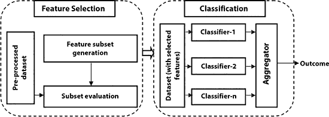

`图 6.2` 所提的两个阶段信用评分模型。

### 6.3.1 第一阶段：特征选择

本文利用一种演化方法 `BPSOGSA` [24] 来选择一组有价值的特征。[29] 中的作者们提出了 `PSOGSA`，这是一种结合了基于群的粒子群优化（`PSO`）的社交思维（`gbest`）能力以及基于演化的引力搜索算法（`GSA`）的开发能力的混合方法。`PSOGSA` 在探索和开发能力优于 `PSO` 和 `GSA` [24]。

在 `PSOGSA` [29] 中，所有搜索代理在每次迭代中从连续搜索空间中的一个位置移动到另一个位置，并由位置向量表示。在这里，`PSOGSA` 用于特征选择，其中位置向量应以二值格式表示，其中位置向量中的 0 表示对应特征不存在，否则表示存在。为了将连续值转换为相应的二值位置向量，需要一个转换函数根据搜索代理的似然速度 [25] 来调整位置。文献中多种转换函数，并分为两类，即 `S` 型和 `V` 型 [26]。`V` 型转换函数在收敛速率方面优于 `S` 型转换函数 [27]。`V` 型转换函数所示如公式 (6.1)–(6.4) [26]。

(6.1) 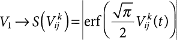(6.2) 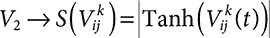(6.3) 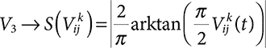(6.4) [26]。

为了将连续值转换为相应的二值位置向量，需要一个转换函数根据搜索代理的似然速度 [25] 来调整位置。文献中多种转换函数，并分为两类，即 `S` 型和 `V` 型 [26]。`V` 型转换函数在收敛速率方面优于 `S` 型转换函数 [27]。`V` 型转换函数所示如公式 (6.1)–(6.4) [26]。

本节提供了对四个信用评分数据集的解释，以及用于验证所提方法的性能指标，并对这四个数据集的结果进行了全面的结果调查。

## 6.4.1 实验数据集与性能指标

两阶段信用评分模型在四个信用评分数据集上进行了实验，即：“澳大利亚贷款审批 (AUS)”、“德国分类贷款审批 (GCD)”、“日本信用审查 (JPD)”和“德国数值贷款审批 (GND)”。上述所有数据集均获取自“UCI 机器学习库 [38]”，详细描述如表 6.1 所示表格所示。所有数据集均为二分类数据集，其中正类和负类分别代表接受和未接受的申请。

在此处，利用准确率（accuracy）和 G 测量（G-measure）来衡量并比较所提方法与其他方法的性能。准确率 如[公式 (6.10)] 表显示了“分类器的预测性能”，如果数据集中某一类别的比例存在显著失衡，则其作为性能指标是不够的。G 测量 如[公式 (6.11)] 是一种考虑“正类和负类准确率”来计算分数的指标，其中特异性（`Spe`）和灵敏度（`Sen`）分别代表对正类和负类的预测性能。

(6.10) 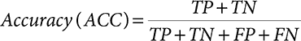(6.11) 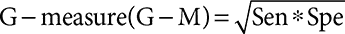

其中 “TP”、“FP”、“TN” 和 “FN”分别表示“真正性”、“假正性”、“真负性”和“假负性”，见 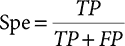, 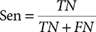。

**表 6.1**](#c06.xhtml#rtab6-1) 实验数据集描述。

| **序号** | **数据集** | **样本数** | **正/负类** | **特征数量** |
| --- | --- | --- | --- | --- |
| 1 | AUS | 690 | 307/383 | 14 |
| 2 | GCD | 1,000 | 700/300 | 20 |
| 3 | JPD | 690 | 307/383 | 15 |
| 4 | GND | 1,000 | 700/300 | 24 |

### 6.4.2 特征选择的分类结果

预处理是数据挖掘中初始且最重要的阶段。为了预处理数据，应用了数据清洗、转换和离散化过程。对于数据清洗，消除了含有缺失值的样本。对于数据转换，将属性的不同离散值替换为唯一的整数。这是因为基于神经网络的分类器需要数据样本作为实数向量。数值特征值在预定义的区间内分别进行缩放。为了预测具有宽范围数值的特征而忽略具有窄范围数值的特征，通过应用 `Boolean Reasoning Algorithm` [39] 使用离散化程序将特征在范围内进行缩放。

**表 6.2**](#c06.xhtml#rtab6-2) 在澳大利亚数据集上带有特征选择的 MLFN、RBFN、DTNN 和集成方法的性能。

| **分类器** | **指标** | **ALL** | **CFS** | **V1** | **V2** | **V3** | **V4** |
| --- | --- | --- | --- | --- | --- | --- | --- |
| MLFN | ACC | 83.12 | 84.35 | 84.34 | 82.13 | 85.57 | 83.31 |
| G-M | 83.41 | 84.93 | 84.32 | 830.1 | 85.66 | 84.41 |
| DTNN | ACC | 89.16 | 90.57 | 91.81 | 91.53 | 91.43 | 91.04 |
| G-M | 90.39 | 91.08 | 92.11 | 92.05 | 91.25 | |
| RBFN | ACC | 85.59 | 87.23 | 87.6 | 86.48 | 87.76 | 87.39 |
| G-M | 86.19 | 88.36 | 87.74 | 87.59 | 88.06 | |
| MV | ACC | 89.43 | 90.56 | 91.88 | 91.86 | 91.63 | |
| G-M | 89.15 | 90.93 | 92.33 | 92.48 | | |
| WV | ACC | 90.02 | 90.86 | 91.92 | 91.89 | 91.69 | |
| G-M | 90.67 | 91.26 | 92.36 | 92.54 | | | |
| UV | ACC | 89.11 | 89.61 | 89.88 | 89.92 | 90.06 | |
| G-M | 90.29 | 90.58 | 91.06 | 91.12 | | | |

根据所提的两阶段模型，第一阶段将预处理后的数据集用于特征选择。因为特征选择是一个二进制优化问题，其中 0 和 1 分别代表特征的存在与不存在。从文献中可以看出，V 型函数优于 S 型函数。文献中有多种 V 型函数可用，但不清楚哪种函数在特征选择情况下表现良好。因此在本文中，使用了四种 V 型函数 `V1`、`V2`、`V3` 和 `V4` 将连续空间转换为二进制空间。所提方法选择的特征与先进的相关性选择 `CFS` [40] 进行比较。此外，带有选择特征的数据集被传递到下一阶段进行分类，`MLFN`、`RBFN` 和 `TDNN` 的输出由 `WV` 方法聚合。在 `WV` 方法的情况下，需要基础分类器的权重。为了计算基础分类器的权重，使用准确率作为参数并初始为所有分类器分配相等权重。此外，在整个迭代过程中通过 `Equation (6.12)`c06.xhtml#eq6-12 更新权重。相同的过程持续 `n` 次迭代，并在最后分配给相应的分类器。

(6.12) 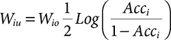

其中 `w[io]` 和 `w[iu]` 分别表示第 `n` 次迭代时第 `i` 个分类器的旧权重和更新权重，`acc[i]` 表示第 `i` 个分类器的准确率。

**表 6.3**](#c06.xhtml#rt) 在德国分类数据集上带有特征选择的 MLFN、RBFN、DTNN 和集成方法的性能。

| **分类器** | **指标** | **ALL** | **CFS** | **V1** | **V2** | **V3** | **V4** |
| --- | --- | --- | --- | --- | --- | --- | --- |
| MLFN | ACC | 70.53 | 72.22 | 72.58 | 72.63 | 72.69 | 72.36 |
| G-M | 58.23 | 59.63 | 61.23 | 61.36 | 61.53 | 60.88 |
| DTNN | ACC | 80.36 | 81.22 | 82.03 | 82.36 | 82.65 | 82.33 |
| G-M | 69.35 | 70.22 | 70.99 | 71.06 | 71.77 | 70.89 |


# 6 信用评分

## 6.4 实验结果

为了对比结果，使用了 10 折交叉验证（`10-FCV`）的分析平均值，并在准确率（`ACC`）和 G 度量（`G-M`）方面与全特征、`CFS` 选择特征以及上述 V 型传递函数选择的特征进行了比较。在这里，还使用了三个分类器 `MLFN`、`TDNN` 和 `RBFN` 以及三种聚合方法 `MV`、`WV` 和 `UV` 进行对比分析。表 6.2 到 6.5 分别展示了 AUS、GDC、JCD 和 GND 数据集上的结果，考虑到准确率度量的各种特征选择方法的对比图如图 6.3 所示。由于提出的特征选择方法是一种进化方法，为了展示其稳定性，使用所有 V 型函数重复进行了 10 次特征选择。此外，在每次迭代中应用了 `10-FCV`，并使用每次迭代的 `10-FCV` 平均值进行对比分析。

在表 6.2 到 6.5 中，`V1`、`V2`、`V3` 和 `V4` 展示了各自的分类器和聚合方法在相应传递函数选择的特征、`CFS` 以及全特征上的性能。从实验结果观察到，所提出的特征选择技术与 `CFS` 相比具有更好的分类性能，并且提高了 `RBFN`、`MLFN` 和 `TDNN` 在上述信用评分数据集上的分类性能。从表 6.2 到 6.5 的结果也可以观察到，`V3` 传递函数在大多数情况下性能更好，且与全特征相比也提高了分类性能。`WV` 与 `MV` 和 `UV` 相比性能最好，并且与其构建相同集成框架的基础分类器相比，其分类性能有了显著提高。最终结论是，基于 `BPSOGSA` 结合 `V3` 传递函数和 `WV` 的特征选择在四个信用评分数据集上具有最好的性能。

### 表 6.4 在日本数据集上带有特征选择的 MLFN、RBFN、DTNN 和集成方法的性能

| 分类器 | 指标 | ALL | CFS | V1 | V2 | V3 | V4 |
| :--- | :--- | :--- | :--- | :--- | :--- | :--- | :--- |
| MLFN | ACC | 84.36 | 85.89 | 85.79 | 86.27 | 86.83 | 86.42 |
| MLFN | G-M | 84.53 | 86.16 | 86.09 | 86.13 | 86.88 | 86.39 |
| DTNN | ACC | 87.16 | 88.86 | 88.84 | 88.78 | 89.56 | 89.13 |
| DTNN | G-M | 88.86 | 89.38 | 89.36 | 89.2 | 89.93 | 88.96 |
| RBFN | ACC | 84.83 | 85.02 | 85.36 | 85.39 | 86.07 | 85.86 |
| RBFN | G-M | 85.31 | 86.69 | 86.83 | 86.91 | 87.32 | 87.09 |
| MV | ACC | 88.53 | 89.77 | 89.91 | 89.86 | 90.08 | 90.12 |
| MV | G-M | 89.21 | 89.96 | 90.01 | 90.14 | 90.68 | 90.13 |
| WV | ACC | 88.76 | 89.65 | 89.89 | 89.93 | 90.06 | 89.26 |
| WV | G-M | 90.67 | 90.15 | 89.79 | 90.39 | 90.61 | 89.97 |
| UV | ACC | 88.06 | 89.16 | 89.15 | 89.12 | 89.31 | 88.77 |
| UV | G-M | 88.69 | 89.74 | 90.11 | 90.24 | 90.17 | 89.44 |

### 表 6.5 德国数值数据集上带有特征选择的 MLFN、RBFN、DTNN 和集成方法的性能

| 分类器 | 指标 | ALL | CFS | V1 | V2 | V3 | V4 |
| :--- | :--- | :--- | :--- | :--- | :--- | :--- | :--- |
| MLFN | ACC | 73.72 | 75.87 | 75.93 | 75.27 | 74.89 | - |
| MLFN | G-M | 69.36 | 71.92 | 71.36 | 70.89 | 71.25 | - |
| DTNN | ACC | 81.16 | 82.03 | 82.85 | 83.18 | 83.47 | 15 |
| DTNN | G-M | 70.73 | 71.62 | 72.43 | 72.48 | 73.21 | - |
| RBFN | ACC | 75.38 | 77.01 | 77.11 | 77.31 | 77.59 | - |
| RBFN | G-M | 65.04 | 66.25 | 66.53 | 67.27 | 67.68 | - |
| MV | ACC | 82.87 | 84.01 | 84.77 | 84.92 | 85.36 | - |
| MV | G-M | 79.1 | 80.32 | 80.44 | 80.68 | 80.37 | - |
| WV | ACC | 82.87 | 84.01 | 84.77 | 84.92 | 85.36 | - |
| WV | G-M | 80.6 | 81.15 | 81.58 | 81.73 | 81.84 | - |
| UV | ACC | 81.73 | 82.81 | 83.29 | 83.26 | 83.44 | - |
| UV | G-M | 79.24 | 80.21 | 80.16 | 80.26 | 80.05 | - |


### 图 6.3 各种信用评分数据集的对比图

## 6.5 结论

本文提出了一种两阶段信用评分模型，因为这是各信用行业的一项重大研究挑战，并直接影响该行业的生存能力。在第一阶段，我们应用了利用提出的 `BPSOGSA` 的进化方法；在第二阶段，通过 `WV` 方法组装了神经网络集成，即 `MLFN`、`TDNN` 和 `RBFN`。此外，所提出的信用评分模型在信用卡和贷款申请人的真实世界数据集等四个不同领域上进行了验证。此外，将 `MLFN`、`TDNN` 和 `RBFN` 的准确率和 G 度量，以及基于 `MV-`、`WV-` 和 `UV-` 的聚合方法，与著名的基于 `CFS` 的特征选择方法进行了比较。从调查结果可以看出，基于 `BPSOGSA` 结合 `V3` 传递函数和 `WV` 的特征选择在四个信用评分数据集上具有最好的性能。

## 参考文献

1. Mester, L.J., What’s the point of credit scoring? *Bus. Rev.*, *3*, Sep/Oct, 3–16, 1997.
2. Thomas, L., Crook, J., Edelman, D., Credit scoring and its applications. *Soc. Ind. Appl. Math.*, 2017. [`catalog.princeton.edu/catalog/1042555`](https://catalog.princeton.edu/catalog/1042555)
3. Louzada, F., Ara, A., Fernandes, G.B., Classification methods applied to credit scoring: Systematic review and overall comparison. *Surv. Oper. Res. Manage. Sci.*, *21*, 2, 117–134, 2016.
4. Paleologo, G., Elisseeff, A., Antonini, G., Subagging for credit scoring models. *Eur. J. Oper. Res.*, *201*, 2, 490–499, 2010.
5. Tripathi, D., Edla, D.R., Cheruku, R., Kuppili, V., A novel hybrid credit scoring model based on ensemble feature selection and multilayer classification. *Comput. Intell.*, *35*, 2, 371–394, 2019.
6. Svozil, D., Kvasnicka, V., Pospichal, J., Introduction to multi-layer feed-forward neural networks. *Chemometr. Intell. Lab. Syst.*, *39*, 1, 1–16.
7. Saha, M., Credit cards. [`www.thehindu.com/business/Credit-cards-touch-24.5-million/article143786.ece`](http://www.thehindu.com/business/Credit-cards-touch-24.5-million/article143786.ece)
8. Fulwari, A., Issues of housing finance Urban A doctoral dissertation, Maharaja Sayajao University of Baroda, 2013.
9. Wang, G., Ma, J., Huang, L., Two credit scoring models on dual strategy ensemble. *Knowledge-Based Syst.*, *26*, 61–79, 2012.
19. Wongchinsri, P. and Kuratach, W., 基于 SR 的信用评分二分类，收录于：*2017 14th International Conference on Electrical Engineering/Electronics, Computer, Telecommunications and Information Technology (ECTI-CON)*, IEEE, pp. 385–388, 2017, June.
20. Lee, T.S. and Chen, I.F., 一种使用人工神经网络和多变量适应回归样条的两阶段混合信用评分模型。*Expert Syst. Appl.*, *28*, 4, 743–752, 2005.
21. Oreski, S. and Oreski, G., 信用风险评估中基于遗传算法的特征选择启发算法。*Expert Syst. Appl.*, *41*, 4, 2052–2064, 2014.
22. Wang, J., Guo, K., Wang, S., 基于粗集和禁忌搜索的信用评分特征选择。*Proc. Comput. Sci.*, *1*, 1, 2425–2432, 2010.
23. Huang, C.L. and Dun, J.F., 具有特征选择和参数优化的分布式 PSO–SVM 混合系统。*Appl. Soft Comput.*, *8*, 4, 1381–1391, 2008.
24. Mirjalili, S., Wang, G.G., Coelho, L.D.S., 利用混合粒子群优化和引力搜索算法进行二进制优化。*Neural Comput. Appl.*, *25*, 6, 1423–1435, 2014.
25. Rashedi, E., Nezamabadi-Pour, H., Saryazdi, S., BGSA: 二进制引力搜索算法。*Natural Comput.*, *9*, 3, 727–745, 2010.
26. Mirjalili, S. and Lewis, A., 二进制粒子群优化的 S 型与 V 型传递函数。*Swarm Evol. Comput.*, *9*, 1–14, 2013.
27. Mirjalili, S., Mirjalili, S.M., Yang, X.S., 二进制蝙蝠算法。*Neural Comput. Appl.*, *25*, 3–4, 663–681, 2014.
28. Cohen, J., Cohen, P., West, S.G., Aiken, L.S., *行为科学的应用多元回归/相关分析*，Routledge, 2013.
29. Bluman, A.G., *基础统计学：逐步方法*，McGraw-Hill Higher Education, 纽约, NY, 2009.
30. Tripathi, D., Edla, D.R., Kuppili, V., Bablani, A., Dharavath, R., 基于加权投票和聚类特征选择的信用评分模型。*Proc. Comput. Sci.*, *132*, 22–31, 2018.
31. Tsai, C.F., Lin, Y.C., Yen, D.C., Chen, Y.M., 通过分类器集成预测股票收益。*Appl. Soft Comput.*, *11*, 2, 2452–2459, 2011.
32. Haykin, S., *神经网络：全面的基础*，Prentice-Hall, Inc., 2007.
33. Hornik, K., Stinchcombe, M., White, H., 多层前馈网络是通用逼近器。*Neural Networks*, *2*, 5, 359–366, 1989.
34. Edla, D.R., Tripathi, D., Cheruku, R., Kuppili, V., 基于 OGSA 的集成框架数据分析。*Arab. J. Sci. Eng.*, *43*, 12, 6909–6928, 2018.
35. Shikaano, K., 用于分类问题的模块化缩放神经网络。*IEEE Trans. Acoust. Speech Process.*, *37*, 1888.
36. Kala, R., Vani, H., Khanwalkar, N., Bhattacharya, M., 用于分类问题的进化径基函数。*IJCSA*, *7*, 34–49, 2010.
37. Broomhead, D. and Lowe, D., *径基函数多变量插值* (RSRE-MEMO-4148)，英国信号与雷达研究中心梅尔恩，1988.
38. UCI 机器学习仓库（访问于 2019/09/25），https://archive.uci.edu
39. Nguyen, H.S., *实值属性离散化的布尔推理*[博士论文]，华沙大学，1997.
40. Hall, M.A., 基于相关性的类别特征选择，威卡托大学，计算机科学系，2000.
41. Tripathi, D., Cheruku, R., Bablani, A., 特征减少的集成分类相对性能评估，收录于：*机器学习与数据科学进展*，pp. 293–304，Springer, 新加坡，2018.

1. *通讯作者*:`diwakarnitgoa@gmail.com`

# 7 用于视频摘要的增强型基于块特征聚类

**Sreeja M. U. 和 Binsu C. Kovoor**

*喀拉拉邦科钦科技大学信息技术系*

> **摘要**
>
> 视频摘要是从视频中自动提取相关帧或片段以代表视频内容的过程。在提出的框架中，实现了一种改进的基于块的聚类技术。采用的聚类技术是特征聚类，实现了降维并使系统优化。采样帧被划分为不同的块，并对块而非整个帧进行聚类。此外，对单个帧应用了基于离散余弦变换的图像压缩。结果表明，该框架可以通过计算高效的方式调整块大小，为不同长度的视频产生结果。此外，帧的分块确保了信息的最大保留。

> **关键词:** 特征聚类、基于块、分层次聚类、视频抽象、关键帧、静态摘要、场景边界、视频摘要

## 7.1 引言

视频摘要在有效信息利用中起着至关重要的作用。网上创建和上传的视频数据不断增加导致数字信息的爆炸式增长。各种录制设备的可用性和易用性导致了视频生成的速度加快。每天共享和处理的视频信息量大幅增加，因此对视频处理技术的需求成为日益关注的问题。视频摘要作为视频处理技术的一个高度相关分支，旨在自动生成视频的抽象视图，使用户可以用更短的时间查看主要事件。视频摘要旨在在短时间内提供原始视频的精要。


视频摘要通常分为两类：静态摘要和动态摘要。静态摘要通过组合静态关键帧生成，而动态摘要通过组合原始视频中的关键片段形成。从视频中识别和提取关键帧或片段所采用的策略因视频类别的不同而异。同样，适用于不同视频类别的输出摘要类型也随之变化。视频摘要最有效且计算效率最高的方法是采用聚类。聚类是一种无监督机器学习技术，用于根据相似性或差异性指标（这些指标随聚类方法的不同）对信息进行自然分组。视频摘要中最常用的聚类技术形式包括`k-means`、`DBSCAN`（基于密度的应用空间聚类）、分层次聚类和最近邻算法。距离度量或相似性计算是随每种聚类方法改变的因素。用于视频摘要的聚类算法在不同应用之间存在显著差异。文献 [1–3] 强调了聚类算法在视频摘要中的重要性。还可以研究各种聚类方法及其在不同视频摘要应用中的有效性。现有工作也可以观察到各种聚类技术的有效性以及它们如何根据每类视频变化，这进一步证实了传统聚类方法在所有视频摘要类别中的相关性 [4]。

为了使视频摘要成功，必须将单个帧的细节捕捉到微级水平，使信息损失降至最低。除了减少信息损失外，还有必要确保所产生的计算成本也是最低的。因此，在提出的系统中，提出了一种改进的基于块的聚类方法，其中使用的聚类算法是`feature ag-glomeration`（特征凝聚）。视频的每个输入帧被划分为一组块，并对所有帧相应的块集进行聚类。这确保了摘要中捕捉了视频中的最大信息。同样，程序在压缩域内进行，通过对单个帧执行`DCT`压缩，从而降低了计算成本。在流行的`VSUMM`数据集上基于视频摘要中常见的量化参数和定性参数进行了全面评估，并对结果进行了分析。此外，还进行了基于块的对比分析，以寻找最佳的块大小。

所提框架的主要亮点如下：

1. 一种分层次框架，它利用改进的块聚类方法进行关键帧检测，并结合直方图方法进行镜头边界检测。
2. 一种离散摘要框架，使用`feature agglomeration`聚类技术而非传统的聚类方法。
3. 一种在压缩域内使用离散余弦变换 (`DCT`) 实现的优化视频摘要框架。

第 7.2 节总结了以聚类为主要技术的视频摘要最新工作。第 7.3 节提供了特征凝聚聚类技术的介绍。所提系统的方案在第 7.4 节中详细说明，包含了使用的各种阶段和算法。第 7.5 节详细分析了量化定性评估的结果，并在第 7.6 节中给出结论和未来展望。

## 7.2 相关工作

下面概述了以聚类为主要技术的视频摘要最新工作的亮点。De Avila *et al.* [5] 提出了一种使用`k-means`的视频摘要框架。提取单个帧的`HSV`颜色特征并执行`k-means`聚类。选择每个类的类中心作为最终的关键帧。`k-means`的缺点是必须确定聚类的数量。Kumar *et al.* [6] 实现了另一个使用`k-means`的框架。在这里，`K means`聚类以两个阶段的过程应用于视频。在第一阶段，将整个视频聚类为关键帧组；在第二阶段，将帧划分为等大小的划分，然后进行聚类。Mundur *et al.* [7] 使用`Delaunay triangulation`聚类进行摘要，而非传统的聚类方法。`Delaunay triangulation`根据内容重要性产生不同大小的类，其优点是不需要预先设置聚类的数量。Cirne 和 Pedrini [8] 描述了一个带有谱聚类的视频摘要框架。谱聚类利用谱（特征值）进行聚类。谱聚类方法在所有领域都显示出更好的性能。Mishra 和 Singh [9] 通过寻找最优聚类算法对视频进行事件摘要。选择距离类最近的帧作为关键帧。Guimaraes 和 Gomes [10] 实现了一种通过图论划分聚类和通过构建最小生成树来选择关键帧（而非分割镜头）来获取摘要的视频摘要框架。Sachan [11] 提出了一种框架，通过对少量相似连续帧进行分组形成帧集，然后应用`agglomerative clustering`对相似的帧集进行分组。类的重要性取决于类中帧的数量。Gharbi *et al.* [12] 实现了一种框架，通过窗口规则选择摘要的候选帧。作为下一阶段，选择候选集中帧的`SURF` [13] 特征。构建一个可重复表，将其视为视频相似性图，并对图的模块化进行聚类。Wu *et al.* [14] 实现的框架将视频表示基于高密度峰值搜索聚类算法 [15]。Majumdar *et al.* [16] 使用`Expectation-Maximization`聚类进行视频摘要。在这里，通过部署改进的色彩布局描述检测镜头边界。Zhao *et al.* [18] 使用基于密度的应用空间聚类 (`DBSCAN`) 聚类技术和背景减除设计监控领域的视频摘要框架。同样利用了`HSV`颜色特征。聚类后进行背景减除以识别关键帧。John *et al.* [19] 综述了目前用于视频摘要的各种聚类技术的详细分析。

Fei *et al.* [20] 提出了一种结合稀疏帧选择和层次凝聚聚类的关键帧提取模型。首先应用稀疏帧选择来获取第一组关键帧。聚类的标准是内容损失最小化和代表性排序。所采用的聚类算法也称为基于改进的互信息的层次凝聚聚类。Sony *et al.* [21] 构建了一个基于使用欧几里得距离聚类相似帧的视频摘要框架。摘要的长度由用户定义的标准控制。提取一部分与每个聚类欧几里得距离相对较大的帧，以形成摘要序列。使用迭代节点分割算法对视频进行摘要。Lv and Huang [22] 使用最近邻聚类算法从个人视频中提取关键帧。基于最近邻算法对帧进行聚类，该算法的额外优点是不需要预先设置聚类的数量。这种聚类并非完美，但与其它无监督聚类方法相比，它的表现更好。Majumdar *et al.* [23] 提出了一种名为`CURE`（基于代表性的聚类）的新型层次聚类算法。`CURE`聚类算法应用于医疗应用和大数据中的视频摘要，提取的摘要用于疾病分析和预测。Chamasemani *et al.* [24] 开发了一个使用基于密度的聚类算法的监控视频摘要框架。提取了颜色、纹理和能量等全局特征，以及用于应用聚类算法的局部`SURF`特征。与最先进的技术相比，这种结合方法产生了更信息丰富的摘要。Kuanar *et al.* [25] 提出了一种基于图论的多视图视频摘要框架，用于监控视频。在应用基于高斯熵的过滤之前，基于词袋以及颜色、纹理和形状提取特征。通过最优路径森林算法进行聚类。结果证明了所提取的语义特征集和所采用的聚类方法的有效性。同样地，多项工作强调了混合聚类方法的重要性。Srinivas and Mohan [26] 提出了这样一种模型，该模型结合了基于增量和层次原则的两个聚类模型。引入了一种新颖的凝聚指标来计算聚类间的距离。Srinivas and Mohan [27] 还描述了相似性度量对于基于内容的图像和视频分析的意义，其中基于包含三种不同类型相似性度量的组合特征集执行高效的医学图像分类。

## 7.3 特征凝聚聚类

层次聚类是一类通用的聚类算法，通过连续合并或分裂它们来构建嵌套聚类。树根是收集所有样本的唯一聚类，叶节点是仅含样本数据的聚类。层次聚类算法可以分为两类：自顶而下的方法和自底而上的方法。自底而上的方法将每个数据样本视为单个聚类，并不断凝聚或合并聚类对，直到所有聚类都合并为一个单一聚类。这个单一聚类包含所有样本数据。因此，自底而上的层次聚类也被称为层次凝聚聚类。`Agglomerative`聚类对象从自身的聚类开始执行层次聚类，聚类被继合并。这种聚类层次结构的树表示形式被称为树状图（dendrogram）。在特征凝聚中，合并的是特征而非样本。它是一种降维工具。标准凝聚与特征凝聚的主要区别在于，不像标准凝聚聚类那样对接收到的数据矩阵中的样本进行聚类，特征凝聚是在标准矩阵的转置上进行聚类，从而实际上是对特征而非样本进行聚类。欧几里得距离是用于对标准矩阵中作为样本数据的特征进行聚类时的默认距离度量。链接标准（linkage criterion）决定了用于合并策略的指标。各种链接标准包括单连接、全连接、平均连接、Ward 法则等。层次聚类的一个主要优势是不需要预先指定聚类的数量。也可以根据应用需求进行指定。距离度量的选择也不会影响聚类的性能，因为由于所有指标的表现都很良好。距离度量的选择在其他聚类算法中至关重要。当底层数据集具有需要利用的层次结构时，层次聚类更为优越。

## 7.4 提出的方法

所提系统的详细框架如图 7.1](#c07.xhtml#fig7-1）所示。提出的框架通过两个阶段执行视频摘要，即 (a) 预处理和场景检测以及 (b) 使用特征凝聚技术进行摘要。后阶段涉及三个阶段，即 (a) 聚类、(b) 关键帧提取以及 (c) 后处理和摘要生成。

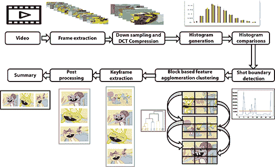

### 7.4.1 预处理

视频预处理是每个视频处理应用程序中的重要步骤。所提模型的预处理阶段包括帧下采样、提取的帧转换为压缩域以及识别场景边界。

下采样和帧压缩。视频由一组帧组成，这些帧组合在一起给用户一个连续性和运动的概念。显而易见，大多数相邻帧之间的差异不大。因此，不需要对所有帧进行处理并分析其可能成为关键帧。相反，通常对视频进行下采样，以减少处理冗余帧的机会，从而提高计算效率。下采样策略根据不同的应用而异。在提出的模型中，一旦输入视频被分为单独帧，将根据视频帧率对帧进行采样并对采样后的帧进行压缩。采用的压缩技术是`DCT`。`DCT`将帧从空间域转换到频率域，如公式 7.1 和(7.2)所示。

```
where u, v, x, y = 0,1,2, …N − 1
```

镜头边界检测。镜头边界检测是大多数视频摘要框架的关键步骤。然而，对于某些类别的视频，这并不是必不可少的。当检测到连续帧的背景和前景发生主要变化时，即检测到分镜头边界。可以使用直方图比较和聚类等多种技术来检测镜头边界。在提出的模型中，通过比较连续下采样帧的直方图来检测镜头边界。

一旦获得下采样帧的`DCT`，就会计算单个帧的色色直方图。使用直方图比较方法计算连续直方图之间的距离。所使用的距离度量是来自`Equation (7.3)`的`Bhattacharya distance`。

```
(7.3)
```

![eq7-3] 其中`N`是直方图中的箱数，`H[1]`和`H[2]`是被比较的直方图。距离值大于阈值的帧被识别为镜头边界，并检索出镜头边界的数量。`Figure 7.2`显示了使用直方图比较对名为`Jumps.mp4`的样本视频进行镜头边界检测。红线代表阈值，对应阈值的帧是直方图差异最大的帧。这代表了一个场景或镜头的切换，因为可以解释出在该点，连续帧之间的颜色分布发生了整体变化。这些帧可以被识别为镜头边界。检测镜头边界的阈值计算为直方图均值和标准差的和。`X`轴显示帧数，`Y`轴显示连续帧的直方图差异值。

![7-2]

### 7.4.2 使用特征聚合的改进块聚类

压缩域中的块聚类。将采样和压缩后的帧划分为`m*m`个块，其中`m`是帧需要划分的块数。计算连续帧中相应块的基于`RGB`颜色的直方图。第`ith`次聚类操作定义在所有帧的第`ith`个块形成的直方图集合上。直方图是所使用的最简单的分类器，可以根据颜色分布区分图像。

使用的聚类方法是`Section 7.3`中描述的`Feature Agglomeration`聚类。使用的连接标准是`Wards criterion`。在这里，需要达到最优值的目标函数是所考虑簇的方差。对于不相交的簇`C[i]`、`C[j]`和`C[k]`，其大小分别为`n[i]`、`n[j]`和`n[k]`，如`Equation (7.4)`所示，通过`Lance Williams formula`实现`Ward’s minimum variance method`。

```
(7.4)
```

![eq7-4] 使用的距离度量是来自`Equation (7.5)`的`Euclidean distance`。

```
(7.5)
```

![eq7-5] 帧块分别聚类，结果形成`m*m`个簇集。必须从每个簇集中选择一个代表性帧，即候选帧。假设对于某帧的第`ith`个块，形成的簇集如`Equation (7.6)`所示。

```
(7.6)
```

![eq7-6] 其中`k[i]`是第`ith`个块中形成的簇数量。

形成的簇集数量将是`m*m`。假设从簇中选出的代表性帧是`x[i1]`。那么，每个块的每个簇的候选帧可以如`Equation (7.7)`所示。

```
(7.7)
```

其中`x[ij]`是第`ith`个块第`jth`个簇中的代表帧，`i = 1`到`m*m`且`j = 1`到`k[i]`。从每个簇中选出的候选帧是该簇中索引最大的帧。从每个簇形成的候选帧集将具有重叠帧。因此，有必要开发一种策略，从这些集合中提取关键帧。

关键帧提取。下一阶段是从每个簇的候选帧代表性集中提取关键帧。由于簇集的数量为`m*m`，可以明确说明，如果一个帧出现在超过一半数量的集中，则对应的帧可以被识别为关键帧。`Equation (7.8)`显示了关键帧的表示。

```
(7.8)
```

其中`m*m`是帧被划分的块数。

### 7.4.3 后处理与摘要生成

后处理。为了消除生成的关键帧集中的相似帧，模型中执行了最后的后处理。目标是找到高度相似的帧并丢弃它们以避免冗余。可以采用多种指标来实现相同的目标。在提出的模型中实验并给出最佳结果的相似性计算指标是`Structural Similarity Index`，如`Equation (7.9)`所示。

```
(7.9)
```

其中`μ[x]`和`μ[y]`分别是`x`和`y`的平均值。`σ[x]`和`σ[y]`分别是`x`和`y`的方差。`σ[xy]`是协方差，`c[1]`和`c[2]`是常量。计算关键帧集中帧之间的`SSIM`。`SSIM`值范围在`-1`到`1`之间，`1`表示完全相似。如果`SSIM`值接近`1`，则只保留一个帧作为关键帧。索引设置为`0.5`，大于该值的帧被视为相似并丢弃。该框架在后处理前后对一个时长小于 1 分钟的卡通类样本视频`v11.flv`提取的关键帧分别在`Figures 7.3a`和`b`中所示。从`Figure 7.3b`可以明显看出，在后处理阶段冗余帧已被消除。

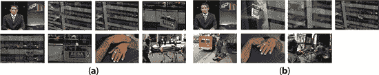

图 7.4 (a) 提议的系统摘要。(b) VSUMM 摘要。

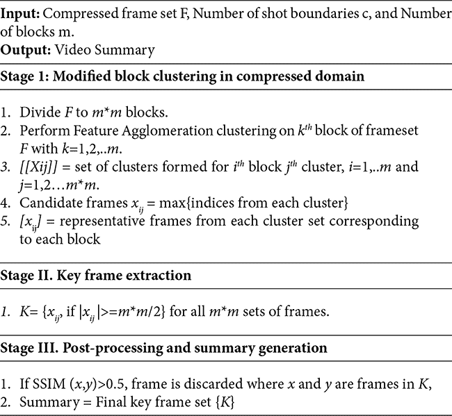

算法 7.2 压缩域改进块聚类与摘要。

## 7.5 结果与分析

本节详细阐述了为分析所提模型的效率而进行的各种实验。详细介绍了用于评估的定量和定性性能指标，并对评估章节中获得的结果进行了对比。

### 7.5.1 实验设置与使用数据集

该框架在`python` `Spyder` IDE 中实现，并在`Intel i5`处理器、`4GB RAM`和`64bit`操作系统上进行实验。实验的视频源自基准`VSUMM`数据库，包含不同类别（如卡通、新闻和纪录片、电视节目等）以及不同的时长。所提框架的评估标准和获得的结果将在后续章节详细介绍。

### 7.5.2 评估指标

目前还没有适用于视频摘要框架的标准评估标准。评估通常基于定量测量、定性测量或两者结合。所提框架基于定量和定性参数的结合进行了评估。

定量参数。用于性能评估的各种定量参数包括计算时间 (`CT`)、压缩率 (`CR`)、精确率、召回率和`f-score`。此外，框架对帧应用了不同的块大小进行聚类。因此，在定量分析中还包含了基于不同块大小的详细评估。

`CT`定义为从输入视频到生成摘要所需的时间。它也是系统处理视频以自动生成摘要的运行时间。`CR`定义为检索出的最终摘要关键帧的帧数比例。它是最终关键帧数量与源视频总帧数之比。它根据公式 (7.10) 计算。

(7.10) 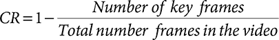

精确率定义为检索帧中相关帧的比例，并根据公式 (7.11) 进行评估。

(7.11) 

召回率定义为检索到的相关实例占总相关实例的比例，并根据公式 (7.12) 进行评估。

(7.12) 

F-score 是精确率和召回率的调和平均数，用于权衡精确率和召回率的缺点，并根据公式 (7.13) 进行评估。

(7.13) 

需要注意的是，对于所有上述指标，值越高表示性能越理想，`CT`除外，`CT`越低越好。

定性参数。用于性能评估的各种定性参数包括信息量、趣味性、连续性、多样性和总分，定义如下。`信息量`(Informativeness) 是衡量生成的摘要提供原始视频信息的程度。`趣味性`(Enjoyability) 衡量生成的摘要覆盖电影类型中提供娱乐帧的程度。`覆盖率`(Coverage) 评估生成的摘要涵盖原始视频中重要事件的程度。`连续性`(Continuity) 定义为合并关键帧时保持场景不间断流的程度。`多样性`(Diversity) 是衡量摘要包含各种事件的程度或确保帧具有冗余性的指标。`总分`(Overall score) 是上述所有参数的综合评分。与定量指标类似，所有定性指标的值越高，理想的视频摘要框架越理想。

### 7.5.3 评估

定量分析。基于块大小、`CT`、`CR`、精确率、召回率和`f-score`的定量分析将在后续章节详细介绍。`不同块大小`。所提模型中执行的聚类基于块的方法，将帧划分为块并对连续镜头进行聚类。为了获得最佳结果，表 7.1 显示了由`S1`、`S2`、`S3`、`S4`和`S5`代表的样本视频的关键帧数量 (`KF`)、`CT`和`CR`，其中`TF`是总帧数。可以观察到，对于时长小于 1 分钟的视频，块大小达到 3 后生成的摘要没有发生主要变化。但对于时长超过 3 分钟的视频，在块大小为 5 和 6 时达到了最佳摘要。从这些事实可以看出，对于时长更长的视频，增加块大小将带来更好的质量，而对于较短的视频，增加块大小可能增加计算开销而非产生更好的结果。

表 7.1. 不同块大小的对比。

| 序号 | 视频 | 时长 | TF | 块大小 | KF | CR | CT (秒) |


|   |   |   |   |   |   |   |   |
| :--- | :--- | :--- | :--- | :--- | :--- | :--- | :--- |
| 1 | S1 | 46s | 1150 | 1 | 12 | 1.1 | 1.4 |
| 2 | S1 |  |  | 2 | 10 | 0.96 | 2.1 |
| 3 | S1 |  |  | 3 | 9 | 0.8 | 2.9 |
| 4 | S1 |  |  | 4 | 16 | 0.9 | 3.6 |
| 5 | S1 |  |  | 5 | 25 | 0.7 | 4.205 |
| 6 | S1 |  |  | 6 | 36 | 0.7 | 5.095 |
| 1 | S2 | 1m12s | 2180 | 1 | 18 | 0.83 | 3.2 |
| 2 | S2 |  |  | 2 | 10 | 1.3 | 5.1 |
| 3 | S2 |  |  | 3 | 9 | 0.5 | 5.8 |
| 4 | S2 |  |  | 16 | 0.5 | 6 |
| 5 | S2 |  |  | 25 | 0.5 | 7.2 |
| 6 | S2 |  |  | 36 | 0.5 | 7.3 |
| 1 | S3 | 38s | 950 | 1 | 10 | 1.1 | 2.57 |
| 2 | S3 |  |  | 2 | 4 | 1.1 | 3.44 |
| 3 | S3 |  |  | 3 | 9 | 0.9 | 3.86 |
| 4 | S3 |  |  | 16 | 0.7 | 4.78 |
| 5 | S3 |  |  | 25 | 0.5 | 5.47 |
| 6 | S3 |  |  | 36 | 0.5 | 6.47 |
| 1 | S4 | 3m55s | 5875 | 1 | 60 | 1 | 5.658 |
| 2 | S4 |  |  | 99 | 1.7 | 11.04 |
| 3 | S4 |  |  | 87 | 1.5 | 14.2 |
| 4 | S4 |  |  | 65 | 1.2 | 17 |
| 5 | S4 |  |  | 55 | 1.1 | 22 |
| 6 | S4 |  |  | 52 | 1 | 33 |
| 1 | S5 | 1m49s | 3291 | 1 | 48 | 1.5 | 5.51 |
| 2 | S5 |  |  | 48 | 1.5 | 9.2 |
| 3 | S5 |  |  | 36 | 1.1 | 9.5 |
| 4 | S5 |  |  | 36 | 1.1 | 11.9 |
| 5 | S5 |  |  | 20 | 0.7 | 13.9 |
| 6 | S5 |  |  | 19 | 0.5 | 17.9 |

## 计算时间（CT）和压缩率（CR）

所提框架针对不同时长视频所实现的平均 `CR` 和所花费的 `CT` 分别在图 7.5a 和 b 所示。DCT 压缩阶段的存在导致 `CT` 显著减少。`CT` 的减少也归因于采用了一种传统的、广泛接受的聚类技术变体用于摘要。即使在视频较长的情况下，所花费的 `CT` 也没有急剧增加。

`CR` 的结果也令人鼓舞。提取的摘要少于原始视频的 5%，这是视频摘要的一个理想特性。


图 7.5 基于 (a) 平均压缩率和 (b) 平均计算时间的所提框架性能。

## 精确率、召回率和 F 分数

精确率、召回率和 F 分数是通过将所提框架生成的摘要与数据集中样本视频的真实值（ground truth）摘要进行比较得出的。所提系统和现有框架的精确率、召回率和 F 分数的平均结果绘制在图 7.6 中。

与所提框架进行比较的现有框架有 VSUMM [5]、Delaunay 三角化 [7] 和 VRCVS [14]。所提系统获得的平均 F 分数为 72%，与之前的系统相比相对较高。在视频摘要框架的性能中，较高的 F 分数始终是一个理想的因素。F 分数权衡了信息检索系统中仅使用精确率和召回率的缺点。

然而，可以观察到获得的平均精确率值并非最佳。这是由于所提框架检索的关键帧数量相对于对比模型要高。由于精确率是检索到的关键帧中相关帧的比例，当检索帧数量略微增加时，精确率值倾向于较低，这是很明显的，因为它们成反比关系。

另一方面，与其他模型相比，召回率的值出现了一个峰值。由于召回率是所有相关帧中检索到的相关帧的比例，较高的值表明所提模型作为关键帧检索到的相关帧数量较高。可以观察到，获得的平均召回值为 88%，这证明了所提系统能够从真实值中识别并检索更高比例的相关帧。

总体而言，定量分析的结果证明，考虑到涉及的最小复杂度，该模型显示了优越的性能。


图 7.6 基于定量指标的所提系统与现有系统的对比。

## 定性分析

定性评估是对一组 20 名用户执行的。评估时考虑的定性参数包括信息量、趣味性、多样性、连续性和总分，每个参数的范围从 1 到 5 分，其中 5 分最高。要求用户根据生成的摘要为每个参数评分，并对结果进行平均处理。

基于定性参数的系统性能绘制在图 7.7 中。可以观察到，获得的信息量参数（衡量摘要与原始视频相比所包含的信息内容）对于所有类别的视频都很高。

趣味性参数的结果也令人鼓舞。这表明在卡通等商业视频中，该模型能够提取不仅提供有用信息还提供娱乐细节的帧。多样性和连续性的结果也令人满意，但不是最好的。

多样性倾向于较低水平，因为检索的关键帧数量较多。由于输出是静态的，连续性也处于较低水平。然而，所提框架的总分在所有类别中都很高，证明了其接受性。


图 7.7 基于定性指标的所提系统。

## 7.6 结论

视频摘要旨在通过自动识别视频中的帧或片段为用户提供视频要点。理想的视频摘要应该是丰富的、有代表性的且简洁的。

所提系统实现了基于聚类的帧的视频摘要。定量分析证明，通过修改块大小，该系统在空间上取得了较高的 F 分数。定性分析表明，该聚类技术是计算高效的。同样，深度学习技术在该领域日益受欢迎。

## 参考文献

1. Ajmal, M., Ashraf, M., Shakir, M., Abbas, Y., Shah, F., 视频摘要：技术与分类，在：*International Conference on Computer Vision and Graphics*, Springer, Berlin, Heidelberg, pp. 1–13, 2012.
2. Kaur, P. and Kumar, R., 视频技术分析。*Int. J. Res. Appl. Sci. Eng. Technol., (IJRASET)*, 6, 1, 1157–1162, 2018.
3. Moses, T.M. and Balachandran, K., 视频语义分析的分类研究，在：*2017 International Conference on Algorithms, Methodology and Applications in Emerging Technologies (ICMAET)*, IEEE, pp. 1–6, 2017.
4. Sreeja, M.U. and Kovoor, B.C., 面向特定类型视频的框架：综述。*J. Visual Commun. Image Represent*., 62, 340–358, 2019.
5. De Avila, S.E.F., Lopes, A.P.B., da Luz Jr., A., de Albuquerque Araújo, A., VSUMM：一种生成静态视频的机制和新的评估方法。*Pattern Recognit. Lett*., 32, 1, 56–68, 2011.
6. Kumar, K., Shrimankar, D.D., Singh, N., 基于等划分的视频事件摘要方法，在：*Signal-Image Technology & Internet-Based Systems (SITIS), 12th International Conference on*, IEEE, pp. 119–126, 2016.
7. Mundur, P., Rao, Y., Yesha, Y., 使用 Delaunay 聚类的关键帧视频摘要。*Int. J. Digit. Libr*., 6, 2, 219–232, 2006.
8. Cirne, M.V.M. and Pedrini, H., 基于谱聚类的类视频摘要方法，在：*Iberoamerican Congress on Pattern Recognition*, pp. 479–486, Springer, Berlin, Heidelberg, 2013.

## 第 2 部分：机器学习系统

9. Mishra, D.K. 和 Singh, N., 视频事件摘要的无参数聚类方法，收于：*计算机视觉与图像处理国际会议集*，Springer, 新加坡，页码 389–397, 2017 年。
10. Guimarães, S.J.F. 和 Gomes, W., 基于层次聚类的静态视频摘要方法，收于：*伊比美洲模式识别会议*，页码 46–54，Springer, 柏林, 海德堡, 2010 年。
11. Sachan, P.R., 面向单视频摘要的帧聚类技术，发表：*认知计算与信息处理（CCIP）第二次国际会议*，IEEE，页码 1–5, 2016 年。
12. Gharbi, H., Bahroun, S., Massaoudi, M., Zagrouba, E., 使用图模块化聚类提取关键帧以实现高效视频摘要，发表：*声学、语音和信号处理（ICASSP）IEEE 国际会议*，页码 1502–1506, 2017 年。
13. Bay, H., Ess, A., Tuytelaars, T., Van Gool, L., 加速鲁棒特征（SURF）。*计算机视觉与图像理解*，110, 3, 346–359, 2008 年。
14. Wu, J., Zhong, S.H., Jiang, J., Yang, Y., 一种用于静态视频摘要的新聚类方法。*多媒体工具应用*，76, 7, 9625–9641, 2017 年。
15. Rodriguez, A. 和 Laio, A., 通过快速搜索和寻找密度峰聚类。*科学*，344, 6191, 1492–1496, 2014 年。
16. Majumdar, J., Kumar, K.S., Venkatesh, G.M., 基于颜色布局描述符的视频镜头检测分析以及基于期望最大化聚类的视频摘要，发表：*认知计算与信息处理（CCIP）国际会议*，IEEE，页码 1–5, 2015 年。
17. Cvetkovic, S., Jelenkovic, M., Nikolic, S.V., 使用颜色特征和高效自适应阈值技术的视频摘要。*电气技术进展杂志*，89, 2, 247–250, 2013 年。
18. Zhao, Y., Lv, G., Ma, T., Ji, H., Zheng, H., 一种基于聚类和背景减除的新型监控视频摘要方法，发表：*第 8 届图像与信号处理国际会议（CISP）*，IEEE，页码 131–136, 2015 年。
19. John, A.A., Nair, B.B., Kumar, P.N., 聚类技术在视频摘要中的应用——实证研究，发表：*计算机科学在线会议*，Springer, 恰姆，页码 494–506, 2017 年。
20. Fei, M., Jiang, W., Mao, W., Song, Z., 结合稀疏选择和聚类的关键帧提取融合框架。*IET 计算机视觉*，10, 4, 280–288, 2016 年。
21. Sony, A., Ajith, K., Thomas, T., Deepa, P.L., 使用欧式距离聚类进行视频摘要，发表：*2011 年信号处理、通信与网络技术国际会议*，IEEE，页码 642–646, 2011 年。
22. Lv, C. 和 Huang, Y., 使用最近邻聚类从个人视频中提取有效关键帧，发表：*2018 年第 11 届图像与信号处理、生物医学工程与信息国际会议（CISPBME）*，IEEE，页码 1–4, 2018 年。
23. Majumdar, J., Udandakar, S., Bai, B.M., 大数据中视频摘要和医疗应用的 Cure 算法实现，发表：*计算、信息与应用的新兴研究*，页码 553–564，Springer, 2019 年。
24. Chamasani, F.F., Affendey, L.S., Mustapha, N., Khalid, F., 使用基于密度的聚类算法抽象。*视觉计算*，34, 10, 1299–1314, 2018 年。
25. Kuan, S., Ranga, K.B., Chowdhury, A.S., 使用二部图匹配最优路径森林进行多视图摘要。*IEEE 多媒体传输*，17, 8, 1166–1173, 2015 年。
26. Srinivas, M. 和 Mohan, C.K., 使用增量和层次聚类方法的高效方法。*神经网络联合会议（IJCNN）*，巴塞罗那，页码 1–7, 2010 年。
27. Srinivas, M. 和 Mohan, C.K., 使用多特征的医学索引与检索，发表：*计算智能与技术国际会议*，2013 年。
28. Wang, Z., Bovik, A.C., Sheikh, H.R., Simoncelli, E.P., 图像质量评估：从误差可见性到相似性。*IEEE 图像处理传输*，13, 4, 600–612, 2004 年。

# 8 使用 XGBoost 进行心律异常检测与分类

**Saroj Kumar Pandey, Rekh Ram Janghel 和 Vaibhav Gupta**

*国立理工学院信息系*

## 摘要

在本文中，我们提出了一种基于 `XGBoost` 的有效心电图（ECG）信号分类方法。ECG 信号经过四个阶段：数据采集、噪声滤波、特征提取和分类。

第一阶段从 MIT-BIH 收集数据集；第二阶段消除基线漂移噪声；接下来的阶段提取了以往工作中效果良好的特征，即小波、高阶统计（HOS）、形态描述符和 R 间期，将其作为 `XGBoost` 分类器的输入，根据 ANSI 标准将信号分为四类（`N`、`S`、`V` 和 `F`）。在所有分类器中，`XGBoost` 达到了 99.43% 的准确率。

**关键词：** 心律异常、`XGBoost`、ECG、小波、R 间期

## 8.1 引言

心律异常被定义为心率的异常，它是心血管疾病的普遍征兆，如果不处理可能会导致严重。它意味着心脏跳动不符合规律 [1]。

心电图（ECG）信号是心脏去极化和再极化引起电活动的结果，通过在身体不同部位放置电极进行测量，并在心脏循环期间进行记录。健康人的 ECG 具有特征形状，任何异常都会改变心脏的电活动，从而导致 ECG 形状的变化。异常心律和心肌梗死等疾病可以通过心律异常检测进行诊断 [2]。

不同的论文从不同的数据库获取 ECG 信号，常用的是 MIT-BIH 和 ECG-ID 数据库。这些来源的数据并不完全纯，包含了各种高频噪声。这些噪声是不必要的，如果不移除将影响结果。因此，需要对数据集进行去噪处理。

从数据库中获取无噪声的数据集后，下一步是特征提取；特征是基本上定义数据集状态的描述符。不同的论文中使用了许多不同的特征提取技术；其中大多数基于频率和时间技术。

时域提取的特征是心跳间期、持续时间参数（`PR`、`QT` 和 `QRS`）、幅度特征（`ST` 和 `QRS`）。从时域提取的特征判别性不好。相比时域特征，频域方法是更好的替代方案；因此，功率谱密度（`PSD`）和傅里叶变换等技术在该领域非常流行，但频率方法的问题在于它们没有提供信号的时间信息。在所有频域方法中，小波变换是最广泛使用的 [5]。

Mahmoud *等人* [6] 提出了一种技术，使用了非特征点特征、特征点以及非特征点与特征点的融合，分类使用了三个分类器：人工神经网络（`ANN`）、K 最近邻（`KNN`）和支持向量机（`SVM`）。

Rajagopal *等人* [7] 使用了一组特征，包括：

1. 心跳的时间特征，如相邻心跳之间的 `P-Q 间期`、`QRS 间期`、`S-T 间期`、`Q-R 间期`和 `R-R 间期`；
2. 基于幅度的特征；
3. 基于小波变换的特征，如 `Harr 小波`和 `Daubechies 小波`；
4. 基于 Stockwell 变换的特征。

分类使用了一种采用 `KNN` 和 `SVM` 协作决策的模型。

Mondejarr-Guerra *等人* [8] 展示了使用小波、高阶统计（`HOS`）、1D 局部二值模式、形态描述符和 `R-R 间期`等特征的分类；分类使用了 `SVM` 集成作为分类器，将每个特征提供给 `SVM` 并获取其结果，然后通过对一（`OVO`）投票策略组合以获得输出类别。

Mathews *等人* [9] 通过使用深度信念网络（`DBN`）和受限玻尔兹曼机（`RBM`）进行分类，这些被用于上性心性和室性心跳的分类。Sannino *等人* [10] 提出了深度神经网络；它与 11 种其他 WEKA 工具相比，具有更高的准确率。Diker *等人* [12] 使用 `Pan-Tompkins` 和离散小波变换（`DWT`）方法提取关键点，然后将这些点输入传统的极值机器学习算法。

本文讨论了 ECG 分类，结构如下：第 8.2 节讨论了用于 ECG 分类的所选特征以及理论背景概述。第 8.2 节还介绍了本文中涉及的主要分类器及其架构。第 8.3 节重点关注所得的实验结果以及与其他现有工作的比较。本工作提取的结论在第 8.4 节中。

## 8.2 材料与方法

数据集来自 MIT-BIH 数据库，并进行预处理以去除噪声。然后，从数据提取特征，分类器根据 ANSI-AAMI 标准将信号分为四类（`N`、`S`、`V` 和 `F`）。该过程涉及的不同步骤可以用以下流程图总结，如图 8.1 所示。


图 8.1 描述本文所用 ECG 分类方法的流程图。

### 8.2.1 MIT-BIH 心律失常数据库


该数据库包含来自 47 名患者约 30 分钟的 ECG 信号，采样频率为 360 Hz，分辨率 11 位。每个记录有两个信号：改良导联 II（`ML II`）以及 `V1`、`V2`、`V4` 或 `V5` 中的一个。由于 `ML II` 在所有记录中都是常见的，因此在分类时仅考虑它，大约有 110,000 个心动。这些心动被分为五类 [11]。某些记录包含起搏心动，这些在分类过程中不被考虑。数据库分布极不平衡，大多数心动属于正常（`N`）类。数据库分布如表 8.1 MIT-BIH 数据库中存在的类别及其百分比。

| 类别 | 记录 (%) |
| --- | --- |
| N | 90 |
| SVEB | 3 |
| VEB | 6 |
| F | 1 |

### 8.2.2 信号预处理

预处理是过滤信号的步骤，以确保提取的特征是纯净且无干扰的。中位数滤波器有助于减少随机噪声。本文提出了使用中位数滤波器去除基线漂移。

### 8.2.3 特征提取

在本文中，为了提取特征，在 R 峰周围选取了大小为 180 的对称窗口。提取的特征如下。

#### 小波

小波是 ECG 信号波形的描述符，因此它们包含了时域和频域的信息，应用了具有 3 层分解的 Daubechies 小波函数（`db1`）。它总共提供了 23 个描述符。这已被不同的作者证明可以提供相关信息 [15]。

#### RR 间期

ECG 信号振幅的最高点是 R 峰，连续 R 峰之间的距离可以提供有关 ECG 状态的有用信息，它被分为四类：`Pre-RR`（当前与前一个 R 峰之间的距离）、`Post-RR`（当前与后一个 R 峰之间的距离）、`local RR`（前 10 个 `pre-RR` 值的平均值）以及 `global-RR`（过去 20 分钟内 `pre-RR` 值的平均值）。除了这些之外，它们的归一化值也被使用，因此从 RR 间期总共提取了 8 个特征 [16]。

#### 高阶统计（HOS）

HOS 在估计形状参数（如偏度和峰度）方面特别有用；这里，函数使用三次或高次幂，而低阶统计量使用零次、线性和二次函数。偏度是指概率分布关于均值的不对称性，而峰度是概率分布尾部的度量。在这里，每个心动被分为五个区间，从每个区间创建一个 10 维特征；现在，从这些区间中计算偏度和峰度值 [17]。

#### 形态描述符

信号被分段大小为 180 的窗口，并提取该段的数值。它是 R 峰的欧几得距离以及从心动中取的四个不同点的距离。考虑了四个幅度值，分别是 `[0,40]` 处的 10 个最大值、`[75,85]` 最小值、`(95,105)` 最小值以及 `(150,180)` 最大值。

两种主要的分类器，即 `XGBoost` 和 `AdaBoost`，已被用于 MIT-BIH 心律失常数据库的分类。`XGBoost` 分类器和 `AdaBoost` 分类的工作原理如下。

### 8.2.4.1 XGBoost 分类器

`XGBoost` 分类器是梯度提升决策树的一种实现，它使用了集成机器学习算法。它通过利用梯度下降架构提升弱学习器获得良好的分类效果。提升（Boosting）是一种集成技术，通过添加新模型来纠正之前模型中产生的错误。它通常比其他梯度提升的实现更快，而且在结构化或表格化数据集上性能优于其他分类器 [17]。

`XGBoost` 是一种基于集成的机器学习分类器，最初由一组分类和回归树（CART）构建。当将 `XGBoost` 应用于数据集的分类时，模型使用训练数据集 `x` 来预测输出 `Ŷ[out]`，公式如下：

（8.1）

其中 `I` 表示树的总数，`f[i]` 是第 `i` 棵树在函数空间 `A` 中的函数，而 `A` 是包含所有可能的 CART 的集合。在训练模型中，每个训练过的 CART 都会尝试补充远处的残差。第 `(n+1)` 棵 CART 优化的目标函数（`D`）如下：

（8.2）

其中 `l()` 是训练损失函数，`y[k]` 是实际输出值，而  是时间步 `n` 处的预测值。函数 `Ω()` 是正则项，描述如下：

（8.3）

其中 `L` 表示叶子节点的数量，`w[i]` 是第 `i` 个叶子节点的得分。当公式（8.3）优化时，梯度下降可以作用于差分损失函数，因为它使用了泰勒展开。此外，`XGBoost` 模型不需要特征选择，因为良好的特征会被选择为树中的节点。

在研究中，我们使用 Python 编程结合 `scikit learn` 库来实现 `XGBoost` 分类器。每个心跳的输入样本总共有 45 个特征，并将输出分为四个不同的类别。该配置的学习率为 1，且提升阶段数（即 `n-estimator`）固定为 50。

### 8.2.4.2 AdaBoost 分类器

`AdaBoost` 是一种机器学习元算法，由 Robert Schapire 和 Yoav Freund 开发。它是自适应提升（Adaptive Boosting）算法的缩写，基本原理是将弱分类器组合成加权和以代表最终输出，因此该模型收敛于强学习器 [18]。该分类器的主要目的是通过引入新的分类器来降低弱分类器的错误率。`AdaBoost` 是描述噪声数据最敏感的算法：

（8.4）

其中：

- `f[m]`：第 `m` 个弱分类器。
- `θ[*m]`：对应的权重。

## 8.3 结果与讨论

根据 AAMI 规范，使用了混淆矩阵进行评估。混淆矩阵也称为误差矩阵，是一种有助于算法性能可视化的特定表格。从混淆矩阵中可以计算各种有助于性能分析的参数。在这项工作中，使用了三种衡量指标来评估我们方法的性能；这些是准确率、特异性和敏感性。

（8.5）

（8.6）

（8.7）

以下实验是在带有 `i5` 处理器、主频 `1.6-GHz` 和 `8-GB` 内存的 `ubuntu 14.03 64-bit` 操作系统系统中执行的。这里使用了患者内方案（Intra-patient scheme）从 MIT-BIH 数据库获取训练和测试数据集；在此，我们按一定比例划分数据库，其中一部分用于训练，另一部分用于测试。下表 8.2–8.6](c08.xhtml#tab-6) 显示了按不同比例划分数据库获得的结果。

表 8.2](c08.xhtml#tab-2) 显示了按 60-40 比例划分数据库获得的结果。大约使用了 60,414 条记录进行训练，大约使用了 40,277 条用于测试其预测。这得到了 99.26% 的整体准确率和 99.36% 的精确率。从表 8.2](c08.xhtml#tab-2) 可以看出，`XGBoost` 模型根据 ANSI-AMI 标准将 MIT-BIH 数据库分为四个不同的类别，并实现了平均准确率 99.81%、平均敏感性 99.07% 和平均精确率 99.36%。

表 8.3](c08.xhtml#tab-3) 显示了按 50-50 训练-测试比例划分数据库获得的结果。大约使用了 50,345 条记录进行训练，大约使用了 50,346 条用于测试其预测。该方法实现的整体准确率为 99.24%。

表 8.4](c08.xhtml#tab-4) 显示了按 70-30 比例划分数据库获得的结果。大约使用了 70,483 条记录进行训练，大约使用了 30,208 条用于测试其预测。此处的整体准确率为 99.28%，精确率为 99.45%。

表 8.2](c08.xhtml#tab-2) 显示了按 60-40 比例划分数据库获得的结果。

| 心跳类型 | 准确率 | 敏感性 | 精确率 |
| :--- | ---: | ---: | ---: |
| Normal (N) | 99.66 | 99.84 |  |
| SVEB (S) | 99.95 | 99.61 |  |
| VEB (V) | 99.93 | 99.44 |  |
| Fusion (F) | 99.72 | 97.40 |  |
| 平均 | 99.81 | 99.07 | 99.36 |

表 8.3](c08.xhtml#tab-3) 显示了使用 MIT-BIH 心律失常数据集、训练-测试比例为 50:50 时的 `XGBoost` 模型性能。

| 心跳类型 | 准确率 | 敏感性 | 精确率 |
| :--- | ---: | ---: | ---: |
| Normal (N) | 99.63 | 99.83 | 99.69 |
| SVEB (S) | 99.94 | 99.39 | 99.85 |
| VEB (V) | 99.94 | 99.44 | 99.80 |
| Fusion (F) | 99.68 | 97.44 | 98.04 |
| 平均 | 99.80 | 99.025 | 99.35 |

表 8.5](c08.xhtml#tab-5) 显示了按 80-20 训练-测试比例划分数据库的结果。大约使用了 80,552 条记录进行训练，大约使用了 20,139 条用于测试其预测。该技术实现的整体准确率为 99.33%，精确率为 99.55%。

表 8.6](c08.xhtml#tab-6) 显示了按 90-10 比例划分数据库的结果。大约使用了 90,261 条记录进行训练，大约使用了 10,070 条用于测试其预测。此处的整体准确率为 99.43%，精确率为 99.60%。

表 8.4](c08.xhtml#tab-4) 显示了使用 MIT-BIH 心律失常数据集、训练-测试比例为 70:30 时的 `XGBoost` 模型在心跳分类中的性能。

| 心跳类型 | 准确率 | 敏感性 | 精确率 |
| :--- | ---: | ---: | ---: |
| Normal (N) | 99.68 | 99.86 | 99.72 |
| SVEB (S) | 99.96 | 99.68 | 99.80 |
| VEB (V) | 99.94 | 99.44 | 99.76 |
| Fusion (F) | 99.72 | 97.46 | 98.52 |
| 平均 | 99.82 | 99.11 | 99.45 |

| 心跳类型 | 准确率 | 敏感性 | 精确率 |
| :--- | ---: | ---: | ---: |
| Normal (N) | 99.73 | 99.92 | 99.74 |
| 上心性早搏 (S) | 99.97 | 99.70 | 99.94 |
| ventricular 性早搏 (V) | 99.95 | 99.72 | 99.58 |
| 融合 (F) | 99.72 | 97.67 | 98.95 |
| 平均值 | 99.84 | 99.25 | 99.55 |

| 总准确率 | 99.33 |
| --- | ---: |

表 8.7 显示了 `AdaBoost` 模型和 `XGBoost` 模型获得结果的对比。在本研究中，我们也使用了 `AdaBoost` 分类器，通过不同的训练测试比例，将 MIT-BIH 心律失常数据库分为四个不同的类别，类似于 `XGBoost` 分类器的做法。`AdaBoost` 和 `XGBoost` 模型获得的总准确率如表所示，使用了不同的训练测试比例。

结果清楚表明，在所有划分比例下，`XGBoost` 的性能完全优于 `AdaBoost`。`AdaBoost` 在 70-30 的训练测试划分下获得最佳结果，为 93.29%，而 `XGBoost` 在 90-10 的训练测试划分下获得最佳结果，为 99.43%。下图显示了在 MIT-BIH 心律失常数据库上使用不同训练测试比例的 `XGBoost` 和 `AdaBoost` 分类器的准确率对比，如指定的图 8.2](#c08.xhtml#fig8-2)所示。

表 8.6 `XGBoost` 模型在训练测试比例为 90:10 时使用 MIT-BIH 心律失常数据集进行心跳分类的性能。

| 心跳类型 | 准确率 | 敏感性 | 精确率 |
| :--- | ---: | ---: | ---: |
| Normal (N) | 99.77 | 99.90 | 99.80 |
| 上心性早搏 (S) | 99.99 | 99.88 | 100 |
| ventricular 性早搏 (V) | 99.97 | 99.71 | 99.86 |
| 融合 (F) | 99.79 | 97.98 | 98.74 |
| 平均值 | 99.88 | 99.36 | 99.60 |

| 总准确率 | 99.43 |
| --- | ---: |

表 8.7 使用不同训练测试比例的 MIT-BIH 心律失常数据库，`XGBoost` 和 `AdaBoost` 分类器实现的总准确率对比。

| 训练测试划分 | XGBoost | AdaBoost |
| :--- | ---: | ---: |
| 50-50 | 99.24 | 89.55 |
| 60-40 | 99.26 | 87.22 |
| 70-30 | 99.28 | 93.29 |
| 80-20 | 99.33 | 91.12 |
| 90-10 | 99.43 | 90.60 |

表 8.8 比较了用于自动 ECG 分类的最先进技术。本文方法与自动 ECG 分类中使用的最先进技术对比。

| 作者 | 准确率 (%) |
| :--- | ---: |
| U Rajendra *et al.* [19] | 98.97 |
| Nahian *et al.* [20] | 97.7 |
| Hamidofujita *et al.* [21] | 97.78 |
| Kachuee *et al.* [22] | 93.4 |
| Yang *et al.* [23] | 97.94 |
| Shadman *et al.* [24] | 97 |
| 本文方法 | 99.43 |

表 8.8 本文方法与其他最先进技术的分类准确率对比。U Rajendra *et al.* [19] 提出了一种 11 层深度卷积神经网络用于检测心力衰竭，其准确率为 98.97%，特异性为 99.01%，敏感性为 98.87%。Nahian *et al.* [20] 通过经验模态（EMD）处理 ECG 信号，并组合高阶模态函数（IMFs）形成改进 ECG 信号，然后使用一维卷积神经网络进行分类，其最大准确率为 97.70%。Hamidofujita *et al.* [21] 提出了六层深度卷积神经网络用于自动 ECG 分类；该模型获得了最大准确率 97.78%。此外，Pandey *et al.* [25] 提出了根据患者特定计划进行 ECG 分类的机器学习算法，实现的总准确率为 94.40%。下图图 8.3 显示了本文提出的 `XGBoost` 分类器与其他现有工作的对比。


图 8.2 `XGBoost` 和 `AdaBoost` 分类器的准确率对比。


图 8.3 本文方法与其他现有工作的对比。

## 8.4 结论

本文提出了将 ECG 信号分为四类：正常（N）、上心性早搏（SVEB）、ventricular 室性早搏（VEB）和融合（F）。`XGBoost` 分类器在 90-10 的训练测试划分下实现了 99.43% 的总准确率。`AdaBoost` 分类器在 70-30 的训练测试划分下获得最佳结果，为 93.29%。结果清楚表明，在所有划分比例下，`XGBoost` 的性能完全优于 `AdaBoost`。

## 参考文献

11. Arlington, V. A. N. S., 心脏节律和 ST 段测量算法的性能测试与报告。`ANSI-AAMI EC57`, 1998.
12. Diker, A., Avci, D., Avci, E., Gedikpinar, M., 一种用于信号分类的新技术：遗传算法、小波核极端学习机。`Optik`, 180, 46–55, 2019.
13. Moody, G.B. and Mark, R.G., MIT-BIH 心律异常数据库的影响。`IEEE Eng. Med. Biol. Mag.`, 20, 3, 45–50, 2001.
14. De Chazal, P., 使用单导联心电图检测上心性和室性异性收搏，收录于 `Conference proceedings:.. Annual International Conference of the IEEE Engineering in Medicine and Biology Society. IEEE Engineering in Medicine and Biology Society. Annual Conference`, vol. 2013, p. 45, 2013.
15. Mar, T., Zaunseder, S., Martínez, J.P., Llamedo, M., Poll, R., 通过特征选择优化心电图分类。`IEEE Trans. Biomed. Eng.`, 58, 8, 2168–2177, 2011.
16. Luz, E.J.D.S., Schwartz, W.R., Cámara-Chávez, G., Menotti, D., 基于心电图的心率分类用于心律失常检测：综述。`Comput. Methods Programs Biomed.`, 127, 144–164, 2016.
17. Osowski, S. and Linh, T.H., 使用模糊混合神经网络的心电心波识别。`IEEE Trans. Biomed. Eng.`, 48, 11, 1265–1271, 2001.
18. Torlay, L., Perrone-Bertolotti, M., Thomas, E., Baciu, M., 机器学习–`XGBoost` 分析语言网络以对癫痫患者进行分类。`Brain Inform.`, 4, 3, 159–169, 2017.


19. Li, X., Wang, L., Sung, E., 基于 SVM 的组件分类器的 AdaBoost。`Eng. Appl. Artif. Intell.`, 21, 5, 785–795, 2008.

20. Acharya, U.R., Fujita, H., Oh, S.L., Hagiwara, Y., Tan, J.H., Adam, M., San Tan, R., 用于心电信号自动诊断充血性心衰竭深度卷积神经网络。`Appl. Intell.`, 49, 1, 16–27, 2019.

21. Hasan, N., II and Bhattacharjee, A., 利用经验模态分解改进心电信号的心血管疾病分类深度学习方法。`Biomed. Signal Process. Control`, 52, 128–140, 2019.

22. Kachuee, M., Fazeli, S., Sarrafzadeh, M., 心电图心率分类：一种深度迁移表示，收录于`2018 IEEE International Conference on Healthcare Informatics (ICHI)`, 2018, June, IEEE, pp. 443–444.

23. Yang, Z.M., He, J.Y., Shao, Y.H., 基于线性双支持向量机的特征选择。`Proc. Comput. Sci.`, 17, 1039–1046, 2013.

24. Shadmand, S. and Mashoufi, B., 一种基于块神经网络和粒子群优化的新型个性化心电信号分类算法。`Biomed. Signal Process. Control`, 25, 12–23, 2016.

25. Pandey, S.K., Janghel, R.R., Vani, V., 用于心电图信号分类的患者特异机器学习模型。`Proc. Comput. Sci.`, 167, 2181–2190, 2020.

1. 通讯作者：[`skpandey.phd2016.it@nitrr.ac.in`]

# 基于 GSA 的微阵基因表达数据基因选择方法

Pintu Kumar Ram 和 Pratyay Kuila

印度锡基姆邦拉文格拉国立技术学院计算机科学与工程系

## 摘要

基因选择是检测癌症最有效的方法，起着至关的作用。由于数据集是非冗余的，从微阵数据中提取最优特征或基因非常困难。在本文中我们提出了一种基于引力搜索算法（`GSA`）和机器学习分类器的新模型，以高精度提取最佳特征子集。进行了广泛的仿真以评估所提算法的性能。仿真结果与粒子群优化算法（`PSO`）比较。观察到所提算法具有优越性。

**关键词：** 微阵，`GSA`

## 9.1 引言

如今，人们发现几乎所有的癌症都是由`DNA`（脱氧核糖酸）引起的。许多研究人员专注于基因的鉴别。然而，从微阵数据中提取特征是必要的。

微阵是一个二维数组，其中行代表样本，列代表基因。如图 9.1 所示。少数样本用不同的颜色进行杂交。然后将样本放在硅片上。如果细胞没有表达，则可能形成疾病。某些因素会影响基因的开启或关闭。这些因素可以是内部或外部的。

在本文中，我们提出了一种基于引力搜索算法（`GSA`）的方法来开发一种可以提取特征的模型。我们的主要贡献如下：

1. 我们使用了信噪比（`SNR`）技术从微阵数据中提取特征数量。
2. 使用了基于`GSA`的方法从训练数据中提取最优特征子集。
3. 推导了一个适应度函数来评估通过`GSA`获取的特征。
4. 使用实值表示高效的智能体（agents）。
5. 实施了广泛的仿真，并将结果与`PSO`进行了比较。
6. 通过热图分析了所选特征的生物学行为。

本文的其余部分结构安排如下：在第 9.2 节中，我们探讨了相关文献。第 9.3 节给出了`GSA`的概述。在第 9.4 节中描述了所提模型。仿真结果见第 9.5 节。最后，我们在第 9.6 节中对研究进行了结论。

来自高维数据的特征选择正引起学术界、研究人员和工业者的关注。最佳特征可以提供相应的解决方案。因此，从微阵基因表达数据中对特征进行分类是研究人员面临的一个挑战性问题 [4]。为了识别来自小特征子集的特征的行为是有意义的，因为在不同领域中它提供了近似解 [5, 6]。许多研究人员使用了不同数量的特征子集来分析实验性能。在 [7, 8] 中，作者们使用了选定的 100、150 和 500 个特征进行分析。在 [9] 中，根据基因表达数据中的定性互信息选取了特征。同样地，在 [10] 中，基于粗糙集特征选择从高维不平衡的微阵数据中选取了特征。在 [11] 中，根据递归特征选择选取了基因。Tang 等人 [12] 使用互信息法来选择最佳特征。在 [13] 中，根据粗糙集方法从微阵基因表达数据中选取了特征。在 [14] 中，使用了递归模型来选择特征。此外，作者们还尝试在 [15] 中通过应用 mRMR 方法寻找最佳特征。在 [16] 中，作者使用了信息增益法来选择特征。作者在 [17] 中使用费舍尔比率来分析特征。此外，在 [18] 中使用了基于相关性的特征选择。Zhu 等人 [19] 采用了马尔可夫边界模型来获取冗余特征。该模型在实践中的实施较为困难。

许多研究人员使用了某些结合元启发式算法的混合方法（过滤和封装）。在 [20] 中，使用了基于`PSO`和`ACO`的混合方法来选择特征数量。在 [21] 中，作者们引入了`PSO`与`k-means`结合的模型。

## 9.3 引力搜索算法概述

`GSA`基于牛顿第二运动定律。它遵循搜索空间中具有特定质量粒子的移动。这些粒子（也称为代理体）受引力相互吸引。每个粒子都受到其他粒子的吸引，并沿着力的方向移动。此外，它通过两个粒子之间的相互吸引力产生加速度。质量较小的粒子向着质量较大的粒子移动。粒子的质量由其适应度值表示。因此，最优解将通过质量较大的粒子获得，如图 9.3 所示。`GSA` [22] 主要基于两个基本方面：探索和开发。探索是扩展搜索空间，而开发是寻找更好解决方案周围的最优解。通过对质量使用阈值（以避免过拟合），`GSA`帮助我们通过更高效地探索搜索空间来避免陷入局部最优，从而更快地向最优解收敛。


图 9.3 GSA 的基础 (a) 质量吸引，(b) GSA 流程图。

## 9.4 提出的模型

在我们提出的模型中（如图 9.4 所示），阶段如下。

### 9.4.1 预处理

在此阶段，我们探索冗余数据以获取非冗余特征集。我们使用`SNR`技术从微阵表达数据中获取最佳特征集。通过公式 (9.1)，其中`μ`和`σ`分别代表类别（`c[1]`、`c[2]`）的均值和标准差。我们选择具有较高 SNR 值的`N`个特征。然后，我们使用公式 (9.2) 对这些特征子集进行归一化。

```
(9.1)
```

```
(9.2)
```


### 9.4.2 基于 GSA 的特征选择

**初始化**：在搜索空间中随机初始化`n`个代理体。

**质量计算**：每个代理体的质量由其适应度值决定。`m_i = f(x_i)`。

**引力计算**：计算代理体之间的引力。

`F_{ij} = G \frac{m_i m_j}{r_{ij}²}`。

**加速度计算**：计算每个代理体的加速度。

`a_i = \sum_{j \neq i} F_{ij}`。

**位置更新**：更新代理体的速度和位置。

`v_i(t+1) = v_i(t) + a_i(t) \Delta t`

`x_i(t+1) = x_i(t) + v_i(t+1) \Delta t`

GSE1577（淋巴瘤和白血病）：包含总数 15,434 个基因。它包含 29 个样本，其中第一类中有 9 个`T-LL`（淋巴细胞性淋巴瘤 T 细胞细胞），第二类中有 10 个`T-ALL`（急性淋巴细胞白血病 T 细胞细胞），第三类额外有 10 个`B-ALL`（急性淋巴细胞白血病骨髓样本）细胞。

对数据集进行预处理后，我们将这些选定的特征集按 80:20 的比例分为训练数据和测试数据。然后，我们在训练数据上应用了`GSA`。种群大小取 50，并将所提算法与`SVM`、`KNN`（K 最近邻）和`PSO`等分类器进行对比，评估了敏感性、特异性、准确率和`f-score`。从表 9.1 到 9.5 可以观察到，所提算法（带有`SVM`的`GSA`）在敏感性、特异性、准确率和`f-score`方面比基于`SVM`和`KNN`的`PSO`方法性能更好。

表 9.1 前列腺癌数据的结果。

| 算法 | 敏感性 | 特异性 | 准确率 | F-score |
| --- | --- | --- | --- | --- |
| 所提 `GSA` + `SVM` | 0.94 | 0.90 | 0.92 | 0.94 |
| 所提 `GSA` + `KNN` | 0.90 | 0.89 | 0.90 | 0.91 |
| `PSO` + `SVM` | 0.92 | 0.90 | 0.90 | 0.92 |
| `PSO` + `KNN` | 0.90 | 0.90 | 0.89 | 0.90 |

表 9.2 DLBCL 数据的结果。

| 算法 | 敏感性 | 特异性 | 准确率 | F-score |
| --- | --- | --- | --- | --- |
| 所提 `GSA` + `SVM` | 0.92 | 0.90 | 0.90 | 0.89 |
| 所提 `GSA` + `KNN` | 0.91 | 0.86 | 0.89 | 0.90 |
| `PSO` + `SVM` | 0.90 | 0.86 | 0.90 | 0.90 |
| `PSO` + `KNN` | 0.86 | 0.89 | 0.89 | 0.88 |

表 9.3 儿童全数据数据的结果。

| 算法 | 敏感性 | 特异性 | 准确率 | F-score |
| --- | --- | --- | --- | --- |
| 所提 `GSA` + `SVM` | 0.91 | 0.90 | 0.94 | 0.90 |
| 所提 `GSA` + `KNN` | 0.85 | 0.80 | 0.89 | 0.89 |
| `PSO` + `SVM` | 0.91 | 0.90 | 0.90 | 0.90 |
| `PSO` + `KNN` | 0.90 | 0.89 | 0.89 | 0.89 |

表 9.4 胃癌数据的结果。

| 算法 | 敏感性 | 特异性 | 准确率 | F-score |
| --- | --- | --- | --- | --- |
| 所提 `GSA` + `SVM` | 0.92 | 0.90 | 0.90 | 0.89 |
| 所提 `GSA` + `KNN` | 0.91 | 0.86 | 0.89 | 0.90 |
| `PSO` + `SVM` | 0.90 | 0.86 | 0.90 | 0.90 |
| `PSO` + `KNN` | 0.86 | 0.89 | 0.89 | 0.88 |

表 9.5 淋巴瘤和白血病的结果。

| 算法 | 敏感性 | 特异性 | 准确率 | F-score |
| --- | --- | --- | --- | --- |
| 所提 `GSA` + `SVM` | 0.94 | 0.90 | 0.92 | 0.94 |
| 所提 `GSA` + `KNN` | 0.90 | 0.89 | 0.90 | 0.91 |
| `PSO` + `SVM` | 0.92 | 0.90 | 0.90 | 0.92 |
| `PSO` + `KNN` | 0.90 | 0.90 | 0.89 | 0.90 |

在图 9.6 中，我们描述了相对于迭代的适应度值，并显示我们的方法（`GSA`）优于`PSO`。在图 9.7 中，我们针对不同分类器展示了准确率。

### 9.5.1 生物学分析

在这里，我们探索了所选特征的生物学意义。在图 9.8 中，我们使用热图引入了所有数据的筛选特征。热图告知基因的表达水平。红色表示高表达水平（癌症），绿色表示低表达水平（非癌症），黑色表示无表达。

对于前列腺数据，我们得到了五个特征`39939_at`、`41288_at`、`38028_at`、`37720_at`和`38634_at`，其中`39939_at`的黑色比例较高，其余四个特征呈绿色。因此，分析癌症或非癌症相当困难。

对于 DLBCL 数据，我们得到了三个特征`X62078_at`、`X02152_at`和`X56494_at`，其中`X62078_at`和`X02152_at`缺乏表达水平，因为它们的黑色比例高于其他颜色，而`X56494_at`的绿色比例更高，因此代表基因低表达水平（这被称为非癌症或正常特征）。

同样，对于儿童全数据，我们得到了四个特征`38464_at`、`32264_at`、`36651_at`和`39994_at`，其中所有特征的绿色比例都高于红色或黑色。因此，它倾向于非癌症特征。此外，对于胃癌数据和淋巴瘤及白血病数据集，我们分别获得了三个特征`M63154_at`、`M62628_s_at`和`D78132_s_at`以及两个特征`203492_at`和`203380_X_at`。然而，在胃癌数据中，`203380_X_at`无法说明`203492_at`。

## 9.6 结论

在这里，我们提出了一种基于`GSA`从大量基因表达中筛选特征的模型。我们使用`SNR`进行特征预处理，并选择最少数基因以获得最高准确率。此外，我们对该技术使用了 5 折交叉验证。而且，我们应用了带有 10 折交叉验证的机器学习分类器（`SVM`、`KNN`）来减少特征并最大化准确率。为了对比，我们实现了`PSO`。

## 参考文献

7. Yang, C.-S., Chuang, L.-Y., Ke, C.-H., Yang, C.-H., 一种用于微阵谱分类的混合特征选择方法。`IAENG Int. J. Comput. Sci.`, 35, 3, 2008.

8. Wang, S.-L., Li, X.-L., Fang, J., 一种启发式广优先搜索算法寻找用于鲁棒肿瘤分类的最小基因集。`BMC Bioinf.`, 13, 1, 178, 2012.

9. Nagpal, A. and Singh, V., 基于定性互信息的癌症微阵谱数据特征选择算法。`Proc. Comput. Sci.`, 132, 244–252, 2018.

10. Chinnaswamy, A., Srinivasan, R., Poolakkaparambil, S.M., 高维微阵谱不平衡数据上基于粗糙集的变量容差属性选择，见：`Data-Enabled Discovery and Applications`, vol.2(1), p. 7, 2018.

11. Prasad, Y., Biswas, K.K., Hanmandlu, M., 一用于微阵谱数据基因选择的递归`PSO`方案。`Appl. Soft Comput.`, 71, 213–225, 2018.

12. Tang, J. and Zhou, S., 一种基于互信息的微阵谱数据特征选择新方法。`IEEE/ACM Trans. Comput. Biol. Bioinform.`, 13, 6, 1004–1015, 2016.

13. Banerjee, M., Mitra, S., Banka, H., 基因表达数据中的演化粗糙特征选择。`IEEE Trans. Syst. Man Cybern., Part C (Appl. Rev.)`, 37, 4, 622–632, 2007.

14. Li, F. and Yang, Y., 微阵谱数据递归基因选择方法的分析。`Bioinformatics`, 21, 19, 3741–3747, 2005.

15. Peng, H., Long, F., Ding, C., 基于最大依赖性、最大相关性和最小冗余互信息标准的特征选择。`IEEE Trans. Pattern Anal. Mach. Intell.`, 27, 8, 1226–1238, 2005.

16. Xing, E.P., Jordan, M., II, Karp, R.M. et al., 高维基因组微阵谱数据的特征选择，见：`ICML`, vol. 1, Citeseer, pp. 601–608, 2001.

17. Guyon, I. and Elissee, A., 变量与特征选择介绍。`J. Mach. Learn. Res.`, 3, Mar, 1157–1182, 2003.

18. Yu, L. and Liu, H., 高维数据特征选择：一种快速基于相关性的过滤解决方案，见：`第 20 届国际机器学习会议论文集 (ICML-03)`，pp. 856–863, 2003.

19. Zhu, Z., Ong, Y.-S., Dash, M., 用于基因选择的马尔可夫毯嵌入遗传算法。`Pattern Recognit.`, 40, 11, 3236–3248, 2007.

20. Shen, Q., Shi, W.-M., Kong, W., 利用基因表达数据选择肿瘤分类基因的混合粒子群优化与禁忌搜索方法。`Comput. Biol. Chem.`, 32, 1, 53–60, 2008.

21. Niknam, T. and Amiri, B., 基于`PSO`、`ACO`和`k-means`的高效聚类分析混合方法。`Appl. Soft Comput`, 10, 1, 183–197, 2010.

22. Rashed, E., Nezamadi-Pour, H., Saryazdi, S., `GSA`：一种引力搜索算法。`Inf. Sci.`, 179, 13, 2232–2248, 2009.

# 第三部分：用于安全系统的机器学习

## 10 用于近红外与可见光信息融合的跨光谱虹膜匹配

> 摘要


> 虹膜一直是身份认证领域最有前景的特征。但在某些情况下，必须将在一个光谱或波长下捕获的虹膜图像与从另一个光谱或波长的虹膜图像中创建的模板进行匹配。使用不同光谱表示虹膜纹理的方式存在显著差异。因此，本文研究了不同融合策略在结合近红外和可见光波长图像信息方面的应用。实验使用了两个基准跨光谱数据库，即 PolyU 跨光谱数据库和 Cross-Eyed 数据库。采用了特征级和评分级等不同层次的融合方案来验证通过结合不同光谱信息提高性能的假设。结果显示，融合有助于改进跨光谱匹配。

> 关键词：虹膜识别、跨光谱、近红外 (NIR)、可见波长 (VW)、信息融合

## 10.1 引言

自诞生 [1, 2] 以来，虹膜识别一直是生物识别领域研究人员的首选。虹膜生物识别之所以如此受欢迎的原因是虹膜特征的独特性、随机性和稳定性。虹膜生物识别的核心步骤包括分割（定位虹膜边界）、归一化（将近圆形虹膜转换为矩形模板）、特征提取（以最独特的方式表示虹膜纹理）以及匹配（测量两个特征模板之间的相似性）[3]。传统的虹膜相关生物应用采用在近红外 (NIR) 波段获取的虹膜图像，因为该波段很好地显示了虹膜色素，且与其他照明相比对用户更舒适。此外，它也适用于瞳孔与虹膜强度差异不大的深色虹膜。然而，已有如文献 [4, 5] 等研究探索了传统近红外光谱之外的光光谱虹膜识别潜力。近期，研究人员已转向可见波长（VW；400–700 nm）的高效虹膜识别。尽管可见光成像给虹膜图像带来了各种噪声因素，但存在支持其使用的坚实理由。首先，可见光相机在提供高分辨率图像方面具有成本效益。此外，大规模监控通常包含可见光相机 [6]。手机等设备的广泛应用也引起了学术界对可见光成像增强虹膜识别的关注。

因此，由于虹膜识别技术从近红外向可见光光谱的迁移，出现了一些情况，需要将在一个波长（NIR/VW）捕获的虹膜样本与另一个波长（VW/NIR）获取的样本进行匹配。这种跨光谱匹配会导致整体识别性能的下降，原因是不同波长图像中存在不相关的信息。

### 10.1.1 相关工作

文献中已有许多努力在解决跨光谱虹膜匹配这一挑战性问题。Boyce 等人 [7] 报告了不同波长下虹膜结构的卓越解释。此外，文献 [7, 8] 建议系统性能与两个比较通道之间的相对波长成反比。使用增强和序加权平均 (`OWA`) 的特征级融合被用于 [9] 近红外和可见光图像的特征。

Burge 和 Monaco [10] 实现了不同光谱图像的像素级融合以提取特征。此外，通过多阶段监督学习，基于 VW 图像的特征预测了 NIR 虹膜图像。在 Zuo *等人* [11] 的工作中，利用非线性多元自适应映射和前馈神经网络从彩色图像中预测了 NIR 的通道信息。Abdullah *等人* [12, 13] 提出了一种实跨光谱虹膜识别框架，采用了三个独立的描述符和 1D log-Gabor 滤波器。Nalla 和 Kumar [6] 提出了一种基于马尔可夫随机场模型的领域自适应框架。最近，Vyas *等人* [14] 提出了利用多尺度和方向的 Gabor 滤波虹膜图像的方差差（`DoV`）。

本文研究了 NIR 和基于 `VW` 的虹膜图像提供信息的结合。这种融合的目的是提高跨光谱虹膜匹配的性能。早期用于基于 NIR 的虹膜识别 [15] 的 `Xor-Sum Code` 方法已扩展，用于处理跨光谱虹膜识别。此外，还使用两个基准跨光谱虹膜数据库提出了一个更通用的框架。分别在特征级和分数级对信息融合进行了研究。与其他关于跨光谱虹膜识别的工作不同，这项工作不需要任何训练或模型来结合 NIR 和 `VW` 信息。相反，这似乎是首次通过传统信息融合方法实现跨光谱虹膜匹配性能巨大提升尝试。

本章的其余部分结构如下。第 10.2 节](#c10.xhtml#eq10-1)）。Gabor 滤波器的数学表达式为 eq. (10.2)，因为它能够有效模拟人类视觉系统，因此被优用于图像纹理分析 [16]。从描述符的名称可以看出，它涉及两个重要操作：1) 异或运算（表示为 eq. (10.3)），用于融合特定方向上滤波后虹膜图像的实部和虚部信息；2) 求和运算（表示为 eq. (10.4)），用于合并所有方向的 `Xor` 操作的输出。随后，`Sum` 操作的输出被编码为位，以产生不同平面的二进制特征向量（见 eq. (10.5)），这些与输入的虹膜模板对应。`Xor-Sum Code` 方法的四个核心步骤（`Filtering`、`Exclusive OR`、`Sum` 和 `Encoding`）及其数学表示如下：

### Filtering 滤波

(10.1) 

其中 `I` 和 `G` 分别表示输入虹膜图像和 Gabor 滤波器。（`x`, `y`, `σ`, `f`, `θ`） 分别是 Gabor 滤波器参数，定义为空间坐标、尺度、频率和方向。Gabor 滤波器 `G` 的正式定义如下如下：

(10.2) 

其中  和 `n` = (0,1,…,*N* – 1)，其中 `N` 表示方向的数量。用于 2D Gabor 滤波器的最优参数见于 表 10.1。

### Exclusive OR 异或

(10.3) 

### Sum 求和

(10.4) 

### Encoding 编码

(10.5) 

其中 `b` = 1,2,…,*B* 且 `B` = [(*N* + 1)/2\]。

**表 10.1** 2D Gabor 的最优参数。

| size | f | σ | θ | n | N |
| --- | --- | --- | --- | --- | --- |
| 15 × 15 | 0.1833 | 2.8090 | n*π/N | 0, 1, …, N-1 | 4 |

然后使用汉明距离（`D[h]`）寻找两个模板（假设 `P` 和 `Q`）之间的相似性分数，如下：

(10.6) 

## 10.2.1 融合

与其他跨光谱虹膜识别的工作不同，这项工作不需要任何训练或模型来结合 NIR 和 `VW` 信息。相反，这似乎是首次通过传统信息融合方法实现跨光谱虹膜匹配性能巨大提升尝试。分别在特征级和分数级对信息融合进行了研究。

*   **特征级融合**:

    (10.7) 

    其中 `F[1]` 和 `F[2]` 分别代表 VW 和 NIR 特征。

*   **分数级融合**:

    (10.8) 

    其中 `S[1]` 和 `S[2]` 分别是 VW 和 NIR 特征。

## 10.3 实验与结果

首先描述用于实验的数据库。

### 10.3.1 数据库

这里使用了两个主要的跨光谱数据库来研究 NIR 和 VW 的融合思路。第一个数据库是香港 PolyU [17]，它包含来自 209 个人（或 418 类）的 6270 张图像，每人 30 张（每类 15 张）。该数据库中每张图像的分辨率为 640 × 480。第二个跨光谱数据库是 Cross-Eyed [18]。该数据库包含 240 类的 1920 张图像，即每类 8 张。每张图像的分辨率为 400 × 300。所使用的数据库都有丰富的注册图像，确保了 VW 和 NIR 通道图像之间的像素一致性。两个数据库的样本图像所示图 10.1。本文使用了来自 PolyU 数据库 35 个个人的 1050 张图像和来自 Cross-Eyed 数据库 125 个个人的 1000 张图像。为了分割目的，采用了 [19] 的方法。

### 10.3.2 实验结果

采用了两个重要指标，即等错误率（`EER`）和接收者工作特征（`ROC`）曲线来评估所提方法。特别是，ROC 曲线是在两个指标——假接受率（`FAR`，x 轴）和真实接受率（`GAR`，y 轴）之间绘制的图表。而 GAR 是通过从 1 中减去假拒绝率（`FRR`）得到的。FAR 和 FRR 在不同的决策阈值下分别表示假接受和假被拒绝的用户。

本节处理在相同光谱图像内进行的虹膜匹配。例如，从 VW 虹膜图像的红色通道中提取的特征仅与相同通道的特征进行匹配。针对 PolyU 和 Cross-Eyed 数据库，使用所采用的特征提取方案，这些同光谱匹配的 ROC 曲线如图图 10.2（上）和（下）所示。ROC 曲线分别展示了使用红、绿、蓝和 NIR 通道的四种不同匹配情况。为了清晰起见，还显示了所有同光谱匹配的 EER 值。表 10.2 以表格形式汇总了所有 EER 值。


图 10.2 (上) PolyU 和 (下) Cross-Eyed 同光谱匹配的 ROC 曲线。

从图 10.2（上）可以观察到，PolyU 数据库 VW 图像红色通道的最佳 EER 为 6.64%，绿色、蓝色和 NIR 通道的匹配分别为 7.52%、10.74% 和 12.38%。因此，可以说，与其他通道相比，PolyU 数据集图像的红色通道提供了最大的判别信息。考虑到 Cross-Eyed 数据库[图 10.2（下）]，Xor-Sum 描述符在红色通道匹配中再次提供了最佳 EER， 3.92%。与 PolyU 数据库不同，Cross-Eyed 数据库的 NIR 图像比 VW 图像的蓝色通道具有更高的区分。这一事实得到了 Cross-Eyed 数据库 NIR 匹配所得 EER 值（6.11%）的支持，该值相对低于蓝色通道匹配获得的值（7.15%）。

### 10.3.2.2 跨光谱匹配

这类匹配构成了本文的核心。“跨光谱”一词意味着将任何一个光谱的特征与另一个光谱的特征进行比较。在当前语文中，跨光谱匹配包括以下六种匹配场景：1) 红绿匹配，2) 红蓝匹配，3) 绿蓝匹配，4) 红-NIR 匹配，5) 绿-NIR 匹配以及 6) 蓝-NIR 匹配。图 10.3（上）和（下）分别描述了使用这两个数据库进行跨光谱匹配的 ROC 曲线。所有匹配的 EER 值均显示在 ROC 曲线以及表 10.2 中。

EER 值符合这样一个事实：随着所匹配通道之间波长差异的增大，匹配性能会下降。在 VW 通道中，当红色通道与蓝色通道匹配时产生最大的 EER。这些 EER 值在 PolyU 和 Cross-Eyed 数据库中分别为 15.75% 和 17.84%。然而，VW 图像的任意通道与 NIR 图像之间的跨光谱（VW-NIR）匹配可能会导致更大的 EER 值。例如，PolyU 和 Cross-Eyed 数据库的 VW-NIR 匹配 EER 值分别落在 38%–42% 和 13%–26% 范围内。这些较大的 EER 值表明使用不同波长的虹膜表示非常不同。因此，跨不同波长匹配虹膜图像会导致严重问题。可以通过后续小节所述结合 VW 和 NIR 图像的信息来避免这些问题。本文采用了两种不同的组合方法。

表 10.2 使用 VW 图像不同通道的 EER (%) 值。

| **数据库**→  || **PolyU** || **Cross-eyed** |
| --- | --- | --- |
| 通道 || 红 | 绿 | 蓝 | NIR | 红 | 绿 | 蓝 | NIR |
| --- | --- | --- | --- | --- | --- | --- | --- | --- |
| 红 || 6.64 || 8.06 || 15.75 || 38.43 || 3.91 || 6.11 || 17.84 || 13.99 |
| 绿 || \--- || 7.52 || 12.49 || 39.63 || \--- || 4.39 || 9.34 || 19.28 |
| 蓝 || \--- || \--- || 10.74 || 41.27 || \--- || \--- || 7.15 || 25.21 |
| NIR || \--- || \--- || \--- || 12.38 || \--- || \--- || \--- || 6.10 |


图 10.3 (上) PolyU 和 (下) Cross-Eyed 跨光谱匹配的 ROC 曲线。

### 10.3.3 特征融合

由于使用的特征描述符产生的是二进制向量，使用了两种二进制算子 `OR` 和 `AND` 来结合来自 VW 和 NIR 图像的特征。使用 `OR` 算子融合会导致 EER 值改善。表 10.3 显示了特征级融合后所有类型匹配的 EER 值。查看表格可以发现，通过 `OR` 融合的红色和 NIR 通道特征 EER 为 15.34%，小于单独通道匹配时获得的 EER。同样，`AND` 融合也导致了跨光谱匹配 EER 值的下降。特征级融合后 EER 值的下降在图 10.4 中得到了更充分的证明。

表 10.3 使用 VW 图像不同通道的 EER (%) 值 (OR)。

| **数据库**→  || **PolyU** || **Cross-eyed** |
| --- | --- | --- |
| **融合** || **通道** || 红 | 绿 | 蓝 | NIR | 红 | 绿 | 蓝 | NIR |
| OR 融合 || 红 + NIR || 10.25 || \--- || \--- || 15.34 | 5.27 || \--- || \--- || \--- |
| OR 融合 || 绿 + NIR || \--- || 11.23 || \--- || 15.68 | \--- || 6.24 || \--- || \--- |
| OR 融合 || 蓝 + NIR || \--- || \--- || 15.07 || 15.82 | \--- || \--- || 12.74 || 7.88 |
| AND 融合 || 红.NIR || 9.45 || \--- || \--- || 15.31 | 5.51 || \--- || \--- || \--- |
| AND 融合 || 绿.NIR || \--- || 10.39 || \--- || 15.10 | \--- || 5.89 || \--- || 7.26 |
| AND 融合 || 蓝.NIR || \--- || \--- || 16.05 || 14.6 | \--- || \--- || 11.21 || 7.55 |

EER 值相对于 VW 图像的每个通道（即红、绿、蓝）所示。总体而言，对于 PolyU 数据库，使用 `OR` 操作进行特征融合将 EER 值带入 10%–16% 的范围。同样，使用 `AND` 操作融合特征也导致 EER 值落在 9%–16% 范围内，这与未进行融合的匹配 EER 值相比也更小。


### 10.3.4 分数融合

本文采用的另一种融合方法是得分级融合，即结合可见光（VW）图像的不同通道与近红外（NIR）图像的匹配得分。通过 `SUM` 和 `PROD` 融合规则对 11 种不同的得分组合进行了实验，以获得改进的结果。这些组合包含了 VW 图像的红、绿、蓝通道得分以及 NIR 图像的得分。不同匹配得分组合的 EER 值列于表 10.4 中。从表 10.4 中可以看出，对于 PolyU 和 Cross-Eyed 数据库，使用红、绿和 NIR 通道的组合可以获得最佳 EER 值。使用 `SUM` 和 `PROD` 融合规则，PolyU 数据库的最佳 EER 值分别为 4.34% 和 4.35%。而对于 Cross-Eyed 数据库，使用 `SUM` 和 `PROD` 融合得到的最佳 EER 值分别为 2.05% 和 2.02%。这些 EER 值清楚地表明，得分级融合有助于提高识别系统的性能。

表 10.4 使用得分级融合的 EER (%) 值。

| **数据库**→ | | **PolyU** | **Cross-Eyed** |
| --- | --- | --- | --- |
| **通道**↓ | **SUM** | **PROD** | **SUM** | **PROD** |
| (R,G) | 6.32 | 6.36 | 3.63 | 3.64 |
| --- | --- | --- | --- | --- |
| (R,B) | 6.16 | 6.21 | 4.38 | 4.40 |
| (G,B) | 7.13 | 7.10 | 4.57 | 4.56 |
| (R,NIR) | 4.72 | 4.53 | 2.54 | 2.51 |
| (G,NIR) | 4.72 | 4.71 | 2.55 | 2.37 |
| (B,NIR) | 5.41 | 5.19 | 3.69 | 3.62 |
| (R,G,B) | 6.10 | 6.16 | 4.01 | 3.95 |
| (R,G,NIR) | 4.34 | 4.35 | 2.05 | 2.02 |
| (R,B,NIR) | **4.03** | **4.01** | **2.11** | **2.07** |
| (G,B,NIR) | 4.26 | 4.34 | 2.32 | 2.21 |
| (R,G,B,NIR) | 4.16 | 4.16 | 2.16 | 2.04 |

## 10.4 结论


本文研究了利用从 NIR 和 VW 图像中获取的信息来提升跨光谱虹膜识别的可行性。实验采用了 PolyU 跨光谱数据库和 Cross-Eyed 数据库来验证上述目的。使用 `Xor-Sum Code` 从两种光谱下采集的虹膜图像中提取二值化特征。实现了特征级融合和得分级融合以结合不同光谱的信息。结果表明，不同波长二值化特征之间的 `AND` 融合优于使用 `OR` 融合。在得分级融合方面，当 NIR 得分与 VW 图像的红、绿通道得分融合时，在 EER 方面获得最佳结果。最后，本文的核心观点是，如果结合不同光谱的信息，跨光谱虹膜匹配的性能可以得到显著提高。未来可以利用基于学习的融合等复杂方案进一步提高识别准确率。

## 参考文献

1. Flom, L. and Safir, A., Iris recognition system. U.S. Patent No. 4, 641, 349, 1987.

2. Daugman, J.G., High Confidence Visual Recognition of Persons by a test of statistical independence. *IEEE Trans. Pattern Anal. Mach. Intell.*., 15, 11, 1148–1161, 1993.

3. Bowyer, K.W., Hollingsworth, K., Flynn, P.J., Image understanding for iris biometrics: A survey. *Comput. Vis. Image Underst.*., 110, 2, 281–307, 2008.

4. Ross, A., Pasula, R., Hornak, L., Exploring multispectral iris recognition beyond 900nm, in: *IEEE 3rd International Conference on Biometrics: Theory, Applications and Systems, BTAS 2009*, pp. 1–8, 2009.

5. Ives, R.W., Ngo, Cross-spectral iris recognition using multi-spectral images, in: *2002 IEEE International Conference on Biometrics (ICB)*, pp. 1-6.

6. Abdullah, M. R., Cross-spectral iris recognition: a review. *IEEE Trans. Sens.,, 20, 1, 114-125, 2020.

7. Abdullah, M. R., Cross-spectral iris recognition: a review. *IEEE Trans. Sens. J.*, 20, 1, 114-125, 2020.

8. Abdullah, M. R., Cross-spectral iris recognition: a review. *IEEE Trans. Sens. J.*, 20, 1, 114-125, 2020.

9. Abdullah, M. R., Cross-spectral iris recognition: a review. *IEEE Trans. Sens. J.*, 20, 1, 114-125, 2020.

10. Zhao, Z. and Kumar, A., An accurate iris segmentation under relaxed imaging constraints using total variation model, in: *IEEE International Conference on Computer Vision*, pp. 3828–3836, 2015.

Twitter、Facebook、Instagram 和 LinkedIn 等社交媒体已成为我们生活中不可或缺的一部分。全世界的人都在积极参与这些社交媒体平台。但与此同时，它们也面临着虚假账户的问题。虚假账户通常由人工生成、机器人或半机器人创建，用于传播谣言、钓鱼、数据泄露和身份盗窃。因此，在本文中，我们讨论了虚假账户检测模型。这些模型根据粉丝数量、朋友数量、状态数量等可见特征，区分 Twitter 上的虚假账户和真实账户。我们使用各种机器学习方法构建了这些模型。我们使用了 Twitter 个人 MIB 数据集，其中 `TFP` 和 `E13` 代表真实账户，`INT`、`TWT` 和 `FSF` 代表虚假账户。在这里，我们测试了不同的机器学习方法，如 `Neural Networks`、`Random Forest`、`XG Boost` 和 `LSTM`。我们选择了显著特征来确定社交媒体配置的真实性。结果真实账户的输出为 `0`，虚假账户的输出为 `1`。`XG Boost` 达到的准确率为 `99.46%`，`Neural Network` 达到 `98%`。检测出的虚假账户可以被屏蔽/删除，以避免未来的网络安全威胁。

**关键词：** `Neural Network`、`Random Forest`、`XG Boost`、社交媒体、虚假账户、机器学习、社交媒体

## 11.1 引言

社交媒体已成为我们生活的重要部分。从分享迷人的奢华照片、关注名人到与远近朋友聊天，每个人在社交媒体上都非常活跃。这是一个分享信息和与人交互的绝佳平台。但任何事物都有负面影响。随着社交媒体在我们生活中占据稳固地位，在某些情况下它变成了一个更大的问题。

Twitter 有 3.3 亿月活跃用户和 1.45 亿日活跃用户。Facebook 每天还增加约 50 万新用户，每秒增加六个新用户。Twitter 上每天都会分享大量信息。从热门话题到最新的标签和新闻，到人们最近的旅行，你可以在 Twitter 上获得一切。人们通过 280 个字符的限制进行反应、点赞、评论、分享观点并提出意见。社交媒体用户讨论真实问题；但有时也会传播一些谣言。这些谣言导致社会不同部门之间的冲突。隐私关注、滥用、网络欺凌 [1] 和虚假信息在近期引起了关注。虚假账户执行了所有这些任务。虚假账户可以是人工生成、计算机生成或半机器人 [2]。半机器人是指最初由人类创建但后来由计算机运行的账户。

虚假账户通常以假名创建，这些账户会传播误导性和侮辱性的帖子和图片，以操纵社会或推销反疫苗阴谋论等。如今每个社交媒体平台都面临虚假账户的问题。创建虚假账户的目标主要是垃圾信息 [3]、钓鱼和获取更多粉丝。恶意账户有充分的动机实施网络犯罪。假账户构成了身份盗窃和数据泄露等重大威胁 [4]。这些虚假账户向人们发送各种 URL，访问后会将用户的所有数据发送到远程服务器，这些数据可能被用于个人目的。此外，看似代表组织或个人创建的虚假账户可能会损害他们的声誉并减少点赞和粉丝数量。除了所有这些，社交媒体操纵也是一个障碍。虚假账户导致误导性和不恰当信息的传播，从而引发冲突。

这些欺骗账户创建也是为了获得更多粉丝。谁不想在社交媒体上走潮流呢？为了获得高数量的粉丝，人们倾向于寻找虚假粉丝 [5]。总体而言，研究结果显示，虚假账户造成的危害比任何网络犯罪都大。因此，在用户被通知之前检测虚假账户是非常重要的。为了对抗虚假账户的威胁，常见的防御措施如下 [6]：

1. 在社交媒体上创建账户时，必须结合用户验证等方法。

2. 为了检测异常活动，必须采用用户行为分析。由基于实时 `AI` 分析组成的机器人检测解决方案将大有裨益。

3. 必须使用自动机器人保护工具。

在此背景下，我们讨论了如何检测 Twitter 上的虚假账户：

* 使用了 Twitter 个人资料数据集，其中 `E13` 和 `TFP` 用于真实账户，`INT`、`TWT` 和 `FSF` 用于虚假账户。

* 作为一项技术贡献，我们设计了一个多层神经网络模型 [7]、一个随机森林模型、一个 `XG boost` 模型和一个 `LSTM` 模型。上述模型均属于监督机器学习模型。

* 此外，`LSTM` 深度学习模型根据推文进行分类；结果在不久的将来可以与卷积神经网络结合 [8]。

本文由多个章节组成。现有工作在第 11.2 节中摘要。数据预处理和方法论在第 11.3 节中展示，实验结果和模型准确率在第 11.4 节中展示。在最后一节描述了结论和未来工作。

## 11.2 相关工作

社交媒体：是福是祸，这个问题一直存在。所有公司都旨在提供一个错误最少、体验更好的平台。因此，每天都会进行新的开发和更新。鉴于目前在 Twitter 等社交媒体平台上检测虚假人类身份所做的还不够 [9]，我们研究了解决类似问题的过去研究。一些方法根据账户活动 [1]、请求数量、发送的消息等对配置进行分类。这些模型使用基于图的系统。一些方法还旨在识别机器人和半机器人。下面提到了一些过去的研究。

如果消息中出现了某些词，则该消息被视为垃圾信息。这一概念已用于检测社交媒体上的虚假账户 [10]。对于社交媒体上的此类词检测，使用了模式匹配技术。但该规则的显著缺陷是，随着时间的推移，新词不断产生和使用。此外，`lol`、`gbu` 和 `gn` 等缩写在 Twitter 上变得流行。

Sybil Guard [11] 开发于 2008 年，旨在限制通过社交媒体进行的 Sybil 攻击的影响。它对每个节点进行受限随机游走，并基于随机游走交互的出现。使用的数据集是 Kleinberg 的合成社交网络。除了 Sybil guard，另一种名为 Sybil limit [12] 的方法也在同一时期开发。与 Sybil guard 类似，它也基于非 Sybil 区域快速混合的假设工作。它采用每个节点多次随机游走的方法，排名基于随机游走相交尾部的出现。

Sybil-infer [13] 开发于 2009 年。它利用了贪心算法、贝叶斯推理技术和蒙特卡洛采样等方法，假设非 Sybil 区域快速混合且随机游走是快速混合的。选择技术是基于概率的阈值。Mislove 算法（2010 年）在 Facebook 数据集上使用贪心搜索并根据归一化指标电导性选择配置。2011 年，出现了一个名为 Facebook 免疫系统的模型，它使用了随机森林、`SVM` 和提升技术。它也使用了 Facebook 数据集，特征循环是选择技术。

Facebook 使用一种算法根据好友数量来检测机器人，该数量可能与标签标记或关系历史有关 [14]。上述规则可以识别机器人账户，但无法成功识别由人类创建的虚假账户。无监督机器学习被用于检测机器人 [9]。在这种技术中，信息不是通过标记，而是根据亲近程度进行汇聚的。由于共同属性，机器人通过分组函数被非常出色地识别出来。

Sybil rank [11, 15] 设计于 2012 年，基于一种基于图的系统。根据互动、标签和时间贴板动态对个人资料进行排名。排名高的个人资料被标记为真实资料，排名较低的则标记为虚假资料。但这种方法是不可靠的，因为存在真实资料排名靠后的情况。接着，开发了另一个名为 Sybil frame [12] 的模型。它采用了多级分类。它分两个步骤工作：首先是基于内容的方法，其次是基于结构的方法。

过滤也是过去的方法之一 [16]。当检测到新的威胁或恶意活动时，该账户会被加入黑名单。但对于人类创建的虚假账户，他们倾向于适应并以某种方式规避黑名单。研究人员还就基于互动率和人工活动等因素检测虚假账户进行了研究 [17]。互动率是观众与帖子互动的百分比。互动率的计算公式为（互动总数 / 粉丝总数）× 100。这些互动可以点赞、分享或评论的形式存在。

人工活动基于特定账户的分享、点赞和评论数量。信息不足和电子邮件验证状态也被视作人工活动。在以前检测虚假个人资料的方法中，会检查以下特征：

*   如果一个账户包含超过 30 个粉丝，则将其声明为恶意的。将与账户关联的电子邮件与个人资料的用户名进行对比。如果两者没有显示出某种相似性，则该用户个人资料被声明为虚假。

*   用户设置的位置与用户使用的位置之间的差异会导致账户被判定为虚假。

## 11.3 方法论

对于虚假 Twitter 个人资料的检测，我们结合了各种监督方法，这些方法的目标相同，但准确率不同。每个模型仅根据可见特征检测虚假个人资料。所有这些监督模型都输入相同的数据集，并绘制了相应的准确率和损失曲线。此外，还指示了不同模型准确率的比较图。模型使用适当的优化器、损失函数和激活函数进行训练。使用的模型列在下方。

### 11.3.1 数据集

我们使用了 MIB 上可用的数据 [18]。数据集包含 3,474 个真实资料和 3,351 个虚假资料。所选的数据集 `TFP` 和 `E13` 代表真实，`INT`、`TWT` 和 `FSF` 代表虚假账户。数据存储为 CSV 文件格式，以便机器读取。

x 轴上的所有标签描述了用于检测虚假个人资料的特征。这些特征是在预处理期间选择的。y 轴描述了数据集中每个特征对应的条目数量，如[图 11.1](#c11.xhtml）所示。

### 11.3.2 预处理

在继续之前，我们加入了以下步骤：

### 11.3.3 人工神经网络

神经网络 [7] 是与人类大脑工作原理类似的深度学习模型。我们使用 `Keras` 库来设计模型。该模型有一个输入层、三个隐藏层和一个输出层。模型使用 `Adam` 优化器和 `binary_entropy` 损失函数进行编译。输出层使用 `sigmoid` 激活函数，根据对个人资料的预测提供 0 到 1 之间的输出，并标记为虚假或真实。

### 11.3.4 随机森林

随机森林（也称为随机决策森林）是集成学习方法的一种。由于其在解决回归和分类问题上的简单性，该方法被应用于机器学习（图 11.6）。

与决策树方法不同，随机森林会生成多个决策树，最终输出是所有形成的决策树的共同结果。同样，我们部署了随机森林 [20] 方法用于特征检测。将数据输入模型并获得相应的输出。在训练过程中，采用自助聚合（bootstrap aggregating）算法对给定的集合 `X = x[1]`、`x[2]`、…… `x[n]` 和 `Y = y[1]`、`y[2]`、…… `y[n]` 重复（`B` 次）随机选择样本并对样本拟合树（`f[b]`）。训练完成后，通过下指定的公式计算给定样本（`x^j`）的预测：

(11.6) 

### 11.3.5 极端梯度提升

XG Boost 是另一种用于回归的集成学习方法。它实现了随机梯度提升算法。随机森林有一个缺点，即它仅在所有输入都可用（即没有缺失值）时才有效。为了克服这一点，我们使用了梯度提升算法。根据提升算法，首先初始化 `F[0] (x)`。

(11.7) 

`图 11.6` 随机森林架构。

然后，对损失函数的梯度进行迭代计算：

(11.8) 

最后，定义提升后的模型 `F m`

(11.9) 

`α` 是学习率，`γ[m]` 是乘因子。

### 11.3.6 长短期记忆

LSTM 是一种循环神经网络架构。该架构能够学习长期依赖关系。在我们的工作中，我们开发了一个使用 LSTM 的模型，根据推文将特征分类为虚假或真实。在推文上训练 LSTM 之前，我们通过从每条推文中形成标记（tokens）字符串来对数据进行预处理。

*   我们将所有标记都转换为小写。

*   我们删除了推文中的停用词。

然后，我们将这些经过标记的推文转换为嵌入层，以为传入的词创建词向量。生成的向量序列被输入 LSTM，LSTM 输出单个 32 维向量，该向量随后通过 sigmoid 激活层进行前向传播以给出输出结果。

在我们的模型中，我们使用了多层神经网络、随机森林 [20] 方法以及处理特征可见特征的 XG Boost。这些提取的特征存储在逗号分隔的文件 (CSV) 中，便于模型读取。最后，在完成所有训练、测试和模型评估后，可以将特征标记为合法或非法。我们考虑的特征包括朋友数、粉丝数、状态数、列表数、收藏数、地理位置启用和语言数量。如果账户的所有参数（如朋友数、粉丝数、状态数、列表数、收藏数）数量非常少（或低于中等水平），且地理位置启用为 0 或无，则我们判定该账户为虚假。

## 11.4 实验结果

最后，我们得到了实验结果。这些是通过在选定数据集上运行机器学习模型获得的结果。获得的结果以图表、比较图或 ROC 曲线的形式呈现。对于每个模型，我们讨论了准确率或损失趋势。进一步讨论了训练和验证期间计算的准确率或损失。我们在 Google Colab 上训练模型，因为 Google 提供了免费的 GPU 使用。Google Colab 的 12GB NVIDIA Tesla K80 GPU 可连续使用 12 小时。所有模型均使用 `Python3` 语言编写。

在对所有模型进行训练和测试后，获得了以下结果。为神经网络 LSTM 绘制了模型准确率、模型损失随 epoch 的变化图，为随机森林绘制了模型准确率比较图和 ROC 曲线。

5. Cresci, S., Di Pietro, R., Petrocchi, M., Spognardi, A., Tesconi, M., Fame for sale: Efficient detection of fake Twitter followers. *Decis. Support Syst.*, Elsevier, 80, 56–71, 2015.

6. Fire, M., Goldschmidt, R., Elovici, Y., Online social networks: threats and solutions. *IEEE Commun. Surv. Tutorials*, 16, 4, 2019–2036, 2014.

7. Likitha, M., Rahul, K., Prudhvi Sai, A., Mallikarjuna Reddy, A., Design and Development of Artificial Neural Networks to Identify Fake Profiles. *Purakala with ISSN 0971–2143 is an UGC CARE Journal*, vol. 31, no. 21, pp. 831–836, 2020.


8. Kudugunta, S. and Ferrara, E., Deep neural networks for bot detection. *Inf. Sci.*, 467, 312–322, 2018.

9. Abokhodair, N., Yoo, D., McDonald, D.W., Dissecting a social botnet: Growth, content and influence in Twitter, in: *Proceedings of the 18th ACM conference on computer supported cooperative work & social computing*, pp. 839–851, 2015.

10. Romanov, A., Semenov, A., Mazhelis, O., Veijalainen, J., Detection of fake profiles in social media-Literature review, in: *International Conference on Web Information Systems and Technologies*, vol. 2, SCITEPRESS, pp. 363–369, 2017.

11. Ramalingam, D. and Chinnaiah, V., Fake profile detection techniques in large-scale online social networks: A comprehensive review. *Comput. Electr. Eng.*, 65, 165–177, 2018.

12. Yu, H., Gibbons, P.B., Kaminsky, M., Xiao, F., Sybillimit: A near-optimal social network defense against sybil attacks, in: *2008 IEEE Symposium on Security and Privacy (sp 2008)*, IEEE, pp. 3–17, 2008.

13. Mulamba, D., Ray, I., Ray, I., Sybilradar: A graph-structure based framework for sybil detection in on-line social networks, in: *IFIP International Conference on ICT Systems Security and Privacy Protection*, Springer, Cham, pp. 179–193, 2016.

14. Romanov, A., Semenov, A., Veijalainen, J., Revealing fake profiles in social networks by longitudinal data analysis, in: *International Conference on Web Information Systems and Technologies*, vol. 2, SCITEPRESS, pp. 51–58, 2017.

15. Hajdu, G., Minoso, Y., Lopez, R., Acosta, M., Elleithy, A., Use of Artificial Neural Networks to Identify Fake Profiles, in: *2019 IEEE Long Island Systems, Applications and Technology (LISAT)*, IEEE, pp. 1–4, 2019.

16. Kharaji, M.Y. and Rizi, F.S., An iac approach for detecting profile cloning in online social networks. arXiv preprint arXiv:1403.2006, 2014.

17. Raturi, R., Machine learning implementation for identifying fake accounts in social network. *Int. J. Pure Appl. Math.*, 118, 20, 475–97, 2018.

18. Cresci, S., Di Pietro, R., Petrocchi, M., Spognardi, A., Tesconi, M., The Paradigm-Shift of Social Spambots: Evidence, and Tools for the Arms Race, in: *Proceedings of the 26th International Conference on World Wide Web (WWW)*, International Wide Web Steering Committee, Republic and Canton of Geneva, CHE, 96–72, 2017.

19. Elyusufi, Y. and Elyusufi, Z., Social Networks Fake Profiles Detection Using Learning Algorithms. *The Proceedings of the Third Conference on Smart City Applications*, Springer, Cham, 2019.

20. Jyothi, V., Hamsini, K., Reddy, G.S., Vasireddy, B.K., Fake Profile Identification Using Machine Learning. *Tathapi with ISSN 2320-0693 is an UGC CARE Journal*, vol. 19(8), pp. 714–720, 2020.

# 12 使用传统方法和卷积神经网络提取指纹特征

E. M. V. Karthik 和 Madan Gopal

Shiv Nadar University, Gautam Nagar, U.P., India

## 摘要

指纹是最常见的生物识别标识符之一。直到最近，传统的图像处理方法一直用于提取指纹特征以进行指纹分类。然而，随着人工智能的兴起，卷积神经网络（`CNNs`）等深度学习模型已展现出了良好的前景。在本文中，我们通过可视化其层学习到的特征，并通过估算局部方向图和检测奇异区域将其与指纹特征进行对比，解释了为什么 `CNNs` 的表现更好。我们提出了一个 17 层的 `CNN` 模型，该模型在 NIST 数据集上达到了 92.45% 的分类准确率。

**关键词：** 深度学习、`CNNs`、指纹、图像处理、特征可视化

## 12.1 引言

生物识别在保护用户数据和维护隐私方面起着至关重要的作用。每个人都有独特的生物特征，由于获取成本低且资源丰富，指纹识别技术近年来取得了巨大的成功。指纹以其连续的脊和谷为特征，在指纹图像中分别表现为深色和浅色区域。亨利系统 [1] 将指纹分为五类：拱形（A）、弧形（T）、旋纹（W）、左斗（L）和右斗（R）。图 12.1 显示了来自 `NIST DB4` 数据集的指纹示例。每个类别显示出不同的视觉模式，且这些指纹的分布通常是不均匀的，如表 12.1 所示。指纹分布显示，旋纹、左斗和右斗类别的占比总计 93.4%，而其余类别仅占 6.6% [2]。

指纹分析有两个主要层面：全局层面和特征点层面。通过使用奇异点的位置作为特征，指纹分类是通过分析指纹的全局结构完成的。另一方面，指纹特征点被用于身份识别任务。


图 12.1 来自 NIST DB-4 数据集的五类类别示例。

表 12.1 每类指纹的百分比 [2]。

| 旋纹 | 27.9% |
| :--- | :--- |
| 左斗 | 33.8% |
| 右斗 | 31.7% |
| 拱形 | 3.7% |
| 弧形 | 2.9% |

指纹分类是一个两个步骤的过程，即特征提取和基于提取特征的分类 [3]。首先，预处理阶段涉及将图像划分块并随后对每个块进行归一化。这为特征提取步骤提供了便利。提取出的特征随后用于使用支持向量机（`SVMs`）或全连接神经网络（`NNs`）进行分类。然而这些方法的一个主要局限是人工提取特征只考虑了指纹的特定区域而忽略了一些细微特征，从而导致信息丢失。因此，使用传统的图像处理方法提取特征是一项挑战性任务。

另一方面，深度神经网络（`DNNs`）因其准确分类包含数百万图像数据集的能力而受到关注。使用 `DNNs` 的优势在于每一层中的神经元能够自动隐含地检测特征。在卷积神经网络（`CNNs`）中，图像直接作为输入，从而减少了将图像转换为一维向量所需的额外计算，而这在全连接 `NNs` 中通常是必要的。

本章的结构如下：第 12.2 节讨论了领域之前的工作总结。第 12.3 节介绍了所提方法和使用的数据集概述。第 12.4 节展示了我们方法的结果以及通过可视化进行的特征对比，最后第 12.5 节给出了结论。

## 12.2 相关工作

使用传统方法的指纹分类基于全局特征，即局部取向图、奇异区域和脊谷结构。基于梯度的方法 [4–7] 用于获取取向图，而 Poincare 指数法 [4, 8, 9] 用于奇异区域检测。

Hong *等人* [6] 对指纹图像进行了归一化并利用最小二乘法估计了取向图。根据 [10] 中定义的索引值范围的固定标准，Kawagoe 和 Tojo [8] 以及 Bo *等人* [9] 计算了 Poincaré 指数值并定位了图像中的奇异区域。Jain *等人* [4] 提出了一种名为 `FingerCode` 的算法来提取特征，使得细节点细节和全局脊谷结构得到有效表示。Bay *等人* [11] 提出了 `SURF (加速鲁棒特征)`，基于 Hessian 矩阵自动检测局部图像特征，以寻找感兴趣的特征。Srinivas 和 Mohan [12] 针对基于内容的医学图像检索提出了基于边缘和块的特征提取方法。在细粒度目标检测背景下，Srinivas *等人* [13] 使用 `CNNs` 通过在线字典学习实现了稀疏且高效的特征表示。Wang *等人* [14] 使用堆叠稀疏自动编码器进行指纹分类，并在 NIST DB-4 数据集上获得了 93.1% 的准确率。取向图被用作特征输入。Peralta *等人* [3] 使用 `CaffeNet` 进行指纹分类，并将其结果与使用 `SVMs` 和 `k-NNs` 的准确率进行了对比。他们的研究同时使用了真实的（NIST-DB-4）和合成（SFinGe）指纹数据集。Simonyan *等人* [15] 提出了一种方法，在给定已训练的 `CNN` 和感兴趣类别的情况下，获得相应类别得分最大的图像，以及一个该图像和类别特有的类别显著性图。Zeiler *等人* [16] 提出了一种`反卷积神经网络 (DeConvNet)`，通过将激活值映射回输入像素空间来实现可视化。通过将特征映射到输入像素，可以获得导致特征图产生激活的图像部分。

我们通过两种方式来可视化 `CNN` 的学习情况：(i) 通过可视化层激活值，以及 (ii) 通过可视化网络每层的权重。在这项研究中，我们可视化了层激活值和初始卷积层的卷积核。这让我们洞察了 `CNN` 在每个阶段从指纹图像中学习了什么。

我们方法的新颖之处在于，目前还没有研究针对指纹分类问题调查过 `CNN` 的学习情况。虽然文献中有许多关于产生高分类准确率的新方法的结果，但没有哪一个讨论过这些 `CNNs` 是*如何*产生如此高准确率的。因此，本文的工作主要关注于将全局特征集（即使用 Poincare 指数法 [9] 计算的奇异区域和使用最小二乘法 [6] 计算的指纹局部取向图）与 `CNN` 学习的特征进行对比。我们可视化了 `CNN` 初始卷积层的特征，发现传统提取的特征与深度网络学习的内容之间存在相关性。

## 12.3 方法与材料

### 12.3.1 使用 SURF 进行特征提取

`SURF` 是一种自动特征检测方法，它使用 Hessian 矩阵来寻找感兴趣点。具体而言，该算法使用了通过积分图像计算的 Hessian 斑检测器行列式的近似值。它包含三个主要步骤：(i) 兴趣点检测，(ii) 局部邻域描述和 (iii) 匹配。Hessian 矩阵的重要应用之一是其行列式可以准确测量兴趣点周围的局部变化。将 `SURF` 算法应用于指纹图像后的结果所示图 12.2。

可以观察到，在所有四幅图中，检测到的兴趣点是非均匀的。例如，在第一行中，检测到的特征靠近图像边缘；而在右下角的图像中，特征分布在整个图像中——一些在中心，几个在边缘。这种非均匀性有助于准确检测所有指纹类别的特征位置。这促使我们使用传统方法来提取指纹特征。


**图 12.2** 应用 SURF 算法后的结果。绿色标记显示了关键点。在每个关键点周围画了圆。圆的大小取决于关键点的相对权重。大多数特征倾向于图像边缘。

### 12.3.2 使用传统方法进行特征提取

为了减少指纹图像中的不规则强度，对所有指纹进行了归一化，使得脊类区域具有零均值单位标准差。输入指纹图像及其归一化版本所示图 12.3。

### 12.3.2.1 局部取向估计

像素坐标 `(i,j)` 与水平轴之间的角 `(i,j)` 定义为该特定像素的局部脊取向。指纹图像的取向场表示了脊的方向，解释了指纹中脊线的模式。 [6] 中提出的最小二乘法的详细步骤用于估计局部取向。

1. 将归一化图像 `Inorm` 分分为特定大小的块。

2. 分别计算图像中每个像素在 `x` 和 `y` 方向上的梯度 `δx` 和 `δy`。

3. 以像素 `(i,j)` 为中心的正局部方向角 `θ(i,j)` 通过 `θ(i,j) = 0.5 * tan^(−1) Vy/Vx)` 进行估计，其中 (12.1) (12.2) 其中 `w` 是块的大小。使用低通滤波器来校正梯度方向。由 `ϕx` 和 `ϕy` 定义的方程用于将方向图像转换为连续的向量场。它们的写入形式如下：(12.3) (12.4) 以下方程执行低通滤波：(12.5) (12.6) 其中 `W` 是二维低通滤波器，`w[ϕ] × w[ϕ]` 是滤波器的尺寸。

4. 最后，像素 `(i,j)`处的局部方向由 (12.7) 给出。原始指纹连同估计的方向图如图图 12.4 所示。


**图 12.3** 左侧：原始指纹图像。右侧：归一化图像。


**图 12.4** 左侧：原始指纹图像。右侧：估计的局部方向。

#### 12.3.2.2 奇异区域检测

指纹图像奇异区域检测的一种常用方法是庞加莱指数（Poincaré index），由[8]首次提出。设角 `θ(i,j)` 表示 `N × N` 指纹图像中像素 `(i,j)` 的方向。像素 `(i,j)`处的庞加莱指数计算如下：

(12.8) 

其中

(12.9) 


**图 12.5** 左侧：立拱形指纹。右侧：斗形指纹。用绿色圆圈表示回路，用红色三角形表示三角点。

如果 `Poincaré(i,j) = 0.5`，包含该像素的图像块可能包含核心点（或回路）。如果 `Poincaré(i,j) = −0.5`，则图像的相应块可能包含三角点。否则，该块不包含任何奇异点。然而，关于任何给定指纹图中奇异点的数量，有三个重要点[10]：(i) 弓类没有回路或三角点；(ii) 对于立拱形类，三角点靠近图像中心；对于左回路靠近右侧，右回路靠近左侧。上述所有类别各有一个回路；以及(iii) 斗形是一个复杂类别，可以包含两个回路和两个三角点。12.5 显示了指纹上的奇异点位置。

### 12.3.3 提出的 CNN 架构

用于指纹分类的 CNN 架构见表 12.2。原始图像（尺寸为 512×512）被裁剪并调整为 224×224。该架构总共有 17 层，包括 6 个卷积层、3 个池化层、归一化层和全连接层。表 12.2 所示的层中，除全连接层外，均使用非线性激活层`ReLU`。在训练网络时，还在线使用了缩放、宽度偏移和高度偏移等数据增强方法，以提高网络在测试集上的性能。模型以 32 的批量大小运行 150 个 epoch。优化器方面使用了随机梯度下降（`SGD`），学习率为 0.001。

**表 12.2** 提出的 CNN 架构。

| 层类型 | 尺寸 | 步长 | 步长 |
| --- | --- | --- | --- |
| 卷积 |  |  |  |
| 卷积 | 222 × 222 | 1 | 1 |
| 批处理归一化 | 220 × 220 | 1 | 1 |
| 最大池化 | 110 × 110 | 2 | 1 |
| 卷积 | 108 × 108 | 1 | 1 |
| 卷积 | 106 × 106 | 1 | 1 |


### 12.3.3 网络架构

| 层类型 | 输出尺寸 | 核大小 | 步长 |
| --- | --- | --- | --- |
| 批处理归一化 | 106 × 106 | 1 | 1 |
| 最大池化 | 53 × 53 | 2 | 1 |
| 卷积 | 51 × 51 | 1 | 1 |
| 卷积 | 49 × 49 | 1 | 1 |
| 批处理归一化 | 49 × 49 | 1 | 1 |
| 最大池化 | 49 × 49 | 2 | 1 |
| 全连接 | 256 | | |
| Dropout | 0.5 | | |
| 全连接 | 128 | | |
| Dropout | 2 | | |
| 全连接 | softmax | | |

### 12.3.4 数据集

本文使用的数据集是 `NIST Special Database 4` [18]。它包含了 4000 个 PNG 格式的指纹。每个指纹的大小为 512×512 像素。在移除损坏图像后，共有 3816 个用于训练和测试。

表 12.3 和 12.4 展示了各类别的数量。

### 12.3.5 计算环境

计算在以下平台上进行：(i) 使用传统方法提取特征，使用了 `MATLAB 2017b`，在配备 `Intel i7` 处理器、8GB 内存和 `NVIDIA GeForce 830M GPU` 的系统上运行。(ii) 使用 `CNN` 提取特征，使用了 `Google Colaboratory`。使用带有 `Tensorflow` 后端的 `Keras` 作为深度学习框架。

表 12.5 展示了我们 `CNN` 架构的性能。获得了 92.45% 的准确率。我们还将结果与文献报道的分类准确率进行了比较。`F` 和 `S` 后缀表示原始数据集被分为两个不同的数据库，包含同一手指的两个不同压纹。这在表 12.6 中所示。Wang *等人* [14] 使用了繁琐的传统方法进行特征提取和分类，即手动提取特征并输入神经网络分类器，而我们的模型是直接在输入指纹图像上训练的，且性能优于 [3]。值得注意的是，[14] 通过将拱形（Arch）和棚拱形（Tented arch）指纹合并为一类，报告了模型在四分类分类问题上的性能。这从本质上减少了数据集中的类别不平衡，从而导致更高的准确率。相比之下，我们的模型在所有五个类别上实现了相似的性能。


图 12.6 混淆矩阵。对角线元素显示了每一类被预测正确的指纹数量。

表 12.5 模型性能评估。

| | **建议的 CNN 架构** |
| --- | --- |
| 输入图像大小 | 224 × 224 |
| 准确率 | 92.45% |
| 训练时间 | 2H 15M |

表 12.6 分类准确率比较。

| | **准确率** |
| --- | --- |
| 建议的 CNN 架构 | 92.45% (NIST-DB4) |
| Peralta *等人* [3] | 90.73% (NIST-DB4 F) <br> 88.91% (NIST-DB4 S) |
| Wang *等人* [14] | 93.1% (NIST-DB4) |

### 12.4.1 特征提取与可视化

为了理解 `CNN` 正在学习什么，我们采取了层激活值可视化的简单方法。由于模型在训练过程中自动学习最佳特征，我们提取了每个卷积层输出处的激活值，以观察输入图像如何通过消除冗余特征来逐步下采样。图 12.7（左侧）显示了从第 1 层到第 5 层卷积层提取的输出激活值子集。第一卷积层的输出（图 12.7 中的 `a1` 和 `a2`）包含 32 个特征图，其中随机选择 16 个激活值并绘制在图中。随着网络深度的增加，特征图的数量在增加；但在绘图时使用了相同的随机选取 16 个激活值的步骤。

`NIST-DB4` 指纹数据集目前已停止更新，无法在线获取。然而，该数据集将根据要求提供。这项工作的一部分是在希夫·纳达尔大学工程系能量科学实验室提供的工作站上完成的。

## 参考文献

1. Henry, E., *Classification and Uses of Fingerprints*, 第 2 版， George Routledge and Sons, London, 1900.
2. Wilson, C.L., Candela, G.T., Watson, C. I., Journal for Artificial Neural Networks, 1, 2 1994.
3. Peralta, D., Triguero, I., García, S., Saeys, Y., Benítez, J., Herrera, F., On the use of convolutional neural networks for robust classification of multiple fingerprint captures. *Int. J. Intell. Syst*., 33, 213–230, 2018.
4. Jain, A.K., Prabhakar, S., Hong, L., A multichannel approach to fingerprint classification. *IEEE Trans. Pattern Anal. Mach. Intell*., 21, 348–359, Apr. 1999.
5. Bazen, A.M. and Gerez, S.H., Systematic methods for the computation of the directional fields and singular points of fingerprints. *IEEE Trans. Pattern Anal. Mach. Intell*., 24, 905–919, July 2002.
6. Hong, L., Wan, Y., Jain, A., Fingerprint image enhancement: Algorithm and performance evaluation. *IEEE Trans. Pattern Anal. Mach. Intell*., 20, 777–789, Aug. 1998.
7. Thai, R., *Fingerprint image enhancement and minutiae extraction*, 毕业论文报告, The University of Western Australia, 2003.
8. Kawagoe, M. and Tojo, A., Fingerprint pattern classification. *Pattern Recognit*., 17, 295–303, June 1984.
9. Bo, J., Ping, T.H., Lan, X.M., Fingerprint singular point detection algorithm by poincaré index. *WTOS*, 7, 1453–1462, Dec. 2008.
10. Maltoni, D., Maio, D., Jain, A.K., Prabhakar, S., Handbook of Fingerprint Recognition, 第 2 版，Springer Publishing Company, Springer-Verlag, London, 2009.
11. Bay, H., Ess, A., Tuytelaars, T., Van Gool, L., Speeded-up robust features (surf). *Comput. Vis. Image Underst*., 110, 346–359, June 2008.
12. Srinivas, M. and Mohan, D.K., Medical image indexing and retrieval using multiple features, *Proceedings of the International Conference on Computational Intelligence and Information Technology*, 2013.
13. Srinivas, M., Lin, Y., Liao, H.M., Learning deep and sparse feature representation for fine-grained object recognition, in: *2017 IEEE International Conference on Multimedia and Expo (ICME)*, pp. 1458–1463.
14. Wang, R., Congying, H., Yanping, W., Tiande, G., Fingerprint classification based on depth neural network. *CoRR*, abs/1409.5188, https://arxiv.org/pdf/1409.5188.
15. Simonyan, K., Vedaldi, A., Zisserman, A., Deep inside networks: Visualising image classification and saliency maps, in: *Computer Vision – ECCV*, 2014.
16. Zeiler, M., Taylor, G.W., Fergus, R., Adaptive deconvolutional networks, in: *Proceedings of 2011 International Conference on Computer Vision*, ICCV.
17. Srivastava, N., Hinton, G., Sutskever, I., Dropout: A simple way to prevent neural networks from overfitting. *J. Mach. Res.*, 15
18. Watson, C. and Wilson, C., Nist special database, National Institute of Standards and Technology, 4, 1992.

# 13 基于深度学习与多特征的面部表情识别

> **摘要**
>
> 面部表情识别在机器学习和人工智能应用中起着重要作用。基于人类表情的情感识别可以提供虚拟现实、个性化推荐等许多服务。通过自动面部表情分析，人机交互得到了改进。情感被分为七类，即：愤怒、厌恶、恐惧、快乐、中性、悲伤和惊讶。面部表情识别是一个极具挑战性的问题，因为每个人的表情随头部姿态、环境条件等变化很大。在本文工作中，我们使用了深度学习以及 `BOVW`、`HOG` 等方法来检测面部表情。最后，我们使用支持向量机（`SVM`）对面部表情进行分类。我们在标准 `FER` 数据集上进行了测试，该方法与现有方法相比取得了良好的结果。
>
> **关键词：** 支持向量机、分类、面部表情、梯度直方图、特征描述、卷积神经网络

### 13.1 引言

许多因素有助于情感的传递，例如姿态、表情、行为和活动。然而，面部表情比其他因素更为重要。在他人交流时，人类能够以相当的准确率识别情感。

面部表情是人类表达情感状态和意图的最有力信号。情感可以通过信息信息、语调部分和说话者的面部表情三种形式表达。其中，研究人员发现说话者的面部表情贡献了情感的 55%。如果我们能利用计算机科学为面部表情识别找到实用的解决方案，我们就能达到与人类感知相当的准确率。

然而，人类无需任何努力或延迟就能轻松识别出面部表情，但机器表情识别仍然是一项挑战性任务。面部表情自动识别是一项复杂的任务，因为不同个体由于年龄和种族的不同，面部会发生变化。即使情绪识别是基于特定文化的因素（如眼镜的出现），面部毛发也让这项任务变得复杂。

这项情绪识别任务的另一个挑战是输入图像中尺寸和面部朝向的变化。这限制了对图像固定模式的搜索。由于摄像头角度的不同，面部姿态可能会有所不同。可能会存在正面或非正面的脸。面部可能处于不同的角度，隐藏了某些面部特征。我们可以使用一些良好的预处理技术应用于输入图像，这些技术对头部的缩放、旋转和平移具有良好的不敏感性。目前，有许多基于局部空间分析或几何信息等面部特征的面部表情识别（`FER`）方法。因此，我们可以使用自动面部点定位来稳固地分类面部表情。

在机器人等许多实际应用中，面部点提取算法的性能通常取决于光照等环境条件。因此，如果照明不均匀，则可能无法准确检测面部点，因此难以期望高 `FER` 识别率。通常，这种因素会使得特征提取难以可靠进行。在提取特征之前，可以应用`直方图均衡化（Histogram Equalization）`、`DCT 归一化`和`秩归一化（Rank Normalization）`等预处理方法来克服输入图像照明的变化。

在这工作中，我们使用深度学习方法从面部情绪数据中提取特征，并提高自动情绪识别的性能。深度学习的主要优势是允许直接从输入图像进行“端到端”学习，从而完全或大部分消除使用物理模型的预处理技术。这就是为什么深度学习在脸识别、目标检测、场景理解和 `FER` 等领域取得了先进的结果。

给定一个图像数据集，数据集中的每个条目都是图像及其对应的情绪标签，我们的工作是创建一个机器学习模型，将图像分类为任何代表通用人类情绪的七种离散情绪类别之一。

### 13.2 相关工作

近年来，人们提出了许多自动情绪识别的方法，如线性判别分析、主成分分析、人工神经网络、Gabor 波和嵌入式隐马尔可夫模型。使用这些方法时，准确性和性能受到光线、姿态、老化和对齐条件的影响。这些算法主要基于手工特征。然而，在实际应用中，手工特征具有许多局限性。

在 `FER Challenge 2013` [3] 中，介绍了许多用于 `FER` 的深度学习方法。有趣的是，深度卷积神经网络是得分最高的系统，而手工模型在 2013 年 `FER` 挑战中排名第四。目前使用深度学习方法的方法已证明其比手工特征具有卓越的性能提升 [4]。

Mariana Iuliana Georgescu *等人* 提出了一种结合自动学习特征和手工特征的方法 [5]。作者使用`卷积神经网络（CNNs）`作为自动特征学习器，并使用`视觉单词袋（bag-of-visual-words）`作为手工特征学习以获得先进的结果。为了获得自动特征，作者对许多 `CNN` 架构、预训练模型和训练程序进行了实验。首先，从 `CNN` 的最后一个全连接层以及 `视觉单词袋`中收集图像特征。然后，合并这些特征向量。接着，使用这些合并后的特征向量来训练多分类 `SVM`。最后，使用 `SVM` 分类器预测类别标签。

J. Zhang *等人* 开发了一种用于面部关键点检测的`全端到端卷积网络（FEC-CNN）` [6]。所提出的 `FEC-CNN` 具有许多 `子-CNN`，它们使用越来越精细的建模来完善形状预测，每个 `CNN` 都直接将输入图像及其前一个阶段的输出形状作为输入。最后，梯度可以反向传播。

Fuzil Khan *等人* 提出了一种分类面部表情的方法 [7]。首先进行面部定位，然后进行特征提取，其中特征点是眼睛、嘴唇和鼻子。这通过`Sobel 算子`和`Hough 变换`执行。使用`欧氏距离`形成特征向量并训练`多层感知机（MLP）`。

S. L. Happy *等人* 描述了一种从选取脸块进行识别的新方法 [8]。根据面部关键点位置，在情绪激发期间提取某些脸块。利用这些脸块获得显著块，每个显著块都不同。使用多分类方法进行分类。该方法在 `CK+` 和 `JAFFE` 数据集上进行了测试。

Nazil Praveen *等人* 提出了一种用于自发表情识别的无控制框架 [9]。最初，训练一种形式为大型高斯模型的`通用属性模型（UAM）`以学习如何影响不同的表情。被称为属性的不同脸部肌肉的运动形成特定的表情。之后，对于每个表情片段，通过利用最大 `UAM 后验自适应`构建超级表情向量（`SEV`）。该 `SEV` 包含表情属性的高维表示。然后，将 `SEV` 分解为低维表示以仅保留某些特定片段。对于属性数据集如 `BP4D` 和 `AFEW`，结果显示表情向量比先进技术具有更高的精度。

Tong Zang *等人* 为面部表情识别提出了`CNN` [10]。该研究的目的是每个面部图像分类为所考虑的七种情绪类别之一。使用来自 `Kaggle` 网站的灰度图像，作者训练了不同深度的 `CNN 模型`。为了加速训练过程，作者在 `Torch` 中开发模型并使用`图形处理器（GPU）`计算。除了基于原始像素数据运行的网络外，作者还使用混合特征策略训练了一种结合原始像素数据和`方向梯度直方图（HOG）`特征的新 `CNN 模型`。除了 `L2` 正则化外，作者还使用了各种技术来减少模型的过拟合，包括`丢弃（dropout）`和`批归一化`。为了确定最佳超参数，作者应用了交叉验证并通过查看训练历史评估了所开发模型的性能。作者还展示了网络不同层的可视化，以显示 `CNN 模型` 从脸部特征中学习到了什么。

为了从视频中检测峰值表情帧，Yuanyuan Ding *等人* 描述了 [11] 双双局部二值模式（`DLBP`）。这种 `DLBP` 方法可以成功缩短处理时间，且尺寸较小。此外，使用 `LBP` 对数拉普拉斯（`LL`）来处理光照变化。这是一种稳健的面部检测特征。最后，首先使用泰勒展开定理来提取面部表情特征。作者提出了一种基于泰勒特征模式（`TFP`）的方法，该方法利用 `LBP` 和泰勒的展开，以从泰勒特征图中获得精确的面部特征。结果表明，通过在 `JAFFE` 和 `Kohn-Kanade` 数据集上进行实验，`TFP` 方法的精度比于一些先进的特征提取方法具有更高的精度。

B. Sun *等人* 提出了一种用于连续面部表情识别（`FER`）的方法 [12]。在这种方法中，作者必须结合 `SIFT` 特征和多模态特征，以便能够从图像序列中识别情绪。为了从视频帧中识别静态面部表情，作者对 `SIFT CNN` 特征进行了稠密化。对于情绪分类，作者训练了线性 `SVM` 和部分最小二乘回归。然后，输出与所有分类器的融合网络相结合。


W. Wang 等人提出了一种依赖证据理论和局部纹理的表情识别方法 [13]。在这种方法中，面部图像被分割成具有重要识别特征的单元，之后从局部二值模式（LBP）中分离单元的纹理特征。然后，通过连接所有局部区域 LBP 直方图形成单个直方图列表。为了衡量相似性，应用卡方距离进行证据合成。最后，为了实现所有模块的特征向量组合，应用了 Dempster-Shafer 证据推理理论（D-S 证据理论）并进行面部表情的类别判断。几乎每个深度学习模型使用 `softmax` 激活函数来预测并最小化分类任务的交叉熵损失。Chen Yu Lee 等人在 [14] 中进行了微调，用线性向量支持机替换了 `softmax` 层。这种新学习最小化的是基于间隔的损失而非交叉熵损失。尽管过去已经有很多神经网络和 `SVM`，但这种用 `SVM` 替换 `softmax` 的简单方法在流行的面部表情识别数据集上取得了显著收益。

Amol S. Jumde 等人提出了一种使用数据挖掘方法进行人脸检测的方法 [15]。所提的方法是一个两阶段的训练和检测过程。在训练阶段，训练图像将转换为边缘和非边缘图像。使用最大频繁项集算法来挖掘正特征和负特征的边缘及非边缘图像模式。建立一个人脸检测器，根据挖掘出的特征模式移除非人脸候选对象。在检测阶段，将不同尺度的滑动窗口方法应用于测试图像。FEI 人脸检测数据库显示了良好的结果。

之前的大部分工作基于正面人脸图像。S. Moore 等人提出了一种适用于非正面图像的方法 [16]。在一种方法中，研究了不同面部表情的多个因素（位置、分辨率以及全局和局部特征）。局部二值模式及其变体被用于纹理描述符的研究。该特征对方向和多视图 FER 有影响。作者使用了一种基于外观的方法，将图像划分为子块，然后使用向量支持机学习如何依赖姿态的面部表情。

Carlos Orrite 等人 [17] 描述了一种从静态图像中检测情绪的方法。使用 `HOG` 获取局部外观和脸部形状。首先，作者使用贝叶斯方程对整个调整后的训练集计算类显式边缘传播和对数类映射。然后，利用自底向上的技术通过在每个维度上递归地聚类和混合类别形成渐进决策树。我们利用对数概率图为树的每个部分列出可能的判别性 `HOG` 特征列表，以支持我们希望逐渐偏置的区域。最后，使用 `SVM` 从在半控制环境下拍摄的静态图像中识别人类情绪。作者使用了 Kohn-Kanade AU 编码面部表情数据库。

## 13.3 提出的方法

我们正在提出一种包含 AFEA 和基于手工特征的新方法。在这项工作中，我们使用 `CNN` 作为一种 AFEA，并使用 `HOG` 和关键点检测器作为手工方法从图像中获取特征。之后，我们融合了这些特征并使用 `SVM` 预测情绪标签。所提模型的框图所示图 13.2。

在我们的模型中，我们使用了基于 `VGG` 模型的卷积神经网络来提取相同尺寸图像的自动特征表示。在这项工作中，使用了 `FER2013` 面部表情识别数据集，所有图像的大小相同，即 `width = 48` 且 `height = 48`。

`HOG` 是一种用于检测图像特征的特征检测器。`HOG` 特征描述符技术工作如下：首先，我们将图像分为小区域，每个区域应该是连接的。对于每个小区域，我们找到该区域内像素的边缘方向或 `HoG`。接下来，使用块模式对结果进行归一化。最后，我们得到每个区域的描述符。现在，我们将对整个图像继续此过程，获得每个图像的单独描述符向量。第三类特征是基于关键点的特征。一旦提取了这三种特征，接下来将对特征进行融合并输入 `SVM` 分类器以预测情绪。


**图 13.2** 自动和手工方法的流程方法。

### 13.3.1 卷积神经网络

`CNN` 是一种深度学习领域非常强大的机器学习技术。`CNNs` 通常在有大量数据收集时使用，数据被划分为许多不同的类别并使用这些化的图像进行训练。`CNN` 是自学习的，包含了大量数据的丰富特征表示。`CNNs` 由多层组成，类似于人工神经网络，区别在于它假设输入是图像，这允许在模型架构中引入某些属性。深度学习使用 `CNN` 可以提取特征 [18]。`CNN` 模型具有卷积层、`Relu` 层、池化层和全连接层。

#### 13.3.1.1 卷积层

卷积层由许多可学习滤波器组成，它们遍历整个输入图像并生成不同类型的激活特征图。卷积操作三个三个优势：局部连接，发现相邻像素之间的关系；相似特征图上的权重共享，极大减少了需要学习的参数数量；平移不变性用于定位物体。通常，卷积层被用作图像中的特征提取。数学上卷积运算由公式 (13.1) 表示。

(13.1) 

其中 `I` 表示图像，`W` 是内核权重或滤波器权重，`B` 是偏置，`C` 是通道数，`p` 和 `q` 是滤波器的尺寸。

#### 13.3.1.2 池化层

池化层紧接卷积层之后。它用于缩小特征图的大小和网络的计算成本。最大池化（Max pooling）和平均池化（average pooling）通常用于下采样以实现平移不变性。

池化层涉及的步骤如下：

- 我们选择一个窗口大小（通常为 2 或 3）。
- 选择一个在图像上移动的 `stride`（通常为 2）。
- 我们在整个图像上滑动窗口。
- 我们从每个窗口中选取最大值（`max-pool`）或最小值（`min-pool`）。

它将图像划分为 `b` × `b` 的单元，并从每个单元中选择最大值。每个通道都是独立使用的。池化操作的数学表达式见公式 (13.2)：

(13.2) 

其中 `Pool(I)` 是对图像 `I` 进行池化，`I` 是图像。

对图像变形的不变性是池化操作的主要功能。当模式发生变化但最大值仍留在同一单元时，池化值保持不变。其优点是当平移或旋转发生轻微变化时，网络保持健壮性。然而，通过池化操作移除了空间信息。尽管空间信息在地标定位和检测中很重要，但我们仍然从最大池化中获益。

### 13.3.1.3 ReLU 层

修正线性层（Rectified Linear Layer）本质上就是激活函数。它仅在输入高于特定阈值时激活特定节点。当输入值小于零时输出为零；但当输入超过某个范围（阈值）时，它与因变量呈现线性关系。`Relu` 层执行两项主要任务：从滤波后的图像中移除负值并将其置零。这通常是为了防止值累加为零。从数学上讲，`Relu` 层见公式 (13.3)。图 13.3 展示了非线性函数的工作原理并用图表表示。

(13.3) 

其中 `g` 是激活函数。

### 13.3.1.4 全连接层

在卷积和池化层之后，我们包含几个全连接层来封装 CNN 架构。这等同于全连接的人工神经网络架构。由于卷积层和池化层的输出都是 3D 体，而全连接层期望的是一个 1D 数字向量。通过这种方式，最后一个池化层的输出被展平为一个向量，并用作全连接层的输入。展平只是将 3D 向量转换为 1D 向量，这里并没有发生复杂的变换。


**图 13.3** 取于内核的梯度计算。

现在，输出将以 1 × 1 图像的形式具有 `2n` 个通道，`n` 是地标点的数量。输入数据通过一系列变换进行传输。公式 (13.4) 展示了输入数据如何通过 CNN 传输。

(13.4) 

其中 `fi` 是 `Conv[Wi,Bi]`、`pool[b]` 或 `s`，而 `I^t` 是输入图像。

为了衡量网络输出与真值（ground truth）之间的差异，定义了损失函数。我们使用汇总平方差的损失函数 `L[2]`。公式 (13.5) 表示了损失函数。

(13.5) 

其中 `L` 是网络中的损失，`f` 是卷积网络中的计算，`X` 和 `Y` 是数据对。当我们称一个网络为 10 层 CNN 时，是指网络包含了 10 组 `W` 和 `B`。

### 13.3.2 梯度方向直方图

`HOG` 是一种广泛用于通过形状在多个领域描述对象的特征描述符。局部对象的外观和形状通常可以通过局部强度的梯度分布或边缘方向来描述。为了提高对象搜索的效率，应对图像的伽马值和颜色进行标准化。对象搜索依赖于应用于小图像的检测技术，这些图像由滑动指示窗口逐区域对原始输入图像区域及其缩放版本定义。在 `HOG` 识别中，第一步是将源图划分为块（例如 16 × 16 像素）。小区域称为单元（例如 8 × 8 像素），划分每个正方形。通常，块是重叠的，目标是少数块可能包含相似的单元。获取单元中每个像素的垂直和水平梯度。利用 1D Sobel 垂直和水平算子是实现此操作最简单的方法。从数学上讲，公式 (13.6) 显示了目标像素位置 `(x, y)` 的梯度向量计算，见图 13.3。

(13.6) 

其中 `Y(y, x)` 是 `x` 和 `y` 处的像素强度，`H[x, y]` 是水平梯度，`H[y, x]` 是垂直梯度。

梯度的幅度和相位通过公式 (13.7) 确定。

(13.7) 

接下来，为每个单元创建直方图。选择 `Q` 个直箱（例如 `Q = 9`）。通常使用无符号方向，将 0° 以下的角度增加 180°。由于不同图像可能有不同的对比度，对比度标准化非常有用。标准化在块 `v` 内进行。每个检测窗口分配一个描述符。该描述符由块中的所有单元组成。描述符检测器用于对象识别信息。使用该描述符进行训练和测试。有很多方法可以使用该描述符对对象进行分类，例如 `SVM` 和神经网络。

### 13.3.3 人脸地标检测

我们对描述面部特征状态的地标（眼睛、眉毛、鼻子、嘴巴和下巴）感兴趣。这些点为分析的面部结构提供了极佳的洞察，适用于人脸识别、动画、情感识别、眨眼检测和摄影。许多技术可以识别这些点：某些通过分析从 2D 图像分离的 3D 面部模型来实现卓越的精确健壮性，另一些取决于 CNN 或 RNN（递归神经网络）的力量，而另一些则使用简单快速的特征来估计点位置。

Dlib 的人脸地标检测算法是 2014 年 Kazemi 和 Sullivan 回归树集成（ERT）[19] 的实现。该技术使用简单快速的特征（像素差）直接估计地标位置。随后，通过回归级联对这些估计位置进行精炼。回归器从上一个估计产生新的估计，每次迭代都尝试减少估计点的对齐误差。该算法运行速度极快。

基本上，通过一组图像、标注和训练选项，可以生成一个形状预测器。单个标注是人脸区域以及我们想要定位并标记的各个地标点。任何人脸检测算法（如 `OpenCV`、`HaarCascade`、`Dlib HOG Detector` 和 `CNN` 检测器）都能轻松地获取人脸区域，但地标点必须手动标记，或者通过已有的地标点检测器和模型（如带有 `SP68` 的 `ERT`）进行检测。最后，训练选项是一组定义训练后模型特性的参数。可以通过适当调整这些参数，以获得更或更符合预期的生成模型行为。

### 13.3.4 支持向量机

`SVM` 算法的目标是在 N 维空间（N 为特征数量）中找到一个超平面，以清晰地分类数据点。图 13.4 展示了在两个向量上的 `SVM` 分类。在图 13.4a 中，有三个超平面 `H1`、`H2` 和 `H3`，在其中，我们需要选择那些距离两个特征点都最大的超平面。在图 13.4b 中，`H2` 是我们将选择用于分类的最佳超平面。


**图 13.4** 两个特征的 SVM 分类器。

有很多可能的超平面可以分离两类数据点。我们的目标是找到一个具有最大间隔距离的平面，即两类数据点之间的最大距离。最大化间距距离可以提供某种强化，以便以更大的信心分类未来的数据点。

### 13.3.5 模型合并与学习

在学习阶段之前，我们通过拼接各自的特征描述符，将深度模型和手工模型（`Landmark Detector` 和 `HOG`）合并。为了从预先准备的 `CNN` 模型获取特征，将清空 `softmax` 分类层，并考虑剩余最后一个全连接层的激活图。对于每张图像，我们将从最后一个全连接层获得一个特征向量。我们可以使用 `L[2]` 范数对该特征向量进行归一化。`Bag-of-visual-words` 和基于 `HOG` 的特征描述符属于手工特征。我们同样使用 `L[2]` 范数对其进行归一化。

学习：我们使用 `SVM` 分类器来学习模型。我们使用训练数据训练模型，即使用拼接的特征向量。`SVM` 是一种对比分类器，尝试发现权重向量和偏置项，以表征隔离训练模型向量的超平面。

## 13.4 实验结果

### 13.4.1 数据集

在项工作中，我们使用了 `FER 2013` 数据集 [20]。它包含 28,709 张训练图像、3,589 张公共测试图像和 3,589 张验证图像。图像大小为 48 × 48 像素。图像属于七种情绪类别：悲伤、快乐、惊讶、厌恶、愤怒、恐惧和中性。

我们使用 `Fer2013` 数据集是因为这是一个具有挑战性的数据集。图像没有经过对齐，且某些图像标记不正确。此外，某些样本不包含脸部。我们要使用的面部表情是 0 = 愤怒，1 = 快乐，2 = 悲伤，3 = 惊讶，4 = 中性，5 = 厌恶，6 = 恐惧。

在项工作中，我们可以借助准确率指标计算结果。我们可以通过以下公式定义准确率：


在项工作中，我们使用不同类型的特征，如 `CNN`、`HoG` 和基于地标的描述符来高效识别面部情绪。首先，我们将使用自动 `FER CNN` 进行面部情绪识别，并使用 `softmax` 作为 `CNN` 的最后一层来分类情绪标签。`CNN` 在五种情绪上进行了训练，结果如[表 13.1](#c13.xhtml#tab13-1)所示。

表 13.1 显示了基于 `CNN` 的分类结果的性能。在项工作中，我们使用 `VGG` 模型提取特征表示，并使用 `softmax` 层预测面部情绪。基于 `CNN` 特征的结果，惊讶情绪在其他表情中识别率最高。通过这种方法，实现了 68.57% 的平均准确率。

我们将使用自动 `FER CNN` 进行面部特征提取。我们从 `CNN` 的最后一个稠密层提取这些特征。最后，这些提取的特征将在 `SVM` 上进行训练以进行分类。我们将使用手工方法，如使用 `dlib` 库实现的 68 个地标检测器从面部图像中检测 68 个地标点。然后，这 68 个地标点被用于训练 `SVM`，之后，我们将为测试数据分类情绪标签。

接下来，我们使用如 `HoG` 特征描述符等手工方法从图像中提取特征。在从图像检测 `HoG` 特征后，我们将使用 `SVM` 训练这些 `HoG` 特征进行情绪分类。`CNN` 特征配合 `SVM` 分类器的结果以及 `HoG` 特征配合 `SVM` 分类器的结果如[表 13.2](#c13.xhtml#tab13-2)所示。

表 13.1 CNN 分类方法在情绪数据集上的性能。

| 情绪标签 | 准确率 (%) |
| :--- | ---: |
| 0 | 64 |
| 1 | 79 |
| 2 | 58 |
| 3 | 87 |
| 4 | 62 |
| 5 | 69 |
| 6 | 61 |
| **平均** | **68.57** |

**表 13.2** CNN 分类方法在 FER2013 数据集上的性能（%）。

| 情绪标签 | `CNN + SVM` 准确率 (%) | `Landmarks + SVM` 准确率 (%) | `HoG + SVM` 准确率 (%) |
| :--- | ---: | ---: | ---: |
| 0 | 66 | 51 | 50 |
| 1 | 79 | 77 | 71 |
| 2 | 57 | 43 | 44 |
| 3 | 87 | 74 | 75 |
| 4 | 61 | 50 | 51 |
| 5 | 65 | 61 | 64 |
| 6 | 68 | 59 | 62 |
| **平均** | **69** | **59.2** | **59.5** |

我们使用 `CNN` 作为自动方法、`HoG` 和地标检测器作为手工方法的组合。在收集了每张图像对应的特征向量、`CNN`、`HoG` 和地标检测器后，我们将合并这些特征并构建一个合并特征向量。最后，我们在 `SVM` 上训练该合并特征向量进行表情分类。结果如[表 13.3](#c13.xhtml#tab13-3)所示。

表 13.3 显示了情绪数据集上合并特征配合 `SVM` 的分类结果。与单一特征的结果相比，这三种特征的组合提供了更高的准确率。

**表 13.3** `CNN`、地标和 `HoG` 特征融合配合 `SVM` 的分类准确率结果。

| 方法 | 准确率 (%) |
| :--- | ---: |
| 提出的方法 (`CNN + HoG + Landmark`) | 72 |

### 13.5 结论

在这项工作中，我们处理了人脸表情识别（FER）任务，我们的目标是将脸部图像分类为七种离散的情绪类别，这些类别代表了人类通用情感。我们使用了自动方法和手工方法从图像中提取特征。我们使用卷积神经网络作为自动特征提取器，使用方向直方图（HOG）和关键点检测器作为手工特征检测器。之后，我们合并了三个特征并得到了一个合并后的特征向量。然后，我们使用合并后的特征向量训练 `SVM` 进行分类。与单个面部特征的结果相比，该方法能够更准确地分类情感。

## 致谢

作者感谢匿名评审员提供的详尽评审意见和宝贵建议。这项工作部分得到了印度政府人力资源开发部以及瓦纳加尔国立学院 `NITW/CS/CSE-RSM/2018/908/3118` 项目的资助。

## 参考文献

1. Srinivas, M., Basil, T., Krishna Mohan, C., Adaptive learning based heartbeat classification. *Bio-med. Mater. Eng*., 26, 1–2, 49–55, 2015.


2. Srinivas, M. and Krishna Mohan, C., Efficient clustering approach using incremental and hierarchical clustering methods. *The 2010 International Joint Conference on Neural Networks (IJCNN)*, IEEE, 2010.

3. Goodfellow, J., Erhan, D., Carrier, P.L., Courville, A., Mirza, M., Hamner, B., Cukierski, W., Tang, Y., Thaler, D., Lee, D.-H., Zhou, Y., Ramaiah, C., Feng, F., Li, R., Wang, X., Athanasakis, D., Shawe-Taylor, J., Milakov, M., Park, J., Ionescu, R.T., Popescu, M., Grozea, C., Bergstra, J., Xie, J., Romaszko, L., Xu, B., Bengio, Y., Challenges in Representation Learning: A report on three machine learning contests, in: *Proceedings of ICONIP*, vol. 8228, LNCS Springer-Verlag, pp. 117–124, 2013.

4. Srinivas, M., Lin, Y.-Y., Mark Liao, H.-Y., Learning deep and sparse feature representation for fine-grained object recognition. *2017 IEEE International Conference on Multimedia and Expo (ICME)*, IEEE, 2017.

5. Georgescu, Mariana-Iuliana, Radu Tudor Ionescu, and Marius Popescu. Local learning with deep and handcrafted features for facial expression recognition. *IEEE Access*, 7, 64827–64836, 2019.

6. He, Z., Kan, M., Zhang, J., Chen, X., Shan, S. A fully end-to-end cascaded CNN for facial landmark detection. *IEEE International Conference on Automatic Face and Gesture Recognition*, 2017.

7. Khan, F., Facial Expression Recognition using Facial Landmark Detection and Feature Extraction via Neural Networks, arXiv:1812.04510v2, 2018.

8. Happy, S. L., and Aurobinda Routray. Automatic facial expression recognition using features of salient facial patches. *IEEE transactions on Affective Computing*, 6.1, 1–12, 2014.

9. Perveen, N., Roy, D., Krishna Mohan, C., Spontaneous Expression Recognition using Universal Attribute Model. *IEEE Trans. Image Process*., 27.11, 5575–5584, 2018.

10. Zhang, T. and Zheng, W., A Deep Neural Network Driven Feature Learning Method for Multi-view Facial Expression Recognition. *IEEE Trans. Multimed*., 18.12, 2525–2536, 2016.

11. Ding, Y. *et al., Facial Expression Recognition From Image Sequence Based on LBP and Taylor Expansion. *IEEE Access*, 5, 19409–19419, 2017.

12. Sun, B., Li, L., Zhou, G., He, J., Facial expression recognition in the wild based on multimodal texture features. *J. Electron. Imaging*, 25, 6, 407–407, 2016.

13. Wang, W., Chang, F., Liu, Y., Wu, X., Expression recognition method based on evidence theory and local texture. *Multimed. Tools Appl*., 76.5, 7365–7379, 2016.

14. Lee, C.-Y., Xie, S., Gallagher, P.W., Zhang, Z., Tu, Z., Deeply Supervised Nets. *International Conference on Artificial Intelligence and Statistics*, 2015.

15. Jumde, A.S., Sonavane, S.P., Behera, R.K., Face detection using data mining approach. *International Conference on Communications and Signal Processing*, 2015.

16. Moore, S. and Bowden, R., Local binary patterns for multi-view facial expression recognition. *Comput. Vision Image Understanding*, 115, 4, 541–558, 2011.

17. Orrite, C., Ganan, A., Rogez, G., Hog-based decision tree for facial expression classification. *Pattern Recognition and Image Analysis*, Springer, pp. 176–183.

18. Srinivas, M., Roy, D., Krishna Mohan, C., Discriminative feature extraction from X-ray images using deep convolutional networks. *2016 IEEE International Conference on Acoustics, Speech and Signal Processing (ICASSP)*.

19. Kazemi, V. and Sullivan, J., One millisecond face alignment with an ensemble of regression trees, in *Proceedings of the IEEE Conference on Computer Vision and Pattern Recognition*, 1867–1874, 2014.

20. Goodfellow, I.J. *et al., Challenges in representation learning: A report on three machine learning contests. *International conference on neural processing*, Springer, Berlin, 2013.

22. Fathima, A. and Vaidehi, K., Review on facial recognition system using machine learning techniques, in: *Advances in Decision Sciences, Image Processing, Security and Computer Vision*, pp. 608–618, Springer, Cham, 2020.

分类是根据图像在不同类别中的特征对其进行系统性的分类。某些分类器是二类的，得出的结论是“是或否否”。另一些是多类别的，能够将对象归类为许多分类中的一种。图像分类的出现是为了通过数据训练计算机，缩小计算机视觉与人类视觉之间的差距。用于图像分类的传统方法属于人工智能（AI）领域的一个分支，被称为机器学习（ML）。

机器学习包含两个模块：特征模块和分类模块。特征模块负责提取纹理和边缘等可用特征。分类模块则根据提取出的特征进行分类。分类是机器学习中非常常见的用例；分类算法用于解决诸如垃圾邮件过滤、文档分类、语音识别、图像识别和手写识别等问题。机器学习的主要缺点是需要大量的训练数据，且这些数据必须是无偏且高质量的。这一点通过深度学习（DL）得到了修正。

深度学习是机器学习的一个子领域，能够通过自己的计算方法进行学习。深度学习使用由人工神经网络（ANN）表示的复杂多算法框架。ANN 的架构是通过人类大脑的生物神经网络复制的。这使得深度学习比机器学习的标准模型更具能力。在深度学习中，我们考虑了根据其特征识别图像的神经网络 [1]。这是通过构建一个完整的特征提取模型实现的，它可以解决传统方法所面临的困难。

在深度学习中，为了执行分类任务，计算机模型直接从图像、文本或声音中学习。深度学习模型通常超过人类水平的效率，可能达到最先进的精度。模型通过大量标记数据和涉及多层的神经网络架构进行训练。

## 14.1.1 特征提取

特征提取是一种降维过程，将一组初始未处理数据还原为更便于处理的分组。此类大数据集的一个特征是变量数量巨大，需要大量的计算资源进行处理。特征提取是用于那些选择并合并变量为特征的方法的术语，在减少待处理数据量的同时，仍然准确且完整地描述原始未处理数据。

## 14.1.2 人工神经网络

在深度学习中，模型首先从图片、文本图像和音频中直接学习以执行分类任务 [2]。深度学习模型可以达到开创性的精度，通常超过人类水平的输出。深度学习模型使用大量的标记数据和包含许多层的神经网络架构进行训练。

ANN [3] 是一种信息处理价值系统，灵感源于我们自己的神经系统，例如图 14.1 所示的大脑处理信息。ANN 像人类大脑一样构建，神经元节点像网络一样相互连接。


`图 14.1` 人工神经网络。

一个 ANN 具有数百或数千个人工神经元，它们通过被称为处理单元的节点相互连接。输入单元由这些处理单元组成。根据内部权重方案，输入单元获取不同类型和结构的信息，神经网络尝试学习提供的信息以生成一个输出报告。

ANN 通常使用一系列称为反向传播的学习规则来完善其性能结果，就像人类需要规则和指令来产生结果或表现一样。在训练和监督过程中，使用“是/否”查询类型的二进制数教授 ANN 要寻找什么以及它的表现应该是怎样的。我们通过提供输入图像并将其输出传递给网络来训练网络数据。

## 14.1.3 迁移学习

迁移学习 [4] 是机器学习的一种表达式，其中为特定问题陈述设计的模型被重用作为第二个问题陈述的基础模型。在深度学习中，这是一种流行方法，由于使用预训练模型，因为在这些问题上构建神经网络模型需要巨大的计算和时间资源，而且它们在相关问题上提供了巨大的技能飞跃 [5]。

迁移学习是一种优化技术、节约时间的捷径或性能优化器。主要用于有效图像分类的预训练模型类型有 `vgg-16`、`vgg-19` 和 `Xception`。

这里展示了一个用于分类印度场景中常见的不同类型动物的网络。其目标是建立一个具有良好精度的网络并使其轻量化，以便适用于实时使用。使用迁移学习方法开发了一种定制网络，即 `AnimNet`，它既轻量化又提供了良好的精度。

第 14.2 节描述了最近完成的相关工作。本章的其余部分组织如下：所提的方法在第 14.3 节中说明，其中包括数据集准备和模型开发的细节。从所提解决方案获得的结果描述在第 14.4 节中，随后在第 14.5 节中给出了结论。

## 14.2 相关工作

为了执行动物分类和检测已经做了许多工作。这里简要讨论了其中一些。

[6] 中的作者试图解决基于区分狗和猫图像问题的 CAPTCHA 挑战。他们使用了 `Dense-SIFT` 特征，结合了稠密 `SIFT` 特征、颜色特征以及从卷积神经网络（CNN）中学习的特征。他们使用支持向量机（SVM）分类器实现了 94% 的良好精度。

[7] 中的作者提出了一种新型全连接双卷积神经网络（DCNN）方法，在大规模上提取并分析图像特征。该方法获得了分析大量数据集的能力，并提取了比更多的特征，包括批归一化层和指数线性单元（ELU）层。所提出的 DCNN 优于竞争对手，因为它的计算成本较低，并且能够达到 92% 的准确率。

在 [8] 中，作者尝试使用深度学习技术研究动物的行为和肢体语言。他们的目标是发现动物是否生病，并在需要时及时提供帮助。他们在 `vgg16` 上应用了迁移学习，准确率从 80% 提高到 95% 以上。

[9] 中的作者选择了一种鲁棒的学习方法用于在极杂乱自然环境中捕捉并带有噪声标记的图像动物分类。他们使用 `k-means` 聚类根据不同特征划分训练样本，然后用于训练各种网络。

使用两个公开的相机图像数据集评估了所提方法的性能：Snapshot Serengeti [10] 和荷兰数据集。结果表明，作者的方法优于文献中的先进方法，并提高了从含有噪声的相机图像进行动物物种分类的精度。

在论文 [11] 中，作者开发了一种用于分类真实动物图像的分类系统。通过使用动物的玩具照片来考虑动物物理外观以外的因素，对模型进行了训练。在对图像进行预处理后，使用 `k-means` 聚类技术进行分割。分割完成后，从分割后的图中提取了 `hog` 特征。提取出的特征在最后一步被用于通过监督 `multi-SVM` 分类器将图像分为相应的类别。

在论文 [12] 中，作者阐明了用于特征提取的不同方法以及这些方法提取的特征，以实现高效的识别和分类。他们展示了在使用包含 111,467 张照片的数据集训练 `CNN` 的结果，用于识别 20 种非洲野生动物，其总准确率达到了 87.5%。为了生成已知生物的视觉相似性树图，还使用了与每幅图像关联的特征向量的层次聚类。

在相机陷阱数据的分类中，如何处理通常只有少数分类图像的数据集（这些数据集通常难以建模），以及将训练好的模型应用于实时的在线公民科学项目，[13] 中的作者发现了 `DL` 的准确率。为了区分不同动物种类、人类或车辆图像以及空图像，使用了 `CNNs`。通过程序识别空图像的准确率范围在 91.2% 到 98.0% 之间，而识别个体生物的准确率则在 88.7% 到 92.7% 之间。

[14] 中的作者尝试解决在基于 `CNN` 的细粒度识别中面临的挑战。通常，对大量训练数据的需求以及所学习的特征表示方法是高维的，导致效率较低。作者建议了一种方法，将在线字典学习整合到 `CNN` 中以解决这些问题。通过增量过程，可以从字典学习学习到互联网上大量的弱标记信息。

在细粒度图像分类期间，作者在论文 [15] 中讨论了类间相似性过高和类内差异过大的问题。他们还提出了一种执行鸟类种类识别的细粒度图像分类系统。提出了一种在线字典学习算法，将稀疏性概念引入到双线性卷积神经网络（`BCNN`）分类中。该方法基于稀疏性进行分类，较少的字典原子即可反映训练数据。

尽管存在现有网络，但它们并不轻量，无法部署在边缘设备上。开发了 `AnimNet` 网络，它比现有网络更准确且更轻量，这是本工作的核心贡献。`AnimNet` 网络比 `Xception` 模型轻五倍，能够准确地分类印度场景常见的不同类型动物。

## 14.3 拟议的方法

所提的方法由数据收集措施、准备和模型性能评估组成。因此，每个步骤简要概述如下。

### 14.3.1 数据集准备

该数据集是自建的，包含了六类常见的动物。这六类动物包括猫、牛、狗、马、羊和猴子。图像是在非常常见的情况下拍摄的。每个类的样本取自不同的场景，并包含高分辨率和低分辨率的图像。

这些图像是通过 `raspberry pi` 和 `Mi Note 8 Pro` 手机拍摄的，以获得高低分辨率结合的图像。该数据集不仅关注动物图像。

### 14.3.2 模型训练

所提的方法由数据收集措施、准备和模型性能评估组成。因此，每个步骤简要概述如下。

我们在构建印度场景模型时使用了两种方法：

1. 使用迁移学习。
2. 创建自定义模型（`AnimNet`）。

#### 使用迁移学习

我们使用了可用模型：`VGG19`、`VGG16` 和 `Xception`。在本节中，我们将研究每个结构的结构并在自定义数据集上进行训练。

`VGG16` [16] 是由 K. Simonyan 和 A. Zisserman 开发的模型。`ImageNet` [17] 是一个包含 1000 个类别、超过 1400 万张图像的数据集。

在使用迁移学习时，我们首先在基础数据集上训练基础网络，然后迁移到目标网络。如果特征是通用的，这种机制将看起来是有效的，意味着它们适用于两个任务，而不是基础网络所特有的。

在这里，我们使用预训练权重并使用自定义数据集重新训练网络，从而提高准确率。所得结果的分析将在后文章节提供。


VGG19 [18] 是一个具有 19 层的卷积神经网络。ImageNet 数据库有一个在百万张图像上进行预训练的网络版本。该预训练网络已经为大型图像数据集学习了准确的属性表示。它的帧大小为 224 × 224。输入此网络的是大小为 224 × 224 的固定大小 RGB 图像。这意味着矩阵应该是 `(224,224,3)`。每个像素都减去了 RGB 平均值。使用了大小为 3 × 3、步长为 1 像素的卷积，使得覆盖整个图像成为可能。通过空间填充（spatial padding）保留了图像的空间信息。使用步长为 2 的 2 × 2 像素窗口进行最大池化。之后使用了修正线性单元单元（`ReLU`）来增加非线性特征。它比使用 `tanh` 或 `sigmoid` 函数的模型更好，因为后者会增加计算时间。实现了三个全连接层：前两层各有 4,096 个通道，第三层执行 ILSVRC 1,000 类分类，因此每个 1,000 类分类有 1 个通道。最后一层应用了 `Softmax` 进行分类。


图 14.2 VGG16 和 VGG19 网络层。

Xception [19] 是一种卷积的、71 层的深度神经网络。它是一种完全依赖深度可分离卷积层的 CNN 架构。可以从包含百万张图像的 ImageNet 数据库加载训练过的预训练版本。因此，该网络为各种图像学习了丰富的特征表示。网络尺寸为 299 × 299 的输入图像。它是神经网络的卷积架构，完全由深度可分离卷积层形成。随后，提出了以下假设：在 CNN 的特征图中，跨通道相关性和空间相关性的映射可以完全解耦。由于该假设是 Inception 架构假设的更强版本，该架构被命名为“Xception”，代表“Extreme Inception”（极端 Inception）。该架构由 36 个卷积层组成，构成了网络提取特征的基础。这 36 层被分为 14 个模块，除了第一个和最后一个模块外，所有模块周围都有残差线性连接。

### 2) 创建自定义模型 (AnimNet)

开发自定义模型的主要目的是获得一个性能良好且轻量级的模型，使其适用于移动设备。AnimNet 训练不需要预训练权重。该模型通过调整权重、添加自定义层从零开始训练，并尝试使所提模型尽可能轻量，同时保留足够的神经元用于高效特征提取并保持良好的准确率。卷积之后是最大池化，然后添加了 `0.5` 的 dropout。输入形状为 `(128 × 128 × 3)`，卷积核为 `(3 × 3)`，并使用了 `0.01` 的 `l2` 正则化。之后进行平坦化（flattening），然后添加稠密层和 dropout。使用 `Rmsprop` 作为优化器，`ReLU` 作为激活函数，并使用 `categorical cross-entropy` 进行训练。典型的分类和定位网络架构如图 14.3

图 14.3 卷积神经网络的架构。

## 14.4 结果

本节介绍了通过迁移学习和 AnimNet 获得的结果。模型的训练、验证和测试性能已通过图表展示。训练损失、训练准确率、验证损失、验证准确率和网络大小是我们在本章中用于讨论网络性能的性能评估参数。我们比较了每个网络在训练和验证过程中达到的损失和准确率，以分析它们的性能。除了损失和准确率外，还比较了每个网络的大小，以理解它们与移动设备的兼容性。下面简要讨论了这些评估参数：

- **训练损失 (Training Loss)**：在训练过程中每个 epoch 遇到的损失，对于良好的模型，该损失倾向于减少，被称为训练损失。
- **训练准确率 (Training Accuracy)**：在训练过程中每个 epoch 达的准确率，对于良好的模型，该准确率倾向于增加，被称为训练准确率。
- **验证损失 (Validation Loss)**：在训练过程之后、测试过程之前进行的验证过程中遇到的损失，被称为验证损失。
- **验证准确率 (Validation Accuracy)**：在训练过程之后、测试过程之前进行的验证过程中达到的准确率，被称为验证准确率。
- **大小 (Size)**：训练和验证过程完成后网络的整体大小。尺寸较小的网络是首选。

### 14.4.1 使用预训练网络

如[表 14.1](#c14.xhtml#tab14-1）所示，所有模型中准确率最高（训练 - 89% 验证 - 92%）且损失最小（训练 - 0.354 验证 - 0.0862）的模型是 Xception。我们比较了每个网络在训练和验证过程中达到的损失和准确率，以分析它们的性能。除了损失和准确率外，还比较了每个网络的大小，以理解它们与移动设备的兼容性。

### 14.4.2 使用 AnimNet

如[表 14.1](#c14.xhtml#tab14-1）所示，所有模型中准确率最高（训练 - 89% 验证 - 92%）且损失最小（训练 - 0.354 验证 - 0.0862）的模型是 Xception。

`AnimNet` 网络在训练和验证期间的损失和准确率已以图表形式在图 14.5a 和 b 所示。观察到验证损失降到了 1 以下，而训练损失高于该值。此外，验证准确率高于训练准确率，这在图中清晰可见的。

### 14.4.3 测试分析

在本节中，展示了 `Xception`（预训练）和 `AnimNet`（自定义构建）网络在测试数据上的定性性能分析。展示了使用预训练网络（即 `Xception` 和 `AnimNet` 网络）获得的测试准确率差异。分类结果按类别显示，即六个类别。两个网络对每张图像进行分类所需的时间几乎相同，即`9–11 ms/step`。通过观察这两个模型的验证准确率，可以假设 `Xception` 模型在预测我们的测试数据集图像时将提供更高的准确率。尽管 `Xception` 网络实现了最高的准确率，但 `AnimNet` 的准确率也可以接受的。然而，如果需要一个既轻量又准确的模型，则可能倾向于使用提议的网络（`AnimNet`）。


图 14.5 AnimNet 网络的图表。(a) AnimNet 网络的训练损失 (b) AnimNet 网络的准确率。

还展示了模型在测试图像上的测试结果以及每个类别所获得的准确率。`Xception` 和 `AnimNet`（自定义构建）网络在测试图像上获得的测试结果分别展示在图 14.6、14.7、14.8、14.9、14.10 和 14.11 中。这些结果是针对自数据集训练所有模型后的结果。从测试结果中观察到，使用 `Xception` 模型时准确率更高，因为它在大型数据集上进行了预训练。尽管 `AnimNet` 网络实现的准确率低于 `Xception`，但在模型大小受限的情况下也可以使用。`Xception` 模型相当重，即`87 mb`，这使得它比大小为 `16 mb` 的 `AnimNet` 重五倍。根据需求和需要，可以选择 `Xception` 或 `AnimNet` 网络。


图 14.6 “狗”类别的准确率（图像大小 = `200*200 pixels`）。(a) 使用 Xception 网络 (b) 使用 AnimNet 网络。


图 14.7 “猫”类别的准确率（图像大小 = `200*200 pixels`）。(a) 使用 Xception 网络 (b) 使用 AnimNet 网络。


图 14.8 “牛”类别的准确率（图像大小 = `200*200 pixels`）。(a) 使用 Xception 网络 (b) 使用 AnimNet 网络。


图 14.9 “马”类别的准确率（图像大小 = `200*200 pixels`）。(a) 使用 Xception 网络 (b) 使用 AnimNet 网络。


图 14.10 “羊”类别的准确率（图像大小 = `200*200 pixels`）。(a) 使用 Xception 网络 (b) 使用 AnimNet 网络。


图 14.11 “猴”类别的准确率（图像大小 = `200*200 pixels`）。(a) 使用 Xception 网络 (b) 使用 AnimNet 网络。

### 14.5 结论

本章提供了预训练网络和 `AnimNet` 的定量以及定性性能分析，以便清晰理解。从结果可以观察到，`AnimNet` 给出的准确率非常好，尽管图像中有许多动物以外的物体。深度网络技术能够提取并分类大量生活中的物体，包括体内肿瘤。观察到 `Xception` 模型在不同类别上的准确率高于 `AnimNet`。也可以得出结论，`AnimNet` 在预测印度场景常见的动物图像方面表现良好，是可以接受的。`AnimNet` 可用于资源受限的边缘设备分类。预训练模型在大型数据集上进行训练，在有限的时间内通过 `AnimNet` 达到了良好的准确率。此外，`AnimNet` 网络的大小比 `Xception` 模型轻五倍。因此，网络的选择取决于用户。作为未来的工作，可以改进 `AnimNet` 网络以获得比所有预训练网络更高的准确率，但不会以牺牲大小为代价。

## 参考文献

1. Manjari, K., Verma, M., Singal, G. A Survey on Assistive Technology for Visually Impaired. *Internet Things*, 11, 100188, 2020.
2. Manjari, K., Verma, M., Singal, G. A Travel Aid for Visually Impaired: R-Cane, in: *International Conference on Smart City and Informatization*, 2019, November, Springer, pp. 404–417.
3. Jain, A.K., Mao, J., Mohiuddin, K.M. Artificial neural networks: A tutorial. *Computer*, 29, 3, 31–44, 1996.
4. Torrey, L. and Shavlik, J. Transfer learning, in: *Handbook of research on machine learning applications and trends: algorithms, methods, and techniques*, pp. 242–264, IGI Global, New York, 2010.
5. Manjari, K., Verma, M., Singal, G. CREATION: Computational Constrained Travel Aid for Object Detection in Outdoor Environment, in: *2019 15th International Conference on Signal-Image Technology & Internet-Based Systems (SITIS)*, 2019, November, pp. 247–254, 2020.
6. Suryawanshi, M.S., Jogdande, M.V., Mane, M.A. Animal classification using Deep learning. *Int. J. Eng. Appl. Sci. Technol*, 6, 305–307, 2020.
7. Khan, R.H., Kang, K.W., Lim, S.J., Youn, S.D., Kwon, O.J., Lee, S.H., Kwon, K.R. Animal Face Classification using Dual Deep Convolutional Neural Network. *J. Korea Multimed. Soc.*, 23, 4, Korea multimedia society, 525–538, 2020.
8. Lin, L. and Link, Y. *Household Animals Classification Using Deep Learning*, CS230: Deep Learning, Winter 2020, Stanford University, CA, 2020.
9. Ahmed, A., Yousif, H., Kays, R., He, Z. Animal species classification using deep neural networks with noise labels. *Ecol. Inf.*, 57, 101063, 2020.
10. Swanson, A., Kosmala, M., Lintott, C., Simpson, R., Smith, A., Packer, C. Snapshot Serengeti, high-frequency annotated camera trap images of 40 mammalian species in an African savanna. *Sci. Data*, 2, 1, 1–14, 2015.
11. Nanditha, D. and Manohar, N. Classification of Animals Using Toy Images, in: *2020 4th International Conference on Intelligent Computing and Control Systems (ICICCS)*, IEEE, pp. 680–684, 2020, May.
12. Miao, Z., Gaynor, K.M., Wang, J., Liu, Z., Muellerklein, O., Norouzzadeh, M.S., Getz, W.M., 使用深度学习分类野生动物的方法与见。*Sci. Rep.*, 9, 1, 1–9, 2019.
13. Willi, M., Pitman, R.T., Cardoso, A.W., Locke, C., Swanson, A., Boyer, A., Fortson, L., 利用深度学习和公民科学识别相机捕捉图像中的动物物种。*Methods Ecol. Evol.*, Wiley, 10, 1, 80–91, 2019.
14. Srinivas, M., Lin, Y.Y., Liao, H.Y.M., 用于细粒度物体识别的深度稀疏特征表示，见：*2017 IEEE 国际多媒体博览会 (ICME)*, IEEE, pp. 1458–1463, 2017, 7 月.
15. Srinivas, M., Lin, Y.Y., Liao, H.Y.M., 用于细粒度图像分类的深度字典学习，见：*2017 IEEE 图像处理会议 (ICIP)*, IEEE, pp. 835–839, 2017, 9 月.
16. Alippi, C., Disabato, S., Roveri, M., 将卷积神经网络迁移到嵌入式系统：alexnet 和 Vgg-16 案例，见：*2018 第 17 届 ACM/IEEE 传感器网络处理会议 (IPSN)*, pp. 212–223, 2018, 4 月.
17. Deng, J., Dong, W., Socher, R., Li, L.J., Li, K., Fei-Fei, L., Imagenet: 一个大规模分层图像数据库，见：*2009 IEEE 计算机视觉与模式识别会议*, pp. 248–255, 2009, 6 月.
18. Carvalho, T., De Rezende, E.R., Alves, M.T., Balieiro, F.K., Sovat, R.B., 通过 VGG19 CNN 的迁移学习人眼区域分类识别计算机生成的图像，见：*2017 第 16 届 IEEE 机器学习与应用会议 (ICMLA)*, 2017, 12 月, pp. 866–870.


19. Chollet, F., Xception: 使用深度可可分离卷积的深度学习，见：*IEEE 汇报*, 2017.

1. *通讯作者*: `KM5723@bennett.edu.in`

# 15. 一种从评论提取特征以进行情感分析的混合方法

Alok Kumar 和 Renu Jain

*印度坎布尔 CSJM 大学工程与技术学院学院，计算机科学与工程系*

> **摘要**
>
> 在本章中，我们提出了一种混合方法来从评论中提取特征并进行情感分析。通过考虑反馈的语法和语义关系来确定文本中特征的重要性。每个特征的权重通过统计方法进行估计。该方法已两个领域实施：教师和笔记本电脑。从文本中获得的结果具有可比性。
>
> **关键词**: 特征提取，情感分析，自然语言处理，情感评分。

## 15.1 引言

情感分析是一个理解文本数据中所表达的感受或情绪的过程。为了正确评估任何产品或个人的整体用处，需要识别相关特征列表并将其分类为强或弱。在本章中，我们提出了一种基于统计的无监督方法来从反馈中识别相关特征。每个特征的权重通过统计方法进行估计并与每个特征相关联。

特征的重要性可能会根据领域而变化。例如，`知识`和`着装味`是教师的两个特征，但对于笔记本电脑来说，它们的权重将会不同。尽管如此，还没有选择物品特征的标准方法。

## 15.2 相关工作

特征提取方法可以分为三类：基于规则的方法、监督机器学习和基于无监督的方法。在基于规则的方法中，研究人员定义了一系列规则从文本反馈中识别相关特征。在监督机器学习方法中，训练系统来分类一个单词是否为特征，训练系统需要一个标记的数据集。在无监督方法中，根据语法和语义相似性对单词进行分组。每个组被称为一个簇（类群），簇头代表一个特征。

`Poria` *et al.* [14] 提出了一种基于规则的方法，从产品评论中提取产品特征。作者建议了十二条规则来识别评论中的显式特征。这些规则基于句子中标记之间的句法关系，作者使用了基于聚类的方法来识别隐式特征。`Pavlopoulos` *et al.* [12] 为三个不同的领域开发了三个新数据集，这些数据集可供研究人员使用。作者实现了三种最流行的技术（基准方法）来处理新开发的数据集。作者结合了连续空间向量表示的单词和短语以增强系统的性能。

`Qiu` *et al.* [16] 提出了一种双传播系统，基于方面术语和情感词之间的句法关系提取方面词和意见词。通过使用已知的情感词（种子词）以及方面词与情感词之间的句法模式，识别出新的方面术语。在识别出的方面以及方面词与情感词之间的句法模式的基础上，识别出新的情感词，这一过程持续进行直到识别出方面词或情感词，或者说方面术语集和意见词集是同时扩展的。

`Liu` *et al.* [7] 修改了 `Qiu` *et al.* [16] 提出的双传播算法，引入了语义相似性和基于方面和方面关联的知识。它的优优基准算法，并且能够高准确地捕捉多词方面术语。`Siqueira` *et al.* [19] 提出了一种从服务评论中提取特征的方法。该方法被用于原型系统“What Matter”的设计。使用语言知识识别有效特征。它分四个步骤工作，即频繁名词识别、相关名词识别、特征指示器映射和无关名词的删除。

`Hamdan` *et al.* [4] 提出了一种基于条件随机场（`CRF`）的系统来从评论中提取多词方面术语。作者在评论句中使用 `IOB`（内部、起始和外部）标记。每个单字都通过一组特征进行提取，并根据提取的特征决定一个单词是否为有效方面。系统通过使用 `CRF` 工具包实现。`Wang` *et al.* [20] 提出了一种基于受限玻尔兹曼机的模型，用于在无监督设置下提取方面术语和情感词。该模型在神经网络中设计了三类型的隐藏层。隐藏层分别代表方面、情感和背景。

`Poria` *et al.* [13] 提出了一种方法将评论中的每个词标记为方面术语或非方面术语。作者为此使用了七层深度卷积神经网络。语言模式也与神经网络相结合。`Chen` *et al.* [1] 提出了一种同时进行特征提取和特征分类的基于聚类的方法。根据领域相似性和合并约束对特征进行分组。领域相似性通过公共词典 `WordNet` 获取。`Hamdan` [3] 使用 `CRF` 学习用于特征提取的系统。作者使用的主要特征是术语本身、每个术语的词性标记、词形状（大写字母、小写字母、数字、标点和其他符号）、词类型（大写、数字、符号和组合）、前缀（长度在一到四之间的前缀）、后缀（长度在一到四之间的后缀）以及停用词（单词是否为停用词）。`Pranali` 和 `Borikar` [15] 建议了一种人工神经网络系统来分类电影评论。作者使用从公共 `IMDB` 电影评论收集的训练和测试数据集对系统进行训练和测试。在该系统中，使用了模糊逻辑来处理如 `no`、`not` 和 `never` 等情感否定。模糊逻辑与人工神经网络的集成有助于提高系统的准确性。

`Huey` 和 `Renganathan` [5] 提出了一个寻找中文编写的电子产品评论情感极性的系统。系统使用基于最大熵的方法实现。作者还利用最大熵概念分析了中文评论的特征选择和预处理。

`Muqtar` *et al.* [9] 提出了一种基于无监督机器学习的方法，将推文分为正类和负类簇。在这种方法中，通过 `K-means` 算法创建聚类。作者使用层次聚类来可视化系统生成的结果。作者给出的结果表明，建议方法的性能与 `SVM` 相当。

## 15.3 提出的系统

提出了一种用于识别项目特征的混合方法。该方法整合了主题建模的概念和从文本中提取的语言知识来寻找重要特征。所提系统从文本反馈中动态识别产品/服务/专业的特征，并根据文本中存在的统计知识决定每个特征的重要性。

此模块的输入是经过预处理的反馈和一个整数 `K`（可能主题的数量）。在该模块中，假设所有句子都是由 `K` 个不同的主题生成的。每个主题/特征由词汇的概率分布表示。使用一种名为 `PLSA` 的基于主题建模的技术来预测 `K` 个主题（概率分布词汇）。`PLSA` 是一种无监督方法，`PLSA` 的基本直觉是：句子的一个主题或特征可以通过词汇的概率分布来捕捉。对于某个特征，某些词相对于其他特征具有更高的概率。在一个句子中，学生可能会突出多个特征，例如，“Presentation and knowledge is awesome but he is not punctual”。在这个句子中，提到了三个特征，即“Presentation（演讲）”、“Knowledge（知识）”和“Punctual（准时）”。

`PLSA` 以词分布的形式提取相关特征以及每个主题在所有句子中的覆盖范围。模型的输入是语料库（即反馈集合）和一个由用户决定的数字，即 `K`。令 `C={s[1],s[2],…..s[n]}` 为输入句子的集合，`{Θ[1], Θ[2]……Θ[k]}` 为 `K` 个不同的主题，其中 `Θ[i]` 代表主题 `i` 所有词汇的概率分布，即 `P(w| Θ[i])`，以及 `{π[i1], π[i2]……π[ij]…. π[ik]}`，其中 `π[ij]` 是第 `j` 个主题对第 `i` 个句子的覆盖率。

词汇表 `V` 从语料库中自动识别。假设词汇表 `V` 中有 `m` 个词，任何句子中的词都可以由 `K` 个可能的主（`Θ[1], Θ[2],…… Θ[k]`）生成。从分布中观察到词“w”的概率表示为 `P(w)`，它是通过考虑不同主题中的词概率以及该主题的覆盖率来估计的，如公式 (15.1)所示。

(15.1) 

其中 `π[sj]` 是句子 `s` 被主题 `j` 的收敛度，而 `P(w| Θ[j])` 是词 `w` 在主题 `j` 中的词概率分布。为了计算所需的小数位数，使用了对数概率代替直接概率，因为普通概率值处于 `10^(−5)` 级。句子的对数概率（`Log(P(s))`）定义如下：

(15.2) 

其中 `C(w,s)` 是词“w”在句子“s”中的频率计数，`π[sj]`、`P(w| Θ[j])` 的定义同公式 (1)。同样，整个语料库的对数概率是所有单独反馈之和，如公式 (15.3)所示的 `P(C)`。

(15.3) 

期望最大化算法（算法 15.1）用于估计主题模型参数（`Λ`），即每个主题中的词分布 `{Θ[1], Θ[2]……Θ[k]}` 以及每个主题对每个句子的捕捉的覆盖率 `{π[i1], π[i2]… π[ij]……. π[ik]}`，以使得整个语料库的概率最大化，即 `Λ* = argmax[Λ] P(C| Λ)`。基本上，这是一个约束优化问题，模型中的两个约束如下：

1. (i) 所有主题中的词概率之和为 1，对于每个主题 `j \in [1,K]`。
2. (ii) 每个句子中所有主题的覆盖概率之和为 1，即对于每个句子 `s \in C`。

在这个问题中包含了 `K` 个主题的 `K` 个隐变量。期望最大化算法由 `E` 步和 `M` 步组成，在 `E` 步中，引入隐变量并估计从隐主题生成每个词的概率。`E` 步从参数的初始随机值开始，之后 `E` 步迭代地使用 `M` 步计算的值。

### 15.3.4 特征验证器

从每个主题中选择固定数量的高概率词（由 `PLSA` 生成的概率词分布），并插入到候选特征列表中。应用一种利用特征的语言属性和上下文知识来过滤不需要的词的算法到候选列表中，以选择最显著的特征。该算法使用不同的过滤器，如图 15.2 所示。每个过滤器都用于从可能的方面列表中移除无关方面。

#### 15.3.4.1 基于句法知识从候选特征列表中删除术语

众周知，通常特征的句法类别是名词、形容词或副词。因此，作为第一步，移除作为形容词或副词的常见情感词（如“good”、“awesome”、“bad”和“worst”），然后从候选特征列表中移除所有句法类别不是名词、形容词或副词的词。


**算法 15.1** 使用期望最大化算法估计主题参数。


**图 15.2** 基于语言知识的过滤。

#### 15.3.4.2 基于上下文知识删除不显著术语

观察到许多有效特征是同义（相似上下文）词。如果一个词可以替代另一个词而不违反句法结构或句子的接受度，则词之间的关系被称为同义关系。同义程度反映了词汇邻的一致性。通常，同义词的词性是相同的。为了提取大部分显著特征，我们将每个句法类别的已知特征（即名词、形容词和副词）分别添加到种子特征列表中，并计算候选列表与种子列表之间的上下文相似性。词之间的上下文相似性是词向量之间的余弦相似度。向量表示使用了词频逆文档频率（`TF-IDF`）权重方案。种子特征列表中的词以及与种子列表具有较高上下文相似性的词被添加到最终列表中。该过程持续，直到新词不断添加到最终列表中。教师反馈中“Punctual”的同义词（x 轴）与其上下文相似性（y 轴）所示图 15.3。


**图 15.3** “Punctual”的上下文相似词。

从图 15.3 可以发现，“Regular”和“Disciplined”比“Sweet”和“slowly”更相关。

#### 15.3.4.3 基于与情感词关联删除较不显著术语

众周知，特征和情感词在反馈中频繁共同出现，或者说物品的特征和带有情感的术语是搭配词。在这一步中，我们从最终特征列表中移除那些句法类别为名词且与情感词关联较弱的术语。为了衡量关联性，我们计算了最终特征列表中的词与情感列表词之间的点互信息（`PMI`）。情感列表包含通用情感词，如“good”、“bad”、“worst”和“excellent”。教师反馈和“笔记本电脑”反馈中的一些强弱情感关联词如表 15.1 和 15.2 所示。

**表 15.1** 教师反馈中最强和最弱的情感关联词。

| 与情感词强关联的术语（保留在最终特征列表中） | | 与情感词弱关联的术语（从特征列表中移除） |
| --- | --- | --- | --- |
| **词汇** | **关联程度** | **词汇** | **关联程度** |
| 教学 | 0.96 | 书 | 0.487805 |
| 知识 | 0.918221 | 画板 | 0.328694 |
| 演示 | 0.859541 | 字节 | 0.128694 |
| 技能 | 0.837565 | 分钟 | 0.028694 |
| 常规 | 0.812575 | 课程 | 0.114347 |

**[表 15.2]](#c15.xhtml#rtab15-2)** 笔记本反馈中情感关联最强和最弱的词汇。

| 与情感词强关联的术语（保留在最终特征列表中） | | 与情感词弱关联的术语（从最终特征列表中移除） |
| --- | --- | --- | --- |
| **词汇** | **关联程度** | **词汇** | **关联程度** |
| 价格 | 0.898234 | 商店 | 0.037645 |
| 触摸板 | 0.897215 | 电源 | 0.026792 |
| 尺寸 | 0.783419 | 夜晚 | 0.024876 |
| 屏幕 | 0.718394 | 区域 | 0.018721 |
| 键盘 | 0.688890 | 网络 | 0.012543 |

#### 15.3.4.4 移除含义相似的术语

在这一步中，通过使用最终特征列表中词之间的语义相似性来移除冗余特征。词之间的语义相似性是使用“Wordnet”词库计算的。在对教师反馈的分析中，我们发现“skill（技能）”、“way（方式）”、“method（方法）和“style（风格）”具有相同的含义。因此，我们在四个相似词中仅保留一个。

#### 15.3.4.5 移除相同词根的术语

我们还观察到，最终特征列表中有时同一词根的不同句法形式（例如 `knowledge` 和 `knowledgeable`）。为了移除此类术语，我们首先找到最终特征列表中所有术语的词根形式，并仅保留句法类别为名词的术语。我们使用了 `NLTK stammer` 来寻找最终特征列表中所有单词的词根形式。

#### 15.3.4.6 多术语特征的识别

在这一步中，我们尝试将两个或多个术语组合成一个新特征。词汇根据它们的共现性进行连接。高共现词被视为单一的有效特征。点对互信息增（Point wise mutual information gain）用于估计最终特征列表中术语之间的共现性。“Paper Pattern（论文格式）”、“Teaching Way（教学方式）”和“Communication Skill（沟通技能）”是教师反馈中的有效特征，而“Battery Life（电池寿命）”、“Screen Size（屏幕尺寸）”和“Hard Drive（硬盘）”是笔记本反馈中的有效特征。

#### 15.3.4.7 低频率特征的识别

在这一步中，根据最终特征列表中术语与情感词之间的句法和语义关系，识别项目中频率较低且缺失的特征。反馈中具有相似关系的所有其他词都被视为显著特征并添加到最终特征列表中。`Feature Validator`（`Algorithm 15.2`）实现时使用的算法所示。


### 15.3.5 特征总结器

该模块负责估计每个特征的重要性。在特征估计中，我们假设用户在编写任何物品的反馈时会尝试提到所有重要特征，而不重要的特征则被忽略，或者说，特征在反馈中的包含程度代表了其重要性。教师反馈中最显著的特征及其重要性在 图 15.5 中显示。特征的权重在计算产品/服务的整体情感得分时起着重要作用。项目的整体情感得分应通过对所有显著特征的情感得分取加权平均来估计。特征权重在估计项目情感得分中的作用所示。假设有两个项目具有五个特征，其中权重和情感得分见 表 15.3。特征权重范围设定在 0 到 1 之间，而情感得分范围在 1 到 10 之间。从 表 15.3 看起来，项目 2 优于项目 1，因为除了特征 `F1` 之外，项目 2 的所有特征的情感得分都优于项目 1；如果考虑到特征权重，项目 2 的平均情感得分也优于项目 1，那么可以看到项目 1 的有效情感得分优于 2。

**[表 15.3]](#c15.xhtml#rtab15-3)** 项目整体情感得分的估计。

| **特征** | **权重** | **项目 1 的特征情感得分** | **项目 2 的特征情感得分** | **项目 1 的有效情感得分** | **项目 2 的有效情感得分** |
| --- | --- | --- | --- | --- | --- |
| `F1` | 0.9 | 8 | 3 | 不带权重的平均得分 = (8 + 8 + 8 + 3 + 2) / 5 = 5.8；考虑权重后的加权平均分 = (8 × 0.9 + 8 × 0.8 + 8 × 0.6 + 3 × 0.3 + 2 × 0.2) / 5 = 3.94 | 不带权重的平均得分 = (3 + 8 + 9 + 5 + 7) / 5 = 6.4；考虑权重后的加权平均分 = (3 × 0.9 + 8 × 0.8 + 9 × 0.6 + 5 × 0.3 + 7 × 0.2) / 5 = 3.48 |
| `F2` | 0.8 | 8 | 8 | | |
| `F3` | 0.6 | 8 | 9 | | |
| `F4` | 0.3 | 3 | 5 | | |
| `F5` | 0.2 | 2 | 7 | | |


**[图 15.4]](#c15.xhtml#rfig15-4)** 教师特征及其重要性。

从 图 15.4 可以看出，“Knowledge（知识）”、“Presentation（演示）”和“Intelligent（智能）”等主导特征的权重高于“Young（年轻）”、“Hair Style（发型）”等。

## 15.4 结果分析

我们在两个领域处理了反馈。在第一个领域，我们处理了产品（笔记本）的文本反馈；在第二个领域，我们处理了专业人士（教师）的反馈。不同模块/阶段完成的结果总结见 表 15.4。


为了衡量所提系统的有效性，我们将系统识别的特征与预标记特征进行了比较。在笔记本反馈数据集中，每个句子都标记了相应的方面语及其情感；而在教师反馈中，我们手动为每个句子分配了相关的方面语。在我们的实验中，发现系统性能优于基准方法 [8]。为了估计系统性能，我们将教师和笔记本的反馈按 3:1 的比例分为训练集和测试集。系统通过训练集中提取的统计和语言知识进行训练。所提系统对教师和笔记本的平均准确率、精确率和召回率见 图 15.5。

**[表 15.4]](#c15.xhtml#tab15-4)** 不同重要模块/步骤完成的结果总结。

| 模块/阶段/步骤 | 处理备注 | 教师反馈中视为有效特征的词 | 笔记本反馈中视为有效特征的词数 |
| --- | --- | --- | --- |
| **数据收集** | 从指定的远程位置收集反馈。 | 句子数: 7342 总单词数: 66767 唯一词数: 6047 | 句子数: 3048 总单词数: 29623 唯一词数: 3005 |
| **特征选择（主题建模）** | 采用的主题数量为 K (20)。 | 每个主题 15 个词，总词数 = 15 × 20 = 300 | 每个主题 15 个词，总词数 = 15 × 20 = 300 |
| 根据词法范畴移除无效词 | 备选列表中仅保留名词、形容词和副词。 | 备选特征列表剩余单词 = 210。 | 备选特征列表剩余单词 = 210。 |
| 移除情感倾向词 | 从备选列表中移除通用情感倾向词（形容词和副词）。 | 备选特征列表剩余单词 = 177。 | 备选特征列表剩余单词 = 167。 |
| 基于上下文相似性的移除 | 只有在上下文相似的备选列表单词才被视为有效特征。 | 备选特征列表剩余单词 = 102。 | 备选特征列表剩余单词 = 93。 |
| 基于频率的移除 | 词性为名词的特征经常与情感词共现，使用 `PMI` 衡量共现性 | 备选特征列表剩余单词 = 55。 | 备选特征列表剩余单词 = 48。 |
| 移除含义相似的特征 | 为了消除冗余特征，使用 `WordNet` 词典将每个特征的含义与其他特征进行比较。 | 备选特征列表剩余单词 = 44。 | 备选特征列表剩余单词 = 39。 |
| 移除其他特征的衍生形式 | 移除具有多个词法范畴但词干（根）相同的特征。 | 备选特征列表剩余单词 = 41。 | 备选特征列表剩余单词 = 37。 |
| 多词特征的形成 | 高共现的术语被视为多词特征。 | 备选特征列表剩余单词 = 35。 | 备选特征列表剩余单词 = 33。 |


**图 15.5**](#c15.xhtml#rfig15-5) 教师和笔记本反馈中的系统性能。

## 15.5 结论

通过所提的方法，我们能够识别产品/服务/专业的相关的特征，其权重代表特征的重要性。所提系统分两个阶段工作：首先，使用基于主题建模的技术 `PLSA` 识别备选特征列表，并进一步利用语言知识提取显著特征。该系统将有助于对文本反馈进行细粒度的情感分析。我们已经通过笔记本和教师的反馈对所提系统进行了测试。未来，我们将在其他领域的反馈（如电影、餐厅、书籍、员工反馈等）上测试该系统，以识别每个领域的显著特征。我们未来的计划是开发一个基于主题的模型系统，来识别上述特征的情感倾向。它可以与我们所提出的特征提取系统集成，构建一个新的基于特征的情感分析器。我们还计划引入特定领域的语言知识以增强系统的性能。

## 参考文献

1. `Chen, L., Martineau, J., Cheng, D., Sheth, A., Clustering for Simultaneous Extraction of Aspects and Features from Reviews. *Proceedings of NAACLHLT*, San Diego, California, pp. 789–799, 2016.`
2. `Collected Textual Feedback: Textual feedbacks collected from 120 engineering students for 20 teachers of University Institute of Engineering and Technology*, CSJM University`
3. `Collected Textual Feedback: Textual feedbacks collected from 120 engineering students for 20 teachers of University Institute of Engineering and Technology*, CSJM University`
4. `Hamdan, H., SemEval-2016: Opinion Target Extraction. *Proceedings of SemEval*`
5. `Hamdan, H., Bellot, F., 2015: Opinion Target Extraction. *Proceedings of the 9th Workshop on Semantic Evaluation*, Denver, Colorado`
6. `Kumar, A. and Jain, R., Sentiment Analysis and Feedback. *3rd International Conference on MOOC*`
7. `Wang, L., and Gao, Z., Sentiment-Aspect Extraction. *Proceedings of the Thirtiieth Conference on Artificial Intelligence*`
8. `Wang, L., and Gao, Z., Sentiment-Aspect Extraction. *Proceedings of the Thirtiieth Conference on Artificial Intelligence*`
9. `Muqing, G., Ameen, A., Raziuddin, S., Opinion Word Expansion and Target Extraction through Double Propagation. *Assoc. Comput. Lingu.*`
10. `Prqing, G.,,,,., R,,,,,,....... Comput..*`
11. `NLTK: http://www.nltk.org`
12. `Pavlopoulos, J. and Androuopoulos, I., Aspect Extraction for Sentiment. *Proceedings of the Second Workshop on Natural Language Processing for Social Media*`
13. `Poria, S., Cambria, E., Ku, L., Gu, C., Aspect mining with a deep convolutional network. *Knowledge-Based Syst.*`
14. `Poria, S., Cambria, E., A Rule-Based Approach to Aspect Extraction from Product Reviews. *Proceedings of the Second Workshop on Social Media*`
15. `Pranali, P. and Borikar, D.A., An Approach to Sentiment Analysis using Artificial Network with Comparative Analysis of Different Techniques. *IOSR J. Comput. Eng. (IOSR-JCE)*`
16. `Qiu, G., Liu, B., Bu, J., Chen, C., Opinion Word Expansion and Target Extraction through Double Propagation. *Assoc. Comput. Lingu.*`
17. `Ratemyprofessor`
18. `SemEval2014: http://alt.qcri.org/semeval2014/task4/index.php?id=data-and-|tools`
19. `Siqueira, H. and Barros, F., A Feature Extraction Process for Sentiment Analysis of Opinions on Services. *Proceeding of International Workshop on Web and Text Intelligence*`
20. `Wang, L., Liu, K., Cao, Z., Zhao, J., Melo, G.D., Sentiment-Aspect Extraction based on Restricted Boltzmann Machines. *Proceedings of the 53rd Annual Meeting of the Association for Computational Linguistics and the 7th International Joint Conference on Natural Language Processing*`

信息检索（IR）技术中的根本问题是查询词集合的有限性，且在使用时无法帮助检索具有相似上下文词的文档。尽管词嵌入通过考虑含义相似的词极大地造了自然语言处理（NLP）领域，但它无法处理上下文相似的短语。本文提出了一种基于深度神经网络嵌入的解决方案，它不仅考虑了相似的上下文词，还关注了语义短语。为了确保可扩展性，采用了一种基于 Spark 的 MapReduce 框架，利用 NLP 技术提取短语并使用这些短语准备了一个新的标注数据集。本文使用 `Word2Vec` 连续词袋模型 (`CBOW`) 在标注的数据集上学习嵌入，并提取上下文相似的短语。考虑到医学领域的发展以及使用医疗制品进行临床决策支持的有效 IR 技术的需求，所提方法在 `TREC-2014 CDS` 轨道提供的数据上进行了评估。该数据集包含 `733,125` 篇 PubMed 文章，用于许多 IR 实验。在结果中，观察到了有意义的短语及其上下文相似的形式。这些短语可以进一步用于查询扩展任务。

**关键词：** 短语嵌入，信息检索，医学概念，深度神经网络，spark

## 16.1 引言

在许多 NLP 应用（如情感分析、网络搜索和语言翻译）中，短语被认为是重要的语言单位之一。假设出现在相似语境中的词通常具有相似的含义 [1]。深度神经网络技术的进展使得词向量表示能够转化为其上下文相似的形式，并比以往包含更多的信息。与符号化的语言表示相比，这些富含信息的嵌入有助于各种 NLP 任务 [2]。随着低维词嵌入的巨大成功，它已广泛应用于其他领域，例如网络 [3] 和用户 [4] 嵌入。最初，嵌入仅针对单词推导，但在最近几年，它也扩展到了短语。在信息检索（IR）任务中，短语嵌入通过用其上下文相似的形式丰富词的词义来提供帮助。它在科学和医学领域有许多应用，在这些领域的技术概念主要以多词术语表示。

其动机是在互联网上海量增长的关于患者、疾病和医学报告的数字内容进行医学短语嵌入。很多时候，从业人员发现，使用较少的查询词或仅使用缩写来检索决策支持性文档非常困难。短语嵌入可以用于推断其所包含上下文的属性，它们还可以捕捉非组合性语义。本文介绍了一项在大规模数据集上训练的短语嵌入模型的研究。它用于基于相似性评分提取上下文相似短语，以利用查询扩展任务，可能会提高检索文档的质量。

为了实现可扩展性，采用了一种 Spark MapReduce 框架，该框架利用其多线程架构的 CPU 能力处理海量数据。`Map` 函数用于划分数据集并生成短语。该过程被泛化为：通过识别每个特殊字符和停用词的边界来包含短语。这种技术也被称为分块（chunking）。`Reduce` 函数收集频繁短语，并使用派生的短语对语料库进行显标注。对于学习短语嵌入，采用的方法将短语视为一个单元，并以论文 [5] 中提出的词嵌入技术相同的方式学习嵌入。本文的主要贡献如下：

* 提出了一种无监督短语生成技术，用于提取有意义的短语并在数据集中对其标注。
* 使用了基于 Spark 的 MapReduce 框架，高效地处理大型数据集的短语提取和语料库标注。
* 提出了一种基于 `word2vec` `CBOW` 的短语嵌入模型，用于学习短语以及单词在同一向量空间中的嵌入。
* 在 `TREC-CDS 2014` 数据集上评估了所提模型的有效性。

本文的其余部分组织如下：在 Section 16.2 中讨论了相关工作，随后是所提出的短语提取和嵌入技术，该技术在 Section 16.3 中进行了讨论。在 Section 16.4 中描述了实验设置。在 Section 16.5 中给出了结果并讨论了结果，随后是 Section 16.6 中的结论，最后列出了参考文献。

## 16.2 相关工作

文档表示有很长的历史。在论文 [6] 中，作者提出了一种潜在语义分析 (`LSA`) 技术来在低维词空间中表示文档；应用奇异值分解将大型“词-文档”矩阵分解为一组正交因子。在潜在狄利克雷分布 (`LDA`) 中，通过考虑词源自潜在变量来表示词的依赖关系 [7]。这些技术面临的要挑战是，它们通过考虑文档级的词共现来计算词关联性。

最近，词嵌入被用作在低维向量空间中表示词的解决方案之一，这可能导致更好的词依赖模型。人们设计了若干种基于计数和基于预测的方法来学习嵌入 [8]。在 [5] 中，作者应用神经语言模型通过最大化词与其上下文的共现概率来学习词嵌入。

受词嵌入的启发，[9] 提出了用于短语嵌入的分布方法，其中短语被视为单个单元。然而，短语对于捕捉许多任务的词义至关重要。在 [10] 中，作者提出了一种丰富的组合转换 (`FCT`) 模型用于短语表示，该模型根据每种短语类型的特征模板列表对词向量进行加权。Zhao 等人 [11] 提出了一种组合模型来构建短语或句子含义。他们应用向量-张量-向量乘法模型来学习短语表示。在 [12] 中，作者展示了短语嵌入在从长科学论文中提取和排名关键词方面的应用。在 [13] 中，作者提出了一种混合方法来学习短语嵌入表示，该方法基于分布组件和组合组件的线性结合，带有个性化的短语组合约束。

## 16.3 提方法

短语嵌入是一个三阶段过程，如图 Figure 16.1 所示；第一阶段从语料库中发现频繁短语。第二阶段对语料库进行捕捉到的短语标注，第三阶段使用新标注的数据集进行 `word2vec` 模型训练。

### 16.3.1 短语提取

生成短语嵌入的第一步是提取由一组单词组成的短语。[14] 提出了“分块”作为检测短语的一种语言学权重最高的方法。如图 Figure 16.2 所示，第一步是根据特殊字符（如句号、分号和逗号）的出现将整个语料库划段。停用词用于设置每个候选短语的边界。这一过程产生了大量的候选短语，根据频率计数对它们进行过滤。

本研究采用了一种内置的多线程基于 Spark 的轻量级方法以确保可扩展性和效率。因此，使用了 `PySpark` 包在 Python 中利用 Spark 环境。如图 16.3 所示，多个 map 线程读取文本文档并应用基础 NLP 技术（如将文本转换为小写，并将停用词视为边界）来生成候选短语。`Reduce` 函数收集所有满足最小频率数的短语。


`图 16.1` 提出的三阶段方法。


`图 16.2` 短语提取序列。


`图 16.3` Map-reduce 框架。

### 16.3.2 语料库标注

这是在语料库中突出短语的过程。标注语料库有两种方法：首先是用短语对整个语料库进行预标注并构建一个新的标注语料库；另一种是在神经网络中增加一层，在学习嵌入之前对文档进行标注。本文采用了第一种方法以简化流程并构建了新的标注语料库。在语料库中，短语每出现的地方，子词之间的空格都被替换为下划线 `_` 字符，如图 16.4 所示。

### 16.3.3 短语嵌入

显式标记的短语语料库用于学习短语嵌入并训练神经网络模型。采用基于 `Word2Vec` CBOW 的训练模型对预标注短语语料库进行向量化和建模。`CBOW` 模型最早在 [5] 中提出，用于在向量空间中高效表示单词。它是一个迭代模型，是 [15] 中提出的神经网络语言模型的继任者。`CBOW` 模型通过从给定的上下文词窗口预测缺失词的概率。它也有助于提取语义丰富的双二元组集合。

`CBOW` 模型包含三个可识别的层，即输入层、隐藏层和输出层，如图 16.5 所示。这是一个三阶段过程；在第一阶段，使用前向传播技术来训练模型。在输入层和输出层中，节点数量取决于词表大小，而在隐藏层中，节点数量代表向量维度。为了训练神经网络，将上下文词的 one-hot 向量输入输入层，通过前传播技术计算隐藏层神经元的值。与传统的人工神经网络不同，隐藏层神经元的权重仅通过考虑输入参数与输入层每个神经元权重之间的乘积和来计算。在此过程中，权重计算不考虑激活函数。在输出层，使用隐藏层与输出层之间的加权向量矩阵计算不同神经元的概率值。在输出层中，为每个上下文向量获得的概率相加，以预测目标词向量，如公式 (16.1)所示。


`图 16.4` 示例标注文档。


`图 16.5` 单上下文 CBOW 模型。

(16.1) 

其中 `c` 是上下文窗口的大小，`w[t]` 是目标词，`V` 是词表大小。输出处的概率用 `softmax` 函数表示，如公式 (16.2)所示。


(16.2) 

在这里，`u[w]`是`w[t]`的目标嵌入向量，`v[w]`是上下文嵌入向量。向量`u[w]`是保留作为结果的最终嵌入向量，而`v[w]`被视为副产品。


`图 16.6` 通用 CBOW 模型。

在第二阶段，在输出层计算实际目标词向量值与累加值之间的误差。如果检测到误差，则在第三阶段执行传统的反向传播以调整隐藏层的权重。训练模型的目标是在给定输入上下文词`w[c]`的情况下，最大化观察实际输出词`w[t]`的条件概率。因此，损失函数定义为`max(p(w[t]|w[c]))`。该损失函数也可以被视为两个概率分布之间交叉熵测量的特例。更新神经元的反向传播权重。图 16.6 给出了带有`c`的通用 CBOW 模型。

## 16.4 实验设置

本节简要讨论用于数据收集和数据处理所遵循的过程。在后半部分，将介绍实验所需的参数调优。

### 16.4.1 数据集准备

为了评估所提出的工作，使用了一个为人熟知的数据集，即 TREC-Clinical Support，它包含 733,138 篇 PubMed 文章，格式为 NXML；因此对其进行解析以提取文本格式的标题和摘要。

### 16.4.2 参数设置

使用并行化短语提取的 Spark 框架以确保可扩展性。使用 10 个 map-reduce 线程对给定语料库进行分区并执行不同的 NLP 操作以生成短语。使用停用词标记短语的边界，每个映射函数将句子划分成短语，减少函数收集频率大于 50 的短语。研究使用`gensim`库来实现`word2vec` CBOW 模型。通过在 150 维中表示每个单词或短语来获取词表，然后设置上下文窗口大小为 10，并训练模型 10 个 epoch。表 16.1 总结了参数细节及其值。

| **参数** | **描述** | **值** |
| --- | --- | --- |
| Spark 中的线程 | 它是 map-reduce 线程的数量。 | 10 |
| 短语频率 | 被考虑提取的最小阈值 | 50 |
| 向量长度 | 用于表示单词或短语的向量长度。 | 150 |
| 上下文窗口大小 | 目标/短语两侧的单词数量。 | 10 |
| Epoch 计数 | 训练模型允许的迭代次数。 | 10 |

## 16.5 结果

本研究的目标是像词嵌入那样学习短语嵌入。本节描述了获得的结果，即使用分块技术和 Spark 架构从 TREC 数据集中提取的短语。在后一部分，展示了由提出的短语嵌入模型生成的示例短语和单词嵌入。

### 16.5.1 短语提取

表 16.2 显示了从语料库中提取的示例短语。如表所示，所提技术提取了双词、三词，以及在某些情况下更高阶的 n 元语法。从表中可以看出，提取了许多有意义的候选短语。

### 16.5.2 短语嵌入

短语嵌入与词嵌入非常相似。表 16.3 和表 16.4 分别展示了所提嵌入模型针对短语和单词生成的示例结果。所提的短语嵌入模型同时适用于短语和单词。从表 16.4 可以看出，对于任何目标单词，都会提取与其相似的短语。在结果中观察到，每个目标短语和单词都派生出高度相关且有意义的医学概念及其相似性评分。

表 16.2 从语料库中提取的候选短语示例。

| 基因关联 | 患者治疗 | 前瞻性包含 |
| --- | --- | --- |
| 回顾尝试 | 麻疹病毒 | 随机模型 |
| 肾疾病 | 治疗剂 | 寒冷适应 |
| 神经基础 | 铁元素稳态 | 海洋酸化 |
| 辐射暴露 | 风险评估 | 详细综述 |
| 脊柱手术 | 调查影响 | 人格特征 |
| 蛋白酶剪切 | 特异性 | 格林综合征 |
| 主要目标 | 深静脉血栓 | 心脏停止 |
| 最佳水平 | 不同过程 | 突触形成 |
| 最高亲和力 | 大部分 | 临床后果 |
| 改善 | 大范围 | 差异化调节基因 |
| 功能网络 | 肿瘤消退 | 强迫症 |
| 类风湿性关节炎 | 有根据的结论 | 回顾性审查的患者 |
| 临床怀疑 | 化学致癌物 | 分子间相互作用 |

表 16.3 短语及其带有相似性评分的嵌入。

| 与“胸痛”语义相似 | 与“人类基因组”语义相似 |
| --- | --- |
| 单词/短语 | 相似性评分 | 单词/短语 | 相似性评分 |
| 心悸 | 0.700 | 基因组 | 0.742 |
| 晕厥 | 0.699 | 小鼠基因组 | 0.710 |
| 呼吸困难 | 0.693 | 人类基因 | 0.706 |
| 上胃痛 | 0.681 | 整个基因组 | 0.657 |
| 咯血 | 0.670 | 基因组 | 0.656 |
| 痛 | 0.662 | 酵母基因组 | 0.643 |
| 呼吸困难 | 0.658 | 人类基因组 | 0.642 |
| 心悸 | 0.647 | 编码区域 | 0.621 |
| 胸膜的 | 0.646 | 小鼠基因组 | 0.609 |
| 运动性 | 0.645 | 植物基因组 | 0.608 |

| 与“麻疹病毒”语义相似 | 与“肾疾病”语义相似 |
| --- | --- |
| 单词/短语 | 相似性评分 | 单词/短语 | 相似性评分 |
| 脊髓炎病毒 | 0.661 | 肾疾病 | 0.700 |
| 病毒 | 0.627 | 肾病 | 0.624 |
| 副感感病毒 | 0.600 | 肾病 | 0.613 |
| 埃德蒙顿 | 0.590 | 肾病 | 0.609 |
| 种痘病毒 | 0.590 | 肾病 | 0.547 |
| 流感病毒 | 0.587 | 肾衰竭 | 0.533 |
| 病毒的 | 0.581 | 肾脏 | 0.528 |
| 麻疹病毒 | 0.568 | 肾球病 | 0.523 |
| 重肠病毒 | 0.566 | 肾脏 | 0.516 |
| 肢体缺失 | 0.563 | 高滤过 | 0.509 |

| 与“脊柱手术”语义相似 | 与“心脏停止”语义相似 |
| --- | --- |
| 单词/短语 | 相似性评分 | 单词/短语 | 相似性评分 |
| 脊柱手术 | 0.791 | 外源性心脏停止 | 0.727 |
| 脊柱融合 | 0.725 | 复苏 | 0.718 |
| 椎间盘切除 | 0.674 | 心肺复苏 | 0.689 |
| 椎板形成术 | 0.661 | 心搏停止 | 0.680 |
| 手术 | 0.642 | 动脉苏 | 0.673 |
| 微椎间盘切除 | 0.625 | 心脏停止 | 0.672 |
| 减压 | 0.609 | 无脉 | 0.650 |
| 硬膜切开 | 0.609 | 昏迷 | 0.629 |
| 甲状腺手术 | 0.605 | 收缩性 | 0.624 |
| 关节炎 | 0.598 | 低体温 | 0.616 |

表 16.4 带有相似性评分的示例单词及其嵌入。

| 与“心过速”语义相似 | 与“核糖体”语义相似 |
| --- | --- |
| 单词/短语 | 相似性评分 | 单词/短语 | 相似性评分 |
| 呼吸急 | 0.719 | rrna | 0.743 |
| 脉率 | 0.678 | 大亚基 | 0.659 |
| 呼吸急 | 0.646 | 小亚基 | 0.651 |
| 无热 | 0.642 | ssu | 0.626 |
| 出汗 | 0.640 | 核糖体 | 0.614 |
| 生命体征 | 0.606 | lsu | 0.598 |
| 呼吸急 | 0.605 | rrna genes | 0.571 |
| 昏睡 | 0.582 | rdna | 0.571 |
| 低血压 | 0.571 | rrnas | 0.570 |
| 出汗 | 0.562 | Processome | 0.560 |

| 与“心电图”语义相似 | 与“皮肤科”语义相似 |
| --- | --- |
| 单词/短语 | 相似性评分 | 单词/短语 | 相似性评分 |
| 血管造 | 0.655 | 皮肤科 | 0.785 |
| 心电图 | 0.654 | 皮肤科 | 0.687 |
| 心脏肿 | 0.655 | 皮肤科 | 0.600 |
| 经管 | 0.639 | 湿湿科 | 0.574 |
| 胸腔 | 0.619 | 足部皮肤科 | 0.573 |
| 杂音 | 0.612 | 皮肤镜 | 0.571 |
| 心电图 | 0.603 | 过敏科 | 0.568 |
| tte | 0.600 | 皮肤病 | 0.560 |
| 运动障碍 | 0.579 | 皮肤病变 | 0.559 |
| 体格检查 | 0.573 | 人工 | 0.550 |

| 与“痛苦”语义相似 | 与“糖尿病”语义相似 |
| --- | --- |
| 单词/短语 | 相似性评分 | 单词/短语 | 相似性评分 |
| 焦虑 | 0.708 | dm | 0.796 |
| 心理 | 0.664 | 糖尿病 | 0.767 |
| 抑郁 | 0.643 | 高血压 | 0.714 |
| 社会心理 | 0.642 | 肥胖 | 0.706 |
| 感觉 | 0.629 | cvd | 0.704 |
| 情绪 | 0.599 | 血糖异常 | 0.699 |
| 绝望 | 0.593 | 高血糖 | 0.688 |
| 身体压力 | 0.593 | 糖尿病前期 | 0.688 |
| 社会问题 | 0.590 | 糖尿病 | 0.685 |
| 体体化 | 0.586 | 血脂异常 | 0.677 |

### 16.6 结论

本文提出了在预标注语料库上进行短语嵌入的想法。基于 Spark 的 map-reduce 框架被用于实现大型数据集的可扩展性，并应用分块技术从中提取频繁短语。使用基于 word2vec CBOW 模型的短语嵌入技术在同一向量空间中学习短语和单词表示并捕捉有意义的概念。这些概念在信息检索（IR）和推荐系统中有许多应用。它可以广泛用于查询扩展。未来，建议在临床决策支持的信息检索领域研究短语嵌入技术对医学查询扩展的影响。

## 参考文献

1. Harris, Z.S., Distributional structure. *Word*, 10, 2–3, 146–162, 1954.
2. Collobert, R., Weston, J., Bottou, L., Karlen, M., Kavukcuoglu, K., Kuksa, P. Natural language processing (almost) from scratch. *J. Mach. Learn. Res.*, 12, 2493–2537, 2011, Aug.
3. Grover, A. and Leskovec, J., node2vec: Scalable feature learning for networks. *Proceedings of the 22nd ACM SIGKDD international conference on Knowledge discovery and data mining*, 2016.
4. Yu, Y., Wan, X., Zhou, X., User embedding for scholarly microblog recommendation. *Proceedings of the 54th Annual Meeting of the Association for Computational Linguistics (Volume 2: Short Papers)*, 2016.
5. Mikolov, T., Chen, K., Corrado, G., Dean, J., Efficient estimation of word representations in vector space, *1st International Conference on Learning Representations (ICLR)* Scottsdale, Arizona, USA, Workshop Track Proceedings, [`arxiv.org/abs/1301.3781`](http://arxiv.org/abs/1301.3781), 2013.
6. Deerwester, S., Dumais, S.T., Furnas, G.W., Landauer, T.K. and Harshman, R., Indexing by latent semantic analysis. *JASIST*, 41, 6, 391–407, 1990.
7. Blei, D.M., Ng, A.Y., Jordan, M., II, Latent dirichlet allocation. *J. Mach. Learn. Res.*., 3, 993–1022, 2003, Jan.
8. Baroni, M., Dinu, G., Kruszewski, G., Don’t count, predict! A systematic comparison of context-counting vs. context-predicting semantic vectors, in: *Proceedings of the 52nd Annual Meeting of the Association for Computational Linguistics (Volume 1: Long Papers)*, pp. 238–247, 2014.
9. Yin, W. and Schtze, H., An exploration of embeddings for generalized phrases, in: *Proceedings of the ACL Student Research Workshop*, pp. 41–47, 2014.
10. Yu, M. and Dredze, M., Learning composition models for phrase embeddings. *Trans. Assoc. Comput. Linguist.*., 3, 227–242, 2015.
11. Zhao, Y., Liu, Z., Sun, M., Phrase Type Sensitive Tensor Indexing Model for Semantic Composition, in: *Twenty-Ninth AAAI Conference on Artificial Intelligence*, 2015.
12. Mahata, D., Shah, R.R., Kuriakose, J., Zimmermann, R., Talburt, J.R., Theme-weighted Ranking of Keywords from Text Documents using Phrase Embeddings, in: *2018 IEEE Conference on Multimedia Information Processing and Retrieval (MIPR)*, IEEE, pp. 184–189, 2018.
13. Li, M., Lu, Q., Xiong, D., Long, Y., Phrase embedding learning based on external and internal context with compositionality constraint. *Knowledge-Based Syst.*., 152, 107–116, 2018.
14. Abney, S.P., Parsing by chunks. Principle-based parsing, in: *Principle-based parsing*, pp. 257–278, Springer Dordrecht, 1991.
15. Bengio, Y., Ducharme, R., Vincent, P., Jauvin, C., a neural probabilistic language model. *J. Mach. Learn. Res.*., 3, 1137–1155, Feb 2003.

1. *通讯作者*：amolpbhopale@gmail.com

# 17. 使用深度卷积生成对抗网络进行图像匿名化

**Ashish Undirwade 和 Sujit Das**

*计算机科学与工程系，NIT Warangal, Warangal, 印度*

### 摘要

深度学习的进步需要海量数据用于训练，其中个人数据保护在数据隐私和发布中起着关键作用。深度学习的最新发展对传统的图像匿名化方法构成了巨大挑战，例如模型反向攻击，攻击者通过反复查询模型，试图从匿名化图像中重建原始图像。为了对图像匿名化提供更多保护，本文提出了一种方法，通过对原始图像的潜空间表示（`LSR`）应用优化噪声，将输入（原始）图像转换为新的合成图像。该合成图像通过添加在学习过程中根据梯度计算的良噪声来实现匿名化，生成的图像既具有真实性，又能免疫模型反向攻击。更精确地说，我们扩展了 T. Kim 和 J. Yang (2019) 提出的方法，使用深度卷积生成对抗网络（`DCGAN`）使该方法更高效。我们的目标是通过改变损失函数来提高模型效率，以更短的时间和计算量实现最佳隐私。最后，使用基准数据集证明了该方法。实验研究表明，该方法可以高效地将输入图像转换为另一种高质量的合成图像，且能够免疫模型反向攻击。

**关键词：** 对抗学习、生成对抗网络、数据隐私、深度学习、模型反向攻击、机器学习

## 17.1 引言


图像匿名化技术的开发是为了增加从提供的修改图像中识别特定图像的难度。在图像匿名化中，用户会获得一张原始图像，我们的任务是通过更改像素或添加随机噪声等方式，将该原始图像转换为另一种匿名化图像，使得图像识别模型或人眼无法标记/识别原始图像。图像匿名化在当今世界中发挥着重要作用，因为当今世界的许多任务需要真实数据，而这些真实数据可能包含个人的机密信息，特定个人不希望披露这些信息，因为公开该数据集会影响个人隐私。即使数据集是私有的，但如果模型构建得不当，仍然可能存在针对私有数据集的攻击，通过持续查询模型来获取原始图像。

社交媒体也是一个可能在图像中捕获机密数据的领域，这引发了隐私问题。通常，社交媒体从所有用户那里接收数百万张图像，这些图像可能包含某人不想披露的机密信息。这引发了隐私问题并可能导致法律行动。图像匿名化是可以防止此类隐私问题和法律行动的任务之一。机器学习也需要大量数据来准备模型；更准确地说，需要这些大量数据来训练模型权重，以便即使对于某些随机数据，模型也应该能够工作。因此，训练这类机器学习模型需要大量数据。这些海量数据可以公开，也可以仅用于训练模型以使数据集保持私有。公开数据集供全球所有能够下载链接的用户，且不应包含与用户相关的任何敏感信息。但私有数据集被认为含有机密数据；因此，在训练模型时，这些数据集的隐私也是一项重要任务。对抗机器学习领域的最新研究表明，训练数据也可以从训练好的模型中获取，从而为训练数据带来隐私问题。其中一种攻击是模型反向攻击，攻击者尝试对随机图像查询训练好的机器学习模型，并根据获得的置信度值更改随机图像。

图像匿名化的另一个重要性是因为新的欧洲法律`GDPR`。根据该法律，组织/机构在没有相关人员关注/同意的情况下，不能使用其任何个人信息。由于机器学习需要大量此类数据，而获取此类同意将是一项艰巨的任务。为了避免违反这一规则，研究人员/开发者使用了图像匿名化模型，该模型将原始图像转换为另一种匿名化图像，使原始图像与匿名图像之间没有联系。因此，这些大型数据集可以有效地用于训练我们的模型，且生成的匿名化数据集是真实的并能免疫模型反向攻击。

图像匿名化技术有多种类型，主要分为两类：传输域和像素级。在传输域中，通过使用所用编码器的可扩展性机制对图像进行匿名化。在编码过程中引入误差或随机噪声，使得生成的图像与原始图像不同。该过程可以通过提供密钥来还原。在这里，隐私性越高，特征特征概率越低。在像素级图像匿名化中，图像的像素值会被改变。在这里，像素强度和色度被改变或修改，以隐藏敏感对象/人的身份。像素级图像匿名化技术的示例包括模糊（`blurring`）、像素化（`pixelization`）、`k-same` 和 `k-same select`。`k-same` 是一种匿名化技术，通过对保存的数据集使用距离指标计算关注区域/图像之间的相似性，并通过对`k`张与给定图像距离指标较小的图像分量取平均创建一个新图像。因此，当通过人脸识别系统检查时，匿名化图像会指向`k`张图像（具有相同的距离指标）。在模糊中，使用`convolution 2D`网络来生成匿名化图像。在像素化（`Pixelization`）中，图像被分割为`m*m`个不重叠的正方形，图像内的像素被每个正方形内的平均值取代，从而生成一个新的匿名化图像。然而，上述的传统图像匿名化技术在当今世界中容易受到攻击，因为机器学习模型可以被训练以高置信度值获取原始图像。因此，我们旨在研究一种图像匿名化模型，该模型在潜空间（而非像素级）对图像进行匿名化，通过添加随机优化噪声使匿名化图像变得真实且免疫此类机器学习攻击。下文叙述了一些关于图像匿名化的相关研究。

数据集通过收集许多个人的演讲稿、图像和视频形成，并用于模型训练，这些数据现在正面临着隐私风险。Chaudhuri *et al.* [1] 指出，仅发布预训练模型或机器学习模型的统计数据可能不足以消除训练数据中的隐私风险。为了实现隐私保护目标，他们使用了 [2] 给出的目标置换。合成数据生成 [3–5] 是近年来隐私保护数据发布的重点，在允许发布之前，敏感数据被完全或部分地替换为合成数据。Beaulieu-Jones *et al.* [3] 使用了`ACGAN`并在其上应用了目标扰动以生成可共享数据。然而，T. Kim 和 J. Yang [6] 指出，带有目标置换的生成对抗网络（`GAN`）[7, 8] 在图像数据集 [9–12] 上进行训练，在先前的尝试中导致了模式崩溃。当使用`GAN`以差分隐私的方式生成合成数据时，目标置换是复杂、昂贵且耗时的。与其执行这些昂贵的操作，不如 T. Kim 和 J. Yang [6] 提出了一种方法，在图像的潜空间表示（`LSR`）中添加优化噪声以生成匿名化图像，这些图像也是差分隐私的。在我们的研究中，我们通过优化损失函数改进了这种方法的性能，以便在更短的时间和计算内提供相同的隐私收益或相同水平的匿名图像。Fredrikson *et al.* [13] 的近期研究通过定义模型反演攻击引入了一个医学相关的案例研究，其中攻击者可以访问基于机器学习的模型，并能够学习某些个体的敏感基因组功能。[14] 中的作者指出，使用模型反演攻击，攻击者可以使用模糊脸部图像恢复（到一定程度）特定个人的原始脸部，而这些脸是通过添加通过神经网络生成的优化噪声移除的，该网络以随机噪声作为输入并以这种方式优化噪声，使得当其添加到原始图像时，能够产生免疫此类隐私攻击的匿名化图像。

使用`GAN`进行图像匿名化的流程图见 图 17.1，其中使用编码器网络捕捉图像的潜空间，然后向这些潜空间中添加设计良好的噪声。使用解码器网络构建一个新的匿名化图像。构建图像的质量通过判别器进行监督，这允许生成网络训练/构建在本质上更真实的新的匿名化图像。图 17.1 断言了将原始输入图像转换为另一种合成图像的过程。在这个过程中，首先提取图像的`LSR`，并在其上添加优化噪声以产生带噪声的潜空间表示。然后在极小极大博弈中训练`GAN`，使模型给出高度匿名化但真实的图像。

本研究的目标是提出一种使用`GAN`的图像匿名化技术，该技术通过向图像的潜空间描述中添加优化噪声来转换图像，从而生成另一幅合成图像。通过在学习过程中根据梯度计算设计良好的噪声来对合成图像进行匿名化。在这项研究中，我们的主要目标是通过改变损失函数来提高模型效率，以便在更少的时间和计算中实现最优隐私。我们在本研究中的贡献如下述的项目符号列出。


**图 17.1** 图像匿名化的流程图。

*   • T. Kim 和 J. Yang [6] 提出的图像匿名化技术使用了`WGAP-GP`损失函数，该函数高效，但比传统的`GAN Loss`函数需要更多的时间计算成本。

*   • T. Kim 和 J. Yang [6] 提出的匿名化模型的损失函数在本研究中进行了更改，使我们的模型能够生成高度匿名化的图像并更快收敛。

*   • 损失函数从`WGAN-GP`变为深度卷积对抗网络 (`DCGAN`)，因为在`WGAP-GP`中我们必须计算梯度惩罚以强制利普希茨约束，这反过来增加了训练判别器的整体成本。

*   • 本研究没有使用`WGAN-GP`判别器的损失函数，而是使用了`DCGAN`损失函数，原因如下：

    *   我们的模型向原始图像添加优化噪声以生成合成图像。因此，该模型具有重叠概率分布。因此，使用`DCGAN`将减少整体计算成本。

    *   我们提出的模型使用了`DCGAN`损失函数，每个 epoch 需要训练一次判别器和生成器，而在`WGAP-GP`中，每次生成器训练需要训练判别器 n 次。

研究的其他部分安排如下：第 17.2 节总结了与本文相关的必要思想。提出的模型位于第 17.3 节，随后是第 17.4 节的实验研究。关键观察见第 17.5 节。

“黑盒”攻击与“白盒”攻击之间的主要区别在于攻击者的知识基础，即攻击者是否知道模型的内部工作机制。在白盒攻击中，攻击者试图从模型中获取敏感信息，且拥有对模型内部工作机制（底层代码和属性，但不包括训练数据）的完全访问权限。例如，某些组织/公司会将整个预训练机器学习模型提供给第三方在其工作领域中使用。该机器学习模型需要使用其私有数据进行训练以提高效率。在白盒攻击中，攻击者可以访问机器学习模型的代码和属性（但无法访问第三方的私有训练数据），并从模型中推断敏感信息。在黑盒攻击中，攻击者没有关于模型内部工作机制的信息（未知机器学习模型的代码和属性）。在这里，攻击者只能查询模型并试图建立输入与输出之间的关系，以推断敏感信息。例如，许多组织/公司通过`API`提供机器学习模型的访问，通过`API`客户/用户可以在线查询机器学习模型并获得输出作为响应。在这里，攻击者将使用某些精心设计的随机样本持续查询机器学习模型，以从模型中推断敏感信息。总结来说，白盒攻击可以由生产者、客户或任何可以访问模型内部（代码和属性）的人执行，而黑盒攻击可以由任何可以查询模型生成输出的人执行。

### 17.2.2 模型反转攻击

模型反转攻击是一种攻击类型，攻击者在少量私有数据集的情况下即可访问训练好的机器学习模型，并且可以通过查询模型生成输出。在这里，攻击者试图通过寻找模型输入与输出之间的关系，从私有数据集中获取某些敏感信息。模型反转攻击的一个很好的例子与人脸识别系统有关，攻击者事先拥有训练数据中某些特定个人的个人数据（如姓名），利用这些信息，攻击者试图通过观察机器学习模型输入与输出之间的关系，推断出关于这些个人的进一步个人信息（该个人的图像）。另一个此类模型反转攻击示例与模糊/匿名化模型有关，向机器学习模型提供一张图像，模型输出一张匿名后的图像。在这里，攻击者可以通过某些构造的图像持续查询模型，以构建匿名化模型的逆模型，该逆模型可以生成原始图像。模型反转攻击的核心概念是攻击者试图通过观察输入与输出之间的关系来推断敏感信息。Fredrikson *et al.* [14] 已经证明攻击者可以通过机器学习`API`利用模型反转攻击从训练数据中获取敏感/机信息。他们还提供了一种算法，利用关于该用户的某些个人信息/非敏感信息（如姓名）从人脸识别系统中推断敏感信息。这说明在机器学习`API`中模型反转攻击是可能的。主要，模型反转攻击分为两类，即重建攻击和去模糊攻击。在重建类攻击中，攻击者试图通过某些构造的原始输入持续查询机器学习模型来获取敏感信息或原始图像，攻击者在模型每次输出后，根据该构造输入值的置信度值对其进行优化。根据置信度值，攻击者将更改构造的输入以获得最大置信度值。通过这种方式，攻击者可以在一定程度上捕获敏感信息或原始图像。对人脸识别系统的攻击就是重建攻击的一个例子。而在去模糊类攻击中，攻击者拥有模型的访问权限，通过观察输入与输出之间的关系，试图为给定的机器学习模型构建一个逆模型。该逆模型将根据获取输入与输出关系时观察到的参数，撤销我们模型所做的更改。

### 17.2.3 差分隐私

21 世纪观察到了许多数据泄露事件，这引发了数据集中隐私的重要性。尽管研究人员和开发者需要大量数据来训练他们的机器学习模型，但这些数据集可能包含有关某些个人的机密信息。这些数据的不当披露可能导致灾难性的后果和法律行动。为了避免此类情况，我们拥有隐私模型，例如差分隐私，它保证了在满足差分隐私约束的情况下，给定数据集中的敏感信息将得到保护。Dwork *et al.* [2, 15, 16] 首次提出了差分隐私，它是聚合数据库隐私的一种强有力衡量。差分隐私已广泛用于指定聚合数据库算法的隐私保证。它被用于指定当某个人的数据存储在应用此类算法的数据库时，该个人隐私的风险。差分隐私基本上衡量了参与数据库时单个个人记录的隐私。它最初被定义于两个仅相差一条记录的数据库。

#### 17.2.3.1 定义

一个定义域为`D`范围为`R`的随机机制`M:D→R`满足`(ϵ,δ)`-差分隐私，如果对于任意两个相邻输入`d`, `d' ∈ D`以及对于任意输出子集`S ⊆ R`，均满足：

(17.1) 

实值函数`f: D->R`基本上通过高斯噪声机制和拉普拉斯噪声机制（如表 17.1 和 17.2 所示）进行近似，基本上是通过添加从`f`的敏感度`s[f]`计算出的噪声完成的。`s[f]`可以通过获取`d`和`d'`之间绝对差的最大值计算，其中`d`和`d'`是相邻输入。因此，可以将`s[f]`定义为`s[f] = Max |f(d) − f(d’)|`。

本文在噪声放大模块在使用高斯噪声机制。我们可以通过改变`ϵ`和`δ`的值来改变噪声的强度（强度）。也可以通过分别乘以`b`或`σ`，将`lap (0,1)`或`N (0,1)`的噪声放大（扩张）为`lap (0,b)`或`N(0, σ²)`。


**表 17.1** 拉普拉斯噪声机制。


**表 17.2** 高斯噪声机制。

### 17.2.4 生成对抗网络

`GAN` [17–23] 是一种由两个相互对抗的神经网络组成的架构，旨在生成在本质上真实的新数据实例。`GAN`广泛用于从提供的训练数据中生成新的图像、视频和语音。为了理解`GAN`，应当熟悉生成性算法和描述性算法。

描述性算法类似于分类器，它会为给定的输入数据预测标签。当给定输入特征时，描述性算法应该能够指定该输入数据实例所属的标签或类别。例如，你的任务是将垃圾邮件与其它邮件区分开来；你的输入数据实例将是某封邮件的内容。你将检查输入数据中的某些关系或特定规则，以分类所提供的邮件是否为垃圾邮件。因此，我们可以说它的行为类似于一个二分类器。同样地，`GAN`中的描述性网络将在真实图像和伪造图像上进行训练，判别器的任务是将真实图像标记为`1`（真），将伪造图像标记为假（`0`）。与判别器不同，生成器网络试图预测图像中真实的、或可以通过判别器网络作为真实图像特征的特征。生成器网络尝试生成类似于真实数据分布的特征。生成器网络尝试预测真实数据分布的应该是怎样的特征。例如，你有相同的垃圾邮件任务；我们的生成器将尝试生成最可能是垃圾邮件的邮件。因此，可以说明我们的生成器试图回答：如果给定的邮件是垃圾邮件，其特征的可能性有多大。基于此，我们的生成器将生成最可能是垃圾邮件的邮件，因为它们包含了垃圾邮件的特征。

`GAN`基本由两个神经网络组成：生成器或保护网络，以及判别器或批判网络。生成器或保护网络会生成随机样本，我们的任务是生成此类最可能被分类为真实数据的样本。生成器的任务是优化生成器网络的权重，使得当给生成器网络一个随机样本时，它能够产生与真实数据具有相似特征的新数据实例，或者在通过判别器时，判别器应将该数据实例分类为真实数据实例。判别器或批判网络将数据实例分类为真或假。根据其从真实数据集接收的训练，能够有信心地将真实数据实例分类为真实图像（`1`）。我们首先训练判别器网络，将真实图像分类为真、伪造图像分类为假，而对于这些真实和伪造数据实例，生成模块是不可训练的，即我们不会优化与生成器网络相关的权重，而是优化与判别器网络相关的权重。然后，训练生成器网络产生来自随机噪声的图像，并尝试优化生成器网络以构建此类通过判别器作为真实图像的合成图像。在训练生成器网络时，我们的判别器网络设置为不可训练。

在所提的方法中，伪造图像是通过向真实图像添加噪声生成的，使其成为匿名图像。以下是`GAN`生成新数据样本采取的步骤：

1. i. 生成随机数并根据该随机样本构建图像。

2. ii. 使用真实数据样本以及上述生成的伪造图像训练你的判别器网络。

3. iii. 判别器网络将返回概率，说明给定图像是真实的（`1`）还是假的（`0`）。

4. iv. 判别器网络将返回概率，说明给定图像是真实的（`1`）还是假的（`0`）。

5. v. 判别器网络将返回概率，说明给定图像是真实的（`1`）还是假的（`0`）。

（注：提供的文本在列表中包含重复步骤；根据指令，这些步骤已按照源内容予以保留。）

传统的`GAN`存在梯度消失问题，或者说，当两个概率分布之间没有任何重叠时，由于`KL`散度和`JS`散度都是常数，判别器将无法学习到任何东西。为了解决这个问题，本文使用了`Wasserstein`距离（`Wasserstein distance`）来计算两个分布之间的距离。这类`GAN`被`WGAN` [24]，它们的新损失函数如下：

(17.3) 

其中`f`必须是一个 1-Lipschitz 函数，因此必须遵循下给方程。

(17.4) 

为了强制这一约束，采用了裁剪（`clipping`）方法，使`f`的输出处于`c`和`–c`之间的特定范围内，其中`c`是一个超参数。

### 17.2.7 改进的 Wasserstein GAN (WGAN-GP)

`WGAN`中了裁剪来强制执行 1-Lipschitz 约束。但由于这种原因，模型可能会产生糟糕的结果且可能无法收敛。由于模型的性能也取决于超参数`c`，如果`c`的值很大，模型将花费大量时间使其权重达到极限；如果`c`的值很小，则会发生梯度消失（当层数较多或未使用批归一化时）。从此可以说明，模型的性能也依赖于超参数`c`。为了避免这种情况，我们可以使用梯度惩罚（`gradient penalty`）代替裁剪来强制执行 1-Lipschitz 约束。

(17.5) 

### 17.2.8 KL 散度与 JS 散度

`KL`散度是计算两个统计对象（如概率分布）之间统计差异的方法之一。`KL`散度基本上用于在训练`GAN`时计算两个概率分布之间的距离。如果两个分布完全完美匹配，那么它们的`KL`散度为 0。`KL`散度的范围从 0 到无穷大。`KL`散度越小，两个统计分布之间的距离越小。`KL`散度的定义为：

(17.6) 


其中`DKL`是 KL 散度的符号，`P`和`Q`是两个不同的分布。KL 散度的核心直觉是：当`P`的概率很大但`Q`的概率很小时，将会产生很大的散度。同样，当我们`Q`的概率很大但`P`的概率很小时，也会产生很大的散度。通过这种方式，我们获得了一个指标分数来泛化两个分布之间的距离。KL 散度在本质上是非对称的，即`KL(P || Q) != KL(Q || P)`。JS 散度利用 KL 散度归一化得分，使其在本质上是对称的。也就是说，使用 JS 散度从 p 到 q 的散度与从 q 到 p 的散度相同，即`JS(P || Q) == JS(Q || P)`。JS 散度可以使用下述公式计算：

(17.7) 

JS 散度的主要优势之一是它的对称性。

### 17.2.9 DCGAN

`DCGAN`是`GAN`的扩展，与卷积层一起。`DCGAN`架构包含一个生成器和一个判别器。生成器是一个反卷积网络生成器，判别器是一个卷积网络判别器。`DCGAN`在生成器中使用反卷积层，在判别器中使用卷积层。`DCGAN`在生成器和判别器中使用了批归一化（batch normalization）。`DCGAN`在生成器中使用 ReLU 激活函数，在判别器中使用 LeakyReLU 激活函数。使用`DCGAN`损失函数来训练我们的模型。`DCGAN`损失函数如下：

(17.9) 

`DCGAN`损失函数只需要一个额外的参数，基本上是从判别器获取 sigmoid 输出。从`DCGAN`的损失函数可以认为，该损失函数不需要计算任何梯度惩罚，使得我们的损失函数耗时更短且对计算能力的要求较低。此外，`DCGAN`不需要为每个 epoch 的单次生成器训练训练判别器“n”次。它只需要在每个 epoch 训练一次生成器和判别器。

### 17.3 防止逆向攻击的匿名化

匿名化用于保护数据隐私。在本文中，所提模型在 图 17.4 中描述，它由三部分组成：`M`、`N`和`O`，其中`M`获取原始图像并匿名化为另一图像，`N`尝试重建原始图像，而`O`检查`I`的质量。


噪声放大器被添加到生成器模块中，使其能够生成匿名图像的同时防止模型攻击。噪声放大器的训练方式是生成优化噪声，以帮助我们实现差分隐私（differential privacy）。使用 GAN 和噪声放大器的传统图像匿名化技术在 [6] 中引入，但它们使用了`WGAN-GP`作为损失函数。`WGAN-GP`能产生有效的匿名图像，但非常耗时且需要更多的计算能力。这种训练时间长和计算量大的原因基本上是因为涉及到梯度惩罚，必须计算该值来定义判别器损失。这种梯度惩罚的计算使得模型更耗时并需要更多的计算能力。计算梯度惩罚是为了维持 Lipschitz 约束。计算时间更长的另一个原因是，`WGAN-GP`中的判别器在每个 epoch 的每个生成器损失之前必须训练判别器损失“n”次。这使得`WGAN-GP`判别器更耗时，导致训练模型的总时间增加。

### 17.3.1 算法


所提模型由三个网络组成：

1. **保护者 (Protector)**：它由编码器-解码器网络组成，其中编码器用于将图像转换为向量表示 (`z`)。它还包含一个噪声放大器，会向该图像的向量表示添加噪声，最后由解码器将修改后的向量表示转换为新图像，该图像是原始图像的匿名化图像。

2. **攻击者 (Attacker)**：攻击者是一个编码器-解码器网络，试图从保护者提供的匿名化图像重建原始图像。

3. **判别器 (Critic)**：`DCGAN`判别器通过评估质量来引导保护者网络生成真实的图像。

`LSR`是图像的向量表示，描述了图像的关键特征，例如发型、发色、面部表情和肤色，这些特征可以通过卷积自动编码器提取。

### 17.3.2 训练

为了评估攻击网络的性能，我们定义了一个名为隐私增益（privacy gain）的新术语，隐私增益可以计算为原始图像与重建图像之间的`L2`损失。对抗网络的主要目标是最小化这种隐私增益 (`L[priv]`)。隐私增益可以表示为`L[Priv]` = || x-x’||²，其中`x`是原始图像，`x'`是匿名化图像。判别器尝试将原始图像分类为真实 (`label = 1`)，将匿名化图像分类为伪 (`label = 0`)。由于我们向原始图像添加了额外的噪声，因此使用了`DCGAN`损失函数。所以这两个图像具有重叠的数据分布。`DCGAN`损失函数表示为：

(17.10) 

其中`x(i)`是第 i 个原始图像，`D(x(i))`是该图像分类为真实图像的概率值，`z(i)`是原始图像添加噪声后的`LSR`，`G(z(i))`是匿名化图像，而`(1 − D(G(z(i))))`是该匿名化图像被分类为非真实的概率值。在我们的实验中，生成器每 epoch 比判别器训练两次。生成器网络希望构建能够通过判别器并视为真实图像的图像。生成器网络试图最大化`log(D(G(z(i))))`。生成器损失 (`LP`) 可以定义为：

(17.11) 

攻击者的任务是最小化`L[Priv]`，即`L[A]`= `L[priv]`，攻击者网络将试图最小化这种距离。当模型训练开始时，首先通过执行对抗训练对保护者、判别器和攻击者网络相关的所有权重进行微调。然后我们将尝试收敛保护者的参数，当此发生时，保护者将通过优化来生成合成图像，这些图像是真实的且对模型反转攻击免疫的。

### 17.3.3 噪声放大器

噪声放大器基本上是一个位于生成器编码器和解码器网络之间的一个模块。生成器的编码器网络输出添加了优化噪声的图像`LSR`，输出被给给解码器以重建新的匿名化图像。噪声放大器是一个神经网络，试图找到一个最优值`σ*`，该值可以被视为缩放因子。该缩放因子随后与从概率分布生成的噪声样本相乘，产生整体噪声，然后将该噪声添加到生成器网络编码器产生的`LSR`中以产生匿名化图像。数学上，上述噪声放大器表示为`z[d]’ = z[d]+ σ* n`，其中，`z[d]`是由 d 维生成器网络编码器产生的图像`LSR`，`σ*`是最优缩放因子，`n`是从概率分布生成的随机噪声，`z[d]'`是匿名化图像的`LSR`，它提供给解码器网络后产生匿名化图像。随机噪声可以使用拉拉斯分布或高斯分布生成。我们可以通过将`Lap(0,1)`乘以`b`来获取`Lap(0,b)`的值，通过将`N(0, σ)`乘以`σ`来获取其值。这两种分布都可以用于噪声放大器以如下方式生成随机噪声：

(17.12) (17.13) 

为了找到系数（sensitivity）的确切值，首先，我们使用`L2`损失最小化在数据集中的所有图像上预训练自动编码器。这一步是重要的，因为在用未知编码器权重进行训练时，无法找到系数的确切值。因此，有必要使用所有图像预训练我们的自动编码器。现在，可以获得系数的确切值：

(17.14) 

其中`x[i]`和`x[j]`都属于样本图像`S[t]`。将系数值加到匿名化向量后，将得到`z[i]'`值为：

(17.15) 

其中，`z[i]`是第 i 个图像的原始`LSR`，`s[e]`是相应的系数，噪声放大器函数`σ`，且`n[0]`是初始噪声。`ϵ`的值为 1，`δ`的值为 1e-8。

### 17.3.4 数据集

本文使用了 MNIST 数据集，该数据集是从“tensor-flow.examples.tutorials.mnist” 库中通过`input_data()`函数下载的，并分为三个部分，即 55,000 个数据点 (`mnist.train`)、10,000 个数据点 (`mnist.test`) 和 5,000 个数据点 (`mnist.validation`)。

### 17.3.5 模型架构

生成器 P 和攻击者 A 的编码器部分由五个 5\*5 卷积层组成，步长为 2，后面是批归一化和激活函数：Leaky ReLU。生成器 P 的编码器部分有一个额外的噪声层和噪声放大器。该噪声放大器放置在生成器的编码器和解码器之间，用于对潜在特征向量添加噪声，以便在解码向量后，我们获得匿名化图像。编码器的最终输出被转换为 128 维向量`z`，对其添加由噪声放大器生成的噪声，这将改变原始图像的特征向量。生成器 P 和攻击者 A 的解码器部分由五个 5\*5 步长为 2 的卷积层组成，后面是批归一化和激活函数：ReLU。为了获得解码器输出在 [0, 1] 范围内的最终图像，在攻击者解码器的最后一个激活函数中使用 sigmoid 代替 ReLU。判别器网络接收生成器网络生成的尺寸为 N\*N\*k 的图像`x'`，并判断它是假是真。判别器 C 包含四五个 5\*5 步长为 2 的卷积层，后面是批归一化和 leaky ReLU。对于大小为 64\*64\*3 的图像（即彩色图像），将使用五个卷积层，对于其他尺寸的图像使用四个卷积层。判别器网络的输出通过 sigmoid 层发送。

### 17.3.6 工作原理

位于生成器端的编码器接收大小为 N\*N\*K 的图像并将其转换为该图像的向量表示 (`z`)。在该向量表示上，我们将添加使用噪声放大器生成的噪声，此修改后的向量表示将交给生成器的解码器，将向量表示转换为修改图像，这就是我们的匿名化图像。攻击者是一个编码器-解码器网络，它将此匿名化图像作为输入并试图从中生成原始图像。生成器网络生成的图像将交给判别器进行评估，即检查生成器生成的图像是否真实。判别器评估生成器的性能，使生成器能够生成更真实的图像，从而攻击者很难从中生成原始图像。

本研究使用了一种对抗性网络来检查我们模型的隐私保护性能。该网络由去噪自编码器组成，其目标是从提供的带噪图像重建出原始图像。模型应对此类攻击的效率被归类为`privacy gain`（隐私收益），这本质上是原始图像与重建图像之间的`L2 loss`。当模型的`privacy gain`较高时，获得的匿名化图像效果更好。简单来说，`privacy gain`越高，匿名化图像越好。T. Kim [6] 已经证明，使用去噪自编码器可以对模糊的图像进行重建攻击。像模糊这种像素级的匿名化处理容易受到机器学习攻击。因此，我们使用了从经过训练的神经网络中生成的优化随机噪声，在`LSR`处对原始图像进行匿名化处理。在我们的实验中，我们使用`WGAN-GP`和`DCGAN`损失函数在`MNIST`数据集上对模型进行了训练。这两种损失函数提供的`privacy gain`几乎相同，但与`WGAN-GP`相比，`DCGAN`消耗的时间和计算量更少。

## 17.4 结果与分析

在这里，使用`DCGAN`损失函数来训练我们的模型并测试来自同一数据集的图像，生成了高度匿名化的图像。我们还将我们的模型与防止模型反转攻击的传统图像匿名化模型进行了`privacy gain`比较，发现与防止模型反转攻击的传统图像匿名化模型生成的匿名化图像相比，我们的模型只需更少的时间和计算量即可达到相同的`privacy gain`。图 17.5 显示了上述图像匿名化技术的结果，其中顶部图像为原始图像，中间为匿名化图像，最后一张是攻击者构建的图像。

本研究还将我们提出的模型与防止模型反转攻击的传统图像匿名化模型进行了`privacy gain`比较，从图 17.6 所示的图表中可以看出，与防止模型反转攻击的传统图像匿名化模型相比，我们可以用更的时间更少的计算获得相同的`privacy gain`。`WGAN-GP`在每个 epoch 都需要额外的梯度惩罚计算，而我们提出的方法不需要，而且`WGAN-GP`要求判别器每个 epoch 训练“n” 次，这在我们提出的方法中也是不需要。

速度提升的主要原因在于`DCGAN`使用`KL divergence`，而`WGAN-GP`使用`EM distance`来区分/比较两个分布。`EM distance`或`WGAP-GP`优于那些由于两个数据分布不重叠而在起始阶段出现梯度消失问题的场景；但在我们的案例中，如下所示（图 17.7），由于我们向原始图像中添加了噪声，始终会有重叠的数据分布，而且这种噪声也经过了首次优化。因此，从图 17.7 可以得出，`DCGAN`将以更短的时间提供相同的`privacy gain`，且计算量也少于`WGAN-GP`。


图 17.5 MNIST 数据集上的结果。


图 17.6 比较 WGAN-GP 和 DCGAN 的隐私收益。

图 17.7 匿名化图像（最左侧）、原始图像（中间）以及匿名化图像（红色）与原始图像（蓝色）的数据分布图。这些图像取自训练初始阶段提供我们提出的模型的前几张图像。因此得出结论，由于数据分布不重叠，我们提出的模型不会出现梯度消失问题。所以，我们可以使用`DCGAN`损失函数代替`WGAN-GP`来训练我们的模型。


图 17.7 数据分布：左侧显示匿名化图像，中间显示原始图像。

## 结论

本研究使用了一种对抗性网络来检查我们模型的隐私保护性能。该网络由去噪自编码器组成，其目标是从提供的带噪图像重建出原始图像。模型应对此类攻击的效率被归类为`privacy gain`，这本质上是原始图像与重建图像之间的`L2 loss`。当模型的`privacy gain`较高时，获得的匿名化图像效果更好。简单来说，`privacy gain`越高，匿名化图像越好。T. Kim [6] 已经证明，使用去噪自编码器可以对模糊的图像进行重建攻击。像模糊这种像素级的匿名化处理容易受到机器学习攻击。因此，我们使用了从经过训练的神经网络中生成的优化随机噪声，在`LSR`处对原始图像进行匿名化处理。在我们的实验中，我们使用`WGAN-GP`和`DCGAN`损失函数在`MNIST`数据集上对模型进行了训练。这两种损失函数提供的`privacy gain`几乎相同，但与`WGAN-GP`相比，`DCGAN`消耗的时间和计算量更少。

## 参考文献

1. Arjovsky, M., Chintala, S., Bottou, L., Wasserstein generative networks. *Proc. 34th Int. Conf. Mach. Learn*, vol. 70, pp. 214–223, 2017.

2. Berthelot, D., Schumm, T., Metz, L., BEGAN: Boundary equilibrium adversarial networks. *CoRR*, 2017. arXiv:1703.10717.

3. Dwork, C., Differential privacy, in: *Automata and programming*, Berlin, 2006.

4. Fredrikson, M., Lantz, E., Jha, S., Lin, S., Page, D., Ristenpart, T., Privacy in pharmacogenetics: An end-to-end case study of personalized warfarin dosing, in: *23rd Security Symposium ({USENIX} Security 14)*, pp. 17–32, 2014.

5. Kim, T. and Yang, J., Latent-space anonymization. *IEEE Access*, 7, 84992, 2019.

6. Krizhevsky, A., Nair, V., Hinton, G., Cifar-10, 2020. http://www.cs.toronto.edu/kriz/cifar-10.

7. LeCun, Y. and Cortes, C., MNIST handwritten digit database, 2010. http://yann.lecun.com/exdb/mnist/

8. Liu, Z., Luo, P., Wang, X., Tang, X., Deep learning face attributes in the wild. *Proc. Int. Conf. Comput. Vis. (ICCV)*, 3730–3738, 2015.

9. Li, H., Xiong, L., Zhang, L., Jiang, X., DPSynthesizer: Differentially private data release. *ACM Trans. Database Syst.*, 42, 4, 25:41, 2017.

10. Liu, Z., Zhang, Y., Song, S., Seff, A., Xiao, J., LSUN: Construction of a largcale image dataset using deep learning with humans in the loop. *CoRR*, 2015. arXiv:1506.03365.

11. Chaudhuri, K., Cormode, G., Procopiuc, C., Srivastava, D., Xiao, X., PrivBayes: Private data release via Bayesian networks. *Proc. VLDB*, vol. 7, pp. 1677–1680, 2014.


12. Yu, F., Zhang, Y., Song, S., Seff, A., Xiao, J., ...

14. Fredrikson, M., Jha, S., Ristenpart, T., Exploiting confidence information for model inversion attacks and basic countermeasures, in: *Proceedings of the 22nd ACM SIGSAC Conference on Computer and Communication*, 2015.

15. Dwork, C., McSherry, C.F., Nissim, K., Smith, A., Calibrating noise to sensitivity in private data analysis, in: *Theory Cryptography*, pp. 265–284, Springer, Berlin, Germany, 2006.

16. Dwork, C., Differential privacy: A survey of results, in: *Theory and Applications of Models of Computation*, pp. 1–19, Springer, Berlin, Germany, 2008.

17. Goodfellow, I., Pouget-Abadie, J., Mirza, M., Xu, B., Warde-Farley, D., Ozair, S., Courville, A., Bengio, Y., Generative Adversarial Networks. *Proceedings of the International Conference on Neural Information Processing Systems*, pp. 2672–2680, 2014.

18. Salimans, T., Goodfellow, I., Zaremba, W., Cheung, V., Radford, A., Chen, X., Improved Techniques for Training GANs. arXiv:1606.03498 [cs.LG], 2016.

19. Isola, P., Zhu, J.-Y., Zhou, T., Efros, A., Image-to-image translation with conditional adversarial nets. *Computer vision and pattern recognition*, 2017.

20. Ho, J. and Ermon, S., Generative adversarial imitation learning. *Adv. Neural Inf. Process. Syst.*., 4565–4573, 2016.

21. Zhao, J.J., Mathieu, M., LeCun, Y., Energy-based generative adversarial network. *CoRR*, 2016. arXiv:1609.03126.

22. Radford, A., Metz, L., Chintala, S., Unsupervised representation learning with deep convolutional generative adversarial networks. *CoRR*, 2015. arXiv:1511.06434.

23. Odena, A., Olah, C., Shlens, J., Conditional image synthesis with auxiliary classifier GANs, *arXiv:1610.09585*, 2016.

24. Arjovsky, M., Chintala, S., Bottou, L., *Wasserstein GAN*, Courant Institute of Mathematical Sciences 2Facebook AI Research, 2017.

25. Mehralian, M. and Karasfi, B., RDCGAN Unsupervised representation learning with regularized deep convolutional generative adversarial networks. *9th Conference on artificial intelligence and robotics and 2nd Asia-Pacific international symposium*, Kish Island, Iran, pp. 31–38, 2018.

1. 通讯作者：ashishundirwade37@gmail.com

2. 通讯作者：sujit.das@nitw.ac.in

# 索引

- 准确率 (Accuracy), [190], [205], [211], [222–223], [226], [258–259]
- 激活 (Activation), [220], [224–226]
- Adagrad, [46]
- AFEW, [233]
- AI 模型 (AI models), [42]
- 空质量指数 (AQI), [5]
- 人工神经网络 (ANN), [77–79], [81], [82], [87], [90], [95]
- 架构 (Arch), [212–213], [219], [221–222]
- 心律失常 (Arrhythmia), [143], [151–155]
- 人造活动 (Artificial activity), [197]
- 人工智能 (Artificial intelligence), [229], [246]
- 人工神经网络 (ANN), [41–42], [199], [232], [236]
- 词与属性关联 (Association of aspect with words), [277]
- 验证 (Authentication), [177]
- 自动面部表情 (AFEA), [230], [235]
- 自动脸定位 (Automatic facial localization), [231]
- 批量归一化 (Batch normalization), [233]
- 贝斯分类器 (Bayes classifiers), [231]
- 生物识别 (Biometrics), [177]
- 黑盒攻击 (Black box attack), [310]
- BOVW, [229]
- BP4D, [233]
- 卡方距离 (Chi-square distance), [234]
- 分类 (Classification), [34], [35], [37], [229], [231–234], [241–246]
- 带有特征选择的分类结果 (Classification results with feature selection), [108]
- 聚类 (Clustering), [118]
- 卷积神经网络 (CNN), [83–88], [90–95], [257]
- 组合 (Combination), [177], [179], [186], [189]
- 计算机视觉 (CV), [35], [78], [81], [83], [85], [86], [89], [95]
- 混淆矩阵 (Confusion matrix), [222]
- 上下文相似性 (Contextual similarities), [276]
- 对比增强 (Contrast enhancement), [25]
- 卷积层 (Convolution layer), [236]
- 卷积神经网络 (CNN), [23], [211], [219], [229], [232–236], [238–239], [241–246]
- 新肺炎 (Covid-19), [5]
- 交叉熵损失 (Cross-entropy loss), [234]
- 跨光谱 (Cross-spectral), [177–199], [182–184], [188], [190]
- 交叉验证 (Cross-validation), [233]
- 数据采集 (Data acquisition), [47]
- 数据预处理 (Data pre-processing), [48]
- 数据库 (Database), [177–199], [182–184], [188], [190]
- 数据集 (Datasets), [197], [229], [232–234], [242]
- CK+, [233]
- 去模糊攻击检测 (DE-blurring attack detection), [234]
- FER+, [233]
- 深度卷积对抗网络 (Deep adversarial network), [305], [319]
- 深度学习 (DL), [23], [27], [37], [42], [44], [45], [77–84], [86], [89], [91], [94], [95], [250]
- 深度神经网络 (DNN), [41], [42], [45]
- 邓普斯特-舍费尔推理理论 (D-S theory), [234]
- 检测 (Detection), [252]
- 差分隐私 (Differential privacy), [312–313]
- 离散余弦变换 (DCT), [124]
- 判别器 (Discriminator), [314]
- 弥漫性大 B 细胞淋瘤 (DLBCL), [166–172]
- Dlib HOG 检测器, [241]
- 驾驶建议 (Driver suggestion), [230]
- 丢弃 (Dropout), [233]
- 双局部二值模式 (DLBP), [233]
- 动态摘要 (Dynamic summary), [118]
- 地球移动距离 (EM distance)/Wasserstein 度量, [316]
- 心电图 (ECG), [143–146], [152–153], [155]
- 嵌入 (Embeddings)
  - 医学短语嵌入 (medical phrase embedding), [290]
  - 短语嵌入 (phrase embedding), [290–292], [294], [298], [303]
- 词嵌入 (word embedding), 289–291, 298
- 回归树集成 (ERT), 241
- 等错误错误率 (EER), 182–190
- 整体情感评分估计, 281
- 欧式距离, 126, 233
- 异或操作, 179
- 期望最大化, 275
- 实验数据集与性能指标, 107
- 实验, 182
  - 数据集, 68
  - 实验设置, 68
- 极梯度提升, 202
- 面部表情识别, 229, 233, 235, 243
- 面部表情识别 (FER), 229–235, 237, 239, 241–245
- 面部关键点检测, 232, 240, 246
- 虚假档案, 194
- 误接受率 (FAR), 183, 186
- 特征提取, 213–216, 221–223, 232, 234, 236, 243, 245
  - 霍夫变换, 233
  - Shi Tomasi 点检测, 233
  - Sobel 算子, 233
- 特征识别, 271
- 特征重要性, 281
- 特征选择, 161–162, 164
- 特征, 177, 179, 181, 183–184, 186, 188, 190
- 繁殖率, 23, 24, 38
- 过滤, 196
- 指纹, 211, 212
- 费舍比例, 162
- FSF, 197
- 全连接层, 236, 238, 242
- 全到端卷积网络 (FEC-CNN), 232
- 融合, 177–179
  - 特征级融合, 181, 186
  - 评分级融合, 181, 189
- Gabor 滤波器, 179, 180
- Gabor 小波, 232
- 胃癌数据, 168, 169, 170, 171
- 高斯噪声机制, 313
- GDPR, 306, 328
- 生成式对抗网络, 313
- 生成器, 314
- 真接受率 (GAR), 183, 186
- Google colab, 204
- GPU, 204
- 图形处理器 (GPU), 233
- 引力搜索算法 (GSA)
  - 概述, 160, 162
  - 提出的模型, 163–166
  - 相关工作, 161–162
  - 仿真结果, 166, 172
- HaarCascade, 241
- 汉明距离, 181
- 手工特征, 232, 245
- 化蛋, 27, 31, 34
- 热力图, 17, 18, 168
- Henry 系统, 212
- Hessian 矩阵, 215
- 隐马尔可夫模型, 232
- 层次聚类, 118, 122
  - 凝聚聚类, 122
  - 特征聚合, 122
  - Ward 准则, 126
- 瓦特查里距离, 124
- 梯度方向直 (HOG), 229, 233, 235–236, 240, 244
- 人机交互 (HCI), 230
- 混合模型, 43
- 超参数, 200, 233
- 图像分类, 250
- 图像处理, 23, 35, 37
- 改进 Wasserstein GAN (WGAN-GP), 317–318
- INT, 197
- 鸢尾花识别, 177–179
- JS 散度, 318–319
- Kaggle, 233
- 关键帧, 118
- 关键段, 118
- KL 散度, 318–319
- K-均类, 8
- L2 正则化, 233
- 关键点描述符, 229
- 关键点检测器, 235–236, 242, 244–245
- 拉普拉斯噪声机制, 313
- 潜空间, 305, 328
- 学习, 179, 190
- 左循环, 212, 219–222
- 白血病数据, 168, 169, 170
- 线性判别, 232
- 局部二值模式 (LBP), 234
- 局部空间分析, 231
- 封锁/封锁机制 (Lockdown), 3, 5, 15, 21
- 对数-拉普拉斯 (LL), 234
- 损失函数, 205, 258–259
- LSTM, 204
- MIB, 197
- 微阵芯片, 160
- 极值归一化, 48
- 特征点, 212, 214
- 模型反向攻击，305, 306, 311–312
- 模型选择与训练，50
- 形态学操作，25
- 形态学，147
- mRMR 方法，162
- 多层感知器 (MLP), 233
- 近红外 (NIR), 177–179, 181–182, 184–186
- 神经元，200
- NIST DB-4，211, 221, 223, 226
- 噪声放大器，323–324
- 归一化，178
- NVIDIA，204
- 目标检测，231
- 开放政府数据 (OGD), 4
- OpenAQ，11
- OpenCV，241
- 最优参数，180
- 取向，211, 214, 216–218, 224–226
- PCA，198
- 性能分析，260
- 性能评估
  - 均绝对误差，51
  - $R²$，51
  - 均方根误差，51
- 短短提取提取
  - 分块，292
- 像素级图像匿名化，307
- 庞加指数，214, 218–219
- 池化层，236–238
- 预备
  - ResNet，63
  - 挤压与激励模块，64
- 预处理，198
- 预处理技术
  - DCT 归一化，231
  - 直方图均衡化，231
  - 秩归一化，231
  - 旋转，231, 237
  - 缩放，231
  - 平移，231, 237
- 主成分分析，232
- 隐私增益，322, 325–326
- 概率潜在语义分析 (PLSA)，273
- 提议模型
  - ResNet 中的桥接连接，66
  - Res-SE-Net 架构，67
  - 用于评分的提议模型，103–107
  - 提议函数，105
  - 阶段 1：特征选择，104
  - 阶段 2：集成分类器，106
- 量化指标
  - 压缩率，130, 135
  - 计算时间，130, 135
  - F 分数，131, 136
  - 精确率，130, 136
  - 召回率，130, 136
- 问卷，268
- 随机森林 (RF)，41, 45, 202
- 接收者特征 (ROC) 曲线，182–184
- 重建攻击，311
- 循环神经网络，9
- 注册虹膜图像，182
- ReLU，200
- ReLU 层，236, 238
- 右循环，212–213, 221–222
- RNNs (循环神经网络)，241
- ROC，204
- 均方根误差，14
- 粗集方法，162
- R-R 区间，144, 147
- 场景理解，231
- 分割，26–30, 178, 182
- 情感分析，268
- 桑丝，24, 27, 35
- 镜头边界检测，124, 125
- Sigmoid，201
- 信噪比 (SNR) 技术，160, 163–164
- 轮廓系数，11
- 社交媒体，194
- 社交机器人，230


- Softmax，234, 242–243
- Spark map-reduce，290–293, 297–298, 303
- 谱，177–179, 183, 190
- 斯坦福，47
- 静态摘要，118, 128
- 统计模型，42
- 结构相似性指数（SSIM），127
- 超表达（SEV），233
- 支持向量机（SVM），8, 41, 166, 229, 231–232, 234
- SURF，214–215
- 哨兵，216
- 哨兵，216
- 纹理，234
- 纹理，234
- 纹理，234
- 纹理，234
- 纹理，234
- 纹理，234
- 纹理，234
- 纹理，234
- VGG16，[255
- VGG19，255
- 虚拟现实，229
- 可见光（VW），177–179, 181, 182, 184, 186, 188, 189, 190
- 视觉，250
- 可视化，17–20, 211, 213, 223
  - 散点图，51, 54
  - 半对数图，51, 56
- Wasserstein GAN，317
- 小波，143, 147, 155
- 白盒攻击，310
- 旋纹，212–213, 219, 221–222
- 风能，42
- 风速预测，41–42
- Word2vec
  - 连续包词模型（CBOW），289, 291, 294–297, 303
- `gensim`库，297
- Xception，257
- XGBoost，143, 148–149

# WILEY 用户许可协议

请访问[`www.wiley.com/go/eula`](http://www.wiley.com/go/eula)获取 Wiley 的电子书最终用户许可协议（EULA）。
