# 数据科学家的机器学习算法概览

## 前言

机器学习模型被广泛应用于人工智能、商业、临床和生物科学等不同领域，包括自动驾驶汽车、预测模型、疾病预测、基因组测序、垃圾邮件过滤、产品推荐、欺诈检测和图像识别。由于其处理海量数据的能力、预测和分类的准确性以及验证程序，机器学习已变得日益重要。

机器学习模型建立在统计和数学算法的基础上。机器学习的一个重要方面是它在整个建模过程中并不固守标准算法，而是通过一段时间的数据从数据中学习并提高模型的准确性。分类和预测任务是基于数据集中存在的特征、模式和关系进行的。机器学习模型也成了深度学习模型的基础。

机器学习模型涉及监督学习、无监督学习、半监督学习和强化学习算法。

数据科学家分析、建模并可视化数据，并为决策者提供可操作的见解。机器学习算法和工具帮助数据科学家借助`R`和`Python`等软件执行这些任务。

本书通过使用`R`软件提供了机器学习模型、算法及其在不同领域的应用概述。为了方便用户，书中还对`R`软件进行了简要介绍。

作者假设用户具备基础的描述性和推断统计知识，这是构建机器学习模型至关重要的。

书中使用的数据集可以从作者的网站下载。

Vinaitheerthan Renganathan


## 第 1 章：引言


由于其能力、易于实现的特点以及高计算能力，机器学习一词在近期成了一个热门词。机器学习模型利用数据来学习并做出与分类、模式识别和预测相关的决策。机器学习模型通过从数据中学习并根据性能指标评估结果来改进所考虑的任务。

机器学习模型被应用于不同领域以执行以下任务（但不限于）：

- 语音识别
- 模式识别
- 计算机视觉
- 机器人控制
- 疾病进展
- 欺诈检测
- 垃圾邮件过滤
- 网络入侵检测
- 自动驾驶汽车
- 推荐系统

目前有不同类型的机器学习算法：监督学习、无监督学习和强化学习算法。

### 监督学习

监督学习算法涉及训练数据集和测试数据集。算法在训练数据集上进行训练，该数据集包含需要分类或预测的因变量，即分类问题中的`Class label`（类别标签）或回归问题中的预测值。在某些情况下还需要测试数据集。

### 无监督学习

无监督学习在没有预定义标签的数据上运行。它试图在数据中寻找隐藏的结构或模式。

### 强化学习

强化学习涉及通过经验进行学习。代理（Agent）与环境交互并接收奖励或惩罚以学习最优策略。

### 描述性、预测性和规范性分析

机器学习系统涉及描述性、预测性和规范性分析。描述性系统解释发生了什么。预测性系统预测未来情景。规范性系统建议行动。

### 文本挖掘

机器学习算法不仅分析数值数据，还分析文本。基于`NLP`（自然语言处理）的文本使用`NLP`算法。

后续章节提供了`R`软件的概述。

## 参考文献

- `Mohri, M., Rostam, A., & Talwalkar, A. (2018). Foundations of machine learning.`
- `Mueller, J., & Massaron, L. (2021). Machine learning for dummies.`
- `Burkov, A. (2019). The hundred-page machine learning.`
- `Goodfellow, I., Bengio, Y., & Courville, A. (2016). Deep learning basics.`
- `Zhang, X. D. (2020). A Matrix Approach to Artificial Intelligence.`
- `Aghbashlo, M., Peng, W., & Soltanian-Zadeh, H. (2021). Progress in Energy and Combustion.`
- `Kushwaha, S., Bahl, S., Bagha, A. (2020). Significant applications of machine learning for COVID-19 pandemic.`
- `Gaurav, D., Tiwari, S. M., Goyal, A., Gandhi, N., & Abraham, A. (2020). Machine intelligence-based algorithms for spam filtering on document labeling.`
- `Janai, J., Güney, F., Behl, A., & Geiger, A. (2020). Computer vision for autonomous vehicles: Problems, datasets and state of art.`
- `Wei, X., Chen, W., & Li, X. (2021). Exploring the financial indicators to improve the pattern recognition of economic data based on machine learning.`
- `Ayanouz, S., Abdelhakim, B. A., & Benhmed, M. (2020). A smart chatbot architecture based on NLP and machine learning for health care.`
- `Jiang, T., Gradus, J. L., & Rosellini, A. J. (2020). Supervised machine learning: a brief primer.`

Verbeeck, N., Caprioli, R. M., & Van de Plas, R. (2020). 质谱质成像中探索性数据分析的无监督机器学习。质谱评论, 39(3), 245-291。

## 第 2 章：R 软件


R 最初是为统计计算和图形应用开发的开源软件。它与美国贝尔实验室开发的 S 语言相似。现在它包含了机器学习、深度学习和自然语言处理算法。它包含了函数、数组、条件语句、图形化显示功能。

R 是一种灵活的软件，可以与 Java、Python 和 SAS 等其他软件配合。它可以在 Windows、UNIX 和 MacOS 等平台上运行。R 软件内存占用高是其缺点之一。

R 软件有自己的图形用户界面（GUI），但提供的功能并不多。不过有许多集成开发环境（IDE）可用，如 R Studio、Rattle 和 Visual Studio。

可以从以下地址下载 R 软件：

https://cran.r-project.org/bin/windows/base/.

R Studio 软件可以从 https://rstudio.com/products/rstudio/download/ 下载。

R Studio 包含以下四个部分或窗口：

- 代码窗口 – 左上窗口
- 环境、历史记录和连接 – 右上窗口
- 输出控制台和终端 – 左下窗口
- 文件、绘图、包、帮助和查看器 – 右下窗口。

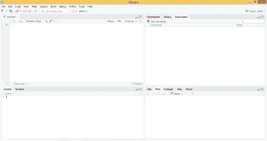

R 软件有一个内置的核心系统。它包含了用于基本操作和基础统计计算的工具。

除了核心系统外，它还拥有许多由 R 社区开发的包。任何用户都可以通过`install.packages`语句从 Cran r 仓库安装包（或通过 R studio 的 Tools 菜单选项）来使用包，并使用`library`语句将其调入 R studio 环境中。

### R 对象

R 软件包含以下元素，如向量（vectors）、因子（factors）、数据框（data frame）和矩阵（matrix）。

- 向量（Vectors）本质上值的列表，可以是数值、字符串或日期值。
- 因子（Factors）是具有不同水平或类别的变量。
- 数据框（Data frame）由行和列组成，可以同时包含数字和字符串。
- 矩阵（Matrix）与数据框类似，但可以包含数值或字符串。
- 列表（List）是 R 中的一种高级对象，可以包含不同的对象。它可以包含数字、字符串、向量、矩阵以及列表。

我们将从上述每个 R 对象的示例开始。我们需要先使用`setwd`语句定义工作目录。

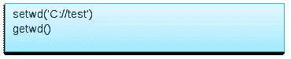

通过`getwd()`语句我们可以获取当前工作目录名称。

我们可以使用`#`符号在 R 中包含注释行。

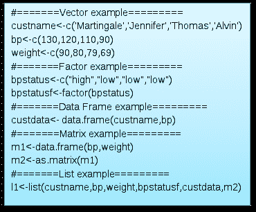

我们可以使用`print`语句或变量本身来打印输出。

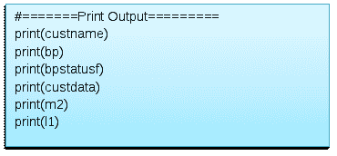

得到以下输出：

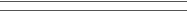

### 从不同的数据源读取数据

数据可以通过不同的源带入 R 环境，例如原始输入、文本文件、逗号分隔值 (CSV) 文件、Excel 文件、统计分析系统 (SAS)、社会科学统计包 (SPSS) 文件、关系型数据库、XML 和 JSON 文件。除了原始数据、文本文件和 CSV 文件外，所有其他数据源都需要在 R Studio 环境中使用`library`语句安装并定义相应的包。

让我们使用`read.delim`语句从工作目录下的文本文件读取数据。

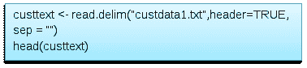

可以通过`head`语句查看`custtext`数据集的前几行。

同样，我们可以使用`CSV`语句从 CSV 文件读取数据。

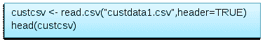

可以通过`head`语句查看`custcsv`数据集的前几行。

除了原始数据、文本文件和 CSV 文件外，所有其他数据源都需要在 R Studio 环境中使用`library`语句安装并定义相应的包。

我们需要使用`xlsx`包读取 Excel 文件，并需要使用`library`语句定义。

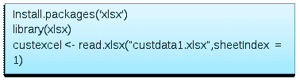

通过`head`语句查看`custtext`数据集的前几行。


我们需要使用`xlsx`包读取 Excel 文件。需要使用`library`语句。


media/file5.png)

通过`head`语句查看`custexcel`数据集的前几行。

我们需要使用`sas7b`包读取 SAS 文件。

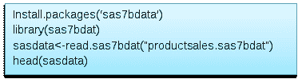

我们需要使用`foreign`包读取 SPSS 文件。

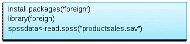

使用`RMySQL`或`ariaDB`包连接数据库，并使用`dbConnect`和`dbSendQuery`语句进行 SQL 查询。

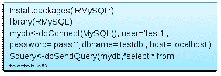 (5.png)

使用`XML`包读取 XML 文件，其函数为`xmlParse`。

使用`rjson`包读取 JSON 文件，其函数为`fromJSON`。

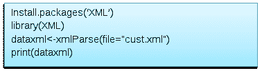

使用`writexl`包将 R 数据写回 Excel。这将存储在工作目录。

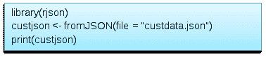 (file5.png)

## 参考文献

Verbeeck, N., Caprioli, R. M., & Van de Plas, R. (2020). 质谱质成像中探索性数据分析的无监督机器学习。质谱评论, 39(3), 245-291。

R Core Team (2020). R：用于统计计算和图形应用的语言和环境。维也纳，R 统计基金会。

RStudio Team (2020). RStudio：集成开发环境。波士顿，MA http://rstudio.com/.

Claes, M., Mens, T., & Grosjean, P. (2014, 2 月). R 包的可维护性。在 2014。

Hornik, K. (2012). CRAN 存档。计算统计学, 4(4), 394-398。

German, D. M., Adams, B., & Hassan, A. (2013, 3 月). R 软件的演进。第 17 届软件维护与重构会议 (243-252)。

Fox, J. (2005). R 命令图形界面。J Statw, 14(9), 42。

Fellows, I. (2012). Deducer：R 的数据分析 GUI。统计软件杂志, 49(8), 1-15。

Mora-Cantops, M., Sánchez-Alonso, S., & García-Barrioc, E. (2020). CRAN 的复杂网络分析。系统与软件杂志, 170, 110744。

https://cran.r-project.org/package/xlsx

https://cran.r-project.org/web/packages/sas7b/index.html

https://cran.r-project.org/package/XML

https://cran.r-project.org/package/foreign

https://cran.r-project.org/package/rjson

## 第 3 章：数据预处理


随着大数据的出现，存储和处理的数据规模巨大，带来了数据质量方面的挑战。数据质量涉及准确性、一致性、缺失数据、异常值以及格式不当。当使用低质量的数据进行分析时，无法提供高质量的结果。

### 数据清洗

数据清洗过程有助于我们解决一些质量问题。

### 处理缺失值

缺失值可以通过不同的方法处理。我们需要找出值是随机缺失还是存在模式。根据此，可以采取以下方法来解决问题：

- 忽略包含缺失值的记录。这只有在我们有足够的记录进行后续处理时才能这样做。
- 我们可以使用常数来填充缺失值，并在分析阶段通过忽略这些值来处理。在这里我们只会丢失特定字段的信息，而不是整个记录的信息。
- 使用变量的平均值或中位数来替换缺失值。
- 使用相关性等指标确定的相似记录的值来替换缺失值。
- 我们可以通过回归等模型来估计缺失值，并用估计值进行替换。

### 处理噪声数据

数据集中的离群值有时会影响结果的质量。某些算法即使在数据集中存在离群值也能处理它们。可以使用不同的统计检验和可视化工具（如`box plot`，箱线图）来发现数据集中的离群值。

### 箱线图

它将帮助我们可视化数据中存在的离群值。箱区域包含了`median`（中位数）以及`75 th`和`25 th`分位数值。

### Z 分数

当我们计算`Z Score`或`Standard Normal Distribution`变量时，我们能够找到处于接受范围内（例如`95%`或`99%`）的值。落在该范围之外的值被视为离群值。

### Grubb's Test

它可以帮助我们检测数据集中的单个离群值，该检验使用了标准正态分布。它衡量的是离样本均值的绝对偏差除以样本标准差的。

### 通用 ESD 测试

根据计算出的上限，它从单个离群值开始测试，直到数据集中给定的离群值数量（例如`k`个）。该测试使用样本观测值的最大绝对偏差除以标准差。


## 数据转换

数据转换是数据预处理过程的一个重要方面。大多数机器学习算法都可以通过数据转换、归一化和数据缩放技术得到改进。目前有多种类型的数据归一化和数据缩放技术。

### MinMax 标准化

在这里，原始数据值将被替换为与最小值的偏差除以最大值与最小值之间的偏差。

### Z-score 归一化

在这里，原始值将被替换为`z scores`，该分值是通过与均值值的偏差除以标准差计算得的。这里使用了正态分布的均值和标准差。

### 对数变换

在这里使用了原始数据集的自然对数值。

## 数据降维

当我们拥有许多特征或变量，且每一个都可能与数据集中的其他特征或变量相关时，可能会在分析阶段引入多重共线性问题。

为了避免这种情况，我们可以从数据集中删除特征或变量，或者使用`factor`（因子）或`principle component analysis`（主成分分析）通过创建潜在特征来减少特征。潜在特征本质数据集中相关特征的线性组合。

## 参考文献

- Famili, A., Shen, W. M., Weber, R., & Simoudis, E. (1997). Data preprocessing and intelligent data analysis. Intelligent data analysis, 1(1), 3-23.
- Kotsiantis, S. B., Kanellopoulos, D., & Pintelas, P. E. (2006). Data preprocessing for supervised leaning. International Journal of Computer Science, 1(2), 111-117.
- Friedman, J., Hastie, T., & Tibshirani, R. (2001). The elements of statistical learning (Vol. 1, No. 10). New York: Springer series in statistics.
- Walfish, S. (2006). A review of statistical outlier methods. Pharmaceutical technology, 30(11), 82.
- Grubbs, F. E. (1969). Procedures for detecting outlying observations in samples. Technometrics, 11(1), 1-21.
- Patro, S., & Sahu, K. K. (2015). Normalization.

### 第 3 章：决策树


决策树是监督学习的一种。我们需要对数据进行拆分。它包含`root node`（根节点）、`decision node`（决策节点）和`leaf node`（叶节点）。`root node`是起点。`Branches`（分支）代表决策。`Leaf node`是最终结果。

我们可以使用`caret`、`rpart`、`rpart.plot`和`party`包来构建树。我们需要定义以下：


同样的....................................

[](media/file15.png)

## 我们导入数据

我们使用`xlsx`包以 excel 格式导入数据。


以下是：的前几行：

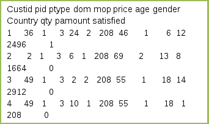

## 决策树 – 分类问题

我们将使用决策树算法根据`satisfied`字段对数据集进行分类。它将帮助我们分类哪些人可能是某类。我们需要将数据集分为训练集和测试集。


我们将使用`caret`的`train`函数来构建决策树。我们将打印模型及其摘要。

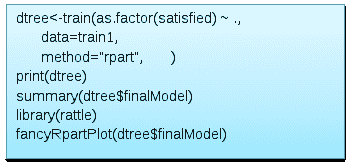[](media/file20.png)

这里我们使用`rattle`包来绘制决策树。

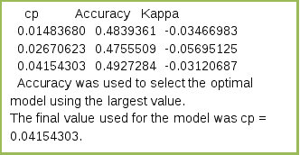

这里的准确率是`49%`，可能由于数据集的性质较低。

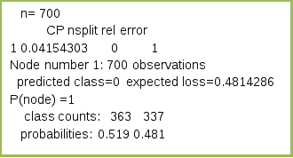[](media/file23.png)

我们可以使用`predict`函数来预测测试集的类别。

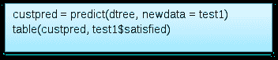[](media/file25.png)[](media/file5.png)

## 决策树 - 回归问题

我们也可以使用回归树通过预测变量或特征来预测因变量的值。我们也可以使用`rpart`包来实现预测和绘图。

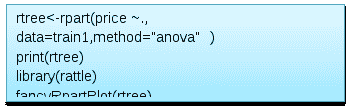[](media/file5.png)[](media/file27.png)[](media/file28.png)

下方以决策树的形式绘制了相同的。

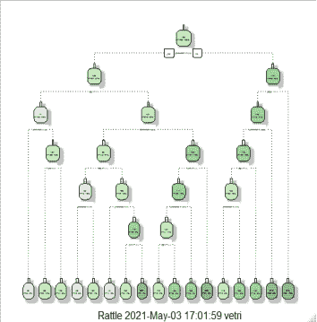

我们可以通过使用`dplyr`包和`select`语句留出`pamount`变量创建一个新的测试集来重新运行模型。


## 决策树算法的优点

- 易于构建
- 决策树构建快速
- 决策树模型易于解释
- 可用于二分类和分类问题

## 决策树算法的缺点

- 受过拟合问题影响
- 随着分类变量级别的增加可能会增加偏差

为了提高准确性并避免过拟合，使用了`Pruning`、`Bagging`和`Boosting`方法，细节所示。

## 剪枝

剪枝切掉决策树中不提供价值信息的节点，允许我们减少由于过拟合问题导致的误差。

## Bagging

Bagging 过程涉及从数据集中创建 Bootstrap 样本，然后为每个样本创建树。每棵树根据标签对样本数据集进行分类。票数较高的类别被视为最终结果。

## 提升法 (Boosting)

从单树开始并识别错误的分类。然后通过调整权重来改进错误的分类，这一过程顺序持续进行，直到错误分类减少到最低。这种方法有助于减少弱模型之间的高偏差。

## 参考文献

- Brijain, M., Patel, R., Kushik, M. R., & Rana, K. (2014). 用于分类的决策树算法综述.
- Yang, J., Zhang, N. N., LI, J., LIU, Y. M., & LIANG, M. H. (2010). 决策树算法的研究与应用. Computer Technology and Development, 2.
- Singh, S., & Gupta, P. (2014). ID3, cart and C4. 5 决策树算法: a survey. International Journal of Advanced Information Science and Technology (IJAIST), 27(27), 97-103.
- Zhong, Y. (2016, August). 基于决策树的案例分析. In 2016 7th IEEE international conference on software engineering and service science (ICSESS) (pp. 142-147). IEEE.
- Zhang, Y., & Cao, J. (2016). 大数据分析的决策树算法. Computer Science, 43(S1), 374-379.
- Zhou, H., Zhang, J., Zhou, Y., Guo, X., & Ma, Y. (2021). 基于特征权决策树特征选择算法. Expert Systems with Applications, 164, 113842.
- Hernández, V. A. S., Monroy, R., Medina-Pérez, M. A., Loyola-González, O., & Herrera, F. (2021). 决策树诱导的实用教程：候选划分的评估指标与机会. ACM Computing Surveys (CSUR), 54(1), 1-38.
- https://cran.r-project.org/package=caret
- https://cran.r-project.org/package=xlsx
- https://cran.r-project.org/package=rpart
- https://cran.r-project.org/package=rpart.plot
- https://cran.r-project.org/package=dpylr

# 第 4 章：随机森林算法


随机森林是决策树算法的扩展，基于装袋（bagging）概念，其中使用自助采样（bootstrap sample）构建许多树，自助采样是一种有放回的随机采样方法。

随机森林是一种装袋技术，从随机样本中选择随机特征，使得树之间相互独立。每棵树根据标签对数据集进行分类，这被视为对特定类别的投票。票数最多的类别被视为最终结果。它减少了复杂模型中的高方差。

随机森林算法使用袋外（OOB）误差估计来验证所构建的模型。随机森林仅使用训练数据集的自助样本，而不是使用训练数据集中的所有数据或所有行。袋外误差是根据模型构建过程中被留下的自助样本计算的。

我们可以使用与决策树算法示例中相同的假设客户数据集。该文件可以从作者网站 www.vinaitheerthan.com/book.php 下载。

我们将使用`RandomForest`包来构建模型。我们需要使用`library`语句定义所需的包，如`RandomForest`、`xlsx`和`party`。

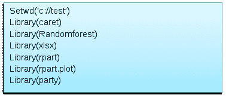

我们将像上一章一样，使用`xlsx`包以 Excel 的形式导入数据。

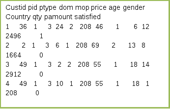

以下是数据集的前几行。

## 随机森林 – 分类问题

我们将使用随机森林树算法根据“satisfied”（满意）字段对数据集进行分类。它将帮助我们根据特征分类哪些人可能是满意的（分类问题）。

我们需要将数据集分为训练集和测试集。

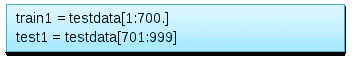

我们将使用`RandomForest`包中的`RandomForest`函数来构建模型并打印模型摘要。

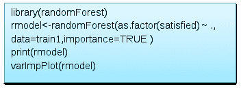[](media/file5.png)[](media/file36.png)

这里的 OOB 误差率估计为 49.57%，它是从训练集中留下的自助样本计算得。

`VarimpPlot`函数提供了每个特征在分类预测变量中的重要性。

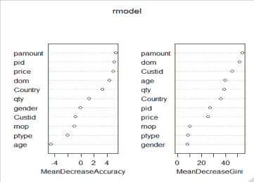

在这里，`pamount`、`pid`和`dom`特征在 MDA 和 MDG 两种方法中都在重要特征列表的前端。

在这里，`pamount`是`qty`和`price`的派生变量。我们可以使用`dplyr`包和`select`语句通过排除`pamount`变量创建一个新的测试数据集来重新运行模型。


我们可以使用`predict`来预测测试集。


以下输出。

[](media/file41.png)

## 随机森林 – 回归问题

我们可以将随机森林用于回归。我们将使用`RandomForest`包中的`RandomForest`函数来构建模型并打印模型摘要。

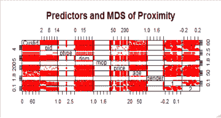[](media/file43.png)[](media/file44.png)

在这里，`pamount`是`qty`和`price`的派生变量。我们可以使用`dplyr`包和`select`语句通过排除`pamount`变量创建一个新的测试数据集来重新运行模型。

[](media/file5.png)

`VARIMPPLOT`函数提供了每个特征在分类预测变量中的重要性。

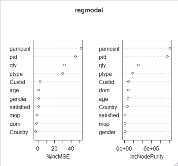

我们可以使用`predict`来预测测试集。


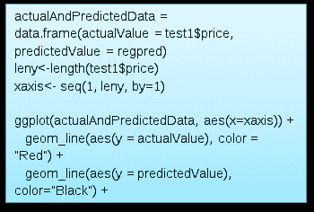[](media/file49.png)

## 随机算法的优点

- 随机森林算法解决了过拟合问题
- 可以同时构建分类和回归
- 不受异常值影响

## 随机森林的缺点

- 树的数量过多导致算法变慢
- 森林模型复杂难以理解

## 参考文献

- Biau, G., & Scornet, E. (2016). 随机森林导论. Test, 25(2), 197-227.
- Svetnik, V., Liaw, A., Tong, C., Culberson, J., Sheridan, R., & Feuston, B. P. (2003). 随机森林: 一种用于分类和回归的工具. Journal of chemical information and computer sciences, 43(6), 1947-1958.
- Schonlau, M., & Zou, R. Y. (2020). 用于机器学习的随机森林算法. The Stata Journal, 20(1), 3-29.
- Yao, D., Zhan, X., Zhan, X., Kwoh, C. K., Li, P., & Wang, J. (2020). 基于随机森林的预测新型 lncRNA-疾病关联的计算模型. BMC bioinformatics, 21, 1-18.
- Gholizadeh, M., Jamei, M., Ahmadianfar, I., & Pourrajab, R. (2020). 使用随机森林 (RF) 方法预测纳米流粘度. Chemometrics and Intelligent Laboratory Systems, 201, 104010.
- Babar, B., Luppino, L. T., Boström, T., & Anfinsen, S. N. (2020). 随机回归改进高纬度太阳辐射制. Solar Energy, 198, 81-92.
- Speiser, J. L., Miller, M. E., Tooze, J., & Ip, E. (2019). 用于分类预测建模的随机森林变量选择方法的比较. Expert systems with applications, 134, 93-101.
- Probst, P., & Boulesteix, A. L. (2017). 是否需要调优随机森林树的数量. J. Mach. Learn. Res., 18(1), 6673-6690.
- Mishra, S., Tadesse, Y., Dash, A., Jena, L., & Ranjan, P. (2021). 使用随机森林分类器进行甲状腺疾病分析。Intelligent and Cloud Computing (pp. 385-390). Springer, Singapore.
- Kandhoul, N., Dhurandher, S. K., & Woungang, I. (2021). 基于随机森林分类器的机会物联网网络安全可靠路由。International Journal of Communication Systems, 34(1), e4646.
- Vakharia, V., Vaishnani, S., & Thakker, H. (2021). 使用随机森林分类器预测电器能量。Recent Advances in Mechanical Engineering (pp. 405-410). Springer, Singapore.
- https://cran.r-project.org/package=caret
- https://cran.r-project.org/package=xlsx
- https://cran.r-project.org/package=rpart
- https://cran.r-project.org/package=rpart.plot
- https://cran.r-project.org/package=party

# 第 5 章：支持向量机算法


支持向量机（SVM）算法旨在找到一个超平面来区分数据集中的类别，同时化类别之间的间隔。支持向量是那些靠近超平面的样本观测值。超平面可以是线性的，也可以是非线性的。

SVM 算法的核函数帮助我们将非线性数据集转换到高维空间，然后使用不同的核函数（如线性、非线性、径向基函数和 Sigmoid）通过线性方程来划分空间。

我们将使用心脏病患者的生存数据集来构建 SVM 模型（`survival.xlsx`）。该文件可以从作者网站 www.vinaitheerthan.com/book.php 下载。

我们可以使用`e1071`和`caret`等包来构建 SVM 模型。

我们需要使用`library`语句定义所需的包，如`e1071`和`xlsx`。


我们将像上一章中一样，使用`xlsx`包以 Excel 格式导入数据。


以下是数据集的前几行。

## SVM - 分类问题

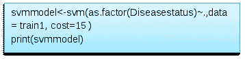

我们将使用 SVM 根据`Diseasestatus`字段对数据集进行分类。它将帮助我们根据特征分类谁可能存活（分类问题）。

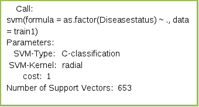

我们可以使用`TUNE`函数通过不同的成本参数值来调优模型。

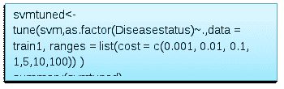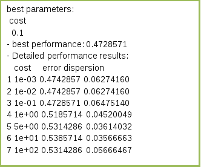

从上面的 TUNE 摘要中，我们可以推断出值为 0.1 的成本提供了最佳模型。

我们可以使用`predict`函数预测测试数据集并计算预测准确率。我们将使用成本为 15 的第一个模型进行预测。


得到的输出如下：


这里的准确率为 50.8%，由于假设数据集的性质，准确率可能较低。

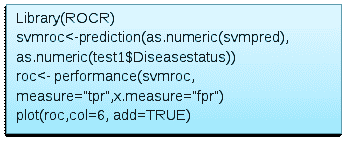

我们可以借助`ROCR`包和`prediction`函数绘制接收者操作曲线（ROC）。

以下是根据假阳性率和真阳性率得到的曲线。

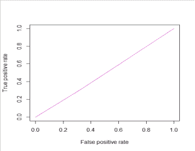

## SVM 的优点

- SVM 适用于高维数据集
- 它对文本、数字和图像等不同类型的数据效果良好
- 提供了独特的解决方案

## 随机森林算法的缺点

- 处理大型数据集时耗时间更多
- 最终模型可能难以理解

## 参考文献

- Wang, L (Ed.). (2005). 支持向量机：理论与应用 (Vol. 177). Springer Science & Business Media.
- Xie, W., She, Y., & Guo, Q. (2021). 基于改进 SVM 算法的平衡二决策树多分类研究。Scientific Programming, 2021.
- Suthaharan, S. (2016). 支持向量机。In Machine learning (pp. 385-390). Springer, Singapore.

# 第 6 章：朴叶贝叶斯


朴叶贝叶斯基于贝叶斯原理，并假设给定的特征之间相互独立。我们将使用心脏病患者的生存数据集来构建 SVM 模型。该文件可以从作者网站 www.vinaitheerthan.com/book.php 下载。

我们可以使用`e1071`、`naivebayes`和`caret`等包来构建 SVM 模型。

我们需要使用`library`语句定义所需的包，如`e1071`和`xlsx`。

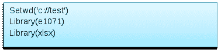

我们将像上一章中一样，使用`xlsx`包以 Excel 格式导入数据。


下表提供了数据集的前几行。为了分析，我们将从原始数据中删除`patientid`。

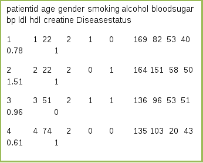

## 朴叶贝叶斯 - 分类问题

我们将使用朴叶贝叶斯算法根据`Diseasestatus`字段对数据集进行分类。它将帮助我们根据特征分类谁可能存活（分类问题）。


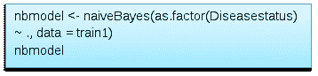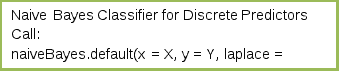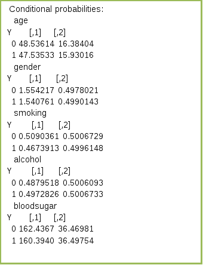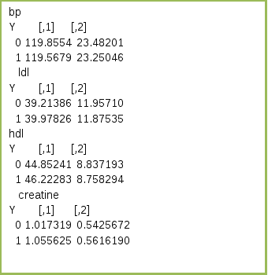

上述输出提供了每个特征相对于类的条件概率。


我们可以使用`predict`函数预测测试数据集并计算预测准确率。


得到的输出如下：


这里的准确率为 49.16%，由于假设数据集的性质，准确率可能较低。

我们可以借助`ROCR`包和`prediction`函数绘制接收者操作曲线。


以下是根据假阳性率和真阳性率得到的曲线。

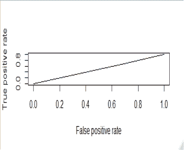

#### 朴叶贝叶斯的优点

- 容易构建
- 适用于大型数据集
- 特征和观测值的增加具有扩展性
- 可用于文本和数值数据集

#### 朴叶贝叶斯的缺点

- 预测变量之间的独立性假设

## 参考文献

Vembandasamy, K., Sasipriya, R., & Deepa, E. (2015). 使用 Naive Bayes 算法检测心脏病。International Journal of Innovative Science, Engineering & Technology, 2(9), 441-444.

Zhang, H., & Li, D. (2007, November). Naïve Bayes 文本分类器。In 2007 IEEE International Conference on Granular Computing (GRC 2007) (pp. 708-708). IEEE.

Chen, S., Webb, G. I., Liu, L., & Ma, X. (2020). 一种新的选择朴叶贝叶斯算法。Knowledge-Based Systems, 192, 105361.

- Krithiga, B., Sabari, P., Jayasri, I., & Anjali, I. (2021, 1). 使用朴素贝斯算法早期检测冠心病。*Journal of Physics: Conference Series* (Vol. 1717, No. 1, p. 012040). IOP Publishing.
- Zhang, H., Jiang, L., & Yu, L. (2021). 属性和实例加权朴素贝斯。*Pattern Recognition*, 111, 107674.
- Zhang, H., Cheng, N., Zhang, Y., & Li, Z. (2021). 针对垃圾邮件过滤系统的朴素贝斯标签翻转攻击.*Applied Intelligence*, 1-12.
- Nainwal, A., Gupta, D., & Pant, B. (2021). 使用贝叶斯定理的概率模型研究论文推荐系统。In*Research in Intelligent and Computing in Engineering* (pp. 901-909). Springer, Singapore.
- Sendari, S., Zaeni, I. A. E., Lestari, D. C., & Hariyadi, H. P. (2020). 使用朴素贝斯算法对表情符号推文进行情感分类分析。*Knowledge Engineering and Data Science*, 3(1), 50-59.
- Akbar, R., Nasution, S. M., & Prasasti, A. L. (2020, 10). 朴素贝斯算法在基于物联网的智能洗衣移动应用系统中的实现。In*2020 International Conference on Information Technology Systems and Innovation (ICITSI)* (pp. 8-13). IEEE.
- Winarti, T., & Vydia, V. (2020, 2). 用于优化朴素贝斯算法的特征选择。In*Engineering, Information and Agricultural Technology in the Global Digital Revolution: Proceedings of the 1st International Conference on Civil Engineering, Electrical Engineering, Information Systems, Information Technology, and Agricultural Technology (SCIS 2019), 2019 年 7 月 10 日, Semarang, Indonesia (p. 47). CRC Press.

https://cran.r-project.org/package=caret

https://cran.r-project.org/package=xlsx

https://cran.r-project.org/package=rpart

https://cran.r-project.org/package=rpart.plot

https://cran.r-project.org/package=e1071

https://cran.r-project.org/package=ROCR

### 第 7 章：人工神经网络算法


人工神经网络（ANN）基于人类神经系统的原理工作。人类神经系统包括神经元、突触和树突等组件，用于在神经元之间处理和传输信息。与，ANN 包括人工神经元、权重和传递函数等组件来处理信息。学习过程通过调整系统中的权重在 ANN 中进行。

ANN 由三层组成：输入层、隐藏层和输出层。输入特征通过输入层输入系统，并在特征上加上权重，通过激活函数进行转换并传递到输出层以产生最终结果。

ANN 是其他算法（如前馈网络、强化学习、卷积网络、长短期记忆（LSTM）网络）的基础。

在前馈网络中，系统根据实际输出与预期输出之间计算出的误差来调整权重。权重的调整通过反向传播方法完成。前馈网络从输入层到输出层正向工作。

在强化学习中，系统会获得反馈，系统需要通过试错法根据情况采取行动以使奖励最大化。系统不会被指示需要采取什么动作，它需要使用取错法来检查哪个动作提供的奖励更好。

我们将使用用于构建 SVM 模型的心脏病患者存活数据集。该文件可以从作者网站下载。我们将使用用于构建 SVM 模型的心脏病患者存活数据集。该文件可以从作者网站下载。

我们将使用用于构建 SVM 模型的心脏病患者存活数据集。该文件可以从作者网站下载。我们将使用用于构建 SVM 模型的心脏病患者存活数据集。该文件可以从作者网站下载。

使用`nnet`库和`neuralnet`来库构建神经网络。我们需要使用`xlsx`库来定义`xlsx`。

我们将使用用于构建 SVM 模型的胃病患者存活数据集。该文件可以从作者网站下载。我们将使用用于构建 SVM 模型的胃病患者存活数据集。该文件可以从作者网站下载。我们将使用用于构建 SVM 模型的胃病患者存活数据集。该文件可以从作者网站下载。

使用`nnet`库和`neuralnet`来库构建神经网络。我们需要使用`xlsx`库来定义`xlsx`。

我们将使用用于构建 SVM 模型的胃病患者存活数据集。该文件可以从作者网站下载。我们将使用用于构建 SVM 模型的胃病患者存活数据集。该文件可以从作者网站下载。我们将使用用于构建 SVM 模型的胃病患者存活数据集。该文件可以从作者网站下载。

使用`nnet`库和`neuralnet`来库构建神经网络。我们需要使用`xlsx`库来定义`xlsx`。

我们将使用用于构建 SVM 模型的胃病患者存活数据集。该文件可以从作者网站下载。我们将使用用于构建 SVM 模型的胃病患者存活数据集。该文件可以从作者网站下载。我们将使用用于构建 SVM 模型的胃病患者存活数据集。该文件可以从作者网站下载。

使用`nnet`库和`neuralnet`来库构建神经网络。我们需要使用`xlsx`库来定义`xlsx`。

我们将使用用于构建 SVM 模型的胃病患者存活数据集。该文件可以从作者网站下载。我们将使用用于构建 SVM 模型的胃病患者存活数据集。该文件可以从作者网站下载。我们将使用用于构建 SVM 模型的胃病患者存活数据集。该文件可以从作者网站下载。

使用`nnet`库和`neuralnet`来库构建神经网络。我们需要使用`xlsx`库来定义`xlsx`。

我们将使用用于构建 SVM 模型的胃病患者存活数据集。该文件可以从作者网站下载。我们将使用用于构建 SVM 模型的胃病患者存活数据集。该文件可以从作者网站下载。我们将使用用于构建 SVM 模型的胃病患者存活数据集。该文件可以从作者网站下载。

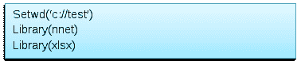

使用`nnet`库和`neuralnet`来库构建神经网络。我们需要使用`xlsx`库来定义`xlsx`。

我们将使用用于构建 SVM 模型的胃病患者存活数据集。该文件可以从作者网站下载。我们将使用用于构建 SVM 模型的胃病患者存活数据集。该文件可以从作者网站下载。我们将使用用于构建 SVM 模型的胃病患者存活数据集。该文件可以从作者网站下载。

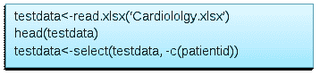

使用`nnet`库和`neuralnet`来库构建神经网络。我们需要使用`xlsx`库来定义`xlsx`。

我们将使用用于构建 SVM 模型的胃病患者存活数据集。该文件可以从作者网站下载。我们将使用用于构建 SVM 模型的胃病患者存活数据集。该文件可以从作者网站下载。我们将使用用于构建 SVM 模型的胃病患者存活数据集。该文件可以从作者网站下载。

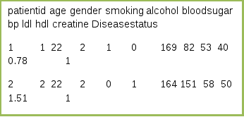

使用`nnet`库和`neuralnet`来库构建神经网络。我们需要使用`xlsx`库来定义`xlsx`。

我们将使用用于构建 SVM 模型的胃病患者存活数据集。该文件可以从作者网站下载。我们将使用用于构建 SVM 模型的胃病患者存活数据集。该文件可以从作者网站下载。我们将使用用于构建 SVM 模型的胃病患者存活数据集。该文件可以从作者网站下载。

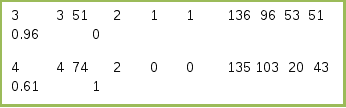

使用`nnet`库和`neuralnet`来库构建神经网络。我们需要使用`xlsx`库来定义`xlsx`。

我们将使用用于构建 SVM 模型的胃病患者存活数据集。该文件可以从作者网站下载。我们将使用用于构建 SVM 模型的胃病患者存活数据集。该文件可以从作者网站下载。我们将使用用于构建 SVM 模型的胃病患者存活数据集。该文件可以从作者网站下载。

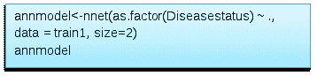

使用`nnet`库和`neuralnet`来库构建神经网络。我们需要使用`xlsx`库来定义`xlsx`。

我们将使用用于构建 SVM 模型的胃病患者存活数据集。该文件可以从作者网站下载。我们将使用用于构建 SVM 模型的胃病患者存活数据集。该文件可以从作者网站下载。我们将使用用于构建 SVM 模型的胃病患者存活数据集。该文件可以从作者网站下载。

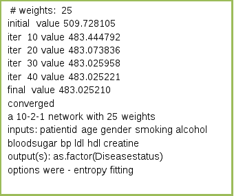

使用`nnet`库和`neuralnet`来库构建神经网络。我们需要使用`xlsx`库来定义`xlsx`。

我们将使用用于构建 SVM 模型的胃病患者存活数据集。该文件可以从作者网站下载。我们将使用用于构建 SVM 模型的胃病患者存活数据集。该文件可以从作者网站下载。我们将使用用于构建 SVM 模型的胃病患者存活数据集。该文件可以从作者网站下载。

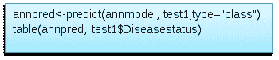

使用`nnet`库和`neuralnet`来库构建神经网络。我们需要使用`xlsx`库来定义`xlsx`。

我们将使用用于构建 SVM 模型的胃病患者存活数据集。该文件可以从作者网站下载。我们将使用用于构建 SVM 模型的胃病患者存活数据集。该文件可以从作者网站下载。我们将使用用于构建 SVM 模型的胃病患者存活数据集。该文件可以从作者网站下载。


使用`nnet`库和`neuralnet`来库构建神经网络。我们需要使用`xlsx`库来定义`xlsx`。

我们将使用用于构建 SVM 模型的胃病患者存活数据集。该文件可以从作者网站下载。我们将使用用于构建 SVM 模型的胃病患者存活数据集。该文件可以从作者网站下载。我们将使用用于构建 SVM 模型的胃病患者存活数据集。该文件可以从作者网站下载。

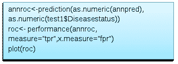

使用`nnet`库和`neuralnet`来库构建神经网络。我们需要使用`xlsx`库来定义`xlsx`。

我们将使用用于构建 SVM 模型的胃病患者存活数据集。该文件可以从作者网站下载。我们将使用用于构建 SVM 模型的胃病患者存活数据集。该文件可以从作者网站下载。我们将使用用于构建 SVM 模型的胃病患者存活数据集。该文件可以从作者网站下载。

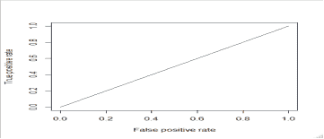

使用`nnet`库和`neuralnet`来库构建神经网络。我们需要使用`xlsx`库来定义`xlsx`。

我们将使用用于构建 SVM 模型的胃病患者存活数据集。该文件可以从作者网站下载。我们将使用用于构建 SVM 模型的胃病患者存活数据集。该文件可以从作者网站下载。我们将使用用于构建 SVM 模型的胃病患者存活数据集。该文件可以从作者网站下载。

---

### 第 8 章：聚类算法


聚类算法是无监督机器学习算法之一，不包含用于构建模型的单独训练和测试集。聚类算法发现数据集中的自然分组和模式。

有不同类型的聚类算法可用，例如

划分聚类

层次聚类

基于密度聚类

基于模型的聚类

划分聚类涉及将数据集划分为定义数量的类。K 均聚类算法是划分聚类算法的一个示例，其中数据集被分为 k 个类，观测值分配给最近的类，并为每个 k 类计算质心。

根据新的类质心重新分配类成员，并在重新分配后再次计算类质心。此过程一直持续到质心不再变化为止。

层次聚类包括聚类过程，可以使用自顶向下（划分）或自底向上（凝聚）的方法。它为我们提供了一个名为树图的树状结构来表示类。

划分聚类算法从单个类开始聚类数据集，并将该顶层类分为不同的子类，直到数据集中的所有观测值都处于单独的类中。

凝聚聚类算法（Agglomerative clustering）通过将每个观测值放入单个类开始对数据集进行聚类，并继续聚合每个类，一直直到最后所有单独类合并为一个单一类。在这里，类是根据它们之间的距离合并的，相似的类首先被聚合。有多种不同类型的连接方法可用，例如：

- **单连接（Single Linkage）**：两个类之间的距离通过它们之间最近点之间的距离来计算。
- **完全连接（Complete Linkage）**：两个类之间的距离通过它们之间最远点之间的距离来计算。
- **平均连接（Average Linkage）**：两个类之间的距离通过两个类中每个点之间的平均距离来计算。

使用了不同的距离度量，如`Euclidean`（两点之间的平方距离）和`Manhattan`（两点之间的绝对差），来计算两点或两个向量之间的距离。

### 基于密度的聚类

数据集被划分为数据空间中的高密度类和低密度类。位于分隔低密度和高密度空间区域的点通常被视为数据集中的离群值。

### 基于模型的聚类

在基于模型的聚类方法中，聚类是从概率分布中生成的，然后根据数据对拟合模型进行测试以确定聚类。该方法为每个观测值属于某个特定类提供了概率。它还帮助我们识别数据集中存在的聚类数量。

### 分区聚类 - K means 聚类

我们将开始使用决策树算法中使用的购买数据集构建 k means 聚类模型，以寻找自然分组。相同的文件从作者的网站 www.vinaitheerthan.com/book.php 下载。

我们需要使用`library`语句定义所需的包，如`cluster`、`factoextra`和`xlsx`。

!(media/file5.png)

我们将像上一章一样，使用`xlsx`包以 Excel 格式导入数据。

!(media/file5.png)!(media/file84.png)

下表提供了数据集的前几行。为了分析之目的，我们将从原始数据集中删除`pamount`变量。

我们将使用`Kmeans`算法根据购买数据对客户进行分组。这将帮助我们识别在产品购买、价格、地点、年龄和性别方面相互接近的客户群体或细分。

!(media/file5.png)

上述代码提供了 5 个类（`k=5`）的聚类摘要以及图形表示。

!(media/file87.png)!(media/file88.png)

上表提供了每个特征的类均值，以及作为类向量的所有观测值的类成员身份。

下面的图提供了划分为 5 个类的数据集。


我们还可以通过肘线图（Elbow plot）发现分组数据集需要多少个类，该图可以最小化类内平方和。

在我们的示例中，我们从值`k=5`开始，通常我们可以从肘线图开始并根据结果运行 k-means 算法。

!(media/file5.png)!(media/file91.png)

从上述图中我们可以推断出，在 4/5 个类之后，类内平方和不再显著减少。

### K-means 聚类算法的优点

- 易于实现
- 速度更快

### K-means 聚类算法的缺点

- 难以预测聚类数量
- 难以扩展
- 受初始种子值的影响

### 层次聚类 – 凝聚式


我们可以使用`hclclust`函数构建层次凝聚聚类。算法将提供树图（dendogram），它是类的可视化表示，我们使用`cut tree`函数来划分类。


在这里使用了默认的距离和连接方法。我们可以指定距离度量，如`Euclidean`和`Manhattan`距离，以及完全连接和`ward`方法。

## 层次聚类算法的优点

- 易于实现
- 生成类的层次结构，有助于我们决定聚类的数量

## 层次聚类算法的缺点

- 受离群值影响
- 受初始种子值影响
- 难以扩展

## 基于模型的聚类

我们可以使用`mclust`包构建基于模型的聚类。它使用极大似然估计法，利用贝叶斯信息准则（`BIC`）寻找最佳模型和聚类数量。

## 基于模型的聚类算法的优点

- 基于统计的聚类算法，有助于我们从聚类中得出推断
- 易于找到聚类数量
- 良好地处理离群值

## 基于模型的聚类算法的缺点

- 当样本点较少时，`BIC`分可能不可用

## 参考文献

- Likas, A., Vlassis, N., & Verbeek, J. J. (2003). The global k-means clustering algorithm. Pattern recognition, 36(2), 451-461.
- Rani¹, Y., & Rohil, H. (2013). A study of hierarchical clustering algorithm. ter S & on Te SIT, 2, 113.
- Zhong, S., & Ghosh, J. (2003). A unified framework for model-based clustering. The Journal of Machine Learning Research, 4, 1001-1037.
- Yu, M., Jieyan, Y., Jiajia, Z., & Xinzhou, C. (2021). Intelligent Detection of Network Coverage Problems Based on the Clustering Algorithm. In Signal and Information Processing, Networking and Computers (pp. 1010-1018). Springer, Singapore.
- Sinaga, K. P., & Yang, M. S. (2020). Unsupervised K-means clustering algorithm. IEEE Access, 8, 80716-8027.

句子需要被拆分为有意义的组件，如单词。空格或标点符号有助于我们将句子分词为单词。

## 词干提取 (Stemming)

词干提取有助于我们保留单词的词根。它有助于移除句子中具有相同词根的重复单词。

## 词性还原 (Lemmatizing)

它与词干提取相似，不同之处在于移除单词的形式变化时会将含义相似的词连接起来。

## 停用词移除 (Stop words removal)

停用词移除在预处理中起着重要作用，因为它移除了文档中频繁出现的如‘a’‘the’‘and’等停用词。

## 词性标注 (POS)

词性标注帮助我们标记句子中的词性，如名词、动词和形容词。词性标注在自然语言处理（NLP）和情感分析任务中起着重要作用。

## 分块 (Chunking)

分块是在句子标记级别完成的，通过将标记分组为相似的块或句法上相关的标记。

## 文本数据分析

文本数据分析涉及计算文档相关的指标、统计学、监督学习和无监督机器学习算法、自然语言处理技术以及情感分析技术。

### 文档相关指标

在分析开始阶段，我们需要计算以下指标，如词频 (TF)、逆文档频率 (IDF) 和词频矩阵 (TDM)。

### 词频矩阵 (TDM)

词频矩阵是文本语料库中文档的矩阵表示。在这里，列级包含文档，行级包含词。词权重可以通过二值权重（0 或 1）来衡量，即词是否出现在该文档中。

### 词频 (TF)

词频是特定文档中单词出现的频率。

### 逆文档频率 (IDF)

逆文档频率为不常见的单词（如‘a’和‘the’）分配较低权重。

### 词频-逆文档频率 (TF-IDF)

词频-逆文档频率为不常见的单词分配更高的权重。

## 统计建模 (Statistical Modeling)

文本挖掘中的统计建模涉及使用统计概率概念和分布。在分析阶段考虑了以下方面：

- 句子由单词序列组成。
- 通过联合概率获取下一个单词的概率。
- 计算整个句子的概率。

我们将使用语言模型，如`Unigram`和`N-gram`模型生成单词的概率分布。这里`Unigram`模型假设单词是独立的。马尔可夫模型帮助我们建模，它假设未来状态取决于当前状态而非过去状态。隐马尔可夫模型是马尔可夫模型的扩展，包含了观测到的从状态`i`到状态`j`的转移概率。

使用拉普拉斯和加法平滑技术将帮助我们调整单词序列中的概率。

## 监督机器学习算法

监督机器学习算法帮助我们将文本分类或分类到给定的主题或类别。垃圾邮件过滤是一个很好的示例。文本分类可以通过基于规则的方法完成，使用语言规则对输入的文本进行分类。这种方法具有挑战性。与基于规则的分类系统相比，监督机器学习系统不需要关于领域的完整知识，但它通过数据学习来提高分类准确率。可以使用支持向量机（SVM）和朴素贝叶（Naïve Bayes）等监督机器学习算法处理数据集。

## 无监督机器学习算法

无监督机器学习算法帮助我们分组或寻找文档之间的关联。可以使用 K 均值（K-means）划分算法或层次聚类算法对文档进行分组。例如，我们可以对具有相似主题的科学文章或具有相同疾病条件的患者记录分组。

## 主题建模 (Topic Modeling)

主题建模使用隐狄利克分布 (LDA) 等技术为文档集分配主题。LDA 首先生成主题下的单词概率模型，然后检查输入的文档并根据生成的概率模型分配主题。

## 情感分析 (Sentiment analysis)

情感分析帮助我们从给定的文本数据集中提取隐藏情感。情感分析对于分析产品、酒店或服务的评论非常有用。根据文本上下文，评论可以分类为积极、中性或消极。

## 文本数据的图形表示

提取的文本可以使用词云（Word Cloud）工具可视化。它以图形形式表示数据集中的词簇，其中出现频率最高的单词表示其在数据集中的重要性。

## 文本挖掘示例

让我们使用监督和无监督机器学习算法对示例数据集进行分类和聚类。我们还将基于示例数据集进行情感分析。

考虑一个假设的产品评论数据集，其中包含对产品的评论，每条评论将被视为分析的文档。在这里，我们提取了评论并将其存储在单个文本文件中。在实时应用中，使用 API 或网络爬取方法会更好。

### 通过 API 提取 Twitter 推文

以下代码帮助我们如何使用 Twitter API 提取推文。要从 Twitter 获取推文，用户需要拥有 Twitter 账号并注册 API 请求，注册后我们将获得以下密钥：

- Consumer key
- Consumer secret key

我们需要安装`rtweet`包并与其他所需的包一起定义它。

我们需要在以下代码中输入这些：

```

```

我们将获得 Twitter 的确认。现在我们可以使用以下代码搜索 Twitter 并获取所需的推文到我们的 R 环境。

```

```

这些可以进一步处理。

### 网络爬虫 (Web scraping)

我们可以通过网络爬取方法从在线网站提取文本。我们需要安装`rvest`和`xml2`包来执行网络爬取。

以下代码帮助我们从网站提取数据。在这里我们将使用`read_html()`和`html_nodes()`分别读取和提取 html 标签。要提取这些标签内部的内容，我们需要使用`html_text()`函数。

```

```

### 产品评论示例

现在我们从存储在工作目录文本文件中的假设产品评论示例数据集开始。

```

```

我们将使用 TM 包来执行文本挖掘过程。

我们将从文本文件中创建语料库并将其表示在向量空间中。下一步，我们将使用`tm`包中的`tm_map`函数通过移除停用词、标点符号、数字和空格对文档进行预处理。

在这里，为了分析目的，我们将每个句子转换成了单个文档。现在我们将构建词项-文档矩阵 (TDM)。

下面给出了最终 TDM 的几行：

我们将使用`wordcloud`包对文本进行可视化。

## 文本分类示例 – 监督性机器学习算法

现在我们将使用下方链接中的公开数据集，该数据集包含产品评论，并将评论分类为`label1`和`label2`（`label1-positive`和`label2-negative`），用支持向量机 (SVM) 算法对评论进行分类。

https://github.com/necronet/RML-101/blob/master/svm_textclassification/corpus.csv

我们将定义构建 SVM 模型所需的包，并读取 Excel 文件的内容。

我们将为构建 SVM 模型定义训练和测试数据集。

我们将`LABEL`变量定义为因子 (factor)，并在 SVM 模型中使用它。

模型的摘要如下：

我们可以通过混淆矩阵检查预测准确率。

这里的准确率少于 0.53，这可能是由于数据集的原因。我们可以使用`ROCR`包绘制 ROC 曲线。

得到的如下 ROC 曲线所示：

## 文本分类 – 非监督性机器学习算法

我们可以使用无监督性机器学习算法，通过凝聚聚类 (Agglomerative clustering) 技术对评论进行分组或聚类。我们将使用相同的产品评论数据，但会移除标签，仅选取 50 条评论进行分析。

我们将像以前一样借助`tm`包的`tm_map`函数对数据进行预处理。得到如下文档-词项矩阵，其中行表示文档，列表示语料库中的单词。

我们将使用`hclust`函数定义距离度量并构建层次模型，同时绘制聚类图 (dendogram)，该图提供了所考虑评论之间关联关系的图形化表示。它展示了哪些评论是相似的，或者说客户给出的评论。

## 情感分析示例

我们可以通过`syuzhet`包提取隐藏的情绪。我们将使用包含 50 条评论的产品评论集。我们将使用`get_nrc_sentiment`函数获取情感并计算诸如“愤怒”、“喜悦”、“正面”和“负面”等情感得分。同样的内容将以图形形式呈现。

## 参考文献

- Aggarwal, C. C., & Zhai, C. (Eds.). (2012). Mining text data. Springer Science & Business Media.
- Hotho, A., Nürnberger, A., & Paa, G. (2005, May). A brief survey of text mining. In Forum (Vol. 20, No 1, pp. 19-62).
- Berry, M. W., & Kogan, J. (2010). Text mining. Applications and Theory. West Sussex, PO19, John & Sons.
- Cheng, M. Y., Kuso, D., & Gosno, R. (2020). Text mining-based classification using hybrid machine learning. Automation in Construction, 118, 10265.
- Ju, Z., Wang, J., & Zhu, F. (2011, May). Named entity recognition from biomedical text using SVM. In 5th international conference on bioinformatics and biomedical engineering (pp. 1-4).
- Agnihotri, D., Verma, K., & Tripathi, P. (2014, April). Pattern and cluster mining on text data. In 4th International Conference on Systems and Network Technologies (pp. 428-432).
- Vijayani, S., Ilamathi, J., & Nithya, M. (2015). Preprocessing techniques for text mining-an overview. International Journal of Computer Science & Communication, 5(1), 7-16.
- Kadhim, A. I., Cheah, N., & Ahamed, H. (2014, December). Text document preprocessing and dimension reduction techniques for text clustering. In 4th International on Artificial Intelligence with Applications in Engineering (pp. 69-73).
- Grabner, D., Zanker, M., Flied, G., & Fuchs, M. (2012, January). Classification of customer reviews based on sentiment analysis. In (pp. 460-470).
- https://cran.r.project.org/package=tm
- https://cran.r.project.org/package=xlsx
- https://cran.r.project.org/package=rvest
- https://cran.r.project.org/package=cluster
- https://cran.r.project.org/package=xml2
- https://cran.r.project.org/package=xlsx
- https://cran.r.project.org/package=e171
- https://cran.r.project.org/package=caret
- https://cran.r.project.org/package=ROCR
- https://cran.r.project.org/package=syuzhet

## 第 10 章：图像处理

图像处理和分类可以通过`keras`包在 R 中完成。深度学习模型被广泛用于。原始图像需要转换为数组，包含图像 ID、高度和宽度。

- https://tensorflow.rstudio.com/guide/keras/
- https://cran.r.project.org/package=keras
- Mishra, N. K., & Celebi, M. E. (2016). An overview of melanoma detection in dermoscopy images using image processing and machine learning. arXiv preprint arXiv:1601.07843.
- Pandey, R., Naik, S., & Marfatia, R. (2013). Image processing and machine learning for automated fruit grading system: A technical review. International Journal of Computer Applications, 81(16), 29-39.

## 参考文献

- Lézoray, O., Charrier, C., Cardot, H., & Lefèvre, S. (2008). 图像处理中的机器学习。
- Jagadev, P., & Virani, H. G. (2017, May). 使用图像处理和机器学习检测白血病及其类型。见 2017 年国际电子与信息趋势会议 (ICEI) (pp. 522-526)。IEEE。


- Dey, A. (2016). 机器学习算法：综述。《计算机科学与信息技术国际杂志》，第 7 卷，第 3 期，页 1174-1179。

- Šajn, L., & Kukar, M. (2011). 用于医学图像全自动概率评估的图像处理与机器学习。《生物医学中的计算机方法与程序》， 104(3), e75-e86。

## 页面

## 不要错过！

点击下方按钮，即可注册订阅邮件，在 Vinaitheerthan Renganathan 出版新书时接收通知。此服务免费且无任何义务。


`https://books2read.com/r/B-A-YASK-KWGPB`


连接独立读者与独立作者。

## Vinaitheerthan Renganathan 的其他作品

- 商业智能：概览

- 通过统计和数据科学工具进行股票价格分析：概览

- 面向数据家的机器学习算法：概览

- 通过 R 软件探索生物统计学：概览

请访问 Vinaitheerthan Renganathan 的网站关注更多内容。

## 关于作者

统计学家兼数据科学家，在临床、制造、质量保证和市场研究领域拥有 26 年的丰富经验。

请访问 Vinaitheerthan Renganathan 的网站了解更多信息。
