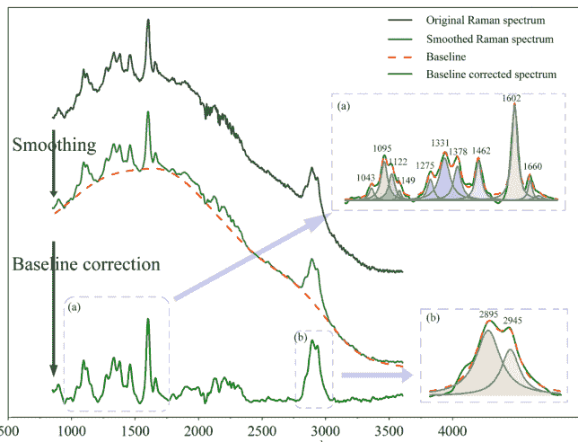
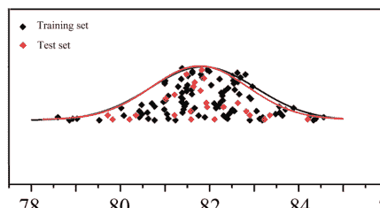
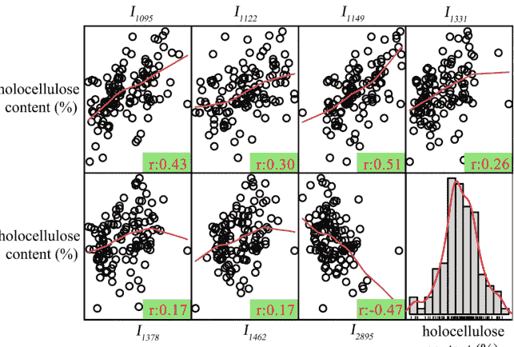
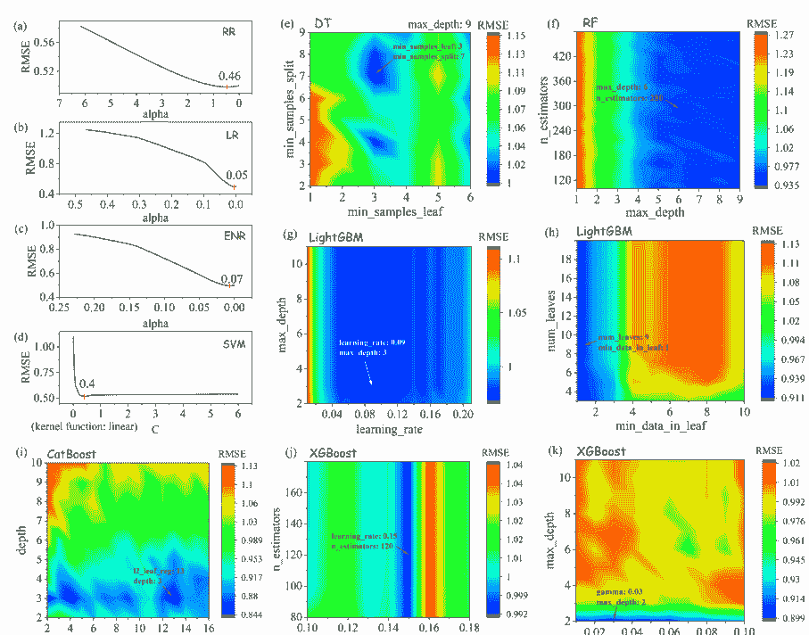
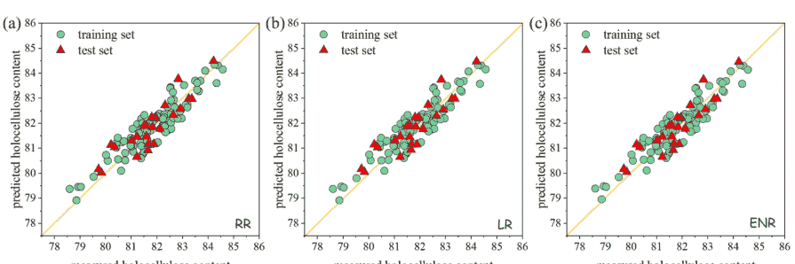
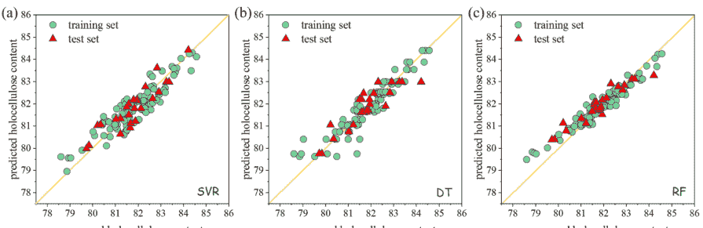
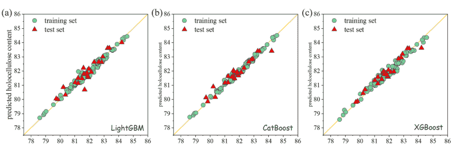

# 基于拉曼光谱的杨树克隆全纤维素含量快速估算的机器学习算法


## 摘要

在本研究中，基于从拉曼光谱中提取的特征，应用正则化算法（RR、LR 和 ENR）、经典机器学习算法（SVR、DT 和 RF）以及先进的 GBM 算法（LightGBM、CatBoost 和 XGBoost），构建了杨树木全糖含量预测模型。模型评价结果表明，经典机器学习算法的预测精度高于正则化算法，而先进的 GBM 算法优于经典机器学习算法。此外，由 CatBoost 和 XGBoost 构建的模型可实现木全糖含量的高精度估算，测试集 R² 高于 0.93，测试集 RMSE 低于 0.29%。据我们所知，迄今为止，这提供了基于拉曼光谱的木全糖含量预测模型的最高精度。因此，建议将拉曼光谱与机器学习算法相结合，作为预测杨树木全糖含量的一种有前景的工具，该工具可应用于大规模树木遗传与育种计划。

## 1. 引言

木全糖，即纤维素和半纤维素之和，是一种可通过氯化法去除木质材料中的木素而提取的不溶于水的碳水化合物分数（Basu, 2018）。它是一个重要的分数，因为其水解产物由各种单糖组成，这些单糖能够通过发酵转化为有用化合物或乙醇（Isikgor & Becer, 2015; Ma et al., 2012）。由于不同类型的木质纤维素生物质、物种甚至遗传资源之间木全糖含量存在较大差异，选择具有预期木全糖含量的资源成为一项必要任务。与此同时，这种差异也为制定大规模遗传育种计划以选择和寻找具有预期木全糖含量的合适种质提供了良好机会。然而，为实现这一目标，当使用传统湿化学方法（WCM）时，需要大量的劳动和繁琐的测试，因为有大量样本需要测量。此外，由于每个遗传样本是由活树的小苗或生长锥制备的，可用样本的数量有时无法满足使用 WCMs 时所需的重复样本数量。此外，WCMs 在测定过程中还因大量使用有毒试剂而受到批评。因此，需要一种快速、准确、环保且对样本数量要求低的方法。

已有多种光谱方法，如近红外（NIR）光谱、中红外（MIR）光谱（Tucker et al., 2001）和拉曼光谱，结合合适的算法，已成功用于预测木质纤维素材料的化学成分含量，以替代传统 WCMs。NIR 已被用于预测木材中的木素含量（Liang et al., 2020; Yang et al., 2019）、梨中的木素含量（Wu et al., 2021）以及木材中的木全糖含量（Liang et al., 2020; Yang et al., 2019）。然而，有报道指出，NIR 光谱中与水相关峰的位置和强度会受样本湿度和测试环境湿度的影响（Gordobil et al., 2021）。因此，如果样本湿度和测试大气未受到严格控制，可能会对定量结果造成干扰。相比之下，拉曼光谱对样本湿度不敏感，并提供了大量具有高化学信息含量的光谱信息，其特征是一系列与特定化学键相关的峰（Jermyn et al., 2016）。这些宝贵的信息带来了高灵敏度和特异性，例如，可用于分析主要化学成分含量的差异（Agarwal & Ralph, 2012; Gao, Shu, et al., 2022; Gao, Zhou, et al., 2022; Gao, Zhou, Liu, et al., 2022）以及纤维素的结晶度（Agarwal et al., 2010, 2018）。此外，由于每次光谱采集只需要 2 mg 样本，对样本数量的要求较低，这可能是拉曼技术在大规模树木遗传与育种计划专用应用中的典型优势。拉曼光谱结合正则化算法已成功应用于杨树克隆木全糖含量和木素含量的预测任务（Gao et al., 2021; Gao, Shu, et al., 2022）。尽管这些模型的预测结果尚可，但仍有待探究模型的预测精度和效率是否能够进一步提升。

各种与木质纤维素材料及其化学成分相关的分类和预测工作，已归功于经典机器学习（ML）算法的应用而成功完成，这些算法包括支持向量机回归（SVR）、决策树（DT）和随机森林（RF）（Daassi-Gnaba et al., 2018; Ehrhart et al., 2021; Gao, Zhou, Liu, et al., 2022; Gu & Henrik Andersson, 2010; Souza et al., 2020; Xing et al., 2019）。同时，有报道指出，先进的梯度提升机（GBM）算法，如 Light Gradient Boosting Machine（LightGBM）、Categorical Boosting（CatBoost）和 eXtreme Gradient Boosting（XGBoost），能够处理复杂的数学问题，如分类、回归等（Chen & Guestrin, 2016; Ke et al., 2017; Prokhorenkova et al., 2018）。基于这些有意义的工作，最近已建立了基于拉曼特征的机器学习算法木素含量预测模型（Gao, Zhou, Liu, et al., 2022）。结果表明，机器学习算法在木素含量预测方面比正则化算法实现了更准确、更高效的预测（Gao, Zhou, Liu, et al., 2022）。因此，如果用机器学习（ML）算法替代正则化算法，预计木全糖含量的预测精度将得到显著提高。但是，应注意到，与木素相关峰的位置和强度与木全糖相关峰有很大不同，因此从拉曼光谱中提取的用于建立木全糖含量预测模型（HCP-Model）的有用特征将是另一个数据矩阵。这无疑会带来如何将机器学习算法预测木素含量的方法论转移到新目标（即木全糖）上的问题。此外，还需要验证不同机器学习算法之间的比较结果在 HCP-Model 和木素含量预测模型之间是否一致。

因此，本工作的目标是应用机器学习算法开发 HCP-Models。从拉曼光谱中提取的与木全糖相关的拉曼特征被用作输入变量，测得的木全糖含量被用作输出变量。同时，还采用了正则化算法（RR、LR 和 ENR）来与这些机器学习算法进行比较。将对各预测模型的精度进行检验和比较，然后选择最优模型。此外，在逐步调整超参数后，预计将得到预测精度高的 HCP-Models。希望最优预测模型有利于在大规模树木遗传与育种计划中快速、高效地估算木全糖含量。

## 2. 材料与方法

### 2.1. 材料

从十个杨树克隆中采集了 125 组杨树样本。这些杨树克隆的信息在已发表的研究中有详细描述（Gao, Shu, et al., 2022; Gao, Zhou, Liu, et al., 2022）。所有样本均加工成 40–60 目和 100–120 目木粉，分别用于 WCM 测定木全糖含量和采集傅里叶变换拉曼（FT-Raman）光谱。80% 的样本随机分为训练集，其余 20% 的样本用作测试集。

### 2.2. 木全糖测定

采用亚氯酸钠法测定木全糖含量，参照中国国家标准 GB/T 2677.10–1995。首先，将无浸出样本置于容器中，加入蒸馏水、冰醋酸和氯化钠，在 75 °C 水浴中浸泡一小时。然后，向溶液中加入 0.5 mL 醋酸和 0.6 g 亚氯酸钠，继续水浴一小时。重复上述加入亚氯酸钠和醋酸的操作，进行充分且连续的氯化循环（本研究中循环四次）。充分氯化后，溶液被过滤和洗涤。残渣采用重量法测定，即测得的木全糖含量（Liang et al., 2020; Rabemanolontsoa & Saka, 2012）。

### 2.3. 拉曼光谱采集

用于采集 FT-Raman 光谱的杨树样本约取 2 mg 100–120 目样本制成压片，三重平行。然后，使用布鲁克（Bruker）FT-Raman 光谱仪（Vertex 70RAMII）以 4 cm−1 的光谱分辨率采集 64 次扫描的所有 FT-Raman 光谱。荧光在 1064 nm 激发，采集 200 至 3600 cm−1 的拉曼位移，激光功率为 500 mW。分析采用 800 至 3600 cm−1 的范围。

### 2.4. 谱面处理及从拉曼光谱中提取的拉曼特征

由于光谱噪声、基线漂移和信号重叠，拉曼特征的提取具有挑战性，可通过去噪、基线校正和去卷积计算等谱面处理来缓解。参照前期工作（Gao et al., 2021; Gao, Shu, et al., 2022; Gao, Zhou, et al., 2022），Savitzky-Golay 和自适应迭代重加权惩罚最小二乘法（airPLS）分别用于平滑光谱和校正光谱基线。然后，进行高斯和洛伦兹分峰以克服信号重叠，计算每个特定峰的单一信号强度。因此，成功提取了位于 1095、1122、1149、1331、1378、1462 和 2895 cm−1 的峰信息，这些峰均与木全糖相关（Agarwal, 2009; Agarwal & Ralph, 1997; Wiley & Atalla, 1987）。参照前期工作，2945 cm−1 的峰强度被用于对与木全糖相关的峰（1095、1122、1149、1331、1378、1462 和 2895 cm−1）的强度进行归一化（Gao, Shu, et al., 2022）。因此，得到了与木全糖相关的归一化峰强度（I1095、I1122、I1149、I1331、I1378、I1462 和 I2895），在本研究中称为拉曼特征，并将其作为 HCP-Models 的预测变量。

### 2.5. 建模算法

训练数据用于调优和优化机器学习算法的超参数，然后使用最优超参数开发 HCP-Models。测试集的数据始终独立于训练过程，用于估算模型的预测精度。在构建 HCP-Models 之前，所有输入变量均使用 Python Scikit-learn 库中的 StandardScaler 进行标准化。标准化数据按以下公式计算：Eq. (1)：

```
x' = \frac{x - \bar{x}}{\sigma} 
 (1)
```

其中 x' 是标准化值，x 是原始值，x̄ 是平均值，σ 是整个范围的标准偏差。


预测变量。

正则化算法、经典机器学习算法和先进的GBM算法被应用于构建HCP模型。因此，总共应用了九种算法来建立模型。在正则化算法中，添加了惩罚项以降低数据的多重共线性，即LR和RR模型中的l1-范数和l2-范数，分别。并且，ENR模型中的正则化项是l1-范数和l2-范数的组合。

```
R^2(y, \hat{y}) = 1 - \frac{\sum_{i=1}^n (y_i - \hat{y}_i)^2}{\sum_{i=1}^n (y_i - \bar{y})^2}
(1)
RMSE(y, \hat{y}) = \sqrt{\frac{1}{n} \sum_{i=1}^n (y_i - \hat{y}_i)^2}
(2)
NRMSE = \frac{RMSE}{\bar{y}}
(3)
MAE = \frac{1}{n} \sum_{i=1}^n |P_i - M_i|
(4)
MAPE = \frac{1}{n} \sum_{i=1}^n \left| \frac{\hat{y}_i - y_i}{y_i} \right| \times 100\%
(5)
```

SVR、DT和RF都是常用的经典机器学习算法。SVR源自支持向量机（SVM），SVM最初定义超平面以解决分类任务，随后扩展到解决回归等更复杂的问题（Awad & Khanna, 2015）。DT和RF是基于树的算法。但DT只有一棵树，而RF在数据集的许多子样本上有许多决策树。RF模型的预测值基于从每棵决策树接收到的结果的多数投票。

LightGBM、CatBoost和XGBoost都是先进的GBM算法，因其在许多复杂任务中的效率、准确性和可解释性而闻名（Dorogush et al., 2018; Hong, 2020; Jabeur et al., 2021; Ke et al., 2017）。XGBoost是Chen提出的从GBM修改而来的框架，擅长处理分类和回归任务（Chen & Guestrin, 2016）。XGBoost中的树节点逐层分裂，之前模型-树的残差通过新生成的树进行拟合（Pan et al., 2022）。LightGBM是一种分布式高效的梯度提升框架，基于直方图，将连续值放入离散箱中，从而实现更快的训练和更高效的内存使用（Ke et al., 2017）。CatBoost是2018年提出的一种先进的梯度提升决策树算法。它在处理特征时具有高效且合理的功能优势。当CatBoost模型为当前树构建新的分裂点时，还考虑了贪婪策略以提高预测精度（Jabeur et al., 2021; Prokhorenkova et al., 2018）。所有模型均在Python环境中使用Jupyter Notebook构建。

其中，$y_i$ 表示测量值，$\hat{y}_i$ 表示预测值，$\bar{y}$ 表示测量值的平均值，$n$ 表示样本数量。

为了获得具有更高预测精度的机器学习模型，在网格搜索和5折交叉验证的帮助下调优了算法的超参数。参数调优过程通过在Python中使用scikit-learn的GridSearchCV函数执行（Pedregosa et al., 2011）。

## 3. 结果与讨论

### 2.6. 模型评估

### 3.1. FT-Raman光谱分析

拉曼光谱提供了大量具有高化学信息含量的光谱信息，其特征是一系列与特定化学键相关的峰（Jermyn et al., 2016）。如图 1 所示，1095 cm–1 和 1122 cm–1 处的信号均归因于C—O和C—O伸缩振动、COC的对称和不对称伸缩振动、糖苷键以及环呼吸振动（Schenzel & Fischer, 2001; Wiley & Atalla, 1987）。位于1149 cm–1 的峰似乎与HCC和HCO弯曲振动有关（Schenzel & Fischer, 2001; Wiley & Atalla, 1987），而1462 cm–1 被分配给碳水化合物的CH2剪切振动（Agarwal & Atalla, 2010）。在1331 cm–1 和 1378 cm–1 处的信号中，HCC和HCO弯曲坐标最为显著（Wiley & Atalla, 1987）。2780 cm–1 至 3060 cm–1 的C—H伸缩振动区域包括木质素和碳水化合物的贡献（Wiley & Atalla, 1987）。具体而言，2895 cm–1 处的峰被分配给纤维素的CH和CH2伸缩振动（Wiley & Atalla, 1987），而来自木质素甲氧基的CH伸缩振动的2945 cm–1 峰更为明显（Gierlinger & Schwanninger, 2006; Wiley & Atalla, 1987），这已被证明是基于拉曼光谱预测全纤维素含量任务中的合格内标（Gao, Shu, et al., 2022）。经过平滑、基线校正和去卷积计算等光谱处理后，得到了HCP模型的输入变量，分别表示为I1095、I1122、I1149、I1331、I1378、I1462和I2895。

所有定量模型（即RR模型、LR模型、ENR模型、SVR模型、DT模型、RF模型、LightGBM模型、CatBoost模型和XGBoost模型）的预测精度均通过决定系数（R2）、均方根误差（RMSE）、归一化均方根误差（NRMSE）、平均绝对误差（MAE）和平均绝对百分误差（MAPE）进行评估。R2是拟合优度指标，表示由输入变量解释的输出变量方差的比例。理论上，R2越大，模型精度越高（Hosseinzadeh et al., 2022; Schubert & Kläusler, 2020）。RMSE是测量值与预测值之间误差的常用度量指标，用于将各数据点预测误差的幅度汇总为单一的预测能力度量。RMSE是精度的度量，用于比较由RR、LR、ENR、SVR、DT、RF、LightGBM、CatBoost和XGBoost开发的不同模型的预测误差。NRMSE是指由测量值平均值归一化后的RMSE均方根。RMSE和NRMSE的值越低，定量模型的预测精度越高。MAE是观测值（测量值）与模型输出（预测值）之间的平均差值，是衡量给定模型精度的指标。MAPE是绝对百分误差的简单平均值，用于定义预测模型的精度。MAE的值越低，模型预测数值的能力越好。R2、RMSE、NRMSE、MAE和MAPE的计算如下：

### 3.2. 数据集分析

本工作中杨树样品的全纤维素含量范围为78.60%至84.57%，平均值为81.84%，这与其他已发表的文献一致（Liang et al., 2020）。所有125个样本被分为两组。在训练集中，全纤维素含量范围为78.60%至84.57%，平均值为81.84%。在测试集中，数据范围为79.72%至84.21%，平均值为81.86%，详细分布与训练集相似（图2）。

在HCP模型中，全纤维素含量数据被设为输出变量，而输入变量是从拉曼光谱中提取的拉曼特征，即I1095、I1122、I1149、I1331、I1378、I1462和I2895。理论上，所有这些特征均与全纤维素相关（Agarwal, 2019; Wiley & Atalla, 1987）。为了评估所选预测变量是否能为构建HCP模型提供有用信息，应用了Pearson相关性分析来粗略分析输入变量与输出变量之间的相关性。较高的Pearson相关系数（Pearson's r）意味着两种变量之间相关性更高（Adler & Parmryd, 2010）。根据图 3，全纤维素含量与$I_{1149}$（Pearson's r: 0.51, p < 0.001）、$I_{1095}$（Pearson's r: 0.43, p < 0.001）和$I_{2895}$（Pearson's r: -0.47, p < 0.001）的相关性强于其他变量。且所有预测变量与输出变量或多或少存在相关性，表明拉曼特征与测得的全纤维素含量之间存在显著关系。因此，这些选定的输入特征有望为模型构建提供足够的数字信息变化（Adler & Parmryd, 2010）。

### 3.3. 超参数调优

在执行模型构建过程之前，需要调优各种超参数以抑制可能的数学问题并优化模型质量。在RR模型中，'alpha'的值



图 1. 原始拉曼光谱和处理后的光谱。



图 2. 全纤维素含量的频率分布图。



图 3. 拉曼特征与测得全纤维素含量之间的Pearson相关性分析。


表示正则化强度。较大的值指定更强的正则化，这在处理多重共线性问题方面很熟练，并减少了估计值的方差（Ikeuchi, 2021）。而在LR和ENR模型中，‘alpha’表示乘以惩罚项的常数。当‘alpha’等于0时，建模算法等同于普通最小二乘法（Januaviani et al., 2019; Meier et al., 2008）。在SVR模型中，核函数和正则化参数（‘C’）是通常需要调整的重要超参数（Pan et al., 2022）。在本文中，‘linear’、‘poly’、‘rbf’被选为核函数的候选项。‘C’参数与正则化强度成反比。此外，DT和三种先进GBM算法都是基于树的机器学习技术。并且参数与“模型树”相关，这些参数列在表1中（Hong, 2020; Hosseinzadeh et al., 2022; Ke et al., 2017）。超参数和调优后的最佳值在图4和表1中总结。

### 3.4. 正则化算法的预测性能

所有HCP模型均使用最优超参数（表1）建立，九个模型的统计结果在表2和表3中显示。RR、LR和ENR模型彼此大致相等，测试R²约为0.80，RMSE约为0.48%，这与我们之前的研究（Gao, Shu, et al., 2022）基本一致。正则化算法的预测值与数据集中的测量值在图5中绘制。应指出，之前由正则化算法构建的模型缺少调整超参数的步骤。预期在额外调谐步骤的帮助下，模型应比之前的模型呈现更高的预测精度。尽管如此，由于调谐过程基于RMSE值进行监控，它只在测试集中显示出RMSE略好一点的结果。因此，这表明调谐步骤对于提高本研究中正则化算法构建的模型质量帮助不大。仍有改进空间以获得更好的算法。

### 3.5. 经典机器学习算法的预测性能

为了获得精度更高的模型，采用了三种经典机器学习算法来执行任务，结果列于表2和表3中。预测性能列于图6中。在由SVR、DT和RF构建的HCP模型中，统计结果的

**表1**
算法的优化超参数。

| 算法 | 超参数 | 范围 | 最优值 |
|---|---|---|---|
| RR | alpha | 0~7 | 0.46 |
| LR | alpha | 0~2 | 0.005 |
| ENR | alpha | 0~2 | 0.007 |
| SVR | kernel | linear, rbf, poly | Linear |
| | C | 0~6 | 0.4 |
| DT | max_depth | 1~10 | 9 |
| | min_samples_leaf | 1~6 | 3 |
| | min_samples_split | 1~9 | 7 |
| RF | n_estimators | 100~480 | 280 |
| | max_depth | 1~9 | 6 |
| LightGBM | learning_rate | 0~1 | 0.09 |
| | max_depth | 2~11 | 3 |
| | num_leaves | 3~20 | 9 |
| | min_data_in_leaf | 1~10 | 1 |
| CatBoost | learning_rate | 0~1 | 0.64 |
| iterations:100 | l2_leaf_reg | 2~16 | 13 |
| | depth | 2~10 | 3 |
| XGBoost | learning_rate | 0~1 | 0.15 |
| | n_estimators | 20~180 | 120 |
| | gamma | 0~0.1 | 0.03 |
| | max_depth | 2~11 | 2 |

注：其他未列出的超参数保持默认值。

测试R²≥0.81，测试RMSE≤0.47%，测试MAE≤0.40%，测试MAPE≤0.49%。这三种经典机器学习算法已被证明适合构建HCP模型。在三种经典机器学习算法中，RF表现出最佳的预测精度，测试R²为0.85，RMSE为0.40%，MAE为0.31%，MAPE为0.38%，显示出竞争优势。而且，经典机器学习算法开发的HCP模型的预测精度高于正则化算法构建的模型，因为具有更高的R²和更低的RMSE、MAE及MAPE。

普遍认为，经典机器学习算法能够处理输入数据的复杂特征，如多维性和多重共线性。HCP模型的输入变量是从拉曼光谱中提取的特征，这些特征均与全纤维素相关，可能导致预测变量之间的相关性。为验证多重共线性，计算了方差膨胀因子（VIF）。VIF值为17.22，大于10，表明数据存在多重共线性问题。多重共线性的特征为模型开发带来更大挑战，这可以通过在正则化模型中引入惩罚项来部分解决。SVR是回归和分类任务中广泛使用的算法。在SVM系统中，结果由少数支持向量决定。关键信息被高效利用，冗余信息被消除，这有助于提高SVR模型的稳健性。DT和RF都是基于树的模型。在DT模型中，分割节点的数量会调整以适应输入值的复杂性。通过此方式，在冗余信息被阻止干预模型的同时，可以尽可能多地提取输入值的基本信息。同时，模型树越深，训练集的精度越高，但过拟合的可能性也越大。因此，在模型开发中控制DT的树深度，可以有效避免过拟合。尽管DT和RF都是基于树的模型，但由于内存、时间复杂度和数据复杂度的限制（Mu et al., 2018），从大量或复杂的数据中训练出具有高预测精度的可靠模型可能很困难。RF作为许多决策树的集成，可以部分弥补DT的这些不足。在RF模型中，每个决策树被用作并行估计器，模型结果基于每个决策树所得结果的多数投票。因此，RF模型的预测精度高于DT。将经典机器学习模型与正则化模型进行比较，可以发现经典机器学习模型的预测精度高于正则化模型。这可能表明，经典机器学习算法比正则化算法更适合处理本研究中多维和多重共线性的输入值。此外，RF模型优于其他五个模型。这也与构建木质素预测模型的研究结果一致（Gao, Zhou, Liu, et al., 2022）。因此，将本研究的结果与我们之前工作中木质素预测模型的发现进行比较，建议从不同经典机器学习算法中选择最优模型并不会随着拉曼光谱提取特征的不同数据矩阵而改变。

### 3.6. 先进GBM算法的预测性能

如表2和表3所示，由LightGBM、CatBoost和XGBoost开发的模型在预测全纤维素含量方面均表现良好。在这三种模型中，所有测试R²均≥0.90，测试RMSE≤0.34%，测试MAE≤0.25%，测试MAPE≤0.30%，表明在基于拉曼特征预测全纤维素含量的任务中具有高预测精度。注意的是，在由CatBoost和XGBoost构建的HCP模型中，测试R²均为0.93，RMSE分别为0.28%和0.27%。通过与相关发表文献（Gao, Shu, et al., 2022）进行比较，该结果可能是基于



图4. 由GridSearchCV调优的最优超参数。

**表2**
九个模型在训练集中的统计结果。

| 建模算法 | R² | RMSE(%) | NRMSE | MAE(%) | MAPE(%) |
|---|---|---|---|---|---|
| RR | 0.85 | 0.46 | 0.0057 | 0.39 | 0.48 |
| LR | 0.85 | 0.46 | 0.0057 | 0.39 | 0.48 |
| ENR | 0.85 | 0.46 | 0.0057 | 0.39 | 0.48 |
| SVR | 0.84 | 0.47 | 0.0057 | 0.39 | 0.48 |
| DT | 0.88 | 0.41 | 0.0050 | 0.29 | 0.36 |
| RF | 0.91 | 0.35 | 0.0043 | 0.28 | 0.34 |
| LightGBM | 0.98 | 0.17 | 0.0021 | 0.13 | 0.16 |
| CatBoost | 0.99 | 0.13 | 0.0016 | 0.10 | 0.13 |
| XGBoost | 0.97 | 0.20 | 0.0025 | 0.16 | 0.19 |

**表3**
九个模型在测试集中的统计结果。

| 建模算法 | R² | RMSE(%) | NRMSE | MAE(%) | MAPE(%) |
|---|---|---|---|---|---|
| RR | 0.80 | 0.47 | 0.0058 | 0.42 | 0.51 |
| LR | 0.80 | 0.48 | 0.0058 | 0.42 | 0.52 |
| ENR | 0.80 | 0.47 | 0.0058 | 0.42 | 0.51 |
| SVR | 0.82 | 0.45 | 0.0055 | 0.40 | 0.49 |
| DT | 0.81 | 0.47 | 0.0057 | 0.34 | 0.42 |
| RF | 0.85 | 0.40 | 0.0049 | 0.31 | 0.38 |
| LightGBM | 0.90 | 0.33 | 0.0041 | 0.25 | 0.30 |
| CatBoost | 0.93 | 0.28 | 0.0035 | 0.20 | 0.24 |
| XGBoost | 0.93 | 0.27 | 0.0033 | 0.24 | 0.29 |

拉曼光谱，就我们所知，这是迄今为止的最佳精度。先进GBM模型的预测值与测量值在图7中绘制。令人欣慰的是，几乎所有预测值和测量值都围绕y = x直线分布，表明预测精度令人满意（Zhang et al., 2021）。

将先进GBM算法的结果与经典机器学习算法的结果进行比较，可以明显发现，由先进GBM算法构建的HCP模型的预测精度高于由经典算法构建的模型。RF模型使用自助法集成许多决策树。与RF不同，先进GBM通过优化目标函数以逐步方式创建模型，使用梯度提升，每棵构建的树的残差都小于前一个预测器的残差，这使得GBM中预测器的残差发生梯度下降（Dorogush et al., 2018; Hong, 2020; Ke et al., 2017）。因此，在回归任务中，由先进GBM算法构建的HCP模型可能比RF带来更高的预测精度。此外，CatBoost和XGBoost模型的预测精度高于LightGBM，具有更高的测试R²和更低的测试RMSE、MAE及MAPE。但是，在木质素含量预测中发现XGBoost比CatBoost和LightGBM略高一点的预测精度（Gao, Zhou, Liu, et al., 2022）。这意味着先进GBM算法在木质素和全纤维素预测中的比较结果存在差异。

XGBoost模型在木质素和全纤维素含量预测中始终表现出更高的预测性能，而LightGBM表现相对较差。在XGBoost系统中，为了找到最佳分割节点，采用了用于单机设置的贪心算法和具有局部及全局提议方法的近似算法。同时，在LightGBM系统中，应用了基于直方图的算法来构建特征直方图，用于




图 5. 正则化 HCP 模型中的测量值和预测值。



图 6. 经典机器学习 HCP 模型中的测量值和预测值。



图 7. 高级 GBM HCP 模型中的测量值和预测值。

在树生长过程中寻找分割点，显著提升了建模效率。但是，效率的普遍提高伴随着特征数量的减少以及对小梯度实例的随机丢弃，这在开发 LightGBM 模型时可能会略微降低预测精度（Ke et al., 2017）。由于本研究中的数据集数量与机器学习任务中常用的数据集相比并不大，因此建模效率不如预测精度重要。因此，在本研究中，由于上述优势，获得了更高预测精度的 XGBoost 算法被赋予最高优先级。此外，CatBoost 构建的 HCP 模型的预测精度与 XGBoost 相近，但在木质素含量预测模型中略低于 XGBoost。这可能是由于从拉曼光谱中提取的特征具有不同的数学特性。因为与木质素相关峰相比，全纤维素相关峰的位置和强度差异很大，发现与全纤维素相关的提取特征所包含的标注输入变量数量多于与木质素相关的特征。CatBoost 算法的特点是引入了有序增强，该方法擅长避免由目标泄漏引起的过拟合，从而随之提升模型的预测精度（Prokhorenkova et al., 2018）。因此，CatBoost 的这一有利特性将有助于提高定量模型的预测精度。综上所述，基于拉曼特征估算全纤维素含量时，XGBoost 和 CatBoost 均优于所有其他模型。在经典机器学习算法组中，为构建相应预测模型而选择最优算法的结果不受两个数据集差异的影响，即提取的与木质素相关的拉曼特征或与全纤维素相关的拉曼特征。然而，在高级 GBM 算法组中，预测全纤维素含量和木质素含量时最优算法的选择结果不一致，这是由于建模数据特性各异所致。因此，在执行 GBM 算法组中最优算法的选择时，不应忽略数据矩阵之间的差异。

因此，拉曼特征与高级 GBM 算法相结合，可以开发出更鲁棒、更精确的模型，用于预测杨树木材的全纤维素含量。然而，可能还会遇到其他木质纤维素资源，包括其他被子植物和裸子植物，如竹子、藤类以及全纤维素化学结构和含量不同的农业残余物，这些尚未被研究过。但本研究描绘了通用方法论，当面对不同类型的材料时，模型需要进行调整和修改，以分别适应不同的木质纤维素资源。

## 4. 结论

由正则化算法、经典机器学习算法和高级 GBM 算法构建的全部九个模型均已成功预测了全纤维素含量。高级 GBM 算法在训练和测试过程中均优于所有模型。特别是，CatBoost 和 XGBoost 模型的测试 R<sup>2</sup> 预测精度为 0.93，测试 RMSE 约为 0.28%，在全部九个算法中居于首位。因此，很明显，傅里叶变换拉曼光谱结合机器学习算法是一种有前景的方法，可以在无需复杂繁琐的化学实验的情况下，准确且环保地预测全纤维素含量。

## CRediT 作者贡献声明

Wenli Gao: 撰写-原始草稿和审阅，形式分析，方法学，软件；Liang Zhou: 撰写-审阅和编辑，概念化，方法学，监督；Shengquan Liu: 监督，资金获取；Ying Guan: 概念化，方法学；Hui Gao: 概念化，方法学；Jianjun Hu: 撰写-审阅和编辑。

## 竞争利益声明

作者声明，他们没有已知的竞争性财务利益或个人关系，这些利益或关系可能会影响本文所报告的工作。

## 致谢

该项工作得到国家重点研发计划（2017YFD0600201）；中国国家自然科学基金（编号：31770596）；生物纤维与环保纺织品国家重点实验室（资助编号：K2019-13）的支持。

## 参考文献

- Adler, J., & Parmryd, I. (2010). 基于相关性量化共定位：Pearson 相关系数优于 Mander 重合系数。细胞计量学 Part A, 77(8), 733–742. https://doi.org/10.1002/CYTO.A.20896

- Agarwal, U. P. (2009). 木材和木浆纤维的拉曼光谱表征。木质纤维素材料表征，17–35. https://doi.org/10.1002/9781444305425.ch2

- Agarwal, U. P. (2019). 基于拉曼光谱的纤维素和木质素含量分析：现状综述。分子，24(9). https://doi.org/10.3390/MOLECULES24091659

- Agarwal, U. P., & Atalla, R. H. (2010). 在线振动光谱。振动光谱，1(1), 103–136. https://doi.org/10.1016/0924-2031(90)80020-5

- Agarwal, U. P., & Ralph, S. A. (1997). 木材的 FT-Raman 光谱：识别黑云杉（Picea mariana）光谱中木质素和碳水化合物聚合物的贡献。应用光谱学，51(11), 1648–1655. https://doi.org/10.1366/000370297779399316

- Agarwal, U. P., & Ralph, S. A. (2012). 基于近红外 FT-Raman 光谱的禾本科植物木质素定量。载于《美国化学学会论文分析》（第 243 页）。

- Agarwal, U. P., Ralph, S. A., Reiner, R. S., & Baez, C. (2018). 一种区分有序相与结晶相的新纤维素结晶度估计方法。碳水化合物聚合物，190(2 月), 262–270. https://doi.org/10.1016/j.carbpol.2018.03.003

- Agarwal, U. P., Reiner, R. S., & Ralph, S. A. (2010). 基于 FT-Raman 光谱的纤维素 I 结晶度测定：一元法和多元法。纤维素，17(4), 721–733. https://doi.org/10.1007/s10570-010-9420-2

- Awad, M., & Khanna, R. (2015). 支持向量回归。载于 M. Awad & R. Khanna (编), 《高效学习机器：工程师和系统设计师的理论、概念与应用》（第 67–80 页）。Apress. https://doi.org/10.1007/978-1-4302-5990-9_4

- Basu, P. (2018). 第 14 章 - 分析技术。载于 P. Basu (编), 《生物质气化、热解与焙烧》（第 3 版, 第 479–495 页）。Academic Press. https://doi.org/10.1016/B978-0-12-811992-0.00023-6.

- Chen, T., & Guestrin, C. (2016). XGBoost：一种可扩展的树提升系统。知识发现与数据挖掘，785–794. https://doi.org/10.1145/2939672.2939785

- Dassi-Gnaba, H., Oussar, Y., Merlan, M., Ditchi, T., Géron, E., & Holé, S. (2018). 基于监督分类的堆放木片含水率识别。木材科学与技术，52(5), 1195–1211. https://doi.org/10.1007/s00226-018-1020-3

- Dorogush, A. V., Ershov, V., & Gulin, A. (2018). CatBoost：支持类别特征的梯度提升。https://arxiv.org/pdf/1810.11363.pdf。LK - https://academic.microsoft.com/paper/2898227265.

- Ehrhart, T., Palma, P., Schubert, M., Steiger, R., & Frangi, A. (2021). 基于图像局部纤维方向数据预测欧洲山毛榉（Fagus sylvatica L.）板材的强度。木材科学与技术。https://doi.org/10.1007/s00226-021-01347-w

- Gao, W., Shu, T., Guan, Y., Ling, S., Liu, S., Zhou, L., Shu, T., & Guan, Y. (2022). 建立基于 FT-Raman 光谱的杨树全纤维素含量测定定量模型的新策略。碳水化合物聚合物，277，文章 118793，118793。/j.carbpol.2021.118793.

- Gao, W., Shu, T., Liu, Q., Ling, S., Guan, Y., Liu, S., & Zhou, L. (2021). 基于傅里叶变换-拉曼光谱法的适宜杨树基因型筛选木质素含量预测建模。ACS Omega, 6(12), 8578–8587. https://doi.org/10.1021/acsomega.1c00400

- Gao, W., Zhou, L., Guan, Y., Gao, H., & Liu, S. (2022). 基于 FT-Raman 光谱的漂白木浆 Kappa 数监测。纤维素，29, 1069–1080. https://doi.org/10.1007/s10570-021-04333-4

- Gao, W., Zhou, L., Liu, S., Guan, Y., Gao, H., & Hui, B. (2022). 基于拉曼光谱的杨树木质素含量机器学习预测。生物资源技术，348(1 月), 文章 126812. https://doi.org/10.1016/j.biortech.2022.126812

- Gierlinger, N., & Schwanninger, M. (2006). 共聚焦拉曼显微镜下杨树木材细胞壁的化学成像。植物生理学，140(4), 1246–1254. https://doi.org/10.1104/pp.105.066993

- Gordobil, O., Herrera, R., Ooshnaaji, F., Sandak, J., & Sandak, A. (2021). 干燥工艺对 Kraft 木质素的影响：基于 2D 近红外相关光谱的木质素-水相互作用机制研究。材料研究与技术杂志，12, 159–169. https://doi.org/10.1016/j.jmrt.2021.02.080

- Gu, I. Y.-H., & Henrik Andersson, R. V. (2010). 基于图像分析和支持向量机的木材缺陷分类。木材科学与技术，44(4), 693–704. https://doi.org/10.1007/s00226-009-0287-9

- Hong, J. (2020). XGBoost、LightGBM 和 CatBoost 算法在房屋评估系统中的应用。住房金融研究，4, 33–64. https://doi.org/10.52534/hfr.2021.4.0.33

- Hosseinzadeh, A., Zhou, J. L., Altaee, A., & Li, D. (2022). 基于暗发酵工艺的污水生物氢生产机器学习建模与分析。生物资源技术，343(2021 年 9 月)。https://doi.org/10.1016/j.biortech.2021.126111

- Ikeuchi, K. (2021). 列车回归。载于《计算机视觉：参考指南》（第 1081 页）。Springer International Publishing. https://doi.org/10.1007/978-3-030-63416-2_300335.

- Iskigof, G. H., & Beccr, C. R. (2015). 木质纤维素生物质：生物基化学品和聚合物生产的可持续平台。聚合物化学，6(25), 4497–4559. https://doi.org/10.1039/C5PY00263J

- Jabeur, S. B., Gharbi, C., Methef-Wall, S., & Arfi, W. B. (2021). 企业失败预测的 CatBoost 模型和人工智能技术。技术预测与社会变革，166, 文章 120658. https://doi.org/10.1016/j.techfore.2021.120658

- Juanuaviani, T. M. A., Gusriani, N., Joebaeli, K., Supian, S., & Subiyanto, S. (2019). 载于第 116 卷。基于 LARS（最小角回归与收缩算法，使用 Mallow's Cp）的 LASSO 最佳模型（第 245–252 页）。

- Jermyn, M., Desroches, J., Aubertin, K., St-Arnaud, K., Madore, W.-J., De Montigny, E., Guiot, M.-C., Trudel, D., Wilson, B. C., Petrecca, K., & Leblond, F. (2016). 拉曼光谱进展综述：着重于肿瘤学临床转化中的挑战。医学与生物物理学，61(23), R370–R400. https://doi.org/10.1088/0031-9155/61/23/R370

- Ke, G., Meng, Q., Finley, T., Wang, T., Chen, W., Ma, W., Ye, Q., & Liu, T.-Y. (2017). LightGBM：一种高效的梯度提升决策树（NIP 2017）《神经信息处理系统进展》，30, 3149–3157. https://www.microsoft.com/en-us/research/publication/lightgbm-a-highly-efficient-gradient-boosting-decision-tree/.

- Liang, L., Wei, L., Fang, G., Xu, F., Deng, Y., Shen, K., Tian, Q., Wu, T., & Zhu, B. (2020). 基于近红外光谱和变量选择的木浆原料全纤维素和木质素含量预测。分光化学杂志 - 第 A 部分：分子


和生物力学光谱学, 225, 文章 117515. https://doi.org/10.1016/j.saaa.2019.117515

Ma, L., Wang, T., Liu, Q., Zhang, X., Ma, W., & Zhang, Q. (2012). 中国木质纤维素生物质热化学转化综述. 生物技术进展, 30(4), 859–873. https://doi.org/10.1016/j.biotechadv.2012.01.016

Meier, L., Geer, S. V. D., & Buhlmann, P. (2008). 用于逻辑回归的组Lasso. 皇家统计学会系列B统计方法学, 70(1), 53–71. https://doi.org/10.1111/j.1467-9868.2007.00627.X

Mu, Y., Liu, X., & Wang, L. (2018). 基于皮尔逊相关系数的决策树及其并行实现. 信息科学, 435, 40–58. https://doi.org/10.1016/j.ins.2017.10.059

Pan, S., Zheng, Z., Guo, Z., & Luo, H. (2022). 基于岩性测井的优化XGBoost油藏孔隙度预测方法. 石油科学与工程杂志, 208, 文章 109520. https://doi.org/10.1016/j.petrol.2021.109520

Pedregosa, F., Varoquaux, G., Gramfort, A., Michel, V., Thirion, B., Grisel, O., Blondel, M., Prettenhofer, P., Weiss, R., Dubourg, V., Vanderplas, J., Passos, A., Cournapeau, D., Brucher, M., Perrot, M., & Duchesnay, E. (2011). Scikit-learn: Python中的机器学习. 机器学习研究杂志, 12(85), 2825–2830. http://jmlr.org/papers/v12/pedregosa11a.html.

Prokhorenkova, L., Gusev, G., Vorobev, A., Dorogush, A. V., & Gulin, A. (2018). CatBoost: 具有类别特征的无偏提升. 神经信息处理系统, 31, 6639–6649. LK - https://academic.microsoft.com/paper/2964022491 https://proceedings.neurips.cc/paper/2018/file/14491b756b3a51daac41c24863285549-Paper.pdf.

Rabenanoltsoa, H., & Saka, S. (2012). 生物质中全纤维素的测定. 收录于 T. Yao (编), 零碳能源京都2011 (第135–140页). 斯普林格日本.

Schenzel, K., & Fischer, S. (2001). NIR FT拉曼光谱学 - 检测纤维素多晶型转化的快速分析工具. 纤维素, 8(1), 49–57. https://doi.org/10.1023/A:1016616920539

Schubert, M., & Kläuser, O. (2020). 应用机器学习预测胶合山毛榉木的抗拉剪切强度，作为聚氨酯预聚物组成和各种预处理的函数. 木材科学与技术, 54(1), 19–29. https://doi.org/10.1007/s00106-019-1144-6

Souza, D. V., Santos, J. X., Vieira, H. C., Naide, T. L., Nisgoski, S., & Oliveira, L. E. S. (2020). 基于木材宏观图像纹理特征的巴西植物物种自动识别系统. 木材科学与技术, 54(4), 1065–1090. https://doi.org/10.1007/s00226-020-01196-z

Tucker, M. P., Nguyen, Q. A., Eddy, F. P., Kadam, K. L., Gedvilas, L. M., & Webb, J. D. (2001). 预处理软木固体残渣中糖类和木质素的傅里叶变换红外定量分析. 应用生物化学与生物技术 - A部分 酶工程与生物技术, 91–93, 51–61. https://doi.org/10.1385/ABAB:91-93-1-951

Wiley, J. H., & Atalla, R. H. (1987). 纤维素拉曼光谱中的带指派. 碳水化合物研究, 160, 113–129. https://doi.org/10.1016/0008-6215(87)80306-3

Wu, X., Li, G., Liu, X., & He, F. (2021). 使用近红外光谱和化学计量法快速无损分析木质素. 食品与能源安全, 10(3), 1–15. https://doi.org/10.1002/fes3.289

Xing, J., Luo, K., Wang, H., & Fan, J. (2019). 使用随机森林模型从元素分析估算生物质主要化学成分. 生物资源技术, 288, 文章 121541. https://doi.org/10.1016/j.biortech.2019.121541

Yang, H., Liu, Y., Xiong, Z., & Liang, L. (2019). 基于近红外光谱和核极端学习机的木材中全纤维素和木质素快速测定. 分析信函, 53, 1–15. https://doi.org/10.1080/00032719.2019.1700267

Zhang, W., Li, J., Liu, T., Leng, S., Yang, L., Peng, H., Jiang, S., Zhou, W., Leng, L., & Li, H. (2021). 藻类水热液化生产生物油的机器学习预测与优化. 生物资源技术, 342(9月), 文章 126011. https://doi.org/10.1016/j.biortech.2021.126011
