# Python 机器学习算法从零开始


## 使用Python

Jason Brownlee

## 机器学习精通


- 版权 .................................................... i
- 欢迎 .................................................... iii

## I 数据准备 .................................... 1

### 1 从CSV加载数据 ................................ 2

- 1.1 描述 ........................................ 2
- 1.2 教程 ............................................. 3
- 1.3 扩展 ........................................... 8
- 1.4 回顾 ............................................... 8

## 2 缩放机器学习数据 ........................ 9

- 2.1 描述 ........................................ 9
- 2.2 教程 ............................................. 9
- 2.3 扩展 ........................................... 18
- 2.4 回顾 ............................................... 18

## 3 算法评估方法 ...................... 19

- 3.1 描述 ........................................ 19
- 3.2 教程 ............................................. 19
- 3.3 扩展 ........................................... 23
- 3.4 回顾 ............................................... 24

## 4 评估指标 .................................. 25

- 4.1 描述 ........................................ 25
- 4.2 教程 ............................................. 26
- 4.3 扩展 ........................................... 32
- 4.4 回顾 ............................................... 33

## 5 基线模型 ..................................... 34

- 5.1 描述 ........................................ 34
- 5.2 教程 ............................................. 35
- 5.3 扩展 ........................................... 39
- 5.4 回顾 ............................................... 39

## II 线性算法 40

### 6 算法测试框架 41

- 6.1 描述 .................................................................... 41
- 6.2 教程 ........................................................................ 42
- 6.3 扩展 ...................................................................... 47
- 6.4 回顾 .......................................................................... 47

### 7 简单线性回归 48

- 7.1 描述 .................................................................... 48
- 7.2 教程 ........................................................................ 49
- 7.3 扩展 ...................................................................... 58
- 7.4 回顾 .......................................................................... 58

### 8 多元线性回归 60

- 8.1 描述 .................................................................... 60
- 8.2 教程 ........................................................................ 61
- 8.3 扩展 ...................................................................... 68
- 8.4 回顾 .......................................................................... 68

### 9 逻辑回归 70

- 9.1 描述 .................................................................... 70
- 9.2 教程 ........................................................................ 71
- 9.3 扩展 ...................................................................... 79
- 9.4 回顾 .......................................................................... 79

### 10 感知机 80

- 10.1 描述 .................................................................... 80
- 10.2 教程 ........................................................................ 81
- 10.3 扩展 ...................................................................... 88
- 10.4 回顾 .......................................................................... 88

## III 非线性算法 90

### 11 分类与回归树 91

- 11.1 描述 .................................................................... 91
- 11.2 教程 ........................................................................ 92
- 11.3 扩展 ...................................................................... 109
- 11.4 回顾 .......................................................................... 109

### 12 朴素贝叶斯 111

- 12.1 描述 .................................................................... 111
- 12.2 教程 ........................................................................ 112
- 12.3 扩展 ...................................................................... 125
- 12.4 回顾 .......................................................................... 125

### 13 *k*近邻 ........................................ 127

- 13.1 描述 .................................................. 127
- 13.2 教程 ..................................................... 128
- 13.3 扩展 ................................................... 139
- 13.4 回顾 ....................................................... 140

### 14 学习向量量化 ................................ 141

- 14.1 描述 .................................................. 141
- 14.2 教程 ..................................................... 142
- 14.3 扩展 ................................................... 153
- 14.4 回顾 ....................................................... 153

### 15 反向传播 .............................................. 154

- 15.1 描述 .................................................. 154
- 15.2 教程 ..................................................... 155
- 15.3 扩展 ................................................... 173
- 15.4 回顾 ....................................................... 173

## IV 集成算法 ........................................ 175

### 16 自助聚合 ....................................... 176

- 16.1 描述 ............................................... 176
- 16.2 教程 ..................................................... 177
- 16.3 扩展 ................................................... 184
- 16.4 回顾 ....................................................... 184

### 17 随机森林 ................................................ 186

- 17.1 描述 .................................................. 186
- 17.2 教程 ..................................................... 187
- 17.3 扩展 ................................................... 193
- 17.4 回顾 ....................................................... 193

### 18 堆叠泛化 ...................................... 195

- 18.1 描述 .................................................. 195
- 18.2 教程 ..................................................... 196
- 18.3 扩展 ................................................... 204
- 18.4 回顾 ....................................................... 205

## V 结论 ................................................ 206

### 19 你已走了多远 ....................................... 207

### 20 获取更多帮助 ............................................ 208

- 20.1 机器学习书籍 ..................................... 208
- 20.2 论坛与问答网站 ...................................... 208
- 20.3 联系作者 ............................................ 209

## VI 附录 210

### A 标准数据集 211

- A.1 概述 ........................ 211
- A.2 瑞典汽车保险数据集 ........................ 212
- A.3 葡萄酒质量数据集 ........................ 213
- A.4 皮马印第安人糖尿病数据集 ........................ 214
- A.5 声呐数据集 ........................ 215
- A.6 钞票数据集 ........................ 215
- A.7 鸢尾花数据集 ........................ 216
- A.8 鲍鱼数据集 ........................ 217
- A.9 电离层数据集 ........................ 217
- A.10 小麦种子数据集 ........................ 218

### B Python速成课程 219

- B.1 赋值 ........................ 219
- B.2 流程控制 ........................ 221
- B.3 数据结构 ........................ 222


### 欢迎

*欢迎来到《从零开始学习机器学习算法》*。这是你的指南，教你如何通过在 Python 中从零开始实现机器学习算法来学习其细节。你将发现如何加载数据、评估模型，并使用逐步教程和示例代码实现一系列顶级机器学习算法。

机器学习算法确实包含大量的数学和理论，但你不需要知道算法为什么能工作，就能实现它们并应用它们来取得真正有价值的结果。从应用角度来看，机器学习是一个浅层领域，有动力的开发者可以快速上手并开始做出非常真实且有影响力的贡献。这是我对你的目标，而这本书就是你实现该目标的通行证。

### 实现机器学习算法

我认识的大多数开发者（包括我自己）最好的学习方式是通过实现。这是我们偏好的学习风格，也是我创作这本书的原因。本节列出了从零开始实现机器学习算法的好处、扩展自身实现的一些好处，以及这种学习方法的一些局限性。

#### 实现的好处

机器学习全是关于算法的，算法如此之多，以至于会让人感到不知所措。事实上，可能只有 10 种算法，理解它们就能为你打开这个领域。你可以采用的一种方法是从零开始实现机器学习算法，以便掌握它们。这将让你深入了解算法的工作原理以及方法中所有可以参数化或修改以针对特定问题进行调整的微决策点。从零开始实现算法的好处有：

- **理解：** 你将深入理解算法的工作原理。你将开始理解方法的数学描述如何与你的代码操作的向量和数字矩阵相关联。你还将知道所有参数是如何使用的、它们的影响，甚至了解如何进一步参数化以将其专门化为特定问题。

- **起点：** 你的实现将为更高级的扩展甚至使用该算法的运营系统提供基础。你对算法和实现的深入了解，可以让你在了解自己代码的空间和时间复杂度方面，优于使用不透明的现成库。

- 所有权：实现是你自己的，这让你对方法充满信心，并拥有其作为系统实现方式的所有权。它不再仅仅是一个机器学习算法，而是一个现在已在你的工具箱中的方法。

#### 实现扩展

一旦你实现了一个算法，就可以探索对实现进行改进。你可以探索的一些改进示例包括：

- 实验：你可以将算法实现中所做的许多微决策作为参数暴露出来，并对这些参数的变体进行研究。这可以带来新的见解，并消除你可以共享和推广的代码中的歧义。

- 优化：你可以探索通过使用工具、库、不同语言、不同数据结构、模式和内部算法来使实现更高效的机会。你对经典计算机科学中算法和数据结构的知识在这种工作中非常有益。

- 专业化：你可以探索使算法更针对特定问题的方法。在创建生产系统时这可能是必需的，也是一项宝贵的技能。使算法更针对特定问题也可以带来效率（如运行时间）和效果（如准确性或其他性能指标）的提升。

- 泛化：通过使特定算法更通用，可以创造机会。程序员（如数学家）在抽象方面独具技能，你可能能够看到该算法如何应用于某类问题的更一般情况或其他完全不同的问题。

#### 实现的局限性

开发者和工程师通常通过实现来学习效果最好，但实现机器学习算法并不是每个人的起点。

- 对初学者来说速度慢。通常，从业者通过学习如何将机器学习算法应用于预测建模问题，会取得更多进展并进展更快。实现算法是学习如何从每个算法中获得更多收益的第二步，通过发现它们如何工作以及参数如何影响其行为。

- 速度和正确性。你用于解决业务问题的算法需要快速且正确。这对初学者来说可能非常困难。为学习目的开发的实现几乎肯定对于用于运营来说太慢或太脆弱（这包括本书中的所有示例）。使用实现进行学习，并使用高效的代码库用于生产系统。

### 书籍组织

本书分为 6 个主要部分：

- 1. **简介**。欢迎你阅读本书，并清楚地列出预期内容和你的学习成果（你在这里）。
- 2. **数据准备**。关于加载和准备数据、评估模型预测、估计模型技能以及为模型性能建立基线的教程。
- 3. **线性算法**。关于线性机器学习算法的教程，例如线性回归、多元线性回归、逻辑回归和感知机算法。
- 4. **非线性算法**。关于非线性机器学习算法的教程，例如朴素贝叶斯、k-最近邻、学习向量量化、反向传播和决策树。
- 5. **集成算法**。关于集成机器学习算法的教程，例如自助聚合、随机森林和堆叠泛化。
- 6. **结论**。回顾你走得有多远，以及获取帮助和进一步阅读的资源。

阅读本书有几种方式。你可以根据你的需求或兴趣随时查阅教程。或者，你可以从头到尾通读本书，并利用教程在复杂性和范围上逐步构建的优势。我推荐后一种方法。为了从本书中获得最大收益，我建议你学习每个教程并在其基础上进行构建。尝试改进结果，将方法应用于类似但不同的问题，等等。我在每个教程中分享了一些供你考虑的扩展想法。

写下你尝试或学到的内容，并在你的博客、社交媒体上分享，或发送电子邮件至 jason@MachineLearningMastery.com。这本书是你自己创造的，通过付出一点额外的努力，你可以迅速成为机器学习算法领域的真正强者。

### 教程结构

全书采用基于教程的方法。它是对话式的而非正式的，侧重于想法、实现这些想法所需的代码以及预期结果。本书中的所有教程都遵循精心设计的 6 部分结构。该结构可以总结如下：

- 1. 概述
- 2. 描述
- 3. 教程
- 4. 案例研究
- 5. 扩展
- 6. 复习

#### 概述

这是一个简短的部分，总结了教程。你将发现完成教程后将知道的具体内容。

#### 描述

本节描述了你将要应用的技术和问题。它不会描述技术为什么有效的理论。相反，它侧重于关于技术如何工作的重要细节。这包括与从零开始实现它相关的要点。

本节还包括（如果相关）该技术将被评估的问题的摘要。并非所有教程都会有问题描述：仅适用于特定机器学习算法的教程。只使用标准的知名机器学习问题，因为它们免费可访问，并且有可用于比较的已知最佳结果。

#### 教程

教程是从一个想法到完全可工作的实现所需完成的步骤。每个教程在设计时都考虑了三个原则：

- 1. **过程式：** 教程是过程式的，意味着它们被呈现为一系列旨在按顺序完成的离散步骤的配方。
- 2. **独立：** 教程是独立的，意味着运行示例所需的所有代码都在教程中可用，即使这涉及重复。
- 3. **一致：** 教程是一致的，意味着书中早些时候开发的相同例程会一遍又一遍地用于加载数据和评估算法。

教程步骤摘要随后是程序每个部分的编号步骤。代码设计为模块化，并分解为许多小函数，这些函数可以作为独立单元进行理解和测试。所有代码示例中都使用了过程式而非面向对象的方法。巧妙的 Python 技巧和对 lambda 及列表推导式的高级使用被降至最低，以支持 for 循环。这样做是出于 3 个原因：

- 对 Python 新手友好。
- 易于理解，几乎像伪代码，这是 Python 的一大好处。
- 易于适应用于其他语言和环境。

如果你有高级 Python 技能，并且可以看到更高效的代码结构方式，请与我分享你的想法，我们可以将它们发布在 ML Mastery 博客上。我很乐意看到你想出了什么。

**免责声明：** 本书中的所有代码仅用于教育和演示目的。代码不打算用于生产系统或运营环境。


#### 案例研究

每个算法教程的最后，都会给出一个完整可运行的代码清单，其中包含一个针对真实世界预测建模问题的完整案例研究。这是为了向你展示如何在实践中使用该技术，通常会利用本书前面介绍的技术，例如数据加载、数据准备和算法评估。这样做是为了确保即使在执行教程时出现小的复制粘贴错误，或跳过了某些步骤，你始终有一个可运行的教程参考版本，可以用作你自己工作的模板。此外，还提供了执行示例后的示例输出，同样是为了让你有参考可供比较。

#### 扩展

本节列出了一些扩展教程示例的想法。这可能包括一些额外的实现注意事项，以使该技术更加健壮或更具通用性。它也可能包含该技术的使用启发式规则，以确保你在将其应用于新问题时能获得更多收益。请尝试其中的一些扩展想法。甚至给我发邮件分享你的经验；我们可以把它们发布到 ML Mastery 博客上。

#### 回顾

每个教程的结尾都会总结你学到的原理和技能。这有助于强化并提醒你整本书的学习进度，让你保持高昂的动力。

### 本书对读者的要求

#### Python

你不需要成为 Python 专家，但如果你已经拥有 Python 环境，或者知道如何安装和设置 Python 环境，将会很有帮助。你需要了解一些基本的 Python 语法。如果你是一位来自其他语言（如 Java 或 C#）的程序员，附录中有一个 Python 速成课程，可以帮你快速上手。

这些教程假设你已经安装并运行了 Python 2.7。我没有在 Python 3 环境下测试过这些代码，但我的学生告诉我，这些代码只需很少修改甚至无需修改即可运行。你的工作站或笔记本电脑上可能有一个 Python 环境；也可能是在你运行的虚拟机或 Docker 实例中；也可能是在云端可配置的服务器实例中。

#### 机器学习

你不需要成为机器学习专家，但如果你知道如何处理一个小型机器学习问题，将会很有帮助。每个教程的开头都会描述相关概念和技术，但只是简要介绍以提供背景。每个引入的概念都列出了额外的资源，供你深入学习。本书末尾提供了更深入探讨这些主题的资源，但对这些领域有所了解可能会让你更轻松。

### 阅读本书的收获

本书将引导你从一位对机器学习算法感兴趣的开发者，成长为一位知道如何用 Python 从零实现一系列机器学习算法和技术的机器学习开发者。具体来说，你将知道：

- 如何从 CSV 文件加载数据并准备数据以进行建模。
- 如何为测试工具选择算法评估指标和重采样技术。
- 如何为给定问题建立性能基线预期。
- 如何实现并应用一系列线性机器学习算法。
- 如何实现并应用一系列高级非线性机器学习算法。
- 如何实现并应用集成机器学习算法以提升性能。

通过这些收获，你将：

- 了解顶尖机器学习算法的内部工作原理。
- 知道如何更好地配置机器学习算法，以充分发挥它们的性能。
- 了解机器学习库在实践中为你隐藏的无数微观决策。
- 知道如何着手开发你自己的自定义机器学习算法实现。

#### 本书不是什么

本书解决一个具体问题：让你作为一名开发者，快速掌握如何用 Python 从零实现顶级机器学习算法。本书并不打算成为一本适合所有人的书，调整你的期望非常重要。具体来说：

- **这不是一本机器学习教科书。** 我们不会深入探讨机器学习算法的理论或数学描述，因为从零实现算法并不需要这些。同时，你还需要对机器学习基础有一定了解，或者能够自己学会。
- **这不是一本应用类书籍。** 我们会使用真实世界的问题作为案例研究，但不会在端到端解决机器学习问题的最佳实践上过多停留。
- **这不是一本 Python 编程书。** 我们不会花大量时间在 Python 语法和编程上（例如 Python 中的基本编程任务）。希望你已经是熟悉 Python 的开发者，或者是一位能够相对较快掌握一门类 C 语言的开发者。

如果你有兴趣专注于其中一个相关领域，最后一章提供了相应的资源。

### 总结

现在是一个特殊的时刻。人们对应用机器学习的兴趣以及可获取的信息都非常丰富。机器学习的变化速度似乎从未如此之快，这得益于这些方法在如此广泛的领域中所展现的惊人成果。

这是你拓展机器学习算法理解之旅的起点，我为你感到兴奋。慢慢来，享受过程，我非常期待看到你能用这项惊人的新技术走多远。

### 下一步

在下一节中，你将开始第一个教程，学习如何加载机器学习数据。

## 第一部分：数据准备

### 第 1 章：从 CSV 加载数据

在将数据用于训练机器学习模型之前，你必须知道如何加载数据。刚开始时，最好使用采用标准文件格式（如逗号分隔值（.csv））的小型内存数据集。在本教程中，你将了解如何用 Python 从零开始加载数据，包括：

- 如何加载 CSV 文件。
- 如何将文件中的字符串转换为浮点数。
- 如何将文件中的类别值转换为整数。

让我们开始吧。

#### 1.1 描述

##### 1.1.1 逗号分隔值

小型数据集的标准文件格式是逗号分隔值（CSV）。在最简单的形式中，CSV 文件由数据行组成。每一行用逗号（,）分成若干列。在本教程中，我们将练习加载两个不同的、采用 CSV 格式的标准机器学习数据集。

##### 1.1.2 皮马印第安人糖尿病数据集

在本教程中，我们将使用皮马印第安人糖尿病数据集。该数据集涉及预测 5 年内糖尿病的发病情况。该问题的基线性能约为 65%。你可以在附录 A 的 A.4 节了解更多信息。下载数据集，并以文件名 `pima-indians-diabetes.csv` 保存到当前工作目录。

##### 1.1.3 鸢尾花种类数据集

在本教程中，我们还将使用鸢尾花种类数据集。该数据集涉及预测鸢尾花的种类。该问题的基线性能约为 26%。你可以在附录 A 的 A.7 节了解更多信息。下载数据集，并以文件名 `iris.csv` 保存到当前工作目录。

#### 1.2 教程

本教程分为 3 个部分：

1. 加载文件。
2. 加载文件并将字符串转换为浮点数。
3. 加载文件并将字符串转换为整数。

这些步骤将为你处理加载自己的数据提供所需的基础。

##### 1.2.1 加载 CSV 文件

第一步是加载 CSV 文件。我们将使用标准库中的 csv 模块。csv 模块中的 reader() 函数接受一个文件作为参数。

我们将创建一个名为 load_csv() 的函数来封装这一行为，该函数将接受一个文件名并返回我们的数据集。我们将加载的数据集表示为列表的列表。第一个列表是观测值（行）的列表，第二个列表是给定行的列值列表。下面是加载 CSV 文件的完整函数。

```python
# Load a CSV file
def load_csv(filename):
    file = open(filename, "r")
    lines = reader(file)
    dataset = list(lines)
    return dataset
```

清单 1.1：加载 CSV 的函数。

我们可以通过加载皮马印第安人数据集来测试该函数。快速查看原始数据文件的前 5 行，我们可以看到以下内容：

```text
6,148,72,35,0,33,6,0.627,50,1
1,85,66,29,0,26,6,0.351,31,0
8,183,64,0,0,23.3,0.672,32,1
1,89,66,23,94,28.1,0.167,21,0
0,137,40,35,168,43.1,2.288,33,1
```

清单 1.2：皮马印第安人糖尿病数据集预览。

这些数据是数字型的，并且以逗号分隔，我们可以预期整个文件都符合这一格式。让我们使用这个新函数并加载数据集。加载后，我们可以报告一些简单信息，例如加载的行数和列数。把所有这些放在一起，我们得到以下内容：

```python
# Example of loading Pima Indians CSV dataset
from csv import reader

# Load a CSV file
def load_csv(filename):
    file = open(filename, "r")
    lines = reader(file)
    dataset = list(lines)
    return dataset
```


```python
# Load dataset
filename = 'pima-indians-diabetes.csv'
dataset = load_csv(filename)
print('Loaded data file {0} with {1} rows and {2} columns'.format(filename, len(dataset),
    len(dataset[0])))
```

清单 1.3: 加载皮马印第安人糖尿病数据集 CSV 文件示例。

运行此示例，我们看到：

```text
Loaded data file pima-indians-diabetes.csv with 768 rows and 9 columns
```

清单 1.4: 加载皮马印第安人糖尿病数据集 CSV 文件的示例输出。

此函数的一个局限是，它会加载数据文件中的空行，并将其添加到我们的行列表中。我们可以通过一次性将数据行添加到数据集并跳过空行来克服这一问题。下面是使用此新改进版本的 `load_csv()` 函数的更新示例。

```python
# Example of loading Pima Indians CSV dataset
from csv import reader

# Load a CSV file
def load_csv(filename):
    dataset = list()
    with open(filename, 'r') as file:
        csv_reader = reader(file)
        for row in csv_reader:
            if not row:
                continue
            dataset.append(row)
    return dataset

# Load dataset
filename = 'pima-indians-diabetes.csv'
dataset = load_csv(filename)
print('Loaded data file {0} with {1} rows and {2} columns'.format(filename, len(dataset),
    len(dataset[0])))
```

清单 1.5: 加载皮马印第安人糖尿病数据集 CSV 文件的改进示例。

运行此示例，我们看到：

```text
Loaded data file pima-indians-diabetes.csv with 768 rows and 9 columns
```

清单 1.6: 加载皮马印第安人糖尿病数据集 CSV 文件的示例输出。

##### 1.2.2 将字符串转换为浮点数

绝大多数（如果不是全部的话）机器学习算法都倾向于使用数字。具体来说，更偏好使用浮点数。我们用于加载 CSV 文件的代码将数据集作为列表的列表返回，但每个值都是字符串。如果我们打印数据集中的一条记录，可以看到这一点：

```python
print(dataset[0])
```

清单 1.7: 显示数据集中的一条记录。

这将产生如下输出：

```
['6', '148', '72', '35', '0', '33.6', '0.627', '50', '1']
```

清单 1.8: 显示一行数据的示例输出。

我们可以编写一个小函数，将加载的数据集中特定列转换为浮点数值。下面是名为 str_column_to_float() 的函数。它会将数据集中的给定列转换为浮点数值，并在转换前小心地去除值中的任何空白字符。

```
def str_column_to_float(dataset, column):
    for row in dataset:
        row[column] = float(row[column].strip())
```

清单 1.9: 将字符串数据转换为浮点数的函数。

我们可以通过将此函数与上面的加载 CSV 函数结合来测试它，并将皮马印第安人数据集中的所有数值数据转换为浮点数值。完整示例如下。

```python
# Example of converting string variables to float
from csv import reader

# Load a CSV file
def load_csv(filename):
    dataset = list()
    with open(filename, 'r') as file:
        csv_reader = reader(file)
        for row in csv_reader:
            if not row:
                continue
            dataset.append(row)
    return dataset

# Convert string column to float
def str_column_to_float(dataset, column):
    for row in dataset:
        row[column] = float(row[column].strip())

# Load pima-indians-diabetes dataset
filename = 'pima-indians-diabetes.csv'
dataset = load_csv(filename)
print('Loaded data file {0} with {1} rows and {2} columns'.format(filename, len(dataset),
      len(dataset[0])))
print(dataset[0])
# convert string columns to float
for i in range(len(dataset[0])):
    str_column_to_float(dataset, i)
print(dataset[0])
```

清单 1.10: 在皮马印第安人糖尿病数据集中将字符串值转换为浮点数的示例。

运行此示例，我们可以看到数据集的第一行在转换前后都被打印出来。我们可以看到，每列中的值都已从字符串转换为数字。

```
Loaded data file pima-indians-diabetes.csv with 768 rows and 9 columns
['6', '148', '72', '35', '0', '33.6', '0.627', '50', '1']
[6.0, 148.0, 72.0, 35.0, 0.0, 33.6, 0.627, 50.0, 1.0]
```

清单 1.11: 将字符串值转换为浮点数的示例输出。

##### 1.2.3 将字符串转换为整数

鸢尾花数据集与皮马印第安人数据集类似，其列包含数值数据。不同之处在于最后一列，传统上用于存储给定行的结果或要预测的值。鸢尾花数据的最后一列是以字符串形式表示的鸢尾花物种。例如，以下是原始数据集的前 5 行。

```
5.1,3.5,1.4,0.2,Iris-setosa
4.9,3.0,1.4,0.2,Iris-setosa
4.7,3.2,1.3,0.2,Iris-setosa
4.6,3.1,1.5,0.2,Iris-setosa
5.0,3.6,1.4,0.2,Iris-setosa
```

清单 1.12: 鸢尾花物种数据集预览。

某些机器学习算法偏好所有值都是数值，包括结果或预测值。我们可以通过创建映射，将鸢尾花数据集中的类别值转换为整数。

1. 首先，我们定位所有唯一的类别值，它们恰好是：Iris-setosa、Iris-versicolor 和 Iris-virginica。
2. 接下来，我们为每个值分配一个整数值，例如：0、1 和 2。
3. 最后，我们将所有类别字符串值的出现替换为相应的整数值。

下面是一个名为 str_column_to_int() 的函数，用于完成此操作。与之前介绍的 str_column_to_float() 类似，它作用于数据集中的单个列。

```python
# Convert string column to integer
def str_column_to_int(dataset, column):
    class_values = [row[column] for row in dataset]
    unique = set(class_values)
    lookup = dict()
    for i, value in enumerate(unique):
        lookup[value] = i
    for row in dataset:
        row[column] = lookup[row[column]]
    return lookup
```

清单 1.13: 将字符串类别值整数编码的函数。

我们可以结合之前用于加载 CSV 文件和将列转换为浮点数值的两个函数来测试这个新函数。它还返回类别值到整数值的字典映射，以防下游用户想要将预测值再次转换回字符串值。下面的示例加载鸢尾花数据集，然后将前 3 列转换为浮点数，将最后一列转换为整数值。

```python
# Example of integer encoding string class values
from csv import reader

# Load a CSV file
def load_csv(filename):
    dataset = list()
    with open(filename, 'r') as file:
        csv_reader = reader(file)
        for row in csv_reader:
            if not row:
                continue
            dataset.append(row)
    return dataset

# Convert string column to float
def str_column_to_float(dataset, column):
    for row in dataset:
        row[column] = float(row[column].strip())

# Convert string column to integer
def str_column_to_int(dataset, column):
    class_values = [row[column] for row in dataset]
    unique = set(class_values)
    lookup = dict()
    for i, value in enumerate(unique):
        lookup[value] = i
    for row in dataset:
        row[column] = lookup[row[column]]
    return lookup

# Load iris dataset
filename = 'iris.csv'
dataset = load_csv(filename)
print('Loaded data file {0} with {1} rows and {2} columns'.format(filename, len(dataset), len(dataset[0])))
print(dataset[0])
# convert string columns to float
for i in range(4):
    str_column_to_float(dataset, i)
# convert class column to int
lookup = str_column_to_int(dataset, 4)
print(dataset[0])
print(lookup)
```

清单 1.14: 鸢尾花数据集中类别值整数编码的示例。

运行此示例将产生以下输出。我们可以看到数据类型转换前后数据集的第一行。我们还可以看到类别值到整数的字典映射。

```
Loaded data file iris.csv with 150 rows and 5 columns
['5.1', '3.5', '1.4', '0.2', 'Iris-setosa']
[5.1, 3.5, 1.4, 0.2, 1]
{'Iris-virginica': 0, 'Iris-setosa': 1, 'Iris-versicolor': 2}
```

清单 1.15: 类别值整数编码的示例输出。


#### 1.3 扩展

你学习了如何加载 CSV 文件并执行基本的数据转换。由于不同问题可能需要各种数据清洗和转换，数据加载可能是一项艰巨的任务。你可以对这些示例进行许多扩展，以使其对新的和不同的数据文件更加健壮。以下是你可以考虑研究并自行实现的几个想法：

- 检测并删除文件顶部或底部的空行。
- 检测并处理列中的缺失值。
- 检测并处理与文件其余部分预期不符的行。
- 支持其他分隔符，例如管道符（|）或空白字符。
- 支持更高效的数据结构，例如数组。

在实践中，你可能希望用于加载 CSV 数据的两个库是 NumPy 和 Pandas。NumPy 提供 `loadtxt()` 函数用于将数据文件加载为 NumPy 数组。Pandas 提供 `read_csv()` 函数，在数据类型、文件标题等方面提供了很大的灵活性。

#### 1.4 回顾

在本教程中，你了解了如何在 Python 中从头加载机器学习数据。具体来说，你学习了：

- 如何将 CSV 文件加载到内存中。
- 如何将字符串值转换为浮点值。
- 如何将字符串类别值转换为整数编码。

##### 1.4.1 进一步阅读

- 第 13.1 节，CSV 文件读写，*Python 标准库* https://docs.python.org/2/library/csv.html
- RFC 4180 中的 CSV 文件格式：逗号分隔值（CSV）的通用格式和 MIME 类型 https://tools.ietf.org/html/rfc4180

##### 1.4.2 下一节

在下一节教程中，你将了解如何为对输入值加权的算法重新缩放机器学习数据。

## 第 2 章

## 缩放机器学习数据

许多机器学习算法期望数据被一致地缩放。在为机器学习缩放数据时，你应该考虑两种流行方法。在本教程中，你将了解如何为机器学习重新缩放数据。阅读本教程后，你将知道：

- 如何从头开始归一化你的数据。
- 如何从头开始标准化你的数据。
- 何时归一化而非标准化数据。

让我们开始吧。

#### 2.1 描述

许多机器学习算法期望输入甚至输出数据的规模相等。这可以帮助那些为了进行预测而对输入加权的方法，例如线性回归和逻辑回归。在以复杂方式组合加权输入的方法中，例如人工神经网络和深度学习，这几乎是必需的。

##### 2.1.1 皮马印第安人糖尿病数据集

在本教程中，我们将使用皮马印第安人糖尿病数据集。该数据集涉及在 5 年内预测糖尿病的发病。该问题上的基准性能约为 65%。你可以在附录 A，第 A.4 节中了解更多信息。下载数据集并将其保存到当前工作目录中，文件名为 pima-indians-diabetes.csv。

#### 2.2 教程

本教程分为 3 个部分：

- 1. 归一化数据。
- 2. 标准化数据。
- 3. 何时归一化和标准化。

这些步骤将为你处理自身数据缩放提供所需的基础。

##### 2.2.1 归一化数据

归一化可以根据上下文指代不同的技术。在这里，我们使用归一化来指将输入变量重新缩放到 0 到 1 之间的范围。归一化要求你了解每个属性的最小值和最大值。

这可以从训练数据中估计，或者如果你对问题领域有深入了解，可以直接指定。你可以通过枚举值来轻松估计数据集中每个属性的最小值和最大值。下面的代码片段定义了 `dataset_minmax()` 函数，该函数计算数据集中每个属性的最小值和最大值，然后返回这些最小值和最大值的数组。

```python
# Find the min and max values for each column
def dataset_minmax(dataset):
    minmax = list()
    for i in range(len(dataset[0])):
        col_values = [row[i] for row in dataset]
        value_min = min(col_values)
        value_max = max(col_values)
        minmax.append([value_min, value_max])
    return minmax
```

### 列表 2.2：小型构造数据集。

```
x1 x2
50 30
20 90
```

使用这个构造数据集，我们可以测试计算每列最小值和最大值的函数。

```python
# Find the min and max values for each column
def dataset_minmax(dataset):
    minmax = list()
    for i in range(len(dataset[0])):
        col_values = [row[i] for row in dataset]
        value_min = min(col_values)
        value_max = max(col_values)
        minmax.append([value_min, value_max])
    return minmax

# Contrive small dataset
dataset = [[50, 30], [20, 90]]
print(dataset)
# Calculate min and max for each column
minmax = dataset_minmax(dataset)
print(minmax)
```

### 列表 2.3：计算构造数据集的最小值和最大值的示例。

运行示例会产生以下输出。首先，数据集以列表的列表格式打印，然后每列的最小值和最大值以 column1: min,max 和 column2: min,max 的格式打印。例如：

```
[[50, 30], [20, 90]]
[[20, 50], [30, 90]]
```

### 列表 2.4：计算最小值和最大值的示例输出。

一旦我们有了每列允许的最大值和最小值的估计，现在就可以将原始数据归一化到 0 到 1 的范围。归一化列中单个值的计算公式为：

缩放值 = \(\frac{value - min}{max - min}\) (2.1)

以下是名为 `normalize_dataset()` 的函数中的实现，该函数归一化提供的数据集中每列的值。

```python
# Rescale dataset columns to the range 0-1
def normalize_dataset(dataset, minmax):
    for row in dataset:
        for i in range(len(row)):
            row[i] = (row[i] - minmax[i][0]) / (minmax[i][1] - minmax[i][0])
```

### 列表 2.5：归一化数据集的函数。

我们可以将此函数与 dataset_minmax() 函数结合起来，归一化构造的数据集。

```python
# Find the min and max values for each column
def dataset_minmax(dataset):
    minmax = list()
    for i in range(len(dataset[0])):
        col_values = [row[i] for row in dataset]
        value_min = min(col_values)
        value_max = max(col_values)
        minmax.append([value_min, value_max])
    return minmax

# Rescale dataset columns to the range 0-1
def normalize_dataset(dataset, minmax):
    for row in dataset:
        for i in range(len(row)):
            row[i] = (row[i] - minmax[i][0]) / (minmax[i][1] - minmax[i][0])

# Contrive small dataset
dataset = [[50, 30], [20, 90]]
print(dataset)
# Calculate min and max for each column
minmax = dataset_minmax(dataset)
print(minmax)
# Normalize columns
normalize_dataset(dataset, minmax)
print(dataset)
```

### 列表 2.6：归一化构造数据集的示例。

运行此示例会打印以下输出，包括归一化的数据集。

```
[[50, 30], [20, 90]]
[[20, 50], [30, 90]]
[[1, 0], [0, 1]]
```

### 列表 2.7：归一化构造数据集的示例输出。

我们可以将此代码与加载 CSV 数据集的代码结合起来，加载并归一化皮马印第安人糖尿病数据集。该示例首先加载数据集并将每列的值从字符串转换为浮点值。每列的最小值和最大值从数据集中估计，最后，数据集中的值被归一化。

```python
# Example of normalizing the diabetes dataset
from csv import reader

# Load a CSV file
def load_csv(filename):
    dataset = list()
    with open(filename, 'r') as file:
        csv_reader = reader(file)
        for row in csv_reader:
            if not row:
                continue
            dataset.append(row)
    return dataset

# Convert string column to float
def str_column_to_float(dataset, column):
    for row in dataset:
        row[column] = float(row[column].strip())

# Find the min and max values for each column
def dataset_minmax(dataset):
    minmax = list()
    for i in range(len(dataset[0])):
        col_values = [row[i] for row in dataset]
        value_min = min(col_values)
        value_max = max(col_values)
        minmax.append([value_min, value_max])
    return minmax

# Rescale dataset columns to the range 0-1
def normalize_dataset(dataset, minmax):
    for row in dataset:
        for i in range(len(row)):
            row[i] = (row[i] - minmax[i][0]) / (minmax[i][1] - minmax[i][0])

# Load pima-indians-diabetes dataset
filename = 'pima-indians-diabetes.csv'
dataset = load_csv(filename)
print('Loaded data file {0} with {1} rows and {2} columns'.format(filename, len(dataset), len(dataset[0])))

# convert string columns to float
for i in range(len(dataset[0])):
    str_column_to_float(dataset, i)
print(dataset[0])
```


```python
# Calculate min and max for each column
minmax = dataset_minmax(dataset)
# Normalize columns
normalize_dataset(dataset, minmax)
print(dataset[0])
```

### 清单 2.8：归一化糖尿病数据集的示例。

运行该示例会产生下面的输出。数据集中的第一条记录在归一化前后被打印出来，显示了缩放的效果。

```
Loaded data file pima-indians-diabetes.csv with 768 rows and 9 columns
[6.0, 148.0, 72.0, 35.0, 0.0, 33.6, 0.627, 50.0, 1.0]
[0.35294117647058826, 0.7437185929648241, 0.5901639344262295, 0.35353535353535354, 0.0,
0.5007451564828614, 0.23441502988898377, 0.48333333333333334, 1.0]
```

### 清单 2.9：归一化糖尿病数据集的示例输出。

##### 2.2.2 标准化数据

标准化是一种重新缩放技术，它指将数据的分布中心定位到0值，并将标准差定位到1。均值和标准差一起可以用来概括正态分布，也称为高斯分布或钟形曲线。

它要求在进行缩放之前，已知每列数值的均值和标准差。与上面的归一化一样，我们可以从训练数据中估计这些值，或使用领域知识来指定它们的值。我们先创建函数来从数据集中估计每列的均值和标准差统计量。均值描述了一组数字的中间或集中趋势。一列的均值计算为该列所有值的总和除以值的总数。

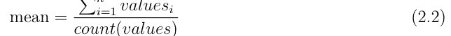

下面这个名为`column_means()`的函数计算数据集中每一列的均值。

```python
# calculate column means
def column_means(dataset):
    means = [0 for i in range(len(dataset[0]))]
    for i in range(len(dataset[0])):
        col_values = [row[i] for row in dataset]
        means[i] = sum(col_values) / float(len(dataset))
    return means
```

### 清单 2.10：计算数据集中每列均值的函数。

标准差描述了数值相对于均值的平均离散程度。它的计算方法是：先求每个值与均值之差的平方和，然后除以数值个数减1，最后开平方。

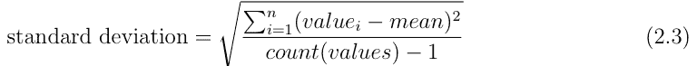

#### 2.2 教程

```python
# Estimate mean and standard deviation
means = column_means(dataset)
stdevs = column_stdevs(dataset, means)
print(means)
print(stdevs)
```

### 清单 2.14：从人为数据集中计算统计量的示例。

执行该示例会提供以下输出，与电子表格中计算出的数字一致。

```
[[50, 30], [20, 90], [30, 50]]
[33.333333333333336, 56.666666666666664]
[15.275252316519467, 30.550504633038933]
```

### 清单 2.15：从人为数据集计算统计量的示例输出。

一旦计算出了汇总统计量，我们就可以很容易地标准化每一列中的值。标准化给定值的计算公式如下：

standardized_value_i = \frac{value_i - mean}{stdev} (2.4)

下面是一个名为`standardize_dataset()`的函数，它实现了这个方程。

```python
# standardize dataset
def standardize_dataset(dataset, means, stdevs):
    for row in dataset:
        for i in range(len(row)):
            row[i] = (row[i] - means[i]) / stdevs[i]
```

```python
# Standardize dataset
dataset = [[50, 30], [20, 90], [30, 50]]
print(dataset)
# Estimate mean and standard deviation
means = column_means(dataset)
stdevs = column_stdevs(dataset, means)
print(means)
print(stdevs)
# standardize dataset
standardize_dataset(dataset, means, stdevs)
print(dataset)
```

### 清单 2.17：标准化人为数据集的示例。

执行该示例会产生以下输出，显示了人为数据集的标准化值。

```
[[50, 30], [20, 90], [30, 50]]
[33.333333333333336, 56.666666666666664]
[15.275252316519467, 30.550504633038933]
[[1.0910894511799618, -0.8728715609439694], [-0.8728715609439697, 1.091089451179962],
[-0.21821789023599253, -0.2182178902359923]]
```

### 清单 2.18：标准化人为数据集的示例输出。

同样，我们可以演示机器学习数据集的标准化。下面的示例演示了如何加载并标准化皮马印第安人糖尿病数据集，假定该数据集与之前的归一化示例一样位于当前工作目录中。

```python
# Standardize the Diabetes Dataset
from csv import reader
from math import sqrt

# Load a CSV file
def load_csv(filename):
    dataset = list()
    with open(filename, 'r') as file:
        csv_reader = reader(file)
        for row in csv_reader:
            if not row:
                continue
            dataset.append(row)
    return dataset

# Convert string column to float
def str_column_to_float(dataset, column):
    for row in dataset:
        row[column] = float(row[column].strip())

# calculate column means
def column_means(dataset):
    means = [0 for i in range(len(dataset[0]))]
    for i in range(len(dataset[0])):
        col_values = [row[i] for row in dataset]
        means[i] = sum(col_values) / float(len(dataset))
    return means

# calculate column standard deviations
def column_stdevs(dataset, means):
    stdevs = [0 for i in range(len(dataset[0]))]
    for i in range(len(dataset[0])):
        variance = [pow(row[i]-means[i], 2) for row in dataset]
        stdevs[i] = sum(variance)
    stdevs = [sqrt(x/(float(len(dataset)-1))) for x in stdevs]
    return stdevs

# standardize dataset
def standardize_dataset(dataset, means, stdevs):
    for row in dataset:
        for i in range(len(row)):
            row[i] = (row[i] - means[i]) / stdevs[i]

# Load pima-indians-diabetes dataset
filename = 'pima-indians-diabetes.csv'
dataset = load_csv(filename)
print('Loaded data file {0} with {1} rows and {2} columns'.format(filename, len(dataset),
        len(dataset[0])))
# convert strings columns to float
for i in range(len(dataset[0])):
    str_column_to_float(dataset, i)
print(dataset[0])
# Estimate mean and standard deviation
means = column_means(dataset)
stdevs = column_stdevs(dataset, means)
# standardize dataset
standardize_dataset(dataset, means, stdevs)
print(dataset[0])
```

### 清单 2.19：标准化糖尿病数据集。

运行该示例会打印数据集的第一行，首先以加载时的原始格式打印，然后打印标准化后的结果，这样我们就可以看到差异并进行比较。

```
Loaded data file pima-indians-diabetes.csv with 768 rows and 9 columns
[6.0, 148.0, 72.0, 35.0, 0.0, 33.6, 0.627, 50.0, 1.0]
[0.6395304921176576, 0.8477713205896718, 0.14954329852954296, 0.9066790623472505,
   -0.6924393324742129, 0.2038799072674717, 0.468186870229798, 1.4250667195933604,
   1.3650063669598067]
```

### 清单 2.20：标准化糖尿病数据集的示例输出。

### 2.2.3 何时使用归一化和标准化

标准化是一种缩放技术，它假设你的数据符合正态分布。如果给定的数据属性是正态分布或接近正态分布，那么这可能是应该使用的缩放方法。最好记录标准化过程中使用的汇总统计量，以便将来在你可能希望与模型一起使用的数据上应用它们。归一化是一种不假设任何特定分布的缩放技术。


如果您的数据不符合正态分布，请考虑在应用机器学习算法之前对其进行归一化。记录归一化过程中使用的每一列的最小值和最大值是一种良好的做法，以防将来需要对新数据进行归一化以供模型使用。

#### 2.3 Extensions

还有许多其他数据变换可供应用。数据变换的理念是尽可能向学习算法暴露数据中问题的结构。前期可能不清楚需要哪些变换。试错与探索性数据分析（图表和统计量）相结合，有助于找出可能有效的方法。以下是一些您可能希望研究和实现的其他变换：

- 允许配置范围的归一化，例如 -1 到 1 及更多。
- 允许配置离散程度的标准化，例如距离均值 1、2 个或更多标准差。
- 指数变换，例如对数、平方根和幂。
- 幂变换，例如 Box-Cox 变换，用于修正正态分布数据中的偏态。

#### 2.4 Review

在本教程中，您了解了如何从头开始为机器学习重新缩放数据。具体来说，您学习了：

- 如何从头开始归一化数据。
- 如何从头开始标准化数据。
- 何时在数据上使用归一化或标准化。

##### 2.4.1 Further Reading

- 第 3 章 数据预处理，第 27 页，《应用预测建模》，2013 年 http://amzn.to/2e31NXF

##### 2.4.2 Next

在下一节教程中，您将了解如何估计预测建模算法在未见数据上的表现。

### Chapter 3 Algorithm Evaluation Methods

预测建模的目标是创建能够对新数据做出良好预测的模型。在训练时我们无法获取这些新数据，因此必须使用统计方法来估计模型在新数据上的性能。这类方法称为重采样方法，因为它们会对可用的训练数据进行重采样。在本教程中，您将了解如何在 Python 中从头开始实现重采样方法。完成本教程后，您将知道：

- 如何实现数据的训练集和测试集划分。
- 如何实现数据的 *k* 折交叉验证划分。

让我们开始吧。

#### 3.1 Description

重采样方法的目标是充分利用训练数据，以准确估计模型在新未见数据上的性能。准确的性能估计随后可用于帮助您选择使用哪组模型参数或选择哪个模型。

选择模型后，您可以在整个训练数据集上训练最终模型，并开始使用它进行预测。您可以使用两种常见的重采样方法：

- 数据的训练集和测试集划分。
- *k* 折交叉验证。

在本教程中，我们将探讨如何使用每种方法，以及何时选择其中一种而非另一种。

#### 3.2 Tutorial

本教程分为 3 个部分：

- 1. 训练集和测试集划分。
- 2. k 折交叉验证划分。
- 3. 如何选择重采样方法。

这些步骤将为您提供所需的基础，以便处理数据集的重采样，从而估计算法在新数据上的性能。

##### 3.2.1 Train and Test Split

训练集和测试集划分是最简单的重采样方法。因此，它也是最广泛使用的方法。训练集和测试集划分涉及将数据集分为两部分：

- 1. 训练数据集。
- 2. 测试数据集。

训练数据集由机器学习算法用于训练模型。测试数据集被保留，用于评估模型的性能。分配给每个数据集的行是随机选择的。这是为了确保模型的训练和评估是客观的。

如果比较多个算法或比较同一算法的多个配置，应使用相同的数据集训练集和测试集划分。这是为了确保性能比较的一致性或公平性。我们可以通过在拆分数据前以相同的方式为随机数生成器设置种子，或为多个算法保留相同的数据集划分来实现这一点。我们可以在一个函数中实现数据集的训练集和测试集划分。

以下是一个名为 `train_test_split()` 的函数，用于将数据集拆分为训练集和测试集。它接受两个参数：作为列表的列表的要拆分的数据集，以及一个可选的拆分百分比。默认拆分百分比为 0.6 或 60%。这将把 60% 的数据集分配给训练数据集，并将剩余的 40% 留给测试数据集。训练/测试 60/40 是数据的良好默认拆分。

该函数首先计算训练集从提供的数据集中需要多少行。会创建原始数据集的副本。随机选择行并从复制的数据集中移除，添加到训练数据集，直到训练数据集包含目标行数。然后将数据集副本中剩余的行作为测试数据集返回。使用 random 模块的 `randrange()` 函数在 0 到列表大小之间生成随机整数。

```python
# Split a dataset into a train and test set
def train_test_split(dataset, split=0.60):
    train = list()
    train_size = split * len(dataset)
    dataset_copy = list(dataset)
    while len(train) < train_size:
        index = randrange(len(dataset_copy))
        train.append(dataset_copy.pop(index))
    return train, dataset_copy
```

Listing 3.1: Function To Split a Dataset.

对于较大的数据集，可使用 k=10。检查折大小是否具有代表性的快速方法是计算均值和标准差等汇总统计量，并查看这些值与整个数据集上相同统计量的差异程度。我们可以重用前一节中关于创建训练集和测试集划分的知识，在此实现 k 折交叉验证。

与返回两组不同，我们必须返回 k 个折或 k 组数据。以下是一个名为 `cross_validation_split()` 的函数，用于实现数据的交叉验证划分。与之前一样，我们创建数据集的副本，从中抽取随机选择的行。我们将每个折的大小计算为数据集大小除以所需的折数。

fold size = \(\frac{count(rows)}{count(folds)}\) (3.1)

如果数据集不能被折数整除，可能会有一些剩余行，它们不会用于划分。然后我们创建一个所需大小的行列表，并将其添加到折列表中，最后返回该列表。

```python
# Split a dataset into $k$ folds
def cross_validation_split(dataset, folds=3):
    dataset_split = list()
    dataset_copy = list(dataset)
    fold_size = int(len(dataset) / folds)
    for i in range(folds):
        fold = list()
        while len(fold) < fold_size:
            index = randrange(len(dataset_copy))
            fold.append(dataset_copy.pop(index))
        dataset_split.append(fold)
    return dataset_split
```

Listing 3.4: Function Create A Cross-Validation Split.

我们可以在与上面相同的小型构造数据集上测试这种重采样方法。每行只有一个列值，但我们可以想象这如何扩展到标准机器学习数据集。完整示例如下所示。与之前一样，我们为随机数生成器设置种子，以确保每次执行代码时，相同的行都用于相同的折。出于演示目的，使用 k 值为 4。我们预计将 10 行分为 4 个折，每个折 2 行，余下 2 行不会用于划分。

```python
# Example of Creating a Cross Validation Split
from random import seed
from random import randrange

# Split a dataset into k folds
def cross_validation_split(dataset, folds=3):
    dataset_split = list()
    dataset_copy = list(dataset)
    fold_size = int(len(dataset) / folds)
    for _ in range(folds):
        fold = list()
        while len(fold) < fold_size:
            index = randrange(len(dataset_copy))
            fold.append(dataset_copy.pop(index))
        dataset_split.append(fold)
```


```python
return dataset_split

# test cross validation split
seed(1)
dataset = [[1], [2], [3], [4], [5], [6], [7], [8], [9], [10]]
folds = cross_validation_split(dataset, 4)
print(folds)
```

清单3.5：一个设计数据集上的交叉验证划分示例。

运行该示例会生成下面的输出。打印出了折叠（folds）列表，表明正如预期的那样，每个折叠有两行。

```text
[[[2], [9]], [[8], [3]], [[5], [6]], [[7], [10]]]
```

清单3.6：创建交叉验证划分的示例输出。

##### 3.2.3 如何选择重采样方法

评估机器学习算法在新数据上性能的黄金标准是*k*折交叉验证。如果配置得当，与其他方法（如训练/测试划分）相比，*k*折交叉验证能给出更稳健的性能估计。交叉验证的缺点在于运行起来可能非常耗时，需要训练并评估*k*个不同的模型。如果你有非常大的数据集，或者正在评估一个训练时间很长的模型，这就是一个问题。

训练/测试划分重采样方法是最广泛使用的方法。因为它易于理解和实现，并且能够快速估计算法性能。只需构建和评估单个模型。虽然训练/测试划分方法可能会对模型在新数据上的性能给出有噪声或不可靠的估计，但如果你有非常大的数据集，这个问题就不那么严重了。

大数据集是指拥有数十万或数百万条记录的数据集，大到足以将其分成两半，得到两个统计特性几乎相同的数据集。在这种情况下，可能几乎不需要使用*k*折交叉验证来评估算法，训练/测试划分可能同样可靠。

#### 3.3 扩展

在本教程中，我们介绍了两种最常见的重采样方法。你可能还想研究并实现其他方法作为本教程的扩展。例如：

- **重复训练/测试划分。** 这里使用训练/测试划分，但该过程会重复多次。
- **LOOCV或留一法交叉验证。** 这是*k*折交叉验证的一种形式，其中*k*的值固定为1。
- **分层抽样。** 在分类问题中，这种技术强制每个组中类别值的分布与原始数据集保持一致。

#### 3.4 回顾

在本教程中，你从头开始学习了如何在Python中实现重采样方法。具体来说，你学到了：

- 如何实现训练/测试划分方法。
- 如何实现*k*折交叉验证方法。
- 何时使用每种方法。

##### 3.4.1 延伸阅读

- 第9.6节，生成伪随机数，*Python标准库*  
  https://docs.python.org/2/library/random.html
- 第5.1节，交叉验证，第176页，*统计学习导论*，2014年。  
  http://amzn.to/2eeTyQx
- 第18.4节，评估与选择最佳假设，第708页，*人工智能：一种现代方法*，2010年。  
  http://amzn.to/2e31FqP
- 第4.4节，重采样技术，第69页，*应用预测建模*，2013年  
  http://amzn.to/2e31NXF
- 第5.3节，交叉验证，第149页，*数据挖掘：实用机器学习工具与技术*，第二版，2005年。  
  http://amzn.to/2fj3SYY

##### 3.4.2 下一步

在下一个教程中，你将学习如何评估预测建模算法所产生的预测结果。

### 第4章 评估指标

做出预测之后，你需要知道这些预测是否可靠。我们可以使用一些标准度量来概括一组预测的实际质量。了解一组预测的质量如何，可以让你对某个机器学习模型在你问题上的表现做出估计。在本教程中，你将学习如何用Python从头实现四种标准的预测评估指标。

学完本教程，你将了解：

- 如何实现分类准确率。
- 如何实现并解读混淆矩阵。
- 如何为回归实现平均绝对误差。
- 如何为回归实现均方根误差。

让我们开始吧。

#### 4.1 描述

在训练机器学习模型时，你必须评估一组预测的质量。像分类准确率和均方根误差这样的性能指标，可以让你清晰客观地了解一组预测的好坏，进而了解生成这些预测的模型的好坏。这很重要，因为它能让你区分并选择：

- 用于训练同一机器学习模型的不同数据变换。
- 基于同一数据训练出的不同机器学习模型。
- 同一数据上训练的机器学习模型的不同配置。

因此，性能指标是从零开始实现机器学习算法所必需的构建模块。

| 1 | 1 |
|---|---|

清单4.2：一组人为设计的预测与期望值的示例。

下面是一个使用该数据集测试accuracy_metric()函数的完整示例。

```python
# Example of calculating classification accuracy

# Calculate accuracy percentage between two lists
def accuracy_metric(actual, predicted):
    correct = 0
    for i in range(len(actual)):
        if actual[i] == predicted[i]:
            correct += 1
    return correct / float(len(actual)) * 100.0

# Test accuracy
actual = [0,0,0,0,0,1,1,1,1,1]
predicted = [0,1,0,0,0,1,0,1,1,1]
accuracy = accuracy_metric(actual, predicted)
print(accuracy)
```

清单4.3：计算分类准确率的示例。

运行该示例会得到期望的准确率80%（即8/10）。

| 80.0 |
|------|

清单4.4：计算分类准确率的示例输出。

当你只有少量类别值时，例如2个类别（也称为二分类问题），准确率是一个很好的指标。当类别值增多时，准确率开始失去意义，你可能需要从不同角度审视结果，例如使用混淆矩阵。

##### 4.2.2 混淆矩阵

混淆矩阵提供了所有预测结果与期望实际值的对比汇总。结果以矩阵形式呈现，每个单元格中是对应计数。预测类别值的计数按水平方向（行）汇总，而每个类别实际值的计数按垂直方向（列）呈现。一组完美的预测会表现为从矩阵左上角到右下角的对角线。

对于分类问题，混淆矩阵的价值在于你可以清楚地看到哪些预测是错误的，以及所犯错误的类型。

让我们创建一个计算混淆矩阵的函数。

我们首先定义一个函数，给定实际类别值列表和预测列表来计算混淆矩阵。该函数如下所示，名为confusion_matrix()。它首先列出所有唯一的类别值，并为每个类别值分配一个唯一的整数或索引到混淆矩阵中。

混淆矩阵始终是方阵，类别值的数量决定了所需的行数和列数。这里，矩阵的第一个索引是实际值的行，第二个索引是预测值的列。在创建方阵并将每个单元格的计数初始化为零之后，剩下的就是遍历所有预测并……

```python
# Test confusion matrix with integers
actual = [0,0,0,0,0,1,1,1,1,1,1]
predicted = [0,1,1,0,0,1,0,0,1,1,1]
unique, matrix = confusion_matrix(actual, predicted)
print(unique)
print(matrix)
```

清单4.7：计算混淆矩阵的示例。

运行该示例会生成下面的输出。示例首先打印唯一值列表，然后打印混淆矩阵。

```text
set([0, 1])
[[3, 1], [2, 4]]
```

清单4.8：计算混淆矩阵的示例输出。

这样很难解读结果。如果我们能按预期用行和列来显示矩阵，会更有帮助。下面是一个正确显示矩阵的函数。该函数名为`print_confusion_matrix()`。它将列命名为Z（对应实际值），将行命名为P（对应预测值）。每个列和行都以对应的类别值命名。

该矩阵的布局假设每个类别标签是单个字符或单个数字整数，并且计数也是单个数字整数。你可以将其扩展为处理较大的类别标签或预测计数，以此作为练习。

```python
# pretty print a confusion matrix
def print_confusion_matrix(unique, matrix):
    print('(^)' + ' '.join(str(x) for x in unique))
    print('(-)')
    for i, x in enumerate(unique):
        print("%s| %s" % (x, ' '.join(str(x) for x in matrix[i])))
```

清单4.9：美观打印混淆矩阵的函数。

我们可以将所有函数组合在一起，显示一个人类可读的混淆矩阵。

```python
# Example of Calculating and Displaying a Pretty Confusion Matrix

# calculate a confusion matrix
def confusion_matrix(actual, predicted):
    unique = set(actual)
    matrix = [list() for x in range(len(unique))]
    for i in range(len(unique)):
        matrix[i] = [0 for x in range(len(unique))]
    lookup = dict()
    for i, value in enumerate(unique):
        lookup[value] = i
    for i in range(len(actual)):
        x = lookup[actual[i]]
        y = lookup[predicted[i]]
        matrix[y][x] += 1
    return unique, matrix

# pretty print a confusion matrix
def print_confusion_matrix(unique, matrix):
    print('(^)' + ' '.join(str(x) for x in unique))
```


```python
print('(P)---')
for i, x in enumerate(unique):
    print("%s| %s" % (x, ' '.join(str(x) for x in matrix[i])))

# Test confusion matrix with integers
actual = [0,0,0,0,0,1,1,1,1,1]
predicted = [0,1,1,0,0,1,0,1,1,1]
unique, matrix = confusion_matrix(actual, predicted)
print_confusion_matrix(unique, matrix)
```

清单 4.10：计算并显示漂亮混淆矩阵的示例。

运行示例会产生以下输出。我们可以看到顶部和底部的类标签为 0 和 1。从左上角到右下角沿着矩阵对角线向下看，我们可以看到 3 次对 0 的预测是正确的，4 次对 1 的预测是正确的。

查看其他单元格，我们可以看到 2 + 1 或 3 个预测错误。我们可以看到有 2 次预测被标记为 1，但实际上是 0 类别值。我们可以看到有 1 次预测被标记为 0，但实际上是 1。

```text
(A)0 1
(P)---
0| 3 1
1| 2 4
```

清单 4.11：打印漂亮混淆矩阵的示例输出。

混淆矩阵始终是一个好主意，可以在分类准确率之外使用，以帮助解释预测。

##### 4.2.3 平均绝对误差

回归问题是那些预测真实值的问题。一个容易考虑的指标是预测值与预期值相比的误差。平均绝对误差（MAE）是一个很好的首选误差指标。它是通过绝对误差值的平均值计算得出的，其中 *绝对* 意味着变为正数，以便可以相加在一起。

$$MAE = \frac{\sum_{i=1}^{n} abs(predicted_i - actual_i)}{\text{total predictions}} \tag{4.2}$$

下面是一个名为 `mae_metric()` 的函数，它实现了这个指标。与上面一样，它期望一组实际结果值和一组预测值。我们使用内置的 `abs()` Python 函数来计算相加在一起的绝对误差值。

```python
# Calculate mean absolute error
def mae_metric(actual, predicted):
    sum_error = 0.0
    for i in range(len(actual)):
        sum_error += abs(predicted[i] - actual[i])
    return sum_error / float(len(actual))
```

清单 4.12：计算平均绝对误差的函数。

我们可以编造一个小回归数据集来测试这个函数。

```python
# Calculate root mean squared error
def rmse_metric(actual, predicted):
    sum_error = 0.0
    for i in range(len(actual)):
        prediction_error = predicted[i] - actual[i]
        sum_error += (prediction_error ** 2)
    mean_error = sum_error / float(len(actual))
    return sqrt(mean_error)
```

清单 4.16：计算均方根误差的函数。

我们可以在上面用于测试平均绝对误差计算的同一数据集上测试这个指标。下面是一个完整示例。同样，我们期望误差值通常接近 0.01。

```python
# Example of Calculating the Root Mean Squared Error
from math import sqrt

# Calculate root mean squared error
def rmse_metric(actual, predicted):
    sum_error = 0.0
    for i in range(len(actual)):
        prediction_error = predicted[i] - actual[i]
        sum_error += (prediction_error ** 2)
    mean_error = sum_error / float(len(actual))
    return sqrt(mean_error)

# Test RMSE
actual = [0.1, 0.2, 0.3, 0.4, 0.5]
predicted = [0.11, 0.19, 0.29, 0.41, 0.5]
rmse = rmse_metric(actual, predicted)
print(rmse)
```

清单 4.17：计算均方根误差的示例。

运行示例，我们看到以下结果。结果略高，为 0.0089。RMSE 值始终略高于 MSE 值，随着预测误差增加，这种差异会更加明显。使用 RMSE 而非 MSE 的好处在于，它会用更差的分数来惩罚较大的误差。

```text
0.00894427191
```

清单 4.18：计算均方根误差的示例输出。

#### 4.3 扩展

你只看到了最广泛使用的性能指标的一个小样本。还有许多其他性能指标你可能需要。下面是 5 个你可能希望实现以扩展本教程的额外性能指标列表：

- 分类的精确率。
- 分类的召回率。
- 分类的 F1 分数。
- 分类的 ROC 曲线下面积或 AUC。
- 回归的拟合优度或 $R^2$（R 平方）。

#### 4.4 回顾

在本教程中，你了解了如何在 Python 中从头实现算法预测性能指标。具体来说，你学习了：

- 如何实现和解释分类准确率。
- 如何实现和解释分类问题的混淆矩阵。
- 如何实现和解释回归的平均绝对误差。
- 如何实现和解释回归的均方根误差。

##### 4.4.1 进一步阅读

- 第 9.2 节，数学函数，*Python 标准库* https://docs.python.org/2/library/math.html

##### 4.4.2 下一步

在下一个教程中，你将了解如何在预测建模问题上建立性能基线。

### 第 5 章：基线模型

在预测建模问题上建立基线性能很重要。基线为你稍后评估的更高级方法提供了比较点。在本教程中，你将了解如何在 Python 中从头实现基线机器学习算法。

完成本教程后，你将知道：

- 如何实现随机预测算法。
- 如何实现零规则预测算法。

让我们开始吧。

#### 5.1 描述

有很多机器学习算法可供选择。事实上有数百种。你必须知道给定算法的预测是好是坏。但你怎么知道呢？答案是使用基线预测算法。基线预测算法提供一组预测，你可以像评估问题的任何其他预测一样来评估它们，例如分类准确率或 RMSE。

这些算法的得分在评估问题上的所有其他机器学习算法时提供了所需的比较点。一旦建立，你可以评论给定算法相比于天真基线算法好多少，从而提供关于给定方法实际上有多好的背景。最常用的两个基线算法是：

- 随机预测算法。
- 零规则算法。

当着手解决比传统分类或回归问题更困难的新问题时，首先针对你的预测问题制定一个特定的随机预测算法是个好主意。之后你可以在此基础上改进，并制定一个零规则算法。让我们实现这些算法并看看它们如何工作。

#### 5.2 教程

本教程分为 2 部分：

- 随机预测算法。
- 零规则算法。

这些步骤将为你提供实现和计算机器学习算法基线性能所需的基础。

##### 5.2.1 随机预测算法

随机预测算法预测训练数据中观察到的随机结果。它可能是实现起来最简单的算法。它要求你存储训练数据中的所有不同结果值，在回归问题上如果有大量不同值，这可能会很大。

因为使用随机数来做决策，所以在使用算法之前修复随机数种子是个好主意。这是为了确保每次运行算法时都能得到同一组随机数，进而得到相同的决策。下面是一个名为 `random_algorithm()` 的函数中随机预测算法的实现。该函数既接受包含输出值的训练数据集，也接受需要预测输出值的测试数据集。该函数适用于分类和回归问题。它假设训练数据中的输出值是每行的最后一列。

首先，从训练数据中收集唯一输出值的集合。然后，为测试集中的每一行从集合中随机选择一个输出值。

```python
# Generate random predictions
def random_algorithm(train, test):
    output_values = [row[-1] for row in train]
    unique = list(set(output_values))
    predicted = list()
    for row in test:
        index = randrange(len(unique))
        predicted.append(unique[index])
    return predicted
```

清单 5.1：生成随机预测的函数。

为了简单起见，我们可以用一个只包含输出列的小数据集来测试这个函数。训练数据集中的输出值要么是 0 要么是 1，这意味着算法将从中选择的预测集是 (0, 1)。测试集也包含单列，没有数据，因为预测未知。

```python
# Example of Making Random Predictions
from random import seed
from random import randrange

# Generate random predictions
def random_algorithm(train, test):
    output_values = [row[-1] for row in train
```


#### 5.2 教程

```
unique = list(set(output_values))
predicted = list()
for _ in test:
    index = randrange(len(unique))
    predicted.append(unique[index])
return predicted

seed(1)
train = [[0], [1], [0], [1], [0], [1]]
test = [[None], [None], [None], [None]]
predictions = random_algorithm(train, test)
print(predictions)
```

### 列表 5.2: 进行随机预测的示例。

运行该示例会为测试数据集计算随机预测并打印这些预测。

```
[0, 1, 1, 0]
```

### 列表 5.3: 进行随机预测的示例输出。

随机预测算法易于实现且运行速度快，但作为基准我们可以做得更好。

##### 5.2.2 零规则算法

零规则算法比随机算法更好的基准。它使用关于给定问题的更多信息来创建一条规则以进行预测。此规则取决于问题类型。让我们从分类问题开始，预测类标签。

### 分类

对于分类问题，唯一的规则是预测训练数据集中最常见的类值。这意味着如果训练数据集有90个类0的实例和10个类1的实例，它将预测0并达到90/100或90%的基准准确率。

这比随机预测算法好得多，后者平均只能达到82%的准确率。关于如何计算此随机搜索估计值的详细信息，请参见下方：

```
= ((0.9 x 0.9) + (0.1 x 0.1)) x 100
= 82%
(5.1)
```

下面是一个名为 zero_rule_algorithm_classification() 的函数，它针对分类情况实现了此功能。

```
# zero rule algorithm for classification
def zero_rule_algorithm_classification(train, test):
    output_values = [row[-1] for row in train]
    prediction = max(set(output_values), key=output_values.count)
    predicted = [prediction for i in range(len(test))]
    return predicted
```

### 列表 5.4: 生成零规则分类预测的函数。

该函数使用带有 key 属性的 max() 函数，这有点巧妙。给定训练数据中观察到的类值列表，max() 函数获取一组唯一的类值，并对集合中每个类值的类值列表调用 count。结果是，它返回在训练数据集中观察到的类值列表中具有最高观察值计数的类值。

如果所有类值的计数相同，则我们将选择数据集中观察到的第一个类值。一旦选择一个类值，它将用于对测试数据集中的每一行进行预测。下面是一个使用包含4个类0示例和2个类1示例的构造数据集的示例。我们期望算法为测试数据集中的每一行选择类值0作为预测。

```
# Example of Zero Rule Classification Predictions
from random import seed

# zero rule algorithm for classification
def zero_rule_algorithm_classification(train, test):
    output_values = [row[-1] for row in train]
    prediction = max(set(output_values), key=output_values.count)
    predicted = [prediction for i in range(len(test))]
    return predicted

seed(1)
train = [['0'], ['0'], ['0'], ['0'], ['1'], ['1']]
test = [[None], [None], [None], [None]]
predictions = zero_rule_algorithm_classification(train, test)
print(predictions)
```

### 列表 5.5: 零规则分类预测的示例。

运行此示例会生成预测并将其打印到屏幕上。如预期，类值0被选中并预测。

```
['0', '0', '0', '0']
```

### 列表 5.6: 生成零规则分类预测的示例输出。

### 回归

回归问题需要预测实数值。对实数值的良好默认预测是预测中心趋势。这可能是均值或中位数。良好的默认做法是使用训练数据中观察到的输出值的均值（也称为平均值）。

这可能比随机预测具有更低的误差，后者将返回任何观察到的输出值。下面是一个名为 zero_rule_algorithm_regression() 的函数，用于执行此操作。它通过计算观察到的输出值的均值来工作。

mean = \frac{\sum_{i=1}^n value_i}{count(values)} (5.2)

计算后，均值随后被预测为训练数据中每一行的值。

```
# zero rule algorithm for regression
def zero_rule_algorithm_regression(train, test):
    output_values = [row[-1] for row in train]
    prediction = sum(output_values) / float(len(output_values))
    predicted = [prediction for i in range(len(test))]
    return predicted
```

### 列表 5.7: 生成零规则回归预测的函数。

可以使用简单示例测试此函数。我们可以构造一个小数据集，其中均值已知为15。

```
10
15
12
15
18
20
mean = (10 + 15 + 12 + 15 + 18 + 20) / 6
mean = 90 / 6
mean = 15
```

### 列表 5.8: 构造的回归数据集和预期均值。

下面是完整示例。我们期望均值15将被预测为测试数据集中每一行的值。

```
# Example of Zero Rule Regression Predictions
from random import seed

# zero rule algorithm for regression
def zero_rule_algorithm_regression(train, test):
    output_values = [row[-1] for row in train]
    prediction = sum(output_values) / float(len(output_values))
    predicted = [prediction for i in range(len(test))]
    return predicted

seed(1)
train = [[10], [15], [12], [15], [18], [20]]
test = [[None], [None], [None], [None]]
predictions = zero_rule_algorithm_regression(train, test)
print(predictions)
```

### 列表 5.9: 零规则回归预测的示例。

运行该示例会计算打印的预测输出值。如预期，均值15被预测为测试数据集中每一行的值。

```
[15.0, 15.0, 15.0, 15.0]
```

### 列表 5.10: 生成零规则回归预测的示例输出。

#### 5.3 扩展

下面是一些基准算法的扩展，你可能希望调查并作为本教程的扩展来实现。

- 替代中心趋势，其中预测中位数、众数或其他中心趋势计算，而不是均值。
- 用于时间序列问题的移动平均，其中预测最后n条记录的均值。

#### 5.4 回顾

在本教程中，你发现了在机器学习问题上计算性能基准的重要性。

你现在知道：

- 如何为分类和回归问题实现随机预测算法。
- 如何为分类和回归问题实现零规则算法。

##### 5.4.1 下一步

本教程结束了关于数据准备的第1部分。接下来，你将开始关于线性算法的第2部分。在下一个教程中，你将发现如何实现一个测试套件以一致地评估预测建模算法。

## 第6章

## 算法测试套件

我们无法知道哪种算法最适合给定问题。因此，我们需要设计一个测试套件，用于评估不同的机器学习算法。在本教程中，你将发现如何在Python中从头开始开发机器学习算法测试套件。完成本教程后，你将知道：

- 如何实现训练-测试算法测试套件。
- 如何实现k折交叉验证算法测试套件。

让我们开始吧。

#### 6.1 描述

测试套件提供了一种在数据集上评估机器学习算法的一致方式。它涉及3个要素：

- 用于拆分数据集的重采样方法。
- 要评估的机器学习算法。
- 用于评估预测的性能度量。

加载和准备数据集是使用测试套件之前必须完成的先决步骤。测试套件必须允许评估不同的机器学习算法，同时保持数据集、重采样方法和性能度量不变。在本教程中，我们将使用真实数据集来演示测试套件。

##### 6.1.1 皮马印第安人糖尿病数据集

在本教程中，我们将使用皮马印第安人糖尿病数据集。该数据集涉及在5年内预测糖尿病的发病。该问题上的基准性能约为65%。你可以在附录A，第A.4节中了解更多信息。下载数据集并将其保存到当前工作目录中，文件名为 pima-indians-diabetes.csv。


#### 6.2 教程

本教程分为两个主要部分：

- 1. 训练-测试算法测试工具。
- 2. 交叉验证算法测试工具。

这些测试工具将为您提供所需的基础，以便在给定的预测建模问题上评估一系列机器学习算法。

##### 6.2.1 训练-测试算法测试工具

训练-测试分割是一种简单的重采样方法，可用于评估机器学习算法。因此，它是开发测试工具的良好起点。我们可以假设先前已经开发了一个用于将数据集分割为训练集和测试集的函数，以及一个用于评估一组预测准确性的函数。

我们需要一个函数，它接收一个数据集和一个算法，并返回一个性能分数。下面是一个名为 evaluate_algorithm() 的函数，它实现了这一功能。它接受 3 个固定参数，包括数据集、算法函数和训练-测试分割的分割百分比。

首先，将数据集分割为训练集和测试集元素。接下来，复制一份测试集，并将每个输出值设置为 None 值以清除，防止算法意外作弊。

作为参数提供的算法是一个函数，它期望准备好训练和测试数据集，然后进行预测。算法可能需要额外的配置参数。这通过使用 evaluate_algorithm() 函数中的可变参数 *args 并将它们传递给算法函数来处理。

算法函数应返回一个预测列表，每个预测对应训练数据集中的一行。这些预测通过 accuracy_metric() 函数与未修改的测试集中的实际输出值进行比较。最后返回准确率。

```python
# Evaluate an algorithm using a train/test split
def evaluate_algorithm(dataset, algorithm, split, *args):
    train, test = train_test_split(dataset, split)
    test_set = list()
    for row in test:
        row_copy = list(row)
        row_copy[-1] = None
        test_set.append(row_copy)
    predicted = algorithm(train, test_set, *args)
    actual = [row[-1] for row in test]
    accuracy = accuracy_metric(actual, predicted)
    return accuracy
```

清单 6.1：使用训练/测试分割评估算法的函数。

评估函数确实做出了一些强假设，但如果需要，可以轻松更改。具体来说，它假设数据集中的最后一列始终是输出值。可以使用不同的列。使用 accuracy_metric() 假设问题是分类问题，但对于回归问题，可以将其改为均方误差。

让我们用一个实际示例将其组合起来。我们将使用皮马印第安人糖尿病数据集并评估零规则算法。

```python
# Example of a Train-Test Test Harness
from random import seed
from random import randrange
from csv import reader

# Load a CSV file
def load_csv(filename):
    dataset = list()
    with open(filename, 'r') as file:
        csv_reader = reader(file)
        for row in csv_reader:
            if not row:
                continue
            dataset.append(row)
    return dataset

# Convert string column to float
def str_column_to_float(dataset, column):
    for row in dataset:
        row[column] = float(row[column].strip())

# Split a dataset into a train and test set
def train_test_split(dataset, split):
    train = list()
    train_size = split * len(dataset)
    dataset_copy = list(dataset)
    while len(train) < train_size:
        index = randrange(len(dataset_copy))
        train.append(dataset_copy.pop(index))
    return train, dataset_copy

# Calculate accuracy percentage
def accuracy_metric(actual, predicted):
    correct = 0
    for i in range(len(actual)):
        if actual[i] == predicted[i]:
            correct += 1
    return correct / float(len(actual)) * 100.0

# Evaluate an algorithm using a train/test split
def evaluate_algorithm(dataset, algorithm, split, *args):
    train, test = train_test_split(dataset, split)
    test_set = list()
    for row in test:
        row_copy = list(row)
        row_copy[-1] = None
        test_set.append(row_copy)
    predicted = algorithm(train, test_set, *args)
    actual = [row[-1] for row in test]
    accuracy = accuracy_metric(actual, predicted)
    return accuracy

# zero rule algorithm for classification
```

```python
def zero_rule_algorithm_classification(train, test):
    output_values = [row[-1] for row in train]
    prediction = max(set(output_values), key=output_values.count)
    predicted = [prediction for i in range(len(test))]
    return predicted

# Test the train/test harness
seed(1)
# load and prepare data
filename = 'pima-indians-diabetes.csv'
dataset = load_csv(filename)
for i in range(len(dataset[0])):
    str_column_to_float(dataset, i)
# evaluate algorithm
split = 0.6
accuracy = evaluate_algorithm(dataset, zero_rule_algorithm_classification, split)
print('Accuracy: %.3f%%' % (accuracy))
```

清单 6.2：在糖尿病数据集上使用训练/测试算法测试工具的示例。

数据集被分割为 60% 用于训练模型，40% 用于评估模型。请注意，零规则算法的名称 `zero_rule_algorithm_classification` 是如何作为参数传递给 `evaluate_algorithm()` 函数的。您可以看到这个测试工具如何与不同算法反复使用。运行上面的示例会打印出模型的准确率。

```text
Accuracy: 69.055%
```

清单 6.3：使用训练/测试分割的示例输出。

##### 6.2.2 交叉验证算法测试工具

交叉验证是一种重采样技术，可以更可靠地估计算法在未知数据上的性能。它需要在数据的不同子集上创建和评估 k 个模型，因此计算成本更高。然而，它是评估机器学习算法的黄金标准。

与上一节类似，我们需要创建一个函数，将重采样方法、算法在数据集上的评估以及性能计算方法整合在一起。与上面不同，算法必须在数据集的不同子集上多次评估。这意味着我们需要在 `evaluate_algorithm()` 函数中添加额外的循环。

下面是一个使用交叉验证实现算法评估的函数。首先，将数据集分成 n 个折组，称为 folds。接下来，我们循环遍历每个折，让每个折有机会被留出作为训练集外的验证集，并用于评估算法。创建折列表的副本，并从该列表中移除留出的折。然后，将折列表展平成一个长的行列表，以匹配算法对训练数据集的期望。这是使用 `sum()` 函数完成的。

一旦训练数据集准备好，该循环内的其余函数与上面相同。复制测试数据集（即该折），并清除输出值，以避免算法意外作弊。算法在训练数据集上准备，并在测试数据集上进行预测。预测结果被评估并存储在列表中。与训练-测试算法测试工具不同，这里返回一个分数列表，每个交叉验证折对应一个分数。

```python
# Evaluate an algorithm using a cross-validation split
def evaluate_algorithm(dataset, algorithm, n_folds, *args):
    folds = cross_validation_split(dataset, n_folds)
    scores = list()
    for fold in folds:
        train_set = list(folds)
        train_set.remove(fold)
        train_set = sum(train_set, [])
        test_set = list()
        for row in fold:
            row_copy = list(row)
            test_set.append(row_copy)
            row_copy[-1] = None
        predicted = algorithm(train_set, test_set, *args)
        actual = [row[-1] for row in fold]
        accuracy = accuracy_metric(actual, predicted)
        scores.append(accuracy)
    return scores
```

清单 6.4：使用 *k* 折交叉验证评估算法的函数。

虽然代码上稍微复杂且运行速度较慢，但该函数提供了更稳健的算法性能估计。我们可以将所有这些与糖尿病数据集上的零规则算法的一个完整示例结合起来。

```python
# Example of a Cross Validation Test Harness
from random import seed
from random import randrange
from csv import reader

# Load a CSV file
def load_csv(filename):
    dataset = list()
    with open(filename, 'r') as file:
        csv_reader = reader(file)
        for row in csv_reader:
            if not row:
                continue
            dataset.append(row)
    return dataset

# Convert string column to float
def str_column_to_float(dataset, column):
    for row in dataset:
        row[column] = float(row[column].strip())

# Split a dataset into k folds
def cross_validation_split(dataset, n_folds):
    dataset_split = list()
    dataset_copy = list(dataset)
    fold_size = int(len(dataset) / n_folds)
    for _ in range(n_folds):
        fold = list()
        while len(fold) < fold_size:
            index = randrange(len(dataset_copy))
            fold.append(dataset_copy.pop(index))
```


dataset_split.append(fold)
return dataset_split
```

```
# Calculate accuracy percentage
def accuracy_metric(actual, predicted):
    correct = 0
    for i in range(len(actual)):
        if actual[i] == predicted[i]:
            correct += 1
    return correct / float(len(actual)) * 100.0
```

```
# Evaluate an algorithm using a cross validation split
def evaluate_algorithm(dataset, algorithm, n_folds, *args):
    folds = cross_validation_split(dataset, n_folds)
    scores = list()
    for fold in folds:
        train_set = list(folds)
        train_set.remove(fold)
        train_set = sum(train_set, [])
        test_set = list()
        for row in fold:
            row_copy = list(row)
            test_set.append(row_copy)
            row_copy[-1] = None
        predicted = algorithm(train_set, test_set, *args)
        actual = [row[-1] for row in fold]
        accuracy = accuracy_metric(actual, predicted)
        scores.append(accuracy)
    return scores
```

```
# zero rule algorithm for classification
def zero_rule_algorithm_classification(train, test):
    output_values = [row[-1] for row in train]
    prediction = max(set(output_values), key=output_values.count)
    predicted = [prediction for i in range(len(test))]
    return predicted
```

```
# Test cross validation test harness
seed(1)
# load and prepare data
filename = 'pima-indians-diabetes.csv'
dataset = load_csv(filename)
for i in range(len(dataset[0])):
    str_column_to_float(dataset, i)
# evaluate algorithm
n_folds = 5
scores = evaluate_algorithm(dataset, zero_rule_algorithm_classification, n_folds)
print('Scores: %s' % scores)
print('Mean Accuracy: %.3f%%' % (sum(scores)/len(scores)))
```

列表 6.5: 糖尿病数据集上 k 折交叉验证算法测试框架示例。

共使用了 5 个交叉验证折叠来评估零规则算法。因此，evaluate_algorithm() 算法返回了 5 个分数。运行此示例既会打印计算出的分数列表，也会打印平均分数。

分数: [60.130718954248366, 62.745098039215684, 64.70588235294117, 71.89542483660131,
66.01307189542483]
平均准确率: 65.098%

列表 6.6: 使用交叉验证测试框架的示例输出。

你现在有两个不同的测试框架可用于评估自己的机器学习算法。

#### 6.3 扩展

本节列出了本教程的扩展，你可以考虑。

- **参数化评估**。传入用于评估预测的函数，使你能够无缝处理回归问题。
- **参数化重采样**。传入用于计算重采样分割的函数，使你能够轻松在训练-测试和交叉验证方法之间切换。
- **标准差分数**。计算标准差，以了解使用交叉验证评估算法时分数的离散程度。

#### 6.4 回顾

在本教程中，你了解了如何从头开始创建测试框架来评估机器学习算法。具体来说，你现在知道：

- 如何实现和使用训练-测试算法测试框架。
- 如何实现和使用交叉验证算法测试框架。

##### 6.4.1 下一节

在下一个教程中，你将了解如何实现和应用简单线性回归算法。

## 第 7 章

## 简单线性回归

线性回归是一种有着 200 多年历史的预测方法。简单线性回归是一个非常适合初学者实现的第一个机器学习算法，因为它要求你从训练数据集中估计属性，但又足够简单，初学者也能理解。在本教程中，你将了解如何在 Python 中从头开始实现简单线性回归算法。

完成本教程后，你将知道：

- 如何从训练数据中估计统计量。
- 如何从数据中估计线性回归系数。
- 如何使用线性回归对新数据进行预测。

让我们开始吧。

#### 7.1 描述

本节分为两部分：简单线性回归技术的描述，以及我们稍后将应用该技术的数据集的描述。

##### 7.1.1 简单线性回归

线性回归假设输入变量 (X) 与单个输出变量 (y) 之间存在线性或直线关系。更具体地说，输出 (y) 可以通过输入变量 (X) 的线性组合来计算。当只有一个输入变量时，该方法称为简单线性回归。

在简单线性回归中，我们可以使用训练数据上的统计量来估计模型所需的系数，以便对新数据进行预测。简单线性回归模型的直线可以写成：

```
y = b0 + b1 × x
(7.1)
```

其中 b0 和 b1 是我们必须从训练数据中估计的系数。一旦系数已知，我们就可以使用此方程来估计给定新输入示例 x 时的输出值 y。这要求你从数据中计算统计属性，例如均值、方差和协方差。

所有代数推导都已处理完毕，我们只需实现一些算术运算来估计简单线性回归系数。简而言之，我们可以按如下方式估计系数：

\(B1 = \frac{\sum_{i=1}^n ((x_i - mean(x)) \times (y_i - mean(y)))}{\sum_{i=1}^n (x_i - mean(x))^2}\)
\(B0 = mean(y) - B1 \times mean(x)\)

其中 i 指的是输入 x 或输出 y 的第 i 个值。如果现在还不清楚，不要担心，这些是我们将在本教程中实现的函数。

##### 7.1.2 瑞典汽车保险数据集

在本教程中，我们将使用瑞典汽车保险数据集。该数据集涉及总索赔支付的预测。该问题的基准 RMSE 约为 72.251 千克朗。你可以在附录 A 第 A.2 节中了解更多信息。下载数据集并将其保存到当前工作目录中，文件名为 insurance.csv。注意：你可能需要将欧洲逗号 (,) 转换为小数点 (.)。你还需要将文件从空格分隔的变量更改为 CSV 格式。

#### 7.2 教程

本教程分为五个部分：

- 1. 计算均值和方差。
- 2. 计算协方差。
- 3. 估计系数。
- 4. 进行预测。
- 5. 瑞典汽车保险案例研究。

这些步骤将为你实现和训练用于自身预测问题的简单线性回归模型奠定基础。

##### 7.2.1 计算均值和方差

第一步是从训练数据中估计输入和输出变量的均值和方差。一组数字的均值可以按如下方式计算：

\(mean(x) = \frac{\sum_{i=1}^n x_i}{count(x)}\)

下面是一个名为 mean() 的函数，它为一组数字实现此行为。

```python
# Calculate the mean value of a list of numbers
def mean(values):
    return sum(values) / float(len(values))
```

列表 7.1: 计算一组数字均值的函数。

方差是每个值与均值之差的平方和。一组数字的方差可以按如下方式计算：

variance = \sum_{i=1}^n (x_i - mean(x))^2 (7.4)

下面是一个名为 variance() 的函数，用于计算一组数字的方差。它要求将列表的均值作为参数提供，这样我们就不需要多次计算它。

```python
# Calculate the variance of a list of numbers
def variance(values, mean):
    return sum([(x-mean)**2 for x in values])
```

列表 7.2: 计算一组数字方差的函数。

我们可以将这两个函数放在一起，并在一个小的构造数据集上对其进行测试。下面是一个 x 和 y 值的小数据集。

| x | y |
|---|---|
| 1 | 1 |
| 2 | 3 |
| 4 | 3 |
| 3 | 2 |
| 5 | 5 |

列表 7.3: 用于测试的小型构造数据集。

我们可以按如下方式将此数据集绘制在散点图上：

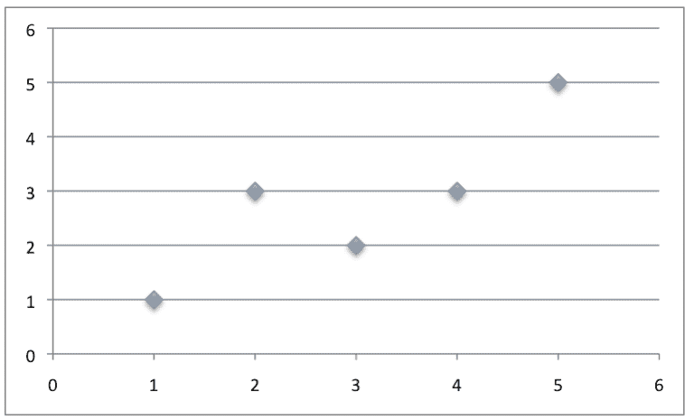

图 7.1: 小型构造数据集的图表。


我们可以计算下面示例中 x 和 y 值的均值和方差。

```python
# Example of Estimating Mean and Variance

# Calculate the mean value of a list of numbers
def mean(values):
    return sum(values) / float(len(values))

# Calculate the variance of a list of numbers
def variance(values, mean):
    return sum([(x-mean)**2 for x in values])

# calculate mean and variance
dataset = [[1, 1], [2, 3], [4, 3], [3, 2], [5, 5]]
x = [row[0] for row in dataset]
y = [row[1] for row in dataset]
mean_x, mean_y = mean(x), mean(y)
var_x, var_y = variance(x, mean_x), variance(y, mean_y)
print('x stats: mean=%.3f variance=%.3f' % (mean_x, var_x))
print('y stats: mean=%.3f variance=%.3f' % (mean_y, var_y))
```

清单 7.4：在人为构造的数据集上计算均值和方差的示例。

运行该示例将打印出两列的均值和方差。

```text
x stats: mean=3.000 variance=10.000
y stats: mean=2.800 variance=8.800
```

清单 7.5：在人为构造的数据集上计算均值和方差的示例输出。

这是我们的第一步；接下来，我们需要利用这些值来计算协方差。

##### 7.2.2 计算协方差

两组数字的协方差描述了这些数字如何一起变化。协方差是相关性的推广。相关性描述两组数字之间的关系，而协方差可以描述两组或多组数字之间的关系。此外，协方差可以归一化以产生相关值。尽管如此，我们可以按如下方式计算两个变量之间的协方差：

\(covariance = \sum_{i=1}^{n} ((x_i - mean(x)) \times (y_i - mean(y)))\) (7.5)

下面是一个名为 `covariance()` 的函数，用于实现这一统计量。它建立在前面步骤的基础上，将 x 和 y 值的列表以及这些值的均值作为参数。

```python
# Calculate covariance between x and y
def covariance(x, mean_x, y, mean_y):
    covar = 0.0
    for i in range(len(x)):
        covar += (x[i] - mean_x) * (y[i] - mean_y)
    return covar
```

清单 7.6：用于计算协方差的函数。

我们可以使用与上一节相同的小型人为构造数据集来测试协方差的计算。将所有这些放在一起，我们得到下面的示例。

```python
# Example of Calculating Covariance

# Calculate the mean value of a list of numbers
def mean(values):
    return sum(values) / float(len(values))

# Calculate covariance between x and y
def covariance(x, mean_x, y, mean_y):
    covar = 0.0
    for i in range(len(x)):
        covar += (x[i] - mean_x) * (y[i] - mean_y)
    return covar

# calculate covariance
dataset = [[1, 1], [2, 3], [4, 3], [3, 2], [5, 5]]
x = [row[0] for row in dataset]
y = [row[1] for row in dataset]
mean_x, mean_y = mean(x), mean(y)
covar = covariance(x, mean_x, y, mean_y)
print('Covariance: %.3f' % (covar))
```

清单 7.7：在人为构造的数据集上计算协方差的示例。

运行该示例会打印 x 和 y 变量的协方差。

```text
Covariance: 8.000
```

清单 7.8：在人为构造的数据集上计算协方差的示例输出。

现在，我们已经具备了计算模型系数所需的所有部分。

##### 7.2.3 估计系数

在简单线性回归中，我们必须估计两个系数的值。第一个是 B1，可以通过以下公式估计：

\(B1 = \frac{\sum_{i=1}^{n} (x_i - mean(x)) \times (y_i - mean(y))}{\sum_{i=1}^{n} (x_i - mean(x))^2}\) (7.6)

我们已经在上面学到了一些内容，可以将该算式简化为：

\(B1 = \frac{covariance(x, y)}{variance(x)}\) (7.7)

我们已经有了计算 `covariance()` 和 `variance()` 的函数。接下来，我们需要估计 B0 的值，它也称为截距，因为它控制直线与 y 轴相交的起点。

\(B0 = mean(y) - B1 \times mean(x)\) (7.8)

同样，我们知道如何估计 B1，并且我们有一个函数来估计 `mean()`。我们可以将所有这些组合到一个名为 `coefficients()` 的函数中，该函数以数据集为参数并返回系数。

```python
# Calculate coefficients
def coefficients(dataset):
    x = [row[0] for row in dataset]
    y = [row[1] for row in dataset]
    x_mean, y_mean = mean(x), mean(y)
    b1 = covariance(x, x_mean, y, y_mean) / variance(x, x_mean)
    b0 = y_mean - b1 * x_mean
    return [b0, b1]
```

清单 7.9：用于计算系数的函数。

我们可以将它与前两步中的所有函数组合在一起，并测试系数的计算。

```python
# Example of Calculating Coefficients
# Calculate the mean value of a list of numbers
def mean(values):
    return sum(values) / float(len(values))
# Calculate covariance between x and y
def covariance(x, mean_x, y, mean_y):
    covar = 0.0
    for i in range(len(x)):
        covar += (x[i] - mean_x) * (y[i] - mean_y)
    return covar
# Calculate the variance of a list of numbers
def variance(values, mean):
    return sum([(x-mean)**2 for x in values])
# Calculate coefficients
def coefficients(dataset):
    x = [row[0] for row in dataset]
    y = [row[1] for row in dataset]
    x_mean, y_mean = mean(x), mean(y)
    b1 = covariance(x, x_mean, y, y_mean) / variance(x, x_mean)
    b0 = y_mean - b1 * x_mean
    return [b0, b1]
# calculate coefficients
dataset = [[1, 1], [2, 3], [4, 3], [3, 2], [5, 5]]
b0, b1 = coefficients(dataset)
print('Coefficients: B0=%.3f, B1=%.3f' % (b0, b1))
```

清单 7.10：在人为构造的数据集上计算系数的示例。

运行该示例将计算并打印系数。

```text
Coefficients: B0=0.400, B1=0.800
```

清单 7.11：在人为构造的数据集上计算系数的示例输出。

既然我们知道了如何估计系数，下一步就是使用它们。

##### 7.2.4 进行预测

简单线性回归模型是由训练数据估计的系数定义的一条直线。一旦估计出系数，我们就可以使用它们进行预测。使用简单线性回归模型进行预测的公式如下：

```text
y = b0 + b1 x
```

下面是一个名为 `simple_linear_regression()` 的函数，它实现了预测方程，用于在测试数据集上进行预测。它还将上述步骤中在训练数据上估计系数的工作联系在一起。从训练数据中准备好的系数用于对测试数据进行预测，然后返回预测结果。

```python
def simple_linear_regression(train, test):
    predictions = list()
    b0, b1 = coefficients(train)
    for row in test:
        yhat = b0 + b1 * row[0]
        predictions.append(yhat)
    return predictions
```

清单 7.12：用于运行简单线性回归的函数。

让我们将所学的一切汇总起来，对我们简单的人为构造数据集进行预测。作为该示例的一部分，我们还将添加一个名为 `evaluate_algorithm()` 的函数来管理预测的评估，以及另一个名为 `rmse_metric()` 的函数来估计预测的均方根误差。完整示例如下所示。

```python
# Example of Standalone Simple Linear Regression
from math import sqrt

# Calculate root mean squared error
def rmse_metric(actual, predicted):
    sum_error = 0.0
    for i in range(len(actual)):
        prediction_error = predicted[i] - actual[i]
        sum_error += (prediction_error ** 2)
    mean_error = sum_error / float(len(actual))
    return sqrt(mean_error)

# Evaluate regression algorithm on training dataset
def evaluate_algorithm(dataset, algorithm):
    test_set = list()
    for row in dataset:
        row_copy = list(row)
        row_copy[-1] = None
        test_set.append(row_copy)
    predicted = algorithm(dataset, test_set)
    print(predicted)
    actual = [row[-1] for row in dataset]
    rmse = rmse_metric(actual, predicted)
    return rmse

# Calculate the mean value of a list of numbers
def mean(values):
    return sum(values) / float(len(values))
```


```python
# Calculate covariance between x and y
def covariance(x, mean_x, y, mean_y):
    covar = 0.0
    for i in range(len(x)):
        covar += (x[i] - mean_x) * (y[i] - mean_y)
    return covar

# Calculate the variance of a list of numbers
def variance(values, mean):
    return sum([(x-mean)**2 for x in values])

# Calculate coefficients
def coefficients(dataset):
    x = [row[0] for row in dataset]
    y = [row[1] for row in dataset]
    x_mean, y_mean = mean(x), mean(y)
    b1 = covariance(x, x_mean, y, y_mean) / variance(x, x_mean)
    b0 = y_mean - b1 * x_mean
    return [b0, b1]

# Simple linear regression algorithm
def simple_linear_regression(train, test):
    predictions = list()
    b0, b1 = coefficients(train)
    for row in test:
        yhat = b0 + b1 * row[0]
        predictions.append(yhat)
    return predictions

# Test simple linear regression
dataset = [[1, 1], [2, 3], [4, 3], [3, 2], [5, 5]]
rmse = evaluate_algorithm(dataset, simple_linear_regression)
print('RMSE: %.3f' % (rmse))
```

清单 7.13：在构造数据集上进行简单线性回归的示例。

运行此示例将显示以下输出，该输出首先列出预测值以及这些预测的 RMSE。

```
[1.1999999999999995, 1.9999999999999996, 3.5999999999999996, 2.8, 4.3999999999999995]
RMSE: 0.693
```

清单 7.14：在构造数据集上进行简单线性回归的输出示例。

最后，我们可以将预测值绘制为一条线，并将其与原始数据集进行比较。

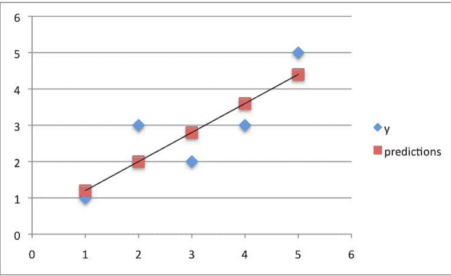

图 7.2：在构造数据集上简单线性回归预测的图示。

##### 7.2.5 瑞典汽车保险案例研究

我们现在知道如何实现简单线性回归模型。让我们将其应用于瑞典保险数据集。本节假设你已将数据集下载到文件 `insurance.csv`，并且它位于当前工作目录中。我们将在前几步的简单线性回归基础上添加一些便捷函数。

具体来说，有一个名为 `load_csv()` 的函数用于加载 CSV 文件，一个名为 `str_column_to_float()` 的函数用于将加载的数据集转换为数字，一个名为 `train_test_split()` 的函数用于使用训练集和测试集评估算法，一个名为 `rmse_metric()` 的函数用于计算 RMSE，还有一个名为 `evaluate_algorithm()` 的函数用于评估算法。

完整的示例如下。使用 60% 的数据作为训练数据集来准备模型，并在剩余的 40% 上进行预测。

```python
# Example of Simple Linear Regression on the Swedish Insurance Dataset
from random import seed
from random import randrange
from csv import reader
from math import sqrt

# Load a CSV file
def load_csv(filename):
    dataset = list()
    with open(filename, 'r') as file:
        csv_reader = reader(file)
        for row in csv_reader:
            if not row:
                continue
            dataset.append(row)
    return dataset

# Convert string column to float
def str_column_to_float(dataset, column):
    for row in dataset:
        row[column] = float(row[column].strip())

# Split a dataset into a train and test set
def train_test_split(dataset, split):
    train = list()
    train_size = split * len(dataset)
    dataset_copy = list(dataset)
    while len(train) < train_size:
        index = randrange(len(dataset_copy))
        train.append(dataset_copy.pop(index))
    return train, dataset_copy

# Calculate root mean squared error
def rmse_metric(actual, predicted):
    sum_error = 0.0
    for i in range(len(actual)):
        prediction_error = predicted[i] - actual[i]
        sum_error += (prediction_error ** 2)
    mean_error = sum_error / float(len(actual))
    return sqrt(mean_error)

# Evaluate an algorithm using a train/test split
def evaluate_algorithm(dataset, algorithm, split, *args):
    train, test = train_test_split(dataset, split)
    test_set = list()
    for row in test:
        row_copy = list(row)
        row_copy[-1] = None
        test_set.append(row_copy)
    predicted = algorithm(train, test_set, *args)
    actual = [row[-1] for row in test]
    rmse = rmse_metric(actual, predicted)
    return rmse

# Calculate the mean value of a list of numbers
def mean(values):
    return sum(values) / float(len(values))

# Calculate covariance between x and y
def covariance(x, mean_x, y, mean_y):
    covar = 0.0
    for i in range(len(x)):
        covar += (x[i] - mean_x) * (y[i] - mean_y)
    return covar

# Calculate the variance of a list of numbers
def variance(values, mean):
    return sum([(x-mean)**2 for x in values])

# Calculate coefficients
def coefficients(dataset):
    x = [row[0] for row in dataset]
    y = [row[1] for row in dataset]
    x_mean, y_mean = mean(x), mean(y)
    b1 = covariance(x, x_mean, y, y_mean) / variance(x, x_mean)
    b0 = y_mean - b1 * x_mean
    return [b0, b1]

# Simple linear regression algorithm
def simple_linear_regression(train, test):
    predictions = list()
    b0, b1 = coefficients(train)
    for row in test:
        yhat = b0 + b1 * row[0]
        predictions.append(yhat)
    return predictions

# Simple linear regression on insurance dataset
seed(1)
# load and prepare data
filename = 'insurance.csv'
dataset = load_csv(filename)
for i in range(len(dataset[0])):
    str_column_to_float(dataset, i)
# evaluate algorithm
split = 0.6
rmse = evaluate_algorithm(dataset, simple_linear_regression, split)
print('RMSE: %.3f' % (rmse))
```

清单 7.15：在保险数据集上进行简单线性回归的示例。

运行该算法会打印训练模型在训练数据集上的 RMSE。得到的分数约为 38（千瑞典克朗），这比同一问题上的基线性能 72（千瑞典克朗）要好得多。

```
RMSE: 38.339
```

清单 7.16：在保险数据集上简单线性回归的输出示例。

#### 7.3 扩展

本教程的最佳扩展是在更多问题上尝试该算法。仅包含输入（x）和输出（y）列的小型数据集在统计书籍和课程中常用于演示。许多这类数据集都可以在线获取。寻找更多小型数据集，并使用简单线性回归进行预测。

#### 7.4 总结

在本教程中，你了解了如何用 Python 从零开始实现简单线性回归算法。具体来说，你学到了：

- 如何从训练数据集中估计均值、方差和协方差等统计量。
- 如何估计模型系数并使用它们进行预测。
- 如何使用简单线性回归在真实数据集上进行预测。

##### 7.4.1 延伸阅读

- 第 3.1 节 简单线性回归，第 61 页，《统计学习导论》，2014 年。http://amzn.to/2eeTyQX
- 第 18.6 节 线性模型的回归与分类，第 717 页，《人工智能：一种现代方法》，2010 年。http://amzn.to/2e31FqP

##### 7.4.2 下一步

在下一个教程中，你将了解如何实现和应用多元线性回归算法。

### 第 8 章：多元线性回归

许多机器学习算法的核心是优化。机器学习算法使用优化算法在给定训练数据集的情况下找到一组良好的模型参数。机器学习中最常用的优化算法是随机梯度下降。在本教程中，你将了解如何用 Python 从零实现随机梯度下降来优化线性回归算法。

完成本教程后，你将了解：

- 如何使用随机梯度下降估计线性回归系数。
- 如何进行多元线性回归预测。
- 如何使用随机梯度下降实现线性回归，以对新数据进行预测。

让我们开始吧。

#### 8.1 描述

在本节中，我们将描述线性回归、随机梯度下降技术以及本教程中使用的葡萄酒质量数据集。

##### 8.1.1 多元线性回归

线性回归是一种预测实数值的技术。容易令人困惑的是，这些需要预测实数值的问题被称为回归问题。线性回归是一种使用直线对输入值和输出值之间的关系进行建模的技术。在超过二维的情况下，这条直线可以被视为一个平面或超平面。

预测是通过输入值的组合来预测输出值。每个输入属性（x）都使用系数（b）加权，学习算法的目标是发现一组能够产生良好预测（y）的系数。

$y = b0 + b1 \times x1 + b2 \times x2 + ...$ (8.1)

可以使用随机梯度下降来求解系数。


##### 8.1.2 随机梯度下降

梯度下降是按照函数的坡度或梯度来最小化该函数的过程。在机器学习中，我们可以使用一种在每次迭代时评估并更新系数的技术——随机梯度下降，以最小化模型在训练数据上的错误。

该优化算法的工作方式是每个训练实例按顺序逐一呈现给模型。模型对训练实例进行预测，计算误差，然后更新模型以减小下一次预测的误差。该过程在固定数量的迭代中重复进行。

此过程可用于找到模型中使训练数据上的错误最小的系数集合。每次迭代，机器学习中的系数 (b) 都使用以下公式进行更新：

```
b = b - learning rate × error × x    (8.2)
```

其中 b 是正在优化的系数或权重，learning rate 是需要配置的学习率（例如 0.01），error 是模型在训练数据上归因于该权重的预测误差，x 是输入值。

##### 8.1.3 酒质量数据集

在本教程中，我们将使用酒质量数据集。该数据集涉及白葡萄酒质量的预测。该问题的基准 RMSE 约为 0.148 质量点。您可以在附录 A，第 A.3 节了解更多信息。请将数据集下载并保存到当前工作目录，文件名为 winequality-white.csv。您必须从文件中删除标题信息，并将分号字符 (;) 分隔符转换为逗号字符 (,) 以符合 CSV 格式。

#### 8.2 教程

本教程分为 3 个部分：

- 1. 进行预测。
- 2. 估计系数。
- 3. 酒质量案例研究。

这将为您提供实现并应用随机梯度下降的线性回归到自己的预测建模问题所需的基础。

##### 8.2.1 进行预测

第一步是开发一个能够进行预测的函数。该函数将在随机梯度下降中评估候选系数值时使用，以及在模型最终确定后，我们希望对测试数据或新数据进行预测时使用。下面是一个名为 predict() 的函数，用于根据给定的系数预测行的输出值。

列表中的第一个系数始终是截距，也称为偏置或 b0，因为它是独立的，不负责特定的输入值。

```python
# Make a prediction with coefficients
def predict(row, coefficients):
    yhat = coefficients[0]
    for i in range(len(row)-1):
        yhat += coefficients[i + 1] * row[i]
    return yhat
```

图 8.1: 用系数的预测功能。

我们可以构建一个小的随机数据集来测试我们的预测函数。

| x | y |
|---|---:|
| 1 | 1 |
| 2 | 3 |
| 4 | 3 |
| 3 | 2 |
| 5 | 5 |

图 8.2: 小随机数据集用于测试。

下面是该数据集的图表。

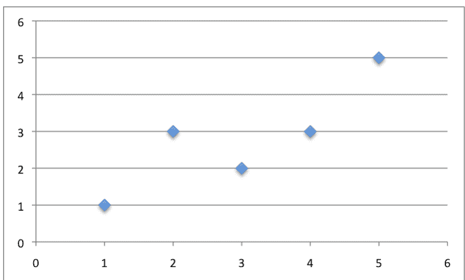

图 8.1: 小随机数据集的图表。

我们也可以使用先前准备好的系数对该数据集进行预测。将所有内容整合起来，我们可以在下面测试 predict() 函数。

```python
# Example of making a prediction with coefficients

# Make a prediction
def predict(row, coefficients):
    yhat = coefficients[0]
    for i in range(len(row)-1):
        yhat += coefficients[i + 1] * row[i]
    return yhat

dataset = [[1, 1], [2, 3], [4, 3], [3, 2], [5, 5]]
coef = [0.4, 0.8]
for row in dataset:
    yhat = predict(row, coef)
    print("Expected=%.3f, Predicted=%.3f %%" % (row[-1], yhat))
```

图 8.3: 在随机数据集上进行预测的示例。

这里有一个输入值（x）和两个系数值（b0 和 b1）。我们为该问题建模的预测方程是：

$y = b0 + b1 \times x$   (8.3)

或者，使用我们手动选择的具体系数值如下：

$y = 0.4 + 0.8 \times x$   (8.4)

运行此函数后，我们得到的预测值与预期输出（y）值相当接近。

```
Expected=1.000, Predicted=1.200
Expected=3.000, Predicted=2.000
Expected=3.000, Predicted=3.600
Expected=2.000, Predicted=2.800
Expected=5.000, Predicted=4.400
```

图 8.4: 随机数据集上预测的示例输出。

现在我们准备好实施随机梯度下降来优化我们的系数值。

##### 8.2.2 估计系数

我们可以使用随机梯度下降来估计训练数据的系数值。随机梯度下降需要两个参数：

- 学习率：用于限制每次更新时每个系数的修正量。
- Epochs：在更新系数时，遍历训练数据的次数。

这些参数，以及训练数据，将作为函数的参数。

在函数中需要执行 3 个循环：

- 1. 对每个 epoch 进行循环。
- 2. 在每个 epoch 中对训练数据的每一行进行循环。
- 3. 在每个 epoch 中对每个系数进行循环并对其进行更新。

如您所见，我们在每个 epoch 中为训练数据的每一行更新每个系数。系数的更新基于模型所作的错误。错误被计算为使用候选系数得到的预测值与预期输出值之间的差值。

error = prediction - expected

每个输入属性有一个系数用于加权，这些系数以一致的方式更新，例如：

b1(t + 1) = b1(t) - learning rate × error(t) × x1(t)

列表开头的特殊系数，也称为截距或偏置，其更新方式相似，只是没有输入，因为它不与特定的输入值关联：

b0(t + 1) = b0(t) - learning rate × error(t)

现在我们可以把这一切整合起来。下面是一个名为 coefficients_sgd() 的函数，用于使用随机梯度下降计算训练数据集的系数值。

```python
# Estimate linear regression coefficients using stochastic gradient descent
def coefficients_sgd(train, l_rate, n_epoch):
    coef = [0.0 for i in range(len(train[0]))]
    for epoch in range(n_epoch):
        sum_error = 0
        for row in train:
            yhat = predict(row, coef)
            error = yhat - row[-1]
            sum_error += error**2
            coef[0] = coef[0] - l_rate * error
            for i in range(len(row)-1):
                coef[i + 1] = coef[i + 1] - l_rate * error * row[i]
        print('>epoch=%d, lrate=%.3f, error=%.3f' % (epoch, l_rate, sum_error))
    return coef
```

图 8.5: 使用随机梯度下降估计系数的功能。

您可以看到，我们在每个 epoch 中还会跟踪平方误差的总和（正值），以便在外层循环中打印一条信息。

我们可以在上述相同的小随机数据集上测试该函数。

```python
# Example of estimating coefficients

# Make a prediction
def predict(row, coefficients):
    yhat = coefficients[0]
    for i in range(len(row)-1):
        yhat += coefficients[i + 1] * row[i]
    return yhat

# Estimate linear regression coefficients using stochastic gradient descent
def coefficients_sgd(train, l_rate, n_epoch):
    coef = [0.0 for i in range(len(train[0]))]
    for epoch in range(n_epoch):
        sum_error = 0
        for row in train:
            yhat = predict(row, coef)
            error = yhat - row[-1]
            sum_error += error**2
            coef[0] = coef[0] - l_rate * error
            for i in range(len(row)-1):
                coef[i + 1] = coef[i + 1] - l_rate * error * row[i]
        print('>epoch=%d, lrate=%.3f, error=%.3f' % (epoch, l_rate, sum_error))
    return coef

# Calculate coefficients
dataset = [[1, 1], [2, 3], [4, 3], [3, 2], [5, 5]]
l_rate = 0.001
n_epoch = 50
coef = coefficients_sgd(dataset, l_rate, n_epoch)
print(coef)
```

图 8.6: 在随机数据集上估计系数的示例。

我们使用了较小的学习率 0.001，并在 50 个 epoch 中训练模型，即 50 次将系数暴露于整个训练数据集。

运行示例会在每个 epoch 中打印一条包含该 epoch 平方误差总和的信息，并输出最终的系数集合。

```
...
>epoch=45, lrate=0.001, error=2.650
>epoch=46, lrate=0.001, error=2.627
>epoch=47, lrate=0.001, error=2.607
>epoch=48, lrate=0.001, error=2.589
>epoch=49, lrate=0.001, error=2.573
[0.229982344937311363, 0.8017220304137576]
```

图 8.7: 在随机数据集上估计系数的示例输出。

您可以看到，即使在最后一个 epoch 中，错误仍在持续下降。我们可能需要训练更长时间（更多 epoch）或增加每个 epoch 中更新系数的量（更高的学习率）。尝试一下，看看您能想出什么。现在，让我们将此算法应用于真实数据集。

##### 8.2.3 酒质量案例研究

在本节中，我们将使用随机梯度下降在酒质量数据集上训练线性回归模型。示例假设数据集的 CSV 复制品位于当前工作目录，文件名为 winequality-white.csv。

数据集首先被加载，字符串值转换为数值，并且每列被归一化到 0 到 1 的范围。这通过 helper functions load_csv() 和 str_column_to_float() 来加载和准备数据集，以及 dataset_minmax() 和 normalize_dataset() 来实现归一化。

我们将使用 k 折交叉验证来估计学习模型在未见数据上的性能。这意味着我们将构建并评估 k 个模型，并将性能估计为平均模型错误。根均方误差 (RMSE) 将用于评估每个模型。这些行为由 cross_validation_split()、rmse_metric() 和 evaluate_algorithm() 辅助函数提供。


我们将使用上面创建的 `predict()`、`coefficients_sgd()` 和 `linear_regression_sgd()` 函数来训练模型。下面是完整示例。

```python
# Linear Regression With Stochastic Gradient Descent for Wine Quality
from random import seed
from random import randrange
from csv import reader
from math import sqrt

# Load a CSV file
def load_csv(filename):
    dataset = list()
    with open(filename, 'r') as file:
        csv_reader = reader(file)
        for row in csv_reader:
            if not row:
                continue
            dataset.append(row)
    return dataset

# Convert string column to float
def str_column_to_float(dataset, column):
    for row in dataset:
        row[column] = float(row[column].strip())

# Find the min and max values for each column
def dataset_minmax(dataset):
    minmax = list()
    for i in range(len(dataset[0])):
        col_values = [row[i] for row in dataset]
        value_min = min(col_values)
        value_max = max(col_values)
        minmax.append([value_min, value_max])
    return minmax

# Rescale dataset columns to the range 0-1
def normalize_dataset(dataset, minmax):
    for row in dataset:
        for i in range(len(row)):
            row[i] = (row[i] - minmax[i][0]) / (minmax[i][1] - minmax[i][0])

# Split a dataset into k folds
def cross_validation_split(dataset, n_folds):
    dataset_split = list()
    dataset_copy = list(dataset)
    fold_size = int(len(dataset) / n_folds)
    for _ in range(n_folds):
        fold = list()
        while len(fold) < fold_size:
            index = randrange(len(dataset_copy))
            fold.append(dataset_copy.pop(index))
        dataset_split.append(fold)
    return dataset_split

# Calculate root mean squared error
def rmse_metric(actual, predicted):
    sum_error = 0.0
    for i in range(len(actual)):
        prediction_error = predicted[i] - actual[i]
        sum_error += (prediction_error ** 2)
    mean_error = sum_error / float(len(actual))
    return sqrt(mean_error)

# Evaluate an algorithm using a cross validation split
def evaluate_algorithm(dataset, algorithm, n_folds, *args):
    folds = cross_validation_split(dataset, n_folds)
    scores = list()
    for fold in folds:
        train_set = list(folds)
        train_set.remove(fold)
        train_set = sum(train_set, [])
        test_set = list()
        for row in fold:
            row_copy = list(row)
            test_set.append(row_copy)
            row_copy[-1] = None
        predicted = algorithm(train_set, test_set, *args)
        actual = [row[-1] for row in fold]
        rmse = rmse_metric(actual, predicted)
        scores.append(rmse)
    return scores

# Make a prediction with coefficients
def predict(row, coefficients):
    yhat = coefficients[0]
    for i in range(len(row)-1):
        yhat += coefficients[i + 1] * row[i]
    return yhat

# Estimate linear regression coefficients using stochastic gradient descent
def coefficients_sgd(train, l_rate, n_epoch):
    coef = [0.0 for i in range(len(train[0]))]
    for _ in range(n_epoch):
        for row in train:
            yhat = predict(row, coef)
            error = yhat - row[-1]
            coef[0] = coef[0] - l_rate * error
            for i in range(len(row)-1):
                coef[i + 1] = coef[i + 1] - l_rate * error * row[i]
            # print(l_rate, n_epoch, error)
    return coef

# Linear Regression Algorithm With Stochastic Gradient Descent
def linear_regression_sgd(train, test, l_rate, n_epoch):
    predictions = list()
    coef = coefficients_sgd(train, l_rate, n_epoch)
    for row in test:
        yhat = predict(row, coef)
        predictions.append(yhat)
    return(predictions)

# Linear Regression on wine quality dataset
seed(1)
# load and prepare data
filename = 'winequality-white.csv'
dataset = load_csv(filename)
for i in range(len(dataset[0])):
    str_column_to_float(dataset, i)
# normalize
minmax = dataset_minmax(dataset)
normalize_dataset(dataset, minmax)
# evaluate algorithm
n_folds = 5
l_rate = 0.01
n_epoch = 50
scores = evaluate_algorithm(dataset, linear_regression_sgd, n_folds, l_rate, n_epoch)
print('Scores: %s' % scores)
print('Mean RMSE: %.3f %%' % (sum(scores)/float(len(scores))))
```

清单 8.8：葡萄酒质量数据集上的多元线性回归示例。

交叉验证使用 k 值为 5，使每个折叠有 4898/5 = 979.6 条记录（略低于 1000 条）在每次迭代中进行评估。经过少量实验，选择了学习率 0.01 和 50 个训练轮次。你可以尝试自己的配置，看看是否能超越我的得分。运行此示例将打印每个 5 个交叉验证折叠的得分，然后打印平均 RMSE。

我们可以看到，RMSE（在归一化数据集上）为 0.126，低于基准值 0.148。

```
Scores: [0.12259834231519767, 0.12733924130891316, 0.12610773846663892, 0.1289950071681572,
0.1272180783291014]
Mean RMSE: 0.126
```

清单 8.9：葡萄酒质量数据集上线性回归的示例输出。

#### 8.3 扩展

本节列出了本教程的一些你可能希望考虑探索的扩展。

- **调整示例**。调整学习率、轮次数量甚至数据准备方法，以在葡萄酒质量数据集上获得更好的得分。
- **批量随机梯度下降**。将随机梯度下降算法更改为在每个轮次中累积更新，并在轮次结束时批量更新系数。
- **其他回归问题**。将该技术应用于 UCI 机器学习库中的其他回归问题。

#### 8.4 回顾

在本教程中，你了解了如何使用 Python 从零实现使用随机梯度下降的线性回归。具体来说，你学习了：

- 如何为多元线性回归问题进行预测。
- 如何使用随机梯度下降优化一组系数。
- 如何将该技术应用于真实的回归预测建模问题。

##### 8.4.1 进一步阅读

- 第 3.2 节 多元线性回归，第 71 页，《统计学习导论》，2014 年。http://amzn.to/2eeTyQX
- 第 18.6 节 线性模型的回归与分类，第 717 页，《人工智能：一种现代的方法》，2010 年。http://amzn.to/2e3lFqP
- 第 6.2 节 线性回归，第 105 页，《应用预测建模》，2013 年 http://amzn.to/2e3lNXF
- 第 4.6 节 线性模型，第 119 页，《数据挖掘：实用机器学习工具与技术》，第二版，2005 年。http://amzn.to/2fj3SYY

##### 8.4.2 下一步

在下一个教程中，你将了解如何实现和应用用于分类的逻辑回归算法。

## 第 9 章

## 逻辑回归

逻辑回归是二类问题的首选线性分类算法。它易于实现、易于理解，并且在各种问题上都能取得出色效果，即使该方法对你的数据的假设被违反也是如此。在本教程中，你将了解如何使用 Python 从零实现使用随机梯度下降的逻辑回归。完成本教程后，你将知道：

- 如何使用逻辑回归模型进行预测。
- 如何使用随机梯度下降估计系数。
- 如何将逻辑回归应用于真实预测问题。

让我们开始吧。

#### 9.1 描述

本节将简要介绍本教程中将使用的逻辑回归技术、随机梯度下降和皮马印第安人糖尿病数据集。

##### 9.1.1 逻辑回归

逻辑回归以方法核心使用的函数命名，即逻辑函数。逻辑回归使用方程作为表示，这与线性回归非常相似。输入值（X）使用权重或系数值线性组合，以预测输出值（y）。与线性回归的关键区别在于，被建模的输出值是二进制值（0 或 1），而不是数值。

```
yhat = \frac{e^{b0+b1 \times x1}}{1 + e^{b0+b1 \times x1}}
```

这可以简化为：

```
yhat = \frac{1.0}{1.0 + e^{-(b0+b1 \times x1)}}
```

其中 e 是自然对数的底数（欧拉数），yhat 是预测输出，b0 是偏置或截距项，b1 是单个输入值（x1）的系数。The


yhat 预测值是一个介于 0 和 1 之间的实数值，需要四舍五入为整数值，并映射到预测的类别值。

输入数据中的每一列都有一个关联的 b 系数（一个常数实值），该系数必须从训练数据中学习得到。你想在内存或文件中存储的模型的实际表示是方程中的系数（beta 值或 b）。逻辑回归算法的系数必须从训练数据中估计出来。

##### 9.1.2 随机梯度下降

逻辑回归使用梯度下降来更新系数。梯度下降已在第 8.1.2 节中介绍和描述。每次梯度下降迭代中，机器学习语言中的系数（b）使用以下方程更新：

$b = b + \text{learning rate} \times (y - yhat) \times yhat \times (1 - yhat) \times x$ (9.3)

其中 b 是被优化的系数或权重，learning rate 是必须配置的学习率（例如 0.01），(y - yhat) 是训练数据上归因于该权重的模型预测误差，yhat 是系数做出的预测，x 是输入值。

##### 9.1.3 皮马印第安人糖尿病数据集

在本教程中，我们将使用皮马印第安人糖尿病数据集。该数据集涉及预测 5 年内糖尿病的发病情况。该问题的基线性能约为 65%。你可以在附录 A 的第 A.4 节了解更多信息。下载数据集并将其以文件名 pima-indians-diabetes.csv 保存到当前工作目录。

#### 9.2 教程

本教程分为 3 个部分。

- 1. 进行预测。
- 2. 估计系数。
- 3. 皮马印第安人糖尿病案例研究。

这将为你所需的在预测建模问题中实现和应用随机梯度下降逻辑回归提供基础。

##### 9.2.1 进行预测

第一步是开发一个能进行预测的函数。在随机梯度下降中评估候选系数值时，以及在模型最终确定后我们希望开始对测试数据或新数据进行预测时，都需要这个函数。下面是一个名为 `predict()` 的函数，它根据一组系数预测一行的输出值。第一个系数始终是截距，也称为偏差或 b0，因为它是独立的，不负责特定的输入值。

```python
# Make a prediction with coefficients
def predict(row, coefficients):
    yhat = coefficients[0]
    for i in range(len(row)-1):
        yhat += coefficients[i + 1] * row[i]
    return 1.0 / (1.0 + exp(-yhat))
```

清单 9.1：用系数进行逻辑回归预测的函数。

我们可以构造一个小数据集来测试我们的 `predict()` 函数。

| X1 | X2 | Y |
|---|---|---|
| 2.7810836 | 2.550537003 | 0 |
| 1.465489372 | 2.362125076 | 0 |
| 3.396561688 | 4.400293529 | 0 |
| 1.38807019 | 1.850220317 | 0 |
| 3.06407232 | 3.005305973 | 0 |
| 7.627531214 | 2.759262235 | 1 |
| 5.332441248 | 2.088626775 | 1 |
| 6.922596716 | 1.77106367 | 1 |
| 8.675418651 | -0.242068655 | 1 |
| 7.673756466 | 3.508563011 | 1 |

清单 9.2：用于测试逻辑回归的小型构造数据集。

下面是该数据集的绘图，使用不同颜色显示每个点的不同类别。


图 9.1：用于测试逻辑回归的小型构造数据集的绘图。

我们还可以使用先前准备好的系数来对这个数据集进行预测。综合以上所有内容，我们可以在下面测试我们的 `predict()` 函数。

```python
# Example of making a prediction
from math import exp

# Make a prediction with coefficients
def predict(row, coefficients):
    yhat = coefficients[0]
    for i in range(len(row)-1):
        yhat += coefficients[i + 1] * row[i]
    return 1.0 / (1.0 + exp(-yhat))

# test predictions
dataset = [[2.7810836,2.550537003,0],
[1.465489372,2.362125076,0],
[3.396561688,4.400293529,0],
[1.38807019,1.850220317,0],
[3.06407232,3.005305973,0],
[7.627531214,2.759262235,1],
[5.332441248,2.088626775,1],
[6.922596716,1.77106367,1],
[8.675418651,-0.242068655,1],
[7.673756466,3.508563011,1]]
coef = [-0.406605464, 0.852573316, -1.104746259]
for row in dataset:
    yhat = predict(row, coef)
    print("Expected=%.3f, Predicted=%.3f [%d]" % (row[-1], yhat, round(yhat)))
```

清单 9.3：在构造数据集上进行预测的示例。

有两个输入值（X1 和 X2）和三个系数值（b0、b1 和 b2）。我们为这个问题建模的预测方程是：

\( y = \frac{1.0}{1.0 + e^{-(b0+b1\times X1+b2\times X2)}} \) (9.4)

或者，使用我们手工选择的特定系数值：

\( y = \frac{1.0}{1.0 + e^{-(-0.406605464+0.852573316\times X1+-1.104746259\times X2)}} \) (9.5)

运行该函数，我们得到的预测与预期输出（y）值相当接近，并且四舍五入后可以对类别做出正确的预测。

```
Expected=0.000, Predicted=0.299 [0]
Expected=0.000, Predicted=0.146 [0]
Expected=0.000, Predicted=0.085 [0]
Expected=0.000, Predicted=0.220 [0]
Expected=0.000, Predicted=0.247 [0]
Expected=1.000, Predicted=0.955 [1]
Expected=1.000, Predicted=0.862 [1]
Expected=1.000, Predicted=0.972 [1]
Expected=1.000, Predicted=0.999 [1]
Expected=1.000, Predicted=0.905 [1]
```

清单 9.4：在构造数据集上进行预测的示例输出。

现在，我们准备实现随机梯度下降来优化系数值。

你可以看到，此外我们每个 epoch 都会跟踪平方误差之和（一个正值），以便在每个外层循环打印出一条友好的消息。我们可以在上面同一个小型构造数据集上测试这个函数。

```python
# Example of estimating coefficients
from math import exp

# Make a prediction with coefficients
def predict(row, coefficients):
    yhat = coefficients[0]
    for i in range(len(row)-1):
        yhat += coefficients[i + 1] * row[i]
    return 1.0 / (1.0 + exp(-yhat))

# Estimate logistic regression coefficients using stochastic gradient descent
def coefficients_sgd(train, l_rate, n_epoch):
    coef = [0.0 for i in range(len(train[0]))]
    for epoch in range(n_epoch):
        sum_error = 0
        for row in train:
            yhat = predict(row, coef)
            error = row[-1] - yhat
            sum_error += error**2
            coef[0] = coef[0] + l_rate * error * yhat * (1.0 - yhat)
            for i in range(len(row)-1):
                coef[i + 1] = coef[i + 1] + l_rate * error * yhat * (1.0 - yhat) * row[i]
        print('>epoch=%d, lrate=%.3f, error=%.3f' % (epoch, l_rate, sum_error))
    return coef

# Calculate coefficients
dataset = [[2.7810836,2.550537003,0],
    [1.465489372,2.362125076,0],
    [3.396561688,4.400293529,0],
    [1.38807019,1.850220317,0],
    [3.06407232,3.005305973,0],
    [7.627531214,2.759262235,1],
    [5.332441248,2.088626775,1],
    [6.922596716,1.77106367,1],
    [8.675418651,-0.242068655,1],
    [7.673756466,3.508563011,1]]
l_rate = 0.3
n_epoch = 100
coef = coefficients_sgd(dataset, l_rate, n_epoch)
print(coef)
```

清单 9.6：在构造数据集上估计系数的示例。

我们使用较大的学习率 0.3，并训练模型 100 个 epoch，即系数对整个训练数据集的 100 次暴露。运行该示例会在每个 epoch 打印一条消息，包含该 epoch 的平方误差和，以及最终的系数集。

```
...
>epoch=95, lrate=0.300, error=0.023
>epoch=96, lrate=0.300, error=0.023
>epoch=97, lrate=0.300, error=0.023
>epoch=98, lrate=0.300, error=0.023
>epoch=99, lrate=0.300, error=0.022
[-0.8596443546618897, 1.5223825112460005, -2.218700210565016]
```

清单 9.7：在构造数据集上估计系数的示例输出。

你可以看到即使在最后一个 epoch，误差仍然在下降。我们可能可以训练更长时间（更多 epoch）或增加每个 epoch 更新系数的量（更高的学习率）。不妨试验一下，看看你能得到什么结果。现在，让我们将此算法应用于真实数据集。

##### 9.2.3 皮马印第安人糖尿病案例研究

在本节中，我们将在糖尿病数据集上使用随机梯度下降训练一个逻辑回归模型。该示例假设数据集的 CSV 副本位于当前工作目录，文件名为 pima-indians-diabetes.csv。

首先加载数据集，将字符串值转换为数值，并将每一列归一化到 0 到 1 的范围内。这是通过辅助函数 `load_csv()` 和 `str_column_to_float()` 来加载和准备数据集，以及 `dataset_minmax()` 和 `normalize_dataset()` 来实现归一化。

我们将使用 k 折交叉验证来估计学习模型在未见数据上的表现。这意味着我们将构建并评估 k 个模型，并将性能估计为平均模型性能。分类准确率将用于评估每个模型。这些行为由 `cross_validation_split()`、`accuracy_metric()` 和 `evaluate_algorithm()` 辅助函数提供。

我们将使用上面创建的 `predict()` 和 `coefficients_sgd()` 函数，以及一个新的 `logistic_regression()` 函数来训练模型。下面是完整的示例。

```python
# Logistic Regression on Diabetes Dataset
from random import seed
from random import randrange
from csv import reader
from math import exp

# Load a CSV file
def load_csv(filename):
    dataset = list()
    with open(filename, 'r') as file:
        csv_reader = reader(file)
        for row in csv_reader:
            if not row:
                continue
            dataset.append(row)
    return dataset

# Convert string column to float
def str_column_to_float(dataset, column):
    for row in dataset:
        row[column] = float(row[column].strip())

# Find the min and max values for each column
def dataset_minmax(dataset):
    minmax = list()
    for i in range(len(dataset[0])):
```


```python
col_values = [row[i] for row in dataset]
value_min = min(col_values)
value_max = max(col_values)
minmax.append([value_min, value_max])
return minmax
```

```python
# Rescale dataset columns to the range 0-1
def normalize_dataset(dataset, minmax):
    for row in dataset:
        for i in range(len(row)):
            row[i] = (row[i] - minmax[i][0]) / (minmax[i][1] - minmax[i][0])
```

```python
# Split a dataset into k folds
def cross_validation_split(dataset, n_folds):
    dataset_split = list()
    dataset_copy = list(dataset)
    fold_size = int(len(dataset) / n_folds)
    for _ in range(n_folds):
        fold = list()
        while len(fold) < fold_size:
            index = randrange(len(dataset_copy))
            fold.append(dataset_copy.pop(index))
        dataset_split.append(fold)
    return dataset_split
```

```python
# Calculate accuracy percentage
def accuracy_metric(actual, predicted):
    correct = 0
    for i in range(len(actual)):
        if actual[i] == predicted[i]:
            correct += 1
    return correct / float(len(actual)) * 100.0
```

```python
# Evaluate an algorithm using a cross validation split
def evaluate_algorithm(dataset, algorithm, n_folds, *args):
    folds = cross_validation_split(dataset, n_folds)
    scores = list()
    for fold in folds:
        train_set = list(folds)
        train_set.remove(fold)
        train_set = sum(train_set, [])
        test_set = list()
        for row in fold:
            row_copy = list(row)
            test_set.append(row_copy)
            row_copy[-1] = None
            predicted = algorithm(train_set, test_set, *args)
            actual = [row[-1] for row in fold]
            accuracy = accuracy_metric(actual, predicted)
            scores.append(accuracy)
    return scores
```

```python
# Make a prediction with coefficients
def predict(row, coefficients):
    yhat = coefficients[0]
    for i in range(len(row)-1):
        yhat += coefficients[i + 1] * row[i]
    return 1.0 / (1.0 + exp(-yhat))

# Estimate logistic regression coefficients using stochastic gradient descent
def coefficients_sgd(train, l_rate, n_epoch):
    coef = [0.0 for i in range(len(train[0]))]
    for _ in range(n_epoch):
        for row in train:
            yhat = predict(row, coef)
            error = row[-1] - yhat
            coef[0] = coef[0] + l_rate * error * yhat * (1.0 - yhat)
            for i in range(len(row)-1):
                coef[i + 1] = coef[i + 1] + l_rate * error * yhat * (1.0 - yhat) * row[i]
    return coef

# Logistic Regression Algorithm With Stochastic Gradient Descent
def logistic_regression(train, test, l_rate, n_epoch):
    predictions = list()
    coef = coefficients_sgd(train, l_rate, n_epoch)
    for row in test:
        yhat = predict(row, coef)
        yhat = round(yhat)
        predictions.append(yhat)
    return(predictions)

# Test the logistic regression algorithm on the diabetes dataset
seed(1)
# load and prepare data
filename = 'pima-indians-diabetes.csv'
dataset = load_csv(filename)
for i in range(len(dataset[0])):
    str_column_to_float(dataset, i)
# normalize
minmax = dataset_minmax(dataset)
normalize_dataset(dataset, minmax)
# evaluate algorithm
n_folds = 5
l_rate = 0.1
n_epoch = 100
scores = evaluate_algorithm(dataset, logistic_regression, n_folds, l_rate, n_epoch)
print('Scores: %s' % scores)
print('Mean Accuracy: %.3f%%' % (sum(scores)/float(len(scores))))
```

清单 9.8: 将逻辑回归应用于糖尿病数据集的示例。

交叉验证使用 k 值为 5，使每个折叠有 \(\frac{768}{5} = 153.6\) 条记录，即每次迭代评估略多于 150 条记录。经过少量实验，选择了学习率 0.1 和 100 个训练 epoch。你可以尝试自己的配置，看看是否能超越我的得分。

运行此示例将打印 5 个交叉验证折叠的得分，然后打印平均分类准确率。可以看到准确率约为 77%，高于基准值 65%。

```
Scores: [73.20261437908496, 75.81699346405229, 75.81699346405229, 83.66013071895425,
78.43137254901961]
Mean Accuracy: 77.386%
```

清单 9.9: 糖尿病数据集上逻辑回归的示例输出。

#### 9.3 扩展

本节列出了本教程的一些你可能希望考虑探索的扩展。

- **调整示例**。调整学习率、epoch 数量甚至数据准备方法，以在数据集上获得更好的得分。

- **批量随机梯度下降**。将随机梯度下降算法更改为在每个 epoch 中累积更新，并在 epoch 结束时批量更新系数。

- **其他分类问题**。将该技术应用于 UCI 机器学习库中的其他二进制（2 类）分类问题。

#### 9.4 回顾

在本教程中，你了解了如何使用 Python 从零开始实现使用随机梯度下降的逻辑回归。具体来说，你学习了：

- 如何为多变量分类问题进行预测。

- 如何使用随机梯度下降优化一组系数。

- 如何将该技术应用于真实的分类预测建模问题。

##### 9.4.1 进一步阅读

- 第 4.3 节 逻辑回归，第 130 页，_统计学习导论_，2014 年。http://amzn.to/2eeTyQX

- 第 18.6 节 线性模型的回归与分类，第 717 页，_人工智能：一种现代方法_，2010 年。http://amzn.to/2e3lFqP

- 第 12.2 节 逻辑回归，第 282 页，_应用预测建模_，2013 年 http://amzn.to/2e3lNXF

- 第 4.6 节 线性模型，第 119 页，_数据挖掘：实用机器学习工具与技术_，第二版，2005 年。http://amzn.to/2fj3SYY

##### 9.4.2 下一节

在下一个教程中，你将了解如何实现和应用用于分类的感知机算法。

## 第 10 章

## 感知机

感知机算法是最简单的人工神经网络类型。它是单个神经元的模型，可用于二类分类问题，并为后续开发更大的网络奠定基础。在本教程中，你将了解如何使用 Python 从零开始实现感知机算法。完成本教程后，你将知道：

- 如何训练感知机的网络权重。

- 如何使用感知机进行预测。

- 如何为现实世界的分类问题实现感知机算法。

让我们开始吧。

#### 10.1 描述

本节简要介绍感知机算法以及我们稍后将应用的声纳数据集。

##### 10.1.1 感知机算法

感知机灵感来源于称为神经元的单个神经细胞的信息处理。神经元通过树突接受输入信号，树突将电信号传递到细胞体。类似地，感知机从训练数据示例中接收输入信号，我们对其加权并组合在一个称为激活的线性方程中。

```python
activation = bias + \sum_{i=1}^{n} weight_i \times x_i
```

然后使用转移函数（例如阶跃转移函数）将激活转换为输出值或预测。

```python
prediction = 1.0 IF activation >= 0.0 ELSE 0.0
```

这样一来，感知机是一种用于两类（0 和 1）分类问题的分类算法，其中可以使用线性方程（如直线或超平面）来分隔两类。它与线性回归和逻辑回归密切相关，后者以类似方式进行预测（例如输入的加权和）。感知机算法的权重必须使用随机梯度下降从训练数据中估计。

##### 10.1.2 随机梯度下降

感知机算法使用梯度下降来更新权重。梯度下降在第 8.1.2 节中介绍和描述过。梯度下降的每次迭代中，权重（**w**）使用以下方程更新：

$w = w + \text{learning rate} \times (expected - predicted) \times x$ (10.3)

其中 **w** 是正在优化的权重，**学习率** 是你必须配置的学习率（例如 0.01），（**预期** - **预测**）是归因于权重的模型在训练数据上的预测误差，**x** 是输入值。

##### 10.1.3 声纳数据集

在本教程中，我们将使用声纳数据集。该数据集涉及水雷和岩石之间的区分。该问题上的基准性能约为 53%。你可以在附录 A 第 A.5 节中了解更多信息。下载数据集并将其保存到当前工作目录，文件名为 sonar.all-data.csv。

#### 10.2 教程

本教程分为 3 个部分：

- 1. 进行预测。

- 2. 训练网络权重。

- 3. 声纳案例研究。

这些步骤将为你实现和应用感知机算法到你自己的分类预测建模问题奠定基础。

##### 10.2.1 进行预测

第一步是开发一个可以进行预测的函数。这在随机梯度下降中评估候选权重值时以及在模型最终化后我们希望开始对测试数据或新数据进行预测时都需要。下面是一个名为 `predict()` 的函数，它给定一组权重，为一行预测输出值。第一个权重始终是偏置，因为它是独立的，不负责特定的输入值。

```python
# Make a prediction with weights
def predict(row, weights):
    activation = weights[0]
    for i in range(len(row)-1):
        activation += weights[i + 1] * row[i]
```


return 1.0 if activation >= 0.0 else 0.0
```

清单 10.1: 用于使用感知权重进行预测的函数

我们可以构造一个小型数据集来测试我们的预测函数。

| X1 | X2 | Y |
|---|---|---|
| 2.7810836 | 2.550537003 | 0 |
| 1.465489372 | 2.362125076 | 0 |
| 3.396561688 | 4.400293529 | 0 |
| 1.38807019 | 1.850220317 | 0 |
| 3.06407232 | 3.005305973 | 0 |
| 7.627531214 | 2.759262235 | 1 |
| 5.332441248 | 2.088626775 | 1 |
| 6.922596716 | 1.77106367 | 1 |
| 8.675418651 | -0.242068655 | 1 |
| 7.673756466 | 3.508563011 | 1 |

清单 10.2: 用于测试逻辑回归的小型构造数据集

下面是使用不同颜色显示每个点不同类别的数据集图。

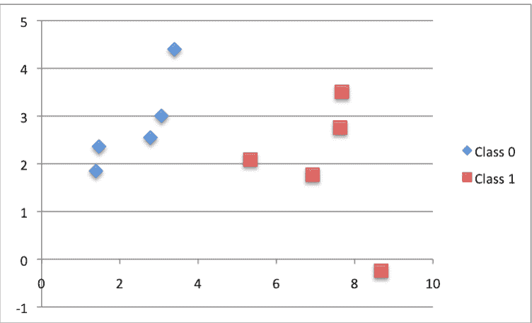

图 10.1: 用于测试感知算法的小型构造数据集图

我们也可以使用先前准备好的权重来对此数据集进行预测。将所有这些整合在一起，我们可以下面测试我们的 `predict()` 函数。

```
# Example of making predictions

# Make a prediction with weights
def predict(row, weights):
    activation = weights[0]
    for i in range(len(row)-1):
        activation += weights[i + 1] * row[i]
    return 1.0 if activation >= 0.0 else 0.0
```

```
# test predictions
dataset = [[2.7810836,2.550537003,0],
[1.465489372,2.362125076,0],
[3.396561688,4.400293529,0],
[1.38807019,1.850220317,0],
[3.06407232,3.005305973,0],
[7.627531214,2.759262235,1],
[5.332441248,2.088626775,1],
[6.922596716,1.77106367,1],
[8.675418651,-0.242068655,1],
[7.673756466,3.508563011,1]]
weights = [-0.1, 0.20653640140000007, -0.23418117710000003]
for row in dataset:
    prediction = predict(row, weights)
    print("Expected=%d, Predicted=%d" % (row[-1], prediction))
```

清单 10.3: 在构造数据集上进行预测的示例

该问题有两个输入值（X1 和 X2）和三个权重值（偏置、w1 和 w2）。我们为该问题建模的激活方程是：

activation = (w1 × X1) + (w2 × X2) + bias (10.4)

或者，使用我们手动选择的特定权重值：

activation = (0.206 × X1) + (-0.234 × X2) + -0.1 (10.5)

运行此函数，我们得到的预测与预期输出（y）值匹配。

```
Expected=0, Predicted=0
Expected=0, Predicted=0
Expected=0, Predicted=0
Expected=0, Predicted=0
Expected=0, Predicted=0
Expected=1, Predicted=1
Expected=1, Predicted=1
Expected=1, Predicted=1
Expected=1, Predicted=1
Expected=1, Predicted=1
```

清单 10.4: 在构造数据集上进行预测的示例输出

现在我们准备实现随机梯度下降来优化我们的权重值。

##### 10.2.2 训练网络权重

我们可以使用随机梯度下降来估计训练数据的权重值。随机梯度下降需要两个参数：

- 学习率：用于限制每次更新权重时对每个权重进行的修正量。
- 时代（Epochs）：在更新权重时遍历训练数据的次数。

这些参数连同训练数据将作为函数的参数。我们需要在函数中执行 3 个循环：

- 1. 遍历每个时代。
- 2. 遍历一个时代中的训练数据的每一行。
- 3. 遍历每个权重，并为一个时代中的一行更新它。

如您所见，我们在每个时代中对训练数据的每一行更新每个权重。权重根据模型犯的错误进行更新。错误计算为预期输出值与使用候选权重进行的预测之间的差值。

每个输入属性都有一个权重，并且这些权重以一致的方式更新。例如：

$w(t + 1) = w(t) + \text{learning rate} \times (expected(t) - predicted(t)) \times x(t)$ (10.6)

偏置以类似的方式更新，只不过没有输入，因为它不与特定的输入值相关联：

$bias(t + 1) = bias(t) + \text{learning rate} \times (expected(t) - predicted(t))$ (10.7)

现在我们可以将所有这些整合在一起。下面是一个名为 `train_weights()` 的函数，它使用随机梯度下降计算训练数据集的权重值。

```python
# Estimate Perceptron weights using stochastic gradient descent
def train_weights(train, l_rate, n_epoch):
	weights = [0.0 for i in range(len(train[0]))]
	for epoch in range(n_epoch):
		sum_error = 0.0
		for row in train:
			prediction = predict(row, weights)
			error = row[-1] - prediction
			sum_error += error**2
			weights[0] = weights[0] + l_rate * error
			for i in range(len(row)-1):
				weights[i + 1] = weights[i + 1] + l_rate * error * row[i]
		print('>epoch=%d, lrate=%.3f, error=%.3f' % (epoch, l_rate, sum_error))
	return weights
```

清单 10.5: 用于估计感知器权重的函数

您可以看到，我们还会跟踪每个时代的平方误差之和（一个正值），以便在每个外层循环中打印出一条漂亮的消息。我们可以使用上面的同一个小型构造数据集来测试此函数。

```python
# Example of training weights

# Make a prediction with weights
def predict(row, weights):
	activation = weights[0]
	for i in range(len(row)-1):
		activation += weights[i + 1] * row[i]
	return 1.0 if activation >= 0.0 else 0.0

# Estimate Perceptron weights using stochastic gradient descent
def train_weights(train, l_rate, n_epoch):
	weights = [0.0 for i in range(len(train[0]))]
	for epoch in range(n_epoch):
		sum_error = 0.0
		for row in train:
			prediction = predict(row, weights)
			error = row[-1] - prediction
			sum_error += error**2
			weights[0] = weights[0] + l_rate * error
			for i in range(len(row)-1):
				weights[i + 1] = weights[i + 1] + l_rate * error * row[i]
		print('>epoch=%d, lrate=%.3f, error=%.3f' % (epoch, l_rate, sum_error))
	return weights

# Calculate weights
dataset = [[2.7810836,2.550537003,0],
    [1.465489372,2.362125076,0],
    [3.396561688,4.400293529,0],
    [1.38807019,1.850220317,0],
    [3.06407232,3.005305973,0],
    [7.627531214,2.759262235,1],
    [5.332441248,2.088626775,1],
    [6.922596716,1.77106367,1],
    [8.675418651,-0.242068655,1],
    [7.673756466,3.508563011,1]]
l_rate = 0.1
n_epoch = 5
weights = train_weights(dataset, l_rate, n_epoch)
print(weights)
```

清单 10.6: 在构造数据集上估计权重的示例

我们使用 0.1 的学习率，仅训练模型 5 个时代，即权重对整个训练数据集的 5 次暴露。运行示例会在每个时代打印一条消息，显示该时代的平方误差之和以及最终的权重集。

```
>epoch=0, lrate=0.100, error=2.000
>epoch=1, lrate=0.100, error=1.000
>epoch=2, lrate=0.100, error=0.000
>epoch=3, lrate=0.100, error=0.000
>epoch=4, lrate=0.100, error=0.000
[-0.1, 0.20653640140000007, -0.23418117710000003]
```

清单 10.7: 在构造数据集上估计权重的示例输出

您可以看到算法如何非常快速地学习这个问题。现在，让我们在真实数据集上应用此算法。

##### 10.2.3 声纳案例研究

在本节中，我们将使用随机梯度下降在声纳数据集上训练一个感知器模型。该示例假设数据集的 CSV 副本位于当前工作目录中，文件名为 sonar.all-data.csv。首先加载数据集，将字符串值转换为数值，并将输出列从字符串转换为 0 到 1 的整数值。这是通过辅助函数 load_csv()、str_column_to_float() 和 str_column_to_int() 来加载和准备数据集实现的。

我们将使用 k 折交叉验证来估计学习模型在未见数据上的性能。这意味着我们将构建和评估 k 个模型，并将平均模型误差作为性能估计。分类准确率将用于评估每个模型。这些行为由辅助函数 cross_validation_split()、accuracy_metric() 和 evaluate_algorithm() 提供。

我们将使用上面创建的 predict() 和 train_weights() 函数来训练模型，并使用一个新的 perceptron() 函数将它们整合在一起。下面是完整示例。

```python
# Perceptron Algorithm on the Sonar Dataset
from random import seed
from random import randrange
from csv import reader

# Load a CSV file
def load_csv(filename):
    dataset = list()
    with open(filename, 'r') as file:
        csv_reader = reader(file)
        for row in csv_reader:
            if not row:
                continue
            dataset.append(row)
    return dataset

# Convert string column to float
def str_column_to_float(dataset, column):
    for row in dataset:
        row[column] = float(row[column].strip())

# Convert string column to integer
def str_column_to_int(dataset, column):
    class_values = [row[column] for row in dataset]
    unique = set(class_values)
    lookup = dict()
    for i, value in enumerate(unique):
        lookup[value] = i
    for row in dataset:
        row[column] = lookup[row[column]]
    return lookup

# Split a dataset into k folds
def cross_validation_split(dataset, n_folds):
    dataset_split = list()
    dataset_copy = list(dataset)
    fold_size = int(len(dataset) / n_folds)
    for _ in range(n_folds):
        fold = list()
        while len(fold) < fold_size:
            index = randrange(len(dataset_copy))
            fold.append(dataset_copy.pop(index))
        dataset_split.append(fold)
    return dataset_split

# Calculate accuracy percentage
def accuracy_metric(actual, predicted):
```


```python
correct = 0
for i in range(len(actual)):
    if actual[i] == predicted[i]:
        correct += 1
return correct / float(len(actual)) * 100.0

# Evaluate an algorithm using a cross validation split
def evaluate_algorithm(dataset, algorithm, n_folds, *args):
    folds = cross_validation_split(dataset, n_folds)
    scores = list()
    for fold in folds:
        train_set = list(folds)
        train_set.remove(fold)
        train_set = sum(train_set, [])
        test_set = list()
        for row in fold:
            row_copy = list(row)
            test_set.append(row_copy)
            row_copy[-1] = None
        predicted = algorithm(train_set, test_set, *args)
        actual = [row[-1] for row in fold]
        accuracy = accuracy_metric(actual, predicted)
        scores.append(accuracy)
    return scores

# Make a prediction with weights
def predict(row, weights):
    activation = weights[0]
    for i in range(len(row)-1):
        activation += weights[i + 1] * row[i]
    return 1.0 if activation >= 0.0 else 0.0

# Estimate Perceptron weights using stochastic gradient descent
def train_weights(train, l_rate, n_epoch):
    weights = [0.0 for i in range(len(train[0]))]
    for _ in range(n_epoch):
        for row in train:
            prediction = predict(row, weights)
            error = row[-1] - prediction
            weights[0] = weights[0] + l_rate * error
            for i in range(len(row)-1):
                weights[i + 1] = weights[i + 1] + l_rate * error * row[i]
    return weights

# Perceptron Algorithm With Stochastic Gradient Descent
def perceptron(train, test, l_rate, n_epoch):
    predictions = list()
    weights = train_weights(train, l_rate, n_epoch)
    for row in test:
        prediction = predict(row, weights)
        predictions.append(prediction)
    return(predictions)

# Test the Perceptron algorithm on the sonar dataset
seed(1)
# load and prepare data
filename = 'sonar.all-data.csv'
dataset = load_csv(filename)
for i in range(len(dataset[0])-1):
    str_column_to_float(dataset, i)
# convert string class to integers
str_column_to_int(dataset, len(dataset[0])-1)
# evaluate algorithm
n_folds = 3
l_rate = 0.1
n_epoch = 500
scores = evaluate_algorithm(dataset, perceptron, n_folds, l_rate, n_epoch)
print('Scores: %s' % scores)
print('Mean Accuracy: %.3f%%' % (sum(scores)/float(len(scores))))
```

清单 10.8: 声纳数据集上的感知机算法示例。

交叉验证使用 k 值为 3，使得每个折叠有 \(\frac{208}{3} = 69.3\) 或略少于 70 条记录在每次迭代中被评估。学习率为 0.1 且训练时代为 500 个，经过少量实验选择。你可以尝试自己的配置，看看是否能打破我的分数。

运行此示例将打印 3 个交叉验证折叠的分数，然后打印平均分类准确率。我们可以看到准确率约为 73%，高于略高于 50% 的基准值。

```text
Scores: [73.91304347826086, 78.26086956521739, 68.11594202898551]
Mean Accuracy: 73.430%
```

清单 10.9: 声纳数据集上的感知机算法示例输出。

#### 10.3 扩展

本节列出了本教程的扩展内容，你可以考虑探索。

- 调整示例。调整学习率、时代数量甚至数据准备方法，以在数据集上获得更好的分数。

- 批量随机梯度下降。将随机梯度下降算法更改为在每个时代中累积更新，仅在时代结束时以批量方式更新权重。

- 其他回归问题。将该技术应用于 UCI 机器学习库上的其他分类问题。

#### 10.4 回顾

在本教程中，你了解了如何使用 Python 从零开始实现使用随机梯度下降的感知机算法。具体来说，你学习了：

- 如何针对二分类问题进行预测。

- 如何使用随机梯度下降优化一组权重。

- 如何将该技术应用于真实的分类预测建模问题。

##### 10.4.1 进一步阅读

- 第 18.6 节。线性模型的回归与分类，第 727 页，*人工智能：一种现代的方法*，2010 年。http://amzn.to/2e31FqP
- 第 4.6 节，线性模型，第 119 页，*数据挖掘：实用机器学习工具与技术*，第二版，2005 年。http://amzn.to/2fj3SYY

##### 10.4.2 下一步

这结束了关于线性算法的第二部分。接下来，在第三部分中，你将探讨非线性算法。在下一个教程中，你将了解如何实现和应用用于分类的决策树算法。

## 第三部分：非线性算法

### 第 11 章：分类和回归树

决策树是一种强大的预测方法，且极其流行。它们之所以流行，是因为最终模型对从业者和领域专家同样非常易于理解。最终决策树可以准确解释为何做出特定预测，这使其在实际运用中非常有吸引力。

决策树还为更高级的集成方法（如袋装法、随机森林和梯度提升）奠定了基础。在本教程中，你将了解如何使用 Python 从零开始实现分类和回归树算法。完成本教程后，你将知道：

- 如何计算和评估数据集中的候选分割点。
- 如何将分割点组织成决策树结构。
- 如何将分类和回归树算法应用于实际问题。

让我们开始吧。

#### 11.1 描述

本节简要介绍了本教程中使用的分类和回归树算法及钞票数据集。

##### 11.1.1 分类和回归树

分类和回归树（简称 CART）是由利奥·布雷伊曼引入的缩写词，用于指代可用于分类或回归预测建模问题的决策树算法。在本教程中，我们将重点介绍使用 CART 进行分类。CART 模型的表示是一棵二叉树。这与算法和数据结构中的二叉树相同，并无太多花哨之处（每个节点可以有零个、一个或两个子节点）。

一个节点代表一个单一的输入变量（X）以及该变量上的一个分割点，假设该变量为数值型。树的叶子节点（也称为终端节点）包含一个输出变量（y），用于进行预测。创建树后，可以使用新数据行沿着每个分支的分割点进行导航，直到做出最终预测。

创建二叉决策树实际上是划分输入空间的过程。使用了一种贪心方法，称为递归二分切分。这是一种数值过程，其中所有值都排成一排，并使用代价函数尝试和测试不同的分割点。选择代价最佳（因为我们要最小化代价，所以是最低代价）的分割点。所有输入变量和所有可能的分割点都根据代价函数以贪心方式进行评估和选择。

- 回归：用于选择分割点的最小化代价函数是落在矩形区域内的所有训练样本的平方误差和。
- 分类：使用基尼代价函数，它指示节点的纯度，其中节点纯度是指分配给每个节点的训练数据的混合程度。

切分过程持续进行，直到节点包含最少数量的训练示例或达到最大树深。

##### 11.1.2 钞票数据集

在本教程中，我们将使用钞票数据集。该数据集涉及真伪钞票的区分。该问题上的基准性能约为 50%。你可以在附录 A，第 A.6 节中了解更多信息。下载数据集并将其保存到当前工作目录中，文件名为 data_banknote_authentication.csv。

#### 11.2 教程

本教程分为 5 个部分：

- 1. 基尼指数。
- 2. 创建分割。
- 3. 构建树。
- 4. 进行预测。
- 5. 钞票案例研究。

这些步骤将为你提供实现 CART 算法并将其应用于自身预测建模问题所需的基础。

##### 11.2.1 基尼指数

基尼指数是用于评估数据集中分割点的代价函数的名称。数据集中的分割涉及一个输入属性及该属性的一个值。它可以用于将训练模式分为两组行。

基尼得分通过分割创建的两组中类别的混合程度，来表明分割的好坏。完美分离会产生 0 的基尼得分，而最差


导致每组中出现 50/50 类别分布的分割，其 Gini 分数为 0.5（针对二分类问题）。

通过示例来演示计算 Gini 最为直观。我们有两组数据，每组包含 2 行。第一组中的所有行都属于类别 0，第二组中的所有行都属于类别 1，因此这是一个完美的分割。我们首先需要计算每组中各类别的比例。

```
proportion = \frac{count(class\_value)}{count(rows)}
```

本示例中的比例如下：

```
group\_1\_class\_0 = \frac{2}{2} = 1
group\_1\_class\_1 = \frac{0}{2} = 0
group\_2\_class\_0 = \frac{0}{2} = 0
group\_2\_class\_1 = \frac{2}{2} = 1
```

然后对每个子节点按如下方式计算 Gini：

```
gini\_index = \sum_{i=1}^{n} (proportion_i \times (1.0 - proportion_i))
= 1 - \sum_{i=1}^{n} proportion_i^2
```

然后必须根据每组的大小（相对于父节点中的所有样本，即当前正在分组的所有样本）对每组的 Gini 索引进行加权。我们可以将此权重添加到组的 Gini 计算中，如下所示：

```
gini\_index = (1 - \sum_{i=1}^{n} proportion_i^2) \times \frac{group\_size}{total\_samples}
```

在本示例中，每组的 Gini 分数计算如下：

```
Gini(group\_1) = (1 - (1 \times 1 + 0 \times 0)) \times \frac{2}{4}
Gini(group\_1) = 0.0 \times 0.5
Gini(group\_1) = 0.0

Gini(group\_2) = (1 - (0 \times 0 + 1 \times 1)) \times \frac{2}{4}
Gini(group\_2) = 0.0 \times 0.5
Gini(group\_2) = 0.0
```

然后将分割点处每个子节点的分数相加，以得到可与其他候选分割点进行比较的分割点最终 Gini 分数。该分割点的 Gini 将计算为 0.0 + 0.0，即完美的 Gini 分数 0.0。

下面是一个名为 `gini_index()` 的函数，用于计算一组组和一组已知类别值的 Gini 索引。可以看到，其中包含一些安全检查，以避免对空组进行除以零的操作。

```python
# Calculate the Gini index for a split dataset
def gini_index(groups, classes):
    # count all samples at split point
    n_instances = float(sum([len(group) for group in groups]))
    # sum weighted Gini index for each group
    gini = 0.0
    for group in groups:
        size = float(len(group))
        # avoid divide by zero
        if size == 0:
            continue
        score = 0.0
        # score the group based on the score for each class
        for class_val in classes:
            p = [row[-1] for row in group].count(class_val) / size
            score += p * p
        # weight the group score by its relative size
        gini += (1.0 - score) * (size / n_instances)
    return gini
```

清单 11.1：计算数据集分割 Gini 索引的函数。

我们可以使用上面的示例来测试此函数。我们还可以针对每组中 50/50 分割的最坏情况进行测试。完整示例如下所示。

```python
# Example of calculating Gini index

# Calculate the Gini index for a split dataset
def gini_index(groups, classes):
    # count all samples at split point
    n_instances = float(sum([len(group) for group in groups]))
    # sum weighted Gini index for each group
    gini = 0.0
    for group in groups:
        size = float(len(group))
        # avoid divide by zero
        if size == 0:
            continue
        score = 0.0
        # score the group based on the score for each class
        for class_val in classes:
            p = [row[-1] for row in group].count(class_val) / size
            score += p * p
        # weight the group score by its relative size
        gini += (1.0 - score) * (size / n_instances)
    return gini

# test Gini values
print(gini_index([[[1, 1], [1, 0]], [[1, 1], [1, 0]]], [0, 1]))
print(gini_index([[[1, 0], [1, 0]], [[1, 1], [1, 1]]], [0, 1]))
```

清单 11.2：在人造数据集上计算 Gini 索引的示例。

运行示例将打印两个 Gini 分数，首先是最坏情况下的 0.5 分数，然后是最佳情况下的 0.0 分数。

```
0.5
0.0
```

清单 11.3：计算 Gini 索引的示例输出。

##### 11.2.2 创建分割

分割由数据集中的一个属性和一个值组成。我们可以将其概括为要分割的属性索引以及用于按该属性分割行的值。这只是索引数据行的一个有用简写。创建分割涉及三个部分，第一部分我们已经讨论过，即计算 Gini 分数。其余两个部分是：

- 1. 分割数据集。
- 2. 评估所有分割。

让我们逐一查看。

### 分割数据集

分割数据集是指给定属性索引和该属性的分割值，将数据集分离为两个行列表。一旦拥有这两组，就可以使用上面的 Gini 分数来评估分割的代价。分割数据集涉及遍历每一行，检查属性值是低于还是高于分割值，并分别将其分配给左组或右组。下面是实现此过程的名为 test_split() 的函数。

```python
# Split a dataset based on an attribute and an attribute value
def test_split(index, value, dataset):
    left, right = list(), list()
    for row in dataset:
        if row[index] < value:
            left.append(row)
        else:
            right.append(row)
    return left, right
```

清单 11.4：基于分割点分割数据集的函数。

这很简单。请注意，右组包含索引处的值高于或等于分割值的所有行。

### 评估所有分割

有了上面的 Gini 函数和测试分割函数，我们现在拥有评估分割所需的一切。给定一个数据集，我们必须检查每个属性上的每个值作为候选分割，评估分割的代价，并找到可能的最佳分割。一旦找到最佳分割，就可以将其用作决策树中的一个节点。

这是一种穷举且贪心的算法。我们将使用字典来表示决策树中的节点，因为我们可以按名称存储数据。在选择最佳分割并将其用作树的新节点时，我们将存储所选属性的索引、用于分割的该属性值以及由所选分割点分割的两组数据。

每组数据都是由分割过程分配给左组或右组的那些行组成的小型数据集。你可以想象，在构建决策树的过程中，我们可能会递归地再次分割每组。下面是实现此过程的名为 `get_split()` 的函数。可以看到，它遍历每个属性（类别值除外），然后遍历该属性的每个值，在过程中分割和评估分割。在所有检查完成后，将记录最佳分割并返回。

```python
# Select the best split point for a dataset
def get_split(dataset):
    class_values = list(set(row[-1] for row in dataset))
    b_index, b_value, b_score, b_groups = 999, 999, 999, None
    for index in range(len(dataset[0])-1):
        for row in dataset:
            groups = test_split(index, row[index], dataset)
            gini = gini_index(groups, class_values)
            if gini < b_score:
                b_index, b_value, b_score, b_groups = index, row[index], gini, groups
    return {'index':b_index, 'value':b_value, 'groups':b_groups}
```

清单 11.5：在数据集中查找最佳分割点的函数。

我们可以构造一个小数据集来测试此函数和我们的整个数据集分割过程。

| X1 | X2 | Y |
|---|---|---|
| 2.771244718 | 1.784783929 | 0 |
| 1.728571309 | 1.169761413 | 0 |
| 3.678319846 | 2.81281357 | 0 |
| 3.961043357 | 2.61995032 | 0 |
| 2.999208922 | 2.209014212 | 0 |
| 7.497545867 | 3.162953546 | 1 |
| 9.00220326 | 3.339047188 | 1 |
| 7.444542326 | 0.476683375 | 1 |
| 10.12493903 | 3.234550982 | 1 |
| 6.642287351 | 3.319983761 | 1 |

清单 11.6：用于测试 CART 的小型人造数据集。

我们可以使用每个类别的单独颜色来绘制此数据集。可以看到，手动选择 X1（图表中的 x 轴）的一个值来分割此数据集并不困难。


图11.1：用于测试CART的小型人工数据集图。

下面的示例将所有内容整合在一起。

```python
# Example of getting the best split

# Split a dataset based on an attribute and an attribute value
def test_split(index, value, dataset):
    left, right = list(), list()
    for row in dataset:
        if row[index] < value:
            left.append(row)
        else:
            right.append(row)
    return left, right

# Calculate the Gini index for a split dataset
def gini_index(groups, classes):
    # count all samples at split point
    n_instances = float(sum([len(group) for group in groups]))
    # sum weighted Gini index for each group
    gini = 0.0
    for group in groups:
        size = float(len(group))
        # avoid divide by zero
        if size == 0:
            continue
        score = 0.0
        # score the group based on the score for each class
        for class_val in classes:
            p = [row[-1] for row in group].count(class_val) / size
            score += p * p
        # weight the group score by its relative size
        gini += (1.0 - score) * (size / n_instances)
    return gini

# Select the best split point for a dataset
def get_split(dataset):
    class_values = list(set(row[-1] for row in dataset))
    b_index, b_value, b_score, b_groups = 999, 999, 999, None
    for index in range(len(dataset[0])-1):
        for row in dataset:
            groups = test_split(index, row[index], dataset)
            gini = gini_index(groups, class_values)
            print('X%d < %.3f Gini=%.3f ' % ((index+1), row[index], gini))
            if gini < b_score:
                b_index, b_value, b_score, b_groups = index, row[index], gini, groups
    return {'index':b_index, 'value':b_value, 'groups':b_groups}

# Test getting the best split
dataset = [[2.771244718,1.784783929,0],
    [1.728571309,1.169761413,0],
    [3.678319846,2.81281357,0],
    [3.961043357,2.61995032,0],
    [2.999208922,2.209014212,0],
    [7.497545867,3.162953546,1],
    [9.00220326,3.339047188,1],
    [7.444542326,0.476683375,1],
    [10.12493903,3.234550982,1],
    [6.642287351,3.319983761,1]]
split = get_split(dataset)
print('Split: [X%d < %.3f]' % ((split['index']+1), split['value']))
```

清单11.7：计算人工数据集上最佳分割的示例。

`get_split()`函数已被修改，以便在评估时打印每个分割点及其基尼指数。运行该示例会打印所有基尼分数，然后打印数据集中最佳分割的分数：X1 < 6.642，基尼指数为0.0，即完美分割。

```
X1 < 2.771 Gini=0.444
X1 < 1.729 Gini=0.500
X1 < 3.678 Gini=0.286
X1 < 3.961 Gini=0.167
X1 < 2.999 Gini=0.375
X1 < 7.498 Gini=0.286
X1 < 9.002 Gini=0.375
X1 < 7.445 Gini=0.167
X1 < 10.125 Gini=0.444
X1 < 6.642 Gini=0.000
X2 < 1.785 Gini=0.500
X2 < 1.170 Gini=0.444
X2 < 2.813 Gini=0.320
X2 < 2.620 Gini=0.417
X2 < 2.209 Gini=0.476
X2 < 3.163 Gini=0.167
X2 < 3.339 Gini=0.444
X2 < 0.477 Gini=0.500
X2 < 3.235 Gini=0.286
X2 < 3.320 Gini=0.375
Split: [X1 < 6.642]
```

清单11.8：查找最佳分割的示例输出。

既然我们知道如何在数据集或行列表中找到最佳分割点，让我们看看如何利用它来构建决策树。

##### 11.2.3 构建树

创建树的根节点很简单。我们使用整个数据集调用上述的`get_split()`函数。为树添加更多节点则更有趣。构建树可分为三个主要部分：

- 1. 终端节点。
- 2. 递归分割。
- 3. 构建树。

### 终端节点

我们需要决定何时停止树的增长。我们可以使用节点的深度以及训练数据集中该节点负责的行数来判断。

- **最大树深度**。这是从树的根节点算起的最大节点数。一旦达到树的最大深度，我们必须停止添加新节点。更深的树更复杂，更容易过度拟合训练数据。
- **最小节点记录数**。这是给定节点负责的最小训练模式数。一旦达到或低于此最小值，我们必须停止分割和添加新节点。负责过少训练模式的节点预计过于具体，可能过度拟合训练数据。

这两种方法将作为用户指定的参数用于我们的树构建过程。还有一个条件：可能会选择一个分割，使得所有行都属于一个组。在这种情况下，我们将无法继续分割和添加子节点，因为在一侧或另一侧我们没有记录可分割。

现在我们对何时停止树的增长有了一些想法。当我们在某个点停止增长时，该节点被称为终端节点，用于进行最终预测。做法是取分配给该节点的行组，并选择该组中最常见的类别值。这将用于进行预测。下面是一个名为`to_terminal()`的函数，它将为一组行选择一个类别值。它返回一行列表中最常见的输出值。

```python
# Create a terminal node value
def to_terminal(group):
    outcomes = [row[-1] for row in group]
    return max(set(outcomes), key=outcomes.count)
```

清单11.9：创建终端节点的函数。

### 递归分割

我们知道如何以及何时创建终端节点；现在我们可以构建树了。构建决策树涉及对为每个节点创建的组反复调用上面开发的`get_split()`函数。添加到现有节点的新节点称为子节点。一个节点可以有零个子节点（终端节点）、一个子节点（一侧直接进行预测）或两个子节点。在给定节点的字典表示中，我们将子节点称为左节点和右节点。

一旦创建了节点，我们就可以通过再次调用相同的函数，对分割产生的每个数据组递归地创建子节点。下面是一个实现此递归过程的函数。它以节点以及最大深度、节点中的最小模式数和节点的当前深度作为参数。你可以想象第一次调用时传入根节点和深度1的情况。此函数最好分步骤说明：

- 首先，提取由该节点分割的两组数据供使用，并将其从节点中删除。当我们在这些组上操作时，节点不再需要访问这些数据。
- 接下来，我们检查左行组或右行组是否为空，如果为空，则使用现有的记录创建一个终端节点。
- 然后我们检查是否已达到最大深度，如果是，则创建一个终端节点。
- 然后我们处理左子节点：如果行组太小，则创建终端节点；否则以深度优先的方式创建并添加左节点，直到该分支达到树的底部。
- 然后以同样的方式处理右侧，同时我们沿构建好的树返回根节点。

```python
# Create child splits for a node or make terminal
def split(node, max_depth, min_size, depth):
    left, right = node['groups']
    del(node['groups'])
    # check for a no split
    if not left or not right:
        node['left'] = node['right'] = to_terminal(left + right)
        return
    # check for max depth
    if depth >= max_depth:
        node['left'], node['right'] = to_terminal(left), to_terminal(right)
        return
    # process left child
    if len(left) <= min_size:
        node['left'] = to_terminal(left)
    else:
        node['left'] = get_split(left)
        split(node['left'], max_depth, min_size, depth+1)
    # process right child
    if len(right) <= min_size:
        node['right'] = to_terminal(right)
    else:
        node['right'] = get_split(right)
        split(node['right'], max_depth, min_size, depth+1)
```

清单11.10：递归创建分割点的函数。

### 构建树

现在我们可以将所有部分组合在一起。构建树涉及创建根节点，然后调用`split()`函数，该函数随后递归调用自身以构建整棵树。下面是实现此过程的小型`build_tree()`函数。

```python
# Build a decision tree
def build_tree(train, max_depth, min_size):
    root = get_split(train)
    split(root, max_depth, min_size, 1)
    return root
```

清单11.11：创建决策树的函数。

我们可以使用上面构造的小型数据集来测试整个流程。下面是完整的示例。此外还包含一个小的`print_tree()`函数，它递归地打印决策树的节点，每个节点一行。虽然不像真正的决策树图那样醒目，但它可以让你了解树的结构和整个过程中所做的决策。

```python
# Example of building a tree

# Split a dataset based on an attribute and an attribute value
def test_split(index, value, dataset):
    left, right = list(), list()
    for row in dataset:
        if row[index] < value:
            left.append(row)
        else:
            right.append(row)
    return left, right

# Calculate the Gini index for a split dataset
def gini_index(groups, classes):
    # count all samples at split point
    n_instances = float(sum([len(group) for group in groups]))
    # sum weighted Gini index for each group
    gini = 0.0
    for group in groups:
        size = float(len(group))
        # avoid divide by zero
        if size == 0:
            continue
        score = 0.0
        # score the group based on the score for each class
        for class_val in classes:
            p = [row[-1] for row in group].count(class_val) / size
            score += p * p
        # weight the group score by its relative size
        gini += (1.0 - score) * (size / n_instances)
    return gini
```


```python
# Select the best split point for a dataset
def get_split(dataset):
    class_values = list(set(row[-1] for row in dataset))
    b_index, b_value, b_score, b_groups = 999, 999, 999, None
    for index in range(len(dataset[0])-1):
        for row in dataset:
            groups = test_split(index, row[index], dataset)
            gini = gini_index(groups, class_values)
            if gini < b_score:
                b_index, b_value, b_score, b_groups = index, row[index], gini, groups
    return {'index':b_index, 'value':b_value, 'groups':b_groups}

# Create a terminal node value
def to_terminal(group):
    outcomes = [row[-1] for row in group]
    return max(set(outcomes), key=outcomes.count)

# Create child splits for a node or make terminal
def split(node, max_depth, min_size, depth):
    left, right = node['groups']
    del(node['groups'])
    # check for a no split
    if not left or not right:
        node['left'] = node['right'] = to_terminal(left + right)
        return
    # check for max depth
    if depth >= max_depth:
        node['left'], node['right'] = to_terminal(left), to_terminal(right)
        return
    # process left child
    if len(left) <= min_size:
        node['left'] = to_terminal(left)
    else:
        node['left'] = get_split(left)
        split(node['left'], max_depth, min_size, depth+1)
    # process right child
    if len(right) <= min_size:
        node['right'] = to_terminal(right)
    else:
        node['right'] = get_split(right)
        split(node['right'], max_depth, min_size, depth+1)

# Build a decision tree
def build_tree(train, max_depth, min_size):
    root = get_split(train)
    split(root, max_depth, min_size, 1)
    return root

# Print a decision tree
def print_tree(node, depth=0):
    if isinstance(node, dict):
        print('%s[X%d < %.3f]' % ((depth*'  ', (node['index']+1), node['value'])))
        print_tree(node['left'], depth+1)
        print_tree(node['right'], depth+1)
    else:
        print('%s[%s]' % (depth*'  ', node))
```

```python
dataset = [[2.771244718,1.784783929,0],
[1.728571309,1.169761413,0],
[3.678319846,2.81281357,0],
[3.961043357,2.61995032,0],
[2.999208922,2.209014212,0],
[7.497545867,3.162953546,1],
[9.00220326,3.339047188,1],
[7.444542326,0.476683375,1],
[10.12493903,3.234550982,1],
[6.642287351,3.319983761,1]]
tree = build_tree(dataset, 1, 1)
print_tree(tree)
```

**清单 11.12：从人造数据集创建决策树的示例。**

运行此示例时，我们可以改变最大深度参数，观察其对打印树的影响。当最大深度为 1（`build_tree()` 函数调用中的第二个参数）时，可以看到树使用了我们在上一节中发现的完美分割。这是一棵只有一个节点的树，也称为决策树桩。

```
[X1 < 6.642]
[0]
[1]
```

**清单 11.13：深度为 1 的决策树示例（决策树桩）。**

将最大深度增加到 2，我们强制树在不需要分割时也进行分割。随后，X1 属性被根节点的左右子节点再次用于分割已经完美混合的类别。

```
[X1 < 6.642]
[X1 < 2.771]
[0]
[0]
[X1 < 7.498]
[1]
[1]
```

**清单 11.14：深度为 2 的决策树示例。**

最后，出人意料地，我们可以通过将最大深度设为 3 来强制再增加一层分割。

```
[X1 < 6.642]
[X1 < 2.771]
[0]
[X1 < 2.771]
[0]
[0]
[X1 < 7.498]
[X1 < 7.445]
[1]
[1]
[X1 < 7.498]
[1]
[1]
```

**清单 11.15：深度为 3 的决策树示例。**

这些测试表明，改进实现以避免不必要分割的机会很大。此内容作为扩展留给读者。既然我们可以创建决策树，现在让我们看看如何使用它对新数据进行预测。

##### 11.2.4 进行预测

使用决策树进行预测涉及使用特定提供的数据行遍历树。同样，我们可以使用递归函数来实现，其中相同的预测例程会根据分割对提供数据的影响，再次对左子节点或右子节点进行调用。我们必须检查子节点是作为预测返回的终端值，还是包含需考虑的另一层树的字典节点。

以下是实现此过程的 predict() 函数。你可以看到给定节点中的索引和值如何用于评估提供的数据行落在分割的左侧还是右侧。

```python
# Make a prediction with a decision tree
def predict(node, row):
    if row[node['index']] < node['value']:
        if isinstance(node['left'], dict):
            return predict(node['left'], row)
        else:
            return node['left']
    else:
        if isinstance(node['right'], dict):
            return predict(node['right'], row)
        else:
            return node['right']
```

**清单 11.16：使用决策树进行预测的函数。**

我们可以使用人造数据集来测试此函数。以下示例使用一个带有单个节点的硬编码决策树（该节点对数据进行最佳分割，即决策树桩），对数据集中的每一行进行预测。

```python
# Example of making predictions

# Make a prediction with a decision tree
def predict(node, row):
    if row[node['index']] < node['value']:
        if isinstance(node['left'], dict):
            return predict(node['left'], row)
        else:
            return node['left']
    else:
        if isinstance(node['right'], dict):
            return predict(node['right'], row)
        else:
            return node['right']

# contrived dataset
dataset = [[2.771244718,1.784783929,0],
           [1.728571309,1.169761413,0],
           [3.678319846,2.81281357,0],
           [3.961043357,2.61995032,0],
           [2.999208922,2.209014212,0],
           [7.497545867,3.162953546,1],
           [9.00220326,3.339047188,1],
           [7.444542326,0.476683375,1],
           [10.12493903,3.234550982,1],
           [6.642287351,3.319983761,1]]
# predict with a stump
stump = {'index': 0, 'right': 1, 'value': 6.642287351, 'left': 0}
for row in dataset:
    prediction = predict(stump, row)
    print('Expected=%d, Got=%d' % (row[-1], prediction))
```

**清单 11.17：在人造数据集上进行预测的示例。**

运行示例将按预期为每一行打印正确的预测结果。

```
Expected=0, Got=0
Expected=0, Got=0
Expected=0, Got=0
Expected=0, Got=0
Expected=0, Got=0
Expected=1, Got=1
Expected=1, Got=1
Expected=1, Got=1
Expected=1, Got=1
Expected=1, Got=1
```

**清单 11.18：使用决策树进行预测的示例输出。**

我们现在知道如何创建决策树并使用它进行预测。现在，让我们将其应用到真实数据集上。

##### 11.2.5 钞票案例研究

本节将 CART 算法应用于钞票数据集。第一步是加载数据集，并将加载的数据转换为可用于计算分割点的数字。为此，我们将使用辅助函数 load_csv() 加载文件，并使用 str_column_to_float() 将字符串数字转换为浮点数。

我们将使用 5 折交叉验证来评估该算法。这意味着每个折叠中将使用 1372/5 = 274.4（即略多于 270 条）记录。我们将使用辅助函数 evaluate_algorithm() 通过交叉验证评估算法，并使用 accuracy_metric() 计算预测的准确率。

开发了一个名为 decision_tree() 的新函数来管理 CART 算法的应用，首先从训练数据集创建树，然后使用该树对测试数据集进行预测。完整示例如下所示。

```python
# Example of CART on the Banknote dataset
from random import seed
from random import randrange
from csv import reader

# Load a CSV file
def load_csv(filename):
    dataset = list()
    with open(filename, 'r') as file:
        csv_reader = reader(file)
        for row in csv_reader:
            if not row:
                continue
            dataset.append(row)
    return dataset

# Convert string column to float
def str_column_to_float(dataset, column):
    for row in dataset:
        row[column] = float(row[column].strip())

# Split a dataset into k folds
def cross_validation_split(dataset, n_folds):
    dataset_split = list()
    dataset_copy = list(dataset)
    fold_size = int(len(dataset) / n_folds)
    for _ in range(n_folds):
        fold = list()
        while len(fold) < fold_size:
            index = randrange(len(dataset_copy))
            fold.append(dataset_copy.pop(index))
        dataset_split.append(fold)
    return dataset_split

# Calculate accuracy percentage
def accuracy_metric(actual, predicted):
    correct = 0
    for i in range(len(actual)):
        if actual[i] == predicted[i]:
            correct += 1
    return correct / float(len(actual)) * 100.0

# Evaluate an algorithm using a cross validation split
def evaluate_algorithm(dataset, algorithm, n_folds, *args):
    folds = cross_validation_split(dataset, n_folds)
    scores = list()
    for fold in folds:
        train_set = list(folds)
        train_set.remove(fold)
        train_set = sum(train_set, [])
        test_set = list()
        for row in fold:
            row_copy = list(row)
            test_set.append(row_copy)
            row_copy[-1] = None
        predicted = algorithm(train_set, test_set, *args)
        actual = [row[-1] for row in fold]
        accuracy = accuracy_metric(actual, predicted)
        scores.append(accuracy)
    return scores

# Split a dataset based on an attribute and an attribute value
def test_split(index, value, dataset):
    left, right = list(), list()
```


```python
for row in dataset:
    if row[index] < value:
        left.append(row)
    else:
        right.append(row)
return left, right
```

```python
# Calculate the Gini index for a split dataset
def gini_index(groups, classes):
    # count all samples at split point
    n_instances = float(sum([len(group) for group in groups]))
    # sum weighted Gini index for each group
    gini = 0.0
    for group in groups:
        size = float(len(group))
        # avoid divide by zero
        if size == 0:
            continue
        score = 0.0
        # score the group based on the score for each class
        for class_val in classes:
            p = [row[-1] for row in group].count(class_val) / size
            score += p * p
        # weight the group score by its relative size
        gini += (1.0 - score) * (size / n_instances)
    return gini
```

```python
# Select the best split point for a dataset
def get_split(dataset):
    class_values = list(set([row[-1] for row in dataset]))
    b_index, b_value, b_score, b_groups = 999, 999, 999, None
    for index in range(len(dataset[0])-1):
        for row in dataset:
            groups = test_split(index, row[index], dataset)
            gini = gini_index(groups, class_values)
            if gini < b_score:
                b_index, b_value, b_score, b_groups = index, row[index], gini, groups
    return {'index':b_index, 'value':b_value, 'groups':b_groups}
```

```python
# Create a terminal node value
def to_terminal(group):
    outcomes = [row[-1] for row in group]
    return max(set(outcomes), key=outcomes.count)
```

```python
# Create child splits for a node or make terminal
def split(node, max_depth, min_size, depth):
    left, right = node['groups']
    del(node['groups'])
    # check for a no split
    if not left or not right:
        node['left'] = node['right'] = to_terminal(left + right)
        return
    # check for max depth
    if depth >= max_depth:
        node['left'], node['right'] = to_terminal(left), to_terminal(right)
        return
    # process left child
    if len(left) <= min_size:
        node['left'] = to_terminal(left)
    else:
        node['left'] = get_split(left)
        split(node['left'], max_depth, min_size, depth+1)
    # process right child
    if len(right) <= min_size:
        node['right'] = to_terminal(right)
    else:
        node['right'] = get_split(right)
        split(node['right'], max_depth, min_size, depth+1)
```

```python
# Build a decision tree
def build_tree(train, max_depth, min_size):
    root = get_split(train)
    split(root, max_depth, min_size, 1)
    return root
```

```python
# Make a prediction with a decision tree
def predict(node, row):
    if row[node['index']] < node['value']:
        if isinstance(node['left'], dict):
            return predict(node['left'], row)
        else:
            return node['left']
    else:
        if isinstance(node['right'], dict):
            return predict(node['right'], row)
        else:
            return node['right']
```

```python
# Classification and Regression Tree Algorithm
def decision_tree(train, test, max_depth, min_size):
    tree = build_tree(train, max_depth, min_size)
    predictions = list()
    for row in test:
        prediction = predict(tree, row)
        predictions.append(prediction)
    return(predictions)
```

```python
# Test CART on Bank Note dataset
seed(1)
# load and prepare data
filename = 'data_banknote_authentication.csv'
dataset = load_csv(filename)
# convert string attributes to integers
for i in range(len(dataset[0])):
    str_column_to_float(dataset, i)
# evaluate algorithm
n_folds = 5
max_depth = 5
min_size = 10
scores = evaluate_algorithm(dataset, decision_tree, n_folds, max_depth, min_size)
print('Scores: %s' % scores)
print('Mean Accuracy: %.3f%%' % (sum(scores)/float(len(scores))))
```

### 清单11.19：在钞票数据集上应用CART的示例。

该示例使用了最大树深度为5层，每个节点的最小行数为10。这些CART参数是经过少量实验选择的，但绝不是最优的。运行该示例会打印每个折的平均分类准确率以及所有折的平均性能。

你可以看到，CART及所选配置实现了大约97%的平均分类准确率，这比50%准确率的基线性能要好得多。

```
Scores: [96.35036496350365, 97.08029197080292, 97.44525547445255, 98.17518248175182,
97.44525547445255]
Mean Accuracy: 97.299%
```

### 清单11.20：在钞票数据集上应用CART的示例输出。

#### 11.3 扩展

本节列出了你可能希望探索的教程扩展。

- **算法调优**。CART在钞票数据集上的应用并未经过调优。尝试不同的参数值，看看能否获得更好的性能。
- **交叉熵**。评估分裂的另一种代价函数是交叉熵（logloss）。你可以实现并试验这种替代代价函数。
- **树剪枝**。减少训练数据集过拟合的一种重要技术是剪枝。研究并实现树剪枝方法。
- **类别型数据集**。该示例是为具有数值或有序输入属性的输入数据设计的，可尝试使用类别型输入数据以及可能使用相等性而非排序的分裂。
- **回归**。使用不同的代价函数和创建终端节点的方法，将树调整为回归树。
- **更多数据集**。将该算法应用于UCI机器学习库中的更多数据集。

#### 11.4 回顾

在本教程中，你了解了如何用Python从头实现决策树算法。具体来说，你学到了：

- 如何选择和评估训练数据集中的分裂点。
- 如何从多个分裂递归构建决策树。
- 如何将CART算法应用于现实世界的分类预测建模问题。

##### 11.4.1 进一步阅读

- 第8.1节 决策树基础，第303页，*统计学习导论*，2014。
  http://amzn.to/2eeTyQX
- 第18.3节 学习决策树，第697页，*人工智能：一种现代方法*，2010。
  http://amzn.to/2e31FqP
- 第8.1节 基本回归树，第175页，以及第14.1节 基本回归，第370页，*应用预测建模*，2013
  http://amzn.to/2e3lNXF
- 第4.3节 分治：构建决策树，第97页，以及第6.1节 决策树，第189页，*数据挖掘：实用机器学习工具与技术*，第二版，2005。
  http://amzn.to/2fj3SYY

##### 11.4.2 下一步

在下一个教程中，你将了解如何实现并应用朴素贝叶斯算法进行分类。

## 第12章

## 朴素贝叶斯

我们可以使用概率进行预测。或许最广泛使用的例子就是朴素贝叶斯算法。它不仅容易理解，而且能取得惊人好的结果。在本教程中，你将了解如何用Python从头实现朴素贝叶斯算法。完成本教程后，你将知道：

- 如何计算朴素贝叶斯算法所需的概率。
- 如何从头实现朴素贝叶斯算法。
- 如何将朴素贝叶斯应用于现实世界的预测建模问题。

让我们开始吧。

#### 12.1 描述

本节简要概述朴素贝叶斯算法以及本教程将使用的鸢尾花数据集。

##### 12.1.1 朴素贝叶斯

贝叶斯定理提供了一种方法，使我们能够根据先验知识计算一条数据属于给定类别的概率。贝叶斯定理表述如下：

$P(class|data) = \frac{P(data|class) \times P(class)}{P(data)}$ (12.1)

其中 P(class|data) 是在给定数据下类别的概率。朴素贝叶斯是一种用于二分类（两类）和多分类问题的分类算法。它被称为朴素贝叶斯或傻瓜贝叶斯，因为每个类别的概率计算被简化以便于计算。

它不是试图计算每个属性值的概率，而是假设在给定类别值的情况下，各属性值条件独立。这是一个非常强的假设，在真实数据中很可能不成立，也就是说，属性之间不发生交互。然而，在这种假设不成立的数据上，该方法表现得惊人地好。


##### 12.1.2 鸢尾花物种数据集

在本教程中，我们将使用鸢尾花物种数据集。该数据集涉及鸢尾花物种的预测。该问题上的基准性能约为 26%。您可以在附录 A，第 A.7 节中了解更多信息。下载数据集并将其保存到当前工作目录中，文件名为 iris.csv。

#### 12.2 教程

本教程分为 6 个部分：

- 1. 按类别分离。
- 2. 汇总数据集。
- 3. 按类别汇总数据。
- 4. 高斯概率密度函数。
- 5. 类别概率。
- 6. 鸢尾花物种案例研究。

这些步骤将为您提供从零开始实现朴素贝叶斯并将其应用于您自己的预测建模问题所需的基础。

##### 12.2.1 按类别分离

我们需要按数据所属的类别来计算数据的概率。这意味着我们首先需要按类别分离训练数据。这是一个相对简单的操作。我们可以创建一个字典对象，其中每个键是类别值，然后将所有记录的列表作为字典中的值。以下是名为 `separate_by_class()` 的函数，它实现了这种方法。它假设每行的最后一列是类别值。

```python
# Split the dataset by class values, returns a dictionary
def separate_by_class(dataset):
    separated = dict()
    for i in range(len(dataset)):
        vector = dataset[i]
        class_value = vector[-1]
        if (class_value not in separated):
            separated[class_value] = list()
        separated[class_value].append(vector)
    return separated
```

Listing 12.1: 按类别值分离行的函数。

我们可以构造一个小数据集来测试此函数。

| X1 | X2 | Y |
|---|---|---|
| 3.393533211 | 2.331273381 | 0 |
| 3.110073483 | 1.781539638 | 0 |
| 1.343808831 | 3.368360954 | 0 |
| 3.582294042 | 4.67917911 | 0 |
| 2.280362439 | 2.866990263 | 0 |
| 7.423436942 | 4.696522875 | 1 |
| 5.745051997 | 3.533989803 | 1 |
| 9.172168622 | 2.511101045 | 1 |
| 7.792783481 | 3.424088941 | 1 |
| 7.939820817 | 0.791637231 | 1 |

Listing 12.2: 用于测试朴素贝叶斯的小型构造数据集。

我们可以绘制此数据集，并为每个类别使用不同的颜色。

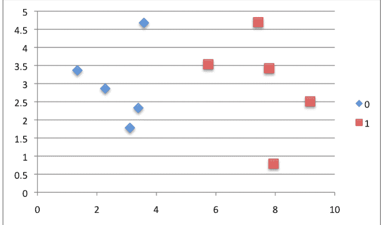

图 12.1: 用于测试朴素贝叶斯算法的小型构造数据集图。

将所有这些结合起来，我们可以在构造数据集上测试我们的 `separate_by_class()` 函数。

```python
# Example of separating data by class value

# Split the dataset by class values, returns a dictionary
def separate_by_class(dataset):
    separated = dict()
    for i in range(len(dataset)):
        vector = dataset[i]
        class_value = vector[-1]
        if (class_value not in separated):
            separated[class_value] = list()
        separated[class_value].append(vector)
    return separated

# Test separating data by class
dataset = [[3.393533211,2.331273381,0],
           [3.110073483,1.781539638,0],
           [1.343808831,3.368360954,0],
           [3.582294042,4.67917911,0],
           [2.280362439,2.866990263,0],
           [7.423436942,4.696522875,1],
           [5.745051997,3.533989803,1],
           [9.172168622,2.511101045,1],
           [7.792783481,3.424088941,1],
           [7.939820817,0.791637231,1]]
separated = separate_by_class(dataset)
for label in separated:
    print(label)
    for row in separated[label]:
        print(row)
```

Listing 12.3: 在构造数据集上按类别值分离行的示例。

运行示例将按类别值对数据集中的观测值进行排序，然后打印类别值，后跟所有识别出的记录。

```
0
[3.393533211, 2.331273381, 0]
[3.110073483, 1.781539638, 0]
[1.343808831, 3.368360954, 0]
[3.582294042, 4.67917911, 0]
[2.280362439, 2.866990263, 0]
1
[7.423436942, 4.696522875, 1]
[5.745051997, 3.533989803, 1]
[9.172168622, 2.511101045, 1]
[7.792783481, 3.424088941, 1]
[7.939820817, 0.791637231, 1]
```

Listing 12.4: 按类别值分离行的示例输出。

接下来，我们可以开始开发收集统计信息所需的函数。

##### 12.2.2 汇总数据集

我们需要从给定数据集中获取两个统计信息。我们将在几个步骤中看到这些统计信息如何用于概率计算。我们需要从给定数据集中获取的两个统计信息是均值和标准偏差（与均值的平均偏差）。均值是平均值，可以计算为：

mean = \frac{\sum_{i=1}^n x_i}{count(x)} (12.2)

其中 x 是我们要查看的值列表或列，i 是特定值的索引。以下是名为 `mean()` 的小函数，用于计算数字列表的均值。

```python
# Calculate the mean of a list of numbers
def mean(numbers):
    return sum(numbers)/float(len(numbers))
```

Listing 12.5: 计算数字列表均值的函数。

样本标准偏差是计算与均值的平均差异。可以计算为：

standard deviation = \(\sqrt{\frac{\sum_{i=1}^n (x_i - mean(x))^2}{count(x) - 1}}\) (12.3)

您可以看到，我们对均值与给定值之间的差异进行平方，计算与均值的平均平方差异，然后取平方根以将单位返回到原始值。以下是名为 `stdev()` 的小函数，用于计算数字列表的标准偏差。您会注意到它计算了均值。一次计算数字列表的均值并将其作为参数传递给 `stdev()` 函数可能更高效。如果您感兴趣，可以稍后探索此优化。

```python
from math import sqrt

# Calculate the standard deviation of a list of numbers
def stdev(numbers):
    avg = mean(numbers)
    variance = sum([(x-avg)**2 for x in numbers]) / float(len(numbers)-1)
    return sqrt(variance)
```

Listing 12.6: 计算数字列表标准偏差的函数。

我们需要为每个输入属性或数据的每一列计算均值和标准偏差统计信息。我们可以通过将每列的所有值收集到列表中，并对该列表计算均值和标准偏差来实现这一点。计算后，我们可以将统计信息收集到统计信息的列表或元组中。然后，对数据集中的每一列重复此操作，并返回统计信息元组的列表。

以下是名为 `summarize_dataset()` 的函数，它实现了这种方法。它使用了一些 Python 技巧来减少所需的行数。

```python
# Calculate the mean, stdev and count for each column in a dataset
def summarize_dataset(dataset):
    summaries = [(mean(column), stdev(column), len(column)) for column in zip(*dataset)]
    del(summaries[-1])
    return summaries
```

Listing 12.7: 汇总数据集中每一列的函数。

第一个技巧是使用 `zip()` 函数，它将聚合每个提供的参数中的元素。我们使用 `*` 运算符将数据集（即列表的列表）传递给 `zip()` 函数，该运算符将数据集分离为每行的单独列表。然后 `zip()` 函数遍历每行的每个元素，并将数据集中的一列作为数字列表返回。一个巧妙的小技巧。

然后，我们计算每列中行的均值、标准偏差和计数。从这 3 个数字创建一个元组，并存储这些元组的列表。然后，我们删除类变量的统计信息，因为我们不需要这些统计信息。让我们在上面的构造数据集上测试所有这些函数。以下是完整示例。

```python
# Example of summarizing a dataset
from math import sqrt

# Calculate the mean of a list of numbers
def mean(numbers):
    return sum(numbers)/float(len(numbers))

# Calculate the standard deviation of a list of numbers
def stdev(numbers):
    avg = mean(numbers)
    variance = sum([(x-avg)**2 for x in numbers]) / float(len(numbers)-1)
    return sqrt(variance)

# Calculate the mean, stdev and count for each column in a dataset
def summarize_dataset(dataset):
    summaries = [(mean(column), stdev(column), len(column)) for column in zip(*dataset)]
    del(summaries[-1])
    return summaries

# Test summarizing a dataset
dataset = [[3.393533211,2.331273381,0],
    [3.110073483,1.781539638,0],
    [1.343808831,3.368360954,0],
    [3.582294042,4.67917911,0],
    [2.280362439,2.866990263,0],
    [7.423436942,4.696522875,1],
    [5.745051997,3.533989803,1],
    [9.172168622,2.511101045,1],
    [7.792783481,3.424088941,1],
    [7.939820817,0.791637231,1]]
summary = summarize_dataset(dataset)
print(summary)
```

Listing 12.8: 在构造数据集上按列汇总的示例。

运行示例将打印每个输入变量的统计信息元组列表。解释结果，我们可以看到 X1 的均值为 5.178333386499999，X1 的标准偏差为 2.7665845055177263。

```
[(5.178333386499999, 2.7665845055177263, 10), (2.9984683241, 1.218556343617447, 10)]
```

Listing 12.9: 按列汇总数据集的示例输出。

现在，我们准备在数据集的每一组行上使用这些函数。

##### 12.2.3 按类别汇总数据

我们需要从训练数据集中获取按类别组织的统计信息。上面，我们已经开发了 `separate_by_class()` 函数，用于将数据集按类别分离为行。并且我们已经开发了 `summarize_dataset()` 函数，用于计算每列的汇总统计信息。

我们可以将所有这些结合起来，按类别值汇总数据集中的列。以下是名为 `summarize_by_class()` 的函数，它实现了此操作。数据集首先按类别分割，然后对每个子集计算统计信息。结果以统计信息元组列表的形式存储在字典中，按其类别值存储。

```python
# Split dataset by class then calculate statistics for each row
def summarize_by_class(dataset):
    separated = separate_by_class(dataset)
```


summaries = dict()
for class_value, rows in separated.iteritems():
    summaries[class_value] = summarize_dataset(rows)
return summaries

Listing 12.10: 按类汇总数据集中每一列的函数。

再次，让我们在我们构造的数据集上测试所有这些行为。

```python
# Example of summarizing data by class value
from math import sqrt

# Split the dataset by class values, returns a dictionary
def separate_by_class(dataset):
	separated = dict()
	for i in range(len(dataset)):
		vector = dataset[i]
		class_value = vector[-1]
		if (class_value not in separated):
			separated[class_value] = list()
		separated[class_value].append(vector)
	return separated

# Calculate the mean of a list of numbers
def mean(numbers):
	return sum(numbers)/float(len(numbers))

# Calculate the standard deviation of a list of numbers
def stdev(numbers):
	avg = mean(numbers)
	variance = sum([(x-avg)**2 for x in numbers]) / float(len(numbers)-1)
	return sqrt(variance)

# Calculate the mean, stdev and count for each column in a dataset
def summarize_dataset(dataset):
	summaries = [(mean(column), stdev(column), len(column)) for column in zip(*dataset)]
	del(summaries[-1])
	return summaries

# Split dataset by class then calculate statistics for each row
def summarize_by_class(dataset):
	separated = separate_by_class(dataset)
	summaries = dict()
	for class_value, rows in separated.iteritems():
		summaries[class_value] = summarize_dataset(rows)
	return summaries

# Test summarizing by class
dataset = [[3.393533211,2.331273381,0],
	[3.110073483,1.781539638,0],
	[1.343808831,3.368360954,0],
	[3.582294042,4.67917911,0],
	[2.280362439,2.866990263,0],
	[7.423436942,4.696522875,1],
	[5.745051997,3.533989803,1],
	[9.172168622,2.511101045,1],
	[7.792783481,3.424088941,1],
	[7.939820817,0.791637231,1]]
summary = summarize_by_class(dataset)
for label in summary:
    print(label)
    for row in summary[label]:
        print(row)
```

Listing 12.11: 在构造数据集上按类按列汇总的示例。

运行此示例将计算每个输入变量的统计信息，并按类值组织打印它们。解读结果，我们可以看到类 0 的行的 X1 值的平均值为 2.7420144012。

```text
0
(2.7420144012, 0.9265683289298018, 5)
(3.0054686692, 1.1073295894898725, 5)
1
(7.6146523718, 1.2344321550313704, 5)
(2.9914679790000003, 1.4541931384601618, 5)
```

Listing 12.12: 按类汇总数据集的示例输出。

在开始计算概率之前，我们还需要一个部分。

##### 12.2.4 高斯概率密度函数

计算观察到给定实值（如 X1）的概率或可能性是困难的。我们可以采用的一种方法是假设 X1 值是从某个分布（如钟形曲线或高斯分布）中抽取的。

高斯分布可以仅用两个数字来总结：均值和标准差。因此，通过一点数学知识，我们可以估计给定值的概率。这段数学称为高斯概率分布函数（或高斯 PDF），可计算为：

$$probability(x)=\frac{1}{\sqrt{2\times PI\times standard\_deviation}}\times e^{-\frac{(x-mean(x))^2}{2\times standard\_deviation^2}} \tag{12.4}$$

下面是实现此功能的函数。我尝试将其拆分以使其更易读。

```python
# Calculate the Gaussian probability distribution function for x
def calculate_probability(x, mean, stdev):
    exponent = exp(-((x-mean)**2 / (2 * stdev**2 )))
    return (1 / (sqrt(2 * pi) * stdev)) * exponent
```

Listing 12.13: 计算高斯 PDF 的函数。

让我们测试一下它的工作原理。以下是一些示例。

```python
# Example of Gaussian PDF
from math import sqrt
from math import pi
from math import exp

# Calculate the Gaussian probability distribution function for x
def calculate_probability(x, mean, stdev):
    exponent = exp(-((x-mean)**2 / (2 * stdev**2 )))
    return (1 / (sqrt(2 * pi) * stdev)) * exponent

# Test Gaussian PDF
print(calculate_probability(1.0, 1.0, 1.0))
print(calculate_probability(2.0, 1.0, 1.0))
print(calculate_probability(0.0, 1.0, 1.0))
```

Listing 12.14: 为临时值计算高斯 PDF 的示例。

运行它将打印一些输入值的概率。您可以看到，当值为 1 且均值和标准差均为 1 时，我们的输入最可能（钟形曲线顶部），概率为 0.39。我们可以看到，当保持统计信息不变并将 x 值更改为均值两侧 1 个标准差（2 和 0，或钟形曲线两侧相同距离）时，这些输入值的概率相同，均为 0.24。

```text
0.398942280401
0.241970724519
0.241970724519
```

Listing 12.15: 计算高斯 PDF 值的示例输出。

现在所有部分都已就绪，让我们看看如何计算朴素贝叶斯定理所需的概率。

##### 12.2.5 类概率

现在是时候使用从训练数据计算出的统计信息来为新数据计算概率了。概率是分别为每个类计算的。这意味着我们首先计算新数据属于第一个类的概率，然后计算它属于第二个类的概率，以此类推，针对所有类。数据属于某个类的概率计算如下：

P(class|data) = P(X|class) × P(class) (12.5)

您可能会注意到这与上面描述的贝叶斯定理不同。为了简化计算，已移除除法。这意味着结果不再严格是数据属于某个类的概率。该值仍然被最大化，即产生最大值的类的计算结果被视为预测。这是一种常见的实现简化，因为我们通常更关心类预测而非概率。

输入变量被单独处理，这使该技术得名“朴素”。对于上面有 2 个输入变量的示例，计算一行属于第一个类 0 的概率可以表示为：

P(class = 0|X1,X2) = P(X1|class = 0) × P(X2|class = 0) × P(class = 0) (12.6)

现在您可以看出为什么需要按类值分离数据了。前一步中的高斯概率密度函数是我们计算 X1 等实值概率的方法，我们准备的统计信息也用于此计算。下面是一个名为 calculate_class_probabilities() 的函数，它将所有这些整合在一起。它将一组准备好的汇总信息和一行新数据作为输入参数。

首先，从汇总统计信息中存储的计数计算训练记录的总数。这用于计算给定类或 P(class) 的概率，即训练数据中具有给定类的行占所有行的比例。

接下来，使用高斯概率密度函数以及该列和该类的统计信息，计算行中每个输入值的概率。概率在累积时相乘。此过程对数据集中的每个类重复。最后返回一个概率字典，每个类包含一个条目。

```python
# Calculate the probabilities of predicting each class for a given row
def calculate_class_probabilities(summaries, row):
    total_rows = sum([summaries[label][0][2] for label in summaries])
    probabilities = dict()
    for class_value, class_summaries in summaries.iteritems():
        probabilities[class_value] = summaries[class_value][0][2]/float(total_rows)
        for i in range(len(class_summaries)):
            mean, stdev, count = class_summaries[i]
            probabilities[class_value] *= calculate_probability(row[i], mean, stdev)
    return probabilities
```

Listing 12.16: 计算每个类概率的函数。

让我们通过构造数据集上的一个示例将这一切结合起来。下面的示例首先为训练数据集按类计算汇总统计信息，然后使用这些统计信息计算第一条记录属于每个类的概率。

```python
# Example of calculating class probabilities
from math import sqrt
from math import pi
from math import exp

# Split the dataset by class values, returns a dictionary
def separate_by_class(dataset):
    separated = dict()
    for i in range(len(dataset)):
        vector = dataset[i]
        class_value = vector[-1]
        if (class_value not in separated):
            separated[class_value] = list()
        separated[class_value].append(vector)
    return separated

# Calculate the mean of a list of numbers
def mean(numbers):
    return sum(numbers)/float(len(numbers))

# Calculate the standard deviation of a list of numbers
def stdev(numbers):
    avg = mean(numbers)
    variance = sum([(x-avg)**2 for x in numbers]) / float(len(numbers)-1)
    return sqrt(variance)

# Calculate the mean, stdev and count for each column in a dataset
def summarize_dataset(dataset):
    summaries = [(mean(column), stdev(column), len(column)) for column in zip(*dataset)]
    del(summaries[-1])
    return summaries
```


```python
# Split dataset by class then calculate statistics for each row
def summarize_by_class(dataset):
    separated = separate_by_class(dataset)
    summaries = dict()
    for class_value, rows in separated.iteritems():
        summaries[class_value] = summarize_dataset(rows)
    return summaries

# Calculate the Gaussian probability distribution function for x
def calculate_probability(x, mean, stdev):
    exponent = exp(-((x-mean)**2 / (2 * stdev**2 )))
    return (1 / (sqrt(2 * pi) * stdev)) * exponent

# Calculate the probabilities of predicting each class for a given row
def calculate_class_probabilities(summaries, row):
    total_rows = sum([summaries[label][0][2] for label in summaries])
    probabilities = dict()
    for class_value, class_summaries in summaries.iteritems():
        probabilities[class_value] = summaries[class_value][0][2]/float(total_rows)
        for i in range(len(class_summaries)):
            mean, stdev, _ = class_summaries[i]
            probabilities[class_value] *= calculate_probability(row[i], mean, stdev)
    return probabilities

# Test calculating class probabilities
dataset = [[3.393533211,2.331273381,0],
    [3.110073483,1.781539638,0],
    [1.343808831,3.368360954,0],
    [3.582294042,4.67917911,0],
    [2.280362439,2.866990263,0],
    [7.423436942,4.696522875,1],
    [5.745051997,3.533989803,1],
    [9.172168622,2.511101045,1],
    [7.792783481,3.424088941,1],
    [7.939820817,0.791637231,1]]
summaries = summarize_by_class(dataset)
probabilities = calculate_class_probabilities(summaries, dataset[0])
print(probabilities)
```

### 清单12.17：计算每个类别的概率示例

运行该示例会打印出为每个类别计算得到的概率。我们可以看到，第一行属于0类的概率（0.0503）高于属于1类的概率（0.0001）。因此，我们可以正确得出结论：它属于0类。

```
{0: 0.05032427673372075, 1: 0.00011557718379945765}
```

### 清单12.18：计算每个类别概率的示例输出

既然我们已经看到了如何实现朴素贝叶斯算法，现在让我们将其应用到鸢尾花数据集上。

##### 12.2.6 鸢尾花种类案例研究

本节将朴素贝叶斯算法应用于鸢尾花数据集。第一步是加载数据集，并将加载的数据转换为可用于均值和标准差计算的数字。为此，我们将使用辅助函数 `load_csv()` 加载文件，使用 `str_column_to_float()` 将字符串数字转换为浮点数，并使用 `str_column_to_int()` 将类别列转换为整数值。

我们将使用5折的*k*折交叉验证来评估该算法。这意味着每一折中将有 `150 / 5 = 30` 条记录。我们将使用辅助函数 `evaluate_algorithm()` 通过交叉验证评估算法，并使用 `accuracy_metric()` 计算预测的准确率。我们开发了一个名为 `predict()` 的新函数，用于管理新行属于每个类别的概率计算，并选择概率值最大的类别。

我们开发了另一个名为 `naive_bayes()` 的新函数，用于管理朴素贝叶斯算法的应用，首先从训练数据集中学习统计信息，然后使用这些统计信息对测试数据集进行预测。完整的示例如下所示。

```python
# Naive Bayes On The Iris Dataset
from csv import reader
from random import randrange
from math import sqrt
from math import exp
from math import pi

# Load a CSV file
def load_csv(filename):
    dataset = list()
    with open(filename, 'r') as file:
        csv_reader = reader(file)
        for row in csv_reader:
            if not row:
                continue
            dataset.append(row)
    return dataset

# Convert string column to float
def str_column_to_float(dataset, column):
    for row in dataset:
        row[column] = float(row[column].strip())

# Convert string column to integer
def str_column_to_int(dataset, column):
    class_values = [row[column] for row in dataset]
    unique = set(class_values)
    lookup = dict()
    for i, value in enumerate(unique):
        lookup[value] = i
    for row in dataset:
        row[column] = lookup[row[column]]
    return lookup

# Split a dataset into k folds
def cross_validation_split(dataset, n_folds):
    dataset_split = list()
    dataset_copy = list(dataset)
    fold_size = int(len(dataset) / n_folds)
    for _ in range(n_folds):
        fold = list()
        while len(fold) < fold_size:
            index = randrange(len(dataset_copy))
            fold.append(dataset_copy.pop(index))
        dataset_split.append(fold)
    return dataset_split

# Calculate accuracy percentage
def accuracy_metric(actual, predicted):
    correct = 0
    for i in range(len(actual)):
        if actual[i] == predicted[i]:
            correct += 1
    return correct / float(len(actual)) * 100.0

# Evaluate an algorithm using a cross validation split
def evaluate_algorithm(dataset, algorithm, n_folds, *args):
    folds = cross_validation_split(dataset, n_folds)
    scores = list()
    for fold in folds:
        train_set = list(folds)
        train_set.remove(fold)
        train_set = sum(train_set, [])
        test_set = list()
        for row in fold:
            row_copy = list(row)
            test_set.append(row_copy)
            row_copy[-1] = None
        predicted = algorithm(train_set, test_set, *args)
        actual = [row[-1] for row in fold]
        accuracy = accuracy_metric(actual, predicted)
        scores.append(accuracy)
    return scores

# Split the dataset by class values, returns a dictionary
def separate_by_class(dataset):
    separated = dict()
    for i in range(len(dataset)):
        vector = dataset[i]
        class_value = vector[-1]
        if (class_value not in separated):
            separated[class_value] = list()
        separated[class_value].append(vector)
    return separated

# Calculate the mean of a list of numbers
def mean(numbers):
    return sum(numbers)/float(len(numbers))

# Calculate the standard deviation of a list of numbers
def stdev(numbers):
    avg = mean(numbers)
    variance = sum([(x-avg)**2 for x in numbers]) / float(len(numbers)-1)
    return sqrt(variance)

# Calculate the mean, stdev and count for each column in a dataset
def summarize_dataset(dataset):
    summaries = [(mean(column), stdev(column), len(column)) for column in zip(*dataset)]
    del(summaries[-1])
    return summaries

# Split dataset by class then calculate statistics for each row
def summarize_by_class(dataset):
    separated = separate_by_class(dataset)
    summaries = dict()
    for class_value, rows in separated.iteritems():
        summaries[class_value] = summarize_dataset(rows)
    return summaries

# Calculate the Gaussian probability distribution function for x
def calculate_probability(x, mean, stdev):
    exponent = exp(-((x-mean)**2 / (2 * stdev**2 )))
    return (1 / (sqrt(2 * pi) * stdev)) * exponent

# Calculate the probabilities of predicting each class for a given row
def calculate_class_probabilities(summaries, row):
    total_rows = sum([summaries[label][0][2] for label in summaries])
    probabilities = dict()
    for class_value, class_summaries in summaries.iteritems():
        probabilities[class_value] = summaries[class_value][0][2]/float(total_rows)
        for i in range(len(class_summaries)):
            mean, stdev, _ = class_summaries[i]
            probabilities[class_value] *= calculate_probability(row[i], mean, stdev)
    return probabilities

# Predict the class for a given row
def predict(summaries, row):
    probabilities = calculate_class_probabilities(summaries, row)
    best_label, best_prob = None, -1
    for class_value, probability in probabilities.iteritems():
        if best_label is None or probability > best_prob:
            best_prob = probability
            best_label = class_value
    return best_label

# Naive Bayes Algorithm
def naive_bayes(train, test):
    summarize = summarize_by_class(train)
    predictions = list()
    for row in test:
        output = predict(summarize, row)
        predictions.append(output)
    return(predictions)

# Test Naive Bayes on Iris Dataset
filename = 'iris.csv'
dataset = load_csv(filename)
for i in range(len(dataset[0])-1):
    str_column_to_float(dataset, i)
```


```python
# convert class column to integers
str_column_to_int(dataset, len(dataset[0])-1)
# evaluate algorithm
n_folds = 5
scores = evaluate_algorithm(dataset, naive_bayes, n_folds)
print('Scores: %s' % scores)
print('Mean Accuracy: %.3f%%' % (sum(scores)/float(len(scores))))
```

代码清单 12.19：鸢尾花数据集上朴素贝叶斯的示例。

运行该示例会打印每个交叉验证折上的平均分类准确率得分以及平均准确率得分。我们可以看到，95.333%的平均准确率明显优于26%的基线准确率。

```
Scores: [96.66666666666667, 90.0, 100.0, 93.33333333333333, 96.66666666666667]
Mean Accuracy: 95.333%
```

代码清单 12.20：鸢尾花数据集上朴素贝叶斯的示例输出。

#### 12.3 扩展

本节列出了你可能希望探索的教程扩展。

- **分类输入变量。** 本教程仅支持实数输入。请通过将概率计算为其频率比来更新它，以支持分类输入值。
- **对数概率。** 在朴素贝叶斯中，概率因相乘而变得非常小。这在具有更多输入特征的数据集上可能引发问题。在概率相乘之前，将所有概率转换为对数值（例如 $p = \log(1 + p)$）可以解决这一问题。

#### 12.4 回顾

在本教程中，你学会了如何用 Python 从头实现朴素贝叶斯算法。具体来说，你学到了：

- 如何计算贝叶斯定理的朴素解释所需的概率。
- 如何使用概率对新数据做出预测。
- 如何将朴素贝叶斯应用于真实世界的预测建模问题。

##### 12.4.1 延伸阅读

- 第13.6节 朴素贝叶斯，第353页，*应用预测建模*，2013  
  http://amzn.to/2e31NXF
- 第4.2节 统计建模，第88页，*数据挖掘：实用机器学习工具与技术*，第二版，2005。  
  http://amzn.to/2fj3SYY

##### 12.4.2 下一步

在下一个教程中，你将了解如何实现并应用 k近邻算法进行分类。

## 第13章

## *k*近邻

一种简单但强大的预测方法是使用与新数据最相似的历史样本。这正是*k*近邻算法背后的原理。在本教程中，你将了解如何用 Python 从头实现*k*近邻算法。完成本教程后，你将学会：

- 如何计算两条数据之间的相似性。
- 如何使用最相似的历史记录进行预测。
- 如何将*k*近邻算法同时用于分类和回归问题。

让我们开始吧。

#### 13.1 描述

本节将简要介绍我们在本教程中将要实现的*k*近邻算法，以及我们将应用该算法的鲍鱼数据集。

##### 13.1.1 *k*近邻

*k*近邻算法，简称 KNN，是一项非常简单的技术。整个训练数据集被存储起来。当需要预测时，会在训练数据集中定位与新记录最相似的*k*条记录。然后根据这些邻居做出综合预测。记录之间的相似性可以通过多种不同方式来度量。可以使用针对问题或数据特化的方法。一般来说，对于表格数据，欧几里得距离是一个很好的起点。

一旦找到邻居，就可以通过返回最常见的输出或取平均值来做出综合预测。因此，KNN可用于分类或回归问题。除了存储整个训练数据集之外，无所谓模型。因为直到需要预测时才开始工作，KNN通常被称为惰性学习方法。

##### 13.1.2 鲍鱼数据集

在本教程中，我们将使用鲍鱼数据集。该数据集涉及鲍鱼年龄的预测。该问题的基线性能约为16%，即RMSE约为3.2个环。你可以在附录A的A.8节中了解更多相关信息。请下载数据集，并以文件名 abalone.csv 保存到当前工作目录中。

#### 13.2 教程

本教程分为5个部分：

- 1. 欧几里得距离。
- 2. 获取邻居。
- 3. 做出预测。
- 4. 鲍鱼分类案例研究。
- 5. 鲍鱼回归案例研究。

这些步骤将教你为分类和回归预测建模问题实现并应用 k近邻算法的基础知识。

##### 13.2.1 欧几里得距离

第一步需要计算数据集中两行之间的距离。数据行大多由数字组成，计算两行或数字向量之间距离的一种简单方法是画一条直线。这在二维或三维空间中是合理的，并且可以很好地扩展到更高维度。我们可以使用欧几里得距离度量来计算两个向量之间的直线距离。其计算方法为两个向量之间差的平方和的平方根。

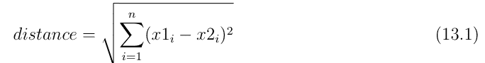

其中 x1 是第一行数据，x2 是第二行数据，i 是具体列的索引，我们对所有列求和。对于欧几里得距离，值越小，两条记录越相似。值为0表示两条记录之间没有差异。下面是一个名为 euclidean_distance() 的函数，它在 Python 中实现了这一点。

```python
# calculate the Euclidean distance between two vectors
def euclidean_distance(row1, row2):
    distance = 0.0
    for i in range(len(row1)-1):
        distance += (row1[i] - row2[i])**2
    return sqrt(distance)
```

代码清单 13.1：计算行之间欧几里得距离的函数。

你可以看到，该函数假设每行中的最后一列是输出值，在距离计算中会被忽略。我们可以用一个小型人工构造的分类数据集来测试这个距离函数。在构建 KNN 算法所需的各个元素时，我们会多次使用这个数据集。

| X1 | X2 | Y |
|---|---|---|
| 2.7810836 | 2.550537003 | 0 |
| 1.465489372 | 2.362125076 | 0 |
| 3.396561688 | 4.400293529 | 0 |
| 1.38807019 | 1.850220317 | 0 |
| 3.06407232 | 3.005305973 | 0 |
| 7.627531214 | 2.759262235 | 1 |
| 5.332441248 | 2.088626775 | 1 |
| 6.922596716 | 1.77106367 | 1 |
| 8.675418651 | -0.242068655 | 1 |
| 7.673756466 | 3.508563011 | 1 |

代码清单 13.2：用于测试逻辑回归的小型人工构造数据集。

下面是用不同颜色显示每个点的不同类别的数据集图。

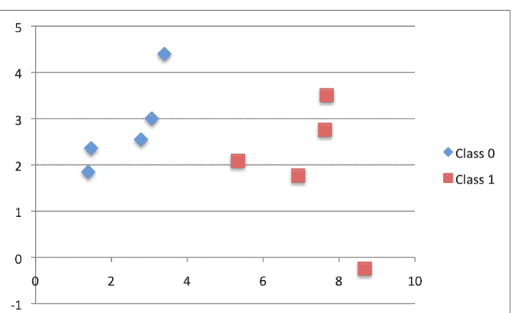

图13.1：用于测试KNN算法的小型人工构造数据集图。

将所有这些放在一起，我们可以编写一个小示例来测试我们的距离函数，打印第一行与所有其他行之间的距离。我们期望第一行与自身的距离为0，这是一个值得注意的好现象。完整示例如下。

```python
# Example of calculating Euclidean distance
from math import sqrt

# calculate the Euclidean distance between two vectors
def euclidean_distance(row1, row2):
    distance = 0.0
    for i in range(len(row1)-1):
        distance += (row1[i] - row2[i])**2
    return sqrt(distance)

# Test distance function
dataset = [[2.7810836,2.550537003,0],
    [1.465489372,2.362125076,0],
    [3.396561688,4.400293529,0],
    [1.38807019,1.850220317,0],
    [3.06407232,3.005305973,0],
    [7.627531214,2.759262235,1],
    [5.332441248,2.088626775,1],
    [6.922596716,1.77106367,1],
    [8.675418651,-0.242068655,1],
    [7.673756466,3.508563011,1]]
row0 = dataset[0]
for row in dataset:
    distance = euclidean_distance(row0, row)
    print(distance)
```

代码清单 13.3：在人工构造数据集上计算欧几里得距离的示例。

运行此示例会打印第一行与数据集中每一行（包括自身）之间的距离。

```
0.0
1.32901739153
1.94946466557
1.55914393855
0.535628072194
4.85094018699
2.59283375995
4.21422704263
6.52240998823
4.98558538245
```

代码清单 13.4：计算欧几里得距离的示例输出。

现在是时候使用距离计算来定位数据集中的邻居了。

##### 13.2.2 获取邻居

数据集中新数据点的邻居是由我们的距离度量定义的 k 个最近实例。要定位数据集中新数据点的邻居，我们首先必须计算数据集中每条记录到新数据点的距离。我们可以使用上面的距离函数来完成这一点。一旦计算出距离，我们就必须按训练数据集中所有记录与新数据的距离对它们进行排序。然后，我们可以选择前 k 个作为最相似的邻居返回。

我们可以将数据集中每条记录的距离作为元组记录下来，按距离（降序）对元组列表进行排序，然后检索邻居。下面是一个名为 get_neighbors() 的函数，它实现了这一点。

```python
# Locate the most similar neighbors
def get_neighbors(train, test_row, num_neighbors):
    distances = list()
    for train_row in train:
```


```python
dist = euclidean_distance(test_row, train_row)
distances.append((train_row, dist))
distances.sort(key=lambda tup: tup[1])
neighbors = list()
for i in range(num_neighbors):
    neighbors.append(distances[i][0])
return neighbors
```

清单 13.5：用于查找新数据行的邻居的函数。

可以看到，上一步开发的 `euclidean_distance()` 函数用于计算每个 `train_row` 与新的 `test_row` 之间的距离。`train_row` 和距离元组的列表会进行排序，排序时使用自定义键，确保元组中的第二个元素（`tup[1]`）用于排序操作。

最后，返回一个包含与 `test_row` 最相似的 `num_neighbors` 个邻居的列表。我们可以使用上一节准备的小型人为数据集来测试这个函数。完整示例如下。

```python
# Example of getting neighbours for an instance
from math import sqrt

# calculate the Euclidean distance between two vectors
def euclidean_distance(row1, row2):
    distance = 0.0
    for i in range(len(row1)-1):
        distance += (row1[i] - row2[i])**2
    return sqrt(distance)

# Locate the most similar neighbors
def get_neighbors(train, test_row, num_neighbors):
    distances = list()
    for train_row in train:
        dist = euclidean_distance(test_row, train_row)
        distances.append((train_row, dist))
    distances.sort(key=lambda tup: tup[1])
    neighbors = list()
    for i in range(num_neighbors):
        neighbors.append(distances[i][0])
    return neighbors

# Test distance function
dataset = [[2.7810836,2.550537003,0],
    [1.465489372,2.362125076,0],
    [3.396561688,4.400293529,0],
    [1.38807019,1.850220317,0],
    [3.06407232,3.005305973,0],
    [7.627531214,2.759262235,1],
    [5.332441248,2.088626775,1],
    [6.922596716,1.77106367,1],
    [8.675418651,-0.242068655,1],
    [7.673756466,3.508563011,1]]
neighbors = get_neighbors(dataset, dataset[0], 3)
for neighbor in neighbors:
    print(neighbor)
```

清单 13.6：在人为数据集上获取最相似邻居的示例。

运行此示例，会按相似度打印出数据集中与第一条记录最相似的 3 条记录。正如预期的那样，第一条记录与自身最相似，因此位于列表顶部。

```text
[2.7810836, 2.550537003, 0]
[3.06407232, 3.005305973, 0]
[1.465489372, 2.362125076, 0]
```

清单 13.7：计算最相似邻居的示例输出。

现在我们知道如何从数据集中获取邻居，接下来可以使用它们进行预测。

##### 13.2.3 进行预测

从训练数据集中收集到的最相似邻居可用于进行预测。在分类的情况下，我们可以返回邻居中最具代表性的类别。我们可以通过对邻居的输出值列表执行 max() 函数来实现这一点。给定在邻居中观察到的类别值列表，max() 函数接受一组唯一的类别值，并对该集合中的每个类别值在类别值列表上调用 count 方法。下面是名为 predict_classification() 的函数，它实现了这一点。

```python
# Make a classification prediction with neighbors
def predict_classification(train, test_row, num_neighbors):
    neighbors = get_neighbors(train, test_row, num_neighbors)
    output_values = [row[-1] for row in neighbors]
    prediction = max(set(output_values), key=output_values.count)
    return prediction
```

清单 13.8：用于对新数据行进行分类预测的函数。

我们可以用上述人为数据集来测试这个函数。下面是一个完整示例。

```python
# Example of making predictions
from math import sqrt

# calculate the Euclidean distance between two vectors
def euclidean_distance(row1, row2):
    distance = 0.0
    for i in range(len(row1)-1):
        distance += (row1[i] - row2[i])**2
    return sqrt(distance)

# Locate the most similar neighbors
def get_neighbors(train, test_row, num_neighbors):
    distances = list()
    for train_row in train:
        dist = euclidean_distance(test_row, train_row)
        distances.append((train_row, dist))
    distances.sort(key=lambda tup: tup[1])
    neighbors = list()
    for i in range(num_neighbors):
        neighbors.append(distances[i][0])
    return neighbors

# Make a classification prediction with neighbors
def predict_classification(train, test_row, num_neighbors):
    neighbors = get_neighbors(train, test_row, num_neighbors)
    output_values = [row[-1] for row in neighbors]
    prediction = max(set(output_values), key=output_values.count)
    return prediction

# Test distance function
dataset = [[2.7810836,2.550537003,0],
    [1.465489372,2.362125076,0],
    [3.396561688,4.400293529,0],
    [1.38807019,1.850220317,0],
    [3.06407232,3.005305973,0],
    [7.627531214,2.759262235,1],
    [5.332441248,2.088626775,1],
    [6.922596716,1.77106367,1],
    [8.675418651,-0.242068655,1],
    [7.673756466,3.508563011,1]]
prediction = predict_classification(dataset, dataset[0], 3)
print('Expected %d, Got %d.' % (dataset[0][-1], prediction))
```

清单 13.9：在人为数据集上进行预测的示例。

运行此示例，会打印预期的分类 0 以及根据数据集中 3 个最相似邻居预测出的实际分类。

```text
Expected 0, Got 0.
```

清单 13.10：进行预测的示例输出。

我们可以想象如何修改 predict_classification() 函数来计算结果值的平均值。下面是一个名为 predict_regression() 的快速示例，稍后我们会用到。

```python
# Make a prediction with neighbors
def predict_regression(train, test_row, num_neighbors):
    neighbors = get_neighbors(train, test_row, num_neighbors)
    output_values = [row[-1] for row in neighbors]
    prediction = sum(output_values) / float(len(output_values))
    return prediction
```

清单 13.11：用于对新数据行进行回归预测的函数。

我们现在已经拥有了使用 KNN 进行预测所需的全部组件。让我们将其应用到鲍鱼数据集上。

##### 13.2.4 鲍鱼分类案例研究

在本节中，我们将把 k 近邻算法应用到鲍鱼数据集上。第一步是加载数据集，并将加载的数据转换为可用于欧几里得距离计算的数字。为此，我们将使用辅助函数 load_csv() 加载文件，使用 str_column_to_float() 将字符串数字转换为浮点数，并使用 str_column_to_int() 将性别列（第 0 列）转换为整数值。

我们将使用 5 折 k 折交叉验证来评估该算法。这意味着 \(\frac{4177}{5} = 835.4\)，即每折略多于 830 条记录。我们将使用辅助函数 evaluate_algorithm() 通过交叉验证来评估算法，并使用 accuracy_metric() 来计算预测的准确率。完整示例如下。

```python
# k-nearest neighbors on the Abalone Dataset
from random import seed
from random import randrange
from csv import reader
from math import sqrt

# Load a CSV file
def load_csv(filename):
    dataset = list()
    with open(filename, 'r') as file:
        csv_reader = reader(file)
        for row in csv_reader:
            if not row:
                continue
            dataset.append(row)
    return dataset

# Convert string column to float
def str_column_to_float(dataset, column):
    for row in dataset:
        row[column] = float(row[column].strip())

# Convert string column to integer
def str_column_to_int(dataset, column):
    class_values = [row[column] for row in dataset]
    unique = set(class_values)
    lookup = dict()
    for i, value in enumerate(unique):
        lookup[value] = i
    for row in dataset:
        row[column] = lookup[row[column]]
    return lookup

# Find the min and max values for each column
def dataset_minmax(dataset):
    minmax = list()
    for i in range(len(dataset[0])):
        col_values = [row[i] for row in dataset]
        value_min = min(col_values)
        value_max = max(col_values)
        minmax.append([value_min, value_max])
    return minmax

# Rescale dataset columns to the range 0-1
def normalize_dataset(dataset, minmax):
    for row in dataset:
        for i in range(len(row)):
            row[i] = (row[i] - minmax[i][0]) / (minmax[i][1] - minmax[i][0])

# Split a dataset into k folds
def cross_validation_split(dataset, n_folds):
    dataset_split = list()
    dataset_copy = list(dataset)
```


```python
def predict_classification(train, test_row, num_neighbors):
    neighbors = get_neighbors(train, test_row, num_neighbors)
    output_values = [row[-1] for row in neighbors]
    prediction = max(set(output_values), key=output_values.count)
    return prediction

# kNN Algorithm
def k_nearest_neighbors(train, test, num_neighbors):
    predictions = list()
    for row in test:
        output = predict_classification(train, row, num_neighbors)
        predictions.append(output)
    return(predictions)

# Test the kNN on the Abalone dataset
seed(1)
# load and prepare data
filename = 'abalone.csv'
dataset = load_csv(filename)
for i in range(1, len(dataset[0])):
    str_column_to_float(dataset, i)
# convert first column to integers
str_column_to_int(dataset, 0)
# evaluate algorithm
n_folds = 5
num_neighbors = 5
scores = evaluate_algorithm(dataset, k_nearest_neighbors, n_folds, num_neighbors)
print('Scores: %s' % scores)
print('Mean Accuracy: %.3f%%' % (sum(scores)/float(len(scores))))
```

清单 13.12: 鲍鱼数据集上的分类 KNN。

使用了 *k*=5 个邻居来进行预测。你可以尝试更大的 *k* 值来提高准确率。运行示例将打印每个折叠上达到的准确率分数及其平均值。我们可以看到，23% 的平均准确率优于 16% 的基准，但总体来说相当差。这是因为类别数量较多，使得准确率成为评估此问题技能的不佳指标。这一事实，加上许多类别只有很少或只有一个示例的事实，也使得该问题具有挑战性。

```
Scores: [24.191616766467066, 24.431137724550897, 23.47305389221557, 22.035928143712574,
 23.11377245508982]
Mean Accuracy: 23.449%
```

清单 13.13: 鲍鱼数据集上分类 KNN 的示例输出。

我们也可以将该数据集建模为回归预测建模问题。这是因为类别值具有自然的序数关系，因为它们是年份。

##### 13.2.5 作为回归的鲍鱼案例研究

回归可能是建模此问题更有用的方法，因为类别数量较多且某些类别值稀疏。我们可以通过将 KNN 更改为预测邻居的平均值并使用根均方误差来评估预测，轻松将上述示例更改为回归。下面是一个包含这些更改的完整可运行示例。

```python
def predict_regression(train, test_row, num_neighbors):
    neighbors = get_neighbors(train, test_row, num_neighbors)
    output_values = [row[-1] for row in neighbors]
    prediction = sum(output_values) / float(len(output_values))
    return prediction

# kNN Algorithm
def k_nearest_neighbors(train, test, num_neighbors):
    predictions = list()
    for row in test:
        output = predict_regression(train, row, num_neighbors)
        predictions.append(output)
    return(predictions)

# Test the kNN on the Abalone dataset
seed(1)
# load and prepare data
filename = 'abalone.csv'
dataset = load_csv(filename)
for i in range(1, len(dataset[0])):
    str_column_to_float(dataset, i)
# convert first column to integers
str_column_to_int(dataset, 0)
# evaluate algorithm
n_folds = 5
num_neighbors = 5
scores = evaluate_algorithm(dataset, k_nearest_neighbors, n_folds, num_neighbors)
print('Scores: %s' % scores)
print('Mean RMSE: %.3f' % (sum(scores)/float(len(scores))))
```

清单 13.14: 鲍鱼数据集上的回归 KNN。

运行此示例将打印每个折叠上的 RMSE 以及所有折叠的平均 RMSE。我们可以看到，2.242 个环的 RMSE 优于 3.222 个环的基准。我们还有一个模型，在该领域可能更有用，其性能更易于理解。

```
Scores: [2.1235153320071554, 2.258503558410589, 2.2739767060988636, 2.3582090027389,
2.196633243122396]
Mean RMSE: 2.242
```

清单 13.15: 鲍鱼数据集上回归 KNN 的示例输出。

#### 13.3 扩展

本节列出了你可能希望考虑的教程扩展，以供调查。

- 调整 KNN。尝试越来越大的 *k* 值，看看是否可以提高算法在鲍鱼数据集上的性能。
- 用于分类的回归。将用于回归问题进行预测的方法（取平均值）与用于分类进行预测的方法（返回整数）相结合，看看是否可以改进结果。
- **更多距离度量。** 实现其他可用于查找相似历史数据的距离度量，例如汉明距离、曼哈顿距离和闵可夫斯基距离。
- **数据准备。** 距离度量强烈受输入数据规模的影响。尝试归一化和标准化数据准备方法以改进结果。
- **更多问题。** 与往常一样，在更多不同的分类和回归问题上尝试该技术。

#### 13.4 回顾

在本教程中，你了解了如何从头使用 Python 实现 *k*-最近邻算法。具体来说，你学习了：

- 如何在 Python 中从头实现 *k*-最近邻。
- 如何将 *k*-最近邻应用于分类问题。
- 如何将 *k*-最近邻应用于回归问题。

##### 13.4.1 进一步阅读

- 第 3.5 节 线性回归与 K-最近邻比较，第 104 页，《统计学导论》，2014年。  
  http://amzn.to/2eeTyQx
- 第 18.8 节，非参数模型，第 737 页，《人工智能：一种现代的方法》，2010年。  
  http://amzn.to/2e31FqP
- 第 7.4 节 K-最近邻，第 159 页，和第 13.5 节 K-最近邻，第 350 页，《应用预测建模》，2013年  
  http://amzn.to/2e31NXF
- 第 4.7 节，基于实例的学习，第 128 页，《数据挖掘：实用机器学习工具和技术》，第二版，2005年。  
  http://amzn.to/2fj3SYY

##### 13.4.2 下一步

在下一个教程中，你将了解如何实现和应用学习向量量化算法用于分类。

## 第 14 章

## 学习向量量化

k-最近邻的一个局限是，为了进行预测，你必须保留大量训练示例数据库。学习向量量化算法通过学习一个更小的子集模式来解决这个问题，这些模式最能代表训练数据。在本教程中，你将了解如何从头使用 Python 实现学习向量量化算法。完成本教程后，你将知道：

- 如何从训练数据集中学习一组码本向量。
- 如何使用学习到的码本向量进行预测。
- 如何将学习向量量化应用于真实的预测建模问题。

让我们开始吧。

#### 14.1 描述

本节简要介绍了学习向量量化算法以及本教程中将使用的电离层分类问题。

##### 14.1.1 学习向量量化

学习向量量化（LVQ）算法与 k-最近邻非常相似。预测是通过在模式库中找到最佳匹配来进行的。区别在于，模式库是从训练数据中学习的，而不是直接使用训练模式本身。

模式库称为码本向量，每个模式称为一个码本向量。码本向量初始化为从训练数据集中随机选择的值。然后，经过若干个时代，它们使用学习算法进行调整，以最好地总结训练数据。学习算法一次显示一条训练记录，在码本向量中找到最佳匹配单元，如果它们属于同一类别，则将其移近训练记录，如果属于不同类别，则将其移远。

一旦准备就绪，码本向量将用于使用 k-最近邻算法进行预测，其中 *k*=1。该算法是为分类预测建模问题开发的，但可以调整用于回归问题。


##### 14.1.2 电离层数据集

在本教程中，我们将使用电离层数据集（Ionosphere Dataset）。该数据集涉及对大气结构的预测。此问题上的基线性能约为64%。你可以通过附录A的A.9节了解更多信息。下载数据集并将其保存到当前工作目录，文件名为 ionosphere.csv。

#### 14.2 教程

本教程分为4个部分：

- 1. 欧氏距离。
- 2. 最佳匹配单元。
- 3. 训练码本向量。
- 4. 电离层案例研究。

这些步骤将为你在自己的预测建模问题中实现和应用LVQ算法奠定基础。

##### 14.2.1 欧氏距离

第一步需要计算数据集中两行之间的距离。我们将使用第13章首次引入的欧氏距离。欧氏距离的计算可以概括为：

\( distance = \sqrt{\sum_{i=1}^{n}(x1_i - x2_i)^2} \) (14.1)

其中 x1 是第一行数据，x2 是第二行数据，i 是特定列的索引，因为我们要遍历所有列求和。对于欧氏距离，值越小，两条记录越相似。值为0表示两条记录之间没有差异。下面是一个名为 euclidean_distance() 的函数，它在 Python 中实现了这一点。

```
# calculate the Euclidean distance between two vectors
def euclidean_distance(row1, row2):
	distance = 0.0
	for i in range(len(row1)-1):
		distance += (row1[i] - row2[i])**2
	return sqrt(distance)
```

清单14.1：计算行间欧氏距离的函数。

可以看到，该函数假设每行中的最后一列是输出值，在距离计算中会被忽略。我们可以用一个小的虚构分类数据集来测试这个距离函数。在构建LVQ算法所需元素的过程中，我们会多次使用这个数据集。

| X1 | X2 | Y |
|---|---|---|
| 2.7810836 | 2.550537003 | 0 |
| 1.465489372 | 2.362125076 | 0 |
| 3.396561688 | 4.400293529 | 0 |
| 1.38807019 | 1.850220317 | 0 |
| 3.06407232 | 3.005305973 | 0 |
| 7.627531214 | 2.759262235 | 1 |
| 5.332441248 | 2.088626775 | 1 |
| 6.922596716 | 1.77106367 | 1 |
| 8.675418651 | -0.242068655 | 1 |
| 7.673756466 | 3.508563011 | 1 |

清单14.2：用于测试逻辑回归的虚构小型数据集。

下面是该数据集的图，使用不同颜色显示每个点的不同类别。

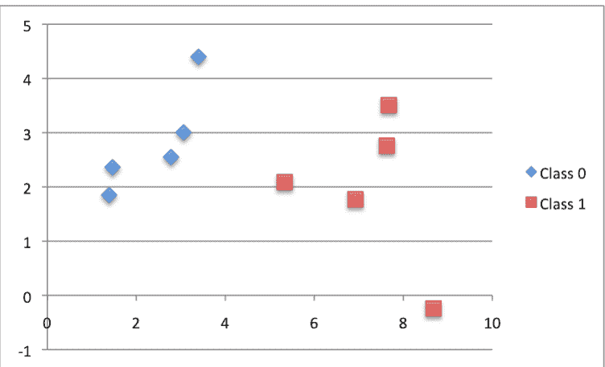

图14.1：用于测试KNN算法的虚构小型数据集图。

综合以上内容，我们可以编写一个小示例来测试距离函数，打印第一行与所有其他行之间的距离。我们期望第一行与它自身的距离为0，这是一个值得留意的良好现象。完整示例如下。

```
# Example of calculating Euclidean distance
from math import sqrt

# calculate the Euclidean distance between two vectors
def euclidean_distance(row1, row2):
	distance = 0.0
	for i in range(len(row1)-1):
		distance += (row1[i] - row2[i])**2
	return sqrt(distance)

# Test distance function

dataset = [[2.7810836,2.550537003,0],
[1.465489372,2.362125076,0],
[3.396561688,4.400293529,0],
[1.38807019,1.850220317,0],
[3.06407232,3.005305973,0],
[7.627531214,2.759262235,1],
[5.332441248,2.088626775,1],
[6.922596716,1.77106367,1],
[8.675418651,-0.242068655,1],
[7.673756466,3.508563011,1]]
row0 = dataset[0]
for row in dataset:
    distance = euclidean_distance(row0, row)
    print(distance)
```

清单14.3：在虚构数据集上计算欧氏距离的示例。

运行此示例会打印第一行与数据集中每一行（包括自身）之间的距离。

```
0.0
1.32901739153
1.94946466557
1.55914393855
0.535628072194
4.85094018699
2.59283375995
4.21422704263
6.52240998823
4.985585538245
```

清单14.4：计算欧氏距离的示例输出。

现在，是时候使用距离计算来定位数据集中的最佳匹配单元了。

##### 14.2.2 最佳匹配单元

最佳匹配单元（Best Matching Unit，简称BMU）是与新数据最相似的码本向量。要在数据集中定位新数据的BMU，我们必须首先计算每个码本与新数据之间的距离。我们可以使用上面的距离函数来做到这一点。一旦计算出距离，我们必须按到新数据的距离对所有码本进行排序。然后我们可以返回第一个或最相似的码本向量。

我们可以将数据集中每条记录的距离以元组形式保存，按距离（升序）对元组列表排序，然后检索BMU。下面是一个名为 get_best_matching_unit() 的函数，它实现了这一点。

```
# Locate the best matching unit
def get_best_matching_unit(codebooks, test_row):
    distances = list()
    for codebook in codebooks:
        dist = euclidean_distance(codebook, test_row)
        distances.append((codebook, dist))
    distances.sort(key=lambda tup: tup[1])
    return distances[0][0]
```

清单14.5：为新行计算最佳匹配单元的函数。

可以看到，上一步开发的 euclidean_distance() 函数用于计算每个码本与新 test_row 之间的距离。码本和距离元组的列表使用自定义键排序，确保排序操作使用元组中的第二项（tup[1]）。最后，返回第一个或最相似的码本向量作为BMU。我们可以使用上一节准备的虚构小型数据集来测试这个函数。完整示例如下。

```
# Example of getting the BMU
from math import sqrt

# calculate the Euclidean distance between two vectors
def euclidean_distance(row1, row2):
	distance = 0.0
	for i in range(len(row1)-1):
		distance += (row1[i] - row2[i])**2
	return sqrt(distance)

# Locate the best matching unit
def get_best_matching_unit(codebooks, test_row):
	distances = list()
	for codebook in codebooks:
		dist = euclidean_distance(codebook, test_row)
		distances.append((codebook, dist))
	distances.sort(key=lambda tup: tup[1])
	return distances[0][0]

# Test best matching unit function
dataset = [[2.7810836,2.550537003,0],
	[1.465489372,2.362125076,0],
	[3.396561688,4.400293529,0],
	[1.38807019,1.850220317,0],
	[3.06407232,3.005305973,0],
	[7.627531214,2.759262235,1],
	[5.332441248,2.088626775,1],
	[6.922596716,1.77106367,1],
	[8.675418651,-0.242068655,1],
	[7.673756466,3.508563011,1]]
test_row = dataset[0]
bmu = get_best_matching_unit(dataset, test_row)
print(bmu)
```

清单14.6：在虚构数据集上计算BMU的示例。

运行此示例会将数据集中的BMU打印为第一条记录。正如预期，第一条记录与它自身最相似，并且位于列表顶部。

```
[2.7810836, 2.550537003, 0]
```

清单14.7：计算BMU的示例输出。

使用一组码本向量进行预测也是同样的过程。我们使用1近邻算法。也就是说，对于每一个我们想要预测的新模式，我们在集合中找到最相似的码本向量，并返回其关联的类别值。现在我们

##### 14.2.3 训练码本向量

训练一组码本向量的第一步是初始化这组向量。我们可以使用从训练数据集中随机特征构造的模式来初始化它。下面是一个名为 random_codebook() 的函数，它实现了这一点。从训练数据中随机选择输入和输出特征。

```
# Create a random codebook vector
def random_codebook(train):
    n_records = len(train)
    n_features = len(train[0])
    codebook = [train[randrange(n_records)][i] for i in range(n_features)]
    return codebook
```

清单14.8：创建随机码本向量的函数。

码本向量初始化为随机集合后，必须经过调整以最好地概括训练数据。这是通过迭代完成的。

- **轮次**：在最高层，该过程重复固定数量的轮次或训练数据的暴露次数。
- **训练数据集**：在一个轮次内，每个训练模式依次用于更新码本向量集合。
- **模式特征**：对于给定的训练模式，最佳匹配码本向量的每个特征都会被更新，使其更接近或更远离该模式。

对于每个训练模式，找到最佳匹配单元，并且只更新这个最佳匹配单元。训练模式与BMU之间的差异被计算为误差。类别值（假定为列表中的最后一个值）会被比较。如果它们匹配，则将误差加到BMU上，使其更接近训练模式；否则，则减去误差，将其推得更远。

BMU的调整量由学习率控制。这是对所有BMU更改量的一个加权。例如，学习率为0.3意味着BMU仅移动训练模式与BMU之间误差或差异的30%。

此外，学习率会被调整，使其在第一个轮次中效果最大，随着训练的进行效果逐渐减小，直到最后一个轮次中效果最小。这称为线性衰减学习率调度，也可用于人工神经网络。我们可以按轮次编号总结学习率的衰减如下：

$rate = learning\_rate \times (1.0 - \frac{epoch}{total\_epochs})$ (14.2)

我们可以通过假设学习率为0.3和10个轮次来测试这个方程。每个轮次的学习率将如下：


列表 14.9: 学习率线性衰减测试。

| 轮次 | 有效学习率 |
|-------|-------------------------|
| 0 | 0.3 |
| 1 | 0.27 |
| 2 | 0.24 |
| 3 | 0.21 |
| 4 | 0.18 |
| 5 | 0.15 |
| 6 | 0.12 |
| 7 | 0.09 |
| 8 | 0.06 |
| 9 | 0.03 |

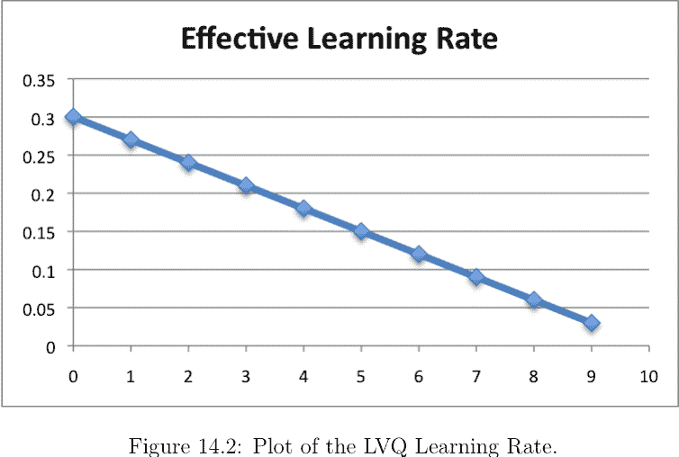

我们可以将所有这些整合在一起。下面是一个名为 `train_codebooks()` 的函数，它实现了给定训练数据集训练一组码本向量的过程。该函数除了训练数据集外，还接受 3 个额外参数：要创建和训练的码本向量数量、初始学习率以及训练码本向量的轮次数。

你还可以看到，该函数会跟踪每个轮次的平方误差和，并打印一条消息，显示轮次号、有效学习率和平方误差得分。在调试训练函数或特定预测问题的配置时，这很有帮助。你可以看到使用 `random_codebook()` 来初始化码本向量，并使用 `get_best_matching_unit()` 函数来查找每个轮次内每个训练模式的 BMU。

```python
# Train a set of codebook vectors
def train_codebooks(train, n_codebooks, lrate, epochs):
    codebooks = [random_codebook(train) for i in range(n_codebooks)]
    for epoch in range(epochs):
        rate = lrate * (1.0-(epoch/float(epochs)))
        sum_error = 0.0
        for row in train:
            bmu = get_best_matching_unit(codebooks, row)
            for i in range(len(row)-1):
                error = row[i] - bmu[i]
                sum_error += error**2
                if bmu[-1] == row[-1]:
                    bmu[i] += rate * error
                else:
                    bmu[i] -= rate * error
        print('>epoch=%d, lrate=%.3f, error=%.3f' % (epoch, rate, sum_error))
    return codebooks
```

列表 14.10: 训练码本向量种群的函数。

我们可以将此与上面的示例结合起来，为我们的构造数据集学习一组码本向量。下面是完整示例。

```python
# Example of training a set of codebook vectors
from math import sqrt
from random import randrange
from random import seed

# calculate the Euclidean distance between two vectors
def euclidean_distance(row1, row2):
    distance = 0.0
    for i in range(len(row1)-1):
        distance += (row1[i] - row2[i])**2
    return sqrt(distance)

# Locate the best matching unit
def get_best_matching_unit(codebooks, test_row):
    distances = list()
    for codebook in codebooks:
        dist = euclidean_distance(codebook, test_row)
        distances.append((codebook, dist))
    distances.sort(key=lambda tup: tup[1])
    return distances[0][0]

# Create a random codebook vector
def random_codebook(train):
    n_records = len(train)
    n_features = len(train[0])
    codebook = [train[randrange(n_records)][i] for i in range(n_features)]
    return codebook

# Train a set of codebook vectors
def train_codebooks(train, n_codebooks, lrate, epochs):
    codebooks = [random_codebook(train) for i in range(n_codebooks)]
    for epoch in range(epochs):
        rate = lrate * (1.0-(epoch/float(epochs)))
        sum_error = 0.0
        for row in train:
            bmu = get_best_matching_unit(codebooks, row)
            for i in range(len(row)-1):
                error = row[i] - bmu[i]
                sum_error += error**2
                if bmu[-1] == row[-1]:
                    bmu[i] += rate * error
                else:
                    bmu[i] -= rate * error
        print('>epoch=%d, lrate=%.3f, error=%.3f' % (epoch, rate, sum_error))
    return codebooks

# Test the training function
seed(1)
dataset = [[2.7810836,2.550537003,0],
 [1.465489372,2.362125076,0],
 [3.396561688,4.400293529,0],
 [1.38807019,1.850220317,0],
 [3.06407232,3.005305973,0],
 [7.627531214,2.759262235,1],
 [5.332441248,2.088626775,1],
 [6.922596716,1.77106367,1],
 [8.675418651,-0.242068655,1],
 [7.673756466,3.508563011,1]]
learn_rate = 0.3
n_epochs = 10
n_codebooks = 2
codebooks = train_codebooks(dataset, n_codebooks, learn_rate, n_epochs)
print('Codebooks: %s' % codebooks)
```

列表 14.11: 在构造数据集上训练码本向量的示例。

运行此示例将以初始学习率 0.3 训练一组 2 个码本向量，共 10 个轮次。每个轮次的详细信息都会打印出来，并显示从训练数据中学习到的 2 个码本向量集。我们可以看到，学习率的变化符合我们上面对每个轮次所探索的预期。我们还可以看到，每个轮次的平方误差和在训练结束时仍在继续下降，并且可能有机会进一步调整示例以获得更小的误差。

```
>epoch=0, lrate=0.300, error=139.812
>epoch=1, lrate=0.270, error=47.368
>epoch=2, lrate=0.240, error=27.535
>epoch=3, lrate=0.210, error=26.241
>epoch=4, lrate=0.180, error=25.509
>epoch=5, lrate=0.150, error=24.778
>epoch=6, lrate=0.120, error=24.053
>epoch=7, lrate=0.090, error=23.344
>epoch=8, lrate=0.060, error=22.663
>epoch=9, lrate=0.030, error=21.981
Codebooks: [[7.3188612290158614, 1.9696349335193466, 1], [2.4304257696446854,
 2.8396012380964555, 0]]
```

列表 14.12: 训练码本向量的示例输出。

既然我们知道如何训练一组码本向量，让我们看看如何在真实数据集上使用此算法。

##### 14.2.4 电离层案例研究

在本节中，我们将把学习向量量化算法应用于电离层数据集。第一步是加载数据集，并将加载的数据转换为可用于欧氏距离计算的数字。为此，我们将使用辅助函数 `load_csv()` 加载文件，使用 `str_column_to_float()` 将字符串数字转换为浮点数，并使用 `str_column_to_int()` 将类列转换为整数值。

我们将使用 *k* 折交叉验证（5 折）来评估该算法。这意味着每个折叠中将有 \(\frac{351}{5}=70.2\) 或略多于 70 条记录。我们将使用辅助函数 `evaluate_algorithm()` 通过交叉验证来评估该算法，并使用 `accuracy_metric()` 来计算预测的准确性。完整示例如下。

```python
# LVQ for the Ionosphere Dataset
from random import seed
from random import randrange
from csv import reader
from math import sqrt

# Load a CSV file
def load_csv(filename):
    dataset = list()
    with open(filename, 'r') as file:
        csv_reader = reader(file)
        for row in csv_reader:
            if not row:
                continue
            dataset.append(row)
    return dataset

# Convert string column to float
def str_column_to_float(dataset, column):
    for row in dataset:
        row[column] = float(row[column].strip())

# Convert string column to integer
def str_column_to_int(dataset, column):
    class_values = [row[column] for row in dataset]
    unique = set(class_values)
    lookup = dict()
    for i, value in enumerate(unique):
        lookup[value] = i
    for row in dataset:
        row[column] = lookup[row[column]]
    return lookup

# Split a dataset into k folds
def cross_validation_split(dataset, n_folds):
    dataset_split = list()
    dataset_copy = list(dataset)
    fold_size = int(len(dataset) / n_folds)
    for _ in range(n_folds):
        fold = list()
        while len(fold) < fold_size:
            index = randrange(len(dataset_copy))
            fold.append(dataset_copy.pop(index))
        dataset_split.append(fold)
    return dataset_split

# Calculate accuracy percentage
def accuracy_metric(actual, predicted):
    correct = 0
    for i in range(len(actual)):
        if actual[i] == predicted[i]:
            correct += 1
    return correct / float(len(actual)) * 100.0

# Evaluate an algorithm using a cross validation split
def evaluate_algorithm(dataset, algorithm, n_folds, *args):
    folds = cross_validation_split(dataset, n_folds)
    scores = list()
    for fold in folds:
        train_set = list(folds)
        train_set.remove(fold)
        train_set = sum(train_set, [])
        test_set = list()
        for row in fold:
            row_copy = list(row)
            test_set.append(row_copy)
            row_copy[-1] = None
        predicted = algorithm(train_set, test_set, *args)
        actual = [row[-1] for row in fold]
        accuracy = accuracy_metric(actual, predicted)
        scores.append(accuracy)
    return scores

# calculate the Euclidean distance between two vectors
def euclidean_distance(row1, row2):
    distance = 0.0
    for i in range(len(row1)-1):
        distance += (row1[i] - row2[i])**2
    return sqrt(distance)

# Locate the best matching unit
def get_best_matching_unit(codebooks, test_row):
    distances = list()
    for codebook in codebooks:
        dist = euclidean_distance(codebook, test_row)
        distances.append((codebook, dist))
    distances.sort(key=lambda tup: tup[1])
    return distances[0][0]

# Make a prediction with codebook vectors
def predict(codebooks, test_row):
    bmu = get_best_matching_unit(codebooks, test_row)
    return bmu[-1]

# Create a random codebook vector
def random_codebook(train):
    n_records = len(train)
    n_features = len(train[0])
    codebook = [train[randrange(n_records)][i] for i in range(n_features)]
```


``` 
return codebook

# Train a set of codebook vectors
def train_codebooks(train, n_codebooks, lrate, epochs):
	codebooks = [random_codebook(train) for i in range(n_codebooks)]
	for epoch in range(epochs):
		rate = lrate * (1.0-epoch/float(epochs))
		for row in train:
			bmu = get_best_matching_unit(codebooks, row)
			for i in range(len(row)-1):
				error = row[i] - bmu[i]
				if bmu[-1] == row[-1]:
					bmu[i] += rate * error
				else:
					bmu[i] -= rate * error
	return codebooks

# LVQ Algorithm
def learning_vector_quantization(train, test, n_codebooks, lrate, epochs):
	codebooks = train_codebooks(train, n_codebooks, lrate, epochs)
	predictions = list()
	for row in test:
		output = predict(codebooks, row)
		predictions.append(output)
	return(predictions)

# Test LVQ on Ionosphere dataset
seed(1)
# load and prepare data
filename = 'ionosphere.csv'
dataset = load_csv(filename)
for i in range(len(dataset[0])-1):
	str_column_to_float(dataset, i)
# convert class column to integers
str_column_to_int(dataset, len(dataset[0])-1)
# evaluate algorithm
n_folds = 5
learn_rate = 0.3
n_epochs = 50
n_codebooks = 20
scores = evaluate_algorithm(dataset, learning_vector_quantization, n_folds, n_codebooks,
	learn_rate, n_epochs)
print('Scores: %s' % scores)
print('Mean Accuracy: %.3f%%' % (sum(scores)/float(len(scores))))
```

**清单 14.13：电离层数据集上的 LVQ 示例。**

运行此示例将打印每个折叠的分类准确率以及所有折叠的平均分类准确率。我们可以看到 87.143% 的准确率优于 64.286% 的基准。我们还可以看到，我们的 20 个代码本向量的库远少于保留整个训练数据集。

``` 
Scores: [90.0, 88.57142857142857, 84.28571428571429, 87.14285714285714, 85.71428571428571]
Mean Accuracy: 87.143%
```

**清单 14.14：电离层数据集上 LVQ 的示例输出。**

#### 14.3 扩展

本节列出了您可能希望探索的教程扩展。

- **调整参数。** 上面示例中的参数未经调整；尝试不同的值以提高分类准确率。
- **不同的距离度量。** 尝试不同的距离度量，例如曼哈顿距离和明科夫斯基距离。
- **多遍 LVQ。** 代码本向量可通过多次训练运行进行更新。尝试使用较大的学习率进行训练，然后使用较多的迭代次数（epochs）和较小的学习率来微调代码本。
- **更新更多 BMU。** 训练时尝试选择多个最佳匹配单元（BMU），并将它们推向或远离训练数据。
- **更多问题。** 将 LVQ 应用于 UCI 机器学习库上的更多分类问题。

#### 14.4 回顾

在本教程中，您了解了如何从头在 Python 中实现学习向量量化算法。具体来说，您学习了：

- 如何计算模式之间的距离并定位最佳匹配单元。
- 如何训练一组代码本向量以最佳总结训练数据集。
- 如何将学习向量量化算法应用于真实的预测建模问题。

##### 14.4.1 进一步阅读

- 第 6 章。学习向量量化，第 245 页，*自组织映射*，2000
- http://amzn.to/2f77mhU

##### 14.4.2 下一节

在下一个教程中，您将了解如何实现和应用用于分类的反向传播算法。

### 第 15 章：反向传播

反向传播算法是经典的前馈人工神经网络。它仍然是用于训练大型深度学习网络的技术。在本教程中，您将了解如何使用 Python 从头实现反向传播算法。完成本教程后，您将知道：

- 如何前向传播输入以计算输出。
- 如何反向传播误差并训练网络。
- 如何将反向传播算法应用于真实世界的预测建模问题。

让我们开始吧。

#### 15.1 描述

本节简要介绍了我们将在本教程中使用的反向传播算法和小麦种子数据集。

##### 15.1.1 反向传播算法

反向传播算法是人工神经网络领域中用于多层前馈网络的一种受监督学习方法。前馈神经网络受到一个或多个神经元（称为神经元）的信息处理启发。神经元通过其树突接受输入信号，树突将电信号传递到细胞体。轴突将信号传递到突触，突触是一个细胞的轴突与其他细胞树突之间的连接。

反向传播方法的原理是通过修改输入信号的内部权重来建模给定函数，以产生预期的输出信号。系统使用受监督学习方法进行训练，其中系统输出与已知预期输出之间的误差被呈现给系统，并用于修改其内部状态。

从技术上讲，反向传播算法是训练多层前馈神经网络中权重的方法。因此，它要求定义一个网络结构，该结构包含一个或多个层，其中一层与下一层完全连接。标准网络结构是一个输入层、一个隐藏层和一个输出层。反向传播可用于分类和回归问题，但我们将在本教程中专注于分类。

在分类问题中，当网络输出层中为每个类别值配置一个神经元时，可获得最佳结果。例如，类别值为 A 和 B 的 2 类或二分类问题。这些预期输出必须转换为二进制向量，每个类别值一列。例如，A 和 B 分别为 [1, 0] 和 [0, 1]。这称为独热编码。

##### 15.1.2 小麦种子数据集

在本教程中，我们将使用小麦种子数据集。该数据集涉及小麦种子物种的预测。该问题上的基准性能约为 28%。您可以在附录 A，第 A.10 节中了解更多信息。下载数据集并将其保存到当前工作目录中，文件名为 `seeds_dataset.csv`。该数据集采用制表符分隔格式，因此您必须使用文本编辑器或电子表格程序将其转换为 CSV。

#### 15.2 教程

本教程分为 6 个部分：

- 1. 初始化网络。
- 2. 前向传播。
- 3. 反向传播误差。
- 4. 训练网络。
- 5. 预测。
- 6. 小麦种子案例研究。

这些步骤将为您提供从头实现反向传播算法并将其应用于您自己的预测建模问题所需的基础。

##### 15.2.1 初始化网络

让我们从简单的事情开始：创建一个准备好进行训练的新网络。每个神经元都有一组需要维护的权重。每个输入连接一个权重，以及一个用于偏置的额外权重。在训练期间，我们需要为神经元存储其他属性，因此我们将使用字典来表示每个神经元，并按名称（例如 `weights` 表示权重）存储属性。

网络被组织为层。输入层实际上只是训练数据集中的一行。第一个真正的层是隐藏层。其后是输出层，输出层为每个类别值配置一个神经元。我们将层组织为字典数组，并将整个网络视为层数组。将网络权重初始化为小随机数是良好的做法。在此示例中，我们将使用 0 到 1 范围内的随机数。

现在我们知道如何创建和初始化网络，让我们看看如何使用它来计算输出。

##### 15.2.2 前向传播

我们可以通过将输入信号逐层传播直到输出层输出其值，从神经网络中计算输出。我们称此过程为前向传播。它是在训练期间生成需要纠正的预测所需的技术，也是在网络训练后用于对新数据进行预测的方法。我们可以将前向传播分为三个部分：

- 1. 神经元激活。
- 2. 神经元传递。
- 3. 前向传播。

##### 神经元激活

第一步是给定输入时计算一个神经元的激活。输入可能是训练数据集中的一行（如隐藏层的情况），也可能是隐藏层中每个神经元的输出（如输出层的情况）。神经元激活计算为输入的加权和，类似于线性回归。

\(activation = bias + \sum_{i=1}^{n} weight_i \times input_i \quad (15.1)\)

其中 `weight` 是网络权重，`input` 是输入值，i 是权重或输入的索引，而 `bias` 是一个没有输入与之相乘的特殊权重（或者您可以认为输入始终为 1.0）。以下是名为 `activate()` 的函数中的实现。您可以看到该函数假设偏置是权重列表中的最后一个权重。这有助于在此处和以后使代码更易于阅读。

``` 
# Calculate neuron activation for an input
def activate(weights, inputs):
    activation = weights[-1]
    for i in range(len(weights)-1):
        activation += weights[i] * inputs[i]
    return activation
```

**清单 15.4：激活神经元的函数。**

现在，让我们看看如何使用神经元激活。

##### 神经元传递

一旦神经元被激活，我们就需要传递激活以查看神经元的实际输出是什么。可以使用不同的传递函数。传统上使用 Sigmoid 激活函数，但也可以使用 tanh（双曲正切）函数来传递输出。更近期，整流传递函数在大型深度学习网络中很受欢迎。


for i in range(len(weights)-1):
    activation += weights[i] * inputs[i]
return activation

# 传递神经元激活值
def transfer(activation):
    return 1.0 / (1.0 + exp(-activation))

# 将输入向前传播至网络输出
def forward_propagate(network, row):
    inputs = row
    for layer in network:
        new_inputs = []
        for neuron in layer:
            activation = activate(neuron['weights'], inputs)
            neuron['output'] = transfer(activation)
            new_inputs.append(neuron['output'])
        inputs = new_inputs
    return inputs

# 测试前向传播
network = [[{'weights': [0.13436424411240122, 0.8474337369372327, 0.763774618976614]}],
           [{'weights': [0.2550690257394217, 0.49543508709194095]}, {'weights': [
0.4494910647887381, 0.6515929727272763]}]]
row = [1, 0, None]
output = forward_propagate(network, row)
print(output)

### 列表 15.7: 将输入向前传播通过网络的示例。

运行该示例将传播输入模式 [1, 0] 并生成一个打印的输出值。因为输出层有两个神经元，我们得到一个包含两个数字的列表作为输出。目前实际输出值只是无意义的，但接下来，我们将开始学习如何使神经元中的权重更有用。

```
[0.6629970129852887, 0.7253160725279748]
```

### 列表 15.8: 将输入向前传播通过网络的示例输出。

##### 15.2.3 反向传播误差

反向传播算法因权重训练的方式而得名。误差在期望输出与从网络前向传播的输出之间计算。然后，这些误差从输出层向后通过网络传播到隐藏层，在传播过程中分配误差责任并更新权重。反向传播误差的数学根植于微积分，但本节将保持高层次，关注计算的内容和方式，而非计算为何采用这种特定形式。本部分分为两个部分。

- 1. 传递导数。
- 2. 误差反向传播。

### 传递导数

给定神经元的输出值，我们需要计算其斜率。我们使用 sigmoid 传递函数，其导数可按以下方式计算：

$$derivative = output \times (1.0 - output)$$  (15.3)

以下是名为 `transfer_derivative()` 的函数，实现了该方程。

```python
# Calculate the derivative of a neuron output
def transfer_derivative(output):
    return output * (1.0 - output)
```

### 列表 15.9: 计算神经元输出导数的函数。

现在，让我们看看如何使用它。

### 误差反向传播

第一步是计算每个输出神经元的误差；这将为我们提供向后通过网络传播的误差信号（输入）。给定神经元的误差可按以下方式计算：

$$error = (expected - output) \times transfer\_derivative(output)$$  (15.4)

其中 expected 是神经元的期望输出值，output 是神经元的输出值，`transfer_derivative()` 计算神经元输出值的斜率，如上所示。此误差计算用于输出层中的神经元。期望值即类别值本身。在隐藏层中，事情稍微复杂一些。

隐藏层中神经元的误差信号计算为输出层中每个神经元的加权误差。可以将误差沿输出层的权重向后传播到隐藏层中的神经元。反向传播的误差信号被累积，然后用于确定隐藏层中神经元的误差，如下所示：

$$error = (weight_k \times error_j) \times transfer\_derivative(output)$$  (15.5)

其中 `error_j` 是来自输出层中第 j 个神经元的误差信号，`weight_k` 是连接第 k 个神经元到当前神经元的权重，output 是当前神经元的输出。以下是名为 `backward_propagate_error()` 的函数，实现了该过程。

你可以看到，每个神经元计算出的误差信号以 `delta` 名称存储。你可以看到，网络的层按逆序迭代，从输出层开始向后进行。这确保输出层中的神经元先计算出 delta 值，以便隐藏层中的神经元在后续迭代中使用。我选择 delta 这个名称是为了反映误差对神经元所暗示的变化（例如权重 delta）。

你可以看到，隐藏层中神经元的误差信号是从输出层中的神经元累积而来，其中隐藏神经元编号 j 也是输出层中神经元权重的索引 `neuron['weights'][j]`。

```python
# Backpropagate error and store in neurons
def backward_propagate_error(network, expected):
    for i in reversed(range(len(network))):
        layer = network[i]
        errors = list()
        if i != len(network)-1:
            for j in range(len(layer)):
                error = 0.0
                for neuron in network[i + 1]:
                    error += (neuron['weights'][j] * neuron['delta'])
                errors.append(error)
        else:
            for j in range(len(layer)):
                neuron = layer[j]
                errors.append(expected[j] - neuron['output'])
        for j in range(len(layer)):
            neuron = layer[j]
            neuron['delta'] = errors[j] * transfer_derivative(neuron['output'])
```

### 列表 15.10: 通过网络反向传播误差的函数。

让我们将所有部分组合在一起，看看它是如何工作的。我们定义了一个带有输出值的固定神经网络，并反向传播一个期望的输出模式。完整示例如下所示。

```python
# Example of backpropagating error

# Calculate the derivative of a neuron output
def transfer_derivative(output):
    return output * (1.0 - output)

# Backpropagate error and store in neurons
def backward_propagate_error(network, expected):
    for i in reversed(range(len(network))):
        layer = network[i]
        errors = list()
        if i != len(network)-1:
            for j in range(len(layer)):
                error = 0.0
                for neuron in network[i + 1]:
                    error += (neuron['weights'][j] * neuron['delta'])
                errors.append(error)
        else:
            for j in range(len(layer)):
                neuron = layer[j]
                errors.append(expected[j] - neuron['output'])
        for j in range(len(layer)):
            neuron = layer[j]
            neuron['delta'] = errors[j] * transfer_derivative(neuron['output'])

# test backpropagation of error
network = [[{'output': 0.7105668883115941, 'weights': [0.13436424411240122,
    0.8474337369372327, 0.763774618976614]}],
    [{'output': 0.6213859615555266, 'weights': [0.2550690257394217, 0.49543508709194095]},
    {'output': 0.65736934455986976, 'weights': [0.4494910647887381, 0.651592972722763]}]]
expected = [0, 1]
backward_propagate_error(network, expected)
for layer in network:
    print(layer)
```

### 列表 15.11: 通过网络反向传播误差的示例。

运行该示例将在误差反向传播完成后打印网络。你可以看到，误差值被计算并存储在输出层和隐藏层的神经元中。

```
[{'output': 0.7105668883115941, 'weights': [0.13436424411240122, 0.8474337369372327, 0.763774618976614], 'delta': -0.0005348040846610517}]
[{'output': 0.6213859615555266, 'weights': [0.2550690257394217, 0.49543508709194095], 'delta': -0.14619064683582808}, {'output': 0.6573693455986976, 'weights': [0.4494910647887381, 0.651592972722763], 'delta': 0.0771723774346327}]
```

### 列表 15.12: 通过网络反向传播误差的示例输出。

现在让我们使用误差反向传播来训练网络。

##### 15.2.4 训练网络

网络使用随机梯度下降进行训练。梯度下降在第 8.1.2 节中介绍和描述过。该过程涉及多次迭代，将训练数据集暴露给网络，并对每一行数据前向传播输入、反向传播误差并更新网络权重。本部分分为两个部分：

- 1. 更新权重。
- 2. 训练网络。

### 更新权重

一旦通过上述反向传播方法计算出网络中每个神经元的误差，就可以使用它们来更新权重。网络权重按以下方式更新：

$$weight = weight + learning\_rate \times error \times input$$  (15.6)

其中 weight 是给定的权重，learning_rate 是你必须指定的参数，error 是反向传播过程为神经元计算的误差，input 是导致误差的输入值。同样的过程可用于更新偏置权重，只是没有输入项，或者输入是固定值 1.0。

学习率控制为了纠正误差而改变权重的幅度。例如，值为 0.1 会将权重更新为可能更新量的 10%。偏好较小的学习率，这会导致在大量训练迭代中学习较慢。这增加了网络在所有层中找到一组良好权重的可能性，而不是找到一组最快速最小化误差的权重（称为过早收敛）。

以下是名为 update_weights() 的函数，它给定一行输入数据、一个学习率，并假设已执行前向和后向传播，来更新网络的权重。请记住，输出层的输入是隐藏层输出的集合。


```python
# Update network weights with error
def update_weights(network, row, l_rate):
    for i in range(len(network)):
        inputs = row[:-1]
        if i != 0:
            inputs = [neuron['output'] for neuron in network[i - 1]]
        for neuron in network[i]:
            for j in range(len(inputs)):
                neuron['weights'][j] += l_rate * neuron['delta'] * inputs[j]
            neuron['weights'][-1] += l_rate * neuron['delta']
```

### 清单 15.13: 更新网络中权重的函数。

现在我们知道如何更新网络权重，让我们看看如何重复执行此操作。

## 训练网络

如前所述，网络使用随机梯度下降进行更新。这首先涉及循环固定数量的时代，并在每个时代中对训练数据集中的每一行更新网络。

由于针对每个训练样本进行更新，这种学习称为在线学习。如果在更新权重之前在一个时代内累积错误，则称为批量学习或批量梯度下降。以下是一个函数，它使用给定的训练数据集、学习率、固定数量的时代和预期的输出值数量来实现对已初始化神经网络的训练。

预期的输出值数量用于将训练数据中的类值转换为 one-hot 编码。这是一个二进制向量，为每个类值包含一列以匹配网络的输出。这是计算输出层错误所必需的。您还可以看到，预期输出与网络输出之间的平方误差和会在每个时代累积并打印。这有助于创建网络每个时代学习和改进程度的跟踪。

```python
# Train a network for a fixed number of epochs
def train_network(network, train, l_rate, n_epoch, n_outputs):
    for epoch in range(n_epoch):
        sum_error = 0
        for row in train:
            outputs = forward_propagate(network, row)
            expected = [0 for i in range(n_outputs)]
            expected[row[-1]] = 1
            sum_error += sum([(expected[i]-outputs[i])**2 for i in range(len(expected))])
            backward_propagate_error(network, expected)
            update_weights(network, row, l_rate)
        print('>epoch=%d, lrate=%.3f, error=%.3f' % (epoch, l_rate, sum_error))
```

### 清单 15.14: 在数据集上训练神经网络的函数。

我们现在拥有训练网络所需的所有部分。我们可以组合一个示例，包括迄今为止看到的所有内容，包括网络初始化，并在小数据集上训练网络。以下是一个小型人造数据集，我们可以用它来测试训练神经网络。

| X1 | X2 | Y |
|---|---|---|
| 2.7810836 | 2.550537003 | 0 |
| 1.465489372 | 2.362125076 | 0 |
| 3.396561688 | 4.400293529 | 0 |
| 1.38807019 | 1.850220317 | 0 |
| 3.06407232 | 3.005305973 | 0 |
| 7.627531214 | 2.759262235 | 1 |
| 5.332441248 | 2.088626775 | 1 |
| 6.922596716 | 1.77106367 | 1 |
| 8.675418651 | -0.242068655 | 1 |
| 7.673756466 | 3.508563011 | 1 |

### 清单 15.15: 用于测试逻辑回归的小型人造数据集。

以下是数据集的图，使用不同颜色显示每个点的不同类别。

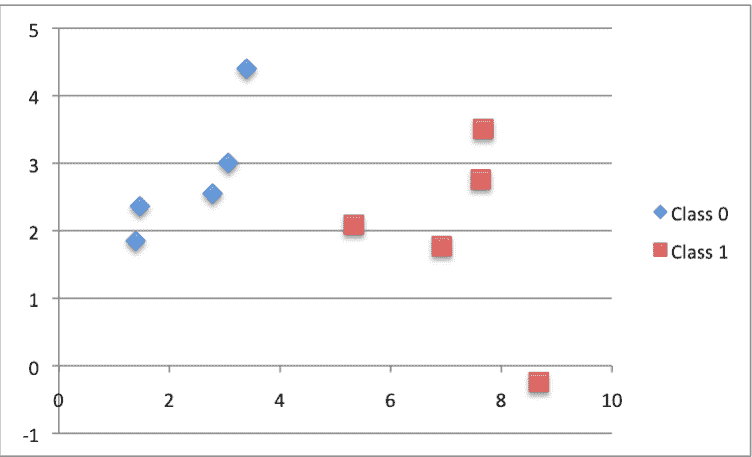

### 图 15.1: 用于测试反向传播算法的小型人造数据集图。

以下是完整示例。我们将在隐藏层中使用 2 个神经元。这是一个二分类问题（2 个类），因此输出层中将有两个神经元。网络将以 0.5 的学习率训练 20 个时代，这个学习率较高，因为我们训练的迭代次数很少。

```python
# Example of training a network by backpropagation
from math import exp
from random import seed
from random import random

# Initialize a network
def initialize_network(n_inputs, n_hidden, n_outputs):
    network = list()
    hidden_layer = [{'weights':[random() for i in range(n_inputs + 1)]} for i in range(n_hidden)]
    network.append(hidden_layer)
    output_layer = [{'weights':[random() for i in range(n_hidden + 1)]} for i in range(n_outputs)]
    network.append(output_layer)
    return network

# Calculate neuron activation for an input
def activate(weights, inputs):
    activation = weights[-1]
    for i in range(len(weights)-1):
        activation += weights[i] * inputs[i]
    return activation

# Transfer neuron activation
def transfer(activation):
    return 1.0 / (1.0 + exp(-activation))

# Forward propagate input to a network output
def forward_propagate(network, row):
    inputs = row
    for layer in network:
        new_inputs = []
        for neuron in layer:
            activation = activate(neuron['weights'], inputs)
            neuron['output'] = transfer(activation)
            new_inputs.append(neuron['output'])
        inputs = new_inputs
    return inputs

# Calculate the derivative of an neuron output
def transfer_derivative(output):
    return output * (1.0 - output)

# Backpropagate error and store in neurons
def backward_propagate_error(network, expected):
    for i in reversed(range(len(network))):
        layer = network[i]
        errors = list()
        if i != len(network)-1:
            for j in range(len(layer)):
                error = 0.0
                for neuron in network[i + 1]:
                    error += (neuron['weights'][j] * neuron['delta'])
                errors.append(error)
        else:
            for j in range(len(layer)):
                neuron = layer[j]
                errors.append(expected[j] - neuron['output'])
        for j in range(len(layer)):
            neuron = layer[j]
            neuron['delta'] = errors[j] * transfer_derivative(neuron['output'])

# Update network weights with error
def update_weights(network, row, l_rate):
    for i in range(len(network)):
        inputs = row[:-1]
        if i != 0:
            inputs = [neuron['output'] for neuron in network[i - 1]]
        for neuron in network[i]:
            for j in range(len(inputs)):
                neuron['weights'][j] += l_rate * neuron['delta'] * inputs[j]
            neuron['weights'][-1] += l_rate * neuron['delta']

# Train a network for a fixed number of epochs
def train_network(network, train, l_rate, n_epoch, n_outputs):
    for epoch in range(n_epoch):
        sum_error = 0
        for row in train:
            outputs = forward_propagate(network, row)
            expected = [0 for i in range(n_outputs)]
            expected[row[-1]] = 1
            sum_error += sum([(expected[i]-outputs[i])**2 for i in range(len(expected))])
            backward_propagate_error(network, expected)
            update_weights(network, row, l_rate)
        print('>epoch=%d, lrate=%.3f, error=%.3f' % (epoch, l_rate, sum_error))

# Test training backprop algorithm
seed(1)
dataset = [[2.7810836,2.550537003,0],
    [1.465489372,2.362125076,0],
    [3.396561688,4.400293529,0],
    [1.38807019,1.850220317,0],
    [3.06407232,3.005305973,0],
    [7.627531214,2.759262235,1],
    [5.332441248,2.088626775,1],
    [6.922596716,1.77106367,1],
    [8.675418651,-0.242068655,1],
    [7.673756466,3.508563011,1]]
n_inputs = len(dataset[0]) - 1
n_outputs = len(set([row[-1] for row in dataset]))
network = initialize_network(n_inputs, 2, n_outputs)
train_network(network, dataset, 0.5, 20, n_outputs)
for layer in network:
    print(layer)
```

### 清单 15.16: 在人造数据集上训练网络的示例。

运行示例时，首先会打印每个训练时代的平方误差和。我们可以看到该错误随每个时代而下降的趋势。训练完成后，会打印网络，显示学习到的权重。网络中还包含可忽略的输出和 delta 值。如果需要，我们可以更新训练函数以删除这些数据。

```
>epoch=0, lrate=0.500, error=6.350
>epoch=1, lrate=0.500, error=5.531
>epoch=2, lrate=0.500, error=5.221
>epoch=3, lrate=0.500, error=4.951
>epoch=4, lrate=0.500, error=4.519
>epoch=5, lrate=0.500, error=4.173
>epoch=6, lrate=0.500, error=3.835
>epoch=7, lrate=0.500, error=3.506
>epoch=8, lrate=0.500, error=3.192
>epoch=9, lrate=0.500, error=2.898
>epoch=10, lrate=0.500, error=2.626
>epoch=11, lrate=0.500, error=2.377
>epoch=12, lrate=0.500, error=2.153
```


```text
epoch=13, lrate=0.500, error=1.953
epoch=14, lrate=0.500, error=1.774
epoch=15, lrate=0.500, error=1.614
epoch=16, lrate=0.500, error=1.472
epoch=17, lrate=0.500, error=1.346
epoch=18, lrate=0.500, error=1.233
epoch=19, lrate=0.500, error=1.132
[{'output': 0.029980305604426185, 'weights': [-1.4688375095432327, 1.850887325439514,
1.0858178629550297], 'delta': -0.0059546604162323625}, {'output': 0.9456229000211323,
'weights': [0.37711098142462157, -0.0625909894552989, 0.2765123702642716], 'delta':
0.0026279652850863837}],
[{'output': 0.23648794202357587, 'weights': [2.515394649397849, -0.3391927502445985,
-0.9671565426390275], 'delta': -0.04270059278364587}, {'output': 0.7790535202438367,
'weights': [-2.5584149848484263, 1.0036422106209202, 0.42383086467582715], 'delta':
0.03803132596437354}]
```

清单 15.17：在构造数据集上训练网络的示例输出。

网络训练完成后，我们需要用它来进行预测。

##### 15.2.5 预测

使用训练好的神经网络进行预测非常简单。我们已经看到了如何前向传播输入模式以获得输出，这就是做出预测所需的全部。我们可以直接使用输出值本身作为模式属于每个输出类别的概率。

将这种输出转换为明确的类别预测可能更有用。我们可以通过选择概率较大的类别值来实现这一点，这也称为 argmax 函数。下面是一个名为 predict() 的函数，它实现了这个过程，返回网络输出中概率最大的索引。它假设类别值已被转换为从 0 开始的整数。

清单 15.18：使用网络进行预测的函数。

```python
# Make a prediction with a network
def predict(network, row):
    outputs = forward_propagate(network, row)
    return outputs.index(max(outputs))
```

我们可以将上面用于前向传播输入的代码与我们的小型构造数据集结合在一起，测试使用已训练网络进行预测。该示例硬编码了上一步训练好的网络。完整示例如下。

```python
# Example of making predictions
from math import exp

# Calculate neuron activation for an input
def activate(weights, inputs):
    activation = weights[-1]
    for i in range(len(weights)-1):
        activation += weights[i] * inputs[i]
    return activation

# Transfer neuron activation
def transfer(activation):
    return 1.0 / (1.0 + exp(-activation))

# Forward propagate input to a network output
def forward_propagate(network, row):
    inputs = row
    for layer in network:
        new_inputs = []
        for neuron in layer:
            activation = activate(neuron['weights'], inputs)
            neuron['output'] = transfer(activation)
            new_inputs.append(neuron['output'])
        inputs = new_inputs
    return inputs

# Make a prediction with a network
def predict(network, row):
    outputs = forward_propagate(network, row)
    return outputs.index(max(outputs))

# Test making predictions with the network
dataset = [[2.7810836, 2.550537003, 0],
    [1.465489372, 2.362125076, 0],
    [3.396561688, 4.400293529, 0],
    [1.38807019, 1.850220317, 0],
    [3.06407232, 3.005305973, 0],
    [7.627531214, 2.759262235, 1],
    [5.332441248, 2.088626775, 1],
    [6.922596716, 1.77106367, 1],
    [8.675418651, -0.242068655, 1],
    [7.673756466, 3.508563011, 1]]
network = [[{'weights': [-1.482313569067226, 1.8308790073202204, 1.078381922048799]},
    {'weights': [0.23244990332399884, 0.3621998343835864, 0.40289821191094327]}],
    [{'weights': [2.5001872433501404, 0.7887233511355132, -1.1026649757805829]}, {'weights': [-2.429350576245497, 0.8357651039198697, 1.0699217181280656]}]]
for row in dataset:
    prediction = predict(network, row)
    print('Expected=%d, Got=%d' % (row[-1], prediction))
```

清单 15.19：在构造数据集上进行预测的示例。

运行该示例会打印训练数据集中每条记录的期望输出，以及网络做出的明确预测。它表明网络在这个小型数据集上达到了 100% 的准确率。

```text
Expected=0, Got=0
Expected=0, Got=0
Expected=0, Got=0
Expected=0, Got=0
Expected=0, Got=0
Expected=1, Got=1
Expected=1, Got=1
Expected=1, Got=1
Expected=1, Got=1
Expected=1, Got=1
```

清单 15.20：在构造数据集上进行预测的示例输出。

现在，我们准备将反向传播算法应用于一个真实世界的数据集。

##### 15.2.6 小麦种子案例研究

本节将反向传播算法应用于小麦种子数据集。第一步是加载数据集，并将加载的数据转换为我们可以在神经网络中使用的数字。为此，我们将使用辅助函数 load_csv() 加载文件，str_column_to_float() 将字符串数字转换为浮点数，str_column_to_int() 将类别列转换为整数值。

输入值的尺度各不相同，需要归一化到 0 和 1 之间。通常，最好将输入值归一化到所选传递函数的范围内，在本例中，sigmoid 函数输出介于 0 和 1 之间的值。我们使用了辅助函数 dataset_minmax() 和 normalize_dataset() 来归一化输入值。

我们将使用 5 折的 k 折交叉验证来评估算法。这意味着每折将包含 201/5 = 40.2 或 40 条记录。我们将使用辅助函数 evaluate_algorithm() 通过交叉验证评估算法，并使用 accuracy_metric() 计算预测的准确率。

我们开发了一个名为 back_propagation() 的新函数来管理反向传播算法的应用：首先初始化网络，在训练数据集上训练它，然后使用训练好的网络对测试数据集进行预测。完整示例如下。

```python
# Backprop on the Seeds Dataset
from random import seed
from random import randrange
from random import random
from csv import reader
from math import exp

# Load a CSV file
def load_csv(filename):
    dataset = list()
    with open(filename, 'r') as file:
        csv_reader = reader(file)
        for row in csv_reader:
            if not row:
                continue
            dataset.append(row)
    return dataset

# Convert string column to float
def str_column_to_float(dataset, column):
    for row in dataset:
        row[column] = float(row[column].strip())

# Convert string column to integer
def str_column_to_int(dataset, column):
    class_values = [row[column] for row in dataset]
    unique = set(class_values)
    lookup = dict()
    for i, value in enumerate(unique):
        lookup[value] = i
    for row in dataset:
        row[column] = lookup[row[column]]
    return lookup

# Find the min and max values for each column
def dataset_minmax(dataset):
    return [[min(column), max(column)] for column in zip(*dataset)]

# Rescale dataset columns to the range 0-1
def normalize_dataset(dataset, minmax):
    for row in dataset:
        for i in range(len(row)-1):
            row[i] = (row[i] - minmax[i][0]) / (minmax[i][1] - minmax[i][0])

# Split a dataset into k folds
def cross_validation_split(dataset, n_folds):
    dataset_split = list()
    dataset_copy = list(dataset)
    fold_size = int(len(dataset) / n_folds)
    for _ in range(n_folds):
        fold = list()
        while len(fold) < fold_size:
            index = randrange(len(dataset_copy))
            fold.append(dataset_copy.pop(index))
        dataset_split.append(fold)
    return dataset_split

# Calculate accuracy percentage
def accuracy_metric(actual, predicted):
    correct = 0
    for i in range(len(actual)):
        if actual[i] == predicted[i]:
            correct += 1
    return correct / float(len(actual)) * 100.0

# Evaluate an algorithm using a cross validation split
def evaluate_algorithm(dataset, algorithm, n_folds, *args):
    folds = cross_validation_split(dataset, n_folds)
    scores = list()
    for fold in folds:
        train_set = list(folds)
        train_set.remove(fold)
        train_set = sum(train_set, [])
        test_set = list()
        for row in fold:
            row_copy = list(row)
            test_set.append(row_copy)
            row_copy[-1] = None
        predicted = algorithm(train_set, test_set, *args)
        actual = [row[-1] for row in fold]
        accuracy = accuracy_metric(actual, predicted)
        scores.append(accuracy)
    return scores
```


```python
# Calculate neuron activation for an input
def activate(weights, inputs):
    activation = weights[-1]
    for i in range(len(weights)-1):
        activation += weights[i] * inputs[i]
    return activation

# Transfer neuron activation
def transfer(activation):
    return 1.0 / (1.0 + exp(-activation))

# Forward propagate input to a network output
def forward_propagate(network, row):
    inputs = row
    for layer in network:
        new_inputs = []
        for neuron in layer:
            activation = activate(neuron['weights'], inputs)
            neuron['output'] = transfer(activation)
            new_inputs.append(neuron['output'])
        inputs = new_inputs
    return inputs

# Calculate the derivative of an neuron output
def transfer_derivative(output):
    return output * (1.0 - output)

# Backpropagate error and store in neurons
def backward_propagate_error(network, expected):
    for i in reversed(range(len(network))):
        layer = network[i]
        errors = list()
        if i != len(network)-1:
            for j in range(len(layer)):
                error = 0.0
                for neuron in network[i + 1]:
                    error += (neuron['weights'][j] * neuron['delta'])
                errors.append(error)
        else:
            for j in range(len(layer)):
                neuron = layer[j]
                errors.append(expected[i] - neuron['output'])
        for j in range(len(layer)):
            neuron = layer[j]
            neuron['delta'] = errors[j] * transfer_derivative(neuron['output'])

# Update network weights with error
def update_weights(network, row, l_rate):
    for i in range(len(network)):
        inputs = row[:-1]
        if i != 0:
            inputs = [neuron['output'] for neuron in network[i - 1]]
        for neuron in network[i]:
            for j in range(len(inputs)):
                neuron['weights'][j] += l_rate * neuron['delta'] * inputs[j]
            neuron['weights'][-1] += l_rate * neuron['delta']
```

```python
# Train a network for a fixed number of epochs
def train_network(network, train, l_rate, n_epoch, n_outputs):
    for _ in range(n_epoch):
        for row in train:
            forward_propagate(network, row)
            expected = [0 for i in range(n_outputs)]
            expected[row[-1]] = 1
            backward_propagate_error(network, expected)
            update_weights(network, row, l_rate)
```

```python
# Initialize a network
def initialize_network(n_inputs, n_hidden, n_outputs):
    network = list()
    hidden_layer = [{'weights':[random() for i in range(n_inputs + 1)]} for i in range(n_hidden)]
    network.append(hidden_layer)
    output_layer = [{'weights':[random() for i in range(n_hidden + 1)]} for i in range(n_outputs)]
    network.append(output_layer)
    return network
```

```python
# Make a prediction with a network
def predict(network, row):
    outputs = forward_propagate(network, row)
    return outputs.index(max(outputs))
```

```python
# Backpropagation Algorithm With Stochastic Gradient Descent
def back_propagation(train, test, l_rate, n_epoch, n_hidden):
    n_inputs = len(train[0]) - 1
    n_outputs = len(set([row[-1] for row in train]))
    network = initialize_network(n_inputs, n_hidden, n_outputs)
    train_network(network, train, l_rate, n_epoch, n_outputs)
    predictions = list()
    for row in test:
        prediction = predict(network, row)
        predictions.append(prediction)
    return(predictions)
```

```python
# Test Backprop on Seeds dataset
seed(1)
# load and prepare data
filename = 'seeds_dataset.csv'
dataset = load_csv(filename)
for i in range(len(dataset[0])-1):
    str_column_to_float(dataset, i)
# convert class column to integers
str_column_to_int(dataset, len(dataset[0])-1)
# normalize input variables
minmax = dataset_minmax(dataset)
normalize_dataset(dataset, minmax)
# evaluate algorithm
n_folds = 5
l_rate = 0.3
n_epoch = 500
n_hidden = 5
scores = evaluate_algorithm(dataset, back_propagation, n_folds, l_rate, n_epoch, n_hidden)
print('Scores: %s' % scores)
print('Mean Accuracy: %.3f%%' % (sum(scores)/float(len(scores))))
```

清单 15.21：小麦种子数据集上的反向传播算法。

构建了一个在隐藏层有5个神经元、在输出层有3个神经元的网络。该网络以0.3的学习率训练了500个epoch。这些参数是通过少量试错找到的，但你也许能做得更好。运行该示例会打印每个折上的平均分类准确率以及所有折的平均性能。

你可以看到，反向传播和所选的配置达到了95.238%的平均分类准确率，这比28%的基线准确率要好得多。

```
Scores: [95.23809523809523, 97.61904761904762, 95.23809523809523, 92.85714285714286,
95.23809523809523]
Mean Accuracy: 95.238%
```

清单 15.22：小麦种子数据集上反向传播算法的示例输出。

#### 15.3 扩展

本节列出了你可能希望探索的教程扩展内容。

- 调整算法参数。尝试更大或更小的网络，训练更长时间或更短时间。看看你是否能在种子数据集上获得更好的性能。
- 其他方法。实验不同的权重初始化技术（如小的随机数）和不同的传递函数（如tanh）。
- 更多层。增加对更多隐藏层的支持，其训练方式与本教程中使用的一个隐藏层完全相同。
- 回归。修改网络，使输出层只有一个神经元，并预测一个实数值。选择一个回归数据集来练习。输出层的神经元可以使用线性传递函数，或者所选数据集的输出值可以缩放到0到1之间。
- 批量梯度下降。将训练过程从在线梯度下降改为批量梯度下降，并且只在每个epoch结束时更新权重。

#### 15.4 回顾

在本教程中，你了解了如何从头实现反向传播算法。具体来说，你学到了：

- 如何前向传播输入以计算网络输出。

## 第四部分

## 集成算法

## 第16章

## 自助聚合

决策树是一种简单而强大的预测建模技术，但它的方差很高。这意味着给定不同的训练数据，树可能会得到非常不同的结果。一种使决策树更稳健并获得更好性能的技术称为自助聚合，或简称为bagging。在本教程中，你将了解如何用Python从头实现带有决策树的bagging过程。完成本教程后，你将知道：

- 如何创建数据集的自助样本。
- 如何使用自助模型进行预测。
- 如何将bagging应用于你自己的预测建模问题。

让我们开始吧。

#### 16.1 描述

本节简要介绍自助聚合以及本教程中将使用的Sonar数据集。

##### 16.1.1 自助聚合算法

自助法（bootstrap）是数据集的有放回抽样。这意味着从现有数据集的随机样本中创建一个新数据集，其中给定的行可能被选中并多次添加到样本中。当你只有有限的数据集可用时，这是一种在估计更广泛数据集的均值等值时有用的方法。通过创建数据集的样本并从这些样本中估计均值，你可以取这些估计的平均值，从而更好地了解底层问题的真实均值。

同样的方法可以用于具有高方差的机器学习算法，例如第11章中介绍的决策树（CART）。在每个自助数据样本上训练一个单独的模型，并使用这些模型的平均输出进行预测。这种技术称为自助聚合，或简称为bagging。方差意味着算法的性能对训练数据敏感，高方差表明训练数据变化越大，算法性能的变化就越大。


高方差机器学习算法（例如未剪枝决策树）的性能可以通过训练多棵树并取其预测的平均值来提高。结果通常优于单棵决策树。除了性能提升之外，装袋法的另一个好处是，装袋决策树不会对问题产生过拟合。可以继续添加树，直到达到性能峰值。

##### 16.1.2 声纳数据集

在本教程中，我们将使用声纳数据集。该数据集涉及水雷和岩石之间的区分。该问题上的基准性能约为 53%。您可以在附录 A 的第 A.5 节中了解更多信息。下载数据集，并将其保存到当前工作目录中，文件名为 sonar.all-data.csv。

#### 16.2 教程

本教程分为 2 个部分：

- 自助重采样。
- 声纳案例研究。

这些步骤为您提供了使用决策树实现和应用自助聚合以解决自身预测建模问题所需的基础。

##### 16.2.1 自助重采样

让我们先深入理解自助法的工作原理。我们可以通过从数据集中随机选择行并将其添加到新列表中，来创建数据集的新样本。我们可以重复此过程固定次数，或直到新数据集的大小与原始数据集大小的某个比例相匹配。

我们可以通过不移除已选行来允许有放回抽样，以便该行可用于未来的选择。以下是名为 `subsample()` 的函数，它实现了此过程。来自 random 模块的 `randrange()` 函数用于在循环的每次迭代中选择一个随机行索引添加到样本。样本的默认大小是原始数据集的大小。

```
# Create a random subsample from the dataset with replacement
def subsample(dataset, ratio=1.0):
    sample = list()
    n_sample = round(len(dataset) * ratio)
    while len(sample) < n_sample:
        index = randrange(len(dataset))
        sample.append(dataset[index])
    return sample
```

清单 16.1：从数据集中创建子样本的函数。

我们可以使用此函数来估计构造数据集的均值。首先，我们可以创建一个包含 20 行和 1 列（0 到 9 之间的随机数）的数据集并计算均值。然后，我们可以对原始数据集生成自助样本，计算均值，并重复此过程，直到得到一组均值。对这些样本均值取平均，应该能对整个数据集的均值给出一个稳健的估计。

完整示例如下。每个自助样本是原始 20 个观测值数据集（或 2 个观测值）的 10% 样本。然后，我们通过对原始数据集生成 1、10、100 个自助样本，计算它们的均值，并对所有这些估计均值取平均来进行实验。

```python
# Example of subsampling a dataset
from random import seed
from random import randrange

# Create a random subsample from the dataset with replacement
def subsample(dataset, ratio=1.0):
    sample = list()
    n_sample = round(len(dataset) * ratio)
    while len(sample) < n_sample:
        index = randrange(len(dataset))
        sample.append(dataset[index])
    return sample

# Calculate the mean of a list of numbers
def mean(numbers):
    return sum(numbers) / float(len(numbers))

# Test subsampling a dataset
seed(1)
# True mean
dataset = [[randrange(10)] for i in range(20)]
print('True Mean: %.3f' % mean([row[0] for row in dataset]))
# Estimated means
ratio = 0.10
for size in [1, 10, 100]:
    sample_means = list()
    for i in range(size):
        sample = subsample(dataset, ratio)
        sample_mean = mean([row[0] for row in sample])
        sample_means.append(sample_mean)
    print('Samples=%d, Estimated Mean: %.3f' % (size, mean(sample_means)))
```

清单 16.2：对数据集进行子采样的示例。

运行示例将打印我们旨在估计的原始均值。然后，我们可以看到不同数量的自助样本得到的估计均值。可以看到，使用 100 个样本时，我们能够获得均值的良好估计。

```
True Mean: 4.450
Samples=1, Estimated Mean: 4.500
Samples=10, Estimated Mean: 3.300
Samples=100, Estimated Mean: 4.480
```

清单 16.3：对数据集进行子采样的示例输出。

与计算均值不同，我们可以从每个子样本中创建一个模型。接下来，让我们看看如何合并多个自助模型的预测。

##### 16.2.2 声纳案例研究

在本节中，我们将把装袋算法应用于声纳数据集。该示例假设数据集的 CSV 副本位于当前工作目录中，文件名为 sonar.all-data.csv。

首先加载数据集，将字符串值转换为数值，并将输出列从字符串转换为 0 到 1 的整数值。这是通过辅助函数 load_csv()、str_column_to_float() 和 str_column_to_int() 来加载和准备数据集实现的。

我们将使用 k 折交叉验证来估计学习模型在未见数据上的性能。这意味着我们将构建和评估 k 个模型，并将性能估计为平均模型误差。将使用分类准确率来评估每个模型。这些行为在辅助函数 cross_validation_split()、accuracy_metric() 和 evaluate_algorithm() 中提供。

我们还将使用一种针对装袋进行了调整的分类和回归树（CART）算法实现，该实现使用第 11 章中的辅助函数，包括 test_split() 用于将数据集拆分为组，gini_index() 用于评估分割点，get_split() 用于寻找最佳分割点，to_terminal()、split() 和 build_tree() 用于创建单棵决策树，predict() 用于使用决策树进行预测，以及前一步中描述的 subsample() 函数用于从训练数据集中创建子样本。

开发了一个名为 bagging_predict() 的新函数，负责使用每棵决策树进行预测，并将预测合并为单个返回值。这是通过从装袋树生成的预测列表中选择最常见的预测来实现的。

最后，开发了一个名为 bagging() 的新函数，负责创建训练数据集的样本，在每个样本上训练一棵决策树，然后使用装袋树列表对测试数据集进行预测。完整示例如下。

```
# Bagging Algorithm on the Sonar dataset
from random import seed
from random import randrange
from csv import reader

# Load a CSV file
def load_csv(filename):
    dataset = list()
    with open(filename, 'r') as file:
        csv_reader = reader(file)
        for row in csv_reader:
            if not row:
                continue
            dataset.append(row)
    return dataset

# Convert string column to float
def str_column_to_float(dataset, column):
    for row in dataset:
        row[column] = float(row[column].strip())

# Convert string column to integer
def str_column_to_int(dataset, column):
    class_values = [row[column] for row in dataset]
    unique = set(class_values)
    lookup = dict()
    for i, value in enumerate(unique):
        lookup[value] = i
    for row in dataset:
        row[column] = lookup[row[column]]
    return lookup
```

```
# Split a dataset into k folds
def cross_validation_split(dataset, n_folds):
    dataset_split = list()
    dataset_copy = list(dataset)
    fold_size = int(len(dataset) / n_folds)
    for _ in range(n_folds):
        fold = list()
        while len(fold) < fold_size:
            index = randrange(len(dataset_copy))
            fold.append(dataset_copy.pop(index))
        dataset_split.append(fold)
    return dataset_split
```

```
# Calculate accuracy percentage
def accuracy_metric(actual, predicted):
    correct = 0
    for i in range(len(actual)):
        if actual[i] == predicted[i]:
            correct += 1
    return correct / float(len(actual)) * 100.0
```

```
# Evaluate an algorithm using a cross validation split
def evaluate_algorithm(dataset, algorithm, n_folds, *args):
    folds = cross_validation_split(dataset, n_folds)
    scores = list()
    for fold in folds:
        train_set = list(folds)
        train_set.remove(fold)
        train_set = sum(train_set, [])
        test_set = list()
        for row in fold:
            row_copy = list(row)
            test_set.append(row_copy)
            row_copy[-1] = None
        predicted = algorithm(train_set, test_set, *args)
        actual = [row[-1] for row in fold]
        accuracy = accuracy_metric(actual, predicted)
        scores.append(accuracy)
    return scores
```

```
# Split a dataset based on an attribute and an attribute value
def test_split(index, value, dataset):
    left, right = list(), list()
    for row in dataset:
        if row[index] < value:
            left.append(row)
        else:
```


```python
node['left'] = to_terminal(left)
else:
    node['left'] = get_split(left)
    split(node['left'], max_depth, min_size, depth+1)
# process right child
if len(right) <= min_size:
    node['right'] = to_terminal(right)
else:
    node['right'] = get_split(right)
    split(node['right'], max_depth, min_size, depth+1)

# Build a decision tree
def build_tree(train, max_depth, min_size):
    root = get_split(train)
    split(root, max_depth, min_size, 1)
    return root

# Make a prediction with a decision tree
def predict(node, row):
    if row[node['index']] < node['value']:
        if isinstance(node['left'], dict):
            return predict(node['left'], row)
        else:
            return node['left']
    else:
        if isinstance(node['right'], dict):
            return predict(node['right'], row)
        else:
            return node['right']

# Create a random subsample from the dataset with replacement
def subsample(dataset, ratio):
    sample = list()
    n_sample = round(len(dataset) * ratio)
    while len(sample) < n_sample:
        index = randrange(len(dataset))
        sample.append(dataset[index])
    return sample

# Make a prediction with a list of bagged trees
def bagging_predict(trees, row):
    predictions = [predict(tree, row) for tree in trees]
    return max(set(predictions), key=predictions.count)

# Bootstrap Aggregation Algorithm
def bagging(train, test, max_depth, min_size, sample_size, n_trees):
    trees = list()
    for _ in range(n_trees):
        sample = subsample(train, sample_size)
        tree = build_tree(sample, max_depth, min_size)
        trees.append(tree)
    predictions = [bagging_predict(trees, row) for row in test]
    return(predictions)

# Test bagging on the sonar dataset
seed(1)
```

```python
# load and prepare data
filename = 'sonar.all-data.csv'
dataset = load_csv(filename)
# convert string attributes to integers
for i in range(len(dataset[0])-1):
    str_column_to_float(dataset, i)
# convert class column to integers
str_column_to_int(dataset, len(dataset[0])-1)
# evaluate algorithm
n_folds = 5
max_depth = 6
min_size = 2
sample_size = 0.50
for n_trees in [1, 5, 10, 50]:
    scores = evaluate_algorithm(dataset, bagging, n_folds, max_depth, min_size, sample_size,
        n_trees)
    print('Trees: %d' % n_trees)
    print('Scores: %s' % scores)
    print('Mean Accuracy: %.3f%%' % (sum(scores)/float(len(scores))))
```

清单16.4：在声纳数据集上进行Bagging的示例。

使用k值5进行交叉验证，使得每一折有208/5 = 41.6，即略多于40条记录需要在每次迭代中进行评估。

构建了最大深度为6、每个节点最少训练行数为2的深树。使用原始数据集50%的大小创建训练数据集的样本。这是为了强制用于训练每棵树的数据集子样本具有一些多样性。Bagging的默认设置是使样本数据集的大小与原始训练数据集的大小一致。

评估了4组不同数量的树，以展示算法的行为。打印了每折的准确率和每种配置的平均准确率。我们可以看到，随着树数量的增加，性能有一些小幅提升的趋势。

```
Trees: 1
Scores: [87.8048780487805, 65.85365853658537, 65.85365853658537, 65.85365853658537,
    73.17073170731707]
Mean Accuracy: 71.707%

Trees: 5
Scores: [60.97560975609756, 80.48780487804879, 78.04878048780488, 82.92682926829268,
    63.41463414634146]
Mean Accuracy: 73.171%

Trees: 10
Scores: [60.97560975609756, 73.17073170731707, 82.92682926829268, 80.48780487804879,
    68.29268292682927]
Mean Accuracy: 73.171%

Trees: 50
Scores: [63.41463414634146, 75.60975609756098, 80.48780487804879, 75.60975609756098,
    85.36585365853658]
Mean Accuracy: 76.098%
```

清单16.5：在声纳数据集上进行Bagging的输出示例。

这种方法的一个难点是，即使构建了深树，所产生的袋装树也非常相似。反过来，这些树做出的预测也相似，而我们所期望的训练数据集不同样本上训练出的树之间的高方差被削弱了。

这是因为用于构建树的贪心算法会选择相同或非常相似的分割点。本教程试图通过限制用于训练每棵树的样本大小来重新注入这种方差。一种更稳健的技术是限制创建每个分割点时可评估的特征。这就是随机森林算法中使用的方法。

#### 16.3 扩展

- **调整示例。** 探索树的数量乃至单棵树配置的不同组合，看看能否进一步改善结果。
- **对另一种算法进行Bagging。** 其他算法也可以与Bagging一起使用。例如，*k*值较低的*k*近邻算法具有高方差，是Bagging的良好候选。
- **回归问题。** Bagging可以与回归树一起使用。与其从一组预测中预测最常见的类值，不如返回袋装树预测的平均值。请在回归问题上进行实验。

#### 16.4 回顾

在本教程中，你了解了如何用Python从头实现自助聚合。具体来说，你学到了：

- 如何创建子样本并估计自助统计量。
- 如何创建决策树集成并用它们进行预测。
- 如何将Bagging应用于真实世界的预测建模问题。

##### 16.4.1 延伸阅读

- 第8.2节 Bagging、随机森林与Boosting，第316页，*统计学习导论*，2014。
  http://amzn.to/2eeTyQX
- 第8.4节 袋装树，第192页；以及第14.3节 袋装树，第385页，*应用预测建模*，2013。
  http://amzn.to/2e31MXF
- 第7.5节 组合多个模型，第315页，*数据挖掘：实用机器学习工具与技术*，第二版，2005。
  http://amzn.to/2fj3SYY

##### 16.4.2 下一步

在下一个教程中，你将了解如何实现并应用随机森林算法进行分类。

## 第17章

## 随机森林

决策树可能遭受高方差的影响，这使得其结果对所采用的特定训练数据很脆弱。从训练数据的样本中构建多个模型（称为Bagging）可以降低这种方差，但这些树之间高度相关。

随机森林是Bagging的扩展，除了基于训练数据的多个样本构建树之外，它还限制可用于构建树的特征，从而迫使树彼此不同。这反过来可以提升性能。在本教程中，你将了解如何用Python从头实现随机森林算法。完成本教程后，你将知道：

- 袋装决策树与随机森林算法之间的区别。
- 如何构建具有更大方差的袋装决策树。
- 如何将随机森林算法应用于预测建模问题。

让我们开始吧。

#### 17.1 描述

本节简要介绍随机森林算法以及本教程中使用的声纳数据集。

##### 17.1.1 随机森林算法

决策树在每一步都涉及从数据集中贪心地选择最佳分割点。如果不对决策树进行剪枝，该算法会使其容易受到高方差的影响。通过使用训练数据集的不同样本（即问题的不同视角）创建多棵树，并组合它们的预测，可以利用并降低这种高方差。这种方法被称为自助聚合，或简称Bagging。

Bagging的一个局限性是，创建每棵树时都使用相同的贪心算法，这意味着每棵树很可能选择相同或非常相似的分割点，从而使得不同的树非常相似（树之间会相关）。这反过来又使它们的预测相似，从而削弱了最初所寻求的方差。


我们可以通过限制贪婪算法在创建树时每个分割点可评估的特征（列）来强制决策树彼此不同。这称为随机森林算法。与袋装法类似，会从训练数据集中提取多个样本，并在每个样本上训练一棵不同的树。不同之处在于，在将数据中的每个分割点添加到树中时，只能考虑固定子集的属性。对于分类问题（即本教程将要探讨的问题类型），用于分割的属性数量被限制为输入特征数量的平方根。

$$\text{num\_features\_for\_split} = \sqrt{\text{total\_input\_features}} \tag{17.1}$$

这一微小变化的结果是产生彼此更不同（不相关）的树，从而得出更多样化的预测，并且组合预测的性能通常优于单棵树或单独的袋装法。

##### 17.1.2 声纳数据集

在本教程中，我们将使用声纳数据集。该数据集涉及水雷与岩石之间的区分。该问题上的基准性能约为 53%。您可以在附录 A 的第 [A.5](#) 节中了解更多信息。下载数据集并将其保存到当前工作目录中，文件名为 `sonar.all-data.csv`。

#### 17.2 教程

本教程分为 2 个步骤。

1. 计算分割点。
2. 声纳案例研究。

这些步骤为您实现并将随机森林算法应用于自己的预测建模问题提供了基础。

##### 17.2.1 计算分割点

在决策树中，分割点是通过找到导致最低成本的属性及其属性值来选择的。对于分类问题，此成本函数通常是基尼指数，用于计算分割点创建的数据组的纯度。基尼指数为 0 表示完美纯度，即类别值被完美地分为两组，适用于二类分类问题的情况。

在决策树中找到最佳分割点涉及评估训练数据集中每个输入变量的每个值的成本。对于袋装法和随机森林，此过程是在训练数据集的一个有放回抽样样本上执行的。有放回抽样意味着同一行可能被多次选择并添加到样本中。

我们可以为随机森林更新此过程。与其枚举所有输入属性的值来寻找成本最低的分割，不如创建一个要考虑的输入属性样本。这个输入属性样本可以随机选择，并且不

function discussed in the previous step, `to_terminal()`, `split()` and `build_tree()` used to create a single decision tree, `predict()` to make a prediction with a decision tree, `subsample()` to make a subsample of the training dataset and `bagging_predict()` to make a prediction with a list of decision trees.

开发了一个名为 `random_forest()` 的新函数，它首先从训练数据集的子样本中创建决策树列表，然后使用它们进行预测。如上所述，随机森林与袋装决策树之间的关键区别在于 `get_split()` 函数中树的创建方式的这一微小变化。完整示例如下所示。

```
# Random Forest Algorithm on Sonar Dataset
from random import seed
from random import randrange
from csv import reader
from math import sqrt

# Load a CSV file
def load_csv(filename):
    dataset = list()
    with open(filename, 'r') as file:
        csv_reader = reader(file)
        for row in csv_reader:
            if not row:
                continue
            dataset.append(row)
    return dataset

# Convert string column to float
def str_column_to_float(dataset, column):
    for row in dataset:
        row[column] = float(row[column].strip())

# Convert string column to integer
def str_column_to_int(dataset, column):
    class_values = [row[column] for row in dataset]
    unique = set(class_values)
    lookup = dict()
    for i, value in enumerate(unique):
        lookup[value] = i
    for row in dataset:
        row[column] = lookup[row[column]]
    return lookup

# Split a dataset into k folds
def cross_validation_split(dataset, n_folds):
    dataset_split = list()
    dataset_copy = list(dataset)
    fold_size = int(len(dataset) / n_folds)
    for _ in range(n_folds):
        fold = list()
        while len(fold) < fold_size:
            index = randrange(len(dataset_copy))
            fold.append(dataset_copy.pop(index))
        dataset_split.append(fold)
    return dataset_split

# Calculate accuracy percentage
def accuracy_metric(actual, predicted):
    correct = 0
    for i in range(len(actual)):
        if actual[i] == predicted[i]:
            correct += 1
    return correct / float(len(actual)) * 100.0

# Evaluate an algorithm using a cross validation split
def evaluate_algorithm(dataset, algorithm, n_folds, *args):
    folds = cross_validation_split(dataset, n_folds)
    scores = list()
    for fold in folds:
        train_set = list(folds)
        train_set.remove(fold)
        train_set = sum(train_set, [])
        test_set = list()
        for row in fold:
            row_copy = list(row)
            test_set.append(row_copy)
            row_copy[-1] = None
        predicted = algorithm(train_set, test_set, *args)
        actual = [row[-1] for row in fold]
        accuracy = accuracy_metric(actual, predicted)
        scores.append(accuracy)
    return scores

# Split a dataset based on an attribute and an attribute value
def test_split(index, value, dataset):
    left, right = list(), list()
    for row in dataset:
        if row[index] < value:
            left.append(row)
        else:
            right.append(row)
    return left, right

# Calculate the Gini index for a split dataset
def gini_index(groups, classes):
    # count all samples at split point
    n_instances = float(sum([len(group) for group in groups]))
    # sum weighted Gini index for each group
    gini = 0.0
    for group in groups:
        size = float(len(group))
        # avoid divide by zero
        if size == 0:
            continue
        score = 0.0
        # score the group based on the score for each class
        for class_val in classes:
            p = [row[-1] for row in group].count(class_val) / size
            score += p * p
        # weight the group score by its relative size
        gini += (1.0 - score) * (size / n_instances)
    return gini

# Select the best split point for a dataset
def get_split(dataset, n_features):
    class_values = list(set(row[-1] for row in dataset))
    b_index, b_value, b_score, b_groups = 999, 999, 999, None
    features = list()
    while len(features) < n_features:
        index = randrange(len(dataset[0])-1)
        if index not in features:
            features.append(index)
    for index in features:
        for row in dataset:
            groups = test_split(index, row[index], dataset)
            gini = gini_index(groups, class_values)
            if gini < b_score:
                b_index, b_value, b_score, b_groups = index, row[index], gini, groups
    return {'index':b_index, 'value':b_value, 'groups':b_groups}

# Create a terminal node value
def to_terminal(group):
    outcomes = [row[-1] for row in group]
    return max(set(outcomes), key=outcomes.count)

# Create child splits for a node or make terminal
def split(node, max_depth, min_size, n_features, depth):
    left, right = node['groups']
    del(node['groups'])
    # check for a no split
    if not left or not right:
        node['left'] = node['right'] = to_terminal(left + right)
        return
    # check for max depth
    if depth >= max_depth:
        node['left'], node['right'] = to_terminal(left), to_terminal(right)
        return
    # process left child
    if len(left) <= min_size:
        node['left'] = to_terminal(left)
    else:
        node['left'] = get_split(left, n_features)
        split(node['left'], max_depth, min_size, n_features, depth+1)
    # process right child
    if len(right) <= min_size:
        node['right'] = to_terminal(right)
    else:
        node['right'] = get_split(right, n_features)
        split(node['right'], max_depth, min_size, n_features, depth+1)

# Build a decision tree
def build_tree(train, max_depth, min_size, n_features):
    root = get_split(train, n_features)
    split(root, max_depth, min_size, n_features, 1)
    return root

# Make a prediction with a decision tree
```


print('Scores: %s' % scores)
print('Mean Accuracy: %.3f%%' % (sum(scores)/float(len(scores))))

清单 17.2：声纳数据集上的随机森林示例。

交叉验证使用了 k 值为 5，使得每个折叠有 208/5 = 41.6 条记录，即每次迭代评估略多于 40 条记录。构建了深度树，最大深度为 10，每个节点的最少训练行数为 1。训练数据集的样本与原始数据集大小相同，这是随机森林算法的默认预期。

每个分割点考虑的特征数量设置为 √num_features 或 √60 = 7.74，四舍五入为 7 个特征。为了比较，评估了 3 种不同数量的树，结果显示随着树的数量增加，性能不断提升。运行示例将打印每个折叠的得分和每种配置的平均得分。

```
Trees: 1
Scores: [56.09756097560976, 63.41463414634146, 60.97560975609756, 58.536585365853654,
73.17073170731707]
Mean Accuracy: 62.439%

Trees: 5
Scores: [70.73170731707317, 58.536585365853654, 85.36585365853658, 75.60975609756098,
63.41463414634146]
Mean Accuracy: 70.732%

Trees: 10
Scores: [82.92682926829268, 75.60975609756098, 97.5609756097561, 80.48780487804879,
68.29268292682927]
Mean Accuracy: 80.976%
```

清单 17.3：声纳数据集上随机森林的示例输出。

#### 17.3 扩展

本节列出了您可能感兴趣的本教程扩展内容。

- **算法调优**。本教程中使用的配置是通过少量试错找到的，但未经过优化。尝试使用更多数量的树、不同数量的特征，甚至不同的树配置来提高性能。

- **更多问题**。将该技术应用于其他分类问题，甚至通过新的成本函数和合并树预测的新方法，将其调整为回归问题。

#### 17.4 回顾

在本教程中，您了解了如何从头实现随机森林算法。具体来说，您学习了：

- 随机森林与装袋决策树之间的区别。
- 如何更新决策树的创建过程以适应随机森林流程。
- 如何将随机森林算法应用于现实世界的预测建模问题。

##### 17.4.1 进一步阅读

- 第 8.2 节。装袋、随机森林、提升，第 316 页，*统计学习导论*，2014 年。http://amzn.to/2eeTyQX
- 第 8.5 节 随机森林，第 198 页和第 14.4 节 随机森林，第 386 页，*应用预测建模*，2013 年 http://amzn.to/2e31NXF

##### 17.4.2 下一步

在下一个教程中，您将了解如何实现并应用用于分类的堆叠算法。

## 第 18 章

## 堆叠泛化

集成方法是提高机器学习问题预测性能的绝佳方式。堆叠泛化或堆叠是一种集成技术，它使用一个新模型来学习如何最佳地合并在数据集上训练的两个或多个模型的预测。在本教程中，您将了解如何在 Python 中从头实现堆叠。完成本教程后，您将知道：

- 如何学习合并数据集上多个模型的预测。
- 如何将堆叠泛化应用于现实世界的预测建模问题。

让我们开始吧。

#### 18.1 描述

本节简要介绍了本教程中使用的堆叠泛化算法和声纳数据集。

##### 18.1.1 堆叠泛化算法

堆叠泛化是一种集成算法，其中新模型被训练以合并已经在数据集上训练的两个或多个模型的预测。现有模型或子模型的预测使用新模型进行合并，因此堆叠通常被称为混合，因为子模型的预测被混合在一起。

通常使用简单的线性方法来合并子模型的预测。示例包括：称为投票的简单平均、使用线性回归的加权和以及逻辑回归。其预测被合并的模型必须在问题上具有一定技能，但不需要是最佳模型。这意味着您不需要仔细调整子模型，只要模型相对于基准预测显示出某些优势即可。

重要的是，子模型应产生不同的预测，即所谓的不相关预测。当合并的预测都具有一定技能，但以不同方式具备技能时，堆叠效果最好。这可以通过使用具有非常不同内部表示（树与实例相比）的算法，以及/或在训练数据的不同表示或投影上训练的模型来实现。

在本教程中，我们将研究采用两种非常不同且未调整的子模型，并使用简单的逻辑回归算法合并它们的预测。

##### 18.1.2 声纳数据集

在本教程中，我们将使用声纳数据集。该数据集涉及水雷和岩石之间的区分。该问题的基准性能约为 53%。您可以在附录 A，第 A.5 节中了解更多信息。下载数据集并将其保存到当前工作目录中，文件名为 sonar.all-data.csv。

#### 18.2 教程

本教程分为 3 个步骤：

- 1. 子模型和聚合器。
- 2. 合并预测。
- 3. 声纳案例研究。

这些步骤为您理解和在自己的预测建模问题上实现堆叠提供了基础。

##### 18.2.1 子模型和聚合器

我们将使用两个模型作为堆叠的子模型，并使用一个线性模型作为聚合器模型。

此部分分为 3 个小节：

- 1. 子模型 #1：k-近邻。
- 2. 子模型 #2：感知机。
- 3. 聚合器模型：逻辑回归。

每个模型将根据用于训练模型的函数和用于进行预测的函数进行描述。

### 子模型 #1：k-近邻

k-近邻算法或 KNN 将整个训练数据集作为模型。因此，训练模型涉及保留训练数据集。下面是一个名为 knn_model() 的函数，它正是如此。

```
# Prepare the KNN model
def knn_model(train):
    return train
```

清单 18.1：训练 KNN 模型的函数。

进行预测涉及在训练数据集中找到 k 个最相似的记录，并选择最常见的类别值。欧几里得距离函数用于计算新数据行与训练数据集中行之间的相似性。

下面是这些用于 KNN 模型预测的辅助函数。函数 euclidean_distance() 计算两行数据之间的距离，get_neighbors() 函数为新数据行定位训练数据集中的所有邻居，knn_predict() 根据邻居为新数据行做出预测。

```
# Calculate the Euclidean distance between two vectors
def euclidean_distance(row1, row2):
    distance = 0.0
    for i in range(len(row1)-1):
        distance += (row1[i] - row2[i])**2
    return sqrt(distance)

# Locate neighbors for a new row
def get_neighbors(train, test_row, num_neighbors):
    distances = list()
    for train_row in train:
        dist = euclidean_distance(test_row, train_row)
        distances.append((train_row, dist))
    distances.sort(key=lambda tup: tup[1])
    neighbors = list()
    for i in range(num_neighbors):
        neighbors.append(distances[i][0])
    return neighbors

# Make a prediction with KNN
def knn_predict(model, test_row, num_neighbors=2):
    neighbors = get_neighbors(model, test_row, num_neighbors)
    output_values = [row[-1] for row in neighbors]
    prediction = max(set(output_values), key=output_values.count)
    return prediction
```

清单 18.2：使用 KNN 模型进行预测的函数。

您可以看到，邻居数量（k）在 knn_predict() 函数中被设置为默认参数 2。这个数字是经过少量试错选择的，并未进行调优。现在我们有了 KNN 模型的构建模块，让我们来看看感知机算法。有关 KNN 的更多信息，请参见第 13 章。

### 子模型 #2：感知机

感知机算法的模型是一组从训练数据中学习到的权重。为了训练权重，需要在训练数据上进行许多预测以计算误差值。因此，模型训练和预测都需要一个预测函数。

下面是实现感知机算法的辅助函数。perceptron_model() 函数在训练数据集上训练感知机模型，perceptron_predict() 用于对一行数据进行预测。

```
# Make a prediction with weights
def perceptron_predict(model, row):
    activation = model[0]


```python
for i in range(len(row)-1):
    activation += model[i + 1] * row[i]
return 1.0 if activation >= 0.0 else 0.0

# Estimate Perceptron weights using stochastic gradient descent
def perceptron_model(train, l_rate=0.01, n_epoch=5000):
    weights = [0.0 for i in range(len(train[0]))]
    for epoch in range(n_epoch):
        for row in train:
            prediction = perceptron_predict(weights, row)
            error = row[-1] - prediction
            weights[0] = weights[0] + l_rate * error
            for i in range(len(row)-1):
                weights[i + 1] = weights[i + 1] + l_rate * error * row[i]
    return weights
```

**清单 18.3: 用于训练感知机模型并进行预测的函数。**

perceptron_model() 函数将学习率和训练轮次数量均指定为默认参数。同样，这些参数是经过少量试错选择的，但并未在数据集上进行调优。我们现在已有两个子模型的实现；让我们来看看如何实现聚合器模型。有关感知机算法的更多信息，请参见第 10 章。

### 聚合器模型：逻辑回归

与感知机算法一样，逻辑回归使用一组称为系数的权重作为模型的表示。同样，与感知机算法一样，系数是通过在训练数据上迭代进行预测并更新它们来学习的。

以下是实现逻辑回归算法的辅助函数。logistic_regression_model() 函数用于在训练数据集上训练系数，而 logistic_regression_predict() 用于对一行数据进行预测。

```python
# Make a prediction with coefficients
def logistic_regression_predict(model, row):
    yhat = model[0]
    for i in range(len(row)-1):
        yhat += model[i + 1] * row[i]
    return 1.0 / (1.0 + exp(-yhat))

# Estimate logistic regression coefficients using stochastic gradient descent
def logistic_regression_model(train, l_rate=0.01, n_epoch=5000):
    coef = [0.0 for i in range(len(train[0]))]
    for epoch in range(n_epoch):
        for row in train:
            yhat = logistic_regression_predict(coef, row)
            error = row[-1] - yhat
            coef[0] = coef[0] + l_rate * error * yhat * (1.0 - yhat)
            for i in range(len(row)-1):
                coef[i + 1] = coef[i + 1] + l_rate * error * yhat * (1.0 - yhat) * row[i]
    return coef
```

**清单 18.4: 用于训练逻辑回归模型并进行预测的函数。**

`logistic_regression_model()` 将学习率和轮次数量定义为默认参数，与其他算法一样，这些参数是经过少量试错找到的，并未进行优化。现在我们已有子模型和聚合器模型的实现，让我们看看如何结合多个模型的预测。有关逻辑回归的更多信息，请参见第 9 章。

##### 18.2.2 组合预测

对于机器学习算法，学习如何组合预测与从训练数据集中学习非常相似。可以从子模型的预测构建一个新的训练数据集，如下所示：

- 每一行代表训练数据集中的一行。
- 第一列包含由第一个子模型（例如 *k*-近邻）对训练数据集中每一行所做的预测。
- 第二列包含由第二个子模型（例如感知机算法）对训练数据集中每一行所做的预测。
- 第三列包含训练数据集中该行的预期输出值。

以下是构建的堆叠数据集可能呈现的一个示例：

| KNN | Per | Y |
|-----|-----|---|
| 0   | 0   | 0 |
| 1   | 0   | 1 |
| 0   | 1   | 0 |
| 1   | 1   | 1 |
| 0   | 1   | 0 |

**清单 18.5: 小型人工构建的堆叠数据集。**

然后，可以在该新数据集上训练机器学习算法（例如逻辑回归）。本质上，这个新的元算法学习如何最佳地组合多个子模型的预测。以下是一个名为 `to_stacked_row()` 的函数，它实现了为该堆叠数据集创建新行的过程。

该函数将模型列表作为输入；这些模型用于进行预测。该函数还将函数列表作为输入，每个模型使用一个函数来进行预测。最后，包含训练数据集中的单行。新行一次构建一列。使用每个模型和训练数据行来计算预测。然后将训练数据集行中的预期输出值作为最后一列添加到该行中。

```python
# Make predictions with submodels and construct a new stacked row
def to_stacked_row(models, predict_list, row):
    stacked_row = list()
    for i in range(len(models)):
        prediction = predict_list[i](models[i], row)
        stacked_row.append(prediction)
    stacked_row.append(row[-1])
    return stacked_row
```

**清单 18.6: 使用子模型进行预测并构建堆叠行的函数。**

在某些预测建模问题中，通过在训练行和子模型所做的预测上训练聚合器模型，可以获得更大的提升。这种改进使聚合器模型能够获得训练行中所有数据的上下文，以帮助确定如何以及何时最佳地组合子模型的预测。

我们可以更新 `to_stacked_row()` 函数，通过聚合训练行（除去最后一列）和上面创建的堆叠行来包含此功能。以下是实现此改进的 `to_stacked_row()` 函数的更新版本。

```python
# Make predictions with sub-models and construct a new stacked row
def to_stacked_row(models, predict_list, row):
    stacked_row = list()
    for i in range(len(models)):
        prediction = predict_list[i](models[i], row)
        stacked_row.append(prediction)
    stacked_row.append(row[-1])
    return row[0:len(row)-1] + stacked_row
```

**清单 18.7: 使用子模型进行预测并构建包含输入数据的堆叠行的函数。**

在您的问题上尝试这两种方法是个好主意，以查看哪种效果最好。现在我们已拥有堆叠泛化的所有组件，可以将该算法应用于现实世界问题。

##### 18.2.3 声纳案例研究

在本节中，我们将把堆叠算法应用于声纳数据集。该示例假设当前工作目录中有一个名为 `sonar.all-data.csv` 的数据集 CSV 副本。

首先加载数据集，将字符串值转换为数值，并将输出列从字符串转换为 0 到 1 的整数值。这是通过辅助函数 `load_csv()`、`str_column_to_float()` 和 `str_column_to_int()` 来加载和准备数据集实现的。

我们将使用 k-折交叉验证来估计学习模型在未见数据上的性能。这意味着我们将构建和评估 k 个模型，并将平均模型误差作为性能估计。分类准确率将用于评估模型。这些行为由辅助函数 `cross_validation_split()`、`accuracy_metric()` 和 `evaluate_algorithm()` 提供。

我们将使用上面实现的 k-近邻、感知机和逻辑回归算法。我们还将使用前一步中定义的创建新堆叠数据集的技术。开发了一个名为 `stacking()` 的新函数。该函数执行 4 件事：

1. 它首先训练一组模型（KNN 和感知机）。
2. 然后它使用这些模型进行预测并创建一个新的堆叠数据集。
3. 然后它在堆叠数据集上训练一个聚合器模型（逻辑回归）。
4. 然后它使用子模型和聚合器模型对测试数据集进行预测。

完整示例如下所示。

```python
# Stacking on the sonar dataset
from random import seed
from random import randrange
from csv import reader
from math import sqrt
from math import exp

# Load a CSV file
def load_csv(filename):
    dataset = list()
    with open(filename, 'r') as file:
        csv_reader = reader(file)
        for row in csv_reader:
            if not row:
                continue
            dataset.append(row)
    return dataset

# Convert string column to float
def str_column_to_float(dataset, column):
    for row in dataset:
        row[column] = float(row[column].strip())

# Convert string column to integer
def str_column_to_int(dataset, column):
    class_values = [row[column] for row in dataset]
    unique = set(class_values)
    lookup = dict()
    for i, value in enumerate(unique):
        lookup[value] = i
    for row in dataset:
        row[column] = lookup[row[column]]
    return lookup

# Split a dataset into k folds
def cross_validation_split(dataset, n_folds):
    dataset_split = list()
    dataset_copy = list(dataset)
    fold_size = int(len(dataset) / n_folds)
    for _ in range(n_folds):
        fold = list()
        while len(fold) < fold_size:
            index = randrange(len(dataset_copy))
            fold.append(dataset_copy.pop(index))
        dataset_split.append(fold)
    return dataset_split

# Calculate accuracy percentage
def accuracy_metric(actual, predicted):
    correct = 0
    for i in range(len(actual)):
        if actual[i] == predicted[i]:
            correct += 1
    return correct / float(len(actual)) * 100.0
```


```
# Evaluate an algorithm using a cross validation split
def evaluate_algorithm(dataset, algorithm, n_folds, *args):
    folds = cross_validation_split(dataset, n_folds)
    scores = list()
    for fold in folds:
        train_set = list(folds)
        train_set.remove(fold)
        train_set = sum(train_set, [])
        test_set = list()
        for row in fold:
            row_copy = list(row)
            test_set.append(row_copy)
            row_copy[-1] = None
        predicted = algorithm(train_set, test_set, *args)
        actual = [row[-1] for row in fold]
        accuracy = accuracy_metric(actual, predicted)
        scores.append(accuracy)
    return scores
```

```
# Calculate the Euclidean distance between two vectors
def euclidean_distance(row1, row2):
    distance = 0.0
    for i in range(len(row1)-1):
        distance += (row1[i] - row2[i])**2
    return sqrt(distance)
```

```
# Locate neighbors for a new row
def get_neighbors(train, test_row, num_neighbors):
    distances = list()
    for train_row in train:
        dist = euclidean_distance(test_row, train_row)
        distances.append((train_row, dist))
    distances.sort(key=lambda tup: tup[1])
    neighbors = list()
    for i in range(num_neighbors):
        neighbors.append(distances[i][0])
    return neighbors
```

```
# Make a prediction with kNN
def knn_predict(model, test_row, num_neighbors=2):
    neighbors = get_neighbors(model, test_row, num_neighbors)
    output_values = [row[-1] for row in neighbors]
    prediction = max(set(output_values), key=output_values.count)
    return prediction
```

```
# Prepare the kNN model
def knn_model(train):
    return train
```

```
# Make a prediction with weights
def perceptron_predict(model, row):
    activation = model[0]
    for i in range(len(row)-1):
        activation += model[i + 1] * row[i]
    return 1.0 if activation >= 0.0 else 0.0
```

```
# Estimate Perceptron weights using stochastic gradient descent
def perceptron_model(train, l_rate=0.01, n_epoch=5000):
    weights = [0.0 for i in range(len(train[0]))]
    for _ in range(n_epoch):
        for row in train:
            prediction = perceptron_predict(weights, row)
            error = row[-1] - prediction
            weights[0] = weights[0] + l_rate * error
            for i in range(len(row)-1):
                weights[i + 1] = weights[i + 1] + l_rate * error * row[i]
    return weights
```

```
# Make a prediction with coefficients
def logistic_regression_predict(model, row):
    yhat = model[0]
    for i in range(len(row)-1):
        yhat += model[i + 1] * row[i]
    return 1.0 / (1.0 + exp(-yhat))
```

```
# Estimate logistic regression coefficients using stochastic gradient descent
def logistic_regression_model(train, l_rate=0.01, n_epoch=5000):
    coef = [0.0 for i in range(len(train[0]))]
    for _ in range(n_epoch):
        for row in train:
            yhat = logistic_regression_predict(coef, row)
            error = row[-1] - yhat
            coef[0] = coef[0] + l_rate * error * yhat * (1.0 - yhat)
            for i in range(len(row)-1):
                coef[i + 1] = coef[i + 1] + l_rate * error * yhat * (1.0 - yhat) * row[i]
    return coef
```

```
# Make predictions with sub-models and construct a new stacked row
def to_stacked_row(models, predict_list, row):
    stacked_row = list()
    for i in range(len(models)):
        prediction = predict_list[i](models[i], row)
        stacked_row.append(prediction)
    stacked_row.append(row[-1])
    return row[0:len(row)-1] + stacked_row
```

```
# Stacking Generalization Algorithm
def stacking(train, test):
    model_list = [knn_model, perceptron_model]
    predict_list = [knn_predict, perceptron_predict]
    models = list()
    for i in range(len(model_list)):
        model = model_list[i](train)
        models.append(model)
    stacked_dataset = list()
    for row in train:
        stacked_row = to_stacked_row(models, predict_list, row)
        stacked_dataset.append(stacked_row)
    stacked_model = logistic_regression_model(stacked_dataset)
    predictions = list()
    for row in test:
        stacked_row = to_stacked_row(models, predict_list, row)
        stacked_dataset.append(stacked_row)
        prediction = logistic_regression_predict(stacked_model, stacked_row)
        prediction = round(prediction)
        predictions.append(prediction)
    return predictions
```

```
# Test stacking on the sonar dataset
seed(1)
# load and prepare data
filename = 'sonar.all-data.csv'
dataset = load_csv(filename)
# convert string attributes to integers
for i in range(len(dataset[0])-1):
    str_column_to_float(dataset, i)
# convert class column to integers
str_column_to_int(dataset, len(dataset[0])-1)
n_folds = 3
scores = evaluate_algorithm(dataset, stacking, n_folds)
print('Scores: %s' % scores)
print('Mean Accuracy: %.3f%%' % (sum(scores)/float(len(scores))))
```

采用 k=3 进行交叉验证，每个折叠包含 208/3 = 69.3 条记录，即每次迭代评估略少于 70 条记录。我在训练数据集上分别评估了每个子模型，KNN 达到 74.879%，感知机算法达到 72.464%；两种算法均优于 53% 的基准准确率。

在堆叠数据集上训练逻辑回归（不包含用于上下文的训练行）可达到 75.845% 的准确率。将训练行包含在堆叠数据集中可进一步提升至 76.329%。运行示例将打印最终配置的得分及其平均值。

```
Scores: [78.26086956521739, 78.26086956521739, 72.46376811594203]
Mean Accuracy: 76.329%
```

#### 18.3 扩展

本节列出了本教程的扩展内容，您可能有兴趣探索。

- **调整算法**。本教程中用于子模型和聚合模型的算法均未进行调整。探索替代配置，看看是否能进一步提升性能。

- **预测相关性**。如果子模型的预测之间弱相关，堆叠效果更好。实现计算以估计子模型预测之间的相关性。

- **不同的子模型**。实现更多不同的子模型，以使用堆叠过程进行组合。

- **不同的聚合模型**。尝试更简单的模型（如平均和投票）以及更复杂的聚合模型，看看是否能提升性能。

- **更多数据集**。将堆叠应用于 UCI 机器学习库中的更多数据集。

#### 18.4 回顾

在本教程中，您了解了如何在 Python 中从头实现堆叠算法。具体来说，您学习了：

- 如何组合多个模型的预测。
- 如何将堆叠应用于现实世界的预测建模问题。

##### 18.4.1 进一步阅读

- 第 7.5 节，组合多个模型，第 315 页，_数据挖掘：实用机器学习工具与技术_，第二版，2005 年。
- http://amzn.to/2fj3SYY

##### 18.4.2 下一步

这结束了关于集成算法的第 4 部分。接下来在第 5 部分我们将结束本书。

## 第 V 部分

## 结论

## 第 19 章

## 你已经走得多远

你做到了。做得好。花点时间回顾一下你已经走得多远。

- 你知道如何加载和准备用于建模的机器学习数据。
- 你知道如何评估机器学习模型做出的预测并估计模型的性能。
- 你知道如何估计问题上的基准性能并比较问题上的多个模型。
- 你知道如何实现和应用线性回归、逻辑回归和感知机线性机器学习算法。
- 你知道如何实现和应用 CART、朴素贝叶斯、KNN、LVQ 和反向传播非线性机器学习算法。
- 你知道如何实现和应用 Bagging、随机森林和堆叠集成机器学习算法。

不要轻视这一点。你在短时间内取得了长足进步。你已经掌握了使用 Python 实现和解决机器学习问题的重要而宝贵的技能。这是大多数在职数据科学家专业人士使用的平台。前途无量。

我想花点时间诚挚地感谢你，让我能帮助你使用 Python 开启机器学习算法之旅。我希望你继续学习，并在继续掌握机器学习的过程中享受乐趣。


## 第20章

### 获取更多帮助

这只是你机器学习算法之旅的开端。当你开始研究新算法或扩展现有的算法知识时，可能需要帮助。本章指出了你可以找到的关于机器学习算法的一些最佳帮助来源。

#### 20.1 机器学习书籍

本书包含了开始学习机器学习算法所需的一切，但如果你和我一样热爱书籍，那么还有很多机器学习书籍可供选择。以下是我推荐作为下一步阅读的一小部分书目。

- **《统计学习导论》**。从统计学角度出色地涵盖了机器学习算法。推荐作为下一步阅读。http://amzn.to/1pgirl0

- **《应用预测建模》**。出色地介绍了预测建模，涵盖了大量算法。这本书更注重广度，而不是对某一种算法的深入介绍。http://amzn.to/1n5MSsq

- **《人工智能：一种现代方法》**。一本关于人工智能整体的优秀书籍，其中关于机器学习的章节从计算机科学的角度对本书所涵盖的算法进行了精彩阐述。http://amzn.to/1TGklrr

#### 20.2 论坛与问答网站

问答网站也许是获得关于机器学习具体技术问题答案的最佳途径。你可以在其中搜索类似问题，浏览主题以了解常见问题的解决方案，并提出自己的技术问题。我推荐用于机器学习算法问题的最佳问答网站如下：

- Cross Validated：http://stats.stackexchange.com/
- Stack Overflow：http://stackoverflow.com/questions/tagged/machine-learning
- Data Science：http://datascience.stackexchange.com/
- Reddit 机器学习：http://www.reddit.com/r/machinelearning
- Quora 机器学习：https://www.quora.com/topic/Machine-Learning/top_stories

请充分利用这些网站的搜索功能。另外，在Cross Validated上查看某个具体问题时，请注意右侧导航栏中的*相关*问题列表。这些通常相关且有用。

#### 20.3 联系作者

如果你对机器学习算法或本书有任何疑问，请直接联系我。我会尽力提供帮助。

Jason Brownlee
Jason@MachineLearningMastery.com

## 第六部分

## 附录

### 附录A

#### 标准数据集

要想精通应用机器学习，关键是在大量不同的数据集上练习。这是因为每个问题都不同，需要略有差异的数据准备和建模方法。在本附录中，你将发现一套可用于练习的标准机器学习数据集。这些数据集贯穿全书使用。

#### A.1 概述

##### A.1.1 结构化方法

每个数据集都以一致的方式进行了总结，这样便于你比较和查找，从而练习特定的数据准备技术或建模方法。你需要了解的每个数据集的信息包括：

- **名称**：如何引用该数据集。
- **问题类型**：问题是回归还是分类。
- **输入和输出**：输入和输出特征的数量及已知名称。
- **性能**：使用零规则算法进行比较的基线性能，以及已知的最佳性能（如果有）。
- **样本**：原始数据前5行的快照。
- **链接**：可以下载数据集并了解更多信息的地方。

##### A.1.2 标准数据集

下面是我们将涉及的数据集列表。每个数据集都足够小，可以放入内存并在电子表格中查看。所有数据集均由表格数据组成，并且没有（显式的）缺失值。

1. 瑞典汽车保险数据集。
2. 葡萄酒质量数据集。
3. 皮马印第安人糖尿病数据集。
4. 声呐数据集。
5. 纸币数据集。
6. 鸢尾花数据集。
7. 鲍鱼数据集。
8. 电离层数据集。
9. 小麦种子数据集。

#### A.2 瑞典汽车保险数据集

瑞典汽车保险数据集涉及根据索赔总数预测所有索赔的总支付金额（以千瑞典克朗计）。这是一个回归问题。该数据集包含63个观测值，有1个输入变量和1个输出变量。变量名称如下：

1. 索赔数量。
2. 所有索赔的总支付金额（以千瑞典克朗计）。

预测均值时的基线性能是RMSE约为72.251千瑞典克朗。前5行的样例如下。

| 索赔数量 | 所有索赔的总支付金额（以千瑞典克朗计） |
|---|---|
| 108 | 392.5 |
| 19 | 46.2 |
| 13 | 15.7 |
| 124 | 422.2 |
| 40 | 119.4 |

清单A.1：瑞典保险数据集样本。

下面是整个数据集的散点图。

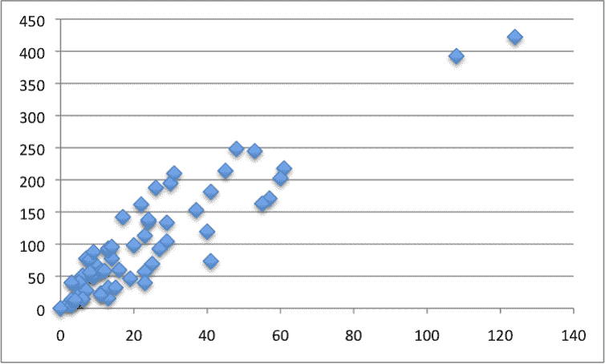

图A.1：瑞典保险数据集的绘图。

- 下载：https://goo.gl/qPSnqY
- 更多信息：https://goo.gl/oMdwwR

#### A.3 葡萄酒质量数据集

葡萄酒质量数据集涉及根据每种葡萄酒的化学指标预测白葡萄酒的质量评分。这是一个多分类问题，但也可以构建为回归问题。每个类别的观测数量不平衡。该数据集包含4,898个观测值，有11个输入变量和1个输出变量。变量名称如下：

1. 固定酸度。
2. 挥发性酸度。
3. 柠檬酸。
4. 残糖。
5. 氯化物。
6. 游离二氧化硫。
7. 总二氧化硫。
8. 密度。
9. pH。
10. 硫酸盐。
11. 酒精。
12. 质量（0到10之间的评分）。

预测均值时的基线性能是RMSE约为0.148个质量评分点。前5行的样例如下。

| 固定酸度 | 挥发性酸度 | 柠檬酸 | 残糖 | 氯化物 | 游离二氧化硫 | 总二氧化硫 | 密度 | pH | 硫酸盐 | 酒精 | 质量（0到10之间的评分） |
|---|---|---|---|---|---|---|---|---|---|---|---|
| 7 | 0.27 | 0.36 | 20.7 | 0.045 | 45 | 170 | 1.001 | 3 | 0.45 | 8.8 | 6 |
| 6.3 | 0.3 | 0.34 | 1.6 | 0.049 | 14 | 132 | 0.994 | 3.3 | 0.49 | 9.5 | 6 |
| 8.1 | 0.28 | 0.4 | 6.9 | 0.05 | 30 | 97 | 0.9951 | 3.26 | 0.44 | 10.1 | 6 |
| 7.2 | 0.23 | 0.32 | 8.5 | 0.058 | 47 | 186 | 0.9956 | 3.19 | 0.4 | 9.9 | 6 |
| 7.2 | 0.23 | 0.32 | 8.5 | 0.058 | 47 | 186 | 0.9956 | 3.19 | 0.4 | 9.9 | 6 |

清单A.2：葡萄酒质量数据集样本。

- 下载：https://goo.gl/8jsvFK
- 更多信息：https://goo.gl/py6RCA

#### A.4 皮马印第安人糖尿病数据集

皮马印第安人糖尿病数据集涉及根据医学细节预测皮马印第安人在5年内是否患上糖尿病。这是一个二分类（2类）分类问题。每个类别的观测数量不平衡。该数据集包含768个观测值，有8个输入变量和1个输出变量。缺失值被认为用0值编码。变量名称如下：

1. 怀孕次数。
2. 口服葡萄糖耐量试验中2小时的血浆葡萄糖浓度。
3. 舒张压（mm Hg）。
4. 肱三头肌皮褶厚度（mm）。
5. 2小时血清胰岛素（mu U/ml）。
6. 体重指数（体重kg/(身高m)²）。
7. 糖尿病遗传函数。
8. 年龄（岁）。
9. 类别变量（0或1）。

预测最常见类别时的基线性能是约65%的分类准确率。最佳结果达到约77%的分类准确率。前5行的样例如下。

| 怀孕次数 | 口服葡萄糖耐量试验中2小时的血浆葡萄糖浓度 | 舒张压（mm Hg） | 肱三头肌皮褶厚度（mm） | 2小时血清胰岛素（mu U/ml） | 体重指数（体重kg/(身高m)²） | 糖尿病遗传函数 | 年龄（岁） | 类别变量（0或1） |
|---|---|---|---|---|---|---|---|---|
| 6 | 148 | 72 | 35 | 0 | 33.6 | 0.627 | 50 | 1 |
| 1 | 85 | 66 | 29 | 0 | 26.6 | 0.351 | 31 | 0 |
| 8 | 183 | 64 | 0 | 0 | 23.3 | 0.672 | 32 | 1 |
| 1 | 89 | 66 | 23 | 94 | 28.1 | 0.167 | 21 | 0 |
| 0 | 137 | 40 | 35 | 168 | 43.1 | 2.288 | 33 | 1 |

清单A.3：皮马印第安人糖尿病数据集样本。

- 下载：https://goo.gl/2tMFne
- 更多信息：https://goo.gl/kPGBzi

#### A.5 声呐数据集

声呐数据集涉及根据声呐在不同角度下的回波强度来预测目标是水雷还是岩石。这是一个二分类（2类）分类问题。每个类别的观测数量不平衡。该数据集包含208个观测值，有60个输入变量和1个输出变量。变量名称如下：

1. 不同角度下的声呐回波
2. ...
3. 类别（M代表水雷，R代表岩石）

预测最常见类别时的基线性能是约53%的分类准确率。最佳结果达到约88%的分类准确率。此处不提供前5行样本，因为数据量太大，无法在页面上完整展示。

- 下载：https://goo.gl/FXFWwF
- 更多信息：https://goo.gl/JMF2Iv
- 最佳结果：https://goo.gl/3wNAjv

#### A.6 纸币数据集

纸币数据集涉及根据从照片中提取的若干测量值来预测给定纸币是否是真钞。这是一个二分类（2类）分类问题。每个类别的观测数量不平衡。该数据集包含1,372个观测值，有4个输入变量和1个输出变量。变量名称如下：

1. 小波变换图像的方差（连续）。
2. 小波变换图像的偏度（连续）。
3. 小波变换图像的峰度（连续）。
4. 图像熵（连续）。


- 5. 类别（0表示真实，1表示不真实）。

预测最常见类别的基线性能是大约50%的分类准确率。下面列出了前5行的样本。

```
3.6216,8.6661,-2.8073,-0.44699,0
4.5459,8.1674,-2.4586,-1.4621,0
3.866,-2.6383,1.9242,0.10645,0
3.4566,9.5228,-4.0112,-3.5944,0
0.32924,-4.4552,4.5718,-0.9888,0
4.3684,9.6718,-3.9606,-3.1625,0
```

列表A.4：钞票数据集的样本。

- 下载：https://goo.gl/rLPrH0
- 更多信息：https://goo.gl/CUWnce

#### A.7 鸢尾花数据集

鸢尾花数据集涉及根据鸢尾花的测量值预测花的品种。这是一个多类别分类问题。每个类别的观测数量是平衡的。共有150个观测，包含4个输入变量和1个输出变量。变量名称如下：

- 1. 花萼长度（厘米）。
- 2. 花萼宽度（厘米）。
- 3. 花瓣长度（厘米）。
- 4. 花瓣宽度（厘米）。
- 5. 类别（山鸢尾、变色鸢尾、维吉尼亚鸢尾）。

预测最常见类别的基线性能是大约26%的分类准确率。下面列出了前5行的样本。

```
5.1,3.5,1.4,0.2,Iris-setosa
4.9,3.0,1.4,0.2,Iris-setosa
4.7,3.2,1.3,0.2,Iris-setosa
4.6,3.1,1.5,0.2,Iris-setosa
5.0,3.6,1.4,0.2,Iris-setosa
```

列表A.5：鸢尾花数据集的样本。

- 下载：https://goo.gl/uqoqh7
- 更多信息：https://goo.gl/eA2Tff

#### A.8 鲍鱼数据集

鲍鱼数据集涉及根据个体的客观测量值预测鲍鱼的年龄。这是一个多类别分类问题，但也可以构建为回归问题。每个类别的观测数量不平衡。共有4,177个观测，包含8个输入变量和1个输出变量。变量名称如下：

- 1. 性别（M，F，I）。
- 2. 长度。
- 3. 直径。
- 4. 高度。
- 5. 整体重量。
- 6. 去壳重量。
- 7. 内脏重量。
- 8. 壳重量。
- 9. 环纹数。

预测最常见类别的基线性能是大约16%的分类准确率。预测平均值的基线性能是均方根误差（RMSE）约为3.2个环纹。下面列出了前5行的样本。

```
M,0.455,0.365,0.095,0.514,0.2245,0.101,0.15,15
M,0.35,0.265,0.09,0.2255,0.0995,0.0485,0.07,7
F,0.53,0.42,0.135,0.677,0.2565,0.1415,0.21,9
M,0.44,0.365,0.125,0.516,0.2155,0.114,0.155,10
I,0.33,0.255,0.08,0.205,0.0895,0.0395,0.055,7
```

列表A.6：鲍鱼数据集的样本。

- 下载：https://goo.gl/BDYgh5
- 更多信息：https://goo.gl/ieNz0R

#### A.9 电离层数据集

电离层数据集要求根据针对电离层自由电子的雷达回波预测大气中的结构。这是一个二元（2类）分类问题。每个类别的观测数量不平衡。共有351个观测，包含34个输入变量和1个输出变量。变量名称如下：

- 1. 17对雷达回波数据。
- 2. ……
- 3. 类别（g表示良好，b表示不良）。

预测最常见类别的基线性能是大约64%的分类准确率。最佳结果达到约94%的分类准确率。由于前5行的样本内容过大无法在此页面容纳，因此未提供。

- 下载：https://goo.gl/fHX5Cx
- 更多信息：https://goo.gl/JJRyoX
- 最佳结果：https://goo.gl/U70K44

#### A.10 小麦种子数据集

小麦种子数据集涉及根据不同小麦品种种子的测量值预测种类。这是一个二元（2类）分类问题。每个类别的观测数量平衡。共有210个观测，包含7个输入变量和1个输出变量。变量名称如下：

- 1. 面积。
- 2. 周长。
- 3. 紧凑度。
- 4. 麦粒长度。
- 5. 麦粒宽度。
- 6. 不对称系数。
- 7. 麦粒凹槽长度。
- 8. 类别（1、2、3）。

预测最常见类别的基线性能是大约28%的分类准确率。下面列出了前5行的样本。

```
15.26,14.84,0.871,5.763,3.312,2.221,5.22,1
14.88,14.57,0.8811,5.554,3.333,1.018,4.956,1
14.29,14.09,0.905,5.291,3.337,2.699,4.825,1
13.84,13.94,0.8955,5.324,3.379,2.259,4.805,1
16.14,14.99,0.9034,5.658,3.562,1.355,5.175,1
```

列表A.7：小麦种子数据集的样本。

- 下载：https://goo.gl/na700k
- 更多信息：https://goo.gl/To7jT9

## 附录B

## Python速成课程

在开始学习Python时，你需要了解一些关于语言语法的关键细节，以便能够阅读和理解Python代码。这些包括：

- 赋值。
- 流程控制。
- 数据结构。
- 函数。

我们将依次介绍每个主题，并提供可以输入和运行的小型独立示例。请记住，空白在Python中是有意义的。

#### B.1 赋值

##### B.1.1 字符串

```python
# Strings
data = 'hello world'
print(data[0])
print(len(data))
print(data)
```

列表B.1：处理字符串的示例。

注意你可以使用数组语法访问字符串中的字符。运行该示例将输出：

```
h
11
hello world
```

列表B.2：处理字符串示例的输出。

##### B.1.2 数字

```python
# Numbers
value = 123.1
print(value)
value = 10
print(value)
```

列表B.3：处理数字的示例。

运行该示例将输出：

```
123.1
10
```

列表B.4：处理数字示例的输出。

##### B.1.3 布尔值

```python
# Boolean
a = True
b = False
print(a, b)
```

列表B.5：处理布尔值的示例。

运行该示例将输出：

```
(True, False)
```

列表B.6：处理布尔值示例的输出。

##### B.1.4 多重赋值

```python
# Multiple Assignment
a, b, c = 1, 2, 3
print(a, b, c)
```

列表B.7：处理多重赋值的示例。

这对于在简单数据结构中解包数据也非常方便。运行该示例将输出：

```
(1, 2, 3)
```

列表B.8：处理多重赋值示例的输出。

##### B.1.5 无值

```python
# No value
a = None
print(a)
```

列表B.9：处理无值的示例。

运行该示例将输出：

```
None
```

列表B.10：处理无值示例的输出。

#### B.2 流程控制

你需要学习三种主要的流程控制类型：If-Then-Else条件语句、For循环和While循环。

##### B.2.1 If-Then-Else条件语句

```python
value = 99
if value == 99:
    print('That is fast')
elif value > 200:
    print('That is too fast')
else:
    print('That is safe')
```

列表B.11：处理If-Then-Else条件语句的示例。

注意条件末尾的冒号（:）以及条件下方代码块中有意义的制表符缩进。运行该示例将输出：

```
That is fast
```

列表B.12：处理If-Then-Else条件语句示例的输出。

##### B.2.2 For循环

```python
# For-Loop
for i in range(10):
    print i
```

列表B.13：处理For循环的示例。

运行该示例将输出：

```
0
1
2
3
4
5
6
7
8
9
```

列表B.14：处理For循环示例的输出。

##### B.2.3 While循环

```python
# While-Loop
i = 0
while i < 10:
    print i
    i += 1
```

列表B.15：处理While循环的示例。

运行该示例将输出：

```
0
1
2
3
4
5
6
7
8
9
```

列表B.16：处理While循环示例的输出。

#### B.3 数据结构

在Python中，你会发现有三种最常用且最有用的数据结构。它们是元组、列表和字典。

##### B.3.1 元组

元组是只读的项目集合。

```python
a = (1, 2, 3)
print a
```

列表B.17：处理元组的示例。

运行该示例将输出：

```
(1, 2, 3)
```

列表B.18：处理元组示例的输出。

##### B.3.2 列表

列表使用方括号表示法，并且可以使用数组表示法进行索引。

```python
mylist = [1, 2, 3]
print("Zeroth Value: %d" % mylist[0])
mylist.append(4)
print("List Length: %d" % len(mylist))
for value in mylist:
```


```
print value
```

清单 B.19: 使用列表的示例。

请注意，打印时我们使用了一些类似 printf 的简单功能来组合字符串和变量。运行示例输出：

```
Zeroth Value: 1
List Length: 4
1
2
3
4
```

清单 B.20: 使用列表的示例输出。

##### B.3.3 字典

字典是名称到值的映射，类似于键值对。定义字典时请注意使用花括号和冒号表示法。

```
mydict = {'a': 1, 'b': 2, 'c': 3}
print("A value: %d" % mydict['a'])
mydict['a'] = 11
print("A value: %d" % mydict['a'])
print("Keys: %s" % mydict.keys())
print("Values: %s" % mydict.values())
for key in mydict.keys():
    print mydict[key]
```

清单 B.21: 使用字典的示例。

运行示例输出：

```
A value: 1
A value: 11
Keys: ['a', 'c', 'b']
Values: [11, 3, 2]
11
3
2
```

清单 B.22: 使用字典的示例输出。

##### B.3.4 函数

Python 中最大的陷阱是空白字符。请确保在缩进代码后有一个空行。下面的示例定义了一个计算两个值之和的新函数，并使用两个参数调用该函数。

```
# Sum function
def mysum(x, y):
    return x + y
# Test sum function
result = mysum(1, 3)
print(result)
```

清单 B.23: 使用自定义函数的示例。

运行示例输出：

```
4
```

清单 B.24: 使用自定义函数的示例输出。

