# 机器学习算法深度解析


## 致谢

我要感谢 Manning 的人们，他们使本书成为可能：出版人 Marjan Bace 以及编辑和制作团队的所有人，包括 Patrick Barb、Elesha Hyde 以及许多幕后工作的人。

特别感谢由 Aleksandar Dragosavljević 领导的技术同行评审员——Abhilash Babu、Allan Makura、Ariel Gamiño、Bin Hu、Christian Sutton、Fernando García Sedano、Harsh Raval、James J. Byleckie、Japneet Singh、Johnny Hopkins、Jordan Samek、Kai Gellien、Khai Win、Kumar Abhishek、Madhav Ayyagari、Maria Ana、Marvin Schwarze、Maxim Volgin、Morteza Kiadi、Or Golan、Ravi Kiran Bamidi、Sadhana Ganapathiraju、Sanket Naik、Shreyas B. G.、Sleiman Salameh、Sriram Macharla、Sumit Bhattacharyya、Vatsal Desai 和 Walter Alexander Mata Lopez——以及论坛贡献者。评审员对内容、图表到代码实现等各个方面提供了逐节反馈，并在塑造手稿方面发挥了重要作用。

在技术方面，特别感谢担任本书技术编辑的 Junpeng Lao。Junpeng Lao 是 Google 的高级数据科学家。他获得了博士学位，并在认知神经科学领域从事博士后研究。在学术生涯中主要从事自助法和置换检验工作后，他对贝叶斯统计和生成建模产生了浓厚兴趣。他也是 Blackjax、PyMC 和 TensorFlow Probability 的核心贡献者。还要特别感谢担任本书技术校对员的 Hubin Keio。在撰写本书期间，我对他们反馈的详细程度和帮助性感到非常惊讶。

最后，我想对我的伴侣 Kelly 表示感谢，在撰写本书的整个过程中，她给予了我极大的支持。

## 关于本书

本书从零开始深入探讨机器学习算法的设计。在阅读本书的过程中，你将培养对经典和现代机器学习算法的数学直觉，并学习贝叶斯推断和深度学习的基础知识，以及机器学习中的数据结构和算法范式。

从零理解机器学习算法将帮助你为任务选择合适的算法、解释结果、排查高级问题、将算法扩展到新的应用场景，并提升现有算法的性能。

本书从众多同类书籍中脱颖而出的原因在于：它进行了从零开始的分析，以相当的深度讨论了机器学习算法为何以及如何工作；所选的算法集合是我在机器学习博士生涯中发现最有用、最具影响力的；书中对机器学习算法的推导和实现进行了完整详尽的逐步演算；此外还涵盖了一些其他机器学习教材中较少见的话题。

读完本书后，你将对监督学习和无监督学习领域的经典及现代机器学习算法形成坚实的数学直觉，并在核心机器学习、自然语言处理、计算机视觉、优化、计算生物学和金融等领域获得实践经验。

## 读者对象

本书是为任何有兴趣深入探索机器学习算法的读者而写。它对许多不同类型的读者可能都极有价值，包括：

- 有志成为数据科学家的人
- 入门级到首席级的数据科学家
- 希望转行数据科学的软件开发者
- 希望加深对机器学习模型理解的数据工程师
- 对机器学习有研究兴趣的研究生
- 对机器学习感兴趣的本科生

阅读本书的前置要求包括：具备基本的 Python 编程能力，以及中等水平的线性代数、应用概率论和多变量微积分知识。

## 本书的组织结构

本书分为四个部分。如果主题对你来说较为陌生，建议按顺序阅读各章。不过，如果你对相关内容已经比较熟悉，也可以随时翻阅特定算法。每章末尾附有一些练习，帮助你练习该章所学的工具；你也可以参考附录 B 查找这些练习的答案。此外，每个部分的末尾都包含一个机器学习研究专题，目的是回顾最新研究进展，并鼓励读者紧跟这个快速变化领域的步伐。

第 1 部分回顾不同类型的机器学习算法，提倡从第一性原理出发进行实现，并介绍贝叶斯推断的两大阵营——马尔可夫链蒙特卡洛和变分推断：

- 第 1 章介绍贝叶斯推断和深度学习这一主题，以及机器学习算法软件实现中使用的算法范式和数据结构。
- 第 2 章通过一系列示例介绍关键的贝叶斯概念，并引出马尔可夫链蒙特卡洛方法，示例涵盖从股价估计到对多元高斯混合模型进行 Metropolis-Hastings 采样。
- 第 3 章重点讨论变分推断，特别是伊辛模型图像去噪应用中的平均场近似。
- 第 4 章讨论线性、非线性和概率数据结构，以及四种算法范式：完全搜索、贪心、分治和动态规划。

第 2 部分回顾监督学习算法。监督学习算法的训练数据集中包含带标签的示例，分为两大类——分类和回归：

- 第 5 章重点介绍分类算法。我们将推导几种经典算法，包括感知机、支持向量机、逻辑回归、朴素贝叶斯和决策树。
- 第 6 章重点介绍四种引人入胜的回归算法：贝叶斯线性回归、分层贝叶斯回归、KNN 回归和高斯过程回归。
- 第 7 章展示一组精选的监督学习算法，包括马尔可夫模型（如 PageRank 算法和隐马尔可夫模型）、不平衡学习策略、主动学习、用于超参数选择的贝叶斯优化，以及集成方法。

第 3 部分回顾无监督学习算法。当没有训练标签可用时，就属于无监督学习。在无监督学习中，我们通常关注的是发现数据中的模式和学习数据表示。

- 第 8 章首先介绍 K-means 算法的贝叶斯非参数扩展，随后介绍用于高斯混合模型的 EM 算法。然后，我们将学习两种不同的降维技术——即 PCA 和 t-SNE——并将其应用于图像流形学习。
- 第 9 章继续讨论精选的无监督学习算法。我们将首先介绍用于学习主题模型的潜在狄利克雷分配，接着讨论密度估计器和结构学习算法，最后以模拟退火和遗传算法作为结束。

第 4 部分回顾深度学习算法。深度学习算法彻底改变了机器学习领域，并催生了众多此前被认为经典机器学习算法无法企及的研究和商业应用。

- 第 10 章从深度学习算法基础开始，例如多层感知机和用于 MNIST 数字分类的 LeNet 卷积模型，接着介绍更高级的应用，例如基于 ResNet50 卷积神经网络的图像搜索。我们将深入研究使用 LSTM 进行序列分类的循环神经网络，并从零开始实现一个用于序列相似度的多输入模型。最后，我们将对用于训练深度神经网络的不同优化算法进行比较研究。
- 第 11 章介绍更高级的深度学习算法。我们将研究基于变分自编码器的生成模型，并从零开始为时间序列数据实现一个异常检测器。我们将研究神经网络与概率图模型的有趣结合，并从零开始实现一个混合密度网络。接下来，我们将描述强大的 transformer 架构，并将其应用于文本分类。最后，我们将研究图神经网络，并使用它来对引用图中的节点进行分类。

## 关于代码

本书包含许多源代码示例，既有编号列表形式，也有与正文混排的形式。在这两种情况下，源代码都以`fixed-width`字体（如`this`）格式化，以便与普通文本区分开来。

在许多情况下，原始源代码已重新格式化；我们添加了换行并调整了缩进，以适应书中可用的页面空间。在极少数情况下，即使这样也不够，列表会包含续行标记（↪）。此外，当代码在正文中描述时，列表中的源代码注释通常会被移除。许多列表附有代码注释，以突出重要概念。

你可以从本书的 liveBook（在线）版本获取可执行的代码片段，网址为 https://livebook.manning.com/book/machine-learning-algorithms-in-depth。所有代码示例都可以从本书的网站 https://www.manning.com/books/machine-learning-algorithms-in-depth 和 GitHub: https://github.com/vsmolyakov/ml_algo_in_depth 下载。

## liveBook 讨论论坛

购买 *《机器学习算法深度解析》* 即可免费访问 Manning 的在线阅读平台 liveBook。使用 liveBook 独有的讨论功能，你可以将评论附着到整本书或特定章节、段落上。你可以轻松地为自己做笔记、提问和回答技术问题，并获得作者和其他用户的帮助。要访问论坛，请访问 https://livebook.manning.com/book/machine-learning-algorithms-in-depth/discussion。你还可以在 https://livebook.manning.com/discussion 了解更多关于 Manning 论坛和行为准则的信息。

Manning 对读者的承诺是提供一个平台，让读者之间以及读者与作者之间能够进行有意义的对话。这并不承诺作者必须参与多少，作者对论坛的贡献仍然是自愿的（且无报酬的）。我们建议你试着向作者提一些有挑战性的问题，以免他失去兴趣！只要本书仍在出版，论坛和以往讨论的存档便可通过出版商网站访问。

## 关于封面插图

封面上的插图 *《机器学习算法深度解析》*，标题为“Maraîchère”，或“蔬菜种植者”，取自 Louis Curmer 于 1841 年出版的书籍。每幅插图都是精细绘制并手工上色的。

在那个时代，仅凭服饰就能很容易辨认出人们居住地以及其职业或社会地位。Manning 以基于数个世纪前丰富多样的地域文化的书籍封面，庆祝计算机行业的创造力和进取精神，这些文化通过此类收藏中的图片得以重现。

## 第1部分：介绍机器学习算法

欢迎阅读 *《机器学习算法深度解析》*。在本书的第一部分，我们将讨论不同类型的机器学习算法，从第一性原理出发阐述其实现动机，并介绍贝叶斯推断的两个主要流派：马尔可夫链蒙特卡洛和变分推断。

在第 1 章，我们将说明为何要从零开始学习机器学习算法，介绍贝叶斯推断和深度学习主题，并讨论机器学习算法软件实现中使用的算法范式和数据结构。

在第 2 章，我们将介绍关键的贝叶斯概念，并通过一系列示例来阐述 MCMC，从股价估计到多元高斯混合的 Metropolis-Hastings 采样。

在第 3 章，我们将聚焦于变分推断，特别是应用于 Ising 模型中图像去噪的均值场近似。我们将学习如何使用 KL 散度近似完整后验分布并最大化证据下界。

在第 4 章，我们将讨论线性、非线性和概率数据结构以及四种算法范式：穷举搜索、贪心、分而治之和动态规划。我们将在每个领域考察几个示例，并以采样方法和变分推断中的机器学习研究作结。

### 机器学习算法

#### 本章涵盖

- 机器学习算法的类型
- 从零开始学习算法的重要性
- 贝叶斯推断和深度学习的介绍
- 从零开始实现机器学习算法的软件实现

一个 *algorithm* 是一系列为实现特定任务而需要执行的步骤。一个算法接收输入，执行一系列操作，并产生期望的输出。算法最简单的例子是 *sorting*，给定一组整数，我们执行一系列操作来产生一个已排序的列表。已排序的列表使我们能够更好地组织信息并在数据中找到答案。

关于算法常问的两个流行问题是其运行速度（运行时间复杂度）和对大小为 *n* 的输入所需的内存量（内存或空间复杂度）。例如，正如我们稍后会看到的，基于比较的排序具有 *O(n log n)* 运行时间复杂度和需要 *O(n)* 内存存储。

排序有许多方法，在每种情况下，在经典的算法范式中，算法设计者会创建一个指令集。想象一个世界，你可以根据可用的输入输出示例序列来学习指令。这就是机器学习算法范式的设定。就像人类大脑在玩连点游戏或描绘自然景观时学习一样，我们将期望输出与每一步的已有结果进行比较并填补空白。粗略地说，这就是（监督）机器学习（ML）算法所做的。在训练期间，机器学习算法通过优化目标函数，基于训练示例学习规则（例如分类边界）。在测试期间，机器学习算法将先前学习到的规则应用于新的输入数据点并提供预测，如图 1.1 所示。

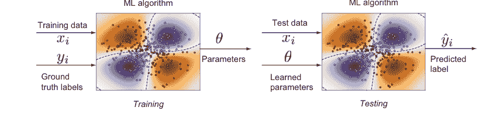

图 1.1 监督学习：训练（左）和测试（右）

#### 1.1 机器学习算法的类型

让我们稍微展开前一段并引入一些记号。本书重点关注可归为以下类别的机器学习算法：监督学习、无监督学习和深度学习。在监督学习中，给定训练数据集 D = {(x₁, y₁), …, (xₙ, yₙ)} 的 n 个输入-输出对，任务是学习从输入 x 到输出 y 的映射 f。换句话说，我们得到了 n 个示例，说明给定输入时输出应是什么样子。输出 y 也常被称为标签，它是告诉算法正确答案的监督信号。

监督学习可根据我们试图预测的量细分为分类和回归。如果我们的输出 y 是离散量（例如 K 个不同类别），我们就有分类问题。另一方面，如果我们的输出 y 是连续量（例如实数，如股价）我们就有回归问题。

因此，问题的性质取决于我们试图预测的量 y。我们希望尽可能接近 y 的真实值。

衡量性能或与真实值接近程度的常用方法是损失函数。损失函数计算预测与真实标签之间的距离。设 y = f(x; θ) 为我们的机器学习算法，它将输入示例 x 映射到输出标签 y，由 θ 参数化，其中 θ 捕获了我们机器学习算法的所有可学习参数。那么，我们可以将分类损失函数定义为被误分类的样本数量，如公式 1.1 所示。

$$L(\theta)=\frac{1}{n}\sum_{i=1}^{n}\mathbf{1}[y_i\ne f(x_i;\theta)] \tag{1.1}$$

这里，$\mathbf{1}[\,]$ 是一个指示函数，当内部参数为真时等于 1，否则为 0。公式 1.1 中的表达式表示我们将预测 $f(x_i;\theta)$ 与真实标签 $y_i$ 不匹配的所有实例相加，并除以总示例数 $n$。换句话说，我们计算平均误分类率。我们的目标是最小化损失函数（即找到一组参数 $\theta$ 使误分类率尽可能接近零）。请注意，分类有许多替代损失函数，例如交叉熵，我们将在后续章节中探讨。

对于连续标签或响应变量，常用损失函数是 *mean squared error*（MSE）。MSE 衡量估计值与真实值相差多远，如公式 1.2 所示。

$$L(\theta)=\frac{1}{n}\sum_{i=1}^{n}[y_i-f(x_i;\theta)]^2 \tag{1.2}$$

正如我们从方程中看到的，我们用预测值减去真实标签，对其平方，然后在数据点上取平均。通过平方我们消除了负号并惩罚与真实值的较大偏差。

机器学习的核心目标之一是要能够泛化到未见过的示例。我们希望不仅在训练数据（已标记）上，而且在新的、未见过的测试数据示例上实现高准确度（低损失）。这种泛化能力使机器学习如此有吸引力：如果我们能设计出能够跳出其训练框的机器学习算法，我们将更接近于通用人工智能（AGI）。

在 *unsupervised learning* 中，我们既没有标签 $y$，也不是在学习输入和输出示例之间的映射；相反，我们感兴趣的是理解数据本身。通常，这意味着在数据中发现模式。如果我们将高维数据投影到低维空间，如图 1.2 所示，通常更容易发现模式。因此，在无监督学习的情况下，我们的训练数据集由 $D=\{x_1,\ldots,x_n\}$ 的 $n$ 个输入示例组成，没有对应的标签 $y$。无监督学习最简单的例子是在数据中寻找聚类。直观上，我们知道属于同一聚类的数据点具有相似的特征。事实上，聚类内的数据点可以用聚类中心作为代表并用作数据压缩算法的一部分。或者，我们可以在投影的低维空间中查看聚类之间的距离，以了解不同组之间的相互关系。此外，远离所有现有聚类的点可被视为异常，导致异常检测算法。如你所见，无监督学习催生了无数有趣的用例，在本书中，我们将从零开始学习该领域中一些最引人入胜的算法。

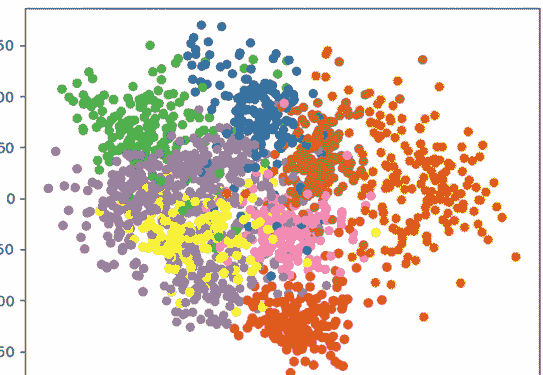

图 1.2  无监督学习：投影到二维空间中的数据点聚类

现代机器学习算法中另一个非常重要的领域是深度学习。它的名字来源于堆叠的计算层共同构成一个计算图。

正如我们将看到的，深度学习模型通过反向传播算法逐步优化参数，直到满足目标函数。由于深度学习模型能够以高精度解决复杂问题，它们已渗透到工业界。例如，图 1.3 展示了一个用于情感分析的深度学习架构。我们将在后续章节中进一步了解各个模块的含义。

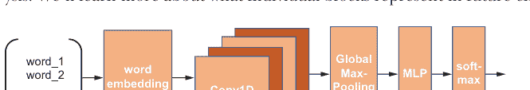

图 1.3  用于情感分析的深度神经网络（DNN）架构

深度学习是一个非常活跃的研究领域，在本书中我们将重点关注现代深度学习算法。例如，在 Transformer 模型所使用的自监督学习中，我们利用自然语言的上下文和结构作为监督信号，从而从数据本身提取标签。除了深度学习在自然语言处理（NLP）和计算机视觉（CV）中的经典应用之外，我们还将讨论生成模型，学习如何预测时间序列数据，并探索关系图数据。

#### 1.2 为什么要从零开始学习算法？

从零开始理解机器学习算法会给读者带来几方面的宝贵收获。首先，我们将能够为任务选择合适的算法。通过了解算法的内部工作原理，我们可以理解其缺点、算法推导过程中所做的假设，以及在不同数据场景下的优势。这使我们能够在为问题选择合适的解决方案时运用判断力，并通过排除无效方法节省时间。

其次，我们将能够向利益相关者解释给定算法的结果。在工业或学术环境中，能够解释结果并向受众呈现结果，是机器学习算法设计者的重要特质。

第三，我们将能够运用阅读本书所培养的直觉来排查高级机器学习问题。将复杂问题分解为较小的部分，并理解问题出在哪里，通常需要扎实的基础知识和对算法的直觉。本书将使读者能够构建最小可运行示例，并在现有算法的基础上进行开发，从而能够构建并调试更复杂的模型。

第四，当现实世界中出现新情况——特别是教科书中的算法或库无法直接使用时——我们将能够扩展算法。你在本书中获得的机器学习算法深入理解将帮助你修改现有算法以满足你的需求。

最后，我们通常关注提高现有模型的性能。本书讨论的原理将使读者能够实现这一点。总之，从零开始理解机器学习算法将帮助你为任务选择合适的算法、解释结果、排查高级问题、将算法扩展到新场景，并提高现有算法的性能。

#### 1.3 数学背景


要从零开始学习机器学习算法，最好复习一下应用概率、微积分和线性代数中的概念。关于概率的复习，建议读者参阅 Dimitri Bertsekas 和 John Tsitsiklis 的《概率导论》（Athena Scientific，2002）。读者应当熟悉连续和离散随机变量、条件分布与边缘分布、贝叶斯法则、马尔可夫链和极限定理。

关于微积分的复习，我推荐 James Stewart 的《微积分》（Thomson Brooks/Cole，2007）。读者应当熟悉微分和积分规则、序列与级数、向量与空间几何、偏导数以及多维积分。

最后，Gilbert Strang 所著的*《线性代数导论》*（Wellesley-Cambridge Press，2016）是线性代数极好的入门读物。读者应当熟悉向量空间、矩阵、特征值和特征向量、矩阵范数、矩阵分解、正定矩阵和半正定矩阵，以及矩阵微积分。除上述教材外，请参阅附录 A 中推荐的读物，它们可以加深你对本书所讲算法的理解。

### 1.4 贝叶斯推断与深度学习

*贝叶斯推断*使我们能够根据观测数据更新对世界的信念。我们的头脑中拥有多种解释世界不同方面的心智模型，通过观测新的数据点，我们可以更新潜在表示，并加深对现实的理解。任何*概率模型*都由一组参数 `θ`（建模为随机变量）和相关数据 `x` 描述；这些参数控制着模型的行为。

贝叶斯推断的目标是找到后验分布 `p(θ|x)`（给定数据下参数的分布），以较好地捕捉现实的特定方面。后验分布正比于似然 `p(x|θ)`（给定参数下数据的分布）与先验 `p(θ)`（参数的初始分布）的乘积，这遵循公式 1.3 中的贝叶斯法则。

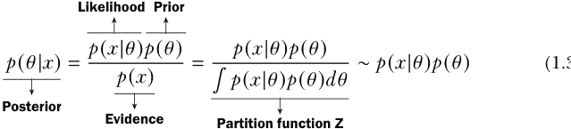

先验 `p(θ)` 是我们最初的信念，既可以是非信息性的（例如在所有可能状态上均匀分布），也可以是信息性的（例如基于特定领域的经验）。此外，我们的推断结果取决于我们选择的先验——不仅是先验参数的值，还包括先验的函数形式。我们可以想象一个更新链：在贝叶斯引擎中，随着获得更多数据，先验变为后验，如图 1.4 所示。我们可以看到，随着观察更多数据，先验如何通过贝叶斯法则被更新为后验。

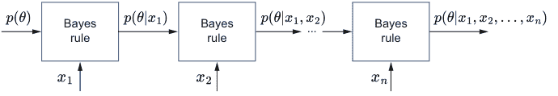

**图 1.4**  贝叶斯引擎：当观察到更多数据时，先验转变为后验的过程

与后验具有相同形式的先验称为*共轭先验*，它们通常更受青睐，因为通过闭式更新可以简化计算。分母 `Z = p(x) = ∫ p(x|θ) p(θ) dθ` 被称为*归一化常数*或*配分函数*，由于高维参数空间中的积分，通常难以计算。在本书中，我们将研究几种估计 `Z` 的技术。

我们可以将模型中不同随机变量之间的关系建模为图，如图 1.5 所示，这产生了*概率图模型*。图中的每个节点代表一个随机变量（RV），每条边代表一个条件依赖关系。模型参数用未着色节点表示，阴影节点表示观测数据，矩形板表示随机变量的复制或重复。图本身的拓扑结构会根据你要建模的应用而变化。然而，贝叶斯推断的目标保持不变：在给定观测数据的情况下，找到模型参数上的后验分布。

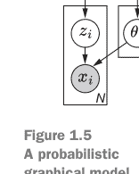

图 1.5

用于高斯混合模型的概率图模型（PGM）

与连接关系由领域专家指定的概率图模型不同，*深度学习模型*通过最小化目标函数的反向传播算法自动学习世界的表示。*深度神经网络*（DNN）由多层组成，这些层由权重矩阵和偏置参数参数化。数学上，DNN 可以表示为单个层函数的复合，如公式 1.4 所示。

`DNN(x; θ) = f_L(f_{L-1}(⋯(f_1(x; θ_1))⋯); θ_L)`  (1.4)

这里，`f_l(x) = f(x; θ_l)` 是第 l 层的函数。DNN 的复合形式让我们联想到在随机梯度下降中对参数求导时的链式法则。在本书中，我们将研究几种不同类型的 DNN，如卷积神经网络（CNN）、循环神经网络（RNN），以及 Transformer 和图神经网络（GNN），应用范围从计算机视觉到金融。

#### 1.4.1 贝叶斯推断的两大主要流派：MCMC 和 VI

*马尔可夫链蒙特卡洛*（MCMC）是一种从高维参数空间采样以近似后验分布 `p(θ|x)` 的方法。在统计学中，*采样*是指从给定概率分布中生成随机样本值。在高维参数空间中采样有许多方法。正如我们将在后续章节中看到的，MCMC 基于构造一条马尔可夫链，其平稳分布就是我们感兴趣的目标密度（即后验分布）。通过对状态空间进行随机游走，我们在每个状态 `θ` 上花费的时间比例将正比于 `p(θ|x)`。因此，我们可以使用蒙特卡洛积分来推导与后验分布相关的感兴趣的量。

联合后验分布的因子分解表示。这种分解显著加速计算。

接下来，我们引入Kullback-Leibler（KL）散度，并用它来衡量我们的近似分布与真实后验分布之间的接近程度。图1.7展示了KL散度的两种版本。

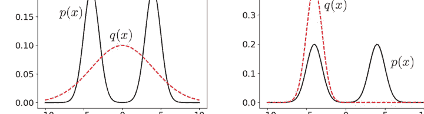

图1.7 前向KL（左）和反向KL（右）近似分布`q(x)`拟合高斯混合分布`p(x)`

原始分布`p(x)`是一个双峰高斯分布（也称为具有两个分量的高斯混合），而近似分布`q(x)`是单峰高斯分布。从图1.7中我们可以看到，我们可以在中心用具有高方差的`q(x)`来近似具有两个峰的分布，以捕获双峰分布的支撑域，或者如右图所示，用`q(x)`位于其中一个模态上。这是公式1.7中前向和反向KL散度定义的结果。正如我们将在后续章节中看到的，通过最小化KL散度，我们实际上将VI转化为一个优化问题。

`KL(p||q) = Σ p(x) log p(x)/q(x)`      `KL(q||p) = Σ q(x) log q(x)/p(x)`      (1.7)

#### 1.4.2 现代深度学习算法

多年来，深度学习架构已经从LeNet CNN的基本构建块演变为视觉Transformer架构。某些架构设计主题开始出现，例如ResNet模型中的残差连接，这已成为任意深度的现代神经网络的标准架构选择。在本书后面的章节中，我们将介绍现代深度学习算法，包括基于自注意力的Transformer；生成模型，如变分自编码器；以及图神经网络。

我们还将讨论摊销变分推断（amortized variational inference），这是一个有趣的研究领域，因为它将深度神经网络的表达能力和表示学习与概率图模型的领域知识相结合。我们将看到混合密度网络的一个此类应用，其中我们将使用神经网络从观测空间映射到近似后验分布的参数。

大多数深度学习模型属于狭义AI的范畴，在特定数据集上表现出高性能。虽然能够在狭窄的任务集上表现出色是一项有用的技能，但我们希望摆脱狭义AI，走向通用人工智能（AGI）。

### 1.5 实现算法

从头学习算法的关键部分是软件实现。编写良好的代码非常重要，既要在数据结构的使用上高效，又要具有较低的算法复杂度。在本章中，我们将把代码的功能方面分组到类中，并从零开始实现不同的计算方法。因此，你将接触到大量面向对象编程（OOP），这是流行的机器学习库（如`scikit-learn`）中的常见做法。虽然本书的意图是从头编写所有代码（不依赖第三方库），但我们仍然可以使用机器学习库（例如`scikit-learn`，`https://scikit-learn.org/stable/`）来检查我们实现的结果（如果可用）。本书将全程使用Python语言。

#### 1.5.1 数据结构

数据结构是一种存储和组织数据的方式。每种数据结构提供不同的性能权衡，有些比其他的更适合特定任务。我们将在机器学习算法实现中主要使用线性数据结构，例如固定大小的数组，因为访问数组中元素的时间是常数`O(1)`。我们还将经常使用动态可调整大小的数组（例如Python中的列表）来在多次迭代中跟踪数据。

在本书中，我们将使用非线性数据结构，例如映射（字典）和集合。我们使用这些数据结构的原因是有序字典和有序集合构建在自平衡二叉搜索树（BST）之上，这保证了`O(n log n)`的插入、搜索和删除操作。最后，哈希表或无序映射是另一种常用的高效数据结构，在假设无冲突的情况下，其访问时间为`O(1)`。

#### 1.5.2 问题解决范式

本书中的大多数机器学习算法都可以归为四种问题解决范式之一：完全搜索、贪心、分治和动态规划。完全搜索是一种通过遍历整个搜索空间来寻找解决方案的方法。机器学习的例子中，完全搜索出现在通过完全枚举进行精确推断中。在精确推断期间，我们必须完整地指定许多概率表来执行计算。

贪心算法在每一步都做出局部最优选择，希望能最终达到全局最优解。贪心算法通常依赖贪心启发式。贪心算法的一个机器学习示例是传感器放置。例如，给定一个房间和几个温度传感器，我们希望以最大化房间覆盖范围的方式放置传感器。

分治是一种将问题划分为更小的、独立的子问题，然后组合每个子问题的解决方案的技术。使用分治范式的机器学习示例可以在CART决策树算法中找到。正如我们将在后面的章节中看到的，在CART算法中，通过优化分类目标（例如基尼指数）来找到分割决策树的最优阈值。同样的过程应用于深度增加一层的树，从而产生递归算法。

最后，动态规划（DP）是一种将问题划分为更小的、重叠的子问题，为每个子问题计算解决方案，并将解决方案存储在DP表中的技术。使用动态规划的机器学习示例出现在强化学习（RL）中求解贝尔曼方程时。对于少量状态，我们可以使用动态规划以表格方式计算Q函数。

### 总结

- 算法是完成特定任务所需的一系列步骤。机器学习算法可分为以下类别之一：监督学习、无监督学习和深度学习。

- 从头理解算法将帮助你为任务选择正确的算法、解释结果、解决高级问题，并改进现有模型的性能。

- 贝叶斯推断允许我们根据观测数据更新对世界的信念，而深度学习模型通过最小化目标函数的反向传播算法来学习世界的表示。贝叶斯推断有两个阵营：马尔可夫链蒙特卡罗（MCMC）和变分推断（VI）。这两个阵营分别侧重于采样和近似后验分布。

- 编写良好的代码非常重要，既要在数据结构的使用上高效，又要具有较低的算法复杂度。本书中的大多数机器学习算法都可以归为四种问题解决范式之一：完全搜索、贪心、分治和动态规划。

## 马尔可夫链蒙特卡罗

#### 本章涵盖

- 介绍马尔可夫链蒙特卡罗

- 通过蒙特卡罗积分估算π

- 二叉树模型的蒙特卡罗模拟

- 自回避随机游走

- 吉布斯采样算法

- Metropolis-Hastings算法

- 重要性采样

在上一章中，我们回顾了不同类型的机器学习算法和软件实现。现在，我们将聚焦于一类流行的机器学习算法，称为马尔可夫链蒙特卡罗。任何解释现实一部分的概率模型都存在于高维参数空间中，因为它由高维模型参数描述。马尔可夫链蒙特卡罗（MCMC）是一种从高维参数空间采样以近似后验分布`p(θ|x)`的方法。该方法最初由物理学家开发，后来在贝叶斯统计界流行起来，因为它允许人们通过采样来估计高维后验分布。MCMC的基本思想是构造一个马尔可夫链，其平稳分布等于目标后验`p(θ|x)`。

换句话说，如果我们在参数空间中进行随机游走，我们在某个特定状态`θ`上花费的时间比例与`p(θ|x)`成正比。

我们将在下一节开始介绍MCMC。在介绍三种流行的采样算法（吉布斯采样、Metropolis-Hastings和重要性采样）之前，我们将先介绍三个热身蒙特卡洛示例（估计π、二叉树模型和自回避随机游走）。本章选择这些热身算法是为了让读者恰当地入门MCMC，而选择这些采样算法是因为它们在概率图模型（PGMs）采样中应用广泛。

### 2.1 马尔可夫链蒙特卡洛简介

让我们从一个简单的鸢尾花分类示例开始理解高维参数空间。鸢尾花是一种花卉，包括三个品种：山鸢尾（setosa）、杂色鸢尾（versicolor）和维吉尼亚鸢尾（virginica）。这些花以其花瓣和花萼的长度和宽度为特征，这些特征可用于确定鸢尾花的品种。图2.1展示了鸢尾花配对图。

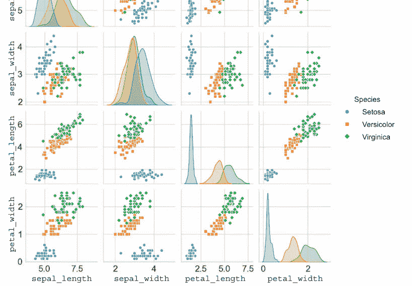

图2.1 鸢尾花配对图：按鸢尾花品种进行颜色编码的成对散点图

配对图是一个图表矩阵，其中非对角线元素包含每个特征（例如，花瓣长度）与每个其他特征的散点图，而主对角线元素则包含每个特征与自身的图，并按三个鸢尾花品种进行颜色编码。配对图捕获了鸢尾花数据集中的成对关系。让我们关注主对角线元素，并尝试对我们看到的数据进行建模。由于我们有三种鸢尾花，我们可以将数据建模为三个高斯分布的混合。高斯混合是高斯概率分布的加权和。方程2.1以数学形式表达了这一点。

K个高斯分布之和

```
p(x|θ) = Σ_{k=1}^K N(x; μ_k, σ_k^2) π_k  (2.1)
```

| 高斯混合 | 高斯随机变量 | 混合比例 |

| --- | --- | --- |

高斯混合由K个高斯随机变量组成，这些随机变量按混合比例`π_k`缩放，混合比例为正且总和为1：`Σ π_k = 1, π_k > 0`。这是一个高维参数问题，因为要拟合高斯混合模型，我们需要找到均值`μ_k`、协方差`σ_k^2`和混合比例`π_k`的值。对于鸢尾花数据集，我们有`K = 3`，这意味着高斯混合的参数数量等于`9 - 1 = 8`（即，我们在`θ = {μ_k, σ_k^2, π_k}_{k=1}^3`中有9个参数，由于`π_k`的求和为1的约束，我们减去1）。在后面的章节中，我们将介绍如何通过期望最大化（EM）算法来找到高斯混合参数。既然我们已经对参数空间有了概念，让我们以抛硬币为例，回顾一下对后验分布的理解。

#### 2.1.1 抛硬币的后验分布

借助MCMC算法，我们尝试通过样本近似后验分布。事实上，大多数贝叶斯推断都是为了高效近似后验分布而设计的。让我们更详细地理解什么是后验分布。当我们有一个参数为`θ`且需要拟合观测数据`x`的模型时，后验分布随之产生。也就是说，它是在给定数据`x`的条件下参数`θ`的概率`p(θ|x)`。考虑一个抛硬币序列的示例，其中每个硬币以概率`θ`正面朝上，以概率`1 - θ`反面朝上，如图2.2所示。


图2.2 伯努利随机变量

图2.2展示了模拟抛硬币的伯努利随机变量的概率质量函数（PMF）。如果`θ = 1/2`，我们有一个公平的硬币，正面（1）或反面（0）的机会相等；否则，我们说硬币是有偏的，偏差等于`θ`。我们可以将伯努利随机变量的PMF写成如下形式。

```
p_x(x|θ) = θ^x (1 - θ)^{1-x},  x ∈ {0, 1}  (2.2)
```

伯努利随机变量的均值等于`E[X] = Σ_x x p_x(x|θ) = 0(1 - θ) + 1(θ) = θ`，而方差等于`VAR(x) = E[x^2] - E[x]^2 = θ - θ^2 = θ(1 - θ)`。让我们回到抛硬币的示例。设`D = {x_1,…,x_n}`是一系列独立同分布（iid）的抛硬币结果。然后，我们可以按如下方式计算似然。

```
p_x(D|θ) = p_x(x_1,…,x_n|θ)
= ∏_{i=1}^{n} p(x_i|θ) = ∏_{i=1}^{n} θ^{x_i} (1 - θ)^{1 - x_i}
= θ^{N_1} (1 - θ)^{N_0}  (2.3)
```

这里，我们假设`N_1 = Σ_{i=1}^n x_i`，即硬币正面朝上的总次数，`N_0 = n - N_1`，即硬币反面朝上的总次数。

方程2.2和2.3具有`p(x|θ)`的形式，根据定义，这是在给定参数`θ`时数据`x`的似然。如果我们对参数`θ`有一些先验信息会怎样？换句话说，如果我们知道`p(θ)`的某些信息，比如我们在另一组相同硬币的实验中获得的正面和反面次数呢？我们可以通过以下方式捕获这种先验信息。

```
Beta(θ|a, b) ∝ θ^{a-1} (1 - θ)^{b-1}  (2.4)
```

这里，`a`是我们先前实验中正面朝上的次数，`b`是反面朝上的次数。在计算后验分布时，我们感兴趣的是计算`p(θ|x)`。我们可以使用第1章中的贝叶斯规则，将后验分布表示为与似然和先验的乘积成正比。

```
p(θ|D) ∝ p(D|θ)p(θ)
= θ^{N_1} (1 - θ)^{N_0} θ^{a-1} (1 - θ)^{b-1} = θ^{N_1 + a -1} (1 - θ)^{N_0 + b -1}
∝ Beta(θ|N_1 + a, N_0 + b)  (2.5)
```

方程2.5计算后验分布`p(θ|D)`，它告诉我们一系列抛硬币中正面朝上的概率。我们可以看到，后验分布服从Beta随机变量分布。回想一下，我们的先验也是Beta随机变量；我们说先验“与后验共轭”。换句话说，后验可以通过用观测数据更新先验计数来以闭式形式计算。

#### 2.1.2 用于网页排名的马尔可夫链

在深入研究MCMC算法之前，我们需要介绍马尔可夫链的概念。*马尔可夫链*是一系列可能的事件，其中当前事件的概率仅取决于前一个事件。一阶马尔可夫链可以写成方程2.6所示的形式。设`x_1,…,x_t`是我们后验分布的样本；然后，我们可以将联合分布写成如下形式。

```
p(x_1,…,x_t)=p(x_1)p(x_2|x_1)p(x_3|x_2)⋯p(x_t|x_{t-1})
= p(x_1) ∏_{i=2}^{t} p(x_i|x_{i-1})  (2.6)
```


注意联合分布如何分解为条件分布的乘积，其中当前状态仅以先前状态为条件。马尔可夫链的特征在于状态上的初始分布`p(x_1=i)`以及从状态`i`到状态`j`的状态转移矩阵`A_{ij}=p(x_t=j\mid x_{t-1}=i)`。

让我们通过Google网页排名示例来引出马尔可夫链。Google使用网页排名算法对数十亿网页进行排名。我们可以将`n`个网页的集合形式化为图`G=(V,E)`。让每个节点`v∈V`表示一个网页，每条边`e∈E`表示从一个页面到另一个页面的链接。了解页面的链接方式使我们能够构建一个巨大的稀疏转移矩阵`A`，其中`A_{ij}`是从页面`i`跟随链接到页面`j`的概率，如图2.3所示。

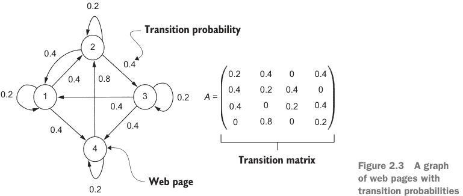

注意，矩阵`A`中每一行的和都为1（即`∑_j A_{ij}=1`）。具有此性质的矩阵被称为*随机矩阵*。注意，`A_{ij}`对应于从状态`i`到状态`j`的转移概率。正如我们将在后面的章节中看到的，网页排名是马尔可夫链状态上的平稳分布。为了使其能够扩展到数十亿个网页，我们将

$$I = \int_{-r}^{r} \int_{-r}^{r} 1[x^2 + y^2 \le r^2] dx dy = E_{x,y}[w(x,y)] \tag{2.10}$$

这里，`1[x^2 + y^2 \le r^2]`是一个指示函数，当点位于半径为`r`的圆内时等于1，否则等于0。因此，`π = I / r^2`。为了计算`I`，请注意以下方程。

$$w(x,y) = (b_x - a_x)(b_y - a_y) 1[x^2 + y^2 \le r^2]\\ = (2r)(2r) 1[x^2 + y^2 \le r^2]\\ = 4r^2 1[x^2 + y^2 \le r^2] \tag{2.11}$$

我们可以在图2.4所示的伪代码中总结π估计算法。

```text
1: function pi_est(R, N):
2: for i = 1 to N:
3: X[i] ~ Unif(-R, R) → Uniform RVs
4: Y[i] ~ Unif(-R, R)
5: IN[i] = X[i]^2 + Y[i]^2 ≤ R^2
6: S[i] = (2R) × (2R) × IN[i]
7: end for
8: Î = 1/N Σ_{i=1}^N S[i]
9: π̂ = Î / R^2 ← Pi estimate
10: π̂_se = σ_S / √N ← Pi standard deviation
11: return π̂ ± π̂_se
```

图2.4 π估计器伪代码

我们从支持范围为−R到R的均匀分布中生成N个样本，并计算我们的样本是在圆内还是圆外的布尔表达式。如果样本在圆内，它将计入积分计算。一旦我们得到了积分的估计值，我们将结果除以R^2来计算π的估计值。我们现在准备好实现我们的π估计器了！

### 代码清单2.1 π估计器

```python
import numpy as np
import matplotlib.pyplot as plt
np.random.seed(42)  # Fixes a seed for reproducible results

def pi_est(radius=1, num_iter=int(1e4)):  # Experiments with a different number of samples N
    X = np.random.uniform(-radius,+radius,num_iter)
    Y = np.random.uniform(-radius,+radius,num_iter)
```

```python
R2 = X**2 + Y**2
inside = R2 < radius**2
outside = ~inside

samples = (2*radius)*(2*radius)*inside

I_hat = np.mean(samples)
pi_hat = I_hat/radius ** 2
pi_hat_se = np.std(samples)/np.sqrt(num_iter)
print("pi est: {} +/- {:f}".format(pi_hat, pi_hat_se))

plt.figure()
plt.scatter(X[inside],Y[inside], c='b', alpha=0.5)
plt.scatter(X[outside],Y[outside], c='r', alpha=0.5)
plt.show()

if __name__ == "__main__":
    pi_est()
```

如果我们执行这段代码，会得到π = 3.1348 ± 0.0164，这是一个相对较好的结果（在误差范围内）。可以尝试使用不同样本数量N进行实验，观察我们收敛到π的速度如何随N的变化而变化。图2.5中以蓝色显示了被接受的蒙特卡洛样本，对应圆内的样本；以红色显示了被拒绝的样本，对应圆外的样本。

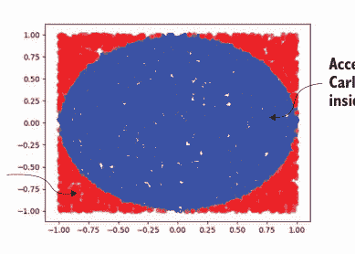

图2.5 用于估计π的蒙特卡洛样本

在前面的示例中，我们假设样本来自均匀分布X, Y ~ Unif(−R, R)。在下一节中，我们将使用二叉树模型来考察不同时间范围内的股价模拟。

#### 2.3 二叉树模型

现在，让我们考察蒙特卡洛采样如何应用在金融领域。在股价的二叉树模型中，我们假设在每个时间步，股票可能处于上涨或下跌两种状态，并具有风险资产特有的非等额收益特征。假设t = 0时刻的初始股价为$1，在下一个时间步t = 1时，上涨状态的价格为u，下跌状态的价格为d，上涨状态的转移概率为p。图2.6展示了前两个时间步的二叉树模型。注意，下一个上涨（下跌）状态的价格是前一个状态价格乘以u（d）。

我们可以使用蒙特卡洛方法对某个时间范围T后的期末股价生成不确定性估计。当使用二叉树模型描述股票价格过程时，可以使用以下校准公式（其推导超出了本书的范围）。

`u = exp( σ sqrt(T/n) ) = 1/d`

`p = 1/2 + 1/2 (μ/σ) sqrt(T/n)   (2.12)`

这里，T是以年表示的预测范围长度，n是时间步数。我们假设1年等于252个交易日，1个月等于21天，1周等于5天，1天等于8小时。让我们使用二叉树模型，以每日时间步长模拟两种不同时间范围的股价：从今天起1个月和从今天起1年。我们可以将算法总结为图2.7所示的伪代码。

```
1: function binomial_tree(μ, σ, S0, N, T, step):
2: u = exp( σ sqrt(T/n) ) ← 上涨价格
3: d = 1/u ← 下跌价格
4: p = 1/2 + 1/2 (μ/σ) sqrt(T/n) ← 上涨状态转移概率
5: up_times = Binomial( T/step, p, N )
6: down_times = T/step - up_times
7: S_T = S0 × u^{up_times} × d^{down_times}
8: return S_T
```

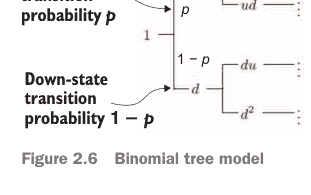

图2.6 二叉树模型

图2.7 二叉树伪代码

我们首先初始化上涨价格u和下跌价格d，以及上涨状态的转移概率p。接下来，通过从二项随机变量中采样来模拟所有的上涨转移，其中试验次数等于T/step，成功概率为p，蒙特卡洛模拟次数等于N。下跌转移通过上涨转移的补集计算得出。最后，通过将初始价格S0与所有上涨转移和所有上涨转移的价格相乘来计算资产价格。

### 清单2.2 二叉树股价模拟

```python
import numpy as np

import seaborn as sns
import matplotlib.pyplot as plt

np.random.seed(42)

def binomial_tree(mu, sigma, S0, N, T, step):

    #计算状态价格和概率
    u = np.exp(sigma * np.sqrt(step))
    d = 1.0/u
    p = 0.5+0.5*(mu/sigma)*np.sqrt(step)

    #二叉树模拟
    up_times = np.zeros((N, len(T)))
    down_times = np.zeros((N, len(T)))
    for idx in range(len(T)):
        up_times[:,idx] = np.random.binomial(T[idx]/step, p, N)
        down_times[:,idx] = T[idx]/step - up_times[:,idx]

    #计算期末价格
    ST = S0 * u**up_times * d**down_times

    #生成图表
    plt.figure()
    plt.plot(ST[:,0], color='b', alpha=0.5, label='1个月范围')
    plt.plot(ST[:,1], color='r', alpha=0.5, label='1年范围')
    plt.xlabel('时间步，天')
    plt.ylabel('价格')
    plt.title('二叉树股价模拟')
    plt.legend()
    plt.show()

    plt.figure()
    plt.hist(ST[:,0], color='b', alpha=0.5, label='1个月范围')
    plt.hist(ST[:,1], color='r', alpha=0.5, label='1年范围')
    plt.xlabel('价格')
    plt.ylabel('数量')
    plt.title('二叉树股价模拟')
    plt.legend()
    plt.show()

if __name__ == "__main__":

    #模型参数
    mu = 0.1
    sigma = 0.15
    S0 = 1
    N = 10000
    T = [21.0/252, 1.0]
    step = 1.0/252

    binomial_tree(mu, sigma, S0, N, T, step)
```

```
1: function rand_walk(num_step, num_iter, moves):
2: X, Y, lattice = 0, 0, 0
3: weight = 1
4: xx = num_step + 1 + X ← x轴中间位置
5: yy = num_step + 1 + Y ← y轴中间位置
6: lattice[xx, yy] = 1 ← 初始化网格位置
7: for i = 1 to num_step:
8:   up = lattice[xx, yy+1]
9:   down = lattice[xx, yy-1]
10:  left = lattice[xx-1, yy]
11:  right = lattice[xx+1, yy]
12:  neighbors = [1, 1, 1, 1]− [up, down, left, right] ← 可用方向
13:  if sum(neighbors) == 0
14:    break ← 自环
15:  end if
16:  weight = weight × sum(neighbors) ← 计算重要性权重
17:  direction ~ Cat( neighbors / sum(neighbors) ) ← 采样移动方向
18:  X = X+ moves[direction]
19:  Y = Y+ moves[direction]
20:  // 更新网格坐标
21:  xx = num_step + 1 + X
22:  yy = num_step + 1 + Y
23:  lattice[xx, yy] = 1
24: end for
25: return lattice
```

图2.9 随机游走伪代码

接下来，我们从可用方向中采样一个移动方向，这是通过从分类随机变量中采样实现的。由于neighbors数组只能取0和1的值，我们实际上是在从可用方向中进行均匀采样。

接着，我们更新网格坐标xx和yy，并通过设置lattice[xx, yy]=1来标记占据状态。虽然伪代码中只展示了一次迭代，下面的代码清单将伪代码包装在了一个额外的for循环中，循环次数为迭代次数num_iter。每一次迭代都是一次尝试，生成一条不相交（即自回避）的随机游走。每次试验中记录随机游走的平方距离和重要性权重。现在我们可以来看自回避随机游走的代码了。

### 清单2.3 自回避随机游走

```python
import numpy as np
import seaborn as sns
import matplotlib.pyplot as plt

np.random.seed(42)

def rand_walk(num_step, num_iter, moves):
```

```python
#随机游走统计量
square_dist = np.zeros(num_iter)
weights = np.zeros(num_iter)

for it in range(num_iter):

    trial = 0
    i = 1

    while i != num_step-1:

        #初始化
        X, Y = 0, 0
        weight = 1
        lattice = np.zeros((2*num_step+1, 2*num_step+1))
        lattice[num_step+1,num_step+1] = 1
        path = np.array([0, 0])
        XX = num_step + 1 + X
        YY = num_step + 1 + Y

        print("iter: %d, trial %d" %(it, trial))

        for i in range(num_step):

            up     = lattice[XX,YY+1]
            down   = lattice[XX,YY-1]
            left   = lattice[XX-1,YY]
            right  = lattice[XX+1,YY]

            neighbors = np.array([1, 1, 1, 1]) -
                np.array([up, down, left, right])

            if (np.sum(neighbors) == 0):
                i = 1
                break
            #end if

            weight = weight * np.sum(neighbors)

            direction = np.where(np.random.rand() <
                np.cumsum(neighbors/float(sum(neighbors))))

            X = X + moves[direction[0][0],0]
            Y = Y + moves[direction[0][0],1]

            path_new = np.array([X,Y])
            path = np.vstack((path,path_new))

            #更新网格坐标
            XX = num_step + 1 + X
            YY = num_step + 1 + Y
            lattice[XX,YY] = 1
        #end for

        trial = trial + 1
```

迭代直到获得一条不相交的随机游走

计算可用方向

避免自环

计算重要性权重

采样移动方向

存储采样路径

```python
#end while
square_dist[it] = X**2 + Y**2
weights[it] = weight
#end for

mean_square_dist = np.mean(weights * square_dist)/np.mean(weights)
print("mean square dist: ", mean_square_dist)

#generate plots
plt.figure()
for i in range(num_step-1):
    plt.plot(path[i,0], path[i,1], path[i+1,0], path[i+1,1], 'ob')
plt.title('random walk with no overlaps')
plt.xlabel('X')
plt.ylabel('Y')
plt.show()

plt.figure()
sns.displot(square_dist)
plt.xlim(0,np.max(square_dist))
plt.title('square distance of the random walk')
plt.xlabel('square distance (X^2 + Y^2)')
plt.show()

if __name__ == "__main__":
    num_step = 150
    num_iter = 100
    moves = np.array([[0, 1],[0, -1],[-1, 0],[1, 0]])
    rand_walk(num_step, num_iter, moves)
```


- 计算平方扩展
- 用于平均结果的迭代次数
- 随机游走的步数
- 二维移动

图2.10展示了由最后一次迭代生成的自回避随机游走。在二维格点上，长度为`n`的随机游走共有`4^n`种可能，而对于较大的`n`，随机游走能够自回避的可能性非常低。该图还显示了每次随机游走迭代计算得到的平方距离直方图。直方图呈正偏态，表明长距离游走的概率较小。在下一节中，我们将介绍一种流行的采样算法：吉布斯采样。

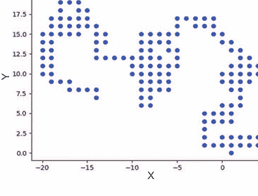

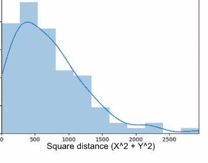

**图2.10** 自回避随机游走（左）与随机游走平方距离（右）

### 2.5 吉布斯采样

在本节中，我们将介绍一种基本的MCMC算法，称为吉布斯采样。这种采样形式基于这样的思想：从多维分布中一次采样一个变量，并以所有其他变量的最新样本为条件。例如，对于一个`d=3`维的分布，给定起始样本`x^{[k]}`，我们按如下方式生成下一个样本`x^{[k+1]}`。

$$
x_1^{k+1} \sim p\left(x_1|x_2^k, x_3^k\right)
$$

$$
x_2^{k+1} \sim p\left(x_2|x_1^{k+1}, x_3^k\right)
$$

$$
x_3^{k+1} \sim p\left(x_3|x_1^{k+1}, x_2^{k+1}\right)
\tag{2.14}
$$

方程2.14中的分布称为完全条件分布。此外，请注意，朴素吉布斯采样算法是顺序执行的（其步骤数与分布的维度成正比），并且它假设我们可以轻松地从完全条件分布中采样。吉布斯采样算法适用于方程2.14中的完全条件分布易于计算的场景。

完全条件分布易于计算的一个实例是多元高斯分布，其概率密度函数（PDF）定义如下。

$$
\mathcal{N}(x; \mu, \Sigma) = \frac{1}{(2\pi)^{\frac{d}{2}}|\Sigma|^{\frac{1}{2}}} \exp\left[-\frac{1}{2}(x-\mu)^T \Sigma^{-1} (x-\mu)\right]
\tag{2.15}
$$

让我们将高斯向量划分为两个集合`x_{1:D} = (x_A, x_B)`，其参数如方程2.16所示。

$$
\mu = \begin{pmatrix} \mu_A \\ \mu_B \end{pmatrix}
$$

$$
\Sigma = \begin{pmatrix} \Sigma_{AA} & \Sigma_{AB} \\ \Sigma_{BA} & \Sigma_{BB} \end{pmatrix}
\tag{2.16}
$$

然后，如Christopher M. Bishop所著《模式识别与机器学习》（2006）第2.3节所讨论的，可以证明完全条件分布由方程2.17给出。

$$
p(x_A|x_B) = \mathcal{N}(x_A|\mu_{A|B}, \Sigma_{A|B})
$$

$$
\mu_{A|B} = \mu_A + \Sigma_{AB} \Sigma_{BB}^{-1} (x_B - \mu_B)
$$

$$
\Sigma_{A|B} = \Sigma_{AA} - \Sigma_{AB} \Sigma_{BB}^{-1} \Sigma_{BA}
\tag{2.17}
$$

让我们通过查看图2.11中的伪代码来理解吉布斯采样算法。

```text
1: class gibbs_gauss
2: function gauss_conditional(mu, Sigma, setA, x):
3: setU = set(range(len(mu))) ← Universal set
4: setB = setU\setA
5: x_B, μ_A, μ_B = x[setB], mu[setA], mu[setB]
6: μ_{A|B} = μ_A + Σ_{AB} Σ_{BB}^{-1} (x_B - μ_B)
7: Σ_{A|B} = Σ_{AA} - Σ_{AB} Σ_{BB}^{-1} Σ_{BA}
8: return μ_{A|B}, Σ_{A|B}
9: function sample(mu, Sigma, xinit, num_samples):
10: x = xinit
11: dim = len(mu)
12: for s = 1 to num_samples:
13:   for d = 1 to dim:
14:     μ_{A|B}, Σ_{A|B} = gauss_conditional(mu, Sigma, set(d), x)
15:     x[d] ~ N(x; μ_{A|B}, Σ_{A|B}) ← Gibbs samples
16:   end for
17:   samples[s,:] = x
18: end for
19: return samples
```

**图2.11** 吉布斯采样器伪代码

我们的`gibbs_gauss`类包含两个函数：`gauss_conditional`和`sample`。`gauss_conditional`函数计算任意变量集合`setA`和`setB`的条件高斯分布`p(x_A|x_B)`。`setA`是函数的输入，而`setB`通过维度`D`的通用集合与`setA`的差集计算得到。回想一下，在吉布斯采样中，我们一次对一个维度进行采样，同时以所有其他维度为条件。换句话说，我们遍历可用维度，并在每次迭代中计算条件分布。这正是`sample`函数所做的。对于每个样本，我们遍历每个维度，计算高斯条件分布的均值和协方差，然后从中抽取并记录一个样本。我们重复此过程，直到达到最大样本数。让我们看看吉布斯采样算法在从二维高斯分布中采样时的实际应用。

#### 代码清单2.4 吉布斯采样

```python
import numpy as np
import matplotlib.pyplot as plt
import itertools
from numpy.linalg import inv
from scipy.stats import multivariate_normal

np.random.seed(42)

class gibbs_gauss:
    def gauss_conditional(self, mu, Sigma, setA, x):
        dim = len(mu)
        setU = set(range(dim))
        setB = setU.difference(setA)
        muA = np.array([mu[item] for item in setA]).reshape(-1,1)
        muB = np.array([mu[item] for item in setB]).reshape(-1,1)
        xB = np.array([x[item] for item in setB]).reshape(-1,1)

        Sigma_AA = []
        for (idx1, idx2) in itertools.product(setA, setA):
            Sigma_AA.append(Sigma[idx1][idx2])
        Sigma_AA = np.array(Sigma_AA).reshape(len(setA),len(setA))

        Sigma_AB = []
        for (idx1, idx2) in itertools.product(setA, setB):
            Sigma_AB.append(Sigma[idx1][idx2])
        Sigma_AB = np.array(Sigma_AB).reshape(len(setA),len(setB))

        Sigma_BB = []
        for (idx1, idx2) in itertools.product(setB, setB):
            Sigma_BB.append(Sigma[idx1][idx2])
        Sigma_BB = np.array(Sigma_BB).reshape(len(setB),len(setB))

        Sigma_BB_inv = inv(Sigma_BB)
        mu_AgivenB = muA + np.matmul(np.matmul(Sigma_AB, Sigma_BB_inv),
        xB - muB)
        Sigma_AgivenB = Sigma_AA - np.matmul(np.matmul(Sigma_AB,
        Sigma_BB_inv), np.transpose(Sigma_AB))

        return mu_AgivenB, Sigma_AgivenB

    def sample(self, mu, Sigma, xinit, num_samples):
        dim = len(mu)
        samples = np.zeros((num_samples, dim))
        x = xinit
        for s in range(num_samples):
            for d in range(dim):
                mu_AgivenB, Sigma_AgivenB = self.gauss_conditional(mu, Sigma,
                set([d]), x)
                x[d] = np.random.normal(mu_AgivenB, np.sqrt(Sigma_AgivenB))
            #end for
            samples[s,:] = np.transpose(x)
        #end for
        return samples

if __name__ == "__main__":

    num_samples = 2000
    mu = [1, 1]
    Sigma = [[2,1], [1,1]]
    xinit = np.random.rand(len(mu),1)
    num_burnin = 1000

    gg = gibbs_gauss()
    gibbs_samples = gg.sample(mu, Sigma, xinit, num_samples)

    scipy_samples = multivariate_normal.rvs(mean=mu,cov=Sigma,size=num_samples,random_state=42)

    plt.figure()
    plt.scatter(gibbs_samples[num_burnin:,0], gibbs_samples[num_burnin:,1],
        label='Gibbs Samples')
    plt.grid(True); plt.legend(); plt.xlim([-4,5])
    plt.title("Gibbs Sampling of Multivariate Gaussian"); plt.xlabel("X1");
    plt.ylabel("X2")
    plt.show()

    plt.figure()
    plt.scatter(scipy_samples[num_burnin:,0], scipy_samples[num_burnin:,1],
        label='Ground Truth  Samples')
    plt.grid(True); plt.legend(); plt.xlim([-4,5])
    plt.title("Ground Truth Samples of Multivariate Gaussian");
    plt.xlabel("X1");
    plt.ylabel("X2")
    plt.show()
```

*计算 `P(X_A | X_B = x) = N(mu_{A|B}, Sigma_{A|B})`*

从图2.12中，我们可以看到吉布斯样本与由`μ = [1, 1]ᵀ`和`Σ = [[2, 1], [1, 1]]`参数化的真实二维高斯分布样本相似。在下一节中，我们将研究一种更通用的MCMC采样算法：Metropolis-Hastings采样。

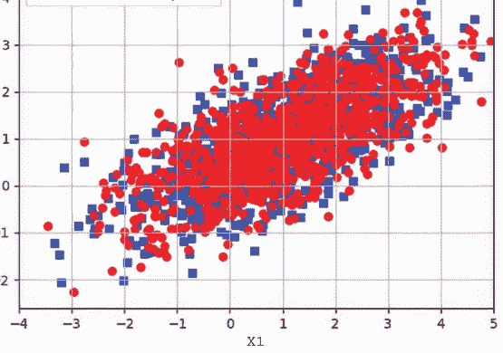

**图2.12** 多元高斯分布的吉布斯样本

### 2.6 Metropolis-Hastings 采样

让我们来看一种更通用的 MCMC 算法，用于从分布中采样。我们的目标是构建一条马尔可夫链，使其平稳分布等于我们的目标分布 `p(x)`。目标分布 `p(x)` 是我们感兴趣从中抽取样本的分布（通常是后验 `p(θ|x)` 或密度函数 `p(θ)`）。

Metropolis-Hastings (MH) 算法的基本思想是：根据提议分布 `q(x′|x)` 从当前状态 `x` 提议一个移动到新状态 `x′`，然后根据 MH 比率决定接受或拒绝该提议状态，该比率确保满足细致平衡条件，如公式 2.18 所示。

`p(x′) q(x|x′) = p(x) q(x′|x)`  (2.18)

细致平衡方程表明，从状态 `x` 转移出去的概率等于转移到状态 `x` 的概率。为了推导 MH 比率，暂时假设上述细致平衡方程不成立，那么必然存在一个修正因子 `r(x′|x)` 使得两边相等，求解该因子得到如下 MH 比率。

`p(x′) q(x|x′) = r(x′|x) p(x) q(x′|x)`

`r(x′|x) = min[ 1, p(x′) q(x|x′) / p(x) q(x′|x) ]`  (2.19)

我们可以将 Metropolis-Hastings 算法总结如图 2.13 所示。

- 从提议分布中采样
- 1: 随机初始化 `x₀`
- 2: for `k = 0, 1, 2, …` do
- 3:   提议一个新状态 `x′ ~ q(x′|xₖ)`
- 4:   计算 metropolis-hastings 比率：
- 5:   `r(x′|x) = min[ 1, p(x′)q(x|x′) / p(x)q(x′|x) ]`
- 6:   令 `xₖ₊₁ = { x′，概率为 r(x′|x) ← 接受样本`
                   `xₖ，概率为 1 − r(x′|x) ← 拒绝样本 }`
- 7: end for

图 2.13 Metropolis-Hastings 伪代码

让我们针对多变量高斯混合目标分布和高斯提议分布来实现 MH 算法。

`p(x) = Σₖ₌₁ᴷ π(k) N(x; μₖ, Σₖ)`

`q(x′|x) = N(x′|x, Σ)`  (2.20)

让我们查看代码清单 2.5。`mh_gauss` 类包含：`target_pdf` 函数，定义目标分布（本例中为高斯混合 `p(x)`）；`proposal_pdf` 函数，定义提议分布（一个多元正态分布）；以及 `sample` 函数，它根据前一个状态 `x_k` 从提议 `q(x′|x)` 中采样一个新状态，计算 Metropolis-Hastings 比率，并以概率 `r(x′|x)` 接受新样本或以概率 `1 − r(x′|x)` 拒绝样本。

#### 清单 2.5 Metropolis-Hastings 采样


```python
import numpy as np
import matplotlib.pyplot as plt

from scipy.stats import uniform
from scipy.stats import multivariate_normal

np.random.seed(42)

class mh_gauss:

    def __init__(self, dim, K, num_samples, target_mu, target_sigma,
        target_pi, proposal_mu, proposal_sigma):
        self.dim = dim
        self.K = K
        self.num_samples = num_samples
        self.target_mu = target_mu
        self.target_sigma = target_sigma
        self.target_pi = target_pi

        self.proposal_mu = proposal_mu
        self.proposal_sigma = proposal_sigma

        self.n_accept = 0
        self.alpha = np.zeros(self.num_samples)
        self.mh_samples = np.zeros((self.num_samples,
            self.dim))

    def target_pdf(self, x):
        prob = 0
        for k in range(self.K):
            prob += self.target_pi[k]*
                multivariate_normal.pdf(x,self
                .target_mu[:,:,k],self.target_sigma[:,:,k])
        #end for
        return prob

    def proposal_pdf(self, x):
        return multivariate_normal.pdf(x, self
            .proposal_mu, self.proposal_sigma)

    def sample(self):
        x_init = multivariate_normal
        .rvs(self.proposal_mu, self.proposal_sigma, 1)
        self.mh_samples[0,:] = x_init

        for i in range(self.num_samples-1):
```

### 目标参数：

$p(x) = \sum_k pi(k) N(x; mu_k, Sigma_k)$

### 提议参数：

$q(x) = N(x; mu, Sigma)$

采样链参数

目标概率密度函数：$p(x) = \sum_k pi(k) N(x; mu_k,Sigma_k)$

提议概率密度函数：

$q(x) = N(x; mu, Sigma)$

从提议分布中抽取初始样本。

```python
x_new = multivariate_normal.rvs(x_curr, self
    .proposal_sigma, 1)

self.alpha[i] = self.proposal_pdf(x_new) /
    self.proposal_pdf(x_curr)
self.alpha[i] = self.alpha[i] *
    (self.target_pdf(x_new)/self.target_pdf(x_curr))

r = min(1, self.alpha[i])            <-- MH acceptance probability
u = uniform.rvs(loc=0, scale=1, size=1)
if (u <= r):
    self.n_accept += 1
    self.mh_samples[i+1,:] = x_new      <-- Accept
else:
    self.mh_samples[i+1,:] = x_curr      <-- Reject
#end for
print("MH acceptance ratio: ", self.n_accept/float(self.num_samples))
```

```python
if __name__ == "__main__":

    dim = 2
    K = 2
    num_samples = 5000
    target_mu = np.zeros((dim, K))
    target_mu[:,0] = [4,0]
    target_mu[:,1] = [-4,0]
    target_sigma = np.zeros((dim, dim, K))
    target_sigma[:,:,0] = [[2,1],[1,1]]
    target_sigma[:,:,1] = [[1,0],[0,1]]
    target_pi = np.array([0.4, 0.6])

    proposal_mu = np.zeros((dim,1)).flatten()
    proposal_sigma = 10*np.eye(dim)

    mhg = mh_gauss(dim, K, num_samples, target_mu, target_sigma, target_pi,
        proposal_mu, proposal_sigma)
    mhg.sample()

    plt.figure()
    plt.scatter(mhg.mh_samples[:,0], mhg.mh_samples[:,1], label='MH samples')
    plt.grid(True); plt.legend()
    plt.title("Metropolis-Hastings Sampling of 2D Gaussian Mixture")
    plt.xlabel("X1"); plt.ylabel("X2")
    plt.show()
```

从图 2.14 可以看出，MH 样本非常接近真实的两个二维高斯混合分布，其均值分别为 $\mu_1 = [4,0]$，$\mu_2 = [−4,0]$；协方差分别为 $\Sigma_1 = [[2,1],[1,1]]$ 和 $\Sigma_2 = [[1,0],[0,1]]$；混合比例为 $\pi = [0.4,0.6]$。

请注意，我们可以自由选择任何提议分布 $q(x'|x)$，这使方法非常灵活。一个好的提议选择将带来较高的样本接受率。

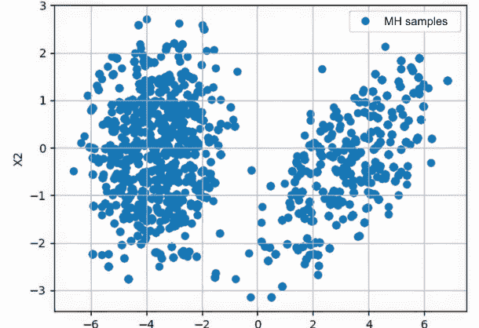

图 2.14 多元高斯混合的 Metropolis-Hastings 采样

在我们的实现中，我们选择了一个以当前状态为中心的对称高斯分布，如公式 2.21 所示。

$q(x'|x) = \mathcal{N}(x'|x, \Sigma)$

(2.21)

这被称为随机游走 Metropolis 算法。如果我们使用形如 $q(x'|x) = q(x')$ 的提议分布，即新状态独立于旧状态，就得到了独立采样器，它类似于我们下一节将要讨论的重要性采样。

另外，注意计算 MH 比率时，我们不需要知道分布的归一化常数 $Z$，因为比率中的 $Z$ 会相互抵消。MH 算法与 Gibbs 采样之间存在联系：Gibbs 算法的接受比率始终为 1。

#### 2.7 重要性采样

重要性采样（IS）是一种蒙特卡洛算法，用于估计如下形式的积分。

$E[f(x)] = \int p(x) f(x) dx$

(2.22)

重要性采样背后的思想是在感兴趣的区域（即 $p(x)$ 和 $|f(x)|$ 都较大的区域）抽取样本。重要性采样通过从一个更易采样的提议分布 $q(x)$ 中抽取样本来工作。因此，我们可以通过从提议分布 $q(x)$ 中抽取样本并使用蒙特卡洛积分来计算 $f(x)$ 关于目标分布 $p(x)$ 的期望值。

$E[f(x)] = \int f(x) p(x)/q(x) q(x) dx \approx 1/N \sum_{i=1}^N w(x_i) f(x_i)$，其中 $x_i \sim q(x)$  (2.23)

在公式 2.23 中，我们将重要性权重定义为 $w(x) = p(x) / q(x)$。让我们看一个例子，其中我们使用重要性采样来近似 $f(x) = 2 \sin(\pi x/1.5), x \ge 0$ 的期望值。我们需要对由非整数自由度（DoF）参数 $k$ 参数化的未归一化 $\chi$ 分布求期望。

$p(x) \sim x^{(k-1)} \exp{ -x^2/2 }, x \ge 0$  (2.24)

我们将使用一个更易采样的提议分布 $q(x)$：

$q(x) \sim N(x; 0.8, 1.5)$  (2.25)

让我们查看图 2.15 中的伪代码。

```
1: class importance_sampler
2: function sample(N):
3: for i = 1 to N:
4: x_i ~ q(x) = N(x; μ, σ²) ← Samples from the proposal
5: w(x_i) = p(x_i)/q(x_i) ← Computes importance weights
6: end for
7: E[f(x)] = 1/N Σ_{i=1}^N w(x_i) f(x_i)
8: return w(x), E[f(x)]
```

图 2.15 重要性采样器伪代码

我们的 `importance_sampler` 类包含一个名为 `sample` 的函数，该函数将样本数 $N$ 作为输入。在 `sample` 函数内部，我们遍历样本数，对于每次迭代，我们从提议分布 $q(x)$ 中采样，并将重要性权重计算为目标分布 $p(x)$ 与提议分布 $q(x)$ 之比。最后，我们通过使用重要性权重对感兴趣的函数 $f(x)$ 进行加权，对所有样本求和并除以 $N$ 来计算蒙特卡洛积分。让我们查看以下代码清单，它包含了所有细节。

## 清单 2.6 重要性采样

```python
import numpy as np
import matplotlib.pyplot as plt

from scipy.integrate import quad
from scipy.stats import multivariate_normal

np.random.seed(42)

class importance_sampler:
    def __init__(self, k=1.5, mu=0.8, sigma=np.sqrt(1.5), c=3):
        self.k = k                # Target parameters p(x)
        self.mu = mu              # Proposal parameters q(x)
        self.sigma = sigma
        self.c = c                # Fixes c, s.t. p(x) < c q(x)

    def target_pdf(self, x):
        return (x**(self.k-1)) * np.exp(-x**2/2.0)   # p(x) ~ Chi(k=1.5)

    def proposal_pdf(self, x):
        return self.c * 1.0/np.sqrt(2*np.pi*1.5) *
            np.exp(-(x-self.mu)**2/(2*self.sigma**2))   # q(x) ~ N(mu,sigma)

    def fx(self, x):
        return 2*np.sin((np.pi/1.5)*x)   # Function of interest f(x), x >= 0

    def sample(self, num_samples):
        x = multivariate_normal.rvs(self.mu,
            self.sigma, num_samples)   # Sample from the proposal

        idx = np.where(x >= 0)          # Discards negative samples, since
        x_pos = x[idx]                  # f(x) is defined for x >= 0

        isw = self.target_pdf(x_pos) /
            self.proposal_pdf(x_pos)    # Computes importance weights

        fw = (isw/np.sum(isw))*self.fx(x_pos)   # Computes E[f(x)] = sum_i f(x_i)
        f_est = np.sum(fw)                      # w(x_i), where x_i ~ q(x)

        return isw, f_est

if __name__ == "__main__":

    num_samples = [10, 100, 1000, 10000, 100000, 1000000]

    F_est_iter, IS_weights_var_iter = [], []
    for k in num_samples:
        IS = importance_sampler()
        IS_weights, F_est = IS.sample(k)
        IS_weights_var = np.var(IS_weights/np.sum(IS_weights))
        F_est_iter.append(F_est)
        IS_weights_var_iter.append(IS_weights_var)

#ground truth (numerical integration)
k = 1.5
```

```python
I_gt, _ = quad(lambda x: 2.0*np.sin((np.pi/1.5)*x) * (x**(k-1))*np.exp(-x**2/2.0), 0, 5)

#generate plots
plt.figure()
xx = np.linspace(0,8,100)
plt.plot(xx, IS.target_pdf(xx), '-r', label='target pdf p(x)')
plt.plot(xx, IS.proposal_pdf(xx), '-b', label='proposal pdf q(x)')
plt.plot(xx, IS.fx(xx) * IS.target_pdf(xx), '-k', label='p(x)f(x) integrand')
plt.grid(True); plt.legend(); plt.xlabel("X1"); plt.ylabel("X2")
plt.title("Importance Sampling Components")
plt.show()

plt.figure()
plt.hist(IS_weights, label = "IS weights")
plt.grid(True); plt.legend();
plt.title("Importance Weights Histogram")
plt.show()

plt.figure()
plt.semilogx(num_samples, F_est_iter, label = "IS Estimate of E[f(x)]")
plt.semilogx(num_samples, F_gt*np.ones(len(num_samples)), label = "Ground Truth")
plt.grid(True); plt.legend(); plt.xlabel('iterations'); plt.ylabel("E[f(x)] estimate")
plt.title("IS Estimate of E[f(x)]")
plt.show()
```

图 2.16（左）显示了目标概率密度函数 $p(x)$、提议概率密度函数 $q(x)$ 以及被积函数 $p(x)f(x)$。请注意，我们用常数 $c$ 对提议概率密度函数 $q(x)$ 进行了缩放，使得对于所有 $x \ge 0$，都有 $p(x) < c q(x)$。此外，我们将来自 $q(x)$ 的样本限制为正数（因此，是从截断高斯分布中采样），以满足 $f(x)$ 对 $x \ge 0$ 的约束。图 2.16 展示了 $E[f(x)]$ 的估计值随样本数量的改善情况，并与通过数值积分计算得到的真实值进行了比较。

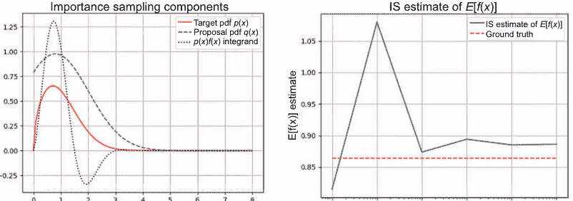

在前一个例子中，我们使用了归一化的提议分布。然而，对于更复杂的分布，我们通常不知道归一化常数（即配分函数）。由于我们处理的是 pdf 的比值，我们将看到，对于未归一化的分布，上述数学仍然成立；此外，我们还将研究一种估计配分函数比值的方法，并讨论 IS 作为估计器的性质。

让我们定义归一化的 PDF $p(x)$ 和 $q(x)$ 如下。

$$p(x) = \frac{1}{Z_p}\tilde{p}(x)\qquad q(x) = \frac{1}{Z_q}\tilde{q}(x)\tag{2.26}$$


这里，$Z_p$ 和 $Z_q$ 分别是 $p(x)$ 和 $q(x)$ 的归一化常数，而 $\tilde{p}(x)$ 和 $\tilde{q}(x)$ 是未归一化的分布。我们可以将估计写为如下形式。

$$E[f(x)] = \int f(x)p(x)dx$$

$$= \int f(x)\frac{q(x)}{q(x)}p(x)dx = \frac{Z_q}{Z_p}\int f(x)\frac{\tilde{p}(x)}{\tilde{q}(x)}q(x)dx$$

$$\approx \frac{Z_q}{Z_p}\frac{1}{S}\sum_{s=1}^{S}\tilde{w}(s)f(s),\ \text{where } s\sim q(x)\text{ and }\tilde{w}(s)=\frac{\tilde{p}(s)}{\tilde{q}(s)}\tag{2.27}$$

请注意，在等式 2.27 中，$\tilde{w}(s)$ 是未归一化的重要性权重。我们可以按如下方式计算归一化常数之比。

$$\frac{Z_p}{Z_q}=\frac{1}{Z_q}\int\tilde{p}(x)dx=\frac{1}{Z_q}\int\frac{\tilde{p}(x)}{q(x)}q(x)dx=\int\frac{\tilde{p}(x)}{\tilde{q}(x)}q(x)dx=\frac{1}{S}\sum_{s=1}^{S}\tilde{w}(s)\tag{2.28}$$

将上述两个表达式结合起来，我们得到如下结果。

$$E[f(x)]\approx\frac{Z_q}{Z_p}\frac{1}{S}\sum_{s=1}^{S}\tilde{w}(s)f(s)=\frac{\frac{1}{S}\sum_s\tilde{w}(s)f(s)}{\frac{1}{S}\sum_s\tilde{w}(s)}=\sum_{s=1}^{S}w(s)f(s)\tag{2.29}$$

等式 2.29 验证了我们在代码示例中对 $E[f(x)]$ 估计的计算。让我们来看一下 IS 估计器的一些性质，并计算与刻画 IS 性能相关的量。IS 估计器可以定义如下。

$$\hat{a} = E[a(x)] = \frac{\frac{1}{n}\sum_{i=1}^n \tilde{w}^i a(x_i)}{\frac{1}{n}\sum_{i=1}^n \tilde{w}^i} = \frac{1}{n}\sum_{i=1}^n w_*^i a(x_i),$$

其中 $w_*^i = \frac{\tilde{w}^i}{\frac{1}{n}\sum_i \tilde{w}^i}$  (2.30)

根据弱大数定律（WLLN），假设样本 $x_i$ 是独立的，我们知道独立同分布样本的平均值依概率收敛到真实均值。

$$a = E[w_*(X_i) a(X_i)] \to b(\hat{a}) = E[\hat{a}] - a = 0 \tag{2.31}$$

这里，假设 $X_i$ 是按照 $q(x)$ 分布的独立同分布随机变量。因此，IS 在理论上是一个无偏估计器。IS 估计器的方差由下式给出。

$$\mathrm{VAR}(\hat{a}) = \frac{\sigma^2}{n} = \frac{1}{n} \frac{\sum_{i=1}^n \left(\tilde{w}^i (a(x_i)-\hat{a})\right)^2}{\left(\sum_{i=1}^n \tilde{w}^i\right)^2} \tag{2.32}$$

为了检查 IS 估计是否具有一致性，我们需要证明当样本数量 $n$ 增加时，估计值依概率收敛到真实值。

$$\lim_{n\to\infty} P\left(|\hat{a}_n - a| > \epsilon\right) = 0 \tag{2.33}$$

利用切比雪夫不等式，我们可以对偏差进行如下界定。

$$\lim_{n\to\infty} P\left(|\hat{a} - a| > \epsilon\right) \le \frac{\mathrm{VAR}(\hat{a})}{\epsilon^2} = \frac{\sigma^2}{n\epsilon^2} = 0 \tag{2.34}$$

因此，IS 估计器是一致的；这里我们不需要使用样本独立的假设，但需要假设重要性权重的方差有限。因此，我们期望随着样本数量的增加，估计值周围的方差会缩小。影响估计器方差的一个因素是重要性权重的大小。由于 $w(x_i)=p(x_i)/q(x_i)$，如果 $q(x_i)$ 与 $p(x_i)$ 相似且具有重尾，则权重会很小。这正是我们期望的情况，它会导致估计的方差较小。

我们希望有一种方法来判断重要性权重何时会出现问题（例如，当只有少数几个权重主导加权和时）。当样本相关时，方差为 $\sigma^2 / n_{\text{eff}}$，其中 $n_{\text{eff}}$ 是有效样本量。为了计算有效样本量的表达式，我们令加权平均的方差等于未加权平均的方差。

$$\text{VAR}\left(\frac{1}{n}\sum_{i=1}^{n} a(x_i)\right) = \frac{\sigma^2}{n_{eff}} = \text{VAR}\left(\frac{\frac{1}{n}\sum_{i=1}^{n} \tilde{w}^i a(x_i)}{\frac{1}{n}\sum_{i=1}^{n} \tilde{w}^i}\right)$$ 其中 $\text{VAR}(a(x_i)) = \sigma^2$ (2.35)

解出 $n_{eff}$，我们得到如下方程。

$$n_{eff} = \frac{\left(\sum_{i=1}^{n} w_i\right)^2}{\sum_{i=1}^{n} w_i^2} = \frac{n}{1 + \text{VAR}(w_i^*)}$$ (2.36)

我们可以将 $n_{eff}$ 用作重要性采样器的一种诊断工具，其中目标数量 $n_{eff}$ 取决于具体应用。重要性采样的应用不仅限于近似线性估计（如期望和积分），还包括非线性估计。在信号处理中，重要性采样可以用更少的测量值进行信号恢复。

#### 2.8 习题

- **2.1** 推导多元高斯分布的全条件分布 $p(x_A|x_B)$，其中 $A$ 和 $B$ 是联合高斯随机变量 $x_1, x_2,...,x_n$ 的子集。

- **2.2** 推导多元高斯分布的边缘分布 $p(x_A)$ 和 $p(x_B)$，其中 $A$ 和 $B$ 是联合高斯随机变量 $x_1, x_2,...,x_n$ 的子集。

- **2.3** 设 $y \sim N(\mu, \Sigma)$，其中 $\Sigma = LL^T$。证明你可以按如下方式获得样本 $y$：$x \sim N(0, I)$；$y = Lx + \mu$。

#### 总结

- 马尔可夫链蒙特卡洛（MCMC）是一种从高维参数空间采样以近似后验分布 $p(\theta|x)$ 的方法。

- 蒙特卡洛（MC）积分相比数值积分（在固定网格点上求函数值）的优势在于，它只在概率不可忽略的位置计算函数值。

- 在股票价格的二叉树模型中，我们假设在每个时间步，股票可能处于上涨或下跌状态，其收益不相等，这是风险资产的特征。

- 自回避随机游走就是不会与自身相交的随机游走。我们可以使用蒙特卡洛积分来模拟自回避随机游走。

- 吉布斯采样基于这样的思想：从多维分布中一次只采样一个变量，并以所有其他变量的最新样本为条件。

- Metropolis-Hastings (MH) 算法的基本思想是从当前状态 $x$ 基于提议分布 $q(x'|x)$ 提议移动到新状态 $x'$，然后根据确保满足细致平衡的 MH 比率接受或拒绝所提议的状态。

- 重要性采样的思想是在有趣的区域抽取样本（即 $p(x)$ 和 $|f(x)|$ 都较大的地方）。重要性采样通过从更易于采样的提议分布 $q(x)$ 中抽取样本来实现。

### 变分推断

**本章涵盖**

- 介绍 KL 变分推断

- 均值场近似

- Ising 模型中的图像去噪

- 互信息最大化

在上一章中，我们介绍了贝叶斯推断的两个主要流派之一：马尔可夫链蒙特卡洛。我们研究了不同的采样算法并使用样本近似后验分布。在本章中，我们将讨论贝叶斯推断的第二个流派：变分推断。*变分推断*（VI）是一类重要的近似推断算法；其基本思想是从具有可训练参数的可处理或易于计算的分布族中选择一个近似分布 $q(x)$，然后使该近似尽可能接近真实后验分布 $p(x)$。

正如我们在均值场部分将看到的那样，近似 $q(x)$ 可以采用联合后验分布的完全因子化表示。这种因子化显著加快了计算速度。我们将介绍 KL 散度并将其用作衡量近似分布与真实后验接近程度的一种方法。通过优化 KL 散度，我们将有效地把 VI 转化为一个优化问题。在下一节中，我们将推导证据下界（ELBO）

并以三种不同的方式对其进行解释，这将在我们实现用于图像去噪的均值场近似时变得非常有用。图像去噪算法被选中是因为它通过视觉示例说明了本节讨论的概念。

#### 3.1 KL 变分推断

我们可以使用 KL 散度来衡量概率分布之间的距离。当对目标分布进行近似时，这特别有用，因为我们想要了解近似的接近程度。设 $q(x)$ 为我们的近似分布，$p(x)$ 为目标后验分布。那么，反向 KL 定义如下。

$$KL(q\|p)=\sum_x q(x)\log\frac{q(x)}{p(x)}$$

*近似分布*

*近似与实际的对数比*  

(3.1)

考虑一个简单的例子，其中我们的目标分布是标准一元正态分布 $p(x)\sim N(0,1)$，而我们的近似分布是均值为 $\mu$、方差为 $\sigma^2$ 的一元正态分布：$q(x)\sim N(\mu,\sigma^2)$。我们然后可以按如下方式计算 $KL(q\|p)$。

$$\begin{aligned}

KL(q\|p) &= \int q(x)\log\frac{q(x)}{p(x)}\\

&= -\int q(x)\log p(x)+\int q(x)\log q(x)\\

&= -\int q(x)\left[-\frac{1}{2}\log 2\pi-\frac{1}{2}x^2\right]\\

&\quad +\int q(x)\left[-\frac{1}{2}\log 2\pi\sigma^2-\frac{1}{2\sigma^2}(x-\mu)^2\right]\\

&= \left[\frac{1}{2}\log 2\pi+\frac{1}{2}(\sigma^2+\mu^2)\right]+\left[-\frac{1}{2}\log 2\pi\sigma^2-\frac{1}{2}\right]\\

&= -\frac{1}{2}\left(1+\log\sigma^2-\mu^2-\sigma^2\right)

\end{aligned}$$

(3.2)

我们可以可视化 $KL(q\|p)$ 随着近似分布 $q(x)$ 参数变化而变化的情况。设 $\sigma^2=4$ 固定，并使均值 $\mu\in[-4,4]$ 变化。我们得到图 3.1。

请注意，KL 散度是非负的，并且当 $\mu=0$ 时最小（即近似分布的均值等于目标分布 $p(x)\sim N(0,1)$ 的均值）。我们可以将 KL 散度解释为分布之间的距离度量。

称为 *矩投影* 或 *M-投影* 是零规避的 $q(x)$，并且会高估 $p(x)$ 的支撑，如图 3.2 所示。

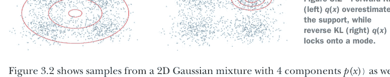

图 3.2 显示了具有 4 个分量的 2D 高斯混合 $p(x)$ 的样本以及近似分布 $q(x)$ 的密度椭圆。我们可以看到，优化前向 KL 会导致 $q(x)$ 位于零点（低密度区域），因为我们高估了 $q(x)$ 的支撑。另一方面，优化反向 KL 会导致 $q(x)$ 位于高斯混合的四个模态之一。

我们可以使用 Jensen 不等式推导出 ELBO，这是一个我们可以最大化以学习模型变分参数的目标。设 $x$ 为我们的数据，$z$ 为潜在变量，然后我们可以按如下方式推导我们的 ELBO 目标。

$$\log p(x) = \log \sum_z p(x,z) = \log \sum_z \frac{q(z)}{q(z)} p(x,z)$$ $$= \log E_{q(z)}\left[ \frac{p(x,z)}{q(z)} \right] \ge E_{q(z)}\left[ \log \frac{p(x,z)}{q(z)} \right]$$ $$= \underbrace{E_{q(z)}[\log p(x,z)]}_{\text{Energy term}} - \underbrace{E_{q(z)}[\log q(z)]}_{\text{Entropy term}} = \text{ELBO} \quad (3.6)$$

请注意，第一项是平均负能量，第二项是熵：因此，一个好的后验必须将其大部分概率质量分配给低能量区域（即联合概率密度高的区域），同时最大化 $q(z)$ 的熵。因此，与 MAP 估计器相比，变分推断防止 $q(z)$ 坍缩成一个原子。

ELBO 的一种形式强调，随着变分分布更好地近似后验，下界变得更紧。

$$\text{ELBO} = E_{q(z)}\left[ \log \frac{p(x,z)}{q(z)} \right] = E_{q(z)}\left[ \log \frac{p(z|x)p(x)}{q(z)} \right]$$ $$= \underbrace{-KL(q(z)||p(z|x))}_{\text{Distance between the approximating q(z) and the posterior p(z|x)}} + \log p(x) \quad (3.7)$$

因此，我们可以通过先验 $p(z)$ 或似然 $p(z|x)$ 改善模型对数证据 log p(x)，或通过改善变分后验近似 $q(z)$ 来改善 ELBO。

最后，我们可以按如下方式写出 ELBO。

$$ELBO = \frac{1}{n} \sum_{i=1}^n [ E_{q(z)}[ \log p(x_i|z_i) ] - KL(q(z_i)||p(z_i)) ] \tag{3.8}$$

样本似然

近似 q(z) 与样本 i 的先验 p(z) 之间的距离

这种版本强调了第 i 个观测值的似然项以及每个近似分布与先验之间的 KL 散度项。在所有前述情况下，关于 $q(z)$ 的期望可以通过从近似分布中采样来计算。让我们在下一节中查看最常见的变分近似之一。

#### 3.2 均值场近似

变分推断最受欢迎的形式之一是均值场近似，其中我们假设后验是形式为完全因子化近似。

$$q(x) = \prod_i q_i(x_i) \tag{3.9}$$

这里，我们对每个边缘分布 $q_i(x_i)$ 的参数进行优化。我们可以像图 3.3 那样可视化完全因子化分布。

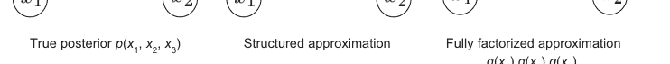

图 3.3 真实后验（左）、结构化近似（中）和完全因子化近似（右）

对于具有三个随机变量 $x1$、$x2$ 和 $x3$ 的分布，我们有我们试图用完全因子化分布 $q(x1) q(x2) q(x3)$ 近似的真实后验 $p(x1, x2, x3)$。

我们的目标是最小化变分自由能 $J(q)$，或等价地最大化下界。

$$L(q) = -J(q) = \sum_{x} q(x) \log \frac{\tilde p(x)}{q(x)}\tag{3.10}$$

我们可以重写每个边缘分布 $q_j$ 的目标，保持其余项为常数，如 Kevin Murphy (2012) 所著《Probabilistic Machine Learning》第 21.3 节所示。

$$L(q_j) = \sum_{x} \prod_i q_i(x_i) \left[\log \tilde p(x) - \sum_k \log q_k(x_k)\right]$$ Mean-field approx

$$= \sum_{x_j}\sum_{x_{-j}} q_j(x_j)\prod_{i\neq j} q_i(x_i)\left[\log \tilde p(x) - \sum_k \log q_k(x_k)\right]$$ Factors out $q_j$

$$= \sum_{x_j} q_j(x_j)\log f_j(x_j) - \sum_{x_j} q_j(x_j)\sum_{x_{-j}}\prod_{i\neq j} q_i(x_i)\left[\sum_{k\neq j}\log q_k(x_k)+\log q_j(x_j)\right]$$

$$= \sum_{x_j} q_j(x_j)\log f_j(x_j) - \sum_{x_j} q_j(x_j)\log q_j(x_j) + \text{const}$$ Treats non-$q_j$ terms as constant $\tag{3.11}$

这里，我们定义了以下内容。

$$\log f_j(x_j) = \sum_{x_{-j}} \prod_{i\neq j} q_i(x_i) \log \tilde p(x) = E_{-q_j}[\log \tilde p(x)]\tag{3.12}$$

由于我们用平均值替换值，该方法被称为 *均值场*。我们可以重写 $L(q_j) = -KL(q_j \| f_j)$，因此通过设置 $q_j = f_j$ 或等价地方程 3.13 来最大化目标。

$$\log q_j(x_j) = \log f_j(x_j) = E_{-q_j}[\log \tilde p(x)]\tag{3.13}$$

这里，$q_j$ 的函数形式将由变量 $x_j$ 的类型及其概率模型决定。我们将在下一节中使用此结果从头推导图像去噪算法。

#### 3.3 Ising模型中的图像去噪


Ising模型是马尔可夫随机场（MRF）的一个例子，起源于统计物理学。马尔可夫随机场是一组具有马尔可夫性质的随机变量，由无向图描述，其中节点表示随机变量，边编码条件独立性。Ising模型假设我们有一个节点网格，每个节点可以处于两种可能状态之一。每个节点的状态通过交互势依赖于相邻节点。对于图像而言，这转化为平滑性约束（即，像素倾向于与相邻像素具有相同颜色）。在图像去噪问题中，我们假设有一个底层真实图像的二维噪声像素观测网格，我们希望恢复真实图像。

设 \( y_i \) 是二元潜变量 \( x_i \in \{−1, +1\} \) 的噪声观测。我们可以写出如下联合分布。

\[
p(x, y) = p(x)p(y|x) = \prod_{(s,t)\in E} \Psi_{st}(x_s, x_t) \prod_{i=1}^n p(y_i|x_i)
= \prod_{(s,t)\in E} \exp\{x_s w_{st} x_t\} \prod_{i=1}^n N(y_i|x_i, \sigma^2) \tag{3.14}
\]

在公式3.14中，交互势由边集E中每对节点\(x_s\)和\(x_t\)的\(\Psi_{st}\)表示，观测\(y_i\)是均值为\(x_i\)、方差为\(\sigma^2\)的高斯分布。这里，\(w_{st}\)是耦合强度，假设为常数且等于\(J > 0\)，表示倾向于与邻居处于相同状态（即当\(x_s\)和\(x_t\)都为+1或−1时，势\(\Psi(x_s, x_t) = \exp\{x_s J x_t\}\)更高）。

为了使用变分推断拟合模型参数，我们首先需要最大化ELBO。

\[
\text{ELBO} = E_{q(x)}[\log p(x, y)] − E_{q(x)}[\log q(x)]
= E_{q(x)}\left[\sum_{(s,t)\in E} x_s w_{st} x_t + \sum_{i=1}^n \log N(y_i|x_i, \sigma^2)\right]
− \sum_{i=1}^n E_{q_i(x)}[\log q_i(x)] \tag{3.15}
\]

这里，我们使用平均场假设，即完全分解的近似\(q(x)\)。

\[
q(x) = \prod_{i=1}^n q(x_i; \mu_i) \tag{3.16}
\]

利用公式3.12推导的结果，我们指出，使KL散度最小的\(q(x_i;\mu_i)\)由下式给出。

\[
q_i(x_i)=\frac{1}{Z_i}\exp\left[E_{-q_i}\{\log p(x)\}\right] \tag{3.17}
\]

这里，\(E_{-q_i}\)表示对所有\(q_j\)（\(j=i\)除外）的期望。为了计算\(q_i(x_i)\)，我们只关心涉及\(x_i\)的项（即，我们可以像公式3.18所示那样将它们分离出来）。

\[
E_{-q_i}\{\log p(x)\}=E_{-q_i}\left\{x_i\sum_{j\in N(i)}w_{ij}x_j+\log N(y_i|x_i,\sigma^2)+\mathrm{const}\right\}
\]
\[
\qquad=x_i\sum_{j\in N(i)}w_{ij}\mu_j+\log N(y_i|x_i,\sigma^2)+\mathrm{const} \tag{3.18}
\]

这里，\(N(i)\)表示节点\(i\)的邻居，\(\mu_j\)是二元随机变量的均值。

\[
\mu_j=E_{q_j}[x_j]=q_j(x_j=+1)\times(+1)+q_j(x_j=-1)\times(-1) \tag{3.19}
\]

图3.4展示了Ising模型平均场近似的参数形式。

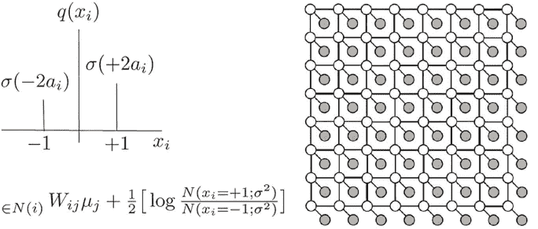

**图3.4** Ising模型及其近似分布\(q(x)\)

为了计算这个均值，我们需要知道\(q_i(x_j=+1)\)和\(q_i(x_j=-1)\)的值。令\(m_i=\sum_{j\in N(i)}w_{ij}\mu_j\)为邻居的均值，令\(L_i^+=N(x_i=+1,\sigma^2)\)和\(L_i^-=N(x_i=-1,\sigma^2)\)；然后，我们可以如下计算均值。

\[
q_i(x_i = +1) = \frac{\exp\{m_i + L_i^+\}}{\exp\{m_i + L_i^+\} + \exp\{-m_i + L_i^-\}} = \frac{1}{1 + \exp\{-2m_i + L_i^- - L_i^+\}} = \frac{1}{1 + \exp\{-2a_i\}} = \sigma(2a_i) \tag{3.20}
\]

这里，\(a_i = m_i + \frac{1}{2}(L_i^+ - L_i^-)\)，\(\sigma(x)\)是sigmoid函数。由于\(q_i(x_i = -1) = 1 - q_i(x_i = +1) = 1 - \sigma(2a_i) = \sigma(-2a_i)\)，我们可以将变分近似\(q_i(x_i)\)的均值写成如下形式。

\[
\mu_i = E_{q_i}[x_i] = \sigma(2a_i) - \sigma(-2a_i) = \tanh(a_i) \tag{3.21}
\]

换句话说，在迭代\(k\)时，我们对变分参数\(\mu_i\)的平均场更新计算如下。

\[
\mu_i^{(k)} = \tanh\left( \sum_{j \in N(i)} w_{ij} \mu_j^{(k-1)} + \frac{1}{2} \left[ \log \frac{N(y_i | x_i = +1, \sigma^2)}{N(y_i | x_i = -1, \sigma^2)} \right] \right) \times \lambda + (1 - \lambda) \times \mu_i^{(k-1)} \tag{3.22}
\]

这里，我们添加了一个学习率参数\(\lambda \in (0, 1]\)。我们进一步指出，可以逐项简化ELBO的计算，如下所示。

\[
\begin{aligned}
\sum_{(s,t) \in E} E_{q(x)}[x_s w_{st} x_t] \quad & \text{ELBO第一项} \\
= \frac{1}{2} \sum_{i=1}^n \sum_{j \in N(i)} \left( \sum_{x_i \in \{-1,+1\}} \sum_{x_j \in \{-1,+1\}} q_i(x_i) q_j(x_j) x_i J x_j \right) \quad & \text{根据期望定义} \\
= \frac{1}{2} \sum_{i=1}^n \sum_{j \in N(i)} \left( q_i(x_i = +1) J E[x_j] - q_i(x_i = -1) J E[x_j] \right) \quad & \text{代入\(x_i\)和\(x_j\)的值后} \\
= \frac{1}{2} \sum_{i=1}^n \sum_{j \in N(i)} E[x_i] J E[x_j] \quad & \text{根据期望定义}
\end{aligned} \tag{3.23}
\]

ELBO第二项：

\[
\begin{aligned}
E_{q(x)}[\log N(y_i | x_i, \sigma^2)] &= \sum_{i=1}^n \left[ \sum_{x_i \in \{-1,+1\}} q_i(x_i) \log N(y_i | x_i, \sigma^2) \right] & \text{(根据期望定义)}\\
&= \sum_{i=1}^n \left[ \sigma(2a_i) \log N(y_i | x_i = +1, \sigma^2) + \sigma(-2a_i) \log N(y_i | x_i = -1, \sigma^2) \right] & \text{(展开求和后)}
\end{aligned} \tag{3.24}
\]

为了更好地理解该算法，让我们查看图3.5中的伪代码。

```text
1: class image_denoising
2: function mean_field(σ, y, w, λ, max_iter):
3: logp1 = log N(y; x_i = +1, σ²)
4: logm1 = log N(y; x_i = -1, σ²)
5: logodds = logp1 - logm1
6: p1 = sigmoid(logodds) //init
7: μ^{(0)} = 2 × p1 -1 //init
8: for k = 1 to max_iter:
9:   \tilde{S}_{ij} = Σ_{j∈N(i)} w_{ij} μ_j^{(k-1)}
10:  μ_i^{(k)} = tanh(\tilde{S}_{ij} + ½ logodds) × λ + (1 - λ) × μ_i^{(k-1)}
11:  ELBO[k] = ELBO[k] + ½ (\tilde{S}_{ij} × μ_i^{(k)})
12:  a = μ^{(k)} + ½ logodds
13:  qxp1 = sigmoid(+2a)
14:  qxm1 = sigmoid(-2a)
15:  Hx = -qxm1 × log(qxm1) - qxp1 × log(qxp1)
16:  ELBO[k] = ELBO[k] + Σ_{i=1}^N (qxp1[i] × logp1[i] + qxm1[i] × logm1[i])
     + Σ_{i=1}^N (Hx[i])
17: end for
18: return μ^{(k)}
```

图3.5 Ising模型平均场VI伪代码

在`image_denoising`类中，我们有一个名为`mean_field`的方法，它接受噪声水平`sigma`、带噪二元图像`y`、耦合强度`w=J`、学习率`lambda`和最大迭代次数`max_iter`作为输入。我们首先计算对数几率比（即在均值为+1和-1的高斯随机变量下观测到图像像素`y`的概率）。然后计算对数几率比的`sigmoid`函数，并使用结果初始化均值变量。接下来，我们迭代直到达到最大迭代次数，在每次迭代中，我们计算邻居的影响`sij`，并将其包含在平均场更新方程中。然后计算目标函数`ELBO`和平均熵`Hx`，以监测算法的收敛。

现在我们已经拥有了在图像去噪应用中实现Ising模型平均场变分推断所需的全部工具！在下面的代码中：

```python
mean = -1, cov=self.sigma**2), (M, N))

for i in tqdm(range(self.max_iter)):
    muNew = mu
    for ix in range(N):
        for iy in range(M):
            pos = iy + M*ix
            neighborhood = pos + np.array([-1,1,-M,M])
            boundary_idx = [iy!=0,iy!=M-1,ix!=0,ix!=N-1]
            neighborhood = neighborhood[np.where(boundary_idx)[0]]
            xx, yy = np.unravel_index(pos, (M,N), order='F')
            nx, ny = np.unravel_index(neighborhood, (M,N), order='F')

            Sbar = self.J*np.sum(mu[nx,ny])
            muNew[xx,yy] = (1-self.rate)*muNew[xx,yy] +
                self.rate*np.tanh(Sbar + 0.5*logodds[xx,yy])
            self.ELBO[i] = self.ELBO[i] + 0.5*(Sbar * muNew[xx,yy])
        #end for
    #end for
    mu = muNew

    a = mu + 0.5 * logodds
    qxp1 = sigmoid(+2*a) #q_i(x_i=+1)
    qxm1 = sigmoid(-2*a) #q_i(x_i=-1)
    Hx = -qxm1*np.log(qxm1+1e-10) - qxp1*np.log(qxp1+1e-10) #entropy

    self.ELBO[i] = self.ELBO[i] + np.sum(qxp1*logp1 + qxm1*logm1)
        + np.sum(Hx)
    self.Hx_mean[i] = np.mean(Hx)
#end for
return mu

if __name__ == "__main__":

    #load data
    print("loading data...")
    data = Image.open('./figures/bayes.bmp')
    img = np.double(data)
    img_mean = np.mean(img)
    img_binary = +1*(img>img_mean) + -1*(img<img_mean)
    [M, N] = img_binary.shape

    mrf = image_denoising(img_binary, sigma=2, J=1)
    mu = mrf.mean_field()

    #generate plots
    plt.figure()
    plt.imshow(mrf.y)
    plt.title("observed noisy image")
    plt.show()

    plt.figure()
    plt.imshow(mu)
    plt.title("after %d mean-field iterations" %mrf.max_iter)
    plt.show()
```

```python
plt.figure()
plt.plot(mrf.Hx_mean, color='b', lw=2.0, label='Avg Entropy')
plt.title('Variational Inference for Ising Model')
plt.xlabel('iterations'); plt.ylabel('average entropy')
plt.legend(loc='upper right')
plt.show()
```

```python
plt.figure()
plt.plot(mrf.ELBO, color='b', lw=2.0, label='ELBO')
plt.title('Variational Inference for Ising Model')
plt.xlabel('iterations'); plt.ylabel('ELBO objective')
plt.legend(loc='upper left')
plt.show()
```

图3.6显示了通过mean-field变分推断进行二值图像去噪的实验结果。

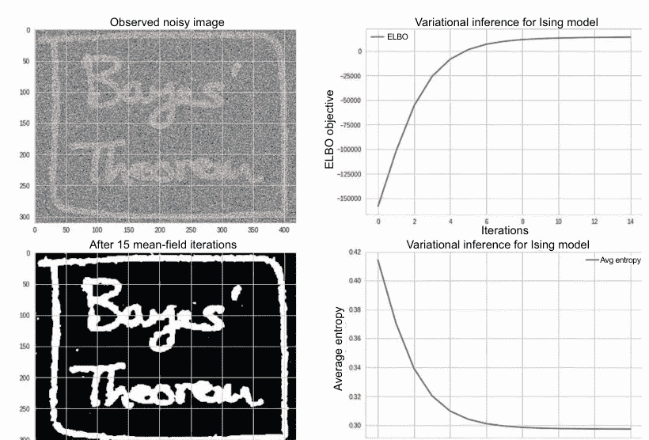

图3.6 Ising模型中用于图像去噪的mean-field变分推断

噪声观测图像显示在左上角，通过对每个像素添加高斯噪声并基于均值阈值对图像进行二值化得到。我们然后设置变分推断参数，例如耦合强度J=1、噪声水平σ=2、平滑率λ=0.5，以及最大迭代次数为15。去噪后的二值图像显示在图的最左下角。我们还可以看到ELBO目标（右上）随着mean-field迭代次数的增加而增加，以及表示每个像素值的二元随机变量\(q_i(x_i)\)的平均熵（右下）随之减小。二维Ising模型可以通过多种方式扩展（例如，通过三维网格和每个节点的K个状态[即Potts模型]）。

#### 3.4 互信息最大化

在本节中，我们研究互信息（MI）最大化，这在信息规划和数据通信设置中常见。考虑一个无线通信场景，其中我们传输信号\(x \sim p_X(x)\)，它通过多输入多输出（MIMO）信道\(H\)。在输出端，我们接收到信号\(y = Hx + n\)，其中\(n \sim N(0, \sigma_I^2 I)\)是加性高斯噪声。

我们希望最大化通过无线信道传输的信息量。换句话说，我们希望最大化传输信号\(X\)与接收信号\(Y\)之间的容量或互信息：\(C = \max I(X;Y)\)，其中最大化是在\(p(x)\)上进行的。为了计算信道容量，我们讨论基于KL散度的通用过程，以近似最大化互信息。

\[
I(X;Y) = H(X) - H(X|Y) = -E_{p(x)}[\log p(x)] - E_{p(x,y)}[\log p(x|y)] \tag{3.25}
\]

设\(q(x)\)为\(p(x)\)的近似分布，然后考虑\(p\)和\(q\)的后验分布之间的KL散度，如公式3.26所示。

\[
D_{KL}(p(x|y)\|q(x|y)) \ge 0 \tag{3.26}
\]

我们希望推导出互信息（MI）的下界。展开公式3.26中的表达式，我们可以按公式3.27所示进行。

\[
\sum_x p(x|y)\log p(x|y) - \sum_x p(x|y)\log q(x|y) \ge 0 \tag{3.27}
\]

将两边乘以\(p(y)\)，我们得到以下结果。

\[
\sum_{x,y} p(y)p(x|y)\log p(x|y) \ge \sum_{x,y} p(x,y)\log q(x|y) \tag{3.28}
\]

将左边识别为\(-H(X|Y)\)，我们得到以下MI下界。

\[
I(X;Y) = H(X) - H(X|Y) \ge H(X) - E_{p(x,y)}[\log q(x|y)] = \tilde{I}(X;Y) \tag{3.29}
\]

使用前述下界，我们可以描述MI最大化算法（见图3.7）。

```text
1: Choose approximating distribution family Q(x; θ)
2: Initialize θ
3: repeat
4:     for a fixed q(x|y; θ), find
5:         θ^{new} = argmax_θ Ĩ(X; Y)
6:     for a fixed θ, find
7:         q_{new}(x|y; θ) = argmax_q(x|y) Ĩ_Q(X; Y)
8: until convergence
```

**图3.7** 互信息最大化伪代码

前述算法在寻找使MI下界最大化的参数集和寻找近似分布之间交替进行。

在本节中，我们看到了如何使用熵、互信息和KL散度的定义来推导出下界，然后通过更新近似分布q来迭代最大化该下界。在下一章中，我们将从计算机科学的角度审视ML，并探索有用的数据结构和算法范式。


### 3.5 练习

- 1. **3.1** 计算两个单变量高斯分布之间的 KL 散度：`q(x) ~ N(μ₁, σ₁²)` 和 `q(x) ~ N(μ₂, σ₂²)`。

- 2. **3.2** 计算伯努利分布的 `E[X]`、`Var(X)` 和 `H(X)`。

- 3. **3.3** 推导 `Beta(a, b)` 分布的均值、众数和方差。

### 总结

- 变分推断的主要思想是从可处理分布族中选择近似分布 `q(x)`，然后使该近似尽可能接近真实后验分布 `p(x)`。

- 证据下界是我们寻求最大化的目标函数，以学习模型的变分参数。

- 在 mean-field 近似中，我们假设近似分布 `q(x)` 完全分解。

- 互信息最大化可以通过推导并最大化 MI 下界来实现。

## 软件实现


**This chapter covers**

- 数据结构：线性、非线性和概率

- 问题求解范式：完全搜索、贪心、分治和动态规划

- ML 研究：采样方法和变分推断

在前几章中，我们研究了贝叶斯推断的两个主要阵营：马尔可夫链蒙特卡洛和变分推断。在本章中，我们回顾了从头实现算法所需的计算机科学概念。要编写高质量的代码，掌握数据结构和算法基础非常重要。本章旨在介绍常见计算结构和问题求解范式。本节中回顾的许多概念在 VisuAlgo 网站 (`https://visualgo.net/en`) 上进行了交互式可视化。

### 4.1 数据结构

数据结构是存储和组织数据的一种方式。数据结构支持多种操作，例如插入、搜索、删除和更新，正确选择数据结构可以简化算法的运行时间。每种数据结构都提供不同的性能权衡。因此，了解数据结构的工作原理很重要。

#### 4.1.1 线性

如果数据结构的元素以线性方式排列，则认为它是 *线性* 的。*线性* 数据结构的最简单示例是 *固定大小数组*（其中数组的大小可能作为问题的约束指定）。访问数组中元素的耗时是常数：`O(1)`。如果数组的大小事先未知，最好使用 *动态可调整大小数组*（例如 Python 中的 `List` 或 C++ 中的 `Vector`），因为这些数据结构旨在原生处理调整大小。

应用于数组的两种常见操作是搜索和排序。最简单的搜索是在 `O(n)` 时间内对所有元素进行线性扫描。如果数组已排序，我们可以在 `O(log n)` 时间内使用二分搜索，这是一个分治算法的示例，我们很快会讨论。诸如选择排序和插入排序等朴素数组排序算法的复杂度为 `O(n^2)`，因此仅适用于小输入。一般来说，元素两两比较的基于比较的排序，如归并、堆或快速排序，运行时间为 `O(n log n)`，因为时间复杂度可以被视为遍历一棵完全二叉树，其中每个叶节点代表一种排序顺序。在此表示中，树的高度 `h` 等于算法运行时间。由于存在 `n!` 种可能的排序（叶节点），我们可以按如下方式限制运行时间。

$$\begin{aligned}
h &= \log n! = \log n(n - 1)(n - 2) \times \cdots \times 1 \\
&= \log n + \log(n - 1) + \cdots + \log 1 \\
&< \log n + \log n + \cdots + \log n = n \log n = O(n \log n)
\end{aligned} \tag{4.1}$$

如果我们在输入上添加额外约束，我们可以构建线性时间 `O(n)` 排序算法，例如计数排序、基数排序和桶排序。例如，计数排序可以应用于小范围内的整数，而基数排序通过逐位应用计数排序工作，如 Steven Halim（2010）所著的 *Competitive Programming* 中所述。使算法分布式可以进一步减少运行时间，如 Maurice Herlihy 和 Nir Shavit（2012）所著的 *The Art of Multiprocessor Programming* 中所述。

*链表* 由从头节点开始存储值和下一个指针的节点组成。它通常由于其线性 `O(n)` 搜索时间而被避免。*栈* 允许以后进先出（LIFO）顺序进行 `O(1)` 插入（`push`）和 `O(1)` 删除（`pop`）。这在递归实现的算法中特别有用（例如括号匹配或拓扑排序）。*队列* 允许从后方进行 `O(1)` 插入（`enqueue`）和从前方进行 `O(1)` 删除（`dequeue`）；因此，它遵循先进先出（FIFO）模型。它是诸如广度优先搜索（BFS）及其基于 BFS 的算法中常用的数据结构。在下一节中，我们将定义并检查几种非线性数据结构的示例。

#### 4.1.2 非线性

如果数据结构中的元素不遵循线性顺序，则该数据结构被视为非线性。非线性数据结构的示例包括映射（字典）和集合。这是因为有序字典和有序集合构建于自平衡二叉搜索树（BST）之上，该树保证插入、搜索和删除操作的时间复杂度为 `O(log n)`。BST 具有这样的性质：对于每个子树，根节点的值大于其左子节点，且小于其右子节点。自平衡 BST 通常实现为 Adelson-Velskii-Landis（AVL）树或红黑（RB）树（详见 Thomas H. Cormen、Charles E. Leiserson、Ronald L. Rivest 和 Clifford Stein 所著的《算法导论》[1990]）。有序映射（字典）与有序集合数据结构之间的区别在于：映射存储（键-值）对，而集合仅存储键。堆是另一种以树形表示组织数据的方式。例如，数组 `A = [2,7,26,25,19,17,1,90,3,36]` 可以表示为一棵树，如图 4.1 所示。

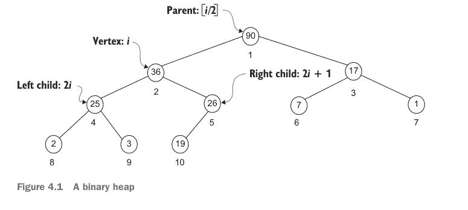

图 4.1 一个二叉堆

我们可以轻松遍历二叉堆 `A = [90,36,17,25,26,7,1,2,3,19]`，从顶点 `i` 开始，使用简单的索引算术 `2i` 访问左子节点，`2i+1` 访问右子节点，`i/2` 访问父节点。与强制满足二叉搜索树（BST）性质不同，（最大）堆强制满足堆性质：在每一棵以 `x` 为根的子树中，`x` 的左子树和右子树上的项都小于（或等于）`x`。该性质保证（最大）堆的堆顶始终是最大元素。因此，（最大）堆支持快速提取最大元素。实际上，提取最大元素和插入操作均通过 `O(log n)` 的树遍历完成，并在必要时执行交换操作以维持堆性质。堆构成了优先队列的基础，而优先队列在 Prim 和 Kruskal 最小生成树（MST）、Dijkstra 单源最短路径（SSSP）以及 A* 搜索等算法中是一种重要的数据结构。最后，哈希表或无序映射是一种非常高效的数据结构，在无冲突假设下，访问时间为 `O(1)`。一类常用的哈希表是直接寻址（DA），其中键本身即为索引。哈希函数的目标是将表中的元素均匀分布，以尽量减少冲突。另一方面，如果你希望将相似项目分到同一个桶中，局部敏感哈希（LSH）能够帮助你找到最近邻，如 Alexandr Andoni、Piotr Indyk、Huy Le Nguyen 和 Ilya Razenshteyn 所著的《超越局部敏感哈希》（SODA，2014）中所述。

#### 4.1.3 概率型

概率型数据结构旨在处理大数据。它们提供概率性保证，并显著节省内存。概率型数据结构应对以下常见的大数据挑战：

- 成员查询：布隆过滤器、计数布隆过滤器、商过滤器和布谷鸟过滤器

- 基数估计：线性计数、概率计数、LogLog、HyperLogLog 和 HyperLogLog++

- 频率估计：多数算法、frequent、count sketch 和 count-min sketch

- 秩估计：随机抽样、q-digest 和 t-digest

- 相似性：LSH、MinHash 和 SimHash

关于概率型数据结构的全面讨论，请参阅 Andrii Gakhov（2022）所著的《大数据应用的概率型数据结构与算法》。在下一节中，我们将讨论四种主要的算法范式。

### 4.2 问题求解范式

有四种主要的算法范式：完全搜索、贪心、分治和动态规划。根据手头的问题，通常可以通过回顾这些算法范式来找到解决方案。在本节中，我们将讨论每种策略并提供一个示例。

#### 4.2.1 完全搜索

完全搜索（又称暴力搜索）是一种通过遍历整个搜索空间来求解问题的方法。在搜索过程中，我们可以剪掉那些确定不会通向所需解决方案的搜索空间部分。例如，考虑生成子集的问题。我们可以使用递归解法或迭代解法。两种方式中，当我们达到所需的子集大小时即终止。在下面的代码清单中，我们将基于生成子集的示例来实现一种完全搜索策略。

### 代码清单 4.1 子集生成

```
def search(k, n):
    if (k == n):
        print(subset)  # <-- process subset
    else:
        search(k+1, n)
        subset.append(k)
        search(k+1, n)
        subset.pop()
#end if

def bitseq(n):
    for b in range(1 << n):
        subset = []
        for i in range(n):
            if (b & 1 << i):
                subset.append(i)
        #end for
        print(subset)
    #end for

if __name__ == "__main__":
    n = 4
    subset = []
    search(0, n)  <-- recursive

    subset = []
    bitseq(n)  <-- iterative
```

一个涉及完全搜索的机器学习示例是通过完全枚举进行精确推理——详见 David J. C. MacKay 所著的《信息论、推理与学习算法》第 21 章。给定一个图模型，我们希望根据条件独立关系对联合分布进行分解，并使用贝叶斯规则计算某些事件的后验概率。在这种情况下，我们需要完整地填出所需的概率表以进行计算。

#### 4.2.2 贪心

贪心算法在每一步做出局部最优选择，希望最终能达到全局最优解。贪心算法通常依赖贪心启发式，而且我们常常能找到贪心算法未能达到全局最优的示例。例如，考虑分数背包问题。贪心背包问题的目标是选择物品放入容量有限的背包 `W` 中，以使背包内物品的总价值最大化，其中每个物品都有相应的重量和价值。我们可以将贪心启发式定义为物品价值与物品重量的比值（即我们希望贪心地选择同时具有高价值和低重量的物品，并根据这一标准对物品排序）。在分数背包问题中，我们允许取物品的一部分（与 0-1 背包不同）。在下面的代码清单中，我们将基于分数背包示例实现一种贪心策略。

### 代码清单 4.2 分数背包

```
class Item:
    def __init__(self, wt, val, ind):
        self.wt = wt
        self.val = val
        self.ind = ind
        self.cost = val // wt

    def __lt__(self, other):
        return self.cost < other.cost

class FractionalKnapSack:
    def get_max_value(self, wt, val, capacity):
        item_list = []
        for i in range(len(wt)):
            item_list.append(Item(wt[i], val[i], i))

        # sorting items by cost heuristic
        item_list.sort(reverse = True)  #O(nlogn)

        total_value = 0
        for i in item_list:
            cur_wt = int(i.wt)
            cur_val = int(i.val)
            if capacity - cur_wt >= 0:
                capacity -= cur_wt
                total_value += cur_val
            else:
                fraction = capacity / cur_wt
                total_value += cur_val * fraction
                capacity = int(capacity - (cur_wt * fraction))
                break
        return total_value

if __name__ == "__main__":
    wt = [10, 20, 30]
    val = [60, 100, 120]
    capacity = 50

    fk = FractionalKnapSack()
    max_value = fk.get_max_value(wt, val, capacity)
    print("greedy fractional knapsack")
    print("maximum value: ", max_value)
```

由于排序是最昂贵的操作，该算法的运行时间为 `O(n log n)`。我们可以看到，输入物品按价值/成本递减的比值排序；在贪心选择物品 1 和 2 后，我们取物品 3 的 2/3 份，总价值为 60 + 100 + (2/3)×120 = 240。

一个贪心算法的机器学习示例是传感器放置问题。给定一个房间和多个温度传感器，我们希望以最大化房间覆盖率的方式放置传感器。一种简单的贪心方法是：从空集 `S0` 开始，在第 `i` 次迭代中添加使增量函数最大化的传感器 `A`，例如互信息 `F_MI(A) = H(V\A) - H(V\A|A)`，其中 `V` 是所有传感器的集合。这里，我们使用了恒等式 `I(X; Y) = H(X) - H(X|Y)`。事实证明，如果观测变量在给定潜在状态时是独立的，则互信息是子模的，这导致了高效的贪心

```python
return 1
if (memo[n][k] != -1):
    return memo[n][k]
memo[n][k] = binomial_coeffs1(n-1, k-1) + binomial_coeffs1(n-1, k)
return memo[n][k]

def binomial_coeffs2(n, k):
    #bottom up DP
    for i in range(n+1):
        for j in range(min(i,k)+1):
            if (j == 0 or j == i):
                memo[i][j] = 1
            else:
                memo[i][j] = memo[i-1][j-1] + memo[i-1][j]
            #end if
        #end for
    #end for
    return memo[n][k]
def print_array(memo):
    for i in range(len(memo)):
        print('\t'.join([str(x) for x in memo[i]]))

if __name__ == "__main__":
    n = 5
    k = 2
    print("top down DP")
    memo = [[-1 for i in range(6)] for j in range(6)]
    nCk = binomial_coeffs1(n, k)
    print_array(memo)
    print("C(n={}, k={}) = {}".format(n,k,nCk))

    print("bottom up DP")
    memo = [[-1 for i in range(6)] for j in range(6)]
    nCk = binomial_coeffs2(n, k)
    print_array(memo)
    print("C(n={}, k={}) = {}".format(n,k,nCk))
```

时间复杂度为 `O(nk)`，空间复杂度为 `O(nk)`。在自顶向下 DP 的情况下，子问题的解会按需存储（记忆化），而在自底向上 DP 中，整个表从基例开始计算。

一个使用动态规划的机器学习示例可以在强化学习（RL）中找到，用于求解 Bellman 方程的解。我们可以根据时间 `t` 时的状态奖励以及未来折扣奖励之和来写出状态的值，如以下方程所示。

$$v_{\pi}(s)=\sum_a \pi(a|s)\sum_{r,s'}p(r,s'|s,a)[r+\gamma v_{\pi}(s')]$$

$$=E_{\pi}[R_t+\gamma v_{\pi}(S_{t+1})|S_t=s] \tag{4.3}$$

方程 4.3 被称为 `v(s)` 的 Bellman 最优性方程。我们可以通过求解使 `Q`-函数描述的状态奖励最大化的动作来恢复最优策略。

$$\pi(s)=\underset{a}{\arg\max}\ q(s,a) \tag{4.4}$$

对于少量状态和动作，我们可以使用动态规划以表格方式计算 Q 函数。在 RL 中，我们通常希望在探索和利用之间取得平衡——在这种情况下，我们以 1 − ε 的概率取前面的 argmax，并以 ε 的概率采取随机动作。

### 4.3 机器学习研究：采样方法和变分推断


在本节中，我们关注机器学习研究，这是一项非常重要的技能，以便在该领域保持最新。我们关注采样方法和变分推断领域的最新发展。正如本章中所观察到的，许多现代机器学习算法都包含巧妙的算法来近似难以计算的后验密度，这是由于计算后验时涉及的不可处理的、维度很高的积分。

值得花时间简要比较 MCMC 和变分推断之间的差异。变分推断的优点包括：对于中小型问题，通常速度更快，它是确定性的，很容易确定何时停止，并且通常提供对数似然的下界。采样的优点包括：通常实现更简单，适用于更广泛的问题范围（例如，没有良好共轭先验的问题），并且当应用于非常大的模型或数据集时，采样可能更快。有关该主题的更多讨论，请参阅 Kevin P. Murphy 所著的 *Machine Learning: A Probabilistic Perspective* 第 24 章。

除了我们在前几章中研究的经典 MCMC 采样算法外，还有一些值得关注的算法：切片采样（参见 Radford M. Neal 的 “Slice Sampling,” *Annals of Statistics*, 2003）、哈密顿蒙特卡洛（HMC；参见 Radford M. Neal 的 “MCMC Using Hamiltonian Dynamics,” arXiv, 2012），以及无-U-回转采样器（NUTS；参见 Matthew D. Hoffman 和 Andrew Gelman 的 “The No-U-Turn Sampler: Adaptively Setting Path Lengths in Hamiltonian Monte Carlo,” *Journal of Machine Learning Research*, 2014）。最先进的 NUTS 算法通常用作概率图模型的 MCMC 推断方法，并已实现在 PyMC3、Stan、TensorFlow Probability 和 Pyro 概率编程库中。

人们已经尝试了多种方法来扩展 MCMC 以处理大数据，从而导致了随机蒙特卡洛方法，这些方法通常可以分为基于随机梯度的方法、使用随机采样小批量近似 Metropolis-Hastings 的方法以及数据增强。另一类流行的 MCMC 算法是流式蒙特卡洛，它近似用于在线贝叶斯推断的后验。序贯蒙特卡洛（SMC）依赖于重采样和随时间传播样本，使用大量粒子。

并行化蒙特卡洛算法是另一个重要的研究领域。如果可以从后验或提议分布中抽取独立样本块，则可以通过在单独的机器上运行多个独立采样器然后聚合结果来并行化采样算法。其他方法包括分而治之和预取（参见 Jun Zhu、Jianfei Chen、Wenbo Hu 和 Bo Zhang 的 “Big Learning with Bayesian Methods,” *National Science Review*, 2017）。

变分推断（VI）的进展；可扩展 VI，包括随机近似；通用 VI，将 VI 的适用性扩展到非共轭模型；精确 VI，包括超越均值场近似的变分模型；以及摊销 VI，使用推理网络对局部潜在变量进行推理（参见 Cheng Zhang、Judith Bütepage、Hedvig Kjellström 和 Stephan Mandt 的 “Advances in Variational Inference,” *IEEE Transactions on Pattern Analysis and Machine Intelligence*, 2019）。可扩展 VI 包括随机变分推断（SVI），它应用了变分目标的随机优化技术。随机梯度下降（SGD）的效率取决于梯度估计的方差（较小的梯度噪声允许更大的学习率并导致更快的收敛）。诸如自适应学习率和小批量大小以及方差缩减技术，如控制变量、非均匀采样和其他方法，被用于加速收敛。

除了随机优化之外，利用模型结构也可以帮助实现相同的目标。示例包括折叠、稀疏、并行和分布式推理。折叠 VI 依赖于解析积分掉某些模型参数的思想。稀疏推理利用稀疏分布的参数或可以用少量代表点总结的数据集。此外，结构化 VI 检查不是完全分解的变分分布，从而导致更精确的近似。

最后，摊销变分推断是一个有趣的研究领域，它结合了概率图模型和神经网络。术语 *amortized* 指的是利用过去计算的推理来支持未来计算。摊销推理已成为深度潜在变量模型（DLVM）推理的流行工具，例如变分自编码器（VAE；参见 Diederik P. Kingma 和 Max Welling 的 “Auto-Encoding Variational Bayes,” arXiv, 2013）。同样，神经网络可用于学习有向概率图模型（PGM）中条件分布的参数（参见 Diederik P. Kingma 的 “Variational Inference and Deep Learning: A New Synthesis”, PhD Thesis, 2017）。

#### 4.4 练习

- 4.1 证明以下二项式恒等式：`C(n, k) = C(n − 1, k − 1) + C(n − 1, k)`。

- 4.2 推导 Gibbs 不等式：`H(p, q) ≥ H(q)`，其中 `H(p, q) = −∑x p(x) log q(x)` 是交叉熵，`H(q) = −∑q(x) log q(x)` 是熵。

- 4.3 使用 Jensen 不等式 `f(x) = log(x)` 证明 AM ≥ GM 不等式。

- 4.4 证明 `I(x; y) = H(x) − H(x|y) = H(y) − H(y|x)`。

#### 总结

- 数据结构是一种存储和组织数据的方式。数据结构可以分为线性、非线性和概率。

- 我们在本章中研究了四种算法范式：完全搜索、贪心、分而治之和动态规划。

- 完全搜索（又称暴力）是一种通过遍历整个搜索空间来寻找解决方案的问题解决方法。在搜索过程中，我们可以剪掉我们确定不会导致所需解决方案的搜索空间部分。

- 贪心算法在每一步都采取局部最优选择，希望最终达到全局最优解。

- 分而治之是一种将问题分解为更小、独立的子问题，然后合并每个子问题的解决方案的技术。

- 动态规划（DP）是一种将问题分解为更小的重叠子问题，为每个子问题计算解决方案并将其存储在 DP 表中的技术。最终解从 DP 表中读出。

- 算法和软件实现的掌握可以通过参加竞赛编程来实现（请参阅附录 A 获取资源）。

- 机器学习掌握需要对基础有扎实的理解。请参阅附录 A 中的推荐文本部分，了解如何增加知识的深度和广度。

- 机器学习领域发展迅速，保持最新状态的最好方法是阅读最新的研究会议论文。

## 第 2 部分

### 监督学习

在本书的第二部分，我们将介绍监督学习算法。监督学习算法包含训练数据集中带标签的示例，并根据我们试图预测的量的离散或连续性质分为两大类：分类和回归。监督学习算法在机器学习中被广泛使用，我们将从头推导一些最令人兴奋的算法，以积累对基础的经验并激发新机器学习算法的设计。

在第 5 章，我们将重点关注分类算法并推导几种经典算法，包括感知机、SVM、逻辑回归、朴素贝叶斯和决策树。

在第 6 章，我们将研究四种有趣的回归算法：贝叶斯线性回归、层次贝叶斯回归、KNN 回归和高斯过程回归。我们将从第一性原理推导所有算法并使用最佳实践实现它们。

在第 7 章，我们将研究一组选定的监督学习算法，包括马尔可夫模型，如 PageRank 算法和隐马尔可夫模型；不平衡学习策略；主动学习；超参数选择的贝叶斯优化；以及集成方法。我们将以机器学习研究作结，重点关注监督学习。

### 分类算法


#### 本章涵盖

- 介绍分类

- 感知机算法

- SVM 算法

- SGD 逻辑回归

- Bernoulli 朴素贝叶斯算法

- 决策树 (CART) 算法

在上一章中，我们研究了从头实现机器学习算法所需的计算机科学基础。在本章中，我们重点关注监督学习算法。分类是算法的一个基本类别，在机器学习中被广泛使用。我们将从头推导并实现几种选定的分类算法，以积累对基础的经验并激发新机器学习算法的设计。本章中的算法被选中是因为它们说明了重要的算法概念并使读者接触到可以从头实现的逐步更复杂的场景。这些概念具有广泛的应用，包括电子邮件垃圾邮件检测、文档分类和客户细分。

#### 5.1 分类介绍

在监督学习中，我们得到一个数据集 `D = {(x₁, y₁), ..., (xₙ, yₙ)}`，它由数据 `x` 和标签 `y` 的元组组成。分类算法的目标是从输入 `x` 学习到输出 `y` 的映射，其中 `y` 是一个离散量（即 `y ∈ {1, ..., K}`）。如果 `K = 2`，我们有一个二分类问题，而对于 `K > 2`，我们有多类分类。

分类器 `h` 可以被视为 `d` 维特征向量 `φ(x)` 与 `k` 维标签 `y` 之间的映射（即 `h: Rᵈ → Rᵏ`）。我们通常有多个可供选择的模型；让我们称这个分类器模型集合为 `H`。因此，对于给定的 `h ∈ H`，我们可以得到预测 `y = h(φ(x))`。我们通常感兴趣的是预测新的或未见过的数据——换句话说，我们的分类器 `h` 必须能够推广到新的数据样本。

找到合适的分类器被称为模型选择。我们希望选择一个具有足够数量参数（自由度）的模型，以避免对训练数据的欠拟合或过拟合，如图 5.1 所示。

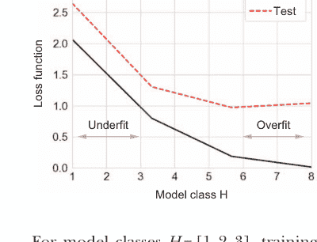

图 5.1 模型选择以避免对训练数据的过拟合或欠拟合

对于模型类 `H = [1, 2, 3]`，训练和测试损失函数都在下降，这表明有更多的学习容量；因此，这些模型欠拟合数据。对于模型类 `H = [6, 7, 8]`，训练损失下降而测试损失开始增加，这表明我们正在过拟合数据。

#### 5.2 感知机

让我们从最基本的分类模型开始：线性分类器。我们将在鸢尾花数据集上使用感知机分类器。我们可以按方程 5.1 所示定义线性分类器。

```
h(x; θ) = sign(θ₁x₁ + ⋯ + θ_d x_d + θ₀)
          = sign(θ · x + θ₀) = { +1  if θ · x + θ₀ ≥ 0
                                   -1  if θ · x + θ₀ < 0 }  (5.1)
```

注意符号函数如何将参数 `θ` 与特征输入 `x` 的内积映射到 ±1 标签。几何上，`θ·x + θ₀ = 0` 描述了 `d` 维空间中由法向量 `θ` 唯一确定的超平面。任何位于法向量 `θ` 同一侧的点都被标记为 +1，而另一侧的点被标记为 −1。因此，`θ·x + θ₀ = 0` 表示决策边界。图 5.2 在二维中说明了这些概念。

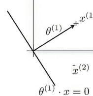

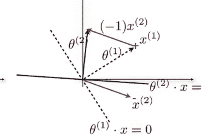

图 5.2 线性分类器和决策边界

我们如何衡量这个分类器的性能？一种方法是统计它与真实标签 `y` 相比犯的错误数量。我们可以按如下方式统计错误数量。

`E_n(θ) = 1/n Σ_{i=1}^n [[y_i ≠ h(x_i;θ)]] = 1/n Σ_{i=1}^n [[y_i(θ·x_i + θ_0) ≤ 0]]  (5.2)`

这里，`[[•]]` 是一个指示函数，当内部表达式为真时等于 1，否则为 0。请注意在方程 5.2 中，每当标签 `y_i ∈ [+1,−1]` 与分类器 `h(x_i;θ) ∈ [+1,−1]` 的预测不一致时（即它们的乘积为负）就会发生错误。

衡量二分类器性能的另一种方式是通过混淆矩阵。

|          | 实际 |      |

|----------|--------|------|

|          | y = 1  | y = 0|

| 预测     |        |      |

| ŷ = 1    | TP     | FP   |

| ŷ = 0    | FN     | TN   |

图 5.3 二分类器的混淆矩阵

在图 5.4 左侧的 ROC 曲线图中，TPR 代表真阳性率，可以按如下方式计算：`TPR = TP / (TP + FN)`。我们还可以计算假阳性率

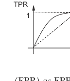

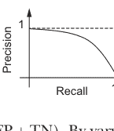

图 5.4 接收器操作特征 (ROC) 曲线图（左）和精确率-召回率曲线图（右）

`(FPR)` 为 `FPR = FP / (FP + TN)`。通过改变分类阈值，我们在 ROC 曲线上得到不同的点。完美分类导致 `TPR = 1` 且 `FPR = 0`；实际上，我们越接近左上角，分类器越好。在随机水平，我们得到对角线 `TPR = FPR` 线。ROC 曲线的质量通常用一个单一数字总结，即曲线下面积或 AUC。AUC 分数越高越好，最大为 `AUC = 1`。

在信息检索中，使用精确率-召回率曲线图是很常见的，如图 5.4 右侧所示。精确率定义为 `Precision = TP / (TP + FP)`，召回率定义为 `Recall = TP / (TP + FN)`。精确率-召回率曲线是随着分类阈值变化精确率与召回率的图。曲线可以用一个单一数字总结，即通过对召回值平均的平均精确率，这近似于曲线下面积。此外，对于固定的阈值，我们可以用一个单一统计量总结性能，称为 F1 分数，它是精确率和召回率的调和平均数：`F1 = 2PR / (P + R)`。

感知机是一种基于错误的算法：它从 `θ=0` 开始并对每个训练示例连续调整参数 `θ`，直到没有分类错误，假设数据是线性可分的。感知机更新规则可以总结如下。

```
if y_i ≠ h(x_i; θ^(k)) then
θ^(k+1) = θ^(k) + y_i x_i
θ_0^(k+1) = θ_0^(k) + y_i
(5.3)
```

这里，索引 `k` 表示参数更新的次数（即错误的数量）。你可以将 `θ0` 的更新视为与 `θ` 的更新类似，但 `x = 1`。如果训练示例是线性可分的，则方程 5.3 中的感知机算法在有限次迭代后收敛。请注意，输入数据点的顺序会影响参数 `θ` 的学习方式；因此，我们可以随机化（洗牌）训练数据集。此外，我们可以引入学习率来帮助 `θ` 收敛——其属性将在实现后讨论。感知机算法可以在图 5.5 的伪代码中总结。

代码由具有两个函数 `fit` 和 `predict` 的 `Perceptron` 类组成。在 `fit` 函数中，我们取训练数据 `X` 和标签 `y`，并在遇到错误时（此时 `if` 语句条件为真），我们更新学习率并更新 `theta`，如前所述推导。最后，在 `predict` 函数中，我们基于决策边界的符号对测试数据进行预测。

```
1: class perceptron
2: function fit(X, y):
3: k = 1
4: for epoch = 1, 2, ..., num_epochs
5:   for i = 1, 2, ..., N
6:     if y_i (θ · x_i + θ0) ≤ 0
7:       η = 1/(k+1) → Updates the learning rate
8:       k += 1
9:       θ = θ + η y_i x_i
10:      θ0 = θ0 + η y_i → Updates the theta
11:    end if
12:  end for
13: end for
14: return θ, θ0
15: function predict(X):
16: ŷ = sign (θ · X + θ0)
17: return ŷ
```

图 5.5 感知机算法伪代码

我们现在已经拥有从头实现感知机算法所需的所有工具！在下面的代码列表中，我们通过在训练特征数据上训练感知机算法并基于测试数据进行预测来对鸢尾花进行分类。

## 列表 5.1 感知机算法


```python
import numpy as np
import seaborn as sns
import matplotlib.pyplot as plt

from scipy.stats import randint
from sklearn.datasets import load_iris
from sklearn.metrics import confusion_matrix
from sklearn.model_selection import train_test_split

class perceptron:
    def __init__(self, num_epochs, dim):
        self.num_epochs = num_epochs
        self.theta0 = 0
        self.theta = np.zeros(dim)

    def fit(self, X_train, y_train):
        n = X_train.shape[0]
        dim = X_train.shape[1]

        k = 1
        for epoch in range(self.num_epochs):
            for i in range(n):
                idx = randint.rvs(0, n-1, size=1)[0] ← Samples random point
                if (y_train[idx] * (np.dot(self.theta, X_train[idx,:]) + self.theta0) <= 0): ← Hinge loss
                    eta = pow(k+1, -1) ← Updates learning rate
                    k += 1
                    self.theta = self.theta + eta *
                        y_train[idx] * X_train[idx, :]
                    self.theta0 = self.theta0 + eta *
                        y_train[idx]
                    #end if

                print("epoch: ", epoch)
                print("theta: ", self.theta)
                print("theta0: ", self.theta0)
                #end for
                #end for

    def predict(self, X_test):
        n = X_test.shape[0]
        dim = X_test.shape[1]

        y_pred = np.zeros(n)
        for idx in range(n):
            y_pred[idx] = np.sign(np.dot(self.theta, X_test[idx, :]) +
                self.theta0)
            #end for
        return y_pred

if __name__ == "__main__":
    iris = load_iris()
    X = iris.data[:100,:]
    y = 2*iris.target[:100] - 1
    X_train, X_test, y_train, y_test = train_test_split(X, y, test_size=0.2,
        random_state=42)

    #perceptron (binary) classifier
    clf = perceptron(num_epochs=5, dim=X.shape[1])
    clf.fit(X_train, y_train)
    y_pred = clf.predict(X_test)

    cmt = confusion_matrix(y_test, y_pred)
    acc = np.trace(cmt)/np.sum(np.sum(cmt))
    print("perceptron accuracy: ", acc)

    #generate plots
    plt.figure()
    sns.heatmap(cmt, annot=True, fmt="d")
    plt.title("Confusion Matrix"); plt.xlabel("predicted");
    plt.ylabel("actual")
    plt.savefig("./figures/perceptron_acc.png")
    plt.show()
```

更新 `theta` 和 `theta0`

加载数据集

映射为 {+1,-1} 标签

运行算法后，我们在图 5.6 中展示了测试数据集上的分类准确率结果。

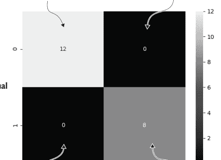

图 5.6 感知机二分类器混淆矩阵（鸢尾花数据集）

让我们再仔细看看我们的实现并更好地理解它。感知机算法可以表述为最小化铰链损失函数的随机梯度下降。考虑一个惩罚标签 $y_i$ 与预测 $h(x_i; \theta)$ 之间不一致程度 $z_i = y_i(\theta \cdot x_i + \theta_0)$ 的损失函数。

$$\text{Loss}_h(z) = \frac{1}{n} \sum_{i=1}^n \max\{1 - z_i, 0\} = \frac{1}{n} \sum_{i=1}^n \max\{1 - y_i(\theta \cdot x_i + \theta_0), 0\} \tag{5.4}$$

这被称为铰链损失函数，如图 5.7 所示。

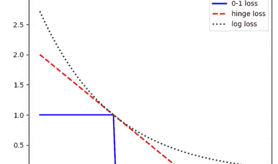

图 5.7 铰链损失、0-1 损失和对数损失函数

随机梯度下降试图通过对 $\theta$ 求梯度来最小化铰链损失。然而，$\max$ 运算符在 $z_i = 1$ 处不可微。事实上，

我们在该点有多个可能的梯度，它们统称为次微分。由于铰链损失是分段线性函数，$z_i > 1$ 时的梯度等于 0，而 $z_i \leq 1$ 时的梯度等于公式 5.5。

$$\nabla_\theta (1 - y_i(\theta \cdot x_i + \theta_0)) = -y_i x_i$$

$$\nabla_{\theta_0} (1 - y_i(\theta \cdot x_i + \theta_0)) = -y_i \tag{5.5}$$

将公式 5.5 中的表达式与随机梯度下降更新（其中 `eta` 为学习率）结合，我们得到公式 5.6。

$$\theta^{(k+1)} = \theta^{(k)} - \eta_k \nabla_\theta \text{Loss}_h(y_i(\theta \cdot x_i + \theta_0)) \tag{5.6}$$

我们得到了感知机算法！在下一节中，我们将讨论另一种重要的分类算法：支持向量机（SVM）。

#### 5.3 支持向量机

在上一节中，我们通过最小化期望损失函数（即经验风险）来评估分类器的性能。当前表述的一个问题是存在多个分类器（多个参数值 $\theta$ 和 $\theta_0$）可以达到相同的经验风险。那么我们如何选择最佳模型，“最佳”又意味着什么？

一个解决方案是对损失函数进行正则化以偏好较小的参数值，如公式 5.7 所示。

$$L_n(\theta, \theta_0) = \frac{\lambda}{2} \|\theta\|^2 + \frac{1}{n} \sum_{i=1}^n \text{Loss}(y_i(\theta \cdot x_i + \theta_0)) \tag{5.7}$$

这里，正则化应用于 $\theta$ 而不应用于 $\theta_0$。原因在于 $\theta$ 指定了决策边界的方向，而 $\theta_0$ 与其相对于原点的偏移有关，该偏移在开始时是未知的。

让我们从几何角度更好地理解决策边界。理想情况下，决策边界首先要正确分类所有数据点，其次要最大程度地远离所有训练样本（即具有最大间隔）。假设条件 1 已满足，为了优化条件 2，我们需要计算并最大化每个训练样本到决策边界的距离。从几何上讲，该距离如下。

$$\gamma_i = \frac{y_i(\theta \cdot x_i + \theta_0)}{\|\theta\|} \tag{5.8}$$

由于我们希望最大化间隔，因此希望在所有数据点上最大化到决策边界的最小距离（即求 $\max[\min_i \gamma_i]$）。这

我们现在可以计算相对于参数的梯度。

$$\nabla_{\theta} L(\theta, \theta_0; \alpha) = \theta - \sum_{i=1}^{n} \alpha_i y_i x_i = 0$$

$$\frac{d}{d\theta_0} L(\theta, \theta_0; \alpha) = - \sum_{i=1}^{n} \alpha_i y_i = 0 \tag{5.11}$$

将 $\theta$ 的表达式代回我们的拉格朗日函数，我们得到以下结果。

$$(\text{dual})\quad \max_{\alpha} \sum_{i=1}^{n} \alpha_i - \frac{1}{2} \sum_{i=1}^{n} \sum_{j=1}^{n} \alpha_i \alpha_j y_i y_j \left[ x_i^T x_j \right]$$

$$\text{subject to}\quad \alpha_i \ge 0, \sum_{i=1}^{n} \alpha_i y_i = 0 \tag{5.12}$$

对偶形式中最显著的变化是 $d$ 维数据点 $x_i$ 和 $x_j$ 通过内积进行交互。这相对于原始形式具有显著的计算优势（除对偶中约束更简单之外）。

内积衡量两个向量之间的相似程度，可以通过核 $K(x_i, x_j)$ 进行推广。核在不显式将对象表示为特征向量的情况下衡量对象之间的相似程度。当我们无法访问或选择不深入研究对象的内部结构时，这尤其有利。通常，比较两个对象 $x_i, x_j \in X$ 的核函数是对称的 $K(x_i, x_j)=K(x_j, x_i)$ 且非负的 $K(x_i, x_j)\ge 0$。核的种类繁多，从计算图之间相似性的图核到字符串核和文档核不等。我们在 SVM 实现中将使用的一种流行核示例是径向基函数（RBF）核，如下方程所示。

$$K(x_i, x_j) = \exp\left( - \frac{\|x_i - x_j\|^2}{2\sigma^2} \right) \tag{5.13}$$

我们现在准备使用 CVXOPT 优化包从头实现二元 SVM 分类器。CVXOPT 是一个基于 Python 编程语言的凸优化免费软件包，可在 cvxopt.org 下载。

遵循 CVXOPT 记法的二次规划（QP）的标准形式如下方程所示。

$$\min_{x} \frac{1}{2} x^T P x + q^T x \quad \text{subject to}\quad Gx \le h,\ Ax = b \tag{5.14}$$

请注意，该目标函数当且仅当矩阵 $P$ 为半正定时才是凸的。CVXOPT QP 期望问题以公式 5.14 的形式参数化 `(P, q, G, h, A, b)`。让我们将我们的对偶二次规划转换为这种形式。设 $P$ 为一个矩阵，使得以下等式成立。

$$P_{ij}=y_i y_j\left[x_i^T x_j\right]  \tag{5.15}$$

然后，优化问题变为如下形式。

$$\max_{\alpha}\sum_{i=1}^{n}\alpha_i-\frac{1}{2}\alpha^T P\alpha\quad\text{subject to}\quad \alpha_i\geq 0,\quad \sum_{i=1}^{n}\alpha_i y_i=0  \tag{5.16}$$

我们可以进一步修改这个二次规划，将目标函数和约束条件乘以 −1，从而将其转化为最小化问题并反转不等式。此外，我们可以通过将 `alpha` 向量乘以全 1 向量，将对 `alpha` 的求和转换为向量形式。

$$\min_{\alpha}\frac{1}{2}\alpha^T P\alpha-\mathbf{1}^T\alpha\quad\text{subject to}\quad -\alpha_i\leq 0,\quad y^T\alpha=0  \tag{5.17}$$

现在我们可以使用 CVXOPT 来求解我们的 SVM 二次规划。让我们先看看图 5.9 中的伪代码。

```python
1: class SupportVectorMachine
2:     function fit(X, y):
3:         $P_{ij}=y_i y_j K(x_i,x_j)$
4:         q = −1
5:         G = −1
6:         h = 0
7:         A = y
8:         b = 0
9:         sol = cvxopt.solvers.qp(P,q,G,h,A,b)  ← Solves with CVXOPT
10:       alphas = sol['x']
11:       S = alphas > 1e−11  ← Finds support vectors
12:       θ = $\sum_{i=1}^{n} y_i\alpha_i x_i$  ← Finds the normal vector
13:       θ₀ = $y_s-\sum_{m\in S}\alpha_m y_m[x_m^T x_s]$  ← Finds the intercept
14:       return θ, θ₀
15:   function predict(X, θ, θ₀):
16:       ŷ = sign($θ^T X+θ₀$)  ← Makes a prediction
17:       return ŷ
```

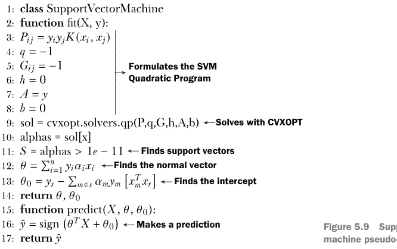

SVM 类由两个函数组成：`fit` 和 `predict`。在 `fit` 函数中，我们首先构造将由 CVXOPT 求解的二次优化问题，并定义所有输入参数：`(P, q, G, h, A, b)`。调用求解器后，我们找到大于 0 的 `alpha`（在舍入误差范围内）作为支持向量。接下来，如前所述，我们计算法向量和截距。在 `predict` 函数中，我们使用计算得到的法向量和截距以及支持向量来对测试数据进行标签预测。

## 清单5.2 SVM算法

```python
import cvxopt
import numpy as np

from sklearn.svm import SVC
from sklearn.datasets import load_iris
from sklearn.metrics import accuracy_score
from sklearn.model_selection import train_test_split

def rbf_kernel(gamma, **kwargs):
    def f(x1, x2):
        distance = np.linalg.norm(x1 - x2) ** 2
        return np.exp(-gamma * distance)
    return f

class SupportVectorMachine(object):
    def __init__(self, C=1, kernel=rbf_kernel, power=4, gamma=None):
        self.C = C
        self.kernel = kernel
        self.power = power
        self.gamma = gamma
        self.lagr_multipliers = None
        self.support_vectors = None
        self.support_vector_labels = None
        self.intercept = None

    def fit(self, X, y):
        n_samples, n_features = np.shape(X)

        if not self.gamma:
            self.gamma = 1 / n_features

        self.kernel = self.kernel(
            power=self.power,
            gamma=self.gamma)

        kernel_matrix = np.zeros((n_samples, n_samples))
        for i in range(n_samples):
            for j in range(n_samples):
                kernel_matrix[i, j] = self.kernel(X[i], X[j])

        P = cvxopt.matrix(np.outer(y, y) * kernel_matrix, tc='d')
        q = cvxopt.matrix(np.ones(n_samples) * -1)
        A = cvxopt.matrix(y, (1, n_samples), tc='d')
        b = cvxopt.matrix(0, tc='d')
```

For comparison only

Regularization constant

Kernel parameters

Initializes the kernel method with parameters

Calculates the kernel matrix

Defines the quadratic optimization problem


```
if not self.C: #if its empty
    G = cvxopt.matrix(np.identity(n_samples) * -1)
    h = cvxopt.matrix(np.zeros(n_samples))
else:
    G_max = np.identity(n_samples) * -1
    G_min = np.identity(n_samples)
    G = cvxopt.matrix(np.vstack((G_max, G_min)))
    h_max = cvxopt.matrix(np.zeros(n_samples))
    h_min = cvxopt.matrix(np.ones(n_samples) * self.C)
    h = cvxopt.matrix(np.vstack((h_max, h_min)))

minimization = cvxopt.solvers.qp(P, q, G, h, A, b)

lagr_mult = np.ravel(minimization['x'])
```

#### Get indexes of non-zero lagr. multipliers
`idx = lagr_mult > 1e-11`
#### Get the corresponding lagr. multipliers
`self.lagr_multipliers = lagr_mult[idx]`
#### Get the samples that will act as support vectors
`self.support_vectors = X[idx]`
#### Get the corresponding labels
`self.support_vector_labels = y[idx]`

`self.intercept = self.support_vector_labels[0]`
for i in range(len(self.lagr_multipliers)):
    self.intercept -= self.lagr_multipliers[i] * self.support_vector_labels[i] * self.kernel(self.support_vectors[i], self.support_vectors[0])

def predict(self, X):
    y_pred = []
    for sample in X:
        prediction = 0
        # Determine the label of the sample by the support vectors
        for i in range(len(self.lagr_multipliers)):
            prediction += self.lagr_multipliers[i] * self.support_vector_labels[i] * self.kernel(self.support_vectors[i], sample)
        prediction += self.intercept
        y_pred.append(np.sign(prediction))
    return np.array(y_pred)

def main():
    #load dataset
    iris = load_iris()
    X = iris.data[:100,:]
    y = 2*iris.target[:100] - 1
```

Solves the quadratic optimization problem, using `cvxopt`

Lagrange multipliers

Extracts support vectors

Calculates the intercept with the first support vector

Iterates through list of samples and makes predictions

Maps to `{+1,-1}` labels

```
X_train, X_test, y_train, y_test = train_test_split(X, y, test_size=0.4)
clf = SupportVectorMachine(kernel=rbf_kernel, gamma = 1)
clf.fit(X_train, y_train)
y_pred = clf.predict(X_test)
accuracy = accuracy_score(y_test, y_pred)
print ("Accuracy (scratch):", accuracy)

clf_sklearn = SVC(gamma = 'auto')
clf_sklearn.fit(X_train, y_train)
y_pred2 = clf_sklearn.predict(X_test)
accuracy = accuracy_score(y_test, y_pred2)
print ("Accuracy :", accuracy)

if __name__ == "__main__":
    main()
```

我们可以看到，基于我们实现的SVM分类准确率与sklearn模型的准确率一致！

### 5.4 逻辑回归

逻辑回归是一种分类算法。在从头实现逻辑回归之前，让我们深入了解其背后的一些理论！在分类的概率视角下，我们关心的是在给定输入数据`x`时，计算类别标签`C_k`的概率`p(C_k|x)`。考虑两个类别`C1`和`C2`，我们可以使用贝叶斯规则来计算后验概率。

$$p(C_1|x) = \frac{p(x|C_1)p(C_1)}{p(x|C_1)p(C_1) + p(x|C_2)p(C_2)}\tag{5.18}$$

这里，`p(C_k)`是类别先验概率。我们可以将右手边除以分子，得到如下结果。

$$p(C_1|x) = \frac{1}{1 + \frac{p(x|C_2)p(C_2)}{p(x|C_1)p(C_1)}} = \frac{1}{1 + \exp(-a)} = \sigma(a)\tag{5.19}$$

在这里，我们定义了以下内容。

$$a = \ln \frac{p(x|C_1)p(C_1)}{p(x|C_2)p(C_2)}\tag{5.20}$$

在多类别场景中（`K>2`），我们有以下公式。

$$p(C_k|x) = \frac{p(x|C_k)p(C_k)}{\sum_i p(x|C_i)p(C_i)} = \frac{\exp(a_k)}{\sum_i \exp(a_i)}\tag{5.21}$$

在公式5.21中，`a_k = \ln p(x|C_k) p(C_k)`。这个表达式也被称为softmax函数。softmax函数接受一个包含`K`个实数值的向量，并将其转换为一个包含`K`个实数值、总和为1的向量。因此，softmax函数的输出可以被解释为概率分布。现在，关键在于选择能够很好地建模数据的条件密度。在以`θ`为参数、类别标签为`y = C_k`的二分类逻辑回归中，我们有以下方程。

$p(C_k|x) = p(y|x, \theta) = \mathrm{Ber}\left(y \mid \sigma\left(\theta^T x\right)\right) \tag{5.22}$

我们可以按如下方式计算联合分布。

$p(x_i, y_i|\theta) = p(y_i|x_i, \theta) p(x_i|\theta) = \mathrm{Ber}\left(y \mid \sigma\left(\theta^T x\right)\right) p(x_i|\theta) \tag{5.23}$

由于我们不对数据的分布`p(x_i|\theta) = p(x_i)`进行建模，我们可以将对数似然写成如下形式。

$\log p(D|\theta) = \log \prod_{i=1}^n p(x_i, y_i|\theta) = \sum_{i=1}^n \log p(x_i, y_i|\theta)$

$= \sum_{i=1}^n \log \mathrm{Ber}\left(y \mid \sigma\left(\theta^T x\right)\right)$

$= \sum_{i=1}^n \log \left[ \sigma\left(\theta^T x_i\right)^{y_i} \left(1 - \sigma\left(\theta^T x_i\right)\right)^{1 - y_i} \right]$

$= \sum_{i=1}^n \left[ y_i \log \sigma\left(\theta^T x_i\right) + (1 - y_i) \log \left(1 - \sigma\left(\theta^T x_i\right)\right) \right] \tag{5.24}$

请注意，我们关心的是最大化对数似然，或者等效地，最小化损失或负对数似然（NLL）。

$\min_{\theta} \mathrm{Loss}(\theta) = \min_{\theta} \mathrm{NLL}(\theta) = \max_{\theta} \log p(D|\theta) \tag{5.25}$

我们计划通过随机梯度下降（SGD）来最小化逻辑回归损失，该过程可以写成如下形式。

$\theta_{k+1} = \theta_k - \eta_k g_k \tag{5.26}$

这里，`g_k`是梯度，`η_k`是步长。为了保证SGD的收敛性，必须满足以下方程中对学习率所表达的条件，即所谓的Robbins-Monro条件。

我们可以使用以下学习率调度，它满足方程 5.27 中的条件。

$$

\sum_{k=1}^{\infty} \eta_k = \infty

$$

$$

\sum_{k=1}^{\infty} \eta_k^2 < \infty \tag{5.27}

$$

我们可以使用以下学习率调度，它满足方程 5.27 中的条件。

$$

\eta_k = (\tau_0 + k)^{-\kappa} \tag{5.28}

$$

这里，\(\tau_0 \ge 0\) 减缓算法的早期迭代，而 \(\kappa \in (0.5, 1]\) 控制旧值被遗忘的速率。为了计算最陡下降方向 `g_k`，我们需要对损失函数 `NLL(θ)` 求导。

$$

\frac{d}{d\theta}\log p(D|\theta) = \sum_{i=1}^{n}\left[y_i\frac{d}{d\theta}\log\sigma\left(\theta^T x_i\right) + (1-y_i)\frac{d}{d\theta}\log\left(1-\sigma\left(\theta^T x_i\right)\right)\right]

$$

$$

= \sum_{i=1}^{n}\left[y_i\frac{\sigma\left(\theta^T x_i\right)\left(1-\sigma\left(\theta^T x_i\right)\right)}{\sigma\left(\theta^T x_i\right)}x_i + (1-y_i)\frac{\sigma\left(\theta^T x_i\right)\left(1-\sigma\left(\theta^T x_i\right)\right)}{1-\sigma\left(\theta^T x_i\right)}(-x_i)\right]

$$

$$

= \sum_{i=1}^{n}\left[y_i x_i\left(1-\sigma\left(\theta^T x_i\right)\right)-(1-y_i)x_i\sigma\left(\theta^T x_i\right)\right]

$$

$$

= \sum_{i=1}^{n}\left[y_i-\sigma\left(\theta^T x_i\right)\right]x_i

$$

$$

= \sum_{i=1}^{n}\left[y_i-\mu_i\right]x_i = -X^T(\mu - y) \tag{5.29}

$$

在方程 5.29 中，我们使用了事实 \(d/dx\,\sigma(x) = (1-\sigma(x))\sigma(x)\) 以及伯努利分布的均值 \(\mu_i = \sigma(\theta^T x_i)\)。请注意，有许多自动微分库可以避免手工推导梯度。此外，我们可以添加正则化来控制参数规模。我们的正则化目标和梯度如下。

$$

\min_{\theta}\text{Loss}(\theta) = \min_{\theta}\left[\text{NLL}(\theta) + \lambda\theta^T\theta\right]

$$

$$

g_k = X^T(\mu - y) + 2\lambda\theta \tag{5.30}

$$

我们现在准备为逻辑回归实现 SGD。让我们从图 5.10 所示的以下伪代码开始。

```text
1: class sgdlr
2: function lr_objective(θ, X, y, λ)
3: μ_i = sigmoid(θ^T X_i)
4: cost = - Σ_{i=1}^n [y_i log μ_i + (1 - y_i) log (1 - μ_i)] + λ θ^T θ
5: grad = X^T (μ - y) + 2λ θ ← Computes the gradient
6: return cost, grad
7: function fit(X, y):
8: η_i = (τ + i)^{-κ} ← Sets the learning rate
9: for i = 1, 2, … num_iter
10:   cost, grad = lr_objective(θ, X, y, λ)
11:   θ = θ - η_i grad ← Updates the theta
12: end for
13: return θ
14: function predict(X, θ):
15: ŷ = sigmoid (θ^T X) ← Makes a prediction
16: return ŷ
```

**Figure 5.10** 逻辑回归算法伪代码

`sgdlr` 类包含三个主要函数：`lr_objective`、`fit` 和 `predict`。在 `lr_objective` 函数中，我们计算正则化目标函数和目标的梯度，如文中所述。在 `fit` 函数中，我们首先设置学习率，并且在每次迭代中，我们沿着与梯度相反的方向更新 `theta` 参数。最后，在 `predict` 函数中，我们基于测试数据对标签进行二元预测。在下面的代码列表中，我们使用合成高斯混合数据集来训练逻辑回归模型。

### Listing 5.3 SGD 逻辑回归


```python
import numpy as np
import matplotlib.pyplot as plt

def generate_data():

    n = 1000
    mu1 = np.array([1,1])
    mu2 = np.array([-1,-1])
    pik = np.array([0.4,0.6])

    X = np.zeros((n,2))
    y = np.zeros((n,1))

    for i in range(1,n):
        u = np.random.rand()
        idx = np.where(u < np.cumsum(pik))[0]

        if (len(idx)==1):
            X[i,:] = np.random.randn(1,2) + mu1
            y[i] = 1
        else:
            X[i,:] = np.random.randn(1,2) + mu2
            y[i] = -1
    return X, y

class sgdlr:

    def __init__(self):

        self.num_iter = 100
        self.lmbda = 1e-9

        self.tau0 = 10
        self.kappa = 1
        self.eta = np.zeros(self.num_iter)

        self.batch_size = 200
        self.eps = np.finfo(float).eps

    def fit(self, X, y):

        theta = np.random.randn(X.shape[1],1)  # <-- Random init

        for i in range(self.num_iter):
            self.eta[i] = (self.tau0 + i)**(-self.kappa)  # Learning rate schedule

        batch_data, batch_labels = self.make_batches(
            X,y,self.batch_size)  # <-- Divides data into batches
        num_batches = batch_data.shape[0]
        num_updates = 0

        J_hist = np.zeros((self.num_iter * num_batches,1))
        t_hist = np.zeros((self.num_iter * num_batches,1))

        for itr in range(self.num_iter):
            for b in range(num_batches):
                Xb = batch_data[b]
                yb = batch_labels[b]

                J_cost, J_grad = self.lr_objective(theta, Xb, yb, self.lmbda)
                theta = theta - self.eta[itr]*(num_batches*J_grad)

                J_hist[num_updates] = J_cost
                t_hist[num_updates] = np.linalg.norm(theta,2)
                num_updates = num_updates + 1
                print("iteration %d, cost: %f" %(itr, J_cost))

        y_pred = 2*(self.sigmoid(X.dot(theta)) > 0.5) - 1
        y_err = np.size(np.where(y_pred - y)[0])/float(y.shape[0])
        print("classification error:", y_err)

        plt.figure()
        plt.plot(t_hist)
        plt.title("LR theta L2 norm")
        plt.xlabel('iterations')
        plt.ylabel('theta L2 norm')
        #plt.savefig('../figures/lrsgd_theta_norm.png')
        plt.show()

        plt.figure()
        plt.plot(self.eta)
        plt.title("LR learning rate")
        plt.xlabel('iterations')
        plt.ylabel('learning rate')
        #plt.savefig('../figures/lrsgd_learning_rate.png')
        plt.show()

        plt.figure()
        x1 = np.linspace(np.min(X[:,0])-1,np.max(X[:, 0])+1,10)
        plt.scatter(X[:,0], X[:,1])
        plt.plot(x1, -(theta[0]/theta[1])*x1)
        plt.title('LR decision boundary')
        plt.grid(True)
        plt.xlabel('X1')
        plt.ylabel('X2')
        #plt.savefig('../figures/lrsgd_clf.png')
        plt.show()

if __name__ == "__main__":
    X, Y = generate_data()
    sgd = sgdlr()
    theta = sgd.fit(X,Y)
```

图 5.11 显示了随着迭代次数增加而下降的损失函数的随机性，以及我们二元逻辑回归学习到的决策边界。

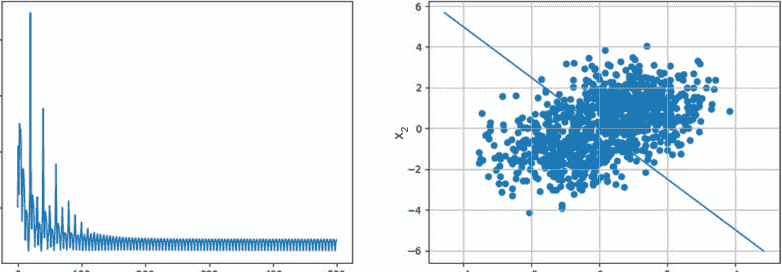

**Figure 5.11** SGD 逻辑回归：代价（左）和决策边界（右）

二元逻辑回归的自然扩展是处理超过 2 个类别的多项逻辑回归。

## 5.5 朴素贝叶斯

本节重点介绍理解、推导和实现朴素贝叶斯算法。算法的基本（朴素）假设是给定类别标签时特征条件独立。这使我们能够将类别条件密度写成一维密度的乘积。

$$

p(x_i|y=c,\theta)=\prod_{j=1}^{D}p(x_{ij}|y=c,\theta_{jc}) \tag{5.31}

$$

该模型被称为朴素，因为我们并不期望特征条件独立。然而，即使假设不成立，该模型在许多场景中表现良好。在这里，我们将重点关注用于文档分类的伯努利朴素贝叶斯，其图形模型如图 5.12 所示。请注意阴影节点表示观测变量。

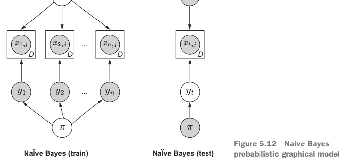

类别条件密度 \(p(x|y=c,\theta)\) 的选择决定了朴素贝叶斯分类器的类型，例如高斯、伯努利或多项式。在本节中，我们重点关注伯努利朴素贝叶斯，因为它在分类文档方面性能很高。

令 \(x_{ij}\) 为伯努利随机变量，表示文档 \(i\in\{1,\dots,N\}\) 中词 \(j\in\{1,\dots,D\}\) 的出现（\(x_{ij}=1\)）或缺失（\(x_{ij}=0\)），由给定类别标签 \(y=c\in\{1,\dots,C\}\) 的 \(\theta_{jc}\) 参数化。此外，令 \(\pi\) 为表示类别标签先验的狄利克雷分布。因此，可学习参数的总数为 \(|\theta|+|\pi|=O(DC)+O(C)=O(DC)\)，其中 \(D\) 为词典大小，\(C\) 为类别数。由于参数数量少，朴素贝叶斯模型对过拟合具有免疫力。

我们可以在方程 5.32 中写下类别条件密度。

$$

p(x|y=c,\theta)=\prod_{i=1}^n\prod_{j=1}^D p(x_{ij}|y=c,\theta_{jc})=\prod_{i=1}^n\prod_{j=1}^D \mathrm{Bernoulli}(x_{ij}|\theta_{jc}) \tag{5.32}

$$

我们可以通过最大化对数似然来推导朴素贝叶斯推理算法。考虑单个文档 \(i\) 中的词 \(x_i\)。

$$

p(x_i,y_i|\theta)=p(y_i|\pi)\prod_{j=1}^D p(x_{ij}|y_i,\theta)

$$

$$

=\prod_{c=1}^C \pi_c^{1[y_i=c]}\prod_{j=1}^D\prod_{c=1}^C p(x_{ij}|\theta_{jc})^{1[y_i=c]} \tag{5.33}

$$

使用朴素贝叶斯假设，我们可以计算对数似然目标。

$$

\log p(D|\theta)=\log\prod_{i=1}^n p(x_i,y_i|\theta)=\sum_{i=1}^n\log p(x_i,y_i|\theta)

$$

$$

=\sum_{c=1}^C N_c\log\pi_c+\sum_{j=1}^D\sum_{c=1}^C\sum_{i:y_i=c}\log p(x_{ij}|\theta_{jc}) \tag{5.34}

$$

请注意这是一个约束优化程序，因为类别标签的概率必须和为一：\(\sum\pi_c=1\)。我们可以通过在目标函数中加入约束并将拉格朗日 \(L(\theta,\lambda)\) 关于模型参数的梯度设为零来使用拉格朗日求解方程 5.34 中的优化问题。

$$

L(\theta,\lambda)=\log p(D|\theta)+\lambda\left(1-\sum_c\pi_c\right) \tag{5.35}

$$

对 \(\pi_c\) 求导，我们得到以下结果。

$$

\frac{d}{d\pi_c}L(\theta,\lambda)=\frac{d}{d\pi_c}\log p(D|\theta)-\lambda=N_c\frac{1}{\pi_c}-\lambda=0 \tag{5.36}

$$

这给出了 \(\pi_c\) 关于 \(\lambda\) 的表达式：\(\pi_c=(1/\lambda)N_c\)。为了解决 \(\lambda\)，我们使用和为一的约束。

$$

\sum_c\pi_c=1\to\sum_c\frac{1}{\lambda}N_c=1\to\lambda=\sum_c N_c \tag{5.37}

$$

将 \(\lambda\) 代回 \(\pi_c\) 的表达式，我们得到 \(\pi_c=N_c/\sum N_c=N_c/N_{tot}\)。同样，我们可以通过将目标关于 \(\theta_{jc}\) 的梯度设为零来计算最优 \(\theta_{jc}\) 参数。

```
\frac{d}{d\theta_{jc}} \log p(D|\theta) = \frac{d}{d\theta_{jc}} \sum_{i:y_i=c} \left[ x_{ij} \log(\theta_{jc}) + (1 - x_{ij}) \log(1 - \theta_{jc}) \right] = 0 \\
= \sum_{i:y_i=c} \left[ \frac{x_{ij}}{\theta_{jc}} - \frac{1 - x_{ij}}{1 - \theta_{jc}} \right] = 0 \\
\rightarrow \frac{N_{jc}}{\theta_{jc}} = \frac{1}{1 - \theta_{jc}} \left[ N_c - N_{jc} \right] \rightarrow N_{jc} = N_c \theta_{jc} \tag{5.38}
```

因此，最优最大似然估计（MLE）值 θ_jc = N_jc / N_c，其中 N_c = Σ1[y_i = c]，这作为计数之比在直观上是有意义的。注意，添加伯努利随机变量的 Beta 共轭先验以及类别密度的 Dirichlet 共轭先验来平滑 MLE 计数是很直接的。

```
p(π|D) = Dir(N_1 + α_1, ..., N_c + α_c) \\
p(θ_{jc}|D) = Beta([N_c - N_{jc}] + β_0, N_{jc} + β_1) \tag{5.39}
```

这里，我们出于计算便利性使用共轭先验，因为后验和先验具有相同的形式，这使得能够进行闭式更新。

在测试时，我们希望根据训练数据 D 和学习到的模型参数预测类别标签 y。应用贝叶斯规则，我们得到以下结果。

```
p(y = c | x_{i,1}, ..., x_{i,D}, D) ∝ p(y = c | D) p(x_{i,1}, ..., x_{i,D} | y = c, D) \\
= p(y = c | D) \prod_{j=1}^{D} p(x_{ij} | y = c, D) \tag{5.40}
```

将 p(y = c | D) 和 p(x_{ij} | y = c, D) 的分布代入并取对数，我们得到以下结果。

```
\log p(y = c | x, D) ∝ \log \hat{π}_c + \sum_{j=1}^{D} \left( 1[x_{ij}=1] \log \hat{θ}_{jc} + 1[x_{ij}=0] \log (1 - \hat{θ}_{jc}) \right) \tag{5.41}
```

这里，π_c 和 θ_jc 是在训练期间获得的 MLE 估计。朴素贝叶斯算法在图 5.13 所示的伪代码中进行了总结。

训练期间 MLE 推断的运行时间复杂度为 O(ND)，其中 N 是训练文档的数量，D 是词典大小。测试期间的运行时间复杂度为 O(TCD)，其中 T 是测试文档的数量，C 是类别数，D 是词典大小。类似地，空间复杂度是存储模型参数所需数组的大小，其增长为 O(DC)。我们现在准备在以下列表中实现伯努利朴素贝叶斯算法！

```
1: 训练：
2:    N_c = 0, N_{jc} = 0
3:    for i = 1, 2, ..., n do
4:        c = y_i // 第 i 个示例的类别标签
5:        N_c = N_c + 1
6:        for j = 1, ..., D do
7:            if x_{ij} = 1 then
8:                N_{jc} = N_{jc} + 1
9:            end for
10:       end for
11:       \hat{\pi}_c = \frac{N_c}{N}, \hat{\theta}_{jc} = \frac{N_{jc}}{N}
12:       return \hat{\pi}_c, \hat{\theta}_c
13: 测试（单个测试文档）：
14: for c = 1, 2, ..., C do
15:     log p[c] = log \pi_c
16:     for j = 1, 2, ..., D do
17:         if x_j = 1 then
18:             log p[c] += log \hat{\theta}_{jc}
19:         else
20:             log p[c] += log (1 - \hat{\theta}_{jc})
21:         end for
22:     end for
23: c = arg max_c log p[c]
24: return c
```

### 图 5.13 朴素贝叶斯算法伪代码

### 列表 5.4 伯努利朴素贝叶斯算法

```python
import numpy as np
import seaborn as sns
import matplotlib.pyplot as plt

from time import time
from nltk.corpus import stopwords
from nltk.tokenize import RegexpTokenizer

from sklearn.metrics import accuracy_score
from sklearn.datasets import fetch_20newsgroups
from sklearn.model_selection import train_test_split
from sklearn.feature_extraction.text import CountVectorizer

sns.set_style("whitegrid")
tokenizer = RegexpTokenizer(r'\w+')
stop_words = set(stopwords.words('english'))
stop_words.update(['s', 't', 'm', '1', '2'])
```


``` 
class naive_bayes:
    def __init__(self, K, D):
        self.K = K
        self.D = D
        self.pi = np.ones(K)
        self.theta = np.ones((self.D, self.K))

    def fit(self, X_train, y_train):
        num_docs = X_train.shape[0]
        for doc in range(num_docs):
            label = y_train[doc]
            self.pi[label] += 1
            for word in range(self.D):
                if (X_train[doc][word] > 0):
                    self.theta[word][label] += 1
                #end if
            #end for
        #end for
        #normalize pi and theta
        self.pi = self.pi/np.sum(self.pi)
        self.theta = self.theta/np.sum(self.theta, axis=0)

    def predict(self, X_test):
        num_docs = X_test.shape[0]
        logp = np.zeros((num_docs, self.K))
        for doc in range(num_docs):
            for kk in range(self.K):
                logp[doc][kk] = np.log(self.pi[kk])
                for word in range(self.D):
                    if (X_test[doc][word] > 0):
                        logp[doc][kk] += np.log(self.theta[word][kk])
                    else:
                        logp[doc][kk] += np.log(1-self.theta[word][kk])
                    #end if
                #end for
            #end for
        return np.argmax(logp, axis=1)

if __name__ == "__main__":
    import nltk
    nltk.download('stopwords')
    #load data
    print("loading 20 newsgroups dataset...")
    tic = time()
    classes = ['sci.space', 'comp.graphics', 'rec.autos', 'rec.sport.hockey']
```

- 类别先验
- 类别数
- 词典大小
- 伯努利参数

```
dataset = fetch_20newsgroups(shuffle=True, random_state=0,
    remove=('headers','footers','quotes'), categories=classes)
X_train, X_test, y_train, y_test = train_test_split(dataset.data,
    dataset.target, test_size=0.5, random_state=0)
toc = time()
print("elapsed time: %.4f sec" %(toc - tic))
print("number of training docs: ", len(X_train))
print("number of test docs: ", len(X_test))

print("vectorizing input data...")
cnt_vec = CountVectorizer(tokenizer=tokenizer.tokenize, analyzer='word',
    ngram_range=(1,1), max_df=0.8, min_df=2, max_features=1000,
    stop_words=stop_words)
cnt_vec.fit(X_train)
toc = time()
print("elapsed time: %.2f sec" %(toc - tic))
vocab = cnt_vec.vocabulary_
idx2word = {val: key for (key, val) in vocab.items()}
print("vocab size: ", len(vocab))

X_train_vec = cnt_vec.transform(X_train).toarray()
X_test_vec = cnt_vec.transform(X_test).toarray()

print("naive bayes model MLE inference...")
K = len(set(y_train)) #number of classes
D = len(vocab) #dictionary size
nb_clf = naive_bayes(K, D)
nb_clf.fit(X_train_vec, y_train)

print("naive bayes prediction...")
y_pred = nb_clf.predict(X_test_vec)
nb_clf_acc = accuracy_score(y_test, y_pred)
print("test set accuracy: ", nb_clf_acc)
```

从输出结果可以看出，我们在 20 newsgroups 测试数据集上达到了 82% 的准确率。

## 5.6 决策树 (CART)

本节重点介绍分类和回归树（CART）算法。基于树的算法将输入空间划分为轴平行区域，使得每个叶节点代表一个区域。然后它们可以用于通过多数投票对区域进行分类，或通过计算期望值对区域进行回归。基于树的模型具有可解释性，并提供特征重要性的洞察。它们基于贪婪的递归算法，因为空间的最优划分是 NP 完全的。

在基于树的模型训练期间，我们有兴趣以优化目标函数且不导致欠拟合或过拟合的方式构建二叉树。生长决策树的一个关键决定因素是在对数据点进行分类时使用的特征和阈值的选择。考虑一个具有 $n$ 个数据点、维度（特征大小）为 $d$ 的输入数据矩阵 $X_{n\times d}$。我们希望找到使数据以最小成本分裂的最优特征及其阈值。令 $j \in \{1, ..., d\}$ 表示特征维度，$t \in \tau_j$ 表示特征 $j$ 的阈值（由取数据 $x_{ij}$ 的中点构造），取自所有可能的阈值 $\tau_j$。然后，我们希望计算以下内容。

$$j^*, t^* = \arg\min_{j \in \{1,...,d\}} \min_{t \in \tau_j} \text{cost}(\{x_i, y_i : x_{ij} \le t\}) + \text{cost}(\{x_i, y_i : x_{ij} > t\}) \tag{5.42}$$

在看示例之前，让我们先看看可以用于优化分类树的潜在成本。定义成本函数的目标是评估数据划分的好坏。我们希望叶节点是纯的（即包含来自同一类别的数据，并且仍能推广到测试数据）。换句话说，我们希望限制树的深度（以防止过拟合），同时最小化不纯度。不纯度的一种概念是基尼指数。

$$\sum_{k=1}^{K} \pi_k (1 - \pi_k) = \sum_{k} \pi_k - \sum_{k} \pi_k^2 = 1 - \sum_{k} \pi_k^2 \tag{5.43}$$

这里，$\pi_k$ 是属于簇 $k$ 的区域中点的比例。

$$\pi_k = \frac{1}{|D|} \sum_{i \in D} 1[y_i = k] \tag{5.44}$$

请注意，由于 $\pi_k$ 是叶中随机点属于类别 $k$ 的概率，而 $1 - \pi_k$ 是错误率，因此基尼指数是期望错误率。如果叶簇是纯的（$\pi_k = 1$），则基尼指数为零。因此，我们有兴趣最小化基尼指数。

另一种目标是熵，如以下等式所示。

$$H(\pi) = - \sum_{k=1}^{K} \pi_k \log \pi_k \tag{5.45}$$

*熵* 衡量不确定性的大小。如果我们确定叶簇是纯的（即 $\pi_k = 1$），则熵为零。因此，在 CART 中我们有兴趣最小化熵。

让我们看一个选择最优分裂特征及其阈值的一维示例。设 $X = [1.5, 1.7, 2.3, 2.7, 2.7]$ 且类别标签 $y = [1, 1, 2, 2, 3]$。由于数据是一维的，我们的任务是找到一个阈值来分割 $X$，以最小化基尼指数。如果我们选择阈值 $t_1 = 2$ 作为 1.7 和 2.3 之间的中点并计算由此产生的基尼指数，我们得到以下等式。

$$ G = \frac{2}{5} G_{left} + \frac{3}{5} G_{right} = \frac{2}{5} \times 0 + \frac{3}{5} \times \left(1 - \frac{2^2}{3} - \frac{1^2}{3}\right) = 0.27 \tag{5.46} $$

这里，$G_{left}$ 是 $\{x_i, y_i: x_{ij} \le 2\}$ 的基尼指数，等于零，因为两个类别标签都等于 1（即纯叶节点簇），而 $G_{right}$ 是 $\{x_i, y_i: x_{ij} > 2\}$ 的基尼指数，包含混合的类别标签 $y_{right} = [2,2,3]$。

CART 算法的关键在于找到最优的特征和阈值，使得代价（如基尼指数）最小化。在训练过程中，我们需要逐个遍历每个特征，并为该特征的所有可能阈值计算基尼代价。但我们如何计算特征 $j$ 的所有可能阈值集合 $\tau_j$ 呢？我们可以将训练数据 $X[:, j]$ 在 $O(n \log n)$ 时间内排序，并考虑相邻两个数据值之间的所有中点。接下来，我们需要计算每个阈值的基尼指数，可以按公式 5.47 所示进行。设 $m$ 为节点的大小，$m_k$ 为节点中属于类别 $k$ 的样本点数。

$$ G = 1 - \sum_{k=1}^{K} \pi_k^2 = 1 - \sum_{k=1}^{K} \left(\frac{m_k}{m}\right)^2 \tag{5.47} $$

我们可以用 $O(n)$ 时间遍历排序后的阈值 $\tau_j$，并计算每次迭代中应用该阈值所产生的基尼指数。对于第 $i$ 个阈值，我们得到以下结果。

$$ G_i = \frac{i}{m} G_i^{left} + \frac{m - i}{m} G_i^{right} $$

$$ G_i^{left} = 1 - \sum_{k} \left(\frac{m_k^{left}}{i}\right)^2 $$

$$ G_i^{right} = 1 - \sum_{k} \left(\frac{m_k^{right}}{m - i}\right)^2 \tag{5.48} $$

找到最优特征和阈值后，我们递归地分裂每个节点，直到达到最大深度。在训练过程中构造出树之后，给定测试数据，我们只需从根节点遍历到叶节点，叶节点存储着我们的类别标签。我们可以用图 5.14 中的伪代码总结 CART 算法。

从 `TreeNode` 的定义可以看出，它存储了预测的类别标签、用于分裂的特征 `id`、最佳分裂阈值、指向左右子树的指针，以及基尼代价和节点大小。只要树的深度小于预先确定的最大深度，我们就可以通过调用 `grow_tree` 函数递归地生长决策树。首先，我们通过多数投票计算类别标签，并计算训练标签的基尼指数。

### 图 5.14 CART 决策树算法伪代码

``` 
1: class TreeNode(gini, num_samples, num_samples_class, class_label):
2: self.gini = gini // gini cost
3: self.num_samples = num_samples // size of node
4: self.num_samples_class = num_samples_class //number of pts with label k
5: self.class_label = class_label //predicted class label
6: self.feature_idx = 0 //idx of feature to split on
7: self.threshold = 0 //best threshold to split on
8: self.left = None //left subtree pointer
9: self.right = None //right subtree pointer
10: function grow_tree(X_train, y_train, depth)
11: class_label = majority_vote(y_train)
12: gini = compute_gini(y_train)
13: node = new TreeNode(gini, class_label)
14: //split recursively until max depth is reached
15: if depth < max_depth
16:   idx, threshold = best_split(X_train, y_train)
17:   if idx is not None:
18:     indices_left = X_train[:,idx] < threshold
19:     node.feature_index = idx
20:     node.left = grow_tree(X_left, y_left, depth + 1)
21:     node.right = grow_tree(X_right, y_right, depth +1)
22: return node
```

接下来，我们通过遍历所有特征和所有可能的分裂阈值来确定最佳分裂。一旦确定了要分裂的最佳特征 `idx` 和特征阈值，我们就用新的 `TreeNode` 对象初始化当前节点的左右指针，这些对象分别包含小于分裂阈值和大于分裂阈值的数据。我们以这种方式迭代，直到达到最大树深度。现在我们已经准备好实现 CART 算法。

### 清单 5.5 CART 决策树算法

``` 
import numpy as np
import matplotlib.pyplot as plt

from sklearn.datasets import load_iris
from sklearn.metrics import accuracy_score
from sklearn.model_selection import train_test_split

class TreeNode():
    def __init__(self, gini, num_samples, num_samples_class, class_label):
        self.gini = gini          ← Gini cost
        self.num_samples = num_samples          ← Size of the node
        self.num_samples_class = num_samples_class
        self.class_label = class_label          ← Predicted class label

Number of node points with the label k → self.num_samples_class
```


```
self.feature_idx = 0
self.threshold = 0
self.left = None
self.right = None

class DecisionTreeClassifier():
    def __init__(self, max_depth = None):
        self.max_depth = max_depth

    def best_split(self, X_train, y_train):
        m = y_train.size
        if (m <= 1):
            return None, None

        mk = [np.sum(y_train == k) for k in range(self.num_classes)]

        best_gini = 1.0 - sum((n / m) ** 2 for n in mk)
        best_idx, best_thr = None, None

        #iterate over all features
        for idx in range(self.num_features):

            thresholds, classes = zip(*sorted(zip(X[:, idx], y)))

            num_left = [0]*self.num_classes
            num_right = mk.copy()

            for i in range(1, m):
                k = classes[i-1]

                num_left[k] += 1
                num_right[k] -= 1

                gini_left = 1.0 - sum(
                    (num_left[x] / i) ** 2 for x in range(self.num_classes)
                )

                gini_right = 1.0 - sum(
                    (num_right[x] / (m - i)) ** 2 for x in
                    range(self.num_classes)
                )

                gini = (i * gini_left + (m - i) * gini_right) / m

                if thresholds[i] == thresholds[i - 1]:
                    continue

                if (gini < best_gini):
                    best_gini = gini
                    best_idx = idx
                    best_thr = (thresholds[i] + thresholds[i - 1]) / 2
```

最佳分裂阈值

要分裂的特征的 `idx`

左子树指针

右子树指针

类别 `k` 的样本点数

当前节点的基尼指数

沿选定的特征对数据进行排序

遍历所有可能的分裂位置

中点

```
#end if
#end for
#end for
return best_idx, best_thr

def gini(self, y_train):
    m = y_train.size
    return 1.0 - sum((np.sum(y_train == k) / m) ** 2 for k in
        range(self.num_classes))

def fit(self, X_train, y_train):
    self.num_classes = len(set(y_train))
    self.num_features = X_train.shape[1]
    self.tree = self.grow_tree(X_train, y_train)

def grow_tree(self, X_train, y_train, depth=0):

    num_samples_class = [np.sum(y_train == k) for k in
        range(self.num_classes)]
    class_label = np.argmax(num_samples_class)

    node = TreeNode(
        gini=self.gini(y_train),
        num_samples=y_train.size,
        num_samples_class=num_samples_class,
        class_label=class_label,
    )

    if depth < self.max_depth:
        idx, thr = self.best_split(X_train, y_train)
        if idx is not None:
            indices_left = X_train[:, idx] < thr
            X_left, y_left = X_train[indices_left], y_train[indices_left]
            X_right, y_right = X_train[~indices_left],
            y_train[~indices_left]
            node.feature_index = idx
            node.threshold = thr
            node.left = self.grow_tree(X_left, y_left, depth + 1)
            node.right = self.grow_tree(X_right, y_right, depth + 1)

    return node

def predict(self, X_test):
    return [self.predict_helper(x_test) for x_test in X_test]

def predict_helper(self, x_test):
    node = self.tree
    while node.left:
        if x_test[node.feature_index] < node.threshold:
            node = node.left
        else:
            node = node.right
    return node.class_label
```

递归分裂直到达到最大深度

```
if __name__ == "__main__":

#load data
iris = load_iris()
X = iris.data[:, [2,3]]
y = iris.target

X_train, X_test, y_train, y_test = train_test_split(X, y, test_size=0.2,
    random_state=42)

print("decision tree classifier...")
tree_clf = DecisionTreeClassifier(max_depth = 3)
tree_clf.fit(X_train, y_train)

print("prediction...")
y_pred = tree_clf.predict(X_test)

tree_clf_acc = accuracy_score(y_test, y_pred)
print("test set accuracy: ", tree_clf_acc)
```

从输出中可以看到，我们在鸢尾花数据集上实现了 80% 的测试分类准确率。

#### 5.7 练习

- 5.1 给定一个数据点 `y ∈ R^d` 和一个超平面 `θ·x+θ₀=0`，计算该点到超平面的欧几里得距离。

- 5.2 给定原始线性规划 `LP` `min cᵀ x` 受约束 `Ax <= b, x >= 0`，写出该 `LP` 的对偶形式。

- 5.3 证明径向基函数 `RBF` 核等价于在两个无限维特征向量之间计算相似度。

- 5.4 验证学习率调度 `ηₖ = (τ₀ + k)⁻ᵏ` 满足 Robbins-Monro 条件。

- 5.5 计算 sigmoid 函数 `σ(a) = [1 + exp(−a)]⁻¹` 的导数。

- 5.6 计算 Bernoulli 朴素贝叶斯算法的运行时间和内存复杂度。

#### 总结

- 分类算法的目标是从输入 `x` 学习到输出 `y` 的映射，其中 `y` 是一个离散量。

- 感知器是一种分类算法，它更新决策边界直到不再有分类错误。

- SVM 是一种最大间隔分类器。位于间隔边界上的训练数据点成为支持向量。

- 逻辑回归是一种分类算法，它基于 softmax 函数计算类条件密度。

- 朴素贝叶斯算法假设在给定类别标签的情况下特征是条件独立的。它常用于文档分类。

- CART 决策树是一种贪婪的递归算法，通过最小化目标函数（如基尼指数）来找到最优特征分裂。

### 回归算法

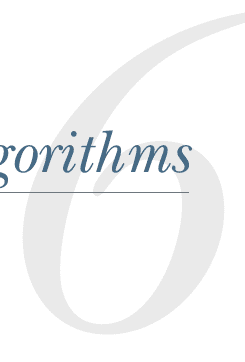

**本章涵盖**

- 介绍回归

- 贝叶斯线性回归

- 层次贝叶斯回归

- KNN 回归

- 高斯过程回归

在上一章中，我们研究了分类的监督算法。在本章中，我们将专注于监督学习，其中我们试图预测一个连续量。我们将研究四种有趣的回归算法，我们将从第一性原理推导它们：贝叶斯线性回归、层次贝叶斯回归、KNN 回归和高斯过程回归。这些算法被选中的原因是它们涵盖了多个重要应用并展示了多样化的数学概念。回归算法在各种应用中很有用。例如，它们可用于预测金融资产的价格或预测大气中的 `CO₂` 水平。让我们通过回顾回归的基础知识开始。

#### 6.1 回归简介

在监督学习中，我们得到一个数据集 `D = {(x₁, y₁), ..., (xₘ, yₘ)}`，它由数据 `x` 和标签 `y` 的元组组成。回归算法的目标是从输入 `x` 学习到输出 `y` 的映射，其中 `y` 是一个连续量（即 `y ∈ R`）。

回归器 `f` 可以被视为 `d` 维特征向量 `φ(x)` 与标签 `y` 之间的映射（即 `f: Rᵈ → R`）。与分类问题相比，回归问题通常更难（实现更高精度），因为我们试图预测一个连续量。此外，我们通常有兴趣根据过去的训练数据预测未来的响应变量 `y`。

回归中最广泛使用的模型之一是线性回归，它将响应变量 `y` 建模为输入特征向量 `φ(x)` 的线性组合。

`y(x) = wᵀ φ(x) + ε = Σ_{d=1}^D w_d φ(x_d) + ε  (6.1)`

特征 ↑ `φ(x)` ↓ 高斯噪声

回归权重 ↓ `wᵀ`

这里，`ε` 是我们线性预测与真实响应之间的残差误差。我们可以根据均方误差 `MSE` 来表征回归器的质量。

`MSE(w) = E[(y - f(x;w))²] = 1/N Σ_{i=1}^N (y_i - wᵀ φ(x_i))²  (6.2)`

预测 ↑ `f(x;w)`

真实值 ↓ `y`

在本章中，我们将研究几种重要的回归模型，从贝叶斯和 KNN 回归开始，以及它们扩展到层次回归模型，最后以高斯过程 `GP` 回归结束。我们将从头开始关注每个模型的理论和实现。

#### 6.2 贝叶斯线性回归

回想一下，我们可以将线性回归写为 `y(x) = wᵀ x + ε`。如果我们假设 `ε ~ N(0, σ²)` 是一个零均值高斯随机变量，方差为 `σ²`，那么我们可以将线性回归表述如下。

`p(y|x, θ) = N(y|wᵀ x, σ²)  (6.3)`

这里，`w` 是回归系数。为了将线性回归模型拟合到数据，我们最小化负对数似然。

$$\begin{aligned}\text{NLL}(w, \sigma^2) &= -\log p(y|x, \theta) \\

&= -\log \prod_{n=1}^N \left[ \frac{1}{\sqrt{2\pi\sigma^2}} \exp\left[-\frac{1}{2\sigma^2} (y_n - w^T x)^2\right] \right] \\

&= -\sum_{n=1}^N \log\left(\frac{1}{\sqrt{2\pi\sigma^2}}\right) + \sum_{n=1}^N \frac{1}{2\sigma^2} (y_n - w^T x)^2 \\

&= \frac{1}{2\sigma^2} \sum_{n=1}^N (y_n - w^T x)^2 + \frac{N}{2} \log(2\pi\sigma^2) \tag{6.4}\end{aligned}$$

保持 `σ²` 固定并对 `w` 求导，我们得到以下方程。

`2X^T X w - 2X^T y + 2λ w = 0  (6.5)`

由方程 6.5，我们可以写出以下内容。

`ŵ = (X^T X + λ I)^{-1} X^T y  (6.6)`

方程 6.6 中的估计存在一个问题，即它可能导致过拟合。为了使贝叶斯线性回归对过拟合具有鲁棒性，我们可以通过放置零均值高斯先验来鼓励参数变小。

`p(w) = ∏_{d} N(w_d|0, τ²)  (6.7)`

因此，我们可以将正则化目标重写如下。

`min_{w,σ²} NLL(w, σ²) + λ ‖w‖_2²  (6.8)`

像之前一样求解 `w`，我们得到以下系数。

`ŵ_{ridge} = (X^T X + λ I)^{-1} X^T y  (6.9)`

我们可以使用梯度下降学习参数 `w`！让我们看一下图 6.1 中的伪代码。

```
1: class ridge_reg:
2: function fit(X, y)
3: for i = 1, 2, ..., num_iter
4:   ŷ = w^T X
5:   grad = - (y - ŷ)^T X + λ w
6:   w = w - η_i grad ← Update regression weights
7: end for
8: return w
9: function predict(w, X)
10: ŷ = w^T X ← Make a prediction
11: return ŷ
```

**图 6.1 贝叶斯线性回归伪代码**

`ridge_reg` 类由 `fit` 和 `predict` 函数组成。在 `fit` 函数中，我们计算目标函数关于 `w` 的梯度并更新权重参数。在 `predict` 函数中，我们使用学习到的回归权重对测试数据进行预测。

### 列表 6.1 贝叶斯线性回归


```python
import math
import numpy as np
import pandas as pd

import matplotlib.pyplot as plt
from sklearn.datasets import fetch_california_housing

class ridge_reg():
    def __init__(self, n_iter=20, learning_rate=1e-3, lmbda=0.1):
        self.n_iter = n_iter
        self.learning_rate = learning_rate
        self.lmbda = lmbda

    def fit(self, X, y):
        X = np.insert(X, 0, 1, axis=1)
        self.loss = []
        self.w = np.random.rand(X.shape[1])
        for i in range(self.n_iter):
            y_pred = X.dot(self.w)
            mse = np.mean(0.5*(y - y_pred)**2 + 0.5*self.lmbda*self.w.T.dot(self.w))
            self.loss.append(mse)
            print(" %d iter, mse: %.4f" % (i, mse))
            grad_w = - (y - y_pred).dot(X) + self.lmbda*self.w
            self.w -= self.learning_rate * grad_w

    def predict(self, X):
        X = np.insert(X, 0, 1, axis=1)
        y_pred = X.dot(self.w)
        return y_pred

if __name__ == "__main__":

    X, y = fetch_california_housing(return_X_y=True)
    X_reg = X[:,2].reshape(-1,1)
    X_std = (X_reg - X_reg.mean())/X.std()
    y_std = (y - y.mean())/y.std()

    X_std = X_std[:200,:]
    y_std = y_std[:200]

    rr = ridge_reg()
    rr.fit(X_std, y_std)
    y_pred = rr.predict(X_std)

    print(rr.w)

    plt.figure()
    plt.plot(rr.loss)
    plt.xlabel('Epoch')
    plt.ylabel('Loss')
    plt.tight_layout()
    plt.show()

    plt.figure()
    plt.scatter(X_std, y_std)
    plt.plot(np.linspace(-1,1), rr.w[1]*np.linspace(-1,1)+rr.w[0], c='red')
    plt.xlim([-0.01,0.01])
    plt.xlabel("scaled average num of rooms")
    plt.ylabel("scaled house price")
    plt.show()
```

为偏置项插入常数 `1`

计算 `NLL(w)` 关于 `w` 的梯度

更新权重

为偏置项插入常数 `1`

房间平均数

标准缩放

图 6.2 显示了贝叶斯线性回归算法的输出。

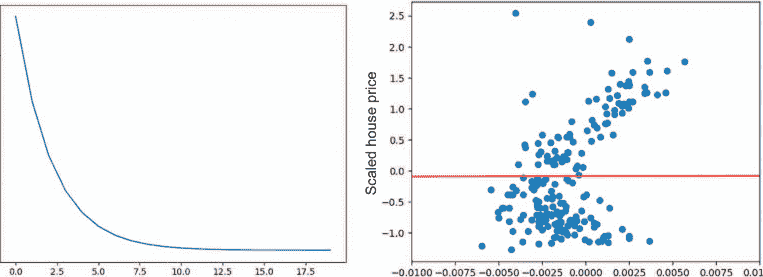

**图 6.2** 贝叶斯线性回归损失函数（左）和图（右）

左侧可以看到损失函数随轮数（epochs）的下降情况，右侧展示了加利福尼亚房价数据集投影的拟合结果。请注意，两个坐标轴都已标准化。贝叶斯线性回归成功捕捉到了房价随平均房间数增加而上升的趋势。在下一节中，我们将探讨线性回归层次模型的优势。

#### 6.3 层次贝叶斯回归

层次模型能够在组之间共享特征。模型的参数被假设为从一个共同分布中采样，该分布用于建模组间的相似性。图 6.3 展示了三种情景，用以说明层次建模的优势。在左图中，我们使用一组参数 `θ` 来建模整个观测序列，这被称为合并模型（pooled model）。在这里，数据中的任何变化都没有被显式建模，因为我们假设是一组共同的参数生成了数据。另一方面，还有非合并模型（unpooled model）情景，即为每个观测建模一组不同的参数。在非合并情形下，我们假设观测组之间没有参数共享，每个参数都是独立的。层次模型结合了两者的优点：它假设存在一个共同分布，各个参数均从该分布中采样，因此能够捕捉组间的相似性。

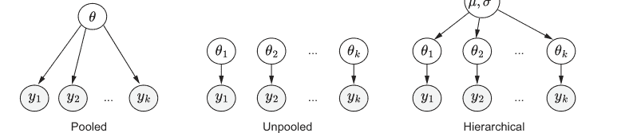

**图 6.3** 合并模型、非合并模型和层次图模型

在贝叶斯层次回归中，我们可以为模型参数指定先验，并使用 MCMC 采样来推断后验分布。我们使用氡数据集，根据楼层数（特别是有无地下室）来回归不同县房屋中的氡气水平。因此，我们的回归模型如下所示。

`α_c ~ N(μ_α, σ_α²)`  

`β_c ~ N(μ_β, σ_β²)`  

`radon_c = α_c + β_c × floor_{i,c} + ε_c  (6.10)`

请注意，下标 `c` 表示县；因此，我们为每个县学习一个从共享高斯分布中采样的截距和斜率。也就是说，我们假设了一个层次模型，其中参数（`α_c` 和 `β_c`）从共同分布中采样。在代码清单 6.2 中，我们将为回归系数定义概率分布，并将数据似然建模为标准差均匀分布的正态分布。在指定图模型后，我们可以借助 PyMC 库使用无 U 形转向采样器（NUTS）进行推断。PyMC 是 Python 中的概率编程库，可从 https://docs.pymc.io/ 下载。它是贝叶斯建模的绝佳工具，并且可以从零开始编码，因为我们是从零开始定义概率图模型，然后使用现成工具对后验分布进行采样。如果你是第一次接触概率编程语言，我强烈建议完成 PyMC 在线示例，以了解更多关于其功能的内容。

让我们来看一下图 6.4 中的伪代码。

```text
1: function main(X, y):
2: with pymc3.Model() as hierarchical_model:
3:   μa ~ N(0, 100²)
4:   σa ~ Unif[0, 100]   → Hyperpriors
5:   μb ~ N(0, 100²)
6:   σb ~ Unif[0, 100]
7:   a ~ N(μa, σa²) ← Intercept model
8:   b ~ N(μb, σb²) ← Slope model
9:   ε ~ Unif[0, 100] ← Error model
10:  y_exp = a + b × X ← Expected value
11:  y_lh ~ N(X; y_exp, ε²) ← Data likelihood
12: with hierarchical_model:
13:   mu, sds, elbo = pymc3.variational.advi(n = 100000)
14:   step = pymc3.NUTS(scaling = sds², is_cov = True) → PyMC inference
15:   trace = pymc3.sample(5000, step, start = mu)
16: return trace
```

**图 6.4** 层次贝叶斯回归伪代码

该代码由一个主函数组成。在代码的第一部分，我们定义了概率模型；在第二部分，我们使用 PyMC3 库进行变分推断。首先，我们为回归截距和斜率模型的均值和方差设置超先验。接下来，我们将截距和斜率模型定义为高斯随机变量（RV），并将误差模型定义为均匀随机变量。最后，我们计算回归表达式，并将其设为数据似然模型中的均值。然后，我们使用 PyMC 中实现的 NUTS 进行推断。

### 代码清单 6.2 层次贝叶斯回归

```python
import numpy as np
import pandas as pd

import seaborn as sns
import matplotlib.pyplot as plt

import pymc3 as pm

def main():
    data = pd.read_csv('./data/radon.txt')  ← Load data

    county_names = data.county.unique()
    county_idx = data['county_code'].values

    with pm.Model() as hierarchical_model:
        mu_a = pm.Normal('mu_alpha', mu=0., sd=100**2)
        sigma_a = pm.Uniform('sigma_alpha', lower=0,
            upper=100)
        mu_b = pm.Normal('mu_beta', mu=0., sd=100**2)
        sigma_b = pm.Uniform('sigma_beta', lower=0,
            upper=100)
        
        a = pm.Normal('alpha', mu=mu_a, sd=sigma_a,
            shape=len(data.county.unique()))  ← Intercept for each county
        b = pm.Normal('beta', mu=mu_b, sd=sigma_b,
            shape=len(data.county.unique()))  ← Slope for each county

        eps = pm.Uniform('eps', lower=0, upper=100)  ← Model error

        radon_est = a[county_idx] + b[county_idx] *
            data.floor.values  ← Expected value

        y_like = pm.Normal('y_like', mu=radon_est, sd=eps,
            observed=data.log_radon)  ← Data likelihood

    with hierarchical_model:
        # Use ADVI for initialization
        mu, sds, elbo = pm.variational.advi(n=100000)
        step = pm.NUTS(scaling=hierarchical_model.dict_to_array(sds)**2,
            is_cov=True)
        hierarchical_trace = pm.sample(5000, step, start=mu)

    pm.traceplot(hierarchical_trace[500:])
    plt.show()

if __name__ == "__main__":
    main()
```

从图 6.5 的轨迹图中，我们可以看到 `α_c` 和 `β_c` 的后验分布已经收敛，这表明不同县有不同的截距和斜率。

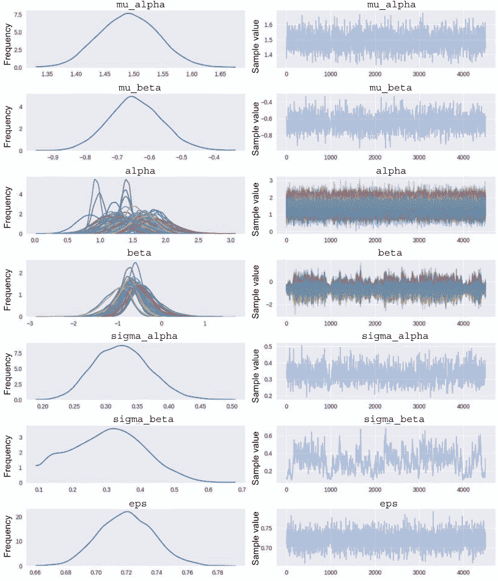

**图 6.5** 层次贝叶斯回归的 MCMC 轨迹图

此外，我们还恢复了共享参数的后验分布。`μ_a` 表示氡气水平对数的组均值接近 1.5，而 `μ_b` 表示斜率为负，其均值为 −0.65，因此，没有地下室会降低氡气水平。在下一节中，我们将研究一种适用于非线性数据的算法。

#### 6.4 KNN 回归

K 最近邻（KNN）回归是非参数模型的一个例子。对于给定的查询数据点 `q`，我们在训练集中找到它的 `k` 个最近邻，并计算平均响应变量 `y`。在本节中，我们将计算鸢尾花（iris）数据集的 KNN 目标标签的平均值。该平均值是在距离查询 `q` 最近的 K 个点的局部邻域上计算的。

$$y_q = \frac{1}{K} \sum_{i \in N_K(q,D)} y_i \quad (6.11)$$

这里，$N_K(q, D)$ 表示从训练数据集 $D$ 中查询 `q` 的 `k` 个最近邻的局部邻域。要找到局部邻域 $N_K(q, D)$，我们可以计算查询点 `q` 与训练数据集中的每个点 $x_i \in D$ 之间的距离，将这些距离按升序排序，然后取前 K 个数据点。这种方法的时间复杂度为 $O(n \log n)$，其中 `n` 是训练数据集的大小，因为需要进行排序操作。我们现在准备好从头实现一个 KNN 回归器！在图 6.6 中，KNN 回归通过基于欧氏距离对 K 个最近邻的标签取平均来计算。

```text
1: class KNN:
2: function knn_search(K, X, y, Q)
3: for query in Q:
4:   idx = argsort(euclidean_dist(query, X))[:K] ← KNN IDs
5:   knn_labels = [y[i] for i in idx] ← KNN labels
6:   y_pred = mean(knn_labels) ← KNN regression
7: end for
8: return y_pred
```

**图 6.6** KNN 回归伪代码

代码由 `knn_search` 函数组成，在该函数中，对于每个 K 最近邻查询 `Q`，我们计算查询点与所有数据点之间的欧氏距离，对结果进行排序，并选出距离最小的 K 个 ID。然后，我们通过收集这些 KNN ID 对应的标签来形成 KNN 邻域。最后，我们对 KNN 标签取平均，计算出最终结果。

### 代码清单 6.3 K 最近邻回归

```python
import numpy as np
import matplotlib.pyplot as plt

from sklearn import datasets
from sklearn.model_selection import train_test_split

np.random.seed(42)
```

```python
class KNN():
    def __init__(self, K):
        self.K = K

    def euclidean_distance(self, x1, x2):
        dist = 0
        for i in range(len(x1)):
            dist += np.power((x1[i] - x2[i]), 2)
        return np.sqrt(dist)

    def knn_search(self, X_train, y_train, Q):
        y_pred = np.empty(Q.shape[0])

        for i, query in enumerate(Q):
            idx = np.argsort([self.euclidean_distance(
                query, x) for x in X_train])[:self.K]
            knn_labels = y_train[idx]
            y_pred[i] = np.mean(knn_labels)
        return y_pred

if __name__ == "__main__":

    plt.close('all')

    #iris dataset
    iris = datasets.load_iris()
    X = iris.data[:, :2]
    y = iris.target

    X_train, X_test, y_train, y_test = train_test_split(X, y,
        test_size=0.2, random_state=42)

    K = 4
    knn = KNN(K)
    y_pred = knn.knn_search(X_train, y_train, X_test)

    plt.figure(1)
    plt.scatter(X_train[:,0], X_train[:,1], s = 100, marker = 'x', color =
        'r', label = 'data')
    plt.scatter(X_test[:,0], X_test[:,1], s = 100, marker = 'o', color =
        'b', label = 'query')
    plt.title('K Nearest Neighbors (K=%d)'% K)
    plt.legend()
    plt.xlabel('X1')
    plt.ylabel('X2')
    plt.grid(True)
    plt.show()
```

- 获取查询点的 K 个最近邻

- 计算 KNN 训练标签的平均值

- 提取 KNN 训练标签


在高维空间中寻找精确的最近邻通常在计算上不可行，因此存在近似方法。存在两类近似方法：一类是将空间划分为区域，例如在快速近似最近邻库 `FLANN` 中实现的 `k-d` 树，另一类是基于哈希的方法，例如局部敏感哈希 `LSH`。在下一节中，我们将讨论一种不同类型的函数回归。

## 6.5 高斯过程回归

高斯过程 `GPs` 定义了在观察到数据后可以更新为后验的函数先验（参见 `C. E. Rasmussen` 和 `C. K. I. Williams` 的《`Gaussian Processes for Machine Learning`》，`The MIT Press`，2006）。在监督设置中，函数在数据点 `x_i` 与目标值 `y_i` 之间给出映射：`y_i = f(x_i)`。高斯过程在给定数据 `p(f|x, y)` 的情况下推断函数分布，然后用它对新数据进行预测。`GP` 假设函数在有限且任意选择的点 `x_1, ..., x_n` 上定义，使得 `p(f(x_1), ..., f(x_n))` 是联合高斯，均值为 `μ(x)`，协方差为 `Σ(x)`，其中 `Σ_ij = κ(x_i, x_j)`，`κ` 是正定核函数。通过高斯过程回归可以解决的一个例子是基于观测测量预测 `CO₂` 水平。在代码清单 6.4 中，我们将假设正弦模型和径向基函数核。

考虑一个简单的回归问题。

`f(x) = x^T w` `y = f(x) + ε` `ε ~ N(0, σ_n^2)`

(6.12)

假设噪声独立同分布，我们可以写下以下似然函数。

`p(y|X, w) = ∏_{i=1}^n p(y_i|x_i, w) = ∏_{i=1}^n 1/(√(2π)σ_n) exp{ -(y_i - x_i^T w)^2/(2σ_n^2) }`

`~ N(Xw, σ_n^2 I)`

(6.13)

在贝叶斯框架中，我们需要对参数指定先验：`w ~ N(0, Σ_p)`。仅写出依赖于权重的似然和先验项，我们得到以下方程。

`p(w|X, y) ∝ exp{ -1/(2σ_n^2) ||y - Xw||^2 } exp{ -1/2 w^T Σ_p^{-1} w }`

`∝ exp{ -1/2 (w - \tilde{w}) (1/σ_n^2 X X^T + Σ_p^{-1}) (w - \tilde{w}) }`

`~ N( 1/σ_n^2 A^{-1} X y, A^{-1} )`

(6.14)

这里，我们假设以下。

$$A = σ_n^{-2} X X^T + Σ_p^{-1}\tag{6.15}$$

因此，我们对参数 `w` 具有闭式后验分布。要使用该方程进行预测，我们需要求逆大小为 `p × p` 的矩阵 `A`。

假设观测无噪声，我们希望预测函数输出 `y* = f(x*)`，其中 `x*` 是我们的测试数据。考虑以下联合 `GP` 分布。

$$\begin{pmatrix} f \\ f_* \end{pmatrix} \sim N\left(\begin{pmatrix} μ \\ μ_* \end{pmatrix}, \begin{pmatrix} K & K_* \\ K_*^T & K_{**} \end{pmatrix}\right)\tag{6.16}$$

这里，`K = κ(X, X)`，`K* = κ(X, X*)` 和 `K** = κ(X*, X*)`，其中 `X` 是我们的训练数据集，`X*` 是我们的测试数据集，`κ` 是核或协方差函数。使用高斯条件化的标准规则，后验具有以下形式。

`p(f_*|X_*, X, f) ~ N(f_*|μ_*, Σ_*)`
`μ_* = μ(X_*) + K_*^T K^{-1}(f - μ(X))`
`Σ_* = K_{**} - K_*^T K^{-1} K_*` (6.17)

在代码清单 6.4 中，我们使用方程 6.18 中定义的径向基函数核作为相似性度量。我们现在准备从头实现 `GP` 回归（见图 6.7）！

```
1: class GPreg:
2: function kernel_func(x, z)
3: Kfn = exp{ -1/(2σ²) ||x - z||² }  ← Radial basis function kernel
4: return Kfn
5: function compute_posterior(X)
6: K = kernel_func(X_train, X_train)
7: Ks = kernel_func(X_train, X_test)
8: Kss = kernel_func(X_test, X_test)
9: μ_post = μ(X_test) + K_s^T K^{-1} (f - μ(X_train))  → Gaussian process posterior
10: Σ_post = K_ss - K_s^T K^{-1} K_s
11: return μ_post, Σ_post
```

图 6.7 高斯过程回归伪代码

代码由 `kernel_func` 和 `compute_posterior` 函数组成。`kernel_func` 返回径向基函数 `RBF` 核，它衡量两个输入 `x` 和 `z` 之间的相似性。在 `compute_posterior` 函数中，我们首先计算

用于后验均值和协方差方程的成分，然后计算并返回

后验均值和协方差，如文中推导的那样。

### 代码清单 6.4 高斯过程回归

```python
import numpy as np
import matplotlib.pyplot as plt
from scipy.spatial.distance import cdist

np.random.seed(42)

class GPReg:

    def __init__(self, X_train, y_train, X_test):

        self.L = 1.0
        self.keps = 1e-8

        self.muFn = self.mean_func(X_test)
        self.Kfn = self.kernel_func(X_test, X_test) + 1e-15*np.eye(
            np.size(X_test))

        self.X_train = X_train
        self.y_train = y_train
        self.X_test = X_test

    def mean_func(self, x):
        muFn = np.zeros(len(x)).reshape(-1,1)
        return muFn

    def kernel_func(self, x, z):
        sq_dist = cdist(x/self.L, z/self.L, 'euclidean')**2
        Kfn = 1.0 * np.exp(-sq_dist/2)
        return Kfn

    def compute_posterior(self):
        K = self.kernel_func(self.X_train, self.X_train)
        Ks = self.kernel_func(self.X_train, self.X_test)
        Kss = self.kernel_func(self.X_test, self.X_test) + self.keps*np.eye(np.size(self.X_test))
        Ki = np.linalg.inv(K)  <--- O(N_train^3)

        postMu = self.mean_func(self.X_test) + np.dot(np.transpose(Ks),
            np.dot(Ki, (self.y_train - self.mean_func(self.X_train))))
        postCov = Kss - np.dot(np.transpose(Ks), np.dot(Ki, Ks))

        self.muFn = postMu
        self.Kfn = postCov

        return None
```

```
def generate_plots(self, X, num_samples=3):
    plt.figure()
    for i in range(num_samples):
        fs = self.gauss_sample(1)
        plt.plot(X, fs, '-k')
        #plt.plot(self.X_train, self.y_train, 'xk')
    mu = self.muFn.ravel()
    S2 = np.diag(self.Kfn)
    plt.fill_between(np.concatenate([X, X[::-1]]), np.concatenate([mu - 2*np.sqrt(S2), (mu + 2*np.sqrt(S2))[::-1]]), alpha=0.2, fc='b')
    plt.show()

def gauss_sample(self, n):
    A = np.linalg.cholesky(self.Kfn)
    Z = np.random.normal(loc=0, scale=1, size=(len(self.muFn),n))
    S = np.dot(A,Z) + self.muFn
    return S

def main():
    # generate noise-less training data
    X_train = np.array([-4, -3, -2, -1, 1])
    X_train = X_train.reshape(-1,1)
    y_train = np.sin(X_train)
    # generate test data
    X_test = np.linspace(-5, 5, 50)
    X_test = X_test.reshape(-1,1)
    gp = GPreg(X_train, y_train, X_test)
    gp.generate_plots(X_test,3)
    gp.compute_posterior()
    gp.generate_plots(X_test,3)

if __name__ == "__main__":
    main()
```

图 6.8 显示了从 `GP` 先验（左）和在无噪声观测情况下观察到五个数据点后从 `GP` 后验（右）随机绘制的三个函数。阴影区域对应于均值周围两倍标准差（95% 置信区域）。我们可以看到模型完美地插值训练数据，并且预测不确定性随着远离观测数据而增加。

由于我们的算法是在输入空间的内积方面定义的，它可以通过用 `k(x, x')` 替换内积而提升到特征空间；这通常被称为核技巧。

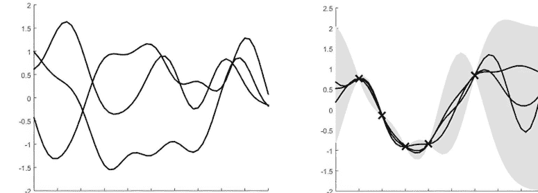

图 6.8 高斯过程回归：先验样本（左）与后验样本（右）

核函数衡量对象之间的相似性，并且不需要将对象预处理为特征向量格式。例如，一种常见的核函数是径向基函数。

`k(x, x') = exp(-||x - x'||^2/(2σ^2))`

(6.18)

对于高斯核，其特征映射存在于无限维空间中。在这种情况下，显式表示特征向量显然是不可行的。

回归算法帮助我们预测连续量。根据数据的性质（例如变量之间是线性还是非线性关系），我们可以选择线性算法，如贝叶斯线性回归，或非线性 `KNN` 回归。我们可能受益于层次模型，其中某些特征在总体中共享。此外，在预测变量之间函数关系的情况下，高斯过程回归提供了解决方案。在下一章中，我们将讨论更高级的监督学习算法。

#### 6.6 习题

- 6.1 计算 `KNN` 回归器的运行时间和内存复杂度。
- 6.2 基于多元高斯随机变量条件化的规则，推导高斯过程（`GP`）更新方程。

### 小结

- 回归算法的目标是学习从输入 `x` 到输出 `y` 的映射，其中 `y` 是一个连续量。
- 在贝叶斯线性回归中，定义为 `y(x)=w^T x + ε`，我们假设噪声项是均值为零的高斯随机变量。
- 层次模型允许在组之间共享特征。层次模型假设存在一个共同分布，个体参数从中采样，因此捕获了组之间的相似性。
- `K` 近邻（`KNN`）回归是一种非参数模型，对于给定的查询数据点 `q`，我们在训练集中找到其 `K` 个近邻，并计算响应变量 `y` 的平均值。
- 高斯过程（`GPs`）在函数上定义一个先验，一旦我们观察到数据，就可以更新为后验。`GP` 假设函数在有限且任意选择的点集 `x₁, ..., xₙ` 上定义，使得 `p(f(x₁), ..., f(xₙ))` 是联合高斯的，均值为 `μ(x)`，协方差为 `Σ(x)`，其中 `Σᵢⱼ = κ(xᵢ, xⱼ)`，`κ` 是一个正定核函数。

从训练标签到模型选择和集成方法，这些方法用于所有数据科学竞赛。最后，我们以机器学习研究和练习作为结束。让我们从回顾马尔可夫模型的基础开始。

## 7.1 马尔可夫模型

在本节中，我们讨论观测序列的概率模型。时间序列模型具有广泛的应用，包括计算金融、语音识别和计算生物学。我们将首先研究基于马尔可夫链性质的两种流行算法：`PageRank` 算法和用于隐马尔可夫模型（`HMMs`）的 `EM` 算法。

然而，在深入讨论各个算法之前，让我们从基础开始。对于随机变量序列 `x1, ..., xT` 的一阶马尔可夫模型，是一个可以如下分解的联合概率模型。

`p(x_1, ..., x_T) = p(x_1)p(x_2|x_1)⋯p(x_T|x_{T-1})`

`= p(x_1)∏_{t=2}^{T} p(x_t|x_{t-1})` (7.1)

注意，每个因子都是一个由1个随机变量条件化的条件分布（即每个因子只依赖于前一个状态，因此记忆长度为1）。我们也可以说 `X_{t-1}` 是 `X_t` 的充分统计量。充分统计量是样本数据的函数（例如数据的总结，如总和或均值），它包含了估计统计模型中未知参数所需的全部信息。

让我们更详细地考察转移概率 `p(x_t|x_{t-1})`。对于离散状态序列 `x_t ∈ {1, ..., K}`，我们可以将转移概率表示为一个 `K × K` 的随机矩阵（其中行和为1）。

`A_{ij} = p(X_t = j|X_{t-1}=i), 其中 ∑_j A_{ij}=1 ∀ i` (7.2)

图7.1显示了一个具有两个状态的简单马尔可夫模型。

这里，`α` 是离开状态1的转移概率，`1-α` 是停留在状态1的概率。注意，离开每个状态的转移概率之和为1。我们可以写出相应的转移概率矩阵如下。

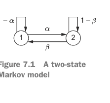

`A = [[1-α, α], [β, 1-β]]` (7.3)

如果 `α` 和 `β` 不随时间变化；换句话说，如果转移矩阵 `A` 与时间无关，我们称该马尔可夫链是平稳的或时不变的。

我们通常对马尔可夫链的长期行为感兴趣——即随着时间推移，基于对各状态访问频率的状态分布。这种分布被称为*平稳分布*。让我们来计算它！设 `π_0` 为状态的初始分布。那么，在第一次转移之后，我们有如下。

`π_1(j)=∑_i π_0(i)A_{ij}` (7.4)

或用矩阵表示，我们有如下。

`π_1=π_0 A` (7.5)

我们可以继续，写出第二次转移如下。

`π_2=π_1 A=π_0 A^2` (7.6)

我们看到，将转移矩阵 `A` 提升到 `n` 次幂等同于对马尔可夫链的 `n` 跳（或转移）进行建模。经过一段时间后，我们达到一种状态，此时将行状态向量 `π` 左乘矩阵 `A` 会得到相同的向量 `π`。

`π=π A` (7.7)

在上述情况下，我们找到了平稳分布；它等于 `π`，即对应于特征值1的 `A` 的特征向量。我们还要在此说明（证明留作练习），平稳分布存在当且仅当链是*常返的*（即它可以以概率1返回任何状态）且*非周期的*（即它不会振荡）。

##### 7.1.1 PageRank算法

谷歌使用 `PageRank` 算法对来自数百万网页的搜索结果进行排序。我们可以将 `n` 个网页的集合表述为图 `G=(V,E)`。让每个节点 `v∈V` 表示一个网页，每条边 `e∈E` 表示从一个页面到另一个页面的有向链接。那么，`G` 是一个稀疏图，且 `|V|=n`。直观地说，一个收到许多来自可信来源入链的网页应该被提升到排名列表的顶部。知道页面如何链接使我们能够构建一个巨大的转移矩阵 `A`，其中 `A_{ij}` 是从页面 `i` 跟随链接到页面 `j` 的概率。基于这个表述，我们可以将条目 `π_j` 解释为页面 `j` 的重要性或排名。考虑到上一节中马尔可夫链的讨论，`PageRank` 就是平稳分布 `π`（即对应于特征值1的 `A` 的特征向量）。

`π_j=∑_i A_{ij}π_i` (7.8)


为了使平稳分布 `π`（即PageRank）存在，我们需要保证由转移矩阵描述的马尔可夫链是常返且非周期的。让我们看看如何构建这样的转移矩阵。我们按如下方式对与网页的交互进行建模。如果某个特定页面有出链，那么以概率 `p > 0.5`（`p` 可以通过模拟选择），我们跳到其中一个出链（均匀随机决定），以概率 `1−p`，我们打开一个新页面（也均匀随机）。如果没有出链，我们打开一个新页面（均匀随机决定）。这两个条件确保马尔可夫链是常返且非周期的，因为随机跳转可以包括自转移；因此，每个状态都可以从其他任何状态到达。设 `G_ij` 为邻接矩阵，`d_j = Σ_i G_ij` 表示页面 `j` 的出度。那么，如果出度为0，我们以概率 `1/n` 跳到随机页面。以概率 `p`，我们以等于出度 `1/d_j` 的概率跟随链接，以概率 `1−p`，我们跳到随机页面。让我们在以下等式中总结转移矩阵。

$$A_{ij} = \begin{cases} \frac{p G_{ij}}{d_j} + \frac{1-p}{n} & \text{if } d_j \neq 0 \\ \frac{1}{n} & \text{if } d_j = 0 \end{cases}\tag{7.9}$$

然而，鉴于转移矩阵 `A` 的规模巨大，我们如何找到特征向量 `π`？我们将使用一种称为幂法的迭代算法来计算PageRank。设 `v0` 为 `A` 值域中的任意向量——我们可以随机初始化 `v0`。现在考虑反复将 `v` 乘以 `A` 并重新归一化 `v`。

$$\begin{aligned} v_t &= A v_{t-1} \\ v_t &= \frac{v_t}{\|v_t\|} \\ \lambda &= v_t^T A v_t \end{aligned}\tag{7.10}$$

如果我们重复该算法直到收敛（$\|v_t\| \approx \|v_{t-1}\|$）或直到达到最大迭代次数 `T`，我们就得到平稳分布 `π = v_T`。这之所以有效，是因为我们可以写出矩阵 `A = U Λ U^T`。然后，我们得到以下方程。

$$\begin{aligned} v_t &= A v_{t-1} = A^t v_0 = (U \Lambda U^T)^t v_0 = U (\Lambda^t U^T v_0) \\ &= a_1 \lambda_1^t u_1 + a_2 \lambda_2^t u_2 + \cdots + a_n \lambda_n^t u_n \\ &= \lambda_1^t \left(a_1 u_1 + a_2 \left(\frac{\lambda_2}{\lambda_1}\right)^t u_2 + \cdots + a_n \left(\frac{\lambda_n}{\lambda_1}\right)^t u_n\right) \\ &\to \lambda_1^t a_1 u_1 \end{aligned}\tag{7.11}$$

方程 `7.11` 对某些系数 `a_i` 成立，并且由于 `U` 是一个正交归一矩阵（即 `U^T U = I`）且当 `k > 1` 时 `|λ_k| / |λ_1| < 1`，`v_t` 收敛到 `u_1`，这等于我们的平稳分布！我们可以将 PageRank 算法总结在图 7.2 中的伪代码中。

```
1: class page_rank
2: function power_iteration(A):
3: v0 ~ Unif[0, 1]^d
4: while (not converged) and (iter ≤ max_iter):
5:   v_t = A v_{t-1}
6:   v_t = v_t / ||v_t||
7:   λ = v_t^T A v_t
8:   converged = ||v_t - v_{t-1}|| ≤ tolerance
9: end while
10: return λ, v_t
```

### 图 7.2 PageRank 伪代码

我们首先从 `d` 维均匀分布中采样向量 `v` 的初始值。接下来，我们通过将 `A` 与 `v` 相乘并重新归一化 `v` 来迭代。我们重复此过程，直到收敛或超过最大迭代次数。现在我们准备从头开始实现用于计算 PageRank 的幂方法算法，见下面的列表。

### 列表 7.1 PageRank 算法

```
import numpy as np
from numpy.linalg import norm

np.random.seed(42)

class page_rank():
    def __init__(self):
        self.max_iter = 100
        self.tolerance = 1e-5

    def power_iteration(self, A):
        n = np.shape(A)[0]
        v = np.random.rand(n)
        converged = False
        iter = 0

        while (not converged) and (iter < self.max_iter):
            old_v = v
            v = np.dot(A, v)
            v = v / norm(v)
            lambd = np.dot(v, np.dot(A, v))
            converged = norm(v - old_v) < self.tolerance
            iter += 1
        #end while
```

```
return lambd, v

if __name__ == "__main__":
    X = np.random.rand(10,5)
    A = np.dot(X.T, X)

    pr = page_rank()
    lambd, v = pr.power_iteration(A)

    print(lambd)
    print(v)

    #compare against np.linalg implementation
    eigval, eigvec = np.linalg.eig(A)
    idx = np.argsort(np.abs(eigval))[::-1]
    top_lambd = eigval[idx][0]
    top_v = eigvec[:,idx][0]
```

为简化起见构造一个对称的随机实矩阵

与 `np.linalg` 实现进行比较

如我们所见，我们的实现成功找到了对应于特征值 `1` 的 `A` 的特征向量，这等于 PageRank。

#### 7.1.2 隐马尔可夫模型

隐马尔可夫模型（HMMs）表示从股票市场预测到 DNA 测序等应用中的时间序列数据。HMM 基于具有潜在状态 `z_t ∈ {1, ..., K}` 的离散状态马尔可夫链、转移矩阵 `K` 以及建模从每个状态发出的观测数据 `X` 的发射矩阵 `E`。HMM 图模型如图 7.3 所示。

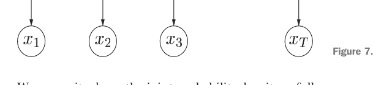

### 图 7.3 隐马尔可夫模型

我们可以按如下方式写出联合概率密度。

联合分布

`p(z1:T, x1:T | θ)`

`= p(z1:T | θ) p(x1:T | z1:T, θ)`

`= p(z1 | π) [∏_{t=2}^{T} p(zt | zt-1, A)] [∏_{t=1}^{T} p(xt | zt, E)] (7.12)`

根据 HMM 模型的分解

初始状态分布

状态转移分布

状态发射分布

这里，`θ = {π, A, E}` 是 HMM 参数，其中 `π` 为初始状态分布。状态数 `K` 通常由应用决定。例如，我们可以使用 `K = 2` 个状态来建模睡眠-觉醒周期。数据本身可以是离散的也可以是连续的。我们将关注离散情况，其中发射矩阵 `E_{kl} = p(x_t = l | z_t = k)`。假设转移矩阵不随时间变化且等于 `A_{ij} = p(z_t = j | z_{t-1} = i)`。

我们通常有兴趣根据在任意给定时间发出的观测值 `x` 来预测未观测的潜在状态 `z`。在数学记号中，我们需要 `p(z_t = j | x_{1:t})`。我们称此量为 `α_t(j)`。

$$\alpha_t(j) = p(z_t = j \mid x_{1:t})$$  

(7.13)

让我们计算它！注意 alpha 连续值之间的递归关系。让我们推导这个递归式。

$$\begin{aligned}

p(z_t = j \mid x_{1:t-1})

&= \sum_{z_{t-1}} p(z_t = j, z_{t-1} \mid x_{1:t-1}) \\

&= \sum_i p(z_t = j \mid z_{t-1} = i)p(z_{t-1} = i \mid x_{1:t-1}) \\

&= \sum_i A(i,j)\alpha_{t-1}(i)

\end{aligned}$$  

(7.14)

在预测步骤中，我们对所有可能的 `i` 状态求和，并将 alpha 与转移到 `j` 状态的转移矩阵相乘。让我们在更新步骤中使用预测步骤的结果。

$$\begin{aligned}

\alpha_t(j)

&= p(z_t = j \mid x_{1:t}) = p(z_t = j \mid x_t, x_{1:t-1}) \\

&= \frac{p(x_t \mid z_t = j, x_{1:t-1})p(z_t = j \mid x_{1:t-1})}{p(x_t \mid x_{1:t-1})} \\

&= \frac{p(x_t \mid z_t = j)p(z_t = j \mid x_{1:t-1})}{\sum_{z_t}p(x_t,z_t \mid x_{1:t-1})} \\

&= \frac{p(x_t \mid z_t = j)p(z_t = j \mid x_{1:t-1})}{\sum_j p(x_t \mid z_t = j)p(z_t = j \mid x_{1:t-1})} \\

&= \frac{1}{Z_t}E_t(j)\sum_i A(i,j)\alpha_{t-1}(i)

\end{aligned}$$  

(7.15)

我们可以按如下方式用矩阵记号总结我们的推导。

$$\alpha_t \propto E_t(A^T\alpha_{t-1})$$  

(7.16)

给定 alpha 的递归关系和初始条件，我们可以计算潜在状态边缘分布。该算法被称为 *前向算法*，因为它通过前向递归传递来计算 alphas。它是一种实时算法，适用于诸如手写或语音识别等应用（在适当特征下）。然而，通过考虑直到时间 `T` 的所有数据，我们可以改进边缘分布的估计。让我们通过引入反向传递来弄清楚如何做到这一点。前向-后向算法的基本思想是通过对 `z_t` 进行条件化将马尔可夫链划分为过去和未来。设 `T` 为时间序列结束的时间。让我们按如下方式定义所有观测数据的边缘概率。

`γ_t(j) = p(z_t = j | x_{1:T}) = p(z_t = j | x_{1:t}, x_{t+1:T})`

`= (1/Z_t) p(z_t = j | x_{1:t}) p(x_{t+1:T} | z_t = j)`

`∝ α_t(j) β_t(j)  (7.17)`

这里，我们定义了 `β_t(j) = p(x_{t+1:T} | z_t = j)`，并使用了在状态 `z_t` 条件下的过去链和未来链的条件独立性。但问题仍然存在：我们如何计算 `β_t(j)`？我们可以从时间 `t = T` 开始使用类似的递归向后进行。

$$\begin{aligned}
\beta_{t-1}(i) &= p(x_{t:T} \mid z_{t-1} = i) = \sum_j p(z_t = j, x_t, x_{t+1:T} \mid z_{t-1} = i) \\
&= \sum_j p(x_{t+1:T} \mid z_t = j, x_t, z_{t-1} = i) p(z_t = j, x_t \mid z_{t-1} = i) \\
&= \sum_j p(x_{t+1:T} \mid z_t = j) p(z_t = j, x_t \mid z_{t-1} = i) \\
&= \sum_j p(x_{t+1:T} \mid z_t = j) p(x_t \mid z_t = j, z_{t-1} = i) p(z_t = j \mid z_{t-1} = i) \\
&= \sum_j \beta_t(j) E_t(j) A(i, j)
\end{aligned}$$  

(7.18)

我们可以按如下方式用矩阵记号总结我们的推导。

$$\beta_{t-1} = A(E_t \beta_t)$$  (7.19)

这里，基本情况如下。

$$\beta_T(i) = p(X_{T+1:T} \mid z_T = i) = 1$$  (7.20)

这是因为序列在时间 `T` 结束，且 `X_{T+1:T}` 是一个概率为 `1` 的空事件。在计算了 alpha 和 beta 消息后，我们可以将它们结合起来得到平滑的边缘分布：`γ_t(j) ∝ α_t(j) β_t(j)`。

现在让我们看看如何解码潜在状态变量 `z_t` 之间的最大似然转移序列。换句话说，我们希望找到以下内容。

`z^* = argmax_{z_{1:T}} p(z_{1:T} | x_{1:T})  (7.21)`

设 `δ_t(j)` 为在最可能的路径序列 `z_{1:t-1}^*` 给定下结束于状态 `j` 的概率。

`δ_t(j) = max_{z_1,...,z_{t-1}} p(z_t = j, z_{1:t-1} | x_{1:t})  (7.22)`

我们可以按如下方式递归表示它。

`δ_t(j) = max_i δ_{t-1}(i) A(i,j) E_t(j)  (7.23)`

该算法被称为 Viterbi 算法。让我们在图 7.4 的伪代码中总结我们迄今为止所学的内容。

```
1: class HMM
2: function forward_backward:
3: for t = 1 to n:
4:   α_t = normalize(E_t A^T α_{t-1})
5: end for
6: for t = n - 1 to 1:
7:   β_t = normalize(A (E_t β_{t+1}))
8: end for
9: γ = α · β
10: return γ, α, β
11: function viterbi:
12: for t = 1 to n:
13:   δ_t[j] = max_i (δ_{t-1}[i] A[i,j] E_t[j])
14: end for
```

### 图 7.4 隐马尔可夫模型伪代码

我们有两个主要函数：`forward_backward` 和 `viterbi`。在 `forward_backward` 函数中，我们构造一个发射指示符的稀疏矩阵 `X` 并计算前向概率 `α`，在每次迭代中进行归一化。同样，我们按先前推导的方式计算后向概率 `β`。最后，我们通过将 `α` 和 `β` 相乘来计算边缘概率 `γ`。在 `viterbi` 函数中，我们应用对数尺度以提高数值稳定性，并用加法代替乘法，计算如前所述推导的 `δ` 表达式。现在我们准备从头开始实现 HMM 的推理！

## 清单 7.2 前向–后向 HMM 算法


```python
import numpy as np
from scipy.sparse import coo_matrix
import matplotlib.pyplot as plt

np.random.seed(42)

class HMM():
    def __init__(self, d=3, k=2, n=10000):
        self.d = d
        self.k = k
        self.n = n

        self.A = np.zeros((k,k))
        self.E = np.zeros((k,d))
        self.s = np.zeros(k)

        self.x = np.zeros(self.n)

    def normalize_mat(self, X, dim=1):
        z = np.sum(X, axis=dim)
        Xnorm = X/z.reshape(-1,1)
        return Xnorm

    def normalize_vec(self, v):
        z = sum(v)
        u = v / z
        return u, z

    def init_hmm(self):

        #initialize matrices at random
        self.A = self.normalize_mat(np.random.rand(self.k,self.k))
        self.E = self.normalize_mat(np.random.rand(self.k,self.d))
        self.s, _ = self.normalize_vec(np.random.rand(self.k))

        #generate markov observations
        z = np.random.choice(self.k, size=1, p=self.s)
        self.x[0] = np.random.choice(self.d, size=1, p=self.E[z,:].ravel())
        for i in range(1, self.n):
            z = np.random.choice(self.k, size=1, p=self.A[z,:].ravel())
            self.x[i] = np.random.choice(self.d, size=1,
                p=self.E[z,:].ravel())
        #end for

    def forward_backward(self):

        #construct sparse matrix X of emission indicators
        data = np.ones(self.n)
        row = self.x
        col = np.arange(self.n)
        X = coo_matrix((data, (row, col)), shape=(self.d, self.n))

        M = self.E * X

        At = np.transpose(self.A)
        c = np.zeros(self.n)  #normalization constants
        alpha = np.zeros((self.k, self.n))  #alpha = p(z_t = j | x_{1:T})
        alpha[:,0], c[0] = self.normalize_vec(self.s * M[:,0])
        for t in range(1, self.n):
            alpha[:,t], c[t] = self.normalize_vec(np
                .dot(At, alpha[:,t-1]) * M[:,t])
        #end for

        beta = np.ones((self.k, self.n))
        for t in range(self.n-2, 0, -1):
            beta[:,t] = np.dot(self.A, beta[:,t+1] * M[:,t+1])/c[t+1]
        #end for
        gamma = alpha * beta

        return gamma, alpha, beta, c

    def viterbi(self):

        #construct sparse matrix X of emission indicators
        data = np.ones(self.n)
        row = self.x
        col = np.arange(self.n)
        X = coo_matrix((data, (row, col)), shape=(self.d, self.n))

        #log scale for numerical stability
        s = np.log(self.s)
        A = np.log(self.A)
        M = np.log(self.E * X)

        Z = np.zeros((self.k, self.n))
        Z[:,0] = np.arange(self.k)
        v = s + M[:,0]
        for t in range(1, self.n):
            Av = A + v.reshape(-1,1)
            v = np.max(Av, axis=0)
            idx = np.argmax(Av, axis=0)
            v = v.reshape(-1,1) + M[:,t].reshape(-1,1)
            Z = Z[idx,:]
            Z[:,t] = np.arange(self.k)
        #end for
        llh = np.max(v)
        idx = np.argmax(v)
        z = Z[idx,:]

        return z, llh


if __name__ == "__main__":

    hmm = HMM()
    hmm.init_hmm()

    gamma, alpha, beta, c = hmm.forward_backward()
    z, llh = hmm.viterbi()
```

数据维度；隐状态维度；数据点数量；发射矩阵；转移矩阵；初始状态向量；发射观测值

在训练集中建立界定清晰的簇，并提升分类性能。单侧选择（OSS）方法从多数类 `E` 中选取一个有代表性的子集，并将其与所有少数类样本 `S_min` 组成的集合合并，构成 `N = {E ∪ S_min}`。进一步处理缩减后的集合 `N`，以移除所有多数类 Tomek 链接。让我们使用 `imbalanced-learn` 库来实验 Tomek 链接欠采样。

## 清单 7.3 Tomek 链接算法

```python
import numpy as np
import seaborn as sns
import matplotlib.pyplot as plt

from sklearn.model_selection import train_test_split
from sklearn.utils import shuffle
from imblearn.under_sampling import TomekLinks

rng = np.random.RandomState(42)

def main():
    n_samples_1 = 500
    n_samples_2 = 50
    X_syn = np.r_[1.5 * rng.randn(n_samples_1, 2), 0.5 * rng.randn(n_samples_2, 2) + [2, 2]]
    y_syn = np.array([0] * (n_samples_1) + [1] * (n_samples_2))
    X_syn, y_syn = shuffle(X_syn, y_syn)
    X_syn_train, X_syn_test, y_syn_train, y_syn_test = train_test_split(X_syn, y_syn)

    tl = TomekLinks(sampling_strategy='auto')
    X_resampled, y_resampled = tl.fit_resample(X_syn, y_syn)
    idx_resampled = tl.sample_indices_
    idx_samples_removed = np.setdiff1d(np.arange(X_syn.shape[0]), idx_resampled)

    fig = plt.figure()
    ax = fig.add_subplot(1, 1, 1)

    idx_class_0 = y_resampled == 0
    plt.scatter(X_resampled[idx_class_0, 0], X_resampled[idx_class_0, 1], alpha=.8, label='Class #0')
    plt.scatter(X_resampled[-idx_class_0, 0], X_resampled[-idx_class_0, 1], alpha=.8, label='Class #1')
    plt.scatter(X_syn[idx_samples_removed, 0], X_syn[idx_samples_removed, 1], alpha=.8, label='Removed samples')
    plt.title('Undersampling: Tomek links')
    plt.legend()
    plt.show()

if __name__ == "__main__":
    main()
```

图 7.6 显示了由此产生的输出。因此，我们可以看到，移除不想要的类重叠可以增强决策边界的稳健性，并提高分类精度。

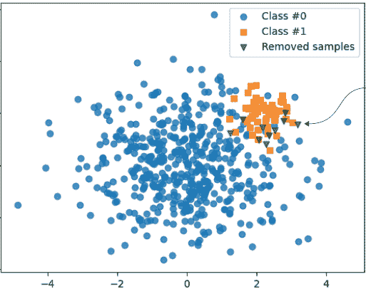

**图 7.6** Tomek 链接算法，展示了分类边界处被移除的若干样本

### 7.2.2 过采样策略

过采样方法将数据追加到原始数据集的少数类中，如图 7.7 所示。*随机过采样*只是将数据点均匀随机地添加到少数类中。*合成少数类过采样技术*（SMOTE）通过寻找特征空间中的 *K* 个最近邻，并沿着连接任意 *K* 个少数类最近邻的线段生成新的数据点，从而产生合成样本。合成样本的生成方式如下：取当前考虑的特征向量（样本）与其最近邻之间的差值，将该差值乘以一个 0 到 1 之间的随机数，再加到当前考虑的特征向量上，从而用一个新的数据点扩充数据集。

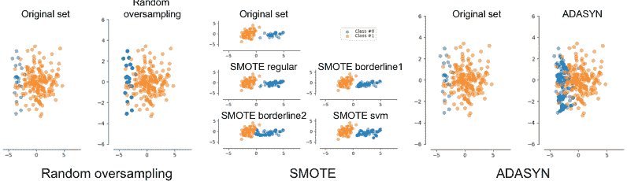

**图 7.7** 过采样策略

自适应合成采样（ADASYN）根据少数类样本的学习难易程度，对不同样本使用加权分布：越难学习的少数类样本，就会生成越多的合成数据。因此，ADASYN 方法在两个方面改善了对不平衡数据集的学习：减少类别不平衡引入的偏差，并自适应地将分类决策边界向困难样本偏移。让我们使用 `imbalanced-learn` 库来实验 SMOTE 过采样。

## 清单 7.4 SMOTE 算法

```python
import seaborn as sns
import matplotlib.pyplot as plt

from sklearn.datasets import make_classification
from sklearn.decomposition import PCA

from imblearn.over_sampling import SMOTE

def plot_resampling(ax, X, y, title):
    c0 = ax.scatter(X[y == 0, 0], X[y == 0, 1], label="Class #0", alpha=0.5)
    c1 = ax.scatter(X[y == 1, 0], X[y == 1, 1], label="Class #1", alpha=0.5)
    ax.set_title(title)
    ax.spines['top'].set_visible(False)
    ax.spines['right'].set_visible(False)
    ax.get_xaxis().tick_bottom()
    ax.get_yaxis().tick_left()
    ax.spines['left'].set_position(('outward', 10))
    ax.spines['bottom'].set_position(('outward', 10))
    ax.set_xlim([-6, 8])
    ax.set_ylim([-6, 6])

    return c0, c1

def main():
    X, y = make_classification(n_classes=2, class_sep=2, weights=[0.3, 0.7],
                               n_informative=3, n_redundant=1, flip_y=0,
                               n_features=20, n_clusters_per_class=1,
                               n_samples=80,
                               random_state=10)  # Generates the dataset

    pca = PCA(n_components=2)
    X_vis = pca.fit_transform(X)  # Fits PCA for visualization

    method = SMOTE()
    X_res, y_res = method.fit_resample(X, y)  # Applies regular SMOTE
    X_res_vis = pca.transform(X_res)

    f, (ax1, ax2) = plt.subplots(1, 2)  # Generates plots
    c0, c1 = plot_resampling(ax1, X_vis, y, 'Original')
    plot_resampling(ax2, X_res_vis, y_res, 'SMOTE')
    ax1.legend((c0, c1), ('Class #0', 'Class #1'))
    plt.tight_layout()
```

```python
plt.show()

if __name__ == "__main__":
    main()
```

在清单7.4中，我们生成了一个包含两个不平衡类别的高维数据集。我们应用常规的SMOTE过采样算法，并拟合一个双成分PCA，以在二维空间中可视化数据。图7.8展示了最终输出。

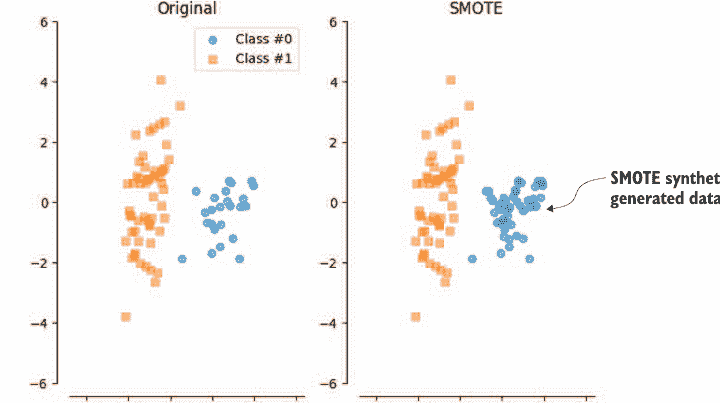

图7.8 SMOTE算法

因此，我们可以看到SMOTE用合成数据密集地填充了少数类。可以将过采样和欠采样技术结合为一种混合策略。常见的例子包括SMOTE与Tomek链接，或SMOTE与编辑最近邻（ENN）。在类别不平衡数据集上学习的其他方法包括对训练实例加权、为正例和负例引入不同的误分类成本，以及自助采样法。在接下来的章节中，我们将聚焦于监督式机器学习中一个非常重要的原理，它可以减少所需训练样本的数量：主动学习。

#### 7.3 主动学习

主动学习背后的关键思想是，如果允许机器学习算法选择其学习所用的数据，那么它可以用更少的训练标签实现更高的准确率。在许多现代机器学习问题中，主动学习具有充分的动机：未标注数据可能非常丰富，但获取标签的成本很高。主动学习有时被称为查询学习或最优实验设计，因为主动学习者以未标注数据实例的形式提出查询，并由标注专家进行标注。通过这种方式，主动学习者力求使用尽可能少的标注实例来实现高准确率。相关综述可参见Burr Settles所著的《主动学习文献综述》（威斯康星大学麦迪逊分校，计算机科学系，2009年）。

我们关注基于池的采样，该方法假设存在一个较小的标注数据集`L`和一个较大的未标注数据池`U`。根据信息量度量，从池中选择性地抽取查询。基于池的方法对整个未标注数据集合进行排序，以选择最佳查询。因此，对于非常大的数据集，基于流的采样可能更合适，这种采样方式顺序扫描数据并逐个评估查询决策。图7.9展示了一个基于池的主动学习示例，该示例使用逻辑回归（LR）对包含两个平衡类别的合成数据集进行二分类。

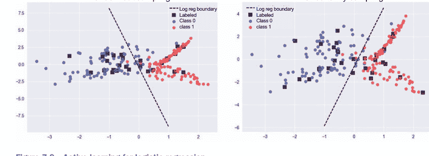

图7.9 用于逻辑回归的主动学习

在左侧，我们可以看到逻辑回归决策边界，它是在随机子采样的30个标签上训练的结果，在留出数据上达到了90%的分类准确率。在右侧，我们可以看到逻辑回归决策边界，它是在基于熵的不确定性采样所选择的30个查询上训练的结果。不确定性采样在留出集上达到了更高的分类准确率，为92.5%。

##### 7.3.1 查询策略


## 查询策略

查询策略指的是我们在主动学习中选择训练样本子集时所使用的标准。在这里，我们将讨论两种查询策略：不确定性采样和委员会查询。

### 不确定性采样

不确定性采样是最简单且最常用的查询框架之一。在此框架中，主动学习者查询其最不确定的标签。例如，在二元逻辑回归中，不确定性采样查询靠近边界附近的点，这些点的正例概率接近½。对于多类别问题，不确定性采样可以查询最不确信的点。

$x_{LC}^* = \arg\max_x 1 - P_\theta(\hat{y}|x)$  (7.24)

这里，$y \in \{1, ..., K\}$ 是在模型 $\theta$ 下具有最高后验概率的类别标签。最不确信策略的标准只考虑最可能的标签的信息。我们可以使用最大间隔采样来保留剩余标签分布的信息。

$x_M^* = \arg\min_x P_\theta(\hat{y}_1|x) - P_\theta(\hat{y}_2|x)$  (7.25)

这里，$y_1$ 和 $y_2$ 分别是模型下第一和第二最可能的类别标签。直观地说，具有大间隔的实例容易分类。因此，间隔小的点是模糊的，知道它们的标签将帮助模型更有效地区分它们。然而，对于标签集非常大的多类别问题，间隔策略仍然忽略了其余类别的大部分输出分布。一种更通用的不确定性采样策略基于熵。

$x_H^* = \arg\max_x - \sum_i P_\theta(y_i|x) \log P_\theta(y_i|x)$  (7.26)

通过学习具有最高熵的标签，我们可以减少标签的不确定性。不确定性采样也适用于回归问题，在这种情况下，学习者查询其预测中输出方差最大的点。

### 委员会查询

另一种查询选择框架是委员会查询（QBC）算法，它需要维护一个模型委员会 $C = \{\theta^1, ..., \theta^C\}$，这些模型都在当前标注集 $L$ 上训练，但代表相互竞争的假设。然后，每个委员会成员可以对查询候选者的标签进行投票，而信息量最大的查询被认为是他们最不一致的实例。QBC的目标是缩减与当前标注训练数据 $L$ 一致的一组假设。已经提出了两种衡量不一致程度的主要方法：投票熵和KL散度。投票熵定义如下。

$x_{V_E}^* = \arg\max_x - \sum_i \frac{V(y_i)}{C} \log \frac{V(y_i)}{C}$  (7.27)

这里，$y_i \in \{1, ..., K\}$ 是类别标签，$V(y_i)$ 是某个标签从委员会成员那里获得的票数，$C$ 是委员会的规模。请注意其与公式7.26的相似性。QBC投票的KL散度定义如下。

$x_{KL}^* = \arg\max_x \frac{1}{C} \sum_{c=1}^C KL(P_{\theta(c)}||P_C)$

$KL(P_{\theta(c)}||P_C) = \sum_i P_{\theta(c)}(y_i|x) \log \frac{P_{\theta(c)}(y_i|x)}{P_C(y_i|x)}$

$P_C(y_i|x) = \frac{1}{C} \sum_{c=1}^C P_{\theta(c)}(y_i|x)$ (7.28)

这里，$\theta_c$ 代表委员会的一个成员模型，$P_C(y_i|x)$ 是 $y_i$ 作为预测标签的共识概率。KL散度度量将最具信息量的查询视为任何一个委员会成员的标签分布与共识分布之间平均差异最大的查询。

## 方差缩减

我们可以通过最小化输出方差来降低泛化误差。考虑一个回归问题，其学习目标是使均方误差最小化。设 $\bar{\theta} = E[\hat{\theta}]$ 为参数估计 $\hat{\theta}$ 的期望值，$\theta^*$ 为真实值。然后，我们得到以下结果。

MSE $= E[(\hat{\theta} - \theta^*)^2] = E[((\hat{\theta} - \bar{\theta}) + (\bar{\theta} - \theta^*))^2]$

$= E[(\hat{\theta} - \bar{\theta})^2] + 2(\bar{\theta} - \theta^*)E[\hat{\theta} - \bar{\theta}] + (\bar{\theta} - \theta^*)^2$

$= E[(\hat{\theta} - \bar{\theta})^2] + (\bar{\theta} - \theta^*)^2$

$= \text{VAR}[\hat{\theta}] + \text{bias}^2(\hat{\theta})$ (7.29)

这被称为*偏差-方差权衡*。因此，如果偏差估计器能减少方差，那么使用它就有可能获得更低的MSE。我们可能想知道方差能低到什么程度。克拉美-拉奥下界给出了答案，它为任何无偏估计器的方差提供了一个下界。

### 克拉美-拉奥下界

假设 $p(x|\theta)$ 满足正则条件，则任何无偏估计器的方差满足以下条件。

$\text{VAR}(\hat{\theta}) \ge \frac{1}{-E\left[\frac{\partial^2 \log p(x|\theta)}{\partial \theta^2}\right]} = \frac{1}{I(\theta)}$ (7.30)

这里，$I(\theta)$ 是费雪信息矩阵。因此，最小方差无偏（MVU）估计器实现了等于费雪信息矩阵逆的最小方差。为了最小化参数估计的方差，主动学习者应选择使 Fisher 信息最大化的数据。对于具有 K 个参数的多变量模型，Fisher 信息的形式为 K × K 矩阵。

[I(θ)]_{ij} = -E[ ∂² log p(x|θ) / ∂θ_i ∂θ_j ] (7.31)

因此，最小化逆信息矩阵有几种选择：A-最优性最小化迹 Tr(I^{-1}(θ))；D-最优性最小化行列式 |I^{-1}(θ)|；E-最优性最小化最大特征值 λ_max [I^{-1}(θ)]。

然而，方差缩减方法存在一些计算上的缺点。估计输出方差需要对每个未标记实例求逆 K × K 矩阵，导致时间复杂度为 O(UK³)，其中 U 为查询池的大小。因此，方差缩减方法在经验上比诸如不确定性采样等更简单的查询策略更慢。让我们在 图 7.10 中查看主动学习器类的一些伪代码。

```
1: class ActiveLearner
2: function uncertainty_sampling(clf, X):
3:   P_θ(ŷ|x) = clf.predict_proba(X)
4:   if strategy = "least confident":
5:     return arg max_x 1 - P_θ(ŷ|x)
6:   else if strategy = "max margin":
7:     return arg min_x P_θ(ŷ1|x) - P_θ(ŷ2|x)
8:   else if strategy = "entropy":
9:     return arg max_x - Σ_i P_θ(y_i|x) log P_θ(y_i|x)
10:  end if
11: function query_by_committee(clf, X):
12:  if strategy = "vote entropy":
13:    C = len(clf)
14:    for model in clf:
15:      y_i = clf.predict
16:    end for
17:    V(y_i) = 1/C Σ_{i=1}^C 1[[y_i]]
18:    return arg max_x - Σ_i V(y_i)/C log V(y_i)/C
19:  else if strategy = "average kl divergence":
20:    P_C(y_i|x) = 1/C Σ_{c=1}^C P_{θ(c)}(y_i|x)
21:    KL(P_{θ(c)}||P_C) = Σ_i P_{θ(c)}(y_i|x) log P_{θ(c)}(y_i|x)/P_C(y_i|x)
22:    return arg max_x 1/C Σ_{c=1}^C KL(P_{θ(c)}||P_C)
23: end if
```

图 7.10 主动学习器伪代码

我们有两个主要函数：`uncertainty_sampling` 和 `query_by_committee`。在 `uncertainty_sampling` 函数中，我们将分类器模型 `clf` 和未标记数据 `x` 作为输入传入。然后我们预测给定分类器模型和训练数据的标签概率，并使用该预测计算三种不确定性采样策略之一，如文中所述。在 `query_by_committee` 函数中，我们实现了两种委员会方法：`vote entropy` 和 `average KL divergence`。然而，我们现在传入一组模型 `clf`——其预测用于对预测标签进行投票，从而形成用于评估熵的分布。在 KL 散度情况下，我们在计算每个模型与平均值之间的 KL 散度时使用模型预测的平均值。我们返回使该 KL 散度最大化的训练样本。我们现在准备审阅以下代码清单。

## 清单 7.5 主动学习器类

```
from __future__ import unicode_literals, division

from scipy.sparse import csc_matrix, vstack

from scipy.stats import entropy

from collections import Counter

import numpy as np

class ActiveLearner(object):

    uncertainty_sampling_frameworks = [

        'entropy',

        'max_margin',

        'least_confident',

    ]

    query_by_committee_frameworks = [

        'vote_entropy',

        'average_kl_divergence',

    ]

    def __init__(self, strategy='least_confident'):

        self.strategy = strategy

    def rank(self, clf, X_unlabeled, num_queries=None):

        if num_queries == None:

            num_queries = X_unlabeled.shape[0]

        elif type(num_queries) == float:

            num_queries = int(num_queries * X_unlabeled.shape[0])

        if self.strategy in self.uncertainty_sampling_frameworks:

            scores = self.uncertainty_sampling(clf, X_unlabeled)

        elif self.strategy in self.query_by_committee_frameworks:

            scores = self.query_by_committee(clf, X_unlabeled)

        else:

            raise ValueError("this strategy is not implemented.")

        rankings = np.argsort(-scores)[:num_queries]

        return rankings
```

```python
def uncertainty_sampling(self, clf, X_unlabeled):
    probs = clf.predict_proba(X_unlabeled)

    if self.strategy == 'least_confident':
        return 1 - np.amax(probs, axis=1)  ← Least confident

    elif self.strategy == 'max_margin':
        margin = np.partition(-probs, 1, axis=1)
        return -np.abs(margin[:,0] - margin[:, 1])  ← Max margin

    elif self.strategy == 'entropy':
        return np.apply_along_axis(entropy, 1,
        probs)  ← Entropy
```

```python
def query_by_committee(self, clf, X_unlabeled):

    num_classes = len(clf[0].classes_)

    C = len(clf)

    preds = []

    if self.strategy == 'vote_entropy':

        for model in clf:

            y_out = map(int, model.predict(X_unlabeled))

            preds.append(np.eye(num_classes)[y_out])

        votes = np.apply_along_axis(np.sum, 0, np.stack(preds)) / C

        return np.apply_along_axis(entropy, 1,

        votes)  ← Vote entropy

    elif self.strategy == 'average_kl_divergence':

        for model in clf:

            preds.append(model.predict_proba(X_unlabeled))

        consensus = np.mean(np.stack(preds), axis=0)

        divergence = []

        for y_out in preds:

            divergence.append(entropy(consensus.T, y_out.T))

        return np.apply_along_axis(np.mean, 0, np.stack(divergence))  ← Average KL divergence
```

我们将主动学习器应用于以下清单中的逻辑回归示例。

## 清单 7.6 逻辑回归的主动学习器

```python
import numpy as np
import seaborn as sns
import matplotlib.pyplot as plt

from active_learning import ActiveLearner
from sklearn.metrics import accuracy_score
from sklearn.datasets import make_classification
from sklearn.linear_model import LogisticRegression
from sklearn.model_selection import train_test_split
```

```
y2_preds = clf2.predict(X_unlabeled)
score2 = accuracy_score(y_oracle, y2_preds)
print("active learning accuracy: ", score2)

#plot 2D decision boundary: w2x2 + w1x1 + w0 = 0
w0 = clf2.intercept_
w1, w2 = clf2.coef_[0]
xx = np.linspace(-1, 1, 100)
decision_boundary = -w0/float(w2) - (w1/float(w2))*xx

plt.figure()
plt.scatter(data[al_idx,0], data[al_idx,1], c='black', marker='s',
    s=64, label='labeled')
plt.scatter(data[target==0,0], data[target==0,1], c='blue', marker='o',
    alpha=0.5, label='class 0')
plt.scatter(data[target==1,0], data[target==1,1], c='red', marker='o',
    alpha=0.5, label='class 1')
plt.plot(xx, decision_boundary, linewidth = 2.0, c='black', linestyle =
    '--', label='log reg boundary')
plt.title("Uncertainty Sampling")
plt.legend()
plt.show()

if __name__ == "__main__":
    main()
```

主动学习和半监督学习都试图充分利用未标记数据。例如，一种基本的半监督技术是自训练，其中学习器首先用少量标记数据进行训练，然后用于对未标记数据进行分类。最有信心的未标记实例连同其预测标签被添加到训练集中，并重复该过程。

图 7.11 将三种不确定性采样技术：`least confident`、`max margin` 和 `entropy` 与 20 个新闻组数据集上的随机子采样基线进行比较，该数据集使用逻辑回归进行分类。


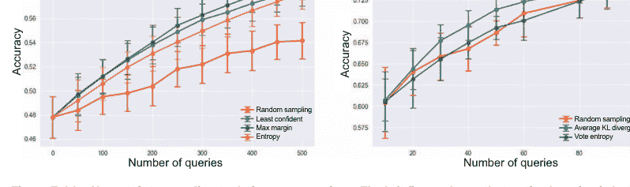

图 7.11 不确定性采样技术比较。左图显示主动学习优于随机采样。右图显示平均 KL 散度优于随机采样。

### 7.4.1 贝叶斯优化

而不是根据选定的分布随机探索参数空间，采用主动学习方法以减少不确定性并在探索与利用之间取得平衡来选择连续参数值将是很好的。贝叶斯优化通过利用高斯过程（GPs）来建模算法的泛化性能，提供了一个自动化的贝叶斯框架（参见 Jasper Snoek、Hugo Larochelle 和 Ryan P. Adams 的“Practical Bayesian Optimization of Machine Learning Algorithms”，Conference and Workshop on Neural Information Processing Systems，2012）。

贝叶斯优化假设合适的性能函数是从 GP 中采样的，并在进行观测时为该函数维护一个后验分布：f(x) ~ GP(m(x), κ(x, x′))。为了选择下一步探索哪些超参数，可以优化相对于当前最佳结果的期望改进（EI）或高斯过程上置信界（UCB）。EI 和 UCB 已被证明在找到多峰黑箱函数的全局最优所需的功能评估次数方面是高效的。

贝叶斯优化使用来自目标函数先前评估的所有可用信息，而不是依赖于局部梯度和 Hessian 近似。这导致了一种自动化程序，可以在相对较少的评估中找到非凸函数的最优值，其代价是进行更多计算以确定下一个尝试点。这在评估成本高昂时特别有用，例如在为深度神经网络选择超参数时。贝叶斯优化算法在图 7.12 中进行了总结。

```
1: for n = 1, 2, ... do
2:   select new x_{n+1} by optimizing acquisition function α
3:     x_{n+1} = arg max_x α(x; D_n, θ)
4:   query objective function to obtain y_{n+1} = f(x_{n+1})
5:   augment data D_{n+1} = {D_n, (x_{n+1}, y_{n+1})}
6:   update GP posterior and acquisition function
7: end for
```

**图 7.12 贝叶斯优化算法**

以下清单将贝叶斯优化应用于 SVM 和随机森林分类器（RFC）中的超参数搜索。

**清单 7.7 SVM 和 RFC 的贝叶斯优化**

```
import numpy as np
import pandas as pd

import seaborn as sns
import matplotlib.pyplot as plt

from sklearn.datasets import make_classification
from sklearn.model_selection import cross_val_score
```

```python
from sklearn.ensemble import RandomForestClassifier as RFC
from sklearn.svm import SVC

from bayes_opt import BayesianOptimization

np.random.seed(42)

#### Load data set and target values
data, target = make_classification(
    n_samples=1000,
    n_features=45,
    n_informative=12,
    n_redundant=7
)
target = target.ravel()

def svccv(gamma):
    val = cross_val_score(
        SVC(gamma=gamma, random_state=0),
        data, target, scoring='f1', cv=2
    ).mean()

    return val

def rfccv(n_estimators, max_depth):
    val = cross_val_score(
        RFC(n_estimators=int(n_estimators),
            max_depth=int(max_depth),
            random_state=0)
        ,
        data, target, scoring='f1', cv=2
    ).mean()
    return val

if __name__ == "__main__":

    gp_params = {"alpha": 1e-5}

    #SVM
    svcBO = BayesianOptimization(svccv,
        {'gamma': (0.00001, 0.1)})

    svcBO.maximize(init_points=3, n_iter=4, **gp_params)

    #Random Forest
    rfcBO = BayesianOptimization(
        rfccv,
        {'n_estimators': (10, 300),
         'max_depth': (2, 10)}
    )
    rfcBO.maximize(init_points=4, n_iter=4, **gp_params)

    print('Final Results')
    print(svcBO.max)
    print(rfcBO.max)
```

SVM分类器

随机森林（RF）分类器

图7.13展示了将贝叶斯优化应用于SVM和RFC。

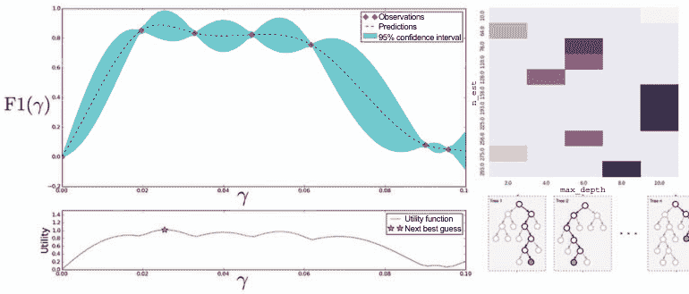

**图7.13** 贝叶斯优化在SVM和RFC上的应用

F1分数被用作分类任务的性能目标函数。左图展示了F1分数的贝叶斯优化结果，该分数是SVM RBF核的gamma参数的函数，其中核函数 $K(x, x') = \exp(-\gamma \|x-x'\|^2)$ 的gamma是精度，等于方差的倒数。可以看到，仅经过七次迭代，我们就找到了能给出最大F1分数的gamma参数。底部的EI效用函数峰值告诉我们下一步应进行哪个实验。右图展示了F1分数的贝叶斯优化结果，该分数是随机森林分类器的最大深度和估计器数量的函数。从热图可以看出，当估计器数量为158、最大深度为10时，F1分数达到最大值。

## 7.5 集成方法

集成方法是一种元算法，它将多种机器学习技术组合到一个预测模型中，以降低方差（装袋）、降低偏差（提升）或改进预测（堆叠）。集成方法可分为两组：*顺序集成方法*，基学习器按顺序生成（如AdaBoost）；*并行集成方法*，基学习器并行生成（如随机森林）。顺序方法的基本动机是利用基学习器之间的依赖关系，因为通过对先前被错误标记的样本赋予更高的权重，可以提升整体性能。并行方法的基本动机是利用基学习器之间的独立性，因为通过平均可以显著降低误差。

大多数集成方法使用单一的基学习算法来生成同质的基学习器（即类型相同的学习器），从而形成*同质集成*。也有一些方法使用异质学习器（即不同类型的学习器），从而形成*异质集成*。为了确保集成方法比其任何单个成员都更准确，基学习器必须尽可能准确且多样。

### 7.5.1 装袋法（Bagging）

装袋法（Bagging）代表*自助聚合*（bootstrap aggregation）。减少估计方差的一种方法是将多个估计值平均在一起。例如，我们可以在数据的不同子集（有放回地随机选取）上训练*M*棵不同的决策树 $f_m$，并计算集成模型。

$f(x) = \frac{1}{M} \sum_{m=1}^{M} f_m(x)$

(7.32)

装袋法使用自助采样来获取用于训练基学习器的数据子集。在聚合基学习器的输出时，装袋法对分类使用投票，对回归使用平均。下面的代码清单展示了装袋集成实验。

**代码清单7.8 装袋集成**

```
import itertools
import numpy as np

import seaborn as sns
import matplotlib.pyplot as plt
import matplotlib.gridspec as gridspec

from sklearn import datasets

from sklearn.tree import DecisionTreeClassifier
from sklearn.neighbors import KNeighborsClassifier
from sklearn.linear_model import LogisticRegression
from sklearn.ensemble import RandomForestClassifier

from sklearn.ensemble import BaggingClassifier
from sklearn.model_selection import cross_val_score, train_test_split

from mlxtend.plotting import plot_learning_curves
from mlxtend.plotting import plot_decision_regions

def main():
    iris = datasets.load_iris()
    X, y = iris.data[:, 0:2], iris.target

    clf1 = DecisionTreeClassifier(criterion='entropy',
        max_depth=None)
    clf2 = KNeighborsClassifier(n_neighbors=1)

    bagging1 = BaggingClassifier(base_estimator=clf1, n_estimators=10,
        max_samples=0.8, max_features=0.8)
    bagging2 = BaggingClassifier(base_estimator=clf2, n_estimators=10,
        max_samples=0.8, max_features=0.8)

label = ['Decision Tree', 'K-NN', 'Bagging Tree', 'Bagging K-NN']
clf_list = [clf1, clf2, bagging1, bagging2]

fig = plt.figure(figsize=(10, 8))
gs = gridspec.GridSpec(2, 2)
grid = itertools.product([0,1],repeat=2)

for clf, label, grd in zip(clf_list, label, grid):
    scores = cross_val_score(clf, X, y, cv=3, scoring='accuracy')
    print("Accuracy: %.2f (+/- %.2f) [%s]" %(scores.mean(),
        scores.std(), label))
    clf.fit(X, y)
    ax = plt.subplot(gs[grd[0], grd[1]])
    fig = plot_decision_regions(X=X, y=y, clf=clf, legend=2)
    plt.title(label)

plt.show()
#plt.savefig('./figures/bagging_ensemble.png')

#plot learning curves
X_train, X_test, y_train, y_test = train_test_split(X, y,
    test_size=0.3, random_state=0)

plt.figure()
plot_learning_curves(X_train, y_train, X_test, y_test, bagging1,
    print_model=False, style='ggplot')
plt.show()
#plt.savefig('./figures/bagging_ensemble_learning_curve.png')

#Ensemble Size
num_est = list(map(int, np.linspace(1,100,20)))
bg_clf_cv_mean = []
bg_clf_cv_std = []
for n_est in num_est:
    print("num_est: ", n_est)
    bg_clf = BaggingClassifier(base_estimator=clf1, n_estimators=n_est,
        max_samples=0.8, max_features=0.8)
    scores = cross_val_score(bg_clf, X, y, cv=3, scoring='accuracy')
    bg_clf_cv_mean.append(scores.mean())
    bg_clf_cv_std.append(scores.std())

plt.figure()
(_, caps, _) = plt.errorbar(num_est, bg_clf_cv_mean,
    yerr=bg_clf_cv_std, c='blue', fmt='-o', capsize=5)
for cap in caps:
    cap.set_markeredgewidth(1)
plt.ylabel('Accuracy'); plt.xlabel('Ensemble Size'); plt.title('Bagging
Tree Ensemble');
plt.show()
#plt.savefig('./figures/bagging_ensemble_size.png')

if __name__ == "__main__":
    main()
```

因此，随机森林的偏差略微增加，但由于对相关性较低的树进行平均，其方差减小，从而得到整体上更好的模型。

在*极端随机树*中，算法的随机性更进一步：分裂阈值是随机化的。它不是寻找最具判别力的阈值，而是为每个候选特征随机抽取阈值，并从这些随机生成的阈值中选出最佳值作为分裂规则。这通常可以让模型方差进一步减小一点——但代价是偏差会稍微增大。

### 7.5.2 提升（Boosting）

*提升（Boosting）*指一类能将弱学习器转换为强学习器的算法。提升的主要原理是在数据的加权版本上拟合一系列弱学习器（即仅比随机猜测略好的模型，如小型决策树），其中对被前几轮错误分类的样本赋予更大的权重。然后通过加权多数投票（分类）或加权求和（回归）组合预测结果，以产生最终预测。提升与委员会方法（如装袋法）的主要区别在于，基学习器是按顺序在数据的加权版本上训练的。

图7.15中的算法描述了最广泛使用的提升算法形式：*AdaBoost*，即自适应提升（adaptive boosting）。可以看到，第一个基分类器 $y_1(x)$ 使用权重系数 $w_n^1$ 进行训练，这些系数全部相等。在后续的提升轮次中，对于被错误分类的数据点，权重系数 $w_n^m$ 会增大；对于被正确分类的数据点，权重系数会减小。量 $\epsilon_m$ 表示每个基分类器的加权错误率。因此，权重系数 $\alpha_m$ 会给更准确的分类器赋予更大的权重。

```
1: Init data weights $\{w_n\}$ to $\frac{1}{N}$
2: for $m = 1$ to $M$ do
3:    if a classifier $y_m(x)$ by minimizing weighted error function $J_m$:
4:       $J_m = \sum_{n=1}^{N} w_n^{(m)}\,1[y_m(x_n) \ne t_n]$
5:       compute $\epsilon_m = \frac{\sum_{n=1}^{N} w_n^{(m)}1[y_m(x_n)\ne t_n]}{\sum_{n=1}^{N} w_n^{(m)}}$
6:       evaluate $\alpha_m = \log\left(\frac{1-\epsilon_m}{\epsilon_m}\right)$
7:       update the data weights: $w_n^{(m+1)} = w_n^{(m)}\exp\{\alpha_m\,1[y_m(x_n)\ne t_n]\}$
8:    end for
9: Make predictions using the final model: $Y_M(x)=\operatorname{sign}\left(\sum_{m=1}^{M}\alpha_m y_m(x)\right)$
```

**图7.15   AdaBoost算法伪代码**

下面的代码清单使用不同数量的学习器来训练AdaBoost分类器。

**清单 7.9 提升集成**


```python
import itertools
import numpy as np

import seaborn as sns
import matplotlib.pyplot as plt
import matplotlib.gridspec as gridspec

from sklearn import datasets

from sklearn.tree import DecisionTreeClassifier
from sklearn.neighbors import KNeighborsClassifier
from sklearn.linear_model import LogisticRegression

from sklearn.ensemble import AdaBoostClassifier
from sklearn.model_selection import cross_val_score, train_test_split

from mlxtend.plotting import plot_learning_curves
from mlxtend.plotting import plot_decision_regions

def main():
    iris = datasets.load_iris()
    X, y = iris.data[:, 0:2], iris.target

    #XOR dataset
    #X = np.random.randn(200, 2)
    #y = np.array(map(int,np.logical_xor(X[:, 0] > 0, X[:, 1] > 0)))

    clf = DecisionTreeClassifier(criterion='entropy',
        max_depth=1)

    num_est = [1, 2, 3, 10]
    label = ['AdaBoost (n_est=1)', 'AdaBoost (n_est=2)', 'AdaBoost (n_est=3)', 'AdaBoost (n_est=10)']

    fig = plt.figure(figsize=(10, 8))
    gs = gridspec.GridSpec(2, 2)
    grid = itertools.product([0,1],repeat=2)

    for n_est, label, grd in zip(num_est, label, grid):
        boosting = AdaBoostClassifier(base_estimator=clf, n_estimators=n_est)
        boosting.fit(X, y)
        ax = plt.subplot(gs[grd[0], grd[1]])
        fig = plot_decision_regions(X=X, y=y, clf=boosting, legend=2)
        plt.title(label)

    plt.show()
    #plt.savefig('./figures/boosting_ensemble.png')

    #plot learning curves
    X_train, X_test, y_train, y_test = train_test_split(X, y, test_size=0.3,
        random_state=0)
```

```python
boosting = AdaBoostClassifier(base_estimator=clf, n_estimators=10)

plt.figure()
plot_learning_curves(X_train, y_train, X_test, y_test, boosting,
    print_model=False, style='ggplot')
plt.show()
#plt.savefig('./figures/boosting_ensemble_learning_curve.png')

num_est = list(map(int, np.linspace(1,100,20)))  ← Ensemble size
bg_clf_cv_mean = []
bg_clf_cv_std = []
for n_est in num_est:
    print("num_est: ", n_est)
    ada_clf = AdaBoostClassifier(base_estimator=clf, n_estimators=n_est)
    scores = cross_val_score(ada_clf, X, y, cv=3, scoring='accuracy')
    bg_clf_cv_mean.append(scores.mean())
    bg_clf_cv_std.append(scores.std())

plt.figure()
(_, caps, _) = plt.errorbar(num_est, bg_clf_cv_mean,
    yerr=bg_clf_cv_std, c='blue', fmt='-o', capsize=5)
for cap in caps:
    cap.set_markeredgewidth(1)
plt.ylabel('Accuracy'); plt.xlabel('Ensemble Size'); plt.title('AdaBoost Ensemble');
plt.show()
#plt.savefig('./figures/boosting_ensemble_size.png')

if __name__ == "__main__":
    main()
```

提升集成在图 7.16 中进行了说明。每个基学习器都由深度为 1 的决策树组成，因此根据特征阈值对数据进行分类，该阈值将空间划分为两个区域，由平行于其中一个轴的线性决策面分隔。该图还显示了测试准确率如何随着集成规模的增大而提高，以及训练和测试数据的学习曲线。

*梯度树提升* 是提升到任意可微损失函数的推广。它可用于回归和分类问题。梯度提升以顺序方式构建模型。

$$F_m(x) = F_{m-1}(x) + \gamma_m h_m(x)$$  (7.33)

在每个阶段，决策树 $h_m(x)$ 被选为在给定当前模型 $F_{m-1}(x)$ 的情况下最小化损失函数 $L$。

$$F_m(x) = F_{m-1}(x) + \arg\min_h \sum_{i=1}^{n} L(y_i, F_{m-1}(x_i) + h(x_i))$$  (7.34)

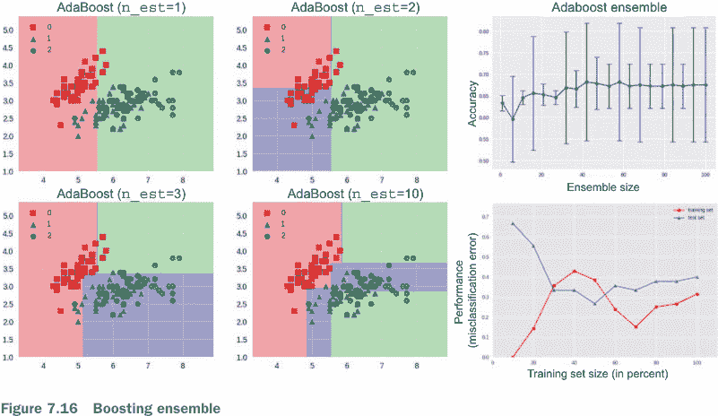

梯度提升尝试通过最陡下降法数值求解该最小化问题。最陡下降方向是损失函数在当前模型 $F_{m-1}$ 处求值的负梯度。回归和分类的算法在所使用的损失函数类型上有所不同。

##### 7.5.3 **堆叠**

*堆叠* 是一种集成学习技术，通过元分类器或元回归器组合多个分类或回归模型。基础层模型基于完整的训练集进行训练，然后元模型基于基础层模型的输出作为特征进行训练。基础层通常由不同的学习算法组成；因此，堆叠集成通常是异构的。图 7.17 中的算法概括了堆叠。

```text
1:  Input: training data D = {xᵢ, yᵢ}ᵐᵢ₌₁
2:  Output: ensemble classifier H
3:  Step 1: learn base-level classifiers
4:  for t = 1 to T do
5:      learn hₜ based on D
6:  end for
7:  Step 2: construct new data set of predictions
8:  for i = 1 to m do
9:      Dₕ = {x′ᵢ, yᵢ}, where x′ᵢ = {h₁(xᵢ), …, hₜ(xᵢ)}
10: end for
11: Step 3: learn a meta-classifier
12: learn H based on Dₕ
13: return H
```

**图 7.17**  *堆叠算法伪代码*

##### 清单 7.10 堆叠集成

```python
import itertools
import numpy as np
import seaborn as sns
import matplotlib.pyplot as plt
import matplotlib.gridspec as gridspec

from sklearn import datasets

from sklearn.linear_model import LogisticRegression
from sklearn.neighbors import KNeighborsClassifier
from sklearn.naive_bayes import GaussianNB
from sklearn.ensemble import RandomForestClassifier
from mlxtend.classifier import StackingClassifier

from sklearn.model_selection import cross_val_score, train_test_split

from mlxtend.plotting import plot_learning_curves
from mlxtend.plotting import plot_decision_regions

def main():
    iris = datasets.load_iris()
    X, y = iris.data[:, 1:3], iris.target

    clf1 = KNeighborsClassifier(n_neighbors=1)
    clf2 = RandomForestClassifier(random_state=1)
    clf3 = GaussianNB()
    lr = LogisticRegression()
    sclf = StackingClassifier(classifiers=[clf1, clf2, clf3],
                              meta_classifier=lr)  ← Stacking classifier

    label = ['KNN', 'Random Forest', 'Naive Bayes', 'Stacking Classifier']
    clf_list = [clf1, clf2, clf3, sclf]

    fig = plt.figure(figsize=(10,8))
    gs = gridspec.GridSpec(2, 2)
    grid = itertools.product([0,1], repeat=2)

    clf_cv_mean = []
    clf_cv_std = []
    for clf, label, grd in zip(clf_list, label, grid):
        scores = cross_val_score(clf, X, y, cv=3, scoring='accuracy')
        print("Accuracy: %.2f (+/- %.2f) [%s]" %(scores.mean(), scores.std(), label))
        clf_cv_mean.append(scores.mean())
        clf_cv_std.append(scores.std())

        clf.fit(X, y)
        ax = plt.subplot(gs[grd[0], grd[1]])
        fig = plot_decision_regions(X=X, y=y, clf=clf)
        plt.title(label)

    plt.show()
    #plt.savefig("./figures/ensemble_stacking.png")
```

```python
#plot classifier accuracy
plt.figure()
(_, caps, _) = plt.errorbar(range(4), clf_cv_mean, yerr=clf_cv_std,
    c='blue', fmt='-o', capsize=5)
for cap in caps:
    cap.set_markeredgewidth(1)
plt.xticks(range(4), ['KNN', 'RF', 'NB', 'Stacking'],
    rotation='vertical')
plt.ylabel('Accuracy'); plt.xlabel('Classifier');
plt.title('Stacking Ensemble');
plt.show()
#plt.savefig('./figures/stacking_ensemble_size.png')

#plot learning curves
X_train, X_test, y_train, y_test = train_test_split(X, y,
    test_size=0.3, random_state=0)

plt.figure()
plot_learning_curves(X_train, y_train, X_test, y_test, sclf,
    print_model=False, style='ggplot')
plt.show()
#plt.savefig('./figures/stacking_ensemble_learning_curve.png')

if __name__ == "__main__":
    main()
```

堆叠集成在图 7.18 中进行了说明。它由 KNN、随机森林和朴素贝叶斯基分类器组成，其预测结果由逻辑回归作为元分类器进行组合。我们可以看到堆叠分类器实现的决策边界的融合。该图还显示堆叠的准确率高于单个分类器，并且根据学习曲线，它没有过拟合的迹象。

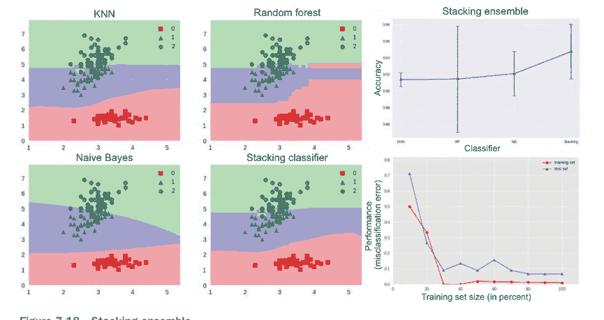

图 7.18 堆叠集成

#### 7.6 机器学习研究：监督学习算法

在本节中，我们将介绍与本章前面介绍的主题相关的额外见解和研究。在分类部分，我们推导了几种经典算法，并为新算法的设计奠定了坚实的基础。对于感知器算法，我们看到了如何通过引入不同的损失函数来模块化算法，从而导致略有不同的更新规则。此外，损失函数本身可以加权以考虑不平衡的数据集。同样，在 SVM 的情况下，我们可以选择合适的核函数。我们研究了多类 SVM；然而，使用 RBF 核的单类 SVM 可用于异常检测。

除了 `SGD` 之外，逻辑回归的求解器还有几种扩展，包括 `liblinear`（使用坐标下降）、`newton-cg`（一种可导致更快收敛的二阶方法）以及 `LBFGS`（一种内存和计算效率都很高的强大优化框架）。同样，根据其建模的数据类型，朴素贝叶斯算法也有几种扩展，例如多项式朴素贝叶斯和高斯朴素贝叶斯。这些的推导与我们详细研究的伯努利朴素贝叶斯非常相似。

在回归部分，我们首次遇到了非参数模型——即 KNN 回归器。我们将在第 8 章探讨这一丰富的模型集合，在那里我们将讨论参数数量随数据增长的贝叶斯非参数模型。例如，在 Dirichlet 过程（DP）HMM 中，我们有潜在无限数量的状态，概率质量集中在数据支持的少数几个状态上（例如，参见 Emily B. Fox 等人的“A Sticky HDP-HMM with Application to Speaker Diarization”，《Annals of Applied Statistics》，2011）。

我们观察到了使用分层模型的优势。只要不同数据组具有共同特征，就可以使用该技术，从而允许从不同数据组中共享统计强度。分层模型通常在较少观测的情况下提供更高的准确性，例如分层 HMM 和分层 Dirichlet 过程混合模型（例如，参见 Jason Chang 和 John W. Fisher III 的“Parallel Sampling of HDPs using Sub-Cluster Splits”，神经信息处理系统会议和研讨会，2014）。

当我们讨论 PageRank 时，由于对数百万网页的计算，我们涉及到了可扩展的机器学习。可扩展机器学习是一个重要的研究领域。在工业界，Spark ML 通常用于处理大数据。然而，为了理解可并行化算法是如何构建的，从头实现它们是有帮助的。有关可扩展算法的更多信息，读者可以阅读 Ron Bekkerman、Mikhail Bilenko 和 John Langford（2011）所著的《Scaling Up Machine Learning: Parallel and Distributed Approaches》。

HMM 有几种推广。一个例子是半马尔可夫 HMM，它对基因组数据中常见的可变持续时间的状态转移进行建模。另一个例子是分层 HMM，它对语音应用中常见的具有分层结构的数据进行建模。最后，还有因子 HMM，它对从每个状态发出的观测数据进行建模。推理使用 EM 算法或带有 Viterbi 最大似然序列解码器的前向-后向算法进行。

- 不平衡学习主要有两种策略：对多数类进行欠采样和对少数类进行过采样。额外的方法包括在损失函数中引入类别权重。

- 在主动学习中，机器学习算法以最大化学习并需要更少训练样本的方式选择训练数据样本。主要有两种查询策略：不确定性采样和委员会查询。

- 偏差-方差权衡要求均方误差等于偏差平方加上方差。最小方差由 Fisher 信息的逆给出，Fisher 信息衡量对数似然的曲率。


- 在模型选择中，我们通常希望遵循奥卡姆剃刀原则，选择能很好解释数据的最简单模型。在超参数优化中，除了网格搜索和随机搜索之外，贝叶斯优化使用主动学习方法，以减少不确定性并在探索和利用之间取得平衡。

- 集成方法是将几种机器学习技术组合成一个预测模型的元算法，以降低方差（`bagging`）、降低偏差（`boosting`）或改进预测（`stacking`）。

## 第 3 部分

### 无监督学习

在本书的第三部分，我们将回顾无监督学习算法。当没有训练标签可用时，就会进行无监督学习。在无监督学习的情况下，我们通常对发现数据中的模式和学习数据表示感兴趣。

在第 8 章，我们将首先研究 `K-means` 算法的贝叶斯非参数扩展，然后是高斯混合模型的 `EM` 算法。然后我们将研究两种不同的降维技术——即 `PCA` 和 `t-SNE` 应用于学习图像流形。

在第 9 章，我们将继续讨论选定的无监督学习算法。我们将首先研究用于学习主题模型的潜在狄利克雷分配，然后是密度估计器和结构学习算法，最后是模拟退火和遗传算法。最后，我们将回顾机器学习研究文献，重点关注无监督学习。

### 基础无监督学习算法

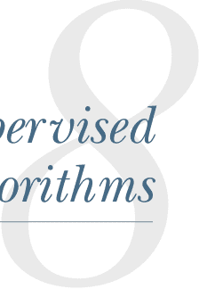

**本章涵盖**

- Dirichlet 过程 `K-means`
- 高斯混合模型
- 降维

在之前的章节中，我们研究了用于分类和回归的监督算法；在本章中，我们将重点转向无监督学习算法。*无监督学习* 在没有训练标签可用时进行。在这种情况下，我们对发现数据中的模式和学习数据表示感兴趣。无监督学习的应用范围从电子商务中的客户细分聚类到从图像数据中提取特征。在本章中，我们将首先研究 `K-means` 算法的贝叶斯非参数扩展，然后是高斯混合模型（`GMM`）的 `EM` 算法。然后我们将研究两种不同的降维技术——即 `PCA` 和 `t-SNE`——用于学习图像流形。本章中的算法因其数学深度和在实际应用中的有用性而被选中。

#### 8.1 Dirichlet 过程 *K*-means

Dirichlet 过程（`DP`）*K*-means 是 *K*-Means 算法的贝叶斯非参数扩展。*K*-means 是一种聚类算法，例如可应用于客户细分，其中客户按购买历史、兴趣和地理位置分组。`DP-means` 与 *K*-means 相似，只是当数据点距离所有现有聚类中心足够远时，会创建新的聚类；因此，聚类数量随数据增长。`DP-means` 收敛于一个类似 *K*-means 的目标的局部最优解，该目标包含对聚类数量的惩罚。

我们根据以下方程的最小值选择聚类 `K`。

$$\underset{k}{\arg\min}\{\|x_i-\mu_1\|^2,\ldots,\|x_i-\mu_k\|^2,\lambda\} \tag{8.1}$$

所得到的更新类似于 *K*-means 重新分配步骤，在该步骤中，我们将点重新分配到对应于最近均值的聚类，或者如果平方欧几里得距离大于 `$\lambda$` 则启动新聚类。`DP means` 算法在图 8.1 中进行了总结。

```
1: Init. $K = 1$, $l_1 = \{x_1,\ldots,x_n\}$ and $\mu_1$ the global mean
2: Init. labels $z_i = 1$ for all $i = 1,\ldots,n$
3: Init. $\lambda = \text{kpp\_init}(X, K_{\text{init}})$
4: Repeat until convergence:
5: &nbsp;&nbsp;&nbsp;&nbsp;for each $x_i$:
6: &nbsp;&nbsp;&nbsp;&nbsp;&nbsp;&nbsp;&nbsp;&nbsp;compute $d_{ic} = \|x_i - \mu_c\|^2$ for $c = 1,\ldots,K$
7: &nbsp;&nbsp;&nbsp;&nbsp;&nbsp;&nbsp;&nbsp;&nbsp;if $\min_c d_{ic} > \lambda$, set $K = K + 1$ and $\mu_k = x_i$
8: &nbsp;&nbsp;&nbsp;&nbsp;&nbsp;&nbsp;&nbsp;&nbsp;otherwise, set $z_i = \arg\min_c d_{ic}$
9: &nbsp;&nbsp;&nbsp;&nbsp;for each cluster $l_j = \{x_i|z_i = j\}$, compute $\mu_j = \frac{1}{|l_j|}\sum_{x\in l_j}x$
10: &nbsp;&nbsp;&nbsp;&nbsp;Compute the objective: $\sum_{c=1}^{K}\sum_{x\in l_c}\|x-\mu_c\|^2 + \lambda K$
```

图 8.1  
`DP-means` 算法  
伪代码

为了评估聚类性能，我们可以使用以下指标：归一化互信息（`NMI`）、信息变化（`VI`）和调整兰德指数（`ARI`）。`NMI` 定义如下。

$$\operatorname{NMI}(X,Y)=\frac{I(X;Y)}{\frac{H(X)+H(Y)}{2}} \tag{8.2}$$

这里，`$H(X)$` 是 `X` 的熵，`$I(X;Y)$` 是真实标签分配 `X`（当可用时）与计算分配 `Y` 之间的互信息。有关信息度量的综述，请参阅 Thomas M. Cover 和 Joy A. Thomas（Wiley，2006）所著的 *《信息论基础》* 了解详情。

设 `$p_{XY}(i,j)=|x_i\cap y_j|/N$` 为标签属于 `X` 中的簇 `$x_i$` 且属于 `Y` 中的 `$y_j$` 的概率。类似地定义 `$p_X(i)=|x_i|/N$` 和 `$p_Y(j)=|y_j|/N$`。于是我们得到以下方程。

$$I(X;Y)=\sum_i\sum_j p_{XY}(i,j)\log\frac{p_{XY}(i,j)}{p_X(i)p_Y(j)} \tag{8.3}$$

因此，`NMI` 在 0 到 1 之间，值越高表示标签分配越相似。变分信息 (`VI`) 定义如下。

$$VI(X;Y)=H(X)+H(Y)-2I(X;Y)=H(X|Y)+H(Y|X) \tag{8.4}$$

因此，随着标签分配 `X` 和 `Y` 之间重叠的增加，`VI` 减小。`ARI` 通过考虑所有样本对并统计预测簇和真实簇中分配到相同或不同簇的样本对来计算两个簇之间的相似性度量。

$$\begin{aligned}
ARI &= \frac{RI-E[RI]}{\max RI-E[RI]}\\
RI &= \frac{TP+TN}{TP+FP+FN+TN}
\end{aligned} \tag{8.5}$$

因此，对于彼此相似的簇分配，`ARI` 接近 1。让我们从头实现 Dirichlet 过程 `K-means` 算法！

## 清单 8.1 Dirichlet 过程 K-means

```python
import numpy as np
import matplotlib.pyplot as plt

import time
from sklearn import metrics
from sklearn.datasets import load_iris

np.random.seed(42)

class dpmeans:

    def __init__(self,X):
        self.K = 1
        self.K_init = 4
        self.d = X.shape[1]
        self.z = np.mod(np.random.permutation(X.shape[0]),self.K)+1
        self.mu = np.random.standard_normal((self.K, self.d))
        self.sigma = 1
```

```python
self.nk = np.zeros(self.K)
self.pik = np.ones(self.K)/self.K

self.mu = np.array([np.mean(X,0)])
self.Lambda = self.kpp_init(X,self.K_init)
self.max_iter = 100
self.obj = np.zeros(self.max_iter)
self.em_time = np.zeros(self.max_iter)

def kpp_init(self,X,k):

    [n,d] = np.shape(X)
    mu = np.zeros((k,d))
    dist = np.inf*np.ones(n)

    mu[0,:] = X[int(np.random.rand() *n-1),:]
    for i in range(1,k):
        D = X-np.tile(mu[i-1,:], (n,1))
        dist = np.minimum(dist, np.sum(D*D,1))
        idx = np.where(np.random.rand() <
    np.cumsum(dist/float(sum(dist))))
        mu[i,:] = X[idx[0][0],:]
        Lambda = np.max(dist)

    print "Lambda: ", Lambda

    return Lambda

def fit(self,X):

    obj_tol = 1e-3
    max_iter = self.max_iter
    [n,d] = np.shape(X)

    obj = np.zeros(max_iter)
    em_time = np.zeros(max_iter)
    print 'running dpmean !.'

    for iter in range(max_iter):
        tic = time.time()
        dist = np.zeros((n,self.K))

        for kk in range(self.K):
            Xm = X - np.tile(self.mu[kk,:],(n,1))
            dist[:,kk] = np.sum(Xm*Xm,1)

        dmin = np.min(dist,1)
        self.z = np.argmin(dist,1)
        idx = np.where(dmin > self.Lambda)

        if (np.size(idx) > 0):
            self.K = self.K + 1
            self.z[idx[0]] = self.K-1 #cluster labels in [0,...,K-1]
```

初始化均值

初始化 lambda

K++ 初始化

Lambda 是到 k++ 均值的最大距离

分配步骤

更新标签

```python
MI = Hx + Hy - Hxy;
nmi = MI/float(0.5*(Hx+Hy))

return nmi

def generate_plots(self,X):
    plt.close('all')
    plt.figure(0)
    for kk in range(self.K):
        #idx = np.where(self.z == kk)
        plt.scatter(X[self.z == kk,0], X[self.z == kk,1], \
                    s = 100, marker='o', c = np.random.rand(3,),
                    label = str(kk))
    #end for
    plt.xlabel('X1')
    plt.ylabel('X2')
    plt.legend()
    plt.title('DP-means clusters')
    plt.grid(True)
    plt.show()

    plt.figure(1)
    plt.plot(self.obj)
    plt.title('DP-means objective function')
    plt.xlabel('iterations')
    plt.ylabel('penalized l2 squared distance')
    plt.grid(True)
    plt.show()

if __name__ == "__main__":

    iris = load_iris()
    X = iris.data
    Y = iris.target

    dp = dpmeans(X)
    labels, obj, em_time = dp.fit(X)
    dp.generate_plots(X)

    nmi = dp.compute_nmi(Y,labels)
    ari = metrics.adjusted_rand_score(Y,labels)

    print("NMI: %.4f" % nmi)
    print("ARI: %.4f" % ari)
```

`DP-means` 算法的性能如图 8.2 所示。`DP-means` 算法的性能在鸢尾花数据集上进行了评估。我们可以看到基于高 `NMI` 和 `ARI` 指标的良好聚类结果。在下一节中，我们将讨论一种流行的聚类算法，该算法将每个簇建模为高斯分布，不仅考虑均值，还考虑协方差信息。

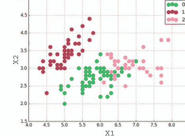

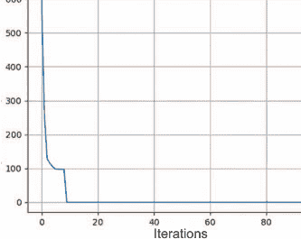

图 8.2 鸢尾花数据集的 `DP-means` 簇中心（左）和目标函数（右）

#### 8.2 高斯混合模型

混合模型通常用于建模复杂的密度分布。例如，你可能对发现包含个人年龄、收入、职业和其他维度信息的人口普查数据中的模式感兴趣。如果我们在高维空间中绘制所得数据，我们很可能会发现由数据点组或簇表征的非均匀密度。我们可以使用基础概率分布来建模每个簇。混合模型由 `K` 个基础模型的凸组合构成。在高斯混合模型的情况下，基础分布为高斯分布，可写为如下形式。

$p(x_i|\theta)=\sum_{k=1}^{K}\pi_k p_k(x_i|\theta)=\sum_{k=1}^{K}\pi_k\mathcal{N}(x_i|\mu_k,\Sigma_k)\tag{8.6}$

这里，`$\pi_k$` 为混合比例，满足 `0 ≤ π_k ≤ 1` 且 `$\sum\pi_k=1$`。与仅建模簇均值的 `K-means` 不同，`GMM` 还对簇协方差建模。因此，`GMM` 可以更准确地捕捉数据。

##### 8.2.1 期望最大化（EM）算法

期望最大化（`EM`）算法提供了一种在存在未观测潜在变量或缺失数据时计算 `ML/MAP` 估计的方法。`EM` 利用了这样一个事实：如果数据完全可观测，则 `ML/MAP` 估计很容易计算。特别是，`EM` 是一种迭代算法，在给定参数的情况下推断潜在变量（E 步），然后在填充数据的情况下优化参数（M 步）之间交替进行。

在 `EM` 算法中，我们定义完整数据对数似然 `$l_c(\theta)$`，其中 `$x_i$` 为观测随机变量，`$z_i$` 为未观测。由于我们不知道 `$z_i$`，我们无法计算 `$p(x_i, z_i | \theta)$`，但我们可以计算关于上一迭代参数 `$\theta^{(k-1)}$` 的 `$\ell_c(\theta)$` 的期望。

$$l_c(\theta) = \sum_{i=1}^{N} \log p(x_i, z_i | \theta) \tag{8.7}$$

E 步的目标是计算 `$Q(\theta, \theta^{(k-1)})$`，`ML/MAP` 估计依赖于它。M 步的目标是通过找到 `ML/MAP` 估计来重新计算 `$\theta$`。

$$\text{E-step} : \quad Q\left(\theta, \theta^{(k-1)}\right) = E_{\theta^{(k-1)}}\left[\ell_c(\theta) | D, \theta^{(k-1)}\right]$$ $$\text{M-step} : \quad \theta^{(k)} = \arg\max_{\theta} Q\left(\theta, \theta^{(k-1)}\right) + \log p(\theta) \tag{8.8}$$

为了推导 `GMM` 的 `EM` 算法，我们首先需要计算期望的完整数据对数似然。

$$Q(\theta, \theta^{(k-1)}) = E\left[\sum_i \log p(x_i, z_i | \theta)\right]$$ $$= \sum_i E\left[\log \prod_{k=1}^{K} \left(\pi_k p(x_i | \theta_k)\right)^{\mathbf{1}\{z_i=k\}}\right]$$ $$= \sum_i \sum_k E\left[\mathbf{1}\{z_i = k\}\right] \log \left[\pi_k p(x_i | \theta_k)\right]$$ $$= \sum_i \sum_k p\left(z_i = k | x_i, \theta^{(k-1)}\right) \log \left[\pi_k p(x_i | \theta_k)\right]$$ $$= \sum_i \sum_k r_{ik} \log \pi_k + \sum_i \sum_k r_{ik} \log p(x_i | \theta_k) \tag{8.9}$$

这里，`$r_{ik} = p(z_i = k | x_i, \theta^{(k-1)})$` 是点 `$x_i$` 对簇 `k` 的软分配。


# 高斯混合模型 EM 算法推导

## E 步

我们现在开始 E 步。给定 `θ^{(k-1)}`，我们希望计算软分配。

$$r_{ik} = p\left(z_i = k | x_i, \theta^{(k-1)}\right)$$ $$= \frac{p\left(z_i = k, x_i | \theta^{(k-1)}\right)}{\sum_{k=1}^{K} p\left(z_i = k, x_i | \theta^{(k-1)}\right)}$$ $$= \frac{p\left(x_i | z_i = k, \theta^{(k-1)}\right) \pi_k}{\sum_{k=1}^{K} p\left(x_i | z_i = k, \theta^{(k-1)}\right) \pi_k} \tag{8.10}$$

在等式 8.10 中，`π_k = p(z_i = k)` 是混合比例。

## M 步

在 M 步中，我们关于模型参数 `π` 和 `θ_k` 最大化 `Q`。首先，让我们找出使拉格朗日量最大化的 `π`。

$$\frac{\partial Q}{\partial \pi_k}=\frac{\partial}{\partial \pi_k}\left[\sum_i\sum_k r_{ik}\log\pi_k+\lambda\left(1-\sum_k\pi_k\right)\right]$$

$$=\sum_i\frac{r_{ik}}{\pi_k}-\lambda=0 \tag{8.11}$$

将该表达式代入约束条件，我们得到如下等式。

$$\sum_k\pi_k=1\Rightarrow\sum_k\frac{1}{\lambda}\sum_i r_{ik}=1\Rightarrow\lambda=\sum_i\sum_k r_{ik}=\sum_i1=N \tag{8.12}$$

因此，`π_k=1/λ∑_i r_{ik}=1/N∑_i r_{ik}`。为了找到最优参数 `θ_k={μ_k,Σ_k}`，我们希望优化 `Q` 中依赖于 `θ_k` 的项。

$$l(\mu_k,\Sigma_k)=\sum_i r_{ik}\log p(x_i\mid\theta_k)$$

$$\propto -\frac{1}{2}\sum_i r_{ik}\left[\log|\Sigma_k|+(x_i-\mu_k)^T\Sigma_k^{-1}(x_i-\mu_k)\right] \tag{8.13}$$

为了找到最优的 `μ_k`，我们对该表达式求导。首先，关注和式内的第二项，我们可以进行替换 `y_i=x_i-μ_k`。

$$\frac{\partial}{\partial\mu_k}(x_i-\mu_k)^T\Sigma_k^{-1}(x_i-\mu_k)=\frac{\partial}{\partial y_i}y_i^T\Sigma_k^{-1}y_i\frac{\partial y_i}{\partial\mu_k}$$

$$=-1\times(\Sigma_k^{-1}+\Sigma_k^{-T})y_i \tag{8.14}$$

将等式 8.14 中的表达式代入，我们得到如下等式。

$$\frac{\partial}{\partial\mu_k}l(\mu_k,\Sigma_k)\propto-\frac{1}{2}\sum_i r_{ik}\left[-2\Sigma^{-1}(x_i-\mu_k)\right]$$

$$=\Sigma^{-1}\sum_i r_{ik}(x_i-\mu_k)=0 \tag{8.15}$$

这意味着如下等式。

$$\sum_i r_{ik}(x_i - \mu_k) = 0 \implies \mu_k = \frac{\sum_i r_{ik}x_i}{\sum_i r_{ik}} \tag{8.16}$$

为了计算最优的 `Σ_k`，我们可以使用迹恒等式。

$$x^T A x = \operatorname{tr}\left(x^T A x\right) = \operatorname{tr}\left(x x^T A\right) = \operatorname{tr}\left(A x x^T\right) \tag{8.17}$$

使用 `Λ̂=Σ^{-1}` 记号，我们得到以下结果。

$$l(\Lambda) \propto -\frac{1}{2}\sum_i r_{ik}\log|\Lambda| - \frac{1}{2}\sum_i r_{ik}\operatorname{tr}\left[(x_i - \mu)(x_i - \mu)^T \Lambda\right]$$

$$= -\frac{1}{2}\sum_i r_{ik}\log|\Lambda| - \frac{1}{2}\operatorname{tr}(S_\mu \Lambda) \tag{8.18}$$

对矩阵求导，我们得到如下等式。

$$\frac{\partial l(\Lambda)}{\partial \Lambda} = -\frac{1}{2}\sum_i r_{ik}\Lambda^{-T} - \frac{1}{2}S_\mu^T = 0$$

$$\Lambda^{-1}\sum_i r_{ik} = S_\mu^T \implies \Sigma = \frac{S_\mu^T}{\sum_i r_{ik}}$$

$$\Sigma = \frac{\sum_i r_{ik}(x_i - \mu_k)(x_i - \mu_k)^T}{\sum_i r_{ik}} = \frac{\sum_i r_{ik}x_i x_i^T}{\sum_i r_{ik}} - \mu_k \mu_k^T \tag{8.19}$$

这些方程具有直观意义；簇 `k` 的均值由 `r_{ik}` 加权，是所有分配到簇 `k` 的点的平均值，而协方差是加权经验散度矩阵。我们现在可以准备从头实现 GMM 的 EM 算法了！让我们先看看图 8.3 中的伪代码。

`GMM` 类由三个主要函数组成：`gmm_em`、`estep` 和 `mstep`。在 `gmm_em` 中，我们使用 `K-means` 算法初始化均值，并将协方差初始化为单位矩阵。接下来，我们在 `estep` 和 `mstep` 之间迭代：`estep` 计算数据点 `i` 对每个簇 `k` 的职责（又称软分配），`mstep` 则将职责作为输入，计算模型参数：高斯混合模型（GMM）中每个簇的均值、协方差和混合比例。`estep` 和 `mstep` 函数中的代码遵循文中的推导。在以下代码中

```
1: class GMM
2: function gmm_em(X, k):
3: π_init = 1/K
4: μ_init = KMeans(X, k) ← Initializes with K-means
5: Σ_init = I_d×d
6: for iter = 1, 2, ..., max_iter
7:   r_ik = estep(π_k, μ_k, Σ_k, X) ← Computes responsibilities
8:   π_k, μ_k, Σ_k = mstep(r_ik, X) ← Computes model parameters
9: end for
10: return π_k, μ_k, Σ_k
11: function estep(π_k, μ_k, Σ_k, X):
12: r_ik = N(x_i | μ_k, Σ_k) π_k / Σ_{k=1}^K N(x_i | μ_k, Σ_k) π_k
13: return r_ik
14: function mstep(r_ik, X):
15: π_k = 1/N Σ_i r_ik
16: μ_k = Σ_i r_ik x_i / Σ_i r_ik
17: Σ_k = Σ_i r_ik x_i x_i^T / Σ_i r_ik - μ_k μ_k^T
18: return π_k, μ_k, Σ_k
```

## 图 8.3 高斯混合模型的 EM 算法伪代码

在下面的清单中，我们将使用一个合成数据集，将真实 GMM 参数与 EM 算法推断出的参数进行比较。

## 清单 8.2 高斯混合模型的期望最大化

```
import numpy as np
import matplotlib.pyplot as plt
import matplotlib as mpl

from sklearn.cluster import KMeans
from scipy.stats import multivariate_normal
from scipy.special import logsumexp
from scipy import linalg

np.random.seed(3)

class GMM:
    def __init__(self, n=1e3, d=2, K=4):
        self.n = int(n)
        self.d = d
        self.K = K

        self.X = np.zeros((self.n, self.d))

        self.mu = np.zeros((self.d, self.K))
        self.sigma = np.zeros((self.d, self.d, self.K))
        self.pik = np.ones(self.K)/K

    def generate_data(self):
```

```
alpha0 = np.ones(self.K)
pi = np.random.dirichlet(alpha0)

#ground truth mu and sigma
mu0 = np.random.randint(0, 10, size=(self.d, self.K)) -
    5*np.ones((self.d, self.K))
V0 = np.zeros((self.d, self.d, self.K))
for k in range(self.K):
    eigen_mean = 0
    Q = np.random.normal(loc=0, scale=1, size=(self.d, self.d))
    D = np.diag(abs(eigen_mean + np.random.normal(loc=0, scale=1,
        size=self.d)))
    V0[:,:,k] = abs(np.transpose(Q)*D*Q)

#sample data
for i in range(self.n):
    z = np.random.multinomial(1,pi)
    k = np.nonzero(z)[0][0]
    self.X[i,:] = np.random.multivariate_normal(mean=mu0[:,k],
        cov=V0[:,:,k], size=1)

plt.figure()
plt.scatter(self.X[:,0], self.X[:,1], color='b', alpha=0.5)
plt.title("Ground Truth Data"); plt.xlabel("X1"); plt.ylabel("X2")
plt.show()

return mu0, V0

def gmm_em(self):
    kmeans = KMeans(n_clusters=self.K,
        random_state=42).fit(self.X)
    self.mu = np.transpose(kmeans.cluster_centers_)

    #init sigma
    for k in range(self.K):
        self.sigma[:,:,k] = np.eye(self.d)

    #EM algorithm
    max_iter = 10
    tol = 1e-5
    obj = np.zeros(max_iter)
    for iter in range(max_iter):
        print("EM iter ", iter)
        #E-step
        resp, llh = self.estep()
        #M-step
        self.mstep(resp)
        #check convergence
        obj[iter] = llh
        if (iter > 1 and obj[iter] - obj[iter-1] < tol*abs(obj[iter])):
            break
    #end for
    plt.figure()
```

用 k-means 初始化均值

E 步

M 步

```
plt.plot(obj)
plt.title('EM-GMM objective'); plt.xlabel("iter");
plt.ylabel("log-likelihood")
plt.show()

def estep(self):
    log_r = np.zeros((self.n, self.K))
    for k in range(self.K):
        log_r[:,k] = multivariate_normal.logpdf(self.X,
            mean=self.mu[:,k], cov=self.sigma[:,:,k])
    #end for
    log_r = log_r + np.log(self.pik)
    L = logsumexp(log_r, axis=1)
    llh = np.sum(L)/self.n  #log likelihood
    log_r = log_r - L.reshape(-1,1) #normalize
    resp = np.exp(log_r)
    return resp, llh

def mstep(self, resp):
    nk = np.sum(resp, axis=0)
    self.pik = nk/self.n
    sqrt_resp = np.sqrt(resp)
    for k in range(self.K):
        #update mu
        rx = np.multiply(resp[:,k].reshape(-1,1), self.X)
        self.mu[:,k] = np.sum(rx, axis=0) / nk[k]
        #update sigma
        Xm = self.X - self.mu[:,k]
        Xm = np.multiply(sqrt_resp[:,k].reshape(-1,1), Xm)
        self.sigma[:,:,k] = np.maximum(0, np.dot(np.transpose(Xm), Xm)
            / nk[k] + 1e-5 * np.eye(self.d))
    #end for

if __name__ == '__main__':
    gmm = GMM()
    mu0, V0 = gmm.generate_data()
    gmm.gmm_em()

    for k in range(mu0.shape[1]):
        print("cluster ", k)
        print("----------")
        print("ground truth means:")
        print(mu0[:,k])
        print("ground truth covariance:")
        print(V0[:,:,k])
    #end for

    for k in range(mu0.shape[1]):
        print("cluster ", k)
        print("----------")
```

```python
print("GMM-EM means:")
print(gmm.mu[:,k])
print("GMM-EM covariance:")
print(gmm.sigma[:,:,k])

plt.figure()
ax = plt.axes()
plt.scatter(gmm.X[:,0], gmm.X[:,1], color='b', alpha=0.5)

for k in range(mu0.shape[1]):

    v, w = linalg.eigh(gmm.sigma[:,:,k])
    v = 2.0 * np.sqrt(2.0) * np.sqrt(v)
    u = w[0] / linalg.norm(w[0])

    # plot an ellipse to show the Gaussian component
    angle = np.arctan(u[1] / u[0])
    angle = 180.0 * angle / np.pi  # convert to degrees
    ell = mpl.patches.Ellipse(gmm.mu[:,k], v[0], v[1], 180.0 + angle,
    color='r', alpha=0.5)
    ax.add_patch(ell)

    # plot cluster centroids
    plt.scatter(gmm.mu[0,k], gmm.mu[1,k], s=80, marker='x', color='k',
    alpha=1)
plt.title("Gaussian Mixture Model"); plt.xlabel("X1"); plt.ylabel("X2")
plt.show()
```


从输出中可以看到，聚类均值和协方差与真实值非常接近。

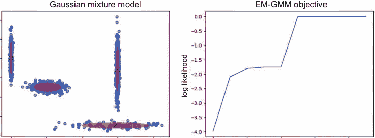

**图 8.4**  EM-GMM 聚类结果（左）和对数似然目标函数（右）

图 8.4（左）显示了与数据叠加的推断高斯混合。我们可以看到高斯椭圆与数据非常贴合。这也可以通过图 8.4（右）中对数似然目标的单调递增得到证实。在下一节中，我们将探讨两种流行的降维技术：主成分分析和 T 分布随机邻域嵌入。

#### 8.3 降维

通常将高维数据 `$x \in \mathbb{R}^{D}$` 投影到低维子空间 `$z \in \mathbb{R}^{L}$` 上，同时保留数据的独特特征是有用的。换句话说，希望在低维投影中捕捉数据的本质。例如，如果你在维基百科语料上训练词嵌入并试图理解不同词向量之间的关系，那么通过降维将关系可视化到二维会容易得多。在本节中，我们将研究两种用于降维的机器学习技术：主成分分析（PCA）和 t-SNE。

##### 8.3.1 主成分分析

在主成分分析（PCA）中，我们希望将数据向量 `$x \in \mathbb{R}^{D}$` 投影到低维向量 `$z \in \mathbb{R}^{L}$` 上，其中 `$L < D$`，使得投影数据的方差最大化。最大化投影数据的方差是 PCA 的核心原理，它使我们能够保留数据的独特特征。我们可以用重构误差来衡量投影的质量。

$$E = \frac{1}{N}\sum_{i=1}^{N}\lVert x_i - \hat{x}_i \rVert^2 = \lVert X - WZ \rVert_F^2 \tag{8.20}$$

这里，`$\hat{x}_i$` 的大小为 `$D \times 1$` 是提升到高维空间的重构向量，`$z_i$` 的大小为 `$L \times 1$` 是低维主成分向量，而 `$W$` 是大小为 `$D \times L$` 的正交矩阵。回想一下，正交矩阵是一个实方阵，其转置等于其逆（即 `$W^T W = W W^T = I$`）。换句话说，如果我们的 PCA 投影是 `$z_i = W^T x_i$`，那么 `$\hat{x}_i = W z_i$`。我们将证明，最优投影矩阵 `$W$`（使投影数据方差最大化的矩阵）等于经验协方差矩阵 `$\hat{\Sigma} = \frac{1}{N}\sum x_i x_i^T$` 的最大特征值对应的 `$L$` 个特征向量组成的矩阵。

我们可以按如下方式写下投影数据的方差。

$$\frac{1}{N}\sum_{i=1}^{N} z_i^2 = \frac{1}{N}\sum_{i=1}^{N} w^T x_i x_i^T w = w^T \hat{\Sigma} w \tag{8.21}$$

我们希望在正交约束条件下最大化该量（即 `$\lVert w \rVert^2 = 1$`）。我们可以按如下方式写下拉格朗日函数。

$$\max J(w) = w^T \hat{\Sigma} w + \lambda\left(w^T w - 1\right) \tag{8.22}$$

对导数求导并令其为零，我们得到以下表达式。

$$\frac{\partial}{\partial w}J(w)=2\hat{\Sigma}w-2\lambda w=0$$

$$\hat{\Sigma}w=\lambda w$$

因此，最大化方差的方向是协方差矩阵的特征向量。对 `$w$` 左乘并使用正交性约束，我们得到 `$w^T\hat{\Sigma}w=\lambda$`。因此，为了最大化第一个主成分的方差，我们希望选择对应于最大特征值的特征向量。我们可以通过从 `$x_i$` 中减去第一个主成分来重复上述过程，我们会发现 `$\hat{\Sigma}w^2=\lambda w^2$`。通过归纳，我们可以证明 PCA 矩阵 `$WDL$` 由经验协方差矩阵 `$\hat{\Sigma}$` 的 `$L$` 个最大特征值对应的 `$L$` 个特征向量组成。我们现在准备从头实现 PCA 算法！图 8.5 中的伪代码总结了该算法。

```
1: class PCA
2: function transform(X, K):
3:   Σ = covariance_matrix(X) ← Computes the empirical covariance
4:   V, λ = eig(Σ) ← Eigenvalue decomposition
5:   idx = argsort(λ) ← Sorts from largest to smallest
6:   Vₚ꜀ₐ = V[idx[: K]] ← Selects the top K eigen
7:   λₚ꜀ₐ = λ[idx[: K]] ← vectors and eigen values
8:   Xₚ꜀ₐ = XVₚ꜀ₐ ← Projects the data onto principal components
9: return Xₚ꜀ₐ
```

**图 8.5  主成分分析伪代码**

`PCA` 类中的主要函数称为 `transform`。我们首先从高维数据矩阵 `$X$` 计算经验协方差矩阵。接下来，我们计算协方差矩阵的特征值分解。我们将特征值从大到小排序，并使用排序后的索引选择前 `$K$` 个最大特征值及其对应的特征向量。最后，我们通过将数据矩阵与前 `$K$` 个特征值矩阵相乘来计算数据的 PCA 表示。在下面的代码列表中，我们将一个随机 d 维矩阵投影到两个主成分上。

#### 列表 8.3  主成分分析

```
import numpy as np
import matplotlib.pyplot as plt

np.random.seed(42)

class PCA():
    def __init__(self, n_components = 2):
        self.n_components = n_components

    def covariance_matrix(self, X, Y=None):
```

```python
if Y is None:
    Y = X
n_samples = np.shape(X)[0]
covariance_matrix = (1 / (n_samples-1)) * (X - X.mean(axis=0))
    .T.dot(Y - Y.mean(axis=0))
return covariance_matrix

def transform(self, X):
    Sigma = self.covariance_matrix(X)
    eig_vals, eig_vecs = np.linalg.eig(Sigma)

    idx = eig_vals.argsort()[::-1]
    eig_vals = eig_vals[idx][:self.n_components]
    eig_vecs = np.atleast_1d(eig_vecs[:,idx])[:, :self.n_components]

    X_transformed = X.dot(eig_vecs)

    return X_transformed

if __name__ == "__main__":

    n = 20
    d = 5
    X = np.random.rand(n,d)

    pca = PCA(n_components=2)
    X_pca = pca.transform(X)

    print(X_pca)

    plt.figure()
    plt.scatter(X_pca[:,0], X_pca[:,1], color='b', alpha=0.5)
    plt.title("Principal Component Analysis"); plt.xlabel("X1");
    plt.ylabel("X2")
    plt.show()
```

图 8.6 显示了应用于随机矩阵的前两个主成分的图。回想一下，在 PCA 中，投影数据的方差被最大化；因此，我们可以在投影数据中发现趋势和模式。


##### 8.3.2 基于图像的 t-SNE 流形学习

图像是生活在流形上的高维对象。流形是局部类似于欧几里得空间的拓扑空间。通过将图像空间建模为流形，我们可以研究它们的几何属性。我们可以在嵌入的帮助下可视化高维对象。我们考虑 MNIST 手写数字数据集上的两种此类嵌入：t-SNE 和 Isomap。

#### 列表 8.4 t-SNE 流形在 MNIST 手写数字数据集上

```
import numpy as np
import matplotlib.pyplot as plt

from time import time
from sklearn import manifold

from sklearn.datasets import load_digits
from sklearn.neighbors import KDTree

def plot_digits(X):
    n_img_per_row = np.amin((20, np.int(np.sqrt(X.shape[0]))))
    img = np.zeros((10 * n_img_per_row, 10 * n_img_per_row))
    for i in range(n_img_per_row):
        ix = 10 * i + 1
        for j in range(n_img_per_row):
            iy = 10 * j + 1
            img[ix:ix + 8, iy:iy + 8] = X[i * n_img_per_row + j].reshape((8, 8))

    plt.figure()
    plt.imshow(img, cmap=plt.cm.binary)
    plt.xticks([])
    plt.yticks([])
    plt.title('A selection from the 64-dimensional digits dataset')

def mnist_manifold():
    digits = load_digits()
    X = digits.data
    y = digits.target
    num_classes = np.unique(y).shape[0]
    plot_digits(X)
    #TSNE
    #Barnes-Hut: O(d NlogN) where d is dim and N is the number of samples
    #Exact: O(d N^2)
    t0 = time()
    tsne = manifold.TSNE(n_components = 2, init = 'pca', method = 'barnes_hut', verbose = 1)
```

```python
X_tsne = tsne.fit_transform(X)
t1 = time()
print('t-SNE: %.2f sec ' %(t1-t0))
tsne.get_params()

plt.figure()
for k in range(num_classes):
    plt.plot(X_tsne[y==k,0], X_tsne[y==k,1],'o')
plt.title('t-SNE embedding of digits dataset')
plt.xlabel('X1')
plt.ylabel('X2')
axes = plt.gca()
axes.set_xlim([X_tsne[:,0].min()-1,X_tsne[:,0].max()+1])
axes.set_ylim([X_tsne[:,1].min()-1,X_tsne[:,1].max()+1])
plt.show()

#ISOMAP
#1. Nearest neighbors search: O(d log k N log N)
#2. Shortest path graph search: O(N^2(k+log(N)))
#3. Partial eigenvalue decomposition: O(dN^2)

t0 = time()
isomap = manifold.Isomap(n_neighbors = 5, n_components = 2)
X_isomap = isomap.fit_transform(X)
t1 = time()
print('Isomap: %.2f sec' %(t1-t0))
isomap.get_params()

plt.figure()
for k in range(num_classes):
    plt.plot(X_isomap[y==k,0], X_isomap[y==k,1], 'o', label=str(k),
             linewidth = 2)
plt.title('Isomap embedding of the digits dataset')
plt.xlabel('X1')
plt.ylabel('X2')
plt.show()

#Use KD-tree to find k-nearest neighbors to a query image
kdt = KDTree(X_isomap)
Q = np.array([[-160, -30],[-102, 14]])
kdt_dist, kdt_idx = kdt.query(Q,k=20)
plot_digits(X[kdt_idx.ravel(),:])

if __name__ == "__main__":
    mnist_manifold()
```

图8.7展示了二维空间中具有10个簇的t-SNE嵌入，每个簇对应一个从0到9的数字。我们可以看到，在没有标签的情况下，我们能够在二维空间中利用t-SNE嵌入发现10个簇。此外，我们预期相邻的数字簇彼此相似。图8.7右侧的图像显示了来自两个相邻簇（数字0和数字6）的样本数字。我们可以通过构建KD树来查找查询点的K近邻，从而可视化相邻簇。

## 64维数字数据集中的样本选择


## 数字数据集的t-SNE嵌入


## 64维数字数据集中的样本选择


图8.7 t-SNE嵌入，显示二维空间中的10个簇，每个簇对应一个从0到9的数字

了解t-SNE的一些陷阱非常重要。例如，t-SNE的结果可能会因困惑度超参数的不同而变化。t-SNE算法在连续运行中也不总是产生相似的输出，并且还有与优化过程相关的额外超参数。此外，簇的大小（以标准差衡量）和簇之间的距离可能没有任何意义。因此，t-SNE的高度灵活性也使得该算法的结果难以解释。

#### 8.4 练习

- 8.1 通过计算后验，证明狄利克雷分布 `Dir(θ|α)` 是多项式似然的共轭先验。后验的形状如何随后验计数变化？

- 8.2 解释 `k-means++` 初始化背后的原理。

- 8.3 证明迹的循环置换性质：`tr(ABC) = tr(BCA) = tr(CAB)`。

- 8.4 计算主成分分析（PCA）算法的运行时间。

#### 摘要

- 无监督学习发生在没有训练标签可用的情况下。

- 狄利克雷过程K-means是K-means算法的贝叶斯非参数扩展，其中簇的数量随数据增长。

- 高斯混合模型通常用于对复杂的密度分布进行建模。GMM参数（均值、协方差和混合比例）可以使用期望最大化算法进行推断。

- 期望最大化是一种迭代算法，在给定参数的情况下推断缺失值（E步）和在给定填充数据后优化参数（M步）之间交替进行。

- 在降维中，我们将高维数据投影到低维子空间，同时保留数据的独特特征。

- 在主成分分析算法中，投影数据的方差被最大化。

- t-SNE算法的常见陷阱包括：由于困惑度超参数导致的结果变异性、连续运行中不相似的输出、簇大小缺乏可解释性，以及簇之间距离过大。

### 选定的无监督学习算法


#### 本章涵盖

- 用于主题发现的潜在狄利克雷分配

- 计算生物学和金融中的密度估计器

- 关系数据的结构学习

- 用于能量最小化的模拟退火

- 进化生物学中的遗传算法

- 机器学习研究：无监督学习

在上一章中，我们研究了无监督机器学习算法，以帮助学习数据中的模式；本章继续该讨论，重点介绍选定的算法。本章介绍的算法旨在涵盖无监督学习的广度，它们之所以重要，是因为它们覆盖了从计算生物学到物理学再到金融学的一系列应用。我们将首先介绍用于学习主题模型的潜在狄利克雷分配（LDA），然后是密度估计器和结构学习算法，最后介绍模拟退火（SA）和遗传算法（GA）。

#### 9.1 潜在狄利克雷分配


主题模型是用于离散数据（如文本文档）的潜在变量模型。潜在狄利克雷分配（`LDA`）是一种主题模型，它将每个文档表示为主题的有限混合，其中主题是词上的分布。目标是学习共享的主题分布和每个文档的主题比例。`LDA`假设一个词袋模型，其中词是可交换的，因此句子结构不被保留（即只有词频重要）。因此，每个文档被简化为词汇表`V`上的计数向量，整个语料库的`D`个文档被汇总为一个术语-文档矩阵`A_{VD}`。`LDA`可以看作一个非负矩阵分解问题，将术语-文档矩阵分解为主题`W_{VK}`和主题比例`H_{KD}`的乘积：`A = W H`。词频-逆文档频率（`tf-idf`）是一种调整词频的常用方法，因为它将对数式地将跨文档频繁出现的词频驱动到零：`A log(D/n_t)`，其中`D`是语料库中的文档总数，`n_t`是出现术语`t`的文档数。词频的`tf-idf`平滑识别出对文档具有判别力的词集，并带来更好的模型性能。术语-文档矩阵从单个词（`unigram`）的计数推广到更大的结构单元，如`n-gram`。在`n-gram`的情况下，使用不同的词频平滑技术（例如拉普拉斯平滑）来解决非常大特征空间中观测不足的问题。图9.1展示了`LDA`的图模型。


图9.1 潜在狄利克雷分配图模型

`LDA`主题模型将每个词 `x_{i,d}` 与一个主题标签 `z_{i,d} ∈ {1, 2, ..., K}` 关联起来。每个文档与主题比例 `θ_d` 关联，可用于衡量文档相似度。主题 `β_k` 在所有文档中共享。超参数 `α` 和 `η` 分别捕获我们关于主题比例和主题的先验知识（例如，来自模型过去的在线训练）。完整的生成模型可以指定如下。

`θ_d | α ~ Dir(α)`

`z_{i,d} | θ_d ~ Cat(θ_d)`

`β_k | η ~ Dir(η)`

`x_{i,d} | z_{i,d}=k, β ~ Cat(β_k)` (9.1)

单个文档 `d` 的联合分布可以写成如下形式（如David M. Blei、Andrew Y. Ng和Michael I. Jordan在《潜在狄利克雷分配》一文中所讨论的，《机器学习研究杂志》，2003年）。

`p(x, z, θ | α, β) = p(θ_d | α) ∏_{i=1}^{n_d} p(z_{i,d} | θ_d) p(x_{i,d} | z_{i,d}, β)` (9.2)

参数 `α` 和 `β` 是语料库级别的参数，变量 `θ_d` 每篇文档采样一次，而 `z_{i,d}` 和 `x_{i,d}` 是词级别的变量，在每篇文档中的每个词采样一次。与多项式聚类模型（其中每篇文档与单个主题关联）不同，`LDA`将每篇文档表示为多个主题的混合。

## 9.1.1 变分贝叶斯

要使用`LDA`，我们需要解决的关键推断问题是计算给定文档的隐变量的后验分布：`p(θ, z | x, α, β)`。后验可以用以下变分分布来近似。

`q(θ, z | γ, φ) = q(θ | γ) ∏_{i=1}^{n} q(z_i | φ_i)` (9.3)

变分参数被优化以最大化证据下界（`ELBO`）。回顾第3章中`ELBO`的定义，它是能量项和熵项之间的差。

`log p(x | α, η) ≥ L(x, φ, γ, λ)`

`= E_q[log p(x, z, θ, β | α, η)] − E_q[log q(z, θ, β)]` (9.4)

我们选择如下形式的完全分解分布`q`。

`q(z_{id}=k) = φ_{dwik};  q(θ_d) ~ Dir(θ_d | γ_d);  q(β_k) ~ Dir(β_k | λ_k)` (9.5)

我们可以通过使用 `p` 和 `q` 的分解来扩展下界（参见 David M. Blei、Andrew Y. Ng 和 Michael I. Jordan 的“潜在狄利克雷分配”，*Journal of Machine Learning Research*，2003）。

$$L(\gamma,\phi;\alpha,\beta)=E_q[\log p(\theta|\alpha)]+E_q[\log p(z|\theta)] +E_q[\log p(x|z,\beta)] -E_q[\log q(\theta)]-E_q[\log q(z)] \tag{9.6}$$

`L(γ,φ;α,β)` 中的五个项可以按如下方式展开。

$$\begin{aligned}

L(\gamma,\phi;\alpha,\beta)={}&\log\Gamma\left(\sum_{j=1}^{k}\alpha_j\right)-\sum_{i=1}^{k}\log\Gamma(\alpha_i)\\

&+\sum_{i=1}^{k}(\alpha_i-1)\left(\Psi(\gamma_i)-\Psi\left(\sum_{j=1}^{k}\gamma_j\right)\right)\\

&+\sum_{n=1}^{N}\sum_{i=1}^{k}\phi_{ni}\left(\Psi(\gamma_i)-\Psi\left(\sum_{j=1}^{k}\gamma_j\right)\right)\\

&+\sum_{n=1}^{N}\sum_{i=1}^{k}\sum_{j=1}^{K}\phi_{ni}x_n^j\log\beta_{ij}\\

&-\log\Gamma\left(\sum_{j=1}^{k}\gamma_j\right)+\sum_{i=1}^{k}\log\Gamma(\gamma_i)\\

&-\sum_{i=1}^{k}(\gamma_i-1)\left(\Psi(\gamma_i)-\Psi\left(\sum_{j=1}^{k}\gamma_j\right)\right)\\

&-\sum_{n=1}^{N}\sum_{i=1}^{k}\phi_{ni}\log\phi_{ni}

\end{aligned}\tag{9.7}$$

这里，`Ψ(x)=d/dx logΓ(x)` 是 digamma 函数。`L(γ,φ;α,β)` 可以通过对变分参数 `φ`、`γ`、`α` 进行坐标上升来最大化。

$$\begin{aligned}

\phi_{dwk}&\propto\exp\left\{E_q[\log\theta_{dk}]+E_q[\log\beta_{kw}]\right\}\\

\gamma_{dk}&=\alpha+\sum_w n_{dw}\phi_{dwk}\\

\lambda_{kw}&=\eta+\sum_d n_{dw}\phi_{dwk}

\end{aligned}\tag{9.8}$$

这里，`q` 下 `log θ` 和 `log β` 的期望如下。

`E_q[log θ_dk] = Ψ(γ_dk) − Ψ(∑_{i=1}^K γ_di)`

`E_q[log β_kw] = Ψ(λ_kw) − Ψ(∑_{i=1}^W λ_ki)`      (9.9)

变分参数更新可以在无需在每次迭代中对整个语料库进行完整遍历的在线设置中使用。变分参数的在线更新使得对非常大的数据集（包括流数据）进行主题分析成为可能。`LDA` 的在线变分贝叶斯（`VB`）在图 9.2 的算法中进行了描述。

- 1: 定义 `ρ_t = (τ₀ + t)^{-κ}`
- 2: 随机初始化 `λ`
- 3: 对于 `t = 1` 到 `∞` 执行
- 4: E 步：
- 5: 初始化 `γ_ik = 1`
- 6: 重复
- 7: 设置 `φ_{twk} ∝ exp{E_q[log θ_{tk}] + E_q[log β_{kw}]}` ← 主题分配
- 8: 设置 `γ_{ik} = α + Σ_{w} φ_{twk} n_{tw}` ← 主题比例
- 9: 直到 `1/K Σ_k |Δγ_{ik}| < ε`
- 10: M 步：
- 11: 计算 `\tilde λ_{kw} = η + D n_{tw} φ_{twk}`
- 12: 设置 `λ = (1 − ρ_t) λ + ρ_t \tilde λ`
- 13: 结束循环

## 图 9.2 LDA 算法伪代码

当第 `t` 个词频向量 `n_t` 被观测到时，我们执行 E 步，在保持 `λ` 固定的情况下找到 `γ_t` 和 `φ_t` 的局部最优值。然后我们计算 `\tilde λ`，即如果我们的整个语料库仅由单个文档 `n` 重复 `D` 次组成时最优的 `\tilde λ`。然后我们将 `λ` 更新为其先前值和 `\tilde λ` 的加权平均值，其中权重由学习参数 `ρ_t` 给出，`κ ∈ (0.5, 1]`，控制旧的 `\tilde λ` 值被遗忘的速率。我们现在准备从头开始实现 `LDA` 的变分贝叶斯，代码如下！

## Listing 9.1 变分贝叶斯用于潜在狄利克雷分配

```
import numpy as np
import matplotlib.pyplot as plt
from sklearn.datasets import fetch_20newsgroups
from sklearn.feature_extraction.text import TfidfVectorizer
from wordcloud import WordCloud
from scipy.special import digamma, gammaln
```

```
np.random.seed(12)

class LDA:
    def __init__(self, A, K):
        self.N = A.shape[0]
        self.D = A.shape[1]
        self.K = K

        self.A = A

        #init word distribution beta
        self.eta = np.ones(self.N)
        self.beta = np.zeros((self.N, self.K))
        for k in range(self.K):
            self.beta[:,k] = np.random.dirichlet(self.eta)
            self.beta[:,k] = self.beta[:,k] + 1e-6 #to avoid zero entries
            self.beta[:,k] = self.beta[:,k]/np.sum(self.beta[:,k])
        #end for

        #init topic proportions theta and cluster assignments z
        self.alpha = np.ones(self.K)
        self.z = np.zeros((self.N, self.D))
        for d in range(self.D):
            theta = np.random.dirichlet(self.alpha)
            wdn_idx = np.nonzero(self.A[:,d])[0]
            for i in range(len(wdn_idx)):
                z_idx = np.argmax(np.random.multinomial(1, theta))
                self.z[wdn_idx[i],d] = z_idx  #topic id
            #end for
        #end for

        #init variational parameters
        self.gamma = np.ones((self.D, self.K))
        for d in range(self.D):
            theta = np.random.dirichlet(self.alpha)
            self.gamma[d,:] = theta
        #end for

        self.lmbda = np.transpose(self.beta)
        #np.ones((self.K, self.N))/self.N

        self.phi = np.zeros((self.D, self.N, self.K))
        for d in range(self.D):
            for w in range(self.N):
                theta = np.random.dirichlet(self.alpha)
                self.phi[d,w,:] = np.random.multinomial(1, theta)
            #end for
        #end for

    def variational_inference(self, var_iter=10):

        llh = np.zeros(var_iter)
        llh_delta = np.zeros(var_iter)
```


```python
for iter in range(var_iter):
    print("VI iter: ", iter)
    J_old = self.elbo_objective()
    self.mean_field_update()
    J_new = self.elbo_objective()

    llh[iter] = J_old
    llh_delta[iter] = J_new - J_old
#end for

#update alpha and beta
for k in range(self.K):
    self.alpha[k] = np.sum(self.gamma[:,k])
    self.beta[:,k] = self.lmbda[k,:] / np.sum(self.lmbda[k,:])
#end for

#update topic assignments
for d in range(self.D):
    wdn_idx = np.nonzero(self.A[:,d])[0]
    for i in range(len(wdn_idx)):
        z_idx = np.argmax(self.phi[d,wdn_idx[i],:])
        self.z[wdn_idx[i],d] = z_idx  #topic id
    #end for
#end for

plt.figure()
plt.plot(llh); plt.title('LDA VI');
plt.xlabel('mean field iterations'); plt.ylabel("ELBO")
plt.show()

return llh

def mean_field_update(self):
    ndw = np.zeros((self.D, self.N))
    for d in range(self.D):
        doc = self.A[:,d]
        wdn_idx = np.nonzero(doc)[0]

        for i in range(len(wdn_idx)):
            ndw[d,wdn_idx[i]] += 1
        #end for

        #update gamma
        for k in range(self.K):
            self.gamma[d,k] = self.alpha[k] + np.dot(ndw[d,:],
                                                     self.phi[d,:,k])
        #end for

        #update phi
        for w in range(len(wdn_idx)):
            self.phi[d,wdn_idx[w],:] = np.exp(digamma(self.gamma[d,:])
                                              - digamma(np.sum(self.gamma[d,:])) + digamma(self.lmbda[:,wdn_idx[w]])
                                              - digamma(np.sum(self.lmbda, axis=1)))
            if (np.sum(self.phi[d,wdn_idx[w],:]) > 0): #to avoid 0/0
self.phi[d,wdn_idx[w],:] = self.phi[d,wdn_idx[w],:] /
    np.sum(self.phi[d,wdn_idx[w],:]) #normalize phi
#end if
#end for

#end for

#update lambda given ndw for all docs
for k in range(self.K):
    self.lmbda[k,:] = self.eta
    for d in range(self.D):
        self.lmbda[k,:] += np.multiply(ndw[d,:], self.phi[d,:,k])
    #end for
#end for

def elbo_objective(self):
    #see Blei 2003

T1_A = gammaln(np.sum(self.alpha)) - np.sum(gammaln(self.alpha))
T1_B = 0
for k in range(self.K):
    T1_B += np.dot(self.alpha[k]-1, digamma(self.gamma[:,k]) -
        digamma(np.sum(self.gamma, axis=1)))
T1 = T1_A + T1_B

T2 = 0
for n in range(self.N):
    for k in range(self.K):
        T2 += self.phi[:,n,k] * (digamma(self.gamma[:,k]) -
            digamma(np.sum(self.gamma, axis=1)))

T3 = 0
for n in range(self.N):
    for k in range(self.K):
        T3 += self.phi[:,n,k] * np.log(self.beta[n,k])

T4 = 0
T4_A = -gammaln(np.sum(self.gamma, axis=1)) +
    np.sum(gammaln(self.gamma), axis=1)
T4_B = 0
for k in range(self.K):
    T4_B = -(self.gamma[:,k]-1) * (digamma(self.gamma[:,k]) -
        digamma(np.sum(self.gamma, axis=1)))
T4 = T4_A + T4_B

T5 = 0
for n in range(self.N):
    for k in range(self.K):
        T5 += -np.multiply(self.phi[:,n,k], np.log(self.phi[:,n,k]
            + 1e-6))

T15 = T1 + T2 + T3 + T4 + T5
J = sum(T15)/self.D  #averaged over documents
return J
```

```python
if __name__ == "__main__":

    #LDA parameters
    num_features = 1000  #vocabulary size
    num_topics = 4       #fixed for LD

    #20 newsgroups dataset
    categories = ['sci.crypt', 'comp.graphics', 'sci.space',
     'talk.religion.misc']

    newsgroups = fetch_20newsgroups(shuffle=True, random_state=42,
     subset='train',
                     remove=('headers', 'footers', 'quotes'),
                     categories=categories)

    vectorizer = TfidfVectorizer(max_features = num_features, max_df=0.95,
     min_df=2, stop_words = 'english')
    dataset = vectorizer.fit_transform(newsgroups.data)
    A = np.transpose(dataset.toarray())  #term-document matrix

    lda = LDA(A=A, K=num_topics)
    llh = lda.variational_inference(var_iter=10)
    id2word = {v:k for k,v in vectorizer.vocabulary_.items()}

    #display topics
    for k in range(num_topics):
        print("topic: ", k)
        print("----------")
        topic_words = ""
        top_words = np.argsort(lda.lambda[k,:])[-10:]
        for i in range(len(top_words)):
            topic_words += id2word[top_words[i]] + " "
            print(id2word[top_words[i]])

        wordcloud = WordCloud(width = 800, height = 800,
                        background_color ='white',
                        min_font_size = 10).generate(topic_words)

        plt.figure()
        plt.imshow(wordcloud)
        plt.axis("off")
        plt.tight_layout(pad = 0)
        plt.show()
```

图9.3 展示了 `ELBO` 随着均值场迭代次数的增加而上升。图9.4 展示了以词云形式可视化的推断主题分布。


图9.3  `ELBO` 增量随均值场迭代次数的变化


图9.4  通过 `LDA` 均值场变分推断得到的主题分布

从输出中可以看出，每个主题的 `top-K` 词与 20 新闻组数据集中的类别相匹配。在下一节中，我们将探讨几种用于计算生物学和金融领域数据概率密度建模的方法。

### 9.2 *密度估计器*

*密度估计*的目标是对数据的概率密度进行建模。在本节中，我们将讨论应用于计算生物学的核密度估计器，并研究如何利用切线组合理论优化股票投资组合。

#### 9.2.1 *核密度估计器*

`K` 分量混合模型的一种替代方法是 *核密度估计器*（`KDE`），它为每个数据点分配一个簇中心。`KDE` 是核平滑在概率密度估计中的一种应用，使用核作为权重。对于高斯核，我们有以下形式。

$$p(x|D) = \frac{1}{N} \sum_{i=1}^{N} \mathcal{N}(x|x_i, \sigma^2 I)\tag{9.10}$$

注意，我们是对 `N` 个高斯分布取平均，每个高斯分布以数据点 `x_i` 为中心。我们可以将方程 9.10 中的表达式推广到任意核 `κ(x)`。

$$p(x|D) = \frac{1}{N} \sum_{i=1}^{N} \kappa_h(x - x_i)\tag{9.11}$$

`KDE` 相对于参数模型（如密度混合模型）的优势在于，无需进行模型拟合（只需微调带宽参数 `h`），也无需选择混合分量数 `K`。缺点是模型需要占用大量内存来存储，并且评估时耗时较多。换言之，当需要对相对较小的数据集（即点数 `N` 较小）进行精确密度估计时，`KDE` 是合适的。让我们看一个分析 `RNA-seq` 数据以估计 `T7` 启动子通量的示例。

### 清单 9.2 核密度估计

```python
import numpy as np
import matplotlib.pyplot as plt

class KDE():
    def __init__(self):
        #Histogram and Gaussian Kernel Estimator used to
        #analyze RNA-seq data for flux estimation of a T7 promoter
        self.G = 1e9
        self.C = 1e3
        self.L = 100
        self.N = 1e6
        self.M = 1e4
        self.LN = 1000
        self.FDR = 0.05

        #uniform sampling (poisson model)
        self.lambda = (self.N * self.L) / self.G
        self.C_est = self.M/(1-np.exp(-self.lambda))
        self.C_cvrg = self.G - self.G * np.exp(-self.lambda)
        self.N_gaps = self.N * np.exp(-self.lambda)

        #gamma prior sampling (negative binomial model)
        #X = "number of failures before rth success"

Dispersion parameter

(fit to data)

Success probability

Number of successes

Smoothing parameter

Standard deviation

Dimension of x
```

```python
self.k = 0.5

self.p = self.lmbda/(self.lmbda + 1/self.k)

self.r = 1/self.k

#RNAP binding data (RNA-seq)

self.data = np.random.negative_binomial(self.r, self.p, size=self.LN)

def histogram(self):

    self.bin_delta = 1

    self.bin_range = np.arange(1, np.max(self.data), self.bin_delta)

    self.bin_counts, _ = np.histogram(self.data, bins=self.bin_range)

    #histogram density estimation

    #P = integral R p(x) dx, where X is in R^3

    #p(x) = K/(N x V), where K-number of points in region R

    #N=total number of points, V=volume of region R

    rnap_density_est = self.bin_counts/(sum(self.bin_counts) *

        self.bin_delta)

    return rnap_density_est

def kernel(self):

    #Gaussian kernel density estimator with smoothing parameter h

    #sum N Guassians centered at each data point, parameterized by

    # common std dev h

    x_dim = 1

    h = 10

    rnap_density_support = np.arange(np.max(self.data))

    rnap_density_est = 0

    for i in range(np.sum(self.bin_counts)):

        rnap_density_est += (1/(2*np.pi*h**2))**((x_dim/2.0))*np.exp(-

            (rnap_density_support - self.data[i])**2 / (2.0*h**2))

    #end for

    rnap_density_est = rnap_density_est / np.sum(rnap_density_est)

    return rnap_density_est

if __name__ == "__main__":

    kde = KDE()

    est1 = kde.histogram()

    est2 = kde.kernel()

    plt.figure()

    plt.plot(est1, c='b', label='histogram')

    plt.plot(est2, c='r', label='gaussian kernel')

    plt.title("RNA-seq density estimate based on negative binomial sampling model")

    plt.xlabel("read length, [base pairs]"); plt.ylabel("density");

    plt.legend()

    plt.show()
```


图9.5 展示了基于负二项采样模型的 RNA-seq 密度估计。图中显示两种密度估计——一种基于直方图，另一种基于高斯核密度估计器。我们可以看到，高斯密度曲线平滑得多，并且我们可以进一步微调直方图估计器中的箱宽和平滑参数。


图9.5 通过直方图和高斯 KDE 进行 RNA-seq 密度估计

### 9.2.2 切线组合优化

均值-方差分析的目标是在给定风险水平（以过去收益的标准差衡量）下最大化投资组合的期望收益。通过改变每种资产的配置比例，我们可以实现不同的风险-收益权衡。

在清单 9.3 中，我们首先获取一组股票的收盘价数据框。然后通过散点矩阵图检查股价相关性。接着创建一个随机投资组合并计算组合风险。接下来，我们生成 1,000 个随机加权的投资组合，并计算它们的价值和风险。最后，我们选择最近邻投资组合权重，以最小化标准差并最大化组合价值。

#### 清单 9.3 切线组合优化

```python
import numpy as np
import pandas as pd
import matplotlib.pyplot as plt
from sklearn.neighbors import KDTree
from pandas.plotting import scatter_matrix
from scipy.spatial import ConvexHull
```

```python
import pandas_datareader.data as web
from datetime import datetime
import pytz
STOCKS = ['SPY','LQD','TIP','GLD','MSFT']
np.random.seed(42)
if __name__ == "__main__":
    plt.close("all")
    #load data
    #year, month, day, hour, minute, second, microsecond
    start = datetime(2012, 1, 1, 0, 0, 0, 0, pytz.utc)
    end = datetime(2017, 1, 1, 0, 0, 0, 0, pytz.utc)
    data = pd.DataFrame()
    series = []
    for ticker in STOCKS:
        price = web.DataReader(ticker, 'stooq', start, end)
        series.append(price['Close'])
    data = pd.concat(series, axis=1)
    data.columns = STOCKS
    data = data.dropna()
    scatter_matrix(data, alpha=0.2, diagonal='kde')
    plt.show()
    cash = 10000
    num_assets = np.size(STOCKS)
    cur_value = (1e4-5e3)*np.random.rand(num_assets,1) + 5e3
    tot_value = np.sum(cur_value)
    weights = cur_value.ravel()/float(tot_value)
    Sigma = data.cov().values
    Corr = data.corr().values
    volatility = np.sqrt(np.dot(weights.T, np.dot(Sigma, weights)))
    plt.figure()
    plt.title('Correlation Matrix')
    plt.imshow(Corr, cmap='gray')
    plt.xticks(range(len(STOCKS)),data.columns)
    plt.yticks(range(len(STOCKS)),data.columns)
    plt.colorbar()
    plt.show()
    num_trials = 1000
    W = np.random.rand(num_trials, np.size(weights))
    W = W/np.sum(W,axis=1).reshape(num_trials,1)
```

```python
pv = np.zeros(num_trials)
ps = np.zeros(num_trials)
avg_price = data.mean().values
adj_price = avg_price
for i in range(num_trials):
    pv[i] = np.sum(adj_price * W[i,:])
    ps[i] = np.sqrt(np.dot(W[i,:].T, np.dot(Sigma, W[i,:])))
points = np.vstack((ps,pv)).T
hull = ConvexHull(points)
plt.figure()
plt.scatter(ps, pv, marker='o', color='b', linewidth = 3.0, label = 'tangent portfolio')
plt.scatter(volatility, np.sum(adj_price * weights), marker = 's', color = 'r', linewidth = 3.0, label = 'current')
plt.plot(points[hull.vertices,0], points[hull.vertices,1], linewidth = 2.0)
plt.title('expected return vs volatility')
plt.ylabel('expected price')
plt.xlabel('portfolio std dev')
plt.legend()
plt.grid(True)
plt.show()
#query for nearest neighbor portfolio
knn = 5
kdt = KDTree(points)
query_point = np.array([2, 115]).reshape(1,-1)
kdt_dist,kdt_idx = kdt.query(query_point,k=knn)
print("top-%d closest to query portfolios:" %knn)
print("values: ", pv[kdt_idx.ravel()])
print("sigmas: ", ps[kdt_idx.ravel()])
```

图 9.6 展示了投资组合资产两两之间的回归结果（左）。例如，注意 `SPY` 与 `TIP` 不相关，而与 `GLD` 负相关。此外，对角线上的密度呈多峰分布，并且对于风险较高的资产（例如 `SPY` 与 `LQD`）呈现负偏态。图 9.6 还展示了一组随机生成的投资组合的预期收益与风险之间的权衡（右）。有效前沿由曲线上方的一组投资组合定义，这些投资组合对应于给定标准差下的最大预期收益。通过加入无风险资产，我们可以沿斜率等于夏普比率的切线选择投资组合。在下一节中，我们将学习如何在关系数据中发现结构。


图 9.6 配对图（左）与切线投资组合（右）

### 9.3 结构学习

在本节中，我们将根据关系数据来发现图的结构。换句话说，我们希望评估在给定观测数据 `D` 时图 `G=(V,E)` 的概率。推断图结构的一个挑战是可能图的数量呈指数级增长。例如，在有向图 `G` 中，最多有从 `V` 个节点中选取 2 个节点形成的边；由于每条边有两个可能的方向，因此可能的图有 `O(2^{V(V-1)/2})` 个。由于一般图的结构学习问题是 `NP`-难的，我们将专注于近似方法。具体来说，我们将研究基于树的图的 Chow-Liu 算法，以及一般图的逆协方差估计。

#### 9.3.1 Chow-Liu 算法

我们可以将树 `T` 的联合概率模型定义如下。

$$p(x\mid T)=\prod_{t\in V}p(x_t)\prod_{(s,t)\in E}\frac{p(x_s,x_t)}{p(x_s)p(x_t)} \tag{9.12}$$

这里，`p(x_t)` 是节点边缘概率，`p(x_s,x_t)` 是边边缘概率。例如，对于一个有 `|V|=3` 个节点的 V 形无向树，我们有如下结果。

$$\begin{aligned} p(x_1,x_2,x_3\mid T) &= p(x_1)p(x_2)p(x_3)\frac{p(x_1,x_2)p(x_2,x_3)}{p(x_1)p(x_2)p(x_2)p(x_3)} \\ &= \frac{p(x_1,x_2)p(x_2,x_3)}{p(x_2)} = p(x_2)p(x_1\mid x_2)p(x_3\mid x_2) \end{aligned} \tag{9.13}$$

为了推导 Chow-Liu 算法，我们可以利用公式 9.13 中的树分解来写出似然。

$$\log P(D\mid\theta,T)=\sum_t\sum_k N_{tk}\log p(x_t=k\mid\theta)+\sum_{s,t}\sum_{j,k}N_{stjk}\log\frac{p(x_s=j,x_t=k\mid\theta)}{p(x_s=j\mid\theta)p(x_t=k\mid\theta)} \tag{9.14}$$

这里，`N_{stjk}` 是节点 `s` 处于状态 `j` 且节点 `t` 处于状态 `k` 的次数，`N_{tk}` 是节点 `t` 处于状态 `k` 的次数。我们可以将 `N_{tk}` 重写为 `N\times p(x_t=k)`，类似地，将 `N_{stjk}` 重写为 `N\times p(x_s=j,x_t=k)`。如果将其代入对数似然的表达式中，我们得到如下结果。

$$\frac{1}{N}\log P(D\mid\theta,T)=\sum_{t\in V}\sum_k\hat p(x_t=k)\log\hat p(x_t=k)+\sum_{(s,t)\in E}I(x_s,x_t\mid\hat\theta_{st}) \tag{9.15}$$

这里，`I(x_s,x_t\mid\theta)` 是 `x_s` 与 `x_t` 之间的互信息。因此，最大化对数似然的树拓扑可以通过最大权重生成树来计算，其中边权重为两两之间的互信息 `I(x_s,x_t\mid\theta)`。公式 9.15 中的算法被称为 Chow-Liu 算法。注意，为了计算最大生成树，我们可以使用 `Prim` 算法或 `Kruskal` 算法，它们可以在 `O(E\log V)` 时间内实现。在下一节中，我们将研究如何基于逆协方差估计来推断一般图的结构。

#### 9.3.2 逆协方差估计

识别股票聚类有助于发现相似的公司，这对于比较分析或配对交易策略非常有用。我们可以通过估计逆协方差（精度）矩阵来找到相似的聚类，该矩阵可用于构建依赖关系图网络，利用的事实是：精度矩阵中的零对应于所构建图中不存在边。让我们将未知的图结构表示为高斯图模型。令 `\Lambda=\Sigma^{-1}` 表示多元正态分布的精度矩阵。那么，`\Lambda` 的对数似然可以推导如下。

$$l(\Lambda)=\log\det\Lambda-\operatorname{tr}[S\Lambda] \tag{9.16}$$

这里，`S` 是经验协方差矩阵。

$$S = \frac{1}{N} \sum_{i=1}^{N} (x_i - \mu)(x_i - \mu)^T \tag{9.17}$$

为了鼓励稀疏结构，我们可以对精度矩阵中的非零项添加惩罚项。因此，我们的图套索负对数似然目标函数变为如下形式。

$$\mathrm{NLL}(\Lambda) = -\log \det \Lambda + \mathrm{tr}[S\Lambda] + c\|\Lambda\|_1 \tag{9.18}$$

在代码清单 9.4 中，我们将使用每日开盘价与收盘价之间的差值来计算经验协方差，并用其拟合图套索算法以估计稀疏精度矩阵。亲和传播（Affinity Propagation）用于计算股票聚类，线性嵌入用于在二维空间中显示高维数据。

### 代码清单 9.4 逆协方差估计

```python
import numpy as np
import pandas as pd
from scipy import linalg
from datetime import datetime
import pytz
from sklearn.datasets import make_sparse_spd_matrix
from sklearn.covariance import GraphicalLassoCV, ledoit_wolf
from sklearn.preprocessing import StandardScaler
from sklearn import cluster, manifold
import seaborn as sns
import matplotlib.pyplot as plt
from matplotlib.collections import LineCollection
import pandas_datareader.data as web
np.random.seed(42)
def main():
    #generate data (synthetic)
    #num_samples = 60
    #num_features = 20
    #prec = make_sparse_spd_matrix(num_features, alpha=0.95, smallest_coef=0.4, largest_coef=0.7)
    #cov = linalg.inv(prec)
    #X = np.random.multivariate_normal(np.zeros(num_features), cov, size=num_samples)
    #X = StandardScaler().fit_transform(X)
    #generate data (actual)
    STOCKS = {
        'SPY': 'S&P500',
        'LQD': 'Bond_Corp',
        'TIP': 'Bond_Treas',
        'GLD': 'Gold',
        'MSFT': 'Microsoft',
        'XOM': 'Exxon',
        'AMZN': 'Amazon',
        'BAC': 'Bofa',
        'NVS': 'Novartis'}
    symbols, names = np.array(list(STOCKS.items())).T
    #load data
    #year, month, day, hour, minute, second, microsecond
    start = datetime(2015, 1, 1, 0, 0, 0, 0, pytz.utc)
    end = datetime(2017, 1, 1, 0, 0, 0, 0, pytz.utc)
    qopen, qclose = [], []
    data_close, data_open = pd.DataFrame(), pd.DataFrame()
    for ticker in symbols:
        price = web.DataReader(ticker, 'stooq', start, end)
        qopen.append(price['Open'])
        qclose.append(price['Close'])
    data_open = pd.concat(qopen, axis=1)
    data_open.columns = symbols
    data_close = pd.concat(qclose, axis=1)
    data_close.columns = symbols
    variation = data_close - data_open
    variation = variation.dropna()
    X = variation.values
    X /= X.std(axis=0)
    graph = GraphicalLassoCV()
    graph.fit(X)
    gl_cov = graph.covariance_
    gl_prec = graph.precision_
    gl_alphas = graph.cv_alphas_
    gl_scores = graph.cv_results_['mean_test_score']
    plt.figure()
    sns.heatmap(gl_prec, xticklabels=names, yticklabels=names)
    plt.xticks(rotation=45)
    plt.yticks(rotation=45)
    plt.tight_layout()
    plt.show()
    plt.figure()
```


每个符号的每日价格变动

标准化以使用相关性而不是协方差

估计逆协方差


**图 9.7** 图 Lasso 估计的精度矩阵（左）和股票聚类（右）

图 9.7 中精度矩阵中的边值大于阈值对应于连通分量，我们可以据此计算股票聚类，如图所示的右侧所示。在下一节中，我们将学习一种称为模拟退火的能量最小化算法。

### 9.4 模拟退火

*模拟退火 (SA)* 是一种启发式搜索方法，允许偶尔向较不利的状态转换以逃离局部最优。我们可以将 SA 形式化为具有温度参数 *T* 的能量最小化问题，如下所示。

$$\alpha = \exp\left\{\frac{E_{old}-E_{new}}{T}\right\}$$

$$p = \min(1,\alpha) \tag{9.19}$$

当我们转换到新状态时，我们希望新状态的能量更低——在这种情况下，α > 1 且 p = 1——意味着我们以概率 p = 1 接受状态转换。另一方面，如果新状态的能量更高，这将导致 α < 1，在这种情况下，我们以概率 p = α 接受转换。换句话说，我们以与状态间能量差成正比且与温度参数 T 成反比的概率接受不利转换。最初，温度 T 较高，允许进行许多随机转换。随着温度降低（根据冷却计划），能量差异变得更加明显。公式 9.19 中的表述使模拟退火能够逃离局部最优。我们现在准备查看图 9.8 中的伪代码。

#### 图 9.8 模拟退火伪代码

`simulated_annealing` 类包含主要的 `run` 函数。我们首先初始化退火温度 `T` 并在初始位置评估我们的目标函数。回想一下，我们感兴趣的是在目标函数表示的复杂能量景观中找到一个最小点。我们从提议分布中采样以获得一组新的坐标并评估提议坐标的能量。我们检查收敛性以决定是否跳出循环或继续。接下来，我们计算模拟退火转移概率 `alpha`，即旧能量状态与新能量状态之差除以温度 `T`。在 `r > 1` 的情况下，我们以概率 1 接受低能量状态，而在 `0 < r < 1` 的情况下（即新状态的能量更高），我们以概率 `r = α` 接受转换。最后，我们根据冷却计划调整温度，并在收敛后返回最优坐标（即模拟退火找到的最小能量所对应的坐标）。我们现在准备从头开始实现模拟退火算法，如下所示。

#### 列表 9.5 模拟退火

```python
import numpy as np

import matplotlib.pyplot as plt

np.random.seed(42)
```

```python
class simulated_annealing():
    def __init__(self):
        self.max_iter = 1000
        self.conv_thresh = 1e-4
        self.conv_window = 10
        self.samples = np.zeros((self.max_iter, 2))
        self.energies = np.zeros(self.max_iter)
        self.temperatures = np.zeros(self.max_iter)

    def target(self, x, y):
        z = 3*(1-x)**2 * np.exp(-x**2 - (y+1)**2) \
            - 10*(x/5 - x**3 - y**5) * np.exp(-x**2 - y**2) \
            - (1/3)*np.exp(-(x+1)**2 - y**2)
        return z

    def proposal(self, x, y):
        mean = np.array([x, y])
        cov = 1.1 * np.eye(2)
        x_new, y_new = np.random.multivariate_normal(mean, cov)
        return x_new, y_new

    def temperature_schedule(self, T, iter):
        return 0.9 * T

    def run(self, x_init, y_init):
        converged = False
        T = 1
        self.temperatures[0] = T
        num_accepted = 0
        x_old, y_old = x_init, y_init
        energy_old = self.target(x_init, y_init)
        iter = 1
        while not converged:
            print("iter: {:4d}, temp: {:.4f}, energy = {:.6f}".format(iter, T, energy_old))
            x_new, y_new = self.proposal(x_old, y_old)
            energy_new = self.target(x_new, y_new)
            if iter > 2*self.conv_window:
                vals = self.energies[iter-self.conv_window : iter-1]
                if (np.std(vals) < self.conv_thresh):
                    converged = True
                #end if
            #end if
            alpha = np.exp((energy_old - energy_new)/T)
            r = np.min([1, alpha])
            u = np.random.uniform(0, 1)
            if u < r:
                x_old, y_old = x_new, y_new
                num_accepted += 1
```

能量景观

检查收敛性

```python
energy_old = energy_new
#end if
self.samples[iter, :] = np.array([x_old, y_old])
self.energies[iter] = energy_old
T = self.temperature_schedule(T, iter)
self.temperatures[iter] = T
iter = iter + 1
    if (iter > self.max_iter): converged = True
#end while
niter = iter - 1
acceptance_rate = num_accepted / niter
print("acceptance rate: ", acceptance_rate)
x_opt, y_opt = x_old, y_old
return x_opt, y_opt, self.samples[:niter,:], self.energies[:niter], self.temperatures[:niter]

if __name__ == "__main__":
    SA = simulated_annealing()
    nx, ny = (1000, 1000)
    x = np.linspace(-2, 2, nx)
    y = np.linspace(-2, 2, ny)
    xv, yv = np.meshgrid(x, y)
    z = SA.target(xv, yv)
    plt.figure()
    plt.contourf(x, y, z)
    plt.title("energy landscape")
    plt.show()
    #find global minimum by exhaustive search
    min_search = np.min(z)
    argmin_search = np.argwhere(z == min_search)
    xmin, ymin = argmin_search[0][0], argmin_search[0][1]
    print("global minimum (exhaustive search): ", min_search)
    print("located at (x, y): ", x[xmin], y[ymin])
    #find global minimum by simulated annealing
    x_init, y_init = 0, 0
    x_opt, y_opt, samples, energies, temperatures = SA.run(x_init, y_init)
    print("global minimum (simulated annealing): ", energies[-1])
    print("located at (x, y): ", x_opt, y_opt)
    plt.figure()
    plt.plot(energies)
    plt.title("SA sampled energies")
    plt.show()
```

```python
plt.figure()
plt.plot(temperatures)
plt.title("Temperature Schedule")
plt.show()
```

图 9.9 显示了目标能量景观（左）和 SA 采样能量（右）。


**图 9.9** 能量景观（左）和 SA 采样能量（右）

在图 9.9 的示例中，我们能够使用模拟退火找到能量景观的全局最小值，该最小值与穷举搜索得到的全局最小值相匹配。在下一节中，我们将研究一种受进化生物学启发的遗传算法。

### 9.5 遗传算法

遗传算法 (GAs) 受进化生物学的启发并以其为模型。它们由一组（随机初始化的）个体基因组组成，这些基因组根据相对于目标的适应度进行评估。两个个体结合并交叉其基因组以产生后代。此交叉步骤随后进行突变，个体碱基可根据突变率发生变化。这些新个体被添加到种群中并由适应度函数评分，该函数决定个体是否在种群中存活。让我们查看图 9.10 中的伪代码。在此示例中，我们将进化一个随机字符串以匹配字符串目标。

`GeneticAlgorithm` 类包含以下函数：`calculate_fitness`、`mutate`、`crossover` 和 `run`。在 `calculate_fitness` 函数中，我们将适应度分数计算为 `1/loss`，其中 `loss` 定义为个体与目标 ASCII 字符串字符之间的距离。在 `mutate` 函数中，我们根据突变率随机更改个体的字符串字符。在 `crossover` 函数中，我们随机选择一个索引来交叉父代的基因组，然后在所选索引处执行父代基因组的交叉，产生两个子代。最后，在 `run` 函数中，我们初始化种群并计算种群适应度。之后

```text
1: class GeneticAlgorithm
2: function calculate_fitness(population, target):
3: for individual in population:
4:     compute loss as a distance between individual and target
5:     compute fitness = 1 / (loss + epsilon)
6: end for
7: return population_fitness
8: function mutate(individual, mutation_rate):
9: randomly change characters with probability equal to mutation_rate
10: return new_individual
11: function crossover(parent1, parent2):
12: cross_idx = random_integer(0, len(parent1))
13: child1 = parent1[:cross_idx] + parent2[cross_idx:]
14: child2 = parent2[:cross_idx] + parent1[cross_idx:]
15: return child1, child2
16: function run(target, population_size, mutation_rate):
17: init_population()
18: for epoch in num_iter:
19:     population_fitness = calculate_fitness(population, target)
20:     fittest_individual = population(argmax(population_fitness))
21:     if fittest_individual == target:
22:         return fittest_individual
23:     end if
24:     parent_probabilities = fitness / sum(population_fitness)
25:     new_population = []
26:     for i in population_size:
27:         parent1, parent2 = random_choice(population, p=parent_probabilities)
28:         child1, child2 = crossover(parent1, parent2)
29:         new_population += [mutate(child1), mutate(child2)]
30:     end for
31: end for
```

**图 9.10** 遗传算法伪代码

我们找到种群中最适应个体并将其与目标进行比较。如果两者匹配，我们退出算法并返回最适应个体。否则，我们根据适应度排名的父代概率选择两个父代；进行交叉产生后代；突变每个后代；然后将后代添加回新种群。我们重复此过程固定次数或直到找到目标。现在让我们详细查看遗传算法的实现。

#### 列表 9.6 遗传算法实现

```python
import numpy as np
import string

class GeneticAlgorithm():
    def __init__(self, target_string, population_size, mutation_rate):
        self.target = target_string
        self.population_size = population_size
        self.mutation_rate = mutation_rate
        self.letters = [" "] + list(string.ascii_letters)

    def initialize(self):
        self.population = []
        for _ in range(self.population_size):
            individual = "".join(np.random.choice(self.letters, size=len(self.target)))
            self.population.append(individual)

    def calculate_fitness(self):
        population_fitness = []
        for individual in self.population:
            loss = 0
            for i in range(len(individual)):
                letter_i1 = self.letters.index(individual[i])
                letter_i2 = self.letters.index(self.target[i])
                loss += abs(letter_i1 - letter_i2)
            fitness = 1 / (loss + 1e-6)
            population_fitness.append(fitness)
        return population_fitness

    def mutate(self, individual):
        individual = list(individual)
        for j in range(len(individual)):
            if np.random.random() < self.mutation_rate:
```


```python
individual[j] = np.random.choice(self.letters)

return "".join(individual)

def crossover(self, parent1, parent2):

    cross_i = np.random.randint(0, len(parent1))

    child1 = parent1[:cross_i] + parent2[cross_i:]

    child2 = parent2[:cross_i] + parent1[cross_i:]

    return child1, child2

def run(self, iterations):

    self.initialize()

    for epoch in range(iterations):

        population_fitness = self.calculate_fitness()

        fittest_individual = self.population[np.argmax(population_fitness)]

        highest_fitness = max(population_fitness)

        if fittest_individual == self.target:
            break

        parent_probabilities = [fitness / sum(population_fitness) for fitness in population_fitness]

        new_population = []

        for i in np.arange(0, self.population_size, 2):
            parent1, parent2 = np.random.choice(self.population, size=2, p=parent_probabilities, replace=False)
            child1, child2 = self.crossover(parent1, parent2)
            new_population += [self.mutate(child1), self.mutate(child2)]

        print("iter %d, closest candidate: %s, fitness: %.4f" %(epoch, fittest_individual, highest_fitness))
        self.population = new_population

    print("iter %d, final candidate: %s" %(epoch, fittest_individual))

if __name__ == "__main__":
    target_string = "Genome"
    population_size = 50
    mutation_rate = 0.1
    ga = GeneticAlgorithm(target_string, population_size, mutation_rate)
    ga.run(iterations = 1000)
```

用随机字符串初始化种群

计算种群中每个个体的适应度

将损失计算为字符之间的距离

以等于突变率的概率随机改变字符

通过交叉从父代创建子代

按适应度比例选择父代

下一代

交叉产生后代

选择两个父代

保留突变后的后代用于下一代

从输出中可以看到，我们能够通过演化随机初始化的字母序列来产生目标序列“`Genome`”。在下一节中，我们将通过回顾无监督学习的研究文献来扩展我们所学的内容。

#### 9.6 ML 研究：无监督学习

在本节中，我们介绍与本章主题相关的额外见解和研究。我们首次以狄利克雷过程 K-means 的形式遇到了贝叶斯非参数模型。此类模型的参数数量随数据增加，因此贝叶斯非参数模型更能够建模现实世界场景。`DP-means` 可以被视为狄利克雷过程混合模型的 small variance asymptotics (SVA) 近似。贝叶斯非参数模型的主要优点之一是它们可用于建模无限混合，并且分层扩展可用于在多个数据组之间共享聚类。

我们研究了 EM 算法，这是一种在机器学习中广泛使用的强大优化框架。EM 算法有几种扩展，例如在线 EM，用于处理在线或流式数据集；退火 EM，使用温度参数在优化过程中平滑能量景观以追踪全局最优；变分 EM，用变分推断替换 E 步中的精确推断；蒙特卡洛 EM，在 E 步中从难以处理的分布中抽样；以及其他几种。

我们研究了两种用于特征选择或数据可视化的降维方法。还有几种其他学习底层数据流形的方法，例如 Isomap，它是 Kernel PCA 的扩展，旨在保持所有点之间的测地距离；局部线性嵌入 (`LLE`)，可以被视为一系列局部 PCA 在全局比较以找到最佳非线性嵌入；基于图拉普拉斯分解的光谱嵌入；以及多维尺度 (`MDS`)，其中嵌入中的距离很好地反映了原始高维空间中的距离。请注意，其中一些方法可以结合使用，例如 PCA，可用于预处理数据并初始化 t-SNE 以降低计算复杂度。

我们研究了使用变分贝叶斯算法对潜在狄利克雷分配进行文本文档主题发现的强大方法，其中也有几种扩展。例如，相关主题模型捕捉主题之间的相关性，动态主题模型跟踪主题随时间演变，而监督 LDA 模型可用于对文档进行评分或分配分数以评估其质量。

我们研究了使用核进行密度估计的问题，并发现了平滑参数对结果估计的影响。我们可以通过使用 ball tree 或 KD tree 来更有效地实现 KDE，以降低查询数据所需的时间复杂度。

关于结构学习，我们发现了可能的图拓扑的指数数量，并触及了因果性的主题。我们研究了如何使用节点之间的互信息作为最大权重生成树中的边权重来构建更简单的树图。我们还看到，对一般图的逆协方差矩阵进行正则化导致推断图中具有更少边的更可解释的拓扑。

最后，我们研究了受统计物理 (模拟退火) 和进化生物学 (遗传算法) 启发的两种无监督算法。我们看到，通过使用温度参数和冷却计划，我们可以修改能量景观，并且选择短期内不利的移动可以导致更好的长期最优解。有许多 NP-hard 问题可以用模拟退火近似，包括旅行商问题 (`TSP`)。我们通常可以使用多次重启和不同的初始化点来获得更好的最优解。另一方面，遗传算法虽然在与自然的平行性上令人满意，但收敛可能需要很长时间。然而，它们可以带来一些有趣的应用，例如神经网络架构搜索。

#### 9.7 练习

- **9.1** 解释潜在狄利克雷分配如何被解释为非负矩阵分解。
- **9.2** 解释为什么在推断一般图结构时稀疏性是可取的。
- **9.3** 列出几个可以用模拟退火算法近似的 NP-hard 问题。
- **9.4** 头脑风暴可以应用遗传算法有效解决的问题。

#### 摘要

- 潜在狄利克雷分配（LDA）是一种主题模型，将每个文档表示为主题的有限混合，其中主题是词的分布。目标是学习共享的主题分布和每个文档的主题比例。
- 调整词频的一种常用方法是 tf-idf，它对在文档中频繁出现的词频进行对数降至零：A log (D / nₜ)，其中 D 是语料库中的总文档数，nₜ 是包含词项 t 的文档数量。
- 密度估计的目标是建模数据的概率密度。核密度估计（KDE）为每个数据点分配一个聚类中心。
- 均值-方差分析的目标是在给定风险水平下最大化投资组合的预期回报，该风险水平由过去回报的标准差衡量。
- 由于一般图的图结构学习问题是 NP-hard，我们专注于近似方法。具体来说，我们研究了用于树形图的 Chow-Liu 算法以及用于一般图的逆协方差估计。
- 模拟退火（SA）是一种启发式搜索方法，允许偶尔转移到较不利的状态以跳出局部最优。
- 我们可以将模拟退火表述为具有温度参数 T 的能量最小化问题，通过它我们可以修改能量景观并选择短期不利但可能导致更好长期最优的移动。
- 遗传算法（GA）受进化生物学启发并以其为模型。它们由一组（随机初始化的）个体基因组组成，这些基因组根据相对于目标的适应度进行评估。
- 在遗传算法中，两个个体结合并交叉其基因组以产生后代。此交叉步骤随后是突变，个体碱基可根据突变率发生变化。生成的后代被添加到种群中，并根据其适应度水平进行评分。

## 第 4 部分
### 深度学习

在本书的第四部分，我们将介绍深度学习算法。深度学习算法是监督学习的一部分，我们在本书第 2 部分中已遇到过。深度学习算法彻底改变了机器学习领域，并实现了一些以前认为使用经典 ML 算法无法实现的研究和商业应用。

第 10 章中，我们将从基础知识开始，例如用于 MNIST 手写数字分类的多层感知器和 LeNet 卷积模型，随后是更高级的应用，例如基于 ResNet50 卷积神经网络的图像搜索。我们将深入研究应用于序列分类的循环神经网络，使用 LSTM 并从头实现一个用于序列相似性的多输入模型。最后，我们将对用于训练深度神经网络的不同优化算法进行比较研究。

第 11 章中，我们将研究更高级的深度学习算法。我们将研究基于变分自编码器的生成模型，并从头实现一个用于时间序列数据的异常检测器。我们将研究神经网络与概率图模型的有趣结合，并从头实现混合密度网络。接下来，我们将描述强大的 Transformer 架构并将其应用于文本分类。最后，我们将研究图神经网络，并使用其中一个对引用图中的节点进行分类。我们将以机器学习研究作结，重点关注深度学习。

用于序列相似性的多输入模型。然后我们将讨论用于训练神经网络的不同优化算法并进行比较研究。在本章中，我们将全程使用 Keras/TensorFlow 深度学习库。

#### 10.1 多层感知器

多层感知器（MLP）常用于分类和回归预测任务。MLP 由多个密集连接的层组成，这些层执行以下线性（仿射）操作。

$$f(x;\theta)=Wx+b \tag{10.1}$$

这里，$x$ 是输入向量，$W$ 是权重矩阵，$b$ 是偏置项。虽然该操作的线性使其易于计算，但在堆叠多层时存在局限性。通过激活函数在层之间引入非线性，使模型具有更大的表达能力。一种常见的非线性是 ReLU，定义如下。

$$\operatorname{ReLU}(x)=\max(0,x) \tag{10.2}$$

我们可以将具有 $L$ 层的 MLP 定义为 $f_l(x;\theta)=\operatorname{ReLU}(W_lx+b_l)$ 函数的组合，如下所示。

$$\operatorname{MLP}(x;\theta)=f_L\bigl(f_{L-1}(\cdots(f_1(x;\theta_1))\cdots)\bigr) \tag{10.3}$$

最后一层函数 $f_L$ 的激活将取决于具体任务：分类使用 softmax，回归使用恒等。softmax 激活基于实值输入计算总和为 1 的类别概率。定义如下。

$$\operatorname{softmax}(x)=\frac{e^x}{\sum_{i=1}^{K}e^{x_i}} \tag{10.4}$$

这里，$K$ 是类别数。图 10.1 显示了 MLP 架构。


要训练神经网络，我们需要引入损失函数。*损失函数* 告诉我们网络输出与预期真实标签的差距有多大。损失取决于我们优化的任务，对于我们的 MLP 而言，例如分类的交叉熵 $H(p, q)$ 损失或回归的均方误差（MSE）损失。

```
$$L_H(y,\hat{y}) = H(p,q) = -\sum_{x\in X} p(x)\log q(x) = -\sum_{k=1}^{K} y_k\log\hat{y}_k$$

$$L_{MSE}(y,\hat{y}) = \text{MSE}(y,\hat{y}) = \frac{1}{N}\sum_{i=1}^{N}(y_i - \hat{y}_i)^2 \tag{10.5}$$
```

这里，$y$ 是真实标签，$p(x)$ 是真实分布；$\hat{y}$ 是预测标签，$q(x)$ 是预测分布。

MLP 被称为前馈网络，因为它们从输入到输出具有直接的计算图。神经网络训练包括前向和后向传递。在推理（前向传递）期间，每个层产生前向消息 $z = f(x; \theta)$ 作为输出（给定网络的当前权重），随后计算损失函数。在反向传递期间，每个层接收下一层的反向消息 $dL/dz$ 并在输出处产生两个反向消息：相对于前一层 $x$ 的梯度 $dL/dx$ 和相对于当前层参数的梯度 $dL/d\theta$。

该反向传播算法基于链式法则，可总结如下。

```
$$\frac{\partial L}{\partial x_i} = \sum_{j} \frac{\partial L}{\partial z_j} \frac{\partial z_j}{\partial x_i}$$

$$\frac{\partial L}{\partial \theta_i} = \sum_{j} \frac{\partial L}{\partial z_j} \frac{\partial z_j}{\partial \theta_i} \tag{10.6}$$
```

一旦我们知道了每个层的参数梯度，我们就可以按如下方式更新层参数。

```
$$\theta_i^{l} = \theta_i^{l-1} - \lambda \frac{\partial L}{\partial \theta_i} \tag{10.7}$$
```

这里，$\lambda$ 是学习率。请注意，梯度由深度学习框架（如 TensorFlow/PyTorch）自动计算。

在训练期间，我们可能希望采用学习率调度以避免局部最优并收敛到解。我们通常从某个常数的学习率开始，并在 epoch 上根据调度降低它，其中一个 epoch 是对训练数据集的一次完整遍历。在本章中，我们将使用指数学习率调度。其他替代方案包括逐次减半的分段线性调度、余弦退火调度和单周期调度。

在进入 MLP 的实现之前，有益于讨论模型容量以避免欠拟合，以及正则化以防止过拟合。正则化可以在多个层面进行，例如权重衰减、提前停止和 dropout。从高层次来看，如果我们发现模型欠拟合或验证准确率不高，我们希望通过改变架构（例如增加层数和每层隐藏单元数）来增加模型容量。另一方面，为了避免过拟合，我们可以引入权重衰减或对每层非偏置权重（W 而非 b）应用的 l2 正则化。权重衰减鼓励更小的权重，因此模型更简单。另一种正则化形式是在注意到验证损失开始远离训练损失而增加时提前停止训练。此提前停止准则可用于节省时间和计算资源，同时保存模型的检查点。最后，dropout 是一种有效的正则化技术，其中密集连接根据固定速率随机丢弃或置零，如图 10.2 所示。Dropout 可实现更好的泛化（参见 Nitish Srivastava et al.’s “Dropout: A Simple Way to Prevent Neural Networks from Overfitting,” JMLR 2014）。


让我们将迄今为止学到的原理结合起来，在 Keras/TensorFlow 中实现我们的第一个多层感知器（MLP）！有关 Keras 库的更多信息，读者可以访问 https://keras.io/ 或查阅 François Chollet 的《Deep Learning with Python》，Manning，2021。

#### 代码清单 10.1 多层感知器

```python
import numpy as np
import tensorflow as tf
from tensorflow import keras
```

```python
from keras.models import Sequential
from keras.layers import Dense, Dropout
from keras.callbacks import ModelCheckpoint
from keras.callbacks import TensorBoard
from keras.callbacks import LearningRateScheduler
from keras.callbacks import EarlyStopping
import math
import matplotlib.pyplot as plt
tf.keras.utils.set_random_seed(42)
SAVE_PATH = "/content/drive/MyDrive/Colab Notebooks/data/"
def scheduler(epoch, lr):
    if epoch < 4:
        return lr
    else:
        return lr * tf.math.exp(-0.1)
if __name__ == "__main__":
    (x_train, y_train), (x_test, y_test) = keras.datasets.mnist.load_data()
    x_train = x_train.reshape(x_train.shape[0], x_train.shape[1] * x_train.shape[2]).astype("float32") / 255
    x_test = x_test.reshape(x_test.shape[0], x_test.shape[1] * x_test.shape[2]).astype("float32") / 255
```


```python
y_train_label = keras.utils.to_categorical(y_train)

y_test_label = keras.utils.to_categorical(y_test)

num_classes = y_train_label.shape[1]

batch_size = 64

num_epochs = 16

model = Sequential()

model.add(Dense(128, input_shape=(784,), activation='relu'))

model.add(Dense(64, activation='relu'))

model.add(Dropout(0.5))

model.add(Dense(10, activation='softmax'))

model.compile(
    loss=keras.losses.CategoricalCrossentropy(),
    optimizer=tf.keras.optimizers.RMSprop(),
    metrics=["accuracy"]
)

model.summary()

# define callbacks
file_name = SAVE_PATH + 'mlp-weights-checkpoint.h5'
checkpoint = ModelCheckpoint(file_name, monitor='val_loss', verbose=1, save_best_only=True, mode='min')
reduce_lr = LearningRateScheduler(scheduler, verbose=1)
early_stopping = EarlyStopping(monitor='val_loss', min_delta=0.01,
    patience=16, verbose=1)

# tensor_board = TensorBoard(log_dir='./logs', write_graph=True)
callbacks_list = [checkpoint, reduce_lr, early_stopping]

hist = model.fit(x_train, y_train_label,
    batch_size=batch_size, epochs=num_epochs,
    callbacks=callbacks_list, validation_split=0.2)

test_scores = model.evaluate(x_test, y_test_label,
    verbose=2)

print("Test loss:", test_scores[0])
print("Test accuracy:", test_scores[1])

plt.figure()
plt.plot(hist.history['loss'], 'b', lw=2.0, label='train')
plt.plot(hist.history['val_loss'], '--r', lw=2.0, label='val')
plt.title('MLP model')
plt.xlabel('Epochs')
plt.ylabel('Cross-Entropy Loss')
plt.legend(loc='upper right')
plt.show()

plt.figure()
plt.plot(hist.history['accuracy'], 'b', lw=2.0, label='train')
plt.plot(hist.history['val_accuracy'], '--r', lw=2.0, label='val')
plt.title('MLP model')
plt.xlabel('Epochs')
plt.ylabel('Accuracy')
plt.legend(loc='upper left')
plt.show()

plt.figure()
plt.plot(hist.history['lr'], lw=2.0, label='learning rate')
plt.title('MLP model')
plt.xlabel('Epochs')
plt.ylabel('Learning Rate')
plt.legend()
plt.show()
```

用于可视化指标 学习率调度 训练参数 模型训练 模型评估

图 10.3 显示了训练集和验证集的交叉熵损失和准确率。MLP 模型在仅 16 个训练 epoch 后在测试集上达到了 98% 的准确率。请注意训练损失如何下降到验证损失以下，类似地，训练集上的准确率高于验证集。由于我们关心模型对未见数据的泛化能力，验证集才是性能的真正指标。在下一节中，我们将研究一类更适合处理图像数据、因此在计算机视觉中广泛使用的神经网络。


**图 10.3** MLP 训练和验证数据集的交叉熵损失和准确率

#### 10.2 卷积神经网络

卷积神经网络（CNNs）使用卷积和池化操作代替向量化矩阵乘法。在本节中，我们将阐述使用这些操作的原因，并描述两种架构：用于 MNIST 手写数字分类的 LeNet，以及应用于图像搜索的 ResNet50。

CNNs 在图像数据上表现异常出色。图像是大小为 \(W \times H \times C\) 的高维对象，其中 \(W\) 为宽度，\(H\) 为高度，\(C\) 为通道数（例如，\(C=3\) 为 RGB 图像和 \(C=1\) 为灰度图像）。CNNs 由可训练的滤波器或核组成，它们与输入卷积以产生特征图。这导致参数数量大幅减少，并确保对输入平移的不变性（因为我们希望在图像的任何位置对对象进行分类）。卷积操作在图像情况下为 2D，在时间序列情况下为 1D，在体数据情况下为 3D。2D 卷积定义如下。

\[
(f * g)(i,j) = \sum_a \sum_b f(a,b)g(i-a,j-b) \tag{10.8}
\]

换句话说，我们将核在输入矩阵的每个可能位置上滑动。在每个位置，我们执行点积运算并计算一个标量值。最后，我们将这些标量值收集到特征图输出中。

卷积层可以堆叠。由于卷积是线性算子，我们在中间加入非线性激活函数，就像我们在全连接层中所做的那样。

许多流行的 CNN 架构都包含一个池化层。池化层通过聚合信息来下采样特征图。例如，最大池化计算输入值的最大值，而平均池化则用平均值替换最大操作。类似地，全局平均池化可用于将 \(W \times H \times D\) 特征图缩减为 \(1 \times 1 \times D\) 聚合，然后可将其重塑为用于进一步处理的 \(D\) 维向量。让我们看一些 CNN 的应用。

##### 10.2.1 MNIST 上的 LeNet

在本节中，我们将研究 Yann LeCun 为在 MNIST 数据集上训练的手写数字分类开发的经典 LeNet 架构（Yann LeCun et al.’s “Gradient-Based Learning Applied to Document Recognition,” Proceedings of the IEEE, 1998）。它遵循卷积层、随后是 `ReLU` 激活、随后是最大池化操作的 设计模式，如图 10.4 所示。


**图 10.4** LeNet 架构用于 MNIST 数字分类

该序列被堆叠，并且随着从 CNN 输入到输出的推进，滤波器的数量会增加。请注意，我们通过增加滤波器数量来学习更多特征，同时通过最大池化操作减少特征图维度。在最后一层，我们展平特征图并添加一个稠密层，后跟 `softmax` 分类器。

在下面的代码列表中，我们首先加载 MNIST 数据集并将图像重塑为正确的图像尺寸。我们定义训练参数和模型参数，然后定义 CNN 架构。请注意卷积、`ReLU` 和最大池化操作的序列。我们编译模型并定义一组将在模型训练期间执行的回调函数。我们记录训练历史并在测试数据集上评估模型。最后，我们保存预测结果并生成准确率和损失图。我们现在准备使用 Keras/TensorFlow 从头实现一个简单的 MNIST CNN 架构！

**列表 10.2 用于 MNIST 分类 的简单 CNN**

```python
import numpy as np
import pandas as pd
import tensorflow as tf
from tensorflow import keras
from keras.models import Sequential
from keras.layers import Dense, Dropout, Flatten
from keras.layers import Conv2D, MaxPooling2D, Activation
from keras.callbacks import ModelCheckpoint
from keras.callbacks import TensorBoard
from keras.callbacks import LearningRateScheduler
from keras.callbacks import EarlyStopping
import math
import matplotlib.pyplot as plt

tf.keras.utils.set_random_seed(42)
SAVE_PATH = "/content/drive/MyDrive/Colab Notebooks/data/"

def scheduler(epoch, lr):
    if epoch < 4:
        return lr
    else:
        return lr * tf.math.exp(-0.1)

if __name__ == "__main__":
    img_rows, img_cols = 28, 28
    (x_train, y_train), (x_test, y_test) = keras.datasets.mnist.load_data()
    x_train = x_train.reshape(x_train.shape[0], img_rows, img_cols).astype("float32") / 255
    x_test = x_test.reshape(x_test.shape[0], img_rows, img_cols).astype("float32") / 255
    y_train_label = keras.utils.to_categorical(y_train)
    y_test_label = keras.utils.to_categorical(y_test)
    num_classes = y_train_label.shape[1]
    batch_size = 128
    num_epochs = 8
    num_filters_l1 = 32
    num_filters_l2 = 64

    # CNN architecture
    cnn = Sequential()
    cnn.add(Conv2D(num_filters_l1, kernel_size = (5, 5),
    input_shape=(img_rows, img_cols, 1), padding='same'))
    cnn.add(Activation('relu'))
    cnn.add(MaxPooling2D(pool_size=(2,2), strides=(2,2)))
    cnn.add(Conv2D(num_filters_l2, kernel_size = (5, 5), padding='same'))
    cnn.add(Activation('relu'))
    cnn.add(MaxPooling2D(pool_size=(2,2), strides=(2,2)))
    cnn.add(Flatten())
    cnn.add(Dense(128))
    cnn.add(Activation('relu'))
    cnn.add(Dense(num_classes))
    cnn.add(Activation('softmax'))
```

学习率调度 训练参数 模型参数

```python
cnn.compile(
    loss=keras.losses.CategoricalCrossentropy(),
    optimizer=tf.keras.optimizers.Adam(),
    metrics=["accuracy"]
)

cnn.summary()

#define callbacks
file_name = SAVE_PATH + 'lenet-weights-checkpoint.h5'
checkpoint = ModelCheckpoint(file_name, monitor='val_loss', verbose=1,
    save_best_only=True, mode='min')
reduce_lr = LearningRateScheduler(scheduler, verbose=1)
early_stopping = EarlyStopping(monitor='val_loss', min_delta=0.01,
    patience=16, verbose=1)

#tensor_board = TensorBoard(log_dir='./logs', write_graph=True)
callbacks_list = [checkpoint, reduce_lr, early_stopping]

hist = cnn.fit(x_train, y_train_label, batch_size=batch_size,
    epochs=num_epochs, callbacks=callbacks_list,
    validation_split=0.2)

test_scores = cnn.evaluate(x_test, y_test_label,
    verbose=2)

print("Test loss:", test_scores[0])
print("Test accuracy:", test_scores[1])

y_prob = cnn.predict(x_test)
y_pred = y_prob.argmax(axis=-1)
submission = pd.DataFrame(index=pd.RangeIndex(start=1, stop=10001,
    step=1), columns=['Label'])
submission['Label'] = y_pred.reshape(-1,1)
submission.index.name = "ImageId"
submission.to_csv(SAVE_PATH + '/lenet_pred.csv', index=True, header=True)

plt.figure()
plt.plot(hist.history['loss'], 'b', lw=2.0, label='train')
plt.plot(hist.history['val_loss'], '--r', lw=2.0, label='val')
plt.title('LeNet model')
plt.xlabel('Epochs')
plt.ylabel('Cross-Entropy Loss')
plt.legend(loc='upper right')
plt.show()

plt.figure()
plt.plot(hist.history['accuracy'], 'b', lw=2.0, label='train')
plt.plot(hist.history['val_accuracy'], '--r', lw=2.0, label='val')
plt.title('LeNet model')
plt.xlabel('Epochs')
plt.ylabel('Accuracy')
plt.legend(loc='upper left')
plt.show()
```

模型训练 模型评估

```python
DATA_PATH = "/content/drive/MyDrive/data/101_ObjectCategories/"

def get_closest_images(acts, query_image_idx, num_results=5):
    num_images, dim = acts.shape
    distances = []
    for image_idx in range(num_images):
        distances.append(distance.euclidean(acts[query_image_idx, :],
            acts[image_idx, :]))
    #end for
    idx_closest  = sorted(range(len(distances)), key=lambda k:
```


```python
        distances[k])[1:num_results+1]

    return idx_closest

def get_concatenated_images(images, indexes, thumb_height):

    thumbs = []

    for idx in indexes:

        img = Image.open(images[idx])

        img = img.resize((int(img.width * thumb_height / img.height),

            int(thumb_height)), Image.ANTIALIAS)

        if img.mode != "RGB":

            img = img.convert("RGB")

        thumbs.append(img)

    concat_image = np.concatenate([np.asarray(t) for t in thumbs], axis=1)

    return concat_image

if __name__ == "__main__":

    num_images = 5000

    images = [os.path.join(dp,f) for dp, dn, filenames in

        os.walk(DATA_PATH) for f in filenames \

            if os.path.splitext(f)[1].lower() in ['.jpg','.png','.jpeg']]

    images = [images[i] for i in sorted(random.sample(range(len(images)),

        num_images))]

    #CNN encodings

    base_model = ResNet50(weights='imagenet')

    model = Model(inputs=base_model.input,

        outputs=base_model.get_layer('avg_pool').output)

    activations = []

    for idx, image_path in enumerate(images):

        if idx % 100 == 0:

            print('getting activations for %d/%d image...'

                %(idx,len(images)))

        img = image.load_img(image_path, target_size=(224, 224))

        x = image.img_to_array(img)

        x = np.expand_dims(x, axis=0)

        x = preprocess_input(x)

        features = model.predict(x)

        activations.append(features.flatten().reshape(1,-1))
```

在ImageNet上预训练的`ResNet50`模型

```python
print('computing PCA...')

acts = np.concatenate(activations, axis=0)

pca = PCA(n_components=300)

pca.fit(acts)

acts = pca.transform(acts)

print('image search...')

query_image_idx = int(num_images*random.random())

idx_closest = get_closest_images(acts, query_image_idx)

query_image = get_concatenated_images(images, [query_image_idx], 300)

results_image = get_concatenated_images(images, idx_closest, 300)

plt.figure()

plt.imshow(query_image)

plt.title("query image (%d)" %query_image_idx)

plt.show()

plt.figure()

plt.imshow(results_image)

plt.title("result images")

plt.show()
```

降低激活维度

图10.7展示了一把椅子的查询图像（左侧）和检索到的最近邻图像（右侧）。检索到的图像与查询图像高度相似。在下一节中，我们将介绍用于序列数据的神经网络。


图10.7 `ResNet50`图像搜索结果

## 10.3 循环神经网络

循环神经网络（`RNN`）被设计用于处理序列数据。`RNN`维护过去时刻的内部状态，并提供一种将序列（`Seq`）编码为向量（`Vec`）及其逆转换的自然方式。`RNN`的应用范围从语言生成（`Vec2Seq`）、序列分类（`Seq2Vec`）到序列翻译（`Seq2Seq`）。在本节中，我们将重点讨论使用双向`LSTM`进行序列分类，以及使用预训练词嵌入计算序列相似性。

`RNN`使用一个隐藏层，该层将当前输入$x_t$和先前状态$h_{t-1}$结合起来。

$$h_t = f(W_{hh}h_{t-1} + W_{xh}x_t + b_h)$$  
(10.10)

这里，$W_{hh}$是隐藏层到隐藏层的权重，$W_{xh}$是输入到隐藏层的权重，$b_h$是偏置项。可选地，每一步都可以产生输出$y_t$。

$$y_t = g(W_{hy}h_t + b_y)$$  
(10.11)

整体架构如图10.8所示。让我们在下一小节中看看`RNN`的一些应用。


图10.8 `LSTM`循环神经网络架构

### 10.3.1 `LSTM`序列分类

在本节中，我们的目标是判断IMDb电影评论的情感倾向。我们首先对评论中的每个单词进行分词，并通过可训练的嵌入层将其转换为向量。词向量序列构成前向`LSTM`模型的输入，该模型将序列编码为向量。与此同时，我们将序列输入到后向`LSTM`模型中，并将其向量输出与前向模型的输出拼接，从而生成电影评论的潜在表示。

$$h_t^{\rightarrow} = f(W_{hh}^{\rightarrow}h_{t-1}^{\rightarrow} + W_{xh}^{\rightarrow}x_t + b_h^{\rightarrow})$$
$$h_t^{\leftarrow} = f(W_{hh}^{\leftarrow}h_{t-1}^{\leftarrow} + W_{xh}^{\leftarrow}x_t + b_h^{\leftarrow})$$
$$h_t = [h_t^{\rightarrow}, h_t^{\leftarrow}]$$  
(10.12)

这里，$h_t$同时考虑了来自过去和未来的信息。这两个`LSTM`组合起来称为双向`LSTM`，它们处理输入数据时，仿佛时间在正向和反向同时流动。图10.9展示了双向`RNN`的架构。

在将评论编码为向量后，我们对多个带有L2正则化和dropout的全连接层取平均，以通过输出层的sigmoid


激活函数来判断情感为正面还是负面。让我们看一下基于`Keras`/`TensorFlow`库的`LSTM`序列分类代码。

#### 清单10.4 用于情感分类的双向`LSTM`

```python
import numpy as np

import pandas as pd

import tensorflow as tf

from tensorflow import keras

from keras.models import Sequential

from keras.layers import LSTM, Bidirectional

from keras.layers import Dense, Dropout, Activation, Embedding

from keras import regularizers

from keras.preprocessing import sequence

from keras.utils import np_utils

from keras.callbacks import ModelCheckpoint

from keras.callbacks import TensorBoard

from keras.callbacks import LearningRateScheduler

from keras.callbacks import EarlyStopping

import matplotlib.pyplot as plt

tf.keras.utils.set_random_seed(42)

SAVE_PATH = "/content/drive/MyDrive/Colab Notebooks/data/"

def scheduler(epoch, lr): # Learning rate schedule

    if epoch < 4:

        return lr

    else:

        return lr * tf.math.exp(-0.1)

if __name__ == "__main__":

    #load dataset
```

##### 每条电影评论的前200个单词

###### 最常见的20K个单词

```python
max_words = 20000

seq_len = 200

(x_train, y_train), (x_val, y_val) = keras.datasets.imdb.load_data(

    num_words=max_words)

x_train = keras.utils.pad_sequences(x_train, maxlen=seq_len)

x_val = keras.utils.pad_sequences(x_val, maxlen=seq_len)

batch_size = 256

num_epochs = 8

hidden_size = 64

embed_dim = 128

lstm_dropout = 0.2

dense_dropout = 0.5

weight_decay = 1e-3

#LSTM architecture

model = Sequential()

model.add(Embedding(max_words, embed_dim, input_length=seq_len))

model.add(Bidirectional(LSTM(hidden_size, dropout=lstm_dropout,

    recurrent_dropout=lstm_dropout)))

model.add(Dense(hidden_size,

    kernel_regularizer=regularizers.l2(weight_decay),

    activation='relu'))

model.add(Dropout(dense_dropout))

model.add(Dense(hidden_size/4,

    kernel_regularizer=regularizers.l2(weight_decay), activation='relu'))

model.add(Dense(1, activation='sigmoid'))

model.compile(

    loss=keras.losses.BinaryCrossentropy(),

    optimizer=tf.keras.optimizers.Adam(),

    metrics=["accuracy"]

)

model.summary()

#define callbacks

file_name = SAVE_PATH + 'lstm-weights-checkpoint.h5'

checkpoint = ModelCheckpoint(file_name, monitor='val_loss', verbose=1,

    save_best_only=True, mode='min')

reduce_lr = LearningRateScheduler(scheduler, verbose=1)

early_stopping = EarlyStopping(monitor='val_loss', min_delta=0.01,

    patience=16, verbose=1)

#tensor_board = TensorBoard(log_dir='./logs', write_graph=True)

callbacks_list = [checkpoint, reduce_lr, early_stopping]

hist = model.fit(x_train, y_train, batch_size=

    batch_size, epochs=num_epochs, callbacks=

    callbacks_list, validation_data=(x_val, y_val))

test_scores = model.evaluate(x_val, y_val,

    verbose=2)
```

##### 训练参数

##### 模型参数

##### 模型训练

##### 模型评估

```python
print("Test loss:", test_scores[0])

print("Test accuracy:", test_scores[1])

plt.figure()

plt.plot(hist.history['loss'], 'b', lw=2.0, label='train')

plt.plot(hist.history['val_loss'], '--r', lw=2.0, label='val')

plt.title('LSTM model')

plt.xlabel('Epochs')

plt.ylabel('Cross-Entropy Loss')

plt.legend(loc='upper right')

plt.show()

plt.figure()

plt.plot(hist.history['accuracy'], 'b', lw=2.0, label='train')

plt.plot(hist.history['val_accuracy'], '--r', lw=2.0, label='val')

plt.title('LSTM model')

plt.xlabel('Epochs')

plt.ylabel('Accuracy')

plt.legend(loc='upper left')

plt.show()

plt.figure()

plt.plot(hist.history['lr'], lw=2.0, label='learning rate')

plt.title('LSTM model')

plt.xlabel('Epochs')

plt.ylabel('Learning Rate')

plt.legend()

plt.show()
```

如图10.10所示，我们在IMDb电影评论数据库上达到了85%的测试分类准确率。在下一节中，我们将探讨多输入神经网络模型。


图10.10 用于情感分类的双向`LSTM`在训练和验证数据集上的损失与准确率

```python
stemmed_words = [stemmer.stem(word) for word in text]

text = " ".join(stemmed_words)

return(text)

if __name__ == "__main__":

    print('Indexing word vectors...')

    embeddings_index = {}

    f = codecs.open(os.path.join(GLOVE_DIR, 'glove.6B.300d.txt'), encoding='utf-8')

    for line in f:

        values = line.split(' ')

        word = values[0]

        coefs = np.asarray(values[1:], dtype='float32')

        embeddings_index[word] = coefs

    f.close()

    print('Found %s word vectors.' % len(embeddings_index))

    train_df = pd.read_csv(TRAIN_DATA_FILE)

    test_df = pd.read_csv(TEST_DATA_FILE)

    q1df = train_df['question1'].reset_index()

    q2df = train_df['question2'].reset_index()

    q1df.columns = ['index', 'question']

    q2df.columns = ['index', 'question']
```


```python
texts_1 = q1df.apply(text_to_wordlist, axis=1, raw=False).tolist()

texts_2 = q2df.apply(text_to_wordlist, axis=1, raw=False).tolist()

labels = train_df['is_duplicate'].astype(int).tolist()

print('Found %s texts.' % len(texts_1))

del q1df

del q2df

q1df = test_df['question1'].reset_index()

q2df = test_df['question2'].reset_index()

q1df.columns = ['index', 'question']

q2df.columns = ['index', 'question']

test_texts_1 = q1df.apply(text_to_wordlist, axis=1, raw=False).tolist()

test_texts_2 = q2df.apply(text_to_wordlist, axis=1, raw=False).tolist()

test_labels = np.arange(0, test_df.shape[0])

print('Found %s texts.' % len(test_texts_1))

del q1df

del q2df

tokenizer = Tokenizer(nb_words=MAX_NB_WORDS)

tokenizer.fit_on_texts(texts_1 + texts_2 + test_texts_1 + test_texts_2)

sequences_1 = tokenizer.texts_to_sequences(texts_1)

sequences_2 = tokenizer.texts_to_sequences(texts_2)

word_index = tokenizer.word_index

print('Found %s unique tokens.' % len(word_index))

test_sequences_1 = tokenizer.texts_to_sequences(test_texts_1)

test_sequences_2 = tokenizer.texts_to_sequences(test_texts_2)
```

- 将单词缩减为词干
- 加载词向量
- 加载数据集

```python
data_1 = pad_sequences(sequences_1, maxlen=MAX_SEQUENCE_LENGTH)

data_2 = pad_sequences(sequences_2, maxlen=MAX_SEQUENCE_LENGTH)

labels = np.array(labels)

print('Shape of data tensor:', data_1.shape)

print('Shape of label tensor:', labels.shape)

test_data_1 = pad_sequences(test_sequences_1, maxlen=MAX_SEQUENCE_LENGTH)

test_data_2 = pad_sequences(test_sequences_2, maxlen=MAX_SEQUENCE_LENGTH)

test_labels = np.array(test_labels)

del test_sequences_1

del test_sequences_2

del sequences_1

del sequences_2

print('Preparing embedding matrix...')

nb_words = min(MAX_NB_WORDS, len(word_index))

embedding_matrix = np.zeros((nb_words, EMBEDDING_DIM))

for word, i in word_index.items():
    if i >= nb_words:
        continue
    embedding_vector = embeddings_index.get(word)
    if embedding_vector is not None:
        # words not found in embedding index will be all-zeros.
        embedding_matrix[i] = embedding_vector

print('Null word embeddings: %d' % np.sum(np.sum(embedding_matrix, axis=1) == 0))

embedding_layer = Embedding(nb_words,
                            EMBEDDING_DIM,
                            weights=[embedding_matrix],
                            input_length=MAX_SEQUENCE_LENGTH,
                            trainable=False)

sequence_1_input = Input(shape=(MAX_SEQUENCE_LENGTH,), dtype='int32')
embedded_sequences_1 = embedding_layer(sequence_1_input)

x1 = Conv1D(128, 3, activation='relu')(embedded_sequences_1)
x1 = MaxPooling1D(10)(x1)
x1 = Flatten()(x1)
x1 = Dense(64, activation='relu')(x1)
x1 = Dropout(0.2)(x1)

sequence_2_input = Input(shape=(MAX_SEQUENCE_LENGTH,), dtype='int32')
embedded_sequences_2 = embedding_layer(sequence_2_input)

y1 = Conv1D(128, 3, activation='relu')(embedded_sequences_2)
y1 = MaxPooling1D(10)(y1)
y1 = Flatten()(y1)
y1 = Dense(64, activation='relu')(y1)
y1 = Dropout(0.2)(y1)

merged = Concatenate()([x1, y1])
merged = BatchNormalization()(merged)
merged = Dense(64, activation='relu')(merged)
merged = Dropout(0.2)(merged)
merged = BatchNormalization()(merged)
```

```python
preds = Dense(1, activation='sigmoid')(merged)

model = Model(inputs=[sequence_1_input,sequence_2_input], outputs=preds)

model.compile(
    loss=keras.losses.BinaryCrossentropy(),
    optimizer=tf.keras.optimizers.Adam(),
    metrics=["accuracy"]
)

model.summary()

file_name = SAVE_PATH + 'multi-input-weights-checkpoint.h5'

checkpoint = ModelCheckpoint(file_name, monitor='val_loss', verbose=1,
    save_best_only=True, mode='min')

reduce_lr = LearningRateScheduler(scheduler, verbose=1)

early_stopping = EarlyStopping(monitor='val_loss', min_delta=0.01,
    patience=16, verbose=1)

#tensor_board = TensorBoard(log_dir='./logs', write_graph=True)

callbacks_list = [checkpoint, reduce_lr, early_stopping]

hist = model.fit([data_1, data_2], labels,
    batch_size=1024, epochs=10, callbacks=callbacks_list,
    validation_split=VALIDATION_SPLIT)

num_test = 10000

preds = model.predict([test_data_1[:num_test,:],
    test_data_2[:num_test,:]])

quora_submission = pd.DataFrame({"test_id":test_labels[:num_test],
    "is_duplicate":preds.ravel()})

quora_submission.to_csv(SAVE_PATH + "quora_submission.csv", index=False)

plt.figure()
plt.plot(hist.history['loss'], 'b', lw=2.0, label='train')
plt.plot(hist.history['val_loss'], '--r', lw=2.0, label='val')
plt.title('Multi-Input model')
plt.xlabel('Epochs')
plt.ylabel('Cross-Entropy Loss')
plt.legend(loc='upper right')
plt.show()

#plt.savefig('./figures/lstm_loss.png')

plt.figure()
plt.plot(hist.history['accuracy'], 'b', lw=2.0, label='train')
plt.plot(hist.history['val_accuracy'], '--r', lw=2.0, label='val')
plt.title('Multi-Input model')
plt.xlabel('Epochs')
plt.ylabel('Accuracy')
plt.legend(loc='upper left')
plt.show()

#plt.savefig('./figures/lstm_acc.png')

plt.figure()
plt.plot(hist.history['lr'], lw=2.0, label='learning rate')
```

- 多输入架构
- 模型训练
- 模型评估

```python
plt.title('Multi-Input model')
plt.xlabel('Epochs')
plt.ylabel('Learning Rate')
plt.legend()
plt.show()

#plt.savefig('./figures/lstm_learning_rate.png')
```


从图10.11中可以看到，验证数据集上的准确率徘徊在69%左右，我们知道还有改进空间。我们可以尝试增加模型的容量，或者改进数据表示。


**图10.11** 多输入模型在训练和验证数据集上的损失与准确率

在本节中，我们重点理解了神经网络中的一个重要类别：循环神经网络。我们研究了它们的工作原理，并关注了两个应用：序列分类和序列相似度。在下一节中，我们将探讨不同的神经网络优化器。

### 10.4 神经网络优化器

用于训练神经网络的最流行的优化算法有哪些？我们将尝试使用在CIFAR-100数据集上通过Keras/TensorFlow训练的卷积神经网络（CNN）来回答这个问题。

随机梯度下降（SGD）通过选取大小为`m`的数据子集或小批量数据，在梯度的负方向更新参数`θ`。

```
g = \frac{1}{m}\nabla_{\theta}\sum_i L\bigl(f(x^{(i)};\theta), y^{(i)}\bigr)

θ = θ - ε_k × g  (10.13)
```

这里，`f(x_i; θ)`是在样本`x_i`和标签`y_i`上训练的神经网络，`L`是损失函数。损失`L`的梯度是关于模型参数`θ`计算的。学习率`ε_k`决定了算法沿梯度方向（最小化时取负方向，最大化时取正方向）所走步长的大小。

学习率是迭代次数`k`的函数，也是最重要的超参数。学习率过高（例如> 0.1）可能导致参数更新错过最优值；学习率过低（例如< 1e-5）会导致不必要的长时间训练。一个好的策略是从1e-3的学习率开始，并使用一个随迭代次数降低学习率的学习率调度器。通常，我们希望学习率满足Robbins-Monro条件。

```
$$\sum_{k} \epsilon_k = \infty$$
$$\sum_{k} \epsilon_k^2 < \infty$$  
(10.14)
```

第一个条件确保算法无论从哪个起点开始都能找到局部最优解，第二个条件控制振荡。

动量法累积过去梯度的指数衰减移动平均，并继续沿其方向移动；因此，步长取决于梯度序列的大小和对齐程度。动量参数`α`的常见值为0.5和0.9。

```
v = α v - ε ∇_{\theta} \left( \frac{1}{m} \sum_{i} L\left( f\left( x^{(i)}; \theta \right), y^{(i)} \right) \right)
θ = θ + v  
(10.15)
```

Nesterov动量受Nesterov加速梯度方法的启发。Nesterov动量与标准动量的区别在于梯度的评估位置，Nesterov动量在应用当前速度之后评估梯度。因此，Nesterov动量给梯度增加了一个修正因子。

```
v = α v - ε ∇_{\theta} \left( \frac{1}{m} \sum_{i} L\left( f\left( x^{(i)}; θ + α × v \right), y^{(i)} \right) \right)
θ = θ + v  
(10.16)
```

AdaGrad是一种自适应设置学习率的方法（John Duchi、Elad Hazan和Yoram Singer的“在线学习和随机优化的自适应次梯度方法”，《机器学习研究杂志》，2011年）。考虑图10.12中的两种场景。

在目标函数缓慢变化的情况下（左图），梯度通常（在大多数点上）幅度较小。因此，我们需要较大的学习率以快速达到最优值。在目标函数快速变化的情况下（右图），梯度通常非常大。使用较大的学习率会导致非常大的步长，从而在最优值附近振荡而无法达到最优值。这两种情况之所以出现，是因为学习率的设置与梯度无关。AdaGrad通过累积迄今为止所见梯度的平方范数，并将学习率除以该累加和的平方根来解决这个问题。


**图10.12** 缓慢变化（左）和快速变化（右）的对数似然

```
g = \frac{1}{m}\nabla_{\theta}\sum_{i} L\big(f\big(x^{(i)};\theta\big),y^{(i)}\big)
s = s + g^{T}g
θ = θ - ε_{k}×\frac{g}{\sqrt{s+eps}}
(10.17)
```

结果，获得高梯度的参数其有效学习率被降低，而获得小梯度的参数其有效学习率被提高。净效果是在参数空间中较为平缓的方向上取得更大进展，而在存在大梯度时更新更加谨慎。

RMSProp通过将梯度累积改为指数加权移动平均（即丢弃遥远过去的历史）来修改AdaGrad。

```
g = \frac{1}{m}\nabla_{\theta}\sum_{i} L\big(f\big(x^{(i)};\theta\big),y^{(i)}\big)
s = decay_rate × s + (1 - decay_rate)g^{T}g
θ = θ - ε_{k}×\frac{g}{\sqrt{s+eps}}
(10.18)
```

注意，AdaGrad即使梯度保持不变，也会因从训练开始就累积梯度而导致学习率不断降低。通过引入指数加权移动平均，我们相对于遥远过去更重视近期。因此，RMSProp已被证明是一种有效且实用的深度神经网络优化算法。

Adam源自自适应矩估计。它可以看作是RMSProp和动量组合的一个变体，其更新看起来像RMSProp，但使用梯度的平滑版本而不是原始随机梯度。完整的Adam更新还包含偏差校正机制（Diederik P. Kingma和Jimmy Ba，“Adam：一种随机优化方法”，国际学习表征会议，2015年）。

```
g = \frac{1}{m}\nabla_{\theta} \sum_i L(f(x^{(i)};\theta), y^{(i)})
m = β₁ m + (1 − β₁) g
s = β₂ s + (1 − β₂) g^T g
θ = θ − ε_k × m / √(s + eps)  (10.19)
```

论文中推荐的值为`ε = 1e−8`，`β₁ = 0.9`，`β₂ = 0.999`。现在，让我们使用Keras/TensorFlow来检验不同优化器的性能！

#### 清单10.6 神经网络优化器

```python
import numpy as np

import pandas as pd

import tensorflow as tf

from tensorflow import keras

from keras import backend as K

from keras.models import Sequential

from keras.layers import Dense, Dropout, Flatten

from keras.layers import Conv2D, MaxPooling2D, Activation

from keras.callbacks import ModelCheckpoint

from keras.callbacks import TensorBoard

from keras.callbacks import LearningRateScheduler

from keras.callbacks import EarlyStopping

import math

import matplotlib.pyplot as plt

tf.keras.utils.set_random_seed(42)

SAVE_PATH = "/content/drive/MyDrive/Colab Notebooks/data/"

def scheduler(epoch, lr):
    if epoch < 4:
        return lr
    else:
        return lr * tf.math.exp(-0.1)

if __name__ == "__main__":
    img_rows, img_cols = 32, 32
    # cifar100 dataset
    (x_train, y_train), (x_test, y_test) = keras.datasets.cifar100.load_data()
    x_train = x_train.reshape(x_train.shape[0], img_rows, img_cols, 3).astype("float32") / 255
    x_test = x_test.reshape(x_test.shape[0], img_rows, img_cols, 3).astype("float32") / 255
    y_train_label = keras.utils.to_categorical(y_train)
    y_test_label = keras.utils.to_categorical(y_test)
    num_classes = y_train_label.shape[1]
    # Training parameters
    batch_size = 256
    num_epochs = 32
    # Model parameters
    num_filters_l1 = 64
    num_filters_l2 = 128
    #CNN architecture
    cnn = Sequential()
    cnn.add(Conv2D(num_filters_l1, kernel_size = (5, 5), input_shape=(img_rows, img_cols, 3), padding='same'))
    cnn.add(Activation('relu'))
    cnn.add(MaxPooling2D(pool_size=(2,2), strides=(2,2)))
    cnn.add(Conv2D(num_filters_l2, kernel_size = (5, 5), padding='same'))
    cnn.add(Activation('relu'))
    cnn.add(MaxPooling2D(pool_size=(2,2), strides=(2,2)))
    cnn.add(Flatten())
    cnn.add(Dense(128))
    cnn.add(Activation('relu'))
    cnn.add(Dense(num_classes))
    cnn.add(Activation('softmax'))
    # Optimizers
    opt1 = tf.keras.optimizers.SGD()
    opt2 = tf.keras.optimizers.SGD(momentum=0.9, nesterov=True)
    opt3 = tf.keras.optimizers.RMSprop()
    opt4 = tf.keras.optimizers.Adam()
    optimizer_list = [opt1, opt2, opt3, opt4]
    history_list = []
    for idx in range(len(optimizer_list)):
        K.clear_session()
        opt = optimizer_list[idx]
        cnn.compile(
            loss=keras.losses.CategoricalCrossentropy(),
            optimizer=opt,
            metrics=["accuracy"])
```

```python
)
#define callbacks
reduce_lr = LearningRateScheduler(scheduler, verbose=1)
callbacks_list = [reduce_lr]
#training loop
hist = cnn.fit(x_train, y_train_label, batch_size=batch_size, epochs=num_epochs, callbacks=callbacks_list, validation_split=0.2)
history_list.append(hist)
#end for
plt.figure()
plt.plot(history_list[0].history['loss'], 'b', lw=2.0, label='SGD')
plt.plot(history_list[1].history['loss'], '--r', lw=2.0, label='SGD Nesterov')
plt.plot(history_list[2].history['loss'], ':g', lw=2.0, label='RMSProp')
plt.plot(history_list[3].history['loss'], '-.k', lw=2.0, label='ADAM')
plt.title('LeNet, CIFAR-100, Optimizers')
plt.xlabel('Epochs')
plt.ylabel('Cross-Entropy Training Loss')
plt.legend(loc='upper right')
plt.show()
#plt.savefig('./figures/lenet_loss.png')
plt.figure()
plt.plot(history_list[0].history['val_accuracy'], 'b', lw=2.0, label='SGD')
plt.plot(history_list[1].history['val_accuracy'], '--r', lw=2.0, label='SGD Nesterov')
plt.plot(history_list[2].history['val_accuracy'], ':g', lw=2.0, label='RMSProp')
plt.plot(history_list[3].history['val_accuracy'], '-.k', lw=2.0, label='ADAM')
plt.title('LeNet, CIFAR-100, Optimizers')
plt.xlabel('Epochs')
plt.ylabel('Validation Accuracy')
plt.legend(loc='upper right')
plt.show()
#plt.savefig('./figures/lenet_loss.png')
plt.figure()
plt.plot(history_list[0].history['lr'], 'b', lw=2.0, label='SGD')
plt.plot(history_list[1].history['lr'], '--r', lw=2.0, label='SGD Nesterov')
plt.plot(history_list[2].history['lr'], ':g', lw=2.0, label='RMSProp')
plt.plot(history_list[3].history['lr'], '-.k', lw=2.0, label='ADAM')
plt.title('LeNet, CIFAR-100, Optimizers')
plt.xlabel('Epochs')
plt.ylabel('Learning Rate Schedule')
plt.legend(loc='upper right')
plt.show()
#plt.savefig('./figures/lenet_loss.png')
```


- 避免过拟合的正则化可以在多个层面发生：权重衰减、早停和 Dropout。
- 卷积神经网络对图像数据效果极佳，并使用卷积和池化层代替向量化矩阵乘法。
- 经典的 CNN 架构由卷积层、随后是 ReLU 非线性激活函数以及最大池化层组成。
- 预训练的 CNN 可用于提取图像的特征向量，并应用于图像搜索等应用中。
- 循环神经网络专为处理序列数据而设计。
- RNN 的应用包括语言生成、序列分类和序列翻译。
- 多输入神经网络可以通过拼接来自各个输入分支的特征向量表示来构建。
- 神经网络优化器包括随机梯度下降、动量、Nesterov 动量、AdaGrad、RMSProp 和 Adam。

### 高级深度学习算法

#### 本章涵盖
- 用于时间序列异常检测的变分自编码器
- 使用摊销变分推理的混合密度网络
- 注意力机制与 Transformer
- 图神经网络
- 机器学习研究，包括深度学习

在上一章中，我们研究了用于帮助表示数值、图像和文本数据的基本深度学习算法。在本章中，我们将继续讨论高级深度学习算法。这些算法因其最先进的性能架构和广泛的应用而被选中。我们将研究基于变分自编码器（VAEs）的生成模型，并从头实现一个用于时间序列数据的异常检测器。我们将继续探索神经网络与经典高斯混合模型（GMMs）通过摊销变分推理（VI）相结合的有趣组合，并实现混合密度网络（MDNs）。随后我们将关注注意力概念，并从头实现一个用于分类任务的 Transformer 架构。最后，我们将研究图神经网络（GNNs），并使用其中一个对引用图进行节点分类。我们将在本章中始终使用 `Keras/TensorFlow` 深度学习库。

#### 11.1 自动编码器

一个 *自动编码器* 是用于降维或特征提取的无监督神经网络。它由编码器、隐藏的瓶颈层和解码器组成，其中编码器和解码器都是可训练的神经网络，如图 11.1 所示。


图 11.1 自动编码器架构，显示编码器、瓶颈层和解码器

自动编码器被训练以重构其输入。换句话说，自动编码器的输出应尽可能与输入匹配。为了防止神经网络学习到平凡的恒等函数，中间的隐藏层被约束为一个狭窄的瓶颈。自动编码器训练通过确保隐藏单元捕获输入数据中最相关的信息来最小化重构误差。

在实践中，自动编码器充当特征提取器，并不会产生结构良好的潜在空间。这就是 VAEs 发挥作用的地方（D. P. Kingma 的“Variational Inference and Deep Learning: A New Synthesis”，阿姆斯特丹大学，2017）。VAE 也由编码器和解码器组成；然而，与其将输入图像压缩到瓶颈层不同，VAE 将图像转换为统计分布的参数（例如高斯随机变量的均值和方差）。VAE
然后从该分布中抽取一个样本，并使用它将样本解码回原始输入。图 11.2 显示了 VAE 的架构。


图 11.2 变分自编码器架构，显示编码器、采样层和解码器

VAE 训练在潜在空间上施加结构，使得每个点都可以解码为有效输出。变分自编码器的优化目标是证据下界（ELBO）。令 `x` 表示输入空间，`z` 表示潜在空间。令 `p(x|z)` 为由 `θ` 参数化的解码器分布，在给定来自潜在空间的样本 `z` 的条件下重构原始输入 `x`。类似地，令 `q(z|x)` 为由 `φ` 参数化的编码器分布，它将输入 `x` 编码为潜在变量 `z`。请注意，`theta` 和 `phi` 参数都是可训练的。最后，令 `p(z)` 为潜在空间上的先验分布。由于我们希望变分后验尽可能接近真实后验，因此 VAE 使用以下损失函数进行训练。

$$\min_{\theta, \phi} \text{Loss}(x; \theta, \phi) = E_{q_\phi(z|x)}[\log p_\theta(x|z)] - D_{KL}\left(q_\phi(z|x) \| p_\theta(z)\right) \tag{11.1}$$

第一项控制 VAE 从变分后验的样本 `z` 重构数据点 `x` 的好坏，而第二项控制变分后验 `q(z|x)` 与先验 `p(z)` 的接近程度。如果我们假设先验分布 `p(z)` 为高斯分布，我们可以按如下方式写出 KL 散度项。在下一节中，我们将研究如何将 VAE 应用于时间序列中的异常检测。

检测器架构以及自定义损失函数并训练模型。你可能希望在 Google Colab 笔记本（可访问 `https://colab.research.google.com/`）中运行代码清单，以逐步理解代码并通过 GPU 加速模型训练。

### 代码清单 11.1 LSTM-VAE 异常检测器

```
import numpy as np

import pandas as pd

import tensorflow as tf

from tensorflow import keras

import tensorflow_probability as tfp

from keras.layers import Input, Dense, Lambda, Layer

from keras.layers import LSTM, RepeatVector

from keras.models import Model

from keras import backend as K

from keras import metrics

from keras import optimizers

import math

import json

from scipy.stats import norm

from sklearn.model_selection import train_test_split

from sklearn import preprocessing

from sklearn.metrics import confusion_matrix

from sklearn.preprocessing import StandardScaler

from keras.callbacks import ModelCheckpoint

from keras.callbacks import TensorBoard

from keras.callbacks import LearningRateScheduler

from keras.callbacks import EarlyStopping

import matplotlib.pyplot as plt

tf.keras.utils.set_random_seed(42)

SAVE_PATH = "/content/drive/MyDrive/Colab Notebooks/data/"

DATA_PATH = "/content/drive/MyDrive/data/"

def scheduler(epoch, lr):

    if epoch < 4:

        return lr

    else:

        return lr * tf.math.exp(-0.1)

nab_path = DATA_PATH + 'NAB/'

nab_data_path = nab_path

labels_filename = '/labels/combined_labels.json'

train_file_name = 'artificialNoAnomaly/art_daily_no_noise.csv'

test_file_name = 'artificialWithAnomaly/art_daily_jumpsup.csv'

```

```
#train_file_name = 'realAWSCloudwatch/rds_cpu_utilization_cc0c53.csv'

#test_file_name = 'realAWSCloudwatch/rds_cpu_utilization_e47b3b.csv'

labels_file = open(nab_path + labels_filename, 'r')

labels = json.loads(labels_file.read())

labels_file.close()

def load_data_frame_with_labels(file_name):

    data_frame = pd.read_csv(nab_data_path + file_name)

    data_frame['anomaly_label'] = data_frame['timestamp'].isin(

        labels[file_name].astype(int)

    )

    return data_frame

train_data_frame = load_data_frame_with_labels(train_file_name)

test_data_frame = load_data_frame_with_labels(test_file_name)

plt.plot(train_data_frame.loc[0:3000,'value'])

plt.plot(test_data_frame['value'])

train_data_frame_final = train_data_frame.loc[0:3000,:]

test_data_frame_final = test_data_frame

data_scaler = StandardScaler()

data_scaler.fit(train_data_frame_final[['value']].values)

train_data = data_scaler.transform(train_data_frame_final[['value']].values)

test_data = data_scaler.transform(test_data_frame_final[['value']].values)

def create_dataset(dataset, look_back=64):

    dataX, dataY = [], []

    for i in range(len(dataset)-look_back-1):

        dataX.append(dataset[i:(i+look_back),:])

        dataY.append(dataset[i+look_back,:])

    return np.array(dataX), np.array(dataY)

X_data, y_data = create_dataset(train_data, look_back=64) #look_back = window_size

X_train, X_val, y_train, y_val = train_test_split(X_data, y_data, test_size=0.1, random_state=42)

X_test, y_test = create_dataset(test_data, look_back=64)  #look_back = window_size

batch_size = 256     | Training params

num_epochs = 32

timesteps = X_train.shape[1]     | Model params

input_dim = X_train.shape[-1]

intermediate_dim = 16

latent_dim = 2

epsilon_std = 1.0

class Sampling(Layer):  # Sampling layer

    def call(self, inputs):

        z_mean, z_log_var = inputs

        batch = tf.shape(z_mean)[0]

```
```
dim = tf.shape(z_mean)[1]

epsilon = tf.keras.backend.random_normal(shape=(batch, dim))

return z_mean + tf.exp(0.5 * z_log_var) * epsilon

class Likelihood(Layer):

    def call(self, inputs):

        x, x_decoded_mean, x_decoded_scale = inputs

        dist = tfp.distributions.MultivariateNormalDiag(x_decoded_mean, x_decoded_scale)

        likelihood = dist.log_prob(x)

        return likelihood

#VAE architecture

#encoder

x = Input(shape=(timesteps, input_dim,))

h = LSTM(intermediate_dim)(x)

z_mean = Dense(latent_dim)(h)

z_log_sigma = Dense(latent_dim, activation='softplus')(h)

#sampling

z = Sampling()((z_mean, z_log_sigma))

#decoder

decoder_h = LSTM(intermediate_dim, return_sequences=True)

decoder_loc = LSTM(input_dim, return_sequences=True)

decoder_scale = LSTM(input_dim, activation='softplus', return_sequences=True)

h_decoded = RepeatVector(timesteps)(z)

h_decoded = decoder_h(h_decoded)

x_decoded_mean = decoder_loc(h_decoded)

x_decoded_scale = decoder_scale(h_decoded)

#log-likelihood

llh = Likelihood()([x, x_decoded_mean, x_decoded_scale])

vae = Model(inputs=x, outputs=llh)

#### Add KL divergence regularization loss and likelihood loss

kl_loss = - 0.5 * K.mean(1 + z_log_sigma - K.square(z_mean) - K.exp(z_log_sigma))

tot_loss = -K.mean(llh) - kl_loss

vae.add_loss(tot_loss)

#### Loss and optimizer.

loss_fn = tf.keras.losses.MeanSquaredError()

optimizer = tf.keras.optimizers.Adam()

@tf.function

def training_step(x):

    with tf.GradientTape() as tape:

        reconstructed = vae(x)  # Compute input reconstruction.

        # Compute loss.

```
似然层

定义 VAE 模型
```
    loss = 0 #loss_fn(x, reconstructed)

    loss += sum(vae.losses)

    # Update the weights of the VAE.

    grads = tape.gradient(loss, vae.trainable_weights)

    optimizer.apply_gradients(zip(grads, vae.trainable_weights))

    return loss

losses = []  # Keep track of the losses over time.

dataset = tf.data.Dataset.from_tensor_slices(X_train).batch(batch_size)

for epoch in range(num_epochs):

    for step, x in enumerate(dataset):

        loss = training_step(x)

        losses.append(float(loss))

    print("Epoch:", epoch, "Loss:", sum(losses) / len(losses))

plt.figure()

plt.plot(losses, c='b', lw=2.0, label='train')

plt.title('LSTM-VAE model')

plt.xlabel('Epochs')

plt.ylabel('Total Loss')

plt.legend(loc='upper right')

plt.show()

pred_test = vae.predict(X_test)

plt.plot(pred_test[:,0])

is_anomaly = pred_test[:,0] < -1e1

plt.figure()

plt.plot(test_data, color='b')

plt.figure()

plt.plot(is_anomaly, color='r')
```


我们可以看到，对于图 11.4 中简单的方波输入，我们可以检测到对数似然的下降并将其阈值化以发出异常信号。图 11.5 显示了总损失随 `epoch` 的下降。

在以下章节中，我们将探讨应用于混合密度网络的摊销变分推断。


图 11.4 LSTM-VAE 异常检测结果


图 11.5 LSTM-VAE 训练损失

### 11.2 摊销变分推断

摊销 `VI` 的思想是，与其优化一组自由参数，不如引入一个参数化函数，将观测空间映射到近似后验分布的参数。实际上，这可以是一个神经网络，以观测作为输入，并输出与该观测相关的潜在变量的均值和方差参数（我们在 VAE 架构中遇到过）。然后我们可以优化该神经网络的参数，而不是每个观测的单独参数。

摊销 VI 的一个优点是记忆化地重用过去的推断，类似于动态规划，其中我们记住先前计算的子问题的解。例如，考虑图 11.6 中的以下两个查询（Samuel J. Gershman 和 Noah D. Goodman 的“Amortized Inference in Probabilistic Reasoning”，*Cognitive Science*，2014）。


查询 1:  $P(B\mid C)=P(C\mid B)P(B)/P(C)$  
查询 2:  $P(A\mid C)=\sum_B P(A\mid B)P(B\mid C)$

**图 11.6**  一个简单的贝叶斯网络。  
**查询 1 是查询 2 的子查询。**

我们可以看到查询 1 是查询 2 的子查询。因此，为查询 1 计算的条件分布可以被重用来回答查询 2。摊销 VI 的另一个优点是它省略了通过解析推导 ELBO 的要求，因为优化是通过随机梯度下降（`SGD`）进行的。摊销 VI 的局限性在于泛化差距取决于作为随机函数的所选神经网络的容量。

让我们看一个摊销 VI 的例子——即混合密度网络（MDN），其中我们将使用多层感知机（MLP）神经网络来参数化高斯混合模型（GMM）。

#### 11.2.1 混合密度网络

*混合密度网络*（MDNs）是混合模型，其中诸如均值、协方差和混合比例等参数由神经网络学习。MDNs 将结构化数据表示（密度混合）与非结构化参数推断（一个 MLP 神经网络）相结合。MDNs 通过最大化对数似然或等价地最小化负对数似然损失来学习混合参数。

假设具有 $K$ 个分量的高斯混合模型（GMM），我们可以写下在训练数据 $x$ 条件下的测试数据点 $y_i$ 的概率如下。

$$p(y_i\mid x)=\sum_{k=1}^{K}\pi_k(x)\,\mathcal{N}\bigl(y_i\mid\mu_k(x),\Sigma_k(x)\bigr) \tag{11.4}$$

在我们的示例中，我们假设各向同性协方差 $\Sigma_k = \sigma_k^2 I$；因此，我们可以将 $d$ 维高斯写成乘积形式。给定多元高斯，我们得到以下结果。

$$N(y_i\mid\mu_k,\Sigma_k)=\frac{1}{(2\pi)^{d/2}|\Sigma_k|^{1/2}}\exp\left(-\frac{1}{2}(y_i-\mu_k)^T\Sigma_k^{-1}(y_i-\mu_k)\right) \tag{11.8}$$

由于协方差矩阵是各向同性的，我们可以按如下方式重写方程 11.8。

$$\begin{aligned}
N(y_i\mid\mu_k,\Sigma_k) &= \frac{1}{(2\pi\sigma_k^2)^{d/2}}\exp\left[-\frac{1}{2\sigma_k^2}\sum_{d=1}^{D}(y_{i,d}-\mu_{k,d})^2\right]\\
&= \prod_{d=1}^{D}\frac{1}{\sigma_k\sqrt{2\pi}}\exp\left[-\frac{1}{2\sigma_k^2}(y_{i,d}-\mu_{k,d})^2\right]
\end{aligned} \tag{11.9}$$

让我们使用 Keras/TensorFlow 实现一个高斯 MDN。我们在示例中使用具有真实均值和协方差的合成数据。我们通过从多元分布中采样来生成数据。然后我们定义具有混合比例和方差约束的 MDN 多输出架构。最后，我们计算负对数似然损失，训练模型，并在测试数据上显示预测结果。您可能希望在 Google Colab 笔记本（可访问 https://colab.research.google.com/）中运行代码列表，以逐步了解代码并通过 GPU 加速模型训练。

#### 列表 11.2 高斯混合密度网络

```python
import numpy as np
import pandas as pd

import tensorflow as tf
from tensorflow import keras

from keras.models import Model
from keras.layers import Concatenate, Input
from keras.layers import Dense, Activation, Dropout, Flatten
from keras.layers import BatchNormalization

from keras import regularizers
from keras import backend as K
from keras.utils import np_utils

from keras.callbacks import ModelCheckpoint
from keras.callbacks import TensorBoard
from keras.callbacks import LearningRateScheduler
from keras.callbacks import EarlyStopping
```


```python
from sklearn.datasets import make_blobs
from sklearn.metrics import adjusted_rand_score
from sklearn.metrics import normalized_mutual_info_score
from sklearn.model_selection import train_test_split

import math
import matplotlib.pyplot as plt
import matplotlib.cm as cm

tf.keras.utils.set_random_seed(42)

SAVE_PATH = "/content/drive/MyDrive/Colab Notebooks/data/"

def scheduler(epoch, lr):
    if epoch < 4:
        return lr
    else:
        return lr * tf.math.exp(-0.1)

def generate_data(N):
    pi = np.array([0.2, 0.4, 0.3, 0.1])
    mu = [[2,2], [-2,2], [-2,-2], [2,-2]]
    std = [[0.5,0.5], [1.0,1.0], [0.5,0.5], [1.0,1.0]]
    x = np.zeros((N,2), dtype=np.float32)
    y = np.zeros((N,2), dtype=np.float32)
    z = np.zeros((N,1), dtype=np.int32)
    for n in range(N):
        k = np.argmax(np.random.multinomial(1, pi))
        x[n,:] = np.random.multivariate_normal(mu[k], np.diag(std[k]))
        y[n,:] = mu[k]
        z[n,:] = k
    #end for
    z = z.flatten()
    return x, y, z, pi, mu, std

def tf_normal(y, mu, sigma):
    y_tile = K.stack([y]*num_clusters, axis=1) #[batch_size, K, D]
    result = y_tile - mu
    sigma_tile = K.stack([sigma]*data_dim, axis=-1) #[batch_size, K, D]
    result = result * 1.0/(sigma_tile+1e-8)
    result = -K.square(result)/2.0
    oneDivSqrtTwoPI = 1.0/math.sqrt(2*math.pi)
    result = K.exp(result) * (1.0/(sigma_tile + 1e-8))*oneDivSqrtTwoPI
    result = K.prod(result, axis=-1)   #[batch_size, K] iid Gaussians
    return result

def NLLLoss(y_true, y_pred):
    out_mu = y_pred[:,:num_clusters*data_dim]
    out_sigma = y_pred[:,num_clusters*data_dim : num_clusters*(data_dim+1)]
    out_pi = y_pred[:,num_clusters*(data_dim+1):]

    out_mu = K.reshape(out_mu, [-1, num_clusters, data_dim])

    result = tf_normal(y_true, out_mu, out_sigma)
    result = result * out_pi
    result = K.sum(result, axis=1, keepdims=True)
    result = -K.log(result + 1e-8)
    result = K.mean(result)
    return tf.maximum(result, 0)

#generate data
X_data, Y_data, z_data, pi_true, mu_true, sigma_true = generate_data(4096)

data_dim = X_data.shape[1]
num_clusters = len(mu_true)

num_train = 3500
X_train, X_test, Y_train, Y_test = X_data[:num_train,:], \
    X_data[num_train:,:], Y_data[:num_train,:], Y_data[num_train:,:]
z_train, z_test = z_data[:num_train], z_data[num_train:]

#visualize data
plt.figure()
plt.scatter(X_train[:,0], X_train[:,1], c=z_train, cmap=cm.bwr)
plt.title('training data')
plt.show()
#plt.savefig(SAVE_PATH + '/mdn_training_data.png')

batch_size = 128
num_epochs = 128

hidden_size = 32
weight_decay = 1e-4

#MDN architecture
input_data = Input(shape=(data_dim,))
x = Dense(32, activation='relu')(input_data)
x = Dropout(0.2)(x)
x = BatchNormalization()(x)
x = Dense(32, activation='relu')(x)
x = Dropout(0.2)(x)
x = BatchNormalization()(x)

mu = Dense(num_clusters * data_dim, activation='linear')(x)
sigma = Dense(num_clusters, activation=K.exp)(x)
pi = Dense(num_clusters, activation='softmax')(x)
out = concatenate([mu, sigma, pi], axis=-1)

model = Model(input_data, out)

model.compile(
    loss=NLLLoss,
    optimizer=tf.keras.optimizers.Adam(),
    metrics=["accuracy"]
)

model.summary()

#define callbacks
file_name = SAVE_PATH + 'mdn-weights-checkpoint.h5'
checkpoint = ModelCheckpoint(file_name, monitor='val_loss', verbose=1,
    save_best_only=True, mode='min')
reduce_lr = LearningRateScheduler(scheduler, verbose=1)
early_stopping = EarlyStopping(monitor='val_loss', min_delta=0.01,
    patience=16, verbose=1)
#tensor_board = TensorBoard(log_dir='./logs', write_graph=True)
callbacks_list = [checkpoint, reduce_lr, early_stopping]

hist = model.fit(X_train, Y_train, batch_size
    =batch_size, epochs=num_epochs, callbacks
    =callbacks_list, validation_split=0.2,
    shuffle=True, verbose=2)

Y_pred = model.predict(X_test)

mu_pred = Y_pred[:,:num_clusters*data_dim]
mu_pred = np.reshape(mu_pred, [-1, num_clusters, data_dim])
sigma_pred = Y_pred[:,num_clusters*data_dim : num_clusters*(data_dim+1)]
pi_pred = Y_pred[:,num_clusters*(data_dim+1):]
z_pred = np.argmax(pi_pred, axis=-1)

rand_score = adjusted_rand_score(z_test, z_pred)
print("adjusted rand score: ", rand_score)

nmi_score = normalized_mutual_info_score(z_test, z_pred)
print("normalized MI score: ", nmi_score)

mu_pred_list = []
sigma_pred_list = []
for label in np.unique(z_pred):
    z_idx = np.where(z_pred == label)[0]
    mu_pred_lbl = np.mean(mu_pred[z_idx,label,:], axis=0)
    mu_pred_list.append(mu_pred_lbl)

    sigma_pred_lbl = np.mean(sigma_pred[z_idx,label], axis=0)
    sigma_pred_list.append(sigma_pred_lbl)
#end for

print("true means:")
print(np.array(mu_true))

print("predicted means:")
print(np.array(mu_pred_list))

print("true sigmas:")
print(np.array(sigma_true))

print("predicted sigmas:")
print(np.array(sigma_pred_list))

#generate plots
plt.figure()
plt.scatter(X_test[:,0], X_test[:,1], c=z_pred, cmap=cm.bwr)
plt.scatter(np.array(mu_pred_list)[:,0], np.array(mu_pred_list)[:,1],
            s=100, marker='x', lw=4.0, color='k')
plt.title('test data')

plt.figure()
plt.plot(hist.history['loss'], 'b-', lw=2.0, label='train')
plt.plot(hist.history['val_loss'], '--r', lw=2.0, label='val')
plt.title('Mixture Density Network')
plt.xlabel('Epochs')
plt.ylabel('Negative Log Likelihood Loss')
plt.legend(loc='upper left')
```

### 学习率调度

### 合成真值数据

### 各向同性多元高斯分布

### 负对数似然损失

### 训练参数

### 模型参数

### 聚类均值

### 对角协方差

### 混合比例


图11.8展示了叠加在测试数据上的聚类质心，以及训练和验证损失。

图11.8 混合密度网络：聚类质心以及训练和验证损失

我们可以看到，推断出的均值与簇中心非常接近。值得注意的是，对于这种初始化，有两个簇的均值重合了。你可以尝试不同的随机种子和训练点数量，以更好地理解模型的行为。此外，我们发现训练损失和验证损失都随着训练轮数的增加而下降。在下一节中，我们将介绍一种基于自监督学习的强大Transformer架构。

#### 11.3 注意力机制与Transformer

注意力机制通过调整注意力权重，让模型能够自适应地关注输入的不同部分。注意力机制可以应用于多种神经网络，但最早是在循环神经网络（RNN）的背景下使用的。在Seq2Seq神经模型（例如用于机器翻译的模型）中，对输入句子进行汇总的输出上下文向量无法访问单个输入词。这会导致性能不佳，以BLEU分数衡量。我们可以让输出以加权方式直接关注输入词，从而避免这一瓶颈。换言之，我们可以将上下文向量计算为输入词向量 `$h^{enc}_s$` 的加权和。

$$c_t = \sum_s a_{ts}h_s^{enc} \tag{11.10}$$

这里，`$a_{ts}$` 是通过下式学习的注意力权重。

$$a_{ts} = \frac{\exp\{\operatorname{score}(h_{t-1}^{dec}, h_s^{enc})\}}{\sum_{s'} \exp\{\operatorname{score}(h_{t-1}^{dec}, h_{s'}^{enc})\}} \tag{11.11}$$

学习评分函数的方法有多种（例如乘法形式）。

$$\operatorname{score}(a,b) = a^T W b \tag{11.12}$$

这里，`$W$` 是一个可训练的中间矩阵。我们可以将注意力泛化为一种软字典查找。软字典查找指的是一种无法找到精确匹配的搜索。这在搜索可能拼写错误或与搜索词相关的单词时很有用。我们可以将注意力视为将一组目标向量（或查询）`$q_i$` 与一组候选向量（或键）`$k_j$` 进行比较。对于每个查询，我们计算该查询与每个键的相关程度，然后使用这些分数对与每个键关联的值 `$v_j$` 进行加权求和。因此，我们可以将注意力矩阵 `$A$` 定义如下。

$$A_{ij} = \operatorname{score}(q_i,k_j) \tag{11.13}$$

根据 `$A_{ij}$` 中的注意力权重，我们计算与每个键关联的值 `$v_j$` 的加权组合。因此，对于第 `$i$` 个查询，我们有如下结果。

$$r_i = \sum_j A_{ij}v_j = \sum_j \operatorname{score}(q_i,k_j)v_j \tag{11.14}$$

这里，我们可以选择 `$W=1$` 的归一化乘法评分。

$$\operatorname{score}(q_i,k_j) = \frac{q_i^T k_j}{\sqrt{D}} \tag{11.15}$$

在矩阵表示中，假设我们有 `$N$` 个查询（`$Q$`，大小为 `$N\times D$`）和 `$N$` 个键值对（`$K$`，大小为 `$N\times D$`），我们可以写出结果（值 `$V$` 的加权集合，其键 `$K$` 与查询 `$Q$` 最相似）。

$$\begin{aligned} R &= \operatorname{attention}(Q,K,V)=AV \\ &= \operatorname{score}(Q,K)V = \operatorname{softmax}\left(\frac{QK^T}{\sqrt{D}}\right)V \end{aligned} \tag{11.16}$$

乘积中的 softmax 部分确保分布之和为 1，可以被视为在值矩阵 `$V$` 中查找的位置。

图 11.9 显示了神经机器翻译 (NMT) 的注意力矩阵热力图。在 NMT 中，查询是目标序列，而键和值是源序列。我们可以看到模型在生成西班牙语目标翻译序列时关注哪些源英语单词。


**图 11.9** 神经机器翻译的注意力矩阵热力图

自注意力是 Transformer 架构的关键组件。*转换器* 是一个 Seq2Seq 模型，它在编码器和解码器中都使用注意力，从而消除了对 RNN 的需求。图 11.10 显示了 Transformer 架构 (Vaswani et al., “Attention Is All You Need,” NeurIPS, 2017)。让我们更仔细地看看 Transformer 的构建模块。

在高层次上，我们看到一个编码器-解码器架构，输入在左侧分支，输出在右侧分支。我们可以识别出多头注意力、位置编码、密集和归一化层，以及用于便于梯度反向传播的残差连接。


图 11.10

Transformer 架构

自注意力的思想可以扩展到多头注意力。本质上，我们并行运行注意力机制并形成多个输出头，如图 11.11 所示。然后将这些头连接起来并使用密集层进行转换。有了多头注意力，模型就有多种独立的方式来理解输入。

为了使模型能够利用序列的顺序，我们需要在序列中注入有关标记位置的一些信息。这正是位置编码的目的，位置编码会添加到编码器和解码器堆栈底部的输入嵌入中。位置编码的维度与嵌入相同，以便两者可以相加。因此，


图 11.11 多头注意力

如果同一个词出现在不同的位置，实际的词表示会不同，具体取决于它在句子中出现的位置。


最后，使用层归一化通过计算通道和空间维度上的均值和方差来归一化输入，并添加一个线性（密集）层来完成编码器。线性层在多头自注意力之后，用于将表示投影到更高维空间然后再返回到原始空间。这有助于解决稳定性问题并抵消不良的初始化。

如果我们仔细观察解码器，会注意到它包含之前的所有组件，此外还包含一个掩码多头自注意力层和一个名为*编码器-解码器注意力*的新多头注意力层。解码器的最终输出通过最终的线性层进行转换，并且预测输出序列中下一个标记的输出概率使用标准的`softmax`函数计算。

掩码注意力的目的是在生成输出句子时尊重因果关系。由于整个句子尚未可用，并且是逐个标记生成的，我们通过引入仅包含两种类型值的掩码矩阵`M`来屏蔽输出：零和负无穷。

$$\operatorname{MaskedAttention}(Q, K, V) = \operatorname{softmax}\left(\frac{QK^T + M}{\sqrt{D}}\right)V \tag{11.17}$$

最终，零将通过`softmax`转换为一，而负无穷将变为零，有效地从输出中移除相应的连接。

编码器-解码器注意力本质上是我们已经熟悉的多头自注意力，只是查询`Q`来自与键`K`和值`V`不同的源。这种注意力在文献中也称为*交叉注意力*。请记住，在机器翻译示例中，我们的目标序列或查询`Q`来自解码器，而编码器就像一个数据库，为我们提供键`K`和值`V`。编码器-解码器注意力层的直觉是结合输入和输出句子。因此，编码器-解码器注意力经过训练以将输入句子与相应的输出词关联起来，确定每个目标词相对于输入词的相关程度。

就是这样！我们现在准备从头开始实现一个基于 Transformer 的分类器！你可能想在 Google Colab 笔记本中运行代码清单（可访问 `https://colab.research.google.com/`）来逐步理解代码并通过 GPU 加速模型训练。

## 代码清单 11.3 用于文本分类的 Transformer

```python
import numpy as np
import pandas as pd

import tensorflow as tf
from tensorflow import keras
```

```python
def __init__(self, maxlen, vocab_size, embed_dim):
    super(TokenAndPositionEmbedding, self).__init__()
    self.token_emb = Embedding(input_dim=vocab_size,
        output_dim=embed_dim)
    self.pos_emb = Embedding(input_dim=maxlen, output_dim=embed_dim)

def call(self, x):
    maxlen = tf.shape(x)[-1]
    positions = tf.range(start=0, limit=maxlen, delta=1)
    positions = self.pos_emb(positions)
    x = self.token_emb(x)
    return x + positions

batch_size = 32
num_epochs = 8

embed_dim = 32
num_heads = 2
ff_dim = 32

#transformer architecture
inputs = Input(shape=(seq_len,))
embedding_layer = TokenAndPositionEmbedding(seq_len, max_words, embed_dim)
x = embedding_layer(inputs)
transformer_block = TransformerBlock(embed_dim, num_heads, ff_dim)
x = transformer_block(x)
x = GlobalAveragePooling1D()(x)
x = Dropout(0.1)(x)
x = Dense(20, activation="relu")(x)
x = Dropout(0.1)(x)
outputs = Dense(2, activation="softmax")(x)

model = Model(inputs=inputs, outputs=outputs)

model.compile(
    loss=keras.losses.SparseCategoricalCrossentropy(),
    optimizer=tf.keras.optimizers.Adam(),
    metrics=["accuracy"]
)

#define callbacks
file_name = SAVE_PATH + 'transformer-weights-checkpoint.h5'
#checkpoint = ModelCheckpoint(file_name, monitor='val_loss', verbose=1,
    save_best_only=True, mode='min')
reduce_lr = LearningRateScheduler(scheduler, verbose=1)
early_stopping = EarlyStopping(monitor='val_loss', min_delta=0.01,
    patience=16, verbose=1)
#tensor_board = TensorBoard(log_dir='./logs', write_graph=True)
callbacks_list = [reduce_lr, early_stopping]

hist = model.fit(x_train, y_train, batch_size=batch_size,
    epochs=num_epochs, callbacks=callbacks_list, validation_data=(x_val,
    y_val))

test_scores = model.evaluate(x_val, y_val, verbose=2)
```

### 训练参数

### 模型参数

### 模型评估

### 模型训练

```python
print("Test loss:", test_scores[0])
print("Test accuracy:", test_scores[1])

plt.figure()
plt.plot(hist.history['loss'], 'b', lw=2.0, label='train')
plt.plot(hist.history['val_loss'], '--r', lw=2.0, label='val')
plt.title('Transformer model')
plt.xlabel('Epochs')
plt.ylabel('Cross-Entropy Loss')
plt.legend(loc='upper right')
plt.show()

plt.figure()
plt.plot(hist.history['accuracy'], 'b', lw=2.0, label='train')
plt.plot(hist.history['val_accuracy'], '--r', lw=2.0, label='val')
plt.title('Transformer model')
plt.xlabel('Epochs')
plt.ylabel('Accuracy')
plt.legend(loc='upper left')
plt.show()

plt.figure()
plt.plot(hist.history['lr'], lw=2.0, label='learning rate')
plt.title('Transformer model')
plt.xlabel('Epochs')
plt.ylabel('Learning Rate')
plt.legend()
plt.show()
```

从图 11.12 可以看出过拟合的早期迹象。通过保留验证损失最低的模型，我们避免了过拟合问题。


图 11.12 训练和验证数据集上的 Transformer 分类器损失（左）和准确率（右）

在本节中，我们观察了自注意力如何在 Transformer 架构内部用于学习文本情感。在下一节中，我们将研究神经网络在图数据上的应用。

### 11.4 图神经网络

各种类型的信息都可以用图来表示。图的示例包括知识图谱、社交网络、分子结构和文档引用网络。图神经网络（GNNs）处理图和关系数据。在本节中，我们将研究用于对CORA引文网络数据集中的节点进行分类的图卷积网络（GCNs）。但首先，让我们看一下GNN的基础知识。

设 `G=(V, E)` 是我们的图，其中 `V` 是顶点集，`E` 是边集。我们可以构造一个邻接矩阵 `A` 来捕捉边的互连关系，即如果节点 `i` 和 `j` 之间存在边，则 `A_ij = 1`，否则为 0。对于无向图，我们有一个对称邻接矩阵，因此 `A = A^T`。另一个在训练GNN时很有用的矩阵是节点特征矩阵 `X`。假设我们有 `N` 个节点，每个节点有 `F` 个特征，则 `X` 的大小为 `N×F`。

例如，在CORA数据集中，每个节点是一个文档，每条边是一个引用，形成两个节点之间的有向边。我们可以将引用关系捕捉到邻接矩阵 `A` 中。由于每个文档是单词的集合，我们可以引入指示特征，告诉我们某个字典单词是否存在于此文档中。在这种情况下，`N` 是文档数量，`F` 是字典大小。因此，我们可以通过一个二进制的 `N×F` 矩阵 `X` 来表示每个文档中的文本信息。

重要的是要注意，边也可以有自己的特征。在这种情况下，如果边特征的大小为 `S`，边的数量为 `M`，我们可以构造一个大小为 `M×S` 的边特征矩阵 `E`。同样重要的是区分对整个图进行分类（例如，在分子分类中）和对图内的节点进行分类（例如，在CORA引文网络中）。前者被称为批量模式分类，而后者被称为单模式分类。

将GCN和CNN进行对比是很有趣的。图像也可以被视为图，尽管具有规则结构。例如，每个节点可以表示一个像素，节点特征可以表示像素值，边特征可以表示完全图中每个像素之间的欧氏距离。从这个角度看，GCN可以看作是CNN的推广，因为它们作用于任意连接的图。

我们可以将谱GCN中的信息传播视为沿节点的信号传播。谱GCN使用图拉普拉斯矩阵的特征分解来传播信号，其关键前向方程如下。

$$X' = D^{-\frac{1}{2}} (A + I) D^{-\frac{1}{2}} X W + b \tag{11.18}$$

让我们一步一步地理解这个方程。如果我们取邻接矩阵 `A` 并将其与特征矩阵 `X` 相乘，乘积 `A X` 表示邻居节点特征的总和。然而，这个总和是除节点自身以外的所有邻居节点。为了解决这个问题，我们通过将邻接矩阵与单位矩阵相加来添加自环。这给我们 `(A + I)X`；然而，这个乘积并未归一化。为了归一化，我们将除以每个节点的度。因此，我们形成对角度矩阵 `D`，并用 `D` 的平方根对表达式进行前乘和后乘。接下来，我们加入可学习权重 `W` 和偏置项 `b` 的熟悉乘积。我们将其用非线性包裹，然后，瞧！我们得到了GCN的前向方程。

我们现在准备使用 Spektral Keras/Tensorflow 库来实现我们的图神经网络。在清单 11.4 中，我们首先从代码仓库的 `data` 文件夹中导入数据集。我们准备数据进行处理，并定义图神经网络架构。然后我们训练模型并显示结果。你可能希望在 Google Colab 笔记本（可在 `https://colab.research.google.com/` 访问）中运行代码清单，以逐步理解代码并通过GPU加速模型训练。

#### 清单 11.4 用于引文图分类的图卷积神经网络

```python
import numpy as np
import pandas as pd

import tensorflow as tf
from tensorflow import keras

import networkx as nx
from tensorflow.keras.utils import to_categorical
from sklearn.preprocessing import LabelEncoder
from sklearn.utils import shuffle
from sklearn.metrics import classification_report
from sklearn.model_selection import train_test_split

from spektral.layers import GCNConv

from tensorflow.keras.models import Model
from tensorflow.keras.layers import Input, Dropout, Dense
from tensorflow.keras import Sequential
from tensorflow.keras.optimizers import Adam
from tensorflow.keras.callbacks import TensorBoard, EarlyStopping
from tensorflow.keras.regularizers import l2

import os
from collections import Counter
from sklearn.manifold import TSNE
import matplotlib.pyplot as plt

tf.keras.utils.set_random_seed(42)

SAVE_PATH = "/content/drive/MyDrive/Colab Notebooks/data/"
DATA_PATH = "/content/drive/MyDrive/data/cora/"

column_names = ["paper_id"] + [f"term_{idx}" for idx in range(1433)] + 
    ["subject"]
node_df = pd.read_csv(DATA_PATH + "cora.content", sep="\t", header=None,
    names=column_names)
```

```python
test_mask = np.zeros((N,), dtype=bool)
test_mask[test_idx] = True

print("Training data distribution:\n{}".format(Counter([labels[i] for i in train_idx])))
print("Validation data distribution:\n{}".format(Counter([labels[i] for i in val_idx])))

def encode_label(labels):
    label_encoder = LabelEncoder()
    labels = label_encoder.fit_transform(labels)
    labels = to_categorical(labels)
    return labels, label_encoder.classes_

labels_encoded, classes = encode_label(labels)

G = nx.Graph()
G.add_nodes_from(nodes)
G.add_edges_from(edge_list)

A = nx.adjacency_matrix(G)
print('Graph info: ', nx.info(G))

#### Parameters
channels = 16
dropout = 0.5
l2_reg = 5e-4
learning_rate = 1e-2
epochs = 200
es_patience = 10

#### Preprocessing operations
A = GCNConv.preprocess(A).astype('f4')

#### Model definition
X_in = Input(shape=(F, ))
fltr_in = Input((N, ), sparse=True)

dropout_1 = Dropout(dropout)(X_in)
graph_conv_1 = GCNConv(channels,
                       activation='relu',
                       kernel_regularizer=l2(l2_reg),
                       use_bias=False)([dropout_1, fltr_in])

dropout_2 = Dropout(dropout)(graph_conv_1)
graph_conv_2 = GCNConv(num_classes,
                       activation='softmax',
                       use_bias=False)([dropout_2, fltr_in])

#### Build model
model = Model(inputs=[X_in, fltr_in], outputs=graph_conv_2)
model.compile(optimizer=Adam(learning_rate=learning_rate),
              loss='categorical_crossentropy',
              weighted_metrics=['accuracy'])
```

构建图

获取邻接矩阵

第一层中的通道数

特征的Dropout率

L2正则化率

学习率

训练轮数

早停的耐心值


```python
model.summary()
```

#### Train model
`validation_data = ([X, A], labels_encoded, val_mask)`
`hist = model.fit([X, A],`
`                labels_encoded,`
`                sample_weight=train_mask,`
`                epochs=epochs,`
`                batch_size=N,`
`                validation_data=validation_data,`
`                shuffle=False,`
`                callbacks=[`
`                    EarlyStopping(patience=es_patience, restore_best_weights=True)`
`                ])`

#### Evaluate model
`X_test = X`
`A_test = A`
`y_test = labels_encoded`

`y_pred = model.predict([X_test, A_test], batch_size=N)`
`report = classification_report(np.argmax(y_test,axis=1),`
`                               np.argmax(y_pred,axis=1), target_names=classes)`
`print('GCN Classification Report: \n {}'.format(report))`

`layer_outputs = [layer.output for layer in model.layers]`
`activation_model = Model(inputs=model.input, outputs=layer_outputs)`
`activations = activation_model.predict([X,A],batch_size=N)`

#Get t-SNE Representation
#get the hidden layer representation after the first GCN layer
`x_tsne = TSNE(n_components=2).fit_transform(activations[3])`

```python
def plot_tSNE(labels_encoded,x_tsne):
    color_map = np.argmax(labels_encoded, axis=1)
    plt.figure(figsize=(10,10))
    for cl in range(num_classes):
        indices = np.where(color_map==cl)
        indices = indices[0]
        plt.scatter(x_tsne[indices,0], x_tsne[indices, 1], label=cl)
    plt.legend()
    plt.show()

plot_tSNE(labels_encoded,x_tsne)
```

```python
plt.figure()
plt.plot(hist.history['loss'], 'b', lw=2.0, label='train')
plt.plot(hist.history['val_loss'], '--r', lw=2.0, label='val')
plt.title('GNN model')
plt.xlabel('Epochs')
plt.ylabel('Cross-Entropy Loss')
plt.legend(loc='upper right')
plt.show()

plt.figure()
```

模型训练

模型评估

```python
plt.plot(hist.history['accuracy'], 'b', lw=2.0, label='train')
plt.plot(hist.history['val_accuracy'], '--r', lw=2.0, label='val')
plt.title('GNN model')
plt.xlabel('Epochs')
plt.ylabel('Accuracy')
plt.legend(loc='upper left')
plt.show()
```

图 11.13 显示了训练集和验证数据集的分类损失和准确率。


图 11.13 用于训练和验证数据集的 GNN 模型损失和准确率

图 11.14 显示了经过第一个 GCN 层后 CORA 数据集嵌入的 t-SNE 隐藏层表示。


图 11.14 经过第一个 GCN 层后 CORA 数据集嵌入的 t-SNE 隐藏层表示

在以下章节中，我们将回顾计算机视觉和自然语言处理领域的深度学习研究。

### 11.5 ML 研究：深度学习

在计算机视觉（CV）领域，`CNN`架构已从 `LeNet` 的卷积、`ReLU` 和最大池化操作（Yann LeCun et al.’s “Gradient-Based Learning Applied to Document Recognition,” In Proceedings of the IEEE, 1998）演进到 `GoogLeNet` 的 inception 模块（Christian Szegedy et al.’s “Going Deeper with Convolutions,” *计算机视觉与模式识别*, 2015）。inception 模块通过采用不同大小的卷积核创建可变感受野。反过来，这使得能够捕捉新特征图堆栈中的稀疏相关模式。`GoogLeNet` 在 `ImageNet` 数据集上提供了高准确率，其参数比 `AlexNet`（Alex Krizhevsky, Ilya Sutskever, and Geoffrey E. Hinton’s “ImageNet Classification with Deep Convolutional Neural Networks,” Conference on Neural Information Processing Systems, 2012）或 `VGG`（Karen Simonyan and Andrew Zisserman’s “Very Deep Convolutional Networks for Large-Scale Image Recognition,” International Conference on Learning Representations, 2015）更少。我们看到了 `ResNet` 模型中残差连接的引入（Kaiming He et al.’s “Deep Residual Learning for Image Recognition,” Conference on Computer Vision and Pattern Recognition, 2015），它已成为任意深度现代神经网络的标准架构选择。快进到视觉 Transformer（`ViT`）模型（Alexey Dosovitskiy et al.’s “An Image is Worth 16x16 Words: Transformers for Image Recognition at Scale,” International Conference on Learning Representations, 2021）采用了对图像块的类 Transformer 架构。图像被划分为固定大小的块，每个块都进行线性和位置嵌入，得到的向量序列被输入到标准 Transformer 编码器，然后接一个 MLP 头用于分类。

在生成模型领域，生成对抗网络（`GANs`），由 Ian Goodfellow et al 在 “Generative Adversarial Networks”（Conference and Workshop on Neural Information Processing Systems, 2014）中提出，借鉴了博弈论的思想并使用两个网络训练以近似数据分布：一个生成器用于生成图像，一个判别器用于区分真实图像和伪造图像。另一方面，基于似然的生成模型使用似然函数对数据的分布进行建模。基于似然的生成模型中最受欢迎的子类是变分自编码器（`VAE`），由 Diederik P. Kingma 和 Max Welling 在 “Auto-Encoding Variational Bayes”（International Conference on Learning Representations, 2014）中提出。`VAE` 由一个将数据作为输入并将其转换为潜在表示的编码器，以及一个接收潜在表示并返回重构的解码器组成。beta-`VAE` 是 `VAE` 的一种修改，特别强调发现解耦的潜在因子（Irina Higgins et al.’s “beta-VAE: Learning Basic Visual Concepts with a Constrained Variational Framework,” International Conference on Learning Representations, 2017）。

将焦点转向扩散模型，它们因能够生成高分辨率图像而变得流行，是使用变分推断训练的参数化马尔可夫链，用于产生与输入数据匹配的样本。扩散模型包括前向过程，其中图像通过添加高斯噪声逐渐变得更嘈杂，以及反向过程，其中噪声被转换回目标分布的样本（Jonathan Ho, Ajay Jain, and Pieter Abbeel’s “Denoising Diffusion Probabilistic Models,” Conference and Workshop on Neural Information Processing Systems, 2020）。

在自然语言处理（`NLP`）领域，例如机器翻译的架构，已从 `Seq2Seq` `LSTM` 模型演进到基于 Transformer 的模型，如 `BERT`（Jacob Devlin et al.’s “BERT: Pre-training of Deep Bidirectional Transformers for Language Understanding,” North American Chapter of the Association for Computational Linguistics, 2019）。预训练的 `BERT` 模型只需一个额外的输出层即可微调，从而为广泛的任务，如问答和语言推理，创建最先进的模型，而无需实质性的任务特定架构修改。零样本和少样本学习随着大型 Transformer 模型而流行，例如 `GPT-3`，由 Tom B. Brown et al. 在 “Language Models are Few-Shot Learners”（Conference and Workshop on Neural Information Processing Systems, 2020）中提出。`GPT-3` 的应用范围从文本补全到代码补全。例如，OpenAI 的 `codex` 模型是 `GPT-3` 系列的后代，在自然语言以及数十亿行代码上训练，充当 AI 结对程序员，可以将注释转换为代码并在上下文中补全下一行或函数。

许多学习任务需要处理包含丰富关系信息的图数据，从建模社交网络到预测蛋白质结构都需要一种能够处理图数据的模型。图神经网络（`GNNs`）是通过图节点之间的消息传递来捕捉依赖关系的神经模型（Thomas N. Kipf and Max Welling’s “Semi-Supervised Classification with Graph Convolutional Networks,” International Conference on Learning Representations, 2017）。近年来，`GNN` 的变体，如图卷积网络（`GCNs`）、图注意力网络（`GATs`）和图循环网络（`GRNs`），在许多深度学习任务上展示了突破性的性能。

最后，摊销变分推断（D. P. Kingma’s “Variational Inference and Deep Learning: A New Synthesis,” University of Amsterdam, 2017）是一个有趣的研究领域，因为它结合了深度神经网络的表达能力和表示学习与概率图模型的领域知识。我们曾看到 `MDN` 的一个此类应用，当我们使用神经网络将观测空间映射到近似后验分布的参数时。

深度学习研究是一个非常活跃的领域。对于最先进的发展和应用，读者被鼓励查阅 Conference and Workshop on Neural Information Processing Systems、International Conference on Learning Representations，以及附录 A 中提到的研究会议。

### 11.6 练习

- 11.1 `CNN` 中的感受野是什么？
- 11.2 通过推导反向传播解释残差连接的好处。
- 11.3 比较使用 `CNN`、`RNN` 和 `Transformer` 神经网络的优缺点。
- 11.4 给出一个使用摊销变分推断的神经网络的例子。
- 11.5 通过示例展示 `GCN` 前向方程 `$D^{-1/2}(A+I)D^{-1/2}XW + b$` 背后的直觉。

### 总结

- 自编码器是训练用于重构输入的无监督神经网络。自编码器的瓶颈层可用于降维或特征提取。
- 变分自编码器由一个将数据作为输入并将其转换为潜在表示的编码器，以及一个接收潜在表示并返回重构的解码器组成。
- 摊销变分推断的想法是，与其优化一组自由参数，我们可以引入一个参数化函数，将观测空间映射到近似后验分布的参数。
- 混合密度网络是混合模型，其中均值、协方差和混合比例等参数由神经网络学习。
- 注意力允许模型通过调整注意力权重自适应地关注输入的不同部分。
- `Transformer` 是一种 `Seq2Seq` 模型，在编码器和解码器中都使用注意力。自注意力是 `Transformer` 架构的关键组件。
- 图神经网络是通过在图的节点之间传递消息来捕捉依赖关系的神经模型。

## 附录 A

进一步阅读和资源

### A.1 竞争性编程

有许多优秀的资源可用于学习算法。我强烈推荐 Steven Halim 的 *竞争性编程* 书籍，此外还有 Steven Skiena 的经典著作 *算法设计手册* 以及 Thomas H. Cormen 等人的 *算法导论*。

有一些很棒的编程挑战网站，其中一些列在这里：

- `LeetCode`: https://leetcode.com
- `TopCoder`: https://www.topcoder.com
- `CodeForces`: https://codeforces.com
- `HackerRank`: https://www.hackerrank.com
- `GeeksForGeeks`: https://www.geeksforgeeks.org
- `uVAOnlineJudge`: https://onlinejudge.org

我希望这些资源能帮助你在成为一名竞争性程序员的旅程中。

### A.2 推荐书籍

掌握机器学习需要对基础有扎实的理解。新的机器学习算法是通过在基础之上构建或将新趋势与经典成果相结合而设计的。本节重点介绍了任何希望在该领域取得进步的人都必须阅读的一些关键机器学习书籍。图 A.1 中总结的书籍从理论到应用不等，涵盖统计学、机器学习、优化、信息论、算法和数据结构等主题。


### 图 A.1 推荐书籍

在你迈向机器学习精通的旅程中，我强烈推荐以下书籍，如图 A.1 所示：

- Kevin Murphy, *机器学习：概率观点*, MIT Press, 2012
- Christopher Bishop, *模式识别与机器学习*, Springer, 2011
- David MacKay, *信息论、推断与学习算法*, Cambridge University Press, 2003
- Steven Skiena, *算法设计手册*, Springer, 2011
- Thomas Cormen, Charles Leiserson, Ronald Rivest, and Clifford Stein, *算法导论*, MIT Press, 2009
- Steven Halim, *竞争性编程*, lulu, 2013
- Francois Chollet, *Python 深度学习*, Manning Publications, 2017
- Trevor Hastie, Robert Tibshirani, and Jerome Friedman, *统计学习基础：数据挖掘、推断与预测*, Springer, 2016
- Stephen Boyd and Lieven Vandenberghe, *凸优化*, Cambridge University Press, 2004
- Thomas Cover and Joy A. Thomas, *信息论基础*, Wiley, 1991

### A.3 研究会议

机器学习领域正在迅速发展，保持最新研究动态的最佳方式是通过审阅会议论文。本节总结了机器学习、计算机视觉、自然语言处理和理论计算机科学领域顶级会议。

## 附录 B

### 练习答案

### 2.1 推导多元高斯分布的完整条件分布 `p(x_A|x_B)`，其中 `A` 和 `B` 是联合高斯随机变量 `x_1`, `x_2`, ..., `x_n` 的子集。

让我们将向量 `x` 分成两个子集 `x_A` 和 `x_B`，然后我们可以以块形式写下均值和协方差矩阵：

$$
\mu = \begin{pmatrix} \mu_A \\ \mu_B \end{pmatrix}
$$


$$\Sigma = \begin{pmatrix} \Sigma_{AA} & \Sigma_{AB} \\ \Sigma_{BA} & \Sigma_{BB} \end{pmatrix}$$

为了计算条件分布，我们得到以下结果：

$p(x_A|x_B) = N\left(x_A|\mu_A + \Sigma_{AB}\Sigma_{BB}^{-1}(x_B - \mu_B), \Sigma_{AA} - \Sigma_{AB}\Sigma_{BB}^{-1}\Sigma_{BA}\right)$

$p(x_B|x_A) = N\left(x_B|\mu_B + \Sigma_{BA}\Sigma_{AA}^{-1}(x_A - \mu_A), \Sigma_{BB} - \Sigma_{BA}\Sigma_{AA}^{-1}\Sigma_{AB}\right)$

### 2.2 推导多元高斯分布的边缘分布 $p(x_A)$ 和 $p(x_B)$，其中 $A$ 和 $B$ 是联合高斯随机变量 $x_1$, $x_2$, ..., $x_n$ 的子集。

让我们将向量 $x$ 分成两个子集 $x_A$ 和 $x_B$，然后我们可以以块形式写下均值和协方差矩阵：

$$\mu = \begin{pmatrix} \mu_A \\ \mu_B \end{pmatrix}$$

$$\Sigma = \begin{pmatrix} \Sigma_{AA} & \Sigma_{AB} \\ \Sigma_{BA} & \Sigma_{BB} \end{pmatrix}$$

为了计算边缘分布，我们只需从均值和协方差中读取相应的行和列：

$$p(x_A) = \int N(x|\mu,\Sigma)dx_B = N(x_A|\mu_A,\Sigma_{AA})$$

$$p(x_B) = \int N(x|\mu,\Sigma)dx_B = N(x_B|\mu_B,\Sigma_{BB})$$

### 2.3 设 $y \sim N(\mu, \Sigma)$，其中 $\Sigma = LL^{\mathsf T}$。证明你可以按如下方式获取样本 $y$：$x \sim N(0, I)$；$y = Lx + \mu$。

设 $y = Lx + \mu$。则，$E[y]= LE[x]+\mu = 0+\mu = \mu$。类似地，$\operatorname{cov}(y)= L \operatorname{cov}(x)L^{\mathsf T} + 0 = LIL^{\mathsf T}=LL^{\mathsf T}=\Sigma$。由于 $y$ 是高斯随机变量的仿射变换，$y$ 也是高斯分布的，即 $y \sim N(\mu, \Sigma)$。

### 3.1 计算两个一元高斯分布之间的 KL 散度：$p(x) \sim N(\mu_1,\sigma_1^2)$ 和 $q(x) \sim N(\mu_2,\sigma_2^2)$。

$$KL(p||q) = - \int p(x)\log q(x)dx + \int p(x)\log p(x)dx$$

$$= \frac{1}{2}\log\left(2\pi\sigma_2^2\right)+\frac{\sigma_1^2+(\mu_1-\mu_2)^2}{2\sigma_2^2} - \frac{1}{2}\left(1+\log 2\pi\sigma_1^2\right)$$

$$= \log\frac{\sigma_2}{\sigma_1}+\frac{\sigma_1^2+(\mu_1-\mu_2)^2}{2\sigma_2^2}-\frac{1}{2}$$

### 3.2 计算伯努利分布的 $E[X],\operatorname{Var}(X)$，和 $H(X)$。

伯努利分布定义为 $p(x)=p^x(1-p)^{1-x}$，其中 $x\in\{0,1\}$。根据均值、方差和熵的定义，我们可以计算以下量：

$$E[X] = \sum_{x\in\{0,1\}} p_x(x)x = p_x(0)\times0 + p_x(1)\times1 = p$$

$$\operatorname{var}(X) = E[X^2]-E[X]^2 = \sum_{x\in\{0,1\}} p_x(x)x^2 - p^2 = p_x(0)\times0^2 + p_x(1)\times1^2 - p^2 = p(1-p)$$

$$H(X) = - \sum_{x\in\{0,1\}} p_x(x)\log p_x(x) = -p_x(0)\log p_x(0)-p_x(1)\log p_x(1) = -(1-p)\log(1-p)-p\log p$$

### 3.3 推导 Beta$(a,b)$ 分布的均值、众数和方差。

Beta 分布在区间 $[0,1]$ 上有支撑，定义如下：

$$\operatorname{Beta}(x\mid a,b)=\frac{\Gamma(a+b)}{\Gamma(a)\Gamma(b)}x^{a-1}(1-x)^{b-1}$$

Beta 分布的均值、众数和方差的表达式如下：

$$E[X]=\frac{a}{a+b}\qquad \operatorname{mode}[X]=\frac{a-1}{a+b-2}\qquad \operatorname{VAR}(X)=\frac{ab}{(a+b)^2(a+b+1)}$$

### 4.1 证明以下二项式恒等式：$C(n,k)=C(n-1,k-1)+C(n-1,k)$。

我们将使用代数证明。根据定义，展开左边，我们有以下内容：

$$\begin{aligned}
\binom{n-1}{k-1}+\binom{n-1}{k}
&=\frac{(n-1)!}{(n-k)!\,(k-1)!}+\frac{(n-1)!}{(n-k-1)!\,k!}\\
&=\frac{(n-1)!}{(n-k-1)!\,(k-1)!}\left(\frac{1}{n-k}+\frac{1}{k}\right)\\
&=\frac{n!}{(n-k)!\,k!}\\
&=\binom{n}{k}
\end{aligned}$$

### 4.2 推导 Gibbs 不等式 $H(p,q)\ge H(q)$，其中 $H(p,q)=-\sum p(x)\log q(x)$ 是交叉熵，$H(q)=-\sum q(x)\log q(x)$ 是熵。

首先，我们证明 KL 散度是非负的：

$$\begin{aligned}
-KL(p\|q)&=-\sum_x p(x)\log\frac{p(x)}{q(x)}\,dx=\sum_x p(x)\log\frac{q(x)}{p(x)}\,dx\\
&\le \log\sum_x p(x)\frac{q(x)}{p(x)}\,dx=\log\sum_x q(x)\\
&\le \log 1=0
\end{aligned}$$

利用之前推导出的性质，我们可以写出 Gibbs 不等式如下：

$$\begin{aligned}
KL(p\|q)&\ge 0\\
\sum_x p(x)\log p(x)-\sum_x p(x)\log q(x)&\ge 0\\
-H(p)+H(p,q)&\ge 0\\
H(p,q)&\ge H(p)
\end{aligned}$$

### 4.3 使用 $f(x)=\log(x)$ 的 Jensen 不等式证明 AM $\ge$ GM 不等式。

由于 $f(x)=\log(x)$ 是一个凹函数，我们可以写出 Jensen 不等式如下：

$f(E[x]) \ge E[f(x)]$

$\log(E[x]) \ge E[\log(x)]$

$\log\left(\frac{x_1+\cdots+x_n}{n}\right) \ge \frac{\log x_1+\cdots+\log x_n}{n}$

$\log\left(\frac{x_1+\cdots+x_n}{n}\right) \ge \log(x_1\times\cdots\times x_n)^{1/n}$

$AM \ge GM$

### 4.4 证明 $I(X;Y)=H(X)-H(X|Y)=H(Y)-H(Y|X)$。

根据互信息定义，我们有以下内容：

$I(X;Y)=\sum_x\sum_y p(x,y)\log\frac{p(x,y)}{p(x)p(y)}$

$=E_{p(x,y)}\left[\log\frac{p(x|y)}{p(x)}\right]=E_{p(x,y)}\left[\log\frac{p(y|x)}{p(y)}\right]$

$=H(X)-H(X|Y)$

$=H(Y)-H(Y|X)$

### 5.1 给定数据点 $y\in\mathbb{R}^d$ 和超平面 $\theta\cdot x+\theta_0=0$，计算点到超平面的欧几里得距离。

设 $x$ 是超平面上的一个点——换句话说，确保它满足方程 $\theta\cdot x+\theta_0=0$。为了找到点到超平面的欧几里得距离，我们构造向量 $y-x$ 并将其投影到垂直于平面的唯一向量上。因此，我们有以下内容：

$d=\|\operatorname{proj}_\theta(y-x)\|$

$=\left\|\frac{(y-x)\cdot\theta}{\theta\cdot\theta}\theta\right\|=\left|y\cdot\theta-x\cdot\theta\right|\frac{\|\theta\|}{\|\theta\|^2}$

$=\frac{|y\cdot\theta-x\cdot\theta|}{\|\theta\|}=\frac{|y\cdot\theta+\theta_0|}{\|\theta\|}$

### 5.2 给定原线性规划 (LP) $\min c^T x$ 约束条件 $Ax<=b$, $x>=0$，写出 LP 的对偶形式。

原 LP 中的每个变量对应于对偶 LP 中的一个约束，反之亦然。原问题是最小化问题，因此对偶问题是最大化问题。原问题的约束是小于或等于，因此对偶变量是大于或相等。原始变量是非负的，因此对偶约束也是非负的。换句话说，对偶问题如下：

$$\begin{aligned}
\max\;& b^T w\\
\text{s.t. }& A^T w \ge c\\
& w \ge 0
\end{aligned}$$

## 5.3 证明径向基函数核等价于计算两个无限维特征向量之间的相似度。

径向基函数核可以使用多项式定理展开，如下所示。假设 sigma 等于 1，我们有以下结果：

$$\begin{aligned}
\kappa(x,x') &= \exp\left(-\frac{1}{2}\lVert x-x'\rVert^2\right)\\
&= \exp\left(x^T x' - \frac{1}{2}\lVert x\rVert^2 - \frac{1}{2}\lVert x'\rVert^2\right)\\
&= \exp(x^T x')\exp\left(-\frac{1}{2}\lVert x\rVert^2\right)\exp\left(-\frac{1}{2}\lVert x'\rVert^2\right)\\
&= \sum_{k=0}^{\infty}\frac{(x^T x')^k}{k!}\exp\left(-\frac{1}{2}\lVert x\rVert^2\right)\exp\left(-\frac{1}{2}\lVert x'\rVert^2\right)
\end{aligned}$$

这意味着 **RBF** 展开具有无限多个维度。

## 5.4 验证学习率调度 $\eta_k=(\tau_0+k)^{-\kappa}$ 满足 Robbins-Monro 条件。

为了证明学习率满足 Robbins-Monro 条件，我们需要证明对于非负的 $\tau_0$ 和位于 $(0.5,1]$ 区间的 $\kappa$，以下等式成立：

$$\sum_{k=1}^{\infty}\eta_k=\sum_{k=1}^{\infty}\frac{1}{(\tau_0+k)^\kappa}=\infty$$

$$\sum_{k=1}^{\infty}\eta_k^2=\sum_{k=1}^{\infty}\frac{1}{(\tau_0+k)^{2\kappa}}<\infty$$

根据幂级数收敛性，上述结论成立。

## 5.5 计算 sigmoid 函数 $\sigma(a)=[1+\exp(-a)]^{-1}$ 的导数。

我们可以按如下方式计算导数：

$$\begin{aligned}\frac{d}{dx}\sigma(x) &= \frac{d}{dx}(1+e^{-x})^{-1} \\ &= -(1+e^{-x})^{-2}(-e^{-x}) \\ &= \frac{e^{-x}}{(1+e^{-x})^2} \\ &= \frac{1}{1+e^{-x}}\frac{e^{-x}}{1+e^{-x}} \\ &= \sigma(x)(1-\sigma(x))\end{aligned}$$

## 5.6 计算伯努利朴素贝叶斯算法的运行时间和内存复杂度。

以下伪代码描述了伯努利朴素贝叶斯算法：

```
1: Training:
2:   N_c = 0, N_{jc} = 0
3:   for i = 1, 2, ..., n do
4:       c = y_i  // class label for ith example
5:       N_c = N_c + 1
6:       for j = 1, ..., D do
7:           if x_{ij} = 1 then
8:               N_{jc} = N_{jc} + 1
9:           end if
10:      end for
11:  \hat{\pi}_c = \frac{N_c}{N}, \hat{\theta}_{jc} = \frac{N_{jc}}{N}
12:  return \hat{\pi}_c, \hat{\theta}_{jc}
13: Testing (for a single test document):
14:  for c = 1, 2, ..., C do
15:      \log p[c] = \log \pi_c
16:      for j = 1, 2, ..., D do
17:          if x_j = 1 then
18:              \log p[c] += \log \hat{\theta}_{jc}
19:          else
20:              \log p[c] += \log(1 - \hat{\theta}_{jc})
21:          end if
22:      end for
23:  c = \arg\max_c \log p[c]
24:  return c
```

由于存在两个嵌套的 for 循环，训练阶段的运行时间复杂度为 $O(ND)$，其中 $N$ 是训练文档的数量，$D$ 是字典大小。在测试阶段，运行时间复杂度为 $O(TCD)$，其中 $T$ 是测试文档的数量，$C$ 是类别数量，$D$ 是字典大小。类似地，空间复杂度即存储模型参数所需的数组大小，其增长量为 $O(DC)$。

### 6.1 计算 KNN 回归器的运行时间和内存复杂度。

以下伪代码描述了 KNN 回归算法：

```
1: class KNN:
2:     function knn_search(K, X, y, Q)
3:     for query in Q:
4:         idx = argsort(euclidean_dist(query, X))[:K]
5:         knn_labels = [y[i] for i in idx]
6:         y_pred = mean(knn_labels)
7:     end for
8:     return y_pred
```

我们可以看到，其中有一个排序操作，其时间复杂度为 $O(N \log N)$，其中 $N$ 是训练数据点的数量。因此，对于 $Q$ 中的每个查询 $q$，运行时间复杂度为 $O(N \log N + K) = O(N \log N)$。KNN 回归器是一个非参数模型，因此其参数空间复杂度为 $O(1)$。

### 6.2 基于多元高斯随机变量的条件分布规则，推导高斯过程更新方程。

考虑如下的联合高斯过程分布：

$$
\begin{pmatrix} f \\ f_* \end{pmatrix} \sim \mathcal{N}\left(\begin{pmatrix} \mu \\ \mu_* \end{pmatrix}, \begin{pmatrix} K & K_* \\ K_*^T & K_{**} \end{pmatrix}\right)
$$

这里，我们要预测函数输出 $y^*=f(x^*)$（即带星号的变量表示对测试数据 $X^*$ 的预测，其中 $K=K(X,X)$，$K^*=K(X,X^*)$，$K^{**}=K(X^*,X^*)$）。利用下面的条件分布规则，我们可以得到：

$$
p(x_A\mid x_B)=\mathcal{N}\left(x_A\mid\mu_A+\Sigma_{AB}\Sigma_{BB}^{-1}(x_B-\mu_B),\;\Sigma_{AA}-\Sigma_{AB}\Sigma_{BB}^{-1}\Sigma_{BA}\right)
$$

$$
p(x_B\mid x_A)=\mathcal{N}\left(x_B\mid\mu_B+\Sigma_{BA}\Sigma_{AA}^{-1}(x_A-\mu_A),\;\Sigma_{BB}-\Sigma_{BA}\Sigma_{AA}^{-1}\Sigma_{AB}\right)
$$

这里，集合 $A$ 对应于 $X$，集合 $B$ 对应于 $X^*$。由此得到高斯过程更新方程：

$$
p(f_*\mid X_*,X,f) \sim \mathcal{N}(f_*\mid\mu_*,\Sigma_*)
$$


$\mu_*$ = $\mu(X_*)$ + $K_*^T K^{-1}(f-\mu(X))$

$$

$$

$\Sigma_*$ = $K_{**}$ - $K_*^T K^{-1}K_*$

$$

## 7.1 解释温度softmax在温度参数 T 不同取值下的工作方式。

温度softmax定义如下：

$p_i$ = softmax$(x, T)$ = $\frac{\exp\left(\frac{x_i}{T}\right)}{\sum_{j=1}^{N} \exp\left(\frac{x_j}{T}\right)}$

当 $T=1$ 时，得到的就是常规的 soft-max 函数。当 $T$ 趋近于无穷大时，输出分布变得更加均匀（所有结果的概率更加接近）。因此，对分布进行加热会增大其熵。当 $T$ 趋近于 0 时，输出分布的熵减小，从而突出高概率的输出。

## 7.2 在前向-后向HMM算法中，将潜在状态变量 z（作为HMM类的一部分）存储起来，并将推断出的 z 与真实值 z 进行比较。

为了存储潜在状态变量 `z`，请在 `HMM` 类的构造函数中将其初始化：

```
self.z=np.zeros(self.n)
```

并将后续代码中的 `z[idx]` 修改为 `self.z[idx]`。

## 8.1 证明狄利克雷分布 Dir(θ|α) 是多项式似然的共轭先验，并计算后验。后验的形状如何随后验计数变化？

假设我们观测到 $N$ 次骰子投掷结果 $D=\{x1,...,xn\}$，其中 $xi$ 属于 $\{1,...,K\}$。如果假设数据是独立同分布的，则似然函数具有如下形式：

$p(D|\theta)$ = $\prod_{k=1}^{K} \theta_k^{N_k}$

这里，$N_k$ 是事件 $k$ 发生的次数。由于参数向量位于 $K$ 维概率单纯形上，我们需要一个在该单纯形上有支撑集的先验。狄利克雷分布满足这一条件：Dir$(\theta|\alpha)$ = $\frac{1}{B(\alpha)} \prod_{k=1}^{K} \theta_k^{\alpha_k-1}$。将似然与先验相乘，我们可以看到后验也是狄利克雷分布：$p(\theta|D)$ ∝ $p(D|\theta)p(\theta)$ ∝ $\prod_{k=1}^{K} \theta_k^{N_k} \theta_k^{\alpha_k-1}$ = $\prod_{k=1}^{K} \theta_k^{\alpha_k+N_k-1}$ = Dir$(\theta|\alpha_1+N_1, ..., \alpha_K+N_K)$

可以看出，后验计数由先验计数与观测计数相加得到。由于后验分布与先验具有相同的形式，因此称狄利克雷分布是多项式似然的共轭先验。随着观测计数的增加，狄利克雷后验变得更加集中。

## 8.2 解释 K-means++ 初始化背后的原理。

K-means++ 初始化解决了因质心初始化不佳而导致聚类结果较差的问题。其基本思想是：初始聚类质心应彼此远离。K-means++ 初始化的原理是：首先随机采样一个聚类质心，然后以与到已有质心距离成正比的概率采样后续质心。这确保了质心是分散的，从而提供了更好的初始化策略。

## 8.3 证明迹的循环置换性质：$\operatorname{tr}(ABC)=\operatorname{tr}(BCA)=\operatorname{tr}(CAB)$。

利用迹的定义，我们可以将乘积展开为：

$$\operatorname{tr}(ABC)=\sum_i(ABC)_{ii}=\sum_i\sum_j A_{ij}(BC)_{ji}=\sum_i\sum_j\sum_k A_{ij}B_{jk}C_{ki};$$

现在，我们可以交换矩阵乘积的顺序并证明置换性质：

$$\operatorname{tr}(ABC)=\sum_i\sum_j\sum_k A_{ij}B_{jk}C_{ki}=\sum_i\sum_j\sum_k B_{jk}C_{ki}A_{ij}=\operatorname{tr}(BCA)$$

## 8.4 计算主成分分析算法的运行时间。

主成分分析的伪代码如下：

```
1: class PCA
2:     function transform(X, K):
3:         Σ = covariance_matrix(X)
4:         V, λ = eig(Σ)
5:         idx = argsort(λ)
6:         Vₚcₐ = V[idx][:K]
7:         λₚcₐ = λ[idx][:K]
8:         Xₚcₐ = XVₚcₐ
9:     return Xₚcₐ
```

PCA 算法包含三个计算开销较大的步骤：协方差矩阵计算、特征值分解和排序。设 $N$ 为数据点数量，每个数据点用 $D$ 个特征表示，协方差矩阵计算的时间复杂度为 $O(ND^2)$，这里假设 $D < N$。特征值分解的复杂度为 $O(D^3)$，而排序操作耗时 $O(D\log D)$。因此，PCA 算法的运行时间为 $O(ND^2 + D^3 + D\log D)$ = $O(ND^2 + D^3)$。

## 9.1 解释潜狄利克雷分配如何可被解释为非负矩阵分解。

回顾词-文档矩阵 $A_{vd}$，其中 $V$ 是词汇表，$D$ 是文档数量。由于我们感兴趣的是找到主题数量 $K$，LDA 可以被解释为一个矩阵分解问题，它将词-文档矩阵 $A_{vd}$ 分解为主题 $W_{vk}$ 和主题比例 $H_{kd}$ 的乘积：$A = WH$。由于主题和主题比例都是概率分布，因此所得矩阵被约束为非负：

$$\min_{W \ge 0, H \ge 0} \|A - WH\|_F$$

因此，LDA 可以被解释为非负矩阵分解，可以使用交替最小二乘 `ALS` 算法求解。

## 9.2 解释为什么在推断一般图结构时稀疏性是可取的。

稀疏性在图结构推断中是一个理想的属性，因为我们希望能够解释我们的结果。全连接图并不能提供太多见解；因此，我们希望调整逆协方差矩阵估计器中的阈值，直到我们获得一个稀疏的图结构，从而可以从中得出有意义的结论。

## 9.3 列出一些可以用模拟退火算法近似的 NP-hard 问题。

模拟退火的几个应用包括旅行商问题 `TSP`、最大割、独立集，以及许多其他问题。

## 9.4 brainstorm 可以通过应用遗传算法有效求解的问题。

一些可以使用遗传算法求解的问题示例是 8 皇后问题、旅行商问题、特征选择问题、神经网络拓扑，以及许多其他问题。

## 10.1 解释神经网络中非线性的目的。

神经网络中非线性的目的是对网络层输入和输出之间的非线性关系进行建模。如果没有非线性，神经网络将表现为单层感知器。

## 10.2 解释消失/爆炸梯度问题。

爆炸梯度发生在反向传播过程中梯度随着每一层而变得越来越大时。消失梯度问题发生在反向传播过程中梯度趋近于零时。

## 10.3 描述一些增加神经模型容量并避免过拟合的方法。

为了增加神经模型容量，我们可以增加大小和层数。这可能会导致过拟合。为了对抗过拟合，我们可以使用权重衰减、dropout 和提前停止。

## 10.4 为什么在从输入到输出的 LeNet 架构中滤波器数量会增加？

滤波器数量增加是为了捕捉图像数据中更复杂的模式。早期层用于提取几何特征，如边缘、角点等，而后续层则将这些模式组合成更复杂的形状。

## 10.5 解释 Adam 优化器的工作原理。

Adam 可以被视为 RMSProp 和动量优化器的组合的变体。更新看起来像 RMSProp，只是使用梯度的平滑版本而不是原始随机梯度。完整的 Adam 更新还包括偏差校正机制：

$$\begin{aligned}

g &= \frac{1}{m}\sum_i \nabla_\theta L\left((x^{(i)};\theta),y^{(i)}\right) \\

m &= \beta_1m+(1-\beta_1)g \\

s &= \beta_2v+(1-\beta_2)g^Tg \\

\theta &= \theta-\epsilon_k\times\frac{m}{\sqrt{s+\epsilon p s}}

\end{aligned}$$

## 11.1 什么是 CNN 中的感受野？

感受野是产生特征图的输入像素数量。它是输出特征（任意层）与输入区域关联程度的度量。

## 11.2 通过推导反向传递来解释残差连接的好处。

残差连接的好处在于它们允许梯度直接通过网络流动，而无需经过导致梯度爆炸或消失（取决于权重）的非线性激活函数。

设 $H=F(x)+x$。那么，我们得到以下结果。

$$\frac{\partial L}{\partial x}=\frac{\partial L}{\partial H}\frac{\partial H}{\partial x}=\frac{\partial L}{\partial H}\left(\frac{\partial F}{\partial x}+1\right)=\frac{\partial L}{\partial H}\frac{\partial F}{\partial x}+\frac{\partial L}{\partial H}$$

## 11.3 比较使用 CNN、RNN 和 Transformer 神经网络的优缺点。

CNN 高度可并行化，因此计算速度快。它们擅长学习和检测信号中的模式；然而，它们不考虑信号历史。RNN 保持对过去的内部模型；然而，它们在并行计算方面受到限制。Transformer 具有很高的模型学习容量；然而，它们可能导致过拟合。

## 11.4 给出一个使用摊销变分推断的神经网络示例。

在本书中我们研究的示例中，我们使用多层感知机来学习混合模型参数。因此，MLP 是可以对多个数据点摊销变分推断计算的神经网络的一个示例。

## 11.5 通过示例展示 GCN 前向方程的直觉：

$$D^{-1/2}(A+I)D^{-1/2}XW+b.$$

方程中的乘积 $AX$ 表示矩阵 $X$ 中邻居节点特征的求和。通过向 $A$ 添加单位矩阵，我们现在有一个包含节点本身的求和：$(A+I)X$。为了归一化该乘积，我们形成对角度矩阵 $D$ 并用 $D$ 的平方根预乘和后乘我们的乘积。最后，我们将表达式乘以权重矩阵 $W$ 并加上偏置项 $b$。

## index

## Numerics

- 1D 卷积 237

- 2D 网格上的随机游走 24

- 具有 10 个基估计器的袋装集成 153

- 自动编码器 251–257

  - 概述 251–252

  - 时序中的变分自动编码器异常检测 253–257

## A

- 主动学习 138

  - 克拉美- Rao 下界 141–150

    - 查询策略 139–141

      - 委员会查询 140–141

      - 不确定性采样 139–140

    - 方差缩减 141

- 主动学习文献综述 (Settles) 139

- AdaBoost（自适应提升）154

- AdaGrad 243

- Adam 优化器 245, 248

- ADASYN（自适应合成采样）137

- 调整兰德指数 (ARI) 166

- AGI（通用人工智能）12

- 算法范式 61

- 算法，定义和目的 3

- 摊销 VI（变分推断）68, 259–265

  - 在 MDN 中的应用 280

  - 混合密度网络 259–265

  - 概述 259

- 近似分布 10, 47

- ARI（调整兰德指数）166

- 数组上的搜索和排序操作 59

- 人工通用智能 (AGI) 12

- arXiv 论文 285

- 注意力矩阵热力图 267

- 注意力机制，transformer 架构和 265–272

## B

- 反向传播 6, 9, 221, 230

- 反向 LSTM 模型 233

- 反向传递 130

- 袋装法（自助聚合）151–154

- 批模式分类 273

- Bayes 算法

  - 朴素 93–98

  - 变分 188–195

- 贝叶斯推断

  - 概述 8–9

  - 类型 9–11

- 贝叶斯非参数模型 166, 213

- 贝叶斯优化 148–150

- 贝叶斯回归

  - 层次化 111–114

  - 线性 107–111, 117

- Bellman 方程 66

- Bernoulli 朴素贝叶斯算法 93, 96

- Bernoulli 随机变量 (random variable) 16–17

- 偏差校正 245

- 双向 LSTM 架构 233

- 二分类 74

- 二叉堆 60

- 二元逻辑回归 139

- 二元随机变量的均值 50

- 二分查找 64

- 二项系数 65

- 二项树模型 21–24

- 书籍 283–284

- 提升 154–157

- 自助法 138

## C

- 加州房价数据集 111

- Caltech 101 数据集 230

- CART（分类与回归树）算法 64, 104

- CDF（逆累积密度函数）方法 10

- Chow-Liu 算法 201–202

- CIFAR-100 数据集 242

- cifar100 248

- 分类算法 73–105

  - 决策树 98–104

  - 逻辑回归 86–93

  - 朴素贝叶斯算法 93–98

  - 概述 74

  - 感知器算法 74–80

  - 支持向量机 80–86

- 聚类中心 134

- 聚类，DP（狄利克雷过程）K-means 及 166

- CNN（卷积神经网络）9, 242, 279

  - MNIST 数据集上的 LeNet 架构 226–229

  - ResNet 图像搜索 229–232

- 硬币翻转的后验分布 16–18

- 竞争性编程 283

## D

- 数据结构 58–61

  - 线性 59

  - 非线性 60–61

  - 概述 12

  - 概率性 61

- 决策边界 80

- 决策树 98–104, 153

- 深度潜在变量模型 (DLVM) 68

- 深度学习算法 219–281

  - 摊销变分推断 259–265

  - 混合密度网络 259–265

  - 概述 259

  - 注意力机制和 transformer 架构 265–272

  - 自动编码器 251–257

    - 概述 251–252

    - 时序中的变分自动编码器异常检测 253–257

  - 卷积神经网络 225–242

    - MNIST 数据集上的 LeNet 架构 226–229

    - ResNet 图像搜索 229–232

  - 图神经网络 273–279

  - 机器学习算法研究 279–280

  - 现代算法 11–12

  - 多层感知机 220–224

  - 神经网络优化器 242–248

  - 循环神经网络 232–242

    - 长短期记忆序列分类 233–236

    - 多输入模型 237–242

- 深度学习架构的演变 11

- 深度学习模型 9

- 深度神经网络 (DNNs) 9

- 用于计算重复问题概率的稠密层 237

- 密度估计 195–200

  - 核密度估计器 195–198

  - 切线投资组合优化 198–200

- 降维 179–184

  - 主成分分析 179–181

  - 图像上的 t-SNE 流形学习 182–184

- 狄利克雷分布 184

- 分而治之 64–65

- DLVM（深度潜在变量模型）68

- DNNs（深度神经网络）9

- DP（狄利克雷过程）K-means 166–170

- DP（动态规划）65–67

- DP-means 算法 170

- dropout 222, 233

- 识别重复问题 237

- 动态可调整大小数组 59

## E

- EI（期望改进）148

- 特征值分解 180

- 特征向量 179

- ELBO（证据下界）43, 49, 51

- EM（期望最大化）算法 171–179

- 经验协方差矩阵 179

- 经验方差 19

## E

- ENN（编辑最近邻）138

- 集成方法 150–159

  - 自助聚合 151–154

  - 提升 154–157

  - 定义 150

  - 堆叠 157–159

- 熵 57, 99, 140

- estep 函数 174

- 证据下界 (ELBO) 43, 49, 51

- 预期改进 (EI) 148

- 极端随机树 154

## F

- 一阶马尔可夫链 18

- 费舍尔信息矩阵 141

- 拟合函数 83, 109

- 定长数组 59

- 前向算法 129

- 前向 KL 45

- 前向 LSTM 模型 233

- forward_backward 函数 131

- 前向-后向 HMM 算法 132

- 完全条件分布 28

- 完全分解近似 47

## G

- GAs（遗传算法）210–213

- gauss_conditional 函数 29

- 高斯混合模型 16, 171–179

  - 期望最大化算法 171–179

  - 概述 171

- 高斯过程 (GPs) 回归 117–121

- GCNs（图卷积网络）273

- 生成模型 7, 279

- 吉布斯采样 10, 28–31

- gibbs_gauss 类 29

- 基尼指数 99–100

- GMM 类 174

- gmm_em 函数 174

- GMMs（高斯混合模型）165, 171

- GNNs（图神经网络）9, 273–279

- GPs（高斯过程）回归 117–121

- 梯度下降 87, 108

- 梯度平滑 245

- 图 lasso 算法 206

- 贪心算法 62–64

- 网格搜索策略 147

## H

- 手写数字分类 226

- 哈希表 60

- 层次贝叶斯回归 111–114

- 层次回归模型 107

- 从高维参数空间采样 14

- 铰链损失函数 79

- HMMs（隐马尔可夫模型）128–134

- 同质集成 150

- 超参数调优 147–150

## I

- image_denoising 类 52

- 图像

  - Ising 模型中的图像去噪 49–56

  - ResNet 图像搜索 229–232

  - t-SNE 流形学习 182–184


# 不平衡学习 134–138

- 过采样策略 136–138
- 欠采样策略 134–136

# IMDb 电影评论的情感分析 233

# 重要性采样 15, 19, 39

# 重要性权重 36

# `importance_sampler` 类 36

# 信息投影 45

# 逆协方差估计 202–206

# IS（重要性采样）35–41

# Ising 模型中的图像去噪 49–56

## J

# Jensen 不等式 46

# 联合分布 87

# 联合后验分布 43

# 联合概率密度 128

## K

# K-means 算法 174

# k-means++ 184

# Kaggle 竞赛 237

# KD 树 183

# KDE（核密度估计器）195–198

# Keras/TensorFlow

- 创建 CNN 架构 226
- 使用预训练 ResNet50 进行图像搜索 230
- 实现 251
- 实用实现 253

# 核技巧 120

# `kernel_func` 函数 118

# 核 82, 214

# KL（Kullback–Leibler）散度，变分推断与 44–47

# 背包问题 62

# KNN（K 近邻）bagging 集成 153

# KNN 分类器 153

# KNN 回归 115–117

## L

# L2 正则化 233

# 拉格朗日目标函数 81

# 潜在状态 128

# LDA（潜在狄利克雷分配）187–195

- 概述 187–188
- 变分贝叶斯 188–195

# 最不自信定义 140

# LeCun, Yann 226

# LeNet 架构 226–229

# 利用模型结构 68

# 似然函数 117

# 线性分类器 74

# 线性数据结构 59

# 线性回归 107

# 链表 59

# 对数似然 86–87, 178

# 对数配分函数 45

# 损失函数 88, 156, 260

# 从低维空间采样 10

# LR（逻辑回归）86–93, 160

# LSTM（长短期记忆）序列分类 233–236

## M

# M-投影（矩投影）46

# 机器学习算法。参见 ML 算法

# MAP（最大后验）估计 171

# 映射 60

# 边际似然 45

# 边际概率 130

# PageRank 的马尔可夫链 18–19

# 马尔可夫模型 124–134

- 隐马尔可夫模型 128–134
- PageRank 算法 125–128

# 掩码注意力 269

# 最大间隔策略 140

# 最大池化操作 226, 237

# 最大似然 (ML) 171

# MCMC（马尔可夫链蒙特卡洛）14–42

- 二项树模型 21–24
- 与变分推断的比较 67
- 估计 pi 19–21
- 吉布斯采样 28–31
- 重要性采样 35–41
- PageRank 的马尔可夫链 18–19
- Metropolis-Hastings 采样 32–35
- 概述 9–11, 15–19
- 硬币翻转的后验分布 16–18
- 自回避随机游走 24–28

# MDNs（混合密度网络）259–265

# 二元随机变量的均值 50

# 均值场近似 47–48

# 均值场分解 11

# 均值-方差分析 198

# 元分类器 157

# 元回归器 157

# MH（Metropolis-Hastings）采样 10, 32–35

# `mh_gauss` 类 33

# MI（互信息）最大化 56–57

# 混合密度网络 12

# ML（机器学习）算法 3–13

- 贝叶斯推断
- 概述 8–9
- 类型 9–11
- 深度学习 11–12
- 实现 12–13
- 数据结构 12
- 问题求解范式 12–13
- 数学概念 7–8
- 从头学习的原因 7
- 研究
  - 深度学习 279–280
  - 采样方法和变分推断 67–68
  - 监督学习算法 160–161
  - 无监督学习 214
- 研究会议 285
- 类型 4–7
- 使用分而治之范式 64

# ML（最大似然）171

# MLP（多层感知器）220–224

# MNIST 数据集上的 LeNet 架构 226–229

# 模型选择

- 贝叶斯优化 148–150
- 超参数调优 147–150

# 现代深度学习算法 11

# 动量参数 243

# MRF（马尔可夫随机场）49

# MSE（均方误差）107

# `mstep` 函数 174

# 多输入模型 237–242

# 多类分类 74

# 多维分布 28

# 多头注意力 268

# 多元高斯分布 28, 41

## N

# 朴素贝叶斯算法 93–98

# 窄人工智能 12

# 自然语言处理 (NLP) 7, 280, 285

# 最近邻投资组合权重 198

# 最近邻近似方法 116

# Nesterov 动量 243, 248

# 增加神经模型容量 248

# 神经网络优化器 242–248

# NLL（负对数似然）87

# NLP（自然语言处理）7, 280, 285

# NMI（归一化互信息）166

# 非线性数据结构 60–61

# 非负矩阵分解 214

# 归一化常数 9

## O

# 目标函数 6

# 奥卡姆剃刀原理 147

# 最优潜在状态序列 131

# 优化算法 220

# 最优近似分布 50

# OSS（单侧选择）方法 135

# 输出约束 260

# 过拟合 222, 248

# 过采样策略 136–138

## P

# PageRank 算法

- 马尔可夫链 18–19
- 监督学习 125–128

# 并行集成方法 150

# 并行处理 237

# 并行化蒙特卡洛算法 67

# PCA（主成分分析）138, 179–181, 230

# 感知器算法 74–80, 160

# 感知器二元分类器混淆矩阵 79

# 感知器分类器 74

# 感知器更新规则 80

# 困惑度超参数 184

# PGM（概率图模型）9

# pi 的估计 19–21

# 基于池的采样 139

# 汇集图模型 111

# 位置编码 268

# 后验分布 8–9, 16–18, 117

# 幂方法算法 126–127

# 精确率-召回率图 76

# `predict` 函数 83, 109

# 主成分分析 (PCA) 138, 179–181, 230

# 概率数据结构 61

# 概率图模型 (PGM) 9, 68

# 问题求解范式 61–67

- 完全搜索 61–62
- 分而治之 64–65
- 动态规划 65–67
- 贪心 62–64
- 概述 12–13

## Q

# QBC（委员会查询）140–141

# 二次对偶优化程序 81–82

# 查询策略 139–141

- 委员会查询 140–141
- 不确定性采样 139–140

# `query_by_committee` 函数 143

# 队列 59

## R

# 随机森林 153

# 随机过采样 136

# 随机搜索策略 147

# 随机欠采样 134

# 随机游走 Metropolis 算法 35

# 随机游走平方距离 27

# 自回避随机游走 24–28

# RBF（径向基函数）核 82, 118, 121

# 重构误差 179

# 回归算法 106–122

- 贝叶斯线性回归 107–111
- 高斯过程回归 117–121
- 层次贝叶斯回归 111–114
- K 近邻回归 115–117
- 概述 107

# 回归模型 107

# 正则化损失函数 80

# 研究会议 284–285

- 计算机视觉 285
- 机器学习 285
- 自然语言处理 285
- 理论计算机科学 285

# ResNet 图像搜索 229–232

# RFC（随机森林分类器）148

# `ridge_reg` 类 109

# RL（强化学习）66

# RMSProp 244–245

# RNA-seq 数据 196

# RNA-Seq 密度估计 198

# RNNs（循环神经网络）9, 232–242

- 长短期记忆序列分类 233–236
- 多输入模型 237–242

# Robbins-Monro 条件 87

# ROC（接收器操作特性）图 76

# 运行时间复杂度 3

## S

# SA（模拟退火）206–210

# 采样方法，变分推断与 67–68

# 可扩展机器学习 160

# 自注意力 268

# 自回避随机游走 24–28

# 自监督学习 6

# 自训练中的半监督技术 146

# 传感器布置 63

# Seq2Seq 232, 265

# Seq2Vec 232

# 序列分类 219

# 序列相似性 220

# 序列数据，编码与解码 232

# 序列集成方法 150

# 序贯蒙特卡洛（SMC）67

# Settles, Burr 139

# SGD（随机梯度下降）87, 92, 242

# sigmoid 激活函数 234, 237

# 对象间的相似性度量 82

# 模拟退火实现 207

# SMC（序贯蒙特卡洛）67

# SMOTE（合成少数类过采样技术）136–138

# softmax 函数 220

# 软件实现 58–69

- 数据结构 58–61
  - 线性 59
  - 非线性 60–61
  - 概率性 61
- 机器学习算法研究 67–68
- 问题求解范式 61–67
  - 完全搜索 61–62
  - 分治 64–65
  - 动态规划 65–67
  - 贪心 62–64

# 稀疏精度矩阵 203

# 谱图卷积网络 273

# Spektral Keras/TensorFlow 库 274

# 堆叠 157–159

# 栈 59

# 状态转移矩阵 18

# 平稳分布 9, 125–126

# 随机梯度下降（SGD）87, 92, 242

# 随机矩阵 18

# 随机蒙特卡洛方法 67

# 股票聚类 203, 206

# 基于流的采样 139

# 流式蒙特卡洛 67

# 结构学习 201–206

- Chow-Liu 算法 201–202
- 逆协方差估计 202–206
- 模拟退火 206–210

# 监督学习算法 123–162

- 主动学习 138–147
  - 克拉美-罗下界 141–150
  - 查询策略 139–141
  - 方差缩减 141
- 集成方法 150–159
  - 装袋 151–154
  - 提升 154–157
  - 堆叠 157–159
- 不平衡学习 134–138
  - 过采样策略 136–138
  - 欠采样策略 134–136
- 机器学习算法研究 160–161
- 马尔可夫模型 124–134
  - 隐马尔可夫模型 128–134
  - PageRank 算法 125–128
- 模型选择
  - 贝叶斯优化 148–150
  - 超参数调优 147–150

# SVM（支持向量机）80–86, 148, 160

# SVM 二次规划 83

# 合成少数类过采样技术（SMOTE）136–138

## T

# t-SNE（t 分布随机邻域嵌入）流形学习 182–184

# 切线组合优化 198–200

# Tomek 链接算法 134, 136

# 迹恒等式 174

# 易处理分布 10

# Transformer 架构，注意力机制与 265–272

# 转移概率 124

# 基于树的模型 98

# 真实后验 47

# 两状态马尔可夫模型 124

## U

# UCB（上置信界）148

# 不确定度采样 139–140

# 欠拟合 222

# 欠采样策略 134–136

# 无监督学习算法 165–215

- 密度估计 195–200
  - 核密度估计器 195–198
  - 切线组合优化 198–200
- 降维 179–184
  - 主成分分析 179–181
  - 图像上的 t-SNE 流形学习 182–184
- 狄利克雷过程 K 均值 166–170
- 高斯混合模型 171–179
  - 期望最大化算法 171–179
  - 概述 171
- 遗传算法 210–213
- 潜在狄利克雷分配 187–188
  - 概述 187–188
  - 变分贝叶斯 188–195
- 机器学习算法研究 214
- 结构学习 201–206
  - Chow-Liu 算法 201–202
  - 逆协方差估计 202–206
  - 模拟退火 206–210

## V

# VAE（变分自编码器）时间序列异常检测 253–257

# 方差缩减 141

# 变分贝叶斯算法 188–195

# 变分自由能 45

# Vec2Seq 232

# VI（变分推断）43–57

- 摊销变分推断 259–265
  - 混合密度网络 259–265
  - 概述 259
- Ising 模型中的图像去噪 49–56
- KL 散度及 44–47
- 平均场近似 47–48
- 互信息最大化 56–57
- 概述 9–11
- 采样方法与 67–68

# Viterbi 算法 131

# `Viterbi` 函数 131

## W

# 弱学习器，转化为强学习器 154

# 权重衰减 222

# 无线通信场景 56

## 相关 Manning 图书

| 封面 | 书名 | ISBN | 页数 / 价格 | 出版日期 |
|-------|-------|------|----------------|------------------|
|  | *深度学习之数学与架构*，作者：Krishnendu Chaudhury | ISBN 9781617296482 | 535 页（预计），$69.99 | 2023 年 11 月（预计） |
|  | *程序员数学*，作者：Paul Orland | ISBN 9781617295355 | 688 页，$59.99 | 2020 年 11 月 |
|  | *程序员几何*，作者：Oleksandr Kaleniuk | ISBN 9781633439603 | 440 页，$59.99 | 2023 年 4 月 |
|  | *深入深度学习*，作者：Edward Raff，前言由 Kirk Borne 撰写 | ISBN 9781617298639 | 600 页，$59.99 | 2022 年 4 月 |

订购信息请访问 www.manning.com

## 机器学习算法深度解析

从头了解机器学习算法的工作原理，以便有效排查模型问题并提升其性能。本书将从最重要机器学习算法的核心数学基础讲起，直到它们的 Python 实现，并特别关注基于概率的方法。

《机器学习算法深度解析》深入剖析并讲解了数十种算法，涵盖金融、计算机视觉和 NLP 等多种应用场景。每种算法都给出了数学推导，并配有动手实践的 Python 实现，以及富有洞见的代码注释和翔实的图解。尤其值得关注的是，作者 Vadim Smolyakov 对用于蒙特卡洛和马尔可夫模型的贝叶斯算法进行了清晰透彻的解读。

### 内容提要

- 蒙特卡洛股票价格模拟
- 用于隐马尔可夫模型的 EM 算法
- 不平衡学习、主动学习和集成学习
- 用于超参数调优的贝叶斯优化
- 时间序列中的异常检测

适合熟悉线性代数、概率论和基础微积分的机器学习从业者。

Vadim Smolyakov 是微软企业及安全 DI R&D 团队的数据科学家。

纸质书拥有者可免费获取所有电子书格式：

https://www.manning.com/freebook

> “我喜爱这本书！它展示了如何仅用必要的库，用纯 Python 实现常见的机器学习算法，让你能看到计算和数学在实际中是如何运作的。”
>
> —Junpeng Lao
>
> Google 高级数据科学家
>
> “我强烈推荐这本书。在 ChatGPT 时代，对算法的真正了解是无价之宝。”
>
> —Vatsal Desai, InfoDesk
>
> “算法的讲解如此透彻，即便是新手也能轻松消化。”
>
> —Harsh Raval, Zymr


