# Scikit 和 TensorFlow 环境机器学习算法使用指南


分类是识别、理解并将对象和思想归入指定类别的过程。这些预先分类的训练数据集被机器学习技术用于将数据集分类到相关且可接受的类别中。使用传入的训练数据，机器学习分类器评估传入数据落入已建立类别之一的机会或概率。分类最突出的应用之一是当今最大的电子邮件服务提供商使用的：将电子邮件分类为“垃圾邮件”或“非垃圾邮件”。本质上，分类是一种“模式识别”。在将分类算法应用于训练数据后，相同的模式（相似的数字序列、单词或态度等）会在未来的数据集中被发现。在机器学习的背景下，分类属于监督学习的范畴。

# 第 2 章

- 面向下一代系统的 TensorFlow 与 SciKit 机器学习算法 ............ 17

Aryan Chopra，维洛尔理工学院，印度
Aditya Modi，维洛尔理工学院，印度
Brijendra Singh，维洛尔理工学院，印度

机器学习在医疗保健、银行、金融和营销等所有主要领域都发挥着至关重要的作用。有必要更好地理解 ML 算法的作用和工作原理。每当我们尝试浏览互联网以获取所需信息时，Google 也会使用学习算法对网页进行排名。对于研究人员来说，理解这些算法的平台和工作原理至关重要。在本章中，作者介绍了机器学习基础知识及其算法的工作原理，并附有适当的示例。他们还强调了 TensorFlow 和 SciKit 等主要机器学习库在开发和部署大型应用程序中的重要性。最后，介绍了 ML 应用的案例研究，以更好地理解该概念。ML 应用的未来前景也进行了详细描述。


# Chapter 3: 使用 TensorFlow 理解卷积神经网络：CNN .................... 50

- Aswathy Ravikumar, 维洛尔理工学院，钦奈，印度
- Harini Sriraman, 维洛尔理工学院，钦奈，印度

在学术界和商业界，基于深度学习的模型在过去十年中表现出了非凡的性能。卷积神经网络（CNN）的学习潜力源于多个特征提取层级的结合，这些层级充分利用了大量的输入数据。CNN 是解决计算机视觉问题的重要技术，尽管其处理效能背后的理论尚未被完全理解。CNN 在遥感、医学图像分类、面部检测和目标识别等计算机视觉应用的各种数据集上取得了最先进的性能。这归功于它们处理视觉特征的高效性。本章介绍了用于计算机视觉高效处理的 CNN 最重要的进展，包括卷积层配置、池化层方法、网络激活函数、损失函数、归一化方法以及 CNN 优化技术。

# Chapter 4: 深入理解长短期记忆网络以解决消失梯度问题：LSTM-VGP.................... 74

- Aswathy Ravikumar, 维洛尔理工学院，钦奈，印度
- Harini Sriraman, 维洛尔理工学院，钦奈，印度

长短期记忆网络（LSTM）是一种特定的循环神经网络（RNN）结构，它解决了传统 RNN 在有效捕捉和学习序列输入中长期依赖关系方面的局限性。在本章中，作者考察了 LSTM 单元及其变体，以探究 LSTM 单元的学习能力。此外，还概述了 LSTM 网络的未来研究前景。由于在各种实际场景中的有效性，LSTM 网络在科学论文、技术网站和部署手册中得到了广泛关注。RNN 中使用的基于梯度的学习技术太慢，因为在误差向后传播时会消失，导致学习周期大大延长。LSTM 通过一种新型的加法梯度设计来解决这个问题，该设计包含对遗忘门激活值的直接访问，使网络能够通过在每个学习时间步频繁更新门来促进误差梯度的理想行为。

# Chapter 5: 使用深度学习方法进行咖啡叶病害分类.................... 91

- Sudhir Kumar Mohapatra, 斯里·斯里大学，印度
- Anbesaw Belete, 韦拉贝大学，埃塞俄比亚
- Ali Hussen, 韦拉贝大学，埃塞俄比亚
- Abdelah Behari, 韦拉贝大学，埃塞俄比亚
- Seid Huseen, 韦拉贝大学，埃塞俄比亚
- Srinivas Prasad, GITAM大学，印度

农业生产是缓解极端贫困、增强经济稳定性以及养活预计到2050年达到97亿人口的关键技术之一。然而，作物病害是农业生产的主要障碍。导致产量下降的最普遍病害是攻击叶片的叶部病害，在咖啡作物中尤其普遍，锈病、咖啡萎蔫病和褐斑病是最常见的病害。因此，通过系统自动识别这些病害至关重要。因此，本研究的主要目标是设计一个能够识别和分类咖啡叶病害严重程度的自动化系统。将遵循设计科学研究方法。因此，所需图像已从 SNNP 收集。

# Chapter 6: 基于机器学习-深度学习方法的医疗影像 COVID-19 分类................ 112

- Shreeharsha Dash, 奥里萨技术与研究大学，印度
- Subhalaxmi Das, 奥里萨技术与研究大学，印度

COVID-19 是由 SARS-CoV-2 引起的传染性疾病。这种导致 2019-nCoV 的病原体与数百万人的生命息息相关。本研究采用机器学习和深度学习范式来确定疾病，并预测一个人是否感染了病毒，以便之前的报告可以检查数据预处理、特征提取、分类、实验结果评估，以寻找围绕采用机器-深度学习方法的 COVID-19 分类的先进研究方向。比较表明，胸部 X 光和 CT 是诊断 COVID-19 最常用的数据，而非 RT-PCR，并且在更改有限数量的数据集后，发现最常用的检测技术不够敏感且益处较小。本研究建议采用图像预处理、探索性数据分析、特征提取（LBP）以及其他机器学习和深度学习分类方法。它试图减少一些已被讨论的问题，以便为早期识别的未来工作和研究提供帮助。

# Chapter 7: 揭示机器学习模型可解释性在增强疾病预测中的谜团................ 125

- Rati Kailash Prasad Tripathi, 阿萨姆大学，西尔查尔，印度
- Shrikant Tiwari, 加尔戈蒂亚大学，大诺伊达，印度

机器学习（ML）模型在疾病预测方面取得了重大进展，为早期检测和干预提供了新途径。这些模型在分析庞大而复杂的数据集以识别有助于早期诊断和治疗的模式和趋势方面表现出了卓越的能力。然而，这些模型的不透明性常常让医疗从业者和患者对其预测背后的推理一无所知，引发了对基于 AI 的疾病预测的信任、公平性和实际应用的担忧。本综述深入探讨了疾病预测中 ML 模型可解释性这一关键话题，包括其重要性、实现技术、对临床决策的影响、挑战以及在医疗保健中的含义。还重点介绍了与医疗保健中模型可解释性相关的紧迫问题和道德困境、增强预测模型可解释性的进一步研究领域以及应用。因此，本章提供了关于 AI 驱动模型在改善医疗决策和患者预后方面的适用性的见解。

# Chapter 8: 医疗保健中伦理与隐私交叉点的深度学习 ................. 154

- Kanchan Naithani, 加尔戈蒂亚大学，大诺伊达，印度
- Shrikant Tiwari, 加尔戈蒂亚大学，大诺伊达，印度

将深度学习整合到医疗保健中，为改善患者护理和医学研究带来了巨大的希望。然而，这种转变伴随着需要仔细审查的伦理考量和隐私挑战。本文努力探讨基本伦理原则、数据隐私问题以及偏见和公平性对医疗 AI 的影响。它审查了知情同意、患者权利和遵守监管框架的迫切需求。本章确立的工作强调了透明度和可解释性是医疗服务中负责任的 AI 部署的重要方面。此外，本章还提供了关于伦理决策框架、问责机制以及深度学习项目中的审计的额外信息。案例研究和现实世界示例阐明了这些概念，指导从业者和研究人员在探索医疗深度学习中伦理与隐私复杂交叉点的道路上前行。

# Chapter 9: 利用人工智能进行阿尔茨海默病早期检测以构建有效的情感支持系统 .................................... 192

- A. Sivasangari, 萨提亚巴玛科学技术学院，印度
- V. J. K. Kishor Sonti, 萨提亚巴玛科学技术学院，印度
- L. Suji Helen, 萨提亚巴玛科学技术学院，印度
- D. Deepa, 萨提亚巴玛科学技术学院，印度
- T. Samraj Lawrence, 埃塞俄比亚工程与技术学院

技术进步的重要性只有在其成果惠及社会时才显而易见。任何颠覆性技术都有如此深远的影响；人工智能也不例外。本章强调了此类技术影响之一，造福于人类。阿尔茨海默病是一种已知的神经系统疾病，有时会导致人类生命的终末阶段。当疾病在后期被诊断时，治疗会变得复杂。如果由人工智能等技术支持，预后和诊断将通过延缓疾病进展而得到改善。在本章中，使用随机森林、交叉验证方法等机器学习算法来分析、训练和预测阿尔茨海默病及其进展。这反过来有助于改善对患者的情感支持系统。多个研究小组正在该领域工作，这里提供的见解将对进一步调查更具意义和用处。

# Chapter 10: 使用机器学习模型进行恶意软件分析与分类 .................................... 209

- Swadeep Swadeep, 维洛尔理工学院，钦奈，印度
- Karmel Arockiasamy, 维洛尔理工学院，钦奈，印度
- Karthika Perumal, 维洛尔理工学院，钦奈，印度

在现代，大型企业使用计算机存储数据已成为常见做法。不幸的是，恶意软件攻击的频率有所增加，这使得未经授权的个人能够访问私人信息。分析恶意软件已成为保护信息系统免受恶意攻击的关键任务。因此，机器学习技术已成为一种有效的工具，用于利用静态和动态分析自动化调查，根据相似性将行为相似的恶意软件归类到不同的家族中。深度学习技术通过构建具有更多潜在不同层的神经网络，提高了恶意软件变体检测和分类的准确性。本研究旨在通过在对恶意和良性样本进行静态和动态分析获得的数据集上，使用各种算法训练机器学习模型来解决这个问题。然后将得到的模型组合起来，与单一模型获得的结果相比产生更优的结果，这在结果中可以看到。


# Chapter 11
乳腺X线摄影图像中改进的乳腺癌检测：卷积神经网络与局部二值模式方法的整合 221

- Olalekan Joel Awujoola, Nigerian Defence Academy, Nigeria
- Theophilus Enem Aniemeka, Nigerian Airforce Institute of Technology, Nigeria
- Francisca N. Ogwueleka, University of Abuja, Nigeria
- Oluwasegun Abiodun Abioye, Nigerian Defence Academy, Nigeria
- Abidemi Elizabeth Awujoola, Nigerian Defence Academy, Nigeria
- Celestine Ozoemenam Uwa, Nigerian Defence Academy, Nigeria

癌症以不受控制的细胞分裂为特征，是一种无法治愈的疾病，乳腺癌是全球最普遍的形式。早期检测在降低死亡率方面仍然至关重要。医学影像对于定位和诊断乳腺癌至关重要，为识别提供关键洞察。本研究介绍了一种基于两个乳腺X线摄影数据集图像的乳腺癌诊断自动混合特征识别方法。该方法采用卷积神经网络（CNN）和局部二值模式（LBP）进行特征提取。基于相关性的特征选择技术降低维度，从而实现更快的计算和更高的准确性。通过与尖端深度模型的比较分析，确立了所提模型的优越性，在MIAS和INbreast数据集上达到96%的准确率。混合方法在计算任务极少的情况下表现出高准确率。

# Chapter 12
基于词典和机器学习算法预测社交媒体用户抑郁症 249

- Santhi Selvaraj, Mepco Schlenk Engineering College, India
- S. Selva Nidhyananthan, Mepco Schlenk Engineering College, India

抑郁症是个人中最常见的健康问题之一。精神病治疗的比率与日俱增。抑郁症在人群中以多种方式产生，尤其是通过工作压力、财务负担、成年人失业等。今天，社交媒体进入人们的生活，使他们在社交媒体平台上暴露自己的情感和情绪。本工作旨在通过机器学习技术预测社交媒体用户评论中的抑郁特征。多项朴素贝叶斯、非线性支持向量机和人工神经网络方法用于对特征进行分类，并使用性能评估指标进行比较以获得最佳分类器。该系统包括数据预处理、特征提取、数据分割、分类和性能评估。结果表明，所提系统的性能准确率逐渐提高。根据结果，ANN达到99.19%，与其他机器学习分类器相比具有最佳准确率。

# Chapter 13
基于Transformer的双向编码器表示进行精神压力检测 266

- A. Vennila, Kongu Engineering College, India
- S. Balambigai, Kongu Engineering College, India
- A. S. Renugadevi, Kongu Engineering College, India
- J. Chandranya, Kongu Engineering College, India

似乎人们开始失去控制，变得容易心烦意乱、沮丧和不知所措，在休息和安静心灵方面有问题，并且对自己感觉不好，感到孤独、无价值和抑郁，并回避他人。如果他们经历过上述症状，那么他们很可能正在遭受精神压力。他们必须妥善照顾自己的心理健康。如果压力得到妥善处理，就可以得到缓解，为此检测压力或精神状态是提供适当护理所必需的。压力检测的第一步是对用户日常对话进行情感分析。作者提出了一种自然语言处理（NLP）模型，并对其进行训练，以对输入生成0到1之间的分数，其中0为负面端，1为正面端。训练后的模型在Twitter上可以以高于92%的准确率预测分数。

# Chapter 14
SCRNN：一种用于组织学图像中结直肠癌分类的深度模型 - 使用TensorFlow实现 276

- K. G. Suma, VIT-AP University, India
- Gurram Sunitha, Mohan Babu University, India
- Mohammad Gouse Galety, Samarkand International University of Technology, Uzbekistan

结直肠癌在全球健康版图中占据重要地位。其早期检测对患者成功预后至关重要。组织样本的组织学分析在诊断和分类结直肠癌中发挥着不可或缺的作用。准确分类至关重要，因为它影响治疗选择和患者预后。本章探讨了围绕结直肠癌的统计数据、其在医疗保健领域的重要作用，以及人工智能在自动化其诊断方面的变革潜力。本章提出了一种名为ShuffleNetV2-CRNN（SCRNN）的新型深度学习架构，旨在从组织学图像中进行结直肠癌分类。SCRNN结合了ShuffleNetV2在特征提取方面的效率与卷积-循环神经网络的上下文感知能力，以实现精确分类。SCRNN与选定的深度模型（Simple CNN、VGG16、ResNet-18和MobileNet）进行了评估。实验结果表明，SCRNN在多种组织类型中表现出色。

# Chapter 15
SRAM内存测试方法与分析：传统测试算法到机器学习模型的方法 295

- M. Parvathi, BVRIT HYDERABAD College of Engineering for Women, India

在技术向个位数纳米范围发展的背景下，现有的算法当代测试方法在检测静态随机存取存储器中的所有故障方面已变得不足。为解决与当代测试方法相关的问题，提出了基于机器学习的测试分析，该方法利用从功能故障模型（FFM）得出的各种工艺参数提升了数据集准备方法。该拟议工作的成果是使用机器学习回归、分类及进一步预测对FFM进行建模，并附带准确性分析。实验结果表明，逻辑回归是最合适的模型，其准确率在95%至97%之间，而线性回归模型的准确率在26.58%至63%之间。

# Chapter 16
展望工业6.0下的可持续未来：现代社会与制造业的更智能路径 318

- Richa Singh, BIT Mesra, India
- Amit Kumar Tyagi, National Institute of Fashion Technology, New Delhi, India
- Senthil Kumar Arumugam, Christ University, Bangalore, India

工业被定义为通过将原材料和资源转化为有价值的产品来生产商品和服务的过程。它涉及通过各种生产阶段创建成品或服务，这些阶段可能包括制造、加工、组装、包装和分销。工业在历史上一直在国家的经济增长和发展中发挥着重要作用。它们为创造就业机会、发展新技术和提高生活水平做出了贡献。多年来，工业部门经历了众多变化，每一次变化都被称为“工业革命”。

# Chapter 17
露计算：现状、机遇与研究挑战 332

- Amit Kumar Tyagi, National Institute of Fashion Technology, New Delhi, India

露计算是一种新兴范式，通过利用周围环境中可用的资源扩展了边缘计算概念。本章对露计算进行了最新综述，包括其定义、特征和架构。作者还讨论了露计算的机遇与挑战，并对该领域的近期研究工作进行了全面调查。具体而言，他们强调了露计算在应对资源受限设备挑战、提高数据隐私与安全性以及提升网络效率方面的潜力。然而，仍有几项研究挑战需要解决，包括资源管理、安全性、隐私性和互操作性。他们讨论了露计算在医疗保健、智慧城市和物联网（IoT）等各个领域的未来研究方向和潜在应用。总之，露计算有潜力彻底改变我们感知和利用计算资源的方式，并为计算机科学与工程开辟了新的研究前沿。

# Chapter 18
区块链应用中人工智能的未来 346

- Amit Kumar Tyagi, National Institute of Fashion Technology, New Delhi, India
- Shrikant Tiwari, Galgotias University, Greater Noida, India

人工智能（AI）与区块链技术的融合代表了一种强大的协同效应，有潜力彻底改变各个行业。本章探讨了AI在区块链应用中的光明前景，揭示了其带来的重大影响、挑战和机遇。AI在数据分析、模式识别和自动化方面的能力，与区块链不可篡改、透明且去中心化的账本技术天然契合。本章考察了AI与区块链交汇的几个关键用例，包括供应链管理、医疗保健、金融和智能合约。它还讨论了可扩展性、数据隐私和监管合规方面的挑战，以及AI如何解决或缓解这些问题。此外，本章还强调了新兴AI驱动的区块链应用（如自动执行智能合约、欺诈检测和身份验证）在创新和颠覆方面的机遇。


# 第19章
ChatGPT对现代教育与社会的变革性影响：来自社会和行业的视角 ....................................374
Amit Kumar Tyagi, 新德里时尚技术学院, 印度

作为一种先进的 AI 语言模型，ChatGPT 对现代教育与社会的变革性影响深远。本研究从社会和行业两个角度探讨了这些影响，揭示了这项技术的深远影响。ChatGPT 是由 OpenAI 开发的 AI 工具，在自然语言理解和生成方面代表了重大飞跃，使其成为教育、沟通和问题解决中的宝贵工具。其应用范围从个性化学习支持到提升客户服务、简化行政任务，再到促进知识传播的创新方法。然而，除了带来益处之外，本文还讨论/解决了与在教育和社会背景下全球采用 ChatGPT 相关的伦理和隐私问题以及潜在挑战。

# 第20章
使用集成学习和随机森林技术解决复杂问题.................... 388
V. Belsini GladShiya, 阿古尔钱德·曼穆尔·贾因学院, 印度
K. K. Sharmila, VISTAS, 印度

机器学习是计算机科学和人工智能的一个分支，用于编程让机器学习。机器学习算法是用于在数据中发现隐藏模式、预测结果并根据过去表现改进性能的软件程序或方法。集成学习是机器学习中使用的一种技术，它结合多个模型（例如为解决特定计算智能问题而精心构建的分类器或专家）来协同工作。集成是指为产生单一影响而进行的协作努力。与单个贡献者相比，集成可以更准确地预测事件，并且总体表现更好。随机森林是一种集成学习技术，其中许多决策树被结合起来创建森林。本章介绍了使用随机森林的集成学习基础、使用现实世界示例的实现以及模型开发。

# 参考文献汇编 ....................................................................408

# 关于贡献者 ............................................................................444

# 索引........................................................................................................450

# 前言

机器学习与实际应用的交汇重塑了技术格局，开启了一个智能系统不仅可想象，而且对于解决复杂问题不可或缺的时代。本书讨论了机器学习算法领域，利用 Scikit-learn 和 TensorFlow 环境的强大功能。机器学习算法处于创新的前沿，推动医疗保健、金融和信息技术等多个领域的进步。本书阐释了这些算法的潜力，全面探讨了其原理、应用和实现。Scikit-learn 是一个多功能且用户友好的机器学习库，为爱好者和专业人士提供了易于入门的切入点。凭借用于数据预处理、模型选择和评估的丰富工具，Scikit-learn 是掌握机器学习技术之旅中的基石。与此相辅相成，我们讨论了 TensorFlow 的复杂功能，TensorFlow 是由 Google Brain 团队开发的开源机器学习框架。TensorFlow 的灵活性和可扩展性使其成为构建和部署机器学习模型不可或缺的工具，特别是在需要深度神经网络和复杂数据结构的场景中。此外，本书还收录了关于工业 6.0、露点计算等少量作品，供未来读者/研究人员参考。

我们保证，本书将通过机器学习的复杂性，从基本概念开始，逐步深入到高级算法，对初学者和从业者更有帮助。贯穿全书的基于 Scikit-learn 和 TensorFlow 的实践示例和实际实现（涉及教育、医疗保健等各个领域），确保对材料的务实理解。

因此，无论我们是渴望进入机器学习领域的学生，还是不断拓展人工智能/区块链技术边界的研究人员，亦或是寻求提升技能的学者/专业人士，本书都旨在成为我们所有人旅程中的可靠伴侣。

谢谢

Puvvadi Baby Maruthi
达亚南达·萨加尔大学, 印度

Smrity Prasad
达亚南达·萨加尔大学, 印度

Amit Kumar Tyagi
新德里时尚技术学院, 印度

# 致谢

首先，我们要向我的家人、朋友和导师致以诚挚的感谢，他们在完成本书的过程中一直与我们同行，担任顾问。此外，我们要感谢全能的“上帝”，是祂让我们得以撰写此书。

我们还要向我们大学/学院的管理层和领导团队致以衷心的感谢，感谢他们在研究活动期间始终如一的支持与鼓励。他们致力于营造良好的研究环境并提供必要的技术支持，这对机器学习/ TensorFlow 图书项目的成功完成起到了关键作用。

我们还要感谢 IGI Global 出版社（在 COVID-19 大流行期间提供了持续支持），以及与我们在学院/大学内外合作的朋友/同事，他们为完成《使用 Scikit-learn 和 TensorFlow 环境的机器学习算法》一书提供了持续支持。

# 第1章

# 机器学习技术中的分类模型

Amit Majumder

贾姆谢德布尔国家技术学院, 印度

## 摘要

分类是将对象和思想识别、理解并归入指定类别的过程。这些预先分类的训练数据集被机器学习技术用于将数据集分类到相关且可接受的类别中。使用传入的训练数据，机器学习分类器评估传入数据落入既定类别之一的机会或概率。分类最突出的应用之一是当今最大的电子邮件服务提供商所使用的：将电子邮件分类为“垃圾邮件”或“非垃圾邮件”。本质上，分类是一种“模式识别”。在将分类算法应用于训练数据后，相同的模式（相似的数字序列、单词或态度等）会在未来的数据集中被发现。在机器学习的背景下，分类属于监督学习的范畴。

## 1. 什么是分类？

分类是将对象和思想识别、理解并归入指定类别的过程。这些预先分类的训练数据集被机器学习技术用于将数据集分类到相关且可接受的类别中。

使用传入的训练数据，机器学习分类器评估传入数据落入既定类别之一的机会或概率。分类最突出的应用之一是当今最大的电子邮件服务提供商所使用的：将电子邮件分类为“垃圾邮件”或“非垃圾邮件”（Dada et al., 2019）。本质上，分类是一种“模式识别”。在将分类算法应用于训练数据后，相同的模式（相似的数字序列、单词或态度等）会在未来的数据集中被发现。

在机器学习的背景下，分类属于监督学习的范畴。在监督下进行学习时，馈送到算法或网络中的数据用于 clas-

DOI: 10.4018/978-1-6684-8531-6.ch001


分类已经被标记，关键特征/属性已经被划分为不同的组。

将数据输入神经网络或任何机器学习算法并允许其识别数据中的模式，这一行为被称为对模型进行“训练”。要构建分类任务的模型，需要以特征和示例的标签或类标签格式提供输入数据或输入示例。特征格式的数据在训练阶段被处理以生成预测输出。对于监督分类任务，训练数据的特征和标签都作为输入提供给网络或机器学习算法，但在测试期间，仅将特征作为输入馈送给网络。

训练期间需要来自多个示例的数据。例如，要将人分类为男性或女性，需要考虑一些男性和一些女性的数据（特征数据或属性数据，例如人的头发长度、身高等）。这里每个人被视为一个示例。示例数据的集合（也称为数据集）被分为训练集和测试集，这是两个不同的输入集。由于模型已经发现了这组数据中的模式，因此在用于训练的同一数据集上测试分类器会产生极大的偏差。相反，数据集被分为两组：分类器用于改进其预测的训练集，以及分类器从未见过的测试集。分类算法的主要目标是确定给定数据集的类别，这些算法经常用于预测分类数据的结果。

图1展示了监督分类的示例。数据集中识别了乳腺癌患者的良性和恶性肿瘤。通过在数据上拟合一条直线，监督分类算法将尝试将肿瘤分为两组。基于直线分类，后续数据可以随后被分类为良性或恶性。图1只显示了两个离散输出，尽管可能有更多类别（良性、1型恶性、2型恶性等）。

图1. 分类示例

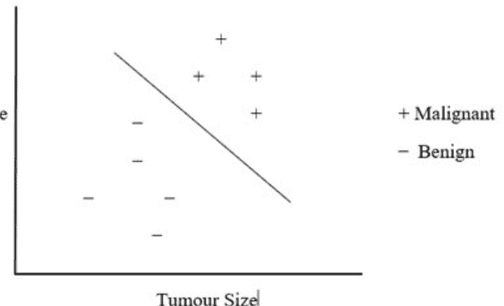

对数据集执行分类的算法称为分类器。分类主要有两种类型：一种是二分类，另一种是多类分类：
**二分类器：**“二分类器”术语指的是只有两种可能输出的分类问题，例如是或否、播放或不播放、男性或女性等。
**多类分类器：**如果存在超过两种可能的输出，则分类问题被称为多类分类器。将图像分类为不同类别（如狗、猫、马等）、将单词分类为不同的词性（POS）标签、情感检测等都是多类分类的示例。

## 2. 分类算法

Scikit-Learn 提供了多种分类算法（Dada et al., 2019; Mukhamediev et al., 2015）。这些分类器包括：

- 朴素贝叶斯
- K-最近邻
- 决策树
- 逻辑回归
- 支持向量机（SVM）

### 2.1 朴素贝叶斯

贝叶斯定理利用先验信息以及输入特征彼此表现出显著独立性的天真假设，来计算概率分类。

例如，分类器可能会将苹果分配给水果、红色和圆形等类别，但每个标签都会单独分配。这是最流行、快速且简单的机器学习分类算法，即使在训练数据量较少的情况下也能表现良好。

从数学上讲，贝叶斯定理表示为：

```
P(A|B) = P(B|A)* P(A)/ P(B)
```

其中，

- P(A|B) 表示在事件B已发生的情况下，事件A发生的概率
- P(B|A) 表示在事件A已发生的情况下，事件B发生的概率
- P(A) 是事件A的概率
- P(B) 是事件B的概率

### 2.2 K-最近邻

K-最近邻是一种简单的机器学习算法，依赖于监督学习技术。使用K-NN算法时，假设新案例和现有案例可以进行比较并归类到最相似的类别中。当所有现有数据都被存储时，K-NN算法使用相似性来确定新数据点的分类。K-NN方法的应用能够快速且精确地将新数据分类到合适的类别中。K-NN算法主要用于解决分类问题，但也可用于解决回归类问题。

K-最近邻分类模型中使用的机器学习是基于实例的，并充当懒学习者。由于它是懒学习者，因此不会创建内部模型。相反，此分类中定义的n个特征用于表示n维空间中的数据点。

该算法选择数据点k个最近邻中最普遍的类别。标记点用于标记最近的未观察数据点。k个最近邻的投票被统计，并将来自这些邻居支持最多的标签分配给新位置。

### 2.3 决策树

决策树算法是一种用于分类的机器学习算法，试图创建树状结构来可视化决策模型。分类基于“如果-那么-否则”场景，该场景既全面又互斥。通过将数据集分段为子集并选择最关键的特征进行分类，构建模型的分支。

采用自顶向下的分治法来构建树。随着我们向下进行，训练集最终会与增量决策树相关联。最终的分类结构具有类似树状的节点和叶子。

为了学习和创建规则，会连续使用单个训练数据单元。一旦规则被学习，覆盖该规则的行就会被删除。直到达到终止点，相同的程序都会在训练集上执行。

### 2.4 逻辑回归

逻辑回归算法是一种用于分类数据的机器学习算法。逻辑回归模型使用Sigmoid函数来识别输入和输出变量之间的依赖关系，并生成类标签预测。为了预测结果，它使用多个自变量。

然后，将Sigmoid函数的概率输出与预定阈值进行评估，以便以适当的方式为对象分配标签。对于二分类技术，它效果良好。

逻辑回归的主要缺陷在于它假设预测器彼此独立且数据没有缺失值。根据输出变量的类型，逻辑回归算法可以分为二元、多类或序数。

### 2.5 随机森林

随机森林分类是一种集成学习技术，本质上是决策树的集合。通过集成学习将各种预测器的数据组合在一起。它是一个元估计器，考虑了各种训练数据子样本上的树的数量。随后，使用它们的平均值来提高预测模型的准确性。在训练阶段，分类创建大量决策树，这些树将类作为输出，即各个树的回归预测的众数。

### 2.6 支持向量机（SVM）

支持向量机（SVM）算法是一种非常流行的分类数据算法。支持向量机在空间中表示两个类别与训练数据点之间的间隔。在N维空间中（N为特征数量），分类器试图找到一个超平面，将数据点明确分配给两个类别中的一个。边距是每个类别中最接近所选超平面的数据点集合。当新点进入时，会进行预测以确定数据点的类别。SVM是一种非概率二分类器。SVM中使用的正则化参数通过对数据进行过拟合来促进优化过程。该分类器有效地使用内存，并在高维领域表现良好。

## 3. 分类任务示例

任何需要将实例分组为两个或多个类别的工作都是分类任务。在照片中识别猫或小狗，或根据酸度和酒精浓度等特征识别葡萄酒的质量，都是分类任务的示例。分类类型任务有很多示例。下面列举了几个分类任务示例。

- 手写数字识别
- 语音识别
- 情感分析
- 电子邮件分类（垃圾邮件或非垃圾邮件）
- 图像分类
- 文本分类

您应根据正在处理的分类任务使用多个分类器。例如，尽管存在多元逻辑回归模型，但逻辑回归模型对于二分类任务效果良好。

随着您更频繁地使用分类器，将更好地了解何时使用每个分类器。尽管如此，通常的做法是实例化多个分类器，按性能相互比较，然后选择表现最好的分类器。


## 4. 在 Scikit-Learn 中实现分类器

在介绍了 Scikit-Learn 提供的众多分类器之后，让我们来看看如何在实践中使用分类器。

将所需的分类器导入 Python 是开发分类器的第一步。让我们来看看逻辑回归的导入语句（Pedregosa et al., 2011）：

```
from sklearn.linear_model import LogisticRegression
```

其他分类器的导入语句如下：

```
from sklearn.naive_bayes import GaussianNB
from sklearn.neighbors import KNeighborsClassifier
from sklearn.svm import LinearSVC
from sklearn.tree import DecisionTreeClassifier
```

在 Python 程序中构建分类器或对象的实例之前，必须先实例化分类器。

通常，要做到这一点，只需创建一个变量并调用分类器的相关函数即可：

```
clf = LogisticRegression()
```

现在需要训练分类器。为此，必须使用训练数据对分类器进行拟合。

分类器通过 fit 命令接收训练特征和训练标签：

```
clf.fit(features, labels)
```

分类器模型在训练数据上训练后，可以对测试数据进行预测。

这是通过在分类器上使用 predict 命令，并将测试数据集中的特征作为其进行预测所需的参数来完成的：

```
predictions=clf.predict(test_features)
```

Scikit-Learn 中分类器的基本工作流程包括以下步骤：实例化、拟合/训练和预测。

使用逻辑回归算法的示例：

```
import numpy as np
from sklearn.linear_model import LogisticRegression
X = np.array([
[-2, 4],
[4, 1],
[1, 6],
[2, 4],
[6, 2]
])
y = np.array([-1,-1,1,1,1])
clf = LogisticRegression(random_state=0).fit(X, y)
pred=clf.predict([[ 4,1],[1,6] ]) # predict 2 examples with feature values [4,1] and [1,6]
print('Prediction=',pred)
```
输出：
Prediction= [-1 1]

使用决策树算法的示例：

```
import numpy as np
from sklearn.tree import DecisionTreeClassifier
X = np.array([
[-2, 4],
[4, 1],
[1, 6],
[2, 4],
[6, 2]
])
y = np.array([-1,-1,1,1,1])
clf = DecisionTreeClassifier(random_state=0)
clf.fit(X, y)
pred=clf.predict([[ -2,4],[4,1], [1,6] ]) # predict 3 examples with feature values [-2,4], [4,1] and [1,6]
print('Prediction=',pred)
```
输出：
Prediction= [-1 -1 1]

使用支持向量机算法的示例：

```
from sklearn.svm import SVC
import numpy as np
X = np.array([
[-2, 4],
[4, 1],
[1, 6],
[2, 4],
[6, 2]
])
y = np.array([-1,-1,1,1,1])
clf = SVC(random_state=56)
clf.fit(X, y)
pred=clf.predict([[ -2,4],[2,4], [1,6] ]) # predict 3 examples with feature values [-2,4], [2,4] and [1,6]
print('Prediction=',pred)
```
输出：
Prediction= [-1 1 1]

使用 K-最近邻算法的示例：

```
from sklearn.neighbors import KNeighborsClassifier
import numpy as np
X = np.array([
[-2, 4],
[4, 1],
[1, 6],
[2, 4],
[6, 2]
])
y = np.array([-1,-1,1,1,1])
clf = KNeighborsClassifier(n_neighbors=3)
clf.fit(X, y)
pred=clf.predict([[ 2,4], [1,6] ]) # predict 2 examples with feature values [2,4] and [1,6]
print('Prediction=',pred)
```
输出：
Prediction= [1 1]

## 5. 评估分类器

在评估分类器时，有多种方法可以衡量其性能（Vujovic, Z. (2021)）。

### 5.1 分类准确率

评估准确性最流行且最直接的技术是分类准确率。分类准确率的计算方法是准确预测数除以所有预测数，即准确预测与总预测的比率。

虽然它可以让你快速了解分类器的表现，但它在每个类别中的观察值和示例数量近乎相等时效果最好。由于这种情况并不常见，你通常最好使用其他统计量。

表 1. 用于评估分类性能的指标及其功能

| 用于评估分类性能的指标 | 功能 |
| :--- | :--- |
| precision_recall_curve(y_actual, probas_pred, *) | 针对各种概率阈值，计算精确率-召回率配对。 |
| confusion_matrix(y_actual, y_predicted, *,[...,]) | 计算混淆矩阵以评估分类的准确性。 |
| classification_report(y_actual, y_predicted, *,[ ...,]) | 创建显示关键分类指标的文本报告。 |
| precision_score(y_actual, y_predicted, *,[ labels, ...]) | 计算精确率。 |
| recall_score(y_actual, y_predicted, *,[ labels, ...]) | 确定召回率。 |

### 5.2 对数损失

本质上，对数损失（LogLoss）衡量分类器对其预测的确定程度。LogLoss 返回示例属于特定类别的概率，并将这些概率相加以指示分类器的整体置信度。

预测值范围从 1 到 0，其中 1 表示完全置信，0 表示没有置信。较小的值更可取，因为损失（或整体缺乏置信度）表示为负整数，0 表示完美的分类器。

该度量仅适用于二分类问题。曲线下方的面积显示了模型准确区分一个类别与另一个类别、区分负例和正例的能力。

### 5.3 混淆矩阵

混淆矩阵是一个表格或图表，用于表示相对于两个或多个类别的准确模型。模型的预测将沿 X 轴绘制，而结果和准确率将在 Y 轴上。

单元格中表示模型所做的预测数量。在从左上角到右下角的对角线上，可以发现正确的预测。有关分析混淆矩阵的更多信息，请参阅此处。

### 5.4 分类报告

分类报告是 Scikit-Learn 中用于分类问题的内置统计量。分类报告可以帮助你快速了解模型的工作效果。召回率将模型分类为类别 A（或另一个类别）的案例数与类别 A 示例的总数进行比较，该比较在报告中显示。

报告中还返回了预测值和 F1 分数。你的模型正确识别为属于类别 A 的示例比例（真阳性与假阳性之比）称为精确率，F1 分数是通过对召回率和精确率取平均值计算得出的。

## 6. 分类指标

sklearn.metrics（Dada et al., 2019）模块提供了多种损失、分数和实用方法来衡量分类性能。某些指标可能需要置信区间、二进制决策值或正类的概率估计。大多数实现都允许每个样本使用样本权重参数以加权方式对最终分数做出贡献。表 1 中提到了一些用于评估分类性能的指标。

### 6.1 Precision_recall_curve

针对各种概率阈值，计算精确率-召回率配对。此实现仅支持二分类任务。精确率是通过真阳性数与假阳性数之比，即 tp/(tp + fp) 来衡量的。直观地说，分类器的精确率是其不将负样本分类为正样本的能力。召回率是真阳性数与假阴性数之比，即 tp/(tp + fn)。召回率是分类器找到所有正样本的能力。

```
import numpy as np
import matplotlib.pyplot as plt
from sklearn.metrics import precision_recall_curve
y_actual = np.array([0, 0, 1, 1, 1, 0, 0, 1, 1, 1 ])
y_scores = np.array([0.1, 0.4, 0.35, 0.8, 0.9, .3, 0.47, 0.35, 0.8, 0.9])
#print(sorted(list(set(y_scores.tolist()))))
precision, recall, thresholds = precision_recall_curve(y_actual, y_scores)
print(list(precision))
print(list(recall))
print(list(thresholds))
plt.plot(recall, precision, marker='.', label='Curve')
plt.xlabel('Recall')
plt.ylabel('Precision')
plt.show()
```
输出：
[0.6, 0.6666666666666666, 0.75, 0.6666666666666666, 0.8, 1.0, 1.0, 1.0]
[1.0, 1.0, 1.0, 0.6666666666666666, 0.6666666666666666, 0.6666666666666666, 0.3333333333333333,
0.0]
[0.1, 0.3, 0.35, 0.4, 0.47, 0.8, 0.9]

### 6.2 混淆矩阵

混淆矩阵（也称为误差矩阵）是一种用于评估分类模型效果的紧凑表格。每个类别的准确和不准确预测数量使用计数值表示。


### 图 2. 输出

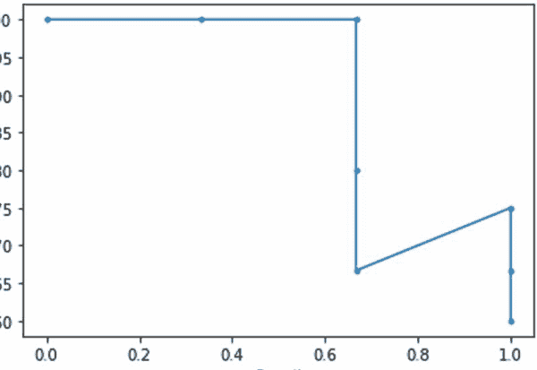

按定义，如果 C 是混淆矩阵，则 $C_{ij}$ 等于已知属于组 i 且预测属于组 j 的观测值的数量。

### 图 3. 混淆矩阵

| 预测值 \ 实际值 | 正类 (1) | 负类 (0) |
| :--- | :--- | :--- |
| 正类 (1) | 真正例 (TP) | 假正例 (FP) |
| 负类 (0) | 假负例 (FN) | 真负例 (TN) |

因此，在二分类中，真负例的计数为 C_{0,0}，假负例的计数为 C_{1,0}，真正例的计数为 C_{1,1}，假正例的计数为 C_{0,1}。2x2 混淆矩阵的图示如下，如图 3 所示。

- 真正例 (TP)：模型准确预测为正类的结果。
- 真负例 (TN)：模型正确预测为负类的结果。
- 假正例 (FPs)：模型预测为正类但实际上为负类的结果。
- 假负例 (FN)：模型错误预测为负类但实际上属于正类的结果。

要衡量分类模型的性能，需要找出模型的准确率、召回率、精确率、特异性和 F1-Score 值。

示例（二分类）：

```python
from sklearn.metrics import confusion_matrix, ConfusionMatrixDisplay
import matplotlib.pyplot as plt
y_actual = [1, 0, 1, 0, 0, 1]
y_predicted = [1, 1, 1, 0, 1, 1]
conf_mat=confusion_matrix(y_actual, y_predicted)
print(conf_mat)
disp=ConfusionMatrixDisplay(confusion_matrix=conf_mat, display_labels=[0,1])
disp.plot()
plt.show()
```

输出：

```
[[1 2]
 [0 3]]
```

示例（多类分类）：

```python
from sklearn.metrics import confusion_matrix, ConfusionMatrixDisplay
import matplotlib.pyplot as plt
y_actual = [2, 0, 2, 2, 0, 1]
y_predicted = [0, 0, 2, 2, 0, 2]
conf_mat = confusion_matrix(y_actual, y_predicted)
print(conf_mat)
disp = ConfusionMatrixDisplay(confusion_matrix= conf_mat, display_labels=[0,1,2])
disp.plot()
plt.show()
```

输出：

### 图 4. 输出

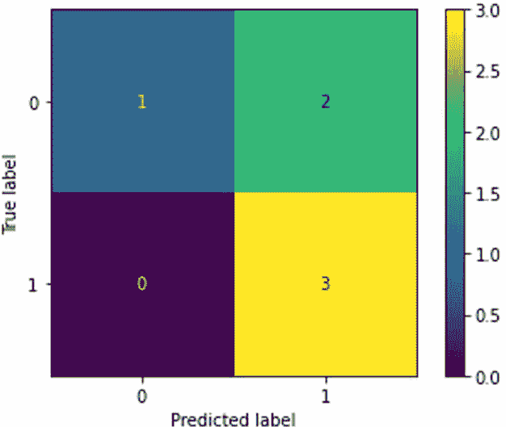

### 图 5. 输出

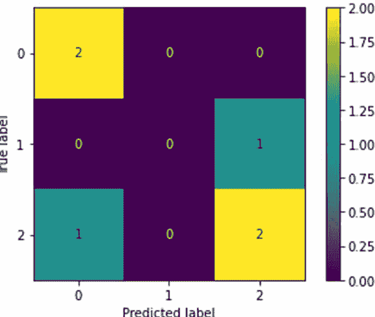

```
[[2 0 0]
 [0 0 1]
 [1 0 2]]
```

## 6.3 准确率

这仅仅等于模型正确分类的预测所占的比例。

准确率 = \frac{正确预测数}{预测总数} = \frac{TP + TN}{TP + TN + FP + FN}

示例：

```python
# Accuracy
from sklearn.metrics import accuracy_score
y_actual = [0, 1, 3, 2, 2]
y_predicted = [0, 3, 1, 2, 3]
print(accuracy_score(y_actual, y_predicted))
```

输出：

0.4

## 6.4 精确率

精确率是通过在所有被预测为正类的样本中找出实际为正类的样本数量来计算的。它也称为阳性预测值。实际上，它是所有正类预测中真正例的百分比。

精确率 = \frac{TP}{TP + FP}

示例：

```python
# Precision
from sklearn.metrics import precision_score
y_actual = [0, 1, 3, 2, 2]
y_predicted = [0, 3, 1, 2, 3]
print(precision_score(y_actual, y_predicted, average=None))
```

输出：

[1. 0. 1. 0.]

## 6.5 召回率

召回率（也称为灵敏度、命中率或真正率 (TPR)）是通过从所有给定的正类样本中找出被正确预测的样本数量来计算的。它回答了问题：“实际正类中有多少比例被正确识别了？”

$$召回率 = \frac{TP}{TP + FN}$$

示例：

```python
# Recall
from sklearn.metrics import recall_score
y_actual = [0, 1, 3, 2, 2]
y_predicted = [0, 3, 1, 2, 3]
print(recall_score(y_actual, y_predicted, average=None))
```

输出：

[1. 0. 0.5 0. ]

## 6.6 特异性

特异性衡量被正确识别为负类的实际负类所占的比例。它也称为真负率 (TNR)。它是召回率的对立指标。

$$特异性 = \frac{TN}{TN + FP}$$

## 6.7 F1 分数

F1 分数是精确率和召回率的调和平均数。其最高分为 1，表示精确率和召回率完美。

$$F1 分数 = \frac{2*(精确率*召回率)}{精确率 + 召回率}$$

示例：

```python
# f1_score
from sklearn.metrics import f1_score
y_actual = [0, 1, 3, 2, 2]
y_predicted = [0, 3, 1, 2, 3]
print(f1_score(y_actual, y_predicted, average='macro'))
print(f1_score(y_actual, y_predicted, average='micro'))
print(f1_score(y_actual, y_predicted, average='weighted'))
```

输出：

0.41666666666666663
0.4000000000000001
0.4666666666666666

## 参考文献

Dada, E. G., Bassi, J. S., Chiroma, H., Shafi'i, M. A., Adetunmbi, A. O., & Ajibuwa, O. E. (2019). 电子邮件垃圾邮件过滤的机器学习：综述、方法和开放研究问题. Heliyon, 5(6). doi:10.1016/j.heliyon.2019.e01802

Mukhamediev, R., Yakunin, K., Iskakov, S., Sainova, S., Abdilmanova, A., & Kuchin, Y. (2015). 分类算法的比较分析. doi:10.1109/ICAICT.2015.7338525

Pedregosa, Varoquaux, Gramfort, Michel, Thirion, & Grisel. (2011). Scikit-learn：Python 中的机器学习. 机器学习研究杂志, 12(Oct), 2825–2830.

Vujovic, Z. (2021). 分类模型评估指标. 国际先进计算机科学与应用杂志, 12(6), 599–606. doi:10.14569/IJACSA.2021.0120670

# 第 2 章

# 面向下一代系统的 TensorFlow 与 SciKit 机器学习算法

Aryan Chopra
印度维洛尔技术学院

Aditya Modi
印度维洛尔技术学院

Brijendra Singh
https://orcid.org/0000-0003-2608-3388
印度维洛尔技术学院

## 摘要

机器学习在医疗保健、银行、金融和营销等所有主要领域都发挥着至关重要的作用。有必要更好地理解 ML 算法的作用和工作原理。每当我们尝试浏览互联网以获取所需信息时，Google 也会使用学习算法对网页进行排名。理解这些算法的平台和工作原理对研究人员至关重要。在本章中，作者介绍了机器学习基础知识及这些算法的工作原理，并附有合适的示例。他们还强调了 TensorFlow 和 SciKit 等主要机器学习库在开发和部署大型应用中的重要性。最后，介绍了 ML 应用案例研究以更好地理解该概念。ML 应用的未来前景也进行了详细描述。

## 1. 引言

自石器时代以来，人类就使用不同类型的工具来让生活更轻松。人类大脑的巧妙性反过来使许多不同的机器成为可能。机器学习就是其中一项发明。根据 Arthur Samuel 的说法，机器学习被定义为“赋予计算机在无需明确编程的情况下学习能力的研究领域”（Mahesh, 2020）。图 1 展示了不同类型机器学习（ML）算法的快速概览。

### 图 1. ML 算法的流行度上升 (Sarker, 2021)

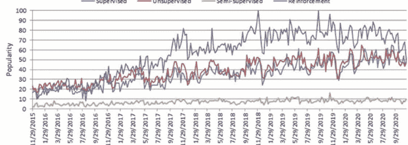

机器学习已成为人工智能（AI）的一个关键分支，专注于数据操作和建模，以进行预测和分析复杂模式。本文献综述旨在提供机器学习基础知识的概述，探讨各种机器学习算法，强调 TensorFlow 和 SciKit 等流行机器学习库的重要性，并通过案例研究突出实际应用。

> “各种 ML 算法（受监督、无监督、半监督和强化学习）在 0（最小值）到 100（最大值）范围内随时间变化的全球流行度评分，其中 x 轴表示时间戳信息，y 轴表示相应的评分”（Sarker, 2021）。

机器学习是人工智能的一个分支，涉及数据操作和建模，从而帮助从数据中进行预测和绘制图表以共同分析。通过使用统计方法，算法可以进行从一周内股票价格到未来十年全球变暖增加水平等各种预测。随着技术的进步，机器学习在我们生活的方方面面都很普遍，大公司经常使用它来帮助进行消费者行为分析，然后向他们推荐可能购买的产品和服务，从而增加收入。利用数据操作来构建有助于预测下一组数据的模型，这被称为机器学习算法。

现在我们将讨论各种学习方法：

### 1.1 受监督学习

受监督学习是在教师的监督下进行的。对于给定的一组输入，我们知道输出，或者说类别级别是已知的。我们可以基于受监督数据训练模型。当我们将新数据呈现给模型时，它将预测我们未知的类别级别。分类是受监督学习技术之一，具有大量现实世界的应用。例如，在医学领域，我们可以分类癌症是良性还是恶性。图 2 描绘了受监督机器学习算法的工作原理。受监督学习的目标是构建一个预测模型，能够准确预测新的、未见的输入数据的输出。


### 图 2. 监督学习

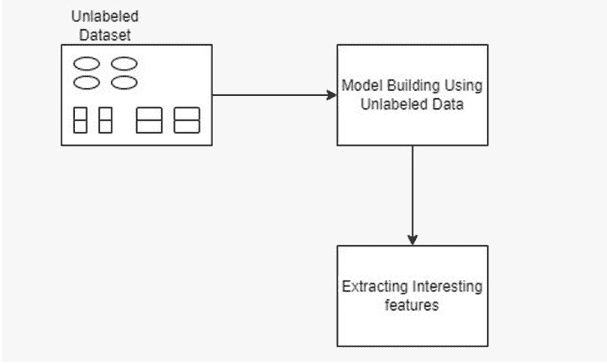

监督学习的一个关键优势是，它可以对新的、未见过的输入数据进行准确预测。这是因为算法已经学习了输入数据与输出标签之间的映射，并可以使用此映射进行预测。然而，监督学习需要标记数据，获取此类数据可能既困难又耗时。

监督学习的另一个潜在缺点是可能会出现过拟合。当模型过于复杂，捕捉了训练数据中的噪声或随机波动，而不是底层模式时，就会发生过拟合。这可能导致在新的、未见过的输入数据上表现不佳。可以使用正则化技术来防止过拟合，即在目标函数中添加惩罚项，以鼓励更简单的模型。

### 1.2 无监督学习

在这种学习中，数据自行学习以在数据集中发现有趣的模式，无需任何指导。也可以说，给定数据的类别级别是未知的。它从过去学习的特征中识别数据中的有趣模式。特征降维和聚类是无监督学习算法的一些常见应用（Mahesh, 2020）。聚类用于对相似数据进行分组，有助于其识别。例如，它用于根据账户类型（如储蓄账户）对银行客户进行细分。我们在图 3 中说明了无监督学习的工作原理，其中数据集被分为训练数据集和测试数据集，并使用各种指标评估所开发模型的性能。

无监督学习的主要目标是从数据中提取有意义的模式，并根据数据点的固有相似性或共同特征将相似数据点分组在一起。通过这样做，它有助于揭示底层结构并更深入地理解数据，这在各种应用中可能非常宝贵。

无监督学习具有多种优势和应用。它能够发现数据中先前未知的模式和关系，促进数据探索并产生洞察。它可用于探索性分析、数据预处理、特征工程和异常检测。

### 图 3. 无监督学习

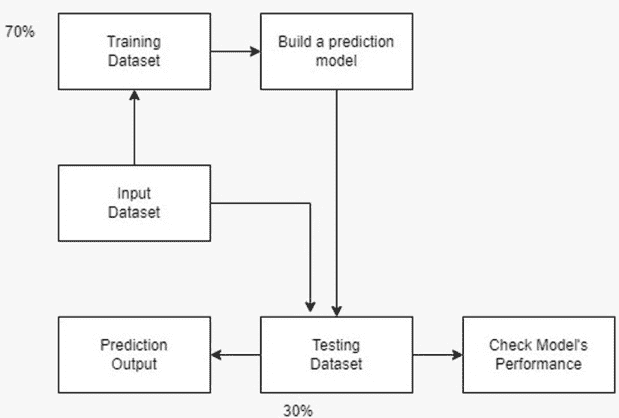

在标记数据稀缺、获取昂贵或根本不可用的场景中，无监督学习尤其有价值。

然而，无监督学习也面临挑战。没有标记数据，客观评估所学模型的性能和质量可能很困难。解释结果也可能具有挑战性，因为算法识别的模式和聚类可能没有明确含义或不易立即理解。此外，无监督学习算法可能对数据中的异常值或噪声敏感，需要仔细的预处理和参数调整。

### 1.3 强化学习

强化学习是一种基于决策的方法，智能代理通过与学习环境通信来做出明智的决策。在 RL 中，代理通过接收其在环境中采取的行动所获得的奖励或惩罚形式的反馈来学习。RL 可以分解为三个主要部分：代理的操作和交互上下文称为环境。在环境中做出决策并采取行动的实体称为代理。代理因其活动而从周围环境接收到的反馈称为奖励信号。代理在 RL 过程中根据其当前状态选择一个动作，接收奖励信号形式的反馈，然后根据观察到的结果修改其选择动作的策略或方法。这种迭代过程持续进行，直到代理发现如何以最大化其长期累积收益的方式运行。

代理的学习过程涉及优化其策略以最大化预期累积奖励。在这里，代理通过从其行动、经验和反馈中试错来自行学习，以获得更多奖励点。它通过奖励和惩罚来学习。代理的训练方式使其倾向于获得更多奖励点并尽量减少惩罚。它具有与环境交互并从环境的行动中学习的能力。有利行为可以得到奖励，而不利行为可以受到惩罚。这里的一个基本目标是增加代理获得的总奖励点数。强化学习分为两个不同的类别，即正强化和负强化。正强化是指通过奖励点支持代理的有利行为，从而提高系统性能。另一方面，负强化会阻止行为或动作在未来事件中重复。强化学习主要使用的模型是马尔可夫决策过程和 Q-learning。大多数应用见于自动化行业、自动驾驶汽车、游戏、图像处理、交通控制系统、自然语言处理和营销。

### 1.4 半监督学习

半监督学习同时使用监督学习和无监督学习。它使用大量未标记数据和少量标记数据，这有助于跳过寻找大量标记数据的需求。它使用半标记来训练模型。首先，我们使用较少的标记数据（类似于监督学习）进行训练，直到获得准确结果。然后，我们使用带有伪标签的未标记数据训练模型，此时数据可能不那么准确。然后我们将两个数据表链接在一起。它用于语音分析和文本文档分类。虽然被认为与强化学习相似，但它有所不同，因为强化学习遵循奖励和惩罚逻辑，而半监督学习遵循的是使用较少标记数据训练模型。

### 1.5 深度学习

与机器学习相比，深度学习涉及更多隐藏层。深度学习是人工智能的一个子集。它使用反向传播技术，通过识别有趣的模式来揭示网络内部参数如何演变。当数据量巨大且需要开发自动化应用程序时，建议使用深度学习技术。

深度学习因多种原因优于机器学习，其中一些原因是：DL 中特征提取是自动化的，它可以处理复杂数据和大量信息，DL 模型具有更高的性能和准确性，并且也更容易扩展。深度学习最令人惊叹的好处是，模型会不断自行训练和改进，使其非常适合需要随时间适应和演进的应用程序。

### 1.6 自然语言处理

自然语言处理赋予机器理解和解释人类语言的能力。通过 NLP，机器可以理解书面和口语文本；它还进一步应用于语音识别和自动文本摘要。它用于聊天机器人、语言翻译、情感分析（例如识别和识别积极、消极等情绪）。NLP 模型的质量取决于用于构建它们的训练数据的质量和数量。NLP 面临的挑战也很多，从歧义、上下文依赖到需要理解不同语言和方言。NLP 在客户服务、医疗保健、电子商务等方面也有实际应用。

### 1.7 计算机视觉

计算机视觉是一个处理图像和视频的领域，通过处理和分析它们来提取有趣的模式，以进行智能决策。机器学习是其中至关重要的一部分，因为它使计算机能够从示例中学习并随时间改进自身。机器学习算法在计算机视觉中的一些进一步应用包括目标检测，其中机器学习算法用于检测和识别图像和视频，这些反过来又用于图像和视频分类，然后用于图像和视频分割。CV 和 ML 的一些实际应用包括自动驾驶汽车、医学影像和工业检测。它们还可用于游戏、增强现实和数码相机。

本书章节的安排如下。第 2 节讨论机器学习的应用，以及不同领域的专业人士如何通过文献综述在其工作中使用它。在第 2 节之后，第 3 节详细讨论了各种机器学习算法，包括它们的 scikit 实现。第 4 节讨论什么是 TensorFlow，第 5 节接着讨论 scikit。第 6 节讨论 AI 和 ML 的局限性。第 7 节有一个在线电子商务网站的案例研究，文章在第 8 节结束。

## 2. 文献综述

人工神经网络（ANN）模型用于分析地下水污染对尼日利亚医疗保健风险管理的影响。他们的研究发现，地下水受到严重污染并受大地测量影响。较新的提议模型证明更可靠，并提供了更好、更准确的结果（Akakuru 等人，2023）。提出了一种新方法，在时间序列分析中直到分歧点都具有更好的准确性。这种方法的新颖之处在于它能够使用带有任何偏差的完整时间序列数据。他们建议在医疗保健结果（Valsamis 等人，2019）评估中使用此模型。Mendarisian Aritonang 应用反向传播神经网络和线性回归来对碾米单位进行销售预测。他们的研究旨在预测大米销售，以便进行原材料预测，从而减少闲置时间。所发现的结果有助于相比旧模型提高生产力（Aritonang & Sihombing, 2019）。Neda Khanmohammadi 在参考蒸散趋势计算中应用了多元线性回归方法。该论文将蒸散作为灌溉编程中的关键因素，并使用 MLR 模型分析了它与其有效参数之间的趋势（Khanmohammadi 等人，2018）。Nathawat 使用多元线性回归技术来寻找卫生中心距离与疟疾热点之间的相关性，作为整个地图来预测印度的疾病。他们的模型建议根据严重程度从低到高将疟疾易发区划分为 5 个类别。研究结果表明，随着距离医疗设施的距离增加，疟疾发病率也可能增加（Ra 等人，2012）。Brijendra Singh 使用计算智能技术来预测泰米尔纳德邦私立医院中信息技术的使用（Singh B & D.P Achariya, 2020）。泰米尔纳德邦学童使用信息技术的另一个应用使用智能技术进行分析（Magesh G 等人，2015）。

Jong Woo Kim 应用决策树方法来开发可根据业务应用需求个性化的广告。该论文提出了一种基于营销数据的规则生成方法，并使用机器学习和决策树技术构建个性化推荐系统（2001）。Muh Cherng Wu 将决策树应用于股票交易，通过结合过滤规则


和决策树技术。与之前尝试类似方法的文献相比，这项工作的不同之处在于在标准中加入了未来信息。决策树用于修改现有的过滤技术，以更准确地预测台湾股市数据（2006）。Mohammad M Ghiasi 将决策树应用于乳腺癌分类。随机森林技术用于修改经典技术，用于乳腺癌检测以及将肿块分类为恶性和良性。他们的模型在性能方面远远优于经典技术，并且也易于部署到其他医疗保健应用中（2021）。Jun Wu 将决策树应用于现代化农业数据分类。决策树分类器被用于农业信息的分类和预测。这种方法的主要优点是它适用于完整和不完整的数据集，因此是一种更通用的方法，适用于各种农业数据，模型性能得到增强（U. et al., 2009）。

Shujun Huang 使用支持向量机分类器从癌症基因组数据集中提取有意义的信息。这导致发现了先进的生物标志物、先进的药物靶点，并对癌症基因提供了更多见解（Huang et al., 2018）。Byvatov E 在医学领域开发了SVM和神经模型，在分类和预测任务中取得了改进的结果（Byvatov & Schneider, 2003）。基于人工智能的方法用于构建电力预测模型，具有更好的准确性和改进的结果（Ahmad et al., 2014; Deka, 2014）。Mathias M. Adankon 提出了一种使用先进方法进行手写字符识别的模型选择方法。LS-SVM方法用于分类任务，并显示出最佳性能和适用于其他应用的通用方法（Adankon & Cheriet, 2009）。

Mucahid Mustafa Saritas 提出了一种基于血常规数据集各种参数的乳腺癌分析方法。ANN和朴素贝叶斯分类算法用于数据的分析和分类，方法的性能基于不同指标进行评估（Saritas & Yasar, 2019）。M. Wiggins 使用贝叶斯分类技术分析ECG数据。患者根据年龄和ECG进行分类。研究结果表明，与现有分类器相比，性能有所提高（Wiggins et al., 2008）。Joanna Kazmierska 使用朴素贝叶斯分类器方法分析放射治疗后癌症疾病的风险（Kazmierska & Malicki, 2008）。朴素贝叶斯算法广泛用于包括推荐系统在内的各种应用，因为它们易于实现。然而，一些挑战仍然存在，例如预测器的要求。他们使用了大型训练数据集来消除上述问题，从而提高准确性（Rrmoku et al., 2022）。

## 3. 机器学习算法

任何机器学习模型的基础在于其算法部分。现在我们将详细描述主要的ML算法。

### 3.1 线性回归

线性回归是ML中的基本算法之一，用于预测连续变量。它通常用于预测分析和建模。它主要用于找出变量之间的关系并预测变量。回归模型基于因变量和自变量的数量。它预测连续值，例如汽车的CO2排放量。

图 4. 线性回归

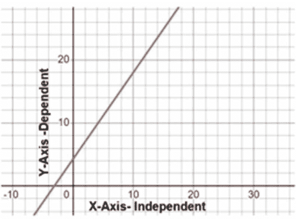

在这里，连续数据用于学习一个用于预测因变量的函数。例如，我们希望在某些变量x和相关的y变量之间建立关系。这些变量之间的关系是通过假设学习的。在线性回归问题中，假设是一条直线。线性模型使用称为权重和偏置的参数，这些参数根据训练数据点进行调整。此外，使用误差来评估所开发模型的性能，称为均方误差。基于各种因素预测房价是一个线性回归问题。

线性回归是一种回归模型，其值由整数预测，不需要激活函数或任何阈值。逻辑回归是一种分类模型，我们通过0或1预测值，它也需要激活函数和阈值。在线性回归中，我们使用均方根能量方法来预测下一个值，而在逻辑回归中，我们使用精度来预测或基于最大似然估计进行预测。逻辑回归的图形对正值呈S形，对负值呈Z形。

代价函数如下：

```
j(w,b) = \frac{1}{2m} \sum_{i=1}^m (yi - h(xi)^2
```

其中w=权重，b=bias。

以下是使用scikit-learn在Python中实现线性回归的示例（Simplilearn, n.d.）。在此示例中，首先从scikit-learn导入必要的模块。接下来，我们定义示例数据。我们有一个表示输入特征的数组X和一个表示目标变量的数组y。然后我们创建一个名为regression的线性回归对象。这将是我们的线性回归模型。要训练模型，我们在regression对象上调用fit()方法，传入输入特征X和目标变量y。

图 5. 使用scikit-learn在Python中实现线性回归（Simplilearn, n.d.）

```
import numpy as np
from sklearn.linear_model import LinearRegression
from sklearn.metrics import mean_squared_error
import matplotlib.pyplot as plt

#### Sample data
X = np.array([[1], [2], [3], [4], [5]]) # Input features
y = np.array([2, 4, 5, 4, 5]) # Target variable

#### Create a linear regression model
regression = LinearRegression()

#### Train the model
regression.fit(X, y)

#### Make predictions on the training data
y_pred = regression.predict(X)

#### Calculate the mean squared error
mse = mean_squared_error(y, y_pred)
print("Mean Squared Error:", mse)

#### Plot the data points and the regression line
plt.scatter(X, y, color='blue', label='Actual')
plt.plot(X, y_pred, color='red', label='Predicted')
plt.xlabel('X')
plt.ylabel('y')
plt.legend()
plt.show()
```

模型训练完成后，我们可以通过在regression对象上调用predict()方法并传入X，对训练数据进行预测。预测值存储在y_pred数组中。为了评估模型的性能，我们计算实际目标变量y与预测值y_pred之间的均方误差（MSE）。MSE是一种常用的指标，用于衡量回归模型的质量。

最后，我们使用matplotlib可视化数据点和回归线。scatter()函数用于绘制实际数据点，plot()函数用于绘制预测的回归线。我们还为x轴和y轴添加标签，并包含图例以提高清晰度。生成的图将显示数据点为蓝色点，回归线为红色线。运行代码将输出均方误差，并显示带有实际数据点和预测回归线的散点图。

### 3.2 逻辑回归

逻辑回归是一种统计技术，用于分析具有两个潜在结果（如是或否）的二元因变量以及一个或多个自变量。数据经常使用机器学习和数据科学技术分为两个或多个组。逻辑回归模型的输出是一个0到1之间的概率，表示因变量落入某个类别的机会。逻辑回归模型可用于解决二元分类问题（因变量有两个潜在结果）和多类分类问题（因变量有超过两个可能结果）。逻辑函数将任何具有实值的输入转换为0到1之间的数字，作为逻辑回归模型的基础。给定自变量的值，逻辑函数用于建模因变量的可能性。最大似然估计方法用于估计逻辑回归模型的参数。计算参数后，该模型可用于预测新数据点落入因变量特定类别的可能性。对于各种预测问题，金融、医疗保健和营销领域的机器学习和数据科学部门经常采用这种流行且有效的逻辑回归方法。

以下是使用scikit-learn在Python中实现逻辑回归的示例（Towards-datascience, n.d.-a）：

在此示例中，首先从scikit-learn导入必要的模块。接下来，我们定义示例数据。我们有一个表示输入特征的数组X和一个表示目标变量的数组y。目标变量是二元的，值为0或1。接下来，我们创建一个名为logreg的LogisticRegression对象。这将是我们的逻辑回归模型。要训练模型，我们在logreg对象上调用fit()方法，传入输入特征X和目标变量y。

模型训练完成后，我们可以通过在logreg对象上调用predict()方法并传入X，对训练数据进行预测。预测值存储在y_pred数组中。为了评估模型的性能，我们通过将实际目标变量y与预测值y_pred进行比较来计算准确率。准确率是一种常用的指标，用于衡量分类模型的性能。

最后，我们使用matplotlib可视化数据点和决策边界。scatter()函数用于绘制实际数据点，plot()函数用于绘制正类的预测概率。预测概率是使用logreg对象的predict_proba()方法获得的。我们还为x轴和y轴添加标签，并包含图例以提高清晰度。生成的图将显示数据点为蓝色点，决策边界为红色曲线。运行代码将输出准确率，并显示带有实际数据点和决策边界的散点图。


### 图 6. 在 Python 中使用 scikit-learn 实现逻辑回归 (Towardsdatascience, n.d.-a)

```
import numpy as np
from sklearn.linear_model import LogisticRegression
from sklearn.metrics import accuracy_score
import matplotlib.pyplot as plt

#### Sample data
X = np.array([[1], [2], [3], [4], [5]]) # Input features
y = np.array([0, 0, 1, 1, 1]) # Target variable

#### Create a logistic regression model
logreg = LogisticRegression()

#### Train the model
logreg.fit(X, y)

#### Make predictions on the training data
y_pred = logreg.predict(X)

#### Calculate the accuracy
accuracy = accuracy_score(y, y_pred)
print("Accuracy:", accuracy)

#### Plot the data points and the decision boundary
plt.scatter(X, y, color='blue', label='Actual')
plt.plot(X, logreg.predict_proba(X)[:, 1], color='red', label='Predicted')
plt.xlabel('X')
plt.ylabel('y')
plt.legend()
plt.show()
```

### 3.3 决策树

决策树是一种用于分类或回归分析的监督学习方法。在决策树中，输入数据被递归地划分为子集，并构建一个类似树形数据结构的机器学习模型，用于结果预测。给定应用的整个数据集由决策树的根节点表示。之后将决定使用数据集的哪个特征来找到阈值，以便根据目标变量进一步生成数据子集。分割标准由能产生最同质子组的特征和阈值决定。

决策树的逐步工作原理如下：

### 图 7. 决策树

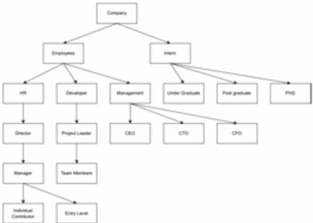

- 1. 第一步是加载你打算用于回归或分类的数据集。数据集中应包含标记的实例（即，每个示例的类别或目标值应已知）。
- 2. 选择目标变量：下一步必须选择决策树的目标变量。对于分类和回归任务，该变量应为类别型。
- 3. 确定分割标准：分割的质量由分割标准衡量。熵和基尼不纯度是分类任务中最常用的分割标准，而均方误差或平均绝对误差用于回归任务。
- 4. 创建决策树：使用数据集和分割标准来创建决策树。从根节点开始，使用能最大化分割标准的输入特征值递归地拆分数据。继续拆分，直到满足停止条件或叶节点纯净（叶节点中的所有实例都属于同一类别）（例如，达到最大深度或每个叶节点需要最少数量的示例）。
- 5. 剪枝是一种用于降低决策树复杂度并避免过拟合的策略。它是可选的。这涉及剪掉那些不能提高决策树在验证集上准确率的树枝。
- 6. 可以使用测试集来评估决策树的有效性。确定模型的性能指标，例如准确率、精确率、召回率和 F1 分数。
- 7. 调整超参数（可选）：如果决策树的性能不达标，考虑调整超参数。这涉及修改分割标准、每个叶节点的最小样本数以及树的最大深度。
- 8. 创建预测：决策树训练完成并调整好超参数后，使用它对新案例进行预测。

### 图 8. 在 Python 中使用 scikit-learn 实现决策树分类器 (Datacamp, n.d.-a)

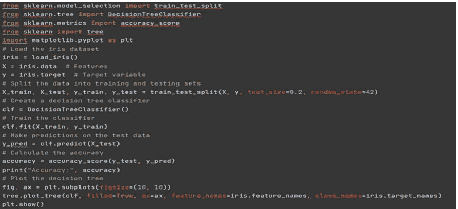

决策树算法是一种简单而有效的方法，可应用于回归和分类问题。在达到纯净叶节点之前，数据会根据输入特征的值递归地进行分割。决策树非常适合用于说明模型如何生成其预测，因为它们被认为是可解释且易于理解的。不过，它们容易过拟合，尤其是在数据带有噪声或树较深时。

以下是在 Python 中使用 scikit-learn 实现决策树分类器的示例 (Datacamp, n.d.-a)：

在本示例中，首先导入 scikit-learn 中所需的模块。接下来，我们使用 load_iris() 函数加载鸢尾花数据集，并将特征存储在 X 中，将目标变量存储在 y 中。然后，我们使用 train_test_split() 将数据分为训练集和测试集。在此示例中，我们分配 20% 的数据用于测试，并设置随机状态以确保可重复性。我们创建一个名为 clf 的 DecisionTreeClassifier 对象。这将是我们的决策树分类器。要训练分类器，我们在 clf 对象上调用 fit() 方法，传入训练数据 X_train 和相应的目标变量 y_train。

分类器训练完成后，我们可以通过在 clf 对象上调用 predict() 方法并传入 X_test 来对测试数据进行预测。预测值存储在 y_pred 数组中。要评估模型的性能，我们使用 scikit-learn 中的 accuracy_score() 函数将预测标签 y_pred 与实际标签 y_test 进行比较，从而计算准确率。

最后，我们使用 matplotlib 可视化决策树。我们使用 subplots() 创建图形和坐标轴，指定绘图大小，然后使用 tree.plot_tree() 可视化决策树。我们还传入特征名称和类名称来相应地标记树。生成的图将显示决策树结构。运行代码将输出准确率并显示决策树图。

### 3.4 随机森林 (RF)

随机森林是将多个决策树并行处理，在数据集的不同样本上进行训练，并基于多数投票概念生成所需结果的组合。

### 图 9. 随机森林

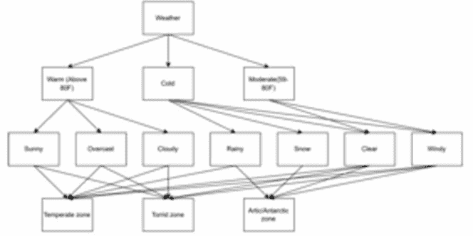

### 随机森林的逐步工作原理

- 1. 第一步是加载你打算用于回归或分类的数据集。数据集中应包含标记的实例（即，每个示例的类别或目标值应已知）。
- 2. 选择树的数量：随机森林中要使用的树的数量是下一阶段。可以通过交叉验证或实验来微调此超参数。
- 3. 选择特征：在决策树的每个节点，随机森林会随机选择一个特征子集。这样做是为了增加树的多样性并减少过拟合。另一个可修改的超参数是每个节点要选择的特征数量。
- 4. 创建决策树：使用数据集和所选特征创建决策树。每个决策树使用随机选择的实例子集和随机选择的特征子集进行训练。树是使用决策树算法的分割标准构建的（即，分类任务使用熵或基尼不纯度，回归任务使用均方误差或平均绝对误差）。
- 5. 一旦所有决策树都构建完成，就合并它们的预测得出最终结论。对于分类任务，这是通过对不同树的预测类别进行投票来实现的。对于回归任务，这是通过对不同树的预测值求平均来实现的。
- 6. 使用测试集来评估随机森林的有效性。确定模型的性能指标，例如准确率、精确率、召回率和 F1 分数。
- 7. 调整超参数：如果随机森林的性能不达标，考虑调整超参数。树的数量、每个节点要选择的属性数量以及树的最大深度都可以更改。
- 8. 创建预测：超参数调整完成且随机森林训练完成后，使用它对全新案例进行预测。


**图 10. 如何在 Python 中使用 scikit-learn 实现随机森林分类器 (Datacamp, n.d.-b)**

```
from sklearn.datasets import load_iris
from sklearn.model_selection import train_test_split
from sklearn.ensemble import RandomForestClassifier
from sklearn.metrics import accuracy_score
import matplotlib.pyplot as plt
#### Load the iris dataset
iris = load_iris()
X = iris.data # Features
y = iris.target # Target variable
#### Split the data into training and testing sets
X_train, X_test, y_train, y_test = train_test_split(X, y, test_size=0.2, random_state=42)
#### Create a random forest classifier
clf = RandomForestClassifier(n_estimators=100)
#### Train the classifier
clf.fit(X_train, y_train)
#### Make predictions on the test data
y_pred = clf.predict(X_test)
#### Calculate the accuracy
accuracy = accuracy_score(y_test, y_pred)
print("Accuracy:", accuracy)
#### Feature importance
importance = clf.feature_importances_
plt.bar(range(len(importance)), importance)
plt.xticks(range(len(importance)), iris.feature_names, rotation='vertical')
plt.xlabel('Features')
plt.ylabel('Importance')
plt.show()
```

随机森林算法是一种集成学习方法，通过融合不同的决策树来提高预测能力和准确性。它通过使用数据和特征的任意子集创建大量决策树，然后结合每棵树的预测结果来发挥作用。众所周知，随机森林在处理高维数据、缺失值和噪声数据方面效率很高。与单个决策树相比，它们计算成本较高且难以理解。

下面是如何在 Python 中使用 scikit-learn 实现随机森林分类器的示例 (Datacamp, n.d.-b)：

在本示例中，首先导入 scikit-learn 的必要模块。然后使用 load_iris() 函数加载鸢尾花数据集，并将特征存储在 X 中，将目标变量存储在 y 中。接下来，使用 train_test_split() 将数据分为训练集和测试集。在此示例中，我们将 20% 的数据分配用于测试，并设置随机状态以确保可重复性。我们创建一个名为 clf 的 RandomForestClassifier 对象。这将是我们的随机森林分类器。在本示例中，我们将估计器（决策树）的数量设置为 100。要训练分类器，我们在 clf 对象上调用 fit() 方法，传入训练数据 X_train 和相应的目标变量 y_train。

分类器训练完成后，我们可以通过在 clf 对象上调用 predict() 方法并传入 X_test 来对测试数据进行预测。预测值存储在 y_pred 数组中。要评估模型的性能，我们使用 scikit-learn 的 accuracy_score() 函数将预测标签 y_pred 与实际标签 y_test 进行比较，从而计算准确率。

此外，我们可以分析随机森林分类器中的特征重要性。可以使用 clf 对象的 feature_importances_ 属性获取重要性得分。在本示例中，我们使用条形图可视化特征重要性，其中 x 轴表示特征，y 轴表示重要性得分。运行代码将输出准确率并显示特征重要性图。

### 3.5 KNN：K 近邻

在此，测试样本被分配到训练数据样本中出现频率最高的类别。在存在多于两个不同类别的情况下，测试数据样本将根据与测试样本的最小平均距离被分配到相应的类别 (Kataria & Singh, 2013)。

它根据点在图中的位置对其进行分类。例如，如果输出簇更接近蓝色组而不是红色组，则它将被称为蓝色组的成员。这种方法表明，KNN 可用于对已知数据进行分组，或预测未知数据应位于何处。

KNN 的逐步工作原理如下：

- 1. 第一步是加载您打算用于回归或分类的数据集。数据集中应包含标记的实例（即，每个示例的类别或目标值应已知）。
- 2. 下一步是确定 K 的值，它表示预测时将考虑的最近邻居的数量。通常，会使用交叉验证或实验来选择此值。
- 3. 计算距离：使用欧几里得距离等距离度量，确定数据集中每个示例与测试示例之间的距离。距离度量计算特征空间中两个位置之间的分离度。
- 4. 根据前一阶段确定的距离度量，选择与测试用例最接近的 K 个邻居。最接近测试示例的示例即为其邻居。
- 5. 预测类别或值：在分类问题中，通过获取 K 个最近邻居类别标签的多数票来选择测试示例的类别。通过对 K 个最近邻居的目标值求平均，您可以预测回归任务中测试示例的值。
- 6. 输出样本的预测结果

运行 KNN 时，我们每次只需执行步骤 3-6。KNN 是一种强大的算法，可用于分类和回归任务。

下面是如何在 Python 中使用 scikit-learn 实现 K 近邻（KNN）算法的示例 (Towardsdatascience, n.d.-b)：

在本示例中，首先导入 scikit-learn 的必要模块。然后使用 load_iris() 函数加载鸢尾花数据集，并将特征存储在 X 中，将目标变量存储在 y 中。接下来，使用 train_test_split() 将数据分为训练集和测试集。在此示例中，我们将 20% 的数据分配用于测试，并设置随机状态以确保可重复性。

我们创建一个名为 clf 的 KNeighborsClassifier 对象。这将是我们的 KNN 分类器。在本示例中，我们将邻居数（k）设置为 3。要训练分类器，我们在 clf 对象上调用 fit() 方法，传入训练数据 X_train 和相应的目标变量 y_train。

分类器训练完成后，我们可以通过在 clf 对象上调用 predict() 方法并传入 X_test 来对测试数据进行预测。预测值存储在 y_pred 数组中。要评估模型的性能，我们将预测标签 y_pred 与

**图 11. 如何在 Python 中使用 scikit-learn 实现 K 近邻（KNN）算法 (Towardsdatascience, n.d.-b)**

```
from sklearn.datasets import load_iris
from sklearn.model_selection import train_test_split
from sklearn.neighbors import KNeighborsClassifier
from sklearn.metrics import accuracy_score

#### Load the iris dataset
iris = load_iris()
X = iris.data # Features
y = iris.target # Target variable

#### Split the data into training and testing sets
X_train, X_test, y_train, y_test = train_test_split(X, y, test_size=0.2, random_state=42)

#### Create a KNN classifier
k = 3 # Number of neighbors
clf = KNeighborsClassifier(n_neighbors=k)

#### Train the classifier
clf.fit(X_train, y_train)

#### Make predictions on the test data
y_pred = clf.predict(X_test)

#### Calculate the accuracy
accuracy = accuracy_score(y_test, y_pred)
print("Accuracy:", accuracy)
```

实际标签 y_test，使用 scikit-learn 的 accuracy_score() 函数。运行代码将输出 KNN 分类器在测试数据上的准确率。

### 3.6 聚类

聚类是一种无监督学习技术，用于将数据分组为相似的组。其用途在于，由此形成的簇有助于快速数据分析，例如，一家公司可以使用聚类将其用户分为男性或女性，然后在购物时向该组展示更相关的产品。聚类可以采用多种方法进行，其中最流行的两种是 k-means 和 DBSCAN。

#### 3.6.1 K-Means

K-Means 是一种用于数据探索和分组的无监督学习算法。该技术用于创建 k 个可比数据点的簇。用户选择 k 的值，它表示算法应生成多少个簇。K 个点被随机选择作为 K-Means 算法中的起始质心。原始簇中心由这些


质心。程序随后通过将每个数据点分配给最近的质心来生成 k 个簇。欧几里得距离通常被用作距离度量，以确定每个数据点与质心之间的距离。然后，算法通过计算该簇中所有数据点的均值来重新计算每个簇的质心。然后重复计算新质心和重新分配数据点的过程，直到质心不再变化或达到最大迭代次数。随后，算法再次将每个数据点重新分配给最近的质心。K-means 方法的最终输出是一组 k 个簇，每个簇包含多个相关数据点。簇的质心代表该簇中所有数据点的均值，并作为簇的定义特征。K-means 常用于机器学习和数据挖掘，用于图像分割、客户分群和异常检测等多种目的。由于 K-means 方法对所选初始质心敏感，可能会导致非理想结果。K-means 技术还假设簇是球形且具有共同方差，这在现实世界应用的数据集中不一定成立。

以下是在 Python 中使用 scikit-learn 实现 K-means 聚类算法的示例（Datacamp, n.d.-c）：

在此示例中，首先导入 scikit-learn 中所需的模块。然后，我们使用 make_blobs() 函数生成示例数据。在此情况下，我们使用 centers 参数创建 200 个样本和 4 个中心。我们创建一个名为 kmeans 的 KMeans 对象。这将是我们的 K-means 聚类模型。在此示例中，我们将簇数量（k）设置为 4。

为了将 K-means 模型拟合到数据上，我们在 kmeans 对象上调用 fit() 方法，并传入数据 X。拟合模型后，我们可以使用 kmeans 对象的 labels_ 属性获取簇标签。

我们还可以使用 kmeans 对象的 cluster_centers_ 属性获取簇质心（代表每个簇中点的均值）。为了可视化簇，我们使用 plt.scatter() 绘制数据点，每个点的颜色由其簇标签决定。我们还将簇质心绘制为红色 'x' 标记。最后，我们为坐标轴添加标签并为图表提供标题。运行代码将显示数据点的散点图，不同颜色代表不同簇，并显示簇质心。

#### 图 12. 在 Python 中使用 scikit-learn 实现 K-means 聚类算法（Datacamp, n.d.-c）

```
from sklearn.datasets import make_blobs
from sklearn.cluster import KMeans
import matplotlib.pyplot as plt

##### Generate sample data
X, y = make_blobs(n_samples=200, centers=4, random_state=0)

##### Create a K-means clustering object
k = 4 # Number of clusters
kmeans = KMeans(n_clusters=k)

##### Fit the K-means model to the data
kmeans.fit(X)

##### Get the cluster labels
labels = kmeans.labels_

##### Get the cluster centroids
centroids = kmeans.cluster_centers_

##### Visualize the clusters
plt.scatter(X[:, 0], X[:, 1], c=labels, cmap='viridis')
plt.scatter(centroids[:, 0], centroids[:, 1], marker='x', color='red', s=200)
plt.xlabel('Feature 1')
plt.ylabel('Feature 2')
plt.title('K-means Clustering')
plt.show()
```

#### 3.6.2 DBSCAN

DBSCAN（基于密度的带噪声的空间聚类应用）是一种机器学习算法，用于根据数据点的密度将其聚类分组。它是一种无监督学习算法，意味着不需要标记数据进行训练。

DBSCAN 通过识别“核心”点来工作，即在指定半径内至少具有最小数量其他点的点。然后，它识别“边界”点，即位于核心点半径内但没有足够邻居被视为核心点的点。最后，它识别“噪声”点，即既不是核心点也不是边界点的点。算法从随机选择的数据点开始，并识别指定半径内的所有其他点。如果半径内的点数大于或等于最小点数，则将其分类为核心点，并在其周围形成一个簇。否则，该点被标记为噪声。该过程持续进行，直到所有点都被分类。DBSCAN 的一些应用包括图像处理、自然语言处理和异常检测。

#### 图 13. 显示散点图的代码

```
from sklearn.datasets import make_moons
from sklearn.cluster import DBSCAN
import matplotlib.pyplot as plt

##### Generate sample data
X, y = make_moons(n_samples=200, noise=0.05, random_state=0)

##### Create a DBSCAN clustering object
eps = 0.3 # Maximum distance between samples to be considered in the same neighborhood
min_samples = 5 # Minimum number of samples in a neighborhood for a point to be considered as a core point
dbscan = DBSCAN(eps=eps, min_samples=min_samples)

##### Fit the DBSCAN model to the data
dbscan.fit(X)

##### Get the cluster labels
labels = dbscan.labels_

##### Number of clusters in labels, ignoring noise if present
n_clusters = len(set(labels)) - (1 if -1 in labels else 0)
n_noise = list(labels).count(-1)

##### Visualize the clusters
plt.scatter(X[:, 0], X[:, 1], c=labels, cmap='viridis')
plt.xlabel('Feature 1')
plt.ylabel('Feature 2')
plt.title('DBSCAN Clustering')
plt.show()
```

以下是使用 scikit-learn 在 Python 中实现 DBSCAN（基于密度的带噪声的空间聚类应用）算法的示例（Levelup, n.d.）的描述：

在此示例中，首先导入 scikit-learn 中所需的模块。然后，我们使用 make_moons() 函数生成示例数据。在此情况下，我们创建带有添加噪声的 200 个样本。我们创建一个名为 dbscan 的 DBSCAN 对象。这将是我们的 DBSCAN 聚类模型。在此示例中，我们将样本之间的最大距离（eps）设置为 0.3，将邻域中的最小样本数（min_samples）设置为 5。为了将 DBSCAN 模型拟合到数据上，我们在 dbscan 对象上调用 fit() 方法，并传入数据 X。

拟合模型后，我们可以使用 dbscan 对象的 labels_ 属性获取簇标签。我们还可以通过计算唯一标签的数量，如果存在 -1（代表噪声）则减去 1，来确定数据中存在的簇数量。为了可视化簇，我们使用 plt.scatter() 绘制数据点，每个点的颜色由其簇标签决定。我们使用 'viridis' 颜色映射以获得更好的可视化效果。噪声点被标记为 -1。最后，我们为坐标轴添加标签并为图表提供标题。运行代码将显示数据点的散点图，不同颜色代表不同簇，并显示标记为黑色的噪声点。

### 3.7 支持向量机

支持向量机是一种机器学习算法，既可用于回归问题也可用于分类问题。其目标是将数据平面划分为不同的部分或类别，从而帮助我们对数据进行分类。这个边界称为超平面。在 SVM 中，超平面上的点通常称为支持向量，这也是其名称的由来。

### SVM 的逐步工作原理

- 1. 第一步是加载您打算用于回归或分类的数据集。数据集中应包含标记的实例（即，每个示例的类别或目标值应已知）。
- 2. 选择核函数：数据将使用核函数转换到更高维空间，这是必须选择的下一步。最常用的核函数包括线性核、多项式核和径向基函数（RBF）核。
- 3. 划分数据集：从数据集中创建训练集和测试集。SVM 模型使用训练集进行训练，并使用测试集评估其性能。


- 4. 将训练集应用于SVM模型进行训练。寻找优化两类之间边界的超平面是模型训练的目标。一组权重（w）和一个偏置项（b），它们在训练过程中学习得到，共同定义超平面。

- 5. 为超参数C选择一个值，它控制增大边界与降低分类误差之间的权衡。较低的C值会产生更大的边界，但可能导致训练集中出现更多错误，而较高的C值会产生更小的边界，但可能导致训练集中出现更多错误。C的值通常通过交叉验证选择。

- 6. 将使用训练集训练SVM模型。模型训练的目标是识别优化两类之间边界的超平面。超平面由一组权重（w）和一个偏置项（b）定义，两者均在训练过程中学习得到。

- 7. 必须为超参数C指定一个值，它控制增强边界与降低分类误差之间的权衡。虽然较大的C值会产生更小的边界，但可能导致训练集中出现更多错误，而较低的C值会产生更大的边界，但可能导致训练集中出现更多错误。

SVM在处理多维数据以及处理大型数据集方面已知是有效的。

以下是在Python中使用scikit-learn实现支持向量机（SVM）算法的示例（scikit-learn, n.d.-b）：

在此示例中，首先从scikit-learn导入所需的模块。然后我们使用make_classification()函数生成示例数据。在此示例中，我们创建200个带有随机分类的样本。我们使用train_test_split()将数据分为训练集和测试集。在此示例中，我们分配20%的数据用于测试，并设置随机状态以确保可重复性。我们创建一个名为svm的SVC对象。这将是我们的SVM分类器。在此示例中，我们将kernel设置为'linear'，表示线性SVM。要训练分类器，我们在svm对象上调用fit()方法，传入训练数据X_train和相应的目标变量y_train。分类器训练完成后，我们可以通过在svm对象上调用predict()方法并传入X_test来对测试数据进行预测。预测值存储在y_pred数组中。要评估模型性能，我们使用scikit-learn中的accuracy_score()函数将预测标签y_pred与实际标签y_test进行比较来计算准确率。运行代码将输出SVM分类器在测试数据上的准确率。

### 3.8 朴素贝叶斯分类器

它是一种基于贝叶斯定理的监督学习算法，用于解决分类问题。它主要用于文本分类，并在高级别训练数据集上运行。它基于对象的概率进行预测。

### 朴素贝叶斯分类器的逐步工作原理

- 1. 加载数据集：首先必须加载打算用于分类的数据集。数据集中应包含带标签的实例（即，每个示例的类别或目标值应已知）。

### 图14. 在Python中使用scikit-learn实现支持向量机（SVM）算法的方法（scikit-learn, n.d.-b）

```
from sklearn.datasets import make_classification
from sklearn.model_selection import train_test_split
from sklearn.svm import SVC
from sklearn.metrics import accuracy_score

#### Generate sample data
X, y = make_classification(n_samples=200, random_state=0)

#### Split the data into training and testing sets
X_train, X_test, y_train, y_test = train_test_split(X, y, test_size=0.2, random_state=42)

#### Create an SVM classifier
svm = SVC(kernel='linear')

#### Train the classifier
svm.fit(X_train, y_train)

#### Make predictions on the test data
y_pred = svm.predict(X_test)

#### Calculate the accuracy
accuracy = accuracy_score(y_test, y_pred)
print("Accuracy:", accuracy)
```

- 2. 预处理数据以处理缺失值、消除噪声并归一化特征。根据朴素贝叶斯的假设预处理数据至关重要，该假设认为特征是独立且服从正态分布的。

- 3. 划分数据集：从数据集中创建训练集和测试集。朴素贝叶斯模型使用训练集进行训练，并使用测试集评估其性能。

- 4. 计算训练集中每个类别的先验概率以确定类别概率。为此，将示例总数乘以每个类别中的实例数。

- 5. 应计算给定每个类别的每个特征的条件概率。为此，计算每个类别中每个特征的均值和方差。由于朴素贝叶斯假设特征服从正态分布，因此可以使用均值和方差确定每个特征的概率密度函数。

- 6. 模型训练完成后，使用它在测试集上预测结果。对每个案例应用贝叶斯定理以确定每个类别的可能性，然后选择概率最高的类别作为预测类别。

- 7. 审查模型：要评估模型性能，请使用测试集。确定模型的性能指标，例如准确率、精确率、召回率和F1分数。

- 8. 调整超参数（可选）：如果模型性能不佳，请考虑调整超参数。此过程包括调整平滑值，因为它有助于避免零概率并防止过拟合。

### 图15. 在Python中使用scikit-learn实现朴素贝叶斯分类器（NBC）算法的方法（scikit-learn, n.d.-c）

```
from sklearn.datasets import load_iris
from sklearn.model_selection import train_test_split
from sklearn.naive_bayes import GaussianNB
from sklearn.metrics import accuracy_score

#### Load the Iris dataset
iris = load_iris()

#### Split the data into training and testing sets
X_train, X_test, y_train, y_test = train_test_split(iris.data, iris.target, test_size=0.2, random_state=42)

#### Create a Naive Bayes classifier
nb_classifier = GaussianNB()

#### Train the classifier
nb_classifier.fit(X_train, y_train)

#### Make predictions on the test data
y_pred = nb_classifier.predict(X_test)

#### Calculate the accuracy
accuracy = accuracy_score(y_test, y_pred)
print("Accuracy:", accuracy)
```

- 9. 模型训练完成且超参数调整后，使用它对全新数据生成预测。

朴素贝叶斯方法简单而高效，可用于处理二分类和多分类任务。它在特征独立且服从正态分布的假设下运行，并应用贝叶斯定理来确定给定特征下每个类别的概率。尽管已知朴素贝叶斯计算高效且能够处理高维数据，但特征独立的"naive"假设可能导致其在特征相关时表现不佳。

以下是在Python中使用scikit-learn实现朴素贝叶斯分类器（NBC）算法的示例（scikit-learn, n.d.-c）：

在此示例中，首先从scikit-learn导入所需的模块。然后我们使用load_iris()函数加载鸢尾花数据集。该数据集包含鸢尾花样本，任务是将花朵分类为三个不同的物种。我们使用train_test_split()将数据分为训练集和测试集。在此示例中，我们分配20%的数据用于测试，并设置随机状态以确保可重复性。

我们创建一个名为nb_classifier的GaussianNB对象。这将是我们的朴素贝叶斯分类器。在此示例中，我们假设特征遵循高斯（正态）分布。要训练分类器，我们在nb_classifier对象上调用fit()方法，传入训练数据X_train和相应的目标变量y_train。

分类器训练完成后，我们可以通过在nb_classifier对象上调用predict()方法并传入X_test来对测试数据进行预测。预测标签存储在y_pred数组中。


要评估我们模型的性能，我们通过使用 scikit-learn 中的 accuracy_score() 函数，将预测标签 y_pred 与实际标签 y_test 进行比较来计算准确率。运行代码将输出 Naive Bayes 分类器在测试数据上的准确率。

## 4. TensorFlow

TensorFlow 是一个由 Google 工程师开发的开源软件库。它使用数据流图，其中数学运算由节点表示，图边充当称为张量的多维数据数组。它是一个为开发高级应用提供各种 API 的库。构建计算图并运行它是 TensorFlow Core 的一些基础或主要组件。它由各种节点组成，这些节点负责特定任务。这些节点用于将张量作为输入数据并生成张量作为输出。

变量与常量之间的一个重要区别在于：常量存储在图中，每当我们打开图时就会加载，而变量独立存在，可能存储在参数服务器中。

Google 创建了名为 TensorFlow 的开源机器学习框架。它提供了一个平台，利用包括时间序列数据、图片和文本在内的多种数据源，来创建和优化机器学习模型，例如深度神经网络。

TensorFlow 支持在多种硬件平台（包括 CPU、GPU 和 TPU）上进行分布式计算，并使用计算图来描述机器学习模型中的数学运算。Python、C++ 和 Java 只是 TensorFlow 支持的几种编程语言。

TensorFlow 被应用于多个领域，例如医疗保健、企业中的预测与分析、股票市场等。它用于图像检测、语音识别、基于文本的应用等。例如，TensorFlow 可用于帮助运动障碍人士，因为他们的设备可以仅通过文本或简单手势来控制。2019 年，微软使用 TensorFlow 开发了一款仅通过注视即可控制、无需双手的应用。

张量具有一种类似向量和矩阵的数据结构，可用于计算算术运算符。张量可以有多种维度，通常被称为 N 维数组。它可以被视为多维嵌套数组，张量的维数称为秩，每个维度的长度描述其形状。

卷积神经网络在多个层上进行处理。其主要特征是卷积和池化。tf.session 启动会话，tf.placeholder 用于创建一个空间来存储稍后将被赋值的变量。

循环神经网络是一类用于对时间序列或自然语言等数据进行建模排序的神经网络。我们可以使用 TensorFlow Cloud 来训练由 Keras 构建的 RNN 模型。

多层感知机由多个感知机层组成，正如其名称所示。它包含输入层、隐藏层和输出层。在图像识别中，我们将输入传入神经网络，并将其分配一个作为输出的标签。我们将例如 4000 张样本图像输入系统，然后进行 80:20 划分，使用其中 80% 进行训练，剩下的 20% 用于测试。

降维可用于监督学习和无监督学习。在无监督学习中，它主要用于通过特征提取来预处理数据。我们借助自编码器来实现这一点，自编码器由编码器部分和解码器组成。自编码器是一种用于无监督学习的神经网络，它试图优化一组参数来对输入数据进行排序，并提高对整个数据集的理解。

以下是使用 TensorFlow 创建简单神经网络的示例代码：

### 图 16. 使用 TensorFlow 创建简单神经网络的示例代码

```
import tensorflow as tf
import numpy as np

#### Create input data
X = np.array([[0, 0],[0, 1],[1, 0],[1, 1]])
#### Create output data
y = np.array([[0],[1],[1],[0]])
#### Define the model architecture
model = tf.keras.models.Sequential([
    tf.keras.layers.Dense(4, input_shape=(2,), activation='relu'),
    tf.keras.layers.Dense(1, activation='sigmoid')])
#### Compile the model
model.compile(optimizer='adam', loss='binary_crossentropy', metrics=['accuracy'])
#### Train the model
model.fit(X, y, epochs=1000)
#### Test the model
test_data = np.array([[0, 0],[0, 1],[1, 0],[1, 1]])
predictions = model.predict(test_data)
#### Print the predictions
print(predictions)
```

我们首先导入 TensorFlow 和 numpy 库。然后我们创建输入数据 X 和输出数据 y。在此示例中，X 表示布尔值的四种可能组合，y 表示这些值的异或。

我们使用 tf.keras.models.Sequential 定义神经网络的架构。我们有两个密集层：第一层有 4 个神经元，接受形状为 2（即输入数据中的特征数量）的输入，并使用 ReLU 激活函数。第二层有 1 个神经元，使用 sigmoid 激活函数。我们使用 compile 函数编译模型，其中指定优化器为 'adam'、损失函数为 'binary_crossentropy'、指标为 'accuracy'。

我们通过调用 fit 函数来训练模型，该函数接受输入数据 X 和输出数据 y，并指定 epoch 数量。我们通过创建与输入数据 X 形状相同的 test_data 数组，并调用 predict 函数来获取预测输出，从而测试模型。最后，我们打印预测结果。

## 5. Scikit

Scikit 是一个开源库，最初于 2007 年为 GSOC 开发，用于预测分析。它构建于 numpy、SciPy 和 Matplotlib 之上。它更侧重于建模而非数据操作。它用于聚类、特征提取、降维、特征选择，更不用说其在监督和无监督学习算法（如 SVM、决策树、PCA 等）中的应用。

在分类中，它可用于图像检测、垃圾邮件识别；在聚类中，它可以帮助对用户进行分组；在回归中，它可以显示股票价格、药物疗效等（SciKit-Learn, n.d.-a）。包含决策树、随机森林等的监督学习，以及从无监督聚类延伸到无监督神经网络的无监督学习，都是 sklearn 的一部分。此外，sklearn 还提供交叉验证等模型，即用于检查未知数据准确率的模型，以及降维，即减少数据中的属性数量，以便进一步用于可视化。

通常，scikit 按维度是一个 2x2 矩阵，其中行表示数据集的单个元素，列表示与数据相关的量（JakeVDP, n.d.）。

在循环神经网络中，信息在循环中循环，即输出由当前输入和先前接收的输入决定。RNN 的一些类型包括一对一、多对一、一对多等。

多层感知机由多个感知机层组成，正如其名称所示。它包含输入层、隐藏层和输出层。它通过在多个维度上对其数据集进行训练来学习一个函数。

收集的数据集将按 80-20 比例划分。然后我们将使用方向梯度直方图法，并将图像分为 8x8 像素以进行卷积。降维是一种流行的技术，通过消除不必要的变量来降低数据集的复杂度，从而提高模型性能。它适用于监督和无监督学习方法。特征提取主要用于无监督学习，以提取训练 ML 模型所需的必要特征。主成分分析（PCA）和奇异值分解（SVD）是无监督方法中降维的几种流行方法。在 SVD 中，我们简化矩阵以便更轻松地进行矩阵计算。在 PCA 中，我们在分析数据集特征后创建新特征。

TensorFlow 更受欢迎，用于设计过程以协助开发人员以及训练新模型。它是一个低级库，而 scikit 是一个高级库。TensorFlow 中的神经网络是间接使用的，用于深度学习。它也可以被称为精简版神经网络实现。精简版神经网络模型无法在 scikit 中实现。与 TensorFlow 相比，scikit 更易于使用和调试。Scikit-learn 基于传统的机器学习编程范式，重点在于设计和选择适当的特征和算法。另一方面，TensorFlow 基于较新的深度学习范式，重点在于设计和训练神经网络。

数据是信息的集合。它是每个机器学习算法的核心，用于为算法训练参数。如果没有高质量和足够数量的数据，我们就无法开发机器学习模型。AI 需要大规模的数据来学习并改进决策过程。你能够获取的数据越多，性能就会越好。数据输入用于为未来的分析和预测生成新规则。样本数据质量对于防止问题产生非常重要。


## 6. ML 的局限性

从医疗保健到银行业再到交通运输，机器学习（ML）是一项强大的技术，有潜力颠覆众多领域。为确保 ML 被负责任且合乎伦理地使用，如同任何技术一样，有一些伦理问题需要解决。以下是 ML 的一些主要伦理问题：

### 6.1 偏见与歧视
如果 ML 算法是由带有偏见的个人开发的，或者是在带有偏见的数据上训练的，它们可能会强化偏见和歧视。这可能会产生带有偏见的结果并维持社会不平等。

### 6.2 隐私
为了训练，ML 算法经常需要大量数据，其中一些数据可能包含特定个人的敏感信息。

### 6.3 责任
随着机器学习（ML）技术的发展，存在人类可能过度依赖它并将关键决策的责任委托给技术的危险。至关重要的是要牢记，ML 应仅作为一种工具，与人类判断和决策相结合使用。

### 6.4 问责制
使用 ML 时，当事情出错时，很难确定责任归属。该技术的开发和应用可能涉及多方，当出问题时，很难确定谁应负责。

### 6.5 安全性
ML 算法可用于自动化或控制物理系统，包括自动驾驶汽车或医疗设备。确保这些系统安全、可靠且不危及人类生命或健康至关重要。

### 6.6 公平性
例如，通过评估一个人获得贷款或工作的资格，ML 算法可能会对其生活产生重大影响。确保这些算法公正且不会不公平地不利于特定群体至关重要。

最终，意识到这些伦理问题并尽一切努力加以减少至关重要。ML 具有巨大的善行潜力，但为了确保它造福所有人，必须负责任地使用它。数据缺失是机器学习（ML）的主要问题之一。大量高质量数据对于 ML 模型高效训练并产生可靠预测至关重要。如果没有足够的数据，ML 模型可能表现不佳，错误率高，并且难以推广到新数据。

ML 中的数据可能受到限制的原因有很多。数据收集可能既困难又耗时，尤其是对于需要特定知识或技能的复杂任务。数据有时可能是敏感或机密的，这使得难以收集或用于 ML 目的。数据偏差可能会对 ML 模型的性能产生重大影响，导致预测错误和泛化能力差。拥有多种多样的数据对于构建能够适应不同环境的稳健机器学习模型至关重要。然而，寻找多样化的数据可能很困难，尤其是在专业或特定领域。可以采用许多方法，包括数据增强、迁移学习和合成数据生成，来减轻数据限制对 ML 模型的影响。通过生成新数据或使用已训练的模型，这些策略可以帮助克服数据短缺。

ML 是处理复杂问题的有效工具，尤其是那些使用常规算法技术难以解决的问题。然而，某些问题，特别是确定性问题，可能对机器学习更具抵抗力。确定性问题是具有一个单一、既定答案的问题。通常，这些问题可以使用预定义的规则或算法来解决。例如，求一个数的平方根是一个确定性问题，可以借助特定方法来解决。

另一方面，ML 使用统计技术来识别数据中的模式并进行预测。大多数情况下，ML 算法并不是为了找出问题的单一精确答案而设计的。

这意味着 ML 可能不是所有确定性问题的最佳策略。或者，专为发现特定问题的精确答案而设计的经典算法技术可能更适合确定性情况。

然而，ML 在多种方面仍可能对确定性问题有所帮助。例如，ML 可用于查找数据中的趋势或异常值，这对于找到解决方案可能很重要。

ML 还可用于优化解决方案，例如确定解决问题最有效的方法或减少所需资源量。总之，即使解决确定性问题可能不是机器学习的最佳用途，该技术在发现趋势、改进解决方案和降低完成任务所需资源量方面仍可能有用。理想的策略最终将取决于具体问题和可用资源。

机器学习（ML）的另一个缺点是某些模型无法透明或可解释。在错误可能产生严重后果的关键应用中，这意味着可能难以理解模型如何得出结论或生成预测。许多问题，例如以下问题，都可能导致缺乏可解释性：

- 复杂性：许多 ML 模型包含数百万个非线性交互的参数，使其极其复杂。即使对于开发该模型的专业人士来说，这也可能使理解其如何做出判断变得困难。
- 黑盒特性：某些模型被设计为“黑盒”，这意味着它们故意不透明，不揭示其决策方式。深度神经网络（DNN）和各种集成模式就是此类模型的示例。
- 数据驱动设计：机器学习（ML）模型在数据上进行训练，其输出完全取决于它们在该数据中识别的模式。因此，这些模式如何转化为选择或预测可能不立即清晰。
- 缺乏标准：由于目前没有模型可解释性的全球标准，因此可能难以比较或评估各种模型。

通过增强可解释性，ML 模型在现实世界应用中可能更加有效，在现实世界应用中，理解决策是如何做出的至关重要。

缺乏可重复性是机器学习（ML）的一个主要缺点。可重复性是指在使用相同信息和程序重复研究时获得相同结果的能力。ML 中缺乏可重复性可能由多种因素引起，例如：

- 数据变异性：数据变异性使得精确复制结果变得困难，因为用于 ML 模型的数据的质量、数量和格式可能差异很大。
- 模型变异性：即使给定相同的数据，ML 模型也可能以不同方式训练，从而导致一系列可能的预测。用于训练和测试机器学习模型的代码和环境中的变异性可能会产生不同的结果。
- 缺乏透明度：如前所述，某些模型可能难以理解或解释，这可能使复制结果变得困难。

由于它可能提供无法验证或信任的结果，ML 中缺乏可重复性是一个严重问题。在医疗保健或金融等关键应用中，错误可能产生严重后果，这尤其令人担忧。

研究人员正在调查多种方法来解决缺乏可重复性的问题，包括提供用于训练模型的数据和技术的详细文档、以开放方式共享代码和数据，以及使用标准化的评估标准。增强可重复性可以使 ML 模型更加可靠和可信，这对于它们在实际应用中的广泛接受至关重要。

人工智能中的神经网络通过模仿人脑的工作方式来运作。就像在大脑中一样，首先我们接收外部刺激，然后处理输入，最后生成输出响应。同样，在神经网络中，我们有输入层、隐藏层和输出层。

在输入层中，我们将输入作为向量接收，接下来是隐藏层，在该层中我们有激活函数。激活函数的作用是过滤数据中的噪声，直到只剩下我们需要的数据集。激活函数的一些示例包括 ELU、RELU、Leaky RELU 等。输出层然后给出输出，例如 sigmoid 图等。

## 7. 案例研究

作为一名数据科学家，你被要求帮助一家化妆品公司增加业务收入。帮助他们构建一个模型，查看用户购买情况并帮助推荐类似产品。

- 问题识别：每当被指派做任何事情时，首先需要识别问题。在这里，就是要找到符合客户需求的产品。
- 数据收集：下一步是进行数据收集，我们拥有的数据越多，就能给出越好的建议。数据包括用户数据，如购买历史、搜索历史、他们最常查看的产品、他们保存的产品等。它还包括产品数据，如成分、库存、评分、功能等。数据收集后，我们访问数据并进入数据准备阶段。
- 数据准备：大多数时候，我们获得的数据会存在错误和不一致，例如格式错误、缺失数据、数据冗余等。因此，需要过滤掉无关数据，如极端值，并替换或删除缺失数据。数据列需要采用精确格式，例如日期应为日期时间格式，文本应为字符串，以便在访问时不会出现任何错误。我们还需要创建相关的新特征，例如每种产品的平均成本，或每种产品解决什么问题等。接下来我们将使用相关性分析来探索和分组数据。
- 数据分析：现在我们已经准备好了数据，将访问它并将其分成 5 部分。我们将其中一部分留出用于测试，并使用剩余 80% 的数据作为样本数据用于模型开发。
- 模型开发：首先，我们会尽可能多地使用现有方法来简化工作。例如，我们可以使用基于内容的过滤，比如有人使用大量水的清洁剂，说明他们是干性皮肤。之后，我们将使用相关性分析。其好处是，例如，如果用户在搜索时使用“organic”一词，那么我们知道我们要推荐给用户的产品必须是有机的，且不能含有任何化学物质，否则用户不会购买。


协同过滤还会检查两个用户之间的相似性以及他们如何查看产品。我们也可以根据年龄对用户进行分组，然后根据购买记录、平均评分对其进一步筛选，并推荐其他人评价很高的产品。

### 模型评估

模型准备好后，我们将对其进行测试。这包括调整模型和检查数据集。模型生命周期是迭代的，因为如果在评估阶段发现某些问题，我们可能需要回到例如数据收集步骤，并更改所使用的流程。

测试数据通过模型验证后，我们将进行实时测试。实时测试有助于为我们提供关于模型运行情况的宝贵反馈。

### 性能报告

此外，还需要在模型部署后跟踪其性能，并在稍后需要时对其重新训练。我们这样做是为了检查几年过去后模型的质量是否保持不变。

## 8. 结论

在本章中，我们详细介绍了所有主要的机器学习算法。我们看到，联邦学习是一种趋势，其中数据隐私是一个关注点。联邦学习是一种机器学习范式，涉及在去中心化数据上训练模型。在这种方法中，多个设备或客户端（各自拥有本地数据）协作训练一个共享的全局模型，而不相互交换数据，也不与中央服务器交换数据。联邦学习可以应用于广泛的机器学习算法。联邦学习已成功应用于训练深度神经网络，用于图像分类、自然语言处理和语音识别等任务。联邦学习可以用于训练梯度提升模型，用于回归和分类等任务。联邦学习可以用于训练支持向量机，用于异常检测和欺诈检测等任务。联邦学习可以用于训练决策树模型，用于推荐系统和个性化营销等任务。

在机器学习方法中，联邦学习提供了广泛的应用。多家医院和医疗组织的数据可以用于利用联邦学习训练模型。因此，在帮助提高医疗诊断、药物开发和治疗建议准确性的同时，可以保持患者数据隐私。联邦学习可用于创建信用评级、风险分析和欺诈检测模型。联邦学习可以通过使各种金融组织之间能够协作，在保护消费者数据隐私的同时，协助提高这些模型的准确性。联邦学习可用于在物联网（IoT）上创建模型，这些模型可以学习分布在许多区域的传感器和设备产生的信息。这可以在保护用户数据隐私的同时，提高物联网应用的有效性。联邦学习可用于训练自然语言处理任务（如语音识别和语言翻译）的模型。联邦学习可以通过使多个设备能够协作创建这些模型，在保护用户数据隐私的同时，协助提高这些模型的准确性。联邦学习使多辆汽车能够协作开发这些模型，这些模型可用于训练自动驾驶汽车模型。这可以在保护用户数据隐私的同时，提高这些模型的准确性。总之，联邦学习为在保护敏感数据隐私的同时开发精确模型提供了一种强大的工具，并在众多领域的机器学习方法中具有广泛的应用。

## 参考文献

Adankon, M. M., & Cheriet, M. (2009). LS-SVM的模型选择。手写识别应用。*模式识别*，*42*(12), 3264–3270. doi:10.1016/j.patcog.2008.10.023

Ahmad, A. S., Hassan, M. Y., Abdullah, M. P., Rahman, H. A., Hussin, F., Abdullah, H., & Saidur, R. (2014). ANN和SVM在建筑电力能耗预测中的应用综述。*可再生能源与可持续能源评论*，*33*, 102–109. doi:10.1016/j.rser.2014.01.069

Akakuru, O. C., Adakwa, C. B., Ikoro, D. O., Eyankware, M. O., Opara, A. I., Njoku, A. O., Iheme, K. O., & Usman, A. (2023). 人工神经网络和多元线性回归技术在尼日利亚东南部Egbema地区地下水质量和健康风险评估中的应用。*环境地球科学*，*82*(3), 77. doi:10.1007/s12665-023-10753-1

Aritonang, M., & Sihombing, D. J. C. (2019, 11月). 基于反向传播神经网络的大米碾磨单元销售预测应用。在 *2019年计算机科学与信息技术国际会议（ICoSNIKOM）*（第1-4页）中。IEEE. 10.1109/ICoSNIKOM48755.2019.9111612

Byvatov, E., & Schneider, G. (2003). 生物信息学中的支持向量机应用。*应用生物信息学*，*2*(2), 67–77. PMID:15130823

Datacamp. (n.d.-a). https://www.datacamp.com/tutorial/decision-tree-classification-python

Datacamp. (n.d.-b). https://www.datacamp.com/tutorial/random-forests-classifier-python

Datacamp. (n.d.-c). https://www.datacamp.com/tutorial/k-means-clustering-python

Deka, P. C. (2014). 支持向量机在水文学领域的应用：综述。*应用软计算*，*19*, 372–386. doi:10.1016/j.asoc.2014.02.002

Ghiasi, M. M., & Zendehboudi, S. (2021). 基于决策树的集成学习在乳腺癌分类中的应用。*生物医学中的计算机*，*128*, 104089. doi:10.1016/j.compbiomed.2020.104089 PMID:33338982

Huang, S., Cai, N., Pacheco, P. P., Narrandes, S., Wang, Y., & Xu, W. (2018). 支持向量机（SVM）学习在癌症基因组学中的应用。*癌症基因组学与蛋白质组学*，*15*(1), 41–51. PMID:29275361

JakeVDP. (n.d.). https://jakevdp.github.io/PythonDataScienceHandbook/05.02-introducing-scikit-learn

Kataria, A., & Singh, M. D. (2013). 基于k-最近邻算法的数据分类综述。*新兴技术与先进工程国际期刊*，*3*(6), 354–360.

Kazmierska, J., & Malicki, J. (2008). 应用朴素贝叶斯分类器优化治疗决策。*放射治疗与肿瘤学：欧洲放射治疗与肿瘤学会杂志*，*86*(2), 211–216. doi:10.1016/j.radonc.2007.10.019 PMID:18022719

Khanmohammadi, N., Rezaie, H., Montaseri, M., & Behmanesh, J. (2018). 多元线性回归法在参考蒸散趋势计算中的应用。*随机环境研究与风险评估*，*32*(3), 661–673. doi:10.1007/s00477-017-1378-z

Kim, J. W., Lee, B. H., Shaw, M. J., Chang, H. L., & Nelson, M. (2001). 决策树归纳技术在互联网店面个性化广告中的应用。*电子商务国际期刊*，5(3), 45–62. doi:10.1080/10864415.2001.11044215

LeCun, Y., Bengio, Y., & Hinton, G. (2015). 深度学习。*自然*，521(7553), 436-444.

Levelup. (n.d.). https://levelup.gitconnected.com/how-to-perform-dbscan-clustering-in-python-using-scikit-learn-cef05848cbfc

Liu, R., Nageotte, F., Zanne, P., de Mathelin, M., & Dresp-Langley, B. (2021). 机器人操作控制的深度强化学习：一篇聚焦的小型综述。*机器人（巴塞尔，瑞士）*，10(1), 22. doi:10.3390/robotics10010022

Mahesh, B. (2020). 机器学习算法—综述。*科学与研究国际期刊*，9, 381-386.

Magesh, G., Muthuswamy, P., & Singh, B. (2015). 印度泰米尔纳德邦中学生信息技术的使用。*应用工程研究国际期刊：IJAER*，10(1), 2201–2209.

Ra, P. K., Nathawat, M. S., & Onagh, M. (2012). 通过GIS和遥感在印度瓦拉纳西县应用多元线性回归模型进行疟疾制图。*健康科学杂志*，6(4), 731.

Rrmoku, K., Selimi, B., & Ahmedi, L. (2022). 推荐系统中的信任应用——利用朴素贝叶斯分类器。*计算（巴塞尔，瑞士）*，10(1), 6. doi:10.3390/computation10010006

Saritas, M. M., & Yasar, A. (2019). 数据分类中ANN和朴素贝叶斯分类算法的性能分析。*工程领域智能系统与应用国际期刊*，7(2), 88-91.

Sarker, I. (2021). 机器学习：算法、现实世界应用与研究方向。*SN计算机科学*。doi:10.1007/s42979-021-00592-x

SciKit-Learn. (n.d.-a). https://scikit-learn.org/stable/

SciKit-Learn. (n.d.-b). https://scikit-learn.org/stable/modules/svm.html

SciKit-Learn. (n.d.-c). https://scikit-learn.org/stable/modules/naive_bayes.html

Simplilearn. (n.d.). https://www.simplilearn.com/tutorials/scikit-learn-tutorial/sklearn-linear-regression-with-examples

Singh, B., & Acharyja, D. P. (2020). 高效医疗保健提供的计算智能技术。*健康与技术*，10, 167–185.

Towardsdatascience. (n.d.-a). https://towardsdatascience.com/logistic-regression-using-python-sklearn-numpy-mnist-handwriting-recognition-matplotlib-a6b31e2b166a

Towardsdatascience. (n.d.-b). https://towardsdatascience.com/building-a-k-nearest-neighbors-knn-model-with-scikit-learn-51209555453a


U., J., Olesnikova, A., Song, C. H., & Lee, W. D. (2009, January). 农业数据决策树的开发与应用. In 2009 Second International Symposium on Intelligent Information Technology and Security Informatics (pp. 16–20). IEEE.

Valsamis, E. M., Husband, H., & Chan, G. K. W. (2019). 医疗保健中二元变量时间序列的分段线性回归建模. Computational and Mathematical Methods in Medicine. doi:10.1155/2019/3478598 PMID:31885678

Wiggins, M., Saad, A., Litt, B., & Vachtsevanos, G. (2008). 医疗应用中基于ECG的年龄分类贝叶斯分类器的演化. Applied Soft Computing, 8(1), 599–608. doi:10.1016/j.asoc.2007.03.009 PMID:22010038

Wu, M. C., Lin, S. Y., & Lin, C. H. (2006). 决策树在股票交易中的有效应用. Expert Systems with Applications, 31(2), 270–274. doi:10.1016/j.eswa.2005.09.026

Zhao, L., Chen, Y., & Schaffner, D. W. (2001). 百分比数据建模中逻辑回归与线性回归的比较. Applied and Environmental Microbiology, 67(5), 2129–2135. doi:10.1128/AEM.67.5.2129-2135.2001 PMID:11319091

# 第3章

# 用TensorFlow理解卷积神经网络：CNN

**阿什瓦蒂·拉维库马尔**
https://orcid.org/0000-0003-0897-6991
维洛尔理工学院，钦奈，印度

**哈里尼·斯里拉曼**
https://orcid.org/0000-0002-2192-8153
维洛尔理工学院，钦奈，印度

## 摘要

在学术界和商业领域，基于深度学习的模型在过去十年中表现出了卓越的性能。卷积神经网络（CNN）的学习潜力源于多个特征提取层级的组合，这些层级充分利用了大量输入。CNN是解决计算机视觉问题的重要技术，尽管其处理效能背后的理论尚未完全被理解。CNN在遥感、医学图像分类、面部检测和物体识别等计算机视觉应用的各种数据集上实现了尖端性能。这是因为它们处理视觉特征的高效性。本章介绍了CNN在计算机视觉高效处理方面的最重要进展，包括卷积层配置、池化层方法、网络激活函数、损失函数、归一化方法以及CNN优化技术。

## 引言

计算机及其他电子设备智能的核心是机器学习。它使用基于先前数据的预测模型来预测未来的行为、结果和模式。深度学习是机器学习的一个子领域，其中受大脑启发的模型在数学上被表示。深度神经网络（DNN）的参数（可能从几百个到超过12亿个）是从数据中动态学习的。DNN可以描述输入和输出之间复杂的非线性关系。它们的设计产生组合模型，将事物描述为原始分层混合物。存在几种具有深层结构的核心方法的变体。DNN利用层次结构从数据中学习高级表示。这是一种相对较新的技术，常用于人工智能的传统应用，如文本分类、学习技术、自然语言处理和机器视觉。深度学习日益流行的三个关键原因是：芯片处理能力大幅提升、计算机系统价格下降以及机器学习技术的重大突破。因此，DNN在近年来引起了广泛关注，并为各种应用提出了多种模型。

人工神经网络（Guo et al., 2016）是深受自然神经系统运作影响的计算机处理系统。ANN主要由许多相连的计算节点（称为神经元）组成，这些节点分散地工作以从输入进行训练并最大化其输出。其输入通常以多维向量的形式加载到输入层，并在隐藏单元之间重新分配。这被称为学习经验。隐藏单元随后将基于最后一层做出判断，并评估其内部意外变化如何影响或增强其正确结果。相互堆叠的隐藏层级被称为深度学习。监督学习和无监督学习是图像分析任务中的主要学习方法。监督学习涉及使用预先标记并作为目标的输入进行学习。每个训练样本将具有一组输入变量（特征向量）和一个或多个相关的相应输出。这种训练旨在通过正确计算训练图像的实际输出来降低模型的整体分类错误。

在无监督学习中，训练模型不包含任何标签。通常，网络的成功与否取决于它是否能降低或提高相关的成本因素。然而，必须强调的是，大多数基于图像的模式识别任务依赖于利用监督学习进行分类。卷积神经网络与传统ANN相似，由通过学习自我优化的神经元组成。每个神经元将继续接收输入并执行一个动作（包括标量积，然后是一个非线性变量）——这是无数ANN的基本构建块。完整网络将通过输入原始图像向量到输出类分数，继续表示单个感知标准（权重）。最后一层将包括与类相关的损失函数，为传统ANN建立的每一种标准技术仍将适用。

CNN是最基本和最有用的神经网络类型之一（Albawi et al., 2017），通常用于分类和对象分割。CNN的三个主要层是卷积层、池化层和全连接层。每个层级负责特定的空间任务。CNN在卷积层中使用各种内核对输入图像进行卷积并创建特征图。池化层通常紧随卷积层之后。该层压缩特征图和系统参数。在展平层和池化层之后，有一系列完全互连的层。展平层将前一层的2D特征图转换为适合未来全连接层的1D特征图。展平后的向量可用于以后对照片进行分类。池化是卷积网络中的关键步骤，因为它减小了特征图的大小。通过将一组值合并为较少数量的值，

### 图1. 浅层神经网络结构

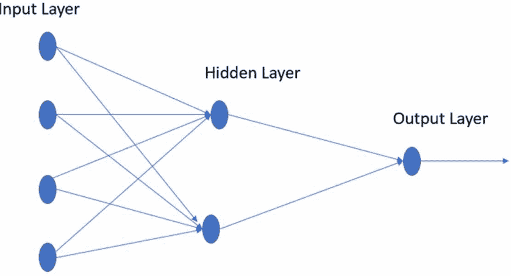

它降低了特征图的复杂度。它通过保留关键数据并删除冗余数据，将复合视觉特征转换为可用信息。

通过消除卷积层之间的特定连接，池化算子在实现空间平移不变性的同时降低了顶层的计算成本。该层对前一层的特征图进行下采样，以生成分辨率较低的新图。该层有两个基本功能：第一是通过最小化模型参数或权重的数量来降低计算成本，第二是避免过拟合。明智的池化策略应仅提取相关数据并消除多余部分。

丢弃法（Dropout）（N. Srivastava et al., n.d.）可用于CNN的正则化。CNN的正则化通过Dropout在相应层的特征图中添加噪声来实现。

过拟合（Carremans, 2019）是指网络因各种因素无法正常学习时发生的现象。这是绝大多数（如果不是全部）机器学习算法中的一个关键概念，必须尽一切努力尽量减少其影响。如果我们的模型出现过拟合迹象，我们识别不仅训练数据集，而且测试和预测数据集的泛化特征的能力可能会下降。这是简化我们ANN的主要动机。训练网络所需的参数越少，过拟合的可能性就越小——因此，其预测准确性就越高。图1显示了一个小型ANN结构。

## 卷积神经网络

CNN是一种用于处理网格化数据（如图像）的深度学习算法，其受哺乳动物视觉皮层的架构风格影响（Albawi et al., 2017; Fukushima, 1980; Hubel &


### 图 2. CNN 层

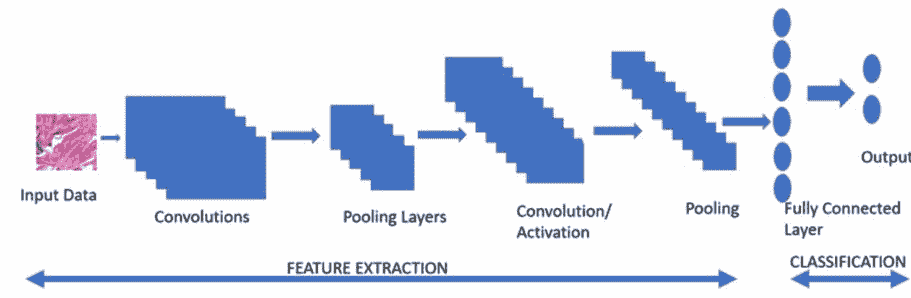

Wiesel, 1962) 旨在动态且自适应地学习从低级到高级模式的高级特征。CNN 通常由三种不同类型的层（或元素）组成：卷积、池化和全连接。前两层（卷积和池化）自动提取特征，而第三层（全连接层）将提取的信息传递到最终输出，包括分类。CNN 由一堆算术计算组成，包括卷积，这是一种特殊的单输出，起着至关重要的作用。在数字照片中，像素值存储在二维网格中，一个称为内核（特征提取器）的微小变量网格应用于每个图像点。由于特征可能出现在图像中的任何位置，CNN 对图像分析非常高效。当一层将其结果馈送到后续层时，收集的属性可能会分层增长并变得越来越复杂。训练是修改参数（例如内核）的过程，以通过反向传播或梯度下降等优化器来最小化输出与回归系数标签之间的差距。CNN 不需要手动执行特征提取。其次，CNN 设计并不总是需要人类专业知识来区分肿瘤或器官。CNN 要求使用图形处理单元进行模型训练，因为由于数百万个可训练参数，其计算成本更高。CNN 的主要层在图 2 中显示。

### 卷积层

CNN 由三个独立的层级组成。这些层是卷积层、池化层和全连接层。通过堆叠这些层构建了一个框架。CNN 的核心操作可以分解为四个主要组件。与早期版本的 ANN 类似，每个输入都将包含图像中的像素数量。卷积层使用其自身权重与连接到输入的区域大小的标量积，为与输入某些部分相关的单元生成输出。整流单元（有时缩写为 ReLU）试图将“逐元素”激活函数（例如 sigmoid）应用于下一层生成的激活输出。然后，每个池化层将沿输入的空间维度执行基本下采样，从而减少激活参数的数量。所有全连接层随后将执行与传统 ANN 相同的任务，并尝试从激活中创建类别分数以对数据进行分类。

此外，建议在这些层之间使用 ReLU 以提高性能。使用这种简单策略，CNN 可以利用卷积和下采样技术逐层转换原始数据，以获取回归和分类应用的输出值。然而，必须注意的是，仅了解 CNN 模型的整体结构是不够的。设计和优化这些模型可能既耗时又复杂。

卷积层是 CNN 模型中用于利用线性和非线性过程（即卷积算子和激活函数）提取特征的关键组件。

卷积是一种线性操作，通过将内核（一个较小的整数数组）应用于输入（一个称为张量的较大数字数组）来提取特征。使用多个内核来构建任意特征图，每个内核反映原始张量的特定属性；因此，多个内核可以被视为不同的特征提取器。内核的大小和数量是定义卷积的两个重要超参数。

所披露的卷积方法避免每个内核的中心与输入向量的最外层组件重叠。与输入特征图相比，它最小化了输出特征图的高度和宽度。为了在应用进一步层时保持平面尺寸，现代 CNN 架构通常不使用填充。如果没有零填充，每个后续特征图的大小在卷积操作后都会减小。

步长是两个相邻内核点之间的距离，它也影响卷积技术。偶尔，会使用大于一的步长来完成检索特征的下采样。如下所示，池化是下采样的另一种方法。

权重共享是卷积过程的基本特征；内核被分布在所有图像位置上。权重共享产生以下卷积特征：通过减少截断误差来提高模型效率。

### 非线性激活函数

随后，对包含此卷积的顺序过程的结论应用非线性激活函数。但是，尽管曾经使用过平滑的非线性激活特性（例如 sigmoid 和 tanh 函数），因为它们代表生物神经作用的数学描述，但整流线性单元（ReLU）是当今最常用的非线性激活特性（Glorot et al., 2011）。

### 池化

NN 通过堆叠两种类型的层（卷积层和池化层（子采样））构建。池化层（Hutchison et al., 2010）在 CNN 中至关重要，因为它主要负责数据不变性和扰动抗性。池化层可以通过两步池化过程获得。信息聚集可以在一定程度上提高表示对平移和弹性畸变的抗性。

此外，下采样可以减小特征通道的大小，从而减轻计算负载。这两个阶段可以被视为一种特征选择技术，在保留最关键信息的同时最小化特征空间。最常用的池化过程（例如最大池化和平均池化）完全是手工制作的。然而，这种临时的池化过程有几个缺点。例如，最大池化提取区域中最显著的值，而平均池化仅提取区域的平均值。此外，手工制作的池化方法无法确保在训练阶段将分类误差最小化。因此，本研究建议为每个特征通道训练一个池化算子，以聚合局部区域内的数据。

CNN 使用池化层来整合从卷积层特征空间学习到的信息。其主要功能是在模型训练过程中通过减少或总结提取的特征来减少过拟合。池化很容易创建，因为它们通常使用最大值或平均值对输入数据进行下采样。特征图对其在输入中的位置特别敏感，而卷积层则使用图像特征总结数据中的相关信息。例如，如果对象在图像之间意外变化，卷积层必须重建特征图。由于之前保留的特征图，我们的投影必须更改。为了克服这个问题，下采样图很重要，这是通过使用 CNN 池化层来执行的，这些池化层总结特征空间中的所有数据。

### 最大池化

最大池化算子（Ranzato et al., n.d.）可用于减少卷积输出带的变异性。使用最大池化时，该层必须对卷积层特征图中的显著元素进行操作。简而言之，它从任何特征空间中滤波器覆盖的区域选择值最高的元素。最大池化有助于从数据中提取低级特征，例如边缘、点等。或者，在图像处理方面，最大池化有助于提取图像中最清晰的特征，这些特征是图像的最佳低级表示。

### 最小池化

使用最小池化时，该层作用于卷积层特征图中最不重要的元素。简单来说，它从任何给定特征空间中滤波器覆盖的区域内选择值最低的元素。最小池化用于从数据中移除最不重要的特征，或在从图像中提取值较弱或无边缘特征时使用。

### 平均池化

用于池化和收集特征的平均值或中位数概念由（LeCun et al., 1989a）发明，并首次在（LeCun et al., 1998）中实现，这是第一个卷积深度神经网络。使用平均池化时，该层选取特征图补丁中可用组件的平均值。整个特征图被减小为该区域的平均值。因此，最大池化识别每个补丁中最突出的特征，而平均池化识别整个覆盖区域。池化提供了一定程度的不变性。此外，池化比卷积操作更快。使用平均池化有助于提取平滑特征。如果我们对图像数据应用平均或最大池化，我们将获得特征图覆盖区域中任何和所有颜色的混合物。如果任何图像中数据点和颜色的分散是平滑的，或者更具体地说，如果分布合适，那么我们可以使用平均池化来获取可靠数据。

### 全局池化层

每当下采样输入馈送到 CNN 的全连接层时，数据会被向量化并直接传递到全连接层，在那里激活函数执行其职责。这种方法在卷积结构和传统神经网络之间提供了一座桥梁。在使用卷积架构提取特征后，将使用标准方法对生成的特征进行分类。当全连接层容易过拟合时，使用 dropout 函数。Dropout 函数提高泛化能力并防止过拟合。在学习过程中，dropout 函数将 50% 的激活函数置零。在这种情况下，我们可以使用一种称为全局池化层的不同技术。它们可以替换 CNN 中已展平的层。展平层将任何维度的张量减小为一维张量，同时保留原始张量的所有值。向此类张量添加值会增加过拟合的概率。这消除了过拟合的风险。

### Dropout

深度神经系统具有多个非线性隐藏单元，这使它们成为非常具描述性的模型，能够发现其输入和结果之间极其复杂的相关性。不幸的是，在训练信息有限的情况下，许多这些复杂的交互无法准确预测；它们将是采样误差的结果。因此，它们将存在于训练数据集中，而不会与


实际测试数据，尽管训练集和测试数据是从相同分布中选择的。这些方法包括：当验证集上的性能开始下降时停止训练，添加各种类型的权重惩罚，包括 L1 和 L2 正则化，以及温和的权重共享，包括应用权重交换。在拥有无限计算资源的情况下，最优的正则化技术是 "一个固定大小的系统将汇总所有潜在参数值的输出，每个设置的权重由训练样本提供的后验概率决定。组合模型几乎总能提升机器学习方法的效果。然而，对于大型神经网络，对多个独立训练的网络输出进行平均在成本上是禁止性的。当模型各不相同时，集成多个系统效果最佳。要使神经网络模型各不相同，它们必须具有不同的架构，或在不同的数据上学习。为每种设计找到最优超参数具有挑战性，训练每个巨大的网络需要大量的计算资源。此外，大型网络通常需要大量的训练数据，并且可能需要更多数据来在数据的不同部分上训练多个网络。即使可以训练多个不同的大型网络，在测试时同时使用所有网络对于需要快速响应的应用来说也不切实际。Dropout 是一种同时解决这两个问题的方法。它可以避免过拟合，并提供一种本质上混合无限多个神经网络架构的技术。通过丢弃一个组件，意味着它暂时与网络断开连接。

将 Dropout 添加到神经元的方法等同于采样一个 "稀疏化" 结构。稀疏化网络由逃过 Dropout 的单元组成。拥有 n 个单元的网络可以被视为一组经过稀疏化的 2n 个潜在神经网络。这些网络共享权重，使得变量的总数保持在 O(n2) 或以下。为每个训练样本构建一个新的采样和稀疏训练网络。

因此，使用 Dropout 训练神经网络类似于训练一组存在大量权重迁移的 2n 个稀疏系统，其中每个稀疏网络很少被训练，甚至根本不被训练。因此，在测试时无法显式汇总越来越多稀疏模型的预测。然而，在现实中，简单的平均近似方法效果良好。其理念是在测试期间使用一个没有 Dropout 的单一神经网络。该网络的权重是学习到的权重的缩小副本。在训练时使用 Dropout 并在测试时采用这种平均近似策略，与其他训练方法相比，能显著降低广泛分类任务上的预测误差。关于 Dropout 的准确率变化如图 3 所示。

Dropout 层的一个缺点是，有时更新参数的训练时间可能很高。每个训练样本旨在成功训练一个独特的随机架构。因此，计算出的梯度不是测试时将使用的最终设计的梯度。因此，训练耗时较长也不足为奇。然而，这种随机性很可能有助于避免过拟合。因此，在过拟合和训练时间之间建立了一种权衡。随着训练时间增加，可以采用较高的 Dropout 率并减少过拟合。加速 Dropout 是一个值得进一步研究的有趣领域。Dropout 可以被视为在不同数据组上训练的模型的袋装法（bagging）。Dropout 在卷积层中的正则化影响主要来自其对噪声输入的鲁棒性。

### 全连接神经网络层

最终卷积的所有局部输出特征通常都会被解构，即转换为一维张量数组，并连接到一个或多个密集层中，通常称为全连接层，其中每个输入通过一个可训练的值与每个输出耦合。卷积恢复特征后，汇聚层会更多地检测到缺乏相关性；这些特征通过一组类似全连接层的结构传递到网络输出，其中包括分类中每个类别的概率。最终完全连接层通常具有与子类相同数量的输出链接。在每个最终连接的层之后是一个函数 f，例如 ReLU。表 1 显示了最终层的激活函数。通常，最后一层的激活函数与其他层不同。应为每个任务建立合适的激活函数。

图 3. 准确率与 Dropout
来源：Maklin (n.d.)

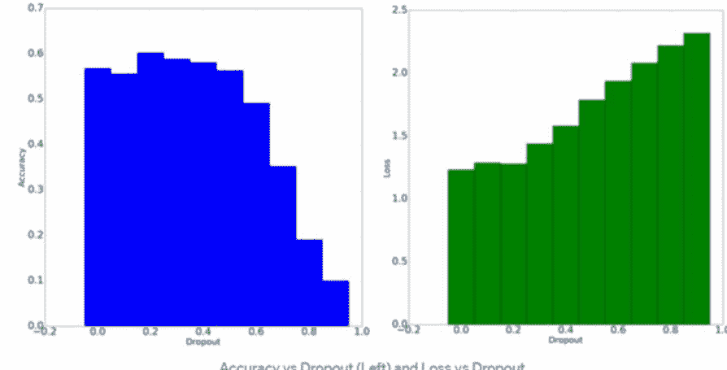

## CNN 训练

神经网络训练过程涉及识别卷积操作的卷积核以及全连接网络中的权重，以减少训练样本输出预测与基础真实标签之间的差异。带有随机梯度优化方法的误差函数在反向传播中很重要，反向传播常用于训练神经网络。损失方法通过前向传播计算具有指定卷积核和权重的模型的有效性

表 1. 最终 CNN 层激活函数

| 任务 | 激活函数 |
| :--- | :--- |
| 分类 - 二分类 | Sigmoid 激活函数 |
| 分类 – 多分类 | Softmax 激活函数 |
| 回归 | ReLU |

表 2. CNN 层

| 层 | 特征 | 参数 | 超参数 |
| :--- | :--- | :--- | :--- |
| 卷积 | 特征提取<br>二维卷积<br>执行的操作：点积 | 卷积核<br>滤波器<br>步长<br>填充 | 卷积核大小<br>卷积核数量<br>填充位大小<br>激活函数 |
| 汇聚 | 时间复杂度高<br>用于敏感度、参数数量减少<br>处理更快<br>下采样 | NA | 滤波器大小<br>填充位<br>汇聚技术 |
| 全连接神经网络层 | - | 权重 | 权重值<br>激活函数 |
| 其他层 | 特征提取<br>减少过拟合 | 正则化<br>归一化<br>Dropout | 学习率<br>优化函数<br>正则化函数<br>Dropout 率 |

仅在训练数据上。使用诸如学习算法、随机梯度等优化技术，根据损失值修改卷积核和参数。损失函数，也称为代价函数，用于评估系统前向传播输出预测与底层数据标签之间的相似度。交叉熵是分类器的常规损失函数，尽管均方误差常用于连续变量的回归。CNN 的主要层如表 2 所示。

## CNN 的应用

CNN 用于确定图像的布局。通常，图像作为整数网格输入到系统中；不过，更好的做法是将图像分割为重叠的图像块，然后将其传输到一个小型神经网络。CNN 在图像处理中的主要应用如下。

### 图像分割

作为一种非参数聚类技术，均值漂移提取被应用于将图像划分为具有同质光谱和空间信息的对象。作为图像分割的多个输入数据集，RGB 和近多光谱区域与数字表面模型合并。为了强调光谱相似性的重要性，采用了少量过分割而不是欠分割。所有图像分类都转换为具有离散几何文件类型的地理信息系统多边形（Chen et al., 2018; Robin et al., 2021）。

### 图像分类

随着 CNN 的进步，最重要的工作之一是预测有意义的表示，这有助于获得良好的分类结果（John et al., 2021; Ravikumar et al., 2022; Ravikumar & Sriraman, 2023; Robin et al., 2022）。

### 图像翻译

CNN 并非天生具有平移不变性。但是，如果在合适的数据集上训练，CNN 可以获得平移不变形式。学习由于平移而发生大量变化的数据是创建平移不变系统的最关键因素（Kauderer-Abrams, 2017）。

### 图像标记

图像标记是最基本的图像分类技术。图像标签是一个描述性单词或短语，使照片更容易定位。Instagram、Google 和 Amazon 等主要公司都采用这种策略。此外，它也是视觉搜索的关键组成部分。标记包括物体检测，甚至对图像情感基调的评估。

### 人脸识别

人脸识别会产生一系列相关问题，如下所示：
- 识别图像中的人脸
- 关注每一种表情，无论人脸质量如何或其展示的位置如何
- 识别独特特征
- 将识别出的特征与数据库中的特征进行比较并确定个人姓名

表情是复杂的多模态视觉刺激，通过由局部图像样本、自组织映射神经网络和 CNN 组成的神经网络混合体进行了展示。

## 相关工作

自 AlexNet (Deng et al., 2009; Krizhevsky et al., 2012) 在 ImageNet 挑战中取得巨大成功以来，CNN 在图像分类和各种其他视觉任务上表现出卓越性能。随着硬件容量的快速扩展，可以毫不费力地训练大型网络。如今，提升网络整体性能的主要趋势是增加其深度。LeNet-5 (LeCun et al., 1998) 是第一个提出的 CNN，其架构庞大复杂，梯度消失是训练过程中的一个重要问题。ResNets (He et al., 2016) 和 DenseNets (R. K. Srivastava et al., 2015) 明确使用每两个块之间的快捷方式结构。Highway Networks (R. K. Srivastava et al., 2015) 固有地包含非线性变换和变换门以提供快捷方式。FractalNets (Larsson et al., 2017; Yang et al., 2015) 采用类似于 ResNets 的丢弃路径。上述所有解决方案在解决梯度消失问题方面都有效。根据研究，当在更深的平坦网络上使用反向传播 (LeCun et al., 1989b) 时，分类准确率会显著下降。归一化方法 (Ioffe & Szegedy, 2015) 可以帮助缓解这一困难。尽管缺乏深度，简单网络仍然提供多种优势，尤其是在处理特定嵌入式视觉应用时。全卷积网络 (ALL-CNN)


## TENSORFLOW

(Springenberg et al., 2015) 表现非常出色，因为它仅使用参数量极少的卷积层，而非交替使用卷积层和最大池化层。由于网络拓扑结构简单，众多微型网络在资源有限的情况下表现更好。它们通常使用相似性算子和全局最大池化来最大化小型网络的容量。SqueezeNet (Iandola et al., 2016) 将通道数从 3x3 减少到 1x1，以在不影响网络容量的前提下简化网络。MobileNets (Howard et al., 2017) 利用深度可分离卷积构建轻量级网络，使其在嵌入式设备上运行良好。此外，ShuffleNet (Zhang et al., 2017) 和 SEP-Nets 等重要研究已证明，残差结构可以有效降低移动设备上的计算复杂度。众多研究将各种类型的 CNN 作为其模型的一部分来分析大量数据，从而提升整体性能。

TensorFlow 的设计以这种方式进行教学，使读者理解为什么它是学习 Keras 的必要条件。在此背景下，讨论了 TensorFlow 及其底层 Python 库。要理解 TensorFlow，有必要理解这些包的兼容性。因此，在学习和研究 Keras 之前，有必要深入探索 TensorFlow。TensorFlow 是 Google 最著名的深度学习应用库。该工具包设计用于在 CPU、GPU、TPU 处理器、神经网络设备等上运行。该库于 2015 年首次向公众开放。然而，在 2017 年，一个稳定版本在 Apache 开源许可证下发布。在 Apache 开源许可证下授权的库可以使用、修改和转移，无需向 Google 支付费用。张量确实是 TensorFlow 接受作为输入的多维数组。TensorFlow 因多维数组的流动而得名。这些张量从一端的输入进入系统，在产生输出之前经历许多过程。

TensorFlow 的核心算法使用 C 和 CUDA（一种并行处理语言）开发。NVIDIA 创建了一个系统和 API。它提供多种语言的 API。Python 的 API 是其中最强大、最广泛的之一。

TensorFlow (Abadi et al., n.d., 2016) 脚本分为两个阶段：构建计算图和执行计算图。在构建阶段，通常使用 TensorFlow 函数生成描述深度学习模型的计算图。该图由边和节点组成。边代表将流经图的张量数据，这也赋予了该框架 TensorFlow 的名称。操作确实是描述张量计算的节点。操作的输入是零个或多个张量，输出也是零个或多个张量。TensorFlow 提供基本构建块，包括全连接层、卷积层、RNN 模块和非线性激活单元。

这些操作是计算图中执行从模型输入到输出计算的重要元素。此外，TensorFlow 提供多种损失函数，包括交叉熵和均方误差。通过神经网络的前向传递，通过向输出张量添加损失计算操作来完成模型。TensorFlow 的基本模块如图 4 所示。

Keras 是一个基于 Python 的神经网络框架，可实现 TensorFlow 和 Theano 的执行。tf.Keras 是在 Python 中使用 Keras 的语法。它基于以下基本概念运行：客户交互：模块化、易于扩展以及在 Python 中实现。

图 4. TensorFlow 架构

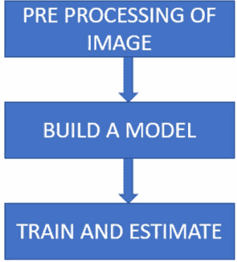

模型是 Keras 语言中最重要的数据结构。例如，序列模型（sequential）是一种常用模型。

## TENSORBOARD

神经网络模型通常庞大且复杂，这可能导致误解。TensorBoard 是一种图形化工具，使 TensorFlow 应用程序更易于理解和调试。用户可以使用 TensorBoard 快速查看网络的计算图、学习指标和参数设置。TensorFlow 组件 tf.summary 生成操作以捕获训练指标并存储图定义。此外，它以 TensorBoard 可读取的方式将它们作为事件集合存储在磁盘上。启动 TensorBoard 后，这些文件将在 Web 浏览器中显示。随着数据量的增加，深度学习算法往往优于传统方法。然而，这增加了算法的复杂性，从而降低了其可解释性。此外，复杂性使超参数调整变得复杂。TensorBoard 是答案 (Fasi et al., 2021)。TensorFlow 团队开发了此可视化模块以减少神经网络的复杂性。它可用于构建多种类型的图。对于使用 TensorFlow 进行性能分析，必须首先满足先决条件，并添加所有必需的插件，如图 5 所示。

图 5. TensorBoard 插件

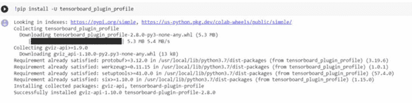

## 组件

它包括以下元素，特别是：

- 标量（Scalars）：由于 epoch 数量较多，无法评估每个 epoch 的准确性和不准确性，并且存在陷入局部最小值而非全局最小值的风险。利用本部分中的信息可以解决这两个问题。它提供有关 epoch 的准确性和误差图表，如图 6 所示。

- 图表（Graphs）：此小节使用图表展示“model.summary()”的结果，如图 7 所示。换句话说，它使神经网络设计更具吸引力。这有助于架构理解。

- 分布（Distributions）：通常，神经网络由许多层构成，每层包含大量偏置和权重。此部分描述各种超参数的分布，如图 8 所示。

- 直方图（Histograms）：所有超参数均在直方图中显示，如图 9 所示。

- 时间序列（Time-Series）：包含随时间变化的相同值，如图 10 所示。通过评估超参数的趋势，这些部分对于调节它们至关重要。

图 6. TensorBoard 中的标量

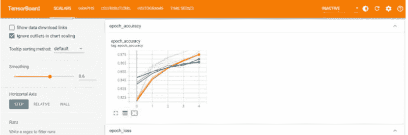

图 7. TensorBoard 中的图表

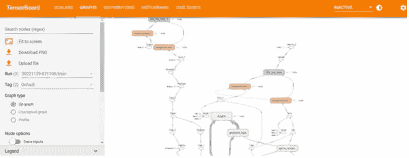

## 使用 TensorFlow 理解卷积神经网络

图 8. TensorBoard 中的分布

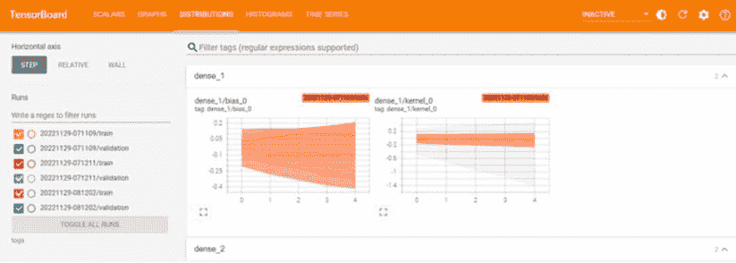

图 9. TensorBoard 中的直方图

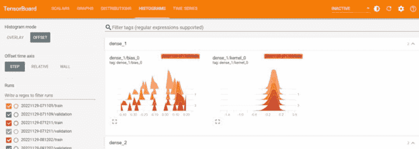

图 10. TensorBoard 中的时间序列

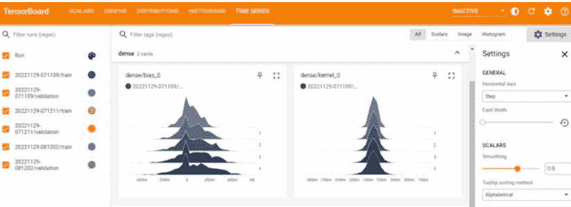

图 11. TensorBoard CNN 图

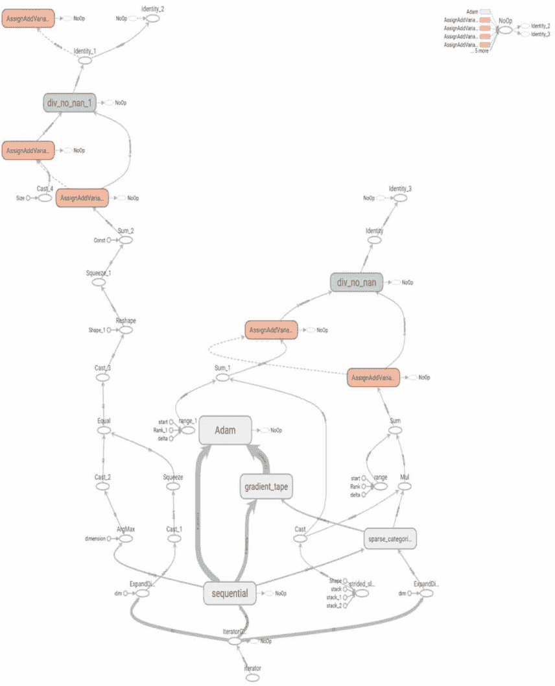

图 12. TensorBoard 中的超参数

### evaluation_accuracy_vs_iterations

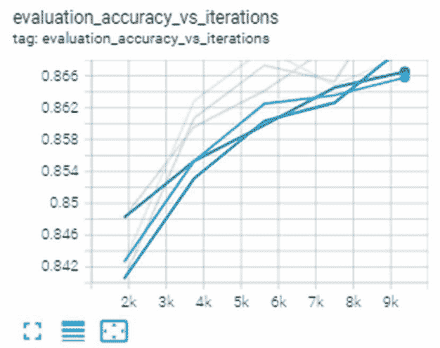

### evaluation_loss_vs_iterations

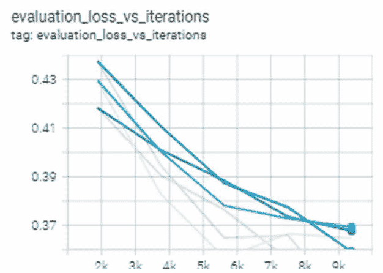

图 13. 模型使用的数据集

```
fashion_mnist = tf.keras.datasets.fashion_mnist
(x_train, y_train),(x_test, y_test) = fashion_mnist.load_data()
x_train, x_test = x_train / 255.0, x_test / 255.0
Downloading data from https://storage.googleapis.com/tensorflow/tf-keras-datasets/train-labels-idx1-ubyte.gz
29515/29515 [==============================] - 0s 0us/step
Downloading data from https://storage.googleapis.com/tensorflow/tf-keras-datasets/train-images-idx3-ubyte.gz
26421880/26421880 [==============================] - 1s 0us/step
Downloading data from https://storage.googleapis.com/tensorflow/tf-keras-datasets/t10k-labels-idx1-ubyte.gz
5148/5148 [==============================] - 0s 0us/step
Downloading data from https://storage.googleapis.com/tensorflow/tf-keras-datasets/t10k-images-idx3-ubyte.gz
4422102/4422102 [==============================] - 0s 0us/step
```

图 14. NN 模型

| 层 (类型) | 输出形状 | 参数数量 |
|---|---|---|
| flatten_1 (Flatten) | (None, 784) | 0 |
| dense_2 (Dense) | (None, 512) | 401920 |
| dropout_1 (Dropout) | (None, 512) | 0 |
| dense_3 (Dense) | (None, 10) | 5130 |

总参数：407,050
可训练参数：407,050
不可训练参数：0

图 15. NN 训练

```
Train on 60000 samples, validate on 10000 samples
Epoch 1/5
60000/60000 [==============================] - 11s 184us/sample - loss: 0.4968 - accuracy: 0.8223 - val_loss: 0.4216 - val_accuracy: 0.8481
Epoch 2/5
60000/60000 [==============================] - 11s 176us/sample - loss: 0.3847 - accuracy: 0.8587 - val_loss: 0.4056 - val_accuracy: 0.8545
Epoch 3/5
60000/60000 [==============================] - 11s 176us/sample - loss: 0.3495 - accuracy: 0.8727 - val_loss: 0.3600 - val_accuracy: 0.8700
Epoch 4/5
60000/60000 [==============================] - 11s 179us/sample - loss: 0.3282 - accuracy: 0.8795 - val_loss: 0.3636 - val_accuracy: 0.8694
Epoch 5/5
60000/60000 [==============================] - 11s 176us/sample - loss: 0.3115 - accuracy: 0.8839 - val_loss: 0.3438 - val_accuracy: 0.8764
```

如果您检查图表，可以了解模型的运行方式。将数据添加到同一模型的队列中：每次迭代后，向模型提供批量大小的数据，即信息馈送的数量。使用数据加载张量。开发模型。显示完整的训练数量


会话。将模型保存到硬盘。Tensorboard的基本概念是，神经网络可以被视为一个“黑箱”，我们需要一种工具来分析这个黑箱的内容。Tensorboard可以比作探索神经网络内部的聚光灯。它有助于理解过程之间的相互依赖关系、权重生成的位置，显示损失函数，并提供大量其他信息。当你结合所有这些信息时，你就拥有一个强大的调试和模型改进工具。生成的图表如图11所示。

图13、14和15分别表示包含60000个样本的数据集（Fashion MNIST）、神经网络模型以及模型的训练阶段。

## 结论

CNN提供了适合的多维图像分类和回归分析模型，并具有大致任意的空间函数。它擅长从图像数据中理解空间连接，使模型能够识别各种结构中的位置和大小。通过将高维模式图像作为输入并从图像中提取复杂特征，可以增强神经网络的解释和预测能力。当图像以更高的时间速率提供时，CNN在预测任务中的实用性可以扩展。CNN与传统的多层视觉神经网络不同，因为它可以从多传感器栅格输入中学习多分辨率空间特征。CNN使用卷积作为内核来检查输入图像的每个维度。修正线性单元是隐藏卷积层中首选的激活函数，因为它比其他非线性函数成本更低，并且已被发现能显著加速CNN训练。局部故障图像的信息用于建立稀疏连接。通过在整个输入图像上使用相同的滤波器来交换权重，从而产生平移等变性。池化操作导致显著的平移不变性。由于需要大量数据，CNN的局限性确实已得到突出。CNN的主要局限性是，在特定的巨大流域区域分析数据可能是一种时间浪费。

尽管如此，CNN比其他标准技术提供更高的精度。此外，其独特的特性，包括共享权重或局部连接，提高了其效率。因此，CNN通过缓解典型问题，在机器视觉和自然语言分析相关的应用中展现了其优越性。

## 参考文献

Abadi, M., Agarwal, A., Barham, P., Brevdo, E., Chen, Z., Citro, C., Corrado, G. S., Davis, A., Dean, J., Devin, M., Ghemawat, S., Goodfellow, I., Harp, A., Irving, G., Isard, M., Jia, Y., Jozefowicz, R., Kaiser, L., Kudlur, M., Zheng, X. (2016). TensorFlow：异构分布式系统上的大规模机器学习。https://arxiv.org/abs/1603.04467

Abadi, M., Barham, P., Chen, J., Chen, Z., Davis, A., Dean, J., Devin, M., Ghemawat, S., Irving, G., Isard, M., Kudlur, M., Levenberg, J., Monga, R., Moore, S., Murray, D. G., Steiner, B., Tucker, P., Vasudevan, V., Warden, P., ... Zheng, X. (n.d.). TensorFlow：大规模机器学习系统。Academic Press.

Adek, R. T., & Ula, M. (2020). 关于公共数据集上入侵和异常检测机器学习技术准确性的调查。*2020数据科学、人工智能和商业分析国际会议（DATABIA）*. 10.1109/DATABIA50434.2020.9190436

Aerts, H. J. W. L., Velazquez, E. R., Leijenaar, R. T. H., Parmar, C., Grossmann, P., Carvalho, S., Bussink, J., Monshouwer, R., Haibe-Kains, B., Rietveld, D., Hoebers, F., Rietbergen, M. M., Leemans, C. R., Dekker, A., Quackenbush, J., Gillies, R. J., & Lambin, P. (2014). 使用定量放射组学方法通过非侵入性成像解码肿瘤表型。*自然通讯*，5(1)，1. 提前在线出版。doi:10.1038/ncomms5006 PMID:24892406

Ahmed, W. S., & Karim, A. A. (2020). 滤波器大小和滤波器数量对CNN分类准确性的影响。*2020计算机科学与软件工程国际会议（CSASE）*，88–93. 10.1109/CSASE48920.2020.9142089

Albawi, S., Mohammed, T. A., & Al-Zawi, S. (2017). 理解卷积神经网络。*2017工程与技术国际会议（ICET）*，1–6. 10.1109/ICEngTechnol.2017.8308186

Burges, C. J. C., Platt, J. C., & Jana, S. (2003). 用于音频指纹识别的畸变判别分析。*IEEE语音与音频处理汇刊*，11(3)，165–174. doi:10.1109/TSA.2003.811538

Carremans, B. (2019, January 8). *处理深度学习模型中的过拟合*. Medium. https://towardsdatascience.com/handling-overfitting-in-deep-learning-models-c760ee047c6e

Chan, T.-H., Jia, K., Gao, S., Lu, J., Zeng, Z., & Ma, Y. (2015). PCANet：图像分类的简单深度学习基线？*IEEE图像处理汇刊*，24(12)，5017–5032. doi:10.1109/TIP.2015.2475625 PMID:26340772

Chen, K., Fu, K., Yan, M., Gao, X., Sun, X., & Wei, X. (2018). 基于混淆卷积神经网络的航空图像语义分割。*IEEE地球科学与遥感快报*，15(2)，173–177. doi:10.1109/LGRS.2017.2778181

Deng, J., Dong, W., Socher, R., Li, L.-J., Li, K., & Fei-Fei, L. (2009). ImageNet：大规模分层图像数据库。*2009年IEEE计算机视觉与模式识别会议*，248–255. 10.1109/CVPR.2009.5206848

*Keras中解释的丢弃神经网络层 | 由Cory Maklin撰写 | 面向数据科学*. (n.d.). 于2022年11月29日检索自 https://towardsdatascience.com/machine-learning-part-20-dropout-keras-layers-explained-8c9f6dc4c9ab

Fasi, M., Higham, N. J., Mikaitis, M., & Pranesh, S. (2021). NVIDIA Tensor Core的数值行为。*PeerJ计算机科学*，7，e330. doi:10.7717/peerj-cs.330 PMID:33816984

Fukushima, K. (1980). 新认知机：一种不受位移影响的模式识别机制的自组织神经网络模型。*生物控制论*，36(4)，193–202. doi:10.1007/BF00344251 PMID:7370364

Glorot, X., Bordes, A., & Bengio, Y. (2011). 深度稀疏整流神经网络。第十四届人工智能与统计国际会议论文集，315–323. https://proceedings.mlr.press/v15/glorot11a.html

Gong, Y., Wang, L., Guo, R., Lazebnik, S. (2014). 深度卷积激活特征的多阶无序池化。doi:10.1007/978-3-319-10584-0_26

Grauman, K., & Darrell, T. (2005). 金字塔匹配核：使用图像特征集进行判别分类。*第十届IEEE国际计算机视觉会议（ICCV'05）*，1，1458-1465. 10.1109/ICCV.2005.239

Guo, Y., Liu, Y., Oerlemans, A., Lao, S., Wu, S., & Lew, M. S. (2016). 用于视觉理解的深度学习：综述。*神经计算*，187，27–48. doi:10.1016/j.neucom.2015.09.116

He, K., Zhang, X., Ren, S., & Sun, J. (2015). 用于视觉识别的深度卷积网络中的空间金字塔池化。*IEEE模式分析与机器智能汇刊*，37(9)，1904–1916. doi:10.1109/TPAMI.2015.2389824 PMID:26353135

He, K., Zhang, X., Ren, S., Sun, J. (2016). 深度残差网络中的恒等映射。doi:10.1007/978-3-319-46493-0_38

Hinton, G. E., Srivastava, N., Krizhevsky, A., Sutskever, I., Salakhutdinov, R. R. (2012). 通过防止特征检测器共适应来改进神经网络。https://arxiv.org/abs/1207.0580

Howard, A. G., Zhu, M., Chen, B., Kalenichenko, D., Wang, W., Weyand, T., Andreetto, M., Adam, H. (2017). MobileNets：面向移动视觉应用的高效卷积神经网络。https://arxiv.org/abs/1704.04861

Huang, Z., Wang, J., Fu, X., Yu, T., Guo, Y., & Wang, R. (2020). DC-SPP-YOLO：基于密集连接和空间金字塔池化的用于目标检测的YOLO。*信息科学*，522，241–258. doi:10.1016/j.ins.2020.02.067

Hubel, D. H., & Wiesel, T. N. (1962). 猫视觉皮层中的感受野、双眼相互作用和功能架构。*生理学杂志*，160(1)，106-154.

Hutchison, D., Kanade, T., Kittler, J., Kleinberg, J. M., Mattern, F., Mitchell, J. C., Naor, M., Nierstrasz, O., Rangan, P. C., Steffen, B., Sudan, M., Terzopoulos, D., Tygar, D., Vardi, M. Y., Weikum, G., Scherer, D., Müller, A., & Behnke, S. (2010). 用于目标识别的卷积架构中池化操作的评估。在K. Diamantaras, W. Duch, & L. S. Iliadis (编) 中，*人工神经网络 – ICANN 2010* (第6354卷，第92–101页)。Springer Berlin Heidelberg. doi:10.1007/978-3-642-15825-4_10

Iandola, F. N., Han, S., Moskewicz, M. W., Ashraf, K., Dally, W. J., Keutzer, K. (2016). SqueezeNet：具有AlexNet级别准确度、50倍更少参数和<0.5MB模型大小的网络。https://arxiv.org/abs/1602.07360

Ioffe, S., Szegedy, C. (2015). 批量归一化：通过减少内部协变量偏移来加速深度网络训练。https://arxiv.org/abs/1502.03167

Jégou, H., Perronnin, F., Douze, M., Sánchez, J., Pérez, P., & Schmid, C. (2012). 将局部图像描述符聚合为紧凑代码。*IEEE模式分析与机器智能汇刊*，34(9)，1704–1716. doi:10.1109/TPAMI.2011.235 PMID:22156101


John, J., Ravikumar, A., & Abraham, B. (2021). 基于多个预训练计算机视觉模型的前列腺癌预测. 健康与技术, 11(5), 1003–1011. doi:10.1007/s12553-021-00586-y

Kauderer-Abrams, E. (2017). 量化卷积神经网络中的平移不变性. https://arxiv.org/abs/1801.01450

Keras: Python 深度学习 API. (无日期). 于 2022年6月24日检索自 https://keras.io/

Krizhevsky, A., Sutskever, I., & Hinton, G. E. (2012). 基于深度卷积神经网络的 ImageNet 分类. 神经信息处理系统进展, 25. https://papers.nips.cc/paper/2012/hash/c399862d3b9d6b76c8436e924a68c45b-Abstract.html

Lambin, P., Rios-Velazquez, E., Leijenaar, R., Carvalho, S., van Stiphout, R. G. P. M., Granton, P., Zegers, C. M. L., Gillies, R., Boellard, R., Dekker, A., & Aerts, H. J. W. L. (2012). 放射组学：利用高级特征分析从医学图像中提取更多信息. 欧洲癌症杂志, 48(4), 441–446. doi:10.1016/j.ejca.2011.11.036

Larsson, G., Maire, M., & Shakhnarovich, G. (2017). FractalNet：无残差的超深度神经网络. https://arxiv.org/abs/1605.07648

Lazebnik, S., Schmid, C., & Ponce, J. (2006). 超越特征袋：用于自然场景类别识别的空间金字塔匹配. 2006 IEEE 计算机学会计算机视觉与模式识别会议, 2, 2169–2178. 10.1109/CVPR.2006.68

LeCun, Y., Boser, B., Denker, J., Henderson, D., Howard, R., Hubbard, W., & Jackel, L. (1989a). 基于反向传播网络的手写数字识别. 神经信息处理系统进展, 2. https://proceedings.neurips.cc/paper/1989/hash/53c3bce66e43be4f209556518c2fcb54-Abstract.html

LeCun, Y., Boser, B., Denker, J. S., Henderson, D., Howard, R. E., Hubbard, W., & Jackel, L. D. (1989b). 反向传播应用于手写邮政编码识别. 神经计算, 1(4), 541–551. doi:10.1162/neco.1989.1.4.541

Lecun, Y., Bottou, L., Bengio, Y., & Haffner, P. (1998). 基于梯度的学习应用于文档识别. IEEE 学报, 86(11), 2278–2324. doi:10.1109/5.726791

Mou, J., & Li, J. (2020). 卷积层滤波器数量对语音识别模型准确性的影响. 2020年第19届 IEEE 机器学习与应用国际会议 (ICMLA), 971–978. 10.1109/ICMLA51294.2020.00158

Pascanu, R., Gulcehre, C., Cho, K., & Bengio, Y. (2014). 如何构建深度循环神经网络. https://arxiv.org/abs/1312.6026

Ranzato, M., Boureau, Y.-L., & LeCun, Y. (无日期). 深度信念网络的稀疏特征学习. Academic Press.

Ravikumar, A. (2021). 用于分布式深度学习中过时与落后者缓解的非关系多级缓存. 第22届国际中间件会议：博士生研讨会论文集, 15–16. 10.1145/3491087.3493678

Ravikumar, A., & Sriraman, H. (2023). 图像处理与计算机视觉算法加速. 在《深度学习时代计算机视觉与图像处理研究手册》中. IGI Global. doi:10.4018/978-1-7998-8892-5.ch001

Ravikumar, A., Sriraman, H., Saketh, P. M. S., Lokesh, S., & Karanam, A. (2022). 神经网络结构对使用 GPU/TPU 进行图像分析的卷积神经网络性能和准确性加速的影响. PeerJ. 计算机科学, 8, e909. doi:10.7717/peerj-cs.909 PMID: 35494877

Ren & Malik. (2003). 分割分类模型学习. 第九届 IEEE 国际计算机视觉会议论文集, 10–17. 10.1109/ICCV.2003.1238308

Robin, M., John, J., & Ravikumar, A. (2021). 使用 U-NET 进行乳腺肿瘤分割. 2021年第5届计算方法与通信国际会议 (ICCMC), 1164–1167. 10.1109/ICCMC51019.2021.9418447

Robin, M., Ravikumar, A., & John, J. (2022). 使用预训练模型和迁移学习对组织病理学乳腺癌图像进行分类. 在 M. Saraswat, H. Sharma, K. Balachandran, J. H. Kim, & J. C. Bansal (编), 智能系统大会 (第 587–597 页). Springer Nature Singapore. doi:10.1007/978-981-16-9113-3_43

Simonyan, K., & Zisserman, A. (2015). 用于大规模图像识别的非常深度卷积网络. https://arxiv.org/abs/1409.1556

Sivic & Zisserman. (2003). Video Google：面向视频中对象匹配的文本检索方法. 第九届 IEEE 国际计算机视觉会议论文集, 1470–1477. 10.1109/ICCV.2003.1238663

Springenberg, J. T., Dosovitskiy, A., Brox, T., & Riedmiller, M. (2015). 追求简单：全卷积网络. https://arxiv.org/abs/1412.6806

Srivastava, N., Hinton, G., Krizhevsky, A., Sutskever, I., & Salakhutdinov, R. (无日期). Dropout：防止神经网络过拟合的简单方法. Academic Press.

Srivastava, R. K., Greff, K., & Schmidhuber, J. (2015). 训练非常深度网络. 神经信息处理系统进展, 28. https://proceedings.neurips.cc/paper/2015/hash/215a71a12769b056c3c32e7299f1c5ed-Abstract.html

Szegedy, C., Liu, W., Jia, Y., Sermanet, P., Reed, S., Anguelov, D., Erhan, D., Vanhoucke, V., & Rabinovich, A. (2015). 卷积网络更深入. 2015 IEEE 计算机视觉与模式识别会议 (CVPR), 1–9. 10.1109/CVPR.2015.7298594

Wan, L., Zeiler, M., Zhang, S., LeCun, Y., & Fergus, R. (无日期). 使用 DropConnect 对神经网络进行正则化. Academic Press.

Xu, C., Yang, J., Lai, H., Gao, J., Shen, L., & Yan, S. (2019). UP-CNN：带反池化的卷积神经网络. 模式识别快报, 119, 34–40. doi:10.1016/j.patrec.2017.08.007

Xu, L., Yan, S., Chen, X., & Wang, P. (2019). 基于人机交互中深度边缘感知金字塔池化网络的运动识别算法. IEEE Access：实用创新，开放解决方案, 7, 163806–163813. doi:10.1109/ACCESS.2019.2952432

Yang, Y., Li, H. T., Han, Y. S., & Gu, H. Y. (2015). 基于图论和分形网络演化方法的高分辨率遥感图像分割. *摄影测量、遥感与空间信息科学国际档案*, XL-7(W4), 197–201. doi:10.5194/isprsarchives-XL-7-W4-197-2015

Yu, D., Wang, H., Chen, P., & Wei, Z. (2014). 卷积神经网络的混合池化. 在 D. Miao, W. Pedrycz, D. Ślęzak, G. Peters, Q. Hu, & R. Wang (编), 粗糙集与知识技术 (第 364–375 页). Springer International Publishing. doi:10.1007/978-3-319-11740-9_34

Zeiler, M. D., & Fergus, R. (2013). 用于深度卷积神经网络正则化的随机池化. https://arxiv.org/abs/1301.3557

Zhang, X., Zhou, X., Lin, M., & Sun, J. (2017). ShuffleNet：面向移动设备的极高效卷积神经网络. https://arxiv.org/abs/1707.01083

## 关键术语与定义

**卷积神经网络：** 卷积神经网络是一种深度学习方法，可以接收图像作为输入，为图像中的不同属性赋予重要性，并将其区分开来。与其他分类技术相比，CNN 所需的预处理要少得多。在充分训练后，CNN 可以学习这些特征，而基本方法中的滤波器是手工制作的。

**深度学习：** 深度学习是人工智能的一个分支，涉及人工神经网络学习算法和大脑功能。这些神经网络试图模仿人脑的活动（尽管不完美），从而使它们能够从海量数据中“学习”。

**过拟合：** 当模型对训练示例给出正确预测但对新数据给出错误预测时，就会出现这种不利的机器学习特征。每当数据分析师使用机器学习算法进行预测时，研究人员首先会在可用信息集合上构建模型。基于这些知识，算法随后尝试对其他数据类型进行结果预测。过拟合模型可能会提供错误预测，并且在所有新数据源上表现不佳。

**池化：** 池化仅指图像的下采样，在池化层中以最小化特征图的维度。因此，它减少了必须学习的参数数量以及网络执行的计算量。池化层汇总了卷积层生成的特征图中某个区域包含的特征。

**剖析：** 剖析软件程序的目的是了解其行为。通过理解程序的行为，工程师可以进行改进性能的修改。此外，程序员可以通过对系统进行剖析来识别程序的局限性。

**Tensor Flow：** 一个免费开源的人工智能和机器学习软件库。它可用于各种应用，但其主要重点是深度神经网络的训练和推理。

**TensorBoard：** TensorBoard 是用于可视化图表以及理解、排查和改进模型所需的其他功能的平台。它是一个为机器学习过程提供指标和可视化效果的程序。此外，它还协助跟踪损失和准确率、图表表示、在低维环境中的应用集成等参数。


**欠拟合：** 欠拟合发生在数学模型或机器学习算法无法反映数据中的基本模式时；它在训练示例上表现良好，但在测试数据上表现不佳。其出现仅表明我们的模型或方法不太适合数据。当数据不足以开发适当模型，以及在尝试使用数据不足的非线性数据构建线性回归模型时，常会发生这种情况。在这种情况下，机器学习模型的规则过于简单，也缺乏足够的灵活性来处理如此少量的数据；因此，模型可能会产生许多错误的预测。可以通过使用更多数据并通过特征选择限制特征数量来防止欠拟合。

# 第4章

# 深入理解长短期记忆网络以解决消失梯度问题：LSTM-VGP

Aswathy Ravikumar
https://orcid.org/0000-0003-0897-6991
Vellore Institute of Technology, Chennai, India

Harini Sriraman
https://orcid.org/0000-0002-2192-8153
Vellore Institute of Technology, Chennai, India

## 摘要

长短期记忆网络（Long Short-Term Memory，LSTM）是一种特定的循环神经网络（RNN）结构，用于解决传统RNN在有效捕捉和学习序列输入中长期依赖关系方面的局限性。在本章中，作者考察了LSTM单元及其修改，以研究LSTM单元的学习能力。此外，还概述了LSTM网络的未来研究前景。由于LSTM网络在各种实际场景中的有效性，它们在科学论文、技术网站和部署手册中得到了广泛关注。RNN中使用的基于梯度的学习技术太慢，因为在误差向后传播时会消失，导致学习周期大大延长。LSTM通过一种新型的加法梯度设计来处理该问题，该设计直接访问遗忘门的激活值，使网络能够通过在学习的每个时间步频繁更新门来促进误差梯度的理想行为。

## 引言

深度神经网络是机器学习的一个子领域，它利用从数据中学习到的关联来做出判断（Nweke et al., 2018）。这是机器学习的一个有前景的领域，随着数据的收集，它可以产生越来越令人满意的结果（LeCun et al., 2015）。

在最流行的深度学习算法中，有卷积神经网络（CNN）。LeCun et al.（1989）于1989年提出了该模型，并在计算机视觉领域表现良好。谷歌、苹果和Instagram等企业，以及学术机构，都在进行持续研究并将CNN集成到其服务中（Khan et al., 2020）。CNN模型由卷积层、下采样层（也称为池化层）和全连接层三个层组成。卷积层和子采样层应用具有权重共享的局部感受野。它们可以分层堆叠，最终分类阶段由完全连接层执行。在特征提取和分类方面，CNN表现出色。在机器视觉、分类和视频识别领域，它已居于领先地位（John et al., 2021; Ravikumar & Sriraman, 2023; Zhang et al., 2018）。

在处理序列数据（如语音识别和语言理解）时，循环神经网络（RNN）是一种有效的学习范式，也是有前景的深度学习模型之一。通过神经网络对先前输入的内部记忆表示，它为时间信息发展特征。RNN还可以基于历史数据和当前数据预测信息。然而，由于梯度消失或梯度爆炸问题，使用RNN结构长时间学习存储数据具有挑战性（Gelenbe, 1993; Robin et al., 2021）。

LSTM模型最早于1997年提出（Hochreiter & Schmidhuber, 1997），从根本上解决了这一RNN问题。通过利用多个门控组件，LSTM单元能够提取信息、记住信息或删除不再需要的存储信息。如前所述，该模型与RNN具有许多共同特征，同时也解决了RNN的一些缺陷。它可以应用于需要序列分析数据和利用当前数据进行事件预测的领域。在其他方面，LSTM是最先进的时间序列处理网络之一。

自1997年首篇LSTM研究发表以来（Hochreiter & Schmidhuber, 1997），关于此类RNN的许多理论和实践出版物已陆续发布，其中许多描述了在广泛序列数据应用领域取得的显著结果。LSTM对语言建模和语音转文本、机器翻译等领域产生了重大影响。许多学术和商业读者，受文献中给出的显著基准结果的鼓舞，希望了解LSTM网络以评估其与自身研究或实际用例的相关性。许多RNN和LSTM网络设计已在所有主要的开源深度学习平台上高效且可投入生产地实现。

显然，一些专业人士，即使不熟悉RNN/LSTM方法，也会充分利用这种可访问性和成本效益，立即开始研究和实验。另一些人希望全面理解这一优美且成功系统的工作原理。这条更长路径的好处在于，它有效地提供了发展一定直觉的机会，这种直觉在整合开源组件以满足其研究计划或生产力应用程序要求的整个过程中都可能很有用，包括数据准备、故障排除和调优。

## RNN

RNN是唯一包含内部存储的神经网络类型，因此是目前最可行的算法之一。RNN是一种神经网络，其中前一步的输出用作当前阶段的输入。在传统神经网络中，所有输入和输出

### 图1. 浅层神经网络结构

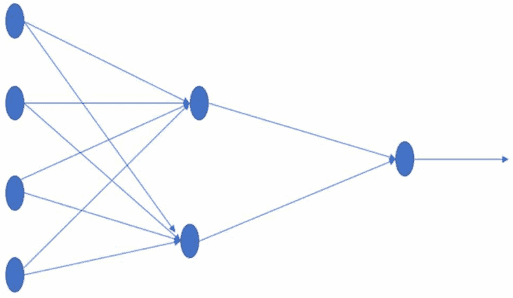

### 图2. 带有循环连接的神经网络

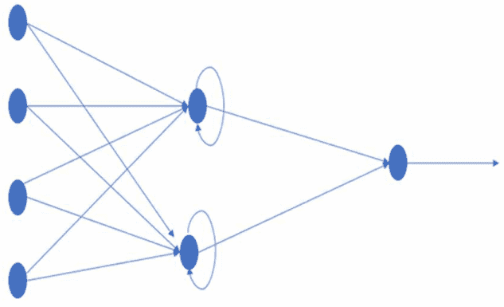

彼此独立。但是，当需要预测短语中的下一个词时，需要前面的词，因此需要记住它们。因此，RNN应运而生，它通过使用隐藏单元解决了这个问题。隐藏状态保留关于序列的某些信息，是RNN的主要和最关键的方面。RNN是一种人工神经网络，常用于语音识别和自然语言处理。RNN识别输入的序列特征，并利用模式来预测最可能的未来事件。

RNN用于深度学习和创建模仿大脑中神经元激活的模型。它们与其他类型的人工神经网络不同，因为它们使用反馈循环来处理一系列影响最终输出的输入。在上下文对于预测结果至关重要的情况下，它们特别有效。这种反馈循环使信息能够持续存在。这种现象通常被称为记忆。图1显示了普通的浅层神经网络，图2显示了带有循环的结构。

RNN的用例通常与语言模型相关，其中理解单词中的下一个字母或句子中的下一个词取决于先前的数据。一个有趣的实验包括在莎士比亚作品上训练RNN，以生成有效类似莎士比亚风格的语言。RNN创作是计算创新的一个例子。这种对人类创造力的模拟之所以可行，是因为AI从其训练集中获得了语法和语义知识。

## 工作原理

要理解RNN，必须对“常规”前馈神经网络和序列数据有扎实的理解。序列数据本质上只是排序后的数据，其中相关项目按顺序呈现。金融数据和DNA序列就是例子。序列数据中最常见的一种是时间序列，即按时间顺序排列的一组数据点。RNN和FNN的名称源于它们传输数据的方式。在FNN中，信息从输入节点，通过隐藏单元，流向输出节点。数据直接在网络中流动。FNN对所给数据的记忆很少，且不擅长预测未来。FNN没有时间顺序的概念，因为它只分析当前输入。除了训练之外，它根本无法回忆过去发生的任何事情。RNN通过循环传输数据。在做决策时，它既考虑输入信号，也考虑从先前输入中学到的内容。下面的两个图表突出了FNN和RNN之间信息流的差异，如图3所示。

### 图3. FFNN vs. RNN

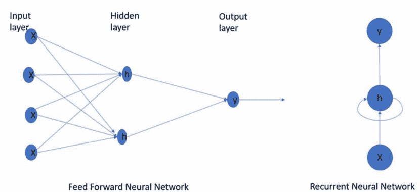


典型的 RNN 具有有限的内存容量。除了 LSTM 之外，它们还拥有长期内存。提供示例是教授循环神经网络内存概念的另一种有效技术。尽管如此，由于其内部存储，RNN 可能会回忆起这些特性。它生成输出，复制该输出，并重新进入系统。广义上讲，RNN 用最近的过去来增强当下。因此，RNN 有 2 个参数：当前时间和最近的历史。这一点很重要，因为数据序列携带关于未来的关键信息，使 RNN 能够执行其他算法无法完成的任务。与所有其他学习算法一样，FNN 在生成输出前会对其输入应用权重矩阵。值得注意的是，RNN 会同时为当前输入和先前输入添加权重。此外，循环神经网络会随时间修改权重，以供梯度下降和优化算法使用。神经网络的输入层 x 在将输入传递到内部层之前会收集并处理输入。中间层 h 中存在隐藏层，所有隐藏层都有自己的卷积层、权重和偏置。RNN 将标准化各种激活单元、权重（包括偏置），以保证每个层具有相同的特征。与其创建多个隐藏层，不如只生成一个，并根据需要对其进行多次迭代。

## 典型激活操作

神经元的激活函数决定其是否应被激活或去激活。非线性函数通常将神经元的输出转换为 0 到 1 或 -1 到 1 之间的值。

- Sigmoid 激活函数：范围为 0-1，如图 4 所示。
- Tanh：范围为 -1 到 +1，如图 5 所示。
- ReLU：范围为 0 到正值，如图 6 所示。

图 4. Sigmoid 激活函数

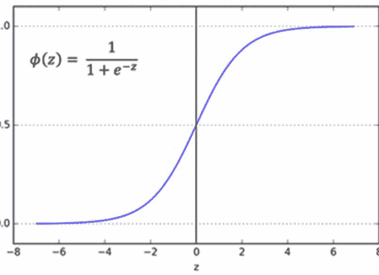

图 5. Tanh 激活函数

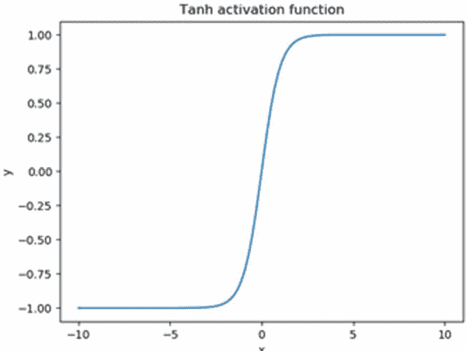

图 6. ReLU 激活函数

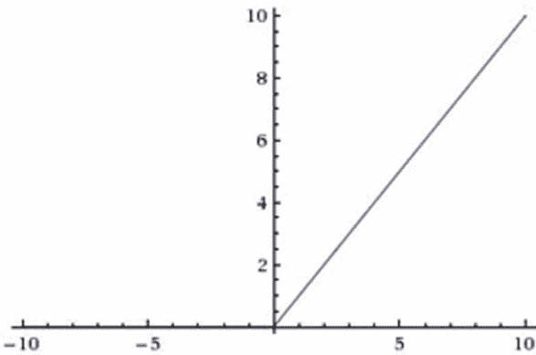

## 时间反向传播（BPTT）

要理解时间反向传播的概念，必须首先理解前向传播和反向传播。反向传播是深度学习中一种广为人知的方法。反向传播用于计算误差函数相对于神经网络权重的斜率。为了获得故障相对于权重的偏导数，该方法会沿不同梯度阶段向后遍历。随后，反向传播利用这些权重来降低训练误差范围。

在神经网络中，前向传播用于获得模型的输出，然后对其进行评估以判断其是否正确或错误。反向传播只不过是向后遍历神经网络，以获得误差相对于权重的偏导数，从而允许你从权重中移除该值。

然后，梯度下降（一种可以迭代减小给定函数的技术）使用这些偏导数。随后，根据哪种方式能降低不准确性，权重会被增加或减少。这正是神经网络学习的方式。

使用反向传播，你会在训练期间尝试调整模型的权重。

BPTT 只是对未展开 RNN 进行反向传播的营销术语。展开是一种图形和概念工具，有助于理解网络活动。在流行的编程框架中构建 RNN 时，反向传播通常会自动处理，但你必须了解其工作原理，以便排查任何开发问题。在 BPTT 中，在所有时间步都展开的情况下，损失会从最后一个时间步向第一个时间步反向传播。这使得可以计算每个时间步的误差，从而允许更新权重。请注意，当使用许多时间步时，BPTT 可能计算成本较高。

## 循环神经网络的类型

RNN 架构可能会根据所解决的问题而有所不同。从具有一个输出和输入的网络到具有多个输入和输出的网络。

下面展示了各种 RNN 设计示例，以帮助理解。

### 一对一

在经典神经网络中，采用一对一设计。这种神经网络类型被称为香草神经网络。它用于具有单一输入和输出的常见机器学习任务，如图 7 所示。

### 一对多

在这样的一对多系统中，单个输入可能导致多个输出。例如，在音乐创作中，会使用一对多网络。该网络类型确实具有一个输入和多个输出。这由图 8 所示的图像标题演示。

### 多对一

在这种情况下，通过合并不同时间步的多个输入来生成单个输出。这些网络（类别标签由一串单词选定）用于情感分析和情绪识别。这种 RNN 接收一系列输入并输出一个单一值。这种网络的一个优秀示例是情感分析，其中给定的一行可能被归类为具有积极或消极情绪。这种 RNN 接收一系列输入并产生一系列输出。机器翻译是其中一个示例，如图 9 所示。

### 多对多

在此系统中，有多种可用的可能性。两个输入会产生三个输出。多对多网络被翻译系统使用，如图 10 所示。

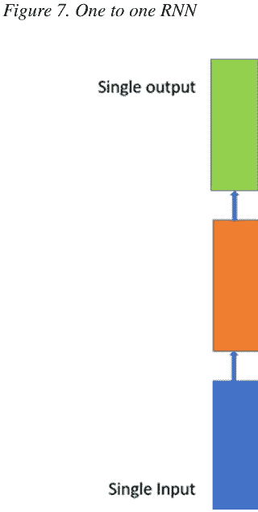
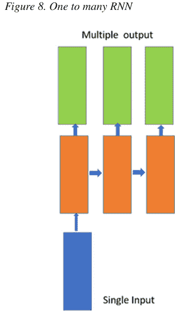
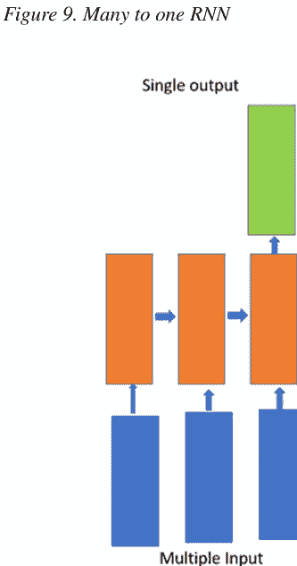
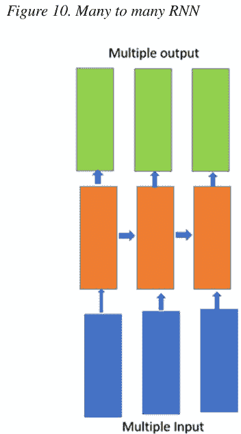

## RNN 的问题

RNN 面临的两个关键挑战是，但要理解它们，你必须首先了解什么是梯度，如图 11 所示。

梯度是输出相对于其输入的偏导数。梯度量化了当输入略有变化时，函数结果变化的显著程度。梯度也可以被视为函数的斜率。梯度越大，斜率越陡峭，模型获取知识的速度就越快。然而，当梯度为零时，学习就会停止。梯度量化了所有权重相对于误差变化的变化量。

### 梯度爆炸

在梯度爆炸的情况下，该方法会任意地将权重赋予一个荒谬的高值。然而，通过截断和压缩斜率，这个问题可以轻松解决。

### 梯度消失

当斜率的值也过小时，就会发生梯度消失，因此模型停止学习或需要很长时间。在 90 年代，这是一个巨大的问题，其解决难度远大于梯度爆炸。最终，该问题通过 LSTM 理念得到了解决。

图 11. 梯度爆炸和梯度消失

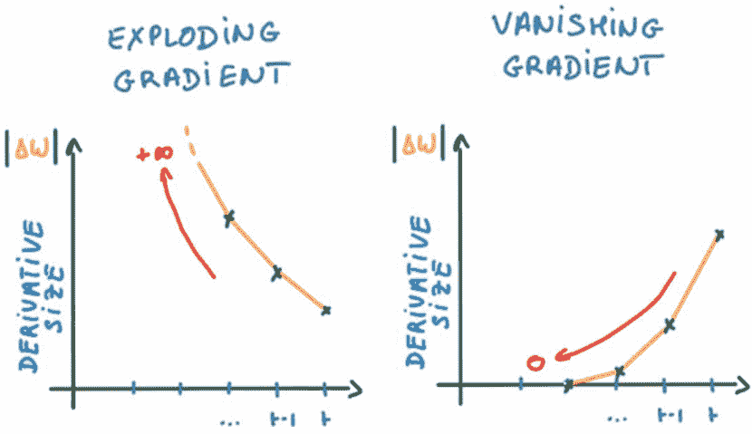

## 应用

RNN 用于解决一系列基于序列数据的挑战。存在不同类型的序列信息，但最常见的是：声音、文本、视频、基因序列。利用 RNN 算法和序列数据，我们可以解决一系列问题，例如：

- 语音识别
- 流行音乐生成
- 计算机翻译
- 视频内容评估
- 带有 DNA 结构的基因组分析

## 相关工作

Gelenbe（1989）发明的随机神经网络影响了其他理论和实证研究。区分任意神经网络与当前提供的许多其他神经网络建模技术的地方在于，在后者中，神经元的活动可能是分类数据，也可能是自变量；而在任意神经网络中，每个神经递质都由其概率表示，只有当概率为正时，神经元才被认为处于“发射状态”；因此，在 RNN 中，神经元状态的表示比其他人工神经网络建模技术更具模块化。在 RNN 中，指令通过以特定速率发送的尖峰从一个神经元传送到另一个神经元，这与物理神经网络中信号的传输方式非常吻合。神经元系统可以比作一个队列系统，其中每个队列的状态取决于与其相关的队列的状态。

Gelenbe（1990）证明，在某些条件下，神经元有效性为正的概率能够逼近稳态；他还证明，RNN 中大脑中所有连接的电位向量在其稳态内具有实际乘积的概率分布函数，因此，所有神经元都具有这种稳态流概率密度特征。在一项并行研究（Gelenbe，1990）中，Gelenbe 证明两种随机神经网络表现出明确定义的稳定性能。在 1993 年（Gelenbe，1993），Gelenbe 尝试使用梯度下降学习经验对实现为有组织方法误差函数的循环 RNN 重新引入监督学习，其执行需要通过反转一个与 RNN 神经元数量具有相同维度的矩阵来定位固定点。Gelenbe（1993）中描述的这种针对循环 RNN 模型的学习策略也适用于前馈 RNN 模型。然而，当 RNN 模型采用前馈类型而非循环类型时，学习过程会更加简化（Bakircioğlu & Koçak，2000）。文档（Bakircioğlu & Koçak，2000）提供了 RNN 应用的完整摘要，包括截至 2000 年发布的应用。Timotheou（2010）的一篇 2010 年论文展示了各种 RNN 应用，包括 2000 年之后推出的应用。Kocak 等人（2003）描述了这种基于 RNN 的协议栈的设计和实现。使用 RNN 模型已经解决了多种图像处理难题，例如纹理生成（Atalay 等人，1992）、分割方法（Gelenbe 等人，1996）、图像增强和合并（Melo 等人，2018）以及图像和视频压缩（Cramer 等人，1998）。识别和分类模式是另一个基于 RNN 的解决方案占主导地位的领域。在 Bakircioğlu 等人（1997）中，构建了一个目标跟踪系统；在 Abdelbaki 等人（1999）中，使用 RNN 来区分地雷；在 Hussain 和 Moussa（2005）中。Gelenbe 和 Fourneau（1999）提供了一个具有多个信号类的 RNN 模型，用于需要同时处理各种数据流的应用，例如彩色图像分析。Gelenbe 和 Hussain（Gelenbe & Hussain，2002）将学习策略从单一类 RNN 数据扩展到多个类 RNN 信号，并证明了其在纹理分析建模中的适用性。Gelenbe 及其同事在 1999 年（Gelenbe 等人，1999）通过分析具有双重特性的双极 RNN 模型来增强 RNN 模型。


负细胞和正细胞，并证明这种新的RNN模型确实是一个通用函数估计器（Hochreiter & Schmidhuber, 1997）。梯度下降是绝大多数报告的RNN研究中的主导学习方法，也许是因为其易用性。

## LSTM

RNN在节点之间包含反馈链接，以及能够处理可变长度输入变量的层。然而，训练简单的RNN可能是一项艰巨的任务。RNN中的权重更新技术大多基于梯度，导致梯度消失或梯度爆炸问题，而“长短期记忆”（LSTM）的发明已被证明可以解决这些问题。LSTM是一种带有内部记忆和乘法门的RNN。自1997年LSTM问世以来（Hochreiter & Schmidhuber, 1997），已开发出多种LSTM单元配置。LSTM的默认倾向是能够通过长时间记忆信息来学习长期关系。

所有RNN都由一系列重复的神经网络模块组成。普通RNN中的这个重复模块将具有相对基本的架构，例如单个tanh层。

LSTM也具有链式布局，但重复模块的结构有些不同。它不是单个神经网络层，而是四个层之间大量相互通信。

## Working

在LSTM内部，每个循环单元试图“学习”系统遇到的所有先前知识，并“忘记”无关信息。这是通过为各种目的建立不同的“门”非线性激活级别来实现的。每个LSTM循环单元还保留一个称为内部单元状态（Internal Cell State）的向量，理论上表示前一个LSTM循环单元选择保留的信息。LSTM由四个具有不同功能的不同门组成，如下所示：

- 遗忘门（f）：指示过去数据被遗忘的程度。
- 输入门：它确定将记录到内部单元状态中的信息量。
- 输入调制门（g）：通常被视为输入门的子组件，而且绝大多数关于LSTM的研究甚至不讨论它，假设它包含在输入节点中。它通过向数据引入非线性和零均值（Zero-mean）来修改输入门将要记录到内部单元状态中的数据。由于零均值输入能提供更快的收敛，这样做是为了最小化学习时间。将此门包含在LSTM单元的构建中是标准做法，尽管其作用不如其他门显著，并且经常被视为一种提供精致性的概念。
- 输出门（o）：此门决定从当前内部单元状态中生成哪个输出。

LSTM基本工作流与循环神经网络之间的唯一区别在于，内部单元状态也会与隐藏状态一起传输。请将当前输入、先前的隐藏状态和先前的内部单元状态作为输入。

按照下列方法确定四个不同门的值：

- 对于每个门，通过将相关向量与包含参数的向量中每个门的相应权重逐元素相乘，计算输入信号和先前隐藏状态的参数化变量。将相应的激活函数逐元素应用于每个门的参数化向量。下面提供了需要应用激活函数的门列表。
- 通过首先计算输入节点和输入调制门的逐元素乘积向量，然后计算遗忘门和先前内部单元状态的分量wise乘积，最后将两个向量相加，来确定当前内部单元状态。
- 通过首先计算当前内部单元向量场的逐元素双曲正切，然后与输出门逐元素组合，来确定当前隐藏层。

图12. LSTM

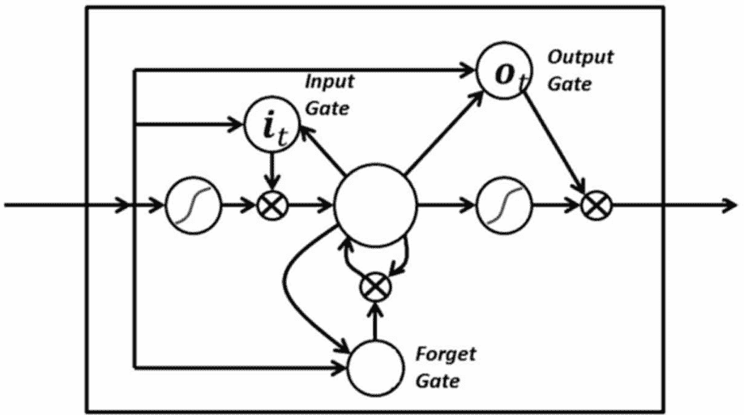

## VANISHING GRADIENT PROBLEM

训练神经网络使用随机梯度下降。这首先涉及评估模型产生的整体预测误差，然后利用误差计算梯度，用于修改网络内部的每个权重，以便未来的预测更加准确。误差梯度在网络中从输出层传输到输入层。

训练具有多个层的算法是有利的，因为添加更多层可以增强网络的容量，使其能够学习大型训练数据集，以表示输入和输出之间更复杂的映射函数。

随着梯度在多层训练网络中向后传输，它会显著减小。即使误差到达靠近模型输入的层时，也可能变得非常小，以至于影响微乎其微。因此，这个问题被称为“梯度消失”问题。梯度消失是RNN特有的问题，因为更新网络需要在每个输入时间步展开其网络，导致一个需要权重更新的非常深的网络。一个中等规模的RNN可能包含200到400个输入间隔，理论上形成一个深层网络。在MLP中，梯度消失问题可能表现为模型在学习过程中的发展速度缓慢，甚至快速收敛，即长时间训练不会带来额外进步。检查学习过程中的权重变化，你会观察到靠近输出节点的层变化较大，而靠近输入层的层变化较小。有几种方法可以缓解前馈神经网络中梯度消失问题的影响，最突出的是使用替代的权重初始化方法和激活函数。

RNN允许建模时间相关或序列数据问题，例如股票市场预测、机器翻译和文本合成。然而，你会发现，由于梯度问题，RNN很难训练。RNN受梯度消失问题的困扰。梯度传输RNN使用的信息，随着梯度变得微不足道，参数更新也随之变得微不足道。这使得记忆长数据序列变得更加困难。随机梯度下降用于训练算法。

权重初始化是解决梯度消失问题的一种方法。它包括在神经网络内部建立权重的虚构起始值，以便反向传播分配不合理的微小权重。还可以使用回声状态网络，这是一种旨在防止梯度消失问题的特殊神经网络。LSTM是解决梯度消失问题最重要的答案。

图13. 反向传播

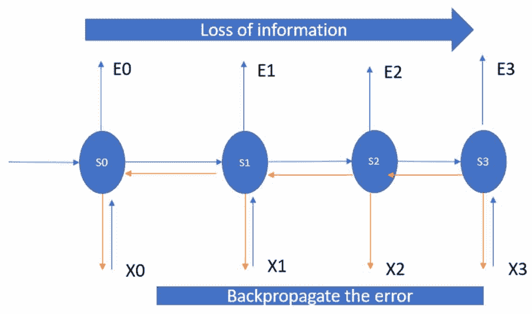

## 如何发现梯度消失问题

通过分析权重的核分布，你可能会发现它。如果权重持续趋近于零，斜率就会减小。当神经网络的训练速度极其缓慢时，可以识别出这个问题。神经网络实际上并未针对我们正在使用的数据进行良好训练，或者它们表现出奇怪的发现。

## 梯度消失问题的解决方案

有许多策略可以解决梯度消失问题：多层结构、LSTM、残差神经网络、激活函数——ReLU。

多层次层次结构：它是MLP中解决梯度消失问题最基本、最早期的补救措施之一。它只是一种逐层训练并通过反向传播优化每一层的技术。因此，每一层都会获得一个传递到下一层的压缩观察结果。

残差神经网络：神经网络中的残差链接使模型能够有效训练，而批量归一化特性确保梯度不会消失。这种批量归一化功能通过跳跃连接提供。

ReLU激活：一种线性激活函数，优于sigmoid和tanh激活函数。ReLU输入转换的基本函数可以表示为

```
f(x) = max (0,x)
```

在ReLU函数存在的地方，导数保持不变。如果输入为负，函数返回0；如果输入大于0，则返回相同的数字。因此，我们可以说ReLU的输出范围从0到无穷大。

在引用反向传播算法方法时，梯度通过乘以各种因素进行调整。当输入接近网络的开始时，会乘以更多的组件来增加梯度。这些变量中的许多可以称为激活函数。激活函数的导数可以被视为一种旨在实现精确梯度下降的调节因子。

在这种情况下，将一个数乘以大于一的值将趋向于无穷大。因此，如果数字小于一，我们将得到一个小于一的斜率，从而导致梯度消失问题。

但是，如果我们可以使输入信号的这些导数的贡献等于1，我们就可以解决模型的梯度消失问题。基本上，我们可以说每个梯度更新都会对从输入到输出的模型（或在此示例中的模型）做出贡献。ReLU在此登场，它只有两个0或1的梯度。如果算法的输出大于零，则梯度为1。

当函数的输出小于零时，梯度为零。

当这些导数相乘时，结果要么是0，要么是1。反向传播公式只有两个可能的值，即1或0。更新要么为空，要么仅由其他权重和偏差的贡献组成。


## LSTM 缓解梯度消失问题

权重以及激活函数的导数是梯度幅值的主要决定因素。在简单 LSTM 的帮助下，梯度大小保持一致。我们经常在 LSTM 内部使用恒等映射（导数为 1）作为激活函数。因此，在梯度回传过程中，梯度的大小并不会真正消失。遗忘门的激活相当于梯度的实际权重。因此，如果遗忘门被激活（激活值接近 1.0），梯度就不会消失。因此，LSTM 是处理长距离依赖的最佳方案之一。

### 图 14. LSTM 结构

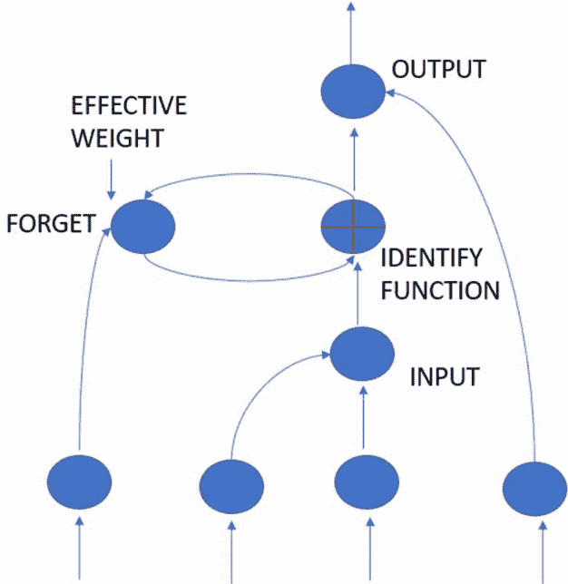

## 结论

在本章中，我们总结了关于 LSTM 发展的最相关材料。特别是，我们强调了梯度消失问题，这是 RNN 的一个重大缺点。通过在专用记忆单元的内部状态中注入持续的误差流，LSTM 为这一问题提供了一种潜在的解决方案。通过跨越超过 1,000 个时间步的时间段，LSTM 可以解决长时间滞后问题。最后，我们介绍了两种 LSTM 改进，使 LSTM 能够学习自重置和精确时序。使用自重置，LSTM 可以从内存中删除无关信息。

## 参考文献

- Abdelbaki, H., Gelenbe, E., & Kocak, T. (1999). 基于 EMI 的地雷检测匹配神经滤波器. IJCNN’99. 国际神经网络联合会议论文集, 5, 3236–3240. 10.1109/IJCNN.1999.836174
- Adek, R. T., & Ula, M. (2020). 机器学习技术在公共数据集入侵和异常检测中的准确性调查. 2020 数据科学、人工智能和商业分析国际会议 (DATABIA). 10.1109/DATABIA50434.2020.9190436
- Atalay, V., Gelenbe, E., & Yalabik, N. (1992). 用于纹理生成的随机神经网络模型. 模式识别与人工智能国际期刊, 06(01), 131–141. doi:10.1142/S0218001492000072
- Bakircioglu, H., Gelenbe, E., & Carin, L. (1997). 强杂波中成形物体的随机神经网络识别. 在 W. Gerstner, A. Germond, M. Hasler, & J.-D. Nicoud (编), 人工神经网络—ICANN’97 (第 961–966 页). Springer. doi:10.1007/BFb0020277
- Bakircioglu, H., & Koçak, T. (2000). 随机神经网络应用综述. 欧洲运筹学期刊, 126(2), 319–330. doi:10.1016/S0377-2217(99)00481-6
- Cramer, C., Gelenbe, E., & Gelenbe, P. (1998). 图像和视频压缩. IEEE Potentials, 17(1), 29–33. doi:10.1109/45.652854
- de Melo, G., Macedo, S. O., Vieira, S. L., & Leandro Oliveira, L. G. (2018). 使用并行算法进行肺炎检测的图像分类和性能增强. 2018 IEEE 自动化国际会议/第 XXIII 届智利自动控制协会大会 (ICA-ACCA), 1–5. 10.1109/ICA-ACCA.2018.8609734
- Gelenbe, E. (1989). 带负信号和正信号及积分形式解的随机神经网络. 神经计算, 1(4), 502–510. doi:10.1162/neco.1989.1.4.502
- Gelenbe, E. (1990). 随机神经网络模型的稳定性. 神经计算, 2(2), 239–247. doi:10.1162/neco.1990.2.2.239
- Gelenbe, E. (1993). 循环随机神经网络中的学习. 神经计算, 5(1), 154–164. doi:10.1162/neco.1993.5.1.154
- Gelenbe, E., Feng, Y., & Krishnan, K. R. R. (1996). 人脑体积磁共振成像的神经网络方法. IEEE 论文集, 84(10), 1488–1496. doi:10.1109/5.537113
- Gelenbe, E., & Fourneau, J.-M. (1999). 多类信号随机神经网络. 神经计算, 11(4), 953–963. doi:10.1162/089976699300016520 PMID:10226191
- Gelenbe, E., & Hussain, K. F. (2002). 多类随机神经网络中的学习. IEEE 神经网络交易, 13(6), 1257–1267. doi:10.1109/TNN.2002.804228 PMID:18244525
- Gelenbe, E., Mao, Z.-H., & Li, Y.-D. (1999). 基于峰值随机网络的函数逼近. IEEE 神经网络交易, 10(1), 3–9. doi:10.1109/72.737488 PMID:18252498
- Hochreiter, S., & Schmidhuber, J. (1997). 长短期记忆. 神经计算, 9(8), 1735–1780. doi:10.1162/neco.1997.9.8.1735 PMID:9377276
- Hussain, K. F., & Moussa, G. S. (2005). 基于随机神经网络的激光强度车辆分类系统. 第 43 届东南区域年会论文集, 1, 31–35. 10.1145/1167350.1167372
- John, J., Ravikumar, A., & Abraham, B. (2021). 基于多个预训练计算机视觉模型的前列腺癌预测. 健康与技术, 11(5), 1003–1011. doi:10.1007/12553-021-00586-y
- Khan, A., Sohail, A., Zahoor A, U., & Qureshi, A. S. (2020). 深度卷积神经网络近期架构综述. 人工智能评论, 53(8), 5455–5516. doi:10.1007/s10462-020-09825-6
- Kocak, T., Seeber, J., & Terzioglu, H. (2003). 随机神经网络路由引擎的设计与实现. IEEE 神经网络交易, 14(5), 1128–1143. doi:10.1109/TNN.2003.816366 PMID:18244566
- LeCun, Y., Bengio, Y., & Hinton, G. (2015). 深度学习. 自然, 521(7553), 7553. 提前在线出版. doi:10.1038/nature14539 PMID:26017442
- LeCun, Y., Boser, B., Denker, J. S., Henderson, D., Howard, R. E., Hubbard, W., & Jackel, L. D. (1989). 手写邮政编码识别的反向传播应用. 神经计算, 1(4), 541–551. doi:10.1162/neco.1989.1.4.541
- Nweke, H. F., Teh, Y. W., Al-garadi, M. A., & Alo, U. R. (2018). 使用移动和可穿戴传感器网络进行人类活动识别的深度学习算法：现状与研究挑战. 应用专家系统, 105, 233–261. doi:10.1016/j.eswa.2018.03.056
- Ravikumar, A., & Sriraman, H. (2023). 图像处理和计算机视觉算法的加速. 在《深度学习时代计算机视觉和图像处理研究手册》中. IGI Global. doi:10.4018/978-1-7998-8892-5.ch001
- Robin, M., John, J., & Ravikumar, A. (2021). 使用 U-NET 进行乳腺肿瘤分割. 2021 第 5 届计算方法与通信国际会议 (ICCMC), 1164–1167. 10.1109/ICCMC51019.2021.9418447
- Timotheou, S. (2010). 随机神经网络：综述. 计算机期刊, 53(3), 251–267. doi:10.1093/comjnl/bxp032
- Zhang, Q., Yang, L. T., Chen, Z., & Li, P. (2018). 大数据深度学习综述. 信息融合, 42, 146–157. doi:10.1016/j.inffus.2017.10.006

# 第 5 章

# 使用深度学习方法对咖啡叶病进行分类

Sudhir Kumar Mohapatra
https://orcid.org/0000-0003-3065-3881
Sri Sri University, India

Abdelah Behari
Werabe University, Ethiopia

Anbesaw Belete
Werabe University, Ethiopia

Seid Huseen
Werabe University, Ethiopia

Ali Hussen
Werabe University, Ethiopia

Srinivas Prasad
GITAM University, India

## 摘要

农业生产是缓解极端贫困、增强经济稳定性以及养活预计到 2050 年将达到 97 亿人口的关键技术之一。然而，作物病害是农业生产的主要障碍。减少产量的最普遍疾病是叶部病害，它们攻击叶片，在咖啡作物中尤其普遍。为了解决这个问题，需要一种适合识别和分类该作物叶片上这些疾病的方法。特别是在咖啡作物中，锈病、咖啡萎蔫病和褐斑病是最常见的疾病。因此，通过系统自动识别这些疾病至关重要。因此，本研究的主要目标是设计一个能够识别和分类咖啡叶病害严重程度的自动化系统。将遵循设计科学研究方法。因此，所需图像已从 SNNP 收集。

DOI: 10.4018/978-1-6684-8531-6.ch005


## 1. 简介

Agriculture is one of the diverse and the backbone sources of income for the national economy, and which further plays a critical role in feeding the world's population. Hence, agricultural researchers and experts are strongly doing their research to obtain maximum yield without affecting the environment (Bashir & Sharma, 2012). Because of this, emerging nations like Ethiopia prioritize the effective execution of agriculture initiatives in order to improve the quality of life for their citizens (Varshney & Dalal, 2016).

The Ethiopian government Agricultural Development Led Industrialization (ADLI) is a central pillar of economic policy in the recently completed plan for accelerated and sustained development to end poverty (Welteji, 2018). More than one-third of the world's population currently consumes coffee as a soft drink. Coffee is additionally one of the most traded commodities nationally and internationally, making it a major commodity on the market and a source of income for millions of people involved in its production, marketing, and processing of the crop (Pinto et al., 2017). Surprisingly, over 50 developing economies are involved in the manufacture of coffee, while the majority of its consumers are in far-off industrialized nations (Varshney & Dalal, 2016).

The agricultural sector is very important to Ethiopia's economy. The sub-sector of coffee agriculture-based production contributes significantly to the nation's economy. It is the largest source of foreign exchange earnings and significantly boosts the GDP. The usage of coffee as an ingredient in some food processing industries is growing in recent years. For example, it is used as a flavour to various pastries, ice creams, and chocolate, making it not only one of the most popular international beverages but also one of the most important trading commodities in the world after petroleum, cotton (Mengistu et al., 2016).

In the cultivation of plant crops, there are many risks. Diseases are one of the risks that attack leaves. In plant science, several diseases attack a crop (Yadessa, Burkhardt, Bekele, Hundera, & Goldbach, 2020). Likewise, in the cultivation of coffee crops, several diseases include rust, brown leaf spot, leaf miner, and Cercospora. If one of the diseases once appear on one leaf, it expands to normal leaves per night and destroys the farm within a few periods (Yadessa, Burkhardt, Bekele, Hundera, & Goldbach, 2020).

Nowadays, the development of soft-computing technologies provided a platform for plant pathologists to use more intelligent tools to diagnose and give appropriate treatment for recognized diseases of plant leaves and make it possible to detect and classify plant leaf diseases (Yadessa, Burkhardt, Bekele, Hundera, & Goldbach, 2020). Nowadays, the development of soft-computing technologies provided a platform for plant pathologists to use more intelligent tools to diagnose and give appropriate treatment for recognized diseases of plant leaves and make it possible to detect and classify plant leaf diseases (Prakash et al., 2017). In contrast with the above idea, the technological advancement in this digital is incomplete if it is not combined with artificial intelligence (Prakash et al., 2017).

The Artificial Intelligence (AI) method is especially helping several sectors to increase productivity and efficiency. The obstacles in any and every sector are being addressed with the assistance of Technologies such as Artificial intelligence. Similar to how it helps other industries, AI in agribusiness is assisting farmers in increasing their productivity and reducing adverse ecological effects. In order to improve the efficiency of agricultural production, the majority of startups in this industry now use AI (Vinuesa et al., 2020).

Image processing helps computer vision to get more meaningful information from the image data. To perform computer vision tasks, machines have to learn from experience (data), so it leads to machine learning, it is an area of artificial intelligence (AI) that enables systems to automatically learn from experience and improve without explicitly human involvement or with relatively little of it. It focuses on creating computer systems that can gather data and create models based on previous observation or records to help people make better decision (McQueen et al., 1995).

Recently, computer vision made feasible by deep learning has paved the way for computer-assisted disease classification. So, the development of a proper methodology for coffee leaf disease classification is quite useful. In general, this research paper will go to develop a coffee leaf’s disease classification system using deep learning techniques. Ethiopia is among the countries in which the coffee plant blooms, and it provides approximately 40% of the country’s agricultural production. Around 80–85 percent of Ethiopia’s population is dependent upon agriculture. Ethiopia does indeed have a large coffee plant population where 80 to 85% of the population depends on agriculture, with coffee production accounting for approximately 40% of such industry (Sorte, Ferraz, Fambrini, dos Reis Goulart, & Saito, 2019).

Furthermore, Coffee production is constrained by many factors, including losses due to damage caused by pests and diseases, poor management practices, soil infertility (Yadessa, Burkhardt, Bekele, Hundera, & Goldbach, 2020). Hence, rust, Coffee Leaf Rust, Coffee Berry Disease, and Coffee Wilt disease are particularly confirmed as the most constraint to production and the number one priority for farmers (Sorte, Ferraz, Fambrini, dos Reis Goulart, & Saito, 2019). Those diseases can affect any stage of crop growth and if left untreated, leads to the drying of leaves, and the disease occurs throughout the country where coffee production is common (Mengistu et al., 2016).

The most practiced approach for the classification of coffee crop diseases is naked eye observation by experts (human vision). Therefore, this approach is unfeasible due to subjective decisions, prone to error, excessive processing time, unavailability, and less number of experts at farms to identify these diseases and to give an appropriate treatment. According to an expert interview: “First of all, During the seeding the coffee, they saw the seeds that are resistant to coffee disease.” Secondly, wilt disease can harm coffee as it matures. When specialists and farmers notice Wilt disease, they chop down and burn the entire tree. Furthermore, anytime they have a doubt about the diseases that have occurred, they collect a sample from the current disease and analyze it in a laboratory to identify it. The existing illness identification technique has the disadvantage of iterating until they are certain about the type of diseases examined in the laboratory. The technique is typically time-consuming, error-prone, and inefficient, as a result of which the illness has a significant impact on coffee output. As a result of these challenges, a number of undesirable effects have taken place, including an estimated loss of 600 million Ethiopian Birr (ETB), or 73.6 million US dollars, in Ethiopia, according to (Zeru, 2006). Hence, it needs imperative special attention to the healthy growth of coffee crops. Therefore, automatically detecting and classifying these diseases on the leaves becomes very critical.

## 2. 理论文献和相关工作

### 2.1 埃塞俄比亚咖啡生产

Ethiopian coffee is primarily cultivated in the shadow of trees (shade or forest coffee), either in forests or forest-like settings or in farming systems that contain specific shade plants, typically native (native) trees, or occasionally fruit trees and other crop plants (Moat et al., 2017). Coffee was first consumed in Ethiopia, where its discovery preceded that of the rest of the globe. Over 70 different species of coffee (Coffea spp.) exist in the tropics, many of which are indigenous to Africa. With 10.3 million hectares of land being farmed globally, the Arabica (Coffea arabica, 64 percent of world production) and Robusta


(Coffea canephora, var. Robusta, 35 percent) 类型目前具有最重要的经济意义。巴西、越南、哥伦比亚、印度尼西亚和埃塞俄比亚是主要生产国。作为发展中国家最有价值的经济作物之一，超过 60% 的农民生产并出口该作物。

### 2.2 咖啡叶片疾病

根据多方消息来源，近年来咖啡一直受到多种疾病的侵袭，埃塞俄比亚的咖啡产品因各种因素（尤其是咖啡植物疾病，如棕眼斑病（BES）、咖啡浆果病（CBD）、咖啡叶锈病（CLR）和咖啡枯萎病（CWD））而可能真正退化。

### 2.3 棕眼斑病

当植物受到胁迫时，一种称为棕斑病的真菌会出现在叶片上。叶片上的这些区域，有微小的棕色斑点，在叶片上表面更为明显。在叶片内部，这些点通常出现在叶脉之间，也靠近叶缘。棕斑病如下图所示。

上述图示表明，这些斑点具有浅棕色或偶尔浅灰色的核心、宽大的深棕色环和黄色边缘，直径可达 15 毫米。当斑点扩大成大片斑块时，就会发生叶枯病。它们通常比叶片上的斑点形状更不规则，呈棕色，并且大多位于朝阳的一侧。浆果上的斑点可能在它们仍为绿色时开始（Suhartono, 2013）。

图 1. 棕斑病

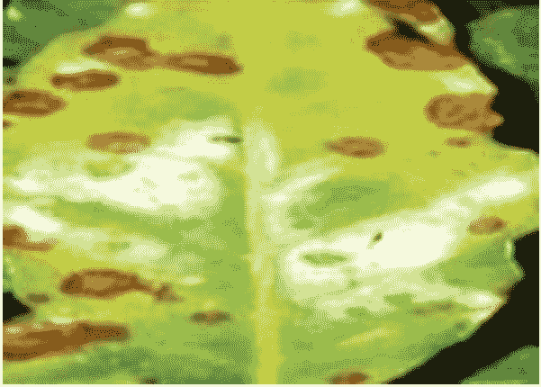

### 2.4 叶锈病

咖啡锈病的特征是叶片上表面出现小的、油腻的、淡黄色斑点，这些斑点会扩大成较大的圆形斑点，最终变成带有黄色边缘的亮橙色、红色和棕色。受锈病感染的咖啡叶片症状如下图所示。

如上图所示，叶片下表面呈粉状橙黄色。这些疱最终会变黑。锈病叶片掉落到地面，使受损的树木几乎光秃秃的。这些树木产出的咖啡大幅减少，通常在几年内死亡（Suhartono, 2013）。

图 2. 叶锈病

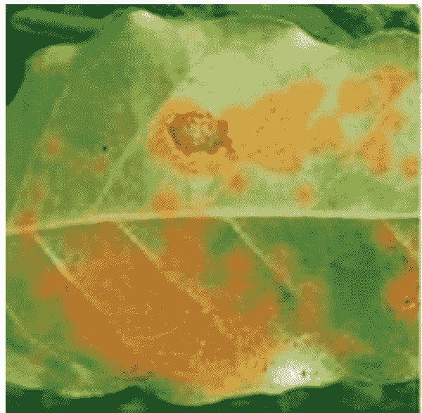

### 2.5 咖啡浆果

被称为咖啡浆果病的真菌影响咖啡植物发育的所有阶段，尽管它最容易通过在绿色浆果上形成的小的、深色的、凹陷的棕色斑块来识别。该病症状如下图所示。

一种特别有害的病症，称为咖啡浆果病（CBD），由细菌 Colletotrichum kahawae Waller 引起，影响正在生长的浆果，导致它们在豆子发育前腐烂并脱落（Alemu et al., 2016）。

图 3. 咖啡浆果

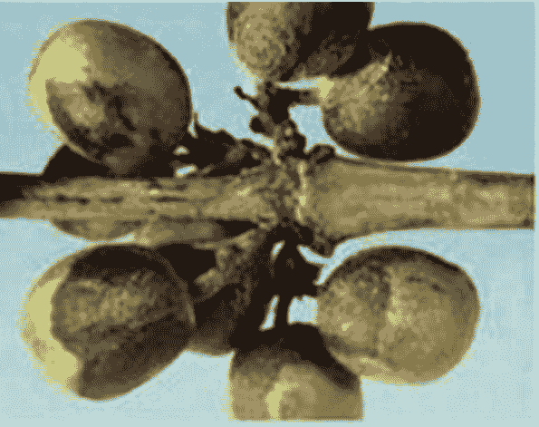

### 2.6 计算机视觉

近年来，越来越多地强调早期现代非破坏性方法，例如图像处理技术。机器视觉是对视觉输入的分析，它使机器能够像人类视觉一样看见、识别和处理图像，然后向用户提供适当的输出（Al-Hiary et al., 2011）。

### 2.7 深度学习

深度学习方法是机器学习（ML）和人工智能（AI）的一个子集，用于训练复制人类行为的算法，使机器能够像人类一样具备足够的知识来思考、学习和自行做决定。这种方法采用具有许多隐藏层的多层神经网络，以学习如何以不同抽象层次描述信息，并受到人脑工作方式的启发（Guo & Guo, 2017）。

### 2.8 卷积神经网络

卷积神经网络（CNN）是用于处理图像数据的深度学习模型的一个子集。CNN 模仿动物视觉皮层的结构，旨在自动且自适应地学习从低级到高级模式的特征集空间层次结构。卷积神经网络（CNN）最近在计算机视觉的许多领域取得了相当大的成功，特别是图像识别和分类。该名称源自矩阵之间的数学线性运算。卷积神经网络包含带有一些权重和偏置的神经元（Albawi et al., 2017）。

### 2.9 相关工作

为了开发咖啡叶片疾病的分类器模型，有必要了解这些问题被探索的程度，因此在本地和国际层面上，利用图像处理、经典机器学习以及一种称为深度学习的最近先进方法，对咖啡作物疾病的检测和分类进行了广泛调查。

Sorte, Ferraz, Fambrini, dos Reis Goulart, & Saito (2019) 提出了一种分类器模型，该模型能够对识别出的咖啡叶片进行分类，并将其分类为 Cercospora 和 锈病。为了开发分类器模型，研究人员尝试使用数码相机通过 300 dpi 从农场收集必要数据。在图像进行镜像或旋转之前，共拍摄了 1500 张样本图像。使用灰度共生矩阵提取必要的纹理数据。提取了七个属性，并将其输入到名为 Alex-Net 的预训练网络模型中，开发模型的预测能力通过不同的性能指标进行衡量，并达到 0.98。但是，开发的模型无法估计识别图像的严重程度。

Manso et al. (2019) 开发了一款智能手机应用程序，用于识别和鉴定给定的咖啡叶片为叶矿虫或锈病。这些疾病可能经常发生，因此开发该系统变得非常重要。本工作中使用的图像是使用分辨率为 1000 万像素（4096x2304 像素）的 ASUS Zenfone 2 智能手机（ZE551ML）拍摄的。使用了三种背景颜色：白色；黑色和蓝色。为了将图像与背景分割，研究人员使用了 YCbCr 颜色空间和 Otsu 分割算法。对于分类，使用了使用极端学习机训练的人工神经网络。

Marcos et al. (2019) 开发了一种使用卷积神经网络识别和分类咖啡叶锈病的方法。本文的主要目标是将识别出的咖啡叶片识别和分类为健康或锈病，因为如果不及早治疗，该疾病有能力将咖啡产量降低多达 45%。研究人员从不同种植区域收集了必要的图像。为了开发分类器模型，研究人员使用了卷积神经网络，开发的分类器模型通过精确率、召回率和准确率等不同的性能评估指标进行了评估。模型结果表明是一种有效且强大的分类器。但是，该工作未考虑其他严重影响叶片的疾病类型。

Sorte, Ferraz, Fambrini, dos Reis Goulart, & Saito (2019) 提出了一种使用机器学习算法的自动咖啡疾病检测和分类方法。开发的系统能够识别给定的咖啡叶片疾病，如锈病和棕眼斑病。为了开发模型，研究人员从农场收集了 620 张图像，并实施了必要的图像滤波技术。最后，使用 k-最近邻算法分离图像的前景和背景。使用灰度共生矩阵从给定图像中提取必要特征，并使用支持向量机等机器学习算法。最后，通过准确率、精确率和召回率评估开发模型的性能。因此，它达到 0.78。但是，未纳入咖啡叶片疾病的其余类别标签。

Esgario et al. (2020) 该研究的主要目标是估计识别出的咖啡叶片疾病的严重程度，分为细菌或真菌。该研究的主要目标是识别导致疾病来到叶片的已识别疾病因素。识别和估计由生物因素引起的咖啡叶片胁迫严重程度。目前最大的公共数据集来自 PlantVillage，包含超过 54 千张叶片图像和 38 个类别，其中包括不同物种的健康叶片和患病叶片。


Kumar 等人（2020）开发了一种分类器模型，能够将识别出的咖啡叶分类为锈病（Rust）和 cercospora 病（Cercospora）。为开发该分类器模型，研究人员收集了不同类型的图像或数据集。收集到的图像经过不同类型的图像滤波技术进行预处理，预处理后的图像输入到卷积神经网络中。所开发分类器模型的性能通过精确率和准确率等不同性能评估指标进行了评估。结果表明，该有效且稳健的技术准确率达到 97.61%。然而，该系统存在一个局限性，即未测量识别出的咖啡叶疾病的严重程度。

Lewis & Espineli（2020）开发了一种分类器模型，能够使用卷积神经网络识别咖啡植物中的营养缺乏。为开发该分类器模型，研究人员从国家咖啡研究、开发与推广中心（NCRDEC）收集了所需图像，并使用数码相机拍摄数据。然而，所开发的分类器模型仅考虑营养缺乏，而不考虑感染性疾病。

研究人员使用迁移学习和深度学习对不同植物疾病进行分类。他们还使用集成机器学习的计算机视觉对小麦、马铃薯及其他植物疾病进行检测（Mohapatra 等人，2021；Nanda 等人，2023；Sinshaw 等人，2021；Sinshaw 等人，2022）。

## 3. 研究方法

### 3.1 研究设计

本研究选择设计科学研究（DSR）方法作为发现和识别农业部门咖啡生产中的机遇与问题，并创建新构件以克服这些生产力挑战的方法。选择该方法的原因如下。

### 3.2 提议架构

根据众多学术研究，卷积神经网络是最广泛使用且最近被发现的技术。从这一角度出发，本研究尝试实现卷积神经网络以提高农业生产力，具体针对咖啡生产和叶片疾病分类，以叶片作为输入。

本研究采用了两种不同的方法，即从零开始构建的多层卷积神经网络（MCNN）和预训练网络的迁移学习，以开发最佳分类器模型来检测和分类咖啡叶问题，并比较了两者的结果。

### 3.3 迁移学习

预训练深度学习模型因其在解决复杂问题方面的有效性而广受认可。由于层被冻结并从先前训练过的网络加载，且不需要那么多训练数据，因此该方法用于为有限数据集开发高性能分类网络。

所使用的预训练模型的一些特性在表 1 中介绍。

| CNN 架构 | 参数(M) | 层数 | 分类准确率 |
|---|---|---|---|
| VGG19 | 138 | 19 | 92.7% |
| RESNET50 | 25 | 50 | 94.11% |

### 3.4 MCNN

针对该任务，提出了一种从零开始构建的多层 CNN。在此方法中，模型架构包含 5 个卷积层，每个卷积层后跟 ReLU 激活和最大池化层、丢弃层、一个 Flatten 层，以及后跟 softmax 激活的全连接层。在训练期间，使用 Keras 降低学习率作为指标，如果训练无改善则停止训练。用于分类咖啡叶疾病的模型架构展示了所开发模型的所有输入、处理和输出，以不同地点收集的数据作为输入。下图展示了咖啡叶疾病分类模型的架构。

图 4. CNN 架构

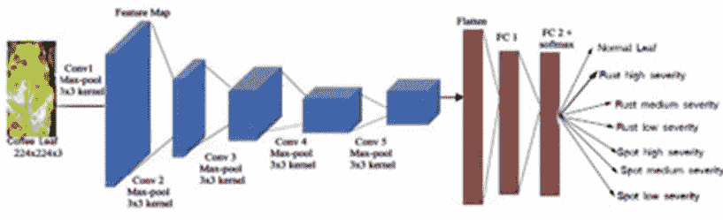

### 3.5 超参数

超参数是在学习过程开始之前设置的参数。此外，这些参数是可调的，并可以直接影响模型训练的效果。在卷积神经网络中，可以通过各种方法进行实验；主要是通过更改参数类型以及超参数，网络使我们能够切换参数以构建不同的分类实验。以下超参数被选为基准。相应地，采用了以下超参数。填充（Padding）：在使用卷积神经网络解决给定问题时，一个问题是卷积层中的输出维度减少，因为每次卷积可能会丢失某些特定区域。因此，本研究添加了零填充层以保持输出不变。

步长（Stride）：它表示滤波器矩阵在输入矩阵上滑动的像素数量（即，当步长为 1 时，每次移动滤波器一个像素）。

表 2. CNN 训练超参数

| 参数 | 值 |
|---|---|
| 优化器 | Adam |
| 损失函数 | categorical cross-entropy |
| 轮次 | 100 |
| 步长 | 1 |
| 填充 | 0 层 |
| 批量大小 | 32 |
| 学习率* | 初始值：0.01 |
| 动量 | 0.09 |
| 权重衰减 | 0.005 |

*以 1/2 的因子递减

轮次（Epoch）：在本研究中，50 张图像通过神经网络进行一次前向和后向传播称为一个轮次，研究人员决定一次使用 32 张图像，因为批量大小增加时，需要较高的内存空间利用率。

学习率（Learning Rate）：最初使用了自适应学习率的默认值，然后利用 ReduceLRonPlateau 回调内置函数在指标停止改善时降低学习率，因为当学习停滞时，模型通常从将学习率降低 0.5 倍中受益。

优化器（Optimizer）：选择 Adam 优化器来更新权重，并将分类交叉熵损失实现为损失函数，以通过前向传播评估训练集。

损失函数（Loss Function）：模型在特定核和权重下的性能通过在训练数据集上进行前向传播的损失函数计算得出。它衡量了通过前馈传播的网络输出预测与给定基准真值之间的兼容性。

已实现分类交叉熵，输出层配置为 3 个类，并带有“Softmax”激活，以预测每个类的概率。

```
\(Loss = -\sum_{c=1}^{M} y_{o,c} \log(p_{o,c})\) (1)
```

其中 M 是本研究的类别数量。

### 3.6 提议系统框架

本研究工作涉及设计一种使用图像在卷积神经网络上训练的咖啡叶疾病分类模型。训练后的网络用于将图像作为输入识别为定义的输出类别集合。提议系统接受通过数码相机收集的任何图像格式的咖啡叶图像。为开发分类器模型，研究人员从第一步（即图像获取）开始工作。

相应地，收集并准备了所需的咖啡叶图像。然后，预处理是研究人员遵循的下一步，例如归一化，即将图像的像素强度归一化，以最大限度地减少网络训练期间的计算难度或减少可表示值的数量，消除图像获取过程中出现的障碍。图像调整大小也是另一项预处理任务，因为图像是由数码相机拍摄的，而将其输入算法时大小各不相同。因此，研究人员为所有输入到算法中的图像建立了基准尺寸。

最后，得到了预处理和平滑的数据集。在分类阶段，为了将咖啡叶图像分类到适当的类别中，研究人员使用了基于深度学习的卷积神经网络模型进行图像分析，例如特征提取和分类，因为这种方法不需要手工制作特征，而是可以自动从图像中提取更高级或抽象的特征，无需人工干预。下图展示了提议的咖啡叶疾病卷积神经网络系统架构。上图展示了

图 5. 提议框架

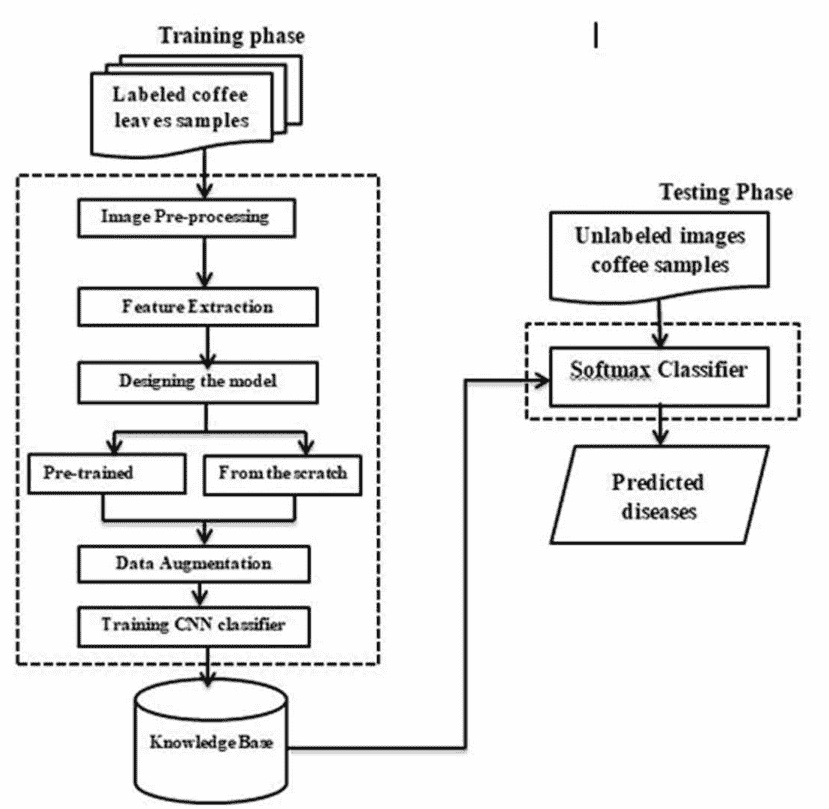


为实现本研究的预定目标，提出了该框架。所需图像使用数码相机拍摄，然后使用图像预处理技术执行必要的预处理任务。在此基础上，数据集被分为训练集以训练分类器，以及测试阶段以测试所开发模型的最终预测能力。

因此，采用了迁移学习卷积神经网络方法来开发咖啡叶病害分类器模型。为此，加载预训练卷积神经网络模型，向其提供标记图像，并转移模型的核心值用于特征提取以及全连接层中的权重值，并修改输出类标签以对应本研究的类标签，然后从图像中自动提取抽象特征。

此外，给定图像的必要特征是手动提取的，使用Gabor滤波技术从图像中提取纹理特征。与此同时，这些方法在训练过程中使用了数据增强技术，以便系统从不同维度查看给定图像并克服模型过拟合。最后，训练卷积神经网络分类器模型并创建模型。

### 3.7 数据集准备

图像获取是任何计算机视觉系统的第一步。这告诉我们图像如何以及从何处从任何物理设备（如相机、网络摄像头等）获取和存储到计算机系统中以供进一步处理。为了开发准确的咖啡叶病害分类器模型，所需数据使用数码相机从南方民族和民族人民（SNNP）收集。最后，通过文献调查和咨询农业专家对图像的观察，为每片叶子分配了类标签。

### 3.8 图像预处理

为了使分类器模型尽可能有效并满足用户要求，研究人员尝试观察图像，以确保收集和准备的图像是否具有良好的质量和预期的自然性。为此，至少低级图像预处理是至关重要的。

因此，本研究拟议的分类模型遵循了六个预处理步骤：首先，图像通常需要调整大小以匹配CNN的输入层大小（224*224x3）；其次，图像被转换为二进制，然后再转换为灰度图；第三，尽量减少获取过程中的图像质量退化影响。

第四，图像必须进行归一化，以帮助模型更快收敛并更好地泛化到未见数据；第五是将字符串值转换为数值；最后是独热编码。此外，在使用任何捕获媒体拍摄图像时，总是会产生噪声，因此必须去除噪声。为此，执行了不同的噪声滤波技术，主要是高斯滤波和中值滤波技术，用于收集的图像中。

### 3.9 特征提取

本研究的主要目标是开发用于分类咖啡叶病害的分类器模型，为此实现了卷积神经网络，以便使用此方法可以将图像输入卷积神经网络，也可以从给定图像中提取必要特征并输入卷积神经网络的分类器。在本研究中，这两种选项都已使用，为了提取必要特征，研究人员使用了GLCM特征提取技术，因为它是计算机视觉中最流行的技术之一，特别是用于纹理特征提取或分析，它使用不同的频率和方向，并且强烈推荐用于灰度图像。使用此技术，可以从灰度图像中提取必要的数值特征，如熵（Entropy）、能量（Energy）、偏度（Skewness）、相关性（Correlation）、峰度（Kurtosis）、同质性（Homogeneity）和对比度（Contrast）。相应地，从每片单独的咖啡叶中提取这些特征，下表显示了代表图像的样本纹理特征。

### 3.10 训练方法

在本研究中，选择了基于深度学习的卷积神经网络方法，因为它专为图像分析和分类而设计。此外，它克服了传统机器学习算法在分类过程前需要手动特征提取的困难。它执行分类，使我们能够使用卷积神经网络的卷积层和池化层直接从原始图像中提取特征。它提供了从图像中提取对分类最合适的基本和歧视性特征的灵活性。相应地，研究人员使用了从头开始训练（其中所有参数均针对问题进行调优）和迁移学习（即已预训练的卷积神经网络）。在训练过程中，实现了预训练模型，即具有19层的视觉几何组（VGG-19）和具有50层的残差网络；此外，在从头开始训练方法中，最多使用四个卷积神经网络层作为特征提取，以及全连接层中的6个层。

### 表3. 样本提取的纹理特征

| 熵 | 能量 | 偏度 | 相关性 | 峰度 | 同质性 | 对比度 |
|---|---|---|---|---|---|---|
| 0.060531 | 0.126300 | 2.158966 | 0.122762 | 0.014473 | 0.999979 | 5.955812 |
| 0.048359 | 0.119846 | 1.790197 | 0.108784 | 0.011800 | 0.999974 | 9.667867 |
| 0.109139 | 0.310662 | 0.591271 | 0.171572 | 0.041189 | 0.999988 | 7.309303 |
| 0.049143 | 0.115944 | 1.576878 | 0.084203 | 0.009574 | 0.999974 | 5.893919 |
| 2.109827 | 90.112730 | 0.158711 | 0.849868 | 0.688051 | 0.972534 | 0.999991 |
| 0.138084 | 0.222362 | 4.086589 | 0.214822 | 0.037851 | 0.999991 | 4.783699 |
| 1.708922 | 128.583792 | 0.070821 | 0.894121 | 0.439642 | 0.973956 | 0.310662 |

*GLCM技术*

### 3.11 实验设置

在进行咖啡叶病害检测和分类研究时，研究人员使用了名为Python的软件，并使用了Flask框架；该实验在一台配置为Intel® Core™ i7 CPU @ 2.70GHz 2.90 GHz、8.00 GB已安装内存（RAM）、64位Microsoft Windows 10操作系统的台式计算机上执行。

## 4. 实验结果与分析

在本研究中，使用不同算法测试选项获得的实验结果，即分配80%用于训练，其余用于测试，70%用于训练，30%用于测试。此外，还进行了使用提取特征和未提取特征输入分类器的实验。灰度共生矩阵（GLCM）用于从灰度图像中提取必要特征，如熵、能量、偏度、相关性、峰度、同质性和对比度。最后，通过准确率、精确率、召回率和F值评估了所开发分类器模型的性能。因此，此类分析采用了以下公式：

\( Accuracy = \frac{TP + TN}{TP + TN + FP + FN} \) (2)

\( Sensitivity = Recall = \frac{TP}{TP + FN} \) (3)

\( Precision = \frac{TP}{TP + FP} \) (4)

\( Specificity = \frac{TN}{FP + TN} \) (5)

\( F_1 = \frac{2 * Precision * Recall}{Precision + Recall} = \frac{2 * TP}{2 * TP + FP + FN} \) (6)

### 4.1 ResNet-50预训练模型结果

在使用此模型解决此咖啡分类问题时，未修改此最先进模型的默认参数。然而，最后一层全连接层已修改为适应我们的分类问题。在此实验中，应用了不同场景来开发模型，例如80%用于训练，20%用于测试，以及70%用于训练，30%用于测试，分别达到84%和69%的准确率。相应地，第一个场景优于第二个场景，因此选择第一个场景进行详细分析。

上述混淆矩阵显示所开发分类器模型正确工作的程度，因此所开发模型在实际应用中可达到84.1%的准确率。因此，从每个类别的角度呈现残差网络（ResNet50）最先进算法的详细准确率，如下表所示。


### 图 6. ResNet-50 混淆矩阵

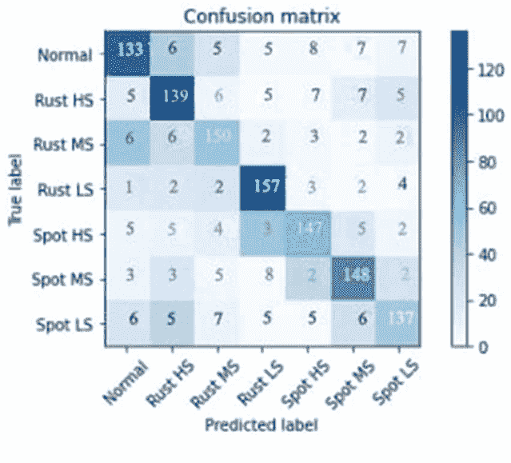

### 表 4. 按类别对 ResNet-50 模型的详细分析

| Class | Recall | Precision | F-Measure | TPR | FPR |
|---|---|---|---|---|---|
| Normal | 77.7% | 83.6% | 80.5% | 77.7% | 22.3% |
| Rust high severity | 79.8% | 83.7% | 81.7% | 79.8% | 20.2% |
| Rust Medium severity | 87.7% | 83.7% | 85.6% | 87.7% | 12.3% |
| Spot high severity | 85.9% | 84% | 84.9% | 85.9% | 14.1% |
| Spot Medium severity | 86.5% | 83.6% | 85% | 86.5% | 13.5% |
| Spot Low severity | 80.1% | 86.1% | 82.9% | 80.1% | 19.9% |
| Weighted average | 84.2% | 84.1% | 84.2% | 84.2% | 15.8% |

### 4.2 VGG-19

它包含 19 层，包括卷积层、池化层和三个全连接层，分为三个块，其中两个块分别拥有 4096 个神经元和 1000 个神经元（即类别概率的输出）。此外，这种最先进的架构、超参数以及滤波器数量、滤波器大小、步幅和填充等参数均采用默认值来训练网络。然而，该网络的最后几层根据本研究中的类别数量进行了修改。

### 图 7. VGG-19 混淆矩阵

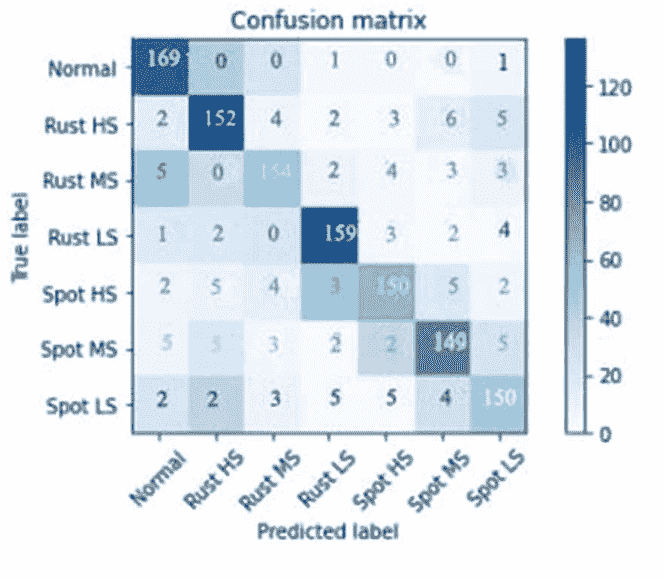

在此实验中，通过将收集的数据集划分为 80% 用于训练、20% 用于测试，以及 70% 用于训练、30% 用于测试，对网络训练期间的两种测试选项进行了测试。因此，分别达到 90% 和 87.3%，并选择第一种测试选项进行详细分析。因此，以下混淆矩阵显示了模型的性能。

研究人员使用混淆矩阵来展示所开发的咖啡叶病害分类模型的实验结果。本实验通过手动将数据集划分为训练集和测试集来进行。因此，在 6000 张总图像中，4800 张（80%）图像用作训练数据集，其余 1200 张（20%）图像用作测试数据集。因此，这种名为 VGG-19 的最先进算法在 1200 张总测试图像中取得了准确率，其中 1080 张（90%）被正确分类，其余 120 张（10%）测试图像被错误分类。基于所有测试选项结果，选择了第一种测试选项进行详细分析，并在下表中展示。

在此实验中，研究人员尝试观察召回率、精确率和 F1-度量值，以便更好地理解和分析结果。精确率表示正确预测的真实分类与总预测真实分类的比率。召回率表示实际类别中所有分类的正确预测真实分类。

### 表 5. VGG-19 按类别的详细准确率

| Class | Recall | Precision | F-Measure | TPR | FPR |
| :--- | :--- | :--- | :--- | :--- | :--- |
| Normal | 98.8% | 90.8% | 94.6% | 98.8% | 1.2% |
| Rust high severity | 87.3% | 91.5% | 89.3% | 87.3% | 12.7% |
| Rust Medium severity | 90% | 91.6% | 90.7% | 90% | 10% |
| Rust Low severity | 92.9% | 91.3% | 92% | 92.9% | 7.1% |
| Spot high severity | 87.7% | 90% | 88.8% | 87.7% | 12.3% |
| Spot Medium severity | 87.1% | 88% | 87.5% | 87.1% | 12.9% |
| Spot Low severity | 87.7% | 88% | 87.8% | 87.7% | 12.3% |
| Weighted average | 90.2% | 90.17% | 90.1% | 90.2% | 10% |

实验结果表明，使用残差网络-50、80% 用于训练、20% 用于测试的开发分类器模型准确率为 86%，其余 14% 为错误，其中 1,032 条记录被正确分类，其余 168 条记录被错误分类。

此外，该预训练模型还使用 70% 用于训练、30% 用于测试进行了测试，结果显示从 1800 条记录中，1404 条记录被正确分类，其余 396 条记录被错误分类，因此其准确率为 78%。

此外，研究人员尝试使用 VGG-19 预训练模型中的全部提取特征来开发模型，通过不同的测试选项，第一种测试选项分配 80% 用于训练、20% 用于测试，结果显示 960 条记录被正确分类，240 条记录被错误分类。此外，该模型还用于通过分配 70% 用于训练、30% 用于测试来开发模型，结果为 75%。通常，以下图显示了使用具有全部属性的预训练模型的实验分析。

图 2 显示了使用残差网络-50 和视觉几何组（VGG-19）通过不同测试选项开发的模型的比较性能，因此，残差网络预训练模型在所选属性中比拥有 19 层的视觉几何组实现了最佳准确率。

实验还扩展到使用这些预训练模型和所选属性开发分类器模型。在选择属性方面，研究人员使用信息增益比，比率为 0.5，选定了能量、偏度、相关性、峰度、同质性特征。以下图描绘了使用这些所选属性的实验结果。此外，还对所选属性进行了实验，所选属性由预训练模型和从头开始（即 ResNet50 和 VGG-19）实现，分配 80% 用于训练，其余 20% 用于测试，各模型分别达到 91%、90%、80%。

还进行了一项不从给定图像中提取必要特征的实验，在此场景中，我们所做的只是下载预训练权重，例如 ResNet50 和 VGG-19，开发一个具有 6 层的从头开始的网络，并比较此分类器的性能。因此，ResNet-50 达到了 98%，VGG-19 达到了 94%，从头开始达到了 91%，图示如下。

图 7 显示卷积神经网络从

### 图 8. 具有全部属性的预训练模型

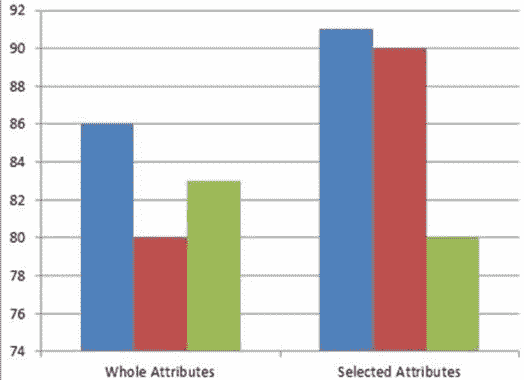

### 图 9. 具有全部属性的预训练

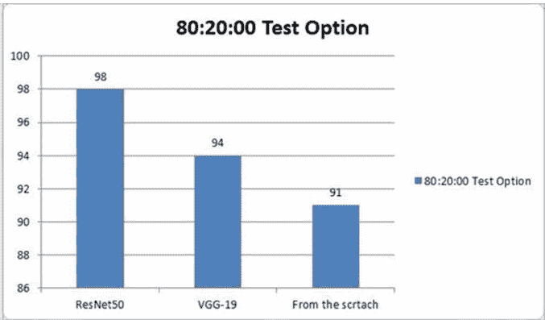

## 5. 结论与未来工作

本研究主要致力于开发一个分类器模型，能够检测和识别给定的咖啡叶图像，并将其分类为健康、高严重度锈病、中等严重度锈病、低严重度锈病，以及高严重度褐斑病、中等严重度褐斑病、低严重度褐斑病。为此，所需数据收集自南方民族、民族和人民地区，对收集的图像应用了不同的预处理任务，以使数据更加平滑和干净，用于实际分类。最后，默认测试选项（即分配 80% 用于训练，其余 20% 用于测试）应用了卷积神经网络方法，如预训练模型和从头开始训练。

此外，实验通过从给定图像中提取必要特征并输入到卷积神经网络中进行测试，同时也从给定的咖啡图像中提取必要特征，这意味着使用卷积神经网络同时进行特征提取和分类。最后，开发的分类器模型可以使用 ResNet50 以 98% 的准确率对疾病进行分类。

未来，识别给定图像并基于营养缺乏和其他类别标签进行分类也是未来的研究方向。

## 致谢

本研究工作得到沃莱塔索多大学研究与社区服务副校长办公室（埃塞俄比亚）的支持。

## 参考文献

Al-Hiary, H., Bani-Ahmad, S., Reyalat, M., Braik, M., & Alrahneh, Z. (2011). 植物疾病的快速准确检测与分类. International Journal of Computer Applications, 17(1), 31–38. doi:10.5120/2183-2754

Albawi, S., Mohammed, T. A., & Al-Zawi, S. (2017). 理解卷积神经网络. 2017 工程与技术国际会议 (ICET), 1–6. doi:10.1109/ICEngTechnol.2017.8308186

Alemu, K., Adugna, G., Lemessa, F., & Muleta, D. (2016). 埃塞俄比亚咖啡浆果病（Colletotrichum kahawae Waller & Bridge）的现状. Archiv für Phytopathologie und Pflanzenschutz, 49(17-18), 421–433. doi:10.1080/03235408.2016.1228736

Bashir, S., & Sharma, N. (2012). 基于图像处理的偏远地区植物疾病检测. IOSR 电子与通信工程杂志, 2(6), 31–34. doi:10.9790/2834-0263134

Esgario, J. G., Krohling, R. A., & Ventura, J. A. (2020). 基于深度学习的咖啡叶胁迫分类与严重程度估计. Computers and Electronics in Agriculture, 169, 105162. doi:10.1016/j.compag.2019.105162

Guo & Guo. (2017). 面向视觉理解的深度学习. Academic Press.

Kumar, M., Gupta, P., & Madhav, P. (2020). 基于卷积神经网络的咖啡植物疾病检测. 2020 第五届通信与电子系统国际会议 (ICCES), 755–760. 10.1109/ICCES48766.2020.9138000

Lewis, K. P., & Espineli, J. D. (2020). 基于图像处理和卷积神经网络 (CNN) 的咖啡植物营养缺乏分类与检测. International Journal of Scientific and Technology Research, 9(4), 2076–2081.

Manso, G. L., Knidel, H., Krohling, R. A., & Ventura, J. A. (2019). 咖啡叶矿蛾和咖啡叶锈病检测与分类的智能手机应用程序. arXiv 预印本 arXiv:1904.00742.


Marcos, A. P., Rodovalho, N. L. S., & Backes, A. R. (2019). 使用卷积神经网络的咖啡叶锈病检测. 2019年第十五届计算机视觉研讨会(WVC), 38–42. 10.1109/WVC.2019.8876931

McQueen, R. J., Garner, S. R., Nevill-Manning, C. G., & Witten, I. H. (1995). 将机器学习应用于农业数据. 农业中的计算机与电子学, 12(4), 275–293. doi:10.1016/0168-1699(95)98601-9

Mengistu, A. D., Mengistu, S. G., & Alemayehu, D. M. (2016). 基于图像分析的埃塞俄比亚咖啡植物疾病识别. IJBB, 10(1).

Moat, Williams, Baena, Wilkinson, Demissew, Challa, Gole, & Davis. (2017). 埃塞俄比亚的咖啡种植与气候变化：影响、预测、韧性与机遇——摘要. Academic Press.

Mohapatra, Prasad, & Nayak. (2021). 使用深度学习的小麦锈病检测. 数据科学与数据分析：机遇与挑战, 191.

Nanda, Mohapatra, & Satpathy. (2023). 使用卷积神经网络的小麦锈病检测. 哈尔滨工程大学学报, 44(6), 253-259.

Pinto, C., Furukawa, J., Fukai, H., & Tamura, S. (2017). 基于缺陷类型的绿色咖啡豆图像使用卷积神经网络(CNN)的分类. 2017年先进信息学、概念、理论与应用国际会议(ICAICTA), 1–5. 10.1109/ICAICTA.2017.8090980

Prakash, R. M., Saraswathy, G., Ramalakshmi, G., Mangaleswari, K., & Kaviya, T. (2017). 使用数字图像处理的叶片疾病检测与分类. 在2017年信息、嵌入式与通信系统创新国际会议(ICIIECS)中. IEEE.

Sinshaw, N. T., Assefa, B. G., & Mohapatra, S. K. (2021). 基于迁移学习和数据增强的马铃薯晚疫病检测CNN模型. 2021年非洲发展信息通信技术国际会议(ICT4DA), 30-35. 10.1109/ICT4DA53266.2021.9672243

Sinshaw, N. T., Assefa, B. G., Mohapatra, S. K., & Beyene, A. M. (2022). 自动马铃薯植物疾病检测中计算机视觉的应用：系统文献综述. 计算智能与神经科学, 2022, 7186687. doi:10.1155/2022/7186687 PMID:36419507

Sorte, L. X. B., Ferraz, C. T., Fambrini, F., dos Reis Goulart, R., & Saito, J. H. (2019). 基于深度学习和纹理属性的咖啡叶病识别. 计算机科学程序, 159, 135–144. doi:10.1016/j.procs.2019.09.168

Suhartono. (2013). 咖啡植物疾病检测中的专家系统. 电气与能源国际期刊, 1(3), 156–162.

Varshney, S., & Dalal, T. (2016). 使用图像处理技术的植物疾病预测——综述. 计算机科学与移动计算国际期刊, 5(5), 394–398.

Vínuesa, R., Azizpour, H., Leite, I., Balaam, M., Dignum, V., Domisch, S., Felländer, A., Langhans, S. D., Tegmark, M., & Fuso Nerini, F. (2020). 人工智能在实现可持续发展目标中的作用. 自然通讯, 11(1), 1–10. doi:10.1038/s41467-019-14108-y PMID:31932590

Welteji, D. (2018). 埃塞俄比亚农村发展政策的批判性回顾：获取、利用与覆盖. 农业与粮食安全, 7(1), 1–6. doi:10.1186/s40066-018-0208-y

Yadessa, A., Burkhardt, J., Bekele, E., Hunderra, K., & Goldbach, H. (2020). 影响埃塞俄比亚咖啡品质的主要因素：西南和东南非蒙塔纳雨林自然栖息地野生阿拉比卡咖啡(coffea arabica l.)的案例. 非洲植物科学杂志, 14(6), 213–230. doi:10.5897/AJPS2020.1976

Zeru, A. (2006). 埃塞俄比亚非蒙塔纳雨林中阿拉比卡咖啡种群的多样性与colleotrichum kahawae和gibberella xylarioides的关系 [博士论文]. 阿迪斯亚贝巴大学.

# 第6章

# 基于ML–DL方法的医疗影像COVID-19分类

Shreeharsha Dash
印度奥迪沙技术与研究大学

Subhalaxmi Das
印度奥迪沙技术与研究大学

## 摘要

COVID-19是由Sars-Cov-2引起的传染性疾病。这种2019-nCoV病原体与数百万人的生活息息相关。本研究采用机器学习(ML)和深度学习(DL)模型来确定疾病，并预测个人是否感染病毒，因为之前的报告可以考察数据预处理、特征提取、分类和实验结果评估，以寻找围绕采用机器-深度学习方法的COVID-19分类的先进研究方向。比较表明，胸部X光和CT是COVID-19诊断中最常用的数据，而非RT-PCR，并且发现最常用的检测技术在更改有限数量的数据集后对灵敏度不足且益处较小。本研究建议采用图像预处理、探索性数据分析、特征提取(LBP)以及其他机器学习和深度学习分类方法。它试图尽量减少一些已针对早期识别提出的问题，为未来的工作和研究提供参考。

## 1. 引言

### 1.1. 冠状病毒

冠状病毒是一大类传染性病原体，会引发从无法治愈的健康问题到重症（如MERS-CoV和SARS-CoV）的各种疾病。2019年12月31日，中国湖北省武汉市向世界卫生组织(WHO)报告，发现了患有未知慢性感染的肺炎病例。这种进展缓慢的疾病以漫长的潜伏期

### 图1. 用于COVID-19检测的RT-PCR、CXR图像和CT扫描图像的比较

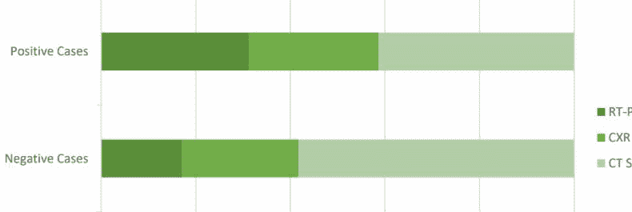

和进行性疾病为特征。2020年3月11日，世界卫生组织将COVID宣布为流行病，因为它在极短时间内以极快的速度在全球传播。这场大流行不仅是一场卫生紧急事件，也是一场前所未有规模的社会经济紧急事件。它可能会产生毁灭性的社会、经济和政治后果，在其触及的每个国家留下永久的创伤。在联合国驻地协调员的指导下，世界卫生组织和全球人道主义响应计划主导卫生响应，而联合国开发计划署(UNDP)负责联合国社会经济复苏的技术主导工作。

尽快，任何怀疑自己可能感染COVID-19的人都应查明是否被感染，以便获得适当的治疗、自我隔离，并告知其密切接触者(Benmalek et al., 2021)。RT-PCR（实时逆转录-聚合酶链反应）是一种从个体鼻腔或咽喉（冠状病毒可能聚集的两个身体部位）收集样本的方法。提取材料过程中，遗传信息与潜在病毒分离。一种特定化学物质与PCR（聚合酶链反应）设备（热循环仪）配合使用，以启动产生SARS-CoV-2病毒及其转录组数百万份副本的过程。当样本中含有SARS-COV-2时，其中一种化学物质会产生激光束。PCR机器跟踪光束，这表明COVID存在的检测结果为阳性(Shah et al., 2021)。

虽然RT-PCR可以明确检测冠状病毒疾病，但其存在显著的假阴性率，即模型预测结果为阴性但实际结果为阳性（假阴性）。此外，RT-PCR在世界许多地区并不广泛可用。因此，计算机断层扫描(CT)和胸部X光(CXR)等医学影像（在大多数医疗或医院环境中均可获得）可能是检测此感染的最佳选择。如果RT-PCR不可用，CT扫描或X光很容易获得。此外，RT-PCR用于诊断费用高昂且耗时。这需要使用特殊设备，且至少需要24小时。胸部影像已被证明在该肺部疾病的进展中很有用(Benmalek et al., 2021)。此外，医护人员需要接受充分培训才能采集PCR样本，而CT和X光图像则相对方便，(Zhao et al., 2020)如图1所示。

令人惊讶的是，研究表明胸部X光和CT可以检测与COVID-19相关的肺部异常。这项评估需要放射科医生的服务。由于放射科医生供不应求且COVID-19患者众多，需要一个系统来协助放射科医生和医疗

专业人士。利用医学图像的机器学习（ML）和深度学习（DL）方法的扩展被认为可以补充现有的COVID-19检测方法，从而实现更精确、更快速的COVID-19诊断。COVID-19疫情促使专家们寻找识别病毒的新方法。研究人员正在寻求使用ML-DL来克服这一问题。这项前期工作被应用于调查研究问题，即通常用于分类COVID-19的技术有哪些，以及有哪些可用的方法来分类和检测COVID-19（Daniel et al., 2023）。

机器学习方法可用于发现和预测影响COVID-19康复的主要参数。尽管病例数迅速增加与时间关系不大，但如果免疫力低下或准确诊断延迟的人无法战胜冠状病毒感染，该人可能会被严重感染并可能导致死亡。

## 2. 相关理论

基于图像预处理和机器学习及深度学习技术的应用已迅速增长，因为它们在社会、科学、医疗和技术应用方面对人类存在有重大影响。这项研究解释了为何正在开展关于冠状病毒问题的研究，以挽救生命。医学诊断系统的图像预处理是有效的，可用于防止COVID-19传播并保护人类。

### 2.1. 图像预处理

预处理的目的是提高图像分辨率，以便我们能更高效地分析它。我们可以减少不需要的畸变，并改善我们正在处理的预处理应用所需的某些特征。这些特征可能因应用而异。它在医学图像处理中被广泛用于不同疾病的检测和分类。

图像预处理为后续处理准备数据。医学图像预处理的主要目的是消除图像采集伪影，并标准化数据集中的图像。精确的预处理需求由数据采集模态和技术以及目标工作流程决定。背景去除、去噪、重采样、配准和强度归一化都是标准的预处理过程。

- **背景去除：** 背景去除涉及将图像中的感兴趣区域与背景分离。通过将图像限制在感兴趣区域，可以提高目标工作流程的效率和精度。

- **去噪：** 医学成像技术容易受到噪声影响，噪声会导致图像中不可预测的强度变化。可以在空间域和频率域对图像进行滤波以减少噪声。

- **重采样：** 使用重采样可以在不改变患者坐标系中图像空间边界的情况下调整图像的像素或体素大小。重采样可用于标准化包含多个扫描仪图像的数据集中的图像分辨率。

- **配准：** 使用图像配准可以标准化数据集中2D或3D医学图像的空间对齐。配准对于对齐不同患者的图像，或同一患者在不同时间、不同扫描仪或不同成像模态下拍摄的图像可能有所帮助。

- **强度归一化：** 它标准化数据集中图像的强度范围。该过程通常分两个阶段进行。首先，缩小强度范围。其次，将裁剪后的强度范围归一化到图像数据类型的范围。与使用显示窗口可视化图像数据不同，强度归一化实际上会刷新图像值。

图像预处理有4种不同的工作方式，即：

- **像素亮度变换/亮度校正：** 亮度改变会改变像素的亮度，变换由像素的属性决定。在PBT中，匹配的输入像素值决定输出像素值。此类操作包括亮度和对比度的变化，以及颜色校正和变换。无论是人类还是机器的观察能力，图像处理都高度依赖对比度增强。它常被用作语音识别、纹理以及各种其他图像/视频处理应用的预处理步骤，也用于医学图像处理。

亮度变换分为两类：

- **亮度校正：** 我们通过一个常数改变所有像素的值，以改变图像的照明。向所有图像像素值添加正常数会使图像变亮。同样，我们可以从所有像素值中减去正常数来使图像变暗。

- **灰度变换：** 由于所有图像处理技术都直接作用于像素，因此都关注灰度变换。垂直轴影响图像中的像素数量，而灰度图像在0-255直方图中具有完美水平的256个灰度级。

以下是最常见的像素亮度转换过程：

- **伽马校正或幂律变换：** 对每个像素值的伽马值进行校正是一种非线性调整。伽马校正对原始图像中的像素应用非线性处理，可能导致图像饱和，而图像标准化则对单个像素使用线性操作，包括标量乘法和加法/减法。

- **直方图均衡化：** 由于其通用性，直方图均衡化是一种广泛用于各种图像类型的对比度改进方法。直方图补偿技术是一个复杂过程，通过将图像的强度直方图改变为所需形状来调整图像中的动态范围和对比度。与对比度拉伸不同，基于直方图的算子可以利用非线性和非单调映射函数，在输入和输出图像之间映射像素强度级别。

p(n)=\frac{Number of pixels with intensity (n)}{Total number of pixel} (1)

- **Sigmoid伸展：** Sigmoid是一种保持不变的非线性激活函数。由于该函数呈“S”形，“sigmoid”一词源于此。在统计学中，这被称为逻辑函数。fs(x,y)是第一幅图像，其中g(x,y)是升级后的像素值，c是差分变量，而该值是限制值。通过修改差分因子“c”和限制值，可以调整变亮和变暗的程度，以引导整体对比度改进。

- **2. 几何变换：** 为了避免采集过程中发生的几何畸变，几何变换改变图像中像素的位置，同时保持其颜色不变。几何变换的两个主要步骤是空间变换，其中图像中的像素被调整到各自的尺寸，以及灰度插值，它确定不同图像的灰度级。

插值方法：在这些情况下，亮度插值的障碍可以通过两种方式消除。在输出图像中，x和y位于离散栅格上，并使用不同类型的插值方法，像素x',y'的亮度为；

- **最近邻插值：** 是最简单的技术，用于重采样输入向量或矩阵中存在的像素值

- **线性插值：** 探索点(x, y)周围的四个点，并假设亮度函数在此邻域内是线性的。

- **双三次插值：** 通过在双三次多项式曲面上局部近似亮度函数，双三次插值改进了亮度函数的模型。对于插值，将使用16个相邻点。

- **图像滤波和分割：** 使用滤波器旨在修改或增强图像属性，以及从图像中提取宝贵的信息，例如边缘、角点和斑块。内核是一个小数组，定义了应用于图像中每个像素及其周围邻域的滤波器。

- **低通滤波（平滑）：** 大多数平滑方法都以低通滤波器为基础。增强图像的一种方法是通过平均相邻像素来减少像素值的差异。

- **高通滤波器（边缘检测、锐化）：** 高通滤波器能够增强图像的锐度。这些滤波器的目的是增强图像中存在的精细细节，这与低通滤波器的作用完全相反。与低通滤波类似，高通滤波的工作方式也相似，只是它使用不同的卷积核。

- **方向滤波：** 方向滤波器充当边缘检测器，并用于计算图像的初始导数。当存在显著变化时，可以观察到一阶导数（即斜率）最显著的表现，即在...之间


相邻像素的值。可以创建方向性滤波器来覆盖指定区域内的任何方向。

- b. **拉普拉斯滤波**：拉普拉斯滤波器是图像分析中识别边缘的有用工具。它计算图像的二阶导数，使我们能够衡量一阶导数变化的速度。判断相邻像素值的变化是表示边缘还是平滑过渡。在典型公式中，拉普拉斯滤波器核由形成十字模式的负值组成，位于数组中心。角点定义为零或正值。中心值可能是负值或正值。

在数字图像处理和分析领域，图像分割作为一种关键技术居于核心地位。它涉及将图像划分为不同的部分或区域，这项任务通常通过利用图像中的像素来完成。图像分割可能涉及前景和背景组件的分离，或根据颜色或形状的相似性对像素组进行聚类。

- **非上下文阈值处理**：不考虑上下文的阈值处理是分割最基本的技术。该过程涉及使用单一阈值将灰度或彩色图像转换为二值图像，通常称为二值区域图。二值图可以分为两个可能分离的区域：第一个区域包含输入数据值低于某个阈值的像素，而第二个区域包含输入数据值等于或高于阈值的像素。阈值处理有三种形式：简单阈值处理、自适应阈值处理和颜色阈值处理。

- **上下文分割**：非上下文阈值处理不考虑像素在图像平面上的位置来对像素进行分类。上下文分割在区分单个项目方面取得了更好的效果，因为它考虑了与同一对象相关的像素的邻近性。上下文分割有两种类型：信号不连续性和基于相似性的分割。基于不连续性的方法旨在涵盖主要由同质区域组成的完整边界，同时假设每个边界之间存在突然的信号变化。基于相似性的策略旨在通过处理满足特定相似性标准的互连像素来创建均匀区域。在考虑由完整边界划分区域时，这两种策略可以被视为等效。像素连接、区域相似性、区域生长以及分割与合并分割是上下文分割的示例。

- **纹理分割**：许多图像探索认为纹理是最关键的属性。纹理问题处理程序可分为四类：结构方法、统计方法、基于模型的方法和基于滤波器的方法。

### II. 傅里叶变换与图像恢复

通过应用傅里叶变换（图像处理中的重要工具）将图像分解为其正弦和余弦成分。变换后，图像在傅里叶或频率域中表示，而空间域的等效项是输入图像。傅里叶变换的广泛应用包括图像分析、图像滤波、图像重建和图像压缩。DFT（离散傅里叶变换）不包含构成图像全部的所有频率。相反，它由足够大的样本集组成，以有效表示图像的空间域。

图像处理涉及通过各种操作提取信息和增强图像。数字图像处理支持多种应用，例如图像恢复、医学影像、遥感、图像分割等。每个过程都需要不同的方法。

### 2.2. 图像处理阶段

### 图像获取

图像处理的初始步骤涉及图像的获取。预处理通常被称为图像处理的一个阶段，涉及各种技术和方法。为了获取图像，需要从通常基于硬件的源中检索它。

### 图像增强

图像增强涉及揭示和突出隐藏图像中特定重要元素的过程。可以考虑修改亮度、对比度和其他设置作为该过程的一部分。

### 图像恢复

图像恢复是指用于改善图像美观性的方法。图像恢复与图像增强在所使用的方法上有所不同。虽然图像增强涉及应用各种技术来增强或修改图像，但图像恢复侧重于使用概率模型。

### 彩色图像处理

大量数字颜色建模标准属于彩色图像处理这一统称。数字图像在互联网上的广泛应用使得该过程越来越流行。

### 小波与多分辨率处理

小波的目的是以不同细节层次描绘图像。为了实现数据压缩和金字塔表示，图像被分割为小波或更小的段。

### 压缩

减少图像所需存储量或发送所需带宽的一种方法是通过压缩。当图像旨在用于互联网时，这一概念尤其适用。

### 形态学处理

它涉及采用一系列技术，根据图像的形状改变其外观。

### 分割

分割无疑是图像处理中最具挑战性的阶段之一。该过程涉及将图像解剖为其基本组件或元素。

### 表示与描述

将图像分割成各个区域后，每个区域都会以适合后续计算机处理的方式进行表达和详细说明。表示关注图像的元素和空间特征。描述的目的是收集数值数据，以帮助区分一个类别的对象与另一个类别。

### 对象识别

对象的识别通过其描述标签来实现。

## 3. 文献综述

当我们获得任何疾病诊断信息时，这就像是相信糟糕的情况很快就会结束，当前状况将得到改善的理由。在COVID-19疫情方面，快速识别和检测疾病对人们来说更为重要。首先，利用数据开发一个模型，该模型将由机器学习和深度学习方法算法用于COVID诊断。由于RT-PCR存在挑战，分析人员大多依赖CT扫描和X射线图像进行诊断。胸部X射线图像使用吸收更多辐射的有机摄影探测器来捕捉我们骨骼中钙的浓度，而胸部CT扫描图像则使用计算机断层扫描（CT）扫描程序拍摄，患者被放置在穿过机架的床上，X射线管围绕患者旋转，向体内发射集中的X射线束。

CT扫描所需时间较少，但更昂贵。因此，许多研究人员创建了使用X射线图像而非CT扫描的COVID-19检测模型。它价格低廉且易于维护。COVID-19患者、病毒性、细菌性和健康个体的X射线图像。

在封锁期间，研究人员与信息源之间传输和交换数据和信息极具挑战性。由于这种疾病迅速传播，有关活跃病例、康复病例、死亡病例、各种快速检测程序和疫苗等不断变化的大量数据可用。然而，有几个COVID-19数据集可供研究人员使用，并且在检测COVID-19受损肺部方面取得了出色的结果。

胸部CT发现与冠状病毒疾病（COVID-19）肺炎临床状况的关系：一项多中心研究。Qizhi Yu等人（Zhao et al., 2020）提出了影像解释和统计分析方法，在GGO（磨玻璃影）方面达到86.1%，在GGO和实变方面达到64.4%，在血管扩大方面达到73.3%。Osama R. Shanin等人（Shahin et al., 2022）描述了CT肺筛查和CAD系统，使用决策树（DT）、支持向量机（SVM）、K-means聚类和径向基函数。分类器确定一个人是否受到疾病影响。分类可分为4类，第1部分是检测阳性和阴性，而第2部分是假阳性和假阴性，使用机器学习方法检测和分类COVID。一个缺点是，通过增加所用样本的数量可以提高所提模型的有效性和正确性。Xia Owei Xu等人（2020）开发了一种用于筛查2019年新型冠状病毒疾病肺炎的深度学习系统，使用带噪声或贝叶斯函数进行计算，综合CT病例的总体准确率为86.7%，且仅在大量数据的情况下表现更好。Guang Lia等人（2023）基于自监督学习的批量知识组装微调，在训练图像大幅减少时具有高识别准确率。该方法对超参数的变化不敏感。

机器学习和深度学习技术有潜力显著减少进行电子考试所需的时间。此外，这些方法使熟练专业人员能够协助临床医生，并允许人工智能专家支持临床医生和实验室专业人员。

## 4. 拟议系统

在以下小节中，我们概述了一项广泛的实验，以及为审查所提技术有效性而采取的逐步方法。使用了从Kaggle档案中获得的数据集以及方法和预测案例技术。实验在标准PC上使用Jupyter Notebook对胸部X射线图像的正面视图进行了。图2展示了COVID、NORMAL和PNEUMONIA病例的样本图像以及拟议框架。

### 4.1. COVID-19数据集

数据集的使用在基于计算机视觉的深度学习方法中识别COVID-19方面具有巨大意义。让我们现在深入了解用于我们实验的数据集


图 2. 提出系统的工作流程

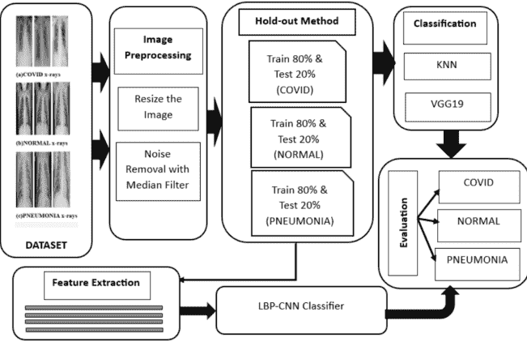

本节中的心智工作。共有 5228 张图像，其中 1626 例确认为 COVID-19 病例，1802 例归类为正常，1800 例归类为肺炎。

### 4.2. 预处理

参与该过程涉及开发一个分类器模型。样本从其余数据集中隔离并发送到预处理阶段进行进一步分析。在经过预处理阶段时，必须考虑各种因素。最好丢弃零碎或晦涩的数据样本。为了获得真实的结果，大量数据是必不可少的。在医学图像分析领域，由于数据标注昂贵且耗时，数据稀缺可能构成重大挑战。

- **调整图像大小：** 调整图像大小涉及改变其尺寸，无论是增加还是减少，同时保留所有原始内容。当我们调整图像大小时，其尺寸会发生变化，导致其大小和质量都发生改变。

- **中值滤波：** 中值滤波是一种从照片中消除噪声的非线性方法。由于它在最大限度减少噪声的同时能很好地保留边缘，因此经常被使用。它在消除“椒盐”噪声方面表现出色。中值滤波通过反复遍历图像中的每个像素，并用相邻像素的中值替换每个像素值来工作。“窗口”指的是在整个图像中逐像素推进的邻域模式。计算中值的过程首先是将窗口中所有像素值按数值顺序排序。接下来，将被考虑的像素替换为具有中间（中值）值的像素（Auckland, n.d.; Hasoon et al., 2021）。

### 4.3. 特征提取

一旦 X 射线图像已被分析，后续阶段涉及特征提取。该过程减少原始数据的维度，并将其转换为用于进一步处理的有意义信息。特征提取的目的是通过将图像转换为更重要的数据来简化图像的描述。局部二值模式（LBP）是一种流行的图像特征提取算子，广泛应用于各种现实世界的应用中。LBP 是一种简单而有效的纹理提取算子。由于其计算复杂度低，LBP 可用于复杂和实时图像处理应用。它是结构模型和统计模型的综合（Hasoon et al., 2021）。LBP 位图是使用自然纹理作为对象来计算的。对于每个 LBP 位图，将检索直方图。使用此直方图作为样本模式将数据分为两组。第一组将用作参考模式，而后续组将用作测试模式。通过对众多样本模式求平均，可以创建一个参考模式。一旦参考模式生成，它们将存储在模式数据库中。在模式分类中，模式分类器的作用是识别测试模式与数据库中存储的参考模式之间的最小差异。如果达到最小差异，则输入模式可以被识别为属于该组。

### 4.4. 分类

本材料对研究人员非常有用，并在研究领域开辟了令人兴奋的新机会。采用留出法将数据集分为训练数据和测试数据，分别为 80% 的训练集和 20% 的测试集。选择 KNN、VGG19 和 CNN 分类器进行分类。KNN 也被称为懒惰学习算法，因为它不会立即从训练集中学习；相反，它存储数据集并在分类期间对其执行操作。该算法考虑新实例或数据与可用实例之间的相似性，并将新实例放入与现有类相似的类中，它可用于回归和分类。为了确定训练实例和测试实例之间的差异，KNN 方法采用欧几里得距离标准。“K”是有助于预测测试模式类的最近邻居的数量（Hasoon et al., 2021）。VGG-19 具有 19 个连接层——16 个卷积层和 3 个全连接层，是一种深度学习神经网络。全连接层根据卷积层从输入照片中提取的属性对输入图像进行分类。卷积神经网络，简称 CNN，是一类用于图像处理和分析的深度学习算法。为了从图像中提取相关信息，它对图像执行多种数学运算，包括池化和卷积。

## 5. 结果

可使用一系列性能指标来评估所提出的 COVID-19 检测和分类方法。为了控制所提出结构的展示，构建了一个混淆矩阵。准确率、精确率、召回率和 F1 分数可用作性能指标来评估分类模型的性能。

图 3. 已实现分类器性能的比较

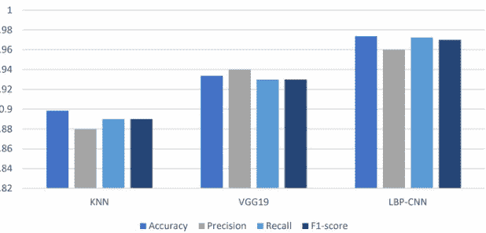

Accuracy = \(\frac{(TP + TN)}{(TP + FN + TN + FP)} \times 100\) (2)

Precision = \(\frac{TP}{TP + FP}\) (3)

Recall = \(\frac{TP}{TP + FN}\) (4)

F1-score = \(\frac{2 \times (Precision + Recall)}{Precision + Recall}\) (5)

上述公式中，TP 表示模型预测为阳性且实际也为阳性的正确识别的 X 射线图像。TN 模型表示阴性且被真正预测。FP 模型预测了阳性结果，但结果证明是错误的。FN 预测了阴性结果，但结果证明是不正确的。这些性能指标在图 3 中提出，并进行了比较。

## 6. 结论

机器学习和深度学习是正在广泛应用于包括医疗保健在内的多个领域的令人兴奋的技术。文献研究中存在若干空白，这些空白对不同图像预处理和机器-深度学习方法用于控制 COVID-19 爆发进行了全面评估。所提出的模型采用多种技术，包括图像预处理（如图像大小调整、中值滤波噪声去除）、特征提取（LBP）、机器-深度学习技术（KNN 和 VGG19）以及 LBP 与 CNN 的混合，以利用混淆矩阵获得更好的结果，并取得了最高分 97.37%（LBP-CNN）。

## 7. 未来展望

借助这项研究工作，我们将能够准确检测疾病，并在需要时分析治疗程序的有效性，以实现有效护理。

## 参考文献

- Auckland. (n.d.). https://www.cs.auckland.ac.nz/courss/compsci373s1c/PatriceLectures/Image%20Filtering.pdf

- Benmalek, E., Elmhamdi, J., & Jilbab, A. (2021). 比较 CT 扫描和胸部 X 射线成像用于 COVID-19 诊断. Biomedical Engineering Advances, 1, 100003. doi:10.1016/j.bea.2021.100003 PMID:34786568

- Daniel, C., Cenggoro, T. W., & Pardamean, B. (2023). 机器学习在 COVID-19 医学图像分类中的应用系统文献综述. Procedia Computer Science, 216, 749–756. doi:10.1016/j.procs.2022.12.192 PMID:36643182

- Hasoon, J. N., Fadel, A. H., Hameed, R. S., Mostafa, S. A., Khalaf, B. A., Mohammed, M. A., & Nedoma, J. (2021). 基于胸部 X 射线图像监督机器学习的 COVID-19 异常检测和分类方法. Results in Physics, 31, 105045. doi:10.1016/j.rinp.2021.105045 PMID:34840938

- Li, G., Togo, R., Ogawa, T., & Haseyama, M. (2023). 利用自监督学习和批量知识集成提升自动 COVID-19 检测性能. Computers in Biology and Medicine, 158, 106877. doi:10.1016/j.compbiomed.2023.106877 PMID:37019015

- Shah, F. M., Joy, S. K. S., Ahmed, F., Hossain, T., Humaira, M., Ami, A. S., Paul, S., Jim, M. A. R. K., & Ahmed, S. (2021). 使用医学图像进行 COVID-19 检测的全面调查. SN Computer Science, 2(6), 434. doi:10.100742979-021-00823-1 PMID:34485924

- Shahin, O. R., Alshammari, H. H., Taloba, A. I., & El-Aziz, R. M. A. (2022). 用于自主检测和分类 COVID-19 病毒的机器学习方法. Computers & Electrical Engineering: An International Journal, 101, 108055. doi:10.1016/j.compeleceng.2022.108055

- Xu, X., Jiang, X., Ma, C., Du, P., Li, X., Lv, S., Yu, L., Ni, Q., Chen, Y., Su, J., Lang, G., Li, Y., Zhao, H., Liu, J., Xu, K., Ruan, L., Sheng, J., Qiu, Y., Wu, W., ... Li, L. (2020). 一种用于筛查 2019 年新型冠状病毒病肺炎的深度学习系统. Engineering (Beijing), 6(10), 1122–1129. doi:10.1016/j.eng.2020.04.010 PMID:32837749


赵, W., 钟, Z., 谢, X., 于, Q., & 刘, J. (2020). 胸部CT发现与冠状病毒疾病（COVID-19）肺炎临床状况的关系：一项多中心研究. AJR. 美国放射学杂志, 214(5), 1072–1077. doi:10.2214/AJR.20.22976 PMID:32125873

# 第 7 章

# 机器学习模型可解释性在增强疾病预测中的谜团揭示

Rati Kailash Prasad Tripathi
印度阿萨姆大学（西拉char）

Shrikant Tiwari
https://orcid.org/0000-0001-6947-2362
印度大诺伊达加尔戈蒂亚大学

## 摘要

机器学习（ML）模型在疾病预测方面取得了重大进展，为早期检测和干预开辟了新途径。这些模型在分析海量复杂数据集以识别有助于早期诊断和治疗的模式和趋势方面展现出了卓越能力。然而，这些模型的不透明性常常让医疗保健从业者和患者对其预测背后的推理一无所知，引发了对基于AI的疾病预测的信任、公平性和实际采用的担忧。本综述深入探讨了疾病预测中机器学习模型可解释性这一关键主题，涵盖其重要性、实现技术、对临床决策的影响、挑战以及在医疗保健中的影响。还强调了与医疗保健中模型可解释性相关的紧迫问题和道德困境、增强预测模型可解释性的进一步研究领域以及应用。因此，本章为利用AI驱动模型改善医疗决策和患者预后提供了见解。

## 1. 引言

机器学习融入医疗保健领域代表了医学科学和患者护理持续演变中的重大飞跃。近年来，人工智能（AI），特别是机器学习（ML），已成为一种颠覆性力量，有可能彻底改变医疗保健格局（Davenport & Kalakota, 2019）。ML作为人工智能的一个子领域，赋予计算机系统从数据中学习和适应的能力，能够在无需显式编程的情况下进行预测和决策。在医疗保健背景下，这意味着具有前所未有的能力来分析海量复杂的医疗数据集，提取有意义的洞察，并做出明智的预测（Bohr & Memarzadeh, 2020）。

ML在医疗保健中表现出色的主要领域之一是疾病预测和诊断（Marr, 2018）。这些模型可以筛查电子健康记录、医学影像和遗传数据，以识别即使是经验最丰富的医疗保健专业人员也可能忽略的模式（Miller & Brown, 2018）。癌症、糖尿病、神经退行性和心血管疾病等疾病的早期检测有望显著改善患者预后，从而实现及时干预和更有效的治疗（Ekins, 2019）。此外，ML还促进了精准医疗的发展（Konieczny & Roerman, 2019）。通过分析患者的遗传构成和病史，这些模型可以推荐针对个人独特特征量身定制的治疗方案，增加成功结果的可能性并减少不良反应。除临床应用外，机器学习还协助医院运营，简化行政流程，优化资源分配，并改善患者管理。它在流行病学、追踪疾病传播和监测公共卫生趋势方面也发挥着重要作用（Johnson et al., 2021）。

然而，ML在医疗保健中的融合并非没有挑战。确保数据隐私、维护敏感医疗记录的安全、解决AI算法中的偏见和公平性问题以及满足监管合规要求都是需要关注的关键问题（Murdoch, 2021; Nicholson Price & Glenn Cohen, 2019）。由ML驱动的这一转型代表了医疗保健的范式转变，使从业者能够从被动的、一刀切的方法转向主动的、以患者为中心且数据驱动的护理模式（Murdoch, 2021; Nicholson Price & Glenn Cohen, 2019）。对机器学习融入医疗保健所依据的众多应用、挑战和伦理考量的更深入探讨，最终为医学和患者福祉中更光明、更数据驱动的未来铺平了道路（Murdoch, 2021）。

本章深入探讨了疾病预测中机器学习模型可解释性这一关键主题，探讨了围绕它的技术、挑战和影响。本文考察了模型可解释性在医疗保健和疾病预测中的关键作用，强调了在临床决策中依赖黑盒模型的后果。此外，为了揭开机器学习模型可解释性的谜团，本文探讨了一系列已开发的技术和方法，旨在使这些模型更加透明和可解释。本文讨论了局部可解释模型-无关解释（LIME）、Shapley值（SHAP）和特征重要性分析等方法，揭示了这些技术如何能为复杂模型的决策过程提供洞察。

此外，本文还面对了在医疗保健领域实现模型可解释性所面临的挑战和局限性。本文深入探讨了伦理考量，特别是与预测模型中的公平性、偏见和透明度相关的问题。此外，本文还考虑了可解释模型对临床决策的实际影响，从更准确的诊断到量身定制的治疗建议，最终改善患者护理。本文探讨了信任在医疗保健中的重要性，以及模型可解释性在患者与医疗保健提供者之间建立信任中的作用。此外，还讨论了增强疾病预测中机器学习模型可解释性的进一步研究和开发领域。

本章还考虑了在准确性与可解释性之间取得平衡的混合模型的潜力，以及旨在确保在医疗保健中负责任且透明地使用AI的不断发展的监管环境。本章还展示了可解释模型与传统黑盒模型在疾病预测中的性能比较及其在各种医疗保健领域的应用。

本次讨论作为理解机器学习在医疗保健中变革性影响的入门，让人们一窥这项技术的多方面及其广泛影响。

## 2. 可解释性的重要性

### 2.1. 医疗保健和疾病预测中可解释性的重要性

机器学习模型中的可解释性是指解释模型如何得出其预测或决策的能力。它在机器学习的医疗保健应用中变得越来越重要，因为预测的准确性和可靠性对患者预后至关重要（Hall & Gill, 2018; Brakto, 1997）。在疾病预测中，早期干预往往至关重要。可解释模型可以识别导致预测的关键因素，使医疗保健提供者能够了解患者的风险因素，并采取主动措施来预防或管理疾病（Stiglic et al., 2020）。可解释性有助于建立对模型预测的信任，提供对底层数据和导致预测的因素的更清晰理解。这可以通过识别诊断、治疗和疾病进展中最相关的特征或生物标志物来改善临床决策（Stiglic et al., 2020; Linardatos et al., 2020）。此外，可解释性有助于识别模型中的潜在偏见或错误，从而进行纠正或改进。在医疗保健应用中，这对于确保模型不会延续现有偏见或导致医疗保健差异尤为重要。医疗保健组织可以利用可解释性获得的洞察来随时间改进其模型，确保其能够适应不断变化的患者人群和医疗实践。此外，可解释性对于监管合规和伦理考量至关重要（Murdoch, 2021）。监管机构要求医疗保健中使用的ML模型必须透明且可解释，以确保患者安全和隐私。从伦理角度看，确保模型的预测公平且无偏见，不延续歧视至关重要。最后，可解释性可以促进ML模型从研究向临床实践的转化。如果临床医生能够理解和解释模型的预测，他们可能更有可能在实践中使用该模型，从而改善患者预后并促进ML在医疗保健中的广泛采用。最后但同样重要的是，可解释性作为医疗保健专业人员和患者的教育工具。它使他们能够理解诊断和治疗建议背后的依据，从而促进更知情的讨论和共同决策（Stiglic et al., 2020; Hall & Gill, 2018; Brakto, 1997）。

医疗保健和疾病预测中的可解释性不仅仅是一个可取的功能，而是一种伦理、实践和监管的必要性。机器学习模型中的可解释性对于建立信任、识别偏见、遵守法规、确保伦理考量以及将研究转化为临床实践至关重要（Hall & Gill, 2018; Brakto, 1997）。图 1 说明了可解释性在医疗保健和疾病预测中的重要性（Stiglic et al., 2020; Hall & Gill, 2018; Brakto, 1997）。

值得注意的是，相比之下，在医疗决策中依赖不透明模型可能会产生重大且往往有害的结果。


图 1. 医疗保健和疾病预测中可解释性的重要性


### 2.2. 不透明模型及其在医疗决策中的后果

机器学习中的不透明模型，也称为黑箱模型，是复杂且难以解释或理解的机器学习算法。这些模型基于输入数据的复杂非线性组合进行预测或决策，但其预测背后的推理过程对人类来说并不明显。与可解释模型不同，可解释模型为其决策提供清晰易懂的解释，而不透明模型往往缺乏透明度，难以拆解或解释（Adadi & Berrada, 2018）。机器学习中不透明模型的常见示例包括深度神经网络（DNNs）、随机森林、支持向量机（SVM）、梯度提升模型（GBM）和深度强化学习（图 2）（Luo et al., 2019; Park et al., 2021; Ahsan et al., 2022; Maeo et al., 2021; Zhou et al., 2021）。

#### 2.2.1. 深度神经网络（DNNs）

深度学习模型，特别是深度神经网络，以其复杂性著称。它们由多层互连神经元组成，输入与输出之间的关系高度非线性。理解 DNN 如何得出特定预测可能具有挑战性，尤其是在具有大量参数的深层架构中（Park et al., 2021; Ahsan et al., 2022）。

#### 2.2.2. 随机森林

随机森林是一种集成学习技术，结合多个决策树的预测。虽然它在进行预测时可以很准确，但由于多个树的综合影响，理解其为何做出特定预测可能具有挑战性（Ahsan et al., 2022）。

图 2. 机器学习中的不透明（黑箱）模型


#### 2.2.3. 支持向量机（SVM）

支持向量机对二分类任务有效，但高维特征空间中的决策边界可能很复杂。解释 SVM 如何得出特定分类可能具有挑战性（Ahsan et al., 2022）。

#### 2.2.4. 梯度提升模型（GBM）

像梯度提升机（GBM）和 XGBoost 这样的算法很强大，但它们使用的决策树集成使得解释整体模型的决策过程变得具有挑战性（Maeo et al., 2021）。

#### 2.2.5. 深度强化学习

在深度强化学习中，智能体通过在复杂环境中试错来学习决策，很难解释智能体的行为（Zhou et al., 2021）。

这些模型的不透明性源于其固有的复杂性以及涉及的大量参数。虽然它们能够在各种任务中实现高准确性，但在医疗保健等关键领域的使用可能存在问题，因为用户在决策过程中需要透明度和可解释性。因此，开发使这些不透明模型更具可解释性和可解释性的技术越来越受到关注，尤其是在其决策后果具有重大现实影响的领域（Adadi & Berrada, 2018）。

总之，在医疗决策中依赖不透明模型可能会产生深远的负面后果，包括信任度下降、临床决策无效、潜在的错误和偏见、伦理问题、监管挑战，以及错失早期干预的机会，从而对患者护理和预后产生不利影响（Adadi & Berrada, 2018）（图 3）。因此，在医疗保健中使用的 AI 模型越来越推动透明度和可解释性，以解决这些问题并确保负责任、公平和有效的医疗决策。

图 3. 不透明模型的负面后果


## 3. 可解释性技术

### 3.1. 使机器学习模型可解释的方法

有各种方法可为提高模型可解释性提供有价值的工具，每种方法都有其独特的优势。使机器学习模型可解释的三种流行技术包括局部可解释模型-不可知解释（LIME）、Shapley 加法解释（SHAP）和特征重要性分析（图 4）。这些技术帮助我们深入了解复杂的机器学习模型，使其能够做出明智的决策并在 AI 驱动的系统中建立信任（Du et al., 2019; Wu et al., 2023; ElShawi et al., 2021; Pudjihartono et al., 2022; Altmann et al., 2010; Jie et al., 2018）。

#### 3.1.1. 局部可解释模型-不可知解释（LIME）

LIME 是一种模型不可知的方法，旨在解释单个模型预测。它通过在感兴趣预测周围的数据点局部邻域上训练一个简单的可解释模型（如线性回归）来运行。可解释模型在特定数据点附近近似复杂黑箱模型的行为。LIME 以特征权重和贡献的形式提供定量解释。这些值指示每个特征对特定实例的预测产生了多大影响，帮助用户了解输入数据的哪些方面在决策中最为关键。因此，LIME 通过提供对单个预测的洞察，弥合了复杂黑箱模型与人类理解之间的差距。通过提供定量和特征级解释，LIME 使个人能够在可解释性至关重要的场景中信任并使用 AI 驱动的系统（Wu et al., 2023; ElShawi et al., 2021）。

图 4. 机器学习中的可解释性方法


关键特征（图 5）包括（a）局部可解释性，即 LIME 专注于解释单个实例的预测，提供局部可解释性；（b）模型不可知性，即 LIME 可以应用于任何机器学习模型，使其具有高度通用性；（c）用户定义的邻近性，即它允许用户在构建可解释模型时定义要考虑的数据点邻近性或邻域。

LIME 已用于自然语言处理、图像分类和医疗保健，在这些领域，理解模型产生特定预测背后的推理非常重要（Wu et al., 2023; ElShawi et al., 2021）。

图 5. LIME 方法的关键方面


#### 3.1.2. Shapley 加法解释（SHAP）

Shapley 加法解释（SHAP）是一种用于解释和说明机器学习模型预测的强大框架。它基于合作博弈论，并为将单个输入特征对模型预测的贡献归属提供了统一框架。SHAP 值通过为每个特征分配数值来定量衡量每个特征对模型预测的贡献，指示该特征在特定实例上对模型预测的影响程度。这些值可以是正或负，显示特征的存在是增加了还是降低了预测。它们对于理解复杂模型中的特征重要性尤其有价值。SHAP 值通常使用汇总图（如条形图或瀑布图）进行可视化，使用户更容易掌握单个特征的贡献。这些可视化可以增强对模型行为的理解（Wu et al., 2023; ElShawi et al., 2021）。

SHAP 的关键方面（图 6）包括（a）全局和局部可解释性，即 SHAP 值可用于解释单个预测（局部）和整体特征重要性（全局）。（b）一致性，即 SHAP 值遵循一致特征归属公理，确保贡献加总等于预测。（c）模型不可知性，即 SHAP 是模型不可知的，适用于各种机器学习算法。（d）TreeExplainer 和 KernelExplainer，即 SHAP 提供不同的解释器算法，例如用于基于树的模型（如决策树、随机森林）的 TreeExplainer 和用于更复杂模型的 KernelExplainer。这种通用性使 SHAP 可以应用于广泛的机器学习算法（Wu et al., 2023; ElShawi et al., 2021）。

SHAP 值应用于风险评估模型、医疗保健（解释疾病预测和治疗建议）以及自然语言处理（Wu et al., 2023; ElShawi et al., 2021）。

#### 3.1.3. 特征重要性分析

特征重要性分析旨在确定输入特征在模型预测中的贡献。这种分析对于深入了解不同特征在理解输入与输出之间关系中的相对重要性特别有用。这种方法在使用基于树的模型（如随机森林、XGBoost）时特别有用，但也可以应用于各种模型类型。该技术为每个特征分配数值，指示其在预测中的重要性水平。这些值提供特征相关性的定量评估，使用户了解哪些特征对模型输出影响最大。特征重要性分析的结果通常使用条形图、热图或其他图形表示进行可视化，以使用户更容易理解特征的相对重要性。可视化可以增强分析的可解释性（Wu et al., 2023; Pudjihartono et al., 2022）。

特征重要性分析的关键特征（图 7）包括（a）全局可解释性，即特征重要性分析提供模型预测中最具影响力的特征的全局概览，但不专注于解释单个预测。（b）特定于模型，即特征重要性分析通常特定于模型，而不是模型不可知。例如，随机森林和 XGBoost 等基于树的模型具有计算特征重要性的内置机制，而线性模型可能使用系数。（c）固有于基于树的模型，即特征重要性分析特别适合基于树的模型。在这些模型中，特征重要性是通过评估每个特征在树分割时对不纯度或误差减少的贡献程度来确定的。导致更大幅度减少的特征被认为更重要。


#### 图 6. SHAP 方法的关键方面


- (d) 变量选择与降维，即该方法可用于变量选择和降维。通过识别最重要的特征，可以专注于最具信息量的变量子集，从而构建更高效、更具可解释性的模型（Wu et al., 2023; Pudjihartono et al., 2022）。

特征重要性分析广泛应用于各个领域，主要用于医疗领域的疾病风险评估、营销领域的客户细分以及自然语言处理领域的情感分析。在这些领域中，了解最具影响力的因素或特征可以指导决策过程、优化模型并提高数据驱动流程的透明度（Wu et al., 2023; Pudjihartono et al., 2022; Altmann et al., 2010; Jie et al., 2018）。

## 3.2. 可解释性方法的局限性

虽然 LIME、SHAP 和特征重要性分析等技术对提升模型可解释性很有价值，但它们也伴随着应予考虑的权衡和局限性（Murdoch et al., 2018; Du et al., 2019; Molnar et al., 2022）（图 8）。

### 3.2.1. LIME

首先，LIME 提供局部可解释性，用于解释单个预测，但可能并不总能捕捉模型的全局行为。使用其他方法来评估整体模型

### 图 7. 特征重要性分析方法的关键方面


行为。其次，LIME 的解释高度依赖于局部邻域和扰动数据点的选择。这种邻近性的选择会影响解释的质量和可靠性。第三，生成 LIME 解释在计算上可能很昂贵，尤其是对于复杂模型和高维数据，因为它需要为每个预测训练一个可解释模型。第四，可解释模型的选择（例如线性回归）会影响解释的质量。某些复杂模型可能无法被简单的可解释模型充分近似（Murdoch et al., 2018; Du et al., 2019; Molnar et al., 2022）。

### 图 8. LIME、SHAP 和特征重要性分析的局限性


### 3.2.2. SHAP

首先，为复杂模型计算 SHAP 值在计算上可能很密集，尤其是在处理大型数据集和高维特征空间时。这会减慢解释过程。其次，虽然 SHAP 通常与模型无关，但某些模型可能需要专门的 SHAP 值实现或近似，这可能会引入不准确性。第三，理解 SHAP 值的理论基础可能具有挑战性，尤其是对于非专家而言。这可能会限制其实际应用和解释（Murdoch et al., 2018; Du et al., 2019; Molnar et al., 2022）。

### 3.2.3. 特征重要性分析

首先，特征重要性分析提供全局可解释性，这意味着它能提供所有预测中特征重要性的洞察。它不解释特定个别预测背后的推理。其次，该技术通常是模型特定的。虽然它非常适合基于树的模型，但该方法可能不直接适用于其他模型类型，需要不同的技术来进行模型特定的特征重要性分析。第三，特征重要性不一定意味着因果关系。一个高度重要的特征可能与目标变量没有因果关系，从而导致可能具有误导性的解释。第四，特征重要性的结果可能受特征工程过程的影响。特征表示的选择可能会影响特定变量的感知重要性（Murdoch et al., 2018; Du et al., 2019; Molnar et al., 2022）。

综上所述，虽然上述技术是提升模型可解释性的宝贵工具，但根据特定机器学习项目的具体背景和要求选择最合适的技术至关重要，需要考虑计算资源、所需的可解释性水平以及被解释模型的性质等因素。此外，使用这些技术的组合来更全面地理解模型行为也是合适的（Murdoch et al., 2018; Du et al., 2019; Molnar et al., 2022）。

## 4. 挑战与伦理考量

在医疗保健领域，模型可解释性的益处（例如改善患者护理、早期疾病检测和更好的决策）是巨大的。在医疗环境中实现模型可解释性对于确保机器学习模型安全、负责任地部署至关重要。然而，这一努力伴随着多种挑战和局限性。解决这些挑战和局限性至关重要，以确保 AI 和机器学习对医疗保健结果产生积极影响，同时遵循最高的伦理、安全和透明度标准。表 1 列出了各种问题、相关挑战以及可采取的应对措施（Rudin et al., 2022; Moraffah et al., 2020; Watson, 2022; Kelly et al., 2019; Borrellas & Unceta, 2021）。

此外，公平性、偏见和透明度等伦理问题是预测模型的关键方面，尤其是在医疗保健等敏感领域应用时。解决这些问题对于建立对预测模型的信任、避免歧视以及确保决策过程中的公平结果至关重要。表 2 说明了各个方面、相关挑战

### 表 1. 实现模型可解释性所面临的挑战及各种避免措施

| 问题 | 挑战 | 缓解措施 |
|---|---|---|
| 医疗数据的复杂性 | 医疗数据通常复杂、高维且异质，使得理解特征与预测之间的关系具有挑战性。 | 特征选择、降维和数据预处理技术可以帮助简化数据，同时保留重要信息。 |
| 黑盒模型 | 有些最准确的模型（如深度学习）本质上是黑盒，难以解释其决策过程。 | 可以使用 LIME、SHAP 和代理模型等技术，为医疗保健中的复杂模型提供局部和全局可解释性。 |
| 数据隐私与安全 | 在医疗保健中，保护患者数据至关重要，为可解释性目的共享数据可能引发隐私问题。 | 隐私保护技术（如联邦学习和安全多方计算）可以在保护患者机密性的同时实现数据共享。 |
| 数据不平衡 | 医疗数据集通常表现出类别不平衡，即某些疾病或病症较为罕见。不平衡数据可能导致有偏模型，并对解释构成挑战。 | 通过过采样、欠采样或代价敏感学习等技术仔细处理类别不平衡，有助于解决此问题。 |
| 临床验证与采用 | 临床医生和医疗保健提供者可能对 AI 模型持怀疑态度，且由于缺乏信任和临床验证，其采用速度可能较慢。 | 与医疗专业人员密切合作、开展严谨的临床研究并透明地共享结果，有助于建立信任并验证模型可解释性。 |
| 伦理与偏见问题 | 模型可能会无意中延续医疗数据中存在的偏见，导致不公平或歧视性的结果。 | 通过公平意识机器学习和持续监控模型行为来解决偏见，有助于缓解伦理问题。 |
| 法规合规 | 医疗保健受到严格法规（如 HIPAA）的约束，满足模型可解释性的法规要求可能很复杂。 | 仔细遵守法规标准（包括数据使用和模型决策的透明度）至关重要。 |
| 患者理解 | 确保患者理解模型提供的解释对于知情决策至关重要。 | 开发用户友好且面向患者的解释和工具，帮助个人理解并信任 AI 驱动的医疗决策。 |
| 与临床工作流的互操作性 | 将 AI 模型集成到现有临床工作流和电子健康记录（EHR）系统中可能很复杂，模型解释应与临床流程保持一致。 | 开发能够与 EHR 系统无缝集成并为临床医生提供可解释模型输出的用户界面和工具。 |
| 学科间协作 | 数据科学家、临床医生和领域专家之间的有效沟通与协作至关重要，但由于术语和优先级的差异可能具有挑战性。 | 鼓励多学科团队，并通过定期会议和共同理解促进沟通，可以弥补这一差距。 |

与它们以及消除它们的措施（Rudin et al., 2022; Moraffah et al., 2020; Watson, 2022; Kelly et al., 2019; Borrellas & Unceta, 2021; Gerke et al., 2020）。


### 表 2. 与伦理问题相关的挑战及预防措施

| 伦理问题 | 挑战 | 缓解措施 |
| :--- | :--- | :--- |
| 公平性 | 确保预测模型在不同人口群体之间提供公平的结果是一项重大挑战。有偏或不公平的预测可能导致差距和歧视。 | 定义公平性标准：根据具体情境，明确定义公平性标准，如人口统计平等、机会平等或预测平等。数据预处理：识别并缓解训练数据中的偏差，例如通过重采样、重加权或生成合成数据。算法公平性：实施旨在减少模型预测中偏差和歧视的公平感知机器学习技术。监控与审计：持续监控模型的公平性并进行审计，以识别和纠正歧视性行为。 |
| 偏差 | 预测模型可能从历史数据中继承偏差，这可能导致当前出现有偏结果。例如，如果过去的医疗数据偏向某个特定人群，模型可能会做出不公平的医疗建议。 | 数据收集与整理：收集多样且具有代表性的数据，并仔细整理训练数据集以尽量减少历史偏差。公平特征工程：选择与问题相关且不引入偏差的特征。避免可能作为敏感属性代理的特征（例如，表示收入的邮政编码）。偏差审计：定期审计数据集和模型的偏差，并在数据层面和模型层面解决偏差。定期重新训练：定期更新模型以适应不断变化的人口和社会规范。 |
| 透明度 | 许多预测模型，尤其是深度学习等复杂模型，常被视为“黑箱”。理解模型预测背后的依据可能很困难。 | 可解释人工智能（XAI）：使用可解释人工智能技术，如 LIME 和 SHAP，为模型预测提供人类可解释的解释。模型文档：维护模型的全面文档，包括其架构、训练数据和性能指标。透明度标准：遵守行业特定的透明度标准和指南，如《通用数据保护条例》（GDPR）或《平等信贷机会法》（ECOA）。 |
| 算法审计 | 模型和算法会发生变化，其性能可能随时间下降。审计模型的伦理问题并确保持续的公平性和透明度具有挑战性。 | 实施定期审计：建立定期模型审计框架，以确保持续遵守伦理标准。伦理审查委员会：建立负责在敏感领域对 AI 和预测模型进行伦理监督的委员会或委员会。持续学习：鼓励持续学习和改进的文化，让审计和伦理问题的经验教训为未来的模型开发和部署提供参考。 |
| 人工监督 | 过度依赖自动化决策会削弱人类专家的作用，而人类专家在需要细致判断的情况下可能至关重要。 | 人机环路系统：设计包含人工监督的模型，允许专家在必要时进行干预。透明度界面：开发便于与模型交互并向人类用户提供可解释解释的用户界面。 |
| 法律和法规合规 | 遵守不断变化的法律和法规要求，如 GDPR、HIPAA 或《公平信用报告法》（FCRA），是一项复杂且不断变化的任务。 | 法律专业知识：雇佣法律专家以确保持续遵守相关法律和法规。强大的数据治理：实施强大的数据治理和数据管理实践，以保护敏感数据并保持合规。 |

## 5. 临床采用与决策

可解释机器学习模型可以通过增强诊断、实现个性化治疗选择、改善患者护理、推进医学研究以及确保法规合规和问责制，对临床决策产生积极影响。其透明度和可靠性使其成为医疗保健领域的宝贵工具，在医疗专业人员和患者之间建立信任，同时推动更好的结果和成本效率（Belenguer, 2022; Weissler et al., 2021; Javaid et al., 2022）。下文讨论了各种益处（Belenguer, 2022; Weissler et al., 2021; Javaid et al., 2022）：

### 5.1. 改善诊断

- 早期检测：可解释模型可以识别医疗数据中的微妙模式和风险因素，从而实现疾病的早期检测。这对于癌症等疾病尤为关键，早期诊断能显著改善患者预后。

- 透明决策：临床医生可以理解模型为何做出特定诊断。这种透明度增强了他们对模型建议的信心，并允许他们验证诊断。

- 减少误诊：可解释性有助于减少误诊并确保做出正确诊断。这对于症状重叠的复杂疾病尤其重要。

- 协助罕见病诊断：可解释模型可以通过突出人类专家可能忽略的罕见症状或遗传标记，协助诊断罕见疾病。

### 5.2. 治疗选择

- 个性化治疗方案：可解释模型可以根据患者特定的临床和基因特征，提供关于最有效治疗方案的见解。这使个性化医疗成为可能。

- 识别不良反应：模型可以预测治疗的潜在不良反应或相互作用，帮助医疗保健提供者做出明智决策并降低并发症风险。

- 优化药物剂量：模型可以协助优化药物剂量，以确保患者获得最有效的治疗，同时尽量减少副作用。

- 临床指南合规：可解释模型可以帮助医疗保健提供者遵守临床指南和最佳实践，确保为患者提供循证医疗。

### 5.3. 患者护理

- 加强护理协调：可解释性有助于多学科团队之间的护理协调。当医疗专业人员能够理解并信任 AI 驱动的建议时，他们可以更有效地协作。

- 患者参与：透明的 AI 模型使患者能够积极参与其医疗决策。他们可以更好地理解和讨论治疗方案，从而实现共同决策。

- 减少错误：通过为其建议提供清晰的解释，可解释模型有助于减少医疗错误，例如错误处方、对检测结果的误读或不当的手术决策。

- 高效资源分配：可解释模型可以帮助医院和医疗系统更高效地分配资源，例如预测患者入院率并优化床位分配。

### 5.4. 研究与知识发现

- 假设生成：可解释模型可以协助研究人员生成假设并识别医疗数据中先前未被认识的关系。这可能带来医学科学的新发现和进步。

- 研究结果验证：AI 模型可以验证或支持研究结果，为某些治疗或诊断方法的有效性提供额外证据。

### 5.5. 法规合规与问责制

- 法规合规：可解释模型更能够满足法规要求，例如解释为何推荐特定治疗或诊断，符合 HIPAA 或 GDPR 等法律。

- 问责制：在发生不良结果或医疗事故索赔的情况下，可解释模型提供决策过程的透明记录，有助于问责和法律辩护。

## 6. 可解释性与患者信任

模型可解释性是连接医疗保健提供者和患者的桥梁，增强了沟通、透明度和参与度。它使患者能够做出明智决策，解决公平性和偏差问题，促进共同决策，并确保伦理数据处理。最终，模型可解释性在医疗保健中的作用对于建立和维护患者与医疗保健提供者之间的信任至关重要，从而带来更好的患者预后和体验。模型可解释性在多种方面极大地帮助了患者与医疗从业者之间的信任，如下文所述（Diprose et al., 2020; Hakkoum et al., 2022; Carvalho et al., 2019; Siala & Wang, 2022; Pfob et al., 2022）：

### 6.1. 模型可解释性在患者与医疗保健提供者之间建立信任中的作用

### 6.1.1. 决策透明度

- 可解释预测：可解释模型为其预测和建议提供清晰易懂的解释。当医疗保健提供者能够轻松理解为何建议特定诊断或治疗方案时，他们可以有效地将此信息传达给患者。

- 知情同意：当患者了解决策背后的依据时，他们更有可能信任医疗决策。可解释模型有助于为获得治疗和手术的知情同意提供所需的透明度。


### 6.1.2. 共享决策

- 患者参与：可解释性使患者能够积极参与其医疗决策。当患者了解推荐治疗方案背后的原因时，他们更有可能与医疗服务提供者进行共享决策。

- 尊重患者偏好：患者有独特的偏好、价值观和优先事项。可解释模型帮助医疗服务提供者定制治疗方案，以符合这些偏好，促进以患者为中心的方法。

### 6.1.3. 减少信息不对称

- 信息平衡：可解释性解决了医疗服务提供者与患者之间可能存在的信息不对称。当患者能够获得可理解的解释时，他们更有能力与提供者进行有意义的对话。

- 赋能患者：了解导致其诊断和治疗方案的因素的患者能够提出问题、寻求澄清并积极参与护理。这种赋能培养了提供者与患者关系中的信任。

### 6.1.4. 培养问责制和信心

- 临床信心：当医疗服务提供者能够解释和证明其建议时，他们对使用 AI 辅助工具更有信心。这种信心会传递给患者，患者反过来对建议更有信任。

- 问责制：可解释模型有助于建立问责制。在出现意外结果或不良事件时，医疗服务提供者和患者都可以审查决策过程，了解特定建议是如何做出的，从而增强透明度和信任。

### 6.1.5. 缓解偏见和公平性问题

- 公平护理：可解释模型可以帮助识别和缓解决策中的偏见，确保护理公平提供。患者更有可能信任设计为公平且无偏见的系统。

- 数据的伦理使用：患者担心其健康数据的伦理使用。可解释性措施可以向患者保证，其数据正在被负责任地处理并考虑伦理因素，增强他们对医疗系统的信任。

### 6.1.6. 数据隐私和安全

- 患者信心：患者担心数据隐私和安全。可解释模型可以向患者保证，其数据正在被负责任且安全地使用，培养对医疗系统保护其敏感信息能力的信任。

### 6.2. 患者对 AI 驱动疾病预测的理解和接受度

患者对 AI 驱动疾病预测的理解和接受度取决于有效沟通、透明度、信任和以患者为中心的方法。医疗服务提供者在促进这些方面发挥着关键作用，以确保 AI 驱动的预测被视为增强患者护理和改善医疗结果的宝贵工具（Diprose et al., 2020; Hakkoun et al., 2022; Carvalho et al., 2019; Siala & Wang, 2022; Pfob et al., 2022）。

#### 6.2.1. 与患者理解相关的关键因素

#### 6.2.1.1. 解释和透明度

患者必须获得关于 AI 驱动预测如何生成的清晰透明的解释。这些解释应使用通俗语言，避免技术术语。

#### 6.2.1.2. 视觉辅助工具

图表和图形等视觉辅助工具可以帮助患者理解数据和预测。视觉表现使复杂信息更易于获取。

#### 6.2.1.3. 教育材料

向患者提供关于 AI 及其在医疗保健中作用的教育材料可以增强理解。这些材料应针对不同识字水平进行设计。

#### 6.2.1.4. 让患者参与决策

医疗服务提供者可以让患者参与共享决策。通过让患者参与该过程，提供者可以解决他们的顾虑，并确保他们理解 AI 预测的含义。

#### 6.2.1.5. 问答环节

提供问答环节，让患者可以询问 AI 预测及其对护理的潜在影响，有助于澄清疑虑并促进理解。

#### 6.2.2. 与患者接受度相关的关键因素

#### 6.2.2.1. 证明的价值

当患者看到证明的价值时，他们更有可能接受 AI 驱动的预测。这可能包括更好的诊断准确性、个性化治疗建议或改善的结果。

#### 6.2.2.2. 透明度和信任

AI 预测生成过程的透明度，以及对技术和医疗服务提供者的信任，对患者接受至关重要。患者必须对系统的可靠性有信心。

#### 6.2.2.3. 以患者为中心的护理

AI 驱动的预测应补充以患者为中心的护理。当患者认为预测是根据其独特需求和偏好量身定制时，他们更有可能接受。

#### 6.2.2.4. 参与决策

感到积极参与基于 AI 预测的决策的患者更有可能接受。AI 应该是支持而非取代患者-提供者关系的工具。

#### 6.2.2.5. 伦理考量

患者担心其数据的伦理使用。当他们确信数据隐私和安全被优先考虑时，他们更有可能接受 AI 驱动的预测。

#### 6.2.2.6. 清晰沟通

医疗服务提供者在患者接受中发挥着关键作用。他们应与患者清晰、富有同理心地合作沟通。患者需要感到被倾听和理解。

#### 6.2.2.7. 教育举措

促进患者 AI 素养和健康素养的教育举措可以提高接受度。当患者了解 AI 的能力和局限性时，他们更有可能接受其在护理中的作用。

#### 6.2.2.8. 反馈循环

让患者对 AI 预测提供意见和反馈的反馈循环可以帮助提高接受度。这一过程允许患者积极参与 AI 模型的改进。

#### 6.2.2.9. 文化胜任力

文化胜任力至关重要。医疗服务提供者应了解并尊重患者的文化信仰和价值观，因为这些因素可能影响接受度。

#### 6.2.2.10. 证明的安全性

患者需要对 AI 驱动预测的安全性有保证。强调 AI 改善安全性、减少错误和提升结果的实例可以增强接受度。

## 7. 未来方向和研究空白

疾病预测机器学习可解释性领域正在发展，几个未来方向和研究空白值得探索（Kline et al., 2022; Hutchinson et al., 2022; L'heureux et al., 2017; Dahlin, 2021; Manley et al., 2022）。

- 标准化和基准测试
开发特定于医疗应用的标准化评估指标和基准数据集，可以有效比较不同模型的性能和可解释性。

- 深度学习中的可解释性
将可解释性技术扩展到深度学习模型是一个持续的挑战。研究应集中于使复杂神经网络更加透明和易于理解。

- 解释的个性化
探索根据个体患者偏好和健康素养水平个性化模型解释的方法，对于改善患者体验至关重要。

- 模型-数据不匹配
调查各种方法来处理由于数据分布差异导致模型解释与医疗服务提供者和患者期望不一致的情况至关重要。

- 伦理和法律方面
研究应继续探索模型可解释性的伦理和法律影响，特别是在数据隐私、知情同意和监管合规的背景下。

- 多模态数据集成
增强整合多种数据类型（例如医学影像、基因组数据、临床笔记）的模型的可解释性对于全面疾病预测至关重要。

- 偏见缓解和公平性：
进一步研究应解决在可解释模型中检测和缓解偏见的方法，同时保持医疗预测的公平性。

- 模型无关性
调查在广泛机器学习算法和架构中实现模型无关可解释性的方法，对于实际医疗应用是必要的。

- 可解释强化学习
探索使强化学习模型更具可解释性的方法，因为这些模型在优化治疗计划和干预措施方面很重要。


- (j) 以患者为中心的界面

  设计以患者为中心的界面，以直观且用户友好的方式呈现可解释的模型输出，确保患者能够轻松理解并参与其中。

- (k) 学科间协作

  促进机器学习研究人员、医疗保健提供者、伦理学家和政策制定者之间的学科间协作，以解决医疗保健中模型可解释性的复杂挑战。

因此，解决上述研究缺口并探索这些未来方向将有助于推动疾病预测中可解释机器学习模型的发展，促进医疗保健中的信任和透明度，并改善患者预后。在这方面，混合模型的发展大有前途。

## 8. 混合模型在提升可解释性方面的潜力

需要开展研究，开发将可解释模型（例如，决策树、线性模型）的优势与复杂、高性能模型（例如，深度学习）相结合的混合模型。在准确性和可解释性之间找到合适的平衡至关重要。图9展示了混合模型在提升可解释性方面的潜力（Alcala-Fdez, 2006; Linardatos et al., 2021; Hotvedt et al., 2021; Wang, 2019; Yoon et al., 2022）。

复杂模型（如深度学习或集成方法）以其高预测准确性而闻名。混合模型可以利用这些模型的准确性，提供最先进的疾病预测。采用以人为本方法设计的混合模型有助于优先考虑医疗保健提供者和患者的需求。它们考虑到以符合人类认知和决策过程的方式提供洞察的重要性。可解释模型（如决策树或线性模型）本质上是透明的，并提供清晰的决策路径。这种透明度对于医疗专业人员和患者信任和理解模型的建议至关重要。混合模型允许不同程度的可解释性。医疗保健提供者可以根据上下文和患者的理解程度，选择解释中所需的详细程度和复杂性。混合模型可以无缝集成到临床决策支持系统中，为医疗专业人员提供实时指导。它们提供决策辅助工具，在解释每项建议背后的依据的同时，增强临床工作流程。混合模型中的可解释组件可以帮助检测和减轻模型预测中的偏见和歧视，与公平意识机器学习技术相一致。医疗保健提供者可以定制或微调可解释组件，以更好地与其临床实践和偏好保持一致，而模型中更复杂的部分则保持其高准确性（Alcala-Fdez, 2006; Linardatos et al., 2021; Hotvedt et al., 2021; Wang, 2019; Yoon et al., 2022）。

图9. 混合模型在提升可解释性方面的潜力


## 9. 可解释机器学习模型在疾病预测中的应用

可解释机器学习模型已在各种疾病预测任务中找到成功应用，例如癌症诊断、心血管风险评估、罕见疾病预测等。

### 9.1. 癌症诊断

PathAI：PathAI是一家利用可解释机器学习模型协助病理学家从组织病理学切片中诊断癌症的公司（https://www.pathai.com/）。他们的模型提供切片中最具癌症指示性区域的清晰可视化，帮助病理学家做出更准确、更明智的决策（Bera et al., 2019; Alpsoy et al., 2021）。

乳腺癌风险评估：可解释模型已应用于乳腺癌风险评估。例如，Gail模型使用一组风险因素，并提供患乳腺癌风险的直接估计，有助于个性化筛查和预防策略（Bener et al., 2019; Rockhill et al., 2001）。

### 9.2. 心血管风险评估

Framingham心脏研究：Framingham心脏研究是一项长期的心血管研究，已纳入可解释模型来预测心血管疾病的风险。他们的模型基于一组风险因素（如年龄、性别、血压、胆固醇水平和吸烟状况）提供风险评分（Bitton & Gaziano, 2010; Zhuang et al., 2022）。

*SCORE（系统性冠状动脉风险评估）*：SCORE是欧洲广泛使用的心血管风险评估系统。它采用可解释模型来估计10年内致命心血管事件的风险，使医疗保健提供者能够推荐适当的干预措施（SCORE2工作组和ESC心血管风险协作组, 2021; De Backer, 2022）。

### 9.3. 罕见疾病检测

*Phenomizer*：Phenomizer是一款协助诊断罕见遗传疾病的工具。它采用可解释机器学习技术，将患者的症状与已知遗传疾病数据库进行比较。它提供可能的诊断列表，并解释每个建议背后的推理（Fujiwara et al., 2018; Jia et al., 2018）。

*下一代测序（NGS）*：可解释机器学习模型用于NGS数据分析，以识别与疾病相关的罕见遗传变异。这些模型帮助遗传学家了解哪些基因突变可能是致病性的（Alharbi & Rashid, 2022; Dias & Torkamani, 2019; La Vega et al., 2021）。

### 9.4. 糖尿病风险预测

*糖尿病风险评分*：各种糖尿病风险评分，如FINDRISC（芬兰糖尿病风险评分）和ADA风险测试，使用可解释模型来估计个体患2型糖尿病的风险。这些模型考虑年龄、家族病史、体力活动和BMI等因素（Bernabe-Ortiz et al., 2018; Abdallah et al., 2020）。

### 9.5. 中风风险评估

*CHA2DS2-VASc评分*：该评分用于评估房颤患者中风风险，采用可解释模型根据年龄、性别和合并症等因素分配评分。该评分有助于指导抗凝治疗决策（Olesen et al., 2012; Gazova et al., 2019）。

### 9.6. 阿尔茨海默病预测

*ADNI（阿尔茨海默病神经影像学倡议）*：ADNI使用可解释机器学习模型分析神经影像数据和临床信息，以预测阿尔茨海默病的进展。这些模型提供了与疾病进展相关的关键大脑区域和生物标志物的洞察（Aberathne et al., 2023; Bogdanov et al., 2022; Diogo et al., 2022）。

这些示例展示了可解释机器学习模型在各种医学专科疾病预测中的实际应用。它们有助于诊断、风险评估和治疗决策，同时提供透明且易于理解的解释，这对于在医疗保健提供者和患者之间建立信任至关重要。

## 10. 疾病预测中可解释模型与传统黑箱模型性能比较

疾病预测中可解释模型与传统黑箱模型的性能比较取决于多种因素，包括特定疾病、数据集、疾病及其相关数据的复杂性以及标记样本的可用性。两种模型各有优势和局限性，决策应基于医疗保健应用程序的特定背景和目标。表3展示了这两种模型的优势和局限性。

在使用这些模型以获得准确可靠的结果时，应考虑以下几点。

- (a) 数据可用性：特定疾病预测任务可用的标记数据量可能会影响模型的选择。如果数据稀缺，可解释模型可能更实用。

- (b) 临床可解释性：在医疗专业人员需要理解和证明模型建议的情况下，通常更倾向于使用可解释模型。

- (c) 疾病复杂性：疾病及其数据的复杂性可能会影响模型选择。对于复杂疾病或复杂的基因相互作用，黑箱模型可能提供更好的预测准确性。

表3. 疾病预测中可解释模型与传统黑箱模型的比较

| 模型类型 | 可解释模型 | 传统黑箱模型 |
| :--- | :--- | :--- |
| 优势 | 透明度：可解释模型（如决策树、线性回归和逻辑回归）提供清晰的决策规则和特征重要性排名。这种透明度使得更容易理解为何做出特定预测。以人为中心：可解释模型旨在与人类直觉和决策过程保持一致。医疗专业人员和患者可以与模型的解释产生共鸣，从而增强信任和协作。较低的数据需求：可解释模型通常需要较少的标记样本进行训练，并且在数据有限的情况下也能表现良好，使其适用于数据稀缺的情况。参数更少：这些模型通常具有较少需要调整的参数，降低了过拟合风险并简化了模型选择。 | 高预测准确性：黑箱模型（如深度神经网络、梯度提升和随机森林）可以捕捉复杂数据中的复杂模式和关系。这通常会带来卓越的预测准确性。自动特征学习：这些模型可以自动从数据中学习相关特征，减少了对大量特征工程的需求。可扩展性：黑箱模型可以有效处理大型高维数据集，使其适用于复杂的医疗保健应用。 |
| 局限性 | 复杂性较低：可解释模型可能难以捕捉数据中的复杂非线性关系，从而限制其预测准确性。特征工程：可解释模型的性能高度依赖于特征工程，这可能需要领域专业知识来选择和准备相关特征。 | 缺乏透明度：黑箱模型难以解释。它们对决策过程提供的洞察很少，这可能阻碍其在需要透明度的医疗保健领域的采用。数据需求：它们通常需要大量标记数据进行训练，并且在样本有限的情况下可能表现不佳。过拟合：如果不进行适当的正则化，黑箱模型可能容易过拟合，从而导致不可靠的预测。 |


- (d) 伦理与监管考量：在受监管程度高的环境中，或当伦理和法律考量至关重要时，可解释模型可能因透明度和问责制而更受青睐。

- (e) 混合方法：结合可解释模型和黑盒组件的混合模型可以在预测准确性与透明度之间取得平衡。

## 11. 结论

在疾病预测中融入可解释机器学习模型的影响深远。通过在准确性与透明度之间取得平衡，这些模型有望在尊重伦理和监管边界的同时，提升医疗保健效果。随着该领域研究的持续开展和标准的进一步制定，可解释模型在塑造负责任且高效的医疗 AI 未来方面可发挥关键作用。

总之，在疾病预测中使用可解释机器学习模型，为提升医疗 AI 应用的透明度、理解力和信任度提供了一条有前景的路径。这些模型有望彻底改变疾病诊断、风险评估和治疗决策的方式。然而，其采用并非没有挑战和影响。需要进一步研究来弥补差距、增强模型的可解释性，并确保其实际效用和在医疗保健领域的现实影响。

## 参考文献

- Abdallah, M., Sharbaji, S., Sharbaji, M., Daher, Z., Faour, T., Mansour, Z., & Hneino, M. (2020). 黎巴嫩大学未诊断2型糖尿病、糖尿病前期和代谢综合征预测中芬兰糖尿病风险评分的诊断准确性。*糖尿病与代谢综合征*，12(1), 84. doi:10.1186/s13098-020-00590-8 PMID:33014142

- Aberathne, I., Kulasiri, D., & Samarasinghe, S. (2023). 使用MRI和PET神经影像检测阿尔茨海默病发病：纵向数据分析与机器学习。*神经再生研究*，18(10), 2134–2140. doi:10.4103/1673-5374.367840 PMID:37056120

- Adadi, A., & Berrada, M. (2018). 窥探黑盒：可解释人工智能（XAI）调查。*IEEE Access：实用创新、开放解决方案*，6, 52138–52160. doi:10.1109/ACCESS.2018.2870052

- Ahmad, A. M., Eckert, C., Teredesai, A., & McKelvey, G. (2018). 医疗保健中的可解释机器学习。载于 *IEEE 智能信息学通报* (pp. 1–7). IEEE.

- Ahsan, M. M., Luna, S. A., & Siddique, Z. (2022). 基于机器学习的疾病诊断：全面综述。*医疗保健（巴塞尔）*，10(3), 541. doi:10.3390/healthcare10030541 PMID:35327018

- Alcala-Fdez, J. (2006). 用于模糊建模中可解释性–准确性权衡的混合学习模型。*软计算*，10(9), 717–734. doi:10.1007/s00500-005-0002-1

- Alharbi, W. S., & Rashid, M. (2022). 使用下一代测序数据的人类基因组学中深度学习应用综述。人类基因组，16(1), 26. doi:10.1186/s40246-022-00396-x PMID:35879805

- Alpsoy, A., Yavuz, A., & Elpek, G. O. (2021). 胃肠道癌症病理评估中的人工智能。Artif Intell Gastroenterol, 2(6), 141-156.

- Altmann, A., Toloşi, L., Sander, O., & Lengauer, T. (2010). 排列重要性：一种校正的特征重要性度量。生物信息学（牛津，英国），26(10), 1340–1347. doi:10.1093/bioinformatics/btq134 PMID:20385727

- Banegas-Luna, A. J., Pena-Garcia, J., Iftene, A., Guadagni, F., Ferroni, P., Scarpato, N., Zanzotto, F. M., Bueno-Crespo, A., & Perez-Sanchez, H. (2021). 面向个体化治疗医疗应用中机器学习预测可解释性的探索：癌症病例调查。国际分子科学杂志，22(9), 4394. doi:10.3390/ijms22094394 PMID:33922356

- Belenguer, L. (2022). AI偏见：探索歧视性算法决策模型及从制药行业改编的可能以机器为中心的解决方案的应用。AI与伦理，2(4), 771–787. doi:10.1007/s43681-022-00138-8 PMID:35194591

- Bener, A., Barisik, C. C., Acar, A., & Ozdenkaya, Y. (2019). 盖尔模型在乳腺癌风险估计中的评估：健康女性中癌症担忧和风险的影响。亚太癌症预防杂志，20(6), 1765–1771. doi:10.31557/APJCP.2019.20.6.1765 PMID:31244298

- Bera, K., Schalper, K. A., Rimm, D. L., Velcheti, V., & Madabhushi, A. (2019). 数字病理学中的人工智能——诊断和精准肿瘤学的新工具。自然评论临床肿瘤学，16(11), 703–715. doi:10.1038/s41571-019-0252-y PMID:31399699

- Bernabe-Ortiz, A., Perel, P., Miranda, J. J., & Smeeth, L. (2018). 秘鲁人群中未诊断T2DM的芬兰糖尿病风险评分（FINDRISC）的诊断准确性。初级保健糖尿病，12(6), 517–525. doi:10.1016/j.pcd.2018.07.015 PMID:30131300

- Bitton, A., & Gaziano, T. (2010). 桁汉姆心脏研究对全球风险评估的影响。心血管疾病进展，53(1), 68–78. doi:10.1016/j.pcad.2010.04.001 PMID:20620429

- Bogdanovic, B., Eftimov, T., & Simjanoska, M. (2022). 使用可解释机器学习方法深入洞察阿尔茨海默病。科学报告，12(1), 6508. doi:10.1038/s41598-022-10202-2 PMID:35444165

- Bohr, A., & Memarzadeh, K. (2020). 医疗保健应用中人工智能的兴起。医疗保健中的人工智能，25-60.

- Borrellas, P., & Unceta, I. (2021). 机器学习的挑战及其经济影响。熵（巴塞尔，瑞士），23(3), 275. doi:10.3390/e23030275 PMID:33668772

- Bratko, I. (1997). 机器学习：准确性与可解释性之间。载于《学习、网络与统计》(pp. 163–177). Springer. doi:10.1007/978-3-7091-2668-4_10

- Carvalho, D. V., Pereira, E. M., & Cardoso, J. S. (2019). 机器学习可解释性：方法与指标综述。电子学（巴塞尔），8(8), 832. doi:10.3390/electronics8080832

- Dahlin, E. (2021). 注意差距！关于AI研究的未来。人文与社会科学传播，8(1), 71. doi:10.1057/s41599-021-00750-9

- Davenport, T., & Kalakota, R. (2019). 人工智能在医疗保健中的潜力。未来医疗杂志，6(2), 94–98. doi:10.7861/futurehosp.6-2-94 PMID:31363513

- De Backer, G. (2022). 心血管风险估计和分层的新见解。心脏病学实践电子期刊，22, 16.

- De La Vega, F. M., Chowdhury, S., Moore, B., Frise, E., McCarthy, J., Hernandez, E. J., Wong, T., James, K., Guidugli, L., Agrawal, P. B., Genetti, C. A., Brownstein, C. A., Beggs, A. H., Löscher, B.-S., Franke, A., Boone, B., Levy, S. E., Öunap, K., Pajusalu, S., ... Kingsmore, S. F. (2021). 人工智能实现罕见遗传病的全面基因组解释和候选诊断提名。基因组医学，13(1), 153. doi:10.1186/s13073-021-00965-0 PMID:34645491

- Dias, R., & Torkamani, A. (2019). 临床和基因组诊断中的人工智能。基因组医学，11(1), 70. doi:10.1186/s13073-019-0689-8 PMID:31744524

- Diogo, V. S., Ferreira, H. A., & Prata, D. (2022). 使用机器学习进行阿尔茨海默病早期诊断：一种多诊断、可推广的方法。阿尔茨海默病研究与治疗，14(1), 107. doi:10.1186/s13195-022-01047-y PMID:35922851

- Diprose, W. K., Buist, N., Hua, N., Thurier, Q., Shand, G., & Robinson, R. (2020). 医生对假设性机器学习风险计算器的理解、可解释性和信任。美国医学信息学杂志：JAMIA，27(4), 592–600. doi:10.1093/jamia/ocz229 PMID:32106285

- Du, M., Liu, N., & Hu, X. (2019). 可解释机器学习技术。ACM通讯，63(1), 68–77. doi:10.1145/33559786

- Ekins, S., Puhl, A. C., Zorn, K. M., Lane, T. R., Russo, D. P., Klein, J. J., Hickey, A. J., & Clark, A. M. (2019). 利用机器学习进行端到端药物发现与开发。自然材料，18(5), 435–441. doi:10.1038/s41563-019-0338-z PMID:31000803

- ElShawi, R., Sherif, Y., Al-Mallah, M., & Sakr, S. (2021). 医疗保健中的可解释性：本地机器学习可解释性技术的比较研究。计算智能，37(4), 1633–1650. doi:10.1111/coin.12410

- Fujiwara, T., Yamamoto, Y., Kim, J. D., Buske, O., & Takagi, T. (2018). PubCaseFinder：一种基于病例报告、表型驱动的罕见病鉴别诊断系统。人类遗传学杂志，103(3), 389–399. doi:10.1016/j.ajhg.2018.08.003 PMID:30173820

- Gazova, A., Leddy, J. J., Rexova, M., Hivak, P., Hatala, R., & Kyselovic, J. (2019). 房颤患者中CHA2DS2-VASc评分对中风和全因死亡率风险的预测价值（符合CONSORT标准）。医学，98(31), e16560. doi:10.1097/MD.00000000000016560 PMID:31374021

- Gerke, S., Minssen, T., & Cohen G. (2020). 人工智能驱动医疗保健的伦理和法律挑战。医疗保健中的人工智能，295-336.

- Hakkoum, H., Abnane, I., & Idri, A. (2022). 医学领域中的可解释性：系统映射与综述研究。应用软计算，117, 108391. doi:10.1016/j.asoc.2021.108391


Hall, P., & Gill, N. (2018). *机器学习可解释性导论：公平性、问责制、透明度和可解释人工智能的应用视角*. O’Reilly.

Hotvedt, M., Grimstad, B., & Imsland, L. (2021). 混合灰箱模型的可辨识性与物理可解释性——一项案例研究. *IFAC-PapersOnLine*, 54(3), 389–394. doi:10.1016/j.ifacol.2021.08.273

Hutchinson, B., Rostamzadeh, N., Greer, C., Heller, K., & Prabhakaran, V. (2022). 机器学习实践中的评估差距. *ACM 公平性、问责制与透明度会议 (FAccT ’22)*. doi:10.1145/3531146.3533233

Javaid, M., Haleem, A., Singh, R. P., Suman, R., & Rab, S. (2022). 机器学习在医疗保健中的重要性：特征、支柱与应用. *智能网络*, 3, 58–73. doi:10.1016/j.ijin.2022.05.002

Jia, J., Wang, R., An, Z., Guo, Y., Ni, X., & Shi, T. (2018). RDAD：一种基于表型的罕见病诊断机器学习系统. *遗传学前沿*, 9, 587. doi:10.3389/fgene.2018.00587 PMID:30564269

Jie, C., Jiawei, L., Shulin, W., & Sheng, Y. (2018). 机器学习中的特征选择：一种新视角. *神经计算*, 300, 70–79. doi:10.1016/j.neucom.2017.11.077

Johnson, K. B., Wei, W. Q., Weeraratne, D., Frisse, M. E., Misulis, K., Rhee, K., Zhao, J., & Snowdon, J. L. (2021). 精准医疗、人工智能与个性化医疗的未来. *临床与转化科学*, 14(1), 86–93. doi:10.1111/cts.12884 PMID:32961010

Kelly, C. J., Karthikesalingam, A., Suleyman, M., Corrado, G., & King, D. (2019). 利用人工智能提供临床影响的关键挑战. *BMC 医学*, 17(1), 195. doi:10.1186/s12916-019-1426-2 PMID:31665002

Kline, A., Wang, H., Li, Y., Dennis, S., Hutch, M., Xu, Z., Wang, F., Cheng, F., & Luo, Y. (2022). 精准健康中的多模态机器学习：一项范围综述. npj. *数字医学*, 5, 171. PMID:36344814

Konieczny, L., & Roterman, I. (2019). 个性化精准医疗. *生物算法与医学系统*, 15.

L’heureux, A., Grolinger, K., & Capretz, M. A. M. (2017). 基于大数据的机器学习：挑战与方法. *IEEE Access：实用创新与开放解决方案*, 5, 7776–7797. doi:10.1109/ACCESS.2017.2696365

Linardatos, P., Papastefanopoulos, V., & Kotsiantis, S. (2020). 可解释人工智能：机器学习可解释性方法综述. *熵 (巴塞尔，瑞士)*, 23(1), 18. doi:10.3390/e23010018 PMID:33375658

Lu, S. C., Swisher, C. L., Chung, C., Jaffray, D., & Sidey-Gibbons, C. (2023). 可解释机器学习预测在肿瘤学临床决策中的重要性. *肿瘤学前沿*, 13, 1129380. doi:10.3389/fonc.2023.1129380 PMID:36925929

Luo, Y., Tseng, H. H., Cui, S., Wei, S., Ten, R. K., & Naqa, I. E. (2019). 放射治疗结果建模中机器学习方法的准确性与可解释性平衡. *BJR Open*, 1(1), 20190021. doi:10.1259/bjro.20190021 PMID:33178948

Maeo, J., Rius-Peris, J. M., Marana-Perez, A. I., Valiente-Armero, A., & Torres, A. M. (2021). 基于极端梯度提升的机器学习方法用于预测急性细支气管炎患者的医疗处理. 生物控制与生物医学工程, 41(2), 792–801. doi:10.1016/j.bbe.2021.04.015

Manley, K., Nyelele, C., & Egoh, B. N. (2022). 机器学习与大数据在解决生态系统服务研究缺口中的应用综述. 生态系统服务, 57, 1010478. doi:10.1016/j.ecoser.2022.101478

Marr, B. (2018). 人工智能在医疗保健中的应用——展示最新进展的5个有力现实案例. 福布斯.

Miller, D. D., & Brown, E. W. (2018). 医疗实践中的人工智能：通向答案的疑问？. 美国医学杂志, 131(2), 129–133. doi:10.1016/j.amjmed.2017.10.035 PMID:29126825

Molnar, C., Konig, G., Herbinger, J., Freiesleben, T., Dandl, S., & Scholbeck, C. A. (2022). 机器学习模型模型无关解释方法的一般陷阱. AI - Beyond Explainable AI, 科学, 13200, 39-68.

Moraffah, R., Karami, M., Guo, R., Raglin, A., & Liu, H. (2020). 机器学习中的因果可解释性——问题、方法与评估. SIGKDD 探索, 22(1), 18–33. doi:10.1145/3400051.3400058

Murdoch, B. (2021). 隐私与人工智能：新时代保护健康信息的挑战. BMC 医学伦理, 22(1), 122. doi:10.1186/s12910-021-00687-3 PMID:34525993

Murdoch, W. J., Singh, C., Kumbier, K., Abbasi-Asl, R., & Yu, B. (2018). 可解释机器学习：定义、方法与应用. 美国国家科学院院刊, 116(44), 22071–22080. doi:10.1073/pnas.1900654116 PMID:31619572

Nicholson Price, W. II, & Glenn Cohen, I. (2019). 医疗大数据时代的隐私. 自然医学, 25(1), 37–43. doi:10.1038/s41591-018-0272-7 PMID:30617331

Nieto-Martinez, R., Barengo, N. C., Restrepo, M., Grinspan, A., Assefi, A., & Mechanick, J. I. (2023). 芬兰糖尿病风险评分在拉丁美洲和加勒比人群中的大规模应用：一项描述性研究. 学术出版社.

Olesen, J. B., Torp-Pedersen, C., Hansen, M. L., & Lip, G. Y. H. (2012). CHA2DS2-VASc 评分在房颤且 CHADS2 评分为 0-1 的患者中细化卒中风险分层的价值：一项全国队列研究. 血栓与止血, 107(6), 1172–1179. doi:10.1160/TH12-03-0175 PMID:22473219

Park, D. J., Park, M. W., Lee, H., Kim, Y. J., Kim, Y., & Park, Y. H. (2021). 基于实验室检验的诊断性疾病预测机器学习模型的开发. 科学报告, 11(1), 7567. doi:10.1038/s41598-021-87171-5 PMID:33828178

Pfob, A., Lu, S. C., & Sidey-Gibbons, C. (2022). 医学中的机器学习：数据预处理、超参数调优和模型比较技术的实用介绍. BMC 医学研究方法学, 22(1), 1–15. doi:10.1186/s12874-022-01758-8 PMID:36319956

Pudjihartono, N., Fadason, T., Kempa-Liehr, A. W., & O’Sullivan, J. M. (2022). 基于机器学习的疾病风险预测特征选择方法综述. *生物信息学前沿*, 2, 927312. doi:10.3389/fbinf.2022.927312 PMID:36304293

Rockhill, B., Spiegelman, D., Byrne, C., Hunter, D. J., & Colditz, G. A. (2001). Gail 等人乳腺癌风险预测模型的验证及其对化学预防的影响. *国家癌症研究所杂志*, 93(5), 353–366. doi:10.1093/jnci/93.5.358 PMID:11238697

Rudin, C., Chen, C., Chen, Z., Huang, H., Semenova, L., & Zhong, C. (2022). 可解释机器学习：基本原理与10大重大挑战. *统计调查*, 16(无), 1–85. doi:10.1214/21-SS133

SCORE2 working group and ESC Cardiovascular risk collaboration. (2021). SCORE2 风险预测算法：用于估计欧洲心血管疾病10年风险的新模型. *欧洲心脏杂志*, 42(25), 2439-2454.

Siala, H., & Wang, Y. (2022). 将人工智能转向医疗保健中的责任：一项系统综述. *社会科学与医学*, 296, 114782. doi:10.1016/j.socscimed.2022.114782 PMID:35152047

Stiglic, G., Kocbek, P., Fijacko, N., Zitnik, M., Verbert, K., & Cilar, L. (2020). 医疗保健中基于机器学习的预测模型的可解释性. *Wiley 交叉学科评论：数据挖掘与知识发现*, 10(5), e1379. doi:10.1002/widm.1379

Wang, T. (2019). 使用可解释部分替代获得免费或低成本的透明度. *第36届国际机器学习会议论文集，长滩，加利福尼亚州，PMLR 97*.

Watson, D. S. (2022). 可解释机器学习的概念性挑战. *综合*, 200(2), 65. doi:10.1007/s11229-022-03485-5

Weissler, E. H., Naumann, T., Andersson, T., Ranganath, R., Elemento, O., Luo, Y., Freitag, D. F., Benoit, J., Hughes, M. C., Khan, F., Slater, P., Shameer, K., Roe, M., Hutchison, E., Kollins, S. H., Broedl, U., Meng, Z., Wong, J. L., Curtis, L., ... Ghassemi, M. (2021). 机器学习在临床研究中的作用：转变证据生成的未来. *试验*, 22(1), 537. doi:10.1186/s13063-021-05489-x PMID:34399832

Wu, Y., Zhang, L., Bhatti, U. A., & Huang, M. (2023). 个性化医疗建议的可解释机器学习：一种基于LIME的方法. *诊断 (巴塞尔)*, 13(16), 2681. doi:10.3390/diagnostics13162681 PMID:37627940

Yoon, C. H., Torrance, R., & Scheinerman, N. (2022). 医学中的机器学习：是否应放弃对增强可解释性的追求？. *医学伦理杂志*, 48(9), 581–585. doi:10.1136/medethics-2020-107102 PMID:34006600

Zhou, S. K., Le, H. N., Luu, K., Nguyen, H. V., & Ayache, N. (2021). 医学影像中的深度强化学习：文献综述. *医学图像分析*, 73, 102193. doi:10.1016/j.media.2021.102193 PMID:34371440

Zhuang, X. D., Tian, T., Liao, L. Z., Dong, Y. H., Zhou, H. J., Zhang, S. Z., Chen, W. Y., Du, Z. M., Wang, X. Q., & Liao, X. X. (2022). 深度表型与长期心血管疾病预测：基于机器学习优化. *加拿大心脏病学杂志*, 38(6), 774–782. doi:10.1016/j.cjca.2022.02.008 PMID:35157988


# 第 8 章

# 医疗保健中伦理与隐私交叉点的深度学习

**坎钱·奈塔尼**
Galgotias University, Greater Noida, India

**什里坎特·蒂瓦里**
https://orcid.org/0000-0001-6947-2362
Galgotias University, Greater Noida, India

## 摘要

将深度学习融入医疗保健，为改善患者护理和医学研究带来了巨大的希望。然而，这种转变伴随着需要仔细审视的伦理考量和隐私挑战。本文致力于探讨基本伦理原则、数据隐私问题，以及偏见和公平性对医疗 AI 的影响。文章审视了知情同意、患者权利和遵守监管框架的迫切需求。本章确立的工作强调，透明度和可解释性是医疗服务中负责任的人工智能部署的重要方面。此外，本章还提供了关于伦理决策框架、问责机制以及深度学习项目中的审计的更多信息。案例研究和现实世界示例阐释了这些概念，指导从业者和研究人员在探索医疗深度学习中伦理与隐私复杂交叉点的道路上前行。

## 1. 引言

近年来，得益于深度学习和人工智能不断发展的领域，医疗保健领域经历了显著的变革。这些技术已成为疾病诊断、个性化治疗、预测分析和医学研究中的强大工具，有望彻底改变患者护理和医疗行业。然而，站在这场变革之旅的门槛上，暂停并反思伴随这一快速演进的伦理考量和隐私问题至关重要。本章将全面概述医疗深度学习所处的伦理环境。随着医疗专业人员、研究人员和政策制定者努力发掘深度学习的潜力，他们也必须面对自主权、同意、透明度和问责制等基本问题。本章将结合现实世界案例研究、法律框架和新兴挑战，全面阐述医疗、伦理与隐私交叉点的多方面问题。本章将使读者掌握必要的知识和指导，以负责任且合乎伦理的方式应对这些挑战，确保医疗深度学习的承诺得以实现，同时保护患者和个人的权利、尊严和隐私。

### 1.1 医疗深度学习中伦理与隐私的重要性

将深度学习融入医疗领域，开启了充满可能性的新时代，为疾病诊断、优化治疗方案和简化医学研究提供了创新解决方案（Henke, N., & Jacques Bughin, L. 2016）。尽管积极转变的潜力巨大，但医疗深度学习中伦理与隐私的根本重要性无论如何强调都不为过。医疗深度学习中伦理与隐私的重要性如图 1 所示。

伦理与隐私并非边缘问题，而是医疗保健中深度学习开发和部署的基本支柱。这些考量不仅保护患者权利并维护信任，还促进先进技术的负责任和公平使用，以改善医疗结果。医疗深度学习中的伦理实践不仅是一种选择，更是一种道德义务。

Figure 1. The importance of ethics and privacy in healthcare deep learning
图 1. 医疗深度学习中伦理与隐私的重要性


### 1.2 医疗深度学习中的伦理原则

伦理原则充当指导深度学习融入医疗领域的道德指南针。在此背景下，几项基本伦理原则至关重要。

#### 1.2.1 行善原则与不伤害原则

行善原则与不伤害原则是两项密切相关的伦理原则，在医疗领域（包括医疗深度学习的背景下）具有根本重要性（Rasheed, K. et al., 2022）。行善原则强调行善和促进患者福祉的道德义务。在医疗领域，这一原则指导医疗专业人员和研究人员采取有助于促进患者健康、福祉和最佳利益的行动。在医疗深度学习的背景下，行善原则体现在利用人工智能和机器学习技术来改善患者护理并提升健康结果（Rajkomar, A. et al., 2018）。这可以包括开发预测模型以在早期识别疾病、优化治疗方案或简化医疗程序。例如，深度学习算法可以分析医学影像、检测异常，并协助做出准确诊断，最终通过提高医疗服务的准确性和速度来造福患者。

另一方面，不伤害原则强调不造成伤害的伦理义务。它通常表述为“首要不伤害”，并作为行善原则的制衡。在医疗深度学习背景下，不伤害原则意味着，尽管人工智能技术旨在行善，但不得对患者造成伤害（Amann, J. et al., 2020）。至关重要的是，必须认识到，在医疗中使用人工智能（如同任何其他医疗干预一样）存在潜在风险。这些风险可能包括数据泄露、导致健康差异的算法偏见，或对人工智能的过度依赖而削弱医疗专业人员的作用。从业者和开发人员必须努力识别和减轻这些风险，确保人工智能在医疗中的部署始终符合不伤害原则。

在医疗深度学习中平衡行善原则与不伤害原则是一项复杂且持续的伦理挑战（Rasheed, K. et al., 2022）。这涉及权衡人工智能驱动创新的潜在益处与可能的危害，并积极努力将这些危害降至最低。这种平衡对于维持患者、医疗服务提供者和社会的信任至关重要，因为它确保人工智能技术融入医疗保健的过程继续改善患者护理，同时防范意外的负面后果。

#### 1.2.2 自主权与知情同意

自主权与知情同意是医疗保健中必不可少的伦理原则，体现了尊重患者关于其医疗护理及其个人数据使用的权利、选择和决定的根本重要性，即使是在医疗深度学习的背景下也是如此。

自主权是指个人对自己生活做出决定的权利，包括医疗护理和个人信息的使用（O'Neill, O., 2002）。在医疗领域，自主权意味着患者有权参与关于其护理的决定，有权同意或拒绝医疗程序，并有权控制其健康相关数据的使用。深度学习技术因其数据密集的特性，使自主权原则变得更加关键。患者应当被告知、获得权能，并积极参与决定其数据在人工智能应用中的使用方式。这可以包括明确同意数据共享、了解数据使用目的，以及随时撤回同意的选项。自主权原则承认患者是其医疗旅程中的最终决策者。

知情同意是自主权原则的直接应用。它涉及向患者充分告知医疗程序或其数据在医疗深度学习应用中的使用的性质、风险、益处和替代方案的过程。知情同意意味着，患者应当获得关于其数据将如何使用、此类使用的潜在影响以及在没有胁迫的情况下自愿做出决定的能力的清晰、易懂的信息（Shultz, M. M., 1985）。在深度学习的背景下，当患者数据用于训练人工智能模型，或人工智能系统参与患者诊断或治疗规划时，这一点尤为重要。

尊重自主权并获得知情同意不仅是伦理要求，而且通常还被写入法律框架，例如美国的《健康保险可携性和责任法案》（HIPAA）和欧洲的《通用数据保护条例》（GDPR）。违反这些原则可能导致严重的法律和伦理后果。

在医疗深度学习中，自主权和知情同意强调患者在决策和数据共享中的核心作用。确保这些原则得到遵守不仅在伦理上是必要的，而且对于建立和维护对医疗系统的信任也至关重要，患者应当相信其权利和选择受到尊重，其福祉被置于首位。

#### 1.2.3 公正与公平

公正与公平是医疗保健中（包括医疗深度学习背景下）至关重要的伦理原则。这些原则强调利益和负担的公平分配，以及消除医疗决策中的偏见和歧视。

- 利益的公平分配：公正原则要求，医疗带来的益处（包括使用深度学习技术）应在所有个体之间公平分配，不得存在歧视（Guidance, 2021）。在医疗深度学习的背景下，这意味着人工智能应用和技术应以不偏袒任何群体的方式进行设计和实施。应积极解决并通过负责任地使用人工智能来减少可能因社会经济因素、地理位置或其他变量而存在的医疗差异。

- 偏见缓解：医疗深度学习模型应在开发和训练过程中尽量减少偏见。人工智能模型中的偏见可能导致医疗服务获取不平等、误诊以及治疗差异。公正原则要求开发人员和从业者积极识别并缓解人工智能算法中的偏见，以确保无论患者的人口统计特征如何，医疗都能公平地提供给所有患者。

- 资源的公平分配：在医疗领域，资源通常是有限的，例如医疗用品、器官移植或实验性治疗的机会。公正原则呼吁对这些资源进行公平和公正的分配，确保个人基于需求而非社会地位或财富等因素，拥有平等的获取机会。

- 研究中的伦理考量：在医疗深度学习研究领域，公正原则尤其相关。研究人员应确保其研究的开展


ethically, without exploiting vulnerable populations or conducting research that could exacerbate existing healthcare inequalities.

- 医疗保健可及性：医疗保健应向所有人开放，不分其社会经济地位。应利用深度学习技术改善医疗保健可及性，使医疗保健更加负担得起、高效且广泛可用。正义原则强调利用人工智能弥合医疗保健可及性差距的重要性。

医疗保健行业可以确保深度学习技术的益处不会集中在少数特权阶层，而是公平分配，并且偏见和差距得到积极解决和最小化。这些原则对于构建一个符合伦理且公平的医疗保健体系至关重要，该体系应服务于所有患者的最大利益。

### 1.3 隐私与保密性

隐私与保密性是医疗保健中的基本伦理和法律考量，尤其是在应用深度学习技术时（Rasheed, K. et al., 2022）。它们涉及保护患者的敏感信息和数据。

- 患者隐私：患者隐私是医疗保健伦理的基石。它要求保护个人的个人和医疗信息免受未经授权的访问、使用或披露。深度学习通常涉及收集、存储和分析大量医疗保健数据，这些数据可能从医疗记录到遗传信息不等。尊重患者隐私意味着确保这些数据保持机密，并且仅用于合法和授权的目的。

- 数据安全：保护患者数据免受泄露、盗窃或未经授权的访问不仅是伦理义务，而且在许多司法管辖区也是法律要求。处理敏感患者信息的深度学习系统必须配备强大的数据安全措施、加密、访问控制和审计，以确保患者数据的完整性和保密性。

- 去标识化与匿名化：为了在数据分析需求与隐私保护之间取得平衡，医疗保健数据可以进行去标识化或匿名化处理。去标识化涉及删除或加密个人可识别信息（PII），而匿名化则更进一步，确保个人无法被重新识别。这些技术使得数据可以用于研究和人工智能应用，同时保护患者的保密性。

- 数据所有权与同意管理：患者有权知道谁拥有其医疗保健数据以及这些数据将如何被使用。管理患者同意是隐私与保密性的关键方面。患者应有权授予或拒绝其数据在深度学习项目中的使用同意，并且应被告知数据使用的具体目的。

- 法律和监管框架：诸如美国的《健康保险可携性和责任法案》（HIPAA）和欧洲的《通用数据保护条例》（GDPR）等法律为保护患者隐私和数据保密性提供了法律框架。遵守这些法规既是伦理义务也是法律义务。

- 数据的伦理处理：除了法律要求之外，医疗保健专业人员和研究人员有伦理责任以最大谨慎和对个人隐私的尊重来处理患者数据。这包括将数据收集最小化到特定目的所必需的范围，并在其整个生命周期内保障数据安全。

确保医疗保健深度学习中的隐私和保密性不仅维护了伦理标准，还在患者、医疗保健提供者和技术开发者之间建立了信任。患者必须确信其个人信息是安全的，并且在人工智能应用开发中被负责任地使用，从而确保医疗保健中深度学习的益处得以实现，而不会损害患者隐私。

### 1.4 透明度与问责制

透明度与问责制是医疗保健深度学习背景下的两个关键伦理原则，强调了清晰、可理解且负责任的人工智能实践的必要性（Reddy, S. et al., 2020）。

### 透明度

- **开放与清晰：** 透明度要求深度学习模型的操作、决策过程和内部工作机制对医疗专业人员、患者和利益相关者来说清晰且可理解。这在医疗保健中尤其重要，因为关键决策可能受到人工智能算法的影响。

- **可解释性：** 医疗保健深度学习模型应设计为为其决策提供解释。这意味着诊断或治疗建议背后的理由应对临床医生和患者透明，从而增强信任并有助于临床决策。

- **模型行为：** 透明度涉及使人工智能模型的行为可预测且可靠。在医疗保健中，确保人工智能系统不表现出可能导致意外后果的不可预测行为至关重要。

- **数据使用披露：** 患者和个人应被告知其数据在人工智能应用中是如何被使用的。透明度确保披露数据使用情况，患者可以就数据共享和同意做出知情决定。

### 问责制

- **对人工智能结果的责任：** 问责制要求参与医疗保健深度学习模型开发和部署的人员对这些技术的结果和后果负责。开发者、医疗保健提供者和组织必须对人工智能系统做出的决策负责。

- **错误纠正：** 在医疗保健中，错误可能会产生改变人生的后果，问责制对于解决人工智能模型犯下的错误至关重要。识别和纠正错误的机制对于防止伤害至关重要。

- **数据安全与隐私：** 确保患者数据的安全和隐私是一项主要的伦理和法律义务。问责制意味着处理医疗保健数据的个人和组织对其保护负责。

- **伦理决策：** 问责制还涉及在医疗保健深度学习的开发和使用过程中做出伦理决策。当出现伦理困境时，负责任的个人应建立框架以做出正确的选择。

透明度和问责制协同工作，以确保深度学习在医疗保健中的部署是负责任且符合伦理的。对其行为负责的透明人工智能系统在医疗专业人员和患者之间建立信任，并有助于降低高风险环境中复杂技术相关的风险。这些原则支撑着医疗保健中符合伦理且负责任的人工智能部署。

## 2. 医疗保健数据中的隐私挑战

医疗保健行业正在经历数字化转型，越来越依赖电子健康记录（EHRs）、可穿戴设备和远程医疗解决方案（Hermes, S. et al., 2020）。虽然这种技术演进有潜力改善患者护理和医学研究，但它也引入了众多隐私挑战，如图2所示：

图2. 医疗保健数据中的隐私挑战


应对医疗保健数据中的这些隐私挑战对于维持患者与医疗保健系统之间的信任、确保法律合规性以及在医疗保健研究和深度学习应用中实现数据的负责任和安全使用至关重要。解决这些挑战需要一种多方面的方法，包括技术、政策和伦理考量。

### 2.1 敏感医疗保健数据的类型

敏感医疗保健数据涵盖广泛的信息，如果泄露或处理不当，可能会对个人造成重大伤害，侵犯其隐私，并可能违反法律和伦理标准。这些类型的数据对医疗护理和研究至关重要，但由于其敏感性，需要严格的保护措施。


### 表1. 医疗保健数据的主要类型

| 类别 | 详细信息 |
| :--- | :--- |
| 个人可识别信息 (PII) | • 姓名：个人的全名或首字母。<br>• 出生日期：出生日期常用作唯一标识符。<br>• 社会安全号码 (SSN)：在美国，SSN与个人身份和财务数据相关联。<br>• 地址：住址或邮寄地址。 |
| 医疗历史和诊断信息 | • 医疗记录：这些包括诊断、治疗计划和医疗接触的详细信息，通常存储在电子健康记录 (EHRs) 中。<br>• 诊断测试：医疗测试结果，例如血液测试、X光和MRI。<br>• 处方历史：所开药物和剂量的详细信息。<br>• 过敏：对药物或物质过敏的信息。<br>• 心理健康数据：与精神病和治疗相关的数据。 |
| 遗传和生物特征数据 | • 基因组信息：遗传数据可以揭示遗传性疾病，由于其长期影响而敏感。<br>• 生物特征数据：生物特征，例如指纹和视网膜扫描，用于患者身份识别和访问控制。 |
| 财务和保险信息 | • 健康保险数据：关于保险覆盖和索赔的信息。<br>• 账单记录：已提供医疗服务及相关费用的详细信息。 |
| 人口统计信息 | • 种族和民族：这些数据可用于评估健康差异并确保公平护理。<br>• 性别和性取向：与医疗状况和护理相关的信息。 |
| 通信和通信记录 | • 电子邮件和消息：通过电子邮件或消息平台进行的患者与提供者的通信。<br>• 远程医疗记录：虚拟咨询和远程医疗交互的记录。 |
| 位置数据 | • 地理位置数据：跟踪患者位置，特别是针对移动健康应用或紧急服务 |
| 新兴技术数据 | • 可穿戴设备数据：从可穿戴设备（如健身追踪器和智能手表）收集的健康相关数据。<br>• IoT设备数据：医疗保健中物联网 (IoT) 设备的数据，例如智能家居健康监测设备。 |
| 去标识化数据 | 虽然已去标识化，但仍可能通过努力重新识别的数据。去标识化对研究至关重要，但保护其免受重新识别是隐私挑战。 |

这些类别中的每一类都包含敏感信息，必须小心处理，防止未经授权的访问，并防止数据泄露，以确保患者隐私、维持信任并遵守HIPAA或GDPR等相关隐私法规。医疗保健组织和提供者有责任保护这些数据类型，以维护患者数据保护的伦理原则和法律要求。

### 2.2 数据安全与合规

由于患者信息的敏感性以及围绕其保护的法律和伦理义务，数据安全与合规在医疗保健行业至关重要 (Mohammad Amini et al., 2023)。表2概述了医疗保健中数据安全与合规的关键方面：

数据安全与合规相互依赖，必须采取主动和全面的策略。医疗保健组织及其技术提供商必须不断适应不断变化的威胁和法规变化，投资于安全基础设施，并教育其员工以

### 表2. 医疗保健中数据安全与合规的关键方面

| 类别 | 方面 | 描述 |
| :--- | :--- | :--- |
| 数据安全 | 网络安全措施 | 强大的网络安全实践对于保护医疗保健数据至关重要。这些措施包括防火墙、入侵检测系统、加密以及对异常或可疑活动的持续监控。 |
| 数据安全 | 访问控制 | 将患者数据的访问权限限制在授权人员至关重要。这涉及实施基于角色的访问控制和强身份验证方法，例如多因素身份验证 (MFA)。 |
| 数据安全 | 数据加密 | 静态数据和传输中的数据都应加密，以防止未经授权的访问，即使发生泄露。加密确保在没有必要的解密密钥的情况下数据不可读。 |
| 数据安全 | 定期数据备份 | 医疗保健组织应执行定期数据备份，以确保在系统故障或数据泄露的情况下进行数据恢复。 |
| 数据安全 | 安全意识培训 | 员工和工作人员应接受关于安全最佳实践、识别社会工程攻击以及理解其在数据安全中角色的持续培训。 |
| 数据安全 | 事件响应计划 | 拥有明确的事件响应计划至关重要。它概述了在发生数据泄露时应采取的步骤，包括通知受影响方和监管机构。 |
| 合规 | 健康保险可携性和责任法案 | HIPAA是美国联邦法律，为患者健康信息的安全和隐私设定了标准。受保护实体及其业务伙伴必须遵守HIPAA法规以保护患者数据。 |
| 合规 | GDPR (通用数据保护条例) | GDPR适用于欧盟及其他地区，规范个人数据的处理。处理欧盟居民数据的医疗保健组织必须遵守GDPR标准。 |
| 合规 | HITECH法案 | 《经济与临床健康信息技术 (HITECH) 法案》与HIPAA协同工作，并提供与电子健康记录、泄露通知和医疗保健数据安全相关的进一步法规。 |
| 合规 | 州级和国际法规 | 除了联邦和地区法律外，如果跨境运营，医疗保健组织可能需要遵守特定的州级法规和国际数据保护法律。 |
| 合规 | 审计与合规检查 | 会进行定期的合规评估和审计，以确保医疗保健组织遵守相关数据保护法规。这可能涉及外部审计、自我评估和风险评估。 |
| 合规 | 同意管理 | 遵守数据保护法通常需要有效管理患者同意，确保患者了解其数据将如何被使用，并给予他们提供或撤回同意的机会。 |

确保患者数据的隐私和安全，建立信任，并维护医疗保健数据处理中的伦理和法律责任。

### 2.3 去标识化和匿名化技术

去标识化和匿名化是医疗保健数据管理中的关键过程，旨在平衡研究和分析中数据实用性的需求与保护患者隐私的必要性 (Colonna, L. 2019)。这些技术有助于删除或模糊个人可识别信息 (PII)，同时保留数据用于合法目的的价值。

去标识化和匿名化在医疗保健数据共享、研究和分析中发挥着关键作用，使医疗保健组织和研究人员能够在保护患者隐私的同时使用数据用于合法目的。然而，在去标识化和数据

### 表3. 医疗保健中去标识化和匿名化技术概览

| 类别 | 技术 | 描述 |
|---|---|---|
| 去标识化技术 | 数据聚合 | 此方法将数据分组到更广泛的类别中，降低信息的粒度。例如，年龄可能会被分组为年龄范围。 |
| | 假名化 | 假名化涉及用化名或代码替换直接标识符。这些化名通常仅由授权方可逆转。 |
| | 数据掩码 | 数据掩码（又称数据模糊）涉及部分或完全隐藏特定数据值，使其在没有必要解密的情况下不可读或不可用。 |
| | 泛化 | 泛化涉及用不那么精确但仍有用的类别替换精确值。例如，特定日期可能会被泛化为月份或年份。 |
| | 数据交换 | 在这种方法中，数据记录被打乱，确保特定个人的数据无法链接回他们，同时保持数据集用于分析的完整性。 |
| | 随机噪声添加 | 这种技术涉及向数值添加随机噪声，使得在保持统计特性的同时难以识别特定个人。 |
| 匿名化技术 | 完全匿名化 | 完全匿名化是最强大的技术，使数据完全无法识别。这是通过删除所有标识符并确保没有残留信息可用于重新识别来实现的。 |
| | K-匿名性 | K-匿名性确保每条数据记录与至少"K"条其他记录无法区分，从而难以识别特定个人。 |
| | L-多样性 | L-多样性扩展了K-匿名性，确保每组无法区分的记录包含至少"L"个不同的敏感属性值，降低属性泄露的风险。 |
| | T-接近性 | T-接近性旨在确保每组无法区分的记录中敏感数据属性的分布与整体数据集的分布相似。 |
| | 差分隐私 | 这种高级技术向查询结果添加噪声，确保即使了解数据集，也很难从统计上确定个人的数据是否被包含。 |

实用性，因为过于激进的技术会使数据对研究和分析的用途降低。医疗保健组织必须采用这些技术，同时遵守相关数据保护法规，例如美国的HIPAA和欧洲的GDPR，以确保患者数据的伦理和法律处理。

### 2.4 数据所有权和同意管理

数据所有权和同意管理是伦理医疗保健数据实践的组成部分，特别是在数字健康和数据驱动决策的时代 (Marelli, L. et al., 2020)。这些概念涉及谁拥有医疗保健数据的权利以及个人的数据如何在其知情和同意下使用，如图3所示。

在医疗保健中，数据所有权和同意管理相互交织。个人拥有其医疗保健数据，因此有权同意其使用。有效的同意管理流程不仅维护伦理标准，还确保医疗保健数据的使用方式尊重患者的自主权和隐私。此外，医疗保健组织必须遵守相关数据保护


图 3. 数据所有权


图 4. 同意管理


法规，例如 HIPAA 或 GDPR，以维持合乎道德的数据实践和法律合规性，如图 4 所示。

## 3. 医疗深度学习中的偏见与公平性

偏见和公平性是将深度学习技术应用于医疗保健时的关键考量因素（Giovanola, B., & Tiribelli, S., 2023）。这些概念至关重要，因为它们影响诊断的准确性、治疗建议的有效性以及医疗资源的公平分配。图 5 和图 6 展示了医疗深度学习中与偏见和公平性相关的问题概览：

确保医疗深度学习中的偏见减少和公平性不仅是道德上的必要，而且对于患者安全和医疗服务的公平提供也至关重要。消除偏见和增强公平性的努力有助于建立对 AI 系统的信任，并确保它们在诊断、治疗和决策中为医疗专业人员提供准确且无偏见的支持。

图 5. 医疗深度学习中的偏见


图 6. 医疗深度学习中的公平性


### 3.1 医疗数据中的偏见来源

医疗数据中的偏见是一个关键问题，因为它可能导致不准确的诊断、治疗建议和医疗差异（Hoffman et al., 2016）。了解偏见的来源对于缓解这些问题和提高医疗数据质量至关重要。以下是医疗数据中一些常见的偏见来源：

- 1. 数据收集偏见：
  - 选择偏见：当数据收集不是随机时发生，导致样本不具代表性。例如，临床试验可能排除某些人群，使得难以将结果推广到这些群体。
  - 志愿者偏见：在参与者自愿入组的研究中，志愿者可能与普通人群存在显著差异，可能导致数据偏差。

- 2. **历史偏见：**
  - **遗留做法**：医疗保健中的历史差异，例如特定人口群体中某些疾病的漏诊或漏报，可能会将偏见引入数据。
  - **文档偏见**：医疗保健提供者记录患者信息的方式可能存在偏见，影响数据准确性。例如，文化或性别偏见可能影响症状的描述和记录方式。

- 3. **社会经济和地理偏见：**
  - **医疗保健服务的可及性**：医疗保健服务可及性的差异可能导致医疗数据可用性和质量的差异。
  - **地理差异**：医疗保健实践可能因地区而异，导致医疗数据中的区域偏见。

- 4. **诊断偏见：**
  - **诊断差异**：诊断准确性和阈值的差异可能导致数据中的差异。例如，某些疾病在特定人群中可能被过度诊断或漏诊。
  - **隐性偏见**：医疗保健提供者的隐性偏见可能影响其诊断决策，可能导致医疗数据中的差异。

- 5. **数据标注偏见：**
  - **标注错误**：数据标注中的错误可能引入偏见。例如，患者数据的误分类可能导致不准确的诊断和治疗预测。

- 6. **患者人口统计学：**
  - **年龄偏见**：如果数据中年龄组没有得到适当平衡，与年龄相关的健康状况差异可能引入偏见。
  - **性别偏见**：医疗状况可能以不同方式影响不同性别，数据不平衡可能导致性别偏见。
  - **种族和民族偏见**：如果种族和民族群体在数据中代表性不足，健康结果的差异可能引入偏见。

- 7. **数据收集方法偏见：**
  - **电子健康记录（EHR）**：EHR 中数据的质量和准确性可能有所不同，引入偏见。EHR 也可能存在错误或误解。
  - **调查和自述**：通过调查或自述方法收集的数据可能受到参与者偏见、回忆偏见和社会期望偏见的影响。

- 8. **数据集成偏见：**
  - **来自不同来源的数据**：在集成来自各种来源的数据时，数据质量和文档实践中的不一致和差异可能导致偏见。

解决医疗数据中的偏见对于确保准确、公平的医疗服务交付以及 AI 和深度学习技术的负责任发展至关重要。缓解偏见的努力应着重于改进数据收集方法、提高数据质量、促进医疗研究中的多样性，并在 AI 算法和模型中实施偏见减少策略。

图 7. 测量偏见


### 3.2 测量和缓解偏见

医疗数据中的偏见可能产生严重后果，影响患者护理、医学研究以及 AI 和深度学习模型的开发。测量和缓解偏见对于确保数据质量和公平性至关重要（Santosh Kumar et al., 2017）。图 7 和图 8 展示了测量和缓解偏见：

在医疗数据和 AI 应用中测量和缓解偏见是一个持续的过程，需要多学科方法，涉及医疗专业人员、数据科学家、伦理学家和多元利益相关者。这是确保医疗数据被合乎道德地使用、AI 系统公平公正、医疗差异被最小化的关键步骤，最终将带来更好的患者护理和健康结果。

### 3.3 公平性指标与方法

公平性指标和方法在医疗深度学习中至关重要，用于评估和改进 AI 模型的公平性表现，并确保它们不歧视特定人口群体（Giovanola, B., & Tiribelli, S. 2023）。这些指标和方法旨在减少偏见、促进公平并坚持道德标准。表 4 和图 9 展示了医疗深度学习中关键公平性指标和方法的概览：

在医疗深度学习中，确保公平性是一个复杂且不断发展的过程。它需要结合公平性指标、偏见减少技术和道德原则来解决差异并促进公平的医疗实践。在 AI 模型中追求公平性不仅是道德上的必要，而且对于建立信任并确保 AI 在医疗保健中的负责任和合乎道德的使用也至关重要。

### 3.4 解决医疗模型中偏见的案例研究

### 案例研究 1：IBM 在肿瘤学 AI 中的公平性

背景：IBM Watson for Oncology 是一个基于 AI 的系统，旨在为癌症患者提供治疗建议。2018 年，STAT News 的一份报告对该系统的公平性

图 8. 缓解偏见


表 4. 关键公平性指标概览

| 公平性指标 | 定义 | 应用 |
|---|---|---|
| Disparate Impact (DI) | DI 衡量一个群体有利结果与另一个群体有利结果的比率。DI 值接近 1 表示公平，而与 1 显著不同的值表明存在差异。 | DI 常用于评估医疗数据中的差别影响，例如不同人口群体之间诊断准确性的差异。 |
| Equal Opportunity (EO) | EO 评估不同人口群体之间的真阳性率（灵敏度）。它评估所有群体是否都有平等的机会从 AI 模型中受益。 | EO 用于确保 AI 模型在进行预测（例如疾病检测或治疗建议）时不会偏袒某一群体。 |
| Demographic Parity (DP) | DP 衡量每个群体获得的积极结果（例如治疗建议）的比例，与群体大小无关。 | DP 有助于确保每个人口群体获得相称的积极结果份额，促进医疗决策的公平性。 |
| Accuracy Disparity (AD) | AD 量化不同群体之间的准确性差异。它评估各个人口类别的预测准确性。 | AD 用于识别和纠正医疗数据和 AI 模型中的准确性差异，以确保等效的预测性能。 |

图 9. 医疗深度学习中的公平性方法


ness (Gerke, S. 2020)。该报告声称，该系统存在偏见，倾向于推荐在西方国家更常开具的治疗方案，而与印度等地区的治疗实践不太一致。

### 解决偏见：

- **Transparent Review**: IBM conducted a transparent review of the system’s recommendations, algorithms, and training data to identify potential sources of bias.
- **透明审查**：IBM 对系统的推荐、算法和训练数据进行了透明审查，以识别潜在的偏见来源。

- **Data Diversification**: The company started the process of diversifying training data to include more global sources and regional treatment guidelines.
- **数据多样化**：该公司启动了多样化训练数据的流程，以纳入更多全球来源和区域治疗指南。

- **Enhanced AI Explainability**: Efforts were made to improve the transparency of the system by enhancing the explainability of AI-generated recommendations for oncologists and patients.
- **增强 AI 可解释性**：通过增强 AI 生成的建议对肿瘤科医生和患者的可解释性，努力提高系统的透明度。

- **Collaboration with Medical Experts**: IBM sought collaboration with medical experts to review and refine the AI’s recommendations, ensuring that they align with best practices.
- **与医学专家合作**：IBM 寻求与医学专家合作，审查和改进 AI 的建议，确保其符合最佳实践。

**Outcome:** The case highlights the importance of continuous monitoring, transparency, and collaboration with domain experts to address bias in healthcare AI models. IBM’s commitment to rectifying the fairness issues in Watson for Oncology demonstrated the significance of fairness and ethical considerations in healthcare AI.

**结果：** 该案例凸显了持续监控、透明度以及与领域专家合作在解决医疗 AI 模型偏见方面的重要性。IBM 致力于纠正 Watson for Oncology 中的公平性问题，凸显了公平性和伦理考量在医疗 AI 中的重要性。

### Case Study 2: Google Health’s Cardiovascular Risk Prediction Model

### 案例研究 2：Google Health 的心血管风险预测模型

Background: Google Health developed a deep learning model to predict cardiovascular risk using electronic health records (Tiwari, P. et al., 2020). An internal audit revealed that the model had racial and gender biases, as it tended to underestimate the risk of heart disease for Black patients.

背景：Google Health 开发了一种深度学习模型，利用电子健康记录预测心血管风险（Tiwari, P. et al., 2020）。一次内部审计揭示，该模型存在种族和性别偏见，因为它倾向于低估黑人患者患心脏病的风险。

### Addressing Bias:

### 解决偏见：

- **Bias Assessment**: Google Health conducted a thorough bias assessment to identify sources of bias in the model, including imbalances in the training data.
- **偏见评估**：Google Health 进行了彻底的偏见评估，以识别模型中的偏见来源，包括训练数据中的不平衡。

- **Data Rebalancing**: The company worked on rebalancing the dataset to ensure that it was more representative of the diverse patient population.
- **数据重新平衡**：该公司致力于重新平衡数据集，以确保其更能代表多样化的患者群体。

- **Model Adjustments**: The model’s algorithms were adjusted to address the underestimation of risk for Black patients.
- **模型调整**：对模型算法进行了调整，以解决对黑人患者风险低估的问题。

- **External Review**: Google Health sought external review by medical experts and regulators to validate the fairness and performance of the model.
- **外部审查**：Google Health 寻求医学专家和监管机构的外部审查，以验证模型的公平性和性能。

**Outcome:** This case illustrates the importance of conducting proactive bias assessments and seeking external reviews to ensure fairness and equitable performance in healthcare models. Google Health’s commitment to addressing and rectifying the bias demonstrated a dedication to responsible AI development.

**结果：** 该案例说明了进行主动偏见评估和寻求外部审查的重要性，以确保医疗模型的公平性和公正性能。Google Health 致力于解决和纠正偏见，体现了对负责任 AI 开发的承诺。

These case studies demonstrate that addressing bias in healthcare AI models is an ongoing process that involves transparency, data diversification, collaboration with domain experts, and a commitment to ethical and fair AI practices. Such efforts are essential to building trust, improving model accuracy, and ensuring equitable healthcare outcomes for diverse patient populations.

这些案例研究表明，解决医疗 AI 模型中的偏见是一个持续的过程，涉及透明度、数据多样化、与领域专家合作以及对伦理和公平 AI 实践的承诺。此类努力对于建立信任、提高模型准确性以及确保多样化患者群体获得公平的医疗结果至关重要。

## 4. INFORMED CONSENT AND PATIENT RIGHTS

## 4. 知情同意与患者权利

Informed consent and patient rights are fundamental ethical and legal principles in healthcare that empower individuals to make informed decisions about their medical care and protect their autonomy and privacy (Scott, P. A. et al., 2003). These principles are based on the belief that patients have the right to participate in decisions about their healthcare and to know the potential risks and benefits of medical procedures. An overview of informed consent and patient rights in healthcare is shown in the Figure 10:

知情同意和患者权利是医疗保健中的基本伦理和法律原则，它们使个人能够就其医疗护理做出知情决定，并保护其自主权和隐私（Scott, P. A. et al., 2003）。这些原则基于这样的信念：患者有权参与有关其医疗保健的决策，并了解医疗程序的潜在风险和益处。医疗保健中知情同意和患者权利的概述如图 10 所示：

**Informed Consent:** Informed consent is a voluntary and informed agreement made by a competent patient to a proposed medical intervention. It involves the patient's understanding of the nature of the procedure, potential risks, expected outcomes, and available alternatives.

**知情同意：** 知情同意是有行为能力的患者对拟议医疗干预所做出的自愿且知情的协议。它涉及患者对程序性质、潜在风险、预期结果和可用替代方案的理解。

- **Components of Informed Consent:**
- **知情同意的组成部分：**
  - **Information Disclosure:** Healthcare providers must disclose all relevant information about the procedure, including its purpose, potential risks, expected benefits, and alternative treatments.
  - **信息披露：** 医疗保健提供者必须披露有关程序的所有相关信息，包括其目的、潜在风险、预期益处和替代治疗方案。
  - **Patient Understanding:** Patients must comprehend the provided information. Healthcare professionals should use clear and simple language and may employ visual aids or interpreters as necessary.
  - **患者理解：** 患者必须理解所提供的信息。医疗专业人员应使用清晰简单的语言，并在必要时使用视觉辅助工具或翻译人员。
  - **Voluntariness:** Consent should be given willingly without coercion or pressure. Patients have the right to refuse treatment without fear of retaliation.
  - **自愿性：** 同意应在没有胁迫或压力的情况下自愿给予。患者有权拒绝治疗，无需担心报复。

- **Types of Informed Consent:**
- **知情同意的类型：**
  - **General Consent:** Given for routine procedures, examinations, or common treatments.
  - **一般同意：** 给予常规程序、检查或常见治疗的同意。
  - **Specific Consent:** Required for more complex or invasive procedures where detailed information is essential.
  - **特定同意：** 更复杂或侵入性程序所必需的同意，此时详细信息至关重要。
  - **Implied Consent:** Often used in emergency situations when obtaining explicit consent is not possible.
  - **默示同意：** 通常用于无法获得明确同意的紧急情况。

- **Capacity and Decision-Making:** Patients must have the capacity to make decisions, and when they lack this capacity, a legally authorized representative may provide consent on their behalf.

- **决策能力与决策：** 患者必须具有决策能力，当他们缺乏这种能力时，合法授权的代表可以代其提供同意。

- **Consent Documentation:** Healthcare providers typically document the informed consent process by having patients sign a consent form, but the signature is not the sole indicator of valid consent.

- **同意文档：** 医疗保健提供者通常通过让患者签署同意书来记录知情同意过程，但签名并非有效同意的唯一指标。

Informed consent and patient rights are essential in maintaining the autonomy, privacy, and dignity of individuals in the healthcare system. These principles form the basis for ethical and legal healthcare practices, fostering trust and ensuring that medical care is patient-centered and respectful of individual choices and preferences.

知情同意和患者权利对于维护医疗系统中个人的自主权、隐私和尊严至关重要。这些原则构成了伦理和法律医疗实践的基础，培养信任，并确保医疗护理以患者为中心，尊重个人的选择和偏好。

In the context of healthcare data usage, informed consent is a fundamental ethical and legal concept. It ensures that individuals have the right to make informed decisions about how their health information is used for purposes such as research, treatment, or sharing with third parties. Informed consent entails healthcare providers and researchers transparently presenting individuals with information about the nature of the data usage, its potential benefits, risks, and any available alternatives. Patients or research participants are empowered to comprehend this information fully before voluntarily granting or withholding their consent, safeguarding their autonomy and privacy. This principle upholds the ethical imperative that individuals have a say in how their healthcare data is utilized, contributing to responsible, respectful, and patient-centered healthcare practices.

在医疗数据使用的背景下，知情同意是一个基本的伦理和法律概念。它确保个人有权就其健康信息如何用于研究、治疗或与第三方共享等目的做出知情决定。知情同意要求医疗保健提供者和研究人员透明地向个人提供有关数据使用性质、其潜在益处、风险以及任何可用替代方案的信息。患者或研究参与者在自愿授予或拒绝同意之前，有权充分理解这些信息，从而保护其自主权和隐私。这一原则坚持了个人在其医疗数据如何被使用方面有发言权的伦理要求，有助于促进负责任、尊重和以患者为中心的医疗实践。

### Figure 10. Patient rights

### 图 10. 患者权利


### 4.1 Legal and Ethical Frameworks for Patient Rights

### 4.1 患者权利的法律和伦理框架

Patient rights are protected by a combination of legal and ethical frameworks that ensure individuals receive appropriate medical care, maintain their autonomy, and safeguard their privacy (Cohen, J., & Ezer, T., 2013). These frameworks establish a foundation for patient-centered healthcare practices. An overview of the legal and ethical underpinnings of patient rights shown in the Table 5 and Figure 11:

患者权利受到法律和伦理框架的共同保护，这些框架确保个人获得适当的医疗护理，维护其自主权，并保障其隐私（Cohen, J., & Ezer, T., 2013）。这些框架为以患者为中心的医疗实践奠定了基础。患者权利的法律和伦理基础概述如表 5 和图 11 所示：

### Table 5. Legal framework of patient rights

### 表 5. 患者权利的法律框架

| Legal Framework of Patient Rights | Purpose | Provisions |
|---|---|---|
| Health Insurance Portability and Accountability Act (HIPAA) | HIPAA, enacted in the United States, safeguards patient privacy and the security of healthcare data. It provides patients with the right to control their health information and know who has access to it. | HIPAA sets rules for the use and disclosure of health information and requires healthcare providers and organizations to obtain patient consent and protect health data. |
| Patient Self-Determination Act (PSDA) | PSDA ensures patients' rights to make decisions about their healthcare, including the right to create advance directives, like living wills and durable power of attorney. | Healthcare providers must inform patients of their rights to make decisions and provide written information about advance directives. |
| Patient Bill of Rights | Many countries have established a Patient Bill of Rights, outlining patients' entitlements to informed consent, privacy, confidentiality, and high-quality medical care. | These bills emphasize respect for patients, their right to refuse treatment, and access to their medical records. |
| International Regulations | International agreements, such as the Universal Declaration of Human Rights and the International Covenant on Economic, Social and Cultural Rights, recognize the right to health and healthcare as a fundamental human right. | These agreements commit signatory countries to ensuring that healthcare is accessible, available, and of good quality for all. |

| 患者权利的法律框架 | 目的 | 条款 |
|---|---|---|
| 健康保险可携带性和责任法案 (HIPAA) | HIPAA 是在美国颁布的法律，旨在保护患者隐私和医疗数据安全。它赋予患者控制其健康信息并知晓谁有权访问该信息的权利。 | HIPAA 制定了健康信息使用和披露的规则，要求医疗保健提供者和机构获得患者同意并保护健康数据。 |
| 患者自决法案 (PSDA) | PSDA 确保患者有权就其医疗保健做出决定，包括制定预先医疗指示（如生前遗嘱和持久授权书）的权利。 | 医疗保健提供者必须告知患者其决策权利，并提供有关预先医疗指示的书面信息。 |
| 患者权利法案 | 许多国家已制定患者权利法案，概述了患者在知情同意、隐私、保密性和高质量医疗护理方面的权利。 | 这些法案强调尊重患者、患者拒绝治疗的权利以及获取其医疗记录的权利。 |
| 国际法规 | 《世界人权宣言》和《经济、社会及文化权利国际公约》等国际协议，将健康和医疗保健权视为基本人权。 | 这些协议承诺签署国确保所有人都能获得可及、可用且质量良好的医疗保健。 |


### 图 11. 患者权利的伦理框架


这些法律和伦理框架共同确立了患者获得尊重、高质量医疗保健、就其医疗护理做出知情决定以及掌控其健康信息的权利。它们对于维护医疗体系中个人的尊严和自主权，以及推动以患者为中心、合乎伦理且公平的医疗实践至关重要。

### 4.2 与患者建立信任

信任是医患关系的基石，对于提供高质量医疗保健至关重要。患者必须确信其医疗服务提供者正在为其最大利益行事，尊重其自主权，并维护其隐私（Lin, Y. P., & Tsai, Y. F., 2011）。以下是在医疗环境中与患者建立信任的关键策略：

- 1. **有效沟通**：
  - **主动倾听**：医疗服务提供者应主动倾听患者，重视其观点、顾虑和偏好。
  - **清晰开放的沟通**：使用通俗易懂的语言解释医疗信息、诊断和治疗方案。鼓励提问并提供易于理解的回答。
- 2. **尊重自主权**：
  - **知情同意**：在治疗、检查或操作前，优先获得患者的知情同意。确保患者了解自己的选择，并自愿做出决定。
  - **尊重拒绝**：承认并尊重患者拒绝治疗的权利，前提是该决定在知情同意的范围内。
- 3. **同理心与同情心**：
  - **富有同理心的护理**：通过认识和验证患者的情绪、恐惧和疼痛来展现同理心。对其福祉表现出真诚的关心。
  - **文化敏感性**：对不同背景和信仰保持文化敏感性和尊重。
- 4. **透明度与诚实**：
  - **真诚**：就患者的病情、预后以及治疗的潜在风险和益处，对患者保持诚实。
  - **错误披露**：如果发生错误，应向患者公开披露，承担责任，并说明将如何纠正该情况。
- 5. **尊重隐私与保密性**：
  - **数据安全**：确保患者数据安全存储，且访问权限仅限于授权人员。
  - **保密性**：向患者保证，除非法律要求，否则未经其同意，其个人健康信息不会被共享。
- 6. **优质护理**：提供基于证据的高质量医疗服务，遵循既定的临床指南。这确保患者能够获得最佳可用的治疗。
- 7. **共同决策**：通过讨论治疗方案、风险和益处，让患者参与共同决策过程。鼓励他们积极参与自身护理。
- 8. **护理连续性**：通过确保医疗服务提供者之间保持一致的沟通和协作，维护护理的连续性。这可以最大限度地减少混淆和错误。
- 9. **可及性与可用性**：对患者的疑问、顾虑和紧急情况保持可及性和可用性。这能培养安全感和信任感。
- 10. **患者教育**：为患者提供教育材料和资源，帮助他们更好地了解自身的医疗状况以及管理步骤。
- 11. **尊重行为**：确保与患者的所有互动（包括员工行为）都尊重且专业。
- 12. **回应反馈**：倾听患者的反馈（无论是正面还是负面），并利用反馈改进医疗服务。

与患者建立信任是一个持续的过程，要求医疗服务提供者始终坚持伦理标准，将患者福祉放在首位，并保持开放的沟通渠道。信任不仅能增强医患关系，还能带来更好的健康结果和患者满意度，最终提升整体医疗质量。

### 4.3 知情同意实施的现实案例

知情同意是医疗保健中一项基本的伦理和法律实践，对于确保患者了解其医疗选择并拥有就其护理做出决定的自主权至关重要（Cocanour, C. S., 2017）。以下是知情同意在医疗保健中实施的一些现实案例：

- 1. **临床试验和研究**：
  - 在临床试验和研究的背景下，获得知情同意是一个严谨且标准化的过程。研究人员向参与者提供关于研究的详细信息，包括其目的、程序、潜在风险、益处和替代方案。
  - 参与者在入组研究前必须签署同意书。该过程还包括确保参与者可以随时撤回同意，且不会受到任何不利后果。
- 2. **外科手术**：
  - 知情同意是任何外科手术前的关键步骤。外科医生会解释手术的性质、潜在并发症、预期结果和替代治疗方案。
  - 通常会向患者提供详细说明手术及其相关风险的同意书。他们必须签署该表格以表示理解和同意。
- 3. **医疗治疗和干预**：
  - 在开始医疗治疗前，医疗服务提供者确保患者充分了解推荐的治疗方案。这包括讨论诊断、治疗方案、潜在副作用和预期结果。
  - 鼓励患者在就拟议治疗提供口头或书面同意之前提出问题并寻求澄清。
- 4. **紧急情况**：
  - 在紧急情况下，由于时间限制，获取正式书面同意可能不可行。在这种情况下，医疗服务提供者力求在可能时获得口头同意，或依赖默示同意，以患者的最大利益行事。
  - 一旦患者病情稳定，可能会寻求更详细的讨论和书面同意。
- 5. **临终关怀和预先指示**：
  - 预先指示（包括生前遗嘱和医疗持久授权）为患者提供了阐明其临终关怀偏好的手段。
  - 医疗服务提供者有义务尊重这些指示，确保患者获得符合其意愿的护理。
- 6. **精神健康治疗**：
  - 在精神健康领域，知情同意尤为关键。医疗服务提供者必须解释治疗的性质、药物的潜在副作用以及治疗的目的。
  - 患有精神健康状况的患者必须为治疗提供同意，并且通常鼓励他们参与治疗计划。

这些现实案例说明了知情同意在医疗保健中的多样化应用。无论是在临床研究、外科手术、紧急护理还是精神健康治疗中，知情同意实践都能确保患者获得信息、积极参与护理决策，并且其自主权和权利得到尊重。它是合乎伦理的医疗实践和以患者为中心的护理的基石。

## 5. 透明度与可解释性

透明度和可解释性是医疗AI系统开发和部署中的关键原则。这些原则旨在增强在医疗保健中使用人工智能时的信任、问责制和伦理考量（Kiseleva, A., 2022）。以下是对医疗AI中透明度和可解释性的探讨：

### 透明度

透明度是指医疗AI系统运行的开放性和清晰度（Bernal, J., & Mazo, C., 2022）。它涉及披露算法的运作方式、所使用的数据以及决策过程。

- **患者信任：** 透明度能够培养患者和医疗专业人员之间的信任。当患者了解系统是如何得出这些建议时，他们更有可能接受AI生成的建议。
- **算法理解：** 透明度有助于医疗服务提供者了解AI模型如何得出结论，这对于就患者护理做出知情决策至关重要。
- **伦理合规：** 透明的AI系统使确保算法和数据使用符合伦理和法律标准（例如患者同意以及HIPAA等数据隐私法规）变得更加容易。
- **偏见检测：** 透明的AI系统有助于检测偏见和歧视。它们使研究人员和医疗组织能够评估并解决数据或算法中可能存在的任何偏见。

### 可解释性

可解释性是指能够为AI系统所做决策提供清晰且易于理解的理由的能力（Confalonieri, R. et al., 2021）。它关乎使AI的“黑箱”更具可解释性。

- **临床决策支持：** 在医疗保健中，可解释性对于临床决策支持系统至关重要。医疗服务提供者需要了解为何做出特定的诊断或治疗建议。
- **增强诊断信心：** 可解释的AI系统可以为医疗专业人员提供特定诊断背后的依据，增加他们对AI评估准确性的信心。
- **患者沟通：** 可解释性使医疗服务提供者能够以患者能够理解的方式向其传达复杂的医疗信息。患者可以就其护理做出更知情的决策。
- **风险评估：** 在危重护理场景中，例如评估患者风险或预测结果时，可解释性至关重要。医疗服务提供者需要知道哪些变量和因素影响了AI的评估。

### 优势

- **改善患者护理：** 透明且可解释的AI能够带来更准确的诊断、更好的治疗建议，并最终改善患者预后。
- **法律和伦理合规：** 医疗组织可以确保在数据使用和患者护理方面符合法律和伦理标准。
- **减少错误和偏见：** 这些原则有助于减少错误并缓解AI算法中的偏见，确保公平和公正的医疗保健。
- **增强信任：** 透明且可解释的AI系统能够在患者、医疗服务提供者和监管机构之间建立信任。
- **以患者为中心的护理：** 当患者了解医疗决策背后的理由时，他们会更有能力参与其中，从而促进更加以患者为中心的医疗方法。


在不断发展的医疗 AI 领域，透明度和可解释性不仅是伦理和法律要求，也是建立信任、改善患者护理以及确保人工智能在医疗中负责任和公平使用的关键组成部分。

### 5.1 透明模型的必要性

人工智能（AI）和机器学习在医疗领域的整合，为诊断、治疗和患者护理带来了显著进步（Ahmed, Z. et al, 2020）。然而，随着这些益处的出现，医疗 AI 对透明模型的需求也在不断增长。透明度对于确保 AI 系统可信、符合伦理且可问责至关重要。图 12 展示了为什么透明模型在医疗 AI 中至关重要：

Figure 12. The need for transparent AI models


透明模型在医疗 AI 中的需求至关重要。透明度确保 AI 支持而非破坏医疗的核心价值，包括患者安全、伦理实践、问责制和公平性。随着 AI 继续改变医疗格局，透明度不仅是一项要求，也是推动负责任和以患者为中心的护理的催化剂。

### 5.2 医疗中的可解释性技术

医疗 AI 中的可解释性对于确保医疗专业人员、患者和监管机构能够信任并理解 AI 模型做出的决策至关重要（Amann, J. et al., 2020）。已开发出各种技术和方法来增强医疗 AI 系统的可解释性。以下是一些关键技术：

- **局部可解释模型（LIM）技术**：这种方法涉及在特定实例或一组实例周围构建一个简单、可解释的模型（例如，线性回归或决策树），以解释这些案例的 AI 预测。局部模型提供特定于上下文的解释。识别特定预测中最重要的特征，可以帮助医疗专业人员通过关注影响最大的特征来理解为何做出特定决策。
- **显著性图**：显著性图突出显示医学图像（如 X 光、MRI 或 CT 扫描）中最具影响力的区域或特征。这些图帮助放射科医生和临床医生快速识别图像中的关注区域，并理解 AI 的依据。
- **SHAP（SHapley Additive exPlanations）**：SHAP 值为特定预测提供特征重要性的统一度量。它们为每个特征分配贡献分数，指示其对 AI 决策的贡献程度，从而更容易理解复杂模型。
- **LIME（Local Interpretable Model-Agnostic Explanations）**：LIME 通过扰动输入数据并观察 AI 模型预测的变化来生成局部可信的解释。然后它将可解释模型拟合到这些扰动上，提供对模型行为的洞察。
- **决策树和基于规则的模型**：使用决策树或基于规则的模型进行 AI 预测可以增强可解释性。这些模型将决策逻辑分解为一系列医疗专业人员可以遵循的易于理解的规则。
- **反事实解释**：反事实解释提供一个可能导致不同预测的替代场景。这有助于医疗提供者了解为获得不同结果所需的必要变化。
- **自然语言生成（NLG）**：NLG 技术可以将复杂的 AI 生成的预测或洞察转换为自然语言解释。这简化了向非技术利益相关者（包括患者）传达 AI 发现的过程。
- **注意力机制**：深度学习模型中的注意力机制可以突出显示图像区域或文本中对预测影响最大的单词。这对于医学影像和自然语言处理任务尤其有价值。
- **特征重要性图**：特征重要性图通常用于随机森林等集成方法，对模型中最重要的特征进行排序。可视化使医疗专业人员能够轻松掌握每个特征的重要性。
- **与模型无关的技术**：许多可解释性技术与模型无关，这意味着它们可以应用于广泛的 AI 模型，包括深度学习，而无需了解模型的内部工作原理。

使用这些可解释性技术，医疗 AI 开发者和从业者可以使 AI 系统更加透明和可解释。这使医疗专业人员能够信任 AI 辅助建议，有效地与 AI 系统协作，并向患者提供更清晰的解释，最终改善患者护理和临床决策。

### 5.3 可解释的深度学习模型

深度学习模型以其在各个领域的卓越性能而闻名，但由于其复杂性，常被批评为“黑箱”（Guidotti, R. et al., 2018）。然而，对可解释的深度学习模型的需求日益增长，尤其是在医疗等关键领域，

Figure 13. Interpretable deep learning models


其中信任、问责和理解至关重要。可解释的深度学习模型旨在弥合深度学习的强大能力与透明度和理解需求之间的差距。图 13 展示了可解释的深度学习模型：

可解释的深度学习模型在医疗中尤为重要，因为它们使医疗专业人员能够理解 AI 的建议，并将这些解释与患者分享。这些模型增强了信任，促进了人类专家与 AI 系统之间的协作，并提高了整体护理质量。随着该领域研究的不断发展，可解释的深度学习模型将在使医疗及其他关键领域的 AI 系统更加透明和可信方面发挥关键作用。

### 5.4 平衡透明度与模型复杂性

在人工智能（AI）模型开发中，一个关键挑战是在透明度与模型复杂性之间取得适当的平衡（Chowdhury, S. et al., 2023）。虽然复杂模型通常能产生卓越性能，但它们可能变成难以解释的“黑箱”。平衡这些方面至关重要，尤其是在医疗和金融等领域，其中信任、问责和监管合规至关重要。以下是关于在 AI 中平衡透明度与模型复杂性的必要性探讨：

- 权衡：
  - 1. **透明度**：AI 中的透明度是指模型为其决策提供清晰解释的能力。它涉及理解内部工作原理、决策标准以及对预测有贡献的因素。
    - **优势**：透明模型更易于理解、故障排除和验证。它们能够在用户（包括监管机构和最终用户）中建立信任。透明度对于问责制和伦理合规至关重要。
    - **挑战**：高度透明的模型可能难以捕捉复杂数据的精妙之处，可能导致预测准确性降低。
  - 2. **模型复杂性**：模型复杂性是指 AI 模型（包括深度神经网络）的精巧程度和深度，能够捕捉数据中的复杂模式。复杂模型可以在图像识别、自然语言处理和医疗诊断等任务中实现最先进的性能。
    - **优势**：复杂模型可以提供更准确、更细致的预测，尤其是在数据多方面且复杂时。它们非常适合需要高精度的任务。
    - **挑战**：复杂模型难以解释和说明。深度学习架构的内部工作原理通常很复杂，使得为决策提供直观解释变得困难。

### 平衡透明度与复杂性的策略：

- **混合模型**：将透明模型（例如，决策树、线性模型）与复杂模型相结合。使用透明模型为复杂模型的预测提供解释。这种混合方法在不牺牲性能的情况下增强了可解释性。
- **特征工程**：优先进行特征工程以选择和转换相关特征，使数据更具可解释性。降低特征维度可以简化复杂模型。
- **基于规则的后处理**：应用后处理技术从复杂模型中提取规则或决策逻辑。这允许创建与复杂模型行为相镜像的可解释基于规则的模型。
- **量化不确定性**：使用复杂模型时，结合不确定性估计以提供对预测的置信度度量。不确定性估计可以指导用户理解模型输出的可靠性。
- **正则化技术**：实施 L1 或 L2 正则化等正则化方法，以鼓励更简单的模型架构。这可以降低模型复杂性并促进可解释性。
- **敏感性分析**：进行敏感性分析以了解模型输出如何随输入特征的变化而变化。这有助于识别哪些特征在预测中最具影响力。

在医疗、金融和自主系统中，平衡透明度与模型复杂性的需求尤其关键。复杂的 AI 模型必须能够解释医疗诊断、金融风险评估和自动驾驶汽车决策，以建立信任并确保安全。

随着 AI 研究的不断进步，取得适当平衡的挑战将持续存在。研究人员、开发者和监管机构必须合作，定义复杂性与透明度之间可接受的权衡，确保 AI 系统不仅高度准确，而且在其决策过程中也易于理解、可信且可问责。


## 6. 伦理困境与决策

伦理困境是指个人或组织面临复杂道德选择的情形，通常涉及相互冲突的原则、价值观或利益（Lefkowitz, J., 2021）。解决这些困境需要谨慎的伦理决策。从医疗保健到商业等各种情境中，处理伦理困境对于维护信任、诚信和负责任的行为至关重要。以下是关于伦理困境如何产生以及指导伦理决策的原则的探讨：

伦理困境的来源：

- **价值观冲突：** 伦理困境通常源于价值观冲突。例如，医疗保健中的患者自主权价值可能与提供最佳医疗护理的义务发生冲突。
- **不确定性：** 当对正确行动方案存在不确定性时，可能会出现伦理困境，例如在医学研究早期，潜在风险和收益尚不明确。
- **资源分配：** 如医疗保健中所见的资源稀缺，在决定谁能获得治疗或医疗资源时可能导致困境。
- **法律与伦理：** 法律要求与伦理考量并不总是一致。某些行为可能合法但在伦理上值得质疑，如某些商业实践所示。
- **利益相关者利益冲突：** 在组织中，伦理困境可能源于各方利益相关者（如股东、员工和客户）之间的利益冲突。

伦理决策原则：

- **功利主义：** 这一原则认为，在道德上正确的行动是能最大化整体幸福或最小化伤害的行动。伦理决策基于对后果的评估。
- **义务论：** 义务论伦理学强调道德义务和原则。决策基于行动是否遵守某些伦理规则，而不考虑后果。
- **美德伦理学：** 美德伦理学关注个人和组织的品格。伦理决策基于诚实、正直和同理心等美德的培养。
- **基于权利的伦理学：** 这种方法以保护个人权利和尊重个人自主权为中心。伦理决策优先维护这些权利。
- **原则主义：** 在医疗伦理中，原则主义依赖四个关键原则：自主性、行善、不伤害和正义。决策通过平衡这些原则来做出。
- **关系伦理学：** 在复杂的社会情境中，关系伦理学考虑关系的质量及其关联的道德责任。决策涉及理解对关系的影响。伦理决策的不同步骤如图 14 所示。

伦理困境是生活各个方面（从个人选择到专业责任）中固有的一部分。在既定原则的指导下并仔细考虑后果的伦理决策，对于在维护伦理标准、促进信任和确保负责任行为的同时应对这些困境至关重要。

### 图 14. 伦理决策步骤


### 6.1 伦理决策框架

伦理决策框架为解决道德困境和做出符合既定伦理原则与价值观的选择提供了结构化方法（Schwartz, M. S., 2016）。这些框架通过提供分析和审议的逐步流程，指导个人和组织应对复杂的伦理问题（S. Kumar et al., 2023）。一些常用的伦理决策框架如图 15 所示：

### 图 15. 伦理决策框架


这些框架为做出伦理决策提供了结构化方法论，在从个人困境到复杂组织和社会问题的广泛情境中提供指导。框架的选择取决于困境的性质、所涉及的伦理价值以及决策所处的情境。

### 6.2 解决伦理挑战的指南

应对伦理挑战是生活各个方面（包括个人、职业和组织领域）中负责任决策的组成部分（Hartman et al. 2011）。伦理困境通常涉及相互冲突的价值观、原则或利益，解决它们需要仔细考虑并遵守伦理准则。以下是一些有效应对和解决伦理挑战的一般指南，如图 16 所示：

### 图 16. 有效应对和解决伦理挑战的指南


解决伦理挑战是一个多方面的过程，需要深思熟虑、同理心以及对维护伦理价值的承诺。通过遵循这些指南，个人和组织可以做出明智的伦理决策，促进信任、诚信和负责任的行为。

### 6.3 建立深度学习中的问责制

深度学习正在改变各个行业，从医疗保健到金融乃至更广泛的领域。然而，由于这些项目涉及复杂的模型和海量数据集，确保问责制至关重要。问责制不仅促进人工智能的负责任使用，还能在利益相关者之间建立信任（Sharafani, K., & Amini, M., 2023）。以下是如何在深度学习项目中建立问责制：

### 1. 数据治理

- **数据收集与质量：** 建立数据收集协议，确保数据准确、相关且能代表您试图解决的问题。透明地记录数据来源、清理过程和转换过程。
- **数据隐私与安全：** 实施严格的数据隐私和安全措施，遵守适用法规（例如 GDPR 或 HIPAA）。保护敏感信息，仅授权人员可访问。
- **数据所有权：** 清晰界定数据所有权和管理权。建立数据共享和访问权限的程序，同时尊重数据贡献者的权利。

### 2. 模型开发与验证

- **透明模型：** 开发尽可能透明的模型，在可行的情况下使用可解释的架构。记录模型架构、超参数和训练流程。
- **模型验证：** 使用适当的交叉验证、测试和评估技术严格验证模型。确保模型泛化性能良好并避免过拟合。
- **偏差与公平性：** 通过分析模型在不同人口群体中的预测来解决偏差和公平性问题。实施缓解策略以减少偏差。

### 3. 文档

- **项目文档：** 保存详尽的文档，概述项目目标、方法和结果。包括数据收集、数据预处理、模型开发和测试过程的详细记录。
- **模型文档：** 为已部署的模型提供文档，描述其功能、输入、输出和性能指标。在可能的情况下，包括预测的解释。
- **伦理考量：** 记录项目过程中采用的任何伦理考量、潜在风险和缓解策略。

### 4. 治理与监督

- **伦理委员会：** 在医疗保健等高度敏感领域，考虑设立伦理委员会或审查委员会来监督深度学习项目。
- **问责角色：** 清晰界定项目团队内的角色和职责。指定一名负责人，确保采用符合伦理和负责任的做法。

### 5. 审计与审查

- **定期审计：** 定期对深度学习系统进行审计，以评估其性能、准确性、公平性和伦理一致性。
- **外部审查：** 鼓励对模型和数据进行外部审查和审计，以确保公正评估。

6. **透明度与可解释性：** **可解释人工智能（XAI）：** 利用 XAI 技术使模型决策更具可解释性。这有助于理解和审计模型行为。

7. **法规遵从：** **法规合规：** 确保您的项目遵守相关法规，例如用于数据隐私的 GDPR 或用于医疗应用的 FDA 指南。合规性体现了对伦理标准的承诺。

8. **持续改进：** 建立反馈循环，从过去的项目中学习并改进未来的项目。持续改进有助于应对挑战并保持问责制。


- **伦理框架与原则**：遵循既定的伦理原则，例如医疗伦理或 AI 伦理准则中所包含的原则。确保与自主性、行善、不伤害和正义等原则保持一致。
- **沟通与透明度**：利益相关方沟通：与包括数据主体、用户和公众在内的利益相关方保持开放的沟通渠道。透明地传达项目的目标、方法和成果。

通过实施这些做法并在深度学习项目中强调问责制，您可以帮助确保 AI 系统被负责任、合乎伦理地使用，并在利益相关方和更广泛的社区中建立信任。问责制是 AI 开发和部署的基本方面，有助于培育负责任和合乎伦理的 AI 生态系统。

### 6.4 审计模型以符合伦理合规性

审计模型以符合伦理合规性是确保 AI 系统和机器学习模型遵循伦理原则、避免偏见并做出公正决策的关键步骤（Landers, R. N., & Behrend, T. S., 2023）。审计是对这些模型的开发、训练和部署进行结构化审查的过程，以识别和纠正伦理问题。有效审计模型以符合伦理合规性如图 17 所示：

图 17. 有效审计模型以符合伦理合规性


审计模型以符合伦理合规性对于建立信任、促进负责任的 AI 开发以及确保 AI 系统以合乎伦理和公平的方式运行至关重要。这一过程是一种主动方法，用于在伦理问题导致负面后果或争议之前加以解决。

## 7. 未来方向与新兴伦理问题

随着技术的不断进步，医疗保健领域（包括深度学习和人工智能（AI）的应用）正在快速发展。这一演变引入了需要深思熟虑的新伦理挑战和复杂性（Lee, D., & Yoon, S. N., 2021）。以下是医疗保健领域的一些未来方向和新兴伦理问题：

- **AI 驱动的诊断与决策**：随着 AI 系统在诊断过程和治疗建议中发挥越来越大的作用，关于 AI 驱动决策的透明度、问责制和责任的担忧随之产生。伦理困境围绕人类专业知识与算法决策之间的平衡。

- **基因检测中的数据隐私**：基因检测和基因组数据的使用日益重要。保护遗传信息至关重要，关于数据所有权、同意和隐私的伦理问题随之出现。确保个人对其遗传数据保持控制是首要关注点。

- **生物特征数据的伦理使用**：生物特征数据用于患者身份识别和医疗保健访问的使用正在扩大。与数据安全、同意以及生物特征信息被滥用的潜在风险相关的伦理问题处于前沿。

- **AI 在资源分配中的应用**：AI 驱动的决策支持系统可以优化医疗保健中的资源分配，例如床位分配、人员排班和设备分配。伦理困境集中在公平性上，确保弱势群体不受不利影响，并避免歧视。

- **远程医疗与公平性**：远程医疗的日益使用引发了关于公平获得医疗保健服务的问题。解决医疗保健获取问题，特别是对于服务不足或偏远人群，至关重要。

- **自主医疗设备**：使用自主医疗设备（例如手术机器人）引入了与问责制、透明度以及技术故障的潜在风险相关的伦理考量。

- **临终关怀中的伦理 AI**：在临终关怀中使用 AI（包括维持生命治疗撤出的决策支持）引发了关于患者自主性、行善和不伤害的复杂伦理问题。

- **数据偏见与公平性**：确保 AI 模型不存在偏见并提供公平的结果是一项持续的挑战。解决医疗保健数据和 AI 算法中的偏见对于保持公平性至关重要。

- **可解释性与可信度**：伦理问题集中在 AI 模型的可解释性上，尤其是在 AI 进行临床决策的情况下。确保 AI 可理解且可信对于负责任的采用至关重要。

- **伦理 AI 研究与开发**：AI 研究中的伦理考量（例如数据收集、实验和模型开发）将继续成为关注点。负责任的研究实践是伦理 AI 开发的关键。

- **打击错误信息**：医疗保健错误信息的传播（尤其是在线）具有伦理影响。医疗保健提供者和 AI 系统必须解决向公众传播虚假或误导信息的问题。

- **互操作性与数据共享**：医疗保健系统中数据共享和互操作性周围的伦理问题涉及在隐私与共享数据对患者护理和研究的潜在好处之间取得平衡。

- **精神病学中的自主决策**：使用 AI 进行心理健康诊断和治疗引发了关于 AI 驱动干预的边界及其对人类自主性和隐私影响的伦理问题。

- **精准医疗中的伦理挑战**：精准医疗（根据个人的基因组成量身定制医疗治疗）引发了关于知情同意、数据安全和意外后果潜在风险的伦理问题。

应对医疗保健中这些新兴的伦理问题需要利益相关方（包括医疗保健提供者、AI 开发者、政策制定者和伦理学家）之间的合作。制定明确的指南、框架和法规至关重要，以确保医疗保健技术的进步以合乎伦理和负责任的方式部署，同时保护患者的权利和福祉。

### 7.1 医疗保健深度学习的不断演变的格局

医疗保健行业正在经历由深度学习和人工智能（AI）的进步推动的深刻变革。深度学习作为机器学习的一个子集，已展示出其彻底改变患者护理、医学研究和医疗保健运营的潜力（Ahmed et al., 2020）。随着医疗保健深度学习格局的演变，几个关键趋势和发展正在塑造其未来，如表 6 所示。

医疗保健深度学习不断演变的格局为改善患者预后、增强研究能力和简化医疗保健流程提供了重大机遇。然而，解决伦理、监管和安全挑战至关重要，以确保潜在的好处能够以负责任和合乎伦理的方式实现。医疗保健的未来正在被深度学习重塑，其持续的演变有望为长期存在的医疗保健挑战提供创新解决方案。

### 7.2 预测新兴技术中的伦理挑战

新兴技术正在推动各个领域（从人工智能和生物技术到机器人技术和量子计算）的重大进步。这些创新充满希望，但也带来了必须预见和解决的伦理挑战。主动识别和应对这些挑战对于新兴技术的负责任开发和部署至关重要（Banerjee et al., 2020）。关键的伦理挑战如图 18 所示：

预测新兴技术中的伦理挑战是迈向负责任创新的主动步骤。技术开发者、伦理学家、政策制定者和公众之间的多学科合作对于识别、理解和缓解这些伦理问题至关重要。随着技术的不断发展，对伦理原则和价值观的承诺对于确保创新的好处与伦理责任和问责制保持平衡至关重要。


## 表 5. 关键趋势及其发展

| 关键趋势 | 发展 |
| :--- | :--- |
| 增强的诊断与影像 | 深度学习模型在分析X光、MRI和CT扫描等医学图像方面变得越来越熟练。它们可以协助早期疾病检测，为医疗专业人员提供关键洞察。 |
| 个性化治疗方案 | 深度学习通过分析患者的基因构成和病史，使个性化治疗方案的制定成为可能。这种方法根据个人的独特特征量身定制医疗干预措施。 |
| 药物发现与开发 | 深度学习通过分析海量数据集来识别新疗法的潜在候选物，从而简化药物发现过程。这有望加速制药领域的研发。 |
| 预测分析与预防性护理 | 深度学习模型正在预测患者预后，使医疗服务提供者能够采取更主动的护理方式。这些模型有助于识别特定健康状况的高风险人群，从而实现早期干预。 |
| 自然语言处理（NLP） | NLP模型正在将非结构化医疗记录转换为结构化数据，使医疗专业人员更容易访问和分析患者信息。 |
| 机器人与手术辅助 | 深度学习通过机器人辅助提高了手术操作的准确性。这些系统增强了手术精度并降低了出错风险。 |
| 远程患者监测 | 深度学习与远程医疗和可穿戴设备的集成使远程患者监测成为可能。这使患者能够获得持续护理，尤其是患有慢性疾病的患者。 |
| 伦理与监管挑战 | 深度学习在医疗保健中的日益广泛应用引发了与数据隐私、透明度和算法偏见相关的伦理问题。监管机构正在努力制定负责任的人工智能部署指南。 |
| 互操作性与数据共享 | 实现医疗系统之间的互操作性和高效数据共享对于深度学习应用的成功至关重要。支持数据交换的标准和协议正在不断发展。 |
| 网络安全 | 保护患者数据免受网络威胁至关重要。医疗机构正在投资强大的网络安全措施，以保护患者信息并维持信任。 |
| 伦理人工智能开发 | 人工智能开发中的伦理考量日益受到重视。正在实施伦理框架，以确保人工智能系统与医疗保健的价值观和原则保持一致。 |
| 公众意识 | 随着深度学习在医疗保健中变得越来越重要，公众对人工智能应用的认识和健康素养正在提高。患者变得更加知情，并要求在人工智能驱动的护理中保持透明。 |
| 协作与研究 | 数据科学家、医疗服务提供者、研究人员和政策制定者之间的协作对于深度学习在医疗保健领域的持续进步至关重要。 |

## 8. 结论

新兴技术的快速发展正在从医疗保健和人工智能到机器人技术和生物技术等各个领域开启创新与可能性的新时代。然而，随之而来的进步也带来了一系列复杂的伦理挑战，需要深思熟虑且主动的解决方案。

在我们探索新兴技术不断演变的格局时，伦理考量必须置于决策过程的首位。此处提出的潜在解决方案和建议强调了为这些技术的开发和部署建立坚实伦理基础的重要性。

针对各个领域量身定制的伦理框架、问责结构和法规对于指导新兴技术的负责任发展至关重要。跨学科协作（涉及技术专家、伦理学家、政策制定者和公众）成为常态以有效应对这些挑战，这一点至关重要。

## 图 18. 新兴技术中的伦理挑战


此外，推广数字素养并确保包容性技术访问对于缩小差距和促进公平使用至关重要。公众参与和教育将使个人能够做出明智的选择，并就新兴技术的伦理影响表达他们的担忧。

应对这些伦理挑战的责任不仅仅在于监管者或开发者，还延伸至整个社会。这需要伦理领导力、企业责任以及对支撑技术伦理使用的价值观和原则的坚定承诺。

围绕新兴技术的伦理考量不仅仅是需要克服的障碍，更是构建更美好、更负责任未来的机遇。通过迎接这些挑战并实施推荐的解决方案，我们可以在保护个人和社区的福祉、隐私和权利的同时，发挥新兴技术的潜力。随着我们迈向未来的未知领域，伦理技术开发不仅是一种选择，更是一种必然。

鼓励医疗保健中的负责任实践是一项超越个人行为并涵盖更广泛医疗保健生态系统的持续承诺。通过拥抱伦理、以患者为中心的护理、可持续性和持续学习，我们为医疗保健的更健康、更公平的未来铺平了道路，在那里个人和社区将繁荣发展，而信任将建立在负责任、富有同情心和可持续的实践之上。

## 参考文献

Ahmed, Z., Mohamed, K., Zeeshan, S., & Dong, X. (2020). 面向更好的医疗保健和精准医学的多功能机器学习平台开发的人工智能. Database (Oxford), 2020, baaa010. doi:10.1093/database/baaa010 PMID:32185396

Amann, J., Blasimme, A., Vayena, E., Frey, D., & Madai, V. I. (2020). 医疗保健中人工智能的可解释性：多学科视角. BMC Medical Informatics and Decision Making, 20(1), 1–9. doi:10.1186/s12911-020-01332-6 PMID:33256715

Banerjee, A., Chakraborty, C., Kumar, A., & Biswas, D. (2020). 生物医学和医疗保健技术中物联网和大数据分析的新兴趋势. Handbook of data science approaches for biomedical engineering, 121-152. doi:10.1016/B978-0-12-818318-2.00005-2

Bernal, J., & Mazo, C. (2022). 医疗保健中人工智能的透明度：来自全球计算和医疗保健专业人士的见解. Applied Sciences (Basel, Switzerland), 12(20), 10228. doi:10.3390/app122010228

Chowdhury, S., Joel-Edgar, S., Dey, P. K., Bhattacharya, S., & Kharlamov, A. (2023). 在人工智能机器学习模型中嵌入透明度：对预测和解释员工流失的管理影响. International Journal of Human Resource Management, 34(14), 2732–2764. doi:10.1080/09585192.2022.2066981

Cocanour, C. S. (2017). 知情同意——这不仅仅是一张纸上的签名. American Journal of Surgery, 214(6), 993–997. doi:10.1016/j.amjsurg.2017.09.015 PMID:28974311

Cohen, J., & Ezer, T. (2013). 患者护理中的人权：理论与实践框架. Health & Hum. Rts., 15, 7. PMID:24421170

Colonna, L. (2019). 互联网健康事物中的隐私、风险、匿名化和数据共享. Pitt. J. Tech. L. & Pol'y, 20, 148.

Confalonieri, R., Coba, L., Wagner, B., & Besold, T. R. (2021). 可解释人工智能的历史视角. Wiley Interdisciplinary Reviews. Data Mining and Knowledge Discovery, 11(1), e1391. doi:10.1002/widm.1391

Gerke, S., Minssen, T., & Cohen, G. (2020). 人工智能驱动医疗保健的伦理与法律挑战. In Artificial intelligence in healthcare (pp. 295–336). Academic Press. doi:10.1016/B978-0-12-818438-7.00012-5

Giovanola, B., & Tiribelli, S. (2023). 超越偏见与歧视：重新定义医疗保健机器学习算法中人工智能伦理公平性原则. AI & Society, 38(2), 549–563. doi:10.1007/s00146-022-01455-6 PMID:35615443

世界卫生组织. (2021). 面向健康的人工智能伦理与治理. World Health Organization.

Guidotti, R., Monreale, A., Ruggieri, S., Turini, F., Giannotti, F., & Pedreschi, D. (2018). 解释黑盒模型方法的综述. ACM Computing Surveys, 51(5), 1–42. doi:10.1145/3236009


Hartman, L. P., DesJardins, J., & MacDonald, C. (2011). 个人诚信与社会责任的决策. McGraw Hill International.

Henke, N., & Jacques Bughin, L. (2016). 分析时代：在数据驱动世界中竞争. Academic Press.

Hermes, S., Riasanow, T., Clemons, E. K., Böhm, M., & Krcmar, H. (2020). 医疗保健行业的数字化转型：探索新兴平台生态系统的兴起及其对患者角色的影响. Business Research, 13(3), 1033–1069. doi:10.1007/s40685-020-00125-x

Hoffman, K. M., Trawalter, S., Axt, J. R., & Oliver, M. N. (2016). 疼痛评估和治疗建议中的种族偏见，以及关于黑人和白人之间生物学差异的错误信念. 美国国家科学院院刊, 113(16), 4296–4301. doi:10.1073/pnas.1516047113 PMID:27044069

Kiseleva, A., Kotzinos, D., & De Hert, P. (2022). 医疗保健中人工智能的透明度作为多层问责体系：在法律要求与技术限制之间. 人工智能前沿, 5, 879603. doi:10.3389/frai.2022.879603 PMID:35707765

Kumar, S., Sharma, R., Singh, V., Tiwari, S., Singh, S. K., & Datta, S. (2023). 数据中心人工智能对社会的潜在影响. IEEE技术与社会杂志, 42(3), 98-107. doi:10.1109/MTS.2023.3306532

Kumar, Singh, Singh, Singh, & Tiwari. (2017). 云计算中使用生物识别技术的隐私保护安全. 多媒体工具与应用, 77(9), 11017–11039. doi:10.1007/s11042-017-4966-5

Landers, R. N., & Behrend, T. S. (2023). 审计人工智能审计师：评估高风险人工智能预测模型中公平性和偏见的框架. 美国心理学家, 78(1), 36–49. doi:10.1037/amp0000972 PMID:35157476

Lee, D., & Yoon, S. N. (2021). 人工智能技术在医疗保健行业的应用：机遇与挑战. 国际环境研究与公共卫生杂志, 18(1), 271. doi:10.3390/ijerph18010271 PMID:33401373

Lefkowitz, J. (2021). 工业与组织心理学中的伦理困境形式. 工业与组织心理学：科学与实践视角, 14(3), 297–319. doi:10.1017/iop.2021.65

Lin, Y. P., & Tsai, Y. F. (2011). 临床护理中维护患者尊严：一项定性访谈研究. 护理进展杂志, 67(2), 340–348. doi:10.1111/j.1365-2648.2010.05498.x PMID:21044135

Marelli, L., Lievrouw, E., & Van Hoyweghen, I. (2020). 适合其目的吗？GDPR与欧洲数字健康治理. 政策研究, 41(5), 447–467. doi:10.1080/01442872.2020.1724929

Mohammad Amini, M., Jesus, M., Fanaei Sheikholeslami, D., Alves, P., Hassanzadeh Benam, A., & Hariri, F. (2023). 医疗保健应用中的人工智能伦理与挑战：在欧洲GDPR授权背景下的综合性综述. 机器学习与知识提取, 5(3), 1023–1035. doi:10.3390/make5030053

O'Neill, O. (2002). *生物伦理学中的自主性与信任*. Cambridge University Press. doi:10.1017/CBO9780511606250

Rajkomar, A., Hardt, M., Howell, M. D., Corrado, G., & Chin, M. H. (2018). 确保机器学习的公平性以推进健康公平. *内科学年鉴*, *169*(12), 866–872. doi:10.7326/M18-1990 PMID:30508424

Rasheed, K., Qayyum, A., Ghaly, M., Al-Fuqaha, A., Razi, A., & Qadir, J. (2022). 面向医疗保健的可解释、可信和合乎伦理的机器学习：一项调查. *生物医学中的计算机*, *149*, 106043. doi:10.1016/j.compbiomed.2022.106043 PMID:36115302

Reddy, S., Allan, S., Coghlan, S., & Cooper, P. (2020). 医疗保健中人工智能应用的治理模型. *美国医学信息学协会杂志：JAMIA*, *27*(3), 491–497. doi:10.1093/jamia/ocz192 PMID:31682262

Schwartz, M. S. (2016). 伦理决策理论：一种综合方法. *商业伦理杂志*, *139*(4), 755–776. doi:10.1007/s10551-015-2886-8

Scott, P. A., Vlimki, M., Leino-Kilpi, H., Dassen, T., Gasull, M., Lemonidou, C., & Arndt, M. (2003). 自主性、隐私和知情同意1：概念与定义. *英国护理杂志（Mark Allen Publishing）*, *12*(1), 43–47. doi:10.12968/bjon.2003.12.1.10999 PMID:12574725

Sharifani, K., & Amini, M. (2023). 机器学习与深度学习：方法与应用综述. *世界信息技术与工程杂志*, *10*(07), 3897–3904.

Shultz, M. M. (1985). 从知情同意到患者选择：一种新的受保护利益. *耶鲁法学杂志*, *95*(2), 219. doi:10.2307/796352 PMID:11658859

Tiwari, P., Colborn, K. L., Smith, D. E., Xing, F., Ghosh, D., & Rosenberg, M. A. (2020). 用于预测房颤发病的应用于协调电子健康记录数据的机器学习模型评估. *JAMA网络开放*, *3*(1), e1919396–e1919396. doi:10.1001/jamanetworkopen.2019.19396 PMID:31951272

# 第9章

# 利用人工智能进行阿尔茨海默病早期检测以构建有效的情感支持系统

A. Sivasangari  
萨提亚巴玛科学技术学院，印度

V. J. K. Kishor Sonti  
萨提亚巴玛科学技术学院，印度

L. Suji Helen  
萨提亚巴玛科学技术学院，印度

D. Deepa  
萨提亚巴玛科学技术学院，印度

T. Samraj Lawrence  
埃塞俄比亚工程与技术学院

## 摘要

技术进步的重要性只有在其成果惠及社会时才显而易见。任何颠覆性技术都有如此深远的影响；人工智能也不例外。本章突出了此类技术影响，以造福人类。阿尔茨海默病是一种已知的神经系统疾病，有时会导致人类生命的终末阶段。当疾病在后期被诊断时，治疗会变得复杂。如果预后和诊断得到人工智能等技术的支持，通过延缓疾病进展，将会变得更好。在本章中，使用了随机森林、交叉验证方法等机器学习算法来分析、训练和预测阿尔茨海默病及其进展。这反过来有助于改善对患者的情感支持系统。多个研究小组正在该领域工作，此处提供的见解将对进一步研究更具意义和价值。

DOI: 10.4018/978-1-6684-8531-6.ch009

## 1. 引言

“健康即财富”是一个普遍真理。健康的身心可以在一个人的一生中创造奇迹。但生活有时非常不确定，会抛出意想不到的挑战。如果这个挑战是一种绝症，那么战斗就会变得艰难得多。在这种情况下，技术干预备受追捧，以使这场战斗变得更好。在本书的这一章中，生动地讨论了这样一场为人类带来改善的艰苦战斗。当与我们安全生存相关的成就得到保证时，人类进化的真正本质才应得到庆祝。医疗保健与技术之间的联系在最近过去变得如此清晰和重要。

每当世界发现颠覆性技术的到来时，其在各个领域的影响都成为研究圈关注的有趣方面。人工智能（AI）就是这样一项技术，全球的研究小组都对此充满热情。其在各个领域的应用正年年呈指数级增长。在后疫情时代，医疗保健行业对这种激增的需求更加迫切。研究人员正在利用人工智能研究“阿尔茨海默病”预测这一特定案例。在本书的这一章中，已尝试就研究缺口、分析、解释、调查和未来前景提供更多见解。阅读本主题对早期研究人员、技术团队和热情的学者将更有帮助。

阿尔茨海默病（AD）是一种痴呆症。根据世界卫生组织的说法，AD在痴呆相关病例中所占比例约为70%。这是一种导致个人日常活动功能障碍的脑部疾病。AD的发病机制被认为是由于β-淀粉样蛋白过度产生和tau蛋白过度磷酸化引起的。AD的进展有几个阶段；认知正常（CN）、轻度认知障碍（MCI）、晚期轻度认知障碍（LMCI）和阿尔茨海默病（AD）。大脑健康生活方式（LIBRA）指数评估AD的风险因素。与痴呆症发展相关的提到的风险因素包括：年龄、严重糖尿病、吸烟、高血压、酗酒和身体活动不足。肥胖和社会孤立也被提及为其他可能原因。尽管与年龄相关的痴呆症是一种常见现象，但并非65岁以上人群必然发生，AD是一种特定情况。

阿尔茨海默病很危险，因为如果不早期识别，往往会导致生命终结。一些症状包括近期事件记忆丢失、物品错放、步态不稳、经常迷失方向、困惑、对地方不熟悉、视觉距离误判、执行日常任务困难、无法做出决策以及在日常对话中寻找词语。对这种疾病的任何早期干预都有助于延缓疾病进展。

根据疾病控制与预防中心（CDC）的一项研究，美国近700万人患有阿尔茨海默病。在世界其他地区，AD患者人数也在增加，根据Jinkook Lee及其团队2023年的一项调查，印度60岁以上成年人的痴呆症患病率为7.4%。上述统计数据强调了早期发现AD患者的重要性，这可能有助于加强情感支持系统。

AD的社会经济影响需要更多研究关注。照顾者的心理因素、情绪平衡和健康需要更集中的分析、研究和彻底调查。阿尔茨海默病的早期检测、预后-诊断和情感支持系统可以减缓疾病进展，因为迄今为止在许多病例中尚未找到永久治愈方法。在此背景下，本文提出了一种基于3D模型方法的新视角。


### 图 1. 预测和应对阿尔茨海默病的影响因素


图 1 描绘了预测和处理 AD 的独特视角。我们提出，处理 AD 患者至少有 3 个扩展维度，一个与技术相关，另外两个与心理方面相关，除此之外还有常规高效的医疗保健支持（这是基本维度）。

这里，AD 指阿尔茨海默病，AI 指人工智能，EI 指情感智能，PSY 指心理因素。AI 辅助 AD 的早期预测，而 EI 独立作用，或与 AI 结合为 AEI（人工情感智能），并结合对影响患者当前及未来健康状态的心理因素的研究，有助于加强整体医疗和情感健康支持系统。简要了解这些扩展维度，有助于清晰认识为 AD 患者建立有效情感支持系统。

人工智能的出现为数据的预测、缩放和分析开辟了独特的方法。机器学习算法（ML）在此过程中变得至关重要，随后是深度学习（DL）方法。AI、ML 和 DL 的应用广泛，其中包括医疗诊断、电子商务、运输、市场预测、产品推荐以及语音识别和语言翻译。其机制是在预处理的数据集上应用算法，分析数据，探索模式，进行预测，并存储反馈以进一步改进结果。第一阶段是数据获取。必须为诊断获取数据集。第二阶段是对数据进行预处理，以提高数据集的质量，以便进行进一步分类。在第三阶段，进行数据划分。这是用于训练、测试和验证。最终阶段是特征提取、从数据中学习、更新参数以及疾病分类。

这里，重点在于 ML 和 DL 在 AD 患者数据集上的应用影响。多位研究人员致力于使用这些算法对 MRI 图像中的结果进行分类、分析和预测。阿尔茨海默病神经影像学倡议（ADNI）数据集是一个独特且从生物标本中收集的复杂数据单元。一些早期研究包括：Jain 等人致力于对 MRI 图像进行分类。该工作中使用了迁移学习方法。Chitradevi 等人强调了多种优化算法，如遗传算法、布谷鸟搜索，用于将大脑分割为子区域。

Nawaz 等人提出了三种模型以实现高准确率结果。在第一个模型中，图像提取后使用支持向量机（SVM）和随机森林（RF）进行分类。第二种方法在预处理数据上使用基于卷积神经网络（CNN）的模型。在第三个模型中，使用了 AlexNet 来深入提取特征。

Kundaram 等人研究了 ADNI 数据集，图像通过重新缩放到 255 进行预处理。训练和分类使用 CNN 模型进行，以确定疾病是否存在。同样，Odusami 等人使用深度学习方法进行 AD 的早期预测。使用了 ADNI 数据集，并应用 CNN 模型进行训练。他们的工作声称使用 18 层精调 CNN 模型达到了 99.09% 的准确率。

Venugopalan 等人使用自动编码器来去除 MRI 图像中的噪声。该小组专注于大脑的海马区，并提出了一种 3D CNN 模型。该工作声称达到了 78% 的准确率。

文献综述研究建议在 ADNI 数据集上应用各种更好的算法。随机森林（RF）是一种机器学习算法，由 Leo Breiman 和 Adele Cutler 提出。这是一种监督模型，使用决策树构建。它易于应用、多功能、稳健、高度准确、对噪声不敏感、可适应、可扩展且灵活。它既可用于分类，也可用于回归问题。RF 算法更准确，能有效处理缺失数据并解决过拟合问题。RF 与决策树算法的主要区别在于在分离节点时建立根节点和节点（在 RF 中这是随机完成的）。RF 采用袋装法进行预测。

随机森林的应用包括银行业、医疗保健、股票市场和电子商务，但不限于此。该算法不适用于数据外推，在稀疏数据上也无法产生良好结果。使用 RF 有利，因为预测准确率高，能高效处理数据，并克服决策树算法的缺陷。

文献还表明，“深度学习”算法（如 CNN、LSTM）在阿尔茨海默病预测中取得了令人鼓舞的结果。麻省总医院（MGH）的一个研究小组最近开发并验证了一种深度学习模型，通过分析脑部磁共振图像数据来检测 AD。

机器学习可应用于小型到中型数据集，而 DL 适用于大量数据。ML 的训练时间相对 DL 更短。ML 算法的可解释性比 DL 简单得多。但在大多数情况下，DL 提供更高的准确率；本工作实际上突出了使用 ML 和 DL 进行 AD 预测的优缺点。主要挑战是收集与 AD 相关的足够数据。数据增强和缩放技术有助于提高性能。

3D 方法的其他重要维度是患者及照护者的情感智能和心理因素。AD 的早期预测有助于在一定程度上减少认知技能功能障碍。对 AD 受影响患者采取平衡的情感方法，有助于确保他们拥有更好、更持久的生活方式。本书这一章中，技术支持在缓解这种情感冲突方面显而易见。所提出的 3D 方法正在为人工情感智能在这类复杂健康状况中的应用开辟新途径。使用 ML 和 DL 算法对照护者的心理因素进行评估是一项需要高度关注的未来探索。

## 2. 相关工作

Lee 等人建议通过全国性研究估计印度痴呆症的患病率。为了获得全国和各州特定的患病率估计，数据收集可能涉及广泛的问卷、认知测试、统计分析，以及可能受限的医疗保健获取，所有这些都可能影响患病率估计的精度。此外，数据收集方法和诊断标准定义的差异可能导致结果不一致（Lee et al., 2023）。

同样，Chitradevi 等人讨论了使用深度学习技术评估在阿尔茨海默病背景下从医学图像中分割出的脑区。图像预处理、特征提取以及为获得疾病相关洞察而进行的模型训练可能是该过程的一部分。然而，需要大量且高质量的成像数据集，但这些数据集可能不易获得，或者质量不足以支持可靠的深度学习分析（Chitradevi & Prabha, 2020）。

Jain 等人提出了一种卷积神经网络（CNN）架构，对磁共振脑图像进行预处理，并训练网络对阿尔茨海默病进行分类。该过程可能包括数据增强、模型优化和性能评估。训练深度学习模型需要大量标记数据，这些数据可能不可用，并可能影响模型的泛化能力（Jain et al., 2019）。

Nawaz 等人可能涉及从临床评估或脑成像数据中提取深度特征，并应用它们来创建实时阿尔茨海默病阶段诊断系统。该过程可能涉及实时处理、优化和模型训练。此外，实时处理可能需要大量计算能力和资源，因此在实际应用中有必要优先考虑计算复杂性（Nawaz et al., 2021）。

Kundaram 等人需要构建深度学习架构，准备不同类型的数据（如临床记录和医学照片），并训练系统识别阿尔茨海默病。可能涉及数据增强、微调和模型验证等过程。一个可能的缺点是需要大量标记数据集，这些数据集可能稀缺，特别是针对特定的阿尔茨海默病亚型或阶段（Kundaram & Pathak, 2021）。

Ding 等人提出使用 18F-FDG PET 脑扫描，创建并训练了一种深度学习模型来预测阿尔茨海默病的诊断。评估、模型优化和数据增强的局限性可能在该过程中发挥了作用。在这种情况下的挑战之一是需要大量标记的 18F-FDG PET 数据，这些数据可能稀缺，并可能影响模型的稳健性（Ding et al., 2019）。

Odusami 等人寻找一种方法，用于识别 MRI 数据中的功能性脑部改变，精调 ResNet18 深度学习网络，并教导其识别阿尔茨海默病的早期阶段。该过程可能包括数据预处理、模型优化和性能评估。一个局限是，高效微调取决于高质量且经过充分标注的 MRI 数据的可用性，而这并不总是可能的（Odusami et al., 2021）。


Venugopalan 等人提出结合多种数据模态，包括遗传、临床和影像数据，并创建深度学习模型以识别阿尔茨海默病的早期阶段。这可能涉及数据融合、特征提取、模型训练和性能评估。一个缺点是整合不同的数据模态可能很复杂，需要大量预处理，并增加模型过拟合的可能性（Venugopalan et al., 2021）。

Kumari 等人建议使用机器学习进行模型训练和特征提取的方法。可能采用了性能评估和交叉验证来创建可信赖的阿尔茨海默病检测模型。获取能够准确反映阿尔茨海默病早期阶段的大型且多样的数据集可能具有挑战性，并可能影响模型的准确性（Kumari et al., 2020）。

Fisher 等人分析了多种数据来源，包括患者人口统计学、遗传学和认知评估，使用机器学习算法全面预测阿尔茨海默病的病程。预测阿尔茨海默病进展的挑战之一是获取大型且高质量的数据集，这可能难以获得。此外，复杂的机器学习模型可能不可解释性不强，这使得难以理解指导预测的基本原理（Fisher et al., 2019）。

Bron 等人为评估基于MRI的方法在不同队列中诊断和预测阿尔茨海默病的泛化能力，收集了广泛的MRI数据。为了在各种数据集上测试深度学习和传统机器学习算法的性能和鲁棒性，并衡量其在不同人群中用于诊断和预测的适用性，这些算法在一个队列上训练并在其他队列上进行测试。一些缺点包括不同队列之间数据质量可能存在差异，这可能影响模型的泛化能力，以及MRI获取协议。另一个困难是存在队列特异性偏差的可能性，这可能会损害机器学习模型的性能并阻止其推广到各种人群（Bron et al., 2021）。

Franzmeier 等人为开发散发性阿尔茨海默病的预测工具，本文采用了一种不同的方法，包括数据集成、特征工程、模型训练和评估。此外，获取全面的遗传性阿尔茨海默病数据的困难可能会限制模型预测阿尔茨海默病散发性进展的能力（Franzmeier et al., 2020）。

Kavitha 等人建议使用机器学习模型，通过利用临床、遗传和神经影像数据识别与疾病相关的模式和特征来预测早期阿尔茨海默病。为早期阿尔茨海默病预测获取大型且多样的数据集存在一个缺点，可能会限制模型的泛化能力（Kavitha et al., 2022）。

Leong 等人采用了一种利用机器学习工具（例如 Boruta 特征选择算法）的过程，以评估不同特征的重要性并使用相关数据构建阿尔茨海默病（AD）预测模型。尽管 Boruta 算法在特征选择方面有效，但其无法始终识别最具临床相关性的特征，这可能会影响 AD 预测模型的准确性（Leong & Abdullah, 2019）。

Yiğit 等人涉及利用结构MRI数据训练深度学习模型，以预测阿尔茨海默病的阶段。该过程可能包括数据预处理、模型架构设计和性能评估。对大量高质量MRI数据集的要求是一个可能的缺点，因为这可能资源密集并限制模型的适用性（Yiğit & Işık, 2020）。

Bari Antor 等人建议了多种与阿尔茨海默病相关的数据集，并使用了多种机器学习技术，包括神经网络、决策树和支持向量机。使用性能评估指标比较了算法的预测准确性，并评估了其在阿尔茨海默病预测中的适用性。需要注意的是，如果所使用的算法未能考虑到阿尔茨海默病复杂且多方面的性质，模型预测结果的能力可能会受到限制（Bari Antor et al., 2021）。

Neelavani 等人借助这些数据，建议训练机器学习算法——如决策树和支持向量机——以创建阿尔茨海默病的预测模型。模型的有效性使用交叉验证方法进行了评估。此外，破解某些机器学习算法“黑盒”特性的困难限制了我们理解影响阿尔茨海默病预测的变量的能力（Neelavani & Devasana, 2020）。

Yang 等人提出了一种开发用于估计患阿尔茨海默病可能性的深度学习模型。数据准备、模型架构设计以及使用适当的指标评估性能可能都是该过程的一部分。大量标记的 18F-FDG PET 数据带来了挑战，因为它们可能难以获得，并可能影响模型的泛化能力（Yang & Liu, 2020）。

Park 等人提出结合 DNA 甲基化和基因表达数据集，预处理数据，提取特征，并构建深度神经网络模型来预测阿尔茨海默病。为了提高预测性能，该过程可能涉及特征工程和广泛的数据集成。在多组学数据集成中，这可能很困难，除了需要全面且高质量的数据集外，还必须解决潜在的批次效应和平台差异（Park et al., 2020）。

Wang 等人采用了一种深度学习和知识图谱方法来预测药物-靶点相互作用，重点是阿尔茨海默病的药物重新定位。为了获得准确的预测，这可能涉及构建知识图谱、提取特征以及对深度学习模型进行条件设定。一个可能的局限性是依赖知识图谱数据的完整性和质量，这可能会影响药物-靶点相互作用预测以及药物重新定位建议的准确性和适用性（Wang et al., 2022）。

Grassi 等人建议收集临床数据并创建机器学习算法来预测阿尔茨海默病的转化。为了提高预测能力，使用了迁移学习——即利用相关任务或领域的知识——来评估算法的准确性。相关且足够大的源数据集的可用性对迁移学习的成功至关重要，但这并不总是成立（Grassi et al., 2019）。

Li, Habes 等人用于预测早期阿尔茨海默病痴呆，所采用的方法包括预处理海马MRI数据、构建深度学习模型，并使用MRI扫描的特征对其进行训练。模型的有效性可能使用各种指标和验证方法进行了评估。该方法的一个缺点是它高度依赖MRI数据的可用性和质量，这可能限制其适用性和泛化能力（Li et al., 2019）。

Grueso 等人建议将其作为从轻度认知障碍预测阿尔茨海默病痴呆发展的一种手段。可能进行了数据提取、质量评估和结果综合，以汇编该领域现状的概述。一个局限性是，被审查的研究之间数据来源和方法的差异使得难以得出一致的结论并推广研究结果（Grueso & Viejo-Sobera, 2021）。


Khan 等人在仔细选择训练数据的同时使用了一种方法来预测阿尔茨海默病。该过程可能涉及寻找相关的源域、提取特征和微调模型。选择最具信息量的训练数据可能既困难又主观，这可能会影响模型的性能。此外，迁移学习在不同数据集中的适用性受源域和目标域之间相似程度的限制（Khan et al., 2019）。

Sudharsan 等人建议使用主成分分析来改进预测模型并降低维度，同时结合机器学习技术和与阿尔茨海默病相关的数据预处理。为了提高预测的精度，对数据特征进行了转换。主成分分析的一个可能缺点是它会丢失可解释性，这使得难以理解导致阿尔茨海默病预测的促成因素。此外，输入数据的代表性和质量对模型性能有重大影响（Sudharsan & Thailambal, 2021）。

Chang 等人评估了新生物标志物在阿尔茨海默病诊断中的潜力。为了提高诊断的准确性，该过程旨在发现数据中的模式和关联。缺乏大型且多样的生物标志物数据集，这些数据集可能难以找到，并可能限制模型的广泛应用。此外，由于机器学习模型的可解释性问题，理解诊断背后的生物学机制可能更加困难（Chang et al., 2021）。

## 3. 拟议工作

阿尔茨海默病的严重程度随其增加而加重。由于大脑的变化，特定蛋白质在这种疾病中会在大脑中沉积。阿尔茨海默病会导致大脑萎缩并最终死亡。阿尔茨海默病无法治愈，但它会导致人的记忆、推理、行为和社交技能逐渐退化。这些变化会影响功能。在现代世界中，这类疾病的病例越来越多。这种病症的主要原因是长期大脑血流不足。阿尔茨海默病的早期诊断是阿尔茨海默病预测系统的输出，该系统使用被认为包含风险因素的数据集中的数据作为输入。以下是本拟议研究项目的主要贡献：

- 使用特征选择方法选择最相关的特征，以防止冗余数据。使用特征选择方法选择最重要的 k 个特征，然后使用标准缩放器对特征值进行缩放。
- 在本拟议方法中，通过特征情绪识别来预测阿尔茨海默病。

在情绪识别中，抑郁数据会使用 OASIS 数据集进行过滤和验证。

- 使用包含大量缺失值的 OASIS 数据集来训练模型。
- 我们使用随机森林、XGBoost 和交叉验证算法作为分类器来预测阿尔茨海默病。

### 数据集

此处使用的数据集是 OASIS。用于拟议算法的数据集属性包括年龄、M/F（男性/女性）、MMSE（简易精神状态评定）、CDR（临床痴呆评定）、SES（社会经济地位）、eTIV（总颅内容积）、nWBV（标准化总脑容积）、ASF（图谱缩放因子）。这些属性与情绪识别详情也结合起来，以检测阿尔茨海默病的早期迹象。

### 数据预处理

基于 RE 的 BiLSTM 用于缺失数据填充。这种方法对数据分析至关重要，其中填充的质量具有重要意义。在大数据时代，每秒钟都会产生海量数据，并被用于各种领域（如利益相关者和多种商业决策应用程序）的分析目的。缺失数据的出现会导致错误的决策并降低性能。因此，实现最佳性能需要精确的数据填充。本研究介绍了一种使用带有回归层的 BiLSTM 模型来填充大型数据集中缺失数据的方法。分类器、权重和偏差使用 RE 算法进行调整，以在学习过程中最小化损失。不完整的输入数据作为输入馈送到拟议系统中，在该系统中执行基于归一化的预处理，以组织数据以便进一步轻松执行。接下来，将归一化的数据输入 BiLSTM 模型以填充缺失数据。为了提高填充精度并减少训练损失，使用 RE 算法对 BiLSTM 的偏差和权重进行微调。

图 1 提供了拟议方法的可视化表示。用于预测的机器学习算法如下：

- 随机森林
- XGBoost

本节讨论了实现的当代分类算法，以确定最佳算法来准确预测阿尔茨海默病的早期阶段。拟议架构在图 2 中讨论。

### 拟议算法

### XGBoost

XGBoost 高效地实现了梯度提升技术。然而，尚未取得数学上的突破。梯度提升是一个构建良好的系统，可提高准确性并优化性能。树学习算法与线性模型一起使用。集成学习通过提升得到增强。提升和袋装是两种顺序学习方式，例如随机森林。使用集成学习策略组装时，AI 模型可以更有效、更准确地显示。根据其标准数量，将各种弱学习者的弱预测整合为一个。目前，通过将基本机器学习算法应用于各种数据集分布来创建弱学习者。绝大多数基础 AI 计算

### 图 2. 拟议工作架构


依赖于决策树。因此，使用这些基础算法，每次迭代都会产生弱指导方针。经过许多周期后，弱学习者会稳定下来并形成强学习者，以便能够更精确地预测结果。

它使用的最有效且最快的方法是梯度提升决策树。在此情况下，D 代表数据集，N 代表训练样本的数量，i 在 1 到 n 之间，{xi, yi} 表示第 i 个训练示例。

### 随机森林算法

随机森林分类 未剪枝的基于分类的树组成随机森林。由于其对数据集中的噪声效果不佳且过拟合风险非常低，它在解决各种现实问题方面取得了惊人的效果。该算法比其他基于树的算法运行得更快，并比许多其他算法提高了测试和验证数据的准确性。单个决策树被聚合为随机森林。在构建随机树时，有几种方法可以优化其性能。由于它不遇到过拟合问题，随机森林模型的性能优于决策树模型。随机森林模型由不同的决策树组成，每棵树都与其他树完全不同。随机森林使用多棵树来构建森林，然后对每棵树进行持续评估。图 3 显示了随机森林算法的执行步骤。

### 图 3. 平均分数

```
Random Forest
In [71]: score = cross_val_score(ensemble.RandomForestClassifier(random_state = 41),
features, labels, cv = 10, scoring='accuracy')
print('Scores for each fold are:', score)
print('Average scores ({:.2f})'.format(score.mean()))
```

### 交叉验证

交叉验证用于评估和选择最佳模型。交叉验证应用于两个模型：随机森林和 XGBoost。由于具有最高的平均分数 0.97，随机森林被选中来构建最终模型。

## 4. 性能分析

数据集包括 150 名患者，年龄 60 至 96 岁，具有纵向 MRI 数据。每个个体至少进行了一次扫描。所有人都是右撇子。在整个调查过程中，72 名个体被分类为“非痴呆”。在研究过程中，64 名个体在首次就诊时被分类为“痴呆”。在首次预约时，14 名参与者被分类为“非痴呆”，但在后来的就诊中，他们被分类为“痴呆”。这些被分类为“转化”。根据下图中的图 4，男性比女性更有可能患痴呆症。

下图中的图 5 表明，非痴呆组在简易精神状态评定（MMSE）上的表现显著优于痴呆组。MMSE 是评估记忆和其他认知功能问题最流行的测试。MMSE 的分值范围为 0 到 30，25 分或以上通常被视为正常。图谱缩放因子、估计总颅内容积、标准化全脑容积和简易精神状态评定（MMSE）分数是临床变量的示例。通常，低于 10 分表示严重损害，10 到 20 分之间表示中度痴呆。早期阿尔茨海默病患者的分数通常在 20 到 25 之间。图 5-8 描述了 ASF 分析、eTIV 和 nWBV 分析。

根据图表，非痴呆组的脑容积比高于痴呆组。这被认为是导致脑组织萎缩的疾病的结果。

我们采用了两种方法来解决这个问题。第一种是简单地删除包含空值的行。另一种方法是“填充”，即用相应的值替换缺失值。我们认为填充将提高我们模型的性能，因为我们只有 150 个数据点。


### 图 4. 性别与失智症率


### 图 5. MMSE 分析


### 图 6. ASF 分析


### 图 7. eTIV 分析


### 图 8. nWBV 分析


我们的主要性能指标是接收者操作特征曲线下面积（AUC）。我们认为，对于非致命性终末疾病（如大多数神经退行性疾病）的医学诊断而言，高真阳性率至关重要，以便尽快识别所有阿尔茨海默病患者。然而，由于我们不希望将健康成年人误诊为精神疾病并开始医疗治疗，我们也希望确保假阳性率尽可能低。因此，AUC 似乎是性能指标的完美选择。下表 1 显示了带有训练得分和测试得分的不同分类器。误分类数量和误分类百分比也列在给定的表 1 中。

### 表 1. 分类分析

| 分类器 | 训练得分 | 测试得分 | 误分类数 | 误分类百分比 | 训练时间 | 预测时间 |
|---|---|---|---|---|---|---|
| 随机森林 | 0.975410 | 0.910714 | 4 | 8.888889 | 0.025142 | 0.002500 |
| 带交叉验证的随机森林 | 1.000000 | 0.910714 | 4 | 8.888889 | 0.866884 | 0.062739 |
| XGBoost | 0.964406 | 0.872024 | 6 | 13.333333 | 0.123368 | 0.000881 |
| 带交叉验证的 XGBoost | 1.000000 | 0.910714 | 4 | 8.888889 | 0.420718 | 0.000897 |

### 图 9. 比较分析


### 图 10. 混淆矩阵


我们建议使用随机森林方法尽早预测老年人的阿尔茨海默病。接下来，将随机森林的性能指标与 XGBoost 和带交叉验证的 XGBoost 进行比较。比较分析表明，所提方法优于其他方法。图 9 显示了不同算法的比较分析。

图 9 显示了所提工作的混淆矩阵分析。除了为临床决策提供科学指导（最优子集）外，所提可解释框架有助于在不平衡的 AD 多类分类任务中实现出色性能，从而促进疾病管理，并为优化 AD 预防和治疗方案产生新的研究思路。

## 5. 结论

阿尔茨海默病会导致大脑萎缩并最终死亡。阿尔茨海默病无法治愈，但会导致人的记忆、推理能力、行为和社交技能逐渐退化。更多研究人员提出了更多算法来检测阿尔茨海默病。但准确率非常低。在本所提系统中，使用一种高效算法来早期检测阿尔茨海默病。所提算法使用 XGBoost 和随机森林算法来检测阿尔茨海默病。数据集用于训练，并且还使用情绪识别来早期预测阿尔茨海默病。随机森林算法的训练得分为 97%，测试得分为 91%。XGBoost 算法的训练得分为 1.00，测试得分为 87.2%。随机森林算法和 XGBoost 算法进行了比较。与 XGBoost 算法相比，随机森林算法具有最佳准确率。

## 参考文献

Bari Antor, M., Jamil, A. H. M., Mamtaz, M., Monirujjaman Khan, M., Aljahdali, S., Kaur, M., Singh, P., & Masud, M. (2021). 用于预测阿尔茨海默病的机器学习算法比较分析. 医疗工程期刊. doi:10.1155/2021/9917919 PMID:34336171

Bron, E. E., Klein, S., Papma, J. M., Jiskoot, L. C., Venkatraghavan, V., Linders, J., Aalten, P., De Deyn, P. P., Biessels, G. J., Claassen, J. A., Middelkoop, H. A., Smits, M., Niessen, W. J., van Swieten, J. C., van der Flier, W. M., Ramakers, I. H. G. B., & van der Lugt, A. (2021). 基于 MRI 的阿尔茨海默病诊断和预测中深度与传统机器学习的跨队列泛化能力. NeuroImage. 临床, 31, 102712. doi:10.1016/j.nicl.2021.102712 PMID:34118592

Chang, C. H., Lin, C. H., & Lane, H. Y. (2021). 阿尔茨海默病诊断的机器学习与新型生物标志物. 分子科学国际期刊, 22(5), 2761. doi:10.3390/ijms22052761 PMID:33803217

Chitradevi, D., & Prabha, S. (2020). 阿尔茨海默病中利用优化技术和深度学习方法分析脑亚区. 应用软计算, 86, 105857. doi:10.1016/j.asoc.2019.105857

Ding, Y., Sohn, J. H., Kawczynski, M. G., Trivedi, H., Harnish, R., Jenkins, N. W., Lituiev, D., Copeland, T. P., Aboian, M. S., Mari Aparici, C., Behr, S. C., Flavell, R. R., Huang, S.-Y., Zalocusky, K. A., Nardo, L., Seo, Y., Hawkins, R. A., Hernandez Pampaloni, M., Hadley, D., & Franc, B. L. (2019). 利用脑 18F-FDG PET 预测阿尔茨海默病诊断的深度学习模型. 放射学, 290(2), 456–464. doi:10.1148/radiol.2018180958 PMID:30398430

Fisher, C. K., Smith, A. M., Walsh, J. R., Simon, A. J., Edgar, C., Jack, C. R., Holtzman, D., Russell, D., Hill, D., Grosset, D., Wood, F., Vanderstichele, H., Morris, J., Blennow, K., Marek, K., Shaw, L. M., Albert, M., Weiner, M., Fox, N., ... Kubick, W. (2019). 用于阿尔茨海默病进展综合预测的机器学习. 科学报告, 9(1), 13622. doi:10.1038/s41598-019-49656-2 PMID:31541187

Franzmeier, N., Koutsouleris, N., Benzinger, T., Goate, A., Karch, C. M., Fagan, A. M., McDade, E., Duering, M., Dichgans, M., Levin, J., Gordon, B. A., Lim, Y. Y., Masters, C. L., Rossor, M., Fox, N. C., O’Connor, A., Chhatwal, J., Salloway, S., Danek, A., ... Ewers, M. (2020). 通过遗传性阿尔茨海默病信息的机器学习预测散发性阿尔茨海默病进展. 阿尔茨海默病与失智症, 16(3), 501–511. doi:10.1002/alz.12032 PMID:32043733

Grassi, M., Loewenstein, D. A., Caldirola, D., Schruers, K., Duara, R., & Perna, G. (2019). 用于预测阿尔茨海默病转化的可临床转化机器学习算法：通过迁移学习方法验证其准确性的进一步证据. 国际精神老年学期刊, 31(7), 937–945. doi:10.1017/S1041610218001618 PMID:30426918

Grueso, S., & Viejo-Sobera, R. (2021). 从轻度认知障碍到阿尔茨海默病失智症进展的机器学习方法：系统综述. 阿尔茨海默病研究与治疗, 13(1), 1–29. doi:10.1186/s13195-021-00900-w PMID:34583745

Jain, R., Jain, N., Aggarwal, A., & Hemanth, D.J. (2019). 基于磁共振脑图像的卷积神经网络阿尔茨海默病分类. 认知系统研究, 57, 147–159. doi:10.1016/j.cogsys.2018.12.015

Kavitha, C., Mani, V., Srividhya, S. R., Khalaf, O. I., & Tavera Romero, C. A. (2022). 使用机器学习模型进行早期阿尔茨海默病预测. 公共健康前沿, 10, 853294. doi:10.3389/fpubh.2022.853294 PMID:35309200

Khan, N. M., Abraham, N., & Hon, M. (2019). 用于预测阿尔茨海默病的带智能训练数据选择的迁移学习. IEEE Access：实用创新与开放解决方案, 7, 72726–72735. doi:10.1109/ACCESS.2019.2920448

Kumari, R., Nigam, A., & Pushkar, S. (2020). 阿尔茨海默病早期检测的机器学习技术. 微系统技术, 26(12), 3935–3944. doi:10.1007/s00542-020-04888-5

Kundaram, S. S., & Pathak, K. C. (2021). 基于深度学习的阿尔茨海默病检测. 载于《第四届微电子、计算与通信系统国际会议论文集：MCCS 2019》（第 587–597 页）。新加坡：Springer Singapore.

Lee, J., Meijer, E., Langa, K. M., Ganguli, M., Varghese, M., Banerjee, J., Khobragade, P., Angrisani, M., Kurup, R., Chakrabarti, S. S., Gambhir, I. S., Koul, P. A., Goswami, D., Talukdar, A., Mohanty, R. R., Yadati, R. S., Padmaja, M., Sankhe, L., Rajguru, C., ... Dey, A. B. (2023). 印度失智症患病率：全国性研究的全国和各州估计. 阿尔茨海默病与失智症, 19(7), 2898–2912. doi:10.1002/alz.12928 PMID:36637034

Leong, L. K., & Abdullah, A. A. (2019, November). 使用带 Boruta 算法作为特征选择方法的机器学习技术预测阿尔茨海默病 (AD). 物理学期刊：会议系列, 1372(1), 012065. doi:10.1088/1742-6596/1372/1/012065

Li, H., Habes, M., Wolk, D. A., & Fan, Y. (2019). 基于海马磁共振成像数据的阿尔茨海默病失智症早期预测深度学习模型. 阿尔茨海默病与失智症, 15(8), 1059–1070. doi:10.1016/j.jalz.2019.02.007 PMID:31201098


Nawaz, H., Maqsood, M., Afzal, S., Aadil, F., Mehmood, I., & Rho, S. (2021). 基于深度特征的阿尔茨海默病阶段检测实时系统. Multimedia Tools and Applications, 80(28-29), 35789–35807. doi:10.1007/s11042-020-09087-y

Neelaveni, J., & Devasana, M. G. (2020, March). 使用机器学习算法预测阿尔茨海默病. In 2020年第6届先进计算与通信系统国际会议(ICACCS) (pp. 101-104). IEEE. 10.1109/ICACCS48705.2020.9074248

Odusami, M., Maskeliūnas, R., Damaševičius, R., & Krilavičius, T. (2021). 阿尔茨海默病特征分析：使用微调ResNet18网络从磁共振图像中的功能脑变化检测早期阶段. Diagnostics (Basel), 11(6), 1071. doi:10.3390/diagnostics11061071 PMID:34200832

Park, C., Ha, J., & Park, S. (2020). 基于整合基因表达和DNA甲基化数据集的深度神经网络阿尔茨海默病预测. Expert Systems with Applications, 140, 112873. doi:10.1016/j.eswa.2019.112873

Sudharsan, M., & Thailambal, G. (2021). 使用机器学习技术和主成分分析(PCA)预测阿尔茨海默病. Materials Today: Proceedings.

Venugopalan, J., Tong, L., Hassanzadeh, H. R., & Wang, M. D. (2021). 用于阿尔茨海默病阶段早期检测的多模态深度学习模型. Scientific Reports, 11(1), 3254. doi:10.1038/s41598-020-74399-w PMID:33547343

Wang, S., Du, Z., Ding, M., Rodriguez-Paton, A., & Song, T. (2022). KG-DTI：一种基于知识图的深度学习方法，用于药物-靶点相互作用预测和阿尔茨海默病药物重新定位. Applied Intelligence, 52(1), 846–857. doi:10.1007/s10489-021-02454-8 PMID:34764597

Yang, Z., & Liu, Z. (2020). 基于脑部18F-FDG正电子发射断层扫描深度学习模型的阿尔茨海默病风险预测. Saudi Journal of Biological Sciences, 27(2), 659–665. doi:10.1016/j.sjbs.2019.12.004 PMID:32210685

Yiğit, A., & Işık, Z. (2020). 将深度学习模型应用于结构MRI以进行阿尔茨海默病阶段预测. Turkish Journal of Electrical Engineering and Computer Sciences, 28(1), 196–210. doi:10.3906/elk-1904-172

# 第10章
使用机器学习模型进行恶意软件分析与分类

Swadeep Swadeep
维洛尔理工学院，印度钦奈
Karmel Arockiasamy
维洛尔理工学院，印度钦奈
Karthika Perumal
维洛尔理工学院，印度钦奈

## 摘要

在现代社会，大型企业利用计算机存储数据已成为常见做法。不幸的是，恶意软件攻击的频率有所增加，这使得未经授权的个人能够访问私人信息。分析恶意软件已成为保护信息系统免受恶意攻击的关键任务。因此，机器学习技术已成为利用静态和动态分析自动化调查的有效工具，可根据行为相似性将恶意软件合并为独立的家族。深度学习技术通过构建具有更多潜在不同层数的神经网络，提高了恶意软件变体检测和分类的准确性。本研究旨在通过在对恶意样本和良性样本进行静态和动态分析所获得的数据集上，使用各种算法训练机器学习模型来解决这一问题。随后将所得模型组合起来，与单一模型获得的结果相比产生更优结果，这在结果部分可见。

## 1. 引言

当今世界高度依赖计算机，微处理器或微控制器如今可见于所有设备中。这种计算能力被应用于所有行业，并借助互联网连接到世界。人们越来越依赖这些系统来提高生产力。但这些庞大的系统也产生海量数据并消耗大量计算资源。为了获取这些资源和海量数据，人们试图在主机计算机上感染恶意软件（也称为恶意软件），该软件可用于牟利。恶意软件旨在对系统或网络造成损害，并在未经授权的情况下访问这些系统。

## 2. 文献综述

在Akbar et al. (2021)中，通过将APT痕迹转换为图形，使用了各种机器学习模型来对APT进行分类。他们的工作主要集中在基于执行MITRE ATT&CK框架的日志识别高级持续威胁的不同策略，然后将其简化以使其无噪声，这也产生了用于识别的有限攻击痕迹。研究表明，SetConv（一种从不平衡数据学习的新方法）给出了最佳准确度指标。

Rath et al. (2022)的主要研究是寻找当前趋势和应用，以借助AI实现组织级网络安全。本文还讨论了各种网络威胁，如病毒、蠕虫、rootkit、botnet等。它还讨论了网络安全中AI系统的缺点，例如数据积累。他们还需要收集大量恶意代码、非恶意代码和各种异常，以创建可在组织级别使用的模型。使用假设检验，他们得出结论：使用最新的预防性防病毒和反网络保护软件是应对更新网络犯罪和控制的良好补救措施。Cybenko & Hallman (2021)研究了机器学习、博弈论和安全分布式计算为物联网、无人驾驶自动车辆等当前技术提供的各种优势。他们还研究了自适应网络防御，其中网络防御技术会根据攻击者和操作环境（如重新配置）的变化进行调整。在此，借助分布式上置信度边界算法，研究了与真实环境交互时提高性能的问题。拜占庭容错和区块链技术被用于分布式自适应网络防御系统，以使系统在不可信代理操作下保持健壮。

在Hota & Hota (2022)中，研究了近年来开放银行的趋势，并讨论了开放银行面临的各种威胁。开放银行的安全是一个重要方面，尤其是自新冠疫情爆发以来开放银行的兴起。根据他们的研究，48%的客户希望银行根据其行为提供产品信息。可以看出，数据泄露和人为错误是与开放银行相关的两个主要风险。本文还研究了数字交易和开放银行面临的风险。高级持续威胁的演变增加了检测网络攻击活动的难度，因此Zou et al. (2020)研究了各种方法来帮助检测此类攻击。通过研究过去的攻击活动并查看其造成的影响，分析了APT攻击活动的共同特征。研究了当前检测APT的方法。研究表明，现有方法基于通过多个事件的来源追踪进行无监督的“连点成线”，这些事件单独看是安全的，但合并在一起则具有恶意性，并且存在依赖性爆炸的缺点。自上而下的方法可以利用已知的APT并解决依赖性爆炸问题，并对此建模了一种方法。

在Costales et al. (2020)中，提出了一种针对深度学习系统的实时攻击，该攻击修补模型参数以在特定输入集上实现预定义的恶意行为。该攻击的可行性已在各种深度学习模型上得到验证。研究表明，通过少量小补丁和有限的训练数据访问权限，即可实现所需的木马行为。提供了在实际系统中实施此攻击的详细信息，并提供了一种绕过STRIP防御方法的技术，以展示补丁的毁灭性潜力。在Tiwari & Srivastava (2022)中，研究了印度当前的网络犯罪状况及其对妇女和儿童的影响。在此，研究了2017-2019年印度的网络犯罪趋势，以了解各种网络犯罪（如网络敲诈、虚假个人资料、网络跟踪等）的场景。研究方法采用定性方法，汇编印度不同州之间可比较的网络犯罪和计算机犯罪活动数据。研究了针对妇女和儿童的各种威胁，结果显示了哪些州存在哪些问题。从结果来看，在马哈拉施特拉邦，针对儿童的网络犯罪最多。

SDN是一种新的网络范式，它将网络控制平面与数据平面隔离。这允许网络可编程性，但也引发了各种安全威胁。Cherukuri & Sinha (2022)对SDN的各种安全威胁及其缓解策略进行了综述。研究表明，SDN容易受到实现攻击、强制攻击和策略攻击的影响。它还容易受到链路洪水攻击、DDoS、数据包注入、拓扑中毒和蠕虫洞攻击等各种安全威胁。还研究了上述攻击的缓解技术。在Gao & Nepal (2020)中，介绍了针对深度神经网络的后门攻击概述，并研究了防止这些后门攻击的方法。研究表明，当输入包含触发后门劫持模型的触发器时，后门模型会表现不正确。研究了后门攻击可用于破坏系统的场景，以表明后门攻击是真实威胁。本文还研究和分析了一种易于部署的防御方法，该方法适用于各种输入类型。

Garg & Baliyan (2020)介绍了机器学习在处理网络攻击和网络威胁方面的作用的各种见解。他们的主要关注点是Android操作系统，该系统据称极易受到攻击。本文介绍了市场上可用的各种机器学习技术，并研究了各种漏洞、其趋势及其影响，以筛选出最易受攻击的漏洞。这些漏洞是通过CVE数据库发现的。从本文可以看出，DoS、代码执行、溢出等攻击是Android设备上最严重的攻击。在Dutta & Kant (2020)中，研究了一种将人工智能和机器学习与网络威胁情报相结合的新方法，以从各种来源收集可操作的威胁情报。还研究了威胁情报在网络安全方面的重要性。还讨论了一种采用监督机器学习方法（使用朴素贝叶斯分类器）生成可操作威胁情报的模型。

在Sarabi et al. (2021)中，研究了当前使用的网络扫描的缺点，并发现穷举扫描耗时，在扫描的大量IP地址和端口中，大部分无响应，因为它们处于非活动状态。为了解决上述缺点，研究了一种新框架，该框架使用机器学习来预测主机是否会响应不同端口的探测。将此技术应用于端口后，研究表明，在实现90%-99%真阳性率的同时，带宽节省了26.7%-72%。

在Iyer & Rajagopal (2020)、Subashini et al. (2020)和Thomas et al. (2020)中，研究和分析了实施机器学习技术和深度学习算法等智能算法来解决网络和信息安全、安全通信、入侵检测等网络安全问题的研究。研究表明，使用这些智能算法有助于提高安全性、威胁检测、吞吐量和漏洞检测的性能。


通过研究，还发现这些算法被应用于各种场所，以解决各种网络安全问题。讨论了各种软件漏洞，例如竞态条件、SQL注入等，并分析了它们的检测过程。还研究了机器学习中的挑战，例如大数据量、多维数据、数据偏斜分布、计算速度以及相关成本。

在 Palša et al. (2022) 中，使用 XGBoost 和随机树算法收集和分析了恶意软件和良性文件。恶意软件文件从 VirusShare 下载，各种良性文件来自可携带免费软件。使用 Dependency Walker 对文件进行了静态和动态分析，其输出被处理成一个数据集，其中包含各种模块的导入和导出函数列表。还在与主网络隔离的安全环境中执行了动态分析，以获取文件执行时的行为。这是使用 Cuckoo 沙箱完成的，此分析的输出被提取为数据集的特征。最后，同时使用静态分析和动态分析结果来判断文件是否恶意。Gibert et al. (2020) 的论文是一篇综述论文，讨论了恶意软件分析中的各种研究论文及其使用的方法。还研究了可用于静态和动态分析的各种工具及其用途，从而深入了解了从静态和动态分析获取数据的各种方法、用于恶意软件检测和分类的各种机器学习算法，最重要的是，它研究了恶意软件分析的最新趋势，并查看该领域在哪些方面取得了进展。

## 3. 拟议工作

恶意软件是全球个人、组织和政府日益增长的威胁。随着技术在日常生活中的使用不断增加以及网络犯罪分子手段日益复杂，恶意软件的威胁变得越来越普遍。恶意软件有多种形式，包括病毒、蠕虫、特洛伊木马、勒索软件和间谍软件。它可以通过窃取敏感信息、破坏运营和造成财务损失而造成重大危害。它们变得越来越复杂且难以检测。2022年上半年全球恶意软件攻击超过28亿次，仅2022年上半年就出现了超过27万种恶意软件变体，较去年增长了45%。由于计算机的依赖和使用量大幅增加，恶意用户也在努力未经授权地访问我们的系统，并以惊人的速度创建新的恶意软件。因此，在系统上运行这些文件之前对其进行分析非常重要，否则系统可能会受到恶意用户的控制。现有的恶意软件也在被修改，以便能够绕过防火墙和防病毒软件。手动分析恶意软件耗时很长，且代码被混淆，导致分析需要很长时间。互联网充满了恶意内容。种子网站和其他盗版网站的兴起拥有大量恶意文件，这些文件差异很大，网站上存在的许多恶意软件是修改过的或新的，因此能够绕过防病毒软件。

通过使用各种静态和动态分析方法，并使用各种参数训练各种模型，例如为一个模型使用恶意文件的二进制镜像，为另一个模型使用函数调用作为参数等，并创建这些模型的大型集成，可以帮助轻松检测恶意软件。缺乏适当的软件来防止恶意文件在系统上运行会引发重大问题，因此必须采取紧急行动来解决恶意软件传播的问题。政府已经通过传播关于恶意软件如何传播以及为什么每个人都必须避免可疑网站和邮件的信息采取了行动，但人们仍然容易受到这些网站和邮件的影响。公司也采取了大量行动，通过部署各种防火墙并举办关于避免钓鱼邮件的信息会议，以避免数据泄露和未经授权访问其系统，但仍然可以看到公司数据泄露非常普遍，表明该领域可以进行改进。

近年来，恶意软件威胁的传播已成为网络安全的严重挑战。随着新恶意软件样本每天出现，开发有效的恶意软件分析和分类技术以识别、隔离和缓解这些威胁至关重要。在这项拟议工作中，我们旨在探索各种恶意软件分析和分类技术，包括静态和动态分析方法（混合分析）、机器学习和沙箱技术。这项拟议工作的主要目标是开发强大且高效的策略，以识别和缓解恶意软件威胁，特别是在现实场景中。通过结合各种恶意软件分析技术并利用机器学习，更全面地了解恶意软件格局，更快速地检测新出现的威胁，并开发有效的缓解策略来防范这些威胁。总体而言，这项拟议工作旨在通过提高检测和缓解恶意软件威胁的能力，为网络安全领域的发展做出贡献。恶意软件文件的传播增加了许多倍，采用新技术保护系统免受这种怀有恶意的软件的侵害非常重要。这项研究的主要目标是提出一个模型，用于检测文件是否恶意。然后根据文件的特征将其分类为其家族类型。

要开始，借助 VirusShare（一个恶意文件存储库）下载各种恶意可执行文件（PE文件），并借助在线可供下载的可执行二进制文件下载良性文件。这是创建用于构建机器学习模型的数据集的关键步骤。获得二进制文件后，第一步是创建数据集以实现机器学习模型。将要创建的第一个数据集是图像数据集，通过读取二进制文件并根据二进制输入流将其转换为图像来创建。该数据集可以借助与二进制文件关联的哈希值以及 VirusTotal 进行标记，VirusTotal 提供了关于已报告恶意软件的见解。将普通 CNN 和 VGG 应用于此数据集，以将恶意软件分类为其家族。可以看到，同一家族的恶意软件具有相似的图像，这有助于将恶意软件分类到其家族中。

另一个可以生成的数据集是静态分析数据，即从 Cuckoo 沙箱报告中提取的 PE 导入函数。该数据集可以从其他工具生成，例如 Python 中的 PE 文件或 PEstudio，但由于 Cuckoo 将用于动态分析结果，静态分析数据可以直接从这里获取。在这里，将 1000 个最常导入的函数作为列，并查看该函数是否在文件中导入。另一个要生成的数据集是 PE 节头，也可以从 Cuckoo 沙箱中再次提取。这为我们提供了关于文件熵的信息，熵是数据中随机性或不确定性的度量。它通过分析文件中字节值的分布来计算，并可以用作指示文件是否被压缩、加密或以某种方式混淆的指标。

最后要生成的数据集是 API 调用序列，它是在沙箱环境中执行二进制文件时产生的。二进制文件在沙箱环境中运行非常重要，因为其本质是恶意的。这是借助 Cuckoo 沙箱完成的，它有助于在隔离环境中运行二进制可执行文件，从而保持主机系统的安全。拟议流程可以通过图 1 中的架构图来理解。


Figure 1. 恶意软件分析的架构设计


### 3.1 静态分析

静态恶意软件分析是一种在不运行恶意软件的情况下检查其代码的技术。这种方法对于识别恶意软件的行为并理解其运作方式至关重要。静态分析使用各种工具来分析恶意软件的文件结构、函数调用、API 交互及其他相关特征。静态恶意软件分析在本项目中发挥了关键作用，使恶意软件分析以及为机器学习模型创建数据集成为可能。该方法涉及从微软 Windows 可执行文件和动态链接库（DLL）使用的可移植可执行（PE）格式的头部、可选头部及不同节中提取各种特征。DLL 在加载到 Windows 时提供代码的基本链接和执行信息，也用于分析导入的库以及可执行文件执行中使用的链接类型。PE 文件包含头部和节，头部包括 DOS、PE、Optional 和 Sections Table 等各种特征组，而节包含 Code、Imports 和 Data 等特征。

### 3.2 动态分析

本项目的另一个重要模块是二进制文件的动态分析。进行动态分析时使用了 Cuckoo Sandbox。Cuckoo Sandbox 是一种用于恶意软件的动态分析工具，用于在运行时提取行为。其主要目的是将实际系统与测试环境隔离，并获取关于恶意软件执行的必要信息。Cuckoo Sandbox 生成一份报告，提供恶意软件执行的摘要概述。该报告包含多个部分，每个部分处理不同的信息。可以从 Cuckoo Sandbox 报告中提取多个特征，包括摘要信息、文件、执行期间的 API 调用、注册表项、IP 地址和 DNS 查询以及访问的 URL，并用于创建数据集。

### 3.3 机器学习模型

KNN 是一种用于分类和回归的监督学习算法。在恶意软件分析的背景下，KNN 已被用于根据系统调用、API 调用和二进制代码等各种特征对恶意软件样本进行分类。KNN 算法通过计算输入数据点与训练数据集中所有数据点之间的距离来工作。然后，KNN 算法根据距离选择输入数据点的 K 个最近邻，并将输入数据点分配给 K 个最近邻中占多数的类别。KNN 的一个优点是它是一种简单直观的算法，可以轻松实现。但是，KNN 对距离度量的选择和 K 的值可能比较敏感，并且可能不适合高维数据。

MLP 是一种用于分类和回归的监督学习算法。在恶意软件分析的背景下，MLP 已被用于根据系统调用、API 调用和二进制代码等各种特征对恶意软件样本进行分类。MLP 算法通过创建节点网络来工作，网络中的每个节点都与网络中的其他节点相连。MLP 算法由输入层、一个或多个隐藏层和输出层组成。CNN 是一种旨在处理和提取图像或其他具有空间或时间关系的数据特征的神经网络。在恶意软件分析的背景下，CNN 可用于从恶意软件样本的二进制代码中提取特征，并根据这些特征对其进行分类。要在恶意软件数据集上应用 CNN，第一步是将恶意软件样本的二进制代码转换为可作为 CNN 模型输入的格式。

LSTM（长短期记忆网络）是一种广泛用于自然语言处理、语音识别和其他基于序列的任务的循环神经网络。LSTM 也已应用于恶意软件分析和分类领域，特别是在恶意软件样本动态行为的分析中。要使用 LSTM 进行恶意软件分类，首先需要对恶意软件样本发出的系统调用进行预处理，并将其转换为数值格式。

### 3.4 集成

创建模型集成是机器学习中一种用于提高预测准确性和可靠性的强大技术。集成的主要思想是结合多个模型的预测，每个模型都有不同的优势和劣势，以产生更准确、更稳健的预测。集成方法在机器学习中很常见，有多种方式来创建模型集成，每种方式都有其自身的优缺点。最流行的技术之一是袋装法，它涉及在训练数据的不同子集上训练多个模型，然后通过取平均值或多数投票来组合它们的预测。这种技术可以帮助减少过拟合并提高预测的稳定性。另一种流行的集成方法是提升法，它涉及按顺序训练多个弱模型，每个模型专注于之前模型误分类的训练示例。然后通过组合所有模型的预测来做出最终预测。当模型具有互补的优势和劣势时，堆叠法尤其有用。流程可以在图 3 中看到。

Figure 2. 最终模型架构


## 4. 结果与讨论

### 4.1 实验设置

为保护主机系统，首先安装 VMware 并启动一个与主机系统隔离的虚拟机。在虚拟机中安装 Python 以及实验所需的任何包和库。准备实验数据集并将其加载到内存中。使用合适的比例将数据集分为训练集和测试集。在训练集上训练各种模型，并在测试集上对其进行验证。根据准确率、精确率、召回率和 F1 分数等合适的指标评估模型性能。通过组合所有各种模型的预测来创建集成模型。

### 4.2 图像数据集

Figure 3. CNN 的混淆矩阵 [准确率: 1; F1 分数: 1]


Figure 4. VGG16 的混淆矩阵 [准确率: 0.96875; F1 分数: 0.933622]


## 5. 结论与未来工作

本研究提出了一种新的恶意软件分类方法，即收集具有不同属性的各种恶意软件数据集，并在最终数据集中为每个数据集使用最佳模型，以创建尽可能好的模型。由于资源不足，这项工作是在较小规模上完成的。即使在较小规模上，也可以看出，仅使用 3 个不同的模型，组合模型的准确率和 F1 分数就非常出色，这将成为未来项目的有益开端。用于分类恶意软件的模型也取得了良好的结果。总之，可以说，在各种数据集上使用各种模型的混合将比仅使用一个数据集进行恶意软件分类取得更好的结果。

表 1. PE 函数导入数据集的随机森林混淆矩阵

| | 良性 | 恶意 |
|---|---|---|
| 良性 | 89 | 64 |
| 恶意 | 20 | 4359 |
| 准确率 | 0.9823455233291298 | |
| F1 分数 | 0.9908316961362148 | |

表 2. PE 函数导入数据集的 KNN 混淆矩阵

| | 良性 | 恶意 |
|---|---|---|
| 良性 | 135 | 64 |
| 恶意 | 20 | 4359 |
| 准确率 | 0.974989491382934 | |
| F1 分数 | 0.9868783768883008 | |

表 3. PE 节头数据集的随机森林混淆矩阵

| | 良性 | 恶意 |
|---|---|---|
| 良性 | 77 | 78 |
| 恶意 | 31 | 4144 |
| 准确率 | 0.9748267898383371 | |
| F1 分数 | 0.9870191735143503 | |

表 4. PE 节头数据集的 KNN 混淆矩阵

| | 良性 | 恶意 |
|---|---|---|
| 良性 | 56 | 99 |
| 恶意 | 37 | 4138 |
| 准确率 | 0.9685912240184757 | |
| F1 分数 | 0.9838326200665716 | |

表 5. API 调用数据集的 MLP 混淆矩阵

| | 良性 | 恶意 |
|---|---|---|
| 良性 | 60 | 49 |
| 恶意 | 6 | 4273 |
| 准确率 | 0.9874658158614403 | |
| F1 分数 | 0.993605394721544 | |

表 6. API 调用数据集的 LSTM 混淆矩阵

| | 良性 | 恶意 |
|---|---|---|
| 良性 | 50 | 59 |
| 恶意 | 8 | 4271 |
| 准确率 | 0.9847310847766636 | |
| F1 分数 | 0.9922174468579393 | |


### 表 7. 完整数据集上混合模型的混淆矩阵

| | 良性 | 恶意软件 |
|---|---|---|
| 良性 | 167 | 34 |
| 恶意软件 | 0 | 7794 |
| 准确率 | 0.9957473420888056 | |
| F1 分数 | 0.9978235821277686 | |

### 表 8. 研究工作总结

| 模型 (数据集) | 准确率 | F1 分数 |
|---|---|---|
| 随机森林 (PE 函数导入) | 0.98234 | 0.99083 |
| KNN (PE 函数导入) | 0.97498 | 0.98687 |
| 随机森林 (PE 节标头) | 0.97482 | 0.98701 |
| KNN (PE 节标头) | 0.96859 | 0.98383 |
| MLP (API 调用) | 0.98746 | 0.99360 |
| LSTM (API 调用) | 0.98473 | 0.99221 |
| 集成模型 (组合) | 0.99574 | 0.99782 |
| CNN (图像) | 1 | 1 |
| VGG16 (图像) | 0.96875 | 0.93362 |

## 参考文献

Akbar, K. A., Wang, Y., Islam, M. S., Singhal, A., Khan, L., & Thuraisingham, B. (2021年12月). 基于有限攻击痕迹识别高级持续性威胁策略. 在《信息系统安全国际会议》论文集 (第 3-25 页). Springer. 10.1007/978-3-030-92571-0_1

Cherukuri, A. K. A., & Sinha, S. (2022). 软件定义网络安全问题的分析与缓解策略. 《跨行业网络安全框架应用》, 36-70.

Costales, R., Mao, C., Norwitz, R., Kim, B., & Yang, J. (2020). 深度神经网络上的活木马攻击. 在《IEEE/CVF 计算机视觉与模式识别研讨会论文集》 (第 796-797 页). 10.1109/CVPRW50498.2020.00406

Cybenko, G., & Hallman, R. (2021). 使用区块链的弹性分布式自适应网络防御. 《网络安全的博弈论与机器学习》, 485-498.

Dutta, A., & Kant, S. (2020年12月). 网络威胁情报平台及人工智能和机器学习作用概述. 在《信息系统安全国际会议》论文集 (第 81-86 页). Springer. 10.1007/978-3-030-65610-2_5

Gao, Y., & Nepal, S. (2020年12月). 针对深度神经网络输入无关后门攻击的防御. 在《信息系统安全国际会议》论文集 (第 69-80 页). Springer. 10.1007/978-3-030-65610-2_4

Garg, S., & Baliyan, N. (2020年12月). 基于机器学习的 Android 漏洞检测：一条路线图. 在《信息系统安全国际会议》论文集 (第 87-93 页). Springer. 10.1007/978-3-030-65610-2_6

Gibert, D., Mateu, C., & Planes, J. (2020). 机器学习在恶意软件检测与分类中的兴起：研究进展、趋势与挑战. 《网络与计算机应用期刊》, 153, 102526. doi:10.1016/j.jnca.2019.102526

Hota, L., & Hota, D. C. (2022). 开放银行核心中的网络安全：一种现有与未来的方法. 在《跨行业网络安全框架应用》 (第 182-201 页). IGI Global.

Iyer, S. S., & Rajagopal, S. (2020). 网络安全领域的机器学习应用. 在《网络安全机器与深度学习应用研究手册》 (第 64–82 页). IGI Global. doi:10.4018/978-1-5225-9611-0.ch004

Palša, J., Ádám, N., Hurtuk, J., Chovancová, E., Madoš, B., Chovanec, M., & Kocan, S. (2022). MLMD——一种基于 XGBoost 机器学习算法的恶意软件检测杀毒工具. 《应用科学》(巴塞尔, 瑞士), 12(13), 6672. doi:10.3390/app12136672

Rath, R. C., Baral, S. K., & Goel, R. (2022). 人工智能在网络安全及其控制中的作用. 在《跨行业网络安全框架应用》 (第 15–35 页). IGI Global. doi:10.4018/978-1-6684-3448-2.ch002

Sarabi, A., Jin, K., & Liu, M. (2021). 智能互联网探测：使用自适应机器学习进行扫描. 《网络安全的博弈论与机器学习》, 411-437.

Subashini, P., Krishnaveni, M., Dhivyaprabha, T. T., & Shanmugavalli, R. (2020). 网络安全智能算法综述. 在《网络安全机器与深度学习应用研究手册》 (第 1–22 页). IGI Global. doi:10.4018/978-1-5225-9611-0.ch001

Thomas, T. P., Vijayaraghavan, A., & Emmanuel, S. (2020). 机器学习与网络安全. 在《网络安全分析的机器学习方法》 (第 37–47 页). Springer. doi:10.1007/978-981-15-1706-8_3

Tiwari, S., & Srivastava, R. (2022). 网络安全趋势分析：印度视角. 在《跨行业网络安全框架应用》 (第 1-14 页). IGI Global.

Zou, Q., Sun, X., Liu, P., & Singhal, A. (2020). 高级持续性威胁攻击检测方法. 《计算机》, 53(12), 92–96. doi:10.1109/MC.2020.3021548

# 第 11 章

# 乳腺X线摄影图像中改进的乳腺癌检测：卷积神经网络与局部二值模式方法的集成

Olalekan Joel Awujoola
https://orcid.org/0000-0002-1842-021X
尼日利亚国防学院, 尼日利亚

Theophilus Enem Aniemeka
尼日利亚空军技术学院, 尼日利亚

Francisca N. Ogwueleka
https://orcid.org/0000-0002-6021-8584
阿布贾大学, 尼日利亚

Oluwasegun Abiodun Abioye
尼日利亚国防学院, 尼日利亚

Abidemi Elizabeth Awujoola
尼日利亚国防学院, 尼日利亚

Celestine Ozoemenam Uwa
尼日利亚国防学院, 尼日利亚

## 摘要

癌症以不受控制的细胞分裂为特征，是一种无法治愈的疾病，其中乳腺癌是全球最普遍的形式。早期检测在降低死亡率方面仍然至关重要。医学影像对于定位和诊断乳腺癌至关重要，为识别提供关键洞察。本研究引入了一种基于两个乳腺X线摄影数据集图像的乳腺癌诊断自动混合特征识别方法。该方法采用卷积神经网络（CNN）和局部二值模式（LBP）进行特征提取。基于相关性的特征选择技术降低维度，从而实现更快的计算和更高的准确性。通过与尖端深度模型的比较分析，确立了所提模型的优越性，在 MIAS 和 INbreast 数据集上达到 96% 的准确率。混合方法以最小的计算任务展示了高准确率。

DOI: 10.4018/978-1-6684-8531-6.ch011

## 1. 引言

乳腺癌是全球最常被诊断的癌症。根据世界卫生组织（WHO）的一项研究，2020 年估计有超过 226 万例新发乳腺癌病例（Wilkinson & Gathani, 2022）。比利时和荷兰报告了最高的年龄标准化乳腺癌发病率，而索马里和叙利亚等发展中国家经历了最高的乳腺癌相关死亡率。在一项更近期的研究中，Siegel 等人（2023）强调，乳腺癌继续是 2023 年女性中最常被诊断的癌症，占女性癌症病例的 31%。值得注意的是，自 2000 年代中期以来，女性乳腺癌发病率一直以每年约 0.5% 的速度逐渐增加，超重体重被确定为一个促成因素（Pfei et al., 2018）。

这种疾病的特征是细胞周期的紊乱，导致不受控制的细胞分裂，常常超出健康限度。这种过度细胞分裂的后果包括对邻近组织的攻击，以及通过血液传播到其他身体组织的潜在可能性（Kaszak et al., 2022; Chow, 2010）。在各种癌症类型中，乳腺癌主要侵害女性，该人群中估计发病率为 8-9%（Kuo et al., 2016）。目前，标准癌症治疗主要涉及手术和化疗。然而，当严重程度达到一定阈值（通常称为终末期或 tau 耐受极限）时，这些治疗效果不再显著。因此，早期检测在最大限度地减少不良结局方面起着关键作用（Schiffman et al., 2015）。

遗憾的是，许多女性仍不了解自己的乳腺癌状况。她们可以采取的关键一步是进行手动自我检查，以发现乳腺区域任何异常肿块。如果发现任何此类异常，必须进行进一步评估以确定它们是否表明乳腺癌。咨询医疗专业人员进行额外评估至关重要，但这一步有时被忽视，导致未来病情加重。

尽管医疗专业人员和研究人员付出了专注努力，治疗乳腺癌的确定方法仍然难以捉摸，其预防的可靠证据尚未建立（Al-Antari et al., 2020）。乳腺癌组织中的某些成分表现出高度恶性，对患者生命构成严重威胁，因为它们可以转移到重要器官（Punitha et al., 2021; Mao et al., 2022）。乳腺细胞的增殖可以在女性中引起肿瘤，这些肿瘤根据大小、位置和乳腺影像报告与数据系统（BI-RADS）评分等标准分类为良性或恶性（Byra, 2021）。虽然良性肿瘤不危及生命，可以通过药物抑制其进一步生长来管理，但恶性肿瘤有可能通过淋巴系统或血液扩散到身体的其他部位，因此危险得多（El Zarif & Haraty, 2020; Jansson et al., 2021）。乳腺中这种不受控制的细胞增殖导致恶性肿瘤的形成，只能通过手术或放射治疗来处理（Song, 2021）。

乳腺癌的早期检测对于精确诊断和分析至关重要，促使许多研究人员转向生物医学影像以协助专科放射科医生。磁共振成像（MRI）、乳腺X线摄影和超声等各种技术被用于乳腺癌识别（Sadad et al., 2018; Jubeen et al., 2022）。然而，海量的图像给放射科医生在定位潜在癌变区域方面带来了挑战。因此，需要一种高效的自动化方法，计算机辅助诊断（CAD）系统目前被用于帮助放射科医生检测癌性乳腺肿瘤（Zeebaree ET AL., 2021）。


在发达国家，机器学习和深度学习算法在乳腺癌筛查中的应用正变得越来越普遍（Torres et al., 2019）。这些算法用于预测从各种诊断方法获得的数字化图像中乳腺癌相关异常的存在，这些诊断方法包括磁共振成像、超声、数字乳腺断层合成、乳腺X线摄影导出的乳腺密度、组织图像以及乳腺肿块细针吸取物中的细胞核（Debelee et al., 2020; Zhou et al., 2020; Yu et al., 2021）。本研究介绍了深度学习算法也可应用于乳腺癌预后的概念，进一步扩展了其在此关键领域的应用。

近年来，深度学习已成为一项重要的技术突破，在各种机器学习任务（如目标检测和分类）中表现出卓越性能，超越了传统的最先进方法。与依赖手动特征提取的传统机器学习方法不同，后者由于依赖领域知识而可能具有挑战性，深度学习技术能够直接从输入数据动态学习适当的特征提取过程，以满足所需输出。这消除了对繁琐特征工程和特征歧视性评估的需求，同时促进了方法论的可重复性。随着深度学习的兴起，大量研究已探索深度架构（Tsochatzidis et al., 2019）。其中，卷积神经网络（CNN）已成为最普遍的类型。在 Ha et al. (2019) 的一项研究中，各种 CNN 经过测试，并与两种手工制作的描述符进行了比较，用于肿块诊断，利用了乳腺癌数字存储库胶片乳腺X线摄影（BCDR-FM）数据集。作者观察到，学习表示与手工制作表示的结合带来了性能提升。

近年来，多种成像模态和特征提取技术的融合已成为提高乳腺癌分类系统准确性和可靠性的一种有前途的方法（Sajid et al., 2023）。值得注意的是，卷积神经网络（CNN）与局部二值模式（LBP）特征的组合引起了广泛关注，因为它们在捕捉乳腺X线摄影和组织病理学图像中复杂模式和纹理方面具有互补优势（Samee et al., 2022）。CNN 在从原始图像数据中学习复杂的层次化表示方面表现出显著能力，使其能够辨别复杂的空间特征和模式（Touahri et al., 2019）。另一方面，LBP 作为一种强大的纹理描述符，在捕捉局部微观模式方面表现出色，这些模式对于表征乳腺癌图像中的特定组织结构和异常至关重要（Madduri et al., 2021）。

本研究旨在通过一种针对乳腺癌图像的自动化混合特征识别系统，发挥 CNN 与 LBP（局部二值模式）的协同优势。通过融合两种技术的优势，本研究寻求开发一种全面且高效的方法，以准确分类和诊断乳腺癌，从而实现早期检测和个性化治疗规划。人们认为，将低级特征与高级特征相结合可以提高识别准确性。

所提出的自动化混合识别系统预计将在医学图像分析领域做出重大贡献，为从乳腺X线摄影图像中识别恶性和良性组织提供更高的精度和可靠性。这项工作建立在 Sajid et al. (2023) 的研究成果基础上，作者在该研究中将从 HOG（方向梯度直方图）和 LBP 的低级特征中提取的所有特征与高级 CNN 特征相结合。

本研究有望为更有效、更易获得的诊断工具铺平道路，最终在抗击乳腺癌的斗争中改善患者护理和预后。

本文结构概述如下：第 2 部分对相关文献进行了全面综述，涵盖了 CNN 和 LBP 方法。第 3 部分介绍了以混合特征提取融合为中心的新方法。第 4 部分汇总了所进行实验的结果。最后，第 5 部分总结了本研究，强调了研究的关键成果和贡献。

## 2. 相关文献综述

本研究的文献综述对乳腺癌分类领域中卷积神经网络（CNN）和局部二值模式（LBP）应用相关的现有研究和学术著作进行了批判性考察和综合。

AI/ML 技术的应用超越了医疗保健领域，扩展到各种领域，例如网络入侵检测、图像合成、光学字符识别和面部表情识别（Bohr & Memarzadeh, 2022）。在医疗保健领域，AI/ML 方法的整合对许多方面产生了重大影响，包括远程患者监测、虚拟助手、医院管理和药物发现，以及在放射学图像分析方面的进步，用于风险评估、疾病诊断、预后和治疗反应评估（Wen & Huang, 2022）。

乳腺癌是全球女性死亡的第二大原因，影响着不同社会中约 12.5% 的女性。早期检测起着关键作用，可能将死亡率降低多达 40%（Miglioretti et al., 2016）。在各种诊断方法中，医学影像非常有效，数字乳腺X线摄影对于早期检测至关重要（Hong et al., 2020）。虽然超声和磁共振成像（MRI）等技术也被使用，但数字乳腺X线摄影仍然处于领先地位。

机器学习在解决与乳腺X线摄影相关的多个挑战方面做出了重大贡献，包括假阳性率、主观解释以及检测癌症引起的变化的局限性（Hong et al., 2020）。开发准确的预测模型需要大量正常样本和肿瘤样本的存储库。然而，为训练目的获取此类数据本质上是复杂的，特别是在乳腺X线摄影等医疗环境中（Adeigba et al., 2022）。

Singh et al. (2020) 使用条件生成对抗网络（cGAN）进行了乳腺肿瘤分割研究。生成网络被训练用于识别肿瘤区域并生成二进制掩码，而对抗网络则负责区分真实（实地真值）和合成分割。随后，采用 CNN 架构将分割形状分为四类：不规则型、小叶型、椭圆型和圆型。该 CNN 架构包含三个卷积层，核大小分别为 9 × 9、5 × 5 和 4 × 4，以及两个全连接（FC）层。他们的分类方法在 DDSM 数据集上测试时达到了 80% 的准确率。

同样，在同一年，Singh et al. 引入了一种专为在乳腺X线摄影中指定感兴趣区域（ROI）内分割乳腺肿瘤而定制的条件生成对抗网络（cGAN）。生成网络旨在学习肿瘤识别并生成勾勒所识别区域的二进制掩码。同时，对抗网络被训练用于区分真实（实地真值）和合成分割，迫使生成网络产生高度逼真的二进制掩码。值得注意的是，所提出的方法相比于各种最先进的方法表现出更优的性能。这一断言通过在两个不同数据集上进行的多样化实验得到了验证，即公开可用的 INbreast 数据集和内部私有数据集。


分割模型取得了令人印象深刻的结果，Dice 系数和并集交叉比（IoU）分别达到 94% 和 87%。

Bonavita 等人（2020）提出了一种利用 3D 卷积神经网络评估结节恶性程度的方法，并将其整合到现有的肺癌检测自动化端到端流程中。训练和测试阶段均使用了 LIDC 数据集的独立子集。通过将结节恶性概率纳入基础肺癌流程，F1 加权得分提升了 14.7%。此外，通过迁移学习整合恶性模型本身，使基线预测的 F1 加权得分超过了 11.8%。

2021 年，Hekal 等人（2021）引入了一种新型计算机辅助检测（CAD）和分类系统，旨在通过将乳腺X线肿瘤（肿块和钙化）分类为良性或恶性，从而区分这两类肿瘤。CAD 系统采用自动最优 Otsu 阈值法来识别类肿瘤区域（TLR）。随后，深度卷积神经网络（CNN）——具体为 AlexNet 和 ResNet-50 架构——被用于处理提取的 TLR 并从乳腺X线图像中提取相关特征。提取的 CNN 特征随后被归一化并输入支持向量机分类器，以解码乳腺X线结构的类别，包括良性钙化、良性肿块、恶性钙化和恶性肿块结节。实验评估在来自数字筛查乳腺X线摄影数据库的精选乳腺成像子集（一个公开可用数据集）的 2800 张乳腺X线图像上进行。所提出的 CAD 系统在使用 AlexNet 模型将感兴趣区域（ROI）分类为四个指定类别时表现出 0.91 的准确率，使用 ResNet-50 模型则为 0.84，采用五折交叉验证方法。

2022 年，Hikmah 等人提出了一种分别增强头尾（CC）视角和中外侧斜位（MLO）视角检测过程的方法，旨在通过关注 CC 和 MLO 视角分析来提升乳腺癌诊断的检测性能。研究人员实现了一个用于多视图筛选的图像处理框架，旨在相较于单视图分析改善诊断结果。在此框架内，作者纳入了图像增强、分割和特征提取阶段。鉴于乳腺X线图像的对比度相对较低，这常导致癌组织与正常组织之间重叠，因此提升图像质量至关重要。对于分割，作者采用了基于一阶局部熵的纹理方法。此外，他们根据特征提取的结果计算了半径值和可能癌症区域。研究结果表明，使用 CC 视角进行乳腺癌检测的准确率为 88.0%，使用 MLO 视角的准确率为 80.5%。

Abunasser 等人（2023）使用了一种拟议的深度学习模型，以及另外五种经过微调的深度学习模型，包括 Xception、InceptionV3、VGG16、MobileNet 和 ResNet50，这些模型在 ImageNet 数据库上进行了训练。他们将这些模型应用于将乳腺癌 MRI 图像分类为 BA、BF、BPT、BTA、MDC、MLC、MMC 和 MPC 类别。该数据集来源于乳腺癌检测和分类的 Kaggle 仓库，并使用 GAN 技术进行了增强。值得注意的是，该数据集包含四种放大倍数的图像（40X、100X、200X、400X 和完整数据集）。作者对拟议的深度学习模型和五种预训练模型分别进行了全面评估，总共进行了 30 项实验。评估涉及测量所有模型的 F1 分数、召回率、精确率和准确率。Xception、InceptionV3、ResNet50、VGG16、MobileNet 和拟议模型（BCCNN）的分类 F1 分数准确率分别报告为 97.54%、95.33%、98.14%、97.67%、93.98% 和 98.28%。此外，作者强调了数据集增强、预处理和平衡对改进拟议模型（BCCNN）和微调预训练模型的乳腺癌检测和分类的积极影响。他们指出，使用 MRI 图像的 400X 放大倍数时达到了最高准确率，这归因于其更优的图像分辨率。

Oluwasegun 等人（2023）揭示，现有的乳腺癌分类模型缺乏通用性。作为回应，作者提出了一种采用 EfficientNetB2 预训练网络的多功能模型。仅使用了网络的特征提取模块，并将全连接层替换为三种不同的分类器，即 MGSVM、CUBIC SVM 和 XGBOOST，用于对提取的特征进行分类。该研究采用了八项评估指标来衡量拟议模型的有效性。实验结果表明，EfficientNetB2 与 MGSVM 分类器的融合在乳腺癌诊断和分类方面被证明更具通用性和有效性。值得注意的是，这种混合模型在对两个数据集的乳腺X线乳腺图像进行分类时表现出色，取得了包括总体准确率 99.47%、灵敏度 99.31%、精确率 99.44%、F1 分数 99.44%、AUC 99.44%、低假阴率（FNR）0.007、卡帕得分 0.98 以及在 MIAS 数据集上可管理的时间复杂度 231.44 秒在内的令人印象深刻的指标。

作者 Sajid 等人（2023）提出了一种使用乳腺X线图像对乳腺癌进行分类的创新框架。他们的框架整合了从新型卷积神经网络（CNN）中提取的强健特征，以及包括 HOG（方向梯度直方图）和 LBP（局部二值模式）在内的手工制作特征。分类任务涉及使用三种机器学习分类器：KNN、随机森林和 XGBoost。值得注意的是，XGBoost 达到了最高的 91.5% 准确率，而 KNN 和随机森林的准确率分别为 85% 和 75%。

本研究在 Sajid 等人（2023）工作的基础上，通过消除 HOG 来开展研究，HOG 因其相比 LBP 具有更高的计算复杂度而闻名。这种计算差异源于 HOG 对梯度方向的计算和直方图的构建，而 LBP 作为一种更简单的算子，表现出更高的计算效率（Kortli 等人，2018）。此外，Ruby & Chandran（2016）强调了 HOG 在人体和行人检测任务中的广泛应用，而 LBP 则应用于人脸识别、纹理分类和图像检索。

Maleki & Niaki（2023）提出了一项旨在处理肺癌患者计算机断层扫描（CT）图像以实现早期疾病诊断的研究。第一种方法涉及使用卷积神经网络（CNN）处理图像，并采用人工神经网络（ANN）进行图像分类。在第二种方法中，图像在经过预处理和分割后，再输入 CNN 和 ANN。第三种方法涉及使用特定的特征提取算法将所有预处理和分割后的图像转换为数值数据。此外，降维和特征选择算法与三种机器学习技术（即梯度提升（GB）、随机森林（RF）和支持向量机（SVM））结合用于分类。进行了广泛的比较分析以确定最有效的技术。这些方法使用从医疗中心收集的一组肺部 CT 扫描图像进行了评估。结果表明，采用 SVM 或 RF 分类技术可使肺癌诊断的准确率达到 95%。

Zakareya 等人（2023）引入了一种创新方法，旨在增强乳腺癌分类检测并解决深度学习应用中数据有限的挑战。汲取两种领先深度网络（即 GoogLeNet 和残差块）的灵感，作者融入了粒计算、快捷连接、两种可学习的激活函数以替代传统激活函数，以及注意力机制。预计这些改进不仅能够提升


诊断的准确性，还能减轻医疗专业人员的负担。颗粒计算的集成在捕捉癌症图像中复杂而微妙的细节方面，对提高诊断准确性起到了特别重要的作用。通过两个详细的案例研究，对所提模型的性能进行了全面评估，并与各种最先进的深度模型和现有方法进行了比较。值得注意的是，所提模型在超声图像上达到了93%的可喜准确率，在乳腺病理图像上达到了95%，凸显了其在乳腺癌检测领域的显著优势和潜在影响。

### 2.1 局部二值模式

局部二值模式（LBP）是一种在各种应用中广泛使用的高纹理描述符方法。最初开发用于人脸识别和纹理分类，LBP描述符的鲁棒性源于其对阈值强度值的二进制编码。通常，LBP描述符在图像的3x3像素矩阵（p1...p9）内运行。

在此矩阵中，每个像素都与中心像素（p0）的值进行比较以生成二进制代码。如果邻域像素的值低于中心像素 i(p0) 的值，则分配零；否则分配一。然后将此二进制代码乘以2的幂并求和，以得出中心像素的局部二值模式描述符值。LBP在3x3矩阵内定义，如方程（1）所示，而图1描述了LBP描述符。

```
LBP = \sum_{p=1}^{8} 2^p S(i_0 - i_p), with S(x) = \begin{cases} 1 & x \ge 0 \\ 0 & x < 0 \end{cases}
```

其中 i_0 和 i_p 分别是中心像素和邻域像素的强度值。

局部二值模式（LBP）的主要优势在于其高效的计算需求、对多尺度应用的无缝适应性以及对灰度单调变化的鲁棒性。LBP描述符包含三种不同的模式，即旋转不变均匀模式、旋转不变模式和均匀模式（Huang et al., 2011）。LBP的本质在于比较图像中中心像素及其相邻八个像素之间像素强度对比所得出的二进制命令。

因此，LBP是一种计算高效、适应多尺度应用且对灰度单调变化具有鲁棒性的强大纹理描述符。LBP算子用十进制数对图像的像素进行标记，称为局部二值模式或LBP代码，这些代码编码了每个像素周围的局部结构。均匀模式用于计算LBP标签，使其具有旋转和灰度不变性。

图1. LBP描述符

Kortli et al. (2018)


图2. 典型卷积神经网络架构


### 2.2 卷积神经网络

卷积神经网络（CNNs）是多层感知机的一种特殊形式，专门设计用于识别二维形状，对平移、缩放、倾斜及其他形式的畸变具有高度不变性（Wagner, 2016）。CNNs是深度学习领域的一部分，但具有可以通过标准反向传播算法进行训练的优势。CNNs广泛应用于模式识别系统中，其中卷积核在性能提升方面发挥着重要作用（Chen et al., 2019）。深度学习领域总体上依赖于计算能力，并随着图形处理单元的使用以及通过逐层预训练初始化网络的可能性而变得流行（Bengio et al., 2013）。

CNNs也可以描述为监督前馈网络，在大规模物体分类应用中证明了相当显著的性能。CNNs的基本结构受人脑关键视觉皮层的启发，后者负责处理视觉信息（Bautista et al., 2016）。在图像分类中，与传统的手工特征提取方法相比，CNNs可以从大规模数据集输入图像的类别中自动提取可学习的视觉特征以进行分类。CNNs相对于传统分类方法的主要优势之一是，在CNNs中，特征表示和分类器在同一网络中被采用以消除它们之间的依赖关系。CNNs的典型架构主要包含三种类型的层，（i）卷积层，（ii）池化层，和（iii）连接层，下面简要讨论并在图2中显示。

#### 2.2.1 卷积层

卷积层被认为是CNNs中最重要的层之一，由一组定义的可学习滤波器组成。滤波器在空间上比输入尺寸小，在前向传播过程中滑过输入图像数据以生成二维激活图。激活图指示输入图像中检测到的视觉特征的位置及其强度。卷积层特征的计算使用（Butt et al., 2022）获得，如方程2所示。

```
$y_n^l = f_l(\sum m - \frac{l}{n} y_m^{l-1})$
```

其中 \( y_n^l \) 是l层的第n个特征图，m -> n是C-核，用于从l层进行特征提取，而 \( y_m^{l-1} \) 是与l层相关的特征模式。

#### 2.2.2 池化层

池化层通常用于CNN结构中连续卷积层之间，以逐步减小空间表示大小，从而在保留有用信息的同时减少计算量，这有助于在学习过程中控制过拟合。重要的是要指出，现有最先进的CNNs中使用了两种类型的池化层，即：滤波器大小为2且步长为3的池化层，称为重叠池化；另一种滤波器大小为2且步长为2的池化层。此外，现有CNNs中还使用了其他一些类型的池化，即L2-范数池化和平均池化函数。池化函数可以使用方程3执行，表示为：

```
$y_n^l = f_l(z_n^{l-1} x w_n^l + b_n^l)$
```

其中 \( z_n^{l-1} \) 是从l-1卷积特征中提取的值，\( w_n^l \) 是映射权重，\( b_n^l \) 是偏移值。

#### 2.2.3 Dropout层

在CNNs中，正则化是通过向所使用的损失函数添加大量惩罚来避免过拟合影响的常用方法。在这方面，在所提网络的底部添加了Dropout层，以便系统不会学习特征的相互依赖权重。

#### 2.2.4 全连接层

在CNN结构的最后部分，全连接层的神经元与前一层的所有激活相连，以最小化特征维度。CNN的最终池化层将卷积层展平，并转发到网络的全连接节点。下一步，应用矩阵乘法来计算这些激活，然后加上偏置因子偏移。全连接神经元可以使用方程4进行计算。

```
$y_n^l = \left( \sum_{m=1}^{N_{l-1}} y_m^{l-1} w_{m,n}^l + b_n^l \right)$
```

其中 \( N_{l-1} \) 是输出层的神经元数量，\( y_m^{l-1} \) 是l-1层的第m个特征模式，\( w_{m,n}^l \) 是连接权重。

## 3. 所提方法

该模型展示了卷积神经网络（CNN）模型与局部二值模式（LBP）特征（一种图像特征提取器）的混合，用于癌症图像识别。该过程从导入必要的库开始，包括TensorFlow和Scikit-learn，两者在模型开发过程的各个方面都发挥着关键作用。随后，模型从包含乳腺X线癌症图像的指定数据集目录加载和预处理图像。这些图像经过调整大小并转换为灰度（input_shape: 128x128x1），这是图像分析任务中的标准预处理步骤，以便于统一处理。

首先从预处理的图像中提取局部二值模式（LBP）特征，从而实现图像中纹理信息的表示。此特征提取过程有助于捕捉可能指示癌变组织各种特征的微妙视觉模式，从而促进更细致的分析和分类（radius: 3, n_points: 24）。

该模型的核心通过四层CNN架构建立。该架构包含具有不同滤波器和核大小的Conv2D层（32个滤波器配3x3核大小，64个滤波器配3x3核大小，128个滤波器配3x3核大小，以及256个滤波器配3x3核大小）。BatchNormalization层被纳入以增强训练稳定性，而具有2x2池化大小的MaxPooling2D层有助于下采样和特征选择。战略性地放置了丢弃率为0.25的Dropout层，以减轻过拟合并提高模型的泛化能力。整个CNN层中采用了整流线性单元（ReLU）激活函数，确保非线性和有效的特征提取。

为了融合CNN模型和提取的LBP特征所获得的信息，一种组合模型架构无缝集成了CNN模型和LBP特征的输出。这种集成创建了癌症图像中结构和纹理信息的综合表示。最终的Dense层配备了sigmoid激活函数，便于多标签分类，使模型能够有效地对图像中癌变组织的各种属性和特征进行分类和识别。

该模型使用Adam优化器进行编译，学习率为0.001，二元交叉熵损失，准确率作为主要评估指标。数据集被分为训练集和测试集，标签使用LabelEncoder和one-hot编码技术进行编码。此外，LBP特征使用StandardScaler进行标准化，以促进一致且最佳的模型训练。模型训练100个epoch，批量大小为32，验证集划分为0.2。

训练阶段结束后，在测试集上对模型性能进行了全面评估。生成了综合分类报告、混淆矩阵和ROC（受试者工作特征）曲线，以评估模型的分类准确性并可视化其预测能力。绘制的训练与验证损失和准确率图表提供了关于模型学习动态及其对未见数据泛化能力的见解。

实现的具有LBP特征的CNN模型作为癌症图像识别的强健框架。其复杂的架构、对正则化和标准化等关键技术的集成以及全面的评估指标，有助于其在准确分类和表征癌变组织中不同属性和特征方面的有效性，凸显了其在癌症图像分析和诊断领域实际应用中的潜力。LBP低级特征与深度CNN高级特征融合框架的拟议可视化表示如图3所示。


图3. 从LBP融合低级特征与来自深度CNN的高级特征的拟议框架


最后，TensorFlow，一个流行的开源机器学习框架，被用于构建和训练CNN模型，利用其丰富的功能集，例如定义神经网络层、使用特定的损失函数和指标优化模型，以及促进模型编译、训练和评估。在整个开发过程中，各种TensorFlow组件，包括Conv2D、MaxPooling2D、Dense、Dropout和BatchNormalization等层，被精巧地集成以构建专为癌症识别任务定制的复杂CNN架构。

此外，Scikit-learn，一个全面的机器学习库，被用于关键的数据预处理操作和性能评估。诸如将数据分割为训练集和测试集、标签编码以及LBP特征标准化等任务，通过Scikit-learn的多样化功能得到高效执行。该库的指标和评估工具，如分类报告、混淆矩阵和ROC曲线，对评估模型的分类准确性和可视化其预测能力起着重要作用。

TensorFlow和Scikit-learn在模型中的共同努力确保了模型开发、训练和评估的全面方法，从而提高了癌症识别系统的准确性和鲁棒性。这两个强大库的集成强调了利用多样化的工具和技术在复杂机器学习任务中取得最佳结果的重要性，最终为癌症识别和分析领域的进步铺平了道路。为了验证所提方法，作为受控实验的一部分，计算了准确率、精确率、召回率和F1度量。

### 3.1 数据集

在医学影像和乳腺癌研究领域，乳腺X线摄影数据集通常包含一组称为乳腺X线图像的医学图像。这些图像专门使用乳腺X线摄影获得，这是一种专门的成像方法，使用低剂量X射线来可视化乳腺的内部结构。这些图像由良性和恶性乳腺肿块组成；良性肿块是乳腺组织内非癌性肿块或生长物，由包括激素波动、炎症和乳腺组织纤维囊性变化在内的各种因素引起。虽然良性肿块通常无害且不需要治疗，但有时会引起不适或疼痛，需要定期监测。在乳腺X线图像分析中，区分良性和恶性肿块对于乳腺癌的精确诊断和有效治疗至关重要。恶性肿块代表乳腺组织内的癌性肿块或生长物，可以浸润邻近组织并可能转移到身体其他部位。在乳腺X线图像分析中，识别和诊断恶性肿块对于乳腺癌的早期检测和干预至关重要。恶性肿块在乳腺X线图像中可以表现出多种特征，包括不规则或呈刺状的边缘、不规则形状，或不均匀或非均匀的外观。这些肿块还可能显示周围乳腺组织内的相关钙化或扭曲区域。因此，为了本研究的目的，使用了来自Mendeley Data的乳腺X线图像。本研究使用的数据集包括乳腺图像分析学会数据库（MIAS）和INbreast数据集。MIAS数据库由广泛用于乳腺X线摄影和乳腺癌诊断研究的数字乳腺X线图像组成。另一方面，INbreast数据集是一个公开可访问的数据集，用于乳腺X线图像分析。来自Mendeley Data的乳腺X线图像使用数据增强和对比度受限自适应直方图均衡化技术进行了预处理。增强后，MIAS数据集包含3816张图像，而INbreast数据集包含7632张图像。

## 4. 实验结果与讨论

在进行本研究时，我们使用TensorFlow和Scikit-learn框架进行数据处理和深入分析。实验设置涉及使用配置了20GB内存的HP ProLiant DL380p Gen8系统。这种配置对于执行旨在评估所提混合模型性能的实验起到了关键作用。

### 4.1 MIAS数据集实验

### 结果

使用两个不同的乳腺X线乳腺癌图像数据集（即MIAS和INbreast数据集）进行了两项实验。最初的实验侧重于评估MIAS数据集，而第二个实验侧重于INbreast数据集。图4显示了MIAS实验中的原始图像和LBP图像样本，进一步获得的结果在表1中呈现，表1提供分类报告，表2显示总体准确率和其他相关指标。此外，图5描绘了混淆矩阵，而图6说明了接收者操作特征（ROC）曲线。图7和图8分别描绘了训练与验证损失以及训练与验证准确率。

图2显示了原始乳腺癌图像及其对应的局部二值模式（LBP）图像。局部二值模式是图像分析中用于特征提取的纹理描述符。在此背景下，LBP图像代表原始图像的转换版本，其中纹理模式被突出显示以帮助乳腺癌的分析和分类。这种转换允许增强特征识别，促进关键特征的识别用于

图4. 显示原始乳腺癌图像及其等效LBP图像


表1. MIAS数据集上的分类报告

| 类别 | 精确率 | 召回率 | F1-得分 | 支持 |
|---|---|---|---|---|
| 良性肿块 | 0.97 | 0.98 | 0.97 | 495 |
| 恶性肿块 | 0.95 | 0.94 | 0.95 | 269 |
| 准确率 | | | 0.96 | 764 |
| 宏观平均 | 0.96 | 0.96 | 0.96 | 764 |
| 加权平均 | 0.96 | 0.96 | 0.96 | 764 |

乳腺癌的分类和诊断。图2中原始图像和LBP图像的比较为LBP在增强乳腺癌检测背景下准确分类和诊断所需的区分特征方面的有效性提供了宝贵的见解。

表1中呈现的结果显示良性肿块的精确率为0.97，恶性肿块的精确率为0.95。同样，良性肿块和恶性肿块的召回率分别为0.98和0.94。这些高精确率和召回率分数表明模型在MIAS数据集中对两个类别进行分类的性能强劲。此外，两个类别的F1-得分分别为0.97和0.95，表明模型在捕捉精确率和召回率之间的平衡方面具有鲁棒性。

达到的总体准确率为0.96，强调了模型在MIAS数据集中有效分类良性和恶性肿块的能力。

如表2所示，混合模型在MIAS数据集上的评估显示出一组令人印象深刻的性能指标，展示了模型在准确分类乳腺癌图像中良性和恶性肿块方面的有效性。这些指标表明模型在捕捉和分类数据集中各种实例方面的整体熟练程度。

准确率指标为0.96，表明混合模型正确分类了数据集中约96%的图像。这一高准确率分数强调了模型进行精确分类的能力，展示了其在现实世界应用中的可靠性。

表2. 性能指标评估

| 准确率 | 精确率 | 召回率 | F1-得分 | Kappa | FNR | 灵敏度 |
|---|---|---|---|---|---|---|
| 0.96 | 0.96 | 0.96 | 0.96 | 0.9105 | 0.0706 | 0.9526 |


此外，0.96的精确度得分凸显了模型准确识别良性和恶性肿块真阳性的能力。这一高精确度得分表明模型在分类过程中最大限度减少假阳性的能力，确保了更准确、更可靠的预测。

0.96的召回值表明了混合模型在捕捉两类真阳性率方面的有效性，显示其能够识别数据集中绝大多数相关实例的能力。该指标强调了模型全面识别与良性和恶性肿块相关的各种特征和特性的熟练程度。

F1-得分作为精确度和召回值的调和平均数，同样为0.96，突显了混合模型在实现准确可靠分类方面的平衡性能。这一稳健的F1-得分强调了模型在精确度和召回值之间保持微妙平衡的能力，增强了其在做出精确可靠预测方面的可信度。

Kappa系数测得为0.9105，表明预测分类与数据集中的实际类别之间存在强的一致性。这一高Kappa得分凸显了模型预测的可靠性和一致性，增强了其在实际应用中的可信度。

0.0706的假阴性率（FNR）展示了模型在分类过程中最大限度减少假阴性数量的能力，说明了其准确识别数据集中实际阳性实例的能力。

此外，灵敏度得分（也称为真阳性率）为0.9526，进一步强调了模型在检测数据集中实际阳性病例方面的准确性，突出了其在识别与良性和恶性肿块相关的关键特征方面的能力。

最后，混合模型在MIAS数据集上的评估展示了其在乳腺癌图像中准确分类良性和恶性肿块方面的强健性能。高准确率、精确度、召回值、F1-得分、Kappa系数，以及低假阴性率和高灵敏度共同证明了该模型在乳腺癌诊断与分析的实际应用中可靠集成的潜力。

实验得到的混淆矩阵（如图5所示）为混合模型在MIAS数据集中分类良性和恶性肿块的性能提供了宝贵的洞察。该矩阵指示了模型对每个类别正确分类和错误分类的实例数量。

在混淆矩阵中，对角线元素表示被正确分类的实例数量。在此例中，左上角元素（483）表示被正确分类的良性肿块实例数量，而右下角元素（252）表示模型准确识别的恶性肿块实例数量。

另一方面，矩阵的非对角线元素表示模型做出的误分类。右上角元素（12）表示被错误分类为恶性的良性肿块实例数量，而左下角元素（17）表示被错误分类为良性的恶性肿块实例数量。

分析混淆矩阵能够全面了解模型的性能，从而识别模型可能遇到困难或表现出色的具体领域。非对角线元素中相对较低的数字表明，模型通常能够很好地区分良性和恶性肿块。然而，误分类的存在凸显了潜在的改进领域，表明有必要对模型的训练和分类过程进行进一步的微调或调整。

### 图5. 拟议模型在MIAS数据集上评估所得的混淆矩阵


此外，混淆矩阵有助于评估模型的灵敏度和特异度，这是评估其性能的关键因素。矩阵中的数值有助于计算这些指标，从而更深入地了解模型正确识别真阳性和真阴性，以及假阳性和假阴性的能力。

总体而言，混淆矩阵的分析为混合模型的优势和劣势提供了宝贵的洞察，从而允许在改进模型架构和训练过程中做出明智的决策，以提高其在乳腺癌图像中准确分类良性和恶性肿块方面的性能和可靠性。

如图6所示的受试者工作特征（ROC）曲线是一项重要的评估指标，它提供了关于分类模型性能的洞察，特别是在区分不同类别方面。ROC曲线在评估各种分类阈值下真阳性率与假阳性率之间的权衡方面特别有用。ROC曲线下的面积表明了模型有效区分不同类别的能力。

对“良性肿块”和“恶性肿块”类别的ROC曲线评估结果显示了卓越的性能，这由曲线下面积均为0.99所证明。这些高值表明混合模型以高度准确性有效地区分了良性和恶性肿块。ROC曲线下面积为0.99意味着模型的真阳性率异常高，且对应的假阳性率较低，强调了模型在准确识别良性和恶性肿块实例方面的强大能力。ROC曲线下面积接近1表明模型达到了高水平的鉴别能力，使其能够熟练地正确分类来自两个类别的实例，从而增强了其在实际应用中的可信度和可靠性。

此外，两类ROC曲线下面积的一致性凸显了模型在处理不同类别实例方面的强健性能，表明其在

### 图6. 从MIAS数据集评估中获得的ROC


### 图7. 训练与验证损失


数据集内对各种类型肿块分类的总体有效性。ROC曲线向图表左上角汇聚，表明模型具有很强的灵敏度和特异度，凸显了其在真阳性率和假阳性率之间取得平衡的能力。出色的ROC曲线结果强调了混合模型在乳腺癌图像中准确区分良性和恶性肿块方面的效力。曲线下的高面积表明模型具有强大的鉴别能力和可靠性，进一步巩固了其在乳腺癌诊断与分析领域实际应用的潜力。

图7和图8提供了训练结果，说明了模型在整个训练过程中的性能进展。它们关注多个时期的训练损失和验证损失，以及训练准确率和验证准确率。此外，对训练与验证损失以及训练与验证准确率的分析，为模型的学习过程和泛化能力提供了关键洞察。

图7中的训练与验证损失图表明，模型在训练过程中最小化其误差的同时避免过拟合的能力。在100个时期的过程中，可以观察到训练损失持续下降，表明模型在最小化训练数据上的误差方面能力有所提高。另一方面，验证损失最初下降，表明对验证集有效泛化。然而，在大约第25个时期，验证损失开始波动，这可能是过拟合的早期迹象。在训练结束时，验证损失保持相对稳定，表明模型能够很好地泛化到未见数据。

### 图8. 训练与验证准确率


此外，如图8所示的训练与验证准确率图表说明了模型在正确预测训练和验证数据集标签方面的学习进展。在整个训练过程中，训练准确率和验证准确率均有所提升，凸显了模型的学习能力及其对训练集和验证集进行准确预测的能力。中期验证准确率的波动可能表明模型在泛化到未见数据方面存在困难。然而，训练准确率和验证准确率整体呈上升趋势的一致性表明，模型有效地从训练数据中学习，并能较好地泛化到验证集，尽管存在轻微波动。

因此，对训练与验证损失以及训练与验证准确率的分析表明，模型在从训练数据中学习方面取得了出色的性能。尽管在中期观察到验证损失和准确率出现一些过拟合迹象，但模型在泛化到验证集方面展现出了强大的潜力。训练和验证指标在后期趋向稳定和收敛，表明模型能够在从训练数据学习与泛化到未见数据之间保持平衡，强调了其整体有效性和鲁棒性

### 4.2 INbreast数据集实验

本研究还实现了所提模型，以评估另一组乳腺X线摄影图像数据集。该评估主要聚焦于INbreast数据集。图9展示了INbreast实验中获得的原始图像和LBP图像示例。相应结果载于表3（包含分类报告）和表4（展示综合准确率及其他相关指标）。此外，图10展示了混淆矩阵，图11描绘了受试者工作特征（ROC）曲线。训练与验证损失以及训练与验证准确率分别在图12和图13中进行了说明。

图9. 展示原始乳腺癌图像及其等效LBP图像


表3. INbreast数据集上的分类报告

| 类别 | 精确率 | 召回率 | F1-分数 | 支持数 |
|---|---|---|---|---|
| 良性 | 0.95 | 0.93 | 0.94 | 539 |
| 恶性 | 0.96 | 0.97 | 0.97 | 988 |
| 准确率 | | | 0.96 | 1527 |
| 宏平均 | 0.96 | 0.95 | 0.95 | 1527 |
| 加权平均 | 0.96 | 0.96 | 0.96 | 1527 |

表4. 性能指标评估

| 准确率 | 精确率 | 召回率 | F1-分数 | Kappa | 假阴性率 | 灵敏度 |
|---|---|---|---|---|---|---|
| 0.96 | 0.96 | 0.95 | 0.95 | 0.9078 | 0.0263 | 0.9516 |

表3是评估模型在对INbreast数据集中乳腺癌图像进行分类时性能所得出的分类报告。它提供了关于模型正确识别“良性”和“恶性”两类能力的宝贵见解。

对于“良性”类，模型展现出0.95的高精确率，表明当它将图像预测为“良性”时，有95%的时间是正确的。0.93的召回率意味着模型成功识别了93%的实际“良性”病例。F1-分数综合考虑了精确率和召回率，为0.94，表明该类别的精确率和召回率之间取得了良好的平衡。

对于“恶性”类，模型实现了更高的精确率（0.96）和召回率（0.97），表明其具有强大的能力来准确识别“恶性”病例。0.97的F1-分数表明模型在分类“恶性”病例的准确性方面表现出色。

总体而言，整个数据集0.96的高准确率表明模型在区分“良性”和“恶性”乳腺癌图像方面表现良好。0.95的宏平均F1-分数表明模型在两个类别之间实现精确率和召回率平衡方面是有效的，确保了整体可靠的性能。

表4中呈现的评估结果提供了使用INbreast数据集对乳腺癌进行分类所获得的性能指标的全面概述。这些指标为模型在准确识别乳腺癌病例方面的有效性提供了宝贵的见解。

模型达到的准确率为0.96，表明在正确分类96%的乳腺癌病例方面具有高度的精确性。这意味着模型的预测在很大程度上是可靠的，并与实际结果一致。

0.96的精确率值表明，当模型做出阳性预测时，有96%的时间是准确的。这展示了模型最小化假阳性并精确识别实际阳性病例的能力。

在召回率方面，模型表现出0.95的值，表明它成功识别了95%的实际阳性病例。这表明模型具有强大的能力来捕捉数据集中大部分阳性实例。

F1-分数是精确率和召回率的调和平均数，为0.95，表明精确率和召回率之间取得了平衡的性能。这强调了模型在准确识别阳性病例和最小化假阳性之间取得有利平衡的能力。

0.9078的Kappa值代表了模型与基准真值之间的一致性，考虑了偶然一致的可能性。该值表明存在超出单靠偶然所能预期的显著一致性水平，进一步强调了模型的强健性能。

假阴性率（FNR）为0.0263，表明只有2.63%的实际阳性实例被模型错误地预测为阴性。这展示了模型在最小化假阴性实例方面的效率，这在乳腺癌分类的背景下至关重要。

0.9516的灵敏度值表示模型正确识别的实际阳性病例的比例，强调了模型准确检测乳腺癌病例的能力。

图10. 从INbreast评估中获得的混淆矩阵


因此，这些性能指标共同突出了模型在INbreast数据集中有效分类乳腺癌病例方面的高准确率、精确率和鲁棒性。

图10中的此混淆矩阵详细分解了模型在预测良性和恶性病例类别方面的性能。矩阵显示，在良性病例的总实例中，有501个被正确分类为良性，而38个被错误分类为恶性。同样，在恶性病例的总实例中，有962个被正确分类为恶性，而26个被错误分类为良性。

混淆矩阵是理解模型性能的关键工具，尤其是在其正确预测不同类别的能力方面。它提供了正确和错误分类分布的清晰概览，有助于评估模型在INbreast数据集中分类良性和恶性实例方面的整体有效性。

图11中的ROC曲线说明了二元分类器系统在变化其判别阈值时的诊断能力。在所进行的实验中，对良性和恶性两个类别的ROC曲线分析得出了显著结果。

良性类别的ROC曲线展示了令人印象深刻的曲线下面积（AUC）值0.99，表明模型在区分良性类别的真阳性率和假阳性率方面具有高度的准确性和有效性。曲线靠近图表左上角的位置表明模型在正确识别良性病例的同时最大限度地减少假阳性，表现出色。

同样，恶性类别的ROC曲线也展示了0.99的AUC值，突显了模型在正确识别恶性病例方面的强大鉴别能力。曲线的


### 图 11. ROC


靠近图表左上角表明该模型在准确分类恶性病例并尽量减少假阳性方面具有高灵敏度和高特异性。

总之，ROC分析凸显了该模型在有效区分数据集中良性和恶性病例方面的强健性能。两类获得的高AUC值证明了该模型在区分这两类病例时的准确性和可靠性，表明其在乳腺癌病例精确可靠分类方面的潜力。

训练和验证阶段对于评估深度学习模型的熟练度和适应性至关重要。监控训练损失与验证损失以及训练准确率与验证准确率，对于理解模型在训练期间的学习动态和泛化能力至关重要。

在100个epoch的训练过程中，出现了一个明显的模式。最初，在Epoch 1时，模型遇到了相对较高的损失0.7742，并表现出中等的准确率0.5832，表明模型仍处于学习的早期阶段。然而，随着训练的进展，损失稳步下降，在Epoch 75时达到0.0295，表明模型能够有效地最小化错误并趋向最优性能收敛。同时，训练准确率呈现持续上升趋势，从Epoch 1的0.5832攀升至Epoch 75的显著0.9885，表明模型逐渐吸收了数据集中嵌入的复杂模式。

类似地，验证结果也反映了这一积极趋势，表明模型擅长对未见数据进行泛化。验证损失从Epoch 1的0.6162下降到Epoch 75的0.1343，而验证准确率从Epoch 1的0.6945攀升至Epoch 75的令人印象深刻的0.9607。最终，如图11所示，最终报告的训练准确率为0.9934，验证准确率为0.9599，凸显了模型在训练和验证数据集上实现高准确率的能力。相应地，最终训练损失为0.0211，验证损失为0.1743。

### 图 12. 训练与验证损失


### 图 13. 训练与验证准确率


如图12所示，这突出了模型在最小化错误和优化其整体性能方面的有效性。

这些发现共同强调了模型有效学习复杂模式的能力，从而展示了其在未见数据上进行准确预测和提供可靠性能的潜力。

### 4.3 与其他现有模型的比较

创建融合了用于乳腺X线摄影乳腺癌图像的局部二值模式（LBP）低级特征和通过深度卷积神经网络（CNN）提取的高级特征的混合模型，代表了该领域的一项重大突破。为了对所提混合模型进行全面评估，已与该领域的其他工作进行了比较分析。这种比较阐明了所开发模型相对于其对照模型的优势和优点，强调了其有效性，并凸显了其在推进基于乳腺X线摄影的乳腺癌检测的最先进水平方面的潜力。表5突出了各模型的比较结果。

表 5. 结果比较

| 作者 | 模型 | 准确率 |
| :--- | :--- | :--- |
| Zakareya et al. (2023) | DNN R3_R5_R35 模型 | 95% |
| Sajid et al. (2023) | 通过手工制作特征增强的深度学习特征 | 91.5% |
| 本研究开发的模型 | LBP 和 CNN 的混合 | 96% |

在表5中，很明显，Zakareya et al. (2023) 提出了DNN模型，其准确率达到95%。他们的模型集成了深度神经网络架构以增强乳腺癌分类，在其预测中表现出显著的准确率。这突出了其方法在从乳腺X线摄影图像中准确识别乳腺癌方面的有效性。

在Sajid et al. (2023) 的研究中，作者采用了深度学习特征与手工制作特征（CNN、LBP和HOG）的组合，准确率为91.5%。虽然他们的方法显示出有希望的结果，但与其他模型相比，所达到的准确率略低。这表明将深度学习特征与人工设计的特征相结合具有潜力，但也强调了通过这种方法实现最佳准确率所面临的挑战。

本研究开发的模型涉及局部二值模式（LBP）和卷积神经网络（CNN）的混合，取得了96%的显著准确率。LBP和CNN的成功融合说明了这种混合方法在从乳腺X线摄影图像中准确检测和分类乳腺癌方面的有效性。这种卓越的准确率凸显了混合模型的强健性和有效性，表明其在推进基于乳腺X线摄影的乳腺癌检测的最先进水平方面具有潜力。

表5中的比较强调了创新模型设计和特征集成在从乳腺X线摄影图像中实现乳腺癌检测和分类高准确率方面的重要性。它展示了利用深度学习技术和特征组合来提高乳腺癌检测的整体准确率和可靠性的潜力，有助于改善医疗保健结果和患者护理。

## 5. 结论与建议

对现有文献的考察为各种用于预测乳腺癌和其他疾病的机器学习方法和算法提供了宝贵的见解。其中许多方法通过在不同平台上发表的研究获得了流行度和认可。

因此，自动化诊断过程使医疗保健专业人员能够专注于为患者制定个性化的治疗方案。这不仅改善了患者预后，还通过尽量减少不必要的操作和检测来降低医疗成本。在乳腺癌检测中利用机器学习和深度学习技术有可能彻底改变这种疾病的诊断和管理。将这些工具纳入医疗保健系统有可能降低癌症相关死亡率，并改善乳腺癌的整体管理。

本研究提出了一个有效且高效的框架，旨在从乳腺X线摄影图像中准确检测乳腺癌。研究表明，将低级特征与高级特征相结合可以提高识别准确率，所获得的结果表明优于Sajid et al. (2023) 的发现。此外，该模型使用两个乳腺X线摄影数据集进行了评估，以评估其泛化能力。

为了对本研究进行未来改进，计划通过开发一种注意力机制引导的模型来改进该系统，用于选择相关的提取特征。其目的是实现对乳腺癌图像更精确、更准确的识别。

## 参考文献

Abunasser, B. S., Al-Hiealy, M. R. J., Zaqout, I. S., & Abu-Naser, S. S. (2023). 基于深度学习的乳腺癌检测与分类卷积神经网络. 亚太癌症预防杂志, 24(2), 531. PMID:36853302

Adedigba, A. P., Adeshina, S. A., & Aibinu, A. M. (2022). 基于小数据集的乳腺X线图像分类深度学习模型性能评估. 生物工程（巴塞尔，瑞士）, 2022(9), 161. doi:10.3390/bioengineering9040161 PMID:35447721

Al-Antari, M. A., Han, S. M., & Kim, T. S. (2020). 数字X线乳腺摄影中乳腺病变计算机辅助诊断的深度学习检测与分类评估. 生物医学计算机方法与方案, 196, 105584. doi:10.1016/j.cmpb.2020.105584 PMID:32554139

Bautista, M. A., Sanakoyeu, A., Tikhoncheva, E., & Ommer, B. (2016). CliqueCNN：深度无监督范例学习. 神经信息处理系统进展, 29.

Bengio, Y., Courville, A., & Vincent, P. (2013). 表征学习：综述与新视角. IEEE 模式分析与机器智能汇刊, 35(8), 1798–1828. doi:10.1109/TPAMI.2013.50 PMID:23787338

Bohr, A., & Memarzadeh, K. (2020). 医疗保健应用中人工智能的兴起. 在《医疗保健人工智能》中（第25–60页）. Academic Press. doi:10.1016/B978-0-12-818438-7.00002-2


Bonavita, I., Rafael-Palou, X., Ceresa, M., Piella, G., Ribas, V., & Ballester, M. A. G. (2020). 用于肺癌分类流程中肺结节恶性程度评估的卷积神经网络集成。 *计算机方法与生物医学程序*, *185*, 105172. doi:10.1016/j.cmpb.2019.105172 PMID:31710985

Butt, F. M., Hussain, L., Jafri, S. H. M., Lone, K. J., Alajmi, M., Abunadi, I., Al-Wesabi, F. N., & Hamza, M. A. (2022, May). 用于提高负载预测系统预测性能的人工智能深度卷积神经网络(CNN)参数优化。 *IOP会议系列：地球与环境科学*, *1026*(1), 012028. doi:10.1088/1755-1315/1026/1/012028

Byra, M. (2021). 基于深度表示缩放的迁移学习乳腺肿块分类。 *生物医学信号处理与控制*, *69*, 102828. doi:10.1016/j.bspc.2021.102828

Chen, J., Du, L., He, H., & Guo, Y. (2019). 卷积因子分析模型及其在雷达自动目标识别中的应用。 *模式识别*, *87*, 140–156. doi:10.1016/j.patcog.2018.10.014

Chow, A. Y. (2010). 癌基因和肿瘤抑制基因对细胞周期的控制：驱动正常细胞转化为癌细胞。 *自然教育*, *3*(9), 7.

El Zarif, O., & Haraty, R. A. (2020). 迈向医疗保健系统中的信息保存。载于 *健康信息学创新* (第163–185页)。学术出版社。doi:10.1016/B978-0-12-819043-2.00007-1

Girma, D. T., Friedhelm, S., Achim, I., & Dereje, Y. (2020). 乳腺癌图像分析中深度学习综述。 *演化系统*, *11*(1), 143–163. doi:10.1007/s12530-019-09297-2

Ha, R., Chang, P., Mutasa, S., Karcich, J., Goodman, S., Blum, E., Kalinsky, K., Liu, M. Z., & Jambawalikar, S. (2019). 使用乳腺MRI肿瘤数据集的卷积神经网络可预测Oncotype Dx复发评分。 *磁共振成像杂志*, *49*(2), 518–524. doi:10.1002/jmri.26244 PMID:30129697

Hekal, A. A., Elnakib, A., & Moustafa, H. E. D. (2021). 自动早期乳腺癌检测和分类系统。 *信号、图像和视频处理*, *15*(7), 1497–1505. doi:10.1007/s11760-021-01882-w

Hikmah, N. F., Sardjono, T. A., Mertiana, W. D., Firdi, N. P., & Purwitasari, D. (2022). 基于多视图乳腺X线摄影图像的乳腺癌检测图像处理框架。 *EMITTER工程技术国际期刊*, 136–152.

Hong, S., Song, S. Y., Park, B., Suh, M., Choi, K. S., Jung, S. E., Kim, M. J., Lee, E. H., Lee, C. W., & Jun, J. K. (2020). 数字乳腺X线摄影用于乳腺癌筛查的效果：超过800万名韩国女性的比较研究。 *放射学*, *294*(2), 247–255. doi:10.1148/radiol.2019190951 PMID:31793847

Huang, D., Shan, C., Ardabilian, M., Wang, Y., & Chen, L. (2011). 局部二值模式及其在面部图像分析中的应用：综述。 *IEEE系统、人与控制论交易。C部分：应用与评论*, *41*(6), 765–781. doi:10.1109/TSMCC.2011.2118750

Jansson, D., Dieriks, V. B., Rustenhoven, J., Smyth, L. C., Scotter, E., Aalderink, M., & Dragunow, M. (2021, February). 心脏糖苷靶向血管、脑膜和脉络丛的屏障炎症。 Communications Biology, 4(1), 260. doi:10.1038/s42003-021-01787-x PMID:33637884

Jubeen, M., Rahman, H., Rahman, A. U., Wahid, S. A., Imran, A., Yasin, A., & Ihsan, I. (2022). 基于乳腺X线摄影图像并使用卷积神经网络分类器的自动乳腺癌诊断系统。 Journal of Computing & Biomedical Informatics, 4(01), 77–86.

Kaszak, I., Witkowska-Piłaszewicz, O., Domrażek, K., & Jurka, P. (2022). 犬乳腺肿瘤的新诊断技术和生物标志物。 Veterinary Sciences, 9(10), 526. doi:10.3390/vetsci9100526 PMID:36288138

Kortli, Y., Jridi, M., Al Falou, A., & Atri, M. (2018). 用于安全和人脸识别的cfs、lbp、hog、sift、surf和brief比较研究。载于 Advanced Secure Optical Image Processing for Communications (第13–1页)。IOP Publishing。doi:10.1088/978-0-7503-1457-2ch13

Kuo, J. H., Chabot, J. A., & Lee, J. A. (2016). 甲状腺癌幸存者中的乳腺癌：对监测、流行病学和最终结果-9数据库的分析。 Surgery, 159(1), 23–30. doi:10.1016/j.surg.2015.10.009 PMID:26522696

Louise, W., & Toral, G. (2022). 将乳腺癌理解为全球健康问题。 The British Journal of Radiology, 95(1130), 20211033. doi:10.1259/bjr.20211033 PMID:34905391

Madduri, A., Adusumalli, S. S., Katragadda, H. S., Dontireddy, M. K. R., & Suhasini, P. S. (2021, August). 基于卷积神经网络的乳腺癌组织病理学图像分类。载于 2021年第8届信号处理与集成网络国际会议 (SPIN) (第755–759页)。IEEE 10.1109/SPIN52536.2021.9566015

Maleki, N., & Niaki, S. T. A. (2023). 基于计算机断层扫描图像提取特征的肺癌诊断智能算法。 Healthcare Analytics, 3, 100150. doi:10.1016/j.health.2023.100150

Mao, Y. J., Lim, H. J., Ni, M., Yan, W. H., Wong, D. W. C., & Cheung, J. C. W. (2022). 使用机器学习的超声弹性成像乳腺肿瘤分类：系统范围综述。 Cancers (Basel), 14(2), 367. doi:10.3390/cancers14020367 PMID:35053531

Miglioretti, D. L., Lange, J., Van Den Broek, J. J., Lee, C. I., Van Ravesteyn, N. T., Ritley, D., Kerlikowske, K., Fenton, J. J., Melnikow, J., de Koning, H. J., & Hubbard, R. A. (2016). 数字乳腺X线摄影筛查引起的乳腺癌发病率和死亡率：建模研究。 Annals of Internal Medicine, 164(4), 205–214. doi:10.7326/M15-1241 PMID:26756460

Oluwasegun, A. A., Sadiq, T., Odimba, C. R., & Olalekan, J. (无日期). 使用EfficientNetB2的乳腺癌乳腺X线摄影图像分类通用混合模型。 DUJOPAS, 9(3b), 281-289.

Pfeiffer, R. M., Webb-Vargas, Y., Wheeler, W., & Gail, M. H. (2018). 归因于风险因素分布长期变化的美国乳腺癌发病率趋势比例。 Cancer Epidemiology, Biomarkers & Prevention, 27(10), 1214–1222. doi:10.1158/1055-9965.EPI-18-0098

Punitha, S., Al-Turjman, F., & Stephan, T. (2021). 基于特征选择和参数优化的ANN自动乳腺癌诊断。 *计算机与电气工程*, 90, 106958. doi:10.1016/j.compeleceng.2020.106958

Ruby, A. U., & Chandran, J. G. C. (2016). 基于单样本每类人脸识别的CS-LBP和加伯幅度与相位理论方法。 *印度科学与技术杂志*, 9, 31.

Sadad, T., Munir, A., Saba, T., & Hussain, A. (2018). 基于混合纹理特征的乳腺X线摄影肿瘤模糊C-均值和区域生长分类。 *计算机科学杂志*, 29, 34–45. doi:10.1016/j.jocs.2018.09.015

Sajid, U., Khan, R. A., Shah, S. M., & Arif, S. (2023). 使用手工制作特征增强的深度学习特征进行乳腺癌分类。 *生物医学信号处理与控制*, 86, 105353. doi:10.1016/j.bspc.2023.105353

Samee, N. A., Atteia, G., Meshoul, S., Al-antari, M. A., & Kadah, Y. M. (2022). 乳腺癌分类的深度学习级联特征选择框架：混合CNN与单变量方法。 *数学*, 10(19), 3631. doi:10.3390/math10193631

Schiffman, J. D., Fisher, P. G., & Gibbs, P. (2015). 癌症早期检测：过去、现在和未来。 *美国临床肿瘤学会教育书*, 35(1), 57–65. doi:10.14694/EdBook_AM.2015.35.57 PMID:25993143

Siegel, R. L., Miller, K. D., Wagle, N. S., & Jemal, A. (2023). 2023年癌症统计。 *Ca Cancer J Clin*, 73(1), 17-48. https://acsjournals.onlinelibrary.wiley.com/doi/abs/ doi:10.3322/caac.21763

Singh, V. K., Rashwan, H. A., Romani, S., Akram, F., Pandey, N., Sarker, M. M. K., & Torrents-Barrena, J. (2020). 使用生成对抗网络和卷积神经网络进行乳腺X线摄影乳腺肿瘤分割和形状分类。 *专家系统与应用*, 139, 112855. doi:10.1016/j.eswa.2019.112855

Song, B. I. (2021). 基于机器学习的放射组学模型用于预测乳腺腋窝淋巴结转移。 *乳腺癌 (东京, 日本)*, 28(3), 664–671. doi:10.1007/s12282-020-01202-z PMID:33454875

Torres-Galván, J. C., Guevara, E., & González, F. J. (2019, May). *乳腺癌热图预筛查深度学习架构比较*。载于 2019光子学北方 (PN)。IEEE。

Touahri, R., Aziz, I. N., Hammami, N. E., Aldwairi, M., & Benaida, F. (2019, April). 基于深度学习分类的局部二值模式(LBP)自动乳腺肿瘤诊断。载于 2019计算机与信息科学国际会议 (ICCIS) (第1-5页)。IEEE。10.1109/ICCISci.2019.8716428

Tsochatzidis, L., Costaridou, L., & Pratikakis, I. (2019). 来自乳腺X线摄影的乳腺癌诊断深度学习——比较研究。 *成像杂志*, 5(3), 37. doi:10.3390/jimaging5030037 PMID:34460465


Wagner, S. A. (2016). 基于卷积神经网络与支持向量机相结合的SAR ATR. IEEE航空航天与电子系统杂志, 52(6), 2861–2872. doi:10.1109/TAES.2016.160061

Wang, Z., Dong, N., Dai, W., Rosario, S. D., & Xing, E. P. (2018). 使用具有分层损耗和全局池化的卷积神经网络对乳腺癌病理图像进行分类. 在《图像分析与识别国际会议》中（第745-753页）。Cham: Springer International Publishing. 10.1007/978-3-319-93000-8_84

Wen, Z., & Huang, H. (2022). 人工智能在医疗保健中的潜力. 商业生物技术杂志, 27(4).

Yu, K., Tan, L., Lin, L., Cheng, X., Yi, Z., & Sato, T. (2021). 基于深度学习的5GB远程电子健康乳腺癌辅助诊断. IEEE无线通信, 28(3), 54–61. doi:10.1109/MWC.001.2000374

Zakareya, S., Izadkhah, H., & Karimipour, J. (2023). 用于从医学图像诊断乳腺癌的新型基于深度学习的模型. 诊断（巴塞尔）, 13(11), 1944. doi:10.3390/diagnostics13111944 PMID:37296796

Zeebaree, D. Q., Abdulazeez, A., Zebari, D. A., Haron, H., & Hamed, H. N. A. (2021). 基于均匀LBP特征的超声多级融合癌症检测. 计算机、材料与连续体, 66(3).

Zhou, L.-Q., Wu, X.-L., Huang, S.-Y., Wu, G.-G., Ye, H.-R., Wei, Q., Bao, L.-Y., Deng, Y.-B., Li, X.-R., Cui, X.-W., & Dietrich, C. F. (2020). 使用深度学习从原发性乳腺癌超声图像中预测淋巴结转移. 放射学, 294(1), 19–28. doi:10.1148/radiol.2019190372 PMID:31746687

第12章
使用词典和机器学习算法从社交媒体用户中预测抑郁

桑蒂·塞尔瓦拉杰
https://orcid.org/0000-0002-3252-4728
梅普科·施伦克工程学院，印度

S. 塞尔瓦·尼迪亚南坦
https://orcid.org/0000-0001-9131-8409
梅普科·施伦克工程学院，印度

## 摘要

抑郁症是个人中最常见的健康问题之一。精神病治疗率与日俱增。抑郁症在人群中以多种方式产生，尤其是在成年人中，通过工作压力、经济负担和失业。今天，社交媒体进入人们的生活，使他们在社交媒体平台上暴露自己的感受和情绪。本工作的目的是使用机器学习技术，从社交媒体用户的评论中预测抑郁特征。多项朴素贝叶斯、非线性支持向量机和人工神经网络方法用于对特征进行分类，并使用性能评估指标进行比较，以获得最佳分类器。该系统包括数据预处理、特征提取、数据分割、分类和性能评估。结果表明，所提系统的性能准确性逐渐提高。根据结果，ANN的准确率为99.19%，优于其他机器学习分类器。

## 引言

Web 2.0是一种概念和技术框架，允许用户通过虚拟或社交网络和社区分享他们的想法、观点和思想，它由被称为社交媒体的Web 2.0基于Web的应用程序集合实现（Kaplan, 2010）。各种社交媒体平台，如社交网络、媒体共享平台、讨论论坛、用户评论网络、博客和微博客以及社交电商平台，都基于数据和应用程序使用（Sara Gancho, 2017）。根据全球统计（印度社交媒体统计，2022）报告，YouTube、Facebook、Instagram和Twitter拥有最大比例的用户和访问率。这些社交媒体平台被数百万人用于分享信息、照片、新闻、实时音频和视频（Waseem Akram, 2018）。

每秒在社交媒体上共享万亿字节的数据，这些数据可以是结构化或非结构化数据格式（Stefan Stieglitz et al., 2018），因此可以分析社交媒体中的大数据（Prashant Sahatiya, 2018）。目前，社交媒体在医疗保健应用中的重要性高于其他商业应用。医疗保健组织和医疗管理已经研究了如何利用社交媒体连接不同的健康信息学系统，并建立患者与临床医生之间的互动（如何在医疗保健中使用社交媒体，2022）。大多数学者现在专注于社交网络分析，这涉及以人、群体和组织等社交实体的形式捕获关系或结构化数据，它们之间存在一些连接（Shazia Tabassum, 2018）。

抑郁症是一个极端的心理健康问题，在全世界范围内与人们的年龄、性别和宗教相关。在这个现代通信和技术世界中，人们更愿意在社交媒体平台/社交网络网站上每天分享他们的想法和情感。任何人都可以通过某人的评论、帖子、视频查看其情绪，抑郁程度可以通过其评论和帖子轻松感知。这创造了一个环境，为人们中的抑郁症提供了额外信息。Twitter和Facebook等社交媒体网站已成为人们通过创建和发布聊天来表达其活动和想法的平台。

一般来说，心理学家通过面对面的咨询会诊，然后根据临床抑郁症标准诊断抑郁症。但在现代世界，大多数机器学习、深度学习和文本挖掘方法已得到改进，以在初期本身检测潜在抑郁症。在日常生活中，社交媒体上的用户数量在增加，因此社交媒体平台充当人们情绪的反映镜子。基于他们的评论、帖子等，查找抑郁用户也更加方便。

目前，大多数研究人员使用Reddit、Twitter、Facebook等社交媒体平台来识别人群中的抑郁症。大量关于抑郁症检测的研究已经通过帮助用户发布的推文来识别社交媒体用户的关键抑郁症障碍而开展。本工作的目的是利用社交媒体数据预测抑郁特征。为了使用社交媒体上的用户评论来查找抑郁症，本工作倾向于使用与词典相关的模型（Genghao, 2020）。

收集的数据集中的评论包含抑郁词和非抑郁词，甚至中性词，但我们的工作倾向于分离这些词，并用正确的标签训练机器，然后对评论进行分类并预测抑郁特征。因此，本工作的总体目标是提出一个预测抑郁、非抑郁和中性特征的模型。文本已被用作该模型的输入数据。这在人们中创造了意识，以便通过他们的言语了解抑郁用户。我们必须通过应用各种过程（如标签分配、抑郁词提取以及使用机器和深度学习算法构建模型）来从社交媒体文本中预测抑郁症。

使用评论在社交媒体上检查抑郁人群的问题。尽早识别抑郁人群并非易事。由于社交媒体用户以不同的情绪发布评论。本工作的一项小举措是从社交媒体用户评论中提取抑郁词。对于此过程，已使用了许多方法。这一举措可以帮助人们通过评论中存在的抑郁特征来识别抑郁用户。

本工作的主要目标是为数据集分配类标签，并使用机器学习和深度学习算法预测抑郁和非抑郁特征。最后，根据准确率找到最佳分类器。成人护理医生可以随时检测成人中的抑郁症，他们可以通过本工作识别的抑郁词来识别抑郁用户。然后生成其抑郁水平的报告，并通过手动联系他们进行咨询。可用于此工作的平台是Facebook、Twitter、Reddit等社交网络网站。

本章的其余部分概述如下：第2节描述了当前系统的相关工作。第3节描述了所提系统的总体架构和方法，而第4节描述了所提系统的实验和结果。第5节总结了所提工作。

## 背景与文献综述

本节重点回顾了从文本中预测和检测抑郁症的各种方法。Ashtik Mahapatra（2020）提出了一种基于协同训练的分类方法，用于预测进食障碍、抑郁症、焦虑症和精神疾病。在此模型中，患者被分类并与慢性精神疾病相关联。协同训练是一种半监督学习方法，它结合了各种分类器，如朴素贝叶斯、支持向量机和随机森林。他们使用Reddit平台下载抑郁帖子和前5条评论来构建特征空间。与传统分类器相比，协同训练技术的结果是有效的。

Fiza Azam M等人（2021）使用情感分析开发了一种抑郁症识别系统。该模型完全专注于开发一个机器学习模型，用于分析从Twitter数据集中获得的语言模式，并确定用户是否有抑郁症状。随机森林和支持向量机模型已被训练，并得出结论：随机森林模型效率更高。最后，两种机器学习模型都达到了准确率，接近80%。

Kuhaneswaran等人（2021）提出了针对社交媒体用户的抑郁症检测。数据被输入到两种不同类型的分类器中，如朴素贝叶斯和NB树。根据它们的准确率比较这两个分类器，以找出检测抑郁症的最佳算法。本工作从情感分析开始，以识别情感标签和分数。将标记的数据输入机器学习算法，使分类器能够检查数据是否被分类到正确的类别中。该模型已应用于两种不同大小的推特数据集，以获得分类抑郁和非抑郁推文的准确率。两个分类器（朴素贝叶斯和NBTree）都获得了等效的92.34%准确率，因此得出结论：两个分类器同样高效。


Kesu Malviya 等人 (2021) 开发了某些标准模型，例如 SVM 和线性模型。使用 Reddit 数据的 Transformers 模型在确定社交媒体用户抑郁症方面实现了高准确率。Transformer 模型只不过是一种深度学习技术，它执行自注意力机制，允许输入相互通信并识别哪里应该有更多关注。该模型中使用的数据集提供了平衡且顺畅的实现，因此获得了 98% 的更高准确率。

Sudha 等人 (2020) 开发了一种抑郁症检测系统，通过机器学习技术从社交媒体用户中检测抑郁症。在这项工作中，抑郁症是通过使用朴素贝叶斯、决策树、随机森林算法和 K-最近邻来检测的。此外，持续分析用户的先前读数以检测抑郁症水平的变化。同时，用户会立即收到关于其抑郁症水平的警告，并敦促寻求专业人士的帮助。数据以文本形式定期从患者或用户处获取。最后，模型的准确率是通过评估指标计算的。

Akshi 等人 (2019) 为社交媒体推文提出了一种焦虑抑郁症 (AD) 预测系统。该模型的特征集是通过基于用户发布模式的 5 属性向量来描述的，即词语、时间、频率、情感和对比。这个词典是构建用来识别焦虑指标的存在。推文的时间和频率被研究以缺乏对称性，并进行了观点极性分析以找出行为帖子中的不一致之处。该模型使用三种分类器进行训练，如随机森林、多项式朴素贝叶斯、梯度提升，并使用集成投票分类器进行多数投票。该模型在社交媒体 100 名用户的推文中达到了 85.09% 的分类准确率。

Zhang 等人 (2019) 开发了一种构建每个主题情感词典的系统。它是分析社交网络中情感的重要基础。然而，社交媒体需要情感词典，它是基于过滤文本模型、情感关系图、CRM 模型、谱聚类模型构建的。通过使用此系统，解决了主题的情感词汇，并提高了情感词典的性能和准确率。

Giuntini 等人 (2021) 提出了 TROAD (抑郁用户路线图追踪) 框架，用于识别社交网络站点中连续模式和长期精神状态抑郁用户。该算法监控 Reddit 数据集中用户帖子的频繁活动，并保持用户的沉默以生成模式。它从用户评论中获取心理和上下文信息。在抑郁用户中很难控制常见的负面情绪，且由于连续模式，可读性较差。

Hatoon AlSagri 等人 (2020) 提出了一种基于用户推文和网络行为检测抑郁 Twitter 推文的系统，通过应用机器学习算法。分类器基于网络中用户活动特征进行训练和测试，并检查该人是否抑郁。该系统使用的分类器是朴素贝叶斯、线性 SVM、决策树。使用了准确率、F1 分数等评估指标来评估系统。

Anu Priya 等人 (2020) 提出了一种使用机器学习算法预测抑郁症、压力水平和焦虑的系统。数据收集是通过 DASS 21 (抑郁、焦虑、压力量表问卷) 对不同文化和社区中的受雇和失业人员进行的。在这项工作中，F1 分数用于在五种算法（如朴素贝叶斯、K-NN 分类器、决策树分类器、随机森林分类器和支持向量机）中识别高质量准确率框架。观察到朴素贝叶斯的准确率最高，尽管随机森林被认为是高质量模型。由于这个问题，该模型产生了不平衡的类别，因此高质量模型的选择是在 F1 分数的前提下进行的，并解决了不平衡分区问题。

Suyash Dabhane 等人 (2020) 开展了关于使用 ML 技术检测抑郁症的工作。这里使用了集成学习方法和各种机器学习方法来检测抑郁症。机器学习算法与集成方法一起帮助构建了一个高效且高精度的模型，用于检测社交媒体上的抑郁症。

G. Geetha 等人 (2020) 开展了一项工作，通过更早识别抑郁症的迹象和症状来帮助受抑郁症困扰的患者，这对他们更有用。该方法采用了文本内容的书写模式和推文的语言线索来识别抑郁症用户。朴素贝叶斯、支持向量机、逻辑回归和随机森林分类器被用于分类文本和语言推文。贝叶斯定理的准确率为 88.5%，随机森林为 95.1%，支持向量机为 96.1%，逻辑回归为 96.2%。结果表明，逻辑回归在分类器中表现更好。

## 本章主要关注点

这项工作的理念是通过使用抑郁和非抑郁词典以及机器学习算法来预测社交媒体用户推文中的抑郁症。这项工作使用了各种机器学习分类器算法，如 SVM、朴素贝叶斯、ANN，并使用准确率、精确率、召回率和 F1 分数来比较这些算法的性能。

## 拟议方法论

拟议工作涉及不同的机器学习方法，以从数据集中分类和预测抑郁特征（抑郁和非抑郁）。数据集由社交媒体用户的评论组成。拟议系统由五个步骤组成：

- 1. 数据预处理
- 2. 特征提取
- 3. 数据分割
- 4. 分类
- 5. 性能评估

### 1. 数据集描述

本工作考虑的数据集是 Kaggle，包含 50997 条记录，即社交媒体用户的 Twitter 评论。最初，数据集没有类别标签，因此将其转换为受监督数据是本工作的一部分，在结构化后评论被标记为抑郁、非抑郁和中性。

图 1 展示了使用训练和测试两个方面预测抑郁特征的流程。它涵盖了机器学习分类器，如朴素贝叶斯、非线性支持向量机和人工神经网络。它包括文本预处理、特征提取和标记等子方法。最后，分类标签通过性能评估进行评估。

### 图 1. 拟议系统的总体架构


### 2. 数据预处理

文本预处理是在将文本数据发送到模型之前删除不需要信息的一种方法。原始数据中的不需要信息以各种形式表示，如停用词、标点符号、表情符号等。预处理对模型的训练和测试都很常见。此步骤包含四个过程，如下所述：

- i) 删除停用词

停用词是指对整个在线评论没有任何语义信息的词。它包括代词、助动词、限定词、感叹词等。删除停用词和删除特殊符号支持情感分类框架的序列，以实现更好的性能和准确率。

- ii) 分词

分词用于将每个句子分成标记。每个标记都被视为句子中的单词。

- iii) 词形还原

在此过程中，单词被词形还原为词根或词元。它会查看提供的词典以提取单词的基本形式。除了单词还原外，它还考虑完整的语言词汇表来对单词进行形态学分析。

- iv) 它还从用户评论中删除 URL、数字、HTML 标签、特殊字符和标签

此数据预处理是使用 Python 语言和自然语言工具包 (NLTK) 完成的，包括 word_tokenize()、WordNetLemmatizer() 和 stopwords.words() 等函数，共四十七行代码。

### 3. 特征提取和标记

本工作使用 Count-Vectorizer 方法从用户数据中提取特征。它用于根据整个文档中每个单词的频率将文本转换为向量。Count-Vectorizer 将文本文档转换为标记计数并构建稀疏矩阵。这种整合产生了计数的稀疏表示。索引在 90 及以上的抑郁词汇集合中包含中性词汇，收集的词典总共有 130 个单词 (Genghao 等人，无日期；Akshi Kumar 等人，无日期)。

Count-vectorizer 根据用户评论的频率计数形成稀疏矩阵或特征向量。初始未标记的数据集通过根据特征向量的结果提取特定用户评论中的抑郁词汇来进行标记。如果在用户评论中找到抑郁词汇，则根据索引将其标记为抑郁或中性，否则将其标记为非抑郁。此步骤包括 CountVectorizer()、fit()、get_feature_names()、transform() 等函数，共一百三十行代码。

收集的单词被视为抑郁用户的特征。Count-vectorizer 根据用户评论的频率计数形成稀疏矩阵或特征向量。初始未标记的数据集通过根据特征向量的结果提取特定用户评论中的抑郁词汇来进行标记。如果在用户评论中找到抑郁词汇，则根据索引将其标记为抑郁或中性，否则将其标记为非抑郁。

特征提取算法包括两个主要步骤：BOW（词袋）和标签编码。每个算法的步骤如下，分别列在算法 1 和算法 2 中：

### 算法 1 词袋()

```
// Input
: tweet:Each tweet of user
// Output
: bow_feature: Feature Vector of each tweet
{
Initialize feature_vectors bow_feature = [0,0,...,0]
for words in tweet do
if words in dictionary then
```


| | 抑郁词汇 (90 个词) | | | 中性词汇 (40 个词) |
|---|---|---|---|---|
| 1. 不安 | 31. 边缘 | 61. 难过 | 91. 稳定性 | 111. 强壮 |
| 2. 生病 | 32. 受伤 | 62. 低落 | 92. 舒适 | 112. 完美 |
| 3. 悲伤 | 33. 恐惧 | 63. 肥胖 | 93. 快乐 | 113. 赞扬 |
| 4. 不快乐 | 34. 幻觉 | 64. 绝望 | 94. 幸福 | 114. 珍贵 |
| 5. 抛弃 | 35. 害怕 | 65. 恐慌 | 95. 成功 | 115. 进步 |
| 6. 心烦 | 36. 危险 | 66. 从不 | 96. 自信 | 116. 恭喜 |
| 7. 敏感 | 37. 跳跃 | 67. 无助 | 97. 阳光 | 117. 爱 |
| 8. 无聊 | 38. 忧郁 | 68. 忘记 | 98. 奋斗 | 118. 欢迎 |
| 9. 垃圾 | 39. 崩塌 | 69. 失败者 | 99. 积极 | 119. 善良 |
| 10. 冷漠 | 40. 关闭 | 70. 坏 | 100. 勇敢 | 120. 强健 |
| 11. 虚弱 | 41. 垃圾 | 71. 放弃 | 101. 享受 | 121. 认真 |
| 12. 空虚 | 42. 一无是处 | 72. 疲倦 | 102. 平和 | 122. 同意 |
| 13. 丑陋 | 43. 再见 | 73. 内疚 | 103. 热情 | 123. 支持 |
| 14. 粉碎 | 44. 阴影 | 74. 折磨 | 104. 健康 | 124. 奖项 |
| 15. 自杀 | 45. 雾霾 | 75. 失望 | 105. 满意 | 125. 优势 |
| 16. 自杀倾向 | 46. 毁灭 | 76. 黑暗 | 106. 活跃 | 126. 划算 |
| 17. 哭泣 | 47. 毫无意义 | 77. 孤独 | 107. 长大 | 127. 发展 |
| 18. 死亡 | 48. 失眠 | 78. 受苦 | 108. 自豪 | 128. 温暖 |
| 19. 焦虑 | 49. 后悔 | 79. 糟糕 | 109. 好 | 129. 色彩鲜艳 |
| 20. 该死 | 50. 压力 | 80. 破产 | 110. 钦佩 | 130. 理解 |
| 21. 逃避 | 51. 怀疑 | 81. 问题 | | |
| 22. 失眠 | 52. 挫败 | 82. 死亡 | | |
| 23. 抑郁 | 53. 不成功 | 83. 拒绝 | | |
| 24. 消极 | 54. 指责 | 84. 没用 | | |
| 25. 失败 | 55. 迷失 | 85. 离开 | | |
| 26. 毁坏 | 56. 受损 | 86. 抑郁症 | | |
| 27. 抗抑郁药 | 57. 可怜 | 87. 紧张 | | |
| 28. 不满 | 58. 杀死 | 88. 割腕 | | |
| 29. 痛苦 | 59. 崩溃 | 89. 恨 | | |
| 30. 操 | 60. 没人 | 90. 沮丧 | | |

```
token_index = getIndex(dictionary,
words)
bow_feature[token_index]++
end if
else
continue
end else
end for
return bow_feature
}
```

这些词在表 1 中所示。

```
### Algorithm 2 Label Encoding()

// Input: tweet: Each tweet of user, bow_feature: Feature Vector of all tweets
// Output: Tweet: Class Labels assigned to each tweet

{
for each word in tweet do
    depressed_wordCount = 0
    neutral_wordCount = 0
    if the bow_feature.index(word) < 90 then
        depressed_wordCount ++
    end if
    else if the bow_feature.index(word) >= 90 then
        neutral_wordCount ++
    end
end for
if depressed_wordCount > neutral_wordCount then
    class label = Depressed
end if
else if depressed_wordCount < neutral_wordCount then
    class label = Neutral
end if
else if depressed_wordCount == neutral_wordCount and depressed_wordCount != 0 then
    class label = Depressed
end if
else
    class label = Non-Depressed
end
}
```

## 4. 数据分割

数据分割是将可用数据集分为训练和验证两部分的行为。数据集的一部分用于提高模型的预测率，另一部分用于评估模型的性能。在机器学习和深度学习分类模型中，大部分数据集用于训练，较少数量的数据集用于测试。同样在我们的工作中，80% 的数据用于训练，20% 的数据用于测试。

## 5. 分类

在分类中，涉及机器学习和深度学习分类器。非线性支持向量机、多项式朴素贝叶斯用作机器学习技术中的分类器。在深度学习中，人工神经网络用作分类器。模型构建包含 180 行代码，其中包括 sklearn 包中提供的 MultinomialNB()、SVC() 和 sequential() 函数。

### i) 非线性支持向量机 (SVM)

支持向量机 (SVM) 通过使用决策边界和边距来解决分类型和数值型数据。决策边界有助于使用超平面划分数据点。如果使用两个输入属性，则超平面是一条直线；如果超过两个属性，则构建二维平面。核化 SVM 维护了内核，将输入数据空间转换为更高维空间。SVM 内核函数写作 k(x,x’)。在本工作中，径向基函数内核用于多类分类。

```
$$K(x_i, x_i) = e^{-\gamma(x_i, x_i)^2}$$
```

大多数情况下，SVM 用于二分类，将数据点分配为 1 或 0。在多类问题中，类被拆分为多个二分类情况，称为一对其余 (one-vs-rest)。它将统计因素分为类 x 和其余部分。一对其余方法使用 m 个 SVM 来对 m 个类进行分类。

### ii) 多项式朴素贝叶斯

多项式朴素贝叶斯算法属于监督学习算法，基于贝叶斯定理，用于解决分类问题。朴素贝叶斯分类器是一组算法，所有算法都秉持一个共同原则：即每个特征与一个类相关联，而其余特征与其他类相关联。由于使用了 alpha 函数，每个特征的存在或不存在不影响其他特征，从而避免了概率为零的问题。朴素贝叶斯包含一套有效的规则用于文本内容分析，并能解决多类问题。

```
$$\mathbf{P}(\mathbf{A}|\mathbf{B}) = \frac{\mathbf{P}(\mathbf{B}|\mathbf{A}) * \mathbf{P}(\mathbf{A})}{\mathbf{P}(\mathbf{B})}$$
```

- P(B) = 类 B 的先验概率
- P(A) = 类 A 的先验概率
- P(B|A) = 在类 A 给定的情况下预测器 B 出现的概率

### iii) 人工神经网络

人工神经网络有 3 层：输入层、隐藏层和输出层。输入层接收输入数据并将其传递给隐藏层，输出层生成预测值，这些神经网络需要少量训练数据进行学习。激活函数是神经网络的重要组成部分，它在特征提取中激活每个节点，最后计算输出。在本工作中，输入层和隐藏层使用 ReLU 激活函数，输出层使用 Sigmoid 函数。ANN 有能力学习非线性模型，以维持非线性输入层和输出层之间的许多复杂关系。

## 6. 性能评估

对所提议的 ANN、朴素贝叶斯和 SVM 模型完成了标准的整体性能评估。我们考虑以下主要评估指标来评估我们的模型。

### i) 准确率

模型的准确率是衡量其正确性的指标。它表明模型预测传入数据的目标值或类别的效果如何。准确率越高，表示模型对预测值和实际值越一致。

```
Accuracy = \frac{True Positive + True Negative}{Total Number of instances} (3)
```

### ii) 召回率

模型的真正率定义为召回率或灵敏度。它表明分类器针对给定类别做出的正确预测数量与该类别实际数量之间的关系。

```
Recall = \frac{True Positive}{True Positive + False Negative} (4)
```

### iii) 精确率

真正数除以正预测总数称为精确率。

```
Precision = \frac{True Positive}{True Positive + False Positive} (5)
```

### iv) F1 分数

F1 分数是预测方法的准确率和真正率的平均值。其值范围从 0 到 1，0 表示最低分，1 表示最高分。

```
F1 Score = 2* \frac{Precision*Recall}{Precision + Recall} (6)
```

## 实验结果

在本研究中，我们使用词典将数据集标记为抑郁、中性、非抑郁，并考察了各种分类器在抑郁预测中的执行情况。

### 1. 数据预处理结果

以下结果展示了从社交媒体用户收集的示例推文的数据预处理和标签分配。所有 50997 条推文均执行相同的过程。

| 推文 1 | 推文 2 | 推文 3 |
| :--- | :--- | :--- |
| 他很沮丧，因为无法通过发短信更新他的 Facebook，因此可能会哭出来。今天上学也是。 blah！ | @Kenichan 我多次扑救球。扑救了 50% 剩下的出界了 | @LettyA 啊，我一直想看《租借》，喜欢原声带！！ |
| ↓ 转换为小写 | | |
| 他很沮丧，因为无法通过发短信更新他的 facebook，因此可能会哭出来。今天上学也是。 blah！ | @kenichan 我多次扑救球。扑救了 50% 剩下的出界了 | @letyya 啊，我一直想看《租借》，喜欢原声带！！ |
| ↓ 删除数字 | | |
| 他很沮丧，因为无法通过发短信更新他的 facebook，因此可能会哭出来。今天上学也是。 blah！ | @kenichan 我多次扑救球。扑救了 % 剩下的出界了 | @letyya 啊，我一直想看《租借》，喜欢原声带！！ |
| ↓ 删除提及 | | |
| 他很沮丧，因为无法通过发短信更新他的 facebook，因此可能会哭出来。今天上学也是。 blah！ | 我多次扑救球。扑救了 % 剩下的出界了 | 啊，我一直想看《租借》，喜欢原声带！！ |
| ↓ 删除特殊字符 | | |
| 他很沮丧，因为无法通过发短信更新他的 facebook，因此可能会哭出来，今天上学也是，blah | 我多次扑救球，扑救了，剩下的出界了 | 啊，我一直想看《租借》，喜欢原声带 |
| ↓ 删除停用词 | | |
| 沮丧 更新 facebook 发短信 可能 哭泣 结果 学校 今天 也 blah | 扑救 多次 球 扑救 保存 剩下的 去 出界 | 啊 我 一直 想 看 rent 爱 原声带 |
| ↓ 分词 | | |
| ['沮丧', '更新', 'facebook', '发短信', '可能', '哭泣', '结果', '学校', '今天', '也', 'blah'] | ['扑救', '多次', '次', '球', '设法', '保存', '剩下的', '去', '出界'] | ['啊', '我', '一直', '想', '看', 'rent', '爱', '原声带'] |
| ↓ 词形还原 | | |
| ['沮丧', '更新', 'facebook', '发短信', '可能', '哭泣', '结果', '学校', '今天', '也', 'blah'] | ['扑救', '多次', '次', '球', '设法', '保存', '剩下的', '去', '边界'] | ['啊', '我', '一直', '想', '看', 'rent', '爱', '原声带'] |
| ↓ 标签分配 | | |
| ['沮丧', '更新', 'facebook', '发短信', '可能', '哭泣', '结果', '学校', '今天', '也', 'blah'] | ['扑救', '多次', '次', '球', '设法', '保存', '剩下的', '去', '边界'] | ['啊', '我', '一直', '想', '看', 'rent', '爱', '原声带'] |
| ↓ 使用词典统计抑郁和中性词数量 | | |
| 抑郁: 2 中性:0 | 抑郁: 0 中性:0 | 抑郁: 0 中性:1 |
| ↓ 分配标签 | | |
| 抑郁 | 非抑郁 | 中性 |


### 2. 标签分配结果

最初，原始数据集包含近五万一千条数据，在分配类别标签后，近一万条数据被标记为抑郁，三万六千条数据被标记为非抑郁，五千条数据被标记为中性。图 2 展示了为非结构化数据集分配类别标签后每个类别的数量。

图 2. 标签分配直方图


### 3. 分类结果

这些结果展示了每个分类器的混淆矩阵，并比较了每个分类器的预测值和实际值。在此矩阵中，对角线元素表示真阳性（True Positive）值，对应列中除去 TP 值的总和称为假阳性（False Positive），对应行中除去 TP 值的总和称为假阴性（False Negative），其余对角线元素被视为真阴性（True Negative）。

- 多项式朴素贝叶斯分类器的混淆矩阵如表 2 所示。
- SVM 分类器的混淆矩阵如表 3 所示。
- ANN 分类器的混淆矩阵如表 4 所示。
- 图 3 展示了 NB、SVM、ANN 等分类器的精确率（Precision）、召回率（Recall）和 F1 分数，这些值是从相应分类器的混淆矩阵中获得的。
- 每个分类器算法获得的准确率如表 5 所示。

### 表 2. 多项式朴素贝叶斯的混淆矩阵

| 预测→ | 抑郁 | 非抑郁 | 中性 |
|---|---|---|---|
| 实际↓ | | | |
| 抑郁 | 149 | 649 | 1 |
| 非抑郁 | 1 | 7306 | 11 |
| 中性 | 0 | 1625 | 458 |

### 表 3. 非线性 SVM 的混淆矩阵

| 预测→ | 抑郁 | 非抑郁 | 中性 |
|---|---|---|---|
| 实际↓ | | | |
| 抑郁 | 701 | 93 | 5 |
| 非抑郁 | 17 | 7270 | 31 |
| 中性 | 115 | 225 | 1743 |

### 表 4. ANN 分类器的混淆矩阵

| 预测→ | 抑郁 | 非抑郁 | 中性 |
|---|---|---|---|
| 实际↓ | | | |
| 抑郁 | 782 | 2 | 15 |
| 非抑郁 | 16 | 7268 | 34 |
| 中性 | 9 | 7 | 2067 |

### 图 3. NB、SVM、ANN 对比


### 表 5. 分类器的准确率

| 分类器模型 | 准确率 |
|---|---|
| 多项式朴素贝叶斯 | 77.57% |
| 非线性支持向量机 | 95.23% |
| 人工神经网络 | 99.19% |

## 结论

在这项工作中，我们旨在使用 Twitter 和社交媒体来识别抑郁特征。我们尝试通过应用自然语言处理和文本分类技术，在抑郁与语言使用之间建立更紧密的联系。我们从 Kaggle 收集了数据集，并使用词袋（Bag of Words）和标签编码技术将非监督数据集转换为监督数据集。提取的特征被发送到分类器中以训练模型，并使用多项式朴素贝叶斯分类器、非线性 SVM 和 ANN 分类器对测试数据进行分类。在所有这些分类器中，ANN 通过达到 99.19% 的准确率，在文本分类中获得了最高性能。我们是通过评估指标而非仅凭准确率获得了这一结果。我们相信，此实验在医疗保健等环境中有益，可用于从社交媒体中提取抑郁词汇并跟踪用户在社交媒体上的心理状态。

## 参考文献

Akram, W. (2018). 社交媒体对社会的正面和负面影响研究. 国际计算机科学与工程杂志, 5(10), 347–354.

AlSagri & Ykhlef. (2020). 基于内容和活动特征的 Twitter 抑郁检测机器学习方法. IEICE 信息与系统汇刊, E103.D(8), 1-16.

Azam, F., & Agro, M. (2021). 基于情感分析的 Twitter 用户抑郁识别. 人工智能国际会议, 44-49. 10.1109/ICAI52203.2021.9445271

Dabhane & Chawan. (2020). 使用机器学习技术的社交媒体抑郁检测. 国际工程与技术研究杂志, 7(11), 97–100.

Gancho. (2017). 社交媒体：文献综述. e-Revista LOGO. 6(2), 59–68.

Geetha, Saranya, Chakrapani, Ponsam, Safa, & Karpagavelvi. (2020). 使用机器学习算法从社交媒体数据中早期检测抑郁. 电力、能源、控制与传输系统国际会议, 1-6. 10.1109/ICPECTS49113.2020.9336974

Giuntini, F. T., de Moraes, K. L. P., Cazzolato, M. T., Kirchner, L. F., Dos Reis, M. J. D., Traina, A. J. M., Campbell, A. T., & Ueyama, J. (2021). 通过序列模式挖掘追踪社交媒体上抑郁用户的情感路线图. IEEE Access：实用创新、开放解决方案, 9, 9762–97635. doi:10.1109/ACCESS.2021.3095759

How to Use Social Media in Healthcare: A Guide for Health Professionals. (2022). 可用：https://blog.hootsuite.com/social-media-health-care

India Social Media Statistics 2022. (2022). 可用：https://www.theglobalstatistics.com/india-social-media-statistics/

Kaplan, A. M., & Haenlein, M. (2010). 世界的用户，团结起来！社交媒体的挑战与机遇. 商业展望, 53(1), 59–68. doi:10.1016/j.bushor.2009.09.003

Kuhaneswaran & Govindasamy. (2021). 基于 Twitter 数据的机器学习技术抑郁检测. 2021 年第 5 届智能计算与控制系统国际会议, 960-966.

Kumar, A., Sharma, A., & Arora, A. (2019). 实时社交数据中的焦虑抑郁预测. 高级工程、科学、管理与技术国际会议论文集, 1-7. 10.2139/srn.3383359

Li, G., Li, B., Huang, L., & Hou, S. (2020). 基于微博的抑郁领域词典自动构建：文本挖掘研究. JMIR 医学信息学, 8(6), 1–17. doi:10.2196/17650 PMID:32574151

Mahapatra, A. (2020). 识别指示抑郁的社交媒体帖子的新方法. IEEE 可持续能源、信号处理与网络安全国际研讨会, 1-6. 10.1109/ISSC50941.2020.9358866

Malviya, K., & Roy, B. (2021). 基于 Transformers 的社交媒体抑郁检测方法. 人工智能与智能系统国际会议, 718-723. 10.1109/ICAIS50930.2021.9395943

Priya, A., Garga, S., & Tigga, N. P. (2020). 使用机器学习算法预测现代生活中的焦虑、抑郁和压力. 计算智能与数据科学国际会议, 1258-1267. 10.1016/j.procs.2020.03.442

Sahatiya, P. (2018). 社交媒体数据的大数据分析：文献综述. 国际工程与技术研究杂志, 5(2), 189–192.

Stieglitz, S., Mirbabaiea, M., Rossa, B., & Christoph, N. (2018). 社交媒体分析——主题发现、数据收集和数据准备中的挑战. 国际信息管理杂志, 39, 156–168.

Sudha, Sreemathi, Nathiya, & RahiniPriya. (2020). 使用机器学习的抑郁检测. 研究与先进发展国际杂志, 1-6.

Tabassum, S., Pereira, F. S. F., Fernandes, S., & Gama, J. (2018). 社交网络分析：概述. Wiley 交叉学科评论：数据挖掘与知识发现, 8(5), 1–30.

Zhang, B., Xu, D., Zhang, H., & Li, M. (2019). STCS 词典：基于谱聚类的社交网络主题特定中文情感词典构建. IEEE 计算社会系统汇刊, 6(6), 2–10. doi:10.1109/TCSS.2019.2941344

## 关键术语和定义

### 词袋

为了处理自然语言，机器学习算法可以使用词袋技术，该技术提供非结构化文本的特征表示以及最常用词的总出现次数。

### 抑郁

抑郁是一种情绪疾病，会导致持续的忧郁和厌倦感。它可以分为轻度、中度和重度进行检测。

### 情感词典

情感词典是根据单词是积极、消极还是中性而分类的单词列表。

### 社交媒体

社交媒体是一组基于 Web 的程序，为用户通过在线社区和社交网络交流其想法、观点和思想提供概念和技术基础。


# 第13章 基于Transformer的双向编码器表示的心理压力检测

A. Vennila
孔古工程学院，印度

S. Balambigai
孔古工程学院，印度

A. S. Renugadevi
https://orcid.org/0000-0003-0619-3088
孔古工程学院，印度

J. Charanya
https://orcid.org/0009-0003-8880-9639
孔古工程学院，印度

## 摘要

人们似乎在变得容易心烦意乱、沮丧和不知所措，难以休息和安静心灵，并且对自己感觉不好、孤独、无价值和抑郁，并回避他人时，开始失去控制。如果他们经历了上述症状，那么很有可能他们正在遭受心理压力。他们必须妥善照顾自己的心理健康。如果压力得到妥善处理，就可以得到缓解，为此，检测压力或精神状态是提供适当护理所必需的。压力检测的第一步是对用户日常对话进行情感分析。作者提出了一种NLP模型，并对其进行训练，以对输入生成0到1之间的分数，其中0为负面端，1为正面端。该训练模型在Twitter上的分数预测准确率超过92%。

## 1. 引言

在最近二十年里，研究人员已经认识到，每个人的情绪状态与其实际健康之间存在显著联系。这促使人们对情感计算（AC）的兴趣日益增长，情感计算利用技术来感知个人的情感状态。麻省理工学院（MIT）的Rosalind Picard博士出版了关于情感处理的第一本书。从那以后，在人机交互领域，它已成为一个主要分支。它通过分析个人的生理和身体表情来检测其当前情绪。喜悦、愤怒、惊讶、蔑视、悲伤和恐惧是情感计算推断出的一些最常见的基本情绪状态。这是一个不断发展的问题，并已转变为我们日常生活中不可避免的一部分。早期识别将减少其造成的危害，并防止其持续发展。

科学家早已知道压力对人类福祉的危害，近年来已做出大量努力，利用智能设备和先进的AC算法开发自动压力评估框架。从现有文档向量空间构建输入向量空间是情感分析过程的一部分。向量空间映射可以通过两种方式之一来实现。由于特征提取是通过直接应用统计度量来完成的，因此基于机器学习或基于统计的特征提取方法被广泛使用。从文本中识别情感最常用的方法是朴素贝叶斯和LSTM。与其他策略相比，这些技术具有相对极高的精度。

然而，这些技术虽然精度较高，但有时会失效，例如在处理讽刺评论时，因为最初定制的常规长短期记忆网络是一种试错做法，很难调整超参数以获得更高的精度、准确率、灵敏度和特异性。许多常用的AI算法（如支持向量机）在学习时需要巨大的计算时间。每个句子或表达式中可用的单词越多，中心单词就变得越含糊。BERT通过双向阅读来表示扩展的意义，表示句子中其余单词对中心单词的影响，并消除随着句子推进而使单词偏向特定意义的从左到右的影响。

## 2. 相关工作

L. Zhao等人（2021年）在其研究中开展了一种名为增强教育（N = 156）的模型，该模型汇总了涵盖在线和离线学习以及课内外活动的多源社会信息。特别是，评估线性和非线性行为变化的指标可用于更深入地了解导致优异或不佳表现的特征。评估了校园生活方式的各个方面；还评估了表征动态特征的特征。长短期记忆网络（LSTM）用于提取时间生活方式模式的变化。接下来，正在开发一种基于机器学习的分类技术来预测学业成功。最后，正在开发可见反馈，以帮助学生（特别是处于风险中的学生）改善与大学的关系并实现更好的准确性。实验表明，增强ED模型可能准确预测学生的学业记录。

A. R. Subhani等人（2017年）指出，心理压力一直是一个重大社会问题，并且有能力在工作中造成功能丧失。慢性压力也可能与许多心理生理疾病相关。例如，压力可能导致抑郁、中风、心脏病发作和心脏骤停。根据当前神经科学，人脑是心理压力的可能靶点，因为人脑的感知定义了危险和压力情境。在此背景下，一种考虑人脑的评估压力水平的客观指标可能会显著减少负面影响。因此，本研究提出了一种机器学习方法，用于对压力个体的脑电图数据进行分析。受试者在实验室中接受压力诱导，该诱导基于蒙特利尔成像压力任务这一著名的实验范式。压力诱导通过任务表现和主观反馈来证明。根据数据，所提框架在两级压力检测中的准确率为94.6%，在多级识别中的准确率为83.4%。最后，所提基于脑电图的机器学习系统可以客观地评估不同水平的压力水平。所提出的架构可能有助于创建计算机辅助设计。

Ding等人（2020年）表示，人口老龄化、生存需求和学习压力都增加了人类竞争的强度。焦虑和恐慌已经困扰一些大学生一段时间，心理健康问题日益严重。微博、QQ和微信等社交媒体社交网络的兴起，不仅为大学生提供了更便捷的联系方式，还提供了新的情感出口。他们可以使用社交媒体实时记录日常生活，并与家人或朋友联系以表达情感、减轻愤怒。同时，社交媒体的兴起为识别创伤访客提供了新的出口。当前计算机技术会检查用户的社交网络数据，以检测他是否悲伤。本研究采用新浪微博学生数据的文本级挖掘来识别大学生中的抑郁症。首先，从各种来源收集文本数据。首先，从新浪微博上收集大学生的文本数据，并将其转换为机器学习输入数据。为了提取特征，部署了深度神经网络。为了对输入数据进行分类并最终识别抑郁症，使用了深度集成支持向量机（DISVM）方法。DISVM通过使识别模型更加稳定来提高抑郁症诊断的准确性。根据模拟测试，所提抑郁症检测方法可以识别大学生中未来的抑郁症患者。使用新浪微博数据构建了一个人群。

本研究（Adnan, Nadia, 等人，2012年）的目的是检查大学生在学期初和学期末的压力水平和脑电波平衡指数（BBI）。使用Sheldon Cohen的感知压力量表（PSS）问卷来测量压力水平，而使用Guger Technologies的g-Mobilab来记录脑电波信号。该框架的主要目标是为概念上不一致的词嵌入和文档嵌入提供一个简单、统一的接口。这有效地隐藏了与嵌入特定的所有工程复杂性，使研究人员能够以最小的努力“混合搭配”不同的嵌入（Alan Akbik等人，2019年）。所提模型对SC的描述由三个术语组成：相位分量、基调分量以及包含测量误差、伪迹和模型预测误差的加性高斯白噪声项。基于稀疏性、数学凸优化和贝叶斯统计的严谨方法，这种受生理学启发的模型完全解释了EDA（Alberto Greco等人，2016年）。


## 3. 拟议方法

### 3.1 BERT 情感分析

BERT (Bidirectional Encoder Representations from Transformers)。它是一种由 Google 开发的基于 Transformer 的机器学习方法，用于自然语言处理（NLP）的预训练。与常用的启发式方法相比，该设计旨以一种提升 Twitter 情感分析任务准确性的方式整合 BERT 的众多隐藏层。过去四层的平均值（对应线性组合）是一种常见的启发式方法。由于推特使用的语言种类繁多，固定的层组合技术（如线性组合）可能无法充分发挥 BERT 的能力。例如，包含非凡词汇的推特可能更多地受益于 BERT 字符嵌入前几层中可用的数据，而更合适的推特可能受益于其他层。攻克此项目的首要机会是通过重复单元考虑结果层之间的连续数据流。将各层聚集在一起可能有所帮助，因为单个 bi-GRU 的容量可能限制其从 12 层中捕获所有数据的能力。因此，他们通过使用多个 bi-GRU 并将收集的嵌入分发给它们来隔离工作。为了区分跨层连接数据与单个 bi-GRU 容量之间的最佳平衡，进行了不同数量 bi-GRU 的试验。所用模型架构的示例。图 1 显示了 BERT 情感分析的流程图。

## 4. 实验设置

首先，我们从 Kaggle 下载了 IMDb 数据集。Hugging Face 的 transformers 库包含预训练的 BERT 模型和分词器。使用 Glorot 初始化来初始化密集层，并采用 0.5 的丢弃率。每个 epoch 之后，Adam 优化器乘以 0.9，初始学习率为 1 到 5。在每次迭代中对整个 BERT 模型进行微调，以使嵌入与数据集保持平衡。在所有实验中，使用批量大小为 64，总共训练 15 个 epoch。使用粗网格搜索来选择超参数，尽管由于计算资源限制，这并不全面。模型在使用单个 GPU 的节点上训练，该节点配备 NVIDIA GeForce GTX 1060 和 Intel Core i7 第 7 代 CPU。我们需要遵循以下步骤：

- 我们需要将从我的云端盘下载的数据集导入 Google Colab。
- 然后将输入分词为子词，再对这些子词进行嵌入
- 数据集预处理后，需要将数据集分割为训练数据（70%）和测试数据（30%）。
- 构建 BERT 情感分析模型来训练和测试预处理后的数据集。
- 我们通过变化 epoch 值来比较模型的输出。
- 此外，通过改变隐藏层的数量，我们比较了模型的输出。
- 为了预测和评估模型，我们通过变化层数和 epoch 来比较激活函数的结果。

## 5. 结果与讨论

本论文使用了 IMDb 评论数据集。总共有 50,000 条评论。模型的超参数（如批量大小）设置为 128，训练 5 个 epoch，丢弃率为 0.25。Transformers 选择 ADAM 作为双向编码器表示的优化器。经过多次试验和模型准确率比较后，选定了超参数。模型也经过一系列不同丢弃率的实验后选定。模型预测的准确率被用作比较模型性能的标准。随着数据集增大，模型的准确率有所提高。训练模型的训练图如下所示。经过最终训练后，模型的准确率为 92.4%。

图 1. BERT 情感分析流程图


### 5.1 负面情绪预测

图 2 显示了负面句子的预测分数。

图 2. 负面情绪预测

```
predict_sentiment(model, tokenizer, "This film is terrible")
0.007311545312404633
```

### 5.2 正面情绪预测

图 3 显示了正面句子的预测分数。

图 3. 正面情绪预测

```
predict_sentiment(model, tokenizer, "This film is great")
0.927232027053833
```

### 5.3 讽刺评论中的负面情绪预测

图 4 显示了讽刺句子中的负面情绪预测。

图 4. 讽刺评论中的负面情绪预测

```
predict_sentiment(model, tokenizer, "grr .. ready for school .. i hate uniforms ! ugh we need our real clothes !")
0.11376281827668217
```

### 5.4 讽刺评论中的正面情绪预测

图 5 显示了讽刺评论中的正面情绪预测。

图 5. 讽刺评论中的正面情绪预测

```
predict_sentiment(model, tokenizer, "when people ask me stupid questions, it is my legal obligation to give a sarcastic remark.")
0.7934311032295227
```

图 6 显示了预测正面和负面句子时的训练准确率和预测准确率。训练结果如图 7 所示。

图 6. 训练图


表 1 提供了所提模型获得结果的观察，表 2 提供了该模型与其他模型的比较。

图 7. 训练结果

Epoch: 01 | Epoch 时间: 28m 44s 训练损失: 0.464 | 训练准确率: 77.38% 验证损失: 0.271 | 验证准确率: 88.47% Epoch: 02 | Epoch 时间: 28m 36s 训练损失: 0.281 | 训练准确率: 88.52% 验证损失: 0.230 | 验证准确率: 90.57% Epoch: 03 | Epoch 时间: 28m 32s 训练损失: 0.237 | 训练准确率: 90.52% 验证损失: 0.219 | 验证准确率: 91.41% Epoch: 04 | Epoch 时间: 28m 35s 训练损失: 0.204 | 训练准确率: 91.99% 验证损失: 0.216 | 验证准确率: 91.80% Epoch: 05 | Epoch 时间: 28m 34s 训练损失: 0.176 | 训练准确率: 93.23% 验证损失: 0.213 | 验证准确率: 91.66% Epoch: 06 | Epoch 时间: 28m 34s 训练损失: 0.159 | 训练准确率: 93.82% 验证损失: 0.237 | 验证准确率: 91.64%

表 1. 结果观察

| 输入 | 预测范围 [0-1] | 推断 |
|---|---|---|
| 这部电影很糟糕 | 0.007 | 负面 |
| 这部电影很棒 | 0.9272 | 正面 |
| 准备好上学了。。我恨校服！！ugh 我们需要我们的真正衣服 | 0.1137 | 负面 |
| 当人们问我愚蠢的问题时，我有法律义务发表讽刺言论 | 0.7934 | 正面 |

表 2. 与其他模型的结果比较

| | 方法 | 准确率 | 作者 |
|---|---|---|---|
| 跨语言 | 集成 | 81.00% | Wan,X |
| | 共同训练 | 81.30% | Wan,X |
| | CLMM | 83.02% | Mengi |
| 词汇基础 | 语料库 | 74.00% | Turkey |
| 跨领域 | 主动学习 | 80.00%(平均) | Li, S |
| | 同义词典 | 80.00%(平均) | Bollegala |
| | SFA | 80.00%(平均) | Pan S J |
| 机器学习 | SVM | 86.40% | Pang,Lee |
| | 共同训练 SVM | 82.52% | Liu |
| | 深度学习 (LSTM) | 85.29% | Richard |
| | 提议架构 | 91.64% | |

## 6. 结论与未来展望

提出了一种基于 Transformer 的双向编码器表示的情感分析方法。所提方法计算时间非常低，使其成为一种轻量级算法。所提微调框架可推广以解决迁移学习问题。在包含 50,000 条评论的训练集上，达到的准确率为 91.64%。由此，识别出了人积极或消极情绪，该情绪与人的精神压力成正比关系。未来，可以使用 Twitter 数据收集工具提取特定目标的评论和对话，以进一步提高有效性并持续监测目标人员的精神状态。该技术也可用于其他社交媒体渠道以进行准确跟踪。该模型还可使用 TensorFlow.js 部署到移动设备。处理时间适合实时处理。

## 参考文献

Adnan, N. (2012). 大学生压力水平与脑波平衡指数：学期初与学期末的比较。载于 2012 年 IEEE 学生研究与发展（SCOReD）会议。IEEE。

Akbik, A., Bergmann, T., Blythe, D., Rasul, K., Schweter, S., & Vollgraf, R. (2019). 一种易于使用的最先进的 NLP 框架。Academic Press。

Ding, Y., Chen, X., Fu, Q., & Zhong, S. (2020). 基于深度集成支持向量算法的大学生抑郁识别方法。IEEE Access：实用创新、开放解决方案，8，75616–75629。doi:10.1109/ACCESS.2020.2987523

Greco, A., Valenza, G., Lanata, A., Scilingo, E. P., & Citi, L. (2016). 皮肤电活动处理的凸优化方法。IEEE 生物医学工程学报，63(4)，1。doi:10.1109/TBME.2015.2474131 PMID:26336110

Jawahar, G., Sagot, B., & Seddah, D. (2019). BERT 关于语言结构学到了什么。计算语言学协会第 57 届年会论文集，3651–3657。10.18653/v1/P19-1356

Kharde, V., & Sonawane, S. (2016). Twitter 数据情感分析：技术综述。国际计算机应用杂志，139(11)，5–15。doi:10.5120/ijca2016908625

Meng, X. (2012). 跨语言情感分类混合模型。计算语言学协会第 50 届年会论文集：长文集-第 1 卷。

Subhani, A. R., Mumtaz, W., Saad, M. N. B. M., Kamel, N., & Malik, A. S. (2017). 多级精神压力检测的机器学习框架。IEEE Access：实用创新、开放解决方案，5，13545–13556。doi:10.1109/ACCESS.2017.2723622

Talaat, A. S. (2023). 使用混合 BERT 模型的情感分析分类系统。大数据杂志，10(1)，110。doi:10.1186/s40537-023-00781-w

Wan, X. (2012). 跨语言情感分类比较研究。载于 IEEE/WIC/ACM 网络智能与智能代理技术国际联合会议论文集-第 1 卷（第 24-31 页）。10.1109/WI-IAT.2012.54


Zhao, L., Chen, K., Song, J., Zhu, X., Sun, J., Caulfield, B., & Namee, B. M. (2021). 基于多源多特征行为数据的学业表现预测. *IEEE Access：实用创新与开放解决方案*, 9, 5453–5465. doi:10.1109/ACCESS.2020.3002791

# 第 14 章
SCRNN：一种用于从组织学图像中分类结直肠癌的深度模型——使用 TensorFlow 进行实现

K. G. Suma
印度 VIT-AP 大学

Gurram Sunitha
印度 Mohan Babu 大学

Mohammad Gouse Galety
https://orcid.org/0000-0003-1666-2001
乌兹别克斯坦撒马尔罕国际技术大学

## 摘要

结直肠癌在全球健康版图中占据重要地位。其早期检测对患者成功预后至关重要。组织样本的组织学分析在诊断和分类结直肠癌中发挥着不可或缺的作用。准确分类至关重要，因为它影响治疗选择和患者预后。本章探讨了围绕结直肠癌的统计数据、其在医疗保健领域的重要作用，以及人工智能在自动化其诊断方面的变革潜力。本章提出了一种 ShuffleNetV2-CRNN (SCRNN)，这是一种专为从组织学图像中分类结直肠癌而设计的新型深度学习架构。SCRNN 结合了 ShuffleNetV2 在特征提取方面的效率与卷积-循环神经网络的上下文感知能力，以实现精确分类。SCRNN 与所选深度模型——简单 CNN、VGG16、ResNet-18 和 MobileNet 进行了评估。实验结果表明，SCRNN 在多种组织类型中表现出色。

## 引言

结直肠癌是一个重大的全球健康问题，其特征是结肠或直肠中异常细胞不受控制地生长 (Mármol et al. 2017)。本章探讨了围绕结直肠癌的统计数据及其在医疗保健领域的重要作用。同时，也强调了人工智能在自动化其诊断方面的变革潜力。

结直肠癌是全球最常见的癌症形式之一，其对医疗保健的影响不容忽视 (Patil et al. 2017)。它占全球癌症病例的相当大一部分 (Raj et al. 2023)。据统计，它是世界上第三常见的癌症，2020 年确诊病例超过 190 万例，死亡病例近 100 万例 (Siegel et al. 2020)。预计 2023 年美国将有 153,020 例病例，约 35% 为死亡病例 (Siegel et al. 2023)。这一高发率使结直肠癌成为医疗保健关注的焦点，强调了需要有效的诊断和治疗策略。

早期发现结直肠癌对成功治疗至关重要。及时诊断可以提高生存机会并减轻医疗保健系统的负担 (Castelo et al. 2022)。此外，结直肠癌深刻影响患者的生活方式和生活质量 (Bouter et al. 2022)。他们的家庭也会受到影响。这凸显了准确高效诊断工具的重要性。

COVID-19 大流行显著扰乱了全球医疗保健服务。包括癌症筛查和治疗在内的择期手术和诊断程序要么被取消，要么被推迟。这加剧了 COVID-19 大流行对潜在癌症护理的不利影响。随着人们努力应对大流行的后续影响，全球医疗保健系统必须继续保持灵活和响应迅速。为确保癌症患者获得所需护理。理解这些动态对于制定尽量减少未来医疗保健中断影响的策略至关重要。

人工智能的出现为改善结直肠癌诊断开辟了新途径 (Yu et al. 2022)。这些技术使自动化系统的开发成为可能。此类系统可以精确、快速且一致地分析组织学图像，从而改善诊断过程。

结直肠癌检测和分类是机器学习和深度学习在医疗保健领域的关键应用 (Waljee et al. 2022)。这些技术提供了从组织学图像中提取复杂模式和特征的手段，从而允许对健康组织和癌变组织进行准确区分。其背景和意义在于有可能减少人为错误、提高诊断准确性，并加快临床环境中的决策过程。

所提出的 ShuffleNetV2-CRNN (SCRNN) 模型代表了一种从组织学图像中分类结直肠癌的新方法。其核心优势在于由 ShuffleNetV2 (Ma et al. 2018) 实现的高效特征提取能力，以及利用卷积-循环神经网络 (CRNN) (Shi et al. 2016) 分析和解释这些特征的能力。通过使用 TensorFlow 实现 SCRNN，它利用了一个多功能且强大的深度学习框架，确保在现实世界医疗保健应用中的可扩展性和实用性。实验结果展示了 SCRNN 准确分类结直肠组织类型的能力。

本章通过展示深度学习在医疗保健领域的实际应用，与本书主题保持一致。所提出的 SCRNN 架构代表了一种新方法，说明了如何利用深度学习技术来应对医学领域的挑战。

后续章节详细介绍了 SCRNN 深度模型的设计、所用数据集以及使用 TensorFlow 进行的实现。还介绍了数据集预处理、SCRNN 的训练和微调过程的全面概述。通过 SCRNN 架构获得的实验结果与其他深度模型在从组织学图像中分类结直肠癌的背景下进行了比较。

## 文献综述

病理学在结直肠癌及其他许多疾病的诊断中发挥着关键作用。组织学图像提供了组织样本的微观视图，揭示了细胞结构和组织形态的复杂细节 (Ayyad et al. 2021)。在结直肠癌的情况下，组织学图像提供了关于异常细胞存在的基本视觉信息。这些图像代表了异常细胞的生长模式和整体组织结构 (Gurcan et al. 2009)。病理学家和医疗保健专业人员依赖这些图像来识别和区分健康组织与癌变组织。进而对癌症类型进行分类、确定癌症进展阶段，并就治疗策略做出关键决策。组织学图像中包含的丰富视觉数据是准确可靠诊断的基础。因此，使它们成为医学病理学领域不可或缺的资源，也是开发用于自动化癌症分类的先进深度学习模型的关键组成部分。

结直肠癌分类的背景在于对这种普遍癌症进行准确和及时诊断的迫切需求 (Rompianesi et al. 2022)。早期检测对于改善患者预后和减轻医疗负担至关重要。疾病的准确分类和分期对于治疗计划和患者护理至关重要。在此背景下，先进技术的开发有可能通过自动化组织学图像分析来彻底改变分类过程。这不仅加快了诊断过程，还提高了其精确性。最终带来更好的患者护理。

结直肠癌的手动诊断面临多种挑战 (Liang et al. 2022)。这是一个耗时的过程，需要熟练病理学家花费数小时进行细致检查。这可能导致诊断和治疗计划的延误。人为错误和观察者间差异是固有风险，因为不同病理学家的解释可能不同。组织学图像包含微妙的特征和模式。这种复杂性常常会对准确分类构成挑战。此外，患者数量的不断增加使其更具挑战性。这些挑战凸显了对自动化解决方案的迫切需求。此类解决方案预计能够通过显著缩短诊断时间、提高一致性，提供更准确、更高效的癌症分类。

癌症诊断和分类是医学病理学领域的复杂任务。机器学习已成为提高癌症分类准确性和效率的强大工具 (Kennion et al. 2022)。深度学习已被广泛应用于基于图像的癌症分类，利用了 CNN 的功能 (Davri et al. 2022)。对于结直肠癌，组织学图像起着关键作用。深度 CNN 架构在从这些图像中提取特征和检测癌变组织方面表现出色 (Tamang et al. 2021)。

许多研究已探索整合多种数据模式以增强癌症分类 (Ho et al. 2021)。除组织学图像外，研究人员还考虑了遗传和临床


data. 这种多模态方法提高了结直肠癌诊断的准确性，并更好地为治疗决策提供依据。

数据增强技术已被采用以缓解医疗数据有限带来的挑战。这些技术人为地增加了数据集的规模，提高了模型的泛化能力（Wei et al. 2019）。适当的数据预处理，包括归一化和降噪，对于获得可靠结果也至关重要。

迁移学习，即对预训练模型进行微调以适应特定任务，已变得流行（Kassani et al. 2022）。研究人员已将在大型图像数据集上预训练的模型应用于癌症分析。这种方法加速了模型收敛并提高了分类准确性。

一些研究人员已探索集成学习技术和混合模型，以结合各种深度学习架构的优势（Talukder et al. 2022）。结合 CNN、RNN 和其他模型，已改善了各种癌症类型的分类性能。

尽管重点在于模型性能，但多项研究强调了深度学习在现实世界医疗环境中的临床相关性（Brockmoeller et al. 2022）。将深度学习模型成功整合到临床实践中，需要解决可解释性、伦理和监管问题。

挑战包括需要更大、更多样化的数据集、解决类别不平衡问题以及确保模型可解释性（Alboaneen et al. 2023）。未来研究应继续提高深度学习模型在结直肠癌分类中的鲁棒性和泛化能力，使其更具临床适用性。

这些发现强化了精确结直肠癌分类的重要性，以及深度学习作为医疗专业人员强大工具的适用性（Mansur et al. 2023）。在早期诊断至关重要的医疗环境中，深度学习系统的可靠性和准确性使其成为重大进步。

## 用于组织学图像中结直肠癌分类的 SCRNN 深度模型

深度学习架构在自动化检测和分类结直肠癌方面占据重要地位。其学习层次特征并识别图像中微妙模式的能力，对于实现癌症诊断的高准确性至关重要。

本书章节提出了一种用于结直肠癌组织学图像分类的新型 ShuffleNetV2-CRNN（SCRNN）模型（图 1）。SCRNN 是一个两阶段深度学习模型。

- 1) 阶段-1 从组织学图像中执行特征提取。ShuffleNetV2 被用作特征提取组件。它能高效地从结直肠癌组织学图像中提取相关特征。阶段-1 提取的特征作为阶段-2 的输入。

- 2) 阶段-2 接收来自阶段-1 的输入。它分析和解释由阶段-1 提取的图像特征。CRNN 在此阶段用于执行分类。它通过学习阶段-1 中提取的图像特征来实现这一点。CRNN 结合卷积层和循环层，以高效分析输入。卷积层固有地能够识别图像中的特征。循环层固有地能够执行序列分析并理解图像上下文。

### 图 1. SCRNN 深度模型


### 阶段-1：从组织学图像中提取特征

ShuffleNetV2 被选为 SCRNN 的特征提取组件。ShuffleNetV2 是一种专门用于图像特征提取的深度学习架构。它是一个轻量级模型。其特征在于两种不同的操作：通道混洗和组卷积。这些技术使其能够从组织学图像中提取重要的视觉特征、模式和结构。它们还最大限度地降低了深度模型的计算复杂度和大小。因此，它非常适合资源受限的环境和应用。ShuffleNetV2 的架构旨在平衡准确性和计算效率。因此，它是 SCRNN 模型特征提取阶段的绝佳候选者。

ShuffleNetV2 的基本架构如图 2 所示。它以一系列卷积层开始，以捕捉组织学图像中的低级特征。它引入了“混洗单元”，其中包括组卷积操作。这些单元使通道之间能够交换信息并降低计算负载。它们由几个关键组件组成 –

- a) 点向组卷积操作对输入通道应用 1x1 卷积，输入通道被划分为组。它有助于在不同通道组之间混合信息。

- b) 通道混洗：此步骤重新排序特征图，促进跨组信息流。

### 图 2. ShuffleNetV2 架构
来源：Ma et al. (2018)


- c) 深度可分离卷积：深度可分离卷积通过分别应用空间卷积和点向卷积，进一步降低计算成本。

ShuffleNetV2 采用瓶颈块来减少通道数量。这些块由点向卷积和深度可分离卷积的组合构成。下采样层和过渡层用于降低特征图的空间尺寸，同时增加通道数量。这有助于捕捉更高级别的特征。网络以最大池化结束。它聚合特征图并将其减少为固定大小的表示。

阶段-1 的数学模型如下。设 I 表示组织学图像尺寸。卷积操作定义为

```
I^{cl+1} = \sigma(LW^{cl} \times I^{cl} + b^{cl}) (1)
```

其中 cl 是当前卷积层，\sigma 是激活函数，LW 是可学习权重，b 是偏置值。通道混洗操作定义为

```
I^{cl+1} = Shuffle(I^{cl}) (2)
```

此操作重新排列特征图中的通道，以促进跨组信息流。该过程在 ShuffleNetV2 架构的各层中递归应用，从而得到一组捕捉层次特征和抽象的特征图。

### 阶段-2：组织学图像分类

CRNN 是一种混合深度学习架构。CRNN 结合了卷积神经网络和循环神经网络的优势。它主要用于序列数据。它非常适合在 ShuffleNetV2 和结直肠癌分类的背景下对序列数据进行分类。从 ShuffleNetV2 获得的特征经过预处理并重塑，以创建特征图序列。这些序列被视为后续 CRNN 组件的输入数据。CRNN 的关键组件如下（图 3）。

- a) 卷积层：CRNN 以卷积层开始。它们从组织学图像中提取高级别特征。在结直肠癌分类中，这些特征来自由 ShuffleNetV2 处理的组织学图像。

- b) 循环层：卷积层之后是循环层。来自卷积层的特征图被重塑并输入到循环层。重塑是为了处理特征序列并生成感知上下文的表示。SCRNN 使用双向长短期记忆网络（BiLSTM）。这些网络负责捕捉特征图中的序列模式和依赖关系。

- c) 输出层：这是网络的最终层。它是一个带有 softmax 激活的全连接层，用于分类任务。该层为处理后的序列分配类别标签。它使 SCRNN 能够将组织学图像分类为不同的结直肠癌类别。

ShuffleNetV2 与 CRNN 的结合发挥了两种架构的优势。ShuffleNetV2 高效提取图像特征，而 CRNN 将这些特征作为序列进行处理，捕捉它们之间的时间关系。这种方法在组织学图像分类中尤其相关，因为特征的顺序和上下文对于结直肠癌诊断至关重要。

阶段-2 的数学模型如下。设 T 表示时间步数。设 S 表示由 T 和 F 表征的输入序列，其中 F 表示每个时间步 t 的特征数量。卷积层在每个时间步 t 从 S 中提取局部特征。时间步 t 的 CNN 操作定义为

```
C^t = \sigma(LW^c \times S^t + b^c)
```

其中 C 是输出特征图，LW 是可学习权重，c 是卷积，b 是偏置值，\sigma 是激活函数。

C^t 输入到循环层。时间步 t 循环层的隐藏状态 H 定义为

```
H^t = RNN(C^t, H^{t-1})
```

其中 RNN 是循环操作。

循环层的输出可用于各种目的，例如分类或序列生成。时间步 t 输出层的输出 Y 定义为

```
Y^t = OutputLayer(H^t)
```


### 图 3. CRNN 模型


## 使用 TensorFlow 进行实现

整个 SCRNN 架构是使用 TensorFlow 深度学习框架实现的。Keras 用于简化编程。Keras 是 TensorFlow 的高级 API。TensorFlow 和 Keras 为开发、训练和部署深度神经网络提供了灵活且强大的平台。

使用 TensorFlow 和 Keras 实现 ShuffleNetV2 的 Python 代码片段如图 4 所示。ShuffleNetV2() 函数指定了 ShuffleNetV2 的整体架构。要构建模型，需要许多参数，例如缩放因子、瓶颈比率以及每个步骤的混洗单元数量。模型逐层构建，使用卷积层、混洗单元和最终输出层。通道分割、通道混洗和最大池化均属于设计的一部分。

图 5 显示了使用 TensorFlow 和 Keras 实现混洗单元的 Python 代码片段。ShuffleUnit() 方法定义了一个基本的 ShuffleNetV2 构建块。深度可分离卷积、瓶颈层和通道混洗均包含在内。在必要时，它还支持用于下采样的步进卷积。

图 6 展示了使用 TensorFlow 和 Keras 实现 CRNN 的 Python 代码片段。它定义了一个以输入形状作为参数的 CRNN() 函数。输入层使用 shape 参数指定的形状进行定义。将一维卷积层（CNN）应用于输入数据。CNN 层的输出通过 BiLSTM 层。添加一个密集层（输出）用于分类。CRNN 模型使用自定义优化器进行编译。已设置损失函数和性能指标。

图 7 展示了使用 TensorFlow 和 Keras 实现 SCRNN 的 Python 代码片段。TrainSCRNN() 函数首先使用 CRNN 函数创建一个 SCRNN 模型。根据提供的 shape 参数指定模型的架构和层。SCRNN 模型加载预训练权重。SCRNN 模型使用 fit() 方法进行训练。训练后的 SCRNN 模型用于对训练数据和测试数据进行预测。

### 图 4. 使用 TensorFlow 和 Keras 创建 ShuffleNetV2 的 Python 代码片段

```
#### Create ShuffleNetV2
def ShuffleNetV2(scaleFactor, poolingType, inputShape,
                 ShuffleUnits, bottleneckRatio, numClasses):
    # Create ShuffleNetV2 architecture with max pooling
    s = Conv2D(filters, kernelSize, paddingType, strideSize,
               activationType)(img_input)
    s = MaxPool2D(poolSize, strideSize, paddingType)(s)
    # Create Block with a sequence of shufflenet units
    for i in range(len(ShuffleUnits)):
        repeat = ShuffleUnits[i]
        s = ShuffleUnit(s, strideSize, bottleneckRatio)
        for i in range(1, repeat+1):
            s = ShuffleUnit(s, strideSize, bottleneckRatio)
```

### 图 5. 使用 TensorFlow 和 Keras 创建混洗单元的 Python 代码片段

```
#### Creating building blocks of a shuffle unit
#### It includes depthwise separable convolutions, bottleneck layers, and
#### Channel shuffling.
def ShuffleUnit():
    # Creating left channel split
    # Creating 3x3 DWConv with Batch Normalization
    s1 = DepthwiseConv2D(kernelSize, strideSize, paddingType)(inputs)
    s1 = BatchNormalization(axis=bn_axis)(s1)
    # Creating 1x1 Conv with Batch Normalization and ReLU
    s1 = Conv2D(bottleneckChannels, kernelSize, strideSize,
                paddingType)(s1)
    s1 = BatchNormalization(axis=bn_axis)(s1)
    s1 = Activation('relu')(s1)
    # Creating right channel split
    # Creating 1x1 Conv with Batch Normalization and ReLU
    s2 = Conv2D(bottleneckChannels, kernelSize, strideSize,
                paddingType)(inputs)
    s2 = BatchNormalization(axis=bn_axis)(s2)
    s2 = Activation('relu')(s2)
    # Creating 3x3 DWConv with Batch Normalization
    s2 = DepthwiseConv2D(kernelSize, strideSize, paddingType)(s2)
    s2 = BatchNormalization(axis=bn_axis)(s2)
    # Creating 1x1 Conv with Batch Normalization and ReLU
    s2 = Conv2D(bottleneckChannels, kernelSize, strideSize,
                paddingType)(s2)
    s2 = BatchNormalization(axis=bn_axis)(s2)
    s2 = Activation('relu')(s2)
    # Concat channels
    ret = Concatenate(axis=bn_axis)([s1, s2])
    # Shuffle Channels
    ret = Lambda(channel_shuffle)(ret)
```

### 图 6. 使用 TensorFlow 和 Keras 创建 CRNN 的 Python 代码片段

```
#### Create CRNN model
def CRNN(shape):
    # Define the input layer with the specified shape
    inputs = Input(shape=shape)
    # Apply a 1D convolutional layer
    CNN = Conv1D(filters, kernelSize, paddingType,
                 activationType)(inputs)
    # Apply a bidirectional LSTM layer, returning sequences
    CRNN = Bidirectional(LSTM(size, return_sequences=True)(CNN)
    # Apply a dense layer
    outputs = Dense(len(CLASSES), activationType)(CRNN)
    # Create the model with the specified inputs and outputs
    CRNNModel = Model(inputs, outputs)
    # Compile the model using the custom optimizer
    CRNNModel.compile(optimizerType, lossType, metricsList)
    # Display the model summary
    CRNNModel.summary()
    # return CRNN model
    return CRNNModel
```

### 图 7. 使用 TensorFlow 和 Keras 训练 SCRNN 的 Python 代码片段

```
#### Train SCRNN model
def TrainSCRNN():
    # Create SCRNN model by calling CRNN() function with
    # 'shape' argument.
    SCRNN = CRNN(shape)
    # Load pre-trained weights from the specified 'path.'
    SCRNN.load_weights(path)
    # Train SCRNN model using the training data and perform
    # validation.
    _ = SCRNN.fit(trainingData, validationData, numEpochs,
                  batchSize)
    # Use trained SCRNN model to make predictions on training data
    trainingPerformance = SCRNN.predict(trainingDataX)
    # Use trained SCRNN model to make predictions on test data
    testPerformance = SCRNN.predict(testDataX)
```

### 表 1. 数据集详情

| 项目 | 描述 |
| :--- | :--- |
| 类型 | 包含结直肠癌组织学纹理的数据集 |
| 领域 | 医学组织学 |
| # 图像 | 5000 |
| # 类别 | 8 (淋巴, 间质, 复杂, 脂肪, 肿瘤, 碎片, 黏膜, 空) |
| # 每类图像 | 625 |
| 图像尺寸 | 150 像素 x 150 像素 (74µm x 74µm) |
| 平衡灰度强度 | 是 |
| 染色强度变化 | 存在 |

## 实验结果

本节介绍了用于评估 SCRNN 性能的结直肠数据集的详细信息。描述了超参数设置的概要。讨论了 SCRNN 与其他选定深度模型的性能。

### 数据集

所使用的数据集由结直肠癌组织的组织学图像组成（Kather et al. 2016）。它包括低级别肿瘤图像和高级别肿瘤图像。数字化幻灯片内的相连组织区域已被手动标注并分块。此过程涉及创建不重叠的组织瓦片，每个尺寸为 150 像素乘 150 像素。这些瓦片的尺寸对应于约 74 微米乘 74 微米。它包括各种尺度的组织瓦片，捕捉从单个细胞（约 10 微米）到较大结构（如黏膜腺体，大于 50 微米）的特征。这种尺度多样性允许分析组织学图像的各种纹理特征。数据集包含八种不同的组织类型。每种组织类型代表结直肠癌组织学的不同方面（表 1）。数据集由每种癌症类型的 625 个不重叠组织瓦片组成，捕捉各种组织类型和纹理。

### 数据预处理

执行数据预处理以增强输入数据的质量和相关性。对结直肠癌组织学图像应用高斯滤波器以降低噪声和细节。它去除小尺度细节和锐利过渡，这会使图像看起来更平滑。内核大小设置为 5x5 像素。内核大小决定应用于图像的平滑或模糊程度。标准差决定高斯内核的扩散范围。较小的值会导致较窄的内核，保留更多图像细节。而较大的值会导致较宽的内核，从而导致更多平滑或模糊。其值设置为 1。该值在噪声降低和细节保存之间提供了平衡方法。它有助于降低噪声，同时仍保留重要细节。

此外，通过应用 CLAHE 技术增强图像对比度。输入图像首先从 BGR 颜色空间转换为 LAB 颜色空间。LAB 颜色空间由三个通道组成：L（亮度）、A


（沿绿-品红轴的颜色分量），以及 B（沿蓝-黄轴的颜色分量）。LAB 图像被拆分为各个通道，得到一组 LAB 平面。L 通道表示图像的亮度，将被增强以提高对比度。CLAHE 是直方图均衡化的一种变体，在增强对比度的同时限制噪声放大。它能自适应地适应局部图像内容。裁剪限制设为 2。瓦片的网格大小设为 5×5 像素。CLAHE 操作应用于 L 通道，增强 LAB 图像中 L 的对比度。此步骤旨在提高图像的整体对比度，同时保留局部变化。通过将增强后的 L 通道与原始 A 和 B 通道合并，创建增强后的 LAB 图像。通过转换增强后的 LAB 图像创建 BGR 颜色空间图像。该图像为对比度增强后的图像。

### Hyperparameter Setup

应用微调技术以优化模型在结直肠癌分类中的性能。通过超参数搜索空间反复进行实验，以探究最佳模型。最优参数设置详见表 2。

SCRNN 使用 RMSProp 优化器进行训练。与标准梯度下降相比，RMSprop 在训练深度模型时可以提供更快的收敛速度。RMSprop 的自适应学习率功能可以

### Table 2. Hyperparameter setup

| 层 | 描述 |
| :--- | :--- |
| Model = Data Preprocessing kernelSize - ks, strideSize - ss, activationType - at, filters = f, poolSize = ps, poolingType - pt, BatchNormalization - bn | |
| 图像滤波器 | Gaussian, KernelSize = (5, 5), sigma_x = 1 |
| 对比度增强 | CLAHE |
| Model = ShuffleNetV2 scaleFactor = 1.0, inputShape = (32, 32, 3), ShuffleUnits = [3, 7, 3], paddingType = 'same' bottleneckRatio = 1, bottleneckChannels = [0.0, 0.0, 116.0, 464.0] | |
| Conv2D | f = 24, ks = (3, 3), ss = (2, 2), pt = ReLU |
| MaxPool2D | ps = (3, 3), s = (2, 2) |
| Shuffle Unit-s1-Conv2D | ks = (1, 1), s = 1, bn = yes, at = ReLU |
| Shuffle Unit-s1-DepthwiseConv2D | ks = 3, s = 2, bn = yes |
| Shuffle Unit-s1-Conv2D | ks = 1, s = 1, bn = yes, at = ReLU |
| Shuffle Unit-s2-DepthwiseConv2D | ks = 3, s = 2, bn = yes |
| Shuffle Unit-s2-Conv2D | ks = 1, s = 1, bn = yes |
| Conv2D | f = 1024, ks = 1, s = 1, at = ReLU |
| 池化 | max |
| Model = CRNN | |
| CNN | f = 512, ks = 3, pt = 'same', at = ReLU |
| BiLSTM | size = 256 |
| 全连接层 | Size = 8, at = softmax, optimizer = RMSprop, loss = categorical_crossentropy |

减少了对学习率进行手动调整的需求。这节省了超参数调优过程中的时间和精力。RMSprop 是一种通用优化器，在图像分类中效果良好。

## Experimental Results

SCRNN 模型在包含结直肠组织病理学图像的数据集上运行。SCRNN 模型在预处理后的数据集上进行训练，以学习与不同类型结直肠组织相关的模式。图 8 显示了 SCRNN 各阶段的“黏膜”类型样本图像。

实验设置涉及使用病理学图像数据集对模型进行训练和测试。数据集被划分为训练数据集和验证数据集，以确保稳健的评估。训练使用 RMSprop 优化器，因为它提供了自适应学习率，并在训练过程中有助于实现稳定且高效的收敛。采用耐心值为 5 个 epoch 的早停法以防止过拟合。模型使用批量大小 128 和最多 50 个 epoch 进行训练。SCRNN 的性能使用包括 MCC 在内的指标进行评估，以全面了解 SCRNN 在结肠癌分类中的有效性。

对 SCRNN 的性能与其他深度模型进行评估。实验结果表明该模型能够准确分类结直肠组织（表 3）。对所提 SCRNN 模型与其他深度学习架构进行了比较分析。其他深度模型包括 Simple CNN、VGG16、ResNet-18 和 MobileNet。主要目标是基于病理学图像评估 SCRNN 在结肠癌分类背景下的性能。

图 9、10、11、12 分别显示了 SCRNN 训练和验证的混淆矩阵、准确率与损失曲线、P-R 曲线和 ROC 曲线。混淆矩阵表明，SCRNN 在结肠癌病理学图像中对不同组织类型的分类达到了高度准确。从左上角到右下角的对角线表示每种组织类型的真正例（正确分类的样本）。所有类别沿此对角线的较高值表明，SCRNN 擅长正确分类大多数样本。矩阵中可以观察到一些误分类，表现为对角线外的非零值。这些误分类并不广泛，反映了 SCRNN 的鲁棒性。‘复杂’和‘黏膜’类别表现出一定的混淆。SCRNN 似乎偶尔会混淆这两种组织类型。然而，‘肿瘤’和‘碎屑’之间的误分类相对较小。

基线模型（一种简单的 CNN）达到了 95.47% 的可喜准确率。尽管它表现出较高的特异性（96.53%），且 MCC（0.9110）表明仍有改进空间。然而，其召回率（88.57%）表明在识别癌变区域方面存在一些困难，可能导致漏诊。VGG16 模型表现出 96.73% 的准确率和显著较高的特异性（97.22%）。这些结果表明其具有准确分类非癌变组织的强大能力。它还显示出改进的召回率（91.24%）和 0.9013 的 MCC，与 Simple CNN 相比表现出强劲性能，增强了其检测癌变区域的能力。ResNet-18 展示了 98.99% 的准确率和较高的特异性（98.36%）。这些结果表明其具有正确分类非癌变组织的强大能力。其召回率（93.19%）和 MCC（0.9247）超过了 VGG16，凸显了其识别癌变区域的增强能力。MobileNet 实现了 99.12% 的准确率，特异性高达 98.73%。它取得了 93.87% 的出色召回率和 0.9256 的 MCC，展示了其在检测癌变区域方面的能力。

SCRNN 模型以 99.53% 的准确率优于其他选定的架构。它表现出 99.16% 的可观特异性。这些结果表明该模型在分类非癌变组织方面娴熟。凭借 94.50% 的召回率，SCRNN 在癌变区域识别方面表现出色。

0.9344 的 MCC 值表明该模型性能稳健。SCRNN 取得了 0.9412 的 F-Score 和 0.9464 的精确率。

尽管 MobileNet 和 ResNet-18 表现出卓越性能，但值得注意的是，SCRNN 略高的召回率和 MCC 值使其脱颖而出。这些指标在医学图像分析中至关重要，其中正确识别癌变区域是首要的。

SCRNN 在所有模型中达到了最高准确率，表明其能够将病理学图像正确分类为八个类别。出色的特异性、召回率、MCC、F-Score 和精确率进一步强调了该模型在区分不同结肠癌类别方面的卓越性。

来自 SCRNN 的 P-R 曲线观察如下。所有类别的高准确率和精确率表明 SCRNN 能够对每种组织类型做出正确预测。SCRNN 在分类结肠癌病理学图像中的各种组织类型时表现出鲁棒性。该

### Figure 8. Sample histological image at various stages of SCRNN


### Figure 9. Confusion matrix of SCRNN

| 实际类 \ 预测类 | ADIPOSE | COMPLEX | DEBRIS | EMPTY | LYMPHO | MUCOSA | STROMA | TUMOR |
|---|---|---|---|---|---|---|---|---|
| ADIPOSE | 174 | 0 | 0 | 17 | 0 | 0 | 0 | 0 |
| COMPLEX | 0 | 189 | 0 | 0 | 1 | 1 | 1 | 1 |
| DEBRIS | 0 | 7 | 188 | 1 | 1 | 0 | 0 | 0 |
| EMPTY | 1 | 0 | 0 | 172 | 0 | 0 | 0 | 0 |
| LYMPHO | 0 | 10 | 0 | 0 | 167 | 1 | 0 | 6 |
| MUCOSA | 0 | 20 | 0 | 0 | 4 | 149 | 5 | 3 |
| STROMA | 0 | 5 | 0 | 0 | 0 | 0 | 192 | 0 |
| TUMOR | 0 | 0 | 1 | 0 | 1 | 0 | 1 | 180 |


每个类别的准确率和精确度值几乎相同，表明SCRNN能够持续地对组织类型进行分类，而不会对假阳性或假阴性产生显著偏差。它不仅实现了高准确率，还保持了高精确度。因此，确保大多数正类预测为真阳性，最大限度地降低误报风险。

SCRNN ROC曲线的观察结果如下。所有类别的高ROC AUC值表明SCRNN具有卓越的鉴别能力。它擅长区分每种组织类型的阳性和阴性病例。这些结果表明SCRNN在结肠癌组织病理学图像中对不同组织类型进行分类时具有鲁棒性。它在保持较低假阳性率的同时，展示了较高的真阳性率。高ROC AUC值表明误分类已被最小化。所有类别始终较高的ROC AUC值证明了SCRNN在准确分类组织类型方面的稳定性。因此，确保SCRNN擅长做出正确预测。

### 表3. SCRNN的评估

| 模型 | 准确率 | 特异度 | 召回率 | MCC | F-Score | 精确度 |
|---|---|---|---|---|---|---|
| Simple CNN | 0.9547 | 0.9653 | 0.8857 | 0.9110 | 0.8901 | 0.9012 |
| VGG16 | 0.9673 | 0.9722 | 0.9124 | 0.9013 | 0.9126 | 0.9178 |
| ResNet-18 | 0.9899 | 0.9836 | 0.9319 | 0.9247 | 0.9220 | 0.9263 |
| MobileNet | 0.9912 | 0.9873 | 0.9387 | 0.9256 | 0.9298 | 0.9379 |
| SCRNN | 0.9953 | 0.9916 | 0.9450 | 0.9344 | 0.9412 | 0.9464 |

### 图10. SCRNN训练和验证的准确率与损失曲线


### 图11. SCRNN的P-R曲线


### 图12. SCRNN的ROC曲线


SCRNN的卓越性能可归因于其独特的架构，该架构结合了ShuffleNetV2高效的特征提取能力与CRNN的上下文理解能力。CRNN组件使SCRNN能够捕捉组织病理学图像中的序列依赖关系，这对于准确的癌症分类至关重要。特征提取与上下文分析的这种结合使SCRNN区别于其他模型。

该实验证明了深度学习模型在结肠癌分类中的有效性。即使是像Simple CNN这样相对简单的架构也表现出强大的潜力。尽管如此，像VGG16、ResNet-18和SCRNN这样更复杂的模型在整体性能方面提供了显著优势。

## 结论

在医疗保健领域，尤其是癌症诊断中，快速且精确决策的能力能够显著影响患者护理。结直肠癌也不例外。组织病理学图像在结直肠癌的诊断和分类中起着至关重要的作用。挑战在于解读复杂的组织模式、识别恶性特征并快速做出关键决策。本章提出了一种ShuffleNetV2-CRNN（SCRNN），这是一种专为从组织病理学图像中进行结直肠癌分类而设计的新型深度学习架构。SCRNN结合了ShuffleNetV2用于特征提取的高效性与卷积-循环神经网络的上下文感知能力，以实现精确分类。SCRNN与选定的深度模型——Simple CNN、VGG16、ResNet-18和MobileNet进行了评估。实验结果表明，SCRNN在多种组织类型上表现出色。

深度学习在推进结直肠癌分类方面展现出巨大的前景，有望实现更快、更准确的诊断。然而，研究人员正在积极解决一些持续存在的挑战，以进一步增强这些模型的临床实用性。将深度学习融入医学病理学领域，特别是癌症诊断，是改善患者预后和医疗实践的重要一步。

## 参考文献

Alboaneen, D., Alqarni, R., Alqahtani, S., Alrashidi, M., Alhuda, R., Alyahyan, E., & Alshammari, T. (2023). 使用机器和深度学习算法预测结直肠癌：挑战与机遇. Big Data and Cognitive Computing, 7(2), 74. doi:10.3390/bdcc7020074

Ayyad, S. M., Shehata, M., Shalaby, A., Abou El-Ghar, M., Ghazal, M., El-Melegy, M., Abdel-Hamid, N. B., Labib, L. M., Ali, H. A., & El-Baz, A. (2021). AI和组织病理学图像在前列腺癌检测中的作用：一项综述. Sensors (Basel), 21(8), 2586. doi:10.339021082586 PMID:33917035

Bouter, C., Puttergill, B., Hyman, G. Y., Maphosa, S., Gaylard, P., Etheredge, H., Fabian, J., Ruff, P., & Bebington, B. (2022). 南非结直肠癌：关于延迟诊断至治疗间隔对生存率影响的研究. South African Journal of Surgery. Suid-Afrikaanse Tydskrif vir Chirurgie, 60(4), 229–234. doi:10.17159/2078-5151/SAJS3803 PMID:36477050

Brockmoeller, S., Echle, A., Ghaffari Laleh, N., Eiholm, S., Malmström, M. L., Plato Kuhlmann, T., Levie, K., Grabsch, H. I., West, N. P., Saldanha, O. L., Kouvidi, K., Bono, A., Heij, L. R., Brinker, T. J., Gögenür, I., Quirke, P., & Kather, J. N. (2022). 深度学习将炎症脂肪识别为早期结直肠癌淋巴结转移的风险因素. *病理学杂志*, 256(3), 269–281. doi:10.1002/path.5831 PMID:34738636

Castelo, M., Sue-Chue-Lam, C., Paszat, L., Kishibe, T., Scheer, A. S., Hansen, B. E., & Baxter, N. N. (2022). 年轻成人结直肠癌的诊断与治疗时间：一项系统综述. *PLoS One*, 17(9), e0273396. doi:10.1371/journal.pone.0273396 PMID:36094913

Davri, A., Birbas, E., Kanavos, T., Ntritsos, G., Giannakeas, N., Tzallas, A. T., & Batistatou, A. (2022). 用于结直肠癌诊断的组织病理学图像深度学习：一项系统综述. *诊断（巴塞尔）*, 12(4), 837. doi:10.3390/diagnostics12040837 PMID:35453885

Gurcan, M. N., Boucheron, L. E., Can, A., Madabhushi, A., Rajpoot, N. M., & Yener, B. (2009). 组织病理学图像分析：一篇综述. *IEEE生物医学工程评论*, 2, 147–171. doi:10.1109/RBME.2009.2034865 PMID:20671804

Ho, D., Tan, I. B. H., & Motani, M. (2021, April). 使用多模态医疗数据的结直肠癌复发预测模型. In *健康、推理与学习会议论文集* (pp. 204-213). 10.1145/3450439.3451868

Kajiwara Saito, M., Morishima, T., Ma, C., Koyama, S., & Miyashiro, I. (2022). 日本COVID-19期间消化系统癌症的诊断与治疗：基于癌症登记的大阪癌症护理COVID-19影响研究（CanReCO）. *PLoS One*, 17(9), e0274918. doi:10.1371/journal.pone.0274918 PMID:36126088

Kassani, S. H., Kassani, P. H., Wesolowski, M. J., Schneider, K. A., & Deters, R. (2022). 基于深度迁移学习的结直肠癌组织病理学分割模型：深度预训练模型的比较研究. *医学信息学国际期刊*, 159, 104669. doi:10.1016/j.ijmedinf.2021.104669 PMID:34979435

Kather, J. N., Weis, C. A., Bianconi, F., Melchers, S. M., Schad, L. R., Gaiser, T., Marx, A., & Zollner, F. (待刊). 结直肠癌组织学中的多类纹理分析（2016）. *科学报告*.

Kennion, O., Maitland, S., & Brady, R. (2022). 机器学习作为结直肠癌风险预测的新视野？一项系统综述. *健康科学评论（牛津，英国）*, 4, 100041. doi:10.1016/j.hsr.2022.100041

Liang, F., Wang, S., Zhang, K., Liu, T. J., & Li, J. N. (2022). 人工智能技术在结直肠癌诊断、治疗和预后中的发展. *世界胃肠肿瘤杂志*, 14(1), 124–152. doi:10.4251/wjgo.v14.i1.124 PMID:35116107

Ma, N., Zhang, X., Zheng, H. T., & Sun, J. (2018). Shufflenet v2：高效CNN架构设计的实用指南. In *欧洲计算机视觉会议论文集（ECCV）* (pp. 116-131). 10.1007/978-3-030-01264-9_8


Mansur, A., Saleem, Z., Elhakim, T., & Daye, D. (2023). 人工智能在结直肠癌风险预测、预后评估和治疗反应评估中的作用：现状与未来方向. 肿瘤前沿, 13, 1065402. doi:10.3389/fonc.2023.1065402 PMID:36761957

Mármol, I., Sánchez-de-Diego, C., Pradilla Dieste, A., Cerrada, E., & Rodriguez Yoldi, M. J. (2017). 结直肠癌：结直肠癌的一般概述与未来展望. 分子科学国际期刊, 18(1), 197. doi:10.3390/ijms18010197 PMID:28106826

Patil, P. S., Saklani, A., Gambhire, P., Mehta, S., Engineer, R., De’Souza, A., Chopra, S., & Bal, M. (2017). 印度的结直肠癌：来自低流行区三级中心的审计. 印度外科肿瘤学杂志, 8(4), 484–490. doi:10.1007/s13193-017-0655-0 PMID:29203978

Raj, S., Kishor, K., Devi, S., Sinha, D. K., Madhavi, R., Singh, R. K., Prakash, P., & Kumar, S. (2023). 印度东部年轻人群中结直肠癌病例的流行病学趋势：一项回顾性观察研究. 癌症研究与治疗杂志.

Rompianesi, G., Pegoraro, F., Ceresa, C. D., Montalti, R., & Troisi, R. I. (2022). 人工智能在结直肠癌肝转移诊断与管理中的应用. 世界胃肠病学杂志, 28(1), 108–122. doi:10.3748/wjg.v28.i1.108 PMID:35125822

Shi, B., Bai, X., & Yao, C. (2016). 用于基于图像的序列识别及其在场景文本识别中应用的端到端可训练神经网络. IEEE模式分析与机器智能汇刊, 39(11), 2298–2304. doi:10.1109/TPAMI.2016.2646371 PMID:28055850

Siegel, R. L., Miller, K. D., Goding Sauer, A., Fedewa, S. A., Butterly, L. F., Anderson, J. C., Cercek, A., Smith, R. A., & Jemal, A. (2020). 2020年结直肠癌统计. CA：临床医生癌症期刊, 70(3), 145–164. doi:10.3322/caac.21601 PMID:32133645

Siegel, R. L., Wagle, N. S., Cercek, A., Smith, R. A., & Jemal, A. (2023). 2023年结直肠癌统计. CA：临床医生癌症期刊, 73(3), 233–254. doi:10.3322/caac.21772 PMID:36856579

Talukder, M. A., Islam, M. M., Uddin, M. A., Akhter, A., Hasan, K. F., & Moni, M. A. (2022). 基于深度特征提取和集成学习的机器学习肺癌和结肠癌检测. 带应用的专家系统, 205, 117695. doi:10.1016/j.eswa.2022.117695

Tamang, L. D., & Kim, B. W. (2021). 结直肠癌诊断的深度学习方法：一篇综述. 应用科学（巴塞尔，瑞士）, 11(22), 10982. doi:10.3390/app112210982

Waljee, A. K., Weinheimer-Haus, E. M., Abubakar, A., Nugugi, A. K., Siwo, G. H., Kwakye, G., Singal, A. G., Rao, A., Saini, S. D., Read, A. J., Baker, J. A., Balis, U., Opio, C. K., Zhu, J., & Saleh, M. N. (2022). 撒哈拉以南非洲结直肠癌早期检测和诊断中的人工智能与机器学习. 肠道, 71(7), 1259–1265. doi:10.1136/gutjnl-2022-327211 PMID:35418482

Wei, J., Suriawinata, A., Vaickus, L., Ren, B., Liu, X., Wei, J., & Hassanpour, S. (2019). 用于结直肠组织病理学图像数据增强的生成式图像翻译. 机器学习研究论文集, 116, 10. PMID:33912842

Yu, C., & Helwig, E. J. (2022). AI技术在结直肠癌预测、诊断和治疗中的作用. 人工智能评论, 55(1), 1–21. doi:10.1007/s10462-021-10034-y PMID:34248245

# 第15章
# SRAM内存测试方法与分析：面向传统测试算法到机器学习模型的方法

M. Parvathi
印度BVRIT海得拉巴女子工程学院

## 摘要

在技术向个位数纳米范围发展的背景下，现有的算法当代测试方法在检测静态随机存取存储器中的所有故障方面已变得不足。为解决与当代测试方法相关的问题，提出了基于机器学习的测试分析，该方法利用从功能故障模型（FFMs）中得出的各种工艺参数，提升了数据集准备方法。该拟议工作的成果是使用ML回归、分类及进一步带有准确性分析的预测来建模FFMs。实验结果表明，逻辑回归是最适合的模型，其准确率在95%至97%范围内，而线性回归模型的准确率在26.58%至63%范围内。

## 1. 引言

通常，IC测试包括两种方式：一种是在晶圆级，另一种是在封装级。晶圆级测试是一种裸片或探针测试，涉及在测试位置测量电阻和电容。如果观察结果与预期不同，这将导致故障识别。同样，最终测试（即晶圆测试）将在封装后进行。这需要探针、探针卡和测试插座作为设置，以决定封装芯片是否存在任何故障。在VLSI领域的设计和制造层面部署AI和机器学习（ML）算法技术将减少测试时间。最重要的是，使用自动化学习算法将在各种抽象级别上理解和处理数据所需的精力更少。结果，它缩短了制造周转时间和成本，并进一步提高了IC良率。一般来说，IC布局中的缺陷会在功能级电路中导致有效故障。机器学习在使用EDA工具时有所帮助，通过预测芯片上的缺陷并利用该结果在生产过程中寻找更好的解决方案，从而获得无故障的VLSI设计。

嵌入式SRAM中的故障是各个层面物理缺陷的抽象。内存测试算法是检测内存故障的重要工具。各种测试方法用于检测和定位故障（Shibaji Banerjee, Dipanwita Roy Chowdhury and Bhargab B. Bhattacharya (2005), TM Mak, Debika Bhattacharya, Cheryl Prunty, Bob Roeder, Nermine Ramadan, Joel Ferguson, Jianlin Yu. (1998), J. van de Goor. (1998), J.F.Li, K.L.Cheng, C.T.Huang, and C.W.Wu. (2001), Verilog Digital System Design. (2008)）。March测试是确保SRAM功能正确性的最有效方法之一。Balwinder Singh, Sukhleen Bindra Narang, and Arun Khosla. (2010）。March测试是算法实现的示例，通常针对确定的故障模型（Aiman Zakwan Jidin, Razaydi Hussin, Lee Weng Fook, Mohd Syafiq Mispan. (2021), Muddapu Parvathi, N. Vasantha, K. Satya Parasad (2012), Nor Azura Zakaria, W.Z.W. Hasan, I.A. Halin, R.M. Sidek, Xiaoqing Wen. (2012)）。SRAM中的故障可能是单个或多个。单个故障性质简单，与单元本身一起出现，并通过应用相应的故障模型轻松捕获。然而，多个故障不那么容易提取。多个故障分为两种类型：链接和非链接。在链接故障中，一个单元中的故障会改变另一个单元的行为，而在非链接故障中，一个单元行为的变化不会影响另一个单元的行为（Said Hamdioui, Ad J. van de Goor, Mike Rodgers. (2002), Rob Dekker, Frans Beekern, And Loek Thijssen. (1990)）。文献中可以观察到许多March算法模型，用于解决单粘和转换故障（G. Harutyunyan And V. A. Vardanian, Y. Zorian. (2007), TM Mak, Debika Bhattacharya, Cheryl Prunty, Bob Roeder, Nermine Ramadan, Joel Ferguson, Jianlin Yu. (1998), M. I. Masnita, W. H. W. Zuha, R. M. Sidek, and A.H. Izhal (n.d)）。然而，随着工艺技术发展到纳米级设计技术，SRAM已进入亚阈值运行水平，多个故障的发生也以类似方式增长，导致识别出一种新的March测试类型来检测多个故障（Chen-Wei Lin, Hung-Hsin Chen, Hao-Yu Yang, Chin-Yuan Huang. (2013)）。区分故障类型的另一种方法在于检测时的操作。这给出了两种类别：静态故障和动态故障。如果通过执行单个操作来敏化故障，则称为静态故障，而如果需要超过两个操作，则称为动态故障（G. Harutyunyan And V. A. Vardanian, Y. Zorian (2007)）。在此场景中，March原语已成为测试模型的基本措施，通过选择适当的敏化输入并从单元中读取相应的输出，可以观察到故障。文献中可以探索许多March算法（Said Hamdioui, Zaid Al-Ars Ad J. van de Goor Mike Rodgers. (2003), A. Benso, A. Bosio, S. Di Carlo, G. Di Natale, P. Prinetto. (2006), Bosio A., Di Carlo S., Di Natale G., Prinetto P. (2007), Alberto Bosio, Giorgio Di Natale. (2008), Aiman Zakwan Jidin, Razaydi Hussin, Lee Weng Fook, Mohd Syafiq Mispan, Nor Azura Zakaria, Loh Wan Ying, and Norshuhani Zamin (2022), Aiman Zakwan Jidin, Razaydi Hussin, Mohd Syafiq Mispan, Lee Weng Fook, Loh Wan Ying (2022), G. Nguyen et al. (2019), C. Shorten and T. M. Khoshgoftaar (2019), R. Vinayakumar, M. Alazab, K. P. Soman, P. Poornachandran, A. Al-Nemrat, and S. Venkatraman (2019), K. Sivaraman, R. M. V. Krishnan, B. Sundarraj, and S. Sri Gowthem (2019), A. D. Dwivedi, G. Srivastava, S. Dhar, and R. Singh (2019), F. Al-Turjman, H. Zahmatkesh, and L. Mostarda (2019), S. Kumar and M. Singh (2019), L. M. Ang, K. P. Seng, G. K. Ijemaru, and A. M. Zungeru (2019), B. P. L. Lau et al. (2019), S. Martirosyan and G. Harutyunyan (2019), A. J. Van De Goor (1993), N. A. Zakaria (2013), I.S. Irobi, Z.


Al-Ars, and M. Renovell (2010), Z. Al-Ars, S. Hamdioui, A.J. van der Goor, and G. Mueller (2008), N. A. Zakaria, W. Z. W. Hassan, I. A. Halin, R. M. Sidek, and X. Wen (2013),...) 等被深入探讨，以解决高故障覆盖率这一关键问题。举例来说，March SL 具有 41n 的复杂度，用于检测简单链接故障；March AB 采用类似思路开发，用于检测与 March SL 中的链接故障，但复杂度更低，即 19n；March AB1 长度为 11N，March AB2 长度为 22N，分别可观察到。还可以观察到一种长度最高为 100N 的 March 测试算法 (M. H. Tehranipour, Z. Navabi, S. M. Fakhraie (2001)，用于在字面向存储器架构中检测所有两单元动态故障，需进行两次故障敏感化操作。然而，使用内置自测试 (BIST)，作为嵌入式系统中除提供速度测试的核心逻辑之外的重要组成部分，使得可以使用大量算法来达到指定的高故障覆盖率目标。BIST 轻松提供在线和离线测试设施，与外部自动测试设备相比，使其成为更具成本效益的解决方案之一 (Dongkyu Youn, Taehyung Kim and Sungju Park (2001), M. H. Tehranipour, Z. Navabi, S. M. Fakhraie (2001), Tin Quang Bui, Lam Dang Pham, Hieu Minh Nguyen, Viet Thai Nguyen, Thong Chi Le, Trang Hoang (2016), Zhikuang Cai, Ying Wang, Shihuan Liu, Kai Lv, Zixuan Wang (2019), Robert Aitken (2007)。它使用序列生成器进行各种算法选择，通过该生成器，测试序列将作为输入提供给被测电路 (CUT)。比较器将正常输出与现有值进行比较，以决定特定单元是否故障。随着 VLSI 嵌入式核心设计的进步，存储器尺寸变得更加复杂，测试序列变得越来越大。这导致测试长度增加，在大型复杂存储器架构中引起测试延迟问题。

由于微缩技术，与核心逻辑区域相比，大型存储器架构占据主导地位，核心逻辑区域会影响电容和电阻等寄生参数 (Chen-Wei Lin, Hung-Hsin Chen, Hao-Yu Yang, Chin-Yuan Huang, Mango C.-T. Chao, and Rei-Fu Huang (2013), Aiman Zakwan Jidin, Razaidi Hussin, Mohd Syafiq Mispan, Lee Weng Fook, Loh Wan Ying (2022))。这种寄生效应会导致现有测试方法无法检测的额外故障。最初的方法是归纳故障分析，通过该方法为给定工艺技术开发了现实的故障模型。该过程仅仅是缺陷到失效的映射，从而得到所需的功能故障模型。然而，这些由电阻性开路和短路 (S. Manoj and J. Pineda de Gyvez (2007), S. Borri, M. H. Hassan, P. Girard, S. Pravossoudovitch, and A. Virazel (2003), D. Niggemeyer, M. Redeker, and J. Otterstedt (1998)) 处理，它们是时序相关的故障模型。除此之外，在将失效模型与测试用例进行映射时，某些故障模型可能与缺陷模型完美映射。但有些可能仍然未知，导致不可检测的故障或故障。这使得在亚微米存储器模型的工艺变化过程中，测试不充分。(M. Venkatesh, S. K. Sinha and M. Parvathi (2021), M. Venkatesh, S. K. Sinha and M. Parvathi (July, 2021), M. Venkatesh, S. K. Sinha and M. Parvathi (Dec, 2021), S. Irobi, Z. Al-Ars and S. Hamdioui (2010), M. Parvathi, K. Satya Prasad, N. Vasantha (2017), V. Maddela, S. K. Sinha, M. Parvathi and V. Sharma (2022), M. Parvathi, N. Vasantha, and K. Satya Prasad (2013), M. Parvathi, N. Vasantha, and K. Satya Prasad (2015), V. Maddela, S. K. Sinha and M. Parvathi (2021), M. Parvathi, N. Vasantha, K. Satya Prasad (2017)) 的作者提出了一种新的测试方法，称为寄生提取方法，该方法利用寄生电阻和电容进行故障估计或检测以及故障发生位置定位。该方法也用于解决故障覆盖率有限、测试延迟和不可检测故障等问题。在寄生提取方法中，每个故障模型都构建为电气电路环境模型，相应的布局可以使用 EDA 工具提取。进一步，这些布局用于提取寄生 R 和 C。故障模型字典是该方法的结果，有助于测试工程师在无故障环境中估计其设计参数。

然而，由于技术的进步，必须找出用于轻松且准确地测试 VLSI 嵌入式核心的新模型。所提出的基于机器学习的分析测试方法不仅解释了 ML 的使用，还着重于如何克服测试延迟、故障覆盖率问题和测试长度等问题。本章将解决这些问题。所提出的基于 ML 的故障建模方法的初始过程使用无故障 SRAM 的电气电路模型，从中提取布局，并通过该布局提取所需的电气参数，如寄生电阻、电容、功耗、关键路径延迟和最大电流。进一步，这些参数用于列出各种故障模型，生成的列表将作为数据集应用于所选的 ML 算法。第 2 节将讨论故障模型、缺陷模型以及缺陷到故障模型的映射。第 3 节将讨论 March 测试方法的回顾及其局限性，以及寄生提取方法。第 4 节继续介绍所提出的基于 ML 的测试方法，使用 Scikit 和 TensorFlow 环境，涉及需要执行的实验程序。进一步，第 5 节处理结果和比较，第 6 节给出结论。

## 2. 存储器技术与故障模型分析综述

用于嵌入式应用并与逻辑核心一起使用的存储器可视为嵌入式存储器。另一方面，未集成在芯片上的外部或独立存储器（如硬盘和 RAM）作为系统中的外部组件使用。因此，测试嵌入式存储器比测试独立存储器更困难，后者的测试方式类似于标准 IC 测试。目前，SRAM（静态随机存取存储器）因其在数据保持方面的速度和可靠性优势，被大多数嵌入式系统使用。如图 1 所示，传统的 SRAM 包含一个 6T（6 个晶体管）单元架构，具有两条位线（BL 和 BLB）用于读取或写入数据，以及两个内部单元节点（Q 和 QB）用于表示存储的值。在写入或读取操作期间访问单元时，需要访问线 WL。此外，电源和地线 VDD 和 VSS 支持单元的工作条件。单个单元可以根据写入的值存储‘0’或‘1’；否则，单元处于故障状态。本章中解释的拟议工作是在 120 nm（0.12 um）技术上进行的。相同的过程也可以扩展到任何其他技术节点。

### 2.1. 故障模型：深入了解

故障是与预期结果不同的不需要的观察结果。在 SRAM 中，故障可能由于不需要的节点到节点短路或开路而发生。这导致单元可能卡在某个特定值上，而不是正常响应给定的输入。一般来说，由芯片中存在缺陷引起的故障可以使用功能故障模型 (FFM) 进行映射。单单元 SRAM 中发生的故障根据其在多单元环境中的行为分类为简单故障和链接故障。简单故障和链接故障之间的区别取决于在特定单元中创建故障时积极参与的单元数量。单（或简单）故障存在于观察单元本身内，可能不受其他单元故障行为的影响。单故障易于检测。然而，链接故障涉及多个单元；一个单元


图 1. 单个 6T SRAM 单元


图 2. 考虑中的故障模型，在节点到节点处注入缺陷


可能会影响另一个单元的故障或使另一个单元出现故障。单单元故障的几个示例包括卡在 1/0 故障（SA0、SA1）、迁移故障（TF）和耦合故障（CF）。多单元环境中的故障具有动态性。它们需要多个同时操作（写后读、读后写等）来识别故障（M. Parvathi, N. Vasantha, 和 K. Satya Prasad (2015)）。

### 2.2. 缺陷到故障模型映射

本章中使用机器学习算法的拟议工作基于短缺陷模型，如图 2 所示。每个缺陷模型在故障模型中命名为 DE-A、DE-B 等。然而，由于结点处的节点等效性，少数短缺陷模型会导致故障模型重复；此类模型仅考虑一次以避免故障模型重复。表 1 显示了最大可能的短缺陷，每个缺陷模型术语在所选技术中称为 A120-DE、B120-DE 等，以及相应的缺陷模型和功能故障模型。名为 DE-I、DE-J 的两个故障模型未包含在本工作中，因为它们代表多个缺陷模型（留待未来工作）。

Table 1. Maximum possible short defects between internal and external node points

| S.No | Name of the Defect | Defect Model | FFM |
|---|---|---|---|
| 1 | A120-DE | Q_VSS | SA0 |
| 2 | B120-DE | QB-BLB | BDF |
| 3 | C120-DE | Q-BL | SA0 |
| 4 | D120-DE | DM1-SM1 | SA0 |
| 5 | E120-DE | QB-VSS | UWF,URF |
| 6 | F120-DE | Q-WL | SA0,URF |
| 7 | G120-DE | QB-WL | SA1 |
| 8 | H120-DE | WL-BL | WBAF |
| 9 | K120-DE | QB-VDD | IOF |
| 10 | L120-DE | BL-VSS | SA0 |
| 11 | M120-DE | BLB-VSS | IRF |
| 12 | N120-DE | SM6-VSS | UWF,URF |
| 13 | O120-DE | DM5-VSS | SA0 |
| 14 | P120-DE | BL-BLB | USWF,USRF |
| 15 | Q120-DE | Q-QB | UWF,URF |
| 16 | R120-DE | Q-BLB | RRF |
| 17 | S120-DE | QB-BLB | BDF |
| 18 | T120-DE | Q-VDD | UWF,URF |
| 19 | U120-DE | BL-VDD | SA1 |
| 20 | V120-DE | BLB-VDD | USWF,USRF |
| 21 | W120-DE | WL-BLB | IRF |
| 22 | X120-DE | WL-VSS | NAF |
| 23 | Y120-DE | WL-VDD | WBAF |
| 24 | Z120-DE | VDD-VSS | UWF,URF |

表 1 值得注意的是，少数故障在行为上具有重复性，但其故障模型不同。例如，卡在 0 (SA0) 出现在 S.No.1、3、4、10 和 13 中。虽然从故障角度看它们的行为相似，但发生此故障的缺陷模型不同。

## 3. March 算法与测试复杂度综述

故障模型是应用任何算法之前的基本要求，通过它可以很好地研究特定故障的行为。功能故障模型是缩减故障模型的基础，通过它将分析实际内存与故障内存之间的偏差。基本功能故障模型定义于单单元 SRAM 架构中，其中敏化、写入和读取是故障分析所需的基本操作。March 算法以原语的形式应用于特定故障模型，以便区分预期（无故障）和观察到的（有故障）内存行为。原语可以表示为：

```
< S / F / R >
```

其中 S 表示敏化操作，F 表示从单元观察到的故障输出，R 表示从单元预期的实际读取值。在多单元或双单元场景中，原语将表示为

```
< Sa ; Sv / F / R >
```

其中 Sa 和 Sv 分别是分别应用于 a-cell 和 v-cell 的敏化操作和/或条件序列，用于敏化给定故障。利用原语表示的便捷性，March 算法的复杂度已超过 100n，这使得测试更加复杂并延迟了仿真结果。表 2 中观察了各种故障模型及其相应的原语表示法。

### 3.1. BIST 模型和测试算法的必要性：综述视角

内置自测试 (BIST) 是一种通常用于嵌入式内存测试的基本技术，因其易于使用、速度测试效率高（尤其是测试时间短）且成本效益好。用于内存测试的 BIST 将内存作为“待测电路 (CUT)”和“测试模式生成器 (TPG)”作为基本组件。使测试完整的额外部分是比较器和控制器。另一方面，BIST 也可以在名为 LBIST 的逻辑测试中使用，它使用随机逻辑以及签名分析器和扫描链等附加组件。

BIST 测试可以分为两种模式：在线模式和离线模式。在线测试模式涉及核心逻辑的实时运行操作，而离线测试模式涉及在特定持续时间内运行测试，在此期间测试电路脱离其正常操作。在任一模式下，测试涉及一个测试模式，通过它将分析预期输出以决定 CUT 是否有故障。测试模式是在 CUT 中识别故障的关键决定因素。测试模式将由测试模式生成器生成。测试模式的选择基于所考虑的 CUT。例如，如果 CUT 受内存影响且存在 a

Table 2. Fault models and their corresponding primitive notations

| S. No | Fault Model | Definition | Primitive Notation |
| :--- | :--- | :--- | :--- |
| 1. | SF | 如果单元的逻辑值在被访问前翻转，即使未对其执行任何操作，则该单元具有状态故障。 | < 1/0/- , < 0/1/- > |
| 2. | TF | 如果单元在写入操作中未能发生迁移，则该单元具有迁移故障。 | < 0w0/1/- , < 1w0/1/- > |
| 3. | WDF | 如果非迁移写入操作导致单元发生迁移，则单元遭受写入破坏性故障。 | < 0w0/1 /- , < 1w1/1 /- > |
| 4. | RDF | 如果对单元执行读取操作会更改单元中的数据，并在输出上返回错误值，则称该单元具有读取破坏性故障。 | < d/1/1 >, < d/1 /0 > |
| 5. | DRDF | 如果对单元执行读取操作会更改单元的逻辑值，同时将正确值作为输出返回，则单元遭受欺骗性读取破坏性故障。 | < d/1/1 0 >, < d/1 /1 > |
| 6. | RRDF | 如果对单元执行读取操作会更改单元的逻辑值并返回随机值，则该单元具有随机读取破坏性故障。 | < d/1/1 ? >, < d/1 /1 ?> |
| 7. | IRF | 如果对单元执行读取操作返回错误的逻辑值，同时保持单元中的正确值，则称该单元具有错误读取故障。 | < rd0/1 >, < rd1/0 > |
| 8. | RRF | 如果读取操作返回随机值，同时保持单元中的正确值，则单元遭受随机读取故障。 | < rd0/? >, < rd1/? > |
| 9. | USF | 如果单元的逻辑值在单元被访问前翻转到未定义状态，即使未对其执行任何操作，则该单元具有未定义状态故障。 | < 1/U/- >, < 0/U/- > |
| 10. | UWF | 如果写入操作使单元进入未定义状态，则称该单元具有未定义写入故障。 | < 0w0/U/- >, < 0w1/U/- >, < 1w0/U/- >, < 1w1/U/- > |
| 11. | URF | 如果读取操作使单元进入未定义状态，则称该单元具有未定义读取故障。 | < rd0/? >, < rd1/? >, < rd/? > |
| 12. | SAF | 如果单元在所有执行的操作中始终卡在给定值上，则称该单元具有卡在故障。 | < V/0/- >, < V/1/- > |
| 13. | NAF | 如果单元不可访问，则单元遭受访问故障。 | < 0w0/AC, < 1w0/AC, < rd/? > |
| 14. | DRF | 如果在一定时间 T 后且未访问单元的情况下单元状态发生变化，则称该单元具有数据保持故障。 | < IT / 1/- >, < 0T / 1/- >, < xT /? > |

卡在故障，算法和测试模式应相应选择以检测潜在的卡在故障；如果算法无法检测故障，则需要放弃所选算法并采用另一种合适的算法或测试模式。因此，在设计 BIST 架构时，必须确定测试模式生成器及相应的测试模式或算法。已实施各种测试方法来识别内存缺陷。传统测试方法包括零/一、棋盘、GALPAT、步进 1/0 和滑动对角线等。最初，调查是基于故障和故障建模进行的。大多数测试方法基于内存中发生的故障类型。为确保 SRAM 正确运行，使用了不同的测试方法。March 测试对于确保 SRAM 的正确功能非常高效 (D. Niggemeyer, M. Redeker, 和 J. Otterstedt (1998)，A.J.V. De Goor (1993))。March 测试作为算法实现的一个示例，通常针对特定故障模型 (M. Parvathi, N. Vasantha, K. Satya Prasad (2012))。然而，大多数算法严格应用于功能故障模型，这导致在检测测试中遗漏的一些故障时出现问题。


表 3. 寄生参数提取方法观察到的故障模型

| 序号 | 短路缺陷 | 故障模型 | 节点 Q 电容 (fF) | 节点 Q 电阻 (Ω) | 节点 QB 电容 (fF) | 节点 QB 电阻 (Ω) | 节点 WL 电容 (fF) | 节点 WL 电阻 (Ω) | 节点 BL 电容 (fF) | 节点 BL 电阻 (Ω) | 节点 BLB 电容 (fF) | 节点 BLB 电阻 (Ω) |
|---|---|---|---|---|---|---|---|---|---|---|---|---|
| 1 | WL-BL | WBA | 6.47 | 12919 | 4.64 | 6489 | NA | NA | 1.74 | 1341 | 0.95 | 2094 |
| 2 | QB-VDD | IOF | 4.49 | 7550 | 6.68 | 11858 | 1.98 | 369 | 1 | 1158 | 0.95 | 2094 |
| 3 | QB-BLB | BDF | 5.53 | 9860 | 4.64 | 6489 | 1.98 | 369 | 0.98 | 1158 | NA | NA |
| 4 | QB-BL | USWF & USRF | 4.5 | 7550 | 6.27 | 9954 | 1.99 | 369 | NA | NA | 0.95 | 2094 |

### 3.2. 针对不可检测故障的 MARCH 表示法问题

不可检测故障是指使用现有 March 算法无法检测到的故障，因为其应用局限于功能故障模型。容易逃逸测试的故障属于此类。表 3 列出了寄生参数提取方法得出的不可检测故障列表。

这些不可检测故障可以通过故障检测的寄生参数提取方法发现（M.Venkatesham, S.K.Sinha 和 M Parvathi (2021), M.Venkatesham, S.K.Sinha 和 M Parvathi (July, 2021), M.Venkatesham, S. K.Sinha 和 M. Parvathi. (Dec, 2021), S.Irobi,Z.Al-Ars 和 S.Hamdioui (2010), M.Parvathi, K.Satya Prasad, N.Vasantha (2017), V. Maddela, S. K. Sinha, M. Parvathi 和 V. Sharma (2022), M.Parvathi, N. Vasantha, 和 K. Satya Prasad (2013), M.Parvathi, N. Vasantha, 和 K. Satya Prasad (2015), V. Maddela, S. K. Sinha 和 M. Parvathi (2021), M. Parvathi, N.Vasantha, K.Satya Prasad (2017)），该方法可从任何角落提取 SRAM 单元中的故障。基于其行为，这些不可检测故障命名为写前访问故障 (WBA)、错误顺序故障 (IOF)、位线延迟故障 (BDF) 和未稳定写入或读取故障 (USWF/USRF)。

### 3.3. 测试的寄生参数提取方法——一种用于数据集创建的方法

寄生参数提取方法是感应故障模型分析 (IFA) 的精确逆向方法。在 IFA 中，故障模型是从布局级别的缺陷注入中提取的。尽管生成的故障模型在性质上是现实的，但许多未定义的故障模型未被实现。

该问题在寄生参数提取方法中得到解决，其中，最初将故障模型考虑在其电气电路模型中，相应的缺陷模型将从其布局中提取（M.Parvathi, N. Vasantha, 和 K. Satya Prasad (2015), V. Maddela, S. K. Sinha 和 M. Parvathi (2021)）。这进一步有助于根据提取的寄生电阻 (R) 和电容 (C) 值分析故障行为。不仅 RC，其他相关参数（如关键路径延迟 (CPD, ns)、功耗 (Pd, m/uW)、最大电流 (Imax, mA)）也被考虑用于拟议的基于 ML 的分析。所有这些参数的列表被用作拟议工作中的数据集。表 4 显示了在短路缺陷分析下所选故障模型的模拟参数 CPD、PD 和 IDD，用作第一个数据集。

表 4. 所选故障模型的模拟参数 CPD、PD 和 IDD

| 序号 | FFM | CPD, ps | WL(BL=0,BLB=0,WL=1) 功耗 | DID | WQ(BL=0,BLB=1,WL=1) 功耗 | DID | tR(Q=1,QB=0,WL=1) 功耗 | DID | BQ(Q=0,QB=1,WL=1) 功耗 | DID |
|---|---|---|---|---|---|---|---|---|---|---|
| 1 | FF(无故障) | 1.9 | 1.962µ | 0 | 7.509µ | 1.058 | 1.48m | 2.208 | 1.48m | 2.208 |
| 2 | SA0 | 3.12 | 0.317m | 1.062 | 2.457µ | 0.38 | 1.785m | 2.208 | 1.48m | 2.208 |
| 3 | BDF | 3.12 | 1.961µ | 0.019 | 2.549µ | 0.363 | 1.781m | 2.208 | 1.48m | 2.208 |
| 4 | SA0 | 3.12 | 0.319m | 1.153 | 1.852µ | 0 | 1.781m | 2.208 | 1.48m | 2.208 |
| 5 | SA0 | 3.12 | 0.592m | 1.215 | 1.64µ | 0 | 2.57m | 2.208 | 0.987m | 1.472 |
| 6 | UMF_URF | 2.91 | 1.657µ | 0 | 0.592µ | 1.215 | 0.99m | 1.472 | 2.57m | 2.208 |
| 7 | SA0,URF | 3.08 | 0 | 0 | 6.818µ | 0.014 | 1n | 0 | 0.357m | 0.736 |
| 8 | SA1 | 4.7 | 0 | 0 | 0 | 0 | 1n | 0 | 0.357m | 0.736 |
| 9 | WRAF | 1.9 | 0 | 0 | 0 | 0 | 1n | 0 | 0.357m | 0.736 |
| 10 | IOF | 2.9 | 3.348µ | 0.014 | 0 | 0 | 0.357m | 0.736 | 1n | 0 |
| 11 | SA0 | 2.07 | 28.645µ | 0.06 | 0 | 0 | 0.568m | 1.177 | 1n | 0 |
| 12 | RRF | 3.04 | 0 | 0 | 0 | 0 | 0.607m | 1.255 | 0.249m | 0.519 |
| 13 | UMF_URF | 2.91 | 1.657µ | 0 | 0.592m | 1.215 | 0.99m | 1.472 | 2.57m | 2.208 |
| 14 | SA0 | 3.12 | 0.502m | 1.034 | 0.502m | 1.034 | 3.426m | 2.944 | 0.98m | 1.472 |
| 15 | UMF_URSF | 3.12 | 0.592m | 1.215 | 0.592m | 1.215 | 1.69m | 2.208 | 1.992m | 2.208 |
| 16 | UMF_URF | 4.17 | 0.504m | 1.033 | 0.503m | 1.033 | 3.426m | 2.944 | 0.974m | 1.472 |
| 17 | RRF | 2.13 | 2.523µ | 0.096 | 0.471m | 1.09 | 1.781m | 2.208 | 2.081m | 2.208 |
| 18 | BDF | 2.3 | 0.419m | 0.859 | 2.136µ | 0.063 | 1.781m | 2.208 | 2.081m | 2.208 |
| 19 | UMF_URF | 3.08 | 5n | 0.001 | 16.567µ | 0.107 | 3n | 0 | 0.628m | 1.353 |
| 20 | SA1 | 2.07 | 0.187µ | 0.095 | 17µ | 0.097 | 0.189µ | 0.011 | 0.595m | 1.223 |
| 21 | USWF,URSF | 3.04 | 9.202µ | 0.018 | 0.156m | 0.341 | 0.295m | 0.606 | 0.301m | 0.617 |
| 22 | RRF | 2.28 | 0 | 0 | 0.156m | 0.341 | 0.209m | 0.46 | 0.301m | 0.617 |
| 23 | WAF | 2.07 | 30.51µ | 0.063 | 0.21m | 0.467 | 0.559m | 1.223 | 0.301m | 0.617 |
| 24 | WRAF | 2.07 | 0.21m | 0.47 | 0.21m | 0.467 | 0.301m | 0.617 | 0.301m | 0.617 |
| 25 | UMF_URF | 1.9 | 0 | 0 | 0 | 0 | 0 | 0 | 0 | 0 |

表 5. 所选故障模型在节点 Q、QB、BL 和 BLB 处观察到的寄生提取参数 C、R、L

| 序号 | 缺陷类型 | 缺陷 M/FM | QQ | IQ | IQ | QQB | IQB | IQB | CML | RBL | FBL | QBL | QBL | QL | QL | CQB | IQB | IQB |
|---|---|---|---|---|---|---|---|---|---|---|---|---|---|---|---|---|---|---|
| 1 | F12D-DE | NOFAULT | NOFAULT | 4.15E-15 | 750 | 6.70E-05 | 4.64E-15 | 6489 | 6.78E-05 | 1.98E-35 | 300 | 2.88E-05 | 1.00E-15 | 1158 | 2.18E-05 | 9.58E-16 | 2894 | 2.08E-05 |
| 2 | A12D-DE | Q_VSS | SA0 | 5.58E-15 | 9860 | 8.70E-05 | 4.64E-15 | 6489 | 6.78E-05 | 1.98E-35 | 300 | 2.88E-05 | 1.00E-15 | 1158 | 2.18E-05 | 9.58E-16 | 2894 | 2.08E-05 |
| 3 | R12D-DE | Q-RUB | RDF | 5.58E-15 | 9860 | 8.70E-05 | 4.64E-15 | 6489 | 6.78E-05 | 1.98E-35 | 300 | 2.88E-05 | 9.88E-16 | 1158 | 2.88E-05 | NA | NA | NA |
| 4 | C12D-DE | Q-RB | SA0 | 5.58E-15 | 8921 | 8.70E-05 | 4.64E-15 | 6489 | 6.78E-05 | 1.98E-35 | 300 | 2.88E-05 | NA | NA | NA | NA | NA | NA |
| 5 | D12D-DE | DM-SM | SA0 | NA | NA | NA | 4.48E-15 | 6489 | 6.38E-05 | 1.98E-35 | 300 | 2.78E-05 | 9.98E-16 | 1158 | 2.88E-05 | 9.58E-16 | 2894 | 1.58E-05 |
| 6 | E12D-DE | QB-VSS | UMF_URF | 4.54E-15 | 757 | 6.70E-05 | NA | NA | NA | 1.98E-35 | 300 | 2.78E-05 | 9.98E-16 | 1158 | 2.88E-05 | 9.58E-16 | 2894 | 1.58E-05 |
| 7 | F12D-DE | Q-WL | SA0,URF | 6.47E-15 | 12919 | 9.80E-05 | 4.64E-15 | 6489 | 6.78E-05 | 1.98E-35 | 300 | 2.88E-05 | 1.00E-15 | 1158 | 2.18E-05 | 9.58E-16 | 2894 | 2.08E-05 |
| 8 | G12D-DE | QB-WL | SA1 | 6.47E-15 | 12919 | 9.80E-05 | 6.27E-15 | 6255 | 1.58E-05 | NA | NA | NA | 9.88E-16 | 1158 | 2.88E-05 | 9.58E-16 | 2894 | 1.58E-05 |
| 9 | H12D-DE | WL-RL | WRAF | 6.47E-15 | 12919 | 9.80E-05 | 4.64E-15 | 6489 | 6.78E-05 | NA | NA | NA | 1.00E-15 | 1158 | 2.88E-05 | 9.58E-16 | 2894 | 2.08E-05 |
| 10 | I12D-DE | QB-BDD | IOF | 4.48E-15 | 7560 | 6.70E-05 | 6.08E-15 | 11820 | 1.08E-04 | 1.98E-35 | 300 | 2.88E-05 | 1.00E-15 | 1158 | 2.18E-05 | 9.58E-16 | 2894 | 2.08E-05 |
| 11 | J12D-DE | RL-VSS | SA0 | 4.48E-15 | 7534 | 6.70E-05 | 6.08E-15 | 11820 | 1.08E-04 | 2.84E-35 | 300 | 2.98E-05 | 2.88E-05 | 3467 | 3.78E-05 | 9.78E-16 | 2895 | 2.08E-05 |
| 12 | M12D-DE | RB-VSS | RRF | 4.48E-15 | 7534 | 6.70E-05 | 6.07E-15 | 11820 | 1.05E-04 | 2.84E-35 | 300 | 2.98E-05 | 2.59E-05 | 3500 | 4.68E-05 | NA | NA | NA |
| 13 | N12D-DE | SMG-VSS | UMF_URF | 4.54E-15 | 7572 | 6.70E-05 | NA | NA | NA | 1.94E-35 | 300 | 2.78E-05 | 9.98E-16 | 1158 | 2.88E-05 | 9.58E-16 | 2894 | 1.58E-05 |
| 14 | O12D-DE | DMG-VSS | SA0 | NA | NA | NA | 9.70E-15 | 16395 | 1.36E-04 | 1.94E-35 | 300 | 2.78E-05 | 9.98E-16 | 1158 | 2.88E-05 | 9.58E-16 | 2894 | 1.58E-05 |
| 15 | P12D-DE | RLB | UMF_JOS | 4.49E-15 | 7560 | 6.70E-05 | 5.08E-15 | 8798 | 8.38E-05 | 1.98E-35 | 300 | 2.88E-05 | NA | NA | NA | 1.54 | 3521 | 2.58E-05 |
| 16 | Q12D-DE | Q-QB | UMF_URF | NA | NA | NA | 5.70E-15 | 8365 | 1.36E-04 | 1.94E-35 | 300 | 2.78E-05 | 9.88E-16 | 1158 | 2.88E-05 | 9.58E-16 | 2894 | 1.58E-05 |
| 17 | R12D-DE | Q-BUB | RRF | 5.00E-15 | 9642 | 7.50E-05 | 5.08E-15 | 8798 | 8.38E-05 | 1.98E-35 | 300 | 2.88E-05 | 9.88E-16 | 1158 | 2.88E-05 | NA | NA | NA |
| 18 | S12D-DE | QB-RUB | RDF | 4.50E-15 | 7550 | 6.70E-05 | 6.27E-15 | 9954 | 9.38E-05 | 1.98E-35 | 300 | 2.88E-05 | NA | NA | NA | 9.58E-16 | 2894 | 2.08E-05 |
| 19 | T12D-DE | Q-V00 | UMF_JOS | 6.45E-15 | 12893 | 9.80E-05 | 5.08E-15 | 8798 | 8.28E-05 | 1.98E-35 | 300 | 2.88E-05 | 1.00E-15 | 1158 | 2.18E-05 | 9.58E-16 | 2894 | 2.08E-05 |
| 20 | U12D-DE | R-VDD | SA1 | 4.48E-15 | 7534 | 6.70E-05 | 5.08E-15 | 8798 | 8.38E-05 | 2.83E-35 | 300 | 2.98E-05 | 3.88E-05 | 627 | 55 | 9.58E-16 | 2895 | 2.08E-05 |
| 21 | V12D-DE | RBL-VDD | UMF_JOS | 4.48E-15 | 7534 | 6.70E-05 | 5.08E-15 | 8798 | 8.38E-05 | 2.83E-35 | 300 | 2.98E-05 | 1.88E-05 | 1158 | 2.18E-05 | 3.62E-15 | 7454 | 5.58E-05 |
| 22 | W12D-DE | WL-RUB | RRF | 4.48E-15 | 7534 | 6.70E-05 | 5.08E-15 | 8798 | 8.38E-05 | NA | NA | NA | 9.88E-16 | 1158 | 2.88E-05 | 4.64E-15 | 2898 | 7.38E-05 |
| 23 | X12D-DE | WL-VSS | NAF | 4.48E-15 | 7534 | 6.70E-05 | 4.61E-15 | 6489 | 6.78E-05 | 3.08E-25 | 2629 | 4.68E-05 | 1.00E-15 | 1158 | 2.18E-05 | 3.16E-15 | 2454 | 5.28E-05 |
| 24 | Y12D-DE | WL-VDD | WRAF | 4.48E-15 | 7534 | 6.70E-05 | 4.61E-15 | 6489 | 6.78E-05 | 5.28E-25 | 8848 | 2.88E-05 | 1.00E-15 | 1158 | 2.18E-05 | 9.58E-16 | 2894 | 2.08E-05 |
| 25 | Z12D-DE | VDD-VSS | UMF_URF | 4.55E-15 | 7654 | 6.80E-05 | 4.61E-15 | 6472 | 6.78E-05 | 1.98E-35 | 300 | 2.88E-05 | 1.00E-15 | 1158 | 2.18E-05 | 9.58E-16 | 2894 | 2.08E-05 |


表5显示了拟议工作中用作第二个数据集的寄生电阻、长度和电容（RLC）的仿真参数。‘NA’指的是由于在该节点处注入短路缺陷而导致的相应节点缺失。该系列中的第一行是无故障（FF120-DE）SRAM，用于无故障寄生值，以便与每个故障模型的寄生RLC值进行比较。观察到，无论何处注入短路缺陷（或两个节点短路），相应的R、L和C都会受到影响，因此故障从该节点被提升。对于这种大量样本观测，必须考虑基于ML算法的测试方法。

## 4. PROPOSED ML-BASED TEST METHOD USING SCIKIT AND TENSOR FLOW ENVIRONMENTS

使用ML算法测试SRAM故障的方法以实验方式进行。最初将CPD、IDD和PD参数视为一个集合，以制定数据集。然后部署ML算法来建模、预测并进行准确性分析。

### 4.1. Experiment-1: Linear Regression Model for FFM Analysis Using CPD, IDD, and PD

在此方法中，所有类型的短路缺陷故障模型被重新捕获为相应的布局缺陷模型，从中为每个故障模型列出了相应的CPD、IDD和PD值，如表6所示。

Table 6. Simulation parameters as features and labels for linear regression model

| PD_UW | IDD_mA | CPD_nS | OP | FFM_map |
|---|---|---|---|---|
| 317 | 1.062 | 3.12 | 1 | 35 |
| 319 | 1.153 | 3.12 | 1 | 31 |
| 529 | 1.215 | 3.12 | 1 | 35 |
| 502 | 1.034 | 3.12 | 1 | 35 |
| 419 | 0.859 | 2.3 | 1 | 42 |
| 504 | 1.033 | 4.17 | 1 | 34 |
| 210 | 0.47 | 2.07 | 1 | 76 |
| 592 | 1.215 | 3.12 | 1 | 12 |
| 502 | 1.034 | 3.12 | 2 | 35 |
| 592 | 1.215 | 2.91 | 2 | 45 |
| 592 | 1.215 | 2.91 | 2 | 45 |
| 503 | 1.033 | 4.17 | 2 | 34 |
| 17 | 0.097 | 2.07 | 2 | 16 |
| 210 | 0.467 | 2.07 | 2 | 76 |
| 156 | 0.341 | 2.28 | 2 | 72 |
| 592 | 1.215 | 3.12 | 2 | 12 |
| 156 | 0.341 | 3.04 | 2 | 26 |
| 471 | 1.09 | 2.13 | 2 | 32 |
| 210 | 0.467 | 2.07 | 2 | 75 |
| 1786 | 2.208 | 3.12 | 3 | 35 |
| 1781 | 2.208 | 3.12 | 3 | 31 |
| 2570 | 2.208 | 3.12 | 3 | 35 |
| 568 | 1.177 | 2.07 | 3 | 15 |

观察到的样本总数为58，其中前23个在表6中描绘。数据集包含特征和标签，其中特征CPD、IDD、OP和PD被视为独立参数，标签‘FFM_map’被视为因变量。CPD是纳秒级的关键路径延迟，IDD是观察到的最大工作电流（毫安），OP是SRAM的操作，无论是写0、写1、读0还是读1。最后，PD是针对每个操作观察到的功率耗散。对于考虑的所有故障模型，每个参数都从仿真模型（表5）中观察得到。表5中的每个FFM都根据节点-节点短路缺陷映射进行映射，如表7所示。例如，如果BL作为短路缺陷短路到BLB，则在数据集中映射为‘12’，相应的故障模型是USWF、USRF（表5）。同样，如果BL短路到VSS，则在数据集中映射为‘15’，相应的故障模型是SA0（表5）。

Table 7. Node-node for short defect mapping used in linear regression table

| Node Values | NODES | 1 BL | 2 BLB | 3 Q | 4 QIB | 5 VSS | 6 VDD | 7 WL |
|---|---|---|---|---|---|---|---|---|
| 1 | BL | 11 | 12 | 13 | 14 | 15 | 16 | 17 |
| 2 | BLB | 21 | 22 | 23 | 24 | 25 | 26 | 27 |
| 3 | Q | 31 | 32 | 33 | 34 | 35 | 36 | 37 |
| 4 | QIB | 41 | 42 | 43 | 44 | 45 | 46 | 47 |
| 5 | VSS | 51 | 52 | 53 | 54 | 55 | 56 | 57 |
| 6 | VDD | 61 | 62 | 63 | 64 | 65 | 66 | 67 |
| 7 | WL | 71 | 72 | 73 | 74 | 75 | 76 | 77 |

模型准确性从线性回归算法中观察到，为26.58%，相应的映射如图3所示。在这种情况下观察到的均方误差为‘0’，表明模型拟合合适，但模拟参数之间的距离不符合线性回归模型。

Figure 3. Linear regression FFM mapping, based on actual and predicted values of CPD, IDD, OP, and PD


### 4.2. Experiment-2: Logistic Regression Model for FFM Analysis Using CPD, IDD, and PD

数据集表6用于部署逻辑回归模型，其中标签FFM_map被选为True或False类别，如表7所示。

Table 8. Simulation parameters as features and labels for logistic regression model

| PD_UW | IDD_mA | CPD_nS | OP | FFM_map |
|---|---|---|---|---|
| 1.96 | 0 | 1.9 | 1 | 0 |
| 317 | 1.062 | 3.12 | 1 | 1 |
| 319 | 1.153 | 3.12 | 1 | 1 |
| 529 | 1.215 | 3.12 | 1 | 1 |
| 502 | 1.034 | 3.12 | 1 | 1 |
| 419 | 0.859 | 2.3 | 1 | 1 |
| 504 | 1.033 | 4.17 | 1 | 1 |
| 210 | 0.47 | 2.07 | 1 | 1 |
| 592 | 1.215 | 3.12 | 1 | 1 |
| 7.509 | 1.058 | 1.9 | 2 | 0 |
| 502 | 1.034 | 3.12 | 2 | 1 |
| 592 | 1.215 | 2.91 | 2 | 1 |
| 592 | 1.215 | 2.91 | 2 | 1 |
| 503 | 1.033 | 4.17 | 2 | 1 |
| 17 | 0.097 | 2.07 | 2 | 1 |
| 210 | 0.467 | 2.07 | 2 | 1 |
| 156 | 0.341 | 2.28 | 2 | 1 |
| 592 | 1.215 | 3.12 | 2 | 1 |
| 156 | 0.341 | 3.04 | 2 | 1 |
| 471 | 1.09 | 2.13 | 2 | 1 |
| 210 | 0.467 | 2.07 | 2 | 1 |
| 1.480 | 2.208 | 1.9 | 3 | 0 |
| 1.786 | 2.208 | 3.12 | 3 | 1 |

在此情况下，最低值的故障模型也被包含（在之前的线性回归表中，由于变异问题它们被移除），因此观察到的总样本数为62，前23个显示在表7中。在此过程中，观察了相对于每个独立选择的模型参数的故障发生频率。相对于PD模型参数独立选择的故障频率相应变化。同样，其他参数IDD和CPD也被观察，如图5和图6所示。

从这些观察中，可以注意到故障发生频率更多地受功率耗散参数的影响（图4）。在此模型中观察到的准确性有所提高，如图7所示。观察到的测试准确率为97%，训练准确率为84%。已识别出，与线性回归相比，逻辑回归模型最适合通过更好的预测准确率来改善模型的拟合。

Figure 4. Frequency of fault occurrence with respect to model parameter PD, microWatt


Figure 5. Frequency of fault occurrence with respect to model parameter IDD, mA


Figure 6. Frequency of fault occurrence with respect to model parameter CPD, nS


Figure 7. Test and train accuracy using logistic regression model

```
Number of Observations :: 62
PD_UW IDD_mA CPD_nS OP FFM_map
0 1.96 0.000 1.90 1 0
1 317.00 1.062 3.12 1 1
2 319.00 1.153 3.12 1 1
3 529.00 1.215 3.12 1 1
4 502.00 1.034 3.12 1 1
Data set headers :: ['PD_UW', 'IDD_mA', 'CPD_nS', 'OP', 'FFM_map']
train_x size :: (43, 4)
train_y size :: (43,)
test_x size :: (19, 4)
test_y size :: (19,)
edu_target_frequencies= {1: {0: 1, 1: 8}, 2: {0: 1, 1: 11}, 3: {0: 1, 1: 18}, 4: {0: 1, 1: 21}}
Train Accuracy :: 0.9767441860465116
Test Accuracy :: 0.8421052631578947
```

### 4.3. Experiment-3: Linear Regression Model for FFM Analysis Using RLC Parameters as Dataset

在此情况下，数据集被视为每个节点处观察到的寄生电容、电阻和长度，这些被作为特征（CQ、RQ、LQ、CQB等）。映射的FFM被视为标签，即因变量，相应的数据集如表9所示。按列和行计算的样本总数均为416，其中前256个在表9中显示。

Table 9. Dataset with observed simulations of parasitic capacitance, resistance, and lengths for linear regression model

| CQ | RQ | LQ | COB | ROB | LOB | CWL | RWL | LWL | CRL | WRL | LRL | CRLS | RRLS | IRLS | FFM |
|---|---|---|---|---|---|---|---|---|---|---|---|---|---|---|---|
| 4.15E-15 | 7550 | 6.70E-05 | 4.6E-15 | 6489 | 6.70E-05 | 1.98E-15 | 369 | 2.80E-05 | 1.00E-25 | 1158 | 2.30E-05 | 9.50E-16 | 2094 | 2.00E-05 | 0 |
| 5.53E-15 | 9860 | 8.20E-05 | 4.6E-15 | 6489 | 6.70E-05 | 1.98E-15 | 369 | 2.80E-05 | 1.00E-25 | 1158 | 2.30E-05 | 9.50E-16 | 2094 | 2.00E-05 | 35 |
| 5.53E-15 | 9860 | 8.20E-05 | 4.6E-15 | 6489 | 6.70E-05 | 1.98E-15 | 369 | 2.80E-05 | 9.80E-16 | 1158 | 2.00E-05 | 0 | 0 | 0 | 42 |
| 5.53E-15 | 8921 | 8.20E-05 | 4.6E-15 | 6489 | 6.70E-05 | 1.98E-15 | 369 | 2.80E-05 | 0 | 0 | 0 | 9.50E-16 | 2094 | 2.00E-05 | 31 |
| 0 | 0 | 0 | 4.49E-15 | 6489 | 6.30E-05 | 1.94E-15 | 369 | 2.70E-05 | 9.80E-16 | 1158 | 2.00E-05 | 9.30E-16 | 2094 | 1.90E-05 | 35 |
| 4.54E-15 | 7572 | 6.70E-05 | 0 | 0 | 0 | 1.94E-15 | 369 | 2.70E-05 | 9.80E-16 | 1158 | 2.00E-05 | 9.30E-16 | 2094 | 1.90E-05 | 46 |
| 6.47E-15 | 12919 | 9.80E-05 | 4.6E-15 | 6489 | 6.70E-05 | 1.98E-15 | 369 | 2.80E-05 | 1.00E-25 | 1158 | 2.00E-05 | 9.50E-16 | 2094 | 2.00E-05 | 37 |
| 6.47E-15 | 12919 | 9.80E-05 | 6.2E-15 | 6855 | 8.50E-05 | 0 | 0 | 0 | 9.80E-16 | 1158 | 2.00E-05 | 9.30E-16 | 2094 | 1.90E-05 | 47 |
| 6.47E-15 | 12919 | 9.80E-05 | 4.6E-15 | 6489 | 6.70E-05 | 0 | 0 | 0 | 1.74E-25 | 1341 | 2.80E-05 | 9.50E-16 | 2094 | 2.00E-05 | 71 |
| 4.49E-15 | 7550 | 6.70E-05 | 6.6E-15 | 11858 | 1.00E-04 | 1.98E-15 | 369 | 2.80E-05 | 1.00E-25 | 1158 | 2.10E-05 | 9.50E-16 | 2094 | 2.00E-05 | 46 |
| 4.49E-15 | 7534 | 6.70E-05 | 6.6E-15 | 11858 | 1.00E-04 | 2.04E-15 | 369 | 2.90E-05 | 2.00E-25 | 3467 | 3.70E-05 | 9.70E-16 | 2095 | 2.00E-05 | 75 |
| 4.49E-15 | 7534 | 6.70E-05 | 6.87E-15 | 11859 | 1.05E-04 | 2.04E-15 | 369 | 2.90E-05 | 2.58E-25 | 5560 | 4.60E-05 | 0 | 0 | 0 | 25 |
| 4.54E-15 | 7572 | 6.70E-05 | 0 | 0 | 0 | 1.94E-15 | 369 | 2.70E-05 | 9.80E-16 | 1158 | 2.00E-05 | 9.30E-16 | 2094 | 1.90E-05 | 46 |
| 0 | 0 | 0 | 9.70E-15 | 16345 | 1.36E-04 | 1.94E-15 | 369 | 2.70E-05 | 9.80E-16 | 1158 | 2.00E-05 | 9.30E-16 | 2094 | 1.90E-05 | 35 |
| 4.49E-15 | 7550 | 6.70E-05 | 5.69E-15 | 8798 | 8.30E-05 | 1.98E-15 | 369 | 2.80E-05 | 0 | 0 | 0 | 1.54 | 3251 | 2.90E-05 | 12 |

使用此模型，与实验1相比，准确性水平有所提高，观察到为63%，相应的模型拟合结果如图8所示。

Figure 8. FFM Model fit observation with linear regression using RLC parameters


### 4.4. 实验-4：使用 RLC 参数作为数据集的 FFM 分析逻辑回归模型

在此案例中，用于拟合 FFM 模型的标签基于故障发生情况被视为真或假值，相应的数据集如表 9 所示。

| CQ | RQ | LQ | CQB | RQB | LQB | CWL | RWL | LWL | CRL | RRL | LRL | CMLB | RMLB | LMLB | FFM |
|---|---|---|---|---|---|---|---|---|---|---|---|---|---|---|---|
| 4.15E-15 | 7550 | 6.70E-05 | 4.64E-15 | 6489 | 6.70E-05 | 1.98E-15 | 369 | 2.80E-05 | 1.00E-15 | 1158 | 2.10E-05 | 9.50E-16 | 2094 | 2.00E-05 | 0 |
| 5.53E-15 | 9860 | 8.20E-05 | 4.64E-15 | 6489 | 6.70E-05 | 1.98E-15 | 369 | 2.80E-05 | 1.00E-15 | 1158 | 2.10E-05 | 9.50E-16 | 2094 | 2.00E-05 | 1 |
| 5.53E-15 | 9860 | 8.20E-05 | 4.64E-15 | 6489 | 6.70E-05 | 1.98E-15 | 369 | 2.80E-05 | 9.80E-16 | 1158 | 2.00E-05 | 0 | 0 | 0 | 1 |
| 5.53E-15 | 8921 | 8.20E-05 | 4.64E-15 | 6489 | 6.70E-05 | 1.98E-15 | 369 | 2.80E-05 | 0 | 0 | 0 | 9.50E-16 | 2094 | 2.00E-05 | 1 |
| 0 | 0 | 0 | 4.49E-15 | 6489 | 6.30E-05 | 1.94E-15 | 369 | 2.70E-05 | 9.80E-16 | 1158 | 2.00E-05 | 9.30E-16 | 2094 | 1.90E-05 | 1 |
| 4.54E-15 | 7572 | 6.70E-05 | 0 | 0 | 0 | 1.94E-15 | 369 | 2.70E-05 | 9.80E-16 | 1158 | 2.00E-05 | 9.30E-16 | 2094 | 1.90E-05 | 1 |
| 6.47E-15 | 12919 | 9.80E-05 | 4.64E-15 | 6489 | 6.70E-05 | 1.98E-15 | 369 | 2.80E-05 | 1.00E-15 | 1158 | 2.10E-05 | 9.50E-16 | 2094 | 2.00E-05 | 1 |
| 6.47E-15 | 12919 | 9.80E-05 | 6.22E-15 | 6855 | 8.50E-05 | 0 | 0 | 0 | 9.80E-16 | 1158 | 2.00E-05 | 9.30E-16 | 2094 | 1.90E-05 | 1 |
| 4.15E-15 | 7550 | 6.70E-05 | 4.64E-15 | 6489 | 6.70E-05 | 1.98E-15 | 369 | 2.80E-05 | 1.00E-15 | 1158 | 2.10E-05 | 9.50E-16 | 2094 | 2.00E-05 | 0 |
| 4.49E-15 | 7550 | 6.70E-05 | 6.68E-15 | 11858 | 1.00E-04 | 1.98E-15 | 369 | 2.80E-05 | 1.00E-15 | 1158 | 2.10E-05 | 9.50E-16 | 2094 | 2.00E-05 | 1 |
| 4.48E-15 | 7534 | 6.70E-05 | 6.68E-15 | 11858 | 1.00E-04 | 2.04E-15 | 369 | 2.90E-05 | 2.05E-15 | 3467 | 3.70E-05 | 9.70E-16 | 2095 | 2.00E-05 | 1 |
| 4.48E-15 | 7534 | 6.70E-05 | 6.67E-15 | 11859 | 1.05E-04 | 2.04E-15 | 369 | 2.90E-05 | 2.59E-15 | 5560 | 4.60E-05 | 0 | 0 | 0 | 1 |
| 4.15E-15 | 7550 | 6.70E-05 | 4.64E-15 | 6489 | 6.70E-05 | 1.98E-15 | 369 | 2.80E-05 | 1.00E-15 | 1158 | 2.10E-05 | 9.50E-16 | 2094 | 2.00E-05 | 0 |
| 0 | 0 | 0 | 9.70E-15 | 16345 | 1.36E-04 | 1.94E-15 | 369 | 2.70E-05 | 9.80E-16 | 1158 | 2.00E-05 | 9.30E-16 | 2094 | 1.90E-05 | 1 |
| 4.49E-15 | 7550 | 6.70E-05 | 5.69E-15 | 8798 | 8.30E-05 | 1.98E-15 | 369 | 2.80E-05 | 0 | 0 | 0 | 1.54 | 3251 | 2.90E-05 | 1 |
| 0 | 0 | 0 | 9.70E-15 | 16345 | 1.36E-04 | 1.94E-15 | 369 | 2.70E-05 | 9.80E-16 | 1158 | 2.00E-05 | 9.30E-16 | 2094 | 1.90E-05 | 1 |
| 5.00E-15 | 9642 | 7.50E-05 | 5.69E-15 | 8798 | 8.30E-05 | 1.99E-15 | 369 | 2.80E-05 | 9.80E-16 | 1158 | 2.00E-05 | 0 | 0 | 0 | 1 |


```
FFM
0   0
1   35
2   42
3   31
4   35
train_x size :: (20, 15)
train_y size :: (20,)
test_x size :: (5, 15)
test_y size :: (5,)
edu_target_frequencies= {2e-05: {0: 1, 35: 1}, 0.0: {0: 0, 35: 0}, 1.9e-05: {0: 0, 35: 2}, 2.9e-05: {0: 0, 35: 0}, 5.5e-05: {0: 0, 35: 0}, 7.3e-05: {0: 0, 35: 0}, 5.7e-05: {0: 0, 35: 0}}
Train Accuracy :: 0.95
Test Accuracy :: 0.2
```

在此模型中，与实验-3相比，准确率进一步提高，达到 95%。

## 5. 结果与比较

所提出的基于机器学习的测试分析方法用于利用选定故障模型进行功能故障模型映射，如实验 1 至 4 所示，其性能具有可比性并表现更优。准确率观察结果如表 11 所示。

表 11. 所选 ML 模型部署和参数考量的准确率比较

| 序号 | 实验编号 | 部署的 ML 模型 | 考虑的参数 | 模型数据集中的样本数量（X 和 Y 合计） | 观察到的准确率（%） |
|---|---|---|---|---|---|
| 1 | 1 | 线性回归 | CPD, PD, IDD, OP | 290 | 26.58 |
| 2 | 2 | 逻辑回归 | CPD, PD, IDD, OP | 310 | 97.67 |
| 3 | 3 | 线性回归 | 每个节点的 R、L、C | 416 | 63% |
| 4 | 4 | 逻辑回归 | 每个节点的 R、L、C | 480 | 95% |

在此方法中，可以观察到逻辑回归最适合在考虑参数变化的情况下对功能故障映射进行建模。实验 2 和 4（均为逻辑模型）的准确率较高。另一个观察到的优势是与线性模型相比，样本数量增加。

## 6. 结论

对于不可检测故障的检测，基于原语的现有算法不足以用于高端技术。因此，利用寄生参数提取方法的优势，除了少数现有故障模型外，还观察到了不可检测故障。从相应布局中提取的所有这些故障模型的仿真参数被视为数据集的输入。作为实验基础，实现了线性回归和逻辑回归模型。功能故障模型映射有两种方式：一组考虑功耗、所需最大电流、关键路径延迟等参数，另一组将寄生 R、L 和 C 等其他仿真参数合并在一起，部署到回归模型中。从仿真结果中观察了相应的模型拟合和预测准确率，其中逻辑回归是最合适的模型，准确率在 95% 到 97% 之间较高，而线性回归模型的准确率在 26.58% 到 63% 之间。数据集中的样本数量显著地从寄生参数提取结果中获得。如果增加样本数量，可以观察到更好的准确率。随着 VLSI 工艺技术的进步，识别新的故障模型和测试方法至关重要。所提出的基于机器学习的测试方法的结果证明是一种这样的方法，它能轻松改进故障模型映射。这类机器学习模型和测试分析对于 VLSI 电路的测试至关重要，以便在提高准确率的同时提升测试效率。

## 参考文献

Aitken, R. (2007). 缺陷还是变化？90nm 及以下标准单元行为表征。第 8 届电子设计质量国际研讨会（ISQED’07）论文集。

Al-Ars, Z., Hamdioui, S., van der Goor, A. J., & Mueller, G. (2008). 工艺变化下 DRAM 中带线问题的缺陷导向测试。IEEE 国际测试会议（ITC）论文集。10.1109/TEST.2008.4700631

Al-Turjman, F., Zahmatkesh, H., & Mostarda, L. (2019). 利用智能和深度学习量化医疗物联网和大数据服务中的不确定性。IEEE Access：实用创新、开放解决方案，7，115749–115759。doi:10.1109/ACCESS.2019.2931637

Ang, L. M., Seng, K. P., Ijemaru, G. K., & Zungeru, A. M. (2019). 智慧城市中 IoV 的部署：应用、架构与挑战。IEEE Access：实用创新、开放解决方案，7，6473–6492。doi:10.1109/ACCESS.2018.2887076

Banerjee, S., Chowdhury, D. R., & Bhattacharya, B. B. (2005). 2005 年 IEEE 存储器技术、设计与测试国际研讨会（MTDT’05）论文集。IEEE。

Benso, A., Bosio, A., Di Carlo, S., Di Natale, G., & Prinetto, P. (2006). SRAM 中现实静态链接故障的 22n March 测试。IEEE 第 11 届欧洲测试研讨会（ETS）。

Borri, S., Hage-Hassan, M., Girard, P., Pravossoudovitch, S., & Virazel, A. (2003). 嵌入式 SRAM 的缺陷导向动态故障模型。第 8 届 IEEE 欧洲测试研讨会论文集。10.1109/ETW.2003.1231664

Bosio, A., Di Carlo, S., Di Natale, G., & Prinetto, P. (2007). March AB：SRAM 中现实静态链接故障和动态故障的先进 March 测试。IET 计算机与数字技术，1(3)，237–245。

Bosio, A., & Di Natale, G. (2008). March 测试 BDN：一种用于动态故障的新 March 测试。控制工程与应用信息学。CEAI，10(2)，3–9。

Bui, Pham, Nguyen, Nguyen, Le, & Hoang. (2016). 面向广泛 SRAM 的存储器内置自测试有效架构。2016 年先进计算与应用国际会议，121–124。10.1109/ACOMP.2016.026

Cai, Wang, Liu, Lv, & Wang. (2019). 低电压 SRAM 的一种新型 BIST 算法。2019 年 IEEE 亚洲国际测试会议（ITC-Asia）。10.1109/ITC-Asia.2019.00036

Chen, T.-J., Li, J.-F., & Tseng, T.-W. (2012, 6月). 面向字的 RAM 中具有最优修复率的成本高效内置冗余分析。IEEE 计算机辅助集成电路与系统设计汇刊，31(6)，930–940。提前在线出版。doi:10.1109/TCAD.2011.2181510

Dekker, R., Beenker, F., & Thijssen, A. L. (1990, 6月). 静态随机存取存储器的现实故障模型和测试算法。IEEE 计算机辅助集成电路与系统设计汇刊，9(6)，567–572。doi:10.1109/43.55188


- Dwivedi, A. D., Srivastava, G., Dhar, S., & Singh, R. (2019). 面向 IoT 的去中心化隐私保护医疗区块链. Sensors (Basel), 19(2), 1–17. doi:10.3390/s19020326 PMID:30650612

- Hamdioui, van de Goor, & Rodgers. (2003). March SL: 针对 v-cell 中所有静态链接内存故障的测试. 第 12 届亚洲测试研讨会 (ATS’03) 论文集.

- Hamdioui, S., Al-Ars, Z., van de Goor, A. J., & Rodgers, M. (2003). 随机存取存储器中的动态故障：概念、故障模型与测试. 电子测试期刊, 19(2), 195–205. doi:10.1023/A:1022802010738

- Hamdioui, S., van de Goor, A. J., & Rodgers, M. (2002). March SS: 针对所有静态简单 RAM 故障的测试. 2002 年 IEEE 存储器技术、设计与测试国际研讨会 (MTDT 2002) 论文集, 1–6. 10.1109/MTDT.2002.1029769

- Harutunyan, G., Vardanian, V. A., & Zorian, Y. (2007). 用于检测随机存取存储器中动态故障的最小 March 测试. 电子测试期刊, 23(1), 55–74. doi:10.1007/s10836-006-9504-8

- Irobi, I. S., Al-Ars, Z., & Renovell, M. (2010). CMOS SRAM 中的寄生存储器效应. IEEE 设计与测试研讨会 (IDT) 论文集.

- Irobi, S., Al-Ars, Z., & Hamdioui, S. (2010). SRAM 器件中存在位线耦合时的内存故障检测. IEEE 国际测试会议. 10.1109/TEST.2010.5699246

- Jidin, Hussin, Mispan, Fook, & Ying. (2022). 用于深亚微米 SRAM 测试的缩减 March SR 算法. 2022 年 IEEE 半导体电子国际会议 (ICSE).

- Jidin, Hussin, Fook, Mispan, Zakaria, Ying, & Zamin. (2022). 生成用于 SRAM 最优故障检测的新低复杂度 March 算法. 2022 年 IEEE. doi:10.1109/TCAD.2022.3229281

- Jidin, A. Z., Hussin, R., Fook, L. W., & Mispan, M. S. (2021). 用于 March 算法故障检测分析的自动化程序. 2021 年 IEEE 亚太电路与系统会议 (APCCAS) 论文集, 149–152. 10.1109/APCCAS51387.2021.9687806

- Jidin, A. Z., Hussin, R., Fook, L. W., & Mispan, M. S. (2021). 关于内存故障模型和测试算法的综述论文. 电气工程与信息学通报, 10(6), 3083–3093. doi:10.11591/eei.v10i6.3048

- Jidin, A. Z., Hussin, R., Mispan, M. S., & Fook, L. W. (2021). 用于改进非链接故障检测的新型 March 测试算法优化策略. 2021 年 IEEE 亚太电路与系统会议 (APCCAS) 论文集, 117–120. 10.1109/APCCAS51387.2021.9687791

- Lau, B. P. L., Marakkalage, S. H., Zhou, Y., Hassan, N. U., Yuen, C., Zhang, M., & Tan, U.-X. (2019). 智慧城市应用中数据融合综述. 信息融合, 52(1 月), 357–374. doi:10.1016/j.inffus.2019.05.004

- Li, J. F., Cheng, K. L., Huang, C. T., & Wu, C. W. (2001). 基于 March 的粘附故障和耦合故障 RAM 诊断算法. IEEE ITC 论文集, 758–767.

- Lin, C.-W., Chen, H.-H., Yang, H.-Y., Huang, C.-Y., Chao, M. C.-T., & Huang, R.-F. (2013 年 3 月). 次阈值 SRAM 的故障模型与测试方法. IEEE 计算机学报, 62(3), 468–481. doi:10.1109/TC.2011.252

- Maddela, V., Sinha, S. K., & Parvathi, M. (2021). 6T SRAM 单元中不可检测故障的提取. 2021 年通信、控制与信息科学国际会议 (ICCISci) 论文集, 1–5. 10.1109/ICCISsc52257.2021.9484987

- Maddela, V., Sinha, S. K., Parvathi, M., & Sharma, V. (2022). 亚纳米技术中嵌入式 SRAM 的故障检测与分析. 应用人工智能与计算国际会议 (ICAAIC) 论文集, 1784–1788. 10.1109/ICAAIC53929.2022.9793265

- Mak, Bhattacharya, Prunty, Roeder, Ramadan, Ferguson, & Yu. (1998). 带故障效应建模的高速缓存 RAM 归纳故障分析. 国际测试会议, 32(2), 862–871.

- Manoj & Pineda de Gyvez. (2007). 纳米级 CMOS VLSI 电路的缺陷导向测试. 电子测试前沿 (第 34 卷). Springer.

- Martirosyan & Harutyunyan. (2019). 易失性和非易失性存储器的高效故障检测与诊断方法学. 2019 年计算机科学与信息技术会议 (CSIT) 论文集, 47–51. doi:10.1109/CSITechnol.2019.8895189

- Muddapu Parvathi, Vasantha, & Satya Prasad. (2012). 用于嵌入式存储器测试的修改版 March C- 算法. 电气与计算机工程国际期刊, 2(5), 571–576.

- Nguyen, G., Dlugolinsky, S., Bobák, M., Tran, V., López García, Á., Heredia, I., Malik, P., & Hluchý, L. (2019). 大规模数据挖掘的机器学习和深度学习框架与库：综述. 人工智能评论, 52(1), 77–124. doi:10.1007/s10462-018-09679-z

- Niggemeyer, D., Redeker, M., & Otterstedt, J. (1998). 标准 March 测试中非经典故障的集成. 存储器技术、设计与测试国际研讨会论文集. 10.1109/MTDT.1998.705953

- Nor Azura Zakaria, Hasan, Halin, Sidek, & Wen. (2012). 采用最优 March 测试算法的故障检测. 第 3 届智能系统、建模与仿真国际会议, ISMS-2012, 47. 10.1109/ISMS.2012.88

- Parvathi, Vasantha, & Satya Prasad. (2013). 基于寄生提取方法的嵌入式 SRAM 故障模型分析. 工程与技术研究国际期刊, 2(12).

- Parvathi, M. (2018). 用于 eSRAM 中开路缺陷导致故障的新 March 元素. 第一届数字内容与应用国际会议 (DCA 2018) 论文集.

- Parvathi, M., Satya Prasad, K., & Vasantha, N. (2017). 使用寄生提取方法测试嵌入式 SRAM. 在 H. Ibrahim, S. Iqbal, S. S. Teoh, & M. T. Mustafa (编), 机器人、视觉、信号处理与电力应用 (ROVISP) 论文集，赋能研究与创新 (第 47–61 页). Springer LNEE. doi:10.1007/978-981-10-1721-6_6

- Parvathi, M., Vasantha, N., & Satya Prasad, K. (2012 年 10 月). 用于嵌入式存储器测试的修改版 March C- 算法. 伊朗电气与计算机工程期刊, 2(5), 571–576. doi:10.11591/ijece.v2i5.1587

- Parvathi, M., Vasantha, N., & Satya Prasad, K. (2015). 基于寄生提取方法的深亚微米技术嵌入式 SRAM 单元新故障模型分析. IEEE VLSI 系统、架构、技术与应用会议 (VLSI-SATA) 论文集, 1–6. 10.1109/VLSI-SATA.2015.7050471

- Parvathi, M., Vasantha, N., & Satya Prasad, K. (2017). 使用 MMC- 算法和寄生提取方法测试 e-SRAM. LAP Lambert 学术出版, ISBN-13, 9786202095464.

- Reddy, S., Pomeranz, I., Huaxing, T., Kajihara, S., & Kinoshita, S. (2002). 关于具有大扇出干线的组合逻辑电路中互连开路缺陷的测试. IEEE 国际测试会议 (ITC) 论文集, 83–89. 10.1109/TEST.2002.1041748

- Rodriguez-Montanes, R., Volf, P., & de Gyvez, J. P. (2002). 弱开路缺陷的电阻表征. IEEE 计算机设计与测试, 19(5), 18–26. doi:10.1109/MDT.2002.1033788

- Shorten, C., & Khoshgoftaar, T. M. (2019). 深度学习图像数据增强综述. 大数据期刊, 6(1), 2019. doi:10.1186/s40537-019-0197-0

- Singh, B., Narang, S. B., & Khosla, A. (2010). 内存测试高效 March 算法的建模与仿真. IC3 2010, 第二部分, CCIS 95, 96–107.

- Sivaraman, Krishnan, Sundarraj, & Sri Gowthem. (2019). 通过分析 syslog 和 SNS 数据进行网络故障检测与诊断：将大数据分析应用于网络运营. 创新技术与探索工程国际期刊, 8(9), 883–887. doi:10.35940/ijitee.I3187.0789S319

- Stratigopoulos. (2018). IC 测试中的机器学习应用. 2018 年第 23 届 IEEE 欧洲测试研讨会 (ETS).

- Tehranipour, M. H., Navabi, Z., & Fakhraie, S. M. (2001). 嵌入式 SRAM 测试的高效 BIST 方法. IEICE 电子快报, 6(15), 1091–1097.

- van de Goor. (1998). 半导体存储器测试：理论与实践. Academic Press.

- Van De Goor, A. J. (1993). 使用 March 测试对 SRAM 进行测试. IEEE 计算机设计与测试, 10(1), 8–14. doi:10.1109/54.199799

- van de Goor, A. J., & Al-Ars, Z. (2000). 功能内存故障：一种形式化表示法与分类法. VLSI 测试研讨会 (VTS) 论文集, 281–289. 10.1109/VTEST.2000.843856

- Venkatesham, M., Sinha, S. K., & Parvathi, M. (2021a). 使用 R 和 C 寄生提取方法分析单个 6T SRAM 单元中的开路缺陷故障. IEEE 多学科研究与应用颠覆性技术国际会议 (CENTCON-2021) 论文集, 213–217. 10.1109/CENTCON52345.2021.9687916


Venkatesham, M., Sinha, S. K., & Parvathi, M. (2021b). 6T-SRAM单元中不可检测故障的提取. IEEE通信、控制与信息科学国际会议(ICCISc)论文集, 13–17.

Venkatesham, M., Sinha, S. K., & Parvathi, M. (2021c). 变长SRAM嵌入式存储器测试范式研究. 第五届电子、通信与航空航天技术国际会议(ICECA) 2021论文集.

Verilog数字系统设计. (2008). Zainalabedin Navabi (第2版). McGraw Hill.

Vinayakumar, R., Alazab, M., Soman, K. P., Poornachandran, P., Al-Nemrat, A., & Venkatraman, S. (2019). 面向智能入侵检测系统的深度学习方法. IEEE Access: 实用创新与开放解决方案, 7, 41525–41550. doi:10.1109/ACCESS.2019.2895334

Youn, Kim, & Park. (2001). 基于微码的实现修正March算法的存储器BIST. IEEE.

Zakaria. (2013). 用于SRAM存储器静态单单元故障测试的多重且稳健数据背景方案. 博特拉大学.

Zakaria, N. A., Hassan, W. Z. W., Halin, I. A., Sidek, R. M., & Wen, X. (2013). 基于最优March测试算法的故障检测. 理论与应用信息技术期刊, 47(1), 18–27.

Zhao, W., & Cao, Y. (2006). 用于亚45nm早期设计探索的预测技术模型新一代. IEEE电子器件汇刊, 53(11), 2816–2823. doi:10.1109/TED.2006.884077

# 第16章
以工业6.0构想可持续未来：现代社会与制造业更智慧的路径

Richa Singh
比特梅斯拉，印度

Amit Kumar Tyagi
https://orcid.org/0000-0003-2657-8700
新德里时尚技术国家学院，印度

Senthil Kumar Arumugam
https://orcid.org/0000-0002-5081-9183
基督大学，班加罗尔，印度

## 摘要

工业被定义为通过将原材料和资源转化为有价值的产品来生产商品和服务的过程。它涉及通过制造、加工、组装、包装和分销等各种生产阶段来创建成品或服务。在历史上，工业在国家的经济增长和发展中发挥了重要作用。它们为创造就业机会、发展新技术和提高生活水平做出了贡献。多年来，工业部门经历了众多变化，这些变化中的每一个都被称为“工业革命”。

## 1. 引言

现代尖端数字技术正以光速普及。然而，企业和工业在接受新技术以适应其不断变化的行为方面面临困难。为了借助这些尖端高速技术获得动力并取得成功，工业必须以光速运作。通过修改或采用敏捷思维，工业可以快速吸收这些变化。技术的数字化是一段旅程，而非终点；它支持商业模式、医疗保健系统、工业等领域的扩张，塑造企业，并惠及消费者。从机械化到电气化、电子化、计算化、大规模定制、大规模个性化、虚拟化、数字化再到智能化的转型已达到其转折点。研究人员已经开始将工业6.0这一未来概念视为超越工业5.0的一步。工业6.0的概念因各行业的需求而异。它还可以是无处不在的、以客户为中心的、以人为本的、抗脆弱的制造、可视化的、人机协作中心的以及同质资产等。根据对工业6.0的未来预测，工业之间将实现超连接，服务和商品将实现高度大规模定制和大规模个性化，同时还将出现动态供应链管理概念和高度的一类批量思维，这将使信息能够在国家之间自由流动（Business Finland，2015）。

DOI: 10.4018/978-1-6684-8531-6.ch016

大约每十年，无线通信网络都会经历一次迭代演进过程。世界上许多国家和标准化机构目前都表达了对6G研究的雄心，该研究仍处于早期阶段。世界上第一个重要的6G研究计划于2018年由芬兰政府启动。2019年3月，美国联邦通信委员会（FCC）建议基于“毫米波+太赫兹+卫星”构建6G，并为6G研究开放了太赫兹（THz）频谱。NextG联盟是一个专注于北美6G发展管理的行业协会，于2020年10月在电信行业解决方案联盟（ATIS）的领导下成立（Iscan & No，2021）。日本6G战略计划于2020年4月由日本内务省和通信省发布。韩国于2020年1月公布了6G时间表，并预计其商业启动将于2028年。德国于2021年4月宣布投资6G研究，包括6G平台和6G研究中心。为了下一代网络和服务，欧洲已成立6G智能网络与服务产业协会（6G-IA）。国际电信联盟（ITU）作为全球标准化组织，于2020年2月发布了首个6G研究时间表。预计到2023年，关于6G愿景及相关技术理念的研究将完成（Martynov et al.，2019）。

在当代文明中，消费主义变得越来越重要。需要一种考虑消费者日益重要性的消费模式来指导面向消费者的政策。市场经济理论和消费者政策中占主导地位的消费模式通常建立在消费者主权的理念之上。这一范式作为市场经济的解释和道德框架（Hansen & Schrader，1997）。为了在合法性范围内建立受控、管控的功能，当前的技术进步必须与行政部门携手合作。应创建企业架构，以确保人工输入组件永远不会与完全自动化的流程链断开。新框架可能提供灵活的工作时间，这对工人来说听起来可能很有吸引力，但可能会变成一把双刃剑。灵活的工作时间无疑会对工人的平均工资产生负面影响。其次，收入可能不稳定，导致沿途出现意外的插曲，这可能会在财务上动摇现代社会。

本文的组织安排如下：下一节将讨论工业6.0及其关键特征和技术。随后将讨论制造业中的可持续性挑战，接着是工业6.0与可持续发展目标的契合。之后，将讨论工业6.0对现代社会的益处。挑战、讨论和愿景将在下一节中讨论。

## 2. 理解工业6.0

### 定义工业6.0及其演变

工业化的下一个阶段，即工业6.0，旨在开发完全集成的智能生产系统，这些系统可以在很少的人工协助下运行。它将人类智慧与人工智能、云计算能力、大数据处理和人机协作相结合。

### 工业1.0：工业革命的诞生

工业1.0，也称为第一次工业革命，始于18世纪末，持续到19世纪中期。其特征是机械化生产的广泛应用、煤炭和蒸汽动力等能源的利用，以及第一批工厂的出现。这场革命使大规模生产成为可能，并出现了第一批工业巨头，如棉纺厂和铁厂。

### 工业2.0：大规模生产时代

工业2.0以电力的引入和装配线等新技术的发明为标志。这场革命提高了商品生产的生产率、效率和质量，并催生了汽车工业等新兴产业。

### 工业3.0：自动化的兴起

工业3.0，也称为数字革命，见证了电子技术的应用，用于创建基于计算机的系统、机器人生产线和自动化工厂。这场革命使互联网的出现成为可能，并推动了3D打印、大数据和云计算等新技术的发展。

### 工业4.0：自动化与数字化

工业4.0，也称为第四次工业革命，始于21世纪初，其特征是使用自动化和数据交换。这场革命使物联网（IoT）、人工智能和机器学习的发展成为可能。它还使3D打印、大数据和云计算的应用成为可能（Yang & Gu，2021）。

工业4.0的增长由多种因素推动，包括提高生产率和效率的需求、人工智能和机器学习等新技术的出现，以及物联网（IoT）的日益广泛应用。自动化和数据交换的使用允许更快、更准确的数据处理，并提高商品生产的效率。


此外，人工智能和机器学习等新技术的发展，使得更高效的决策和问题解决能力成为可能。最后，物联网（IoT）的使用改善了连接设备之间的通信和数据共享。

### 行业 5.0 的演变：人与机器协同工作

行业 5.0，又称人机协作伙伴关系，旨在将行业 4.0 的优势与人文关怀相结合。它强调人类创造力、创新能力和问题解决技能的重要性，同时也利用人工智能、机器人技术和物联网等先进技术。行业 5.0 旨在创造一种工作环境，其中机器与人类协同工作，机器执行重复性和危险性任务，而人类则专注于更复杂、更具创造性的工作。这种方法预计将提高效率、生产率和工作满意度，同时促进社会责任和可持续性（Raja Santhi & Muthuswamy, 2023）。行业 5.0 的需求源于在全球市场上保持竞争力的需求，以及对更高效率、生产率和质量日益增长的需求。此外，使用认知计算、人工智能和机器学习等先进技术，可以改善决策和问题解决能力，并有可能催生新的商业模式。

行业 5.0 是工业领域的一项革命性进步（图 1），有望大幅提升各行各业的生产率、效率和质量。这场革命的特征是使用人工智能、机器学习和物联网（IoT）等先进技术。行业 5.0 的前景令人期待，因为先进技术和自动化的使用将继续提升各行各业的生产率和效率。此外，区块链、量子计算和先进机器人技术等新技术的发展，将有可能催生新的商业模式和新产品。总体而言，行业 5.0 致力于创造一个更具可持续性、协作性和以客户为中心的制造环境，充分发挥人类和机器的优势。

### 行业 6.0

行业 6.0（未来概念），又称第六次工业革命，其特征是在预构建的行业 5.0 架构之上使用量子计算和纳米技术等先进技术。这些技术将能够提供更高效、更有效的解决方案来解决复杂问题，并有可能催生新的商业模式。使用行业 6.0 技术还将为先进机器人技术以及生产和制造流程中的安全性与安保性提供潜力。此外，使用区块链技术将能够实现连接设备之间安全可靠的数据共享和通信，并有可能催生新的经济模式。最终，行业 6.0 的使用将继续彻底改变我们生产、管理和消费商品、服务及信息的方式，但与任何技术进步一样，行业 6.0 也可能存在一些潜在的缺点或负面影响。

### 图 1. 从行业 1.0 到 5.0 的演变


### 应对行业 6.0 的缺点：策略与解决方案

行业 6.0 的到来带来了众多挑战，需要在技术、社会和经济基础设施的发展方面进行大量投资，以确保其顺利融入社会。新技术和自动化的发展可能会对就业产生深远影响，许多工作可能会被淘汰或转型。这可能会加剧社会现有的不平等，并导致许多人（尤其是受教育或培训水平较低的人）失业。此外，行业 6.0 技术的广泛采用还可能导致环境退化、资源枯竭和污染加剧，这可能对后代造成严重后果。为应对这些挑战，政策制定者必须采取主动措施，确保行业 6.0 以社会和环境负责任的方式实施。这可能涉及实施新的法规和政策，旨在减轻自动化的负面影响，并确保技术进步的成果在社会中公平共享。

## 3. 制造业中的可持续性挑战

得益于 AEC 行业 6.0 的尖端技术、尖端数字化和环保意识的实践，现代建筑流程变得更加持久和高效。学术界已对 AEC 行业 5.0 的诸多优势进行了深入分析。增加利益相关方参与、自动化、用于优化的机器人、数据驱动的决策流程以及谨慎的资源管理，只是其中几个例子。然而，本研究揭示了将 AEC 行业 6.0 概念付诸实践所面临的挑战。这需要协调众多利益相关方的技术技能，协调互操作性标准，并加强网络安全协议（Almusaed, Yitmen, & Almssad, 2023）。

### 3.1 探索传统制造业中的可持续性问题

行业 6.0 的主要目标是抓住可在全球范围内使用的新技术，在工作场所之外提供财富和繁荣，并支持在所有行星边界内的国家发展。这场革命将支持可持续性理念，鼓励与自然和谐共处，并推进人类虚拟数字孪生的概念，该概念将使每个人都能同时查看现实世界物品和虚拟产品信息。

### 3.2 工业流程的环境和社会影响

通信和信息使得准入更加普及。公共部门组织在提供基本服务的同时，必须采用其他部门已采用的人工智能分析等创新策略（Baragde, 2023）。他们描绘了一种“社会 5.0”。在这种社会中，技术和经济成就解决社会问题。社会 5.0 将利用人工智能、物联网和机器人技术，帮助解决人口老龄化、环境可持续性、医疗保健、交通等问题。技术也可能造福社会。根据社会 6.0，未来将通过现实世界和数字解决方案平衡经济发展和社会问题（Žižek et al., 2021）。

### 3.3 制造业范式转变的必要性

人与机器之间的互动由当时的人类需求和技术状况决定。众多工业革命以及制造理念的转变，都是这种联系随时间变化的例子。这种联系之所以改变，是因为技术的进步。随着每个世纪的过去，机器获得了新的功能、能力，甚至包括专属于人类的天赋，例如分类、推理或视觉。因此，人与机器之间的联系正在发生变化。

### 3.4 行业 6.0 在可持续性中的作用

偏远地区和特殊情况仍然是通信盲区，服务主要局限于地面移动通信。6G 将整合卫星通信（Shen et al., 2022; Wang et al., 2023）、无人机（UAV）通信（Mozaffari et al., 2019）、地面超密集通信网络、海事通信（Yu et al., 2020）、水下通信（Jouhari et al., 2019）和地下通信（Saeed et al., 2019），从而从地面通信过渡到天空-空中-地面-海洋通信，并提供无处不在的全球覆盖。6G 将通过融合众多通信网络，实现无缝的三维（3D）无处不在的覆盖和连接，提供多种通信服务。

- 全面应用：由于服务种类繁多且通信基础设施不断发展，6G 将产生海量数据。为了充分挖掘 6G 网络的智能潜力并实现多种智能应用，将充分利用人工智能和大数据等新技术。

- 全数字化：虚拟世界不仅仅是现实世界的计算机化复制品。数字世界可以得出结论并生成预测，这些预测可与在


物理世界（6G Promotion Group, 2021）并可作为在物理世界中做出决策的指南，通过实时准确反映和预测物理世界。随着物理世界和数字世界由6G连接，数字孪生城市和“人机物环境”的智能联动等应用将成为可能，包括虚拟世界的“环境”（CCID, 2020）。

- **全频谱：** 随着新的高速率通信服务和应用不断发展，对无线移动流量的需求正在急剧上升。射频（RF）频段频谱拥堵阻止了现有通信系统提供更高速率的服务，这是一个问题。

- **全感官：** 用户将在多种通信技术的帮助下，能够在6G中访问全息通信和存储、沉浸式XR、触觉互联网以及其他应用。通过多种感官器官，人们获得对现实的视角。6G通信网络支持大带宽和低延迟的可靠通信。

- **强安全：** 随着通信网络不断改进，安全性的重要性日益凸显。随着新应用场景、新技术和海量用户信息爆炸的发展，6G将面临除了病毒和分布式拒绝服务（DDoS）攻击等更常见威胁之外的多种新安全威胁，例如大规模数据泄露和基于学习的攻击。

## 4. 工业6.0如何与可持续发展目标保持一致

工业6.0正呈现出一个未来主义领域的面貌，其范围远大于迄今为止存在的现有工业革命。在高度先进的数字技术环境中，利用人类高尚的创造力结合机器和现代生产系统，这场革命将寻求影响工业6.0向转变人们的工作文化方向发展。在此背景下，人类可能借助数字技术直接用思想控制机器，这种技术也被视为比以前的工业革命提供更资源高效、更用户友好的生产解决方案。未来的工业6.0强调与技术（数字孪生）协同工作、经济、同质资产、安全、韧性、反脆弱性以及与自然和谐共处（Almusaed, Yitmen, & Almssad, 2023）。

### 4.1 利用IoT、AI和自动化实现可持续制造

IoT在鼓励制造业采用可持续制造实践方面发挥着重要作用。当IoT设备用于制造流程时，企业可以提高生产率、资源效率和环境影响。IoT使实时数据收集、分析和控制成为可能，从而实现物理设备、设备和系统之间的连接和通信。在可持续制造实践中使用IoT可以提高资源效率、减少环境影响并促进运营可持续性。随着人工智能（AI）的引入，制造业经历了深刻变革，使企业能够在简化运营的同时优化成本。制造商可以通过识别低效、自动化流程并利用AI的潜力做出数据驱动的决策，从而显著降低成本。

### 4.2 与工业6.0相关的关键特征和技术

“ubiquitous、客户驱动、虚拟化、反脆弱制造”是工业6.0的称谓。其特征一方面是超连接工厂和动态供应链，数据跨领域流动；另一方面是以客户为中心、高度定制的批量1思维。由于集成到网络化环境以及管理数字化、优化制造的要求，这些也改变了人类作为生产工人的角色。除了优势之外，我们还有显著的弱点，这些使我们有能力领导下一场工业革命。欧洲所有行业都需要具备更高水平的ICT知识。我们还需要多学科研究、开发和创新，以及长期的公众承诺战略和可观的资金投入（Chourasia et al., 2022）。

### 4.3 工业6.0与以前工业革命的区别

工业化带来了多项历史性发明和首创，同时也改变了经济、交通、健康和医疗领域。从批判性角度回顾了历史上发展起来的前四次工业革命。简要介绍了每一次的主要技术进步。TECIS的愿景是一个所有人类都由我们的技术、系统和程序服务的社会。这被称为“人机共生”，是关于控制和自动化技术及系统如何造福所有生命的理论。对于后COVID-19阶段，需要一种新的可持续经济模式。提出了INDUSTRY 6.0，这是一种面向人性化革命的新理念。技术基础的扩张点燃了工业革命。预计在未来几十年内，通过创新将实现纯粹的解放。预测起义及其演变是有风险的。但可以肯定的是：这将是一个由全球政治体系的所有参与者（从行业和政府到学术界和普通人）组织的跨学科世界。我们将考察IR 1.0和IR 6.0之间的当代变化（Duggal et al., 2022）。（图2）

图2. 6G愿景


其他一些技术革命（伴随新兴技术）在不同的有用应用中已在（Deekshetha & Tyagi, 2023; Gomathi et al., 2023; Nair & Tyagi, 2023; Nair et al., 2021; Rekha et al., 2019; Rekha et al., 2020; Tyagi, 2020a; Tyagi, 2020b; Tyagi, 2023; Abraham et al., 2021）中进行了说明。

### 4.4 工业6.0对现代社会的益处

工业6.0将支持全球互联的产业，并提供动态价值网络、动态供应链以及所有内部和外部管理机构之间的信息流透明度。保持适当的平衡或掌握学习经济将成为一种生活方式。它鼓励虚拟人类数字孪生的概念，允许任何人同时查看实物和虚拟产品信息，连接全球制造企业，并促进更大的技术支持、理解和决策。这场革命的预期概念将是反脆弱制造，其中通过灵活的系统设计可以实现抗脆性。非功能性需求（根据开放性、可用性、安全性、移动性和其他特性评估软件系统）将决定这一点。

## 5. 挑战与考虑因素

在实施工业6.0时，可能会遇到许多困难，包括与数字化转型、采用新技术和先进技术、资源分配、行业相关技术、国际化、行业协作、在开发中进行研究的自由、开发和实施新技术相关的资本成本（所需资金）、再培训成本以及采用5G和6G技术有关的困难。

### 5.1 工业6.0中的伦理与隐私问题

AEC 6.0明确强调可持续性和环境责任，欧盟的绿色转型强调人工智能（AI）、可再生能源和节能材料。因此，建筑变得更加可持续，这支持了全球可持续发展目标。VR/AR技术大大提升了设计的可视化、协作和沉浸感，也改善了规划并减少了错误。尽管有这些进展，但仍存在一些问题，例如伦理问题以及自动化对就业的可能影响。通过融合多种技术和理念，AEC 6.0希望通过鼓励创新、效率和环保意识来彻底改变智能建筑。由于这些部分的复杂性，它们需要在理论和实践两个领域进行持续的研究和修改。未来的研究应着重于实际应用、道德困境以及统一框架的开发。


### 5.2 互联制造生态系统中的安全挑战

随着每天向全球引入越来越多的 IoT 设备，物联网设备安全对工业物联网解决方案提供商变得越来越重要。此外，物联网设备安全还存在许多困难。

- 数据安全以及云、Web 和移动端等一些隐私问题
- 物联网软件破坏对计算机系统的授权访问
- 测试和升级不足也是物联网安全挑战之一
- 网络问题也是安全障碍之一
- 数据的充分整合
- 将数据转换为代码
- 使用强密码
- 物联网硬件问题

## 6. 可持续未来的愿景

可持续发展是一种确保所有人长期福祉的发展范式。可持续发展的定义是“满足当代需求而不损害后代满足自身需求的能力的发展”（WCED 1987）。可持续发展范式在勾勒因失控增长而导致的未来情景的同时，强调后代将承受的苦难，以对当代施加道德压力。

- **可持续能源：** 印度的可持续发展战略包括向清洁和可再生能源转型。青年可以通过推广可再生能源的使用、鼓励能源效率以及探索解决能源相关问题的创造性方式来提供帮助。
- **环境保护：** 确保环境的保存和保护对于可持续未来至关重要。青年可以积极参与植树活动、废弃物管理工作以及关于生物多样性保护价值的宣传活动等项目。
- **数字赋能：** 利用技术产生积极的社会影响是可持续增长的关键策略。青年可以在缩小数字鸿沟、培养数字素养以及利用数字平台进行公民参与、教育和商业方面做出重大贡献。
- **社会包容与平等：** 促进社会包容和平等对于可持续发展至关重要。青年可以为代表性不足的群体发声，推动性别平等，鼓励工作场所和学校的多样性，并开展缓解饥饿和贫困的运动。
- **教育与技能发展：** 获得高质量的教育和职业发展机会对于赋能年轻人和促进可持续发展至关重要。年轻人可以通过积极参与教育计划、导师计划和职业培训，获得为可持续和繁荣的未来所需的技能。
- **负责任的消费与生产：** 推广道德消费和生产实践对于实现可持续发展至关重要。年轻一代可以采用可持续的生活方式，支持本地生产的商品，并推广回收利用和减少废弃物。
- **创业与创新：** 青年中的创新和创业对于经济扩张和长期发展都至关重要。青年可以通过鼓励创业思维来推动创新、构建可持续的商业模式，并为紧迫的社会和环境问题提出解决方案。
- **公民参与与政策倡导：** 青年可以通过参与公民活动、为政策讨论做出贡献以及游说可持续发展政策来支持印度的 2030 年愿景。他们可以通过积极分享自己的想法来影响决策程序并促进变革。
- **合作与伙伴关系：** 可持续发展需要企业、政府机构、教育机构和青年组织之间的伙伴关系。为了共同推进印度的 2030 年愿景，青年可以培养联盟、参与跨部门合作，并参与多方利益相关者倡议。
- **负责任的数字公民意识：** 数字公民意识从未像现在这样重要，尤其是在数字平台影响力日益增大的背景下。青年可以传递鼓励性的话语，反对网络欺凌，倡导网络安全，并利用社交媒体提高对可持续发展相关问题的认识。
- **展望工业 6.0 对现代社会的影响：** 根据通向下一次工业革命的回溯路径，共存机器人将成为工业常态。早期专注于技术自动化和定制化制造的革命可能的结果是单一化的生产设施，其中机器连接到众多任务特定的 AI 算法，这些算法协同工作以按照客户要求进行生产。第六次革命将利用以下技术来改善生产力和生活质量的许多方面：多维打印、机器人医疗、有用的家用机器人以及深入的替代能源。

## 7. 工业 6.0 应对全球挑战的潜力

工业 6.0 是一场拥抱几乎每个领域改进和变革的意识形态运动。这些发展已被划分为四个主要类别，包括智能制造、机器人自动化、社会与政策等。应开展众多研究领域，包括但不限于量子控制、星际资源采集与制造、可再生能源、完全机器独立以及空中制造平台。这些领域的技术进步可能使我们能够研究和创造全新的制造和资源采集流程。因此，在期待工业 6.0 的到来之际，建立法律框架并确保采取社会准备工作以迎接其技术突破至关重要。企业、政府和社会之间的合作对于创建实现新标准所需的基础设施至关重要。AMT 将参与该过程。此外，这些发展将改变我们对经济和就业市场的看法。人口结构将受到个性化制造和自适应自动化的影响，从而导致工作结构的变化。

## 8. 结论

从理论上讲，如果工业 6.0 成为现实，它将彻底改变制造业的运作方式。由于普遍担心完全的工业自动化会导致工作流失，因此在实施任何新的工业革命时，创造的工作岗位必须多于流失的岗位，这一点至关重要。否则，可能会产生社会不满和负面看法。提供虚拟化的反脆弱制造和反脆弱服务是这场革命的主要目标。重点将放在以客户为中心、以客户为导向的商业实践、具有动态供应链的高度互联部门、自动化灵活性以及内部价值网络上，在组织内部或跨越许多国家及其行政领土的外部，可能会发生适当的连接。

## 参考文献

- 6G Promotion Group. (2021). 6G 总体愿景与潜在关键技术白皮书. Available: http://www.caict.ac.cn/kxyj/qwfb/ztbg/202106/P020210604552573543918.pdf
- Almusaed, A., Yitmen, I., & Almssad, A. (2023). 将 AEC 实践整合到工业 6.0 中：面向智能可持续未来建筑环境的策略. Sustainability (Basel), 15(18), 13464. doi:10.3390/s151813464
- Baragde. (2023). 用于提升公共部门可持续性的信息技术. In 领导力与可持续性治理 (pp. 204–221). IGI Global. doi:10.4018/978-1-6684-9711-1.ch011
- Business Finland. (2015). 从工业 X 到工业 6.0：为人类、地球和利润带来激情的反脆弱制造. AIF, 白皮书. Retrieved from https://www.alliedict.fi/wp-content/uploads/2021/08/Industry-X-White-Paper3.5.2021_Final.pdf
- CCID. (2020). 6G 概念与愿景. 白皮书. Available: http://www.ccidwise.com/uploads/soft/200311/1-200311133959.pdf
- Chourasia, S., Tyagi, A., Pandey, S. M., Walia, R. S., & Murtaza, Q. (2022). 工业 6.0 的全球视角可持续性：收益与挑战. MPAN. 印度计量学会杂志, 37(2), 443–452. doi:10.1007/s12647-022-00541-w
- Deekshetha & Tyagi. (2023). 基于下一代智能应用的自动化和智能系统. In 基因组学数据科学. Academic Press. doi:10.1016/B978-0-323-98352-5.00019-7
- Duggal, A. S., Malik, P. K., Gehlot, A., Singh, R., Gaba, G. S., Masud, M., & Al-Amri, J. F. (2022). 通往工业 6.0 的序列路线图：探索未来制造趋势. IET Communications, 16(5), 521–531. doi:10.1049/cmu2.12284
- Gomathi, L., Mishra, A. K., & Tyagi, A. K. (2023). 面向医疗 5.0 的工业 5.0：机遇、挑战与未来研究可能性. 2023 年第 7 届电子与信息学趋势国际会议 (ICOEI), 204-213. doi:10.1109/ICOEI56765.2023.10125660


Hansen, U., & Schrader, U. (1997). 面向可持续社会的现代消费模型。*消费者政策杂志*, 20(4), 443–468. doi:10.1023/A:1006842517219

Iscan & No. (2021). *新时代的旧问题：人工智能对通往工业5.0之路上失业的影响* [Yeni Çağda – Eski Bir Sorun: Endüstri 5.0 Yolunda Yapay Zekanın İssizliği Etkileri]. Academic Press.

Jouhari, M., Ibrahim, K., Tembine, H., & Ben-Othman, J. (2019, July). 水下无线传感器网络：关于赋能技术、定位协议和水下物联网的调查。*IEEE Access：实用创新，开放解决方案*, 7, 96879–96899. doi:10.1109/ACCESS.2019.2928876

Martynov, V. V., Shavaleeva, D. N., & Zaytseva, A. A. (2019). 信息技术作为向数字社会和工业5.0转型的基础。*2019年IEEE国际质量管理、运输和信息安全、信息技术IT与QM和IS会议论文集*. doi:10.1109/ITQMIS.2019.8928305

Mozaffari, Saad, Bennis, Nam, & Debbah. (2019). 面向无线网络的无人机教程：应用、挑战与未解决问题。*IEEE通信调查与教程*, 21(3), 2334–2360.

Nair, M. M., & Tyagi, A. K. (2023). AI、IoT、区块链和云计算：未来的必要性。载于*分布式计算到区块链*. Academic Press. doi:10.1016/B978-0-323-96146-2.00001-2

Nair, M. M., Tyagi, A. K., & Sreenath, N. (2021). 以社会5.0为核心的工业4.0未来：开放问题、未来机遇与挑战。*2021年计算机通信与信息学国际会议（ICCCI）*, 1-7. doi:10.1109/ICCCI50826.2021.9402498

Raja Santhi, A., & Muthuswamy, P. (2023). 工业5.0还是工业4.0？工业4.0简介及对未来工业5.0技术的展望。*交互设计与制造国际期刊*, 17(2), 947–979. doi:10.1007/s12008-023-01217-8

Rekha, Tyagi, & Krishna Reddy. (2019). 类别不平衡问题及其解决方案的大规模分类：系统文献综述。*计算机科学杂志*, 15(7), 886–929.

Rekha, G., Malik, S., Tyagi, A. K., & Nair, M. M. (2020). 网络安全中的入侵检测：机器学习和数据挖掘在网络安全中的作用。*科学、技术和工程系统进展期刊*, 5(3), 72–81. doi:10.25046/aj050310

Saeed, N., Alouini, M.-S., & Al-Naffouri, T. Y. (2019). 迈向地下物联网：系统综述。*IEEE通信调查与教程*, 21(4), 3443–3466.

Shen, X., Gao, J., Wu, W., Li, M., Zhou, C., & Zhuang, W. (2022). 面向6G的全面网络虚拟化与普适网络智能。*IEEE通信调查与教程*, 24(1), 1–30. doi:10.1109/COMST.2021.3135829

Tyagi, A. K. (2020a). *人工智能与机器学习算法。载于计算机视觉中机器学习实现的挑战与应用*. IGI Global. doi:10.4018/978-1-7998-0182-5.ch008

Tyagi, A. K. (2020b). 将深度学习应用于现实世界应用的挑战。载于计算机视觉中机器学习实现的挑战与应用。IGI Global. doi:10.4018/978-1-7998-0182-5.ch004

Tyagi, A. K. (2023). 去中心化一切：未来应用中区块链技术的实际应用。载于分布式计算到区块链。Academic Press. doi:10.1016/B978-0-323-96146-2.00010-3

Tyagi, A. K., Fernandez, T. F., Mishra, S., & Kumari, S. (2021). 工业4.0核心的智能自动化系统。载于A. Abraham, V. Piuri, N. Gandhi, P. Siarry, A. Kaktauskas, & A. Madureira（编），智能系统设计与应用。ISDA 2020。智能系统与计算进展（第1351卷）。Springer. doi:10.1007/978-3-030-71187-0_1

Wang, C.-X., You, X., Gao, X., Zhu, X., Li, Z., Zhang, C., Wang, H., Huang, Y., Chen, Y., Haas, H., Thompson, J. S., Larsson, E. G., Renzo, M. D., Tong, W., Zhu, P., Shen, X., Poor, H. V., & Hanzo, L. (2023). 通往6G之路：愿景、要求、关键技术与测试平台。IEEE通信调查与教程, 25(2), 905–974. doi:10.1109/COMST.2023.3249835

Yang, F., & Gu, S. (2021). 工业4.0：一项需要技术和国家战略的革命。复杂与智能系统, 7(3), 1311–1325. doi:10.1007/s40747-020-00267-9

Yu, C., Li, J., Zhang, C., Li, H., He, R., & Lin, B. (2020). 海事宽带通信：应用、挑战及海上5G-虚拟MIMO范式。IEEE ISPA/BDCloud/SocialCom/SustainCom’20会议录, 1286–1291. doi:10.1109/ISPA-BDCloud-SocialCom-SustainCom51426.2020.00190

Žižek, S. Š., Mulej, M., & Potočnik, A. (2021). 可持续社会责任社会：福祉社会6.0。可持续性（巴塞尔）, 13(16), 9186. doi:10.3390/su13169186

# 第17章

# 雾计算：现状、机遇与研究挑战

Amit Kumar Tyagi
https://orcid.org/0000-0003-2657-8700
新德里时尚技术学院，印度

## 摘要

露计算是一种新兴范式，通过利用周围环境中可用的资源来扩展边缘计算概念。本章对露计算进行了最新综述，包括其定义、特征和架构。作者还讨论了露计算的机遇与挑战，并对该领域的近期研究工作进行了全面调查。具体而言，他们强调了露计算在解决资源受限设备挑战、提高数据隐私与安全性以及改善网络效率方面的潜力。然而，仍需解决若干研究挑战，包括资源管理、安全、隐私和互操作性。他们讨论了露计算在医疗保健、智慧城市和物联网（IoT）等各个领域的未来研究方向和潜在应用。总之，露计算有可能彻底改变我们感知和利用计算资源的方式，并为计算机科学与工程开辟了新的研究前沿。

## 1. 引言

露计算是一种新兴范式，通过利用周围环境中可用的资源来扩展边缘计算概念（即尽可能靠近数据源进行数据处理）。露计算更进一步，利用那些未直接连接到互联网的资源，例如传感器、移动设备和其他智能对象。这些常被忽视的资源可用于构建分布式计算基础设施，各种应用和服务可以访问和利用该基础设施。需要注意的是，“露计算”一词最早由牛津布鲁克斯大学教授洪·朱博士于2015年提出，用于描述一种利用物理环境中可用资源的新型计算范式。“露”一词用于描述清晨气温下降时表面形成水滴的现象，这与从周围环境中收集资源的概念相似。露计算具有几个使其区别于其他计算范式的特征。首先，它是一种利用多种来源资源（包括传感器、移动设备和其他智能对象）的分布式计算范式。其次，它是一种能够适应环境变化和资源可用性的动态计算范式。第三，它是一种考虑计算资源可用上下文的情境感知计算范式。总之，露计算有可能彻底改变我们利用计算资源的方式，并创建一个更高效、更可持续的计算基础设施。

## 2. 云、雾、边缘和网格计算背景

本节将讨论与云、雾、边缘和网格计算相关的背景，如下：

### A. 云计算

通过互联网提供服务器、存储、数据库、网络、软件、分析和智能等计算服务，称为云计算（即“云”）。这使企业无需购买和维护自身基础设施，即可访问和使用各种计算资源。

云计算服务的三大基本类别如下：

- 基础设施即服务（IaaS）：它是计算基础设施的基本构建块，包括服务器、存储和网络，组织可利用这些构建块来构建和运行自己的应用程序。
- 平台即服务（PaaS）：通过提供功能齐全的云开发和部署环境（包括操作系统、编程语言和工具），使企业能够创建、测试和部署应用程序，而无需维护底层基础设施。
- 软件即服务（SaaS）：它使用户能够在线访问程序和软件，例如电子邮件、客户关系管理（CRM）和生产力工具。

云计算的一些优势包括提高可扩展性、灵活性、可靠性和成本效益。然而，也存在潜在缺点，例如安全问题以及对互联网连接的依赖。

### B. 雾计算

雾计算是一种分布式计算概念，旨在通过使用路由器、交换机和网关等边缘设备中的计算资源，为最终用户提供更贴近的服务。这样一来，它降低了基于云的应用程序的延迟和带宽需求。雾计算在物联网（IoT）设备产生大量数据的场景中尤其有用。


需要实时处理。通过将计算更靠近数据源，雾计算可以减少分析和处理数据所需的延迟和处理时间。这可以带来更快的决策、提高运营效率并降低带宽成本。雾计算还通过将敏感数据保留在生成数据的设备本地，提供了更好的安全性和隐私性。它降低了数据泄露和未经授权访问敏感信息的风险。雾计算的一些用例包括智慧城市、工业物联网、医疗保健和自动驾驶汽车等。雾计算被视为云计算的补充，两种技术协同工作，以提供更强大、更高效的计算基础设施。

### C. 边缘计算

边缘计算是一种分布式计算范式，通过将计算和数据存储更靠近需求点，减少必须传输到中央数据中心或云端的数据量。在边缘计算中，处理是在网络的“边缘”进行的，通常以位于物理世界中的设备和传感器形式存在，例如物联网设备、手机和自动驾驶汽车。由于物联网设备的增长以及对这些设备生成的数据进行实时处理的需求，边缘计算变得越来越流行。通过在网络边缘处理数据，可以减少延迟、提高可靠性，并减少需要传输到集中位置的数据量。边缘计算通常使用硬件和软件技术的组合来实现，例如边缘服务器、网关和边缘分析平台。这些技术使网络边缘的数据处理以及数据汇总和传输到集中位置以进行进一步处理和分析成为可能。总之，边缘计算是一种新兴技术，有潜力改变我们处理和分析数据的方式，特别是在实时处理至关重要的应用中。

### D. 网格计算

网格计算是一种分布式计算范式，它能够在多个组织或机构之间共享计算资源。

- 在网格计算中，大量地理分布的计算机连接在一起，形成一个虚拟超级计算机，可用于解决单台计算机或服务器无法处理的复杂问题。
- 网格计算涉及使用中间件软件，该软件能够实现资源的透明共享，包括处理能力、存储容量和网络带宽。这种中间件软件使应用程序能够分布在网格中，网格中的每个节点都会向应用程序贡献一部分计算资源。
- 网格计算广泛应用于科学研究、天气预报和金融建模等领域。它使研究人员能够访问其所在机构没有的计算资源，并与世界各地的其他研究人员合作。
- 网格计算的主要优点之一是，它使组织能够更高效地利用其计算资源。通过在多个组织之间共享资源，可以降低计算成本，并提高计算资源的可扩展性和可用性。

总之，网格计算是一种强大的计算范式，它使组织能够共享资源并协作解决复杂问题。它有潜力改变我们处理科学研究、工程以及其他需要大规模计算资源的领域的方式。

### E. 网格、云、雾和边缘计算中的安全问题

这些计算范式各自都有需要解决的独特安全问题。

- 网格计算：在网格计算中，安全威胁可能源于对网格资源的未经授权访问、对中间件或网格服务的攻击以及拒绝服务攻击。访问控制方法、防火墙、入侵检测系统和加密通信协议都可以用来应对这些风险。
- 云计算：云计算的安全威胁包括数据泄露、数据丢失和数据窃取。访问控制程序、防火墙和入侵检测系统、安全通信协议以及加密技术都可以用于保护数据在使用和传输过程中的安全。
- 雾计算：雾计算引入了与基础设施的分布式特性和大量连接设备相关的安全挑战。安全威胁可能源于对雾节点的攻击、数据泄露和拒绝服务攻击。访问控制技术、防火墙、入侵检测系统和安全通信协议都可以用来解决这些问题。
- 边缘计算：边缘计算引入了与数据处理和存储在多个设备之间分布相关的安全挑战。安全威胁可能源于对设备的未经授权访问、对通信通道的攻击以及数据泄露。通过实施访问控制机制、安装防火墙和入侵检测系统以及使用安全通信协议，可以解决这些问题。

总的来说，保护分布式计算系统需要一种多层方法，涉及保护基础设施、通信通道和数据。这可以通过在架构的每一层实施适当的安全机制来实现，包括访问控制、加密、防火墙、入侵检测和安全通信协议。此外，应定期进行安全审计和漏洞评估，以识别和解决任何潜在的安全威胁。

## 3. 网格、云、雾和边缘计算中的隐私问题

网格计算、云计算、雾计算和边缘计算都是分布式计算的不同范式，涉及在多个设备和基础设施上处理和存储数据。因此，这些范式引入了各种需要解决的隐私问题。

- 网格计算：在网格计算中，隐私威胁可能源于跨多个组织或用户共享数据。可以通过实施隐私保护机制（例如数据匿名化和加密）来解决这些威胁，以保护敏感数据免受未经授权的访问。
- 云计算：云计算中的隐私威胁包括云服务提供商未经用户同意收集和使用个人数据。可以通过实施数据隐私政策和协议、为用户提供对其数据的透明度和控制权，以及使用加密技术来保护静态数据和传输中的数据，来解决这些威胁。
- 雾计算：在雾计算中，隐私威胁可能源于在网络边缘收集和处理数据，这可能涉及位置和健康数据等敏感信息。可以通过实施隐私保护机制（例如数据匿名化和加密）来解决这些威胁，以保护敏感数据免受未经授权的访问。
- 边缘计算：边缘计算中的隐私威胁包括网络边缘的设备未经用户同意收集和处理个人数据。可以通过实施数据隐私政策和协议、为用户提供对其数据的透明度和控制权，以及使用加密技术来保护静态数据和传输中的数据，来解决这些威胁。

总的来说，保护分布式计算系统中的隐私需要一种多层方法，涉及保护数据、设备和通信通道。这可以通过实施适当的隐私保护机制（例如数据匿名化、加密和访问控制），并为用户提供对其数据的透明度和控制权来实现。此外，应定期进行隐私审计和评估，以识别和解决任何潜在的隐私威胁。

## 4. 雾计算相对于云、雾、边缘和网格计算的重要性

露计算是分布式计算领域中一个相对较新的概念，它专注于实现数据处理和存储，通常在传感器、智能手机和其他物联网设备等设备上进行。露计算相对于其他形式的分布式计算具有多项优势。以下是露计算的一些关键优势：

- 低延迟：通过在网络边缘处理和存储数据，露计算可以减少将数据传输到集中式云或数据中心所涉及的延迟。这在实时处理至关重要的应用中尤为重要，例如工业自动化或自动驾驶汽车。
- 提高隐私性和安全性：由于数据在设备上本地处理和存储，与云计算相比，露计算可以提供更高的隐私性和安全性，而在云计算中，数据存储在可能容易受到网络攻击的远程数据中心中。
- 降低带宽需求：露计算可以通过在边缘设备上本地处理数据来减少传输到集中式数据中心所需的数据传输量，从而降低带宽需求和相关成本。
- 改善可扩展性：露计算比云计算更具可扩展性，因为它允许在大量边缘设备上进行分布式处理，而不是依赖于集中式数据中心。
- 降低能耗：通过在边缘设备上本地处理数据，露计算可以减少将数据传输到集中式数据中心所关联的能耗，从而使其成为一种更节能的解决方案。


总而言之，露滴计算相较于其他形式的分布式计算具有多项优势，尤其在低延迟、隐私、安全性和能源效率至关重要的应用场景中表现突出。不过值得注意的是，露滴计算仍是一项新兴技术，其普及很可能由特定的用例和应用所驱动。

## 5. 文献综述

客户端-服务器架构将两台服务器分别置于通信链路的两端，最初为露滴-云设计奠定了基础。通过使用露滴服务器，用户可以在无需互联网连接的情况下，更自由、更自主地访问个人信息（Ray, 2017）。数据大多作为本地副本保存在露滴服务器上，以同步互联网与云端的主副本。露滴域名系统与露滴域名重定向的结合，使得跨多个本地露滴站点的映射成为可能。现在，随着 DC（Ray, 2017）引入了包括基础设施即露滴、软件即露滴服务和软件即露滴产品在内的新服务。本文的主要贡献如下：必须清晰、具体地定义 DC，必须充分讨论其概念和工作原理，必须考虑潜在的应用场景，并且必须克服技术挑战。本文的目标是概念化说明，ICT 用户群体将很快能够实现几乎无需互联网的浏览。露滴计算是一个发展迅速、应用潜力巨大的研究领域（Wang, 2016）。他们在这项工作中提出了露滴计算的新定义。更新后的描述是：在云计算的背景下，“露滴计算”指的是一种本地计算机软硬件组织范式，在这种范式中，本地计算机既提供独立于云服务的能力，也提供与云服务协作的能力。露滴计算的目标是实现本地计算机和云服务的最大潜力。该定义强调了露滴计算的独立性和协作性。我们还提出了一组露滴计算类别。这些类别可能会启发新的应用。

Skala 等人（2015）的研究将云计算、雾计算和露滴计算——这三种以垂直层级方式相互关联的可扩展分布式计算范式——予以考虑。该工作描述并认可了现有分布式计算架构中露滴计算这一新的结构层。在日常生活和商业中，从云到露滴计算的垂直、互补、层级划分既满足了高端计算需求，也满足了低端计算需求。特别是对于物联网（IoT）和万物互联（IoE）等理念和倡议，这些新的计算范式成本更低、性能更好。Rindos & Wang（2016）考察了露滴计算的基础，并讨论了其优缺点。露滴计算将本地软件推向一个阶段，即云服务被持续用于支持它。露滴计算是本地软件未来将走的道路。我们提出了一种称为露滴计算机的新型计算机类别，其基于露滴计算的特性和需求。尽管我们现在可以描绘露滴计算机的几个方面，但仍需要更多研究来确定其所有具体特性。云计算和露滴计算密切相关。

Gushev（2020）研究的主要焦点是露滴计算架构，该架构通过一种面向边缘的特定设计扩展了这一概念。这项工作旨在为网络物理系统提供一种露滴计算架构，解释新的特性和功能，并将其与其他露滴计算设计进行对比。在 Gusev（2017）中，我们描述了露滴服务器的组织结构、与 IoT 设备的链接，以及在所有可用的基于云的解决方案背景下，使用露滴计算架构范式的 IoT 解决方案。我们概述了露滴服务器的目标和规范，它是基于云的 IoT 解决方案架构中的一个额外计算层。相比之下，雾计算和云小机解决方案提供了计算领域整体进步的概述。从架构和组织的角度来看，露滴服务器是与更高级别的云服务器通信，以及收集、处理和卸载来自 IoT 传感器和设备的流式数据的系统。

在 Wang 等人（2017）的研究中，作者们关注露滴计算的历史，包括其起源、当前研究状况、进展水平以及对互联网计算范式演进的影响。在汇编和分析他们所知的每一篇关于露滴计算的研究论文后，他们发现论文分为三类：露滴计算的早期探索、露滴计算的特性研究和露滴计算的应用研究。最近，露滴计算行业的商业开发取得了快速进展，导致了众多露滴计算产品的创建和推出。他们考察了从信息定位到露滴计算的互联网计算范式演进，以便将其与其他互联网计算范式区分开来，并突出其关键特征。

Singh 等人（2020）为 IoT 生态系统提供了一种智能入侵检测 DaaS。DaaS 中的智能警告过滤系统采用基于深度学习的分类器进行设计。通过利用深度置信网络，该机制的过滤精度得到了提高（或保持）。当以前利用基于云的解决方案卸载 IoT 任务时，中间层的负担和通信延迟都有所增加。题为“基于物联网的电子医疗实时模型研究：设备、消息服务和露滴计算”的研究，考察了三种潜在解决方案：流行微处理器模块的多任务处理；(ii) 以云为中心的处理器传感器产生的 IoT 流；(iii) 基于露滴计算的上下文感知本地计算。

在 Hirsch 等人（2021）提供的文章中，他们研究了几种用于作业调度的有用启发式方法，包括涉及尖端智能手机的情况。我们利用新的模拟情况的结果，验证了先前的发现，并更好地理解了该问题的基线方法。为了进行实时流处理，利用。在所呈现的研究中，建议了一种露滴-云辅助的网络物理系统（CPS），以考察气象特征与个人健康特征之间的关系（Manocha 等人，2021）。这项工作的主要目标是实时识别由气候因素不可预测性带来的健康风险。使用支持 IoT 的智能传感器，从直接或间接对个人健康产生重大影响的室内环境中收集持续数据。数据在线评估，以使用具有高数据分类效率的加权朴素贝叶斯建模技术评估异常健康事件的可能性。为了加速在动态环境中对资源管理策略的研究，Hirsch 等人（2020）建议了一种基于模块化软件工件的基于跟踪的工具箱。采用基于跟踪的技术确保了模拟场景的适用性。Roy 等人（2021）描述了一种基于露滴-云的基于物联网的音乐众筹方法。在这项工作中，我们还讨论了能源使用、服务延迟和信息传输速度的系统性能指标。所提范式与传统云计算架构在数据传输所需时间和整个系统能耗方面也进行了对比。Javadzadeh 等人（2022）提出了分层云-雾-露架构，以克服云计算在实时应用中的缺点，例如延迟和资源管理。它试图减少互联网流量和电力使用。此外，非支配排序遗传算法 II 支持所提范式以实现可扩展性。在 Singh 等人（2022）提出的研究中，创建了一个基于露滴-云的模型，以提供分层联邦学习


(HFL)。建议的Dew-Cloud范式提供了增强的IoMT关键应用可用性，并具备更高级别的数据隐私（s）。借助分布式Dew服务器，分层长期记忆（HLSTM）概念以云计算作为后端实现。

## 6. 雾计算的现状

露计算是一个相对较新的概念，因此它仍然是一个新兴的研究和开发领域。尽管如此，露计算领域最近有一些值得注意的进展：

- 露计算平台的开发：多家公司和研究机构已开发出露计算平台，能够在网络边缘实现数据处理和存储。这些平台通常由一套软件工具和框架组成，允许开发人员在边缘设备上构建和部署露计算应用程序。

- 标准化工作：OpenFog联盟（一个专注于推进雾计算的公司和学术机构团体）最近将其范围扩大到包括露计算。该团体正在致力于制定露计算的标准和最佳实践，这可能有助于加速其采用。

- 与机器学习和人工智能的集成：在露计算应用中使用机器学习和人工智能（AI）的兴趣日益浓厚，特别是在图像和语音识别等领域。一些研究人员提出在边缘设备上使用深度学习算法，以实现对大量数据的实时处理。

- 在物联网应用中的使用：露计算特别适合物联网应用，在这些应用中，大量设备生成需要实时处理和响应的数据。一些公司正在探索在智慧城市、自动驾驶汽车和其他物联网应用中使用露计算。

- 安全与隐私考量：与任何形式的分布式计算一样，安全和隐私是露计算的关键考量因素。一些研究人员正在探索确保边缘设备上处理的数据安全和隐私的方法，例如使用加密和安全隔区。

总结而言，露计算仍然是一个新兴领域，但有几项有前景的进展可能有助于在未来几年加速其采用。

## 7. 雾计算中的研究空白

露计算是一种新的计算范式，旨在利用边缘计算、云计算和其他技术的能力，为资源受限的设备和用户提供计算服务。尽管该领域的研究一直在进行，但仍有一些需要解决的空白。以下是露计算中的一些研究空白（Tefera et al., 2019; Wang, 2017; Wang & Skala, 2018）：

- 安全与隐私：露计算中主要的研究空白之一是安全和隐私问题。露计算需要跨多个设备和网络共享资源和数据，这增加了网络攻击和数据泄露的风险。需要更多研究来开发安全且保护隐私的露计算系统。

- 资源分配：另一个研究空白是如何在露计算系统中有效分配资源。由于环境的动态性以及边缘设备上可用资源有限，露计算中的资源分配具有挑战性。需要更多研究来开发高效的露计算资源分配算法和技术。

- 容错性：露计算系统容易受到硬件和软件故障的影响，这可能导致服务中断和停机。需要更多研究来开发容错露计算系统，以确保服务的可用性和可靠性。

- 能源效率：能源效率是露计算中另一个重要的研究空白。边缘设备通常资源受限且电池寿命有限。因此，开发能够延长边缘设备电池寿命的节能露计算系统非常重要。

- 互操作性：由于涉及的设备和网络具有异质性，互操作性是露计算中的一项挑战。需要更多研究来开发互操作性标准和协议，以实现露计算系统之间的无缝通信和资源共享。

总结而言，露计算中的研究空白带来了重大挑战，需要解决这些挑战才能实现高效、安全且可靠的露计算系统的开发。

## 8. 智能时代中使用雾计算的理论与概念

露计算是一种相对较新的计算范式，涉及利用网络边缘可用的计算资源，而不仅仅依赖于集中式云计算基础设施。在智能时代的背景下，智能时代的特征是连接设备和物联网（IoT）的激增，露计算已成为管理这些设备生成的海量数据并实现实时处理和决策的重要方法。露计算背后的概念是将计算资源分布到更靠近数据生成源的位置，例如传感器、移动设备或其他物联网终端，而不是依赖于集中式数据中心或云服务器。这允许更快的处理、降低延迟，并提高整体系统的可靠性和韧性。此外，通过在边缘处理数据，可以节省网络带宽并降低成本。在所有情况下，目标都是将计算更靠近数据源，要么直接在设备上部署计算资源，要么利用附近的边缘服务器或网关。在智能时代，露计算对于实现自动驾驶汽车、工业自动化和智慧城市等实时应用尤为重要，这些应用需要基于实时数据快速做出决策。通过在边缘处理数据，露计算可以帮助确保这些应用即使在网络中断或故障的情况下，也能以低延迟和高可靠性运行。

总结而言，露计算代表了一种有前景的方法，用于应对智能时代产生的海量数据的管理和处理挑战，并实现新一代实时智能应用。

## 9. 雾计算的应用潜力

露计算在各个行业和领域具有广泛的潜在应用，包括：

- 智慧城市：露计算可用于支持一系列智慧城市应用，例如智能交通系统、智能电网和公共安全。通过在边缘处理数据，露计算可以实现更快的决策，并提高这些系统的整体性能和可靠性。

- 工业自动化：露计算可用于制造和其他工业环境，以支持生产流程的实时监控、控制和优化。通过利用边缘计算资源，露计算可以实现更高效、更灵敏的操作，减少停机时间，并改善质量控制。

- 医疗保健：露计算可用于支持远程患者监护、远程医疗以及其他需要实时处理数据的医疗应用。通过在边缘处理数据，露计算可以实现更快的诊断和治疗，减少住院需求，并改善患者预后。

- 农业：露计算可用于支持精准农业，其中传感器和其他来源的数据可用于优化作物产量并减少浪费。通过在边缘处理数据，露计算可以实现灌溉、施肥和其他农业过程的实时监控和控制。

- 零售：露计算可用于支持个性化营销、库存管理和其他零售应用。通过在边缘处理数据，露计算可以实现对客户行为和偏好的实时分析，并实现更高效、更灵敏的操作。

总结而言，露计算有潜力在各个行业和领域实现广泛的实时智能应用，并帮助组织释放智能时代的全部潜力。

## 10. 在现实世界应用中实施雾计算可能面临的挑战

露计算，也称为“雾计算”的相对较新的计算范式，旨在将云计算更贴近数据生成和消费的网络边缘。尽管露计算有潜力增强隐私和安全性、降低延迟并提高速度，但在广泛应用于实际应用之前，必须解决许多问题（Wang, 2017）。这些挑战包括：


- 安全：露雾计算的主要关注点之一是安全性。由于其分布式特性，在露雾计算环境中传输和存储的数据更容易受到攻击，使得保护变得更加困难。开发人员需要确保已采取安全措施来保护数据和系统。

- 互操作性：露雾计算生态系统仍处于早期阶段，目前尚未标准化露雾计算系统应如何设计或部署。这使得集成来自不同供应商的不同露雾计算系统和设备变得具有挑战性。

- 可扩展性：随着露雾计算设备数量的增加，系统的可扩展性成为一个重要问题。开发人员需要确保系统能够在不牺牲性能的情况下处理增加的工作负载和流量。

- 连接性：露雾计算需要设备之间的可靠连接，在网络覆盖较差的地区这可能具有挑战性。开发人员需要确保露雾计算环境的设计能够处理连接问题。

- 数据管理：由于数据在网络边缘生成和存储，数据管理变得更加复杂。开发人员需要确保数据在设备之间得到正确的管理、存储和传输，同时仍然保持其完整性。

- 电源管理：露雾计算设备通常体积小且电力有限。开发人员需要确保设备在提供必要的处理能力和存储容量的同时，仍能设计为节省电力。

- 成本：露雾计算需要额外的硬件和软件基础设施，这可能会增加部署和维护系统的总体成本。开发人员需要确保露雾计算的成本对于预期应用来说是合理且可证明的。

总结，露雾计算有潜力通过将云计算扩展到网络边缘来彻底改变计算。然而，解决这些挑战对于确保露雾计算能够被广泛采用并集成到实际应用中至关重要。

## 11. 面向雾计算的未来机遇

露雾计算，也称为雾计算，为未来的计算带来了几个机遇（Tefera et al., 2019）。其中一些机遇包括：

- 性能提升：露雾计算可以通过减少延迟和改善响应时间来提高应用程序性能。通过将计算更靠近数据源，它可以消除数据需要发送到远程服务器、处理后再发回设备的需求。

- 安全性增强：露雾计算可以通过减少系统中数据易受攻击的点的数量来改善安全性。通过在本地处理数据，露雾计算可以降低数据泄露和网络攻击的风险。

- 更大的灵活性：露雾计算通过允许将计算资源部署得更靠近网络边缘，实现了更大的灵活性。这意味着应用程序可以设计得更加分布式，资源可以分配得更高效。

- 资源利用率提高：露雾计算可以通过将计算资源分布到多个设备上来提高资源利用率。这样做可以减少对专用计算硬件的需求，从而节省成本并提高能源效率。

- 可用性提高：露雾计算可以通过在网络边缘提供冗余资源来提高可用性。这样做可以降低系统停机的风险，并为最终用户提供更可靠的服务。

- 新应用：露雾计算为以前不可能或开发成本过高的应用开辟了新的可能性。例如，露雾计算可以实现 IoT 应用中数据的实时分析，从而改善决策并减少人工干预的需求。

- 更好的用户体验：露雾计算可以通过提供更快的响应时间和减少延迟来改善用户体验。这样做可以为需要实时反馈的应用程序提供更具响应性和交互性的用户体验。

总结，露雾计算为未来的计算带来了几个机遇。随着露雾计算的不断发展和成熟，我们可以期待看到更多利用这项技术来提高性能、安全性、灵活性和资源利用率的应用和用例。

## 12. 结论

综上所述，如上文所讨论，露雾计算代表了一种新的计算范式，它将云计算扩展到网络边缘。它提供了多种好处，包括性能提升、安全性增强、更大的灵活性和资源利用率提高。露雾计算还为以前不可能或开发成本过高的新应用和用例提供了机遇。然而，露雾计算也带来了几个需要解决的研究挑战，包括安全性、互操作性、可扩展性、连接性、数据管理、电源管理和成本。解决这些挑战对于确保露雾计算能够被广泛采用并集成到实际应用中至关重要。露雾计算领域当前的最先进研究集中在解决这些挑战，并开发能够支持露雾计算环境独特需求的新技术和架构。露雾计算中的一些关键研究领域包括安全性、网络、数据管理、电源管理和应用开发。总结，露雾计算是一项有前景的技术，有潜力通过将计算和存储更靠近数据生成和消费的地方来彻底改变计算。虽然仍有待解决的挑战，但露雾计算为未来的计算带来了几个机遇，并有潜力实现以前不可能的新应用和用例。

## 参考文献

Gusev, M. (2017). 面向 IoT 流式设备的露雾计算解决方案. 在 2017 年第 40 届信息通信技术、电子与微电子国际会议 (MIPRO) (第 387-392 页). IEEE. 10.23919/MIPRO.2017.7973454

Gushev, M. (2020). 面向 cyber-物理系统和 IoT 的露雾计算架构. 物联网：工程 cyber-物理-人类系统, 11, 100186. doi:10.1016/j.iot.2020.100186

Hirsch, M., Mateos, C., Rodriguez, J. M., & Zunino, A. (2020). DewSim: 用于在露雾计算环境中模拟移动设备集群的基于轨迹的工具包. 软件：实践与经验, 50(5), 688–718. doi:10.1002/spe.2696

Hirsch, M., Mateos, C., Zunino, A., Majchrzak, T. A., Gröndli, T.-M., & Kaindl, H. (2021). 基于最先进智能手机的露雾计算任务执行方案. 电子 (巴塞尔), 10(16), 2006. doi:10.3390/electronics10162006

Javadzadeh, G., Rahmani, A. M., & Kamarposhti, M. S. (2022). 使用露雾计算在 IoT 中对实时应用进行调度的数学模型. 超级计算机期刊, 78(5), 1–25. doi:10.1007/s11227-021-04170-z

Manocha, A., Bhatia, M., & Kumar, G. (2021). 受露雾计算启发的健康-气象因素分析用于支气管哮喘早期预测. 网络与计算机应用期刊, 179, 102995. doi:10.1016/j.jnca.2021.102995

Ray, P. P. (2017). 露雾计算简介：定义、概念与影响. IEEE Access：实用创新、开放解决方案, 6, 723–737. doi:10.1109/ACCESS.2017.2775042

Rindos, A., & Wang, Y. (2016). 露雾计算：云计算的互补部分. 在 2016 年 IEEE 大数据与云计算国际会议 (BDCloud)、社交计算与网络 (SocialCom)、可持续计算与通信 (SustainCom)(BDCloud-SocialCom-SustainCom) (第 15-20 页). IEEE. 10.1109/BDCloud-SocialCom-SustainCom.2016.14

Roy, S., Sarkar, D., & De, D. (2021). DewMusic: 基于众包的露雾计算范式下音乐物联网. 环境智能与人性化计算期刊, 12(2), 2103–2119. doi:10.1007/s12652-020-02309-z

Singh, P., Gaba, G. S., Kaur, A., Hedabou, M., & Gurtov, A. (2022). 基于露雾-云的分层联邦学习用于 IoMT 中的入侵检测. IEEE 生物医学与健康信息学期刊. PMID:35816521

Singh, P, Kaur, A., Aujla, G. S., Batth, R. S., & Kanhere, S. (2020). Daas: 露雾即服务，用于物边生态系统中的智能入侵检测. IEEE 物联网期刊, 8(16), 12569–12577. doi:10.1109/JIOT.2020.3029248

Skala, K., Davidovic, D., Afgan, E., Sovic, I., & Sojat, Z. (2015). 可扩展分布式计算层次结构：云、雾和露雾计算. 云计算开放期刊, 2(1), 16–24.

Tefera, G., She, K., & Deeba, F. (2019). 面向不可靠网络的去中心化自适应延迟感知云-边-露雾架构. 2019 年第 11 届机器学习与计算国际会议论文集, 142-146. 10.1145/3318299.3318380

Wang, Y. (2016). 露雾计算的定义与分类. 云计算开放期刊, 3(1), 1–7.


Wang, Y. (2017). 露计算的理论与应用. 第27届年度国际计算机科学与软件工程会议论文集, 317-317.

Wang, Y., & Skala, K. (2018). 第3届国际露计算研讨会. 第28届年度国际计算机科学与软件工程会议论文集, 357-358.

Wang, Y., Skala, K., Rindos, A., Gusev, M., Yang, S., & Pan, Y. (2017). 露计算与互联网计算范式的转变. 中兴通讯, 15(4), 30–37.

# 第18章

# 区块链应用中人工智能的未来

**Amit Kumar Tyagi**
https://orcid.org/0000-0003-2657-8700
印度新德里国家时尚技术学院

**Shrikant Tiwari**
https://orcid.org/0000-0001-6947-2362
印度大诺伊达加尔戈蒂亚大学

## 摘要

人工智能（AI）与区块链技术的融合代表了一种强大的协同效应，有可能彻底改变各个行业。本章探讨了AI在区块链应用中的前景，揭示了其提供的重大影响、挑战和机遇。AI在数据分析、模式识别和自动化方面的能力，与区块链不可篡改、透明和去中心化的账本技术天然契合。本章考察了AI与区块链交汇的几个关键用例，包括供应链管理、医疗保健、金融和智能合约。它还讨论了可扩展性、数据隐私和监管合规方面的挑战，以及AI如何解决或缓解这些问题。此外，本章还强调了在新兴AI驱动的区块链应用（如自动执行的智能合约、欺诈检测和身份验证）中创新和颠覆的机遇。

## 1. 区块链技术、特性及用例简介

### 1.1 区块链技术的演进、特性与挑战

区块链技术是一种去中心化的分布式账本系统（Gomathi et al., 2023; Sk et al., 2022），是比特币等加密货币的基础技术，但其应用远远超出了数字货币领域。在此，我们将讨论区块链技术的演进、特性和挑战。区块链技术的演进可概述如下：

- 比特币时代之前（2008年）：区块链技术的概念最初由一个名为中本聪的匿名人士或团队于2008年在一份白皮书中提出。它被设计为数字货币比特币的底层技术。

- 比特币（2009年）：随着比特币在2009年的推出，第一个区块链网络得以实现。比特币的区块链是一个公共账本，以透明且不可篡改的方式记录所有比特币交易。

- 替代币（2011年-至今）：在比特币取得成功后，创建了替代加密货币（altcoins），每种都有自己的区块链。这些货币在共识机制、区块生成时间及其他特性方面引入了变化。

- 以太坊（2015年）：以太坊引入了智能合约概念，使区块链上的可编程和自动执行合约成为可能。这将区块链的潜在用例从简单交易扩展到了更广泛的领域。

- 企业采用（2016年-至今）：区块链技术因其在金融、供应链管理、医疗保健等多个行业的潜力而引起了企业和政府的关注。

- 区块链技术的特性：

- 去中心化：区块链运行在去中心化的节点（计算机）网络上。这种去中心化增强了安全性，因为不存在中央控制点。

- 不可篡改的账本：一旦数据记录在区块链上，就极难更改或删除，从而确保数据完整性。

- 透明性：公共区块链上的交易对任何人都可见，促进了透明度和信任。

- 安全性：密码学技术和共识机制（如工作量证明PoW或权益证明PoS）确保了网络的安全性。

- 智能合约：以太坊使智能合约普及，实现了无需中介的自动化、自动执行协议。

- 许可型区块链：某些区块链是许可型的，意味着只有授权实体才能参与，因此适合商业应用。

区块链技术的挑战：

- 可扩展性：随着更多用户加入网络，区块链可能会变得缓慢且昂贵。提高可扩展性是一项主要挑战。

- 能源消耗：像比特币这样的工作量证明区块链需要大量的计算能力和能源，导致环境问题。

- 互操作性：不同的区块链网络之间通常互操作性有限，使得在它们之间交换数据和资产变得具有挑战性。

- 监管和法律问题：区块链和加密货币的监管环境正在发展中且可能不确定，为采用带来了挑战。

- 隐私：公共区块链是透明的，在保护敏感数据方面可能是一个劣势。隐私解决方案正在开发中。

- 安全问题：尽管区块链技术被认为是安全的，但智能合约、共识算法和钱包安全性中仍然存在漏洞。

- 采用障碍：将区块链集成到现有系统和流程中可能复杂且昂贵，阻碍了某些行业的采用。

- 用户友好界面：对于非技术用户来说，该技术可能很复杂，因此用户友好的界面和钱包对于广泛采用至关重要。

区块链技术继续发展，尽管面临挑战，其影响已遍及各个领域。随着技术成熟，这些挑战的解决方案很可能会被开发出来，进一步扩大其效用和相关性

DOI: 10.4018/978-1-6684-8531-6.ch018

### 1.2 人工智能的特性、特征与挑战

人工智能（AI）是计算机科学的一个广泛领域，专注于创建能够执行通常需要人类智能的任务的系统或机器（Tyagi, Abraham, Kaklauskas et al, 2022; Pal et al., 2022; Srivastava et al., 2023）。AI表现出多种特性和特征，同时也面临着某些挑战：

人工智能的特性和特征：

- 学习与适应：AI系统可以从数据中学习并调整其行为。机器学习是AI的一个子集，涉及随着处理更多数据而提高性能的算法。

- 问题解决：AI可以通过处理大量数据并基于模式和信息做出决策或提供解决方案来解决复杂问题。

- 自动化：AI可以自动执行对人类来说重复、耗时或危险的任务，提高效率和安全性。

- 自然语言处理（NLP）：AI可以理解和生成人类语言，从而实现聊天机器人、语言翻译和语音助手等应用。

- 计算机视觉：AI系统可以解释和处理视觉数据，使其在图像和视频分析、人脸识别和目标检测等任务中很有用。

- 模式识别：AI擅长识别数据中的模式和异常，这对于欺诈检测、医疗诊断等应用很有价值。

- 决策：AI可以基于数据和预定义规则做出决策，一些AI系统可以根据变化的条件调整其决策。

- 推荐系统：AI用于构建推荐引擎，为产品、内容和服务提供个性化推荐。

- 预测分析：AI可以通过分析历史数据来预测未来事件或趋势，这被应用于金融预测、天气预报和需求预测等场景。

- 机器人技术：AI在机器人技术中发挥关键作用，使机器人能够执行任务、与环境交互，甚至表现出一定程度的自主性。


### AI面临的挑战：

- 数据质量和数量：AI系统高度依赖数据，可用数据的质量和数量会显著影响其性能。有偏或不完整的数据可能导致有偏模型。
- 偏见与公平性：AI模型可能继承训练数据中存在的偏见，导致不公平和歧视性的结果。确保公平性和减轻偏见是一项重大挑战。
- 可解释性：许多AI模型很复杂，理解它们如何做出决策可能具有挑战性。可解释性在医疗保健和法律等领域非常重要。
- 伦理与法律问题：AI可能引发伦理和法律问题，例如隐私侵犯、责任以及对AI生成决策的责任归属。
- 可扩展性：开发能够处理大型数据集和实时处理的AI模型是一项挑战。将AI解决方案扩展以应对不断增长的需求可能很困难。
- 能源效率：某些AI模型，尤其是深度学习模型，计算密集且需要大量能源资源。提高能源效率至关重要。
- 安全性：AI系统可能容易受到对抗性攻击，攻击者操纵输入数据以欺骗模型或破坏其功能。
- 监管与标准：AI的监管环境仍在发展中，为AI技术制定标准和法规是一个复杂的过程。
- 缺乏常识：AI系统缺乏常识推理和对世界的人类式理解，这可能限制其在某些任务中的性能。
- 人机协作：将AI集成到各个行业并确保与人类员工的无缝协作是一项挑战，因为这需要重新思考工作角色和培训。

因此，AI是一个快速发展的领域，解决这些挑战对于在确保负责任和合乎伦理的使用的同时实现其潜力至关重要。研究人员、政策制定者和行业利益相关者正在积极努力克服这些障碍，创造安全、公平且对社会有益的AI系统。

### 1.3 在这个智能时代，AI-区块链集成的重要性

人工智能（AI）与区块链技术的集成（Pal et al., 2022; Tyagi et al., 2020）在这个智能时代充满希望，为各个行业提供了一系列好处和机遇。以下是AI与区块链集成重要的几个关键原因：

- 增强的安全性：区块链的去中心化和不可更改账本使其成为数据存储和交易的安全平台。当与能够分析模式和检测异常的AI相结合时，这种集成可以提供先进的安全解决方案。例如，可以使用AI来监控区块链交易中的可疑活动，增强欺诈检测和预防。
- 数据隐私与控制：区块链可以赋予个人对其数据的更大控制权。AI可以帮助用户安全地管理和共享数据。智能合约作为区块链的一个功能，可以使用户为特定AI应用程序授予数据访问权限，确保数据隐私和同意。
- 供应链优化：集成AI和区块链可以带来更透明和高效的供应链。AI可以帮助分析来自IoT设备和其他来源的数据，而区块链可以提供供应链历史的安全且不可更改的记录。这种组合增强了可追溯性，减少了欺诈，并改善了整体供应链管理。
- 去中心化AI：传统AI系统通常依赖于集中式数据存储和处理。区块链允许去中心化AI模型，数据保留在用户手中。这可以鼓励开发尊重用户隐私和控制权的AI应用程序，而无需依赖单一的集中式机构。
- AI的高质量数据：AI的性能取决于数据的质量和数量。区块链验证和保护数据的能力可以确保AI模型在可靠和可信的数据上进行训练，降低有偏或不可靠模型的风险。
- 智能合约与AI预言机：智能合约在满足预定义条件时可以自动执行。AI预言机可以向智能合约提供外部数据。这种组合可以实现广泛的自动化、自执行协议和应用程序，从保险政策到金融服务。
- 代币化与数字资产：区块链和AI的集成可以实现数字资产（如非同质化代币（NFTs）和加密货币）的创建和管理。AI可以帮助管理这些资产，分析其市场表现，并个性化与这些资产相关的用户体验。
- AI驱动的身份管理：区块链可以为身份管理系统提供安全基础。AI可以用于生物特征识别和身份验证，为身份和访问控制创建强大的去中心化解决方案。
- 医疗与医疗保健应用：AI和区块链的结合可以改善医疗数据管理。患者可以安全地将其医疗记录共享给AI驱动的诊断和治疗系统，同时保持对数据隐私的控制。
- 能源与可持续性：AI和区块链可用于优化电网和管理可再生能源资源。AI可以预测能源需求，而区块链可以促进点对点能源交易，并确保资源的透明和公平分配。

AI与区块链的集成有潜力改变众多行业，为长期存在的挑战提供创新解决方案。但是，重要的是要考虑这种集成的技术和监管挑战，以及伦理影响。适当的治理、隐私保护和遵守相关法规对于在智能时代实现AI-区块链集成的全部潜力至关重要。

### 1.4 AI在智能合约中的作用

人工智能（AI）在增强智能合约的能力和功能方面发挥着重要作用，使它们更智能、更通用，并更好地装备以处理复杂的现实场景。以下是AI可以在智能合约中发挥的一些关键作用：

- 动态合约执行：AI可以使智能合约根据外部数据和变化的条件进行调整并实时做出决策。例如，在保险合同中，AI可以使用图像或IoT数据评估损害索赔，并自动确定赔付金额。
- 高级监控与触发：AI可以持续监控外部数据源，以查找应激活智能合约的特定触发器或事件。例如，AI驱动的智能合约可以在货物通过GPS数据验证到达目的地时自动执行供应链付款。
- 预测分析：AI可以使用历史数据和预测建模来预测未来事件。智能合约可以使用这些预测来做出决策，例如在某些条件可能发生时自动调整定价或触发操作。
- 自然语言处理（NLP）：AI驱动的NLP可以实现与智能合约更友好的用户交互。用户可以用普通语言与智能合约交互，AI可以将这些指令翻译成代码以执行合同。
- 自动争议解决：AI可以用于自动解决智能合约中的争议。通过分析数据和预定义的合同条款，AI可以确定合同条件是否已满足并执行相应的操作。
- 欺诈检测与预防：AI可以通过分析交易数据来识别异常和欺诈活动。当AI检测到潜在欺诈时，智能合约可以被编程为采取预防或纠正措施。
- 风险评估：AI可以评估与智能合约条款和条件相关的风险。这些信息可用于优化合同条款、定价和操作，以减轻潜在风险。
- 可扩展性：AI可以帮助管理和优化智能合约网络的性能。这在交易量大的网络中尤为重要，AI可以确保高效的处理和资源分配。
- 个性化：AI可以根据用户偏好和历史数据个性化智能合约。例如，订阅服务智能合约可以根据个人用户行为和偏好自动调整其条款和产品。
- 数据集成：AI可以促进外部数据源（如社交媒体或天气数据）的集成，使智能合约更具上下文感知能力并能响应变化的条件。
- 主动维护：在管理IoT设备的智能合约中，AI可以预测维护需求，并在AI算法检测到潜在问题时安排维修或更换。
- 供应链优化：AI驱动的智能合约可以通过根据需求和市场条件动态调整订单、物流和库存管理来优化供应链流程。

AI与智能合约的集成可以使它们更具适应性、更高效，并能够处理复杂的现实场景。它使各个行业（从金融和保险到供应链管理和医疗保健）的广泛应用成为可能。但是，必须确保AI驱动的智能合约在设计时考虑隐私、安全和伦理问题，以实现其全部潜力。

### 1.5 AI在身份验证及其他用途中的作用

人工智能（AI）在身份验证中发挥着重要作用，并在各个行业中有广泛的其他应用。以下是AI在身份验证和其他领域的一些主要用途：


#### 身份验证中的 AI：

- 生物识别：AI 使生物识别数据（如面部识别、指纹扫描和语音识别）可用于身份验证。它将提供的生物识别数据与存储的记录进行比较，以确认用户身份。
- 文档验证：基于 AI 的系统可以分析护照、驾驶执照和身份证等官方文件，以验证其真实性。这些系统可以检测伪造和篡改。
- 行为生物识别：AI 可以分析用户行为模式，如打字速度、鼠标移动和触摸屏手势，以验证身份。这对于持续身份验证特别有用。
- 多因素身份验证（MFA）：AI 可以通过分析多个因素（如用户知道的内容（例如密码）、用户拥有的内容（例如移动设备）和用户本身（例如生物识别数据））来增强 MFA 系统。
- 基于风险的身份验证：AI 根据各种因素（包括用户行为和历史数据）评估特定登录或交易相关的风险。然后它可以相应地调整身份验证要求。
- 用户行为分析：AI 可以实时监控和分析用户行为，以检测异常或可疑活动，为身份验证提供额外的安全层。

#### AI 在其他应用中的应用：

- 医疗保健：AI 用于医学图像分析、疾病诊断、药物发现和个人健康监测。它可以帮助改善患者护理、减少医疗错误并提高医疗效率。
- 金融与欺诈检测：AI 用于银行和金融服务中的欺诈检测与预防。它分析交易数据以识别异常模式或潜在欺诈。
- 客户服务：聊天机器人和虚拟助手使用 AI 提供自动化客户支持、回答查询并协助处理各种任务，从而提升客户服务。
- 自然语言处理（NLP）：AI 驱动的 NLP 用于语言翻译、情感分析、聊天机器人和内容生成。
- 推荐系统：亚马逊、Netflix 和社交媒体等平台使用 AI 算法，根据用户偏好和行为推荐产品、电影和内容。
- 自动驾驶汽车：AI 为自动驾驶汽车提供动力，使其能够在无需人工干预的情况下导航、做出决策并响应环境。
- 制造业与工业：AI 用于制造和工业环境中的预测性维护、质量控制和流程优化。
- 农业：AI 驱动的精准农业利用传感器和数据分析优化作物管理、减少资源使用并提高产量。
- 教育：AI 用于个性化学习、自动化行政任务以及提供针对个别学生量身定制的教育内容。
- 安全与监控：AI 用于视频分析、面部识别和物体检测，以增强安全和监控系统。
- 环境监测：AI 协助环境监测和保护工作，分析来自传感器和卫星的数据以追踪气候变化并保护生态系统。
- 内容创作：AI 可以生成文本、图像和音乐等内容，应用范围从新闻和营销到创意艺术。

因此，AI 的多功能性以及处理和分析大量数据的能力，使其成为身份验证及其他多个领域的强大工具，能够实现自动化、提高效率并改善决策。然而，在实施这些应用中的 AI 时，必须考虑伦理和隐私问题。

### 1.6 工作组织

本工作共分七个部分。

## 2. 机器学习与预测分析

### 2.1 智能时代中用于异常检测的机器学习

机器学习（ML）用于异常检测是智能时代中的关键应用（A. K. V. et al., 2022; Gomathi et al., 2023; Nair & Tyagi, 2022; Varsha, 2020），其中大量数据来自各种来源，例如 IoT 设备、传感器和网络。使用 ML 技术进行异常检测有助于识别数据中的异常模式或偏差，这些模式或偏差可能表明安全漏洞、设备故障、欺诈或其他重要事件。以下是 ML 在此背景下用于异常检测的方式：

- 数据预处理：用于异常检测的 ML 通常从数据预处理开始。此步骤涉及数据清洗、归一化和转换，以准备数据进行分析。确保数据质量高且一致至关重要。
- 特征工程：选择或构建相关特征，以帮助模型有效识别异常。此步骤可能涉及降维技术，以降低数据集的复杂性。
- 监督学习与非监督学习：异常检测可以使用监督学习和非监督学习两种方法进行。
- 非监督学习：非监督技术（如聚类和密度估计）通常用于异常检测。这些方法通过检测与常态显著偏离的数据点来识别异常，无需标记数据。
- 监督学习：在某些情况下，监督 ML 模型在已知异常的标记数据上进行训练。模型训练完成后，可以将新数据点分类为正常或异常。

算法与模型：各种 ML 算法用于异常检测，包括：

- 聚类算法：例如 k-means、DBSCAN 和层次聚类，可以将相似数据点分组，并将不适合任何聚类的数据点识别为异常。
- 隔离森林：一种基于树的算法，通过将数据分割成更小的子集来隔离异常。
- 自编码器：一种神经网络，学习对数据进行编码和解码，异常会产生更高的重建误差。
- 一类 SVM：一种支持向量机，在高维空间中将正常数据与异常分开。
- 时间序列分析：时间序列季节性分解（STL）和 Prophet 等技术用于时间序列数据中的异常检测。
- 模型训练：模型在历史数据上进行训练，以学习正常数据模式的特征。目标是创建正常行为的基线模型。
- 阈值设定：模型训练后，设置一个阈值来确定何时将数据点分类为异常。得分高于此阈值的数据点被视为异常。
- 持续监控：在智能时代，实时或近实时监控非常重要。异常检测模型需要持续处理传入数据，并在异常发生时识别它们。
- 警报与操作：检测到异常时，系统可以生成警报、通知，甚至采取自动化操作来处理异常，例如关闭机器或向安保人员发出警报。
- 反馈循环：建立反馈循环以随时间推移提高模型性能。随着新数据的出现，异常检测模型会被更新和重新训练，从而能够适应不断变化的条件和新异常。

需要注意的是，用于异常检测的 ML 应用于多个领域，包括网络安全、欺诈检测、预测性维护、质量控制和医疗保健。它帮助组织在智能时代主动解决问题、提高安全性、减少停机时间并提升运营效率。然而，随着数据模式的演变，必须对模型进行微调并持续更新，以保持其准确性和有效性。

### 2.2 用于欺诈预防的预测分析

预测分析是欺诈预防的强大工具，因为它允许组织通过分析历史数据并识别模式和异常，主动识别和缓解欺诈活动。以下是使用预测分析进行欺诈预防的关键步骤和问题：

- A. 数据收集与准备：
  - 从各种来源（如交易日志、客户信息和访问日志）收集并集中数据。
  - 确保数据干净、准确且一致，因为输入数据的质量显著影响预测模型的有效性。
- B. 特征工程：
  - 识别有助于检测欺诈的相关特征或变量。这些特征可能包括交易金额、位置、时间、用户行为等。


- 创建新特征或转换现有特征以提取有意义的信息，例如计算交易频率或识别用户模式。

### C. 数据标注：

- 对历史数据进行标注，以区分真实交易和欺诈交易。此标注数据集用于模型训练和评估。

### D. 模型选择：

- 为预测分析选择合适的机器学习算法。常见算法包括逻辑回归、决策树、随机森林、支持向量机和神经网络。

- 集成方法，如梯度提升和堆叠，可以提高预测准确性。

### E. 模型训练：

- 在标注数据集上训练所选模型。模型学习识别数据中的模式和相关性。

### F. 模型验证与评估：

- 使用交叉验证等技术评估模型性能。常见评估指标包括准确率、精确率、召回率、F1 分数和接收者操作特征（ROC）曲线。

- 调整模型的超参数以优化其性能。

### G. 实时监控：

- 实施对交易和活动的实时监控。预测模型应用于传入数据，并对交易或事件进行潜在欺诈评分。

- 为欺诈分数设置阈值；超过此阈值的交易将被标记为潜在欺诈。

### H. 警报与干预：

- 当模型将交易识别为潜在欺诈时，系统可以生成警报或采取预防措施。措施可能包括阻止交易、请求额外验证或通知安全人员。

### I. 持续模型改进：

- 使用新鲜数据定期更新和重新训练预测模型。随着欺诈者调整其策略，模型也应随之调整。

- 利用反馈循环提高模型的准确性和效率。

### J. 用户行为分析：

- 考虑分析用户行为并识别异常。例如，如果用户通常进行小额交易但突然进行大额交易，这可能是欺诈活动的迹象。

### K. 与其他安全措施集成：

- 将欺诈预防的预测分析与其他安全措施集成，例如双因素身份验证、CAPTCHA 和生物特征验证。

### L. 法规合规：

- 确保预测分析系统遵守相关法律法规，例如 GDPR 等数据隐私法或行业特定法规。

### M. 教育与培训：

- 培训员工解读和响应警报，并了解预测分析的局限性。人类专业知识对于有效的欺诈预防至关重要。

欺诈预防的预测分析是一个持续的过程，需要不断改进并适应不断演变的欺诈策略。通过利用历史数据、机器学习和实时监控，组织可以有效地识别和减轻欺诈活动，减少财务损失并保持客户信任。

## 2.3 供应链管理中的 AI 与 ML

人工智能（AI）和机器学习（ML）通过提供优化运营、增强可见性和改善决策的工具和技术，正在彻底改变供应链管理。以下是 AI 和 ML 在供应链管理中的一些应用方式：

- 需求预测：AI 和 ML 算法分析历史销售数据、季节性及各种外部因素，以进行准确的需求预测。这有助于公司优化库存水平、降低持有成本，并防止缺货或积压情况。

- 库存管理：AI 驱动的系统持续监控库存水平，并在库存不足时自动重新订购。ML 可以优化重新订购点和数量，减少过剩库存并尽量降低持有成本。

- 供应链规划：ML 模型优化资源（如运输、仓储和劳动力）的分配，以高效满足客户需求。它们可以建议最具成本效益的路线、承运商选择和生产计划。

- 路线优化：AI 算法优化运输路线，考虑交通、天气和交货时间窗口等因素。这在确保准时交付的同时，降低了燃料消耗和运输成本。

- 仓库管理：ML 用于动态货位分配，优化仓库内产品的摆放位置，以减少拣选时间并提高效率。AI 驱动的机器人可以协助自动拣选和包装流程。

- 供应商选择与管理：AI 可以评估潜在供应商，并根据历史表现、可靠性和成本因素提供建议。它有助于供应商风险评估和供应商关系管理。

- 质量控制：机器学习模型可以分析传感器和摄像头的数据以检测产品缺陷，确保只有高质量产品进入市场。

- 预测性维护：AI 监控设备和机械以预测维护需求，减少非计划停机时间并防止供应链中断。

- 实时可见性：AI 和物联网（IoT）设备提供整个供应链中货物位置和状态的实时可见性。这使得更好的跟踪、监控和对中断的响应成为可能。

- 订单履行：ML 模型优化订单拣选和包装，减少错误并提高订单准确性。它们还可以根据客户行为建议交叉销售和追加销售机会。

- 风险管理：AI 分析各种风险，如地缘政治、天气相关和市场风险，以主动管理和减轻对供应链的潜在中断。

- 可持续发展与绿色物流：AI 可以优化物流以减少碳排放并支持可持续发展计划。它识别环保的运输选项和路线。

- 需求塑造：AI 和 ML 可以通过定制营销和定价策略来影响需求，以优化供应链效率。这可以减少高峰需求压力并改善订单履行。

- 海关与合规：AI 通过确保货物符合监管要求来帮助贸易合规，降低延误或罚款的风险。

- 区块链集成：将 AI 与区块链技术相结合，增强供应链内的透明度、可追溯性和安全性，特别是针对产品真实性和追踪。

因此，在供应链管理中采用 AI 和 ML 可带来成本降低、效率提升、客户服务改善以及适应快速变化市场条件的能力。它还使组织能够做出数据驱动的决策并有效应对中断，最终创建一个更加敏捷和具有竞争力的供应链。

## 3. 去中心化自治组织（DAOs）

### 3.1 下一代社会的 AI 驱动决策

AI 驱动的决策通过提高效率、创新和整体生活质量，在塑造下一代社会方面发挥着重要作用。以下是下一代社会 AI 驱动决策的一些关键方面：

- 高效资源分配：AI 可以优化包括能源、交通和医疗保健在内的资源分配，以减少浪费和环境影响。例如，AI 可以帮助创建用于能源分配的智能电网，并管理交通流量以减少拥堵和排放。

- 个性化医疗：医疗保健中的 AI 驱动决策使个性化治疗方案、药物发现和早期疾病检测成为可能。它允许医疗保健提供者根据个人独特的基因和健康状况定制医疗干预措施，改善患者预后。

- 教育与终身学习：AI 驱动的自适应学习系统提供个性化的教育内容和反馈。这些系统帮助各年龄段的学生更高效地获取知识和技能，使终身学习更加普及。

- 可持续城市规划：AI 可以通过分析交通模式、污染水平和能源消耗数据来优化城市规划。它有助于创建拥有高效交通、减少污染和改善生活条件的智慧城市。

- 环境保护：AI 通过分析卫星图像和传感器数据，协助监测和保护环境。它能够实现对森林砍伐、野生动物偷猎和气候变化影响的早期检测。

- 增强型交通：AI 驱动的自动驾驶汽车和智能交通管理系统提高了交通安全性，减少了事故，并缓解了交通拥堵。这项技术可以使各年龄段的人们出行更加便捷和可及。

- 金融包容性：AI 驱动的信用评分和风险评估模型扩大了服务不足人群对金融服务的获取。这些模型有助于向以前被排除在正式金融体系之外的人群提供小额贷款和其他金融产品。


- 危机响应与管理：AI 在危机期间（如自然灾害和疾病爆发）分析实时数据。它支持快速决策和资源分配，以减轻这些事件的影响。

- 内容创作与娱乐：AI 生成的内容（包括音乐、艺术和写作）丰富了创意领域。AI 驱动的推荐系统个性化娱乐和内容消费，使其更具吸引力。

- 网络安全：AI 增强了数字领域的威胁检测和响应。它实时识别和缓解网络威胁，保护个人和组织免受数据泄露和网络攻击。

- 伦理决策：AI 可用于帮助个人和组织做出更具伦理的决策，通过分析并标记潜在的伦理困境、偏见或利益冲突。

- 农业效率：AI 驱动的精准农业优化作物管理和资源使用，在提高产量的同时减少环境影响。它有助于确保不断增长的全球人口的粮食安全。

- 包容性技术：AI 被用于创建包容性技术，使残障人士能够访问和交互数字系统，提高他们的生活质量。

- 能源效率：AI 驱动的智能电网、能源管理系统和预测性维护减少能源消耗和碳排放，为更可持续的社会做出贡献。

- 全球协作：AI 驱动的翻译和通信工具打破语言障碍，促进跨国界的全球协作与理解。

虽然 AI 驱动的决策对改善社会具有巨大潜力，但也引发了重要的伦理和隐私问题。建立负责任的 AI 实践、透明度和监管框架至关重要，以确保 AI 造福整个社会并尊重个人的权利和价值观。

## 3.2 DAOs 中的智能治理

去中心化自治组织（DAOs）中的智能治理是其运作的关键方面。DAOs 是基于区块链的实体（Nair & Tyagi, 2023），旨在提供一种透明、去中心化和自治的方式来管理和就共享资源（如加密货币资金或资产）做出决策。智能治理机制有助于促进决策并确保组织有效运作。以下是 DAO 中智能治理的关键要素：

- 基于代币的投票：许多 DAO 使用基于代币的投票，参与者持有代表其在组织中权益的代币。参与者持有的代币数量通常与其投票权相关。这确保了权益较大的个人在治理中拥有相称的发言权。

- 提案提交：DAO 参与者可以就各种行动提交提案，例如更改组织规则、分配资源或进行投资。提案通常记录在区块链上以确保透明度。

- 法定人数和阈值：DAO 通常需要最低投票数（称为法定人数）和最低赞成票百分比（称为阈值），提案才能被接受。这些机制确保重要决策获得足够的支持。

- 委托：参与者可以将其投票权委托给他人，从而实现更精细的治理。这可以通过允许专家或代表代表代币持有者做出决策来增强参与度。

- 投票加权：一些 DAO 允许基于代币持有量以外的因素进行投票加权。例如，基于声誉的系统可能会给那些始终做出明智决策的参与者更大的权重。

- 多重签名钱包：在智能治理的背景下，多重签名钱包通常用于增加安全性。它们需要多个私钥签名才能执行交易或提案，从而降低未经授权操作的风险。

- 时间锁定提案：一些 DAO 实现时间锁定提案，允许参与者安排未来的决策。这有助于长期规划和治理连续性。

- 争议解决：在发生冲突或争议的情况下，DAO 可以使用智能合约实施争议解决机制，通常涉及受信任的第三方仲裁。

- 治理代币：一些 DAO 发行单独的治理代币，这些代币与组织内用于其他交易的代币不同。这些代币赋予参与者对治理事项进行投票的权利。

- 链下治理：虽然许多治理动作在链上（记录在区块链上）发生，但某些决策可能需要链下讨论和审议。链下治理平台和论坛可以在提案上链之前促进讨论。

- 透明度和可审计性：DAO 中的智能治理以透明度和可审计性为基础。参与者可以在区块链上跟踪提案、投票结果和交易历史。

- 开放参与：DAO 通常旨在促进开放和包容的参与，允许任何持有代币的人为治理做出贡献。这有助于防止中心化并促进去中心化的决策过程。

DAO 中的智能治理仍在发展中，不同的 DAO 可能会实施这些机制的变体以适应其特定目标和社区偏好。确保智能治理在设计时考虑安全性、公平性和透明度非常重要，并且随着 DAO 的增长和面临新挑战，应不断调整和改进治理流程。

### 3.3 智能时代的挑战与治理模式

在智能时代，AI 技术和大数据在我们的生活和社会中发挥着重要作用（Deshmukh et al., 2022; Tyagi, 2023; Tyagi, Chandrasekaran, & Sreenath, 2022），存在各种需要考虑的挑战和治理模式。以下是一些关键挑战和治理方法：

### 挑战

- 隐私与数据保护：智能技术对个人数据的收集、存储和使用引发了重大的隐私问题。治理必须确保个人数据受到保护并被负责任地使用。

- 网络安全：随着智能技术变得更加普遍，它们成为网络攻击的有吸引力的目标。有效的治理涉及强大的网络安全措施和快速的事件响应。

- 伦理 AI 与自动化：AI 和自动化技术的伦理使用是一项挑战。治理应解决算法偏见、工作流失和自主系统负责任使用等问题。

- 数字包容：并非所有人都能平等地获得智能技术，导致数字鸿沟。治理模式应致力于数字包容和技术的公平获取。

- 监管框架：技术进步的快速步伐往往超过了监管框架。有效的治理涉及调整现有法规并制定新法规以应对新出现的挑战。

- 数据所有权与主权：在全球背景下确定数据所有权和主权可能很复杂。治理模式必须解决这些问题，并考虑国家和国际法规。

- 环境影响：智能技术可能会产生显著的能源和资源消耗。治理应鼓励环保和可持续的技术与实践。

- 信息操纵：错误信息的传播和深度伪造的潜在可能性是日益严重的问题。治理模式需要解决虚假或误导信息的传播，同时保护言论自由。

- AI 与自主系统责任：随着 AI 和自主系统做出决策，责任问题随之产生。治理模式必须建立明确的问责和责任框架。

### 治理模式

- 自律：行业可以制定自律标准和行为准则，以确保技术的负责任使用。这种方法可以是主动且可适应的。

- 政府监管：政府可以通过法律和法规来管治智能技术，保护公民并解决社会问题。这些法规可能因地区和应用而异。

- 多方利益相关方方法：协作治理模式涉及多个利益相关方，包括政府、行业、学术界和公民社会，共同努力应对挑战并制定标准。

- 去中心化自治组织（DAOs）：在某些情况下，DAOs 可以通过智能合约和基于代币的投票进行自我治理。这种模式可以提供透明度和去中心化。

- 公私合作伙伴关系：政府和私营实体可以共同制定治理模式。这些伙伴关系利用公共资源和私营部门的创新。

- 基于区块链的治理：区块链技术可用于透明和去中心化的治理，特别是在涉及数据所有权和去中心化决策的情况下。

- AI 伦理框架：组织和政府正在制定 AI 伦理框架，以指导 AI 技术的开发和使用，强调透明度、公平性和问责制。

- 国际协议：对于全球挑战，国际协议和组织在制定标准和促进国家间合作方面发挥着重要作用。


- 持续适应：治理模型需要具备适应性并持续更新，以跟上快速发展的技术和挑战。

智能时代的有效治理需要结合监管措施、伦理问题、透明度以及利益相关方之间的协作。它应在平衡创新与保护个人权利和社会利益的同时，促进负责任且可持续的技术发展。

## 4. 隐私与安全

### 4.1 智能时代隐私保护区块链机制

区块链中的隐私保护机制（Abraham 等人, 2022; Sheth & Tyagi, 2022）在智能时代变得越来越重要，在这个时代，数据和交易在去中心化网络中共享。这些机制旨在保护用户的机密性和匿名性，同时仍能提供区块链技术的优势。以下是区块链系统中使用的一些关键隐私保护机制：

- 保密交易：保密交易使用 Pedersen 承诺或零知识证明等加密技术来隐藏交易金额，同时仍确保交易的有效性。这防止外部人员知道正在交易的具体金额。
- 环签名：环签名通过将支出者的输入与一组其他可能签名者混合来实现匿名交易。这使得确定交易的实际来源变得困难。
- 零知识证明：零知识证明（如 zk-SNARKs（零知识简洁非交互式知识论证））允许一方证明其知道某些信息，而无需泄露该信息。这用于在不暴露交易细节的情况下验证交易。
- 保密资产：某些区块链平台支持创建保密资产，其中被转移资产的身份和性质保持私密。这对于金融和资产管理应用非常重要。
- 同态加密：同态加密允许在加密数据上执行计算，而无需先解密。这可用于区块链应用中的私有数据处理。
- 环保密交易（RingCT）：RingCT 将环签名与保密交易相结合，允许在隐私保护区块链系统中同时实现保密金额和交易来源。
- 差分隐私：差分隐私机制向数据添加噪声以保护个人隐私，同时仍能在区块链上实现数据分析和聚合。
- 状态通道：状态通道允许参与者进行链下交易，仅在需要时在链上结算。这最大限度地减少了链上数据暴露，并为参与者提供隐私。
- 隐私币：某些区块链项目（如 Monero 和 Zcash）从设计之初就旨在提供增强的隐私功能，使得追踪交易或识别参与者变得困难。
- 联盟链：在联盟链中，涉及有限的一组已知参与者，由于环境受控，隐私保护机制可以更有效地实施。
- 隐私政策与治理：某些区块链实施治理机制，允许用户定义隐私政策，指定谁可以访问其数据以及在什么条件下访问。
- 多重签名钱包：多重签名钱包可以通过要求多方签署交易来增强隐私，使得追踪来源更加困难。
- 去中心化身份解决方案：隐私保护区块链可以整合去中心化身份系统，允许用户控制其身份和个人数据，仅共享特定交易所需的内容。

这些隐私保护机制对于解决区块链技术相关的隐私问题至关重要。它们在金融、医疗保健和身份管理应用中尤其重要，因为在这些应用中，必须保护敏感信息，同时仍能从区块链系统的透明性、安全性和不可篡改性中受益。

### 4.2 用于安全和威胁检测的 AI

人工智能（AI）是增强各个领域安全性和威胁检测的强大工具。AI 驱动的安全解决方案可以分析大量数据，识别模式，并实时响应潜在威胁。以下是 AI 在安全和威胁检测中的一些关键应用：

- 异常检测：AI 系统可以学习网络、系统或环境中的正常行为模式。当检测到这些模式的偏差时，它们会发出警报，这可能表明潜在的安全威胁或漏洞。
- 入侵检测系统（IDS）：基于 AI 的 IDS 使用机器学习来识别计算机网络中的未经授权的访问、数据泄露或其他可疑活动。它们可以检测并响应已知和未知的威胁。
- 恶意软件检测：AI 驱动的恶意软件检测系统可以识别并隔离恶意软件，即使它是新的、以前未见过的变体。这些系统使用行为分析和基于签名的技术。
- 钓鱼检测：AI 算法可以分析电子邮件和网站中的钓鱼攻击迹象。它们会检查可疑 URL、电子邮件标头和内容，以防止用户成为钓鱼骗局的受害者。
- 端点安全：AI 驱动的端点安全解决方案通过持续监控和分析行为来保护单个设备（端点）。它们可以阻止可疑活动并隔离受感染的设备。
- 用户和实体行为分析（UEBA）：AI 分析用户和实体行为，以识别可能表明内部威胁或受损账户的异常操作或访问模式。
- 网络流量分析：基于 AI 的网络流量分析工具监控数据流，检测异常网络活动，并实时识别潜在的安全威胁或漏洞。
- 漏洞管理：AI 可以扫描和评估组织的网络、系统和应用程序，以识别漏洞并推荐补丁或修复措施，从而减少攻击面。
- 威胁情报：AI 用于收集、分析和传播威胁情报数据。它帮助组织了解新兴威胁和漏洞。
- 安全聊天机器人：AI 驱动的聊天机器人可以为安全相关查询提供实时支持，协助事件响应，并指导用户完成安全协议。
- 视频监控与人脸识别：AI 驱动的视频分析系统可以识别面孔、物体和行为，从而在公共场所和关键基础设施中实现先进的监控和威胁检测。
- 预测性威胁分析：AI 可以分析历史数据以预测潜在的安全威胁和漏洞，使组织能够主动应对安全风险。
- 欺诈检测：在金融和电子商务领域，AI 通过分析交易模式、用户行为和其他数据来检测欺诈交易和活动。
- 物理安全：AI 驱动的系统通过视频分析、访问控制以及在公共场所和建筑物中的威胁检测来增强物理安全。
- IoT 安全：AI 可以监控和保护 IoT 设备，这些设备通常容易受到攻击，通过识别和响应可疑行为。
- 云安全：基于 AI 的云安全解决方案通过持续监控未经授权的访问和数据泄露来保护基于云的资产和数据。

AI 驱动的安全和威胁检测解决方案对于寻求在不断变化的威胁环境中保护其资产、数据和声誉的组织非常有价值。它们可以提高威胁检测的准确性和速度，同时减轻人工安全分析师的负担。但是，持续更新和调整这些系统以应对新的和不断发展的威胁非常重要。

### 4.3 智能时代区块链中 AI 的伦理使用

智能时代区块链中 AI 的伦理使用至关重要，以确保技术造福个人和整个社会，同时尊重个人权利和价值观。以下是区块链中 AI 伦理使用的关键问题：

- 透明度：确保区块链内 AI 系统的运作透明且可理解。用户和利益相关方应了解 AI 如何做出决策，尤其是在去中心化自治组织（DAOs）和智能合约中。
- 问责制：建立机制为 AI 驱动的决策分配责任和问责。在区块链中，这可能包括智能合约和 DAO 的清晰问责线。
- 数据隐私：在区块链应用中实施 AI 时，保护用户数据和隐私。在必要时对数据进行匿名化处理，并遵守数据保护法规，例如 GDPR。
- 偏见与公平性：意识到并解决 AI 算法中可能歧视特定群体的偏见。确保基于区块链的 AI 系统在设计和训练时考虑公平性。


- 安全性：在区块链中实施强有力的安全措施，以保护 AI 模型和数据。这包括防止模型被篡改和保护敏感数据的措施。

- 同意：在基于区块链的 AI 应用中收集和处理个人数据时，应征求知情同意。用户应了解其数据将如何被使用，并有权选择加入或退出。

- 开源与协作：鼓励在区块链和 AI 社区内进行开源开发和协作，以培养道德实践和集体监督。

- 监管合规：遵守基于区块链的 AI 应用所在司法管辖区的相关法律法规。及时了解不断变化的监管环境。

- 人工监督：确保 AI 驱动的决策中有人工监督组件。在某些情况下，可能需要人工干预，特别是当 AI 系统的决策对现实世界产生重大影响时。

- 社区治理：在 DAO、智能合约和区块链网络中，让社区参与治理和决策。确保所有利益相关者在制定与 AI 使用相关的政策方面都有发言权。

- 利益公平分配：考虑区块链中 AI 的利益如何在参与者和利益相关者之间分配。确保没有单一群体不成比例地从 AI 技术中获益。

- 教育与意识：推广关于区块链中 AI 相关伦理问题的意识和教育。这包括对开发者、用户和利益相关者进行教育。

- 定期审计：对 AI 系统及其伦理影响进行定期审计和评估，尤其是在复杂的区块链环境中。

- 第三方审计：考虑引入第三方审计师和专家，以评估区块链系统中 AI 的伦理影响和实践。

因此，AI 和区块链中的伦理问题超出了技术范畴，还涉及社会、法律和监管层面。随着这些技术的不断发展，保持对伦理使用、公众信任以及指导负责任创新的更广泛伦理原则的坚定承诺至关重要。

## 5. 代币化与数字资产

### 5.1 现实世界资产代币化

现实世界资产代币化是一个将实物或有形资产转换为区块链或分布式账本技术（DLT）平台上数字代币的过程。该过程使这些资产能够更轻松、更高效地进行交易和转移。代币化有可能彻底改变我们拥有、购买和出售各类资产的方式。以下是代币化现实世界资产的关键方面和优势：

- 资产类型：几乎任何有形或无形资产都可以代币化，包括房地产、艺术品、股票、债券、商品、私募股权等。

### 代币化的优势：

- 流动性：代币化资产可以在二级市场上全天候交易，相比交易时间有限的传统市场，增强了流动性。

- 分权所有权：代币化实现了分权所有权，允许多个投资者拥有资产的一部分，使其更具可及性。

- 效率：数字代币简化了资产转移，并降低了与资产所有权相关的行政和中介成本。

- 可及性：全球投资者可以接触到更广泛的资产，包括以前仅限于合格或机构投资者的资产。

- 透明度：交易和所有权记录在区块链上，提供透明度并减少欺诈。

- 安全性：区块链技术增强了资产所有权和交易的安全性。

- 股息分配：代币化简化了向资产所有者分配股息、利息支付或租金收入的过程。

- 自动化合规：智能合约可用于自动执行相关法规的合规性，例如了解你的客户（KYC）和反洗钱（AML）规则。

- 代币标准：代币可以作为证券代币、实用代币或其他类型发行，具体取决于它们赋予的权利和实用性。遵守监管要求至关重要，特别是对于证券代币。

- 监管问题：不同司法管辖区对资产代币化有不同的法规。重要的是要了解这些法规以确保合规。监管合规可能包括向证券监管机构注册、报告要求和投资者资格认证规则。

- 代币化平台：有多种支持资产代币化的区块链平台和协议，包括以太坊、Tezos 和 Stellar。每个平台都有其自身的特点和功能，选择取决于具体的用例和监管环境。

- 托管与安全：存储和保护代币化资产很重要。通常会使用数字资产托管和多签名钱包等解决方案来保护这些资产。

- 市场与交易所：数字资产市场和交易所促进代币化资产的交易，提供流动性和价格发现。

- 法律协议：包括智能合约在内的清晰法律协议对于定义代币化资产所有权、转移和交易的条款和条件至关重要。

- 分割化：代币化可以将资产分为多个代币，每个代表特定部分。这使得多个投资者更容易持有同一资产的股份。

- 现实世界用例：代币化已应用于各种资产，包括房地产、艺术品、风险投资，甚至是优质葡萄酒。

现实世界资产代币化有可能使投资民主化，并为个人和机构分散投资组合开辟新机遇。然而，它也带来了必须解决的监管和法律挑战，以实现广泛采用。随着技术的成熟和监管框架的演变，代币化很可能成为金融格局的组成部分。

### 5.2 AI 增强型资产管理

AI 增强型资产管理是应用人工智能（AI）和机器学习（ML）技术来改进各类资产（包括金融投资组合、房地产、基础设施等）的管理和优化。AI 驱动的资产管理利用数据分析、预测建模和自动化来做出更明智的决策并提升资产表现。以下是 AI 增强型资产管理的关键方面和优势：

关键方面：

- 数据分析：AI 驱动的资产管理依赖大量历史和实时数据来做出明智决策。数据来源可以包括市场数据、经济指标、新闻、社交情绪和资产特定数据。

- 预测建模：AI 模型使用历史数据来预测资产表现。这些模型可以预测市场趋势、资产价格和风险因素，从而实现更好的决策。

- 风险管理：AI 算法可以评估风险并为单个资产或投资组合提供风险概况。这有助于制定降低风险和优化资产配置的策略。

- 投资组合优化：AI 可以推荐最优的资产配置和交易策略，以在管理投资组合风险的同时最大化回报。

- 算法交易：AI 驱动的交易算法可以根据预定义的标准执行买入和卖出订单，通常是实时的。这些算法比人类交易员更快地捕捉机会并响应市场波动。

- 替代数据：AI 增强型资产管理可以纳入替代数据来源，例如卫星图像、社交媒体情绪分析和供应链数据，以了解资产表现。

- 定制化解决方案：AI 可以根据个人投资者或机构客户的具体目标、风险承受能力和偏好定制资产管理策略。

- 持续学习：机器学习模型不断从新数据中学习，适应不断变化的市场条件，并随着时间的推移不断完善其预测和策略。

优势：

- 改进决策：AI 处理大量数据并识别模式和趋势的能力，使资产管理决策更加明智。

- 风险缓解：AI 可以帮助更有效地识别和管理风险，降低投资组合出现重大损失的可能性。

- 提高效率：对常规任务的自动化和实时分析提高了资产管理流程的效率。

- 分散投资：AI 可以推荐多元化投资组合，降低集中风险并提高整体回报。

- 个性化：AI 允许提供与个别客户目标和风险承受能力相一致的定制资产管理解决方案。

- 减少人为偏见：AI 驱动的决策较少受人为偏见影响，从而实现更客观、更数据驱动的资产管理。


- 阿尔法收益：AI 模型可以通过识别传统方法可能忽略的机会，在市场中发现阿尔法收益（超额收益）。
- 成本降低：自动化和效率改进可以降低资产管理成本，使客户和资产管理者都受益。

AI 增强型资产管理在金融行业日益普及，许多资产管理公司和金融机构正在采用这些技术以获得竞争优势。虽然 AI 带来了显著的好处，但确保这些系统透明、可解释并符合相关法规，以维持对资产管理流程的信任和信心至关重要。

### 5.3 数字金融的未来

数字金融的未来有望带来变革，由技术进步、消费者偏好变化和不断演变的监管框架所驱动。以下是一些可能塑造数字金融未来的关键趋势和潜在发展：

- 中央银行数字货币（CBDC）：许多中央银行正在探索或试点 CBDC，即国家货币的数字形式。CBDC 有可能彻底改变支付系统，增强金融包容性，并使中央银行对货币政策拥有更多控制权。
- 区块链和加密货币：区块链技术以及比特币和以太坊等加密货币继续颠覆传统金融系统。它们提供了去中心化、安全且高效的价值和资产转移方式。随着监管明确度的提高，它们很可能在金融领域发挥更重要的作用。
- 去中心化金融（DeFi）：DeFi 平台正在创建开放且无需许可的金融生态系统。它们使贷款、借款、交易及其他金融服务无需传统中介即可实现。DeFi 有可能在全球范围内实现金融服务的民主化。
- NFT（非同质化代币）：NFT 代表独特数字资产的所有权，并正在成为数字收藏品、艺术品及其他独特物品的热门选择。它们有可能彻底改变各行各业的所有权和来源追溯。
- AI 和大数据：人工智能和大数据分析正在改变金融服务。它们能够实现更好的风险评估、个性化、欺诈检测以及投资和贷款的预测分析。
- 监管演变：随着数字金融的成熟，监管机构正在制定框架以应对风险并确保消费者保护。监管的清晰度和一致性对于在保持稳定和安全的同时促进创新至关重要。
- 跨境支付：数字金融可以简化跨境支付，降低交易成本和时间延迟。稳定币和基于区块链的网络等解决方案旨在改善国际汇款。
- 开放银行：开放银行倡议和 API 使消费者能够安全地与第三方应用程序和服务共享其财务数据。这促进了金融领域的竞争和创新。
- 金融包容性：数字金融可以将金融服务扩展到无银行账户和银行服务不足的人群，改善他们对信贷、储蓄和保险的获取。
- 可持续金融：数字金融在推动可持续和负责任投资方面可以发挥关键作用。ESG（环境、社会和治理）问题正越来越多地被纳入投资决策。
- 金融科技合作：传统金融机构正在与金融科技公司合作，以利用其技术和创新。这些合作增强了客户体验并推动了数字化转型。
- 网络安全和数据隐私：随着数字金融的增长，强大的网络安全和数据隐私措施的重要性日益增加，以保护敏感的财务信息并防止欺诈。
- 量子计算：从长远来看，量子计算可能对金融服务产生重大影响，使风险分析、密码学和优化等领域能够进行更快、更复杂的计算。
- 去中心化身份：数字身份解决方案正在发展，使个人能够更好地控制其个人数据和隐私。去中心化身份系统可以增强安全性并降低数据泄露的风险。
- 智能合约和自动化：区块链平台上的智能合约自动化金融协议和流程，减少了对中介的需求以及出错的可能性。

数字金融的未来可能是动态的，并与其他新兴技术日益互联。然而，与监管、安全和采用相关的挑战依然存在，解决这些挑战对于在未来几年实现数字金融的全部潜力至关重要。

## 6. 面向 AI-区块链集成的未来挑战与研究机会

AI 与区块链的集成带来了令人兴奋的可能性，但也伴随着一系列挑战和研究机会。以下是与 AI-区块链集成相关的一些未来挑战和研究领域，如表 1 所示。

因此，AI 和区块链技术的融合具有巨大的前景，解决这些挑战并追求这些研究机会对于在金融、医疗保健、供应链等多个领域释放这种集成的全部潜力至关重要。研究人员和创新者应协作推动进步并解决这些关键问题。

### 6.1 区块链应用的新趋势

区块链技术持续发展，推动各行业出现新的趋势和应用。以下是区块链应用的一些新兴趋势：

- 去中心化金融（DeFi）：DeFi 继续是区块链领域的热门趋势。它涉及使用区块链和加密货币在无需中介的情况下重建传统金融服务，如贷款、借款和交易。

表 1. 面向 AI-区块链集成的问题、挑战与研究机会

| 问题 | 挑战 | 研究机会 |
|---|---|---|
| 可扩展性： | 区块链通常存在可扩展性限制，尤其是在公共网络中，这可能会阻碍 AI 处理。 | 开发可扩展的区块链共识机制、侧链或第 2 层解决方案，以处理 AI 工作负载的计算需求。 |
| 隐私和安全： | 当 AI 模型和数据集成到透明且不可更改的区块链中时，隐私和安全问题会更加突出。 | 为区块链上的 AI 设计保护隐私的技术（如零知识证明）和安全、可验证的计算方法。 |
| 互操作性： | 不同的区块链和 AI 系统可能无法无缝协同工作，使得数据共享和集成变得复杂。 | 探索互操作性标准和协议，以促进跨区块链通信和数据交换。 |
| 能源效率： | 工作量证明（PoW）区块链（如比特币和以太坊）消耗大量能源，这对于 AI 计算来说是不可持续的。 | 开发节能共识机制（例如权益证明）并优化区块链环境中的 AI 算法，以降低能源消耗。 |
| 去中心化 AI 预言机： | 基于区块链的 AI 应用程序通常需要外部数据（例如现实世界事件），这些数据在链上难以验证。 | 设计去中心化 AI 预言机，以安全可靠地将外部数据馈送到区块链上的智能合约或 AI 模型中。 |
| 治理和决策： | 去中心化系统（如 DAO）中的治理模型通常缺乏 AI 驱动决策的明确机制。 | 开发透明且去中心化的治理模型，以纳入 AI 驱动的决策支持。 |
| 智能合约安全： | 智能合约中的漏洞可能导致 DeFi 和其他应用中灾难性的财务损失。 | 增强智能合约的安全性，使用 AI 进行自动化代码审计和漏洞检测。 |
| 数据可用性和质量： | 可靠且高质量的数据对于区块链上的 AI 训练和推理至关重要。 | 研究激励数据提供商向基于区块链的 AI 模型贡献准确且有价值的数据的方法。 |
| 用户体验： | 复杂的界面和可用性问题可能会阻碍 AI-区块链应用的广泛采用。 | 研究用户体验和人机交互，使 AI-区块链应用更易于访问和使用。 |
| 混合模型： | 集成部分位于链下和链上的 AI 模型，以保持效率和信任。 | 开发 AI-区块链集成的混合模型和架构，以优化信任与性能之间的平衡。 |

- 非同质化代币（NFT）：NFT 因代表艺术品、收藏品、虚拟房地产等独特数字资产的所有权和来源而获得巨大的普及。NFT 市场已见证显著增长。
- 供应链中的区块链：区块链正越来越多地被用于增强供应链管理，实现产品从制造商到消费者的透明高效追踪。这对于确保产品真实性和食品安全尤其有价值。
- 中央银行数字货币（CBDC）：许多中央银行正在探索和试点 CBDC，即国家货币的数字形式。CBDC 有可能彻底改变支付系统和货币政策。
- 可持续发展的区块链：区块链正被用于追踪和验证农业、时尚和采矿等行业中的可持续和道德实践，使消费者能够做出更明智的选择。


- 跨链集成：正在涌现解决方案，以促进不同区块链之间的互操作性，使资产和数据能够在多个网络之间无缝流动。
- 去中心化自治组织（DAO）：DAO 越来越受欢迎，为决策和管理共享资源提供去中心化治理模型，通常使用基于区块链的代币。
- 医疗保健领域的区块链：区块链用于保护和管理医疗数据，确保患者隐私、医疗记录的互操作性以及药品的真伪验证。
- 游戏领域的区块链：区块链技术通过实现游戏内资产的真实所有权和可证明稀缺的数字收藏品，正在改变游戏行业。
- 区块链投票：一些地区正在探索基于区块链的投票系统，以增强选举和公投中的透明度、安全性和可及性。
- 知识产权领域的区块链：区块链可用于注册和保护知识产权，如专利、版权和商标。
- 身份管理领域的区块链：基于区块链的身份解决方案正在涌现，为个人提供对其个人数据和隐私的控制权。
- 区块链与物联网集成：将区块链与物联网（IoT）相结合，实现安全透明的数据共享和设备管理。
- 法律和智能合约领域的区块链：区块链正在法律应用中用于安全、透明和自动化的智能合约。
- 能源和碳交易领域的区块链：正在开发区块链应用以追踪能源生产和碳排放，促进可持续能源管理。
- 教育领域的区块链：一些教育机构正在探索使用区块链来验证和保障学术凭证的安全。
- 政府领域的区块链：政府正在探索区块链的各种用例，包括土地登记、公共记录和税收。
- 区块链与人工智能集成：将区块链与人工智能相结合，实现安全透明的数据管理和 AI 模型训练。

请注意，这些趋势展示了区块链技术在跨多个领域解决广泛挑战和机遇方面的多功能性和潜力。随着区块链的不断发展，考虑其能产生最大影响并推动创新的特定用例和行业非常重要。

### 6.2 新兴技术在区块链应用中的作用

新兴技术正在发挥重要作用，以增强区块链技术的能力并扩展其应用。以下是几种新兴技术如何集成到区块链应用中：

- 人工智能（AI）和机器学习（ML）：AI 和 ML 用于改进数据分析、预测市场趋势、增强智能合约功能，并为区块链应用中的风险管理提供洞察。这些技术实现了自动化、模式识别，以及为基于区块链的系统开发更复杂的算法。
- 物联网（IoT）：IoT 设备产生大量数据。区块链可以提供一种安全透明的方式来管理和验证这些数据，改善 IoT 应用中的供应链可见性、自动化智能合约和数据完整性。
- 量子计算：虽然仍处于新兴阶段，但量子计算有潜力破解当前的加密方案，包括区块链中使用的方案。研究正在进行中，以开发抗量子区块链解决方案，确保长期安全性。
- 5G 连接：高速、低延迟的 5G 网络增强了区块链应用的可扩展性和实时能力。这对于 IoT、供应链管理和去中心化应用（dApps）尤其有价值。
- 边缘计算：边缘计算通过在数据源附近处理数据来补充区块链，减少延迟。这对于实时区块链应用尤其有价值，特别是在 IoT 和智慧城市领域。
- 隐私保护技术：高级加密技术，如零知识证明和安全多方计算，正在集成到区块链中，以改善数据隐私和安全性，实现机密交易和信息共享。
- 去中心化身份（DID）：DID 系统使用区块链为个人提供安全且可验证的数字身份。这对于改善身份管理和数据隐私很有价值。
- 增强现实（AR）和虚拟现实（VR）：区块链可用于验证 AR 和 VR 环境中数字资产的所有权和来源，增强虚拟体验和数字收藏品的价值和真实性。
- 边缘 AI：将边缘计算与 AI 功能相结合，使区块链应用能够进行实时数据分析和决策。这在自主系统和 IoT 用例中很有价值。
- 高级共识机制：正在采用新兴共识算法，如权益证明（PoS）、委托权益证明（DPoS）和分片，以解决区块链中的可扩展性、能源效率和安全性挑战。
- 去中心化文件存储：正在将新兴的去中心化存储解决方案，如星际文件系统（IPFS）和 Filecoin，与区块链集成，为 dApps 和数据提供去中心化、安全且高效的存储。
- 同态加密：同态加密能够在不泄露数据本身的情况下对加密数据进行计算。区块链应用正在使用这项技术来保护敏感数据，同时允许其在链上处理。
- 稳定币和数字货币：稳定币和中央银行数字货币（CBDC）的出现正在重塑基于区块链的金融应用格局，包括跨境支付和汇款。
- 生物识别和身份验证技术：基于区块链的身份解决方案正在集成生物识别和多因素身份验证方法，以增强安全性和用户验证。
- 石墨烯技术：石墨烯是一种新兴材料，有潜力通过实现更快的共识和数据传播来提高区块链网络的效率和性能。

这些新兴技术正在增强区块链的能力，并扩展其在各个行业的应用。随着区块链的不断发展，它正越来越多地与其他新兴技术集成，以创造创新解决方案，在解决广泛用例的同时提供更高的安全性、透明度和效率。

## 7. 结论

人工智能在区块链应用中的未来充满巨大希望，有望改变行业并改善我们开展业务和交换价值的方式。这两种尖端技术之间的协同效应有潜力解决各种挑战、增强安全性、简化流程并创造创新的新机遇。然而，与任何新兴技术一样，都有需要谨慎管理的挑战和问题。人工智能与区块链在供应链管理、医疗保健、金融和智能合约领域的交汇，已经展示了结合数据分析和分布式账本的力量。这种融合正在为这些领域提供新的透明度、效率和信任水平。尽管如此，可扩展性、数据隐私和监管合规性仍然是重要挑战。随着人工智能驱动的区块链应用不断发展，解决这些问题对其成功至关重要。因此，行业利益相关者和政策制定者之间的合作将在找到正确平衡方面发挥重要作用。因此，人工智能驱动的区块链应用中的创新潜力令人兴奋。自动执行的智能合约、欺诈检测和身份验证只是冰山一角。人工智能在区块链中的集成将继续开辟新的可能性，创造效率并实现我们尚未想象的全新用例。因此，在信任和安全至关重要的数字时代，人工智能在区块链应用中的未来为各个领域提供了增强完整性和自动化的道路。随着这些技术的成熟，它们很可能成为我们互联世界不可或缺的组成部分，塑造我们开展业务、互动和交换价值的方式。

## 参考文献

A. K. V., Tyagi, & Kumar. (2022). 基于区块链的车联网安全：问题与挑战. 2022 年计算机通信与信息学国际会议 (ICCCI), 1-6. 10.1109/ICCCI54379.2022.9740856

Deshmukh, A., Patil, D., & Tyagi, A. K. (2022). 基于物联网应用的区块链近期趋势：开放问题与未来趋势. 在《2022 年第十四届当代计算国际会议 (IC3-2022) 论文集》中. 计算机协会. https://doi.org/10.1145/3549206.354928

Gomathi, L., Mishra, A. K., & Tyagi, A. K. (2023). 基于区块链和机器学习的物联网应用：当前问题、挑战与未来研究机遇. 2023 年第 4 届智能电子与通信国际会议 (ICOSEC), 637-647. 10.1109/ICOSEC58147.2023.10276385

Madhav, A. V. S., & Tyagi, A. K. (2022). 未来技术世界（后 COVID-19 时代）：开放问题、挑战与前路. 在 A. K. Tyagi, A. Abraham, & A. Kiklauskas (编), 面向电子医疗保健应用的智能交互多媒体系统. Springer. doi:10.1007/978-981-16-6542-4_22


Mishra, S., & Tyagi, A. K. (2022). 基于物联网的云应用中机器学习技术的作用. In S. Pal, D. De, & R. Buyya (Eds.), 基于人工智能的物联网系统. 物联网（技术、通信与计算）. Springer. doi:10.1007/978-3-030-87059-1_4

Nair, M. M., & Tyagi, A. K. (2022). 利用区块链技术在自动驾驶汽车中保护隐私. In 网络安全与区块链技术国际会议论文集. ICNSBT2021. 网络与系统讲义（第 481 卷）. Springer. doi:10.1007/978-981-19-3182-6_19

Nair, M. M., & Tyagi, A. K. (2023). AI、IoT、区块链和云计算：未来的必要性. In 从分布式计算到区块链. Academic Press. doi:10.1016/B978-0-323-96146-2.00001-2

Pandey, A. A., Fernandez, T. F., Bansal, R., & Tyagi, A. K. (2022). 维护区块链的可扩展性. In A. Abraham, N. Gandhi, T. Hanne, T. P. Hong, T. Nogueira Rios, & W. Ding (Eds.), 智能系统设计与应用. ISDA 2021. 网络与系统讲义（第 418 卷）. Springer. doi:10.1007/978-3-030-96308-8_4

Sheth, & Tyagi. (2022). 基于深度学习和区块链的多层认证与安全架构. 2022 应用人工智能与计算国际会议（ICAAIC）, 476-485. doi:10.1109/ICAAIC53929.2022.9793179

Srivastava, S. A., Bansal, R., Soni, G., & Tyagi, A.K. (2023). 基于区块链的物联网：当前场景与未来开放挑战. In 生物启发式计算与应用创新. IBICA 2022. 网络与系统讲义（第 649 卷）. Springer. doi:10.1007/978-3-031-27499-2_59

Tyagi. (2023). 去中心化的一切：未来应用中区块链技术的实际应用. In 从分布式计算到区块链. Academic Press. doi:10.1016/B978-0-323-96146-2.00010-3

Tyagi, A. K. (2022). SecVT：利用区块链技术保障明天车辆的安全. In A. A. Sk, T. Turki, T. K. Ghosh, S. Joardar, & S. Barman (Eds.), 人工智能. ISAI 2022. 计算机与信息科学通信（第 1695 卷）. Springer. doi:10.1109/ICCCI54379.2022.9740965

Tyagi, A. K., Chandrasekaran, S., & Sreenath, N. (2022). 区块链技术：创建分布式可信计算环境的新技术. 2022 应用人工智能与计算国际会议（ICAAIC）, 1348-1354. doi:10.1109/ICAAIC53929.2022.9792702

Tyagi, A. K., Kumari, S., Fernandez, T. F., & Aravindan, C. (2020). Block：面向未来车辆的隐私保护、可信智能停车分配. In 计算机科学讲义：第 12254 卷. 计算科学及其应用 – ICCSA 2020. ICCSA 2020（第 3 页）. Springer. doi:10.1007/978-3-030-58817-5_56

Varsha, R. (2020 年 1 月 1 日). 基于深度学习的面向未来车辆隐私保护的区块链解决方案. 混合智能系统国际期刊, 16(4), 223–236.

# 第 19 章

# ChatGPT 对现代教育和社会的变革性影响：
从社会和行业的视角

Amit Kumar Tyagi
https://orcid.org/0000-0003-2657-8700
印度新德里国家时尚技术学院

## 摘要

作为一种先进的人工智能语言模型，ChatGPT 对现代教育和社会的变革性影响是深远的。本文从社会和行业两个视角探讨了这些影响，揭示了这项技术的深远意义。ChatGPT 是由 OpenAI 开发的人工智能工具，在自然语言理解和生成方面代表了重大飞跃，使其成为教育、沟通和问题解决中的宝贵工具。其应用范围从个性化学习支持到增强客户服务、简化行政任务以及促进知识传播的创新方法。然而，在收益之外，本文还讨论/解决了与 ChatGPT 在教育和社会环境中的全球采用相关的伦理和隐私问题以及潜在挑战。

## 1. ChatGPT 简介

基于 GPT-3.5 架构的 ChatGPT 的出现，开启了自然语言理解和生成的新时代（Smith & Johnson, 2021）。这一由 OpenAI 开发的先进人工智能模型，在对话式人工智能领域代表了重大突破。ChatGPT 的影响不仅限于聊天机器人和虚拟助手；它有潜力重塑现代教育和社会的整体格局。在本文中，我们将探讨 ChatGPT 的能力，并转向其对教育和社会的变革性影响。

### 1.1 ChatGPT：其能力概览

ChatGPT 是一种经过微调的人工智能语言模型，能够理解并生成类似人类的文本响应（Brown & White, 2022）。它擅长进行引人入胜且具备上下文感知能力的对话，使其成为广泛应用的强大工具。ChatGPT 的能力包括：

- 自然语言理解：ChatGPT 能够理解上下文，从而擅长理解细微的问题和陈述。它能够把握人类语言的微妙之处，包括惯用表达和口语。
- 语言生成：它能生成连贯且符合上下文的响应，模拟类似人类的对话交互。这一能力在创建逼真的聊天机器人和虚拟导师方面至关重要。
- 知识库：ChatGPT 吸取了截至 2021 年 9 月最后一次训练截止点之前的大量知识，涵盖多种学科和领域。
- 多语言能力：ChatGPT 支持多种语言，弥合语言差距，促进全球范围内获取信息和教育。

### 1.2 理解 ChatGPT 及其演进

理解 ChatGPT 及其演进对于欣赏自然语言处理和对话式人工智能所取得的进步至关重要。ChatGPT 基于 OpenAI 的 GPT（生成式预训练变换器）架构，并随时间经历了多次迭代演进。以下是其演进的简要概述：

- GPT-2（2019 年 2 月）：GPT-2 是 ChatGPT 的前身。OpenAI 最初因担心其被滥用于生成假新闻或错误信息而未公开完整模型。然而，经过进一步评估后，他们最终将其公开发布。GPT-2 在生成连贯且符合上下文的文本方面展示了显著进步。
- GPT-3（2020 年 6 月）：GPT-3 在自然语言处理领域实现了重大飞跃。它拥有 1750 亿个参数，是当时最大的语言模型之一。GPT-3 能够生成类似人类的文本，并执行各种语言任务，例如翻译、摘要、问答和聊天机器人功能。它展示了模型理解上下文并生成符合上下文的响应的能力。
- ChatGPT（2023 年 1 月）：ChatGPT 是专为对话式交互设计的 GPT-3 变体。它经过微调，能够以聊天格式生成更连贯且具备上下文感知能力的响应。ChatGPT 针对需要自然语言理解和生成的任务进行了优化，例如聊天机器人、虚拟助手和客户支持。

ChatGPT 的演进在其架构、训练数据和微调技术方面都有所改进。关于 ChatGPT 及其演进，以下是一些关键点：

- 可扩展性：每个版本的参数数量都有所增加，这有助于提升其在理解和生成类人文本方面的性能。
- 微调：ChatGPT 在特定数据集上进行微调，以增强其进行有意义对话并提供相关响应的能力。
- 伦理问题：OpenAI 一直意识到 ChatGPT 等人工智能模型的伦理影响。他们已实施安全缓解措施，以减少有害或有偏见的输出。
- API 访问：OpenAI 提供 ChatGPT 的 API 访问权限，允许开发者将其功能集成到自己的应用程序、聊天机器人和服务中。
- 持续学习：OpenAI 不断改进和更新其模型，以改进其行为、减少偏见并提升整体性能。

因此，ChatGPT 在对话式人工智能领域代表了重大进步，使机器与人类之间能够进行更自然且具备上下文感知能力的交互。其演进展示了人工智能语言模型的快速进步，以及其在彻底改变包括客户支持、教育、医疗保健在内的各个行业方面的潜力。然而，此类模型的伦理和负责任的部署在其开发和使用中仍然是关键考量。

### 1.3 工作组织

本文共分六个部分。

### 2. 现代教育与社会

现代教育与社会时代的特征是由技术进步、人口结构变化、教育范式演变和社会转型所驱动的深刻变革（Taylor & Wilson, 2023）。这些变化对我们学习、工作、沟通以及彼此和与世界互动的方式产生了重大影响。以下是现代教育与社会时代的一些关键方面：

- 技术融合：技术（尤其是互联网和移动设备）已改变信息的获取和共享方式。在线学习平台、电子学习课程和数字资源已成为各级教育不可或缺的一部分。
- 混合式学习：混合式学习模式将传统课堂教学与在线教学相结合，提供灵活性和个性化。虚拟教室和视频会议工具促进远程和远程学习。
- 终身学习：强调终身学习，因为个人必须在快速变化的就业市场中不断更新技能和知识。在线课程、网络研讨会和微学习模块支持持续的职业发展。
- 个性化教育：自适应学习技术根据个别学生的需求和学习风格定制教育内容。个性化学习路径促进参与度和更好的学习成果。
- 全球化：教育和工作日益全球化，需要跨文化能力和协作。国际学生和远程工作使跨国经验成为可能。
- 未来技能：重点已从死记硬背转向培养批判性思维、解决问题、创造力和数字素养。STEM（科学、技术、工程和数学）领域因技术进步而日益受到重视。


- EdTech 创新：教育技术（EdTech）创新包括 AI 驱动的导师、虚拟实验室、游戏化学习和增强现实（AR）应用。EdTech 初创公司正在重塑教育格局。

- 包容性与可访问性：正在努力确保教育和技术对残障人士具有包容性和可访问性。辅助技术和无障碍内容正变得越来越普遍。

- 伦理问题：与数据隐私、网络安全以及在教育和社会中负责任地使用技术相关的伦理问题很重要。数字公民意识和媒体素养教育至关重要。

- 可持续性与环境意识：可持续性教育和生态意识已融入课程。绿色技术和实践已纳入教育设施。

- 社会与文化转变：包括多样性增加在内的社会变化，导致对多元文化教育和文化胜任力的关注。社会正义、公平和包容性问题处于教育话语的前沿。

- 心理健康与福祉：教育和社会中心理健康与福祉的重要性得到认可。学校和工作场所正在应对压力、心理健康挑战和工作与生活的平衡。

- 跨越国界的学习：开放教育资源（OER）和全球合作扩大了全球范围内的教育机会。MOOCs（大规模开放在线课程）使数百万人能够从知名机构获取教育。

- 未来的不确定性：现代时代以快速变化和不确定性为标志，需要适应性和韧性。学习如何学习以及应对模糊性的能力是必备技能。

总之，现代教育和社会时代由技术、全球化、价值观变化以及对灵活性和包容性需求的深刻理解所塑造。教育正在演变，以使个人具备在动态且相互关联的世界中茁壮成长所需的技能和知识，同时应对紧迫的社会挑战。负责任地利用技术潜力并促进终身学习是这个转型时代的核心主题。

## 2.1 ChatGPT 对现代教育和社会的影响

对教育的变革性影响：ChatGPT 对教育的影响是多方面的：

- 个性化学习：ChatGPT 可以提供个性化辅导，适应个别学生的需求。它提供解释、回答问题，并协助跨学科问题解决，通过向全球学习者提供优质支持来实现教育民主化。

- 可访问性：其多语言能力打破了语言障碍，使非英语母语者更容易获得教育。它可以翻译内容，使教育资源面向更广泛的受众。

- 补充学习：ChatGPT 通过提供补充解释、练习题和作业协助，增强了传统课堂环境和远程学习。

- 专业发展：除了学生，ChatGPT 还可以通过提供资源、教学计划想法和促进专业发展来帮助教育工作者。

此外，我们需要关注教育中的数字化转型、现代社会中的挑战与机遇以及人工智能在教育和社会中的作用。

对社会的变革性影响：ChatGPT 的影响扩展到整个社会：

- 增强的沟通：它改善了与 AI 系统的沟通，使技术更易于接近和用户友好，这在客户服务和医疗保健等领域很重要。

- 内容创作：ChatGPT 通过生成想法、协助起草文章甚至自动化常规写作任务来帮助内容创作者，从而提高生产力。

- 可访问性：它有可能通过提供文本转语音和语音转文本功能，使残障人士更容易获取信息。

- 伦理问题：与任何先进的 AI 一样，ChatGPT 引发了伦理问题，包括与偏见、错误信息和隐私相关的问题，必须负责任地加以解决。

总之，ChatGPT 的能力有望通过增强学习、沟通和内容创作来彻底改变教育和社会。然而，随着社会拥抱这些进步，必须驾驭伦理挑战并确保负责任地部署，以最大限度地发挥收益并降低潜在风险。对 ChatGPT 对教育和社会影响的探讨将更深入地解释这些方面，全面了解其变革性影响。我们还应该关注：

- ChatGPT 与沟通
- 对社交互动和关系的影响
- 文化和语言影响
- 对劳动力和就业格局的影响

### 3. 行业对 ChatGPT 的看法

从行业角度来看，ChatGPT 代表了自然语言处理（NLP）和对话式 AI 的重大进步（Liu & Chen, 2021; Miller & Clark, 2023）。由于其有可能转变和增强广泛的业务运营和客户互动，它在各个领域引起了广泛关注并产生了兴趣。以下是行业对 ChatGPT 看法的一些关键见解：

- 改进的客户支持：电子商务、金融和医疗保健等行业正在使用由 ChatGPT 驱动的聊天机器人和虚拟助手来提供全天候客户支持。它们可以处理常规询问、解决问题并提供个性化推荐，从而提高客户满意度并缩短响应时间。

- 简化运营：ChatGPT 可以自动化重复且耗时的任务，使人类员工能够专注于更复杂和增值的活动。在物流等领域，它有助于订单跟踪和状态更新。

- 增强的内容创作：内容创作者、营销团队和记者使用 ChatGPT 来生成想法、起草文章并协助内容制作。它加速了内容创作并确保信息传递的一致性。

- 语言翻译和本地化：跨国公司利用 ChatGPT 促进语言翻译和本地化工作，使其产品和服务能够进入全球市场。它有助于打破语言障碍并扩大客户覆盖范围。

- 培训与发展：在教育和培训领域，ChatGPT 有助于创建交互式且引人入胜的电子学习模块。它提供个性化辅导，并支持教育工作者开发教育内容。

- 数据分析与洞察：ChatGPT 的自然语言理解能力被用于分析客户反馈、社交媒体对话和调查回复，以提取有价值的洞察。行业能够更好地了解客户偏好和情绪。

- 销售与营销：由 ChatGPT 驱动的聊天机器人协助潜在客户开发、销售询问和产品推荐。它们与网站访问者互动并引导他们通过销售漏斗。

- 法律与合规支持：律师事务所和合规部门使用 ChatGPT 审查合同、分析法律文件并提供初步评估。它提高了文档审查流程的效率。

- 定制与集成：许多行业定制 ChatGPT 以符合其特定需求，对其进行微调以理解行业特定的术语和上下文。集成到现有系统和工作流中是无缝运营的优先事项。

- 数据安全与隐私：行业在实施 ChatGPT 时处理敏感客户数据并优先考虑数据安全和隐私。遵守数据保护法规很重要。

- 持续改进：行业认识到需要对 ChatGPT 系统进行持续监控和改进，以提高准确性、减少错误并确保积极的用户体验。

因此，行业对 ChatGPT 的看法大多是乐观的，重点在于提升客户体验、简化运营和获得竞争优势。然而，它也承认解决伦理问题、确保数据安全以及微调 AI 系统以符合特定行业要求的重要性。ChatGPT 被视为各个领域创新和效率的宝贵工具。

### 3.1 ChatGPT 对研究和创新的影响

ChatGPT 对广泛领域和行业的研究和创新产生了重大影响。其先进的自然语言理解和生成能力为解决复杂问题、改善用户体验以及在各个领域推动创新开辟了新的可能性。以下是 ChatGPT 如何影响研究和创新：


- 自然语言处理（NLP）的进步：ChatGPT 推动了 NLP 研究的边界，促成了更复杂的语言模型和技术的发展。
- 研究人员受到启发，探索理解和生成类人文本的新方法，改进机器翻译，并增强情感分析。
- 对话式 AI 研究：ChatGPT 的成功推动了对话式 AI 的研究，重点是构建更智能、更具上下文感知能力的聊天机器人和虚拟助手。
- 研究人员正在致力于创建能够跨各种语言和领域进行有意义且连贯对话的 AI 系统。
- 改进的客户支持：由 ChatGPT 驱动的聊天机器人和虚拟助手推动了客户支持和服务的创新。各行业正在探索新的方式来自动化客户互动、解决问题并提供个性化推荐，从而改善客户体验。
- 内容生成与自动化：内容创作者和营销人员使用 ChatGPT 来简化内容生成，从头脑风暴到起草文章和报告。内容自动化的创新加速了内容生产并提高了内容质量。
- 多语言交流：ChatGPT 的多语言能力激发了语言翻译和跨文化交流方面的创新。企业和组织正在扩大其全球影响力并改善跨境协作。
- 教育与学习：在 ChatGPT 的帮助下，教育领域在个性化学习和辅导方面取得了创新。虚拟导师和教育内容生成器正在使各年龄段的学生学习更加便捷和有趣。
- 医疗保健与医学研究：在医疗保健领域，ChatGPT 被用于协助医疗数据分析、文档编写和患者沟通。远程医疗和远程患者监护方面的创新改善了医疗保健的可及性。
- 法律与合规支持：法律专业人士和合规专家从 ChatGPT 在合同审查、法律文件分析和合规性评估方面的协助中受益。法律科技解决方案的创新简化了法律流程。
- 数据分析与洞察：ChatGPT 的自然语言理解能力正在为数据分析和情感分析的创新做出贡献。研究人员和企业正在从文本数据源（包括社交媒体和客户反馈）中获得更深入的洞察。
- 伦理 AI 与偏差缓解：研究正在进行中，以解决与 AI 生成内容相关的伦理问题，例如偏差和错误信息。伦理 AI 开发和内容审核工具方面的创新旨在创建更负责任的 AI 系统。
- 持续模型开发：ChatGPT 的影响促使持续研究以提高模型准确性、减少错误并确保负责任的 AI 开发。新模型架构和训练技术的开发是创新的重点。

总结：ChatGPT 对研究和创新的影响是深远且广泛的。它激励了研究人员、企业和组织在 NLP、对话式 AI、客户支持、内容生成、医疗保健、法律等领域探索新的应用和解决方案。AI 模型的持续进步及其负责任的部署表明，ChatGPT 对技术格局产生了变革性的影响。

## 4. CHATGPT 的局限性、问题和挑战

虽然 ChatGPT 在自然语言处理和对话式 AI 方面代表了重大进步，但它并非没有局限性、问题和挑战（Anderson & Evans, 2022; Garcia & Martinez, 2022; Wang & Li, 2021）。必须考虑这些因素，以确保负责任的部署并解决潜在的不足之处。以下是与 ChatGPT 相关的一些关键局限性、问题和挑战：

- 生成不准确或带有偏差的内容：ChatGPT 可能会生成不准确或带有偏差的回答，因为它从大量可能包含错误信息和偏差的互联网文本中学习。需要努力减少偏差并提高事实核查能力。
- 缺乏常识和上下文：ChatGPT 可能在常识推理和上下文理解方面遇到困难，导致在技术上正确但在上下文中毫无意义的回答。提高上下文感知能力是一个持续的挑战。
- 生成有害内容：在某些情况下，ChatGPT 可能会生成有害、不当或冒犯性的内容。内容审核和伦理准则对于缓解此类问题至关重要。
- 过度自信：ChatGPT 可能会在正确答案不确定时，仍以不合理的自信提供答案。传达不确定性并不将猜测当作事实呈现很重要。
- 无法提出澄清性问题：与人类不同，ChatGPT 在面对模糊查询时不会提出澄清性问题。它会猜测用户的意图。开发寻求澄清的能力将增强用户交互。
- 伦理和偏差问题：ChatGPT 可能会无意中放大其训练数据中存在的现有偏差，导致带有偏差的回答。持续努力对 AI 模型进行去偏差并纳入伦理准则非常重要。
- 隐私问题：与 ChatGPT 的对话可能涉及分享敏感或私人信息。确保强大的隐私和数据保护措施至关重要。
- 缺乏现实世界经验：ChatGPT 不具备现实世界的经验或情感，限制了其理解复杂情感或体验性查询的能力。用户应认识到其在这方面的局限性。
- 安全漏洞：像所有软件一样，ChatGPT 可能容易受到安全威胁和对抗性攻击。持续监控和安全措施对于防范潜在威胁是必要的。
- 依赖训练数据：ChatGPT 的知识基于其训练数据，可能不包含最新信息。用户应从可靠来源验证关键信息。
- 缺乏创造力和想象力：虽然 ChatGPT 可以生成文本，但它不具备创造力、想象力或意识。它无法真正理解或创作艺术、文学或创新想法。
- 资源密集：训练和运行 ChatGPT 模型需要大量计算资源，使许多小型组织无法使用。
- 信任与问责：建立对 AI 生成内容的信任，并在出现错误或伤害时确定问责是一项挑战。需要制定伦理框架和标准。
- 监管和法律问题：在各个领域使用 ChatGPT 可能会引发监管和法律挑战，尤其是在医疗保健和金融等敏感领域。遵守法规和标准至关重要。

因此，解决这些局限性、问题和挑战需要研究人员、开发人员、组织和政策制定者的共同努力。这包括改进 AI 模型、实施伦理准则、确保用户教育以及开发负责任的 AI 部署实践。虽然 ChatGPT 具有巨大的潜力，但负责任和审慎的使用对于减轻其不足之处并最大限度地发挥其优势至关重要。

## 5. ChatGPT 与其他新兴技术的未来前景和趋势

ChatGPT 的未来前景与其他新兴技术的整合和协作密切相关（Hernandez & Martinez, 2022; Mitchell & Hughes, 2023; Roberts & Bell, 2022; Thompson & Adams, 2023; Turner & Baker, 2022）。ChatGPT 与其他创新之间的这种协同效应预计将塑造 AI 驱动的通信、人机交互以及众多行业的格局。以下是 ChatGPT 与新兴技术结合的一些未来前景和趋势：

- 增强的多模态能力：ChatGPT 将与计算机视觉系统集成，以理解和响应文本和视觉输入，从而实现更全面、更具上下文感知能力的交互。这可能会导致在增强现实（AR）和虚拟现实（VR）环境中的应用。
- 与语音助手集成：ChatGPT 的基于文本的能力将与 Siri、Alexa 和 Google Assistant 等语音助手融合，以提供无缝且自然的语音交互。用户将拥有更多样化的方式与 AI 系统进行交互。
- IoT 集成：ChatGPT 将与物联网（IoT）设备连接，允许用户使用自然语言与智能家电、车辆和家居系统进行通信和控制。这将增强用户体验和自动化。
- 个性化健康与福祉助手：ChatGPT 将在个性化健康和福祉应用中发挥作用，提供指导、跟踪进度并为心理健康提供支持。它可以与可穿戴设备协同工作，提供实时健康洞察。
- 高级教育支持：在教育领域，ChatGPT 将发展得更加有效，用于个性化辅导，适应每个学生独特的学习风格和节奏。游戏化和交互式模拟可能会集成以提供沉浸式学习体验。
- 内容创作与创意协作：ChatGPT 将协助内容创作者和艺术家生成想法、共同创作内容并促进创意协作。它将有助于创作文学、艺术、音乐和其他创意作品。
- 伦理 AI 与偏差缓解：关于伦理 AI 的研究将使像 ChatGPT 这样的 AI 模型在识别和解决偏差、错误信息和有害内容方面变得更好。伦理准则和负责任的 AI 实践将得到更严格的实施。


- 量子计算集成：ChatGPT 与量子计算的集成可能会带来处理能力的指数级增长，从而实现更复杂、更快速的自然语言理解与生成。
- 实时语言翻译与多语言交流：ChatGPT 将继续作为全球沟通工具不断发展，促进实时语言翻译和跨文化协作。它将被用于国际外交、商业和人道主义工作。
- 人机协作：未来将出现更多人类与 ChatGPT 协作的案例，AI 提供洞察和数据分析，而人类做出关键决策。这种协同效应在研究、医疗保健、金融和各个行业中都将至关重要。
- 与区块链集成以实现信任与安全：ChatGPT 可以与区块链技术集成，以确保通信中的数据完整性、信任和安全。这在法律和金融等领域尤其相关。
- AI 辅助的创造力与创新：ChatGPT 将协助构思和问题解决，促进各个领域的创造力和创新。它可以帮助研究人员、企业家和发明家探索新的解决方案和概念。
- 增强的数据分析与洞察：ChatGPT 的自然语言理解能力将被用于更高级的数据分析，使组织能够从文本数据中提取更深层的洞察。
- 监管框架与伦理 AI：随着 ChatGPT 越来越多地融入日常生活，监管框架将不断发展，以确保透明度、问责制和伦理使用。行业标准和 AI 伦理将得到完善。

因此，这些未来前景和趋势表明，ChatGPT 的影响将扩展到多个领域，改变我们沟通、工作、学习和创新的方式。随着它与其他新兴技术的协作，ChatGPT 很可能在塑造 AI 驱动的未来中发挥关键作用。此外，我们看到 AI 和自然语言（NL）的进步，ChatGPT 与新兴技术的集成旨在为用户提供高效服务。

### 5.1 ChatGPT 对教育和社会的长期影响

ChatGPT 对教育和社会的长期影响是深远且多方面的。随着这项先进的对话式 AI 技术不断发展并融入我们生活的各个方面（Cooper & Reed, 2022; Stewart & Moore, 2023），它将产生跨越教育、沟通、文化和经济的深远影响。以下是一些关键的长期影响：

- 教育革命：ChatGPT 及类似 AI 技术将通过为学生提供个性化学习体验来彻底改变教育。它们将提供实时辅导，根据个人需求调整内容，并使学生能够按照自己的节奏学习。
- 优质教育的可及性：像 ChatGPT 这样的 AI 驱动教育工具将打破地理和语言障碍，使世界各地的人们都能获得优质教育。
- 教师支持与专业发展：教育工作者将从 AI 驱动的工具中受益，用于备课、内容创建和评估。ChatGPT 可以协助专业发展，为教师提供资源和洞察。
- 技能发展：AI 辅助学习将着重于培养关键的 21 世纪技能，如批判性思维、问题解决、创造力和适应能力。这将更好地帮助个人应对不断变化的就业市场。
- 终身学习：AI 驱动的教育将鼓励终身学习和技能发展，因为个人在整个生命周期中都能获得持续的支持和知识更新。
- 人机协作：长期影响包括向各个领域的人机协作转变，其中像 ChatGPT 这样的 AI 系统将增强人类能力，而非取代人类。
- 沟通与客户支持：AI 驱动的聊天机器人和虚拟助手将继续改善从医疗保健到零售等各行各业的客户支持和沟通。这些系统将处理常规询问，使人工客服能够处理更复杂的任务。
- 内容创作与创新：ChatGPT 将为内容创作做出贡献，帮助作家、记者和艺术家生成想法并提高生产力。它将在促进创新和创意协作方面发挥作用。
- 多语言沟通：AI 驱动的翻译和沟通工具将促进跨文化沟通，增进全球联系和协作。
- 伦理问题：随着 AI 越来越多地融入社会，伦理问题将日益凸显。负责任的 AI 使用和偏见解决将是持续的问题。
- 职业中断与转型：对就业市场的长期影响将涉及职业中断和转型。某些重复性任务可能会被自动化，而 AI 开发和 AI 伦理等新的工作角色将出现。
- 文化与社会变革：AI 将影响文化规范，包括我们沟通、获取信息和表达创造力的方式。它将挑战与工作、教育和休闲相关的社会规范。
- 经济影响：像 ChatGPT 这样的 AI 技术的集成将重塑经济结构和行业。新的机会和商业模式将出现，劳动力需要适应。
- 数据隐私与安全：确保 AI 驱动的沟通和教育中的数据隐私与安全将是一个长期问题。监管框架和标准将不断发展。

因此，从长期来看，ChatGPT 及类似 AI 技术有可能从根本上改变教育和社会（Carter & Anderson, 2023; Lee & Turner, 2023; Williams & Adams, 2022）。它们将使个人能够获取知识、个性化支持和增强的沟通能力。然而，负责任的发展、伦理问题以及持续学习以应对这些变化的需求，对于实现 AI 的全部效益至关重要（Deeksheth & Tyagi, 2023; Gomathi et al., 2023; Goyal & Tyagi, 2020; Nair, 2023; Nair & Tyagi, 2023; Nair et al., 2021; Tyagi et al., 2022; Tyagi, 2023; Tyagi & Bansal, 2023; Abraham et al., 2021）从长远来看。

## 6. 结论

如上所述，ChatGPT 对现代教育和社会的变革性影响是不可否认且具有破坏性的。从社会和行业两个角度来看，ChatGPT 已经展示出其重塑我们学习、沟通和解决问题方式的潜力。从教育角度来看，ChatGPT 提供个性化学习支持、回答问题和协助作业的能力，为学生和教育工作者都开辟了新的可能性。它可以提升学习过程中的可及性、效率和参与度。然而，必须仔细解决其在教育中使用所涉及的伦理问题，例如偏见缓解、数据隐私以及人机交互之间的平衡。在行业和社会背景下，ChatGPT 有能力彻底改变客户服务、简化行政任务，并促进知识传播的创新方法。它为组织提供了一种强大的工具，以提高效率并为其利益相关者提供更好的服务。此外，必须利用这项技术来弥合数字鸿沟，而非加剧重大不平等。在应对 ChatGPT 的变革性影响时，教育和社会的利益相关者保持警惕、主动和协作非常重要。因此，通过应对挑战并利用其优势，我们可以确保像 ChatGPT 这样的 AI 语言模型能够积极促进教育的进步和整个社会的福祉。

## 参考文献

- Anderson, D., & Evans, S. (2022). 高等教育中的聊天机器人：视角与实施挑战. Higher Education Research & Development, 48(1), 65–82.
- Brown, C., & White, D. (2022). AI 驱动聊天机器人对虚拟课堂中学生参与度的影响. International Journal of Distance Education, 38(4), 531–548.
- Carter, K., & Anderson, P. (2023). 跨越技术鸿沟：公平获取 AI 驱动的教育. Journal of Educational Enquiry, 21(2), 120–137.
- Cooper, W., & Reed, G. (2022). 基于 AI 聊天机器人的业务流程自动化：行业实施案例研究. Journal of Business and Management, 48(1), 65–82.
- Deekshetha & Tyagi. (2023). 基于下一代智能应用的自动化与智能系统. In 《基因组学数据科学》. Academic Press. doi:10.1016/B978-0-323-98352-5.00019-7
- Garcia, R., & Martinez, P. (2022). 利用 AI 驱动聊天机器人提升教师专业发展. Journal of Educational Leadership, 39(3), 421–436.
- Gomathi, L., Mishra, A. K., & Tyagi, A. K. (2023). 基于区块链和机器学习的物联网应用：当前问题、挑战与未来研究机会. 2023 第 4 届智能电子与通信国际会议 (ICOSEC), 637–647. 10.1109/ICOSEC58147.2023.10276385
- Goyal & Tyagi. (2020). 未来十年计算机科学领域 35 大问题探析. doi:10.1201/9781003052098-40
- Hernandez, L., & Martinez, J. (2022). ChatGPT 与学生学习中的家长参与：一项混合方法研究. Journal of Family and Community Education, 30(3), 325–342.
- Jones, F., & Lee, G. (2022). 教育中的 AI：将 ChatGPT 纳入课程的视角与实践. Educational Technology Review, 29(1), 45–60.


- Lee, A., & Turner, D. (2023). 公司在客户互动中使用 AI 聊天机器人的伦理考量。*Journal of Business Ethics*, 60(3), 302–315.

- Liu, M., & Chen, S. (2021). 通过 ChatGPT 改善教育包容性：语言学习的个案研究。*Journal of Inclusive Education*, 12(2), 178–195.

- Miller, J., & Clark, K. (2023). ChatGPT 对在线环境中协作学习的影响。*Computers in Human Behavior*, 72, 302–315.

- Mitchell, R., & Hughes, B. (2023). 现代社会中的聊天机器人与数字素养：对教育的启示。*Media and Communication Studies*, 15(4), 512–527.

- Nair. (2023). 6G：技术、进步、障碍与未来。载于 *6G-Enabled IoT and AI for Smart Healthcare*. CRC Press.

- Nair, M. M., & Tyagi, A. K. (2023). AI、IoT、区块链与云计算：未来的必要性。载于 *Distributed Computing to Blockchain*. Academic Press. doi:10.1016/B978-0-323-96146-2.00001-2

- Nair, M. M., Tyagi, A. K., & Sreenath, N. (2021). 以工业 4.0 为社会 5.0 核心的未来：开放问题、未来机遇与挑战。*2021 International Conference on Computer Communication and Informatics (ICCCI)*, 1-7. 10.1109/ICCCI50826.2021.9402498

- Rajani, D., Menon, S. C., Kute, S., & Tyagi, A. K. (2022). 使用人工智能技术保护社交媒体数据隐私。载于 A. Tyagi (Ed.), *Handbook of Research on Technical, Privacy, and Security Challenges in a Modern World* (pp. 186–204). IGI Global. doi:10.4018/978-1-6684-5250-9.ch010

- Reed, T., & Peterson, A. (2021). ChatGPT 与教育游戏化：在数字时代吸引学生。*Journal of Educational Technology & Society*, 26(2), 201–218.

- Roberts, J., & Bell, K. (2022). 行业对教育中 AI 集成的视角：企业培训计划调查。*Journal of Corporate Learning*, 44(3), 312–327.

- Smith, A., & Johnson, B. (2021). ChatGPT 与个性化学习：现代教育的综合研究。*Journal of Educational Technology*, 45(2), 201–218.

- Stewart, M., & Moore, E. (2023). 用于客户支持的 AI 聊天机器人：行业最佳实践与案例研究。*Journal of Customer Experience Management*, 50(4), 421–436.

- Taylor, E., & Wilson, L. (2023). 伦理与 ChatGPT：在教育环境中导航道德影响。*Journal of Applied Ethics*, 16(3), 312–327.

- Thompson, M., & Adams, W. (2023). 解决 AI 驱动教育技术中的偏见：ChatGPT 个案研究。*Journal of Information Ethics*, 21(2), 180–197.

- Turner, S., & Baker, C. (2022). ChatGPT 作为学习障碍学生的支持工具。*Journal of Inclusive Education and Special Needs*, 18(1), 89–104.

- Tyagi. (2023). 去中心化的一切：未来应用中区块链技术的实际应用。载于 *Distributed Computing to Blockchain*. Academic Press. doi:10.1016/B978-0-323-96146-2.00001-3

- Tyagi, A. K., & Bansal, R. (2023). 撰写高质量研究论文的逐步指南。载于 Intelligent Systems Design and Applications. ISDA 2022. Lecture Notes in Networks and Systems (vol. 717). Springer. doi:10.1007/978-3-031-35510-3_36

- Tyagi, A. K., Fernandez, T. F., Mishra, S., & Kumari, S. (2021). 工业 4.0 核心中的智能自动化系统。载于 A. Abraham, V. Piuri, N. Gandhi, P. Siarry, A. Kaklauskas, & A. Madureira (Eds.), Intelligent Systems Design and Applications. ISDA 2020. Advances in Intelligent Systems and Computing (Vol. 1351). Springer. doi:10.1007/978-3-030-71187-0_1

- Wang, X., & Li, Y. (2021). 考察 ChatGPT 对学生批判性思维技能的影响。International Journal of Learning Sciences, 33(4), 512–529.

- Williams, H., & Adams, J. (2022). AI 与社会影响：社会中不同聊天机器人方法的比较分析。Social Science Review, 72, 180–197.

# 第 20 章
# 使用集成学习和随机森林技术解决复杂问题

V. Belsini GladShiya
Agurchand Manmull Jain College, India
K. K. Sharmila
VISTAS, India

## 摘要

机器学习是计算机科学和人工智能的一个分支，用于编程使机器能够学习。机器学习算法是用于在数据中发现隐藏模式、预测结果并根据过去表现改进性能的软件程序或方法。机器学习中一种称为集成学习的技术，通过结合多个模型（如分类器或专家）来解决特定的计算智能问题，这些模型经过精心构建。集成是指协作努力以产生单一影响。与单个贡献者相比，集成能够更准确地预测事件，并且总体表现更好。随机森林是一种集成学习技术，通过组合许多决策树来构建森林。本章介绍了使用随机森林的集成学习基础、基于现实世界示例的实现以及模型开发。

## 引言

机器学习是计算机科学和人工智能的一个子领域，旨在使机器能够学习。人工智能被广泛定义为机器模仿智能人类行为的能力，以人们解决问题的方式执行复杂任务。它是商业和专业程序以及我们日常生活中的一项现代发明。它是人工智能（AI）的一个分支，专注于通过采用统计方法从数据库中学习来创建智能计算机系统。在机器学习的支持下，计算机可以自动从数据和先前的经验中学习，同时识别模式，以最少的人工干预生成预测。计算机现在可以使用机器学习技术在无需显式编程的情况下独立运行。ML 应用程序可以自由地从新数据中学习，并成长、发展和适应。机器学习使用算法在迭代过程中发现模式并学习，从海量数据中提取有价值的知识。机器学习算法是用于发现数据中隐藏模式、预测结果并根据过去表现提升性能的程序或技术（Charbuty, B., & Abdulazeez, A. M., 2021）。在机器学习中，可以使用多种算法来处理各种任务，例如用于预测问题或分类问题的基本线性回归。在执行分类任务时，机器学习算法必须从观察值中得出结论，并决定新观察值属于哪个类别（Wei Jin, 2020）。在回归问题中，机器学习算法必须估计并理解变量之间的关系。回归分析对预测和预测非常有帮助，因为它专注于一个因变量和许多其他变化因素。预测是一种典型的趋势分析方法，它涉及根据过去和当前的事实生成关于未来的预测。机器学习算法应根据应用程序的需求进行选择（Amir et al., 2019）。最佳机器学习算法取决于多个变量，例如数据的数量、质量和多样性，以及组织希望从中得出的结论。准确性、训练时长、参数、数据点以及许多其他因素也很重要。因此，选择合适的算法需要考虑业务需求、规格、实验和可用时间。即使是经验最丰富的数据科学家，在不先测试替代方案的情况下，也无法预测哪种算法表现最好。因此，许多机器学习算法被用于各种应用（Lee & Yong Jae Shin, 2019）。集成学习是机器学习中的一个过程，其中多个模型（如分类器或专家）经过战略性开发并合并，以解决特定的计算智能问题。集成是指通过群体产生单一效果。集成学习的主要目标是增强分类、预测和函数近似。集成方法可以通过将每个贡献成员所学习的操作映射并组合在集成学习方法中来实现（Pintelas et al., 2020）。成员决策边界的组合提供了对分类中集成最清晰的理解。成员超平面的组合提供了对回归中集成的最佳理解（Fatai Anifowose, 2020）。集成学习用于两个目的，例如性能和鲁棒性。与单个贡献模型相比，集成可以更准确地预测事件并总体表现更好。集成缩小了预测和模型性能分布。集成模型还用于克服噪声、偏差和方差，以提高整体性能。它还提供了解决单个估计器中出现的挑战的方案。

机器学习中有各种各样的算法，这些算法用于集成学习过程。本章关注随机森林算法及其处理方法的改进。随机森林算法用于解决分类和回归问题。使用监督机器学习方法随机森林，通过生长和组合各种决策树来创建一个“森林”（Onesmus Mbaabu, 2020）。随机森林是一种集成学习技术，其中更多决策树被集成以构建森林。随机森林中使用的集成技术是袋装法。“袋装法”方法利用自助聚合集成机器学习技术。集成技术结合各种机器学习算法的预测，以提供比单一模型更精确的预测。为了为每个模型创建样本数据集，Bootstrap 从数据集中随机选择行和特征。这些


通过聚合过程，样本数据集被合并并基于观察结果归纳为汇总统计量。像决策树这样的高方差算法可以通过自助聚合（Bootstrap Aggregation）来降低方差。多数投票是随机森林中使用的另一种集成方法。随机森林从随机选择的观察中构建决策树，然后通过多数投票确定结果。在这种多数投票中，不会出现过拟合问题，因为它们是从数据子集构建的，并且结果基于平均值或多数评级。它提供高度的精度。通过近似缺失数据，随机森林算法能够在大型数据库中高效运行并生成极其准确的预测。在树木发展过程中，随机森林为模型增加了更多随机性。在分割节点时，它从随机特征子集中寻找最佳特征，而不是最关键的特征。由于这种巨大的多样性，通常会产生更好的模型。因此，随机森林中分割节点的过程只考虑随机特征子集。除了应用最佳可用阈值外，还为每个特征应用随机阈值，甚至可以增加树木的随机性。

本章将阐述随机森林集成学习的基本思想、随机森林的工作原理、使用 Python 及其实际类比进行的实现、重要超参数、预测模型的开发、随机森林的关键挑战与优势以及随机森林的应用。本章还介绍了使用随机森林的集成机器学习模型，以确保学习者掌握关于集成学习的不同知识和理念，用于未来的项目和研究实现。

## 机器学习及其类型

机器学习是计算机科学的一个领域，它结合了人工智能，使计算机能够自动从数据和先前的经验中学习，同时识别模式以在最少人工干预的情况下生成预测。它是机器像人类一样行动并模仿人类行为的能力。它是以与人类解决问题相同的方式处理难题的方法。机器学习使用各种技术来创建数学模型，并基于先前的信息或数据进行预测。目前，它被用于许多不同的事情，包括推荐系统；电子邮件过滤、Facebook 自动标记、图像识别和语音识别。

机器学习算法借助历史样本数据（即“训练数据”）创建数学模型，从而在无需显式编程的情况下帮助进行预测或判断。计算机科学和统计学与机器学习一起用于创建预测模型。机器学习创建或使用从过去数据中学习的算法。如果提供更多信息，性能会更高。机器学习变得越来越必要。机器学习之所以必要，是因为它可以执行人类无法直接完成的过于复杂的活动。由于手动访问如此大量的数据存在局限性，因此需要计算机系统，而机器学习有助于使其变得容易。

通过向机器学习算法提供大量数据，可以对其进行训练，以自动检查数据、构建模型并预测所需输出。成本函数可用于衡量机器学习算法相对于数据量的表现。通过查看各种应用案例，可以快速理解机器学习的重要性。目前，自动驾驶汽车、网络欺诈检测、人脸识别、Facebook 好友推荐等都采用了机器学习。许多领先公司（如 Netflix 和 Amazon）已开发机器学习模型，并用于监控用户兴趣并提供产品推荐。

在此，历史数据被用作输入来预测输出或结果。有许多机器学习算法。可以根据应用和用于获得所需结果的数据来选择机器学习算法。从算法中可以开发机器学习模型，并根据所用的数据预测和评估输出。

## 机器学习算法类型

机器学习算法的类型如图 1 所示。

图 1. 机器学习类型


### 监督机器学习

监督学习是机器学习的一种重要类型，其中带标签的样本数据作为训练材料提供给机器学习系统，然后系统利用这些信息来预测结果。系统使用带标签的数据构建模型，以理解数据集并了解每个数据（Salim Dridi, 2021）。训练和处理后，通过利用样本数据对模型进行测试，以查看其是否准确预测了所需结果。在监督学习中，映射输入和输出数据是主要目标。监督学习的基础是监督，就像学生在老师的监督下学习一样。垃圾邮件过滤是监督学习的一个示例。监督机器学习算法的类型有

- 分类
- 回归

### 分类

当分类问题具有类别输出变量（例如“是”或“否”、男性或女性、红色或蓝色等）时，会采用分类方法来解决问题。分类算法预测数据集中存在的类别。垃圾邮件检测、电子邮件过滤以及当今使用的其他分类系统就是示例。为了处理输出变量为类别（例如“是”或“否”、男性或女性、红色或蓝色等）的分类问题，会使用分类算法（Demertzis et al., 2020）。分类算法预测数据集的类别。垃圾邮件检测和电子邮件过滤是分类算法的几个实际示例。

### 回归

具有输入和输出变量之间线性关系的回归问题使用回归技术来解决。这些技术用于预测具有连续输出的变量，例如市场趋势、天气预报等。

### 分类算法：类型

一些分类算法包括：

- 随机森林算法
- 逻辑回归算法
- 支持向量机算法
- 决策树算法

### 回归算法：类型

一些线性回归算法包括：

- 简单线性回归算法
- 多元回归算法
- 决策树算法
- Lasso 回归

### 无监督机器学习

顾名思义，无监督学习是一种不需要监督的方法。这意味着系统在未标记的数据集上进行训练，并在没有任何人工监督的情况下进行输出预测。在无监督学习中，模型在既未分类也未标记的数据上进行训练，然后被允许在该数据上自主行为。无监督学习的主要目标是根据共性、模式和差异对未排序的数据集进行分类或分组。机器需要在输入数据集中发现隐藏的模式。

### 无监督学习的类型

无监督机器学习的类型有：

- 聚类
- 关联

### 聚类

聚类是一种技术，其中最相似的项目被分组在一起，并与其他组中的项目几乎没有或没有共同之处。聚类有两种类型：硬聚类和软聚类。如果一个数据点是聚类的成员，则称为硬聚类。如果数据点属于预定义数量的概率可能性，则称为软聚类。

### 聚类算法：类型

聚类算法的类型有：

- K-Means 聚类算法
- Mean-shift 算法
- DBSCAN 算法
- 主成分分析
- 独立成分分析

### 关联

一种无监督学习方法称为关联规则，它用于识别大型数据集中变量之间有趣的关系。这种学习算法的主要目标是识别数据项之间的依赖关系，然后以最大化利润的方式映射变量。


### 关联算法：类型

- Apriori 算法
- Eclat
- FP-growth 算法。
- 关键词：机器学习及其类型、分类与回归、集成学习、随机森林、随机森林的工作原理、实现、开发模型、挑战与优势、随机森林的应用。

### 半监督学习

在监督学习和无监督机器学习之间，存在一种称为半监督学习的方法。它在训练阶段使用标记和未标记数据集的组合，并介于监督学习（带有标记的训练数据）和无监督学习（不带标记的训练数据）技术之间。尽管半监督学习作用于包含少量标签的数据，并且是监督学习和无监督学习之间的中间地带，但它使用的大部分数据是未标记的。标签成本高昂，然而对于企业需求，可能没有很多标签。因为监督学习和无监督学习依赖于标签的存在或缺失，它与这些方法完全不同。有效利用所有可用数据，而不是像监督学习那样仅使用标记数据，是半监督学习的主要目标。首先使用无监督学习方法对可比数据进行聚类，它还通过将其转换为相似数据的聚类来帮助将未标记数据标记为标记数据。这是因为标记数据比未标记数据购买成本更高。

### 强化学习

与监督学习相反，强化学习仅依赖于代理人的经验。使用强化学习时，AI 代理（一个软件组件）会通过尝试和跟踪、行动、从经验中学习以及提高性能来自动探索其环境。强化学习基于反馈方法运行。强化学习代理的目标是最大化奖励，因为代理对每个良好活动获得奖励，对每个不良行为受到惩罚。强化学习的方法与人类的方法可比拟；例如，一个年轻人通过日常生活中的遭遇学习不同的事物。玩一个环境即为游戏的游戏，代理在每个步骤中的行动建立状态，代理的目标是获得高分，这是强化学习的一个示例。代理以制裁和利益的形式获得反馈。在强化机器学习中，代理持续与环境交互并采取行动。环境对每个行动做出反应并产生一组新数据。强化学习有两种类型。它们是正强化学习和负强化学习。正强化学习是指增加期望行为再次发生的可能性。它增强代理的行为并对其产生有利影响。负强化学习与正强化学习直接相反。通过避免不利情况，它使特定行为更有可能再次发生。

### 图 2. 机器学习工作原理框图


## 机器学习的工作原理

机器学习使用数据来在数据集中发现不同的模式。它可以通过从先前数据中学习来自动改进。数据是驱动这项技术的因素。数据挖掘和机器学习有许多相似之处，因为它们都处理大量数据。当机器学习系统接收到新数据时，它将使用基于先前数据（称为历史数据）构建的预测模型来预测结果。使用的数据量决定了输出预测的效果，因为更大的数据集使得创建更精确预测结果的模型更容易。输入数据提供给通用算法，机器将根据数据开发逻辑并预测输出。机器学习的工作原理可以通过框图来解释。

## 集成学习

将多个机器学习模型组合成混合模型的过程称为集成学习。为了解决特定的计算智能问题，许多模型（如分类器或专家）会在集成学习过程中经过战略性开发和合并。集成学习的主要目标是提高分类、预测、函数逼近，提高模型的置信度，为预测选择近似特征，融合数据

### 图 3. 集成学习


并检测错误（Zvarevashe & Olugbara, 2020）。通过合并各种模型，创建了一个基于集成的系统，因此称为分类器。因此，这些系统的其他名称包括多个分类器系统和简单的集成系统。

在处理大量数据或数据不足时，基于集成的系统可能很有帮助。当训练数据量太大以至于训练单个分类器变得具有挑战性时，可以有意将数据分成较小的子组。然后，使用合适的组合规则，每个分区都可以用于训练不同的分类器。相反，如果数据不足，可以使用自助法（bootstrapping）使用数据的各种自助样本训练各种分类器。每个自助样本都是有放回抽取的数据随机样本，并被视为从底层分布中独立抽取。

## 随机森林

在机器学习中，一种流行的机器学习算法是随机森林，它是监督学习方法的一部分。它可以应用于涉及分类和回归的机器学习问题。它建立在集成学习的理念之上，这是一种整合各种分类器以解决难题并提高模型性能的方法（Sai Nikhilesh Kasturi, 2019）。顾名思义，随机森林是一种分类器，它在提供的数据集的不同子集上使用多个决策树并对其进行平均，以提高数据集的预测准确性。随机森林不依赖于单个决策树，而是使用每棵树的预测，并根据大多数预测的投票来预测结果。森林中更多的树木可以提高准确性并防止过拟合。

### 图 4. 集成随机森林


## 随机森林的工作原理

随机森林分为两个阶段工作。在第一阶段，N 棵决策树被组合以生成随机森林，在第二阶段，对第一阶段生成的每棵树进行预测。该过程涉及的步骤如下：

- 步骤 1：从训练数据集中选择 K 个数据点。
- 步骤 2：从所选数据点可以构建决策树。
- 步骤 3：为构建的树选择 N 作为大小
- 步骤 4：重复步骤 1 和 2。
- 步骤 5：找出每棵决策树对任何新数据点的预测，然后将其归入获得最多票数的类别。

## 机器学习：流程

开发机器学习模型涉及的步骤如下：

- 数据收集
- 数据预处理
- 特征选择
- 使用机器学习模型训练数据
- 测试数据
- 预测结果
- 评估结果

- 数据可以从任何在线来源的数据存储库或数据源收集，也可以根据应用程序的需求从任何组织或个人收集。
- 数据应以清洗的方式进行预处理，不应包含空值或缺失值。如果数据包含空值或缺失值，模型的准确性将受到影响。
- 数据应进行格式化，并根据需要添加或删除附加属性或所需属性，这也将提高模型的准确性。
- 在预处理后的数据中，应选择特征或设置目标变量，预测根据所选特征进行。
- 选择机器学习模型，并使用模型处理数据并计算其结果。在机器学习模型中，对数据集进行训练，并使用训练集对数据进行测试并预测结果。
- 还可以计算准确性和其他指标来评估模型的性能，并进行预测。机器学习模型的过程已在下图中给出。


### 图5. 机器学习模型流程


## 随机森林实现

随机森林用于根据购买评分预测客户的购物类型。设定目标值，如果评分达到目标，则购物良好；如果低于目标，则购物一般。决策树或分类树用于对超市中的客户类型和产品类型进行分类。数据集来自Kaggle.com。该数据集包含1000行和17列。

该实现可以使用任何类型的机器学习工具或编程语言来完成。本实现使用Orange工具。Orange工具是一种开放访问的机器学习工具，使用目标变量预测未来事件为真或假。Orange工具包含小部件，可以非常轻松地进行数据分析以得出结果。

数据集被传递给文件小部件，并与表格连接，从菜单中选择合适的算法，并建立连接以预测结果。Orange工具的工作流程如下

数据集来自Kaggle.com，并转换为CSV（逗号分隔值）文件格式。文件加载到文件小部件中，并与表格连接。使用筛选图给出属性的分类。筛选图指示每个属性的分类分析。它指示女性客户占53%，男性客户占47%。因此预测女性客户比男性客户更多地进行购物。工作流程和筛选图如图7所示。

数据被传递给分类或决策树，通过该树进行分类。分类按性别类型、客户类型以及评分进行。分类树的结果如图8所示。

### 图6. 使用Orange工具的随机森林工作流程


### 图7. 带筛选图的工作流程


## 使用集成学习和随机森林技术

### 图8. 分类树


### 图9. 使用随机森林进行预测


数据集被传递给随机森林算法，并得出其预测和评估结果。评分作为目标变量，并据此进行预测。如果评分高于5%，则购物良好；如果评分低于5%，则购物一般。随机森林的预测结果如图9所示。

随机森林的评估结果通过计算其准确性和其他一些指标来得出。用于评估随机森林性能的指标有：

- 分类准确率
- 精确率
- 召回率
- F1分数

### 分类准确率

分类是一种用于评估机器学习算法的指标，通常意味着其准确性。它衡量准确预测占所有输入样本的比例。它给出为正确预测数与样本总数的比率。公式如下：

分类准确率 = 正确预测数 / 样本总数

### 精确率

精确率是定义分类器预测为正的结果中正确正结果数量比例的指标。精确率值可使用以下关系式计算：

精确率 = 真正例 / (真正例 + 假正例)

### 召回率

召回率也是一种指标，支持机器学习算法识别正确正结果占所有相关值的比例。召回率关系式如下：

召回率 = 真正例 / (真正例 + 假负例)

### F1分数

精确率与召回率的调和平均数即为F1分数。F1分数值可使用以下公式计算：

F1分数 = 2 × 精确率 × 召回率 / (精确率 + 召回率)

其中

- 真正例（TP）是被正确预测为正的样本数量。
- 假正例（FP）是被错误预测为正的样本数量。
- 真负例（TN）是被正确预测为负的样本数量。
- 假负例（FN）是被错误预测为负的样本数量。

上述指标和随机森林算法的性能可予以记录。随机森林的分类准确率为92%，算法的准确性或性能为83%，精确率为89%，召回率为92%，F1分数为89%。这些指标的阈值为1（100%）。评估结果如图10所示。

### 图10. 随机森林评估结果


## 随机森林的优点

- 随机森林减少过拟合并提高准确性。
- 它适用于涉及分类和回归的问题。
- 类别值和连续值均可与其配合使用。
- 它自动填充数据中的缺失值。
- 无需数据归一化，因为使用基于规则的方法。
- 随机森林生成易于理解的准确预测。
- 可以有效处理大型数据集。
- 与决策树方法相比，随机森林算法在结果预测方面提供更高的准确性。
- 随机森林模型不易过拟合，并提供更通用的答案。

- 随机森林可用于解决涉及分类和回归的问题。
- 随机森林对连续变量和类别变量均有效。
- 随机森林可以轻松处理缺失值。
- 无需特征缩放：因为随机森林使用基于规则的方法而非距离计算，因此不需要特征缩放（标准化和归一化）。
- 有效管理非线性参数：非线性特征对结果没有影响。
- 随机森林可以轻松处理缺失值。
- 随机森林通常会自动处理异常值，并且对异常值具有鲁棒性。
- 随机森林是一种相当稳定的算法。即使向数据集中添加新数据点，算法的整体性能也不会受到显著影响，因为虽然新数据可能会影响一棵树，但极不可能影响所有树。
- 噪声对随机森林的相对影响较小。

## 随机森林的缺点

- 复杂性：随机森林生成大量树（与决策树的一棵树相反），然后汇总每棵树的结果。此算法需要更多资源和计算能力来完成此操作。
- 训练周期更长：因为随机森林生成多棵树（而非决策树中的一棵树），并基于多数票做出决策，因此其训练时间比决策树长得多。
- 有时它们对特定特性存在偏见。
- 迟缓：由于存在大量树，随机森林方法在实时预测中可能变得相当缓慢且低效，这是其主要缺点之一。
- 随机森林不适合与线性算法一起使用。
- 随机森林在处理少量或低维数据（特征较少的数据）时可能表现不佳。因为随机性显著降低。
- 对于噪声较多的数据，随机森林可能会过拟合。随机森林通过投票来最小化过拟合程度，但与线性模型相比，其预测仍然过拟合，线性模型由现有数据的强匹配定义（Karlos et al., 2020）。
- 通过增加树的数量可以提高预测准确性。但是，由于随机森林中涉及更多树，训练模型通常需要更多时间和空间。
- 与其他算法相比，其计算可能要复杂得多。此外，它难以理解，因为虽然它指示特征的相关性，但并未提供线性回归系数的完整可见性。

## 随机森林的应用

随机森林的一些应用领域包括：

- 银行业
  - 信用卡欺诈检测


- 客户细分
- 贷款违约预测
- **医疗保健与医疗**
  - 心血管疾病预测
  - 糖尿病预后
  - 乳腺癌预测
- **股票市场预测**
  - 股票市场情绪分析
  - 比特币价格检测
  - 客户产品推荐
- **电子商务**
  - 搜索排名
  - 价格优化
  - 产品推荐

金融设施的提供在经济上至关重要。因为不断增长的经济和资本的增加是相互促成的。银行业构成了绝大多数消费者。有许多忠诚的客户，包括从事欺诈的人。为了确定客户是可信的还是不诚实的，使用随机森林分析。使用随机森林机器学习系统，我们可以快速确定客户是否可信。一个框架使用一组多样的随机算法，根据多种模式对欺诈交易进行分类。

信用卡公司必须识别欺诈性信用卡购买，以防止消费者为未订购的商品付费。然而，这是一项非常具有挑战性的任务，因为在一百万或更多交易中可能只有1000起欺诈事件，或者仅占数据集的0.1%，导致非常不平衡的数据集。像随机森林这样的机器学习算法在不平衡数据集上训练时特别容易产生错误的分类器，因为它们似乎表现出对多数类的偏好，将少数类视为数据集中的噪声。该算法可能会预测几乎所有情况都属于多数类，这将导致高准确率得分。在这种情况下，随机森林分类器仍然适用。

在客户细分过程中，基于各类消费者在多个产品类别中的年度支出金额的内部结构数据。这服务于多种目的，其中之一是更清晰地阐明批发商所打交道的众多客户类别的异质性。通过这样做，分销商将了解如何更好地将其分销计划定制为每个客户的需求。

在医疗保健和医学领域，药物需要复杂的特定化学品混合物。因此，可以利用随机森林来识别药物中的优良混合物。借助机器学习系统，现在更容易识别和预测药物的药物敏感性。审查患者的病历也有助于确定患者的状况。医学中机器学习应用数量的增加，让我们得以一窥未来的一个时代，届时创新、分析和数据收集将共同造福众多患者，而他们浑然不觉。很快，利用各种医疗系统实时患者数据的基于机器学习的应用程序将在许多不同国家相对普遍，从而提高创新治疗的有效性。

糖尿病是一种由胰腺产生胰岛素不足引起的代谢性疾病。糖尿病可导致昏迷、心血管功能障碍、肾脏和视网膜衰竭、关节衰竭、性功能障碍、对免疫系统的致病影响、体重减轻和外周血管疾病。它还可导致胰腺β细胞的病理性破坏。因此，提出了一个用于糖尿病早期诊断的稳健框架，包含异常值拒绝、缺失值处理、数据标准化、K折交叉验证以及多个机器学习（ML）分类器。在此框架中，随机森林优于所有其他分类器。

随机森林算法可用于研究股票市场的活动。也可以描绘购买特定股票所关联的潜在损失或收益。预测未来库存成本的一种技术是通过股票市场预测。由于股票价值每天都在变化，因此难以预测买卖股票的理想时机。自诞生以来，它一直是研究人员和投资者着迷的主题。机器学习产生了各种各样的算法，据报道随机森林是预测未来股票价格的最佳算法之一。数据挖掘已被用于利用随机森林算法估计NSE股票市场的股票市场价格。

股票市场分析与预测使用Google Finance数据进行技术分析、可视化和预测。通过检查股票市场信息，尤其是少数几只大型科技股及其他股票。为了基于股票的过往表现历史分析其风险，Pandas被用于收集股票详情、构思其各个部分并查看几种不同的评估方法。由于金融行业的基本面，以及已知变量（如前一天收盘价、市盈率等）与未知变量（如选举结果、谣言等）之间的相互作用，股票价格被认为极具竞争性且容易发生突然变化。一位精明的投资者会预测股票价格，在价格上涨前买入或卖出。一个有效的预测算法将直接为投资公司带来高额利润，这意味着预测算法的准确性与算法使用所产生的利润之间存在直接相关性。尽管很难取代经验丰富的交易员所获得的知识，但这仍然是事实。

被称为加密货币的数字货币在金融市场上引起了投资者的广泛关注。本项目旨在预测每日价格，特别是加密货币比特币的每日收盘价。在进行交易决策时，这一点非常重要。比特币价格受多种因素影响，使得价格预测成为一项动态且技术上困难的工作。使用包含比特币多年历史价格记录的历史时间序列来训练随机森林模型以进行预测。为了估计收盘价，考虑了包括开盘价、最高价、最低价、收盘价、比特币价值、货币交易量以及次日加权价格在内的特征。

建议或推荐消费者应该查看什么可能具有挑战性。在这里，可以应用基于森林的随机算法。通过遵循预定模式并关注客户对产品的兴趣程度，向客户销售类似产品。亚马逊已证明产品评论是有效的。推荐引擎占其销售额的35%。但是，要在产品销售和购物行为中找到相关趋势需要大量计算能力。可以使用机器学习来完成这项工作。聪明的员工可以创建“如果这样，那么那样”的规则，但这将指导方针的范围仅限于展示员工的能力。机器学习能够持续量化消费者行为，同时发现新趋势。向客户推荐他们甚至不知道自己想要的东西是有效的。已使用随机森林构建了一个推荐框架。主要假设是，如果消费者的评论分数更高，他们的评论更有可能被推荐。这将防止我们向客户推荐美观但过时的产品。对于数据库中没有任何记录的人来说，这种技术也很有用，因为我们只能向他们推荐时尚商品。

价格优化很重要。在线定价至关重要。它不能仅仅依赖固定加价百分比甚至当地市场价格来完成购买。只需点击几下，价格在竞争对手之间的比较比以前更容易。而且消费者不必担心买不到超值商品。机器学习技术可以更改价格，以便同时考虑多个变量。价格可能受竞争对手的费率、需求、一天中的时间和客户群的影响。机器学习技术使价格能够根据需求进行变化。

## CONCLUSION

线性回归假设数据具有线性。虽然这一假设使模型易于理解，但它经常限制其预测能力。因此，随机森林取得了成功，它们往往比线性回归预测更准确。随机森林将适应数据中检测到的非线性。更准确地说，中型到大型数据集非常适合随机森林等集成学习方法。当自变量数量大于观测值数量时，逻辑回归和线性回归的方法将无法工作，因为估计参数过多。由于并非所有预测变量都一次性使用，随机森林是有效的。作为一种基于树的集成学习系统，随机森林模型对众多单棵树的预测进行平均。随机森林算法更精确地预测误差率。更具体地说，已在分析上证明，随着树木数量的增加，误差率将始终收敛。

因此，本章阐述了集成机器学习和随机森林及其实现、优势、劣势和应用的理念，为机器学习算法提供了概述，以促进研究学者和学生未来开展更多研究和数据分析。

## REFERENCES

Charbuty, B., & Abdulazeez, A.M. (2021). 基于决策树算法的机器学习分类. Journal of Applied Sciences and Technology Trends.

Demertzis, K., & Iliadis, L. (2020). GeoAI：一种用于高光谱图像分析与分类的模型无关元集成零样本学习方法. Academic Press.

Dridi. (2021). 监督学习 - 系统文献综述. Research Gate.

Jin, W. (2020年2月6日). 机器学习及其算法和发展研究. Journal of Physics.

Karlos, S., Kotsopoulos, G., & Kotsiantis, S. (2020). 用于二进制分类问题的基于静态选择的软投票集成协同培训方案. Academic Press.

Mosavi, Salimi, Ardabili, Rabczuk, Shamshirband, & Varkonyi-Koczy. (2019). 能源系统中机器学习模型的最新进展，系统综述. Academic Press.


## 参考文献汇编

- Pintelas, E., Livieris, I.E., & Pintelas, P. (2020). 利用黑盒准确性和白盒内在可解释性的灰盒集成模型. Academic Press.

- Zvarevashe, K., & Olugbara, O. (2020). 基于混合声学特征的语音情感识别集成学习. Academic Press.

- 6G Promotion Group. (2021). 6G总体愿景与潜在关键技术白皮书. Available: http://www.caict.ac.cn/kxyj/qwfb/zbtg/202106/P020210604552573543918.pdf

- A. K. V., Tyagi, & Kumar. (2022). 用于保障车联网安全的区块链技术：问题与挑战. 2022年计算机通信与信息学国际会议（ICCCI）, 1-6. 10.1109/ICCCI54379.2022.9740856

- Abadi, M., Barham, P., Chen, J., Chen, Z., Davis, A., Dean, J., Devin, M., Ghemawat, S., Irving, G., Isard, M., Kudlur, M., Levenberg, J., Monga, R., Moore, S., Murray, D. G., Steiner, B., Tucker, P., Vasudevan, V., Warden, P., ... Zheng, X. (无日期). TensorFlow：大规模机器学习系统. Academic Press.

- Abadi M., Agarwal A., Barham P., Brevdo E., Chen Z., Citro C., Corrado G. S., Davis A., Dean J., Devin M., Ghemawat S., Goodfellow I., Harp A., Irving G., Isard M., Jia Y., Jozefowicz R., Kaiser L., Kudlur M., Zheng X. (2016). TensorFlow：异构分布式系统上的大规模机器学习. https://arxiv.org/abs/1603.04467

- Abdallah, M., Sharbaji, S., Sharbaji, M., Daher, Z., Faour, T., Mansour, Z., & Hneino, M. (2020). 芬兰糖尿病风险评分在诊断未确诊2型糖尿病、糖尿病前期和代谢综合征方面的准确性：黎巴嫩大学研究. 糖尿病与代谢综合征, 12(1), 84. doi:10.1186/s13098-020-00590-8 PMID:33014142

- Abdelbaki, H., Gelenbe, E., & Kocak, T. (1999). 基于EMI的地雷检测匹配神经滤波器. IJCNN'99. 神经网络国际联合会议论文集, 5, 3236–3240. 10.1109/IJCNN.1999.836174

- Aberathne, I., Kulasiri, D., & Samarasinghe, S. (2023). 利用MRI和PET神经影像检测阿尔茨海默病发病：纵向数据分析与机器学习. 神经再生研究, 18(10), 2134–2140. doi:10.4103/1673-5374.367840 PMID:37056120

- Abunasser, B. S., Al-Hiealy, M. R. J., Zaqout, I. S., & Abu-Naser, S. S. (2023). 基于深度学习的乳腺癌检测与分类卷积神经网络. 亚太癌症预防杂志, 24(2), 531. PMID:36853302

- Adadi, A., & Berrada, M. (2018). 窥探黑盒：可解释人工智能（XAI）综述. IEEE Access：实用创新与开放解决方案, 6, 52138–52160. doi:10.1109/ACCESS.2018.2870052

- Adankon, M. M., & Cheriet, M. (2009). LS-SVM模型选择：手写体识别应用. 模式识别, 42(12), 3264–3270. doi:10.1016/j.patcog.2008.10.023

- Adedigba, A. P., Adeshina, S. A., & Aibinu, A. M. (2022). 小数据集上乳腺X线摄影分类深度学习模型的性能评估. 生物工程（巴塞尔，瑞士）, 2022(9), 161. doi:10.3390/bioengineering9040161 PMID:35447721

- Adek, R. T., & Ula, M. (2020). 公共数据集上入侵与异常检测机器学习技术准确性综述. 2020年数据科学、人工智能与商业分析国际会议（DATABIA）. 10.1109/DATABIA50434.2020.9190436

- Adnan, N. (2012). 大学生压力水平与脑波平衡指数：学期初与学期末比较. 2012年IEEE学生研究与开发会议（SCoReD）论文集. IEEE.

- Aerts, H. J. W. L., Velazquez, E. R., Leijenaar, R. T. H., Parmar, C., Grossmann, P., Carvalho, S., Bussink, J., Monshouwer, R., Haibe-Kains, B., Rietveld, D., Hoebers, F., Rietbergen, M. M., Leemans, C. R., Dekker, A., Quackenbush, J., Gillies, R. J., & Lambin, P. (2014). 基于定量放射组学的非侵入性影像肿瘤表型解码. Nature Communications, 5(1), 1. 提前在线出版. doi:10.1038/ncomms5006 PMID:24892406

- Ahmad, A. M., Eckert, C., Teredesai, A., & McKelvey, G. (2018). 医疗保健中的可解释机器学习. IEEE智能信息学通报（第1–7页）. IEEE.

- Ahmad, A. S., Hassan, M. Y., Abdullah, M. P., Rahman, H. A., Hussin, F., Abdullah, H., & Saidur, R. (2014). ANN和SVM在建筑电力能耗预测中的应用综述. 可再生能源与可持续能源评论, 33, 102–109. doi:10.1016/j.rser.2014.01.069

- Ahmed, W. S., & Karim, A. A. (2020). 卷积神经网络中滤波器大小和数量对分类准确性的影响. 2020年计算机科学与软件工程国际会议（CSASE）, 88–93. 10.1109/CSASE48920.2020.9142089

- Ahmed, Z., Mohamed, K., Zeeshan, S., & Dong, X. (2020). 面向更好医疗和精准医疗的多功能机器学习平台开发的人工智能. 数据库（牛津）, 2020, baaa010. doi:10.1093/database/baaa010 PMID:32185396

- Ahsan, M. M., Luna, S. A., & Siddique, Z. (2022). 基于机器学习的疾病诊断：全面综述. 医疗保健（巴塞尔）, 10(3), 541. doi:10.3390/healthcare10030541 PMID:35327018

- Aitken, R. (2007). 缺陷还是变异？90nm及以下标准电路行为表征. 第8届质量电子设计国际研讨会（ISQED '07）论文集.

- Akaruru, O. C., Adakwa, C. B., Ikoro, D. O., Eyankware, M. O., Opara, A. I., Njoku, A. O., Iheme, K. O., & Usman, A. (2023). 人工神经网络与多元回归技术在尼日利亚东南部Egbema周边地下水质量与健康风险评估中的应用. 环境地球科学, 82(3), 77. doi:10.1007/s12665-023-10753-1

- Akbar, K. A., Wang, Y., Islam, M. S., Singhal, A., Khan, L., & Thuraisingham, B. (2021年12月). 基于有限攻击痕迹识别高级持续性威胁策略. 信息系统安全国际会议论文集（第3–25页）. Springer. 10.1007/978-3-030-92571-0_1

- Akbik, A., Bergmann, T., Blythe, D., Rasul, K., Schweter, S., & Vollgraf, R. (2019). 易于使用的最先进的自然语言处理框架. Academic Press.

- Akram, W. (2018). 社交媒体对社会正面和负面影响研究. 计算机科学与工程国际期刊, 5(10), 347–354.

- Al-Antari, M. A., Han, S. M., & Kim, T. S. (2020). 数字X线乳腺X线摄影中乳腺病变计算机辅助诊断深度学习检测与分类评估. 生物医学计算机方法与程序, 196, 105584. doi:10.1016/j.cmpb.2020.105584 PMID:32554139

- Al-Ars, Z., Hamdioui, S., van der Goor, A. J., & Mueller, G. (2008). DRAM工艺变化下带状问题缺陷导向测试. IEEE国际测试会议（ITC）论文集. 10.1109/TEST.2008.4700631

- Albawi, S., Mohammed, T. A., & Al-Zawi, S. (2017). 卷积神经网络理解. 2017年工程与技术国际会议（ICET）, 1–6. 10.1109/ICEngTechnol.2017.8308186

- Alboaneen, D., Alqarni, R., Alqahtani, S., Alrashidi, M., Alhuda, R., Alyahyan, E., & Alshammari, T. (2023). 利用机器学习与深度学习算法预测结直肠癌：挑战与机遇. 大数据与认知计算, 7(2), 74. doi:10.3390/bdcc7020074

- Alcala-Fdez, J. (2006). 模糊建模中可解释性与准确性权衡的混合学习模型. 软计算, 10(9), 717–734. doi:10.1007/s00500-005-0002-1

- Alemu, K., Adugna, G., Lemessa, F., & Muleta, D. (2016). 埃塞俄比亚咖啡浆果病（Colletotrichum kahawae Waller & Bridge）的现状. 植物病理学与植物保护档案, 49(17-18), 421–433. doi:10.1080/03235408.2016.1228736

- Alharbi, W. S., & Rashid, M. (2022). 利用二代测序数据的人类基因组学深度学习应用综述. 人类基因组, 16(1), 26. doi:10.1186/s40246-022-00396-x PMID:35879805

- Al-Hiary, H., Bani-Ahmad, S., Reyalat, M., Braik, M., & Alrahammneh, Z. (2011). 植物疾病快速准确检测与分类. 计算机应用国际期刊, 17(1), 31–38. doi:10.5120/2183-2754

- Almusaed, A., Yitmen, I., & Almssad, A. (2023). 审查并将AEC实践整合到工业6.0中：智能可持续未来建筑环境策略. 可持续性（巴塞尔）, 15(18), 13464. doi:10.3390/su151813464

- Alpsoy, A., Yavuz, A., & Elpek, G. O. (2021). 胃肠道癌症病理评估中的人工智能. 人工智能胃肠病学, 2(6), 141-156.

- AlSagri & Ykhlef. (2020). 基于内容与活动特征的Twitter抑郁症检测机器学习方法. IEICE信息与系统事报, E103.D(8), 1-16.

- Altmann, A., Toloşi, L., Sander, O., & Lengauer, T. (2010). 排列重要性：一种修正的特征重要性度量. 生物信息学（牛津, 英国）, 26(10), 1340–1347. doi:10.1093/bioinformatics/btq134 PMID:20385727

- Al-Turjman, F., Zahmatkesh, H., & Mostarda, L. (2019). 利用智能与深度学习量化医疗物联网与大数据服务中的不确定性. IEEE Access：实用创新与开放解决方案, 7, 115749–115759. doi:10.1109/ACCESS.2019.2931637

- Amann, J., Blasimme, A., Vayena, E., Frey, D., & Madai, V. I. (2020). 医疗保健中人工智能的可解释性：多学科视角. BMC医学信息学与决策, 20(1), 1–9. doi:10.1186/s12911-020-01332-6 PMID:33256715

- Anderson, D., & Evans, S. (2022). 高等教育中的聊天机器人：视角与实施挑战. 高等教育研究与发展, 48(1), 65–82.

- Ang, L. M., Seng, K. P., Ijemaru, G. K., & Zungeru, A. M. (2019). 面向智慧城市的车联网部署：应用、架构与挑战. IEEE Access：实用创新与开放解决方案, 7, 6473–6492. doi:10.1109/ACCESS.2018.2887076

- Aritonang, M., & Sihombing, D. J. C. (2019年11月). 稻米加工单位销售预测反向传播神经网络应用. 2019年计算机科学与信息技术国际会议（ICoSNIKOM）论文集（第1–4页）. IEEE. 10.1109/ICoSNIKOM48755.2019.9111612


- Atalay, V., Gelenbe, E., & Yalabik, N. (1992). 用于纹理生成的随机神经网络模型。*模式识别与人工智能国际期刊*, *06*(01), 131–141. doi:10.1142/S0218001492000072

- 奥克兰. (无日期). https://www.cs.auckland.ac.nz/courses/compsci373s1c/PatriceLectures/Image%20Filtering.pdf

- Ayyad, S. M., Shehata, M., Shalaby, A., Abou El-Ghar, M., Ghazal, M., El-Melegy, M., Abdel-Hamid, N. B., Labib, L. M., Ali, H. A., & El-Baz, A. (2021). 基于人工智能和病理图像的前列腺癌检测作用：一项综述。*传感器（巴塞尔）*, *21*(8), 2586. doi:10.3390/s21082586 PMID:33917035

- Azam, F., & Agro, M. (2021). 基于情感分析识别Twitter用户中的抑郁症。*人工智能国际会议*, 44–49. 10.1109/ICAI52203.2021.9445271

- Bakircioğlu, H., Gelenbe, E., & Carin, L. (1997). 强杂波中成形物体的随机神经网络识别。收录于 W. Gerstner, A. Germond, M. Hasler, & J.-D. Nicoud (编), *人工神经网络—ICANN’97* (第 961–966 页). Springer. doi:10.1007/BFb0020277

- Bakircioğlu, H., & Koçak, T. (2000). 随机神经网络应用综述。*欧洲运筹学期刊*, *126*(2), 319–330. doi:10.1016/S0377-2217(99)00481-6

- Banegas-Luna, A. J., Pena-Garcia, J., Iftene, A., Guadagni, F., Ferroni, P., Scarpato, N., Zanzotto, F. M., Bueno-Crespo, A., & Perez-Sanchez, H. (2021). 面向个体化疗法医疗应用的机器学习预测可解释性研究：癌症病例调查。*国际分子科学期刊*, *22*(9), 4394. doi:10.3390/ijms22094394 PMID:33922356

- Banerjee, A., Chakraborty, C., Kumar, A., & Biswas, D. (2020). 生物医学和医疗保健技术中物联网和大数据分析的新兴趋势。*生物医学工程数据科学方法手册*, 121-152. doi:10.1016/B978-0-12-818318-2.00005-2

- Banerjee, S., Chowdhury, D. R., & Bhattacharya, B. B. (2005). *2005年IEEE存储器技术、设计与测试国际研讨会论文集(MTDT’05)*. IEEE.

- Baragde. (2023). 提升公共部门可持续性的信息技术。收录于 *可持续性的领导与治理* (第 204–221 页). IGI Global. doi:10.4018/978-1-6684-9711-1.ch011

- Bari Antor, M., Jamil, A. H. M., Mamtax, M., Monirujjaman Khan, M., Aljahdali, S., Kaur, M., Singh, P., & Masud, M. (2021). 预测阿尔茨海默病的机器学习算法比较分析。*医疗工程期刊*. doi:10.1155/2021/9917919 PMID:34336171

- Bashir, S., & Sharma, N. (2012). 基于图像处理的偏远地区植物病害检测。*IOSR电子与通信工程期刊*, *2*(6), 31–34. doi:10.9790/2834-0263134

- Bautista, M. A., Sanakoyeu, A., Tikhoncheva, E., & Ommer, B. (2016). CliqueCNN：深度无监督范例学习。*神经信息处理系统进展*, 29.

- Belenguer, L. (2022). AI偏见：探索歧视性算法决策模型及从制药行业改编的可能以机器为中心的解决方案的应用。*AI与伦理*, *2*(4), 771–787. doi:10.1007/s43681-022-00138-8 PMID:35194591

- Bener, A., Barisik, C. C., Acar, A., & Ozdenkaya, Y. (2019). 盖尔模型在乳腺癌风险评估中的应用：健康女性中癌症担忧和风险的影响。*亚太癌症预防期刊*, *20*(6), 1765–1771. doi:10.31557/APJCP.2019.20.6.1765 PMID:31244298

- Bengio, Y., Courville, A., & Vincent, P. (2013). 表征学习：综述与新视角。*IEEE模式分析与机器智能汇刊*, *35*(8), 1798–1828. doi:10.1109/TPAMI.2013.50 PMID:23787338

- Bennmalek, E., Elmhamdi, J., & Jilbab, A. (2021). 用于COVID-19诊断的CT扫描与胸部X射线成像比较。*生物医学工程进展*, *1*, 100003. doi:10.1016/j.bea.2021.100003 PMID:34786568

- Benso, A., Bosio, A., Di Carlo, S., Di Natale, G., & Prinetto, P. (2006). SRAM中现实静态链接故障的22n March测试。*IEEE第11届欧洲测试研讨会(ETS)*.

- Bera, K., Schalper, K. A., Rimm, D. L., Velcheti, V., & Madabhushi, A. (2019). 数字病理学中的人工智能——诊断和精准肿瘤学的新工具。*自然评论临床肿瘤学*, *16*(11), 703–715. doi:10.1038/s41571-019-0252-y PMID:31399699

- Bernabe-Ortiz, A., Perel, P., Miranda, J. J., & Smeeth, L. (2018). 芬兰糖尿病风险评分(FINDRISC)在秘鲁人群中未诊断2型糖尿病的诊断准确性。*初级保健糖尿病*, *12*(6), 517–525. doi:10.1016/j.pcd.2018.07.015 PMID:30131300

- Bernal, J., & Mazo, C. (2022). 医疗保健中人工智能的透明度：来自全球计算和医疗保健专业人士的见解。*应用科学（巴塞尔，瑞士）*, *12*(20), 10228. doi:10.3390/app122010228

- Bitton, A., & Gaziano, T. (2010). Framingham心脏研究对全球风险评估的影响。*心血管疾病进展*, *53*(1), 68–78. doi:10.1016/j.pcad.2010.04.001 PMID:20620429

- Bogdanovic, B., Eftimov, T., & Simjanoska, M. (2022). 基于可解释机器学习方法对阿尔茨海默病的深入洞察。*科学报告*, *12*(1), 6508. doi:10.1038/s41598-022-10202-2 PMID:35444165

- Bohr, A., & Memarzadeh, K. (2020). 医疗保健应用中人工智能的兴起。*医疗保健中的人工智能*, 25-60.

- Bohr, A., & Memarzadeh, K. (2020). 医疗保健应用中人工智能的兴起。收录于 *医疗保健中的人工智能* (第 25–60 页). Academic Press. doi:10.1016/B978-0-12-818438-7.00002-2

- Bonavita, I., Rafael-Palou, X., Ceresa, M., Piella, G., Ribas, V., & Ballester, M. A. G. (2020). 肺癌分类流程中肺结节恶性程度评估的卷积神经网络集成。*生物医学中的计算机方法与方案*, *185*, 105172. doi:10.1016/j.cmpb.2019.105172 PMID:31710985

- Borrellas, P., & Unceta, I. (2021). 机器学习的挑战及其经济影响。*熵（巴塞尔，瑞士）*, *23*(3), 275. doi:10.3390/e23030275 PMID:33668772

- Borri, S., Hage-Hassan, M., Girard, P., Pravossoudovitch, S., & Virazel, A. (2003). 嵌入式SRAM面向缺陷的动态故障模型。*第8届IEEE欧洲测试研讨会论文集*. 10.1109/ETW.2003.1231664

- Bosio, A., Di Carlo, S., Di Natale, G., & Prinetto, P. (2007). March AB：用于SRAM中现实静态链接故障和动态故障的最先进的March测试。*IET计算机与数字技术*, *1*(3), 237-245.

- Bosio, A., & Di Natale, G. (2008). March Test BDN：一种用于动态故障的新March测试。控制工程与应用信息学。*CEAI*, *10*(2), 3–9.

- Bouter, C., Puttergill, B., Hyman, G. Y., Maphosa, S., Gaylard, P., Etheredge, H., Fabian, J., Ruff, P., & Bebington, B. (2022). 南非结直肠癌：诊断到治疗间隔延迟对生存率影响的研究。*南非外科杂志. Suid-Afrikaanse Tydskrif vir Chirurgie*, *60*(4), 229–234. doi:10.17159/2078-5151/SAJS3803 PMID:36477050

- Bratko, I. (1997). 机器学习：准确性与可解释性之间。收录于 *学习、网络与统计* (第 163–177 页). Springer. doi:10.1007/978-3-7091-2668-4_10

- Brockmoeller, S., Echle, A., Ghaffari Laleh, N., Eiholm, S., Malmström, M. L., Plato Kuhlmann, T., Levic, K., Grabsch, H. I., West, N. P., Saldanha, O. L., Kouvidi, K., Bono, A., Heijl, L. R., Brinker, T. J., Gögenür, I., Quirke, P., & Kather, J. N. (2022). 深度学习将炎症脂肪确定为早期结直肠癌淋巴结转移的风险因素。*病理学杂志*, 256(3), 269–281. doi:10.1002/path.5831 PMID:34738636

- Bron, E. E., Klein, S., Papma, J. M., Jiskoot, L. C., Venkatraghavan, V., Linders, J., Alten, P., De Deyn, P. P., Biessels, G. J., Claassen, J. A., Middelkoop, H. A., Smits, M., Niessen, W. J., van Swieten, J. C., van der Flier, W. M., Ramakers, I. H. G. B., & van der Lugt, A. (2021). 基于MRI的阿尔茨海默病诊断和预测中深度与传统机器学习的跨队列泛化性。*NeuroImage. 临床*, 31, 102712. doi:10.1016/j.nicl.2021.102712 PMID:34118592

- Brown, C., & White, D. (2022). AI驱动聊天机器人对虚拟课堂中学生参与度的影响。*国际远程教育期刊*, 38(4), 531–548.

- Bui, Pham, Nguyen, Nguyen, Le, & Hoang. (2016). 广泛SRAM范围内内存自检的有效架构。*2016年先进计算与应用国际会议*, 121-124. 10.1109/ACOMP.2016.026

- Burges, C. J. C., Platt, J. C., & Jana, S. (2003). 音频指纹的失真判别分析。*IEEE语音与音频处理汇刊*, 11(3), 165–174. doi:10.1109/TSA.2003.811538

- Business Finland. (2015). *从工业X到工业6.0，为人类、地球和利润带来激情的反脆弱制造*. AIF，白皮书。检索自 https://www.alliedict.fi/wp-content/uploads/2021/08/Industry-X-White-Paper3.5.2021_Final.pdf

- Butt, F. M., Hussain, L., Jafri, S. H. M., Lone, K. J., Alajmi, M., Abunadi, I., Al-Wesabi, F. N., & Hamza, M. A. (2022, May). 优化人工智能深度卷积神经网络(CNN)参数以提高负载预测系统的预测性能。*IOP会议系列：地球与环境科学*, 1026(1), 012028. doi:10.1088/1755-1315/1026/1/012028

- Byra, M. (2021). 基于深度表征缩放的迁移学习乳腺肿块分类。*生物医学信号处理与控制*, 69, 102828. doi:10.1016/j.bspc.2021.102828

- Byvatov, E., & Schneider, G. (2003). 生物信息学中的支持向量机应用。*应用生物信息学*, 2(2), 67–77. PMID:15130823

- Cai, Wang, Liu, Lv, & Wang. (2019). 低电压SRAM的一种新型BIST算法。*2019年亚洲IEEE国际测试会议(ITC-Asia)*. 10.1109/ITC-Asia.2019.00036

- Carremans, B. (2019年1月8日). 处理深度学习模型中的过拟合。Medium. https://towardsdatascience.com/handling-overfitting-in-deep-learning-models-c760ee047c6e

- Carter, K., & Anderson, P. (2023). 跨越技术鸿沟：人工智能驱动教育的公平获取。*教育探究期刊*, 21(2), 120–137.

- Carvalho, D. V., Pereira, E. M., & Cardoso, J. S. (2019). 机器学习可解释性：方法和指标综述。*电子（巴塞尔）*, 8(8), 832. doi:10.3390/electronics8080832

- Castelo, M., Sue-Chue-Lam, C., Paszat, L., Kishibe, T., Scheer, A. S., Hansen, B. E., & Baxter, N. N. (2022). 年轻成人结直肠癌的诊断和治疗时间：系统综述。*PLoS One*, 17(9), e0273396. doi:10.1371/journal.pone.0273396 PMID:36094913

- CCID. (2020). *6G概念与愿景*. 白皮书。可用：http://www.ccidwise.com/uploads/soft/t200311/1-200311133959.pdf


# 参考文献汇编

- Chang, C. H., Lin, C. H., & Lane, H. Y. (2021). 机器学习与阿尔茨海默病诊断的新型生物标志物. 国际分子科学杂志, 22(5), 2761. doi:10.3390/ijms22052761 PMID:33803217

- Chan, T.-H., Jia, K., Gao, S., Lu, J., Zeng, Z., & Ma, Y. (2015). PCANet: 图像分类的简单深度学习基线？IEEE 图像处理期刊, 24(12), 5017–5032. doi:10.1109/TIP.2015.2475625 PMID:26340772

- Charbuty, B., & Abdulazeez, A. M. (2021). 基于决策树算法的机器学习分类. 应用科学与技术趋势期刊.

- Chen, J., Du, L., He, H., & Guo, Y. (2019). 用于雷达自动目标识别的卷积因子分析模式. 模式识别, 87, 140–156. doi:10.1016/j.patcog.2018.10.014

- Chen, K., Fu, K., Yan, M., Gao, X., Sun, X., & Wei, X. (2018). 带混淆卷积神经网络的航空图像语义分割. IEEE 地球科学与遥感期刊, 15(2), 173–177. doi:10.1109/LGRS.2017.2778181

- Chen, T.-J., Li, J.-F., & Tseng, T.-W. (2012, 6月). 面向字 RAM 的最优修复率成本高效内置冗余分析. IEEE 集成电路与系统计算机辅助设计期刊, 31(6), 930–940. 在线先行出版. doi:10.1109/TCAD.2011.2181510

- Cherukuri, A. K. A., & Sinha, S. (2022). 软件定义网络安全问题的分析与缓解策略. 跨行业网络安全框架应用, 36–70.

- Chitradevi, D., & Prabha, S. (2020). 基于优化技术和深度学习方法的阿尔茨海默病脑亚区分析. 应用软计算, 86, 105857. doi:10.1016/j.asoc.2019.105857

- Chourasia, S., Tyagi, A., Pandey, S. M., Walia, R. S., & Murtaza, Q. (2022). 全球视角下工业 6.0 的可持续性：收益与挑战. MPAN. 印度计量学会期刊, 37(2), 443–452. doi:10.1007/s12647-022-00541-w

- Chow, A. Y. (2010). 癌基因和肿瘤抑制基因对细胞周期的控制：驱动正常细胞向癌细胞转化. 自然教育, 3(9), 7.

- Chowdhury, S., Joel-Edgar, S., Dey, P. K., Bhattacharya, S., & Kharlamov, A. (2023). 人工智能机器学习模型中的嵌入式透明度：对预测和解释员工流失的管理影响. 国际人力资源管理期刊, 34(14), 2732–2764. doi:10.1080/09585192.2022.2066981

- Cocanour, C. S. (2017). 知情同意——不仅仅是一张纸上的签名. 美国外科期刊, 214(6), 993–997. doi:10.1016/j.amjsurg.2017.09.015 PMID:28974311

- Cohen, J., & Ezer, T. (2013). 患者护理中的人权：理论与实践框架. 健康与人权, 15, 7. PMID:24421170

- Colonna, L. (2019). 互联健康事物中的隐私、风险、匿名化和数据共享. 匹兹堡技术法与政策期刊, 20, 148.

- Confalonieri, R., Coba, L., Wagner, B., & Besold, T. R. (2021). 可解释人工智能的历史视角. Wiley 交叉学科评论. 数据挖掘与知识发现, 11(1), e1391. doi:10.1002/widm.1391

- Cooper, W., & Reed, G. (2022). 基于 AI 聊天机器人的业务流程自动化：行业实施案例研究. 商业与管理期刊, 48(1), 65–82.

- Costales, R., Mao, C., Norwitz, R., Kim, B., & Yang, J. (2020). 深度神经网络上的活木马攻击. 在 *IEEE/CVF 计算机视觉与模式识别研讨会论文集* (第 796-797 页). 10.1109/CVPRW50498.2020.00406

- Cramer, C., Gelenbe, E., & Gelenbe, P. (1998). 图像和视频压缩. *IEEE 潜能*, *17*(1), 29–33. doi:10.1109/45.652854

- Cybenko, G., & Hallman, R. (2021). 基于区块链的弹性分布式自适应网络防御. *网络安全的博弈论与机器学习*, 485–498.

- Dabhane & Chawan. (2020). 使用机器学习技术的社交媒体抑郁症检测. *工程与技术国际研究期刊*, *7*(11), 97–100.

- Dada, E. G., Bassi, J. S., Chiroma, H., Shafi'i, M. A., Adetunmbi, A. O., & Ajibuwa, O. E. (2019). 电子邮件垃圾邮件过滤的机器学习：综述、方法和开放研究问题. *赫利yon*, *5*(6). doi:10.1016/j.heliyon.2019.e01802

- Dahlin, E. (2021). 注意差距！关于 AI 研究的未来. *人文与社会科学传播*, *8*(1), 71. doi:10.1057/s41599-021-00750-9

- Daniel, C., Cenggoro, T. W., & Pardamean, B. (2023). COVID-19 医学图像分类中机器学习应用的系统文献综述. *程序计算机科学*, *216*, 749–756. doi:10.1016/j.procs.2022.12.192 PMID:36643182

- Datacamp. (无日期-a). https://www.datacamp.com/tutorial/decision-tree-classification-python

- Datacamp. (无日期-b). https://www.datacamp.com/tutorial/random-forests-classifier-python

- Datacamp. (无日期-c). https://www.datacamp.com/tutorial/k-means-clustering-python

- Davenport, T., & Kalakota, R. (2019). 医疗保健中人工智能的潜力. *未来医疗期刊*, *6*(2), 94–98. doi:10.7861/futurehosp.6-2-94 PMID:31363513

- Davri, A., Birbas, E., Kanavos, T., Ntritsos, G., Giannakeas, N., Tzallas, A. T., & Batistatou, A. (2022). 用于结直肠癌诊断的病理图像深度学习：系统综述. *诊断 (巴塞尔)*, *12*(4), 837. doi:10.3390/diagnostics12040837 PMID:35453885

- De Backer, G. (2022). 心血管风险估计和分层的新见解. *电子心脏病学实践期刊*, *22*, 16.

- De La Vega, F. M., Chowdhury, S., Moore, B., Frise, E., McCarthy, J., Hernandez, E. J., Wong, T., James, K., Guidugli, L., Agrawal, P. B., Genetti, C. A., Brownstein, C. A., Beggs, A. H., Löscher, B.-S., Franke, A., Boone, B., Levy, S. E., Öunap, K., Pajusalu, S., ... Kingsmore, S. F. (2021). 人工智能实现罕见遗传病的全面基因组解释和候选诊断提名. *基因组医学*, *13*(1), 153. doi:10.1186/s13073-021-00965-0 PMID:34645491

- de Melo, G., Macedo, S. O., Vieira, S. L., & Leandro Oliveira, L. G. (2018). 使用并行算法进行肺炎检测的图像分类和性能提升. *2018 年 IEEE 自动化国际会议/智利自动控制协会第 XXIII 届大会 (ICA-ACCA)*, 1–5. 10.1109/ICA-ACCA.2018.8609734

- Deekshetha & Tyagi. (2023). 基于下一代的智能应用的自动化和智能系统. 在 *基因组学的数据科学*. Academic Press. doi:10.1016/B978-0-323-98352-5.00019-7

- Deka, P. C. (2014). 水文学领域支持向量机应用：综述. *应用软计算*, *19*, 372–386. doi:10.1016/j.asoc.2014.02.002

- Dekker, R., Beenker, F., & Thijssen, A. L. (1990, 6月). 静态随机存取存储器的现实故障模型和测试算法. IEEE 集成电路与系统计算机辅助设计期刊, 9(6), 567–572. doi:10.1109/43.55188

- Demertzis, K., & Iliadis, L. (2020). GeoAI: 用于高光谱图像分析和分类的模型无关元集成零样本学习方法. Academic Press.

- Deng, J., Dong, W., Socher, R., Li, L.-J., Li, K., & Fei-Fei, L. (2009). ImageNet: 一个大规模分层图像数据库. 2009 年 IEEE 计算机视觉与模式识别会议, 248–255. 10.1109/CVPR.2009.5206848

- Deshmukh, A., Patil, D., & Tyagi, A. K. (2022). 基于物联网应用的区块链近期趋势：开放问题与未来趋势. 在 2022 年第十四届当代计算国际会议 (IC3-2022) 论文集. 计算机协会. https://doi.org/10.1145/3549206.354928

- Dias, R., & Torkamani, A. (2019). 临床和基因组诊断中的人工智能. 基因组医学, 11(1), 70. doi:10.1186/s13073-019-0689-8 PMID:31744524

- Ding, Y., Chen, X., Fu, Q., & Zhong, S. (2020). 基于深度集成支持向量算法的大学生抑郁症识别方法. IEEE Access: 实用创新, 开放解决方案, 8, 75616–75629. doi:10.1109/ACCESS.2020.2987523

- Ding, Y., Sohn, J. H., Kawczynski, M. G., Trivedi, H., Harnish, R., Jenkins, N. W., Lituiev, D., Copeland, T. P., Aboian, M. S., Mari Aparici, C., Behr, S. C., Flavell, R. R., Huang, S.-Y., Zalocusky, K. A., Nardo, L., Seo, Y., Hawkins, R. A., Hernandez Pamplona, M., Hadley, D., & Franc, B. L. (2019). 使用脑部 18F-FDG PET 预测阿尔茨海默病诊断的深度学习模型. 放射学, 290(2), 456–464. doi:10.1148/radiol.2018180958 PMID:30398430

- Diogo, V. S., Ferreira, H. A., & Prata, D. (2022). 使用机器学习进行阿尔茨海默病早期诊断：一种多诊断、可推广的方法. 阿尔茨海默病研究与治疗, 14(1), 107. doi:10.1186/s13195-022-01047-y PMID:35922851

- Diprose, W. K., Buist, N., Hua, N., Thurier, Q., Shand, G., & Robinson, R. (2020). 医生对假设机器学习风险计算器的理解、可解释性和信任. 美国医学信息学协会期刊 : JAMIA, 27(4), 592–600. doi:10.1093/jamia/ocz229 PMID:32106285

- Dridi. (2021). 监督学习 - 系统文献综述. Research Gate.

- Dropout Neural Network Layer In Keras Explained | by Cory Maklin | Towards Data Science. (无日期). 于 2022 年 11 月 29 日检索自 https://towardsdatascience.com/machine-learning-part-20-dropout-keras-layers-explained-8c9f6dc4c9ab

- Dugal, A. S., Malik, P. K., Gehlot, A., Singh, R., Gaba, G. S., Masud, M., & Al-Amri, J. F. (2022). 通往工业 6.0 的序列路线图：探索未来制造趋势. IET 通信, 16(5), 521–531. doi:10.1049/cmu2.12284

- Du, M., Liu, N., & Hu, X. (2019). 可解释机器学习技术. 计算机协会通讯, 63(1), 68–77. doi:10.1145/3359786

- Dutta, A., & Kant, S. (2020, 12月). 网络威胁情报平台及人工智能和机器学习作用概述. 在 信息系统安全国际会议 (第 81–86 页). Springer. 10.1007/978-3-030-65610-2_5

- Dwivedi, A. D., Srivastava, G., Dhar, S., & Singh, R. (2019). 面向物联网的去中心化隐私保护医疗区块链. 传感器 (巴塞尔), 19(2), 1–17. doi:10.3390/s19020326 PMID:30650612


# 参考文献汇编

Elkins, S., Puhl, A. C., Zorn, K. M., Lane, T. R., Russo, D. P., Klein, J. J., Hickey, A. J., & Clark, A. M. (2019). 利用机器学习实现端到端药物发现与开发. *自然材料*, *18*(5), 435–441. doi:10.1038/s41563-019-0338-z PMID:31000803

El Zarif, O., & Haraty, R. A. (2020). 迈向医疗保健系统中的信息保存. 载于 *健康信息学创新* (pp. 163–185). Academic Press. doi:10.1016/B978-0-12-819043-2.00007-1

ElShawi, R., Sherif, Y., Al-Mallah, M., & Sakr, S. (2021). 医疗保健中的可解释性：本地机器学习可解释性技术的比较研究. *计算智能*, *37*(4), 1633–1650. doi:10.1111/coin.12410

Esgario, J. G., Krohling, R. A., & Ventura, J. A. (2020). 用于咖啡叶片生物胁迫分类和严重程度估计的深度学习. *计算机与农业电子学*, *169*, 105162. doi:10.1016/j.compag.2019.105162

Fasi, M., Higham, N. J., Mikaitis, M., & Pranesh, S. (2021). NVIDIA 张量核心的数值行为. *PeerJ. 计算机科学*, *7*, e330. doi:10.7717/peerj-cs.330 PMID:33816984

Fisher, C. K., Smith, A. M., Walsh, J. R., Simon, A. J., Edgar, C., Jack, C. R., Holtzman, D., Russell, D., Hill, D., Grosset, D., Wood, F., Vandersichele, H., Morris, J., Blennow, K., Marek, K., Shaw, L. M., Albert, M., Weiner, M., Fox, N., ... Kubick, W. (2019). 用于阿尔茨海默病进展全面预测的机器学习. *科学报告*, *9*(1), 13622. doi:10.1038/s41598-019-49656-2 PMID:31541187

Franzmeier, N., Koutsouleris, N., Benzinger, T., Goate, A., Karch, C. M., Fagan, A. M., McDade, E., Duering, M., Dichgans, M., Levin, J., Gordon, B. A., Lim, Y. Y., Masters, C. L., Rossor, M., Fox, N. C., O’Connor, A., Chhatwal, J., Salloway, S., Danek, A., ... Ewers, M. (2020). 基于遗传性阿尔茨海默病信息的机器学习预测散发性阿尔茨海默病进展. *阿尔茨海默病与痴呆*, *16*(3), 501–511. doi:10.1002/alz.12032 PMID:32043733

Fujiwara, T., Yamamoto, Y., Kim, J. D., Buske, O., & Takagi, T. (2018). PubCaseFinder：一种基于病例报告、表型驱动的罕见病鉴别诊断系统. *人类遗传学杂志*, *103*(3), 389–399. doi:10.1016/j.ajhg.2018.08.003 PMID:30173820

Fukushima, K. (1980). 新认知元：一种不受位置平移影响的模式识别机制自组织神经网络模型. *生物控制论*, *36*(4), 193–202. doi:10.1007/BF00344251 PMID:7370364

Gancho. (2017). 社交媒体：文献综述. *e-Revista LOGO*. *6*(2), 59–68.

Gao, Y., & Nepal, S. (2020年12月). 针对深度神经网络输入无关后门攻击的防御. 载于 *信息系统安全国际会议* (pp. 69–80). Springer. 10.1007/978-3-030-65610-2_4

Garcia, R., & Martinez, P. (2022). 基于 AI 驱动聊天机器人提升教师专业发展. *教育领导杂志*, *39*(3), 421–436.

Garg, S., & Baliyan, N. (2020年12月). 基于机器学习的 Android 漏洞检测：一条路线图. 载于 *信息系统安全国际会议* (pp. 87-93). Springer. 10.1007/978-3-030-65610-2_6

Gazova, A., Leddy, J. J., Rexova, M., Hivak, P., Hatala, R., & Kyselovic, J. (2019). 房颤患者中 CHA2DS2-VASc 评分对中风和全因死亡率风险的预测价值（符合 CONSORT 规范）. *医学*, *98*(31), e16560. doi:10.1097/MD.0000000000016560 PMID:31374021

Geetha, Saranya, Chakrapani, Ponsam, Safa, & Karpagavelvi. (2020). 使用机器学习算法从社交媒体数据中早期检测抑郁症. *电力、能源、控制与传输系统国际会议*, 1-6. 10.1109/ICPECTS49113.2020.9336974

Gelenbe, E. (1989). 带负信号和正信号且具有积形式解的随机神经网络. *神经计算*, *1*(4), 502–510. doi:10.1162/neco.1989.1.4.502

Gelenbe, E. (1990). 随机神经网络模型的稳定性. _神经计算_, 2(2), 239–247. doi:10.1162/neco.1990.2.2.239

Gelenbe, E. (1993). 循环随机神经网络中的学习. _神经计算_, 5(1), 154–164. doi:10.1162/neco.1993.5.1.154

Gelenbe, E., Feng, Y., & Krishnan, K. R. R. (1996). 人脑体积磁共振成像的神经网络方法. _IEEE 学报_, _84_(10), 1488–1496. doi:10.1109/5.537113

Gelenbe, E., & Fourneau, J.-M. (1999). 多类信号随机神经网络. _神经计算_, _11_(4), 953–963. doi:10.1162/089976699300016520 PMID:10226191

Gelenbe, E., & Hussain, K. F. (2002). 多类随机神经网络中的学习. _IEEE 神经网络汇刊_, _13_(6), 1257–1267. doi:10.1109/TNN.2002.804228 PMID:18244525

Gelenbe, E., Mao, Z.-H., & Li, Y.-D. (1999). 基于脉冲随机网络的函数逼近. _IEEE 神经网络汇刊_, _10_(1), 3–9. doi:10.1109/72.737488 PMID:18252498

Gerke, S., Minssen, T., & Cohen G. (2020). 人工智能驱动医疗保健的伦理与法律挑战. _医疗保健人工智能_, 295-336.

Gerke, S., Minssen, T., & Cohen, G. (2020). 人工智能驱动医疗保健的伦理与法律挑战. 载于 _医疗保健人工智能_ (pp. 295–336). Academic Press. doi:10.1016/B978-0-12-818438-7.00012-5

Ghiasi, M. M., & Zendehboudi, S. (2021). 决策树集成学习在乳腺癌分类中的应用. _生物医学计算机_, _128_, 104089. doi:10.1016/j.compbiomed.2020.104089 PMID:33338982

Gibert, D., Mateu, C., & Planes, J. (2020). 机器学习在恶意软件检测与分类中的兴起：研究进展、趋势与挑战. _网络与计算机应用杂志_, _153_, 102526. doi:10.1016/j.jnca.2019.102526

Giovanola, B., & TiriBelli, S. (2023). 超越偏见与歧视：重新定义医疗机器学习算法中 AI 伦理公平性原则. _AI 与社会_, _38_(2), 549–563. doi:10.1007/s00146-022-01455-6 PMID:35615443

Girma, D. T., Friedhelm, S., Achim, I., & Dereje, Y. (2020). 乳腺癌图像分析中深度学习综述. _演化系统_, _11_(1), 143–163. doi:10.1007/s12530-019-09297-2

Giuntini, F. T., de Moraes, K. L. P., Cazzolato, M. T., Kirchner, L. F., Dos Reis, M. J. D., Traina, A. J. M., Campbell, A. T., & Ueyama, J. (2021). 通过序列模式挖掘追踪社交媒体上抑郁用户的情感路线图. _IEEE Access：实用创新与开放解决方案_, _9_, 9762–97635. doi:10.1109/ACCESS.2021.3095759

Glorot, X., Bordes, A., & Bengio, Y. (2011). 深度稀疏整流神经网络. _第十四届人工智能与统计国际会议论文集_, 315–323. https://proceedings.mlr.press/v15/glorot11a.html

Gomathi, L., Mishra, A. K., & Tyagi, A. K. (2023). 区块链与机器学习赋能的物联网应用：当前问题、挑战与未来研究机遇. _2023 年第四届智能电子与通信国际会议 (ICOSEC)_, 637-647. 10.1109/ICOSEC58147.2023.10276385

Gomathi, L., Mishra, A. K., & Tyagi, A. K. (2023). 面向医疗 5.0 的工业 5.0：机遇、挑战与未来研究可能性. _2023 年第七届电子与信息学趋势国际会议 (ICOEI)_, 204-213. 10.1109/ICOEI56765.2023.10125660

Gong, Y., Wang, L., Guo, R., & Lazebnik, S. (2014). 深度卷积激活特征的多尺度无序池化. doi:10.1007/978-3-319-10584-0_26

# 参考文献汇编

Goyal & Tyagi. (2020). _未来十年计算机科学领域 35 大问题探析.* doi:10.1201/9781003052098-40

Grassi, M., Loewenstein, D. A., Caldiroli, D., Schruers, K., Duara, R., & Perna, G. (2019). 阿尔茨海默病转变预测的临床可转化机器学习算法：通过迁移学习方法验证其准确性的进一步证据. _国际老年精神病学杂志_, _31_(7), 937–945. doi:10.1017/S1041610218001618 PMID:30426918

Grauman, K., & Darrell, T. (2005). 金字塔匹配核：基于图像特征集的判别分类. _第十届 IEEE 计算机视觉国际会议 (ICCV’05)_, 1, 1458-1465. 10.1109/ICCV.2005.239

Greco, A., Valenza, G., Lanata, A., Scilingo, E. P., & Citi, L. (2016). 皮肤电活动处理的凸优化方法. _IEEE 生物医学工程汇刊_, _63_(4), 1. doi:10.1109/TBME.2015.2474131 PMID:26336110

Grueso, S., & Viejo-Sobera, R. (2021). 从轻度认知障碍进展到阿尔茨海默病痴呆的机器学习方法：一项系统综述. _阿尔茨海默病研究与治疗_, _13_(1), 1–29. doi:10.1186/s13195-021-00900-w PMID:34583745

Guidance, W. H. O. (2021). _面向健康的人工智能伦理与治理_. 世界卫生组织.

Guidotti, R., Monreale, A., Ruggieri, S., Turini, F., Giannotti, F., & Pedreschi, D. (2018). 解释黑盒模型方法综述. _ACM 计算机调查_, _51_(5), 1–42. doi:10.1145/3236009

Guo & Guo. (2017). _面向视觉理解的深度学习_. Academic Press.

Guo, Y., Liu, Y., Oerlemans, A., Lao, S., Wu, S., & Lew, M. S. (2016). 面向视觉理解的深度学习：综述. _神经计算_, _187_, 27–48. doi:10.1016/j.neucom.2015.09.116

Gurcan, M. N., Boucheron, L. E., Can, A., Madabhushi, A., Rajpoot, N. M., & Yener, B. (2009). 病理学图像分析：综述. _IEEE 生物医学工程评论_, _2_, 147–171. doi:10.1109/RBME.2009.2034865 PMID:20671804

Gusev, M. (2017). 面向物联网流媒体设备的露计算解决方案. 载于 _2017 年第 40 届信息通信技术、电子与微电子国际大会 (MIPRO)_ (pp. 387-392). IEEE. 10.23919/MIPRO.2017.7973454

Gushev, M. (2020). 面向控制物理系统和物联网的露计算架构. _物联网：控制物理人类系统工程_, _11_, 100186. doi:10.1016/j.iot.2020.100186

Hakkoun, H., Abnane, I., & Idri, A. (2022). 医学领域中的可解释性：一项系统映射与综述研究. _应用软计算_, _117_, 108391. doi:10.1016/j.asoc.2021.108391

Hall, P., & Gill, N. (2018). _机器学习可解释性导论：公平性、问责制、透明度和可解释 AI 的应用视角_. O'Reilly.

Hamdioui, S., van de Goor, A. J., & Rodgers, M. (2002). March SS：针对所有静态简单 RAM 故障的测试. _2002 年 IEEE 存储技术、设计与测试国际研讨会 (MTDT 2002) 论文集_, 1-6. 10.1109/MTDT.2002.1029769

Hamdioui, van de Goor, & Rodgers. (2003). March SL：针对 v-cell 中所有静态链接存储器故障的测试. _第 12 届亚洲测试研讨会 (ATS’03) 论文集_.

Hamdioui, S., Al-ars, Z., van de Goor, A. J., & Rodgers, M. (2003). 随机存取存储器中的动态故障：概念、故障模型与测试. _电子测试期刊_, _19_(2), 195–205. doi:10.1023/A:1022802010738


- Hansen, U., & Schrader, U. (1997). 面向可持续社会的现代消费模型. 《消费者政策杂志》, 20(4), 443–468. doi:10.1023/A:1006842517219

- Ha, R., Chang, P., Mutasa, S., Karcich, J., Goodman, S., Blum, E., Kalinsky, K., Liu, M. Z., & Jambawalikar, S. (2019). 基于乳腺MRI肿瘤数据集的卷积神经网络可预测Oncotype Dx复发评分. 《磁共振成像杂志》, 49(2), 518–524. doi:10.1002/jmri.26244 PMID:30129697

- Hartman, L. P., DesJardins, J., & MacDonald, C. (2011). 个人诚信与社会责任的决策. McGraw Hill International.

- Harutunyan, G., Vardanian, V. A., & Zorian, Y. (2007). 用于检测随机存取存储器中动态故障的最小March测试. 《电子测试杂志》, 23(1), 55–74. doi:10.1007/s10836-006-9504-8

- Hason, J. N., Fadel, A. H., Hameed, R. S., Mostafa, S. A., Khalaf, B. A., Mohammed, M. A., & Nedoma, J. (2021). 基于胸部X射线图像监督机器学习的COVID-19异常检测与分类方法. 《物理成果》, 31, 105045. doi:10.1016/j.rinp.2021.105045 PMID:34840938

- He, K., Zhang, X., Ren, S., & Sun, J. (2015). 深度卷积网络中用于视觉识别的空间金字塔池化. 《IEEE模式分析与机器智能汇刊》, 37(9), 1904–1916. doi:10.1109/TPAMI.2015.2389824 PMID:26353135

- He, K., Zhang, X., Ren, S., & Sun, J. (2016). 深度残差网络中的恒等映射. doi:10.1007/978-3-319-46493-0_38

- Hekal, A. A., Elnakib, A., & Moustafa, H. E. D. (2021). 自动化早期乳腺癌检测与分类系统. 《信号、图像与视频处理》, 15(7), 1497–1505. doi:10.1007/s11760-021-01882-w

- Henke, N., & Jacques Bughin, L. (2016). 分析时代：在数据驱动世界中竞争. Academic Press.

- Hermes, S., Riasanow, T., Clemens, E. K., Böhm, M., & Krcmar, H. (2020). 医疗保健行业的数字化转型：探索新兴平台生态系统的兴起及其对患者角色的影响. 《商业研究》, 13(3), 1033–1069. doi:10.1007/s40685-020-00125-x

- Hernandez, L., & Martinez, J. (2022). ChatGPT与学生学习中的家长参与：一项混合方法研究. 《家庭与社区教育杂志》, 30(3), 325–342.

- Hikmah, N. F., Sardjono, T. A., Mertiana, W. D., Firdi, N. P., & Purwitasari, D. (2022). 基于多视角乳腺X线摄影图像的乳腺癌检测图像处理框架. 《EMITTER国际工程技术杂志》, 136–152.

- Hinton, G. E., Srivastava, N., Krizhevsky, A., Sutskever, I., & Salakhutdinov, R. R. (2012). 通过防止特征检测器共适应来改进神经网络. https://arxiv.org/abs/1207.0580

- Hirsch, M., Mateos, C., Rodriguez, J. M., & Zunino, A. (2020). DewSim：用于在露点计算环境中模拟移动设备集群的面向跟踪的工具包. 《软件：实践与经验》, 50(5), 688–718. doi:10.1002/pe.2696

- Hirsch, M., Mateos, C., Zunino, A., Majchrzak, T. A., Gröndl, T.-M., & Kaindl, H. (2021). 基于最先进智能手机的露点计算任务执行方案. 《电子 (巴塞尔)》, 10(16), 2006. doi:10.3390/electronics10162006

- Hochreiter, S., & Schmidhuber, J. (1997). 长短期记忆. 《神经计算》, 9(8), 1735–1780. doi:10.1162/neco.1997.9.8.1735 PMID:9377276

- Ho, D., Tan, I. B. H., & Motani, M. (2021年4月). 使用多模态医疗数据的结直肠癌复发预测模型. 在《健康、推理与学习会议论文集》中（第204–213页）. 10.1145/3450439.3451868

# 参考文献汇编

- Hoffman, K. M., Trawalter, S., Axt, J. R., & Oliver, M. N. (2016). 疼痛评估与治疗建议中的种族偏见，以及关于黑人与白人之间生物学差异的错误信念. *《美国国家科学院院刊》*, 113(16), 4296–4301. doi:10.1073/pnas.1516047113 PMID:27044069

- Hong, S., Song, S. Y., Park, B., Suh, M., Choi, K. S., Jung, S. E., Kim, M. J., Lee, E. H., Lee, C. W., & Jun, J. K. (2020). 数字乳腺X线摄影用于乳腺癌筛查的效果：超过800万名韩国女性的比较研究. *《放射学》*, 294(2), 247–255. doi:10.1148/radiol.2019190951 PMID:31793847

- Hota, L., & Hota, D. C. (2022). 开放银行核心中的网络安全：现有与未来方法. 在《跨行业网络安全框架应用》中（第182-201页）. IGI Global.

- Hotvedt, M., Grimstad, B., & Imsland, L. (2021). 混合灰箱模型的可辨识性与物理可解释性——一项案例研究. *《IFAC-PapersOnLine》*, 54(3), 389–394. doi:10.1016/j.ifacol.2021.08.273

- How to Use Social Media in Healthcare: A Guide for Health Professionals. (2022). 可用：https://blog.hootsuite.com/social-media-health-care

- Howard, A. G., Zhu, M., Chen, B., Kalenichenko, D., Wang, W., Weyand, T., Andreetto, M., & Adam, H. (2017). MobileNets：面向移动视觉应用的高效卷积神经网络. https://arxiv.org/abs/1704.04861

- Huang, D., Shan, C., Ardabilian, M., Wang, Y., & Chen, L. (2011). 局部二值模式及其在面部图像分析中的应用：一项综述. *《IEEE系统、人与控制论汇刊. 部分C，应用与评论》*, 41(6), 765–781. doi:10.1109/TSMCC.2011.2118750

- Huang, S., Cai, N., Pacheco, P. P., Narrandes, S., Wang, Y., & Xu, W. (2018). 支持向量机(SVM)学习在癌症基因组学中的应用. *《癌症基因组学与蛋白组学》*, 15(1), 41–51. PMID:29275361

- Huang, Z., Wang, J., Fu, X., Yu, T., Guo, Y., & Wang, R. (2020). DC-SPP-YOLO：基于密集连接和空间金字塔池化的目标检测YOLO. *《信息科学》*, 522, 241–258. doi:10.1016/j.ins.2020.02.067

- Hubel, D. H., & Wiesel, T. N. (1962). 猫视觉皮层中的感受野、双眼相互作用与功能架构. *《生理学杂志》*, 160(1), 106-154.

- Hussain, K. F., & Moussa, G. S. (2005). 基于随机神经网络的激光强度车辆分类系统. *《第43届东南区域年会论文集》*, 1, 31–35. 10.1145/1167350.1167372

- Hutchinson, B., Rostamzadeh, N., Greer, C., Heller, K., & Prabhakaran, V. 2022. 机器学习实践中的评估差距. *《ACM公平性、问责制与透明度会议 (FAccT '22)》*. 10.1145/3531146.3533233

- Hutchinson, D., Kanade, T., Kittler, J., Kleinberg, J. M., Mattern, F., Mitchell, J. C., Naor, M., Nierstrasz, O., Rangan, P. C., Steffen, B., Sudan, M., Terzopoulos, D., Tygar, D., Vardi, M. Y., Weikum, G., Scherer, D., Müller, A., & Behnke, S. (2010). 用于目标识别的卷积架构中池化操作的评估. 在 K. Diamantaras, W. Duch, & L. S. Iliadis (编), *《人工神经网络 – ICANN 2010》* (第6354卷, 第92–101页). Springer Berlin Heidelberg. doi:10.1007/978-3-642-15825-4_10

- Iandola, F. N., Han, S., Moskewicz, M. W., Ashraf, K., Dally, W. J., & Keutzer, K. (2016). SqueezeNet：参数减少50倍且模型大小小于0.5MB的AlexNet级精度. https://arxiv.org/abs/1602.07360

- India Social Media Statistics 2022. (2022). 可用：https://www.theglobalstatistics.com/india-social-media-statistics/

- Ioffe, S., & Szegedy, C. (2015). 批量归一化：通过减少内部协变量偏移来加速深度网络训练. https://arxiv.org/abs/1502.03167

- Irobi, I. S., Al-Ars, Z., & Renovell, M. (2010). CMOS SRAM中的寄生存储器效应. *《IEEE国际设计与测试研讨会 (IDT)论文集》*.

- Irobi, S., Al-Ars, Z., & Hamdioui, S. (2010). SRAM器件中存在位线耦合时的存储器故障检测. *《IEEE国际测试会议》*. 10.1109/TEST.2010.5699246

- Iscan & No. (2021). *新时代的旧问题：人工智能对通往工业5.0之路上失业的影响* [Yeni Çağda Çeski Bir Sorun: Endüstri 5.0 Yolunda Yapay Zekan İ ,ssizlige Etkieri]. Academic Press.

- Iyer, S. S., & Rajagopal, S. (2020). 网络安全领域的机器学习应用. 在《机器学习与深度学习在网络安全中的应用研究手册》中（第64–82页）. IGI Global. doi:10.4018/978-1-5225-9611-0.ch004

- Jain, R., Jain, N., Aggarwal, A., & Hemanth, D. J. (2019). 基于磁共振脑图像的阿尔茨海默病卷积神经网络分类. *《认知系统研究》*, 57, 147–159. doi:10.1016/j.cogsys.2018.12.015

- JakeVDP. (无日期). https://jakevdp.github.io/PythonDataScienceHandbook/05.02-introducing-scikit-learn

- Jansson, D., Dieriks, V. B., Rusthoven, J., Smyth, L. C., Scotter, E., Aalderink, M., & Dragunow, M. (2021年2月). 心脏苷类药物靶向血管、脑膜和脉络丛的屏障炎症. *《通讯生物学》*, 4(1), 260. doi:10.1038/s42003-021-01787-x PMID:33637884

- Javadzadeh, G., Rahmani, A. M., & Kamarposhti, M. S. (2022). 使用露点计算在物联网中对实时应用进行调度的数学模型. *《超级计算机杂志》*, 78(5), 1–25. doi:10.1007/s11227-021-04170-z

- Javaid, M., Haleem, A., Singh, R. P., Suman, R., & Rab, S. (2022). 机器学习在医疗保健中的重要性：特征、支柱与应用. *《智能网络》*, 3, 58–73. doi:10.1016/j.jinnet.2022.05.002

- Jawahar, G., Sagot, B., & Seddah, D. (2019). BERT学习了关于语言结构的什么. *《计算语言学协会第57届年会论文集》*, 3651–3657. 10.18653/v1/P19-1356

- Jégou, H., Perronnin, F., Douze, M., Sánchez, J., Pérez, P., & Schmid, C. (2012). 将局部图像描述符聚合为紧凑代码. *《IEEE模式分析与机器智能汇刊》*, 34(9), 1704–1716. doi:10.1109/TPAMI.2011.235 PMID:22156101

- Jia, J., Wang, R., An, Z., Guo, Y., Ni, X., & Shi, T. (2018). RDAD：一种支持基于表型的罕见病诊断的机器学习系统. *《遗传学前沿》*, 9, 587. doi:10.3389/fgene.2018.00587 PMID:30564269

- Jidin, A. Z., Hussin, R., Fook, L. W., & Mispan, M. S. (2021). 存储器故障模型与测试算法综述. *《电气工程与信息学通报》*, 10(6), 3083–3093. doi:10.11591/eei.v10i6.3048

- Jidin, Hussin, Fook, Mispan, Zakaria, Ying, & Zamin. (2022). 用于SRAM最优故障检测的新低复杂度March算法生成. *《2022年IEEE》*. doi:10.1109/TCAD.2022.3229281

- Jidin, Hussin, Mispan, Fook, & Ying. (2022). 用于深亚微米SRAM测试的缩减March SR算法. *《2022年IEEE半导体电子国际会议 (ICSE)》*.

- Jidin, A. Z., Hussin, R., Fook, L. W., & Mispan, M. S. (2021). March算法故障检测分析自动化程序. *《2021年IEEE亚太电路与系统会议 (APCCAS)论文集》*, 149–152. 10.1109/APCCAS51387.2021.9687806


# 参考文献汇编

Jidin, A. Z., Hussin, R., Mispan, M. S., & Fook, L. W. (2021). 用于改进未链接故障检测的新型马奇测试算法优化策略. 2021年IEEE亚太电路与系统会议(APC-CAS)论文集, 117–120. 10.1109/APCCAS51387.2021.9687791

Jie, C., Jiawei, L., Shulin, W., & Sheng, Y. (2018). 机器学习中的特征选择：一种新视角. Neurocomputing, 300, 70–79. doi:10.1016/j.neucom.2017.11.077

Jin, W. (2020, 2月6日). 机器学习及其算法与发展研究. 物理学期刊.

John, J., Ravikumar, A., & Abraham, B. (2021). 基于多个预训练计算机视觉模型的前列腺癌预测. 健康与技术, 11(5), 1003–1011. doi:10.1007/s12553-021-00586-y

Johnson, K. B., Wei, W. Q., Weeraratne, D., Frisse, M. E., Misulis, K., Rhee, K., Zhao, J., & Snowdon, J. L. (2021). 精准医疗、人工智能与个性化医疗保健的未来. 临床与转化科学, 14(1), 86–93. doi:10.1111/cts.12884 PMID:32961010

Jones, F., & Lee, G. (2022). 教育中的人工智能：将ChatGPT融入课程的视角与实践. 教育技术评论, 29(1), 45–60.

Jouhari, M., Ibrahimhi, K., Tembine, H., & Ben-Othman, J. (2019, 7月). 水下无线传感器网络：支持技术、定位协议和水下物联网调查. IEEE Access：实用创新、开放解决方案, 7, 96879–96899. doi:10.1109/ACCESS.2019.2928876

Jubeen, M., Rahman, H., Rahman, A. U., Wahid, S. A., Imran, A., Yasin, A., & Ihsan, I. (2022). 基于卷积神经网络分类器的乳腺X线图像自动乳腺癌诊断系统. 计算与生物医学信息学期刊, 4(01), 77–86.

Kajiwara Saito, M., Morishima, T., Ma, C., Koyama, S., & Miyashiro, I. (2022). 日本COVID-19期间消化道癌症的诊断与治疗：基于癌症登记的大阪COVID-19对癌症护理影响研究（CanReCO）. PLoS One, 17(9), e0274918. doi:10.1371/journal.pone.0274918 PMID:36126088

Kaplan, A. M., & Haenlein, M. (2010). 世界用户，团结起来！社交媒体的挑战与机遇. 商业视野, 53(1), 59–68. doi:10.1016/j.bushor.2009.09.003

Karlos, S., Kostopoulos, G., & Kotsiantis, S. (2020). 用于二分类问题的基于静态选择的软投票集成协同训练方案. Academic Press.

Kassani, S. H., Kassani, P. H., Wesolowski, M. J., Schneider, K. A., & Deters, R. (2022). 基于深度迁移学习的结直肠癌组织病理学分割模型：深度预训练模型的比较研究. 医学信息学国际期刊, 159, 104669. doi:10.1016/j.ijmedinf.2021.104669 PMID:34979435

Kaszak, I., Witkowska-Pilaszewicz, O., Domrazek, K., & Jurka, P. (2022). 犬乳腺肿瘤的新型诊断技术和生物标志物. 兽医科学, 9(10), 526. doi:10.3390/vetsci9100526 PMID:36288138

Kataria, A., & Singh, M. D. (2013). 基于k近邻算法的数据分类综述. 新兴技术与先进工程国际期刊, 3(6), 354–360.

Kather, J. N., Weis, C. A., Bianconi, F., Melchers, S. M., Schad, L. R., Gaiser, T., Marx, A., & Zollner, F. (待出版). 结直肠癌组织学中的多类纹理分析 (2016). 科学报告.

Kauderer-Abrams, E. (2017). 卷积神经网络中平移不变性的量化. https://arxiv.org/abs/1801.01450

Kavitha, C., Mani, V., Srividhya, S. R., Khalaf, O. I., & Tavera Romero, C. A. (2022). 使用机器学习模型进行早期阿尔茨海默病预测. 公共健康前沿, 10, 853294. doi:10.3389/fpubh.2022.853294 PMID:35309200

Kazmierska, J., & Malicki, J. (2008). 应用朴素贝叶斯分类器优化治疗决策. 放射肿瘤学：欧洲治疗放射学和肿瘤学杂志, 86(2), 211–216. doi:10.1016/j.radonc.2007.10.019 PMID:18022719

Kelly, C. J., Karthikesalingam, A., Suleyman, M., Corrado, G., & King, D. (2019). 利用人工智能提供临床影响的关键挑战. BMC医学, 17(1), 195. doi:10.1186/s12916-019-1426-2 PMID:31665002

Kennion, O., Maitland, S., & Brady, R. (2022). 机器学习作为结直肠癌风险预测的新前沿？一项系统综述. 健康科学评论（牛津，英国）, 4, 100041. doi:10.1016/j.hsr.2022.100041

Keras: The Python deep learning API. (n.d.). 检索于2022年6月24日，来源：https://keras.io/

Khan, A., Sohail, A., Zahoora, U., & Qureshi, A. S. (2020). 深度卷积神经网络近期架构综述. 人工智能评论, 53(8), 5455–5516. doi:10.1007/s10462-020-09825-6

Khanmohammadi, N., Rezaie, H., Montaseri, M., & Behmanesh, J. (2018). 多元线性回归法在参考蒸散趋势计算中的应用. 随机环境研究与风险评估, 32(3), 661–673. doi:10.1007/s00477-017-1378-z

Khan, N. M., Abraham, N., & Hon, M. (2019). 用于阿尔茨海默病预测的带智能训练数据选择的迁移学习. IEEE Access：实用创新、开放解决方案, 7, 72726–72735. doi:10.1109/ACCESS.2019.2920448

Kharde, V., & Sonawane, S. (2016). Twitter数据情感分析：技术综述. 计算机应用国际期刊, 139(11), 5–15. doi:10.5120/ijca2016908625

Kim, J. W., Lee, B. H., Shaw, M. J., Chang, H. L., & Nelson, M. (2001). 决策树归纳技术在互联网店面个性化广告中的应用. 电子商务国际期刊, 5(3), 45–62. doi:10.1080/10864415.2001.11044215

Kiseleva, A., Kotzinos, D., & De Hert, P. (2022). 医疗保健中人工智能的透明度：作为多层次问责体系——在法律要求与技术限制之间. 人工智能前沿, 5, 879603. doi:10.3389/frai.2022.879603 PMID:35707765

Kline, A., Wang, H., Li, Y., Dennis, S., Hutch, M., Xu, Z., Wang, F., Cheng, F., & Luo, Y. (2022). 精准健康中的多模态机器学习：一项范围综述. npj数字医学, 5, 171. PMID:36344814

Kocak, T., Seeber, J., & Terzioglu, H. (2003). 随机神经网络路由引擎的设计与实现. IEEE神经网络汇刊, 14(5), 1128–1143. doi:10.1109/TNN.2003.816366 PMID:18244566

Konieczny, L., & Roterman, I. (2019). 个性化精准医疗. 生物算法与医学系统, 15.

Kortli, Y., Jridi, M., Al Falou, A., & Atri, M. (2018). 用于安全和人脸识别的cfs、lbp、hog、sift、surf和brief比较研究. 在《面向通信的高级安全光学图像处理》中（第13–1页）. IOP Publishing. doi:10.1088/978-0-7503-1457-2ch13

Krizhevsky, A., Sutskever, I., & Hinton, G. E. (2012). 基于深度卷积神经网络的ImageNet分类. 神经信息处理系统进展, 25. https://papers.nips.cc/paper/2012/hash/c399862d3b-9d6b76c8436e924a68c45b-Abstract.html

Kuhaneswaran & Govindasamy. (2021). 使用机器学习技术在Twitter数据上进行抑郁症检测. 2021年第五届智能计算与控制系统国际会议, 960-966.

Kumar, M., Gupta, P., & Madhav, P. (2020). 使用卷积神经网络进行咖啡植物病害检测. 2020年第五届通信与电子系统国际会议（ICCES）, 755–760. 10.1109/ICCES48766.2020.9138000

Kumar, S., Sharma, R., Singh, V., Tiwari, S., Singh, S. K., & Datta, S. (2023). 以数据为中心的人工智能对社会的潜在影响. IEEE技术与社会杂志, 42(3), 98-107. doi:10.1109/MTS.2023.3306532

Kumar, Singh, Singh, Singh, & Tiwari. (2017). 云计算中使用生物识别的隐私保护安全. 多媒体工具与应用, 77(9), 11017-11039. doi:10.1007/s11042-017-4966-5

Kumar, A., Sharma, A., & Arora, A. (2019). 实时社交数据中的焦虑抑郁症预测. 先进工程、科学、管理与技术国际会议论文集, 1-7. 10.2139/ssrn.3383359

Kumari, R., Nigam, A., & Pushkar, S. (2020). 阿尔茨海默病早期检测的机器学习技术. 微系统技术, 26(12), 3935–3944. doi:10.1007/s00542-020-04888-5

Kundaram, S. S., & Pathak, K. C. (2021). 基于深度学习的阿尔茨海默病检测. 在《第四届微电子、计算与通信系统国际会议论文集：MCCS 2019》中（第587-597页）. Springer Singapore.

Kuo, J. H., Chabot, J. A., & Lee, J. A. (2016). 甲状腺癌幸存者中的乳腺癌：监测、流行病学和最终结果-9数据库分析. 外科, 159(1), 23–30. doi:10.1016/j.surg.2015.10.009 PMID:26522696

L'heureux, A., Grolinger, K., & Capretz, M. A. M. (2017). 大数据机器学习：挑战与方法. IEEE Access：实用创新、开放解决方案, 5, 7776–7797. doi:10.1109/ACCESS.2017.2696365

Lambin, P., Rios-Velazquez, E., Leijenaar, R., Carvalho, S., van Stiphout, R. G. P. M., Granton, P., Zegers, C. M. L., Gillies, R., Boellard, R., Dekker, A., & Aerts, H. J. W. L. (2012). 放射组学：使用高级特征分析从医学图像中提取更多信息. 欧洲癌症杂志, 48(4), 441–446. doi:10.1016/j.ejca.2011.11.036

Landers, R. N., & Behrend, T. S. (2023). 审计AI审计员：评估高风险AI预测模型公平性与偏见的框架. 美国心理学家, 78(1), 36–49. doi:10.1037/amp0000972 PMID:35157476

Larsson, G., Maire, M., & Shakhnarovich, G. (2017). FractalNet：无残差的超深度神经网络. https://arxiv.org/abs/1605.07648

Lau, B. P. L., Marakkalage, S. H., Zhou, Y., Hassan, N. U., Yuen, C., Zhang, M., & Tan, U.-X. (2019). 智慧城市应用中数据融合综述. 信息融合, 52(1月), 357–374. doi:10.1016/j.inffus.2019.05.004

Lazebnik, S., Schmid, C., & Ponce, J. (2006). 超越特征袋：用于自然场景类别识别的空间金字塔匹配. 2006年IEEE计算机学会计算机视觉与模式识别会议, 2, 2169–2178. 10.1109/CVPR.2006.68

LeCun, Y., Bengio, Y., & Hinton, G. (2015). 深度学习. 自然, 521(7553), 436-444.

LeCun, Y., Boser, B., Denker, J., Henderson, D., Howard, R., Hubbard, W., & Jackel, L. (1989a). 使用反向传播网络进行手写数字识别. 神经信息处理系统进展, 2. https://proceedings.neurips.cc/paper/1989/hash/53c3bce66e43be4f209556518c2fcb54-Abstract.html

LeCun, Y., Bengio, Y., & Hinton, G. (2015). 深度学习. 自然, 521(7553), 436-444. 在线先行出版. doi:10.1038/nature14539 PMID:26017442


# 参考文献汇编

LeCun, Y., Boser, B., Denker, J. S., Henderson, D., Howard, R. E., Hubbard, W., & Jackel, L. D. (1989b). 手写邮政编码识别中的反向传播. 神经计算, 1(4), 541–551. doi:10.1162/neco.1989.1.4.541

Lecun, Y., Bottou, L., Bengio, Y., & Haffner, P. (1998). 文档识别中的基于梯度的学习. IEEE学报, 86(11), 2278–2324. doi:10.1109/5.726791

Lee, A., & Turner, D. (2023). 公司在客户交互中使用AI聊天机器人的伦理考量. 商业伦理杂志, 60(3), 302–315.

Lee, D., & Yoon, S. N. (2021). 医疗保健行业中基于人工智能的技术应用：机遇与挑战. 环境研究与公共卫生国际杂志, 18(1), 271. doi:10.3390/ijerph18010271 PMID:33401373

Lee, J., Meijer, E., Langa, K. M., Ganguli, M., Varghese, M., Banerjee, J., Khobragade, P., Angrisani, M., Kurup, R., Chakrabarti, S. S., Gambhir, I. S., Koul, P. A., Goswami, D., Talukdar, A., Mohanty, R. R., Yadati, R. S., Padmaja, M., Sankhe, L., Rajguru, C., ... Dey, A. B. (2023). 印度痴呆症患病率：全国研究的国家和州估计. 阿尔茨海默病与痴呆症, 19(7), 2898–2912. doi:10.1002/alz.12928 PMID:36637034

Lefkowitz, J. (2021). 工业与组织心理学中的伦理困境形式. 工业与组织心理学：科学与实践视角, 14(3), 297–319. doi:10.1017/iop.2021.65

Leong, L. K., & Abdullah, A. A. (2019年11月). 使用机器学习技术和Boruta算法作为特征选择方法预测阿尔茨海默病(AD). 物理学杂志：会议系列, 1372(1), 012065. doi:10.1088/1742-6596/1372/1/012065

Levelup. (n.d.). https://levelup.gitconnected.com/how-to-perform-dbscan-clustering-in-python-using-scikit-learn-cef05848cbfc

Lewis, K. P., & Espineli, J. D. (2020). 使用图像处理和卷积神经网络(CNN)对咖啡植物营养缺乏进行分类和检测. 科学与技术研究国际杂志, 9(4), 2076–2081.

Liang, F., Wang, S., Zhang, K., Liu, T. J., & Li, J. N. (2022). 结直肠癌诊断、治疗和预后中人工智能技术的发展. 世界胃肠肿瘤杂志, 14(1), 124–152. doi:10.4251/wjgo.v14.i1.124 PMID:35116107

Li, G., Li, B., Huang, L., & Hou, S. (2020). 基于微博的抑郁症领域词典自动构建：文本挖掘研究. JMIR医学信息学, 8(6), 1–17. doi:10.2196/17650 PMID:32574151

Li, G., Togo, R., Ogawa, T., & Haseyama, M. (2023). 利用自监督学习和批量知识集成提升自动COVID-19检测性能. 生物医学中的计算机, 158, 106877. doi:10.1016/j.compbiomed.2023.106877 PMID:37019015

Li, H., Habes, M., Wolk, D. A., & Fan, Y. (2019). 基于海马磁共振成像数据的阿尔茨海默病痴呆早期预测深度学习模型. 阿尔茨海默病与痴呆症, 15(8), 1059–1070. doi:10.1016/j.jalz.2019.02.007 PMID:31201098

Li, J. F., Cheng, K. L., Huang, C. T., & Wu, C. W. (2001). 基于March的RAM诊断算法用于粘结故障和耦合故障. IEEE ITC论文集, 758–767.

Linardatos, P., Papastefanopoulos, V., & Kotsiantis, S. (2020). 可解释人工智能：机器学习可解释性方法综述. 熵（巴塞尔，瑞士）, 23(1), 18. doi:10.3390/e23010018 PMID:33375658

Lin, C.-W., Chen, H.-H., Yang, H.-Y., Huang, C.-Y., Chao, M. C.-T., & Huang, R.-F. (2013年3月). 次阈值SRAM的故障模型与测试方法. IEEE计算机学报, 62(3), 468–481. doi:10.1109/TC.2011.252

Lin, Y. P., & Tsai, Y. F. (2011). 临床护理中维护患者尊严：一项定性访谈研究. 高级护理杂志, 67(2), 340–348. doi:10.1111/j.1365-2648.2010.05498.x PMID:21044135

Liu, M., & Chen, S. (2021). 通过ChatGPT改善教育包容性：语言学习个案研究. 包容性教育杂志, 12(2), 178–195.

Liu, R., Nageotte, F., Zanne, P., de Mathelin, M., & Dresp-Langley, B. (2021). 机器人操作控制的深度强化学习：一篇聚焦的微型综述. 机器人学（巴塞尔，瑞士）, 10(1), 22. doi:10.3390/robotics10010022

Louise, W., & Toral, G. (2022). 将乳腺癌理解为全球健康问题. 英国放射学杂志, 95(1130), 20211033. doi:10.1259/bjr.20211033 PMID:34905391

Luo, Y., Tseng, H. H., Cui, S., Wei, S., Ten, R. K., & Naqa, I. E. (2019). 放射治疗结果建模中机器学习方法的准确性与可解释性平衡. BJR Open, 1(1), 20190021. doi:10.1259/bjro.20190021 PMID:33178948

Lu, S. C., Swisher, C. L., Chung, C., Jaffray, D., & Sidey-Gibbons, C. (2023). 可解释机器学习预测在肿瘤学临床决策中的重要性. 肿瘤学前沿, 13, 1129380. doi:10.3389/fonc.2023.1129380 PMID:36925929

Maddela, V., Sinha, S. K., & Parvathi, M. (2021). 6T-SRAM单元中不可检测故障的提取. 2021年通信、控制与信息科学国际会议(ICCISc)论文集, 1-5. 10.1109/ICCISc52257.2021.9484987

Maddela, V., Sinha, S. K., Parvathi, M., & Sharma, V. (2022). 亚纳米技术中嵌入式SRAM的故障检测与分析. 应用人工智能与计算国际会议(ICAAIC)论文集, 1784-1788. 10.1109/ICAAIC53929.2022.9793265

Madduri, A., Adusumalli, S. S., Katragadda, H. S., Dontireddy, M. K. R., & Suhasini, P. S. (2021年8月). 使用卷积神经网络对乳腺癌病理图像进行分类. 在2021年第8届信号处理与集成网络国际会议(SPIN)上（第755-759页）. IEEE 10.1109/SPIN52536.2021.9566015

Madhav, A. V. S., & Tyagi, A. K. (2022). 未来技术世界（后COVID-19时代）：开放问题、挑战与前进之路. 在A. K. Tyagi, A. Abraham, & A. Kaklauskas（编），电子医疗应用的智能交互多媒体系统. Springer. doi:10.1007/978-981-16-6542-4_22

Maoe, J., Rius-Peris, J. M., Marana-Perez, A. I., Valiente-Armero, A., & Torres, A. M. (2021). 极端梯度提升机器学习方法用于预测急性细支气管炎患者的医疗处理. 生物控制与生物医学工程, 41(2), 792–801. doi:10.1016/j.bbe.2021.04.015

Magesh, G., Muthuswamy, P., & Singh, B. (2015). 印度泰米尔纳德邦中学生信息技术的使用. 应用工程研究国际杂志: IJAER, 10(1), 2201–2209.

Mahapatra, A. (2020). 识别指示抑郁症的社交媒体帖子的新方法. IEEE可持续能源、信号处理与网络安全国际研讨会, 1-6. 10.1109/ISSSC50941.2020.9358866

Mahesh, B. (2020). 机器学习算法综述. 科学与研究国际杂志, 9, 381-386.

Mak, Bhattacharya, Prunty, Roeder, Ramadan, Ferguson, & Yu. (1998). 带有Fabd效应建模的Cache RAM感应故障分析. 国际测试会议, 32(2), 862-871.

Maleki, N., & Niaki, S. T. A. (2023). 使用从计算机断层扫描图像中提取的特征进行肺癌诊断的智能算法. 医疗保健分析, 3, 100150. doi:10.1016/j.health.2023.100150

Malviya, K., & Roy, B. (2021). 基于Transformer的社交媒体抑郁症检测方法. 人工智能与智能系统国际会议, 718-723. 10.1109/ICAIS50930.2021.9395943

Ma, N., Zhang, X., Zheng, H. T., & Sun, J. (2018). Shufflenet v2：高效CNN架构设计的实用指南. 在欧洲计算机视觉会议(ECCV)论文集中（第116-131页）. 10.1007/978-3-030-01264-9_8

Manley, K., Nyelele, C., & Egoh, B. N. (2022). 机器学习和大数据在解决生态系统服务研究缺口中的应用综述. 生态系统服务, 57, 1010478. doi:10.1016/j.ecoser.2022.101478

Manocha, A., Bhatia, M., & Kumar, G. (2021). 基于Dew计算的健康-气象因素分析用于支气管哮喘早期预测. 网络与计算机应用杂志, 179, 102995. doi:10.1016/j.jnca.2021.102995

Manoj & Pineda de Gyvez. (2007). 纳米级CMOS VLSI电路的缺陷导向测试. 在电子测试前沿（第34卷）. Springer.

Manso, G. L., Knidel, H., Krohling, R. A., & Ventura, J. A. (2019). 一款用于咖啡叶矿虫和咖啡叶锈病检测与分类的智能手机应用. arXiv预印本 arXiv:1904.00742.

Mansur, A., Saleem, Z., Elhakim, T., & Daye, D. (2023). 人工智能在结直肠癌风险预测、预后和治疗反应评估中的作用：现状与未来方向. 肿瘤学前沿, 13, 1065402. doi:10.3389/fonc.2023.1065402 PMID:36761957

Mao, Y. J., Lim, H. J., Ni, M., Yan, W. H., Wong, D. W. C., & Cheung, J. C. W. (2022). 使用机器学习的超声弹性成像乳腺肿瘤分类：一项系统范围综述. 癌症（巴塞尔）, 14(2), 367. doi:10.3390/cancers14020367 PMID:35053531

Marcos, A. P., Rodovalho, N. L. S., & Backes, A. R. (2019). 使用卷积神经网络检测咖啡叶锈病. 2019年第15届计算机视觉研讨会(WVC), 38–42. 10.1109/WVC.2019.8876931

Marelli, L., Lievevrouw, E., & Van Hoyweghen, I. (2020). 是否适用？GDPR与欧洲数字健康治理. 政策研究, 41(5), 447–467. doi:10.1080/01442872.2020.1724929

Mármol, I., Sánchez-de-Diego, C., Pradilla Dieste, A., Cerrada, E., & Rodriguez Yoldi, M. J. (2017). 结直肠癌：结直肠癌的一般概述与未来展望. 分子科学国际杂志, 18(1), 197. doi:10.3390/ijms18010197 PMID:28106826

Marr, B. (2018). AI在医疗保健中的应用——展示最新进展的5个有力现实案例. 福布斯.

Martirosyan & Harutyunyan. (2019). 挥发性和非挥发性存储器的高效故障检测与诊断方法. 2019年计算机科学与信息技术(CSIT)会议论文集, 47–51. doi:10.1109/CSITechnol.2019.8895189

Martynov, V. V., Shavaleeva, D. N., & Zaytseva, A. A. (2019). 信息技术作为向数字社会和工业5.0转型的基础. 2019年IEEE质量管理、运输与信息安全、信息技术IT和QM和IS国际会议论文集. 10.1109/ITQMIS.2019.8928305

McQueen, R. J., Garner, S. R., Nevill-Manning, C. G., & Witten, I. H. (1995). 将机器学习应用于农业数据. 农业中的计算机与电子, 12(4), 275–293. doi:10.1016/0168-1699(95)98601-9


# 参考文献汇编

- Meng, X. (2012). 跨语言情感分类混合模型. 第50届计算语言学协会年会论文集：长文集-第1卷.

- Mengistu, A. D., Mengistu, S. G., & Alemayehu, D. M. (2016). 埃塞俄比亚咖啡植物疾病识别的图像分析. IJBB, 10(1).

- Miglioretti, D. L., Lange, J., Van Den Broek, J. J., Lee, C. I., Van Ravesteyn, N. T., Ritley, D., Kerlikowske, K., Fenton, J. J., Melnikow, J., de Koning, H. J., & Hubbard, R. A. (2016). 数字乳腺X线摄影筛查导致的乳腺癌发病率和死亡率：一项建模研究. 内科学年鉴, 164(4), 205–214. doi:10.7326/M15-1241 PMID:26756460

- Miller, D. D., & Brown, E. W. (2018). 医疗实践中的人工智能：问题还是答案？美国医学杂志, 131(2), 129–133. doi:10.1016/j.amjmed.2017.10.035 PMID:29126825

- Miller, J., & Clark, K. (2023). ChatGPT对在线环境中协作学习的影响. 人机行为, 72, 302–315.

- Mishra, S., & Tyagi, A. K. (2022). 基于物联网的云应用中机器学习技术的作用. 在 S. Pal, D. De, & R. Buyya (编), 基于人工智能的物联网系统. 物联网（技术、通信与计算）. Springer. doi:10.1007/978-3-030-87059-1_4

- Mitchell, R., & Hughes, B. (2023). 现代社会中的聊天机器人与数字素养：教育的启示. 媒体与传播研究, 15(4), 512–527.

- Moat, Williams, Baena, Wilkinson, Demissew, Challa, Gole, & Davis. (2017). 埃塞俄比亚的咖啡种植与气候变化：影响、预测、韧性与机遇—摘要. Academic Press.

- Mohammad Amini, M., Jesus, M., Fanaei Sheikholeslami, D., Alves, P., Hassanzadeh Benam, A., & Hariri, F. (2023). 医疗应用中人工智能伦理与挑战：在欧盟GDPR授权背景下的全面综述. 机器学习与知识提取, 5(3), 1023–1035. doi:10.3390/make5030053

- Mohapatra, Prasad, & Nayak. (2021). 使用深度学习的小麦锈病检测. 数据科学与数据分析：机遇与挑战, 191.

- Molnar, C., Konig, G., Herbinger, J., Freiesleben, T., Dandl, S., & Scholbeck, C. A. (2022). 机器学习模型模型无关解释方法的一般陷阱. AI - 超越可解释人工智能, 科学, 13200, 39-68.

- Moraffah, R., Karami, M., Guo, R., Raglin, A., & Liu, H. (2020). 机器学习的因果可解释性——问题、方法与评估. SIGKDD 探索, 22(1), 18–33. doi:10.1145/3400051.3400058

- Mosavi, Salimi, Ardabili, Rabczuk, Shamshirband, & Varkonyi-Koczy. (2019). 能源系统中机器学习模型的现状：系统综述. Academic Press.

- Mou, J., & Li, J. (2020). 卷积层滤波器数量对语音识别模型准确性的影响. 2020年第19届IEEE机器学习与应用国际会议(ICMLA), 971–978. doi:10.1109/ICMLA51294.2020.00158

- Mozaffari, Saad, Bennis, Nam, & Debbah. (2019). 无线网络中无人机教程：应用、挑战与未解决问题. IEEE通信调查与教程, 21(3), 2334-2360.

- Muddapu Parvathi, Vasantha, & Satya Prasad. (2012). 嵌入式内存测试的修正March C算法. 电气与计算机工程国际期刊, 2(5), 571-576.

- Mukhamediev, R., Yakunin, K., Iskakov, S., Sainova, S., Abdilmanova, A., & Kuchin, Y. (2015). 分类算法比较分析. doi:10.1109/ICAICT.2015.7338525

- Murdoch, B. (2021). 隐私与人工智能：新时代保护健康信息的挑战. BMC医学伦理, 22(1), 122. doi:10.1186/s12910-021-00687-3 PMID:34525993

- Murdoch, W. J., Singh, C., Kumbier, K., Abbasi-Asl, R., & Yu, B. (2018). 可解释机器学习：定义、方法与应用. 美国国家科学院院刊, 116(44), 22071–22080. doi:10.1073/pnas.1900654116 PMID:31619572

- Nair, M. M., & Tyagi, A. K. (2022). 使用区块链技术在自动驾驶汽车中保护隐私. 在网络安全与区块链技术国际会议论文集中. ICNSBT 2021. 网络与系统讲义（第481卷）. Springer. doi:10.1007/978-981-19-3182-6_19

- Nair, M. M., & Tyagi, A. K. (2023). AI、IoT、区块链与云计算：未来的必要性. 在从分布式计算到区块链中. Academic Press. doi:10.1016/B978-0-323-96146-2.00001-2

- Nair. (2023). 6G：技术、进步、障碍与未来. 在6G赋能的物联网与智能医疗人工智能中. CRC Press.

- Nair, M. M., Tyagi, A. K., & Sreenath, N. (2021). 以工业4.0为社会5.0核心的未来：开放问题、未来机遇与挑战. 2021年计算机通信与信息学国际会议(ICCCI), 1-7. doi:10.1109/ICCCI50826.2021.9402498

- Nanda, Mohapatra, & Satpathy. (2023). 使用卷积神经网络的小麦锈病检测. 哈尔滨工程大学学报, 44(6), 253-259.

- Nawaz, H., Maqsood, M., Afzal, S., Aadil, F., Mehmood, I., & Rho, S. (2021). 基于深度特征的阿尔茨海默病阶段检测实时系统. 多媒体工具与应用, 80(28-29), 35789–35807. doi:10.1007/s11042-020-09087-y

- Neelaveni, J., & Devasana, M. G. (2020年3月). 使用机器学习算法的阿尔茨海默病预测. 在2020年第六届先进计算与通信系统国际会议(ICACCS)中（第101-104页）. IEEE. doi:10.1109/ICACCS48705.2020.9074248

- Nguyen, G., Dlugolinsky, S., Bobák, M., Tran, V., López García, Á., Heredia, I., Malik, P., & Hluchý, L. (2019). 大规模数据挖掘的机器学习与深度学习框架和库：一项调查. 人工智能评论, 52(1), 77–124. doi:10.1007/s10462-018-09679-z

- Nicholson Price, W. II, & Glenn Cohen, I. (2019). 医疗大数据时代的隐私. 自然医学, 25(1), 37–43. doi:10.1038/s41591-018-0272-7 PMID:30617331

- Nieto-Martinez, R., Barengo, N. C., Restrepo, M., Grinspan, A., Assefi, A., & Mechanick, J. I. (2023). 芬兰糖尿病风险评分在拉丁美洲和加勒比人群中的大规模应用：一项描述性研究. Academic Press.

- Niggemeyer, D., Redeker, M., & Otterstedt, J. (1998). 标准March测试中非经典故障的集成. 论文集. 国际存储器技术、设计与测试研讨会. doi:10.1109/MTDT.1998.705953

- Nor Azura Zakaria, Hasan, Halin, Sidek, & Wen. (2012). 使用最优March测试算法的故障检测. 第三届智能系统、建模与仿真国际会议, ISMS-2012, 47. doi:10.1109/ISMS.2012.88

- Nweke, H. F., Teh, Y. W., Al-garadi, M. A., & Alo, U. R. (2018). 使用移动和可穿戴传感器网络的人类活动识别深度学习算法：现状与研究挑战. 专家系统与应用, 105, 233–261. doi:10.1016/j.eswa.2018.03.056

- O'Neill, O. (2002). 生物伦理学中的自主性与信任. 剑桥大学出版社. doi:10.1017/CBO9780511606250

- Odusami, M., Maskeliūnas, R., Damaševičius, R., & Krilavičius, T. (2021). 阿尔茨海默病特征分析：使用微调ResNet18网络从磁共振图像中的功能性脑变化检测早期阶段. 诊断（巴塞尔）, 11(6), 1071. doi:10.3390/diagnostics11061071 PMID:34200832

- Olesen, J. B., Torp-Pedersen, C., Hansen, M. L., & Lip, G. Y. H. (2012). CHA2DS2-VASc评分在CHADS2评分0-1的房颤患者中细化卒中风险分层的价值：一项全国队列研究. 血栓与止血, 107(6), 1172–1179. doi:10.1160/TH12-03-0175 PMID:22473219

- Oluwasegun, A. A., Sadiq, T., Odimba, C. R., & Olalekan, J. (n.d.). 使用EfficientNetB2的乳腺癌乳腺X线摄影图像分类通用混合模型. DUJOPAS, 9(3b), 281-289.

- Palša, J., Ádám, N., Hurtuk, J., Chovancová, E., Madoš, B., Chovanec, M., & Kocan, S. (2022). MLMD——基于XGBoost机器学习算法的恶意软件检测杀毒工具. 应用科学（巴塞尔，瑞士）, 12(13), 6672. doi:10.3390/app12136672

- Pandey, A. A., Fernandez, T. F., Bansal, R., & Tyagi, A. K. (2022). 区块链中的可扩展性维护. 在 A. Abraham, N. Gandhi, T. Hanne, T. P. Hong, T. Nogueira Rios, & W. Ding (编), 智能系统设计与应用. ISDA 2021. 网络与系统讲义（第418卷）. Springer. doi:10.1007/978-3-030-96308-8_4

- Park, C., Ha, J., & Park, S. (2020). 基于整合基因表达和DNA甲基化数据集的深度神经网络阿尔茨海默病预测. 专家系统与应用, 140, 112873. doi:10.1016/j.eswa.2019.112873

- Park, D. J., Park, M. W., Lee, H., Kim, Y. J., Kim, Y., & Park, Y. H. (2021). 基于实验室检测的诊断疾病预测机器学习模型开发. 科学报告, 11(1), 7567. doi:10.1038/s41598-021-87171-5 PMID:33828178

- Parvathi, M., Vasantha, N., & Satya Prasad, K. (2015). 基于寄生参数提取方法的深亚微米技术嵌入式SRAM单元新故障模型分析. IEEE VLSI系统、架构、技术与应用会议论文集(VLSI-SATA), 1-6. doi:10.1109/VLSI-SATA.2015.7050471

- Parvathi, Vasantha, & Satya Prasad. (2013). 基于寄生参数提取方法的嵌入式SRAM故障模型分析. 工程与技术研究国际期刊, 2(12).

- Parvathi, M. (2018). eSRAM中开路缺陷导致的故障的新March元素. 第一届数字内容与应用国际会议论文集(DCA 2018).

- Parvathi, M., Satya Prasad, K., & Vasantha, N. (2017). 使用寄生参数提取方法的嵌入式SRAM测试. 在 H. Ibrahim, S. Iqbal, S. S. Teoh, & M. T. Mustaffa (编), 机器人、视觉、信号处理与电力应用(ROVISP)论文集，赋能研究与创新（第47-61页）. Springer LNEE. doi:10.1007/978-981-10-1721-6_6

- Parvathi, M., Vasantha, N., & Satya Prasad, K. (2012年10月). 嵌入式内存测试的修正March C算法. 伊朗电气与计算机工程期刊, 2(5), 571–576. doi:10.11591/ijece.v2i5.1587

- Parvathi, M., Vasantha, N., & Satya Prasad, K. (2017). 使用MMC算法和寄生参数提取方法的e-SRAM测试. LAP Lambert学术出版社, ISBN-13, 9786202095464.

- Pascanu, R., Gulcehre, C., Cho, K., Bengio, Y. (2014). 如何构建深度循环神经网络. https://arxiv.org/abs/1312.6026


# 参考文献汇编

Patil, P. S., Saklani, A., Gambhire, P., Mehta, S., Engineer, R., De' Souza, A., Chopra, S., & Bal, M. (2017). 印度的结直肠癌：低流行地区三级中心的审计. 《印度外科肿瘤学杂志》, 8(4), 484–490. doi:10.1007/s13193-017-0655-0 PMID:29203978

Pedregosa, Varoquaux, Gramfort, Michel, Thirion, & Grisel. (2011). Scikit-learn: Python中的机器学习. 《机器学习研究杂志》, 12(Oct), 2825–2830.

Pfeiffer, R. M., Webb-Vargas, Y., Wheeler, W., & Gail, M. H. (2018). 美国乳腺癌发病率趋势中归因于风险因素分布长期变化的比例. 《癌症流行病学、生物标志物与预防》, 27(10), 1214–1222. doi:10.1158/1055-9965.EPI-18-0098

Pfob, A., Lu, S. C., & Sidey-Gibbons, C. (2022). 医学中的机器学习：数据预处理、超参数调优和模型比较技术的实用介绍. 《BMC医学研究方法学》, 22(1), 1–15. doi:10.1186/s12874-022-01758-8 PMID:36319956

Pintelas, E., Livieris, I.E., & Pintelas, P. (2020). 利用黑盒准确性和白盒内在可解释性的灰盒集成模型. Academic Press.

Pinto, C., Furukawa, J., Fukai, H., & Tamura, S. (2017). 基于卷积神经网络(CNN)的绿色咖啡豆图像按缺陷类型分类. 2017年先进信息学、概念、理论与应用国际会议(ICAICTA), 1–5. 10.1109/ICAICTA.2017.8090980

Prakash, R. M., Saraswathy, G., Ramalakshmi, G., Mangaleswari, K., & Kaviya, T. (2017). 使用数字图像处理进行叶片疾病检测和分类. 在2017年信息、嵌入式和通信系统创新国际会议(ICIIECS)上. IEEE.

Priya, A., Garga, S., & Tigga, N. P. (2020). 使用机器学习算法预测现代生活中的焦虑、抑郁和压力. 计算智能与数据科学国际会议, 1258-1267. 10.1016/j.procs.2020.03.442

Pudjihartono, N., Fadason, T., Kempa-Liehr, A. W., & O'Sullivan, J. M. (2022). 基于机器学习的疾病风险预测特征选择方法综述. 《生物信息学前沿》, 2, 927312. doi:10.3389/fbinf.2022.927312 PMID:36304293

Punitha, S., Al-Turjman, F., & Stephan, T. (2021). 使用ANN中的特征选择和参数优化进行自动化乳腺癌诊断. 《计算机与电气工程》, 90, 106958. doi:10.1016/j.compeleceng.2020.106958

Raja Santhi, A., & Muthuswamy, P. (2023). 工业5.0还是工业4.0？工业4.0简介及对潜在工业5.0技术的展望. 《交互设计与制造国际杂志》, 17(2), 947–979. doi:10.1007/s12008-023-01217-8

Rajani, D., Menon, S. C., Kute, S., & Tyagi, A. K. (2022). 使用人工智能技术保护社交媒体数据隐私. 在 A. Tyagi (编), 《现代世界中的技术、隐私和安全挑战研究手册》(第186–204页). IGI Global. doi:10.4018/978-1-6684-5250-9.ch010

Rajkomar, A., Hardt, M., Howell, M. D., Corrado, G., & Chin, M. H. (2018). 确保机器学习的公平性以推进健康公平. 《内科学年鉴》, 169(12), 866–872. doi:10.7326/M18-1990 PMID:30508424

Raj, S., Kishor, K., Devi, S., Sinha, D. K., Madhavi, R., Singh, R. K., Prakash, P., & Kumar, S. (2023). 东印度年轻人群结直肠癌病例的流行病学趋势：一项回顾性观察研究. 《癌症研究与治疗杂志》.

Ranzato, M., Boureau, Y.-L., & LeCun, Y. (无日期). 深度置信网的稀疏特征学习. Academic Press.

Ra, P. K., Nathawat, M. S., & Onagh, M. (2012). 通过GIS和遥感应用多元线性回归模型进行印度瓦拉纳西县疟疾制图. 《健康科学杂志》, 6(4), 731.

Rasheed, K., Qayyum, A., Ghaly, M., Al-Fuqaha, A., Razi, A., & Qadir, J. (2022). 医疗保健的可解释、可信和合乎伦理的机器学习：一项调查. 《生物学与医学中的计算机》, 149, 106043. doi:10.1016/j.compbiomed.2022.106043 PMID:36115302

Rath, R. C., Baral, S. K., & Goel, R. (2022). 人工智能在网络安全及其控制中的作用. 在《跨行业网络安全框架应用》(第15–35页). IGI Global. doi:10.4018/978-1-6684-3448-2.ch002

Ravikumar, A., & Sriraman, H. (2023). 图像处理和计算机视觉算法的加速. 在《深度学习时代计算机视觉和图像处理研究手册》. IGI Global. doi:10.4018/978-1-7998-8892-5.ch001

Ravikumar, A. (2021). 分布式深度学习中用于缓解过时和落后者的非关系多级缓存. 第22届国际中间件会议：博士研讨会论文集, 15–16. 10.1145/3491087.3493678

Ravikumar, A., Sriraman, H., Saketh, P. M. S., Lokesh, S., & Karanam, A. (2022). 神经网络结构对使用GPU/TPU进行图像分析的卷积神经网络性能和准确性加速的影响. 《PeerJ. 计算机科学》, 8, e909. doi:10.7717/peerj-cs.909 PMID:35494877

Ray, P. P. (2017). 露计算简介：定义、概念和影响. 《IEEE Access：实用创新、开放解决方案》, 6, 723–737. doi:10.1109/ACCESS.2017.2775042

Reddy, S., Allan, S., Coghlan, S., & Cooper, P. (2020). 医疗保健中AI应用的治理模式. 《美国医学信息学杂志：JAMIA》, 27(3), 491–497. doi:10.1093/jamia/ocz192 PMID:31682262

Reddy, S., Pomeranz, I., Huaxing, T., Kajihara, S., & Kinoshita, S. (2002). 关于具有大扇出干线的组合逻辑电路中互连开路缺陷的测试. IEEE国际测试会议(ITC)论文集, 83–89. 10.1109/TEST.2002.1041748

Reed, T., & Peterson, A. (2021). ChatGPT与教育游戏化：在数字时代吸引学生. 《教育技术与社会杂志》, 26(2), 201–218.

Rekha, Tyagi, & Krishna Reddy. (2019). 类别不平衡问题及其解决方案的大规模分类：系统文献综述. 《计算机科学杂志》, 15(7), 886-929.

Rekha, G., Malik, S., Tyagi, A. K., & Nair, M. M. (2020). 网络安全中的入侵检测：机器学习和数据挖掘在网络安全中的作用. 《科学、技术和工程系统进步杂志》, 5(3), 72–81. doi:10.25046/aj050310

Ren & Malik. (2003). 分割的分类模型学习. 第九届IEEE国际计算机视觉会议论文集, 10–17. 10.1109/ICCV.2003.1238308

Rindos, A., & Wang, Y. (2016). 露计算：云计算的互补部分. 在2016年IEEE大数据与云计算(BDCloud)、社交计算与网络(SocialCom)、可持续计算与通信(SustainCom)(BDCloud-SocialCom-SustainCom)国际会议(第15-20页). IEEE. 10.1109/BDCloud-SocialCom-SustainCom.2016.14

Roberts, J., & Bell, K. (2022). 行业对教育中AI整合的看法：企业培训计划调查. 《企业学习杂志》, 44(3), 312–327.

Robin, M., John, J., & Ravikumar, A. (2021). 使用U-NET进行乳腺肿瘤分割. 2021年第五届计算方法与通信国际会议(ICCMC), 1164–1167. 10.1109/ICCMC51019.2021.9418447

Robin, M., Ravikumar, A., & John, J. (2022). 使用预训练模型和迁移学习对组织病理学乳腺癌图像进行分类. 在 M. Saraswat, H. Sharma, K. Balachandran, J. H. Kim, & J. C. Bansal (编), 《智能系统大会》(第587–597页). Springer Nature Singapore. doi:10.1007/978-981-16-9113-3_43

Rockhill, B., Spiegelman, D., Byrne, C., Hunter, D. J., & Colditz, G. A. (2001). Gail等人乳腺癌风险预测模型的验证及其对化学预防的影响. 《国家癌症研究所杂志》, 93(5), 353–366. doi:10.1093/jnci/93.5.358 PMID:11238697

Rodriguez-Montanes, R., Volf, P., & de Gyvez, J. P. (2002). 弱开路缺陷的电阻特征表征. 《IEEE计算机设计与测试》, 19(5), 18–26. doi:10.1109/MDT.2002.1033788

Rompianesi, G., Pegoraro, F., Ceresa, C. D., Montalti, R., & Troisi, R. I. (2022). 人工智能在结直肠癌肝转移诊断和管理中的应用. 《世界胃肠病学杂志》, 28(1), 108–122. doi:10.3748/wjg.v28.i1.108 PMID:35125822

Roy, S., Sarkar, D., & De, D. (2021). DewMusic：基于众筹的露计算范式下音乐物联网. 《环境智能与人性化计算杂志》, 12(2), 2103–2119. doi:10.1007/s12652-020-02309-z

Rrmoku, K., Selimi, B., & Ahmadi, L. (2022). 推荐系统中信任的应用——利用朴素贝叶斯分类器. 《计算》(巴塞尔, 瑞士), 10(1), 6. doi:10.3390/computation10010006

Ruby, A. U., & Chandran, J. G. C. (2016). 使用CS-LBP和Gabor幅度与相位进行单样本每类人脸识别的理论方法. 《印度科学与技术杂志》, 9, 31.

Rudin, C., Chen, C., Chen, Z., Huang, H., Semenova, L., & Zhong, C. (2022). 可解释机器学习：基本原理和10大挑战. 《统计调查》, 16(none), 1–85. doi:10.1214/21-SS133

Sadad, T., Munir, A., Saba, T., & Hussain, A. (2018). 基于混合纹理特征的乳腺X线摄影中肿瘤的模糊C-means和区域生长分类. 《计算机科学杂志》, 29, 34–45. doi:10.1016/j.jocs.2018.09.015

Saeed, N., Alouini, M.-S., & Al-Naffouri, T. Y. (2019). 迈向地下物联网：系统综述. 《IEEE通信调查与教程》, 21(4), 3443–3466.

Sahatiya, P. (2018). 社交媒体数据上的大数据分析：文献综述. 《国际工程与技术研究杂志》, 5(2), 189–192.

Sajid, U., Khan, R. A., Shah, S. M., & Arif, S. (2023). 使用手工制作特征增强的深度学习特征进行乳腺癌分类. 《生物医学信号处理与控制》, 86, 105353. doi:10.1016/j.bspc.2023.105353

Samee, N. A., Atteia, G., Meshoul, S., Al-antari, M. A., & Kadah, Y. M. (2022). 乳腺癌分类的深度学习级联特征选择框架：基于单变量方法的混合CNN. 《数学》, 10(19), 3631. doi:10.3390/math10193631

Sarabi, A., Jin, K., & Liu, M. (2021). 智能互联网探测：使用自适应机器学习进行扫描. 《网络安全的博弈论与机器学习》, 411-437.

Saritas, M. M., & Yasar, A. (2019). ANN和朴素贝叶斯分类算法在数据分类中的性能分析. 《智能系统及其在工程中的应用国际杂志》, 7(2), 88-91.

Sarker, I. (2021). 机器学习：算法、现实世界应用和研究方向. 《SN计算机科学》. doi:10.1007/s42979-021-00592-x

Schiffman, J. D., Fisher, P. G., & Gibbs, P. (2015). 癌症早期检测：过去、现在和未来. 《美国临床肿瘤学会教育图书》, 35(1), 57–65. doi:10.14694/EdBook_AM.2015.35.57 PMID:25993143


# 参考文献汇编

- Schwartz, M. S. (2016). Ethical decision-making theory: An integrated approach. *Journal of Business Ethics*, *139*(4), 755–776. doi:10.1007/s10551-015-2886-8

- SciKit-Learn. (无日期-a). https://scikit-learn.org/stable/

- SciKit-Learn. (无日期-b). https://scikit-learn.org/stable/modules/svm.html

- SciKit-Learn. (无日期-c). https://scikit-learn.org/stable/modules/naive_bayes.html

- SCORE2 working group and ESC Cardiovascular risk collaboration. (2021). SCORE2 risk prediction algorithms: new models to estimate 10-year risk of cardiovascular disease in Europe. *Eur Heart J*, *42*(25), 2439-2454.

- Scott, P. A., Vlimki, M., Leino-Kilpi, H., Dassen, T., Gasull, M., Lemonidou, C., & Arndt, M. (2003). Autonomy, privacy and informed consent 1: Concepts and definitions. *British Journal of Nursing (Mark Allen Publishing)*, *12*(1), 43–47. doi:10.12968/bjon.2003.12.1.10999 PMID:12574725

- Shah, F. M., Joy, S. K. S., Ahmed, F., Hossain, T., Humaira, M., Ami, A. S., Paul, S., Jim, M. A. R. K., & Ahmed, S. (2021). A Comprehensive Survey of COVID-19 Detection Using Medical Images. *SN Computer Science*, *2*(6), 434. doi:10.1007/s42979-021-00823-1 PMID:34485924

- Shahin, O. R., Alshammari, H. H., Taloba, A. I., & El-Aziz, R. M. A. (2022). Machine Learning Approach for Autonomous Detection and Classification of COVID-19 Virus. *Computers & Electrical Engineering: An International Journal*, *101*, 108055. doi:10.1016/j.compeleceng.2022.108055

- Sharifani, K., & Amini, M. (2023). Machine Learning and Deep Learning: A Review of Methods and Applications. *World Information Technology and Engineering Journal*, *10*(07), 3897–3904.

- Shen, X., Gao, J., Wu, W., Li, M., Zhou, C., & Zhuang, W. (2022). Holistic network virtualization and pervasive network intelligence for 6G. *IEEE Commun. Surveys Tuts.*, *24*(1), 1–30. doi:10.1109/COMST.2021.3135829

- Sheth, & Tyagi. (2022). Deep Learning, Blockchain based Multi-layered Authentication and Security Architectures. *2022 International Conference on Applied Artificial Intelligence and Computing (ICAAIC)*, 476-485. 10.1109/ICAA-IC53929.2022.9793179

- Shi, B., Bai, X., & Yao, C. (2016). An end-to-end trainable neural network for image-based sequence recognition and its application to scene text recognition. *IEEE Transactions on Pattern Analysis and Machine Intelligence*, *39*(11), 2298–2304. doi:10.1109/TPAMI.2016.2646371 PMID:28055850

- Shorten, C., & Khoshgoftaar, T. M. (2019). A survey on Image Data Augmentation for Deep Learning. *Journal of Big Data*, *6*(1), 2019. doi:10.1186/s40537-019-0197-0

- Shultz, M. M. (1985). From informed consent to patient choice: A new protected interest. *The Yale Law Journal*, *95*(2), 219. doi:10.2307/796352 PMID:11658859

- Siala, H., & Wang, Y. (2022). SHIFTing artificial intelligence to be responsible in healthcare: A systematic review. *Social Science & Medicine*, *296*, 114782. doi:10.1016/j.socscimed.2022.114782 PMID:35152047

- Siegel, R. L., Miller, K. D., Wagle, N. S., & Jemal, A. (2023). Cancer statistics, 2023. *Ca Cancer J Clin*, *73*(1), 17-48. https://acsjournals.onlinelibrary.wiley.com/doi/abs/10.3322/caac.21763 doi:10.3322/caac.21763

- Siegel, R. L., Miller, K. D., Goding Sauer, A., Fedewa, S. A., Butterly, L. F., Anderson, J. C., Cercek, A., Smith, R. A., & Jemal, A. (2020). Colorectal cancer statistics, 2020. *CA: a Cancer Journal for Clinicians*, *70*(3), 145–164. doi:10.3322/caac.21601 PMID:32133645

- Siegel, R. L., Wagle, N. S., Cercek, A., Smith, R. A., & Jemal, A. (2023). Colorectal cancer statistics, 2023. *CA: a Cancer Journal for Clinicians*, 73(3), 233–254. doi:10.3322/caac.21772 PMID:36856579

- Simonyan, K., & Zisserman, A. (2015). Very Deep Convolutional Networks for Large-Scale Image Recognition. https://arxiv.org/abs/1409.1556

- Simplilearn. (无日期). https://www.simplilearn.com/tutorials/scikit-learn-tutorial/sklearn-linear-regression-with-examples

- Singh, B., Narang, S. B., & Khosla, A. (2010). Modeling and Simulation of Efficient March Algorithm for Memory Testing. IC3 2010, Part II, CCIS 95, 96–107.

- Singh, B., & Achariya, D. P. (2020). Computational intelligence techniques for efficient delivery of healthcare. *Health and Technology*, 10, 167–185.

- Singh, P., Gaba, G. S., Kaur, A., Hedabou, M., & Gurtov, A. (2022). Dew-cloud-based hierarchical federated learning for intrusion detection in IoMT. *IEEE Journal of Biomedical and Health Informatics*. PMID:35816521

- Singh, P., Kaur, A., Aujla, G. S., Bath, R. S., & Kanhere, S. (2020). Daas: Dew computing as a service for intelligent intrusion detection in edge-of-things ecosystem. *IEEE Internet of Things Journal*, 8(16), 12569–12577. doi:10.1109/JIOT.2020.3029248

- Singh, V. K., Rashwan, H. A., Romani, S., Akram, F., Pandey, N., Sarker, M. M. K., & Torrents-Barrena, J. (2020). Breast tumor segmentation and shape classification in mammograms using generative adversarial and convolutional neural network. *Expert Systems with Applications*, 139, 112855. doi:10.1016/j.eswa.2019.112855

- Sinshaw, N. T., Assefa, B. G., & Mohapatra, S. K. (2021). Transfer Learning and Data Augmentation Based CNN Model for Potato Late Blight Disease Detection. 2021 International Conference on Information and Communication Technology for Development for Africa (ICT4DA), 30-35. 10.1109/ICT4DA53266.2021.9672243

- Sinshaw, N. T., Assefa, B. G., Mohapatra, S. K., & Beyene, A. M. (2022). Applications of Computer Vision on Automatic Potato Plant Disease Detection: A Systematic Literature Review. *Computational Intelligence and Neuroscience*, 2022, 7186687. doi:10.1155/2022/7186687 PMID:36419507

- Sivaraman, Krishnan, Sundarraj, & Sri Gowthem. (2019). Network failure detection and diagnosis by analyzing syslog and SNS data: Applying big data analysis to network operations. *Int. J. Innov. Technol. Explor. Eng.*, 8(9), 883–887. doi:10.35940/ijitee.I3187.0789S319

- Sivic & Zisserman. (2003). Video Google: A text retrieval approach to object matching in videos. Proceedings Ninth IEEE International Conference on Computer Vision, 1470–1477. 10.1109/ICCV.2003.1238663

- Skala, K., Davidovic, D., Afgan, E., Sovic, I., & Sojat, Z. (2015). Scalable distributed computing hierarchy: Cloud, fog and dew computing. *Open Journal of Cloud Computing*, 2(1), 16–24.

- Smith, A., & Johnson, B. (2021). ChatGPT and Personalized Learning: A Comprehensive Study in Modern Education. *Journal of Educational Technology*, 45(2), 201–218.

- Song, B. I. (2021). A machine learning-based radiomics model for the prediction of axillary lymph-node metastasis in breast cancer. *Breast Cancer (Tokyo, Japan)*, 28(3), 664–671. doi:10.1007/s12282-020-01202-z PMID:33454875

- Sorte, L. X. B., Ferraz, C. T., Fambrini, F., dos Reis Goulart, R., & Saito, J. H. (2019). Coffee leaf disease recognition based on deep learning and texture attributes. *Procedia Computer Science*, 159, 135–144. doi:10.1016/j.procs.2019.09.168

- Springenberg, J. T., Dosovitskiy, A., Brox, T., & Riedmiller, M. (2015). Striving for Simplicity: The All Convolutional Net. https://arxiv.org/abs/1412.6806

- Srivastava, N., Hinton, G., Krizhevsky, A., Sutskever, I., & Salakhutdinov, R. (无日期). Dropout: A Simple Way to Prevent Neural Networks from Overfitting. Academic Press.

- Srivastava, R. K., Greff, K., & Schmidhuber, J. (2015). Training Very Deep Networks. *Advances in Neural Information Processing Systems*, 28. https://proceedings.neurips.cc/paper/2015/hash/215a71a12769b056c3c32e7299f1c5ed-Abstract.html

- Srivastava, S. A., Bansal, R., Soni, G., & Tyagi, A.K. (2023). Blockchain Enabled Internet of Things: Current Scenario and Open Challenges for Future. In *Innovations in Bio-Inspired Computing and Applications. IBICA 2022. Lecture Notes in Networks and Systems* (vol. 649). Springer. doi:10.1007/978-3-031-27499-2_59

- Stewart, M., & Moore, E. (2023). AI Chatbots for Customer Support: Industry Best Practices and Case Studies. *Journal of Customer Experience Management*, 50(4), 421–436.

- Stieglitz, S., Mirbabaie, M., Ross, B., & Christoph, N. (2018). Social media analytics – Challenges in topic discovery, data collection, and data preparation. *Int. J. of Info. Manag.*, 39, 156–168.

- Stiglic, G., Kocbek, P., Fijacko, N., Zitnik, M., Verbert, K., & Cilar, L. (2020). Interpretability of machine learning-based prediction models in healthcare. *Wiley Interdisciplinary Reviews. Data Mining and Knowledge Discovery*, 10(5), e1379. doi:10.1002/widm.1379

- Stratigopoulos. (2018). Machine Learning Applications in IC Testing. 2018 23rd IEEE European Test Symposium (ETS).

- Subashini, P., Krishnaveni, M., Dhivyaprabha, T. T., & Shanmugavalli, R. (2020). Review on intelligent algorithms for cyber security. In *Handbook of Research on Machine and Deep Learning Applications for Cyber Security* (pp. 1–22). IGI Global. doi:10.4018/978-1-5225-9611-0.ch001

- Subhani, A. R., Mumtaz, W., Saad, M. N. B. M., Kamel, N., & Malik, A. S. (2017). Machine Learning Framework for the Detection of Mental Stress at Multiple Levels. *IEEE Access : Practical Innovations, Open Solutions*, 5, 13545–13556. doi:10.1109/ACCESS.2017.2723622

- Sudha, Seemathi, Nathiya, & RahiniPriya. (2020). Depression Detection using Machine Learning. *International Journal of Research and Advanced Development*, 1-6.

- Sudharsan, M., & Thailambal, G. (2021). Alzheimer’s disease prediction using machine learning techniques and principal component analysis (PCA). *Materials Today: Proceedings*.

- Suhartono. (2013). Expert system in detecting coffee plant diseases. *Int. J. Electr. Energy*, 1(3), 156–162.

- Szegedy, C., Liu, W., Jia, Y., Sermanet, P., Reed, S., Anguelov, D., Erhan, D., Vanhoucke, V., & Rabinovich, A. (2015). Going deeper with convolutions. 2015 IEEE Conference on Computer Vision and Pattern Recognition (CVPR), 1–9. 10.1109/CVPR.2015.7298594

- Tabassum, S., Pereira, F. S. F., Fernandes, S., & Gama, J. (2018). Social Network Analysis: An Overview. *Wiley Interdisciplinary Reviews Data Mining and Know.*, 8(5), 1–30.

- Talaat, A. S. (2023). Sentiment analysis classification system using hybrid BERT models. *Journal of Big Data*, 10(1), 110. doi:10.1186/s40537-023-00781-w

- Talukder, M. A., Islam, M. M., Uddin, M. A., Akhter, A., Hasan, K. F., & Moni, M. A. (2022). Machine learning-based lung and colon cancer detection using deep feature extraction and ensemble learning. *Expert Systems with Applications*, 205, 117695. doi:10.1016/j.eswa.2022.117695


Tamang, L. D., & Kim, B. W. (2021). 基于深度学习的结直肠癌诊断方法：综述. *应用科学（巴塞尔，瑞士）*, 11(22), 10982. doi:10.3390/app112210982

Taylor, E., & Wilson, L. (2023). ChatGPT伦理：在教育环境中导航道德影响. *应用伦理杂志*, 16(3), 312–327.

Tefera, G., She, K., & Deeba, F. (2019). 针对不可靠网络的去中心化自适应延迟感知云边露架构. *2019年第11届机器学习与计算国际会议论文集*, 142-146. 10.1145/3318299.3318380

Tehranipour, M. H., Navabi, Z., & Fakhraie, S. M. (2001). 嵌入式SRAM测试的高效BIST方法. *IEICE电子快报*, 6(15), 1091–1097.

Thomas, T. P., Vijayaraghavan, A., & Emmanuel, S. (2020). 机器学习与网络安全. 载于 *网络安全分析中的机器学习方法*（第37–47页）. Springer. doi:10.1007/978-981-15-1706-8_3

Thompson, M., & Adams, W. (2023). 解决人工智能驱动教育技术中的偏见：ChatGPT案例研究. *信息伦理杂志*, 21(2), 180–197.

Timotheou, S. (2010). 随机神经网络：综述. *计算机杂志*, 53(3), 251–267. doi:10.1093/comjnl/bxp032

Tiwari, S., & Srivastava, R. (2022). 网络安全趋势分析：印度视角. 载于 *跨行业网络安全框架应用*（第1-14页）. IGI Global.

Tiwari, P., Colborn, K. L., Smith, D. E., Xing, F., Ghosh, D., & Rosenberg, M. A. (2020). 基于机器学习模型评估用于预测房颤发病的协调电子健康记录数据. *JAMA网络开放*, 3(1), e1919396–e1919396. doi:10.1001/jamanetworkopen.2019.19396 PMID:31951272

Torres-Galván, J. C., Guevara, E., & González, F. J. (2019年5月). *乳腺癌热图预筛查深度学习架构比较*. 载于 *2019光子学北方(PN)*. IEEE.

Touahri, R., Aziz, I. N., Hammami, N. E., Aldwairi, M., & Benaida, F. (2019年4月). 基于深度学习分类的局部二值模式(LBP)自动乳腺肿瘤诊断. 载于 *2019年计算机与信息科学国际会议(ICCIS)*（第1-5页）. IEEE. 10.1109/ICCISci.2019.8716428

Towardsdatascience. (无日期-a). https://towardsdatascience.com/logistic-regression-using-python-sklearn-numpy-mnist-handwriting-recognition-matplotlib-ab631e2b166a

Towardsdatascience. (无日期-b). https://towardsdatascience.com/building-a-k-nearest-neighbors-knn-model-with-scikit-learn-51209555453a

Tsochatzidis, L., Costaridou, L., & Pratikakis, I. (2019). 基于深度学习的乳腺X线摄影乳腺癌诊断——一项比较研究. *成像杂志*, 5(3), 37. doi:10.3390/jimaging5030037 PMID:34460465

Turner, S., & Baker, C. (2022). ChatGPT作为有学习障碍学生的支持性工具. *包容性教育与特殊需求杂志*, 18(1), 89–104.

Tyagi, A. K., & Bansal, R. (2023). 撰写高质量研究论文的逐步指南. 载于 *智能系统设计与应用。ISDA 2022。网络与系统讲义*（第717卷）. Springer. doi:10.1007/978-3-031-35510-3_36

Tyagi. (2020a). *人工智能与机器学习算法。在计算机视觉中实施机器学习的挑战与应用*. IGI Global. doi:10.4018/978-1-7998-0182-5.ch008

# 参考文献汇编

Tyagi, . (2020b). 将深度学习应用于现实世界应用的挑战. 载于计算机视觉中实施机器学习的挑战与应用. IGI Global. doi:10.4018/978-1-7998-0182-5.ch004

Tyagi. (2023). 去中心化一切：未来应用中区块链技术的实践应用. 载于分布式计算到区块链. 学术出版社. doi:10.1016/B978-0-323-96146-2.00010-3

Tyagi, A. K. (2022). SecVT：利用区块链技术保障未来车辆安全. 载于 A. A. Sk, T. Turki, T. K. Ghosh, S. Joardar, & S. Barman (编), 人工智能。ISAI 2022。计算机与信息科学通信（第1695卷）. Springer. doi:10.1109/ICCCI54379.2022.9740965

Tyagi, A. K., Chandrasekaran, S., & Sreenath, N. (2022). 区块链技术：创建分布式可信计算环境的新技术. 2022年应用人工智能与计算国际会议(ICAAIC), 1348-1354. 10.1109/ICAAIC53929.2022.9792702

Tyagi, A. K., Fernandez, T. F., Mishra, S., & Kumari, S. (2021). 工业4.0核心中的智能自动化系统. 载于 A. Abraham, V. Piuri, N. Gandhi, P. Siarry, A. Kaklauskas, & A. Madureira (编), 智能系统设计与应用。ISDA 2020。智能系统与计算进展（第1351卷）. Springer. doi:10.1007/978-3-030-71187-0_1

Tyagi, A. K., Kumari, S., Fernandez, T. F., & Aravindan, C. (2020). Block：面向未来车辆的隐私保护可信智能停车分配. 载于计算机科学讲义：第12254卷. 计算科学及其应用——ICCSA 2020. ICCSA 2020（第3页）. Springer. doi:10.1007/978-3-030-58817-5_56

U. J., Olesnikova, A., Song, C. H., & Lee, W. D. (2009年1月). 农业数据决策树的开发与应用. 载于2009年第二届智能信息技术与安全信息学国际研讨会（第16-20页）. IEEE.

Valsamis, E. M., Husband, H., & Chan, G. K. W. (2019). 医疗保健中二进制变量时间序列的分段线性回归建模. 医学计算与数学方法. doi:10.1155/2019/3478598 PMID:31885678

van de Goor. (1998). 半导体存储器测试：理论与实践. 学术出版社.

Van De Goor, A. J. (1993). 使用March测试测试SRAM. IEEE计算机设计与测试, 10(1), 8–14. doi:10.1109/54.199799

van de Goor, A. J., & Al-Ars, Z. (2000). 功能内存故障：一种形式化表示法和分类法. VLSI测试研讨会(VTS)论文集, 281–289. 10.1109/VTEST.2000.843856

Varsha, R. (2020年1月1日). 基于深度学习的区块链解决方案，用于保护未来车辆隐私. 混合智能系统国际期刊, 16(4), 223–236.

Varshney, S., & Dalal, T. (2016). 基于图像处理技术的植物疾病预测——综述. 计算机科学与移动计算国际期刊, 5(5), 394–398.

Venkatesham, M., Sinha, S. K., & Parvathi, M. (2021c). 可变长度SRAM嵌入式存储器测试范式研究. 第五届电子、通信与航空航天技术国际会议(ICECA) 2021论文集.

Venkatesham, M., Sinha, S. K., & Parvathi, M. (2021a). 基于R和C寄生参数提取方法的单个6T SRAM单元开路缺陷故障分析. IEEE多学科研究与应用颠覆性技术国际会议(CENTCON-2021)论文集, 213-217. 10.1109/CENTCON52345.2021.9687916

Venkatesham, M., Sinha, S. K., & Parvathi, M. (2021b). 6T-SRAM单元不可检测故障提取. IEEE通信、控制与信息科学国际会议(ICCICs)论文集, 13-17.

Venugopalan, J., Tong, L., Hassanzadeh, H. R., & Wang, M. D. (2021). 阿尔茨海默病早期阶段检测的多模态深度学习模型. 科学报告, 11(1), 3254. doi:10.1038/s41598-020-74399-w PMID:33547343

Verilog数字系统设计. (2008). Zainalabedin Navabi (第2版). 麦格劳-希尔.

Vinayakumar, R., Alazab, M., Soman, K. P., Poornachandran, P., Al-Nemrat, A., & Venkatraman, S. (2019). 智能入侵检测系统的深度学习方法. IEEE Access：实用创新，开放解决方案, 7, 41525–41550. doi:10.1109/ACCESS.2019.2895334

Vinuesa, R., Azizpour, H., Leite, I., Balaam, M., Dignum, V., Domisch, S., Felländer, A., Langhans, S. D., Tegmark, M., & Fuso Nerini, F. (2020). 人工智能在实现可持续发展目标中的作用. 自然通讯, 11(1), 1–10. doi:10.1038/s41467-019-14108-y PMID:31932590

Vujovic, Z. (2021). 分类模型评估指标. 先进计算机科学与应用国际期刊, 12(6), 599–606. doi:10.14569/IJACSA.2021.0120670

Wagner, S. A. (2016). 基于卷积神经网络和支持向量机组合的SAR自动目标识别. IEEE航空航天与电子系统汇刊, 52(6), 2861–2872. doi:10.1109/TAES.2016.160061

Waljee, A. K., Weinheimer-Haus, E. M., Abubakar, A., Ngugi, A. K., Siwo, G. H., Kwakye, G., Singal, A. G., Rao, A., Saini, S. D., Read, A. J., Baker, J. A., Balis, U., Opio, C. K., Zhu, J., & Saleh, M. N. (2022). 撒哈拉以南非洲结直肠癌早期检测和诊断中的人工智能与机器学习. 肠道, 71(7), 1259–1265. doi:10.1136/gutjnl-2022-327211 PMID:35418482

Wan, L., Zeiler, M., Zhang, S., LeCun, Y., & Fergus, R. (无日期). 使用DropConnect对神经网络进行正则化. 学术出版社.

Wan, X. (2012). 跨语言情感分类比较研究. 载于IEEE/WIC/ACM网络智能与智能代理技术国际联合会议论文集-第1卷（第24-31页）. 10.1109/WI-IAT.2012.54

Wang, T. (2019). 使用可解释部分替代获得免费或低成本透明度. 第36届机器学习国际会议论文集，加利福尼亚州长滩，PMLR 97.

Wang, C.-X., You, X., Gao, X., Zhu, X., Li, Z., Zhang, C., Wang, H., Huang, Y., Chen, Y., Haas, H., Thompson, J. S., Larsson, E. G., Renzo, M. D., Tong, W., Zhu, P., Shen, X., Poor, H. V., & Hanzo, L. (2023). 迈向6G之路：愿景、需求、关键技术与测试平台. IEEE通信调查与教程, 25(2), 905–974. doi:10.1109/COMST.2023.3249835

Wang, S., Du, Z., Ding, M., Rodriguez-Paton, A., & Song, T. (2022). KG-DTI：基于知识图的药物靶点相互作用预测和阿尔茨海默病药物重新定位深度学习方法. 应用智能, 52(1), 846–857. doi:10.1007/s10489-021-02454-8 PMID:34764597

Wang, X., & Li, Y. (2021). 考察ChatGPT对学生批判性思维技能的影响. 学习科学国际期刊, 33(4), 512–529.

Wang, Y. (2016). 露计算的定义与分类. 云计算开放期刊, 3(1), 1–7.

Wang, Y. (2017). 露计算的理论与应用. 第27届年度计算机科学与软件工程国际会议论文集, 317-317.


# 参考文献汇编

- Wang, Y., & Skala, K. (2018). 第3届露点计算国际研讨会. 计算机科学与软件工程第28届年度国际会议论文集, 357-358.

- Wang, Y., Skala, K., Rindos, A., Gusev, M., Yang, S., & Pan, Y. (2017). 露点计算与互联网计算范式的转变. 中兴通讯, 15(4), 30–37.

- Wang, Z., Dong, N., Dai, W., Rosario, S. D., & Xing, E. P. (2018). 基于具有分层损耗和全局池化的卷积神经网络的乳腺癌病理图像分类. 在: 国际图像分析与识别会议 (第745-753页). Cham: Springer International Publishing. 10.1007/978-3-319-93000-8_84

- Watson, D. S. (2022). 可解释机器学习的概念挑战. Synthese, 200(2), 65. doi:10.1007/s11229-022-03485-5

- Wei, J., Suriawinata, A., Vaickus, L., Ren, B., Liu, X., Wei, J., & Hassanpour, S. (2019). 用于结直肠病理图像数据增强的生成式图像翻译. 机器学习研究论文集, 116, 10. PMID:33912842

- Weissler, E. H., Naumann, T., Andersson, T., Ranganath, R., Elemento, O., Luo, Y., Freitag, D. F., Benoit, J., Hughes, M. C., Khan, F., Slater, P., Shameer, K., Roe, M., Hutchison, E., Kollins, S. H., Broedl, U., Meng, Z., Wong, J. L., Curtis, L., ... Ghassemi, M. (2021). 机器学习在临床研究中的作用: 转变证据生成的未来. Trials, 22(1), 537. doi:10.1186/s13063-021-05489-x PMID:34399832

- Welteji, D. (2018). 埃塞俄比亚农村发展政策的批判性综述: 准入、利用与覆盖. 农业与粮食安全, 7(1), 1–6. doi:10.1186/s40066-018-0208-y

- Wen, Z., & Huang, H. (2022). 人工智能在医疗保健中的潜力. 商业生物技术杂志, 27(4).

- Wiggins, M., Saad, A., Litt, B., & Vachtsevanos, G. (2008). 用于医疗应用中基于心电图的年龄分类的贝叶斯分类器演化. 应用软计算, 8(1), 599–608. doi:10.1016/j.asoc.2007.03.009 PMID:22010038

- Williams, H., & Adams, J. (2022). AI与社会影响: 社会中不同聊天机器人方法的比较分析. 社会科学评论, 72, 180–197.

- Wu, M. C., Lin, S. Y., & Lin, C. H. (2006). 决策树在股票交易中的有效应用. 应用专家系统, 31(2), 270–274. doi:10.1016/j.eswa.2005.09.026

- Wu, Y., Zhang, L., Bhatti, U. A., & Huang, M. (2023). 用于个性化医疗建议的可解释机器学习: 一种基于LIME的方法. 诊断 (巴塞尔), 13(16), 2681. doi:10.3390/diagnostics13162681 PMID:37627940

- Xu, C., Yang, J., Lai, H., Gao, J., Shen, L., & Yan, S. (2019). UP-CNN: 反池化增强卷积神经网络. 模式识别快报, 119, 34–40. doi:10.1016/j.patrec.2017.08.007

- Xu, L., Yan, S., Chen, X., & Wang, P. (2019). 基于深度边缘感知金字塔池化网络的人机交互运动识别算法. IEEE Access: 实用创新, 开放解决方案, 7, 163806–163813. doi:10.1109/ACCESS.2019.2952432

- Xu, X., Jiang, X., Ma, C., Du, P., Li, X., Lv, S., Yu, L., Ni, Q., Chen, Y., Su, J., Lang, G., Li, Y., Zhao, H., Liu, J., Xu, K., Ruan, L., Sheng, J., Qiu, Y., Wu, W., ... Li, L. (2020). 一种用于筛查2019年新型冠状病毒肺炎的深度学习系统. 工程 (北京), 6(10), 1122–1129. doi:10.1016/j.eng.2020.04.010 PMID:32837749

- Yadesa, A., Burkhardt, J., Bekele, E., Hundera, K., & Goldbach, H. (2020). 影响埃塞俄比亚咖啡品质的主要因素: 西南和东南非山地雨林自然栖息地野生阿拉比卡咖啡 (Coffea arabica L.) 的案例. 非洲植物科学杂志, 14(6), 213–230. doi:10.5897/AJPS2020.1976

- Yang, F., & Gu, S. (2021). 工业4.0: 一种需要技术和国家战略的革命. 复杂与智能系统, 7(3), 1311–1325. doi:10.1007/s40747-020-00267-9

- Yang, Y., Li, H. T., Han, Y. S., & Gu, H. Y. (2015). 基于图论和分形网络演化方法的高分辨率遥感图像分割. 摄影测量、遥感与空间信息科学国际档案, XL-7/W4, 197–201. doi:10.5194/isprsarchives-XL-7-W4-197-2015

- Yang, Z., & Liu, Z. (2020). 基于脑18F-FDG正电子发射断层扫描深度学习模型的阿尔茨海默病风险预测. 沙特生物科学杂志, 27(2), 659–665. doi:10.1016/j.sjbs.2019.12.004 PMID:32210685

- Yiğit, A., & Işık, Z. (2020). 将深度学习模型应用于结构MRI以进行阿尔茨海默病分期预测. 土耳其电气工程与计算机科学杂志, 28(1), 196–210. doi:10.3906/elk-1904-172

- Yoon, C. H., Torrance, R., & Scheinerman, N. (2022). 医学中的机器学习: 是否应该放弃对增强可解释性的追求? 医学伦理学杂志, 48(9), 581–585. doi:10.1136/medethics-2020-107102 PMID:34006600

- Youn, Kim, & Park. (2001). 基于微码的实现修正马奇算法的内存BIST. IEEE.

- Yu, C., & Helwig, E. J. (2022). AI技术在结直肠癌预测、诊断和治疗中的作用. 人工智能评论, 55(1), 1–21. doi:10.1007/s10462-021-10034-y PMID:34248245

- Yu, C., Li, J., Zhang, C., Li, H., He, R., & Lin, B. (2020). 海事宽带通信: 应用、挑战与海上5G-虚拟MIMO范式. IEEE ISPA/BDCloud/SocialCom/SustainCom '20论文集, 1286–1291. 10.1109/ISPA-BDCloud-SocialCom-SustainCom51426.2020.00190

- Yu, K., Tan, L., Lin, L., Cheng, X., Yi, Z., & Sato, T. (2021). 基于深度学习的5GB远程电子健康乳腺癌辅助诊断. IEEE无线通信, 28(3), 54–61. doi:10.1109/MWC.001.2000374

- Zakareya, S., Izadkhah, H., & Karimipour, J. (2023). 用于医学图像乳腺癌诊断的新型深度学习模型. 诊断 (巴塞尔), 13(11), 1944. doi:10.3390/diagnostics13111944 PMID:37296796

- Zakaria. (2013). 用于SRAM存储器静态单单元故障测试的多重和稳健数据背景方案. 博特拉大学.

- Zakaria, N. A., Hassan, W. Z. W., Halin, I. A., Sidek, R. M., & Wen, X. (2013). 采用最优马奇测试算法进行故障检测. 理论与应用信息技术杂志, 47(1), 18–27.

- Zeebaree, D. Q., Abdulazeez, A., Zebari, D. A., Haron, H., & Hamed, H. N. A. (2021). 基于均匀LBP特征的超声波中癌症检测的多级融合. 计算机、材料与连续体, 66(3).

- Zeiler, M. D., & Fergus, R. (2013). 用于深度卷积神经网络正则化的随机池化. https://arxiv.org/abs/1301.3557

- Zeru, A. (2006). 埃塞俄比亚非山地雨林中阿拉比卡咖啡种群的多样性及其与Colletotrichum kahawae和Gibberella xylarioides的关系 [博士论文]. 阿迪斯亚贝巴大学.

- Zhang, B., Xu, D., Zhang, H., & Li, M. (2019). STCS词典: 基于谱聚类的社交网络主题特定中文情感词典构建. IEEE计算社会系统交易, 6(6), 2–10. doi:10.1109/TCSS.2019.2941344

- Zhang, Q., Yang, L. T., Chen, Z., & Li, P. (2018). 基于大数据的深度学习综述. 信息融合, 42, 146–157. doi:10.1016/j.inffus.2017.10.006

- Zhang, X., Zhou, X., Lin, M., & Sun, J. (2017). ShuffleNet: 面向移动设备的极高效卷积神经网络. https://arxiv.org/abs/1707.01083

- Zhao, L., Chen, K., Song, J., Zhu, X., Sun, J., Caulfield, B., & Namee, B. M. (2021). 基于多源多特征行为数据的学业表现预测. IEEE Access: 实用创新, 开放解决方案, 9, 5453–5465. doi:10.1109/ACCESS.2020.3002791

- Zhao, L., Chen, Y., & Schaffner, D. W. (2001). 百分比数据建模中逻辑回归与线性回归的比较. 应用与环境微生物学, 67(5), 2129–2135. doi:10.1128/AEM.67.5.2129-2135.2001 PMID:11319091

- Zhao, W., & Cao, Y. (2006). 用于45nm以下早期设计探索的新一代预测技术模型. IEEE电子器件交易, 53(11), 2816–2823. doi:10.1109/TED.2006.884077

- Zhao, W., Zhong, Z., Xie, X., Yu, Q., & Liu, J. (2020). 胸部CT发现与冠状病毒疾病 (COVID-19) 肺炎临床状况之间的关系: 一项多中心研究. AJR. 美国放射学杂志, 214(5), 1072–1077. doi:10.2214/AJR.20.22976 PMID:32125873

- Zhou, L.-Q., Wu, X.-L., Huang, S.-Y., Wu, G.-G., Ye, H.-R., Wei, Q., Bao, L.-Y., Deng, Y.-B., Li, X.-R., Cui, X.-W., & Dietrich, C. F. (2020). 使用深度学习从原发性乳腺癌超声图像中预测淋巴结转移. 放射学, 294(1), 19–28. doi:10.1148/radiol.2019190372 PMID:31746687

- Zhou, S. K., Le, H. N., Luu, K., Nguyen, H. V., & Ayache, N. (2021). 医学影像中的深度强化学习: 文献综述. 医学图像分析, 73, 102193. doi:10.1016/j.media.2021.102193 PMID:34371440

- Zhuang, X. D., Tian, T., Liao, L. Z., Dong, Y. H., Zhou, H. J., Zhang, S. Z., Chen, W. Y., Du, Z. M., Wang, X. Q., & Liao, X. X. (2022). 深度表型分析与长期心血管疾病预测: 由机器学习优化. 加拿大心脏病学杂志, 38(6), 774–782. doi:10.1016/j.cjca.2022.02.008 PMID:35157988

- Žižek, S. Š., Mulej, M., & Potočnik, A. (2021). 可持续社会责任社会: 福祉社会6.0. 可持续性 (巴塞尔), 13(16), 9186. doi:10.3390/s13169186

- Zou, Q., Sun, X., Liu, P., & Singhal, A. (2020). 高级持续威胁攻击检测方法. 计算机, 53(12), 92–96. doi:10.1109/MC.2020.3021548

- Zvarevashe, K., & Olugbara, O. (2020). 用于语音情感识别的混合声学特征集成学习. 学术出版社.


# 关于贡献者

### Puvvadi Baby Maruthi
Puvvadi Baby Maruthi 于 2010 年从 JNTU Ananthapur 获得计算机应用硕士学位，并于 2019 年从 Sri Padmavati Mahila VisvaVidyalayam（蒂鲁帕蒂）获得博士学位。她目前担任蒂鲁帕蒂 Sri Venkateswara College of Engineering 的助理教授。她在 NPTEL 的 R 语言编程中获得金牌。她的研究兴趣包括软计算、信息安全、数字图像处理和机器学习。

### Amit Kumar Tyagi
Amit Kumar Tyagi 目前在印度新德里国家时尚技术学院（National Institute of Fashion Technology，110016）担任助理教授。此前，他于 2019-2022 年期间在印度泰米尔纳德邦钦奈 Vellore Institute of Technology（VIT）钦奈校区（600127）担任助理教授（高级等级 2）和高级研究员。他于 2018 年从印度本地治里中央大学（Pondicherry Central University，605014，本地治里）获得全日制博士学位。关于他的学术经历，他曾于 2009-2010 年和 2012-2013 年期间加入加济阿巴德 Lord Krishna College of Engineering（LKCE）。他于 2018-2019 年期间担任法里达巴德 Lingaya’s Vidyapeeth（原名 Lingaya’s University，哈里亚纳邦，印度）的助理教授兼研究主管。他的指导经验包括 10 多篇硕士论文和一篇博士论文。他参与了多个项目，如“AARIN”和“P3-Block”，以解决车辆应用（如停车）和医疗网络物理系统（MCPS）中隐私泄露相关的一些未决问题。他在经过同行评审的高影响力期刊、会议和书籍中发表了 150 多篇论文。

### Senthil Kumar Arumugam
Senthil Kumar Arumugam 是班加罗尔 CHRIST（Deemed to be University）专业研究系的副教授。他的专业领域包括会计学、人力资源管理、电子商务和金融学。他于 2014 年从印度 Bharathiar University 获得商学博士学位。他还于 2012 年通过了 UGC-NET 考试。他于 2003 年从 Madurai Kamaraj University 完成商学 M.Phil 学位，并于 2007 年从 Periyar University 完成计算机科学 M.Phil 学位。他在商业和计算机应用领域拥有 23 年的教学、研究和行政经验。他是 65 篇研究论文的作者，包括一本编辑书籍和 9 个书章。他是六本同行评审期刊的执行编辑委员会成员。他在 UG/PG/M.Phil 项目中指导了 100 多名学生的研究项目，目前正在指导四名博士研究生。

### Abidemi Elizabeth Awujoola
Abidemi Elizabeth Awujoola 是一位备受推崇的生物教师，拥有超过十五年的课堂教学经验。她持有扎利亚联邦教育学院（Federal College of Education in Zaria）颁发的生物/化学国家教育证书（NCE），成绩为优等（Upper Credit）。此外，她完成了尼日利亚明纳联邦理工大学（Federal University of Technology in Minna, Nigeria）生物教育专业（化学选项）的 B.Tech 学业，以二级上等荣誉毕业。目前，她正在等待尼日利亚国防学院研究生院（Nigerian Defence Academy’s Postgraduate School）对其生物技术硕士答辩进行外部评估。

### Olalekan Awujoola
Olalekan Awujoola 是尼日利亚国防学院（Nigerian Defence Academy）一位拥有二十多年经验的资深首席系统分析程序员。他的专业知识涵盖了通过在该领域专注工作获得的广泛技能。他对学术充满热情。他获得了以下学位：扎利亚阿赫马杜·贝洛大学教育学院（Institute of Education, Ahmadu Bello University, Zaria）的数学/物理国家教育证书（NCE）；联邦理工大学（Federal University of Technology）的数学与计算机科学技术学士（B.Tech）；扎利亚阿赫马杜·贝洛大学（Ahmadu Bello University, Zaria）的计算机科学理学硕士（M.Sc）；尼日利亚国防学院（Nigerian Defence Academy）的核与辐射物理学理学硕士（M.Sc）；尼日利亚国家开放大学（National Open University of Nigeria）的信息技术理学硕士（M.Sc）。他目前正在完成计算机科学博士学位，热切期待外部评估的最后阶段。他深耕于机器学习、深度学习、人工智能、物联网和计算机视觉的实际应用，这种热情体现在他专注于基于 Python 的机器学习上。这一承诺还通过他为大量研究论文和书籍章节所作的贡献得到进一步体现。在技术熟练度方面，他擅长开发和实施机器学习模型以应对现实世界的挑战，他偏好的工具包包括精通 Python、R 和 Java，以及对 TensorFlow、PyTorch 和 scikit-learn 框架的实践经验。

### Aryan Chopra
Aryan Chopra 目前是 Vellore Institute of Technology（维洛尔）的本科生，主修信息技术。在上大学之前，他完成了古尔冈 Delhi Public School 的高中教育。高中期间，Aryan 抓住每一个机会了解更多关于他所选领域的知识，他还是学校编辑委员会的一员，负责出版学校年鉴。他喜欢阅读，并于 2019 年在 Kindle 商店出版了一本奇幻小说。作为本科生，他的研究兴趣包括机器学习和人工智能。在空闲时间，他喜欢打羽毛球并与家人朋友共度时光。

### Theophilus Enem
Theophilus Enem 于尼日利亚奥贡州伊利桑雷莫（Ilisan Remo, Ogun State, Nigeria）的 Babcock University 获得博士学位。他拥有丰富的大学计算机科学教学经验，担任高级讲师，目前担任尼日利亚卡杜纳（Kaduna, Nigeria）尼日利亚空军基地（Nigerian Air Force Base）空军技术学院（Air Force Institute of Technology）网络系主任。

### Mohammad Gouse Galety
Mohammad Gouse Galety 自 1999 年以来一直从事计算机科学（CS）工作。他目前是乌兹别克斯坦撒马尔罕国际技术大学（Samarkand International University of Technology，撒马尔罕）计算机科学系教授。他拥有两个计算机科学网页挖掘和图像处理博士学位以及两个计算机硕士学位。第一个硕士学位是计算机应用，第二个是计算机科学。他的研究兴趣涵盖计算机和信息科学，主要包括网页挖掘、物联网和人工智能。他（合）著了 50 多篇期刊论文和由 Springer、Scopus 收录的国际会议论文集、四项专利和五本书。他是 IEEE 会士。截至 2022 年，Google Scholar 显示其工作被引用超过 280 次。自 1999 年以来，他在不同国家和国际组织任职，如印度 Sree Vidyanikethan Degree College；印度蒂鲁帕蒂 Emeralds Degree College；印度 Brindavan College of Engineering；科威特 Kuwait Educational Center；埃塞俄比亚 Ambo University；埃塞俄比亚 Debre Berhan University；伊拉克 Erbil Lebanese French University；伊拉克 Erbil CUE。他教授本科生和研究生多门计算机科学及信息技术/科学工程课程。

### Belsini GladShiya V.
Belsini GladShiya V. 是 Agurchand Manmull Jain College 的助理教授。她从钦奈 VISTAS 获得博士学位。她的研究包括机器学习、预测分析和大数据。她出版了两本书、书籍章节和 Scopus 收录的论文，并在全国和国际会议上发表了论文。

### Ali Hussen
Ali Hussen 来自 Wera... University，Institute of Technology，Department of Information Systems。

### Suma K. G.
Suma K. G. 目前在印度 VIT-AP 计算机科学与工程系担任副教授。她于 2017 年从印度 Anna University Chennai 获得博士学位。她的研究领域包括图像处理、医学影像、机器学习和软计算。她在学术界担任过多项行政职务。她于 2020 年获得 IET 颁发的“年轻女工程师”奖。她发表了多篇 Scopus 和 SCI 收录的期刊论文、书籍章节，并参加了全国和国际会议并获奖。她拥有 2 项国家/国际专利。

### Aditya Modi
Aditya Modi 出生于北方邦戈拉克布尔，曾在 Little Flower School 就读高中。他目前是 Vellore Institute of Technology 的信息技术本科生。Aditya 的研究兴趣包括自然语言处理和机器学习。在空闲时间，Aditya 喜欢阅读、打板球和观看科幻电影。

### Seid Mohammed
Seid Mohammed 于 2015 年从埃塞俄比亚西达马 Hawassa University 信息学院获得文凭学位。2015 年至 2016 年，他在埃塞俄比亚西南部 Mizan-Teppi University 担任研究生助理 II。2017 年至 2019 年，他在 Jimma University 的 Jimma Institute of Technology 攻读硕士学位，随后返回 Mizan Tepi University，担任讲师直至 2021 年。自 2021 年以来，他一直在 Wera... University 担任讲师和研究员。他的研究兴趣包括技术与应用、信息检索、舆情挖掘、语言与技术、安全与光通信。

### Sudhir Kumar Mohapatra
Sudhir Kumar Mohapatra 获得计算机科学与工程博士学位，专攻软件测试的机器学习。他的研究兴趣包括机器学习在软件测试和医学影像诊断中的应用。他在权威期刊上发表了关于测试、机器学习和云计算的研究论文。他参与了 AASTU 和 AICTE 的不同研究项目。他是 IEEE、Springer、Elsevier、Wiley、Taylor and Francis 和 Hindawi 等期刊的常审稿人。


# 关于贡献者

**Kanchan Naithani** 于 2023 年获得印度北阿坎德邦斯利那加尔加尔瓦尔 H.N.B. 加尔瓦尔大学（中央大学）计算机科学与工程（CSE）系博士学位。她于 2018 年完成印度北阿坎德邦普里县古尔多里 G. B. Pant 工程技术学院的计算机科学与工程 M.Tech 学位，并于 2016 年获得印度德拉敦 Graphic Era 丘陵大学的计算机科学与工程 B. Tech 学位。目前，她在印度北方邦大诺伊达 Gautam Budha Nagar 203201 邮政编码的 Galgotias 大学计算机科学与工程学院（SCSE）担任助理教授。她撰写和合著了 10 余篇国内外期刊论文、书籍章节和会议文章。她的研究兴趣集中在人工智能、机器学习、情感分析和自然语言处理。Kanchan 博士是 ACM、CSI、ISTE 的成员。她还是多家国际期刊的客座编辑委员会成员和审稿人。

**S. Selva Nidhyananthan** 于印度泰米尔纳德邦钦奈 Anna 大学获得博士学位。他目前在电子与通信工程系担任高级副教授。他目前的研究兴趣包括信号与语音处理、图像处理和物联网。

**Francisca Nonyelum Ogwueleka** 是尼日利亚卡杜纳尼日利亚国防学院理学院计算机科学教授。她持有 Nnamdi Azikiwe 大学（2008 年）的博士学位。她曾任计算机科学系主任（2012-2015 年）和 ICT 主任（2012-2014 年）。她是军事科学与跨学科研究院院长（2017 年至今）。她是尼日利亚计算机专业人员注册委员会（CPN）、尼日利亚计算机学会（NCS）和计算机协会（ACM）的成员。她目前的研究方向是大数据和网络安全。

**Srinivas Prasad** 是印度安得拉邦维沙卡帕特南 GITAM 大学计算机科学与工程系教授。他在印度和美国拥有 31 年的工业、教学和研究经验。Prasad 博士在同行评议期刊上发表了 40 多篇论文，拥有四项专利，出版了三本书，并编辑了多本其他书籍。他的研究兴趣涵盖软件工程和数据科学。

**Aswathy Ravikumar** 是维洛尔理工学院的研究助理。她是一位充满热情的 AI/ML 副咨询师，拥有行业经验以及九年的本科生和研究生教学经验。她是人工智能和数据科学领域的爱好者，拥有众多出版物和项目以及优异的学术记录。她的研究兴趣包括分布式深度学习、大数据以及利用 HPC 环境加速深度学习性能。

**Santhi Selvaraj** 获得印度泰米尔纳德邦钦奈 Anna 大学的研究生学位。她目前在计算机科学与工程系担任高级助理教授。她目前的研究兴趣包括文本挖掘、情感分析和推荐系统。

**Brijendra Singh** 从印度泰米尔纳德邦维洛尔 VIT 获得博士学位。他是印度泰米尔纳德邦维洛尔 VIT 大学信息技术与工程学院的高级助理教授。他的研究兴趣包括健康信息学、软计算技术、人工智能、粗糙集和知识表示。

**Harini Sriraman** 是维洛尔理工学院的副教授。她拥有 13 多年的教学经验。她的研究兴趣包括分布式与并行计算、利用 HPC 环境加速深度学习性能、基于硬件的领域特定加速以及节能和可持续计算。OrCID: Web of Science ResearcherID: AAB-4513-2019.

**Gurram Sunitha** 是印度蒂鲁帕蒂 Mohan Babu 大学计算机学院 AI & ML 教授。她的研究兴趣包括数据挖掘、时空分析、物联网和人工智能。她名下有 9 项专利和 3 本出版书籍。她在知名期刊和会议上发表了约 30 篇论文。她长期担任多家期刊的审稿人；并曾担任多个国际会议的项目委员会成员和联合主席。

**Shrikant Tiwari** (IEEE 高级会员) 于 1983 年 8 月 15 日出生于印度中央邦迈哈尔 Karuwa 村。他于 2012 年获得印度瓦拉纳西印度理工学院（贝拿勒斯印度大学）计算机科学与工程（CSE）系博士学位，并于 2009 年获得印度迈索尔大学计算机科学与技术 M. Tech. 学位。目前，他在印度北方邦大诺伊达 Gautam Budha Nagar 203201 邮政编码的 Galgotias 大学计算机科学与工程学院（SCSE）担任副教授。他撰写和合著了 50 余篇国内外期刊论文、书籍章节和会议文章。他名下有五项已申请专利。他的研究兴趣包括机器学习、深度学习、计算机视觉、医学图像分析、模式识别和生物识别。Tiwari 博士是 FIETE 以及 ACM、IET、CSI、ISTE、IAENG、SCIEI 的成员。他还是多家国际知名期刊的客座编辑委员会成员和审稿人。

**Rati Kailash Prasad Tripathi** 目前在印度阿萨姆邦西尔查尔阿萨姆中央大学担任助理教授。她于 2011 年和 2016 年分别获得印度瓦拉纳西印度理工学院（贝拿勒斯印度大学）的 M. Pharm. 和 Ph.D. 学位，专业为药物化学，特别关注合成药物化学、计算化学和分子建模。她在国际知名期刊上发表了许多科学论文。她还撰写了 2 本书和多个书籍章节。她还获得了多项研究资助和荣誉奖项，例如印度政府印度医学研究委员会的高级研究奖学金以及孟买 Bharatiya Vidya Bhavan 颁发的 Shri C. Subramaniam 品格卓越奖。她是许多印度科学协会的活跃成员，例如印度药学毕业生协会（IPGA）和印度药学教师协会（APTI）。她还指导过多名本科生、研究生和博士生。她还担任多家国际知名期刊的编辑委员会成员和审稿人。

**Celestine Ozoemenam Uwa** 是尼日利亚国防学院计算机科学系的教职人员。他获得了计算机科学学士学位、计算机科学硕士学位和数学硕士学位。目前，他是一名专注于 AI 和 IoT 领域的研究生。

**Kishor Sonti V. J. K.** 是一位拥有 19 多年教学、行政和研究经验的教授。他是杰出表现奖获得者，两次因专业卓越和奉献精神获得最佳教师奖。拥有国际经验，精通视频内容创作，并获得 Erasmus plus 资助。他是一位活跃的研究人员，在同行评议期刊上发表了 42 篇论文，拥有 2 项已发表专利和 1 项已申请专利，指导 5 名研究学者（1 名获得博士学位），撰写了 9 个书籍章节、一本书和一本专著。作为学生发展协调员，他在指导、规划和实施学生发展活动及学生事务方面拥有成功的行政管理记录。他是一名激励性演讲者、创新大使、机构创新委员会召集人，并作为由印度政府 NITI Aayog 选定的学校教育与社会变革变革导师（Mentor of Change）服务。


# 索引

### A

- 准确率 1, 5, 8-9, 12, 14, 21-23, 26, 28-33, 37-38, 40-42, 46, 52, 56-57, 59, 62, 68-72, 89, 97-98, 104, 106-107, 109, 119, 121, 127, 129, 141, 144, 147-149, 151, 156, 164, 166, 169, 175, 179, 183, 195, 197-201, 206-207, 209-210, 215-218, 221, 223-225, 227, 230-235, 237-244, 249, 251-254, 259, 261, 263, 266-270, 272, 274, 277-280, 288-290, 295, 298, 305-307, 309-312, 338, 354-356, 363, 379-380, 389, 396-397, 401-405, 407

- 激活函数 24, 41, 50, 53-55, 57, 67, 78-79, 85, 87-88, 116, 230, 258, 281-282

- 人工智能 18, 22, 42, 45, 77, 92, 96, 125-127, 129, 135, 138-139, 141-142, 148-152, 154, 156-160, 164, 166-167, 169, 174-179, 182-186, 189-191, 193-194, 200, 210, 224, 267, 292, 294-295, 321, 323-324, 326, 328, 330, 339, 346, 348-353, 356-360, 362-364, 366-368, 370-376, 378-388, 394

- 人工智能驱动的教育 374

- 阿尔茨海默病 146, 148-150, 192-199, 205-208

- 随机森林的应用 390, 394, 403

- 人工智能 18, 21, 23, 51, 68-69, 72, 89-90, 92, 96, 110, 119, 125-126, 148-154, 174, 176, 178, 185-187, 189-190, 192-194, 211, 219-220, 244-245, 248, 263-264, 276-277, 293-294, 315, 320-321, 323-324, 326, 330, 339, 346, 348-351, 356, 362, 366-367, 370, 373, 378, 386, 388, 390

- 人工神经网络 22, 47, 72, 76, 97, 226, 249, 254, 257-258

### B

- 词袋模型 249, 255, 263, 265

- BERT 情感分析 266, 269-270

- BIST 295, 297, 301-302, 313, 316-317

- 黑盒模型 126-128, 130, 147

- 区块链 210, 219, 314, 321, 330-331, 346-350, 357-365, 367-373, 383, 385-386

- 乳腺癌 2, 23, 47, 71, 145, 149, 153, 221-227, 231-235, 237-241, 243-248, 404

### C

- 癌症诊断 145, 221, 225, 232, 234, 237, 246-248, 276-279, 282, 292-294

- 细胞状态 74, 84

- 挑战与益处 390, 394

- 分类 1-5, 8-10, 12, 16, 18, 22-24, 26-30, 32, 36-37, 39, 42, 46-49, 51, 53-54, 56-57, 59, 67-72, 75, 89-91, 93, 96-104, 106, 108-110, 112, 114, 119, 121, 123, 129, 131, 194-195, 200-201, 204, 207, 209, 212-213, 215, 219, 221, 223-228, 230-231, 233-235, 238-239, 241, 243-249, 251-254, 257-258, 261, 263, 267, 274, 276-279, 281-283, 287-288, 292, 295, 323, 330, 338, 388-389, 392, 394-396, 398, 400-403, 406

- 分类与回归 28, 32, 67, 215, 388-389, 394, 396, 402-403

- 临床决策 125-127, 129, 137, 159, 177, 205

- 聚类 19, 33-35, 42, 58, 117, 119, 252, 353-354, 393

- 咖啡病害 91

- 结直肠癌 276-279, 281-282, 286-287, 292-294

- 混淆矩阵 1, 9-12, 104-106, 121, 123, 205, 217-219, 230, 232, 234-235, 238, 240, 261-262, 288-289

- 卷积 40, 50-51, 53-57, 59, 67, 72, 75, 78, 96, 99, 116, 121, 228-229, 244, 280-282

- 卷积神经网络 50-52, 68, 71-72, 96-103, 107, 109-110, 196, 207, 221, 223, 226, 228, 230, 245-248

- CT 扫描 112

- 网络安全 209-213, 219-220, 264, 330

### D

- 决策树 4, 7, 23, 27-30, 42, 46, 49, 119, 177, 195, 201, 252, 390, 392-393, 396-398, 402-403, 406

- 深度学习 71, 21, 42, 48, 50-52, 60-61, 68-72, 75, 77, 79, 90-91, 93, 96-98, 109-110, 119, 121-123, 128, 143-144, 149, 154-160, 164-169, 177-179, 182-186, 191-192, 194-198, 206-211, 220-221, 223, 225-226, 228, 241, 243-245, 247-248, 250-252, 257, 276-281, 283, 288, 292-294, 313, 315-317, 331, 339, 349, 373

- 抑郁症 199, 249-253, 256, 260, 263-265, 268, 274

- 抑郁特征 249, 251, 253, 263

- 开发模型 388, 394

- 露计算 332-333, 336-345

- 疾病预测 110, 125-128, 142-148, 152, 198-199, 207-208

- 脱校法 50, 52, 55-57, 68, 71, 99, 230-231, 269-270

- 动态分析 209, 212-214

### E

- 嵌入式 SRAM 295-296, 315-316

- 新兴应用 332

- 集成学习 5, 31, 47, 128, 200, 253, 279, 294, 388-390, 394-396, 406-407

- 伦理考量 126-127, 135, 140, 142, 154, 157, 160, 169, 174, 180, 183, 185, 187-188, 386

- 伦理 135, 149, 152-155, 158, 180, 183-184, 188-191, 279, 360, 383-384, 386

- 可解释性 143, 150, 154, 159, 169, 174-177, 183, 185, 189, 279

### F

- F1 分数 1, 15, 28, 30, 38, 217-218, 253, 259, 261, 401-402

- 故障覆盖率 295, 297-298

- 特征提取 21, 40, 42, 50, 75, 101-103, 109, 112, 121, 123, 194, 196-197, 221, 223-226, 229-230, 232, 249, 253-255, 258, 267, 276-277, 279-280, 292, 294

- 联邦学习 17, 46, 338, 344

- 雾计算 332-339, 341-342

- 遗忘门 74, 84-85, 88

### H

- 健康 22, 43, 47-48, 70, 90, 112-113, 126, 140, 142-143, 151-152, 156-158, 160, 163, 166-167, 169-170, 172-174, 186, 188-196, 207, 222, 245-246, 249-250, 264, 266, 268, 276-277, 293, 325, 336, 338, 344, 352, 357, 377, 382

- 医疗保健 17, 21-23, 26, 40, 43, 45-46, 48-49, 112-113, 122, 125-129, 131-133, 135, 138-144, 146-180, 182-191, 193-194, 196, 206, 224, 227, 243-246, 248, 250, 263-264, 276-279, 292-293, 314, 319, 323, 329, 332, 334, 341, 346-347, 349-352, 354, 357, 362, 368, 370, 372, 376, 378, 380, 382-384, 386, 404

### I

- 实现 10, 22, 42, 60, 83, 90, 173, 211, 252, 276, 278, 283, 296, 302, 322, 341, 385, 390, 394, 398, 406

- 工业 5.0 318-319, 321-322, 329-330

- 工业 6.0 318-326, 328-329

- 工业革命 318

- 可解释性 44, 61, 125-133, 135-136, 138-140, 142-145, 147-153, 179, 199, 279, 349, 407

- 可解释模型 125-128, 133-134, 138-140, 143-148

### K

- K 近邻 1, 3-4, 8, 47

### L

- LBP 112, 121, 123, 221, 223-224, 226-228, 230-233, 238, 243, 246-248

- 逻辑回归 1, 3-6, 24, 26-27, 49, 253, 295, 307, 309, 311-312, 355, 392, 406

- 长短期记忆网络 74, 84, 90, 215, 267, 282

### M

- 机器学习 1-4, 16-18, 21-23, 26-27, 34, 36, 40, 42-44, 46, 48, 50-51, 56-68, 70, 72-74, 80, 89, 92, 96-98, 103, 110, 114, 119, 122-123, 125-130, 132, 135, 137, 142-146, 148-153, 156, 176, 184, 186, 189-192, 194-195, 197-200, 206-215, 219-220, 223-224, 226, 231, 244, 246, 249-253, 257, 263-265, 268-269, 274, 277-278, 293-296, 315-316, 320-321, 330-331, 339, 344, 348, 353, 355-356, 362, 366, 370, 372-373, 385, 388-398, 401, 404-406

- 机器学习及其类型 388, 390, 394

- 恶意软件 209-210, 212-215, 218-219, 362

- 制造业 318

- 最大池化 50, 54, 281, 283

- 医学影像 22, 113-114, 118, 153, 177, 221, 224, 231, 276

- 心理健康 174, 186, 250, 266, 268, 377, 382

- 心理压力检测 266

- 机器学习算法 17-18, 22-23, 43-44, 52, 295, 300, 305, 353, 356, 404

- 现代教育 374, 386

- 现代时代 374, 376-377, 384

- 多项式朴素贝叶斯 249, 252, 257-258, 261, 263

### N

- 自然语言处理 21, 34, 46, 131-133, 177, 179, 215, 263, 266, 269, 348, 351-352, 375, 378, 380-381

- nCoV 112

- 非线性支持向量机 249, 253, 257-258

### O

- 过拟合 5, 19, 28-30, 38, 52, 54-56, 68, 71-72, 102, 183, 195, 197, 201, 229-230, 237-238, 288, 396, 402-403

### P

- 寄生 RC 提取 295

- 池化 40, 50-55, 57, 60, 67, 69, 71-72, 75, 103, 105, 121, 228-229, 248, 281, 283

- 精确率 1, 9-10, 12, 14-15, 24, 28, 30, 38, 67, 97-98, 104, 106, 114, 121, 126, 149, 151, 179, 186, 189, 196, 199, 216, 223, 225-226, 231, 233-234, 239-240, 253, 259, 261, 267, 277-278, 289-290, 341, 352, 355, 358, 390, 401-402

- 预测 5-9, 18, 22-24, 26-27, 32, 40, 42, 52, 56, 67, 70, 85, 90, 110, 125-128, 130-132, 134, 142-148, 152-153, 169, 177-178, 191, 193-195, 197-200, 206-208, 215-216, 224-225, 239, 245, 247-248, 252, 256-257, 259-260, 264, 268-269, 271-272, 275, 293-295, 307, 312, 344, 348, 389-390, 395, 397, 400-405

- 隐私 43, 46, 126-127, 140, 142-143, 152, 154-155, 159-163, 170-173, 175, 183, 185-186, 188-191, 326-327, 332, 334-337, 339-341, 346, 348-351, 353, 355, 358-359, 361-363, 368, 370-374, 377-379, 381, 384-386

- 剖析 61, 72, 211

- Python 6, 16, 24-27, 29, 31-35, 37-38, 40, 60, 70, 103, 213, 216, 255, 276, 283-285, 390

### R

- 随机森林 5, 23, 29-31, 42, 128, 132, 192, 195, 199-200, 202, 205-206, 218, 226, 251-253, 388-390, 392, 394, 396-406

- 召回率 1, 9-10, 12, 15, 28, 30, 38, 77-78, 97, 104, 106, 121, 166, 216, 225, 231, 233-234, 239, 253, 259, 261, 288-289, 355, 401-402

- 循环神经网络 40, 42, 70, 74, 80, 281

- 回归 1, 3-6, 22-30, 32, 36, 42, 46-49, 53-54, 58, 67, 73, 121, 130, 134, 177, 195, 200, 215, 253, 295, 305-307, 309-312, 355, 388-389, 392-394, 396, 402-403, 406

- RT-PCR 112-113, 118

### S

- SARS-CoV-2 112-113

- SciKit 17-18, 22, 24, 26, 29, 31-32, 34-35, 37, 39, 42, 298, 305

- 情感词典 265

- 智能应用 329, 346, 385

- 智能时代 332, 340-341, 346, 349-350, 353-354, 359, 361, 363

- 社交媒体 249-253, 260, 263-265, 268, 274, 328, 351-352, 366, 379-380, 386

- 静态分析 209, 212-214

- 支持向量机 3, 5, 7, 23, 36-38, 47, 97, 119, 195, 225-226, 249, 251-253, 257-258, 268, 354, 392

- 可持续发展 110, 318, 327-328

### T

- Tensor Flow 72, 298, 305

- TensorBoard 61, 67, 72

- TensorFlow 17-18, 22, 40-42, 50, 60-61, 67, 230-232, 274, 276-278, 283-285

- 迁移学习 43, 71, 91, 98, 102-103, 110, 195, 198-199, 207, 225, 245, 273, 279, 293

- 透明度 44, 126, 128-129, 133, 135, 138-141, 144, 148, 151, 153-155, 159-160, 169, 173-176, 178-179, 183-185, 189-190, 326, 336, 347, 357-363, 365, 370-372, 383

- Twitter 250-253, 263-264, 266, 269, 274


# 索引

### U

- 欠拟合 73

### V

- 梯度消失问题 74, 85, 87-88

- 社会与工业视角 374

### X

- X射线 112-113, 119, 177, 231

