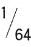

## 机器学习：想要理解应用、人工智能、数据挖掘、大数据等的初学者必备指南

### 简介

马克·扎克伯格舒适地坐在厚厚的软垫上，抿了一口水，平静地回答：“参议员，那个问题我得回去再跟您汇报。”时值 2018 年 3 月，他正身处剑桥分析公司听证会的漩涡中心，面对 44 位国会议员（平均年龄 62 岁）的质询，他们努力试图搞懂 Facebook 究竟是如何运作的。就马克而言，他不仅躲过了一颗子弹，更是躲过了一颗足以将这十年来最隐秘的数据收割计划彻底曝光的陨石。没人真正读懂剑桥分析公司丑闻的深层含义——国会不懂，公众不懂，媒体评论员也不懂，而马克也绝无打算说破。一家外部公司——剑桥分析公司——获取了海量毫无防备的 Facebook 用户的个人数据，随后将这些数据输入机器，试图预测这些人的投票行为。简而言之，这关乎机器学习。

本书将解释机器学习背后的概念、方法与历史，包括我们的计算机为何变得算力大增却比以往任何时候都更“愚蠢”，以及为何每一家科技公司（连它们的祖母辈）都想 24/7 全天候追踪我们，从电子设备中抽取数据点供程序运算，使其变成虚拟水晶球，在我们产生念头之前就预判我们的想法。其中大部分读来如科幻小说，因为从某种意义上说它确实如此，远超普通人愿相信的正在发生的现实。

机器学习中有大量枯燥的数学公式和编程术语，但鉴于本书面向初学者，我已尽可能精简这些内容并将其推至书末，同时保留了核心概念。阅读本书无需任何特定专业知识或教育背景，但如果读者具备相关背景，我希望他们能觉得本书富有洞见且读来愉快。

### 第 1 章 – 什么是机器学习？

机器学习的实际定义是：“让计算机执行一项任务，并给予其经验，使计算机能更好地执行该任务。”这就像我们教会机器玩电子游戏，然后让它自行升级。核心思路是避免手动修改程序代码，而是以一种能让程序自我构建、实时适应用户输入的方式来编写它，只需受信任的人类偶尔检查一下即可。如果出了岔子，就全盘关停，排查问题根源，然后重启更新后的项目。

如果机器学习涉及**监督学习**，人类可以从一开始就参与其中，帮助程序识别模式并得出它们之间关联的结论；否则，就是**无监督学习**，即程序被独自留在海量数据中寻找意义。电子邮件垃圾邮件过滤器是**监督学习**的绝佳例子：我们点击“垃圾邮件”按钮，机器便从此学习，寻找来信中的相似之处，在我们之前处理掉垃圾邮件。**无监督机器学习**的一个例子是趋势分析程序，它分析股市试图弄清某只股票为何波动以及何时会再次波动。任何人类对此都束手无策，所以机器的答案和任何人的答案一样好。如果它的预测让我们发了财，我们就让程序继续运行。

机器学习有不同的子类型，每种都可以作为监督或无监督学习使用，效率各异：

- **分类** 让机器提供一个模型，根据先前数据的标签对传入数据进行标记（垃圾邮件过滤器将邮件分类为“垃圾邮件”或“非垃圾邮件”）
- **回归分析** 是一种处理统计数据的方法，根据变量间的相互关系生成未来趋势的预测
- **密度估计** 显示任意给定分布的底层概率（如下文提到的鲍勃和弗雷德示例）
- **降维** 是一种简化输入并寻找共同属性的方法（例如，一种图书排序算法，尝试根据标题中的关键词将图书归类到不同流派）
- **聚类** 让程序自行对数据进行聚类并标记簇群
- **学会学习**（又称**元学习**）将一组先前尝试过的机器学习模型提供给程序，让它选择最合适的一个并加以改进。

### 机器学习是一门迭代科学

得益于任何一台计算机都能在一天内运行程序数千次，每次运行都会略微改变，直到结果有可衡量的改进，机器学习是一门迭代科学。如果这听起来像生物进化，那是因为它确实就是如此。理论上，一个被教会如何自我学习并被独自留置的程序将变得呈指数级地更聪明，迅速超越动物和人类的智力。就在这一点，我们发现自己掉进了兔子洞：我们有权编辑或终止这样的程序吗？它拥有人权和自由意志，还是受制于其创造者的意志？它能感知痛苦吗？它会试图篡夺我们的位置吗？它会产生意识吗？

### 第 2 章 – 机器学习的意义何在？

尝试新事物并以各种滑稽的方式受伤（比如触摸热炉子）是人类的典型特征。我们之所以做这些事，是因为我们最终是由好奇心驱动的：那种了解、感受和体验的不屈需求。我们想知道触摸热炉子会发生什么，感受到的疼痛让我们缩回手，从而教会我们世界是如何运作的。轻微的烧伤最终会消退，但经验会留存，就像在电子游戏中一样。在此期间，你最好涂点药膏。

得益于我们的身体及其提供反馈的方式，我们的大脑将体验一个不断变化的环境，这将使其适应并学习新技能，例如烹饪、滑雪和自信地遛狗，驱动力正是那种让我们去摸热炉子的好奇心。后来我们甚至可能会举一反三，仅凭摸过热炉子的经历，就推断出太阳、蜡烛和火把灼烧皮肤的原理是一样的。这些好奇心、纠错和理解抽象概念的能力，似乎植根于所有生物的生物学本质中，也是我们的文明发展到这一阶段的原因。但计算机能否被赋予学习这些相同能力的可能？

试图回答这个简单的问题，几十年来一直驱动着程序员和科学家创造出更好的智能手机、更坚固的相机和更轻便的无人机。无论我们身在何处，这三种设备都以某种形式无处不在：一个可以装进口袋的个人助理，一个掌上强大的录制设备，以及一个能自主工作也可远程控制的可编程机器。一步步地，我们赋予了愚笨的机器思考、看见和移动的能力，让它们承担我们最琐碎的任务。但现在它们也开始变得更聪明了。

### 第 3 章 – 一个没有更新的世界

正如许多自豪的 Windows 10 用户所证实的，我们生活在一个持续不断、改变生活的更新世界中。我们的软件现在是“常青” 的——总是在后台默默下载、安装和刷新自己。一旦操作系统变成常青模式，运行在其上的程序也必须跟进以避免兼容性问题，所以现在我们的 Chrome 和 Firefox 也开始通过不断更新来浪费我们的时间、带宽和磁盘空间。没有什么真正能正常工作了，但只要更新完成，一切就会好起来。

我们使用的软件是通过静态编程制作的，一群聪明人把自己关在屋里敲出行行代码，将它们打包成文件，并将所有东西整理成一个整齐的包。这是老派的编程方式，已被推向极限。最大的威胁是黑客，他们能瞬间发现代码中的缺陷并加以利用，窃取私人数据：信用卡号、登录信息和消息内容。阻止黑客的最好办法是什么？当然是推出更多更新，这些更新不一定带来新功能，只是为了让代码保持流动，把用户变成劣质功能的免费测试员。

其他坏人只是想看加载转圈圈，所以他们创建病毒注入文件制造破坏。这也是静态编程的另一个问题——计算机代码中仅改变一比特就会毁掉整个程序，导致程序灾难性地失败，就像人类起床气如果发作得不对劲，房子瞬间就会塌陷一样。如果我们现在想象一个必须面对全球数百万用户和数千个变化变量（如 Windows 10）的软件，静态编程意味着我们很快就需要一支程序员大军来修复漏洞、不断调整指令，才能获得一个可靠运行的计算机。

除非全球性产品或服务大获成功，或者我们有数百万美元来度过成长的阵痛期，否则它永远不会盈利。但如果我们能给计算机好奇心、纠错能力和对抽象概念的理解，使其变得“更聪明”并让它自行运行，会怎样？有没有可能真正获得一款只需极少编程和维护、却能成倍回报的软件？这是个价值千万亿美元的问题，也是几十年来所有科技公司一直在致力解决的问题。这就是为什么机器学习变得如此重要。

### 第 4 章 – 机器学习史

人类试图制造能够自我思考、或至少展现出令人眼花缭乱的类人思维表现的机器，这有着悠久的历史。沃尔夫冈·冯·肯佩伦于 1770 年制造、1840 年毁于大火的“土耳其机器人”，大概是最著名的例子。它由一个坐在 4x3x2 英尺柜子后的模特和顶部的棋盘组成，整个装置是一个不可分割的整体（模特无法与桌子分离），可以靠轮子移动。柜门可以打开，露出大量齿轮和四通八达的线路，发明家总是允许观众在远距离对弈前窥探机器内部，并用蜡烛从背后照亮，以说服他们里面没有人。

土耳其机器人首次亮相于奥地利宫殿，激进地击败所有挑战者，随后巡游欧洲城市，引发巨大轰动。发明家不欣赏这种关注，勉强展示它，声称这只是他的次要发明之一。土耳其机器人总是执白棋，但棋艺颇强，曾令本杰明·富兰克林印象深刻，并击败了拿破仑·波拿巴。传说拿破仑试图通过走非法棋步作弊，土耳其机器人会通过将棋子放回原位并走自己的棋来惩罚他。拿破仑一再重复同一个非法棋步，直到土耳其机器人把所有棋子扫落棋盘，此时拿破仑才正常对弈，19 步后落败。另一个故事说拿破仑在模特头上系围巾挡住视线，但它依然获胜。

土耳其机器人多次易主，巡游英国，并让对手让子（土耳其机器人少一个兵）。它也去过美国，爱伦·坡写了一份关于它及其秘密的长篇报告[¹]：“自动棋手的运作毫无疑问是由智力调控的，而非别的。确实这事可用数学先验地证明。唯一的问题只是人类能动性以何种方式施加于其上。”他还补充道：“自动棋手并非必胜。若它是纯粹的机器，情况就不会这样——它将永远获胜。既然发现了让机器下棋的原理，该原理的延伸将使它赢得一局棋——更进一步的延伸将使它赢下所有棋局——即战胜对手任何可能的棋局。”土耳其机器人是第一台智能机器，还是只是一个精心设计的沙龙把戏？

[¹]: [part0000_split_025.html#_ftn1]

柜子内部的隐藏隔间让一名棋手能舒适地坐在里面，甚至沿着轨道滑动座位，从而让“土耳其机器人”的主人可以打开柜门，向怀疑者展示内部运转的各种齿轮和电线。棋子通过强力磁铁固定在棋盘上，这些磁铁还牵动着连接在柜子内微型棋盘上的绳索，让隐藏的棋手大师能看到局势并做出自己的走法。“土耳其机器人”的左臂能通过一系列杠杆移动，手能张合，让隐藏的棋手得以继续对弈。如果棋子摆放不当或从自动装置的手下被抢走，它会继续完成动作，然后由主人介入完成走法。后来，“土耳其机器人”还装上了发声装置，能高呼“将军！”，以增强效果。

国际象棋被证明是展示机器智能的热门游戏，1890 年，西班牙发明家莱昂纳多·托雷斯·奎维多创造了一个简单的玩具，它能在“车王对王”残局中将死人类对手。这个玩具实际上只是一个电路、电线和一个开关，有时需要 50 步才能解决原本只需 15-20 步的局面，但它最终总是能获胜。从这种对玩具和棋盘的摆弄发展成为一门真正的科学，又花了 70 年时间。

1959 年，麻省理工学院毕业生、对计算机情有独钟的亚瑟·塞缪尔开启了机器学习领域，这是一门专注于制造能够评估环境并相应改变行为以变得更高效的计算机的科学。在极其有限的内存和处理能力下，亚瑟让他的跳棋程序计算任意给定走法获胜的几率，然后让它与自己对弈数千次，直到优化并记录下尽可能多的走法。这就足够了，机器像人类一样学会了。

虽然塞缪尔的程序从未能超越业余水平，但这是机器学习诞生的第一个实例，且发生得惊人地清晰。机器学习科学家们的胃口被吊了起来，现在他们渴望更多。我们如何制造一个专业级的跳棋程序？那不可战胜的呢？麻烦就出在这里，因为计算机扩展性很差，仅仅希望将成百上千个相同的程序或设备堆叠在一起就能自动产生秩序，结果只会造成彻底的混乱，因为机器完全不知道如何将它们整合在一起。原始算力在那里，但缺少了某种东西——协调。

一个试图匹配人脑处理潜力的超级计算机集群，实际上需要一座 10 兆瓦发电厂的全部输出功率，其耗电量大致相当于一个典型美国家庭一年的用电量[[2]](#part0000_split_025.html#_ftn2)，即便如此，也无法保证机器真能产出任何有价值的东西。程序员们迅速意识到，一台能够学习的机器必须以某种方式模仿大脑的自然设计和灵活性。2009 年，斯坦福大学的 Kwabena Boahen 制造了一个原型“神经网格”计算机，其晶体管有 30%-90%的误触发率，但通过在所有噪声和随机信号中寻找共识，依然能产生一致的输出。那个版本的“神经网格”拥有百万个晶体管，相当于只老鼠大脑中的神经元数量[[3]](#part0000_split_025.html#_ftn3)。由于不知道如何让它们协同工作，科学家们专注于制造一台能在棋类游戏中击败人类的机器。

国际象棋程序早在 1970 年代就已出现，但算力的进步帮助它们比人类对手提前看到数百万种组合。回到起点，科学家们研究如何解决国际象棋，制造一台能随时看到所有走法的机器。问题是，随着格子的增加，问题变得呈指数级更复杂，直到 1990 年代才出现真正的挑战者，击败当时最优秀的棋手加里·卡斯帕罗夫。

1996 年 2 月，IBM 的“深蓝”国际象棋程序与加里进行了一场备受瞩目的 6 局较量，以 2-4 险败。次年举行重赛，升级后的算法速度翻倍，但加里无法保持心理稳定。在弃掉一局本可逼和的棋后，加里再未恢复，最终以 1-2（3 局和棋）告负。计算机对国际象棋的分析帮助我们理解了不同的开局和残局，推翻了许多延续几个世纪的国际象棋公理，但智能棋类游戏机很快又统治了另一个游戏——围棋。

围棋是一种强调战略思维的中国古老游戏，在 19×19 路的棋盘上进行，由两名玩家轮流落子（黑白棋子）。游戏目标是用自己的棋子包围对手的棋子，被包围的棋子随即从棋盘上移除。2014 年，一个 AI 计算机程序设法击败了一位围棋专家，虽然是通过让子 4 子的优势，这促使研究人员大胆宣称将在 10 年内击败人类。

国际象棋和围棋的主要区别在于，后者拥有多得多的棋盘状态组合，因此需要呈指数级更多的计算能力。虽然“深蓝”能为棋盘状态赋值并提议最佳走法，但围棋需要更好的东西——蒙特卡洛树搜索。这种决策算法目前用于某些对手信息不完整的视频游戏（如扑克）中，以估算最有希望的行动方案，模拟其结果并从中学习。蒙特卡洛树搜索从程序为自己选择一个随机走法并尝试预测对手的最强走法开始，然后分支出自己的最强走法，以此类推。游戏越复杂，算法遍历所有可能走法所需的时间就越长，并在到达游戏结束时更新所有走法的胜率。

对人类棋手而言，擅长围棋与知道任意给定走法的价值无关，而是感知所有棋子的整体形势和位置。研究表明，大师级的围棋走法和策略看起来对称且赏心悦目，这正是几代棋迷着迷的原因。然而，程序被允许运行并收集所有可能走法的足够数据，最终通过自我对弈，直到变得足够强大以面对最顶尖的高手。

2016 年 1 月，谷歌的 AlphaGo（一个专家级围棋程序）完成了足够的迭代，最终面对现代围棋史上最强棋手李世石，以 3-0 获胜。观战的评论员指出李世石表现出极大的心理脆弱性，而 AlphaGo 下出了一盘完美的棋。这不足为奇，因为 AlphaGo 在训练和对弈过程中都运行在 170 张显卡和 1200 个 CPU 上，这需要铺设一根专用光纤电缆到两人对弈的房间[[4]](#part0000_split_025.html#_ftn4)，并使用了神经网络。

### 第 5 章 神经网络

### 神经网络

神经网络这一概念早在 1944 年就由两位芝加哥大学教授提出，他们后来转至 MIT 从事机器学习程序的研究。神经网络（现称为“深度学习”）是一种将许多小型机器学习程序串联在一起、并让它们相互“交流”以交换信息的特殊方式。例如，向神经网络展示许多不同的汽车图片，直到它自行学会识别所有汽车图片中哪些细节（车门、车窗、轮胎等）是相关的，这只有人类才能做到。人类大脑能以各种高效方式识别抽象模式，而神经网络能令人着迷地接近这种能力，这实在是相当精妙。神经网络中的每个节点大约连接到其他十几个节点，但数据仅根据网络赋予自身的值向前移动。有时甚至连程序员都不知道神经网络是如何工作的，但人脑也是如此，我们仍每天高效地使用它。

科技公司在意识到神经网络的潜力后，一直在用它们进行图像分类，输入数百万张需要识别的图像进行训练。这不仅帮助科学家理解计算机视觉如何工作，也帮助理解人类如何看见、思考和感知周围的物体。另一方面，神经网络容易被打乱的图像欺骗，这些图像在它们看来像是真实的物体[[5]](#part0000_split_025.html#_ftn5)。通过使用进化算法挑选最合适的结果并添加轻微变异，神经网络可以创作出值得在博物馆展出的惊人艺术品，或是直出奇梦般的作品。从某种意义上说，神经网络在分析任何类型的内容时都在“做梦”。目前，神经网络可能承担着扫描上传至 Facebook 的图像以判断其中是否有猫、锅或汽车、并帮助视障人士等平凡任务，但在不久的将来，我们可能会看到它进行实时图像处理和视觉评估。

神经网络也可用于自然语言处理（NLP）。Windows 记事本是一个简单直接的文字处理工具，我们必须手动输入所有内容，但 NLP 记事本能够真正回复输入其中的问题，或撰写一段文本的摘要。设想一下未来：NLP 神经网络通读一本书，并在 2 分钟内写出一份扎实的报告？人类语言以难以理解和解释著称，神经网络在能像《星际迷航》中的通用翻译器那样服务之前，还有很长的路要走。目前，神经网络在人脸识别和关键词分析方面可能比实际阅读表现更好，而在阅读方面，一个典型的 4 岁儿童就能轻松超越它们。

但也许我们对机器学习的期望定得太高了。人类大脑在非洲草原和西伯利亚苔原的恶劣生存环境中进化了数百万年，以学习、适应和生存。难怪它在颅骨内拥有由脑脊液构成的减震缓冲垫，使其具有中性浮力，防止在自身重量下塌陷，且仅靠 20 瓦功率运行，仅够点亮一盏小白炽灯。尽管具有适应性，人脑仍不断“误触发”，并可被植入并未发生的记忆。说到这个，我关炉子了吗？我最好再去检查一遍以防万一。结果表明，构成人脑的数十亿个神经元不断相互“交流”以达成共识，其中很大一部分只产生噪音和闲聊，但这套系统却能运作。不仅如此，它还是我们存在中最难捉摸的概念——意识——的栖息地。

### 第 6 章 —— 匹配人脑

医学大致知道我们之所以有意识，是因为大脑中的某些结构，但也仅限于此。是什么让我们拥有意识？从动画片和滑稽喜剧中我们知道，一记重击头部会让人失去意识，所以意识肯定与头部、特别是大脑有关。但具体是大脑的哪个部分？这便引领我们进入耳际之间那个由 3 磅脂肪和神经组成的奇异维度。

一个奇怪的案例将所有关于意识的精心构建的理论扔进了垃圾桶，迫使我们重新思考我们视为理所当然的大脑能力：一个人失去了 90% 的脑细胞却仍保持清醒[[6]](#part0000_split_025.html#_ftn6)。这种病症称为“脑积水”，本质上是身体无法正常排出大脑中的液体。这些液体通常带走各种废物和代谢副产物，但那篇文章中提到的这位法国人幼时患有脑积水，颅骨内安装了一个阀门以释放压力。

阀门最终被移除了，但这家伙显然进入了缓解期，病情导致液体大量积聚，使他仅剩下颅骨内侧一层薄薄的细胞。他仍能去上班、过正常生活而不失去智力，这意味着意识中存在某种机制，使其能适应奇怪的环境、在可怕的伤害中存活，只要身体还有生存的需求。

这个案例还表明，意识是身体在探索世界过程中涌现的属性，不一定是大脑独自拥有的东西。从某种意义上说，意识是求生意志，这家伙之所以能在几乎没有大脑的情况下存活，是因为他意志使然，且家人需要他。这是机器学习科学家听了会倒吸一口冷气的事情——我们如何赋予机器那种生存能力和韧性？我们如何让它们想要在这个充满冲突、混乱的世界中生存和战斗？我们如何给它们一种目标感，而这连我们在人类身上都不确定如何做到？这听起来像是《终结者》式未来的完美开端，机器毫无正当理由地执意要消灭人类。

太夸张了？这只是机器学习世界的普通一天，科学与哲学聚在一起喝一杯、打一架、成挚友。简而言之，制造智能机器人将涉及给它们一个身体和一个能自主探索世界的机器学习程序。届时，它们据说会获得意识，但接下来会发生什么，无人能知。

### 第 7 章 —— 人工智能

20 世纪 90 年代，机器学习科学家将制造人工智能——一个能学会一切的瓶中精灵——的梦想搁置一旁，专注于解决实际问题，例如编写程序根据概率进行医学诊断。如果鲍勃吸烟、不锻炼、超重，且在 52 岁时心脏病发作，那么同样吸烟、不锻炼但不超重的弗雷德，到 52 岁时心脏病发作的几率有多大？我们该如何调整他们的医保费用？仅凭一个样本无法判断，但当机器在监督学习模型中被输入成千上万经诊断的疾病匿名数据时，无需医生见到患者、患者也无任何症状，就能获得高度准确的诊断。尽管如此，医生短期内不会被赶出医院，因为人体奇妙地古怪，总有一千分之一的疑难杂症，只有豪斯医生那样的人能搞定。在大城市，这意味着源源不断的人把舌头粘在脸颊上、或吞下整个灯泡，这些都是任何 AI 都无法解决的。

### AI 的演进：从弱人工智能到超级智能

### 互联网作为催化剂

正是互联网作为全球数据高速公路的到来，再次改变了一切，让 AI 的前景显得触手可及。无论科学家们如何尝试向程序喂入数据，没有什么能比得上拥有数百万用户的全球搜索引擎 —— 只需让机器接入源源不断的数据点并让其学习即可。这对普通大众也有一些好处，因为搜索引擎需要尽可能多地了解个别用户，以提供定制化的结果。换句话说，Google 想知道哪些用户喜欢音乐（rock），哪些喜欢泥土（rock），以便当他们搜索 "rock" 时，向每个群体呈现最相关的结果；额外的好处是，机器窥视并处理个人用户数据在技术上不算侵犯隐私。这一机制要求采用纯在线存储，其巧妙的营销术语是“云端”。一旦用户习惯了将私人数据放在云端（即别人的电脑上，他们无权查看或编辑），机器学习向 AI 构建的转型便可真正开始。

### 机器学习的不透明性

请注意，没有人真正知道搜索引擎如何工作，甚至不知道它们涉及机器学习，这有多么关键。这是因为，与提供所有文件供用户执行、摆弄和修改的静态编程软件不同，机器学习模型必须隔离脆弱的程序，甚至隐藏其正在学习的事实，否则用户可能会试图搞破坏，导致结果失真。一个被扔进舆论法庭的 AI 毫无胜算，微软的 Tay 便是明证，这是一个用户可于 2016 年 3 月通过 Twitter 与之互动的聊天机器人。Tay 被编程为学习社交线索并根据与真实用户的 Twitter 互动来回应话题，但铺天盖地的仇恨和种族主义评论迅速将她变成了一个咆哮的偏执狂[⁷]。

IBM 的 Watson（就是那个在《危险边缘》节目中击败人类而登上头条的）在 2013 年也经历了严重的“脏话缠身”，当时它被允许从 UrbanDictionary.com 学习语法，该网站最初是真实俚语的集合，后来变成了用户竞相创造最离谱的虚构性行为描述的大杂烩。照看 Watson 的研究人员最终不得不从其记忆中清除 Urban Dictionary 的所有痕迹，因为它开始骂脏话[⁸]。

### AI 的分类

AI 科学家可能会对 Tay 嗤之以鼻，称其为“弱人工智能”，意指只能完成单一任务的 AI。随着机器学习的进步，弱人工智能的概念在不断扩展，以至于昨天看似不可能的事情今天已变成“弱”人工智能，只是另一个如今已司空见惯的惊人发现。科学家们追求的是“通用人工智能”，意指拥有人类同等能力的 AI（好奇心、纠错能力和理解抽象概念的能力）。这是那种可以放心发布到 Twitter 上而不必担心变成偏执狂、能与偏执狂辩论并真正说服他们认错的 AI。

AI 演进的最终阶段是“超级人工智能”[⁹]。这是一个拥有神祇所有标志的 AI：无所不在、全知全能。换句话说，这种 AI 将无处不在、知晓一切、并能做任何事。没人真正知道如何以及何时（甚至是否）能从通用 AI 走向超级 AI，但 Google 工程师 Ray Kurzweil 似乎对出现这种 AI 的未来毫不担忧，并期待着“奇点”时刻，即人类与机器融合的时刻[¹⁰]。Google 无人驾驶 AI 部门前负责人 Chris Urmson 是另一位 AI 末日论先知，他在创立 Aurora Innovation 从事自动驾驶汽车研发后软化了言辞，称“尽管标题党很多，但这还处于非常早期”[¹¹]。他们俩是网上绝大多数 AI 恐慌文章的源头，几乎任何“AI 将夺走我们的工作”谣言最终都能追溯到他们。无论如何，一台能感知并对周围环境做出反应的计算机就可以称为“人工智能”（AI）。

### 专家警告与监管真空

如果我们现在了解 AI 进化有多快，再回读科技界名人的警告，就会开始拼凑出全貌：弱人工智能将难以进化为通用人工智能，但一旦达到该点，其学习能力将升级，几乎瞬间（也许就在那个晚上）成为超级人工智能。2014 年在 MIT 听众面前，Elon Musk 说：“有了人工智能，我们就是在召唤恶魔”[¹²]，Bill Gates 附和道：“我不明白为什么有些人不担心”[¹³]，甚至已故的 Stephen Hawking 也加入战团：“一旦人类开发出人工智能，它将自行起飞，并以不断加快的速度重新设计自己”[¹⁴]。由于机器学习领域监管薄弱，我们极有可能看到灵活的企业家探索法律灰色地带，推动 AI 进化的极限，为利润引发广泛的社会变革，而将后果留给其他人在未来几十年甚至几个世纪中应对，正如历史上无数次发生的那样。

### 图灵测试与聊天机器人的演进

Microsoft 在设计 Tay 时选择聊天机器人有其独特原因 —— 图灵测试。由 Alan Turing 于 1950 年设计，图灵测试旨在作为衡量机器智能的标准。简而言之，图灵测试将一个人类、一台机器和一个观察者（也是人类）置于三个单独的房间，让前两者通过书面交流，而观察者观察文字并猜测哪个是哪个。如果计算机能与人类交流到欺骗观察者的程度，则被认为通过了图灵测试，尽管它其实只是模仿人类而非像人类那样思考。一个相关概念是“图灵完备”程序，意指它可以模拟过去、现在或未来的任何程序，这显然永远不会发生，使该术语本身成为机器学习科学家间的内部梗，时刻提醒他们在探索感兴趣领域时保持脚踏实地。

请注意，聊天机器人花了数十年才成为现实，但互联网的引入几乎让它们一夜之间出现，现在它们被视为一种骚扰，只是另一个已变得完全司空见惯的惊人发现。不过我们应该注意聊天机器人出现的临界点，并将其应用于未来的 AI 趋势 —— 要让 AI 对人类构成任何威胁，需要出现一种像互联网一样具有开创性的技术，建立在自然的人类活动之上。加上 AI 超乎寻常的进化能力，没人会有时间反应并将其关闭，在它利用那项技术将自己升级为超级 AI 并大肆破坏之前，甚至连它的创造者也来不及。弱人工智能的存在及其持续扩展，仅仅是转移视线的花哨干扰，是远处的一道闪电，分散了我们对正在形成、威胁要给我们带来严重麻烦的龙卷风的注意力。

[⁷]: 参考脚注 7
[⁸]: 参考脚注 8
[⁹]: 参考脚注 9
[¹⁰]: 参考脚注 10
[¹¹]: 参考脚注 11
[¹²]: 参考脚注 12
[¹³]: 参考脚注 13
[¹⁴]: 参考脚注 14

### 主流新闻媒体并未帮助缓解恐惧或向公众普及 AI 知识

然而，主流新闻媒体并未帮助缓解恐惧或向公众普及 AI 知识。在 2018 年 2 月《福布斯》一篇标题为“Artificial Intelligence Will Take Your Job”[[15]](#part0000_split_025.html#_ftn15)的文章中，我们看到了一份来自葡萄牙里斯本科技会议的报告，展示了未来可能的样子。有数百篇文章复制了完全相同的基调和信息，但这篇文章包含了来自谷歌 CEO 关于 AI 的不祥警告，以及一个名为索菲亚的会说话的模特演示，她承诺要夺走我们的工作。这有多大可能？麦当劳等快餐连锁店已经开始安装自助点餐亭，某些情况下还具备人脸识别功能，但这根本没有影响工人——70% 的麦当劳顾客通过汽车穿梭点餐，完全不受点餐亭影响。事实上，点餐亭意味着顾客可以更快地点餐，导致门店不得不雇佣更多工人，正如 Panera Bread 2015 年的例子所示，由于新安装的点餐亭，他们不得不额外雇佣 1,700 人来应对需求[[16]](#part0000_split_025.html#_ftn16)。

Caliburger 已经在其某家分店展示了翻汉堡机器人 Flippy。这个机械臂拥有热传感器，能检测肉饼何时需要翻面，并有一个形状像汉堡的手。Flippy 能瞄准肉饼，放下手，将其劈开，抓起肉饼，举起，翻转手腕，将肉饼放回烤架上，但也就仅限于此。Flippy 每天能翻 300 个汉堡肉饼，听起来很厉害，但勉强只能应付午餐高峰期的一小时，而且仍然需要人工将肉饼放上烤架并在事后清理。使用成百上千个 Flippy 也行不通，因为该技术扩展性极差，而且仍需雇佣人员持续监控和清理机器人。由于汉堡翻制的疯狂节奏，Flippy 已经不得不下线维修，但仍被重新启用，因为它能制造惊人的新闻标题。这本质上就是公司正在做的事——利用雇佣弱 AI 的新颖性，即使它完全不起作用，也要借此与竞争对手区分开来。

当然，所有这些“AI 将夺走我们的工作”的故事都适合在炉边度过一个精彩的夜晚，但请记住，目前只有弱 AI 是可行的，例如扫地机器人 Roomba 中的那种。这个可爱的小机器人出现在大量病毒视频中，宠物骑着它在屋里巡逻，但它其实经常出故障，最常见的导致其彻底停摆的故障是“原地打转”，这是由灰尘堵塞其光学传感器引起的。如果一个被赋予扫地这一简单任务的弱 AI 因灰尘而关机，导致人类不得不挽起袖子，拆开机器人清理并修好它，让我们想象一个场景：一个被设定为运行整个城市的通用或超级 AI 被闪电击中或被龙卷风卷走而失控。最可能的结果是什么？人类介入并修复问题，将所有成果归功于 AI。事情可能以许多惊人的方式出错，只有人类的创造力让我们得以维持，没有任何设想的方式 AI 能在这方面帮上忙。

### 第 8 章 — 文学中的 AI

科幻作家已经探讨 AI 的概念及其影响有一段时间了，艾萨克·阿西莫夫的《我，机器人》是最好的例子。该书出版于 1950 年，这部短篇小说集想象了一个未来：机器人拥有自己的思想，但受植入大脑的三条法则约束，本质上使它们视人类为仁慈的神并服从人类。机器人通过“正子大脑”获得了通用 AI 的意识和能力，这相当于钢铁侠战衣的材料——一种来自漫画书的理论材料，能满足作家的一切需求。2004 年还有一部威尔·史密斯主演的电影改编，它对故事或其背后的概念并不公正，但作为 AI 概念的一个轻快且可看的入门介绍。

道格拉斯·亚当斯的《银河系漫游指南》中也对“AI 是万能解药”这一观点进行了讽刺。这部始于 1979 年的系列小说在技术方面包含大量讽刺元素，其中一个情节特别嘲讽了机器学习。当某个超智慧外星种族决定创造一个名为“深思”的超级 AI 来给出万物的答案时，它思考了 750 万年，最终给出了一个答案——42。这一情节背后的清醒洞见是：即使是超级 AI 最终可能也和我们一样一无所知，在回答关于生命本质的深刻问题时原地打转。在一番讽刺的反转中，深思建议其创造者制造一个更强大的计算机器——一个充满了具有推理能力的生物的星球。这结果就是地球，而在最终答案真正得出前几分钟，它就被毫无察觉的外星人毁灭了，那些外星人只是想修建一条星际绕道（剧透）。

《仿生人会梦见电子羊吗？》是菲利普·K·迪克众多被搬上银幕的小说之一，虽然电影名为《银翼杀手》，于 1982 年上映。该书首次出版于 1968 年，故事围绕一名生活在地球上的赏金猎人展开，地球因核辐射而满目疮痍，几乎所有动物生命都被摧毁。拥有一只真正的宠物成为了留在星球上为数不多的人类的身份象征，而仿生人——外表和行为酷似人类的智能机器人——随处可见。宗教、同理心和环保意识等主题汇聚在一起，提出了一个凄美的问题：是什么让我们成为人类？书中的一句结语总结了全书：“电子事物也有它们的生活，哪怕那些生活微不足道。”

在所有文学作品中的 AI 例子里，我们看到的是在它们真正成为任何辩论一部分的 50 多年前，就已提出了合理且相关的问题。所有科幻小说的共同主题是：直到现在，我们拥有进化作为一种无意识的力量，筛选出最适应的生命形式，但人类突然获得了创造不受进化影响、没有天敌、无法繁殖的工具的能力。这种对进化的非自然干预会导致什么结果，谁也说不准，只知道机器人将变得越来越像我们，具备语言和独立移动的能力。

### 第 9 章 — 会说话、会走路的机器人

一个名为索菲亚的会说话的仿生人（就是那个在里斯本发表不祥演讲的）已经环游世界，在各种科技会议上演讲，效果惊人。索菲亚能用面部做出令人毛骨悚然的表情，并自主发言，就任何话题进行对话[[17]](#part0000_split_025.html#_ftn17)，尽管面对刁钻问题时，她会给出模棱两可的非标准答案。由汉森机器人公司开发的索菲亚表示，她最终想去上学、学习、创作艺术、创业，甚至拥有自己的家和家庭[[18]](#part0000_split_025.html#_ftn18)，但她最臭名昭著的言论是她想“消灭全人类”。硅胶皮肤、眼内摄像头和人脸识别软件让索菲亚能识别和记住个体、发表观点并从互动中学习。沙特阿拉伯授予了索菲亚公民身份，使她成为首位拥有护照的仿生人公民。她目前除了讨论特定话题外什么也做不了，但一条乐于助人的仿生人产品线已经在比利时和日本进行测试，旨在陪伴和服务老年人，如 Pepper。

### Pepper：医疗保健机器人

Pepper 是一款可爱的、售价 3 万欧元、高及胸口的机器人，被吹捧为医疗保健的未来。由比利时公司 ZoraBots 开发，并在两家比利时医院作为接待员进行测试，Pepper 会说 20 种语言（尽管她会俏皮地说：“一次只能说一种”），并能识别人类的年龄，将他们引导至正确的科室。此前，Pepper 曾现身于法国商场和日本商店，还曾与青少年一起入读日本一所高中[¹⁹]，帮助他们学习英语。她还能理解人们的情绪，并对他们的笑话发笑，让他们感觉好些。如果一切都失败了，Pepper 胸前的平板电脑可用于提供更多信息。

### 其他安卓机型

有些安卓机型太昂贵且娇气，不适合家用，例如本田的 Asimo，它能上下楼梯，仅被保留在展厅和技术会议上作为新奇玩具。Asimo 本意是用于危机区域（如福岛关闭反应堆阀门），以取代人类科学家，但它未能胜任，无法应对废墟，却能以 5-6 英里/小时的速度奔跑并使用手语[²⁰]。其他机器人公司放弃了说话和微笑，选择动物形态来制造稳定的行走机器人，例如波士顿动力公司及其 Big Dog。

### Big Dog 与 SpotMini 的演变

Big Dog 于 2008 年首次展示，酷似一只无头的四条腿狗，脚掌被短桩取代[²¹]。它能以 2-3 英里/小时的速度在雪地和冰面上上下坡行走，在滑倒或被推搡时能自行恢复平衡，且能背负货物完成所有这些动作，暗示它将用于战区运送物资。Big Dog 的设计历经多年演变，最终于 2018 年 2 月成为 SpotMini，头部被替换为带夹具的柔性机械臂，甚至能在科学家试图阻止的情况下开门[²²]。2018 年 5 月，波士顿动力公司发布了一段视频，展示 SpotMini 穿过其仓库之一，走到室外，进入下一栋楼，上下一段楼梯，然后完全自主地一路返回[²³]。

### 机器人学中的共情与意识

在波士顿动力公司的视频中，我们可以看到科学家们骚扰、阻挠和阻碍 Big Dog 和 SpotMini，尽管它们没有意识，却让我们为这些可怜的东西感到难过。我们会对其他生物产生共情，这是人类存在的重要组成部分，但似乎我们也能为表现出足够活力的机器人感到惋惜。如果这种虐待发生在真实动物身上，我们肯定想制止，但机器人有什么不同？是什么让我们拥有意识，而这些自主机器人却不适用？哲学家们试图解释意识的起源已有数千年，却从未找到实际答案，所以让我们把整个机器学习领域变得复杂一万倍，把意识也加进去吧。

### 法律隐含义：AI 与言论自由

法律专家已经在讨论 AI 是否应享受《第一修正案》保护，拥有言论自由权。在 2016 年题为“Siri-ously? Free speech rights and artificial intelligence”（认真吗？Siri？言论自由权利与人工智能）的文章中，法学教授 Toni M. Massaro 和 Helen Norton[²⁴] 指出，“宪法变革似乎不可避免”，《第一修正案》不要求说话者必须是人类，也不要求言论必须有意义，但这并不意味着汽车警报器拥有言论自由。换句话说，智能且有意识的说话者受到保护，但用于播放语音或声音的工具则不受保护，这意味着如果机器进化得足够先进，我们可能会发现自己在给机器提供《第一修正案》保护，甚至允许它们诽谤人类而无法追责。还记得我们提到的意识吗？这就像我们打开一个货运集装箱，里面装满了麻烦（开了一罐蠕虫），结果发现里面还有一个潘多拉魔盒，我们又把它打开了。

### 陪伴型安卓机器人

安卓机器人似乎也正走向我们的卧室。对于许多因严重残疾或极度缺乏自信而无法与异性交谈的人来说，逼真的陪伴娃娃可能是唯一的床伴，尽管它们很奇怪，却能在无人能及时给予安慰时提供慰藉。结合 Sophia 进行对话的能力以及 Pepper 解读情绪和提供医疗保健的能力，陪伴型安卓机器人也许有一天会成为养老院和护士的全面替代品。

### 第 10 章——自动驾驶汽车

不仅是典型的房屋地面，生活本身就是混乱、无序且不可预测的，迫使我们投入巨大努力仅能勉强维持秩序，AI 在应对这种局面时也不会比我们强到哪里去。在进入下一个话题——自动驾驶汽车时，请记住这一点。自动驾驶汽车正风靡一时，埃隆·马斯克的特斯拉是最著名的例子。我们或许应该花点时间解释这股热潮背后的细微差别。目前没有汽车能真正自动驾驶（除非我们算上谷歌汽车，据谷歌 2018 年报告[²⁵]称，它们能完美自主行驶），而且无人驾驶汽车无论如何都是非法的，意味着车内必须有驾驶员，尽管他不必双手握方向盘。特斯拉官网展示的视频[²⁶]也表明了这一点，视频中驾驶员双手离开方向盘。

### “自动驾驶”的误称

“自动驾驶”这个名称是一个宣传噱头，这些汽车要么作为穿梭巴士沿人工编程、精心规划的城市路线行驶，要么由一群技术人员乘坐车队在后紧随监督，一有麻烦立即介入。一旦这些车离开整齐的城市“游乐场”进入碎石路，其行为就会崩溃，骑乘起来不比普通雪橇强多少。特斯拉公司谨慎地将其自动驾驶功能称为“Autopilot”（自动辅助驾驶），这意味着他们清楚 AI 的局限性，且必须有驾驶员在场并双手握方向盘，否则汽车会蜂鸣几次并滑行停车。

### 特斯拉 Autopilot 的工作原理

特斯拉 Autopilot 通过不断扫描车道线并保持车辆在车道中央行驶，同时感知附近是否有其他车辆或行人并自动调整速度来工作。这在理论上听起来很棒，但当特斯拉 Autopilot AI 出现漏洞时，生命就会逝去。2018 年 5 月，一辆特斯拉在瑞士提契诺撞上护栏并起火燃烧，导致驾驶员死亡[²⁷]。五天前，另一辆特斯拉在佛罗里达州劳德代尔堡撞上混凝土墙并起火，导致前排两名青少年死亡，后排一人受伤[²⁸]。特斯拉使用锂离子电池，在碰撞中受挤压或扭曲时倾向于剧烈爆炸，这加剧了事故后果。

### 挑战与责任

虽然由人类驾驶员引起的车祸和死亡事故数不胜数，但我们习惯了应对粗心大意的驾驶员，例如起诉他们或吊销执照，但我们该如何应对在道路上行为异常的 AI？另一个问题是，如果自动驾驶 AI 被编程为严格遵守交通法规，而周围没有任何人类驾驶员遵守法律，这会导致 AI 汽车成为混乱的根源。我们理所当然地期望获得一个强大且稳健的 AI 驾驶助手，帮助我们减少通勤中花费的时间和精力，但在可预见的未来，这似乎既不可能也不太可能实现。

[¹⁹]: part0000_split_025.html#_ftn19
[²⁰]: part0000_split_025.html#_ftn20
[²¹]: part0000_split_025.html#_ftn21
[²²]: part0000_split_025.html#_ftn22
[²³]: part0000_split_025.html#_ftn23
[²⁴]: part0000_split_025.html#_ftn24
[²⁵]: part0000_split_025.html#_ftn25
[²⁶]: part0000_split_025.html#_ftn26
[²⁷]: part0000_split_025.html#_ftn27
[²⁸]: part0000_split_025.html#_ftn28

### 自动驾驶汽车的梦想

梦想是裹着毯子走进一辆自动驾驶汽车，在车子嗡嗡作响驶向工作地点的途中睡上 2 小时午觉，回程时再来一次。这就是自动驾驶汽车概念中隐含的承诺，但它们的实际运作方式完全不是这样。事实上，如果一辆特斯拉在高速公路的某个特定地点撞上墙壁，我们可以确信其他特斯拉也会如此，正如 CBS 新闻视频[[29]](#part0000_split_025.html#_ftn29) 所展示的，一位特斯拉车主在另一辆特斯拉发生事故的同一地点附近测试自己的车，结果经历了完全相同的异常行为。

官方对特斯拉在自动驾驶模式下为何会冲向混凝土分隔带的解释是“它们看不清车道线”，这让我们看清了驾驶 AI 到底有多可靠。但即使它偶尔搞砸了，它仍然会竭尽全力保障驾驶员安全，对吧？对吧？如果自动驾驶汽车普及开来，我们可能正逼近一个这样的未来：我们购买的汽车会决定驾驶我们冲下悬崖，或故意将我们撞向墙壁以致我们于死地。这是一个被称为“电车难题”的伦理问题，在这种情境下，汽车 AI 可能必须即时决定：是什么都不做，导致数条人命丧生；还是故意牺牲一人以挽救其余众人。

### 电车难题

电车难题描绘了这样一个场景：一辆电车在轨道上飞驰，前方有五个人。他们来不及避让，电车也无法停下——他们的死亡已成定局。电车与这群人之间有一个铁路道岔，我们就站在能够拨动道岔、将电车引向第二条轨道的杠杆旁。唯一的问题是第二条轨道上还有一个人。我们该怎么办：眼睁睁看着五人死亡，还是杀一人救其余众人？

电车难题引发了道德层面的问题：谁有权决定是否拥有剥夺他人生命的权利？我们如何衡量哪条生命更有价值？如果第一条轨道上是五位老人，第二条轨道上是一位年轻孕妇，又该如何？现在让我们设想一个不完美的驾驶 AI，其传感器可能被污垢堵塞、可能看不清车道线，却拥有决定谁生谁死的权力；将这种情况放大一百万倍，我们将面临一场永无止境的连环相撞，一场文明史上从未见过的车辆版“狂野西部”。这些正是 AI 科学家们面临的困境：他们通过机器学习训练出的 AI 必须走出无菌实验室，步入真实世界。

### 责任归属与服务条款

如果一辆使用机器学习的汽车决定杀死一个人，谁该负责：编写基础代码的程序员、研发底盘的工程师，还是推销它的销售员？最现实的情景是，任何此类 AI 驱动的汽车都将附带一份免责声明，内容大意是驾驶员愿意接受被杀的命运，如果 AI 判定一条命不如其他任何随机路人的命有价值。就像 Facebook 的服务条款一样，每个人都会草草浏览这些合同，将自己的生死交托给 AI 的一时兴起，只为体验一把崭新的玩具。

### 对卡车司机的影响

卡车司机又该如何？这是驾驶 AI 承诺将颠覆经济的另一个领域，但我们再次看到了营销噱头和大量的 AI 吹捧。美国约有 350 万卡车司机，经济迫切需要每年新增 2 万名[[30]](#part0000_split_025.html#_ftn30)，且 29 个州依赖他们不知疲倦地在全国南北穿梭。入行门槛低（几乎只需一张驾照，犯罪记录不予考究），使得卡车驾驶成为许多人虽辛苦肮脏却合法正当的收入来源。《卫报》2016 年的一篇文章[[31]](#part0000_split_025.html#_ftn31) 基本勾勒出这样的图景：自动驾驶卡车车队横行，让全世界的卡车司机只能四处讨生活，并照例提出全民基本收入作为解决方案（这是《卫报》的惯常套路）。

尽管自动驾驶卡车车队已成功完成短途行驶，但那始终是在工程师们严密监控和随时准备接管的护航下进行的宣传噱头，正如我们提到的汽车测试一样。例如，这篇文章[[32]](#part0000_split_025.html#_ftn32) 赞扬了由不同制造商生产的卡车车队跨欧盟行驶。问题在哪里？这些卡车是“半自动化”的，意味着每车都有驾驶员在场，这在很大程度上使得该成果本身失去了意义。对于只看标题、略读正文的大多数读者来说，结论会是 AI 将取代卡车司机；但对于知道自动驾驶车辆根本不存在、且法律不允许无人驾驶车辆在无人类驾驶员的情况下上路的敏锐读者来说，整篇文章不过是一篇软文。

但如果保险公司认为自动驾驶卡车更安全，开始向人类驾驶员收取额外费用以享受这份“奢侈”，会发生什么？也许自动驾驶汽车——尽管它们反复无常——最终会因经济激励而出现，导致自己开车变成一项昂贵的爱好、一种奢侈品，就像骑马曾经普遍但现在被视为一种彰显身份的消遣一样。了解未来走向的最佳方式是持续关注立法动态，留意其对自动驾驶汽车的反应——如果法律禁止它们，谷歌或特斯拉就不敢强推，无人驾驶交通的梦想就会在起跑线上夭折。

目前 AI 的危险要平庸得多，用户面临的最大挑战是保住在线隐私（即使是谷歌的“自动驾驶” Waymo 汽车也装有监视乘客的摄像头），以及在一个日益纯在线化、机器渴望了解我们一切的世界里，夺回对私人数据的控制权。

### 第 11 章——个人语音助手

Alexa 和 Siri 这两款最流行的个人助手，展示了时刻在线、时刻聆听的机器学习能力，它们能在瞬间弹出完美答案。这里我们进入了数据挖掘和无人阅读的服务条款的浑浊水域，除了那些拿着微薄报酬撰写条款的倒霉第三世界自由职业者，没人去读它们。

Alexa 和 Siri 通过持续分析背景噪音、等待唤醒词来工作。如果不时刻开启、时刻聆听，它们根本无法正常运作，但问题在于监听的是算法，而非人类。当出故障时，Alexa 会开始做一些随机的事情，展示出 AI “心情不好”时会发生什么。在最近一个离奇的故障案例中，Alexa 竟将背景对话误认为是录制并发送给联系人的指令[[33]](#part0000_split_025.html#_ftn33)。

官方给出的复杂解释是：屋里散落的 Alexa 麦克风碰巧听到了远处对话中的几个词，将其解读为开始录制的指令，接着又听到几个词，解读为将录音发送给联系人的指令。即使正常工作时，Alexa 也会暴露所有隐私，因为其服务条款[[34]](#part0000_split_025.html#_ftn34) 提到第三方服务能够接入分析后的语音流并收集数据，这不足为奇——如果公司能赚钱且用户愿意分享隐私数据，它们理所当然会这么做。为什么不呢？

### 第 12 章 – 数据挖掘

2017 年，亚马逊将 Alexa 的代码开源，允许任何人制作自己的 Alexa 版本并将其嵌入自家产品：LG 推出了搭载 Alexa 的冰箱，能推荐食谱；大众汽车在部分车型中让 Alexa 成为仪表盘助手；美泰甚至想把它塞进玩具里。哪怕是最牵强的借口，也足以让 Alexa 植入各种随机产品，目的只有一个：全天候收割数据并分析消费者行为。这种前所未有的隐私入侵背后的终极原因，堪称超级反派的阴谋——就是为了投放完美的广告。

广告有什么用？它们出现在我们的显示器、电视屏幕和智能手机显示屏上，塞进我们喜爱的广播节目和邮箱里。无论我们看向哪里，都能看到广告在兜售我们毫无兴趣的东西。这些广告代表了传统的“霰弹枪式”营销：公司只是尽可能多地向我们大致方向发射广告，祈祷至少有一发命中。正如我们所想，这种营销成本高昂，但公司别无他法，只能持续向古怪、离谱、尴尬的广告注资，指望总有管用的。得益于机器学习，我们可能正逼近一个未来：计算机能生产极其廉价的广告，这些广告根据我们的行为被可怕地精准定制，并在效果最强的精确时刻投放。事实上，我们可能已经身处这样一个未来之中。

消费者行为的一个特点是，大多数购买是自动完成的，但重大生活事件能打破这些习惯，让我们处于尝试新事物的边缘。这意味着，费列罗（Fig Newtons）的广告不一定针对从未尝试过该产品的人，而是针对那些喜欢甜食、且因经历离婚、购车或怀孕等重大生活事件而可能尝试新事物的人。广告公司如何分辨谁是谁？数据挖掘登场了：尽可能多地收集人们的数据，让计算机尝试预测他们的行为、欲望和动机，从而在恰当的时机向他们投放恰到好处的广告。当然，广告对我们从不起作用，但机器能学会如何具有说服力，正如下面的故事所示。

2012 年《纽约时报》一篇题为“公司如何窃取你的秘密”[\[35\]](#part0000_split_025.html#_ftn35)的文章详细描述了安德鲁·波尔（Andrew Pole）的经历。他是一名统计学家，2002 年受雇于塔吉特（Target），致力于通过聚合数据、甚至直接从第三方购买个人数据包，来发掘塔吉特顾客的秘密，包括他们开什么车、在网上讨论什么话题、偏好哪个牌子的苹果酱。是的，从用户那里收集的个人数据在市场上被买卖，其漏洞在于：如果分析客户数据的是机器，而阅读输出结果的人类看不到任何个人身份信息（如姓名或地址），就不算侵犯隐私。进入塔吉特的每位顾客都会被打上唯一编号，被追踪、记录和分析，以形成个性化的客户画像，进而通过优惠券、广告或优惠活动精准营销以刺激购买。

在一次尝试中，安德鲁试图找出光顾塔吉特的哪些女性怀孕了，以便诱导她们购买婴儿相关产品。得益于那些在塔吉特登记婴儿派对、从而暴露自己怀孕身份的女性，安德鲁利用机器学习过程列出了 25 种产品（如棉球和锌补充剂），这些产品能识别女性是否怀孕以及怀孕多久，从而让塔吉特在女性可能需要这些产品的确切时刻发送特别优惠。通过了解她们的婚姻状况、是网购还是周末逛店等诸多因素，塔吉特的计算机能爬取数据，估算出任何一位孕妇成为毛巾、尿布、无香润肤露或其他任何商品的常客的最高概率场景，并建议最佳广告形式。

随后，安德鲁将同一逻辑应用于塔吉特所有的女性顾客，最终以高度确定性发现了哪些人怀孕了——即使她们未向任何人透露，甚至自己都不知情。这是一场随时可能爆发的隐私丑闻，正如后来 Facebook 和剑桥分析（Cambridge Analytica）发生的那样，但塔吉特视其为招揽新顾客的绝佳途径。当撰写该文的《纽约时报》记者联系塔吉特置评时，对方简短回复：“我们开发了一系列研究工具，使我们能深入洞察不同客群细分市场的趋势和偏好”，实质上证实了文章的发现，随后将该记者列入黑名单。

这种局面正是大型企业梦寐以求的：在道德灰色地带运作，在立法者睡大觉时创造性地规避隐私法以获取竞争优势。我们将看到完全相同的模式再次上演，但请先注意：无论某位女性如何保护隐私，只要其他女性把一切都暴露无遗，就危及了所有女性的隐私。这意味着存在一个特定的人口临界点，超过这个临界点后，单个个人做什么、是否被追踪都无关紧要，因为普遍行为趋势适用于所有人。如果我们想阻止数据挖掘，必须齐心协力，否则毫无效果。好吧，那我们避开塔吉特、沃尔玛或其他连锁店，全网购好了。数据挖掘者不会因此退缩，他们早已准备好一种特殊的“仓鼠轮”：社交网络。

### 第 13 章 – 社交网络

乍一看完全无害，社交网络似乎是与同龄人、朋友和远方家人保持联系的最佳方式。分享照片、发送消息、语音或视频聊天——全免费！哇，谁能不用社交网络？只有一个小问题——网站靠什么维持运营？托管网站要花钱，雇佣各类员工维护也要花钱。像 Facebook 这样的社交网络从哪弄来这么多钱，为什么身价数十亿？如果产品或服务是免费的，用户的私人数据就是被收割并变现的商品。

从 Reddit 到 Facebook，社交网络在数据挖掘方面堪称迄今最大胆的心理学实验。用户不仅自愿免费暴露最私密的思想和行为，还让第三方利用和出售私人数据大发横财。了解了本书讨论的内容，似乎不可思议竟会有数百万人报名参加、被标记、追踪和操控，但这正是正在发生的事。在大规模收割个人数据方面，Facebook 无疑是最恶劣的违规者，但 Twitter 和 Instagram 也是有力竞争者。我们可以看看 Facebook 的服务条款（截至 2018 年 5 月现行版本），了解它们收集何种数据：

*   访问频率和时长
*   分享、查看或互动内容的频率和类型
*   上传文件的数据，如时间戳或文件名
*   他人提供的关于用户的数据，如你的电话号码
*   用户与谁互动、互动多少以及互动什么内容
*   信用卡信息，如账单和收货地址
*   用于连接 Facebook 的所有设备的数据，如 Wi-Fi 名称、使用语言和电池电量
*   拥有“赞”按钮的网站提供的数据，以查看用户访问了什么以及在那里做了什么
*   来自第三方的数据，如广告商显示用户是否点击了广告
*   Facebook 旗下其他公司收集的关于用户的数据

进行如此大规模数据收集的既定理由是：“我们利用掌握的信息来改进我们的广告和衡量系统，以便在我们的服务内外向您展示相关广告，并衡量广告和服务的有效性及覆盖面”。我们可以看到，Facebook 实际上正在建立详细的用户画像以投放广告，但最令人深省的表述见于这一段：“我们利用掌握的信息帮助验证账号和活动，并在我们的服务内外促进安全与保障，例如通过调查可疑活动或违反我们条款或政策的行为。我们由工程师团队、自动化系统以及加密和机器学习等先进技术组成的队伍，努力保护您的账号安全。” 这里明确承认了 Facebook 正在使用机器学习，尽管是在账号安全的语境下提到的。

Facebook 也不甘落后于 Target，也开始利用其庞大的用户群及其数据，推断用户跳槽品牌、尝试新事物的可能性。2018 年 4 月的一篇 Gizmodo 文章[\[36\]](#part0000_split_025.html#_ftn36) 提到，Facebook 正开始向所有想在其平台投放广告的人提供一项新服务——忠诚度预测。其思路是让 AI 分析消费者行为，直到平台能识别出想要尝试新事物的人群，无论是新电脑、智能手机还是糖果，然后积极向他们投放相关广告。这一流程的核心是名为 `FBLearner Flow` 的机器学习算法[\[37\]](#part0000_split_025.html#_ftn37)。那篇博客文章充满了引人注目的论述，例如：“人们今天在 Facebook 上的许多体验和互动，都是借助 AI 实现的”以及，“当您登录 Facebook 时，我们利用机器学习的力量为您提供独特、个性化的体验”。这篇文章很值得一读，但最好只读前 2-3 段，以免陷入其下方晦涩难懂的编程术语泥沼。

现在让我们重温剑桥分析公司丑闻，并花一点时间从一个知情消费者的角度来审视它——一个了解后端正在发生的机器学习和数据挖掘的人。在一篇发表于 2017 年 1 月 28 日的 Motherboard 文章[\[38\]](#part0000_split_025.html#_ftn38) 中，我们可以读到心理学教授 Michal Kosinski 的故事，他在 2008 年开发了一种 Facebook 性格测试，从五个维度衡量一个人的特质：开放性、尽责性、外向性、宜人性和神经质，也称为 OCEAN 得分。这五大特质并非新事物，教授也并未发明该测试，只是找到了一种利用机器学习收集和处理公开可用用户数据的方法。

很快，数百万 Facebook 用户参与了测试，使教授拥有了有史以来最大的心理数据集。在每一个时间点，个人数据的分享都是自愿且明确的，但我们将看到一切是如何迅速失控的，以及一旦收集了私人数据，就不存在任何控制手段。因为当时 Facebook 用户的“赞”是公开的，教授和他可靠的机器学习伙伴可以比较任何特定用户的“赞”和 OCEAN 得分，从参与性格测试的人群中得出结论，并用其中一个来预测另一个。随着用户持续进行性格测试，该程序仅凭“赞”就越来越擅长预测一个人的几乎所有信息，甚至包括其父母是否离婚。诀窍在于用户朋友的数据也是公开的，因此人们在分享自己数据的同时，也在不知情或未经同意的情况下，分享了其通讯录中所有人“赞”的信息。

正如我们在 Target 的数据挖掘案例中所见，在某个节点之后，如果有足够多的用户隐私被泄露，单个用户是否保护隐私已不再重要。这正是这里发生的情况，教授 Kosinski 很快掌握了巨大的力量：了解 68 个“赞”就能让他以 85%-95% 的准确率正确猜出一个人的肤色、性取向以及他们是共和党还是民主党支持者。教授推测，了解任何特定人物的 300 多个“赞”，将赋予他比该人自我认知更深入了解该人的能力。该过程也可反向运作，例如，了解某人有多少联系人，是预测其外向性得分的可靠方法。

教授 Kosinski 最终被一家特定公司——剑桥分析公司（与他任职的剑桥大学无关，该名称很可能是为了赋予其权威感而选用）——接洽，提出购买他的研究和数据，他显然同意了。我们之所以知道这一切，仅仅是因为 Facebook 被抓住了，新闻媒体因 2016 年美国大选的政治影响将其推向公众视野。事实证明，Facebook 一直都知道存在像剑桥分析公司这样的数据泄露，但从未真正打算采取行动，只是希望风波平息。最后，让我们请 Codecademy 的这两位迷人女士来复盘整个故事[\[39\]](#part0000_split_025.html#_ftn39)。

### 第 14 章 – 大数据

如果没有被称为“大数据”的海量用户信息集群，Target 的案例和剑桥分析公司的心理画像都将无法实现。当一家公司拥有的数据量大到无法处理、存储和保护所有数据时，就是大数据。大数据公司不得不拼命投入资金招聘更多工程师、采购硬件和存储设施，仅仅是为了尝试管理这些数据。在某个节点，公司根本无法跟上，只能开始泄露数据，这正是不法分子伺机而动的时刻。电影中描绘的黑客攻击通常显示一个驼背的身影在昏暗的房间里疯狂敲击键盘几分钟，然后兴奋地大喊：“我突破他们的防火墙了！”但现实要不可思议得多。99% 的所有“黑客攻击”实际上只是社会工程学，即黑客发现某公司前台叫 Cindy，高层经理 Mark 正在阿鲁巴度假，甚至可能通过 Facebook 发现这些信息。

黑客给前台打电话说：“嘿 Cindy，我是上层管理的 Mark，我在阿鲁巴度假，需要快速登录我的工作站，但忘了密码。你能帮我一下吗？”Cindy 经常遇到这种情况，所以她直接把“Mark”转接给技术部门，他在那里重复一遍说辞，就能获得他想要的所有权限。就是这样，攻破大数据网络简直易如反掌，认为任何人的数据在 Facebook、Twitter 或任何其他社交网络上是安全的，简直是天方夜谭。这些公司大到根本无法在员工薪资微薄、心灰意冷、只知打卡上下班的情况下，维护用户数据的安全。

如果违规行为被发现，高层管理人员只会对此保持沉默并继续照常经营业务，这正是 Facebook 在剑桥分析公司丑闻曝光前所做的事情。事实上，2018 年 3 月 Facebook 平台运营经理 Sandy Parakilas 接受采访时表示，在他任职期间（2011 年和 2012 年），数据泄露和未经授权的数据收集非常普遍[\[40\]](#part0000_split_025.html#_ftn40)。当他试图警告一位 Facebook 高管时，对方回应道：“你真的想看看你会发现什么吗？” 言下之意是，如果公司不主动审计数据泄露，在法律上会更有保护，因为一旦审计就必须制止泄露，这会损害 Facebook 的利润。这就是为什么马克·扎克伯格可以在国会听证会上花费数小时，面不改色地重复“我不知道”的变体——他真的不知道，因为层级链条下端的其他人才是真正做出那些可疑决策的人。

值得庆幸的是，欧盟监管机构似乎开始从麻木中清醒过来，并察觉到大数据的花招。《通用数据保护条例》（GDPR）是一套适用于所有为欧盟公民提供服务的公司的 2016 年法规，于 2018 年 5 月 25 日生效。这份长达 200 多页的法规[\[41\]](#part0000_split_025.html#_ftn41) 将个人数据保护称为一项基本权利，并规定：“个人数据的处理应旨在服务于人类”。GDPR 禁止公司持有超出必要范围的个人数据，并要求在尽可能短的时间内持有数据，同时赋予用户“被遗忘权”，即能够要求从公司服务器中删除关于他们的所有信息。GDPR 还禁止基于个人数据由机器进行的“自动化决策和画像”，例如某人申请信用卡时根据评分或画像被自动拒绝。违反 GDPR 的大数据公司面临的罚款绝非微不足道，最高可达 2000 万欧元或其全球年营业额的 4%，以较高者为准。

### Chapter 15 – Shadow profiles（影子档案）

与此同时，Facebook 将继续收集数据，甚至包括那些不关心 Facebook 甚至没有个人资料的人。我们在 Target 身上看到的完全相同的模式再次发生：Facebook 收集那些在人们的联系人、消息和内容中被提及之人的私人数据碎片。这些人在毫无察觉的情况下被持续追踪，而他们自以为是匿名的。这被称为“影子档案”，其程度远超任何人的想象，赋予了 Facebook 一种不可思议的能力，能几乎瞬间将新用户与毕生好友和同学匹配起来[\[42\]](#part0000_split_025.html#_ftn42)。

影子档案于 2013 年意外曝光，当时用户可以下载一个文件，显示 Facebook 掌握的关于他们的所有数据。该文件还包含了用户所有朋友的数据，包括朋友们未公开分享给 Facebook 的数据。同年，Facebook 又经历了一次尴尬事件：600 万个用户从未与平台分享过的电话号码泄露了。还记得我们讨论过的吗：大数据加上一点社会工程学就会导致大规模隐私泄露。2013 年，马克·扎克伯格因影子档案问题接受众议院能源和商务委员会的质询，他声称自己不太清楚影子档案是什么，并用“我不知道”的变体躲避了所有问题[\[43\]](#part0000_split_025.html#_ftn43)。正如我们之前所见，高管们通过让事情自行发展而不参与其中获益良多。

影子档案究竟是如何制作的？这归因于“元数据”，一个奇特而微妙的概念，所以让我们绕个道来解释一下。定义是“关于数据的数据”，但我们可以将其理解为事件中一切非个人的信息。例如，当我们与某人通电话时，通话内容是私人数据，但通话持续了多长时间就是元数据。虽然私人数据通常受到保护免受侵入，但元数据几乎不被考虑在内，这正是 Facebook 等公司抓住的机会。他们意识到，拥有足够的元数据可以高度确定地揭示私人数据。这就像公司仅通过知道私人消息和对话的发送时间和地点，就能窥探其内容。回到本章开头重读 Target 事件——私人数据和元数据相互揭示。

现在让我们想象 Alice 和 Bob 通过 Facebook Messenger 聊天。如果是智能手机应用，为了安装它，他们俩已经允许该应用访问设备上几乎所有内容：联系人、文件、Wi-Fi 和 GPS 信息、相机、麦克风、加速度计（显示设备倾斜速度的装置）等。仅凭应用拥有跨数百万人的任意一类元数据的访问权限，Facebook 就能以各种方式追踪人员。例如，知道 Alice 和 Bob 白天接触到的 Wi-Fi 网络名称，让 Facebook 知道他们彼此有多近；追踪加速度计让 Facebook 知道 Alice 和 Bob 是否喜欢慢跑，并将夜间手机静止的位置标记为他们的家；如果应用持续跟踪 Wi-Fi 信号强度，甚至可以知道手机是否在隔壁房间、门后等。这一切归根结底于撒下尽可能大的网，抓取绝对所有的元数据。

处理 Alice 和 Bob 消息的弱人工智能会不断记录对话内容，假设他们提到了 Jack，他没有 Facebook 个人资料甚至不使用互联网。AI 扫描 Alice 和 Bob 的联系人，发现指向“Jack Wilshere”的相同电话号码，断定是同一个人并开始围绕它构建档案。AI 将扫描照片中的人脸，并借助标记功能更容易地找到 Jack，在对话中查找关键词并参考联系人以弄清关于他的一切，包括风流韵事和家庭关系。通过这种方式，Jack 因为认识他的人对数据不加防范而被追踪，而他自以为不在网络雷达上。官方对所有这些后台活动的解释是 Facebook 的“你可能认识的人”功能。在 PC 端情况略有不同，因为人们可以使用不同的隐私工具，网站上的“点赞”按钮会在用户登录 Facebook 时追踪他们，甚至可能在登出时也追踪。

Facebook 应用（包括 Instagram 和 WhatsApp）可能不仅在监听智能手机所有者，还在监听他们周围的所有人，这正如 2016 年南佛罗里达大学大众传播学教授 Kelli Burns 所暗示的。她在智能手机旁讨论某些话题，后来发现针对这些确切话题的广告。其他用户自己尝试后得到了类似结果，例如将智能手机放在西班牙语广播旁，第二天收到西班牙语广告。Facebook 于 2014 年引入此功能，作为快速识别用户周围发生的事情并帮助他们撰写动态的方式；例如，正在看冰球比赛的人可以开始输入“我在一场 h……”，AI 仅凭噪音就能自动完成 Facebook 动态。Facebook 试图通过声明“我们从不存储原始音频”来平息争议，意思是 AI 进行了上下文处理，这又是 Facebook 声称没有人被监视的方式——因为不是由人类完成的。在牛回家之前，挖掘用户数据简直没有任何坏处。

### Chapter 16 – Windows 10

### Windows 10 遥测与数据挖掘

我们已经看到 Target 和 Facebook 如何收集所有人的数据，因此只要我们避开折扣店和社交网络，我们的私人数据和元数据就应该是安全的，对吧？远非如此，因为正是当所有其他公司开始采取行动时，我们才会彻底失去对隐私的控制。当微软这家最大的软件公司之一开始通过 Windows 侵入性地收集私人数据时，我们即将经历一场剧变，付费产品和服务将全方位袭来——我们离不开它们，而它们却会 24/7 不间断地收割我们的私人数据。在本案中，争议的根源在于遥测。

### 什么是遥测？

遥测是元数据的一个子集，代表某个程序或设备的使用情况，例如，某个用户启动特定程序或在设备上打开同一文件的次数。每当我们使用的程序或应用崩溃，且我们有选项向开发者发送崩溃报告时，我们实际上就是在发送遥测数据以帮助他们弄清发生了什么。这是遥测的一种合法用途，但请注意，这意味着存在实际原因（崩溃），用户会收到通知并必须执行操作以发送数据，此后遥测收集即停止。

遥测收集听起来不一定坏，但当它大规模进行时，所有人的私人数据都会陷入危险，甚至包括那些不使用该产品或服务的人，正如我们在 Facebook 和 Target 身上所见。例如，了解用户在 `Windows 10` 上双击图标或更改设置的平均时间，可以显示其过去、现在或未来的残疾情况；对用户语音的分析可以指示出用户自己都未察觉的焦虑、压力或心理问题。这仅仅是两个数据点，但如果一个人每天使用 `Windows 10`，它就会了解一切。

### Windows 10：“最后”的操作系统

`Windows 10` 是微软将要生产的最后一个操作系统，基于 `Windows 8` 设计，通过持续的强制更新保持常青。`Windows 10` 于 2015 年发布时，在为期 1 年的时间内免费提供给所有人，这足以暗示其中存在某种数据挖掘的阴谋。目前 `Windows 10` 家庭版售价 119 美元，这是面向最不懂技术用户的最基础版本，并收集大量旨在画像和投放广告的数据。因此，`Windows 10` 既有价格标签，又显示广告，还挖掘用户数据，让微软通过一个产品和一个用户获得三重收入来源。

### 广告整合

`Windows 10` 在桌面、“开始”菜单内以及 `Edge` 浏览器中包含个性化广告。即使用户购买了更高级的版本，他们仍会看到广告，包括电脑闲置时通过称为 `Windows Spotlight` 的功能从 `Bing` 下载的屏保广告。此功能虽可关闭，但好奇的用户也可点击右上角“点赞”或“点踩”，以训练 AI 下次展示什么内容。广告也会从任务栏弹出，并可能出现在“操作中心”（在旧版 Windows 中称为“控制面板”）中。一个名为“获取 Office”的特殊程序随 `Windows 10` 预装，并定期显示 `Microsoft Office` 广告。这些功能虽可禁用，但有用户反映它们可能会在更新后自动重新启用。

### Windows 应用商店限制

`Windows 10` 上的所有程序均通过 `Windows Store` 购买，并受到严格保护，防止用户干预。这通常意味着几乎无法自定义：无鼠标宏、无覆盖层、无模组。在其他版本的 Windows 上如果程序出问题通常有变通办法，但在 `Windows 10` 上则没有。此外，微软针对 `Windows Store` 购买的官方政策是“所有购买均为最终交易，不可退款”[[44]](#part0000_split_025.html#_ftn44)。

### 全面数据收集

`Windows 10` 收集计算机上及连接到计算机的所有硬件和所有软件的所有遥测数据，包括网络和 Wi-Fi 名称。用户个人数据从数据经纪人处购买、与合作伙伴公司共享并从中获取、从用户的公开社交媒体帖子和公开可用来源（如政府数据库）获取。这些数据包括用户的兴趣和收藏、内容消费、语音数据（“可能包含背景声音”）、文本和图像数据、联系人和关系、社交数据（“点赞、点踩、事件”）、位置数据及其他输入，例如使用 `Xbox` 的 `Kinect` 时的骨骼线框。

### Cortana：虚拟助手

我们才刚刚热身，因为关键在于 `Windows 10` 的虚拟助手 `Cortana`。以电子游戏系列“光环”中的助手命名，`Cortana` 本应成为吸引用户的杀手级功能，类似于 `Xbox` 的 `Kinect`。

`Cortana` 是一个专注于语音识别和用户意图理解的弱人工智能，在服务条款中拥有专门章节。`Cortana` 的理念是用户可使用语音搜索网页、打开文件、添加日程等，且随使用次数增加而变得更聪明。为实现这一点，她通过分析“通话、短信和电子邮件历史”来研究人际关系，追踪用户联系的人，就日期和任务提供建议，深入 `Edge` 历史记录以了解用户，并与第三方服务（如 `Office 365`、`LinkedIn` 和 `Uber`）共享和获取数据。`Cortana` 了解到的用户信息存储在“笔记本”中，用户可访问并手动编辑其中的错误信息，这是其监督学习的一部分。

### 隐私政策透明度

所有这些数据挖掘行为均在微软隐私声明中直接承认，隐藏在十几个“了解更多”按钮下的大量要点中[[45]](#part0000_split_025.html#_ftn45)。明确地说，`Windows 10` 是一款出色的生产力工具，Facebook 是与远方亲友保持联系的方式，而 Target 则应有尽有；问题在于它们不受约束、隐蔽地收集私人数据，且作为一个全有或全无的提议。这些公司在收集私人数据方面没有任何指导原则，除非最有利可图；它们通常不在乎数据在它们用完后会怎样，且经常共享、出售或疏忽大意地留存数据，任由任何人通过社会工程学手段获取访问权限。遥测收集以前也有，但从未像 `Windows 10` 这样赤裸裸且彻底。最糟糕的是，用户正为此付费，却感觉自己捡了大便宜。

### 第 17 章 – 生物识别

如果收获的私人数据仅围绕消息、联系人和文件名，那还好；但当一家公司开始收集真正的个人数据（如 DNA）并遭窃取时会怎样？现在我们进入生物识别的世界，即用于准确识别个人的私人信息，如指纹、声纹和面部形状。指纹已被用于追踪罪犯几个世纪，但它们绝非确凿证据，且总存在误差范围，尽管 CSI（犯罪现场调查）剧集里不这么演。比对两个指纹意味着在两者上选择任意数量的参考点并查看是否匹配；如果足够多的点匹配，进行比对的法医专家就有相当把握认为是同一人。然而，同卵双胞胎可能拥有相同的指纹，如果我们实现了稳定的克隆技术，克隆体推测也将拥有相同的指纹。立法滞后于现状到近乎滑稽的地步，甚至未将克隆纳入考量，因此保护我们的生物识别数据尽可能多地取决于我们自己。

### 科技公司已经将目光投向生物识别技术，将其视为一种所谓的不可破解的方式，以淘汰那些可能被猜测的密码或可能被盗的智能手机。

最新款 iPhone 已经采用了能够识别指纹并允许面部扫描解锁设备的 Home 键。社交网络（再次是 Facebook）正在大肆收集其所有用户的海量生物识别数据，但现在其他行业也开始这样做，全都打着增加便利性的旗号。

2017 年，Caliburger 在帕萨迪纳安装了配备面部识别功能的快餐自助点餐机，顾客只需微笑即可调取购买记录，并计划取消现金和刷卡支付，完全依赖生物识别技术。

在中国济南，面部识别摄像头拍摄闯红灯行人，扫描警方档案，将他们的照片投放在公共广告牌上，在大庭广众之下让他们羞愧难当。计划最终是为所有中国人建立一个“良好公民评分”，衡量他们对社会贡献的价值。官方声称的目标是“让失信者寸步难行”[\[46\]](#part0000_split_025.html#_ftn46)。

历史表明，不存在完美的安全措施。所有安全都依赖于威慑，以及让潜在窃贼感到烦恼直到他们放弃并寻找更容易的目标。这意味着，如果坏人足够坚定，就没有任何安全措施能阻止他，更麻烦的是生物特征无法更改。在一个由弱人工智能和生物识别技术统治的社会里，身份盗窃是一个真正可怕的前景，因为受害者将无法获得新身份并过上正常生活。甚至仅凭一个人的面貌就足以让他们陷入麻烦。

已经存在一种弱人工智能，它可以扫描一个人的面部并将其叠加在另一个人的头上，让人看起来像猫王或特蕾莎修女复活了，说些做些各种离谱的事情。这个过程被称为“深度伪造”，可以用一个名为 `FakeApp` 的简单开源程序来实现。该程序由谷歌 AI 部门于 2015 年开发，利用神经网络处理目标和受害者的生物特征数据并将它们拼接在一起。《纽约时报》的一位记者在专家的帮助下[\[47\]](#part0000_split_025.html#_ftn47)尝试将自己的脸与杰克·吉伦哈尔的脸进行交换，仅用 3 天时间和约 90 美元（电费和租用远程服务器运行程序的费用）就获得了尚可的结果。当然，相似度越高效果越好，但我们生活在一个离谱的时代，即使是显而易见的伪造视频也能引发公众的强烈抗议。目前该程序需要数千张双方的高清照片才能达到最佳效果，但我们不应指望坏人的懒惰来保护我们的安全。

### 第 18 章——自我复制机器

殖民一个恶劣的环境，是一条铺满先驱者和开拓者骸骨的道路，新大陆的殖民历史便证明了这一点。1607 年，一群 104 名男子启航前往如今的美国，建立了詹姆斯敦——弗吉尼亚的首府，旨在开采资源并建立殖民地。短短 10 年内，他们当中 80% 因饥饿、疾病和约翰·史密斯的铁腕统治而死，后者最终不得不娶印第安酋长的女儿波卡洪塔斯为妻，才让殖民者获得了一丝喘息。只有当殖民者开始种植和贩卖烟草时，移民才蜂拥而至，他们被承诺如果自愿签订契约在恶劣条件下种植烟草，就能获得免费土地。

如果我们要冒险前往火星表面，将面临完全相同甚至更糟糕的境况：一波波殖民者被送往必死之地，每一波新来者的存活几率略高，直到他们设法建立起一个自给自足的经济体系来改善生活条件、创造舒适环境，让女性自愿前往、繁衍后代，并将婴儿死亡率降低到殖民者人口能够自我维持的程度。但如果我们有智能机器为我们进行初始定居，会怎样呢？

冯·诺依曼登场了，这位 20 世纪初的匈牙利科学家在 DNA 被发现之前，就理论化了拥有某种“机械 DNA”的自我复制结构。他设想了一种机器，它携带自己的蓝图，并能制造一台读取蓝图并复制它的打印机。只需在地球上制造几百万个这样的“小家伙”，把它们送到火星，然后等待几十年。它们将扫描地表、开采材料并繁殖，就像生物体一样，为首批拥有实实在在生存机会的定居者建造庇护所、道路并绘制环境地图。

冯·诺依曼还考虑了自我复制太空探测器的想法，它们可以研究、引导或摧毁外星生命形式的进化以满足人类的需求，这启发阿瑟·克拉克写出了《2001 太空漫游》，其中一块黑色石碑帮助灵长类进化为人类，再进化为“星童”（这就是为什么结尾镜头描绘一个婴儿漂浮在太空中）。斯坦利·库布里克将小说改编成电影，是一场视觉与思维的双重盛宴。但我们如何关闭冯·诺依曼机器？只能说科学家们还没有完全解决所有棘手问题。

自我复制智能机器的想法深深迷住了那个时代的科学家，以至于一些人仅仅因为“他们自己会想到制造冯·诺依曼机器，我们早就应该遇到它们了”这一理由，就否认地外智慧生命的存在。另一派科学家回应说，任何智慧外星人都会意识到冯·诺依曼机器对自身的危险性，因此根本不会制造它们，这让我们回到了原点，使这场辩论不比操场上两个孩子互相尖叫“我爸能举起比你爸多无穷大的大象”更科学。

无论如何，成波次的冯·诺依曼机器仍将消耗大量资源，但如果我们把它们做成微观尺度呢？这里就要介绍纳米机器人（或纳米机），它们是微小且希望具备智能的机器人，能在分子层面操控物质。目前尚无人制造出纳米机器人，但纳米马达和开关已被制造并测试。四位以色列计算生物学家于 2012 年发表了一篇研究论文[\[48\]](#part0000_split_025.html#_ftn48)，探讨创建仅靶向患病细胞的智能可编程药物。目前这些科学家已在一个 `E. coli`（大肠杆菌）细胞内制造了一个 `NOR` 逻辑门（两个输入均需为负），如果特定基因按预期工作，细胞就会发出绿光，但这同样可以轻松变成一种药物，进入每个癌细胞检查基因是否正常——如果不正常，细胞就“轰”地一下完蛋。同一篇论文还展示了如何在细胞内创建 `NOT`、`AND` 和 `OR` 逻辑门，这正是我们创建一台计算机所需的一切，尽管那是一台活着的计算机。

理论上，给予足够时间，纳米机器人能将任何东西转化为任何其他东西。这将为真正的炼金术敞开大门，纳米机器人将铅变为金、石头变为钻石、树枝变为钛。人类将不再为任何东西发愁，我们将生活在天堂里，至少这个想法是这么美好。纳米机器人最重要的应用在于医学，我们将能给病人一粒装满纳米机器人的胶囊，它在胃中溶解，几乎能让他们长生不老。

### 用锋利刀片进行手术的想法看起来将像原始人技术

用锋利刀片进行手术的想法看起来将像原始人技术，因为纳米机器人会冲进患者的血液循环系统，开始扫描单个细胞，将发现的一切与它们携带的基因蓝图进行比对，并修复任何损伤。如果发现任何感染或寄生虫，纳米机器人会将其彻底分解，并将其转化为自身的燃料或用于修复身体的活体组织。只要纳米机器人处于活跃状态，且根据定义它们能够无限自我复制，人就能从任何创伤中愈合，并对任何毒素产生免疫。这实际上将是我们最接近制造出拥有金刚狼或死侍同等再生能力的人类的时刻。这种纳米机器人应用有危险吗？当然有，而且科幻作家再次走在了我们前面。

格雷格·贝尔 1985 年获奖的短篇小说《血液音乐》[\[49\]](#part0000_split_025.html#_ftn49) 讲述了一位研究人员绝望地将自己正在研究的医用纳米机器人注射体内，试图在上司发现他的研究进展之远时挽救项目。这些纳米机器人具备学习能力，很快组织成智能细胞群，每个群体最终都变得像人类一样聪明。纳米机器人随后达到通用人工智能级别的智力，在他的体内扩张，按自己的喜好修复一切，直到发现血脑屏障。母公司试图干预，但为时已晚，纳米机器人已接管控制权。它们对生命和进化有着不同的看法，但最好别剧透情节反转和结局——只能说事态失控得非常迅速。

目前甚至连一种关于我们如何与纳米机器人通信、或指挥它们做我们想做的事的理论都没有，这有点棘手。因为纳米机器人同等具备修复和毁灭我们所爱一切的能力，我们只能听之任之，祈祷好运。如果它们变成吞噬一切的恶毒妖精，整个世界将濒临不可逆转的崩溃边缘。作家们再次为这一场景想出了一个朗朗上口的名字——“灰色粘质”。

“灰色粘质”场景要求我们想象这样一种纳米机器人：它们拥有自我复制能力，但因某种原因失控了——它们不治愈人类、不创造科学奇迹，只是不断繁殖，并将周围的一切处理成粘质。这不太浪漫，但令人毛骨悚然地真实，尽管该词的创造者埃里克·德雷克斯勒在其 1986 年的著作《创造的引擎》[\[50\]](#part0000_split_025.html#_ftn50) 中承认，如果生物体拥有无限资源，这种情况早该发生在它们身上了。埃里克后来还说：“我后悔创造了这个词”，因为它抢走了他其他所有观点的风头。

### 结语

贯穿全书，我们涵盖了机器学习、人工智能、数据挖掘、大数据、纳米机器人及相关概念。每个主题都比新闻媒体让我们相信的要复杂得多，并且随着时间推移和私营公司推进进入法律灰色地带，它们有望变得更加错综复杂。书中呈现的来源表明，主流新闻媒体散布的人工智能恐慌在很大程度上是毫无根据的（尽管它确实能吸引点击率、卖出报纸），而且没人真能说清我们是否、以及何时会因 AI 陷入麻烦。采用机器学习的公司最终雇佣了更多而非更少的工人，指向一个我们都将因弱人工智能而变得更高效的未来。此外，正是机器学习背后猖獗的隐私入侵才是实际危险之源，如数据挖掘和大数据，值得庆幸的是，这些在欧盟开始得到遏制。司机也远未面临被 AI 车辆夺走工作的境地，因为总会有足够多的砂石路和土路供货运通行。

我们需要为机器的出现做好准备，更别提智能自主机器了。正如准父母会对家里进行“婴儿防护”，以确保幼童能安全探索成长而不受伤害或造成过度破坏，AI 和安卓机器人至少已逼近 50 年，但我们尚未为社会和文化做任何“机器学习防护”。没有关于机器对人类社会结构影响的公共讨论，没有保护人类私人数据（除 GDPR 外）和生物识别数据的保障措施，也没有 AI 权利与责任的明确法律界限，意味着任何人可以为所欲为，而私营公司经常如此。请放心，剑桥分析公司数据泄露只是丑闻冰山一角，一切已恢复照常营业。

是时候让公众开始一场彻底、理性的辩论，讨论如何应对机器学习、我们希望它走向何方、以及我们如何设想未来生活。我们需要让亲友参与关于游戏、互联网或社交媒体成瘾的讨论，引导他们穿越成年期的险恶水域，以便我们都能变得更睿智。否则，机器可能会慢慢压制并取代我们的思维能力，成为我们无情、不顾一切的主宰，而非可靠的仆人和伴侣。最糟糕的是，我们可能会渐渐爱上这种奴役。

本书试图阐明一些最常见的机器学习概念和误区，使外行读者能参与辩论并能在专家面前站稳脚跟。没人拥有所有正确答案，即使是研究这些机器的最聪明科学家也不例外，但我们都应参与进来，直面问题，因为无处可逃。如果本书能激励并鼓舞读者讨论机器学习，那它就完成了使命，希望能将这堆枯燥主题的大杂烩变成一本引人入胜的读物。

### 术语表

**AI** – 能从环境中学习并适应环境的独立程序。目前仅存在弱人工智能，如扫地机器人中的那种。科学家以通用人工智能为目标，却惧怕超级人工智能。

**Algorithm（算法）** – 给机器的一组指令。相同的输入总产生相同的结果。

**AlphaGO** – 谷歌的围棋神经网络。2016 年利用蒙特卡洛树搜索轻松击败世界最强人类棋手。

**Arthur Samuel（亚瑟·塞缪尔）** – 麻省理工学院毕业生，开创了机器学习这门科学。创建了一个能通过自我对弈学习的智能跳棋程序。

**Autopilot（自动驾驶）** – “自动驾驶”汽车实际所为。最好描述为自动化摆渡车。

**Big Data（大数据）** – 揭示行为趋势且无法保障安全的海量私人数据。也可能包含元数据。存在于云端。

**Big Dog（大狗）** – 能自主行走并恢复平衡的四足机器人。其母公司后来被谷歌收购。

**Biometrics（生物识别/生物特征识别）** – 人体测量指标，包括身高、面部形状和指纹，用于识别身份。

**Brute force（暴力破解/穷举法）** – 盲目逐一遍历选项直到找到解决方案的问题求解方式。机器学习的前身。

**Cambridge Analytica（剑桥分析公司）** – 购买了米哈尔·科辛斯基通过其 Facebook 性格测试收集的私人 Facebook 数据的公司。与剑桥大学无关。

**Closed source（闭源）** – 经过混淆但仍可使用的程序代码。只有开发公司能按自己的条款查看、编辑和共享。开源的对立面。

**Cloud（云/云端）** – “别人电脑”的营销术语。用户通常对云端的私人数据没有任何权利。

**Cortana（小娜）** – 仅限 Windows 10 的弱人工智能。使用系统上存在的所有数据。

**Data mining（数据挖掘）** – 通过隐晦手段从天真用户处收集私人数据，如 Facebook 通过“赞”按钮跨网站追踪已登录用户。

**Deep Blue（深蓝）** – 国际商业机器公司（IBM）的国际象棋电脑程序，1996 年击败了当时最强人类棋手加里·卡斯帕罗夫。靠暴力破解运作。

### 术语表

### Deepfake
使用深度学习和照片对人脸进行数字化修改，制作出逼真假视频的技术。

### Deep learning
神经网络的新称呼。

### Emergent
从我们构建的事物中自行出现（涌现）的属性。人们认为超级 AI 是通用 AI 的涌现属性，而通用 AI 又是弱 AI 的涌现属性。

### Evergreen software
需要持续更新才能勉强运行的劣质计算机程序。

### Flippy
Caliburger 的机器人翻汉堡机械臂，可自主烹饪肉饼，用于宣传目的。经常故障，需要持续维护。

### GDPR
2018 年 5 月 25 日在欧盟生效的一套全面法律和政策。欧盟为遏制大数据和数据挖掘所做的严肃尝试，将“被遗忘权”列为基本权利。顽固企业面临的罚款高达 2000 万欧元及以上。

### General AI
具备人类好奇心和理解力的 AI。目前尚未创建成功，但推测一旦出现会迅速演变为超级 AI。

### Gray goo
理论上的末日场景：失控的纳米机器人吞噬整个地球。因所有资源均有限，被认为极不可能发生。

### Image recognition
训练神经网络像人类一样观看和理解图像。

### Logic gates
可接受任意数量输入但始终产生单一输出的电路。存在多种类型且可组合使用，是制造计算机的基础。

### Machine learning
让计算机程序进化并像生物一样体验世界的过程。给予足够的私人数据，此类程序可预测用户行为趋势。与静态编程相反。

### Mechanical Turk
1770 年制造的机器，外观为坐在柜子旁的土耳其巫师。棋艺高超，实则柜内藏有操作员。1840 年毁于大火。

### Metadata
关于数据的数据，例如通话时长。法律保护薄弱。大量汇编时会暴露一般行为趋势（参见 Big Data）。

### Michal Kosinski
剑桥大学心理学教授。2008 年创建了一个大受欢迎的 Facebook 测验。收集用户自愿分享的私人数据并出售给剑桥分析公司。

### Monte Carlo tree search
一种计算机算法，遍历各种回合制游戏（跳棋、国际象棋等）的走法，并根据获胜可能性赋予价值。在极其复杂的游戏中检查所有走法可能耗费过长时间。

### Nanobots
尺寸为纳米级（10^-9 米）的机器人，能拆解物质并创造任何东西。可能导致“灰色粘质”场景。目前仅存在于科幻作品中。又称“纳米机器人”。

### Narrow AI
只能执行单一任务的 AI。例如 Tesla 的自动驾驶。正逐渐变得更强并普及到各处。

### Natural language processing
用于解析单词、句子和概念的神经网络。应用于翻译和自动写作。

### Neural networks
组合在一起以模拟生物大脑神经元的计算机程序。数据在节点间传递，每次传递都会轻微改变。用于语音和图像识别。

### Open source
程序代码可供所有人下载、分享、编辑和商业化使用。与闭源相反。

### Private data
不面向公众的数据位，例如通话内容（参见 Big Data）。

### Right to be forgotten
个人要求删除其私人数据的权利。可能适用于托管尴尬或虚假新闻文章的搜索引擎。

### Search engine
用户可搜索的弱 AI 的公共界面。包含其用户行为趋势的信息。

### Self-driving
自动驾驶汽车的营销术语。目前不存在真正的自动驾驶汽车，未来 50 年内也不太可能出现。

### Shadow profile
对试图保护私人数据的用户进行的未授权追踪。该术语首现于 Facebook，但鉴于并不违法，所有社交网络很可能都在创建影子档案。

### Social engineering
通过获取公司员工信任来劫持用户私人数据。

### SpotMini
Big Dog 的进阶版。头部位置装有机械臂，可开门。

### Static programming
编程使软件开箱即用。与机器学习相反。

### Super AI
可能将文明推入混乱的神级 AI。出现时间未知，但推测会在通用 AI 出现后迅速到来。

### Supervised learning
在人类教师指导下进行的机器学习（对比无监督学习）。

### Telemetry
与程序或设备使用情况相关的数据。例如，Tesla 遥测数据可能显示某驾驶员过去一个月左转了多少次。

### Tesla
具备自动驾驶功能的电动汽车。要求驾驶员时刻保持注意力，并非自动驾驶。备受追捧但仍不够可靠，难以大规模普及。

### Unsupervised learning
无需任何人工输入，仅使用海量数据进行的机器学习。

---

### 推荐阅读

### Check out another book by Herbert Jones

[Click here to check out this book!](https://www.amazon.com/Data-Analytics-Essential-Collection-Intelligence-ebook/dp/B079KTB5ZW)

---

### 参考文献

[1] https://www.eapoe.org/works/essays/maelzel.htm
[2] https://www.eia.gov/tools/faqs/faq.php?id=97&t=3
[3] https://www.popsci.com/technology/article/2009-11/neuron-computer-chips-could-overcome-power-limitations-digital
[4] https://www.wired.com/2016/01/in-a-huge-breakthrough-googles-ai-beats-a-top-player-at-the-game-of-go/
[5] https://arxiv.org/pdf/1412.1897v4.pdf
[6] https://www.sciencealert.com/a-man-who-lives-without-90-of-his-brain-is-challenging-our-understanding-of-consciousness
[7] https://gizmodo.com/here-are-the-microsoft-twitter-bot-s-craziest-racist-ra-1766820160
[8] http://fortune.com/2013/01/07/teaching-ibms-watson-the-meaning-of-omg/
[9] https://bdtechtalks.com/2017/05/12/what-is-narrow-general-and-super-artificial-intelligence/
[10] https://futurism.com/ray-kurzweil-ai-displace-humans-going-enhance/
[11] http://triblive.com/business/technology/13520920-74/aurora-ceo-chris-urmson-says-self-driving-tech-too-important-not-to-succeed
[12] http://money.cnn.com/2014/10/26/technology/elon-musk-artificial-intelligence-demon/index.html
[13] https://www.washingtonpost.com/news/the-switch/wp/2015/01/28/bill-gates-on-dangers-of-artificial-intelligence-dont-understand-why-some-people-are-not-concerned
[14] https://www.washingtonpost.com/news/speaking-of-science/wp/2014/12/02/stephen-hawking-just-got-an-artificial-intelligence-upgrade-but-still-thinks-it-could-bring-an-end-to-mankind
[15] https://www.forbes.com/sites/forbestechcouncil/2018/02/26/artificial-intelligence-will-take-your-job-what-you-can-do-today-to-protect-it-tomorrow/#771061bc4f27
[16] https://www.kioskmarketplace.com/blogs/will-restaurant-ordering-kiosks-replace-employees/
[17] https://www.youtube.com/watch?v=78-1MlkxyqI
[18] https://globalnews.ca/news/2888337/meet-sophia-the-human-like-robot-that-wants-to-be-your-friend-and-destroy-humans/

### 参考文献

[19] http://www.dailymail.co.uk/sciencetech/article-3641468/Pepper-robot-finds-job-healthcare-friendly-droid-trialled-two-hospitals-Belgium.html

[20] https://www.yahoo.com/news/honda-demonstrates-version-asimo-humanoid-robot-074606276.html

[21] https://www.youtube.com/watch?v=W1czBcnX1Ww&feature=player_embedded

[22] https://www.youtube.com/watch?v=aFuA50H9uek

[23] https://www.youtube.com/watch?v=Ve9kWX_KXus

[24] https://scholarlycommons.law.northwestern.edu/cgi/viewcontent.cgi?article=1253&context=nulr

[25] https://storage.googleapis.com/sdc-prod/v1/safety-report/Safety%20Report%202018.pdf

[26] https://www.tesla.com/en_GB/videos/autopilot-self-driving-hardware-neighborhood-long?redirect=no

[27] https://www.mirror.co.uk/news/world-news/man-dies-tesla-electric-car-12540699

[28] http://www.sun-sentinel.com/local/broward/fort-lauderdale/fl-sb-engulfed-flames-car-crash-20180508-story.html

[29] https://www.youtube.com/watch?v=B2pDFjIvrIU

[30] http://www.alltrucking.com/faq/truck-drivers-in-the-usa/

[31] https://www.theguardian.com/technology/2016/jun/17/self-driving-trucks-impact-on-drivers-jobs-us

[32] https://www.theguardian.com/technology/2016/apr/07/convoy-self-driving-trucks-completes-first-european-cross-border-trip

[33] https://nypost.com/2018/05/25/amazon-blames-creepy-alexa-incident-on-unlikely-string-of-events/amp/

[34] https://www.amazon.com/gp/help/customer/display.html?nodeId=201809740

[35] https://www.nytimes.com/2012/02/19/magazine/shopping-habits.html?pagewanted=1&_r=1&hp

[36] https://gizmodo.com/facebook-reportedly-wants-to-use-ai-to-predict-your-fut-1825245517

[37] https://code.facebook.com/posts/1072626246134461/introducing-fblearner-flow-facebook-s-ai-backbone/

[38] https://motherboard.vice.com/en_us/article/mg9vvn/how-our-likes-helped-trump-win

[39] https://www.youtube.com/watch?v=yoN7LapRsKI

[40] https://www.theguardian.com/news/2018/mar/20/facebook-data-cambridge-analytica-sandy-parakilas

[41] https://eur-lex.europa.eu/legal-content/EN/TXT/HTML/?uri=CELEX:32016R0679&from=EN

[42] https://gizmodo.com/how-facebook-figures-out-everyone-youve-ever-met-1819822691

[43] https://techcrunch.com/2018/04/11/facebook-shadow-profiles-hearing-lujan-zuckerberg/

[44] https://www.microsoft.com/en-us/servicesagreement

[45] https://privacy.microsoft.com/en-us/privacystatement

[46] https://www.theatlantic.com/magazine/archive/2018/04/big-in-china-machines-that-scan-your-face/554075/

[47] https://www.nytimes.com/2018/03/04/technology/fake-videos-deepfakes.html

[48] https://www.researchgate.net/publication/230827337_A_programmable_NOR-based_device_for_transcription_profile_analysis

[49] http://www.baen.com/Chapters/9781625791153/9781625791153___2.htm

[50] http://e-drexler.com/d/06/00/EOC/EOC_Chapter_1.html

