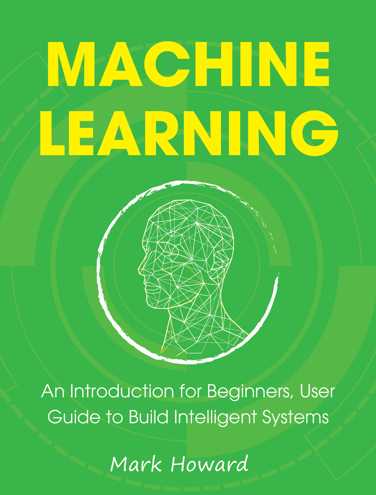
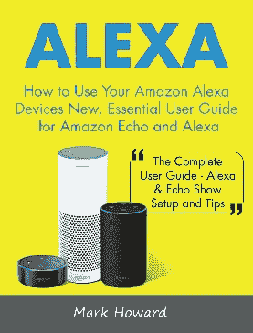

# 机器学习：面向初学者的入门指南，构建智能系统的用户指南




## Introduction

恭喜您下载了机器学习，感谢您的选择。接下来的章节将讨论您需要知道的所有关于机器学习的内容。机器学习无处不在，无论我们知晓与否，它都在我们身边每天发生。在您的工作中，不可能不使用机器学习。随着机器学习的普及，它已被比历史上任何时候都更多的公司所使用，因为机器学习的高效性。在本书的章节中，您将了解机器学习面临的一些问题以及如何解决它们，以及机器学习已经解决的问题。机器学习太棒了，不应该因为技术发展而被轻视，因为技术发展使得机器学习变得越来越普遍。市场上有大量关于此主题的书籍，感谢您选择这本！我们已尽最大努力确保内容尽可能有用，请享受！

## 第 1 章：机器学习

在深入机器学习之前，您必须了解机器学习的概念。机器学习是人工智能的一个分支，其核心思想是系统能够从数据中学习、识别其中的模式，并无需人工干预即可做出决策。如果有人工干预，干预程度也应极小。系统利用收集的数据分析，然后自动根据数据构建模型。那么，机器学习为什么重要呢？因为它与贝叶斯分析和数据挖掘的流行原因相同。随着数据量的不断增长以及数据种类的多样化，计算成本降低，计算能力增强。这使得企业能够存储数据，并更快、更准确地分析更复杂的数据集，快速生成更大、更复杂的模型。这将帮助公司更清楚地了解在哪里可以赚取更多利润，以及在哪里需要谨慎以避免未知风险。正如您在后续章节中将学到的，银行、政府、医疗、营销、交通以及石油和天然气行业都在使用机器学习。它们利用该技术提高效率、发现赚钱机会，并识别需要削减支出的领域。

在机器学习中，有四种流行的方法：监督学习、无监督学习、半监督学习和强化学习。第一种是监督学习，即算法在标记数据上进行训练，以了解输入与期望输出的对应关系。例如，工厂设备的数据点被标记为“故障”（F）或“运行”（R）。算法接收输入及其对应的输出，并通过比较给定的输出与正确输出来学习错误位置。随后，它会相应地修改模型。通过分类、预测、回归和梯度提升等监督学习方法，算法会创建模式，以便在未标记的额外数据中预测标签值。监督学习通常出现在历史数据用于预测未来事件的应用场景。

下一种学习是半监督学习，它通常与监督学习一起应用。半监督学习将标记数据和未标记数据结合用于训练。标记数据通常较少，而未标记数据占大部分，因为未标记数据获取成本低且无需太大努力即可获取。当标记成本过高，无法进行完全标记的训练时，半监督学习将发挥作用，它使用与监督学习相同的方法，但仅在标记成本过高时才有用。

无监督学习用于数据中不存在历史标签的情况，系统没有像监督或半监督学习那样拥有正确答案。第一步是让算法理解它所看到的内容。目标是让机器探索数据，发现是否存在结构。无监督学习也会使用交易数据。

强化学习通常出现在导航系统、游戏和机器人中。强化学习通过试错来让算法“发现”最佳行为，从而获得最大回报。在强化学习中，至少包含三个组件：第一是代理（agent），即决策者；第二是环境（environment），即代理交互的环境；第三是代理所执行的动作（actions）。目标是让代理选择能在一定时间内最大化预期回报的正确动作。只要代理遵循良好的策略（policy），就能更快达到回报。因此，强化学习的目标是找出最佳策略。

机器学习还包括一种学习类别，即程序根据以往经验的 inductive bias 进行学习。发展性学习（developmental learning）等同于机器人学习，程序能根据其经历生成自己的学习序列，通过自我探索和与人类及其他程序的交互，获得新技能的 repertoire。此外，机器学习还包括一种基于输出的类别。

1. 输入的分类将分为至少两类。用户需要构建一个模型，能处理用户未见的输入，这些输入通常来自监督学习，例如电子邮件过滤器区分垃圾邮件和正常邮件。

2. 回归也是监督学习的一种，其输出为连续值，而非离散值。

3. 聚类（clustering）会将输入集分成多个组。但聚类与分类的区别在于，聚类在形成组时用户不需要事先知道这些组，因此这是一个无监督任务。

4. 密度估计将在输入空间中定位输入的分布。

5. 维度降低将输入简化，以便它们可以映射到最低维度。

6. 主题建模会从用户插入的程序中提取问题，并判断插入的文档是否涵盖相关主题。

分类机器学习模型将通过使用保留法等准确率估计技术进行验证。保留法在训练和测试数据集合之前将数据划分，然后在测试集上评估模型的性能。然而，如果查看 n 重叉验证，则会发现数据会随机划分为子集，其中 k-1 个实例用于训练模型，而第 k 个实例用于测试模型的预测能力。与此同时，保留法和交叉验证方法会使用 n 个实例的样本。数据来自数据集，并用于评估模型的准确性。除此之外，研究者还会发现一个总体准确率，并将其报告为特异性和灵敏度，例如真阳性率和真阴性率。这意味着真阳性率和真阴性率有时会报告假阳性率或假阴性率。但正是这些率未能显示分子和分母，导致总体特征曲线（ROC）成为有效展示模型诊断能力的方法。总体特征曲线还会揭示前面提到的率中的分子和分母。这意味着总体特征曲线能提供比单纯的率更多的信息，包括受曲线下面积（AUC），其属于受曲线下面积。由于这些特性，机器学习经常引发大量伦理问题。用于处理收集的数据的系统会因训练数据中体现的偏见而变得有偏见，这会数字化文化偏见。因此，数据收集所带来的责任在机器学习中占据重要地位。由于使用的语言会引发机器学习中的偏见，我们在使用机器学习时，实际上是在使用经过偏见训练的机器。

## 第 2 章：机器学习中的主要问题

机器学习仍在不断发展，并且每天都在被使用。随着使用的增多，我们能够更好地发现问题所在以及需要做什么来解决它们。有些问题目前尚未得到解决，但这并不意味着未来不会有解决方案。一个问题是自然语言处理和语言理解在机器学习中仍然是一个挑战，即使是最深层的网络也难以应对。由于众多语言和方言的存在，机器很难辨认所说的内容。但这并不阻止它们尝试。Siri 和 Cortana 等程序不断更新，以更好地服务于用户。

图像可以通过机器学习进行分类，但无法理解图像内部的具体情境。要真正理解图像内容，就无法进一步分类。不过，我们可以确定图像中影响因素的位置，并尝试在相同风格下重现作品。这也指向语义分割的解决——机器需要学会识别每个像素的含义，从而更好地理解图像。

深度强化学习也需要得到稳定。如果没有损坏，为什么还要去修改？有时旧方法效果最佳，没有必要对已经运行良好的模型进行调整。一旦深度强化学习得到稳定，就能让其处理目前机器学习尚未涉及的更复杂问题，例如《马里奥》中的“复仇”关卡。稳定的强化学习还能够指数级提升机器人控制的可能性，可能性无限。机器人能够找到获得奖励的最佳方式，换句话说，它们可以像人类一样行动，但拥有明确的激励机制，决定应做什么才能获得奖励。

生成对抗网络（GAN）是一种作用于特定人工智能类别的生成模型，属于无监督学习范畴，由两个神经网络在零和博弈框架下相互对抗组成。虽然它们在游戏领域表现出色，但因高度稳定且经常导致崩溃，使得游戏变得更具挑战性。

深度网络的训练同样是一个问题，因为“梯度碎片”论文证明，当前从事机器学习的人尚未完全掌握如何正确训练网络。这也说明，目前人们对深度网络的工作原理并不完全清楚。虽然有人撰写论文阐述深度网络的必要性，也有人撰写论文指出其不必要性，导致情况更加复杂。那么，深度网络到底是为了什么？我们真的需要它们吗？

最后，还需要让人们停止过度担忧诸如 Skynet 这类问题以及经济影响。首先，Skynet 是《终结者》电影中的虚构公司，根本不会实现。在机器人能够自行决策之前，必然会有安全机制防止机器人反叛并伤害人类。Skynet 仅是一部深受数百万观众喜爱的电影系列的情节设定。其次，机器学习的经济影响——随着机器学习的应用，企业能够找出更大利润的方向，从而将更多资金注入经济。除去一些尚未稳定的机器学习技术外，机器学习本身并没有许多问题。我们必须记住，机器学习仍处于起步阶段，正随着技术发展不断被训练，因此需要保持耐心，认识到在问题得到解决之前，还会出现更多挑战。


```
if (condVar > someVal) {console.log("xxx")}
```

如前所述，随着技术的发展，机器学习也在不断演进，因此在找到答案之前，很可能总是需要解决一些问题。即使没有解决的方法，也会有分析数据并获得结果的方法。

下面列出了一些尚未被机器学习解决的问题。

首先，变量事件空间尚未得到解决。为了解决这一问题，我们需要能够创建一个能够在训练数据的事件空间有所不同的情况下，以高效且有意义的方式进行响应的分类系统。

另一个问题是缺乏语言处理的上下文理解。上下文分析对机器学习至关重要，因为它会在理解方面留下巨大的空白，导致误解的可能性。一个可能的解决方案是，OpenAI 团队应开发一种让代理能够自己制定规则的方案，而不是必须寻找模式。

人脸识别正在迅速成为人们解锁设备的流行方式，因为它快速且半安全，可以防止设备被黑客入侵。但这绝不是完美的，因为面部特征相似的人可能会互相解锁手机。而且，如果女性在用于人脸识别的照片中没有化妆，那么她将无法解锁手机，因为她改变了外观。

自动学习是机器学习的重要组成部分，如果机器无法自动学习它需要学习的内容，那么它对使用它的公司就没有用处。学习必须从多种资源中获取，当图表基于缺失的连接感而构建时，自动学习将会受阻并出现缺口。例如，IBM 的 Watson 表现出色，但仍需要一个更偏向人工智能的系统。

在某些机器学习场景中，机器需要基于其在偏离测试空间上的推理做出自己的决策，但这不包括基于规则的引擎。为了进行所需的推理，机器学习需要有空间用于推理或可争论的代理，以帮助其推理。

你是否曾经和 Siri 交谈过，发现她如果你在和她交谈还是在和别人交谈时会感到困惑？这是机器学习在高效回应生成方面存在的问题。换句话说，Siri 除非已经被编程好，或者可以在互联网上查找信息，否则无法创建上下文感知的回应。

三位一体规则也是机器学习面临的一个问题。机器不一定能够理解人类的三位一体规则，即先将图像分类，然后给出描述。如果机器学习能够理解三位一体规则，那么分类艺术、音乐等将会更加容易。

另一个机器学习表现出的问题是其记忆网络。许多人认为使用技术意味着不需要大量存储空间。然而，事实并非如此，因为存储收集的所有数据需要大量空间。机器不是人类，因此无法像人类一样产生思考。但只要我们不把它们推到极限，也不会限制它们到必须由人类完成所有工作，机器是可以被教导的。

技术会遇到障碍，但最终可以解决。其中一个原因是目前还不存在解决该问题所需的技术。

## 第 4 章：可以通过机器学习解决的问题

机器学习正在帮助许多公司以及个人在日常生活中。在这一章中，你将看到一些之前提到的、尚未被机器学习解决的问题。即使对该特定机器学习方法存在问题，也不意味着它不起作用。有时，这些问题可以在以后修复或补丁，而软件会先发布供用户使用，以发现开发者未能捕捉到的潜在问题。

机器学习有助于垃圾邮件检测。当你查看收件箱时，总是会有邮件因其他邮件中检测到的关键词而自动被路由到垃圾邮件箱。然而，某些垃圾邮件仍会通过，因为这些关键词已出现在你的收件箱中。系统会根据你可能希望收到这些邮件的微小可能性来过滤这些关键词到你的收件箱。垃圾邮件检测仍需很长时间改进，但随着规则的不断制定，它正在逐步变得更好。

你是否曾想过，信用卡公司如何知道有人使用了你的卡片？这是因为它们保存了交易记录！每个月，信用卡公司知道你通常去的商店以及大致花费的金额。如果发现任何超出你通常地区或消费习惯的活动，它们会认为卡片被盗并据此报告。这在你计划旅行或花费超过平时时可能会带来问题。虽然不完美，但机器学习正在学习识别信封上的邮政编码，以便将信件按地理位置进行分类，从而加快分拣和递送速度。由于人们书写方式各异，机器有时无法识别手写内容，这仍是一个存在的问题。

如前所述，Siri 能够理解你说的话。但如果其他机器也能做到这一点呢？得益于机器学习，这已成为现实。最大的问题是，每个人都有不同的方言，说的语言也不同。而且，新词几乎每天都在被加入词典中。即便如此，机器对语音的理解仍存在问题，这并未阻止它们尝试履行被请求的任务。

当你在 Facebook 上上传一张照片时，有一个算法会查看照片中人物的面部特征，并询问你是否希望标记该人。这使得被标记的人能够查看照片并在其个人主页上决定是否保留该标记。相同的算法也用于用户在手机或电脑上使用人脸识别软件以解锁设备时的验证。

众所周知，在 Amazon 等网站登录时，会有一个基于你以往购买或浏览记录的产品推荐列表。网站内置的模型会根据你作为个体的特征来制定策略，从而提供更个性化的购物体验。Amazon 和其他使用相同算法的网站希望通过这种方式保持用户的回头率，鼓励他们继续消费。该算法同样适用于 Facebook，因为它允许你登录其他网站，从而提供你可能感兴趣的广告，而非那些不易引起注意的通用广告。

医疗领域必须与技术同步发展，否则会落后。得益于机器学习，医疗行业能够将患者的症状输入计算机，从而生成可能的诊断列表。这并不完全准确，但能够指引医疗提供者正确的方向，帮助他们弄清患者的问题。

在股票交易时，及时知道何时买入或持有股票至关重要，以便获利。机器学习已开发出一种算法，分析财务信息以帮助股票经纪人判断何时交易、何时持有股票。这对许多公司节省了资金，避免了购买无用股票或在股票价值即将归零前持有股票的情况。

人工数据录入存在重复和数据不准确等问题。但得益于机器学习，算法结合预测模型来改善这些问题，学习执行耗时的文档和其他数据录入任务。这为拥有专业知识的人士腾出更多时间，让他们能够专注于更具挑战性的问题解决任务，而无需处理机器能够完成的琐碎数据录入工作。

由百度开发的 Dulight 是一项令人惊叹的发明，旨在帮助视力受损者了解周围环境。它会与一台计算机配合，利用图像识别技术调查其周围的地形，并在耳机中通过语音告知其所见内容。

目前，大多数正在营业的公司都在使用机器学习。它可能不以显而易见的方式直接作用于公众或员工，但即使在简单的数据分析中也在被应用，这有助于它们做出更明智的决策，从而赚取而非亏损金钱。

近年来，机器​​学习已被应用于各个商业领域，并被传递给其他公司以及消费者。机器学习与人工智能相结合，使得新产品能够向公众发布。这些产品随后推动其他产品的推出，并帮助改善了面向消费者的产品。其中一个产品是 Hello Barbie 玩具，它在项链上内置了麦克风。每当孩子说话时，他们的语音会被传输到 Toy Talk 服务器并进行分析，以便发送适当的回复。整个过程只需少于一秒钟完成。Hello Barbie 能够回复 8,000 行对话，并能够保存答案，以便在后续回答诸如孩子最爱食物的存放位置等问题。

可口可乐公司在 200 个国家销售超过 500 种饮料，使其成为全球最大的饮料公司。通过分析每个国家的数据，可口可乐能够了解该国最畅销的饮品，并淘汰销量不佳的饮品。这意味着他们能够最大化利润并最小化利润损失率。

海尼根同样做法，但他们利用人工智能和机器学习来改善其在美国的客户服务、营销、广告和运营，从而实现扩张。

你听说过 Watson 吗？Watson 已被应用于各行各业的多个领域，包括烹饪艺术。Chef Watson 已成为厨房中的副主厨，负责开发食谱并辅助其人类同事，使厨房工作比以前更高效。Watson 还被输入过高迪（Gaudi）的作品图像，以便他能够观察并分析这些作品，从而学习其影响来源。它学习了包括巴塞罗那在内的各种影响，以及文化、传记和历史数据，以便将这些信息与人类艺术家分享，帮助其创作出与高迪风格一致的雕塑。Watson 甚至被赋予了帮助作曲家在音乐元素上获得灵感的算法，并协助他们判断哪首歌曲将成为热门。Watson 通过利用对话、演讲和报纸标题来获取灵感。

BP 是全球能源行业中最大的公司之一，认识到机器学习和人工智能对其行业具有巨大的潜力。通过使用最新的技术，他们能够提升资源利用率和石油和天然气精炼过程的安全性。通过优化运营，他们能够将所有数据交到能够做出高风险决策的人手中，这些决策最终将改变世界。

在能源行业，通用电气（GE）也在使用机器学习、物联网（IoT）和大数据来构建能源物联网，将所有数据全部传输。他们能够优化数据，推动其实现数字化电厂的愿景。

在金融领域，数据量约为 3.6 千 petabytes，且每日持续增长。每天，部分人会通过 Experian 等信用机构查看自己的信用，因此他们从各种营销数据库、公共记录和交易记录中接收到大量数据。他们目前正在改进系统，机器学习使服务能够更快做出决策。他们希望更快地向消费者传递这些决策，避免人们在购买时因等待数日而延迟信用决策。

美国运通公司（American Express）目前使用超过 1.1 亿张正在使用的卡片，并处理超过一万亿美元的交易。因此，他们依赖于专门用于实时欺诈检测的机器学习算法，这为公司节约了数百万美元。此外，AmEx 正在通过开发允许卡片持卡人登录并访问账户的应用来控制数据流，这也有助于他们了解用户的在线业务趋势。

Google 的 Deep Mind 开发了一种能模仿人类思维过程的机器。Deep Mind 已能够在各类游戏中击败人类，但其可能性远不止于此。Deep Mind 有潜力帮助医疗保健领域，从而缩短治疗方案制定的时间，使诊断更快速。

机器学习帮助沃尔沃（Volvo）预测车辆部件何时可能故障或需要保养。这帮助挽救了无数生命。沃尔沃也在开发自己的自动驾驶汽车。

您在使用机器学习时使用的数据集将位于已被同行评审学术期刊引用的数据集中。数据集是机器学习的关键部分，您必须了解它们才能理解机器学习。正如我们之前讨论的，该领域已取得重大进展。得益于用户对计算机硬件的了解、将用于计算的算法以及高质量训练数据集的可用性。

大多数数据集将是受监督的，甚至可能是半监督的，因为它们涉及算法，而由于数据标记的高成本和难度，生成这些算法很困难。如果数据不需要标记，则可以留作无监督，这对大多数公司来说成本过高。

您用于图像数据的大多数数据集将是用于面部或动作识别的集合，同时也用于识别纸上书写的手写体和字符。

文本数据包括人与人之间发送的消息、网上留下的评论、Facebook 或 Twitter 上发布的帖子，或任何输入到任何计算机程序中的文本。

音频数据指任何声音，如语音或音乐，可以放置在计算机上并进行分析。

物理数据是从地球科学、天文学和其他系统中收集的数据，这些系统可以通过物理方式进行测量。

信号数据是用于跟踪电力或其他运动的数据，例如交通在城市中的流动情况。

多元数据是测量天气、互联网流量、金融以及甚至人口普查等数据。

最后，生物数据测量药物发现、植物生长、动物生长和人类生长等。因此，生物数据测量任何可被测量的生物。

## 第 7 章：支持向量机算法

机器学习的一部分是学习如何理解支持向量机算法。人们学习如何使用机器学习算法的最常见方式是先从回归开始。一旦掌握了这一点，后续便会迎刃而解。然而，回归并不是万能的解决方案。在使用机器学习算法时，将算法视为一个包含任何你可能需要的工具的工具箱是有帮助的。但你需要知道如何使用这些工具，以及何时需要切换到其他工具。回归就像一个幽默，能帮助你锁定所需的数据。然而，你无法用锤子（一种用于处理更高级、更复杂数据集的工具）来取出那个螺丝。但支持向量机作为螺丝刀，能够处理较小的数据集，从而为你构建模型提供更坚实的基础。强烈建议你在使用支持向量机之前，先花时间学习如何使用随机森林、朴素贝叶斯算法和集成建模。这些知识将使支持向量机变得更加易于使用。支持向量机属于监督机器学习的分支，它在处理回归和分类算法时都是监督的。不过，它通常用于分类任务。支持向量机的数据点带有坐标，这些点是用于展示两类最佳分隔的边界（例如，直线与高维空间中的超平面）。那么，第一个问题是：如何确定超平面是什么？第一种情况是你有三个平面。一旦你找到了这三个平面，你就可以利用已有的分类结果来识别超平面。记住，你需要选择能最佳分隔两类的超平面。第二种情况是你有三个平面，但它们都能分隔类别。如何判断哪个是正确的平面？对于这种情况，你需要最大化数据点与超平面之间的距离，以确定哪个分隔效果最佳。这个距离被称为边界（margin）。你需要选择边界最大的平面，因为这样更稳健。如果选择边界最小的平面，你会面临对数据点分类错误的高风险。在使用支持向量机时，你会发现使用位于两类之间的线性超平面会更加容易。然而，你可能会想知道是否需要手动在超平面上添加一条直线。答案是否定的，因为支持向量机内置了一个方法，能够将最低维度输入空间转换为最高维度空间（即核技巧）。因此，一个不可分割的问题在于通过核函数将可分问题转换为不可分问题。这在处理非线性分离问题时特别有用，因为它能够处理复杂的数据转换。这些方法能够根据程序用户定义的标签来确定分隔数据所需的过程。Python 拥有 `sci-kit` 这一广泛使用的库，你可以用它来实现机器学习算法。支持向量机也可以在该库中找到，只需使用以下代码。

```
#导入库
from sklearn import svm
#确保你有训练数据集的 x（特征）和 y（目标），以及 x_test（测试数据集的特征）
#创建 SVM 分类对象
model = svm.Svc(kernel='linear', c=1, gamma=1)
#模型的参数选项包括改变核函数、gamma 或 c 值
Model.Fit(x, y)
model.Score(x, y)
#尝试预测结果
predicted = model.Predict(x_test)
```

当你设置机器学习算法的参数时，你将提升模型整体性能。

```
Syntax
sklearn.Svm.SVC(C=1.0, kernel='rbf', degree=3, gamma=0.0, coef0=0.0, shrinking=true, probability=false, tol=0.001, cache_size=200, class_weight=none, verbose=false, max_inter=-1, random_state=none)
```

```
示例
import lumpy as lp
import matholib.Pylot as plt
from sklearn import svm, dataset
import data
iris = dataset.Bring up _ iris( )
x = iris.Data[0:4] #尝试避免丑陋的切片，使用 2-D 数据集
y = iris.Target
c = 26
svc = svm.SCV(kernel=linear, c=3, gamma=4).fit(x, y)
x_min x_max[0:9], min( ) - 7
x[:7], max( ) + 6
h = (x_max / x_min) / 4
xx, yy = pu.Meshgrid(pi.Arrange(x_min, x_max, h) pi.arrange(y_min, y_max, h))
```

使用支持向量机有优点和缺点。让我们看几个。

### 优点

1. 你可以使用子集训练点来使任何决策函数更高效，从而节省内存；
2. 它在处理分隔边界时表现更好；
3. 当特征维度大于样本数量时，它在多维空间中表现更有效；
4. 它能在高维空间中工作。

### 缺点

1. 如果数据集包含额外噪声，它的表现会下降；
2. 它无法直接提供概率估计；
3. 由于训练时间过长，无法使用大规模数据集。

## 第 8 章：使用 Python 进行机器学习

Python 是一种编程程序，你可以用它来完成几乎所有需要在编写自己的程序时进行的编码工作。由于 Python 会根据你提供的输入给出输出，所以你将使用机器学习！Python 的大部分功能是无监督的。有些部分需要监督，因为你将在寻找特定的结果。

如果你想使用 Python 来利用你正在进行的机器学习，那么在你尚未了解它们之前，你需要知道几件事。Python 极其灵活，你可以进行极其具体的计算，然后将其转换为机器学习。如果你尚未安装 Python，则需要在你的计算机上安装它。你还需要获得与机器学习兼容的包。强烈建议你安装 Anaconda，因为它是工业级实现，能够在任何操作系统上使用，并且包含你在使用机器学习时所需的所有包。

使用机器学习的主要目标将定义数据科学家的角色。使用机器学习算法的数据科学家种类繁多。你还需要了解核方法，以便能够从你正在使用的支持向量机模型中获得洞察。

当你处理数据科学时，你需要将数据加载到程序中。你所使用的学科必须能够处理你观察和收集的数据。你将把这个数字数据集加载到 `scikit-learn` 所在的 Python 库中。要加载你的数据，你需要将 `scikit-learn` 库中的模块导入 Python，并使用你获得的数据集。

随后，你将有机会使用从你导入的数据集中加载的 `load_digits()` 函数。语法：`from sklearn import Digits = datasets.load_digits()`，`Print(______)`。此时，你应该注意到该模块将保存其他方法，用于获取当前正在使用的最流行数据集的引用。因此，即使你没有人工生成数据，也可以始终依赖该模块工作。请记住，如果你下载数据，它已经会在测试集和训练集之间分离。你可以通过文件扩展名区分两者：`.tra` 是训练集，`.tes` 是测试集。这两个文件都需要加载，以便你的项目得到完善。

当你开始处理数据集时，需要观察数据描述，以便了解你将从该数据中学习什么。使用 `scikit-learn` 时，数据不会自动提供。因此，你需要从其他来源下载数据，通常可以在该来源中找到描述，从而获得足够的信息来处理你的数据集。注意：你获得的洞察可能不足以满足你对数据的使用需求。你需要对数据进行探索性数据分析，以便了解数据将如何被使用。如果你尚未检查描述，或者需要再次确认，你需要特别关注描述中的基本信息。加载后，数字数据会通过 `scikit-learn` 数据集打印出来。你可能因为目标值而已经知道很多关于你所寻找的信息。你需要通过 `data` 属性访问数字数据，这与通过 `target` 属性访问目标值的方式相同。描述将通过 `descr` 属性提供访问。如果你需要查看正在使用的数据的键，请使用 `digits.Keys()` 函数。例如：

```
Print(digits.____) # 打印你正在使用的数据
Print(digits.____) # 打印目标值
Print(digits.____) # 获取数据集的描述
Print(digits.descr)
```

如果阅读 `read_csv()` 函数，你将能够导入你的数据，从而查看包含你想要数据的数据框。对于你正在使用的数据，不会有描述。在这种情况下，你将使用 `head()` 或 `tail()` 函数来恢复数据，以便再次检查。当你使用这些方法时，你需要阅读数据的描述！现在你可能在想如何访问数据的数组。答案是，你仍然使用与数组关联的属性。请记住，当你使用 `digits.Keys()` 函数时，这些属性将可用。例如，如果你尝试使用 `data` 属性来孤立数据，你可以使用 `target` 函数来找到目标值，同时使用 `descr` 来获取描述。那么现在呢？首先，你应该确定数组创建的维度数量，这由数组中的项目数量决定。数组的 `shape` 将是一个元组，告诉你每个维度的大小。例如 `Y = pi. Zeros((4, 2, 5))` 这意味着你的数组将被形状为 (4, 2, 5) 的点。要查看数组的形状，你将使用 `target`、`descr` 和 `data` 函数。第一步是使用 `data` 函数，以便从数字数据中孤立 NumPy 数组，然后使用 `shape` 属性来发现数组的形状。你将使用 `target` 和 `descr` 执行完全相同的操作。另一个可用的属性是 `images`，它会以图像形式显示数据，而不是数字。例如：

```
#分离你的数字数据
digits_data = digits.data
# 查看数字数据的形状
Print(shape for the digits data)
# 孤立目标值
Digits_target = digits.____
# 再次查看形状
Print(target function)
# 打印唯一标签的数量
Number_digits = len(np.Unique(digits.Target))
# 孤立图像
Digits_images = digits.Images
# 再次查看形状
print(image shape)
```

最后，如示例所示，图像数据必须包含形状的维度。你可以通过重塑图像，使其不再是三维而是二维来直观检查图像和数据函数。你可以使用 `digits.Images.reshape(instances and pixels)` 进行此操作。你也可以使用更长的代码片段以确保图像的重塑完全正确。

```
Print(np.All(digits.Images.reshape((instances and pixels)) == digits.Data))
```

当你使用 NumPy 方法时，你将使用 `all()` 方法来测试数组在轴向上的元素，以便查看你的评估是否为真。如果结果为真，则重塑后的图像将等于 `digits.Data` 函数。一旦你对所学内容感到自信，你就可以开始处理更复杂的情况，在那里你可以可视化你正在处理的图像。Python 有可视化库 matplotlib，专门用于此目的。

```
Import matplotlib.pyplot as plt
Fig = plt.Figure(figsize = 6, 6))
Fig.subplots_adjust(left = 0, right= 1, bottom = 0, top = 1, hspace = 0.05, wspace = 0.05
For i in range(64):
    Ax = fig.add_subplot(8, 8, i + 1, xticks = [], yticks = [])
    Ax.imshow(digits.Images[i], cmap = plt.cm.binary, interpolation = 'nearest')
    Ax.Text(0, 7, str(digits.target[i]))
Plt.Show()
```

你刚刚看到的语法将被大量使用，可能看起来有些令人望而却步，但你可以将代码分解为块，以便更容易理解和操作。

1. `matplotlib.pyplot` 将被导入；
2. 你会将图表调整到你想要的尺寸，因此子图的大小保持一致；
3. 子图的设置将由你的参数决定，从而让你有调整图像布局的选项；
4. 完成以上操作后，你会填充图表；
5. 子图需要初始化，这可以通过将每个子图放置到合适的网格位置来实现；
6. 现在图表已填充，你可以初始化子图；
7. 每个点的添加都会在网格上的图像上显示，就像彩色地图一样。插值方法会对网格上的数据进行插值，使其不完全平滑；
8. 最后一步是向子图中添加文本；
9. 最后，切记使用 `plt.show()` 函数绘制点。

## 第 9 章：Keras 与机器学习

如果你关注最新的技术新闻，你就会知道 Tensorflow。这是一个由 Google 于 2015 年开源的机器学习框架，受到公众热烈欢迎。如果你以前从未使用过机器学习，那么这个框架会对你来说很难理解。但这可以通过 Keras 来解决，Keras 可以与 Tensorflow 以及其他几种机器学习框架一起使用，构建更快、更易用的神经网络。当你设置 Keras 时，你会想要下载与 Python 兼容的 Anaconda 发行版。如果你之前未使用过它，你会发现它使用非常简单。安装 Anaconda 后，你会进入 Anaconda 的 bin 目录中的 CD 并运行以下命令以确保一切正常工作。

1. `pip install pandas`
2. `pip install Tensorflow`
3. `pip install Keras`

现在你知道一切都已正常工作，你就可以开始使用了！如果你以前从未使用过 Python，这没关系，因为你只需要了解程序的基本工作原理。如果你想在更复杂的层面使用 Python，那么学习如何在个人和职业生活中使用 Python 的每个方面会很有帮助。Keras 使用的数据集将处理一个包含患者到达就诊次数与取消就诊次数特征的数据集。你将使用这些特征构建神经网络，以预测患者将出席其就诊的次数。第一步是准备数据，然后才能训练模型。你需要读取数据并将其分为两个变量：一个是患者的特征，另一个是不出席的情况。

```
import pandas as pds
Dataframex = pds.read_csv(no show issue comma 3000k. csv, usecols = [ 0, 1, 4, 6, 8, 9, 10, 11, 12, 13])
Dataframe y = pds.read_csv(no show issue comma 300k csv, usecols = ([ 5]))
Print(dataframe x.head())
Print(dataframe y.head())
```

在将数据导入程序后，你会发现有几个特征无法用数字表示，这将通过 `pandas` 库进行转换。此时，你需要将特征的值替换为数字，并对 `y` 数据框同样进行操作。在创建神经网络时，你需要先构建模型，然后在 Keras 中进行训练。你会将模型描述为一个顺序层的数据流，该流会在程序中经过处理。完成后，你会将其放入数据集并相应地训练模型。

```
import numpy as np
Seed = 9
np.random.seed(seed)
from keras.models import sequential
from keras.layers import dense
Model = sequential()
Model.add(dense(12, input_shape = 11, init = 'uniform', activation = sigmoid))
Model.add(dense(12, init = 'uniform', activation = sigmoid))
Model.add(dense(12, init = 'uniform', activation = sigmoid))
Model.add(dense(2, init = 'uniform', activation = sigmoid))
Model.summary()
import keras
Tbcallback = keras.callbacks.Tensorboard(log_dir = /tmp/keras_logs, write_graph = true)
Model.compile(loss = 'mean_squared_error', optimizer = Adam, metrics = [accuracy])
Model.fit(dataframe x.values, dataframe y.values, epochs = 9, batch_size = 43, verbose = 2, validation_split = 0.3, callbacks = [Tbcallback])
```

为了理解你刚刚做的事情，我们将其分解为步骤。首先，你会使用常量种子来生成伪随机数，以便每次使用时都能得到相同的序列，这在使用不同模型并比较性能时很有用。接下来，你会定义神经网络，使其完全连接到使用 sigmoid 函数的层和节点。Tensorboard 将用于可视化正在训练的模型。模型现在会使用优化器和损失函数进行训练。epoch 表示数据集被送入网络的次数。`validation_split` 将告诉你有多少数据会被保留用于验证模型的性能。你现在可以使用 Tensorboard 通过以下代码可视化已训练的模型：在 Anaconda 的 bin 文件夹中运行 `tensorboard – logdir = /tmp/keras_logs`。

## 第 10 章：Theano 与机器学习

Theano 是另一个 Python 库，你可以使用它定义、优化和评估包含多个数组和维度的各种数学方程。Theano 与 Keras 类似，但使用不同的命令，允许你用 Python 编写自己的文档。语法 `Python. / doc/ scripts/ docgen. Py` 你也可以使用 HTML 或 PDF 来生成文档。Theano 将是导入 Python 时使用的分发目录，它包含你正在使用的包。但有多个子模型可供选择，以便实现你的目标。`Sandbox` 将依赖于你使用的其他代码。`Gof` 加 `compile` 是核心命令。`Scalar` 将取决于核心内部的内容。`Sparse` 依赖于 `Tensor`。`Tensor` 依赖于 `scalar`。`Theano/ examples` 是程序或网络中已有的示例的复制件。`Theano/benchmark` 和 examples 是程序的分发内容，但不会随 Python 包一起安装。`Theano/bin` 包含在 bin 文件夹中复制的所有可执行脚本。Tests 是随包分发的测试部分，会落入相应的子模型。`Theano/doc` 是用于创建文档的文件和脚本。`Theano/html` 是生成文档的程序区域。每个命令都可以与机器学习一起使用，只要你像使用 Keras 那样编写代码。

## 第 11 章：神经网络与深度学习

神经网络是一种受生物学启发的编程范式，用于让计算机从观察到的数据中学习。深度学习是一套技术，你将用于神经网络。神经网络和深度学习都将为你提供解决在图像、语音和自然语言识别与处理时可能遇到的任何问题的最佳方案。人类的视觉系统复杂，是你可以研究的最有趣的事物之一，因为你永远无法完全理解它如何与身体其他部分协同工作。以书写为例，许多人能够看见某段文字并毫不费力地告诉你它写的是什么，但实际识别文字所付出的微小努力却具有欺骗性。如果你观察大脑的不同半球，你会发现你的视觉皮层有数百万个神经元相互连接。然而，你的视觉并不会直接与视觉皮层相连，而是通过一系列皮层传递，使视觉信息到达能够处理最复杂图像的区域。大脑内部本质上是一个经过进化精心优化的超级计算机。识别书写并非总是轻松，但你的大脑已经适应了这种能力，使你能够不自觉地完成它。我们很少有机会思考视觉系统的真正复杂程度。就像很难识别视觉模式一样，计算机也不会遇到这些问题。但它的工作方式与人类不同。我们的大脑识别形状和书写方式，但如何向计算机传达这一点呢？你需要制定规则，而这些规则最终会因你为处理例外和边界情况而创造的繁复规则而丢失意义。神经网络的方法则截然不同。它会将大量手写数字作为输入，并训练模型识别各种形状，从而实现类似人脑的功能。基本上，神经网络会利用数据中的示例来推断其内在的识别规则。你添加的训练示例越多，网络越能学习书写的各种变体，提高准确率。神经网络会使用一种称为“感知器”的人工神经元，该感知器于 60 年代由 Frank Rosenblatt 提出。但从今天的角度来看，它的使用方式与其他人工神经元模型相同。你的主要神经元被称为“逻辑函数”（sigmoid neuron），但要理解逻辑函数，必须先理解感知器。感知器会接收多个二元输入并输出一个二元结果。Rosenblatt 提出了一个规则，用于确定感知器的输出。在此过程中，权重（weights）作为表达实数及其对输入输出重要性的方式出现。神经元的输出要么是 0，要么是 1，它会根据加权和与阈值的大小关系来决定。阈值是一个实数，作为神经元的参数使用。你可以把感知器看作一种通过权衡证据做出决策的设备。例如，如果你计划一次家庭出游，需要考虑以下几点来决定是否按计划进行：

1. `Is the car big enough for everyone that wants to go?`
2. `Is the weather going to be good?`
3. `What do you need to pack for the amount of time that you are going to be out?`

每个因素都可以用二进制变量来表示。通过查看问题的权重和阈值，你将能够为决策过程创建不同的模型。你的感知器将在你能否外出时成为决策者。当你去掉阈值时，你大概率能够和家人外出。请记住，你的感知器并不是人类能够进行的完整决策过程的完整模型。然而，你的感知器能够权衡不同的证据，做出你需要的决定。这对于由多个感知器组成的复杂网络来说更为合理，这些感知器会做出你可能察觉不到的微小决策。虽然学习算法听起来像是正确的方向，但你将如何为神经网络创建一个算法呢？考虑到你可以拥有一个用于感知器的网络来解决问题。网络的输入将类似于被扫描到程序中的原始像素数据。这将使网络能够学习输出的权重和偏置，从而正确分类结果。如果你对网络中的权重进行任何更改，输出将相应地改变。然而，感知器的现实是，当权重发生变化时，感知器可能会完全翻转，这会导致整个网络的行为发生完全的改变，转变为更复杂的行为。因此，即使一个数字被正确分类，你的网络也会表现得难以控制。新的行为会使你看到如何调整权重和偏置以使网络更接近你想要的行为变得困难。因此，必须有一种巧妙的方法来规避这个问题，这可能瞬间并不明显。你可以通过引入一种新的神经元—— sigmoid 神经元来解决这个问题。这些神经元类似于感知器，但经过修改，当你进行微小变化时，它们只会在输出上产生微小的变化，而不会导致输出完全改变。这一点至关重要，sigmoid 神经元将能够学习网络的行为。你的 sigmoid 神经元将拥有与感知器相似的输入。然而，它能够接受介于零和一之间的任何值。这意味着你可以将这两个数字之间的小数作为有效输入。就像感知器一样，sigmoid 神经元也有每个输入的权重以及一个偏置，涵盖该神经元的所有内容。然而，它的输出并不是零或一，而是 sigmoid 函数，由以下方程定义：σ(z)≡1/1+e^−z 另一种观察方式是将 sigmoid 神经元的输出与输入结合：1/1+exp(−∑jwjxj−b) 当你第一次看到 sigmoid 神经元时，它们看起来与感知器非常不同。但 sigmoid 函数的代数表达式看起来晦涩难懂，似乎难以掌握。不过，你会掌握它，因为感知器和 sigmoid 神经元之间有许多相似之处。要理解这些相似之处，你需要查看感知器模型，如 z≡ w⋅ x+b，其中 z 取一个很大的正数。这意味着 e^−z≈0，σ(z)≈1。最终，sigmoid 神经元将是一个很大的正数，就像感知器一样。现在，想象你在使用负数进行工作，那么 sigmoid 的行为将和感知器相同。只有在微小尺度上，sigmoid 才会与感知器模型出现偏差。

但是，你的σ的数学形式是什么？事实上，这个变量的确切形式并不重要，因为我们将关注函数的形状。如果这个函数是阶梯函数，那么你的 sigmoid 神经元将会变成感知器，因为输出要么是零要么是一，取决于你的方程给出的输出是正还是负。当你使用σ函数时，你将得到一个平滑的感知器。虽然函数的平滑程度很重要，但它并不需要花费太多时间去关注。平滑度仅仅会修改权重和偏置，从而改变 sigmoid 神经元的输出。得益于微积分，你的输出将由以下方程预测：`Δoutput≈ ∑j ∂ output / ∂wj Δwj + ∂output / ∂b Δb`，你在所有权重和输出中找到的总和将显示出你输出关于权重的偏导数。如果你对偏导数感到不适，不要太担心。你的表达式看起来会因为包含大量的偏导数而显得复杂，但实际上通过将输出视为线性函数，你会发现它其实相当简单。线性化会让你更容易找出对权重和偏置进行的小幅度变化，从而提取你想要的输出变化。因此，你的 sigmoid 神经元的行为将和感知器相同，这将使你更容易确定如何调整权重和偏置以改变输出。如果形状是最重要的，那么它并不关心确切形式，这也是方程中出现 o 的原因。当你查看导致使用不同激活函数的变化时，方程中的那个偏导数的值将会发生变化。因此，当你稍后计算这些导数时，你的函数会运用代数并简化它，使得指数具有可在求导时使用的性质。当你解释 sigmoid 神经元的输出时，你会发现其中一个最大的区别在于感知器和那些不输出零或一的神经元。它们可以输出任何实数，只要该数值在零到一之间。这在你希望输出表示图像中像素的平均强度时会很有用。然而，这有时也会是个问题。例如，如果你希望输出图像是“九”或者“不是九”，那么使用输出为零或一的感知器会更容易实现。但在实践中，你需要设立一种惯例来处理这种情况。这将使你能够解释至少图像的一半的输出，从而指示你想要的数值。这意味着任何小于一半的输出都不会是你想要的结果。

## 结论

感谢你阅读完这本《机器学习》一书，希望它 informative 且能提供你实现目标所需的所有工具，无论目标是什么。下一步是开始你的机器学习之旅！如果你不使用机器学习，那么可能是时候开始使用它了！从这本书中，你可以看到使用机器学习的各种方法，以及你将能够用机器学习做的诸多事情。你甚至可以使用编程工具配合机器学习，从而操控你得到的输出。最后，如果你觉得这本书有用，在亚马逊上留下评论总是受到欢迎！谢谢，祝好运！Mark Howard

## Check Out Other Books

Go here to check out other related books that might interest you:

Kindle Fire HD 10 Manual: The Complete User Guide with Instructions, Tutorial to Unlock the True Potential of Your Kindle HD10 Fire Tablet in 30 Minutes [`amzn.to/2zVr3rq`](https://amzn.to/2zVr3rq)

Alexa: How to Use Your Amazon Alexa Devices New, Essential User Guide for Amazon Echo and Alexa (The Complete User Guide-Alexa & Echo Show Setup and Tips) [`amzn.to/2NuBeFe`](https://amzn.to/2NuBeFe)

Kindle Fire HD 8 & 10 Tablet with Alexa: How to Use Kindle Fire HD, the Complete User Guide with Step-by-Step Instructions [`amzn.to/2NMvarM`](https://amzn.to/2NMvarM)

Amazon Echo Show User Guide: Amazon Echo Show with Step-by-Step Instructions, Amazon Echo Setup (The Complete User Guide) [`amzn.to/2NOSdm7`](https://amzn.to/2NOSdm7)

Kindle Fire HD Manual: The Complete Tutorial and User Guide for Your New Kindle Fire HD Device in 30 Minutes [`amzn.to/2AAuwMw`](https://amzn.to/2AAuwMw)

Fire Stick: Essential User Guide for Amazon Fire Stick, How to Unlock Your Fire Stick Like a Pro (Amazon Fire TV, Amazon Fire TV Stick, Amazon Fire TV Cube) [`amzn.to/2Mypamo`](https://amzn.to/2Mypamo)

Amazon Echo Dot - 2nd Generation Amazon Echo Dot with Alexa: How to Unlock the True Potential of Your Echo Dot, Learn to Use Your Echo Dot Like a Pro [`amzn.to/2KZ6VVL`](https://amzn.to/2KZ6VVL)

Kindle Fire HD8 Tablet: How to Use Kindle Fire HD, the Complete User Guide with Step-by-Step Instructions, Tutorial to Unlock the True Potential of Your Device in 30 Minutes [`amzn.to/2Lctd6E`](https://amzn.to/2Lctd6E)

Alexa and Amazon Echo Dot: The Complete User Guide with Step by Step Instructions, User Guide to Master Your Amazon Echo Dot and Alexa (Two Book Bundle) [`amzn.to/2BPTpUU`](https://amzn.to/2BPTpUU)

Kindle Fire HD 8 & 10 Instructions: The Complete User Guide with Step by Step Instructions, Learn to Master Your Kindle Fire HD 8 & 10 Tablet in 1 Hour (Two Book Bundle) [`amzn.to/2oi4QeK`](https://amzn.to/2oi4QeK)
