# R 使用指南 QPCR 数据机器学习分析


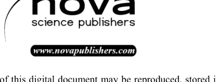


- **电子记录完整性要求**
  Orlando López  
  2022 ISBN: 978-1-68507-553-8 (精装本)  
  2022 ISBN: 978-1-68507-726-6 (电子书)

- **用于数据驱动决策的预测分析 – 解决现实世界问题的工具与技术**
  B. Uma Maheswari, PhD, L. Ashok Kumar, PhD, R. Sujatha, PhD  
  2022 ISBN: 978-1-68507-650-4 (精装本)  
  2022 ISBN: 978-1-68507-770-9 (电子书)

- **大数据分析的十大挑战**
  Maria José Sousa, PhD, Manuel Au-Yong Oliveira (编辑)  
  2021 ISBN: 978-1-53619-133-2 (精装本)  
  2021 ISBN: 978-1-53619-189-9 (电子书)

- **脆弱群体性行为调查工具的验证**
  Lubia del Carmen Castillo Arcos (编辑)  
  2020 ISBN: 978-1-53618-340-5 (精装本)  
  2020 ISBN: 978-1-53618-471-6 (电子书)

- **复杂相关与聚类数据的统计建模：非洲家庭调查**
  Ngianga-Bakwin Kandala, PhD, Lawrence Kazembe, PhD (编辑)  
  2019 ISBN: 978-1-53615-981-3 (精装本)  
  2019 ISBN: 978-1-53615-982-0 (电子书)

有关本系列的更多信息，请访问 https://novapublishers.com/product-category/series/research-methodology-and-data-analysis/。


## 致读者

出版商已在准备本书时尽到合理注意义务，但不对任何明示或暗示的保证承担责任，也不承担因错误或遗漏而产生的任何责任。出版商不对因本书所含信息而引起或与之相关的附带或后果性损害承担任何责任。出版商不对读者因使用或依赖本材料而全部或部分产生的任何特殊、后果性或惩罚性损害承担责任。基于政府报告的本书任何部分均已标明，且对该类作品汇编所适用的版权已主张。

应寻求对本书所含任何数据、建议或建议的独立验证。此外，出版商不对因使用或依赖本书中包含的方法、产品、说明、观点或其他内容而对人员或财产造成的任何伤害和/或损害承担任何责任。

本出版物旨在提供有关所涵盖主题的准确和权威信息。它是在明确理解出版商不提供法律或其他专业服务的条件下出售的。如果需要法律或其他专家协助，应寻求合格人士的服务。来自美国律师协会委员会和出版商委员会联合通过的参与者声明。

本书电子书版本可能提供额外的彩色图表。


本书献给过早离世的 Bruno，以及我的第一位真正导师 Sascha Venturelli 教授。


## 致谢

我谨感谢意大利威尼斯实验动物疫病研究所病毒学实验室的 Dr Maria Serena Beato 和 Dr Lara Cavicchio 慷慨提供 SIV 数据集。我还要感谢 *maxRatio* 的发明者 Mr Eric Shain，多年来合作期间给予我宝贵的支持、耐心以及对稿件的批判性审阅。

## 引言

定量聚合酶链反应（qPCR）是一种用于定量核酸的多功能且流行的检测方法。随着每项检测中反应数量的近期扩展，需要一种准确的方法来报告适合自动化的<|message|> 数据。本书将描述这样一种基于机器学习分析的方法，并使用公开可用的工具实现它。本书面向研究人员，将提供对编程语言 R 的详细介绍，包括最常用函数的相关参考。因此，本工作将为领域专家提供 qPCR 数据客观分析的先进策略，并为学生提供 qPCR 和计算分析的入门。

## 第1章

### qPCR 在疾病诊断中的作用

### 柯赫假设作为诊断的基础

路易·巴斯德提出的微生物学说（Casanova and Abel, 2013）有一个重要推论：为了确认传染病的诊断，医生必须以某种方式从患者的标本中回收疑似微生物病原体。这并非一直如此：许多受人尊敬的教授和医学从业者强烈反对巴斯德提出的论点，以及为数不多的人如 Friedrich Henle、Edwin Klebs 和 Robert Koch 关于微生物在疾病建立中作用的论点。在当时，主流医学更倾向于空气和其他污染物作为病因因素（Elliott, 1870; Williams, 1871; Burns, 2007）。

在 1882 年发表的一项开创性工作中，Koch 撰写了关于细菌在结核病发展中作用的研究（Koch, 1882）：

> 为了证明结核病是一种寄生性疾病……有必要从体内分离出杆菌：在纯培养中生长它们……并通过将分离出的杆菌给予动物来重现相同的病变状态。

他在 1890 年强调了这些观察（Koch, 1890）：

> 如果可以证明：第一，寄生虫在特定疾病的每个个体病例中均可发现，并且在与疾病的病理变化和临床过程相符的条件下出现；第二，在任何其他疾病中均未发现作为偶然的非致病性客人；第三，如果从体内完全分离出来并以足够频率进行纯培养，它可以重现该疾病——那么它就不能再被视为偶然的伴随现象。


这种证明最初是为细菌性疾病设计的，但很快就显而易见，并非所有传染病都能满足这些要求。科赫本人不得不修正自己的论述（Koch, 1890）：

因此我们可以完全断定，如果仅满足证明的前两个要求，寄生虫与疾病之间的因果联系就被有效证明了。基于此，我们必须承认，尽管动物实验感染迄今为止失败或仅部分成功，但有一系列疾病仍应被视为寄生性疾病。

不仅一些致病细菌难以培养，而且随着病毒学领域的兴起，研究人员和医生发现致病微生物不能直接分离培养，需要支持细胞才能生长；朊粒的出现使情况变得更加复杂（Rivers, 1937; Fredricks and Relman, 1996）。上述规则在1884年由科赫最著名的学生之一弗里德里希·勒夫勒（Friedrich Löffler）在介绍其关于白喉病原体分离结果时命名为‘postulates’，白喉病原体为白喉棒状杆菌 Corynebacterium diphtheriæ（Walker et al., 2006; Gradmann, 2014）。Koch's postulates 可概括为以下几点：

- 致病微生物必须存在于所有患病宿主中。
- 致病微生物必须从患病宿主中分离出来。
- 将分离出的致病微生物接种到健康宿主中必须导致与供体相同的疾病。
- 致病微生物必须从新死亡的宿主中重新分离出来。

这些假说在多年间多次改变，以适应微生物学最新发现（Evans, 1976）。例如，随着分子生物学的兴起，其焦点从完整的细菌转向了它们的基因序列（Falkow, 1988）：

- 某一特定表型应与某种病理相关联。
- 与致病表型相关的基因的特异性失活应导致致病性可测量的丧失。
- 等位基因替换应导致致病表型的恢复。

这种方法甚至允许将病毒感染与多种类型的癌症联系起来（Pagano et al., 2004）。微生物学领域更现代的定义考虑到了菌群失调的概念，即在健康个体中发现的共生物种丰度的改变（Petersen and Round, 2014）。事实上，基于大规模平行测序（MPS）的微生物组研究带来的最新进展表明，像诺如病毒这样的病原体（被称为病原共生体，因为它们同时是病原体和共生体）已存在于患者体内，但在正常条件下并不引起疾病。正是整个微生物群落的失衡加上免疫紊乱触发了疾病进展。这一观点已被纳入改良的科赫假说（Neville et al., 2018; Vonaesch et al., 2018）：

- 在健康状况相似的宿主中观察到相似的菌群失调状况。
- 失调微生物可以从受影响的宿主中获取。
- 将获取的微生物引入无菌动物，结合相似的饮食和环境，应导致与原始宿主相同的健康状况。
- 失调微生物的组成保持相对稳定。

将与肠道慢性炎症相关的细菌物种引入健康小鼠的肠道，导致这些受体出现结肠炎（Schaubeck et al., 2016）。尽管如此，在患者样本中回收目标（无论是微生物还是遗传）仅表明目标本身与患者疾病之间的关联，但单独并不能证明因果关系。在20世纪60年代，奥斯汀·希尔（Austin Hill）提出了一系列必须满足的标准，以证明候选病原体导致疾病，这在很大程度上扩展了科赫假说（Hill, 1965）：

- Strength. 必须有大量间接证据（即流行病学证据）证明目标（即因素）和疾病的存在，正如科赫假说所述。
- *Consistency.* 流行病学证据必须由不同的人在不同地区和时期证明，以避免任何偏倚。这对于罕见疾病尤其重要。
- *Specificity.* 因素必须与特定疾病相关联，而非多种状况。然而，一些疾病可能有多重原因，且某一因素可能导致一种以上疾病。
- *Temporality.* 因素必须先于疾病出现，正如原因先于结果。因此感染必须在疾病之前发生，正如科赫所述。
- *Gradient.* 对因素的更高暴露应与疾病更高频率（或结局恶化）相关。
- *Plausibility.* 因素暴露与疾病发展之间的因果关系必须由逻辑模型解释。
- *Coherence.* 模型应解释与因素相关的所有现象，而不排除不符合的数据。
- *Experimentation.* 模型应在实验室中进行测试以确保其可靠性。这尤其相关，因为统计分析可以提供关联强度的测量，但不能证明因素与疾病之间的因果关系。
- *Analogy.* 因素的作用模式通常与另一因素相似。例如，致癌人乳头瘤病毒和JC病毒都会损害抑癌基因p53，并且都可导致癌症。这些病毒编码与p53相互作用的蛋白，尽管蛋白不同，但它们诱导类似的分子通路。

尽管将病因因素（无论是微生物、蛋白质还是基因）与疾病关联存在实际问题，一旦联系被确认，诊断的目标就是识别受疾病影响人群中该因素的存在，以便开始有效治疗。例如，严重急性呼吸综合征冠状病毒（SARS-CoV）的诊断基于标本中病毒基因组存在的实验室确认，同样，出血热、疟疾、炭疽和结核病的诊断也是如此，仅举几例（Sweeney et al., 2011; Long, 2015; Kaushik et al., 2016; Mukkala et al., 2018）。

Koch's definition for molecular biology 特别相关，因为它关注的是相对易于检测的元素（基因序列）。如前所述，科赫本人就意识到一大类细菌难以培养和分离（这些被称为 fastidious bacteria），而病毒学后续的发现扩大了这种担忧。相反，遗传物质可以从样本中分离出来，而不依赖微生物的活力。此外，遗传物质是所有生物共有的；因此，遗传病也可以纳入疾病诊断的探索中。例如，从高胆固醇血症到动脉粥样硬化和癌症等病理状况的诊断，均基于与这些疾病相关的特定基因序列的鉴定（Stehbens, 1991; Brown and Goldstein, 1992; Garcion et al., 2009; Hudecova and Chiu, 2017; Sulc et al., 2020）。每个物种甚至每个个体的遗传特征都是独一无二的这一事实意味着，可以通过检测其基因组来确定样本中几乎任何活生物的存在。这对医学和微生物学领域来说都是一个重大飞跃，因为它省去了繁琐且效率低下的培养和代谢、形态或血清学表征生物体的要求。所需要做的只是回收生物体的核酸并检查回收是否成功。

### Methods to Collect Genetic Material

确定遗传物质在诊断中发挥核心作用后，接下来需要在标本中鉴定它。遗传物质本质上是核酸（NAs）的同义词，核酸要么是脱氧核糖核酸（DNA），要么是核糖核酸（RNA）。NAs extraction from biological samples 已应用近百年，设计了无数方法。尽管如此，这些众多方案的工作原理本质上是相同的，并通过四个连续步骤实现（Ali et al., 2017）。

- Release. 细胞膜的破坏导致细胞内的所有细胞器和分子，包括核酸，被释放到反应介质中。细胞破坏可以


通过机械或化学方法获得。前者通过研磨、珠磨、加热或超声处理进行；后者则使用酶、离液剂（一类扰乱脂双层疏水结构的分子）或去污剂。根据实验方案，可组合使用多种方法。核酸一旦离开细胞，就容易被核酸酶降解，尤其是RNA。因此，提取环境通常含有保护遗传物质的关键成分。阳离子（如Na⁺）通过与核酸的负电荷结合来稳定核酸。螯合剂（如乙二胺四乙酸，EDTA）可去除核酸酶辅因子离子（如Mg²⁺）。还原性化合物（如β-巯基乙醇，βMe）通过改变酶（即核酸酶）的二硫键来抑制其活性。蛋白酶（如蛋白酶K）被添加以去除可能隔离核酸的蛋白质结构。

- *结合。* 核酸被吸附到聚合物、微珠或凝胶等固体结构上。其余细胞碎片与固体结构的亲和力较低，将被洗去。含有poly-A片段的结构可特异性固定mRNA。
- *清洗。* 细胞破碎过程中产生的细胞碎片会干扰核酸的回收。由于不同细胞组分的密度不同，离心提供了将核酸与其他细胞器分离的最简便方法。密度梯度离心法（DGC）于20世纪50年代建立（Meselson et al., 1957）。该方法将低分子量（MW）物质（最常见的是氯化铯，CsCl）在试管内高速离心，使其密度沿试管长度方向逐渐增大。与CsCl一同离心的大分子将分布在该梯度中离心力与介质密度相平衡的狭窄区域内。其结果是，诸如细胞裂解液中的大分子混合物可被分离成一系列条带，每条条带对应一种特定的细胞器。将DGC与溴化乙锭（EtBr）结合，EtBr是一种在与DNA特异性结合后发出荧光、从而可特异识别DNA条带并通过注射器回收的分子。数十年来，DGC-EtBr一直是常规实验室操作。尽管仍在使用，但DGC-EtBr已被更省力的技术所取代，这些技术更多地依赖提取流程的后续两个步骤。

et al., 1989）。这些标记包括放射性同位素（能像光一样在照相胶片上感光），而在近代已被荧光染料或生物素所取代。例如，早期旨在证明宫颈癌样本中存在人乳头瘤病毒的研究，依赖于从其他癌症样本中纯化获得的放射性标记探针（Boshart et al., 1984）。

靶核酸与探针之间的杂交是研究和诊断的基本工具。杂交可在细胞内直接进行，若探针连接了荧光团，则该过程称为荧光原位杂交（FISH）。FISH通常通过显微镜评估，这是一种低通量方法，但其最大的问题是灵敏度——每个细胞必须含有大量靶标才能产生可见的荧光。解决ISH不足的一个方案是电泳（Kroczek, 1993）。通过电泳，来自一组细胞的基因组采用物理或化学方法进行分离。随后，片段在电场中迁移，通常在聚丙烯酰胺基质（但琼脂糖也很常用）上实现片段的高分辨率分离。这种电泳形式称为PAGE。尿素或甲酰胺用于变性核酸的三维结构，促进其迁移（Summer et al., 2009; Petrov et al., 2013）。随后，片段用嵌入性染料（如EtBr）染色。PAGE产生一系列条带，类似于条形码（指纹），可用于特异性鉴定物种。PAGE适用于细菌基因组等小型基因组，但对人类基因组而言则较为繁琐。为减少条带数量，可使用探针。这样，只有与探针结合的靶基因组部分能被可视化。为改善探针与靶核酸的退火，片段被转移到尼龙膜上。探针用酶标记以显示杂交体，该过程分别称为Southern（针对DNA靶标）或Northern（针对RNA）印迹（Kroczek, 1993; Southern, 2000）。

由于几乎每种生物的基因组中都存在多态性区域（即特定物种所特有的区域），扩增这些区域可提供进行酶切分析所需的灵敏度。这些多态性区域通常由重复区域构成，其重复次数具有物种特异性（van Belkum, 1994）。例如，大肠杆菌和鼠伤寒沙门氏菌等细菌具有重复性基因外回文序列（REP）和肠杆菌科重复基因间一致性序列（ERIC），而人类则携带可变数目串联重复序列（VNTR）（Jeffreys et al., 1985）和微卫星序列（重复数千次的短核苷酸片段）（de la Chapelle, 2003），这使得能够区分不同个体，为法医学带来了巨大益处。尽管有了这些改进，印迹法仍可能面临灵敏度问题。解决这一不足有两种方案：要么放大信号，要么放大靶标。

假设一个检测系统的灵敏度为一百万任意光单位，而探针在与靶标结合时只能发射一个光单位。再假设样本中只有10个靶标。按此计算，探针结合只能产生10个光单位，因此检测结果为阴性。要获得阳性信号，信号本身或靶标必须以某种方式被放大。

实现信号放大的一种方法是退火一个接头分子，该接头包含一个与目标区域（ROI）结合的位点，以及多个可被探针识别的其他部分。例如，如果一个接头能结合10⁵个探针，那么假设的10个靶标——每个靶标有一个接头结合位点——将产生一百万光单位。使用这种方法的最知名技术之一是分支DNA（bDNA），例如用于病毒诊断（Wilber, 1997; Tsongalis, 2006）。bDNA检测的流程大致类似于ELISA，其灵敏度可与PCR相当（Collins et al., 1997）。

其他信号放大方法基于探针的直接聚合（Yan et al., 2014）（表1）。在这种情况下，每个靶标将成为合成多个探针的模板，从而迅速达到阳性结果的阈值。这些酶促方法在相同温度下进行，因此被归类为等温过程。其中最流行的方法之一是核酸序列依赖性扩增（NASBA），也称为自持序列复制（3SR）（Deiman et al., 2002）。与PCR类似，NASBA使用引物。其中一条引物带有尾部，包含一段被来自T7噬菌体的DNA依赖性RNA聚合酶（DdRp）识别的启动子序列。该引物由来自禽成髓细胞瘤病毒（AMV）的RNA依赖性DNA聚合酶（RdDp，即逆转录酶）延伸。新合成的DNA/RNA杂交体被大肠杆菌RNase H降解，该酶去除原始单链RNA，留下新合成的单链DNA。后者与第二条引物退火，该引物被逆转录酶延伸，产生带有完整T7启动子序列的双链DNA片段。该启动子被DdRp识别，后者开始转录新的RNA分子，这些RNA分子又成为新一轮扩增的模板。与PCR不同，靶标


序列在每个循环中并非简单地被复制，而是可以生成其他多种分子。此外，扩增并非每个循环发生一次（即大约每分钟一次），而是持续进行的，并且引物不像在PCR中那样是反应的限制因素。这两个因素的综合作用意味着NASBA比PCR更快地扩增其靶标，且扩增水平更高。转录介导的扩增（TMA）与NASBA类似，但使用一种专有酶，该酶兼具逆转录酶和RNase H活性（Zhao *et al.*, 2015）。

#### 表1. 一些最常见的等温扩增方法列表

| 名称 | 缩写 | 引物数 | 酶数 |
|---|---|---|---:|
| 聚合酶链式反应 | PCR | 2 | 1 |
| 核酸序列扩增 | NASBA | 2 | 3 |
| 链置换扩增 | SDA | 4 | 2 |
| 环介导扩增 | LAMP | 4 | 1 |
| 滚环扩增 | RCA | 2 | 2 |
| 解旋酶依赖性扩增 | HDA | 2 | 2 |
| 重组酶聚合酶扩增 | RPA | 2 | 2 |
| 指数扩增反应 | EXPAR | 0 | 2 |
| 全基因组扩增 | WGA | 0 | 1 |

表中还列出了PCR以作比较。

另一种流行的等温方法是环介导等温扩增（LAMP）(Notomi *et al.*, 2015)。该方法需要了解靶DNA上的六个位点。我们用字母A到F表示这些位点。A-B-C和D-E-F分别位于ROI的上游和下游；互补序列可用Ā-F̄表示。第一个引物（正向内引物，FIP）带有序列5′-C̄B-3′，并通过链入侵与B杂交；因此，不像PCR那样需要将DNA变性作为预备步骤。该引物由DNA-pol延伸产生一个片段（C̄B̄C-ROI-D̄ĒF）。新合成的链被添加一个序列为A的外引物所置换。被置换链的C和C̄位点相互杂交形成一个5′环。在D-F位点，由反向内引物（BIP，带有ĒD）和反向外引物（带有F）发生相同的过程。该过程的最终结果是所谓的LAMP哑铃结构，即一条单链丝，带有环C̄B̄C和DĒD̄，可与FIP和BIP杂交。这些引物的延伸会产生具有更多识别位点的多连体，因此

操作者将定义一个ROI，并以它的存在作为该细菌实际分离、生长和鉴定的一种替代指标。随后PCR将进入三个重复阶段（图1.1A）。第一阶段将反应温度升至约95°C，使双链DNA（dsDNA）变性，并使其可供后续使用。第二阶段将反应混合物冷却至约50°C，使短的合成寡核苷酸优先退火到ROI上。而一个短时段（约10秒）则有利于短DNA片段的退火。退火过程（即变性的逆过程）由常数速率*k*决定，定义为（Wetmur, 1991）：*k* = *k*<sub>N</sub>*L*<sub>S</sub><sup>−1/2</sup>*N*<sup>−1</sup>，其中*L*<sub>S</sub>是链的最短长度，*N*是序列的复杂度（衡量核苷酸重复延伸段缺失程度的指标），*k*<sub>N</sub>是成核速率。从方程可以看出，长链退火比短核苷酸需要更长时间。例如，我们继续对*E. coli*进行假设性分析，其基因组为4.6百万碱基（Mb）(Blattner *et al.*, 1997)。假设我们有一个20个核苷酸的引物。由于*k*<sub>N</sub>和*N*对于引物和基因组都是相同的，因此可以使用常数α = *k*<sub>N</sub>*N*<sup>−1</sup>简化退火速率方程，这样整个基因组的退火时间动力学将为α√4,639,221 = α2153.9，而引物的则为α√20 = α4.5。换句话说，引物退火速度比整个基因组快482倍。

再次将温度升至约60°C将优化DNA-pol的持续合成能力（定义为引物在不脱离模板的情况下继续延伸的概率 (Pavlov *et al.*, 2004)）。每种DNA-pol都有一个特定的最适温度。结果是，通过这三步，DNA-pol将复制ROI，因此“2的幂”很重要。当聚合酶以100%的持续合成能力（100%效率）工作时，每个ROI拷贝在每个循环都会被扩增，PCR的动力学遵循规则2ⁿ，其中*n*是程序运行所经历的循环数。程序结束时，将产生一系列含有ROI的核酸（NA）产物（图1.1B）。由于PCR会延伸引物直到模板链末端，新合成的链将比原始片段短。最丰富的NA种类是将从正向引物延伸到反向引物的种类：其长度由引物设计精确定义，称为“扩增子”。

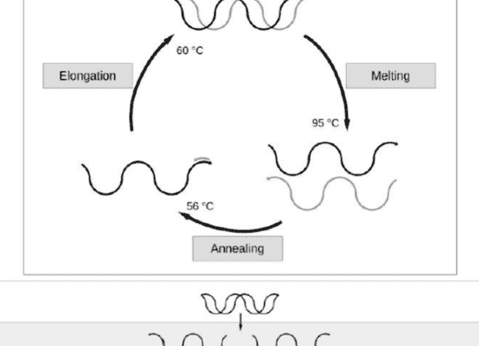

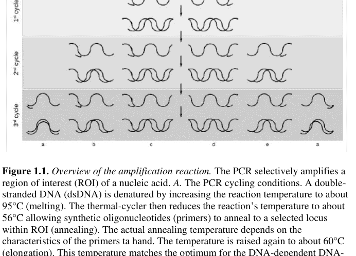

#### 图1.1. 扩增反应概述

PCR选择性地扩增核酸的靶标区域（ROI）。A. PCR循环条件。双链DNA（dsDNA）通过将反应温度升至约95°C而变性（熔解）。随后热循环仪将反应温度降至约56°C，使合成的寡核苷酸（引物）退火到ROI内的一个选定位点（退火）。实际退火温度取决于所用引物的特性。温度再次升至约60°C（延伸）。该温度与反应容器中存在的DNA依赖性DNA聚合酶（简称DNA-pol）的最适温度相匹配，并取决于所选酶。B. PCR产生多种丰度不同的DNA片段。初始ROI为双链DNA，显示在图板顶部。在第一个扩增循环中，ROI的两条链被分离并复制。新合成的链从正向引物的5′端延伸到ROI的3′端（除非ROI太长，DNA-pol无法在延伸阶段分配的时间内覆盖整个区段）。结果是产生一对链长不均一的分子（c和d）。在PCR的第二个循环中，c和d的全长链作为c和d分子的模板。相反，c和d的短链将产生从反向引物5′端延伸到ROI 3′端的片段（b和e），这些片段长度仍然不同，但比c和d短。在第三个PCR循环中，b和e的短链将产生从正向引物5′端延伸到反向引物3′端的片段（a）。a分子将是均质的dsDNA片段，其长度由于引物设计而预先已知，称为“扩增子”。由于DNA-pol可以在扩增阶段分配的时间内完美复制a，a将在2ⁿ动力学下倍增，并迅速成为反应容器中最普遍的分子。相比之下，其他片段将在2n动力学下线性复制。

利用Mullis所钟爱的“迭代循环”，在已知ROI初始数量k和扩增循环数n的情况下，可以计算PCR产生的分子数量：

```
Listing 1.1
k <- 1
n <- 20
total_number_ROI <- vector(k)
for (i in 1:n) {
  total_number_ROI[i+1] <- total_number_ROI[i]*2
}

print(total_number_ROI)

[1]      1     2     4     8    16    32    64   128   256   512
[11]  1024  2048  4096  8192 16384 32768 65536 131072 262144 524288
[20] 1048576

print(2^20)

[1] 1048576
```

最后一个值1,048,576等于2^20，代表过程中生成的ROI拷贝数。这意味着，如果样品中只有一个大肠杆菌细胞，它将在几个小时内产生足够的信号，通过凝胶电泳即可检测到。而用Southern印迹法检测同一份样品，则需要工作几天后才能得到阴性结果。因此，PCR的优势便显现出来。然而，Mullis提交的关于PCR的论文在1985年被高端科学期刊《自然》和《科学》拒绝（后来被仍然享有盛誉的《酶学方法》Methods in Enzymology接受）。


片段，并且在聚合酶活性中起核心作用。该结构域还具有转移酶能力，并在片段末端添加一个非模板残基（通常是腺嘌呤）。这种额外的 A 在克隆操作中非常有用，因为它可以与克隆载体上的突出胸腺嘧啶配对。

Taq-pol 现在已被改造可在大肠杆菌中生产（Lawyer et al., 1989）。然而，Taq-pol 的保真度不高（每百万次插入会引入八个错配核苷酸），而高保真耐热 DNA 聚合酶已从其他生物体中分离出来，例如古菌 Pyrococcus furiosus（Pfu，每百万次插入引入一个错误的 dNTP）（Cline et al., 1996）。此外，Taq-pol 可以掺入修饰的 dNTP；这一特性被用于用例如地高辛或生物素标记合成的 DNA。

Taq-pol 接受的 dNTP 范围广泛的另一个例子是尿嘧啶插入。通过用 Us 替代 Ts，可以使合成的 DNA 受到尿嘧啶 N-糖苷酶（UNG）处理的敏感：被消化后的 DNA 将降低从一次反应到后续反应中携带污染的风险。几种耐热 DNA 聚合酶已从微生物中分离出来，但近年来，诱变被用于专门增强酶的特性，例如提供更高的过程性或保真度（Kermekchiev et al., 2003; Raghunathan and Marx, 2019）。

- *一组寡核苷酸（引物）*。所有 DdDp 都需要引物来启动 DNA 靶标的复制。在天然条件下，DNA 依赖性 RNA 聚合酶（DdRp，或 primase）会合成一段与启动子部分互补的短单链片段，从而启动该过程，因为 DdDp 会向该片段添加核苷酸。寡核苷酸合成生产的生化领域改进弥补了 RNA-pol。引物通常以 0.1-1.5 μM 的浓度提供，数量级为 10¹³ 个分子。所有引物延伸完毕后，反应将停止，10¹³ 个引物大约可维持约 30 个循环。熔解温度 Tₘ 是使至少一条链为寡核苷酸的 DNA 链的 50% 熔解的温度（Wetmur, 1991）。

- *对感兴趣区域序列的了解*。合成引物的作用不仅在于启动聚合反应，还在于提供特异性：引物的正确选择可以决定一个实验是好是坏。良好实验最重要的特征之一就是特异性：实验只有在样品中存在靶标时才应给出阳性结果。与与靶标相似（但不相关）的序列发生交叉反应会使实验不可靠。在基因组中鉴定一段 n 个核苷酸的概率如下获得。首先根据公式确定鉴定结合位点 K 的概率（Nei and Li, 1979）：K = (g/2)^{G+C} × 2^{-1}(1-g)^{A+T} 其中 g 为序列中 G 和 C 的相对频率，G+C 和 A+T 为这些核苷酸的数量。然后在长度为 N 的给定基因组中找到该序列的实际概率 n 由下式给出：n = DNK，其中 D 为该生物的二倍体性。

引物的设计需要遵循一些规则：

- 长度应约为 20 个核苷酸；
- 不应含有稳定的发夹结构；
- 不应含有同聚物串；
- 不应含有超过 50% 的 GC 核苷酸；

- 引物的熔解温度（Tₘ）最好约为 55°C；Tm 可根据 Wallace 规则粗略计算（Green and Sambrook, 2019）：Tₘ = 2(A+T) + 4(G+C)，其中 A+T 和 G+C 为引物中这些核苷酸的数量。更精确的 Tₘ 可通过网上提供的特定计算器获得。
- 两个引物的 Tₘ 差异不应超过 5°C；

- 引物的 3′ 端不应互补以避免二聚体的形成；
- 引物的 3′ 端不应含有过多的 cgs；
- 引物序列应针对靶标唯一，以避免非特异性扩增。

在靶区附近，这是一个要求，可能由于引物设计所施加的限制而难以实现。此外，微生物——尤其是 RNA 病毒——突变速率很快，因此高特异性可能会损害实验的灵敏度。PCR 的动力学（2^n）也很简单，使得可以相对轻松地计算每个循环 n 的扩增子数量。不论原因如何，PCR 都是世界各地许多实验室的首选方法，既用于诊断也用于研究。实验的改进以实时提供结果，导致出现了一种允许精确定量靶分子的过程。该实验被称为定量 PCR（qPCR）。

### 定量聚合酶链式反应（qPCR）实验

判断 PCR 是否成功的最简单方法是分离扩增子进行电泳（EF）。该程序的优点是可以直接显示扩增子是否为预期大小，或者引物是否扩增了不需要的区域。第一个缺点是 PCR 本身之后需要后续步骤——即：EF。第二个缺点是 PCR 的组分有限，因此不能无限进行。由于循环次数通常远多于达到可见信号所需的次数，结果是，在反应结束时，所有样品无论初始模板输入如何都会显示几乎相同的信号水平。该原理将在以下段落中更详细地描述。

Liu 和 Saint（Liu and Saint, 2002a）使用了以下方程来关联样品的初始拷贝数与扩增循环：

X_n = X0(1 + E)^n
(1)

其中 X_n 为扩增循环 n 时靶标拷贝的数量，X0 为初始靶标负载，E 为反应效率，或换句话说，为靶标复制速率，假定为 100%——换句话说，每个模板都根据 2^n 动力学复制。

可以用以下脚本复制此过程[下一页]：

```
Listing 1.2
LiuSaint_model <- function(initCopy, efficiency) {
  A <- vector(initCopy)
  for (i in 1:44) {
    A[i+1] <- A[i]*(1+efficiency)
  }
  return(A)
}
A1_0 <- 10
A2_0 <- 100
A3_0 <- 1000
A4_0 <- 10000
E <- 1
A1 <- LiuSaint_model(A1_0, E)
A2 <- LiuSaint_model(A2_0, E)
A3 <- LiuSaint_model(A3_0, E)
A4 <- LiuSaint_model(A4_0, E)
plot(1:20, A1[1:20], xlab="Amplification cycle", ylab="Number of molecules", type = "l", lwd = 1)
points(1:20, A2[1:20], type = "l", lwd = 2)
points(1:20, A3[1:20], type = "l", lwd = 3)
points(1:20, A4[1:20], type = "l", lwd = 4)
legend("topleft", legend = c(10, 100, 1000, 10000), title = "Input", lwd = c(1,2,3,4))
```

通过检查 44 次扩增循环后的拷贝数，可以观察到模拟与方程 1 之间的对应关系：

```
> print(A1_0*(1+E)^44); print(A1[45])
[1] 1.759219e+14
[1] 1.759219e+14
> print(A2_0*(1+E)^44); print(A2[45])
[1] 1.759219e+15
[1] 1.759219e+15
> print(A3_0*(1+E)^44); print(A3[45])
[1] 1.759219e+16
[1] 1.759219e+16
> print(A4_0*(1+E)^44); print(A4[45])
[1] 1.759219e+17
[1] 1.759219e+17
```

#### A

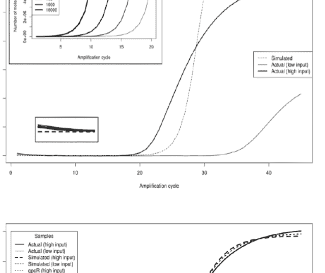

#### B

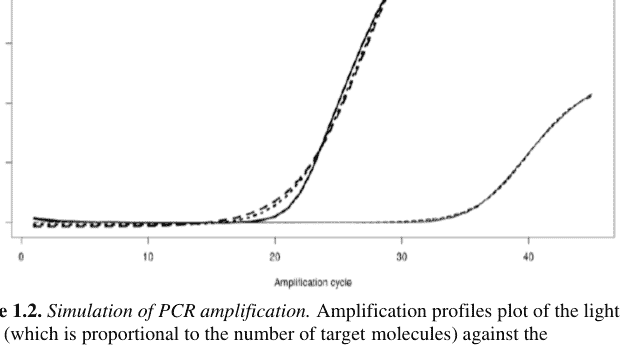

图 1.2. PCR 扩增的模拟。扩增曲线图显示光信号（与靶分子数量成正比）随扩增循环的变化。模拟所使用的模型可以用不同精度的水平代表实际扩增数据（在低和高模板输入下）。


(cont.) A. 实际扩增数据与 PCR 函数生成的数据的比较。请注意，模拟数据定义的曲线比实际数据陡得多。插图显示了不断增加的扩增。

B. 使用回归获得的参数进行的模拟比 PCR 函数更费力但更准确。qpcR 包提供了一个准确的替代方案。在图 A 中，分子数量与扩增循环相对应绘制。在现实生活中，分子数量无法计数，只能通过检测来测定。在图 B 中，光被用作分子数量的替代指标，假设光与靶标数量成正比。

可以在图 1.2 的插图中看到，方程 1 模拟了永无止境的扩增。实际上，反应最终会停滞。因此 Liu 等人指出，他们的模型仅适用于 PCR 的初始阶段。如前几段所述，约 1 µM 的引物相当于约 10^13 个寡核苷酸，因此只能生成 10^13 个扩增子；之后，反应就不会再继续。三磷酸核苷也同样适用。此外，DNA-pol 会被扩增的副产物抑制，因此其在每个循环中的扩增效率会越来越低。简而言之，PCR 结束时的 EF 将显示具有相同扩增子数量的样品。这种类型的 PCR 称为‘终点 PCR’。

**Listing 1.3**

```r
D <- 2
K <- 10^13
I <- 100
ROI <- vector()
for (i in 2:45) {
  ROI[i] <- ROI[i-1] * D * (1 - ROI[i-1]/K)
}
print(ROI)
plot(1:45, ROI, xlab="Amplification cycle", ylab="Number of molecules")
```

在此脚本中，D 表示 ROI 的扩增速率，由于 PCR 的复制特性，其为二。K 表示可产生的扩增子的最大量，以引物数量作为限制性试剂。逻辑项的作用如下。当扩增子的数量远低于 K 时，ROI_t 与 K 的比值约为零，因此 ROI_{t+1} 的数量约为 ROI_t 的两倍。然而，当扩增子的数量接近 K 时，比值为一，整个项变为零。结果是反应在每个扩增循环中变慢。

这种逻辑简化并不是 PCR 扩增曲线的最精确表示。可以通过将此模拟获得的曲线与实际扩增曲线进行比较来证明这一点。为了证明这一点，将使用来自 HIV 检测的两个反应获得的实际扩增数据（Marongiu et al., 2021a）。由于这些 PCR 检测运行了 50 个循环，只会收集前 45 个数据点。为了将其与模拟数据进行比较，后者必须重新调整，以提供以光单位而非拷贝数形式的输出。前一章中描述的 PCR 函数将被修改，以考虑到输出是以光单位而不是靶标拷贝数表示。由于实际反应运行了 50 个循环，只会使用前 45 个。

**Listing 1.3 (continuation)**

```r
L <- c(167.53, 102.45, 54.28, 28.28, 12.64, 2.56, -4.09, -7.4, -8.58, -12, -12.15, -10.35, -18.1, -8.36, -18.82, -13.95, -14.65, -14.13, -17.97, -13.39, -17.19, -11.46, -9.71, -8.39, -3.06, -6.67, -12.73, -8.95, -9, -11.31, -4.51, 25.76, 79.69, 176.67, 312.57, 532.59, 887.8, 1309.28, 1800.66, 2319.8, 2818.52, 3276.85, 3681.76, 4025.73, 4304.71, 4519.27, 4680.63, 4795.27, 4878.23, 4942.45)

H <- c(120.64, 66.14, 34.87, 27.11, 8.87, -5.8, 4.52, -7.16, -17.39, -14.29, -20.26, -14.99, -21.05, -20.64, -8.03, -21.56, -1.28, 15.01, 75.26, 191.76, 455.09, 985.96, 1825.59, 2908.08, 3993.18, 5059.94, 6071.93, 6986.32, 7796.01, 8502.25, 9111.46, 9638.01, 10077.19, 10452.02, 10751.81, 11017.49, 11240.37, 11427.47, 11570.07, 11684.96, 11781.77, 11863.35, 11927.44, 11980.81, 12021.88, 12058.35, 12100.63, 12133.57, 12148.89, 12137.09)

low <- L[1:45]
high <- H[1:45]
PCR <- function(initCopy, dupRate, carry, normalizer) {
  ROI_T <- initCopy
  A = vector(initCopy)
  for (i in 2:45) {
    A[i] <- A[i-1] * dupRate * (1 - A[i-1]/carry)
  }
  return(A/normalizer)
}
m = max(A4)
M = 12702
r = m/M
PCR <- PCR(A4_0, D, K, r)
png(filename = "Fig_1-2A.png", width = 30, height = 20, units = "cm", res=300)
plot(1:45, signal, type = "l", lty=2,
  xlab="Amplification cycle", ylab="Number of molecules")
points(1:45, low, type = "l")
points(1:45, high, type = "l", lwd=2)
legend("right", legend = c("Simulated", "Actual (low input)", "Actual (high input)"),
  lty = c(2,1,1), lwd = c(1,1,2))
dev.off()
```

图 1.2A 清楚地显示了曲线轮廓不同。比逻辑方程更现实的描述是使用具有四个参数的模型（Rutledge, 2004）：

F_C = F_M / (1 + e^{-(C - C_h)/s}) + F_B   (2)

其中 F_C 是在循环 C 处的荧光，F_M 是最大荧光，C_h 是达到 F_M 一半的循环，F_B 是背景荧光，s 是曲线的斜率。这些参数事先均未知，因此该过程在很大程度上依赖于参数估计。程序中的第一步是提供一些起始值。将 F_M 视为扩增序列的最大值时，½F_M 可用于目视识别 C_h，而 F_B 被设为第一个循环的荧光，因为它具有整个序列的最高背景值。Desmos (https://www.desmos.com/calculator) 用于通过传递数据和方程来估计 s（请注意，Desmos 也会自动提供所有其他参数）。参数化的第二步是传递方程和一个函数，该函数用该方程得到的值减去实际值。函数 nls.lm 可以直接提取参数；然后将这些参数存储在对象中以对数据建模。

**Listing 1.4**

```r
library("minpack.lm")
MaxFluo <- max(high)
halfFluo <- MaxFluo/2
halfCycle = 27
rutledge <- function(p, x) {
  Ch = p$half_fluorescence
  s = p$slope
  Fm = p$max_fluorescence
  Fb = p$back_fluorescence
  y = (Fm / ( 1 + exp(-(x-Ch)/s))) + Fb
  return(y)
}
rutledge_param <- function(p, x, y) ((p$Fm / ( 1 + exp(-(x-p$Ch)/p$s))) + p$Fb ) - y
estim <- nls.lm(par = list(Ch = halfCycle, s = 2.77, Fm = MaxFluo, Fb = high[1]),
                fn = rutledge_param, x = 1:45, y = high)
mod_h <- rutledge(list(half_fluorescence = 27.1102, slope = 2.7680,
                       max_fluorescence = 11839.7745, back_fluorescence = -138.8615), 1:45)
```

```r
plot(Fluorescence ~ Cycle, data = ROI[Sample==1,], type = "n", lwd = 2, col="black", yaxt="n",
    xlab="Amplification cycle", ylab="Fluorescence", main = "Amplification profiles")
rect(0, 0, 33, max(ROI[Sample==1,]$Fluorescence), col = "gray95", border = NULL)
rect(33, 0, 41, max(ROI[Sample==1,]$Fluorescence), col = "gray70", border = NULL)
rect(41, 0, 45, max(ROI[Sample==1,]$Fluorescence), col = "gray50", border = NULL)
points(Fluorescence ~ Cycle, data = ROI[Sample==1,], type = "b", lwd = 2)
legend(0, max(ROI[Sample==1,]$Fluorescence), pch=22, cex = 1.5, pt.cex=2, pt.bg=c("gray95",
"gray70", "gray50"), title="Phases", legend=c("Initial", "Exponential", "Plateau"))
plot(Fluorescence ~ Cycle, data = ROI[Sample==1,], type = "l", lwd = 1, col="black",
    xlab="Amplification cycle", ylab="Fluorescence", main = "Amplification profiles")
lines(Fluorescence ~ Cycle, data = ROI[Sample==2,], type = "l", lwd = 1.5)
lines(Fluorescence ~ Cycle, ROI[Sample==3,], type = "l", lwd = 2)
lines(Fluorescence ~ Cycle, ROI[Sample==4,], type = "l", lwd = 2.5)
legend("topleft", title="Initial input", legend=c("10 copies", "100 copies", "1000 copies",
"10 000 copies"), lwd=c(1,1.5,2,2.5))
arrows(45, max(ROI$Fluorescence)-1000, 45, max(ROI$Fluorescence), lwd = 2)
```

从所得的图 1.3B 可以明显看出，所有样品的输出都将相同，即：

```r
> cat("sample 1: ", A1[45], "\nsample 2: ", A2[45], "\nsample 3: ", A3[45], "\nsample 4: ", A4[45], sep = "")

sample 1: 5e+12
sample 2: 5e+12
sample 3: 5e+12
sample 4: 5e+12
```

```r
> a1 <- which(A1 > 1000000)[1]
> a2 <- which(A2 > 1000000)[1]
> a3 <- which(A3 > 1000000)[1]
> a4 <- which(A4 > 1000000)[1]
> cat("\t\tInput\tCycle\nsample 1:\t", A1_0, "\t", a1, "\nsample 2:\t", A2_0, "\t", a2,
+   "\nsample 3:\t", A3_0, "\t", a3, "\nsample 4:\t", A4_0, "\t", a4, sep = "")
```

| 样品 | 输入 | 循环 |
|---|---|---|
| sample 1 | 10 | 17 |
| sample 2 | 100 | 14 |
| sample 3 | 1000 | 10 |
| sample 4 | 10000 | 7 |


可以确定不同样本在前文设定的截止值（100万光单位）下在哪个循环中跨越该阈值，前提是每个扩增子发出一个光单位。

显然，初始载量最低的样本达到阈值的循环比初始输入较高的样本更晚。可以通过以下少量插值计算实际达到阈值时的循环：

```
Listing 1.6
find_cycle <- function(Y, X, N) {
  n = 45 - N
  y = log10(Y)[1:n]
  x = X[1:n]
  raw_value <- predict(lm(x~y), newdata = data.frame(y=log10(1000)))
  answer <- unname(raw_value[is.na(raw_value)])
  return(answer)
}
cq_1 <- find_cycle(ROI[ROI$Sample == 1,]$Fluorescence, 1:45, 37)
cq_2 <- find_cycle(ROI[ROI$Sample == 2,]$Fluorescence, 1:45, 35)
cq_3 <- find_cycle(ROI[ROI$Sample == 3,]$Fluorescence, 1:45, 28)
cq_4 <- find_cycle(ROI[ROI$Sample == 4,]$Fluorescence, 1:45, 23)
plot(Fluorescence ~ Cycle, ROI[ROI$Sample == 1,], type = "l", lwd = 1,
     xlab="Amplification cycle", ylab="Fluorescence",
     main = "Amplification profiles", xlim = c(20, 40), ylim = c(1, 5000))
lines(Fluorescence ~ Cycle, ROI[ROI$Sample == 2,], type = "l", lwd = 1.5)
lines(Fluorescence ~ Cycle, ROI[ROI$Sample == 3,], type = "l", lwd = 2)
lines(Fluorescence ~ Cycle, ROI[ROI$Sample == 4,], type = "l", lwd = 2.5)
legend("topleft", title="Copies", legend=c("10", "100", "1000", "10 000"), lwd = c(1, 1.5, 2, 2.5))
abline(h=1000)
abline(v=cq_1, lty = 2, lwd = 1)
abline(v=cq_2, lty = 2, lwd = 1.5)
abline(v=cq_3, lty = 2, lwd = 2)
abline(v=cq_4, lty = 2, lwd = 2.5)
```

```
> cat("sample 1: ", cq_1, "\nsample 2: ", cq_2, "\nsample 3: ", cq_3, "\nsample 4: ", +
cq_4, sep = "")

sample 1: 16.6215

sample 2: 13.29516

sample 3: 9.962474

sample 4: 6.617943
```

从图1.3C可以明显看出，每个样本在不同的循环点达到假设的信号阈值。因此，每个样本的初始载量与产生阳性信号所需的时间相关。在交叉点的定量比PCR结束时的定量更灵敏、更准确。

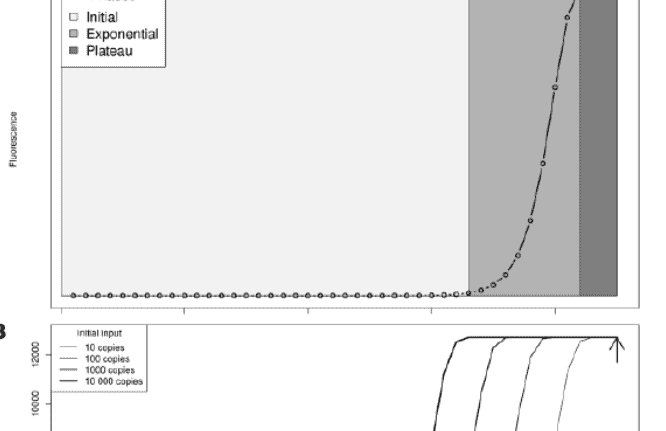

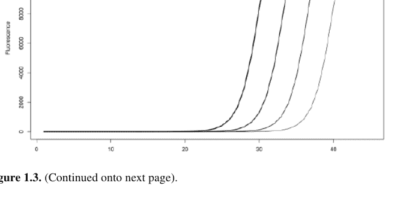

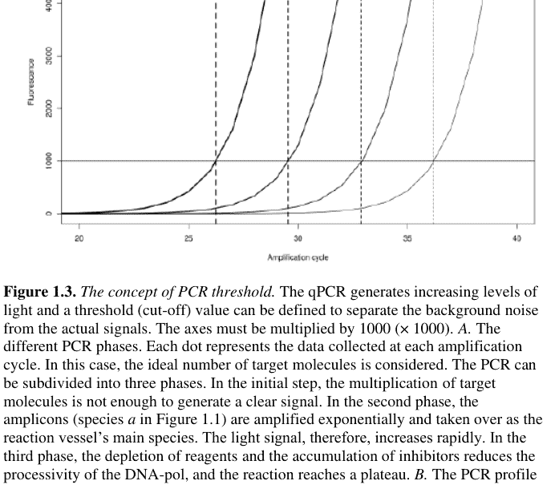

图1.3. PCR阈值的概念。qPCR产生不断增加的光水平，可以定义一个阈值（截止值）来区分背景噪声和实际信号。坐标轴必须乘以1000（×1000）。A. PCR的不同阶段。每个点代表在每个扩增循环收集的数据。在这种情况下，考虑的是理想的目标分子数。PCR可分为三个阶段。在初始步骤中，目标分子的扩增不足以产生清晰的信号。在第二阶段，扩增子（图1.1中的物种a）呈指数级扩增并成为反应容器中的主要物种。因此，光信号迅速增加。在第三阶段，试剂的耗竭和抑制剂的积累降低了DNA-pol的进程性，反应达到平台期。B. PCR曲线与初始模板输入无关。使用具有递增模板量的样本的模拟数据表明，模板数量增加直至达到平台值。反应结束时，所有样本将含有相同数量的扩增子（箭头）。样本之间的差异仅仅是达到平台所需的时间：模板输入较高的样本将在平台期停留的时间比输入低的样本更长。C. 面板B的放大图，显示不同样本将在不同时间达到假设的阈值水平（10⁶分子）。模板输入高的样本比模板输入低的样本更快达到阈值。

终点PCR不允许对目标进行定量这一事实是该检测的主要缺点，因为确定目标的存在与否是一项重要成就，但对于现代用途而言，其应用有限。例如，样本的病毒载量知识用于确定抗病毒疗法的有效性。可以很早在达到饱和阶段之前停止PCR，比如在示例中20个循环后，但：

-   EF是一个劳动密集型步骤，会减慢检测速度。
-   EF会引入污染和人为错误的风险。打开含有扩增DNA的PCR管会带来扩增子液滴在实验室中扩散的风险。如果扩增子的气溶胶进入新的PCR管，会导致假阳性结果。这种污染风险是PCR实验室的一个主要问题。
-   结果仍然是半定量的，因为定量是通过将目标的荧光与特殊DNA梯的荧光进行比较获得的，其中每个条带含有预定的DNA量。然而，条带数量很少且包含有限范围的DNA浓度，因此定量非常粗略。

PCR的突破是在反应进行过程中引入信号检测。这种“技巧”省去了EF步骤的使用，简化并加快了反应。由Pamela Holland和David Gelfand在Cetus组成的科研小组（Holland et al., 1991）发现DNA-pol的5′→3′外切酶活性可以降解杂交在酶前方的寡核苷酸。通过在寡核苷酸的两端结合荧光染料和猝灭剂，这种分子（称为探针）不会发出光，因为荧光分子发出的光子会被猝灭剂捕获。但在PCR延伸期间，探针被DNA-pol降解后，荧光染料将从猝灭剂活性中释放，并在反应容器中释放光子，可由光学装置收集。几乎在同一时间，由Russell Higuchi、Robert Griffith和Roche的同事组成的团队报道了一些嵌入剂（即与DNA高亲和力结合的分子）在结合dsDNA时会增加其荧光，使得每个扩增子在每个循环中可释放一定量的光（Higuchi et al., 1992）。此外，Kenneth Livak、Karin Deetz和Perkin-Elmer/Applied Biosystems的同事发现，标记有特定荧光染料组且在近距离杂交的两个探针可以发出光（Heid et al., 1996）。这些方法现在分别被称为水解探针化学（商品化为TaqMan™）、嵌入剂化学和杂交探针化学（或FRET，荧光共振能量转移）。

最初使用的嵌入剂是溴化乙锭，但由于其致癌性，已被其他无害染料取代，如SYBR Green™、RedSafe™和EvaGreen™。

嵌入剂比探针便宜，尽管它们容易附着于特定序列，但它们结合的序列在DNA链上足够常见，可为任何扩增子提供有效的覆盖（Bailly and Chaires, 1998）。更重要的是，嵌入剂允许进行熔解分析。通过在PCR结束后逐渐升高反应容器中的温度，扩增子发出的荧光会下降，因为嵌入剂从DNA上被置换。当温度达到扩增子的熔解温度（Tₘ）时，双链会迅速溶解，荧光突然下降。荧光与温度的图是递减线，在Tₘ处突然降至零。通过取该曲线的第一导数，图被转换为钟形图，其峰值为Tₘ。在存在引物二聚体或其他污染物时，图会显示多个峰。因此，熔解分析用于确认PCR的特异性。

另一方面，探针允许同时检测多个目标（一种称为多重检测的方法），这进一步扩展了PCR的应用。这种改进的PCR检测最初被称为“实时”，因为结果可以在PCR进行中而不是之后读取。目前它更常被称为“定量”（qPCR），因为它允许对样本的初始载量进行定量。下一章将更详细地描述定量程序。

### Listings

```
Listing 1.1.
The counters k (initial number of copies) and n (number of amplifications) are instantiated and a repository array total_number_ROI, which is populated with k. New array's elements are assigned to the vector through a for loop, so that the final array will have n elements. Each array's element (apart the first) will contain the square of the previous element. The array's elements are accessed by their indices indicated by a number enclosed in squared brackets. The elements of the array are printed on screen with the function print.

Variables can be instantiated directly with the assignment symbol '<-' that is equivalent to '=' in other languages (and working also in R).
R calls vectors what in other languages are called 'arrays': collections of several values.
Vectors are then, in R, uni-dimensional. A matrix is a two-dimensional vector.
An array is a three-dimensional or multi-dimensional vector.
An empty vector can be instantiated with the function vector(), likewise for matrices (matrix()), and arrays (array()). Populated vectors are instantiated by concatenating different elements; the concatenating function in R is c(). Matrices and arrays need additional information regarding their dimensions.
```

向量元素的访问通过其索引进行，索引从 1 开始。例如，假设一个包含 10 个元素的向量 a（a<-1:10），第 5 个元素通过 a[5] 访问。可以使用冒号选择多个元素。例如，元素 5、6 和 7 使用 a[5:7] 选择。或者可以使用合并运算符：a[c(5,6,7)]。减号运算符 '-' 用于取消选择元素。因此，忽略第 5 个元素表示为 a[-5]。数学运算符允许根据逻辑语句选择向量的元素。例如，假设 a 的元素为数值，可以选择小于给定数字 n 的元素：a[a<n]。向量元素可以使用函数 names 命名，然后按名称访问。例如，内置向量 letters 存储罗马字母表的 26 个小写字母（而 LETTERS 为其大写版本）；因此：names(a) <- letters[1:10]，第 5 个元素通过 a['e'] 选择。命名向量可以使用函数 unname(a) 恢复为无名称的向量。

像向量一样，列表的元素可以没有名称，而命名列表是通过为命名层分配值来定义的，例如 l = list(a="string", b=0, c=TRUE)。列表的层级可以使用其索引访问，例如 l[1]，或 - 如果存在 - 其名称，如 l$a。实际值，不带层级的名称或索引，通过双方括号访问，例如 l[1][1]。如前所述，每个层级可以有更多值，例如 l = list(a=c(a="A", b=0, c=TRUE), b=c(a="B", b=1, c=FALSE, d=NULL, e=(NA))。层级的实际值通过添加所需索引访问，例如 l[1][1][1]，其结果为 "A"。如果层级包含矩阵，元素的选择遵循 [row, column] 惯例。

`c(x)`
x
要连接的一系列同质元素（全部为数字或字符）。

`vector(x)`
x
数据，通常以连接形式 c(a, b, c...)。

`matrix(data, nrow, ncol, byrow, dimnames)`
data
矩阵每个维度的向量集合。
nrow, ncol
矩阵的行数和列数。
byrow
逻辑值，表示是否按行填充矩阵。
dimnames
NULL 或维度的名称。

`array(data, dim, dimnames)`
data
矩阵每个维度的向量集合。
dim
一个整数向量，其长度给出每个维度中的最大索引。
dimnames
NULL 或维度的名称。

`names(x) <- value`
x
要命名的向量。
value
要传递给 x 的字符串或字符串向量。

`unname(x)`
x
要去除名称的向量。

for 指令是一个基本控制流结构，它对字面向量中存在的元素数量重复命令块。每次迭代时元素变量可用，因此，例如 print(variable) 将显示 variable 的值。基本结构是：
```
for (variable in vector) {
<block of commands>
}
```

每个函数都有一组用户可以分配值的参数。某些参数具有默认值。赋值由 '=' 运算符给出。例如，x="value" 或 x=0。在此，赋值本身未显示。

print 函数在屏幕上显示值：
`print(x, quote, max.levels, width, ...)`
x
要打印的对象。
quote
逻辑值，表示是否带 surrounding 引号打印。
max.levels
整数，表示因子应打印多少行级别。
width
仅在 max.levels 为 NULL 时使用。
na.print
...
传递给或来自其他方法的进一步参数。

#### Listing 1.2.

函数 *LiuSaint_model* 被实例化。它以初始拷贝数 (*initCopy*) 和扩增效率 (*efficiency*) 作为输入。使用 for 循环填充容器数组 A。元素 *A[t+1]*（对应于扩增循环 *t=1*）通过将 A 中的拷贝数（对应于 t 时的扩增循环）乘以扩增因子计算得出。函数 *LiuSaint_model* 使用不同的初始量但使用存储在 E 中的相同扩增效率多次调用。函数 *plot* 用于显示结果。

```
A function is a piece of code that has the added benefit of being generic enough to be
used multiple times with different entries without having to rewrite the code each time.
A function takes zero or more arguments, execute a block of commands that generate a
value and optionally returns an object. Thus, a function can simply execute some code
or assign a value to an object. The basic structure is:

    function(arglist) {
        <block of commands>
        return(value)
    }

In R, the main details of a drawing such as limits of the axes, axes’ labels and drawing’s
title are defined by high level graphical functions. Legends, additional points etc are
defined by low level graphical functions. The function plot is a high level graphical
function that draws scatter plots. The low-level graphic element legend allows to add
legends to plots.

plot(x, y, type, xlim, ylim, log, main, sub, xlab, ylab, axes, frame.plot,
     asp, xgap, ygap, ...)
    x, y
        the x and y arguments provide the x and y coordinates for the plot.
    type
        string giving the type of plot desired: "p" for points, "l" for lines, "b"
        for both points and lines, "c" for empty points joined by lines, "o" for
        overplotted points and lines, "s" and "S" for stair steps and "h" for histogram-like vertical lines, "n" for avoiding plotting.
    xlim, ylim
        the axis limits, in the form c(min, max). The default value NULL indicates
        that the range of the finite values to be plotted should be used.
    log
        a character string which contains "x" if the x axis is to be logarithmic,
        "y" if the y axis is to be logarithmic and "xy" or "yx" if both axes are to be
        logarithmic.
    main
        string, the main title for the plot.
    sub
        string, the subtitle for the plot.
    xlab, ylab
        string, labels for the axes. The default is the variable’s name.
    axes
        logical, indicating whether both axes should be drawn on the plot. xaxt="n" or
        yaxt="n" to suppress just one of the axes.
    frame.plot
        a logical indicating whether a box should be drawn around the plot.
    asp
        the y/x aspect ratio, see plot.window.
    xgap.axis, ygap.axis
        the x/y axis gap factors.

points(x, y, type, ...)
    x, y
        coordinate vectors of points to plot.
    type
        character indicating the type of plotting.

legend(x, legend, fill, col, border, lty, lwd, pch, cex, pt.cex, pt.lwd, title,
       title.col)
    x
        the position of the label. Can be "bottomright", "bottom", "bottomleft",
        "left", "topleft", "top", "topright", "right", "center". Alternatively, it is
        possible to use a pair of x,y coordinates.
    legend
        character or vector to appear in the legend.
    fill
        background color.
col
color of points or lines appearing in the legend.
border
the border color for the boxes.
lty, lwd
the line types and widths.
pch
the plotting symbols appearing in the legend.
cex
character expansion factor.
pt.cex
expansion factor(s) for the points.
pt.lwd
line width.
title
a string giving a title to be placed at the top of the legend.
title.col
color for title.
```

#### Listing 1.3

该列表模拟实际 PCR 中观察到的拷贝数扩增减少。存储在变量 I 中的给定初始模板量以变量 D 定义的速率复制（在此情况下复制被认为是完美的），并且具有由 K 定义的承载能力。拷贝数存储在向量 ROI 中，其初始值由 I 设置。for 循环模拟 44 轮扩增，并访问第 i-1 轮的拷贝数，根据 D 进行复制并根据 K 减少量。所得值存储在元素 i 中。向量 ROI 然后在屏幕上打印并绘制。

在列表的延续中，实际扩增数据存储在向量 L（低输入）和 H（高输入）中，前 45 个值存储在向量 low 和 high 中。for 循环被推广为函数 emitter，该函数返回按光发射归一化的值向量，并应用于前一个列表中的初始拷贝数 A4_0。返回的扩增向量与 low 和 high 进行视觉比较。

```
The function print displays strings or numbers on the screen. R contains a large number of built-in statistical functions and many additional specific functions through packages. Among the simplest are the average (mean) and standard deviation (sd) functions. A plot can be stored in a file rather than just being printed on the screen. The graphic device png saves the figure as Portable Network Graphics but other popular choices are jpeg and tiff.
print(x, ...)
x
string or number to be visualized on screen.
mean(x, na.rm)
sd(x, na.rm)
x
a vector to evaluate.
na.rm
logical indicating whether NA values should be removed before the computation.
png(filename, width, height, units, res)
filename
the name of the graphic file.
width, height
dimension of the graphic file.
units
unit of measure of the dimensions. Can be "px" (default), "in", "cm", or "mm".
res
The nominal resolution of the graphic in ppi.
```

#### Listing 1.4

该列表使用专用包 minpack.lm 来估计给定函数的参数。该包包含函数 nls.lm，其给定 x 和 y 值，找到拟合非线性模型数据的最佳参数。自定义函数 rutledge 以 x 值范围（1 到 45）和存储在 p 中的参数向量作为参数。存储在 p 中的参数是以下参数的起始值：最大荧光（Fm）、达到半 Fm 的循环点（Ch）、背景荧光（Fb）和曲线的斜率（s）。函数 rutledge_param 被定义为使用 rutledge 获得的估计荧光值与实际荧光值之间的差值。nls.lm 函数将改变参数的值以最小化

观测值与期望值之间的差异。五个参数的最佳拟合值存储在 *estim* 对象中，可通过 *summary(estim)* 进行可视化检查，然后手动插入到 *rutledge* 函数中。对象 *mod_h* 包含使用最佳拟合参数获得的扩增模型。
在列表的后续部分，使用了来自包 *qpcR* 的更紧凑且 PCR 特定的函数 (*pcrfit*)。该函数根据由扩增循环和存储在 *high* 中的实际荧光值组成的 data frame 来估计最佳参数。循环是通过函数 *seq_along* 生成的，该函数以向量作为输入。

```
A library is loaded into the R environment with the function library. A new library is
installed with the function install.packages. Both functions take the name of the
package and, with the former, brackets can be avoided.
R calls data frames made from other languages is called 'table': a collection of structured
data. Structured because each column is homogeneous and each row represents an entry of
similar data, such as the results from a series of experiments or the data of a client.
Each row is identified with a unique name (row name). Columns of a data frame can be
selected with the syntax dataFrame$column, otherwise elements of the data frame can
be accessed as other matrices.
Among the mathematical built-in functions provided by R there is exponentiation. It is
possible to use the function exp or the operator (^b = a^b). The inverse function is
obtained with log (general) and log10 (base 10).

data.frame(data, row.names, stringsAsFactors, ...)
    data
    A series of vectors of equal length for each column.
    row.names
    An optional number indicating what columns holds the row names or a vector
    providing such information. The default is NULL.
    stringsAsFactors
    An optional value determining whether columns of strings should be considered
    factors. The default is FALSE.

nls(formula, lower, upper, fn, control, ...)
    par
    A list or numeric vector of starting estimates.
    lower, upper
    A numeric vector of lower or upper bounds on each parameter. If not given,
    the default are -Inf, Inf.
    fn
    A function that returns a vector of residuals.
    control
    An optional list of control settings.

pcrfit(data, cyc, fluo, model, verbose, ...)
    data
    the name of the data frame containing the qPCR runs.
    cyc
    the column containing the cycle data. The default is 1.
    fluo
    the column(s) containing the raw fluorescence data of the run(s). If more
    than one column is given, the model will be built with the replicates.
    model
    the model to be used for the analysis. The default is '14'.
    verbose
    logical. If TRUE, fitting and convergence results will be displayed in the
    console.

exp(x)
    x
    a number or vector to be evaluated.

log(x, base)
log2(x)
log10(x)
    x
    a number or vector to be evaluated.
    base
    optional providing the base of the exponent (the default is the Euler number).
```

#### Listing 1.5.

先前定义的 *PCR* 函数应用于四组初始输入样本。拷贝数与荧光之间的归一化参数存储在 *r* 中（可以使用更方便的值）。模拟的输出存储在四个向量 (*A1-A4*) 中，然后连接成数据框 *ROI*。后者由向量 *Sample*（命名 1 到 4 的样本并为循环次数重复这些值）、*Cycle*（为四个样本重复 1 到 45 的值）以及 *Fluorescence*（取实际荧光值）构建。结果被绘制，为避免实际绘图，使用了 type “n”。PCR 的不同步骤使用矩形进行着色。在后续部分，所有样本都被绘制，并使用箭头显示达到的荧光最大水平。

```
Rectangles and arrows are low-level graphical elements drawn with the rect and arrows
function, respectively. Lines can be plotted with the function lines. The names of R’s
colors can be shown with the function colors.
The function rep replicates the values in a vector.
rect(xleft, ybottom, xright, ytop, density, col, border, lty, lwd, ...)
    xleft, ybottom
        bottom left corner of the rectangle.
    xright, ytop
        upper right corner of the rectangle
    density
        the density of the filling once color is defined.
    col
        color of the filling.
    border
        logical, draw a line around the rectangle.
    lty, lwd
        line type and width of border is defined.
arrows(x0, y0, x1, y1, length, angle, code = 2, ...)
    x0, y0
        starting coordinates.
    x1, y1
        ending coordinates.
    length
        length of the edges of the arrow head (in inches).
    angle
        angle from the shaft of the arrow to the edge of the arrow head.
    code
        integer code, determining kind of arrows to be drawn.
lines(x, y, ...)
    x, y
        vectors with the values to be plotted.
rep(x, times)
    x
        an element of vector to be repeated.
    times
        the number of times x must be repeated.
```

#### Listing 1.6.

*find_cycle* 函数选择扩增的第一个 *N* 个循环，其中 *N* 在视觉上被选定位于 PCR 的指数相位。由于扩增是指数级的，它在半对数空间中成为一条直线，并使用线性回归来预测模型达到所选的 1 000 光单位点时的情况。图表放大了初始扩增循环，以突出指数相位和交叉点。

```
Linear regression models are built with the lm function, which is defined with the
mathematical formula y~x. Prediction (predict function) performs interpolation providing
new y given one or more x values.
The function abline allows to draw a line given the slope a and the intercept b;
alternatively a linear model object can be passed to it. The function also allows to
draw vertical or horizontal lines using the options v and h, respectively.
lm(formula, data, subset, weights, na.action, ...)
    formula
        the response variable related to the independent variable vectors (y~x).
    data
        an optional data frame, list or environment containing the variables in the
        model.
```

```
subset
    an optional vector specifying a subset of observations.
weights
    an optional vector of weights to be used in the fitting process.
na.omit
    logical, removes missing values from the model. Alternatively, na.fail can be
    used.
predict(model, newdata)
    model
        the model associating response and independent variables.
    newdata
        a dataframe with the new x values to be assessed.
abline(a, b, h, v)
    a, b
        slope and intercept of a line. In alternative, a linear model can be used.
    h, v
        y or x values to place horizontal or vertical lines.
```

## Chapter 2

### Quantification by PCR

### Primers Design

所有 PCR 检测的第一步是引物的设计。如第一章所述，此步骤需要事先了解目标序列，但在我们所处的后基因组时代，几乎所有生物的序列都已存入 GenBank。所需做的只是查询数据库以获取感兴趣的序列。然而，如果序列未被存入，操作者必须先对 ROI 进行测序，然后使用获得的信息来设计引物。接头连接介导的 PCR，即将已知序列的寡核苷酸共价连接到感兴趣的目标上，这一过程可用于扩增未知序列的区域（Gibriel and Adel, 2017）。

作为示例，让我们设计引物来通过靶向该致病菌株的重要毒力因子——即志贺毒素 2（Stx2）——来确定 *E. coli* O:157 的存在。为了允许这些靶标表达的归一化，另一组引物将被设计用于靶向可被视为组成型表达的细菌基因，即 *E. coli* DNA-pol。可以从 NCBI 核苷酸数据库（https://www.ncbi.nlm.nih.gov/nucleotide?cmd=search）通过搜索所需靶标获得所需序列。关键词“Escherichia coli Shiga toxin 2”在撰写时返回了 440 条命中结果。作为靶标，选择了第二条命中结果“Escherichia coli strain XP2F shiga toxin 2 (stx2) gene, partial cds”（GenBank ID：MW311073.1），该结果仅覆盖感兴趣的基因，并将序列存储为 fasta 格式文件。然后对“Escherichia coli DNA-pol”重复该程序，选择“Escherichia coli DNA polymerase gene, complete cds”作为参考序列（GenBank ID：M35371.2）。

为了设计引物，在生产寡核苷酸的公司网站上提供了多个在线工具。这些是允许直观工作流程的图形用户界面。另一种选择是 *Primer3*（Untergasser *et al.*, 2012），这是一款流行的工具，可作为在线工具或命令行可执行文件使用。对于 R 环境，*openPrimer* 是

一种常见选项（Döring et al., 2019）。ROI（在此情况下，包含大肠杆菌 Stx2 序列的文件）被加载到一个 R 对象中。引物的具体信息（如寡核苷酸的长度和扩增子的长度、扩增子相对于参考序列的位置，以及寡核苷酸的 Tₘ）存储在 xml 文件中。个性化设计的 easiest 方法是从 openPrimeR 网站下载现成的 xml 文件然后修改特定项目。

#### 列表 2.1
```r
library("openPrimeR")
fasta.file <- "stx.fa"
seq.df <- read_templates(fasta.file)
settings.xml <- system.file("extdata", "settings",
    "C_Taq_PCR_high_stringency.xml", package = "openPrimeR")
settings <- read_settings(settings.xml)
```

完成以上步骤后，即可设计引物。计算引物的具体条件包括最大长度在 18-25 个核苷酸范围内，且引物与模板之间没有错配。找到的引物随后写入本地文件以供日后使用，并将该文件读回内存以显示结果。

#### 列表 2.1（续）
```r
constraints(design.settings)[["primer_length"]] <- c("min" = 18, "max" = 25)
conOptions(design.settings)[["allowed_mismatches"]] <- 0
primer_set <- design_primers(
  seq.df,
  mode.directionality = "both",
  settings,
  init.algo = "naive",
  opti.algo = "Greedy",
  required.cvg = 1,
  timeout = Inf,
  max.degen = 16,
  conservation = 1,
  sample.name = NULL,
  cur.results.loc = NULL,
  primer.df = NULL,
  updateProgress = NULL
)
write_primers(primer_set$opti, "stx_primers.fasta")
primer.df <- read_primers("stx_primers.fasta", fw.id = "_fw")
```

```r
> print(primer.df[, c("ID", "Forward", "Reverse")])
```

| ID | 正向 | 反向 |
|---|---|---|
| 1-1| (stx|2:21|_fw | tgaagaagatgtttatggcg |  |
| 1-1| (stx|8:26|_rev |  | agtaacggttgcagattcc |

也就是说，序列 *E. coli* Stx2 靶标的最优正向引物为 5′- TGAAGAAGATGTTTATGGCG-3′，配对的反向引物为 5′- AGTAACGGTTGCAGATTCC-3′。重复此程序，可为 DNA-pol 找到引物 5′- TTTGCCGACTGGGCTGTGCGG-3′ 和 5′-CTCCGGTGTAAGTCAGGGCT-3′。良好的做法是为每个靶标设计至少三套引物并进行测试，甚至可组合测试。

### 定量要素

qPCR 并不能直接计数样品中存在的分子数量，而是通过将样品产生的光与靶标拷贝数关联来估算该数量。这种关联可以是绝对的也可以是相对的。绝对定量提供靶标的实际拷贝数（或载量），而相对定量给出靶标与参比之间的比值。具体而言，用 ΔCqS 表示样品的 Cq 与参比靶标的 Cq 之间的差值，用 ΔCqC 表示校准品的 Cq 与参比靶标的 Cq 之间的差值，则可以得到样品与校准品（未处理的样品）之间的归一化表达比值 R_S（Livak and Schmittgen, 2001; Green and Sambrook, 2018）：

R_S = E^{-ΔΔCq}. (2.1a)

其中 ΔΔCq = ΔCqs – ΔCqC，且 E = 2。以大肠杆菌 O:157 为例，假设用紫外辐照处理以激活 Stx2 表达（Yue et al., 2012）的样品的 Cq 为 18 个循环。未处理样品的 Cq 为 24，参比基因的 Cq 为 22。由此可得 ΔCqs 为 –4 个循环，ΔCqC 为 2 个循环，ΔΔCq 为 –6。随后，R_S 为 2^(-6) = 2^6 = 64；因此，紫外处理样品中 Stx2 的表达量是未处理细胞的 64 倍。

公式 2.1a 等价于（Pfaffl, 2001）：

R_S = E_S^{ΔCq_s}/E_R^{ΔCq_c}. (2.1b)

公式 2.1b 考虑了 PCR 扩增的实际效率。另一方面，绝对定量旨在计算给定样品中靶标分子的实际数量，其程序将在以下段落中描述。在绝对和相对定量中，光发射都会被转换为数字值。提取容器中光发射主要有两种系统：

- 在每个扩增循环时一次性拍摄所有反应的快照，然后从每个反应中推算发射。PCR 通常在 96 孔板中进行，孔底为圆锥形；光学装置对板顶进行一次成像。软件随后处理每个孔的荧光信号。
- 独立记录每个反应产生的光。这是通过将反应容器放置在转盘上实现的，转盘在每次旋转时都会经过激光光学装置前。该系统由 Qiagen 商用为 Rotor-gene™，由 Roche 商用为 LightCycler™。

在两种情况下，最终结果都是指每个样品在每个扩增循环时的光发射数值表。应记住，所报告的分子（探针或嵌入剂）在接触扩增子时会增加其发光度——要么是因为它们实际上结合了 DNA，要么是因为 DNA-pol 释放了荧光团。另一方面，即使不接触扩增子，它们也会发光。例如，SYBR Green™ 在结合 DNA 后

发光度增加超过 2000 倍，这意味着存在背景光，其强度比 PCR 相关信号低两千倍。这种背景是一种噪声，会降低 PCR 的灵敏度，可在图 1.2 的下部插图中观察到。

可按如下方式关联两个样品 A 和 B 的初始载量 N₀（Kubista et al., 2006）：

N₀ᴬ/N₀ᴮ = (1 + E)^{CqA - CqB} = (1 + E)^{ΔCq}.  (2.2)

当 PCR 扩增效率为 1（100%）时，底数变为 2^{ΔCq}。在示例中，紫外处理与未处理样品之间的 Cq 差异为六，其载量比为 2⁶ = 64。

可将给定扩增循环 t 时的 ROI 数量 N_t 与初始靶标量 N₀ 关联，方程为（Rutledge and Côté, 2003）：

N₀ = N_t (E+1)^{-t}.  (2.3)

通过转换为对数，方程 2.3 可线性化：

log(N₀) = log(N_t) - log(E+1) t =
= - log(E+1) t + log(N_t).  (2.4)

由方程 2.3 可知，曲线的斜率为 -log(E+1)，截距为 log(N_t)。生成该曲线实际上是通过用准确方法测量的核酸储备液进行连续稀释获得。这种系列被称为标准稀释，其 Cq 值用于生成标准曲线，即线性回归模型。最低和最高稀释之间的间隔应处于检测的动态范围内，即检测能够准确测量的最小和最大量。具有未知载量的样品可通过该曲线进行插值定量。这是因为每个反应的 Cq 由以下方程描述（Rutledge and Côté, 2003）：

Cqₙ = s × log(N₀) + I  (2.5)

其中 I（截距）是在反应中只有一份靶标拷贝时的理想 Cq，s 是从标准曲线值拟合直线（或更准确地说是曲线）得到的斜率。利用 s，可以计算 PCR 的效率：

$E = 10^{-1/s} - 1$  (2.6)

让我们用以下命令生成一条标准曲线。

#### 列表 2.2
```r
A1 <- PCR(10, d, K, r)
A2 <- PCR(100, d, K, r)
A3 <- PCR(1000, d, K, r)
A4 <- PCR(10000, d, K, r)
A5 <- PCR(100000, d, K, r)
A6 <- PCR(1000000, d, K, r)
cq_1 <- find_cycle(A1, 1:45, 37)
cq_2 <- find_cycle(A2, 1:45, 35)
cq_3 <- find_cycle(A3, 1:45, 28)
cq_4 <- find_cycle(A4, 1:45, 25)
cq_5 <- find_cycle(A5, 1:45, 23)
cq_6 <- find_cycle(A6, 1:45, 20)
Sample <- c(rep("s1", 45), rep("s2", 45), rep("s3", 45), rep("s4", 45), rep("s5", 45), rep("s6", 45))
Cqs <- c(rep(cq_1, 45), rep(cq_2, 45), rep(cq_3, 45), rep(cq_4, 45), rep(cq_5, 45), rep(cq_6, 45))
Cycle <- rep(1:45, 6)
Fluorescence <- c(A1, A2, A3, A4, A5, A6)
StdCv <- data.frame(Sample, Cqs, Cycle, Fluorescence)
shades <- c("gray0", "gray20", "gray40", "gray60", "gray80", "gray90")
plot(Fluorescence~Cycle, StdCv[StdCv$Sample=="s1",], type = "l", lwd = 3, col=shades[1], xlab="Amplification cycle", ylab="Fluorescence")
points(Fluorescence~Cycle, StdCv[StdCv$Sample=="s2",], type = "l", lwd = 3, col=shades[2])
points(Fluorescence~Cycle, StdCv[StdCv$Sample=="s3",], type = "l", lwd = 3, col=shades[3])
points(Fluorescence~Cycle, StdCv[StdCv$Sample=="s4",], type = "l", lwd = 3, col=shades[4])
points(Fluorescence~Cycle, StdCv[StdCv$Sample=="s5",], type = "l", lwd = 3, col=shades[5])
points(Fluorescence~Cycle, StdCv[StdCv$Sample=="s6",], type = "l", lwd = 3, col=shades[6])
abline(h=1000)
points(unique(StdCv$Cqs)[1], 1000, cex = 2, bg=shades[1], pch = 21)
points(unique(StdCv$Cqs)[2], 1000, cex = 2, bg=shades[2], pch = 21)
points(unique(StdCv$Cqs)[3], 1000, cex = 2, bg=shades[3], pch = 21)
points(unique(StdCv$Cqs)[4], 1000, cex = 2, bg=shades[4], pch = 21)
points(unique(StdCv$Cqs)[5], 1000, cex = 2, bg=shades[5], pch = 21)
points(unique(StdCv$Cqs)[6], 1000, cex = 2, bg=shades[6], pch = 21)
legend("topleft",legend = unique(StdCv$Input), title = "Input", pch = 19, col = shades)
```


```r
> cat("Standard\tCq\n", "10: \t", cq_1, "\n100: \t", cq_2, "\n1000: \t", cq_3,
+   "\n10000: \t", cq_4, "\n100000: \t", cq_5, "\n1000000: \t", cq_6, sep = "")

Standard      Cq

10:           36.19615

100:          32.87423

1000:         29.5523

10000:        26.23075

100000:       22.91857

1000000:      19.96418
```

标准稀释获得的 Cq 值随后在半对数平面上与它们的量相对绘制，以生成线性模型，更为人熟知的是标准曲线（图 2.1）。

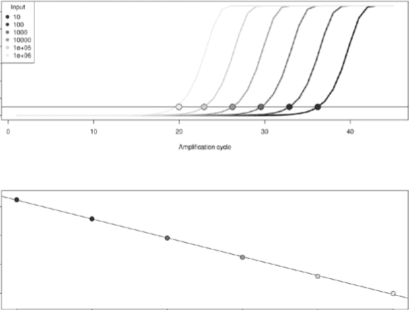

**图 2.1.** *标准曲线的概念。* 用可靠方法测得模板浓度的样品称为标准品。标准品的系列稀释可用于生成标准曲线。 **A.** 标准品的系列稀释会产生在恒定时间达到阈值（Cq）的信号。通常，标准品以 1:10 或 1:2 稀释。 **B.** 标准曲线的构建。Cq 值根据模板载量绘制，并在此些点上建立线性回归模型（标准曲线）。

#### 清单 2.2（续）

```r
standard_curve = lm(unique(StdCv$Cqs)~log10(unique(StdCv$Input)))
plot(unique(Cqs)~unique(Input), StdCv,
    cex = 1.5, type="n", ylim=c(18,37),
    log="x", xaxt="n",
    xlab="Load", ylab="Amplification cycles")
abline(standard_curve)
points(unique(StdCv$Input)[1], unique(StdCv$Cqs)[1], cex = 1.5, pch = 21, col="black", bg=shades[1])
points(unique(StdCv$Input)[2], unique(StdCv$Cqs)[2], cex = 1.5, pch = 21, col="black", bg=shades[2])
points(unique(StdCv$Input)[3], unique(StdCv$Cqs)[3], cex = 1.5, pch = 21, col="black", bg=shades[3])
points(unique(StdCv$Input)[4], unique(StdCv$Cqs)[4], cex = 1.5, pch = 21, col="black", bg=shades[4])
points(unique(StdCv$Input)[5], unique(StdCv$Cqs)[5], cex = 1.5, pch = 21, col="black", bg=shades[5])
points(unique(StdCv$Input)[6], unique(StdCv$Cqs)[6], cex = 1.5, pch = 21, col="black", bg=shades[6])
lab.x = 1:6
axis(side=1, at=10^lab.x, las=1, lab=as.expression(lapply(lab.x, function(x)bquote(10^(x)))))
```

```r
> intercept <- unname(standard_curve$coefficients[1])
> slope <- unname(standard_curve$coefficients[2])
> r2 <- summary(standard_curve)$r.squared
> e <- 10^(-1*(1/slope))
> efficiency <- e-1
> cat("Slope: \t\t", slope, "\nIntercept: \t", intercept, "\nCoef. variation: ", r2,
+ "\nEfficiency: \t", round(efficiency*100, 2), " %", sep="")

Slope:          -3.267097

Intercept:      39.39087

Coef. Variation: 0.9996521

Efficiency:     102.34 %
```

现在可以利用标准曲线确定两个真实反应初始载量。问题在于实际反应的曲线轮廓与用于模拟 PCR 的逻辑函数完全重叠。因此，无法像上一章所示那样应用 find_cycle 函数。然而，通过少量试错，可以估计这些反应达到某一荧光水平时的循环数。如此水平的定义在 qPCR 中至关重要，因为它在 qPCR 评估中具有功能性。尽管其重要性，定义该水平——即已知为截止或阈值水平——并没有既定规则。公认的做法是将其设定在背景信号之上，仅此而已。在本例中，1000 个荧光单位（FU）被选为阈值。定量按如下方式进行。如上一章所述，可以确定这些反应何时通过 1000 FU 的阈值水平，且 Cq 必须介于该水平与前一循环之间。

清单 2.3
```r
par(mfrow=c(1,2))
crossOverH <- which(high > 1000)[1]
plot(1:45, high, xlim=c(21,24), ylim=c(200, 2000), type="l", xlab="Amplification cycle",
     ylab="Fluorescence", main="High load sample")
abline(h=1000, lty=2)
points(crossOverH, high[crossOverH], pch=21, col="black", bg="white")
points(crossOverH-1, high[crossOverH-1], pch=21, col="black", bg="white")
cq_high <- (crossOverH+1)+.05
points(cq_high, 1000, pch=16, cex=1.5)
crossOverL <- which(low > 1000)[1]
plot(1:45, low, xlim=c(36,39), ylim=c(200, 2000), type="l", xlab="Amplification cycle",
     ylab="Fluorescence", main="Low load sample")
abline(h=1000, lty=2)
points(crossOverL-1, low[crossOverL-1], pch=21, col="black", bg="white")
points(crossOverL, low[crossOverL], pch=21, col="black", bg="white")
cq_low <- (crossOverL-1)+.25
points(cq_low, 1000, pch=16, cex=1.5)
```

从图 2.2A 可以看出，22.05 和 37.25 是高输入和低输入反应 Cq 的良好近似值。这些值用于通过在标准曲线上插值来计算载量，如图 2.2B 所示。

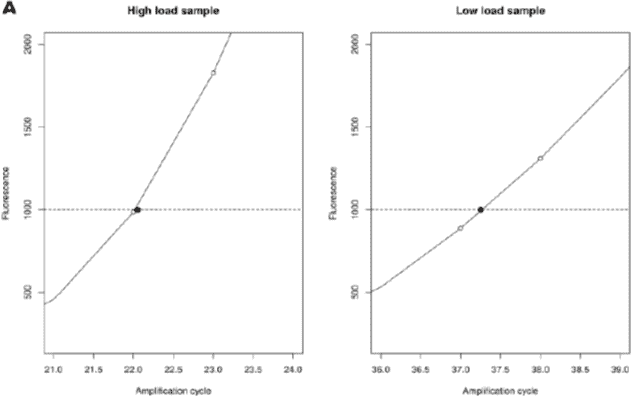

**图 2.2.** （续至下一页）。

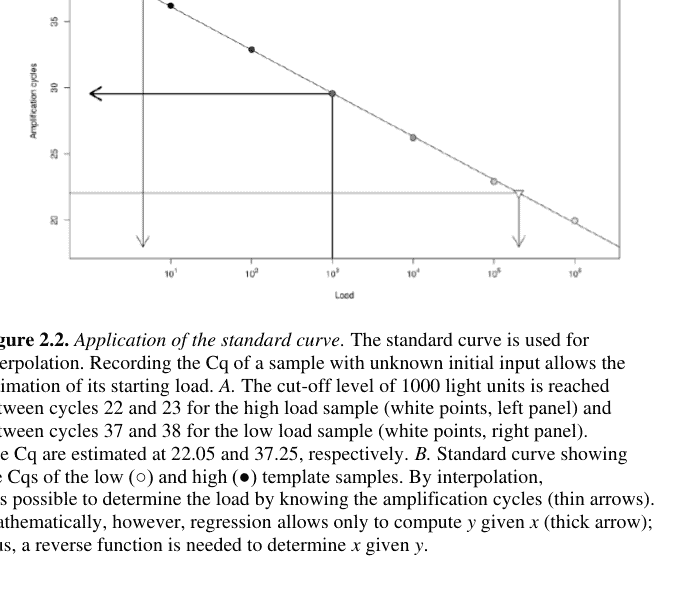

图 2.2. 标准曲线的应用。标准曲线用于插值。记录未知初始输入样品的 Cq 可允许估计其起始载量。A. 对于高载量样品（白色点，左面板），1000 光单位的截止水平在第 22 和 23 个循环之间达到；对于低载量样品（白色点，右面板），则在第 37 和 38 个循环之间达到。Cq 分别估计为 22.05 和 37.25。B. 显示低（○）和高（●）模板样品 Cq 的标准曲线。通过插值，可以通过已知扩增循环（细箭头）确定载量。然而，从数学上讲，回归只能根据 x 计算 y（粗箭头）；因此，需要反函数来根据 y 确定 x。

清单 2.3（续）
```r
high_load <- 10^((cq_high-intercept)/slope)
low_load <- 10^((cq_low-intercept)/slope)
plot(unique(Cqs)~unique(Input), StdCv, cex = 1.5, type="n", ylim=c(18,40), xlim=c(1, 2e6),
    log="x", xaxt="n", main="Standard curve", xlab="Load", ylab="Amplification cycles")
abline(standard_curve)
points(unique(StdCv$Input)[1], unique(StdCv$Cqs)[1], cex = 1.5, pch = 21, col="black", bg=shades[1])
points(unique(StdCv$Input)[2], unique(StdCv$Cqs)[2], cex = 1.5, pch = 21, col="black", bg=shades[2])
segments(unique(StdCv$Input)[3], unique(StdCv$Cqs)[3], unique(StdCv$Input)[3], 0, lwd=3)
arrows(unique(StdCv$Input)[3], unique(StdCv$Cqs)[3], 1, unique(StdCv$Cqs)[3], lwd=3)
points(unique(StdCv$Input)[3], unique(StdCv$Cqs)[3], cex = 1.5, pch = 21, col="black", bg=shades[3])
points(unique(StdCv$Input)[4], unique(StdCv$Cqs)[4], cex = 1.5, pch = 21, col="black", bg=shades[4])
points(unique(StdCv$Input)[5], unique(StdCv$Cqs)[5], cex = 1.5, pch = 21, col="black", bg=shades[5])
points(unique(StdCv$Input)[6], unique(StdCv$Cqs)[6], cex = 1.5, pch = 21, col="black", bg=shades[6])
lab.x = 1:6
```

```r
axis(side=1, at=10^lab.x, las=1, lab=as.expression(lapply(lab.x, function(x)bquote(10^(x)))))
arrows(high_load, cq_high, high_load, 18)
segments(0.1, cq_high, high_load, cq_high)
points(high_load, cq_high, pch = 25, col="black", bg="white", cex = 1.7)
arrows(low_load, cq_low, low_load, 18)
segments(0.1, cq_low, low_load, cq_low)
points(low_load, cq_low, pch = 24, col="black", bg="white", cex = 1.7)
legend("topright",legend = c("Low input", "High input"), title = "Sample", pch=c(2,6))
```

图形上，通过插值很容易将 Cq 追踪到数量轴上。从数学上讲，回归只能从 x 值映射 y 值；因此，需要 Cq 的函数来计算相关数量。定量由公式给出：

10^{(Cq - I)/s}  (2.7),

它是公式 2.5 的逆，并在提供以下输入时：

```r
> high_load
[1] 203109.5
> low_load
[1] 4.521494
```

实际上，低载量被报告为“低于检测方法的检测限”。从公式 2 可以看出，迄今描述的定量依赖于扩增效率对所有反应都相同的假设。然而，在现实生活中，生物样品中存在的有机分子可能会影响 DNA 聚合酶，降低 PCR 效率。例如，红细胞中的血红素、血液中的脂肪以及采样容器中的肝素都是公认的 PCR 抑制剂（Al-Soud et al., 2000）。

### Fit-Point 方法的质量控制

qPCR 运行产生需要分析的一系列数值数据，热循环仪已随专利分析软件一起出售（Green and Sambrook, 2018）。另外，针对不同平台有大量分析工具可供使用（Pabinger et al., 2014）。然而，单纯执行 qPCR 并不能保证获得的值是

实际上有意义。对qPCR数据的目视检查是必要的，同时在执行测定时还需采取一些预防措施（Adams, 2006）。以下是一个简要列表：

- *不要相信已发表的试剂组合。*检查已发表的引物/探针组合的序列和熔解温度，因为手头的文章中可能存在印刷错误。
- *定制优化。*针对手头的设备和化学体系优化已发表的PCR条件。
- *线性化质粒。*通常使用质粒作为标准品，但由于超螺旋结构，并非所有定量的分子都能用于PCR。这会产生定量偏差。
- *计算标准模板的分子数。*标准品的初始拷贝数N可用公式N = MA/WL计算，其中M为靶标的质量（克），例如通过分光光度法（如NanoDrop™仪器）获得；A为阿伏伽德罗常数（6.023 × 10²³分子/摩尔）；W为dsDNA（660克/摩尔/碱基）或ssDNA（330克/摩尔/碱基）的平均重量；L为ROI的碱基长度。一旦N已知，可以进行系列稀释以生成标准曲线。
- *加入NTC。*在qPCR运行中添加非模板对照（NTC），最好分布在反应板的各个位置。NTC可用于检查可能产生假阳性结果的物质污染。定量RNA时，还应加入不含逆转录酶的对照。
- *加入阳性对照。*标准曲线本身就是阳性对照，但对照应尽可能与实际分析的样本相似，以考虑样本基质中可能存在的抑制剂。例如，如果样本来自血清或粪便，则应通过向PCR阴性的血清或粪便中加入已知量的标准品来获得对照。
- *检查是否选择了正确的发射滤光片。*这看起来可能无关紧要，但许多荧光染料的发射光谱会发生重叠。如果滤光片设置不正确，可能会忽略扩增信号的损失，导致qPCR抑制未被察觉。
- *设置基线。*基线是指扩增的初始循环，其信号可能高于阈值。定义基线没有固定规则，但通常位于前十个循环。经验法则是，应在最低Cq之前三个循环处。通常，对每个样本单独进行基线设置。
- *设置阈值。*阈值是指光信号截止值，高于该值即视为阳性。热循环仪软件通常基于背景光信号标准差的倍数自动确定阈值。即使如此，也没有既定规则来设置阈值。可接受的做法是将阈值设置在背景信号之上尽可能低的位置，或手动调整以获得标准曲线中最高的决定系数，或使用扩增信号二阶导数的拐点。然而，阈值应位于扩增指数期，并且所有反应应使用相同的阈值水平——至少在同一轮运行内。
- *目视观察扩增曲线。*在背景扣除信号（ΔRn）中，如果零扩增与峰值扩增之间的差异小于0.5个单位，则扩增仅是表观上的。此外，非S形扩增形状表明PCR存在问题，并导致反应无响应。可能存在被动染料降解而报告染料保持恒定的情况（*下降*），或相反，报告染料以非指数方式增加（*爬行*）。
- *检查截距。*理想截距应在33到37个循环之间。如果截距超出此范围，模板可能已降解。
- *检查反应效率。*由于这与斜率（公式5）相关，对于100%扩增效率，斜率应在-3.2到-3.5之间。
- *检查用于标准曲线的数据拟合度。*决定系数（*r*²）应高于98%。

持续监测qPCR随时间的行为也很有用。绘制效率随时间变化的图应表明每次运行处于均值的一个或两个标准差范围内。下面将提供一个示例。

#### 代码清单2.4

```
e <- runif(100, 0.990, 1.10)
index <- 1:length(e)
e[round(runif(1, 1, 100),0)] <- 0.880
e[round(runif(1, 1, 100),0)] <- 1.150
m <- mean(e)
s <- sd(e)
plot(e~index, ylim=c(0.8, 1.2), xlab=expression(bold("Reaction")), ylab=expression(bold("Efficiency")))
abline (h=m)
abline (h=m+s, lty = 2)
abline (h=m-s, lty = 2)
abline (h=m+2*s, lty = 3)
abline (h=m-2*s, lty = 3)
legend("bottomleft", legend = c("Mean", "1SD", "2SD"), lty = c(1, 2, 3))
upper <- e[e > m+2*s]
index_upper <- which(e > m+2*s)
points(upper ~ index_upper, pch=16, col="grey")
lower <- e[e < m-2*s]
index_lower <- which(e < m-2*s)
points(lower ~ index_lower, pch=16, col="black")
```

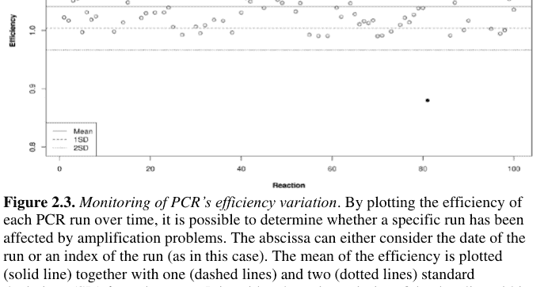

图2.3. PCR效率变化的监测。通过绘制每次PCR运行随时间的效率，可以确定特定运行是否受到扩增问题的影响。横坐标可以考虑运行的日期或运行的索引（如此处所示）。图中绘制了效率的均值（实线）以及距均值一个（虚线）和两个（点线）标准差（SD）。显然，大多数数据位于均值的一个标准差范围内，效率在均值上下均匀分布。在两次情况下，效率分别高于（灰点）和低于（黑点）2SD边界。这两次运行应重新进行。

图2.3显示，PCR的效率在均值上下均匀分布，有些超出了均值一个标准差的边界。少数效率超出均值两个标准差边界的反应应标记并重复。

与任何诊断检测一样，还需要使用一系列性能参数来评估qPCR的有效性（Fardy, 2009; Kralik and Ricchi, 2017）。检测限（或分析灵敏度）定义为提供95%成功率的样本最低浓度。例如，在针对HPV-16的qPCR检测设置中（Marongiu et al., 2014a），对标准稀释液（范围10⁰-10⁵ c/µL）进行了37次测试，所有初始输入量高于10 c/µL的反应均给出阳性结果。相反，仅有32个初始浓度为10⁰ c/µL的样本呈阳性。通过逻辑回归分析，发现检测限（LOD）为1.7 c/µL（Marongiu et al., 2014b）。以下代码将复现这一实例（图2.4）。

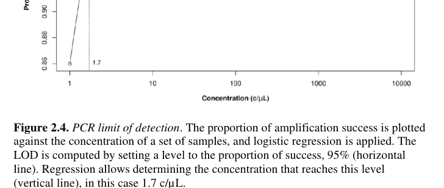

图2.4. PCR检测限。将扩增成功比例与一组样本的浓度作图，并应用逻辑回归。通过将成功比例设置为95%（水平线）来计算LOD。回归可以确定达到该水平的浓度（垂直线），本例中为1.7 c/µL。

#### 代码清单2.5

```
df <- data.frame(concentration = c(1, 10, 100, 1000, 10000), positivity = c(0.864, 1, 1, 1, 1))
model <- glm(positivity~concentration, family = binomial(link = "logit"), data=df)
library(MASS)
lod <- dose.p(model,p=.95)
newdata <- data.frame(concentration=seq(min(df$concentration), max(df$concentration),by=0.01))
newdata$positivity = predict(model, newdata, type="response")
plot(positivity ~ concentration, data = df, log = "x",
    xlab=expression(bold(paste("Concentration (c(", mu, "L)"))),
    ylab=expression(bold("Proportion of positivity")))
abline(h=0.95, lty=3)
abline(v=lod, lty=3)
points(positivity ~ concentration, data = newdata, type="l")
text(lod+0.4, 0.861, labels = round(lod, 1), cex = 0.9)
```

尽管LOD同时适用于终点PCR和qPCR，但后者还应与定量限（LOQ）相关联，LOQ定义为CV低于25%的最低浓度。其他参数包括基于qPCR与提供可信结果的金标准之间的比较，对假阴性（FN）、假阳性（FP）、真阴性（TN）和真阳性（TP）反应的定义。诊断灵敏度提供qPCR正确将阳性样本分类为阳性的概率，可计算为TP/(TP+FN)。相反，诊断特异性提供qPCR正确将阴性样本分类为阴性的概率，可计算为TN/(TN+FP)。诊断灵敏度和特异性不应与分析灵敏度（LOD）和分析特异性（检测仅与选定靶标反应的能力）混淆。此外，qPCR的准确度定义为正确分类样本的概率：(TP+TN)/(TP+TN+FP+FN)。

qPCR的精密度基于重复性和再现性；前者进一步细分为批内和批间重复性。批内重复性表示同一qPCR板内重复样本之间的变异率，批间重复性表示多个qPCR板之间的变异率。重复性定义为每个稀释度的CV，且至少应运行15个重复。再现性与重复性类似，但在不同实验室进行，通常甚至使用不同的热循环仪和化学体系——在这种情况下，它也表明检测的稳健性。


为了涵盖定义特定qPCR检测的所有特征，并允许在不同检测间直接比较，需要满足定量实时PCR实验发表的最低信息（MIQE）要求——尽管尚未被广泛采用（Bustin等，2009）。这些信息不仅包括引物序列，还包括本节列出的许多参数。

### 拟合点法的问题

拟合点法直观且易于实现。然而，尽管应用广泛，拟合点法仍存在一些缺陷（Yang和Rothman，2004）。例如，它假设不同反应之间的扩增效率相同，并在整个检测过程中保持恒定（Liu和Saint，2002b）。即使是扩增效率的微小差异也可能导致巨大的定量误差，而这些误差是拟合点法所无法察觉的（Rutledge，2004）。此外，公式2.5和2.6仅在效率保持恒定时才成立（Rutledge和Côté，2003）。

为了直观地说明测量误差，让我们计算某个目标区域（ROI）在不同扩增效率下的初始拷贝数。由公式4可知，初始拷贝数与特定扩增循环时的拷贝数相关联，其关联方式取决于扩增效率：log(N0) = log(Nt) − log(E+1)Cq。基于前面的示例，假设在Cq = 9.96时达到10⁶个ROI拷贝，并分别计算扩增效率为100%、99.9%、99%、90%和110%时的N0：

```r
Nt <- 1000000

Cq <- 9.96

E <- c(1.000, 0.999, 0.990, 0.900, 1.100)

log_N0 <- -((log(E+1)*Cq)) + log(Nt)

N0 <- 10^log_N0

R0 <- N0/N0[1]

percent_increase <- round(100 * ((N0-N0[1])/abs(N0[1])), 3)
```

```text
log_N0
> [1] 6.911765 6.916746 6.961690 7.422646 6.425815

N0
> [1] 8161400 8255548 9155658 26463413 2665720

R0
> [1] 1.0000000 1.0115358 1.1218245 3.2425092 0.3266254

percent_increase
> [1] 0.000 1.154 12.182 224.251 -67.337
```

也就是说，扩增效率下降0.1%和10%，相对于完全效率，会导致拷贝数分别被高估1%和224%。相反，扩增效率高于100%的反应则会导致实际拷贝数被低估。因此，110%的效率所得到的拷贝数比认为反应完全高效时少67%。为了将这种定量变化放在具体背景中，请看以下示例。HIV病毒载量（HIV VL）的典型检测限约为每毫升血液40拷贝（c/mL）（Adams等，2019）。假设一个样本的病毒载量为35 c/mL，扩增效率分别为99%和110%。使用先前定义的PCR和find_cycle函数，可以基于10^6光单位的阈值估算预期拷贝数：

```r
d <- 2
K <- 10^13
A1_0 <- 35
A1 <- PCR(A1_0, d, K)
a1 <- which(A1 > 1000000)[1]
cq_1 <- find_cycle(A1, 1:45, a1)
cq_1
```

```text
> [1] 16.60976
```

因此，返回的拷贝数为：

```r
E <- c(0.990, 1.100)
log_N0 = -((log(E+1)*cq_1))+log(Nt)
N0 <- 10^log_N0
N0
```

```text
> [1] 243.08398 31.05318
```

换句话说，扩增效率低的反应会给出强阳性结果，而扩增效率过高的反应则会产生阴性结果。HIV结果阳性或阴性所意味着的影响无需进一步解释。低模板样本的定量并非易事，研究表明，拷贝数低于100的样本会被随机扩增，这一过程可用蒙特卡洛理论建模，导致定量结果出现巨大波动（Karrer等，1995）。当然，一般来说，定量越准确越好。因此，任何可能影响准确定量的因素都应避免。

为了克服拟合点法的假设，人们开发了大量分析方法，例如二阶导数最大值法（Luu-The等，2005）、S型曲线拟合（Liu和Saint，2002；Rutledge，2004；Goll等，2006；Guescini等，2008，2013）和线性回归（Ramakers等，2003；Tichopad等，2003）。所有这些方法都被证明在一定程度上优于拟合点法。例如，与拟合点法相比，二阶导数法对低模板样本的定量更准确，尽管截距更高（Luu-The等，2005）。更重要的是，这些替代方法无需设置阈值和基线值，实现了不依赖用户的方法（Luu-The等，2005）。

此外，qPCR正在快速变化，例如DNA聚合酶（DNA-pol）持续合成能力的提升、热循环仪的小型化以及检测通量的增加（Csako，2006）。特别是，qPCR的通量已从单管提升到每板96孔，目前达到每板数百个反应（Kodani等，2011；Pripuzova等，2012）。已经出现了可容纳数千个反应的板（Morrison等，2006；Schlesinger等，2010）。因此，负责发布qPCR结果的操作人员面临更大的劳动负担，这不利于其他实验室职责，并增加了发布错误结果的风险。换句话说，现代qPCR分析不仅需要尽可能准确，还需要自动化，以便在最短时间内筛选数千个反应。在这种背景下，qPCR数据分析只能借助机器辅助；因此，分析方法应能够与某些机器学习算法集成。拟合点法产生的单一值（Cq）——但例如二阶导数法也是如此——无法实现这种集成，因为单一值携带的信息非常少。需要更先进的方法。

### maxRatio

*maxRatio*算法已被引入，作为拟合点法的替代方案，用于判断一个反应是否真正阳性，并产生更可靠的定量结果（Shain和Clemens，2008）。*maxRatio*算法目前包含在雅培分子*m2000 RealTime System*中，用于识别阳性结果。*maxRatio*算法计算简单，因为它考虑的是第*n*个循环与第*n-1*个循环之间扩增信号*A*的比率：

$$
R_n = \frac{A_n}{A_{n-1}} - 1.
$$

(2.7)

在没有扩增的情况下，信号是恒定的；因此，$A_n=A_{n-1}$，$A_n/A_{n-1}=1$，公式2.7中的减1使得$R$变为零。$R$不仅无量纲，而且是自归一化的。实际上，将$A$分解为与实际扩增相关的部分（$a$）和代表噪声或背景的部分（$b$），可以立即观察到$(a'b)/(ab) = a'/a$，其中$a'$和$a$分别是$a_n$和$a_{n-1}$的简写。噪声$b$在被除数和除数中是相等的，因为它来自同一反应。因此，与拟合点法不同，*maxRatio*本身就能考虑个体扩增抑制，克服了PCR定量的主要缺陷之一。$R$既可以基于基线校正信号（$\Delta R_n$）计算，也可以基于原始荧光信号计算；后者可以进行更好的评估，因为它不会掩盖反应中可能存在的抑制。

使用拟合点法构建的qPCR扩增曲线是S型的，而*maxRatio*变换则是高斯型的。以下代码清单将使用之前通过*maxRatio*分析过的靶向空肠弯曲杆菌（*Campylobacter jejuni*）的PCR数据来证明这一点（Marongiu，2016a，2016b）。

代码清单2.6

```r
maxRatio <- function(A) {
  n = A[2:length(A)]
  n_minusOne = A[1:length(A)-1]
  R <- (n/n_minusOne) - 1
  return(R)
}

amp <- c(3.382, 3.372, 3.363, 3.371, 3.383, 3.382, 3.382, 3.370, 3.352, 3.339, 3.327, 3.307,
3.291, 3.270, 3.239, 3.218, 3.199, 3.177, 3.160, 3.147, 3.136, 3.135, 3.139, 3.148, 3.183,
3.263, 3.410, 3.657, 4.009, 4.447, 4.911, 5.322, 5.661, 5.929, 6.140, 6.303, 6.421, 6.515,
6.578, 6.617, 6.658, 6.692, 6.704, 6.702, 6.693)
```


```r
amp_maxRatio <- maxRatio(amp)
plot(1:45, high, type="l", xlab=expression(bold("Amplification cycle")),
    ylab=expression(bold("Amplification signal")))
par(new=TRUE)
plot(2:45, amp_maxRatio, type="l", lwd = 4, xlab = NA, ylab=NA, xaxt="n", yaxt="n")
axis(4)
legend("topleft", legend = c("maxRatio", "fit-point"), lty = 1, lwd = c(4, 1))
abline(v=cycle+1, lty=2)
```

maxRatio变换的结果显然比原始信号少一个元素：

```r
length(amp)
> [1] 45

length(amp_maxRatio)
> [1] 44
```

图2.5A表明，maxRatio通过所得曲线的峰值，为每个反应产生两个值，而不是像拟合点法或二阶导数法那样只生成一个值。第一个值是比值序列的最大值（MR）；第二个值是MR在横坐标上的交点，即MR出现时的分数循环数（FCN）：

```r
> max(amp_maxRatio)
[1] 0.1092542

> which(amp_maxRatio == max(amp_maxRatio))
[1] 29
```

以下函数是与Eric Shain先生合作编写的，除了三次样条插值外，还使用了一个滤波函数，以获得亚循环分辨率并平滑曲线（图2.5B）：

#### 清单2.7

```r
mrPlotter <- function(Cycles, FluoData, give = NULL) {
  background_compensation=0
  ratiox <- tail(Cycles, -1)
  MINx = min(ratiox)
  MAXx = max(ratiox)
  Xint = seq(MINx,MAXx,0.01)
  if (background_compensation > 0) FluoData = FluoData - mean(FluoData[4:6]) + background_compensation
  x = tail(FluoData, -1)
  w = head(FluoData, -1)
  r <- (x/w) - 1
  rf <- filter(r, rep(0.2,5))
  rf[1] <- r[1]
  rf[MAXx-1] <- r[MAXx-1]
  rf[2] <- mean(head(r,2))
  rf[MAXx-2] <- mean(tail(r,2))
  rint <- splinefun(ratiox,rf)
  if (give == "cycle") {
    return(Xint)
  } else if (give == "fluo") {
    return(rint)
  } else {
    return(NA)
  }
}
```

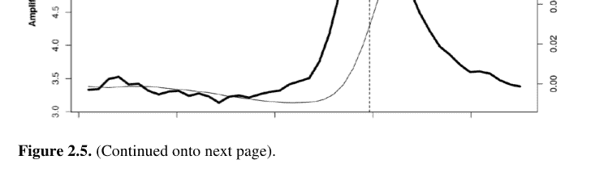

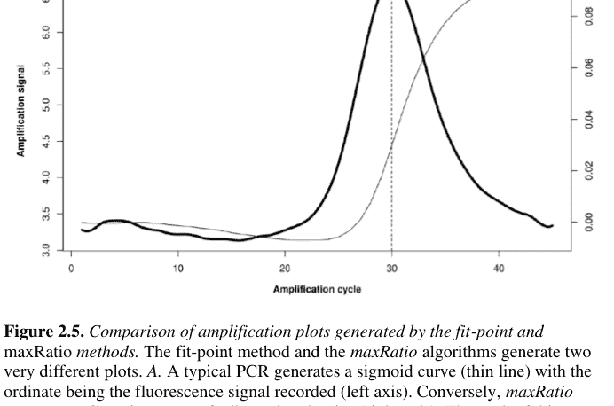

图2.5. *拟合点法与maxRatio方法生成的扩增图比较。* 拟合点法和maxRatio算法生成两种非常不同的图。A. 典型的PCR生成一条S形曲线（细线），纵坐标为记录的荧光信号（左轴）。相反，maxRatio生成一条无量纲比值的高斯曲线（右轴）。该曲线的峰值（竖线）定义了两个值：连续循环之间荧光比值的最大值（MR）以及峰值出现的分数循环数（FCN）。B. 通过人为增加分析的点数，可以平滑maxRatio曲线。

函数*mrPlotter*通过参数give = “cycle”提供循环数，通过参数give = “fluo”提供比值。不过在这种情况下，曲线的峰值还必须考虑增加的点数：

**清单2.7（续）**

```r
mrCalc <- function(Cycles, FluoData, background_compensation=0) {
  ratiox <- tail(Cycles, -1)
  MINx = min(ratiox)
  MAXx = max(ratiox)
  Xint = seq(MINx,MAXx,0.01)
  m = FluoData
  if (background_compensation > 0) rm = m - mean(m[4:6]) + background_compensation
  x = tail(rm, -1)
  w = head(rm, -1)
  r <- (x/w) - 1
  rf <- filter(r, rep(0.2,5))
  rf[1] <- r[1]
  rf[MAXx-1] <- r[MAXx-1]
  rf[2] <- mean(head(r,2))
  rf[MAXx-2] <- mean(tail(r,2))
  SPLINE = splinefun(ratiox,rf)
  rint <- SPLINE(Xint, deriv = 0)
  mr <- max(rint, na.rm = TRUE)
  fcn <- Xint[match(mr, rint)]
  fcna = fcn - log2(mr)
  return(c(mr, fcn, fcna))
}
cycles <- mrPlotter(1:45, amp, give = "cycle")
fluorescence <- mrPlotter(1:45, amp, give = "fluo")
plot(1:45, high, type="l", xlab=expression(bold("Amplification cycle")),
    ylab=expression(bold("Amplification signal")))
par(new=TRUE)
plot(fluorescence~cycles, type="l", lwd = 4, xlab = NA, ylab=NA, xaxt="n", yaxt="n")
axis(4)
abline(v=FCN, lty=2)
```

```r
> quantification <- mrCalc(1:length(amp), amp)
> MR <- quantification[1]
> FCN <- quantification[2]
> FCNA <- quantification[3]
> MR
[1] 0.09363911
> FCN
[1] 30.3
> FCNA
[1] 33.71675
```

FCNA是一个调整后的FCN，它考虑到低模板样本信号可能受到的抑制。在这类样本中，ROI可能与其他非特异性核酸竞争进入DNA聚合酶（DNA-pol）的机会，导致非扩增子双链DNA（dsDNA）的积累，从而增加光信号并降低Cq。

FCNA通过将FCN与发射比值结合来校正这种偏移：

FCNA = FCN − log₂(MR). (2.8)

maxRatio的实现基于这样的理念：所有扩增响应值均为正。实际上，探针的信号永远不会被完全淬灭，因此应始终存在正向的背景荧光信号。因此，使用原始或归一化（而非基线化）的响应至关重要。这对maxRatio是有利的，因为基线化过程容易出错。当处理背景荧光非常低或已经过基线化的响应时，可以使用反应漂移来避免潜在的除零错误。然而，这种漂移限制了maxRatio的自我归一化特性。可以设置MR阈值来区分有反应和无反应的反应。该阈值通常在qPCR实验的设置步骤中生成，方法是将无反应响应（阴性样本）的MR标准差乘以一个预定值（通常为5或10）。该阈值一旦确立，可在整个分析过程中保持不变。与拟合点阈值不同，改变MR阈值对相关的定量循环没有影响。这一现象可通过下图看出（图2.6）：

#### 清单2.8

```r
par(mfrow=c(2,1))
negative_mr <- runif(10, 0, 0.099)
negative_fcn <- runif(10, 5, 25)
positive_mr <- runif(10, 0.2, 0.5)
positive_fcn <- runif(10, 15, 35)
plot(negative_fcn, negative_mr, ylim=c(0, 0.5), xlim=c(0,35), cex=1.5,
    xlab=expression(bold("FCN")), ylab=expression(bold("MR")))
points(positive_fcn, positive_mr, pch=16, cex=1.5)
abline(h=0.1)
abline(h=0.2, lty=2)
abline(v=min(positive_fcn), lty=3)
arrows(0, 0.1, 0, 0.2)
text(0, 0.48, "A", font=2, cex=3)
A <- PCR(1000000, 2, 10^13)
plot(1:length(A), A, xlim=c(0,35), cex=1.5, type="b", yaxt="n", xlab=expression(bold("Cq")),
    ylab=expression(bold("Fluorescence")))
axis(side=2, las=2, at=c(0, 1e12, 2e12, 3e12, 4e12, 5e12), lab=c(0, 1, 2, 3, 4, 5))
TH <- (10^12)*(0.5*10^11)
abline(h=TH)
abline(v=20, lty=3)
abline(h=2*TH, lty=2)
abline(v=21.2, lty=3)
arrows(0, TH, 0, 2*TH)
arrows(20, 5e12, 21.2, 5e12, lwd=2)
```

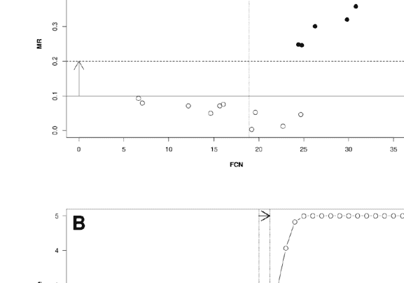

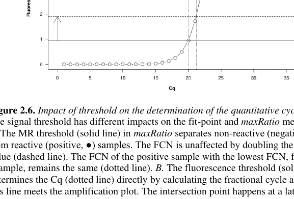

图2.6. 阈值对定量循环确定的影响。信号阈值对拟合点法和maxRatio方法有不同的影响。A. maxRatio中的MR阈值（实线）将无反应（阴性，○）样本与有反应（阳性，●）样本分开。将阈值加倍（虚线）不会影响FCN。例如，FCN最低的阳性样本的FCN保持不变（点线）。B. 荧光阈值（实线）通过计算该线与扩增图相交处的分数循环直接确定Cq（点线）。当阈值（虚线）加倍时，交点出现在更晚的循环处。由于Cq与样本的初始拷贝数相关，定量结果因此改变。箭头有助于更容易理解该过程。

此外，可以应用多个阈值来区分样本的不同亚类。

*maxRatio*算法最初用于定量HIV RNA，以及*沙眼衣原体*和*淋病奈瑟菌*DNA（Shain和Clemens，2008）。该研究表明，*maxRatio*比拟合点法更好地定义了有反应和无反应的反应，从而更好地补偿了PCR抑制。在后续研究中（Zhao等，2010），*maxRatio*被应用于线虫*南方根结线虫*的定量。即使在这种情况下，*maxRatio*也优于拟合点法，因为前者提供的第二龄幼虫计数比后者更接近金标准（显微镜检查）（r²分别为0.906和0.851，两者的p值均<0.001，n=10）。

*maxRatio*与其他常用分析方法（如拟合点法和二阶导数法）的另一个区别是，它为每个响应提供一对值。*maxRatio*生成的值可以在MR-FCN空间中绘图，而拟合点法生成的Cq只能沿一条线排列。不过在后一种情形下，其好处在于可以使用机器学习技术进一步分析数据。机器学习已经被用于qPCR数据分析（Gunay等，2016），但*maxRatio*相比其他算法，具有实现简单和提供数据可视化（适用于支持向量机分析）的优势，使其直观易懂。下一章将更详细地介绍*maxRatio*的应用。

### 清单

#### 清单2.1

本清单使用*openPrimeR*包设计PCR引物。包含目标核酸序列的文件名被赋给对象（*fasta.file*）；只需更改对*fasta.file*的调用即可加载其他文件，无需进一步修改脚本。函数*system.file*读取*openPrimeR*服务器中可用的xml文件，并将其加载到*settings.xml*对象中。函数*read_settings*将*settings.xml*解析到*settings*对象中。修改现成的settings对象比编写新对象更容易，尤其是因为大多数可用选项将保持不变。不过，为了更适合定制设计，*settings*的某些特征被修改。即，引物长度被限制为最短18个碱基、最长25个碱基，且不允许错配。函数*design_primers*基于一系列参数（包括*settings*对象）计算引物设计，并将其存储在列表*primer_set*中，而函数*write_primers*将最优引物对（索引*$opti*）存储在本地文件*stx_primers.fasta*中。存储的引物可以使用函数*read_primers*作为数据框读回R环境，并通过选择该数据框所需行和列在屏幕上打印。


openPrimeR 包是 Bioconductor 的一部分；Bioconductor 是一个用于基因组数据分析的开发软件项目，它与 R 核心开发团队相关联，但独立于后者。因此，它不能从 R 仓库中获得，使用 `install.packages` 函数将会返回错误。Bioconductor 的包可以通过 `BiocManager` 包中的 `install` 函数来安装——其简写形式为 `BiocManager::install(package)`——该函数可从 R 仓库获得。安装步骤如下：

```
install.packages("BiocManager")
library("BiocManager")
BiocManager::install("openPrimeR")
```

然而，openPrimeR 本身还需要操作系统的一系列库，因此用户需要根据手头的系统来定制安装。关于 openPrimeR 安装的更多信息，请访问 https://www.bioconductor.org/packages/release/bioc/html/openPrimeR.html。安装成功完成后，openPrimeR 可以像其他任何 R 库一样被打开。R 函数 `system.file` 用于查找包中文件的完整文件名，在本例中即 openPrimeR。

`system.file("file", package = "openPrimeR", lib.loc, mustWork)`

`file`
要搜索的文件。可以传入多个文件。

`package`
包含该文件的包。`"base"` 用于 R 原生文件。

`lib.loc`
查找文件的路径；默认值为 `NULL`。

`mustWork`
逻辑值，如果找不到文件则返回错误。

`design_primers(template.df, mode.directionality, settings, init.algo, opti.algo, required.cvg, timeout, max.degen, conservation, sample.name, cur.results.loc, primer.df, updateProgress)`

`template.df`
包含带注释引物的模板序列的对象。

`mode.directionality`
需要设计引物的模板链：正向链（`"fw"`）、反向链（`"rev"`）或两者（`"both"`）。

`primer.length`
数值，提供所设计引物的目标长度。

`primer.estimate`
是否应估计所需引物的数量（默认=`FALSE`）。

`required.cvg`
所覆盖模板序列的期望比例（默认=1）。

`sample`
字符向量，为模板提供标识符。

`primer.lengths`
长度为 2 的数值向量，提供所生成引物允许的最小和最大长度。

`allowed.region.definition`
字符向量，提供引物构建区域的定义：如果引物位于允许结合区域内，则为 `"within"`（默认），否则为 `"any"`。

`init.algo`
用于初始化引物的算法，`"naive"`（默认）或 `"free"`。

`max.degen`
引物候选的最大简并度（默认 = 16）。

`conservation`
保守率（默认 = 1）。

`updateProgress`
详细输出选项（默认 = `NULL`）。

`settings`
指定设计引物的约束设置的对象。

`opti.algo`
用于解决引物集合覆盖问题的算法，`"Greedy"`（默认）或 `"ILP"`。

`timeout`
`"ILP"` 选项超时前的秒数（默认 = `Inf`）。

`sample.name`
引物设计任务的标识符（默认 = `NULL`）。

`cur.results.loc`
用于存储结果的目录。

`write_primers(primer.df, fname, ftype)`

`primer.df`
包含带注释引物的模板序列的对象。

`fname`
输出文件名。

`ftype`
输出文件的结构，为 `"FASTA"` 或 `"CSV"`。

`read_primers(fname, fw.id, rev.id, merge.ambig, max.degen, template.df, adapter.action, sample.name, updateProgress)`

`fname`
输入文件名，为 `"FASTA"` 或 `"CSV"`。

`fw.id`, `rev.id`
FASTA 头部中正向/反向引物的标识符。

`merge.ambig`
IUPAC 简并码的使用方式，`"none"`（默认）、`"merge"` 或 `"unmerge"`。

`max.degen`
如果 `merge.ambig = "merge"`，则为允许的最大简并度。

`template.df`
`Templates` 类的对象。

`adapter.action`
当提供 `template.df` 时要执行的操作，`"warn"`（默认）或 `"rm"`（移除已识别的接头序列）。

`sample.name`
输入引物的标识符。

`updateProgress`
详细输出选项（默认 = `NULL`）。

`read_templates(fname, delim, id.column, rm.keywords, remove.duplicates, fw.region, rev.region, gap.char, ...)`

`fname`
输入文件名，为 `"FASTA"` 或 `"CSV"`。

`delim`
列的分隔符。

`id.column`
头部中用作单个模板序列标识符的字段。

`remove.duplicates`
是否应移除重复序列。

`fw.region`, `rev.region`
从模板 5' 或 3' 端开始的位置区间，指定正向或反向引物的结合位点。默认设置为前 30 或后 30 个碱基。

`gap.char`
输入文件中表示空位的字符（默认 = `"-"`）。

#### 清单 2.2。

通过使用用户自定义函数 `PCR` 生成一系列初始靶标量提高十倍后的信号，构建出一条假设的标准曲线；扩增结果存储在 A1-A6 对象中。交叉点通过使用自定义函数 `find_cycle`（清单 2.1）获得，该函数需要提供扩增信号（A1-A6 对象）、x 轴系列（第 1 至第 45 个循环）以及扩增指数期开始的估计循环数。这样的起始点可以通过观察以扩增循环为横轴、荧光信号对数为纵轴的扩增图谱来大致确定：指数期在该图谱上是线性的。然后根据获得的值构建一个数据框，并绘制出显示交叉（Cq）点的图。点的颜色由用户提供的灰色深浅来设定。也可以使用 RcolorBrewer 库自动获得一系列颜色，以避免手动选择深浅并最大化元素之间的视觉区分度。这些颜色集合称为调色板，通过 `brewer.pal` 函数选择。调色板可以赋值给一个对象，颜色则通过绘图函数的 `col` 参数来指定。

在绘图中可以控制的附加元素之一是坐标轴。`axis` 函数定义坐标轴图例及其对应刻度标记的放置位置、内容和方向。`brewer.pal` 函数选择预定义的颜色深浅以最大化数据的可视化效果。`unique` 函数返回向量的唯一元素。

`axis(side, at, labels, tick, lty, lwd, col, pos, outer, lwd.ticks, col.ticks, hadj, padj, gap.axis, ...)`

`side`
整数，指定坐标轴绘制在绘图的哪一侧（1=下方，2=左侧，3=上方，4=右侧）。

`at`
绘制刻度标记的位置。默认值为 `NULL`。

`labels`
放置在刻度点处的标签的字符或表达式向量。

`tick`
逻辑值，指定是否应绘制刻度标记和坐标轴线。

`lty`, `lwd`, `col`
坐标轴线的类型、宽度和颜色。

`pos`
绘制坐标轴线的坐标。

`outer`
逻辑值，指示坐标轴是否应绘制在外侧绘图边距中。

`lwd.ticks`, `col.ticks`
刻度标记的线宽和颜色。

`hadj`
所有标签在与阅读方向平行（“水平”）方向上的调整。默认为居中。默认值为 `NA`。

`padj`
所有标签在与阅读方向垂直方向上的调整（0 = 右对齐或顶部对齐，1 = 左对齐或底部对齐）。默认值为 `NA`。

`gap.axis`
可选的数值因子，指示坐标轴值之间的间隙。默认值为 `NA`。

`brewer.pal(n, name)`

`n`
要使用的颜色深浅数量。

`name`
调色板的名称（`"BrBG"`、`"PIYG"`、`"PRGn"`、`"PuOr"`、`"RdBu"`、`"RdGy"`、`"RdYlBu"`、`"RdYlGn"`、`"Spectral"`）。

`unique(x)`

`x`
要评估的向量。

#### 清单 2.3。

从高输入样本的荧光信号中检索出高于所选 1000 光单位截止值的循环；该系列的第一个值保存在变量 `crossOverH` 中。绘制该样本扩增图谱的放大图，并同时绘制截止线。截止线前后的扩增点也会被绘制出来，分别对应 `crossOverH` 和 `crossOverH – 1`。Cq 值通过目视确定在扩增曲线与截止线的交点处，该值存储在变量 `cq_high` 中。对低输入样本重复该过程。在清单的后续部分中，计算拷贝数并绘制标准曲线，同时标出这两个样本。箭头用于显示插值过程，从而实现对未知样本的定量。

函数 `which` 用于确定向量中哪些元素满足指定条件。
例如，给定向量 `x <- c(-2, -1, 0, 1, 2)`，`which(x > 0)` 返回满足条件的 `x` 元素的索引。这些索引可以通过索引操作直接选择 `x` 中满足条件的元素：`x[which(x > 0)]` 将返回 `[1, 2]`。
通过使用参数函数 `par`，可以将绘图分割成相等的面板，将绘图视为由行和列组成的表格。新参数将应用于之后绘制的所有图形，因此通常的做法是将原始参数保存在一个对象中以备后用，或者将 `par` 包含在图形设备中，如下所示：

```
png(...)
par(...)
...
dev.off()
```

`which(x condition)`

`x`
要评估的向量。

`condition`
用于评估数据的逻辑测试。

`arrows(x0, y0, x1, y1, ...)`
`segments(x0, y0, x1, y1, ...)`

`x0`, `y0`
起始点。

`x1`, `y1`
结束点。

`par(mfrow=c(row, cols))`

`row`, `cols`
定义面板的行数和列数。


#### 列表 2.4.

一个包含 100 个随机假设 PCR 效率的数组，其范围在 99% 到 110% 之间，被存储在变量 e 中并使用函数 runif 构建。变量 index 存储 e 的索引。两个随机的 e 元素被更改为超出指定范围的值。e 的均值和标准差被计算并分别存储在变量 m 和 s 中。根据数据绘制了一幅图，并描绘了与均值相差一个 (m±s) 或两个 (m±2s) 标准差的线。

```
The function runif generates n random numbers within a range of values.
runif(n, min, max)
n
number of random values.
min, max
the range of the random numbers.
```

#### 列表 2.5.

包含浓度和阳性率（即：返回反应性反应的样本百分比）的 data frame 被设置，并使用 logit 模型构建了回归模型。存储在 model 中的回归模型允许根据 x 值（浓度）得到 y 值（成功百分比）。由于所需的操作是相反的（根据 95% 的成功百分比确定浓度），使用 MASS 包的 dose.p 函数获得了逆 logit 函数。为了增加曲线的形状，使用 seq 函数在 data frame 浓度范围提供的最大值和最小值之间线性分布，更多数据点被存储在 data frame newdata 中。新数据点的 y 值通过使用 predict 函数的回归生成。结果被绘制。

```
The function which fits a generalized linear model on the data. The data are represented as y~x.
The function dose.p is part of the MASS package and, given a function and a y value, computes the corresponding x value. Thus, it provides an inverse function.
The function seq generates a sequence of numbers included in a range of values, optionally incremented by the value provided with the parameter by.
glm(formula, family, ...)
formula
the relation between the x and y values (y~x).
family
a description of the error distribution and link function to be used in the model.
dose.p(model, p, cf)
model
a glm regression model.
p
probability at which to predict the dose.
cf
coefficient of the intercept and dose.
seq(start, end, by)
start, end
range of the sequence.
by
increment of the sequence.
```

#### 列表 2.6.

maxRatio 函数排除了作为参数 A 传入的扩增向量中的第一个循环。A 对应于存储在向量 n 中的循环 n 的扩增。循环 n-1 的扩增是通过排除向量 A 的最后一个元素获得的，存储在向量 n_minusOne 中。这些向量之间减一的比率存储在对象 R 中。由于计算是在向量上进行的，操作是按元素在 n 和 n_minusOne 上进行的，返回一个向量。当进行操作的向量长度不同时，最短的向量会被循环使用。即：对于向量 x <- c(2, 3) 和 y <- c(8, 9, 10, 12)，向量 w <- y/x 将包含 [4, 3, 5, 4]。换句话说，x 在操作中被循环使用以得到 8/2、9/3、10/2 和 12/3。

函数 maxRatio 被调用在包含真实荧光数据的向量 amp 上。结果被绘制。

```
It is possible to overlap two plots by altering the parameters of the drawing with the syntax:
par(new=TRUE)
```

#### 列表 2.7.

mrPlotter 函数以更紧凑的方式重新实现了列表 2.6 中描述的 maxRatio 函数。第一个循环的排除是通过使用函数 tail 获得的； resulting series 存储在 ratiox 中。ratiox 的第一个和最后一个循环分别存储在 MINx 和 MAXx 中。因此，MINx 将存储值 2，MAXx 将存储 45。这种方法允许将 mrPlotter 应用于具有任意循环范围的 qPCR 数据。为了提高绘图的分辨率，在 MINx 和 MAXx 之间生成一个值序列，值之间的距离为 0.01 个循环而不是 1 个循环，并存储在 Xint 中。

background_compensation 变量是一个可选参数，用于从荧光数据中去除选定的量。例如，可以通过基于五个循环的荧光移动平均值以及 background_compensation 提供的常数值来降低一个循环的荧光值，从而补偿高值。这种技巧可以减少高背景反应引入的偏差，但它是可选的。由于在本列表中未使用此选项，background_compensation 被设置为零，并且完全跳过数据的平滑。

循环 n 和 n-1 的荧光向量存储在对象 x 和 w 中，它们的比率减一后存储在向量 r 中。该比率本身通过基于五个点的移动平均值进行平滑。移动平均值存储在向量 rf 中，但向量的第一个元素 (rf[1]) 通过将其赋值为对应的值 r (rf[1]) 设置为未过滤。同样，最后一个循环也保持未过滤 (rf[MAXx-1] <- r[MAXx-1])。rf 的第二个元素被设置为前两个循环的平均值，而倒数第二个元素被设置为最后两个循环的平均值。本质上，rf 存储了扩增的平滑 y 值。现在有 4301 个 x 值，而不是原来的 45 个。ratiox 中存储的 x 值与 rf 中存储的 y 值之间的插值允许绘制一条平滑的线。

mrPlotter 函数使用参数 give 返回计算的 x 值（循环）或 y 值（荧光）。通过调用 mrPlotter 一次使用 give="cycle"（x）并一次使用 give="fluo"（y），可以绘制扩增的 maxRatio 变换。

函数 mrCalc 的实现方式与 mrPlotter 相同，但通过选择存储在 rint 中的平滑 y 值的最大值来计算 MR。对应的 x 值是通过选择 x 序列 (Xint) 中与 rint 的最大元素匹配的元素索引找到的。选定的 x 值提供 FCN。FCNA 也被计算。MR、FCN 和 FCNA 的三元组作为向量导出。在列表 2.6 提供的扩增数据上绘制了一幅图，将 x 值和 y 值分别存储在循环和荧光中。首先绘制实际的扩增，然后叠加 maxRatio 变换。通过在 MR 对应处添加垂直线突出显示 FCN。

```
Conditional branching is obtained with the if construct, which tests a condition and executes a code if the condition is met using the following structure:
if(condition) {
    <block of commands>
} else if(condition) {
    <block of commands>
} else {
    <block of commands>
}

Conditions are usually of numerical form and evaluated with the mathematical operators '==' (equal to), '!=' (not equal to), '<' (lower than), '>' (greater than), '>=' (greater than or equal to), '<=' (lower than or equal to). String evaluation and other conditions can be implemented. The 'else if' and 'else' statements are optional. When implemented inside a loop iterating several elements, it is possible to move to the next element of the iteration with the operator next or stop the iteration altogether with the operator break.

The functions head and tail return the initial or final parts of a vector, excluding a set number of elements.

The function splinefun performs spline interpolation of given data points, returning a list of points obtained by the interpolation.

The function match returns the position of the elements of a vector that matches those of another vector.

tail(x, n)
head(x, n)
    x
        a vector to be evaluated.
    n
        number of elements to exclude.
splinefun(x, y, method, ties)
  x, y
    vectors with the coordinates of the points.
  method
    the method for the interpolation ("fmm", "periodic", "natural", "monoH.FC", "hyman").
  ties
    function to apply in case of ties (the default is 'mean').
match(x)
  x
    the values to be matched.
```

#### 列表 2.8.

负性（非反应性）样本群体通过在 0-0.99 范围内（针对 MR 参数）和 5-25 范围内（针对 FCN 参数）随机生成 10 个值来实例化。阳性（反应性）样本的范围分别为 0.2-0.5 和 15-35。点被绘制并由一条线分隔，该线代表两个群体的 MR 截止值。对此截止值的偏移不会改变数据的聚类。图的第二面板则绘制了反应的扩增曲线。实线描绘了在给定 x 值处与曲线相交的阈值水平。移动阈值 (TH) 会导致相交的 x 值偏移，从而改变结果。初始截止值由实线表示；偏移由箭头表示； resulting cut-offs 由虚线表示。X 值由点线表示。

```
The plot labels can be customized to show complex values such as Greek letters (which are spelled out as in 'alpha', 'beta') or subscripts (as '\text{}') or superscripts (as '\text'). The customization is obtained with the function expression. It is possible to format the label in bold and/or italic with the functions bold and italic. Normal text and special text are pasted with the function paste as in: 'expression(italic(bold(paste("Axis ", alpha, ^2, sep=""))))'.
...
graphical parameters
paste(x, y, sep = "")
  x, y
    elements to be pasted.
  sep
    type of separator (default: " ").
```


## 第三章
### 机器学习在 maxRatio qPCR 分析中的应用

### 使用期望最大化方法过滤 maxRatio

与拟合点法一样，maxRatio 也需要建立一个阈值来区分反应性（阳性）和非反应性（阴性）反应（样本）。如前文所述，该阈值是通过将一组阴性样本的 MR 值的标准差乘以 5–10 来确定的（Shain 和 Clemens，2008）。乘数的标度由操作者选择。然而，最近人们尝试通过提供客观的样本分离来改进该程序。在此背景下，程序的客观性意味着操作者无需选择一个数值——统计方法将根据手头的数据选择最佳参数。理论上，这种客观方法将提供一种针对当前 qPCR 检测的分析工具，能够补偿样本基质中可能的抑制剂、所用化学试剂的性能以及热循环仪的异常行为。与拟合点法不同，maxRatio 允许使用多个阈值将样本分层到特定子类（例如，弱阳性样本）中。

面向数据设定阈值的第一个尝试是实现期望最大化（EM）算法（Marongiu 等，2016a）。EM 算法识别样本分布中的峰，然后确定一个截断值将它们分开（Dempster 等，1977）。以下清单将描述这一过程：

```
Listing 3.1
set.seed(15)
opar <- par("mar")
negative_mr <- runif(50, 0, 0.099)
negative_fcn <- runif(50, 1, 40)
positive_mr <- c(runif(30, 0.2, 0.5), runif(20, 0.4, 0.5))
positive_fcn <- c(runif(30, 25, 40), runif(20, 10, 25))
uncertain_mr <- runif(10, 0.099, 0.2)
uncertain_fcn <- runif(10, 25, 40)
layout(matrix(c(1,2),nrow=1), widths=c(4,1))
par(mar=c(5.1, 4.1, 4.1, 0))
plot(negative_fcn, negative_mr, ylim=c(0,0.5), xlim=c(0,41), cex=1.5,
    xlab=expression(bold("FCN")), ylab=expression(bold("MR")))
points(positive_fcn, positive_mr, pch=16, cex=1.5)
points(uncertain_fcn, uncertain_mr, pch=16, cex=1.5, col="grey")
legend("topleft", legend = c("Positives", "Negatives", "Uncertains"), pch = c(16, 1, 16),
col=c("black", "black", "grey"), cex=0.8)
par(mar=c(5.1, 0.2, 4.1, 2))
d <- density(c(negative_mr, uncertain_mr, positive_mr))
plot(d$x, d$y, ylim=c(0,0.5), type="", yaxs="n", xaxs="n", main=NA, ylab=NA, xlab=NA)
par(mar=opar)
```

图 3.1 显示样本密度有两个主峰，一个对应阳性样本，一个对应阴性样本。EM 算法在这两个峰之间建立最佳截断值。具体而言，使用 mixtools 库构建参数分布的混合模型。模型摘要提供了描述两个重叠分布（阳性样本和阴性样本）的参数特征。还可以绘制这些总体的密度图。

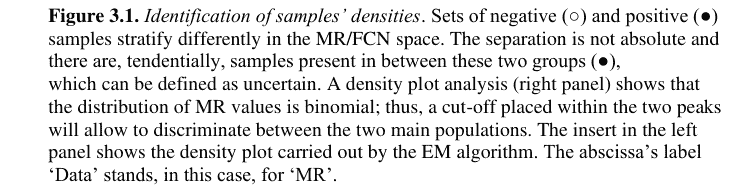

图 3.1. 样本密度的识别。阴性（○）和阳性（●）样本组在 MR/FCN 空间中以不同方式分层。这种分离并非绝对，且在这两组之间往往存在一些样本（●），它们可以被界定为不确定。密度图分析（右图）表明 MR 值的分布呈双峰分布；因此，在两个峰之间放置一个截断值将能够区分这两个主要总体。左图中的插图显示了由 EM 算法生成的密度图。在此情况下，横坐标标签“数据”代表“MR”。

```
Listing 3.1 (continuation)
library(mixtools)
df <- data.frame(MR=c(negative_mr, uncertain_mr, positive_mr),
FCN=c(negative_fcn, uncertain_fcn, positive_fcn))
model = normalmixEM((x = df$MR))
plot(model, which=2)
```

```text
> summary(model)
summary of normalmixEM object:
```

|      | 成分 1     | 成分 2    |
|------|------------|-----------|
| lambda | 0.4532318 | 0.546768 |
| mu    | 0.0538644  | 0.345513 |
| sigma | 0.0291171 | 0.114604 |

估计处的对数似然：81.04961

```text
> model$mu[1]   # Mean of negative population
[1] 0.05386439
> model$sigma[1] # SD of negative population
[1] 0.02911713
> model$mu[2]   # Mean of positive population
[1] 0.345513
> model$sigma[2] # SD of positive population
[1] 0.1146038
```

标准差可用作两个总体之间的阈值。可选地，可以应用一个乘数来更好地区分数据（Marongiu 等，2016a）——然而，由于操作者选择乘数的大小，这种方法引入了进一步的主观步骤。问题在于，很多时候，实际数据中包含一些在低 FCN 处 MR 值出现尖峰的样本。可以更新前面的清单以考虑这种情况：

```
Listing 3.2
spike_mr <- runif(10, 0, 0.3)
spike_fcn <- runif(10, 1, 10)
df <- data.frame(MR=c(negative_mr, uncertain_mr, positive_mr, spike_mr),
FCN=c(negative_fcn, uncertain_fcn, positive_fcn, spike_fcn),
GROUP=c(rep("negative", length(negative_mr)),
rep("uncertain", length(uncertain_mr)),
rep("positive", length(positive_mr)), rep("spike", length(spike_mr))))
plot(df$MR[df$GROUP=="negative"] ~ df$FCN[df$GROUP=="negative"], ylim=c(0,0.5), xlim=c(0,41),
    cex=1.5, xlab=expression(bold("FCN")), ylab=expression(bold("MR")))
points(df$MR[df$GROUP=="positive"] ~ df$FCN[df$GROUP=="positive"], pch=16, cex=1.5)
points(df$MR[df$GROUP=="uncertain"] ~ df$FCN[df$GROUP=="uncertain"], pch=16, cex=1.5,
    col="grey")
points(df$MR[df$GROUP=="spike"] ~ df$FCN[df$GROUP=="spike"], pch=15, cex=1.5, col="gray40")
legend("topleft", legend = c("Positives", "Negatives", "Uncertains", "Early spike"),
    pch = c(16, 1, 16, 15), col=c("black", "black", "grey", "gray40"))
```

对数据的目视检查（图 3.2A）显示，在 FCN = 10 处样本分布存在差异。这种分割显然首先是由于本例数据的生成方式所致，但真实数据集也存在类似的不连续性（Marongiu 等，2016a；Marongiu 等，2021a）——并且该数据的设计就包含了这种分割。FCN = 10 可用于进一步对反应进行分层：低于此值的样本将有一个 MR 阈值，而高于此值的样本则应用由 EM 推导出的阈值。

```
Listing 3.2 (continuation)
TH_mr <- model$sigma[2]
early_TH_fcn <- 10
early_TH_mr <- max(df$MR[(df$MR > cut_off) & (df$FCN < early_TH_fcn)])
plot(df$MR[(df$FCN < early_TH_fcn) & (df$MR <= early_TH_mr)] ~
    df$FCN[(df$FCN < early_TH_fcn) & (df$MR <= early_TH_mr)],
    ylim=c(0,0.5), xlim=c(0,41), cex=1.5, xlab=expression(bold("FCN")),
    ylab=expression(bold("MR")))
points(df$MR[(df$FCN >= early_TH_fcn) & (df$MR < TH_mr)] ~
    df$FCN[(df$FCN >= early_TH_fcn) & (df$MR < TH_mr)], pch=1, cex=1.5)
points(df$MR[(df$FCN >= early_TH_fcn) & (df$MR >= TH_mr)] ~
    df$FCN[(df$FCN >= early_TH_fcn) & (df$MR >= TH_mr)], pch=16, cex=1.5)
segments(0, early_TH_mr, early_TH_fcn, early_TH_mr, col="red", lwd=2, lty=2)
segments(early_TH_fcn, early_TH_mr, early_TH_fcn, cut_off, col="red", lwd=2, lty=2)
segments(early_TH_fcn, cut_off, max(df$FCN), cut_off, col="red", lwd=2, lty=2)
legend("topleft", legend = c("Positives", "Negatives"), pch = c(16, 1))
```

图 3.2B 显示了样本如何根据其 MR 和 FCN 值进行分类，而无需事先知道其反应性。其思路是，操作者在 qPCR 检测后无需通过目视检查反应来确定它们是阳性还是阴性；算法将自动完成这一工作。

每天都在进行筛查。如果有一种程序可以省去其中大部分反应，那对操作者来说将是一种改进，而 maxRatio 的价值也将变得显而易见。

然而，EM 过滤 maxRatio 的方法存在一些缺点：

- FCN 阈值的选择仍然是主观的。
- 使用两个 MR 阈值（和一个 FCN 阈值）既令人困惑又不优雅。
- 进一步子类（如弱阳性）的定义设计起来很复杂，而且仍然是主观的。

### 使用支持向量机过滤 maxRatio

支持向量机（SVM）是监督学习模型，作为机器学习算法的一部分，用于分类和回归分析。SVM 是由 Vladimir Vapnik 和他的同事于 1960 年代至 1990 年代在 AT&T 贝尔实验室开发的（Cortes 和 Vapnik，1995）。本质上，SVM 在被称为项目或元素的样本组之间找到一条分隔线（“最大间隔超平面”或简称为超平面）。线性可分的组是不重叠的组。SVM 算法在组之间找到分离程度最大的超平面，这意味着从一个组中被重新分类到另一个组的元素数量最少。SVM 不使用每组的所有元素，而是使用最接近超平面的元素子集，这降低了过程的复杂性和计算要求。当组不是线性可分时，SVM 应用“间隔”：允许超平面附近的一些元素聚集到相对的一组中。可以被“错误分类”的样本比例由代价参数 C 定义，该参数对应围绕超平面的间隔宽度。下一节将更详细地描述 SVM 算法。

为了使用前一节中的示例，根据 EM 推导出的阈值分层的样本将被分配到 A 组或 B 组。这种初始分类指定了术语“监督”：操作者通过为每个元素分配标签来监督该过程；然后，机器将基于某种算法改进分类。监督学习方法与“无监督”模型（如神经网络和层次聚类）相对立，后者不需要任何


先前的标记用于提供分类。以下列表将描述如何生成 SVM 超平面。

```
Listing 3.3
GA_mr <- c(df$MR[(df$FCN < early_TH_fcn) & (df$MR <= early_TH_mr)],
    df$SMR[(df$FCN >= early_TH_fcn) & (df$MR < cut_off)])
GA_fcn <- c(df$FCN[(df$FCN < early_TH_fcn) & (df$MR <= early_TH_mr)],
    df$FCN[(df$FCN >= early_TH_fcn) & (df$MR < cut_off)])
GB_mr <- df$MR[(df$FCN >= early_TH_fcn) & (df$MR >= cut_off)]
GB_fcn <- df$FCN[(df$FCN >= early_TH_fcn) & (df$MR >= cut_off)]
A_df <- data.frame(MR = GA_mr, FCN = GA_fcn)
B_df <- data.frame(MR = GB_mr, FCN = GB_fcn)
plot(MR ~ FCN, A_df, ylim=c(0,0.5), xlim=c(0,41), cex=1.5, xlab=expression(bold("FCN")),
    ylab=expression(bold("MR")))
points(B_df$MR ~ B_df$FCN, pch=16, cex=1.5)
abline(0.32, -0.007, lwd=3)
abline(0.29, -0.007, lty=2)
abline(0.35, -0.007, lty=2)
s1 <- A_df[(A_df$MR>0.2) & (A_df$FCN>=1.5),]
s2 <- A_df[(A_df$MR>0.18) & (A_df$FCN>8),]
s3 <- A_df[(A_df$FCN>20)&(A_df$FCN<22),]
s4 <- B_df[(B_df$MR<0.42)&(B_df$FCN<12),]
s5 <- B_df[(B_df$FCN>19)&(B_df$FCN<20),]
s6 <- B_df[(B_df$FCN>33)&(B_df$FCN<34)&(B_df$MR<0.17),]
points(s1$FCN, s1$MR, pch=0, cex=2)
points(s2$FCN, s2$MR, pch=0, cex=2)
points(s3$FCN, s3$MR, pch=0, cex=2)
points(s4$FCN, s4$MR, pch=0, cex=2)
points(s5$FCN, s5$MR, pch=0, cex=2)
points(s6$FCN, s6$MR, pch=0, cex=2)
y <- function(s=0.007, p, i=0.32) {return(s*p+i)}
segments(s1$FCN, s1$MR, s1$FCN, y(p=s1$FCN), lty=3)
segments(s2$FCN, s2$MR, s2$FCN, y(p=s2$FCN), lty=3)
segments(s3$FCN, s3$MR, s3$FCN, y(p=s3$FCN), lty=3)
segments(s4$FCN, s4$MR, s4$FCN, y(p=s4$FCN), lty=3)
segments(s5$FCN, s5$MR, s5$FCN, y(p=s5$FCN), lty=3)
segments(s6$FCN, s6$MR, s6$FCN, y(p=s6$FCN), lty=3)
legend("topleft", legend = c("A", "B"), pch = c(16, 1))
```

更详细地说，列表显示两个组彼此分离且具有足够的宽度，可以通过一条直线进行分离（图 3.3）。该线的识别是通过对图的目视检查完成的，具体如下。通过观察到一条截距为 0.32 MR 的线可以将数据分为两组，可以确定可能的斜率。由于 MR 值在 FCN = 20 时约为 0.20，而在 FCN = 10 时约为 0.29，因此可以估计分离线的斜率为 Δy/Δx = −0.09/10 = −0.009。通过试错进一步调整确定了示例中使用的值。进一步的数据探索允许选择合适的支持向量（s1-s6）。

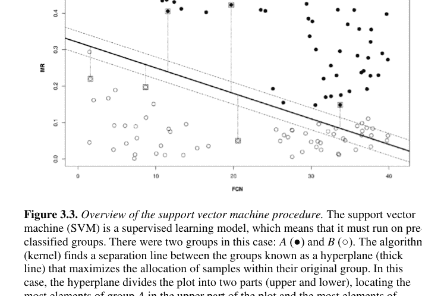

图 3.3. 支持向量机程序概述。支持向量机（SVM）是一种监督学习模型，这意味着它必须在预先分类的组上运行。在本例中共有两组：A（●）和 B（○）。算法（核）在组之间找到一条分离线，称为超平面（粗线），该超平面最大化样本在其原始组内的分配。在本例中，超平面将图分为上下两部分，将组 A 的大部分元素定位在图的上面，将组 B 的大部分元素定位在图的下面。为了减少计算工作量，核仅使用已知为支持向量的元素子集（此处用方块突出显示）。因此，该过程简化为最小化超平面与支持向量之间的距离（虚线），类似于回归分析。该模型还为分类过程提供了一些灵活性，这意味着边际内的项目（虚线）在分类过程中将被忽略。SVM 分析的最终产品是，超平面上方的点将被分类为属于组 A。相反，低于该平面的点将被放入组 B。

SVM 的另一个显著方面是超平面不一定是直线；它们也可以是曲线并延伸到三维。所谓的“核技巧”可以将三维聚类线性化，这也有助于区分非线性可分组。SVM 使用的最常见核是线性核（用于线性可分情况）、多项式核、sigmoid 核和 Gaussian 核。此外，SVM 允许定义多于一个组。再次看图 3.3，很明显，使用能够“包裹”阳性样本的曲线将避免将高 FCN 的阴性样本分类为反应性。此外，一种能够识别图 3.1-3.2 中指定为“不确定”的样本的分类程序将大大简化验证过程，因为它允许操作员仅关注不满意的反应。

曾尝试将 SVM 应用于 qPCR 数据的分析（Marongiu et al., 2021a）。对 15,744 个先前由 maxRatio 加 EM 过滤分类的样本进行再分析（Marongiu et al., 2016a）显示，与 fit-point 方法相比，maxRatio/SVM 组合将阳性和阴性反应的检测准确率从 99.6% 提高到 100%，PPV 从 96.5% 提高到 99.9%。此外，maxRatio/SVM 组合将 35 个样本检测为次优，这意味着整个数据集仅有 0.2% 需要通过目视检查进行实际验证。PPV 接近 100%，剩余的反应可以在没有操作员参与的情况下进行验证，从而大幅减少 qPCR 工作量。下一节将使用一组新的反应重现这种分析方法。

### maxRatio/SVM 分析方法的真实案例

以下示例中使用的 RT-qPCR 数据由意大利威尼斯实验动物预防研究所（Istituto Zooprofilattico Sperimentale delle Venezie）病毒学实验室的 Maria Serena Beato 博士和 Lara Cavicchio 博士慷慨提供。该检测针对猪流感 A 病毒（SIV）的血凝素基因，主要信号由 FAM 荧光团产生，HEX 通道下为 ROX 发射进行归一化（Hoffmann et al., 2010）。本示例仅处理 FAM 信号——在真实世界的验证场景中，目标和归一化通道的结果将被合并（即，即使存在反应性 FAM 信号，具有非反应性 HEX 信号的样本也必须重新处理）。该检测
在 CFX 热循环仪（BioRad）上进行，并使用 CFX Maestro 软件生成原始扩增数据和平文件以及验证结果。不同的运行手动连接成单个制表符分隔文件（TSV），然后用于下游分析。以下列表显示了如何导入数据以及对集合进行初步探索。

```
Listing 3.4
setwd(getwd())
amplification <- read.table("SIV_overall.tsv", header = TRUE, row.names = NULL, skip = 0, dec = ".", sep = "\t", fill = TRUE, comment.char = "", stringsAsFactors = FALSE)
validation <- read.delim("SIV_results.tsv")
```

这是一个扩增数据的描述：

```
> nrow(amplification)
[1] 5304
> str(amplification)
'data.frame':5304 obs. of  8 variables:
  $ Run   : int  1 1 1 1 1 1 1 1 1 ...
  $ Cycle : int  1 2 3 4 5 6 7 8 9 10 ...
  $ FAM   : num  2344 2337 2335 2336 2333 ...
  $ HEX   : num  2278 2280 2284 2279 2279 ...
  $ Well  : chr  "A2" "A2" "A2" "A2" ...
  $ Index : int  1 1 1 1 1 1 1 1 1 ...
  $ Type  : chr  "Unknown" "Unknown" "Unknown" "Unknown" ...
  $ Target: chr  "SIV" "SIV" "SIV" "SIV" ...
> summary(amplification)
Run      Cycle      FAM          HEX         Well       
Min.   :1.00   Min.   :1.00   Min.   :2258   Min.   :2253   Length:5304  
1st Qu.:10.00  1st Qu.:12.00  1st Qu.:2597   1st Qu.:2813   Class :character  
Median :14.00  Median :23.00  Median :2791   Median :2977   Mode  :character  
Mean   :11.88  Mean   :22.74  Mean   :2834   Mean   :3127                    
3rd Qu.:16.00  3rd Qu.:34.00  3rd Qu.:2890   3rd Qu.:3480                    
Max.   :16.00  Max.   :50.00  Max.   :5807   Max.   :5558                    
                     NA's   :264   NA's   :264                                  
Index          Type           Target      
Min.   : 1.0   Length:5304     Length:5304
```


```text
1st Qu.: 83.0   Class :character   Class :character
Median :115.0 Mode :character Mode :character
Mean :106.8
3rd Qu.:145.0
Max. :171.0
> length(unique(amplification$Index))
[1] 120
> unique(amplification$Target)
[1] "SIV"
> unique(amplification$Type)
[1] "Unknown"  "Control"  "NTC"      "Negative"
> range(unique(amplification$Cycle))
[1] 1 50
```

以下是 SIV 数据集的结果概览：

```text
> nrow(validation)
[1] 120
> head(validation, n=3)
```

|  | Run | Well | Fluor | Target | Content | FAM | HEX |
|---|---|---|---|---|---|---|---|
| 1 | 1 | A2 | FAM/HEX | SIV | Unkn | 23.81 | 24.56 |
| 2 | 1 | A11 | FAM/HEX | SIV | Unkn | 20.58 | 24.62 |
| 3 | 1 | B2 | FAM/HEX | SIV | Unkn | 37.79 | 24.64 |

```text
> unique(validation$Target)
[1] "SIV"
> unique(validation$Content)
[1] "Unkn"    "Pos Ctrl" "NTC"     "Neg Ctrl"
> summary(validation[c("FAM", "HEX")])
```

|  | FAM | HEX |
|---|---:|---:|
| Min. | 15.01 | 23.14 |
| 1st Qu. | 23.24 | 26.08 |
| Median | 26.71 | 26.98 |
| Mean | 29.01 | 27.01 |
| 3rd Qu. | 37.00 | 27.72 |
| Max. | 41.85 | 35.62 |
| NA's | 63 | 31 |

```text
> sd(validation$FAM, na.rm = TRUE)

[1] 8.088397

> sum(is.na(validation$FAM))

[1] 63

> sum(is.na(validation$FAM[(validation$Content == "NTC")]))

[1] 6

> sum(is.na(validation$FAM[(validation$Content == "Neg Ctrl")]))

[1] 2
```

这段快速数据探索显示，原始扩增文件包含 5304 个数据点，每个数据点都由一个索引唯一标识。单一靶标“SIV”包含 120 个反应，分为实际生物样本（“Unknown”/“Unkn”）、阳性对照（“Control”/“Pos Ctrl”）、无模板对照（“NTC”）和阴性对照（“Negative”/“Neg Ctrl”）。反应在 50 个循环内完成。FAM 的平均 Cq 为 29.01 ± 8.09 个循环，有 63 个样本的扩增循环未确定（Cq=NA）。在这 63 个无扩增反应中，6 个为 NTC，2 个为阴性对照，因此剩余 55 个实际样本为 PCR 阴性。然而，仅有 FAM 和 HEX 通道存在 264 个缺失数据。以下命令将进一步检查数据框中缺失项的存在情况：

```text
> colSums(is.na(amplification))
```

| Run | Cycle | FAM | HEX | Well | Index | Type | Target |
|---:|---:|---:|---:|---:|---:|---:|---:|
| 0 | 0 | 264 | 264 | 0 | 0 | 0 | 0 |

```text
> colSums(is.na(validation))
```

| Run | Well | Fluor | Target | Content | FAM | HEX | Index |
|---:|---:|---:|---:|---:|---:|---:|---:|
| 0 | 0 | 0 | 0 | 0 | 63 | 31 | 0 |

针对 validation 数据框发现的 63 个缺失值与上一步获取的信息一致；仅在 FAM/HEX 字段中出现的 264 个缺失值看起来可疑。以下命令将尝试定位缺失值并理解可能的原因。

```r
> missed = unique(amplification[is.na(amplification$FAM) == TRUE,]$Index)
> length(missed)
[1] 33
> head(amplification[amplification$Index == missed[1],], 5)
```

|  | Run | Cycle | FAM | HEX | Well | Index | Type | Target |
|---|---:|---:|---:|---:|---:|---:|---:|---:|
| 3613 | 16 | 1 | 2799.034 | 2866.715 | A1 | 138 | NTC | SIV |
| 3614 | 16 | 2 | 2799.025 | 2870.605 | A1 | 138 | NTC | SIV |
| 3615 | 16 | 3 | 2808.016 | 2871.811 | A1 | 138 | NTC | SIV |
| 3616 | 16 | 4 | 2809.798 | 2877.324 | A1 | 138 | NTC | SIV |
| 3617 | 16 | 5 | 2813.030 | 2877.266 | A1 | 138 | NTC | SIV |

```r
> tail(amplification[amplification$Index == missed[1],], 9)
```

|  | Run | Cycle | FAM | HEX | Well | Index | Type | Target |
|---|---:|---:|---:|---:|---:|---:|---:|---:|
| 3654 | 16 | 42 | 3012.705 | 4038.449 | A1 | 138 | NTC | SIV |
| 3655 | 16 | 43 | NA | NA | A1 | 138 | NTC | SIV |
| 3656 | 16 | 44 | NA | NA | A1 | 138 | NTC | SIV |
| 3657 | 16 | 45 | NA | NA | A1 | 138 | NTC | SIV |
| 3658 | 16 | 46 | NA | NA | A1 | 138 | NTC | SIV |
| 3659 | 16 | 47 | NA | NA | A1 | 138 | NTC | SIV |
| 3660 | 16 | 48 | NA | NA | A1 | 138 | NTC | SIV |
| 3661 | 16 | 49 | NA | NA | A1 | 138 | NTC | SIV |
| 3662 | 16 | 50 | NA | NA | A1 | 138 | NTC | SIV |

问题在于有 33 个反应存在空行。可以通过以下命令移除这些空行：

```r
> cleaned = amplification[is.na(amplification$FAM) == FALSE,]
> nrow(amplification)
[1] 5304
> nrow(cleaned)
[1] 5040
> colSums(is.na(cleaned))
```

| Run | Cycle | FAM | HEX | Well | Index | Type | Target |
|---:|---:|---:|---:|---:|---:|---:|---:|
| 0 | 0 | 0 | 0 | 0 | 0 | 0 | 0 |

还有一些用于探索数据的更高级函数，这些函数需要专门的库（*Hmisc 和 VIM*）：

```text
> library(Hmisc)
> describe(cleaned)

cleaned

8 Variables    5040 Observations

-------------------------------------------------------------------------------

        Run
n       missing     distinct    Info    Mean    Gmd
5040    0           8           0.968   11.67   5.161
lowest : 1  8  10  12  13, highest: 12 13 14 15 16
Value          1      8     10     12     13     14     15     16
Frequency    714    420    504    588    252    504    630   1428
Proportion  0.142  0.083  0.100  0.117  0.050  0.100  0.125  0.283

-------------------------------------------------------------------------------

        Cycle
n       missing     distinct    Info    Mean    Gmd    .05    .10    .25
5040    0           42          0.999   21.5    13.99  3.0    5.0    11.0
.50     .75         .90         .95
21.5    32.0        38.0        40.0
lowest : 1  2  3  4  5, highest: 38 39 40 41 42

-------------------------------------------------------------------------------

        FAM
n       missing distinct    Info    Mean    Gmd    .05    .10    .25
5040    0       4998        1       2834    382.1  2336   2467   2597
.50     .75     .90         .95
2791    2890    3099        3825
lowest : 2258.000 2260.013 2260.269 2260.344 2260.812
highest: 5766.148 5772.516 5787.097 5806.523 5806.575

-------------------------------------------------------------------------------

        HEX
n       missing distinct    Info    Mean    Gmd    .05    .10    .25
5040    0       4998        1       3127    601.1  2352   2438   2813
.50     .75     .90         .95
2977    3480    3985        4170
lowest : 2252.870 2253.220 2253.872 2254.034 2254.549
highest: 5384.987 5429.361 5487.475 5538.712 5557.927

-------------------------------------------------------------------------------

        Well
n       missing distinct
5040    0       47
lowest : A1 A10 A11 A12 A2 , highest: G2 G3 H11 H2 H3

-------------------------------------------------------------------------------

        Index
n       missing distinct    Info    Mean    Gmd    .05    .10    .25
5040    0       120         1       104.3   52.41  6.95   12.90  81.75
.50     .75     .90         .95
111.50  141.25  159.10      165.05
lowest : 1  2  3  4  5, highest: 167 168 169 170 171

-------------------------------------------------------------------------------

        Type
n       missing distinct
5040    0       4
Value      Control Negative NTC Unknown
Frequency  378     168     1680 2814
Proportion 0.075   0.033   0.333 0.558

-------------------------------------------------------------------------------

        Target
n       missing distinct value
5040    0       1       SIV
Value      SIV
Frequency  5040
Proportion 1
```

```r
library("VIM")

aggr(amplification, prop=FALSE, numbers = TRUE)

aggr(cleaned, prop=FALSE, numbers = TRUE)
```

VIM 的 aggr 函数生成的图（图 3.4）显示，清理后的数据框不再包含空值。现在数据的特征如下：

```text
> length(unique(cleaned$Index))
[1] 120

> unique(cleaned$Target)
[1] "SIV"

> unique(cleaned$Type)
[1] "Unknown" "Control" "NTC"     "Negative"

> nrow(cleaned)
[1] 5040

> range(unique(cleaned$Cycle))
[1] 1 42
```

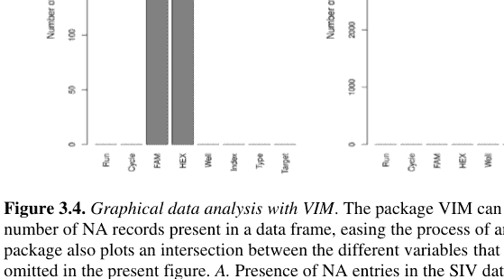

**图 3.4.** 使用 VIM 进行图形化数据分析。VIM 包可以绘制数据框中存在的 NA 记录数量，从而简化分析过程。该包还会绘制不同变量之间的交集图，但本图中已省略。A. 数据清理前 SIV 数据集中 NA 项的存在情况。B. 数据清理已移除数据集中的所有 NA 项。

本质上，数据的描述保持不变，但现在有 5040 个数据点，而不是 5304 个，且扩增在 42 个循环内完成。数据探索是一个必不可少且不可忽视的准备步骤。只有数据被清理后，才能继续进行实际分析。

maxRatio 分析的第一步是为每个反应生成 MR/FCN 值，使用前面章节中定义的 mrCalc 函数。由于 SIV 数据具有高背景特征（即最低荧光值的数值已经很高），因此通过设置“background_compensation”参数引入补偿以提高 MR 值。若不进行这种校正，MR 值会非常小，并可能引入偏差。不过，该校正并非必需。数据可视化将使用 lattice 包；图形不会立即绘制，而是先保存到对象 P，再通过调用 print(P) 绘制（图 3.5）。

**代码清单 3.5**

```r
MRs = vector()
FCNs = vector()
for(i in unique(validation$Run)){
    run <- subset(validation, Run == i)
    for(j in run$Well) {
        well <- subset(amplification, Run == i & Well == j)
        x <- mrCalc(well$Cycle, well$FAM, background_compensation = 1000)
        MRs <- append(MRs, x[1])
        FCNs <- append(FCNs, x[2])
    }
}
validation$MR <- MRs
validation$FCN <- FCNs
library(lattice)
P <- xyplot(MR ~ FCN, group = Content, data = validation, cex=1.5, pch=c(0, 0, 1, 4), col = "black",
    key = list(space="top", columns=3, col = "black", points=list(pch=c(0, 1, 4), col="black"),
    text=list(c("Neg Ctrl/NTC", "Pos Ctrl", "Unkn"))))
print(P)
COLS = ifelse(is.na(validation$FAM) == TRUE, 1, 16)
plot(MR ~ FCN, validation, cex=1.5, pch=COLS, xlab="FCN", ylab="MR")
legend("topleft", legend = c("Positives", "Negatives"), pch=c(1,16))
write.table(validation, file = "validationCleaned.tsv", append = FALSE)
```


后续步骤是对将用于机器学习流程的数据进行标注。标注工作由作者与 Eric Shain 先生合作完成。数据集中每个扩增曲线都被绘制出来，并使用交互式函数 (callingShots) 将反应评定为阳性（有反应）或阴性（无反应），答案被记录在一个向量中，然后该向量附加到初始数据框。

#### Listing 3.6
```
amp = read.delim("validationCleaned.tsv")
callingShots = function(data) {
    set_start = readline(prompt="Enter starting run:")
    Start = ifelse(set_start == "", 1, set_start )
    shot_calling = vector()
    stopper = FALSE
    k=0
    M = nrow(data)
    for (i in Start:max(unique(data$Run))) {
        plate = data[data$Run == i,]
        for (j in unique(plate$Index)) {
            if(stopper == TRUE) {
                break
            } else {
                k = k+1
                well = plate[plate$Index == j,]
                plot(well$FAM ~ well$Cycle, type = "l", lwd=2, col="blue",
                    ylim=c(0,6000),
                    xlab="Cycle", ylab="Fluorescence",
                    main=paste("Run ", i, ", well ", j, sep = ""))
                abline(v=35, lwd=2)
                grid(nx = 20, ny = NULL, lty = 1, col = "gray", lwd = 1)
                PROMPT = paste("Classification? (", k, "/", M, ") [0|1, to exit] ",
                    sep = "")
                shot = readline(prompt=PROMPT)
                if(shot == "") {
                    print(toupper("Stopping classification"))
                    stopper = TRUE
                    break
                } else {
                    shot_calling = append(shot_calling, as.numeric(shot))
                }
            }
        }
    }
}
return(shot_calling)
}
answer = callingShots(amp)
validation <- read.table("data/validationData.tsv", header = TRUE, dec = ".", sep = "\t")
validation$rater = answer
validation$agreed = ifelse(validation$rater_1 == validation$rater_2, 1, 0)
plot(MR ~ FCN, validation[validation$agreed == 1,])
points(MR ~ FCN, validation[validation$agreed == 0,], pch = 16)
legend("topleft", legend = c("Agreed", "Disagreed"), pch = c(1, 16), cex=2)
validation$label = ifelse(validation$rater_1 == validation$rater_2, validation$rater_1, -1)
validation$label <- as.factor(validation$label)
levels(validation$label) <- c("Uncertain", "Negative", "Positive")
```

该程序由两位评定者独立执行，数据框包含两个额外的列（‘rater_1’ 和 ‘rater_2’）。只有一小部分样本在评定者之间没有达成一致意见。然后一致性被存储到一个额外的字段中，如果样本被判定为有反应则取值为‘1’，如果被判定为无反应则取值为‘0’，如果评定者之间没有一致意见则取值为‘–1’。新列被分层为因子。

```
str(validation)
data.frame': 120 obs. of 11 variables:
  $ Run   : int  1 1 1 1 1 1 1 1 1 1 ...
  $ Well  : chr  "A2" "A11" "B2" "B9" ...
  $ Fluor : chr  "FAM/HEX" "FAM/HEX" "FAM/HEX" "FAM/HEX" ...
  $ Target: chr  "SIV" "SIV" "SIV" "SIV" ...
  $ Content: chr  "Unkn" "Unkn" "Unkn" "Unkn" "Pos Ctrl" ...
  $ FAM   : num  23.8 20.6 37.8 18 21 ...
  $ HEX   : num  24.6 24.6 24.6 NA 25.2 ...
  $ Index : int  1 2 3 4 5 6 7 8 9 10 ...
  $ MR    : num  0.0699 0.072 0.0147 0.0583 0.0749 ...
  $ FCN   : num  27.1 24.5 42 21.2 24.5 ...
  $ label : Factor w/ 3 levels "Uncertain","Negative",...1 3 3 2 3 3 3 3 3 ...
```

分析的第二步是实现 k 折交叉分类（Ounpraseuth 等，2012）。在这种方法中，整个数据集被分为训练集和测试集，但只保留一致的样本。机器学习算法将使用前者的样本标签来拟合超平面，然后对后者的样本进行分配。该过程重复 k 次，并使用平均值生成准确的分类程序。原始扩增数据在以下列表中被划分为包含 80% 样本的训练集。采样过程涉及对样本的索引进行采样以生成一个向量（train_id），该向量将用于在 SVM 过程中选择样本；未包含在此向量中的样本存储在另一个向量（test_id）中，该向量将定义测试反应。这些向量作为 R 对象存储到特定目录（data）中以整理工作区。

#### Listing 3.7
```r
dir.create("data", showWarnings = FALSE)
unanimous = df[df$label != "Uncertain",]
n <- round(length(unique(unanimous$Index))*0.8, 0)
for (i in 1:10) {
  train_id <- sample(unique(unanimous$Index), n, replace = FALSE)
  test_id <- setdiff(unique(unanimous$Index), train_id)
  saveRDS(train_id, paste("data/trainSet_", i, ".rds", sep=""))
  saveRDS(test_id, paste("data/testSet_", i, ".rds", sep=""))
}
```

第三步在于算法的优化。具体来说，需要选择核技巧和间隔的代价。SVM 使用 kernlab 库进行。由于此步骤涉及多次运行 SVM 建模，因此在此呈现该过程的概述以便澄清。

#### Listing 3.7 (continuation)
```r
validation$label <- as.factor(validation$label)
levels(df$label) <- c("Negative", "Positive")
i=1
train_ids = readRDS(paste("data/trainSet_", i, ".rds", sep = ""))
test_ids = readRDS(paste("data/testSet_", i, ".rds", sep = ""))
train_set = validation[validation$Index %in% train_ids,]
test_set = validation[validation$Index %in% test_ids,]
train_set$Outcome <- ifelse(is.na(train_set$FAM) == TRUE, "negative", "positive")
test_set$Outcome <- ifelse(is.na(test_set$FAM) == TRUE, "negative", "positive")
train_set$Outcome <- as.factor(train_set$Outcome)
test_set$Outcome <- as.factor(test_set$Outcome)
```

该过程将遍历前一步定义的十组标识符；目前以第一步为例。与标识符集合相关联的结果用于创建一个额外的字段（‘outcome’），如果 Cq 未被识别则包含虚拟变量‘negative’，否则为‘positive’。然后该字段被定义为因子。可以通过以下方式检查额外字段的添加：

```
> str(train_set)
'data.frame':96 obs. of 11 variables:
$ Run : int 1 1 1 1 1 1 1 1 1 ...
$ Well : chr "A2" "B11" "C2" "C11" ...
$ Fluor : chr "FAM/HEX" "FAM/HEX" "FAM/HEX" "FAM/HEX" ...
$ Target : chr "SIV" "SIV" "SIV" "SIV" ...
$ Content: chr "Unkn" "Unkn" "Unkn" "Unkn" ...
$ FAM : num 23.8 21 25 26.5 25.1 ...
$ HEX : num 24.6 25.2 25.5 24.5 24.4 ...
$ Index : int 1 5 6 7 8 10 11 12 13 15 ...
$ MR : num 0.0334 0.036 0.0321 0.0279 0.0307 ...
$ FCN : num 27.2 24.7 28.3 30.2 28.6 ...
$ label: Factor w/ 2 levels "negative","positive": 2 2 2 2 2 2 2 2 2 ...
```

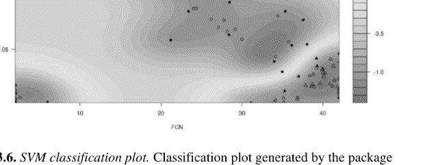

#### Figure 3.6
图 3.6. SVM 分类图。由 kernlab 包生成的分类图。阴影表示与一个类别（圆圈）或另一个类别（三角形）的关联强度。黑色图标表示模型的支持向量。

SVM 模型通过将 outcome 字段作为 MR 和 FCN 的函数传递给 ksvm 函数来执行（图 3.6）。该过程将用于分类目的运行（type = C-svc）——尽管它也可以用于回归和新颖性检测——核技巧将为高斯算法（kernel = “rbfdot”），其参数自动设置（kpar = “automatic”），约束违反的代价（C）设为 1，且建模将计算类别概率。也可以使用 plot 函数绘制结果模型。

#### Listing 3.8
```
library(kernlab)
mod = ksvm(outcome ~ MR+FCN, data = train_set,
    type = "C-svc", kernel = "rbfdot", kpar = "automatic", C = 1, prob.model = TRUE)
    plot(mod, data = train_set)
pred_prob = predict(mod, test_set, type = "probabilities")
prediction = predict(mod, test_set)
serial = test_set$Index
rating= test_set$Outcome
OUT = data.frame(serial, rating, prediction, stringsAsFactors = FALSE)
```

该模型用于对测试集的反应进行分类。具体来说，创建一个数据框，其中包含测试反应的序列号及其分配的标签（‘rating’）和预测值（‘prediction’）。分配的参数被保存到特定的向量中。

```
TP = nrow(subset(OUT, rating == "positive" & prediction == "positive"))
TN = nrow(subset(OUT, rating == "negative" & prediction == "negative"))
FP = nrow(subset(OUT, rating == "negative" & prediction == "positive"))
FN = nrow(subset(OUT, rating == "positive" & prediction == "negative"))
ACC = (TP + TN) / (TP + TN + FP + FN)
> head(OUT)
```

| 序列 | 评级 | 预测 |
|---|---|---|
| 8 | positive | positive |
| 10 | positive | positive |
| 13 | positive | negative |
| 77 | negative | negative |
| 84 | positive | negative |
| 87 | negative | negative |

> ACC
[1] 0.7083333


诊断准确率仅为70.8%，但必须考虑到，在评估的案例中，反应性结果与非反应性结果之间的界限并不清晰，正如前几段给出的数据检查所证明的那样。

调优步骤将遍历之前定义的训练和测试数据框，以选择哪种核技巧（高斯、贝塞尔或拉普拉斯）能提供最高的准确率。一个数据框将包含参数和最终的诊断准确率，并通过聚合提供结果。

```r
#### Listing 3.9
kernel_list = c("rbfdot", "besseldot", "laplacedot")
accuracy_result = data.frame(Set = numeric(), Kernel = character(), Accuracy = numeric())
for (i in 1:10) {
    print(i)
    train_ids = readRDS(paste("data/trainSet_", i, ".rds", sep = ""))
    test_ids = readRDS(paste("data/testSet_", i, ".rds", sep = ""))
    train_set = validation[validation$Index %in% train_ids,]
    test_set = validation[validation$Index %in% test_ids,]
    train_set$Outcome <- ifelse(is.na(train_set$FAM) == TRUE, "negative", "positive")
    test_set$Outcome <- ifelse(is.na(test_set$FAM) == TRUE, "negative", "positive")
    train_set$Outcome <- as.factor(train_set$Outcome)
    test_set$Outcome <- as.factor(test_set$Outcome)
    for (k in kernel_list) {
        mod = ksvm(Outcome ~ MR+FCN, data = train_set,
            type = "C-svc", kernel = k, kpar = "automatic", C = 1, prob.model = TRUE)
        pred_prob = predict(mod, test_set, type = "probabilities")
        prediction = predict(mod, test_set)
        serial = test_set$Index
        rating = test_set$Outcome
        OUT = data.frame(serial, rating, prediction, stringsAsFactors = FALSE)
        TP = nrow(subset(OUT, rating == "positive" & prediction == "positive"))
        TN = nrow(subset(OUT, rating == "negative" & prediction == "negative"))
        FP = nrow(subset(OUT, rating == "negative" & prediction == "positive"))
        FN = nrow(subset(OUT, rating == "positive" & prediction == "negative"))
        ACC = (TP + TN) / (TP + TN + FP + FN)
        results = data.frame(Set = i, Kernel = k, Accuracy = ACC)
        accuracy_result = rbind(accuracy_result, results)
    }
}
final_results <- aggregate(Accuracy ~ Kernel, accuracy_result, mean)
```

```r
> final_results
```

|   | 核函数 | 准确率 |
|---|------------|----------|
| 1 | besseldot  | 0.9545455|
| 2 | laplacedot | 0.9727273|
| 3 | rbfdot     | 0.9909091|

RBF核被证明是评估数据的最佳选择。为从一系列值中选择C参数，重复了该过程。

```r
#### Listing 3.9 (continuation)
cost_list = c(0.01, 0.1, 0.5, 0.75, 1, 2, 5, 10)
accuracy_result = data.frame(Set = numeric(), Cost = numeric(), Accuracy = numeric())
for (i in 1:10) {
    print(i)
    train_ids = readRDS(paste("data/trainSet_", i, ".rds", sep = ""))
    test_ids = readRDS(paste("data/testSet_", i, ".rds", sep = ""))
    train_set = validation[validation$Index %in% train_ids,]
    test_set = validation[validation$Index %in% test_ids,]
    train_set$Outcome <- ifelse(is.na(train_set$FAM) == TRUE, "negative", "positive")
    test_set$Outcome <- ifelse(is.na(test_set$FAM) == TRUE, "negative", "positive")
    train_set$Outcome <- as.factor(train_set$Outcome)
    test_set$Outcome <- as.factor(test_set$Outcome)
    for (k in cost_list) {
        mod = ksvm(Outcome ~ MR+FCN, data = train_set, type = "C-svc",
            kernel = "rbfdot", kpar = "automatic", C = k, prob.model = TRUE)
        pred_prob = predict(mod, test_set, type = "probabilities")
        prediction = predict(mod, test_set)
        serial = test_set$Index
        rating = test_set$Outcome
        OUT = data.frame(serial, rating, prediction, stringsAsFactors = FALSE)
        TP = nrow(subset(OUT, rating == "positive" & prediction == "positive"))
        TN = nrow(subset(OUT, rating == "negative" & prediction == "negative"))
        FP = nrow(subset(OUT, rating == "negative" & prediction == "positive"))
        FN = nrow(subset(OUT, rating == "positive" & prediction == "negative"))
        ACC = (TP + TN) / (TP + TN + FP + FN)
        results = data.frame(Set = i, Cost = k, Accuracy = ACC)
        accuracy_result = rbind(accuracy_result, results)
    }
}
```

```r
> aggregate(Accuracy ~ Cost, accuracy_result, mean)
```

|   | 成本 | 准确率 |
|---|------|----------|
| 1 | 0.01 | 0.6136364|
| 2 | 0.10 | 0.9681818|
| 3 | 0.50 | 0.9909091|
| 4 | 0.75 | 0.9863636|
| 5 | 1.00 | 0.9909091|
| 6 | 2.00 | 0.9818182|
| 7 | 5.00 | 0.9909091|
| 8 |10.00 | 0.9818182|

提供最高准确率的最低成本为0.5；成本为1也可能是另一个不错的选择。因此，SVM模型将采用*rbf*核，成本为0.5。

最后一步是使用所选参数运行SVM算法。为了生成一幅能足够详细地显示超平面的图，将生成介于FCN 0-50和MR 0-0.4之间的1000个点，并根据SVM模型对每个点进行分类，然后使用*lattice*包的*contourplot*函数绘制。这些图保存到对象中，然后作为样本图的叠加层打印出来。将计算该检测方法的诊断特性。

```r
#### Listing 3.10
library(lattice)
library(RColorBrewer)
library(latticeExtra)
make.grid = function(x, n = 1000) {
    xrange = apply(x, 2, range)
    x1 = seq(from = xrange[1,1], to = xrange[2,1], length = n)
    x2 = seq(from = xrange[1,2], to = xrange[2,2], length = n)
    expand.grid(X1 = x1, X2 = x2)
}
plot_list = list()
accuracy_result = data.frame(Set = numeric(), Accuracy = numeric(), Sensitivity = numeric(),
                             Specificity = numeric())
for (i in 1:5) {
    print(i)
    train_ids = readRDS(paste("data/trainSet_", i, ".rds", sep = ""))
    test_ids = readRDS(paste("data/testSet_", i, ".rds", sep = ""))
    train_set = validation[validation$Index %in% train_ids,]
    test_set = validation[validation$Index %in% test_ids,]
    train_set$Outcome <- ifelse(is.na(train_set$FAM) == TRUE, "negative", "positive")
    test_set$Outcome <- ifelse(is.na(test_set$FAM) == TRUE, "negative", "positive")
    train_set$Outcome <- as.factor(train_set$Outcome)
    test_set$Outcome <- as.factor(test_set$Outcome)
    mod = ksvm(Outcome ~ MR+FCN, data = train_set, type = "C-svc", kernel = "rbfdot", C = 0.5,
        kpar = "automatic", prob.model = TRUE)
    pred_prob = predict(mod, test_set, type = "probabilities")
    prediction = predict(mod, test_set)
    serial = test_set$Index
    rating = test_set$Outcome
    OUT = data.frame(serial, rating, prediction, stringsAsFactors = FALSE)
    TP = nrow(subset(OUT, rating == "positive" & prediction == "positive"))
    TN = nrow(subset(OUT, rating == "negative" & prediction == "negative"))
    FP = nrow(subset(OUT, rating == "negative" & prediction == "positive"))
    FN = nrow(subset(OUT, rating == "positive" & prediction == "negative"))
    ACC = (TP + TN) / (TP + TN + FP + FN)
    SEN = TP/(TP+FN)
    SPE = TN/(TN+FP)
    results = data.frame(Set = i, Accuracy = ACC, Sensitivity = SEN, Specificity = SPE)
    accuracy_result = rbind(accuracy_result, results)
    xmat = make.grid(matrix(c(test_set$MR,test_set$FCN), ncol = 2, byrow=FALSE))
    xgrid = as.data.frame(xmat)
    names(xgrid) = c("MR", "FCN")
    ygrid = predict(mod, xgrid)
    xyz_dat = as.data.frame(cbind(xgrid, ygrid))
    plot_list[[i]] = contourplot(ygrid ~ FCN+MR, data=xyz_dat, pretty = TRUE, xlim=c(0,45),
        ylim=c(0,0.2), labels = FALSE, col = "blue", lwd = 0.5)
}
P <- xyplot(MR ~ FCN, group = Content, data = validation, cex=1.5, pch=c(0, 1, 4), col = "black",
    key = list(space="top", columns=3, col = "black", points=list(pch=c(0, 1, 4), col="black"),
    text=list(c("Neg Ctrl/NTC", "Pos Ctrl", "Unknown")))) + as.layer(plot_list[[1]]) + as.layer(plot_list[[2]]) +
    as.layer(plot_list[[3]]) + as.layer(plot_list[[4]]) + as.layer(plot_list[[5]])
print(P)
accuracy = mean(accuracy_result$Accuracy)
sensitivity = mean(accuracy_result$Sensitivity)
specificity = mean(accuracy_result$Specificity)
accuracy_SD = sd(accuracy_result$Accuracy)
sensitivity_SD = sd(accuracy_result$Sensitivity)
specificity_SD = sd(accuracy_result$Specificity)
```


```r
cat("Accuracy  = ", round(accuracy,2), " ± ", round(accuracy_SD, 2),
"\nSensitivity = ", round(sensitivity,2), " ± ", round(sensitivity_SD, 2),
"\nSpecificity = ", round(specificity,2), " ± ", round(specificity_SD, 2))
```

```
Accuracy  = 1    ± 0.01
Sensitivity = 0.99  ± 0.04
Specificity = 1    ± 0
```

图3.7A展示了这一分析的结果。为了更好地理解超平面的含义，将使用清单中定义的一次迭代中的xyz_dat数据框的数据进行绘图：

```r
xyplot(MR ~ FCN, group = ygrid, data = xyz_dat, col=c("gray90", "gray40"), key = list(space="top", columns=2, col = "black", points=list(pch=16, col=c("gray40", "gray90")), text=list(c("positives", "negatives"))))
```

图3.7B清晰地显示，聚集在MR/FCN空间中心的反应被归类为阳性（有反应）。

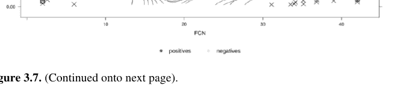

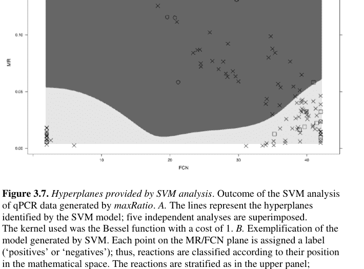

图3.7. SVM分析提供的超平面。SVM对maxRatio生成的qPCR数据进行分析的结果。A. 线条表示SVM模型识别出的超平面；叠加了五次独立分析。使用的核函数是Bessel函数，成本为1。B. SVM生成模型的示例。MR/FCN平面上的每个点都被赋予一个标签（'positives'或'negatives'）；因此，反应根据其在数学空间中的位置进行分类。反应按上面板中的方式分层；注意，下面板是上面板的放大图。

### 扩展SVM分类

本例中达到的总体准确率并不突出；相比之下，在上述研究（Marongiu, 2020）中准确率为1 ± 0。然而，必须考虑到：

- 数据集很小（仅占2020年分析数据的0.76%）。
- 在归类为阳性和阴性的反应之间存在相当多的重叠。

无论初始数据的质量如何，该分析的价值在于其根据反应性对样本进行聚类的能力。这一特性将在下面的清单中加以测试。

#### 清单3.11

```r
pred_prob = predict(mod, validation, type = "probabilities")
prediction = predict(mod, validation)
serial = validation$Index
rating = validation$Outcome
classified = data.frame(Serial = serial, Class = prediction, MR = validation$MR,
    FCN = validation$FCN, stringsAsFactors = FALSE)
split.screen(c(2, 1))
split.screen(c(1, 4), screen = 2)
screen(1)
plot(classified$MR[classified$Class == "positive"] ~ classified$FCN[classified$Class == "positive"],
    cex=1.5, pch=16, xlim=c(0, 0.50), ylim=c(0,0.45), xlab=expression(bold("FCN")),
    ylab=expression(bold("MR")))
points(classified$MR[classified$Class == "negative"] ~ classified$FCN[classified$Class == "negative"],
    cex=1.5, pch=1)
points(classified$MR[classified$Serial == 171] ~ classified$FCN[classified$Serial == 171], cex=2.5,
    pch=0, lwd=2)
points(classified$MR[classified$Serial == 71] ~ classified$FCN[classified$Serial == 71], cex=2.5,
    pch=0, lwd=2)
points(classified$MR[classified$Serial == 148] ~ classified$FCN[classified$Serial == 148], cex=2.5,
    pch=0, lwd=2)
points(classified$MR[classified$Serial == 80] ~ classified$FCN[classified$Serial == 80], cex=2.5,
    pch=0, lwd=2)
text(classified$FCN[classified$Serial == 171]-1, 0.02, 171)
text(classified$FCN[classified$Serial == 71]+0.3, 0.02, 71)
text(classified$FCN[classified$Serial == 148]+1, 0.02, 148)
text(classified$FCN[classified$Serial == 80], 0.02, 80)
points(classified$MR[classified$Serial == 4] ~ classified$FCN[classified$Serial == 4], cex=2.5,
    pch=0, lwd=2)
points(classified$MR[classified$Serial == 10] ~ classified$FCN[classified$Serial == 10], cex=2.5,
    pch=0, lwd=2)
points(classified$MR[classified$Serial == 76] ~ classified$FCN[classified$Serial == 76], cex=2.5,
    pch=0, lwd=2)
points(classified$MR[classified$Serial == 117] ~ classified$FCN[classified$Serial == 117], cex=2.5,
    pch=0, lwd=2)
text(classified$FCN[classified$Serial == 4], 0.01, 4)
text(classified$FCN[classified$Serial == 10], 0.05, 10)
text(classified$FCN[classified$Serial == 76], 0.1, 76)
text(classified$FCN[classified$Serial == 117], 0.04, 117)
points(classified$MR[classified$Serial == 128] ~ classified$FCN[classified$Serial == 128], cex=2.5,
    pch=0, lwd=2)
points(classified$MR[classified$Serial == 108] ~ classified$FCN[classified$Serial == 108], cex=2.5,
     pch=0, lwd=2)
points(classified$MR[classified$Serial == 130] ~ classified$FCN[classified$Serial == 130], cex=2.5,
     pch=0, lwd=2)
points(classified$MR[classified$Serial == 126] ~ classified$FCN[classified$Serial == 126], cex=2.5,
     pch=0, lwd=2)
text(classified$FCN[classified$Serial == 128], 0.02, 128)
text(classified$FCN[classified$Serial == 108]-0.3, 0.055, 108)
text(classified$FCN[classified$Serial == 130]+0.2, 0.055, 130)
text(classified$FCN[classified$Serial == 126], 0.03, 126)
#### samples at FCN = 50
points(classified$MR[classified$Serial == 167] ~ classified$FCN[classified$Serial == 167], cex=2.5,
     pch=0, lwd=2)
points(classified$MR[classified$Serial == 146] ~ classified$FCN[classified$Serial == 146], cex=2.5,
     pch=0, lwd=2)
points(classified$MR[classified$Serial == 153] ~ classified$FCN[classified$Serial == 153], cex=2.5,
     pch=0, lwd=2)
points(classified$MR[classified$Serial == 169] ~ classified$FCN[classified$Serial == 169], cex=2.5,
     pch=0, lwd=2)
text(classified$FCN[classified$Serial == 167]-2, 0.01935, 167)
text(classified$FCN[classified$Serial == 146]-2, 0.39102, 146)
text(classified$FCN[classified$Serial == 153]-2, 0.05577, 153)
text(classified$FCN[classified$Serial == 169]-2, 0.33484, 169)
legend("topleft", title = "SVM classification", legend = c("Positive", "Negative"), pch=c(16,1), cex=1.5)
screen(3)
plot(amplification$FAM[amplification$Index == 171] ~ amplification$Cycle[amplification$Index == 171],
     type="l", xlim=c(0,45), lwd=2, ylim=c(min(amplification$FAM, na.rm=TRUE),
     max(amplification$FAM, na.rm=TRUE)), xlab=expression(bold("Cycle")), ylab=expression(bold("Fluorescence")))
points(amplification$FAM[amplification$Index == 71] ~ amplification$Cycle[amplification$Index == 71],
     type="l", lwd=2, lty=2)
points(amplification$FAM[amplification$Index == 148] ~ amplification$Cycle[amplification$Index == 148],
     type="l", lwd=2, lty=3)
points(amplification$FAM[amplification$Index == 80] ~ amplification$Cycle[amplification$Index == 80],
     type="l", lwd=2, lty=4)
legend("topleft", title = "Reaction index", legend = c(171, 71, 148, 80), lwd = 2, lty=1:4)
screen(4)
plot(amplification$FAM[amplification$Index == 4] ~ amplification$Cycle[amplification$Index == 4],
    type="l", xlim=c(0,45), lwd=2, ylim=c(min(amplification$FAM, na.rm=TRUE),
    max(amplification$FAM, na.rm=TRUE)), xlab=expression(bold("Cycle")),
    ylab=expression(bold("Fluorescence")))
points(amplification$FAM[amplification$Index == 10] ~ amplification$Cycle[amplification$Index == 10],
    type="l", lwd=2, lty=2)
points(amplification$FAM[amplification$Index == 76] ~ amplification$Cycle[amplification$Index == 76],
    type="l", lwd=2, lty=3)
points(amplification$FAM[amplification$Index == 117] ~ amplification$Cycle[amplification$Index ==
    117], type="l", lwd=2, lty=4)
legend("topleft", title = "Reaction index", legend = c(4, 10, 76, 117), lwd = 2, lty=1:4)
screen(5)
plot(amplification$FAM[amplification$Index == 128] ~ amplification$Cycle[amplification$Index == 128],
    type="l", xlim=c(0,45), lwd=2, ylim=c(min(amplification$FAM, na.rm=TRUE),
    max(amplification$FAM, na.rm=TRUE)), xlab=expression(bold("Cycle")),
    ylab=expression(bold("Fluorescence")))
points(amplification$FAM[amplification$Index == 108] ~ amplification$Cycle[amplification$Index ==
    108], type="l", lwd=2, lty=2)
points(amplification$FAM[amplification$Index == 130] ~ amplification$Cycle[amplification$Index ==
    130], type="l", lwd=2, lty=3)
points(amplification$FAM[amplification$Index == 126] ~ amplification$Cycle[amplification$Index ==
    126], type="l", lwd=2, lty=4)
legend("topleft", title = "Reaction index", legend = c(128, 108, 130, 126), lwd = 2, lty=1:4)
screen(6)
plot(amplification$FAM[amplification$Index == 146] ~ amplification$Cycle[amplification$Index == 146],
    type="l", xlim=c(0,45), lwd=2, ylim=c(min(amplification$FAM, na.rm=TRUE),
    max(amplification$FAM, na.rm=TRUE)), xlab=expression(bold("Cycle")),
    ylab=expression(bold("Fluorescence")))
points(amplification$FAM[amplification$Index == 169] ~ amplification$Cycle[amplification$Index ==
    169], type="l", lwd=2, lty=2)
points(amplification$FAM[amplification$Index == 153] ~ amplification$Cycle[amplification$Index ==
    153], type="l", lwd=2, lty=3)
points(amplification$FAM[amplification$Index == 167] ~ amplification$Cycle[amplification$Index ==
    167], type="l", lwd=2, lty=4)
legend("topleft", title = "Reaction index", legend = c(146, 169, 153, 167), lwd = 2, lty=1:4)
dev.off()
```


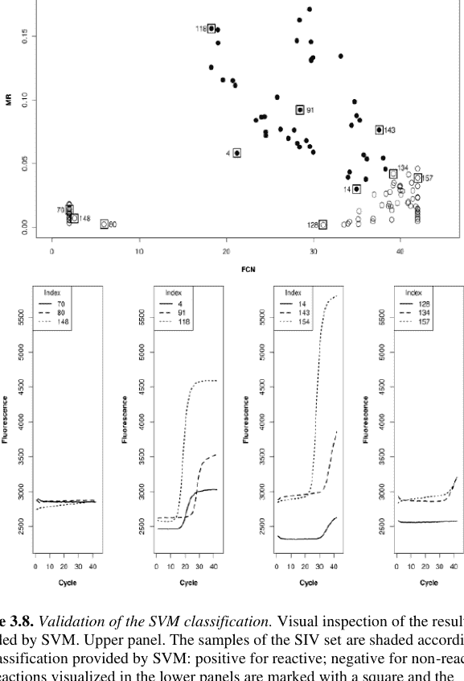

图 3.8. SVM 分类的验证。对 SVM 提供结果的目视检查。上面板：SIV 组的样本根据 SVM 提供的分类着色：阳性表示有反应；阴性表示无反应。下面板中显示的反应用方块和识别号（索引）标记。第一个面板（左下）显示了来自极低 FCN 的反应样本。注意它们都具有与低模板输入兼容的扩增曲线，表明该组包含真正无反应的反应。该聚类中的所有样本均被 SVM 分类为阴性。相反，第二个面板显示来自中央聚类的反应显示有反应的扩增曲线。该聚类中的所有样本均被 SVM 分类为阳性。

| 样本 | 索引 | 分类 | MR | FCN |
|---|---|---|---|---|
|13|13|阴性|0.007734856|36.11|
|14|14|阴性|0.013633048|35.03|
|33|84|阴性|0.012909645|40.00|
|35|86|阴性|0.013874760|39.65|
|37|88|阴性|0.011207163|38.94|
|39|90|阴性|0.018840671|38.87|
|60|111|阴性|0.013920748|39.23|
|61|112|阴性|0.010758628|37.03|
|69|120|阴性|0.010122101|38.58|
|71|122|阴性|0.023491891|36.30|
|73|124|阴性|0.012213669|40.57|
|75|126|阴性|0.009964716|42.00|
|76|127|阴性|0.022611430|39.05|
|80|131|阴性|0.017640808|39.94|
|81|132|阴性|0.024336411|38.25|
|83|134|阴性|0.015876619|39.29|
|84|135|阴性|0.009475816|41.44|
|86|137|阴性|0.013483160|42.00|
|94|145|阴性|0.027757804|39.45|

碰巧，这些差异反应中的三个（108、128 和 126）已被核查；其余的在图 3.9 中进行比较。本质上，三个假阳性反应中有两个具有反应性扩增曲线（Cq 未确定但被 SVM 分类为阳性）；相反，20 个假阴性反应（Cq 平均值为 39.19 ± 1.97，被 SVM 分类为阴性）显示出与低模板输入一致的曲线。可以认为，fit-point/maxRatio 的组合非常强大，因为它能够识别反应曲线中的差异，从而帮助更准确地验证反应。这是 maxRatio 在 Abbott Molecular m2000 实时系统中的当前用途。本文应用的 SVM 叠加层有望进一步减少差异，并实例化分组——例如荧光抑制、低模板或完全误判——这将帮助操作员理解导致差异的问题。然而，该模型的一个缺点是其极端二分法：“阳性”和“阴性”聚类无法足够详细地描述数据集。

由特定实验室执行的运行。换句话说，该模型可以应用于不断增长的数据集，从而提高其准确性。

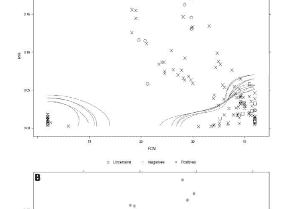

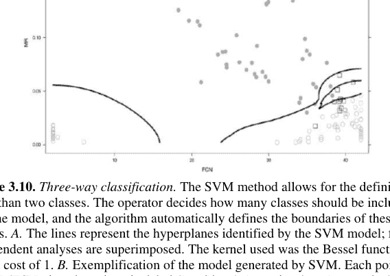

图 3.10. 三类分类。SVM 方法允许定义两个以上的类别。操作员决定模型中应包含多少个类别，算法自动定义这些类别的边界。A. 线条代表 SVM 模型识别的超平面；叠加了五次独立分析。使用的核是 Bessel 函数，代价为 1。B. SVM 生成模型的示例。MR/FCN 平面上的每个点都被赋予一个标签（“阳性”、“阴性”或“不确定”）；因此，反应根据其在数学空间中的位置进行分类。反应与上面板一样分层；注意下面板是上面板的放大图。

#### 代码清单 3.12

```
saveRDS(mod, "SVModel.rds")
mod = readRDS("SVModel.rds")
plot_list = list()
accuracy_result = data.frame(Set = numeric(), Accuracy = numeric(), Sensitivity = numeric(),
    Specificity = numeric())
for (i in 1:5) {
    print(i)
    train_ids = readRDS(paste("data/trainSet_", i, ".rds", sep = ""))
    test_ids = readRDS(paste("data/testSet_", i, ".rds", sep = ""))
    train_set = validation[validation$Index %in% train_ids]
    test_set = validation[validation$Index %in% test_ids]
    train_set$Outcome <- ifelse(is.na(train_set$FAM) == TRUE, "negative", "positive")
    test_set$Outcome <- ifelse(is.na(test_set$FAM) == TRUE, "negative", "positive")
    train_set$Outcome[train_set$FCN == 50] <- "uncertain"  # add more classes
    test_set$Outcome[test_set$FCN == 50] <- "uncertain"   # add more classes
    train_set$Outcome <- as.factor(train_set$Outcome)
    test_set$Outcome <- as.factor(test_set$Outcome)
    mod = ksvm(outcome ~ MR+FCN, data = train_set, type = "C-svc", kernel = "besseldot", C =1,
        kpar = "automatic", prob.model = TRUE)
    pred_prob = predict(mod, test_set, type = "probabilities")
    prediction = predict(mod, test_set)
    serial = test_set$Index
    rating = test_set$Outcome
    OUT = data.frame(serial, rating, prediction, stringsAsFactors = FALSE)
    TP = nrow(subset(OUT, rating == "positive" & prediction == "positive"))
    TN = nrow(subset(OUT, rating == "negative" & prediction == "negative"))
    FP = nrow(subset(OUT, rating == "negative" & prediction == "positive"))
    FN = nrow(subset(OUT, rating == "positive" & prediction == "negative"))
    ACC = (TP + TN) / (TP + TN + FP + FN)
    SEN = TP/(TP+FN)
    SPE = TN/(TN+FP)
    results = data.frame(Set = i, Accuracy = ACC, Sensitivity = SEN, Specificity = SPE)
    accuracy_result = rbind(accuracy_result, results)
    xmat = make.grid(matrix(c(test_set$MR,test_set$FCN), ncol = 2, byrow=FALSE))
    xgrid = as.data.frame(xmat)
    names(xgrid) = c("MR", "FCN")
    ygrid = predict(mod, xgrid)
    xyz_dat = as.data.frame(cbind(xgrid, ygrid))
}
```
```
plot_list[[i]] = contourplot(ygrid ~ FCN+MR, data=xyz_dat, pretty = TRUE, xlim=c(0,45), ylim=c(0,0.2), labels = FALSE, col = "blue", lwd = 0.5)
}
saveRDS(mod, "SVMModel.rds")
xyplot(MR ~ FCN, group = Content, data = validation, cex=1.5, pch=c(0, 0, 1, 4), col = "black", key = list(space="top", columns=3, col = "black", points=list(pch=c(0, 1, 4), col="black"), text=list(c("Neg Ctrl/NTC", "Pos Ctrl", "Unkn")))) + as.layer(plot_list[[1]]) + as.layer(plot_list[[2]]) + as.layer(plot_list[[3]]) + as.layer(plot_list[[4]]) + as.layer(plot_list[[5]])
xyplot(MR ~ FCN, group = ygrid, data = xyz_dat, col=c("gray90", "gray40", "gray50"), key = list(space="top", columns=3, col = "black", points=list(pch=16, col=c("gray40", "gray90", "gray50")), text=list(c("positives", "negatives", "uncertains")))) + xyplot(MR ~ FCN, group = Content, data = validation, cex=1.5, pch=c(0, 0, 1, 4), col = "black")
accuracy = mean(accuracy_result$Accuracy)
sensitivity = mean(accuracy_result$Sensitivity)
specificity = mean(accuracy_result$Specificity)
accuracy_SD = sd(accuracy_result$Accuracy)
sensitivity_SD = sd(accuracy_result$Sensitivity)
specificity_SD = sd(accuracy_result$Specificity)
```

```
cat("Accuracy = ", round(accuracy,2), " ± ", round(accuracy_SD, 2), "\nSensitivity = ", round(sensitivity,2), " ± ", round(sensitivity_SD, 2), "\nSpecificity = ", round(specificity,2), " ± ", round(specificity_SD, 2))
```

Accuracy = 0.75 ± 0.04
Sensitivity = 0.54 ± 0.06
Specificity = 0.95 ± 0.09

在该测定区分阳性和阴性反应方面，灵敏度和特异性略有提高。不确定的反应可按如下方式检索：

```
Listing 3.12 (continuation)
pred_prob = predict(mod, validation, type = "probabilities")
prediction = predict(mod, validation)
serial = validation$Index
rating = validation$Outcome
classified = data.frame(Serial = serial, Class = prediction, MR = validation$MR, FCN = validation$FCN, stringsAsFactors = FALSE)
```

```
set.seed(n)
  n
  一个整数。
layout(x, widths, heights, ...)
  x
  指定绘图行数和列数的矩阵。
  widths, heights
  指定列宽或行高的向量。
density(x, bw, adjust, kernel, na.rm = FALSE, ...)
  x
  数据向量。
  bw, adjust
  绘图的带宽，可单独使用或乘以乘数 'adjust'。
  kernel
  用于生成密度图的方法（"gaussian", "epanechnikov", "rectangular", "triangular", "biweight", "cosine", "optcosine"）
  na.rm
  逻辑值，确定是否排除 NA 值。
normalmixEM(x, lambda, mu, sigma, k, epsilon, maxit, maxrestarts, verb, ...)
  x
  数据向量。
  lambda, mu, sigma
  混合比例、组分均值和标准差的最初值。
  k
  组分数。
  epsilon
  收敛标准。
  maxit, maxrestarts
  最大迭代次数和允许的重新开始次数。
  verb
  逻辑值，激活详细模式。
```

#### 代码清单 3.2。

由于 qPCR 的真实数据在低扩增循环时显示高荧光，因此在前一个代码清单的模拟中增加了十个元素。本代码清单和上一代码清单中生成的所有数据都存储在数据框 df 中，然后通过根据其分组（阳性、阴性、不确定）对数据着色来绘图。

区分有反应和无反应反应的阈值是通过使用 normalmixEM（代码清单 3.1）生成的模型对象获得的。具体来说，第二个群体（无反应）的平均 MR 值的标准差被用作阈值（model$sigma[2]）。在低扩增循环时具有高荧光的样本将高于该阈值，因此，考虑到目视检查或数据探索表明这些样本的 FCN 低于 10，设置了第二个阈值。阈值在图中用 segments 函数描绘。

#### 代码清单 3.3。

根据存储在变量 early_TH_fcn、early_TH_mr 和 cut-off 中的阈值生成标签。标签存储在变量中，这些变量组合在数据框 A_df 和 B_df 中，分别定义群体 A 和 B。数据被绘制，超平面由一条主线段（abline(0.32, -0.007, lwd=3)）和两条边界线（abline(0.29, -0.007, lty=2) 和 abline(0.35, -0.007, lty=2)）描绘。自定义函数 y 计算支持向量与超平面之间的距离。

可以编写实现简单 if...else 语句的单行函数（在其他编程语言中称为 lambda 或匿名函数）。单行函数返回的值可以通过以下语法存储到对象中：
variable <- function(parameters) (return (if(parameters)))
variable <- ifelse(condition, value_if_true, value_if_false)
在第一种情况下，返回基于 parameters 中存在的值进行的计算。例如，当 x = [a, b, c] 时，f(x) = a * b+c。在第二种情况下，根据条件子句的结果，variable 取 value_if_true 或 value_if_false。例如，将 a <- ifelse(x>0, "positive", "negative") 应用于 x <- c(-2, -1, 0, 1, 2) 将返回 a = ["negative" "negative" "negative" "positive" "positive"]。


#### 清单3.4.

实际数据从制表符分隔的文件中加载。这些文件保存在作者的ResearchGate网站上（https://www.researchgate.net/publication/360568958_SIV_overall 和 https://www.researchgate.net/publication/360568853_SIV_results）。文件下载到本地目录后，可以使用`read.table`将其加载到R环境中。该函数以本地目录完整路径（绝对路径）的形式接收文件指针。否则，除非文件下载到的本地目录就是R的默认目录，否则可以使用`setwd`设置工作目录，然后从那里访问文件，无需写出全部（相对）路径。在清单中，由于不知道本地目录，因此使用`getwd`函数确定当前目录，并将其作为参数传递给`setwd`。这一过程实质上是将R的默认目录简化为工作目录。在实际使用中，用户可以设置首选目录，从而无需写下下载文件的完整路径。或者，`read.table`可以接受完整的URL。此外，`read.table`是一个通用函数，其各个参数也尽可能通用。其他相关函数如`read.csv`和`read.delim`专门用于读取逗号分隔值（csv）和制表符分隔值（tsv），方法是将`sep`参数分别设置为逗号（“,”）和制表符（“\t”）。文件`SIV_overall.tsv`包含从热循环仪获取的扩增数据，而`SIV_results.tsv`包含所有反应的定量循环。每个反应由一个唯一索引标识。`SIV_overall.tsv`文件被加载到对象*扩增*中，`SIV_results.tsv`文件被加载到对象*验证*中。

```
Determining the current (more properly: working) folder where R reads and writes file
is given by the function `getwd`, which does not require an argument. It is possible to
set the current folder with `setwd`.

`getwd()`
    x
        the path to a folder

`read.table(file, header, sep, quote, dec, row.names, col.names, na.strings, skip,
fill, strip.white, blank.lines.skip, comment.char, encoding, skipNul,
stringsAsFactors)`
    file
        name of the data file. If it does not contain an absolute path, the file name is
        relative to the current working directory. The file can also be a complete URL.

    header
        logical indicating whether the file contains the names of the variables as its
        first line.
    sep
        field separator character (default = "").
    quote
        quoting character (default = "\"").
    dec
        character used for decimal points (default = ".").
    row.names, col.names
        vector of row or column names.
    na.strings
        vector of strings to be interpreted as NA values.
    skip
        number of lines of the data file to skip before beginning to read data.
    fill
        if TRUE, blank fields are implicitly added.
    strip.white
        logical to determine whether leading and trailing white space from unquoted
        character fields should be removed.
    blank.lines.skip
        if TRUE, blank lines are ignored.
    comment.char
        comment character (default = "#"). details see scan.
    encoding
        type of text encoding (default = UTF-8).
    skipNul
        logical to determine whether NULL values should be skipped.
    stringsAsFactors
        logical to determine whether strings should be converted to factors.
```

#### 清单3.5.

每个样本的MR和FCN值是通过对存储在验证数据框中的数据重复调用mrCalc函数而生成的。结果存储在两个向量（MRs和FCNs）中，然后分别作为MR和FCN列添加到数据框。使用颜色代码绘制数据，分为阳性（反应性）或阴性（非反应性）。

```
An alternative way to select data from data frame is to use the function
subset. Indexing is obtained with the square bracket operators as shown in listing 1.1.
The function subset simplifies the procedure using parameters for condition and field
selection.
The library lattice provides a sophisticated way to display multivariate data. There
are several functions to draw virtually all types of plots, such as scatter plots
(xyplot), barplots (barchart), and box-and-whiskers plots (bwplot), which all have the
same syntax. Unlike the core R graphical functions, the high-level and low-level elements
are merged into the functions' call. The explanation of lattice's graphic is extensive
and goes beyond the scope of the present work, thus this will be a very cursory summary.
The basic call to the lattice plots is in the form y~x, but it is possible to group the
data and add an effect to the data as in y~x+2. Lattice's plots cannot be drawn inside
a graphical device such as the function jpg; they need to be saved into an object that
is then called in a graphical device.
Tables are exported from the R's environment to a stored file using the function
write.table. The selection of different separators allows to store CSV, TSV and other
types of files.
subset(x, condition, select, ...)
    x
    data frame to subset.
    condition
    the logical test that specified column's values need to pass to be selected.
    select
    list of columns to select from the data frame.
xyplot(y~x, group, ...)
    y, x
    the coordinates of the points.
    group
    labeling of the data.
write.table(x, file, append, quote, sep, eol , na, dec, row.names, col.names, ...)
    x
    the matrix or data frame to be written.
    file
    name of the file (" " indicates output to the console).
    append
    logical determining whether the data written has to be added to an existing file
    of the same name.
    quote
    logical determining whether strings should be quoted.
    sep
    field separator string (default = " "). Use "\t" for TSV and "," for CSV.
    eol
    string to print at the end of each line (default = "\n").
    na
    string to use for missing values in the data (default = "NA").
    dec
    string to use for decimal points (default = ".").
    row.names, col.names
    logical value indicating whether the row or column names are to be written, or a
    vector of names to be written.
```

#### 清单3.6.

从缺失数据条目中清理出的扩增数据（在清单3.5中存储于文件amplificationCleaned.tsv）被重新加载到R环境中。callingShots函数允许操作员直观检查给定反应的扩增图，为其输入编码标签：阳性（1）、阴性（0）或不确定（-1），然后移动到下一个样本。该函数的实现如下。可以选择开始的反应编号；从而允许操作员在多个会话中筛选数据。开始反应编号通过readline函数从终端直接输入获取，并存储在变量set_start中。如果set_start为空，则假定操作员想要重新开始，变量Start被设置为1；否则Start取set_start中存储的值。将包含操作员提供标签（shot_calling）的向量被实例化，变量stopper允许操作员随时停止该函数。变量k和M是计数器，后者被设置为数据集中已知存在的反应数量（120）。验证数据框有一组新列，这些列源自评分者（此处为rater_1、rater_2）提供的结果。通过比较不同评分者的值，创建一个新列agreed。如果不同评分列中的所有评分相同，则给出等于一致评分（1或0）的标签，否则为-1。具有一致标签1的数据被绘制，标签为0的数据被绘制在它们之上。条目按因子分层。

```
The function readline reads an input directly from the terminal. The function as.factor is used to encode a vector as a factor. The levels of each factor and an associated label can be provided. The associated function is.factor tests if a vector is stratified in factors. The low-level graphical function grid adds a rectangular grid to a plot.
readline(prompt)
prompt
optional string to be displayed on screen.
as.factor(x, levels, labels, exclude, ordered, nmax)
x
a data vector.
levels
optional character vector of unique values.
labels
optional character vector of labels for the levels.
exclude
a vector of values to be excluded.
ordered
logical flag to determine if the levels should be regarded as ordered.
nmax
maximum number of levels.
grid(x, y, ...)
x, y
number of lines on the x or y axis. The default value (NULL) links these to the major ticks of the axis. The y value is optional, forcing y = x.
```

#### 清单3.7.

创建一个新目录data，以有序方式存储k-means分类所需的文件。分析仅限于评分者一致的反应，这是通过对数据框进行索引获得的，从而排除不确定的反应（df$label != "Uncertain"）。通过生成10组数据框（存储在新文件夹data中）来获得k-means验证。每组包含一个包含80%反应的训练数据框和一个包含20%数据的测试数据框。这些组包含每个反应的标识号（索引）。数据集以RDS对象形式保存，作为文本文件的替代方案，并减少硬盘空间占用。由于label列最初包含三个水平（阳性、阴性和不确定），但现在只有两个水平（阳性和阴性），因此因子被覆盖为只有两个水平。为了给出该过程的示例，我仅使用变量i将第一组数据加载到内存中。索引包含在测试数据集中的反应被选中并存储在一个新数据框（train_set）中；对测试集进行相同操作。通过将'negative'分配给没有荧光信号的反应来创建新列，否则为'positive'；该分类按标签分层。

```
The function dir.create creates a new directory in a specified path. An alternative to store tables is to use R objects; these are compressed files that are read faster into memory and maintain additional characteristics such as levels. The R objects are written and read with saveRDS and readRDS, respectively, and have the extension '.rds'.
The function round rounds a fractional number to a specified decimal value. The associated functions are trunc, floor and ceiling. The function length returns the number of elements or levels of a vector. The function sample randomly extracts elements from a vector.
saveRDS(x, path)
readRDS(path)
x
an object to be saved.
path
a string containing the path and name of the object.
round(x, digits)
x
a floating point number.
digits
the number of decimals required.
```


```
length(x)
  x
    a data vector.
sample(x, size, replace, prob)
  x
    a data vector.
  size
    number of elements to choose.
  replace
    logical determining whether sampling should be done with replacement (default= FALSE).
  prob
    optional vector of probability weights.
```

#### 列表 3.8

在训练数据框 (train_set) 上构建了一个 SVM 模型，使用列 "outcome" 作为 z 值，并分别将 FCN 和 MR 的组合作为 x 和 y 值。因此，该模型将最大化基于 x 和 y 具有相同 z 值的数据簇的分离。模型使用 kernlab 包中的函数 ksvm 生成，并存储在对象 mod 中并应用于测试数据框 (test_set)。z 的预测（反应性的标签）基于提供的 x (FCN) 和 y (MR) 值，使用 predict 函数。向量 pred_prob 包含分类的概率；prediction 包含实际标签。新的数据框 (OUT) 使用测试数据框的索引和 prediction 构建。

```
The function ksvm generates an SVM model based on graphical coordinates (x/y values) and a label (z values). The function predict is part of R core and predicts new values based on a model.
ksvm(z~x+y, data, scaled, type, kernel, kpar, C, nu, epsilon, prob.model, class.weights, ...)
  x, y
    coordinates of the data points.
  z
    a response variable (a factor or numeric) with one label for each row/component of x.
  data
    data frame containing the training data.
  scaled
    logical indicating whether the variables should be scaled.
  type
    string indicating the final use of the SVM model: "C-svc" C classification; "nu-svc" nu classification; "C-bsvc" bound-constraint svm classification; cs-svc Crammer, Singer native multi-class; "kbb-svc" Weston, Watkins native multi-class; "one-svc" novelty detection; "eps-svr" epsilon regression; "nu-svr" nu regression; "eps-bsvr" bound-constraint svm regression; "C-svc" C classification.
  kernel
    kernel function used in training and predicting: "rbfdot" Radial Basis kernel Gaussian; "polydot" Polynomial kernel; "vanilladot" Linear kernel; "tanhdot" Hyperbolic tangent kernel; "laplacedot" Laplacian kernel; "besseldot" Bessel kernel; "anovadot" ANOVA RBF kernel; "splinedot" Spline kernel; "stringdot" String kernel.
  kpar
    kernel parameters: "sigma" inverse kernel width for the Radial Basis kernel function "rbfdot" and the Laplacian kernel "laplacedot"; degree, scale, offset for the Polynomial kernel "polydot"; scale, offset for the Hyperbolic tangent kernel function "tanhdot"; sigma, order, degree for the Bessel kernel "besseldot"; sigma, degree for the ANOVA kernel "anovadot".
  C
    cost of constraints violation (default = 1).
  nu
    parameter needed for nu-svc, one-svc, and nu-svr.
  epsilon
    insensitive-loss function used for eps-svr, nu-svr and eps-bsvr (default = 0.1)
  prob.model
    logical determining whether to build a model for calculating class probabilities (default: FALSE).
  class.weights
    a named vector of weights for the different classes.
```

```
```
```text
predict(m, x, type)
    m
        model of the prediction.
    x
        x values to be fed into the model to obtain a y-response.
    type
        optional string determining whether the probabilities associated with the predictions should be given rather than the actual value.
```
```

#### 列表 3.9

列表 3.8 中描述的流程会重复执行，迭代向量 *kernel_list* 中列出的核。为了计算每个核的准确率，会实例化一个空数据框 (*accuracy_result*) 用于存储迭代过程中获得的准确率。迭代在前文列表中定义的 10 个训练数据集上运行；迭代的索引 (*i*) 会打印到屏幕上以供参考。设置一个 for 循环，使用 *kernel_list* 的元素 *k* 运行 SVM 模型。OUT 数据框按列表 3.8 中所述准备，并计算准确率 (ACC)。ACC 中的 *k* 被连接成一个临时数据框 (*results*)，然后将其添加到输出数据框 *accuracy_results* 中，后者包含每个核的 10 个准确率值。通过使用函数 *aggregate*，计算每个核这 10 次迭代的均值，并将输出存储在对象 *outcome* 中。该流程对成本重复执行，值存储在向量 *cost_list* 中。

```
```text
The function aggregate splits the data into subsets and computes their summary statistics.
aggregate(x, by, fun, ...)
    x
        a data frame.
    by
        column to be subset.
    fun
        summary statistics function.
```
```

#### 列表 3.10

一旦为 SVM 模型选择了核和成本（列表 3.9），该流程将在一组五个集合上运行。为了更好地可视化超平面，使用函数 *make.grid* 增加 SVM 模型分析的点数。它接收一个 x 值向量（参数 x）并应用函数 range 生成一系列值。

列表 *plot_list* 被实例化以包含每次迭代的超平面。实现方式与之前列表（列表 3.8–3.9）中所示相同，但在这种情况下，调用函数 *make.grid* 生成矩阵 *xmat*，该矩阵将包含从最小值到最大值 MR 和 FCN 值范围内的 1000 × 1000 个数据点。矩阵 xmat 被转换为数据框 (*xgrid*)，并为其列分配名称（“MR” 和 “FCN”）。SVM 模型应用于 *xgrid* 以生成预测标签的向量 (*z_values*)，并通过组合 *xgrid* 和 *ygrid* 生成组合数据框 (*xyz_dat*)。等标签区域的轮廓通过函数 *contourplot* 获得，并作为 *plot_list* 对象的元素保存。

分类的图存储在对象 P 中，但包 *latticeExtra* 提供的运算符 ‘+’ 允许以存储在 *plot_list* 中的图形对象的形式添加超平面。*plot_list* 的每个元素都使用 *lattice* 的函数 *as.layer* 单独叠加到 P 上。生成的图被绘制并计算分析的特征。

为了更好地理解 SVM 分类概念，绘制的是超平面所限定的区域而不是超平面本身。从 xyz_dat 数据框中提取一个元素，根据反应的标签对区域进行着色绘制。

```
```text
The function apply applies a chosen function to an object (vector, matrix or list) and returns an object with the results. The function range returns a vector containing the minimum and maximum of all the given arguments whereas expand.grid creates a data frame from all combinations of the supplied vectors or factors.
The functions contourplot and as.layer are provided by the package lattice and latticeExtra, respectively. The former draws a curve (filled or not) around points with the same value. The latter overlays a plot over another avoiding to rewrite the axes.
apply(x, n, fun, ...)
    x
        data object.
    n
        vector determining whether the function has to be applied row-wise (1) or column-wise (2)
    fun
      function to be applied.
range(x)
  x
  data vector.
na.rm
  logical indicating whether missing values should be omitted.
expand.grid(x, y, stringsAsFactors, ...)
  x, y
  data vectors
  stringsAsFactors
  logical determining whether strings must be considered factors.
contourplot(y~x, ...)
  x, y
  data vectors.
as.layer(x, ...)
  x
  a graphical object.
```
```

#### 列表 3.11

绘制选定的反应以展示列表 3.10 中执行的分类效果如何。较大的上部面板将显示 MR-FCN 空间，下部面板将显示所选反应的扩增曲线。

```
The function split.screen divides a graphical device (screen or a graphical file) into equal panels, sequentially identified. Each panel is accessed by the function screen. It is possible to generate unequal panels by further splitting individual panels.
split.screen(x, screen, erase, ...)
  x
  two-element vector describing the number of rows and columns defining the panels.
  screen
  optional value selecting a panel to be further split.
  erase
  logical determining whether a panel should be cleared.
screen(n, new)
  n
  integer indicating the panel to be selected.
  new
  logical value indicating whether the screen should be erased.
```

#### 列表 3.12

为了展示模型的扩展性，存储在 mod 中的 SVM 模型被保存，然后重新加载到 R 环境中，在额外数据上重建并保存以供以后使用。


## 结论

本工作展示的数据表明，*maxRatio*/SVM 过滤法相比拟合点法具有多项优势：

- *适应性。* 该模型能够适应所评估的数据集，自动纳入实验方法的特性（抑制作用、化学调整等）。
- *灵活性。* 可根据操作员的需求定义类别数量。
- *可扩展性。* 该模型可使用不断增多的数据点进行训练，从而提高方法的准确性。
- *差异性。* 将分类与拟合点法相结合，有助于识别在验证阶段需要操作员充分关注的反应。
- *独立性。* 本工作及先前工作（Marongiu, 2020）的论点是，即使在没有拟合点法预分类的情况下，SVM 提供的分类也能精确定位具有问题扩增曲线的反应。
- *可移植性。* 由于 SVM 分析可以使用高级计算机语言执行——在本例中为 *R*，但其他平台（尤其是 *Python* 或 *Julia*）也可以执行机器学习程序——本工作所展示的分类不依赖于与热循环仪相关的专利软件。相比之下，操作员几乎从不使用*专门*的计算分析重新运行 Cq 值测定，而是依赖热循环仪软件提供的（尽管经过调整的）输出。因此，如果没有这种专利软件，就不可能分析数据。

## 参考文献

Adams, P., Vancutsem, E., Nicolaizeau, C., Servais, J.-Y., Piérard, D., François, J.-H., Schneider, T., Paxinos, E. E., Marins, E. G., Canchola, J. A., and Seguin-Devaux, C. (2019) 使用 cobas® 4800 系统定量检测 HIV-1 血浆病毒载量的 cobas® HIV-1 定量核酸试验的多中心评估. Journal of Clinical Virology, 114, 43-49.

Adams, P. S. (2006) 数据分析与报告. In Dorak, T. (Ed.), 实时 PCR. Taylor & Francis Group.

Ali, N., Rampazzo, R. d. C. P., Costa, A. D. T., and Krieger, M. A. (2017) 当前核酸提取方法及其对即时检测诊断的影响. BioMed Research International, 2017, 9306564.

Al-Soud, W. A., Jönsson, L. J., and Rådström, P. (2000) 血液中免疫球蛋白 G 作为诊断性 PCR 主要抑制剂的鉴定与表征. Journal of Clinical Microbiology, 38, 345-50.

Bailly, C., and Chaires, J. B. (1998) 序列特异性 DNA 小沟结合剂：纺锤菌素和偏端霉素类似物的设计与合成. Bioconjugate Chemistry, 9, 513-38.

van Belkum, A. (1994) 使用 PCR 对医学重要微生物进行 DNA 指纹分析. Clinical Microbiology Reviews, 7, 174-184.

Blattner, F. R., Plunkett, G. 3rd, Bloch, C. A., Perna, N. T., Burland, V., Riley, M., Collado-Vides, J., Glasner, J. D., Rode, C. K., Mayhew, G. F., Gregor, J., Davis, N. W., Kirkpatrick, H. A., Goeden, M. A., Rose, D. J., Mau, B., and Shao, Y. (1997) 大肠杆菌 K-12 全基因组序列. Science, 277, 1453-62.

Boshart, M., Gissmann, L., Ikenberg, H., Kleinheinz, A., Scheurlen, W., and zur Hausen, H. (1984) 一种新型乳头瘤病毒 DNA，存在于生殖器癌活检组织及宫颈癌细胞系中. The EMBO Journal, 3, 1151-7.

Brock, T. D., and Freeze, H. (1969) 水生栖热菌（Thermus aquaticus gen. n. and sp. n.），一种不产孢的极端嗜热菌. Journal of Bacteriology, 98, 289-97.

Brown, M. S., and Goldstein, J. L. (1992) 胆固醇的科赫法则. Cell, 71, 187-188.

Burns, H. (2007) 细菌学说：揭示隐形杀手. BMJ, 334 Suppl, s11-s11.

Bustin, S. A., Benes, V., Garson, J. A., Hellemans, J., Huggett, J., Kubista, M., Mueller, R., Nolan, T., Pfaffl, M. W., Shipley, G. L., Vandesompele, J., and Wittwer, C. T. (2009) MIQE 指南：定量实时 PCR 实验发表所需的最低信息. Clinical Chemistry, 55, 611-22.

Casanova, J.-L., and Abel, L. (2013) 传染病的遗传理论：简史与精选例证. Annual Review of Genomics and Human Genetics, 14, 215-243.

de la Chapelle, A. (2003) 微卫星不稳定性. The New England Journal of Medicine, 349, 209-10.

Chien, A., Edgar, D. B., and Trela, J. M. (1976) 来自极端嗜热菌水生栖热菌的脱氧核糖核酸聚合酶. Journal of Bacteriology, 127, 1550-7.

Cline, J., Braman, J. C., and Hogrefe, H. H. (1996) Pfu DNA 聚合酶及其他热稳定 DNA 聚合酶的 PCR 保真度. Nucleic Acids Research, 24, 3546-3551.

Collins, M. L., Irvine, B., Tyner, D., Fine, E., Zayati, C., Chang, C., Horn, T., Ahle, D., Detmer, J., Shen, L. P., Kolberg, J., Bushnell, S., Urdea, M. S., and Ho, D. D. (1997) 用于定量检测低于 100 分子/毫升核酸靶标的分支 DNA 信号扩增方法. Nucleic Acids Research, 25, 2979-84.

Cortes, C., and Vapnik, V. (1995) 支持向量网络. Machine Learning, 20, 273-297.

Csako, G. (2006) 核酸检测快速和/或高通量方法的现在与未来. International Journal of Clinical Chemistry, 363, 6-31.

Deiman, B., van Aarle, P., and Sillekens, P. (2002) 基于核酸序列的扩增（NASBA）的特性与应用. Molecular Biotechnology, 20, 163-79.

Dempster, A. P., Laird, N. M., and Rubin, D. B. (1977) 通过 EM 算法从不完全数据计算最大似然. Journal of the Royal Statistical Society: Series B (Methodological), 39, 1-22.

Döring, M., Kreer, C., Lehnen, N., Klein, F., and Pfeifer, N. (2019) 通过序列特异性特征的机器学习模拟免疫球蛋白扩增. Scientific Reports, 9, 10748.

Elliott, G. F. (1870) 细菌学说. British Medical Journal, 1, 488-489.

Evans, A. S. (1976) 病因与疾病：重访 Henle-Koch 假设. Yale Journal of Biology and Medicine, 49, 175-195.

Falkow, S. (1988) 分子科赫法则应用于微生物致病性. Reviews of Infectious Diseases, 10 Suppl 2, S274-S276.

Fardy, J. M. (2009) 诊断试验的评价. Methods in Molecular Biology, 473, 127-36.

Fore, J. J., Wiechers, I. R., and Cook-Deegan, R. (2006) 商业实践、许可和知识产权对聚合酶链反应开发与传播的影响：案例研究. Journal of Biomedical Discovery and Collaboration, 1, 7.

Fredricks, D. N., and Relman, D. A. (1996) 基于序列的微生物病原体鉴定：对科赫法则的再思考. Clinical Microbiology Reviews, 9, 18-33.

Garcion, E., Naveilhan, P., Berger, F., and Wion, D. (2009) 癌症干细胞：超越科赫法则. Cancer Letters, 278, 3-8.

Gibriel, A. A., and Adel, O. (2017) 用于基因分型检测的连接酶链反应和基于连接的扩增技术进展：检测与应用. Mutation Research, 773, 66-90.

Gradmann, C. (2014) 科学严谨精神：二十世纪医学中的科赫法则. Microbes and Infection, 16, 885-892.

Green, M. R., and Sambrook, J. (2018) 实时聚合酶链反应（PCR）实验数据的分析与标准化. Cold Spring Harbor Protocols, 2018, pdb.top095000.

Green, M. R., and Sambrook, J. (2019) 聚合酶链反应. Cold Spring Harbor Protocols, 2019, pdb.top095109.

Gunay, M., Goceri, E., and Balasubramaniyan, R. (2016) 用于 qPCR 最佳 CT 预测的机器学习. 15th IEEE International Conference on Machine Learning and Applications, 2016, 588-592.

Hayes, P. C., Wolf, C. R., and Hayes, J. D. (1989) 用于研究 DNA、RNA 和蛋白质的印迹技术. BMJ, 299, 965-8.

Heid, C. A., Stevens, J., Livak, K. J., and Williams, P. M. (1996) 实时定量 PCR. Genome Research, 6, 986-94.

Heptinstall, J., and Rapley, R. (1998) 核酸的分光光度分析. Methods in Molecular Biology, 86, 57-60.

Higuchi, R., Dollinger, G., Walsh, P. S., and Griffith, R. (1992) 特定 DNA 序列的同时扩增与检测. Bio/Technology, 10, 413-7.

Hill, A. B. (1965) 环境与疾病：关联还是因果？ Proceedings of the Royal Society of Medicine, 58, 295-300.

Hoffmann, B., Harder, T., Lange, E., Kalthoff, D., Reimann, I., Grund, C., Oehme, R., Vahlenkamp, T. W., and Beer, M. (2010) 新的实时逆转录聚合酶链反应有助于猪和人类样本中新型 A/H1N1 流感病毒的检测和区分. Berliner und Münchener tierärztliche Wochenschrift, 123, 286-92.

Holland, P. M., Abramson, R. D., Watson, R., and Gelfand, D. H. (1991) 利用水生栖热菌 DNA 聚合酶的 5' 至 3' 外切酶活性检测特定聚合酶链反应产物. Proceedings of the National Academy of Sciences of the United States of America, 88, 7276-80.

Hudecova, I., and Chiu, R. W. K. (2017) 利用母体血浆游离 DNA 进行地中海贫血的无创产前诊断. Clinical Obstetrics & Gynaecology, 39, 63-73.

Ito, J., and Braithwaite, D. K. (1991) DNA 聚合酶序列的汇编与比对. Nucleic Acids Research, 19, 4045-57.

Jeffreys, A. J., Wilson, V., and Thein, S. L. (1985) 人类 DNA 中的高变‘小卫星’区域. Nature, 314, 67-73.

Karrer, E. E., Lincoln, J. E., Hogenhout, S., Bennett, A. B., Bostock, R. M., Martineau, B., Lucas, W. J., Gilchrist, D. G., and Alexander, D. (1995) 从单个植物细胞中原位分离 mRNA：构建细胞特异性 cDNA 文库. Proceedings of the National Academy of Sciences of the United States of America, 92, 3814-8.

Kaushik, A., Tiwari, S., Dev Jayant, R., Marty, A., and Nair, M. (2016) 迈向即时检测中的埃博拉病毒病检测与诊断. Biosensors & Bioelectronics, 75, 254-272.

Kermekchiev, M. B., Tzekov, A., and Barnes, W. M. (2003) Taq DNA 聚合酶的冷敏感突变体为 PCR 提供热启动. Nucleic Acids Research, 31, 6139-6147.

Koch, R. (1882) 结核病的病因学. Berliner Klinische Wochenschrift, 15, 428-445.


## 参考文献

- Koch, R. (1890) 关于细菌学研究的演讲. *英国医学杂志*, 2, 380-383.

- Kornberg, A., Lehman, I. R., Bessman, M. J., and Simms, E. S. (1989) 脱氧核糖核酸的酶促合成. 1956. *生物化学与生物物理学报*, 1000, 57-8.

- Kralik, P., and Ricchi, M. (2017) 微生物诊断中实时 PCR 的基础指南：定义、参数和一切. *微生物学前沿*, 8, 108.

- Kroczek, R. A. (1993) Southern 和 Northern 分析. *色谱学杂志*, 618, 133-45.

- Kubista, M., Andrade, J. M., Bengtsson, M., Forootan, A., Jonák, J., Lind, K., Sindelka, R., Sjöback, R., Sjögreen, B., Ström, L., Ståhlberg, A., and Zoric, N. (2006) 实时聚合酶链反应. *医学分子方面*, 27, 95-125.

- Lawyer, F. C., Stoffel, S., Saiki, R. K., Myambo, K., Drummond, R., and Gelfand, D. H. (1989) 来自 *嗜热栖热菌* 的 DNA 聚合酶基因在 *大肠杆菌* 中的分离、表征和表达. *生物化学杂志*, 264, 6427-6437.

- Li, Y., Fan, P., Zhou, S., and Zhang, L. (2017) 环介导等温扩增 (LAMP)：病原体的一种新型快速检测平台. *微生物致病学*, 107, 54-61.

- Liu, W., and Saint, D. A. (2002a) 基于聚合酶链反应动力学模拟的实时逆转录聚合酶链反应定量新方法. *分析生物化学*, 302, 52-9.

- Liu, W., and Saint, D. A. (2002b) 实时 PCR 动力学定量方法的验证. *生物化学与生物物理研究通讯*, 294, 347-53.

- Livak, K. J., and Schmittgen, T. D. (2001) 使用实时定量 PCR 和 2(-ΔΔC_T) 方法分析相对基因表达数据. *方法*, 25, 402-8.

- Loeffelholz, M. J., and Tang, Y.-W. (2020) 新兴人类冠状病毒感染的实验室诊断 - 现状. *新兴微生物与感染*, 9, 747-756.

- Long, R. (2015) 及时诊断肺结核. *加拿大呼吸杂志*, 22, 317-321.

- Luu-The, V., Paquet, N., Calvo, E., and Cumps, J. (2005) 使用二阶导数计算和双重校正改进的高通量实时 RT-PCR 方法. *生物技术*, 38, 287-93.

- Marongiu, L., Shain, E., Martinelli, M., Pagliari, M., and Allgayer, H. (2021a) *maxRatio* 改进了 QIAgen artus HIV-1 qPCR 检测中具有异常扩增谱的样本的检测. *F1000Research*, 9, 1030.

- Marongiu, L., Landry, J. J. M., Rausch, T., Abba, M. L., Delecluse, S., Delecluse, H. J., Allgayer, H. (2021b) 原发性结直肠癌及其转移灶的宏基因组分析鉴定出潜在的微生物风险因素. *分子肿瘤学*, 15, 3363-3384.

- Marongiu, L., Shain, E., Drumright, L., Lillestøl, R., Somasunderam, D., and Curran, M. D. (2016a) 通过对 *maxRatio* 算法的无假设改进分析 TaqMan Array Cards 数据比循环阈值方法更准确. *PLOS ONE*, 11, e0165282.

- Marongiu, L., Curran, M. D., Lillestøl, R., and Drumright, L. (2016b) 急性护理环境中传染性肠道疾病漏诊负担：CUH 新型 28 病原体单重检测的评估. *剑桥大学临床医学学院研究日* (Abstract).

- Marongiu, L., Godi, A., Parry, J. V., and Beddows, S. (2014a) 按宫颈疾病分期分层的 HPV 16、18、31 和 45 病毒载量、整合和甲基化状态. *BMC 癌症*, 14, 384.

- Marongiu, L. (2014b) *宫颈样本中人乳头瘤病毒基因组状态*. 博士论文, 伦敦大学学院.

- Martins, R., Queiroz, J. A., and Sousa, F. (2014) 核糖核酸纯化. *色谱学杂志 A*, 1355, 1-14.

- Meselson, M., Stahl, F. W., and Vinograd, J. (1957) 密度梯度中大分子的平衡沉降. *美国国家科学院院刊*, 43, 581-8.

- Morrison, T., Hurley, J., Garcia, J., Yoder, K., Katz, A., Roberts, D., Cho, J., Kanigan, T., Ilyin, S. E., Horowitz, D., Dixon, J. M., and Brenan, C. J. H. (2006) 纳升级高通量定量 PCR. *核酸研究*, 34, e123.

- Mukkala, A. N., Kwan, J., Lau, R., Harris, D., Kain, D., and Boggild, A. K. (2018) 疟疾快速诊断试剂的更新. *当前传染病报告*, 20, 49.

- Mullis, K. B. (1990) 聚合酶链反应的不寻常起源. *科学美国人*, 262, 56-61, 64-5.

- Mullis, K. B., and Faloona, F. A. (1987) 通过聚合酶催化的链反应 *体外* 特异性合成 DNA. *酶学方法*, 155, 335-350.

- Nei, M., and Li, W. H. (1979) 研究限制性内切酶遗传变异的数学模型. *美国国家科学院院刊*, 76, 5269-73.

- Neville, B. A., Forster, S. C., and Lawley, T. D. (2018) 共生菌科赫法则：在人类微生物群研究中建立因果关系. *微生物学当前观点*, 42, 47-52.

- Notomi, T., Mori, Y., Tomita, N., and Kanda, H. (2015) 环介导等温扩增 (LAMP)：原理、特点和未来展望. *微生物学杂志*, 53, 1-5.

- Ounpraseuth, S., Lensing, S. Y., Spencer, H. J., and Kodell, R. L. (2012) 估计误分类误差：对基于交叉验证方法的更深入研究. *BMC 研究笔记*, 5, 656.

- Pabinger, S., Rödiger, S., Kriegner, A., Vierlinger, K., and Weinhäusel, A. (2014) 定量 PCR (qPCR) 数据分析工具调查. *生物分子检测与定量*, 1, 23-33.

- Pagano, J. S., Blaser, M., Buendia, M.-A., Damania, B., Khalili, K., Raab-Traub, N., and Roizman, B. (2004) 传染因子与癌症：因果关系的标准. *癌症生物学研讨会*, 14, 453-71.

- Pavlov, A. R., Pavlova, N. V., Kozyavkin, S. A., and Slesarev, A. I. (2004) 热稳定 DNA 聚合酶优化的最新进展以实现高效应用. *生物技术趋势*, 22, 253-60.

- Petersen, C., and Round, J. L. (2014) 定义菌群失调及其对宿主免疫和疾病的影响. *细胞微生物学*, 16, 1024-1033.

- Petrov, A., Tsa, A., and Puglisi, J. D. (2013) 通过分析聚丙烯酰胺凝胶电泳分析 RNA. *酶学方法*, 530, 301-13.

- Pfaffl, M. W. (2001) 实时 RT-PCR 中相对定量的新数学模型. *核酸研究*, 29, e45.

- Raghunathan, G., and Marx, A. (2019) 从智能酶突变体文库中鉴定出具有提高错配鉴别和逆转录酶活性的 *嗜热栖热菌* DNA 聚合酶变体. *科学报告*, 9, 590.

- Rivers, T. M. (1937) 病毒与科赫法则. *细菌学杂志*, 33, 1-12.

- Rutledge, R. G. (2004) S 形曲线拟合重新定义定量实时 PCR，展望开发自动化高通量应用. *核酸研究*, 32, e178.

- Rutledge, R. G., and Côté, C. (2003) 定量动力学 PCR 的数学及其标准曲线的应用. *核酸研究*, 31, e93.

- Schaubeck, M., Clavel, T., Calasan, J., Lagkouvardos, I., Haange, S. B., Jehmlich, N., Basic, M., Dupont, A., Hornef, M., von Bergen, M., Bleich, A., and Haller, D. (2016) 菌群失调的肠道微生物群导致可传播的克罗恩病样回肠炎，与抗菌防御失败无关. *肠*, 65, 225-237.

- Schlesinger, J., Tönjes, M., Schueler, M., Zhang, Q., Dunkel, I., and Sperling, S. R. (2010) LightCycler 1536 仪器用于高通量定量实时 PCR 的评估. *方法*, 50, S19-22.

- Shain, E. B., and Clemens, J. M. (2008) 实时 PCR 稳健定量和定性分析的新方法. *核酸研究*, 36, e91.

- Southern, E. M. (2000) 转印技术 25 周年. *生物化学科学趋势*, 25, 585-8.

- Stehbens, W. E. (1991) 科赫法则与实验性动脉粥样硬化. *医学假说*, 35, 288-292.

- Sulc, J., Winkler, T. W., Heid, I. M., and Kutalik, Z. (2020) 肥胖的异质性：遗传基础和代谢后果. *当前糖尿病报告*, 20, 1.

- Summer, H., Grämer, R., and Dröge, P. (2009) 变性尿素聚丙烯酰胺凝胶电泳 (Urea PAGE). *可视化实验杂志*, 29, 1485.

- Sweeney, D. A., Hicks, C. W., Cui, X., Li, Y., and Eichacker, P. Q. (2011) 炭疽感染. *美国呼吸与重症监护医学杂志*, 184, 1333-1341.

- Teunis, P. F. M., Sukhrie, F. H. A., Vennema, H., Bogerman, J., Beersma, M. F. C., and Koopmans, M. P. G. (2015) 症状性和无症状性感染中诺如病毒的排毒. *流行病学与感染*, 143, 1710-7.

- Tsongalis, G. J. (2006) 分支 DNA 技术在分子诊断中的应用. *美国临床病理学杂志*, 126, 448-53.

- Untergasser, A., Cutcutache, I., Koressaar, T., Ye, J., Faircloth, B. C., Remm, M., and Rozen, S. G. (2012) Primer3——新功能和接口. *核酸研究*, 40, e115.

- Vonaesch, P., Anderson, M., and Sansonetti, P. J. (2018) 病原体、微生物组和宿主：生态科赫法则的出现. *FEMS 微生物学评论*, 42, 273-292.

Walker, L., Levine, H., and Jucker, M. (2006) Koch假设与感染性蛋白. *神经病理学学报*, 112, 1-4.

Wetmur, J. G. (1991) DNA探针：核酸杂交原理的应用. *生物化学与分子生物学评论*, 26, 227-259.

Wilber, J. C. (1997) 用于病毒载量定量的分支DNA. *免疫学研究*, 26, 9-13.

Williams, D. W. (1871) 细菌理论. *英国医学杂志*, 1, 368.

Yan, L., Zhou, J., Zheng, Y., Gamson, A. S., Roembke, B. T., Nakayama, S., and Sintim, H. O. (2014) DNA和RNA的等温扩增检测. *分子生物系统*, 10, 970-1003.

Yang, S., and Rothman, R. E. (2004) 传染病PCR诊断：用途、局限性及在急性护理环境中的未来应用. *柳叶刀·传染病*, 4, 337-348.

Yue, W.-F., Du, M., and Zhu, M.-J. (2012) 高温联合紫外辐照增强stx2基因从*大肠杆菌*O157:H7向非致病性*大肠杆菌*的水平转移. *PLOS ONE*, 7, e31308.

Zhao, Y., Chen, F., Li, Q., Wang, L., and Fan, C. (2015) 核酸的等温扩增. *化学评论*, 115, 12491-12545.

Zhao, Y.-L., Ruan, W.-B., Yu, L., Zhang, J.-Y., Fu, J.-M., Shain, E. B., Huang, X.-T., and Wang, J.-G. (2010) 将*最大比率*分析与实时PCR结合及其在田间样本中预测*南方根结线虫*的潜在应用. *线虫学杂志*, 42, 166-172.

## 作者联系信息

*Luigi Marongiu*
研究助理
海德堡大学 – 全球健康研究所
海德堡，德国
luigi.marongiu@outlook.com

## 索引

#### A
适配连接介导PCR, 39
算法, 26, 58, 65, 73, 74, 76, 78, 80, 92, 93, 95, 98, 106, 109
退火, 8, 9, 12, 13, 18
自动化, ix, 11

#### B
背景, 24, 30, 43, 46, 51, 58, 63, 90
细菌, 1, 2, 5, 8
Beato, Maria Serena, xi, 81
偏差, 4, 50, 90
血液, 18, 49, 56, 123

### C
癌症, 3, 4, 5, 8, 123, 127
Cavicchio, Lara, xi, 81
化学, 6, 8, 73, 121
分类, 78, 80, 81, 92, 94, 95, 105, 106, 108, 109, 121
合作, xi, 59, 91, 124
计算分析, ix, 121
成本, 78, 93, 95, 98, 101, 109
循环, 12, 14, 16, 19, 20, 23, 31, 42, 48, 51, 61, 84, 90

### D
数据, ix, xi, 4, 21, 23, 24, 30, 49, 51, 52, 57, 58, 65, 73, 74, 75, 76, 77, 80, 81, 82, 84, 86, 88, 89, 90, 91, 92, 95, 96, 97, 100, 101, 107, 108, 121, 123, 124, 125, 126, 127
数据集, xi, 76, 77, 81, 88, 89, 91, 92, 101, 107, 108, 121
去氧核苷三磷酸 (dNTPs), 15, 16, 18
检测, 5, 9, 31, 32, 49, 53, 56, 81, 95, 125, 126, 129
疾病, 1, 2, 4, 5, 123, 129
DNA, 5, 6, 7, 8, 9, 10, 11, 12, 13, 15, 16, 18, 22, 30, 31, 32, 39, 41, 42, 49, 57, 62, 65, 123, 124, 125, 126, 127, 128, 129
DNA聚合酶 (RdRp) (逆转录酶), 9, 10, 12, 13, 15, 16, 18, 22, 30, 31, 39, 41, 42, 49, 50, 57, 62, 124, 125, 126, 127, 128

### E
大肠杆菌, 9, 11, 14, 15, 16, 39, 40, 41, 42, 129
电泳 (EF), 8, 14, 18, 19, 22, 31, 128
发射, 42, 50, 63, 81
环境, 3, 6, 18, 39
酶, 6, 8, 10, 13, 15, 16, 18, 31, 128
期望最大化 (EM), 73, 74, 76, 78, 81, 124
提取, 5, 6, 18, 123

### F
FCN, 59, 61, 62, 63, 64, 65, 74, 75, 76, 77, 78, 80, 81, 89, 90, 95, 98, 100, 101, 105, 106, 109, 112
拟合点, 55, 57, 58, 59, 61, 63, 64, 65, 73, 77, 81, 107, 108, 121
荧光, 8, 24, 31, 32, 42, 46, 61, 63, 64, 77, 90
荧光原位杂交 (FISH), 8

### G
凝胶, 14, 18, 128
遗传物质, 5, 6
基因组, 4, 5, 7, 8, 10, 12, 17, 123, 127

### H
Hill, Austin, 3, 125
HIV, 23, 56, 57, 65, 123, 126

### I
鉴定, 5, 6, 19, 80, 105, 107, 124
感染, 2, 4, 128
抑制, 7, 18, 50, 58, 65
嵌入剂, 31, 32, 42
分离, 2, 7, 12, 15, 125

### K
动力学, 11, 12, 14, 19, 126
Koch, Robert, 1, 2, 3, 4, 5, 123, 124, 125, 126, 127, 128, 129

### L
学习, 65, 78, 80
光, 6, 7, 8, 9, 11, 21, 23, 28, 30, 31, 41, 42, 48, 50, 51, 56, 62
光单位, 9, 23, 28, 48, 56
检测限, 49, 53, 56
定量限 (LOQ), 54
逻辑项, 22
环介导等温扩增 (LAMP), 10, 18, 19, 126, 127

### M
机器学习, ix, 57, 65, 78, 91, 92, 121
机器学习分析, ix
最大比率, vii, xi, 58, 59, 61, 63, 64, 65, 73, 77, 78, 81, 90, 101, 107, 121, 126, 129
熔解, 12, 13, 16, 17, 18, 32, 50
微生物, 2, 3, 123
分子, 5, 6, 9, 14, 16, 18, 21, 30, 31, 41, 42, 49, 50, 124
mRNA, 6, 125
Mullis, Kary B., 11, 14, 15, 127

### N
NAS, 9, 10, 18, 124
核酸, ix, 5, 7, 9, 10, 13, 43, 62, 123, 124, 128, 129
核苷酸, 9, 12, 16, 17, 22, 40

### O
生物体, 2, 4, 5, 7, 8, 17, 19

### P
参数估计, 24
病原体, 3, 124, 126
PCR, vii, ix, 7, 9, 10, 11, 12, 13, 14, 15, 18, 19, 21, 22, 25, 26, 29, 30, 31, 32, 39, 42, 43, 44, 46, 49, 50, 51, 52, 53, 54, 55, 56, 58, 61, 65, 77, 84, 108, 123, 124, 125, 126, 127, 128, 129
聚合酶, ix, 7, 9, 10, 11, 12, 13, 15, 16, 124, 125, 126, 127
聚合酶链式反应 (qPCR), vii, ix, 1, 10, 19, 22, 30, 32, 41, 46, 49, 50, 51, 53, 54, 55, 57, 58, 63, 65, 73, 76, 77, 81, 101, 125, 126, 127
多态区域, 8
预防措施, 50
精度, 54
引物, 9, 10, 12, 13, 15, 16, 17, 18, 19, 22, 32, 39, 40, 41, 50, 55
探针, 7, 8, 9, 31, 32, 42, 50, 63, 129
蛋白质, 4, 7, 125, 129

### Q
纯化核酸的质量, 7
定量, vii, 19, 29, 30, 31, 32, 39, 41, 42, 46, 49, 50, 54, 55, 56, 57, 58, 64, 65, 123, 124, 127, 128, 129

LUIGI MARONGIU

### 机器学习分析

### qPCR数据

### 使用R


nova

科学出版社

www.novapublishers.com

ISBN-13: 979-8-886-97380-8

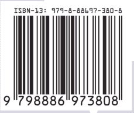
